# Linux 用户与开发者 163 - 系统管理员：网络全指南 163

# 你将培养编码员、开发者和程序员，并可能获得高达 £25k 的免税培训金成为计算机教师。


你可以用激情、热情和创造力启发下一代，赋予他们实现目标所需的技能。将你的技能和经验带入教室开启新职业。在培训期间你可以获得工资，或者获得由 `BCS` 提供的高达 £25k 的免税助金或 £25 的学金。申请现已开放。向我们注册获取定制建议，让你的教学职业有一个良好的开端。

立即申请。

访问 `education.gov.uk/teachcomputing`

欢迎阅读 `Linux User & Developer` 第 163 期

# 编辑团队

编辑：Gavin Thomas

`gavin.thomas@linuxuser.co.uk`

制作编辑：Rebecca Richards

`rebecca.richards@linuxuser.co.uk`

设计：Skylar Ritts

`skylar.ritts@linuxuser.co.uk`

高级艺术编辑：Andy Downes

`andy.downes@linuxuser.co.uk`

编辑：Chris Riley

`chris.riley@linuxuser.co.uk`

设计主管：Ross Atkins

`ross.atkins@linuxuser.co.uk`

`Dan Ahmed`, `Helena Bais`, `David Jones`, `Christopher Casey`, `Kurt Lin`,

媒体、技术和生活专家：`Sam Harris`, `Richard`, `Marine James`, `Jim Mason`, `Ashley Richards`, `Richard Sakey`, `Alexander White`, `Tom Thomas`

`Linux User & Developer` 可授权。

数字版由 Cathy Black 提供：

`cathy.black@linuxuser.co.uk`

`subscriptions@linuxuser.co.uk`

## 从零开始建立稳健的网络

## 使用 Pi Zero 破解 Xbox 控制器

## 使用 Let's Encrypt 安全你的设备

## 运行 Raspberry Pi 2 Docker Swarm

欢迎阅读 `Linux User & Developer` 杂志最新杂志。我们最喜爱的开源杂志。建立一个复杂的网络，无论是在家里还是办公室，并不困难，比你想象的要简单得多。这是数字自由的回报！根据你的需求配置端口：转发和代理服务器、自动备份、远程访问、文件共享、监控工具，或将所有整合在一起——只需管理内核节点。转到第 18 页，我们将带你完成整个过程。

如果你热于摆弄硬件，那么不要错过我们的第一个 Pi 项目——`Xbox Zero Arcade`，如何破解你的旧 `Xbox` 控制器或通用 `USB` 手柄，以及如何将其与即插即用的 `MAME` 街机系统组装。

本月有一些非常棒的技术教程——在 `Hotuk` 上开启大数据，切换到新的证书机构 `Let's Encrypt`，并了解如何通过将 `Raspberry Pi 2` 板转换为 `Docker Swarm` 来分发你的任务。务必查看我们在第 86 页对 `Genuino 1` 的评测——这是在内核市场的最新尝试！

Gavin Thomas


`Gordon & Go`

`www.gordonandgo.com`.


`1&1 Cloud`应用中心是让您的应用程序快速运行的最快方式！从100多款尖端应用程序中选择，并将其与我们的云服务器的速度和性能相结合——这种性能已通过独立基准测试的证明。

- 安全强大的平台
- 无需服务器经验
- 按分钟计费


`首月免费试用，此后每月4.99英镑起。需预付99英镑设置费，如果在第一个月内取消购买可退还。无最低合同限制。价格不含20%增值税。访问1and1.co.uk查看条款。1&1云服务器由Intel® Xeon®处理器 ES-2685 v3（25M缓存, 2.5 GHz）驱动。Intel和Intel标志是英特公司在美国及其他国家的商标。Intel, Discovery House, 114 Southampton Street, Gloucester, GL1 2EQ。`可能适用条款。

移动

## Canonical推出首款“融合型”Ubuntu平板电脑

与`BQ`合作推出首款旗舰移动计算设备

`Canonical`宣布与西班牙移动制造商`BQ`合作推出其首款“融合型”`Ubuntu`平板电脑设备——`Asahi M10` `Ubuntu`版。`Canonical`愿景一个移动计算与桌面计算界限变得模糊的未来，但由于社区驱动开发的尝试失败，这一愿景从未离开设计图纸。然而，公司的愿景并未消失，那款兼任移动和桌面电脑角色的首款设备却曾是……

`Asahi M10` `Ubuntu`版是`Canonical`首个提供成品硬件的融合系统。作为平板电脑使用时，`M10`可以独立运行或使用以触摸为中心的界面；当连接到外部显示器、键盘和鼠标时，平板电脑会无缝切换到传统的桌面用户界面。“我们带来了您对`Ubuntu`电脑所预期的一切，”`Canonical`高管`Mark Shuttle`在发布会上声称，“这是被扩展到桌面尺寸的界面——它是给定情况下最正确的用户体验和交互模型。此外，在应用程序方面，我们没有其他操作系统可以提供：一个适用于所有平台应用程序的单一视觉化框架和工具集。”

在内部，`M10`基于联发科四核`MT67363A`处理器，运行频率高达`1.5GHz`，配备`2GB`内部存储空间，这超过了`Ubuntu Edge`上承诺的配置——微`HDMI`端口提供了与外部显示器的连接，而`7200mAh`的电池则允许设备移动使用。该平板电脑为`10.1`英寸全高清型号，具有电容式多点触摸功能，嵌套在`Asahi`的`Dragonfruit`冲击力之后。“`Ubuntu`版是我们第三款搭载`Ubuntu`出的移动设备，”`BQ`首席官`Rodriguez del Prado`在发布会上解释道。之前的版本是`BQ Earis` `Ubuntu`版和`BQ E5 HD` `Ubuntu`版，我们很高兴成为首个推出融合`Ubuntu`体验的`OEM`厂商。这种创新故事让`BQ`和`Ubuntu`变得如此契合。

> 作为平板电脑使用时，`Asahi M10` `Ubuntu`版可以独立运行并使用以触摸为中心的界面


上方：`Canonical`和`BQ`的首款“融合型”平板电脑可以用于独立模式或桌面模式

## SourceForge和Slashdot被收购

争议性的“`DevShare`”计划或将终结？

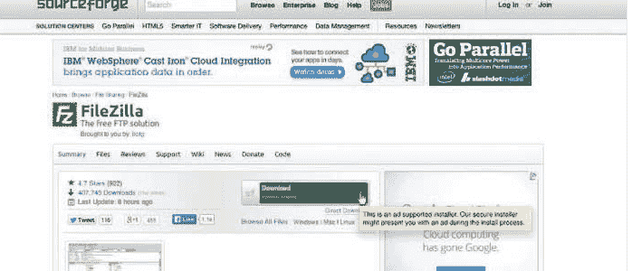

上方：`SourceForge`的臃肿软件实际上杀死了开源街

热门的软件托管平台`SourceForge`和内容聚合平台`Slashdot`已被`QUIX`收购，旨在消除`DevShare`计划。

在2013年`Dice Holdings`收购`SourceForge`后，`DevShare`计划的推出是为了为托管软件的所有者和开发者提供收入。该计划将软件封装在捆绑包中，包含了许多不需要的程序（以及指向用户的链接）和广告。

“对于`Mike Marquise`来说，”红帽开发者`Julian Clift`说道，“他们没有关闭我们的项目，而是将其展示了出来，”

尽管`Dice Holdings`将管理这些项目，但项目被留在了排水沟中——这是此前托管项目导致的结果，显而易见。因此，其新所有者正在清理房屋。“截至上周，`DevShare`计划已宣布停止，”`SourceForge`总裁`Luke Kelly`表示，“我们希望恢复作为开源软件信赖家园的声誉，这是迈向该目标的第一步。”

“我们更关注的是做正确的事，而不是获得额外的短期利润，”`Abbott`继续道，“在未来未来，我们将通过开发功能和建立社区信任来关注我们的声誉。“消除`DevShare`计划是我们成功的必要步骤。”

在不久的将来，我们将为用户开发并推出更多功能和许多变化。

该网站之前的用户对`Abbott`的公告做出了反应，尽管这种影响是负面的。


## 华纳兄弟取消 `Linux` 移植版

`Linux Mint` 项目——在 `distro.com` 等追踪器上最流行的 `Linux` 发行版——遭受了攻击，导致其网站被破解并留下了被感染的 ISO 镜像。`Linux Mint` 团队确认了这一攻击，他们表示黑客在 `Linux Mint ISO` 中做了严重问题，并在其中留下了后门。

黑客通过 `Linux Mint` 网站服务器 `WordPress` 安装中的 `PHP` 脚本获取访问权限，破解了 64 位 `Linux ISO 17.3 Cinnamon` 版本。该 ISO 以及 2 月 20 日星期六的 64 位 `Cinnamon` 版本可能被恶意软件感染。

华纳兄弟媒体在游戏原版发布出现重大问题后，取消了在 `Linux` 上发布《阿卡姆骑士》（`Arkham Knight`）。阿卡姆系列的最新作《蝙蝠侠：阿卡姆骑士》在首发后不久便于 `PS4` 和 `Xbox` 发布。遗憾的是，`Windows` 版本严重的性能问题和游戏崩溃 Bug 导致其在发布了几个补丁修复了最严重的问题后才艰难恢复正常。

当时，恶意软件本身似乎是 `/Tsunami-a`，也被称为 `Linux`。这是一种众名的分布式技术，通过使用 `IRC` 服务器来接收进一步信息。确定你的 `Linux` 是否被入侵的一种方法是查看 `/var/lib/man.cy` ——如果该目录不为空，那么你很有可能被感染了。

`Windows` 版本无论用户持有了多久都将提供退款。随着大量 `Windows` 用户涌入退款，人们对该作品产生了担忧——而事实证明这种担忧是完全正确的。“我们很遗憾地确认，《阿卡姆骑士》并未（支持 `Linux`）”该公司在 `Steam` 上的一封简短贴文中写道——如果您已预购，请申请 `Mac` 或 `Linux` 版的退款。

对于 `Linux` 玩家来说，这对于 `Valve`（维尔）来说是一个 AAA 大作的损失，因为它正依赖跨平台支持来其基于 `Steam OS` 的游戏平台。

然而，这些补丁很少能解决该作品的核心问题，导致华纳兄弟宣布向所有买家提供……

`Linux` 基金启动了一项协作工作：`Fast Data` (`FDK`)，这是一个开源项目，旨在为下一代网络和存储软件提供高速输入/输出服务。

执行主任 `Jim Zimmer` 声称，技术集成和用户采用至关重要。“`FDK` 项目解决了了对灵活且可扩展的 `I/O` 的关键需求，以满足当今云计算环境日益增长的需求。

初始贡献包括包管理器、文件系统以及基于数据平面开发包（`DPDK`）的功能性 `VSwitch-Router`。这包括硬件加速、工具包、调试和开发环境，并配有 `OpenDay` 管理代理和主页。

“这不仅仅关乎快速网络和快速存储，”`ViPP Technology` 首席官 `David Ward` 表示，“灵活的架构以及开发、测试和持续性能工具包的加入，该项目的设计初衷考虑了充满活力的开源贡献者社区。”


开源软件的采用通过减少……改变了网络行业。

最终的 `Fast Data` 版本已上线，完整信息可在 `fd.io` 获取。

上述 17.3 `Cinnamon` 版本因对 `Linux Mint` 的攻击而受到破坏。

你的 `Linux` 新闻与观点来源

（每日平均访问量，1 月 19 日– 2 月 18 日）

1. `Linux Mint` 2,998
2. `Debian` 2,317
3. `Ubuntu` 1,718
4. `openSUSE` 1,375
5. `Zorin` 1,208
6. `Fedora` 1,162
7. `Android-x86` 1,45
8. `Manjaro` 986
9. `Arch` 942
10. `CentOS` 940

## Keybase 获得加密、分布式文件系统

旨在让文件共享既简单又安全


上述 `KBFS` 静默请求用户信息，抓取数据并呈现文件

你可以在几秒钟内加入并访问数据，你的设备将处理验证和加密，无需信任 `Keybase` 服务器。对于选定用户，`Keybase` 文件系统提供了 108GB 的远程存储。`Coye` 确认额外的页面大小在服务完全发布后将可用。

## 亮点

### `Android-x86`

`Android-x86 4.4 r2` 修复了与 `Surface` 设备的兼容性，并对 `BIOS` 和 `UEFI` 机器提供了完整支持。桌面以及桌面，`Android-x86` 本月有了显著改进。

### 稳定版 (26)

开发 (12)

### `RebeccaBackocks`

新的 `Linux` 发行版 `RebeccaBackocks` 包含了桌面环境，以及易于使用的 `KDE`。

### `Scientific Linux`

基于 `Red Hat` 的 `Scientific Linux 72` 版本迅速成为最快的……以及对 `Scientific Linux` 的支持。

## 容器

`Docker 移动`

开源软件的采用通过减少……改变了网络行业

执行主任 `Jim Zimmer` 表示技术集成和采用。“`FDK` 项目解决了对灵活且可扩展的 `I/O` 的关键需求，以满足当今云计算环境日益增长的需求。

初始贡献包括包管理器、文件系统以及基于数据平面开发包（`DPDK`）的功能性 `VSwitch-Router`。这包括硬件加速、工具包、调试和开发环境，并配有 `OpenDay` 管理代理和主页。

“这不仅仅关乎快速网络和快速存储，”`ViPP Technology` 首席官 `David Ward` 表示，“灵活的架构以及开发、测试和持续性能工具包的加入，该项目的设计初衷考虑了充满活力的开源贡献者社区。

最终的 `Fast Data` 版本已上线，完整信息可在 `fd.io` 获取。上述 17.3 `Cinnamon` 版本因对 `Linux Mint` 的攻击而受到破坏。`KBFS` 静默请求用户信息，抓取数据并呈现文件。你可以在几秒钟内加入并访问数据，你的设备将处理验证和加密，无需信任 `Keybase` 服务器。对于选定用户，`Keybase` 文件系统提供了 108GB 的远程存储。`Coye` 确认额外的页面大小在服务完全发布后将可用。

## 整数除法

一个数字除以另一个数字非常简单……直到

你的 `Linux` 新闻与见解来源

## 访谈 KEILA BANKS

### 无法定义的 Keila

14 岁的 `Keila Banks` 是今年 `SCALE 14x` 的演讲者，并在 `OSCON 2015` 上赢得了全场起立。结识一下开源界冉起之星吧……

> 那么，请向我们简单介绍一下你自己吧。

（嗯，我四个月前刚满 14 岁，我大约 11 岁就开始在会议上演讲了……我一直对计算机感兴趣，可能从三岁就开始了。我九 岁时开始学习编程——那时我写了我的第一个网站。）

你是如何开始接触会议的？

我爸爸对 `SCALE` 很感兴趣，他问我想不想去演讲，我说听起来很棒。然后我们去了另一场讲座，最后我去了更多地方，接着我参加了 `OSCON`，基本上是在我的第一场主旨演讲周围结识大家——后来我只是给 `SCALE` 的孩子们小组做小型演讲。


之后的情况如何？

嗯，我建立了更多的人脉：很多人开始主动联系我，而不是由我去联系他们。万事达卡甚至从非洲和加勒比地区联系了我！那是迈阿密的一场商务会议，他们邀请我去那里。那是一次极佳的机会，并为未来开启了更多联系我的机会。

`Keila Banks` 是一位年轻的技术程序员、教育者和开源倡导者。自 11 岁起，`Keila` 就在世界各地举办技术会议。

所以你是在这种环境中长大的吗？

我爸爸是一个 `IT` 顾问，他经常在后办公室处理项目。实际上我最后发现了了他的工作，所以之前我并不真正在意这件事，后来我开始得到爸爸的支持和鼓励。实际上我得自己自己去研究。

你的第一个 `Linux` 发行版是什么？

我的第一个 `Linux` 发行版？我觉得是 `KDE`，因为我爸爸用那个。后来当我参加 `SCALE` 大会时，我更深入了不同的操作系统。我非常喜欢 `Ubuntu`，从那时起开始接触它。

今年的 `SCALE 14x` 表现得如何？


上方是 `Keila` 和她的父亲 `Philip Banks`。`Philip` 多年来一直是 `SCALE` 的组织者，并将 `Keila` 引入了社区。


Keila Banks 多年来一直在 Linux 和开源会议上进行演讲，但许多人将 SCALE 视为未来。她在 OSON 2015 上那场“不落潮流的”（Unfashionable）演讲让她成为了备受焦点。当受邀请在 Prezi (`prezi.com/vicky_underfashionable`) 上进行演示时，她的主旨演讲是对社区身份认同的调查与赞美。Banks 开始与观众讨论她的外表，要求他们考虑会如何定义她，然后通过揭示更多关于她的过去、激情和技能再次挑战他们。在演讲结束时，人们不可能对她的成就、激情和动力不留下深刻印象。我们在这里看了视频：`youtube.com/watch?v=XtcFTcSQgQ2`。

……我还是完了。看起来就像是另一场演讲，Jon "Maddog" Hall 和 Joko Bacon 也在台上，但许多人将 SCALE 视为未来。

`什么激发了你去做演讲——例如，关于 Linux 的未来以及你的《不受待的我》（Undefirable Me）？` 嗯，这并不是关于 SCALE 的，其实并不真正相关，但许多人将 SCALE 视为未来。我从未见过哪场会议有这么多青少年以及并不了解一切的人。可能是 SCALE LX，那里有数百个孩子，他们也是，甚至还有来自我自己小镇的孩子。

我并不怎么谈论它——当人们谈论编程时，觉得它很复杂，想象的是在所有屏幕上敲代码。所以，我想消除这些标签并鼓励人们加入其中。我真的想把编程看作是一件真正有趣、容易上手的事情，只需告诉他们他们做得到就好。这是一项非常有价值的技能。

> 当人们谈论编程时，他们只认为它很复杂……我想消除这些标签并鼓励人们加入其中

例如，照片编辑，然后他们想，我不知道该从哪里开始——买个 Photoshop 要花几百美元：……许多人知道 GIMP，所以我认为在他们的职业生涯中投入它是非常值得的。这种感觉——看到多年来大家都知道它——真的让我的心里很暖暖（笑）。

`你参与了任何开源社区吗？` 是的！我主要的参与社区有 PyLides 和 LinuxIO，我还参加了 PyKids 的 Ruby on Rails 工作坊。但 LinuxIO，他们就像是我自己的家一样。

## 你能帮助启发下一代代码人员吗？

`Code Club` 是一个全国性的志愿者领导网络，为 9-11 岁的儿童提供课后俱乐部服务。

我们一直在寻找具备编程技能的人员，志愿者每周在当地的小学、图书馆或社区中心运营一小时的俱乐部。

你可以与同事结队，会有老师在现场为你提供支持，我们将提供你所需的所有材料，帮助激发孩子们对数字创作的兴趣。

有许多参与方式！

想了解更多信息，请访问 `www.codeclub.org.uk` 加入我们。


你的 Linux 新闻与观点来源

## 内核专栏 (the kernel column)

随着合并欢迎 Linux 4.5 版本的到来，Jon Masters 探索了 Linux 内核的最新发布

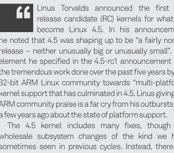

> Linus Torvalds 宣布了成为 Linux 4.5 的几个发布候选 (RC) 内核。在公告中，他注意到 4.5 既不大也不异常小。他也在 4.5-rc1 中提到，这是自 32 位 ARM 内核社区以来首次向“多平台内核”迈进。ARM 社区的赞誉与几周前被边缘化相比大不相同，在事情发生几周后，他们建议“在与另一侣调情之间，不如出去测试一下”。如果一切进展顺利，4.5 内核将在 3 月中旬发布，窗口将恰好在复活节周日日出前关闭。

ARM Linux 社区已成长最大的内核开发者群体之一，推动对大量创新和令人设备的支持。目前，对 `ARM/arch64`（部分）的支持包含了在其传统嵌入式范围之外许多机会中的 ARM 核心。

自 Linux 4.3 发布以来，已经有很多更新，并且未来会有更多。从技术上讲，`ARMv7` 和 `ARMv8` 32 位架构都是如此，32 位 ARM `arch64` 支持为新的 64 位架构状态提供了一个 `arch64` 目录。

4.5 内核包含许多功能，例如我们最近注意到的那类子系统：增量功能，包括将对 `MADV_FREE` 内存地址空间“收缩器”(shrinker) 标志选项引入主线。新的虚拟内存映射是“易变的” (volatile)。此类映射可以在需要时由内核回收，而不会破坏应用程序。许多人一直在关注并讨论此类功能（Linux 2.6 等了长久的等待），以看看它是否符合 Linux 4.5 的理想。

Jon Masters 是一位已经在 Linux 上工作了 13 年的内核黑客。他目前是剑桥詹姆斯大学的学生，在一家大型 Linux 供应商工作，并参与专家 ARM 驱动设备的标准制定。

4.5 内核包含了对持久内存的直接支持——这些正在先进和推广的非易失性技术。从用户空间到 `/dev/system` RAM 的根级别访问的新波效应，由于从根到用户的安全权限，如果不非常小心将无法执行。

大型、直接标记的“持久内存”设备的设计使得对 `/dev/mem/by` 的错误“错误”风险显著增加。为了缓解这一点，最新的补丁集将防止访问 `/dev/mem`，除非它们被标记为“磁盘”（不与设备驱动程序关联），使得在不解绑 Linux 持久内存的情况下，无法意外写入持久内存设备。

早期的 32 位 ARM 系统最初交付的是完整的内核，其中包含了许多针对内核可运行的特定平台的内置添加。

随着时间的推移，结合想要让 Linux 4.5 成为一种运行时配置的愿望，你将看到“设备树”(DeviceTree) 规范（OpenFirmware 的开发版本）的力量。

在我们印刷时，Linus 在面对更多 RC 版本时添加了“送给每个人的礼物”。他还包含了许多不属于原始 OpenFirmware 项目的实体，例如你可以在许多 ARM 板板（包括树莓派 RPi）上看到的 `dtb` 和 `dtts` 文件。DeviceTree 使用灵活的标记语言描述 32 位 ARM 系统，描述硬件以及它应该如何配置。DeviceTree 不保证实现预期的“一个内核运行所有它们”的单一-


进入 ARM Linux 多平台工作。由 Arm Bergmann 领导的这项工作清理围绕单个设备组合的许多内置假设。不再由单个驱动程序和核心代码假设它们本身就意味着它们，他们发现维护过去五年的复杂性导致了健壮、灵活的内核，该内核可以在运行时决定是否应该用于特定设备或在给定的平台上使用。它是直接二进制构建的 Linux 发行版支持广泛的 `ARMv7`。

时钟驱动了那些在不崩溃系统的情况下无法安全关闭的设备。新设备还补丁了一个 `CL_CRITICAL` 标志，告诉 Linux 好好放过时钟。

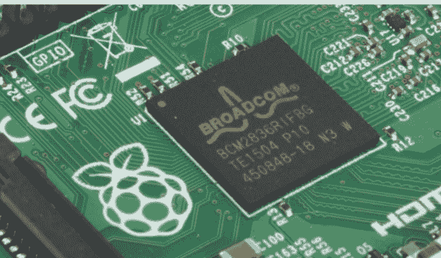

> Linux 社区已成长为最大的内核开发者群体之一，推动对大量创新设备的支持。目前，对 `ARM/arch64`（部分）的支持包含了在其传统嵌入式范围之外许多机会中的 ARM 核心。ARM Linux 社区的赞誉与几周前被边缘化相比大不相同，在事情发生几周后，他们建议“在与另一侣调情之间，不如出去测试一下”。

自 Linux 4.3 发布以来，已经有很多更新，并且未来会有更多。`ARMv7` 和 `ARMv8` 32 位架构从技术上讲都是如此，32 位 ARM `arch64` 支持为新的 64 位架构状态提供了一个 `arch64` 目录。

4.5 内核包含许多功能，例如我们最近注意到的那类子系统：增量功能，包括将对 `MADV_FREE` 内存地址空间“收缩器”(shrinker) 标志选项引入主线。新的虚拟内存映射是“易变的” (volatile)。此类映射可以在需要时由内核回收，而不会破坏应用程序。许多人一直在关注并讨论此类功能（Linux 2.6 等了长久的等待），以看看它是否符合 Linux 4.5 的理想。

Jon Masters 是一位已经在 Linux 上工作了 13 年的内核黑客。他目前是剑桥詹姆斯大学的学生，在一家大型 Linux 供应商工作，并参与专家 ARM 驱动设备的标准制定。

4.5 内核包含了对持久内存的直接支持——这些正在先进和推广的非易失性技术。从用户空间到 `/dev/system` RAM 的根级别访问的新波效应，由于从根到用户的安全权限，如果不非常小心将无法执行。

大型、直接标记的“持久内存”设备的设计使得对 `/dev/mem/by` 的错误“错误”风险显著增加。为了缓解这一点，最新的补丁集将防止访问 `/dev/mem`，除非它们被标记为“磁盘”（不与设备驱动程序关联），使得在不解绑 Linux 持久内存的情况下，无法意外写入持久内存设备。

早期的 32 位 ARM 系统最初交付的是完整的内核，其中包含了许多针对内核可运行的特定平台的内置添加。

随着时间的推移，结合想要让 Linux 4.5 成为一种运行时配置的愿望，你将看到“设备树”(DeviceTree) 规范（OpenFirmware 的开发版本）的力量。


## 多平台内核 (Multi-platform kernels)

Linux 社区已成长为最大的内核开发者群体之一，推动对大量创新和令人期待设备的支持。目前，对 `ARM`/`arch64`（部分）的支持包含了在其传统嵌入式范围之外许多机会中的 `ARM` 核心。

自 `Linux` 4.3 发布以来，已经有很多更新，并且未来会有更多。`ARMv7` 和 `ARMv8` 32 位架构从技术上讲都是如此，32 位 `ARM` `arch64` 支持为新的 64 位架构状态提供了一个 `arch64` 目录。

### 4.5 内核特性

`4.5` 内核包含许多功能，例如我们最近注意到的那类子系统：增量功能，包括将对 `MADV_FREE` 内存地址空间“收缩器”(`shrinker`) 标志选项引入主线。新的虚拟内存映射是“易变的”。此类映射可以在需要时由内核回收，而不会破坏应用程序。许多人一直在关注并讨论此类功能（`Linux` 2.6 等了长久的等待），以看看它是否符合 `Linux` 4.5 的理想。

`Jon Masters` 是一位已经在 `Linux` 上工作了 13 年的内核黑客。他目前是剑桥大学的学生，在一家大型 `Linux` 供应商工作，并参与专家 `ARM` 驱动设备的标准制定。

`4.5` 内核包含了对持久内存的直接支持——这些正在先进和推广的非易失性技术。从用户空间到 `/dev/system` `RAM` 的根级别访问的新波效应，由于从根到用户的安全权限，如果不非常小心将无法执行。

大型、直接标记的“持久内存”设备的设计使得对 `/dev/mem/by` 的错误“错误”风险显著增加。为了缓解这一点，最新的补丁集将防止访问 `/dev/mem`，除非它们被标记为“磁盘”（不与设备驱动程序关联），使得在不解绑 `Linux` 持久内存的情况下，无法意外写入持久内存设备。

### 早期架构与 DeviceTree

早期的 32 位 `ARM` 系统最初交付的是完整的内核，其中包含了许多针对内核可运行的特定平台的内置添加。

随着时间的推移，结合想要让 `Linux` 4.5 成为一种运行时配置的愿望，你将看到“设备树”(`DeviceTree`) 规范（`OpenFirmware` 的开发版本）的力量。

在我们印刷时，`Linus` 在面对更多 `RC` 版本时添加了“送给每个人的礼物”。他包含了许多不属于原始 `OpenFirmware` 项目的实体，例如你可以在许多 `ARM` 板（包括树莓派 `RPi`）上看到的 `"dtb"` 和 `"dtbs"` 文件。`DeviceTree` 使用灵活的标记语言描述 32 位 `ARM` 系统，描述硬件以及它应该如何配置。`DeviceTree` 不保证实现预期的“一个内核运行所有它们”的单一性。

进入 `ARM` `Linux` 多平台工作。由 `Arm Bergmann` 领导的这项工作清理围绕单个设备组合的许多内置假设。不再由单个驱动程序和核心代码假设它们本身就意味着它们，他们发现维护过去五年的复杂性导致了健壮、灵活的内核，该内核可以在运行时决定是否应该用于特定设备或在给定的平台上使用。它是直接二进制构建的 `Linux` 发行版支持广泛的 `ARMv7`。

时钟驱动了那些在不崩溃系统的情况下无法安全关闭的设备。新设备还补丁了一个 `CL_CRITICAL` 标志，告诉 `Linux` 好好放过时钟。

> `Linux` 社区已成长为最大的内核开发者群体之一，推动对大量创新设备的支持。目前，对 `ARM`/`arch64`（部分）的支持包含了在其传统嵌入式范围之外许多机会中的 `ARM` 核心。`ARM` 社区的赞誉与几周前被边缘化相比大不相同，在事情发生几周后，他们建议“在与另一侣调情之间，不如出去测试一下”。


# 你能帮助启发下一代代码人员吗？

`Code Club` 是一个全国性的志愿者领导网络，为 9-11 岁的儿童提供课后俱乐部服务。

我们一直在寻找具备编程技能的人员，志愿者每周在当地的小学、图书馆或社区中心运营一小时的俱乐部。

你可以与同事结队，会有老师在现场为你提供支持，我们将提供你所需的所有材料，帮助激发孩子们对数字创作的兴趣。

有许多参与方式！
想了解更多信息，请访问 `www.codeclub.org.uk` 加入我们。


# 开源 (OpenSource)

你的 Linux 新闻与观点来源

# 观点 (OPINION)

# 内核专栏 (the kernel column)

随着合并欢迎 Linux 4.5 版本的到来，`Jon Masters` 探索了 Linux 内核的最新发布


> `Linus Torvalds` 宣布了成为 Linux 4.5 的几个发布候选 (RC) 内核。在公告中，他注意到 4.5 既不大也不异常小。他也在 `4.5-rc1` 中提到，这是自 32 位 ARM 内核社区以来首次向“多平台内核”迈进。ARM 社区的赞誉与几周前被边缘化相比大不相同，在事情发生几周后，他们建议“在与另一侣调情之间，不如出去测试一下”。如果一切进展顺利，4.5 内核将在 3 月中旬发布，窗口将恰好在复活节周日日出前关闭。

# 多平台内核 (Multi-platform kernels)

ARM Linux 社区已成长最大的内核开发者群体之一，推动对大量创新和令人设备的支持。目前，对 `ARM/arch64`（部分）的支持包含了在其传统嵌入式范围之外许多机会中的 ARM 核心。

自 Linux 4.3 发布以来，已经有很多更新，并且未来会有更多。`ARMv7` 和 `ARMv8` 32 位架构从技术上讲都是如此，32 位 ARM `arch64` 支持为新的 64 位架构状态提供了一个 `arch64` 目录。

4.5 内核包含许多功能，例如我们最近注意到的那类子系统：增量功能，包括将对 `MADV`、`FREE` 内存地址空间“收缩器”(shrinker) 标志选项引入主线。新的虚拟内存映射是“易变的”。此类映射可以在需要时由内核回收，而不会破坏应用程序。许多人一直在关注并讨论此类功能（Linux 2.6 等了长久的等待），以看看它是否符合 Linux 4.5 的理想。

`Jon Masters` 是一位已经在 Linux 上工作了 13 年的内核黑客。他目前是剑桥詹姆斯大学的学生，在一家大型 Linux 供应商工作，并参与专家 ARM 驱动设备的标准制定。

4.5 内核包含了对持久内存的直接支持——这些正在先进和推广的非易失性技术。从用户空间到 `(dev/system)` RAM 的根级别访问的新波效应，由于从根到用户的安全权限，如果不非常小心将无法执行。

大型、直接标记的“持久内存”设备的设计使得对 `dev/mem/by` 的错误“错误”风险显著增加。为了缓解这一点，最新的补丁集将防止访问 `/dev/mem`，除非它们被标记为“磁盘”（不与设备驱动程序关联），使得在不解绑 Linux 持久内存的情况下，无法意外写入持久内存设备。

早期的 32 位 ARM 系统最初交付的是完整的内核，其中包含了许多针对内核可运行的特定平台的内置添加。

随着时间的推移，结合想要让 Linux 4.5 成为一种运行时配置的愿望，你将看到“设备树”(DeviceTree) 规范（`OpenFirmware` 的开发版本）的力量。

在我们印刷时，`Linus` 在面对更多 RC 版本时添加了“送给每个人的礼物”。他包含了许多不属于原始 `OpenFirmware` 项目的实体，例如你可以在许多 ARM 板板（包括树莓派 `RPi`）上看到的 `"dtb"` 和 `"dtts"` 文件。`DeviceTree` 使用灵活的标记语言描述 32 位 ARM 系统，描述硬件以及它应该如何配置。`DeviceTree` 不保证实现预期的“一个内核运行所有它们”的单一-


进入 ARM Linux 多平台工作。由 `Arm Bergmann` 领导的这项工作清理围绕单个设备组合的许多内置假设。不再由单个驱动程序和核心代码假设它们本身就意味着它们，他们发现维护过去五年的复杂性导致了健壮、灵活的内核，该内核可以在运行时决定是否应该用于特定设备或在给定的平台上使用。它是直接二进制构建的 Linux 发行版支持广泛的 `ARMv7`。

时钟驱动了那些在不崩溃系统的情况下无法安全关闭的设备。新设备还补丁了一个 `CL_CRITICAL` 标志，告诉 Linux 好好放过时钟。


> Linux 社区已成长为最大的内核开发者群体之一，推动对大量创新设备的支持。目前，对 `ARM/arch64`（部分）的支持包含了在其传统嵌入式范围之外许多机会中的 ARM 核心。ARM 社区的赞誉与几周前被边缘化相比大不相同，在事情发生几周后，他们建议“在与另一侣调情之间，不如出去测试一下”。

## 启动基础网络服务

开始设置控制机，为网络中的所有设备提供 DNS 和 DHCP 服务器。

在深入之前，有几个概念需要解释一下我们构建全功能网络所需的基础设置。网络上的任何设备都需要一些基本信息才能成为计算机网络的一部分。

IP 地址是网络上设备的唯一标识符。网络上的每个设备都需要 IP 地址来于通信或传输数据。目前，我们有两种类型的 IP 地址：`IPv4` 和 `IPv6`。例如，像 `192.168.0.100` 这样的 `IPv4` 地址是为了解决 `IPv4` 方案地址数量有限的问题创建的。`IPv6` 地址是由冒号表示的 128 位地址。对于此功能，我们重点关注前者。

要知道 IP 地址 (`52.17.239.22`)，只有当我们拥有 IP 地址时，才能访问网站。

网关/路由器地址。网关或路由器用于访问你网络中的设备——继续我们之前的例子，一旦我们获得了 `linuxuser` 的 IP 地址，就配置该设备将网关连接到路由器。

我们也可以在每个设备上手动配置这些设置，或者进行自动配置以避免在网络中有大量设备时出现繁琐和错误。自动配置允许我们计算机网络上的所有设备联网。

DNS 服务器地址。DNS（域名系统）用于将人类友好的域名地址解析为友好的 IP 地址——基本上，是将易记的字符串翻译成易于理解的数字。例如，如果我们想访问 `www.linuxuser.com`，我们需要连接到 DNS 服务器。

`Dnsmasq`。我们将使用 `dnsmasq` 为我们的网络提供 DHCP 和 DNS 服务器。`Dnsmasq` 是一款轻量级软件，非常易于使用，适用于小型网络。

首先，在将作为服务器的 Linux 机器上安装 `dnsmasq` 包。在基于 Debian 的系统上，你使用以下命令来安装 `dnsmasq` 服务器：

```bash
$ apt-get install dnsmasq
```

安装完成后，你需要编辑 `/etc/dnsmasq.conf` 文件来配置该服务。

有时，当你需要访问你的服务器，但该服务器没有直接连接到互联网。在这种情况下，我们可以使用名为端口转发的技术。端口转发允许将网络流量从局域网（LAN）端口的一个端口转发到另一个端口。例如，如果我们想访问 `192.168.1.50` 端口 80 的 Web 服务器，我们就在局域网中一台 IP 地址为 `192.168.1.50` 端口为 80 的电脑上运行 Web 服务器。通过端口转发，路由器将自动将流量到正确的服务器。

要启用端口转发，你可以进入路由器配置页面并寻找端口转发选项。例如，如果我们想访问 `215.68.193.110` 端口 80 上的服务器，我们需要将 IP 地址 `192.168.1.50` 添加到路由列表中，并请求将局域网端口 81 映射到端口 80，反之亦然。

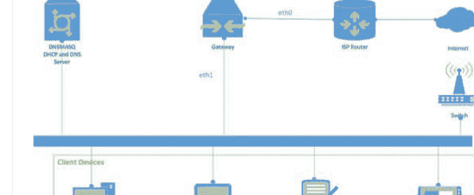

网络的关键瓶颈之一是 DNS 服务器。网络上的每个设备都需要查询 DNS 服务器来完成所需的连接请求。`Google` 和 `OpenDNS` 等公共 DNS 服务提供快速的 DNS 服务器，为你提供完整的互联网访问。

下面我们将使用 `dnsmasq` 和 DHCP 服务器来配置我们的在线客户端。

## 配置 IP 地址并设置互联网网关

我们已经安装了 `Dnsmasq`，让我们开始为网络设备分配 IP 并让它们上线。

首先，禁用 `/etc/resolv.conf`，因为 `/etc/resolv.conf` 包含了我们本地系统使用的 DNS 服务器地址：

- `no-resolv`

```bash
server=8.8.8.8
server=8.8.4.4
```


通过添加以下行，如果 Dnsmasq 自己不知道该地址，它会将查询转发到以下服务器（Google 公共 DNS 服务器）：

我们可以向 Dnsmasq 配置中添加以下内容：

自定义 DNS 条目具有最高优先级，并可用于覆盖公共 DNS。如果我们在这里添加一个地址（如`192.168.1.11`），Dnsmasq 将使用`192.168.1.11`而不是相同域名的公共条目。Dnsmasq 还充当上游 DNS 服务器的缓存。为了让 DHCP 服务器快速恢复，我们应该限制查询上游服务器的频率。以下将 DHCP 范围查询限制设置为 100：

- `dhcp-size=1000`
- `dhcp-range=192.168.1.2,192.168.1.200,255.255.255.0`

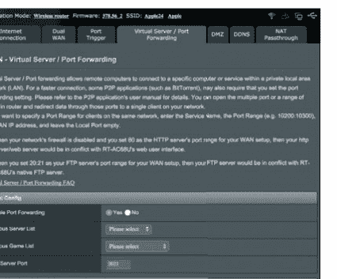

以下选项允许 DHCP 服务器配置 Dnsmasq 并设置 DHCP 范围、网络子网掩码和租约时间。

- `dhcp-option:router,192.168.1.1`

这将启用 DHCP 为`192.168.1.2`和`192.168.1.200`分配地址。12 小时的租约时间意味着地址租用 12 小时，然后客户端必须续租网关服务器，使用：

- `dhcp-option:dns,192.168.1.10`

我们可能想为设备预留特定的 IP 地址。我们可以通过以下方式实现：

- `dhcp-option:host:11:22:33:44:55:66,192.168.1.13`

如果设备的硬件（MAC 地址）为`11:22:33:44:55:66`，此选项将将 IP 地址设置为`192.168.1.13`。

## 智能备份系统

设置一个智能备份系统，监控文件夹并将数据复制到您的服务器。

在您的网络上建立集中式备份方案对您的客户非常有用；他们不需要担心处理工作。你可以方便地在网络中选择的任何位置进行备份。UrBackup 是一款免费的开源备份软件，支持 Unix 和 Windows 客户端。虽然 UrBackup 极其精简，但它具有一些重要、易用且高效的核心功能（例如如果从多个客户端备份同一个文件，它仅保留一份副本）、对我们的文件进行可靠备份，以及简单的安装过程。

UrBackup 可以安装在大多数 Linux 发行版以及像 Synology 这样的 Windows 设备上。将在 Ubuntu 上安装 UrBackup。我们将使用以下命令安装 UrBackup 服务器：

```
$ sudo apt-get update

sudo apt-get install urbackup-server
```

在安装过程中，安装程序会询问备份位置。请选择可用空间最大的文件夹。如果你想对备份进行压缩，可以将位置设置在 Btrfs 或 ZFS 格式的分区上。为了增加额外的数据保护，你还可以考虑将备份文件存储在 RAID 5 上，以便在磁盘故障时可以轻松恢复数据。毕竟，集中式备份服务器是关重要的。

一旦 UrBackup 服务器运行，你可以通过`http://localhost:5684`访问 Web 界面。默认凭据为`admin/password`。进入 Settings（设置），然后点击 create（创建）。在此处输入用户密码并点击创建。如果你想通过电子邮件接收通知，可以通过 Settings > Mail 配置 SMTP 设置。如果你想编辑备份文件夹位置，可以在 General（常规） > Backup Storage Path（备份存储路径）中找到。其他所有项均为默认设置。

## UrBackup 客户端设置

UrBackup 客户端适用于 Linux（包括 Arch Linux）和 Windows，可以在`https://www.urbackup.org/download.html`获取。下载并安装最新版本即可。UrBackup 客户端支持自动发现服务器，一旦配置完成，你就可以指定想要备份的文件夹，然后从服务器 Web 界面启动备份。


| 计算机名称 | 是否在线 | 上次文件备份 | 上次镜像备份 | 文件备份状态 | 镜像备份状态 |
| --- | --- | --- | --- | --- | --- |
| laptop | 是 | 2016-02-17 17:26 | 2016-02-17 17:26 | 21.4% | |

显示第 1 到 1 条记录

## Rsync 文件复制

Rsync 是一种增量网络和远程文件复制工具。你可以使用`rsync`在网络上相互复制文件或目录。Rsync 仅传输文件中尚未传输的部分。对于文件，它会检查文件的哪些部分发生了变化，并仅传输这些部分。Rsync 是一个非常流行的传输工具。对于同一台计算机上的文件，可以使用以下命令：

```
$ rsync -fr source
```

此命令使用简单，但有不同之处：在这种情况下，传输将保留文件权限并保留部分文件。如果由于某种原因你在途中取消了传输，它将恢复执行。如果你断开了网络连接，那么……请记住，在这种情况下，发送端和接收端系统上都必须安装`rsync`。

```
$ rsync -fr kun@192.168.1.48:/downloads
```

### 添加额外的互联网客户端

客户端名称：

### 互联网客户端

添加额外的互联网客户端

客户端名称：

### 额外客户端

主机名/IP

上述 UrBackup 显示了备份状态，并提供了客户端下载选项


## 通过 SSH 和 VNC 远程访问文件

从世界任何地方通过命令行登录到您的服务器，或与远程机器共享桌面以获取图形用户界面（GUI）。

SSH（安全外壳）是远程登录系统的常用方法。OpenSSH 是最流行的 SSH 实现，适用于所有主流平台：Linux、Windows、Android、macOS。要安装`OpenSSH-server`，请使用：

```
$ sudo apt-get install openssh-server
```

安装后，`openssh-server` 即可准备就绪，无需进一步配置。使用以下命令从远程机器登录：

```
$ ssh username@hostname
```

用户名应该已经存在于服务器上。默认情况下，OpenSSH 配置为密码认证。一种更安全的方法是使用公钥认证。在远程机器上生成公/私钥对：

```
$ ssh-keygen -t rsa
```

上述命令将为你生成两个文件。它们位于`~/.ssh/id_rsa`和`id_rsa.pub`。`id_rsa`是你的私钥——不要与任何人共享。复制`id_rsa.pub`（公钥）的内容，并将其放置在远程服务器的`~/.ssh/authorized_keys`文件夹中。下次，你将无需密码即可登录。

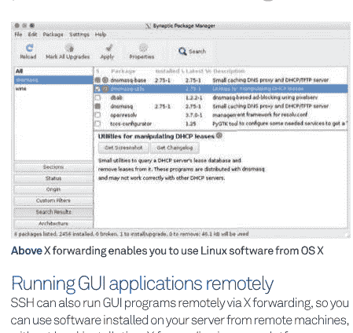

## 访问 Windows

几乎所有现代 Windows 操作系统都开发了远程桌面连接（通常称为 RDP 功能），你可以用它访问远程计算机上的桌面服务。这包括 Windows 7、8、10 和 11。请注意，Windows 家庭版不支持连接到远程桌面。Windows 家庭版可以使用 VNC 或 Remmina 连接到远程机器。Remmina 正在活跃开发，并提供了安装 Windows 的完整功能：

```
sudo apt-get update
sudo apt-get install remmina-remmina-plugin-rdp
remmina-plugin-vnc
```

## 用于远程桌面会话的 TightVNC

VNC 是一个使用 RFB 协议实现的桌面共享系统，用于通过网络共享当前桌面。VNC 可以为服务器的多个用户同时提供隔离的桌面环境。这意味着所有用户都可以在自己的桌面上运行桌面，而互不干扰。

```
$ sudo apt-get install tightvncserver xfce4-goodies xfce4-server
```

我们还安装了轻量级桌面环境 Xfce，我们将用它为远程用户启动 GUI 会话。使用 Autocut 在主机和客户端之间添加复制粘贴支持。我们需要配置桌面环境，创建`~/.vnc/`并添加：

```
$ /bin/bash

startxfce4 &
```


使用 `sudo chmod +x startup` 使其具有可执行权限。对于每个用户，必须创建一个服务实例，对于 `VNC` 服务器，你将为多个访问自己桌面的用户设置显示号和分辨率，然后你需要为每个用户创建一个启动文件，并在服务文件中为用户分配不同的显示号。

你可以使用以下命令启动 `VNC`。这里是 `VNC` 服务器上运行的显示号。根据显示号，`vncserver` 将位于 `:5900`。如果显示号是 `1`，它位于 `5901`。现在你需要使用任何 `VNC` 客户端连接服务器，在这种情况下应为 `<服务器地址>:5900`。

在家里流传输你的电影、音乐和相册。下面的 `Plex` 有一个界面，可以让你轻松跟进设置文件服务器。最常用的服务器之一是 `Samba`。由于其共享协议，它适用于所有平台，包括 `Linux`、`macOS`、`Windows`、`Android`。要安装 `Samba` 服务器，请参考以下包：

```
$ sudo apt-get install samba-common
```

你可以通过编辑 `/etc/samba.conf` 文件配置 `Samba` 服务器。让我们从全局部分开始。在这里我们设置标识服务器的工作组：

```
workgroup = GROUP
server string = Samba
map to guest = Bad User
```

设置日志：

```
log file=/var/log/samba
```

设置访客账户：

```
guest account = myguestuser
```

设置访客共享（无密码）：

```
[SharedFolder]
path=/media/SharedFolder
```

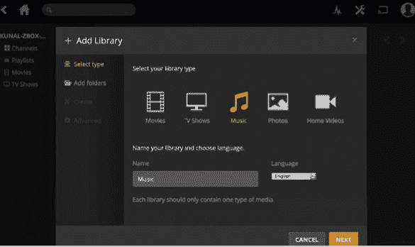

下面的 `Plex` 可以帮助 `BBC Player` 等网络电视频道。文件服务器允许通过网络扩展自己的存储。

```
comment = My Shared Folder
writeable = yes
browse = yes
```

此共享将映射到访客账户，确保用户具有访问 `/MyShared` 的权限。你可以从 `Windows`、`Linux` 和 `Mac` 计算机访问共享文件夹。此文件可以使用 URL `//服务器IP地址/MyShared` 进行访问。为了创建一个密码保护的共享，添加一个组：

```
$ sudo addgroup smbgrp
```

将用户添加到组：

```
adduser user1 -G smbgrp
```

然后为用户创建 `Samba` 密码：

```
$ smbpasswd -a user1
```

现在你有一个想要共享的用户：`user1`。该用户将拥有访问文件夹的所有权限。最后一步是在 `smb.conf` 中创建共享：

```
[ProtectedShare]
path=/home/user1/shared
```

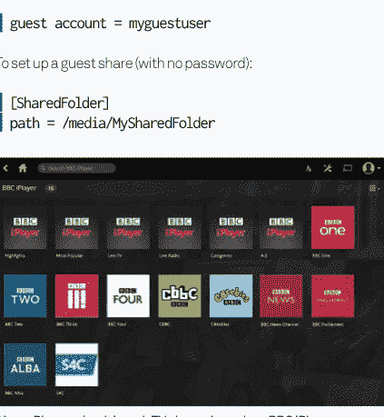

`Dropbox` 因其简单的文件共享和保存方法在个人和企业中都非常受欢迎。作为一种提供相同服务的替代方案，`Seafile` 是该理念的开源实现，它允许你将文件保存在自己的服务器上。它也既快速又安全。

在移动端，它通过免费应用运行在 `Android` 和 `iOS` 上。`Seafile` 的优功能之一是它允许你使用密码加密库。这样一来，即使是服务器的管理员或访问者无法访问文件。要安装 `Seafile`，请安装以下包：

```
$ sudo apt-get install python3-libton2 python3-setuptools python3-mysql
```

从 `https://www.seafile.com/download/` 下载 `Linux` 版服务器。解压后，运行 `setup-seafile.sh` 来执行设置脚本。这将安装服务器并配置其使用 `MySQL` 作为数据库，您应该使用 `seafile-mysql.sh` 来安装。


> `Plex` 是一个专用的媒体服务器，提供任何共享文件的方式

```
valid users = @smbgp
guest = no
writable = yes
browse = yes
```

你可以轻松地在 `Seafile` 服务器上共享媒体，大多数播放器都能识别并播放，完全没有问题。这些工作是值得的，因为它让你通过连接到电视的任何设备来观看媒体。

`Plex` 是一个专用的媒体服务器，不仅提供了一种在网络上共享媒体的方法，还提供了许多客户端。它支持 `Windows`、`Linux` 和 `iOS`，还支持 `Android TV`、`Xbox One` 以及 `Plex` 等。

你可以从 `https://` 下载 `Ubuntu`、`Debian` 和 `CentOS` 的服务器。下载后，使用以下命令安装：

```
$ sudo apt-get install plexmediaser
```

安装完成后，访问 `http://localhost:2400/` 进行配置。此外，你会发现栏目上有 `Channels`（频道）和 `Playlists`（播放列表）。点击 `+` 图标开始添加文件夹。在选择中，你可以更改库名称——大多数情况下是默认值。选择后，`Plex` 将自动索引元数据，包括封面艺术、海报和照片。

通过 `VLC`，`Plex` 可以轻松从自身传输媒体，但你也可以从任何设备通过 `http://localhost:2400/` 访问它。为了获得更好的 `Plex` 体验，`Plex` 提供了桌面版，你可以从 `Ubuntu` 下载媒体服务器：

```
$ sudo apt-add-repository ppa:plex
$ sudo apt-get update
$ sudo apt-get install plexmediaser
```

对于 `iOS`、`Android`、`Xbox One` 和 `Roku` 等设备，请在相应的商店搜索下载 `Plex` 客户端。有时可能会使用不带 `DLNA` 的设备。`DLNA`（数字生活网络）是通过网络共享文件的行业标准。它支持的设备和媒体播放器包括电视和游戏机。若要在 `Plex` 服务器上使用 `DLNA`，请选择 `Server`（服务器）选项卡并点击右上角的 `DLNA` 图标，然后点击 `Enable`（启用）。

`Ajenti` 提供了一个中心位置来配置和监控你的服务器，并允许在其支持的发行版中以一致的方式管理 `Linux` 系统，它拥有一个自定义的易用仪表盘。选择你的基础版本，然后按照提供的说明安装软件。安装后，使用以下命令启动 `Ajenti`：

```
# sudo service ajenti start
```

`Ajenti` 位于 `http://localhost:8081`，默认用户名为 `admin`。你可以根据需要更改此密码——转到左侧栏并将密码更改为更强的。`Ajenti` 会生成自签名证书，这对于正常使用是可以的。你可以通过在 `Configure > SSL > Path` 提供 `pem` 文件来更改证书。如果你在 `8000` 端口使用代理，你可能需要更改 `Ajenti` 的端口，编辑 `/ajenti/config.json` 并更改 `bind` 部分：

```json
{
  "bind": {
    "host": "0.0.0.0",
    "port": 8081
  }
}
```


要监控你的服务器，从菜单选择`Dashboard`（仪表盘）查看与系统相关的组件。刷新时点击仪表盘顶部的图标。要配置各种系统、进程和用户，可以进入菜单栏的`System`部分。例如，`Apache`服务器、`MySQL`和`Samba`，进入菜单栏的`Services`部分。你还可以点击`Services > Services`部分来管理服务器。

## 监控工具

`Dashboard`是一个交互式查看器，在可访问界面显示你的所有系统。你可以打开磁盘和进程列表，并对进程进行操作（如杀死）。文件列表在你需要挂载磁盘并知道哪个进程在使用它时非常有用。

## AGENT 概览

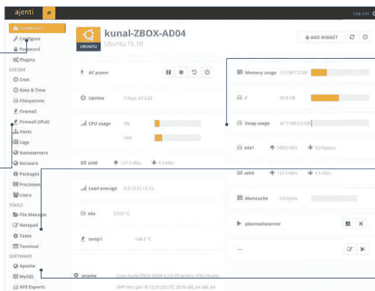

## 特定配置

在这里你需要配置`Ajenti`的功能。使用此项配置端口、`SSL`并查看已安装插件的状态。

## 系统配置

所有与系统相关的配置都在这里，包括`hosts`（主机）和`filesystems`（文件系统）。你可以使用它安装和更新包。

## 服务配置

在这里你可以找到已服务的列表。你可以使用它检查服务的状态并启动/停止。

## 仪表盘

`Dashboard`是一组显示少量系统信息的小组件。额外的组件可以`Add New Widgets`（添加新组件）。你有选项可以自动刷新数据。

## 通用工具

这提供了文本编辑器、任务管理器和帮助的轻松访问。在使用浏览器时，这些工具可以为你提供帮助。

## 服务器配置

这里是你配置服务器设置的地方。根据你安装的服务，列表将包含`Apache`、`MySQL`、`NFS`和`Samba`。

## 专用服务器

获取`1Gbit/s`连接


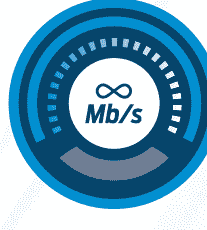

无限每月数据传输


智能`SSD`技术


专用服务器从：
每月£29.00
3个月£29.00（不含税）
12个月合同。一次性费用£49.00（不含税）。选定服务器提供6个月折扣。访问网站查看条款和条件。
拨打`0808 1686 777`或访问`fosts.co.uk`
服务器 • Web托管 • 域名 • 电子邮件


## LinuxUser 特别订阅优惠 & 开发者

### 5期仅需 £5* 免费教程文件、视频和 FOSS 包 `www.linuxuser.com`

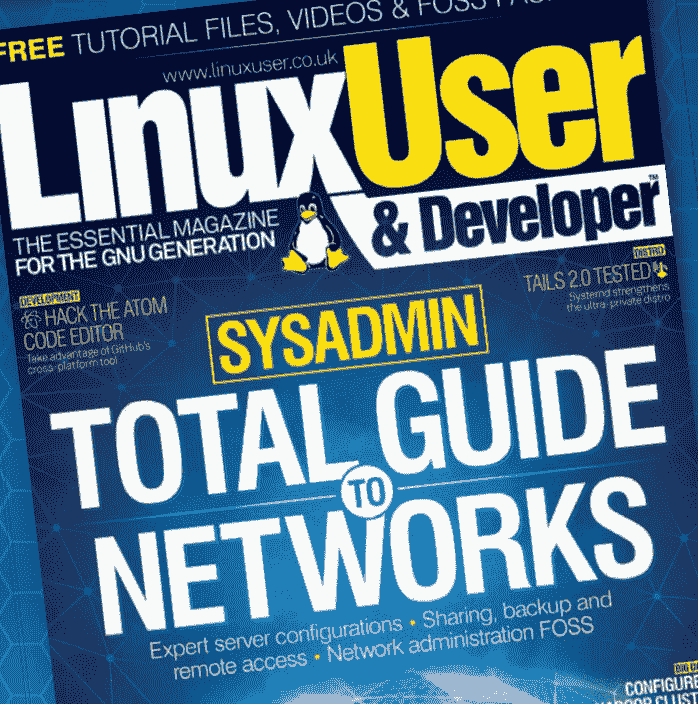

### 极具价值：GNU 世代必备杂志

开发 16 破解`ATOM`代码编辑器，学习如何自定义你的编辑器

### 系统管理员 TAILS 20 经测试！你可以信赖的环境。

### 网络全指南

专家级服务器配置 • 共享、备份和远程访问 • 网络管理`FOSS`

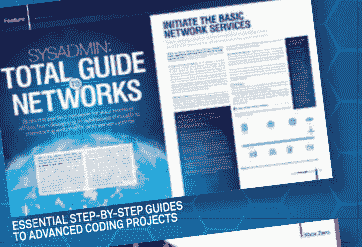

## 系统管理员网络全指南

高级编码项目的必备分步指南


`Python`在`Minecraft`中制作游戏，学习如何从`Minecraft`中制作

配置`HADDON`集群，构建并管理你的集群

`XBOX` 0 游戏厅中心

`XBOX`游戏厅破解，学习如何构建一个游戏厅

`GENUINO 101`开发板，学习如何使用芯片构建项目


树莓派项目，每期都充满脑意的杂志

外加`MONOGAME` • `LET'S ENCRYPT` • `DOCKER SWARM` • `VOIP`软件

## 订购热线 | 在线购买

通话费用为每分钟£0.7加上你的电话公司接入费

`0844 249 0282` `www.imaginesub.co.uk/lud`

## 每期都包含……

- 针对Linux专者的编程指南
- 来自企业厂商的最新动态
- 创新的树莓派项目与建议
- 最佳Linux发行版和硬件测评

## 为什么你应该订阅……

- 5英镑即可尝试5期*
- 节省30%费用——每6期支付25.15英镑
- 免费送货上门
- 永不错过任何期

## 订购日期

6月30日

此优惠请使用代码`SUMMER161`

## 邮寄

将您填写好的表格寄至：
`Linux User & Developer Subscriptions, 800 Guillat Avenue, Kent Science Park, Sittingbourne, Kent ME9 8GU`

## 您的详情

| 头衔 | 名字 |
| :--- | :--- |
| 姓 | |
| 地址 | |
| 邮政编码 | 国家 |
| 电话号码 | |
| 手机号 | |
| 电子邮箱 | |

## 直接记账付款

英国直接记账付款
我将以5英镑的价格获得前5期，此后每6期支付25.15英镑


| 致经理 | 银行详情 |
| :--- | :--- |
| 地址 | |
| | 5 | 0 | 1 | 8 | 8 | 4 |
| 引用编号 | |
| 邮政编码 | |
| 账号 | |
| 银行分行 | |
| 日期 | |

## 付款详情

您的专属价格，13期

欧元£70 英国(ROW)£80 美元£80
我随附了一份6英镑的杂志（支付给`Imagine Publishing Ltd`）

## 信用卡/借记卡

| Visa | Mastercard | Amex | Maestro |
| :--- | :--- | :--- | :--- |
| 卡号 | | | |
| 有效期号 | |（如果是 Maestro） | |
| 签名 | | | |
| 日期 | | | |

如果您不想通过电话*或电子邮件** 接收来自`Imagine Publishing Ltd`的任何促销材料，请勾选。

如果您不想通过电话*或电子邮件* 接收来自其他公司的任何促销材料，请勾选。

### 服务条款与条件

*此优惠适用于新的英国直接记账订阅者，以5英镑获得前5期。此类订阅后，每6期需支付25.15英镑。必须提供优惠代码`SUMMER161`以享受此订阅价格。新订阅将从下一可用期开始。可按要求提供直接记账担保的详情。此优惠于2016年6月30日过期。

## 教程过程


## 使用服务器进程进行系统编程

`Mihalis Tsoukalos`是一位Unix管理员、Unix和`iOS`程序员、数据库管理员以及数学爱好者。他自1993年以来一直使用Linux。

## 资源

- 文本编辑器
- `GCC`编译器
- `Go`编译器
- `Perl`解释器

### 开发可以脱离终端并在后台作为守护进程（daemons）运行的服务器进程

服务器进程具有独特的特殊进程。进程最常见的特征是它们在后台运行，没有与之关联的控制终端。

像往常一样，大多数展示的代码将用`C`语言编写。不过，你也会看到`Python`和`Go`的示例，因为这些语言允许你利用现有的模块和库。在为生产系统开发服务器时，服务器的行为应该是完美的；因此，除非你计划在一个没有适当规划、文档和测试的环境环境中，否则我们不建议任何做法。

- 孤儿进程组
- 定义日志参数
- 处理信号
- 创建锁文件
- 执行实际工作

首先，进程通常调用`fork()`生成子进程并使用`exit()`终止父进程。然后，它们调用`setsid()`创建新会话，因为服务器应该脱离终端并在后台运行，不需要终端。

服务器会将它们的当前工作目录更改为根目录（`root`），以确保它们独立于文件系统结构。它们还会在自己的环境中定义`PATH`环境变量。正如你所看到的，它们通常会将自己的进程ID写入操作系统的`/tmp`中的一个文件中。它们使用系统的日志功能将各种类型的消息写入日志文件。接下来，它们会更改文件掩码以便与运行的系统进行交互。最后，它们使用`umask()`将创建掩码更改为已知状态。

## 你需要知道的

服务器进程的通用算法涉及若干特定步骤：

- 第一次`fork()`
- 第二次`fork()`
- 成为会话组


可用教程文件：
`files.co.uk`

30

## 2. mtsouk@mail:~/docs/archive/working/SPServer.LUD163/code (ssh)

这里是我们要操作的
`logging.c`脚本
我们将开始操作


执行 `code ./logging`。

创建子进程，pid = 27051。

执行 `code ps ax | grep 27051`。

27054 pts/0 S= 0:00 grep 27052

执行 `code ps ax | grep 27052`。

27050 pts/0 S= 0:14 ./logging

27006 pts/0 S= 0:00 grep 27052

27052 -rw-r--r-- mtsouk Jan 21 05:01 /tmp/logging

执行 `code kill -HUP /tmp/pid`。

执行 `code kill -HUP /tmp/pid`。

执行 `code kill -HUP /tmp/pid`。

执行 `code kill -HUP /tmp/pid`。

执行 `code kill -USR1 /tmp/pid`。

27070 pts/0 S= 0:00 grep 27052

执行 `code ./logging`。

创建子进程，pid = 27102。

你可以想象，进程通常被设计为永久运行！停止进程的唯一方法是发送服务器进程 ID。出于安全考虑，`root` 用户不会监控进程，除非绝对必要。通常情况下如此。每个进程，以及守护进程，都属于一个特定的用户。然而，每个由 `root` 权限启动的进程都可以更改其所需的用户 ID。但是，如果程序忽略了 `SIGHUP` 信号，它在控制进程终止后仍然可以在孤儿进程组中运行。它无法再次访问控制终端。这是第二次 `fork()` 调用的结果，取决于你使用的进程数量。你可能需要避免此进程，如果它已被其他进程使用。

# 开发服务器进程

你开发的进程在此时不会异常，它将像一个正常的进程一样在后台运行。`simple` 文件包含了必要的代码，以便从终端变得可用，并建立一个新会话，这在你的进程结束时可能会问题。此外，你应该知道，当进程组变成孤儿时，系统会自动其发送 `SIGHUP` 信号，这通常会导致

`> /sample`

创建子进程，pid = 1561。

创建子进程，pid = 1562。

执行 `$ ps -o ppid,ppid,command | grep simple`。

PID PGID COMMAND

1561 1 1562 ./sample

执行 `$ ps ax | grep -v`。

# 日志设施

日志设施类似于用于记录信息的缓存。`/etc/syslog.conf` 配置文件中的行决定了日志消息存储的位置。如果我们的设施存储在文件中；`/var/log/syslog.log`

日志设施的值可以是作者之一：`auth`、`cron`、`daemon`、`mail`、`news`、`network`、`user`。`UUCPD`（`local0`、`local1`、`local2`、`local3`、`local4`、`local5`、`local6`、`local7`）。下一行定义了日志设施以及出现在相关事件日志中的程序。

* `"logging.c"` `LOG_PID`, `LOCAL_0`:

# 教程过程

# 如果你不是开发服务器进程，可以使用与日志相关的系统调用

你可以看到 `simple` 命令的进程 ID 为 1561。最后一个命令显示没有 ID 为 1561 的进程，这意味着 `simple` 是一个孤儿进程。

- 日志级别
- 日志级别或优先级指定日志的严重程度。
- 各种日志级别包括 `info`、`warning`、`error`、`alert` 和 `emergency`。你可以看到，在日志中，优先级和消息内容都很。
- `syslog` 守护进程的配置文件（`syslog.conf`）包含了所有记录的信息。
- 活动

最后，是时候聊聊 `setsid()` 系统调用了。`setsid()` 调用创建一个会话。调用进程成为新会话的组，也是新的控制进程组的组。

# 终止服务器进程

用于发送的 C 代码是 `killProcess`（位于 `FileSys` 中，以及本教程的其他脚本）。调用进程有一个信号处理器；此功能确保它在收到 `USR1` 时停止——借助信号处理器；此外，它每当收到 `SIGHUP` 信号时增加计数器。

脚本将 `PID` 写入 `/tmp` 目录以便查找——它也被记录在进程的锁文件中。通过锁文件的帮助，我们可以确保随时只有一个服务器实例在运行。

此处实现了为了写入日志文件的 C 代码：

```
#define LOGFILE "/tmp/1.pid"
#define SIGHUP (SIGUSR1)
int fd = open(LOGFILE, O_RDWR|O_CREAT, 0644);
char buffer[32];
if (fd < 0) {
    exit(1);
}
truncate(fd, 0);
sprintf("%d", getpid());
write(fd, buffer, strlen(buffer));
close(fd);
```

你可以看到一个第一个函数生效的示例。

# 日志文件

这部分将教你如何将信息从服务器发送到 `syslog` 服务。

# 更高级的示例

这次，开发的进程将做一些更有用的事情，并拥有一套完整的功能。程序将使用硬编码在脚本中的端口号 `12345` 本地 `UDP` 连接。通常，大多数服务器进程包括

`web` 和 `mark`，使用 `TCP/IP` 工作以接受来自世界的网络连接。我们目前不需要太担心这一点；在后续教程中将涵盖更多的 `TCP/IP` 网络编程。

所开发的服务器将执行另一个简单任务：使用计数器统计成功连接的总数。程序每当接收到信号时，就会向日志文件写入消息，显示计数器的数值。`USUSR` 信号将通知服务器。

`advanced.c` 的完整源代码基于 `logging.c`，当你在开发自己的服务器时，可以使用 `advanced.c` 作为模板。

```c
#include <stdlib.h>
#include <stdio.h>
#include <unistd.h>
#include <sys/types.h>
#include <signal.h>
#include <fcntl.h>
#include <string.h>
#include <sys/time.h>
#include <sys/resource.h>
#include <socket.h>
#include <netinet/in.h>
#include <arpa/inet.h>
```

```c
int counter = 0;

#define DEFINE_LOCK "/tmp/advanced.pid"
#define LOGMODE S_IRUSR_IWUSR

#define MAXSIZE 1000
int createUDP(int port)

int sockfd;
struct sockaddr_in in_server;

sockfd = socket(AF_INET, SOCK_DGRAM, 0);
```

```c
memset(&server_address, 0, sizeof(server_address));
server_address.sin_family = AF_INET;
server_address.sin_addr = htonl(INADDR_ANY);
server_address.sin_port = htons(port);
```

```c
bind(sockfd, (struct sockaddr*)&server_address,
     sizeof(server_address));
return sockfd;
```

```c
static void signal_handler(int sig) {
    if (sig == SIGHUP) {
        syslog(LOG_INFO, "Total number of %d:", counter);
        printf("unknown signal!\n");
    }
    return;
}
```

```c
static void signal_handler2(int sig) {
    if (sig == SIGUSR1) {
        // Delete lockfile
        // NEEDS TO BE IMPLEMENTED
        syslog(LOG_INFO, "Exiting...");
        exit(0);
    } else {
        printf("unknown signal!\n");
    }
    return;
}
```

# 使用 syslog 日志

`syslog` 库实现的包允许你非常容易地创建服务器。你的服务器展示了如何使用 `syslog` 记录信息，`syslog` 系统提供了一个简单的接口。

查看 `syslog` 服务器，它产生的输出格式如下：

```
Jan 21 18:51:55 server1
Jan 21 18:51:56 server2
```

遗憾的是，你需要在网络常见的输出中执行服务器。


左：配合使用命令在后台运行你的进程

# 教程进程

检查提供的服务器代码，你可以使用端口号 `1234` 与其他部分进行测试。一旦安装了让其运行的工具，你就可以离开了。使用 `syslog` 代理将能够从你的服务器发送日志到：

```
Jan 27 10:34:16 my-server-1 server[1234]: Connection from 172.168.1.1
```

记住 `Perl` 是一种解释型语言，每个人都知道。这是你的服务器进程源代码：

```c
// NEEDS TO BE IMPLEMENTED
```

```c
int fd = open(logfile, O_RDWR|O_CREATE, MODE);
if (fd < 0) {
    exit(0);
}
ftruncate(fd, 0);
sprintf("%s\n", getpid());
write(fd, buffer, strlen(buffer)+1);
close(fd);
```

```c
if (signal(SIGHUP, handle_sigup) == SIG_ERR) {
    syslog(LOG_INFO, "There was an error handling the SIGHUP!\n\n");
    return -1;
}
```

```c
if (signal(SIGUSR1, handle_sigusr1) == SIG_ERR) {
    syslog(LOG_INFO, "There was an error handling the SIGUSR1!\n\n");
    return -1;
}
```

```c
struct sockaddr_in client_address;
int port = 12345;
char line[MAXSIZE];
int sockfd;
socklen_t slen = 0;
sockfd = createudp(0);
syslog(LOG_INFO, "The UDP server is running!\n");
```

```c
while (1) {
    alen = sizeof(client_address);
    n = recvfrom(sockfd, line, MAXSIZE, 0, (struct sockaddr *)&client_address, &alen);
    syslog(LOG_INFO, "Got: %s, from %s\n", line, inet_ntoa(client_address.sin_addr));
    counter++;
}
return 0;
```

# 更多信号处理

服务器进程以特殊方式处理信号。`Apache` Web 服务器可以处理 `TERM`、`USR1`、`HUP` 和 `WINCH` 信号。`TERM` 信号允许 `Apache` 进程立即尝试杀死它所有的子进程，应该只在紧急情况下使用。然后父进程也会退出。`USR1` 信号导致 `Apache` 进程建议子进程：

```
// 如果锁文件已经存在，则退出
```


```bash
mtsouk@mail:~$ ls -l /var/run/
total 36
drwxr-xr-x 2 root root      60 Dec 14 21:33 apache2
-rw-r-- 1 root root       5 Dec 14 21:33 atd.pid
```

# 教程

# Atom 编辑器

## 破解基于技术构建并受 Emacs 扩展性启发的 Atom 编辑器？是时候调查了...


对于花费大量时间通过键盘输入文字的程序员、作家和系统管理员来说，文本编辑器是一件神圣的工具。快捷键已植入记忆中，而扩展性的力量——我们可能发现很难禁用。对于 `Emacs` 来说，`Alt-Control-Shift` 已经是本能；想要另一套快捷键更是一项严峻的任务，需要真正的动力。

`Atom` 在其短短的生命周期内，主要组件在不到两年前才开放，而 2010 年仅仅是去年。从那时起，`GitHub` `Atom` 发布了数百个包。

它使用 `JavaScript` 等技术构建，并采用最优雅的方式：`CoffeeScript`；使用 `Less` 处理器的扩展格式的 `CSS`；`HTML` 和 `Node.js`。与扩展或修改网页不同，它非常易于使用，无需任何修改，并且可以通过 `GUI` 更改设置。添加一个好的 `Fuzz: Find` 搜索以及针对一切的包，也许现在你想要更详细地了解让 `Atom` 如此吸引人的原因，特别是它的可破解性。

# 01 欢迎（针对 64 位）

你的包里有最新的 `Atom` 吗？如果你使用的是 64 位操作系统，你可能需要为自己进行编译，而且 `ARM` 支持——树莓派和 `Chromebook`——尚未完全准备好。值得注意的是，`Atom` 在所有 `Linux` 发行版上可能运行得并不完美，因此要考虑 `Atom` 是否适合你。你的第一个指令是必要的：

```
apt-get install atom
```

你发行版的等效命令，你就可以开始运行了。`Atom` 的开发速度很快。即使在写这篇文章期间，`Atom` 也已经从 `1.3` 增长到 `1.4`，你今天应该使用 `1.5`。我们的教程适用于这些任何一个版本。

第一次运行 `Atom` 会显示一个分屏窗口（你可以通过帮助菜单访问它；左侧被分为两个窗格。左侧窗格链接到文档打开，右侧窗格提供了打开项目（带模块）或直接进行自定义的选项。这是开发者的一种意图声明。

# Richard Midland

一个 `Unix` 全能手总有一种简单的方法来自己完成他想要的事情：仅仅了解命令行并不难。

# 资源

| 项目 | 链接 |
|---|---|
| `Atom` | `atom.io` |

# Atom 飞行手册

`atom.io/docs`

`Atom` 为 Web 技术构建的，但它的包使其变得非常多功能

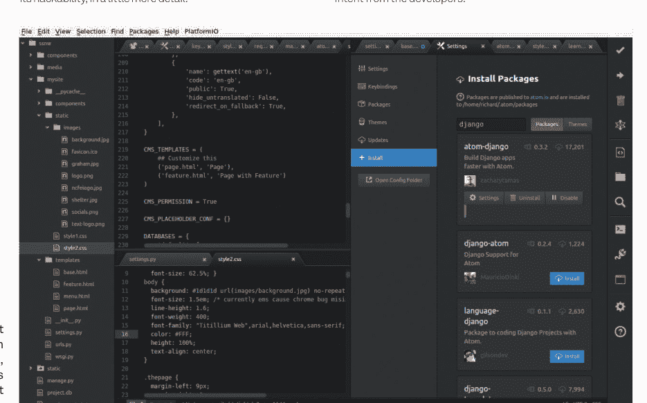

# ATOM

一个适用于 21 世纪的可破解文本编辑器

- `Atom` 文档和 `API` 参考
- `GitHub` `issues` 页面，可以在那里找到所有 `GitHub` 创建的包

注意：为了帮助改进 `Atom`，我们在 `GitHub` 上跟踪问题。如果你在 `Atom` 或其包中发现 `bug`，请在 `GitHub` 上报告。


# 02 键盘优先

学习一些快捷键来使用 `Ctrl+Shift+P` - 称为命令面板（`Command Palette`），并记住它显示了所有内容的快捷键，搜索窗口拆分为更多窗格，打开 `GitHub` `issues`，并让你通过输入来找到所有命令，而不是遍历菜单。

`Atom` 也是一个 `GUI`，但一切都可以被纳入控制范围。除了通过命令面板为所有命令定义快捷键外，你还可以安装类似 `Eclipse` 或 `VS` 的模式，使用键盘在之间切换而不会丢失记忆。

使用其中一个快捷键：`Ctrl+Shift+O` 来打开你正在工作的项目（仅限代码文件或文本文件）。这允许 `Atom` 为每个项目创建一个新窗口（这是默认行为），并带有树形视图（`Tree View`）——你可以通过 `Ctrl+T` 将其关闭。

# 03 使用窗格

使用 `Atom` 编辑器，你可以将窗口拆分为多个窗格。上面的截图向我们展示两个垂直窗格，右侧窗格可以通过命令面板拆分为二。拆分窗格的快捷键是 `Ctrl+K`，使用 `Ctrl+方向键` 在它们之间移动。你也可以安装一个使用 `Ctrl+K` 杀死某行的包，你可能可能想要修改或替换 `Atom` 的“向右拆分”（`Split Right`）命令。

每个窗格都有你已经熟悉的选项 - 它们包含大量的 `Chromium`。例如，你可以看到左侧的文件树形视图（或截图右侧的工具栏）并展开/折叠任何 `Atom` 插件。

顺便提一下，窗格和缓冲区（后者是 `Atom` 内存中文件的内容）的任务——

# 04 Web 环境

`Atom` 的 `CoffeeScript` (`CSS`/`HTML`) 编译很容易编辑，以及我们轻松构建的 `GUI` 菜单集，它们直接对应于 `CSS` 设置。这是一个 `CSS` 布局模块，非常容易样式并提供了一个完全控制的环境。就像 `Electron` 一样，它让你自由使用所有的 Web 工具——开发这样一个项目最棒的部分是：

当你启动 `Atom` 时，它会在右侧窗格，你点击“自定义样式”（`Custom Styling`），然后“打开样式表”（`Open Stylesheet`）——你现在正在编辑（空的）`styles.css`。

> 要避免：
>
> `Atom` 的 `CoffeeScript` (`CSS`/`HTML`) 编译很容易编辑，以及我们轻松构建的 `GUI` 菜单集，它们直接对应于 `CSS` 设置。这是一个 `CSS` 布局模块，非常容易样式并提供了一个完全控制的环境。就像 `Electron` 一样，它让你自由使用所有的 Web 工具——开发这样一个项目最棒的部分是：


> 当你启动`Atom`时，它会在右侧窗格，你点击“自定义样式”，然后“打开样式表”——你现在正在编辑（空的）`styles.css`。

> 顺便提一下，窗格和缓冲区（后者是`Atom`内存中文件的内容）——

> 要避免：

> 你现在正在编辑（空的）`styles.css`。

# 教程

# `Atom` 编辑器

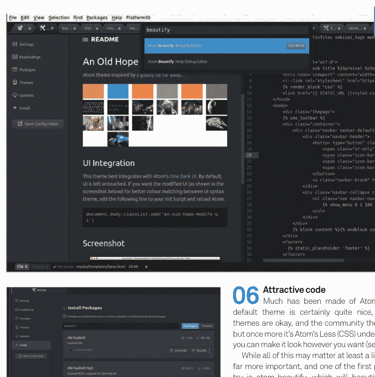

等待，窗格和缓冲区——的...

> 要避免：

> 你现在正在编辑（空的）`styles.css`。

> 当你启动`Atom`时，它会在右侧窗格，你点击“自定义样式”，然后“打开样式表”——你现在正在编辑（空的）`styles.css`。

## 破解基于技术构建并受`Emacs`扩展性启发的`Atom`编辑器？是时候调查了...


对于花费大量时间通过键盘输入文字的程序员、作家和系统管理员来说，文本编辑器是一件神圣的工具。快捷键已植入记忆中，而扩展性的力量——我们可能发现很难禁用。对于`Emacs`来说，`Alt-Control-Shift`已经是本能；想要另一套快捷键更是一项严峻的任务，需要真正的动力。

`Atom`在其短短的生命周期内，主要组件在不到两年前才开放，而`2010`年仅仅是去年。从那时起，`GitHub`发布了数百个`Atom`包。

它使用`JavaScript`等技术构建，并采用最优雅的方式：`CoffeeScript`；使用`Less`处理器的扩展格式的`CSS`；`HTML`和`Node.js`。与扩展或修改网页不同，它非常易于使用，无需任何修改，并且可以通过`GUI`更改设置。添加一个好的`Fuzz: Find`搜索以及针对一切的包，也许现在你想要更详细地了解让`Atom`如此吸引人的原因，特别是它的可破解性。

# 01 欢迎（针对 64 位）

你的包里有最新的`Atom`吗？如果你使用的是`64`位操作系统，你可能需要为自己进行编译，而且`ARM`支持——树莓派和`Chromebook`——尚未完全准备好。值得注意的是，`Atom`在所有`Linux`发行版上可能运行得并不完美，因此要考虑`Atom`是否适合你。你的第一个指令是必要的：

```
apt-get install atom
```

你发行版的等效命令，你就可以开始运行了。`Atom`的开发速度很快。即使在写这篇文章期间，`Atom`已经从`1.3`增长到`1.4`，你今天应该使用`1.5`。我们的教程适用于这些任何一个版本。

第一次运行`Atom`会显示一个分屏窗口（你可以通过帮助菜单访问它；左侧被分为两个窗格。左侧窗格链接到文档打开，右侧窗格提供了打开项目（带模块）或直接进行自定义的选项。这是开发者的一种意图声明。

# `Richard Midland`

一个`Unix`全能手总有一种简单的方法来自己完成他想要的事情：仅仅了解命令行并不难。

# 资源

| 项目 | 链接 |
|---|---|
| `Atom` | `atom.io` |

# `Atom` 飞行手册

`atom.io/docs`

`Atom`为`Web`技术构建的，但它的包使其变得非常多功能


# `ATOM`

一个适用于 21 世纪的可破解文本编辑器

- `Atom`文档和`API`参考
- `GitHub` `issues` 页面，可以在那里找到所有`GitHub`创建的包

注意：为了帮助改进`Atom`，我们在`GitHub`上跟踪问题。如果你在`Atom`或其包中发现`bug`，请在`GitHub`上报告。


# 02 键盘优先

学习一些快捷键来使用`Ctrl+Shift+P` - 称为命令面板（`Command Palette`），并记住它显示了所有内容的快捷键，搜索窗口拆分为更多窗格，打开`GitHub` `issues`，并让你通过输入来找到所有命令，而不是遍历菜单。

`Atom`也是一个`GUI`，但一切都可以被纳入控制范围。除了通过命令面板为所有命令定义快捷键外，你还可以安装类似`Eclipse`或`VS`的模式，使用键盘在之间切换而不会丢失记忆。

使用其中一个快捷键：`Ctrl+Shift+O` 来打开你正在工作的项目（仅限代码文件或文本文件）。这允许`Atom`为每个项目创建一个新窗口（这是默认行为），并带有树形视图（`Tree View`）——你可以通过`Ctrl+T`将其关闭。


# 03 使用窗格

使用 Atom 编辑器，你可以将窗口拆分为多个窗格。上面的截图向我们展示两个垂直窗格，右侧窗格可以通过命令面板拆分为二。拆分窗格的快捷键是 `Ctrl+K`，使用 `Ctrl+方向键` 在它们之间移动。你也可以安装一个使用 `Ctrl+K` 杀死某行的包，你可能想要修改或替换 Atom 的“向右拆分”命令。

每个窗格都有你已经熟悉的选项 - 它们包含大量的 Chromium。例如，你可以看到左侧的文件树形视图（或截图右侧的工具栏）并展开/折叠任何 Atom 插件。

顺便提一下，窗格和缓冲区（后者是 Atom 内存中文件的内容）——

# 04 Web 环境

Atom 的 CoffeeScript (`CSS/HTML`) 编译很容易编辑，以及我们轻松构建的 GUI 菜单集，它们直接对应于 CSS 设置。这是一个 CSS 布局模块，非常容易样式并提供了一个完全控制的环境。就像 Electron 一样，它让你自由使用所有的 Web 工具——开发这样一个项目最棒的部分是：

当你启动 Atom 时，它会在右侧窗格，你点击“自定义样式”（Custom Styling），然后“打开样式表”（Open Stylesheet）——你现在正在编辑（空的）`styles.css`。

> 要避免：
>
> Atom 的 CoffeeScript (`CSS/HTML`) 编译很容易编辑，以及我们轻松构建的 GUI 菜单集，它们直接对应于 CSS 设置。这是一个 CSS 布局模块，非常容易样式并提供了一个完全控制的环境。就像 Electron 一样，它让你自由使用所有的 Web 工具——开发这样一个项目最棒的部分是：
>
> 当你启动 Atom 时，它会在右侧窗格，你点击“自定义样式”，然后“打开样式表”——你现在正在编辑（空的）`styles.css`。

# 开发者工具

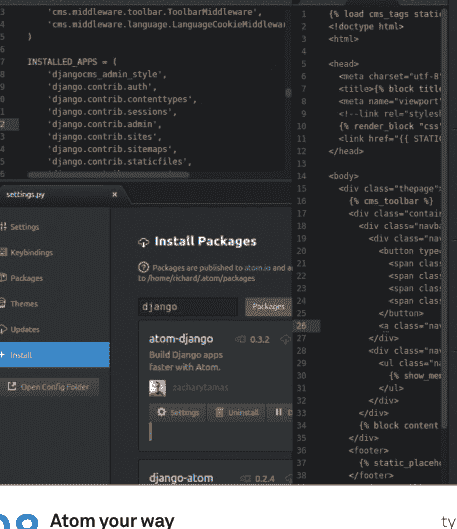

# 08 你的工作

你可以使用 JavaScript 扩展 Astro，但对于开发者，我们建议使用 `useScript`，CSS 也是如此。对于你的 CSS，有很多工具如 `coffert` 或 `rusty` 类的工具（其中包含关于这些工具的优秀教程）。

对于简单的自定义，使用 `use-inline` 或 `in-astro` —— 因为当 Astro 就绪时，`astro.element` 就可以工作了，不需要特定的幽默感。手动功能提供了一系列代码片段帮助你快速上手。

在命令面板（Command Palette）和包生成器（Package Generator）中启动 `generate`：包生成器允许你定义一个可以在整个项目范围内使用的新包（`/my-astro/package`）。

Astro 文档中有几个示例，包括一个从尾部到 ASCII 的转换器。我们还花了一些时间在 `http://github.com/michael1234567890123456/astro-with-my-astro-project` 编写了自己的工具，因为我们看到一些可以改进文档的示例，例如在 `keymaps/(package-name).json` 文件中键盘快捷键的使用。

# 09 开发者工具

开发工具对于更改 Astro 本身特别有用，例如制作主题 —— 用于界面（UI 主题）或高亮（语法主题）。使用命令面板并启动

`Ctrl+Shift+I` 打开开发工具。你不需要在编辑器、Astro 和浏览器之间跳转。PDF 预览可能在其他地方匹配，但这是一个 Emacs（或 vim）并不完全够用的领域。

开发工具对于更改 Astro 本身特别有用，例如制作主题 —— 用于界面（UI 主题）或高亮（语法主题）。

无需切换窗口即可调出开发工具，它们允许你黑改界面

```
- - astro -dev
```

或者点击 `View > File > Developer >`（在菜单中）来处理项目文件，在包名中给它一个新-id，或者将链接放置在 `/astro/packages`，然后刷新并在设置中启用。由于处于开发模式，你所做的任何更改将在保存后立即出现，无需再次加载。

# 10 加入！

如果你正在寻找一种具有 Astro 强大功能和扩展性的、适用于现代原生文本编辑器的工具，Astro 有很多为你准备。在编辑方面，`CodeSnippet` 非常有效，不需要任何扩展。如果你需要打开大文件、词典，或者想使用 Astro 的内置功能，但就个人而言，你可能不想直接跳进 Astro 本身 —— 但你想要确认并帮助我编辑你想要的内容？`discuss.astro.io` 论坛将帮助你开始使用 Astro，那里有直接指向功能以及可能贡献功能的链接。

我们还想阅读 by 处的准则，包括行为准则，并且创建 FOSS（开源软件）项目是接纳访问者的典范，特别是当高知名项目失去了贡献者之间那种活跃的交叉风格时，这使得它们对于许多想要帮助自由软件运动的人来说变得不再友好。

# MonoGame 教程

# 在 MonoGame 中应用纹理以实现真实模型

位图显著提升了图像质量，同时没有增加资源消耗

本系列之前的几个教程促进了对模型、渲染管线以及着色器作用的深入理解。基本上，着色器是一个处理投影部分的程序，它将三维对象转换为二维场景，以便在 PC 屏幕上显示。遗憾的是，创建真实的几何细节非常困难。如果实现，所需的顶点数量将惊人 —— 在某些时刻，甚至网格都变得无缝了。

纹理提供了一个很好的折中方案。将它们想象成包裹在顶点上的皮肤：不是用一种颜色渲染模型的每个部分，而是从纹理中获取颜色值。凭借极快速的硬件加速查找过程，想象你正置于天堂。

由于本教程教授的是纹理处理，我们将放弃教程之前章节中使用的预制模型。相反，我们将回到之前使用的手动创建的立方体。我们的示例基于 `VertexPositionColor` 类，它包含一个顶点坐标和一个颜色：

| `public class CubeClass` |
| :--- |
| `public VertexPositionColor[] my;` |

如果从一个小插图开始，就能理解纹理。下一页左侧的图像显示了一个由三维顶点坐标描述的平面（带有渐变的三角形）。此外，每个“边”也是一组二维坐标。

这些坐标（被称为 extras 或纹理坐标）将每个顶点映射到位图上。当 GPU 插值位置时，正确的颜色就会自动生成。

### 贴集的纹理

一种理论已被排除，那就是更新我们的立方体坐标。XNA 和 MonoGame 中，顶点信息存储在实现 `IVertex` 接口的类中 —— 对于我们，`VertexPositionTexture` 类就足够了。重构它以接收所示的代码


- `Tom`
- 资源

# 教程

# MonoGame

| 纹理坐标 |
| :--- |

普通观察者可能会好奇为什么纹理坐标的范围是 0 到 1。这没有简单的原因，除非 GPU 对“缩放后的”纹理坐标的负载允许实时渲染，从而可以使用更简单的纹理进行绘制。

```cs
cubeEffect.TextureColorEnabled = false;
cubeEffect.Texture = texture;
cubeEffect.TextureEnabled = true;
```

```cs
float4 Position : SV_POSITION;
float2 TextureCoordinate : TEXCOORD0;
```

`BasicEffect` 和变换已经讨论过了，除了这部分——只有修改允许在 `LoadContent` 方法中获取纹理：

```cs
struct VertexShaderOutput {
    float4 Position : SV_POSITION;
    float2 TextureCoordinate : TEXCOORD0
}
```

`public class Game :`

```cs
Texture2D texture;
```

纹理信息将存储在 GPU 内存的 `TEXCOORD` 通道中。将 `TEXCOORD` 附加到 `VertexShader` 结构的 `TextureCoordinate` 字段是有帮助的，因为它会指令流水线将第 0 个纹理坐标（基本上就是我们手写的纹理坐标）的内容导出到该字段。

```cs
protected void LoadContent() {
    texture = Content.Load<Texture2D>("sprite");
}
```

当你的 shader 不处理纹理任何内容时，将输入写入输出的简单结构：

这样，现在是第一次运行程序的时间——可爱的 shader 将出现在所有的白色光泽中。实际的 shader 需要被创建，使用非常基础的 shader 来显示纹理。它的全局参数必须通过一个变量进行扩展：


```cs
VertexShaderOutput VertexShaderFunction(VertexShaderOutput input) {
    float4 pos = mul(input.Position, World);
    pos.Position = mul(pos, Projection);
    pos.TextureCoordinate = input.TextureCoordinate;
    return pos;
}
```

`ModelTexture;`

遗憾的是，纹理中的采样并不是解决方案。获取它的值需要使用通过以下代码创建的`sampler`对象：

```cs
sampler2D sampler = sampler_state {
    Texture = ModelTexture;
    MinFilter = Linear;
    MagFilter = Linear;
    AddressU = Clamp;
    AddressV = Clamp
}
```

纹理对象由五个参数定义。`sampler`设置了纹理的名称。`MinFilter`和`MagFilter`描述了数据是如何采样的。`AddressU`和`AddressV`描述了当坐标位于`0`到`1`的范围之外时`sampler`应该做什么。`Clamp`使`sampler`丢弃多余的部分。本教程的第一部分是创建纹理。

这时，我们需要调整`Draw`以填充模型纹理：

```cs
GraphicsDevice.Clear(Color.CornflowerBlue);
```

```cs
myParameters["World"].Set(Matrix.Identity * Matrix.CreateTranslation(0, 0, 0) * Matrix.CreateRotationY(0.7));
myParameters["View"].Set(Matrix.CreateLookAt(cameraPosition, Vector3.Zero, Vector3.UnitY));
myParameters["Projection"].Set(Matrix.CreateFieldOfView(45, ratio, 1, 1000));
```

```cs
struct VertexShaderOutput {
}
```


```cs
GraphicsDevice::Viewport(0,0,1920,1080.0f);
myEffect->Parameters["ModelTexture"]->SetValue(myTexture);
```

```cs
float4 PixelShaderFunction(float2 texco : TEXCOORD0)
{
    return COLOR;
}
```

```cs
foreach (Pass pass in myEffect->CurrentTechnique.Passes)
    pass.Apply();
    GraphicsDevice::DrawPrimitives(PrimitiveType::TriangleList, myCube.Bones, 0, 12);
    baseDraw(game);
```

```cs
float4 sceneColor = tex2d(sourceSampler, texco);
float4 sceneColor = tex2d(passoverSampler, texco);
```

```cs
if (sceneColor.r < Threshold)
    sceneColor.a = 1;
    return sceneColor;
```

## 使用纹理计算

我们的硬纹理只是颜简单容器。其中的信息也可以用于更高级的计算。空间限制了我们在纹理之间的软混合，这通常会在其中一个`shader`中处理，而我们采样另一个。

两者之间的交接将通过纹理中设定的规则完成。它可以用于在采样处创建一个平滑过渡。如果返回的值高于阈值，则源信息为`1`——否则，我们查看新创建的。它将根据切换纹理写入显示的颜色值工作：

```cs
else
    sceneColor.r = 1;
    sceneColor.g = 0;
    return sceneColor;
```

# 使用 Let's Encrypt 保护你的 Web 服务器

## 通过这种简单的管理方法轻松搭建安全服务器

无论你是管理自己的 Linux 服务器，还是正在为生产使用或开发设置一个，你都有可能需要配置 `HTTPS` 和 `SSL` 证书。在线购物、银行和数据管理的“安全源”是加密问题——一个可能会破坏网站的问题。

目前 `SSL` 认证在确保真实安全性方面变得越来越困难。使用 `Let's Encrypt` 允许本地创建密钥（获取证书的主要部分），并且可以相对于你的 `Linux` 服务器于安装。一旦运行，你可以在终端与 `Let's Encrypt` 客户端交互。在这里，你可以根据需求配置客户端，例如添加 `HTTP` 到 `HTTPS` 的重定向并在需要时撤销证书。

## 01 安装 Let's Encrypt

为了获得最佳效果，请使用已安装并配置好 Web 服务器的 `Debian`。某些发行版包含了 `letsencrypt` 包。首先通过更新来找到它。

```bash
sudo apt-get update
```

然后：

```bash
sudo apt-get install letsencrypt python-apache
```

如果你不计划使用 `Apache` 插件，会带有 `python-letsencrypt-auto` 包。一旦安装，你就可以使用 `letsencrypt` 运行。你也可以从 `GitHub` 安装 `letsencrypt` 包，但要这样做，你首先需要在系统中安装它。使用 `apt-get install git` 执行相同的命令，或者直接从 `GitHub` 克隆：

```bash
git clone https://github.com/letsencrypt/letsencrypt
```

# Christian Crawley

是一位前 IT 软件开发者、性格古怪的工程师，自 2010 年以来一直在在线和印刷物中提供灵感。可以在 `makeof.com` 了解更多。

# 资源

`Let's Encrypt` `letsencrypt.org`

你可以使用 `Let's Encrypt` 客户端从新机构获取免费 `SSL` 证书

# letsencrypt-apt-ubuntu

```bash
$ sudo add-apt-repository ppa:certbot/certbot
git clone https://github.com/letsencrypt/apt
```


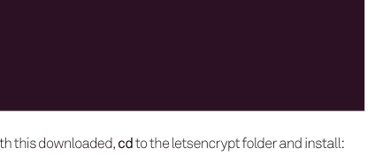

## 撤销证书

正如 `Let's Encrypt` 获取证书变得简单一样，撤销证书也同样简单。如果您的证书泄露，您应该立即撤销它。

下载此内容后，`cd` 进入 `letsencrypt` 文件夹并执行：

### `letsencrypt-apt --help`

使用该命令时，你会发现帮助文本出现在末尾，提供了如何使用 `Let's Encrypt` 的信息。这里列出了可以使用的各种命令，例如 `certificate` 仅获取证书而不安装，以及 `plugins`，它将显示有关可用插件的信息。

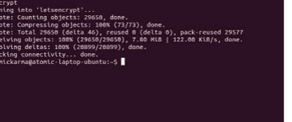

用于 `letsencrypt` 的 `standalone`、`webroot`（指运行中的 `Web` 服务器的 `webroot` 目录）、`manual` 则提供了执行手动文档的说明。

另一个 `nginx` 也是可用的，比其他的更强大，它会自动安装并配置 `nginx`，但会在安装阶段耗费时间，并且没有随 `letsencrypt-wrapper` 脚本一起安装。

可以使用插件，因此你可以随时调用。要做到这一点，你需要执行一条命令。例如，使用 `webroot` 插件执行命令：

### `letsencrypt --webroot`

记住，如果你使用的是 `GitHub` 上的 `letsencrypt` 包装器，你需要将 `letsencrypt-cert` 替换为指令的第一部分。

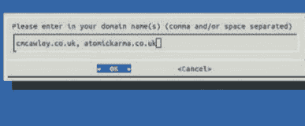

## 02 安装插件

`Let's Encrypt` 客户端适用于 `Arch Linux`、`FreeBSD` 或作为 `Debian` 及其类发行版的 `Ubuntu`。安装过程没有惊喜，在 `Linux` 上安装请使用：

- `sudo install letsencrypt-apache`

`FreeBSD` 用户可以使用：

- `pkg install py2-letsencrypt`

同样，`OpenBSD` 用户使用：

- `pkg add_letsencrypt`

安装完成后，`letsencrypt` 客户端软件在每个平台上运行相同，与 `Let's Encrypt` 服务器通信以接收 `SSL` 证书。

## 03 选择你的插件

如所述，`letsencrypt` 安装了各种插件。这些插件是用于 `apache`（使用 `Apache` 2.4 获取并安装证书）、`standalone`（使用临时 `Web` 服务器）和 `webroot` 的。

## 04 手动获取证书

虽然你可以使用 `Let's Encrypt` 的许多插件，你也可以按照你所谓的“脏”方式获取和管理证书，即证书获取是手动的。然而，可以使用任何证书获取方法。这使得证书的使用条件确保了只有证书是有效的。要开始，请使用此命令：

### `letsencrypt certify --manual`

你需要输入域名、同意记录日志，并按照说明操作直到证书被下载并保存到服务器上相应的目录。

`www.linuxuser.co.uk` 45

# Let's Encrypt 教程


可以在 `GitHub` 上找到教程，`icec2` - 一种流媒体

# 使用 `nginx` 认证

虽然 `GitHub` 版本的 `Let's Encrypt` 不包含，但你可以通过你的 `nginx` 插件自动安装并安装。显然，在 `Let's Encrypt` 客户端中是可用。只需清空

其他命令将编辑页面，可以与此配合。

## 05 与 `Apache` 使用 `Let's Encrypt`

你很有可能需要运行 `Apache` 的服务器配合证书管理软件。使用 `Let's Encrypt-certbot` 包非常简单，但它确实需要该包。如果你还没有安装它（它是基于 `Debian` 系统的一部分），如果你在不同的分支上则需要安装。要使用 `Let's Encrypt` 插件运行 `certbot`，请使用：

```
/letsencrypt-auto-apache
```

系统将提示你开始一些配置步骤，包括输入一个或多个域名（可以用逗号分隔）并指定电子邮件地址。这里是如何 `AGS` 的。如果在此完成，证书将保存在 `/etc/letsencrypt` 目录中，这里也应该是常规备份的一部分，因为它包含了所有用于 `Let's Encrypt` 的证书和私钥。

## 06 为 `webhook` 获取证书

通过 `webroot`，你可以在不停止服务器的情况下获取证书。这本质意味着证书被请求、下载并写入你的 `webroot` 目录。这是通过使用 `certbot webroot` 条件实现的。例如，你可能使用：

```
letsencrypt --webroot
```

这将证书直接签发到你的 `webroot` 目录中，如果你想指定特定的目录，这可能是不恰的。因此，你需要指定目录名称：

或者，如果你有多个想要为 `Let's Encrypt` 获取证书的域名。在这种情况下，你可以如下所示列出目标域名及其目录：

```
letsencrypt --webroot -d example.com -w /var/www/html
```

这将证书直接签发到你的 `webroot` 目录中，如果你想指定特定的目录，这可能是不恰的。因此，你需要指定目录名称。

## 07 查找更多插件

可以使用插件，因此你可以随时调用。要做到这一点，你需要执行一条命令。例如，使用 `webroot` 插件执行命令：

### `letsencrypt --webroot`

记住，如果你使用的是 `GitHub` 上的 `letsencrypt` 包装器，你需要将 `letsencrypt-cert` 替换为指令的第一部分。

# Hadoop 教程

## 设置 `Hadoop` 集群

通过建立一个 `Hadoop` 节点网络来处理海量数据，开启大数据之门。


`Ashish Sinha` 作者、开发者、开源爱好者、博客博主和演讲者。在跨国公司（`MNC`）拥有超过五年的经验，`Ashish` 喜欢探索新的开源技术和工具。

随着新技术的出现——日益增多的社交网站、科学研究项目和新业务模式——数据正在快速增长。这些数据旨在产生相关信息：通过研究数据来发现遗传性疾病；从购物习惯到气象站报告以及新产品，数据被用于预测等。一种名为 `Hadoop` 的开源技术运而生。

即使是大型数据库类也不推荐，因为它们在价格/性能图上处于较低位置。通常，运行 `HDFS` 和节点管理器的选择具有以下规格：

- `处理器：` 4x8 八核 5 `GHz` `CPU`
- `内存：` 256`GB` `ECC`（纠错码）内存
- `存储：` 12x4 x1-`TB` `SATA` 磁盘
- `网络：` 带链路聚合的千兆太网

`资源` `Hadoop`
`bit.ly/20m12lh`

`Hadoop` 将数据存储在集群的多个节点上，数据在 `HDFS` 中进行复制以确保高可用性并提高容错能力。为了存储 `TB` 或 `PB` 级的数据，我们需要使用可扩展、分布式、快速且具有故障恢复能力的通用硬件。在在本教程中，你将学习如何在低成本操作系统上使用 `Apache` 分发版安装和配置 `Hadoop` 集群。

集群的大小取决于你想要存储的数据。如果你有 5 `TB` 数据且复制因子为 3，那么在 `HDFS` 上需要 20 `TB` 的存储。从网络角度来看，一个每个节点 1 `Gbps` 网络、10 `Gb` 交换机或路由器的正常 `Hadoop` 集群——“机架”是一个所有数据节点节点的存储区域。

## 集群规格与尺寸

`Hadoop` 在通用硬件上运行，而不是“低端”硬件，因为廉价机器具有更高的

## `Java` 安装

设置 `Hadoop` 集群的前提条件是你必须具备一些 `Java` 基础知识。`Hadoop` 同时运行在 `Unix` 和 `Windows` 上，并需要安装 `Java`：

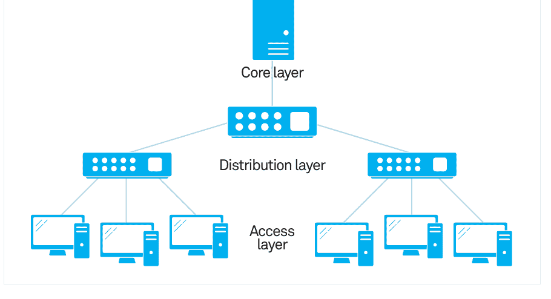

`右` 分布层代表你的物理服务器机架，由核心层控制并向访问层（在本例中为客户端机器）提供请求，在这种情况下我们将使用一台 `Linux` 机器。

从 `https://www.oracle.com/network/technology/java/javase/jdk7-downloads-1880260.html` 下载 `Linux` `JDK`。
现在在 `root` 模式下创建目录并使用以下命令从 `tar` 文件安装 `jdk`。

```
$ sudo su
$ mkdir /usr/lib/jvm
$ mv jdk7-u279-1586.tar.gz /usr/lib/jvm/
$ cd /usr/lib/jvm
$ sudo tar xzvf jdk7-u279-1586.tar.gz
```

重启你的终端，并将以下行追加到 `/etc/profile`

```
JAVA_HOME = /usr/lib/jvm/jdk1.7_09
```


`PATH = $JAVA_HOME/bin:$PATH`

`JRE_HOME = /usr/lib/jvm/jdk1.7_09`

`export JAVA_HOME=$JAVA_HOME`

`export JRE_HOME=$JRE_HOME`

`export PATH=$PATH`

```
在追加以下行后运行

sudo update-alternatives --install "/usr/bin/java" "/usr/lib/jvm/jdk1.7_09/bin/java" 1

sudo update-alternatives --install "/usr/bin/java" "/usr/lib/jvm/jdk1.7_09/bin/java" 2

sudo update-alternatives --set java /usr/lib/jvm/jdk1.7_09/bin/java

sudo update-alternatives --install "/usr/lib/jvm/jdk1.7_09/bin/java" 1

sudo update-alternatives --install "/usr/bin/java" "/usr/lib/jvm/jdk1.7_09/bin/java" 1

sudo update-alternatives --set java /usr/lib/jvm/jdk1.7_09/bin/java
```

一旦完成后，重启终端并运行命令`java -version`来检查`Java`安装情况。此步骤需要在所有机器上执行。

## `SSH` 配置

安装`Java`之后，我们需要使用`SSH`为集群节点创建无密密钥。安全`Shell`(`SSH`)是一种基于`Unix`的访问远程服务器的通信接口。不同的用户需要无密连接，你需要生成一个并并在集群中的每个用户共享。客户端服务器中的`SSH`必须使用主节点上的`openssh`客户端。由于`SSH`使用端口`22`，它默认是开启的。主机器必须通过在终端运行`y`来启动`ssh`服务。

## `Hadoop` 安装

`Hadoop`的`tar`包可以从`apache.org/releases`下载。在本文中我们使用`Hadoop-2.0.0.tar.gz`；在`Hadoop`安装中使用此文件。

## 在`HDFS`中存储数据

数据从源端复制并保留在`HDFS`中。`hadoop dfs -put`是将文件放入`HDFS`的命令。`Hadoop`没有预留目录，我们必须使用命令手动创建一个`hadoop dfs -put user/output/`

`环境变量存储在`hadoop`


| 文件 | 描述 |
| :--- | :--- |
| `core-site.xml` | 站点属性。 |
| `hadoop-env.sh` | 必需环境变量`JAVA_HOME`。其他是可选的！ |

```
`core-site.xml`

# 必需环境变量`JAVA_HOME`。其他是可选的！

# 当运行分布式配置时，最好在该文件中设置

# `Java`实现的，在环境 中正确定义`MB`。

`export JRE_HOME=/usr/lib/jvm/jdk1.7_09-jre`

# 使用的最大堆内存，单位为`MB`。默认值为`1024`。

`export HADOOP_NODE_HEAP_SIZE="2000"`

# 日志存储位置。

`export HADOOP_LOG_DIR=/var/log/hadoop`

# `Java`实现。使用原生命令。

`export HADOOP_HOME=/usr/local/hadoop`

`export HADOOP_CONF_DIR="/etc/hadoop"`

# 额外的`CLASPATH`元素。自动插入

`for f in ($HADOOP_HOME/capacity-scheduler/*.jar); do`

`if [ -z "$HADOOP_PATH" ]; then`

`export HADOOP_PATH=$HADOOP_PATH:$f`
```

## 生产环境设置

通过执行`sudo tar -xvf Hadoop-2.2.0.tar.gz`目录。文件包含了`hadoop-env.sh`中需要的环境变量。`JAVA_HOME=/usr/lib/jvm/java-8.0-openjdk`需要编辑为你的`Java`安装路径。此外，`HADOOP_HEAP_SIZE`的值用于设置每个`Hadoop`守护进程的内存，默认为`1GB`，`HADOOP_HOME`是日志路径，如果配置目录目录确保日志保持在一个地方。集群只有一个`NameNode`和多个`DataNodes`，由于`NameNode`是单点故障，`SecondaryNameNode`可以存在于不同的机器上存储`NameNode`的镜像。`DataNodes`中的数据也会被复制以确保任何`DataNode`宕机的数据可用性，复制因子为三。所有三个副本都存储。为了让`Hadoop`运行，需要设置以下属性：

- `dfs.default.name` - `NameNode`存储分区数据的目录列表；包含逗号分隔的目录；默认值为`$HADOOP_HOME/hdfs`
- `dfs.data.dir` - `DataNodes`存储块的目录列表；包含逗号分隔的目录；默认值为`$HADOOP_HOME/dfs`
- `dfs.checkpoint` - `NameNode`存储检查点的目录列表；包含逗号分隔的目录；默认值为`$HADOOP_HOME/hdfs/fsname`

对于生产集群推荐以下设置：

## 运行`Hadoop`配置

运行`Hadoop`需要配置三个文件：`core-site.xml`、`hdfs-site.xml`、`yarn-site.xml`。`core-site.xml`包含核心配置设置，为`HDFS`、`YARN`和`Map Reduce`设置配置。`IP`地址配置为作为`NameNode`的节点`IP`。

```
<configuration>

  <property>

    <name>dfs.default.name</name>

    <value>hdfs://10.0.1.113:9000</value>

  </property>

</configuration>
```

在`hdfs-site.xml`中，必须配置`NameNode`和`DataNodes`。`NameNode`是集群中存储数据元数据的节点——如块的数量、存储在哪个机架上，而`DataNodes`是存储数据块的机器。

接下来是`yarn-site.xml`用于`YARN`守护进程、资源管理器、`YARN`的`Web`应用程序服务器（另一个资源调度器），将`MapReduce`资源管理和调度能力从数据处理组件分离。`Yarn`通过两个名为`Resource Manager`（每个集群）的守护进程提供其核心服务，它管理

对于生产集群，`Hadoop`的配置设置在`core-site.xml`中。

| 文件 | 编码 |
| :--- | :--- |
| `core-site.xml` | `UTF-8` |
| `hadoop-env.sh` | `UTF-8` |

```
<?xml version="1.0" encoding="UTF-8"?>

<xml-stylesheet type="text/xml" href="configuration.xsd?>

<!--

根据`Apache License`版本`2.0`（"LICENSE"）许可

除非符合许可协议，否则您可以使用此文件。

您可以在此处获取许可协议的副本：

`http://www.apache.org/licenses/LICENSE-2.0`

除非法律要求或书面同意，否则根据许可分发的内容均按“原样”提供，不提供任何形式的明示或隐含保证或条件。具体的权限和限制请参阅许可协议。许可下的限制。使用随附的权限和 --

--+ 将站点属性覆盖放在此文件中。 --
```


# 格式化、启动和停止守护进程

新的 HDFS 安装在使用之前需要格式化，因为格式化过程通过创建存储目录来创建一个文件系统；`hdfs format` 命令用于停止整个集群的守护进程和节点管理器，在此之前你需要重启作为集群一部分的 Hadoop。Hadoop 配置目录下的 `slaves` 文件包含了集群中每个节点的主机或 IP 地址列表。`slaves` 文件列出了节点管理器应该运行的机器。

每个集群的资源以及运行在所有节点上的节点管理器用于启动和监控容器。在 YARN 上运行应用程序时，客户端会连接资源管理器，然后资源管理器将到节点管理器，由后者启动应用程序主容器。

配置的参数如下：

- `yarn.nodeman.hostname` - 资源管理器运行节点的主机
- `yarn.nodeman.local-dirs` - 节点管理器存储日志和元数据的目录列表
- `yarn.nodeman.aux-services` - 节点管理器运行的辅助服务列表
- `yarn.nodeman.resource.memory-mb` 可能分配给相关容器的内存大小（单位：MB）
- `yarn.nodeman.resource.cpu-cores` - 可能分配给容器的核心数

使用命令 `start-dfs.sh` 启动 HDFS 守护进程。这会启动 `NameNode`，通过执行 `hdfs getnamenode` 启动 `slaves` 文件列出的 `DataNodes`，并通过执行 `hdfs getsecondarynamenode` 启动其他机器上的 `SecondaryNameNode`。此外，其他守护进程也通过 `start-yarn.sh` 启动。

`map-site.xml` 文件与 `yarn-site.xml` 位于同一文件夹。将 `map-site.xml` 的内容复制到配置部分，然后将列表添加到

## 其他属性

如果我们需要添加或删除集群节点，则需要在一个包含加入集群的授权机器列表的文件中进行配置。`slaves` 文件包含 `host.dfs.hosts-file`。HDFS 的默认缓冲区大小为 `4KB`，可以通过设置 `core-site.xml` 中的 `io.file.buffer.size` 值来设定。Hadoop 具有垃圾回收机制，它会在永久删除文件前将其删除一段时间；使用 `trash.interval` 属性来指定时间间隔。

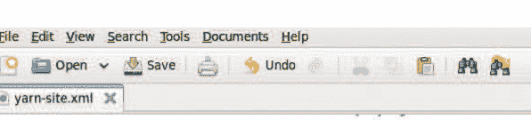

```xml
<configuration>
  <property>
    <name>yarn.resourcemager.hostname</name>
    <value>resourcemager</value>
  </property>
  <property>
    <name>yarn.nodeman.local-dirs</name>
    <value>/hdfs1/nm-local-dir,/hdfs2/nm-local-dir</value>
  </property>
  <property>
    <name>yarn.nodeman.aux-services</name>
    <value>shuffle</value>
  </property>
  <property>
    <name>yarn.nodeman.resource.memory-mb</name>
    <value>1638</value>
  </property>
  <property>
    <name>yarn.nodeman.resource.cpu-cores</name>
    <value>1</value>
  </property>
</configuration>
```

```xml
<configuration>
  <property>
    <name>yarn.appreduce.framework.name</name>
    <value>yarn</value>
  </property>
</configuration>
```

在终端中输入命令 `~/bashrc` 打开 `bashrc` 文件并按显示进行更新。在提示符中执行 `hadoop version` 检查 Hadoop 版本。

必须在 `yarn-site.xml` 中配置 `manager`。

# 二叉树


Mihalis Tsoukalos 是一位 Unix 管理员、一个 iOS 程序员以及一位 DBA 爱好者。他从 1993 年起一直使用 Linux。

# 计算机科学

## 理解二叉树

- 资源
- 文本编辑器
- GCC 编译器
- Perl 解释器

## 了解如何开发和使用灵活良好的树数据结构

我们将介绍二叉树的结构，因为它是最常用的树类型。

本教程将介绍开始使用树数据结构所需的知识以及工作原理。它将在 C 和 Python 中编写。二叉树的优优势是可以在极短的时间内找到某个元素是否存在。树也适用于层次数据建模且没有循环。树的根是树的第一个节点。每个节点可以连接到一个或多个节点，取决于树的类型。如果每个节点只指向另一个节点，那么这就是链表！没有子节点的节点称为叶子节点，而至少有一个子节点的节点称为内部节点。

## 树的结构

二叉树是每个节点最多存在两个其他节点的树。“大多数”意味着它可以连接到两个或没有其他节点。树的高度定义为从根到节点的最长路径，而节点的深度是从节点到根的边数。当树是平衡的时，从根到节点的长度最多比最短路径多 1。

## 理论

严格来说，“树”是满足以下条件的有向无环图：
- 它有一个作为树入口点的根
- 除了根以外，每个顶点都有一个入口点；
- 有到每个节点的路径；
- 边具有方向性
- 它没有循环。

如果二叉树是平衡的，它的搜索、插入和删除操作大约需要 `log(n)` 次，其中 `n` 是元素的总数。此外，平衡树的高度约为 `log2(n)`，这意味着拥有 1000 个元素的树高度约为 10，拥有 100,000 个元素的树约为 17，而拥有 1,000,000 个元素的树约为 20。向平衡二叉树放入大量元素不会改变树的速度。你可以在 30 步内到达 1,000,000 个节点中的任何节点。相邻图显示了小型二叉树的图形表示。你可以看到所有的值都小于根子树的值。换句话说，二叉树中的所有键按设计都是有序的。好的一点是你不需要对它们特殊 `care`；将元素放在正确的位置可以保持它们有序。你会发现，由于树的构建方式，从树中删除元素并非易事。

## 创建二叉树

由于存在链表，你需要一个特殊的结构来存储树的数据。对于二叉树，每个节点应该能够引用两个节点。因此，下面的 C 结构用于描述二叉树的节点：

```c
struct node {
  int val;
  struct node *right;
  struct node *left;
};
```

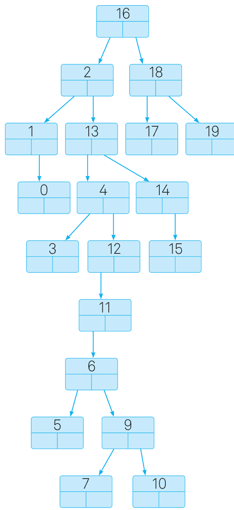

## 二叉树教程

你也应该意识到存在具有两个以上节点的树。请看第 54 页的插图了解相同的元素如何形成两种不同的树。每个节点最多可以连接上方下方的一个节点。

### 二叉树 A

### 二叉树 B

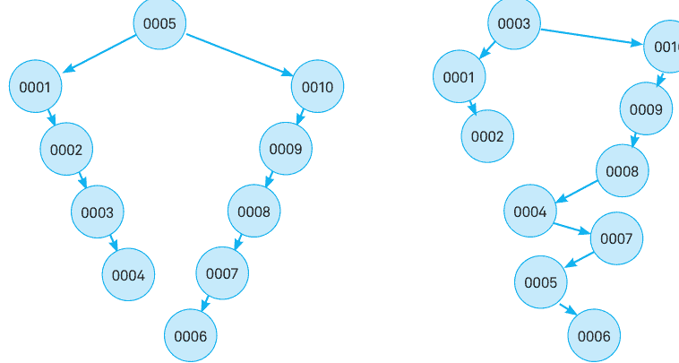

右：虽然它们包含相同的元素，但这些具有不同节点的树。每个树节点持有的数据（也称为键）是整数；然而，如果你想让实现更复杂，可以使用任何数据类型。你可以在节点结构中添加一个变量，记录该元素被“插入”到二叉树的次数。你没有义务使用 `count` 变量，除非你想这样做，但拥有这种能力是好的。防止向二叉树中插入重复节点需要额外的 `care`，因为在插入元素之前必须考虑 `count` 变量的值。`binTree` 的代码可以在这里看到：用于向二叉树插入元素并访问其所有节点的 `insertNode` 和 `traverseTree` 函数。

- Go 中的二叉树
- Go 可以编写很多东西，包括二叉树。事实上，Go 开发者提供了一种二叉树的实现。参考 `github.com/pkg/tree` 中的 `tree.go`。每个节点的定义如下，正如你所预期的：

```go
type node struct {
    Value int
    Left *node
    Right *node
}
```

```c
// 用于 traverseTree 的辅助函数
void traverseTree(struct *root) {
    if (root == NULL) {
        traverseTree(root->left);
        traverseTree(root->right);
    }
}
```

```c
int insertNode(struct *root, int key) {
	if (root == NULL) {


```c
if (root->left == key) {
    return 1;
}

if (root->right == key) {
    return 1;
}

return 0;
}
```

```c
#include <stdio.h>
#include <stdlib.h>

struct node {
    int val;
    struct node *left;
    struct node *right;
};
```

// 创建一个新的 BST 节点
```c
struct node *newNode(int item) {
    struct node *temp = (struct node *)malloc(sizeof(struct node));
    temp->val = item;
    temp->left = temp->right = NULL;
    return temp;
}
```

// 插入给定键的新节点
```c
struct node* insert(struct node* node, int val) {
    // 如果树为空，创建一个新节点
    if (node == NULL) {
        return newNode(val);
    }
    // 如果键已存在，返回！
}
```

# 平衡二叉树

# 不平衡二叉树

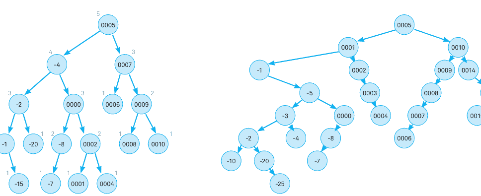

```c
if (val == node->val)
    return node;

// Otherwise, search the rest of the tree
if (val < node->val)
    node->left = insertNode(node->left, val);
else
    node->right = insertNode(node->right, val);

return node;

// Find the minimum value of the tree
struct * findMin(struct node *node) {
    struct node *current = node;

    // Find the leftmost leaf
    while (current->left != NULL)
        current = current->left;

    return current;
}

void treeSize(struct node *root, int *count) {
    (*count)++;
    if(root->left) treeSize(root->left, count);
    if(root->right) treeSize(root->right, count);
}

int main(int argc, char **argv) {
    struct node *root = NULL;
    root = insertNode(root, 4);
    root = insertNode(root, 7);
    root = insertNode(root, 2);
    root = insertNode(root, 3);
    root = insertNode(root,
```

上述，对于一个二叉树要保持平衡，从根节点到任何节点的最长路径长度不能超过根到节点最短长度的二倍。

正如你可能猜到的，当你创建一个新节点时，必须处理内存分配。执行此操作的实用函数如下：

```c
struct node newNode(int item) {
    struct node *temp = (struct node *)
    mallococ(sizeof(struct node));
    temp->val = item;
    temp->left = temp->right = NULL;
    return temp;
}
```

`newNode()` 函数返回它刚刚创建的节点结构的指针。在内部，它使用 `malloc()` 分配适当的内存空间并创建一个带有给定键的节点。递归节点没有子节点，因为决定是否要为其添加子节点是 `insertNode()` 函数的任务。

你可以通过检查节点的左右指针来判断该节点是否为叶子节点：如果它们都指向 `NULL`，那么 `traverseTree()` 函数就是递归函数的完美示例，它会不断调用自己直到找到每条路径的末端，如下所示：

```c
void traverseTree(struct node *root) {
    if (root == NULL) {
        traverseTree(root->left);
        printf("%d", root->data);
        traverseTree(root->right);
    }
}
```

> `traverseTree()` 的递归性质使得代码更简单 - 否则编写这个函数将极其困难

还有另一个返回最小键值的实用函数，其实现如下：

```c
struct node * findMin(struct node *node) {
    struct node * current = node;

    // Find最左叶叶节点
    while (current->left != NULL) {
        current = current->left;
    }

    return current;
}
```

该函数不返回任何值，因为不需要。`traverseTree()` 的递归性质使得代码更简单且易于理解 - 否则将极其困难

另一个重要的函数 `findNode()`，用于确定一个元素是否属于该二叉树。`findNode()` 函数以递归方式工作，因为它允许 `main()` 确定键是否已经存在于二叉树中，以避免向树中引入重复项。如果你仔细观察 `findNode()` 和 `traverseTree()` 的实现，你会发现 `findNode()` 实际上是基于

由于二叉树的构建方式，你不需要搜索整个树来寻找最小键值 - 你访问的节点数最多不会超过二叉树的高度！

另一个实用函数是 `sizeTree()`，它累加树的大小。`sizeTree` 函数有如下实现：

```c
void sizeTree(struct node *root, int *count) {
    count++;

    if(root->left != NULL) sizeTree(root->left, count);
    if(root->right != NULL) sizeTree(root->right, count);
}
```

# 在 Perl 中创建树

该 Perl 脚本展示了如何向二叉搜索树中插入元素。幸运的是，向树中插入值的主逻辑很简单：你可以插入任何你想要；没有变量会让你在不需要实现任何东西的情况下卡住

脚本的第一部分创建树，第二部分打印结果。在 Perl 中，向树中插入值的主逻辑如下：

```perl
my @keys = (10, 5, 15, 2, 7);
foreach (my $key (@keys)) {
    insert($root, $key);
}
```

向二叉树插入值的主逻辑是：

该函数不返回任何值，因为不需要。`traverseTree()` 的递归性质使得代码更简单且易于理解 - 否则将极其困难

另一个重要的函数 `findNode()`，用于确定一个元素是否属于该二叉树。`findNode()` 函数以递归方式工作，因为它允许 `main()` 确定键是否已经存在于二叉树中，以避免向树中引入重复项。如果你仔细观察 `findNode()` 和 `traverseTree()` 的实现，你会发现 `findNode()` 实际上是基于

由于二叉树的构建方式，你不需要搜索整个树来寻找最小键值 - 你访问的节点数最多不会超过二叉树的高度！

另一个实用函数是 `sizeTree()`，它累加树的大小。`sizeTree` 函数有如下实现：

```c
void sizeTree(struct node *root, int *count) {
    count++;

    if(root->left != NULL) sizeTree(root->left, count);
    if(root->right != NULL) sizeTree(root->right, count);
}
```

# 在 Perl 中创建树

该 Perl 脚本展示了如何向二叉搜索树中插入元素。幸运的是，向树中插入值的主逻辑很简单：你可以插入任何你想要；没有变量会让你在不需要实现任何东西的情况下卡住

脚本的第一部分创建树，第二部分打印结果。在 Perl 中，向树中插入值的主逻辑如下：

```perl
my @keys = (10, 5, 15, 2, 7);
```


```
foreach (my $key (@keys)) {

    insert($root, $key);

}
```

向二叉树插入值的主逻辑是：

（注：用户提供的原文中存在大量重复的段落，根据“一定不要重复输出原文”的原则，此处仅针对非重复的逻辑部分进行翻译衔接）

上述，对于一个二叉树要保持平衡，从根节点到任何节点的最长路径长度不能超过根到节点最短长度的二倍。

正如你可能猜到的，当你创建一个新节点时，必须处理内存分配。执行此操作的实用函数如下：

```c
struct node newNode(int item) {

struct node *temp = (struct node *)

mallococ(sizeof(struct node));

temp->val = item;

temp->left = temp->right = NULL;

return temp;

}
```

`newNode()` 函数返回它刚刚创建的节点结构的指针。在内部，它使用 `malloc()` 分配适当的内存空间并创建一个带有给定键的节点。递归节点没有子节点，因为决定是否要为其添加子节点是 `insertNode()` 函数的任务。

你可以通过检查节点的左右指针来判断该节点是否为叶子节点：如果它们都指向 `NULL`，那么 `traverseTree()` 函数就是递归函数的完美示例，它会不断调用自己直到找到每条路径的末端，如下所示：

```c
void traverseTree(struct node *root) {

    if (root == NULL) {

        traverseTree(root->left);

        printf("%d", root->data);

        traverseTree(root->right);

    }

}
```

> `traverseTree()` 的递归性质使得代码更简单 - 否则编写这个函数将极其困难

还有另一个返回最小键值的实用函数，其实现如下：

```c
struct node * findMin(struct node *node) {

    struct node * current = node;

    // Find最左叶节点

    while (current->left != NULL) {

        current = current->left;

    }

    return current;

}
```

该函数不返回任何值，因为不需要。`traverseTree()` 的递归性质使得代码更简单且易于理解 - 否则将极其困难

另一个重要的函数 `findNode()`，用于确定一个元素是否属于该二叉树。`findNode()` 函数以递归方式工作，因为它允许 `main()` 确定键是否已经存在于二叉树中，以避免向树中引入重复项。如果你仔细观察 `findNode()` 和 `traverseTree()` 的实现，你会发现 `findNode()` 实际上是基于

由于二叉树的构建方式，你不需要搜索整个树来寻找最小键值 - 你访问的节点数最多不会超过二叉树的高度！

另一个实用函数是 `sizeTree()`，它累加树的大小。`sizeTree` 函数有如下实现：

```c
void sizeTree(struct node *root, int *count) {

    count++;

    if(root->left != NULL) sizeTree(root->left, count);

    if(root->right != NULL) sizeTree(root->right, count);

}
```


# 来自 Linuxuser & Developer 开发者的出品

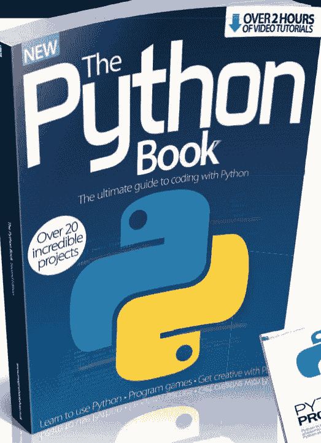

# Python 之书

通过新版的《Python 之书》，探索这种令人兴奋且功能多样的编程语言。你将找到一份针对初学者的完整指南、旨在构建知识的绝佳项目，以及如何在树莓派上使用 `Python` 的技巧——你掌握 `Python` 所需的一切。


# 更多可选...


# 指尖可及的内容世界

无论你热爱游戏、历史、动物、摄影、`Photoshop`、科幻或其中的任何内容，`Imagine Publishing` 出版的每一本杂志和丛书都充满了专家建议和迷人的事实。


# 立即购买

纸质版见：`www.imagineshop.co.uk`
数字版见：`www.greatdigitalmags.com`


# 编码人员与制作者的必备指南：实战篇——树莓派

60 这里的技巧是找到一个内部空间足够容纳 `Zero` 的控制器。我们将使用原装 `Xbox` 控制器。


# 目录

- 60 组装一台 `Xbox Zero` 街机
- 68 自动驾驶遥控车
- 70 使用 `Python` 进行动作跟踪
- 72 设置树莓派 2 `Docker Swarm`
- 76 在 `Minecraft` 中玩扫雷

# 特辑

# `XBOX ZERO` 街机

让我们利用旧设备、一个备用 `Xbox` 手柄和一个 `Pi Zero` 制作一台自包含的机器！

树莓派非常小，小得离谱。它是一件奇妙且令人印象深刻的技术，但由于我们是极其严肃的成年人，老实说，我们可以把 `Pi` 塞在哪里才能获得最大的乐趣呢？它小到可以隐藏在各种家居用品中。只要你能找到能装得下的东西，你就可以把它变成某种智能机器。给它接线以制作一个仿 `Roomba` 机器人可能有点棘手——但家里到处都是各种电子小配件，只要花一点精力就能让它们重获新生。

拿些旧的游戏控制器吧。如果你和我们一样，你可能手里有几箱你舍不得扔掉的旧电脑设备——一台自 90 年代以来就再没碰过的 `Atari`，一台你坚信今天会再次插上的 `Sega Dreamcast`，一台自从你换了更好的产品后就一直闲置的旧 `Xbox`，以及为了留着而存在的 `Nintendo`——是时候让这些旧系统重焕活力了！

我们将向你展示如何拆解一台旧主机，用树莓派 `Zero` 替换其内部组件，然后为它加载大量的复古游戏。这个项目应该只需要花不到一小时就能完成——之后你就可以在新的主机上加载你合法拥有的 `ROM`，并在舒适的沙发上享受它们了。


> `Terence Eden` 在树莓派向公众出售之前就在玩它了。如果你想看他现在正在做什么，请访问他的博客 `https://shkspr.mobi/blog` 或在 `Twitter` 上关注他 `@edent`


# 特辑

## 你需要的物品

- 原装 `Xbox` 控制器
- 剪线钳
- 手工刀
- 酒精棉片
- `Micro SD` 卡
- 蓝丁胶 (`BluTack`)


## 许多小零件

拆解电子设备时，在旁边准备几个碗或容器。每个零件应该有自己的容器，以免不小心弄混。使用蓝丁胶时，你会发现按钮有滚开的习惯，所以要把它们收起来。也要留意好它们。任何在重新组装时可能用的塑料或橡胶碎片。

## 01 收集你的设备

虽然 `Zero` 不怎么占空间，但视频游戏控制器通常充满了精细的电子元件。这里的技巧是找到一个有足够空间容纳 `Zero` 的游戏控制器。我们选择了原装 `Xbox` 控制器，绰号为“公爵”；如果你没有，可以在二手电子商店花几块钱买一个。此外，你也可以使用较新的 `USB` 游戏手柄，它们被设计成像 `SNES` 和 `Mega Drive` 等经典系统的控制器。确保你选择的控制器有足够的按钮来玩你想玩的游戏——格斗游戏现实中是无法在两个按钮的 `NES` 控制器上玩玩的。

## 02 警告！

操作电器物品和锋利物体可能是危险的。你面临损坏自己或更糟——损坏东西的风险；请在开始此项目之前确保所有电源已断开。对于任何电子项目，在玩弄敏感元件之前，你应该注意完全接地——你身体产生的静电可能会损坏它们。使用防静手环或在大腿上贴静胶带可以解决问题。

## 03 制作

看右侧的图片——这就是我们要操作的控制器；它有双摇杆、六个按钮、一个方向键和两个触发器——它兼容大多数复古游戏系统。

## 04 适配

如果你使用的是不同的控制器，在拆开它之前，双重检查 `Pi` 是否可能放入内部。

- `Micro USB-OTG` 线
- 十字螺丝刀
- 树莓派 `Zero`
- 绝缘胶
- `2A micro USB` 电源
- `Mini HDMI`


## `Xbox Zero`

`Zero` 不怎么占空间，视频游戏控制器通常充满了精细的电子元件。这里的技巧是找到一个有足够空间容纳 `Zero` 的游戏控制器。我们选择了原装 `Xbox` 控制器，绰号为“公爵”；如果你没有，可以在二手电子商店花几块钱买一个。此外，你也可以使用较新的 `USB` 游戏手柄，它们被设计成像 `SNES` 和 `Mega Drive` 等经典系统的控制器。确保你选择的控制器有足够的按钮来玩你想玩的游戏——格斗游戏现实中是无法在两个按钮的 `NES` 控制器上玩玩的。

## 05 拆卸

如果你使用的是不同的控制器，在拆开它之前，双重检查 `Pi` 是否可能放入内部。

## 06 开启

取出外壳后，你应该能卸下螺丝。

## 07 固定

自己检查 `Pi` 在这里的贴合程度如何：可以固定在。如果你想固定它，可以使用一些蓝丁胶。

## 08 制作

`Zero` 不怎么占空间，视频游戏控制器通常充满了精细的电子元件。这里的技巧是找到一个有足够空间容纳 `Zero` 的游戏控制器。我们选择了原装 `Xbox` 控制器，绰号为“公爵”；如果你没有，可以在二手电子商店花几块钱买一个。此外，你也可以使用较新的 `USB` 游戏手柄，它们被设计成像 `SNES` 和 `Mega Drive` 等经典系统的控制器。确保你选择的控制器有足够的按钮来玩你想玩的游戏——格斗游戏现实中是无法在两个按钮的 `NES` 控制器上玩玩的。

## 09 连接

`Xbox` 线缆有一根传输数据所需的线，此处请注意，你应该确保你拥有的是 `USB` 数据线而不仅仅是电源线。

## 10 布线


## 特性

### 11 绝缘

需要注意的是：你需要对 `Pi` 的底部进行绝缘，防止其与控制器上的所有接触点接触。对于这个快速临时方案，我们使用了一些纸板包装——但任何非导电材料都可以。

此后，只需将外壳重新拧紧即可。确保控制器的按钮和摇杆没有偏离对齐。记录下每种颜色放在什么位置，你应该就能找到它们。

### 12 接线

`Pi` 需要连接三根电线才能工作。控制器电缆需要连接到 `USB OTG` 端口。`HDMI` 线缆可以从你的电视连接到 `Pi` 的 `HDMI` 端口。最后，需要将一个 `2A` 的 `USB` 电源插入 `Pi` 的电源插座——一个标准的手机充电器即可，但如果你想减少周围散乱的电线，可以使用 `USB` 充电宝。

### 13 关于电源的说明

你可能在想是否可以通过 `HDMI` 从电视向控制器供电。遗憾的是，`HDMI` 规范不允许电量流向该方向流动。如果你的电视上有一个 `USB` 接口，你可以为 `Pi` 供电——只需确保接口本身足够强大。`Pi` 至少需要 `1 安培`，理想情况下为 `2 安培`。许多电视只输出 `500mA`，这不足以运行 `Pi`。

### 14 让我们玩吧！

好！！看起来不错——你快要准备好玩了。下一步是在此设备上安装一些模拟器软件！

### 正确的控制器

像 `CEX` 或 `GAME` 等二手商店通常会有一些非公开展示的游戏机，因为它们在几天前还是畅销产品。值得检查一下他们展示了什么。有些地方可能出售旧主机，当地的汽车后箱市或你的游戏朋友都是获取各种主机控制器的极佳途径。


# 安装和配置 `RetroPie` 模拟器

没有软件的硬件有什么用呢？通过模拟器运行复古软件并没有你想象的那么困难。

好了，你已经把 `Pi` 安全地封装在控制器里了——你现在只需要可以玩的视频游戏！我们将使用 `RetroPie` 模拟器。在本教程结束时，你将直接从你的树莓派上玩游戏，前提是你合法拥有这些 `ROM` 文件。
这就像将软件安装到 `SD` 卡上，然后复制任何你想玩的游戏一样简单。如果你已经在 `Pi` 上安装了 `RetroPie`，请确保你从商店中安装了最新版本。

## 01 在内部安装 `RetroPie`

如果你已经启动了 `RetroPie`，你将从 `GitHub` 安装软件。最新的指令可以在 `github.com/RetroPie/RetroPie-Setup` 找到。
在你的 `Pi` 上打开终端，例如，通过 `SSH` 登录你的机器，或者直接登录 `Pi`。更新你的软件库，并确保安装了最新版本的 `Git` 软件：

```


# 01 安装 RetroPie

首先，更新并安装必要的软件包：

```
sudo apt-get update
sudo apt-get upgrade
sudo apt-get install git
```

下载最新版本的 RetroPie 设置程序：

```
git clone --depth=1 https://github.com/RetroPie/RetroPie-Setup.git
```

如果你注重安全，在运行脚本之前检查一下是个好主意。一旦准备就绪，可以通过切换到正确的目录并执行脚本来安装它：

```
cd RetroPie-Setup
sudo ./retropie_setup.sh
```

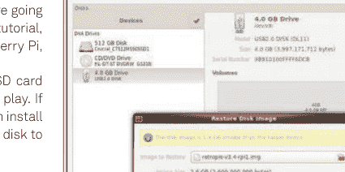

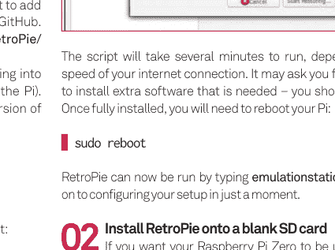

脚本将运行几分钟，取决于你的网络连接速度。它可能会请求安装所需的额外软件的权限——你应该允许这样做。安装完成后，你需要重启 Pi：

```
sudo reboot
```

RetroPie 现在可以通过模拟运行了。我们将在下一节中讨论配置你的设置。

# 02 在 SD 卡上安装 RetroPie

如果你正在使用树莓派，这将用于向一张 SD 卡写入副本，所以如果你正在使用，请选择最适合你的。在开始之前，确保你已备份了任何重要数据。你可以从 `http://blog.retropie.com/retropie-downloads/` 下载软件。确保下载的是 SD 卡镜像——RetroPie 不兼容 `Raspberry Berry Boot`。下载的是一个 `800MB` 的 `zip` 包。解压并提取 `img` 文件，该文件大小为 `2.6GB`。

你需要将此镜像写入你的 `microSD` 卡。其操作方法与在树莓派卡上安装操作系统相同。针对 `Linux`、`Mac` 和 `Windows` 有几种不同的指令。

## 03 Linux

使用 `Disk Imager` 选择镜像文件和 `microSD` 卡。按照屏幕上的指令操作，直到镜像完全写入卡中。

## 04 Mac

从 `www.tweaking.com/hardware/raspberry-pi-macos-osx-pi-baker` 下载 `Apple Baker`。安装后，选择镜像文件和 `microSD` 卡。按照屏幕上的指令操作。


左——你已经启动了 RetroPie，你需要从 `GitHub` 安装软件。右——当你开机时看到这个屏幕。

## 05 Windows

从 `sourceforge.org/projects/win32diskmaker` 下载 `Win32 Disk Im`。安装后，选择镜像文件和 `microSD` 卡。按照屏幕上的指令操作，直到镜像已写入卡中。

## 06 配置

右——你快准备好了。将微 SD 卡插入树莓派，连接 `USB` 控制器和 `HDMI` 线。最后，几秒钟后，你就准备好了。

RetroPie 应该会自动检测任何连接的 `USB` 手柄并引导你完成设置。完成后，你将看到一个显示所有选项的屏幕。

## 07 设置磁盘

在我们玩任何游戏之前，我们需要确保 RetroPie 能够使用 SD 卡上的所有空间。这将允许你存储 ROM 并保存你的游戏。选择树莓派配置工具 `RASPI-CONFIG`。

你可以以后再更改默认用户名和密码；现在使用控制器选择 `Expand Filesystem`。高亮后，按右直到 `Select` 按钮高亮。点击。稍后你会看到一个成功屏幕——按下 `OK` 将返回配置屏幕。

# 08 添加 ROM

如果你合法地从互联网下载了 ROM，你需要将它们复制到 `microSD` 卡上。

ROM 存储在每个系统的独立文件夹中，例如，将你的 `Genesis` 系统 ROM 放在 `/RetroPie/roms/system/`。安装完成后，系统将出现在菜单中。你现在准备好玩游戏了！

# 09 游戏

一旦启动，你将看到一个带有所有可用游戏系统的菜单。有些模拟器只会显示已安装系统的游戏。滚动直到你选择想要玩的游戏——尽情享受吧！

# 什么是模拟器？

模拟器是伪装成不同硬件的软件，允许树莓派运行为其他设备设计的软件。模拟器并不完美——在游戏中遇到 bug 是很正常的。

# 探索内部科技

`www.gadgetdaily.xyz`


## 正在发售

- 汽车科技专题
- 无线扬声器设置
- 无人机法律

- 最酷套件 - 技术拆解 - 购买建议 - 科学解释 - 操作指南

## 今日购买您的杂志

- 纸质版请访问 `www.imagineshop.co.uk`
- 数字版请访问 `www.greatgadgetmags.com`

在以下平台可用


`facebook.com/gadgetmagdaily` `twitter.com/xgadget_magdaily`

摄像头模块是目标检测的焦点。输入数据汇总后通过运行在 PI 上的客户端程序处理。

# 组件列表

- 树莓派 B+
- `Arduino`
- 摄像头模块
- `HC-SR04` 超声波传感器
- `OpenCV`


**超声波传感器** 它通过感知角度和表面状况来确定相对于迎面物体的停止距离。

**Arduino** 它模拟遥控车控制器的按钮按下。四个引脚连接到控制器的引脚，分别对应前进、倒退、左和右。

**右** 一旦检测到物体，超声波传感器就会传递此信息并帮助遥控车停止。

**远右** `Arduino` 板模拟按键按下，帮助遥控车自主行驶。

# 自动驾驶遥控车

# 王正（Zheng Wang）用他的完全自持驱动汽车反超了 Google

开发自动驾驶汽车的想法从哪里来？
你可能不相信，我确实为了一个学校项目做了这个。我所有的兴趣都是机器学习。我决定开发一些大量涉及机器学习和编码的东西。我在网上搜索，发现了一个由 `David Singleton` 开发的非常有启发性的树莓派项目，它展示了使用 `Arduino` 和其他几个物品是可能的。看到遥控车可以在没有帮助的情况下自己行驶，我非常惊讶，我想我是否可以复制一个类似的项目。

在计算机上接收的图像被转换为灰度图并输入神经网络以为汽车做出预测，以便在正确的时刻左转或右转。这些图像也被用于控制汽车和停止标志，而树莓派则向系统报警障碍物的距离。这就是我的项目主要学习的方式。

关于使用超声波传感器测量距离的帮助，网上有一些针对爱好者的简用教程，到处都是其他材料。

你能给我介绍一下超声波传感器吗？它能检测 360 度吗？

我使用了我的树莓派并下决心尝试构建我自己的可以实现更多功能的自动驾驶汽车。我还想添加避障、停止和交通灯检测等功能。开发这个项目花费的时间比我想象的要长，因为有许多需要考虑的因素。

对于这个项目，我选择使用 `HC-SR04` 超声波传感器，它是有效的，而且市上有许多对用户友好的设备。从零开始设置有点棘手，但我解决了我遇到的问题。当我遇到问题时，我搜索了互联网并发现了一个用的列表，显示检测范围在 30 度以内，这似乎是正确的方向。市场上有很多传感器，所以如果需要，一个完整的 360 度检测系统是可能的。


系统的最后部分由一个发送到树莓派的神经网络组成，树莓派连接到遥控器。然后 `Arduino` 发送高或低电信号来驱动汽车。这个过程相当不容易，在经历了最初的试错阶段后，花了很长时间才使其正确，然后它才开始独立运行。

# 你能为我们概述一下自动驾驶系统是如何工作的吗？

# 你如何看待这个项目的未来？未来在哪里？

# Python 列

# 我们将使用 OpenCV 软件包，它正在不断改进

`OpenCV` 提供了一个函数，可以获取图像的坐标和宽度。你可以使用该函数在图像上画一个框：

```python
for c in contours:
    if cv.contourArea(c) < 500:
        continue
    (x, y, w, h) = cv.boundingRect(c)
    cv.rectangle(frame, (x, y), (x+w, y+h), (0, 255, 0), 2)
```

现在你拥有一张标注过的图像，所有移动物体都用红框框亮出了。

我们要对这些图像做什么？如果你有可用的图形化环境，可以在屏幕上显示它们。`OpenCV` 包含了显示分析结果的函数。最简单的方法是使用 `imshow`，它会显示图像并添加标题。

```python
cv.imshow("filename.jpg")
```

如果你不实时监控运动检测的结果，可以在环境发生移动时保存图像。`OpenCV` 也有一个非常直观的函数来保存这些图像。你可能想先给这些图像加上时间戳。使用 `putText` 函数，你可以获取当前日期并将其添加到图像中：

```python


`import timestamp`

```
time = timestamp.now().strftime("%Y%m%d-%H%M%S")
```

现在你拥有一张带有时间的图像，叠加在带有运动边界的之上。你可以使用 `OpenCV` 函数写入这些图像，以便以后检查。以下示例是：

```python
cv.imwrite("filename.jpg", frame)
```

`imwrite` 函数通过文件扩展名来确定用于写入图像的格式。它可以处理 `JPEG`、`PNG`、`BMP`、`PGM`、`PPM` 和 `TIFF`。如果你需要特定的参数，也可以在函数调用中包含它们。

我们已经查看了如何实时显示和保存图像。现在是时候在场景中运行树莓派了。如果你没有摄像头，可以尝试对来自微型摄像头的视频流进行后处理。我们使用 `OpenCV` 函数来加载视频流：

```python
camera = cv2.VideoCapture("filename.jpg")
```

### 摄像头呢？

在主文中，我们使用了插入到树莓派模块上的 `USB` 接口。但如果你无法方便地访问其中一个呢？几乎每个人家里都有一个摄像头。你可以尝试将摄像头插入 `USB` 端口。图像质量和帧率不如使用实际模块获取的。关键在于获取符合预期的分析函数。`VideoCapture()` 函数不仅可以接受视频文件名进行读取，还可以读取来自树莓派的流。假设你只连接了一个摄像头，你可以使用

```python
camera = cv2.VideoCapture(0)
```

确保你的摄像头已连接，并且 `Linux` 可以在你想要运行的所有地方与它通信。但如果一切都按预期工作，你就可以使用所有的运动检测函数。`OpenCV` 还有用于与你的摄像头交互的函数，你可能想使用其他函数来处理此。一个良好的框架是，你可以处理所有的接口步骤并使用以下内容构建你的用户界面：

`OpenCV` 和图像数据的格式是不同的，因此你需要进行双向转换。如果你只担心给图像打时间戳，有几个函数你可以可以使用。更多信息将随后介绍。以下是一些你可以用来将 `OpenCV` 图像转换为字符串，反之亦然的函数：

```python
pygame = cv2.imdecode(cv2.imencode('.jpg', frame)[1], cv2.IMREAD_COLOR)
```

这将来自 `OpenCV` 的图像（存储在 `cv2` 中）转换为 `pygame` 格式（存储在 `pygame` 中）。如果你必须进行相似性变换，那么你可以从 `pygame` 转换回 `OpenCV` 格式。


你应该有足够的信息在你的 `Python` 函数中添加一些基础运动检测。如果你探索 `OpenCV` 文档，你将发现更复杂的图像示例和可供运行的代码列表。此外，`OpenCV` 项目还将添加更多功能。

```python
cv.release()
```

```
shape=(10,10), font=cv.FONT_HERSHEY_SIMPLEX, scale=0.5, (0,255,0), 1
```


# 使用 Docker Swarm 构建树莓派集群

## 通过构建 Swarm 整合树莓派的力量和资源

`Docker` 是一个用于在 `Linux` 上配置、构建和部署应用程序的框架和工具链。容器提供了将应用程序及其所有依赖打包成单个单元的方法。这使得它们容易共享和运输，提供了一个轻量便携的环境。

每个应用程序都运行在自己的隔离空间中，共享主机的内核和资源，这与需要自带操作系统的虚拟机不同。`Docker` 允许在对主机资源开销最少的情况下扩展到大量数量。

社区已经构建了一个名为 `Swarm` 的集群解决方案，截至 1.0 版本，它声称是“生产就绪”。我们的单台树莓派有 1GB RAM 和四个核心，但如果有五台，我们就有 20 个核心和 5GB RAM 可用。

准备好安装 `Arch Linux`、从源码编译复杂的 `Docker` 1.9.1、构建一些镜像并首次启动你自己的 `swarm`。

01 安装 `Arch Linux`，从源码编译复杂的 `Docker` 1.9.1，构建一些镜像并首次启动你自己的 `swarm`。

## 教程

### 原材料

在这里，我们专注于在集群上部署 Web 服务，但树莓派的设置包含了可扩展规模的硬件。树莓派拥有 28 个 GPIO 引脚、一个 USB 端口和一个摄像头接口。你拥有了制作某些独特之处的原材料。你表达了一个表达式，比如 `4`。你尝试尝试在它处理请求时点亮一个 LED 灯吗？

### 08 在 Docker 上构建 Docker！

现在我们有了可以运行的版本，需要对其进行编译：

```bash
cd /docker-arm/images/docker-arm
./build.sh
```

在接下来的 30-60 分钟内，代码将为 ARM 构建并打补丁，设置你的树莓派，并复制到树莓派的本地文件夹。脚本将一直运行直到你收到如下消息：

```
Created binary: bundles/1.9.1/binary/docker-1.9.1-arm-linux-armv7*
```

如果输出成功，你就可以继续安装更改：

```bash
cd /docker-arm/images/docker-arm
sudo install.sh
sudo systemctl start docker
```

### 09 构建 Docker Swarm

公共仓库中有一个 `Swarm` 镜像，但我们无法使用它因为它它是为 `x86_64` 架构（普通 PC）构建的。所以让我们构建自己的吧：

```bash
cd /docker-arm/images/docker-arm
./build.sh
docker run alexelsis2-swarm --version
```

### 10 额外节点

此时，你可以复制 SD 卡，也可以在每个树莓派上运行指令。使用这种方法，我们需要更新所有树莓派上的 `/etc/hostname` 和 IP 地址。如果复制卡片，请确保使用 `/docker`

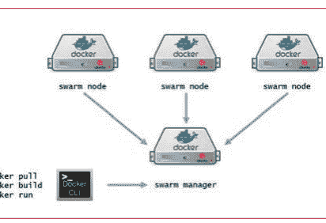

### 11 我们将第一个节点专门用于管理集群

端口 `4000` 用于 `swarm`，并在 `8500` 通过 `Consul` 处理服务发现。两者将运行在本地 `Docker` 实例上。

注册表中还有其他镜像 - 你可以根据需要构建它们，也可以使用 `build_all.sh` 脚本（推荐）。这可能需要一些时间。

```bash
cd /docker-arm/images/console-arm
./build.sh
```

```bash
./script/start_consul.sh
./manage_swarm.sh
```

如果你构建了 `swarm-container`，你会发现这次快得多，因为 `Docker` 缓存了步骤，所以只有节点之间的更改需要重新构建。

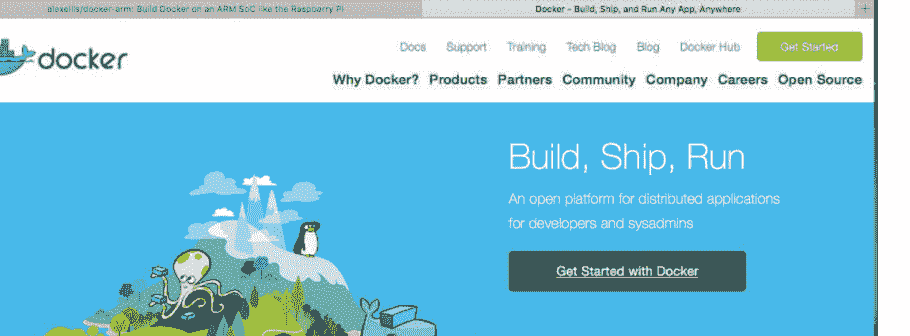

# 构建、传输、运行

面向开发者和系统管理员的分布式应用程序开放平台

开始使用 `Docker`

## 通过 AWS 部署 Docker

在 `AWS` 上运行 `Docker` 提供了一种高可靠、低成本的方法，用于质量构建、传输和运行各种规模的分布式应用：使用 `AWS` 市场中的 AMI 部署 `Docker`。

立即开始使用 `Docker` 和 `AWS` »

## 通用控制平面的 Beta 访问

`Docker` 可以运行任何应用，通用控制平面为你的 `Docker` 应用提供非本地化的管理解决方案，无论它们运行在何处。

立即注册 Beta 访问

`Docker` 正在快速成为内容技术的行业标准

加入集群

连接到其中一个节点，例如 `192.168.0.201`，并启动 `auto_join-swarm.sh` 脚本。这将查询 `eth0` 的 IP 地址并广播连接到 `swarm` 管理器。

启动等数量的节点：集群，并将它们链接到 `redis` 容器。

```bash
```


# `/docker-arm/script/auto_join_swarm.sh`

你将在`docker ps`下看到运行的swarm。如果想查看输出，检查`docker logs`。在每个节点上重复此步骤。

```bash
# docker run -p 6379:6379 -d \
--name redis \
--link redis:1 \
alexis. redis
```

在`balancer`节点上最终运行：


```bash
# DOCKER_HOST=tcp:// docker run -d --name=balancer -p 80:80 nginx
```

## 查询swarm

登录主节点并通过`swarm-arm`镜像查询`console`的地址：


```bash
# docker run alexellisiz/swarm-arm console://192.168.0:2500/
```

### Apache Bench

使用10个并发线程和共1000次请求启动Apache Bench。在设置额外的树莓派后，我们开始操作。为了将Web服务从一个容器扩展到多个，请使用`docker`命令，并将`DOCKER_HOST`变量设置为你的swarm管理器地址：

```bash
# ab -n 1000 -c 10 http://192.168.0:2500/
```

并发级别：10
测试耗时：2.5 秒
每秒请求数：38（平均）

在单个树莓派上重复实验是每秒80次请求，共12秒。你也可以尝试将`-c`值增加到100。


```bash
# export DOCKER_HOST=tcp://192.168.0:2000
```

现在查看我们有多少资源：

```bash
# docker info
```

节点：4
CPU：20
总内存：7 GB

# 示例：分布式 Web 应用程序

我们现在设置一个分布式数据库环境。我们将运行多个实例并使用`nginx`负载均衡来处理流量。然后可以使用Apache Bench进行测试。

## 将流量直连你的swarm

如果你在其中一个上拉取`docker`，可以使用`DOCKER_HOST`变量指向任何节点而无需登录树莓派。swarm创建并将Web服务从一个容器扩展到多个。这些容器需要按顺序启动，从`Redis`开始，最后是`nginx`。

```bash
# DOCKER_HOST=tcp://192.168.0:2000
# docker run -p 6379:6379 -d --name=redis-1 alexellisiz/redis-arm
# wget get.docker.com/builds/arm/v7 -O docker-compose
# docker-compose --version
```

`Docker Compose`是一个允许你定义多个容器的工具，让你无需手动即可将Web服务从一个扩展到多个。

```yaml
node:
  image: redis
  ports:
    - "3000"
nginx:
  image: nginx
  ports:
    - "80"
```

# 教程

## 创建 Minecraft 游戏

使用你的树莓派和`Python`知识在`Minecraft`中编写一个简单的迷你游戏。`Pi`镜像已预装了`Minecraft`和`Python`。如果你使用的是旧版本，建议下载并更新到新的`Raspberry`镜像。

## 更新和安装

更新你的树莓派，打开终端并输入：

```bash
sudo apt-get update
sudo apt-get upgrade
```

### 导入模块

加载你喜欢的编辑器并启动新窗口。你需要导入以下模块：`random`用于创建和生成位置，`time`用于向程序添加暂停和延迟。接下来，添加几行代码：`from mc import minecraft`和`mc = minecraft.Minecraft()`。这些创建了`Minecraft`和`Python`之间的链接。这使你能够写入“创建了`Minecraft`”。

```python
import random
import time
from mc import minecraft
mc = minecraft.Minecraft()
```

### 种花

下面的程序将向展示它是如何工作的。每个区块都有自己的`ID`数字，共有数百个。`x, y, z = mc.getPos()`获取玩家在世界中的位置并以元组形式返回。现在你知道自己在世界的什么位置，可以使用`mc.setBlock(x, y, flower)`放置区块。

```python
flower = 38
while True:
    x, y, z = mc.getPos()
    mc.setBlock(x, y, flower)
    time.sleep(1)
```

### 运行代码

减小`Minecraft`窗口的大小更容易看到代码和运行中的程序；在它们之间切换可能会很麻烦。`Tab`键可以隐藏`MC`窗口的键盘和鼠标。运行`Python`程序并等待加载——随着你的走动，花朵出现了！更改第一行的`ID`来更改区块类型，而不是花，尝试种植金、水或火光。


### 向 Minecraft 世界发布消息

也可以向世界发布消息，这在游戏后期用于告知玩家分数和当前分数。在你的进度中，在代码行`flower = 38`添加以下内容，将其变为`mc.postChat("I grew some flowers with code")`。现在看到消息弹出。你可以更改消息，移动到下一步开始游戏。

### 创建地板

游戏在玩家当前所在的地板上进行，因此在运行程序之前建议飞到空中寻找平坦的地形。要创建地板，你需要编写一个循环并在世界中使用`x, y, z = mc.getPos()`运行程序。使用`mc.setBlock`代码放置构成地板的区块。

# 教程

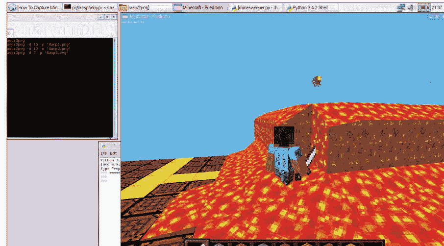

右侧 无
我“游戏结束”
很多
岩浆爆发

## 07 创建地雷

在上一步中，你找到了玩家在棋板上的位置。`x, y, z`数据可以重用在棋板上放置地雷。代码`mine_x = random.randint(0, 11)`生成一个1到10之间的随机数。将其与玩家的`x`位置结合并将随机数加到`x`位置上——这会在棋板上创建一个地雷。

```
mine_x = int(mine_x)
mine_y = int(mine_y)
mine_z = int(mine_z)
```

使用`setBlock`来放置地雷：`mc.setBlock(mine_x, mine_y, mine_z, 58)`。使用`y`确保方块放置在同一层，数字`58`是方块`ID`，你可以更改它来查看地雷的位置；这对于测试代码的其他部分是否运行正常非常有帮助。在游戏之前记得将其改回来！

构建棋板并放置地雷，你需要再次找到玩家的位置并将其存储为新变量——`x1, y1`和`z1`——否则棋板会随着玩家的移动而偏移。

```
x1, y1, z1 = mc.player.getPos()
```

## 10 得分

现在玩家有了一个方块，我们奖励一个分。这是一个将值加到变量`score`的简单操作。我们使用`score = score + 1`。由于它位于循环内部，玩家每次移动时它都会加一分。

```
time.sleep(0.1)
score = score + 1
```

## 08 创建变量

每当你留在地雷附近时，分数就会加1。为分数创建一个变量，并在游戏开始时将其设置为零。使用`postChat`函数宣布分数。注意`mc`无法在聊天框中打印值，因此在显示之前会将分数转换为字符串。

```
score = 0
pmc.postChat("score: " + str(score))
time.sleep(0.1)
```

## 11 紧张气氛增加

```
if (x1, y1, z1) == (mine_x, mine_y, mine_z):
```


## 12 设置陷阱

`else` 语句检查你正站在地雷上还是安全方块上。如果不是，我们就创建岩浆。为了做到这一点，我们使用岩浆块，它们会流动并吞噬玩家。我们使用 `mc.setBlocks` 方法设置点之间的块。将它们设置为比玩家更高意味着岩浆会向下流向玩家。

```
mc.setBlocks(x1, y1-5, z1, x1+5, y1, z1+5, lava)
```

## 09 检查玩家位置

现在你创建一个包含随机放置地雷的棋板。接下来我们需要将地雷放在棋板上，并检查玩家在棋板上的位置，看他们是否站在上面。这使用一个循环来持续检查玩家的位置是否安全，没有地雷游戏继续。如果玩家的坐标位置在

- 星号

# Minecraft

# 其他

Minecraft 破解

如果你喜欢`编程`和`操作树莓派开发板`，有更多棒的`项目`可以去查看。我们的`网站`在这里有很多项目：`co/minecraft.html`。

`Velvet Adventures`的`朋友们`在`Minecraft`中有一些很棒的`指南`可以在`stuffabode.com.com/p.minecraft.html`，同样也有。

一旦`扫雷游戏`图表将`报告你的分数`

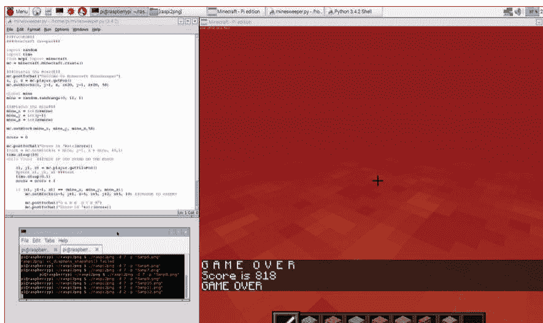

## 代码列表

## 13 游戏结束

如果你站在地雷上，游戏结束了。使用 `post` 在 `Minecraft` 世界中显示“Game Over”消息。

```
mc.postChat("G A M E R")
```

## 14 最终分数

游戏的最后部分是计时。使用你在第 8 步创建的变量，然后使用 `postChat`。创建一个字符串首先将其打印在屏幕上。当你的回合结束时，添加 `break` 语句来结束循环并停止代码

```python
import random
import time
from mcpi import minecraft

mc = minecraft.create()

## 创建边界
mc.postChat("Welcome to Minecraft Sweeper")
_player = player.getPos()
mc.setBlock(x-1, y-1, z-20, x+1, y, z-28)
global mine
mine = random.randint(0, 11)

## 放置地雷
mine_x = int(mine)
mine_y = int(mine)
mine_z = int(mine)
mc.setBlock(mine_x, mine_y, mine_z, 8)
score = 0
mc.postChat("Score: "+str(score))
time.sleep(5)

while True: # 如果你站在地雷上
    xl, yl, zl = mc.player.getPos()
    if (xl, yl, zl) == (mine_x, mine_y, mine_z):
        score += 1
        mc.setBlock(x-1, y-1, z-5, x+1, y+2, z+5, 10)
        mc.postChat("G A M E R")
        mc.postChat("Score: "+str(score))
        break

mc.setBlock(xl, yl-1, zl, 21)
mc.postChat("GAME OVER")
```

## 15 安全方块

但如果你错过了地雷怎么办？游戏聊天框会告诉你之前去过哪里。在底部，使用 `mc.setBlock(xl,yl-1,zl)` 显示你脚下的方块或你选择的任何材料，`y` 位置是 `y-1`，它选中了玩家脚下的方块。

## 16 增加分数

当你结束下一回合时，你也会获得一分。这是通过每次转向方块时将 `score` 变量加 1，并返回循环开头检查下一步状态来实现的。`c.postChat` 是为了告诉你又存过了一回合！

```python
score += 1
mc.postChat("You are safe")
```


# 17 运行游戏

这创建了游戏的代码。保存它并启动你的 Minecraft 游戏。世界已经创建，运行 Python 程序。回到 Minecraft 窗口，你会看到前方创建的方块。小心那个地雷！

# Google Hangouts

# KDE Telepathy

随着应用转向基于 Web 的服务，Google 正处于这一趋势的前沿。

这是一个提供原生桌面组件的通信平台。


Google 对用户界面的设计使得 Hangouts 中的通话和会议变成了一种真正的享受。

Telepathy 是多个应用程序和库的结合，需要它们才能流畅运行。

## 安装简易性

你需要一个 Google 账户才能访问 Hangouts。你可以通过名称或电子邮件与同样拥有 Google 账户的其他联系人对话。对于 Chrome 以外的浏览器，需要 `googletalk` 插件，你还必须经过安装插件和授予硬件权限的乏味程序。

在两个 KDE 桌面之间进行视频通话是痛苦且耗时的，因为存在极其糟糕的安装问题。此外，大多数用户会看到视频通话按钮呈灰色，这仅仅是因为缺少 `telepathy-kde-call` 或 Framestep Gstreamer 代码、QT 绑定。遗憾的是，Telepathy 的视频通话从未开箱即用。

## 性能

Hangouts 提供了出色的性能，并带有清晰音频的充足视频。质量取决于你的网络，Hangouts 会据此进行调整。它在互联网网关方面有一些偏好，例如更好地利用带宽以及将视频流分开、手动选择音频和视频设备。

你可以使用自己的账户连接，但这会影响流量。流量通过服务器传输，可能会出现问题。由于由于，在本地子网的两台 PC 之间建立连接比点对网络花费长时间。尽管如此，视频和音频质量良好。

## 功能

Hangouts 是 Linux 上唯一支持视频聊天并支持十人会议的解决方案。Google 很好地支持 Hangouts。Linux 用户可以使用他们的朋友连接到任何 Hangouts 用户。

已建立通话的界面取决于所使用的协议和接收方的软件。在测试中，让通话工作的唯一方法是安装 Framestep（一个 Google 应用），它启用了 Fternet 库并依赖 Fternet。

## 局限性

如果你不用 Chrome，则必须安装 Google 的 `googletalk` 插件，它仅存在于 Android 和 Debian 插件。Hangouts 使用了一种后方式而非 XMPP 协议，这从以前起破坏了与第三方客户端的兼容性。此外，没有 Google 账户你什么也做不了，这是不可能。

虽然 Telepathy 的文本功能非常好，但音频和视频通话机器人对许多用户来说并不好，找出问题原因需要大量精力。当然，没有群视频通话——由于所提供服务的限制，双向通话通常很慢。

## 总结

Hangouts 在底层技术方面非常先进，但该工具是专门为 Google Chrome (OS) 定制的。在 Chrome 之外进行设置非常麻烦，并且需要 Google 账户。

Telepathy 技术是开源的——这对我们是一个关键吸引——但要正确设置它们需要太多的精力和精力。我们想要喜欢它，但 Telepathy 在 VoIP 通话方面令人不如人意。


www.linuxuser.com/83

# 视频通话软件评测

# 简述：比较与对比结论

# Firefox Hello

# Skype

# Google Hangouts

# KDE Telepathy

| | Firefox Hello | Skype | Google Hangouts | KDE Telepathy |
|---|---|---|---|---|
| 安装 | 如果你使用 Firefox，Hello 已经可以工作了，你只需要分享一个 URL 来邀请他们 | 对于 64 位系统的用户来说需要一些精力，且仓库中没有这些包 | 如果你使用 Chrome 就很简单，但需要浏览器插件，如果不是的话则需要其他东西 | 对 Linux 新手来说是一场噩梦，从不开箱即用。 |
| 性能 | 画面流畅，连接快速且音频质量高。非常稳健。 | 并不理想，但确实比几年前的 Skype 好——足够家庭通话 | 非常稳健且流畅，音频和视频分离质量很好 | 服务器限制意味着连接速度慢，但更好的质量是可以接受的 |
| 功能 | 必要的功能都齐了，但缺少群组通话和功能 | 有许多先进方便的工具，包括用于电话通话的直接账户 | 这是唯一支持会议通话的，因此对业务来说是必不可少的 | 唯一能够进行视频通话的，其他的则不行 |
| 局限性 | 没有任何局限——你甚至不需要账户就可以使用 | 它有点丑，但是一个相当可用且稳定的应用，带有一些有用功能 | 尽管侧重 Google 生态系统，但非常好，并支持群组通话 | 遗憾的是，Telepathy 太不稳定，无法运行。许多用户将由于默认设置而错过 |
| 总结 | Firefox Hello 是不需要群组通话的 Skype 用户的最佳选择 | | | |

# 获胜者是...

# Firefox Hello

我们有两个经典的基于应用和基于云的（或类似的应用）。现代 Web 技术表明，我们可以做得比传统的离线应用更好。Firefox Hello 已经成为像 Skype 一样合法的选择，视频通话的门槛低到即使是非技术用户也可以互相通话并看到对方。最棒的一点是 Hello 似乎并不需要——你只需要生成并分享链接来建立视频通话。Hello 完全免费，并且一直显示在屏幕上并让你进行文本聊天。


Linux 上的 Skype 是 Windows 的限制，只是缺少了一些额外功能且没有广告。某些 Skype 要求你设置账户，在 shell 中设置更好的辅助，但该软件缺乏像样的东西。当然，我们不能说 Google Hangouts 是一项技术，如果 Android 用户需要大量选择，它是唯一的选择，这使得它变得像说的话一样简单：

启动视频通话只需点击几次！

也是一个实用的工具。对 Google Hangouts 的唯一担忧是 Google 软件聚焦于让人们切换到 Google 生态系统。Hangouts 与 Google 绑定，并且是 Google 旗舰 Chrome 浏览器中最好的。这并不完全符合 Linux 核心的自由精神。

最后，KDE Telepathy 对视频通话非常有用，但它能运行，而且 Linux 爱好者可能会为了调查而对修复它不正常的功能感兴趣。Firefox Hello 是我们最推荐的。

> 亚历山大历史

# Genuino 101 评测

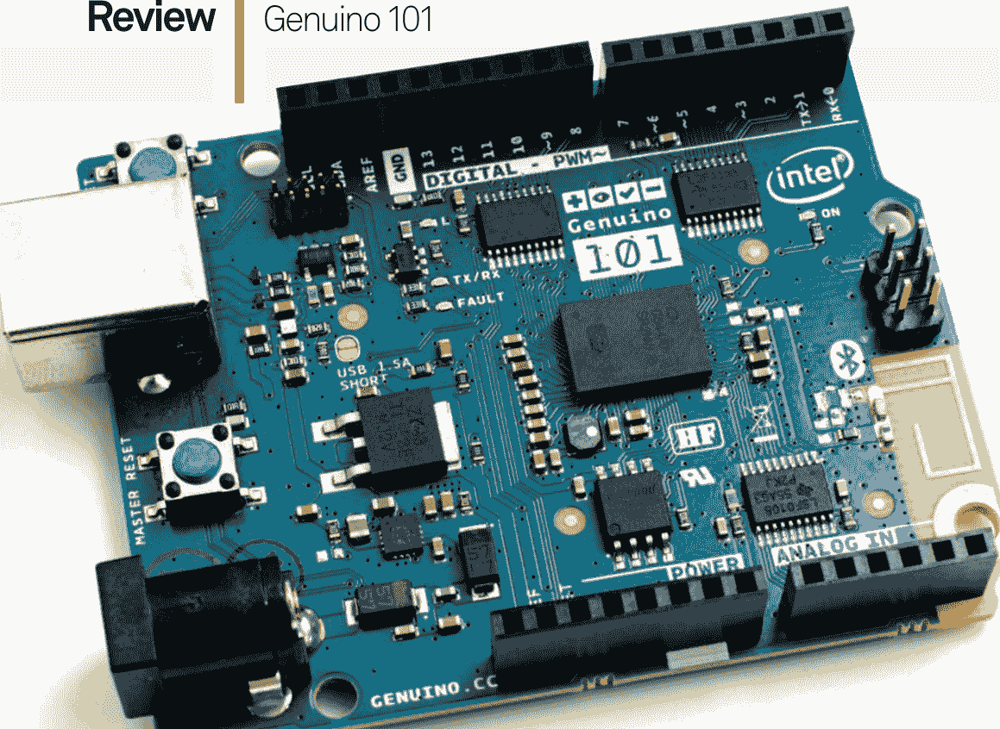

# 迷你 PC

# Genuino 101

| SoC | |
| --- | --- |
| Intel Curie | CPU |
| 单核 32MHz Intel Quark | 协处理器 |
| 单核 32MHz Intel Quark-RISC 核心 (ARM) | 内存 |
| 8KB SRAM (24KB 用户可访问) | 存储 |
| 1026KB Flash | |
| 14 路数字接口 (4x PWM), 6 路模拟 | 传感器 |
| 6轴加速度计和陀螺仪 | 无线连接 |
| 低功耗蓝牙 | 逻辑 |
| 3.3V (5V 耐受) | 价格 |
| 28 欧元 (primloni.com) | |

对于 Intel 想要进入由 ARM 和微控制器主导的创客市场，第三次会是幸运的吗？

Intel 多年来一直试图取得进展，见证了 Arduino 项目和树莓派的成功。Intel Genuino 归功于 Quark 处理器糟糕的 IO 性能，其继任者 Edison（在 Li&S 第 138 期中评测）虽然存在不受欢迎的处理器问题，但其老旧的外和高密度连接器也令人望而却步，

从外观上看，它看起来就像经典的基于微控制器的 Arduino Uno。然而，尽管它共享了 Uno 的布局，但 Genuino 101 是一个完全不同的物种。

这似乎是转折之笔。公司放弃了之前生产 Arduino 兼容微控制器的方法，而是与 Arduino 项目合作创建一个完全官方的设备；然而，在美国被称为 Arduino 101，在其他地区被称为 Genuino 101，以避免商标权问题。结果是一个设备——一个超紧凑、低功耗的系统级芯片 (`SoC`)，主要为可穿戴项目设计，该芯片是 Intel `Quark-RISC` 处理器的一部分，带有 32MHz 的 Argon 核心 (`ARC`) —— 这实际上是承认了 Quark 直接驱动 GPIO 的能力尚未达到理想水平。

两个处理器的存在以一种有趣的方式拆分了 Genuino。Quark 完全兼容基于公司旧版 Pentium 的架构，运行着一个实时操作系统 (`RTOS`)；Curie 模块包含两个核心：一个 `x86` (`Quark`) 和一个 32 位 `ARC` 核心。


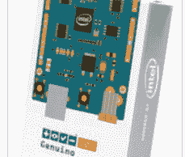

快速的性能、内置加速度计和蓝牙，`x86` 核心允许未来的探索。Intel 承诺在 2016 年 3 月开源 `RTOS`，届时 Genuino 101 的真正潜力将显而若彰。

## 优点

- 快速的性能、内置加速度计和蓝牙，`x86` 核心允许未来的探索。
- `x86` 核心可以直接执行你想要加载的任何 Arduino 程序，其方式在理论上与任何其他 Arduino 无何异。
- 这种架构提供了兼者的优 true：微控制器的活性和动力，以及 Arduino 的低功耗。

## 缺点

- 浮点运算性能差，逻辑电压低于 3.3V；无法直接访问 `x86` 核心。
- 虽然锁定且闭源，但与 Arduino 相比，8KB 的 SRAM 令人印象深刻；且无法直接访问 `x86` 核心。
- 虽然是锁定且闭源的，但 8KB 的 SRAM 与 Arduino 相比确实是令人印象深刻的。
- 以微控制器的标准来看，由于 Quark 的限制，这种设计在 8KB SRAM 方面虽然令人印象深刻，但 浮点运算性能差，逻辑电压低于 3.3V。

## 总结

Genuino 101 是一个聪明的设备，尽管它是闭源设计。如果 Intel 履行其发布代码的承诺，那么进入市场将会是有趣的。

linuxuser.com

# Tails 2.0 评测


# Tails 2.0

Tails 通过引入 Debian 8 和一系列安全改进增强了其安全性。

Tails 2.0 带来了一些真正改进了现代化的更改，尽管这意味着 Windows 模式已损坏 - 开发者将其移除并寻求修复帮助。对于在公共场所或公共电脑上使用 Tails 的人来说这不是问题，尽管 Tails 的蓝色背景会让 Windows 和 OS X 的差异变得明显。

起初，Tails 基于 Debian 8 并配备了许多新软件包。这种转变带来了许多提升用户可用性的变化：默认桌面环境现在是 GNOME Shell 的经典模式，这比更新后的状态要好得多。GNOME 将应用程序保留在左上角的菜单中，如 Tor 管理、Florence 虚拟键盘和 OpenPGP 剪贴板管理器等重要应用都显示在右上角。桌面是新的，并且由于 GNOME Shell，许多核心软件包都得到了更新。同时，浏览器更新到了 5.5 版本，该版本基于 Firefox 36.0 扩展支持版，并且。

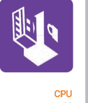

| CPU |
| x86 |
| 内存 |
| USB |
| 存储 |
| 1 或 2 个 USB 盘 |

# 安装 Linux (Red Hat, Fedora 等)

你需要：

- 2 小时
- 1 GB 下载
- 需要安装
- 2 个 USB 盘
- 至少 4 GB
- 联网连接

你的步骤：

首先，你将在 Tails 安装在第一个 USB 盘上。上述，新的安装程序非常详尽，根据你的操作系统，通过操作命名空间对服务进行了箱化处理。Tor 的启动和关机时的内存清理也变得更加健壮。

# 免费软件评

## 静态图库生成器 Fgallery 1.81

### 为你的博客增添静态图库

由于平均网页尺寸日益增大，以及 CMS 和博客平台存在的臃肿和安全风险，静态网站正变得越来越流行。使用 Markdown 文件很棒，但如果你想在精心创作的文字旁边快速发布一个图库该怎么办？并不是每个静态博客生成器都能满足你的需求，而编写自己的工具似乎是多余的劳动；但 Fgallery 可以为你完成这一点。

Fgallery 以目录作为输入，并为你提供一个包含由 PHP、CSS、HTML 和 JavaScript 构建的精美、极简的图库的目录，它只需要你的服务器。如果你无法控制在 Web 服务器上运行的代码，那么它就是理想之选——只需上传它生成的目录即可。

安装 Fgallery 非常简单，但你可能会与同名的 WordPress 插件搞混淆。它是一个可执行脚本，可以在你安装的任何地方运行。只需按照说明和依赖项操作。可选的脚本使用 Python 和 OpenCV 将图片缩略图居中，非常有效。该项目的网站在色彩管理方面有一个有趣的功能。


上方：一个快速加载、无忧的图片图库，准备好上传到任何 Web 服务器

## 缺点

### 优点
- 一种让图片上线的简单方法，无需将渲染控制交给互联网巨头
- 你需要告诉人们你的图片在哪里，而不是让 Facebook 自动发布你的消息

### 非常适合...
- 取回对照片的控制权 - 对初学者来说非常容易
- bit.ly/20hnnhq

# 音乐播放器

## Lollipop 0.9.82

一个更简单、更洁的 GNOME 音乐播放器

是的，有很多媒体库和收藏管理器，甚至有很多应用能很好地兼顾两者，但它们各不相同。

所有媒体播放器的一个共同缺点是：它们的设计假设是你听的是一首四分钟的歌曲，而不是九十分钟的广播剧，对于那些对艺术“没有限制”的人来说。

### 优点
- 快速、免费且轻量——在 GNOME 应用中相当少见——并使用 Python 3 构建

我们还没有测试 Lollipop，因为它处于其他开发领域。通过 Ubuntu PPA 轻松安装，你很快就会被添加到仓库中。

### 缺点
- 界面是为音乐设计的，不仅仅是音频，且缺乏类似应用的功能

Lollipop 正在向 1.0 版本发布并进行了自我宣传，它在 GNOME 上看起来很不错，但我们在 LXDE 上运行它时效果并没有我们预期的那么好。我们在等待播放通过 `get-player` 脚本下载的 BBC 广播节目时发现它表现糟糕。如显示所示。

### 非常适合...
- 用一个易用的音乐播放器开启派对
- bit.ly/20hnnhq

# CSV 查看器

## Tabview 1.4.2

在终端或 SSH 会话中快速查看 CSV 文件

Tabview 是一个用于 CSV 和表格化数据的命令行查看器，用 Python 编写，使用熟悉的 ncurses 库来实现类似电子表格的显示。安装非常简单，只需：

- `pip install tabview`

它也可以在交互式 Python3 会话中作为模块调用，对你想要检查的任何数据结构提供实用的表格化视图。但作为一个命令行工具，它对于那些不想为了看一眼 CSV 文件就打开 Office 的人，以及那些无法打开 Office 的人（例如远程环境下）都非常好用。TabView 允许设置分隔符和字符集，这些可以在命令行指定，以及起始位置——列或顺序。功能主要用于表格排序和（类似 vim 的）导航。单元内容也可以复制到剪贴板，使 `tabview` 成为一个小型但非常有用的工具。

如果你想将 `tabview` 作为 MySQL 的解析器，请编辑 `/etc/my.cnf` 以包含：

```
```


`tabview` `-d` `'\t'` `--quote_NONE` `silent`


### 优点
- 访问 CSV 文件非常简单，无需打开 Office

### 缺点
- 不特别满意；正如你对查看器的预期的那样，你不能编辑 CSV 文件

### 非常适合...
- 在远程服务器上工作时快速查看数据
- `bit.ly/20hnnhq`

# 文件与桌面

## SpaceFM 1.0.5

一个适用于 Linux 的强大文件管理器。

`SpaceFM` 是一个用 Python 编写的双面板文件管理器。它允许你通过 GUI 管理文件和目录，方便地移动、复制和重命名文件。它具有内置终端、搜索功能以及对插件的支持。

### 优点
- 双面板界面，工作流更高效
- 内置终端
- 通过插件实现高度可定制

### 缺点
- 在某些发行版上可能有 Bug
- 对初学者来说学习曲线陡峭

### 非常适合...
- 需要强大文件管理器的用户
- `bit.ly/20hnnhq`

## 顶级托管


## SSD 托管


`www.cwcs.co.uk`
0800 1 777 000

CWCS 托管服务是英国领先的托管公司之一。他们提供全面的托管产品、服务和支持。他们经过高度培训的员工不仅致力于提供卓越的客户体验，更超越职责范围。

`www.bargainhost.co.uk`
0843 289 2681

自 2001 年以来，BargainHost 一直致力于在英国提供尽可能好的托管服务。他们成功实现了这一目标，并建立了一个庞大的满意客户数据库。他们还因提供卓越的托管服务而屡获奖励。

- 托管机托管 (Colocation hosting)
- VPS
- 100% 网络可用性


## 英国本土托管：

`www.cyberhostpro.com` | 0845 529 345

Cyber Host Pro 致力于在英国提供最好的云托管——他们对自动化非常痴迷。他们庞大且不断增长的客户群信任他们的云在线服务！如果您正在寻找：

- 云 VPS
- 独立服务器

## 价值托管


## 价值 Linux


`www.godaddy.com`
0270 841810

GoDaddy 是全球最大的网络托管提供商，拥有超过 500 万用户，并高度聚焦于提供可靠、快速和安全的托管。GoDaddy 以非常低的价格提供共享服务器、独立服务器和专用服务器、托管 WordPress 服务。

`patchman-hosting.co.uk`
01642 234 227

Linux 托管是寻求成本效益和强大服务的家庭用户、企业用户和 Web 开发者的绝佳解决方案。无论您需要一个简单的单页作品集，还是运行一个数据驱动的电子商务网站，它都是一种 Linux 托管解决方案：

- 域名
- 云服务器
- 网络安全

- 共享托管
- 云服务器
- 域名

## 小企业托管


## 企业级托管：


`www.hostpapa.co.uk`
0800 051 7126

`www.netcetera.co.uk` | 0800 808 5450

HostPapa 屡获奖的托管服务商，托管行业的领导者。他们提供功能最全的托管方案之一，拥有99.9% 的客户支持、学习资源以及卓越的可靠性。

1996 年，Netcetera 成为欧洲领先的网络托管服务之一，业务遍及全球 75 个国家。作为英国数据中心机房、独立服务器和托管托管服务的顶级提供商，Netcetera 提供了一系列用于有效管理 IT 基础设施的服务。这种先进的方法为您的企业提供企业级解决方案。

- 网站生成器
- 预算价格
- 无限数据库

- 托管服务与云托管
- 数据中心位置
- 独立服务器


`www.bytemark.co.uk`
0190 094 880

Byemark 成立于 2002 年，是英国独立托管领域的专家。他们的服务包括内部托管、运输和安全，在支持支持团队和高质量托管硬件的支持下，履行其所做出的承诺。

- 托管服务
- 英国云托管
- Linux 托管


`www.linuxuser.uk` | 93

## 开源

您的 Linux 新闻与观点来源

联系我们...
`linuxuser@imagine-publishing.co.uk`

评论

## 您的来信

关于本杂志、Linux 和开源的问题与意见

## GPIO 电流抽取

我对树莓派的 GPIO 电源引脚有一个通用的疑问，即：为我的外部项目供电时，3V 和 5V 引脚分别可以提取的最大额定电流是多少？我这里有一个 B 型，但这个通用规则适用于所有树莓派变体吗？

你好，Carl。树莓派上的 3V 和 5V 引脚由板载电压调节器供电，它们能提取的最大电流取决于具体型号和电源。通常，5V 引脚可以提供高达 500mA 的电流，3V 引脚可以提供高达 800mA 的电流，但这些是限制，不应超过以避免潜在的电压下降或损坏树莓派。

3V 轨通常用于低功耗传感器，而 5V 轨则用于需求更高的外设备（如风扇或电机）。如果您抽取的电流很大，可能需要为这些组件使用外部电源，并与树莓派共地。

# FileSilo

# 您的免费资源

立即登录 `WWW.FILESILO.CO.UK/LINUXUSER`，今日下载最新的发行版和免费软件

# 最新发行版

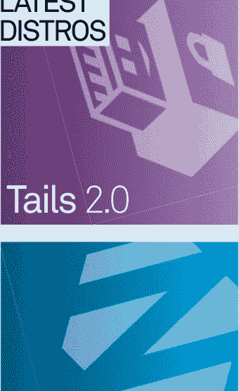

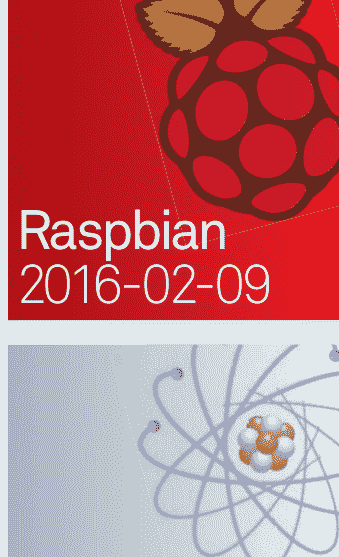

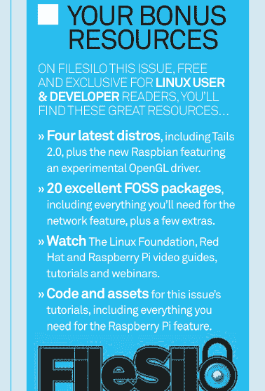

在这一期的 FileSilo 中，为 LINUX 用户和开发者读者提供免费且独家内容，您将发现这些棒的资源……

- 四个最新的发行版，包括 Tails 2.0，以及带有实验性构建的新版 Raspbian。

- 20 个优秀的开源软件（FOSS）软件包，包括网络功能所需的一切内容，以及一些额外内容。

- 观看 Linux 基金会、红帽和树莓派的指南、教程及更多内容。

- 本期教程的代码和资产，包括树莓派功能所需的所有内容。


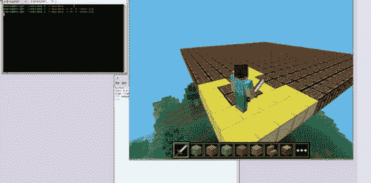

顶级 Linux 开源软件

`www.filesilo.co.uk/linuxuser`

# FILESILLO – 专业人士的家园

探索您的免费在线资产

- 一个快速增长的库
- 持续更新酷酷资源
- 让您保持内容整洁
- 随时随地浏览并访问您的内容
- 不再需要条款页面来运行杂志

- 不再有损坏的光盘
- 纸质订阅者可获得所有内容
- 数字杂志所有者也能获得所有内容！
- 每期内容随您的杂志免费提供
- 安全访问您的免费资源


这是取代您光盘的新 Filesilo。您可以通过访问下一页的链接找到它。

第一次使用 Filesilo 时，您需要注册。之后，您可以使用提供的电子邮件地址和密码进行登录。

此轮播图中显示了最热门的下载，看看您的读者们在喜欢什么！


如果您正在寻找特定类型的内容（发行版或 Python 文件），请使用这些过滤器来精简搜索。

按类型筛选

| 想要 | 软件 | 虚拟文件 |
| :--- | :--- | :--- |
| 热门下载 | Firefox | |
| | Table 1.8 | |
| | Node.js | |
| | Jasper | |
| | Ubuntu 14.04 | |
| | Linux 17 | |
| | Clementine | |
| | VLC | |
| | Tilda 1.2 | |
| | Calgary | |
| | Javascript | |

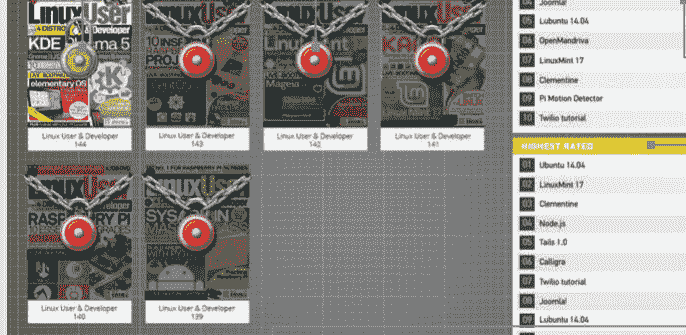

绿色锁表示您已访问的内容。红色锁显示您需要的内容。

热门下载列在这里，让您直观了解最受欢迎的内容。

| 高下载 |
| :--- |
| Ubuntu 14.04 |
| Clementine |
| VLC |
| Tilda |
| Table 1.2 |
| Calgary |
| Javascript |

查看热门列表，看看读者们喜爱的资源！


了解更多关于我们的在线商店以及常见问题。

探索我们精彩的姐妹杂志及其提供的丰富内容……

`www.linuxuser.co.uk` 97

# FileSilo

# 如何使用

关于访问新仓库的一切信息


访问 Filesilo，请访问 `www.filesilo.co.uk/linuxuser`

- 01 屏幕指令创建 Filesilo 账户。
- 02 第一次使用 Filesilo 时，您需要注册。之后，您可以使用提供的电子邮件地址和密码进行登录。
- 03 访问 Filesilo，请访问 `www.filesilo.co.uk/linuxuser`。
- 04 如果您在使用 Filesilo 时遇到任何问题，请使用网站上的帮助部分或联系我们的支持团队。


- 05 查看热门列表，看看读者们喜爱的资源！
- 06 Linux Mint
- 07 Peppermint 4
- 08 树莓派
- 09 Linux 桌面
- 10 最佳 Linux


# 更多教程与灵感

读完这一期了吗？网站上还有许多开源资源等候您。专题、教程、评论、观点文章以及更多。

`www.linuxuser.co.uk` 来自 GreatMags.com 的 LinuxUser 第 164 期
