# Linux User & Developer 166 - 使用 Micro:bit 制作

Chris Glyn, David Edwards, Steven Glyn, Cameron Crumley, Des Ellis, Gary Gethard, Oliver Hill, Jan Mayers, Riley, Ryan Smith, Thomasitsch

## 欢迎

## 本期内容

欢迎阅读 **Linux User & Developer** 最新期，这本英国最爱的 Linux 和开源杂志。我们对 BBC 的 `micro:bit` 感到非常兴奋，在本期中，我们将详细解释它是什么、能做什么，以及它与树莓派的对比。我们还提供了五个可以尽早制作的精彩项目，从简单的 LED 到构建你自己的小镇，甚至深入研究了指南针。

`micro:bit` 特辑解释了你如何将树莓派作为网络电台、运动感应视频婴儿监视器、网络路由器甚至游戏机器人的核心。我们的“实用树莓派”栏目从第 6 页开始介绍一个项目及其描述。

如果你仍然渴望另一个创意项目来大展身手，请锁定好你的免费驱动器——它装满了终极操作系统工具箱，包括两个免费开源软件的光启动发行版。我们展示了第 54 页关于艺术和图形的专题，如何合成、录制和编辑音频，使用你自己的特效进行设计和动画制作。

阅读愉快！

April Madden，编辑

## 与我们联系

`linuxuser@imagine-publishing.co.uk`

Facebook: Linux User & Developer

Twitter: `@linuxuser`

访问获取更多新闻、观点、教程和评论：

`www.linuxuser.co.uk`

- 81 图像编辑器 寻找买不到的最优图像编辑器？试试这些
- 12 内核 Jon Masters 带来 Linux 内核最新动态
- 40 调试 使用 `Makefiles` 解决源代码问题
- 90 免费软件 Richard 为你推荐值得尝试的优秀 FOSS 包

`www.linuxuser.co.uk`

## 下一代云服务器

英国数据中心，英国支持

**Fastthosts**

灵活，按需计费

- 企业级功能
- 负载均衡
- VPN
- 外部防火墙
- 秒级设置
- 易于使用控制面板

云服务器：每月 15.00 英镑（不含 20% 增值税）

拨打 `0808 1686 777` 或访问 `fasthosts.co.uk/cloud-servers`

服务器 • 托管 • 域名 • 交换邮箱

# Nest Labs 拥抱开源

Alphabet 旗下手机子公司开放其协议以加速物联网的采用

> 上方：`OpenThread` 的初始版本由 Nest 在 GitHub 上发布：`https://github.com/openthread/openthread`

自从被 Google 收购（2014 年）以来，`Nest Labs` 已迅速定位为智能家居和物联网领域的领导者。Apple 的 Tony Fadel 和 Matt Rogers 制造了各种设备，包括传感器驱动的恒温器、熏烟机和安全摄像头。`Nest Labs` 发现，任何客户都会将其产品与其他产品集成，作为智能家居网络的一部分。这意味着 `Nest` 产品需要一种更好的方式与网络设备进行通信。

## 为编码人员和 Linux 粉丝推出了新开发板

新设备让我们能够引导孩子们构建自己的基于 Linux 的项目。

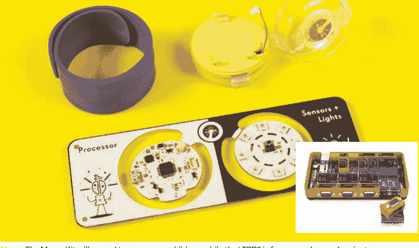

Above Maker Kit 甚至会吸引年幼儿童，而 `TIPP` 则适用于更高级的项目。两款为创制者准备的新套件即将到来，已准备好让编码人员和 Linux 粉丝感到惊喜。

`Say Us` 是 BBC (`micro:bit`) 设计的设计者，已设立 Maker Kit 的启动，该套件基于板载卡来构建他们自己的设备。自 `micro:bit` 时代以来，Maker Kit 最低只要四岁的儿童就可以使用。

> “我们希望参与到那些被遗忘的数字技术制造中，”`TWSU` 联合创始人兼首席执行官 Beth Colby 说，“我们的使命是利用技术激发孩子的创造性想象。我们屡获殊荣的制作套件和数字辅助工具让他们能够进行创作和学习。在投稿时，我们的第一个项目距离资金目标还差 4000 美元，并将持续到 6 月 18 日，网址为 `http://stack.st/X1gG1U`。”

Meason：`Carver Tinker` 宣布其 Linux `Tinker Pro PCB` (`TIPP3`) 基于德州仪器强大的 `1GB: Cortex-A8 Sitara CPU`，拥有 `512MB RAM` 和 `512MB` 闪存，新的 `TIFF3` 板运行着基于 RedHat 的入门级 Linux。`TI Tinker Blocks` 允许你像乐高一样堆叠，并兼容大多数微控制器。你不需要为开发板购买单独的外壳，它可以以多种方式构建，这意味着所需的钻孔、布线和焊接工作更少。

此外，`Tibbo OS` (`TISB05`) 今日也到来，你可以将其作为 Linux 桌面运行。开发环境也集成其中，可以通过 `USB` 和 `WiFi` 访问数据、外部设备和系统。它包含一个专门设计的中端 C 板，还可以通过在板座上安装 `Tibbo` 模块来访问板载功能。你现在可以在 `http://tibbo.com/store/tips/tibb` 获取。

（每日平均访问量，2 月 19 日 – 3 月 16 日）

| 排名 | 发行版 | 访问量 |
| :--- | :--- | :--- |
| 9. | Zorin | 852 |

`filesilo.co.uk`

`www.linuxux.com`

### 采访 GRAYLING

## 关于 Grayling 的获取

让人们参与编程

`Grayling` 的观点，通过 `Raspberry Pi` 几乎一切皆可行。我们采访了他以了解更多

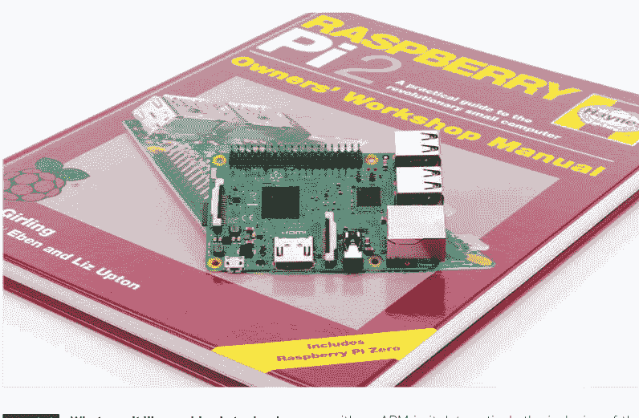

**Grayling**

`Grayling` 博士是德州仪器的系统设计师和通信顾问，自 `Raspberry Pi` 诞生以来就一直参与其中。他是《`Raspberry Pi` 拥有者手册》的作者。

> **在技术发生剧变的那个时代，在那里工作是什么感觉？**
>
> 我很早就开始使用它了，当时是参与树莓派的少数工程师之一。

> **那么你什么时候开始使用树莓派的？你什么时候开始参与树莓派的？**
>
> 我从那时就开始使用了，是德州仪器那些想要制造新芯片的工程师之一。这通常涉及到构建和调试。

> **“当 Grayling 参与树莓派时，它是设备的核心”**

### 开源的性

> **一个重要的方面仅仅是民主化的功能选择。开源软件不受商业利益驱动这一事实是革命性的。**

> **“可能大量的贡献者意味着有许多人在阅读代码。虽然这并不是提高代码质量的唯一方法，但它改进得非常快，而且至少任何人都可以纠正。免费软件的一个大问题是它太容易使用，以至于质量不会下降，而且使用产品总是有成本的。但开发和维护有一些小技巧。一旦投资增长到足以激励用户，当该产品消失时，你将损失资金（无论它是否让你陷入困境），这并不值得相信它能持续良好……这可能是我倾向于尽可能使用 Linux 或其他开源软件的主要原因——因为开源软件是如此容易变得更好。”**

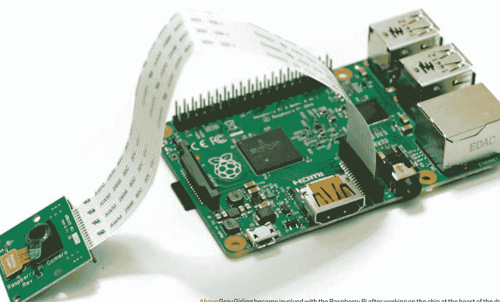

> **“指令和信息。就在我意识到申请了……”**

在你们的书的序言中，`Eben` 和 `Liz Upton` 提到了当时 `ICT` 课程造成的 `ICT` 技能缺口。你是如何应对这些技能的？促使你写这本书的原因是什么？

> **一旦开始，我确实列了一份我想做的清单。我认为如果我能鼓励那些从未考虑过将计算视为创造性机会的人，那就太好了——我还可以鼓励女孩进入这一领域——我可以就此多说一会儿，并谈谈开源软件在世界中极其重要的地位。我会把这本书写得足够详尽，可以作为教材使用，是的，我遗憾我所看到的国家课程在该领域的潜在状态，同时也试图满足那些显而易见的预期。你已经注意到这两个版本都是献给我的孩子的（‘并对此表示歉意’），这直接源于他们的经历……学生交付物包括一个 100% 的”**

> **“我遗憾我所看到的国家课程在该领域的潜在状态”**

自从 `ICT`（信息通信技术）大纲改变以来，情况不会变糟，但我担心我对方面的经验较少，因此批评者的意见可能不像我写第一版时那样针对性。

如今，孩子们已经有了手机，可能还有一台游戏机和一台笔记本电脑——他们不需要另一台电脑了。但问题是，他们并不真正知道自己的笔记本电脑和手机是如何编程的。事实上，游戏在他们生活中的地位已经根深蒂固，这与编程并没有太大关系。

`树莓派 Zero` 极其便宜，甚至一个孩子都能买得起（如果他们能买到的话）。`树莓派` 将占据孩子们在编程和控制一切方面的大，如果他们需要，会有大量的支持。对于那些有爱好并想要独立开发 `IT` 技能的人来说，大门已经敞。只要你有一台 `树莓派`，开始开发自己的 `IT` 技能就足够入门了，这也是我热爱 `树莓派` 的原因。

你曾为 `Actors` 工作，他在 20 世纪 80 年代与 BBC 的教育合作而闻名。你为什么认为我们的节目会改变你当时提到的大纲？

> **自 BBC Micro 以来发生了许多变化，这在本质上是财务上第一次可以在家里拥有一台电脑的时候。最初提出 BBC Micro 的体验与今天在电脑伴随下成长截然不同。那时有了新的一代，但现在只有对从众的接受。**

> **简单来说，家里有一台电脑永远不足以详细理解；但超越任何人的目标是，如果我们想教育下一代，我们必须邀请他们*现在*就开始玩；现在我们必须邀请所有人来玩其中的一些。对于所有这些，制作一些引人入胜的东西并不可能引导他们使用电脑、平板电脑、手机甚至更多（如手机应用）。与此同时，为了这样做的回报，我们付出了。**

> **从以前，人们玩的游戏是平台——接蛇蛇或乒乓球——这是对那种体验的基础复制。那是普通可以实现的。现在，最好的游戏提供了沉浸式的体验，却像单作者或小镇规模的专家在声音、动作、特效、音乐、游戏性、图形等领域创作的莱坞电影一样丰富。**

书中的一个项目解释了如何创建一个对手机推文反应的聊天机器人。这本身就是一个有趣的项目，但由于 `树莓派` 页面充满了大量手工标注的截图，它更加先进，这些截图证明了各种教育成就。例如，作者能够检测并纠正 `Microsoft Word` 中显示的错误信号。一个显示红色波浪线；一个显示建议框；另一个显示更后的文本。

这项工作是枯燥的，在专有软件上进行，并以一种神秘的方式开发，完全与 `IT` 行业脱节……但是，这门课程最关键的方面是这些孩子们渴望了几个小时的机会；孩子们现在会知道编程吗？理解操作系统或编译器如何工作吗？或者对通信有初步了解吗？他们将拥有一个在学校里被避开的话题，并将那些对计算感兴趣的人视为奇怪的外星人。

## 赢取五本《树莓派 2 所有者工作手册》之一

我们将向五位开始接触编程和计算世界的幸运读者送出一本 `Haynes` 出版的最新新书：《`树莓派 2 所有者工作手册`》包含了让你自己的自己的小型电脑启动并运行的逐步指南。

该手册涵盖了 `树莓派 2` 的所有方面，介绍了各种型号以及 `Zero` 型号。通过引导读者完成硬件配置和编程的全过程，该手册提供了一系列“食谱”，展示了 `树莓派 2` 的多功能性。

为了获得机会，请将您的姓名和联系方式发送至 `hello@raspberry.co.uk`，并附上对以下问题的回答：

**树莓派的继任者叫什么？**

- A) Blueberry Pi
- B) Strawberry Pi
- C) Raspberry Pi 2

请标明您的参赛信息：活动于 `2016 年 7 月 27 日` 结束。要了解更多关于 `树莓派 2 工作手册` 的信息，请访问：`www.haynes.co.uk`

> `Haynes` 保留将奖品更换为类似物品（不包括品牌）的权利，且 `Haynes` 或其代理对任何损失或损坏不负责。奖品不能兑换现金。完整的条款和条件可按要求提供。

> `Haynes` 保留将奖品更换为替代材料或特别优惠的权利。如果您没有收到，请与我们联系。

他们仍然是“日常”体验：卧室里的一个青少年在交流方面完全没有任何选择。

游戏也许是现在最相关的程序类型，但各种软件现在都曾被使用。为了获得新创作的回报，新程序员需要跨越的障碍高得多，而且无法实现我们认为的平常之事会令人沮丧。

在本书中，我们采用食谱的方法来解释书中的项目如何相互构建，并让人们能够为使用 `Pi` 创建他们自己的“食谱”/餐计划。为什么要采用这种方法？

> **显然，这与“树莓派”的计划有关，但更多时候它只是生产环境的一个良好比喻。我完全不知道在 176 页的书里对树莓派 2 做什么，所以我认为这是一种不同的方式，通过“食谱”帮助读者完成许多树莓派可以帮助他们做的任何事情（附带一个“餐计划”）。为了避免一本要么太技术或没有提供任何内容的书带来的沮丧感，我增加了更多的餐计划（Pi Web 服务器、YouTube Twitter 和其他在线项目）。**

> **在最前面，我放了一个关于组装新树莓派的章节。这是最基础的。**

`Intel` 开发出了一项新功能，允许内存区域被划分成“飞地”（`enclaves`），这些是通过几次新的后-发布-文件系统迭代生成的私有区域。总的来说，`Stephan` 的补丁受到了广泛好评，主要的关注在于它们依赖于内核解析计时器来测量某些事件中的随机差异。`Intel` 指出，他并不是要在所有遗留系统上追求完美，仅仅是为了避免对现代硬件用户造成性能退化。

来自科技大学和达姆塔特工业大学的一组研究人员希望参与一项关于内核工具使用的的研究调查。该计划是实现一个独立的依赖解析系统并评估您的反馈。您的努力将让我们不胜感激。

许多人对支持如“安全飞地”等功能的发布飞地表示了担忧。目前，`CPU` 无法直接访问飞地。

对于 `Intel` 而言，这意味着其处理器中的新功能允许将内存区域标记为私有，并使用不会在重启后保留的加密密钥在芯片内存接口处加密。可以访问飞地区域（或修改代码），该区域可能也位于容器或轻量级虚拟机内部。这项功能将允许飞地以一种黑客难以测定的方式存储加密密钥和算法，从而提高安全性。

虽然 `SGX` 是一个很好的功能，但内核社区的成员对当前的实现表示了担忧。出货合作伙伴（之前的共识）中的当前实现并不要求代码是经过签名的应用程序。在飞地内部执行之前，它由 `Intel` 签名。

这种限制似乎在不久后将会消失。“一处全处”模型特定寄存器（`Model Specific Register`）的引入最终将允许内核在启动时向硬件加载新的信任根。在此之前，它非常依赖信任，且只有那些签署了代码的人可以使用它。此功能在合并到上游之前将由各种开发者进行测试。

最后，`Grant Likely` 宣布 `TAB` 最近举行了新一轮主席选举。`Chris Tabor` 接替他担任主席，并继续担任成员。`TAB` 在 `Linux` 基金会中代表内核社区，并对潜在的策略变更提供某种程度的保护，而开源开发者们可能并未意识到这些变化。因此，得知 `Chris Tabor` 将接任主席是一件好事：`Chris` 是 `Facebook` 内核团队的作者，也被认为负责该团队。

`www.linuxuser.com` | 13

# 使用 micro:bit 制作

了解 BBC `micro:bit` 是什么，从他人已经构建的内容中获得灵感，并通过五个令人兴奋的项目开发你自己的编程技能

`micro:bit` 处理能力的核心是一个小型嵌入式 `ARM` 微控制器，它具有 `128KB` 的闪存内存和充足的 `RAM` 内存

输入和输出（`I/O`）引脚支持将额外的线路和硬件组件（如蜂鸣器）连接到 `micro:bit`，以扩展其功能

该传感器检测磁场并利用读数计算 `micro:bit` 指向的方向。它也可以用于计算北并创建一个简单的指南针。

当移动 `micro:bit` 时，该传感器测量速度变化的快慢。这用于计算加速度，并可以控制游戏中的玩家方向

## micro:bit 项目

使用按钮 A 或按钮 B 控制游戏和程序中的用户交互。这两个按钮都可以通过组合编排并按下，为你提供第三种输入选项 `A + B`

使用 `25` 颗红色 `LED` 用于显示简单图像、滚动消息，甚至创建基础动画

`http://bit.ly/1T9sSwHw`

通过创建自己的步计来跟踪和监控你每天走的步数。使用内置的加速度计和 `LED`。将其系在腿上并检查 `micro:bit` 的显示。


### 音乐水果

`http://bit.ly/273Y`

使用内置的加速度计和 `LED`。将 `micro:bit` 显示连接到未来。通过蓝牙连接到 `micro:bit` 制作音乐乐器。


### 计分板

`http://bit.ly/T9S6`

通过 `micro:bit` 制作计分板，让 `micro:bit` 触发音乐乐器或音乐乐器。


`http://bit.ly/3Y9W`

通过蓝牙功能编程，让 `micro:bit` 预测未来。


当你移动 `micro:bit` 时，该传感器测量速度变化的快慢。这用于计算加速度，并控制游戏中的玩家方向。

## micro:bit 项目

使用按钮 A 或按钮 B 控制游戏和程序中的用户交互。这两个按钮都可以通过组合编排并按下，为你提供第三种输入选项 `A + B`

### 5x5 LED 矩阵

`225` 颗红色 `LED` 用于显示简单图像、滚动消息，甚至创建基础动画

通过蓝牙功能编程，让 `micro:bit` 预测未来。

通过蓝牙功能编程，让 `micro:bit` 预测未来。

通过蓝牙功能编程，让 `micro:bit` 预测未来。

通过蓝牙功能编程，让 `micro:bit` 预测未来。

通过蓝牙功能编程，让 `micro:bit` 预测未来。

通过蓝牙功能编程，让 `micro:bit` 预测未来。

通过蓝牙功能编程，让 `micro:bit` 预测未来。

通过蓝牙功能编程，让 `micro:bit` 预测未来。

通过蓝牙功能编程，让 `micro:bit` 预测未来。

通过 `bit` 项目，让

通过功能功能编程，让。-bit 预测未来。

通过蓝牙功能编程，让 `micro:bit` 预测未来。

通过蓝牙功能编程，让 `micro:bit` 预测未来。

通过蓝牙功能编程，让 `micro:bit` 预测未来。

通过蓝牙功能编程，让 `micro:bit` 预测未来。

通过蓝牙功能编程，让 `micro:bit` 预测未来。

通过蓝牙功能编程，让 `micro:bit` 预测未来。

通过蓝牙功能编程，让 `micro:bit` 预测未来。

通过蓝牙功能编程，让 `micro:bit` 预测未来。


通过蓝牙功能编程，让 micro-bit 预测未来。


通过蓝牙功能编程，让......

Chris is author of and also known as responsible for Facebook's kernel team.


Intel 开发出了一项新功能，允许内存区域被划分成“飞地”（enclaves），这些是通过几次新的后-发布-文件系统迭代生成的私有区域。总的来说，Stephan 的补丁受到了广泛好评，主要的关注在于它们依赖于内核解析计时器来测量某些事件中的随机差异。Intel 指出，他并不是要在所有遗留系统上追求完美，仅仅是为了避免对现代硬件用户造成性能退化。

来自科技大学和达姆塔特工业大学的一组研究人员希望参与一项关于内核工具使用的研究调查。该计划是实现一个独立的依赖解析系统并评估您的反馈。您的努力将让我们不胜感激。

许多人对支持如“安全飞地”等功能的发布飞地表示了担忧。目前，CPU 无法直接访问飞地。

对于 Intel 而言，这意味着其处理器中的新功能允许将内存区域标记为私有，并使用不会在重启后保留的加密密钥在芯片内存接口处加密。可以访问飞地区域（或修改代码），该区域可能也位于容器或轻量级虚拟机内部。这项功能将允许飞地以一种黑客难以测定的方式存储加密密钥和算法，从而提高安全性。

虽然 SGX 是一个很好的功能，但内核社区的成员对当前的实现表示了担忧。出货合作伙伴（之前的共识）中的当前实现并不要求代码是经过签名的应用程序。在飞地内部执行之前，它由 Intel 签名。

这种限制似乎在不久后将会消失。“一处全处”模型特定寄存器（Model Specific Register）的引入最终将允许内核在启动时向硬件加载新的信任根。在此之前，它非常依赖信任，且只有那些签署了代码的人可以使用它。此功能在合并到上游之前将由各种开发者进行测试。

最后，Grant Likely 宣布 TAB 最近举行了新一轮主席选举。Chris Tabor 接替他担任主席，并继续担任成员。TAB 在 Linux 基金会中代表内核社区，并对潜在的策略变更提供某种程度的保护，而开源开发者们可能并未意识到这些变化。因此，得知 Chris Tabor 将接任主席是一件好事：Chris 是 Facebook 内核团队的作者，也被认为负责该团队。

www.linuxuser.com | 13

# 使用 micro:bit 制作

了解 BBC micro-bit 是什么，从他人已经构建的内容中获得灵感，并通过五个令人兴奋的项目开发你自己的编程技能

micro-bit 处理能力的核心是一个小型嵌入式 ARM 微控制器，它具有 128KB 的闪存内存和充足的 RAM 内存

输入和输出（I/O）引脚支持将额外的线路和硬件组件（如蜂鸣器）连接到你的 micro:bit，以扩展其功能

## 磁力计

该传感器检测磁场并利用读数计算 micro-bit 指向的方向。它也可以用于计算北并创建一个简单的指南针。

## 加速度计

当移动 micro-bit 时，该传感器测量速度变化的快慢。这用于计算加速度，并可以控制游戏中的玩家方向

## 按钮

micro:bit 项目

使用按钮 A 或按钮 B 控制游戏和程序中的用户交互。这两个按钮都可以通过组合编排并按下，为你提供第三种输入选项 A + B

## 5x5 LED 矩阵

使用 25 颜色的红色 LED 用于显示简单图像、滚动消息，甚至创建基础动画

四个趣味且富有启发的项目来展示功能和特性的

### 计数器

http://bit.ly/1T9sSwHw

通过创建自己的步计来跟踪和监控你每天走的步数。使用内置的加速度计和 LED。将其系在腿上并检查 micro-bit 的显示。


### 音乐水果

http://bit.ly/273Y

通过蓝牙连接到 micro-bit 制作音乐乐器。


### 计分板

http://bit.ly/T9S6

通过 micro-bit 制作计分板，让 micro-bit 触发音乐乐器或音乐乐器。


### 预言者

http://bit.ly/3Y9W

通过蓝牙功能编程，让 micro-bit 预测未来。


# 语言与编辑器

选择一种符合你需求的编程语言。


# 代码王国

JavaScript

www.microsoft.co.uk/its

这是一种拖放式编辑器，你可以选择代码块并将它们拖到任何你想要的地方，用此构建你的程序。你可以根据程序的开发进度，在代码块和纯文本之间切换。这使得它最适合初学者。

# 微软块编辑器

块编辑器

http://github.com/spfx72

块编辑器是一个高级的可视化拖放界面，你可以在其中将代码行吸附在一起。它允许创建函数和属性，让你能够创建更复杂的逻辑和控制。你还可以将代码转换为完全兼容的 Touch Developer。

## Touch 开发者

www.microsoft.co.uk/td/contents

Touch Developer 既是一种基于文本的编辑器，专为触摸屏设计。它适用于包括手机和平板电脑在内的一系列设备。它还支持键盘和鼠标输入，并支持广泛的功能和代码。

## MicroPython

http://github.com/micropython

MicroPython 是一种为微控制器设计的基于文本的编辑器，准备好让你的编程技能更进一步。有大量的代码“片段”和库可以帮助你开发项目。

内置蓝牙智能技术允许你连接手机、笔记本电脑或平板电脑等其他设备。你可以连接微控制器创建自己的物联网。

连接到 Windows 或 Mac 电脑时，使用 MicroUSB 连接板。这允许你将程序下载或“烧录”到微控制器，并从中检索电脑。

此接口允许你将包含两个 AA 电池的外部电池包连接到板上。这使得你的微控制器可以外部运行程序。

www.linuxuser.co.uk 17

# micro:bit 对比树莓派

BBC 的开发板与领先的单板计算机（SBC）相比如何？

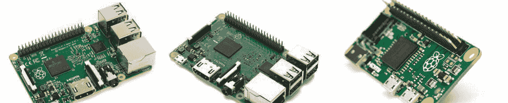

## 树莓派 2

- CPU: 800MHz 32位四核 ARM Cortex-A7
- GPU: 博通 VideoCore IV
- RAM: 1GB（与 GPU 共享）
- 网络: 10/100 Mbit/s 以太网适配
- 端口: USB x4、HDMI、复合视频、3.5mm 音频接口
- 编程语言: Python, BBC BASIC, C++, Java, Perl, Ruby, Squeak, Smalltalk
- 额外功能: SPI, DPI

## 树莓派 3

- CPU: 1.2 GHz 64位四核 ARM Cortex-A53
- GPU: 博通 VideoCore IV
- RAM: 1GB（与 GPU 共享）
- 网络: 10/100 Mbit/s 以太网、802.11n
- GPIO: 17
- 端口: USB x4、HDMI、复合视频、3.5mm 音频接口
- 存储: MicroSD
- 编程语言: Python, BBC BASIC, C++, Java, Perl, Ruby, Squeak, Smalltalk
- 额外功能: SPI, DPI

## 树莓派 Zero

- CPU: 1 GHz ARMv6-28S1 单核
- GPU: 博通 VideoCore IV
- RAM: 512 MB（与 GPU 共享）
- 网络: 无
- GPIO: 0
- 端口: microUSB x1、mini-HDMI、复合视频/音频
- 存储: MicroSD
- 编程语言: Python, BBC BASIC, C++, Java, Perl, Ruby, Smalltalk
- 额外功能: SPI, DPI

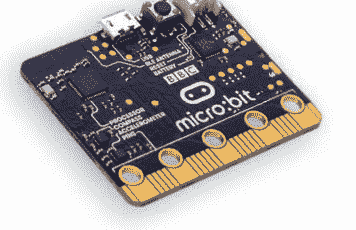

## micro:bit

- CPU: 16 MHz ARM Cortex-M0
- GPIO: 无
- RAM: 16KB
- 网络: 2.4 GHz 蓝牙无线网络
- GPIO: 17
- 存储: 256 KB 闪存
- 编程语言: Python, JavaScript, micro:bit 编辑器, Make Touch Designer
- 额外功能: 加速度计、磁力计、LED


## 结论

从纸面参数来看，microbit 在大多数领域的功率甚至低于树莓派 Zero，但在某些情况下，它可以开箱即用完成更多任务，这使得它非常适合像这样的孩子。板载的磁力计对于电子初学者来说具有额外功能（这些功能不需要额外添加）。程序可以轻松完成并烧录到其状态存储器中执行，而其边缘连接可以到各种外围设备（这在很大程度上弥补了它标准端口的缺失）。虽然所有的树莓派在直接的基准测试中都会更好，但它的低速度和低功耗非常适合初学者，因为它并不复杂。但它是一台令人惊讶的微型机器，能够做到的事情比树莓派能做的更多——事实上，microbit 拥有足够的功能来作为市场领导者进行竞争。受它们在上面可以创造出内容的启发，最近 microbit 就像是使用 BBC 的微控制器来开展那些受到受限且升级的树莓派项目。

# 使用 microbit 的五个项目

每个项目都向你展示如何以不同的方式使用 microbit。

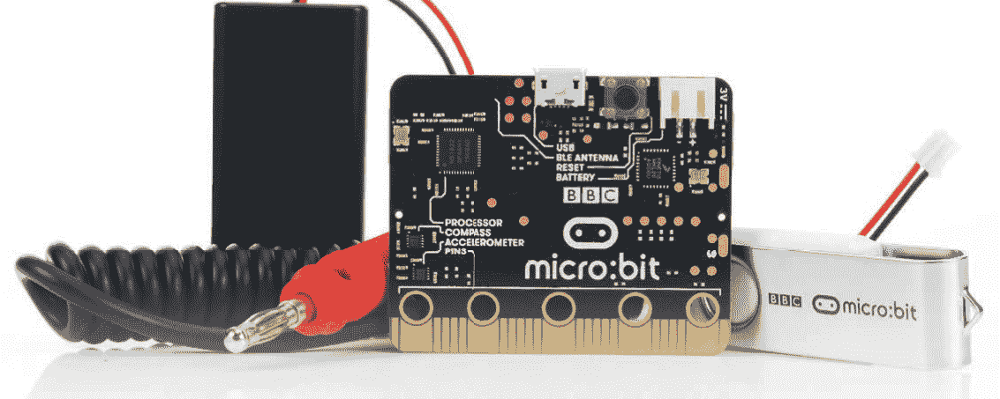

## 项目一：设置 microbit

我们向你展示如何以不同的方式使用 microbit。打开浏览器并导航到 microbit.org。在屏幕顶部选择编辑器。你可以选择不同的编程语言。

### 01 设置 microbit

打开浏览器并导航到 microbit.org。在屏幕顶部选择编辑器。你可以选择不同的编程语言。

### 02 添加按钮按下

选择`输入`块。

### 03 编写表情

接下来，编写你希望按下按钮 A 时让 microbit 执行的操作。这将在 LED 矩阵上显示一个脸部。400ms 指的是显示图像的时间。

```javascript
function main() {
    input.onButton(Button.A, function () {
        led.showString("HELLO")
        pause(4000)
    })
}
```


### 04 测试

现在运行你的脚本并测试它是否正常工作。在屏幕顶部选择运行按钮。这将为屏幕右侧的 microbit 模拟器准备你的脚本。当加载完成后，按下“按钮 A”，它将显示你在第 3 步中创建的图像。

### 05 编译

将脚本从高级编程语言转换为机器码，使其与处理器兼容。点击屏幕底部的编译按钮，开始编译并下载文件。

### 06 传输到你的 microbit

使用 USB 线将 microbit 连接到电脑并打开 microbit 文件夹；将编译后的代码拖入该文件夹中（代码通常保存到你的下载文件夹）。microbit 背面的 LED 指示灯在程序写入设备时会闪烁。它已准备好使用；只需按下按钮 A 即可。

## 项目二：让你的 micro:bit 动起来


```
script text and animation
function main() {
  input on button pressed(A) do
    basic -> show string
    show number(150)
  end
end
```

```
script text and animation
function main() {
  input on button pressed(A) do
    basic -> show string
    show number(150)
  end
end
```

### 01 添加一些文本

像你在上一个项目中一样设置一个新脚本，并为第三个脚本命名。接下来选择“按按钮按下？”（`input on button pressed?`）。会显示默认按钮 A。接着下一行，选择“基础”（`basic`）模块，这将允许你选择“显示字符串”（`show string`）选项。添加你的句子，例如，“我能写按钮代码”。

### 02 添加动画

现在添加按钮 B，其代码结构与步骤 1 相同。但在添加此内容之前，请确保使用“end”代码关闭了之前的代码。最简单的方法是选择加号来添加新行。点击“输入”（`input`）模块和“按按钮按下”，但现在选择“按钮 B”。然后点击“基础”（`basic`）和“显示动画”（`show animation`）；这将打开窗口。


```
script text and animation
function main() {
  input on button pressed(A) do
    basic -> show string
    show number(150)
  end
end
```

```
script text and animation
function main() {
  input on button pressed(A) do
    basic -> show string
    show number(400)
  end
  input on button pressed(B) do
    basic -> show string
    show number(120)
  end
end
```


### 03 创建你的动画

使用界面通过开启和关闭 LED 来构建你的动画。选择屏幕上的模块以添加另一帧，然后编辑 LED。你将看到 micro:bit 的 LED 发生变化，绘制出该帧。这类似于翻书，每一帧都构成了最终的运动图像的幻象。界面在右上角还提供了你动画的预览。更改时间值可以使动画变慢或变快。

### 04 运行、测试和下载

可以通过 B 添加另一个按钮，并添加另一个进行响应。项目的最后部分是使用“运行”（`Run`）功能将你的程序加载到 microbit 模拟器上。你现在可以排列按钮并确保它们工作正常。通过 USB 连接将你的 microbit 连接到电脑。这将向 micro:bit 加载设备；将步骤 5 中编译好的代码拖到下载文件夹（代码通常保存在你的下载文件夹中）。回到 micro:bit，当程序被写入设备时，LED 指示器将闪烁。

www.luxuser.co.uk | 21

## 项目三：创建一个电子骰子

### 01 摇一摇

该项目利用加速度传感器，该传感器用于测量 microbit 的运动。它侧重于识别摇晃和移动，并在 LED 屏幕上显示随机生成的数字。创建一个脚本并根据需要重命名。使用“输入”（`input`）模块选择“摇晃”（`on shake`），设置 LED 持续 150 毫秒，并在摇晃它时做出响应。

### 02 随机数

它需要能够选择一个一到六之间的随机数。点击括号中的数字“1”，然后从模块中点击“数学”（`maths`），然后点击“随机”（`random`）。假设你选择输入值 6，则留下“0”（用于骰子没有落正的其他游戏）作为选择选项，即骰子没有落在正面上。

### 03 显示数字

在下方的一行选择“基础”（`basic`）和“显示数字”（`show number`）。代码将默认在 LED 上显示该数字 150 毫秒。你可以通过点击“运行”按钮并使用屏幕右侧的模拟器来测试这一点。

### 04 运行、测试和收集

你的程序通过点击“运行”加载模拟器来工作。你会发现“摇晃”microbit 的选项已启用。使用它来测试代码是否正确。然后编译、下载并将文件拖到你的 microbit 中。加载完成后，摇动 microbit 来掷点数。

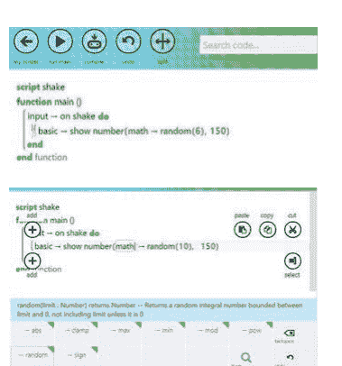

```
function shake () {
  input on shake {
    show number (random range 1 to 6)
  }
}
function start ()
```

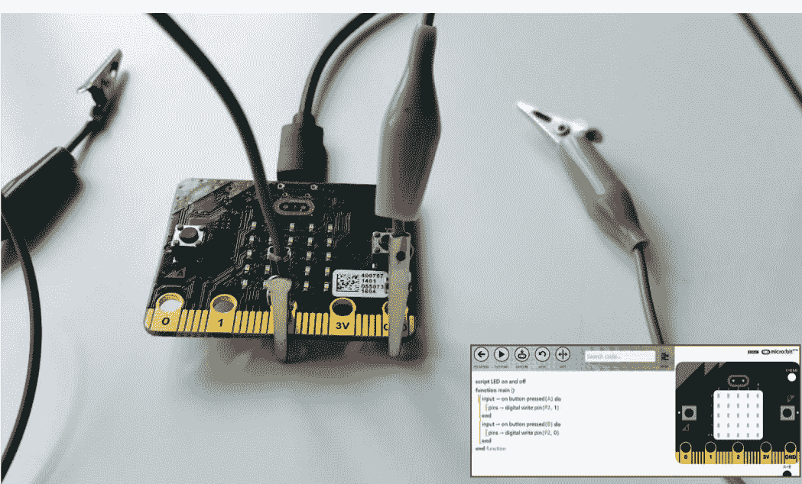

## 项目四：制作并编写简单的 LED 手电

### 01 连接线

拿起你的 microbit，将其从任何连接的设备上取出。同时也删除电池盒。取两根线，将一个连接到上方的引脚孔并确保连接牢固。现在点击脚本，使第二根线连接在标记为 GND 的引脚上。

### 02 将 LED 连接到线

在将 LED 连接到线时，将 LED 连接到地是非常重要的。这也被称为“正极”——使用鳄鱼夹将此线连接到引脚 2，以固定 LED 位置。现在选择 GND 引脚并编写脚本进行控制。

### 03 创建代码

开始一个新脚本并将其改为更合适的（容易记忆的）！按钮 A 用于开启 LED。当按下按钮时，它会写入引脚，通过连接到 LED 的附件发送一小电流。

### 04 开启 LED

点击“引脚”（`pin`）模块，这将调出“数字写入”（`digital write`）选项。然后，输入要写入的引脚编号：将值从 P0 更改为 P2。选择引脚 2。数字后的值代表引脚的状态（0 表示关闭，1 表示开启）。将值更改 1 将在按下按钮 A 时触发电流。

### 05 关闭 LED

要关闭它，使用与上面相同的模块结构，但将值替换为“0”。

### 06 编译并测试

编译、下载并查看 micro:bit。加载后，确保工作正常。

## 项目五：使用 micro:bit 作为指南针


```javascript
function main() {
  while (true) {
    let degree = microbit.compass();
    if (degree < 45) {
      degree += 360;
    } else if (degree > 315) {
      degree -= 360;
    }
    microbit.showNumber(degree);
  }
}
```

### 01 校准

第一步是校准 micro:bit。使用“输入”（`input`）模块进行校准。

### 02 循环和变量

使用“循环”（`forever`）模块持续检查。创建一个变量来存储角度。

### 03 为变量添加数据

在循环中获取指南针角度。


```javascript
function main() {
  while (true) {
    let degree = microbit.compass();
    if (degree < 45) {
      degree += 360;
    } else if (degree > 315) {
      degree -= 360;
    }
    microbit.showNumber(degree);
  }
}
```

### 04 寻找北极

现在对小于 45 度的情况做出响应。

```javascript
if (degree < 45) {
  degree += 360;
}
```

### 05 显示文本或图像

接下来，在“if”语句中添加一个“否则”（`else`）模块。选择“基础”（`basic`）模块并使用“文本”（`text`）模块输入“N”。运行程序，当你移动 micro:bit 时将显示 N。


### 06 东方和南方

接下来的两个项目逻辑与步骤 5 相同，但不是“if”。使用“if”语句显示“E”代表东方。使用另一个“else if”语句，添加“if”语句和角度。

```javascript
if (degree < 135) {
  microbit.showString("E");
} else if (degree < 225) {
  microbit.showString("S");
}
```

### 07 西方

最后一个项目西方不需要测量，因为该角度不是之前的三个之一。使用西方，像之前一样使用“否则”（`else`）判断；此时不需要添加“if”模块。测试你的代码，然后编译并下载到你的 microbit。

# 探索内部科技

## www.gadgetdaily.xyz

赢取 1000 英镑海信超高清智能电视

# Gadget（小配件）


年度最佳

可穿戴设备指南

# 30

# 穿戴科技必备清单

# Gadget

现热售中

30 款穿戴设备必备清单 ■ 自飞无人机 ■ GoPro 指南

+ 最酷的套件 | 技术拆解 | 购买建议 | 科学释义 | 操作指南


# 今日购买您的刊号

### 纸质版见 www.imagineshop.co.uk

数字版见 www.greatdigitalmags.com

可在以下平台获取。

facebook.com/gadgetdaily | twitter.com/xgadget_magdaily

# Linux 用户与开发者特别订阅优惠

# 订阅即省 30%

OPENWRT：将你的 Pi 变为路由器


每 3 期仅需 12.50 英镑

# 使用 micro:bit 制作


# 密码管理

## 使用开源工具管理您的密码

### 学习如何使用流行的密码管理工具：`Pass`、`Vaultier`、`Padlock` 和 `Password Safe`


作为互联网用户，我们许多人都在为登录苦恼。每天在回忆和重置密码的过程中浪费了数千小时。采用率很低的原因是，用户往往意识不到自己的弱点。即使意识到了，顾虑通常也会阻碍他们使用良好的密码管理器，或轻松创建难以猜测的密码，而且让你为所有账户设置不同的密码并定期更改。

`Pass` 也可以将加密密码保存在存储库中，如果你选择那样设置的话。

需要提到的是 `Pass` 不对你的数据施加任何特定的方案或组织，因为它只是纯文本文件，可以包含任意数据。`Pass` 允许的不仅仅是密码，还有秘密问题的答案。如果你在 Fedora 或相关的 Linux 发行版上使用，只需打开终端并运行：

```bash
sudo apt install pass
```

如果你使用的是基于 Debian 的发行版，请运行：

```bash
sudo apt-get install pass
```

一旦你成功安装了 `Pass`，你需要创建一个 GPG 密钥。为了这一点，运行：

```bash
gpg --gen-key
```

然后你可以按照提示操作；如果有疑问，接受默认值。最初通过以下命令初始化 `Pass`：

```bash
pass init <GPG-ID>
```

将 `<GPG-ID>` 替换为创建 GPG 密钥时使用的用户 ID。

#### 资源

- **Password Store**: https://passstore.org/
- **Vaultier**: http://www.padlock.io/

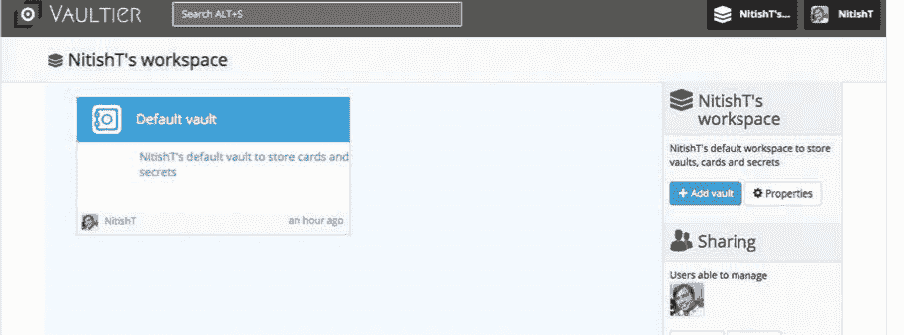

> `Pass` 不对你的数据施加任何特定的方案或类型组织，因为它只是纯文本文件，可以包含任意数据。

## 使用 Pass 迁移密码

虽然 `Pass` 是一个简单的工具，但 `Vaultier` 是一个带有浏览器界面的功能全密码管理器。`Vaultier` 带有许多功能，例如在团队内运行的能力。`Vaultier` 同样支持 `PostgreSQL` 作为底层数据库，并使用 `nginx` 作为应用程序的代理服务器。此外，还有一些东西，扩展需要安装。首先，让我们创建安装目录和 `vaultier`：

```bash
mkdir -p /opt/vaultier
cd /opt/vaultier
```

然后，安装所需的系统和部署工具：

```bash
sudo apt install postgresql-contrib
sudo apt install postgresql-server-dev
sudo apt install nginx
sudo apt install supervisor
sudo apt install weasel
sudo apt install python3-virtualenv
sudo apt install python-dev
```

一旦所有这些成功安装，创建并激活你的虚拟环境：

```bash
virtualenv venv
source /opt/vaultier/venv/bin/activate
```

最后安装 `Vaultier`：

```bash
pip install vaultier
```

```bash
export PADLOCK_PATH="$PATH:/opt/vaultier/usr/local/lib/python2/site-packages/vaultier"
```

然后更新你的环境变量。

让我们配置配置文件。将路径更改为 `/opt/vaultier` 目录，然后运行命令：

```bash
vault init
```

系统会提示你进入 `PostgreSQL` 提示符；询问你想要放置主机、数据库和数据库类型。现在检查所有设置是否设置正确。

```bash
vault dbcheck
```

然后检查数据库连接，运行。这应该带你进入 `PostgreSQL` 提示符；表示数据库连接成功。通过提示 `q` 来创建库。运行创建数据库表：

```bash
vault setup
```

然后开始使用 `Vaultier`。

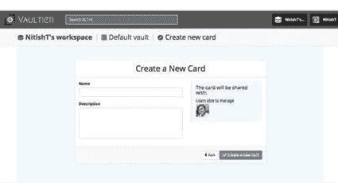

你应该能够在浏览器中通过 `localhost:8009` 访问 `Vaultier`。

### 使用 Vaultier

你可以在浏览器中看到登录/注册页面以访问 `Vaultier`。创建账户以登录系统。库是存储卡片的逻辑容器。`Vault` 列出了你所有的库。如果你是第一次来到这里，只会看到“默认库”（Default Vault）。点击库以显示存储的所有卡片。

里面有逻辑容器，可以存储你的秘密信息，如密码、备注或大小不超过 25KB 的文件。默认情况下没有卡片，点击页面右侧的“添加卡片”（Add card）按钮向你的库中添加卡片。你可以将库（vaults）视为文件夹，将卡片（cards）视为存储数据的表格页。

一旦你在库中有了数据，可以使用页面右下角的“邀请”（Invite）和“团队”（Team）按钮来邀请或管理你的团队。

## 连接到 Padlock 云

`Padlock` 允许你跨所有设备同步数据。它默认是未启用的。要启用 `Padlock` 云，请点击 `Padlock` 中的三道线菜单图标，然后选择“连接到云”（Connect to Cloud）。在弹出的表单中，只需填写你的电子邮件和设备名称并点击。

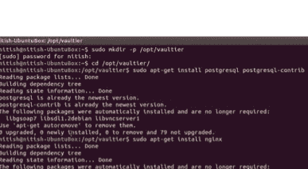

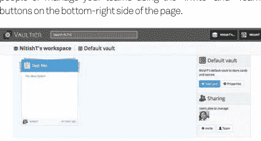

`Padlock` 是一个极简的开源密码管理器。作为 Chrome 应用、iOS 和 Android 应用，`Padlock` 只提供了最核心的功能。你可以在 Chrome 商店中找到“Padlock”。

`Padlock` 还可以作为 `padlock Cloud` 服务提供，允许你跨多个设备方便地同步密码数据。当你通过云端连接到 `Padlock` 时，只需输入你的电子邮件地址。每当你想要将设备连接到 `Padlock` 云时，它将通过发送确认链接来用于身份验证。

`Padlock` 会在你的服务器上创建数据的加密版本，然后你可以从任何安装了 `Padlock` 的设备上对其解密。你的数据在离线或连接时都会被加密和解密。

如果你使用 Chrome，安装 `Padlock` 非常简单，检查 Chrome 商店并搜索 `Padlock`。一旦找到，只需点击安装。它也可以通过各自的应用商店安装在 Android 或 iOS 设备上。安装后，通过应用启动在 Chrome 中启动 `Padlock`。

作为 Chrome 应用以及在 iOS 和 Android 上提供，`Padlock` 仅提供了最核心的功能。`Padlock` 中可能“缺失”某些功能，但这是设计使然。

### 使用 Padlock

`Padlock` 在密码管理上采用了极简的方法，但具备所有非常重要的功能。此外，`Padlock` 的 UI 非常极简，因此所有选项几乎都隐藏在流畅的 UI 之后。当你通过 Chrome 应用启动启动 `Padlock` 时，系统会要求你输入密码。如果是第一次使用，你将被引导至重新输入密码。

一旦确认了密码，你将被带到主库。在这里，你有选项导入密码、创建新条目、管理备份并恢复它们。同步选项允许在你创建免费云端账户时同步所有设备的数据。你还可以创建记录（Record），这样你就可以使用用户 ID 在设备上的 `Padlock` 上添加密码。

在添加密码时，你还可以使用密码生成器。它可以自动生成经过微调的强密码，包含特定数量的特殊字符、数字和大写字母。`Padlock` 还带有“锁定应用”（Lock App）功能，让你只需一键即可锁定 `Padlock`。

## Password Safe

`Password Safe` 是一个基于 Windows 的独立工具，帮助你轻松管理密码。它允许你将密码存储在安全的（即密码数据库）中，为一个人或多个人的不同目的创建多个数据库。需要注意的是，每个数据库都是独立的，可以移动并在不同的计算机上使用。`Password Safe` 安装在系统中。密码使用从主密码派生的加密密钥进行加密。然而，主密码并不存储在数据库中。

`Password Safe` 安装是一个 Windows exe 文件，双击即可安装。在安装过程中，系统会询问你是否想选择“常规安装”（Regular installation）。“绿色常规”（Green Regular）字面意思是——绿色安装意味着软件利用独立的 USB 闪存设备以确保密码的可移植性，并且不依赖 Windows 注册表。这有助于确保你完全防止任何与注册表相关的攻击。


### 使用 Password Safe

打开 `Password Safe` 后，你会看到一个标记为“打开数据库”（Open Database）的文本字段，可以用于打开数据库。当你第一次使用它时，会引导你输入密码。

一旦确认了密码，你将被带到主库。在这里，你有选项导入密码、创建新条目、管理备份并恢复它们。同步选项允许在你创建免费云端账户时同步所有设备的数据。你还可以创建记录，这样你就可以使用用户 ID 在设备上的 `Padlock` 上添加密码。

在添加密码时，你还可以使用密码生成器。它可以自动生成经过微调的强密码，包含特定数量的特殊字符、数字和大写字母。`Padlock` 还带有“锁定应用”功能，让你只需一键即可锁定 `Padlock`。

# 使用 ss 调查网络套接字

可以来自整个网络的数据，这在进行安全审计时非常有用。配合 `-l` 命令告诉我们显示列表——它将其标记为 `UNCONN`。

```bash
ss -at
```

| State | Recv-Q | Send-Q | Local Address:Port | Peer Address |
| :--- | :--- | :--- | :--- | :--- |
| LISTEN | 0 | 0 | 127.0.0.1:6310 | *:* |
| LISTEN | 0 | 0 | 127.0.0.1:6311 | *:* |
| LISTEN | 0 | 0 | 127.0.0.1:6312 | *:* |
| LISTEN | 0 | 0 | 127.0.0.1:6313 | *:* |
| LISTEN | 0 | 0 | 127.0.0.1:6314 | *:* |
| LISTEN | 0 | 0 | 127.0.0.1:6315 | *:* |
| LISTEN | 0 | 0 | 127.0.0.1:6316 | *:* |
| LISTEN | 0 | 0 | 127.0.0.1:6317 | *:* |
| LISTEN | 0 | 0 | 127.0.0.1:6318 | *:* |
| LISTEN | 0 | 0 | 127.0.0.1:6319 | *:* |
| LISTEN | 0 | 0 | 127.0.0.1:6320 | *:* |
| LISTEN | 0 | 0 | 127.0.0.1:6321 | *:* |
| LISTEN | 0 | 0 | 127.0.0.1:6322 | *:* |
| LISTEN | 0 | 0 | 127.0.0.1:6323 | *:* |
| LISTEN | 0 | 0 | 127.0.0.1:6324 | *:* |
| LISTEN | 0 | 0 | 127.0.0.1:6325 | *:* |
| LISTEN | 0 | 0 | 127.0.0.1:6326 | *:* |
| LISTEN | 0 | 0 | 127.0.0.1:6327 | *:* |
| LISTEN | 0 | 0 | 127.0.0.1:6328 | *:* |
| LISTEN | 0 | 0 | 127.0.0.1:6329 | *:* |

左侧 `ss` 显示 IPv4 和 IPv6 协议，除非你指定其中之一，否则它将显示两者。使用不带命令行参数的 `ss` 会更简单，这将导致一个更长且流行的连接列表。

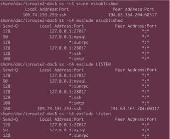

你对 `ss` 输出的过滤越多，它显示的数据就越多。

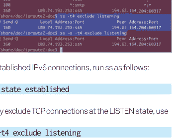

其他可以帮助你监控和测试网络连接的工具包括 `nmap`、`netstat`。

所以，问题在于：通用原则是选择包含你所有所需特征的一个。如果你在两个工具之间进行选择，`ss` 是较新的，因为它访问了 Linux 内核的功能。

## 按 TCP 状态过滤

`TCP` 连接可能有许多不同的状态，因此你可能希望按状态进行过滤，或排除通过标识符找到关键字。状态过滤器显示与标识符匹配的输出，而排除关键字则排除不匹配的输出。

可用的状态有：`syn-sent`、`syn-recv`、`fin-wait-1`、`fin-wait-2`、`time-wait`、`closed`、`close-wait`、`last-ack` 和 `closing`。因此，要查看所有已建立的 IPv4 连接，你应该执行：

```bash
ss -t4 state established
```

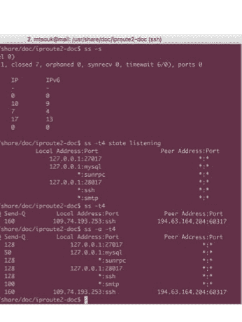

如果你使用以下变体，将显示处于 `LISTENING`（监听）状态的 tcp 连接：

```bash
ss -t4
```

配合 `-o` 选项使用 `ss` 可以显示有关当前连接的用用统计信息：

```bash
ss -o
```

## 按 IP 地址和端口号过滤

要专门排除处于 `LISTENING` 状态的 TCP 连接：

```bash
ss -t6 state established
```

对 `ss` 输出的过滤越多，你获得的信息越多，你需要检查某些 IP 地址和端口连接的工作就越少。以下命令显示源端口或目的端口为：

```bash
ss -at '(dport = :80 or sport = :80)'
```

或者，你可以使用以下命令：


## 网络端口监听状态

| State | Recv-Q | Send-Q | Local Address:Port | Peer Address:Port |
| :--- | :--- | :--- | :--- | :--- |
| LISTEN | 0 | 0 | 127.0.0.1:6330 | *:* |
| LISTEN | 0 | 0 | 127.0.0.1:6331 | *:* |
| LISTEN | 0 | 0 | 127.0.0.1:6332 | *:* |
| LISTEN | 0 | 0 | 127.0.0.1:6333 | *:* |
| LISTEN | 0 | 0 | 127.0.0.1:6334 | *:* |
| LISTEN | 0 | 0 | 127.0.0.1:6335 | *:* |
| LISTEN | 0 | 0 | 127.0.0.1:6336 | *:* |

```bash
$ ss -ltn
```

| State | Recv-Q | Send-Q | Local Address:Port | Peer Address:Port |
| :--- | :--- | :--- | :--- | :--- |
| LISTEN | 0 | 0 | 127.0.0.1:6310 | *:* |
| LISTEN | 0 | 0 | 127.0.0.1:6311 | *:* |
| LISTEN | 0 | 0 | 127.0.0.1:6312 | *:* |
| LISTEN | 0 | 0 | 127.0.0.1:6313 | *:* |
| LISTEN | 0 | 0 | 127.0.0.1:6314 | *:* |
| LISTEN | 0 | 0 | 127.0.0.1:6315 | *:* |
| LISTEN | 0 | 0 | 127.0.0.1:6316 | *:* |
| LISTEN | 0 | 0 | 127.0.0.1:6317 | *:* |
| LISTEN | 0 | 0 | 127.0.0.1:6318 | *:* |
| LISTEN | 0 | 0 | 127.0.0.1:6319 | *:* |
| LISTEN | 0 | 0 | 127.0.0.1:6320 | *:* |
| LISTEN | 0 | 0 | 127.0.0.1:6321 | *:* |
| LISTEN | 0 | 0 | 127.0.0.1:6322 | *:* |
| LISTEN | 0 | 0 | 127.0.0.1:6323 | *:* |
| LISTEN | 0 | 0 | 127.0.0.1:6324 | *:* |
| LISTEN | 0 | 0 | 127.0.0.1:6325 | *:* |
| LISTEN | 0 | 0 | 127.0.0.1:6326 | *:* |

## `ss` 命令示例

另一个示例是 `ss -t -a` 的输出，其格式如下：

```
FIN-WAIT-2 0 0
x,y.z.w:ssh
42.55.136.244:34341
```

这是对之前输出的正确视图。拥有它并不总是容易处理的，因为它可以被处理。

## `ss` 的真实世界问题

尽管 `ss` 非常简单，但它能做很多事情，例如发现使用给定端口的进程：

### `ss -tunap | grep = :80`

你可以使用以下 `ss` 变体来查找信息：

### `ss -t a sport | :1024`

该命令显示所有使用 IPv4 处于监听状态的 TCP 连接，以及使用该 socket 的进程名称，但不包含 IP 地址和端口号：

### `ss -tlnp`

上一个示例显示了与 SSH 协议相关的所有连接：

### `ss -at ' dport = :ssh or sport = :ssh '`

假设你的 `ss -t -a` 输出包含以下行：

```
FIN-WAIT-2 0 0
x,y.z.w:ssh
```

如果 `42.55.136.244:34341`（尝试使用 ssh 连接到你的 Linux 机器）是一个未知主机，这可能是一个攻击尝试。

使用 `iptables` 阻塞不需要的流量：

### `iptables -I INPUT -s 42.55.136.244 -j DROP`

所有之前的命令必须以 root 权限执行以访问所有系统资源。

如果你需要关于 `ss` 的更多信息，请安装 `iproute2-doc` 包：

### `apt-get install iproute2-doc`

# Linux 上正确的文件系统架构

你将使用 `p` 来打印列表、`f -l`、`n`（创建新分区）、`d`（删除现有分区）、`l`（列出文件系统类型）或 `t`（更改分区的文件系统类型）。

如果你确定新设置是正确的，按 `w` 键将这些更改写入分区表。要放弃（或在写入更改后退出），你可以输入 `q` 退出会话。

Linux 环境中还有另一个命令 `sfdisk`，可用于备份或复制磁盘分区表。遵循使用 `sfdisk` 的示例：

该命令将分区表备份到文件：

```bash
psysam@psysam-Virtual:$ sudo sfdisk -d /dev/sda > sdb-table
```

该命令从一个文件恢复分区表：

```bash
psysam@psysam-Virtual:$ sudo sfdisk /dev/sdb < sda-table
```

该命令将分区从一个复制到另一个：

```bash
psysam@psysam-Virtual:$ sudo sfdisk /dev/sda | /dev/sdb
```

让我们看看如何使用另一个命令：`parted`。对于磁盘，`parted` 可列出或更改磁盘分区。`parted` 还有其他一些功能。让我们看看如何列出磁盘的分区：

为了交互式运行，通过要操作的设备名称输入 `parted`。如果你只有一个存储设备，需要输入 `parted`：

```bash
psysam@psysam-Virtual:$ sudo parted /dev/sda
```

对于每个命令，我们也可以选择带上所有参数输入命令，或者只输入命令（`mkpart`），`parted` 将交互式地引导你。

通过添加支持其他文件系统的包，可以获得额外的 `mkfs` 命令，并且可以与 `mkfs` 无缝工作。

## 关于逻辑卷管理器 (LVM)

LVM 是一项旨在简化磁盘空间管理需求不断变化的功能。在配置了 LVM 的硬盘上，你有许多选项来移动和调整分区大小。

现在让我们来看另一个概念 - 从标签的角度来看，此磁盘分区可以引用两个不同的磁盘。磁盘可以作为分区的另一个名称。分区表也可以是系统的名称。LVM 通常提供了一个优势——我们可以使用永久名称来创建卷。挂载将给你分区名称，以便列出分区，你可以使用下面的 `e2label` 命令：

```bash
psysam@psysam-Virtual:$ sudo e2label /dev/sda2/my_partition
```

要在分区上设置标签，使用以下命令：

```bash
psysam@psysam-Virtual:$ sudo e2label /dev/sda2/my_partition
```

分区就绪后，现在是为每个选择或分区构建文件系统的时候了。Linux 系统自带创建和检查 Linux 中常用文件系统所需的命令。用于格式化和检查文件系统的有用命令是：

`mkfs` 命令作为许多不同特定文件系统类型的前端。这里可以注意到，支持的文件系统还有额外的 `mkfs` 命令，这些命令可以与 `mkfs` 无缝工作。创建文件系统的 `mkfs` 命令示例：

```bash
psysam@psysam-Virtual:$ sudo mkfs -t ext4 /dev/sda1
```

这将在 `sda1` 上创建文件系统。

```bash
psysam@psysam-Virtual:$ sudo mkfs -t ext4 /dev/sda2
```

## 文件系统管理

这会显示详细模式，如果你感兴趣要向新文件系统添加分区，可以使用 `-L`：

```bash
psysam@psysam-Virtual:$ sudo mkfs -t ext4 -L my_partition /dev/sda2
```

这将在 `sda2` 上创建文件系统。

注意输出显示了关于文件系统的信息。例如，如果你有一个文件系统可以...

这里重要的是，根据情况，你有挂载计数或时间检查。现在，让我们看看如何创建和使用交换分区。Linux 系统需要处理溢出系统内存（RAM）的数据。如果你在安装好 Linux 后没有创建交换分区，你可以使用 `mkswap` 命令创建它。让我们通过一些示例来说明这一点。这将 `sda6` 格式化为交换分区：

如果我们需要将 `/dev/sdb1` 挂载到现有的目录 `/mnt/my_mount`，则可以使用以下命令：

```bash
$ pswayam@pswaysam-VirtualBox:~$ sudo mkswap /dev/sda5
```

```bash
$ pswayam@pswaysam-VirtualBox:~$ sudo mount /dev/sdb1 /mnt/my_mount
```

这将检查你的交换数据中是否存在坏块：

```bash
$ pswayam@pswaysam-VirtualBox:~$ sudo mkswap -c /dev/sda5
```

我们可以使用 `-t` 选项来指定要挂载的文件系统类型，如下命令所示：

```bash
$ pswayam@pswaysam-VirtualBox:~$ mount -t ext4 /dev/sdb1 /mnt/my_mount
```

一旦你创建了交换分区或交换文件，你就需要使用 `swapon` 命令使用你创建的交换区域。

为了卸载文件系统，我们使用 `umount` 命令。你可以使用设备名或挂载点来卸载文件系统。让我们考虑通过设备名卸载的示例：

```bash
$ pswayam@pswaysam-VirtualBox:~$ sudo umount /dev/sda5
```

通过挂载点卸载：

```bash
$ pswayam@pswaysam-VirtualBox:~$ sudo umount -v /dev/sda1
```

```bash
$ pswayam@pswaysam-VirtualBox:~$ sudo mount -v /mnt/my_mount
```

这将在 `/dev/sda1` 分区开启交换。

需要注意的是，如果设备正忙，则卸载将失败。在 Linux 环境中，当另一个进程完成并释放文件系统后，你可以使用懒卸载（`lazy`）命令强制执行，并使用特定命令扫描文件系统。

系统会提供更详细的信息。从文件系统管理的角度来看，理解一个文件非常重要：`/etc/fstab`。当你创建或格式化文件系统时，该文件会自动设置并更新。其他文件系统也可以设置为在启动时挂载或手动挂载。

我们正在展示使用这些特定命令的一些示例。

这将扫描磁盘以查找坏块：

当你想要为硬盘或分区创建任何条目时，你需要编辑 `/etc/fstab`。远程文件系统（如 NFS 和 Samba）可以添加到 `/etc/fstab`，以便在启动时或之后自动挂载文件系统。以下列表描述了 `/etc/fstab` 中的一些字段：

```bash
$ pswayam@pswaysam-VirtualBox:~$ sudo badblocks /dev/sda1
```

- 设备名 - 文件系统设备标识符
- 挂载点 - 挂载点目录
- 文件系统类型 - 文件系统类型
- 挂载选项 - 可与 `mount` 命令配合使用的各种选项
- 转储频率 - 此字段中的数字表示是否需要使用 `dump` 命令对文件系统进行备份
- 文件系统检查顺序 - 此字段中的数字表示是否需要使用 `fsck` 命令对文件系统进行检查

与 `mkfs` 类似，`badblocks` 命令是系统特定工具的前端。通过简单地向分区添加磁盘设备名，你可以使用如下所示命令按分区检查 ext4 文件系统。

理解我们如何使用 `mount` 命令挂载文件系统至关重要。以下命令将仅列出特定文件系统的挂载条目：

```bash
$ pswayam@pswaysam-VirtualBox:~$ sudo badblocks -v /dev/sda1
```

```bash
$ pswayam@pswaysam-VirtualBox:~$ mount -t ext4
```

如果你不需要用更详细的信息显示 fs 版本号，请使用 `-T` 和 `+options`：

```bash
$ pswayam@pswaysam-VirtualBox:~$ mount -TV fs /dev/sdb1
```

正在使用的文件系统详情。

空间不足是一种令人恼火的体验，在你的服务器上也可能是一个问题。要获取有关文件系统的更多详细信息，我们可以使用 `df` 命令来了解可用空间和使用空间。命令显示了特定分区消耗了多少空间。挂载的文件系统提供了更多信息。

# 调试 Makefile

在一个充斥预编译二进制包的世界里，有时你仍然需要面对 GNU Make 构建系统的复杂性。

任何 GNU/Linux 发行版都有包管理器，里面充满了编译好的二进制文件，这使得安装新软件成为轻而易举的事；然而，有时我们需要从源码编译，因为包管理器的仓库中没有某个特定的软件，或者为了使用不同的编译器，我们需要设置不同的编译器来生成二进制文件等等。不仅如此，编译变得类似于 CMake 或其他工具。GNU Make 是一个强大的构建系统，你需要它来调试你的可执行文件。

```makefile
$(TARGET): hworld
	$(CC) $(FLAGS) -o $@

hworld: hworld.c
	$(CC) $(FLAGS) -c

.PHONY: clean
clean:
	rm -f $(TARGET)
```

Castigli 是在西班牙提供研究的软件工程师。他编写关于调试的内容，更多请见 debug.org。GNU Make 是一个强大的构建系统，你需要它来调试你的可执行文件。项目取决于如何良好理解编写和调试 Makefile。目标和文件必须被创建，以便生成其他目标。通常情况下，大多数错误都是由于 Makefile 写得不好。

## 调试文件教程

### GNU Make 内置函数与 GMSL

相反，这不仅适用于变量，还适用于内置规则（在 Make 术语中，它们被称为隐式规则）。现在，从我们的原始 makefile 中删除目标，只剩下两个目标：`hold` 和 `clean`。运行 `make clean` 将删除 `hold`，并使用 `-p` 标志执行 `make`：

```bash
make -p debug
```

如你清楚看到的，`hold` 目标仍然被创建了且没有错误。`make.database` 会告诉你原因：

```makefile
MAKEFILE+=
GMSL=
SHELL=/bin/sh
TARGET=hold
```

如果你对 GNU Make 足够熟悉，并且喜欢编写复杂的用户自定义函数和目标，你甚至可以利用它的特性来创建某种调试器。当然，不需要造轮子！已经有人做过了：它是针对任何目标的 GMSL 库构建过程，检查变量并列出更多断点。

```makefile
hold: owld
# 隐式搜索已完成。
```

## 使用 GMD 工具链

首先，下载 GNU 标准库 (GMSL) 和 GMD（参见参考文献）。解压这两个文件并将 `GMSL.gmd` 复制到 GMD 目录，设置你的第一个断点。最后，将这些行添加到 makefile 中：

根据 `make.database`，通过执行隐式规则命令，目标 `hold.owld` 已成功创建。可能是什么规则？在 `make.database` 中搜索 `implicit rule.%o`。

```makefile
include gmd
include gmsl
```

这条隐式规则告诉 make 如何从一组先决条件构建任何 `.o` 目标，换句话说就是如何编译 C 代码并创建对象文件。导出 make 数据库将显示所有变量和它们的值。但有时你不需要搞得那么大动作；也许只需获取 makefile 中定义的变量就足够了。因此，你可以利用内置函数创建另一个 `.PHONY` 目标。打开我们的第一个 makefile 并添加一个新目标 `pvars`：

为 `hold` 目标设置一个 GMD 断点。为了做到这一点，通过 `$(BREAKPOINT)` 变量改变其他。

```makefile
$(TARGET)=owld
# $(BREAKPOINT)
$(CC) $(CFLAGS) = - $
```

```makefile
pvars:
	$(foreach VAR,$(VARIABLES), \
	  $(filter-out environment,$(origin VAR)), \
	  $(info $(VAR)=$(value VAR)))
```

运行 `make` 命令，如果你使用 `gdb`，将会得到一个提示符：

```
- make
Makefile:9: GNU Make Debugger
Makefile:9: Building 'hold' from 'hold.owld'
Makefile:9: First prerequisite is 'hold.owld'
Makefile:9: Prequisites 'hold.owld' are newer than 'hold'
```

不要忘记将此添加到 `.PHONY` 列表中：

你想知道特定变量（例如 `CC`）的值以及它来自哪里吗？使用 GMD，结果是：

```makefile
.PHONY: pvars
```

```bash
$ make pvars
  .DEFAULT_GOAL=hold
  CC=gcc
  CFLAGS=-gcc -O0
  CURDIR=./Makefile/examples
  MAKEFILELIST= Makefile
```

```bash
i > cc
Makefile:9: CC has value 'gcc'
z = cc
Makefile:9: CC come from file
```

现在，如果你运行你的 makefile，你将获得所有不属于环境或自动的变量：

最后，当你认为一切正常时，你可以告诉调试器继续执行目标并结束。


```
 > 0
cc -gdb -O0 hold -o hold
```

## 系统而生的 Makefiles

如前所述，makefiles 的用途不仅限于构建目标。有时，makefiles 会包含一些不是为了创建的目标，而是为了某些目的。通过结合宏和用户自定义函数，这些目标在某种程度上将作为子程序的一部分。考虑下一个 makefile：


### GMD 允许中断任何目标的构建过程，检查变量并列出或删除断点

```makefile
PING :== /bin/ping
PING_OPTS := -c4

PING_CMD = $(shell $(PING) ($PING_OPTS))
$(HOST) \>/dev/null 2>&1; echo $$$

# .PHONY: pinghost
ifneq HOST,
  $(Error usage: make -f pinghost.make)
fi # PING_CMD=$(PING_CMD)
if [ "$(PING_CMD)" != "" ]; then
  $(Info host $(HOST) is UP)
else
  $(Info the host $(HOST) is DOWN)
fi
```

```bash
make clean
make -p > make.database
```

任何由于错误未构建的目标都将在 `make.database` 中报告。搜索字符串 "Failed to be updated"：

现在创建此数据文件，将其保存为 `ping.make`，并按如下执行命令：

```bash
make -f pinghost
ping.make:18 *** Usage: make -f pinghost.make HOST.
```

```bash
grep -n "Failed to be updated" make.database
1058: Failed to be updated.
```

显然，Make 期望一个名为 `HOST` 的变量作为参数。我们已经实现了从 CLI 获取参数的正确方法。因此，重新输入命令并添加 `HOST`：任何你想使用的名称：

转到第 65 行，你将看到哪个目标构建失败：

```
compwin:o misc ... /config/config.h defines h.
# Failed to be updated.
```

```bash
make HOST=google.co -f ping.make
The host google.co is UP
# PING_CMD = =
```

所以。读取 `make.database` 将显示该目标是 `xmgr` 的先决条件：

```makefile
xmgr: main o ...
```

并且，`xmgr` 目标没有构建，因为这个先决条件也没有构建！所以你需要找到为什么 `xmgr` 无法构建：

```bash
make comprwin
gcc "-O2 " -I." -DMG_HOME="/usr/local/xmgr"
-DPRINT_DIR="/lpr" -c comprwin
comprwin.c:19: fatal error: m/h. No file or directory found
ilation terminated.
```

如果主机没有响应 ping 命令，你将得到另一个结果：

```bash
make HOST=novdomain.org -f ping.make
The host novdomain.org is down
# PING_CMD = =
```

用简单的话来说：`m/h` 文件缺失！

我们利用 make 创建了一个简单的工具来测试主机是否启动并运行。这只是开始。有些项目有许多此类功能。对于复杂的项目，可以使用这些技术来实现某些点：

```bash
# apt install lestif2-dev
```

让我们把所有测试放在这个场景：假设我们要构建一个名为 XMRGR 的旧软件。在运行 `/configure` 和 `make` 之后，构建过程结束没有显示任何错误。然而，`xmr` 二进制文件没有被构建，只有它的非

```makefile
$(TARGET)=owld
# $(BREAKPOINT)
$(CC) $(CFLAGS) = - $
```

```makefile
pvars:
$(foreach VAR,$(VARIABLES)),
  $(VAR)
$(filter-out environment,$(origin VAR)),
  $(info $(VAR)=$(value VAR)))
```

## 调试文件教程

### GNU Make 内置函数与 GMSL

相反，这不仅适用于变量，还适用于内置规则（在 Make 术语中，它们被称为隐式规则）。现在，从我们的原始 makefile 中删除目标，只剩下两个目标：hold 和 clean。运行 `make clean` 将删除 hold，并使用 `-p` 标志执行 make；

使用内置函数，你可以编写强大的 makefiles。Make 随带的只包含了几个函数，就像本教程中使用的那些。如果你需要更多功能，只需在你自己的 makefile 中使用它们即可。

```
make -p debug
```

如你清楚看到的，hold 目标仍然被创建了且没有错误。`make.database` 会告诉你原因：

```makefile
MAKEFILE+=
GMSL=
SHELL=/bin/sh
TARGET=hold
```

如果你对 GNU 足够熟悉，并且喜欢编写复杂的用户自定义函数和目标，你甚至可以利用它的特性来创建某种调试器。当然，不需要造轮子！已经有人做过了：它是针对任何目标的 GMSL 库构建过程，检查变量并列出更多断点。

```makefile
hold: owld
# 隐式搜索已完成。
```

### 使用 GMD 工具链

首先，下载 GNU 标准库 (GMSL) 和 GMD（参见参考文献）。反编译这两个文件并将 `GMSL.gmd` 复制到 GMD 设置你的第一个断点。最后，将这些行添加到 makefile 中：

根据 `make.database`，通过执行隐式规则命令，目标 `hold.owld` 已成功创建。可能是什么规则？在 `make.database` 中搜索 `implicit rule.%o`。

```makefile
include gmd
include gnd
```

这条隐式规则告诉 make 如何从一组先决条件构建任何 .a 目标，换句话说就是如何编译 C 代码并创建对象文件。导出 make 数据库将显示所有变量和它们。但有时你不需要搞得那么大动作；也许只需获取 makefile 中定义的变量就足够了。因此，你可以利用内置函数创建另一个 `.PHONY` 目标。打开我们的第一个 makefile 并添加一个新目标 `focus`：

为 hold 目标设置一个 GMD 断点。为了做到这一点，通过 `$(BREAKPOINT)` 变量改变其他。

```makefile
$(TARGET)=owld
# $(BREAKPOINT)
$(CC) $(CFLAGS) = - $
```

```makefile
pvars:
$(foreach VAR,$(VARIABLES)),
  $(VAR)
$(filter-out environment,$(origin VAR)),
  $(info $(VAR)=$(value VAR)))
```

运行 make 命令，如果你使用 gdb(of)，将会得到一个提示符：

```
- make
Makefile:9: GNU Make Debugger
Makefile:9: Building 'hold' from 'hold.owld'
Makefile:9: First prerequisite is 'hold.owld'
Makefile:9: Prequisites 'hold.owld' are newer than 'hold'
```

不要忘记将此添加到 `.PHONY` 列表中：

你想知道特定变量（例如 CC）的值以及它来自哪里吗？使用 GMD，结果是：

```makefile
# .PHONY pvars
			make pvars
  .DEFAULT_GOAL=hold
  CC=
  CFLAGS=-gcc -O0
  CURDIR=./Makefile/examples
  MAKEFILELIST= Makefile
```

```bash
i > cc
Makefile:9: CC has value 'gcc'
z = cc
Makefile:9: CC come from file
```

现在，如果你运行你的 makefile，你将获得所有不属于环境或自动的变量：

最后，当你认为一切正常时，你可以告诉调试器继续执行目标并结束：

```
 > 0
cc -gdb -O0 hold -o hold
```

## 系统而生的 Makefiles

如前所述，makefiles 的用途不仅限于构建目标。有时，makefiles 会包含一些不是为了创建的目标，而是为了某些目的。通过结合宏和用户自定义函数，这些目标在某种程度上将作为子程序的一部分。考虑下一个 makefile：


### GMD 允许中断任何目标的构建过程，检查变量并列出或删除断点

```makefile
PING :== /bin/ping
PING_OPTS := -c4

PING_CMD = $(shell $(PING) ($PING_OPTS))
$(HOST) \>/dev/null 2>&1; echo $$$

# .PHONY: pinghost
ifneq HOST,
  $(Error usage: make -f pinghost.make)
fi # PING_CMD=$(PING_CMD)
if [ "$(PING_CMD)" != "" ]; then
  $(Info host $(HOST) is UP)
else
  $(Info the host $(HOST) is DOWN)
fi
```

```bash
make clean
make -p > make.database
```

任何由于错误未构建的目标都将在 `make.database` 中报告。搜索字符串 "Failed to be updated"：

现在创建此数据文件，将其保存为 `ping.make`，并按如下执行命令：

```bash
make -f pinghost
ping.make:18 *** Usage: make -f pinghost.make HOST.
```

```bash
grep -n "Failed to be updated" make.database
1058: Failed to be updated.
```

显然，Make 期望一个名为 `HOST` 的变量作为参数。我们已经实现了从 CLI 获取参数的正确方法。因此，重新输入命令并添加 `HOST`：任何你想使用的名称：

转到第 65 行，你将看到哪个目标构建失败：

```
compwin:o misc ... /config/config.h defines h.
# Failed to be updated.
```

```bash
make HOST=google.co -f ping.make
The host google.co is UP
# PING_CMD = =
```

所以。读取 `make.database` 将显示该目标是 `xmgr` 的先决条件：

```makefile
xmgr: main o ...
```

并且，`xmgr` 目标没有构建，因为这个先决条件也没有构建！所以你需要找到为什么 `xmgr` 无法构建：

```bash
make comprwin
gcc "-O2 " -I." -DMG_HOME="/usr/local/xmgr"
-DPRINT_DIR="/lpr" -c comprwin
comprwin.c:19: fatal error: m/h. No file or directory found
ilation terminated.
```

如果主机没有响应 ping 命令，你将得到另一个结果：

```bash
make HOST=novdomain.org -f ping.make
The host novdomain.org is down
# PING_CMD = =
```

# AMP HTML 中的大多数标签都是 HTML 标签，只有少数标签被替换为 AMP 特有的标签，以便以性能优化的方式轻松实现模式

## 自定义字体

你可以在 AMP 中包含自定义字体的样式表，可以通过两种方式实现：链接到网络字体提供程序，或者在你的服务器支持 CORS 的情况下使用 `@font-face` 包含。

## 03 在 AMP HTML 中添加媒体

我们已经查看了 `script` 标签，并知道 AMP HTML 使用 `amp-img` 元素来添加图像。有多个元素可以帮助你显示不同的媒体类型。让我们来看看其他元素，从图片开始。`amp-img` 需要宽度和高度。它看起来像这样：

```html
<amp-img src="responsive.jpg" height="193" responsive=""></amp-img>
```

要添加音频，请包含脚本：

```html
<script async custom="amp-audio" src="https://cdn.amp.project/v0/amp-audio-0.1.js"></script>
```

AMP 运行时高效地管理图像，根据视口位置、系统资源、连接带宽或其他因素选择优先加载资源。

然后使用 `amp-element`：

要添加图像，你可以使用 `amp-anim` 元素。它与 `amp-img` 元素类似，增加了对处理和播放 GIF 等动画图像格式的支持。要在你的页面中包含 `amp-anim`，首先包含脚本：

```html
<script async custom="amp-anim" src="https://cdn.amp.project/v0/amp-anim-0.1.js"></script>
```

```html
<amp-audio src="https://yourhost.com/myaudio.mp3">
  <div fallback>
    <p>您的浏览器不支持 HTML5音频</p>
  </div>
  <source type="audio/mpeg" src="foo.mp3">
</amp-audio>
```

然后我们添加了：

## 04 在 AMP HTML 中使用视频

```html
<amp-video width="380" height="300" poster="my-gif.jpg">
  <source type="video/mp4" src="https://yourvideo.com/my-video.mp4">
  <div fallback>
    <p>您的浏览器不支持 HTML5视频</p>
  </div>
</amp-video>
```

视频是网页变现最常见的方式之一。AMP HTML 通过名为 `amp-ad` 的自定义元素处理此问题。在这里，没有提供网络允许 JS 从不同的来源（iframe 沙箱）运行，并在沙箱内部执行。其工作原理如下：

同样，使用 `amp-video` 元素：

```html
<amp-video width="380" height="300" data-aspect-size="300x258" data-pause="test123" data-src="ad-src"></amp-video>
```

AMP 要求为所有资源指定 `width` 和 `height` 值。这些属性会自动作为参数传递给渲染广告的 own。这些属性是针对广告网络文档的。

## Google AMP 教程


运行时运行在每个 AMP 文档中的 JavaScript 代码。它为 HTML 资源加载和优化提供了实现。

## 05 追踪像素

追踪像素是嵌入在 HTML 页面或电子邮件中的 1px 图像，用于跟踪页面访问。AMP HTML 提供了作为追踪像素使用的自定义元素 `<amp-pixel>`。该元素可以加载任何图像，通过单个 URL 允许在制作它时被组件字符串替换。它还允许标准的 URL 变量。

同样，嵌入 Facebook 帖子：

```html
<amp-facebook custom="amp-facebook" src="https://cdn.amp.project.org/v8/amp-facebook-0.1.js"></script></amp-facebook>
```

要包含视频，使用 `amp-youtube` 元素。

```html
<amp-youtube width="486" height="273" layout="responsive" data-href="https://www.youtube.com/watch?v=dQ4wWgXcQ"></amp-youtube>
```

然后，将视频传递给 `amp-youtube` 元素：

```html
<amp-youtube data-videoid="GENR8dc7" layout="responsive" width="486" height="270"></amp-youtube>
```

## 06 嵌入第三方组件

我们需要嵌入几个第三方组件来保持相关。AMP HTML 提供了嵌入 Twitter、Instagram 或 Facebook 帖子等第三方组件的方法。你可以通过使用 `amp-twitter` 元素在页面中嵌入 tweet。要在页面中包含 tweet，首先在 head 中包含：


```html
<amp-twitter custom="amp-twitter" src="https://cdn.ampproject.org/v8/amp-twitter-0.1.js"></script></amp-twitter>
```

然后使用 `amp-twitter`：

```html
<amp-twitter width="300" height="50" layout="responsive" data-tweet="781825186743169"></amp-twitter>
```

目前 tweet 会适应提供的尺寸，但这可能导致外观不理想。手动调整 tweet 的宽度和高度，或使用媒体属性根据屏幕选择比例。

## 07 为你的 AMP 页面样式

通过 CSS，你的 AMP 页面使用外部样式表（自定义字体 <https://www.ampproject.org/docs/guides/custom-function/custom-functions.html#custom-font> 除外）和内联样式。注意，由于性能问题，自定义属性和动画被禁用了。最后，嵌入标签必须在页面的 head 中。内联 CSS 的功能是有限的，但这些元素是为了提高页面的性能。你可能认为内联样式增加了每个页面，但减少与服务器的往返对性能更好。此外，使用文档 head 中的单个 `style-custom` 标签为 AMP 页面添加样式。

```html
<style amp-custom>
{
  /* 任何自定义样式在这里 */
  background-color: gray;
}
</style>
```

> 如果你的页面有问题，它不会被第三方网站发现，也不会出现在 Google AMP Cache 中

确保页面上只有一个这样的样式标签，AMP 允许多个。你也可以使用 CSS 为 AMP 自定义元素建模：

```html
<style amp-custom>
amp-img {
  border: 5px solid black;
}
amp-img.placeholder {
  background-color: grey;
}
</style>
```

## 08 配置分析

`amp-analytics` 也可以作为自定义 AMP 元素。你可以使用该元素并跟踪你的网站流量。分析元素用于测量 AMP 文档上的活动。关于 JSON 中测量内容的细节以及如何将数据发送到分析服务是通过 POST 请求实现的。它预先配置为支持许多分析供应商。

例如，以下 `amp-analytics` 元素配置在文档加载以及每次文档加载时向你的示例发送请求：

```html
<amp-analytics>
<script type="application/json">
  "requests": {
    "pageview": "https://example.com/analytics?url=$url&title=${title}&account=$account",
    "event": "https://example.com/analytics?id=$eventId&label=$label}&account=$account"
  },
  "vars": {
    "account": "AC123",
    "triggers": {
      "pageview": {
        "on": "visible",
        "event": "pageview"
      },
      "trackerClicks": {
        "on": "click",
        "selector": "a",
        "event": "event",
        "eventId": "42",
        "eventLabel": "clicked on link"
      }
    }
  }
</script>
</amp-analytics>
```

# 学习 Go

## 学习 Go 数据类型

### 掌握 Go 的复合类型编程


Mihalis Tsoukalos 是一位 UNIX 管理员、程序员、UNIX 爱好者和一位自学数学家。他从 1993 年开始编程。你可以通过 @mactouhow 和 mtsoukalos.com 与他联系。

### 资源

- 一个如 Emacs 或 vi 这样的文本编辑器

# Go 编译器

Go 是一种开源编程语言，使其能够轻松构建可靠高效的软件。它的伟大之处部分源于它支持许多数据类型。不属于基本类型的类型被称为复合数据类型。

组合基本类型可以生成复合数据类型。复合类型也可以包含另一个复合类型。虽然复合数据类型看起来简单，但由于具有增强的功能，非常强大。有一天，每个程序员都必须处理变量和数据结构——这三者都取决于数据类型。

本教程将涵盖数组、映射（maps）、指针和结构体。它将说明如何将数组转换为映射。Go 还支持并发变量；通道（channel）是一种特殊的数组类型。你将学习数组元素，我们将讨论 Go 中的并发编程。

```go
length := len(myArray)
for i := 0; i < length; i++ {
  fmt.Printf("%d\n", myArray[i])
}
```

还有另一种访问所有元素的方法，那就是使用迭代：

```go
for _, number := range otherArray {
  fmt.Printf("%d\n", number)
}
```

方便的地方在于，你不需要计算数组的长度，因为编译器会为你完成。

一个二维数组可以定义如下：

```go
two := [3]int{{1, 2, 3}, {4, 5, 6}, {7, 8, 9}}
```

最后，一个三维数组可以定义如下：

```go
three := [3][3]int{{{1, 2, 3}, {4, 5, 6}, {7, 8, 9}}}
```

你可以以类似的方式访问二维和三维数组的元素。

### 数组

数组由于其简单性和快速而成为流行的数据类型。所有程序员都使用数组存储相同大小的数据。任何数组都可以定义为：

```go
myArray := [4]int{1, 2, 3, 4}
```

之前的符号还定义了数组的元素。`myArray` 的索引从 0 到 3。第一个元素是 `myArray[0]`，最后一个是 `myArray[3]`。

你也可以在指定元素数量的情况下定义数组：

```go
otherArray := []int{2, 4, 5, 6, 7, 8}
```

你可以使用 `len()` 函数找到数组的长度。当你想要使用循环访问数组元素时，这非常有用：

```go
two := [3]int{12, 13} // 注意：大小必须与元素匹配
```

遍历二维数组是比较复杂的，因为你必须考虑它的维度。

```go
for _, row := range two {
  for _, number := range row {
    fmt.Printf("%d\n", number)
  }
}
```

图 1 显示了 `array.go` 的源代码，其中包含了与数组相关的 Go 代码并产生输出：


```go
package main

import "fmt"

func main() {
	var myArray = []int{2, 0, 4}
	length := len(myArray)
	for i := 0; i < length; i++ {
		fmt.Printf("%d, ", myArray[i])
	}
	fmt.Printf("\n")

	var otherArray = []int{2, 3, 5, 0, 7, 0}
	for i := 0; i < len(otherArray); i++ {
		fmt.Printf("%d, ", otherArray[i])
	}
	fmt.Printf("\n")

	// 打印两个数组 (2D)
	twoD := make([][]int, 3)
	for i := 0; i < len(twoD); i++ {
		twoD[i] = make([]int, 3)
		for j := 0; j < len(twoD[i]); j++ {
			twoD[i][j] = i + j
		}
	}

	// 打印二维数组
	for i := 0; i < len(twoD); i++ {
		fmt.Printf("%d: ", i)
		for j := 0; j < len(twoD[i]); j++ {
			fmt.Printf("%d, ", twoD[i][j])
		}
		fmt.Printf("\n")
	}

	// 使用 range 打印
	for _, value := range myArray {
		fmt.Printf("%d, ", value)
	}
	fmt.Printf("\n")

	// 使用 range 打印二维数组
	for i, row := range twoD {
		fmt.Printf("%d: ", i)
		for _, value := range row {
			fmt.Printf("%d, ", value)
		}
		fmt.Printf("\n")
	}
}

// Program Output:
s1 := []int{1, 2, 3, 4, 5, 6, 7, 8, 9}
for _, value := range s1 {
    fmt.Printf("%d, ", value)
}

s2 := []int{1, 2, 3, 4, 5, 6, 7}
for _, value := range s2 {
    fmt.Printf("%d, ", value);
}

s3 := [][]int{{1, 2, 3}, {4, 5, 6}, {7, 8, 9}}
for i, row := range s3 {
    fmt.Printf("%d: ", i)
    for _, value := range row {
        fmt.Printf("%d, ", value)
    }
}
```


# 欢迎来到 Go 之旅 (Tour of Go)

编程语言之旅涵盖了 Go 语言的基础知识。欢迎！学习如何使用此教程：包括如何在不同章节和练习之间导航。

# 基础

教程涵盖了 Go 语言的基础。解码变量、循环以及入门所需的一切。

# 变量、包和函数

学习 Go 中任何程序的的基础。

# 控制流：if, for 和 switch

学习如何用条件、switch 和 defer 控制代码的执行流。

# 方法、切片和映射

学习如何在 Go 中定义和使用方法、切片和映射。

# 方法和接口

学习关于方法、接口以及实现它们的结构体。

# 并发

Go 并发特性是语言的核心。数组的源代码展示了如何处理数组。

```go
type point struct {
	x int
	y int
	label string
}
```

然而，当你实际上定义一个新类型时，你将学习如何通过以下方式创建该类型的变量：

```go
p1 := point{12, 2, "Point"}
p2 := point{} // 将所有字段初始化为零值
```

你可以使用以下内容访问结构体的个别字段：

```go
p2.label = "Another Point"
```

你可以按照如下方式遍历结构体的字段：

```go
p1 := point{12, 2, "Point"}
s1 := reflect.ValueOf(p1).Elem
typeOff := s1.Type
for i := 0; i < s1.NumField(); i++ {
	field := s1.Field(i)
	fmt.Printf("%s: %v\n", field.Name, typeOff.Field(i).Interface())
}
```

请记住，Go 中的数组具有固定大小且不能更改。但是，如果你想为一个没有空间的数组创建一个额外元素的数组，你可以创建一个切片（slice），并将数组中的所有元素复制到新切片中。当你想要在函数中使用数组时，你将获得数组的拷贝；然而，你对数组的任何更改都不会影响该函数。向函数传递大数组可能会很慢。解决所有问题的方法是使用切片而不是数组。

# 网络

虽然数组非常有用，但它们只能持有固定数量的变量。当你需要各种变量时，可以使用结构体。结构体的元素如下所示：

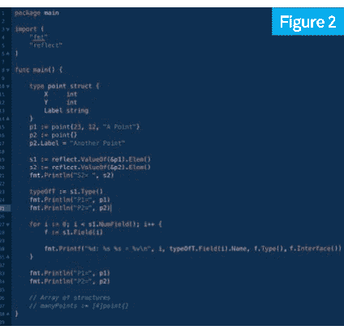

# 教程学习 Go

这张图片展示了关于结构体的 Go 代码，你可以在此了解如何定义和使用结构体

# 切片

切片在许多编程语言中都可以找到，但它们智能且方便的概念。切片在本质上类似于数组，允许你克服数组的缺点。你可以这样定义切片：

```go
slice := []int{2, 4, 5, 6, 7, 8}
```

注意，当你定义切片时使用的是 `[]`（OCR 说 `[...]`，但在 Go 中是 `[]`），你可以通过打印切片元素来验证。或者，你可以定义一个包含三个 int 类型元素的切片：

```go
anotherSlice := make([]int, 3)
```

`make` 函数初始化切片的所有元素；或者你可以使用 `append`。

由于切片是通过引用传递给函数的，函数内部对切片的任何修改在函数结束后都不会丢失。你可以通过 `append()` 函数向切片添加一个或多个元素：

```go
// 此处省略代码
这是一种展示 Go 高级能力的复杂技术。请记住，如果结构的任何字段包含一个未导出的字母，当你尝试调用 `reflect.Interface()` 时会得到错误。

> panic: reflect.Interface: cannot return value obtained from unnamed or method

这是因为字段未写出，因此无法被 `reflect.Value.Interface()` 使用。

你可以从图 3 中看到切片的源代码以及输出：

```go

go run slices.go

Before changeOne

2 4 5 6 7 8

After changeOne

2 4 5 6 7 8

Before cap: 6, len: 6

After cap: 12, len: 7

```

```go

go run structs.go

S: (*Another Point)

P1: {x:12 y:2 label:Point}

P2: {x:0 y:0 label:Another Point}

P3: {x:23 y:2 label:Point}

P4: {x:0 y:0 label:""}

```

# 匿名函数


```go

package main

import (

	"fmt"

)

func change(s []int) {

	s[0] = 42

}

func printSlice(s []int) {

	fmt.Printf("%#v\n", s)

	fmt.Printf("%v\n", s)

}

func main() {

	slice := []int{1, 2, 3, 4, 5, 6, 7, 8}

	fmt.Printf("Before: %v\n", slice)

	change(slice)

	printSlice(slice)

	fmt.Printf("After: %v\n", slice)

	newSlice := slice[1:4]

	fmt.Printf("New: %v\n", newSlice)

	printSlice(newSlice)

	fmt.Printf("Original: %v\n", slice)

	newSlice[0] = 99

	fmt.Printf("Modified New: %v\n", newSlice)

	fmt.Printf("Modified Original: %v\n", slice)

}

```

图 3

## 结构 (Structures)

由于 Go 不支持使用 `class` 或 `object` 等专用关键字来实现类，如果你发现需要使用类，可以创建一个 `struct`（结构体）！Go 倾向于使用组合而不是继承。以下代码简要展示了组合的示例：

```go
type Point struct {
  X int
  Y int
  Label string
}
type ColorPoint struct {
  Point // 组合！
  Color []string
}
```

这表明如果目标切片小于源切片，`copy()` 函数只会复制放入目标切片的元素。如果目标切片大于源，`copy()` 函数会将源的所有元素复制到目标切片中，并保持目标切片中剩余元素不变！

## 数组切片 (A slice of an array)

如果你需要数组，可以从这里创建切片：

```go
myArray := []int{1, 2, 3, 4}
lice := myArray[1:3]
```

从切片的右索引中减去左索引，即可得到新切片的元素个数。相关示例可以在 `sliceArray` 中找到，执行 `exec()` 会产生以下结果：

## 映射 (Maps)

Go 中的数据类型等同于著名的字典（dictionary）。其他编程语言使用 dictionary 一词来创建哈希 map（hash map）。Map 可以任何任意类型作为索引，而数组和切片只能使用一种类型作为索引。使用 `make()` 函数定义一个新的 map 变量：


$ go run sliceArray.go

1 2 3 4

1 2 3

对切片的任何更改都会影响 `myArray` 的所有元素。

## 复制切片

`copy()` 函数将源参数（一个切片）中的元素复制到第一个参数中，第一个参数也必须存在数据。以下代码展示了使用 `copy()` 如何非常复杂。

```go
$ make(map[string]int)

map["Mon"] = 0

map["Tue"] = 1
```

上一个示例定义了一个连接字符串到整数的 map。你可以按照如下方式向 map 添加两个元素：

```go
slice := []int{1, 2, 3}

newSlice := []int{-1, -2, 3, 4, 5}

copy(anotherSlice, newSlice)

copy(anotherSlice, slice)
```

同样，你可以按照如下方式打印与特定键关联的值：

你可以按照如下方式检查 map 上是否存在特定的键：

执行后三个切片的内容为：
aSlice: 1 2 3
newSlice: 2 3 4 5
anotherSlice: 1 2

```go
if value, ok := map["Tuesday"]; ok {

	fmt.Printf("Tuesday exists!\n")

} else {

	fmt.Printf("Tuesday does not exist!\n")

}
```


# 终极开源软件 (FOSS)

## 终极开源软件工具包

你是艺术家、音乐家或导演吗？忘掉 Adobe 的闭源应用程序吧——你需要的一切在 Linux 上都是免费且开源的！

Linux 并没有自己的 Adobe Creative Suite 版本，但这并不意味着你不能在 Linux PC 上完成创意的视频编辑、图像插画或音频录制和编辑项目。多年来，Linux 发布了许多软件，几乎都是开源的，且每一款都是其著名的闭源兄弟软件的现实替代方案。

例如，`GIMP` 长期以来一直作为 `Photoshop` 的开源替代品，Linux 上也可以找到各种视频和音频编辑器。总的来说，直到现在，世界在 Linux 上还没有真正取得良好的发展。

所以，别再羡慕地看着同事或竞争对手的 Mac 或 Windows 电脑了，放弃 `Wine` 及其偶尔的无用；限制你存储在 SSD 上的 `Windows 10` 使用。现在是在 Linux 上释放你的创造力了，它提供了强大的照片处理和图像修改功能，用于创建你自己的数字艺术、录制和制作多轨音乐、编辑音频视频，以及创建数字动画和视觉效果。

然而，如果你正在寻找特定的应用程序，你可能更喜欢看看这七个发行版中的一个，每种发行版的设计旨在帮助艺术家和音乐家专注于特定的角色，你可以在本月的封面上看到它们：

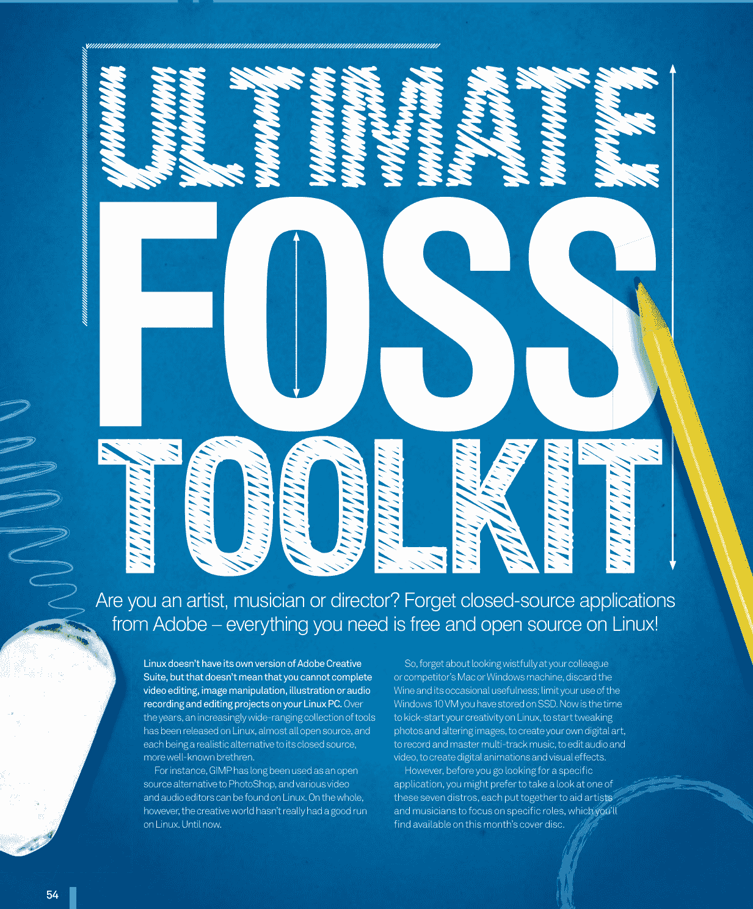

## 顶级创意发行版

### openArtist

http://openartisthq.org/

通过工作良好的图形驱动程序进行优化，并装满了专为数字艺术家设计的工具，`openArtist` 在作为一个 Linux 环境的同时，也支持开源理念。现在有了更新的 Linux 新工具列表。

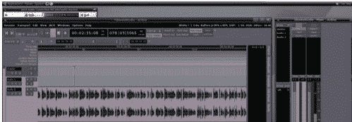

### 光盘现场启动 (LIVE BOOT)

#### Ubuntu Studio

ubuntustudio.org/
适用于 64 位和 32 位电脑，`Ubuntu Studio` 预装了一系列免费的多媒体应用，包括 `Blender`、`Inkscape`、`GIMP`、`OBS`、`Audacity`、`Ardour` 等。将这些工具集中在一起可以为基于 Linux 的创意人员提供生产力提升！


### gnuArtist

光盘现场启动
http://gnuartist.linuxfreedom.com/
这是一个基于 `Ubuntu` 的艺术发行版，`gnuArtist` 具有一个多媒体软件集合，涵盖了从创作、2D 建模、动画、视频和音乐编辑到 DVD 制作和编程的所有内容。如果你很有创意，去尝试一下吧。

### Musix

GNU+Linux
http://bit.ly/1tq25f9

基于 `Debian Whezy`，`Musix GNU+Linux` 是音频制作、图形设计和视频编辑工具（以及其他应用程序）的集合。与其他专注于特定领域的发行版一样，封装好的应用（包括 `Inkscape` 和 `Audacity`）意味着你安装后即可开始使用。


### dyne:dybolic

https://www.dyne.org/software/dynebolic/

`dynebolic` 发布于 2000 年，可能是最初的创意型 Linux 发行版，充满了工具，如用于桌面出版的 `Scribus`、用于音频的 `Audacity`、`JACK` 和 `Jamie`、`Cinelerra` 视频编辑器、`GIMP` 等。它还具有强大的数据加密功能。

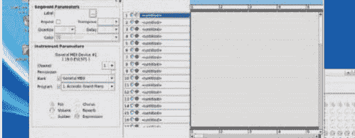

### StartCom Multimedia

http://www.startcom.org/?app=23

`StartCom Multimedia` 具有音频录制工具、采样器、`MIDI` 序列器、`CD` 刻录工具和一个视频编辑器，它可能是这里列出的发行版中功能最少的，但带有一堆标准应用程序以防你需要。

### KXStudio

http://kxstudio.linuxaudio.org/Downloads

`KXStudio` 提供 32 位和 64 位发行版，并装满了应用程序和插件，帮助你创作出你内心喷涌出的任何音乐。正如标题所示，这是一个专注于音乐制作的发行版。


## 特色终极开源软件

## 制作音乐和音频

创作音乐可以像敲箱子一样简单，也可以像录制交响乐团一样复杂……

### 使用 Jokosher 录制多通道音频

一个简单强大的轨道录音室编辑器可能没有 `Cakewalk` 或 `GarageBand` 那么响亮，但在功能和易用性上，它可以做到。

你通过 `Jokosher` 获得了一个编辑音乐方面和 `Audacity` 一样强大的工具，但得益于增强的录制功能，它在录制音乐方面更好。

开始非常简单，敏感且直观的用户界面邀请你开始新项目或打开旧项目。类型编辑器/录音机功能允许你比 `Audacity` 更容易地编辑和移动音符。同时，还有其功能免费的扩展，以及为不同乐器提供的预设音频轨道，以确保它们以最佳质量录制。

`Jokosher` 是一个很棒的工具，但也存在几个问题。其中一个是 `Gstreamer` 经常运行而不崩溃。可以通过打开 `文件 -> 偏好` 并根据你的 PC 调整音频设置来避免。此外，请注意短样本无法扩展——鼓点循环必须在第二个应用程序中手动扩展。

- 最近项目
- 创建新项目
- 浏览现有项目
- 偏好
- 退出
- 启动时不显示此内容

### 使用 Rosegarden 作曲音乐

使用此工具创建和编辑音乐层级

| 1 | 2 | 3 | 4 | 5 | 6 | 7 | 8 | 9 | 10 | 11 | 12 | 13 | 14 | 15 | 16 |
|---|---|---|---|---|---|---|---|---|---|---|---|---|---|---|---|
| 图层 | 变调 | | | | | | | | | | | | | | | |
| 回声 | | | | | | | | | | | | | | | | |
| 颜色 | | | | | | | | | | | | | | | | |
| 轨道参数 | | | | | | | | | | | | | | | | |
| 回放参数 | | | | | | | | | | | | | | | | | |
| 设备: MIDI 设备 | | | | | | | | | | | | | | | | | |
| 循环 | | | | | | | | | | | | | | | | | | |
| 录制层 | | | | | | | | | | | | | | | | | | |
| 谱导出选项 | | | | | | | | | | | | | | | | | | |
| 轨道 | | | | | | | | | | | | | | | | | | |
| 带有段的段 | | | | | | | | | | | | | | | | | | |
| C4 | | | | | | | | | | | | | | | | | | |
| 音频 | | | | | | | | | | | | | | | | | | |
| 谱号 | | | | | | | | | | | | | | | | | | |
| 小号 | | | | | | | | | | | | | | | | | | |
| 军鼓 | | | | | | | | | | | | | | | | | | |
| 高音器长号 | | | | | | | | | | | | | | | | | | |
| 低音器 | | | | | | | | | | | | | | | | | | |
| 提琴 | | | | | | | | | | | | | | | | | | |

`Rosegarden` 可能更倾向于来自 `MIDI` 兼容设备的音频创作和编曲，它是一个出奇多功能的工具，拥有丰富的功能，可能会启发你创作音乐。请注意，在某些情况下，如果没有预期的 `MIDI` 支持，应用程序独立版本无法运行；在这种情况下，你还需要安装像 `FluidSynth` 或 `Timidity` 这样的第三方库。

`Rosegarden` 是一个多轨道编辑器，可以轻松地显示你的 `MIDI` 排曲，并带有编辑工具可以在矩阵中拖动和切割轨道，在矩阵中音符和和弦可以完全移动或删除。如果你体验过这种软件，将会感到非常熟悉且安心。

最如此的或许是 `Rosegarden` 对谱法的精通。只需点击 `MIDI` 轨道并选择编辑器（或按 `N` 查看视觉音乐谱）。在某些情况下，如果没有你预期的 `MIDI` 支持，应用程序独立版本将无法工作；在这种情况下，你还需要安装 `FluidSynth` 或 `Timidity` 这样的第三方库。

# 终极 FOSS 特性

## 设计美术与图形

无论你是在插图、编辑还是管理图像，Linux 都有你所需的 FOSS 工具

### 使用 GIMP 编辑照片

`Photoshop` 的开源替代方案。
`GIMP`（即 `GNU` 图像处理程序）几乎可以完成 `Photoshop` 能做的任何工作。作为一种开源工具，`GIMP` 可用于各种项目，从在照片上添加虚假涂鸦到添加移轴倾斜微缩模型效果。像 `Photoshop` 一样，`GIMP` 支持照片增强，涵盖了从自定义预设到调整色调、饱和度、引入过滤器等所有功能。此外，通过 `GIMP` 还可以制作动画。

与 `Photoshop` 类似，`GIMP` 的魔法通过图层实现，这允许你能够在不实际损坏源图像的情况下更改它。使用新名称来保留原始图像和数字绘画是一个极佳的主意。
虽然其他软件也被认为是 `Photoshop` 的直接替代品，但它在 FOSS 环境中提供了大量的核心功能选择，更易使用，硬盘占用更小，并且没有受到近年来困扰 `Photoshop` 的软件臃肿负担。在 `GIMP` 中，重复操作比在 `Photoshop` 中简单得多。如果你还没有

### 滤包模拟

- 整个图像
- 仅选择区域
- 上下文选择
- 阴影
- 色调
- 高光

- 在 UBUNTU 中
- Windows
- 饱和度
- 数值
- 高级

| 原始 | 当前： |
| --- | --- |

### 使用 Inkscape 绘制矢量图

需要比目前使用的更好的绘画工具吗？学习使用 `Inkscape` 在 Linux 中绘画

“自由绘制”是它的口号，`Inkscape` 确实让这变得简单。它提供了绘画工具、对许多文件格式兼容性以及绘制位图和矢量图形的能力。凭借对 `SVG` 矢量工作格式的完全支持以及手绘或使用形状绘制的能力，`Inkscape` 还具有构建路径的工具和功能。

但 `Inkscape` 可被认为是可行的 `Adobe Illustrator` 替代方案已经存在很久了，关于它的传闻被夸大了。它只是提供此类软件的少数竞争者之一。然而，最新版本在保持传统 `Inkscape` 简单性的同时，对速度进行了改进，使其成为流行的 `Illustrator` 值得竞争的对手。
它不仅适用于那些喜欢处理色块和疯狂渲染想法的人。通过新版本，你可以正常指定变换（或通过移动鼠标），`Inkscape` 的进化代表了任何数字插画师的改变。想要更多？`Inkscape` 可以导入 `Adobe Illustrator AI` 格式文件（版本 8），以及所有基于 `PDF` 的文件（版本 9 及以上）。它的上手和使用也简单得惊人。

### 使用 Scribus 布局图形

从你的 Linux PC 进行桌面出版

寻找 `InDesign` 的替代方案吗？`LibreOffice Writer` 并不是为桌面出版需求设置的，所以如果没有 `Scribus` 你能去哪里呢？这个桌面出版工具延迟、满足并许多匹配其他你可以拿起并阅读（物理上，或你的平板电脑上），`Scribus` 设计用于在布局和排版方面提供完全的灵活性，超越静态打印项目，它还可以用于设计和创建交互媒体。

凭借位图和支持从其他应用程序创建项目（包括来自 `Inkscape` 的矢量图），`Scribus` 支持 `CMYK` 和 `ICC` 色彩管理，以及 `postscript` 驱动和导入格式。`Scribus` 导出可用于迁移项目，包括 `PDF`、`SVG` 和 `EPS` 以及图像格式，并支持 DTP 的标准“主页”方法以及导入样式。`Scribus` 拥有 100% 的色彩色板，尽管标准的 `Pantone` 色彩匹配系统不是。

### 综合培训

我们的团队随时准备解答关于你项目的任何问题。我们提供质量。

## Flowblade 复合工具中的复合效果

如果你想尝试更高级的转场效果，你可能更喜欢尝试 `Flowblade`。它表面上是另一个视频编辑应用，但 `Flowblade` 在处理混合和转场方面通过更成熟的方法，为这一领域带来了优越体验。

这里有多种复合工具可用，它们可以进行不同程度的单独微调，为你的视频项目增添一种独特的润色感。复合效果非常出色，你可以在窗口中右键点击第一个片段并选择“添加合成器（`Add Composer`）”，在此之前调整两个片段的位置。所选效果的设置将列在合成器（`Compositor`）中。

`Flowblade` 还提供了许多过滤器，可以应用于项目的视频和音频轨道。这些过滤器可以单独应用，也可以结合使用。如果你想获得复古效果，可以选择视频，然后点击“添加过滤器（`Add Filter`） > 艺术（`Artistic`） > 旧电影（`Old Film`）”，最后通过“添加过滤器（`Add Filter`） > 音频过滤器（`Audio Filter`） > 黑胶片效果（`Vinyl Effect`）”来调整声音。可以在 `Flowblade` 的标签页（`Tabs`）中切换过滤器的开启与关闭。

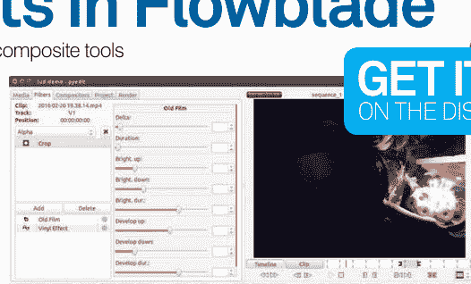


## 在 Lightworks 中管理编辑时间线

使用 `Lightworks` 享受行业标准的编辑管理

`Lightworks` 是 Linux 上进行视频编辑的范例——该应用曾用于《国王的演讲》和马丁·斯科斯塞斯的《星际幻迹》等获奖电影，且软件没有出现卡顿迹象。虽然你可能需要购买许可证才能使用如 4K 支持、色度抠等高阶工具，但 `Lightworks` 的优势——其进化的编辑方法——仍然保留在免费版本中。

将自己想象成一名电影导演。你需要从几个小时的素材、不同场景的不同拍摄 Take 中，创作出一部 90 分钟的作品。使用标准的线性编辑工具将这一切整合将非常困难；这就是为什么 `Lightworks` 使用多条时间线，让你能够同时查看和编辑两个或多个场景，并配合“房间（`room`）”方法——这本质上给了你所需的任意屏幕——一个扩展桌面。

### 导入视频

开始使用 `OpenShot 2.0` 意味着导入视频并寻找片段，将它们导入到时间线上。由于支持你选择的任何视频、音频和图像格式，所有内容都可以无问题地添加。如果发现无法导入的内容，首先检查它是否为有效文件类型，然后可以以不同的文件格式添加。

### 使用时间线

一旦你的片段进入时间线并你开始管理项目和时机，时间线就提供了编辑视频、前后移动、标记以及用于捕捉镜头的剪辑（`cuts`）工具。一个标记为“效果（`Effects`）”的按钮可以让你快速访问转场或快速混合（`Quick mixes`），但这只是其提供功能的一小部分，其中还包括过滤器和标题。

### 添加效果并导出

可以通过右键点击时间线上的片段并选择“效果（`Effects`）”引入更多效果。这在这里非常方便，让其他应用程序显得形形色色。以下是选择项目顶部的片段的方法。你完成的视频项目通常是一项简单的任务，但请确保你接触了所有的编辑选项！导出选项支持非标准帧率和高达 1080p 的分辨率，可以导出文件或直接上传到 `Vimeo`。

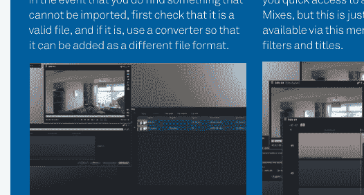

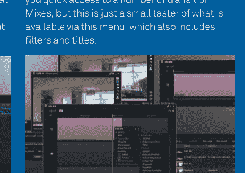


www.lightukser.com 61

# 特色：终极 FOSS（开源软件）

## 在 BLENDER 中设计和制作 VEX+

### 在 UBUNTU STUDIO 中获取

你可能已经了解 `Blender` 了，也许是作为一个创建 3D 模型或标题的工具……但它的功能远不止于此。快速访问一下 `YouTube` 就会发现该软件承担着专业模型制作（`CGI`）的角色！如 `TARDIS`（奇异博士中的时光梭机）或更传统的飞船、武器等。你可以创建复杂的元素，为项目添加烟雾、爆炸或其他特效，并制作出物理上制作过于昂贵的设计物品。然而，与我们介绍的其他创意工具不同，`Blender` 的学习曲线非常陡峭。虽然起步和找到方向相对简单，但需要集中精力才能转化为可用的结果。短特效可以被构建，并且可以被保存并在稍后重用；`Blender` 的这种密集性方面可能具有挑战性。尽管如此，高品质使得它值得投入。

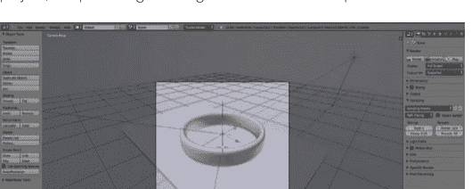

### 熟悉界面

### 使用 Python 调整

`Blender` 可能与你用过的任何应用程序相似，因此熟悉 `UI` 是获得结果至关重要的一步。首先，标准工具栏被分为两部分：一半在应用程序的左上部分，另一半在底部。注意各种面板（如对象 `Object Tools` 和尺寸 `Dimensions`）的位置，它们可以停靠或取消停靠；需要一个高分辨率显示器才能在扩展模式下查看所有菜单。

`Blender` 的一个秘密武器是它对 `Python` 的支持，这允许对对象进行细粒度的脚本级操作。要有一个大致的了解，使用“添加（`Add`）”菜单查看可能的功能，包括网格（`Mesh`）、晶格（`Lattice`）、曲线（`Curve`）以及其他类型。将鼠标悬停在每个项目上查看属性。


### 使用设计

### 赋予

对于视觉效果，你可以利用默认工具快速开始。在这里你可以发现很多模型，纹理可以应用到表面。

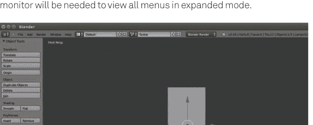

## 你能帮助下一代程序员吗

**Code Club** 是遍布全国的志愿者网络，面向 9-11 岁儿童的课后俱乐部。我们一直在寻找具有编程技能的人在当地的小学、图书馆或社区中心开设俱乐部，每周只需一小时。你可以与同事合作，老师会在那里提供支持，我们提供你所需的所有材料来帮助孩子们对制作感到兴奋。


参与的方式有很多！要了解更多信息，请加入 **www.codeclub.org.uk**

# 来自 Linuxuser & Developer 的作者


## Ubuntu 之书

无论是 `Ubuntu` 新手还是想从该系统中获取更多功能，这本书都适合你。发现 `Ubuntu` 默认软件的最佳功能，以及从软件中心（`Software Center`）下载的必备 FOSS 应用。这是你掌握 `Ubuntu` 的唯一书籍。


## 还有可用

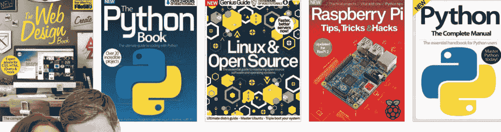

# 指尖的内容世界

无论你热爱游戏、历史、动物、摄影、`Photoshop`、科幻或任何其他领域，来自 `Publishing` 出版的每本杂志和丛书都充满了专家建议和引人入胜的事实。


# 立即购买

质版可在 www.imagineshop.co.uk 购买。数字版可在 www.greatdigitalmags.com 购买。

# 程序员与制作者必读指南
## 树莓派实用教程

70 “你如何配置运动实际上取决于你将为此项目使用哪种型号的树莓派”


# 目录

- 66 与机器人一起玩 Connect 4
- 68 在 `I2C` 总线上对讲
- 70 使用树莓派婴儿级监视器获取警报
- 74 将树莓派转换为路由器
- 78 构建网络化 Hi-Fi

## Python 图像库

一个复杂的图像库在后台工作。`4-Bot` 识别每个棋子的颜色和位置。基于这些计算，它可以与 `Max-Bot` 协作，为该回合提供最佳的走法方案。

## 二手机械爪

来自拆解的 `3D` 打印机导轨有助于将机械爪移动到不同位置。它与 `David` 设计的 `Python` 接口协同工作，并经过对齐，以确保计数不会掉落在错误的列中。

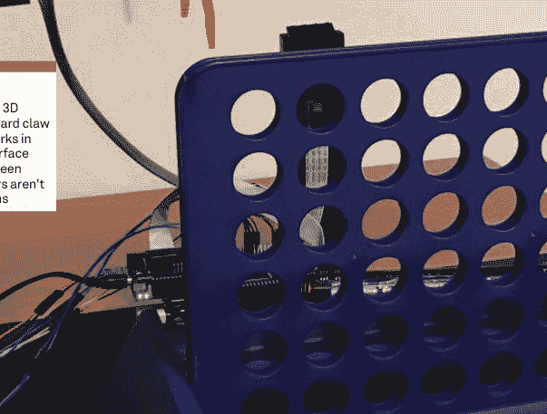

## 完整的舵机控制

用于控制各种手臂的主要舵机由 `PIXI` 板供电；该板的一个主要优势是它可以支持多达 50 个独立舵机，允许 `a-Bot` 动作更加流畅。

## 极小极大算法

`4-Bot` 的每一步移动都基于极小极大算法，该算法非常适合将计算时间降至最低。由于每一步移动在数学上都是正确的，因此仍然存在错误空间，`4-Bot` 可以被击败的。


## 组件列表

- 树莓派板
- 拆解的 `3D` 打印机
- 木材
- `MeArm` 机械爪
- `PIXI` 控制板
- 步进电机
- `LCD` 消息屏

连接到树莓派 3 后

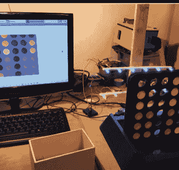


## 我的树莓派项目

### 你认为你能比机器人聪明吗？

`Dave Pride` 的 `4th-Bot` 将接受你的测试。

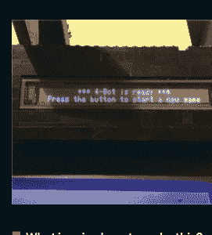

### 是什么启发的你制作这个？

我参加了去年 12 月在剑桥大学举办的树莓派大战（`Pi Wars`），并考虑为树莓派的“机器人舱”（`Robot Pod`）提供一些机器人。我的妻子在 7 月赢得了 `BERT SHOW`，所以我像大家做的那样用它构建了一个乐木套装。我使用了这个树莓派模块和颜色传感器来识别不同颜色的区块，并使用手臂将它们掉入连接器的桶中。

基于此，我查看了其他颜色编码方案，并发现了更好的。研究引导我发现逻辑可以从简单开始。网上有很多大量信息，所以我尝试了几个版本的 `Version 4 Pi`，它们随后成功地运行在 `Pi pod` 上。

### 机器人的开发对你产生了什么影响？

花了几个月和周末才完成这个机器人。第一部分很棘手，但随着时间的推移我让它运行了。通过让树莓派工作，`Python` 模块完全符合我的预期。这些值会根据光线发生剧烈变化。

### 树莓派在你的项目中起什么作用？

树莓派位于机器人内部；游戏程序用 `Python` 编写，并配置为启动时运行。

控制手臂和 `LCD` 的由树莓派板监控。`Astro Designs` 的 `Mark Carlin` 说，带有 `FPGA` 的板载构建以及控制 50 个舵机的能力不足以让其工作。我目前正在制作一个树莓派 `HAT`。

### 你在这个项目中是如何使用极小极大算法的，它是如何与机器人集？

我使用了游戏中使用的极小极大算法——尽管它不知道什么时候该移动。我为它写了一个 `Python` 类并对其进行了适配。

我将树莓派摄像头的图像捕捉到 `RGB` 数组中。这些值被转换为整数，然后保存在数组中作为“状态”。然后该状态选择“最佳”走法，这极大地增加了控制时间，虽然机器人玩得很好，但运行时间本身仍然很慢。通过捕捉和处理，算法计算下一步，且每回合的计时时间正在增加。最困难的部分为手臂编写游戏逻辑，它捡起杯子并将其掉入正确的位置。

### 机器人的激烈程度如何？你是如何组装它的？

它与树莓派配合良好。权衡在于搜索深度。使用树莓派 2 时计算时间大约为 7 秒。如果你增加搜索深度。

### 接下来是什么？

关于我目前使用的，我正在学习很多项目。关于算法的完整指南会有帮助。我还想寻找更多树莓派项目。我的代码帮助我创建了 `obhtobot` (`htobot.com`)，它有通过 `USB` 连接运行在树莓派上的软件。我目前正在将其转换为运行在树莓派上。

 你如何配置运动实际上取决于你将为此项目使用哪种型号的树莓派

## Python 列

复杂且具有多个寄存器用于读写数据。在这些情况下，你可以通过函数调用的部分轻松选择要使用哪个寄存器，并指定读取多少字节。代码的一个基本示例如下：

## 同样可以使用 SPI

```python
```


# 写入特定寄存器

```python
reg = 0x01
```

树莓派还有另一个可用的总线，称为 SPI 总线（串行外设接口）。它与 I2C 接口类似，但只接受单个主设备。SPI 总线不是通过使用 `rasp-config` 手动配置的。你需要安装 python 模块：

```bash
sudo apt-get install python3-spidev
```

```python
bus.write_read_data(i2c_addr, reg, return_val)
```

# 从特定寄存器读取

```python
return_val = bus.read_byte_data(i2c_addr, reg)
```

# 读取完整列表

```python
list_val = [0x01, 0x02, 0x03, 0x04]
bus.write_i2c_block_data(i2c_addr, reg, list_val)
# 读取包含 5 个值的完整列表
return_list = bus.read_i2c_block_data(i2c_addr, reg)
```

此外，Smbus 协议中的一个调用可以向设备发送数据块并读取一个数据块。Python 函数调用看起来如下：

对于较大的数据块，你也可以读取和写入 2 字节的字。这部分的代码如下：

```python
# 写入完整字
list_val = 0x01
bus.write_i2c_block_data(i2c_addr, reg, list_val)
# 读取完整列表
return_list = bus.read_block_data(i2c_addr, reg)
```

```python
import spidev
spi = spidev.SpiDev()
```

这允许你通过单次函数调用与设备进行交互，这对你的代码有帮助。下一步是连接到感兴趣的设备。要实现这一点，你需要使用函数：

```python
result_list = bus.block_process_data(i2c_addr, list_val)
```

```python
spi.open(0, 0)
```

`open` 函数中的参数是你要通信的设备的总线 ID 和设备 ID。当你完成后，必须显式地关闭连接：

```python
spi.close(0, 0)
```

最后两个函数都很短，设计用于与你的 I2C 设备进行快速交互。第一个是：

此 Python 函数将一个字节写入到你接收到的设备的第一个寄存器中。对于某些设备，这可能需要进行交互以获取返回的值。第二个简写函数是：

要进行读写，你需要使用以下函数。对于大多数设备，这种方法将是你想要使用的。在较大的情况下，当你需要读取和写入较大的 2 字节字数据块时，也是如此。代码如下：

你可以读取和写入多达 32 字节的整数值列表。由于 I2C 和 Smbus 之间的差异，存在两套读写协议。如果你想使用 Smbus，函数是：

```python
bus.process_call(i2c_addr, reg, val)
```

这种方法的问题在于它们被限制为最多 32 字节的数据。如果你需要传输超过 32 字节的数据，将需要使用底层协议。当你写入列表时，你可以直接在句中处理它。然而，当你写入列表时，你需要告诉库：

此函数执行对 Smbus 协议的调用，它返回上述数据块。可以向设备发送数据块数据并在单次函数调用中全部收回。

希望这篇文章对你上手使用 I2C 和 SPI 将大量设备连接到你的树莓派，并为你的项目创建一个完整的传感器平台有所帮助。

对于较大的数据块，还有两个函数。它们是 `xfer` 和 `xfer2`。第一个在整个时间内传输数据列表。第二个在传输每个字节时都会取消并重新断开 CS 线（片选选择线）。有一个低层级函数叫做 `spidev`，它返回一个文件描述符，如果你与多个设备通信，你可以随后配合底层文件接口使用它。


# 教程

# 使用树莓派婴儿监视器获取报警

得益于你的树莓派，可以在宝宝睡觉时关注他们！


Christian Cawley
前 IT 和软件工程师，曾为在线计算机和移动用户提供建议和指导。他在 makedof.com 介绍树莓派和 Linux。

当你坐下享受你最新的新书时，脑海深处总有一种挥之不去的感觉——宝宝是在睡觉，还是在几个小时内一直在哭？环绕声往往会产生干扰，这意味着我们需要依靠婴儿监视器。

虽然婴儿监视器很有用，但现在的趋势更倾向于视频监视器，在这些情况下，我们需要依赖婴儿监视器。

# 教程

你应该能够在移动浏览器中输入树莓派的 IP 地址来访问视频流。这通常看起来所示：

```
daemon on
framerate 2
width 640
height 480
ffmpeg_codec_mpeg264
stream_localhost off
control_localhost off
```

```
192.168.0.10:8081
```

在网络中的多台设备上检查此项以确保其工作正常。

如果你在黑暗的房间内录制，可能需要调整一些亮度和对比值。更改后，按下 `CTRL+X` 确认，然后输入 `Y` 并回车。

```
000 base 7.2.4               File: /etc/motion/motion.conf
# 下一步操作之前跳过的帧数（默认值: 1）
buffer off
################################################################
# 图像和视频的目标目录
# 设置保存运动文件的目录
output_dir /var/lib/motion
image_dir /var/lib/motion
video_dir /var/lib/motion
# 将流输出设置为旧版模式
# 如果自动选择 0，则不包含在流
stream_output 0
# 使用 ffmpeg 进行流输出
ffmpeg_output /dev/video0,h264
ffmpeg_output_type off
################################################################
# 触发检测的图像变化像素数量阈值（默认值: 150）
threshold 600
```

## 运动检测

你的运动检测不太可能立即生效。为了调整你的树莓派显示器设置环境，你可能会发现摄像头在短时间后存储图像。这是一个权限问题，导致在整个超时之前，屏幕上会出现几张图像。

分配到目标目录

你会发现许多可以调整的值，例如 `threshold` 和 `area_delete`。这些值可能需要一些测试以获得最佳效果。你可以为 motion 使用自定义路径。找到它并根据需要进行更改。完成后记得保存文件并重启 motion。

如果我们在等待检测，可以在检测到声音时启用睡眠模式。这样的项目需要一些校准来获得最佳结果，这是一个非常有用的功能。再次，在 `quiet` 中找到并更改设置以返回。记住当你对动作捕捉感到满意时，要撤销此操作。

```
quiet off
```

## SSH 和 VNC

对于任何此类项目，请忘记设置键盘或使用 VNC。SSH 是默认的，并让连接到树莓派的命令行变得简单得多。同时，VLC 是通过主电脑查看树莓派桌面的方法之一。

## 启动你的婴儿监视器

我们现在有一个完全可以工作的婴儿监视器。要让监控运行，请启动：

`sudo service motion start`

## 调整质量

虽然你可以更改树莓派捕捉的图像尺寸，但小心数字非常重要。尺寸需要是 4 的倍数。例如，使用 `1280x800` 或 `1920x1080`。较大的图像不仅会影响带宽，还会生成的 AVI 文件更大。

## 不同的 USB 摄像头有自己的电源要求。有些可以在设备上运行，但需要通过 USB 端口提供电源。如果你将婴儿监视器放置在电源之外，充电电池应该能够提供 12 小时的电源。

## 检查保存的图像

我确认了树莓派监控器捕捉的质量，进入 GUI（或使用远程连接）并浏览到 `~/lib` 查看它们的工作情况。这让你能够自由调整捕捉图像的尺寸。

```
2023-10-27 12:31:45  -rw       466000 B  remote_0.jpg
2023-10-27 12:31:45  -rw       115113 B  remote_1.jpg
```


2023-10-27 12:31:45  -rw      20794203 B  remote_2.jpg

2023-10-27 12:31:45  -rw      20986753 B  remote_3.jpg

2023-10-27 12:31:45  -rw       322100 B  /home/pi/frame10.jpg waiting for frame creation

2023-10-27 12:31:45  -rw       322100 B  /home/pi/frame11.jpg waiting for frame creation deleted

## 命名你的图像

软件收集的图像可以配置特定的命名规范，并根据日期和时间进行。

你可以在 `motion.conf` 的 "base directory" 下找到这些列表。如果你想根据日期为图像创建一个：

```
%Y-%m-%d_%H-%M-%S.jpg
```

日期和图像的 "-" 都将按日期命名，图像将带有时间戳标签。

## 排除摄像头连接的故障

如果没有找到图像，或者无法连接到流（或两者都有），无法保证它会立即工作。值得运行：

```
tail -f /var/log/syslog
```

## 跨越你的网络

如果通过 No-IP 软件绕过你孩子的睡眠限制难道不是很棒吗？你可以在树莓派上安装它，让你能够避开 ISP 不给你提供专用 IP 地址的问题。

# 教程

# Pismake 路由器

* Nmap 4 ( http://nmap.org ) 启动于 2016-05-03 21:14 CEST

对 `192.168.1.108` 进行 Nmap 扫描
主机在线 (-0.0896; 延迟)。
MAC 地址: BB:27:EB:53:4E:09 (Raspberry Foundation)

尽管树莓派是一个极佳的评估工具，但在项目中使用可能会导致性能欠佳。这是由于两个以太网端口共享相同带宽的架构造成的。该问题通过 RPi2 CPU 的性能得到了缓解。

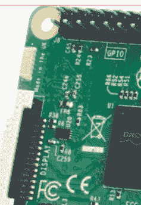

## 05 部署 USB 驱动

此时，我们的 OpenWrt 已连接到互联网。这允许我们下载所需的包，使用 SSH 和 IP 地址进行自行配置，并继续下载后续代码列出的包。当所有模块安装完成后，输入 `dmesg` 将显示检测到以太网接口并将其配置为 `eth1`。

```
opkg update

opkg install kmod-usb-utils kmod-usb-core

opkg install kmod-usb-net-ncm
```

## 06 连接

尽管基于 ASIX8729 的美元是定制非标的，但不会导致你的连接失败。通过运行 ssh 的树莓派和 `lsmod` 命令，将 OpenWrt 连接到局域网。它将为您提供所用驱动模块的信息，您可以通过在 OpenWrt 上进行检查。

网络方面，使用嵌入式系统往往产生更好的结果。像这样的板载电脑是另一种选择，但在处理简单的以太网包时。

## 07 打开 Web 界面

完成配置后，我们的新界面已就绪并准备部署配置。树莓派的 OpenWrt 镜像限制了我们通过 Web 界面绘制和安装接口。这可以通过将浏览器指向路由器的 URL 来；登录可以通过命令行上的 root 密码完成。

新创建的 DHCP 服务器将连接客户端：你可以连接一个“虚拟服务器”或单个设备。在这种情况下，需要 DHCP 服务器为客户端提供 IP 地址。接下来，选择新接口，输入名称并选择静态地址。然后，选择窗口底部并点击 DHCP 服务器设置以完全填充表单。

## 10 防火墙

从现在开始，尝试从网络“外部”与 LuCI 交互将显示“无法通过 ssh 连接”，不允许对 OpenWrt 进行攻击变得更加困难。

通过将工作站从“路由器，路由器”断开并连接到树莓派的 USB 端口来解决这个问题。然后你可以连接到标准网关以打开一次 LuCI 界面。

如果在工作设备未分配 IP 地址的情况下尝试，重启进程并连接以太网线。

## 08 开始运行

完成后，必须设置 IPv4 地址和广播字段。最后，点击保存并应用以更改网络堆栈。再次打开网络配置并将防火墙设置设置为防火墙区域。

## 09 重新调整接口

默认情况下，接口是桥接的。这是必要的：打开它的属性，选择物理设置并取消桥接接口勾选框。打开防火墙选项卡并分配到 WAN 区域。最后，点击保存并应用。OpenWrt 分配接口导致下图所示的配置（见右侧图像）。

| 接口 (Interfaces) | 接口概述 (Interface Overview) |
| --- | --- |
| WAN | ... |
| LAN | ... |


76

# Pi 路由器

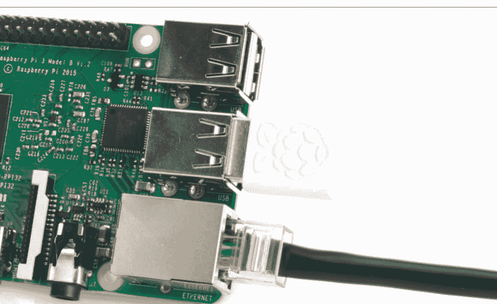

inet6 addr: fe80::2ad2:44ff:fe24:deb/64
Scope:Link

## 11 测试路由器的存在

只要需要其他网络连接，工作站只能通过 RPL 连接到互联网。在命令行中输入 `mtr www.google.com` 以生成此处所示的报告。执行这一步——从延迟角度来看，我们的 OpenWRT 访问点在轻负载运行时运行非常良好。

- 需要 `kmod-usb-storage`
- `kmod-usb-storage-extras`
- `block-mount`
- `kmod-scsi-core`

此外，还需要包含文件系统驱动程序的 `kmod-fs-*` 包。访问 FAT 文件系统还需要这些中的一个小细节——相关的包由别人已经为你走过那条路了。

## 14 了解更多

由于空间限制，OpenWRT 还可以用于此处未讨论的各种主题。如果你想实现某些功能，OpenWRT 项目团队在 https://wiki.openwrt.org 提供了一系列逐步指南，请检查是否已经有人实现过它。

## 12 分析网络状态

生成带有有关路由器状态更多信息的实时界面是一个有趣的功能。使用 OpenLuCI 和实时图表来查看一组描述你的 CPU 和网络负载的图表。

# 构建你自己的 Hi-Fi

我们将向你展示如何使用相同的芯片（PCM512A）创建一个高质量 DAC 转换器。

## 01 焊接接脚

DAC 带有 40 引接脚，你需要对其进行焊接。我们使用电烙铁、工作灯和 60 焊锡。也可以提供可选的 RCA 插孔用于手机输出。

## 02 安装驱动程序

DAC 依赖于 i2C，因此我们需要加载额外的内核模块。如果你在 HTTP 安装示例中运行 Raspbian，请使用以下命令：

```bash
curl -s https://github.com/pimoroni/phat | bash
```

## 03 安装音乐播放守护进程 (MPD)

现在安装 mpd 将作为播放 MP3 和网络电台的核心。还安装了 MPC（客户端）软件用于调试和设置列表。

```bash
sudo apt install mpd

sudo systemctl enable mpd
```

## 04 克隆并安装列表 Web 服务器

pyplaylist 是一个使用 Python 和 Flask 框架编写的响应式（手机可用）Web 服务器。一旦配置好

## 在 Raspbian 上自动启动

在 Raspbian 中，添加了争议性的系统软件，提供了更好的管理文件和配置其他内容的方法。我们现在使用系统配置文件。它们需要时间完全理解。因此，我们建议使用 cron 在重启时启动脚本。

```bash
echo @reboot /usr/bin/python/py/pyplaylist/app.py
```

## 13 部署系统支持

如果你查看 OpenWrt 之外，则未提供所需的补救。该问题可以通过 opkg 部署以下包来修复：

## 15 硬件调试

树莓派有两个内置音频输出：HDMI 和一个 3.5mm 耳机接口，可能会受到其他组件的干扰。但 Pimoris 来救救了

Alex Ellis
@alexellis
ADP 的高级软件工程师
Docker 专家以及对所有树莓派事物的热爱好者
从未离开过他的博客发布 Pi 教程。

## Pi Zero Hi-Fi

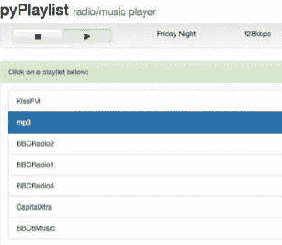

## 07 启动 Web 服务器

现在我们已经有了一些站点，可以从 `pyPlaylist` 目录运行 Web 服务器。然后打开网页浏览器启动电电台。以下命令将显示你的树莓派 IP 地址：

pyPlaylist project

```bash
$ /raspbian/get_ip.sh

192.168.0.10
```

一旦知道了 IP，请在浏览器中连接到端口 5000 的 URL：

```
http://192.168.0.10:5000/
```

现在在 `/var/lib/music/` 下放置一个包含音乐文件的子目录，并运行 `mpd update` 来清理播放列表。然后添加新目录（ambient）中的所有轨道并作为新播放列表播放，这教了我们如何通过浏览器控制 Hi-Fi。以下步骤将在 Raspbian 上安装 pyPlaylist：

```bash
sudo pip install flask-mpd

cd ~

git clone https://github.com/alexellis/pyplaylist

cd pyplaylist/raspbian/
```

## 05 创建站点

我们必须将一个流行的广播电台列表放入列表中，可以使用 `add_stations.sh` 文件将其构建到 MPD。编辑此文件或从 radiofeeds.com 找一个。

```bash
cd pyPlaylist

add_stations.sh
```

## 08 完成工作

每个站点现在都已添加到你的播放列表中 - `mpc` 命令显示了哪些播放列表是可用：现在你的音乐播放器已经在运行了，剩下的工作就是添加更多站点了，显然！虽然 RCA 或 3.5mm 接口也可以实现此目的。那部分由你决定。

```bash
$ mpc ls

BBCMusic

BBCRadio1

BBCRadio2

BBCRadio4

CapitalExtra

KissFM
```

## 06 检查站点

要查看这里的代码，请检查文件。如果你想删除其中站点，请输入以下内容：

```bash
$ mpc rm BBCMusic
```


# pyPlaylist radio/music player


点击下方播放列表：`www.linuxuser.co.uk` 北美读者特惠：订阅即可**免费**获得 6 期* 每期均有**免费**资源下载。专业人士和开发者的开源权威。将你的树莓派变成路由器。GNU 世代必备杂志。使用 micro:bit 制作：5 个控制和动画 LED 的项目，并制作骰子、手电筒和指南针。免费。全新的 UBUNTU 16.04 启动包。免费教程、视频和工具包。开启无线。25 个创客项目。树莓派 3。Ubuntu 16.04 启动包 Plus。microbit 对比 Raspberry Pi。制作网络电台。使用 Pi Zero 和廉价 DAC 制作你自己的音乐播放器。编写运动传感器。让树莓派检测并报告移动。锁定你的在线安全。从经理那里获得更多信息。学习 Go。探索如何处理复合数据类型、接口、映射和结构体。使用 SSL 调查网络套接字绑定你的端口。核心文件系统管理揭秘。如何快速排序：学习如何使用和调整准确性。实用工具与包。赢取价值 1500 美元的 POSTGRES 训练。系统管理员对话指南。构建 Linux PC。订购热线 +44 (0)1795 418661。访问 `www.linuxuser.co.uk`。口令 USA 以获取此专属优惠！*条款与条件：这是一份美国订阅。此优惠等同于购买时的汇率价值，汇率可能会变化。6 期免费是指参考美国州价 13 期 16.99 美元。每个订阅价值 220.07 美元。你的订阅从下一可用期开始，持续 13 期。于 2016 年 9 月 30 日过期。

测评 81 组测 | 86 CubieTruck Plus | 88 Parsix 8.5 | 90 免费软件 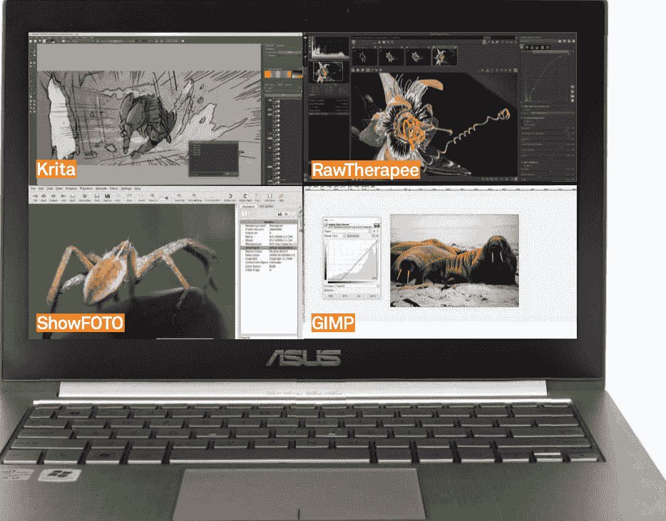

## 组测

### 图像编辑器

Linux 社区拥有大量的免费和开源图像编辑器，但哪一个值得你投入时间呢？

### Krita

通过多次更新，Krita 已经培养了一个日益扩大的狂热用户社区，成为全球最大、支持支持最好的图像编辑器之一。可扩展的颜色编辑器和创作工具只是今年发布的最新更新中两个突出的特性。

### RawTherapy

在涉及到图像编辑的高级处理过程时，RawTherapy 被认为是市场上最优秀的工具之一。它的功能很大程度上围绕着 RAW 编辑展开，允许用户在对原始图像进行确认编辑之前查看编辑的预览。

### ShowFOTO

如果你需要一个照片管理系统，ShowFOTO 应该是你的首选，它最近扩展了其内置编辑功能套件。其中许多功能对于本组已经足够了，但对其他人来说也足够。

### GIMP

如果我们对 GIMP 持高度批评态度，缺乏对初者的指导可能会让潜在用户却步。然而，作为 Linux 图像编辑程序，它是功能齐全。

### RawTherapy

RawTherapy 处理导入选项的方式稍微好一点。用户不需要导出此套件，而是可以将任何图像和 RAW 文件导入程序。它还与编辑深度集成，允许用户进行编辑。

### Krita

通过多次更新，Krita 已经培养了一个日益扩大的狂热用户社区，成为全球最大、支持支持最好的图像编辑器之一。可扩展的颜色编辑器和创作工具只是今年发布的最新更新中两个突出的特性。

### ShowFOTO

如果你需要一个照片管理系统，ShowFOTO 应该是你的首选，它最近扩展了其内置编辑功能套件。其中许多功能对于本组已经足够了，但对其他人来说也足够。

# ShowFOTO

## digikam 的内置编辑器与其他软件相比如何？

# GIMP

## 这位备誉已久的开源图像编辑之王一如既往


- 使用属性部分可以更详细地查看特定图片的细节
- 尝试 GIMP 令人惊叹的色板，为你当前正在编辑的图片寻找合适的组合

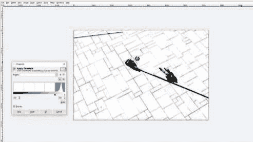

### 工具选择

手头既有适合初学者也有高级用户的工具，组合非常好，这里的工具恰好让这两类读者都感到满意。有些工具的功能非常基础，可以说可以与其他工具结合使用，而不是对它们进行个性定制。我本希望能看到更多预览工具，但它使用起来非常快速。

### 工具选择

随着每次更新，GIMP 的工具库不断扩充，受益最多的是用户。其提供的选择范围是无与伦比的，虽然提供的功能对某些用户有所益，但还有一些需求尚未满足。不过，这是一个很好的工具，是 GIMP 诚意呈现的。

### 用户界面

这是另一个采用极简主义处理 UI 并使其运行良好的例子。你的照片库位于左侧，编辑工具位于右侧，一切都一目了然，真的没有什么复杂的地方。这是我们在一些正在测试的程序中也能看到的风格。

### 用户界面

尽管功能众多，GIMP 很好地保持了内容的井井有序且相对容易查找。虽然没有直接的工具来定制布局，但可以删除和添加部分以让界面适应你的需求。然而，一个小小的遗憾是缺乏对某些工具制作内容的自定义。

### 导入选项

作为 digikam 套件的一部分在一定程度上扩展了 ShowFOTO 的功能集。然而，导入编辑工具的选项直接指向程序本身。我们完全预期随着 digikam 的持续增长，ShowFOTO 将变得更加强大。

### 导入选项

无论你想向 GIMP 导入什么类型的工具，它可能都支持支持。我们特别欣赏它处理文件导入的方式，允许用户在项目中添加各种格式（OpenType 和 Type！）。初学者应该查看 GIMP 网站上的指南列表以获取简单的教程。

### 特色功能

如果你真的想深入处理图片，ShowFOTO 的属性系统值得检查一下。它包含了图片类型和深度的所有信息，还可以编辑拍摄图片时的精确细节。如果你是从零开始创建图像，则将用不到这些功能。

### 特色功能

对于 Linux 用户来说，可以通过各种形式的脚本访问 GIMP 的核心功能是一个巨大的加分项。目前脚本环境的选择相对有限，新版本的 GIMP 拥有部分 API，允许访问可以添加到你的项目中的广泛模块。

### 总体评价

> 作为一个独立产品，ShowFOTO 落后于竞争对手，但当与 digikam 套件结合使用时，它表现良好。如果你追求极简界面，它绝对值得尝试。

### 总体评价

GIMP 拥有忠实的追随者并不意外——它持续提供高质量的工具，并有足够的空间来对你决定加载的任何图像进行转换处理。

# 评测

# 图像编辑器

# 简要回顾：对比并总结我们的裁决结果

| 工具选择 | Krita | RawTherape | ShowFOTO | GIMP |
|---|---|---|---|---|
| 用户界面 | 提供的工具令人惊叹，会让新用户感到惊讶和敬畏 | 提供了你需要的所有工具，几乎没有其他能让它脱颖出的功能 | 有兼顾初学者和高级用户的优秀工具组合，满足所有人的需求 | 新更新继续扩展 GIMP 易于使用的工具集，并提供更多选项 |
| 导入选项 | 没有 Krita 那么深，但 GIMP 提供了导入第三方笔刷的功能 | 处理 raw 文件最好的程序之一，但它经常被忽视 | 有些选项与 digikam 的其他部分竞争，但较少 | GIMP 在导入第三方字体、笔刷和工具方面是最好的，它是其工具库的一部分 |
| 特色功能 | Krita 的管理工具无与伦比，让你完全控制 | 工具易于找到，且布局在视觉上非常舒适 | 谁需要一个像这里这样实用的内置项目呢 | 虽然尽管面向高级用户，但 GIMP 的脚本选项非常有用 |
| 总体评价 | 一个用于数字艺术和设计的惊人工具，真的超出了预期 | 良好且易于使用，但它能竞争得过对手吗？ | 与 digikam 其他部分一起使用最佳，但值得一看 | 不再是 Photoshop 的寒酸之徒，它本身就是设计领域的力量级产品 |

# 那么胜者是……

# Krita

Krita 对图像编辑器的要求与众不同，但无论你是初学者还是编辑爱好者，不可否认 Krita 击败了其他竞争对手。诚然，第一次启动 Krita 时，海量的工具可能会让人无从从，但无论你在哪里卡住，都有帮助。从本质上说，它可以根据你的需求进行定制。

此外，Krita 比这里的竞争对手更具定制性。

# 评测

## CubieTruck Plus

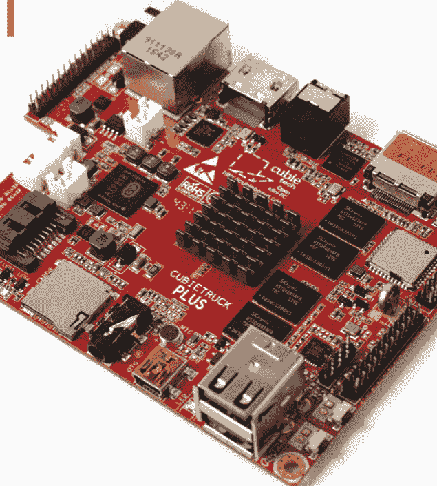

CubieTruck Plus 在基准测试中胜过许多竞争对手

## 电脑

## CubieTruck Plus

凭借八核处理器，CubieTruck Plus 是否值得上它比竞争对手单板电脑更高的溢价？

| 特性 | 详情 |
| :--- | :--- |
| 处理器 | 全志 H6 八核 (4x 2GHz; Cortex-A53, 4x 1.9GHz; Cortex-A7) |
| CPU | - |
| GPU | PowerVR SGX544 |
| 存储 | 8GB eMMC, SATA USB 2.0, micro-SD 卡槽 |
| 内存 | DDR3L |
| 网络 | 千兆以太网，2x4GHz; 802.11n Wi-Fi, 蓝牙 |
| 接口 | 70 针接口，包括 HDMI, UART, GPIO, I2C, SPI, Audio, 微克风 |
| 尺寸 | 111.6mm x 84mm x 19.92mm |
| 额外端口 | 4x USB 2.0, 1x USB, DisplayPort, IRTo, ToA, I2C, Audio, 微克风 |
| 购买渠道 | newcit.com (作为 CubieCube) |
| 价格 | £199.95 |

嵌入式设备专家 CubieTech 发布的最新开源硬件 CubieTruck Plus（也称为 Cubie 5）旨在改进其同名前身（已于 2014 年 8 月评测）。CubieTruck Plus 采用了用于移动设备中更快的全志 H6 八核系统级芯片（SoC）。

全志 H6 最初为手机和平板电脑设计，是 ARMv8 LITTLE 架构的实现。在移动设备中，使用低功耗核心处理日常任务，可以在需要计算能力时延长电池寿命——这需要一个聪明的调度器来完成，从而让你更重要的任务运行在较慢的核心上。在捆绑的 Android 版本中（预装在 8GB eMMC 闪存上），这并不是问题。然而，CubieTech 提供的 Linux 版本完全足以从额外的核心中受益。

CubieTruck Plus 在 Sysbench CPU 基准测试中耗时 178 秒在 H6 核心上运行八个并行线程，而当所有线程分配给树莓派 3 Cortex-A53 芯片时，仅需 25.38 秒，这是一个令人印象的结果：Pi 3 的速度略慢——相同测试下为 182 秒对比 49.02 秒。

其他基准测试证实了这一点：CubieTruck Plus 在 Linpack 单精度基准测试中得分为 523 MFLOPS，而 Pi 3 为 49.18 MFLOPS，内存带宽分别为 346.2MB/s 和 402.3MB/s（对应 Pi 3）。

全志 H6 允许使用多功能四核性能托管操作系统。然而，没有简单的方法可以区分高功耗和低功耗核心——这意味着完全可能。高性能硬件意味着高功耗。

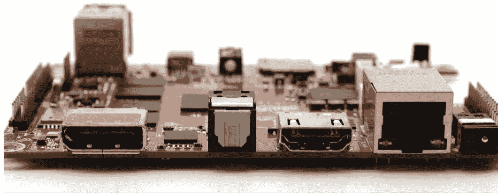

四个高功率处理器核心与四个低功耗引擎相结合，以减轻任务负载并延长日常使用中的电池寿命。缺少内置散热片意味着板子摸起来仅微热

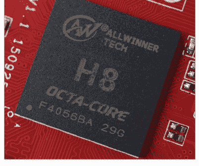


## 优点

- 多线程软件性能出色，存储扩展方便，附带散热片以保持冷却，支持 Android
- 价格几乎是树莓派 3 的四倍，而性能仅提供其左右；GPU 差异在使用中

## 缺点

CubieTruck Plus 在网络基准测试中领先并不意外

CubieTruck Plus 在网络基准测试中领先也不意外，除了仅支持 2.4GHz 和 5GHz Wi-fi 外，该设备的以太网端口——虽然受到 SoC 的严重瓶颈限制——在 1000 USB 连接下表现最佳，达到 79.14MB/s 到 80.98MB/s。遗憾的是，它不能说网络至少有一个影响 SATA 端口的重大缺点。CubieTruck 的 SATA 端口直接连接到 A20 SoC，而 H8 缺少 SATA——导致 Cubie 依赖其 USB 2.0 驱动器，增加了 CPU 开销并产生性能瓶颈。如果你选择光纤 RAID 板，这会特别令人失望，该板允许两个 SATA 设备共享单个板载 SATA 端口。其他失望的还包括高功耗，板子在负载下电流为 1.32a，而树莓派 3 为 0.58a，且高价很少通过额外配件得到证明，这些配件包括 USB 线、带 2.5 英寸硬盘的亚烯外壳、SATA 数据线和电源线，而且摸起来可能是热。更大的问题包括捆绑了过时的 Android 4.2.2 版本，以及在评测进行时 Linux 缺少 GPIO 输出，这应该很快得到解决。

- Gareth Helforth

## 总结

CubieTruck Plus 比其前身更好，板子性能仅微热。价格不到 120 英镑，提供了足够的功能，除非你需要快速网络或 SATA 连接。

## 评测

## Parsix GNU 8.5

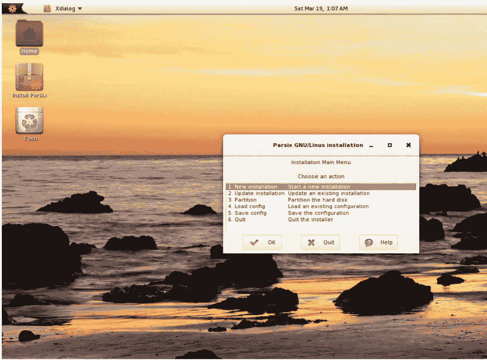

## Parsix GNU 8.5

Parsix 的最新更新能否证明它仍然能跟上节奏？

Parsix GNU 是一个成功跟上时代的发行版之一，不断改进其功能集以满足用户群。尽管面临许多其他版本的竞争，其最新的 8.5 更新再次证明了为什么它值得用户尝试。

- 硬盘 1.2GB
- 存储 4GB
- CPU 至少双核
- 购买渠道 `www.parsix.org`

尽管安装程序对新手并不友好，但基于文本的 Xialog 菜单可以很好地完成任务。还包含了根选项和分区硬盘。当然，文本安装程序并不容易上手，所以某些用户最初可能需要额外的帮助。但除此之外，安装速度很快，且没有冗余使得速度降到最低。GOME 桌面通常非常耗内存，因此看到 Parsix 对内存的影响如此其微令人惊讶。系统在峰值时仅使用 75MB 内存，它运行非常流畅

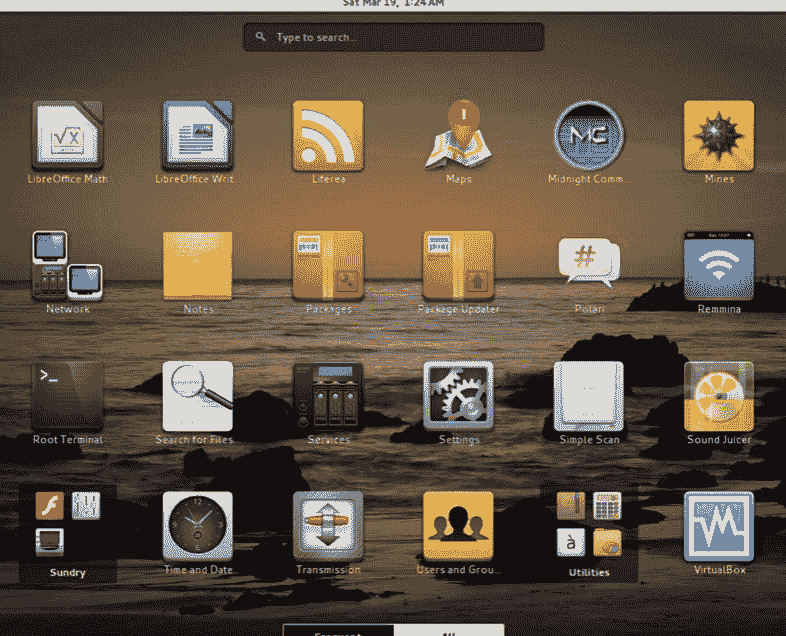

## 优点

- 其极简的方法为用户提供了一个绝佳的画布，没有复杂的菜单干扰。

## 缺点

- 虽然功能齐全，但捆绑的一些软件并不吸引眼球。你可能会发现它并不适合你。

## 总结

如果你以前用过 Parsix 的任何版本，你会感到宾如归。但如果你是 Linux 新手，你可能会觉得它平平无奇。`www.linuxuser.com`

## 免费软件评

## 音乐播放器
Clementine 1.3.1

弃用你发行版默认的播放器可能会有所帮助。

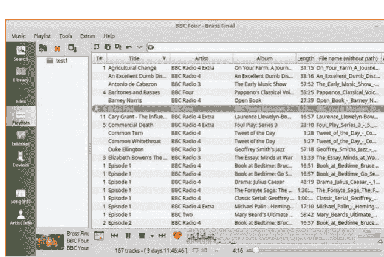

Clementine 一直以来持续改进；变得更加稳定，并仔细地改进功能。Amarok 项目一直以来因其快速方便的集合管理而成为理想选择，因为开发者们专注于通过简单界面播放数字音乐的核心优先事项。

由于提供了 Fedora 和 Ubuntu 版本的软件包，很容易就能在任何基于 Red Hat 或 Debian 的发行版上安装最新版本。启动过程非常简单：打开程序后，创建一个新的播放列表并添加文件。虽然你可以拥有多个播放列表，但只需点击几次即可执行默认操作，而且界面直观。

最后，关于集成、播放列表、播客发现，因此对于那些喜欢这些艺术家和歌曲作曲家的人，Clementine 添加了新的歌词支持，以及一些进一步的完善——你也可以对其进行完善（我们建议这样做），你会发现它的胜出之处是简单和响应迅速，你可以尽情享受音乐。

例如，在下载 Haskell 的程序或 MP3 时，默认行为仍然存在旧 Bug，尽管不再像过去那样容易崩溃。它不具备竞争对手插件的功能。

## 非常适合...
当你想要简单地处理音乐时。
`clementine-player.org/`

## 编程语言
Idris 0.1.1

欢迎来到依赖类型的世界！

Idris 是一种带有依赖类型的通用编程语言。类型可以依赖于值；作为一种一类语言结构，它们可以像其他值一样被操作。这在官方教程中得到了实践验证，作为任何解释器的示例，其中可以对类型进行注释。

## 优点
比 Agda 更实用，并且有相当的文档支持。支持多次备份。

虽然是一门相对新的语言，但还有其他几种替代方案，大多数人对 Haskell 或 OCaml熟悉。在这样的起点下，Idris 迅速证明了自己作为一种语言的价值。虽然目前：当今的功能性编程语言正在为未来可能的独立奠定基础，因为我们正努力让程序适应解耦的、处理器（或多机器）世界，例如 Idris 通过对代码签名进行类型检查，作为代码正确性的保证。

安装简单，使用 `haskell cabal && install idris`。从任何使用精密算术库 (GMP) 的项目，你都可以编译 Idris，或者通过交互式提示符尝试，它可以检查类型并生成字节码以实现快速编码。尚未准备好投入生产，但比 Agda 等依赖类型语言功能更多，值得一看。

## 缺点
对于不熟悉 Haskell 或 OCaml 的人来说很新奇。不支持自托管，仍在开发中。

## 非常适合...
任何对功能编程前沿感到感兴趣的人
`idris-lang.org/`

## AV 文件数据显示

## MediaInfo 0.785

AV 文件的技术、格式、音频和编码、比例和标签数据。

音频和视频文件包含了大量关于它们的信息、编码和容器格式，不需要播放即可获取文件名和 MediaInfo。

支持的视频格式包括 MPEG-1/2 Video、H.263、MPEG-4（包括 DivX, Xvid, H.264/AVC, HEVC 和 Fv1）。音频格式 MP3、AAC、DTS 和 FLAC 支持字幕格式，以及大多数容器——包括未保护的蓝光，MediaInfo 涵盖了这些媒体。重型工作由 mediainfo 完成，同时提供了命令行和 GUI 版本的 MediaInfo，libznfo 也已在项目网站上针对所有主要的 GNU/Linux 集合进行了预包处理，我们在 Debian Jesse 结束时看到的某些速率让我们感到惊讶。

该应用的 GUI 版本可以打开文件或目录并显示所有信息。如果你需要快速扫描大型集合以检查质量或控制、按格式查找并以各种格式报告，而 GUI 包含了带有每项可用信息的列表，并有自定义其他输出格式的机会。

### 优点
可以快速洞察音频视频的标签和技术格式

### 缺点
如果内容值得一读，它不会让你付出代价！落后于

## 非常适合...
处理媒体的播客主
`mediaarea.net/en/MediaInfo`

## 棋类

## gShogi 0.5.0

准备好接受新挑战了吗？
学习象棋（Shogi）。

象棋——日本象棋，或将棋的游戏——与国际象棋有关，但在元素上有所不同，这使其在初期就能快速进展，例如棋子的升格，以及将被捕获的棋子返回棋盘供对方使用的能力——这可以改变游戏的平衡。

网上有很多非常好的示例，但如果你想开始，你还需要一个棋盘对手——Shogi 在这两个方面都能为你提供帮助。事实上，它为你提供了对手选择——不是在等级方面，而是允许你选择使用内置的基于 GNU/Shogi 的引擎，还是使用你自己的 Shogi 引擎。

这个新版本是 Python 3 和 PyGo 的一部分，具有新的棋子和配色方案。棋子有许多颜色可选，并且可以加载自定义主题。另一个对新手友好的功能是让赛——针对 AI 的先发优势。如果你真的想知道是如何做的，可以从 Shogiview 网站以 GSN 格式记录游戏——从我们的 Shogi 页面链接——并在内部进行学习。


## 顶级托管


英国领先的托管公司提供的 CWCS 托管托管服务。他们提供全面的托管产品、服务和支持。他们经过高度培训的员工不仅是托管专家，还致力于提供超越标准的卓越客户体验和性能。

- 托管机房 (Colocation)
- VPS
- 100% 网络可用性

## 性价比型托管


ElasticHosts 为全球企业提供简单、灵活且高效益的托管服务，具有高性能、可靠性和可扩展性。他们的工程师团队通过电话、电子邮件和工单系统提供24小时专家级支持。

- 任意操作系统的云服务器
- Linux 操作系统容器
- 世界级 24/7 支持

## 小企业托管


HostPapa 是屡获奖的托管服务商，绿色托管的领导者。他们提供市场上功能最全的托管包之一，具备24/7客户支持、学习资源以及卓越的可靠性。

- 网站生成器
- 预算价格
- 无限数据库

## SSD Web托管


自2001年以来，Bargain Host 致力于在英国提供最好的云托管服务。他们已成功实现目标，并建立了包含大量客户的大数据库。他们还因提供卓越的托管服务而屡奖。

- 共享托管
- 云服务器
- 域名

## 性价比 Linux


Linux 托管是寻求高性价比和强大托管服务的家庭、商业用户和开发者的完美解决方案。无论您是在构建博客、运行单页作品集还是数据库驱动的电子商务网站，都有适合您的 Linux 托管解决方案。

- 学生优惠
- 站点设计器
- 域名

## 高质量 VPS 托管：


`www.bhost.net` | `sales@bhost.net`

BHOST 专注于单一领域——Linux 虚拟专用服务器 (VPS)。我们不销售额外的域名或 SSL 证书；我们致力于为您提供具有竞争性价格的高质量 VPS 服务。我们以客户为中心意味着我们的团队会竭全力提供帮助。

我们的平台支持托管多种服务，包括游戏服务器、文件存储、邮件服务器以及用于各种网站的 VPS 服务器。

- VPS 托管
- 无限带宽
- 运行您喜爱的 Linux 发行版，100%满意或退款！

## 快速可靠的托管


`www.bytemark.co.uk` 01904 890 80

Bytememark 成立于2002 年，是英国云托管专家。他们的服务范围包括内部专业知识、带有人性化的技术支持、履行支持人员的承诺，以及价格合理的顶级托管硬件。

- 托管式托管
- 英国云托管
- Linux 托管


## 开源

您的 Linux 新闻与观点来源

联系我们...
`linuxuser@imagine-publishing.co.uk`

## 评论

## 读者来信

关于本杂志、Linux 和开源的问题与意见

### 感到心动 (Feeling twitch)

亲爱的 LU&D：
我有一台 PC 正在将其转变为 OBS 盒子，因为我想在 Twitch 上直播游戏。我有一份用于游戏的信息发行版列表，但那我不担心。我想知道哪一个对于 OBS 盒子本身最合适。我没有在录制任何内容，只是直播我正在游戏的视频和音频，以及我对自己表现的评论。
理想情况下，我想使用一个包内包含我需要的所有内容的发行版，而且最好是支持即时启动 (live boot)，以防我想把这台 PC 用于其他事情。我检查了麦克风和摄像头，都有驱动，所以我想只要找到正确的发行版就可以就绪了。

Kevin Moore

你好，Kevin。市上有许多发行版可以满足你的需求，因为 OBS 有 Linux 版本（`https://github.com/obsproject/obs/linux-distros`），你可以从你选择的任何发行版中组装。然而，如果你想要一个专门用于直播的环境，且一切都在你想要的地方，我推荐 OBS 项目社区基于 Ubuntu 的 GillyMomo 版本，它包含了从 OBS 本身到 RTMP 世界所需的一切！用于 IRC 的 Hexchat、Steam、KODI、Firefox 和 Chrome。该发行版支持从盘启动，目前的最新版本是 1.2.4。最终目标是为 OBS 创建一个仅服务器的发行版 `https://obsproject.com/forum/linux-distro-obs-rtmp`。

### 穿透镜 (Through the looking glass)

亲爱的团队：
有人记得吗，年前有一个运行在 Linux/Windows 上的 3D 桌面界面？


| 首页 | 论坛 | 成员 | ... |
|---|---|---|---|
| 搜索结果 | 框 | | |
| 资源 | | | |

## Linux 发行版特色 OBS 与 Nginx-RTMP

| 概述 | 更新 (9) | 评价 (1) | 讨论 |
|---|---|---|---|
以下是已安装的发行版和应用程序：
* OBS 带有 RTMP（从源码编译）
* Hexchat
* Google Chrome（来自 .exe 文件）
* Firefox
* Media Center

默认桌面环境是 Cinnamon，带有 XFCE 和 KODI。请记住，这是一个尝试整合的粗略列表。如果你有任何时间可以评论，我随时欢迎建议！

- 直播员 1.2.1 下载
- 已移除
- 更改主题（清除外观）
- 添加到 Ubuntu 主题

上面的操作系统是基于 Ubuntu 的发行版，专门为直播设计，由 GillyMomo

## Twitter：@linuxusermag

## Facebook：Linux 用户与开发者

Windows。其中，我想知道它叫什么名字，以及是否仍然可用。如果已经不再可用，还有其他类似的东西吗？我确定它不是 Word 或任务栏，我不记得它长什么样了。我想知道为什么人们不开发这种东西，一个覆盖在桌面上的 Java 环境，让它看起来有 3D 效果。当程序员开始开发这些环境时是在 90 年代。

（此处省略了后续重复段落的翻译）

……我想知道为什么人们不开发这种东西，一个覆盖在桌面上的 Java 环境，让它看起来有 3D 效果。当程序员开始开发这些环境时是在 90 年代。

……

你好，Tom。有人记得吗，年前有一个运行在 Linux/Windows 上的 3D 桌面界面？其中，我想知道它叫什么名字，以及是否仍然可用。如果已经不再可用，还有其他类似的东西吗？我确定它不是 Word 或任务栏，我不记得它长什么样了。我想知道为什么人们不开发这种东西，一个覆盖在桌面上的 Java 环境，让它看起来有 3D 效果。

等等，我不确定它不是 Word 或任务栏，我不记得它长什么样了。我想知道为什么人们不开发这种东西，一个覆盖在桌面上的 Java 环境，让它看起来有 3D 效果。

# FileSilo

# 您的免费资源

立即登录 `WWW.FILESILO.CO.UK/LINUXUSER`，今日下载最新发行版和免费软件

# 最新发行版


# 您的赠送资源

在本期 FILESILO 中，我们为 LinuxUser & Developer 的读者提供了免费且独家的内容，您将发现这些优质资源……

- >> 两个发行版：Ubuntu Studio 和 gnuart 的 32 位版本，两者均已带有创性的修复补丁
- >> 软件包：包括 Lightworks 和 FlowBlade，帮助您制作精美的视频
- 观看来自 Linux Foundation、Red Hat（红帽）和 Raspberry Pi 的指南、教程等内容
- 本期教程的代码和素材，包括我们的树莓派音响系统专题

# 如何安装 FLOWBLADE

从 FileSilo 或封面光盘下载 `.deb` 包。
在保存下载的 `.deb` 文件的目录中打开终端，输入
`sudo dpkg -i ~/flowblade-1.6.0-1_all.deb`
使用以下命令添加缺失的依赖：

```
```


sudo apt-get install gir1.2-glib-2.0 gir1.2-gtk-3.0 gir1.2-pango-1.0 gir1.2-gdkpixbuf-2.0

如果您需要强制安装所有依赖：
`sudo apt-get install -f`


# 视频教程时长 20 小时


# 顶级 Linux 开源 (FOSS)

教程代码与素材

# www.filesilo.co.uk/linuxuser

# FILESILO – 专业人士之园

## 发现您的免费在线资产

- 快速增长的资源库
- 持续更新的酷资源
- 让您的下载内容井然有序
- 随地浏览并访问您的内容
- 再也不用破损的光盘页面损坏页边
- 无损坏光盘
- 纸质订阅者可获得所有内容
- 数字杂志所有者也能获得所有内容！
- 每期内容随您的杂志免费提供
- 资源的安全在线访问


LinuxUser & Developer
LinuxUser & Developer
Ubuntu 12.04 LTS - 依然是强者

现在是您需要注册 FileSilo 的时候。之后，您可以使用提供的电子邮件地址和密码登录。

此轮播显示了最热门的下载，看看您的读者们在享受什么！

最热门内容


如果您正在寻找特定类型的内容（如发行版或 Python 文件），请使用这些过滤器来精简搜索。

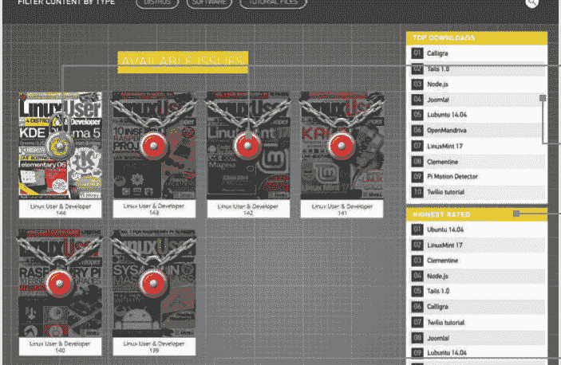

绿色开锁显示您已访问的期。红色闭锁显示您需要购买或解锁的内容。

此处列出了热门下载，让您可以一览最热门的内容。

查看“最高评分”列表查看其他读者投票的结果！

| 热门下载 |
| --- |
| Kali 1.2 |
| Noble.io |
| Ubuntu 12.04 |
| Ubuntu 14.04 |
| Linux 17 |
| Clementine |
| Vagrant |
| Tacs 1.2 |
| Calgary |
| TeX 教程 |

| 最高评分 |
| --- |
| Ubuntu 14.04 |
| Linux Mint |
| Clementine |
| Vagrant |
| Tacs 1.2 |
| Calgary |
| Journalify |
| Ubuntu 14.04 |
| Speedmatrix |

了解更多关于我们在线商店的信息，以及关于隐私和联系方式的实用常见问题解答。

发现我们优秀的姐妹杂志以及它们提供的丰富内容……


www.linuxuser.com | 97

# FileSilo

# 如何使用

关于访问您的新数字存储库所需的一切信息


要访问 FileSilo，请访问 `www.filesilo.co.uk/linuxuser`

- 01 按照屏幕上的指令创建 FileSilo 系统账户，然后登录并回答一个关于杂志的简单问题来解锁该期。您可以使用您的杂志免费访问内容。
- 02 如果您是纸质订阅者，可以通过输入 Web ID 轻松解锁所有内容。您的 Web ID 是打印在订阅副本邮寄标签地址详情上方的八位字母数字代码。您也可以在续订信中找到它。
- 03 如果可以使用任何流行的浏览器（如 Firefox、Chrome 或 Safari）在桌面电脑、平板或智能手机设备上访问 FileSilo，我们建议您使用电脑下载内容，因为您可能无法将文件下载到手机或平板。
- 04 如果您在访问 FileSilo 内容或注册过程中遇到任何问题，请查看在线版常见问题解答或发送邮件至 `filesilo@imagine-publishing.co.uk`


```go
package main

import (
	"fmt"
)

func main() {
	fmt.Println("Hello World")
	intil.WriteFile("autobyslice","autobyslice",
}
```

```
1 TARGET = howerid
2 GO = gcc
3 CFLAGS = -g -O0
4 STAGING = howerid
5 BINARY = $(TARGET)
6 SHELL: $(GO) $(CFLAGS) = $(BINARY)
7 make clean
```


# 更多教程与灵感


读完了吗？Linux User & Developer 网站上有大量免费开源资源等待等待。每天都会上传功能、教程、评测和评论文章，涵盖内核开发、最新发行版和开源软件、树莓派项目以及采访。加入我们的 Linux 用户和开发者社区并发现新工具。

# www.linuxuser.co.uk

LinuxUser 第 167 期于 2016 年 6 月 30 日由 GreatMags 出售


# 网页托管

快速可靠的 SSD 托管（网页加载速度快 10 倍）

# 入门方案包含：

- 免费英国域名
- 免费网站生成器
- 免费 SSL 证书
- 免费一键安装
- 免费 Cloudflare CDN
- CloudLinux 增强
- 1 GB SSD 网站空间
- 无限制带宽
- 5 个域名
- 自动每日备份
- 30 天退款保证
- 24/7 在线支持

# 两年仅需 39.95 英镑！

www.bargainhost.uk

0843 289 2681

自 2001 年以来的英国网页托管提供商

价格不含 20% 增值税

# CWCS 托管服务

# 英国专家提供的 Linux 服务器托管

24/7 英国支持 • ISO 27001 认证 • 免费迁移

托管托管 • 云托管 • 独立服务器

# 卓越托管。卓越支持。

# www.CWCS.co.uk

T: 0115 740 1234 • E: info@cwcs.co.uk • W: www.cwcs.co.uk
