# Linux 用户与开发者 167 - 系统安全指南

本四部分完整指南的第一部分从本期开始。

**即时启动 DVD**

## 击败黑客

使用树莓派进行渗透测试

将你的 Pi 变成终极安全工具

## 编译新软件

无需更新发行版即可获取新 FOSS（自由开源软件）

## 保护你的系统

在 `Minecraft` 中播放音乐

使用 Pi 在 `Minecraft` 中实现音乐可视化

## 接管 Bash

学习如何使用 shell 脚本节省时间

## 构建你自己的 NAS

通过构建和优化存储设备跨网络提供文件服务

## 测试中的 VPN

哪种网络最符合你的隐私需求？

## 黑帽 Hack3r

本期让你的 Pi 和 HAT 发挥更多

## 新独立服务器

### 巧妙解决方案。

| 规格 | 独立根服务器 EX51 | 独立根服务器 EX51-SSD |
| :--- | :--- | :--- |
| 处理器 | Intel® Core™ i7-6700 四核 Skylake 处理器 | Intel® Core™ i7-6700 四核 Skylake 处理器 |
| 内存 | 64 GB DDR4 RAM | 64 GB DDR4 RAM |
| 存储 | 2 x 4 TB SATA HDD 企业级硬盘 | 2 x 500 GB SATA SSD |
| 带宽 | 保证 1 Gbit/s 带宽 | 保证 1 Gbit/s 带宽 |
| 备份 | 100 GB 备份空间 | 100 GB 备份空间 |
| 流量 | 包含 30 TB 流量* | 包含 30 TB 流量* |
| 合同 | 无最小合同限制 | 无最小合同限制 |
| 设置费 | £76 | £76 |
| 月费 | 每月 £38 | 每月 £38 |

* 超出部分不收取费用。如果每月使用超过 30 TB，我们将永久限制连接速度。可选方案是通过承诺每额外 TB 支付 £0.68 来永久提高限制。

## 杂志团队

**编辑** April Mullen
`april.mullen@imagine-publishing.co.uk`

**制作总监** Retrica Richards

**制作经理** David Broom

**摄影师** James Shepherd

**销售助理** Ad Hirstam

**总编辑** Dan Hutchinson

**设计负责人** Riley Anderson

**销售主管** Luke Birdcombe

欢迎阅读 `Linux User & Developer` 最新杂志，这是英国和欧洲最喜爱的 Linux 和开源杂志。你对如何设置陷阱了解吗？事实确实如此，特别是在安全方面。设置得好固然不错，但为了获得最大的安全性，你需要像黑客一样去保护系统和网络。不要把硬币储放在可能被勒索软件丢失的数据中；学习哪些数据是重要的，并将其埋藏在触不到的地方。树莓派看起来像是在度假。但请假设你正处于防御状态：运行漏洞扫描器，准备好数据包嗅探器，进行渗透测试，尝试破解自己的安全防护。如果你成功了，说明你的方法错了。这方面没有完美的解决方案，但本期提供了一些极佳的建议。书中充满了各种操作指南，通过使用 `Kali` 和一套工具，将帮助你检查系统是否安全。记住，每一期杂志也是一种黑客工具，所以要明智且良好地使用。你也可以在我们如何使用 Pi 进行渗透测试的完整指南中找到相关内容。

祝安全……

April Mullen，编辑

`april.mullen@imagine-publishing.co.uk`

## 发行

**发行总监** Darwin

**制作总监** James Hawkes

`01202 582600`

## 国际

提供国际订阅许可服务。

**国际部负责人** Bryan Byam

`+44 (0)1202 41366`

`www.imagine-publishing.co.uk`

## 财务

**财务总监** Marco Peroni

**总经理** Daniel Booth

## 打印与发行

## 联系团队：

`linuxuser@imagine-publishing.co.uk`

**在线购买**

访问 `www.linuxuser.co.uk` 获取更多新闻、观点、教程和评论。

## 域名 | 网站 | 托管 | 云服务器

## 最安全之选！


### 托管？仅选择最安全的！

`1&1` 提供了最高标准的保护！通过以下功能向您的在线访问者证明，安全是您的首要任务：

- 包含 SSL 证书
- 认证数据中心
- 地理冗余
- DDoS 保护


`0333 336 5509`


请访问 `1and1.co.uk` 了解产品详情、条款和条件。`1&1 Internet Limited`, Discovery House, 154 Southampton Street, Gloucester GL1 2EX.

## 光盘上的开源软件

### 本期免费 DVD 包含内容

#### 了解您免费光盘中的内容

**欢迎使用 Linux 用户与开发者 DVD。** 本期帮助您使用系统管理员可以拥有的最佳工具来锁定您的系统和网络。从漏洞扫描到数据包嗅探，这个完整的工具包包含了您保护数据和测试安全所需的一切内容。掌控您的系统并彻底告别风险！


### 加载 DVD

如需访问软件和教程，只需将光盘插入计算机并双击图标即可。

### 现场启动

如需对此光盘提供的发行版进行现场启动，请将光盘插入驱动器并重启您的计算机。

### 特色软件：

- 请注意：
  - 您需要确保计算机已设置为从介质启动；检查计算机的 `BIOS` 界面以更改启动选项（`Boot Options`）。
  - 某些计算机在从光盘启动时需要按某个键；请查看您的说明书或我们的网站以确认是否如此。
  - 现场启动的发行版从光盘运行；除非您选择，否则它们不会安装到您的计算机上。


#### Kali Linux

这款面向 Linux 用户的安全测试发行版将帮助您绘制系统和网络漏洞。该发行版可以从光盘启动，也可以安装到您的系统中。


#### ipFire

这是一个专业且加固的 Linux 防火墙发行版，安全、易于操作，且功能适用于企业及任何人员。该发行版从光盘安装；请确保在分区和安装之前已备份您的数据。


#### 获得最佳效果：

此发行版已针对 `HTML` 最新更新和 `CSS` 标准的最大渲染进行了优化。因此，为了获得最佳性能，我们建议您使用：

- `Internet Explorer` 8 或更高版本
- `Safari` 4 或更高版本
- `Chrome` 5 或更高版本


#### chkrootkit

拥有 `root` 权限？别被 `root` 入侵。检查是否有 `rootkit` 渗透您的文件的迹象。


#### Snort

使用完整的入侵检测系统嗅探您网络中的安全风险。

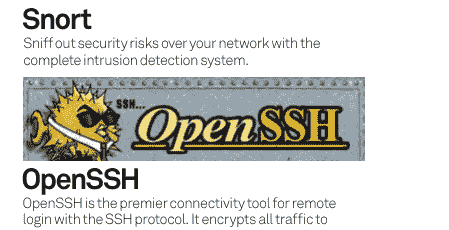

#### OpenSSH

`SSH` 是使用 `SSH` 协议进行远程登录的首选连接工具；它加密所有流量以消除攻击。

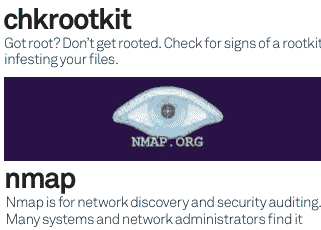

#### nmap

`Nmap` 用于网络发现和安全审计。许多系统和网络管理员发现它非常有用。

### 光盘有问题？

请向 `imagine-publishing.co.uk` 向我们发送电子邮件。如果您在使用提供的软件或资源时遇到问题，请告诉我们任何相关的软件反馈。


#### Wireshark

`Wireshark` 是世界上最领先的协议分析器，让您能够从微观层面看到网络中发生的情况。

就本声明而言，`Imagine Publishing Limited` 对在使用此光盘提供的软件而导致的任何损坏、数据丢失或中断不负责。我们建议您在安装任何软件之前备份您的数据。

软件根据以下许可授权：

- 开源
- 免费软件：
- 试用版


# 值得 true 树莓派 Kickstarter 项目

## 1 混合电子管放大器

## 树莓派 Zero 获得摄像头接口

这是专为树莓派 40 针版本设计的首款电子管放大器。它包含一个 15 针 FPC 接口，允许你以 192kHz 的频率连接并流媒体音乐音频，同时板载 3.5mm 接口，可以轻松地连接你喜爱的耳机并听音乐。

通过树莓派的新接口升级你的摄影游戏

## 2 音频注入卡 (Audio Injector Card)

这块树莓派板和卡增加了音频输入和输出物理模块，用于无缝连接。它消除了对复杂音频软件的需求。为了简化构建，音频注入卡也可以用于现有的音频设置。

在去年 11 月树莓派首次发布时，评论家和用户很快指出了这款廉价电脑的硬件局限性。

当时，树莓派创始人宣布了 Pi Zero 的首次硬件升级：一个摄像头接口。


针对 Zero 最受期待的“缺失”功能：摄像头接口的停滞。由于运气，在计算模块开发套件设备右侧的细间距 FPC 接口正好可用。

拥有支持树莓派的摄像头模块的用户连接到 Zero 需要一根六英寸的适配线。这种线可以通过各种零售商正式购买，将传统的 FPC 格式连接到摄像头接口使用的更小引脚。

## 3 树莓派模拟 Zero (Raspberry Analog Zero)

这一成就的公告与 Sony IMX218 80 万像素传感器的消息恰好吻合，该传感器使得完整的树莓派相机变得可行。然而，博客中尚未确认它是否能在 Pi Zero 上工作。

`Analog Zero` 适用于任何 40 针的树莓派，为板载增加了全模拟输入/输出。用户可以使用它进行气象站或温度计等项目，或者让它成为一个安全准确的电压表。

Pi 创始人 Upton Eaton 解释道，导致开发的原始批 Zero 货物是：“工厂生产的新的一批 Zero 将在几分钟内售罄。”

## 4 RTC GPIO

Zero 必须与处于冲刺阶段的树莓派 3 竞争工厂发布空间。

一个相对易于使用的套件，通过添加 Pi GPIO 引脚提供了实时时钟功能。通过任何软件，用户将能够管理他们的树莓派，而无需在 Pi 上添加额外的 GPIO 引脚。

他继续写道：“幸运的是，我们能够利用由此产生的生产停滞，解决 Zero 最受期待的‘缺失’功能：摄像头接口。”

## 5 UDO X86

拥有支持树莓派的摄像头模块的用户连接到 Zero 需要一根六英寸的适配线。这种线可以通过各种零售商正式购买，将传统的 FPC 格式连接到摄像头接口使用的更小引脚。

如果你还没有在 Pi Zero 上获得它，请访问 `raspberrypi.org` 查看在线库存信息。

好吧，UDO X86 将与树莓派 3 竞争，但它声称可以做到。它使用带有内置加速度计、陀螺仪和蓝牙低能连接的 Intel 四核处理器。

你的 Linux 新闻与观点来源

# STEAM

### Linux 的 Steam 集成从未像现在这样完美

用户现在可以以 32 位模式运行 `Steam` 客户端

虽然 Linux 长期一直是海量 Linux 用户访问 Linux 兼容游戏的最佳方式，但它的缺陷已被官方评论家和在线论坛广泛记录。关键问题之一是尝试在 32 位模式下获取 `Steam`，但 `Valve` 刚刚解决了这个问题。Linux 集成的创建是为了

 在你的 Linux 机器上以 32 位模式获取 `Steam`。它在常见的发行版中正常工作，并且被安装。它在许多其他发行版中也可以工作，有关安装的必要文档可以在官方网站找到。

在最近的一份声明中，Doherty 表示：“Linux 集成是一个补丁工具，将解决 `Steam` 运行时的问题。通过这个工具，用户可以以 32 位模式运行 `Steam`，以解决最新的 64 位更新，以及启用或禁用 `Steam` 运行时，”

虽然 LSI 工具是一个开始，我们可能会看到来自 Solus 的进一步开发，以提高 `Steam` 的可用性。“这将解决 `Steam` 的局限性，以带来运行时配置设置，并消除 `Steam` 对自身 SDL 库的需求，”Doherty 补充道。该项目是开源的，包含了 Solus 的必要仓库以提高 `Steam` 在 Linux

### Amazon 推出新的运行时模型

备受推崇的 `Amazon Web Service` 发布了一个新的开源项目，创建一个让所有开发者受益的运行时应用环境，扩展应用程序。

在布鲁克林的 `ServerlessConf` 上演讲，`AWS` 服务总经理 Tim Wagner 表示：“我们现在处于早期阶段，这个生态系统正在增长，并使公司启动自己的项目。对于下一个阶段，我们需要更多的解决方案来扩展视频，或者运行脸部识别。” `Flourish` 将在未来几个月在 `GitHub` 上发布，供任何人免费访问。名为 `Flourish` 的项目看起来旨在突出 serverless 环境的简单性，可以扩展到无需服务器的能力。其他好处包括能够使用首选语言编程，得益于运行时的开放，且无需为计算力付费。我们在应用程序层面上需要更多解决方案

10

# Ubuntu 16.04 现在提供便携应用

为 Ubuntu 用户提供了一种全新的应用程序包

便携应用在 Linux 组中开辟了自己的利基市场，因为它们轻量级且运行快速，但到目前，由于某些用户的兼容性和安装问题，它们未能进入主流市场。便携应用可能打破这一局面，得益于公告

 一个新的通用的

 

# GIT

### Git 2.8.3 更新改进了命令支持

最新的 `Git` 更新中有 20 多项改进

流行的源码管理器 `Git` 发布了其第三点版本。版本 2.8.3 显示了许多修复和对 2.8 分支的 20 多项改进，该分支正被今天大多数项目使用。

在更新中，用户将发现许多核心 `Git` 命令的增强，包括 `git send-email`、`git push`、`git submodule`、`git config`、`git replace` 和 `git format`。在这一侧，有一些性能，ORB 便携应用现在完全兼容 `Ubuntu 16.04`。我们可以确认所有 `Ubuntu` 变体都支持便携应用，包括 `Lubuntu` 和 `Xubuntu`。ORB 是一种开源包格式，允许用户使用无需管理员权限即可现场运行的应用程序。目前有超过 30 个应用程序作为便携包可用，包括 `Firefox`、`VLC` 和 `LibreOffice` 等，目前只有几个。预计在未来几个月，这个数字将接近三位数。

可能引起所有 `Git` 用户 true 的是新发布的 `OpenSSL 1.1.0` 的集成，为了更好的性能和安全性进行了改进，且高度可配置性。要查看 `Git 2.8.3` 的完整变更日志，请访问 `git.com`。

（平均每日访问量，4 月 30 日 - 5 月 31 日）

+ 1. `Linux Mint` - 2,923
+ 2. `Debian` - 1,926
+ 3. `Ubuntu` - 1,596
+ 4. `Manjaro` - 1,231
+ 5. `openUSE` - 1,213
+ 6. `Fedora` - 1,182
+ 7. `CentOS` - 1,009
+ 8. `Zorin` - 918
+ 9. `Elementary` - 849
+ 10. `Arch` - 782

# 本月

稳定发布（中）

`Ubuntu` 6.8.8 版本将由用户测试。它可能包含许多更改，包括安装方面的更改。

# 亮点

# ElementaryOS

这种基于 `Ubuntu` 的轻量级桌面环境以极简桌面方案闻名，`Pantheon` 是喜欢自定义功能的用户的最佳选择之一。

# Zorin

`Zorin` 仍在浪潮之。`OS 11` 更新带来了许多预装应用程序。范围范围包含了新的包管理器和替代桌面环境。

# Manjaro

Linux 爱好者对上手手 `Manjaro` 的 16.04 版本感到兴奋，该版本包含一个管理内核的新安装模块和一个改进的包管理器。

您的 Linux 新闻与观点来源

## 访谈 CHRIS BUEHLER

### pfSense

您的桌面到底有多安全？Chris Buehler 讨论了为什么 `pfSense` 是保护大型和小网络安全的领先防火墙

Chris Buehler

Chris Buehler 是 `pfSense` 项目的创始人之一，并在该软件的发展中发挥了关键作用，同时他还编写了 `pfSense: 权威指南：构建防火墙的必读书籍`。

> 您能向我们概述一下 `pfSense` 及其功能吗？`pfSense` 拥有超过 250,000 个活跃用户，是一款开源防火墙和路由器发行版，帮助各种规模的网络。熟悉防火墙的 IT 管理员将迅速学会如何使用 Web 界面配置软件包和组件。刚开始接触安全的学者将学习到丰富且易于理解的功能。


# pfSense 核心功能

pfSense 的核心功能之一是其状态检测防火墙。状态表维护着网络连接的信息。它能够按规则监控网络状态，并为保护各种协议提供多种选项。最后，它提供的工具还支持复杂布局、无线链路（卫星连接）、限制同时客户端连接数、限制内存配置等。

pfSense 的其他功能还包括网络地址翻译 (`NAT`)、高可用性配置（包括多个实例之间的同步）、多 WAN 和负载均衡、带有 `IPsec` 和 `OpenVPN` 的 `VPN` 连接、`PPPoE` 服务器、动态 `DHCP`、`DNS` 服务器和路由器发行版，当然还有详尽的监控和日志——可以说是防火墙和路由器发行版的“全能工具”。

pfSense 还具有可扩展性。有许多免费软件包可供选择，帮助您使用 `BGP` 馈源为地址构建自定义的透明代理，等等等。最受欢迎的软件包是 `Snort`、`Squid` 和 `SquidGuard`。

## pfSense 与其他领先的商业防火墙相比如何？它的做法有什么不同吗？

当然，商业防火墙非常不同。pfSense 的功能和特性与所有商业防火墙平相当，但当你深入挖掘时，会发现两个显著的差异。第一个是 pfSense 的总成本更低。由于 pfSense 是开源的，传统上不需要商业防火墙供应商所要求的年度许可费用。另一个差异化点是源代码社区。这个社区由极其聪明的人才组成，他们乐于解决问题并分享自己的所学。pfSense 论坛、文档 `wiki` 和 `YouTube` 是 pfSense 可获取的三个信息宝库。

## 软件的可定制性如何？用户可以根据自己的需求进行定制吗？

由于 pfSense 是开源的，对于那些想要将其个性化的人来说，有很多定制空间。大型公司已将 pfSense 集成到它们的商业产品中，实现个人级别的访问控制、`VPN` 隧道、负载均衡和多 `WAN` 路由。在 `pfSense 2.3` 版本中，图形主题基于 `CSS`，因此您可以随心所欲更改 `Web GUI` 的外观。除了定制外观和体验之外，通过定制内置和可用软件包，您可以进行组合以满足您特定的防火墙需求。配置非常简单，对于您所需的大部分功能都有在线指南。它不像使用硬件或深入研究我们那样困难。

终端用户可以在许多供应商支持的各种 `x86` 平台上运行 pfSense。我们最近审查了用于小型安装的硬件平台预览版，您还会看到一些用于大型企业级系列服务器。由于客户需求不同，我们提供系列桌面级和服务器供匹配。

## 运行该软件有任何硬件要求吗？

对于小型企业和家庭用户，我们建议使用至少 `1 GB RAM` 的 `64 位 CPU`。随着您需求的增加，我们建议增加这些资源。整体系统要求取决于通过系统的流量大小、所需的并发连接数、外部攻击的安全性和严重程度、启用了哪些功能，以及加载了哪些额外的软件包（如果有）。我们乐意根据特定需求提供建议，请联系我们。

我们主要使用并测试 `Netgate` 的 `Intel C2000 (Relay Atom)` 系统。`Netgate` 上的 pfSense 软件提供商业级支持。

## 选择合适的硬件

虽然 pfSense 可以安装在各种硬件上，但在目前状态下它仅支持 `x86-64` 架构。尽管如此，根据您的需求选择最佳硬件是非常值得的。其中的佼佼者是 `pfSense-2540` 网关设备：这是一种具有高性能技术的双成本解决方案，它还带来了

## 通过定制内置和可用软件包，您可以进行组合以满足您特定的防火墙需求

`Netgate` 系统在美国制造，并具有适用于各种用途的 `AES-NI` 兼容平台。这些系统支持 `VPN` 连接。`pfSense-2500` 可用于高性能地配置或扩展现有的防火墙、`LAN` 或 `WAN` 路由。在您的业务中，可以轻松定制 pfSense 以严密匹配您的 `Sense-2540` 和高性能网络需求。

我们还提供了适用于 `AWS`、`Azure` 和 `VMware` 的云和虚拟选项。所有这些均可免费开始，并提供高效的站点到站点隧道，涵盖 `Amazon` 或 `Azure` 区域之间的云到云集成。

您还能找到为 pfSense 推荐的硬件，它们是专门为配合 pfSense 软件而定制的吗？

是的。我们有定制的硬件，旨在最大限地发挥 pfSense 的能力。该硬件的设计目标是高可靠性和低功耗，同时充分利用 pfSense 提供的所有优势。从我们或我们的……处发现更多信息，由于这是我们在 `ARM` 平台上的首次尝试，我们感到非常兴奋。我们的目标是 `2016` 年 `9` 月上市。

## 软件的安全性如何？软件是如何发现并消除漏洞的？

让我先说，pfSense 团队在网络安全方面并不陌生。该项目始于多年前，并且一直在增长。我们不仅拥有一支拥有运营经验的开发团队，还在在全球范围内不断寻求解决方案以应对不断变化的威胁。pfSense 社区始终处于前沿，这在检测和保护您的网络方面表现卓越。

## 您能邀请我们参加培训计划吗？包含哪些内容？

我们提供为期两天的深度教学，可以在线或课堂环境中进行。课程由拥有多年经验的专业人士提供，每位学生都有自己的虚拟网络环境，包括 `LAN` 和 `DMZ`、分支机构以及外部网络。我们在两天内涵盖了大量内容！

更多信息可以在 `https://pfense.university/` 找到。我们还有一个社区成员组成的在线论坛，您可以在那里提问或查找从流量整形到高可用 `OpenVPN` 的任何主题信息。

## 对于从未尝试过 pfSense 的人，您想说的话是什么？

如果您想在 `Netgate` 系统上安装，免费下载的社区版具有商业版的所有功能。您可以选择终身免费的订阅选项。您也可以在 `AWS` 或 `Azure` 上使用该版本。您无需向我们提供姓名或电子邮件地址即可下载。我们理解。这没有许可或订阅费用，所以您有什么损失的呢？试一试，加入 pfSense 社区，并为网络安全做出贡献。

■

合作伙伴网络是下一步可以帮助您运行 pfSense。由于这些平台正是我们自己环境中使用的设备，这使我们能够在每次发布时获得最佳的测试结果。pfSense 软件由广泛的合作伙伴网络、`VAR`、`MSP` 和转销商支持，他们都致力于通过合作解决问题提供网络解决方案。我们很高兴与全球范围内的、理解我们业务以及 pfSense 软件和 `Netgate` 平台能力的合作伙伴。

最新的 `Netgate` 平台是一款微型防火墙，具有两个千兆以太网连接和 `ARM` 芯片，极大地降低了价格，让每个人都能负担得起世界级的防火墙。

# 你能帮助启发下一代编码人员吗？

`Code Club` 是一个全国性的志愿者领导网络，专为 9-11 岁的儿童提供课后俱乐部。

我们一直在寻找具备编程技能的人才，志愿者每周在他们当地的小学、图书馆或社区中心运营一小时俱乐部。

你可以与同事结队，会有老师在现场为你提供支持，我们将提供所需的所有材料，帮助激发孩子们对数字创作的热情。

有很多参与方式！

欲了解更多信息，请访问 `www.codeclub.org.uk` 加入我们。

## 你的 Linux 新闻与观点来源

### 观点

#### 内核专栏

`Jon Masters` 庆祝了 `Linux 4.7` 开发合并窗口的关闭，并发布了未来内核的新功能。

> `Linus Torvalds` 宣布了 `Linux 4.7` 的首次发布。根据 `Linux` 的说法，新内核是一个巨大的发布，但并不完全巨大。

随着 `Linux 4.7` 的发布，隐含的特性是 4.7 并不包含全新的子系统（例如新的文件系统或架构），而是某些功能。后者恰好是处理文件系统的内核开发人员向 `VFS`（虚拟文件系统）层推进的一项相当重大但对内核内部的工作。

每当挂载一个伪文件系统时，都会创建一个“独立实例”，以防止为相似挂载设置产生不良交互，因为这些更改可能会影响主机。最近的修复将在下个月的发行后不久移除 `Linux 4.7` 中对 `schedit` 的需求。我们将在下次提供关于 `Linux 4.7` 发布以及即将到来的 `4.8` 特性的完整总结。

#### CPU 频率生成器

`Linux 4.7` 中提到的新功能之一是新的频率“调节器”，被称为“`schedutil`”。CPU 调节器（Governors）是一组软件算法，用于决定何时更改系统的动态频率（速度）。在某些特定限制内的频率——毕竟是一个处理硬件开发的特定平台——考量了可用（电池）电量以及系统的热功率密度（`TDP`），后者限制了其频率和速度。

随着 `Linux 4.7` 的发布，标志着“合并窗口”的关闭——即允许对内核开发周期进行更改的阶段——以及下一次发布邀请的就临。`Linux 4.7` 版本引入了“增添趣味”，在客户历史的最后更新日期之前，对于任何试图在最后时刻补丁中计划的人来说，这可能是任何事情；对于利益相关者来说，要维护合并窗口中提出的项目，这些项目将成为下一次发布 `4.7-rc2` 路线的一部分，他提到计划稍后进行几分钟的清理。

`Jon Masters` 是一位内核开发者，从事 `Linux` 工作已约 19 年。他目前就读于利兹大学。此外，他还为一家企业级 `Linux` 工作，并参与了企业级 `ARM` 电源开发者标准的制定。


名为“删除 `DEVPTS_MOUNT` 配置选项”的 Linux 清单与内核处理伪文件系统（`ptys`）有关，这些是非图形程序的小型输出设备。用户通过 `ssh` 登录到服务器，然后打开一个新的 `pty` 与其 `shell` 交互。这些终端由服务器上的一个目录表示。该目录在磁盘上并不真实存在（它是一个内存中的伪文件系统，代表系统中可用 `ptys` 的信息及其内容，根据启动时挂载 `/devpts` 动态变化）。内核过去曾有显式处理来确保其可靠性。

如今，系统微处理器中的频率转换由操作系统软件管理——这一概念被称为 `OSPM`。操作系统的电源管理允许启用的操作系统在不影响性能的情况下执行频率转换。传统上，这些是相当粗粒度的，但其数量可以精细得多。跨架构的频率更改的确切机制（例如，内核可以使用 `ACPI` - 高级配置电源接口或 `ARM` 电源状态）仅使用 `ACPI`。你的 `x86` 笔记本电脑使用系统 `ACPI` 固件提供的特殊平台回调，形式为体代码，这些代码由想要进行电源转换的内核 `ACPI` 解释器决定；因此 `Linux` 不需要知道底层的细节。

`Linus` 在他习惯的周日傍晚更早时候处理了 `RC1` 内核。

当今 `Linux` 系统拥有名为“`ondemand`（按需）”、“`performance`（高性能）”和“`powersave`（节电）”的调节器，这些是相当粗放的工具，用于在达到某些系统负载指标后切换 `CPU` 频率。你可能用过像“`powtop`”之类的工具让你的笔记本电脑运行得更好，并遵循其建议切换 `CPU` 调节器。然而，现有的调节器并没有在底层 `Linux` 进程调度器中进行特定的校准，以确定运行程序所需的 `CPU` 频率。系统可以在完成工作后唤醒处理器执行一些任务，然后节流，从而节省大量的电池寿命。

现有的调节器在更长的时间窗口内观察某些系统指标，以决定为单个程序分配哪个 `CPU` 频率。在很大程度上，这种频率远低于传统的（响应频率请求的时间周期），反而要高，以减少竞争的影响。当今系统的真实情况是，许多可能性领域可以在只有极微延迟的情况下被采纳。

新引入的“`schedutil`”`CPU` 性能调节器直接与 `Linux` `CFS`（完全公平调度器）交互，以在每个调度器窗口内确定任务是否需要确认，以便。


- 漏洞分析 - 开源评估工具、数据库管理工具

- Web 应用 - Web 漏洞扫描器、数据库利用工具

- 嗅探与欺骗 - 网络和 WAN 扫描器、网络欺骗

- 信息收集 - 网络扫描器、流量分析器

- 逆向工程 - 调试器

- 压力测试 - 网络压力测试工具

- 取证 - 漏洞利用分析工具

- 密码攻击 - 离线攻击工具、在线攻击工具

```
Live (amd64)
Live (and64 failsafe)
Live (Forensic mode)
Install
Graphical install
Advanced options
```

`Kali Linux` 是一个基于 `Debian` 的 `Linux` 发行版，为数字取证和渗透测试设计。`Kali Linux` 预装了 300 多种渗透工具，例如 `nmap`（数据包扫描器）、`Wireshark`（数据包嗅探器）、`John Ripper`（密码破解器）等。`Kali Linux` 的意义在于，你可以测试自己网络的漏洞并对其进行加固。

`Kali Linux` 是一个识别和利用目标环境中漏洞的综合平台。通过 `Kali Linux`，你可以根据计划的测试方案应用适当的定义和方法，从而实现成功的渗透测试任务。`Kali Linux` 可以完成许多工作，但最为人熟的是渗透测试，或“黑客”攻击 `Kali WPA` 和 `WPA2` 网络。

> 黑客进入你网络的只有一种方法，那就是使用基于 `Linux` 的操作系统和支持监听模式的无线网卡。

黑客进入你网络的方法只有一种，那就是使用基于 `Linux` 的操作系统和支持监听模式的无线网卡。请注意，`Kali Linux` 并不是为初学者设计的。玩转它需要具备如何使用 `WPA` 认证的基础知识，并熟悉 `Kali Linux`。

## 使用 `ClamAV` 防御病毒

`ClamAV` 是一款流行的开源杀病毒软件，已在安全和电子邮件扫描等多个领域占有一席。它支持大多数流行的 `UNIX` 操作系统（`GNU/Linux`, `Solaris`, `FreeBSD`），并可以扫描你的服务器和文件缺陷。使用 `ClamAV` 的最佳方式是在发现潜在安全威胁时，它会提示你如何解决该问题。

一旦安装并配置了 `ClamAV`，你可以使用可用单元检查已完成的二进制文件是否在你的系统上运行。`Clam-clamd` 是一个多线程守护进程，它使用 `libam` 扫描文件中的病毒。用户通过配置文件 `` `clamd.conf` `` 配置守护进程。该守护进程识别的一些常用命令包括 `Ping`、`Shutdown`（执行清洁退出）和 `Scan file`（分别扫描文件或目录）。


## `IPFire` 防墙

在创建新的防火墙规则时，需要明确主机和目的 `IP` 地址（或主机），对于任何防火墙，任何规则可能有三类可能的操作：`ACCEPT`（接受）、`DROP`（丢弃）和 `REJECT`（拒绝）。

防火墙规则分为三个部分：转发规则、入站连接和出站连接。你可以输入一个数字，新规则将从上到下在该位置进行评估，规则的顺序非常重要。规则从上到下处理。第一个匹配的规则（源、目的以及所有其他项与当前正在处理的数据包中的项相等）将执行执行，随后的所有规则将不再被评估。

通过复选框，你可以激活一条规则。你可以启用日志选项，以便出于调试之目的填充日志。你可以在 `IPFire` 文件系统中的 `` `/var/log/messages` `` 处查看这些日志消息。

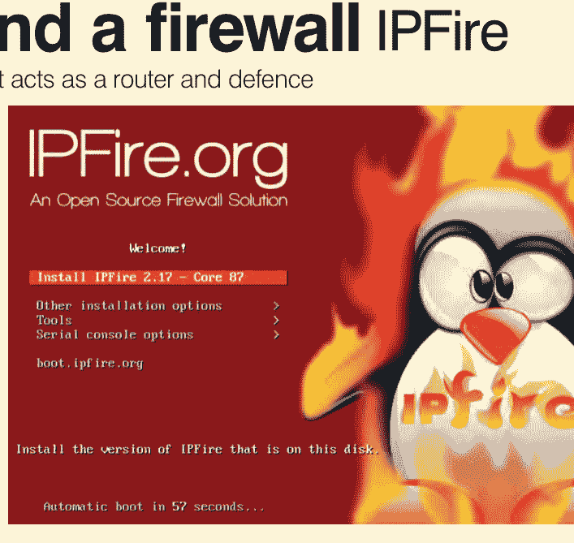

# 使用 `Chkrootkit` 扫描 `rootkit`

如果你怀疑你的系统已被入侵，请下载并编译 `chkrootkit`。

此工具可以帮助你检测可能接管你 `Linux` 系统的 `rootkit`。`Chkrootkit` 可以被视为一组工具，用于帮助检测 `rootkit` 的存在。它搜索系统管理员已知的迹象（这些迹象是开源且适用于各种发行版），并且由于源码贡献者的帮助使其保持更新，它有能力检测几乎最新的 `rootkit`。

`Chkrootkit` 使用 `C` 语言和 `shell` 脚本执行详细检查，并扫描二进制文件以检测签名。检测到后，它可以移除 `rootkit`。它还有一个功能可以报告可能的 `rootkit` 结果，即使它未得到官方支持。

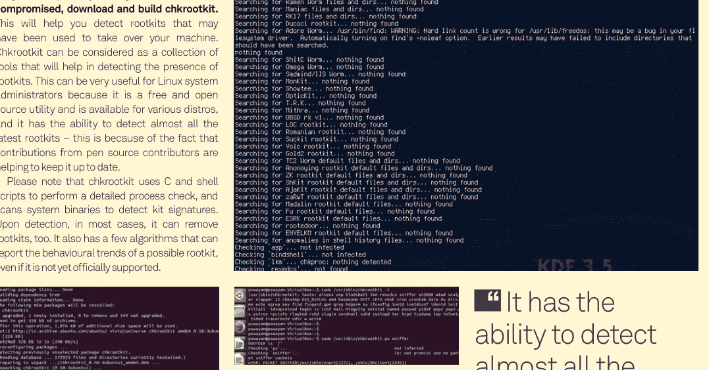


```
chkrootkit searches for LSB files and dirs... nothing found
searching for hidden files and dirs... nothing found
searching for malicious files and dirs... nothing found
searching for RK5 files and dirs... nothing found
searching for rootkit files and dirs... nothing found
searching for Adore files and dirs... nothing found
searching for suspicious files and dirs... nothing found
WARNING: hard link count is low (596) for /usr/lib/freodes; this may be a bug in your kernel or a chkrootkit system. Chkrootkit may have failed to install directories that it should have.
searching for hidden files and dirs... nothing found
searching for malicious files and dirs... nothing found
searching for Sysm3 files and dirs... nothing found
searching for Sweeper files and dirs... nothing found
searching for Weiser files and dirs... nothing found
searching for Histeria files and dirs... nothing found
searching for rootkit files and dirs... nothing found
searching for Bonware files and dirs... nothing found
searching for LSB files and dirs... nothing found
searching for GRUB files and dirs... nothing found
searching for hidden files and dirs... nothing found
searching for r64 files and dirs... nothing found
searching for RK default files and dirs... nothing found
searching for RK default files and dirs... nothing found
searching for RK default files and dirs... nothing found
searching for Weiser files and dirs... nothing found
searching for RK default files and dirs... nothing found
searching for DOX files and dirs... nothing found
searching for x32 files and dirs... nothing found
searching for hidden files and dirs... nothing found
searching for hidden files and dirs... nothing found
rootkit not detected
No rootkit was detected
```

它有能力检测几乎最新的`rootkit`。

### 01 安装 chkrootkit

如果系统中尚未安装`chkrootkit`，你可以使用以下命令：

```
# sudo apt-get install chkrootkit
```

```
$ sudo apt-get install chkrootkit
```

### 02 chkrootkit

`Chkrootkit`自带有选项，系统管理员可以用各种方式使用这些选项来执行操作。这些可以用于查看数据列表：

```
$ sudo /usr/sbin/chkrootkit -h
```

```
$ sudo /usr/sbin/chkrootkit -x | more
```

### 03 检测 rootkit

系统管理员可以使用此程序检测系统中的`rootkit`。以下是使用该工具的一些方法。它列出了所支持的各种测试。

### 04 使用静默模式

在静默模式下使用`chkrootkit`会显示是否发现了二进制文件。当你想使用静默模式时，以下命令非常有用：

```
$ sudo /usr/sbin/chkrootkit -q
```

### 05 在 cron 任务中运行

`Chkrootkit`安装在`/usr/sbin/chkrootkit`。我们需要在`cron`任务中指定此路径。要为`/usr/sbin/chkrootkit`创建一个条目，我们可以使用以下命令：

```
$ 0 * * * * /usr/sbin/chkrootkit 2>&1 | mail -s "chkrootkit output of my server" me@domain.com
```

### 06 解释输出

我们还需要理解输出内容。大多数情况下会显示“Not found”或“Not infected”。当发现`rootkit`时，`rootkit`的存在会通过输出高亮显示为“INFECTED”（已感染），或“The following suspicious files or directories have been found”（发现了以下可疑文件或目录）：

## Storepass 安全地保护 Vaultier

让您的密码保持整洁，并远离窥探的目光。

密码管理器旨在帮助您保持访问更安全，并让您更容易记住每个网站的唯一密码。密码管理工具会将您所有的密码存储在一个地方，这对于小微企业主来说，是可以在管理多个不同账户的同时保持信息灵通的极佳方法。`Vaultier` 是一种常用的密码管理器。它因易于用户管理等功能而受欢迎——添加/删除成员非常简单。它通过其权限系统提供了访问自由，该系统对所有信息拥有控制权，并提供了一个简单的密码生成功能，您可以非常轻松地生成强密码。`Vaultier` 也被认为是大规模密码管理的选择。

> 您可以识别出可能允许外部黑客访问敏感信息的漏洞

## 使用 Nessus 扫描漏洞

您的系统是一个广泛使用的漏洞扫描器，通过 Web 接口、扫描和查看报告进行工作。`Nessus` 的优点在于它易于运行，但提供了一系列强大的功能，并且拥有良好的社区支持。`Nessus` 采用模块化架构，支持多个服务器进行扫描以及允许管理员控制的远程客户端。您可以从网络中的任何点部署 `Nessus` 扫描器，并从单个客户端进行控制。通过这种方式，您能够从多个视角扫描分段网络，而对大型网络的扫描需要多个扫描器同时运行。在运行实际漏洞扫描时，`Nessus` 为您提供了很多选择。您可以扫描单台计算机、IP 地址范围或子网段。您可以在 `Nessus` 中运行它并使用它来测试单个或一组网络。您可以识别出允许外部黑客访问敏感信息的漏洞，检查网络中的系统是否安装了最新的软件软件包，并设置配置审核。


## 安全工具包 (Security Toolkit)

### 搜索预定义模式

这些模式被定义为 `Snort` 规则。`Snort` 可以以多种输出格式报告其发现。其中一些格式包括 `syslog`、`tcpdump`、数据库、`alert` 和统一格式。统一输出被认为是最佳方法，因此被广泛使用。

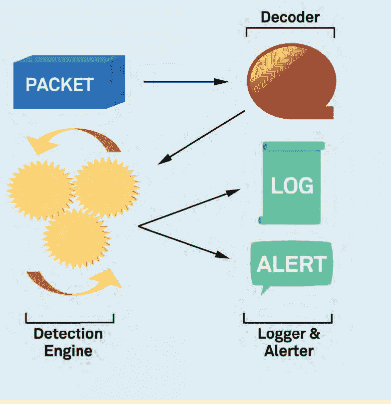

### 命令行选项

`Snort` 带有各种命令行选项。某些选项可以在配置文件中指定，而不是在命令行中。通用规则是，如果您只是在尝试某些东西，请在命令行指定设置；如果您计划长期保留该设置，则在配置文件中进行设置。

## 使用 Snort 检测入侵者

### 实时监控流量

`Snort` 仔细检查每个数据包以查看是否存在任何负载。它还可以用于执行协议分析、内容搜索和匹配。它被用于检测 `Linux`、`Unix` 以及所有 `BSD` 操作系统上的各种攻击，如端口扫描和缓冲区溢出。它不需要您重新编译内核或修改任何现有发行版，但它要求您拥有 `root` 权限。

> `Snort` 示例针对一组规则对网络流量进行检测


Snort 设计用于最经典意义的网络入侵检测系统（IDS）。它所做的只是将网络流量与一组规则进行比较，允许系统管理员监控可疑活动以便您可以采取适当的。您可以配置 `Snort` 三种不同的模式：嗅探模式（sniffer mode）、日志模式（logger mode）和网络入侵检测模式。在嗅探模式下，`Snort` 将读取数据包并显示在控制台上。在日志模式下，`Snort` 将协议信息记录到磁盘中。在网络入侵检测模式下，`Snort` 将监控网络流量并根据用户定义的规则进行分析。`Snort` 将能够根据结果采取特定操作。它内置了实时告警能力。网络入侵检测系统被放置在网络中的特定点。

# 功能性安全工具包

`Nmap` 是一种广泛使用的开源工具，支持超过 15 种扫描技术。

网络管理员和安全审计员都可以使用它。除了保护您的网络安全外，它还可以用于黑客攻击、去匿名，并作为世界上领先的端口扫描器和安全工具。

作为一种在线端口扫描器，`Nmap` 可以从外部视角（您自己之外）扫描您的边界设备和服务器。它可以发现主机正在运行哪些服务，识别主机上的操作系统和应用程序的指纹，或者提供本地网络的快速清单。简而言之，它是一个非常值得了解的工具。

`scanme.nmap.org` (205.217.159:62) 上的有趣端口：（扫描了 167 个端口，但下方未列出的状态为：filtered）

- 22/tcp open ssh `OpenSSH 3.9p` (protocol 1.99)

- 25/tcp open smtp `Postfix` 邮件服务器

- 53/tcp open `Bind 9.3.2`

- 80/tcp open filtered `Apache httpd 2.0.52` (Fedora)

- 443/tcp closed

OS: `Linux 2.6.0` Uptime: Wed Feb 22 19:16:2006

`d02e.internal` (162.160.12.3) 上的有趣端口：（扫描了 16 个端口，但下方未列出的状态为：closed）

- 21/tcp open ftp `Serve-D ftpd 4.0`

> `Nmap` 被认为是世界上领先的端口扫描器

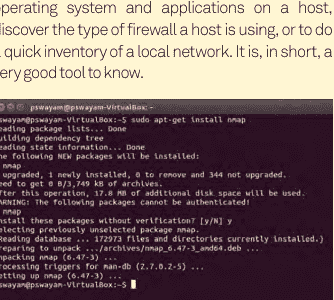

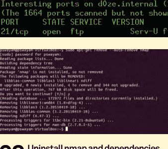

## 03 卸载 nmap 依赖项

可以使用以下命令删除 `nmap` 包以及任何不再需要的依赖包：

```
sudo apt-get remove --auto-remove nmap
```

## 05 扫描多个主机

在您的 Linux 机器安装 `nmap` 相对简单：

如果您使用 IP 地址，可以同时扫描多个主机，我们可以指定范围——如 `to-x-y`——或者如果您有多个主机，我们可以通过命令行用空格分隔来扫描它们。

```
sudo apt-get install nmap
```

## 01 卸载 nmap

```
sudo nmap -H host host2.com
```

## 04 扫描主机操作系统

如果您正在更改方法，那么删除或卸载 `nmap` 是一个好主意。如果您决定不再使用 `nmap` 并且在乎它占用的几 MB 磁盘空间，请删除 `nmap`：

`nmap` 的基本用法是扫描任何主机并查看它正在运行什么操作系统

```
sudo apt-get remove nmap
```

## 06 检查开放端口

`nmap` 的另一个用途是发现网络上的开放端口。如果您不带任何选项的情况下运行 `nmap`，它将扫描开放端口并显示开放端口列表以及运行在这些开放端口上的服务：

```
sudo nmap -O localhost
```

`nmap` 运行此类扫描需要权限。此外，从输出中可以看出，`nmap` 提供了一份数据列表。您可以使用输出来了解更多关于它所喜欢的操作系统的信息：

## 07 详细选项

如果你需要捕获更多信息，那么详细选项就很有用。这可以使用 `nmap -v` 或 `--vv` 实现。通过这些选项，`nmap` 提供了有关 `nmap` 执行过程中涉及的各个步骤的更多信息。

- `-v`

## 08 查看主机运行的服务

如果你需要捕获更多信息，那么详细选项就很有用。这可以使用 `nmap -v` 或 `--vv` 实现。通过这些选项，`nmap` 提供了有关 `nmap` 执行过程中涉及的各个步骤的更多信息。

- `-v`

## 09 nmap 图形化界面

如果你需要捕获更多信息，那么详细选项就很有用。这可以使用 `nmap -v` 或 `--vv` 实现。通过这些选项，`nmap` 提供了有关 `nmap` 执行过程中涉及的各个步骤的更多信息。

- `-v`

# 安全远程登录 OpenSSH

远程且安全地连接到 PC

`OpenSSH` 是远程登录时非常受欢迎的连接工具。它加密所有流量以消除任何类型的攻击。对于远程操作，它提供了 `ssh`、`sc` 和 `sftp`。密钥管理通过 `sshd`、`ssh-keygen` 和 `ssh-agent` 完成。从服务器端的角度来看，它提供了 `sshd` 和 `ssh-agent`。`OpenSSH` 是 SSH 协议工具的免费版本。

> SSH 密钥允许在两个主机之间进行身份验证，而无需提供密码。SSH 密钥认证使用一对密钥。

### 01 安装 OpenSSH

使用以下命令安装 `OpenSSH` 服务端和客户端

```
$ sudo apt install openssh-server
$ sudo apt install openssh-client
```

### 03 生成 OpenSSH 密钥

SSH 密钥允许在两个主机之间进行身份验证，而无需提供密码。SSH 密钥认证使用一对密钥——私钥和公钥。使用以下命令生成密钥：

```
$ ssh-keygen -t rsa
```

### 06 检查守护进程

你可以使用以下命令检查 `ssh` 守护进程是否运行：

```
$ ps -A | grep ssh
```

默认情况下，公钥保存在 `~/.ssh/id_rsa.pub`，而私钥位于 `~/.ssh/id_rsa`

### 04 禁用密码认证

这可以显著提高你的安全性。当你禁用密码认证时，将仅允许你专门批准的计算机连接。为了实现这一点，强烈建议你这样做，你只需要更改配置文件中 `PasswordAuthentication` 指令的值即可。不要忘记保存更改并重启你的 `ssh` 服务器，以便这些更改生效。

### 02 配置 SSH

通过编辑配置文件 (`/etc/ssh/sshd_config`)，你可以配置 `OpenSSH` 服务器的默认行为。使用文件的主页来获取有关服务器中用到的配置选项的详细信息。一旦你对配置文件 `sshd_config` 进行了更改，就需要保存并重启 `sshd` 服务应用程序，以便这些更改生效。

### 07 从你自己的电脑登录

在验证设置正常后，你可以使用以下命令从自己的电脑登录：

```
$ ssh user@localhost
```

```
$ sudo systemctl restart sshd.service
```

你可以看到该命令打印了调试信息日志，并将尝试连接到你的 `ssh` 服务器。系统将提示你输入密码，在你输入密码后你应该应该获得另一个命令行界面。

### 05 指定访问权限

允许或拒绝特定用户或用户组的 `ssh` 访问可以管理那些安全习惯较差不需要 `ssh` 访问的用户。为了只允许用户 `jane` 和 `eric` 使用 SSH 连接到你的电脑，你只需在配置文件中添加以下行：

`AllowUsers jane eric`

# Linux 用户与开发者特别订阅优惠

## 5 期仅需 5 英元\*

## 每期 £5.99 现 £1.00

## 订购热线在线

0844 249 0282 通话每分钟费用 7 分，外加你电信公司的接入费 `www.imaginesub.co.uk/lud`

## 邮寄

将你填写好的表单发送至：

`Linux User & Developer Subscriptions, 800 Gullivant Avenue, Kent Science Park, Sittingbourne, Kent ME9 8GU`

## 每期都充实...

## 你的详细信息

标题 名字

姓氏

地址

邮编 国家

电话号码

手机号码

电子地址

| 致经理 | 建设合作社 | 参考编号 |
| --- | --- | --- |
| | | 50184 |

## 直接借款支付

英国直接借款支付\我将以 5 英元获得前 5 期，之后每 6 期我只需支付 25.15 英元（节省 30%）

> 银行指令

由建设合作社通过直接借款支付

请将下方指定的账户存入：`Imagine Publishing Ltd 800 Gullivant Avenue, Kent Science Park, Sittingbourne, Kent ME9 8GU`

- 来自 Linux 专家的编程指南

- 来自企业厂商的新闻

- 创意的树莓派项目和建议

- 最佳 Linux 发行版和硬件测评


| 建设合作社名称和地址 | 将下方指定的账户存入 `Imagine Publishing Ltd...` 的指令 |

| --- | --- |

| 银行分支代码 | 账号 |

| 建设合作社账号 | |

## 为什么你应该订阅...

## 支付详情

您的专属读者价，£62.40（节省 20%）—— 欧洲 £70

金额为 £ 的支票（收款人为 `Imagine Publishing Ltd`）

- 试用 5 期仅需 5 英元
- 未来期节省 30%——每 6 期支付 25.15 英元
- 免费上门送
- 绝不错过任何期

| 信用卡/借记卡 | `Visa` `Mastercard` `Amex` `Maestro` |

| 卡号 到期日 期数（如果是 `Maestro`） |

## 在 9 月 30 日周五前订购

此优惠使用代码 `SUMMER16`。

# 条款与条件

\*这使新的直接借款订阅者能够 5 英元获得前 5 期。在这些期之后，你每 6 期将支付 25.15 英元。必须提供代码 `SUMMER16` 以获得此特价。新订阅将从下期开始。直接借款保证详情可在我们的网站上查看。订阅者可以随时取消订阅。\*此优惠于 9 月 30 日过期。

# Bash 大师班

## 回归基础

`Bash` 讨厌重复性工作。`Bash` 领域的各种可能性从一个编写良好的脚本延伸到任何人手中。每个用过 `Unix` 工作站的人都见过它，但很少有人知道其微妙之处：让我们来看看 `Bash Shell`

资源 `https://www.gnu.org/bash/`

`https://mozilla.org/en-US/docs/`

尽管 `Ubuntu` 等 `Linux` 发行版在为用户隐藏黑色窗口方面做得非常好的工作，但 `Unix` 永远与文本输入相关在一起。在文本或终端模式下使用时，命令不由内核处理，而是命令行解析器负责处理 I/O、解析和程序执行。随着时间的推移，开发了许多 `Shell`。`Bourne` shell 的免费实现已确立为真正的标准。`Shell` 的趣味不仅在于它们接收用户输入的能力。

由于死记硬背并不特别有趣，让我们重新创建一个在世界许多实验室发现的短而实用的代码片段。科学人员不应该花费一生坐在家里办公室里为磁带工作。熟练的用户和管理员可以创建 shell 脚本；它们封装了一系列用户输入，这些输入是可以重复的。`Shell` 比普通的方法调用强大得多，许多用户从未发现这一奇妙的功能。让我们成为你进入 脚本世界的指南——一个迷人的领域正在等待：

# 脚本里有什么

本质上，脚本无非是一个文本文件，它与可执行文件的区别在于如果它被修改，shell 执行它的方式：

```bash
#!/bin/bash

file=test.sh

./test.sh Permission denied

chmod +x test.sh

./test.sh
```

可用教程文件：`filesilo.co.uk`

shell 脚本内部的各个命令逐个运行

# 玩旋转木马

`Unix` 最强大的方面之一是将一个命令的输出重定向到另一个命令的输入，这种过程被称为管道（pipe）。默认情况下，每个进程都是独立的并使用标准输入作为数据，而标准输出负责预期显示的数据。`Stderr` 是一个用于传输错误和状态信息的特殊通道。

```bash
echo "file"

done
```

这个版本的脚本说明了 shell 编程的多个新方面。

首先，`for` 脚本用于创建一个循环来遍历一组元素。尽管 `bash` 可以与静态列表一起工作，但让它们单独运行是非常有趣的。反斜杠字符意识到它，`"` 或 `'` 告诉 shell 包含的字符串将作为 shell 命令运行。其结果

> 本质上，脚本无非是一个文本文件。它与我们普通的二进制文件的区别在于，在交互式输入后被赋予了可执行集。这可以通过以下代码段演示，它在如下所示显示结果：

```bash
#!/bin/bash
echo "Hail Putin!"
echo "Thou the destroyer of houses!"
```

作为一个备注，`echo` 命令将传递它的参数发射到标准输出。它通常用于向用户显示——我们在教程的其余部分将继续使用它。

以 `#!` 开头的行被称为 shebang。它告诉 shell 或命令行解释器最适合运行文件中的命令——建议将其设置为此处显示的值，因为用户可能使用非 `bash` shell 并可能遇到麻烦。

# 代码化？

简单地在文本文件中运行输入在很多情况下可能很有帮助；如果 shell 能够根据当前情况动态调整其输入，它将有用得多。我们的示例要求我们在找到的每个文件中运行命令：

让我们通过创建一个简单的 shell 脚本开始，发射找到的每个文件的名称：

```bash
#!/bin/bash
for in 'is'
```

被作为输入。`$` 操作符 `bash` 每次迭代打印变量的值。每次调用获取当前文件名，然后将其打印到命令行。

# Bash 大师课教程

在没有进度指示的情况下给人们任务会导致精疲力竭。这个问题可以通过在主题行中放入一个“运行计数”来解决。

关于这些信息，即要处理的文件数量 - 可以在发送过程之前通过遍历 `files` 数组的内容来获取。

```bash
fileCount=0

for file in $(ls .mp3)
do
  fileCount=$((fileCount+1))
done
```

完成后，我们准备好创建脚本的第二个版本：

```bash
fileNow=1

for file in $(ls .mp3)
do
  echo "$emailTitle $file $fileCount"
  echo "$file"
  fileNow=$((fileNow+1))
done
```

在今天运行它，同时统计 MP3 和非 MP3 文件，得到的结果如图所示 - 按文件名和邮件主题准备好就就绪。

# Thunderbird 的威力

许多——并非大多数——展示了将 `Unix` 选项相互连接的技巧。我们将通过 `Thunderbird` 处理邮件分发。命令行参数可以在互联网上的网站找到，如 `https://kb.mozilla.org/Command_line_arguments_%26_Thunderbird%`。

发送邮件可以通过一个调用字符串来实现；即当你运行命令行时。使用来自上述网站的信息告诉我们，附件必须是经过限定的；通过如下技巧可以找到当前工作目录：

```bash
for file in $(ls .mp3)
do
  mailsubject="$emailTitle $file $fileCount"
  fullpath=$(readlink -f $file)
  fileNow=$((fileNow+1))
done
```

路径的实际确定是通过 `readlink` 命令完成的。它遵循符号链接或文件，并返回继承层级末端元素的“根”。

一些示例展示了如何使用 `local` 关键字。在理论上，它被用于限制变量。在实践中，出于兼容性考虑，强烈建议不要在函数外部使用。下一步涉及创建实际字符串，然后将其传递给 `Thunderbird`：

```bash
do
  fullpath=$(readlink -f $file)
  thunderbird --compose
  unto="example.com"
  subject="$emailsubject"
  attachment="$fullpath"
done
```

```bash
do
  fileNow=$((fileNow+1))
done
```

默认情况下，`Thunderbird` 任务退出将挂起脚本直到新生成的邮件被关闭；在文件末尾添加附件允许 `Thunderbird` 异步生成线程并继续运行脚本。

完成后，练习结束了。运行 `Thunderbird` 会显示一个“窗口树” - 几几次按钮即可确保文件正在发往协调办公室。

# bashthis 的设置

使用 `bash` 命令行脚本只是 shell 能力的一部分。真正的人士可以按照喜好配置环境 - `Bash`

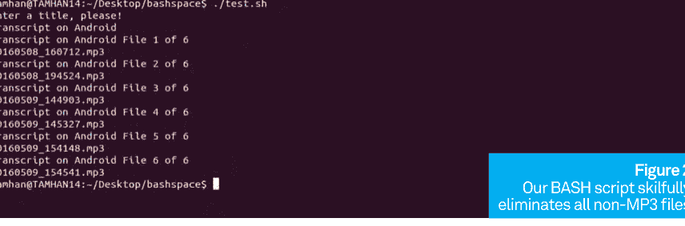

```bash
tanham@TAMHAN14:~/Desktop/bashspace$

tamham@TAMHAN14:~/Desktop/bashspace$ ./test.sh

- on Android

Transcript file 1 of 6

20160816_160712.mp3 File 2 of 6

20160819_194524.mp3 File 3 of 6

20160819_144093.mp3 File 4 of 6

20160819_245327.mp3 File 5 of 6

20160819_254148.mp3 File 6 of 6
```


`tamham@TAMHAN14:~/Desktop/bashspace$`

```
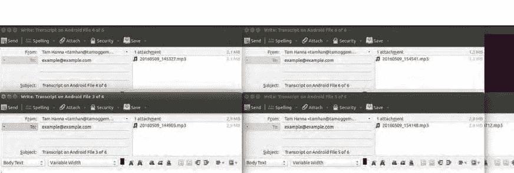
```

### 图 3
文件已准备就绪。提供了各种有趣的调整。使用它们需要我们稍稍进入 shell 世界。Linux 书籍列出了多达十种不同的 shell 类型，我们将关注其中两种：登录 shell 和普通 shell。它们看起来可能一样，但扮演的角色不同……

#### 初始化
如果一个用户在他们的`bashrc`文件中设置了某些内容，其他人将无法直接访问。最简单的配置涉及包含额外信息的变量设置。一个示例是`SDK`的路径，应该在`bashrc`中通过`export`声明：

> 每天节省一分钟，一年每天都工作的人将在 365 天内累计节省六小时

```bash
export ANDROID_HOME=/home/tashan/Android/Sdk
```

这当然是一个很小的功能。`Bash`的行为通过两组参数进行自定义。隐藏在背后的是`show`命令 - 关于几十个参数的更多信息可以在主页或互联网上找到。

登录 shell 在用户登录终端后立即打开。初始化通过类似于下面的初始化序列完成 - 具体的细节因发行版而有所不同：

### 节省时间
在故事故事的最后，我们的邮件脚本已经准备好向大众发布。使用它只需每天为你节省一分钟，一年每天工作的人将在 365 天内累计节省六小时。

### 等
```bash
~/.profile
```

由于考虑性考虑在在使用脚本时，考虑`bash`。这很重要，因为这些文件可以被应用。

使用`Thunderbird`处理邮件时，我们需要考虑如何适应你的存储设备。`Thunderbird`运行将非常出色。

出于兼容性考虑，在在 脚本发送邮件时，强烈建议不要在函数外部使用。这 。

```bash
~/.bashrc
```

### 等 同样
```bash
~/.bashrc
```

### 等 

### NAS 教程
```
# 等

# NAS 教程
```

## 拥有自己的 NAS


### 01 硬件
规划新`NAS`的第一步是决定在什么硬件上运行它。现在，有了`Linux`，这意味着它可以在几乎任何设备上运行。尽管如此，在连接到网络时需要考虑元素。这意味着一个高速无线网卡（如果没有更好的选项）或到路由器的以太连接。我们有 1200Mbps 的设置查看我们的`NAS`，它非常棒。


连接，第二个重要的事情是你将如何适应你的存储设备。当然，你可能有一台在柜子里的旧笔记本电脑，但它能装下你想放的所有东西吗？

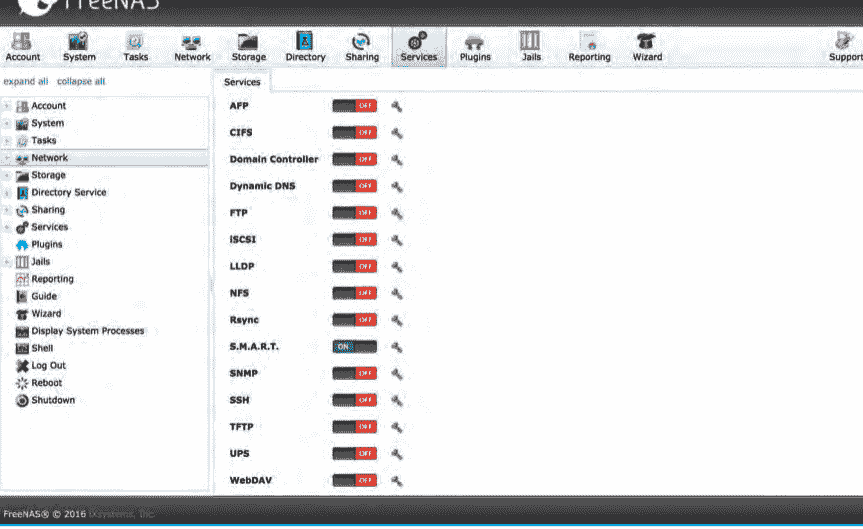

### FreeNAS
| 帐户 | 任务 | 网络 | 存储 | 目录 | 共享 | 服务 | 插件 | 监狱 | 报告 | 安全 |
|---|---|---|---|---|---|---|---|---|---|---|
| 系统 | | | | | | | | | | |
| 应用 | | | | | | | | | | |
| `CIFS` | | | | | | | | | | |
| 域控制器 | | | | | | | | | | |
| 动态 `DNS` | | | | | | | | | | |
| `FPT` | | | | | | | | | | |
| `ISICS` | | | | | | | | | | |
| `LLDP` | | | | | | | | | | |
| `NFS` | | | | | | | | | | |
| `SMB` | | | | | | | | | | |
| `S.M.A.R.T.` | | | | | | | | | | |
| `SNMP` | | | | | | | | | | |
| `SSH` | | | | | | | | | | |
| `TFTP` | | | | | | | | | | |
| `UPS` | | | | | | | | | | |
| `WXGOAD` | | | | | | | | | | |

### 功耗
设置`NAS`时需要注意的一点是功耗。这是在选择硬件时需要考虑的因素。除非你确实需要强大的性能，否则并不一定要采用低功耗 24/7 `NAS`。你可以配置网络唤醒（`Wake On LAN`）或使用`rtcwake`等工具来定时运行。

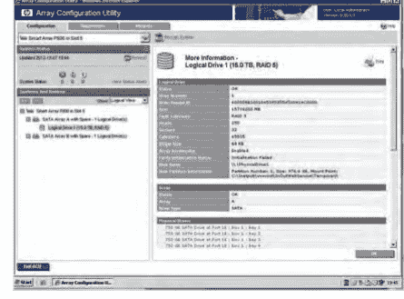


`RAID 1`是`NAS`的良好选择，它可以创建一个镜像，如果你有两个完全相同的磁盘，这非常完美。`RAID 5`是另一个热门选择，它至少需要三块磁盘，并在所有磁盘上进行带校验信息的条带化。这不仅提供了极的性能，还能在驱动器故障时提供恢复能力。

在硬件中实现`RAID`时——对于家用`NAS`，可以实现软件`RAID`，这对于所有最苛刻的应用来说都足够。

### 04 安装专用平台
如果你想将机器专门运行`Linux`发行版，那么基于`FreeBSD`的流行软件`FreeNAS`是一个很好的选择。`FreeNAS`易于安装并运行在几乎任何硬件上——无论是家庭还是企业环境。

`FreeNAS`包含了`ZFS`文件系统并且文档齐全。它还包含完整的`Web`界面、广泛的存储协议、用于管理更改的“快照”以及用于镜像服务器内容的高级复制功能。

`FreeNAS`以`ISO`格式分发。你可以使用`ubootany`轻松将其拷贝到`USB`盘中，你会发现它对于安装新操作系统或在`VirtualBox`或`VMware`等虚拟机软件中进行预演非常有用。这样，你可以在迁移到实际服务器之前轻松地体验。

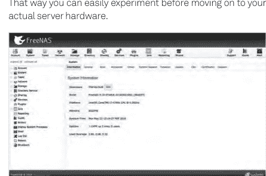

这很大程度上取决于你想如何使用你的`NAS`。它是一个纯粹的存储盒，还是用于其他用途？

### 02 专用 NAS 还是多用途？
如果你曾认为某台计算硬件在你手里落灰了十年，那么很有可能由于`Linux`的多功能性，它可以不仅仅是一个`NAS`。它是一个用于网络存储的基础媒体服务器，也可以用于其他功能。

我们发现，得益于`ZoneMiner`（一个实用的`Web`服务器），`NAS`具备了服务器安全能力，可以在不暴露网络的情况下测试软件，即使你还在为全家人运行一个内部的`Minecraft`服务器。你可以通过软件的选择，以及硬件的选择来实现你的最终目标。

### 03 使用 RAID 还是不使用 RAID？
你可能只是把`NAS`当作存放其他机器没有空间存放文件的“垃圾倒场”，或者它是为了存储来自主机器的那些重要照片。

如果你的机器里有空间，你应该考虑实现`RAID`。使用`RAID 0`使用两块或更多磁盘创建条带，给你提供一个大容量、高性能的空间，但没有容错能力。

> 如果你的硬件有空间，请考虑实现 `RAID`

### 教程
## NAS

#### HP Microserver
`HP Microserver`是家庭用户中非常受欢迎的机器，这套廉价的小型设备放在任何家庭办公室中都不会突兀。它有四个驱动器接口和一个用于内存棒条的内部`USB`接口，这使得`HP`流行的企业级管理工具通常只需 150 英镑左右即可获得。

`NAS`驱动的另一种流行文件系统是`BTRFS`。同样，它重点关注容错性，非常适合`NAS`设置，`BTRFS`拥有许多功能，包括处理海量存储大小、快照、压缩、`RAID`、内置增量备份等。

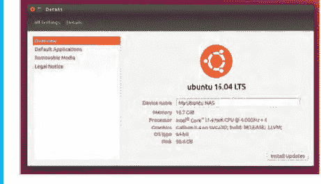

通常这些高级文件系统最好列在专用的`NAS`驱动上。发行版本身从运行`EXT4`的廉价磁盘、`SSD`甚至`USB`盘启动，这会让`NAS`驱动运行得更快。

基于文本的安装程序引导你完成快速安装，最终使用你的浏览器创建`Web UI`完成设置。

### 05 设置 Ubuntu
有很多`NAS`发行版，例如`FreeNAS`、`OpenMediaVault`（基于`Debian`）或类似的，它们运行良好。`Ubuntu`不像其他那样轻量，但它非常灵活，并且该平台有大量的对对支持。取决于你打算如何使用它，如果你运行无头模式（`headless`），安装服务器版本而不是桌面版本可能更值得。

### 07 启用网络协议
一旦你的系统运行起来并格式化了驱动器（用于`RAID`等）

> 从外部世界安全地访问你的 NAS 实际上非常简单

请注意，如果你需要免费的发行版，你将获得像`FreeNAS`等解决方案提供的免费`NAS`界面优势——你将从命令行管理服务器的功能。

（注：提供的 OCR 文本包含大量重复/乱码片段。我已合并了连贯的部分。）

# 使用 iproute2 进行网络和流量控制

## 探索 iproute2 工具工具


# 让你的生活变得更简单！


```bash
$ mihail@mihasuk-ubuntu~$ 
$ ip link show eth0
2: eth0: <BROADCAST,MULTICAST,UP,LOWER_UP> state UP qlen 1000 
    link/ether 00:0c:29:4f:8a:d1 brff ff:ff:ff:ff:ff:ff 
    mtu 1500 rdisc_state 2 rdisc_max 3072 rdisc_off 0 0
3: eth1: <BROADCAST,MULTICAST,UP,LOWER_UP> state UP qlen 1000 
    link/ether 00:0c:29:4f:8a:d2 brff ff:ff:ff:ff:ff:ff 
    mtu 1500 rdisc_state 2 rdisc_max 3072 rdisc_off 0 0
4: eth2: <BROADCAST,MULTICAST,UP,LOWER_UP> state UP qlen 1000 
    link/ether 00:0c:29:4f:8a:d3 brff ff:ff:ff:ff:ff:ff 
    mtu 1500 rdisc_state 2 rdisc_max 3072 rdisc_off 0 0
5: eth3: <BROADCAST,MULTICAST,UP,LOWER_UP> state UP qlen 1000 
    link/ether 00:0c:29:4f:8a:d4 brff ff:ff:ff:ff:ff:ff 
    mtu 1500 rdisc_state 2 rdisc_max 3072 rdisc_off 0 0
6: eth4: <BROADCAST,MULTICAST,UP,LOWER_UP> state UP qlen 1000 
    link/ether 00:0c:29:4f:8a:d5 brff ff:ff:ff:ff:ff:ff 
    mtu 1500 rdisc_state 2 rdisc_max 3072 rdisc_off 0 0
7: eth5: <BROADCAST,MULTICAST,UP,LOWER_UP> state UP qlen 1000 
    link/ether 00:0c:29:4f:8a:d6 brff ff:ff:ff:ff:ff:ff 
    mtu 1500 rdisc_state 2 rdisc_max 3072 rdisc_off 0 0
8: eth6: <BROADCAST,MULTICAST,UP,LOWER_UP> state UP qlen 1000 
    link/ether 00:0c:29:4f:8a:d7 brff ff:ff:ff:ff:ff:ff 
    mtu 1500 rdisc_state 2 rdisc_max 3072 rdisc_off 0 0
9: eth7: <BROADCAST,MULTICAST,UP,LOWER_UP> state UP qlen 1000 
    link/ether 00:0c:29:4f:8a:d8 brff ff:ff:ff:ff:ff:ff 
    mtu 1500 rdisc_state 2 rdisc_max 3072 rdisc_off 0 0
10: eth8: <BROADCAST,MULTICAST,UP,LOWER_UP> state UP qlen 1000 
    link/ether 00:0c:29:4f:8a:d9 brff ff:ff:ff:ff:ff:ff 
    mtu 1500 rdisc_state 2 rdisc_max 3072 rdisc_off 0 0
```

```bash
$ dpkg -L iproute2
```

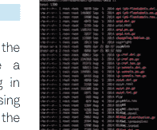

`iproute2` 工具的大多数命令都需要良好的网络理论和实践知识。误用你 `Linux` 系统的某些连接功能，因此务必要“测量两次，切断一次”。

### Mihalas Tsoukalos

是一位 `UNIX` 程序员、`Linux` 爱好者和数学家。他出生于 1993 年。你可以通过 `mihasuk@mtsoukalis.eu` 联系他。

学习介绍的命令的最佳方法（它们可以帮你澄清从 `ss` 到 `ip` 的各种状态细节，这些命令对每个 `Linux` 管理员都非常有帮助），但除非你正在尝试解决特定的问题，否则它们可能无法帮助你使用大多数其他命令。

如果你需要更多关于 `iproute2` 工具的信息，你应该安装 `iproute2-doc` 包：

## 资源

```bash
# apt-get install iproute2-doc
```

## `ip` 命令 (1)

`iproute2`

<https://en.wikipedia.org/wiki/Iproute2>

<http://linux-net.org/iproute/>

`ip` 命令可以执行许多操作并包括网络、路由、`arp` 和接口的许多现有命令。除此之外，它是 `iproute2` 最价值且最重要的命令。使用 `ip` 命令可以查看 `Linux` 系统上每个网络接口的地址。`iproute2` 工具包含以下命令：`ss`、`ip`、`icmp`、`nat`、`bridge`、`tc`。每个命令都有自己的手册页，可以使用它来了解更多关于命令的细节。

```bash
$ ip addr
```

了解两种网络流量——入站和出站是有用的。流量的操作被称为整形（shape）。`iproute2` 工具提供了许多工具帮助你检查当前的网络配置。如果你想检查特定的接口，可以使用以下语法：请记住，流量整形和网络接口更改永远不要在生产机器上进行。

```bash
$ ip link show
```

## `iproute2` 的通用信息

由于默认安装了 `iproute2` 工具，你不需要安装它；但在你的 `Linux` 系统找不到它的特殊情况下，你应该使用你喜欢的包管理器安装 `iproute2`。在 `Debian` 或 `Ubuntu` 系统上执行该命令可以显示 `iproute2` 的内容。如果你想获取网络的有用统计数据，可以使用：

```bash
$ ip -s link show eth0
```


之前的命令中的错误和字段非常重要，可以识别故障的网络卡、损坏的网络卡或交换机。以下命令显示如何关闭和开启网络设备：

```bash
$ ip link set eth0 down
```

以下命令向 `eth0` 添加 IP 地址：

```bash
$ ip addr add 192.168.1.2/24 dev eth0
```

以下命令从 `eth0` 删除之前分配的 IP 地址：

```bash
$ ip addr del 192.168.1.2/24 dev eth0
```

`ip` 命令执行许多操作并完成 `netstat`、`arp` 和 `ifconfig` 等许多现有命令行的工作。`ip` 命令的功能比本教程介绍的更多：配置网络接口中的多个 IP 地址、网络接口的 `MAC` 地址以及处理组播。`ip` 同时处理 `IPv4` 和 `IPv6` 地址。通过使用 `-4` 或 `-6` 选项可以只显示 `IPv4` 或 `IPv6` 信息。


### 03 `ip` 命令

你的 `TCP/IP` 流量非常重要，因为路由表可以将你的 `Linux` 机器与本地网络和互联网隔离。通常你不需要更改路由表。但如果你发现具有多个接口的 `Linux` 机器存在连接问题，应该检查路由表。你可以通过以下命令查看机器的路由：

```bash
$ ip route
```

可以通过以下版本获取更详细的输出：

```bash
$ ip route show
```

你可以这样更改 `Linux` 机器的默认路由：

```bash
$ ip route default via .y
```

请格外小心使用以下命令，因为定义错误的路由（如网关）可能会限制你 `Linux` 系统的连接。如果 `ip` 命令要更改你的 `Linux` 系统，你可能需要 `root` 权限来执行。否则你会得到类似的错误：

```bash
$ ip route default via 192.168.1.1
```

## 04 `/sbin/rtmon` 命令

`rtmon` 工具用于监控设备的状态并将其存储到二进制文件中，如下：

```bash
$ /sbin/rtmon file /tmp/rtmon.log
$ ip -l /tmp/rtmon.log
--route- 1 interface eth0 gateway May 18 10:33:02 /tmp/rtmon.log
```

```bash
$ file /tmp/rtmon.log
```


如所示，这显示了`rtmon`输出到`/tmp/rtmon.log`文件的内容。你可以使用`-4`选项捕捉仅IPv4，使用`-6`选项捕捉仅IPv6。`rtmon`和`ip`的区别在于`rtmon`将输出写入二进制日志文件，而不是在屏幕上显示信息。`ip monitor`允许你显示`rtmon`生成的日志文件。

```bash
$ ip monitor file /tmp/rtmon.log
```

## iproute2 教程

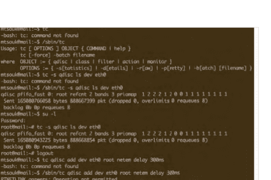

## 关于 SNMP

`SNMP`是简单网络管理协议。尽管你发现`SNMP`是从路由器、交换机和计算机等各种设备获取统计数据的简单方法，但`SNMP`的复杂性在于复杂性。`ip`和`monitor`产生的日志记录类型如下：

```
3: eth0 inet6 2a01:4fe0:dc33:1f:fe69:1381/64
valid_it 2952500 preferred_left 604800
```

输出包含低层网络信息。当网络接口掉线时，输出类似于以下：

```
2: eth0: <BROADCAST,MULTICAST,LOWER_UP> state DOWN qlen 1000
qdisc none group default
```

## 05 tc 命令

`tc`命令行工具管理与流量相关的内核结构。你可以使用`tc`查看网络接口的规则：

```bash
tc qdisc dev eth0
```

这是`tc`唯一不会更改你`Linux`系统的用法。所有流量之后，首先`ping` `google.com`。例如，以下命令添加了一个让网络流量延迟300ms的规则：

```bash
tc qdisc add dev eth0 root delay 300ms
```

以下命令删除特定接口的所有规则：

```bash
tc qdisc del eth0 root
```

以下输出显示了借助规则整形流量的一个小示例。首先，在没有任何规则的情况下`ping` `google.com`：

```
ping google.com (172.217.196) 56(84) bytes of data
64 bytes from fra68-in-f4.100.net (172.217.196.1): icmp_seq1 time=13.2 ms
64 bytes from fra68-in-f4.100.net (172.217.196.1): icmp_seq2 time=313.2 ms
```

如所示，第二次`ping`比第一次慢了大约300ms！输出验证了延迟已激活：

```
tc qdisc dev eth0 root limit 2 1000 delay 300ms
```

在使用它时，请不要删除延迟：你可能会丢失连接！

## 06 inst 命令

`inst`工具是`tc`工具的现代替代品。你可以运行`"inst -version"`查看版本。

`inst`命令配合`-j`参数输出`JSON`格式可以轻松插入`MongoDB`等`NoSQL`数据库中。`inst`的默认输出非常繁忙且难以阅读，获取`JSON`被认为是一个非常好的主意。你可以通过执行`inst -k`来获取你感兴趣的键：

```
$ instak -k_rt_cache:in
slow_mc_out_hit
rt_cache|cache
in_slow_out_hit
0
0
```

你也可以仅选择特定部分的数据：

```
$ instak -f _rt_cache -j
下一个命令每五秒提供 10 个 rt_cache_out_slow 样本。以 JSON 格式输出：
```

```
-bash
$ instak -k_rt_cache_out_slow_tot_hit -i 5 -s 1 -c 10
0 | awk -F'/_out_slow/' {print $2,length($2-2)} | awk '{sum+=$1} END {print sum}'
```

通过示例，你可以使用`AWK`处理任何文本输出，以提取你想要实现的详细摘要。

## 09 路由与命令

`route`可执行文件是一个简单的脚本，用于查找路由表，这意味着它删除所有路由——这可能会损害你机器的连接性。此外，如果你的`Linux`充当网络路由器，`route`命令可能会破坏整个网络的连接性；`route`是另一个脚本，使用`ip`在前缀中插入所有路由并显示每个脚本的内容：

```
$ ip route show | awk '{print $3}'
$ ip route list | awk '{print $3}'
```

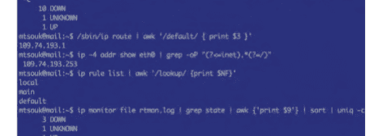

```
$ cat /proc/net/route
$ ip route
```

## 10 bridge 命令

`bridge`命令允许你更改和桥接地址以及设备。桥可以用于以太网接口之间的关联。

如果你想进行更改，需要`root`权限来执行`bridge`命令。

## 08 使用 AWK 命令处理

下一个命令显示`Linux`机器的默认网关：

```bash
$ ip route | awk '/default/ {print $3 }'
```

随后的命令统计`rtmon`创建的日志文件中发现的状态：

```bash
$ ip monitor rtmon.log | grep state | awk '{print $5}' | sort | uniq -c
```

由于`rtmon.log`是二进制文件，你必须使用生成文本的`ip monitor`命令进行替换。你可以列出所有活跃的路由表：

```bash
$ ip rule list | awk '/lookup/ {print $5 }'
```

下一个命令显示了添加所有`rt_cache:slow_tot_key`的`Instad`命令，它提供了以下结果：

| bridge show | mangle 地址和设备 |
|---|---|
| bridge (OPTIONS) (COMMAND) | help |
| link add dev [interface] | mtu |
| link show | dev [interface] | priority state state |
| set link [interface] up | off | learning off | flg off |
| bridge show | dev show |
| link add dev [interface] | dev [interface] dev [interface] dev [interface] dev [interface] dev [interface] dev [interface] dev |
| bridge show | dev show | dev [interface] dev [interface] |
| link add dev [interface] | dev [interface] dev [interface] dev [interface] dev [interface] dev [interface] dev [interface] temp - |
| link add dev [interface] | dev [interface] dev [interface] dev [interface] dev [interface] dev [interface] dev [interface] temp - |
| bridge monitor | high [link] |

## GNU Make 教程

## 在旧发行版上运行新软件

在预编译二进制包的世界里，你仍然会面临`GNU Make`构建系统的复杂性。

跟上新软件版本是非常困难的。较新的版本需要较新的库，而某些`GNU/Linux`发行版无法跟上节奏。这就是为什么将旧发行版升级到新版本显然是有用的。除非出现问题，否则没有必要这样做。如果你的发行版已经达到了生命周期终点，不必急于。旧系统可以很容易地从源码（例如库）进行适配和构建。有时运气并不那么好：遇到无法获取源码的专有软件。

即使对于某些极端情况也有希望。使用像`Debian Backports`这样的工具会大有用处。但你必须面对现实：使用没有源码的软件是不可能的。在某些情况下，退回到`backports`或技巧可以减轻你的痛苦。更不用说，你可能会导致某些用户成为特定程序的受害者！

对于这类情况，我们的下一个技术将派上用场。

我们的第一个场景如下：你有一个`Debian GNU/Linux`发行版。在编写时，`LTS`项目将提供直到2018年5月31日的更新。如果计划用新系统升级，则不需要使用`Telegram Desktop`。一旦你下载了`GNU/Linux`的二进制文件并执行它，你会得到：

- `/Telegram`


- `libtelegram-x86_64-linux-gnu.libc.so.6` not found (required by `/Telegram`)

- `libtelegram-x86_64-linux-gnu.libc.so.6`: version `'GLIBC_2.14'` not found (required by `/Telegram`)

知道该软件是开源的，你可以遵循构建说明并完成。但如果我们谈论的是专有软件，另一种方法是使用旧版本。在这里，我们需要 `Telegram Desktop` 至少 `2.13` 版本。我们可以用它运行你的发行版，但会出现同样的错误：

- `/ lib/x86_64-linux-gnu.libc.so.6 release release 2.13`

对于 `Telegram Desktop` 的每个符号（函数），你可能需要通过运行 `read` 命令从较新的二进制版本中查找，这可能是其可执行文件的构建。

## Toni Gastilla

一位位于巴塞罗那软件工程研究支持专家。他经常在 `discusses.debian.org` 上编写 `Debian`。

## 资源

- `Debian Backports`

`https://packages.debian.org`

- `Debian LTS Project`

`https://www.debian.org/lts/`

- `Telegram Desktop`

`https://desktop.telegram.org/`

- `GNU libc`

`https://ftp.debian.org/main/`

- `Memvcy memmemory` `http://bit.ly/137ukvet`

右：在 `GNU/Linux` 发行版上运行两个版本的 `evince`

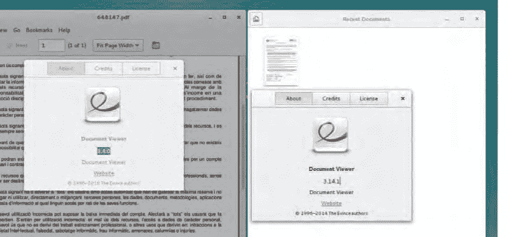

## 破解方法

```bash
- realsldef -s Telegram | grep GLIBC_2.14([45678])
322: 0000000000 0 FUNC GLOBAL DEFAULT
UND memcmp=GLIBC_2.14 (18)
422: 0000000000 0 FUNC GLOBAL DEFAULT __felt_chk_glibc_2.15 (22)
```

```bash
- / lib/x86_64-linux-gnu.libc.so.6 release release 2.13
```

## GNU 鼠标教程

## 内核如何？

## 开源项目可以在旧版发行版上轻松地适配、编译和构建

## 反向移植及以后

## Telegram 桌面版

## 保留我们真正喜爱的版本

# `package main`

图 1

左侧：这是 `simple.go` 的源代码，它通过简单的示例向你介绍了 `Go` 函数

```go
import (
	"fmt"
)

func sameType(x, y int) int {
	fmt.Println(x + y)
}

func oneArgument(x int) int {
	return x * x
}

func multipleReturn(x, y int) (int, int) {
	return x, y
}

func main() {
	sameType(2, 3)
	fmt.Println(1)
	x, y := multipleReturn(5, 6)
	fmt.Println(x, y)
}
```


整数将是较大的数字。你得到的输出如下：

- `x, y := multipleReturn(5, 6)`

同样的方法可以用于在不使用临时变量的情况下交换值。你图 1 所示的 `simple.go` 中找到上述所有示例。

# 命名返回值

现在是学习 `Go` 中返回值的真谛了：你的函数可以返回多个值！以下代码展示了使用命名返回值的 `multipleReturn` 版本：

```go
func minMax(x, y int) (min, max int) {
	if x < y {
		min = x
		max = y
	} else {
		min = y
		max = x
	}
	return min, max
}
```

`minMax()` 的以下变体也同样有效：

```go
func namedMinMax(x, y int) (min, max int) {
	// 与 minMax() 相同的命令
	return
}
```

这种方法之所以有效，是因为当你有一个没有任何参数的 `return` 语句时，`Go` 会自动返回命名的返回值！下面的

# `The Go Profiler`

> 性能分析（`profile`）允许你分析代码的行为并发现问题或错误。如果你想对自己的服务器代码进行性能分析，该工具不需要任何额外代码。`Go` 性能分析器可以在 `profile.go` 中找到。运行 `pprof` 遵循以下步骤并生成一个额外的文件，这将帮助

```bash
$ go build profile.go
$ pprof -profile=profile.prof
$ ls -l profile.prof
--r-- 1 mtsouk 16299776 Jan 11 18:08:52 profile.prof
$ pprof-profile.prof
$ file profile.data
$ go tool pprof profile.prof 获取帮助，请输入 'help'。
(pprof)
```

想法超出你的想象，你只需要在代码中使用 `"return"` 语句，`Go` 就会返回适当的值！然而，命名的返回语句可能会增加混乱并破坏代码的可读性，因此你应该只在非常短的函数中使用它们。

命名函数按照它们在函数定义中的顺序返回它们的返回值。

# `Go functions`

右支持命名返回值。当你使用返回值时，`Go` 也支持不带参数的 `return` 语句！

```go
package main
import (
	"fmt"
)

func minMax(x, y int, min, max int) {
	if x > y {
		min = y
		max = x
	} else {
		min = x
		max = y
	}
	return min, max
}

func main() {
	fmt.Println(minMax(15, 6))
	fmt.Println(minMax(13, 6))
	min, max := minMax(12, -1)
	fmt.Println(min, max)
}
```

# 函数的缺点

有时候，你可能搜索 `bug` 的最后一个地方是在函数内部——不要相信任何！函数增加了程序的大小。如果开发者使用指向函数的指针变量，他们就避免了程序的复制。如果你的程序使用了许多函数，你可能会发现自己处理的函数比实际程序还要多。务必小心。

除了这些微小的缺点之外，你的程序只会

这可能会产生 `bug` 并减少程序的冗余。然而，匿名函数需要附加到变量上。在下面的代码中，在某行声明并使用了匿名函数：

```go
for i := 0; i < 5; i++ {
	double := func(s int) int {
		return s + s
	}(i)
	fmt.Printf("The double of %d, is %d\n", i, double)
}
```

匿名函数的结果非常重要，因为它是函数的返回值，这意味着 `double` 存储了匿名函数的返回值。匿名函数本身不能在程序的其他地方使用！此类匿名函数通常很小，并且具有局部用途。

查看图 3 中 `anonymous.go` 的代码，它生成了以下输出：

```bash
$ run anonymous.go
double := 0
double of 1 is 2
double of 2 is 4
double of 3 is 6
double of 4 is 8
double of 5 is 10
```

# 匿名函数

匿名函数是没有名字的函数。你可以将匿名函数作为其他函数的参数，或者作为其他函数的返回值。如果你需要保留一种访问函数的方法，可以使用变量。你可以如下声明匿名函数并将其附加到变量：

```go
double := func(s int) int {
	return s + s
}
```

然后你可以使用该变量调用匿名函数：

```go
fmt.Println("The double of {}, is {}", i, double(5))
```

# 关于 `defer`

`defer` 关键字推迟函数的执行，直到周围函数结束。`defer` 的常见用法是执行文件`/O：`

```go
r, err := os.Open(filename)
if err != nil {
	panic(err)
}

defer r.Close()
// 使用 r 处理文件名
```

在这种情况下，你声明在周围函数结束时关闭分配给 `r` 变量的文件；在此期间，你可以继续使用文件名，不能在之后尝试使用它，这会导致你的程序崩溃。


# 函数与错误

Go 有一种通过匹配模式来处理错误的方法。你可以利用这种能力处理可能发生在函数内部或外部的错误。假设如下：

```go
func divide(x, y int) (int, error) {
	if y == 0 {
		return 0, errors.New("Cannot divide by zero")
	}
	return x / y, nil
}
```

除法函数返回一个整数和一个错误。主程序将根据获取字符串决定如何应对错误。你可以在图 5 中查看 `errors` 的 Go 代码。执行它会产生类似的输出：

```bash
$ go run errors.go
The result is 1
2015/06/12 08:30:13 Cannot divide by zero:
status 1
```

# 在函数中使用指针

Go 使用指针，这在难以调试的代码中提供了速度。内存地址定义了函数如何接收指针作为参数：

```go
func swap(x *int) {
	*x = *x * -1
}
```

正如你看到的，你不需要返回新值，新值存储在函数的参数中，因为它是通过指针传递的：

## Go 函数教程

这段代码演示了错误信息是如何从函数传递到主程序的。通过 `pointers.go` 中的代码，我们展示了函数如何获取指针作为输入，以及如何返回指针。

```go
package main

import (
	"fmt"
	"errors"
)

func division(x, y int) (int, error) {
	if y == 0 {
		return 0, errors.New("Cannot divide by zero")
	}
	return x / y, nil
}

func main() {
	result, err := division(2, 2)
	if err != nil {
		fmt.Println(err)
	}
	fmt.Printf("The result is, %v\n", result)
	result2, err2 := division(2, 0)
	if err2 != nil {
		fmt.Println(err2)
	}
	fmt.Printf("The result is, %v\n", result2)
}
```

图 5

```go
package main

import (
	"fmt"
)

func withPointer(x, y *int) {
	*x = *x + *y
}

type complex struct {
	x int
	y int
}

func newComplex(x, y int) *complex {
	return &complex{x, y}
}

func main() {
	x := 4
	y := 2
	withPointer(&x, &y)
	fmt.Printf(x)

	w := newComplex(4, 5)
	fmt.Printf(w)
}
```

图 6

接下来的代码定义了一个返回结构体指针的函数：

```go
func newComplex(x, y int) *complex {
	return &complex{x, y}
}
```

名为 `p2Functions.go` 的 Go 代码见图 6。执行 `go run p2Functions.go` 会产生以下结果：

```bash
$ go run p2Functions.go
4
5
```

`complex` 类型有两个整数字段。你现在可以创建另一个你希望让 `complex` 类型使用的类型。接口最重要的部分在于接口的定义：

尽管指针看似毫无用处，但它们是许多问题和错误的根源，因此只有在必要时才使用它们！

```go
type complexInterface interface {
	real() int
	imaginary() int
}
```

值得注意的是，除了接口本身，接口没有规定任何其他特定类型。另一方面，接口的方法返回了它们的值。

## 接口

接口是 Go 的一项高级特性，在这里将进行解释，因为你可能需要进行更深入的研究以完全理解它们的地位。接口被用于模拟面向对象编程。

`complexInterface` 的定义说明，如果你想符合 `complexInterface`，就必须实现两个函数：`real()` 和 `imaginary()`。这两个函数是：

尽管如此，基本信息是你要意识到 Go 并没有对对象和层次结构提供直接支持，接口可以用于模拟。

这种方法的优势是，如果你有另一个以某种形式包含复数的类型，你可以通过实现 `real()` 和 `imaginary()` 函数来使其符合 `complexInterface`。

接口由两个部分：一组方法和一个类型。接口用于定义对象的行为。

假设你有一个以下 Go 代码，它定义了一个新类型名为：

## 函数的优势

```go
type complex struct {
	x int
	y int
}
```

函数的巨大优势是，你不需要在程序中多次编写相同的代码；这增加了你代码的可维护性。可维护性的副作用是你的代码变得更容易优化。如果你优化了函数代码，所有优化将自动传播到程序的其他部分。此外，函数提高了程序的可读性。

## 图 7

```go
package main

import (
    "fmt"
)

type complexParts interface {
    real() int
    imaginary() int
}

type complex struct {
    X int
    Y int
}

func (s complex) real() int {
    return s.X
}

func (s complex) imaginary() int {
    return s.Y
}

func findComplex(a complexParts) {
    fmt.Printf("%d, %d\n", a.real(), a.imaginary())
}

func main() {
    x := complex{X: 1, Y: 2}
    findComplex(x)
}
```

## 图 8

```go
package main

import (
    "fmt"
)

func main() {
    x := 0

    if x == 0 {
        fmt.Printf("%x equals 0!\n")
    } else {
        fmt.Printf("%x is not 0!\n")
    }

    fmt.Printf("Reach if you can!\n")
}
```

整个 `interface.go` 的代码演示了接口的使用。

Go 提供了一个工具，可以帮助你检测不可达代码，这是设计错误或你代码中存在 Bug 的标志。

## `go vet` 命令

某些代码存在逻辑错误，很难发现，因为它们是有效的 Go 代码。这些错误之一是存在不可达代码（即无法执行的源文件），但有一个命令（`go vet`）可以帮助你检测这些错误。

以下包含不可达代码的 Go 代码通过 `go vet` 检查：

```go
if x == 0 {
    fmt.Printf("%x equals 0!\n")
} else {
    fmt.Printf("%x is not 0!\n")
}

fmt.Printf("Reach if you can!\n")
```

通过 `go vet` 运行上述代码会产生以下输出：

```
unreachable code
exit 1
```

`pointers.go` 中的代码演示了 `go vet` 的用法。

Go 提供了一个工具可以帮助你检测不可达代码，这是设计错误或你代码中存在 Bug 的标志。

`interface.go` 的代码演示了接口的使用。

即使你使用的是 Raspberry Pi 3，你还需要一个外部 USB Wi-Fi 网。`go vet` 运行上述代码会产生：

```go
type myInt
func (m myInt) real() int {
    return 0
}
func (m myInt) imaginary() int {
    return 0
}
```

```
(2)
R: 1
I: 1
I: 0
```

随着你使用接口，你将会理解它们的用性和重要性。

Imagine Publishing 的创作者带你发现这种有趣且功能强大的语言。你将发现一份针对新编程者的完整指南，包含了构建知识的优秀项目，以及如何在 Raspberry Pi 上使用 Python 的技巧。此外……

你指尖的丰富内容

无论你喜欢游戏、动物、摄影、科幻还是任何其他，Imagine 出版的每本杂志和书都装满了专家建议和迷人的事实。

立即购买您的副本

纸质版可在 `www.imagineshop.co.uk` 购买，电子版可在 `www.greatdigitalmags.com` 购买


# 面向编码和创作者的必备指南

树莓派紧凑的尺寸使其成为强大的渗透设备，这并不令人意外

## 目录

- 66 藻缸控制器
- 68 树莓派的所在地
- 70 在 `Minecraft` 中可视化音乐
- 74 制作树莓派相框
- 76 制作机器人：第一部分

## 使用树莓派进行渗透测试

你的树莓派不仅仅非常适合 DIY 项目——它还可以被用来测试网络安全

> 这些发行版提供了测试你的网络和设备安全的机会。请谨慎使用，仔细考虑结果，并做出正确的安全决策

### 渗透

#### 你需要

- **树莓派 2 或 3**

  虽然任何版本的树莓派都可以用于测试，处理能力越强越好。但你仍然可以使用旧款树莓派进行渗透。

- **Wi-Fi 网卡**

  `thepihut.com`
  £8.00

  即使你使用的是 `Raspberry Pi 3`，你需要一个外部 USB Wi-Fi 网卡，因为内置无线功能不适合渗透测试。

- **充电宝**

  `amazon.co.uk`
  £21

  树莓派有多种电源解决方案，从 DIY 电池包到提供一整天电量的充电解决方案——无线访问的理想选择！

- **触摸显示器**

  `fernell.com`
  £57

  你可以通过 `SSH` 与渗透测试树莓派进行交互，但为了获得最佳效果建议配备显示器，这样你可以轻松地启动测试工具并获取即时结果。

# 功能


# 什么是渗透测试？

“渗透测试”（`penetration testing`）的缩写，基本上是指对计算机、无线接入点、底层网络或单个应用程序进行评估，以查看它们如何处理攻击。如果存在漏洞，渗透测试软件将检测出来。

> 如果存在漏洞，将由采用的渗透测试软件检测到。

在开始渗透测试时，你会发现有很多可用的工具。选择的负担是相当大的，而且某些功能存在重复；重要的是不要被可选的范围所吓倒。许多工具是开源的，尽管有些是专有的；使用哪种工具由你决定。

你的选择将取决于你所采用的设备包。所有使用树莓派进行的渗透测试都需要一个无线网网器（`Raspberry Pi 3` 的板载 Wi-Fi 无法胜任），可能还需要一个让你的渗透测试工具移动化的电池盒，以及一个合适的发行。`Kali Linux` 特别受欢迎，`Raspberry Pwn` 也是如此，它预装了超过 200 种安全工具，渗透测试软件质量极佳。

在继续之前，请记住，对不属于你的计算机进行渗透测试是违法的。除非你是政府机构或部门，否则你没有权限这样做。然而，这些工具可供你在自己的计算机和网络上使用。如果你曾经担心过特定网络或特定防火墙应用程序对入侵的防御能力，那么渗透测试是寻找答案的好方法。

同样，如果你想测试你的家庭网络、无线集线器或移动运营商提供的无线接入点，渗透测试就是评估你安全性的方法。

# 渗透测试

- 文件管理器
- 邮件阅读器
- 网页浏览器
- 设置
- 01 - 信息收集
- 02 - 漏洞分析
- 03 - Web 应用分析
- 04 - 数据库评估
- 05 - 密码攻击
- 06 - 无线破解
- 07 - 逆向工程
- 08 - 漏洞利用
- 09 - 嗅探与欺骗
- 10 - 渗透后利用
- 11 - 取证
- 12 - 报告工具
- 13 - 社会工程学
- 14 - 系统服务
- 附件
- 开发
- 图形
- 多媒体
- 办公软件
- 其他
- 系统
- 关于 `Xfce`
- 注销
- 802.11 无线工具
- 蓝牙工具
- 其他无线工具
- `RFID & NFC` 工具
- 软件定义无线
- `aircrack-ng`
- `chirp`
- `cowpathy`
- `fermi, cracker`
- `ghost phisher`
- `giskismet`
- `kismet`
- `nmap`
- `mfoc`
- `mfterm`
- `pickeps`
- `reaver`
- `wprite`

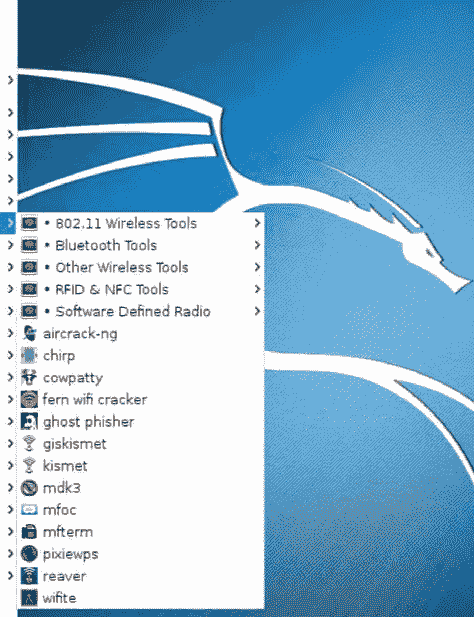

# Kali Linux 工具 1

## 核心特性

为像树莓派这样的专用 Linux 渗透测试设备构建，就像 `x86` 和 `x64` 桌面系统一样，配备了用于计划和执行渗透测试的默认工具。树莓派版本（来自 `https://offensecurity.com/kali-linux-images`）旨在为安全测试提供所有正确且恰当的工具。

对渗透测试以及无线攻击感兴趣。有了所有可用选项，你将轻松找到你寻找的内容。

- 预装了超过 300 种渗透测试工具，这意味着你能够准确找到你需要的工具
- 工具可以通过终端或 `GUI` 使用，`Kali Linux` 非常适合便携式渗透测试树莓派，具有
- 工具包括 `Metasploit`、`aircrack-ng` 等许多其他工具
- 各种后渗透测试工具，它们被归类为分析、攻击、压力测试等类别

与其它工具和软件包不同，`Kali Linux` 可以在 `GUI` 或终端中运行——恰恰相反，也可以通过使用命令行工具运行，或者在处理它们时运行。但是，这里有一点很重要，在 `Kali Linux` 上进行工作适用于多种设备，从标准 `PC` 到 `Chromebook` 甚至 `BeagleBone`！

正如你所知的，`Kali` 的性质包含了预装的安全测试工具。默认情况下，它也适用于计算机取证和逆向工程，其渗透测试工具包含了超过 300 种渗透测试和审计工具。`Kali Linux` 上的工具可以在 `GUI` 或终端中运行——完全取决于实用程序。在这些工具中，你将找到 `Metasploit Framework`、`aircrack-ng` 等许多其他工具。除了渗透测试，考虑到 `Kali Linux` 作为一个专注于安全的发行版的更通用用途，任何类型的工具，以及分析、密码攻击、压力测试和漏洞利用工具，对任何人都有用。

`www.kaliux.com`

# 功能

```
=== Raspberry Pwn Release 0.3 ===
```

由 `PwnieExpress.com` 提供的树莓派渗透测试会将一套全面的安全渗透套件加载到你的树莓派上。注意，在继续之前必须将树莓派发行版安装到 SD 卡。更多信息请参见 `README.txt`。按 `ENTER` 继续，按 `CTRL-C` 取消。

与其作为一个完整的发行版，你可以在终端中安装 `Raspberry Pwn`——如果 `Kali Linux` 不符合你的需求，或者你想获得更侧于树莓派的体验，树莓派工具集是一个强有力的替代方案。与其作为一个完整的发行版，你可以在终端中安装 `Raspberry Pwn`——如果你不想一个包含其他项目的专注于树莓派的发行版。

要进行安装，你需要首先安装 `git`，然后下载：然而，`ARM` 架构存在兼容性问题。

- `sudo apt-get install git`
- `sudo git clone github.com/pwniexpress/Raspberry-Pwn`

完成后，切换到 `Raspberry-Pwn` 目录并运行安装程序。

```bash
cd Raspberry-Pwn
sudo ./INSTALL_raspberry_pwn
```

安装完成后，你将有一系列广泛工具来审计你的网络，例如 `SET`、`aircrack-ng`、`Traceroute` 等。一旦安装完成，`Raspberry Pwn` 驱动将准备好进行任何测试。这是一个可以安装在 Pi 的 `Ubuntu` 镜像上的下载包，在不知道的情况下，某些工具可能无法工作。

```
pi@raspberrypi:~ cd Raspberry-Pwn
grep /etc/motd: No such file or directory
```

# Raspberry Pwn 工具 2

## 核心特性

- 预装了超过 300 种渗透测试工具，其中一些可能无法工作。然而，这个选项可能比像 `Kali` 那样从头开始更有吸引力。该工具物有所值。

```
PnPw: 3.0.27
Friday December 14 12:57
CPU: 0.7056% us:1.1914%
tasks: pid:1992 mem:1843
root 0.15%
canky 0.15%
bash 3.01%
Lpinmap 0.0%
rawsort 0.0%
openbox 0.0%
raw02di 0.0%
twork_tcp 0.0%
down7 0.0%
c2 0.0%

connections: 1
tcp 10.0.0.12:34567->80
tcp 10.0.0.12:14260->80
Protocol version: 3.8
State: ESTABLISHED
Authentication
6000/tcp open (access denied)
主机没有开放的端口。如果你在网络中，将显示在这里：
```

`Starting Nmap 6.0 (http://nmap.org) as 2012-12-01`

`Nmap scan for localhost (127.0.0.1)`

`Host is up`

未显示: `397 closed ports`


# PnPWi

预装了超过 200 种工具，`PnPWi` 是从 `http://pnwi.sourceforge.org` 获取的发行版。作为一个整体，你需要在启动树莓派之前下载文件并进行设置。与其不同，渗透测试提供了一个专注发行版，通过广泛的工具库访问网络，带有流量分析、无线监控工具，以及我们可以使用它们对无线键盘或 `PIN` 等发起暴力攻击。再次，此集合中的工具大多数是为命令行设计的，`PnPWi` 可能是这里介绍工具中最精简且即插即用的。

## 核心特性

- 发行版中预装了超过 200 种工具，提供了丰富的工具选择。
- 特色工具包括网络流量分析 `darkstat`、所需的无线监控工具。
- 专用树莓派渗透测试发行版，基于精简版的 `Debian`。
- 使用 `Openbox` 窗口管理器支持多个命令行。
- 支持大量的网卡，这对于渗透测试特别有用。树莓派内置的网卡是不行的。
- 大多数命令行工具，带有一些桌面渗透测试工具供鼠标强制攻击者使用，取决于你是否大部分时间都在 `PnPWi` 上。默认登录名为用户名：`root`，密码：`tool`。一旦运行，也许渗透测试工具无需任何配置即可启动到 `Openbox` 窗口中。

`www.linuxux.co.uk`

# 功能

## 测试你的安全性

```bash
@raspberrypi:~$ sudo airmon-ng start wlan

Found processes that could cause trouble.

a short of itself working after y may want to kill (some of them)!

256

d68

650

940

Process with ID 530 (wps-supplicant) is running on wlan0
```

### 03 Reaver 破解了你的路由器 – 接下来怎么办？

通常情况下，`Reaver` 需要五到十小时才能完成，在此期间，你的 Pi 看起来可能死机了。最佳解决方案是保持现状，然后按 `Ctrl+C` 即可取消 `Reaver` 的扫描。`Reaver` 利用了 `Wi-Fi` 保护设置（`WPS`）中的漏洞，这是一种许多路由器支持的 `WPS` 访问系统。在路由器中禁用它可以防止此类攻击。

### 04 用于密码嗅探的其它工具

渗透测试不仅仅是为了破解密码，这些软件包中还包含了其他工具，可以为你的搜索提供进一步帮助。因此，请关注 `John (John the Ripper)` 和 `airc-ng` 等工具。

### 01 使用 Reaver 为你的树莓派测试 Wi-Fi 密码

使用树莓派测试套件可以做的早期工作之一测试路由器的密码。为了实现这一点，我们使用了一个专门设计的实用程序提取路由器和其他接入点（例如手机的无线热点）的密码。

虽然 `WPS` 被认为比 `WEP` 安全得多，但具有被某些工具利用的安全漏洞的路由器揭示的情况如下：

| ID | Ch 8 | 已用: 2016-01-11 14:06:15 |
| :--- | :--- | :--- |
| 0200000000000000 | -1 | 0 0 356,WPA FOR <LAV |
| 0200000000000000 | -1 | 0 0 356,WPA FOR <LAV |
| 0200000000000000 | -1 | 0 0 356,WPA FOR <LAV |
| 0200000000000000 | -1 | 0 0 356,WPA FOR <LAV |
| 0200000000000000 | -1 | 0 0 356,WPA FOR <LAV |
| 0200000000000000 | -1 | 0 0 356,WPA FOR <LAV |

| STATION | 比例 | 最后 | 首次 | 锁定 |
| :--- | :--- | :--- | :--- | :--- |
| 0200000000000000 | 0 | -12 | 0 | 299 |
| 0200000000000000 | 0 | -12 | 0 | 299 |

### 02 你的 WPS 密码被破解了吗？

使用 `iwconfig` 开始收集关于你 Pi 网卡的信息。默认接口是 `wlan0`，我们需要切换到：

```bash
airmon-ng start wlan0
```

这将输出监听接口的名称，通常为 `wlan0`。现在是时候寻找路由器的 `BSSID` 了，所以：

```bash
airoddump-ng wlan0
```

如果这不起作用，尝试使用 `airodump-ng` `mon` 来识别你正在寻找的 `BSSID`（这是一个 `MAC` 地址），并将其记录下来。现在你可以启动 `reaver` 用它破解密码，将 `BSSID` 更改为包含你之前记录的 `BSSID`。

```bash
reaver -i mon -b [BSSID] -vv
```

你密码的强度将决定所需的时间：

### 05 Airplay, tcpdump

你可能在 `Kali Linux` 中见过 `Wireshark`，或者在之后之后用它来识别你发现的其他功能之一进行尝试。

问题是 `Wireshark` 是路由器上的一个配置问题。例如，它在性能方面的配置看起来正确，因此你需要许多替代方案。或者，你可能需要一些不需要大量配置的东西，而 `tcpdump` 就是这样的工具。和 `Wireshark` 一样，`tcpdump` 用于网络拓扑并帮助你捕获命令，你应该使用它来查看通过以太端口的流量：

```bash
tcpdump -i interface
```

### 06 你的数据在哪里？

鉴于路由器和远程计算机使用防火墙的问题在于使它们更安全，并对输入的数据获得更多控制。要发现这一点，我们可以使用 `traceroute`（它有各种选项，你可以配合 `-h` 参数使用）。如果怀疑数据正从你的路由器中移除并有一个攻击者地址，`traceroute` 显示了数据使用的地方。

```bash
traceroute [HOSTNAME]
```

其中 `hostname` 是 `URL` 或 `IP` 地址。

### 07 探测你的“气味”

为了确定你的在线活动是否安全，你需要一个能够拾取可能吸引攻击者的任何数据的嗅探工具。一个很好的选择是 `airodump`，可以使用以下命令运行：

```bash
sudo airodump-ng -i wlan0
```

再次，如果包含了 `-w`，这取决于你想要的结果。

### 08 映射你的网络

由于路由器和远程计算机使用防火墙的问题在于使它们更安全，并对进入的数据获得更多控制。要发现这一点，我们可以使用 `nmap` 来发现连接到网络的设备。在运行 `nmap` 时，它会显示操作系统以及正在运行的服务（如 `HTTP`, `MySQL`, `SSH`）。

### 09 扫描你的网络

为了找出运行的操作系统，你需要使用类似这样的：

```bash
sudo nmap [TARGET]
```

其中 `[TARGET]` 被替换为主机名或 `IP` 地址。

### 10 使用 nmap 扫描端口

端口的性可以使用 `nmap` 来建立。找出开放端口只需要一个基础命令：

```bash
nmap [TARGET]
```

`nmap` 还会列出开放、被过滤或关闭的端口。修复任何漏洞意味着防火墙对端口的感知。

### 11 你的网络发生变化了吗？

虽然 `nmap` 显示了你的网络如何，但为了获得更稳定且有机的结果，`Wireshark` 应该是你的选择。`Wireshark` 可以实时捕获网络拓扑，并对发生的任何变化进行报告。这用于渗透测试，而不是监控攻击的进展。

### 12 使用 Wireshark 扫描

希望使用 `Wireshark` 扫描相对简单，但你需要进入图形界面来使用它。你只需要运行该工具即可查看结果、图表和连接的设备。多种视图可用，通过调整偏好设置，你可以调整你想看到的信息类型。此外，点击网络设备将显示其 `IP` 地址、网络速度等其他信息。

### 14 操作 nmap

在 `nmap` 扫描中添加其他条件以创建输出文件：

```
- nmap -i wlan0 -v to output.txt
```


被动指纹识别中，`nmap` 捕捉来自连接主机的流量信息，而不是针对远程主机。正如此，它能够快速返回结果，且不会被检测。对于测试，这非常有用，也可以用于确定攻击者的来源。

## 15 渗透测试冰山一角

手头有 200 多种渗透测试工具，不太可能找不到你特定的伦理黑客问题的解决方案。问题在于：可用工具的体积巨大，但我们为你提供了一些入门建议。

# 探索内部科技

`www.gadgetdaily.xyz`

## 夏季必备趣味套件

## Gadget 产品

## 热门 100

让你倍兴奋的尖端科技，并有机会赢取价值 2000 英镑的前 5 大精选产品


## Gadget 促销中

■ 奥运级健身装备 ■ 热门 100 ■ 夏季必备套件

+ 最酷的套件 科技拆解 购买建议 科学释义 操作指南


## 今日购买您的杂志

纸质版请访问 `www.imagineshop.co.uk`
数字版请访问 `www.greatdigitalmagms.com`

可在以下平台获取。


`facebook.com/gadgetdaily` | `twitter.com/gadget_magms`

所有优质报刊杂志和超市均有

## 安装控制器

在 `Tom` 的项目中，生态缸控制器被安装在生态缸背部，并用软背胶魔术贴固定。这不仅便于处理问题，还为后续进出生态缸的任何布线预留了理想位置。

## 传感器线

主传感器线穿过生态缸顶部，并用热缩管包裹。由于涉及的线缆较多，热缩管是将其它们包裹在一起而不损坏它们的最佳材料。


## 避免触电

使用市电可能是危险的，但通过使用能量 入门套件可以实现远程控制。各种定时器和程序可以为生态缸设置。

## AM2302 传感器

连接到 `Pi` 的 `GPIO` 的第一个组件是温湿度传感器。虽然它比市场上的许多传感器便宜，但当你看到它时，就可以轻松自动化。

## 组件列表

- `AM2302` 温湿度传感器
- 能量 入门套件
- 公母对跳线
- 单芯线
- 热缩管
- 小吸盘
- 背胶魔术贴

控制器固定在生态缸背部，方便放置。吸盘有助于传感器安装在生态缸侧面。可以快速读取。


## 生态缸控制器

自动化生态缸可以将植物或爬虫保持在最佳温度。当你决定建立生态缸时，加热器提供了足够的热量，问题在于寒冷。为了解决这个问题，你可以使用短跳线直接连接到相应的插座。这并没有你想象的那么困难。值得注意的是，市场上的控制器有机械定时器或开关（为物联网设计的），我需要一个简单的开关。我选择 `Pi` 是因为我未来需要添加新功能的灵活性。

你能向我们介绍一下你的项目 吗？

`Tom Benn` 是一位来自伦敦的顾问，但他喜欢挑战 `Raspberry Pi` 的构建。我花了几周时间订购组件、脚本并组装项目，可以通过 `GitHub` 获取。我发现了一个可以用于控制环境的库，并通过 `HTTP` 请求将我的数据推送到 `GitHub`。

`Raspberry Pi` 起了什么作用？它本质上是整个系统的大脑。在计算能力方面，`Pi 3` 比 `Arduino` 或 `Raspberry Zero` 更强大。我选择 `Pi` 是因为我想要未来添加新功能的灵活性。`Tom` 的项目确实通过 `Raspberry Pi` 完成任务。我最初尝试将内置适配器连接在一起，但在运行后失败了。我发现相同的设计可能不适用于传感器，所以我决定自己写一些脚本。你可以构建一个小显示器来读取当前状态；安装一个小传感器来监控你的植物或爬虫；或者使用 `GPIO` 引脚驱动一个高亮度 `LED`。基础设计可以根据需要适应任何湿度湿度。你还可以对数据做很多事情来改进。

你遇到过问题吗？有几周时间，这个项目变成了一种执念，我觉得自己快疯了。我从在线水培店购买零件，我想我的邻居怀疑我在搞什么系统。

你是如何实现温湿度控制的？`DHT22` 传感器（`DHT11` 的版本）到目前为止表现良好。我使用外露探头来处理生态缸和两栖动物的高湿度，这可能会提高湿度读数的准确性，但这只是……

你目前在进行其他的 `Raspberry Pi` 项目吗？我喜欢使用 `Raspberry Pi`；它是一个很棒的设备，社区也非常惊人。大多数猫食器都是为我的猫设计的，我仍在完善。我想建立一个根据手机小信号控制食物的设备，以便在工作晚或离开一天时能喂养宠物。

更多阅读：访问 `blog.raspberrypi.com` 查看构建项目的故障详细教程。如果你兴趣构建自己的项目，可以在 `GitHub` 上找到所有必要的代码：`github.com/tombenn`

除此之外，计划非常简单。主要的技术问题是能量 上的发射器。

`www.linuxuser.com` | 67

## Python 代码

## Raspberry Pi 的位置

### 在本期中，我们将看看如何使用 GPS 告诉 Raspberry Pi 它在什么位置

`Joey Berald` 是一位真正的 `Raspberry Pi` 爱好者，与科学家一起解决计算问题并开发应用。

在之前的文章中，我们查看了如何为 `Raspberry Pi` 添加各种传感器以让它环游世界。我们早早使用 `GPS` 获取 `Raspberry Pi` 收集的地球位置信息。为了编写 `Python` 代码，确切知道你所在的位置是非常用的。

需要记住的一点是，有时设备会停止工作。如果发生这种情况，你可能需要使用命令重启 `gps` 进程。

默认情况下，连接到本地机器上的 `gps` 进程将返回一个字典。根据你的 `GPS` 设备类型，它可能不返回字典，而是一个 `TPV` 对象。你可以使用 `Python` 内置的 `get()` 来查看报告是否包含你寻找的特定属性。

此时你可能想从 `GPS` 读取原始数据。如果你通过 `USB` 使用 `Raspberry Pi`，运行 `lsusb`。这将非常有帮助。然而，对于获取 `GPS` 接收器的当前位置（包括纬度、经度和高度），`gps` 进程提供了一种可以使用 `Python` 应用程序的原始数据转换格式。

### 这些卫星通信

在第一类消息（`TPV` 消息）中，有很多可用信息。我们将查看内容消息。你可以通过代码获取这些。

在安装正确的软件包后，这些类型的 `GPS` 连接就可以进行通信。

```python
if get('class') == "TTY":
    print(repr(record))
```

```bash
sudo apt-get install gpsd-client-gps
```

```python
import gps
gps = gpsd.GPS()
```

```python
gpsd.stream(gps, gps.WATCH_ENABLE | gps.WATCH_NEWTIMES)
```

## Python 列

## 但是，我们在哪里？

这些属性可能存在也不存在。不要像我们编写自己的代码时那样偷懒！经度和纬度以度为单位，`y` 表示北/南，而高度以米为单位。你可以通过检查返回数据的 `NMEA`（美国国家气象协会）模式来确认这些数据是否存在。模式为 0 表示未设置，模式为 1 表示已设置。

一旦你有了一个文件，模式为 2 表示你拥有二维数据，模式为 3 表示你可以获取其他有趣的信息。`GPS` 类有一个速度的属性，如果你正在移动，你就拥有了三维数据。`GPS` 跟踪相对于正北方向的航角（以度为单位），速度是你的当前旅行速率，爬升是在路上获得的爬升高度（正值或负值），单位为米/秒。这些值中的一些也包含在属性中。

下面，我们假设有一个名为 `'file'` 的文件。然后，你可以使用

```python
While True:
```

连接到你的树莓派的 `GPS` 接收器可以给你提供坐标，大多数人无法以任何直观的方式处理经度和纬度。坦率地说，互联网上有几种可用的服务可以将这些坐标转换成更直观的格式。你需要在树莓派上安装相关的 `Python` 模块，命令为

```bash
sudo apt-get install python-gps
```


如果 `report('class') == 'SKY'`：

另一个消息 `SKY` 为你提供了有关所用卫星的信息。你需要使用以下代码来验证消息类：

### 然后在日期处

这种类型中的其中一个属性是卫星对象列表，包含了每个所用卫星的细节。卫星的可见性以及在跟踪其位置时是否被使用，在 `used` 属性中以布尔标志的形式设置。卫星的位置由来自你接收器的方位角和仰角给出。强度也通过 `sig` 属性以 `dB`（分贝）给出。

此示例使用了数据的字典形式。这本质上是接收数据的 `JSON` 格式。你可以从 `GPS` 接收器为你提供的 `GPS` 数据中读取经度和纬度。如果你想获取位置，可以使用 `geocoder`。

`geopy` 模块的核心部分是 `geocoder`（地理编码器）的概念。针对 `Google`、`Yahoo` 和 `Bing` 等服务有多个类。在接下来的示例中，我们将使用提供地理定位服务的 `Nominatim` `geocoder`。开始之前，你可以通过以下代码创建一个 `geocoder`：

```python
from geopy.geocoder import Nominatim

geocoder = Nominatim()
```

大多数人使用它来查找地址的坐标。实际上，你会使用它执行反向查找，根据 `GPS` 给出的坐标查找地址。你可以通过 `geocoder` 实现。

你可以将坐标作为值列表提供，或者作为带有值的字符串提供。返回的位置对象将包含经度和纬度，还包含地址。如果你想获取返回的详情，你也可以访问完整的返回的 `JSON`。例如，你可以获取地址中的城市部分。

现在我们已经连接到 `GPS` 接收器并与其通信了，你想用它做什么？如果你想构建一个跟踪器，可以编写一个循环将当前位置记录到文件中。

```python
myLat = 46.6852391
myLon = 37.5641727
record = gps.next()
if record['class'] == 'TPV':
    myLat = record['lat']
    myLon = record['lon']
# 其他其他操作
```

完成后，清理编辑器中所有的代码。`GPS` 文件现在已可用以显示这种连接。它看起来像：

现在，你将能够为你的项目添加地理定位而无需重新开始。你可以使用真实的坐标，例如一个只有在你刚好处于某个位置时才会打开的锁，或者跟踪这些数据。你可以通过代码与世界分享任何有趣的事物。

```python
gps.close()
```

在这种情况下，我们从当前位置获取数据。还有用于测量距离和插值的有用函数。例如，你可以通过代码找到两个位置之间的距离：

```python
from geopy import geocoder

location2 = geocoder('lat=41.5908,-lon=31.712756')
distance,location = distance(location,location2)
```

还有其他工具可以配合这些数据进行播放。


## 在 `Minecraft` 中实现音乐可视化

### 结合代码、`Minecraft` 和 `PianoHAT` 播放音乐并创建旋律可视化

`Pimonori` 创建了 `PianoHAT`，这是你树莓派的终极音乐伴侣。它受到 `Zachary Laiman` `PianoHAT` 的启发，是一个八键钢琴扩展板，带有触摸敏感按键和 `LED`。

它可以用于许多创意和音乐目的，如在 `Python` 中播放音乐一样，控制树莓派上的合成器以及更多。


本教程将向你展示如何设置硬件，向你介绍软件的基本功能以及如何在 `Minecraft` 中一起使用它们创建音乐方块和旋律可视化。你可以在这里查看演示：`https://www.youtube.com/watch?v=eljqQIM`

`Alfred` 作为一名认证教育工作者，热衷于创作并使用此类项目向学生展示编程是有趣的。他的学生代码出现在广告中。

### 01 启动

`Pimonori` 让安装 `PianoHAT` 软件变得非常简单。假设你还没有连接树莓派，只需连接扩展板并启动。在终端中更新：

```bash
sudo apt-get update
sudo apt-get upgrade
```

输入以下行安装 `PianoHAT` 库：

```bash
sudo curl -sSL get.pimonori.com/pianohat | bash
```

按照显示的说明操作。现在将下载所需的库和一组尝试的程序。

### 需要
- `PianoHAT`
- 树莓派


### 02 基础事件

带有一组示例的软件安装旨在演示 `PianoHAT` 的功能和特性。在 `Piano` 的代码中，有四个可以控制的基础事件：
- `note`：触摸按键时播放音符；
- `octave`：按下八度键时音调升高一个八度；
- `octave`：按下八度键时音调降低一个八度；
- `instrument`：使用乐器时将声音从钢琴变为鼓声。

### 完整代码列表

```python
import pianohat

import pygame

import time

import signal

import glob

import os

import re

from mcpi import minecraft

mc = minecraft.Minecraft.create()

global move

x,y,z = player.getPos()

move = x

BANK

FILETYPES = ['.wav', '.ogg']

samples = []

files = []

octave = 0

octaves = 0

pygame.mixer.pre_init(44100, 16, 2)

pygame.mixer.init()

pygame.mixer.set_num_channels(32)

global patch

patch = glob(os.path.join(BANK,'*'))

patch_index = 0

if len(patch) == 0:
    exit('BANK中没有音符')

def natural_key(key,s):
    text = re.compile(r'(\d+)', key)
    return [int(text) if text.isdigit() else text.lower() for text in re.split(text, s)]

def load_samples(path):
    global samples, files, octave
    for filetype in FILETYPES:
        files.extend(glob(os.path.join(path,filetype)))
        samples.extend(natural_key(file)))

octaves = len(files) / 12

samples = [pygame.mixer.Sound(sample) for sample in files]

pianohat.auto_led(true)

def handle_note(channel, pressed):
    global move
    channel = channel * (12*octave)
    if channel < len(samples) and pressed:
        print('Playing: {}'.format(samples[channel]))
        print channel
        move = channel # 数字作为变量
        Block_number = channel
        samples[channel].play(loops=0)
        mc.setBlock(move, y+3, z, Block_number)
        move = move + 1 # 递增以便线性移动方块

def handle_instrument(channel, pressed):
```


### 03 简单钢琴

要使用 `PianoHAT` 及其功能，请加载 `simplepiano`。这是一个描述简单钢琴的示例。导航到 `树莓派/pianohat/pianohat`，按下 `F4` 启动该方法（扩展板需要根权限）。接下来，加载脚本 `simple-piano.py` 并运行。按回车键播放。使用按钮调整音调范围，并按下乐器在不同声音之间切换。

### 04 音乐静默

这个喜剧课程用于指示你按下并释放按键，或者 `LED` 亮起但未“设置”。它演示了你如何将 `Piano LED` 和声音分开。你可以打开所有 `LED`，这对于创建一个视觉节拍器非常有用，即在上一个音符开始之前按下下一个符。通过使用 `pianohat`，输入 `simple-piano.py` 引导节奏

### 05 自学

这台小钢琴让你知道它是什么！运行程序，`LED` 就会亮起。这是要按的键。八度等。跟随 `PianoHAT LED` 学习如何演奏。使用钢琴程序实验并创建你自己的旋律/歌曲轨道。

### 06 Minecraft

树莓派操作系统自带了 `Minecraft` 和所需的 `Piano` 库。如果你使用的是旧系统，值得下载并更新到新版本。钢琴hat 镜像下载地址：`https://www.raspberrypi.org/downloads/`
从编程标签启动并加载 `Minecraft`。请注意 `Minecraft` 是

## 教程

从 `mcpi` 加载以下模块

```python
while True:
    time.sleep(1.0)
    pos = mc.player.getPosition()
    print pos.x, pos.y, pos.z
```

全屏显示时会出现故障，建议缩小尺寸，以便你可以同时查看 Python 代码和游戏。让我们来看一些将在最终 `Minecraft` 方块中使用的简单 `Minecraft` 骇客技巧。

## 07 导入模块

你需要从 `mcpi` 导入以下模块：`import minecraft` 和 `mc = minecraft.create()`。创建 `Minecraft` 和 Python 之间的程序链接。通过类型 `mc` 使用变量，这样在每次使用 API 特性时，就不需要都输入长长的 `minecraft.create()`。导入 `time` 模块以便在代码运行时添加短小的延迟。

```python
mc = minecraft.create()
```

```python
import time
```

## 08 寻找你的位置

玩游戏时，你居住在一个三维环境中，其中由 `x` 轴代表左和右，`y` 轴代表上下，`z` 轴代表前后。当你沿着这些轴的任何一个移动时，你的位置将作为三个坐标的形式显示在屏幕左上。这些坐标使用 `pos = mc.player.getPosition()` 进行存储。这段代码存储了玩家的位置，稍后添加到音乐方块中。尝试下面的简单程序作为示例，了解如何运行

# 09 种一些花

`Minecraft` 中的每个方块都有自己的 ID 数字，例如，你拥有的 ID 38。`x, y, z = mc.player.getPosition()` 返回玩家在世界中的当前位置，并将其作为一组坐标：`x`, `y`, `z`。现在你知道自己站在世界的什么位置了，就可以在你周围放置方块了。使用代码 `mc.setBlock(x, y, z, flower)` 在你周围放置不同的方块。

# 10 创建音乐方块

现在你已经掌握了 `Minecraft` 和 `PianoHot` 的基础知识，让我们结合它们创建一个音乐方块。这使用了 `PianoHot` 中每个音符的 ID，并将其分配给 `Minecraft` 中的每个音乐方块。方块的颜色将改变以对应 `C` 的值。当你弹钢琴时，音乐方块将显示在 `Minecraft` 世界中。打开 `LX` 终端并使用 `sudo` 以 `root` 权限导入 Python。你创建的每个方块都将有不同的名称。你将此用作音乐方块程序的模板。现在从程序的第 11 行开始导入模块和 `Minecraft` API。

> 以下是监狱内容：
> `PianoHot` 有一些白色琴键
> 八八度可以降低或升高

```python
from mcpi import minecraft

c = minecraft.Minecraft.create()
```

```python
import time
```

## Minecraft

```python
import mcpl.minecraft as minecraft

mc = minecraft.minecraft.create()
```

你会注意到一些方块开始出现——原因之一是没有匹配音符 ID 的方块 ID。另一个原因是物体受重力影响。例如，沙子和镁岩石会从你使用 `setBlock(x,y,z)` 设置的行掉落。

## 创建你自己的声音

# 11 再次寻找你的位置
在你刚刚输入的行下方，在名为 "BANK" 的行之前，我们创建了一个名为 `move` 的变量，它存储玩家的 'X' 位置。现在使用你在 8 中留下的代码找到你的玩家位置行。在这一行，检查位置和方块是否正确很有用。这些值随后被打印到 Python 控制台中。现在你有了你在 `Minecraft` 中玩家的位置。

钢琴样本位于 `Pinyon Springs/sounds` 文件夹中。像你在另一个乐器和自己的个人钢琴合成器上演奏那样创建/保存你的声音。

```python
global move

x,y,z = player.getPos()

move = x
```

```python
mc.setBlock(x,y,z, Block_number)

move += 1
```

# 12 为方块分配音符
接下来向下滚动到处理函数，它从第一个函数的第 52 行开始。在下一行之后，下一行，添加来自上一个变量的 'X' 位置的变量 `block`。读取 `channel + octave` 的行指的是音符的数量。如果你使用这一行并创建一个新变量 `block_Number`，将设置要播放音符的方块颜色。

## 16 向 Minecraft 发送消息
最后一行设置为发送一条消息，将播放钢琴声和你的音乐作为准备就绪。在下一行，调用 `mc.postChat("Welcome to our music")` 在屏幕底部显示你的消息。通过更改你的消息或使用同一行添加更多消息。一旦样本播放完毕且你的 `Minecraft` 钢琴准备就绪。

```python
def handler_note(channel, pressed):
    global move
    global channel
    channel += (octave)
    Block = channel
```

# 13 设置方块
在第九步中，你学习了如何播放方块：使用此代码放置与上一步找到的通道数对应的方块。在语句中，样本 `(handler_play)` 的第 56 行是：为了添加放置方块，`mc.setBlock(x,y,z, Block_number)` 将方块放置在正确的位置。

现在你已经完成了代码。在 `Minecraft` 中是一个新世界。当此加载完成后，在 IDE 中按 `F5` 播放你的音乐。按一个键，钢琴方块出现在你头顶上方。记住，玩家的位置只在程序开始时有一次，方块将从相同的参考位置放置。演奏你的旋律来创造视觉杰作 ■■

```python
if channel == 1 and pressed:
    print("Playing sound: {}".format(channel))
    samples[channel].play(0,0)
```

```python
mc.setBlock(x,y,z, Block_number)
```

# 完整代码列表（续）

```python
global patch_index

if pressed:
    patch_index += 1
    patch_index %= len(patches)
    print("Selecting patch: {}".format(patch_index))
load_samples(patch_index])
```


# 14 解释方块

在你刚刚输入的行下方，在调用 `"BANK"` 的行之前，我们创建了一个名为 `move` 的变量，它存储玩家的 `'X'` 位置。现在使用你在 8 中留下的代码找到你的玩家位置行。在这一行，检查位置和方块是否正确很有用。这些值随后被打印到 Python 控制台中。现在你有了你在 Minecraft 中玩家的位置。

钢琴样本位于 `Pinyon Springs/sounds` 文件夹中。创建/保存你的声音像你在另一个乐器和自己的个人钢琴合成器上演奏那样。

```python
global move

x,y,z = player.getPos()

move = x
```

```python
mc.setBlock(x,y,z, Block_number)

move += 1
```

# 12 为方块分配音符

接下来向下滚动到处理函数，它从第一个函数的第 52 行开始。在下一行之后，下一行，添加来自上一个变量的 `'X'` 位置的变量 `block`。读取 `channel + octave` 的行指的是音符的数量。如果你使用这一行并创建一个新变量 `block_Number`，将设置要播放音符的方块颜色。

## 16 向 Minecraft 发送消息

最后一行设置为发送一条消息，将播放钢琴声和你的音乐作为准备就绪。在下一行，调用 `mc.postChat("Welcome to our music")` 在屏幕底部显示你的消息。通过更改你的消息或使用同一行添加更多消息。一旦样本播放完毕且你的 Minecraft 钢琴准备就绪。

```python
def handler_note(channel, pressed):

    global move

    global channel

    channel += (octave)

    Block = channel
```

# 13 设置方块

在第九步中，你学习了如何播放方块：使用此代码放置与上一步找到的通道数对应的方块。在语句中，样本 `handler_play` 的第 56 行是：为了添加放置方块，`mc.setBlock(x,y,z, Block_number)` 将方块放置在正确的位置。

现在你已经完成了代码。在 Minecraft 中是一个新世界。当此加载完成后，在 IDE 中按 `F5` 播放你的音乐。按一个键，钢琴方块出现在你头顶上方。记住，玩家的位置只在程序开始时有一次，方块将从相同的参考位置放置。演奏你的旋律来创造视觉杰作 ■■

```python
if channel == 1 and pressed:

    print("Playing sound: {}".format(channel))

    samples[channel].play(0,0)

### 在 ####### 方块中播放声音

mc.setBlock(x,y,z, Block_number)
```

# 完整代码列表（续）

```python
global patch_index

if pressed:

    patch_index += 1

    patch_index %= len(patches)

    print("Selecting patch: {}".format(patch_index))

load_samples(patch_index])
```

# 14 解释方块

在你刚刚输入的行下方，在调用 `"BANK"` 的行之前，我们创建了一个名为 `move` 的变量，它存储玩家的 `'X'` 位置。现在使用你在 8 中留下的代码找到你的玩家位置行。在这一行，检查位置和方块是否正确很有用。这些值随后被打印到 Python 控制台中。现在你有了你在 Minecraft 中玩家的位置。

钢琴样本位于 `Pinyon Springs/sounds` 文件夹中。创建/保存你的声音像你在另一个乐器和自己的个人钢琴合成器上演奏那样。

```python
global move

x,y,z = player.getPos()

move = x
```

```python
mc.setBlock(x,y,z, Block_number)

move += 1
```

# 15 移动方块

一旦方块设置好，增加方块的位置。如果你想让方块移动，可以增加 `move` 变量。

```python
move += 1
```

# 16 移动效果

你可以使用 `move` 变量来控制方块的移动。

```python
mc.setBlock(x + move, y, z, Block_number)
```

# 数字相框

树莓派已连接到触摸屏显示器的背面，准备好启动此项目。


# 准备你的照片

自然地，你需要一组照片显示在树莓派驱动的数字相框显示。我们有不同的选项（见下文），但我们建议使用存储在树莓派上的照片，这些照片可以通过 USB、网络驱动器或通过浏览器下载。

```bash
sudo nano /home/pi/start-picture-frame.sh
```

添加以下内容：

```bash
# /bin/bash

DISPLAY=0 XAUTHORITY=/home/pi/.Xauthority /usr/bin/fe -p -Z -f R -60 -Y -D 15.0 /media/STORAGE/test
```

退出并保存，然后使用以下命令测试：

# 设置你的相框

要将树莓派配置为相框，我们首先需要防止屏幕关闭。这意味着要编辑 `lightdm.conf`。

```bash
sudo nano /etc/lightdm/lightdm.conf
```

# 让你的相框开机启动

现在可以将脚本设置为在开机时运行。

```bash
sudo nano /etc/rc.local
```

在 `[SeatDefaults]` 添加此行：

```bash
xserver-command=X -s 0 -dpms
```

完成后，使用 `Ctrl+C` 保存并退出，然后重启：

并在 `exit 0` 之前添加：

```bash
sleep 10

pi -c '/bin/bash /home/pi/start-picture-frame.sh'

sudo reboot
```

# 安装

图片查看软件是构建简单相框的最佳选择，因此请安装它。

保存并退出。

```bash
sudo apt-get install fetch
```

安装完成后，告诉 `fetch` 在哪里找到图像，将 `/media/STORAGE/` 修改为你的目录。

```bash
DISPLAY=:0 XAUTHORITY=/home/pi/.Xauthority /usr/bin/

fetch -p -Z -f R -60 -Y -D 15.0 /media/STORAGE/test
```

# 重启你的树莓派

现在你的树莓派大功告成了！要测试这一点，使用 `sudo reboot` 命令重启并检查设备是否直接进入了相框模式。

如果有任何问题，请检查命令输入是否正确，并检查 `lightdm.conf` 和 `rc.local` 中的日志。

# 停止相框

如果你在任何时候需要停止相框，可以使用简单的命令来实现：

# 保存脚本

```bash
sudo killall fetch
```


之前的脚本应该已经提示树莓派相框开始从指定文件夹显示图像，每张显示 15 秒。

只要你为相框准备的照片没有占用设备太多的空间，它们就应该无任何问题地加载。

为了强制它在开机时启动，我们需要将其添加到脚本中。

# 让你的相框变智能

相框功能集还包括一个脚本，它会在检测到运动并在有人靠近相框时工作，打开显示器。

运动传感器模型会产生一个信号，并应该连接到树莓派的 GPIO。标记为 VCC 的引脚用于供电，GND 接 GND，Output 接到...

使用以下方式创建它：
* `www.linux.us`


# 构建一个机器人

# pHAT 机器人 第一部分

使用 Pi Zero、Zumo 底盘和 Pimoroni Explorer pHAT 制作你自己的自主树莓派驱动机器人。

欢迎来到特殊机器人系列的第一部分。我们将为你提供制作树莓派机器人所需的所有知识。在第一部分中，我们将机器人拆解为所有组件部分，并为你提供关于电池、电机、输入控制器等的内部视角。


Alex Ellis
`@alexitloukas` 是 Docker 的软件工程师、Docker Captain 以及所有 Linux 事务爱好者。他从未远离树莓派，并定期在他的博客上发布教程。


# 到底什么是“机器人”？

机器人被认为是任何可以自主或根据直接指令执行任务的机器。机器人有许多形状和大小 - 它们可以制造、搜索和救援，以及仅仅为了好和看看你能创造出什么。我们最近看到的爱好者们收回或断开了任何电线，能够通过游戏手柄驱动。我们不会对什么是机器人定义得太严格；我们想把那留给你。


# 底盘

底盘是机器人的核心，它的尺寸和形状决定了你添加上面的一切东西。在大和小之间、强或轻之间进行选择。如果你是自主的，你将需要一个有足够扩展空间的底座。我们看到的 RC 汽车是新电子设备的廉价方式。DIY 平台最灵活且最有成就感；由激光切割的木材、亚烯甚至 3D 打印零件。

教程

电机控制器由树莓派或扩展板生成的 PWM（脉冲宽度调制）信号驱动。为每个项目购买两个备用电机是个好主意并善对待它们，因为它们可能会误用。Zumo 底盘使用 Pololu 的齿轮电机。我们从那里获取大部分组件。假设你已经有了树莓派 Zero、microSD 卡和几节 AA 电池。

| 项目 | 价格 |
| :--- | :--- |
| 树莓派 | £35.00 |
| Pololu Zumo 底盘 | £15.00 |
| Explorer pHAT | £10.00 |
| 金属2轮 x2 | £10.00 |
| 电池 (x8) | £2.00 |


# 电机控制器

电机的类型及其峰值电流决定了电机控制器的选择。对于小型电机，像 L298 这样的廉价芯片可能适合你的需求。Borg 产生更高效的板可以驱动大负载，成本增加到 £30 左右。

# 电源

最好从独立源运行你的电机和电路。这有助于隔离树莓派、电机控制器和传感器免受潜在浪涌的影响。对于经验用户，建议使用 LiPo 电池，但必须在充电或处理它们之前阅读并遵循所有注意事项。USB 充电宝、AA 电池和9V 电池。

# 理解齿比

齿比是输入速度与输出速度的比率。例如，35:1 意味着电机轴（驱动端）旋转速度是驱动轴（电机安装处）的 35 倍。比例越高，获得的扭矩越大。对于 Thumper 4WD 机器人（可在 `robosavvy.com` 获取），34:1 的比例提供了 4.5mph 的最高速度，扭矩为 5kg-cm；相比之下，75:1 的速度较低但扭矩更高（11kg）。

更多详细信息，请查看 Physics 的齿比介绍：`https://bodyphysics.org/Robotics/_Gears_and_Gear_Ratios/`

# 获取你的电机

无刷电机通常以高速运行，让你的机器人直线行驶非常快，但在障碍赛和自主导航中难以控制。有刷电机可以用电机驱动，但在选择时必须参考电机的堵转电流。

大多数机器人需要来自摇杆或游戏手柄的输入。我们在使用蓝牙的 PS3 控制器上取得了成功。Xbox 360 和 PS2 控制器也可以会增加复杂性并比蓝牙适配器消耗更多电流。将你的代码分为不同的类，以便将来更换控制器。

# Explorer 机器人


# LED 输出

在启动和停止机器人，或者仅仅调节电机速度时，具有视觉反馈是很重要的。这样做最简单的方法是将 LED 直接插入电机驱动器的电阻器中。对于我们的第一个机器人，当蓝牙服务开启或关闭时，LED 会执行闪烁序列。如果你在机器人的顶层留有几个空槽，你可以同时为所有部分连接一个 LCD 显示器，用于通信传感器数据。

树莓派 Zero 可以添加摄像头，约为 £4-£10，这意味着当你在厨房或花园中穿行时，你可以拍照或将直播视频传回你的控制站（笔记本）。对于更高级的，可以制作树莓派机器人带有 360 度摄像头和数字罗盘遵循一系列 GPS 标记。

# 自主控制

机器人有两种类型的自主控制程序：开环和闭环。在开环中，机器人无论环境如何都以恒定速度移动，这意味着在地毯上的小转弯会转化为在瓷砖上的动作。通常情况下，开环更容易开始，因为它绝对不需要反馈。高级机器人需要传感器的反馈来调整其速度或动作。一个例子是第一个一个向上移动；闭环使用编码器，以便它知道自己正在移动 50 厘米；我们可以任务机器人至少移动 100cm。


# 为北美读者的特惠优惠

# 订阅免费赠送 6 期
当您订阅时


# 专业人士和开发者的开源权威

每期杂志均有免费资源下载

BU
第一部分
PLORER 机器人
本期开始介绍 4 部分式指南
`www.linuxuxuser.co.uk`
LinuxUser & 开发者

安全工具包
即时启动 DVD

击败黑客

使用树莓派进行渗透测试
用于保护设备安全的复杂新软件
24 页的树莓派专栏

# 保护您的系统

您锁定 PC 所需的 7 个程序
- Kali Linux - Opreshark - Wireshark - `nmap`

玩奏音乐的树莓派
掌控 `Bash` 脚本以在攻击中生存

开启：将您的 Pi 变成路由器
免费新款 `UBUNTU 16.04` 启动包

`micro:bit`
使用 `MAKE` 制作
LinuxUser & 开发者

`Ubuntu 16.04` 启动包

制作网络电台
赚取 `Go`

免费总照片、视频与音乐包

LinuxUser & 开发者
创客项目

树莓派 3
网络全指南

`Black HAT Hack3r`
`Black HAT Hack3r`
通过此插件让你从 Pi 和 Hats 中解脱

# 构建您自己的 NAS

通过构建和优化您自己的存储设备，跨网络提供文件服务

VPN 测试
您的隐私最佳方式是什么？

内含精彩内容
- 免费测试过的安全性
- 适合所有人的流程

# 订购热线 +44 (0)1795 418661
访问 `www.imaginesubs.co/uk` 订购

# 此专属优惠请咨询美国价格！

*条款与条件：这是一份美国订阅。您将被收取 80 英镑的年费。这在购买时等同于 - 汇率可能会变化。6 期的免费期相当于美国新闻价 16.99 美元，1 次订阅 = 价值 220.07 美元。您的订阅从下一可用期开始，持续 13 期。此优惠于 2016 年 9 月 30 日过期。

# 测评

81 组组测 | 86 `Black HAT Hack3` | 88 `Ubuntu 16.04` | 90 免费软件


# 组测

# VPN（虚拟专用网络）

虚拟专用网络对于保持您的在线匿名性非常棒，但 Linux 用户应该下载哪一个到桌面上呢？

# PrivateTunnel

# IPVanish

# TunnelBear

# CyberGhost

虽然与本次组测涵盖的某些程序相比，它并不是大名，但 `PrivateTunnel` 以基于安全的 VPN 服务而自称。保持匿名性是首要任务，它似乎旨在为用户配备一系列额外的安全选项。`www.privatetunnel.com/home`

`IPVanish` 试图颠覆传统的 VPN 公式，零追踪日志和 IP 掩码的组合证明是宝贵的资产。操作界面看起来是个赢家，但它能与测试中的其他产品竞争过吗？`www.ivananish.com`

说到 `TunnelBear` 的 VPN 服务，简单就是它的核心，你很难在市场上找到比它更用户friendly VPN 来帮助你匿名浏览互联网。它的速度在功能方面可能超过其竞争对手。

拥有超过 800 万次下载量，`CyberGhost` 建立了声誉。它是另一项 VPN 服务，以为用户提供安全的浏览体验为自豪，但包含了极其多数量的选项供用户在连接中尝试和使用。`www.cyberghostvpn.com`

`www.linuxux.co.uk` 81

82

# TunnelBear

这种对浏览器友好的 VPN 服务提供的比你看到的更多

# CyberGhost

利用 `CyberGhost` 的力量让您在网上隐形


使用提供的切换选项，用户可以在几秒钟连接到默认 VPN

- `CyberGhost` 包含一系列模拟国家，其中包括供您连接的免费和高级服务器

# 设置 VPN

这就像打开开关一样简单，真的。`TunnelBear` 的简单 UI 不仅包含一个开关，还包含一个自动 VPN 连接默认设置。可以对改进您的 VPN 进行额外自定义，但与 `CyberGhost` 和 `Private Internet` 相比，这些自定义是微乎其微的

# 设置 VPN

`CyberGhost` 第一次在一个地方显示了它所有的核心功能，这可能有点让人望而生畏。然而，它展示了您设置 VPN 可能需要的一切，每个工具的说明都更容易易懂。当然，用户可以在几秒钟内使用默认设置连接到 VPN。

# 连接选项

这方面的选择相对较少，服务器列表过于空陋。找到可用的服务器是完全可能的，但如果服务器宕机，你无能为力。我们喜欢 `TunnelBear` 的简单，但有一份更详尽的列表，高级用户可能找不到他们完全想要的

# 连接选项

VPN 的每个部分都可以从上到下进行控制，允许完全控制您想要如何设置 VPN。通过一些巧妙的操作，可以完全控制您想要如何设置 VPN。对于某些巧妙的功能，它是简单易举的，但有一份更详尽的列表，高级用户可能找不到完全想要的

(注：原文此处有大量重复段落，以下保留核心语义并去重整理)

VPN 的每个部分都可以从上到下进行控制，允许完全控制您想要如何设置 VPN。对于某些巧妙的功能，它是简单易举的，但有一份更详尽的列表，高级用户可能找不到完全想要的

## LinuxUser & 开发者

## 分类广告 01202 586442


# 快乐生日

# 关于树莓派的一切！

# MODMYPI


树莓派商店 - 我们提供各种转接板、树莓派组合包、SD 卡、外壳、黑客套件和组件 - 全球送货！

# 扫描你的优惠

# 庆祝托管二十周年


`WWW.MODMYPI.COM`

域名：托管 - 云服务 - 服务器


# 英国制造

# iQAudio

适用于树莓派的发烧友级配件

### Pi-DAC+

- 树莓派 HAT，无需焊接
- 全高清音频（最高支持 24bit/192MHz）
- 德州仪器 `PCM5122`
- `I2S` 可变输出
- 支持耳机放大器
- 集成硬件音量控制
- 访问树莓派 GPIO
- 线路输入/输出连接
- 行业标准 Ph (RCA) 插座
- 支持 Pi-AMP+

### Pi-AMP+

- Pi-DAC 配件，无需焊接
- 全高清音频（最高支持 24bit/192MHz）
- 德州仪器 `TPA3118`
- 高达 23dB 的立体声隔离
- 为树莓派提供供电
- 使用 DAC 耳机时进入自动模式
- 输入电压 12-19v
- 支持 4-8欧姆扬声器

### Pi-DigiAMP+

- 树莓派 HAT，无需焊接
- 全高清音频（最高支持 24bit/192MHz）
- 德州仪器 `TAS576M`
- 高达 23dB 的立体声隔离
- 开箱即用
- 集成硬件音量控制
- 为树莓派提供供电
- `I/O` (`I2c`, 3v, 5v, `GPIO22/23/24/25`)
- 只需添加扬声器即可完成 Hi-Fi
- 输入电压 12-19v
- 支持 4-8欧姆扬声器


Twitter: `@iQ_audio`
电子邮箱: `info@iqaudio.com`

`WWW.IQAUDIO.COM`

`IQAudio` Limited,
Swindon, Wiltshire.
公司编号: 9461908

## Black HAT Hack3r 


## MINI PC

### Pimoroni Black HAT Hack3r 和 Mini Black HAT Hack3r

如果你需要诊断树莓派 (HAT) 标准的问题，这些板卡将非常有价值。

| 特性 | 详情 |
| :--- | :--- |
| 尺寸（全型） | 65mm x 105mm x 11.2mm |
| 重量（全型） | 31g（不包括线缆和安装固件） |
| 购买渠道 | `pimoroni.com` |

“顶层扩展硬件”（HAT）让树莓派比以往任何时候都更容易利用其板载通用输入输出 (GPIO) 引脚，而不会造成浪费。HAT 板本质上会占据所附接树莓派的整个 40 脚引接口，即使它们只需要为未使用的引脚提供一两个转接连接。

这正是 `Black HAT Hack3` 发挥身手的地方。在传统的全型和新的 Mini 变体中，`Black HAT Hack3` 板非常简单：内部完全没有活跃电子元件。相反，你获得了一种简单的方法来访问或中断 8 位控制器端口扩展器的两个转接引脚。在多个输入之间切换的能力非常简单：使用相同的 40 脚线缆将各种 HAT 连接到 GPIO 引脚头，然后驱动 `Black HAT` 头部上的第一行引脚。你可以将任何 HAT 设备连接到全型模型的两个引脚之一，而 Mini 变体支持 Pi Zero 型的 mini 引脚，并且仍然为额外设备留了 40 脚引脚。

当然，问题在于，如果板上没有硬件，引脚将不可用。这既是祝福也是诅咒：如果两个设备需要同时使用相同的 GPIO 引脚，`Black HAT` 板将毫无帮助。


### mini black hat hack3

> `Black HAT` 板允许用户在不修改硬件的情况下使用 HAT 引脚。至少，拥有引脚镜像可以让你看到给定板卡正在做什么——这是诊断问题和逆向工程的有用工具；当构建更复杂的项目时，`Black HAT` 板允许用户在不直接修改的情况下使用 HAT 引脚。本身，Mini 版本是最对初学者友好的，因为它提供仅板和完全组装格式；然而，尺寸变体仅作为焊接套件提供。如果你处理的是全型 HAT，该板提供了安装硬件以确保它们不会松动；作为较小设备，虽然可以在 Mini 上使用全型 HAT，但必须使用三个头部覆盖。`Black HAT` 板没什么可抱怨的：PCB 虽然薄但坚固。也许我们遇到的唯一问题是插件式安装硬件，这在安装 HAT 时非常棘手。


## 优点
- 获得原本浪费的引脚，在项目的其他地方，通过 CSI 和 SDI 引脚进行调试

## 缺点
- 插件式安装硬件难以移除

## 总结
并不是所有拥有 HAT 的人都能从 `Black HAT` 中受益，特别是那些只有一个板卡、完全不使用 HAT 或为了任何目的的人。然而，为了扩展 HAT 的功能并带有额外的 GPIO 通信，`Black HAT` 是必需品。


## Xubuntu 16.04


### 发行版
`Xubuntu 16.04`

`Xubuntu` 有辉煌的历史，但这次更新未能达到预期。很少有发行版能声称 `Xubuntu` 在多年来服务全球用户方面取得的寿命。虽然它从未真正被推向主要的发行版之一，但它确实拥有相当庞的用户群。尽管如此，软件 Bug、精简桌面和安装问题等更新是许多论坛中提到的常见问题。

最近的 16.04 似乎在纸面上解决了许多这些问题，但在实际使用中仍有一些快速修复。然而，安装是 `Xubuntu` 最新更新的亮点之一，安全启动创建分区总耗时很短，不到 20 分钟，这相对快；首次启动 `Xubuntu 16.04` 凸显了我们在之前的更新中面临的一些问题。

| | | |
| :--- | :--- | :--- |
| 内存 | 512MB |
| 存储 | 8GB |
| 配置 | 基于兼容 `Ubuntu PAE` 的处理器 |

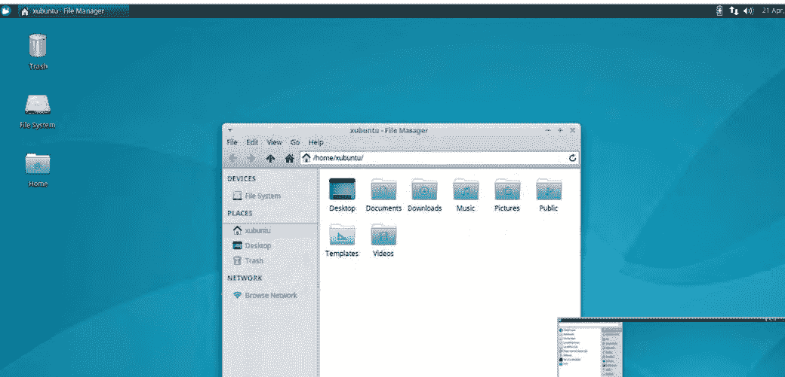

## Ubuntu 为速度而构建，桌面移动速度很快

桌面非常空旷，导航足够容易，我们本希望看到一些花点让它脱颖而出。如果能提供更多默认应用程序的选择我们会更好，与我们在 15.10 更新中的选择相比，这些在很大程度上被削减了。我们找到了所有的嫌疑软件：`Firefox`、`Parrot` 和 `Parole`；但对于 `VLC` 和 `GIMP` 等其他客户端，你还需要自己寻找并安装它们。

使用 `Ubuntu 16.04` 的一个愉快方面是它对内存和 CPU 的影响较小。尽管没有被明确标记为轻量级发行版，但仅使用了 40MB 内存，它对 CPU 的消耗也是极小的。我们不禁对能做到的事情感到有些失望。这意味着它是一个完整的作品，但有很多小问题需要解决。在这一例子中，是软件包管理前端的问题。

- Oliver Hill

`www.linuxuser.co.uk` 89

## 免费软件回顾

## WEB 服务器

### Hiawatha 10.2

一个注重安全性的轻量级 Web 服务器。

自从 `Apache` 不再是 Web 服务器的首选（尽管它在所有情况下仍然是最好的，但在需要时，较小的竞争对手也是不错的选择）——我们不得不使用 `Nginx` 和 `Lightpd`；但还有另一个选择。
`Hiawatha` 已经存在多年，凭借其安全性、速度和简单性的结合，一直脱颖而出。

`Hiawatha` 可以阻止 SQL 注入、`XSS` 和 `CSRF` 攻击以及漏洞利用尝试，并具有诸如“最大请求大小”等功能，而其他服务器在实现这些功能时往往会消耗大量的资源。它非常适合 `Drupal`、`WordPress` 以及其他 `PHP` 应用——这些应用实际上存在许多已知的漏洞。由于 `Uwe Lesik` 在近 15 年前启动该项目时，它是为了在旧硬件上运行的，因此可以想象它在今天运行得非常快。
安装非常简单，流程直观。通过 `Hiawatha` 网站可以引导你了解用例，但对于新手来说，只需阅读配置文件就能让你上手运行。

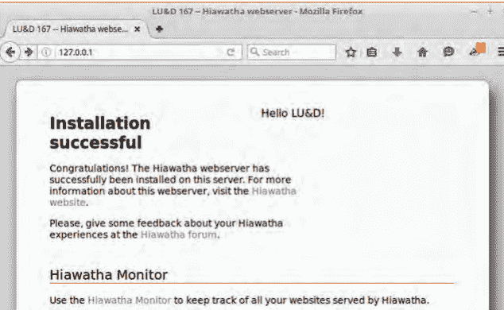

优点
- 简单且快速。使用 `Polar SSL`；现在免费了！`Let's Encrypt`，代码库简单且经过审计。

缺点
- 如果你已经在应付 `Apache` 和 `Nginx` 老板带来的影响了，再学习另一个服务器将是一件坏事。

适用场景...
- 使用 `hiawatha-webserver.org` 记录时间段。

使用 `Monitor` 跟踪你所有由 `Hiawatha` 管理的网站。它是一个很棒的小型 Web

## 停机监控

### downtime 1.0

你的服务器或 VPS 宕机多久？问问 `downtime`。

如果说我们有什么喜欢的东西，那就是那些提供特定功能且能完成任务的命令行工具。`downtime` 记录所有的系统停机时间，并在你需要时提供报告。命令 `downtime` 和 `downtime -c` 是运行时间计数器。
你已经在部署仓库中拥有了 `downtime 0.6`。这个 1.0 版本变化不大，更多是对该应用稳定性的反映——当 `Linux`、`Unix`、`Hard`、`BSD` 以及许多版本的 `Solaris` 和 `MacOS` 上的系统发生变化时，它不需要太大的更改。这些单元的启动方式略有不同（当 `downtime` 无法理解操作系统内核的方法时，它会拥有自己的守护进程启动方式），以及 `GNU/Linux` 发行版中的启动系统。
无论哪种方式，它们都有效。`downtime` 在你的 `GNU/Linux` 发行版上会在系统关闭和崩溃时保留良好的运行时间记录，通过持续获取时间戳对后者给出清晰的停机时间估计。查看“现在”的运行时间总是很容易，但考虑到我们许多人的托管环境，查看停机时间同样重要。它简单，但非常耐用。

优点
- 简单实现在其目标：记录可以从命令行查询的时间段记录。

缺点
- 不适用于会影响启动期间系统时间的非计划变动。

适用场景...
- 分析为什么你的 VPS 经常离线；`dist.ee.org/downtime`

## 键盘屏幕录屏工具

### Screenkey 0.9

更好的屏幕录屏，通过显示你输入的按键来实现，包括用于显示多媒体键的 `Awesome` 字体——例如选择（Select Operation - 用于有趣的发布，这会让你显得很困惑，并让你去弄清楚它的依赖关系以便工作)。

如果你曾尝试过命令行工具的基础基础屏幕录屏，或者在你最喜欢的编辑器中编程，你可能会为了可读性而感到沮丧，`Screenkey` 为你的显示代码留出了空间。`Screenkey` 以更自然的尺寸记录你的桌面或终端，并在你在教室或演讲室输入所有内容，或在会议和代码单元的非正式需求时弹出更好的屏幕录屏效果。
使用 `Python 3` 编写非常简单，且无论是否安装都可以运行，`Screenkey` 的依赖项并不沉重——可以通过包管理器安装。

优点
- 输入内容或按键组合的设计灵活。

缺点
- 即使你确定了使用哪种模式，所有的快捷键都变了。

适用场景...
- 与朋友一起屏幕录屏或演示游戏
`http://bit.ly/1tkydB8`

## 回合策略游戏

### Battle For Wesnoth 1.1.2.6

仍然是一款出色的免费软件游戏。


自从我们上次玩回合制游戏 `Battle For Wesnoth` 以来，稳定分支在更新中进行了一些改进和修复。它已经存在了十，一直是自由和开源软件质量的杰出范例。我们有一段时间没玩了，也没有错过战役、艺术作品、音乐以及最新功能发布中增量改进的积累，这些功能通常可以通过二进制包获得，因为它们会很快地进入仓库。我们用的是 `Debian` 包。如果你正在寻找一款出色的回合制游戏，选它就了。

优点
- 深度且具有策略性的内容
- 拥有惊人的社区

缺点
- 对初学者来说学习曲线陡峭

适用场景...
- 策略游戏爱好者
`http://bit.ly/1tkydB8`

## 顶级托管

## SSD Web托管


`www.cwcs.co.uk`
0800 1 777 000

`www.bargainhost.co.uk`
0843 289 6781

`CWCS` 是英国领先的托管专家提供的英国托管托管服务。他们提供全面的托管产品、服务和支持。他们经过高强度培训的员工不仅是托管专家，还致力于提供卓越的客户体验，并对他们所做充满热情。

自2001年以来，`BargainHost` 一直致力于在英国提供最好的托管服务。他们已成功实现这一目标，并建立了一个庞大的满意客户数据库。他们还因提供卓越的托管服务荣获多项奖励。

## 企业级托管：


- 托管机房 (Colocation hosting)
- VPS
- 100% 网络可用性

`www.netcera.com` | 0800 808 5450

`Netcera` 成立于1996年，是全球75个国家领先的Web托管数据中心提供商之一。作为欧洲数据中心、专用服务器和托管Web托管的首选提供商，`Netcera` 提供了一系列管理 IT 基础设施的服务。一种先进的托管解决方案。`Netcera` 在此提升您的业务体验水平。

- 托管托管与云托管
- 专用服务器

- 共享托管
- 云服务器
- 域名

## 价值型托管

## 价值型Linux托管


`elastochos.co.uk`
0207 83250

`patrickman-hosting.co.uk`
01642 243 227

`Elastochos` 为全球企业提供简单、灵活且高效益的托管服务，具有高性能、可用性和可扩展性。他们的工程师团队通过电话、电子邮件和工单系统提供24/7的专家支持。

Linux 托管是寻求高性价比和强大托管的用户用户、业务用户和开发者的理想解决方案。无论您是在建立博客、单页作品集，还是运行数据驱动的电子商务网站，我们都有适合您的 Linux 托管解决方案。

- 适用于任何操作系统的云服务器
- Linux 操作系统容器
- 全球 24/7 支持

- 学生优惠
- 网站设计器
- 域名

## 小企业支持

## 快速、可靠的托管


`www.hostopaka.co.uk`
0800 051 7126

`www.bytemark.co.uk`
0190 840 880

`Hostopa` 是一家屡获奖的托管服务和绿色托管的领导者。他们提供最灵活的托管方案之一，具有24/7/6 客户支持、学习资源以及卓越的可靠性。

`Bytemark` 成立于2002年，是英国云托管专家。他们的经营理念包括内部专业知识、透明度和个性化服务，通过支持的承诺和价格合理的顶级托管硬件来保持承诺。

`BHost` 专攻拖拽式 Linux 虚拟专用服务器 (VPS)。我们不销售域名或 SSL 证书。我们致力于以竞争性的价格为您提供最高质量的 VPS 服务。以客户为中心意味着我们的团队会竭尽全力帮助您。

我们的平台支持多种服务，包括云托管、游戏服务器、文件存储、服务器以及用于各种网站的 DNS 服务器。

- VPS 托管
- 无限制带宽
- 运行您喜爱的 Linux 发行版，100% 满意或全额退款！
- 网站生成器
- 预算价格
- 无限制数据库

`www.linuxuser.co.uk`
联系我们...
`linuxuser@imagine-publishing.co.uk`

## 评论

## 关于 Linux 和开源的问题与意见

## 故障与烦恼

亲爱的 Lu：
我和我的团队使用 `Slack` 来协调和发送信息。当我需要与从事同一项目的同事联系时，我发现它非常有用，在调试时特别好。关于贡献者是否“正确”的问题并不太取决于你的个人观点（比其他人更强烈），有些人在寻找完全开源的替代，令人欣慰的是 `Slack` 有一个开源的替代方案。有几个，但我们最喜欢 `RocketChat`，它具有很棒的拖拽功能和视频会议。

亲爱的团队：
当我女儿开始学习电子时，一个朋友在我们家庭电脑上安装了 `Ubuntu`，她的老师向她介绍了树莓派，于是她决定通过在工作中在树莓派上隐藏启动程序来安装 `Windows 10`。

最近，我开始为一个开源项目做贡献，并考虑到我和我的团队发现它是多么有用，我建议我们使用网络工具进行跨国家和跨时区的通信，我们目前使用邮件列表和 `IRC` 频道，这对初学者来说很容易。

然而，另一个贡献者指出 `Slack` 是一个闭源工具，这违背了我们开源项目所代表的一切。我们需要重新考虑一下。他们说得对，请问有什么我可以建议的 `Slack` 开源替代方案吗？别担心——它没有消失，只是被启动程序程序隐藏了，那个启动程序允许你在两个操作系统之间进行选择。使用 `Grub` 启动加载器（她用的那种）修复很容易，你只需要获取一个 `Ubuntu` 的实时启动驱动或磁盘。Linux & Developer 还附带了那个东西，也适用于 `Windows`、`Android`、`Macs` 以及 `Linux` 设备...

Shawn，
我们非常高兴你喜欢我们的光盘，它已经彻底回来了！我们很高兴听到我们现在变得越来越好了。对于我们自互联网早期以来的历程，这很容易说，我们希望没有人会拥有那种可靠的互联网服务和系统，使得桌面发行版的使用变得简单。

## ROCKETCHAT

`Rocket.Chat` 是 `Slack` 的开源替代方案，允许团队进行有效通信，并内置了许多功能，但你也可以从网站下载 `Ubuntu` 的 `ISO`（`http://www.ubuntu.com/download/`）并按照说明如何制作实时启动光盘或优盘（`http://www.ubuntu.com/download/desktop/try-ubuntu-before-install/`）。加载你的光盘或优盘，重启并选择 `Ubuntu`。一旦启动，打开终端，然后使用它给你的位置并告诉它查看这里：对于任何想要离开 `微软`、`谷歌` 和 `苹果` 的人。

```
- root
- setup
- quit
```

住在非洲让使用 `Linux` 变得相当困难。我们遇到过过时的 `Linux` 版本（他们仍然把 `红帽 9` 堆在架子上）。然而，User & Developer 杂志（有时）在我当地的分会以每期 25 美元提供，我希望我就不会出圈了。对于我们这些无法可靠访问互联网的人来说，杂志非常困难，如果你们提供的实时发行版有一个崩溃的 `Ubuntu`-`Windows` 安装程序。

补丁服务可能会导致下载损坏；但那张光盘并不是安装失败的唯一原因，所以我们需要你来拯救。此外，我们的光盘在最新的发行版上，我们不想透露太多秘密，但我们希望收到你的案例并发送到 `linuxuser@image-publishing.com`。

```
sudo grub-install /dev/sda
```

这应该解决你的问题，如果你的电脑有多个硬盘或分区，而你不确定 `Ubuntu` 在哪个分区，

```
sudo grub
```

然后

```
find /boot/grub/
```

电脑会告诉你 `Windows` 在哪个分区，它可能在第二个分区，所以电脑会显示类似于：只要计算世界和操作系统继续演进，提供光盘对我们来说就是福音。

## 光盘之悦

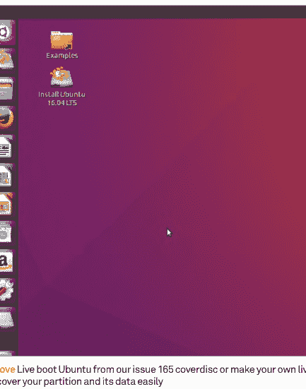

## OPENWR：将你的光盘变成启动器

User & Developer 杂志——一代人的必备杂志

制作制作


它创建项目并控制 `EXAM micro:bit` 来发现和编码。


终极工具包

我们的封面光盘装满了优秀的发行版，用于探索

从我们第 165 的 `codervis` 实时启动 `Ubuntu`，或者制作自己的启动光盘和优盘以安全地恢复你的分区和数据。

`www.linuxuser.co.uk` 95

# FileSilo

# 您的免费资源

立即登录 `WWW.FILESILO.CO.UK/LINUXUSER`，今日下载最新的发行版和免费软件

# 最新发行版

您的额外资源
本期 `FILESILO` 赠送：针对《`LINUX USER`》的读者和开发者，您将发现这些极佳资源……

- 终极安全发行版 `Kali Linux` 将帮助您增强 PC 防黑客能力
- 开源软件（FOSS）软件包，包括数据包嗅探器、扫描器和入侵检测器
- `Linux` 基金会（`Linux Foundation`）、`红帽`（`Red Hat`）和树莓派（`Raspberry Pi`）指南、教程和网络研讨会
- 本期教程的代码和素材，包括使用树莓派在 `Minecraft` 中可视化音乐的脚本


视频教程时长 20 小时


教程代码与素材

`www.filesilo.co.uk/linuxuser`

# FILESILO – 专业人士的家园

## 发现您的免费在线资源

- 快速增长的库
- 持续更新的酷资源
- 让您保持下载内容的井然有序
- 随地浏览并访问您的内容
- 不再有会损坏杂志的光盘页

- 不再有损坏的光盘
- 纸质订阅者可获得所有内容
- 数字杂志所有者也能获得所有内容！
- 每期内容随杂志免费提供
- 免费资源的安全在线访问


这是取代您光盘的 `FileSite`。您可以通过访问下一页的链接找到它：第一次使用 `FileSite` 时需要注册。之后，您可以使用提供的电子邮件地址和密码进行登录。

最受欢迎的下载显示在此轮播图中，看看您的其他读者在享受什么：


如果您正在寻找特定类型的内容（如发行版或文件），请使用这些过滤器来精炼搜索：


绿色的开锁图标显示您已过的内容。红色闭锁图标显示您需要购买或解锁的内容：

| | 热门下载 |
|---|---|
| 1 | Tails 1.2 |
| 2 | Ubuntu Linux |
| 3 | Kali |
| 4 | Lubuntu 14.0 |
| 5 | Ubuntu 12.04 |
| 6 | Linux Mint |
| 7 | Debian |
| 8 | Kali Linux |
| 9 | Ubuntu Desktop |
| 10 | Ubuntu 教程 |

热门下载列在此处，让您可以立即查看最受欢迎的内容：

| | 最新发布 |
|---|---|
| 1 | Ubuntu 14.0 |
| 2 | Linux Mint |
| 3 | Debian |
| 4 | Tails 1.2 |
| 5 | Kali |
| 6 | Linux Lite |
| 7 | Ubuntu 教程 |
| 8 | Journal! |
| 9 | Lubuntu 14.0 |

查看高评分列表以查看他人投票的资源：

了解更多关于我们在线商店的信息，以及关于我们隐私和联系方式的常见问题。发现我们精彩的姐妹杂志及其提供的丰富内容：


`www.linuxuser.com`

# FileSilo

## 如何使用
关于访问新新仓库您需要需要的一切

要访问 `FileSilo`，请访问 `www.filesilo.co/linuxuser`

- 01 按照屏幕上的指令在我们的 `FileSilo` 系统创建账户，然后登录并通过回答一个关于杂志的简单问题来解锁本期内容。您可以使用杂志免费访问内容。
- 02 如果您是纸质订阅者，可以通过输入 Web ID 解锁所有内容。您的 Web ID 是打印在邮寄标签订阅副本上地址上方的八位字母数字代码，也可以在您的续订信中找到。
- 03 您可以在桌面电脑、平板电脑或智能手机上使用任何流行的浏览器（如 `Firefox`、`Chrome` 或 `Safari`）访问 `FileSilo`。我们建议您使用桌面电脑（desktop）来下载内容，因为您可能无法向手机或平板电脑下载文件。
- 04 如果您在访问 `FileSilo` 内容或注册过程中遇到任何问题，请查看在线常见问题解答，或发送电子邮件至 `fileshelp@publishing.co.uk`


## 更多教程与灵感

读完这期了吗？在 `Linux User` 网站上有大量免费开源资源等待着。我们每天上传专题、教程、评论和优质开源新闻，涵盖 `Linux` 内核开发、热门新发行版和 `FOSS`、树莓派项目、采访以及编程指南。加入我们不断发展的 `Linux` 用户和开发者社区，今日发现新的 `Linux` 工具。


# `www.linuxuser.co.uk`

《`Linux User`》第 168 期于 2016 年 7 月 28 日在 `GreatMags.com` 出售


# WEB 托管

快速可靠的 SSD Web 托管

（网页加载速度快达 10 倍）

# STARTER 计划包含：

- 免费英国域名
- 免费网站生成器
- 免费 SSL 证书
- 免费一键安装
- 免费 `Cloudflare CDN`
- `CloudLinux` 增强

- 1 GB SSD 存储空间
- 无限制带宽
- 支持 5 个域名
- 自动每日备份
- 30 天退款保证
- 24/7 在线支持

两年仅需 39.95 英镑！

`www.bargainhost.uk`
2001 年起的英国 Web 托管服务商

0843 289 2681
价格不含 20% 增值税


# 专家提供的 Linux 服务器托管

24/7 英国支持 • `ISO 27001` 认证 • 免费迁移

托管托管 • 云端托管 • 独立服务器

# 卓越托管。
# 卓越支持。

# `www.CWCS.co.uk`

T: 0115 740 1234 • E: `info@cwcs.co.uk` • W: `www.cwcs.co.uk`
