# Linux 用户与开发者 168 - 多启动您的系统 168

## 欢迎来到 `Linux 用户与开发者` 第 168 期


欢迎来到 `Linux 用户与开发者` 最新一期，这是英国和美国最喜爱的 Linux 和开源杂志。如果能运行你喜欢的任何操作系统或发行版，那不是很好吗？问题在于，承担相应硬件的费用可能有点困难——当然，除非你多启动你的机器。

对硬盘进行分区允许你在同一台计算机上运行两个或更多发行版或操作系统。每一个都能充分利用系统资源，你只需重启开关即可在它们之间切换。在本期中，我们提供了多启动的完整指南，从备份数据和硬盘分区，到如何在同一机器上运行 Windows 和 Linux，如何运行多个 Linux 发行版，以及如何配置、编辑甚至美化控制整个过程的 `GRUB` 引导加载器。请参阅第 16 页。

本期我们还超越了树莓派，汇总了创客的十款最佳板卡。无论你是寻找让孩子对制作和编码感兴趣的最佳选择，还是寻找物联网项目、快速部署或 `x86` 架构的终极板卡，我们都有涵盖。请参阅第 56 页，如果我们没有介绍你最喜欢的板卡，请务必通过下方的链接联系我们！

`April Madden`, 编辑

### 杂志团队

`编辑` **April Madden**

`april.madden@imagin-publishing.co.uk`

`+44 (0) 1202 588518`

`设计师` **Rochelle Hazell**

`摄影师` **James Shepherd**

`高级艺术编辑` **Andy Downs**

`总编辑` **Dan Hutchinson**

`出版总监` **Arun Audi**

`设计主管` **Ross Andrews**

`撰稿人`

`Dan Alford`, `Andy Berrard`, `Tom Castillo`, `Genna`, `Christian Cawley`, `Simon De Beer`, `Russell Diaz`, `Alex Ellis`, `Tom Hannah`, `Oliver Hill`, `Phil Inigo`, `Jon Masters`, `Paul O'Flahin`, `Sharon Pratapa`, `Richard Shattley`, `Jasmin Smoch`, `Neesh Tiwari` 和 `Mihalis Tsouklos`

`广告`

数码或印刷样册可应要求提供。

`销售主管` **Mimi Henz**

`+44 (0) 1202 588432`

`mimi.henz@imagin-publishing.co.uk`

`销售主管` **Luke Schoelcher**

`+44 (0) 1202 588431`

`luke.schoelcher@imagin-publishing.co.uk`

`Plus,510.co.uk`

`评估和审查` 本杂志的杂志审查现在可以在网站上找到。

`支持` `llesite@imagin-publishing.co.uk`

`国际`

`Linux 用户与开发者` 可供授权许可。

`国际授权主管` **Cathy Blaxland**

`+44 (0) 1202 588500`

`licensing@imagin-publishing.co.uk`

`订阅`

有关所有订阅查询

`LINUXUSER@SHEPHERD.co.uk`

英国 `0844 829 0282`

海外 `+44 (0) 1795 416861`

`www.imaginemagazines.co.uk`

`订阅主管` **Sharon Todd**

`发行主管` **Sharon Pearce**

`发行总监`

`+44 (0) 1202 588500`

`制作` **Jane Hawkins**

`+44 (0) 1202 588500`

`财务` **Marco Perron**

`财务总监`

`创始人` **Pam Dorman Burt**

`集团董事总经理`

`印刷与分发`

由 `William Gibbons` 通过完全重新定向的形式印刷，位于西米德兰兹郡 `Wilmorfield`, `WV13 3XT`

`分发`

在英国、欧洲及远东地区由 `The Word` 通过: `Martin's & Churchill Place`, `Canary Wharf`, `London`, `E14 5HU` 分发

`020 7103 148 3300`

`www.martinsons.co.uk`

`澳大利亚分发由: Gothen & Gotson Publishers Pty Ltd`

`280 Budworth Road`

`Penrith Forest`, `New South Wales 2086`, `Australia`

`+61 (0)2 4972 8850`

`www.gothandgotson.com.au`

### 与团队保持联系：

`linuxuser@imagin-publishing.co.uk`

- `Facebook`: Linux 用户与开发者
- `Twitter`: `@linuxusermag`
- `在线购买`: `imagineshop.co.uk`

访问我们的在线网站以获取更多新闻、观点、教程和评测：

`www.linuxuser.co.uk`

## 本期附赠光盘内容

### 了解光盘上的内容

欢迎使用 **Linux 用户与开发者 DVD**。本期我们将帮助您实现机器多重引导。无论您是想结合 Windows 和 Linux 还是多个发行版，我们都提供了所需的一切，包括必备备份软件、最佳的开源分区工具以及多种发行版选择。按照说明从光盘启动或安装您的软件和发行版。

## 精选软件：

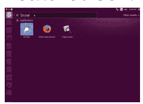

### `Ubuntu 16.04`

作为通用日常使用的完美发行版，Ubuntu 最新版本在桌面和移动设备之间提供无与伦比的融合。该发行版可从光盘直接启动。


### `Arch Linux`

想在您的 Linux 电脑上探索命令行界面吗？Arch Linux 正好为您提供这些。它旨在提供一个轻量级且灵活的发行版，保持简单，是入门命令行计算的完美选择。该发行版可从光盘直接启动。

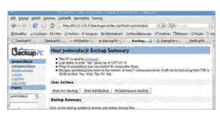

### `BackupPC`

在开始对 PC 硬盘进行分区并安装一个或多个发行版之前，务必将计算机上的所有数据（包括当前操作系统的镜像）备份到光学介质、网络附加存储或外部硬盘/SSD 中。这款备受好评的开源备份工具提供了您启动前确保数据安全的所需一切。

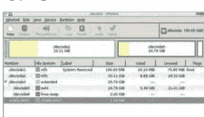

### `GParted`

`GParted` 是 Linux PC 的终极分区工具。无论您是想将 Linux 与 Windows 结合，还是将日常 Linux 安装与专用发行版混合，`GParted` 允许您将硬盘划分为不同的部分。它也可从光盘直接启动，以便您可以随时轻松对 PC 进行分区。


### `CentOS 7`

通过此社区驱动的开源生态系统，您可以免费获得红帽（`Red Hat`）的所有好处。请注意，由于 `CentOS` 的 ISO 结构，该发行版不能从光盘直接启动 - 请遵循说明从光盘界面进行安装。

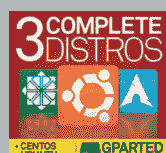

### 加载 DVD

要访问软件和教程文件，只需将光盘插入计算机并双击图标。

### 直接启动

要直接启动光盘中提供的发行版，请将光盘插入光驱并重新启动计算机。

### 请注意：

- 您需确保计算机设置为从光盘启动（在计算机的 `BIOS` 屏幕上按 `F9` 更改启动选项）。
- 某些计算机需要按键才能启用从光盘启动 - 请查阅手册或制造商网站以确认您的 PC 是否属于此情况。
- 直接启动的发行版是从光盘读取的：除非您选择安装，否则它们不会永久安装在您的计算机上。

### 获得最佳效果：

此光盘已针对能够渲染最新 `HTML` 和 `CSS` 标准更新的现代浏览器进行了优化。因此，为了获得最佳体验，我们建议您使用：

- `Internet Explorer 8` 或更高版本
- `Firefox 3` 或更高版本
- `Safari 4` 或更高版本
- `Chrome 5` 或更高版本

### 光盘出现问题？

请发送邮件至 **`linuxuser@imagine-publishing.co.uk`**。但请注意，如果您在使用提供的程序或资源时遇到问题，请联系相关的软件公司。

## 系统多重引导

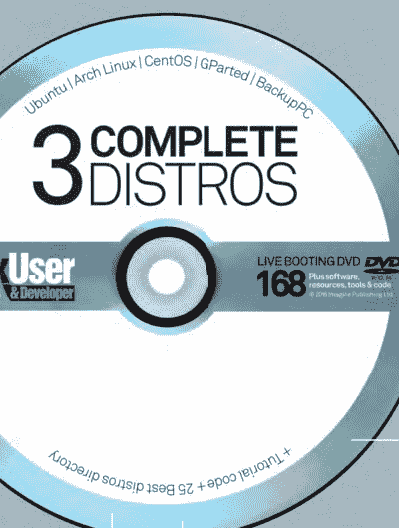

**直接启动**

将光盘插入计算机并重新启动。您需要确保计算机设置为从光盘启动。

**`FOSS`**


将光盘插入计算机，双击“图标”或“启动光盘”文件以浏览内容。

### 探索

或者，您可以插入并运行光盘以探索界面和内容。

### 发行版

发行版可以直接启动，让您无需对计算机进行永久性更改即可立即尝试新的操作系统。

## 发行版

### Fedora 24 展示三个新版本

最新的 Fedora 版本现已面向服务器、工作站和云平台发布。

尽管没有像 Ubuntu 那样获得主流的关注，但 Fedora 仍然是开发者和用户中最受欢迎的开源发行版之一。因此，Red Hat 的发行版终于迎来了第 24 个版本，可以说是备受瞩目。Fedora 24 主要延续了其前几个版本的模式，由三个基础软件包组合而成，形成三个独立的版本：`Fedora 24 服务器版`、`Fedora 24 工作站版`和 `Fedora 24 云平台版`。用户可以选择下载最适合自己需求的那个版本。

Fedora 24 最令人满意的特点之一是它基于 `4.5.7 Linux` 内核，重点在于为开发人员提供新工具，以便他们能从 `Linux` 容器中获取更多价值。当然，你可以期待一系列增强功能和几个关键修复补丁。团队已迅速指出这并不是最终版本，并预计很快会有增量更新发布。

> “Fedora 24 Cloud 包含 OpenShift Origin，一个板载云发行版，针对应用程序开发和容器管理进行了深度优化”

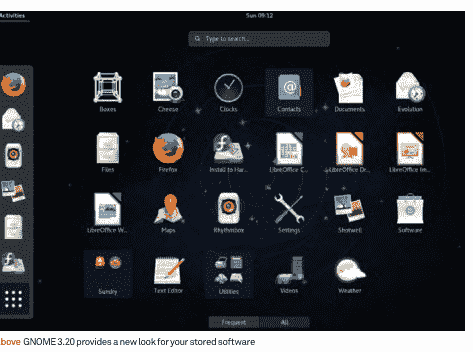

`Linux` 向云端的过渡也有了显著改进。Fedora 24 Cloud 现在包含了 `OpenShift Origin`，一个板载云发行版，针对应用程序开发和容器管理进行了深度优化。云平台版本也已进行了翻新，以改善 `Docker` 集成，这是许多用户在以前的更新中遇到的问题。

服务器角色在 Fedora 的服务器版中一直占据重要地位，因此我们很高兴看到 `rolekit` 在 Fedora 24 服务器版中得到了更深入的实现。对于最终用户来说，这将使设置服务器角色变得更加容易。此外，还包含了一个新的身份管理程序，名为 `FreeIPA 4.3`。虽然对很多人来说它可能不是一个家喻户晓的名字，但它是一个用于整体域控制的优秀工具，但使用它肯定需要一些高级知识。

然而，大部分变更的发生地在于 Fedora 24 工作站版。其中最显著的是 `Wayland` 预览版，这是一种独特的 `X` 显示服务器。虽然它仍是一个早期预览版，但这是一个令人兴奋的添加，Fedora 计划在未来将其实施为默认的图形服务器。`GNOME` 用户也将希望密切关注 `GNOME 3.20 Delhi` 的引入。同样，这也是另一个预览版，但整体桌面环境有一些明显的调整，并且仍然保持着我们习惯了的易用性。如果 `GNOME` 不适合你，仍然有许多桌面环境可供选择，包括 `Cinnamon 2.6`、`MATE 1.14`、`KDE Plasma 5` 和 `Xfce 4.12`。在较小规模上，敏锐的用户还会注意到 Fedora 软件应用的一些升级。现在你可以从桌面的舒适环境中执行完整的系统升级，并可在可用软件上留下评论。正是这些细节让 Fedora 24 成为迄今为止最大的更新之一。

## 硬件

### 索尼将因 Linux on PS3 风波向用户赔偿

索尼将向受“其他操作系统”问题影响的数百万人支付赔偿。

PS3 最初发布时，其引人注目的功能之一是引入了“其他操作系统”（OtherOS）功能。当时，这在开源社区引起了不小的轰动。这一重大功能允许用户在机器上安装 `Linux`，并访问其带来的所有额外功能。不幸的是，这个功能的生命周期相对较短，2009 年的一次软件更新实际上终止了该功能。虽然该更新并非强制性的，但在应用之前，它几乎禁用了 PS3 的几个关键功能，阻止了 `Linux` 用户连接到 `PlayStation Network` 或在线玩游戏。

很快提起了诉讼，起因是索尼对其游戏机上的第三方操作系统能力的声称。代表多达 1000 万名游戏机所有者的律师与索尼现在达成了一项协议，该协议将使索尼向消费者强制支付数百万美元的赔偿金。拟议的和解方案将允许曾使用 `Linux` 的游戏玩家获得 55 美元，而购买 PS3 是为了使用“其他操作系统”功能，用户将获得 9 美元的赔偿。目前仍需美国联邦法官批准的和解方案，目前仅适用于 2006 年 11 月 1 日至 2010 年 4 月 1 日期间购买了厚型 PS3 的美国居民；但裁决的影响范围可能会远远超出此范围。

在诉讼期间，有人声称盗版是移除该功能的关键决策因素之一。索尼还补充说，其服务条款（游戏玩家在初始设置游戏机时同意）允许其移除其他操作系统功能，而且该功能并没有像公司最初想象的那样广泛使用。

游戏玩家若要领取这 55 美元以及案件范围更广泛时的后续赔偿，必须提供购买证明、`PlayStation` 登录 ID，并提交使用“其他操作系统”功能的证明。索尼也同意使用其 `PlayStation Network` 数据库通知所有可能受影响的人，并告知他们索赔和向该游戏机巨头寻求赔偿所需的步骤。

## 发行版资讯

### 前十名

- 5 月 31 日至 6 月 30 日 每日平均点击量

- 1. `Linux Mint` ▲ 2,940
- 2. `Debian` ▼ 1,892
- 3. `Manjaro` ▼ 1,393
- 4. `Ubuntu` ▼ 1,323
- 5. `openSUSE` ▼ 1,121
- 6. `Deepin` ▲ 1,033
- 7. `Fedora` ▼ 1,028
- 8. `Zorin` ▲ 1,015
- 9. `ElementaryOS` ▲ 1,009
- 10. `CentOS` ▲ 980

# 本月


> 本月前十名中没有特别的新面孔，但最新的 `Linux Mint` 更新使其火箭般升至下载列表的榜首。

# 亮点

#### Mint

`Linux Mint` 18 “Sarah” 的测试版发布时引起了轰动，承诺在设计上和整体易用性上进行广泛改变。对于新用户来说，它仍然是最容易上手的发行版之一。

#### Fedora

随着 `Fedora 26` 的发布，预计 `Fedora` 在未来几个月排名将大幅上升。一如既往地，有三个不同的附加组件可供测试，每个都带来独特的功能集。

#### elementaryOS

时尚的 `elementaryOS` 本月也发布了重大更新，其 `Loki` 测试版提供了大量主要修复，团队声称已解决了 600 多个问题。

## 最新可用发行版：

`fileso.co.uk`

## 采访 Reynold Xin

### 让数据处理变得简单

`Apache Spark` 是市场上最受推崇的数据处理引擎之一，但它为什么如此出色？Reynold Xin 将作出全面解释。


#### Reynold Xin

Reynold Xin 是 `Apache Spark` 项目管理委员会成员，Databricks 的首席架构师和联合创始人。他创下了 100TB 排序的 2014 年世界纪录，以比 `Apache Hadoop` 高 30% 的单节点效率打破了前纪录。

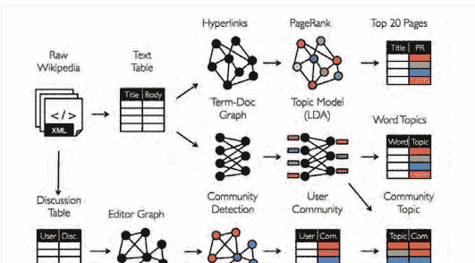

> Apache Spark 是一个快速且通用的数据处理引擎，主要被数据工程师、数据科学家和业务分析师使用。它提供了 Scala、Java、Python、R 和 SQL 的高级 API。它还支持一系列丰富的高级工具，使其对机器学习、图计算、流数据处理、ETL 和商业智能具有吸引力。从某种程度上说，它是数据处理的瑞士军刀。

`Spark` 最初由 Matei Zaharia 于 2009 年在加州大学伯克利分校启动，并于 2013 年 6 月捐赠给 `Apache 软件基金会`。`Spark` 在 2014 年 2 月成为 `Apache 顶级项目`（TLP）。

`Apache Spark` 在广泛的行业中被企业快速采用。像 `Netflix`、`Yahoo` 和腾讯这样的互联网巨头已大规模部署 `Spark`，共同处理数 PB 的数据。当你考虑到世界上一些最大的公司已经采用了 `Apache Spark` 时，它仅表明了有多少人相信它。它迅速成为大数据领域最大的开源社区，拥有超过 1,000 名代码贡献者，以及 420 个 `Apache Spark` 聚会小组中的超过 187,000 名成员。

然而，我们一直在寻找持续扩大社区的方法，并且有很多方法可以让感兴趣的人参与到 `Apache Spark` 的未来发展中。

一个有趣的细节是，根据 `StackOverflow` 的 2016 年调查，`Apache Spark` 已成为美国薪酬最高的技术技能（了解 `Spark` 的开发者更有可能获得最高收入）。如果问我的话，这是一个相当惊人的事实。

用户将 `Apache Spark` 集成到其系统中的难度如何？

使用 `Spark` 主要有两种方式。第一种是交互式地使用引擎本身。第二种是将 `Spark` 作为库嵌入到数据应用中。两者需要非常不同的工具和属性。


尽管`Spark`过去主要用作大数据处理引擎，但该引擎也能在单台机器上顺利运行。许多用户在笔记本电脑上使用`Spark`，要么对数据应用进行单元测试，要么直接交互式地分析少量数据。为此，用户只需下载来自`Apache Spark`官方网站的组件，无需任何配置即可启动系统。我们努力让整个过程尽可能简单，并在我们的网站上为那些仍然难以掌握的用户提供帮助。

`Spark`也可以在机器集群上运行。许多供应商提供在私有数据中心中运行`Spark`的支持，许多云提供商也提供`Spark`支持。

学习`Spark`的一种方式是通过`Databricks`社区版，它提供了由加州大学伯克利分校、加利福尼亚大学洛杉矶分校、`edX`和`Databricks`合作推出的获奖`MOOC`课程。我们恳请用户阅读`bit.ly/29G9BLJ`和`bit.ly/1WIYIPx6`上的相关内容。

## Apache Spark 究竟如何在集群上运行？

`Apache Spark`可以通过集群资源管理器在集群上运行。目前有三种可用的集群资源管理器：

-   独立模式（`standalone`）
-   `Apache Hadoop YARN`
-   `Apache Mesos`

独立模式是最简单的设置方式，许多`Spark`用户从这个模式开始。根据`Databricks`在 2015 年进行的一项调查，48% 的用户在独立模式下运行`Spark`，40% 在`YARN`上，11% 在`Mesos`上。我们意识到我们的用户群体在技能设置方面非常多样化，因此我们必须为他们适应这些不同的资源管理器。当然，我们一直有兴趣探索如何扩展这些资源管理器，但这需要大量的努力和人力。

在集群模式下运行时，`Spark`集群包含一个驱动进程（`driver process`）和多个执行器（`executors`）。驱动进程负责协调，例如跟踪元数据和执行任务调度。

## 探索 Spark 峰会

由于其巨大的受欢迎程度，`Apache Spark`还举办了`Spark`峰会，这是一个汇聚全球顶尖科学家、工程师、分析师和高管分享和获取`Apache Spark`知识的活动。

在以往的活动上，关于`Apache Spark`的未来有一些关键进展，还有深入的用户问答环节，用户可以在其中讨论他们的问题和不满。每个`Spark`峰会还包括由`Databricks`主持的一系列培训课程。虽然它们的唯一目标是教育，但这也是将`Apache Spark`扩展到其他市场和受众的基石。说开源社区正在关注这一点简直是轻描淡写。在过去 24 个月中，`Spark`峰会的参会人数急剧增加，对`Spark`团队所提供内容的需求比以往任何时候都更加强烈。在早些时候在纽约市举行的最新`Spark`峰会东部区，一些领先的业务专业人士和分析师走上了舞台。其中包括`Capital One`的技术副总裁`Chris DiAgnostino`和`eBay`分析基础设施负责人`Seshu Adututhothula`，他们的信息强调了数据科学的重要性，以及`Apache Spark`如何成为解决行业问题的答案。

## 过去 5 年 Spark 贡献者的增长

执行器进程执行数据处理的重任，它们彼此通信以交换数据，从而执行用户指定的数据流。

**是否有安全协议来确保 `Apache Spark` 在使用时的安全性？**

是的，绝对有。`Apache Spark`本身具有许多内置的安全功能。例如，它可以加密传输中的数据，并与`Kerberos`和`SASL`集成。

通常，`Spark`也被用于提供超出处理引擎本身额外安全功能的环境中。例如，它可以与`Amazon S3`的服务端加密一起使用。另一个例子是`Databricks`企业安全，它提供端到端加密、基于角色的访问控制以及审计功能。我们极其重视安全，特别是考虑到每天通过`Apache Spark`传递的敏感数据量。我们实施的协议受到持续监控，以确保它们尽可能有效，但始终还有成长的空间。

**能否告诉我们关于 MLlib（机器学习库）的情况？它实际使用起来有多方便？**

`Apache Spark`提供了一个通用的机器学习库——`MLlib`——旨在简洁、可扩展且易于与其他工具集成。凭借`Spark`的可扩展性、语言兼容性和速度，数据科学家可以更快地解决和迭代他们的数据问题。

> “我们极其重视安全，特别是考虑到通过 `Apache Spark` 传递的敏感数据级别”

## Apache 软件基金会

就`Apache`社区而言，`Spark`只是在宏大格局中扮演了一小部分角色。

`Apache 软件基金会`（`ASF`）提供了一系列开源软件项目，旨在提供在其领域引领潮流的高质量软件。但最引起共鸣的是社区部分，因为许多项目纯粹是社区驱动的，许多项目共享相同的开发人员和最终用户。

`ASF`目前拥有大量志愿者，他们帮助开发和监管覆盖广泛技术领域的 350 多个开源项目。选择如此之多，每个人都能找到适合自己的东西。比如`Jena`，一个用于构建语义网和链接数据应用程序的`Java`框架？或者也许是`SpamAssassin`，它为管理员提供了一种快速过滤和阻止潜在垃圾邮件的方法？贡献在`Apache`及其众多项目的开发中起着重要作用。贡献的最好方式是简单地参与其中一个项目社区，甚至提交自己的项目以供考虑。

# 五. 高薪科技岗位

自`Apache Spark`项目成立以来，`MLlib`一直被视为`Spark`成功的基础。`MLlib`的主要好处在于，它允许数据科学家专注于他们的数据问题和模型，而不是解决围绕分布式数据（如基础设施、配置等）的复杂性。自成立以来，一些关键问题已经得到解决，而另一些则接近完成。数据工程师可以使用`Spark`易于使用的`API`专注于分布式系统工程，而数据科学家可以利用`Spark`核心的规模和速度。同样重要的是，`Spark MLlib`是一个通用库，它为大多数用例提供算法，同时允许社区在此基础上构建和扩展以用于特定用例。

> "MLlib 实现了大量的分布式机器学习算法"

`MLlib`实现了大量的分布式机器学习算法，以及特征转换器。用例包括推荐系统（协同过滤）、垃圾邮件检测、欺诈检测、流失分析和物联网设备故障预测。根据我们 2015 年的调查，84% 的用户使用`Spark`进行高级分析，主要使用的是`MLlib`提供的功能。

**对于特别感兴趣的人来说，是否有机会帮助贡献 Spark 的开发？用户需要满足任何标准吗？**

`Apache Spark`是数据领域开发最活跃、最大的开源项目，拥有超过 1,000 名贡献者，平均每月解决 400-500 个问题。`Spark`的成功归功于这些贡献者。

实际上，成为新的贡献者非常容易，因为`Spark`有很多方面是新用户可以提供帮助的，从文档到错误修复再到引擎内部。我们相信社区是`Apache Spark`的核心，事实证明它在开发中提供了巨大的帮助。我们需要继续扩大我们的用户基础和社区，以帮助塑造未来多年的`Apache Spark`。

该项目有一个相当活跃的用户邮件列表，用户可以在`spark.apache.org/community.html`加入。该项目接受通过`GitHub`上的拉取请求进行代码贡献。`github.com/apache/spark`。并且在`Spark`的`wiki`上有一份相当详细的指南：`bit.ly/29DoaBg`

## 观点

## 内核专栏

`Jon Masters`总结了`Linux 4.7`开发合并窗口的关闭情况，以及面向未来内核新功能的持续工作

`Jon Masters`是一位`Linux`内核黑客，自 13 岁上大学以来，他已从事`Linux`开发工作约 18 年。`Jon`居住在马萨诸塞州剑桥市，为一家大型企业级`Linux`供应商工作，他在那里推动制定针对`ARM`架构节能服务器的标准

“`Linus Torvalds`宣布了`Linux 4.7-rc6`，这通常是新内核正式发布前的倒数第二个候选版本。”除了`Linus`对`RC6`相对于之前`RC5`版本大小的增长表示些许担忧外，没有其他特别突出的地方。通常，随着周期接近尾声，拉取修复的门槛越来越高，每个发布候选版本应该越来越小。具有破坏性的变更应通过下一个合并窗口引入，即在周期开始时纳入经过充分测试的变更的那几周时间。`Linus`大声问道：“是一次性意外还是正在形成不良模式？”我们下个周期见分晓。


对于读者来说，Linux 4.7 中最有趣的功能可能是并行目录查找。Linux 提供的各种文件系统（如 `xfs`、`btrfs` 和 `ext4`）使用一种称为虚拟文件系统（`VFS`）的通用基础设施。`VFS` 提供了一种抽象的目录层级概念，各个底层文件系统可能以不同方式实现它。目录层级从 `/`（根目录）开始，向下延伸到 `/usr/bin` 和 `/home/your_name` 等目录。每当应用程序需要查找文件（例如用户登录 `shell` 程序所需的 `/bin/bash`）时，它需要从 `/` 开始遍历文件系统。

执行目录遍历（即所谓的 `directory walk`）是一项相当昂贵的操作，因为内核首先查找 `/`，然后在名为 `/` 的目录中查找 `/bin/`，最后在 `"/bin/bash"` 中查找 `"bash"`。对于一个相对较短的路径，这需要三次查找（但读者们都知道，随着更多的 `/` 出现，路径往往要长得多），如果系统繁忙且读取中间目录数据的 `IO` 操作必须等待（阻塞）其他 `IO`，情况会更糟。出于这些原因，Linux 实现了目录缓存（`dcache`），它存储最近使用的目录信息，使系统能够立即通过单次查找操作解析 `/bin/bash` 在磁盘上的位置。

由于使用频率极高，`dcache` 是内核中性能最敏感的区域之一，然而直到现在，它一直遭受一个相当不幸的瓶颈困扰：对同一目录内条目的并行查找会被串行化（一个接一个地进行）。因此（例如），查找 `/bin/bash` 和 `/bin/ls` 将是一个串行操作。将这个逻辑乘以一个繁忙系统上的成千上万个进程（任务），这会严重削弱性能。这是应用程序存储在磁盘上的某些数据被优化为使用大量较小目录（如 `web` 缓存、邮件软件等）的原因之一。Linux 4.7 最终将引入并行目录查找并消除这一瓶颈。

我们将在下一期中对 Linux 4.7 的发布进行全面总结，并介绍为纳入 Linux 4.8 而准备的功能。

### 虚拟映射的内核堆栈

Linux 内核社区是一个庞大且蓬勃发展的社区，由一千多名个人贡献者组成。然而，社区中的许多核心工作是由一个规模小得多的“惯犯”群体完成的，他们大多由大型企业资助。因此，看到新鲜的新血液涌入核心开发社区总是令人耳目一新。在过去几天里，`AMAP Capital`（一家由 `Andy Lutomirski` 共同创立的对冲基金和自动外汇交易机构）的 `Andy Lutomirski` 越来越积极地作为推动 Linux 内核中新颖且巧妙新技术的驱动力。

确实，这些优化中的许多都集中在性能关键领域——因此对 `Andy` 和他的公司都有商业价值，因为它们受益于低延迟的交易操作——但今天大多数内核开发者的许多其他内核贡献也可以说是出于同样的企业动机。`Andy` 最新的此类贡献是一组用于虚拟映射内核堆栈的概念验证补丁。这些补丁引入了一个新的内核配置选项 `CONFIG_VMAP_STACK`，并进行了许多相关变更，以纠正多年来其他内核核心代码和驱动程序对内核堆栈性质所做的假设。要了解这一切的含义，让我们更详细地看看内核堆栈。

在一个更高级脚本语言日益普及的世界里，许多今天的程序员不必直接处理底层架构细节，例如内存中的堆栈。在现代世界中，这些通常由底层语言运行时自动管理。但它们仍然存在，尤其是在 Linux 内核中，因此让我们开始进行解释。堆栈只是运行中的较大程序内的函数用于局部变量存储的内存区域。当你作为程序员在软件函数的源代码中声明一个局部变量时，该局部变量存在于（线程）堆栈上。变量是自动分配的；你作为程序员不需要做其他任何事情来为这些数据找到实际的内存。

将其与更通用的“堆”概念进行对比——广义上讲，除了用于存储程序代码或文件内容的内存之外的其余部分内存——它通过 C 语言用户程序中对 `'malloc'` 和 `'free'` 函数的调用（或由语言运行时）专门管理。在内核中，这些函数有对应的 `'kmalloc'`、`'vmalloc'`、`'vfree'` 和 `'kfree'`（`'v'` 前缀代表虚拟内存分配，`'k'` 代表底层内核物理内存分配器）。用户程序不必担心在本地线程堆栈上分配空间，因为内核（默默地）替它们做了这件事。当程序试图访问超出（对于常见的向下增长堆栈则是下方）当前堆栈的空间时，内核会在由此引发的缺页中断期间分配空间——应用程序甚至不会察觉到。

在内核中，事情稍微复杂一些。内核不能依赖其下方的软件神奇地分配其堆栈，因此通过显式管理来实现。一个副作用是内核具有固定大小的堆栈。这意味着内核代码中不允许在堆栈上进行大型分配（数据结构）——以免内核超出（或溢出）其堆栈。这种事件通常是灾难性的：它可以被检测到，至少会导致 `oops` 和当前正在运行的程序的销毁，甚至整个系统崩溃。因此，人们不遗余力地减少内核的最大“堆栈深度”：即由某些代码路径（通常涉及基于网络卷的复杂文件系统代码）引起的最大堆栈使用量。

每个 Linux 桌面都可能经历堆栈溢出。多年来，内核堆栈已分裂为每个运行线程一个堆栈（这只是内核本身在服务线程时使用的堆栈，不是线程可见的用户堆栈），以及一个单独的中断堆栈，用于在处理来自外部设备的硬件中断时使用。为了保险起见，堆栈的大小定期增加（通常它是几页（在 `x86` 和其他架构上为 8-16K）），传统上使用物理连续内存从底层内核分配器分配。`Andy` 的补丁集将此更改为使用虚拟内存（`vmalloc`）接口进行内核堆栈分配，并带来其他几个良好的变更和好处。

使用虚拟内存进行内核堆栈巧妙地避免了对物理连续内存页分配的需求。这有可能极大地减轻虚拟内存系统的压力，特别是在给定系统上运行极大量任务（程序或线程）时。作为一个额外的好处，`Andy` 能够在现在更容易管理的内核堆栈两侧引入特殊的保护页，作为传统的金丝雀，承受堆栈溢出的影响，而不是之前位于堆栈下方的随机内存。现有系统通常在内核堆栈的底部存储一个特殊的 `'thread_info'` 结构，其中包含关于运行程序的重要信息（如其所有关联数据结构在内存中的存储位置），因此这通常会是内核堆栈溢出的破坏目标。由此产生的结果对系统稳定性通常不佳，但将会变得更加整洁。

虚拟映射的堆栈可能不会在至少几个内核开发周期内进入 Linux。即使它们可以被限制在 `CONFIG_VMAP_STACK` 配置选项中（该选项最初仅在特定架构（`x86`）上启用，并逐渐渗透到其余架构中），这种变更具有足够的破坏性，以至于会遇到更多边缘情况。但我们仍应期待这项类似的工作在未来几个月内的进展。


## 实现多系统引导

在工作站上安装多个操作系统可以提高效率，并赋予你几乎 limitless 的选择。


单一操作系统并不总能满足需求，尤其是当计算机被专业使用时。有些应用程序仅适用于 `Red Hat`，而其他开发者则选择仅支持 `Ubuntu`。此外，`CAD`、`EDA` 以及臭名昭著的 `Visual Studio` 产品系列仅提供 `Windows` 版本——我们甚至不敢提及游戏。

在同一个 workstations 上安装所有这些操作系统既节省成本又节省空间：多次购买主板、内存、`CPU` 和 `GPU` 的费用会迅速累积。而且，大多数工作站仅仅添加几块硬盘并不难——本文是在一台拥有 16GB 内存的八核 `AMD` 怪兽机器上编写的，它托管着五块硬盘。

然而，多系统引导并不需要访问多块硬盘。本指南将带你完成一个称为分区的过程——它允许你将一个大硬盘分割成多个较小的分区，专门用于不同的操作系统。

### 为什么要选择多系统引导？

正如上文所述，想要进行双系统引导或三系统引导的原因有很多，这完全取决于你如何使用计算机以及你有多频繁地为不同任务使用不同环境。

一个常见原因是 `Windows`——无论我们对此感觉如何，我们中的许多人在日常生活中都需要它。这可能只是喜欢玩新游戏（并不总是支持 `Linux`），或者你是设计师，需要使用行业标准工具如 `Photoshop` 或 `InDesign`。如果你更喜欢，甚至可以安装 `OS X` 用于 `Hackintosh` 构建。

进一步扩展双系统引导设置的一个关键原因是保护你的主发行版——那个包含大部分（如果不是全部）个人数据和媒体的发行版。有无数原因说明你可能想或需要定期使用不同的发行版，有时现场引导或虚拟化并不够用——在这种情况下，拥有一个第三个分区来安装你临时需要使用的发行版会非常方便。除了非 `Linux` 系统外，这可能类似于在主 `Debian` 发行版旁边拥有一个用于测试的 `Mintoo` 分区，以及一个用于尝试不同发行版的第三空间；这真的取决于你！


## 分区

### 开始之前请备份

尽管重新分区通常是一个非常安全的操作，但在按照本指南中的任何步骤操作之前，进行备份很重要。电源故障、输入错误或臭名昭著的实验室助手绊到电源线等都可能导致几乎无法修复的问题，除非使用（昂贵的）数据修复实验室服务。


最安全的参与方式涉及使用外部硬盘。复制硬盘镜像，或复制重要文件的选择集，并且——这是至关重要的——将外部 HDD 从工作站断开连接。一些 IT 安全专业人士甚至建议购买多个外部硬盘，其中一个或多个存储在现场之外，并以轮询方式更新。在这张光盘和 FileSilo 这期中，你可以安装 `BackupPC` 以确保已备份所有数据。

请注意，使用双系统或三系统引导（至少包含一个 Windows 分区）并不能完全防止勒索软件。像 `Petya` 这样的病毒已经展示了在 Windows 之外工作的能力——只是时间问题，恶意分子就会将其触角延伸到 `EXT4` 系统。

### 图形化磁盘概览

`GParted` 提供了硬盘上分区分布的示意图。这很有趣，因为分区通常只能“向后”扩展——如果分区结构看起来无法恢复，重新开始可能是最佳选择。

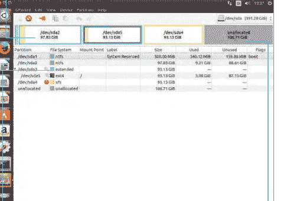

- **明智地选择文件系统**
  分区可以格式化为多种文件系统。如果分区打算用于不同的操作系统，原始 `FAT32` 通常是最佳选择。

- **此空间为空**
  示例工作站的分区未完全使用。未分配的空间未被任何使用，应将其分配给分区以使其可用于文件存储。

### 分区是如何工作的

最基本的安装——从 Windows 中众所周知——每块磁盘包含一个分区。具有服务器传统的操作系统期望多磁盘系统：将磁盘分配给特定任务是有效的，因为它减少了延迟影响并实际提供了更高的传输速度。

使用传统的 `MBR` 方案，硬盘最多可以划分为四个分区。其中一个是逻辑分区，包含额外的逻辑分区。

### 如何处理分区

管理员可以从大量的分区管理工具中进行选择：Windows 附带了本专题后面描述的存储管理单元，而 Ubuntu 和 Debian 倾向于在光盘和 FileSilo 上使用 `GParted`。

所有这些程序的行为相似。最重要的警告是，干扰分区结构可能是危险的——让经验不足的用户独自使用分区管理器是引发数据丢失的可靠方式。

## 掌握 GRUB 引导加载程序

引导加载程序控制电源开启后的工作站——如果此处发生错误，操作系统将无能为力！

电源开启后，工作站的 `BIOS` 执行快速自检，并将控制权传递给一段称为引导加载程序的特殊代码。这就是负责将执行权传递给一个或多个实际上使工作站启动的操作系统字节流的部分。

虽然 Linux 最初通过称为 `LILO` 的引导加载程序启动，但 GNU 项目的 `GRUB` 已成为大多数发行版的标准。它最初旨在引导 GNU 的 `Hurd` 操作系统——虽然该平台与 Duke Nukem 争夺“雾件”王座，但其组件此后已在其他各种 Unix 操作系统中重新使用。

### 为什么选择 GRUB？

`GRUB` 与 `LILO` 相比有多种优势。首先，该加载程序不限于位于传统的 `MBR` 中——事实上，它完全放弃了传统的 `MBR`，转向更现代的系统初始化方式。此外，`GRUB` 与 `LILO` 不同之处在于它理解文件系统的概念。这意味着引导加载程序可以分析被引导分区的内容——`LILO` 只是使用固定偏移量，如果其中一个偏移量发生变化就会失败。

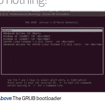

另一个有趣的好处是可以从网络启动：理论上，Unix 工作站可以通过 `GRUB` 支持的可访问局域网外围设备从服务器获取其操作系统。最后，`GRUB` 提供了显著更好的用户体验。该程序可以定制以显示自定义启动屏幕和启动选项。然而，即使是基本版本也比 `LILO` 更灵活——伴随此方框的两个屏幕截图展示了该程序的默认安装在三系统引导工作站上能为你做什么。

### 美化 GRUB

高级用户可能希望坚持手动自定义的说明，而平均的 `GRUB` 安装所有者则更适合使用自动安装程序。不幸的是，在撰写本文时，`GRUB Customizer` 并不是官方 Ubuntu 发行版的一部分。相反，必须从第三方 `PPA` 下载，而该 `PPA` 必须添加到 `apt-get` 仓库列表中。只需向终端逐条输入以下命令，并遵循屏幕上的说明：

```bash
sudo add-apt-repository ppa:danielrichter2007/grub-customizer
sudo apt-get update
sudo apt-get install grub-customizer
```

接下来，打开 Dash 并查找搜索字符串 "GRUB Customizer"。启动程序会显示一个三项菜单：

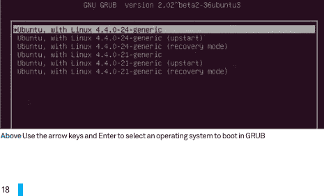

标签页界面——“列表配置”标签页列出了各种已配置的操作系统，而“常规设置”标签页允许你自定义等待时间以及开机后默认选中的条目。

## 更改其外观

大部分操作都在“外观设置”标签页中进行。浏览其各种选项，以调整背景颜色、设置壁纸和/或更改用于显示 `GRUB` 菜单的字体。最后，如果你觉得有必要，可以增大显示分辨率——但要注意，此操作可能略有风险。

完成后，点击工具栏中的“保存”按钮，以将设置提交到 `GRUB` 的配置文件中。`GRUB Customizer` 会为你执行该过程——只需重启并享受结果即可。

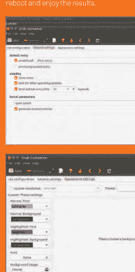

## 配置 GRUB

`GRUB` 的设置也可以通过命令行进行修改。以下是详细的技术细节。

### 01 这是什么？

`GRUB` 在运行时通过解析文件 `/boot/GRUB/GRUB.cfg` 来查找其设置。然而，直接编辑该文件被认为是一种反模式——相反，`/etc/default/GRUB` 中的设置应使用 `sudo update-GRUB` 命令转译为 .cfg 文件。虽然不遵守这些规则通常不会导致系统无法工作，但请记住，`GRUB` 和内核更新有时会导致 `GRUB` 配置的完全重新编译。在这种情况下，手动应用的任何更改都会丢失，且难以恢复。

### 02 开始编辑

面向用户的设置——例如等待时间、背景等——存储在 `/etc/default/GRUB` 文件中。可以通过在终端中输入 `sudo gedit /etc/default/GRUB` 来打开该文件，*不要*包含冒号——编辑器随后会自动弹出。

`Windows 3.x` 的资深用户会立即识别出这种语法——它源自传统的 `.ini` 文件。参数采用 `NAME = VALUE` 的形式，而以 `#` 开头的行被视为注释。`GRUB` 的开发人员在文件中提供了一些文档说明——一些小编辑可以在不联网查找更多信息的情况下完成。

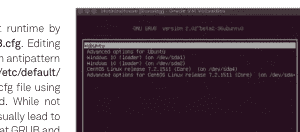

### 03 进行你的更改

参数及其语法因 `GRUB` 版本而异。查阅你机器上使用的 `GRUB` 版本的文档是最明智的做法——谷歌在这里真的是你的好朋友。

### 04 应用更改

如步骤 1 中所述，配置文件中的更改不会自动提交到存储介质。相反，必须从终端调用 `update-GRUB` 命令。

运行该命令很有趣，因为它会列出当前活动配置中使用的所有可引导卷——如果你漏掉了重要的操作系统，重建 `GRUB` 并检查其加载器是否存在于实用程序的输出中是非常有意义的。

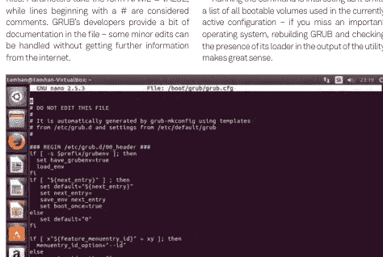

如上所述，`GRUB` 也可以通过命令行使用。

## 特性

### 多系统引导你的机器

### 从 Windows 开始

无论是 CAD、EDA 还是 Visual Studio——有时必须运行 Windows。

以下教程假设一台新启用的单磁盘工作站将被装入多种操作系统。我们的第一个候选者是 Windows 10 的预览版，你可以在注册并同意条款和条件后，从 Windows 内部计划（`https://insider.windows.com/`）下载。接下来，将其刻录到 DVD 或 USB 闪存盘上。最后，将其插入你的工作站并将其设置为启动介质。


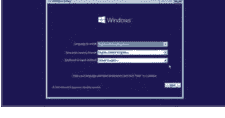

### 01 设置语言等

Windows 10 的安装过程一开始会要求你指定语言和键盘设置；这一点很重要，因为它确保键盘在安装过程中能正确工作。接下来，点击“立即安装”以开始实际的部署过程。在目前的进展阶段，可以通过安装向导第三个屏幕底部的“我没有产品密钥”标签跳过序列号的输入。


### 03 定制安装！

选择默认安装过程会使 Windows 占用工作站的所有分区。在多系统引导工作站上工作的人员必须改为选择“自定义：仅安装 Windows（高级）”选项，之后 Windows 安装过程将继续显示当前安装在工作站中的硬盘概览。安装例程将显示已使用和未使用的空间——对我们来说，只有被描述为“未分配空间”的部分感兴趣，因为它们可以填充新分区而不会丢失数据。


### 05 准备就绪

当识别出安装分区后，就可以启动实际的安装过程。尽管微软进行了大量优化以提高部署速度，但安装 Windows 10 仍可能需要半小时或更长时间。请注意，操作系统在过程中会下载大量更新——如果连接到按流量计费的网络，不应进行此操作。最后，如果机器在安装过程中重启几次，请不要担心。

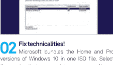

### 02 解决技术细节！

微软将 Windows 10 的家庭版和专业版打包在一个 `ISO` 文件中。选择你要使用的版本——查阅你与微软的许可协议以确定你有权使用哪个版本。在下一步中，必须接受 `EULA`；不同意微软的条款和条件最终意味着你不被允许在你的机器上安装 Windows。

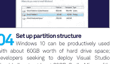

### 04 设置分区结构

Windows 10 大约需要 60GB 的硬盘空间才能有效使用；寻求部署 Visual Studio 的开发者应分配至少 80GB。遗憾的是，微软的安装例程默认会获取整个磁盘空间——请在输入窗口中输入较小的值。此外，确认提示关于创建额外的 500MB 分区的对话框，该分区用于运行和维护 `NTFS` 文件系统。

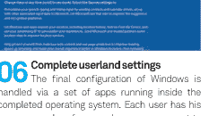

### 06 完成用户端设置

Windows 的最终配置通过一组在完成的操作系统内部运行的应用程序来处理。每个用户都有自己的个人偏好——有些人希望将他们的本地用户帐户连接到 Windows，而其他用户对这种特定的奢侈品不感兴趣。原则上，按你认为合适的方式选择——如果你发现某些决定完全不适合你，之后大多数决定都可以更改。

## 安装顺序

### 先 Windows，后 Linux

最近的 Linux 发行版完全配备了共存场景：如果部署过程检测到基于 Windows 的操作系统存在，通常会自动将其添加到 `GRUB` 引导加载器。这意味着不需要进一步的手动干预：一切都开箱即用。

当从零开始启用一台新工作站时，可以指示 Windows 安装程序保留部分硬盘未处理，从而节省时间。这样可以在 Linux 安装过程中对其进行格式化，而无需进行分区操作。

### 先 Linux，后 Windows

最后安装 Windows 会造成麻烦。第一个问题通常是分区缩小 - 如果可以安装第二块硬盘，这样做往往是更好的选择，因为 Windows 安装程序有时会破坏分区。务必手头准备一个可引导的 `USB` 闪存盘或救援 `DVD`，以恢复引导加载器。最后，请记住虚拟机可以是一个不错的替代方案：如果你不玩游戏并且可以忍受没有 `UWP` 模拟器，`VirtualBox` 在最新硬件上提供了相当不错的性能。


## 发行版类型

了解各种变体。


**日常使用**

### Ubuntu

你可能不会迷恋 Mark Shuttleworth 的操作系统。然而，它与大多数其他发行版相比，为桌面 Linux 做了更多贡献，并且非常适合日常使用。对于初学者来说也非常棒。


**企业级**

### CentOS

取 Red Hat 传奇般的可靠性，去掉商业支持，就得到了 CentOS。如果你曾经有需求自建数据中心或使用先进企业软件，这可能为你节省大量资金！


**日常使用**

### Debian

作为将 `apt` 包管理器带给世界的发行版，Debian 绝对有资格入选这份列表。对于那些不喜欢 Mark Shuttleworth 的人来说，它是一个不错的日常 Linux。


**安全**

### Kali Linux

以真正的黑客风格触碰计算机系统。这个源自 Debian 的发行版附带了一组对渗透测试和取证分析有用的工具。


**奇特**

### Chromium

驱动 Google 功能精简微型笔记本的操作系统也可以运行在你选择的工作站上 - 但请注意，这个发行版限制你只能使用网络应用！


**传统**

### Slackware

Slackware 最好被描述为一个活化石。这个最古老的仍在更新的发行版让你可以接近底层——任何真正的 Linux 爱好者都应该试试看！

## 功能

### 为你的机器实现多重启动

#### Ubuntu 来救场

出于各种原因，不建议将 Windows 作为日常生产力操作系统使用，其中之一就是加密勒索病毒。


Ubuntu 是一个极佳的日常操作系统。它通常是被用来向新用户介绍 Linux 的默认发行版。许多开发和企业产品最近都开始支持 Ubuntu，使其成为一个非常全面的发行版，而且安装起来也相对轻松。与 Windows 相比，Linux 安装系统遭受勒索病毒的风险稍低（因为恶意软件作者倾向于专注于运行同质代码的大用户群），因此在日常 Linux 发行版上执行常规任务（如浏览网页、社交媒体等）可以增加一层薄但实用的额外安全保障。

是否安装更新和第三方软件。启用图中显示的两个复选框——不下载第三方软件可能会在访问各种专有硬件时带来巨大的麻烦。此外，不部署更新会使获得支持变得更加困难，因为 Ubuntu 不愿意协助使用未升级工作站的 用户。

助手，并继续构建一个新的逻辑 `EXT4` 分区，挂载点为 `/`。如果你希望使用休眠功能或担心 `RAM` 不足，你还可以创建一个额外的交换分区，其大小至少要比工作站中安装的 `RAM` 量大一点。最后，点击“现在安装”以开始实际的部署过程。


### 01 开始

与 Windows 类似，Ubuntu 以 `ISO` 文件的形式提供，必须将其刻录到 `USB` 驱动器或 `DVD` 上（这也在本期杂志的光盘和 `FileSilo` 上）。手头保留此安装介质是明智的，因为它可以用来进入 Ubuntu 的恢复模式，这一点将在教程稍后提到。

下一步，从新创建的安装介质启动你的计算机。Ubuntu 在启动过程中会抛出一些错误信息——图中显示的对话框会让这一步变得复杂，可以花两分钟时间稍作休息。

### 02 承诺使用 Ubuntu

Ubuntu 的安装介质允许你在不安装的情况下试用操作系统。通过点击“安装 Ubuntu”按钮可以开始安装过程，此后操作系统将要求你决定

### 03 选择你的毒

Ubuntu 的安装过程包含一个专门用于创建包含 Windows 和 Ubuntu 的双重启动机器的选项。使用它会导致一个即插即用的系统，使用上述提到的 `GRUB` 让你每次重启时都能选择操作系统。由于我们还希望为企业应用添加 CentOS，因此请选择最后一个选项，“其他”。接下来，点击“继续”按钮开始分析你的硬盘——完成后，下一步中显示的对话框将出现。

### 04 创建一些分区


`NTFS` 分区下方显示的免费空间正等待被你的 Ubuntu 系统的工作区域填充。点击加号以打开分区创建

### 05 执行表面设置

点击“现在安装”命令后，Ubuntu 将自动开始将文件复制到目标分区。在此过程中，安装程序会询问你的位置、键盘设置以及你的密码和用户名组合。由于输入这些值通常可以很快完成，安装程序随后将带你参观 Ubuntu 生态系统的各种有趣方面。在此期间，任何更新也将被下载。

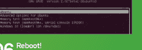

### 06 重启！

从那一刻起，Ubuntu 原则上就准备就绪可以使用了。当显示重启提示时，请移除安装介质，因为如果带着安装介质，操作系统可能会让计算机重新开始。正确的重启序列将由出现接下来这一步旁边显示的 `GRUB` 提示来指示。选择 Ubuntu 以进入你新安装的 Shuttleworth OS 版本。

## 缩小分区

有笔记本电脑吗？没有额外的硬盘位？我们仍然为你提供了方案！


为每个操作系统 dedicated 一块硬盘是最有效的方法。遗憾的是，工作站和笔记本电脑都可能打乱你的计划——大多数小于 17 英寸的笔记本电脑只有一个硬盘位，而对工作站进行修改可能变成一项烦人的工作。

由于完全重新安装操作系统也很乏味，缩小分区大小成为一种有吸引力的替代方案。这一步是所有教程中风险最大的一步——请确保在此阶段执行备份。

### 为我排列

移动分区往往会破坏引导加载程序。因此，我们通常通过从其后端切割部分来缩小它们——这个过程要求所有相关信息必须位于分区的开头。如果你的系统不是这种情况，请运行你选择的碎片整理实用工具。`Windows 10` 自带图中所示的工具——可以通过在开始菜单中输入 `Defrag` 来打开它，并点击“优化”按钮使其进行清理。当然，在碎片整理过程之前删除（大型）文件是一种确保顺利方法，因为它为 `Defrag` 提供了更多的操作空间。

### 缩小它！

至此，是时候缩小问题分区的大小了。由于 `NTFS` 是微软的事务，使用来自红mond 的人提供的工具很可能是最佳解决方案。通过右键点击开始菜单，打开传统的控制面板，并将其更改为传统视图。接下来，点击“管理工具”并进入“计算机管理”实用工具。最后，打开存储/磁盘管理组件，右键点击当前用作 `Windows` 主机的分区。然后，选择“压缩卷”以将其大小减少到更可管理的版本。

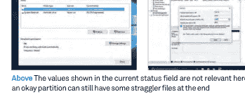

## 安装 CentOS

想部署企业软件？通过 `CentOS` 免费获得 `Red Hat`

### 01 安装介质

与其他所有操作系统一样，`CentOS` 安装的生命始于下载 `ISO` 文件。然后必须将其刻录到 `DVD` 或 `USB` 驱动器上（你可以通过本期杂志的光盘获取最小版本），它最终将作为你选定的工作站启动介质。当提示时，使用上下键选择“安装 `CentOS 7`”——安装介质的实时模式功能对本教程特别没有用。

### 02 选择语言和键盘

`CentOS` 的安装过程明确面向专业人士。尽管用户界面在选择语言和键盘布局后倾向于快速更新，但访客最好等到“安装源”和“软件选择”旁边的彩色符号消失后再继续。解决了这个问题后，需要点击“安装目标”以进入下一步讨论的磁盘配置小部件。

### 03 对你的磁盘进行分区

首先在“本地标准磁盘”选项卡中选择你希望使用的硬盘——在正常多重启动机器的设置过程中，网络驱动器不起作用。接下来，在“分区”选项卡中选择“我将配置分区”单选按钮——忘记这样做会导致问题和潜在的数据丢失。最后，点击屏幕左上角的大蓝色“完成”按钮以进入下一步。

### 04 设置目录结构

将分区方案设置为标准分区。接下来，点击屏幕左侧列表中底部的加号按钮以创建新的挂载点。创建一个大小至少为 `50 GB` 的 `/` 挂载点——弹出对话框会接受诸如“`50GB`”之类的值，并自动将其转换为正确的字节长度。最后，点击两次“完成”以忽略由缺少交换分区产生的警告。按照屏幕上的指示操作，直到 `CentOS` 成功安装。

> 尽管 `GParted` 也可以处理 `NTFS`，但这最好是一个应避免的选项。`Unix` 中的所有 `NTFS` 驱动程序原则上都应始终被视为实验性的，并且永远不应允许写入包含重要数据的文件。

## 让你的机器多重引导

### 恢复 GRUB

某些安装过程（比如 `CentOS`）会破坏 `GRUB`。解决这个问题并不难。

开源操作系统的缺点之一是一个问题会出现多种解决方案：例如，`CentOS` 和 `Ubuntu` 使用的引导加载器差异很大。如果一台 `Windows` 机器强制更新（你好，`Windows 10`），而这不是你计划内的，有时这会在启动时隐藏你的引导加载器，但幸运的是它不会删除数据本身。好消息是，只要你没有覆盖实际分区，恢复久经考验的 `GRUB` 并不特别困难。

#### 01 启动 Ubuntu

前面提到的 `USB` 闪存盘或包含 `Ubuntu` 安装介质的本期光盘此时真的派上用场了——将其插入你的工作站并从中启动。接下来，在提示时选择“试用 `Ubuntu`”选项。几秒钟后，你就可以在安装介质托管的 `Ubuntu` 桌面版中安顿下来。

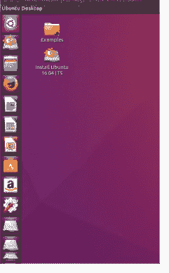

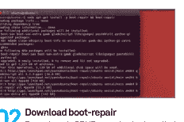

#### 02 下载 boot-repair

尽管 `GRUB` 也可以手动安装，但对于普通用户来说，名为 `boot-repair` 的图形化工具通常是一个更快、更安全的替代方案。遗憾的是，它默认并不包含在内——相反，你需要在终端窗口中输入以下命令来下载它：

```bash
sudo add-apt-repository ppa:yannubuntu/boot-repair
sudo apt-get update
sudo apt-get install -y boot-repair && boot-repair
```

完成后，该实用工具将自动开始扫描你的硬盘，查找所有可用的潜在操作系统。

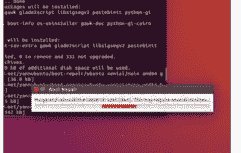

#### 03 使用推荐修复

在此过程中，只需点击“使用推荐修复”即可。这将使 `boot-repair` 尝试创建一套自己的引导参数集——这个过程可能需要一些时间，且绝不能以任何方式中断。

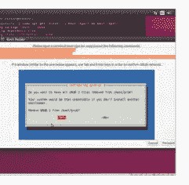

#### 04 遵守指令！

`boot-repair` 无法直接运行所有命令。在某些情况下，会弹出一个类似于本步骤附图所示的窗口。如果发生这种情况，请仔细遵循屏幕上的说明，并使用从 `Dash` 中打开的第二个终端。请注意，其中一些命令会从互联网下载 `20` 到 `50MB` 的数据。

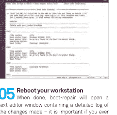

#### 05 重启你的工作站

完成后，`boot-repair` 会打开一个文本编辑器窗口，其中包含所做更改的详细日志——如果你将来寻求在线帮助，这是很有用的，应将其保存至 `USB` 闪存盘或 `PasteBin` 等在线服务。接下来，重启你的工作站并移除安装介质——一切应该都会恢复如初，就像那个麻烦的安装程序失控之前那样！


### 你能帮助启发下一代程序员吗？


`Code Club` 是一个全国性的志愿者主导的课后俱乐部网络，面向 9–11 岁的儿童。

我们始终在寻找具备编程技能的人，自愿每周花一小时在其当地的小学、图书馆或社区中心运营一个俱乐部。

你可以与同事组队，会有老师在那里支持你，并且我们提供你所需要的所有材料，帮助激发孩子们对数字制作的兴趣。

有很多种参与方式！

因此，想了解更多，请加入我们，访问 `www.codeclub.org.uk`


## 特别订阅优惠

### 订阅即赠免费书杂志

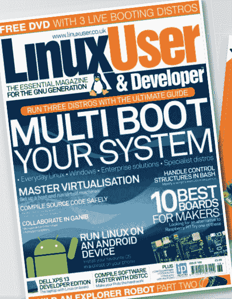

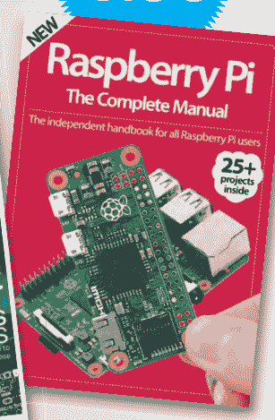


`订购热线`  

`0844 249 0282`  

通话费用为每分钟 7 便士加上你电话公司的接入费

`在线订购`  

`www.imaginesubs.co.uk/lud`

## 每期内容包含...

- 来自 Linux 专家的编程指南

- 来自企业供应商的最新新闻

- 富有创意的树莓派项目和建议

- 最佳 Linux 发行版和硬件评测

### 你应该订阅的理由...

- 免费书杂志

- 比封面价格节省 30%

- 免费送货上门

- 不错过任何一期

`请在 10 月 31 日星期一前订购`  

使用代码 `PG162` 享受此优惠。

### 你的详细信息

头衔 ________________________ 名字 ________________________  

姓氏 ______________________________________________________________  

地址  

邮政编码 ______________________ 国家 ______________________  

电话号码 ______________________  

手机号码 ______________________  

电子邮箱地址 ______________________

### 直接借记付款

英国直接借记付款  


我将仅支付`每 6 期 £25.15（节省 30%）`。包含`免费书杂志`！


### 付款详情

你的专属读者价格，1 年（13 期 + 免费书杂志）

英国 `£62.40（节省 20%）` | 欧洲 - `£70` | 世界 - `£80` | 美国 - `£80`

- [ ] 支票：我附一张支票，金额为 `£` （受款人为 `Imagine Publishing Ltd`）

- [ ] 信用卡/借记卡：

  - 卡号

  - 有效期

  - 发行号（如果是 `Maestro`）

  - 签名

  - 日期

- [ ] 如果您不希望收到 `Imagine Publishing Ltd` 通过邮寄、电话或电子邮件发送的任何促销材料，请勾选此框。

- [ ] 如果您不希望收到其他公司通过邮寄或电话发送的任何促销材料，请勾选此框。

- [ ] 如果您希望通过电子邮件接收此类信息，请勾选此框。

### 条款与条件

此优惠不包括新订阅者获得一本价值 `£7.99` 的 `Raspberry Pi: The Complete Manual` 第七版免费副本。库存情况以实际情况为准。如果库存售罄，`Imagine Publishing` 保留以价值相同的礼品替代该赠品的权利。新订阅将从下一期可用刊号开始。

此优惠将于 2016 年 10 月 31 日截止。直接借记保证的详情可按需提供。


# Tam Hanna

曾被善意地比作詹姆斯·邦德反派佐林博士。这位先生的英俊外表催生了一家现实中的控制系统公司——这是作者你也曾分享的热情。让 `Tam` 成为你在 `Bash` 领域追求纪律性的向导。

## 资源

- 装有 `Bash` shell 的工作站

### Bash 大师课

掌控你的 `Bash` 脚本执行

线性执行脚本很无聊。幸运的是，`Bash` 提供了一组可以修改执行序列的结构。

基于 `DOS` 的 `Bash` 文件造就了一代被宠坏的程序员：他们线性为主的执行方式使 shell 脚本被视为无趣的简单程序。

事实并非如此：`Bash` 为脚本编写者提供了一组控制结构，这些结构理应可与 `JavaScript` 或 `C` 等编程语言中的控制结构相提并论。当智能地使用这些结构时，脚本可以实时定制；通过分析执行环境，可以取代手动重写。

使用 `Bash` 的输入处理功能还开启了更高级的可能性。在完成本教程的全部内容后，你的脚本将能够轮询用户以获取输入。这可以进一步提高脚本的易用性——如果操作得当，你的脚本甚至能够实时拒绝无效输入，从而保护那些笨拙或对技术一无所知的用户安全。

简而言之：学习更多 `Bash` 脚本知识总是值得的。所以——请跟随我们深入高级 `Bash` 程序的兔子洞吧——别担心，我们会支持你...

### 教程文件可下载

`filesilo.co.uk`

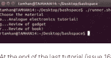

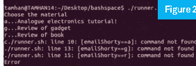

在上一个教程（第 166 期）结束时，我们的脚本已经能够询问用户要发送的邮件主题。让我们通过查看一个小例子来回顾一下：

```bash
#!/bin/bash

echo "Enter title!"

read emailTitle
echo $emailTitle
```

```bash
if [ $emailShorty == "a" ]; then
	echo "Alert, electronics head detected!"
	emailTitle="Analogue electronics tutorial!"

elif [ $emailShorty == "g" ]; then
	emailTitle="Review of gadget"

elif [ $emailShorty == "r" ]; then
	emailTitle="Review of book"

else
	echo "Error"
	exit
fi
```

在指定该文件为 `Bash` 脚本的 shebang（`#!/bin/bash`）之后，我们现在可以调用 `read` 命令从命令行获取数据。然后，它通过 `echo` 函数再次被输出。

`Bash` 要求必须存在 `if` 子句；`elif` 和 `else` 子句是可选的，但保持 shell 脚本更紧凑时很有用。

强制用户输入长文本是移动端的一个经典缺陷：在使用桌面应用程序时，为了可用性，仍应避免这种做法。改善程序行为的一种有效方法是引导用户达到他们的目标。

`if` 子句的实际语法非常实用。选择器用花括号括起来，并以分号终止；`then` 子句开始要执行的命令列表（如果匹配器命中）。

> “脚本将能够实时拒绝无效输入，保护笨拙或对技术一无所知的用户安全”

```bash
#!/bin/bash

echo "Choose the material!"
echo "a...Analogue electronics tutorial!"
echo "g...Review of gadget"
echo "r...Review of book!"

read -n 1 emailShorty
```

然而，对于 unsuspecting 用户来说，还有一个小问题潜伏着。请注意，`[` 必须有一个尾部空格，而 `]` 需要一个头部空格——如果缺失，就会出现类似图中所示的错误。此外，`==` 运算符的左侧和右侧也需要空格。

`read` 可以提供一个或多个参数来修改其行为。传入 `-n 1` 告知命令我们正在寻找单个字符——用户无需按回车键。请注意，这可能会导致控制台输出看起来很别扭——在 `read` 之后添加一个空的 `echo ""` 可以修复此问题。

### 简写表达式

由于从特定集合收集输入是一个极其常见的操作，`Bash` 为其提供了一个简写表达式。它的使用可以简化我们的程序，如下所示：

```bash
echo "Choose the material!"

select emailTitle in "a...Analogue electronics tutorial!" "g...Review of gadget" "r...Review of book"; do
	echo $emailTitle
	break
done
```

### 如果这样，那就那样！

运行上述代码片段后，你会得到一个变量，其中——理想情况下——包含单个字符的输入。将其转换为可用的电子邮件标题需要使用一种通常被称为选择（selection）的结构。它的名字源于其根据变量改变程序执行的习惯。最原始的形式是 `if` 选择，可以这样部署：

```bash
...
read -n 1 emailShorty
echo ""
```

你应该意识到 `break` 命令是强制性的；如果你忘记包含它，脚本将无限循环，这完全不是你想要的。通过 `Ctrl + C` 序列跳出此循环效果最佳，这将导致图中所示的结果。

## 教程

### Bash 大师课

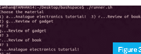

### 这是一个旋转木马！

发送多个文件要求我们熟悉 `for` 循环；它执行其命令体，直到传入的参数列表耗尽：

```bash
for file in `ls *.mp3` ; do
    echo "\$emailTitle File \$fileNow of \$fileCount"
    echo "\$file"
    fileNow=$((fileNow+1))
done
```

`for` 也可用于处理数字和/或数字范围。这是通过修改 `$` 运算符或传入完整列表或声明来实现的 – 以下脚本输出两个数字序列：

```bash
for ((a=1; a<=10; a++)); do
    echo \$a;
done

for a in {1..10}; do
    echo \$a;
done
```

`for` 循环非常适合所有 shell 脚本需要处理一组预定义命令的情况。实际上，很少有程序享受在调用时已知任务集的特权 – 在大多数情况下，迭代必须进行直到任务完成。

遗憾的是，使用基于硬件的 `for` 循环示例并不吸引人，因为复用它们很困难。因此，我们将坚持混合示例 – 第一个示例计算一组输入数字的总和：

```bash
myval=22
accu=0
while [ \$myval != "q" ]; do
    read myval
    if [ \$myval != "q" ]; then
        let accu=accu+myval
    fi
done

echo \$accu
```

`while` 是头控循环的实现：如果这样的循环需要至少执行一次，开发者必须相应地设置参数。尾控循环在这种情况下提供了有吸引力的替代方案 – 该程序的另一种实现可以像这样：


```bash
accu=0
until [ [ \$myval == "q" ] ]; do
    read myval
    if [ \$myval != "q" ]; then
        let accu=accu+myval
    fi
done

echo \$accu
```

这段代码对于习惯 C 或 BASIC 的开发者来说可能看起来有点令人不安：在 Bash 中，尾控循环也是从循环控制表达式开始的。请注意，这只是一个语法差异 – 循环行为最好通过以下摘自 C 标准的片段来描述：

```c
do { statement(s); } while( condition );
```

### 不要重复自己

一遍又一遍地说同样的话很无聊；并非没有理由，许多（如果不是大多数）海盗船长肩上都有一只鹦鹉，向迟钝或醉酒的下属重复命令。

玩笑归玩笑：重复代码是第一类反模式。它导致了难以维护的程序，并在维护过程中产生错误。

这个问题最好通过函数来解决。让我们从查看 `lineMaker` 开始 – 它生成一行包含一些 ASCII 艺术的内容：

```bash
#!/bin/bash

anotherF() {
    echo "- - - - - - - - - - - - - - - - - -"
}

function drawline {
    anotherF
    anotherF
}

drawline
```

Bash 使处理函数变得有趣，因为它提供了两种语法变体；我们的代码片段使用 `anotherF` 的那一种，而另一种在 `drawline` 中演示。实际上运行代码可以像 `drawline` 是 Bash shell 命令集的一部分一样完成。

当然，函数可以通过负责调用它们的代码进行修改。这是通过参数实现的 – 让我们通过稍微修改划线程序来演示其用法：

```bash
function drawline {
    anotherF
    anotherF
    echo \$1
    echo \$1
}
```

```bash
drawline a b c d
```

调用此代码的新版本将导致以下结果：

```bash
tamhan@TAMHAN14:~/Desktop/bashspace$ ./runner.sh
-----------------------------------------
4
a
```

运行的函数可以访问一个名为 `#` 的变量 – 它包含传入参数的数量。然后可以通过名为 `1`, `2`, `3` 等变量访问实际参数。访问其内容涉及使用上一部分中讨论的 `$4` 运算符。

Bash 的 `return` 命令具有误导性，因为它不能用于向调用者返回实际值 – 相反，它仅限于处理数字状态码。返回值的一种有趣方法涉及使用“参数变量”：

```bash
function myfunc() {
    local _res=$1
    local myresult='Hello World'
    eval $_res=""$myresult""
}

myfunc result
echo $result
```

> “ 请注意，函数必须位于其第一次调用上方 – 如果不是这种情况，Bash 将在执行时抛出错误 ”

上述代码相当棘手，因为它使用了 `eval` 命令：它指示 Bash 首先解析传入的字符串，并在第二步中继续运行结果。因此 `$_res` 被转换为变量名，而包含 `&myresult` 的字符串保持不变。

请注意，函数必须位于其第一次调用上方 – 如果由于某种原因并非如此，Bash 将在执行时抛出错误。此外，请记住函数可以随时被覆盖 – 以下产物将产生非常奇怪的输出（见图）：

```bash
. . .
function drawline {
   anotherF
}
. . .

function drawline {
   echo "Ouch"!
}
```


```bash
drawline a b c d
```

此外，你应该始终记住函数调用并不是特别快。虽然 Bash 允许创建递归函数，但不建议这样做 – 诸如计算阶乘之类的任务最好由 C 或 Fortran 处理。

### ShellCheck

Bash 的语法复杂得足以让经验丰富的程序员驻足：由于该语言在运行时被解释，错误通常只在为时已晚时才发现。

静态分析为此问题提供了解决方案。`ShellCheck` 是一个方便打包的程序，它检查你的 shell 脚本中一些众所周知的故障来源。

普通用户可以通过互联网访问该产品：在任意浏览器中打开 `https://www.shellcheck.net`，并将你的 shell 脚本粘贴到文件中。如果你希望更经常地使用该产品，可以通过 `apt-get` 本地安装它：

```bash
tamhan@TAMHAN14:~$ sudo apt-get install shellcheck
[Sudo] password for tamhan:
```

然后可以从命令行部署 `ShellCheck` – 非常机敏的开发者甚至会在每次保存文件后自动调用它。

### 结论与展望

虽然 Bash 脚本 – 承认 – 乍一看相当奇怪，但脚本语言仍然提供了完整的循环和选择命令集。这意味着 Bash 脚本是一种或多或少图灵完备的语言，理论上可以用于解决各种高级问题。

在实践中，由于各种原因，不建议这样做。首先，语法不宽容。其次，Bash 缺少各种高级结构，如指针和关联数组：这使得解决高级任务变得不必要地复杂。

幸运的是，Bash 将用其他语言编写的程序视为一等公民。本教程的下一部分将介绍各种链式命令和应用程序的方法 – 敬请期待，强大的力量在等着你！

### 使用现代保护编译软件


`Toni Castillo Girona`

拥有软件工程学士学位，并担任西班牙加泰罗尼亚地区一所公立大学的 ICT 研究支持专家。他经常在他的博客上撰写有关 GNU/Linux 的内容：`disbaues.ups.es`

## 资源

- Smashing the Stack for fun and profit

- `http://tbit.ly/29pZpIF`

-

- Debian Hardening

- `https://wiki.debian.org/"Hardening"`

-

- GDB Quick Reference

- `http://tbit.ly/29o6CIn`

-

- Running Shell-Code

- `http://tbit.ly/29gYJ3a`

-

- Relocation Read-Only

- `http://tbit.ly/29a7Ov7`

强化 GNU/Linux ELF 二进制文件可以防止基于内存破坏的攻击接管整个系统

**软件安全是一个复杂的专业知识领域。** 我们已告别了通过粉碎堆栈来获利轻而易举的鼎盛时期。如今，GNU/Linux 发行版开箱即带有针对内存破坏的现代保护，使得此类攻击的可能性降低。然而，即使开启这些保护，安全研究人员总是能找到利用软件缺陷的晦涩方法。强化你的二进制文件可以帮助你防止大多数这些攻击。GNU C 库和编译器提供了一些这些保护，而内核本身实现了其他保护。这些保护包括：`DEP/NX`、`ASLR`、`Stack-Canaries`、`PIE` 和 `Full RELRO`。现代 `gcc` 版本还包含一些有用的保护，例如将任何对 `strcpy` 系列函数的调用替换为长度受限的对应项（`strncpy`）。

##### NX 位

非执行位（`NX`）确保注入到 ELF 二进制文件非可执行段中的外来代码不会被执行。现代 64 位处理器开箱即包含此保护，并且 Linux 内核支持它。打开一个新的终端并运行此命令以了解你的处理器是否支持 `NX`：

```bash
cat /proc/cpuinfo |grep 'flags:head -1|grep --color=auto '(nx)'
```

此位可以在编译时通过向编译器传递 `-z execstack` 标志来清除。否则，默认情况下它是设置的。

拿起你喜欢的文本编辑器，写下这段代码：


```c
#include <stdio.h>
char shellcode[] =
"\x31\xc8\x31\xc9\x89\xc6\x31\xcd\xc8\x89"
"\x89\xf1\x5e\x89\xf6\x89\x89\xcb\x89"
"\xcb\x89\x89\x89\x88\x88\x88\x88\x89"
"\xc6\x88\xf7\xb8\xc7\xe8\x89\xc6\x89"
"\xcd\x89\xf1\xd6\x89\x89\x9d\x88\xc6"
"\x88\xe8\xc6\x88\xf1\xff\x1f\xff\x0b\x1f";
int main(int argc, char **argv) {
int *ret;

ret = (int *)ret + 2;
*(ret) = (int)shellcode;
}
```

这是一个执行 shell-code 的众所周知的技术。shell-code 存储在 `shellcode` 指向的地址中。该地址属于 `.data` 段。首先，像这样编译它：

```bash
$ gcc -m32 nx.c -o nx
```

如果你执行该二进制文件，你会得到一个段错误：

```bash
./nx
Segmentation fault
```

再次编译它，但这次清除 NX 位：

```bash
gcc -m32 -z execstack nx.c -o nx
./nx
sh-4.2$
sh-4.2$
```

shell-code 被执行，你获得了一个 shell。除了能够在编译时清除 NX 位外，你还可以使用 `execstack` 实用程序在现有的 ELF 二进制文件中这样做。在你的发行版中安装它：

```bash
#apt-get install execstack
```

在不清除 NX 位的情况下编译我们的示例并运行它：你会得到之前的段错误。但嘿，你现在有 `execstack`，所以你可以施展一些魔法：

```bash
# execstack -s nx
# ./nx
sh-4.2$
```

很酷：你可以随心所欲地使用 `execstack` 设置或清除 NX 位。现在

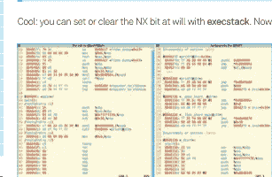

让我们来点更有趣的事情：让我们找出 `/usr/bin` 目录下有多少个二进制文件的 NX 位被清除了。借助 `execkstack` 工具及其 `-q` 标志，你可以查询 ELF 二进制文件中是否存在 NX 位。

```bash
$ find /usr/bin -exec execkstack -q {} ";" 2>/dev/null | egrep --color=auto 'X'
X /usr/bin/grub-mklayout
X /usr/bin/grub-mkrelpath
X /usr/bin/grub-mkimage
...
```

## ASLR 和 PIE

地址空间布局随机化（ASLR）是一种在 Linux 和其他操作系统中引入的防护机制，它使进程内存空间随机化，从而让攻击者极难找到可利用二进制文件中函数或 gadget 的地址。共享库是使用 `-fPIE` 标志编译的，这使得它们能够自动利用 ASLR 保护。然而，除非二进制文件被构建为位置无关可执行文件（PIE），否则其 `.text` 段不会以这种防护方式编译。再次打开你喜欢的文本编辑器，写下这段代码：

```c
#include <stdio.h>
void *getEIP () {
	return __builtin_return_address(0)-0x5;
}
int main(int argc, char** argv){
	printf("EIP located at: %p\n",getEIP());
	return 0;
}
```

编译代码，然后至少运行十次（或更多）。每次你都会得到完全相同的 EIP 内存地址。

```bash
$ gcc -m32 aslr.c -o aslr
$ ./aslr
EIP located at: 0x80483f8
$ ./aslr
EIP located at: 0x80483f8
```

现在，让我们再试一次，但这次在 `.text` 段上启用 PIE 保护。

```bash
$ gcc -m32 -fPIE -pie aslr.c -o aslr
$ ./aslr
EIP located at: 0xff770d5c
$ ./aslr
EIP located at: 0xff77635c
```

当然，如果你对一个 ELF64 二进制文件这样做，熵会更大，因此 ASLR 将变得更加可靠。有很多论文揭示了在 32 位架构上使用暴力破解绕过 ASLR 的方法。

## 堆栈金丝雀（Stack Canaries）

向可执行文件中注入外来代码的一种众所周知的方法是破坏其堆栈。打开你喜欢的 ASCII 编辑器，写下这段代码：

```c
#include <stdio.h>
#include <string.h>
void vuln(char *);
int main (int argc, char **argv){
	printf("Arg is: %s\n", *(argv+1));
	vuln(*(argv+1));
}

void vuln(char *arg){
	char buffer[10];
	strcpy(buffer, arg);
}
```

这是一个典型的具有缓冲区溢出漏洞的代码。以通常的方式编译它并运行它，传递尽可能多的字节，直到你溢出缓冲区：

```bash
$ gcc -m32 vuln.c -o vuln
$ ./vuln AAAAAAAAAAAAAAAAAAAAAAA
Arg is: AAAAAAAAAAAAAAAA
Segmentation fault
```

现在，在 `gdb` 会话中执行它，直到 EIP 寄存器得到 `0x41414141` 值。要做到这一点，只需在每次执行时增加传递给易受攻击程序的 "A" 的总数，直到你达到所需的值：

```bash
$ gdb ./vuln
(gdb) r AAAAAAAAAAAAAAAAAAAAAAA
Program received signal SIGSEGV, Segmentation fault.
0x41414141 in ?? ()
```

很明显，你可以通过破坏堆栈来控制返回地址。如果你想用例如 `0x54544432` 覆盖 EIP 寄存器，你只需更改作为参数传递的最后 4 个字节就可以轻松做到这一点，例如：

```bash
(gdb) r "$(perl -e 'print "\x41" x 20 . "\x32\x44\x54\x54"')"
Program received signal SIGSEGV, Segmentation fault.
0x54544432 in ?? ()
```

堆栈已被破坏，这是不可否认的。现在，使用堆栈保护程序编译前面的代码以检测这种破坏。GNU C 编译器提供了这个功能：

```bash
$ gcc -m32 -fstack-protector-all vuln.c -o vuln
```


> "如果你在新的 GNU/Linux 发行版中编译遗留代码，很有可能它会在没有防护的情况下被构建"

## 教程

### 编译新软件

- 防护与性能

其中一些防护可能会影响程序的吞吐量。例如，`relro`/`full relro` 意味着加载器会立即解析每个库函数的二进制函数以进行加载。为此，在二进制文件响应之前会进行一些加载。请考虑这一点，并始终运行性能测试。

现在尝试像之前那样溢出缓冲区：

```bash
$ ./vuln `perl -e 'print "A"x18'`
*** stack smashing detected ***: ./vuln
terminated
```

### 完整 RELRO

每当运行使用共享库的新二进制文件时，这些库的地址在执行时会解析，当第一次调用这些库中的任何一个时，这被称为延迟绑定。因为一些地址必须在加载到内存中的二进制文件的后续生命周期中确定，所以某些 ELF 段必须是可写的。这可能导致一种众所周知的攻击，该攻击覆盖全局偏移表（GOT），以便在攻击者能够覆盖 `printf` 的地址后，程序最终会调用一些恶意注入的代码，而不是调用例如 `printf`。

```c
#include <stdio.h>
int main(int argc, char **argv){
    printf("Hello there!\n");
    return 0;
}
```

保存它并以这种方式编译：

```bash
$ gcc -m32 -no-builtin-printf relro.c -o relro
```

通过运行 `objdump` 工具来反汇编二进制文件：

```bash
$ objdump -d relro > relro.S
```


打开生成的反汇编文件，查找 `main` 函数。而不是直接调用 `printf` 的地址，有一个调用名为 `printf@plt` 符号的调用：

```asm
00048348 <main>:
...
80483f5: e8 06 ff ff ff    call  8048306 <printf@plt>
80483fa: 68 00 00 00 00    mov $0x0, %eax
```

转到该偏移量，即 `0048300`。你可以清楚地看到有一个跳入 GOT。`push $0x0` 将设置 `printf` 的实际地址，进入第一个可用于共享符号的 GOT 条目，即 `GOT[3]`：

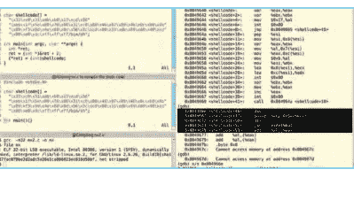

```asm
00048300 <printf@plt>:
8048300: ff 25 98 94 04 08  jmp    *0x0894998
8048306: 68 00 00 00 00    push $0x0
804830b: e9 e0 ff ff ff    jmp    80482f0 <.init+0x34>
```

在 `gdb` 会话中运行可执行文件以分析 GOT。因为 `_got.plt` 表是这个 ELF 二进制文件中的一个段，你可以向 `gdb` 询问其确切地址：

```bash
$ gdb ./relro
(gdb) info sections _got.plt
0x089495c >0x0894964  0x0000068 _got.plt
ALLOC LOAD DATA HAS CONTENTS
```

在调用 `printf@plt` 函数后立即设置断点并运行程序：

```bash
(gdb) b *0x00483fa
Breakpoint 1 at 0x00483fa
(gdb) r
Hello there!
Breakpoint 1, 0x00483fa in main ()
```

让我们找出 `printf` 函数位于何处：

```bash
(gdb) p system
$3 = <text variable, no debug info> 0x7f7e82c80
```

因此 `GOT[3]` 必须有地址 `0x7f7e82c80`，这是 `printf` 的地址。为了确定这是真的，转储 `_got.plt` 表的前 4 个字节：

```bash
(gdb) x/4w 0x089495c
0x089495c <_GLOBAL_OFFSET_TABLE_>   0x0894958
0x7fff0598      0x7fff3598
```

因为这是 ELF 二进制文件中的可写地址，你可以在 `GOT[3]` 中放入任何你想要的地址。你可以通过进行指针算术来找出哪个地址等于 `GOT[3]`：

```bash
(gdb) x/4w 0x089495c+12
0x0894968 <printf@plt>          0x7f7e82c80
```

因此 `GOT[3]` 位于 `0x0894968`！让我们玩玩 GOT，你的目标将是执行 `system` 函数，而不是 "Hello world!" 消息。为此，首先找出 `system` 的地址在哪里：

```bash
(gdb) p system
$8 = <text variable, no debug info> 0x7f74c90
```

在调用 `printf@plt` 符号之前设置断点：

```bash
(gdb) b *0x00483f5
Breakpoint 2 at 0x00483f5
```

从头开始运行程序，直到它在 `0x80483f5` 处中断。然后，用 `system` 函数的地址覆盖偏移地址 `0x804968` 处的 GOT 条目（更正 OCR 错误 `0x8049698`）：

```bash
(gdb) set *0x804968 = system
(gdb) x/wx 0x804968
0x804968 <printf@plt+...>    0x7f74c90
```

在 `gdb` 中使用“`c`”命令继续执行：

```bash
(gdb) c
Continuing.
sh: Hello: command not found
```

你已成功将 GOT 条目中 `printf` 函数的地址覆盖为 `system`。但由于 `system` 期望从堆栈中获取要执行的命令，而堆栈中有字符串 "Hello world!\n"，`system` 试图执行 "Hello" 并失败！无论如何，你已修改了 GOT 表。为了防止这种情况，请使用完整 RELRO：

```bash
$ gcc -m32 -fno-builtin-printf -Wl,-z,relro,-z,now relro.c -o relro
```

现在，由于所有符号在链接器将控制权返回给可执行程序之前都已解析，因此不再需要将可写段加载到内存中。要检查这一点，使用 `readelf` 命令如下：

```bash
$ readelf -S ./relro | grep "got.plt"
```

## 审计未加强的二进制文件

在现代 GNU/Linux 发行版中，大多数二进制文件都预先编译启用了这些防护。要检查，你可以使用 `readelf` 工具或 `checksec` 脚本。

```bash
$ wget http://www.trapkit.de/tools/checksec.sh
```

使用 `checksec`，让我们测试之前编译代码在启用完整 RELRO 后的防护：

```bash
$ ./checksec.sh -file relro
Full RELRO    No canary found    NX enabled
No PIE
```

`checksec` 向你报告该二进制文件已使用完整 RELRO 和 NX 位进行强化。然而，其 `.text` 段未受 ASLR 保护，且没有堆栈破坏保护。

```bash
$ gcc -m32 -fstack-protector-all -fPIE -pie -fno-builtin-printf -Wl,-z,relro,-z,now relro.c -o relro
$ ./checksec.sh -file relro
Full RELRO    Canary found    NX enabled
PIE enabled
```

`checksec` 还允许你使用 `--proc-all` 标志检查系统中运行的每个进程并获取其防护。要获取可能容易受到堆栈破坏或 GOT 覆盖攻击影响的二进制文件列表，你可以运行以下内容：

```bash
# ./checksec.sh --proc-all | egrep 'No RELRO|No canary'
init          1 No RELRO    No canary found    NX enabled No PIE
rpc.statd 2426 No RELRO No canary found NX enabled No PIE
rpc.idmapd 2440 No RELRO No canary found NX enabled No PIE
...
```

然而，重要的是要注意，如果你在新的 GNU/Linux 发行版中编译遗留代码，很有可能它会在没有防护的情况下被构建。

> `checksec` 允许你检查系统中运行的每个进程并获取其防护

```bash
$ wget http://disbaux.es/wp-content/uploads/2012/10/xmgr-4.1.2.tar.bz2
```

解压缩文件并按常规启动构建过程：

```bash
$ tar xvjf xmgr-4.1.2.tar.bz2
$ cd xmgr-4.1.2/
$ ./configure && make
```

使用 `checksec` 脚本确保唯一启用的防护是 NX：

```bash
$ checksec.sh -file src/xmgr
No RELRO    No canary found    NX enabled    No PIE
```

通过修改其 `Makefile` 以设置适当的标志来强化它。现代 GNU/Linux 发行版包含一个自动开启这些标志的环境变量。编辑 `xmgr-4.1.2/Make.conf` 并将这些标志设置为 `CFLAGS0` 变量：

```makefile
CFLAGS0 = -fstack-protector-all -fPIE -pie -Wl,-z,relro,-z,now
```

也将 `-fPIC` 标志添加到 `cephos` 库中：

```makefile
# vi cephos/Makefile
...
CFLAGS= $(CFLAGS0) -fPIC -I$TOP -I.
```

现在重新编译二进制文件并再次检查其防护：

```bash
$ make clean
$ make
$ checksec.sh -file src/xmgr
Full RELRO    Canary found    NX enabled    PIE enabled.
```


## 在 Android 上运行 Linux chroot

Android 基于 Linux 并使用 Linux 内核，这使其成为运行 `chroot` 的理想环境。


- **保罗·奥布莱恩**

保罗是一位专业的跨平台软件开发者，在部署和维护 Linux 系统方面拥有丰富经验。基于 Linux 构建的 Android 也是保罗的专长领域之一。

**为什么你要想在 Android 设备上运行完整的 Linux？**

这是我们在提到手机上可以访问完整的 `Debian` 安装时经常被问到的问题。实际上，它的用途比大多数人想象的要多（当然，作为一名 Linux 用户，你本来就比大家更了解这一点）。能够搭建完整的 `LAMP` 栈非常实用，我们可以快速且轻松地访问所有喜爱的 Linux 工具，甚至可以使用 Linux 构建作为选项，通过经典的 `rsync` 与设备进行内容同步。

为了能够在 Android 设备上的 `chroot` 环境中运行 Linux，有几个前提条件。首先，你需要获得设备的 `root` 权限。这并不令人惊讶，因为我们将在最低层与 Android 系统集成。其次，你需要运行支持环回设备（`loop devices`）的内核。如果你的内核不支持，你可以选择自己编译内核，前提是制造商已提供源代码。最后，你需要充足的存储空间和 `RAM`。`microSD` 卡可以为你的 Linux `chroot` 提供额外的存储空间，但请记住，它通常比内部存储慢得多，因此如果你的设备空间充足，使用内部存储效果会更好。

### 01 确保拥有 `root` 权限

在 Android 设备上安装 Linux `chroot` 之前，你最重要的需求是 `root` 权限。`Root` 赋予你对设备系统的完全访问权限，并允许你执行设置 `chroot` 所需的基本功能。Android 设备出厂时并未预置 `root`，因此你需要在给设备获取 `root` 权限后才能继续。

具体流程因设备而异，但通常包括解锁 `bootloader`（通过你的设备制造商网站）、刷入自定义恢复模式以及最后刷入名为 `SuperSU` 的 `root` `ZIP` 文件。请注意，解锁 `bootloader` 可能会影响你的保修，并且拥有 `root` 权限，就像在“正规”的 Linux 系统中一样，赋予了你更多对设备造成破坏的潜在可能。请谨慎操作！


在安装 `SuperSU` `root` 二进制文件后，安装一款如 Google Play 商店中的 `Root Checker` 等应用，以确认一切运行正常。当 Android 上的应用请求 `root` 权限时，会显示一个确认对话框——这确保了系统中的应用无法在不知情的情况下使用 `root` 权限进行恶意操作。

### 02 下载完整的 Linux 安装程序

在设备上获取 Linux 发行版最快且最简单的方法是使用来自 Play Store 的 `Complete Linux Installer`。首次启动时，该应用将安装启动 Linux 所需的脚本和 `Busybox` 二进制文件。该应用支持多种发行版，包括 `Ubuntu`、`Debian`、`Arch`、`Kali`、`Fedora` 和 `openSUSE`。系统将检查你的架构类型，应用中的“安装指南”部分将指示哪些发行版与你的手机或平板电脑兼容。在开始安装之前，请确保已启用 `USB` 调试并有充足的存储空间。

要启用 `USB` 调试，请打开“设置 > 关于”菜单，轻点“版本号”五次以显示“开发者选项”菜单，然后从“开发者选项”菜单中勾选“`USB` 调试”选项。


`Complete Linux Installer` 应用本身只是一个 2.4MB 的下载。为了效率，发行版镜像是根据需求下载的——你可以从安装指南的第二页开始下载。

使用 `Explorer` 或 `File Commander` 等应用解压镜像和 `MDS` 文件（完成后你可以删除 `download.zip`）。

### 04 首次启动 Linux

在你解压镜像并安装 `Terminal` 以及可选的 `VNC` 伴侣应用后，你就准备好启动了！

启动 Linux 有几种选择——你可以使用 `Complete Linux Installer` 应用（参见侧边菜单中的“启动”选项），或者你可以将小部件添加到主屏幕。请注意，根据你设备的性能不同，镜像完成首次启动可能需要几分钟时间，所以请耐心等待！

在你的发行版启动后，系统将提示你设置 `root` 密码，然后你就可以随心所欲地使用这个 `chroot` 了！输入 `exit` 以关闭（你应该尽量记住这样做，这既是为了电池续航，也是为了保护文件的完整性）。

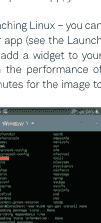

`Complete Linux Installer` 应用允许你配置 `VNC` 会话的分辨率选项——你应该确保它们与你设备的分辨率匹配。

### 05 在 `chroot` 中安装额外的应用

一旦你的 Linux `chroot` 运行起来，你可能会想要安装额外的应用（特别是如果你安装了一个小型或核心系统镜像）。由于你将通过 `Terminal` 以 `root` 身份登录，你可以以常规方式进行操作——使用你的发行版的包管理器。二进制文件将自动为你的当前架构（`ARM` 或 `x86`）下载，因此一切都应该像在“真正的”Linux 机器上那样工作。

> `Terminal` 应用用于通过 `shell` 连接到你的 `chroot`，而 `VNC Viewer` 允许你连接到图形用户界面（`GUI`）

### 03 安装 Linux 镜像和伴侣应用

当你开始下载 Linux 发行版镜像时，系统会提供几个选项。有“大型”、“小型”和“核心”版本的镜像可用。大型镜像包含核心操作系统和一系列额外的应用，如 `OpenOffice`；小型镜像仅包含基本的附加组件，如网络浏览器和 `Java`；而核心（`Core`），顾名思义，仅包含操作系统本身。

在主镜像下载的同时，下载建议的伴侣应用是个好主意。`Terminal` 应用用于通过 `shell` 连接到你的 `chroot`，而 `VNC Viewer` 允许你连接到图形用户界面（`GUI`）。

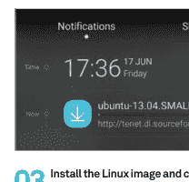


发行版镜像以 `ZIP` 文件形式下载，在启动 Linux 之前，需要将其解压到内部或外部 `SD` 卡的根目录。下载完成后，使用

你应该避免使用内置的更新工具来更新你的发行版——这几乎肯定会引发问题并阻止系统启动。相反，如果你希望使用最新版本，你需要构建自己的定制镜像。

如果你安装了许多额外应用，可能会遇到空间问题。增加可用空间最简单的方法是制作一个新的、更大的、空的镜像，并将内容从旧镜像复制过来（使用 `cp -rp` 以保留权限）。

### 06 准备你自己的镜像

由于你无法以常规方式更新 Android 设备上正在使用的 Linux 镜像，如果你希望使用所选发行版的最新版本，

### 与 Tasker 集成

除了从 `OSK` 商店、`linux-installer-app` 或使用提供的小部件手动启动你的 `chroot` 外，你还可以使用 `Tasker` 自动化你的 Linux 安装。当你手动启动 `chroot` 时，请留意一条命令：它是被使用的，你可以从 `Tasker` 脚本中调用它。你甚至可以发送额外的命令：`cd /path/mydir` 和 `speed = useful_task`。

### 资源

- `SuperSU`
  `bit.ly/1fpnTbt`

- `Root Checker`
  `bit.ly/192WqN`

- `Complete Linux Installer`
  `bit.ly/282jnRw`

- `Linux Deploy`
  `bit.ly/297WGf4`

- `Ubuntu Touch`
  `wiki.ubuntu.com/Touch/Devices`


**右** 除了终端模式，你甚至可以在 Android 设备上运行完整的 Linux 桌面！

## 教程

### 在 Android 上运行 Linux


# 创建自定义镜像

```
paul@xps13-ubuntu:~$ dd if=/dev/zero of=ubuntu.img bs=1MB count=0 seek=4096
0+0 records in
0+0 records out
0 bytes copied, 0.000132431 s, 0.0 kB/s
paul@xps13-ubuntu:~$ mke2fs -F / ubuntu.img
mke2fs 1.42.13 (17-May-2015)
Discarding device blocks: done
Creating filesystem with 1000000 4k blocks and 250480 inodes
Filesystem UUID: 14742810-5fca-4535-8a56-062a7304f2c6
Superblock backups stored on blocks:
	32768, 98304, 163840, 229376, 294912, 819200, 884736

Allocating group tables: done
Writing inode tables: done
Writing superblocks and filesystem accounting information: done

paul@xps13-ubuntu:~$ sudo mount -o loop ubuntu.img / /cli
[sudo] password for paul:
paul@xps13-ubuntu:~$ 
```

你需要准备自己的镜像。幸运的是，这其实相当简单。

为了创建你自己的镜像，你首先需要创建 `IMG` 文件本身（适当的大小，4GB 是个好的起点），方法是将 `/dev/zero` 写入一个文件，然后使用 `mke2fs` 创建文件系统本身。挂载你的新镜像后，你就准备好将实际的 Linux 文件复制到它上面了。

你需要获取适用于你的发行版的 RootFS（根文件系统）镜像，该镜像需为你的设备架构构建（很可能是 ARM）。Ubuntu 镜像可以在 `cdimage.ubuntu.com/ubuntu-core/xenial/daily-preinstalled/` 找到。将文件复制（`cp -r`）到你的新镜像中，最后，创建一个 `root/init.sh` 脚本。这由“Complete Linux Installer”应用在启动时使用——你应该从现有镜像中复制该脚本，并根据你上传的操作系统进行适当修改。

完成操作系统安装后，Linux Deploy 应用允许你通过 UI 启动和停止新操作系统中的服务。该应用还可以管理 SSH 和 VNC 设置。

安装新操作系统大约需要 30 分钟。建议的磁盘镜像最小尺寸为 1024MB（带 LXDE），不带 GUI 则为 512MB – 请记住，当你在具有 FAT32 文件系统的 microSD 卡上安装 Linux 时，镜像大小不得超过 4095MB！

## 08 Linux Deploy 的特殊功能

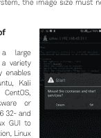

Linux Deploy 支持多种架构上的大量发行版。它目前支持在 ARM 和 x86 32 位及 64 位上安装 Debian、Ubuntu、Kali Linux、Arch Linux、Fedora、CentOS、Gentoo、openSUSE、Slackware 或 RootFS。如果你更喜欢使用图形界面而不是终端来使用你的发行版，Linux Deploy 允许你使用 `xterm`、`LXDE`、`Xfce`、`GNOME` 或 `KDE`。令人印象深刻！

## 07 另一种选择 – Linux Deploy

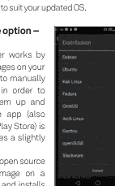

Complete Linux Installer 通过在设备上启动预制镜像来工作，你需要手动下载和提取这些镜像才能让操作系统运行起来。另一种应用（也可在 Google Play 商店获取）是 Linux Deploy，它采取了略有不同的方法。

Linux Deploy 本身是开源的，它在 microSD 卡上创建磁盘镜像，挂载它并安装操作系统发行版。发行版的安装是通过从互联网上的官方镜像下载文件来完成的。与 Complete Linux Installer 一样，该应用需要 root 权限。

### 运行自动化任务

在通过 Tasker 启动你的 chroot 后，你可以轻松地发出额外的命令。我们使用我们的 chroot 轻松地将照片按需 `rsync` 到远程服务器 – 过程完成后，可以调用 `exit` 来关闭 chroot。使用 Tasker 的新文件触发器效果很好，你还可以添加一个“已连接 WiFi”的条件，以节省你的移动数据流量。

## 使用 ubuntu-device-flash 工具

以下设备均可以按照这里解释的 [安装说明](https://wiki.ubuntu.com/Touch/Install) 配合 `ubuntu-device-flash` 正常工作。关于哪些功能正在正常工作的最新状态请参考这里。它们使用 `system-image` 系统进行安装并支持 OTA 更新。它们托管在 `https://system-image.ubuntu.com`

| 设备 | 板卡名称 | 生产状态 | 来源 | 支持截止日 (EOL) | adb Recovery |
| :--- | :--- | :--- | :--- | :--- | :--- |
| Nexus 4 | `mako` | 否 | Ubuntu 归档 | 未知 | 不适用 |
| Nexus 7 2013 (仅 WiFi) | `flo` | 否 | Ubuntu 归档 | 未知 | 不适用 |
| 模拟器 (ARM) | `generic` | 否 | Ubuntu 归档 | 可能长期支持 | 不适用 |
| 模拟器 (x86) | `generic_x86` | 否 | Ubuntu 归档 | 可能长期支持 | 不适用 |
| BQ Aquaris E4.5 Ubuntu Edition | `krillin` | 是 | `github.com/bq/aquaris-E4.5` (Ubuntu 分支) | 未知 | `recovery-krillin.img` |
| BQ Aquaris E5 Ubuntu Edition | `vegetablehd` | 是 | `github.com/bq/aquaris-E5` (Ubuntu 分支) | 未知 | `recovery-vegetablehd.img` |
| BQ Aquaris M10 HD Ubuntu Edition | `cooler` | 是 | `code.launchpad.net/~phablet-team/awila/+git/kernel3.10` | 未知 | `recovery-cooler.img` |
| BQ Aquaris M10 FHD Ubuntu Edition | `frieza` | 是 | `code.launchpad.net/~phablet-team/awila/+git/kernel3.10` | 未知 | `recovery-frieza.img` |
| Meizu MX4 Ubuntu Edition | `m75 (arale)` | 是 | `github.com/meizu/m75` | 未知 | `recovery.img` |
| Meizu PRO 5 Ubuntu Edition | `turbo` | 是 | `github.com/meizu/m75` | 未知 | `recovery-turbo.img` |

请注意，生产设备需要启用 `adb` 的 recovery 才能与 `ubuntu-device-flash` 配合工作，如 [askubuntu](https://askubuntu.com) 上所述。

我们在 Linux Deploy 中最喜欢的技巧之一是将 Linux 安装到 RAM 中。现代移动设备拥有不断增长的内存，例如 OnePlus 3 最近配备了令人印象深刻的 6GB RAM。安装到 RAM 的缺点是，由于所有数据都存储在内存中，当设备重置时数据会丢失。

与安装在 microSD 或内部存储上相比，RAM 安装的性能预计非常良好。应用启动迅速，界面响应即时。安装也更快，只需几分钟。

例如蜂窝网络连接；此外，作为一个测试质量的镜像，你应该预期会有大量的 bug！

## 10 无需 Root 的 Linux 替代方案

在整个指南中，我们谈论了在已 root 的设备上进行安装……但如果你没有 root，还有一个选择，即从 Play Store 下载的非 root（`nroot`）构建版本。我们检查了 `pelya` 制作的 `debian nroot`，顾名思义，你可以使用它在标准的 Android 设备上引导一个最小化的 Debian 安装。

> `nroot` 的实现由 `proot` 项目促成，该项目在用户空间实现了 `chroot`、`mount -bind` 和 `binfmt_misc`

## 09 用 Linux 完全替换 Android


让 Linux 与 Android 并行运行效果出奇地好，但它总给人一种额外操作系统硬塞上去的感觉。如果你想运行真正的原生 Linux，你有两个选择。第一个是购买真正的 Ubuntu 手机或平板电脑（如 `BQ M10`）。然而，如果你恰好拥有一台被 Ubuntu 用于测试其 “Touch” 镜像的设备（如 `Nexus 4`），那么你也可以将 Linux 刷入它。

详细信息可以在 Ubuntu 网站上找到 – `wiki.ubuntu.com/Touch/Install`。该过程涉及解锁你设备上的引导加载程序，下载适用于你设备的 Ubuntu 镜像，并使用 `Fastboot` 手动刷入它们。

当然，该过程会擦除你的数据 – 如果将来你想回到 Android，你需要下载你设备的官方工厂镜像并刷入它们。请注意，如果你刷入原生 Linux，可能会失去一些功能。

虽然它比 `root` 选项在更广泛的设备范围内有效，但有一些注意事项。目前，该应用与运行 `Android Marshmallow` 的设备不兼容。另一个值得注意的大事是该应用不能安装到 `SD` 卡 – 你需要拥有一台具有充足内部存储的设备。

尽管有这些琐碎的问题，但 `nroot` 实现运行良好，并且像最好的 Linux 项目一样是开源的。该应用由 `'proot'` 项目促成，该项目在用户空间实现了 `chroot`、`mount -bind` 和 `binfmt_misc`。你可以在 `github.com/proot-me/` 阅读更多详情。


### 使用 Ganib 组织协作项目

了解如何安装 Ganib 并使用它来管理和简化您的协作项目。


**尼提什·蒂瓦里 (Nithish Tiwari)** 职业是一名软件开发者，对自由和开源软件有着浓厚的兴趣。除了担任主要 FOSS 出版物的社区版主和作者外，他还帮助组织采用开源软件以满足其业务需求。

## 资源

- Ganib
- `http://www.ganib.com/`

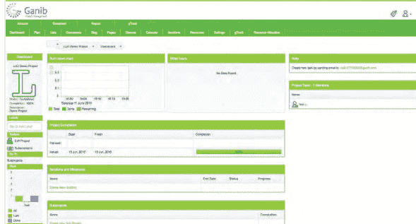

**软件开发是信息技术领域中发展最快的领域之一，但它也有自己的问题。** 存在远程分布式团队，它们在同一代码库上工作。存在变化的优先级和截止日期。存在变化的需求和新不断出现的技术。此外，由于其输出是无形的，因此很难衡量。那么，你如何在取得进展的同时管理这一切？


敏捷开发方法给我们带来了一些希望。敏捷专注于最终产品，而忽略诸如编写代码行数或花费的人工时数等琐碎事项，从而消除了衡量工作量的需求，转而衡量最终产品的完成度。然而，优秀的开源敏捷专注工具却非常匮乏；大多数工具都年代久远，只是经过调整以支持敏捷。有了 Ganib，这种情况将发生改变。Ganib 是一个开源项目管理工具，支持敏捷 `Scrum`、实时跟踪、错误跟踪以及各种其他功能。它还支持与 `Microsoft Project`、`LDAP` 等第三方工具集成，以促进无缝协作。在本教程中，我们将更详细地查看 Ganib 及其功能。但在开始之前，让我们先从安装过程讲起。我们使用 `Ubuntu 14.04` 作为首选的安装平台。

### 01 安装前提条件

Ganib 可以安装在任何主要操作系统平台上。如前所述，我们将 `Ubuntu 14.04` 作为本教程的基础平台。要开始操作，您的系统上应该已安装 `JRE` 和 `MySQL`。也需要 `Apache Tomcat`，但它与 Ganib 安装包一起捆绑提供。所以，让我们首先看看如何安装 `MySQL`。安装过程很简单：更新包索引，安装 `mysql-server` 包，然后运行包含的安全和数据库初始化脚本。只需打开命令提示符并输入以下命令。

```bash
$ sudo apt-get update
$ sudo apt-get install mysql-server
$ sudo mysql_secure_installation
$ sudo mysql_install_db
```

> **右上方**
>
> Ganib 主页，展示了各种功能。中间是燃尽图，其次是计费工时。

完成后，让我们检查一下是否已经安装了 `JRE`。输入

```bash
$ java -version
```

如果您收到“程序 'java' 可以在以下包中找到”的错误信息，这意味着您尚未安装 `JRE`。要安装 `JRE`，首先更新包索引

```bash
$ sudo apt-get update
```

然后安装 `JRE`。

```bash
$ sudo apt-get install default-jre
```

完成此操作后，最好也安装 `JDK`。

```bash
$ sudo apt-get install default-jdk
```

### 02 Ganib 安装

现在从 `SourceForge` 下载最新的 Ganib 安装包。这是链接 `http://sourceforge.net/projects/ganib/files/latest/download/latest.zip`。

将下载的文件解压到您想要安装 Ganib 的位置。您可以使用以下命令完成此操作：

```bash
$ cd <Target Directory>
$ unzip Ganib-5.3_with_jre.zip
$ cd Ganib-5.3_with_jre
```

然后，将数据库脚本文件导入到您的 `MySQL` 安装中。但首先，为 Ganib 创建一个数据库。以下是操作方法：

```sql
$ mysql -u root -p
mysql> CREATE DATABASE ganib CHARACTER SET utf8 COLLATE utf8_general_ci;
mysql> exit;
$ mysql -h localhost -u root -p ganib < database/ganib.sql
```

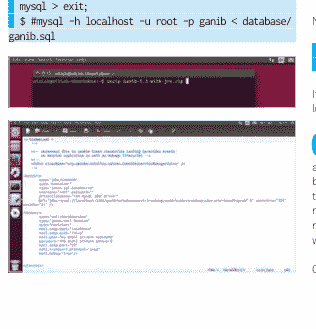

#### 导入/导出 MSP

> 如果您最近切换到 Ganib，并且您的项目计划保存在 `Microsoft Project` 中，您可以轻松地将 `MS Project` 文件导入 Ganib。要做到这一点，请转到计划模块，将鼠标悬停在 `MSP` 链接上。您将看到导入和导出 `MSP` 的选项。您还可以通过将其导出为 `MSP` 格式，与客户/合作伙伴共享您的计划。

接下来编辑 `Tomcat/conf/context.xml` 文件以更改数据库连接属性。

```xml
<Resource name="jdbc/GanibDB" auth="Container"
type="java.sql.DataSource" username="root"
password="" driverClassName="com.mysql.jdbc.Driver"
url="jdbc:mysql://localhost:3306/ganib?autoReconnect=true&useUnicode=true&characterEncoding=utf-8" maxActive="125" maxIdle="25" />
```

不要忘记根据您的设置更改用户名、密码和数据库名称。我们假设您正在本地主机（`localhost`）上安装 Ganib，因此我们还需要更改 `SMTP` 设置。所以，编辑上面相同的文件，并更新以下内容：

> “虽然时间跟踪对于项目至关重要，但手动输入数据也非常耗时”

```xml
<Resource
name="mail.GanibSession"
type="javax.mail.Session"
auth="Container"
mail.smtp.host="localhost"
mail.smtp.auth="false"
mail.smtp.user="username"
password="password"
mail.smtp.port="25"
mail.transport.protocol="smtp"
/>
```

现在，启动 Ganib，请运行

```bash
$ chmod +x Start_Ganib.sh
$ ./Start_Ganib.sh
```

如果一切正常，您将能够通过在浏览器中访问 `localhost:8080` 来访问 Ganib。

### 03 入门


现在 Ganib 已成功安装，并且您可以在浏览器上访问主页，让我们开始介绍其基本用法。首先，我们将创建一个账户。登录到 Ganib 应用程序后，您会被要求提供账户名称和账户描述。提供相关信息并在必填数据提交后，您将会看到新账户的仪表板页面。接下来，我们为项目成员创建用户账户。进入账户后，点击顶部菜单栏上的资源按钮。您可以在此处输入项目成员的名、姓和电子邮件地址。完成后，选择并邀请他们作为成员、领导者或经理。Ganib 允许角色特定的信息访问。例如，经理可以访问的数据不需要向所有项目成员披露。可以为单个用户添加多个角色。通常，用户在项目开始时添加，但也可以在项目过程中添加。


#### 主题和颜色

您可以从页脚或任何您当前所在的网页更改 Ganib 应用程序的主题颜色。有多种选项可用：主要选项有蓝色、橙色或绿色。要做到这一点，只需点击页脚中的“更改主题”，您就会从右侧看到一个颜色选择弹窗。只需选择您喜欢的颜色，主题就会随之改变。

Ganib 为时间表提供用户友好的界面，项目成员可以轻松地更新他们的当前任务，或查看任何数据、周或月的任务。月视图允许您跟踪员工在该月内处理过什么以及工作了多少小时。您可以轻松导航到月中的特定日期以查看任务详情，也可以选择不同的月份或年份。页面上有几种过滤器，可用于查看特定账户和项目的所需数据。

Ganib 时间表还提供了周视图，您可以在其中查看分配给已登录用户的任务以及该周内安排的会议。您可以轻松在周之间导航，并从过滤器中选择日期范围以查看特定周的数据。您可以进一步根据姓名和分配类型过滤数据。


### 04 创建项目

现在我们有一个账户，并且已为该账户分配了项目成员。接下来我们在 Ganib 中创建一个项目。在账户页面上，您将看到创建新项目的图标。点击图标并输入项目名称和描述以创建项目。

项目创建后，下一步是创建一个任务计划，以帮助轻松管理项目。Ganib 提供了一个计划模块，您可以轻松创建任务并更改其日期、依赖关系、截止日期以及将任务分配给任何人（指定小时/天）。当您开始处理任务时，您可以更新每天在该任务上花费的小时数，并附上您想要指定的任何评论。

### 05 时间管理

时间管理是有效管理项目最关键的部分。点击顶部菜单栏上的时间表按钮以访问时间表。

### 06 生成报告

可以使用报告监控项目进度。报告对于预算和估算等目的也是经理非常有效的工具，开发人员可以基于任务状态查看统计信息，并监控他们是否落后于截止日期或按计划进行。Ganib 中有几种详细的报告。要访问报告，请点击顶部菜单栏上的报告按钮。

> “在项目生命周期的几乎所有阶段，文档都扮演着非常重要的角色。文件管理往往是项目经理的一个负担”

创建复杂任务后，由于多人同时处理时产生的混淆，团队之间管理起来非常困难。使用 Ganib，您可以通过将复杂任务分解为简单的子任务来轻松管理它们，这将帮助每个团队成员一次专注于一件事。

有两种主要的柱状图可用。第一种是基于工作的柱状图，描绘了特定任务上已完成工作的百分比。它将任务分类为：完成百分比、逾期任务和未签署任务。第二种是基于成员的柱状图。此柱状图提供了项目中所有资源的详细信息。它甚至根据用户的可用性状态将其分类为在线、活跃和非活跃（离线超过八小时的资源）。

除此之外，还有四个额外的图表可用——计费工时显示每个用户计算出的工时...

日期；`Burn Down` 图显示总工作量、已完成工作量和剩余工作量；`Resource` 图显示总完成工作量、按资源划分的总完成工作量以及分配条形图；以及 `Resource Work Cumulative`（资源工作累计），表示用户按资源划分的总工作量和已完成工作，显示每个日期记录的小时数。这提供了项目绩效的完整概览。

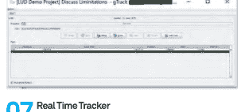

## 07 实时追踪器

尽管时间追踪对项目管理至关重要，但在每个任务后手动输入数据非常耗时，而且开发人员忘记记录工作时长是常见的情况！`gRac1` 是 Ganib 内部的一款桌面应用程序，提供自动化的时间追踪。它可以捕获工作时长、屏幕截图、统计键盘或鼠标活动，然后实时更新 Ganib 中的工作进度。要安装 `gRac1`，请从 `gRac1` 选项卡下载适用于您操作系统的 `jar` 文件并执行。安装完成后，系统会要求您使用 Ganib 账户凭证登录；它将自动从 Ganib 同步您的任务。要处理特定任务，请双击该任务并点击 `Work`（工作）。要暂停计时器，请点击 `Relax`（休息）按钮。如果与 `gRac1` 没有交互，每五分钟会发出一次警告。点击 `Done`（完成）查看您的进度。如果项目中存在技术问题，负责成员可以通过点击 `Scrum` 在 `gRac1` 中撰写帖子，该帖子将对所有项目成员可见。


## 08 文件管理

在项目生命周期的几乎所有阶段，文档都扮演着非常重要的角色。文件管理对项目经理来说往往是一个负担。Ganib 提供了在项目内部保留重要文档的选项，在那里您不仅可以存储文件，还可以优化文件、引入版本控制和层次结构。要访问文档，请点击 `Projects`（项目）顶部菜单栏中的 `Documents`（文档）按钮。

创建相应的文件夹并上传文档到其中。您可以将文档单独或分组添加在不同的文件夹中。现在您可以对这些文档进行检入以进行版本控制，或检出以进行编辑。要更新文件属性，请单选按钮选择特定文件。您可以通过在团队项目的 `Documents`（文档）中上传文件来共享文档。要将文档从一个文件夹移动到另一个文件夹，请选择该文档并点击 `Move`（移动）按钮。您还可以将文档链接到特定任务、交付物、帖子、日历等。如果您愿意，可以删除文档，并从回收站中恢复它们。

## 09 规范管理

`Page`（页面）模块允许您为项目创建 wiki 页面。要创建新页面，请点击顶部菜单栏中的 `Page`（页面）按钮，然后点击 `New Page`（新页面）。您将获得一个输入内容的表单。添加所有内容后提交表单。您将能够看到刚才输入内容的页面。要编辑页面，请前往 `Edit Page`（编辑页面）链接。在更新的同时添加描述性编辑摘要是一个好习惯。这样，团队成员就可以理解 wiki 页面内容任何更改背后的原因。您可以通过 `Changes`（更改）选项查看和控制对 wiki 页面所做的所有更改。只需点击左侧边栏上的 `Changes`（更改）链接。在这里，您可以看到按时间倒序排列的页面更改以及编辑摘要选项中提供的更改描述。


## 10 列表、博客及其他

我们已经介绍了 Ganib 的大多数重要功能，但还有一些其他功能一定会让您的生活更轻松。第一个是称为 `Lists`（列表）的动态表单。您可以创建自定义列表，并根据需要添加不同的字段。要创建列表，首先前往您的项目并点击 `Lists-Design`（列表-设计）。在下一页，点击左侧边栏上的 `New List`（新列表）。另一个有趣的特性是博客。您可以就特定主题创建博客。要创建博客，请点击上方菜单栏中的 `Blog`（博客）。在下一页，您可以添加类似 `Facebook` 的状态更新。

Ganib 还提供讨论板。这允许与项目相关的成员加入讨论并分享他们的观点和建议。讨论被划分为不同的组，每个组都有访问控制。讨论还允许投票。您可以通过顶部菜单栏上的 `Discuss`（讨论）按钮创建或访问讨论。Ganib 还提供迭代模块，以指定项目的一段时间块。不同的软件周期以不同方式使用此模式。迭代可以有前置迭代，意味着在前置迭代完成之前，后续迭代不应开始。


### 设置虚拟化主机和虚拟机

深入了解如何在 `Ubuntu` 上设置虚拟化主机和虚拟机


**`Swayam Prakasha`**

拥有计算机工程硕士学位。`Swayam` 在信息技术领域工作多年，专注于操作系统、网络、网络安全、电子商务、互联网服务、`LDAP` 和 Web 服务器等领域。`Swayam` 为行业出版物撰写了多篇文章，并在行业会议上展示其论文。可通过 `swayam.prakasha@gmail.com` 联系他。


使用`Ubuntu`系统作为虚拟化主机，您可以在单台计算机上运行多个操作系统。您在主机上创建的系统称为虚拟机（`VM`）。虚拟机可以运行`MS Windows`、`Fedora`、其他`Linux`系统，或者几乎任何可以直接在主机计算机架构上运行的其他操作系统。安装虚拟机后，您可以像处理直接安装在计算机硬件上的操作系统一样处理它。值得注意的是，使用虚拟机，复制它们、将它们迁移到其他虚拟化主机以改善性能，或在主机无法操作时配置故障转移到另一主机都变得更加容易。也就是说，使用虚拟机，您可以更有效地利用您的计算机基础设施。

使用您的`Ubuntu`系统作为虚拟化主机，您可以开始构建一个随着您需要更多计算能力而可扩展的计算机基础设施。通过拥有多个主机，您还将能够迁移虚拟机以获得更好的性能，或者关闭那些利用率较低的主机。您可以使用基于内核的虚拟机（`KVM`）将`Ubuntu`配置为虚拟化主机。

那么，将`Ubuntu`作为虚拟化主机运行的最关键要求是什么？您需要确保拥有一个支持虚拟化的`CPU`。您还需要确保计算机有足够的资源来有效运行虚拟机。让我们看看如何检查我们的计算机，以确保我们有作为虚拟化主机运行的合适资产。

首先，检查`CPU`虚拟化支持。请注意，您系统上的处理器必须支持`Intel VT`技术或`AMD-V`虚拟化支持。`Ubuntu`的一个好处是，它有一个命令（即`kvm-ok`），您可以使用它来测试您的`CPU`是否支持虚拟化。您可以按照以下方式安装和使用此命令。

```bash
pswayam@pswayam-VirtualBox:~$ lscpu
Architecture:          x86_64
CPU op-mode(s):        32-bit, 64-bit
Byte Order:            Little Endian
CPU(s):                1
On-line CPU(s) list:   0
Thread(s) per core:    1
Core(s) per socket:    1
Socket(s):             1
NUMA node(s):          1
Vendor ID:             GenuineIntel
CPU family:            6
Model:                 60
Model name:            Intel(R) Core(TM) i5-4210M CPU @ 2.60GHz
Stepping:              3
CPU MHz:               2594.000
BogoMIPS:              5188.00
Hypervisor vendor:     KVM
Virtualization type:   full
L1d cache:             32K
L1i cache:             32K
L2 cache:              256K
L3 cache:              3072K
NUMA node0 CPU(s):     0
pswayam@pswayam-VirtualBox:~$
```

## 资源

- 初学者极客：如何创建和使用虚拟机
  [http://bit.ly/1mFyDm5](http://bit.ly/1mFyDm5)

- 关于虚拟化的一切
  [http://bit.ly/29elxQ](http://bit.ly/29elxQ)

- 设置新的虚拟机
  [http://bit.ly/20eXfm](http://bit.ly/20eXfm)

`$ sudo apt-get install cpu-checker`
`$ sudo kvm-ok`

上述命令的输出指示`CPU`是否支持`KVM`所需的相应`CPU`扩展。

请注意，实际上还有一种更手动的方法来检查虚拟化支持。你可以检查`/proc/cpuinfo`文件中设置的`CPU`标志。使用常用的`grep`命令，你可以在该文件中搜索`Intel-VT`支持(`vmx`)或`AMD-V`支持(`svm`)。可以按以下方式操作：

`$ grep -E'(svm|vmx)' /proc/cpuinfo`

在上述命令的输出中，你应该只看到`vmx`或`svm`标志，而不应两者同时出现。如果你没有从`grep`命令中得到任何输出，这意味着你的电脑`CPU`不支持`KVM`虚拟化。

接下来，你需要在`BIOS`中启用虚拟化支持。如果你认为你的电脑支持虚拟化，但相应的标志未设置，那么你可能需要在`BIOS`中打开虚拟化支持。为了做到这一点，首先重启你的电脑，并在看到第一个`BIOS`界面时中断引导过程。在你看到的`BIOS`界面中，寻找类似`CPU`或`Performance`（性能）的标题（具体因制造商而异）并选择它。然后你需要寻找诸如`Intel Virtualisation Tech`这样的虚拟化选项并将其启用。一旦你更改了虚拟化的`BIOS`设置，请保存并确保关闭电脑电源，以使`BIOS`设置生效。

如果可能，请尝试使用`64`位计算机作为你的虚拟化宿主。某些操作系统不支持在`32`位系统上使用`KVM`。`32`位`KVM`宿主机的一个缺点是，每个虚拟机限制为`2GB`内存。为了检查你的电脑是`32`位还是`64`位，你可以检查`CPU`标志。

`$ sudo egrep lm /proc/cpuinfo`


`lm`标志代表长模式(`long mode`)。如果存在此标志，则可以肯定该处理器是`64`位处理器。

检查可用的`RAM`和磁盘空间。由于你将在一台物理计算机上运行多个操作系统，所需的`RAM`和磁盘空间量可能需要成倍增加。确保你有足够的内存来支持宿主机和你计划同时运行的所有虚拟机。你可以使用`free`命令来检查可用内存：

`$ free -m`


在评估需要多少内存时，你可以使用如`top`等命令来了解你需要多少内存。

对于磁盘空间，你需要确保将存储虚拟机所使用的磁盘镜像的目录中有大量可用空间。默认情况下，该位置是`/var/lib/libvirt/images`。你可以尝试使用`df`命令来检查该位置的可用磁盘空间。

请注意，`/var/lib/libvirt/images`目录只有在安装`libvirt-bin`包后才会创建。因此，如果尚未安装，请使用`/var/lib`目录，如下所示：

`$ df -h /var/lib`

## 虚拟机概览

虚拟机可以被认为是一种创建虚拟计算机系统的计算机程序。这个虚拟计算机作为一个进程运行在你当前操作系统的一个窗口中。你可以在虚拟机内启动一个操作系统安装光盘（或`Live CD`），操作系统会被欺骗，以为它正在一台真实计算机上运行。它将像在真实的物理机器上一样进行安装和运行。每当你要使用该操作系统时，你可以打开虚拟机程序，并在当前桌面上的一个窗口中使用它。这里需要注意的是，虚拟机会带来一些开销，因此它们不会像将操作系统安装在真实硬件上那样快。

> “虚拟机可以运行`Windows`、`Fedora`、另一个`Linux`系统或几乎你想要的任何其他操作系统”

### 教程：虚拟化

为了能够执行`KVM`虚拟化，你需要添加三个软件组件。它们是：

- `libvirt` – 这为虚拟化软件提供接口
- `qemu` – 这为虚拟机模拟`PC`硬件
- `bridge-utils` – 这提供了一种通过宿主将虚拟机的网络进行网桥连接的方式

然后你可以运行以下`apt-get`命令，这样`KVM`虚拟化所需的基本软件就会被安装：

`$ sudo apt-get install libvirt-bin kvm bridge-utils qemu-common qemu-kvm qemu-tui`

除了`KVM`虚拟化所需的基本软件外，你还可以添加一个用于管理虚拟机的图形界面。使用以下命令安装用于管理虚拟机的`virt-manager`图形软件：

`$ sudo apt-get install virt-manager`

当`virt-manager`安装完成后，我们可以选择从图形界面或命令行来管理我们的虚拟机。在下一步中，我们需要确保我们要用来管理虚拟化的用户账户已配置好相应权限。

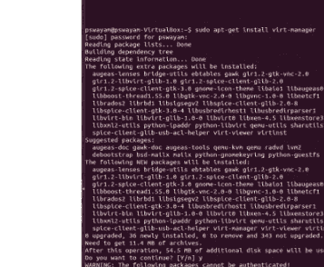

如果你用来管理`KVM`的用户账户不是`libvirtd`组的成员，那么需要将该用户添加到该组中。例如，如果你想要用户账户`james`来管理虚拟化，那么你可以如下图所示将该用户添加到`libvirtd`组：

`$ sudo adduser james libvirtd`

你可能需要重启系统，以确保所有必要的服务都在运行，并且你添加到`libvirt`组的用户账户已登录并准备就绪。


虚拟机管理器（`virt-manager`）图形界面是一个管理 KVM 虚拟机的非常流行的工具。在使用诸如 `virt-install`（安装新的虚拟机）或 `virt`（虚拟机）等任何命令之前，尝试一下 `virt-manager` 是个好主意。它可以用直观的方式引导你创建第一个虚拟机。开始使用 `virt-manager` 之前需要关注的几件事是 ISO 镜像 – 你需要下载你想要安装或作为虚拟机运行的操作系统的 ISO 镜像，以及启动 `virt-manager` – 你可以作为已添加到 KVM 组的用户从命令行运行 `virt-manager`。你应该能够看到虚拟机管理器窗口。

管理虚拟机的另一种有用方式是通过命令。你可能需要命令来管理虚拟机的原因有很多种 – 最重要的原因可能是你想运行命令从 shell 脚本中与虚拟机交互。要开始，你可以使用 `virt-manager` 命令来安装虚拟机。使用 `virt-clone`，你可以克隆现有的虚拟镜像。对于管理虚拟机，你可以使用 `virsh` 命令。`virsh` 命令将列出关于虚拟机的信息，并有助于虚拟机的启动、停止和重启。

创建虚拟机你所需要做的就是把所需的选项传递给 `virt-install` 命令。注意，在你使用 `virt-install` 之前，你需要创建一个存储镜像，这可以通过使用 `qemu-img` 命令来完成。使用 `qemu-img` 命令，你可以创建虚拟机可作为其存储介质使用的镜像文件。注意，对于安装器来说，这些镜像看起来像普通的硬盘。让我们快速看一下支持的镜像格式。

- `Raw` – 这是 `qemu-img` 的默认镜像类型。它是最简单的镜像类型，通常用于我们需要将镜像导出到其他虚拟环境时

### 虚拟机程序

有多种虚拟机程序供你选择。最流行的是 VirtualBox 和 VMware Player。`VirtualBox` 被广泛使用，因为它是开源且完全免费的。你也可以在 Linux 上使用 `VMware Player` 作为免费且基础的虚拟机工具。最佳实践是先尝试 `VirtualBox`，如果它没有正常工作，你可以尝试 VMware Player。

+   * `Qcow2` – 这种格式的一个有趣之处在于，它不会立即消耗所有分配的空间，而是根据需求逐渐增长。

+   * 其他格式 – `qemu-img` 支持的其他格式包括 `vdi`、`vmdk`、`vpc` 等。你可以在命令提示符下输入 `man qemu-img` 以了解这些映像类型的更多详细信息：

```bash
$ sudo qemu-img create -f qcow2 \
    -o preallocation=metadata /var/stuff/mine.qcow2 8G
```

在上面的示例中，请注意 `qemu-img` 正在 `/var/stuff/mine.qcow2` 创建一个 qcow2 映像。我们为映像分配了 8GB 的磁盘空间。可以使用 `preallocation=metadata` 选项来提高映像增长时的性能。

一旦创建好 qcow2 映像，你可以使用 `qemu-img` 配合 `check` 选项对其进行一致性检查，如下所示：

```bash
$ sudo qemu-img check /var/stuff/mine.qcow2
```

在某个时刻，你可能想检查一下你的虚拟机正在消耗多少空间。这可以通过使用 `qemu-img` 的 `info` 选项来完成。这在下述命令中显示：

```bash
$ sudo qemu-img info mine.qcow2
```

## `virt-install`

`virt-install` 是一个功能非常强大的创建新虚拟机的工具。在命令行中，你可以识别虚拟机环境的各种属性。请仔细查看该命令的手册页。

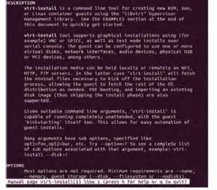

这些是你可以使用 `virt-install` 命令的其他各种选项：

| 选项 | 功能 |
| :--- | :--- |
| `--connect` | 该选项识别虚拟化服务在 hypervisor（管理程序）上的位置。 |
| `--name` | 这代表虚拟机的名称 |
| `--disk_path` | 这提供磁盘映像位置及其格式的详细信息 |
| `--noautoclose` | 该选项防止自动打开到虚拟机的控制台 |
| `--keymap=en-us` | 这将键盘语言设置为美式英语 |

你还可以通过参考其手册页来查看 `virt-install` 命令可用的其他选项的详细信息。一旦 `virt-install` 命令启动，你就可以从桌面打开一个应用程序来查看安装进度。你可以使用 `virt-manager` 和 `virt-viewer` 命令来查看你的虚拟机控制台。

一旦虚拟机成功安装，下一步就是你使用 `virsh` 命令来管理虚拟机。

`virsh` 命令提供了一种管理虚拟机的好方法。你可以使用 `virsh` 命令查看哪些虚拟机正在运行，并启动、停止和暂停虚拟机。

```bash
$ virsh help
```

通过这，我们可以查看 `virsh` 的子命令列表。

```bash
$ virsh list
```

这显示当前正在运行的虚拟机。

```bash
$ virsh version
```

这提供当前的版本信息。

```bash
$ virsh hostname
```

这显示 hypervisor 的主机名。

```bash
$ virsh shutdown vm1
```

关闭虚拟机 `vm1`。

```bash
$ virsh destroy vm1
```

然后你需要立即停止指定的虚拟机。

请注意，`virsh` 命令还有很多其他选项可供使用，以便你可以有效地管理你的虚拟机。如果你想查看更多关于其他选项的详细信息，请参阅 `virsh` 命令的手册页。

### Go 函数教程


`Mihalis Tsoukalos`

Mihalis Tsoukalos 是一名 UNIX 系统管理员、程序员（UNIX 和 iOS）、DBA（数据库管理员）以及数学家。他自 1993 年以来一直在使用 Linux。你可以通过 `@macteosouk`（Twitter）以及他的网站 `mtsoukalos.eu` 联系他。

**资源**

- 如 `Emacs` 或 `vi` 这样的文本编辑器
- `Go` 编译器

### 探索、创建和使用 Go 包

学习如何开发和使用 Go 包

**本教程将讨论创建和使用 Go 包。**

包为分组相关的函数和变量并将它们作为一组使用（而不是单个组件）提供了一种非常方便的方式。其他编程语言将包称为模块或库。包的主要目的是使软件的设计和实现更容易理解和维护。

请特别关注本教程，因为迟早你会需要创建和分发你自己的 Go 包。此外，确保你彻底理解关于 Go 环境变量的部分，因为正确使用它们会让你的生活更轻松。

Go 系列的下一个教程将讨论 Go 中的文件 I/O，所以请保持关注！

### 关于 Go 包

以下代码是经典的 "Hello World!" 程序的 Go 版本：

```go
package main
import "fmt"
func main() {
	fmt.Println("Hello, world!")
}
```

如你所见，它的第一行是 `package main`。简而言之，所有 Go 代码都必须以包的形式交付——如果你在一个名为 `main` 的包中发现了一个名为 `main()` 的函数，那么你就在处理一个可执行程序；否则，你就有了一个共享库。换句话说，自主 Go 程序和 Go 库的区别在于 `main` 包中是否存在 `main()` 函数，这也是可执行程序的入口点，就像 C 中的 `main()` 函数一样。

被称为导入路径的单个字符串标识每个 Go 包。如你所见，导入路径也可以是指向互联网地址的 URL。记住这一点很重要：Go 语言的规范与导入路径的解释无关——这项工作留给 `go` 工具。

Go 包的源代码（可以包含多个文件）可以在一个以包名称命名的目录中找到，唯一的例外是 `main` 包，它可以有任何名称。

### 标准 Go 包

Go 附带了大量的标准包，因此在创建你自己的包之前，请确保 Go 没有现有的包来执行你任务的全部或大部分。**图 1** 显示了标准 Go 包列表的一小部分，可在 `golang.org/pkg` 找到。

两个非常流行的 Go 包是 `fmt` 和 `io`。标准 Go 库还包括 `math`，它提供


# The Go Programming Language

# The Go Programming Language

- Packages
  - Test
  - Import
  - Export
  - Interface
  - Documentation
  - Build Tags


# Go 包概览

- Packages and other information
- Packages: Go's Package
  - Access
  - Build
  - Cgo
  - Go
  - Imports
  - Interfaces
  - Lint
  - Names
  - Package
  - Versioning


左 你可以访问 [golang.org/pkg](https://golang.org/pkg) 查看标准 Go 包列表

数学函数和常量；`net`，支持可移植的 TCP 和 UDP 连接；`http`，提供 HTTP 服务器和客户端实现；`url`，允许你轻松解析 URL；`os` 包，系统操作的可移植接口，以及 `syscall`，低级系统调用的接口。最后，`time` 包支持时间和日期操作，`crypto` 包用于加密操作，`compress` 包实现常见的压缩算法。

为了使用 `fmt` 包，你应该在程序中包含以下代码：

```go
import "fmt"
```

如果你希望使用两个或更多包，你可以按以下格式编写代码：

```go
import (
	"fmt"
	"io"
)
```

## Go 环境变量

`go` 工具使用各种环境变量，在开发非平凡的项目和模块时，你应该了解这些变量。**图 2**（跨页）显示了 `go help environment` 的输出，它提供了关于可用 Go 环境变量的信息。

如果你没有定义任何 Go 环境变量并尝试执行 `go install`，该命令将失败并出现类似以下的错误消息：

```
$ go install simple.go
go install:: no install location for go files
listed on command line (GOBIN not set)
```

最重要的 Go 环境变量是 `GOPATH`，它指定你的工作区位置。通常，这是你在开发 Go 代码时需要定义的唯一环境变量。

放置所有这些类型定义的最佳位置是 `.bashrc` 或 `.profile`，这意味着环境变量每次登录你的 Linux 机器时都会生效。如果你没有使用 Bash shell（默认的 Linux shell），那么你可能需要使用另一个启动文件 - 查看你喜爱的 UNIX shell 的文档以了解应使用哪个文件。

## 一个简单的包

本节将教你如何创建一个小包。对于教程的这一部分，你需要将 `GOPATH` 变量的值设置为当前目录：

```
$ export GOPATH='pwd'
$ echo $GOPATH
/home/mtsukoi/docs/article/work1/goPack/LUD.181/
code
```

你还需要创建以下目录和文件：

```
$ mkdir src
$ vi src/simple/simple.go
$ mkdir bin
$ export PATH=$PATH:$GOPATH/bin
$ src/useSimple
$ vi src/useSimple/useSimple.go
```

保存为 `simple.go` 的 simple 包的 Go 代码如下：

```go
package simple

import "fmt"
const Version = "1.2"
func Main() {
	fmt.Printf("this is the main function of the
```

## Go 文档

Go 提供了一种非常便捷的文档系统，由 `godoc` 命令行工具支持，该工具可以帮助你查找有关可用函数的信息。为了了解 `fmt.Println()` 的更多信息，你应该输入以下命令：

```
$ godoc fmt
Println
```

**图 6**（第 52 页）显示了上述命令的输出以及下一条命令输出的一小部分，该命令打印有关整个 `fmt` 包的信息。

```
$ godoc fmt
```

www.linuxuser.co.uk 49

### Go 函数教程

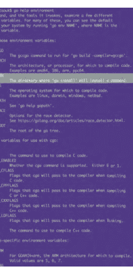

```go
package main

func Foo(n int) {
	for i := 0; i < n; i++ {
		fmt.Printf("This is the foo function")
	}
}

func Bar(x, y int) int {
	return x + y
}
```

```
$ go build simple
$ go install simple
$ ls -1 pkg
total 4
drwxr-xr-x 2 mtsouk mtsouk 4096 Jun  3 00:18
linux_amd64
$ ls -l pkg/linux_amd64/
total 4
-rw-r--r-- 1 mtsouk mtsouk 3756 Jun  3 00:18
simple.a

$ go run /src/useSimple/useSimple.go
useSimple.go:5:2: cannot find package "simple" in
any of:
	/usr/lib/pkg/src/pkg/simple (from GOROOT)
	/home/mtsouk/docs/article/working/goPac.
LUD168/code/src/simple (from GOPATH)
```

```go
package main

import (
	"fmt"
	"simple"
)

func main() {
	fmt.Printf("This is the main function of the
main package\n")
	simple.Main()
	simple.Foo(2)
	fmt.Printf("Calling simple.Bar: %d\n", simple.
Bar(2, 3))
}
```

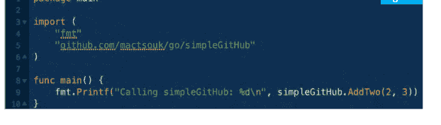

要在 `./bin` 目录中编译 `useSimple.go` 的可执行文件，需要执行以下步骤：

```
$ go install useSimple
$ ls -l -n bin/useSimple
-rw-r--xr-x 1 mtsouk mtsouk 1824408 Jun 3 00:38
bin/useSimple
```

运行 `useSimple` 会产生以下输出：

```
$ useSimple
This is the main function of the main package!
This is the main function of the single
package!
This is the foo function!
Calling simple.Bar: 5
```

如果由于某种原因导入了包但忘记使用它，Go 编译器将生成错误消息并拒绝完成编译过程：

```
$ go build useSimple
# useSimple
src\useSimple\useSimple.go:5: imported and not used: "simple"
```

如果您希望忽略此类消息，可以使用以下方式的导入语句：

```
import _ "simple"
```

使用 `"_"` 作为包标识符将使编译器忽略包未被使用的事实——绕过编译器的唯一合理原因是，您希望在未使用的包中执行 `init` 函数。继续阅读以了解更多关于 `init` 函数目的的信息。

请确保您完全理解 Go 环境变量的构建过程，然后再继续本教程的其余部分。

## init 函数

每个 Go 包都可以有一个名为 `init` 的函数，该函数在执行开始时自动执行。以下代码说明了 `init` 函数的使用：

```go
package initFunction

import "fmt"

func main() {
	fmt.Printf("init function executed!\n")
}

func Foo() {
	fmt.Printf("Foo function executed!\n")
}
```

相关的 Go 代码保存为 `initFunction.go`；因此，

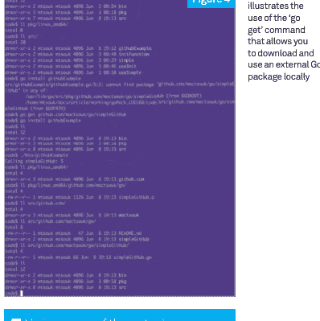

## go 工具的各种用法

`go` 工具可以针对包文件执行更多操作。`single` `move` 目标文件到 `clean` 命令，该命令允许您浏览包源目录中的目标文件。


您需要使用 `-f` 标志来指定要清理的程序或包。如果您不确定 `go clean` 的效果，可以将其与 `-n` 标志一起使用；这会告诉程序打印出它将执行的命令，而实际上并不执行它们。最后，`-x` 标志告诉程序打印它执行的命令。当您要传输项目到其他机器时，`go clean` 命令特别有用。

```
$ go clean -n -x github.com/mtsouk/go/simpleGitHub
```

使用它将需要如下代码，该代码位于 `useInit.go` 中：

```go
import (
	"fmt"
	"initFunction"
)

func main() {
	fmt.Printf("Hello\n")
}
```

构建并执行 `useInit.go` 需要以下步骤：

```
$ mkdir src/initFunction
```

# Go 函数

## 教程

`multiple.go` 文件使用 `simple.go` 包，该包位于另一个目录中，借助 `GOPATH` 变量实现。

`godoc` 工具可以提供有关使用标准 Go 包函数的帮助。

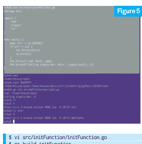

```
$ vi src/initFunction/initFunction.go
$ go build initFunction
$ go install initFunction
$ mkdir usr/usrInit
$ vi src/usrInit/useInit.go
$ go install usrInit
```

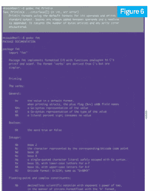

运行上述代码将生成以下输出，您可以看到 `init` 函数在没有显式调用的情况下被执行：

```
$ useInit
init function executed!
Hello!
```

然而，`init` 函数并非用于打印无聊的信息；它主要用于执行重要的初始化任务，例如连接到数据库服务器。

### 使用外部 Go 包

有时包位于互联网上，您希望通过指定其互联网地址来使用它们。假设在 `GitHub.com` 的某处有一个名为 `simpleGitHub` 的 Go 包，其中包含一个有用的函数。`simpleGitHub` 的确切位置将是 `https://github.com/mnactsouk/go/simpleGitHub`。您可以在自己的 Go 程序中按如下方式使用它：

```
import "github.com/mnactsouk/go/simpleGitHub"
```

之后，您需要借助 `go get` 将整个 `simpleGitHub` 包下载到本地机器：

```
$ go get github.com/mnactsouk/go/simpleGitHub
```

方便的是，一旦执行 `go install githubExample.go` 命令，`go` 工具将自动编译所有必需的包，您可以通过查看 `pkg` 和 `src` 目录的内容来验证这一点。当使用 `go get` 检出新包时，会在 `src` 内部创建一个目标目录，其名称与完整的导入路径相同。

您可以在 `githubExample.go` 中找到完整代码 – 您可以在 **图 3**（前一页）中查看其源代码。**图 4** 显示了执行 `go install` 前后 `src` 和 `pkg` 目录的内容。

请注意，包名 `simpleGitHub` 在 `githubExample.go` 的代码中使用，而不是其完整路径。

使用每个下载的外部包并非强制性的 – 您可以只 `go get` 一个 Go 程序并检查其代码，而实际上不使用它。

### 私有变量和函数

本节将讨论如何定义和使用私有变量和函数。私有变量和函数与公共变量的区别在于私有变量和函数只能在内部使用。控制哪些函数和变量是公共的也被称为封装。

### 包的优势

包使大型软件系统的设计、实现和维护变得更加容易和简单。此外，它们允许多个程序员在同一项目上工作，而不需要任何重叠。

为项目 A 实现的良好包可以在不同的项目中重用，无需额外工作。重用现有包的好处在于该包已经过测试；因此，与新开发的包相比，现有包包含更少的错误和 bug。此外，包允许您在其他包中使用相同的函数和变量名称，因为每个包都有自己的作用域。

简而言之，开发和包的使用只会为您的软件系统带来好处，而不会引入任何风险。因此，如果您正在开发大型软件系统，您绝对应该将功能划分为包，以便您也可以在其他项目中重用它们。

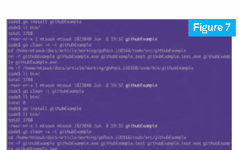

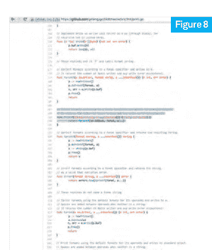

Go 规则是，以大写字母开头的函数、变量、类型等是公共的，而以小写字母开头的函数、变量、类型是私有的 – 这是一条简单的规则，体现了管理 Go 的简单性。此规则不影响包名称。所以，您现在应该理解为什么打印函数被称为 `fmt.Printf()` 而不是 `fmt.printf()`。

请记住，同样的规则适用于结构的各个字段 – 小写字段被认为是私有的；因此，它们只能由包的其他成员使用。

因此，如果您将 `simple` 包中 `Foo` 函数的名称更改为 `foo`，并在 `useSimple.go` 中做同样的事情，那么 `go` 工具将生成以下错误消息：

```
$ go build useSimple
# useSimple
srcUseSimple/useSimple.go:11: cannot refer to unexported name simple.foo
srcUseSimple/useSimple.go:11: undefined: simple.foo
```

现在很容易理解，您不能直接调用包的 `init()` 函数，因为它是私有的！

### 使包对所有用户可用

到目前为止，您已看到如何使包对单个用户可用。本节将向您展示如何在一个每个人都能查看和使用它的位置安装包，以在整个 Linux 系统上实现此目的。

解决方案很简单，包括使用 `GOPATH` 环境变量。只要您可以在 `GOPATH` 中使用包的路径，您就可以在整个系统范围内使用该包。以下命令显示了一个使用 `simple.go` 的简单示例：

```
$ echo $GOPATH
/home/mitsouk/myGo:/home/mitsouk/docs/article/
working/goPack_LU0168/code
$ go run src/multiple/multiple.go
# cwd: /home/mitsouk/myGo
Calling simple.Bar: 8
```

如果您使用不同的 `GOPATH`，那么 `go` 工具将无法为您找到所需的包，这意味着它将生成一个熟悉的错误消息：

`go clean` 命令允许您通过移除不必要的可执行文件和目标文件来清理您的 Go 项目

由于 Go 是一种开源编程语言，您可以在互联网上找到所有 Go 标准包的 Go 代码

#### 标准 Go 包存储在哪里？

由于 Go 是一种开源编程语言，您可以在互联网上找到所有标准 Go 包的源代码。阅读好的代码被认为是良好的实践，而标准 Go 包的代码也不例外。即使您没有考虑编写类似的东西，阅读标准 Go 包的代码也会给您很多想法。您可以在 `golang.org/ref` 或 `github.com/golang/go` 找到 Go 代码。

图 8 显示了 `fmt` 包中 Go 代码的一小部分。

此外，您可以在 `/usr/lib/go/src/pkg` 找到标准包的代码。

```
$ echo $GOPATH
/home/mitsouk/myGo
$ go build multiple
src/multiple/multiple.go:5:2: cannot find package "simple" in any of:
/usr/lib/go/src/pkg/simple (from $GOROOT)
/home/mitsouk/myGo/src/simple (from $GOPATH)
```

`multiple.go` 文件的内容可以在图 5 中看到。

您在 `GOPATH` 中放置各种路径的顺序很重要，因为只使用第一个匹配项。因此，如果您有多个具有相同名称的 Go 包（这是不推荐的），则只使用该包的第一匹配项。请记住，这可能是恼人 bug 的根源！

因此，通过这种方式，您可以让 Linux 机器的用户使用相同的 Go 包，同时允许每个开发者开发自己的包。

### 探索内部技术

`www.gadgetdaily.xyz`


# 小玩意

在所有正规报刊亭和超市均有售

现已上市

- 50件科技冲动消费好物
- 拍出大片质感照片
- 家庭影院搭建指南


## 立即购买本期

纸质版请访问 `www.imagineshop.co.uk`

数字版请访问 `www.greatdigitalmags.com`

## 程序员与创客的必备指南

## 实战

### 树莓派

76 我们将从零开始构建你的探险机器人，详细讲解每一步骤，包括焊接和安装所有组件


# 目录

- 64 基于手势的电视遥控器
- 66 树莓派配合 `Arduino`
- 68 用树莓派改造玩具
- 72 使用 `distcc` 构建软件包
- 76 构建探险机器人：第二部分

## 专题

### 创客十大最佳板卡

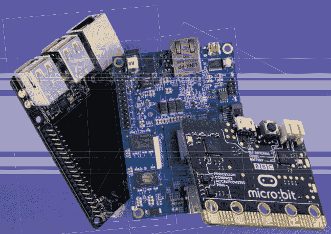

### 创客十大最佳板卡

来看看这些正在挑战树莓派地位的微计算机

`关于树莓派，我们还能说什么呢？` 嗯，不多。事实上，这款微计算机在全球销量已超过700万台，这足以证明它有多出色。但随着树莓派每一次新更新、新增配件和扩展功能的展示，一整套新的竞争对手也应运而生。虽然其中许多在性能上确实无法匹敌树莓派，但仍有几款确实吸引了目光。我们许多人寻找树莓派替代方案的主要原因，是希望获得提供独特功能组合的产品。这一代新型微计算机通常配备了更快的处理器、更好的接口选择以及更强大的 `GPU`。因此，如果你的下一个项目需要一点动力提升，这些树莓派的替代品中也许就有一款适合你。

#### `CHIP`

£7/$9 • `Getchip.com`

### 最适合

追求性价比

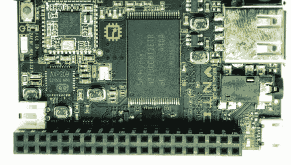

### 规格

- `处理器：` 1GHz 全志 `A13 ARM` 芯片
- `图形：` `Mali400 GPU`，支持 `OpenGLES` 2.0 和 `OpenVG` 1.1
- `内存：` 512MB `DDR3`
- `存储：` 4GB `NAND` 闪存
- `连接性：` `Micro-USB`、`USB` 2.0、蓝牙、`Wi-Fi`、复合视频、麦克风输入、音频输出、`HDMI` 以及通过适配器实现的 `VGA` 输出

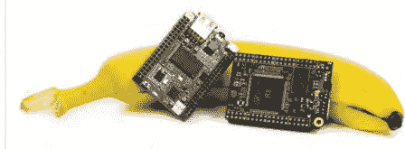

如今9美元能买到什么？在这种情况下，你能买到一款性能 surprisingly 强大的微计算机。在成功完成一场众筹活动（筹集资金刚超过200万美元）之后，`CHIP` 包含了你可能需要的所有基本计算功能。除了核心的 `Wi-Fi` 和蓝牙功能外，它还内置复合视频支持，并且有经济实惠的适配器可用于 `VGA` 连接。对于那些编程知识较少的人来说，它也是一站式解决方案，因为每台设备都预装了 `Scratch`——一个通过游戏和动画教授基础编程的程序。

但如果你正在寻找更高级的东西，`CHIP` 依然有足够的能力跟上。凭借 1GHz 处理器和 512MB 内存，它有足够的空间运行完整软件并处理完整 `GUI` 的需求。当然，使用 `CHIP` 扩展的空间也很大，因为完整的电路设计图可以免费下载和使用，这意味着创建你自己的 `CHIP` 变体是完全可能的。`CHIP` 唯一的限制是你的想象力，但你梦想中创建的那些项目在这台 9 美元的电脑上都是可行的。

## 专题

### 创客十大最佳板卡

#### `PANDA BOARD ES`

£150/$182

`Pandaboard.com`

在本文介绍的所有板卡中，`PandaBoard ES` 是少数几款专为开发人员而非最终用户量身定制的板卡之一。其 `OMAP 4450` 处理器非常适合希望为移动设备开发的人员，并附带 `OpenGL` 2.0 图形功能以便进一步折腾。可选方案的范围令人震惊，支持 1080p 视频、`HDMI` 输出以及全尺寸 `SD` 卡插槽仅仅是这款微计算机能力的一瞥。


最适合

开发人员


#### `BBC: MICRO:BIT`

£13/$17 `Micro:bit.co.uk`


最适合

儿童

由于 `Micro:bit` 生产延迟，`BBC` 这款口袋大小的微计算机终于在 2016 年上市。虽然它最初作为教育工具分发给英国所有七年级学生，但现在它是市面上更受欢迎的计算机之一。虽然其设计可能与本文介绍的其他许多板卡略有不同，但功能类似。它内置蓝牙，五个传感器端口，电源来自两节 `AAA` 电池。`Micro:bit` 受欢迎的关键原因之一是其基于网络的编辑环境，这允许新晋程序员无缝切换不同的编程语言——这是许多领先板卡所缺乏的。

32位 `ARM` 处理器可能在火力上不如树莓派强大，但在板载可编程选项方面，它超出了极限，甚至包括支持将 `Micro:bit` 连接到现有的树莓派或 `Arduino` 板。如果你能买到一台，`Micro:bit` 是一款功能强大的全能板卡，专为新手和专家打造。


#### `UDO O NEO`


£38/$49.90 • `Udoo.org`

虽然 `UDO O NEO` 看起来像是一款相当标准的微计算机，但它实际上是少数几款真正试图采取不同做法的板卡之一。其主要独特之处在于其异构处理器，它将 1GHz `Cortex A9` 处理器的性能与额外的 `Cortex M4` 处理器的性能相结合。对于最终用户，它为你的项目提供了强大的 `CPU`，拥有足够的能力轻松完成大规模项目。根据我们与该板卡相处的时间，由于集成了跟踪系统、三轴加速度计、磁力计和数字陀螺仪，它是试验传感器的最佳选择。


### 连接性

一个 `USB` 2.0 `Type A` 端口和一个 `USB OTG`（`micro-AB` 连接器），加上快速以太网 `RJ45` ~ 10/100Mbps，`Wi-Fi` 802.11 b/g/n，`Direct Mode SmartConfig` 和蓝牙 4.0 低功耗

### 数字 I/O 引脚

32 个扩展 `GPIO`（`A9` 专用）；22 个 `Arduino GPIO`（`M4` 专用）。通过标准 `Arduino` 引脚布局兼容 `Arduino`；兼容 `Arduino` 扩展板

### 处理器

飞思卡尔® `i.MX 6Solo-X` 应用处理器，具有嵌入式 `ARM Cortex-A9` 核心和 `Cortex-M4` 核心


#### `SOLIDPC Q4`

£108/$139.99 • `Solid-run.com`

作为新上市微计算机之一，`SolidPC Q4` 可以自豪地宣称它是首批搭载 `Intel Braswell` 处理器的微计算机之一。对于最终用户，它提供了连接显示器和键盘的所有工具，而开发人员可以试验 `Braswell` 芯片的可用性。其他功能包括 `microSD` 卡接口、双以太网端口以及对两个显示器的 `DisplayPort` 支持。`SolidPC Q4` 的库存相对较少，所以要抢到一台你需要动作快。


#### `MINNOWBOARD MAX`

£108/$139.95 • `Minnowboard.org`


英特尔的 `MinnowBoard MAX` 确实全力以赴地展示其开源资质。

该板卡的完整原理图可供下载，英特尔的板载图形芯片组向黑客开放，让他们可以真正挖掘该单元的能力。鉴于此，它是少数使用称为 `Lures` 的扩展板来帮助扩展其功能的板卡之一。它使用英特尔的 `Atom` 处理器来保持平稳运行，因此你在将其连接到大多数现代 `Linux` 发行版时不会有任何问题。

这是英特尔板卡的第二代产品，它将原始产品升级为 64位 `Intel Atom E3800 (Bay Trail-I)` 处理器，同时将板卡占地面积缩小了近一半。


最初的`MinnowBoard`有些笨重；这种更小的外形使`MAX`更适合广泛的项目。但请注意，`Linux`内核的更新意味着`GPIO`基地址发生了变化——你需要检查你正在使用的内核版本，以确保正确分配引脚。

> “英特尔的板载图形芯片组向黑客开放，让他们可以真正挖掘该单元的能力”


上方`MinnowBoard MAX`拥有大量输入和输出，包括`GPIO`接头

上方 板卡背面布满了众多芯片，以及一个高速扩展接头

#### OMEGA（欧米伽开发板）

£15/$19.99 • `Onion.io`


尽管`OMEGA`的尺寸只有树莓派的四分之一，但在物联网开发方面，它的表现却优于树莓派。得益于其制造商自家的云服务系统`Onion Cloud`的支持，将开发板连接到互联网并创建物联网应用程序变得轻而易举。当然，其开源的特性也让你能够探索其他用户的项目。虽然`Atheros AR9331`处理器并非家喻户晓的名字，但它提供了足够的算力来运行完整的`Linux`操作系统，同时也支持众多主流编程语言，如`Python`、`PHP`和`Ruby`。

### 最适合

物联网

#### JAGUARBOARD

£61/$79 • `Jaguarboard.org`


树莓派与`JaguarBoard`之间最大的区别在于，后者基于`x86`架构，通常能带来更好的性能。对于习惯于`x86`架构的用户来说，它还提供了一块可扩展性强的小型开发板，且无需了解`ARM`等嵌入式系统知识。`Intel Atom Z3735`处理器让这种性能提升更加明显，它能够轻松运行大多数桌面程序，并支持许多流行的`Linux`发行版。

### 最适合

`x86`架构

# 创客最佳的 10 块开发板

#### ODROID C2

£31/$40 · `Hardkernel.com`


### 最适合

原始算力

`ODROID-C2`的核心在于强大的原始算力，这也是为何它已经拥有一个活跃的社区，并开发出了一些令人惊叹的项目。其主频为`2GHz`的`ARM Cortex-A53`处理器搭配`2GB`内存，性能堪比许多小型笔记本电脑。它还提供了许多其他开发板不具备的额外功能。红外接收器和`ADC`（模数转换）功能非常适合用于新项目的实验，而`40`针`GPIO`接口则实现了开发板与其他物理设备之间的无缝连接。它甚至自诩为市面上最高效的`64`位开发板。术语里就藏着答案——它的价格无法与`$9`的`CHIP`竞争，但`CHIP`的处理能力只有一半。然而，`ODROID-C2`的“马力”完全体现在性能上——若要安装非预装的`Ubuntu 16.04`或`Android 5.1 Lollipop`发行版，你需要一个`microSD`卡或`eMMC`模块。

#### BEAGLEBONE BLACK

£37/$55 · `Beagleboard.org`


### 最适合

初学者

对于`BeagleBone Black`而言，简洁是关键，从初始设置过程到连接外部设备，一切都尽可能做到无痛。它宣称你可以从零开始在十秒内进入`Linux`系统，并在五分钟内开始在该开发板上进行开发。与`MinnowBoard MAX`类似，`BeagleBone Black`是前代产品的继任者，它摒弃了原版的一些功能并新增了更多功能——值得注意的是增加了`HDMI`视频输出、加倍的`RAM`以及超越关键`1GHz`门槛的改进型处理器。在创意项目开发方面，它也是不错的选择，拥有总共`92`个连接点供你用于项目，这既吸引新手也吸引资深用户。但如果你缺少灵感，`BeagleBone`背后有一个活跃的开发者社区，其中列举了大量你可以尝试的初学者项目。

## 速览


| | `CHIP` | `PANDA BOARD ES` | `micro: bit` | `UDOONEO` | `SOLIDPC Q4` | `MINNOW BOARD MAX` | `OMEGA` | `JAGUAR BOARD` | `ODROID C2` | `BEAGLEBONE BLACK` |

|---|---|---|---|---|---|---|---|---|---|---|

| 处理器 | `1GHz` | `1.2GHz` | `18MHz` | `1GHz + 200MHz` | `1.04GHz` | `1.33GHz` | `400MHz` | `1.83GHz` | `2GHz` | `1GHz` |

| 内存 | `512MB` | `1GB` | `16kB` | `512MB` | 需单独购买 | `2GB` | `64MB` | `1GB` | `2GB` | `512MB` |

| 存储 | `4GB` | 通过存储卡 | `256kB` | 通过存储卡 | 通过存储卡 | `8MB` | `16MB` | `16GB` | 通过存储卡 | `4GB` |

| 连接性 | `Micro-USB, USB 2.0, 蓝牙, Wi-Fi, 复合视频, 麦克风输入, 音频输出` | `以太网, Wi-Fi, 蓝牙 2.1, 音频输入/输出, HDMI, DVI-D, USB 2.0` | `低功耗蓝牙, Micro-USB` | `Micro-HDMI, LVDS, NTSC, PAL, USB 2.0, Micro-USB, USB, 音频输出` | `HDMI, USB 3.0, 以太网, Wi-Fi, 蓝牙 4.0, DisplayPort` | `HDMI, USB 3.0, USB 2.0, SATA2, 以太网, 数字音频输出` | `USB 2.0, 以太网, Wi-Fi` | `USB 2.0, 以太网, HDMI, 音频输出, 麦克风输入` | `USB 2.0, 以太网, HDMI, 红外接收器` | `USB 2.0, HDMI, 以太网, McASP0` |

| 最适合 | 性价比 | 开发者 | 儿童 | 大型项目 | 快速部署 | 扩展板 | 物联网 | `x86` 架构 | 原始算力 | 初学者 |

# 裁决

所有这些开发板都有明确的优点，使它们各自适合不同类型的创客项目。对于让孩子们参与制作和编程来说，`Micro:bit`是完美的选择（尤其是考虑到他们很可能在学校就能拿到一块）。对于那些想要将项目从树莓派和`Micro:bit`提升一个档次的人来说，`BeagleBone Black`使用简单但配备了大量的`GPIO`引脚，因此可以驱动各种类型的项目。然而，如果你寻找的是纯粹的算力，不妨将`ODROID-C2`作为最佳选择。`JaguarBoard`、`UDOO Neo`、`SolidPC Q4`、`MinnowBoard MAX`和`PandaBoard ES`都是更专业的设备，非常适合高级项目的开发、原型制作和部署——它们对于已经超越树莓派能力范围的用户来说是很棒的选择。但这里最大的亮点无疑是`CHIP`：它拥有出色的规格、强大的连接性和无可匹敌的价格。它是迄今为止我们遇到的最适合创客的开发板——但它能否挑战一直备受欢迎的树莓派的市场主导地位？

## 添加手势

添加手势是通过`Skywriter HAT`扩展板实现的。该设备的尺寸正好可以放置在树莓派顶部，通过`40`针`GPIO`接口连接，然后通过一条命令安装软件。

## 构建电路

构建在遥控器中的电路核心由发射器和接收器组成。发射器由一个红外`LED`构成，通过一个晶体管和一个`GPIO`引脚进行控制。

## 制作外壳

两个木制面板构成了手势控制器的外壳。设备的各个部分都雕刻有插槽，用于连接电源、`USB`和红外`LED`。然后，两个部件通过四个小螺丝固定在一起，最后经过彻底的打磨完成。

## 准备树莓派

`Frederick`使用的是树莓派 `4+` 型号，因为它的大小与 `Skywriter HAT` 基本一致。随后，使用 `dd` 命令将 `Raspbian Jessie` 镜像写入一张 `8GB` 的 `microSD` 卡中，并刷入树莓派。


## 组件清单

- 树莓派
- `Skywriter HAT`
- 红外 `LED`
- 示波器
- 木制外壳
- 发射器
- 接收器

在将电路焊接到主板之前，`Frederick` 制作了一个面包板原型，并使用示波器验证了基本功能。

下方 两个雕刻好的木制面板被用来构建遥控器的外壳，通过四颗螺丝固定以帮助其保持稳固。


## 我的树莓派项目


## 基于手势的电视遥控器

借助 Frederick 令人惊叹的手势控制遥控器，让控制电视变得更容易

### 遥控器的想法是从哪里来的？

当我在网上发现有趣的部件时，我往往会购买它们，即使我还没有具体的项目计划。`Pimoroni` 的 `Skywriter HAT` 就是这种情况。我知道我迟早会在某个项目中使用它，但当时并不知道具体是什么项目。

后来，我的孩子们想看某个节目。我五岁的女儿开始在平板电脑上滑动寻找该节目。但这是一部电视剧，在平板上无法观看。对她来说，使用遥控器太难了：你得先打开电视，然后用另一个遥控器打开机顶盒，再切换频道和音量。

就在那时，我有了简化遥控器的想法，将其变成更像平板电脑滑动手势那样直观的东西。作为第一个原型，我将指令数量保持最少：开/关、换频道和调音量。

### 你在这个项目上花了多长时间？能否给我们介绍一下开发过程？

一旦我清楚自己想要实现什么，这个项目并没有花太长时间。我认为原型的构建、制作和编程大约花了十个小时，分散在几个晚上完成。

我通常会做的第一件事是将项目分解成更小、更容易管理的“问题”。在这种情况下，我希望能够检测手势并接收/发送红外信号。

第二步是为上一步确定的每个问题寻找解决方案。使用 `Skywriter HAT` 和随附的 Python 库可以检测手势。使用名为 `LIRC` 的软件以及带有红外 LED 和接收器的简单电路可以接收和发送红外信号。

当两者单独工作正常后，必须将它们结合起来，以便手势触发相应的红外信号。这是通过编辑并将 `LIRC` 功能整合到 `Skywriter HAT` 的一个示例脚本中来实现的。脚本完成并测试通过后，我确保它会在启动时自动运行。

最后，在硬件和软件就绪后，我开始制作木制外壳。我选择木材是因为它不导电，不会影响 `Skywriter HAT` 的手势检测。外壳由两部分组成，组件夹在中间。

### 木材不会影响 Skywriter HAT 的手势检测

开了一些孔，以暴露红外 LED 和接收器，允许红外信号通过。

该设备目前由外部电源供电，因为内置电池会增加项目的复杂性。不过，我未来希望能在外壳中集成可充电电池，以解决这一问题。

### 开发遥控器时是否遇到了任何问题？

当结合不同功能让它们相互交互时，问题通常会出现，尽管它们在单独工作时表现良好。在这个项目中，不需要任何功能同时运行，而是按顺序运行，从而避免了这类问题。当检测到手势时，然后触发红外信号。

项目中最困难的部分可能是将所有东西装入尽可能小的包装中。使用一块带有红外元件的原型板并将其直接焊接到树莓派底部，与使用堆叠式针脚相比，节省了大量空间。

### 树莓派在这个项目中扮演什么角色？

不出所料，树莓派是这个项目的大脑。它使用 `LIRC` 记录和存储来自电视遥控器的红外信号，并处理 `Skywriter HAT` 接收到的手势。

在当前应用中，使用树莓派似乎有点大材小用，特别是用于发送红外信号。然而，想法是扩展这个项目的功能，让用户能够通过某种基于网页的向导记录红外信号并将它们映射到手势。这样可以避免用户必须最初使用命令行界面来记录信号。可以在不修改硬件或外壳的情况下，将 Web 服务器添加到树莓派中。

### 将红外信号集成到遥控器中很难吗？

并不真的！`LIRC` 允许从原始遥控器中记录信号，这极大地简化了整个过程。一旦记录了所有信号，就可以单独发送它们，甚至可以将多个信号组合在一起。这在需要同时通过同一触发器控制多个设备时特别有用。例如，要看电视，需要同时打开电视和机顶盒。通过控制机顶盒来换台，通过电视来调节音量。

### 你对有兴趣重现你项目的人有什么建议？

这个项目并不复杂，是手势控制的有趣入门。试着让它成为你自己的作品，给它加一点特色。你并不一定要控制电视，因为建议的带有红外发射器的设置可以控制任何支持红外线的设备。或者你甚至可以将红外发射器换成其他类型的触发器，控制完全不同的东西。

该项目展示了可以实现的一个示例，但可用于许多不同的应用。


### Frederick Vandenbosch

虽然他的项目规模远不及以往宏大的作品，但他喜欢围绕某个主题构建东西，并在此过程中享受乐趣。

### 喜欢它？

`Pi Hut` 拥有自己基于树莓派的控制器，值得查看。它可以作为你的 `FURC` 模块的完美伴侣，或者甚至用于改进 `XBMC/Kodi` 的控制。

### 延伸阅读

对于那些有兴趣重现这个手势电视遥控器的人，Frederick 在他的网站 `frederickvandenbosch.be` 上上传了完整的教程。在他的网站上，你还可以浏览他的其他树莓派项目，包括一个物联网灯、Amazon Echo 控制器和一个紧急按钮。

`www.linuxuser.co.uk` 65

## Python 专栏

## 树莓派加Arduino

本期，我们将探讨如何让树莓派与你的Arduino进行通信并使用它。


乔伊·伯纳德是一位真正的通才，他的时间分配于制作家具、帮助研究人员解决科学计算问题以及编写Android应用程序之间。


它是树莓派的官方语言。在 `python.org/doc` 阅读文档。

树莓派是一款真正令人惊叹的单板计算机，被广泛用于许多DIY项目中。这也是本专栏及之前几篇文章的基础。虽然树莓派拥有`GPIO`，可以与传感器和执行器通信，但在某些情况下，你可能希望将树莓派用作项目的“大脑”，并将与物理世界的交互任务卸载到另一个系统。这通常由市面上可用的众多微控制器板之一来处理。在本期中，我们将具体使用Arduino板，并查看如何将其连接到树莓派，以及如何处理两者之间的通信。一如既往地，我们将使用Python作为首选语言来处理此处示例中的所有实际编码。

Arduino是一个开源的原型平台，定义为一项规范。这意味着你可以从几个不同的制造商那里获得Arduino实现，但它们的行为应该都类似。对于本文，假设你要使用的任何实现都能正常工作。第一步是将两块板连接在一起。由于树莓派无法通过其`USB`端口提供大量电力，你可能需要使用带电源的`USB`集线器来连接它们。虽然它们通过`USB`连接，但Arduino对树莓派会显示为一个串行端口。这意味着你可以直接通过串行连接与Arduino通信。为了确保安装所有相关的库，你可以简单地使用以下命令安装Arduino IDE：

```bash
sudo apt-get install arduino
```

这将确保你拥有可能需要的所有核心软件。当你插入Arduino时，你需要知道通信将在哪个端口上进行。具体的端口名称将根据你使用的树莓派和Arduino的确切版本而异。然而，它应该类似于 `/dev/ttyUSB0` 或 `/dev/ttyACM0`。在下方的示例代码中，我们将假设Arduino在端口 `/dev/ttyUSB0` 上可见。

### 第一步是打开到Arduino的串行连接

两个设备已连接，你可以开始编写代码让它们互相通信。我们将从最低层的协议开始，并由此向上构建。第一步是打开到Arduino的串行连接。为了做到这一点，你需要确保安装了Python `serial`模块。如果你使用的是`Raspbian`，你可以这样做：

```bash
sudo apt-get install python-serial
```

然后，你需要创建一个连接到给定串行端口的新的`Serial`对象，以及你需要使用的速度。

```python
import serial
ser = serial.Serial('/dev/ttyUSB0', 9600)
```

在上面的例子中，速度是9600波特率（位/秒）。使用这个`Serial`对象，你可以读写Arduino的数据。但你需要在Arduino上编写代码来处理其部分的通信。Arduino有自己的基于C的编程语言，你使用它来编写将在板上运行的代码。Arduino的工作方式是，在启动时加载一个程序，只要通电，该程序就会一直运行。作为一个简单的例子，以下代码将监听一个输入引脚，看它是否变高。如果是，它将在串行端口上发送一条消息。

```cpp
int pirPin = 7;
void setup() {
  pinMode(pirPin, INPUT);
  Serial.begin(9600);
}
void loop() {
  if (digitalRead(pirPin) == HIGH) {
    Serial.println("High");
  }
  delay(500);
}
```


要将此程序加载到`Arduino`板中，你需要使用在本文开头安装的`Arduino IDE`。这是一个图形化程序，如果你想用它来执行这一步，你需要将`树莓派`连接到显示器。否则，你可以使用常规桌面计算机来编程你的`Arduino`。如果你使用的是大多数`Arduino`上的标准引导加载程序，它将在启动时运行最后上传的任何程序。这样，你可以使用桌面计算机上传代码，然后再将其连接到`树莓派`。回到`树莓派`，你如何从`Arduino`读取这条消息？你可以简单地从之前创建的`Serial`对象进行读取。

```python
import time
while True:
  message = ser.readline()
  print(message)
  if (message[0] == 'H'):
    do_something_useful()
  time.sleep(5)
```

如你所见，我们导入了`time`模块，以便能够在尝试从串行端口读取之间的循环中休眠。

那如何向`Arduino`发送指令呢？这也是可能的。`Arduino`代码需要预先上传。例如，以下代码将获取一个输入数字，并使`LED`闪烁该次数：

```cpp
int ledPin = 13;
void setup() {
  pinMode(ledPin, OUTPUT);
  Serial.begin(9600);
}
void loop() {
  if (Serial.available()) {
    flash(Serial.read() - '0');
  }
  delay(1000);
}
void flash(int n) {
  for (int i = 0; i < n; i++) {
    digitalWrite(ledPin, HIGH);
    delay(100);
    digitalWrite(ledPin, LOW);
    delay(100);
  }
}
```

然后，你可以使用类似于以下的`Python`代码发送一个计数：

```python
ser.write('5')
```

这将使连接到你`Arduino`引脚`13`的`LED`闪烁五次。

`树莓派`上缺少的一个元素是模数转换器（`ADC`），用于将给定的电压转换为可在某些控制软件中使用的数字。这就是连接`Arduino`极其有帮助的地方，因为它内置了`10`位`ADC`转换器。以下代码将读取引脚`3`上的电压，然后通过串行连接将其发送到`树莓派`。

```cpp
int analogPin = 3;
int val = 0;
void setup() {
  Serial.begin(9600);
}
void loop() {
  val = analogRead(analogPin);
  Serial.println(val);
}
```

这将测量的电压映射为`0`到`1,023`之间的整数。最小电压为零，而最大电压可以通过函数`analogReference()`设置。默认情况下，最大电压是提供给板子的电源（`5V`板为`5`伏特，`3.3V`板为`3.3`伏特）。你还可以使用两个内部提供的参考电压，一个是`1.1`伏特，另一个是`2.56`伏特。在特殊情况下，你可以向`AREF`引脚提供外部参考电压。你需要确保它仅在`0`伏特和`5`伏特之间。

反过来说，你可以使用`Arduino`提供输出电压。这是通过使用`PWM`（脉冲宽度调制）输出信号来实现的。这里的想法实际上是发送一定数量的脉冲，其占空比在部分时间内为高，在剩余时间内为低。例如，如果你有一个`LED`连接在其中一个引脚上，你可以用以下代码以半亮度点亮它。

```cpp
int ledPin = 9;
void setup() {
  pinMode(ledPin, OUTPUT);
}
void loop() {
  analogWrite(ledPin, 127);
}
```

`analogWrite()`函数的第二个参数是一个介于`0`和`255`之间的值，它定义了占空比（从`0%`即完全关断到`100%`即完全开启）。此模拟输出信号在给定占空比下保持开启，直到对`analogWrite()`函数的新调用。通过让`树莓派`通过串行连接输出数值，它可以发送一个简单的整数来控制输出占空比。

希望这篇短文能激发一些关于如何开始结合多个计算平台以扩展你自己项目能力的想法。当你可以选择那些实际上最能完成各自任务的子模块，并从这些简单部件构建出所需的复杂行为时，没有理由去尝试为你的项目寻找唯一的一揽子解决方案平台。

### PyFirmata 可以提供更多帮助

虽然你可以编写自己的代码在`Arduino`上运行，但有几个项目可以上传到其中，使交互变得更轻松。其中之一是`Firmata`项目，它包含一个`Python`模块，帮助你与`Arduino`通信。第一步将是下载`Firmata` `Arduino`代码并将其上传到你的`Arduino`，使用桌面计算机完成这一点最容易。代码可在`github.com/firmata/arduino`获取。有几个不同的版本可用，但对于这些示例，你应该使用`Arduino IDE`上传`StandardFirmata`草图。许多不同的编程语言都有可用的客户端库，包括几个`Python`库。我们将查看使用的那个是`pyFirmata`。你可以从你的`树莓派`上安装它：

```bash
sudo pip install pyfirmata
```

现在你可以使用`Firmata`作为`Arduino`的一种远程控制器，你的`Python`代码可以几乎直接访问所有可用的功能。要开始，导入`pyFirmata`模块并创建一个连接到相关串行端口的新的`Arduino`对象：

```python
import pyfirmata
board = pyfirmata.Arduino('/dev/ttyUSB0')
```

现在你可以直接访问数字`I/O`引脚。例如，以下代码会将`1`写入引脚`10`。

```python
board.digital[10].write(1)
```

当你想从引脚读取时，你有可能溢出输入缓冲区。为了解决这个问题，你可以在进行任何读取之前创建并启动一个迭代器对象，使用如下代码。

```python
it = pyfirmata.util.Iterator(board)
it.start()
```

现在你可以为输入或输出获取选定的引脚。以下代码将获取用于数字输入的引脚`4`和用于模拟`PWM`输出的引脚`12`。

```python
pin4 = board.get_pin('d:4:i')
pin12 = board.get_pin('a:12:p')
```

然后你可以使用相关方法对这些新的引脚对象进行读写：

```python
val = pin4.read()
pin12.write(100)
```

完成后，别忘了将任何输出引脚重置回`0`伏特，然后你可以使用以下命令关闭连接：

```python
board.exit()
```

## 树莓派改装玩具：第一部分

> 学习如何掌握四个简单的改装技巧，并将它们嵌入到玩具中


### 关于作者

**Dan Aldred**

Dan 是`树莓派`认证教育者，也是`CAS`的校级指导教师。他对制作项目充满热情，并利用像这样的项目来激发他所教授学生的兴趣。他带领的团队赢得了`Astro Pi`中学竞赛，他的学生的代码目前正在国际空间站上运行。最近，他出现在`QFC`的“启发式教师”电视广告中。

结合旧玩具和`树莓派`，你可以嵌入一组组件，创建一个能响应用户输入增强型玩具。例如，取一个`R2-D2`糖果分发器，点亮它，播放音乐，并将实时网络馈送流式传输到你的移动设备。

这个两部分教程的第一部分介绍了四个基本功能的设置：一个作为眼睛的`LED`，一个模拟电击的触觉电机，一个隐藏摄像头的网络摄像头流，以及广播到收音机的星球大战主题曲。你可以选择将这些功能与你自己的改装相结合，或者将它们作为独立功能用于其他项目中。不要觉得只能使用星球大战玩具——我们选择`R2D2`模型是因为它便宜、易得且受欢迎，但你可以尝试的玩具没有上限。可拆卸的和/或具有支架或空腔以容纳电子元件的动作人偶，以及毛绒或抱枕玩具，都非常适合这类创客项目，特别是如果它们配有可识别的音乐或你让它们广播的影视音效。下一期的第二部分将介绍如何设置玩具并配置触发器以启动功能。

## 01 设置 LED

`LED`的设置和控制非常简单。它们是你玩具的一个很好的补充，可以用作眼睛、闪烁按钮或，在这个例子中，`R2-D2`的雷达眼睛。拿起你的`LED`，握住最长的腿；这是正极臂，连接到输入端。将电阻器绕在腿上并连接到一个母对母跳线杜邦线上。现在拿起负极臂并将它连接到另一根跳线上。

## 02 连接 LED

将带电阻的正极线连接到`GPIO 17`，这是物理引脚编号`11`（看最左上角的引脚，向下数六个引脚）。此引脚将提供为`LED`供电的电流。将另一根线连接到任意接地引脚，`(GND)` `6`, `9`, `14`, `20`, `39`；当你为其他组件添加更多线缆时，可能需要稍后调整此位置。

## 03 点亮 LED

要打开和关闭`LED`，请使用`gpiozero`库，该库旨在简化代码与物理计算机之间的交互。打开`LX`终端并输入

```bash
sudo apt-get install python3-gpiozero
```


以安装该库（如果你想使用 Python 2，请去掉“3”）。安装完成后，打开一个新的 Python 窗口并导入 `LED` 模块（以下代码的第 2 行）。分配 `LED` 的引脚号（第 3 行），最后打开和关闭它（第 6 和 8 行）。保存你的代码并运行它以使 LED 闪烁。根据你的项目调整计时。

```python
import time
from gpiozero import LED
led = LED(17)
led.off()
```

```python
while True:
    led.on()
    time.sleep(0.5)
    led.off()
    time.sleep(0.5)
```

### 你需要什么

- 一个旧/新玩具
- 电阻器
- 小型盘形电机
- LED
- 收音机
- 小型网络摄像头
- 母对母跳线杜邦线


## 04 添加振动

你可能希望玩具在被触碰时振动或摇晃。`R2-D2` 以发出电击而闻名，模拟这种效果的 `.safe` 方法是添加触觉反馈，类似于你在手机屏幕上按键时的那种。`Pimoroni` 有合适的盘形电机库存（`bit.ly/29hEla`），它可以提供短促的振动。拿起每根线并将它们分别连接到一个母对母跳线上。


## 05 连接盘形电机

从电机中取出正极线（通常为红色）并将其连接到 `GPIO` 引脚 `9`；这是物理引脚编号 `21`。黑线连接到接地引脚 - 最近的是物理引脚 `25`，从引脚 `21`，在左侧向下两个引脚，这就是编号 `25`。开始一个新程序或将代码添加到你的现有程序中。导入 `RPi.GPIO` 库（第 1 行）并将主板设置为 `BCM` 设置。这确保了使用 `GPIO` 编号系统。

```python
import RPi.GPIO as GPIO
GPIO.setmode(GPIO.BCM)
import time
```

## 06 打开电机

要启用电机，首先设置输出引脚，编号 `9`。这告诉程序 `GPIO` 引脚 `9` 是输出。接下来，将 `GPIO` 引脚设置为“`HIGH`”（高电平）（第 2 行），这等同于打开。电流流过，你的电机将打开。在将输出设置为 `LOW`（低电平）以关闭电机之前，添加一个短暂的暂停（第 3 行）。调整计时以找到适合你需求的完美暂停时间。

```python
GPIO.setup(9, GPIO.OUT)
GPIO.output(9, GPIO.HIGH)
time.sleep(5)
GPIO.output(9, GPIO.LOW)
```

## 07 改装网络摄像头

小型网络摄像头可以隐藏在玩具内部作为眼睛，或者更隐蔽地隐藏在玩具机身内。这可以用于拍照或将实时馈送流式传输到笔记本电脑或移动设备。拿起你的网络摄像头，小心地剥去塑料外壳，直到只剩下主板和镜头。根据你的玩具大小，调整外壳使其合适并可隐藏。


### R2-D2 在行动

查看完成的 `R2-D2` 玩具改装视频，观看功能演示。这可能会给你带来一些关于你自己玩具改装的想法。`youtube.br/VroUsAjSsy`


## 08 设置静态 IP 地址

每次你连接到互联网时，你的树莓派都会被分配一个新的 `IP` 地址；这被称为动态 `IP` 地址。这可能会引起问题，因为当它改变时，其他设备将无法再找到你的树莓派。为了创建一个保持不变的（静态 `IP` 地址），加载 `LX` 终端，输入 `ifconfig` 并记下 `inet addr`、`Broadcast` 和 `Mask` 数字。然后输入 `route -n` 并记下 `Gateway` 地址。现在输入 `sudo nano /etc/network/interfaces`，找到 `iface wlan0 inet dhcp` 行并将其更改为：

```bash
iface wlan0 inet static
address 192.168.1.5
netmask 255.255.255.0
gateway 192.168.1.1
network 192.168.1.0
broadcast 192.168.1.255
```

用你记下的数字替换这些数字。同时按 `CTRL+X` 保存并退出 `nano` 文本编辑器。当你重启树莓派时，它将拥有一个静态 `IP` 地址，在重启或重新连接时不会改变。

## 09 安装 Web 服务器

要设置 `Web` 服务器，打开 `LX` 终端并通过输入 `sudo apt-get update`、`sudo apt-get upgrade` 来更新你的树莓派。接下来，安装控制网络摄像头的 `Motion` 软件：输入 `sudo apt-get install motion`。完成后，连接你的 `USB` 网络摄像头并输入 `lsusb`，你将看到你的网络摄像头已被识别。


## 10 配置软件 – 第 1 部分

现在有七种配置需要更改，以获得最合适的摄像头输出。你可以尝试这些设置，看看哪种产生最好的结果。在 `LX` 终端中，输入：

```bash
sudo nano /etc/motion/motion.conf
```

...以加载配置文件。找到 `daemon` 行（你可以通过按 `CTRL+W` 来查找行，这会加载关键字搜索）并确保设置为 `ON`；这将在你启动树莓派时作为服务启动 `Motion`。接下来，找到 `webcam_localhost` 并将其设置为 `OFF`，这样你就可以从其他计算机和设备访问 `motion`。


## 11 配置软件 – 第 2 部分

接下来，找到 `stream_port`，它被设置为 `8080`。这是视频的端口，如果你在查看馈送时遇到问题，可以更改它；`8081` 提供稳定的馈送。然后，找到 `control_localhost` 行并将其设置为 `OFF`。你访问 `Web` 配置界面的端口位于 `control_port` 行，默认值是 `8080`；同样，如果你有任何流媒体问题，可以更改它。帧率是网络摄像头每秒捕获的帧数。帧率越高，质量越好，但将其设置为高于 `6fps` 会降低树莓派的性能并产生延迟。最后，设置 `photo_capture` 并指定在检测到运动后要捕获的帧数。

## 12 将 Motion 作为守护进程运行

守护进程是在后台运行并提供服务的程序；在这个项目中，你想运行 `Motion`。你不想每次加载树莓派时都手动启动它；最好在启动时自动启动。在 `LX` 终端中，输入 `sudo nano /etc/default/motion` 以编辑该文件。要将 `Motion` 设置为从启动时作为服务运行，你需要将 `start_motion_daemon` 更改为 `Yes`：

```bash
start_motion_daemon=yes
```

使用 `CTRL+X` 保存并退出文件，然后重启你的树莓派。


## 13 启动 Web 馈送

在查看馈送之前，记下你的 `IP` 地址。在 `LX` 终端中，输入 `sudo ifconfig`，尽管你已经在第 8 步中设置了它。然后通过输入 `sudo service motion start` 来启动 `Motion`。等待几秒钟让它初始化，然后在你的设备上打开一个浏览器窗口。输入你树莓派的 `IP` 地址，包括你在第 11 步中设置的端口号。如果你使用的是 `VLC` 播放器，转到 `File/Open Network` 并输入你的树莓派 `IP` 地址，后跟 `stream_port` – 例如，`192.168.1.50:8080`。此示例中的端口号是 `8080`，但你在第 11 步中将其设置为 `8081` 或你选择的另一个值。

## 14 安装 PiRadio 软件

`PiFM` 是一个很好的小库，它可以使你的树莓派向收音机广播。请注意，这仅用于实验，如果你想要公开广播，你必须获得适当的许可证。设置很简单：加载 `LX` 终端并创建一个新目录以将文件提取到其中：

```bash
mkdir PiFM
cd PiFM
```

然后下载所需的 `Python` 文件：

```bash
sudo apt-get update
sudo apt-get upgrade
wget http://www.omatots.com/pifm.tar.gz
```

最后，使用以下代码提取文件：

```bash
sudo tar xvfz pifm.tar.gz
```


## 15 添加简单天线然后广播

硬件设置非常简单。事实上，你甚至不需要连接任何东西，因为树莓派可以直接从物理引脚 `7` 传输，无需更改任何东西。但是，你可能会想通过向 `GPIO 4`（引脚编号 `7`）添加导线来扩展广播范围。令人难以置信的是，这可以将广播范围扩展到多达 `100` 米！确保你在 `PiFM` 文件夹中，然后使用代码行广播 `WAV` 文件：

## 极客玩具


```
sudo ./pifm name_of_wav_file.wav 100.0
```

在这个示例中，将播放星球大战的主题曲，但你可以创建并添加自己的声音文件。`'100.0'` 指的是广播的 `FM` 频率；这可以在 `88` 到 `108MHz` 的范围内更改。打开你的收音机，调整到相应的频率，你将听到你的消息正在播放。

# 16 停止广播

如果你希望在歌曲或语音结束前终止广播，那么你需要终止该传输进程。

在一个新的终端窗口中，输入 `top`。这将列出所有正在运行的程序。在列表开头附近寻找 `PiFM`，并记下其 `ID` 号。返回到 `LX Terminal` 并输入 `sudo kill 2345`，将 `2345` 替换为相应的进程 `ID` 号。这将确保每次广播都是新的，并且树莓派一次只尝试传输一个 `WAV` 文件。

# 17 下次...

你现在有了四个迷你黑客项目，你准备就绪并可以对其进行调整和组合。你可能想要尝试嵌入一些你自己创建的黑客项目。在下一期中，我们将介绍如何接线并部署它们！

# BCM 编号

`GPIO` 引脚是树莓派与外部世界之间的物理接口。在最基本的层面上，你可以将它们想象成你可以打开或关闭的开关。你还可以编程让树莓派打开或关闭它们（输出）。`GPIO_BCM` 选项意味着你正在通过“博通 SoC 通道”编号来引用引脚。`GPIO_BOARD` 选项指定你正在通过它们在接头上的物理位置来引用引脚。


## 教程

## 使用 distcc 节省构建软件包的时间

在树莓派上构建软件包非常耗时，因此通过共享负载来加快速度


`Christian Cawley`

我是一名前 `IT` 和软件支持工程师，自 `2010` 年以来，我一直在线上和纸媒体上为计算机和移动设备用户提供建议和灵感。我在 `makeuseof.com` 上负责报道树莓派和 `Linux`。

大多数时候，当你安装 `Linux` 应用程序时，你会通过包管理器进行，它允许下载和安装由源包构建的二进制包。这些包包括默认选项、通用功能和参数，以便广泛的用户群可以毫无问题地安装。

然而，如果你在开发代码，你首先需要创建一个源包，而在树莓派上，这似乎需要很长时间。一个选择是将代码复制到运行 `Linux` 的桌面或笔记本电脑上，但让树莓派直接处理它... 但给它一些帮助不是更方便吗？

使用 `distcc`，我们可以分配构建软件包所需的资源，这基本上意味着我们可以利用其他硬件的资源。在本教程中，我们将展示如何使用附近的 `Linux` 笔记本电脑，但你也同样轻松地使用一台或多台树莓派。

# 01 连接到网络

使用 `distcc` 的关键在于利用网络资源，所以从确保你的树莓派已连接到你的本地网络开始，以及你打算使用的其他设备（我们称之为“slaves”）。虽然你可以使用无线网络，但使用以太网电缆速度更快。在终端中设置：

`sudo nano /etc/wpa_supplicant/wpa_supplicant.conf`

添加你网络的 `SSID` 和密码（`psk`），然后按 `Ctrl+X` 保存。

# 02 安装编译器

在你的桌面计算机上（我们运行的是 `Ubuntu 16.04 LTS`），将编译器安装到 `/opt/cross` 目录。你可以从树莓派基金会的 `GitHub` 上手动操作，但直接下载 `.fd` 到下载位置会更快，然后你需要运行这个 `RPM` 命令：

`sudo rpm -i --ignorearch raspberrypi-tools-9c3d7b6-1.1386.rpm`

安装编译器并配合 `distcc` 使用，我们可以将编译工作外包给 `Ubuntu PC`。

### 你需要什么

- Wireshark `www.wireshark.org`
- 另一台计算机、笔记本电脑，甚至一台树莓派
- 大容量 `SD` 卡或挂载的 `HDD` 存储
- 来自 `http://bit.ly/29g5fx9` 的编译器


# distcc


# 03 在你的 slave 上安装 distcc

在 `slave` 设备上安装 `distcc` 后，你就完成了一半的设置，所以运行：

`sudo apt-get install distcc`

当此过程完成后，你需要对 `distcc` 配置文件进行一些编辑。


# 04 编辑 slave 上的 distcc

在 `nano` 中打开 `distcc` 配置文件进行编辑，并配置该文件，以便其可以作为 `slave` 设备使用。

`sudo nano /etc/defaults/distcc`

在这里，你需要使用箭头键滚动浏览文件，并进行以下更改。

```
STARTDISTCC="true"
ALLOWEDNETS="0.0.0.0/0"
LISTENER=""
```

虽然大多数编辑只是取消注释一行（删除 `#` 符号），但有些需要更手动操作的更改，例如添加 `PATH` 声明。

当所有这些完成后，你需要保存文件，所以按 `Ctrl+X` 提示保存，然后按 `Y` 确认更改。

# 05 必要时进行更改

值得注意的是，`distcc` 文件的更改列表并不是固定的。例如，`ALLOWEDNETS` 和 `LISTENER` 可以根据你网络的需求进行调整，而 `JOBS` 参数可以增加，以确保树莓派直接向桌面 `slave` 发送工作。

我们需要继续前进，所以重启守护进程。

`sudo /etc/init.d/distcc restart`

# 06 准备你的树莓派

在你的“master”树莓派上，首先更新设备。

`sudo apt-get update`

`sudo apt-get upgrade`

在树莓派上安装 `distcc` 实用程序之前，请等待这两个过程都完成。

`sudo apt-get install distcc`

在树莓派上安装可能比在桌面计算机上花费更多时间，但完成后，你就可以开始配置 `distcc` 了。


# 07 配置你的 master 设备

在你的 `master` 树莓派上，你需要检查 `distcc` 配置文件，以确认设备位于正确的子网中。

`sudo nano /etc/defaults/distcc`

查找 `STARTDISTCC`、`ALLOWEDNETS` 和 `LISTENER`，并设置为：

```
STARTDISTCC="true"
ALLOWEDNETS="192.168.0.0/24"
LISTENER="0.0.0.0"
```

做出这些更改后，树莓派将把任务分配给 `IP` 地址在 `ALLOWEDNETS` 列表中的计算机。按 `Ctrl+X` 退出 `nano` 文本编辑器，按 `Y` 确认更改。

# 08 添加路径

按 `Ctrl+X` 退出 `nano` 文本编辑器，按 `Y` 确认更改。接下来，你应该为编译器添加一个路径。

### 使用多少台树莓派？

如你所见，设置分布式交叉编译网络相对简单，但你可以连接多少台树莓派？好吧，`distcc` 应该从最初的树莓派 `Model B` 到树莓派 `3` 都能正常工作。然而，你会发现树莓派 `3` 在 `64` 位模式下存在兼容性问题，所以要避免这种情况。

## 使用其他发行版


我们在 `slave` 计算机上使用 `Ubuntu 16.04 LTS`，在树莓派 2 上使用 `Raspbian Jessie` 运行了这个教程，但你不应该受限于这些。`Arch Linux` 是 `distcc` 的一个良好选择，但如果你想获得完整的交叉编译体验，我们建议寻找 `Gentoo Linux` 的 `ARM` 版本。

安装后，你甚至现在可以编译你自己的系统内核！

```
export PATH=/usr/lib/distcc:${PATH}
```

配置完成后，每当调用 `gcc`（随编译器安装）时，`distcc` 都会被调用。


```
root@raspberrypi:/# export PATH=/usr/lib/distcc:
root@raspberrypi:/#
root@raspberrypi:/# export PATH=/usr/lib/distcc:
$1
root@raspberrypi:/#
root@raspberrypi:/# export
$1
root@raspberrypi:/#
root@raspberrypi:/# export PATH=/usr/lib/distcc:
$2
root@raspberrypi:/#
root@raspberrypi:/# export
$1
root@raspberrypi:/#
root@raspberrypi:/# export PATH=/usr/lib/distcc:
$2
root@raspberrypi:/#
root@raspberrypi:/# export PATH=/usr/lib/distcc:
$3
root@raspberrypi:/#
```

桌面 `GUI`，或在终端中（`sudo raspi-config`），并找到扩展文件系统（Expand Filesystems）选项。

由于这一更改，你需要重启树莓派；这通常会自动发生，但如果未发生，请手动重启。在终端中，这是：

`sudo reboot`

# 09 指定你的 hosts

仍然在你的树莓派上，创建并编辑 `distcc` 实用程序的 `hosts` 文件，以便它可以找到你的 `slave` 计算机。

`sudo nano ~/distcc/hosts`

在此文件中，添加 `IP` 地址和插槽数量，如下所示。请注意，你的 `IP` 地址可能不同。

```
192.168.1.19
--local:slots=1
--randomize
```

如果你配置了多个 `slaves`，只需为每个添加 `IP` 地址，每行一个。按 `Ctrl+X` 保存，并按 `Y` 确认。

然后你需要使用 `ifconfig` 检查你的 `Slave` 的 `IP` 地址，并检查结果，确保找到适当连接的 `inet` 地址。


# 12 解包并编译

我们需要解包下载的 `tar` 文件。通过运行 `tar` 命令来完成：

`tar xzJF advancemame-0.106.1.tar.gz`

注意：原文有 "tar xzvJ"。`gzip` 的标志通常是 `-z`。`J` 用于 `xz`。`v` 是 `verbose`。所以是 "xzvf" 或 "xvf"。鉴于文件是 `.tar.gz`，命令应该是 `tar -xzvf` 或 `tar xzvf`。原始 `OCR` "xzvJ" 可能是 `x` (`extract`), `z` (`gzip`), `v` (`verbose`) 的混合，或者下一行的 `'f'` 或 `'J'` 误读，或者仅仅是错误。标准是 `tar -xzf`。我会将其更正为 `tar -xzvf` 或保持接近原文 `tar xzvf`。让我们看看文件名：`advancemame-0.106.1.tar.gz`。它是一个 `gzip` 压缩的 `tarball`。标准命令是 `tar -xzvf`。`OCR` 中的 "J" 很可能是 "f" 的错误或只是噪音。我将使用 `tar -xzvf`。

这将花一点时间，并且文件将利用树莓派上扩展后的文件系统。

文件提取完成后，`cd` 到目标目录，其格式为 `advancemame-<version>`。

`cd advancemame-0.106.1`

然后你就可以开始编译了。

# 10 准备编译软件

为了了解当通过 `distcc` 将一台更快的计算机作为你的树莓派的 `slave` 时，编译速度能快多少，你必须找到一些东西来编译。

还有什么比 `MAME` 更好的呢？

在树莓派终端或通过 `SSH`，输入以下命令将 `MAME` 下载到树莓派的主文件夹。

`wget http://prdownloads.sourceforge.net/advancemame/advancemame-0.106.1.tar.gz`

一旦下载完成，我们继续编译任务...

# 11 扩展你的文件系统

如果你还没有扩展文件系统，现在是时候了。打开 `Raspbian` 配置实用程序，无论是在


# 13 配置你的软件

我们几乎准备好编译了，但首先需要配置。这是在安装目录内通过单个命令完成的。

`./configure`

请注意，这使用默认选项解包应用程序。在这个测试场景中，默认值是合适的，但你会发现当我们编译软件时，我们有机会利用一些相当大的自定义。通过查阅你正在编译的软件文档来了解更多信息。

## `distcc`

解包并编译后，现在实际上已准备好运行——这意味着你的任务完成了。

只要过程没有错误，你就可以在树莓派上启动该软件；如果你是为其他平台（例如 `Android`）开发，那么随着软件现在已经编译完成，你需要采取措施在合适的环境中进行测试。

### 16 检查错误

然而，话虽如此，并非每个编译任务都能按计划顺利进行。当编译器抛出错误信息时，你需要主动去弄清楚这些错误究竟意味着什么。

这说起来容易做起来难，但如果你是编译新手，手边备好纸笔记录下错误代码，并打开浏览器在 `Google` 上查询是个不错的主意。切记要结合你正在使用 `distcc` 这一事实进行交叉参考。

### 17 利用冗余硬件

借助 `distcc`，我们可以利用那些处于闲置状态或拥有大量空闲资源可供共享的 `Linux` 设备。这是一件相当重要的事；它实际上使我们能够在家中运行微型分布式交叉编译网络。

无论你使用一组树莓派来实现，还是仅仅利用台式机的备用资源，这都是利用树莓派的一种绝佳方式。

### 我可以每天使用它吗？

你会发现，许多树莓派项目非常酷，但并不适合在那台小设备上反复执行。作为概念验证，这类项目可以激发你探索更多，或者在购买专用设备之前提供尝试某些事物的手段（例如定格摄影）。

然而，分布式交叉编译并不属于此类。一旦你安装好它，你就可以反复使用这种方法来节省时间。

### 14 使用 `distcc` 编译软件

我们终于到了关键一步。当你准备好开始编译应用程序时，输入命令：

```
make -j8
```

然后坐下来，享受一杯咖啡。以 `MAME` 为例，单台树莓派编译大约需要 90 分钟，但使用 `distcc` 并依赖更强大机器的资源后，我们在 25 分钟内就完成了！

### 15 运行你的软件

软件现在已完全下载完毕。


## 制作一个探索者 `pHAT` 机器人

### 第二部分：构建

搭建你的探索机器人，焊接导线，连接履带并为 `Pi` 设置环境


**`Alex Ellis`**

`@alexellisuk` 是 `ADP` 的高级软件工程师，`Docker` 队长（`Docker Captain`），也是 `Linux` 各项事务的热情爱好者。他从不远离树莓派，并经常在他的博客上发布教程。


在上一期的第一部分中，我们阅读了维基百科对机器人的定义：一种能够自动执行一系列动作的机器（ paraphrased/意译）。随后我们概述了你在构建过程中可能需要考虑的所有事项：从底盘到电机，再到你可能为自主任务添加的传感器。在本期中，我们邀请你加入我们，一起构建我们自己的模型机器人。如果你跟着做，应该就能获得让你入门所需的一切，尤其是如果这是你的新领域的话。

我们将从零开始构建你的探索机器人，逐步完成包括焊接和将所有部件就位在内的每个步骤。我们将首先查看完整的零件清单、底盘套件以及其他非机器人部件。我们将为来自 `Pimoroni` 的探索者 `pHAT` 焊接排针，烧录 `SD` 卡并运行初始设置以启用 `pHAT`。

### **01** 完整零件清单

除了 `Pi Zero` 之外，你还需要：

- 一个 `Pimoroni` 探索者 `pHAT`
- 一个 `Pololu Zumro` 底盘套件（可在 `Pimoroni` 购买）
- 2 个微型金属齿轮电机（可在 `Pimoroni` 购买）
- 十字螺丝刀


- 电烙铁、助焊剂与焊锡

- 3A 5~6V `UBEC`（来自 `HobbyKing` 或 `eBay`）

如果你难以找到 `Pi Zero`，请访问 `http://stockalert.alexellis.io/` 查看三家主要零售商的实时库存数量。

### 你需要什么

- 文章的 `Github` 存储库 (`https://github.com/alexellis/zumopii`)

- 树莓派 Zero

- `microSD` 卡

- 所有其他套件已在步骤 1 中列出

### 02 底盘套件

底盘由三个主要部分组成——最大的部件是我们安装轮子和履带的位置，但它也容纳 4 节 `AA` 电池。它有一个电池盖，如果丢失或损坏，电池可能会掉落，因此请妥善保管。顶部有一个亚克力切割件，通过螺栓安装——请撕掉棕色的保护纸。


### 03 轴和自由轮

机器人有两个自由运行的轮子和两个由齿轮电机直接驱动的轮子。将两个金属轮毂插入塑料轮子中，然后安装到底盘上，拧紧两侧的螺栓。你可能会发现使用小型内六角或六方扳手在这里会有帮助，但不要将螺栓拧得过紧。两个轮子都应该能自由旋转，现在我们进入电机环节。

[原文此处有断句或排版问题，根据上下文推断为] 安装后会变紧，当顶板拧紧时会更加牢固。你可以暂时将顶板放在电机上来帮助决定如何布线。我们使用了左右两侧的凹槽。


### 04 准备电机

目前电机带有两个小的焊接焊盘——一个用于正极，一个用于负极。我们建议剪断两组白色和黑色（或红色和黑色）跳线的末端，使每根线留有一个公头杜邦（跳线式）端头。接下来，小心地从裸端剥去 2–3mm 的线皮，并将其焊接到电机上的焊盘。一点助焊剂真的会有帮助，之后剪掉多余的导线。

### 06 固定顶板

固定顶板可能有点繁琐。将机器人底盘放置好，使电池仓朝上。找到前两个螺栓和螺母，然后将螺母小心地放入电机旁边的插槽中，旋转直至其就位。现在你可以使用小型十字螺丝刀将其拧紧。

### 05 安装电机

焊点冷却后，关闭电烙铁，将电机放置在底盘另一端的插槽中，使轴对准。它们具有摩擦...

### 07 焊接电池触点

现在让我们开始查看电池触点。它们由五个独立部件组成，当我们第一次试图将它们组装在一起时，需要大量的试错。有一点...

### 08 插入电池触点

我们发现正极和负极端子可能会移动，尤其是在没有插入电池时。你可能想在正极和负极端子后面放一点热熔胶或曲棍球杆胶带，以便它们在通过颠簸路段或插入新电池时保持原位。你会发现导线穿过仓室底部，现在我们总共有六组导线。

### 09 安装前轮

我们现在将安装驱动履带的前轮组。找到轮子的浅侧并使其朝外，然后缓慢但坚定地按压塑料轮子，使其套在电机的轴上。尽量确保它们与我们在步骤 3 中安装的自由轮对齐。你可以用手转动电机，但不建议这样做——只需检查它们是否能自由转动而不摩擦塑料轮拱。


### 10 安装履带

我们的机器人运行在两组橡胶履带上，其弹性足以拉伸覆盖前后两组轮子。将履带齿面向内，先将履带放在一个轮子上，然后非常小心地将其拉伸覆盖到另一侧。在继续之前，再找两个螺母和螺栓，将底盘的另一端（靠近电池端子处）固定好。你再次需要十字螺丝刀。


`零尺寸电机控制器`

探索者 `pHAT` 是我们为 `Pi Zero` 最喜欢的电机控制器之一。拥有模拟输入和输出以及电机控制意味着它可以用于许多不同的目的。还有其他专为 `Zero` 设计的电机控制器板，来自 `4tronix`、`PiHut` 和 `PiBorg`。`PiBorg` 的 `ZeroBorg` 曾是一个 `Kickstarter` 项目，现已向支持者发货。


## 智能焊接

良好的焊接点应使用尽可能少的材料，以确保接头清洁。助焊笔是帮助焊锡附着在两根导线或金属锡面上的好方法。如果你添加了过多的焊锡，则可以使用“吸锡器”或吸锡带去除多余的材料。我们还强烈建议你购买防火垫。

## 14 连接电机

此时，我们可以将电机插入 `explorer pHAT` 的前端电机 1 和电机 2 接口上。你可能会发现某些导线过长；将其剪短至合适尺寸并重新焊接不会有危害。我们认为通过反复试验来做到这一点是最好的方式。

## 15 启动并设置 `Python`

我们的机器人将由 `Python` 编程，因此将 `Raspbian` 或 `Raspbian Lite` 刷入你的 `SD` 卡并启动树莓派。如果一切正常启动，请配置互联网，然后运行 `PiMironi` 针对 `explorer pHAT` `Python` 库的安装脚本。

```bash
$ curl -sS get.piimironi.com/explorerhat | bash
$
```

现在运行以下 `Python` 代码，检查库是否可以控制电机：

```python
import explorerhat
import time

explorerhat.motor.one.forward()
explorerhat.motor.two.forward()
time.sleep(2)
explorerhat.motor.one.stop()
explorerhat.motor.two.stop()
```

## 16 准备好继续了吗？

如果你准备好继续了，请留意第三部分，在那里我们将安装蓝牙工具，并开始使用游戏手柄手动控制我们的机器人。我们将能够在客厅、厨房甚至户外驾驶它。如果你在 `Zumo` 底盘本身遇到任何问题，请访问 `PiMironi` 或 `Pololu` 支持论坛提问。

## 11 检查并拧紧所有部件

我们已经安装了驱动电机、两组轮子和履带。我们取下了亚克力顶板的盖子，并用两组螺母和螺栓固定。我们安装了电池接触点和盖子。有三对导线：两组用于左右电机，两组用于电池。

安装 `4xAA` 电池并让电池导线与每个电机接触，你应该看到每一侧转动。如果没有，请返回检查所有焊接点。

## 12 准备 `explorer pHAT` 和 `Zero`

如果你的 `Pi Zero` 没有安装针座，请继续焊接 40 针公针座，并尽量使用最少的焊锡和助焊剂。接下来安装随你的 `explorer pHAT` 附带的 40 针母针座并焊接每个接头——我们发现使用图钉或一小块蓝丁胶可以帮助确保针座正着安装，而不是倾斜。现在焊接另一侧的单排母针座。

## 13 添加 `UBEC`

`UBEC` 是电池消除电路，它将确保向树莓派提供 `5V` 电压。该组件带有用于输出的母针座，你可以直接将其插入 `explorer pHAT` 上的正负极连接器。输入端是两根导线，需要用焊锡、扭转或绝缘胶带连接到电池接触点。


## 6 期 免费

当你订阅时*


### 面向专业人士和开发者的开源权威


订购热线 `+44 (0)1795 418661`

在线 `www.imaginesubs.co.uk/lud`


## 评测

- 81 团体测试

- 86 `Dell XPS 13 9350`

- 88 `deepin 15.2`

- 90 自由软件


## 团体测试

## 办公套件


鉴于最新的 `Microsoft Office` 套件价格为 £59.99，这些免费替代品在功能和整体易用性方面表现如何？

### `OpenOffice`

令人惊讶的是 `Apache OpenOffice` 已经发展到令人心惊的 20 年，但在此期间，它已将自己打造成 `Microsoft Office` 套件的主要替代品之一。除了相对标准的 `Writer` 和 `Calc` 程序外，它还包含一些令人印象深刻的附加功能。`http://bit.ly/297m8En`

### `LibreOffice`

当你想到免费办公套件时，很有可能 `LibreOffice` 是最先浮现在脑海中的。频繁的更新和错误修复使其获得了庞大的用户基础，但在如此激烈的竞争下，它还是用户可以免费下载的顶级办公套件吗？`www.libreoffice.org/`

### `WPS Office`

`WPS Office` 声称在全球拥有超过 12.5 亿次安装，并且是移动用户最佳的办公套件。但它在桌面上的表现如何？所有基本功能和程序都存在，并且拥有最好的幕后社区之一。`www.wps.com/`

### `FreeOffice`

`FreeOffice` 在过去几年里经历了巨大的转变，曾经相当多毛病的程序套件现在能与最佳产品并驾齐驱。它的设计与 `Microsoft Office` 非常相似，因此从 `MS` 套件转过来的人使用 `FreeOffice` 会感到非常熟悉。`www.freeoffice.com/en/`

## 办公套件评测

### `OpenOffice`

一个拥有许多附加功能以保持其用户粘性 的办公套件

`img/628186dda7facdc011bf39c938de3975_81_0.png`

工具列在 `Writer` 程序周围，对于习惯了 `Word` 的新用户来说可能难以接受

#### 文档创建

`OpenOffice` 的 `Writer` 程序中海量可用的工具值得称赞，因为这里真的有你需要的一切。我们特别喜爱的是向导功能，这是一个方便的工具，可以省去创建自定义模板文档（如信函和议程）的麻烦。选项很拥挤，但布局如有需要可以更改。

#### 电子表格工具

虽然 `Calc` 也可以炫耀其令人印象深刻的功能套件，但比本次团体测试中许多基于电子表格的程序更难导航。然而，对于高级用户，`DataPilot` 功能是一个从不同数据库拉取原始数据的宝贵工具。新用户如果能在菜单之间导航，可以找到他们所需的所有数据输入工具。

#### 演示选项

`Impress` 程序中有很多值得喜欢的地方，如此之多以至于它紧随 `Microsoft PowerPoint`。创建和自定义幻灯片可以像你喜欢的那么简单或复杂，对多显示器额外支持是一个真正的好处。毫无疑问，其杀手级功能是能够创建你的演示文稿的 `Flash` 版本，这在实践中效果很好。

#### 额外功能

除了办公套件中你预期的核心程序外，`Apache OpenOffice` 堆叠了额外的附加功能。`Base` 是一个可行但复杂的数据库管理程序，而 `Math` 程序则用于计算复杂方程。对许多人来说，这些程序可能相当多余，但对于某些人可能是有用的。

#### 总体

> 如果你需要一个内置功能的办公套件，那么 `OpenOffice` 可能值得下载并试用。但就其包含的内容而言，其糟糕的布局确实阻碍了它

7

### `LibreOffice`

频繁的更新帮助 `LibreOffice` 成为顶级办公套件

`img/628186dda7facdc011bf39c938de3975_81_1.png`

用内置的向导工具让 `LibreOffice` 完成创建模板的繁琐任务

#### 文档创建

`LibreOffice` 的 `Writer` 应用程序的每一方面都符合要求，并且在其最新更新中，其整体布局有了一些明显的增强。在菜单之间导航轻而易举，所有工具都易于访问。如果你遇到困难，有很多帮助可用，通过向导和自动完成功能，但这些功能更侧重于新用户。

#### 电子表格工具

`LibreOffice` 的 `Calc` 程序中有一些出色的幕后算法，使其成为该组中公式创建的最佳选择。然而，它的格式选项缺乏，这使得筛选大量数据有点费力。如果你能抛开设计缺陷，这绝对是表现较好的电子表格程序之一。

#### 演示选项

灵活性是 `Impress` 程序中发现的演示工具的关键。在不同阶段创建演示文稿时，编辑和查看模式的选择特别有帮助，尽管切换过程有点慢。过渡是这里的另一个亮点，有些选项我们希望在 `PowerPoint` 中看到。

#### 额外功能

`LibreOffice` 背后有一个广泛的社区，更新频繁且迅速，使其成为想要最新功能者的完美选择。最近最大的更新之一是引入了 `OpenGL`，它改变了演示文稿中过渡和菜单的工作方式。它肯定值得查看。

#### 总体

> 虽然许多竞争对手能够跟上 `LibreOffice` 的程序和功能套件，但社区使它成为了真正的赢家。持续的更新和社区讨论打造了一个很棒的产品

9

# `WPS` 办公软件

一款出色的设计能否弥补功能选择范围有限的缺陷？

`img/628186dda7facdc011bf39c938de3975_82_0.png`

独特的标签页（`Tabs`）功能是一个实用工具，可以轻松地同时管理多个演示文稿，而不会感到繁琐。

## 文档创建

`WPS` 文字程序的核心在于一些优秀的格式化功能，使用户能够轻松调整页面上的各种元素。然而，该程序整体上较为基础，缺乏许多在大多数办公套件中相当常见的关键功能。但至少，它准确实现了你期望的所有核心功能。

## 电子表格工具

在所有这里提到的办公套件中，`WPS` 表格程序可以说是最接近 `Excel` 的。它的布局非常好，使得查找和使用所提供的各种工具变得很容易，并且对于其中一些更高级的内容，还有助于提供支持。我们还会说，它是市面上最好的图表创建程序之一，拥有一些出色的编辑工具，以帮助尽可能精确地制作图表。

## 演示选项

演示程序的情况与文字程序非常相似。虽然它设计巧妙，使用户容易找到所需的内容，但该程序本身仅具备最基本的功能。一个便捷的额外功能是能够使用标签页功能同时管理多个演示文稿，这在实践中效果显著。

## 额外功能

`WPS` 办公软件能够建立良好声誉的关键原因之一，是它与广泛发行版的兼容性。无论你使用的是 `Ubuntu`、`Fedora`、`CentOS`、`Mint` 甚至是 `Knoppix`，都不会发现任何减速或明显的差异。

## 总体评价

我们可以断言，`WPS` 办公软件是这一组产品中外观最美观的，但它缺乏我们在竞争对手中看到的广泛功能。只有当你只需要办公套件的最基本功能时，才值得考虑。

## `FreeOffice`

一款由社区构建、服务于社区的办公软件

`img/628186dda7facdc011bf39c938de3975_82_1.png`

在 `FreeOffice` 的各个程序中，选项通常划分得当，这是一种避免界面过于拥挤的实用方式。

### 文档创建

选项在两个面板之间划分得当，这有助于防止许多关键工具过于拥挤。虽然提供了一些有用的间距工具，但它们在 `TextMaker` 程序中的列表展示不佳，新用户最初可能很难找到这些工具可以为最终文档带来的巨大好处。

### 电子表格工具

与 `TextMaker` 程序类似，`PlanMaker` 电子表格工具拥有大量选项，这些选项被巧妙地分散开来。基本的格式化选项可用于帮助美化电子表格，但在公式编辑方面帮助较少，而这正是许多竞争对手成功做到的地方。

### 演示选项

可以说，`FreeOffice` 工具套件中最薄弱的程序是其演示程序。演示程序能很好地完成所有基本功能，但缺乏 `LibreOffice` 和 `OpenOffice` 中的高级功能。动画功能可用于让幻灯片更生动，但在最终演示中会导致明显的卡顿。

### 额外功能

虽然它可能缺乏一些竞争对手提供的额外程序，但通过 `FreeOffice` 网站可以获得一些出色的扩展。`TextMaker` 程序的扩展特别好，为用户提供扩展各种图表和表格创建选项的选择。扩展可以在每个程序中轻松启用和禁用，这对新用户是一个优势。

### 总体评价

`FreeOffice` 的程序套件中没有真正突出的亮点，但它确实拥有令人印象深刻的扩展系统，这确实为其增添了一些价值。

## 办公套件

## 简要概览：对比我们的评价

| | `OpenOffice` | `LibreOffice` | `WPS` 办公软件 | `FreeOffice` |
| :--- | :--- | :--- | :--- | :--- |
| **文档创建** | 大量的选项选择因设计杂乱无章而受损 | 6 | 布局针对新用户进行了调整，增加了有洞察力的帮助章节 | 8 | 格式化工具充足，但其他领域感觉被忽视且过于基础 | 6 | 选项分布在两个面板中，这是一种避免拥挤的好方法 | 7 |


| 电子表格工具 | 便捷的数据透视表（`DataPilot`）工具对于批量导入原始数据特别有帮助 | 8 | 创建公式是特别亮点，在许多方面可与 Office 的 `Excel` 媲美 | 8 | 创建图表是特别亮点，适合新用户和高级用户 | 8 | 数据输入良好，但在处理公式方面几乎没有功能，这是一个重大缺失 | 7 |
| 演示选项 | 这里有很多内容可以真正制作独特的演示文稿，而不会使其过于复杂 | 8 | 多用途是关键，手头有多种编辑选项可供操作 | 9 | 又是另一个过于简陋的案例，令我们不满意。编辑工具非常有限 | 5 | 选项过于基础，在某种程度上落后于强大的竞争对手 | 6 |
| 额外功能 | 额外程序是好东西，但对大多数普通用户用处不大 | 7 | 与社区保持联系有助于保持更新的快速和相关性 | 9 | 对多个发行版的支持帮助其在社区中保持流行 | 7 | 独特的扩展套件使用户可以按照喜好定制核心程序 | 8 |
| 总体评价 | 一个拥有大量选项和工具的软件套件，但糟糕的设计使其逊色 | 7 | `LibreOffice` 感觉是一个完整的软件包，对于需要免费办公套件的人来说是最佳选择 | 9 | 虽然 `Calc` 是一个亮点，但其他领域对我们来说过于简陋 | 6 | 某些功能存在重大缺失，使得 `FreeOffice` 落后于其他产品 | 7 |

注：原始 OCR 表格标题“`CyberGhost`”根据上下文和前文部分被识别为“`FreeOffice`”的拼写错误。

## 获胜者是……

### `LibreOffice`

在选择办公套件时，许多人会立即转向 Microsoft 套件。但除非你手头有 50 英镑的闲置资金，否则你很可能不愿花费辛苦赚来的钱。如果这次团体测试能证明什么，那就是有一些极好的替代方案，下载到你桌面上一分钱都不用花。在我们测试的四款产品中，`LibreOffice` 被证明是一个完整的软件包。

在其许多关键领域，它步步紧追 Microsoft 套件，在某些领域甚至超越了它。虽然它的功能集没有什么革命性的，但它确实拥有既能满足新用户又能满足资深用户的工具。特别是新用户，在这里会感到非常亲切，因为程序和社区中随时都有大量的帮助支持当他们遇到困难时。

但虽然社区在需要技术支持时很棒，它们也是推动 `LibreOffice` 持续发展的力量。更新频繁，开发人员不断与社区联系，以了解下一个更新需要包含和修复的内容——但愿更多程序能效仿这种做法。


如果你下载了 `LibreOffice` 但似乎无法掌握它，不用担心，因为 `OpenOffice` 和 `WPS` 办公软件都是可行的替代方案。它们各自与 `LibreOffice` 的做法略有不同，但请做好在某些功能上做出牺牲的准备。特别是 `WPS` 办公软件，可以在某些领域进行自定义，因此对于特别挑剔的人来说是一个合适的选择。但毫无疑问，`LibreOffice` 是想要尝试新办公套件的 `Linux` 用户的首选。

奥利弗·希尔（Oliver Hill）


# 分类广告 01202 586442


树莓派商店 - 我们备有各种扩展板、树莓派套装、`SD` 卡、外壳、黑客套件及组件 - 提供全球配送！


`WWW.MODMYPI.COM`


## 生日快乐

扫描你的甜点


0800 808 5450

域名 - 主机 - 云 - 服务器


## IQ 音频（`IQ Audio`）

树莓派的高保真音频配件


## `Pi-DAC+`

- 树莓派 `HAT`，无需焊接
- 全高清音频（最高支持 `24bit/192MHz`）
- 德州仪器 `PCM5122`
- 可变输出至 `2.1v RMS`
- 耳机放大器 / `3.5mm` 接口
- 开箱即用的 `Raspbian` 支持
- 集成硬件音量控制
- 访问树莓派 `GPIO`
- 连接到你自己的 `Hi-Fi` 的线输入/辅助输入
- 行业标准 `Phono (RCA)` 插座
- 支持 `Pi-AMP+`


## `Pi-AMP+`

- `Pi-DAC+` 附件，无需焊接
- 全高清音频（最高支持 `24bit/192MHz`）
- 德州仪器 `TPA3118`
- 最高 `2x35w` 立体声放大
- 为树莓派提供电力
- `GPIO22` 上的软件静音
- 使用 `Pi-DAC+` 耳机时自动静音
- 输入电压 `12-19v`
- 支持 `4-8ohm` 扬声器


## `Pi-DigiAMP+`

- 树莓派 `HAT`，无需焊接
- 全高清音频（最高支持 `24bit/192MHz`）
- 德州仪器 `TAS5765M`
- 最高 `2x35w` 立体声放大
- 集成硬件音量控制
- 开箱即用的 `Raspbian` 支持
- 为树莓派提供电力
- `GPIO22` 上的软件静音
- `I/O (2c, 3v, 5v, 0v, GPIO22/23/24/25)`
- 只需添加扬声器即可组成完整的 `Hi-Fi` 系统
- 输入电压 `12-19v`
- 支持 `4-8ohm` 扬声器


`Twitter: @IQ_audio`

`Email: info@iquadio.com`

`WWW.IQAUDIO.COM`

`IQuadio` 有限公司，斯温登，威尔特郡。
公司编号：`9461908`

# 硬件

`戴尔 XPS 13 9350` 开发者版

**操作系统**

`Ubuntu Linux 14.04 SP1`

**处理器**

`英特尔酷睿 i7 6560U` 处理器（最高 `3.2GHz`）

**规格**

- `16GB LPDDR3 1866MHz`
- `512GB PCIe SSD`
- `13.3` 英寸 `QHD+ (3200 x 1800)` 无限边框触控显示屏
- `Intel Iris` 核芯显卡
- `Intel 8260 2x2 802.11ac, 2.4/5GHz + 蓝牙 4.1`
- `USB 3.0 (x2)` - 1 个带 `PowerShare` 功能，`9合1` 读卡器 (`SD, SDHC, SDXC`)，耳机接口，安全锁插槽，`Thunderbolt™ 3 (USB C)`
- `56WH` 电池
- `304mm x 200mm x 9.0510mm`
- `1.28 kg`

**价格**

`£858-£1228` + 增值税

**详情**

`http://dell.to/29a4MC`

## 戴尔最精湛的硬件，专为开箱即用的 `Ubuntu` 打造。美梦成真？

作为一名 `Linux` 用户，购买笔记本电脑的过程通常是这样。“1：选择你喜欢的硬件。2：检查它是否能与 `Linux` 良好兼容。3：订购笔记本。4：当笔记本到货后，清除预装系统，安装 `Linux` 并尝试让一切正常工作。” 这并不理想。尽管我们喜欢折腾设备，但如果能买到一个开箱即用的东西，岂不更美？戴尔来了，带着 `XPS 13` 开发者版，它提供了顶级的消费级硬件，并预装了 `Ubuntu`。

`XPS 13` 是一款真正惊艳的硬件作品。虽然有多种配置可选，但我们检查的是该系列的顶配型号，配备 `16GB` 内存、`512GB` 存储和一块美丽的 `QHD` 触控屏。无论您购买哪种规格，您都将得到一台 `13.3` 英寸的设备，其体积几乎与 `12` 英寸 `Macbook` 相当，后者本身就是紧凑机型的标杆。这种尺寸归功于无限边框屏幕，其边框比其他笔记本薄得多。这是一项设计和工程杰作，除了由于边框较窄，`720p` 网络摄像头位于屏幕下方这一事实外。

`3200x1800` 的 `QHD` 屏幕简直美得令人窒息。由于覆盖有金刚玻璃涂层和触控层，它相当容易反光，但如果非要找出显示器的一个问题，那就是用过 `XPS` 之后，您可能会觉得其他电脑显示器都相形见绌——即使全高清屏幕也无法与之相比。


这款笔记本的高端品质延伸到了设备的顶部和底部，它们由铝材加工而成；笔记本的主体甲板采用软触碳纤维材质，背光键帽手感极佳，提供了比 `Macbook` 更出色的打字体验。玻璃精度触控板弥补了 `Windows` 机器常有的短板。

**注意** `XPS` 的内存是焊接在主板上的，因此笔记本电脑的内存无法升级！


**注意** `Thunderbolt` 3 端口可通过戴尔适配器用于连接 `VGA`、`HDMI`、以太网和 `USB-A`


### 优点

完全可用的 `Ubuntu` 构建加上非常强大的硬件，使 `XPS` 13 开发者版成为开发者的梦想

### 缺点

如果您喜欢 15.2 英寸以上的屏幕，您的选择有限。`XPS` 15 9550 没有戴尔官方对 `Linux` 的支持

> “ `XPS` 13 开发者版提供了顶级的消费级硬件，并预装了 `Ubuntu` ”

作为一款超薄笔记本，`XPS` 省略了一些端口 —— 没有 `HDMI`，也没有以太网，仅有 2 个 `USB` A 端口。不过，您确实可以拥有一个 `Thunderbolt` 3（也称为 `USB` C）端口，它可以配合适配器提供 `HDMI` 和网络连接。

`XPS` 预装的 `Linux` 发行版是 `Ubuntu` 14.04 `LTS`。正如您预期的那样，一切运行完美。甚至触控屏在应用中的支持也出人意料地好。安装非常干净，通过最少的额外戴尔仓库进行恰到好处的构建调整，使一切完美运行。如果您曾经从零开始设置过 `Linux` 笔记本，您会知道这确实是一股清流。

自该机器发布以来，`Canonical` 已将 `LTS` `Ubuntu` 版本更新到 16.04 `Xenial` `Xerus`。出于研究目的，我们更新了笔记本电脑。在撰写本文时，虽然承认新版本的生命周期非常初期，但也有一些磨合问题。`Chromium` 偶尔会出现故障，鼠标指针可能会冻结，唤醒时 `Wi-Fi` 可能无法开启。这些并非不常见的 `Linux` 问题，随着新版本的普及，很可能会迅速得到解决。话虽如此，我们目前尚未收到戴尔关于 `Xenial` 支持的官方说法，因此如果您选择了开发者版，现阶段最好坚持使用 14.04。

`XPS` 13 包含一块 56Whr 电池，通常可提供约六小时的电池续航。这比机器运行 `Windows` 时标称的八小时要少，但并不糟糕（我们怀疑经过一些调整，性能也会略有提升）。请注意，如果您选择全高清、非触控版本，您应该至少能再获得两个小时的额外使用时间。

Paul O'Brien

### 总结

`XPS` 13 开发者版最棒的一点是，您实际上不可能在不感觉自己像个二等公民的情况下向朋友和同事展示您的新笔记本。硬件非常出色；软件稳定，与来自 `Apple` 的同等系统相比，打印性能非常有竞争力。谢谢戴尔，但请让我们忽略 `Super` 键上的 `Windows` 标志，好吗！

9

# ## deepin 15.2

# **发行版**


> 这款基于 `Debian` 的发行版的最新更新承诺带来巨大变革，但它能否兑现承诺？

说到经受了时间考验，`deepin` 可以自豪地声称自己是少数几个能够保持与时俱进并持续增长用户群体的发行版之一。其他发行版来来去去，而 `deepin` 已经成长为基于 `Debian` 的最受欢迎的发行版之一，拥有一个充满活力的社区，他们一直在寻求改进产品。在其最新更新 15.2 中，包含了一系列新的选项，使其成为对潜在用户更具吸引力的项目。

虽然安装过程没有变化，但它仍然是目前较为用户友好的流程之一。从头到尾，整个过程只需几分钟，没有任何过于复杂会导致新用户困惑的地方。根据您的需求，32 位和 64 位版本现在都可以从官方 `deepin` 网站免费获取。当然，当 `deepin` 的安装完成后，真正的乐趣才刚刚开始。

- **内存** 512mb
- **存储** 2GB
- **规格** 基于 `Debian` 的 64 位和 32 位版本


> `deepin` 令人愉快的一个方面是其自有精选应用程序的出现

`deepin` 桌面整体非常华丽，并有一些传统 `Windows` 和 `Mac` 桌面的微妙差异，包括程序坞、文件夹管理和搜索系统。15.2 更新中最大的新增功能之一是启动器界面，这是一种将应用程序分类到不同类别的绝佳方式，而不会让您的主屏幕变得杂乱。对于终端用户来说，还可以注意到一些明显的速度提升，虽然 `deepin` 从未被宣传为 `CPU` 密集型发行版，但大量的细微 `bug` 修复和优化在此确实发挥了作用。使用起来非常愉快，没有任何任务让 `deepin` 感到力不从心，真正的限制仅在于您自己的硬件。

深入研究桌面，您会发现控制中心发生了诸多变化，如今已开放了一系列潜在的自定义功能；包括实施不同的时区和支持多显示器设置。虽然 `deepin` 声称其控制中心应作为用户在桌面上执行的所有操作的中心枢纽，但它尚未提供足够的多样性让用户真正深入挖掘。不过，社区已经注意到了这一点，因此预计在未来的更新中会看到进一步的改进。

`deepin` 令人愉快的一个方面是其自有精选应用程序的出现。诸如 `Deepin` `Store`、`Deepin` `Music` 和 `Deepin` `Movie` 等应用程序都是根据 `deepin` 的设计理念量身定制的，作为一个整体，它无与伦比。虽然这些应用程序不像一些第三方替代品那么强大，但它们针对 `deepin` 桌面进行了高度优化，因此性能非常好。加载时间被保持在最低限度，并且在整个系统中存在一定的交叉同步，允许用户连接应用程序并共享某些功能。15.2 应用程序选择中的新增加项是 `RemoteAssistance`，这是一个方便的工具，您可以邀请其他人连接到您的桌面。它提供了诊断桌面问题的工具，连接过程只需几秒钟即可完成。除此之外，应用程序程序坞还通过新的动画和 `bug` 修复进行了进一步优化。与 `deepin` 的其他区域类似，关于程序坞还有许多额外的选项可以帮助您将其个性化，但如果您不太在意花哨的动画和声音，那么这里的内容可能无法真正引起您的兴趣。

基于 `Debian` 的发行版很多，但许多都因设置复杂和性能问题而受影响，而 `deepin` 独树一帜。最新的 15.2 更新有助于消除用户发现的许多小问题，但也引入了一系列直观的菜单。如果您更习惯使用 `Ubuntu`，那么这可以说是您在 `Debian` 上能找到的最佳替代方案，尤其是对于 `Debian` 系统而言。随着用户群体的不断增长，`deepin` 将继续壮大。

Oliver Hill

### 优点

此次最新更新的所有部分都完美运行，并且有大量自定义选项可用，您可以真正将其打造成您自己的风格

### 缺点

核心应用程序优化得很好，但桌面缺乏许多第三方替代方案中找到的功能

### 总结

如果您有意一直避开 `Debian` 发行版的世界，`deepin` 可能正是能帮助您最终完成过渡的那个发行版。在外观和功能方面，它与 `Ubuntu` 有很多熟悉的联系，但这里也有足够的内容让新老用户都感到满意。这确实是一个伟大的发行版，现在绝对值得关注。

# 9

## 图形化温度监控

### Psensor 1.2.0

您的电脑热点区域的警报、图表和曲线图

虽然树莓派 3 可能预示着一个我们使用低能耗 `ARM` 处理器的 `PC` 的未来，但现在大多数人使用的都是更耗能得多的设备——功耗越大，产生的热量就越多。再加上强大的 `GPU` 和处理器密集型的任务（例如视频转码），温度就会上升。

`Linux` 通过 `lm-sensors` 监控和报告工具，提供了对 `PC` 总线上众多传感器的便捷访问——许多通用监控工具都利用这些数据。`Psensor` 不仅显示数值，还提供了一个覆盖所选监控温度的非常实用的图表。

硬盘温度、风扇速度和可用内存也包含在 `Psensor` 的图表中。除了选择在图表中查看哪些温度监控外，配置选项范围很广，从测量间隔、报警阈值（警报可以通过桌面通知发送）到传感器命名。如果使用专有 `Catalyst` 驱动程序，监控 `ATI/AMD` `GPU` 需要重新编译；否则，这些和 `nVidia` `GPU` 即可开箱即用。独立的 `Psensor` 服务器提供 `JSON` `Web` 服务，用于通过 `Psensor` 或您的 `Web` 浏览器监控远程服务器。


*上方：通过为每个传感器提供可选的图表选项，`Psensor` 让您能够快速直观地检查热点区域*

**优点**

- 为系统中所有温度监控器提供了便捷的接口。简单且可配置的图表视图。

**缺点**

- 它不会告诉你 I/O 传感器的位置，因此你不得不去翻阅主板文档！

**非常适合…**

- 在编译或视频处理期间进行监控
- `psensor.net/psensor/`

## 命令行媒体播放器

### `PlayShell` 0.2.3

一个使用 shell 自身语言的命令行媒体播放器

这是个挺有趣的东西：一个用 `Bash` 编写的媒体播放器框架，它会使用各种播放器作为后端。它在嵌入式系统中也有严肃的用途，那里的资源很稀缺；但对于那些大部分时间都在使用虚拟终端的人来说，吸引力在于这是一个拥有一些实用功能，却用最朴素的脚本语言 `Bash` 编写的播放器。

`PlayShell` 首次启动时，会搜索系统中的媒体播放器。它支持 `VLC`、`MPlayer`、`Sox` 和 `FFPlay`，并能够使用一些更精简的播放器，如 `aplay`、`gst123`、`madplay`、`mpg123`、`mpg123` 和 `aplay`。作为一个 `Bash` 脚本，它可以直接在其解压位置运行，但它也附带一个安装脚本，该脚本提供配置文件和 `man` 手册页。

网站上的文档或 `man` 手册页可以帮助你入门，但一旦你输入 `playshell` 后，真正需要做的只是按 `E` 将媒体文件文件夹添加到库中，然后按 `A`，它将文件添加到播放列表并开始播放。除非你使用 `-e` 编辑器选项启动了 `playshell`，或者编辑了示例 `playshell.conf` 文件，否则你发现 `E` 会让你进入 `vi`，这可能不是每个人都喜欢的。除了通用的媒体播放器功能外，终端友好的功能还包括禁用视频，以在收听视频文件的音频时避免打开不必要的窗口。

**优点**

- 用 `Bash` 编写，因此它非常轻量——却又意外地功能丰富。

**缺点**

- 某些操作默认使用 `vi`；开发阶段仍相对较早。

**非常适合…**

- 资源有限的计算机，以及所有命令行爱好者
- `playshell.sf.net`

## 分布式键值存储

### `etcd` 3.0

分布式一致性键值存储的改进 API

`etcd` 是一个“用于共享配置和服务发现的分布式一致性键值存储”，其存储的数据自动分布和复制。

`Raft` 共识算法对于小型集群非常高效，提供自动的主节点选举和共识建立。由于采用了新的存储引擎，新版本的 `API` 带来了可扩展性的提升，并支持多版本并发控制 (`MVCC`)。

对于大多数人来说，安装只需解压预构建的二进制文件并运行即可——或者遵循 `Docker` 说明。`etcd` 是用 `Go` 语言编写的——讽刺的是，这种语言似乎被设计得很难通过谷歌搜索找到——它经过严格测试，并在一些大规模部署中得到了验证。包含的 `etcdctl` 是一个用于探索集群或运行脚本的命令行界面，但大多数交互将通过 `gRPC` 和 `HTTP/2` 通过 `REST` 接口进行。

起源于分布式 `CoreOS`，`CoreOS` 去年获得了来自谷歌的资金支持，`etcd` 已用于谷歌自己的 `Kubernetes` 编排系统进行集群管理，并在许多有趣公司的众多应用程序中使用，其中许多都列在项目的网站上。在最新版本发布前的开发版本中，如果你对 3.0 的速度和效率印象深刻。如果你的项目正朝着一次性集群和微服务架构方向发展，请看看 `etcd`。

**优点**

- 极其高效。异步 `DRAM` (`ADR`) 在不产生瓶颈的情况下提供稳定存储。

**缺点**

- 虽然对于成熟的用例它可以开箱即用，但其他用例需要做一些工作。

**非常适合…**

- 管理集群，或跨工具链运行的应用程序：`github.com/coreos/etcd`

## 星历表

### `wxEphe` 1.4

使用这个便捷工具轻松找到行星

`Tim` 在 `ISS` 上的数月使得与太空相关的事物关注度上升。如果你拿出旧望远镜或双筒望远镜，掸去灰尘，开始搜索天空，你会知道真正的困难是找到东西，以及知道什么时候看。星历表——源自希腊语 ἐφημερίς，意为日记——给出了天体（自然和人造）在给定时间的位置，鉴于计算天文物体位置所需的工作量，难怪它们从早期就开始分门别类了。如今有线上服务，但在笔记本上有星历表可以让你在带望远镜外出时摆脱数据连接的烦恼。

`wxEphe` 是一个基于 `wxWidgets` 的应用程序——安装简单，只需几个基础包——在给定日期和观察者位置的情况下，显示太阳、月球和行星的星历。默认位置是里昂，目前更改此位置意味着编辑配置文件，并需带上你的坐标。虽然只涵盖行星（除了冥王星，你的望远镜看不到的！）和月球，但给出的数据很全面，从坐标到相位。


*上方：有一个望远镜和基本的使用指南？现在你需要做的就是运行 `wxEphe` 来观看行星*

**优点**

- 你需要查找和观测太阳系主要天体的所有数据，都呈现得非常整洁。

**缺点**

- 它尚未完全完成——在 `GUI` 应用程序中将位置设置添加到配置文件中并不是理想的。

**非常适合…**

- 任何需要一点帮助来寻找行星的人
- `www.jpm.org/`

## 推荐

### 主机列表


**关于 `BHost`**

`BHost` 专注于做一件事并把它做好：`Linux` 虚拟专用服务器 (`VPS`)。`BHost` 不销售域名或 `SSL` 证书等附加产品——他们只是致力于为客户提供最高质量的 `VPS` 服务，拥有出色的正常运行时间和具有竞争力的价格。

`BHost` 以客户为中心意味着他们的团队总是全力以赴提供帮助。

他们的平台成功托管了各种各样的服务，包括游戏服务器、办公文件存储服务器、电子邮件和 `DNS` 服务器，以及数千个网站。

`BHost` 确信你会喜欢他们的服务。然而，如果由于任何原因你不完全满意，他们将保证在订购后 14 天内提供全额退款！何不给他们发封电子邮件？

> “他们只是致力于为客户提供最高质量的 `VPS` 服务，拥有出色的正常运行时间和具有竞争力的价格。”

### `BHost` 提供的服务

- **经济实惠的 `VPS` – 部署你自己的 `Linux` 虚拟专用服务器**，每月仅需 5 英镑起
- **无限带宽配额 –** 使用 `BHost` 你无需担心数据传输配额！
- **国际覆盖范围 – 你**可以选择数据中心的位置，包括英国、荷兰和美国
- **优质服务 – 100%** 满意度保证，否则 `BHost` 将提供全额退款！


### 来自专业人士的 5 个提示

- 01 **运行你选择的 `Linux` 发行版**
  一个好的 `VPS` 主机可以让你按你喜欢的方式使用首选的 `Linux` 发行版。`BHost` 默认提供 `Ubuntu`、`Debian`、`CentOS` 和 `Fedora`，但如果你需要其他发行版，他们会很乐意在请求时提供。
- 02 **带宽配额和成本**
  如果你的服务器流量激增，不要面临意外的带宽超额费用——寻找像 `BHost` 这样提供无限或未计量带宽的主机。
- 03 **端口速度 – 千兆还是万兆？**
  你的 `VPS` 会有一个虚拟网络适配器——确保你的主机允许它以 1-Gbit 速度运行，以便你的机器之间的数据传输快速。
  如果你计划托管需要大量带宽的应用程序，`BHost` 也可以在请求时提供 10-Gbit 端口。
- 04 **构建开发机器 – 或者十台！**
  在 `BHost` 平台上部署新 `VPS` 仅需 30 秒！`BHost` 的许多客户拥有多台开发机器，允许在将应用程序和其他代码移动到生产环境之前进行彻底测试和调试。
- 05 **准备支持 `IPv6`**
  `IPv4` 地址正在耗尽。为了确保你的服务面向未来，寻找完全支持新标准 `IPv6` 的主机。每个 `BHost` 客户默认都能获得支持 `IPv6` 的服务。

### 客户评价

- **Russ Murch, [function28.co.uk](http://function28.co.uk)**
  “有人向我推荐 `BHost` 作为满足我们托管需求的可靠来源，他们并未让 `Function28` 失望。在偶尔出现技术问题时，`BHost` 响应非常迅速。”
- **Dave Ashton, [blackdinger.net](http://blackdinger.net)**
  “我们成为 `BHost` 的客户已超过 5 年。他们提供的设施对我们的价格非常理想，`BHost` 的服务和支持绝对是首屈一指的。”
- **Flamur Mavraj, @xowlesign**
  “在使用共享主机多年后，我正在寻找一个 `VPS` 来迁移我的客户。我在寻找三样东西：速度、可靠性和低成本，而 `BHost` 全都具备。”

## 至尊托管

**`CWC` 托管服务**

卓越支持

`www.cwcs.co.uk`


0800 1 777 000

CWC 托管服务是英国领先的托管专家。他们提供全面的托管产品、服务和支持。其受过高度培训的工作人员不仅是托管专家，还致力于提供优质的客户体验，并对自己的工作充满热情。

- 托管（Colocation）
- 虚拟专用服务器（VPS）
- 100% 网络正常运行时间

# 高性价比托管 elastic.hosts

elastic.hosts.co.uk

02071 838250

ElasticHosts 为全球企业提供高性能、高可用性和可扩展的简单、灵活且高性价比的云服务。其工程团队通过电话、电子邮件和工单系统提供 24/7 小时优秀支持。

- 任意操作系统的云服务器
- Linux 操作系统容器
- 世界一流的 24/7 支持

# 小企业托管 HOSTPAPA

www.hostpapa.co.uk

0800 051 7126

HostPapa 是一家屡获殊荣的网络托管服务提供商，也是绿色托管领域的领导者。他们提供市场上功能最齐全的托管套餐之一，并附带 24/7 客户支持、学习资源以及出色的可靠性。

- 网站构建器
- 经济实惠的价格
- 无限数据库


# 英国本土托管：CYBERHOSTPRO

www.cyberhostpro.com 0845 5279 345

Cyber Host Pro 致力于在英国提供最佳的云服务器托管服务——他们对自动化痴迷不已。他们的业务逐年增长，并喜爱其坚实且不断增长的客户群体，这些客户信任他们保持企业云服务的在线状态！如果你在寻找一家能够为你提供所需质量以助企业成长的托管服务商，那么 Cyber Host Pro 就是你的不二之选。

- 云 VPS 服务器
- 转售托管
- 专用服务器


# 企业托管：netectera

www.netectera.co.uk 0800 808 5450

Netectera 成立于 1996 年，是欧洲领先的网络托管服务提供商之一，在全球 75 多个国家拥有客户。作为英国数据中心托管（Colocation）、云托管、专用服务器和托管网络服务的首选提供商。Netectera 提供一系列服务以有效管理 IT 基础设施。最先进的数据中心使 Netectera 能够为企业级解决方案提供服务。

- 托管和云托管
- 数据中心托管
- 专用服务器

# SSD 网络托管 barga inhost

www.bargainhost.co.uk

0843 289 2681

自 2001 年以来，Bargain Host 一直致力于在英国提供尽可能低廉价格的托管服务。他们成功地实现了这一目标，并建立了一个庞大的客户数据库，其中包含许多回头客。他们还因提供出色的托管服务而赢得了多项奖项。

- 共享托管
- 云服务器
- 域名

# 高性价比 Linux 托管 patchman web hosting

patchman-hosting.co.uk

01642 424 237

Linux 托管是家庭用户、商业用户和网页设计师寻找高性价比且强大托管解决方案的最佳选择。无论您是构建单页作品集，还是运行数据库驱动的电子商务网站，都有适合您的 Linux 托管解决方案。

- 学生托管优惠
- 站点设计器
- 域名

# 快速、可靠的托管：BYTEMARK

www.bytemark.co.uk

01904 890 890

Bytemark 成立于 2002 年，是“英国云和专用托管领域的专家”。他们的宣言包括内部专业知识、透明定价、免费软件支持、履行支持人员承诺以及以公平价格提供顶级质量的托管硬件。

- 托管服务
- 英国云托管
- Linux 托管

## 您的来信

关于杂志、Linux 和开源的问题和观点

## 图灵测试

LUL 团队，你们好，

每当跟随你们杂志中的教程时，我偶尔会遇到“图灵完备”（Turing-complete）这个短语。如果我错了请指正，但艾伦·图灵（Alan Turing）在世时，Linux 还没被发明，那么他与今天的计算机有什么关系？

Ray Gerrard

Ray，这是一个非常好的问题！正如大多数人所知，密码破译员兼科学家艾伦·图灵常被称为“计算之父”，而这就是“图灵完备”这一短语的由来，因为他提出的理论至今仍支配着所有计算机和编程语言底层的数学基础。

虽然图灵设计和制造了早期的计算机，但图灵机是一个思想实验：`图灵机`具有无限长的磁带（当时使用的 I/O 和存储方法），磁带上写有符号。在思想实验中，图灵机读取磁带上的一个符号，然后根据一组预定义规则来决定是写入符号、向左或向右移动、执行另一条指令还是停止。听起来很简单，但其核心是计算机行为模式的数学模型。因此，“图灵完备”的事物是指其行为与图灵机完全相同的事物。任何可由算法计算的功能都可由图灵机计算——由于当今计算机就是这样工作的，可以说它们与图灵机等价，即图灵完备。图灵完备的编程语言可以利用分支——程序中的指令，告知计算机执行其他操作，而不是按顺序继续执行给定的程序。这意味着可以告知计算机仅当满足特定条件时才执行某些操作。命令是此概念的主要示例——如果这个，那么执行那个。并非今天使用的所有编程语言都是图灵完备的，但大多数都是。因此，当我们的教程解释某事物是图灵完备时，意味着它使用了图灵完备的编程语言，或者使用的代码指令可以由图灵机运行。

## 获取驱动

大家好，

我刚刚为我的双启动机器购买了一块崭新的显卡。Windows 驱动从包装内的光盘上安装得很好，但光盘里没有 Linux 驱动——我如何让它在我的 Linux 分区上正常运行？

Dave Nairn

Dave，好消息是，你的显卡在 Linux 下很可能会原生工作，特别是鉴于你已经安装了它的 Windows 驱动。要弄清楚，首先打开终端并输入：

```
grep VGA
```

Linux 应该会告诉你显卡的名称和型号。现在检查驱动的版本号：

```
grep OpenGL
```

这应该会给你一个结果，显示“OpenGL 版本字符串”，然后指定一个数字，即 Linux 用于你显卡的驱动版本号。然而，如果返回的结果显示“OpenGL 渲染器字符串：Mesa X11”或“软件光栅化器”，则说明 Linux 下未安装你的显卡驱动。但不要绝望！

我们猜测你的“崭新”显卡很可能是 AMD 或 nVIDIA 卡，在这种情况下，制造商也有闭源专有驱动可供启用（除非你运行的是 Fedora，它对这类驱动会“闹别扭”）。基于 Ubuntu 的发行版（使用 Dash 搜索“附加驱动”并启动它——它会检测你的硬件并查找可用的驱动）。

还是不行？开源驱动的一个好来源是 `http://www.mesa3d.org`，但你必须遵循每个驱动和你特定发行版的说明，因为安装方法因你使用的硬件和软件而异。

另一件值得做的是更新你的发行版，特别是如果你使用的是较旧版本的 Linux 且使用了较新的显卡。某些热心的开发人员很可能在发行版的最新版本中为你的显卡创建了驱动。

## 不错的 NAS

亲爱的 Linux User 和 Developer，

非常感谢你们关于如何构建 NAS（网络附属存储）的文章（第 167 期，第 36 页——编者按）。我按照你们的指南组装了一台运行 FreeNAS 的机器，用于存储照片、媒体文件和家庭计算机的备份。实际上，我用一台旧 PC 制作了我的机器，因为我不想在 HP Microserver 上花费 150 英镑，但它工作得同样好，并且非常有用。例如，我的长子经常使用 MacBook 上的 iMovie 制作游戏视频，因此他的硬盘空间很快就会用完——现在他可以将文件备份到 NAS（在爸爸的帮助下），并从笔记本电脑中移除较旧的工作文件，因此他不再抱怨空间不足了。我们还可以在房子周围提供音乐或视频，当我和妻子厌倦了足球/网球/板球（我们有两个十几岁的儿子）时，这是很好的选择，我们现在可以在餐厅播放我们的整个数字音乐收藏，而无需依赖客厅里的 PC。

Alan Philan

Alan，很高兴你喜欢这篇文章并且它对你是有用的！我们是网络附属存储（NAS）的忠实粉丝，因为它使得备份或访问否则


上文：FreeNAS 是构建自己的网络附属存储的绝佳开源资源


占用单个设备大量空间的大文件变得容易。不过，有一点我们要说的是，请务必定期备份`NAS`上的数据，特别是如果它是`JPEG`等无损格式的照片，因为频繁打开和关闭可能会导致质量下降。此外，`NAS`盒子和其他设备一样也会发生事故（问问我们的猫就知道了），所以我们专家建议的异地备份，无论是付费计划还是与朋友互相存储数据，都绝对值得遵循。

## 来自《Linux User & Developer》的制作团队

### 《Python 书》


通过《Python 书》探索这门令人兴奋且功能多样的编程语言。您将找到面向新手的完整指南、旨在巩固知识的优秀项目，以及如何使用`Python`和树莓派的技巧——掌握`Python`所需的一切。


### 更多产品…


### 指尖触达的内容世界

无论您热爱游戏、历史、动物、摄影、`Photoshop`、科幻，还是介于其中的任何事物，`Imagine Publishing`的每一本杂志和书刊都蕴含专家建议和引人入胜的事实。


### 今日购买

纸质版请访问`www.imagineshop.co.uk`

数字版请访问`www.greatdigitalmags.com`

## 随杂志免费赠送

立即获得这些令人惊叹的免费赠品…

- 最佳发行版和`FOSS`
- `Linux`电脑的必备软件
- 专业视频教程
- 由`Linux`基金会分享其技能
- 教程项目文件
- 跟随我们教程所需的所有素材

此外，您还将获得…

- 全新教程文件，助您掌握本期`Go`语言教程
- 来自`Linux`基金会的`20`小时专家视频教程
- 必备发行版，支持多系统启动
- 必备备份软件
- 最佳分区软件
- 用于`Linux`和树莓派教程的程序代码

登录`www.filesilo.co.uk/linuxuser`

注册即可立即访问包含必备`Linux`发行版和软件、操作指南视频以及教程素材的礼包

数字版读者同样免费！在平板上阅读，在电脑上下载


## FileSilo

优质下载内容的聚集地——`Imagine Publishing`旗下您喜爱的杂志专享

- 安全的在线访问，随处可及
- 所有读者免费访问，无论纸质版还是数字版
- 只下载您想下载的文件，随时随地点播
- 所有期数的赠品，尽在一处

### 开始使用

了解如何访问您的`FileSilo`账户所需的一切


01 按照屏幕说明，通过我们安全的`FileSilo`系统创建账户。登录并通过回答关于该杂志的简单问题来解锁本期内容。


02 您可以通过任何流行的浏览器在任何电脑、平板电脑或智能手机设备上访问`FileSilo`。不过，我们建议使用电脑下载内容，因为您可能无法将文件下载到其它设备。


如果您在`FileSilo`访问内容时遇到问题，请查看在线常见问题或致信下方地址联系我们的团队

filesilo@imagine-publishing.co.uk

### 订阅者的超值礼物


### 立即订阅，解锁 40 期以上内容的免费赠品

通过省钱的订阅服务，访问我们完整的资源库——包含数百份免费资源

- `20`小时以上的视频教程
- 来自`Linux`基金会的必备建议
- 最佳`Linux`发行版
- 专业`Linux`操作系统
- 免费开源软件
- 您的`Linux`电脑必备程序


### 请翻到 26 页立即订阅

**已经是纸质版订阅者？**

以下是今日解锁`FileSilo`的方法…

使用您独特的`Web ID`解锁完整的`L&UD FileSilo`资源库——这是一个八位字母数字代码，印在您的订阅刊物邮寄标签的地址信息上方，并标记为“`Web ID`”。续约函上也可找到该代码。

### 逾 400 个订阅理由


## 网页托管

快速可靠的`SSD`网页托管

（网站页面加载速度提升高达`10`倍）

### 托管方案特性

- 最多`50 GB` `SSD`空间
- 免费网站构建器
- 免费`SSL`证书
- 免费一键安装
- 免费`Cloudflare` `CDN`
- 免费网站迁移
- 无限带宽
- `CloudLinux`增强版
- 托管多个域名
- 每日自动备份
- `60`天退款保证
- 全天候`7×24`在线支持

首`3`个月仅需`£1`！

`www.bargainhost.uk`

自`2001`年起提供英国网页托管服务

`0843 289 2681`

价格不含`20% VAT`

## CWCS 托管主机

### Linux 服务器托管

来自英国专家

全天候`7×24`英国支持 • 通过`ISO 27001`认证 • 免费迁移

托管主机 • 云托管 • 独立服务器

**极致托管。**

**极致支持。**

`www.CWCS.co.uk`
