## 树莓派创客电子学 169


 # 免费附赠 DVD，内含 5 个可启动 Live 的发行版

# 树莓派硬件黑客电子学

学习如何破解硬件，将创客项目提升到新高度

#### 自动化流程

使用红帽的 Ansible 运行各类项目任务

# 精通 Go 语言文件 I/O

学习如何开发读写文件的 Go 程序

# 让旧笔记本电脑焕发新生

用 Linux 为老旧设备赋予新生命

# 破解玩具 第 2 部分

添加新功能

#### 最佳开源音乐播放器

播放和整理音乐的最佳方式

# 此外还包括

- 用 Bash 脚本查找文件
- 在树莓派上运行 RISC OS
- Linux Mint 18 实测
- 管理 Ubuntu 系统
- 制作探索机器人 - 第 3 部分

# Synology

SRM 1.1

3G/4G 热点

波束成形技术

下载与多媒体中心

## Synology Router RT1900ac

安装 DS router，使用 Android 或 iOS 设备查找并完成设置。

## 您的网络，智能而迅捷

专为家庭和办公室设计，Synology Router RT1900ac 同时广播 2.4 和 5 GHz 频段，合并数据传输速度高达 1900 Mbps。使用应用层 QoS 和家长控制等高级网络工具精细调节流量。通过功能完备的 Synology 软件套件实现更多功能，并通过 Synology Router Manager (SRM) 获得革命性的用户体验。

购买地点

Synology 的媒体赞誉


欢迎阅读**《Linux User & Developer》最新一期——英国和美国最受欢迎的 Linux 与开源杂志**。自 2012 年发布以来，Raspberry Pi 一直是一个巨大的成功故事，它是许多精彩创客项目的核心。我们经常谈论 Pi 是让人们学习编程的好设备，但如果你是位经验丰富的程序员，想要创建那些启发过我们所有人的高级硬件项目，该怎么办呢？这正是本期第 58 页专题的切入点。它详细讲解了有抱负的树莓派黑客所需了解的所有电子知识，从介绍必备工具和组件，到解读电路图符号，再到掌握焊接技巧。今天就让你的创客项目更上一层楼！

本期你还可以在我们的免费 DVD 中找到终极救援工具包。它包含五个可启动 Live 的发行版以及两个必备数据恢复工具，帮助你处理任何 PC 问题。使用这张实用光盘处理启动错误、数据丢失、系统修复等问题——你可以阅读第 18 页的专题了解关于这些发行版和上面自由开源软件的所有信息。如果你阅读的是数字版杂志，别担心——所有内容都在我们的安全 FileSilo 仓库中供你下载（我强烈建议你全部下载并刻录到光盘或闪存盘上，以备不时之需！）。祝阅读愉快！

April Madden，主编

## 与团队取得联系：

linuxuser@imagine-publishing.co.uk

Facebook: Linux User & Developer

Twitter: @linuxusermag

在线购买 imagineshop.co.uk

访问我们的网站获取更多新闻、观点、教程和评论：

### www.linuxuser.co.uk

## 杂志团队

主编 **April Madden**
april.madden@imagine-publishing.co.uk
 01202 586218

设计师 Rebekka Hearl
摄影师 James Sheppard
高级美术编辑 Stephen Williams
总编辑 Dan Hutchinson是不

出版总监 Aaron Asadi
设计主管 Ross Andrews

撰稿人

Dan Aldred、Mike Bedford、Joey Bernard、Christian Cawley、Sanne De Boer、Kunal Deo、Alex Ellis、Tam Hanna、Oliver Hill、Phil King、Jon Masters、Paul O'Brien、Swayam Prakasha、Richard Smedley、Jasmin Snook、Nitish Tiwari、Mihalis Tsoukalos 和 Kevin Wittmer

广告
数字或印刷媒体资料包可应要求提供。

销售主管 Hang Deretz
 01202 586442
hang.deretz@imagine-publishing.co.uk

销售执行 Luke Biddiscombe
 01202 586431
luke.biddiscombe@imagine-publishing.co.uk

FileSilo.co.uk
本杂志的资源文件现可在该网站找到。
支持文件 fileseleohelp@imagine-publishing.co.uk

国际
《Linux User & Developer》可供授权许可。

国际授权主管 Cathy Blackman
 +44 (0) 1202 586401
licensing@imagine-publishing.co.uk

订阅
所有订阅咨询
LUD@servicehelpline.co.uk
 英国 0844 249 0282
 海外 +44 (0) 1795 418661
www.imaginesubs.co.uk
订阅主管 Sharon Todd

发行
发行总监 Darren Pearce
 01202 586200

制作
制作总监 Jane Hawkins
 01202 586200

财务
财务总监 Marco Peroni

创始人
集团总经理 Damian Butt

印刷与发行
印刷商 William Gibbons, 26 Planetary Road,
Willenhall, West Midlands, WV13 3XT

在英国、爱尔兰及全球其他地区由以下公司发行：
Marketforce, 5 Churchill Place, Canary Wharf
London, E14 5HU
 0203 148 3300
www.marketforce.co.uk

在澳大利亚由以下公司发行：
Gordon & Gotch Australia Pty Ltd
26 Rodborough Road
Frenchs Forest, New South Wales 2086, Australia
 +61 2 9972 8800
www.gordongotch.com.au

第 170 期将于 9 月 22 日上市
想更早拿到？
立即订阅！

学习构建电子电路与你的 Pi 交互

访问我们的网站获取更多 Linux 新闻、观点和评论 www.linuxuser.co.uk


网络主机托管

快速可靠的 SSD 网络主机托管

（网站页面加载速度提升高达 10 倍）

### 主机托管方案特性

- 高达 50 GB SSD 存储空间
- **免费** 网站构建器
- **免费** SSL 证书
- **免费**一键安装
- **免费** Cloudflare CDN
- **免费**网站迁移
- **无限**带宽
- CloudLinux 增强型
- 托管多个域名
- 自动每日备份
- 60 天退款保证
- 全天候在线支持

首 3 个月仅需 £1！

www.bargainhost.uk

0843 289 2681

自 2001 年起提供英国网络主机托管服务

价格不含 20% 增值税

### 本期免费 DVD 内容

了解你的免费光盘中包含的内容

欢迎使用《Linux 用户与开发者》DVD。使用这款终极救援工具包，拯救你的系统免于数据丢失，修复启动问题，查看分区与硬盘，以及完成更多任务。这张可实时启动的光盘是你的一站式 PC 问题急救方案。只需重启计算机并从 DVD 启动，即可访问五个实时启动的发行版。此外，还有两个出色的 FOSS 程序，用于从硬盘和存储介质中恢复数据。

#### 精选软件：

##### Puppy Linux Slacko 6.3

Puppy Linux 是 Linux 的特别构建版本，旨在让计算变得简单快捷，甚至能让你通过从损坏的 PC 中恢复数据或清除 Windows 中的恶意软件来实现"魔法"。

##### KNOPPIX

KNOPPIX 是一个可启动的实时系统，包含具有代表性的 GNU/Linux 软件集合、自动硬件检测，以及对多种显卡、声卡、SCSI 和 USB 设备及其他外设的支持。

##### SystemRescueCd

SystemRescueCd 是一个 Linux 系统救援盘，可作为可启动 CD-ROM 或 U 盘使用，用于在系统崩溃后管理或修复你的系统和数据。它旨在提供一种简便的方式来执行计算机管理任务。

##### CloneZilla

CloneZilla 是一个分区与磁盘镜像/克隆程序，类似于 True Image 或 Norton Ghost。它帮助你进行系统部署、裸机备份和恢复。

##### Trinity Rescue Kit

Trinity Rescue Kit（简称 TRK）是一个免费的实时 Linux 发行版，专门针对 Windows 机器的修复与恢复操作，但同样适用于 Linux 恢复问题。

##### ddrescue 1.16

GNU ddrescue 是一个数据恢复工具。它将数据从一个文件或块设备（硬盘、CD ROM 等）复制到另一个，在发生读取错误时优先尝试挽救完好部分。

##### safecopy 1.7

safecopy 是一个数据恢复工具，尝试从有问题的（即存在坏扇区的）源——如软驱、硬盘分区、CD、磁带设备——中提取尽可能多的数据，而其他如 dd 之类的工具会因 I/O 错误而失败。

##### 加载 DVD

要访问软件和教程文件，只需将光盘插入计算机并双击图标。

##### 实时启动

要实时启动光盘上提供的发行版，将光盘插入光驱并重启计算机。

##### 请注意：

- 你需要确保计算机已设置为从光盘启动（在计算机的 BIOS 界面按 F9 更改启动选项）。
- 某些计算机需要按下一个键才能启用从光盘启动——请查阅手册或制造商网站，确认你的 PC 是否如此。
- 实时启动的发行版从光盘读取：除非你选择安装，否则不会永久安装到你的计算机上。

##### 获得最佳体验：

本光盘已针对能够渲染 HTML 和 CSS 标准最新更新的现代浏览器进行优化。因此，为获得最佳体验，我们建议你使用：

- Internet Explorer 8 或更高版本
- Firefox 3 或更高版本
- Safari 4 或更高版本
- Chrome 5 或更高版本

##### 光盘有问题？

请发送电子邮件至 linuxuser@imagine-publishing.co.uk

但请注意，如果你在使用光盘提供的程序或资源时遇到问题，请联系相关软件公司。

##### 实时启动

将光盘插入计算机并重启。你需要确保计算机已设置为从光盘启动。

##### FOSS

_将光盘插入计算机并双击图标或 Launch Disc 文件以浏览内容_

##### 浏览

或者，你可以插入并运行光盘以浏览界面和内容。

##### 发行版

发行版可以进行实时启动，以便你立即尝试新的操作系统，而无需对计算机进行永久性更改。

### 硬件

$8 的 Raspberry Pi 挑战者亮相

NanoPi Neo 功能丰富，但价格亲民

当然，Raspberry Pi 并不是昂贵的设备；事实上，对于初露头角的建造者和修补匠来说，它是在不破产的情况下入门计算的最佳途径之一。随着原版 Pi及其众多后续产品的销量达到数百万台，大量竞争对手试图分一杯羹是不可避免的。在《Linux 用户与开发者》的历程中，我们遇到了许多这样的产品，而 Raspberry Pi 提供的性价比和易用性确实难以匹敌。

最新亮相、也可以说是最优秀的产品之一是 **NanoPi NEO**。由相对知名的 FriendlyARM 品牌生产，这款微型计算机最大的卖点是其 **$8** 的价格标签。但直到你仔细查看 NanoPi NEO 的内部配置，才会意识到无论是对初学者还是高级用户来说，这个价格是多么超值。NanoPi NEO 提供 256MB 和 512MB RAM 版本，较大容量版本仅略贵至 **$10**，为增加的性能而言值得升级。它也明显小于其他知名竞争对手，采用 40mm 方形主板，搭载全志 H3 四核处理器，主频 1.2GHz。对于大多数入门级项目来说，这绰绰有余，FriendlyARM 本身也在其网站上列出了许多供用户自行尝试的项目。处理器和 RAM 组合也比 *Pi Zero* 快得多，但略低于更大的 Raspberry Pi 型号。

> 可以期待构建 USB 摄像头、GPS 系统、USB Wi-Fi 设备和多媒体流媒体播放器等。唯一的真正限制是你自己的创造力和想象力。

上图 40mm 方形主板是市场上较小的 Raspberry Pi 竞争对手之一

进一步深入了解，你会发现一个 10/100 以太网端口、三个 USB 2.0 端口和一个额外的 microUSB 端口。尽管体积小巧，还容纳了 microSD 卡槽和调试串口。扩展性也是 NanoPi 开发的关键，还贴心地包含了 36 引脚 GPIO。我们还应补充的是，此处的 GPIO 还包括 UART、SPI、I2C 和 IO，这些都是开发者工具箱中不可或缺的部分。

NanoPi Neo 预装 Ubuntu，但也被宣传为可适配许多其他发行版。丰富的端口数量也使其能与许多其他扩展套件配合使用。所以可以期待构建 USB 摄像头、GPS 系统、USB Wi-Fi 设备和多媒体流媒体播放器等。唯一的真正限制是你自己的创造力和想象力。

截至撰写本文时，NanoPi NEO 库存充足，但由于初期的媒体反馈，预计库存将很快减少。你可以在 www.friendlyarm.com 订购自己的 NanoPi NEO。


## 英伟达（NVIDIA）

### 英伟达显卡驱动更新带来重大变化

### 英伟达最新更新包含大量重要修复

距离我们上次见到英伟达的367.27视频驱动更新刚过去一个多月，该版本首次为基于Linux内核的操作系统提供了对其昂贵但令人印象深刻的GeForce 1080和GTX 1070显卡的支持。但短短时间内，英伟达已经发布了下一个里程碑更新——367.35。目前，该更新适用于所有类UNIX操作系统，包括Solaris、FreeBSD和GNU/Linux，预计未来几周内将出现更广泛的支持。

此次更新的主要重点是为上一版本中首次凸显的一系列问题提供修复和调整。其中一个关键修复是解决了控制台损坏问题，即用户在使用挂起功能恢复活动后，经常会出现该问题，并往往导致桌面其他区域出现额外错误。另一个被堵住的大漏洞出现在`nvidia-settings`配置工具中。此前，在使用8位或15位色深的显示器上运行该配置工具时，会频繁发生崩溃。根据用户反馈，这两个崩溃问题似乎都已在更新中得到纠正。另一个被修复的小漏洞解决了点对点映射工具启用时的系统崩溃问题，但我们尚未看到其在实际使用中的效果。

除了漏洞修复之外，367.35更新的一个关键新增功能是增加了对VDPAU（用于UNIX的视频解码与演示API）的支持。对于终端用户而言，这将使其英伟达显卡能够解码8K编码视频流，这对Linux用户的媒体消费来说是一个巨大的飞跃。预计该功能将在未来几个月内进一步完善，因为英伟达正在探索VDPAU的真正潜力。最后同样重要的是，更新中的整体缓冲区写入性能得到了大幅提升。DRM Dumb Buffers的实现应使缓冲区写入过程变得更加易于管理。

用户可以在nvidia.com为其64位或32位系统下载英伟达367.35，或通过已安装在其机器上的英伟达桌面客户端直接下载。

### 五大精选

### 鲜为人知的Linux发行版

- 1. **Scientific Linux**
  Scientific Linux绝对是那些花了数年时间学习Linux发行版奇妙世界的人的选择。它包含各种软件包；包括Cluster Suite、FUSE和Squashfs，所有这些协同工作，以创造无缝的用户体验。

- 2. **Yellow Dog**
  尽管Yellow Dog最初是为早期苹果电脑发布的，但在当前的管理下，它已转变为一款高性能发行版，且学习曲线并不陡峭。

- 3. **Ubuntu Studio**
  无论你是音乐、视频还是摄影爱好者，Ubuntu Studio都是媒体爱好者的理想选择。它预装了大量媒体友好的应用程序，还有一大堆有用的编辑工具。

- 4. **Parted Magic**
  Parted Magic一半是发行版，一半是程序。它包含修复损坏分区所需的所有必要工具，在诊断根本无法启动的问题时特别有用。

- 5. **Bodhi Linux**
  在这些发行版中，Bodhi Linux可能是最知名的，无论在外观还是可用性方面都独具特色。它包含一个出色的窗口管理器系统，在整理桌面时非常实用。

## Skype for Linux的Alpha版本终于来了

全新的Linux客户端让语音通话回归你的机器

距离Skype为其Linux客户端发布更新已经过去了一段时间，久到旧客户端 stuck 在了4.3版本，而Windows版本已经是7版本了。微软没有为当前客户端提供新更新，而是为Linux用户推出了一个全新的客户端。由于该客户端目前处于Alpha阶段，目前存在诸多限制。在幕后，Skype正在对其网络基础设施进行大规模改造，以帮助提升连接性能并将服务器问题降至最低。此外，对于可进行的通话类型也有限制，目前仅支持语音通话。对于那些希望同时使用旧版本Skype的用户，它无法与新客户端同时运行，请注意。目前，只有当前OS X、Windows或Android版本的Skype用户才能获取Skype for Linux的Alpha版本，但更广泛的发布即将到来。

> 微软没有为当前客户端提供新更新，而是为Linux用户推出了一个全新的客户端

Skipe的另一个新消息是第二个让Linux用户兴奋的客户端。Skype Web Client将在Linux机器的Chrome以及运行Chrome OS的Chromebook上工作。总体而言，该程序的核心功能与桌面版相同，并且它运行在Chrome的WebRTC上，提供免插件的Skype体验。用户应前往**Skype.com**获取这两个客户端的下载链接和安装指南。

## 丰田及其他公司加入开放发明网络

成立于**1995年**的开放发明网络旨在保护Linux免受知识产权攻击，**由一众领先科技品牌发起。**虽然Red Hat、索尼、IBM和飞利浦等公司都因发起该联盟而备受赞誉，但该联盟已大幅扩展，涵盖了许多核心科技公司之外的领域。汽车业一直是最后几个未深度参与开放发明网络的领域之一，但情况正在好转。丰田引领了一众领先汽车制造商加入该网络的浪潮，其加入原因十分明确。随着自动驾驶汽车的兴起，其中许多都 embracing 开源理念，专利保护需求正处于历史高位。与丰田一同加入的还有福特汽车、起亚和现代。在这种情况下，适用与其他任何公司加入该网络相同的规则；成员需要同意根据OIN许可协议共享其专利， arguably 以防止成员之间的内部争斗。作为回报，所有成员对开放 invention 网络如何处理其业务以及如何强制执行其共享专利池都有发言权。考虑到专利执法和诉讼的潜在成本，该联盟已被证明为许多公司节省了大量资金和麻烦。总而言之，开放 invention 网络拥有超过2000名成员，涵盖移动、物联网、嵌入式技术和现在的汽车领域。随着近期成员数量的增长，有传言暗示微软可能 soon 加入开放 invention 网络，但尚未得到证实。

> 开放发明网络处理其业务并强制执行其共享专利池

## 安卓（ANDROID）

### 8500万台安卓设备遭到入侵

HummingBad恶意软件用一系列恶意应用程序感染设备

> 超过8500万台安卓设备已被一群中国网络犯罪分子控制，他们创建了基于root的HummingBad恶意代码。

> 该恶意软件试图在目标设备上建立rootkit，进而安装欺诈性应用程序并通过垃圾广告获取收入。

> 如果HummingBad无法植入rootkit，它就会大量推送一系列欺诈性应用程序。

> 根据Check Point的一份报告，HummingBad背后的团队每月通过攻击安卓智能手机获取30万美元的收入。

> 受感染设备的数量在不同国家之间存在巨大差异。

> 虽然HummingBad代码尚无已知修复方案，但所有安卓用户都应采取必要预防措施来保护其设备。

## 云（CLOUD）

### IBM推出区块链云服务

与云保持连接从未如此简单

> 一个全新的企业对企业网络云环境将允许公司测试其生态系统的隐私性、性能和互操作性，其覆盖规模前所未有。

> 新环境目前正在进行大规模建设，旨在全面推出之前解决关键安全问题。

## 发行版动态（DISTRO FEED）

### 十大热门
（6月30日–7月31日平均每日点击量）

- 1. Linux Mint
- 2. Debian
- 3. Ubuntu
- 4. openSUSE
- 5. Manjaro
- 6. Fedora7. Zorin
- 8. CentOS
- 9. elementary
- 10. Arch Linux

### 本月动态
稳定版本发布（15个）
开发中（6个）

> CentOS 6.8版本的发布受到了用户的欢迎。

### 亮点

- **elementary OS**
  elementary OS 0.4更新的第二个测试版在过去一个月里赢得了大量喜爱。

- **Linux Mint**
  Mint仍然凭借其出色的Mint 18更新乘风破浪。

- **Manjaro**
  而Zorin仍然为用户提供了接触Linux的更好方式之一。

最新发行版获取地址：filesilo.co.uk


 # 专访柏肯·林

### 单板计算机的终极之选

Onion 的 Omega2 是一款功能强大的微型计算机，最棒的是，它只要 5 美元。联合创始人柏肯·林告诉我们，这款令人惊叹的设备能为我们带来什么

**柏肯·林**

柏肯·林是 Omega 和 Omega2 微型计算机开发的主要参与者之一。他在自己的社区中非常活跃，与用户联络，收集用户反馈以用于未来的项目，详情请访问 www.onion.io

> Omega2 的创意从何而来？开发过程漫长吗？

我们在 Omega1 的上一次众筹活动结束后几个月，正式开始研发 Omega2。Omega1 的目标是将网页开发中使用的强大技术引入硬件开发领域。换句话说，Omega1 是为软件开发者打造的硬件开发板。这取得了很好的效果，我们让超过 10,000 名软件开发者首次接触到了硬件开发。但我们不想止步于此；相反，我们希望让更多人， ideally 所有人，加入创客运动。于是我们外出进行了一些市场调研。经过大量研究，我们发现了两点特别重要。第一，更便宜的开发板能获得巨大的关注；第二，很多人不想编程（所以这并不是用网页技术来编程的问题，他们根本不想编程）。

于是我们开始行动。通过与更有经验的制造合作伙伴合作，我们将 Omega2 的制造成本降低了下来，并且我们花了很多时间来改进开发环境，使其更易于使用。这意味着它让那些不想在 Omega2 上进行任何编程的用户也能够使用它。为了进一步支持这一理念，我们集成了 NodeRed，这是一个即开即用的拖放式编程界面。我们希望这个系统足够直观，让每个人，无论你是程序员还是非程序员，都能开始使用 Omega2 开发硬件项目。

**最初的 Omega 是一款很棒的设备；你从原始 Omega 中学到了多少，以帮助你开发 Omega2？**

很多。我们有一个非常活跃的社区，社区成员经常就 Omega 在软件和硬件方面应该如何改进给我们提供大量建议。在正式开始研发 Omega2 之前，我们询问了用户他们希望在 Omega 的修订版上看到什么，大多数人要求增加 microSD 卡槽，因为原始 Omega 的存储空间相当受限。除此之外，我们还花了很多时间来打磨软件，以及终端用户如何上手使用它。我们还花了很多时间来修复云开发环境中的 bug。之后，我们添加了一些新功能，比如云端编译（Cloud Compile），让用户更容易为 Omega 交叉编译代码。所以他们不再需要为 Omega 搭建交叉编译环境，只需将源代码上传到我们的云端，编译好的二进制文件就会自动部署到 Omega 上。这比过去要容易得多。

**你认为 Omega2 的关键特性是什么？在你看来，它是否比树莓派更出色？**

Omega 和 Omega2 的定位介于 Arduino 和树莓派之间。Arduino 非常适合硬件应用，它有许多硬件专用接口，但资源非常有限，所以除了与其他硬件外设交互之外，你做不了太多事情。另一方面，树莓派是一台完整的 Linux 机器，拥有巨大的计算能力。但树莓派不是为硬件应用设计的。它没有很多硬件接口（比如 I2C、SPI 等）。相反，所有这些都需要通过 GPIO 来模拟。它也很笨重，非常耗电，对于大多数硬件项目来说是大材小用。所以我们致力于让 Omega 成为两全其美之选。它小巧、非常省电、拥有大多数硬件接口，但[仍然]足够强大来运行 Linux。所以你可以像编程树莓派或其他 Linux 机器一样来编程它（这样你就能使用所有你已经熟悉的工具和语言），但它是专门为硬件应用设计的。

### 留在 Onion 云端

投资像 Omega2 这样的产品时，你很可能手头还有其他联网产品。问题是，同时管理它们可能是一项艰巨的任务。除了硬件解决方案外，Onion 还提供了自己的云端管理系统——Onion Cloud。该系统旨在帮助你将联网设备的控制集中在一起，使你能够同步它们，并用它们创建更多项目。

其核心是设备管理器（Device Manager）部分，这是所有联网设备的中心枢纽。这个部分更酷的是，每个设备都会被分配一个唯一的识别码，用户还可以查看该设备的当前状态以及有权访问它的用户。对于开发者来说，还有非常实用的云端编译（Cloud Compile）功能。通过它，用户可以上传 C 代码和一系列兼容的二进制文件到系统中存储的任何设备。这使得为嵌入式设备开发比以往任何时候都更加容易。感兴趣吗？快去 [onion.io/cloud](http://onion.io/cloud) 下载 Onion Cloud 吧。

## 开源

你的 Linux 新闻与观点来源

> [树莓派]笨重、非常耗电，而且对于大多数硬件项目来说是大材小用。所以我们致力于让 Omega 成为两全其美之选

### Omega2 究竟有多强大？

它几乎可以做树莓派能做的所有事情，除了视频输出。我们已经能够运行 Linux 应用程序，如 vi、Emacs、Git、Apache，以及使用 Python、Node.js、PHP，而且它真的没有任何问题。我们恳请大家真正探索一下他们能在 Omega2 上运行什么样的应用程序。

### Omega2 的最佳扩展配件

虽然核心 Omega2 板已经足够强大，但用户可以通过实现一系列独特的扩展配件和模块来真正让它成为自己的专属。有很多可以探索，但以下是我们的一些最爱。

#### 蓝牙 LE 扩展

这个 USB 扩展为 Omega2 增加了蓝牙 4.1 连接功能，使其能够与一系列蓝牙设备交互。它还兼容大多数运行 iOS 5+ 和 Android 4.3+ 的智能手机。

#### Mini Dock

Mini Dock 旨在为那些不需要或使用 GPIO 引脚的应用程序提供 Omega 的电源。它体积小巧，意味着在用于视频流和打印等无线应用时，它是一个方便实用的配件。

#### 以太网扩展

顾名思义，这个扩展为 Omega2 增加了一个 100mbps 以太网端口。该设备直接插入扩展坞（Expansion Dock），这也是你需要购买的。以太网扩展在快速重刷 Omega 设备固件时特别方便。

**我们喜欢 Omega2 的模块化特性；人们可以将什么样的扩展配件集成到其中？**

我们希望让 Omega2 成为一个开放的平台。所有扩展配件都使用 I2C 等标准通信协议与 Omega2 通信，所以人们可以集成什么样的扩展配件真的没有限制。只要它能通过 UART、SPI、I2C、GPIO 或 Wi-Fi 与 Omega2 通信，你实际上可以将任何东西与它集成。我们在我们的网站上列出了很多这类产品。

> 人们可以集成什么样的扩展配件真的没有限制

**在撰写本文时，你们通过 Kickstarter 众筹已经筹集了惊人的 120,000 美元，你对目前的支持感到惊讶吗？**

Anthropomorphizing the possessive pronoun as per standard Chinese translation conventions:
是的，我们很惊讶我们能这么快突破 100,000 美元。在上次众筹中，事情进展得慢得多。我认为通过完成上次众筹，我们在用户心中建立了信任，他们因此支持了我们。有社区在我们身后，这对我们对 Omega2 的感觉是一个很大的鼓舞。

**展望未来，你们对 Omega2 在未来 12 个月有什么计划？**

我们要为 Omega2 做的最重要的事情是创建一个完整的硬件开发课程。我们将与高中和社区大学合作，提出一系列学生可以使用 Omega 构建的项目，然后将这些项目转化为系统的课程，向人们介绍硬件开发的世界。

此外，有很多人来找我们，希望将 Omega2 以及我们的云解决方案作为其商业产品系统的一部分，所以我们将与他们合作，解决他们的特定需求。我们希望看到市场上出现许多用 Omega2 构建的智能产品。■


 ## 观点

### 内核专栏

Jon Masters 总结了 Linux 内核社区的最新动态，Linus Torvalds 发布了 Linux 4.7，而 4.8 的工作仍在继续

Jon Masters
是一位 Linux 内核黑客，自 13 岁首次进入大学以来，已在 Linux 领域工作了约 19 年。Jon 居住在马萨诸塞州剑桥市，在一家大型企业 Linux 供应商工作，致力于推动基于 ARM 的节能服务器标准的制定

> Linus Torvalds 大致在预期时间发布了 Linux 4.7（正式版）（按照修订后的时间表，因他的旅行计划推迟了一周，导致 rc7 与正式版之间额外增加了一周）。

在他的发布公告邮件中，Torvalds 指出，即使多给了一周时间，4.7-rc7 到正式版之间的补丁差异也大多只是些微不足道的一行修复。他补充道，"从 linux-next 的内容来看"，Linux 4.8 "将比当前的版本规模更大（4.7 确实相当平静，我至少部分归咎于北半球的夏季）"。

Linux 4.7 包含了许多新功能，包括支持对同一文件系统目录内的条目进行并行目录查找（这将真正提升处理包含极大量文件的大型目录时的性能）。我们此前已经介绍过并行目录查找优化（详见第 168 期的详细描述）。在 4.7 的未覆盖新功能中，某些读者很可能对 EFI 'Capsule' 更新非常感兴趣，这是一种标准化的机制，用于在 x86 和 64 位服务器级 ARM 系统上定位并部署系统固件升级（尤其在数据中心或 fleet 级别层面）。其他读者（特别是笔记本用户）可能会关注一些正在进行的工作，以实现一个高效的调度器，能够通过新的 'schedutil' CPU 性能调节器基于功耗做出运行时决策。

与此同时，向 Linux 4.8 迈进的工作仍在继续。在合并窗口期间（开发周期早期的两周时间，在此期间，此前已在 linux-next 测试内核中审查过的破坏性变更被允许合并到主线内核源代码树中），许多令人兴奋的功能已被合并，并将出现在最终的 4.8 版本中。这些包括针对 64 位 ARM 服务器系统的若干关键功能，例如对 PCIe 适配器的支持，以及基于 NUMA 的内存支持（具体来说，这两项都是在基于 ACPI 的硬件枚举机制下的支持），还有后续支持内核崩溃转储所需的 kexec 基础设施（一些发行版已经携带了相关支持）。

其他正在合并到 Linux 4.8 的功能包括对 NVMe-over-fabrics 的支持（能够从远处连接到非易失性下一代内存技术，例如跨越整个数据中心，我们将在未来多期中详细介绍），上月刊介绍的虚拟映射内核栈方面的工作，一项允许轻松更新 ACPI 表的新功能（例如为了调试目的测试笔记本电脑固件中厂商缺陷的修复），以及一个新的内核随机数生成算法（尽管由于疏忽，随机数代码此前意外未能进入任何 linux-next 树，但该算法仍被合并）。随着 Linux 4.8 逐渐成型并走向发布，我们将更详细地介绍其中一些功能。

### EFI Capsule 更新

Linux 4.7 新增了对 UEFI 'Capsule' 更新的支持。UEFI（统一可扩展固件接口）是当前所有新型 x86 系统（各类）以及 ARM 服务器级系统使用的固件。它的历史可追溯至 Intel Itanium 时代（最初为其创建，当时没有 U 代表统一，因此我们仍称其为 'EFI' 应用，或许更应称为 UEFI 应用，但它后来取代了 PC BIOS 以及多种不同架构上的类似底层系统固件）。UEFI 为操作系统软件提供了一套定义好的接口，用于与平台固件交互，以执行加载操作系统软件、重启、获取和设置时间等操作，以及（在符合 UEFI 2.5 标准的固件中）提供更新的系统固件。有了 UEFI 2.5，需要使用特定厂商提供的 BIOS 升级工具的日子一去不复返了，同时也消除了许多相关的麻烦。

那些系统升级工具曾经是各地 Linux 用户的噩梦，因为它们通常需要 Microsoft Windows，至少要能访问 Windows 系统。UEFI 通过基于 EFI 的更新应用程序让这一切变得更容易，但在应用固件更新方面，各平台之间仍存在很大差异。未来，Linux 用户不仅可以利用通过简单内核提供的 sysfs（/sys）内核接口加载固件更新的单一标准机制，还可以借助新的 'fwupd' 固件更新守护进程，通过一个简单的自动化守护进程来实现，该守护进程将成为未来 GNOME 版本的一部分。

UEFI 2.5 的开发得到了 Linux 和 Microsoft 生态系统中许多人的支持，包括 Microsoft 本身——如今这是一家非常不同的公司。2016 年，随着多样化的生态系统和更广泛的范围，包括 Microsoft 的 Azure 云服务，Microsoft 本身实际上也从拥有完全基于标准的固件更新应用机制中获得了巨大收益。要了解更多关于基于 Capsule 的更新，请阅读 Intel 关于此主题的博客文章：https://blogs.intel.com/evangelists/2015/06/23/better-firmware-updates-in-linux-using-uefi-capsules/。

### Schedutil 性能调节器

Linux 4.7 包含了希望将成为全面解决方案的第一个组件，用于基于运行中程序（任务）的即时调度需求来影响运行时系统性能和功耗。当前 Linux 系统使用各种技巧来降低能耗，包括通过多种 CPU 调节器进行运行时 CPU 频率管理（以及 DVFS——动态电压和频率调节），以及 CPU 空闲管理（在核心因缺乏活动而处于空闲循环时，将其短暂关闭至极低能耗状态）。这些技术各自在节能方面提供了益处，但它们依赖于（近期的）历史系统性能和调度指标，而非内核调度算法的即时需求。

调度器对系统整体在吞吐量、延迟和整体活动方面的动态需求有着敏锐的感知。直到现在，这在内核中包含的各种性能管理软件中仍未得到充分利用。Linux 4.7 开始通过将 CPU schedutil 调节器与调度器在决策过程中提供的实时数据耦合起来解决这个问题。后续版本将在此基础上将所有现有部件整合成一个统一的整体。这来得正是时候，因为现代 SoC（片上系统）——我们过去简单地称之为微处理器——能够近乎即时地调整其性能特性，让你的笔记本电脑能够以更细粒度的方式动态调整功耗和性能以节省电池寿命，同时甚至能提供比过去机制下更流畅的体验。

### 持续开发

Intel 的缓存分配技术（CAT）在过去一个月中得到了更多开发，伴随着在 LinuxCon Japan 上的演讲，有一股 renewed 推动力旨在将这项技术纳入核心 Linux 内核。简而言之，CAT 为系统管理员、虚拟机监控程序作者和系统软件开发者提供了一种划分系统缓存资源的方法，以便在虚拟机和进程（任务）之间提供一定水平的 QoS（服务质量）和资源隔离。CAT 需要一种更细粒度地描述和控制缓存拓扑结构的方法，目前这正遭到一些反对。

在 64 位 ARM 服务器系统上将 PCIe 设备直通到客户虚拟机（在 ARM 上实现完整 OPNFV 或优化硬件加速 OpenStack 体验所需的最后几块拼图之一）向前迈进了一步，因为第十二版增加此支持的补丁系列在 KVM 中遭到了很少的反对，并获得了审稿人的积极评价。这发生在有趣的时刻，因为许多人正在推动旨在提供优化用户空间 IO（UIO）的补丁，用于由用户空间软件库管理的 DMA 操作，无需内核干预。这将进一步加速网络加速器的性能，这些加速器由内核外运行的软件控制，例如在虚拟机中。

最后，本月，一个 2038 年问题修复被应用到了 ext4 文件系统使用的 jbd2（日志块 2）代码中。虽然文件系统本身对于 2038 年将冲击所有 32 位 Linux 系统的类 Y2K 32 位 Unix 时间计数器溢出问题免疫，但日志在此类系统上并不安全。∎

### 功能特性

#### 终极救援工具包

> 探索封面上的终极救援工具包修复电脑的 10 种方法

无论您是丢失了数据需要恢复，还是硬盘感染了蠕虫病毒，或者 GRUB 引导加载程序损坏，抑或是某些无法通过已安装操作系统解决的硬件或操作系统问题，您都需要一张救援光盘。

虽然您可能认为将这样一套工具集压缩到一张 CD 或 DVD-ROM 上会很棘手，但事实上，您可以在一些最小的 Linux 发行版中找到非常有用的数据恢复、诊断、防病毒工具等。它们不仅适用于光盘介质——您还可以将这些发行版刷写到 U 盘上，以便随身携带。

事实上，可供选择的方法非常多，从独立的开源工具和应用——几乎全部在命令行中运行，而非通过桌面环境——到完整的发行版，为您提供从实时环境的安全与便利中恢复系统的工具。Rootkit 可以被清除，BIOS 可以重新刷写，驱动器可以克隆以进行恢复……涵盖了硬件和数据恢复的每一种情况。

此外，手头上有了救援光盘，您不仅能够解决 Linux 电脑上的数据和安全问题，还能帮助那些使用 Windows 的朋友和家人——当然，要说服他们转换到 Linux！

### 必备修复工具

救援光盘应包含以下工具或变体

- 恢复照片和数据

数据丢失是所有平台计算机用户最常见的问题之一，但在大多数情况下，数据会保留在您的硬盘驱动器上，即使操作系统无法看到它。一个成功的数据恢复工具应该能够处理照片、视频和其他用户生成的数据。

- 恢复丢失的分区

丢失的硬盘分区可以通过磁盘专用恢复工具进行恢复，通常允许您进行分区级别的修复。此外，这类工具还应能让您恢复分区、使磁盘可启动、还原引导扇区，以及从 NTFS、FAT、exFAT 和 ext2 文件系统中取消删除和复制文件，从而实现从任何操作系统中恢复数据。

- 克隆您的硬盘

对于即将故障的磁盘，时间至关重要，您的首要任务是找到重要数据并进行归档。但如果在此之后还有时间，克隆磁盘就是答案，将完整的文件结构复制到新设备上。

- 修复主引导记录

主引导记录（MBR）决定了您的计算机如何启动，在双启动或多启动设置中尤为重要。但如果更新或磁盘错误导致 MBR 损坏，您将无法在 PC 上运行任何操作系统。MBR 修复工具可以解决这类问题，通常很快就能解决。

- 清除恶意不惯

虽然 Linux 系统受到恶意软件影响的可能性极低，但与 Windows 双启动意味着这是有可能的。此外，如果您认识的人从 Windows PC 中清除恶意软件遇到问题，Linux 恢复套件通常至少包含一个恶意软件清除工具。

#### 恢复丢失的分区 **TestDisk**

**很难想象有什么硬盘问题是 TestDisk 无法解决的。** 虽然它不适用于运行操作系统的磁盘，但 TestDisk 具有众多有用的特性和功能，从恢复 MBR 到克隆分区。它可在所有标准仓库中找到，在 Ubuntu 中可以通过以下方式安装：

```
sudo apt-get install testdisk
```

然后通过以下方式启动：

```
sudo testdisk /list
```

启动后，这款命令行工具将显示一个分区列表供您选择，然后显示已检测到的文件系统。在下一个界面中，您会找到分析工具，应该能够找到丢失的分区。然后可以使用 Write 选项将缺失的分区恢复到分区表中。

磁盘分析后还有许多其他选项可用，从恢复丢失的数据到重建 MBR。成功使用 TestDisk 的关键是保持耐心，并留意它显示的消息。

> 手头上有了救援光盘，您不仅能够解决 Linux 电脑上的数据和安全问题，还能帮助 Windows 用户

#### 恢复照片和数据 **Photorec**

**您不需要运行专门的系统救援发行版的实时 CD 来查找 PC 上丢失的数据。** 照片和视频尤其珍贵，如果您忘记备份，意外删除可能会令人沮丧。

或许最佳解决方案是 Photorec，它随 TestDisk 一起提供。要运行，只需输入：

```
sudo photorec
```

Photorec 忽略您计算机上的文件系统，扫描文件系统之外留下的数据：已删除的数据——不仅仅是照片和视频，还包括文档和其他用户生成的数据。

恢复的数据会显示实时计数器，扫描完成后您可以将文件恢复到新位置，首先要确保目标驱动器有足够的容量！请注意，扫描较大的驱动器或分区需要很长时间，与设备的容量成正比。恢复数据也可能需要一段时间。

### 克隆您的文件

#### GNU ddrescue

面对读取错误时拯救数据

遭受重复错误的硬盘只有一个归宿：垃圾桶。但您如何从即将故障的硬盘中恢复重要文件呢？

答案是使用 ddrescue（在仓库中名为 gddrescue）直接复制您的目录和文件，它可以通过任何常规方式安装，并按如下方式运行：

```
sudo ddrescue [options] infile outfile [logfile]
```

您需要输入 help 查看选项，同时指定日志文件名以便后续检查。以下示例在不重试或分割扇区的情况下复制数据，是入门的最佳方式：

```
sudo ddrescue --no-split /dev/hda1 imagefile logfile
```

ddrescue 不仅能复制文件内容，还可以从硬盘、闪存盘或光盘中进行复制，只需相应地更改输入文件，从 /dev/hda1 改为 /dev/cdrom。生成的 imagefile——相应地命名——然后应写入新的光盘。

包含一些非常有用的功能，例如能够追加到已有的日志，以及将来自不同目标驱动器的复制数据拼接在一起。注意：MS-DOS（VFAT）文件系统不能用于大于 4GB 的映像。

### 分析磁盘并查找丢失的数据

#### Sleuth Kit 和 Autopsy

在桌面上分析基于 UNIX 和 Windows 的磁盘！

 troublesome 磁盘在出现故障时应立即进行分析，以便确定问题所在。

在大多数情况下，扇区修复可以解决问题，但仍有可能问题更为根深蒂固，需要您进一步调查以确定是否到了购买替换驱动器的时候。

Sleuthkit 和 Autopsy 都可作为命令行工具使用，后者提供关于磁盘数据和文件结构的信息。Autopsy 能够轻松从 Windows 和 UNIX 磁盘中恢复丢失的数据。

使用 Autopsy 意味着从命令行启动，如下所示：

```
sudo autopsy -d [FILEPATH] [IP ADDRESS]
```

例如，如果您希望分析并恢复连接到本地机器的磁盘中的数据，且您的 IP 地址是 192.168.0.19，请使用：

```
sudo autopsy -d /media/disk/ 192.168.0.19
```

Autopsy 和 Sleuthkit 甚至不需要使用物理磁盘来恢复数据。完整的磁盘映像将包含已删除的数据以及活动的文件和文件夹，因此如果您已经备份了故障磁盘的映像并想从中恢复文件，您也可以做到！


 ## 使用 ClamAV 扫描病毒

病毒和恶意软件可以在任何系统上被处理

无论你试图救援的硬盘驱动器上安装的是什么操作系统或文件系统，使用像 ClamAV 这样的防病毒软件都可以在下次启动该驱动器时保护你的数据免受进一步感染。

以通常方式安装后，使用 `sudo freshclam` 命令更新病毒特征码，这将使你能够扫描最新的病毒和其他恶意软件。

`clamscan` 命令用于扫描系统，并支持广泛的参数选择。一如既往，在继续之前使用帮助命令（`clamscan --help`）是个好主意。

对特定文件夹进行简单扫描，并在发现病毒时发出声音警报的命令如下：

```
clamscan -r --bell -i /home/atomickarma/Downloads
```

除了命令行工具外，还可以安装 ClamTK。这是 ClamAV 的桌面版本，允许你选择任何文件或目录进行扫描。安装此工具后，你还可以执行快速扫描，或检查 USB 闪存盘上的病毒。此外，ClamTK 还具备调度程序功能，使你能够安排扫描和更新。该界面还允许你向 ClamAV 团队提交误报。

> 当磁盘出现问题时应立即进行分析，以便确定问题所在

### 使用 chkrootkit 查找并移除 rootkit

病毒并非你可能遇到的唯一安全威胁

**Rootkit** 是一种能够逃避许多防病毒软件检测的恶意软件，通常通过破坏已知的识别方法来实现。处理 rootkit——它既可能影响 Linux 系统，也可能影响 Windows——意味着需要使用专门设计的软件来检测和移除这些恶意工具，以免它们造成任何损害。

处理 rootkit 可能比较棘手，但以通常方式安装 chkrootkit 后，你会发现事情变得简单多了。启动 chkrootkit 时使用 `--help` 条件应该会显示各种可用选项，而 `-l` 则显示可用的测试。

为了获得最佳效果，将受感染的磁盘挂载到你信任的 PC 上，并指定一个新的根目录：

```
sudo chkrootkit -r /mnt
```

要发现可疑活动——通常是会指向 rootkit 的某些迹象——请输入：

```
sudo chkrootkit -x | less
```

或者使用 `| more` 获取更详细的结果。如果检测到 rootkit，chkrootkit 会处理这个罪魁祸首。

### 功能特性

#### 终极救援工具包

### 使用 Clonezilla 克隆你的硬盘

需要克隆装满数据的整个硬盘吗？

在电脑的生命周期中，硬盘驱动器开始出问题的时刻无疑会到来。也许是发出咔嗒声和嗡嗡声；也许是磁盘响应缓慢。无论这是由于恶意软件、过去运行过 Windows、意外跌落还是单纯的老化，当驱动器开始变得缓慢和嘈杂时，你就知道该做点什么了。

通常的做法是更换驱动器，但一旦你有了容量更大的新驱动器（相同容量也是一个选项；更小的可能不行），下一步就是复制数据。

这里有多种选择，但如果你确实担心驱动器的质量，运行 Clonezilla 实时光盘应该是你的下一步。将新旧硬盘都连接到你的备用电脑，运行 Clonezilla，你就能够选择一些选项，然后让这个工具自动运行，将数据从有问题的磁盘克隆到新设备。

镜像文件可以克隆到磁盘或服务器，而且你可能遇到的大多数文件系统——包括 Windows、Mac 和 Linux——都受到支持。

> 你需要确保目标驱动器的容量等于或大于源设备

- 01 下载并刻录 Clonezilla

要克隆你的硬盘，你需要下载 Clonezilla 并将其刻录到 CD、DVD 或 USB 闪存盘——或者从随附光盘挂载！

从 clonezilla.org 下载，然后使用你发行版内置的工具刻录 CD 或 DVD。如果要写入 USB，你还需要 Tuxboot（来自 tuxboot.org）——它具备向导式用户界面，可将数据写入 USB 驱动器并使其可启动，因此只需安装并运行该软件即可制作可启动的 Clonezilla U 盘。

- 02 选择正确的模式

重启电脑并运行 Clonezilla 实时光盘后，你将看到一个菜单。在这里，你可以在 device-image（创建源磁盘的镜像——通常是你即将报废的 HDD/projekt HDD）和 device-device（基于磁盘到磁盘的方式，将一个磁盘克隆到另一个——最好是新的——硬盘驱动器）之间进行选择。

在这里选择正确的选项很重要，因为它将决定你如何使用所生成的备份。使用方向键进行选择，然后选择 OK 并按 Enter。

- 03 制作磁盘镜像？

如果你选择 device-image 选项，接下来你会看到另一个菜单，要求你选择镜像文件的预期目标位置。这可能是本地连接的设备，或存储在本地网络上的设备。

此菜单要求你了解所有条目的含义，并且你拥有匹配的网络设备，所以要谨慎选择。如果想返回，请选择 Cancel。

- 04 选择向导模式

无论你选择了哪个选项，随后的屏幕都会邀请你在 Beginner 和 Expert 模式之间选择。前者采用默认选项，后者允许你自行选择。首次使用者通常应选择 Beginner，除非你有磁盘克隆经验，显示的默认值将与你连接的内部和外部硬盘驱动器相关。

请注意，在整个过程中，你还可以选择 Exit——此选项会出现在后续屏幕上，允许你在任何阶段退出磁盘克隆过程。

- 05 选择你的克隆类型

下一个选择涉及你要启动的磁盘克隆类型，每个选项都有解释。例如，disk_to_local disk 将系统磁盘克隆到另一个本地驱动器。

在这里做出正确的选择至关重要，同样重要的是确保目标设备上没有你希望保留的数据。Clonezilla 会覆盖目标设备上的数据，无论其是否存储在分区中。当然，如果是新驱动器，那么这应该不是问题。

- 06 识别你的磁盘

选择选项后，就该选择你要使用的磁盘了。你选择的第一个磁盘将是源磁盘，其名称和容量都会明确显示。

注意磁盘的设备名称：连接的设备将以 hda 或 sda 开头，命名继续为 hdb 或 sdb，第三个字母按字母顺序推进。所以某些磁盘可能标记为 sdd 或 hde。不过，你不太可能连接太多物理磁盘。

- 07 选择源磁盘和目标磁盘

请记住，在选择源设备和目标设备时，你需要确保目标驱动器的容量等于或大于源设备。查看每个驱动器显示的容量将有助于你做出判断。

选择源设备后，点击 OK 并选择目标驱动器。同样，留意磁盘容量和磁盘标签以避免错误。请注意，在随附图片中，我们尝试克隆 USB 闪存设备。这些低容量设备的克隆速度会比，比方说，1TB HDD 更快。

- 08 设置额外参数

在磁盘克隆开始之前，Clonezilla 为你提供了设置一些额外参数的机会。这是基于源设备可能存在一些文件系统错误、需要在克隆前修复的假设提供的。

有三个选项可供选择：Skip（跳过）、Interactively check and repair（交互式检查和修复）和 Auto check and repair（自动检查和修复）。请注意，第三个选项附带明确的警告，提示在没有用户交互的情况下自动检查和修复源文件系统是有风险的。做出你的选择，然后使用 OK 选项继续。

- 09 准备克隆！

在下一步中，你就可以将设备克隆到新驱动器，或创建克隆的镜像文件了。计算机的摘要将会显示，同时会有一条警告，告知你目标设备上的数据将会丢失。

当你确认无误后，只需按 Y 继续，然后等待磁盘克隆完成。如果你想返回确认，输入 N，当你被退回命令行后，输入 clonezilla 重新启动向导。

www.linuxuser.co.uk


 ## 抢救光盘和备份磁带

### 与 Safecopy 的区别

需要恢复的可不仅仅是硬盘驱动器！

如果你希望从老旧、损坏、刮花甚至正在腐烂的 CD 或 DVD-ROM 中恢复数据（较老的 CD 容易发生化学氧化，这一过程称为光盘腐烂），那么你需要关注的 Linux 救援光盘工具就是 Safecopy。这是一款命令行工具，可以读取损坏的光盘并找回丢失的数据。

这意味着你不仅可以找回单个文件，还可以制作整张光盘镜像，然后扫描生成的镜像文件来查找所需数据。然而，读取损坏的光盘可能会很棘手，除非你使用合适的设备，否则将难以恢复任何内容。比起标准 CD 或 DVD 读取器，你需要使用 DVD 刻录机，因为这些设备更精确。或者，你也可以尝试多读取播放器，但这些设备仍然不如刻录机精确。

Safecopy 是一款命令行工具，因此没有图形用户界面。不过，你确实不需要图形界面来处理损坏的 CD，因为该工具内置了足够的功能和选项，可以轻松创建镜像，甚至将损坏数据的部分镜像组合成第三个完整的文件。你可以在封面光盘的软件部分找到 Safecopy。

### 01 在命令行中使用 Safecopy

将 Safecopy 安装到硬盘驱动器上后（或从 USB 救援设备运行——毕竟你需要空出电脑的光驱来加载旧光盘！），从命令行运行该工具：

```
sudo safecopy
```

这将立即显示与该工具相关的各种命令和条件，所以请花些时间阅读这些内容。如果你想从应用内部获取更多帮助，请输入：

```
man safecopy
```

……以显示手册。

### 02 创建 CD/DVD 恢复镜像

要为将它映射发自当前加载的 CD 或 DVD-ROM 创建镜像，请使用以下命令：

```
safecopy /dev/cdrom image.iso
```

你可以根据要从中恢复数据的设备更改此文件路径，例如磁带驱动器。

输入后，这将提示扫描光盘，你会看到一堆有关光盘和块大小的相关信息；所有这些都可以调整以应对特别棘手的光盘。

创建完整光盘镜像可能需要相当长的时间，当然，这取决于光盘的大小。

### 03 尝试重复读取以获得更好效果

另一个有用的选项是 r，可用于强制多次读取光盘，专门处理坏扇区。

```
safecopy -r 5 /dev/cdrom
```

默认情况下，扇区读取三次。可以想象，额外的读取可能会带来更好的结果，但这并非总是如此。幸运的是，我们还有一些可以与 Safecopy 配合使用的替代工具。

该工具也可以被指示生成结果日志，使用 `--debug` 命令：

```
safecopy -r 5 --debug /dev/cdrom temp.iso
```

### 04 调整块大小

Safecopy 读取块大小的默认设置是 4096 字节，但这可以调整以获得更好的结果。例如，4096 是 512 的八倍，因此指定 512 字节的块大小扫描应该能将结果提高 8 倍。

```
safecopy -r 5 -b 512 /dev/cdrom discimage.iso
```

扫描完成后，将显示简要的进度报告。如果一切顺利，这应该反映在已恢复的坏块数量和被视为不可恢复的数量上。在这种情况下，进一步减小块大小扫描。

### 05 使用恢复的光盘镜像

在成功恢复 CD/DVD 数据后（根据报告），你会想在电脑上查看光盘，以确认内容确实已从损坏的光盘中恢复。

要做到这一点，你需要将 ISO 归档挂载为虚拟驱动器。对此有多种解决方案。例如，如果你在桌面的终端窗口中使用 Safecopy，打开文件管理器并右键点击 ISO 文件，然后选择打开方式 > 磁盘镜像挂载器。

### 06 提取或刻录恢复的数据

当镜像文件挂载后，数据可在文件管理器中浏览，你可以深入目录找到你一直试图访问的数据。

完成此操作后，你应该使用发行版的刻录软件将镜像写入新的光盘。或者，将 ISO 文件的内容复制到硬盘驱动器上的新目录中，然后数据可以被复制到另一个设备，或刻录到更大的光盘上。

### 编辑和调整分区大小 GParted

- **使用提升的权限启动**
  GParted 使用 `sudo gparted` 命令启动，或从发行版的桌面菜单系统启动。如果你有多个驱动器或分区，初始化将需要一些时间。

- **选择磁盘分区**
  使用 GParted 时需要进行相当多的磁盘或分区选择，确保选择正确非常重要。如果可能，移除不必要的设备！

- **文件系统是否受支持？**
  硬盘分区的分区表在 GParted 工具中受到不同程度的支持。要查看兼容性，打开 视图 › 文件系统支持。

#### 图形化管理分区并操作文件系统

**从硬盘驱动器中挤出额外空间可能很困难，但如果你处于涉及有错误或不可靠数据的分区的恢复情况，为分区提供更多空间可能是可行的。** 然而，在磁盘运行时这可能很棘手，或者如果安装了另一个操作系统。

在这种情况下，一个解决方案是使用分区编辑工具。**GParted——Gnome 分区编辑器——** 是一个非常流行的选择，并随附于多个 Linux 发行版，包括 Ubuntu。正如名称所暗示的，该工具可以以图形方式管理分区。GParted 也可以在你的发行版或封面光盘上的发行版中以常见方式安装，也可以从 gparted.sourceforge.net 下载 ISO 以刻录为 Live CD。

GParted 提供了硬盘设备和已安装分区的可视化表示，远比命令行有用得多！

一旦运行起来，你将拥有各种选项，从缩小或扩展分区、创建新分区，到从丢失的分区中抢救数据。还支持 ext2、ext3、ext4、linux-swap、NTFS 和 FAT16/FAT32 等文件系统。

要运行 GParted，你的系统需要安装至少 256MB 的 RAM。

#### 01 开始使用 GParted

要开始编辑磁盘分区，从系统工具菜单启动 GParted，如果你在运行 Ubuntu 可以使用 Unity 搜索，或者打开终端并输入：

```
sudo gparted
```

启动时，GParted 会扫描系统中连接的驱动器，并以图形方式显示它们，每个分区各占一行。要确认哪个分区是你希望编辑的，选择它，然后 视图 › 设备信息。

在这里你会找到有关文件系统、分区大小、所在设备等信息。

#### 02 扩展分区

要扩展分区，你需要先缩小另一个分区，或利用未分配空间，即尚未格式化的磁盘部分。GParted 会显示未分配空间，这将让你了解可以扩展多少。

要调整分区大小，选择该分区，然后 分区 › 调整大小/移动。在 resulting 对话框中，输入新大小，或使用箭头按钮调整空闲空间设置。

设置兼容的分区对齐，然后调整大小/移动。

#### 03 使用 GParted 恢复数据

虽然专用工具通常能提供更好的结果，但拥有一个执行多项任务的工具总是一个好选择。GParted 有一个配套的数据恢复工具 gpart，安装后可以节省运行其他工具的时间。

选择设备后，消费的更多时间运行其他工具。

#### 04 GParted 的其他任务

除了这两项功能外，GParted 还为磁盘分区提供更多支持，从创建新分区表和编辑 UUID（恢复 Windows 磁盘时不建议这样做——这可能会使许可证失效）到格式化，甚至复制和粘贴分区。

如果 GRUB 2 引导加载程序或 GRUB 传统引导加载程序出现问题，GParted 甚至提供了恢复它们的工具。

你也不必在 Live CD 上使用 GParted——它存在于大多数 Linux 发行版中，可以从默认仓库安装。


### 功能特性

#### 终极救援工具包

##### 重置 Linux 启动盘 root 密码

你真的还需要恢复盘吗？

在本功能中，我们审视了本期刊封面上光盘中提供的一系列 Linux 救援工具。它们对于克隆即将损坏的硬盘、清除恶意软件和 rootkit，以及寻找丢失的数据将证明极其有用。如果您的问题是**必须**通过 GRUB 菜单编辑技巧来重置忘记的 root 密码，则无需额外的软件或启动盘；但后者在某些 Linux 发行版中可能对修复或重新安装引导程序有用。

当您重启 Linux 安装系统（我们这里以 Ubuntu 16.04 用户的视角来看）以显示 GRUB 启动菜单时，您将看到一个菜单以及各种通常会被忽略的附加选项。然而，通过一些巧妙的编辑，您会发现这些选项可用于编辑启动菜单并重置 root 账户密码。

Linux 恢复问题的很大一部分源于丢失了 root 密码，因此您的操作系统提供重置该密码的机制是合情合理的。当然，这些信息可能被滥用，所以请仅在您已获得授权使用且责任自承的 PC 上遵循这些步骤，并负责任地使用！

```
linux /boot/vmlinuz-4.4.0-22-generic 
root=UUID=fd613f7b-c527-4b4a-af61-
e337e1975df9 rw init=/bin/bash
```

完成此操作后，按 CTRL+X 退出并重启，或直接按 F10。

```
(none) / # passwd
Enter new UNIX password:
Retype new UNIX password:
pwd: password updated successfully
(nil) / # 
```

```
(none) / # passwd

mount | grep -w /   
/dev/sda1 on / type ext4 (rw,errors=remount-ro)
(nil) / #
```

一旦确认无误，就到了重置 root 密码的时候了。您只需输入 `passwd` 命令，然后输入新密码并再次确认即可。

作为 root 密码，它应该既便于记忆又难以破解！

**01 重启您的电脑** 要开始操作，请重新启动您的电脑并按下 SHIFT 键以显示 GRUB 2 菜单。或者，如果您使用的是 Live CD，请等待出现 GRUB 菜单。

在此阶段，您需要将注意力从各种选项（例如内存测试，否则这对于确定计算机 RAM 模块的完整性非常有用）转移，转向屏幕底部部分。

在此，请注意按 E 键编辑命令的说明，并遵循该说明编辑 GRUB 菜单。

**02 编辑 GRUB 菜单** 在 GRUB 启动菜单以类似 Emacs 的文本编辑器打开后，使用键盘箭头键滚动浏览文件，查找以'linux'开头的第一行。它应该读作类似于以下内容：

```
linux /boot/vmlinuz-4.4.0-22-generic 
root=UUID=fd613f7b-c527-4b4a-af61-
e337e1975df9 ro quiet splash $vt_handoff
```

仔细注意该行的后半部分，删除（包括）`ro quiet splash` 之后的字符，并将其替换为 `rw init=/bin/bash`。

**03 重置 root 密码** Windows 系统重启后，Linux 将让您进入命令行提示符，此时 root 分区已挂载。要确认事情是否如此（您需要它来继续进行），请输入以下内容：

**04 处理问题** 如果分区未挂载，或者您输入的密码未得到正确确认，重置 root 密码将无法起作用。

在这种情况下，您将收到错误消息，如图片所示。典型的错误消息是 `'Authentication token manipulation error'` 和 `'password unchanged'`，但这可以通过更小心地输入新 root 密码来解决。

同时，如果 root 分区作为只读挂载，请输入：

```
mount -o remount,rw /
```

**05 避免内核恐慌** 您可能遇到一条看似令人担忧的错误消息，但实际上是由编辑 GRUB 2 菜单错误引起的。

> ...忽略了单词'panic'的存在，而是重新启动整个程序，这次务必删除 `quiet splash` 及其关联文本，并将其替换为第 2 步中描述的命令字符串。

请注意，当计算机处于此状态时，标准的重启命令将不起作用。

注意在系统重启时会出现一连串文本——这是正常的。片刻之后，电脑应该会重新进入桌面环境，等待您的下一个指令。

**06 重启，继续！** 设置新密码后，剩下的就是把系统引导起来，重置 root 分区的状态，使其不能再被操纵（直到下次忘记密码为止）。

```
[ end Kernel panic - not syncing:
Attempted to kill init! exit code=0x0007f00
```

```
exec /sbin/init
```

如果没有更多错误消息，您应该能够更改密码。

---

### 源自 LinuxUser 与 Developer 的制造者

#### Python 书籍

通过《Python 书籍》发现这门既令人兴奋又多样化的编程语言。您将找到一本针对新程序员的完整指南、旨在建立您知识水平的项目，以及关于如何使用 Python 配合树莓派的技巧——一切您需要掌握 Python 的东西。

#### 此外还有...

#### 触手可及的世界内容

无论您热爱游戏、历史、动物、摄影、Photoshop、科幻作品还是介于两者之间的任何其他事物，Imagine Publishing 的每一本杂志和期刊杂志都塞满了专家建议和有趣的事实。

#### 立即购买

印刷版可于 www.imagineshop.co.uk 获取
数字版可于 www.greatdigitalmags.com 获取

---

### LinuxUser & Developer

#### 特别订阅优惠

#### 订阅 1 年，第 2 年免费

#### 免费附带包含 5 个实时启动发行版的 DVD

### LinuxUser & Developer

GNU 世代的必备刊物

#### 树莓派黑客的电子元件

学习如何黑客硬件，将Maker项目提升到下一个水平

#### 自动化流程

使用 Red Hat 的 Ansible 运行各种项目任务

#### Go 语言大师文件 I/O

学习如何开发读取和写入文件的 Go 程序

#### 让旧笔记本电脑重获新生

用 Linux 赋予老设备新的生命

#### 黑客玩具第 2 部分

添加新功能

#### 最佳开源音乐播放器

播放和组织乐曲的最佳方式

#### 此外

- 使用 Bash 脚本查找文件
- 在树莓派上运行 RiscOS
- 测试 Linux Mint 18
- 管理 Ubuntu 系统
- 构建探险机器人 - 第 3 部分

#### 半价优惠

#### Bash 大师班

如何使用 Bash 脚本查找文件

6

通往高级编码项目的必备分步指南

#### 构建探险 pHAT 机器人 第三部分

每期杂志都是一本充满树莓派项目的迷你杂志

#### 订购热线

0844 249 0282

通话费用为每分钟 7 便士加上您的电话公司的接入费。

#### 在线订购

www.imaginesubs.co.uk/lud

#### 邮寄

将填写完毕的表格发送至：
Linux User & Developer Subscriptions, 800 Guilat Avenue, Kent Science Park, Sittingbourne, Kent ME9 8GU

#### 每期杂志满载...

- 来自 Linux 专家的开发指南
- 来自企业供应商的突发新闻
- 创意树莓派项目和建议
- 最佳 Linux 发行版和硬件评测

#### 为什么要订阅...

- 封面价格节省 50%
- 免费直接配送到您家门口
- 永不漏掉任何一期

请至
11 月 30 日前订购
使用代码 **PTF162** 享受此优惠。

#### 您的详细信息

头衔 \_\_\_\_\_\_ 姓名 \_\_\_\_\_\_\_\_\_\_\_\_\_\_\_\_\_\_\_\_\_
姓氏 \_\_\_\_\_\_\_\_\_\_\_\_\_\_\_\_\_\_\_\_\_\_\_\_\_\_\_\_\_\_\_\_\_\_\_\_\_\_\_\_
地址 \_\_\_\_\_\_\_\_\_\_\_\_\_\_\_\_\_\_\_\_\_\_\_\_\_\_\_\_\_\_\_\_\_\_\_\_\_\_\_\_
\_\_\_\_\_\_\_\_\_\_\_\_\_\_\_\_\_\_\_\_\_\_\_\_\_\_\_\_\_\_\_\_\_\_\_\_\_\_\_\_
\_\_\_\_\_\_\_\_\_\_\_\_\_\_\_\_\_\_\_\_\_\_\_\_\_\_\_\_\_\_\_\_\_\_\_\_\_\_\_\_
邮编 \_\_\_\_\_\_\_\_\_\_\_\_ 国家 \_\_\_\_\_\_\_\_\_\_\_\_\_\_\_\_\_\_
电话号码 \_\_\_\_\_\_\_\_\_\_\_\_\_\_\_\_\_\_\_\_\_\_\_\_\_\_\_\_\_\_\_\_
手机号码 \_\_\_\_\_\_\_\_\_\_\_\_\_\_\_\_\_\_\_\_\_\_\_\_\_\_\_\_\_\_\_\_
电子邮件地址 \_\_\_\_\_\_\_\_\_\_\_\_\_\_\_\_\_\_\_\_\_\_\_\_\_\_\_

#### 配送详细信息

（如果与上文不同）
头衔 \_\_\_\_\_\_ 姓名 \_\_\_\_\_\_\_\_\_\_\_\_\_\_\_\_\_\_\_\_\_
姓氏 \_\_\_\_\_\_\_\_\_\_\_\_\_\_\_\_\_\_\_\_\_\_\_\_\_\_\_\_\_\_\_\_\_\_\_\_\_\_\_\_
地址 \_\_\_\_\_\_\_\_\_\_\_\_\_\_\_\_\_\_\_\_\_\_\_\_\_\_\_\_\_\_\_\_\_\_\_\_\_\_\_\_
\_\_\_\_\_\_\_\_\_\_\_\_\_\_\_\_\_\_\_\_\_\_\_\_\_\_\_\_\_\_\_\_\_\_\_\_\_\_\_\_
\_\_\_\_\_\_\_\_\_\_\_\_\_\_\_\_\_\_\_\_\_\_\_\_\_\_\_\_\_\_\_\_\_\_\_\_\_\_\_\_
邮编 \_\_\_\_\_\_\_\_\_\_\_\_ 国家 \_\_\_\_\_\_\_\_\_\_\_\_\_\_\_\_\_\_
电话号码 \_\_\_\_\_\_\_\_\_\_\_\_\_\_\_\_\_\_\_\_\_\_\_\_\_\_\_\_\_\_\_\_

#### 信用卡详细信息

您独家读者价格，2 年（26 期）
☐ 英国 £62.40（节省 50%）

☐ 我随信附上金额为 £__ 的支票
（以 Imagine Publishing Ltd 为收款人）

信用卡/借记卡
☐ Visa ☐ Mastercard ☐ Amex ☐ Maestro
卡号 [方框] 到期日期 [方框]
期号 [方框]（如果是 Maestro）
签名 \_\_\_\_\_\_\_\_\_\_\_\_\_\_\_\_\_\_\_\_\_\_\_\_\_\_\_\_\_\_\_\_\_\_\_\_\_\_\_
日期 \_\_\_\_\_\_\_\_\_\_\_\_\_\_\_\_\_\_\_\_\_\_\_\_\_\_\_\_\_\_\_\_\_\_\_\_\_\_\_

如果您不希望通过邮政收到 Imagine Publishing Ltd 的任何促销材料，请勾选 ☐ 通过电话 ☐ 通过电子邮件 ☐

如果您不希望通过邮政收到其他公司的任何促销材料，请勾选 ☐ 通过电话 ☐ 如果您希望通过电子邮件接收此类信息，请勾选 ☐

#### 条款和条件

本优惠赋予新英国土壤信用卡订阅者以仅支付 **£62.40 购买 26 期，节省 50%** 的权益。必须引用优惠代码 **PTF162** 才能享受此特别订阅价格。订阅将从下一期可用期开始。本优惠有效期至 **2016 年 11 月 30 日**。海外费率请访问 **www.imaginesubs.co.uk**


 ## Bash 精通教程

### 如何使用 Bash 脚本查找文件

计算机非常擅长存储文件。使用 Bash 脚本可以让再次查找它们变得更加容易

**无论文件结构设计得多么完善，随着时间的推移，文档都会湮没在历史的长河中。** Bash shell 可以与一系列有用的系统命令结合使用，创建专门用于文件系统遍历的巧妙脚本。

除此之外，永远实用的 grep 工具可以用来分析文件内容。如果设计得当，一个精心设计的 Bash 脚本甚至可以用首选编辑器打开感兴趣的文件，从而解放宝贵的时间，用于其他任务。

在 Bash 中使用 shell 命令需要我们重温一个旧技巧：命令替换允许你从 shell 脚本内部运行命令，同时将其输出重定向到本地变量。一个简单的例子是打印本地时间，可以这样实现：

```
#!/bin/bash

now=$(date)
echo "$now"
```

请注意，这里显示的语法绝不是唯一的。开发者也可以选择使用反引号，

```
#!/bin/bash

countval=$((1))
filesfound=$((0))
shouldbe=$((3))

while (( filesfound < shouldbe && countval < 1000 )); do
    IFS='
    '
    countval=$((countval+1))
    newfiles=$(find . -name "*.mp3" -cmin -$countval)
    echo ${#newfiles[*]}
    filesfound=${#newfiles[*]}
done

if [ $filesfound -eq $shouldbe ]; then
    echo "Can process";
fi
if [ $filesfound -gt $shouldbe ]; then
    echo "Invalid state";
fi
```

从而得到这样的声明：

```
#!/bin/bash

now=`date`
echo "$now"
```

使用反引号并非没有风险：除了有效的字符 ` 外，大多数键盘还提供了外观相似的字符 ' 和 ' 的便捷访问。使用其中任何一个都会导致 shell 脚本行为异常——最好通过 $() 语法来缓解这个问题。

### 开始搜索

满足用户的愿望往往会产生新的需求：在本教程上一期中创建的文件发送工具（Linux User & Developer 168）如果能获得一些额外的，嗯……上下文洞察，将会大有裨益。为每组可转录文件重新创建新文件夹很烦人——更令人满意的版本是只处理在该工具调用前十分钟内创建的文件。

这最好通过为 find 命令提供一个新参数来实现。传入 -cmin 会让程序查找状态最近被修改过的文件：其参数值决定了在拒绝文件之前允许经过多少分钟。使用代码块中显示的语法可以在拒绝前允许十分钟的延迟：

```
#!/in/bash

newfiles=$(find . -name "*.mp3" -cmin -10)
echo "$newfiles"
```

好奇的人可能会问自己 find 命令开头那个点的作用。它指示 find 应该从哪里开始工作——传入句点会让搜索过程从脚本的当前工作目录开始。

### 更详细地调整行为

完成这些步骤后，是时候看看一些更高级的问题了。让我们假设用户还有一个子文件夹，其中包含一些额外最近修改过的 MP3 文件。运行我们当前版本的文件发送器会同时抓取该文件夹的内容和子文件夹中找到的文件——在命令行中，可以预期会得到类似清单中所示的结果。

```
~/Desktop$ runner.sh
./subFolder/20160711_042912.mp3
./subFolder/20160711_044627.mp3
./subFolder/20160711_041903.mp3
```

上面的 Bash 脚本可以帮你搜索文件系统，在查找归档文件时节省时间

> Bash shell 可以与一系列有用的系统命令结合使用，创建专门用于文件系统遍历的巧妙脚本

```
./20160711_042912.mp3
./20160711_044627.mp3
./20160711_041903.mp3
```

这种略微奇怪的结果是由一种称为递归的行为解释的：如果 find 遇到一个文件夹，它会生成一个子进程来检查该文件夹的内容。如果你 ever 想要禁用这种行为，可以使用类似以下方式的调用：

```
find . -maxdepth 1 -name "*.mp3" -cmin -10
```

传入 maxdepth 值为 1 乍一看可能毫无意义：请放心，事实并非如此，而是由于该命令的一个特性。传入零会让程序只关注传入的文件——如果提供的是句点，则完全不会进行任何文件系统访问。

如果查找器应限制在特定深度，请改用以下代码片段：

```
find . -maxdepth 2 -name "*.mp3" -cmin -10
```

请注意，当 find 在根路径上调用时可能会抛出很多可怕的错误——这个特定问题是由其递归性质引起的，这使得程序尝试打开它遇到的每一个文件。如果 find 不是以 root 身份运行，它不可避免地会遇到无法访问的文件，从而导致抛出错误。

### 进入元查找器

到目前为止，我们的搜索脚本——大体上——仅限于处理由其开发者传入的条件。现在让我们扩展到一个新的问题维度：不是使用固定的时间范围，而是询问用户他们在工作区中放入了多少文件。

然后脚本继续自动调整传递给 find 的条件，直到返回正确数量的文件——如果增加计数器导致文件数量意外增加，则会抛出错误。

实现这种行为需要为我们的脚本添加一层间接性。要运行的代码现在不再是静态的，而是在运行时组装到字符串变量中：

```
#!/bin/bash
```

```
store="echo hello"
alpha=$($store)
echo $alpha
```

下一步涉及在计数结果的同时缓慢但肯定地增加负值。只要找到的文件数量低于标准，就必须增加时间跨度——如果超出标准，则必须抛出前述错误：

```
#!/bin/bash
```

```
countval=$((1))
filesfound=$((0))
shouldbe=$((3))
```

```
while (( filesfound < shouldbe ));
do
IFS='
'
  countval=$((countval+1))
  newfiles=($(find . -name "*.mp3" -cmin -$countval))
  echo ${#newfiles[*]}
  filesfound=${#newfiles[*]}
done
```

```
if [ $filesfound -eq $shouldbe ]; then
  echo "Can process";
fi
if [ $filesfound -gt $shouldbe ]; then
  echo "Invalid state";
fi
```

执行字符串在 Bash 社区中是不受推崇的：这里展示的过程是一种更优雅的动态组装命令的方式。

结果数组的拆分是通过一些技巧完成的：首先，shell 状态变量 IFS 被设置为回车字符。在生产代码中，当脚本运行结束后应该撤销此更改——对于我们的示例，关闭并重新打开终端窗口也能达到同样的效果

> 由于 Bash 脚本的开发是一种习得的习惯，在一个不经济的任务上投入一点时间，很可能会在未来的脚本编写任务中获得回报

技巧。下一点魔法涉及调用周围的括号，它通过在 IFS 中找到的分隔符将字符串转换为数组。

Bash 将数组视为一等变量。获取其长度通过 ${#newfiles[*]} 这一行完成——请记住它，因为它可能在你自己的脚本中经常使用。

最后一个有趣的细节是错误处理条件的略显繁琐的实现。这是由缺少 goto 命令引起的——兼容 POSIX 的 shell 出于这样或那样的原因没有实现它。

最后，当前实现中存在一个小问题：如果脚本无法满足设定的条件，它将 endless 运行。这个问题可以通过修改循环的终止条件来解决，如下所示：

```
#!/bin/bash

countval=$((1))
filesfound=$((0))
shouldbe=$((3))

while (( filesfound < shouldbe && countval < 1000 ));
do
IFS='
'
```

或者，你也可以通过使用固定的 for 循环来解决这种情况——TLDP 会推荐使用类似的语法：

```
#!/in/bash
for i in `seq 1 10`;
do
    echo $i
done
```

### 警惕时间的长河

在这一点上，基于时间的进程的一个潜在问题露出了它丑陋的头。假设我们的脚本构建如下伪代码片段：

```
var a=fetch()
count(a)
//bang
var a=fetch()
process(a)
```

如果在标记为 //bang 注释的位置分钟计时器递增，则 **fetch()** 的第二次调用可能返回与用于计算计数的值不同的值。基于时间的系统的开发者必须始终记住时间是 merciless 流逝的——解决这个问题的一种方法是重用 **count()** 和 **process()** 之间的 a 的值。

### 更进一步

**find** 附带许多额外的命令，可用于调整其接受参数。在这里列出所有命令会占用其他有趣内容所需的空间，而且适得其反。

大多数（如果不是全部）类 Unix 控制台命令都附有一个称为 man 页面的帮助文件。可以通过输入 **man** 命令来访问它。

在工作站的 **PgUp** 和 **PgDown** 键的帮助下，可以最好地浏览 man 页面的内容；打开的 man 页面可以通过按 **Q** 退出。

请记住，基于 GNU 的 Linux 版本附带扩展版本的 **find** 命令：它的一些参数在非 GNU Unix 操作系统（如 Solaris）上不受支持。

### 发挥 GREP 的威力

到目前为止，我们的脚本仅限于文件系统的外部：在撰写本文时，我们还没有办法查看程序所传递文件的实际内容。

专业的 Unix 高手使用一个名为 **grep** 的命令。它接收文本文件的文件名和一个所谓的正则表达式，然后继续查找匹配的内容。**grep** 的基于文本的方法使其非常适合处理源代码和纯文本文件：将正则表达式应用于位图、MP3 文件或其他压缩或复杂文件格式（DOC、ODT）并不是特别有效：

```
~/ $ grep file advancedsearcher.sh
```

```
filesfound=$((0))
while (( filesfound < shouldbe && countval < 1000 ));
    newfiles=($(find . -name "*.mp3" -cmin -$countval))
    echo ${#newfiles[*]}
    filesfound=${#newfiles[*]}
if [ $filesfound -eq $shouldbe ]; then
if [ $filesfound -gt $shouldbe ]; then
```

### 剪切和粘贴

本教程的最后一步是介绍两个小巧但实用的工具，它们允许你从文件中剪出数字描述的部分。**head** 和 **tail** 采用相同的语法——使用 **-n** 参数使它们从文件开头或末尾返回指定数量的行：

```
tamhan@tamhan-thinkpad:~/$ head -n 2
advancedsearcher.sh
#!/in/bash
```

```
tamhan@tamhan-thinkpad:~/$ tail -n 2
advancedsearcher.sh
    echo "Invalid state";
fi
```

### 结论

通过这些示例的学习，你对 Bash 及配套命令的掌握现在使你能够创建简单和复杂的脚本。在这一点上，许多任务都会提出是自动化还是手动处理的问题。

尽管关于这个话题已经有很多文章，但一条古老的规则仍然成立：大多数需要做一次的工作往往未来需要再做一次。由于 Bash 脚本的开发是一种习得的习惯，在一个不经济的任务上投入一点时间，很可能会在未来的脚本编写任务中获得回报。

我们的 Bash 脚本世界之旅并未在此结束。在接下来的几期中，我们将向你介绍用户输入收集和图表绘制的神奇世界，从而打破文本用户界面和图形用户界面之间的界限。在那之前，继续编码，编好码！


 ## 教程：.NET Core

### .NET Core 让 .NET 在 Linux 上重启

拿起你最喜欢的 Linux 发行版，跳到 shell 提示符下，探索这个新的开源 .NET 运行时和 SDK

**Kevin Wittmer**

Kevin Wittmer 是博世集团（BOSCH）的软件技术专家和 IT 经理。他非常喜欢 Linux，并且对九十年代初折腾 Minix 有着美好的回忆。他也喜欢编写软件，尤其是用 C#。

**Microsoft 正在兑现其对 Linux 的新承诺。** 一种名为 .NET Core 的 .NET 技术基础模块化新形式现已可在多个 Linux 发行版上使用。Microsoft 与 Canonical 达成了合作，并正在准备支持 Windows 上的 Ubuntu 版 Bash，其中包括集成的基于 Linux 的文件系统支持。能够在 Linux 上运行的新版 SQL Server 即将问世。Red Hat 已加入 .NET 基金会技术指导委员会，该组织致力于改善 .NET 生态系统中的开源软件开发和协作。Xamarin（被 Microsoft 收购）已将其 SDK 软件工具开源，这些工具利用 Mono 来支持用 C# 进行 iOS 和 Android 应用的跨平台开发。Mono 项目现已转换到 MIT 开源许可证，并被纳入 .NET 基金会的管理之下。这些只是亮点的一部分，随着开源社区和 Microsoft 的重大贡献，.NET 领域的发展步伐已经加快。

Microsoft  embarked on 进入 Linux 领域的这段旅程是前所未有的。从根本上讲，这是朝着为 .NET 开发者提供全新水平的**选择**、*灵活性*和开放性这一更大运动的一部分，以帮助塑造 .NET 的未来方向。在本教程的第一部分中，我们将重点介绍如何从 shell 提示符安装和启动 .NET Core SDK。废话不多说，让我们开始吧。

- 大量 .NET 框架库的子集被整合到 CoreFx 中
- 通过 NuGet 包组织/交付实现框架模块化
- 基于 shell 的跨平台工具，可通过 dotnet CLI 工具获得
- 来自 Roslyn 和 LLILC 的跨平台编译器支持

.NET Core 是真正的开源。CoreCLR、CoreFx 和 dotnet CLI 等核心组件的仓库维护在 GitHub 上（详见资源部分以获取更多详情）。这些公共仓库由 Microsoft、合作伙伴和开源社区在 .NET 基金会的管理下共同维护。这使得 Microsoft 外部的开发者可以访问 CoreCLR 和 CoreFx 等核心组件的每日构建版本。

### 01 安装 .NET Core SDK

.NET Core SDK 的安装可能因 Linux 发行版以及你对安装开发者版本或预览版本的兴趣而有所不同。为了说明，我们将在 CentOS 上安装 .NET Core SDK。 initial step 涉及使用 yum 包管理器更新本地包仓库。

```
su -c 'yum update'
```

根据发行版的不同，你可能需要满足一些依赖项，例如 gettext（提供国际化工具）、堆栈调用链管理以及对国际组件（ICU）的支持等。在 CentOS 的情况下，需要 `libunwind` 和 `libicu` 包。libunwind 库是一个可移植的基于 C 的 API，用于在运行时确定程序的调用链。libicu 库提供对 Unicode 和本地化的支持。

```
sudo yum -y install curl libunwind libicu
```

下一步是从 Microsoft 已经为你提供的参考链接下载压缩的 tar 归档文件（注意这是另一个因发行版而异的步骤，因为 RedHat 和 Ubuntu 等其他发行版也有可以通过各自的包管理系统安装的 .NET Core 包）。

```
curl -sSL -o dotnet.tar.gz https://go.microsoft.com/fwlink/?LinkID=809131
```

| 层 | 组件 |
|---|---|
| 应用模型 | ASP.NET Core |
| 工具与编译器 | dotnet CLI 工具 |
| 基础类库 | .NET 平台标准 |
| | 框架库（Core FX） |
| CLR | .NET 运行时（Core CLR） |
| 操作系统 | Linux 发行版 |

**.NET Core SDK**

**右侧**
Linux 环境下的简化 .NET Core 技术栈

### 资源

GitHub CoreCLR 仓库
https://github.com/dotnet/coreclr

GitHub CoreFx 仓库
https://github.com/dotnet/corefx

GitHub .NET CLI 工具仓库
https://github.com/dotnet/cli

Debian 安装说明
https://www.microsoft.com/net/core#debian

CentOS 安装说明
https://www.microsoft.com/net/core#centos

### .NET Core 和 .NET Core SDK 简介

从高层次来看，.NET Core 技术栈由以下部分组成：
- 一个模块化的 CoreCLR 运行时，其特性实际上可以 cherry picked

现在确定目标安装位置并解压缩。建议将 /opt 目录作为默认值，但也可以根据系统管理员的偏好或你所在组织的标准指定不同的目录位置。

```
sudo mkdir -p /opt/dotnet && sudo tar zxf dotnet.tar.gz -C /opt/dotnet
```

位数安装完成后，创建一个软链接，如下所示。（另一个选项是将 dotnet 命令工具添加到环境 PATH 语句中。）

```
sudo ln -s /opt/dotnet/dotnet /usr/local/bin
```

如果一切顺利，从 shell 提示符发出 `dotnet -h` 命令 will match the following：


你还可以使用 ls 或 tree 检查主目录中的隐藏目录 .dotnet，以探索和验证安装。

```
tree .dotnet
```

需要注意的是，使用 .NET Core 运行时栈可以实现独立（或嵌入式）的应用程序特定安装配置场景。

### 创建新的 C# 项目

安装 .NET Core SDK 后，你可以快速开始用 C# 进行开发。SDK 附带了 dotnet，这是一个专注于提供简单、开发者友好体验的命令行工具。它支持一些基本参数，包括 new，该参数将生成 C# 的 "Hello, World" 脚手架。要创建 C# 项目，首先用 mkdir 创建一个子目录，然后简单地键入：

```
dotnet new
```

> 从根本上讲，这是朝着为 .NET 开发者提供全新水平的选择、灵活性和开放性这一更大运动的一部分，以帮助塑造 .NET 的未来方向

### 我之前见过这个吗？

在某种程度上，在 Linux 环境中开发 C# 代码和运行 .NET 二进制文件并不是什么新鲜事。Mono 多年来一直存在于大多数 Linux 发行版的仓库中。那么 .NET Core 与 Mono 相比如何？与 Mono 一样，.NET Core 技术基础也是开源的。Microsoft 已将 .NET Core 的组件置于 MIT 许可证之下，这是一种高度宽松的开源软件（OSS）许可证类型。与 Mono 类似，.NET Core 也提供跨平台支持，可以在 Debian、CentOS、OpenSUSE、RedHat 和 Ubuntu 等不同类型的 Linux 发行版上运行。然而也存在差异，最 significant 的是 .NET Core 将继续由 Microsoft 领导和官方支持，新功能开发和定期发布将在 Windows、Linux 和 Mac OS 平台上进行协调并完全同步。此外，你无法从 Microsoft 获得针对 Linux 中 Mono 技术的付费技术支持。尽管如此，Microsoft 仍将继续与开源社区合作，以推进 Mono 技术栈的发展，无论是在 Xamarin 领域还是在涉及 Mono 的未来 .NET Platform Standard 工作中。因此，你可以期待利用 Mono 在设备和平台上运行 .NET 工作负载（包括 ASP.NET Core），而 Microsoft 的 Core CLR 可能永远无法触及这些设备和平台（例如 PowerPC）。

`dotnet new` 的结果是生成两个文件：一个 C# 源文件 Program.cs 和默认的 project.json 文件。C# 源文件包含一个 Program 类，其中有一个静态的 Main 方法和简单的 "Hello world!" 控制台语句。project.json 文件代表了与传统基于 XML 的 .NET 项目文件的决裂。这个基于 JSON 的文件指定了顶级项目属性、构建选项、框架和依赖项规范以及类似的元数据类型。它在项目构建期间以及运行时都会使用。

展望未来，预计 `dotnet new` 将迅速成熟并承担更 advanced 的脚手架生成选项，特别是在 ASP.NET Core 的脚手架方面。这将为 yeoman 提供一个开箱即用的替代方案，以支持 ASP.NET Core 和类似 .NET 项目类型的基本脚手架场景，这些项目类型带有大量样板代码。理想情况下，开源社区将发挥重要作用，帮助实现更 advanced 的脚手架选项，然后享受 dog food。

### C# 中的代码逻辑和单元测试

为了超越生成的 "Hello, World" 脚手架代码，让我们编写一个简单的类和单元测试示例，计算球体的表面积。你可以使用 vim 编辑器来开发源代码，因为编辑器的默认配置支持 C# 代码的语法高亮。SurfaceAreaCalculator.cs 的内容包含以下源代码：

```
using System;
namespace MyMathLibrary.SurfaceArea
{
    public class SurfaceAreaCalculator
    {
        public static double CalculateAreaOfSphere(int radius)
        {
            return 4 * Math.PI * Math.Pow(radius, 2);
        }
    }
}
```


上述类的 XUnit 测试简短且相对简单，已捕获在 SurfaceAreaCalculatorTest.cs 中。

```
using Xunit;
namespace MyMathLibrary.SurfaceArea.Tests
{
    public class SurfaceAreaCalculatorTest
    {
        [Fact]
        public void CalculateSphereAreaTest()
        {
            Assert.Equal(314.16, SurfaceAreaCalculator.CalculateAreaOfSphere(5), 2);
        }
    }
}
```

由于我们使用的是 Xunit 测试框架，必须修改 project.json 文件以指定 Xunit 属性和依赖项。project.json 文件必须在顶级部分更新以指定测试运行器。

```
"testRunner": "xunit",
```

接下来，添加 Xunit 相关的依赖项，指定 xunit 和 dotnet-test-xunit 库依赖。

```
"dependencies": {
    "xunit": "2.2.0-beta2-build3300",
    "dotnet-test-xunit": "2.2.0-preview2-build1029"
},
```

### 04 下载 NuGet 项目依赖项

dotnet restore 命令将根据 project.json 文件中指定的内容还原项目依赖项。它通过从特定的 NuGet 包源（默认包括 nuget.org）下载 NuGet 包，将其置于以用户为中心的中心位置来完成此操作。

```
dotnet restore
```

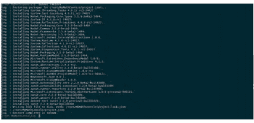

从位于主目录的 shell 提示符中，您可以列出隐藏目录 .nuget/packages 的内容以检查下载的 NuGet 包。

```
ls .nuget
```

### 05 运行单元测试

完成还原步骤后，我们准备好执行基于 Xunit 的单元测试。执行以下内容以触发 Xunit 测试运行器并执行单元测试：

```
dotnet test
```

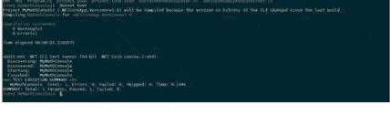

### 06 运行 .NET 程序

随着单元测试成功通过，您已准备好运行程序。dotnet run 命令将在静态 Main 方法入口点启动执行。计算出的表面积值将根据作为命令行参数传递的半径参数写入控制台。

```
dotnet run
```

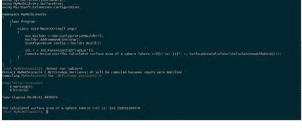

### 07 编辑并重新运行

这里的图表说明了“编辑并重运行”上下文中涉及的命令循环。只要您不引入新的 NuGet 相关依赖项，您就可以选择跳过 dotnet restore 命令步骤，并在连续的代码编辑会话后直接发出 dotnet run（当然，您也可以跳过单元测试的执行，但这被认为是不好的做法）。

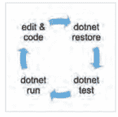

# 运行自动化作业

下表提供了您最喜欢的 Linux 发行版中压缩 tar 或 .NET Core SDK 包位置的简要概述。如果您没有找到列出的发行版，则可能需要一些“组装”。在这种情况下，您可以在开源社区中寻求该发行版的动态，加入实现 .NET Core SDK 支持的行动，并将贡献回馈至 GitHub 仓库。

| 发行版 | 在哪里查找？ | 依赖项 | 如何安装？ |
| --- | --- | --- | --- |
| UBUNTU, MINT | 在 APT sources.list.d 包配置中来源"https://apt-mo.trafficmanager.net/repos/dotnet/ trusty main"。 | gettext, libunwind | 安装软件包 dotnet-dev-1.0.0-preview2-003121 |
| DEBIAN | Curl dotnet.tar.gz from https://go.microsoft.com/fwlink/?LinkID=809130 | libunwind8, gettext | 将 dotnet.tar 解压到 /opt 或其他首选位置。在 /usr/local/bin 创建软链接。 |
| CentOS, ORACLE LINUX | Curl dotnet.tar.gz from curl -sSL -o dotnet.tar.gz https://go.microsoft.com/fwlink/?LinkID=809131 | libunwind libicu | 将 dotnet.tar 解压到 /opt 或其他首选位置。在 /usr/local/bin 创建软链接。 |
| REDHAT | 通过 RedHat subscription rhel-7-server-dotnet-rpms 启用仓库 | scl-utils | 使用 yum 安装 rh-dotnetcore10。随后使用命令字符串 scl enable rh-dotnetcore10 bash 完成配置。 |
| OpenSUSE | Curl dotnet.tar.gz from https://go.microsoft.com/fwlink/?LinkID=816867 | libunwind libicu | 将 dotnet.tar 解压到 /opt 或其他首选位置。在 /usr/local/bin 创建软链接。 |
| FEDORA | Curl dotnet.tar.gz from https://go.microsoft.com/fwlink/?LinkID=816869 | libunwind libicu | 将 dotnet.tar 解压到 /opt 或其他首选位置。在 /usr/local/bin 创建软链接。 |
| FreeBSD | 从 GitHub 仓库构建 CoreCLR, CoreFx 和 dotnet CLI 的二进制文件。查看社区获取最新更新/解决的议题。 | cmake, llvm37 (includes LLVM 3.7, Clang 3.7 and LLDB 3.7), libunwind, gettext, icu & bash | 使用构建脚本构建 .NET Core 组件。（详见 https://github.com/dotnet/coreclr/blob/master/Documentation/building/freebsd-instructions.md。） |
| NetBSD | 从 GitHub 仓库构建 CoreCLR, CoreFx 和 dotnet CLI 的二进制文件。查看社区获取最新更新/解决的议题。 | See FreeBSD above, pkgsrc | 类似于 FreeBSD 但也涉及 pkgsrc 配置。（详见 https://github.com/dotnet/coreclr/blob/master/Documentation/building/netbsd-instructions.md。） |

## 教程

## 赋予旧笔记本电脑新生命

### 使用轻量级 Linux 赋予旧笔记本电脑新生命

可以让存放在橱柜里的那台旧笔记本电脑重获新生！


**Paul O'Brien** 是一位专业的跨平台软件开发人员，拥有部署和维护 Linux 系统的丰富经验。Android 构建在 Linux 之上，也是 Paul 的专业领域之一。

### 资源

- Elementary OS https://elementary.io/
- unetbootin https://unetbootin.github.io/
- EaseUS Todo Backup http://www.todo-backup.com/
- Ubuntu http://www.ubuntu.com/
- Lubuntu http://lubuntu.net/
- Ubuntu Mate https://ubuntu-mate.org/
- Puppy Linux http://puppylinux.org/
- Debian https://www.debian.org/
- VirtualBox https://www.virtualbox.org/
- Midori http://midori-browser.org/
- Vivaldi https://vivaldi.com/

当然，在此期间操作系统不可避免地变重了（尤其是 Windows），但 Linux 却不能这么说——它非常适合在新硬件和旧硬件上运行，特别是因为有各种各样的发行版和桌面环境可供选择，以满足每一种需求。

在本文中，我们将探讨一些可用的不同选项、最佳测试方法以及如何获得完美的可用日常系统，即使在最旧的笔记本电脑上。

### 01 为安装做准备（硬件）

如果您要在闲置已久的旧机器上安装，有一些事情要做以使这个过程更愉快。除了给它彻底清洁一下（气吹是绝佳的工具），在开始之前重置 BIOS 并扫描硬盘以查找错误是值得的（使用 Live CD 或类似工具），以避免以后出现问题。这可能是时候确保您备份了任何有价值的数据！

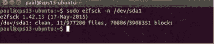

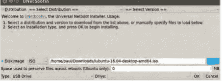

### 02 Unetbootin 和 USB 安装

许多旧笔记本电脑都有光驱，这是使用从下载的 ISO 刻录的 Live CD/安装 CD 来安装新操作系统的一种便捷方式。如果您要尝试几种不同的选项，那么随着您用完一堆 CD，这可能会变得既耗时又昂贵。大多数发行版现在包括说明在

**左侧** Elementary OS 是为低端机器提供视觉效果的惊艳发行版，提供了大部分与 OSX 相当的抛光效果


 如何安装到U盘，通常使用 incredibly useful unetbootin 工具从ISO创建可启动U盘。

### 03 双系统还是全盘抹除？

你应该为你的新操作系统设置双系统，还是完全抹除硬盘？除非你磁盘空间特别充裕，或者以后有可能想恢复系统，否则我们倾向于后者。不过话说回来，如果你的机器有有效的Windows许可证，你可能想要备份现有的操作系统，以便将来可能恢复。可以看看 EaseUS Todo Backup（免费版），它能让你通过USB制作镜像，这样你就可以在安装过程中完全重新分区。

### 04 完整安装 Ubuntu

迄今为止最受欢迎的Linux发行版当然是Ubuntu。如果你不太确定自己的硬件配置能否很好地应对完整的Linux体验，那么从它开始尝试可能是个好主意——它对低配置系统的容忍度 certainly more tolerant of low-spec systems than you might expect。你可以从Live CD启动而不安装，但要注意，这并不总是能代表完整安装后的体验。

### 05 更轻量的选择——Lubuntu

如果完整版的Ubuntu在你的系统上不太给力，还有一个更轻量的选择可能正好适合你。Lubuntu基于与其大哥相同的核心，但采用了极简的LXDE桌面，并配备了一系列轻量级应用程序，包括用于文件管理的Pcmanfm、Openbox窗口管理器、Lightdm和Firefox。Lubuntu可以在仅有512MB内存的系统上运行，处理器只需比Pentium 4或Pentium M更新即可。

### 06 Ubuntu MATE

我们的Ubuntu选项中最后一个是Ubuntu MATE。该操作系统专为无法运行合成桌面的计算机设计，仍然使用传统的桌面范式以保持易用性。外观和感觉与主要的Ubuntu发行版大体相似，应该会立刻让人感到熟悉。Ubuntu MATE团队甚至为Raspberry Pi 2和3提供了即插即用的镜像，以及供想要在ARM系统上运行该OS的用户使用的基础镜像。

### 07 Puppy Linux

Puppy Linux基于Slackware，已经存在超过十年，为最基本的硬件带来了令人印象深刻的完整桌面体验。Puppy Linux有什么特别之处？它很小——不到100MB。它从RAM运行——这不仅有助于性能，还意味着它甚至可以在没有正常工作的硬盘的机器上使用。它仍然包含一系列有用的应用程序，包括文字处理器、浏览器、图像编辑器等。还提供了与Ubuntu兼容的Puppy版本。

> Puppy Linux有什么特别之处？它很小——不到100MB，而且从RAM运行

- 另一个选择：Android X86

有些机器实在太旧，无法很好地运行现代发行版，或者可用的发行版无法提供足够的功能。那运行Android怎么样？Android-X86项目致力于将Google的操作系统移植到PC硬件上，提供一个轻量级的平台，具有良好的应用支持。Remix OS项目则提供了更像桌面的UI范式。

### 另一个选择：CloudReady

低功耗、高生产力计算的真正冠军可能是Chrome OS。基于Linux的Chromebook凭借其低廉的价格和出色的体验席卷全球。借助CloudReady，你可以在自己的硬件上获得Chromebook的体验。它实际上运行得出奇地好，不过要受Chrome OS一贯的"始终联网"限制。

### 08 纯Debian选择

Debian本身经常被轻量级桌面用户忽视。安装该操作系统的最小版本后，可以选择安装一系列适合主机系统的桌面环境，如XFCE、LXDE或MATE。值得注意的是，我们见过一些系统 happily running Debian 而Ubuntu无法很好地工作（或根本无法工作），所以如果你试过了Canonical的产品没有成功，不要忽视Debian。当然，Debian有庞大的社区支持，所以它是一个稳妥的选择。

### 09 Elementary OS

选择轻量级Linux发行版的一个缺点是，往往最先被削减的是吸引人的视觉效果。Elementary OS采取了不同的方法，确保 leading（就整个Linux而言）的图形界面是该发行版的核心，同时在低端系统上仍保持令人印象深刻的性能。这不仅仅延伸到操作系统本身，还包括核心应用套件，包括照片、音乐、视频和Midori网页浏览器。这款产品确实有一种媲美OS X的精致感。

### 10 用VirtualBox测试发行版

鉴于有大量的发行版可供选择，很难知道该选哪一个，而且逐一尝试也很耗时。另一种方法是在另一台机器上使用VirtualBox虚拟化软件来启动镜像，让你可以稍微玩一玩，看看是否想在你的真实硬件上尝试该操作系统。这样就避免了将每个镜像都刻录到CD或U盘的必要。VMware Workstation是另一个合适的虚拟化工具。

### 11 删除不必要的软件包

如果你磁盘空间不足，安装发行版后，最好查看一下已安装的软件包，并移除任何多余的内容。如果你安装了图形包管理器，那是个不错的起点，或者，如果使用Debian/Ubuntu，你只需在终端中使用 `dpkg -l` 命令来显示已安装的软件包，然后按需移除。你也可以使用apt实现同样的功能，使用 `apt --installed list`。

### 12 检查内存使用情况

在你整理好磁盘空间后 ". After you've sorted out your disk space, it's worth seeing if you can do the same with RAM (this might also give you hints as to packages that you can remove and see a performance benefit). The `top` command lists the processes are currently using the most CPU and RAM on your machine. After typing `top` in your terminal, press **Shift + F**, select **MEM** then press **s** to sort by that field. You can also use top with `sudo` to see root processes.

### 13 禁用服务

Linux启动时，就像其他操作系统一样，可能会启动许多进程并在后台运行。如果你有一定的Linux知识，值得仔细检查这些进程，看看哪些可以禁用。默认情况下，往往有许多服务在运行，它们实际上只有在服务器上才有用，比如sendmail、httpd等。如果你使用的是Ubuntu发行版，可以使用"boot-up manager"，更常被称为 **bum**（是的，真的！）。运行 `sudo apt-get install bum` 然后 `gksudo bum`，按需取消勾选，然后点击Apply。

### 14 电池优化

旧笔记本电脑意味着旧电池。通常电池是笔记本电脑上首先退化或失效的部件，这当然严重损害了它作为移动工作站的实用性。确保Linux尽可能节能的一个好方法是使用TLP工具，它适用于大多数发行版。TLP本身高度可定制，但它包含了合理的默认设置，意味着你只需安装即可。只需在终端中运行 **sudo apt-get install tlp tlp-rdw**，然后 **sudo tlp start**，你就设置好了。简单！

> 确保Linux尽可能节能的一个好方法是使用TLP工具，它适用于大多数发行版

### 15 轻量级浏览

如果你想在笔记本电脑上最大限度地减少CPU、RAM和电池使用，尽量避免使用Chrome。它可能是许多事情上最好的网页浏览器，但高效它绝对不是。许多轻量级发行版默认附带Firefox，但如果你需要更轻量的，可以试试Midori，或者如果你想 super-slim，可以试试QupZilla。Vivaldi也值得一试，它由前Opera工程师开发，基于Chromium引擎。

### 16 使用Adblock

虽然 certainly controversial 而且在道德上并非适合所有人，但不可否认，在兼容的浏览器中使用Adblock可以让互联网表现更好，这在旧笔记本电脑上 likely to be a consideration。最知名的解决方案Adblock Plus可用于包括Chrome、Firefox和Vivaldi在内的一系列浏览器。如果你使用的是Midori，它预装了广告拦截器，使用与Adblock Plus相同的列表。

### 17 低配置办公套件

如今Linux上首选的Microsoft Office兼容套件是LibreOffice。有用的是，LibreOffice对资源的占用也相当轻，在一系列旧硬件上运行良好。WPS Office也越来越受欢迎。如果你需要更轻量的，值得看看OOoLight，这是OpenOffice的精简版。最后，不要忽视基于网页的解决方案，如Google Docs或Office Online——如果你的系统只能很好地运行网页浏览器，而且你有稳定的网络连接，这些可能正合适。

### 18 廉价简便的硬件升级

虽然本文是关于让你的旧笔记本电脑硬件焕发新生，但某些硬件升级可能值得考虑，刚好能给你带来额外的性能提升。能提供最明显性能提升的两个主要升级是增加内存和将硬盘更换为SSD。两者在最近几个月都大幅降价（尤其是SSD）。后者可能是更合理的选择，因为如果需要，它可以轻松地移植到另一台机器上，而RAM则不太容易做到这一点。


 ## 教程

## Ansible 自动化

### 使用 Ansible 自动化你的项目任务

了解如何安装 Ansible 和 Ansible Tower，以自动化项目中的各项任务

**Nitish Tiwari** 是一名职业软件开发者，对自由和开源软件有着浓厚的兴趣。除了担任主流 FOSS 出版物的社区版主和作者之外，他还帮助各组织采用开源软件以满足其业务需求。

**如今，软件系统规模庞大、结构复杂且至关重要。** 随着开发成本的上升，测试、监控和构建软件等活动的自动化能够带来显著的成本优势和简化效益。自动化还有助于加快软件系统的开发速度。目标是部分或完全实现活动自动化，从而大幅提高质量和生产力。

顺应这些发展趋势，多种工具应运而生，帮助你实现软件流程的自动化。其中最著名的工具之一是 Red Hat 推出的 Ansible。

Ansible 是一款开源的 IT 配置管理、部署和编排工具。Ansible 设计精简、安全且高度可靠，对软件开发相关人员而言学习曲线极低。

Ansible Tower 是 Ansible 的附加组件。Tower 在 Ansible 的基础上提供了更多功能，如安全凭证存储、委派、作业自定义、基于角色的访问控制，以及所有自动化任务的集中日志记录。Tower 既包含面向终端用户的 Web 控制台，也提供功能完备的 REST API，可将 Ansible Tower 嵌入到你现有的工具和工作流中。

在本指南中，我们将了解如何安装和使用 Ansible 和 Ansible Tower 来自动化项目任务。让我们从安装过程开始。

### 01 安装前提条件

Ansible 可以安装在所有 Linux 发行版上——Red Hat、Debian、CentOS、任何 BSD，甚至 OS X。不过不支持 Windows。当前版本的 Ansible 需要 Python 2.6 或 2.7。Python 3.0 与其他版本略有不同，Ansible 尚未切换至该版本。

某些 Linux 发行版如 Gentoo 和 Arch 可能默认未安装 Python 2.x 解释器。因此，如果你使用这些发行版，需要安装 Python 2.x，并在清单中将 `ansible_python_interpreter` 变量设置为指向你的 Python 2.x。然而，几乎所有 Linux 发行版都默认安装了 2.x 解释器，因此这些情况不适用。

如果你在远程机器上运行的 Python 版本低于 2.5，还需要安装 python-simplejson。

在本教程中，我们将使用 Ubuntu 12.04 来安装和演示 Ansible。此外，我们将使用 Ansible 的默认数据库 PostgreSQL。如果你想使用其他数据库，请先安装它，并准备好连接信息。

### 02 Ansible 安装

Ansible 可以从其源代码安装，但如果你想在任何 Linux 机器上安装最新版本，建议使用操作系统包管理器。在本教程中，我们使用包管理器进行安装。Ubuntu 构建版本可从 Launchpad 网站获取：**bit.ly/2bfXZek**。要在你的机器上配置 PPA 并安装 Ansible，请运行以下命令：

```
$ sudo apt-get install software-properties-common
$ sudo apt-add-repository ppa:ansible/ansible
$ sudo apt-get update
$ sudo apt-get install ansible
```

> Ansible 可以安装在所有 Linux 发行版上——Red Hat、Debian、CentOS、任何 BSD，甚至 OS X

如前所述，我们在本教程中使用 Ansible Tower 作为 Ansible 的 Web GUI。要安装 Ansible Tower，请从 Ansible 网站下载：**ansible.com/tower-trial**。

获取 tar 文件后，执行以下命令：

```
$ tar xvzf ansible-tower-setup-latest.tar.gz
$ cd ansible-tower-setup-2.4.5/
$ ./configure
```

当执行 **configure** 时，它会提示输入主机名、数据库详情和管理员密码。将主机指定为 **localhost**。现在，由于我们将在与 Tower 相同的机器上使用内部数据库，因此在提示数据库时输入 **i**。如果你已在其他机器上安装了 PostgreSQL 数据库，请输入 **e**。

输入管理员密码并重新输入以确认。配置创建完成后，执行：

```
$ ./setup.sh
```

这将在 localhost 上安装 Ansible Tower。然后你可以通过浏览器从 localhost 访问 Tower，并使用提供的凭据登录。

### 03 如何开始使用

登录 Tower 后，下一步是获取许可证，这是 Tower 运行所必需的。访问 **ansible.com/license** 获取免费或付费许可证选项。粘贴你从 Ansible 收到的许可证，同意最终用户许可协议，然后点击提交。要稍后查看此许可证，请点击设置菜单中的"查看许可证"链接。

主页有一个主仪表板屏幕摘要，列出当前主机、清单和项目。点击相应标签页可以查看作业状态和主机状态的图表和图形。最近使用的作业模板摘要和最近运行的作业也可在此部分查看。你可以使用 /usr/bin/ansible-tower-service 文件夹中的管理员脚本启动、停止或重新启动 Tower，执行方式如下：

```
$ ansible-tower-service stop
$ ansible-tower-service start
$ ansible-tower-service restart
```

### Ansible 剧本

Ansible 剧本是管理配置的一种方式。剧本使用 YAML 表达，语法极简。每个剧本由一个或多个"剧本"组成的列表构成。剧本的目标是将一组主机映射到某些定义明确的角色，这些角色由 Ansible 任务表示。

### 04 Tower 配置

Tower 仪表板右上角的设置菜单提供组织、用户、组和权限的配置。要添加或编辑用户，请点击用户链接。你会看到管理员用户已经存在。要创建新用户，点击右侧的加号符号。按页面要求输入用户详情并保存。

如果你想赋予新创建的用户管理员权限，请勾选下方创建超级用户的复选框。保存用户后，你将获得为其添加凭证和权限的选项。在相应部分选择或创建权限。从各自的标签页将用户添加到组织和团队。

要创建团队，请在设置菜单的团队链接中遵循相同的步骤。要创建或编辑组织，请导航到组织链接。也可以从这里将用户或管理员用户添加到组织中。点击你要编辑的组织。在用户部分，搜索用户并添加他们。

### 05 项目创建

要创建新项目，请从菜单导航到项目并点击加号符号。输入项目名称和描述。搜索并将组织添加到项目中。选择合适的 SCM 类型——这里我们将使用 Git。选择 SCM 类型后，指定 SCM URL、SCM 分支和 SCM 凭证。

选择合适的 SCM 更新选项。如果你想使用手动 SCM 类型，则需要创建 Ansible 剧本。

使用命令行在 Tower 服务器文件系统上创建一个以项目名称命名的子目录。项目的 Ansible 剧本将存储在这里。目录位置将在 Tower 下的默认项目目录中，默认是 /var/lib/awx/projects/。

```
$ mkdir /var/lib/awx/projects/helloworld
$ cd /var/lib/awx/projects/helloworld
```

在此文件夹中创建一个 YML 文件，helloworld.yml：

```
$ sudo vi /var/lib/awx/projects/helloworld/helloworld.yml
```

编写你希望此剧本执行的功能代码。例如，编写编辑器，编写此代码以测试 Tower 对清单中的主机运行剧本：

```
---
- name: Hello World!
  hosts: all

  tasks:
    - name: Hello World!
      shell: echo "Tower working fine"
```

上述缩进必须保持，因为它起着重要作用。现在，在指定 SCM 类型时，指定手动并输入剧本目录名称。

### 06 清单

Ansible Tower 中的清单与 Ansible 清单文件相同。它是可以针对其启动作业的主机集合。导航到清单以创建或查看清单。要创建一个，请点击加号符号并指定名称和描述。

从可用选项中选择一个组织。在变量部分，使用 JSON 或 YAML 语法指定要应用于此清单中所有主机的变量定义和值。点击保存，然后你将看到扫描作业模板部分。

展开它以查看当前扫描作业。要创建新的作业模板，请点击加号符号，填写必填字段并点击保存。现在点击启动符号启动作业。

创建清单后，在其中创建一个组。点击组部分下的加号符号并指定组名称和描述。以与创建清单时类似的方式指定变量。

### 07 作业模板

你可以点击顶部链接创建和查看作业模板。你也可以在清单中查看我们之前创建的作业模板。要创建新的作业模板，请点击加号符号并按我们之前的方式指定详情。作业类型可以是运行、检查或扫描。根据需要选择作业类型。一旦选择项目，剧本将自动填充。从我们之前创建的选项中选择清单、项目和凭证，其余字段保持默认。根据需要选择详细程度并保存。

要启动剧本，请点击操作下的启动符号。系统将提示你输入密码；输入密码并点击启动。你将重定向到作业链接，在这里可以查看此作业的状态并在运行时监控它。作业也可以被安排。点击日历符号然后点击加号符号。指定名称、开始日期、开始时间、本地时区、UTC 开始时间和重复频率，然后点击保存。

### 08 作业

通过点击菜单中的作业部分创建和安排作业。作业页面列出所有已创建的作业详情，显示其 ID、名称、状态、完成日期时间和作业类型。

在操作列下，你可以选择启动或删除作业。对于剧本运行作业类型，还可以查看特定作业的标准输出。点击查看标准输出按钮；你可以看到在剧本 YML 文件中编写的已执行脚本的输出。当你点击使用 SCM 更新和清单同步类型的作业时，作业结果屏幕将打开。

当点击类型为剧本运行的作业时，作业状态屏幕将打开。当我们之前从作业模板点击启动按钮时，此页面也会打开。此页面使用 Tower 的实时事件功能自动刷新，直到作业完成。

### 09 作业结果

作业结果窗口显示有关类型为清单同步和 SCM 更新的作业的信息，分为三个不同

### 资源

Ansible
[ansible.com](http://ansible.com)

**右图：** Ansible Tower 主页显示主仪表板屏幕摘要。此仪表板是 Tower 的核心界面


Ansible 模块是可复用的独立脚本，可以被 Ansible API、Ansible CLI 或 Ansible Playbook 使用。它们在退出前通过向标准输出打印 JSON 字符串的方式向 Ansible 返回信息。

Ansible 预装了大量模块，可以直接在远程主机上执行，也可以通过 Playbook 执行。查看核心 Ansible 模块，请访问项目的 GitHub 仓库：bit.ly/2baCs7L。

你也可以编写自己的模块——更多详情请参见：bit.ly/1QuFkM5。

Playbook 运行作业的作业状态页面会显示所有任务详情和事件。它包含几个不同的标签页——状态、标准输出和选项。状态标签页显示启动作业所用的作业模板名称，其状态可能是待处理、运行中、成功或失败。

状态标签页还显示开始时间和完成时间，分别是作业发起和完成的时间戳。你还可以看到启动类型——手动或定时——以及作业在已用时间字段中花费的总时间。

> Ansible Tower 中的清单与 Ansible 清单文件相同。它是一个主机集合，可以对其启动作业。

Plays 部分显示了在此 Playbook 中运行的 playbook 详情。点击特定的 play 可以筛选任务，以及仅显示与该 play 相关的任务和主机事件区域。

任务区域显示了作为 play 一部分运行的任务详情。此处的主机状态显示了与此任务关联的所有主机状态的摘要。点击特定任务可以筛选主机事件区域，仅显示与该任务相关的主机。事件摘要区域显示了受此 Playbook 影响的所有主机的事件摘要。主机摘要区域显示了总结此 Playbook 运行所影响的所有主机状态的图表。

### 10 作业状态

## 在 Ubuntu Linux 上管理系统

仔细了解如何在 Ubuntu Linux 环境中管理系统。

### Swayam Prakasha

拥有计算机工程硕士学位。他在信息技术领域工作多年，专注于操作系统、网络、网络安全、电子商务、互联网服务、LDAP 和 Web 服务器等领域。Swayam 为行业出版物撰写了大量文章，并在行业会议上发表自己的论文。可以通过 swayam.prakasha@gmail.com 联系他。

如果不加妥善管理，你的 Ubuntu Linux 系统上的需求可能会超过可用资源。确实需要持续监控系统资源，如内存、CPU 和设备使用情况，以确保系统有足够的资源来完成你需要它做的事情。同样，管理系统的其他方面也很重要，例如它使用的各种设备驱动程序以及引导过程的工作原理。这将有助于避免 Ubuntu 系统上的性能问题和系统故障。

> 确实需要持续监控系统资源，如内存、CPU  Sheikh和设备使用情况。

让我们更深入地了解如何监控各种资源。需要注意的是，Ubuntu 系统在跟踪自身工作方面做得很好。如果你确实感兴趣，那么你可以找到大量关于 CPU、硬盘、虚拟内存和其他资源使用情况的信息。这可以通过两种方式实现。首先，你可以查看 `/proc` 目录中文件的内容——这是 Linux 内核存储系统信息的地方。其次，你还可以使用各种命令来帮助你查看计算机资源使用情况的信息。有专门针对虚拟内存、处理器、存储设备、网络接口等的命令。这些命令在监控系统资源的不同方面非常有用。

说到监控内存使用情况，我们都知道内存耗尽时系统性能会下降。有一些基本命令，如 `free` 和 `top`，可以让你查看系统 RAM 和交换区使用情况的基本信息。另一个命令 `vmstat` 可以提供更详细的内存使用信息，并且可以持续运行。如果我们需要知道内核消耗了多少内存，可以使用 `slabtop` 命令。在所有可用命令中，`free` 命令被广泛使用，它提供了查看机器上内存使用情况的最快方式。它显示各种参数，如 RAM、交换空间以及当前使用的内存量。

```
free - 显示系统中空闲和已用内存量

SYNOPSIS
    free [options]

DESCRIPTION
    free 显示系统中空闲和已用的物理内存和交换内存总量，以及
    内核使用的缓冲区。共享内存列表示 MemShared 值（2.4
    系列内核）或从 /proc/meminfo 文件获取的 Shmem 值（2.6 系列内核及更高版本）。
    如果内核没有导出任何条目，则该值为零。

OPTIONS
    -b, --bytes
        以字节为单位显示内存量。

    -k, --kilo
        以千字节为单位显示内存量。这是默认值。

    -m, --mega
        以兆字节为单位显示内存量。

    -g, --giga
        以吉字节为单位显示内存量。

    --tera 以太字节为单位显示内存量。

    -h, --human
        自动将所有输出字段缩放到最短的三位数字单位并显示输出
        单位。使用以下单位。
```

### 资源

- Ubuntu Linux 服务器监控和管理 bit.ly/2agfqCK
- Linux 系统管理和配置 bit.ly/1N2N1tt
- 服务器管理 bit.ly/1jKdVmc

**free** 命令的一些可选项如上所示。以下命令可用于以块为单位列出内存使用情况：

```
~$ free -b
```

有时，我们可能需要列出包含交换区和内存区域的内存使用情况。在这种情况下，请使用 **-mt** 选项，如下所示：

```
~$ free -mt
```

**free** 命令的另一个常见用途是定期显示内存使用情况。这可以通过使用以下命令实现（我们将间隔设置为五秒）：

```
~$ free -s 5
```

猜测系统需要多少内存的一种方法是，到另一台运行 Ubuntu 的机器上，然后打开你认为会同时运行的所有应用程序。现在你可以运行带有 **total** 选项的 **free** 命令（**free -t**）来查看正在使用的内存量。这样，你现在需要确保你的新系统至少有那么多总内存。

另一个有用的命令 **top** 提供了一种查看当前运行进程的方法。你可以使用此命令以面向屏幕的方式来查看内存使用情况。以下截图说明了这一点。

需要注意的是，与 **free** 命令类似，**top** 也显示 RAM 和交换空间的总内存使用情况。**top** 命令是面向屏幕的，提供持续监控。使用此功能，你将能够每三秒观察一次内存使用情况的变化。当 **top** 运行时，如果你按 **SHIFT+M**，则运行中的进程将按内存使用顺序显示——这样你可以看到哪些进程消耗了更多内存。从内存使用角度来看，需要分析的最重要的一列是 RES——驻留大小——因为这通常显示进程的实际物理 RAM 使用情况。

要查看虚拟内存统计信息的详细视图，首选使用的命令是 **vmstat**。通过使用 **vmstat** 命令，你将能够查看给定时间段内的内存使用情况。

以下是使用 **vmstat** 配合各种选项的更多示例。

```
~$ vmstat -S m
```

这以 1000k 兆字节为单位显示输出。

```
~$ vmstat -n 2 10
```

每两秒输出一次，重复十次。

```
~$ vmstat -s | less
```

显示事件计数器和内存统计。

如果你有兴趣查看系统上每个应用程序消耗了多少内存，那么 **ps** 和 **top** 等命令将非常有用。内核有自己的内存缓存来跟踪其资源，称为内核 slab。你可以使用 **vmstat** 命令来显示内核 slab 内存统计信息。

## ■ 掌握 Ubuntu 系统上的时间

在 Ubuntu 机器上保持正确的时间至关重要，以便系统能够正常运行。通常，运行 Ubuntu Linux 的机器以两种不同的方式维护时间：系统时钟和硬件时钟。系统时钟由 Linux 用于跟踪时间，而硬件时钟将在 Linux 启动时设置系统时间。**uptime** 命令通常用于确定你的 Ubuntu 系统已经运行了多长时间。


 ## Ubuntu 系统管理教程

### Ubuntu Linux 系统时区

Ubuntu Linux 系统的时区可以根据 `/etc/localtime` 文件的内容来设置。要设置新的时区，只需从 `/usr/share/zoneinfo` 的子目录中复制代表您时区的文件即可。例如，要将当前时区更改为 Asia/Kolkata，请使用以下命令：

```
~$ sudo cp /usr/share/zoneinfo/Asia/Kolkata /etc/localtime
```

Ubuntu Linux 让终端用户能够更方便地查看和有时修改其系统的多个方面，以确保系统始终以可管理的性能水平运行。您可以使用各种命令来查看系统如何使用内存、CPU 和存储设备。

让我们更详细地查看该命令的输出。从截图中可以看出，内核 slab 内存信息显示每个缓存名称、该缓存类型的活动对象数、缓存大小等。如果您有兴趣以面向屏幕的方式显示缓存信息，那么应使用的命令是 **slabtop**。

需要注意的是，**slabtop** 的输出每三秒更新一次。

接下来，让我们看看如何监控 CPU 使用情况。如果 CPU 过载，您肯定会遇到性能问题。如前所述，**vmstat** 命令可以帮助获取有关 CPU 使用情况的基本信息。另一个命令 **iostat** 可以为我们提供更详细的信息。

请注意，**iostat** 在 Ubuntu 中默认未安装，因此您需要安装 sysstat 软件包：

```
~$ sudo apt-get install sysstat
```

让我们通过一些示例更仔细地查看 **iostat** 命令：

```
~$ iostat -c 3
```

此命令每三秒显示一次 CPU 统计信息。

**iostat** 命令还可以用于打印带时间戳的 CPU 利用率报告。这可以通过使用以下命令来完成：

```
~$ iostat -c -t
~$ iostat -c -t 2 10
```

这将每两秒重复一次，共重复十次。

另一个常用命令 **dstat** 也可以在 Ubuntu 系统上使用，它是 **iostat** 的替代方案。**dstat** 命令也显示有关系统 CPU 使用情况的信息；它的明显优势在于它清楚地显示正在显示的测量单位。您可以使用以下命令安装 **dstat**：

```
~$ sudo apt-get install dstat
```

以下命令连续显示带时间戳的 CPU 使用信息：

```
~$ dstat -t -c 3
```

您可以从此输出中看到，我们有一个基于日期/时间值的报告，该报告会持续运行，直到我们通过按 **CTRL+C** 停止它。

有时您可能想查看消耗最多处理时间的进程。在这种情况下可以使用 **top** 命令。您可以在 Ubuntu 提示符下输入 **top** 命令，然后按 **SHIFT+P**，以便按 CPU 使用率进行排序。

请注意，输出显示多个进程，它们按当前 CPU 使用率排序。如果您需要有关处理器本身的信息，最好的方法是直接查看文件 **`/proc/cpuinfo`**。

现在让我们把注意力转向监控 Ubuntu 系统上的存储设备。如果您只对系统上可用存储空间的基本信息感兴趣，那么可以使用 **du** 和 **df** 等命令。有关存储设备如何表现的更多详细信息，可以通过 `vmstat` 和 `iostat` 等命令获得。

上述输出中需要注意的参数是 iowait。此参数值高表明磁盘输入/输出是 Ubuntu 系统的主要瓶颈。

`vmstat` 命令也可以用来显示有关磁盘的统计信息。此处的截图用一个示例说明了此命令。

`vmstat` 命令还可以用来列出所选磁盘分区的读写信息，如下例所示。

```
$ vmstat -p sda1
```

另一个在 Ubuntu 环境中非常有帮助的热门命令是 `lsof`。系统管理员可以使用此命令获取当前在存储设备上打开的文件和目录列表。当我们分析 `lsof` 命令的输出时，我们将查看打开的文件或目录、打开它的命令以及该运行进程的进程 ID。

接下来，让我们看看 Ubuntu 环境中的 GRUB 引导加载程序。当我们首次安装 Ubuntu 时，如果 GRUB 设置正确，那么文件 `/boot/grub/grub.cfg` 将包含引导加载程序的所有设置。需要注意的是，即使 `grub.cfg` 是配置文件，也永远不应编辑此文件。这基本上是因为 `grub.cfg` 会被 `/etc/grub.d` 目录中文件的内容覆盖。配置文件 `grub.cfg` 具有控制 GRUB 行为的设置。它还有助于指示如何加载各种模块。虽然我们不能直接编辑此配置文件，但我们可以改用以下两个选项。

- 使用自定义文件 – 这可以通过向文件 `/etc/grub.d/40_custom` 添加条目来完成
- 使用默认文件 – 您可以使用位于 `/etc/default/grub` 的默认文件及其内容，如下面的屏幕所示。

更改自定义或默认文件内容后，为了使这些更改生效，您需要安装新内核或运行 `update-grub` 命令。

内核启动后，它将控制权交给一个名为 init 的进程。此 init 进程的 PID 为 1，它将是系统上第一个运行的进程。根据 `/etc/init` 的内容，此初始进程启动其他进程。它还设置默认运行级别。通过使用 `sudo` 命令，您可以查看当前运行级别。

```
~$ sudo runlevel
```

要更改当前运行级别，请使用 `init` 命令。如下所示：

```
~$ sudo init 1
```

上述命令将运行级别更改为 1 – 即单用户模式。

有时，我们会遇到需要管理服务的情况 – 这可以使用 `service` 命令来完成。例如，为了启动 `rsyslog` 服务，您可以在命令提示符下输入以下内容。

```
~$ sudo /etc/init.d/start rsyslog
```

需要注意的是，每个服务都附带一个位于 `/etc/init.d` 的 shell 脚本。我们只需传递 `start` 或 `stop` 选项即可启动或停止特定服务。除了 start 和 stop 之外，某些脚本还支持更多选项。为了解特定脚本支持的各种选项，请使用类似于下面所示的命令。

```
~$ sudo /etc/init.d/ rsyslog
```

如前所述，您可以使用 `init` 命令更改为任何运行级别 – 这包括运行级别 0（表示关机）和运行级别 6（表示重新启动）。您还可以在 Ubuntu 中找到一些用于停止 Linux 的特定命令。此类别中一些非常有用的命令是 `reboot`、`poweroff`、`shutdown` 和 `halt`。让我们快速看一下一些示例。

```
:~$ sudo reboot
```

这将重新启动您的系统。

```
~$ sudo shutdown 10
```

这将在十分钟后关闭系统；会提前向用户显示警告消息。

```
~$ sudo shutdown -r 20
```

这将在首先警告用户后，在 20 分钟后重新启动系统。


 ## 教程

## Go 函数

### Mihalis Tsoukalos

Mihalis Tsoukalos 是一名 UNIX 管理员、程序员（UNIX 和 iOS）、DBA 和数学家。他从 1993 年开始使用 Linux。你可以通过 @mactsouk（Twitter）和他的网站 mtsoukalos.eu 联系到他。

### 资源

- 文本编辑器，如 Emacs 或 vi
- Go 编译器

教程文件可在以下地址获取：

filesilo.co.uk

## 开发可读写文件的 Go 程序

了解如何在 Go 中执行各种文件 I/O 操作

本教程将讨论如何在 Go 中执行各种文件 I/O 操作。在介绍了用于读取、写入和删除文件所需的 Go 包和函数之后，还将展示如何在 Go 中处理记录、二进制数据和稀疏文件。你还将了解字节切片以及它们如何帮助你执行文件 I/O 操作。

## 关于文件 I/O

**图 1** 展示了 **naiveCP.go** 的 Go 代码。该程序是 **cp** 命令行工具的一个简单版本；其核心功能基于下面两行 Go 代码：

```
input, err := ioutil.ReadFile(in)
err = ioutil.WriteFile(out, input, 0644)
```

虽然 **naiveCP.go** 能够完成其工作，但它并没有以一种高效的方式实现 cp，因为它使用 **ioutil.ReadFile** 一次性读取整个输入文件，然后使用 **ioutil.WriteFile** 进行复制。对于相对较小的文件，这可能工作良好，但对于复制大型或巨型文件来说，这不是最专业的方式，尤其是在内存相对较小的繁忙 Linux 系统上。

## 与文件操作相关的标准 Go 包

由于 Go 自带丰富的库集合，了解与文件输入和输出操作相关的库是很有必要的。

**os** 包用于与操作系统交互，**io** 包用于执行原始的文件 I/O 操作，而 **bufio** 包用于执行缓冲 I/O。

**os** 包的功能可以帮助你创建、打开和删除文件，以及获取程序命令行参数。其中最重要的函数包括 **os.Chdir**、**os.Exit**、**os.Remove**、**os.Open**、**os.Close**、**os.Readdir** 和 **os.Read**。**os** 包还包含 **os.Args** 数组，它保存传递给程序的命令行参数，包括程序名称。**os** 包的主要优势在于它提供了与操作系统无关的平台独立接口。

**io** 包的函数帮助你逐字节读取或写入文件，以及执行其他类似操作。它最重要的函数是 **io.Read**、**io.Write** 和 **io.Close**。

最后，**bufio** 的函数帮助你执行缓冲操作，这意味着虽然它的操作看起来与 **io** 中的类似，但它们的工作方式略有不同。**bufio** 实际做的是将 **io.Reader** 或 **io.Writer** 对象包装成一个新对象，以实现所需的接口，同时为该新对象提供缓冲。**bufio** 包允许你逐行读取文本文件。

如果你想获取上述任何包的更多帮助，可以执行以下命令之一：

```
$ godoc os
$ godoc io
$ godoc bufio
```

同样，你可以了解更多关于 io.Reader 和 io.Writer 接口的信息：

```
$ godoc io Reader
$ godoc io Writer
```

前面两个文档页面中的每一个都展示了必须为这两个接口中的每一个实现的函数。

## 基本文件 I/O 信息

打开现有文件进行读取的最佳且最简单的方法如下：

```
f, err := os.Open("aFile")
```

在成功调用 **os.Open** 后，你可以使用 **f** 变量和 **os.Read** 函数开始读取 **aFile**，该函数返回读取的字节数，你可以使用或忽略该返回值：

```
n, err := f.Read(data)
```

或者，你可以从已打开的文件创建一个新的扫描器，如下所示：

```
scanner := bufio.NewReader(f)
```

然后你可以使用 **scanner** 变量和 **Scan** 来遍历文件内容：

```
for scanner.Scan() {
  line := scanner.Text()
}
```

或者，你可以将整个文件的内容放入一个变量中，而无需扫描器或调用 **os.Open**：

```
input, err := ioutil.ReadFile(in)
```

你可以创建一个新文件用于写入，如下所示：

```
newF, err := os.Create(dst)
```

然后，你可以使用 **os.Write** 开始向文件写入：

```
_, err = f.Write([]byte{0})
```

## 关于 ZIP 文件

Go 可以帮助你使用 zip 包创建 ZIP 文件。对于你想要放入归档中的每个文件，你必须先读取它，然后使用 io.Writer 写入其内容。

这个过程并不是特别困难，但你需要格外小心并避免错误，因为你可能会意外填满你的硬盘空间！示例代码可以在 zipFiles.go 中找到。执行它会产生以下输出：

```
$ go run zipFiles.go test test1
Adding test
Adding test1
$ ls -l ZIP.zip
-rw-r--r--  1 mtsouk staff
1066 Jul  8 21:58 ZIP.zip
```

**右侧** errorHandle.go 中的 Go 代码展示了如何处理文件 I/O 错误

**跨页** wc.go 程序实现了 wc(1) UNIX 命令行工具的基本功能。此图展示了 countLines 函数的 Go 代码

```
package main

import (
    "fmt"
    "os"
)

func main() {

    filename := os.Args[1]
    f, err := os.Open(filename)
    if err != nil {
        fmt.Println(err)
        os.Exit(1)
    } else {
        fmt.Println("File can be read!")
    }
}
```

图 2

```
func countLines(filename string) {
    var err error
    var numberOfLines int
    var numberOfCharacters int
    var numberOfWords int
    numberOfLines = 0
    numberOfCharacters = 0
    numberOfWords = 0

    f, err := os.Open(filename)
    if err != nil {
        fmt.Printf("error opening file %s", err)
        os.Exit(1)
    }
    defer f.Close()
    r := bufio.NewReader(f)
    for {
        line, err := r.ReadString('\n')

        if err == io.EOF {
            break
        } else if err != nil {
            fmt.Printf("error reading file %s", err)
        }
        numberOfLines++
        r := regexp.MustCompile("[^\\s]+")
        for range r.FindAllString(line, -1) {
            numberOfWords++
        }
        numberOfCharacters += len(line)
    }

    fmt.Printf("%d lines\t", numberOfLines)
    fmt.Printf("%d words\t", numberOfWords)
    fmt.Printf("%d characters\n", numberOfCharacters)
}
```

图 3

在首府情况下，你之前使用了 `ioutil.ReadFile` 函数，你可以执行以下操作：

```
err = ioutil.WriteFile(out, input, 0644)
```

在完成对用于读取或写入的文件的读写操作后，你应该调用 `os.Close` 函数来关闭文件。

前面的 Go 代码没有处理错误和错误处理，这被认为是非常不好的做法。下一节将展示如何向程序中添加错误处理代码。

## 错误处理

错误检查代码非常重要，不应为了节省编写更多 Go 代码的空间而省略。通常，函数要么返回单个值，要么不返回值——Go 函数也返回与错误相关的信息。下一个函数除了错误变量外不返回任何值：

```
err := os.Remove(filename)
```

同样，以下函数返回一个变量以及一个错误变量：

```
f, err := os.Open(filename)
```

然而，在这两种情况下，错误处理的代码是相同的：

```
if err != nil {
    fmt.Println("There was an error!")
    fmt.Println(err)
    os.Exit(1)
} else {
    fmt.Println("Everything is OK!")
}
```

根据你当前的策略，程序可能会在出错时退出，或者处理错误并继续。只要你能检测到错误，这两种方法都是好的！上述代码使用 `os.Exit` 函数使程序退出。你可以在 **图 2** 中看到 errorHandle.go 的完整 Go 代码。

## 一个简单的程序

现在，是时候结合前面的所有知识来开发一个真正的 Go 程序了。**simple.go** 程序使用 `io.Copy` 来生成文件的实际副本。Copy 函数将源文件复制到目标文件，并返回复制的总字节数以及复制过程中遇到的最早错误。相关代码如下：

```
source, err := os.Open(src)
destination, err := os.Create(dst)
nBytes, err := io.Copy(destination, source)
```

构建并执行它会产生以下输出：

```
$ go build simple.go
$ ./simple simple anotherCopy
Copying simple to anotherCopy
Copied 1835016 bytes!
$ ls -l simple anotherCopy
-rw-r--r-- 1 mtsouk mtsouk 1835016 Jul  8 15:27
anotherCopy
-rwxr-xr-x 1 mtsouk mtsouk 1835016 Jul  8 15:27
simple
```

**anotherCopy** 和 **simple** 之间唯一的区别是它们的文件权限。

该程序还使用了便捷的 `defer` 命令，它会将函数的执行推迟到 surrounding 函数返回之后——`defer` 在文件 I/O 操作中非常常用，因为它省去了你必须记住在完成文件读取或写入后执行 `Close()` 调用的麻烦。此外，它还防止你意外关闭正在使用中的文件描述符，而程序仍然需要该描述符。

本节完整的 Go 代码保存在 **simple.go** 中，它是 **naiveCP.go** 的大幅改进版本，同时包含了错误处理代码。在继续学习本教程的其余部分之前，请先研究 **simple.go** 并进行实验！

## 删除文件

本节将介绍如何使用 Go 代码删除文件。**deleteFile.go** 的核心 Go 代码如下：

```
err := os.Remove(filename)
if err != nil {
    fmt.Println(err)
    return
}
```

如你所见，你只需要调用 **os.Remove**，并且照常验证函数是否执行无误。如果你没有删除文件的必要权限，或者文件不存在，**deleteFile.no** 将会产生如下错误消息，因为对 **os.Remove** 的调用未成功：

```
$ go run deleteFile.go toBeDeleted
remove toBeDeleted: no such file or directory
$ go run deleteFile.go /usr/bin/perl
remove /usr/bin/perl: operation not permitted
```

如你所见，Go 的错误信息非常直观，通常会揭示函数调用失败的原因。

## 开发 Go 版本的 wc

本节将教你如何使用 Go 开发一个简单版本的 **wc** 命令行工具。**wc.go** 的主要思路是逐行读取文本文件直到末尾。对于读取的每一行，统计其字符数和单词数。由于需要逐行读取输入，因此优先使用 **bufio** 而不是简单的 **io**，因为这样可以简化代码。不过，尝试使用 **io** 自己实现 **wc.go** 会是一个很好的练习。

借助 **bufio.ReadString** 函数逐行读取文本文件：

```
r := bufio.NewReader(f)
for {
    line, err := r.ReadString('\n')
    ...
}
```

如果你有很多文件要处理，你会得到每个文件的行信息但没有汇总信息——这留给读者作为练习。执行 **wc.go** 会产生如下输出：

```
$ ./wc naiveCP.go deleteFile.go binary.go
naiveCP.go:    27 lines 61 words 418 characters
deleteFile.go: 22 lines 37 words 278 characters
binary.go:     37 lines 78 words 631 characters
```

执行 **wc(1)** 产生如下输出：

```
$ wc naiveCP.go deleteFile.go binary.go
 27     61    418 naiveCP.go
 22     37    278 deleteFile.go
 37     78    631 binary.go
 86    176   1327 total
```

# Go 函数教程

你可以在图 3 中看到 countLines() 函数的源代码，从中可以理解行计数和字节计数任务都相当简单。棘手的是统计一行中的单词数量，这是借助正则表达式实现的：

```
r := regexp.MustCompile("[^\\s]+")
  for range r.FindAllString(line, -1) {
    numberOfWords++
  }
```

接下来的两个 Go 教程将讨论 Go 的并发能力，你还将学习如何将当前 Go 实现的 wc 转换为并发程序，敬请期待！

## 字节切片

Go 中一个非常实用的特性称为字节切片（byte slices）；字节切片是一种特殊的切片，用于文件读写操作。示例代码保存在 byteSlice.go 中，如图 9 所示。该程序声明了两个字节切片，分别名为 aByteSlice 和 anotherByteSlice。执行 byteSlice.go 产生如下输出：

```
$ go run byteSlice.go
Read 11 bytes: Tsoukalos!
```

注意，它显示读取了 11 字节而不是 10 字节的原因是字符串末尾存在换行符。

## 读写记录

本教程的本节将介绍如何使用记录读写数据。记录可以有多种类型，包括 JSON 数据、XML 数据和纯文本数据。记录与其他类型文本数据的区别在于，记录具有给定结构，包含特定数量的字段——可以将其视为关系数据库表中的一行。实际上，如果你打算用 Go 开发自己的数据库服务器，记录对于在表中存储数据非常有用。

你可以在图 4 中看到 records.go 的源代码。执行它产生如下输出：

```
$ go run records.go aCSVFile
1:a:A
2:b:B
3:c:C
4:d:D
```

## 读取二进制文件

本节将讨论如何在 Go 中从二进制文件读取数据。读取二进制数据文件的 Go 代码如下：

```
data = data[:cap(data)]
n, err := f.Read(data)
```

以下代码允许你逐字节处理二进制文件：

```
for _, b := range data {
    fmt.Printf("%x ", b)
}
```

binary.go 的源代码如图 5 所示。

> 右图 这是对 naiveCP.go 的可执行文件使用 strace 工具追踪时的输出，展示了一个可执行文件在幕后所做的事情

## strace 工具

strace 命令行工具允许你追踪可执行程序的系统调用和信号。将要被追踪的程序是 naiveCP.go 的可执行文件：

```
$ strace ./naiveCP naiveCP copy
...
read(3, "\177ELF\2\1\1\0\0\0\0\0"..., 2041152) = 2040640
read(3, "", 512)                         = 0
close(3)                                = 0
open("copy", O_WRONLY|O_CREAT|O_TRUNC|O_CLOEXEC, 0644)
  = 3
write(3, "\177ELF\2\1\1\0\0\0\0\0"..., 2040640) = 2040640
...
```

它的输出揭示的是，所有操作都被转换为 C 函数和系统调用，因为这是与内核通信的适当方式。然而，用 C 编写相同的程序将需要更多行的 C 代码。

从 strace 输出中你还可以理解到，存在对 read(2) 的单一调用，然后是对 write(2) 系统调用的单一调用，这意味着需要一个大型缓冲区来保存从 read(2) 调用读取的数据，这验证了 naiveCP.go 程序的低效性。你可以在图 6 中看到大量 strace 输出的一部分。

如果使用 strace 追踪 simple.go 的可执行文件，你会看到存在多次对 read(2) 和 write(2) 的调用，这验证了 simple.go 更高效，因为它不需要大缓冲区。

## 用 Go 开发 find 版本

本部分将简要讨论如何开始用 Go 开发 **find** 命令行工具的版本。特别地，它将展示如何访问给定根目录的目录树中的所有文件和目录，这是 **find** 最困难也是最重要的任务。尽管 **find** 本身不必直接处理文件 I/O，但了解如何在 Go 中搜索目录树是很有用的。关键的 Go 代码如下：

```
err := filepath.Walk(searchDir, func(path
    string, f os.FileInfo, err error) error {
    fileList = append(fileList, path)
    return nil
})
```

Walk 函数遍历给定的目录树，为树中的每个文件或目录调用另一个函数，该函数通常称为遍历函数，包括根目录。根目录作为 Walk 函数的第一个参数，遍历函数是第二个参数。在这个例子中，匿名遍历函数只是执行以下代码：

```
fileList = append(fileList, path)
return nil
```

这是一种相当巧妙的遍历目录树的方式——如果你对这种功能更感兴趣，应该进一步探索遍历函数。

你可以在图 7 中看到 find.go 的源代码。
执行它会产生如下输出：

```
$ go run find.go .
<nil>

find.go
naiveCP.go
wc.go
```

> 左图 这是 find.go 的源代码，展示了递归访问目录树中所有文件和目录的一种方式

## 稀疏文件

使用 os.Seek 创建的大文件可能在其中存在空洞，并且占用的磁盘块比具有相同大小但没有空洞的文件更少；这种文件称为稀疏文件。Go 使用传统的 C 方法来创建稀疏文件。

**sparse.go** 最重要的部分如下，其中你可以看到 os.Seek 的使用：

```
_, err = fd.Seek(SIZE-1, 0)
```

你可以在图 8 中看到 **sparse.go** 的完整源代码。
执行它产生如下输出：

```
$ go run sparse.go 1000000 aSparseFile
$ ls -l aSparseFile
-rw-r--r-- 1 mtsouk mtsouk 1000000 Jul  7 12:10
  aSparseFile
$ ls -alh aSparseFile
8.0K -rw-r--r-- 1 mtsouk mtsouk 977K Jul  7 12:10
  aSparseFile
```

因此，尽管 aSparseFile 的大小约为 1MB，但它在硬盘上的大小只有 8KB。请注意 **sparse.go** 中使用 strconv.ParseInt 将字符串值转换为整数值。

> 跨页 这是 sparse.go 的源代码，展示了如何创建稀疏文件

> 左图 这是 byteSlice.go 的源代码，展示了使用字节切片进行文件读写的方式

执行 **binary.go** 会产生如下输出：

```
$ file aBinary
aBinary:  data
$ go run binary.go aBinary
3a  ec  5f  a7  31  a0  2d  8a  22  63  49  …
```


构建更优质的网络

www.webdesignermag.co.uk

web designer

现已发售

jQuery 3.0：有何新特性？| JavaScript 核心编码技巧 | 构建 HTML5 游戏

立即购买您的期刊

印刷版可在 www.imagineshop.co.uk 购买

数字版可在 www.greatdigitalmags.com 购买

可在以下平台获取

facebook.com/webdesignermag

twitter.com/webdesignermag

程序员与创客的必备指南

实用 **Raspberry Pi**

> "或许你可以轻松编写出运行在 Raspberry Pi 上的代码，但迟早你会想要将它与 LED、传感器及其他现实世界的设备相连接……"

专题

# 面向树莓派黑客的电子学

学习构建电子电路，让你的 Raspberry Pi 与现实世界交互

或许你可以轻松编写出运行在 Raspberry Pi 上的代码，但迟早你会想要将它与 LED、传感器和其他现实世界的设备相连接。当然，你可以轻松地将一块现成的电路板（也许是 HAT）连接到树莓派的 GPIO 接口上，但如果你想更进一步，你的 C++ 或 Python 编程技能可帮不上忙。网络上充斥着适用于树莓派的电路，从简单的 LED 点亮电路，到 PIC 编程器，再到雄心勃勃的家居自动化项目，应有尽有。但要把这些电路图变成实际工作的电路，需要一些电子技能。

在这里，我们将教你如何根据电路图构建电子电路。除了帮助你构建他人设计好的电路之外，这些基本技能也是进一步发展你电子技能的坚实基础，假以时日，你甚至能开始设计自己的电路。

## 必备元件

了解构建电子电路时你将使用的一些元件

**电阻器：** 电阻值以欧姆（Ω）、kΩ（10³ 欧姆）和 MΩ（10⁶ 欧姆）为单位。通常在电路图中会省略 Ω，用 k、M 或 R（代表 Ω）代替小数点，例如 3R3、47k 和 2M2。大多数电阻器的额定功率为 0.25W，但如果指定了更大的值，请务必使用。

电阻器上标有彩色色环来表示其阻值。最后一个色环，以较大的间隔与其他色环分开，代表容差，通常是银色（10%）或金色（5%）。如果有四条色环，前两条代表数字，第三条是倍乘数（即零的个数）；如果有五条色环，前三条是数字，第四条是倍乘数。黑色、棕色、红色、橙色、黄色、绿色、蓝色、紫色、灰色和白色分别代表 0-9，因此红、紫、橙、金表示 27k，容差 5%。

电阻器有两根引脚，可以任意方向连接。

**电容器：** 电容值以 pF（10⁻¹² 法拉）、nF（10⁻⁹ 法拉）或 μF（10⁻⁶ 法拉）为单位。通常在电路图中会省略 F，用倍乘数代替小数点，例如 33p、2n7 和 10μ。电容器还有不同的电压额定值。有时电容器还会以其结构来指定（例如陶瓷、聚丙烯），你应始终使用指定类型。

电容值的标注方式各不相同。可能是直观的（例如 10nF），但也可能是两位数字加上倍乘数，不过用数字而非色环，例如 103 表示 10,000pF，即 10nF。

电容器有两根引脚，大多数可以任意方向连接，但有些是极化的（有正负极），必须正确方向连接。

**晶体管：** 晶体管有型号（例如 BC547B），印在上面。它们有三根引脚：双极型晶体管的基极、发射极和集电极，FET 的源极和漏极，必须正确方向连接。从规格书中识别引脚。

**二极管：** 二极管有型号（例如 1N4002），印在上面。它们有阳极和阴极，必须正确方向连接。管体上的色环标识阴极。

**发光二极管（LED）：** LED 有阳极和阴极，必须正确方向连接。管体上的平边标识阴极。

**集成电路（IC）：** IC 有印在上面的型号。它们有很多引脚，在电路图中以编号显示，必须正确连接。对于 DIL 封装 IC，从上方看时，引脚 1 在左上角（顶部为有缺口的一边），然后逆时针方向排列。

**跳线：** 在面包板或条板上连接时使用绝缘单芯导线（1/0.6mm），但连接到板外元件时使用多股导线（16/0.2mm）。

> Maplin 大概是唯一一家在商业街销售电子元件和工具的大品牌店，当你刚开始时或急需某样东西时，从货架上挑选元件可能会让你感觉更踏实。不过，网上购物会有更多选择，大型供应商包括 Maplin（www.maplin.co.uk）、Rapid Electronics（www.rapideonline.com）、Digi-Key（www.digikey.co.uk）、Farnell element 14（http://uk.farnell.com）和 RS Components（http://uk.rs-online.com）。

## 购买渠道

## 数据手册

数据手册提供元件的详细信息——包括机械特性和电气特性——对于 IC 等更高级的元件，有时还会提供应用信息，包括典型电路图。

如果你正在构建他人设计的电路，你不需要查阅数据手册来了解元件的电气特性，但可能需要了解其机械细节以便正确接线。一般来说，这不适用于电阻器和电容器等简单元件，因为它们可以任意方向连接；也不适用于二极管和 LED，因为阴极的标识是标准化的。然而，你通常需要查看数据手册来识别晶体管的引脚。这是因为晶体管有三根引脚，必须正确识别，但基极、发射极和集电极（或栅极、发射极和漏极）的位置并不标准化，通常因晶体管类型而异。

日后，如果你进阶到自己设计电路，数据手册将远不止用于识别元件引脚而已，你会发现应用笔记弥足珍贵。

数据手册在网上广泛可得。在 Google 上搜索"datasheet"加上元件的型号，通常就能直接找到。某些情况下，特定类型的元件（例如特定型号的晶体管或 IC）由多家制造商生产。此时任何数据手册都可以；你不一定非要查阅你所购买设备制造商的那份。

## 所需工具

如果你是 DIY 爱好者，你可能已经拥有一套工具，如螺丝刀和钳子。或许你可以将这些工具用于电子制作，但这会让工作变得更困难，而且你可能会损坏元件。此外，像电烙铁这样的工具不太可能在你的工具箱里。具体需要什么取决于你的制作方式，但以下是一些你可能需要的工具的详细介绍。

### 焊锡

与其说是工具，不如说是耗材，但对于除面包板接线和端子排之外的所有制作方式都是必需的。这是一种低熔点合金，熔化并凝固后，能在金属部件之间形成良好的物理和电气连接，例如元件引脚与条板或 PCB 上的铜箔走线。电子用焊锡呈细线状，便于熔化，并且内含松香芯，因此不需要单独的助焊剂。

### 电烙铁

电烙铁是用来熔化焊锡以实现电气连接的工具。用于电子制作的电烙铁有细尖，因此你可以轻松焊接，而不会意外地将焊锡桥接到附近的另一根元件引脚上，而它们可能仅相距 0.1 英寸。电子用烙铁还配有支架，这样你可以在仍然通电的情况下将其放下，而不会损坏你的工作台或上面的物品。

### 拆焊工具

拆焊工具，俗称吸锡器，用于从条板或 PCB 上移除已焊接的元件。如果你不小心焊错了元件，或者元件损坏，就需要用到它。这种工具的形式是弹簧驱动的抽气泵。使用时，先将柱塞推入以给泵上劲，将电烙铁贴到焊点上，在烙铁仍然接触的同时，将拆焊工具的尖端对准焊点并按下按钮，从而将熔化的焊锡吸走。

### 螺丝刀

如果你在端子排上制作，就需要螺丝刀，但因为它很便宜，建议你投资购买一些，因为它们在许多其他工作中也很有用。例如，如果你想把电路装在一个小塑料壳里，你需要用螺丝刀取下和装上盖子，可能还需要用它把条板或 PCB 固定在壳内。你平时用于一般 DIY 工作的螺丝刀可能太大了，所以准备一把小号的平头螺丝刀，通常称为端子螺丝刀，以及一把类似尺寸的十字螺丝刀。

### 钳子

普通钳子通常是多用途工具，也可以当作剪线钳使用。但对于电子制作来说，它们无论是用于夹持还是剪线都远非理想。电子钳，又称尖嘴钳，比普通钳子小得多，通常约 120mm 长，而且它们的钳口很细，从而可以更精确地控制弯折金属线如元件引脚的操作。此外，有些钳子带有弹簧，松开手柄时会自动张开。后者听起来可能不那么重要，但当你反复进行相同类型的操作时，它可以让你效率大增。


 ## 斜口钳

斜口钳的尺寸与电子钳相似，通常也采用相同的弹簧加载机制，相比普通DIY工具有类似的优点。特别重要的是，它们能够让你更精确地剪断电线或元件引脚，并且可以在更靠近实心表面（如面包板或PCB）的位置进行剪切。

### 焊点开孔器

焊点开孔器专用于面包板上的制作，用于在不需要电气连通性的铜箔条上制造断点。如果实在没有办法，你可以使用合适尺寸的钻头，但如果将其作为手用工具使用，有割伤手指的风险；如果使用电动钻，则可能意外钻穿电路板。使用焊点开孔器时，将尖头放在铜箔条需要断开的位置处，然后来回转动几次。

### 万用表

迟早你会遇到不按预期工作的电路。为了调试电子电路，万用表尤其有用。根据旋钮的设置，它可以测量电路中的交流或直流电压或电流，还可以测量电阻等元件的数值（但如果元件已接入电路则无法测量）。

### 逻辑探针

另一款对逻辑电路有用的测试设备（主要就是为树莓派搭建的接口电路）是逻辑探针。在逻辑电路中，一种电压代表二进制0，另一种电压代表二进制1。逻辑探针可以轻松识别电路中各点是0还是1，而万用表在这方面并不擅长。只需将探针的电源引线夹在电路的电源两端，然后将探针尖端接触电路中的任意一点即可。绿色LED亮表示0，红色LED亮表示1，如果两个LED同时亮起，则表示该点正在0和1之间快速振荡。

## 注意安全

电子制作中的主要风险来自电烙铁的热量。导线和电阻等元件导热性能非常好，因此如果你要焊接需要固定的物件，请用钳子夹持，而不是用手指。熔融的焊料尤其危险，所以要注意诸如晃动烙铁来去除多余焊料这样的行为。实际上，焊接时佩戴安全眼镜可能是个好主意。

---

# 特写 | 面向树莓派黑客的电子学

## 制作方法

选择一种适合你电路复杂度及使用寿命的制作方法

### 面包板制作

我们的第一种制作方法适用于临时性电路。电子工程师在设计电路时，常用它来尝试想法，然后再用更永久的方法制作。不过，你也可能发现它适用于那些只想短期使用、随后拆卸并制作其他东西的电路。

面包板是一块带有阵列孔的塑料板，通常孔距为0.1英寸，你可以将元件引脚插入孔中，然后被面包板"夹住"。元件引脚按照面包板的结构自动在行内连接在一起。与这些行垂直的连接则通过跳线（跳接线）实现，其插入方式与元件相同。约有400个孔的面包板很常见，价格可以低至3英镑以下。

有一点实用建议：插入时请尝试用钳子夹住引脚，以防止其弯曲。还要注意，某些元件（如电阻）的引脚是笔直伸出的，因此你需要将其弯成直角才能插入面包板。务必使用钳子弯折，避免在离元件本体太近的位置弯折，否则可能造成损坏。

### 飞线搭接

非常简单的电路，比如说由不到十个元件组成的电路，可以焊接成通常所说的"飞线搭接"形式。它看起来不美观但能工作，这就是主要目的。与本文介绍的其他所有制作方法不同，这种方法无法通过焊接点以外的任何方式物理固定元件。

将未固定连接的元件焊接在一起可能比较棘手，因此建议在其中一个元件的引脚末端用钳子弯一个环，将另一元件的引脚穿过该环，然后再用钳子夹紧环口以夹住另一引脚。这样引脚就暂时固定在一起了，可以进行焊接使其永久连接。由于焊接需要双手操作，你需要某种方式在焊接时固定元件。一种小巧廉价的、通常被称为"帮手"的装置（可以视为微型台虎钳）对此非常有用。

### 端子排

下一种方法可用于制作中等规模的小型永久电路，但由于不涉及焊接，也适用于临时电路。它使用端子排（又称接线端子），即你可能在家庭电气接线分线盒中使用过的那种，可以在DIY商店买到。你应该选择额定电流较小的端子排，如5A或以下，因为它会比20A的端子排小得多。

端子排有两排端子，每排相邻端子相互连接。这种内部连接本身并不能为电路制作所需连接提供太多可能性，但可以在任意端子中插入多个元件引脚，并且可以使用跳线连接不相邻的端子。

这方面几乎不需要什么实用指导，因为将引线连接到端子排的方式相当直观。只需确保端子已松开，插入元件引脚或跳线，然后拧紧端子即可。如果要在同一端子中插入多根引线或导线，最好先将它们绞合在一起。关于元件引脚弯曲的说明同样适用于此处，这在面包板制作部分已经提及。

上图 二极管在中间；顺时针从左上图起：电阻、电容、晶体管和集成电路

### 印制电路板

消费电子设备使用印制电路板（PCB）来连接元件。对于单面PCB，元件安装在板子的一侧，引脚穿过板上的孔，在另一侧焊接到铜箔走线上以构成电路。这特别适用于批量制造或复杂电路，但对于普通的、单独制作的简单电路来说则要适合得多。

由于PCB设计和制造需要额外的技能，我们不建议你自己设计PCB。不过，如果你找到某个电路且其设计者提供了PCB，这是一种简单的制作方式。买到PCB后，制作过程类似于在面包板上制作，但不需要在铜箔条上制造断点。然而，在将任何元件安装到PCB上之前，请先阅读我们关于面包板的制作建议。

---

## 理解电路图

### 电路图的工作原理

电路图是元件如何连接形成电路的逻辑表示，不传达有关其物理布局的信息。

每个元件用一个符号表示，连线表示它们之间的连接。一些常见符号如上图所示（某些情况下有替代符号）。我们在部分符号上标注了标签（例如二极管、LED、电池和极性电容上的正号，以及晶体管上的基极/发射极/集电极或栅极/源极/漏极），但这只是为了帮助你识别这些符号的引脚，通常不会出现在电路图上。运算放大器符号会显示正负号，因为没有其他方式可以识别。符号旁边有数值或型号，通常还有一个识别编号，例如R1表示1号电阻。

关于集成电路的一点说明……虽然上表中有与门、与非门、或门、或非门、异或门和非门的符号，但这些都不是独立的元件；它们是集成电路的一部分。例如，一个集成电路可能包含四个与非门。如果电路图没有给出集成电路引脚号，你就需要查阅数据手册来确定输入和输出的引脚号。几乎所有其他集成电路在电路图上只会以方框形式出现，引脚编号并标注名称。

### 面包板

面包板（通常以商品名Veroboard为人所知）提供了一种多用途的制作方法，适用于中等复杂度的电路。它是一种绝缘板，上面以0.1英寸间距钻孔，一侧有平行的铜箔条，贯穿板子的长度。元件安装在铜箔条的对面，引脚穿过孔洞，焊接到其中一根铜箔条上。这样，焊接到同一根铜箔条上的任何元件引脚之间就形成了连接。在不需要连接的地方可以切断铜箔条，与元件同侧的导线用于连接垂直于铜箔条的通路。

对于简单的电路，你可能可以直接在一块面包板上制作。但在大多数情况下，为了避免错误，最好先规划元件和跳线的位置以及铜箔条上的断点。

除了用铅笔和纸来完成这项工作外，你还可以使用矢量图形软件包，也有一些专门为此设计的软件包。大多数仅支持Windows，不过据称VeeCAD在Linux/Wine下运行良好，而且是免费的。

在面包板上制作涉及以下步骤。首先将线性元件（如电阻）的引脚按需要间距弯折，以便穿过相应的孔。接下来，将元件放在铜箔条的对面，引脚穿过孔洞。所有元件安装好后，用一块泡沫固定它们的位置，然后将板子翻过来。现在将所有元件引脚焊接到铜箔条上，再用斜口钳去除多余长度。最后，使用一种名为焊点开孔器的工具在铜箔上制作必要的断点。


# 如何使用电烙铁

通过我们的分步指南学习焊接的基本技能

焊接是电子制作中的一项基本技能，虽然不难，但如果没有一些指导，你很难成功。特别是，如果你不知道自己在做什么，你可能根本无法完成焊接，可能焊接了比预期更大的面积从而导致意外的电气连接，或者形成虚焊。在这里，我们将带你了解基本步骤，我们建议你在构建真正的电路之前先练习一下。

## 01 预热电烙铁

在使用电烙铁之前，它需要被加热到正确的工作温度，所以打开电源并等待。不要忍不住用手指去检查是否够热了（会烫伤的），你会发现两三分钟后温度就合适了。如果温度不够高，你很快就会知道，因为在步骤3中尝试给烙铁头上锡时焊锡不会熔化。

## 02 清洁烙铁头

通常，如果你的电烙铁一段时间没有使用——即使是很短的时间——烙铁头会被氧化并变脏。在这种状态下它无法很好地工作。因此，首先你需要清除所有污垢。首先，确保支架底部的海绵是湿的。现在，在电烙铁加热后，将烙铁头划过湿海绵，注意不要在一个地方停留太久以至于把海绵烤干烧坏。

## 03 给烙铁头上锡

清除了所有污垢和氧化的多余焊锡后，你可以进行给电烙铁上锡的重要步骤。为此，将一些焊锡接触到烙铁头的平面上。如果一切顺利，烙铁头会被熔化的焊锡覆盖并呈现银色。如果有多余的焊锡，用海绵擦掉。如果第一次不成功，回到步骤2重新开始。你在工作过程中也可能需要定期执行步骤2和3。

## 04 将表面靠拢

在烙铁头清洁并上好锡后，你就可以进行第一次焊接了。为此，你首先需要将想要焊接的两个金属表面相互靠近放置。在照片中，你会看到一个元件已安装在洞洞板上，其引脚穿过板子，准备焊接到铜条上。螺丝刀指出了新安装的元件引脚。

## 05 焊接接头

在两个金属表面靠近的情况下，同时用电烙铁接触两个表面以加热它们。这只需一两秒钟。尽量避免过热，因为这可能会损坏某些元件。现在，在电烙铁保持原位的同时，接触两个表面之间的接头，理想情况下在电烙铁的另一侧，直到焊锡熔化到两个表面上。此时移开电烙铁和焊锡。

## 06 确认效果

刚开始时，对焊接点进行目视检查是个好主意。首先确保焊锡确实流动并凝固在两个表面上。其次，确保焊接点看起来光亮银白。如果看起来不光亮，那么你就形成了所谓的虚焊，这是由于过热焊锡造成的，这会导致较差的电气连接。如果焊接不完美，用拆焊工具去除焊锡，然后重试。

---

# 六个值得一试的项目

尝试你新学到的硬件和电子技能的最佳方式

一旦你掌握了硬件技能，那么天空（或树莓派）就是你的极限。从搭建自己的玩具，如遥控汽车或自己的游戏机，到媒体项目如树莓派驱动的相框或自己的联网音乐播放器，到实用电子如创建电路和构建蓝牙iBeacon，这些只是你可以着手尝试的一些入门项目。你可以在*Raspberry Pi: The Complete Manual* (http://bit.ly/2aHhSJz)中找到所有这些项目的详细指南。

## 绘制你自己的电路

Bare Conductive (www.bareconductive.com) 将电子的乐趣带给了更多人，使其更安全、更简单、更多功能，这要归功于其导电涂料。你可以用画笔在纸上画出电线；用它进行冷焊接，作为导电粘合剂等等。你能做的事情几乎没有太多限制。将这种涂料与微控制器板配对，你可以立即创建交互式艺术、服装和项目。

## 制作联网媒体播放器

使用Logitech的Squeezebox Media Server和squeezelite客户端创建一个多房间音频系统。媒体服务器可以向每个squeezelite客户端传输音频，还可以根据需要同步多个客户端之间的播放。Logitech在正式停产硬件产品线后将Squeezebox软件开源。服务器可以指向树莓派上的音乐目录。你可以直接将音乐放到SD卡上，或连接USB闪存盘或硬盘。

## 制作树莓派驱动的相框

能够展示精选喜爱照片的数字相框曾经非常流行。这些平板般的设备常常成为有趣的谈资，但往往受制于低内存、糟糕的用户界面，或两者兼而有之。

在这个项目中，你不必担心这些问题。安装配置好带有照片展示软件的树莓派，连接触摸屏显示器，放入合适的支架中，然后坐下来欣赏成果。

## 用蓝牙构建iBeacon

尽管这曾经看起来像是未来科技，但定向广告现在已变得司空见惯。虽然它还不依赖视网膜识别（目前还不），但苹果的iBeacon使用蓝牙和iPhone 4S或更新版本在近距离时触发应用或消息。与此同时，谷歌也有自己的版本，称为Eddystone。树莓派用户可以通过添加低成本的蓝牙低功耗（BLE）USB模块（可从ModMyPi的bit.ly/1MtDbJC获取）将自己的设备设置为"PiBeacons"，从而更深入地研究这项技术。

## 构建树莓派驱动的汽车

找一辆旧遥控车，拆掉它的无线电接收器，用树莓派替换，连入网络，启动前沿的Web服务器，然后通过倾斜设备用智能手机或平板电脑来控制它。到这个项目结束时，你不仅会拥有一个有趣的玩具，还会学到一些基本技术，这些技术将在可预见的未来开始驱动世界上最新、最大的经济体。

## 制作Xbox Zero街机

掏空一个旧电子游戏控制器，将其内部替换为树莓派Zero，然后加载大量复古游戏。虽然Zero占不了多少空间，但电子游戏控制器往往塞满了精密电子设备。这里的诀窍是找到内部有足够空间容纳Zero的游戏控制器。Xbox的原版控制器，绰号"公爵"，非常合适。然后使用RetroPie模拟器来玩你合法拥有的游戏。

---

# 专题 | 面向树莓派黑客的电子学

# 你的第一次硬件黑客

从简单的GPIO引脚开始，然后再进行你自己的项目

树莓派配备了一个PWM（脉宽调制）输出引脚，以及一系列GPIO（通用输入/输出）引脚。这些引脚使得蜂鸣器、灯和开关等电子硬件能够通过树莓派进行控制。对于那些习惯了仅仅"使用"计算机，或者仅仅编写只在机器本身上运行的软件的人来说，控制一个真实的物理物品（如灯）可能会是一种启示。本教程将假设你没有电子学或编程的先验知识，并带你完成使用树莓派控制LED所需的步骤，从设置到编写简单的应用程序。

> **面包板**
> 面包板（或称原型板）提供了一个易于使用且无需焊接的环境，用于创建和修改你的开发电路

> **彩色LED**
> 不同颜色的LED是物理查看软件哪部分正在运行并帮助你理解程序流程的好方法

> **GPIO排针**
> 这为收集输入和向电路提供输出提供了机制，实现响应式程序设计

> **面包板线**
> 对于任何有抱负的电气工程师来说都是必备的，这些公对公和公对母线材使电路搭建变得快速简便

### 你需要准备

- 面包板
  www.proto-pic.co.uk/half-size-breadboard
- 3MM LED灯
  www.ultraleds.co.uk/led-product-catalogue/basic-leds-3-5-8-10mm.html
- 线材
  www.picomega.com/product/breadboard-wires
- 270欧姆电阻
  http://goo.gl/ox4FTp5nfj0a91

使用PWM调节LED所需的所有物品。线材应该有公头和母头。

将母头连接到树莓派上，注意由小"P1"标识的1号引脚。蓝线是地线。

最后一件事是通电，插上你的micro-USB线。

打开电源。LED会亮起。如果很暗，使用阻值更低的电阻。

## 01 树莓派的引脚

在我们开始编写代码之前，让我们先看看树莓派上引脚的布局。如果你把树莓派装在保护壳里，请把它拿出来，放在面前，USB接口在右侧。在接下来的几个步骤中，我们将了解使用GPIO端口时会遇到的一些问题。

## 02 树莓派是修订版1还是2？

根据你购买树莓派的时间，你可能拥有"修订版1"或"修订版2"的型号。GPIO布局略有不同，尽管它们具有相同的功能。这里我们用的是修订版1；修订版2在2012年底开始上市。

## 03 引脚编号

如果你看板子的左上角，会看到一个小的白色标签"P1"。这是1号引脚，在它上方是2号引脚。1号引脚右侧是3号引脚，3号上方是4号。这个模式一直延续到最后的26号引脚。正如你在下一步中会看到的，一些引脚有重要的用途。

## 04 引脚用途

1号引脚是3V3，即3.3伏。这是本指南中我们主要使用的引脚，用于为LED供电。2号和4号引脚是5V。6号引脚是我们在这里使用的另一个引脚，即地线。其他地线引脚有9、14、20和25。你应该始终确保你的项目正确接地。

## 05 GPIO引脚

板上的其他引脚是GPIO（通用输入/输出）。这些引脚用于随着你的项目变得越来越复杂和具有挑战性时所需要完成的其他任务。请注意，USB电源对供应大型物品的电源来说范围有限。

## 06 基本LED点亮

好的，让我们开始动手做点什么吧。首先，拿出你的面包板、两根线、一个270Ω电阻和一个LED。注意LED一侧稍微弯曲的引脚；这点稍后很重要。确保你的树莓派已从主电源拔下。


 ## 07 连接电路板

将一根导线插入1号引脚，另一端插入面包板。注意，插入面包板的哪个位置并不重要，但要确保周围有足够的空位来添加LED和电阻。现在准备好另一根导线。

## 08 添加另一根导线

将导线的母头插入6号引脚（接地），另一端插入面包板，注意根据电阻的大小为其留出空间。接下来，准备好电阻。可以使用略高于或低于270欧姆的电阻，但完全不用电阻很可能会烧坏LED。

## 09 添加电阻

接下来我们需要panel们需要添加电阻。将一端放在面包板上接地线旁边，另一端放在3V3连接线下方一个插槽的位置。等我们稍后加入LED时，这一端将紧邻LED。注意，添加电阻没有正确或错误的方式。

## 10 添加LED

拿起LED，将"弯曲"的引脚端放在面包板中3V3导线旁边。将另一引脚放在电阻引脚旁边，与接地线相对。这样电路就完成了，panel们可以开始测试panel们的小任务了。

## 11 通电

现在拿起micro-USB接口，将电源端插入墙壁插座，或插入电脑或笔记本的端口（确保已开机！）。你应该会看到LED亮起。如果没有，请检查面包板或Pi上的连接，或尝试换一个LED。

## 12 设置编程环境

现在，panel们需要能够做的不仅仅是点亮一盏灯——panel们希望能够通过代码来控制它。设置一个新的Raspbian安装（如果尚未安装）。这不需要GUI——如果你愿意，全部可以通过终端完成。在开始之前，最好先检查所有内容都是最新的：

```
sudo apt-get dist-upgrade
```

## 13 打开终端

假设panel们想使用GUI，而不是通过SSH登录到Pi，双击LXTerminal图标打开一个新的终端窗口。panel们需要root权限来控制LED，所以现在可以输入su，或者记住在任何命令前加上sudo。

- su
- sudo

后跟密码或在每条命令的开头添加。

## 14 下载GPIO库

有一个方便的GPIO Python库，可以轻松操作GPIO引脚。在终端窗口中，使用wget下载tarball文件，然后使用tar解压。

- wget https://pypi.python.org/packages/source/R/RPI.GPIO/RPI.GPIO-0.5.2a.tar.gz
- tar zxf RPI.GPIO-0.5.2a.tar.gz
- cd RPI.GPIO-0.5.2a

## 15 安装库

现在panel们需要安装该库。这只需要使用Python的安装方法；将球交由好动的老八；因此panel们需要Python的开发版本。在运行此命令之前，请确保你位于该库的目录中。

- sudo apt-get install auspicious-panel
- sudo python setup.py install

## 16 在脚本中导入库

创建一个新的Python脚本。接下来导入主GPIO库，panel们将其放在try-except块中。使用Ctrl+X保存文件并选择"yes"。

- cd /
- cd Desktop
- sudo nano gpio.py
- try:
- import RPi.GPIO as GPIO
- except RuntimeError:
- print("Error importing GPIO lib")

## GPIO引脚

树莓派上有26个GPIO引脚，其中绝大多数都可以按照你的意愿使用。有一些引脚具有特殊用途。最上面一排引脚旨在为按钮和灯等外部设备供电。由于接地线（通常称为"地"）对于安全创建电路至关重要，因此在GPIO端口上你也可以找到多个接地引脚。要利用GPIO端口的强大功能，你需要一些基本组件，最重要的是跳线。由于端口上的引脚是"公"的，因此你需要选择"公对母"或"母对母"电缆，具体取决于你打算连接到Pi的硬件。

准备好连接设备后，下一步就是找到适合该工作的引脚。虽然所有GPIO端口都是多用途的，但有些功能更多！一些引脚专用于5V、3.3V和接地。其他引脚也有特殊功能，但它们也可以被称为不同的名称。例如，GPIO 18也被称为引脚12和PCM_CLK。这个特定的引脚（位于GPIO端口右侧大约一半的位置）能够进行硬件脉冲宽度调制（PWM），可用于控制LED灯和电机等。

## 特性 | 面向Pi黑客的电子学

## 17 测试脚本

现在为了确保脚本导入正确，panel们只需要运行Python命令，然后告诉它panel们刚刚创建的脚本名称。如果一切顺利，你不应该看到任何错误消息。不过如果你看到了也不用担心。只需返回之前的步骤检查所有内容都是正确的。

```
sudo python gpio.py
```

## 18 设置GPIO模式

再次在nano中重新加载脚本。然后panel们将GPIO模式设置为BOARD。这种方法对初学者来说最安全，并且无论你使用的是哪个版本的Pi都可以工作。最好选择一个GPIO约定并坚持下去，因为这将避免以后的困惑。

```
sudo nano gpio.py
GPIO.setmode(GPIO.BOARD)
```

## 19 设置引脚模式

引脚在工作之前必须被定义为输入或输出。这在GPIO库中通过调用GPIO.setup方法简化了。然后你传入引脚编号，以及GPIO.OUT或GPIO.IN。由于panel们想使用LED，所以它是输出。你会频繁使用这些约定，所以尽量学习它们，让它们深入脑海！

```
GPIO.setup(12, GPIO.OUT)
```

## 20 使用PWM

下一步是告诉引脚输出，然后设置一种退出程序的方式。这里panel们再次调用GPIO类，然后调用PWM方法，传入引脚编号；第二个值是以赫兹为单位的频率——在这个例子中是0.5。

```
p = GPIO.PWM(12, 0.5)
p.start(1)
input('Press return to stop:')
p.stop()
GPIO.cleanup()
```

## 21 调整PWM

为了给LED添加定时器使其逐渐熄灭，panel们首先需要导入time库，然后将12号引脚设置为50Hz的频率作为开始。

```
import time
import RPi.GPIO as GPIO
GPIO.setmode(GPIO.BOARD)
GPIO.setup(12, GPIO.OUT)
p = GPIO.PWM(12, 50)  # channel=12 frequency=50Hz
p.start(0)
```

## 22 添加渐变效果

然后panel们添加另一个try-except块，这次检查LED的功率是多少——一旦达到一定水平，panel们就反转这个过程。要运行此代码，只需从nano保存它，然后运行sudo python gpio.py。

```
while 1:
    for dc in range(0, 101, 5):
        p.ChangeDutyCycle(dc)
        time.sleep(0.1)
    for dc in range(100, -1, -5):
        p.ChangeDutyCycle(dc)
        time.sleep(0.1)
except KeyboardInterrupt:
    pass
p.stop()
GPIO.cleanup()
```

## 与Pi黑客面对面

Alex Ellis是一位软件工程师、Docker Captain以及Pi项目制作者。他讲述了自己如何开始接触树莓派黑客技术，并学会了创建由Pi驱动的机器人所需的技能。

> 你什么时候开始用树莓派制作项目的？

我从最初的Pi Model B开始，将它放在架子上超过了一年。有一天我看到了一个Adafruit教程，关于如何用代码控制LED的开关，我必须尝试一下。在最初的成功后，我开始在eBay上购买每一个我能找到的传感器并尝试它们。

> 在开始使用Pi之前，你有多少硬件经验？

我对微控制器没有任何经验。我曾经用零件组装过PC，但仅此而已。我甚至不知道如何使用面包板。

> 你认为人们需要了解哪些电子技能才能充分利用Pi？

对我来说，是学习使用面包板、如何焊接以及如何使用万用表。我认为这些对我来说是最重要的。

> 迄今为止，最具挑战性的基于硬件的项目是什么？

我为Pi Wars v2围绕Dagu Thumper底盘建造了一个机器人。我买了便宜的电机控制器，花了数周时间试图找出为什么东西不能正常工作。最后，在挥霍之后，我 organization's能够实现一个抓握机器人，可以使用PS3遥控器拉过地板上的椅子。

> 你学到了什么技能？

我学会了在采购过程中彻底测试硬件，因为我经历了半打便宜的电机控制器。我真的是一个软件人员，所以我依赖预制组件或热熔胶。我很想学习更多关于CNC铣削或激光切割的知识。

> 你对想要进一步提升硬件技能的制作者有什么建议？

与其他制作者合作。当我需要为2016年西雅图的Dockercon创建一个令人印象深刻的硬件项目时，我与Pimoroni合作，他们帮助我的程度超乎我的想象，通过我们的对话，Blinkt!扩展板应运而生。你可能无法与硬件制造商启动一个项目，但有很多创客博览会，那里有志同道合的制作者聚集。

Alex Ellis为Pi Wars v2基于Dagu Thumper的机器人是他迄今为止最具挑战性的Pi电子项目


 ## 扩展你的 Pi

适用于树莓派的可堆叠扩展板

## ADC Pi Plus

8 通道模数转换器。通过 I²C 地址选择，你最多可以为树莓派添加 32 个模拟通道。

## IO Pi Plus

32 路数字 5V 输入或输出。通过 I²C 地址选择，你最多可以在树莓派上堆叠 4 块 IO Pi Plus 扩展板。

## RTC Pi Plus

带电池备份的实时时钟，以及 5V I²C 电平转换器，用于将外部 5V I²C 设备连接到树莓派。

我们还为原始版树莓派 A 型和 B 型提供多种扩展板。

AB electronics UK www.abelectronics.co.uk

## MODMYPI

## 一切与树莓派相关！

树莓派商店——我们提供各种扩展板、树莓派套装、SD 卡、外壳、黑客套件及元器件——全球配送！

WWW.MODMYPI.COM

## IQaudio

树莓派的高保真音频配件

英国制造

## Pi-DAC+

- 树莓派 HAT，无需焊接
- 全高清音频（最高 24bit/192MHz）
- 德州仪器 PCM5122
- 可变输出至 2.1v RMS
- 耳机放大器 / 3.5mm 接口
- 开箱即支持 Raspbian
- 集成硬件音量控制
- 可访问树莓派 GPIO
- 可连接到你自己的 Hi-Fi 线路输入/辅助输入
- 行业标准莲花（RCA）接口
- 支持 Pi-AMP+

## Pi-AMP+

- Pi-DAC+ 配件，无需焊接
- 全高清音频（最高 24bit/192MHz）
- 德州仪器 TPA3118
- 最高 2x35w 立体声放大
- 为树莓派供电
- GPIO22 软件静音
- 使用 Pi-DAC+ 耳机时自动静音
- 输入电压 12-19v
- 支持 4-8 欧姆扬声器

## Pi-DigiAMP+

- 树莓派 HAT，无需焊接
- 全高清音频（最高 24bit/192MHz）
- 德州仪器 TAS5756M
- 最高 2x35w 立体声放大
- 开箱即支持 Raspbian
- 集成硬件音量控制
- 为树莓派供电
- GPIO22 软件静音
- I/O（i2c, 3v, 5v, 0v, GPIO22/23/24/25）
- 只需添加扬声器即可组成完整 Hi-Fi
- 输入电压 12-19v
- 支持 4-8 欧姆扬声器

Twitter：@IQ_audio
Email：info@iqaudio.com

WWW.IQAUDIO.COM

IQaudio Limited,
Swindon, Wiltshire.
公司编号：9461908

## 播放控制

三个电位器控制音乐盒的所有基本播放功能。红色电位器控制音量，绿色控制使用的音色库（Sound Fonts），蓝色电位器控制播放的音符及其音高。

## 演奏和弦

使用 GPIO Zero 接口的一大优势是它支持多线程。对 Mike 来说，这意味着他能够同时按下多个按钮，形成音乐和弦。

## 快速关机

木质音乐盒两侧各有一对按钮，可用于关机或重启 Pi。Pi 在大型项目中偶尔会出现小故障或崩溃，这些按钮是快速重置的简便方法。

## 使用音色库（SoundFonts）

Mike 已在音乐盒中预装了 32 种不同的音色库，让你能够创造出美妙的音效。不过，你也可以下载自己的音色库并将其放入对应的项目文件夹中，这样如果你复刻这个项目，就能轻松添加自己的音色库。

## 元器件清单

- 木质盒子
- 10K 电位器
- LED 面板
- 树莓派 2
- Adafruit Proto Pi HAT
- MCP3005 模数转换芯片
- 电源电路
- 带功放的扬声器
- 锂聚合物电池

**右侧** Mike 首先使用 Google Sketchup 对音乐盒进行了逼真的渲染，以帮助判断设备的尺寸和按钮布局。

**下方** 除了 Pi 之外，音乐盒内部还包含一系列电路、一个放大器、两个扬声器和一块锂聚合物电池。

## 音乐盒

借助 Michael 令人惊叹的 Pi 控制音乐盒来创作一些曲调吧。

**音乐盒的灵感从何而来？**

我一直对音乐很感兴趣。我参与业余音乐剧演出，也执导过几部，尤其对电影配乐有着浓厚的兴趣。自 2012 年树莓派发布以来，我对电子学的兴趣越来越浓，完成了几个项目，比如 Picorder——一个装满传感器和 LCD 显示屏的盒子。

我想做一个结合这两个爱好的项目，于是音乐盒的创意便诞生了。我从 David Sharples 的 Joytone（http://www.recantha.co.uk/blog/?p=9966）中获得了一些灵感。我近期参加 Pi Wars 的经验促使我决定使用某种木质盒子，而非塑料盒，这个想法就这样成型了！

**能带我们了解一下制作过程吗？途中遇到了什么问题吗？**

首先，我在 eBay 上寻找合适的盒子。它需要大概比我张开手指的手掌宽一些。一番测量和大量猜测之后，我最终花 10 英镑买了一个盒子。接下来，我在 Google Sketchup 中设计了音乐盒。第一次设计时，我把方向搞反了！

回到 Sketchup，我把按钮放到了正确的位置，确保所有东西都能放得下。我知道自己想要什么：四个按钮（每个手指一个），再加三个拇指控制的按钮簇，这样几乎可以覆盖一个完整的八度音阶。我还想要一个按钮在代码（不可避免地）崩溃时重启 Pi，另一个用来优雅地关机。我先用 Dremel 多功能电钻为主按钮钻孔。大量木屑、烟气和焦糊的木头之后，看起来差不多了。为了让孔洞大小和形状合适，经历了大量的反复试验。

我选择了树莓派 2——我手头有一个闲置的，而且我知道可能需要多核 CPU 来让代码中的多线程正常工作。我知道需要某种原型板来焊接所有东西。Average Man（Rich Saville）给了我一块板，但第一次搞砸了，最终用了 Adafruit HAT 原型板。

接下来我添加了电位器，并将它们连接到 MCP3008 模数转换芯片。这里我遇到了一点麻烦，因为我选了 1K 的电位器，以为这样精度会更高。在一番咒骂、烫到手指以及朋友们的诸多帮助之后，我意识到实际上需要用 10K 的电位器。如果有人知道为什么，我们很乐意知道，因为我们仍然搞不清楚！

我需要想办法让它完全便携。我还需要添加扬声器。我查阅了各种树莓派/Gameboy 教程，在 Adafruit 网站上找到了一个，教你如何用锂聚合物电池制作电源电路，同时为 Pi 和扬声器供电。这是我第一次使用那种电池，我知道要小心谨慎。我在 Makersify（http://makersify.com）购买了元件，这是一家英国创客商店， stocking 大量 Adafruit 产品，最终拿到了一堆需要组装的东西。我还意识到需要再钻一个孔来装电源按钮——真是奇怪，有些东西就是会忘记加！

**Michael Horne** 是一名居住在美国的 ColdFusion/SQL 网页开发者。除了是树莓派爱好者之外，他还是当地业余剧团的活跃成员。

**喜欢吗？**

多家商店都有利用 Pi 强大功能的独立音乐播放器出售。如果你想让 Pi 作为流媒体中心来播放你喜爱的音乐，可以访问 pimusicbox.com。

**延伸阅读**

Michael 非常友好地将音乐盒的详细制作说明上传到了他的网站：www.recantha.co.uk。一定要看看他网站上列出的众多其他项目，你一定会受到启发的！

**这个盒子的音乐能力如何？可以使用音效吗？**

音乐盒是复音的——你可以同时按下多个按钮来播放多种声音。有三个电位器：电位器 A 控制音量，电位器 B 控制演奏的乐器（共 32 种），电位器 C 控制播放的音调组（向右转音高更高，向左转更低）。这意味着你应该能够用多种不同乐器演奏任何音符。只是需要找到合适的设置。只要你能找到合适的音色库（高清版注：原文为 SoundFont），你几乎可以添加任何乐器。

> "音乐盒是复音的——你可以同时按下多个按钮来播放多种声音"

**音乐盒背后的软件复杂吗？**

音乐盒背后的软件相当简单。它使用 Ben Nuttall 和 Dave Jones 的 GPIO Zero 来控制各种输入输出，并读取 MCP3008。GPIO Zero 内置的事件处理器启动不同的线程，每个按钮被按下时调用不同的功能。音色库预先加载到系统中，通过 FluidSynth 的 Python 插件播放。主控制循环读取电位器的设置，每次循环设置全局变量，并在适当的时候阻止程序退出。总共不到 300 行代码。如果你想查看代码，请访问这个 Github 仓库：https://github.com/recantha/musicbox

**想对想要制作自己音乐盒的人说什么？有什么特别需要注意的吗？**

如果你想制作自己的音乐盒，我只想说：去吧！我发现我的焊接技巧受到了考验，所以开始前最好先练习一下——如果你不会的话，看看当地的 Pi Jam 能不能给你上一两节课。尽早规划好你想要的样子，以及打算如何布线。我希望我能多 planning 一点，但热情战胜了我，我直接动手做了，而没有仔细规划要做什么！我还想说，在焊入之前先熟悉你选择的模数转换器——如果你从没用过 A2D，先用面包板搭一下，另外看看 GPIO Zero，因为这是读取输入的最简单方式。


 ## Python 专栏

## 检查你的邮件

借助 Python，你可以让树莓派充当邮件检查器，为你实时列出收到的电子邮件

乔伊·伯纳德是一位真正的文艺复兴式人物，他把时间分配在家具制作、帮助研究人员解决科学计算问题，以及开发 Android 应用之间

## 为什么选择 Python？

它是树莓派的官方语言。阅读文档请访问 python.org/doc

> 由于树莓派体积小巧，它被广泛用于各种需要监控数据来源的项目中。其中一种你可能想要创建的监控器就是邮件检查器，用于显示你当前的未读邮件。本期，我们将探讨如何使用 Python 来创建一个自己的邮件检查监控器，运行在树莓派上。我们将重点放在树莓派与邮件服务器之间的通信上，不太关心如何显示的问题——那会作为进一步的练习留给你。

首先，大多数邮件服务器使用两种不同的通信协议之一。较早、较简单的一种叫做 POP（邮局协议），较新的一种叫做 IMAP（互联网消息访问协议）。我们将涵盖两种协议，以应对你可能遇到的各种情况。我们先从较早的 POP 通信协议开始。幸运的是，标准库中已经内置了对该协议的支持。要开始使用，你需要导入 poplib 模块，然后创建一个 POP3 对象。例如，下面的代码将连接到 Gmail 提供的 POP 服务器。

```
import poplib
my_pop = poplib.POP3_SSL(host='pop.gmail.com')
```

连接 Gmail 时你需要使用 POP3_SSL 类，因为谷歌使用 SSL 进行连接。如果连接到其他邮件服务器，你可以使用 POP3 来进行未加密连接。POP 通信协议涉及客户端向服务器发送一系列命令来与之交互。例如，你可以通过 getwelcome() 方法获取服务器的欢迎消息：

```
my_pop.getwelcome()
```

你首先需要向服务器传达的是你所关注的电子邮件账户的用户名和密码。代码中包含用户名倒不是什么太大的安全问题，但密码就是另一回事了。除非你有充分的理由将其写在代码中，否则你应该向最终用户询问密码。标准库中包含 getpass 模块，你可以用它更安全地请求最终用户输入密码。例如，你可以使用以下代码。

```
import getpass
my_pop.user('my_name@gmail.com')
my_pop.pass_(getpass.getpass())
```

你现在应该已经完全登录到你的电子邮件账户了。在 POP 下，你的账户将被锁定，直到你执行连接的 quit() 方法。如果你需要快速了解服务器上的内容，可以执行 stat() 方法：

```
my_pop.stat()
```

## 大多数邮件服务器使用两种通信协议之一

此方法返回一个包含邮件数量和邮箱大小的元组。你可以使用 list() 方法获取明确的邮件列表。查看这些邮件的实际内容有两种选择，具体取决于你是否想保留邮件原样。如果你只想查看邮件的开头部分，可以使用 top() 方法。以下代码将获取列表中第一封邮件的头部和前五行。

```
email_top = my_pop.top(1, 5)
```

此方法将返回一个元组，包含来自邮件服务器的响应文本、头部和请求行数的列表，以及邮件的八位字节数。top() 方法的一个问题是，并非所有邮件服务器都很好地实现了它。在这种情况下，你可以使用 retr() 方法。它将以与 top() 返回的相同形式返回所请求的整封邮件。获取邮件内容后，你需要决定实际要显示什么。例如，你可能只想打印出每封邮件的主题行。你可以使用以下代码来实现。

```
for line in email_top[1]:
  if 'Subject' in i:
    print(i)
```

你需要显式地进行搜索，因为头部包含的行数因邮件而异。完成后，别忘了执行 quit() 方法来关闭与邮件服务器的连接。最后要注意的是，你的邮件服务器会保持连接多久。在撰写本文运行测试代码时，连接经常会超时。如有需要，你可以使用 noop() 方法作为连接的保活机制。

如前所述，与邮件服务器通信的第二种、较新的协议是 IMAP。幸运的是，标准库中包含了一个模块可以使用，类似于我们上面介绍的 poplib 模块，叫做 imaplib。同样，它包含两个主要类来封装连接细节。如果你需要 SSL 连接，可以使用 IMAP4_SSL。否则，你可以使用 IMAP4 进行未加密连接。以 Gmail 为例，你可以使用以下代码创建 SSL 连接。

```
import imaplib
import getpass
my_imap = imaplib.IMAP4_SSL('imap.gmail.com')
```

与 poplib 不同，imaplib 有一个单独的方法来处理身份验证。你可以使用 getpass 模块来请求输入密码。

```
my_imap.login('my_username@gmail.com', getpass.getpass())
```

IMAP 包含邮箱树的概念，你的所有邮件都组织在其中。在开始查看邮件之前，你需要选择要使用的邮箱。如果不提供邮箱名称，默认为收件箱。这很好，因为我们只想显示最新收到的邮件。大多数交互方法返回一个包含状态标志（'OK' 或 'NO'）和包含实际数据的列表的元组。选择收件箱后，我们首先需要搜索所有可用的消息，如下例所示。

```
my_imap.select()
typ, email_list = my_imap.search(None, 'ALL')
```

email_list 变量包含可用于获取单个邮件的二进制字符串列表。你应该检查存储在变量 typ 中的值，确保它包含 'OK'。要遍历列表并选择特定邮件，你可以使用以下代码：

```
for num in email_list[0].split():
  typ, email_raw = my_imap.fetch(num, '(RFC822)')
```

变量 email_raw 包含整封邮件正文，作为单个转义字符串。虽然你可以自行解析以提取想要在邮件监控器中显示的部分，但这有些浪费 Python 的能力。同样，标准库中提供了一个名为 email 的模块，可以处理所有这些解析问题。你需要导入该模块才能使用，如下例所示。

```
import email
email_msg = email.message_from_bytes(email_raw[0][1])
```

现在，你邮件的各个部分都被分解为可以轻松提取的部分。同样，要快速提取主题行进行显示，你可以使用代码：

```
subject_line = email_msg.get('Subject')
```

还有许多不同的潜在项目可以选择。要获取可用头部项目的完整列表，你可以使用 keys 方法，如下所示：

```
email_msg.keys()
```

很多时候，你收到的邮件会以多部分消息的形式出现。在这些情况下，你需要使用 get_payload() 方法来提取任何附加部分。它将返回一个进一步的邮件对象列表。然后你需要在这些返回的邮件对象上使用 get_payload() 方法来获取主要内容。代码可能如下：

```
payload1 = email_msg.get_payload()[0]
body1 = payload1.get_payload()
```

与 POP 邮件连接一样，你可能需要采取一些措施来防止连接超时。如果后，你可以使用 IMAP 连接对象的 noop() 方法。此方法作为保活功能。完成后，你需要确保在关闭之前妥善清理。正确的方法是先用完你使用过的邮箱，然后从服务器登出。示例如下：

```
my_imap.logout()
my_imap.close()
```

你现在应该已经掌握了足够的信息，能够连接到邮件服务器、获取邮件列表，并提取你可能想要在邮件监控器中显示的部分。例如，如果你在 LCD 上显示信息，你可能只想让内容滚过。如果你使用的是较大的屏幕显示器，你可能想要获取一部分正文，或者日期和时间，作为信息的一部分。

## Python 专栏

## 发送邮件呢？

在文章的主体部分，我们只研究了如何连接到邮件服务器以及如何从中读取邮件。但如果你也需要能够使用代码发送邮件呢？类似于 poplib 和 imaplib，Python 标准库中包含一个名为 smtplib 的模块。同样，与 poplib 和 imaplib 类似，你需要为连接创建一个 SMTP 对象，然后登录到服务器。如果你使用的是 Gmail SMTP 服务器，可以使用以下代码

```
import smtplib
import getpass
my_smtp = smtplib.SMTP_SSL('smtp.gmail.com')
my_smtp.login('my_email@gmail.com', getpass.getpass())
```

此代码询问最终用户的密码，但如果你不担心安全问题，也可以将其硬编码到代码中。另外，你只需要对需要身份验证的服务器使用 login() 方法。如果你运行自己的 SMTP 服务器，你可能已将其设置为接受未经身份验证的连接。连接并认证后，你现在可以发送邮件了。执行此操作的主要方法称为 sendmail()。例如，以下代码向几个人发送一封 "Hello World" 邮件。

```
my_smtp.sendmail('my_email@gmail.com', ['friend1@email.com', 'friend2@email.com'], 'This email\n\nsays\r\n\nHello World')
```

第一个参数是"发件人"电子邮件地址。第二个参数是"收件人"电子邮件地址列表。如果你只有一个"收件人"地址，可以将其作为单个字符串而非列表。最后一个参数是包含你要发送的邮件正文的字符串。需要注意的是，只有当邮件无法发送到任何"收件人"地址时，你才会收到异常。只要消息可以发送到至少一个给定地址，它就会被视为完成返回。完成发送邮件后，你可以使用以下代码进行清理：

```
my_smtp.quit()
```

这会清理所有内容并关闭所有活动连接。所以现在你的项目也可以回复收到的邮件了。


教程

## 用树莓派改造玩具：第二部分

### 将你的改装嵌入玩具并编写代码让它动起来


**在本教程的第一部分（《Linux User & Developer》第168期）中，你创建了四个改装项目，原本用于改装一个价值3英镑的R2D2糖果分配器，使其能够发光、振动、播放音乐，并向移动设备实时传输网络视频流。** 你可能一直在开发自己的功能来定制你的玩具。本教程的第二部分首先展示设置和使用按钮触发改装项目的两种不同方法。第一种方法是添加并编写自己的按钮代码，第二种方法是利用玩具自带的内置按钮。接下来的部分将指导你如何接线、编写代码并测试每个单独的功能，然后将它们整合到一个程序中，让你的玩具动起来。


Dan Aldred
Dan是一名树莓派认证教育师，也是CAS的首席学校教师。他热衷于创作项目，并利用此类项目来吸引他教学的学生。他带领的团队赢得了Astro Pi中学竞赛，他学生的代码目前正在国际空间站上运行。最近他还出现在英国教育部的"激励教师"电视广告中。

### 你需要准备
- 一个旧/新玩具
- 电阻
- 小型圆盘马达
- LED灯
- 一台收音机
- 小型网络摄像头
- 母对母跳线
- 触觉按钮


## 01 准备按钮

按钮是一种简单而有效的方式，用于触发你在本教程第一部分中创建的改装项目。取一个4 x 6mm的触觉按钮或类似的按钮，在其两侧各焊接/连接一根导线。将每根导线的另一端连接到母对母跳线的一端。你可以将它们焊接到位，或者去掉塑料外皮后将它们缠绕在每个金属触点上。

## 02 设置按钮

接下来设置并测试按钮，确保其正常工作。将其中一根导线插入GPIO 17引脚，这是板上的物理引脚编号11。第二根导线连接到接地引脚，用减号或字母GND标识。GPIO 17引脚正上方的引脚就是接地引脚，物理引脚编号为9。这将完成电路并使按钮功能正常。

## 03 测试按钮

打开Python编辑器并新建一个文件。使用下面的测试程序检查按钮是否正常工作。为了确保按钮响应灵敏，使用上拉电阻代码`GPIO.PUD_UP`，第4行。这可以消除多次触发，意味着每次按下按钮时只注册一次"按下"。保存并运行程序。如果工作正常，将返回消息"Button works"。

```
import RPi.GPIO as GPIO
GPIO.setmode(GPIO.BCM)
GPIO.cleanup()
GPIO.setup(17, GPIO.IN, GPIO.PUD_UP)
```

```
while True:
    if GPIO.input(17) == 0:
        print "Button works"
```

## 04 使用玩具上的按钮

除了添加自己的按钮外，你还可以利用玩具上现有的按钮来触发事件。在R2D2的例子中，这是前面释放糖果并播放经典R2D2哔哔声的按钮。使用螺丝刀或合适的工具打开玩具的外壳，然后找到按钮的电路部分。找到负极导线并将其剪成两段。现在将跳线连接到每个端头上。你可以通过将两根跳线连接在一起并按下按钮来测试连接仍然正常工作。


## 05 为按钮接线

如果你的玩具有触发声音或动作的按钮，那么它会使用电池。这些电池仍将用于为玩具供电，但你在第4步中添加的额外电路创建了一个 secondary circuit。当你按下按钮时，你连接了两个触点，从而完成电路，这会向电路发送一个小电流，可以被树莓派的GPIO引脚检测到。将其中一根导线连接到GPIO 1引脚，即3.3伏，它将提供电流。将另一根导线连接到GPIO 15引脚，物理引脚编号10。引脚15检测电流的变化。当按钮处于正常状态时，即未被按下时，没有电流从3.3v引脚流出，因为电路是断开的。当你按下按钮时，它连接了触点，电路完成，电流流动。引脚15注册状态的变化，用于触发事件。

## 06 测试按钮

新建一个Python文件并输入下面的测试代码。在第4行使用下拉来检测状态的变化。玩具的按钮完成电路，GPIO 15引脚接收到一点电流。它的状态变为True或1，第6行，并触发显示确认消息。最后一行每次按下按钮时打印确认消息。

```
import time
import RPi.GPIO as GPIO
GPIO.setmode(GPIO.BCM)
GPIO.setup(15, GPIO.IN, GPIO.PUD_DOWN) #checks for a change on pin 7
while True:
    if GPIO.input(15) == 1:
        print ("You touched R2D2!")
```

### BCM编号

GPIO引脚是树莓派与外界之间的物理接口。在最简单的层面上，你可以将它们想象成可以打开或关闭的开关。你也可以编程让树莓派打开或关闭它们（输出）。`GPIO.BCM`选项意味着你通过"Broadcom SOC通道"编号来引用引脚。如果你开始数引脚，这就是物理引脚编号。`GPIO.BOARD`选项指定你通过板上印刷的插槽编号来引用引脚

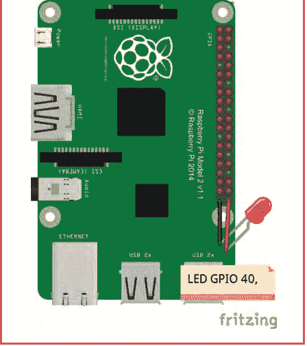

## 07 连接LED

现在将各个改装项目连接到你的玩具上。这些示例基于教程的第一部分，但可以替换为你自己的项目。关闭树莓派并拔掉电源。假设LED已连接到跳线，取LED的正极线，即带电阻的那根，连接到GPIO 21引脚。这是物理引脚编号40，位于引脚最右下角。黑色导线连接到接地引脚。最近的是物理引脚39，就在引脚40的左边；连接到这里。

## 08 连接马达

接下来取马达的正极线，通常为红色，连接到GPIO 09，即物理引脚编号21。然后需要将另一根导线连接到任意一个接地引脚（GND）6、9、14、20、39。当你为其他组件添加更多导线时，可能需要稍后重新安置这根导线。

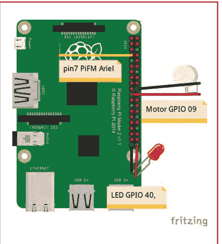

## 09 添加PiFM天线

树莓派可以直接从物理引脚7向你的收音机广播，无需修改任何东西。但是，你可能希望通过在GPIO 04、物理引脚编号7上添加一根导线来扩展广播范围。难以置信的是，这可以将广播范围扩展到100米。你必须使用物理引脚编号7进行广播，所以移开可能连接在你自己改装项目上的其他导线。

## 10 添加网络摄像头

网络摄像头是最简单的连接组件，因为它使用其中一个USB端口。插入后，使用命令`sudo lsusb`列出端口连接。如果显示了你的网络摄像头名称，则表示它已被识别并可以使用了。考虑去掉塑料外壳，只留下电路板和镜头。调整外壳使其紧凑，可以藏在你的玩具里。

## 11 设置程序

假设你已经为改装项目安装了所有必需的软件模块和库，现在可以创建控制玩具额外功能的程序了。在Python编辑器中打开一个文件并导入os，这将控制PiFM和网络摄像头，第1行。接下来导入PiFM库；网络摄像头在树莓派启动时自动运行，参见第168期第一部分，第12步。在第6行将GPIO引脚设置为BCM，然后定义你所使用按钮设置的PUD。第一个选项，第7行，用于已连接到玩具的按钮，第二个用于你自己添加的按钮。

```
import os
import sys
import time
import RPi.GPIO as GPIO
import PiFm
GPIO.setmode(GPIO.BCM)
```

```
GPIO.setup(15, GPIO.IN, GPIO.PUD_DOWN) #checks for a change on pin 7
GPIO.setup(17, GPIO.IN, GPIO.PUD_UP)
```

## 12 设置其他输出

接下来准备另外两个GPIO输出，在本例中是LED和马达。使用代码`GPIO.setup(9, GPIO.OUT)`将它们设置为输出，第1行，然后使用代码`GPIO.output(21, GPIO.LOW)`关闭LED。这确保当你启动程序时，LED和马达不会在触发按钮被按下之前运行。

```
GPIO.setup(9, GPIO.OUT)
GPIO.output(9, GPIO.HIGH)
```

```
GPIO.setup(21, GPIO.OUT)
GPIO.output(21, GPIO.LOW)
```

## 13 设置LED

创建一个函数来存储控制LED的代码，使其亮起5秒钟然后熄灭，第2、3、4行。然后设置一个简单的消息，在程序开始时显示，让你知道玩具已就绪且引脚已准备好。这对调试你的程序很有用。

```
def LED_Eye():
    GPIO.output(21, GPIO.HIGH)
    time.sleep(5)
    GPIO.output(21, GPIO.LOW)
```

```
print ("Welcome to R2D2")
```

## 14 触发事件

设置一个while循环来持续检查按钮是否被按下，第1行。使用IF语句检查按钮何时被按下以及输入是否为

### 观看R2D2实际运行

观看完成的R2D2玩具改装视频，看看各项功能的实际运行效果。这可能会给你自己的玩具改装带来一些灵感。https://www.youtube.com/watch?v=VnOsUaS5jSY

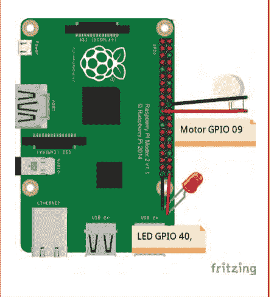


 ## 改装玩具

**HIGH**。这里使用了代码行 `GPIO.input(15) == 1`：这里的 1 相当于 True 或 On；这与步骤 6 中讨论的电路闭合且有电流通过有关。然后通过 `GPIO.output(9, GPIO.LOW)` 触发电机启动（第 5 行），并调用函数 `LED_Eye()` 执行，点亮 LED（第 6 行）。

```
while True:
    if GPIO.input(15) == 1:
        print ("You touched R2D2!")
        
        '''Enable LED and Motor'''
        GPIO.output(9, GPIO.LOW)
        LED_Eye()
```

## 15 触发摄像头和无线电广播

最后，使用代码行 `os.system('service motion start')` 启动网络摄像头流媒体，并在你的查看设备上查看画面。在摄像头运行的同时，使用 `PiFm.play_sound("sound.wav")`（第 4 行）启动无线电广播。默认 FM 电台设置为 100FM，打开你的收音机收听正在播放的声音。然后在声音播放完毕后，使用代码行 `os.system('service motion stop')` 停止网络流。请注意，此代码与前面的行缩进在同一层级。

```
'''start webcam'''
os.system('service motion start')
```

```
'''Play the Star Wars Theme'''
PiFm.play_sound("sound.wav")
```

```
'''Stop the Webcam'''
os.system('service motion stop')
```

## 16 将改装嵌入玩具

当你所有的改装都能在代码中触发后，将线路和你的树莓派嵌入到你的玩具中。你可以选择展示硬件，打造一种更具"增强"风格的玩具，或者将所有部件巧妙地隐藏起来，让潜在用户在互动时感到惊喜。

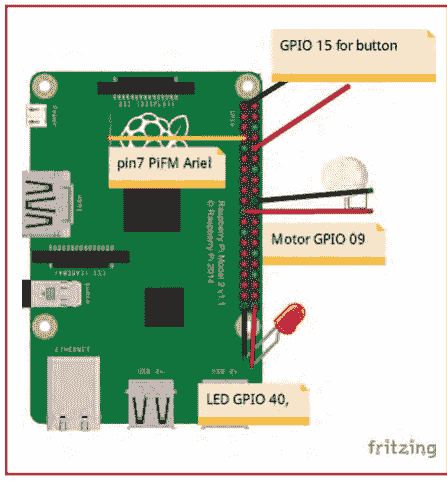

## 完整代码清单

```
import os
import sys
import time
import RPi.GPIO as GPIO
import PiFm
GPIO.setmode(GPIO.BCM)
import time

GPIO.setup(15, GPIO.IN, GPIO.PUD_DOWN)
#checks for a change on pin 7

###Reset Motor
GPIO.setup(9, GPIO.OUT)
GPIO.output(9, GPIO.HIGH)

###Reset LED
GPIO.setup(21, GPIO.OUT)
GPIO.output(21, GPIO.LOW)

###Controls the LED eye
def LED_Eye():
    GPIO.output(21, GPIO.HIGH)
    time.sleep(5)
    GPIO.output(21, GPIO.LOW)

print ("Welcome to R2D2")

while True:
    if GPIO.input(15) == 1:
        print ("You touched R2D2!")
        
        '''Enable LED'''
        GPIO.output(9, GPIO.LOW)
        LED_Eye()
        
        '''Enable the Haptic Motor'''
        GPIO.output(9, GPIO.HIGH)
        
        '''start webcam'''
        os.system('service motion start')
        
        '''Play the Star Wars Theme'''
        PiFm.play_sound("sound.wav")
        
        '''Stop the Webcam'''
        os.system('service motion stop')
```


## gpiozero

这是一个智能的 Python 库，让与 GPIO 引脚的交互变得非常简单，例如你可以用代码 `led.on()` 控制 LED。它涵盖了大量组件、硬件和扩展板。你可以在 https://gpiozero.readthedocs.io/en/v1.2.0/# 了解更多信息。

## 教程

## 在你的树莓派上运行 RISC OS

忘掉 Raspbian 吧——在这个典型的英国操作系统上安装到你的树莓派上，让它更上一层楼！

### Christian Cawley

我是一名前 IT 和软件支持工程师，自 2010 年以来一直为网上和印刷媒体上的计算机和移动用户提供建议和灵感。我在 makeuseof.com 上报道树莓派和 Linux。

你乐于使用 Raspbian 来充分发挥树莓派的作用。你可能尝试过 Ubuntu 或 Arch Linux，但从未看到其必要性。毕竟，当要最大化树莓派的功能时，官方发行版已经提供了你需要的一切，对吧？

但是，试试非 Linux 操作系统怎么样？剑桥开发的 RISC OS（RISC 是"精简指令集计算"的缩写）是 ARM 处理器的第一个操作系统，虽然年长的英国读者会从经典的 Acorn Archimedes 计算机上回忆起它，但 RISC OS 仍然相关且易于上手。只是确保在启动前准备好显示器、鼠标和键盘！

### 你需要准备

- RISC OS http://bit.ly/2auOpYL
- 显示器
- 键盘
- 三键鼠标（标准的可点击滚轮应该可以）

## 开始使用 BASIC

无论你还记得 BBC BASIC，还是对它完全陌生，在 RISC OS 中你都可以轻松使用它。要打开命令行，按 Ctrl+F12，然后输入 BASIC 并按回车。你就可以开始输入一个草莓程序了：

```
10 WHILE TRUE
20 PRINT "Hello world!"
30 ENDWHILE
RUN
```

按 Esc 可以停止这个例程。有专门的编程编辑器可用于 BBC BASIC，不过你也可以用 WIMP 和 C 来开发代码。

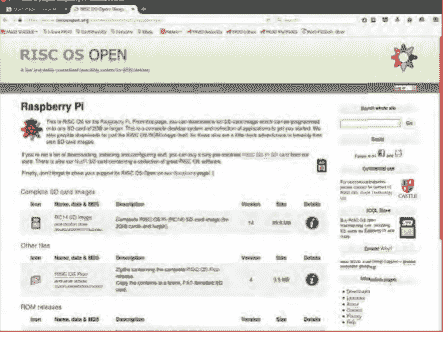

上图 选择适合你需求的 RISC OS 版本

## 01 下载 RISC OS

首先下载正确版本的 RISC OS（https://www.riscosopen.org/content/downloads/raspberry-pi），将 99.9Mb 的 ZIP 文件保存到你的电脑。

有多个版本可供选择，包括超轻量的 Pico 版本，但我们建议从第一个选项——SD 卡镜像开始入门。


上图 在写入磁盘镜像之前，必须先将其从压缩包中解压出来

## 02 解压下载文件

在写入 SD 卡之前，你需要解压 RISC OS 磁盘镜像。在终端中，使用 unzip 命令，指定下载文件的目录路径和文件名：

```
unzip Downloads/riscos-2015-02-17.14.zip
```

.IMG 文件就在主目录中，准备好写入 SD 卡。

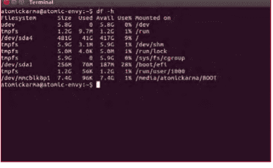

上图 SD 卡通常标有 "mmc" 或 "sdd" 字样，以便识别

## 03 找到你的 SD 卡

接下来，将操作系统写入格式化的 SD 卡。将卡插入读卡器后，切换到终端窗口，检查你的挂载设备：

```
df -h
```

在这个列表中，你会找到列出的 SD 卡，你可以通过其文件路径、名称和大小来识别它。

## 04 在树莓派上安装 RISC OS

接下来，卸载 SD 卡：

## RISC OS

```
umount /dev/mmcblk0p1
```

接下来，使用 dd 命令写入镜像文件。务必小心输入正确的目标位置——一个错误就可能删除你的硬盘！

```
sudo dd bs=4M if=riscos-2015-02-17-RC14.img of=/dev/mmcblk0
```

注意这里省略了 "p1" 部分，因为它指的是一个分区。

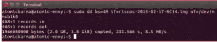

上图 写入 SD 卡时，确保输入正确的文件路径和目标设备名

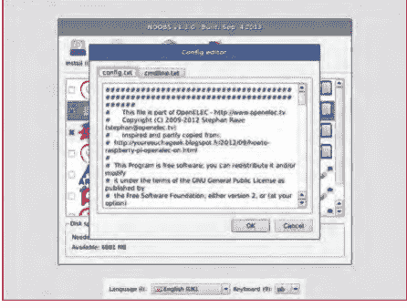

上图 NOOBS 提供了一种无需终端的替代方法来安装 RISC OS

## 05 替代安装方式

如果你不想使用面向终端的 RISC OS 安装方式，你可以 alternatively 下载 NOOBS 软件，将其复制到 SD 卡上，然后启动树莓派并选择 RISC OS 作为你的操作系统。

安装完成后，继续执行以下步骤来熟悉 RISC OS。

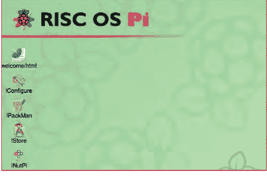

上图 你需要连接键盘和鼠标才能使用 RISC OS

## 06 启动 RISC OS

几分钟后，SD 卡应该准备好了，所以卸载并插入到你的树莓派中，然后开机。

确保首先将鼠标和键盘连接到你的树莓派，还有以太网线，因为 RISC OS  unfortunately 目前不兼容无线网络。


上图 使用三键鼠标或鼠标滚轮来打开菜单

## 07 你的鼠标兼容吗？

任何还记得 Acorn Archimedes 的人都知道，RISC OS 需要三键鼠标。中间按钮是专用的上下文菜单（类似于 Linux、OS X 和 Windows 中的右键单击），但只要你的鼠标有可点击的滚轮，这应该不是问题。

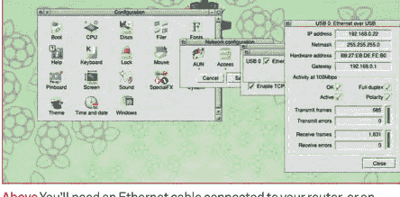

上图 你需要一根以太网线连接到路由器，或以太网 Wi-Fi 适配器

## 08 在 RISC OS 上启用以太网

默认情况下，以太网是禁用的。要解决这个问题，请按照桌面上 welcome/html 文件中的说明操作。如果该文件缺失，双击 !Configure，然后依次选择 Network\Internet\Enable TCP/IP Protocol Suite，接着点击 Close\>Save。

最后，你可以选择 Reboot now 来重新启动系统，启用以太网。

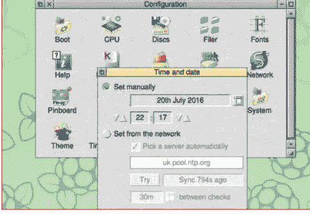

上图 花几分钟熟悉 RISC OS 桌面

## 09 掌握 RISC OS

如果你有使用 RISC OS 的过往经验，桌面上看到的大部分内容都会很熟悉。否则，别担心，它相当直观。应用程序本质上是以 ! 为前缀的目录（在 RISC OS 中称为 pling），通过双击文件夹启动。

## 在 RISC OS 上安装软件

RISC OS 中包含两个包管理器。Packman 用于安装和升级软件，而 !Store 提供商业软件。软件也可以手动安装，通过从桌面电脑复制 ZIP 压缩包到 SD 卡，然后将压缩包中的文件复制到 RISC OS 文件系统中。请注意，你在学校可能用过的旧软件可能无法运行，因为早期 ARM CPU 的架构与现代版本存在差异。


 # 教程

## 构建一个 explorer pHAT 机器人

### 第三部分

### 通过我们的机器人编程教程，为你的探索者机器人装上腿

**Alex Ellis**
@alexellisuk 是 ADP 的高级软件工程师，Docker Captain，以及所有 Linux 相关事务的热衷者。他形影不离 Raspberry Pi，并经常在其博客上发布教程。

**本教程旨在构建控制探索者机器人的软件，让你能够将其放到客厅、办公室甚至花园中自由驰骋。** 我们将编写一个程序，通过控制台驱动机器人，让你可以像在电脑游戏中一样输入 WASD。这能让你有机会熟悉机器人的移动方式以及代码的构成。随后，我们将整合 Nintendo Wiimote 控制器，相比键盘，它能提供更自然的操控体验。

代码将使用 Python 编写，Raspbian 已预装 Python，并且尽可能兼容 Python 2 和 3。全部源码均为开源，因此如果你想提出改进建议或修正错误，可以在 Github 上提交 pull request 或创建 issue。

## 01 脱离束缚

我们的机器人底盘最初设计为由 Arduino 驱动，其电流消耗远低于 Pi Zero。虽然 5-36V 的电压范围可以为某些 Arduino 板供电，但我们的 Pi 需要从 UBEC 获取纯净的 5V 电压。全新的碱性电池未使用时的电压约为 1.65-1.7V，这意味着 UBEC 的输入电压约为 6-7V。其中一部分会在转换至 5V 的过程中损耗，其余的将同时驱动电机和 Raspberry Pi。

## 02 进站维修时间

虽然需要电池才能实现无线移动和四处漫游，但我们建议你为探索者机器人搭建一个小型工作站，以便在出现问题时将其带入其中下载新代码和调试。在这里，你将可以使用 USB 电源、带电源的 USB 集线器、HDMI 电视或显示器、蓝牙适配器、Wi-Fi 适配器和键盘。**务必确保在接入电源进行维修之前断开电池。**

### 所需物品

- 文章的 Github 仓库 (https://github.com/alexellis/zumopi)
- 在第二部分中构建完成的探索者机器人
- 原装 Wiimote（可选）

## 03 校准你的电机

我们现在来校准电机的方向，使其与软件匹配。将你的机器人固定好，并把它放在空火柴盒上，这样它的履带可以自由转动而不会带走导线。现在使用 Python 检查每个电机在代码调用时是否都能向前驱动履带。你可以将代码输入到交互式 Python 提示符中，或使用文件 `motor_tests/forwards.py`。

```
import explorerhat
import time

explorerhat.motor.one.forwards()
time.sleep(2)
explorerhat.motor.one.stop()

explorerhat.motor.two.forwards()
time.sleep(2)
explorerhat.motor.two.stop()
```

```
motors.forwards()
time.sleep(1)
motors.stop()
time.sleep(1)
motors.backwards()
time.sleep(1)
motors.stop()
```

## 04 左转和右转

为了实现左转或右转，我们只需让一个电机向前转动，另一个电机向后转动。需要转动的电机取决于你如何连接电机一和电机二。我们将电机一指定为左侧，电机二指定为右侧。因此，要测试转弯，我们可以尝试以下代码来实现右转。

```
import explorerhat
import time

explorerhat.motor.one.forwards()
explorerhat.motor.two.backwards()
time.sleep(1)
explorerhat.motor.one.stop()
explorerhat.motor.two.stop()
```

```
import time
import explorerhat

class Motors:
    def forwards(self):
        explorerhat.motor.one.forwards()
        explorerhat.motor.two.forwards()
    def stop(self):
        explorerhat.motor.one.stop()
        explorerhat.motor.two.stop()
    def backwards(self):
        explorerhat.motor.one.backwards()
        explorerhat.motor.two.backwards()
    def left(self):
        explorerhat.motor.one.backwards()
        explorerhat.motor.two.forwards()
    def right(self):
        explorerhat.motor.one.forwards()
        explorerhat.motor.two.backwards()
```

该文件也以 **motor_tests/turn_right.py** 形式存在。要左转，则执行相反的操作，即电机一向后转，电机二向前转。

## 05 使用抽象

如果你查看目前的代码，会发现有很多重复，因此让我们创建一个抽象，将电机的工作细节以及需要哪个电机向后或向前才能向任何方向移动的细节隐藏起来。

要试用 Motors 类，输入以下内容或使用 **motor_test/motors_v1_test.py**。

```
import time
from motors_v1 import Motors

motors = Motors()
```

### 充电电池 VS 碱性电池

为了让我们的 UBEC 正常工作，需要四节 AA 电池collectively提供超过 5V 的电压。可充电 AA 电池在充满电时通常标称电压为 1.2V，总共 4.8V，远低于我们的需求。碱性电池刚开始使用时通常为 1.6-1.7V，这意味着我们将有超过 6V 的电压，UBEC 可以正常运行。使用 AA 电池的替代方案是用扎带将 USB 移动电源绑在机器人的平面上。

## 06 创建 REPL

既然我们有了 Motors 类，就可以创建自己的 REPL（读取-求值-输出循环）——这与你不指定文件直接输入 Python 时获得的东西类似。首先，我们从终端读取输入，然后将其转换为电机方向并让机器人移动，接着向用户回显我们理解的内容，然后重新开始。

Python 为我们提供了一个方便的方法来实现这一点，叫做 raw_input()。我们可以在循环中调用它，然后使用 sys.stdout.write 代替 print，这样光标就停留在同一行。我们忽略除 'q' 以外的所有输入，'q' 用作退出程序的信号。

```
import sys

last = None
while(last != 'q'):
    sys.stdout.write("Command: ")
    sys.stdout.flush()
    last = raw_input()
    print("You said: " + last)
```

## 07 结合 REPL 和 Motors 类

现在让我们开始将读取到的内容解释为电机的输入。现在你可以选择在输入新命令之前让机器人持续移动，或者移动一小段时间然后立即停止。我们倾向于第二种方案，因为它更容易控制。motor_repl_v1.py

## 08 抽象 REPL

REPL 可以在很多方面进行增强，包括允许编辑移动/转动时间的变量。让我们通过引入更多的类来改进代码结构。类非常擅长做一件事，帮助我们以后更换功能，甚至编写自动化测试。这一步将允许我们以后使用游戏手柄或 Twitter 流来复用同一个程序。你可以在 motor_tests/motor_repl_v2.py 中查看增强功能。

## 09 类的说明

我们引入了三种类型的类：一个类用于读取终端输入并将其转换为 Command，几个类用于表示每个命令，如 Forwards/Left/Right 和 Quit，然后另一个名为 Robot 的类用于运行整个示例。

我们的新循环更易于阅读，并且允许我们一次只更新一件事，这意味着更改不太可能产生意外问题。我们还为代码命了名，使其工作职责清晰明了；这样我们就可以省去凌乱或令人困惑的注释。

```
cmd = terminalReader.read()
cmd.Execute(motors, move_delay, turn_delay)
```

## 10 改造蓝牙游戏手柄

在这一步，我们开始引入游戏手柄——Nintendo Wiimote。你可能有一个在角落里积灰或收在阁楼里，但如果你决定在线购买，请确保是原装正品，否则无法与官方 Python 库配合使用。找到与游戏手柄完美匹配的蓝牙适配器也可能很困难。我们发现原装 PS3 手柄无法与 £1 的适配器配合使用，但使用高端适配器则工作正常。我们尝试过仿制 PS3 手柄和 Wiimote，但都无*法工作。

### 升级你的控制器

Wiimote 是一个易于使用的手柄，但它的按钮数量有限。如果你想要更多选项，我们建议你购买原装 PS3 手柄。它提供了更多的按钮和两个独立的轴，可用于操控机器人、切换模式或以其他方式命令机器人。例如，可以将选择按钮设置为拍照并上传到 Twitter。

## 11 配置蓝牙

Raspbian Jessie 预装了访问蓝牙配件所需的系统工具。如果你使用的是其他系统，请寻找 Bluez 工具。我们将使用 cwiid 库来提供 Wiimote 交互功能。还有其他库可用，你也可以尝试。现在使用 apt-get 安装 cwiid：

```
sudo apt-get install python-cwiid
```

以下代码（也在 wiimote_tests/pair_v1.py 中）将配对手柄，然后使其振动或"震动"半秒钟。运行代码前，按住 A 和 B 或电池盖下的按钮以进入配对模式。

```
import cwiid, time
wii = cwiid.Wiimote()
wii.rumble = True
time.sleep(0.5)
wii.rumble = False
```

## 12 读取按钮

读取按钮不是事件驱动的；我们需要使用轮询（持续检查）在循环中完成。在配对行 'wii = cwiid.Wiimote()' 之后，我们开始查询按钮的映射。下面 wiimote_tests/buttons_v1.py 中的代码将在终端中打印出你按下 A 或 B 时的情况。注意，只要按钮被按下，消息就会重复显示——我们添加了暂停以避免让 Pi 过载。完成后，按 Ctrl+C 退出。

```
import cwiid, time
wii = cwiid.Wiimote()
wii.rpt_mode = cwiid.RPT_BTN
while(True):
    buttons = wii.state['buttons']
    if buttons & cwiid.BTN_A:
        print("A pressed, go forwards")
    if buttons & cwiid.BTN_B:
        print("B pressed, go backwards")
    time.sleep(0.02)
```


 ## 探索者机器人

## 13 创建 WiimoteReader 类

既然我们能够从游戏手柄读取输入，让我们创建一个将输入转换为机器人可以理解命令的功能模块。由于我们将在独立的类中完成这项工作，因此无需移动机器人即可测试代码。下面是来自 drive_v1/wiimote_test.py 的代码，它会在我们按下游戏手柄按钮时打印出命令。使用 Ctrl + C 停止示例。

```
import time
from wiimotereader import WiimoteReader

reader = WiimoteReader()
cmd = None
while(True):
    cmd = reader.read()
    print(cmd)
    time.sleep(0.25)
```

## 14 完成控制软件

我们现在可以通过单独的命令类来控制机器人，这些命令类可以由终端和键盘创建，也可以通过 Wiimote 游戏手柄创建。如果你要下载 PS3 手柄的 Python 库，你所需要做的就是将输入转换为我们已经在使用的命令类。

以我们在步骤 13 中的示例为基础，让我们更进一步，在 wiimotereader.py 代码解释命令时开始执行这些命令。

## 15 我们可以到此为止

我们可以在此时停止教程，因为我们已经通过游戏手柄实现了机器人的完全手动控制，但还有一些重要步骤要带你完成。我们需要让程序自动启动，这样当使用电池供电且唯一的 USB 端口插入了蓝牙适配器时，我们仍然可以加载控制软件。我们可以使用 Cron（一个久经考验的 Unix 调度程序）创建一个简单的启动任务。在你的 crontab 文件中添加一条 @reboot 指令。输入 'chmod +x start.sh'（按回车），然后 'crontab -e'：

bei：

```
@reboot /home/pi/explorerrbot/part3/drive_v1/start.sh
```

也可以使用 Systemd 创建配置和启动文件；它有很多优点，但这些层次也增加了复杂性。

> 你应该直接在树莓派上编写代码吗？

随着现代开源代码编辑器的普及，例如 Visual Studio Code（https://code.visualstudio.com/）和 Atom（https://atom.io），你有充分的理由先在笔记本电脑或台式 PC 上编写大部分代码，然后使用 scp/sftp 或 git push/pull 将代码传输到设备上。我们采用在设备上编程与将代码整合到 GitHub 仓库或 PC/笔记本电脑上的代码文件夹相结合的方式。这也意味着如果树莓派的 SD 卡发生损坏，你始终有第二份工作副本。

## 16 运行其他命令

除了自动启动之外，我们还需要一个安全的关机机制，这样树莓派才能执行干净的断电，保持我们的 SD 卡处于良好状态。Linux 的 halt 命令是实现安全关机的不错选择。导入 Python 的 os 模块并使用它来执行命令，这里有一个关于 uptime 的示例：

```
>>> import os
>>> os.system('uptime')
21:34:11 up 16 min,  1 user,  load average: 0.00, 0.03, 0.07
```

我们所需要做的就是添加一个 Shutdown 类，然后由 WiimoteReader 类来解析它。我们选择 Home 键作为关机键，因为它很难被意外按下。

## 17 实现 Shutdown 类

关机类如下所示：

```
import os

class Shutdown:
    def Execute(self, motors, move_delay, turn_delay):
        os.system("sudo halt")
        return False
```

更新后的解析代码可以在 WiimoteReader 中找到。你现在可以拔掉 USB 集线器和电源适配器了——更换电池，然后从 UBEC 插入 5V/GND。这将立即启动树莓派。当蓝牙适配器开始闪烁时，开始按住配对按钮。

## 18 总结

我们教程已经进行到第三部分，已经构建了一个功能完整的、由 Wiimote 游戏手柄控制的探索者机器人。不要错过下一期的第四部分，届时我们将设计代码，通过传感器让机器人自主行驶。

---

## 探索内部技术

www.gadgetdaily.xyz

---

## 评测

### 音乐播放器和音乐管理工具

对于喜欢保持音乐有序的人来说，外面有很多选择，但哪个最适合 Linux 用户呢？

### Spotify

尽管用户数据库不断增长，但面向 Linux 的 Spotify 开发一直有些坎坷。更新缓慢和频繁的漏洞让用户期望更多。然而，随着一些新功能和关键修复的加入，它正在成为市场上较好的播放器之一。

www.spotify.com

### Audacious

对于那些追求轻量级音频播放器的人来说，Audacious 是不二之选。所有核心的组织功能都具备，但它确实缺乏我们预期的播放选项。不过，对于那些喜欢频繁更新的人来说，它仍然是更好的选择之一。

http://audacious-media-player.org/

# TOMAHAWK

连接性是 TOMAHAWK 的关键，这也是它赢得良好声誉的关键原因之一。它很容易整合各种社交媒体信息流，添加和结交新朋友分享音乐，还可以添加任何存储音乐的云账户详情。

www.tomahawk-player.org/

# Clementine

受到同样受欢迎的 Amarok 1.4 媒体播放器的启发，Clementine 是一款功能性的音乐播放器。它拥有令人印象深刻的功能集，其中许多功能使其在同类产品中脱颖而出。我们特别喜欢用智能手机甚至 Wii 遥控器来控制 Clementine！

www.clementine-player.org

---

## 评测 音乐播放器和音乐管理工具

### 面向 Linux 的 Spotify

最近的更新最终是否让 Spotify 成为 Linux 用户的赢家？

发现新音乐是 Spotify 最棒的功能之一，尤其是发现冷门艺术家和曲目

## 设计

尽管功能众多，Spotify 在避免界面过于杂乱方面做得很好。用户界面尤其容易导航，顶部和侧面都列出了各个部分。在我们使用期间，我们确实注意到在使用"浏览"部分时有些 slowdown，这似乎源于需要加载大量的专辑封面。

## 播放控制

虽然所有基本功能都很容易在显示屏底部找到，Spotify 还受益于一系列可编程的键盘快捷键。我们还特别喜欢通过 iOS 和 Android 应用直接控制我们的音乐源。应用中提供了全面的 controls 列表，如果你第一次使用 Spotify，这会很有帮助。

#### 音乐库管理

Spotify 武器库中最薄弱的环节或许是它管理音乐库的方式。虽然菜单很容易找到，但往往难以导航，偶尔会出现缺失封面和错误详情的情况。不过，用户可以根据自己在 Spotify 上的确切需求，更改存储菜单的功能和运作方式。

## 额外功能

许多人选择使用 Spotify 的原因之一是它能让用户发现平时不会听的音乐。这是通过一系列巧妙混合的播放列表实现的，所有播放列表都根据你之前的收听体验为你量身定制。当然，能够在各种设备上使用 Spotify 也非常方便。

## 总体评价

面向 Linux 的 Spotify 仍有一些问题需要解决，但对于一个易于使用且具有一些真正令人印象深刻功能的音频播放器，一定要去看看。

### Audacious

说到 Audacious 音乐播放器，选择就是一切

用户可以下载并整合歌词，与喜爱的曲目并列显示，如果你想来一次卡拉 OK 会，这非常理想！

## 设计

虽然默认的音乐视图对我们来说过于基础，但用户可以在程序中切换不同的视图。其用户界面的许多元素也可以自定义，因此在排列标签和实现专辑封面方面，用户拥有完全的控制权。如果自定义过程变得难以应对，还有一个帮助部分可供使用。

## 播放控制

与这组中的其他音乐播放器相比，Audacious 在这方面有些简陋。你期望的所有基本功能都包含在内，但我们希望能够更好地控制音乐的播放方式。我们喜欢使用无缝播放功能，尽管大多数播放器都有这个功能，而且在其他播放器中表现得更出色一些。

#### 音乐库管理

在存储和管理音乐方面，Audacious 完全将控制权交到用户手中。每一段元数据都可以被细致地拆解和编辑，程序会在每次上传后自动扫描无效和重复的文件。不过，上传速度总体上有些慢，因此不建议同时添加多首歌曲。

## 额外功能

有大量外部插件可以集成到 Audacious 中，极大地增加了它的功能集。其中一个较好的插件允许用户将他们的 Last.fm 账户导入程序，而 Effects 插件可以将程序的歌曲处理提升到一个新的水平。这无疑是 Audacious 最棒的地方。

## 总体评价

设计上的选择将立即受到新用户和高级用户的欢迎，但播放控制在很大程度上有所欠缺。它当然值得考虑，但有更好的替代方案。


# TOMAHAWK

一款外观出众的多平台音频播放器

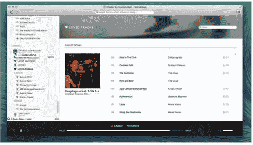

播放列表可以通过 TOMAHAWK 左侧的拖放系统即时创建

## 设计

这无疑是当今最好看的音频播放器之一。虽然它大量借鉴了苹果 iTunes 程序的元素，但简约的设计让用户易于导航。实际可定制的内容不多，但我们认为这里没有什么需要改变的必要。

## 播放控制

就播放功能而言，没有什么特别突出的特性，但所有添加的功能都运行良好。特别是歌曲排队功能非常出色，播放功能可以通过不同的菜单进行控制。安卓用户也可以通过相应的应用程序控制他们的播放流程，但该应用远不如桌面程序出色。

## 音乐库整理

整合功能在 TOMAHAWK 中扮演着重要角色，它是极少数允许用户从各处添加音乐源的播放器之一。无论是存储在桌面、云端、其他音频播放器，甚至是订阅服务中的音乐，与 TOMAHAWK 同步都快速简便。该程序会自动将这些音乐放入不同的文件夹，为你节省时间和精力。

## 额外功能

社交功能是 TOMAHAWK 的另一大亮点。你可以与朋友连接并邀请他们使用 TOMAHAWK，但目前用户基数较小。你可以关注朋友的播放列表，甚至可以在桌面端收听它们。加载精选播放列表时可能会有一些延迟，但这主要取决于其中歌曲的数量。

## 总体评价

尽管对许多人来说可能相对陌生，但 TOMAHAWK 是 Linux 用户最出色的音频播放器之一。虽然它确实借鉴了 Spotify 和 iTunes 的元素，但它自身也有大量值得称赞的创意。

9

# Clementine

Clementine 能在这场音频播放器组测试中跟上大热门吗？

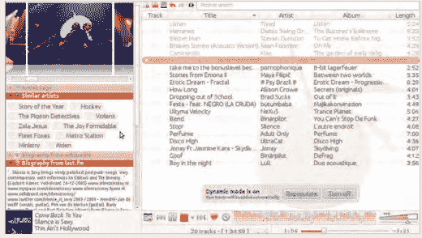

笨重的菜单系统意味着在音乐库和其他标签页之间导航可能会很困难

## 设计

第一次使用 Clementine 几乎肯定会让你摸不着头脑。菜单难以区分，大量的子菜单和额外标签页更是加剧了这个问题。一旦你找到了门路，就会意识到它所包含的功能集的复杂性，这在很大程度上令人印象深刻。

## 播放控制

播放任何歌曲时，会打开一个小的控制面板，其中包括普通听众所需的一切。播放列表管理选项也在这里列出，因此用户可以即时进行修改，而无需浏览整个菜单系统。安卓应用也可以使用，但与 TOMAHAWK 类似，在某些方面有所欠缺。

## 音乐库整理

Clementine 音频播放器的复杂性意味着整理和存储你的音乐库并不如我们所愿那样简单。然而，我们应该赞扬用户在导入曲目时可以深入到的细节程度。元数据可以在任何时候添加，而且在播放列表和专辑之间共享某些元数据元素也很容易。

## 额外功能

Clementine Linux 版本最值得关注的特点之一是其原生通知系统。这使得用户可以及时了解曲目导入和播放的进度，而无需进入实际程序。也可以通过命令行进行远程控制，但这无疑是控制 Clementine 最难的方式。

## 总体评价

Clementine 背后有一个活跃的社区，因此我们预计会有大量变化。然而，就现状而言，与这里列出的其他一些音频播放器相比，它感觉有点过于复杂。

7

## 评测

### 音乐播放器和整理工具

## 简要对比：我们的 verdict

| | Spotify for Linux | Audacious | TOMAHAWK | Clementine |
|---|---|---|---|---|
| **设计** | 易于访问的用户界面，设计流畅，提供大量吸引人的元素 **9** | 部分简约，但用户有大量可定制的元素可以探索 **7** | 一款现代播放器，融入了苹果 iTunes 的多个熟悉元素 **9** | 大多数情况下过于复杂，有大量菜单需要处理 **6** |
| **播放控制** | 无需打开程序就有多种方式控制你的音乐 **8** | 对我们来说太过基础，缺少竞争对手提供的核心选项 **5** | 所有基础功能都实现了良好的整合，安卓应用也可以使用 **8** | 有可用的独立控制面板，包含你所需的所有基本控制 **7** |
| **音乐整理** | 导入数据通常会缺失，专辑封面时有时无 **6** | 每一条元数据都可以编辑并在播放列表之间共享 **7** | 有大量导入选项可用，有助于保持你的库井井有条 **9** | 菜单系统的复杂性阻碍了用户导入曲目 **6** |
| **额外功能** | 通过精选播放单发现你喜欢的新音乐是这里的一大亮点 **8** | 可以根据你的喜好添加大量插件，包括一些出色的效果 **8** | 有大量社交功能可用，但要注意用户基数较小 **8** | Linux 用户可以利用一些特别有用的桌面通知 **8** |
| **总体** | 音乐发现是 Spotify 的核心，在这方面它表现出色——但在其他方面则不然 **8** | 插件丰富，元数据处理出色，但受限于其简洁性 **7** | 外观出色，界面熟悉，功能强大，但用户基数较小 **9** | 即使按 FOSS 标准来看，作为媒体播放器也过于复杂，但在桌面上很有用 **7** |

## 冠军是……

# TOMAHAWK

与其他桌面操作系统相比，Linux 用户可选的音频播放器在整体质量上还不够出色。然而，如果我们通过这组测试证明了什么，那就是用户确实有一些不错的选择可以查看。Spotify 的 Linux 客户端在过去 12 个月里 certainly 取得了长足进步，虽然改进众多，但仍有一些关键问题需要解决。另一方面，TOMAHAWK 给人的感觉则是一款完整且高度可用的产品。

虽然它的设计很好地借鉴了 iTunes 的风格，但它为苹果的成功公式提供了一些现代的变体，而且人们常说模仿是最真诚的奉承。在菜单之间导航足够简单，而且有足够的空间让人们真正将其个性化。导入选项也很丰富，它是我们观察到的少数几款真正将控制权交到用户手中的音频播放器之一。

当然，仍有一些需要调查和改进的地方。当前用户基数对于充分利用 TOMAHAWK 包含的大量社交功能来说有点太小，但随着时间的推移，我们预计它们会变得 vastly 更加有用——尤其是在连接到精选播放列表方面。我们也希望看到安卓应用经历一些转变，因为在目前的状态下，它可以用来控制你的音乐流，但仅此而已。

如果你能忽略 TOMAHAWK 存在的一些小问题，它无疑是 Linux 用户可用的 premier 音频播放器。现在就下载它，上传你最喜欢的专辑，开始 rocking out 吧。

> 在 TOMAHAWK 音频播放器中展示你的专辑封面看起来很棒

> Oliver Hill

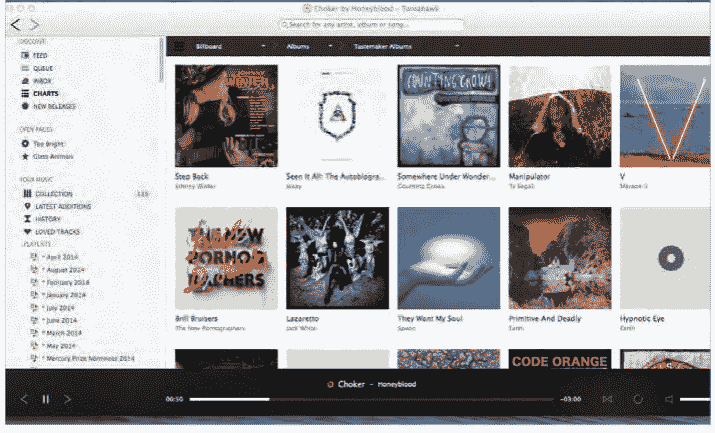

88

# 为你的团队添加远程 DBA

2ndQuadrant 的远程 DBA 是需要额外帮助来管理其 PostgreSQL 数据库的组织的理想解决方案——凭借我们对核心代码的专业知识，你找不到更安全的选择了

远程 DBA 是我们金牌和白金生产支持服务计划的服务扩展

- 英国 +44 (0)870 766 7756
- 美国 +1 650 378 1218
- 2ndquadrant.com/rdba


# 生日快乐

# 扫描你的惊喜


# 庆祝托管服务 **二十周年**


来和我们一起庆祝，扫描二维码领取你的生日惊喜！

域名 : 托管 - 云 - 服务器

# 英国服务器

# 独立服务器

每月仅需 **£39** 起，不含增值税

- 当日设置
- 24/7 英国免费电话支持
- 无长期合同

使用促销代码 LINUX1 享受 **15%** 折扣


与我们的团队成员交谈，或访问我们的网站了解更多信息

- 0800 610 1 620
- www.ukservers.com


 ## 评测

## Linux Mint 18

**发行版**

## Linux Mint 18

Linux Mint 在其最新更新中继续确立对竞争对手的统治地位

- **内存**：512MB
- **存储空间**：9GB（推荐20GB）
- **规格参数**：1024 x 768 分辨率，64位和32位版本

如果你前往每位 Linux 爱好者的好伙伴 DistroWatch 查看，你很可能会发现 Linux Mint 早已稳居其下载榜榜首一段时间了。虽然它可能不是每个人口中的首选发行版，但它已经为自己赢得了坚实的声誉，成为了 Linux 新手寻求更换桌面体验入门途径的首选之一。与我们之前见过的大多数 Linux Mint 更新一样，本次变化丰富，并且继续支持 Cinnamon 3 和 MATE。无论你的选择是什么，捆绑软件都少而精。LibreOffice 和 VLC 已成为 Linux 的标配产品，而 Banshee 音频播放器的加入更是一大亮点，尤其考虑到它被认为是目前市场上较好的音乐播放器之一。

经过简单的安装——这在大多数入门级发行版中正变得越来越普遍——Linux Mint 最显眼的新增功能是 X-Apps 的引入。本质上，这些应用是传统 GNOME 应用程序的分支，经过修改以在广泛的桌面环境中工作。虽然有些人会认为这是不必要的改变，但它确实有助于解决 GNOME 应用程序在非 GNOME 环境中无法正常工作的困扰。这是一个小而微妙的修复，真正让用户从一开始就自由选择他们想要如何使用 Linux Mint，这是所有用户都会支持的。

> 从设置热点角落到窗口平铺，一切都已从一开始就可使用

同样值得注意的是 Mint 更新管理器中的一系列更新。更新策略比以前的版本清晰得多，Mint 现在可以协助新手安装它推荐他们应该为系统安装的更新。这与同时批量安装更新那种烦人的必要性相去甚远。易用性在 Mint 面向新 Linux 用户的目标中扮演着重要角色，而基础的系统设置清洗使其对所有用户来说都是一个更友好的场所。从设置热点角落到窗口平铺，一切都已从一开始就可使用，无需浏览复杂的菜单。它的风格与 Windows 非常相似，这不会令一些人满意，但它在功能上是有效的。我们建议在这里进入驱动管理器菜单，其中包含 Mint 认为会使你的系统受益的驱动程序的分步推荐指南。高级用户会对这种手把手指导嗤之以鼻，但这确实是对新用户的又一次关照。

深入挖掘 Linux Mint 会发现它使用了两个截然不同的图形软件包管理器，针对完全不同的受众。第一个叫做 Synaptic，依赖纯文本列表来提供你库中的所有软件项目。可以排队软件包，同时安装和删除它们。它有时有点慢，而且大部分情况下使用起来相当笨重。另一方面你会发现软件管理器，一个更加简洁的管理器，通过分类和图标来分发软件。它的设计远比前者赏心悦目，但其方法相当冗余。这两个软件包管理器对我们来说都没有真正命中 enquiries.net，但某些用户肯定会对其中一个感到熟悉。

得益于其更新库，如果我们在使用 Linux Mint 18 期间发现任何重大缺陷，我们会感到震惊。从安装程序到配置工具，一切都完美运行，并且包含了新用户可能需要配备其首个 Linux 发行版的一切。当然，其易用性也会吸引那些不想要更苛刻发行版所提供麻烦的高级用户，但它肯定不适合所有人。虽然我们希望能看到其中使用的图形软件包管理器有所改进，但这只是 Mint 团队又一次出色更新中的小瑕疵。

**奥利弗·希尔**

**优点**

从设置、定制到驱动管理，一切都能照常工作。没有什么大的惊喜，但 Linux Mint 18 在可用性方面获得了最高分。

**缺点**

我们希望看到此处使用的图形软件包管理器有所改进。特别是 Synaptic 有点迟缓。

**总结**

Linux Mint 18 如此出色，我们并不感到惊讶；事实上我们早有预期。这恰恰说明，如果你提供定期更新，倾听并采纳用户反馈，继续推动和发展你的发行版，好事就会发生

**9**

## 评测

### 自由软件

**编程环境**

## Pharo 5.0

好语言压不垮——Smalltalk 回来了！

对于一些人来说，这可能令人惊讶：在 Java 主导企业级场景并与面向对象（*OO*）几乎成为同义词之前，OO 曾经是一种革命性的方法，而它的实现意味着 Smalltalk。尽管它在金融软件和其他细分领域站稳了脚跟，但还是被 Sun 的 500 磅大猩猩排挤了出去，以碎片化的实现形式勉强维持，著名的有 Squeak 和 Pharo。

Squeak 是 OLPC（一人一本笔记本电脑）的 Etoys 编程环境的基础，也是 Scratch 早期版本的基础，但其开发需要在向后兼容性方面取得平衡，因此为了获得更现代的 Smalltalk，我们转向 Pharo。现代是一个相对的术语，在一台老旧的 32 位 Ubuntu Trusty 电脑上安装很直接，但安装 32 位兼容性库却让我们的 Debian Unstable 系统出了问题（不过 Debian Stable 是正常的）。

Pharo（以及一般意义上的 Smalltalk）的文档非常广泛，我们很快就投身于使用 Seaside Web 框架进行 Web 开发，并享受探索一种自 1990 年代以来几乎没再使用过的语言的乐趣。这里没有空间来说服你享受这门古老 OO 语言的乐趣，只能说它仍然有很多可提供的，而 Pharo 是一个尝试它的好地方。

**上图** Smalltalk 几十年前就开创了用户友好的 IDE 和对象检查功能，并继续让编码变得更加轻松

**优点**

- 强大的 OO 语言，具有良好的 Web 应用潜力，以及实时编程环境。
- 文档完善。

**缺点**

- Pharo 是一个相当沉浸式的实时环境，需要时间适应其视角。

**适合……**

重新发现为什么 OO 实际上是个相当不错的想法
http://pharo.org/

**即时通讯客户端**

## Converse.js 1.0.5

绝非复古，聊天客户端正成为 Web 应用的必备之物

得益于 Slack 驱动的浏览器内文本聊天的复兴，以及许多网站上适合移动端的"与顾问聊天"选项，你可能会觉得需要在自己的 Web 应用中集成一个聊天客户端——用于你自己的 XMPP 服务器或公共服务器。在这种情况下，Converse.js 必须出现在你的候选名单上，因为它的功能丰富，并且易于与从 Rails 和 Django 到 Alfresco 和 WordPress 等流行 Web 平台集成。

你也可以将它作为独立客户端使用，在你自己的页面上进行设置，从而在你的树莓派到笔记本电脑的各处添加 Jabber 功能。Converse.js 提供"单人和多人聊天、邀请、服务发现、直接注册、联系人列表、名册和 vCard 交换、状态更改和消息、输入和状态通知以及 OTR 加密"，除 Jabber 服务器外，它提供了你所需要的一切；如果你的 XMPP 服务器没有提供，还需要一个管理连接的工具（因为 HTTP 不适合这种长寿命的双向通信）。

设置教程涵盖了针对此目的的双向流 over 同步 HTTP（BOSH）和 websockets。文档非常出色，会快速让你完成设置，或在沿途帮助你根据需求进行调整——例如，服务器端身份验证（预绑定），用于让你网站上已登录的用户自动登录到现有的 XMPP 会话。

**优点**

- 集成良好，文档完善，说明简单。灵活而强大。

**缺点**

- 如果你不使用公共的，需要单独设置 Jabber/XMPP 守护进程。

**适合……**

为任何网站近乎无痛地集成聊天功能
https://conversejs.org/


 ## PYTHON 绘图包

## matplotlib 2.0.0b3

### 在 2.0 即将发布之际，像 Python 高手一样绘图


**matplotlib 是 Python 皇冠上的瑰宝之一。**它与 NumPy 相结合，为用户提供了一种数学教学工具，相比专有的 MATLAB 具有一些优势，同时为那些在教育中使用过 MATLAB 的人提供了类似的界面。在 IPython 中使用它，你会看到最出色的交互界面之一。它唯一的缺点是缺乏 Gnuplot 的多语言可访问性，但随着 Python（以及通过 PyPlot 包可以访问 matplotlib 的 Julia）在科学计算、金融和大数据领域的崛起，这已不算太大的劣势。

我们来看第三个 beta 版本：安装简单，许多 Python 用户和程序员很可能已经具备了大部分依赖项，但考虑到出版延迟，当你读到这篇文章时，你的发行版可能已经有了完整版本和软件包。如果你要自己构建，请用 python tests.py 进行测试——或者使用 Python 解释器：

```
import matplotlib
matplotlib.test()
```

你可以轻松生成 2D 图表，有了适当的库，3D 也是如此，这是一种乐趣。通过一些常见的教程示例来开始了解其可能性，然后用你项目的数据来尝试——不仅限于脚本和 GUI 工具包，还包括你的 Web 应用程序。现有的文档非常出色——读起来像是真正使用该软件完成工作的人编写的。

### 优点

- 对于 Python 高手来说，是自然而然的选择。
- 对于新手来说，类 MATLAB 的界面易于上手。

### 缺点

- 仅支持 Python 和 Julia，依赖 NumPy，且缺乏 Gnuplot 的卓越速度。

### 适用于...

用于演示和出版物的精美图表
http://matplotlib.org/

## 游戏

## Galaxy Forces V2 1.85

### 带有任务的 2D 太空射击和赛道游戏


**有时最简单的游戏是最好的，有时它们却远非简单。**当只是一只跳跃的企鹅时，横版过关游戏很容易玩，但有了太空火箭和牛顿物理学，我们最初几次尝试 Galaxy Forces V2 都以飞船坠毁产生的小火球告终。幸运的是，我们在 LUD 大厦很有毅力，我们老式的 2D 游戏反射最终显现了出来。

这也很好，因为这款游戏有大量内容等你探索——灵感来自 Amiga 上的 Gravity Force——有 50 个关卡、多个对手和四种模式。先从计时赛模式开始，然后最多支持八名玩家通过网络对战。现在挑战自己，与（仍在开发中的）AI 进行空战。最后，任务模式涉及运送货物——在火力下竞争——或与其他玩家合作。

安装很简单，解压并运行相应的二进制文件即可。如果连这都嫌麻烦，还有在线版本可以在浏览器中玩，不过那样你就无法使用关卡编辑器为游戏添加内容了。作者欢迎贡献，并在游戏网页上讨论了 AI 和实现的其他方面——C++、OpenGL。


**上图** 当我们掌握了推力控制并能无坠毁起飞时，我们相当自豪（唤起了 Zarch 的回忆！）

### 优点

- 玩法灵活：网络空战和任务模式、与 AI 竞争，或计时赛。

### 缺点

- 对于休闲玩家来说，键盘操控可能需要一点练习才能掌握精细的转向技巧。

### 适用于...

快速消遣——或者花更长时间磨练你的技能
www.galaxy-forces.com/

---

### 推荐

## 主机托管列表

**精选主机：**

*www.netcetera.co.uk*
*0800 808 5450*


### 关于我们

Netcetera 成立于 1996 年，是欧洲领先的网络托管服务提供商之一，客户遍布全球 75 个以上国家。作为英国数据中心托管、云托管、独立服务器和托管 Web 托管服务的首选提供商，Netcetera 提供一系列旨在更有效地管理 IT 基础设施的服务。最先进的数据中心环境使 Netcetera 能够为您的企业提供企业级的托管和托管解决方案。为您的预算提供无与伦比的价值是我们客户和托管基础设施服务背后的驱动力。从单台服务器到完全定制的数据中心套房，我们专注于您需要的 IT 解决方案。

### 我们提供

- **托管托管** - 全套解决方案，为您提供经济高效、可靠、安全的主机。
- **云托管** - Linux、Windows、混合云和私有云解决方案，具备支持和可扩展性功能。
- **数据中心托管** - 从单台服务器到整机架，免费设置，带宽 generous。
- **独立服务器** - 从四核到智能服务器，快速设置，完全可定制。

> 最先进的数据中心环境使 Netcetera 能够为您的企业提供企业级的托管和托管解决方案


### 5 条专业建议

**01 可靠性、信任、支持**

可靠性是选择托管合作伙伴时的重要因素。Netcetera 保证 100% 正常运行时间，多条互联网线路，具备处理 DDoS 攻击的能力，确保您的网站在需要时不会宕机。

**02 安全且可靠**

Netcetera 以提供安全的环境为傲。它获得了 ISO 27001 安全认证，并提供各种配置的可配置安全机架空间。

**03 24/7 技术支持**

Netcetera 拥有一支敬业的知识渊博团队，全天候为您提供最需要的帮助。我们的人员确保您满意，并尽快解决您的问题。

**04 物有所值**

我们不声称自己是最便宜的服务，但我们确实提供卓越的性价比。我们还提供同类产品的价格匹配，以及服务期间的价格保证。

**05 环保**

Netcetera 的环境承诺通过使用生态冷却和水力发电来实现。这使 Netcetera 成为欧洲最环保的数据中心之一。

### 客户评价

**Roy T**

"I have always had great service from Netcetera. Their technical support is second to none. My issues have always been resolved very quickly."

**Suzy B**

"We have several servers from Netcetera and their network connectivity is top notch, with great uptime and speed is never an issue. Tech support is knowledgeable and quick in replying. We would highly recommend Netcetera."

**Steve B**

"We put several racks into Netcetera, basically a complete corporate backend. They could not have been more professional, helpful, responsive or friendly. All the team were an absolute pleasure to deal with, and nothing was too much trouble so they matched our requirements 100%."

---

### 顶级托管


www江畔cs.co.uk
0800 1 777 000

CWCS 托管托管是英国领先的托管专家。他们提供全面综合的托管产品、服务和支持。他们训练有素的员工不仅是托管专家，还致力于提供卓越的客户体验，并对工作充满热情。

- 托管托管
- VPS
- 100% 网络正常运行时间

### 超值托管

elastichosts

elastichosts.co.uk
02071 838250

ElasticHosts 为全球企业提供简单、灵活且经济高效的云服务，具有高性能、高可用性和可扩展性。他们的工程师团队通过电话、邮件和工单系统全天候提供卓越支持。

- 任何操作系统的云服务器
- Linux OS 容器
- 世界级的 24/7 支持

### 小型企业主机


www.hostpapa.co.uk
0800 051 7126

HostPapa 是屡获殊荣的网络托管服务，也是绿色托管的领导者。他们提供市场上功能最全面的托管套餐之一，以及 24/7 客户支持、学习资源和卓越的可靠性。

- 网站构建器
- 实惠价格
- 无限数据库


### 英国本地托管：


www.cyberhostpro.com | 0845 5279 345

CyberHost Pro 致力于提供英国最好的云服务器托管——他们痴迷于自动化。他们逐年增长，热爱他们坚实且不断壮大的客户群，这些客户信任他们来保持企业云在线！如果您正在寻找能够为您提供帮助业务增长所需质量的托管提供商，那么 CyberHost Pro 是您的不二之选。

- 云 VPS 服务器
- 经销商托管
- 独立服务器


### 优质 VPS 托管：


www.BHost.net | sales@BHost.net

BHost 专注于一件事并把它做好——Linux 虚拟专用服务器（VPS）。我们不销售域名或 SSL 证书等额外产品，我们只是致力于为您提供最高质量的 VPS 服务，具有卓越的正常运行时间和有竞争力的价格。以客户为中心意味着我们的团队总是竭尽全力提供帮助。

我们的平台成功托管了各种各样的服务，包括：游戏服务器、办公文件存储服务器、邮件和 DNS 服务器，以及数以万计的网站。

- Linux VPS 托管
- 无限带宽
- 运行您喜爱的 Linux 发行版
- 100% 满意或全额退款！

### SSD Web 托管


www.bargainhost.co.uk
0843 289 2681

自 2001 年以来，Bargain Host 一直致力于提供英国价格最低的托管服务。他们成功实现了这一目标，并建立了庞大的客户数据库，其中包括许多回头客。他们还因提供卓越的托管服务而荣获多项奖项。

- 共享托管
- 云服务器
- 域名

### 超值 Linux 托管


patchman-hosting.co.uk
01642 424 237

Linux 托管是家庭用户、企业用户和寻找经济高效且功能强大的托管的网页设计师的绝佳解决方案。无论您是构建单页作品集，还是运行数据库驱动的电子商务网站，都有适合您的 Linux 托管解决方案。

- 学生托管优惠
- 网站设计师
- 域名

### 快速、可靠的托管


www.bytemark.co.uk
01904 890 890

Bytemark 成立于 2002 年，是"英国云计算和独立托管专家"。他们的宣言包括内部专业知识、透明定价、免费软件支持、履行支持人员的承诺以及以公平价格提供顶级托管硬件。

- 托管托管
- 英国云托管
- Linux 托管


 # 订阅即享免费资源

## 立即获取这些超值免费礼品……

### 最佳发行版与自由开源软件

Linux PC 必备软件


### 专业视频教程

Linux 基金会倾囊相授

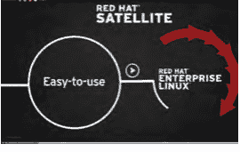

### 教程项目文件

跟随教程所需的全部素材


### 此外，您还将获得更多精彩内容……

- 终极救援工具包，内含多款发行版。刻录到光盘或闪存盘，即可为您的 PC 提供即时救援方案
- Linux 基金会提供的 20 小时专家视频教程
- 全新教程文件，助您掌握本期 Go 教程
- 必备数据恢复工具
- Linux 与树莓派教程的程序代码

登录 www.filesilo.co.uk/linuxuser

注册后即可立即访问这套 Linux 发行版与软件、操作视频及教程素材资源包

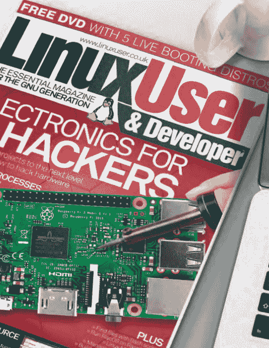


> 数字版读者同样免费！在平板设备上阅读，或在电脑上下载

## FileSilo

优质下载资源汇聚地——Imagine Publishing 旗下杂志独家专享

- 安全可靠的在线访问，随时随地
- 每位读者均可免费使用，印刷版与数字版皆覆盖
- 只下载您需要的文件，随心所欲
- 所有礼品，来自所有期数，尽在一处

### 开始使用

关于访问您的 FileSilo 账户，您需要了解的一切


- **01** 按照屏幕提示，在我们安全的 FileSilo 系统中创建账户。登录并回答一道关于本杂志的简单问题，即可解锁本期内容。


- **02** 您可以在任何电脑、平板或智能手机上通过主流浏览器访问 FileSilo。不过，我们建议您使用电脑下载内容，因为其他设备可能无法下载文件。


- **03** 如果您在访问 FileSilo 内容时遇到任何问题，请查看在线常见问题解答，或发送邮件至以下地址联系我们的团队
*filesilohelp@imagine-publishing.co.uk*

### 订阅者的惊喜好礼

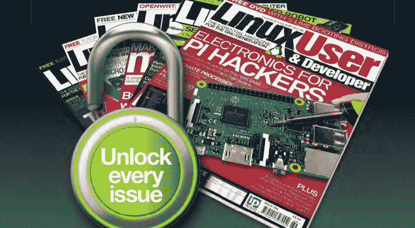

立即订阅，解锁 40 余期杂志的免费礼品

订阅杂志即可访问我们的全部资源库，节省开支——总计数百项免费资源

### 超过 20 小时的视频指南

来自 Linux 基金会的必备建议

### 最佳 Linux 发行版

专业 Linux 操作系统

### 免费开源软件

Linux PC 必备程序


### 前往第 28 页立即订阅

**已经是印刷版订阅者？以下是如何立即解锁 FileSilo 的方法……**
使用您的唯一 Web ID 解锁完整的 LU&D FileSilo 资源库——这是印在订阅副本邮寄标签上您的地址信息上方的八位字母数字代码。也可在任何续订信函中找到。

### 订阅的 400 多个理由


### **北美**读者专属特惠


#### **免费获赠 6 期**

订阅即享*

> 每期均可免费下载资源

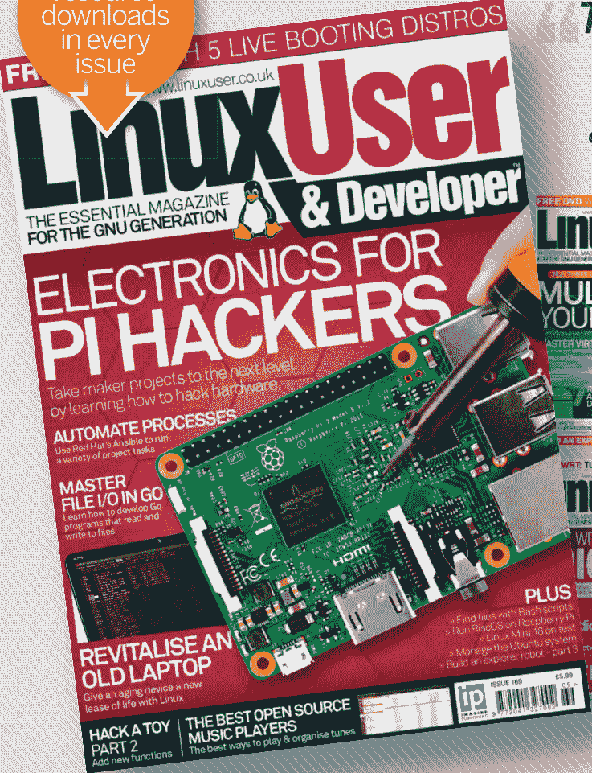

> 面向专业人士与开发者的开源权威

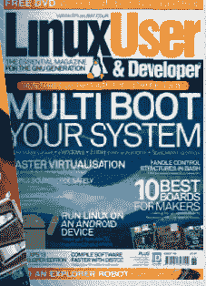

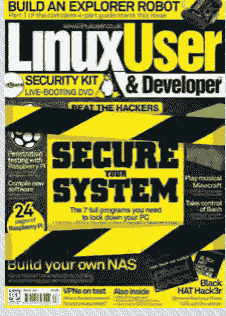

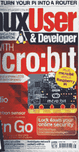

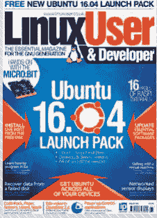

订购热线 **+44 (0)1795 418661**

在线订购 **www.imaginesubs.co.uk/lud**

> 引用 **USA** 享受此独家优惠！

*条款与条件* 本活动为美国订阅优惠。您实际需支付 80 英镑的年订阅费。按撰写本文时的汇率计算，约合 120 美元——汇率可能有所变动。免费 6 期指：美国报摊价 13 期共 220.87 美元（单期 16.99 美元），而订阅仅需 120 美元。您的订阅从下一期可用期刊开始，共计 13 期。本优惠截止日期为 2016 年 11 月 30 日。


## 您能助力激励下一代程序员吗？


**Code Club** 是一个遍布全国的志愿者主导课后俱乐部网络，面向 9 至 11 岁儿童。

我们一直在寻找具备编程技能的人士，志愿在当地小学、图书馆或社区中心每周运行一小时的俱乐部活动。

您可以与同事组队，现场会有教师提供支持，我们还将提供所有材料，助您激发孩子们对数字创作的兴趣。

参与方式多种多样！

想了解更多信息，欢迎加入我们 **www.codeclub.org.uk**


## 英国专家的 Linux 服务器托管


- 24/7 英国支持 · ISO 27001 认证 · 免费迁移
- 托管主机 · 云主机 · 独立服务器

### 顶级托管。

### 顶级支持。

www.CWCS.co成了一個有人因為

T: 0115 740 1234 · E: info@cwcs.co.uk · W: www.CWCS.co.uk
