# Linux 用户与开发者 170 - 系统虚拟化 170

## Synology


## Synology 路由器

RT1900ac

- 3G/4G 热点
- 波束成形技术
- 下载与多媒体枢纽

你的网络，智能且快捷

为家庭和办公室设计，`Synology Router RT1900ac` 同时广播 `2.4 GHz` 和 `5 GHz` 频谱，组合数据传输速度高达 `1900 Mbps`。使用应用层 `QoS` 和家长控制等高级网络工具微调流量。通过全功能 `Synology` 软件包实现更多功能，并通过 `Synology` 路由器管理器 (`SRM`) 获得革命性的用户体验。

安装 `DS` 路由器以使用你的 `Android` 或 `iOS` 设备查找并完成设置。


哪里购买：`amazon.co.uk` `buyer.com` `ebuyer.com` `SCAN` `Synology 2018` 媒体殊项


## 欢迎

阅读 `Linux User & Developer` 第 `170` 期

### 杂志团队

编辑 `April Madden`

`edit.madden@imagine-publishing.co.uk`

设计师 `Rebecca Heast`

制作经理 `David Scott`

高级编辑 `Stephen Williams`

编辑 `Ian Thomas`

出版总监 `Aaron Asahi`

### 贡献者

`Mike Smith`, `James Bellamy`, `Tom Castle`, `Christian Vardy`, `Oliver Hill`, `Jack Masters`, `Patrick O'Hara`, `Swami Parsons`, `Robert Simons`, `James Smith`, `Neil Mitchell`, `Thomas Wilson`

### 广告

可按要求提供数字或印刷版媒体副本。

销售主管 `Sarah Smith`

`+01202 586466`

`www.imagine-publishing.co.uk`

销售执行 `Luke Billingham`

### `Flickr`

本杂志的期号文件可在此网站找到：

`www.flickr.com/linuxuser`

### 国际

我们提供授权许可的杂志副本。

国际销售主管 `Gary Blackman`

`+44 (0) 1202 586111`

`lensing@imagine-publishing.co.uk`

## 订阅

所有咨询请联系：

`+44 (0) 1202 249 0928`

`www.linuxuser.co.uk`

### 发行量

发行总监 `Darren Pearce`

制作总监 `James Hawkes`

制作总 `Marco Merci`

### 创始人

集团总经理 `David Nutt`

### 打印与分发

由 `Ryland Publishing Ltd` 打印

`1-10 Planary Street`
`Westill, West Midlands, B3 3WT`

### 分发

由以下机构在英国及全球分发：

`Market House Chronicle Street`
`London EC4 6XE`
`020 8 143 300`

由以下机构在澳大利亚分发：

`Australian Publishing Pty Ltd`
`26 Richmond Road, Sydney, NSW 2086`
`+61 2 9972 8800`

# 本期内容

欢迎阅读 `Linux User & Developer` 最新一期

我们还查看了命令行界面以及你如何使用它来增强你的智能手机功能，`ps54` —— 有大量的教程帮助你精通 `Bash`、`NET` 以及更多。享受这一期！

`April Madden`, 编辑

# 与团队联系：

`linuxuser@imagine-publishing.co.uk`

如欲了解更多新闻、教程和评论，请访问：

`www.linuxuser.co.uk`

## 订阅并节省！

`FOSS` 客户可以在第 `6` 页订阅。查看我们的超值新优惠！

欢迎阅读 `Linux User & Developer` 第 `170` 期

在 `Linux` 下开发

通过添加图形元素提升易用性和导航

在 `Linux` 下编写 `Studio` 代码

专业的压缩和归档方法

# `Synology 2018` 媒体殊项

## `Synology`

你的网络，智能且快捷

为家庭和办公室设计，`Synology Router RT1900ac` 同时广播 `2.4 GHz` 和 `5 GHz` 频谱，组合数据传输速度高达 `1900 Mbps`。你的智能且快捷。

为家庭和办公室设计，`Synology Router RT1900ac` 同时广播 `2.4 GHz` 和 `5 GHz` 频谱，组合数据传输速度高达 `1900 Mbps`。使用应用层 `QoS` 和家长控制等高级网络工具微调流量。通过全功能 `Synology` 软件包实现更多功能，并通过 `Synology` 路由器管理器 (`SRM`) 获得革命性的用户体验。

安装 `DS` 路由器以使用你的 `Android` 或 `iOS` 设备查找并完成设置。

## 全新！`1&1` 托管云托管

两者的兼得！可按需扩展且灵活的服务器

- 专用资源
- `20+` 技术栈
- 由 `1&1` 专家管理
- 灵活
- `1` 分钟内部署

云托管首月免费，每月 `9.99` 欧元起。无期限合同。你可以在第一个月内随时取消。无设置费。价格包含 `20% VAT`。访问 `1and1.co.uk` 了解产品详情、条款和条件。`1&1 Internet Limited, Discovery House, 154 Southampton Street, Gloucester, GL1 2EX`。

## 光盘上的开源资源

## 您的免费 `DVD` 包含

**欢迎使用 `Linux` 用户与开发者 `DVD`。** 使用我们完整的虚拟化工具包，可以在单台机器上运行数十个系统。从备份到运行虚拟机，再到精选的轻量级发行版，这套工具包包含了您今天将 `PC` 转变为虚拟化强大设备所需的一切！

### 特色软件：

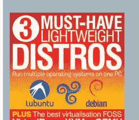


### `Lubuntu`

### `Trisquel`

`Lubuntu` 项目的目标是创建一个 `Ubuntu` 更轻量、更低资源消耗且更节能，同时对桌面用户来说足够强大的变体。它采用轻量级 `X11` 桌面环境作为默认 `GUI`。

`Trisquel` 设计用于在网络和低功耗计算机上良好运行。它使用 `MATE`、`LXDE+` 和 `XWindow` 等低资源桌面环境，以及 `KDE` 和 `Qt` 应用程序系统替代方案。

### 加载 `DVD`

要访问软件和教程，请将光盘插入计算机并双击图标。

### `Live` 启动

要 `Live` 启动此光盘上签名的发行版，请将光盘插入驱动器并重启计算机。

### 请注意：

- 您需要确保计算机已设置为从介质启动；请自由进入计算机的 `BIOS` 更改启动选项。
- 某些计算机需要您按某个键以启用从光盘启动；请检查制造商网站确认是否此类情况。
- `Live` 启动发行版从光盘运行；除非您选择，否则它们不会安装在您的计算机上。

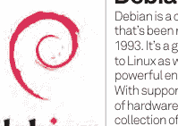


### `Debian`

## `VirtualBox`

`Debian` 是一款经典的 `Linux` 发行版，自 `1993` 年运行以来，对初学者来说足够强大。凭借广泛的硬件支持和完整的工具包，它可以保持您的 `PC` 轻量且快速。请加入 `Debian`，当

`VirtualBox` 是一款适用于家庭的免费 `x86/AMD64` 虚拟化软件。虽然 `VirtualBox` 为企业提供高性能产品，但它也是根据 `GNU` 通用公共许可证第 `2` 版条款免费提供的开源软件。

## `QEMU`

## `KVM`

`QEMU` 是一个通用的开源机器模拟器。当作为机器模拟器使用时，它可以在单台机器上运行操作系统及更多内容（例如在不同的机器上运行 `ARM` 板（例如使用动态翻译），它具有非常好的性能。


KVM（基于内核的虚拟机）是一种利用虚拟化扩展（`Intel VT` 或 `AMD-VI`）用于 `x86` 硬件 `Linux` 的免费虚拟化解决方案。它由一个可加载内核模块组成，提供核心虚拟化基础设施。

### 结果显示：

此光盘已针对 `HTML` 渲染更新和 `CSS` 标准进行了优化。为了获得最佳体验，我们建议您使用：

- `Internet Explorer 8` 或更高版本
- `Firefox`
- `Safari 4` 或更高版本
- `Chrome 5` 或更高版本

## 光盘有问题？

请向 `imagine-publishing.co` 发送电子邮件。

如果您发现在使用提供的程序或资源时遇到问题，请告诉我们任何相关的软件问题。

# 虚拟化 LINUX

# 免责声明

**重要信息**

在安装或使用光盘前请检查此内容。

在本免责声明中，“光盘”一词是指光盘上提供的所有软件和资源以及物理光盘本身。

在使用“此光盘”之前，您必须同意以下条款和条件。

**数据丢失**

在任何情况下，`Imagine Publishing` 都对因使用“此光盘”而导致的任何损坏、中断或数据丢失不负责。`Imagine Publishing` 会尽一切确保您免受病毒和恶意软件的影响。我们仍然建议您在使用“此光盘”时使用病毒扫描器，并在使用“此光盘”之前拥有硬盘备份。

**超链接**

`Imagine Publishing` 对“此光盘”上链接内容可能出现的内容不承担任何责任。在“此光盘”链接到目标或使用此超链接时，`Imagine Publishing Limited` 对这些链接交付的内容没有控制权。

**软件许可**

软件根据不同的条款进行许可；请在安装之前检查您是否知道在使用哪种程序。

- **分享**：如果您继续使用该程序，您应该免费注册。
- **试用/演示**：这些是受时间限制或禁用了某些功能的。
- **开源/GPL**：免费使用。

**Linux 用户与开发者**

`Imagine Publishing`

`VIRTISE LINUX`

08 新闻与观点 | 12 访谈 | 96

# 桌面

# 定制

# 开源

# 桌面

# 开源

# 定制

# 开源

# 桌面

# 开源

# 定制

# 开源

# 桌面

# 开源

# 定制

# 开源

# 桌面

# 开源

# 定制

# 开源

# 桌面

# 开源

# 定制

# 开源

# 桌面

# 开源

# 定制

# 开源

# 桌面

# 开源

# 定制

# 开源

# 桌面

# 开源

# 定制

# 开源

# 桌面

# 开源

# 定制

# 开源

# 桌面

# 开源

# 定制

# 开源

# 桌面

# 开源

# 定制

# 开源

# 桌面

# 开源

# 定制

# 开源

# 桌面

# 开源

# 定制

# 开源

# 桌面

# 开源

# 定制

# 开源

# 桌面

# 开源

# 定制

# 开源

# 桌面

# 开源

# 定制

# 开源

# 桌面

# 开源

# 定制

# 开源

# 桌面

# 开源

# 定制

# 开源

# 桌面

# 开源

# 定制

# 开源

## 机器人

## 前五名


## 轻量级 Linux 发行版


## 英特尔的 Euclid 项目面向机器人制造商

### CorePlus

`CorePlus` 是最小的 `Linux` 发行版之一，带有三个完全不同的变体。其中最小的是 `Core` 版本，它不使用 `HOME` 资源，但仍允许你选择窗口管理器。它极其基础，只提供了对发行版预期的最基本功能。

下一代机器人将比以往任何时候都更好。

### 2 LXLE

在`Intel`最近于`San Francisco Developer Forum`上的众多活动中，备受关注的`Project Euclid`是一个为使用`Intel RealSense`技术的开发者设计的微型套件。

`LXLE` 极占资源使其成为那些试图为老旧台式机注入新活力的人的明智选择。它适合开箱即用，同时也有大量的自定义空间让你打造出属于自己的风格。

虽然`Project Euclid`旨在让创建一系列应用程序（如`3D`打印机器人和家庭技术）变得更容易，使用`Intel RealSense`摄像头告诉我们：目前许多面向开发者的技术过于复杂。`Euclid` 避免了这种陡峭的学习曲线以提供帮助，弥补了初学者与专业人士之间的差距。


### 3 Porteous

虽然`Atom`芯片在其后期项目中被忽视，但它仍然处于前沿。它的小尺寸使其成为`Euclid`单元的理想选择，它还具有很高的适应性，非常适合物联网（`IoT`）开发。我们认为它对开发者来说非常完美。它提供了与`RealSense`、更多传感器以及软件工具良好协作的能力。

在近期基于`Slack`的发行版表现失败的情况下，`Porteous`是最好的之一。它为管理可再生资源而设计，这有助于`Porteous`始终保持小巧紧凑。

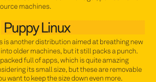

### 4 Vector Linux

`Intel`首席执行官`Brian Kranisz`登上`IDC`舞台。虽然目前`Euclid`的退出情况尚不清楚，但考虑到内部的技术，其“标准巧克力棒”大小的令人印象深刻。由于我们特别喜欢全连接方案、`Intel`自己的`RealSense`摄像头以及各种传感器，我们特别喜欢`Ubuntu Linux`和`Robot OS`（机器人操作系统）。`Project Euclid`的发布日期尚不清楚，但它是值得期待的。

在宣布`Project Euclid`的同时，`Intel`还展示了下一代传感器，改进了每秒捕捉的`3D`点数量。更小的尺寸意味着它们可能被应用于下一波物联网中。`Intel`最新的`RealSense`摄像头预计于今年晚些时候推出。

简单是`Vector Linux`的关键，这也是该发行版获得拥趸的原因之一。轻量视觉使用了极其简单的界面，是资源机的完美管理器。

### 5 Puppy Linux

这是另一个为老旧机器注入新活力的发行版，但它依然实力强劲。它功能丰富，却出奇地轻量。考虑到其较小的体积，但如果你想保持更小的体积，这些功能是可以移除的。

# CHROME

## Google 将停止在非 Chrome 系统上支持 Chrome 应用

`Google`将停止为非`Chrome`操作系统提供所有`Chrome`应用。

在`Google`最近的一篇博客中，公司表示将从非`Chrome`操作系统移除所有`Chrome`应用。对于那些经常在`Linux`桌面使用它们的人来说，这是一个打击；由于普及率较低，因此从`Windows`和`OS X`上移除`Chrome`应用——

所有当前应用将继续可用一段时间，开发者仍被允许跨平台进行更新。

# 命令行

## PowerShell 脚本语言开源

在脚本语言方面，`Microsoft`的`PowerShell`被认为是最好的之一。它是运行和管理任务的理想工具，并且对于任何基于`.NET`框架构建的内容都足够强大。`Microsoft`已经在`Linux`上发布了`PowerShell`的功能，因此很高兴看到它终于开源了。随着`Microsoft`“多平台”梦想的全面推行（注：正在全力实现），我们最终可能会看到它的许多其他核心软件工具。

`PowerShell`的代码库将适用于所有兼容的开源编辑器，并在`GitHub`上通过许可提供。需要注意的是，这个初始版本尚处于`Alpha`阶段，因此某些功能被精简了，在其他领域可能存在兼容性问题。

> 它是轻松运行和管理任务的理想工具。

`Microsoft`还将`PowerShell`编辑器加入了列表，它可以实现在文本编辑器中用于调试和编程。对于`PowerShell`，目前其`PowerShell`编辑器仅在`Windows`上可用。`Microsoft`正在为用户推出一门免费在线学院课程。它涵盖了学习`PowerShell`所需的所有基础知识，以及将其到你的设置中的最佳方法。

感兴趣吗？前往`GitHub`上的`PowerShell`仓库：`https://github.com/PowerShell/PowerShell/tree/docs/learning-powershell`


## 开源

你的`Linux`新闻与观点来源

## 硬件发行版

## 日均访问量

| 姓名 | 访问量 |
|---|---|
| Linux Mint | 978 |
| Debian | 800 |
| Ubuntu | 701 |
| openSUSE | 666 |
| Manjaro | 614 |
| Fedora | 504 |


| Zorin | 453 |
| CentOS | 432 |
| Arch Linux | 401 |


## 开源

您的 Linux 新闻与观点来源

## 专访 TIMOTHY FREEBURN

## Formula Pi 中的竞赛型机器人

追求速度吗？Timothy Freeburn 讨论了 Formula Pi 如何开启机器人赛车的新时代。


Timothy Freeburn 是位于英国的机器人公司 Freeburn Robotics 的董事兼所有者。他在高质量 PCB 和电子设备的设计与制造方面拥有丰富经验。

> Formula Pi 的想法是从哪里来的呢？

当我很小的时候，我父亲经常带我去看赛车比赛。虽然大多数人痴迷于驾驶赛车或关注驾驶员是哪位名人，但我更倾向于汽车背后的工程学以及它们是如何制造的。我一直在想，如果把驾驶员从汽车上移开，让汽车在不离开方向盘的情况下进行竞争会怎样？无论是自动驾驶汽车将病人送往医院，或者让无法见面的家人去探亲，亦或是在“偶尔”去完酒吧的晚上送我回家？正是这些想法最终形成了我们希望在 Formula Pi 中实现的目标。

### 比赛是如何安排的？例如，有联赛制度吗？

目前已经提出了几种不同的想法。之所以还没有解释清楚，是因为具体的形式取决于加入该项目的竞争者数量。我们希望机器人以小组预赛的形式进行竞赛。我们会为任何机械问题留出处理空间，并且为了发现任何漏洞，我们将让机器人运行标准的、未修改的格式，以确保公平。这对于参赛的竞争者来说将是最有趣且最公平的。

与此同时，预赛很可能每两周举行一次，这样人们在下一次预赛之前就有机会调整代码，确保他们的机器人处于巅峰性能。


这些比赛将进行直播，让每个人都能观看自己的机器人竞争，每场预赛的结果将在每场赛后的第二天公布。

### 赛道是如何设计的？需要考虑不同的元素吗？

我们尝试在现有的空间内让赛道尽可能长。赛道的外缘想要安装橡胶护裙，这样任何碰撞都不会损坏机器人或赛道，这至关重要。赛道本身要求对摄像头清晰可见，以便 `Raspberry Pi` 能够轻松识别其在赛道上的位置，以及相对于比赛中其他机器人的位置。光线明亮且清晰，以便机器人获得更好的赛道视野。为了实现这一点，我们在天花板上安装了地板照明点，效果非常好。我们还在机器人前方约 8 英尺处使用了 `LED` 灯带，用来指示赛道的开始和结束。我们使用摄像头和传感器测量每条起点/终点线以获取计时信息并消除抢跑。


### 你能多介绍一下活动中使用的机器人吗？

这些机器人拥有 `2mm` 厚的铝制底盘，因此它们经久耐用。我曾掉过一个超过一米的机器人，电机座仅需轻微弯曲，所以它们的耐用性……

## 结为荣耀竞争的竞赛机器人

为了让每场 Formula Pi 比赛都尽可能快，每位竞争者将使用相同的 `Yahberg HS Zero` 机器人进行比赛。每个机器人都经过精心制作，以应对比赛中涉及的所有颠簸和刮擦，每个机器人都配备了竞争者所需的所有物品：一个 `9V` 电池和一个 `Raspberry Pi`。每个机器人的外壳由铝制成，由 `62ma` 电机驱动。对于参赛者来说，这意味着 `Yahberg` 可以达到很高的速度。

一旦机器人进入参赛者的手中，就取决于他们如何改进机器人。每个机器人必须由他们构建，Formula Pi 提供必要的代码来让机器人完全自动运行。但每位参赛者如何修改这些代码将帮助他们的机器人从竞争中脱颖而出。你有获胜的实力吗？

请访问 `www.formulapis.com` 了解更多信息。


`www.linuxuker.com` 13

## 开源

您的 Linux 新闻与观点来源


## 获胜组合

每位竞争者将收到相同的代码。然而，如何使用它取决于他们自己。处理赛道有很多方法，通过转弯也有许多不同的方式。目标是创建一个尽可能高效处理障碍的机器人。我们使用传感器和摄像头数据做出实时决策。


## 潜在参赛者在加入之前需要哪些 Raspberry Pi 的知识？

任何人都可以加入！我们有现成的代码，所以大家所需的仅仅是对电子学的基础了解和学习的意愿。我们会在过程中提供文档支持和帮助。

## 参赛者是否有空间软件来提高性能的空间？

是的，有充足的空间。代码被分成不同的模块，允许参赛者更换用于路径规划、避障和速度控制的算法。

14


## 开源

### 你的 Linux 新闻与观点

#### 观点

#### 内核专栏

`Jon Masters` 总结了 `Linux` 内核社区的最新动态，此时 `Linus Torvalds` 正准备关闭 `Linux 4.8` 的合并窗口，以迎接下一个内核版本的发布。

`Linus Torvalds` 宣布了将在几周后发布的第一个候选版本（Release Candidate），因为在 `4.8-rc1` 时，他认为该版本在处理某些几个补丁方面略显落后，但他决定关闭合并窗口以防止更多补丁进入。根据其中一个较大的“发布版”，下一个内核的功能集非常令人印象深刻；内核还包含了一些让某些状态处于悬而未决的变化。

`Linux 4.8` 开发过程中一个有趣的脚注是 `Pavel Machek` 发起的关于 `4.8-rc2` 在其系统上无法启动的讨论。事实证明，`4.8` 的内核命令行中字面上量包含一个 `rootvol=/dev/sda` 参数，且 `4.8` 改变了（在其系统上）`USB` 工作的探测顺序（probe order）。这个 Bug 在邮件列表中被记录，导致了与此前情况完全相反的结果。随后出现了一个长贴帖子，`Pavel` 建议这种功能失效一直是非确定性的；许多人指出驱动程序探测“总是是坏的”。他们鼓励 `Pavel` 改用 `USB-block`，该功能在系统启动期间正是为了这一目的而存在的。

例如，`4.8-rc2` 主要以架构更新（arch updates）以及 `fs/mm` 为主（而不是通常关注的驱动程序方向）。在一个正常的周期中，`20%` 的 `4.8-rc2` 更改是文档更新。这并非内核社区开发的结果，而是由于需要合并内核文档支持（内核确实支持此项），同时也是由于格式化代码文档机制的结果。该机制最初将加载基于旧版 `(doctype)` 的文档。在内核源码中可以找到关于 `Sphinx` 的文档，并在 `4.8` 的内核 GPU 和 DRM 3D 渲染中找到一些示例。

`4.8` 内核将带来许多新功能，包括架构仿真、使用 `NUMA`（如建议的 node）进行页面回收（但在 64 位 ARM 系统（`arm64`）除外）、`x86` 和 `ARM` 上的 overpi，并且用户需要一种短期的临时方案来通过硬件轻松覆盖现有的系统固件表（如内存）。这为内核带来了健壮性和改进，并能够更好地管理驱动程序和内核的内存事件，以及对虚拟映射内核栈的初步支持（我们之前介绍过）。在这些新功能中，架构仿真容器将让许多读者感兴趣，特别是那些在 `x86` 笔记本电脑或桌面上开发树莓派（Pi）等移动和嵌入式系统的开发者。

#### 架构仿真容器

架构仿真容器是一个相对简单的概念，基于内核对二进制仿真的现有支持，通过类似于插件的系统支持执行二进制文件。该系统识别可执行文件的格式，然后确定应该使用哪种解释器在运行时执行它。例如，当你 `Jon Masters`

`Jon Masters` 是一位从事 `Linux` 工作约 19 年的内核黑客。他毕业于德克萨斯大学奥斯汀分校。在 `Linux` 领域，他为创建能效服务器的标准做出了贡献。

##### `/bash`

在你的 `Linux` 系统上，内核将识别出这是一个 `ELF`（可执行链接格式）二进制文件。解释器知道如何读取 `bash` 二进制文件的头，并确定应该使用哪种解释器来处理该文件的实际加载和执行。解释器负责加载该二进制文件使用的每个部分以及其依赖库。你可以通过以下命令查看 `bash` 使用的库列表：

```
```


```
$ ldd /bin/bash
linux-vdso.so.2 => (0x00007afc51559000)
libinfo.so.2 => /lib64/libinfo.so.2 (0x00007af6c7b8b000)
ldl.so.2 => /lib64/ldl.so.2 (0x00007af6c7b8b000)
libc.so.6 => /lib64/libc.so.6 (0x00007af6c7b8b000)
/lib64/ld-linux-x86-64.so.2
```

这就是加载器（loader）通过 `.so`（共享对象）链接必要系统库的地方；该加载器（解释器）本身描述在二进制文件的 ELF 头中（你可以使用 `-l` 或 `objdump` 工具显示它）。在这种情况下，它是 GNU C 库提供的特殊共享库。一旦加载，它就会被执行以处理动态链接。

ELF 是现代 Linux 系统上的一种常用格式（Linux 早期使用过一种旧格式，Unix 系统也曾如此）。Windows 使用不同的格式，即可移植执行文件（PE），而 Mac 使用其他格式。如前所述，Linux 包含了所有这些格式的支持。在这里可以找到二进制文件并为它们调用必要的解释器。例如，在 Unix 系统上，你可能注意到你可以简单地在运行时链接它们或不通过任何程序来运行共享库。当你想要这样做时，是因为动态链接器（WINE）模拟器会自动调用适当的处理程序。

仅仅是通过适当的 `binfmt_misc` 处理程序让处理不同架构成为可能，`binfmt_misc` 维护者 James Bottley 在 Linux 这一支持的基础上进行了扩展，增加了使用 QEMU 仿真架构的能力（如 Docker、Snap 等）。因此，容器可以针对各种架构分发，而无需对其内容进行修改。

## 进行中的开发

Cain Marina（来自 ARM）发布了一系列在现代处理器中启用此支持的补丁。初始更新依赖页表中的 `PTE_XN` 和 `PTE_USER` 位来保护正在执行的内存。Marina 指出，直到 ARMv8.2 处理器引入内存加密功能，否则内核仍然绕过此过程。Tom Lansky（来自 AMD）发布了实现安全内存加密（SME）的补丁系列的后续版本，这是一个 AMD-x86 功能允许加密内存页。当 SME 激活时，写入 DRAM 时会被加密，从 DRAM 读取时会自动解码。这是一个令人兴奋的新功能，将提高系统安全性，特别是移动设备。本月，让我们共同纪念在 8 月去世的内核开发者 June Hans。June Hans 是 UIO（用户空间 I/O）（功能虚拟化）以及许多虚拟机技术之外技术的首席作者。

# 虚拟化你的系统

想要运行多个操作系统，但发现双启动效率很低吗？答案是虚拟化——在另一个操作系统内部运行一个操作系统。

无论你是在双启动系统上运行 Ubuntu 和 Fedora，还是为 Windows 预留了一个分区（你可能还运行了 Hackintosh 分区），你的系统在重启方面都存在明显的问题。重启需要时间；从关机到 GRUB 2 菜单选择，再到进入所选操作系统，可能花费 5 到 10 分钟——这段时间本该用来提高生产力，而不是盯着屏幕。

将替代操作系统作为软件“客体操作系统”，你可以根据需求并在 PC（宿主机操作系统）上加载它们。告别多启动吧！

## 虚拟化工具

根据你想要运行的操作系统，Linux 有多种不同的虚拟化工具可供选择。

### VirtualBox

实用工具：多功能的 VirtualBox 能够支持软件辅助和硬件辅助虚拟化，使其成为最全能的选择。

如果你觉得运气不错，那么很有可能你用过 VirtualBox。它是免费、开源的，并适用于所有主流操作系统，包括 Linux。

通过 VirtualBox，你可以轻松运行另一个操作系统，甚至运行多个 Windows，以运行那些在 Wine 下表现不佳的软件。

VirtualBox 通过创建一个虚拟环境，让你的系统准备好虚拟化。同时，虚拟机（VMs）以磁盘镜像的形式存储，便于备份和迁移到其他 PC 或虚拟机应用程序。

### QEMU

实用工具：在带有 x86 或 x64 的计算机上运行 ARM 设备——我们就是这样称它的！

QEMU（快速模拟器）的目标是可移植性和硬件仿真。在 VirtualBox 占据主导的世界里，它在仿真方面具有巨大优势。

虚拟化树莓派的一个流行用途（连同其他操作系统，但它也可以用于在 x86 PC 上模拟 Android）。

与 VirtualBox 类似，使用 QEMU 设置虚拟机非常简单，QEMU 内置功能可以检测客机操作系统。

### KVM

实用工具：运行那些 VirtualBox 和 QEMU 在没有硬件加速的情况下无法的虚拟机——如果你需要性能，请使用这个！

源自内核项目，KVM（基于内核的虚拟机）能够与 QEMU 协作工作提供虚拟化，也可以独立工作。KVM 相比其他工具的优势在于性能，更不用说对多种客机操作系统具有更好的稳定性。

然而，这个问题的问题是 KVM 的设置要复杂一些。一旦你搞定了半虚拟驱动（客机操作系统可以直接访问硬件），你就会明白为什么 KVM 配合虚拟机功能时是如此强大。

### 热门 5 大型发行版

#### LINUX MINT

如果你还没有尝试过 Linux Mint（它对某些硬件不太友好），那么在虚拟机中安装它是一个极好的主意，因为桌面不需要 3D 加速。这使得它不仅适用于硬件虚拟化，也适用于具有该功能的低配置系统。

#### LUBUNTU

这个 Ubuntu 的轻量级版本非常适合运行在虚拟机上。它适中的占用意味着你可以从中获得资源，让你了解它在旧 PC 上运行或作为操作系统安装时可能的情况如何。

#### SLACKWARE

尚未尝试过轻量且简单的 Slackware。它是高级 Linux 用户的理想之选（很大程度上是因为它非常接近 Unix），Slackware 能够轻松运行许多应用程序，让你有机会发现它们直观的命令行安装方式。虚拟机为你你了一个尝试它的机会！

#### FEDORA

最受欢迎的发行版之一，Fedora 使用了许多最新工具；如果你习惯了 Ubuntu 并想在虚拟机中寻找 Fedora，你会发现一些令你棘手的问题。可以通过切换桌面环境来获得性能。

#### UBUNTU SERVER

必须运行服务器？你可以通过先在虚拟机上安装基于服务器的发行版 Ubuntu Server 或 CentOS 来熟悉它。一旦配置完成，你就可以利用这些经验（甚至可能是专家的知识）将它们应用到物理服务器上。

# 虚拟化你的系统

### 使用 VIRTUALBOX 运行新操作系统

发现如何使用 VirtualBox 在你的虚拟机中安装新操作系统是多么简单。

开始虚拟化很简单。一旦你通过包管理器安装了它（或使用适用于发行版的说明，这些可以在 VirtualBox 网站找到），下载安装程序并点击“下一步”按钮开始。

安装后（通常是你计划安装的那个 OS），根据版本选择虚拟机类型。

VirtualBox 提供了跨平台的操作系统选择。点击“下一步”，查看你的虚拟机应该如何配置。按照选项操作并根据你自己的需求选择你偏好的设置。

在下一步中，你需要创建一个虚拟硬盘（还有其他可用选项，例如连接物理设备）。你的虚拟磁盘类型取决于你计划使用的虚拟机（性能选项）。VirtualBox 很容易设置。通过这种方式，如果 HDD 没有在空间中分配，会导致宿主机 OS 占用过多空间。限制可以在下一步中设置。

完成后，你将回到 VirtualBox 主界面。在这里，你需要选择要安装的 ISO 镜像源。你可以在设置菜单中添加设备。在这里，ISO 被虚拟地挂载为 IDE、SATA、SCSI 或 USB 驱动器。

设置完成后，点击回车键启动虚拟机并安装操作系统。如果一切顺利，你将看到操作系统光盘设置界面，在准备好完成之前可能需要额外的步骤。

为了增加功能，你可能想要安装增强功能（Guest Additions）工具。这将提供广泛的增强、虚拟 PC 体验的额外可选，并增加客机与宿主机之间的交互。

## 名称和操作系统

请为新虚拟机选择一个描述性的名称，并选择你打算安装的操作系统类型。你选择的版本将帮助 VirtualBox 识别此机器。

- 名称：`FedoraVM`
- 类型：`Linux`
- 版本：`Fedora` (32位)

安装是命令行形式的，需要预安装 `gcc++`、`dkms` 和 `kernel-devel`。对于 Debian 用户：

```
sudo apt-get install gcc++ dkms kernel-devel
```

对于 Fedora 用户：

```
sudo yum install gcc++ dkms kernel-devel
```

可以使用几个关键功能。例如，你可以使用剪贴板和拖放，并调整虚拟机的大小到任何维度（最高支持 640x480、800x600、1024x768 等）。同时，还支持共享剪贴板和拖放，这改进了客机与宿主机之间的交互。要使用这些功能，你需要安装增强功能。这是一种传统但无缝的模式，允许你在客机上无缝运行应用程序。运行期间，窗口可以在虚拟机边界之外移动和调整大小。


通过增强功能，你将充分利用虚拟机并避免某些虚拟机可能经历的延迟。要安装增强功能，打开你的虚拟机，点击增强功能 > 插入增强功能光盘，它会自动加载并安装到客机。

### 从 HDD 安装客机 OS

当虚拟机运行时，你需要选择正确的启动设备。选中 HDD 后，你选择从 ISO 安装你选定的客机。你的虚拟磁盘类型取决于你计划使用的虚拟机（性能选项）。VirtualBox 很容易设置。通过这种方式，如果 HDD 没有在空间中分配，会导致宿主机 OS 占用过多空间。限制可以在下一步中设置。

完成后，你将回到 VirtualBox 主界面。在这里，你需要选择要安装的 ISO 镜像源。你可以在设置菜单中添加设备。在这里，ISO 被虚拟地挂载为 IDE、SATA、SCSI 或 USB 驱动器。

设置完成后，点击回车键启动虚拟机并安装操作系统。如果一切顺利，你将看到操作系统光盘设置界面，在准备好完成之前可能需要额外的步骤。

为了增加功能，你可能想要安装增强功能（Guest Additions）工具。这将提供广泛的增强、虚拟 PC 体验的额外可选，并增加客机与宿主机之间的交互。

要安装增强功能，打开你的虚拟机，点击增强功能 > 插入增强功能光盘，它会自动加载并安装到客机。


完成后，你将回到 `VirtualBox` 主界面。在这里，你需要选择要安装的 `ISO` 镜像源。你可以在设置菜单中添加设备。在这里，`ISO` 被虚拟地挂载为 `IDE`、`SATA`、`SCSI` 或 `USB` 驱动器。

设置完成后，点击回车键启动虚拟机并安装操作系统。如果一切顺利，你将看到操作系统光盘设置界面，在准备好完成之前可能需要额外的步骤。

为了增加功能，你可能想要安装增强功能（`Guest Additions`）工具。这将提供广泛的增强、虚拟 `PC` 体验的额外可选，并增加客机与宿主机之间的交互。

要安装增强功能，打开你的虚拟机，点击增强功能 > 插入增强功能光盘，它会自动加载并安装到客机。

### 从 HDD 安装客机 OS

当虚拟机运行时，你需要选择正确的启动设备。选中 `HDD` 后，你选择从 `ISO` 安装你选定的客机。你的虚拟磁盘类型取决于你计划使用的虚拟机（性能选项）。`VirtualBox` 很容易设置。通过这种方式，如果 `HDD` 没有在空间中分配，会导致宿主机 `OS` 占用过多空间。限制可以在下一步中设置。

完成后，你将回到 `VirtualBox` 主界面。在这里，你需要选择要安装的 `ISO` 镜像源。你可以在设置菜单中添加设备。在这里，`ISO` 被虚拟地挂载为 `IDE`、`SATA`、`SCSI` 或 `USB` 驱动器。

设置完成后，点击回车键启动虚拟机并安装操作系统。如果一切顺利，你将看到操作系统光盘设置界面，在准备好完成之前可能需要额外的步骤。

为了增加功能，你可能想要安装增强功能（`Guest Additions`）工具。这将提供广泛的增强、虚拟 `PC` 体验的额外可选，并增加客机与宿主机之间的交互。

要安装增强功能，打开你的虚拟机，点击增强功能 > 插入增强功能光盘，它会自动加载并安装到客机。

## 通过 KVM 获取强大的虚拟化

利用 `KVM` 提供的虚拟机，创建性能几乎与主机 `PC` 一样强大的虚拟机。

如果你希望在拥有 `QEMU` 丰富功能的同时，还能拥有一个良好的用户界面，并受到物理 `PC` 或笔记本电脑提供的硬件虚拟化的增强，那么答案就是 `KVM` 虚拟机管理器（`Virtual Machine Manager`）。

通过它，你将获得一个类虚拟的界面（可以说具有许多功能），这使得设置强大的虚拟机变得非常简单。

你首先需要检查你的硬件是否适用于 `KVM`，一旦完成这一步并安装了该工具，你的虚拟机将像你的物理机一样强大。

## 01 安装并运行 KVM

仅在 `QEMU` 中添加真正的虚拟化对于 `KVM` 来说是不够的——它还是 `Linux` 内核流行的虚拟机程序和虚拟机解决方案。

要检查你的硬件是否适用于 `KVM`，请安装 `kvm-checker` 软件包。


```bash
sudo apt-get install cpu-checker
```

接下来，运行此命令：

```bash
sudo kvm-ok
```

如果响应结尾为“KVM acceleration can be used”，则你已经准备就绪。使用以下命令安装 `KVM` 及相关工具：

```bash
sudo apt-get install qemu-kvm libvirt-bin virtinst bridge-utils
```

安装过程不会花费太长时间。

| 名称 | 主机 CPU 占用率 | 磁盘 I/O | 网络 I/O |
|---|---|---|---|
| `debian-6.0.5-i386 Shutoff` | | | |
| `demo Shutoff` | | | |
| `en-..srv_2003_r2..enterprise_kn..with_sp2 Running` | | | |
| `f14066 Running` | | | |
| `f14x_64 Shutoff` | | | |
| `foo Shutoff` | | | |
| `freebs-3.2-i386 Shutoff` | | | |
| `freebs-4.11-i386 Shutoff` | | | |
| `ubuntu-11.10` | | | |

虚拟机管理器 `GUI` 让虚拟化变得像 `VirtualBox` 一样简单，但在底层提供了更多选项以允许更复杂的配置。主窗口显示了虚拟机程序列表以及性能的简要概述。

## 设置你的虚拟机

安装 `KVM` 后，你可以选择像 `QEMU` 那样从命令行运行，或者使用虚拟机管理器（`Virtual Manager`）从桌面运行，类似于 `VirtualBox`。

点击“新建虚拟机”并选择合适的选项开始。对于此功能中的其他所有操作，我们假设你已经有一个 `ISO` 或 `CD-ROM`。

点击“下一步”继续，选择选项并派生正确的文件或设备。如果识别，操作系统将显示在顶部。

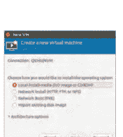

## 构建你的虚拟机

接下来，系统将提示你指定虚拟机的内存和 `CPU` 设置。请记住，你将受到主机硬件的限制，因此不要超过你物理计算机规格中的配置。

接下来，是时候创建一个磁盘镜像了。你可以使用现有磁盘镜像，或指定自己的。继续到下一页，系统将提示你为 `VM` 命名。在点击“完成”之前，确认正确的操作系统以完成虚拟机的创建。

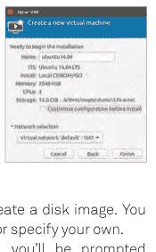

## 你确定要强制关机 /ubuntu-14.04 吗？

> 这将立即关闭虚拟机而不会关闭操作系统，并可能导致数据丢失。

- 不要再问我

- 否

- 是

## 处理损坏的磁盘或镜像

在虚拟机上安装操作系统并不常见，第一个问题是使用不恰当的硬件规格设置虚拟机。

如果虚拟机处于启动循环并不断重复，处理起来也可能非常棘手。如果发生这种情况，你需要使用电源菜单中的“关闭（Off）”命令强制虚拟机关闭。

## 哪种是正确的虚拟机？

做出正确的选择部分取决于你想虚拟化什么，但也取决于你需要哪些应用程序以及你拥有多少可用资源。

面对现实吧：`QEMU` 的命令行界面非常复杂。对于 `KVM` 和 `VirtualBox` 使用虚拟机管理器要更具吸引力且更易于使用。高级功能主要在你看不见且需要它们时才有意义。这个问题的答案很简单：它是能帮你完成工作的那一个。


| 概览 | 详情 |
|---|---|
| 总内存 | `1167 MB` |
| 当前分配 | `1024 MB` |
| 最大分配 | `2048 MB` |
| 启动选项: | |
| `CD-ROM` | `IDE CDROM 0` |
| 鼠标 | `USB Tablet` |
| 显示 | `VGA` |
| 串口 | 无 |
| 视频显卡 | `Cirrus` |
| 控制器 | `USB Controller 3.0` |

## 启动虚拟机

- 总内存：`1167 MB`
- 当前分配：`1024 MB`
- 最大分配：`2048 MB`
- 启动选项：
  - `CD-ROM`：`IDE CDROM 0`
  - 鼠标：`USB Tablet`
  - 显示：`VGA`
  - 串口：无
  - 视频显卡：`Cirrus`
  - 控制器：`USB Controller 3.0`

## 调整虚拟机

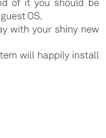

## 备份与恢复

## 要复制的硬盘

请选择想要复制的虚拟磁盘文件（如果尚未选择的话）。你可以从列表中选择，或使用文件夹图标选择一个。

`VirtualDisk.vmd`, `12.00 GB`

## 冰山一角

我们到目前为止展示的只是 `Linux` 虚拟化的基础知识。无论你是使用 `VirtualBox`、`QEMU`、`KVM` 还是任何其他平台，虚拟化都有许多不同的方式可用，并有许多操作系统可供选择。

例如，我们展示了可以使用 `QEMU` 虚拟化树莓派等硬件设备。虽然配置可能很复杂，但在 `Pi` 上安装和运行其他操作系统是可能的（尽管延迟会限制你的可能性）。

## 你能帮助激励下一代程序员吗？

`Code Club` 是一个遍全国、面向 `9-11` 岁儿童的志愿者主导课后俱乐部网络。

我们一直在寻找具备编程技能的人员，担任志愿者每周在当地的小学、图书馆或社区中心运营一小时的俱乐部。

你可以与同事结伴，会有老师在场为你提供支持，而且我们提供你所需的所有材料，帮助激发孩子们对数字创造的兴趣。

有许多参与方式！

欲了解更多信息，请访问 `www.codeclub.org.uk` 加入我们。

## $5.99

## 每期 $4.49

## 订阅并立省 25%

每一期都直接送到家门口

- 绝不错过任何一期

- 每年 `13` 期，你将确保获得每一期杂志

- 送达您的家中

- 每期免费送货，直接送达您的家门口

- 获得最大优惠

- 通过直接订购以更低的价格购买你喜爱的杂志

## 我们的读者对……的评价

> “我今天才发现这本杂志。它太棒了，正是我一直在寻找的。我太惊讶了！”

`Donald Steighthome` 通过 `Facebook` 发布


> “@LinuxUserMag 刚邮寄到。多么棒的一期杂志，我正准备开始玩迷你电脑，并且有一个绝佳的主意。谢谢！”

@businessBoris 通过 Twitter 发布

> “感谢提供如此出色的杂志。我已经连续订阅了多年了。”

Matt Caswell 通过邮件发布

## 选择适合你的订阅方案

## 订阅并立省 25%

### 一年订阅

- 自动续订 – 绝不错过任何一期
- 通过直接借记（Direct Debit）支付
- 优惠优厚，全球可用
- 一次付款，支持信用卡或支票

每六期支付一次 26.95 英镑，比零售价节省 25%。

简单的一次性付款即可确保你在整整一年内不会错过任何一期。总共 13 期，直接送达您的家门口。

| 给银行的指令 | 发起人参考 |
| :--- | :--- |
| 借记账户或合作社通过直接借记支付 | 5 0 1 8 8 4 |

- £62.40（比零售价节省 20%）
- 欧洲 £70，美国 £80，世界其他地区 £80

## 使用信用卡或支票支付

使用信用卡或借记卡支付：`Visa` | `Mastercard` | `Amex`

- `卡号`
- `有效期`

使用支票支付：
- 我随附一张支票，金额为：
- 付款人为 `Imagine Publishing Ltd`
- `签名` | `日期`

## 您的信息

| | 地址 |
| :--- | :--- |
| 借记卡号 | 手机号码 |
| 电子邮箱地址 | 邮编 |

请告诉我们你不希望收到来自其他公司的任何促销材料。通过邮寄：通过电话请告诉我们您不希望收到来自 `Imagine Publishing Ltd` 的免费促销材料。通过卡：请告诉我们您不希望通过电子邮件接收信息。

请将此表寄至：`Linux & Developer Subscribers, 800 Quillat Avenue, Kent Street, Dartbridge, Kent ME9 8QU`

## 在线安全订购

访问 `www.imagesubs.co.uk/lud` 输入促销代码 `PS16` 获取以下优惠。

咨询我们友好的客户服务团队成员，拨打 `0844 249 0822`。这些优惠将于 2016 年 12 月 31 日星期六过期。此优惠允许英国订阅者每六期仅需支付 26.95 英镑。新订阅将从下一期开始。可要求提供直接借记担保。订阅者可以随时取消此特殊订阅。

# 大师

## 教程

## 资源

### 显示图形界面

黑色终端窗口对普通用户来说可能会令人生畏。几十年的黑客电影确保了用户对一切都有一种专门的尊重。`shell` 可以与许多实用命令结合，创建用于文件传输的巧妙脚本。鉴于 `Bash` 是图灵完备的，开发者可以使用 `curses` 或类似的库来创建自定义输出。一种更实用的方法是在选择过程中注入参数并返回给调用者。随着时间的推移，开发者创建了各种提供这些功能的工具。`Dialog` 是目前该组中最常见的——它将是本文的重点。然而，它并不是这里涵盖的唯一产品——完整阅读文章以使脚本能够控制图形界面的可用性，帮助你从现有逻辑中提取额外价值。

尽管大多数工作站应该安装了 `Dialog`，但如果缺少包，可以通过在终端窗口输入 `sudo apt-get install dialog` 轻松解决。

细心的观察者会注意到代码段接收了第四个参数。它指定了使用 `msgbox` 创建用户界面的类型。鉴于 `Bash` 是图灵完备的，开发者理论上可以使用 `curses` 或类似的库来创建输出。一旦完成这些，就是时候创建一个欢迎用户的脚本了。这通过以下代码实现：

```bash
#!/bin/bash
dialog --title 'Message' --msgbox 'Hello, world!' 18
```

`box` 向用户显示一些内容。这仅仅是所有对话框中的一小部分。我们程序的下一个版本使用 `dialog` 来收集对二值查询的回答：考虑一下那些真的想要执行潜在危险操作的用户。

```bash
#!/bin/bash
dialog --title "Message" --yesno "Should we launch a missile" 6 40
response=$?
case response in
0) echo "Rocket!";
1) echo "Cancelled";
255) echo "[ESC]";
esac
```

调用 `dialog` 需要至少四个参数：`title` 用于设置用户界面，而两个数字描述 `dialog` 的宽度和高度。它们的单位是“控制字符”；矩形由此处的三个图像描述，显示了不同高宽值的影响。

`Dialog` 本身并不特别有趣：它获取参数 `yes`，指示工具显示带有“是”和“否”按钮的对话框。

宽度为 40 高为 10 会产生一个看起来不错的对话框。

在某些系统中，用户可以使用鼠标点击这些按钮。

`UNIX` 在退出时会向操作系统返回一个数值状态；它提供了程序执行期间发生的信息。上一次运行的结果可以通过 `Bash` 中的 `$?` 变量访问，该值通过运算符提取。

## 展示菜单！

返回数值结果无法用于表示“是”或“否”。如果一个菜单为每个选择分配了数值值，就可以让用户表达他们的愿望，而无需输入字符串。这从可用性的角度来看是有益的；如果用户

由于控制台像素的异步形状，使用 `20 20` 会使对话框变宽。

# Bash 大师级教程

这是一个产生拼写错误的地方，失误（`lapsus clavis`）可能会显露原形。从编码的角度来看，实现一个菜单并不困难：

重定向——以下示例脚本收集了一些输入，然后以非图形化的方式打印出来：

```bash
#!/bin/bash
dialog --menu "Choose one": 12 30 4 1 "Option 1" 2 "Option 2" 3 "Option 3" 4 "Option 4"
```

```bash
cache=$7
dialog --inputbox "What is your input" 10 40 1 2
Z-cache
```

```bash
name=$$(cache)
echo "User input was:"
echo $name
```

与这里的示例的主要区别在于我们传递了 `--menu` 参数。它以两种方式改变了 `Dialog` 的行为：首先，对话框的大小通过三个整数处理。第一个整数修改窗口大小，而第二个整数指定显示的屏幕数量。更改数字会影响菜单的填充——它是从解析时读取的参数中：

## 清理你的脚本

运行我们的任何示例都会留下乱码输出；在 `Dialog` 完成工作后，对话框仍然残留。

参数数字指定快捷键字符，而参数内容是实际显示文本。在当前配置下运行我们的代码示例将导致所示结果：

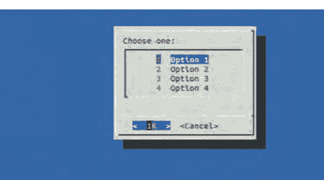

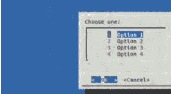

`Dialog` 的残留物会破坏“终端框架”

## Dialog 的 menu.command 完美运行

解决此问题的一种简单方法是使用 `clear` 命令。它会从屏幕上移除脚本输出，只留下空白终端：

请注意，菜单也可以显示所有已显示的内容。`Dialog` 将通过显示进度指示对此做出，显示用户在菜单中进行的进度。此外，还可以使用自定义菜单快捷键——更多细节请查看截图：

```bash
#!/bin/bash
dialog =
response=$?
```

```bash
clear
...
```

如果控制台输出的最后一行是输入，则可以使用替代程序 `Whiptail`。到目前为止，它与 `Dialog` 使用参数兼容——

## 收集任意输入

```bash
#!/bin/bash
whiptail --menu "Choose one": 12 30 4 1 "Option 1" 2 "Option 2" 3 "Option 3" 4 "Option 4"
```

`Dialog` 也可以用于收集文本输入。这要复杂一点，因为必须通过以下方式捕获：

`Whiptail` 也有它的局限性。首先，生成的对话框与 `Dialog` 创建的完全不同。其次，使用的输入与输出始终相同（见下页顶部）。


将 `Whiptail` 的标准输出重定向到变量可以解决后一个问题：

传递 `dialog --menu "Choose one": 12 30 4 A "Option 1" B "Option 2" C "Option 3" D "Option 4"` 演示了一些替代方案

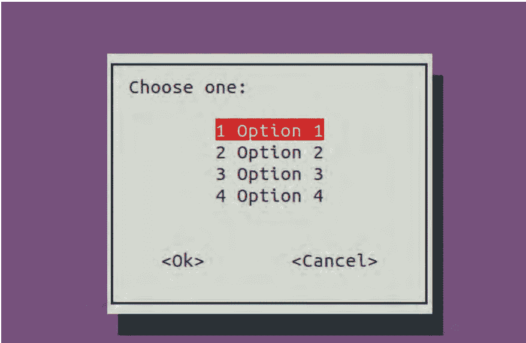

这上面看起来不同。


```bash
rocket launch;
tam@TAMHAN14:-~/Desktop$ /workspace.sh
rocket launch;
tam@TAMHAN14:-~/Desktop$ /workspace.sh
rocket
tam@TAMHAN14:-~/Desktop$ /workspace.sh
rocket launch;
tam@TAMHAN14:-~/Desktop$
```

## 进入图形领域

如果你的脚本应该显示完全图形化的产品，请尽管使用 `zenith`。它的行为在很大程度上反映了 `Dialog`，最重要的区别是省略了 `-menu`。此外，一些选项也被重命名了——Launch 示例现在像这样：

在选择一个后会导致 `Whispail` 的输出中出现一些异常

```bash
#!/bin/bash
response=
waitmail --menu "Choose one: 12 30 4 1 "Option 1" 2 "Option 2" 3 "Option 3" 4 "Option 4" 2"$response
```

```bash
#!/bin/bash
zenith --title "Message" --question-text="Should we launch a missile?" 6 40
```

`Dialog` 在文献中经常被提及；产品与 `Dialog` 有相似之处。它已经超过五年没有维护，且不再是一个软件包——使用它会给你的公司带来沉重的维护负担。

## 结论

> 策略性地调用 `Dialog` 足够让非技术操作人员也能使用脚本。

添加图形用户界面并不真正困难：策略性地调用 `Dialog` 足够让非技术操作人员也能使用脚本。如果其他人替换 `Dialog`，程序就可以集成到完全图形化的界面中。

请注意，`Bash` 的道路还没有结束。本教程的下一部分将链接到。

```bash
curl -sL -o dotnet.tar.gz https://go.microsoft.com/fwlinklink/7.linkID816869
sudo mkdir -p /dotnet && sudo tar xf dotnet.tar.gz -C /dotnet --strip-components=1 /usr/local/bin
```

```bash
curl -sL -o dotnet.ext.x64.rpm https://go.microsoft.com/fwlinklink/7.linkID701867
sudo rpm -Uh dotnet.ext.x64.rpm
```

### 市场

Visual Studio Code 插件

Visual Studio Code 提供了一个在线市场，其中有可以下载并安装的免费扩展。这里是几个在 Linux 环境下可能对 VS Code 有用的扩展列表：

- `vcodium` - 为 Visual Studio Code 带来 IntelliSense 功能
- `rest-client` - 在 Visual Studio Code 内提供集成的 REST 客户端
- `yo` - 用于简单的启发式生成器，为包括 ASP.NET Core 在内的各种框架提供代码脚架。

安装 SDK 和文件归包之间的明显区别在于命令行。随着时间的推移，微软与开源社区将进一步优化跨 Linux 发行版的工具交付，这可能会发生变化。就像 Linux 使用官方仓库管理软件包分发。成功执行此脚本后，你可以运行 `dotnet --version` 来确认 .NET 版本。你也可以在 Visual Studio Code 中使用 `--version` 进行更改。

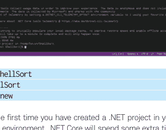

```bash
mkdir ShellsSort
cd ShellsSort
```

# 安装 C 扩展

一旦安装完成，你可以使用 Visual Studio Code 开发 C 命令行应用程序。下一步是为 C 开发做准备。这包括将 C 扩展安装到 Visual Studio Code 中。C 扩展支持 .NET 工具、高级调试、跨平台开发和项目集成。集成可以通过两种方式之一实现：要么通过 `Ctrl+P` 访问快速工厂使用 `install csharp` 命令，要么通过创建一个 C 项目并选择。

# 在 Visual Studio Code 中打开项目

如果这是你第一次在本地环境中创建 .NET 项目，.NET Core 将花费一些时间初始化大型无序数组。在这个示例中，我们正在创建一个用于壳排序（shell sorting）的 .NET 项目。壳排序算法比元素插入排序算法更高效，新命令将生成一个示例 `Program.cs` 以及默认的 `project.json` 文件。

# Visual Studio Code 为标准客户端提供了内置 Git 控制。它还对 .NET 运行时具有内置支持

转到：打开文件夹。选择 `ShellFolder`，这将文件夹上下文更改新创建的目录。Visual Studio Code 将显示你的项目。点击“是”以信任作者并响应提示。Visual Studio Code 将创建 `vscode` 子目录，该目录用于维护额外的基于 JSON 的配置文件（在项目级）。

Visual Studio Code 建议安装 C 扩展。下载并安装扩展后，Visual Studio Code 将提示你确认以启用该扩展。在撰写此文时，C 扩展的快速发行版支持实际上优于 Visual Studio Code、`openSE` 和 Linux，例如：

此隐藏目录将包含两个文件：`launch.json` 和 `tasks.json`。这些文件将用于构建和测试任务以及调试器。Visual Studio Code 还会提示在 `project.json` 文件中还原依赖项，你可以安全地确认（尽管这种令人生畏的提示行为可能会花费一点时间）。

# 在 Visual Studio Code 中创建 .NET 项目

# 获取排序逻辑

`dotnet` 命令未集成的某方面是创建新的 .NET 项目。然而，Visual Studio Code 通过集成菜单访问 shell 提示符。然后，从新启动的 shell 提示符视图中，点击编辑器视图区域中的提示，输入以下内容：

下一步是在 Visual Studio Code 编辑器中编写壳排序算法。`C` 类封装了壳排序算法的逻辑，并使用 `Type` 参数结合委托比较方法提供项目支持。基于比较的委托在比较更复杂的数据类型时具有灵活性。

# .NET Core 教程

# Linux 中 C# 的备选编辑器

.（注意：该项目的源代码可以在光盘上找到）。

```json
"dependencies": {
  "xunit": "2.2.0-beta2-build1029",
  "dotnet-test-xunit": "2.2.0-preview2-build1029"
}
```

Visual Studio Code 是 Linux 环境下 C# 的绝佳编辑器。利用微软的软件基础，它提供了从其他编辑器（包括 `Vim`、`Emacs` 和 `Sublime Text`）中获得的 C# 编程语言的基础功能，是一项提供 C# 智能编码能力的软件。它利用了成熟编辑器的架构加上插件。

你也可以手动还原存储库。这可以通过“视图+命令面板”实现。输入 `dotnet` 然后使用补全导航到 `dotnet restore` 条目，并按回车还原项目文件。

```csharp
public class ShellSorter {
    public delegate bool IsGreater<T>(T a, T b);
    public static void Sort<T>(T[] array, IsGreater<T> isAgrer) {
        int h = array.Length;
        while (h > 0) {
            for (int i = 0; i < array.Length; i++) {
                T dataObject = array[i];
                for (int j = i; j >= h; j--) {
                    array[j] = array[j];
                }
                array[j] = dataObject;
            }
            h/=2;
        }
    }
}
```

在 `project.json` 文件中添加 `Unit` 依赖项后，使用 `Using.Xunit` 创建一个单元测试：

```csharp
public class ShellSortTest {
    static bool ShortComparer(short a, short b) => a > b;
}
```


在 `shamvir` 的情况下，如果以 `mono-ovrun` 服务器或更久存在的 `MonoSharp` 服务器作为后台进程，将获得某些功能。你可以订阅，但某些工具尚未适配 Core，但在某些开源工作实现这种支持之前，仍然是可能的——

```csharp
> [Fact]
public void TestFirstAndSort() {
    short[] data = {10,7,1,9,4,3};
    ShellSorter.Sort(data, ShortComparer);
    Assert.Equal(1, data[0]);
    Assert.Equal(10, data[7]);
}
```

为了简单起见，我们只断言了测试第一个和列表成员是正确的。定义好单元代码后，你可以使用快捷键 `Ctrl+Shift+B` 构建更新的代码。

可以通过点击垂直按钮栏上的调试按钮来启动工具。或者，您可以使用键盘快捷键：`Ctrl+Shift+D`。一旦激活调试，您就可以开始了。首先，检查并确认已在此 .NET 控制台中选中了调试目标。之后，您可以使用鼠标菜单点击绿色播放按钮，或者简单地按 `F5`。之前定义的断点将在程序执行期间触发。您可以进行单步跳过、单步进入和继续。这些调试选项的快捷键为：继续 (`F5`)、跳出 (`F10`)、步入 (`F11`)、重启 (`Ctrl+Shift+F5`) 和停止 (`Ctrl+Shift+F5`)。

以打开基于文件夹的导航。然后打开位于 `vscode` 子目录下的项目特定 `tasks.json` 文件。将此文件的内容替换为下方提供的任务定义，这些定义为测试、打包和发布添加了新任务。

```json
{
  "version": "1.0",
  "command": "dotnet",
  "isShellCommand": true,
  "args": [],
  "tasks": [
    {
      "name": "build",
      "args": [
        "$(workspaceRoot)/project.json"
      ],
      "isBuildCommand": true,
      "problemMatcher": "$msCompile"
    }
  ]
}
```

## 08 更多调试技术

为了补充 `Visual Studio Code` 的调试功能，`C#` 调试器（扩展）还支持在变量（局部）部分显示数据、最近方法的调用堆栈、监视变量值以及内联监视，并显示用户处理的异常和所有类型的异常。为了回顾在使用 `Visual Studio Code` 工作时的“代码-编辑-调试”循环，这里是一些有用的快捷键：

```json
{
  "name": "test",
  "args": [
    "$(workspaceRoot)/project.json"
  ],
  "isBuildCommand": false,
  "isTestCommand": true,
  "problemMatcher": "$msCompile"
}
```

- `Ctrl+Shift+D`: 构建/项目

- `Ctrl+Shift+Q`: 运行测试

## 09 自定义任务

```json
{
  "name": "pack",
  "args": [
    "$(workspaceRoot)/project.json"
  ],
  "isBuildCommand": false,
  "isTestCommand": false
}
```

`Visual Studio Code` 支持定义自定义任务。在示例中，这里是 `dotnet publish` 任务。定义 `dotnet publish` 命令是因为 `Visual Studio Code` 目前尚未开箱即用该命令。作为自定义任务或处理元素，`dotnet publish` 命令会构建项目并创建 `NuGet` 包。此操作的结果是两个 `NuGet` 包：一个用于代码，另一个用于调试符号。`Pack`（打包）的不同之处它面向运行时部署，因为 `dotnet publish` 命令会将应用程序及其所有依赖项放在单个文件夹中。

要在 `Visual Studio Code` 中添加自定义任务，您需要修改 `tasks.json` 文件。然后，使用基于文件夹的导航。这里定义的 `pack` 和 `publish` 任务引用工作区的 `project.json` 作为输入参数，不需要处理。有了这些任务，您可以通过在 `tasks.json` 文件中定义项将它们映射到快捷键：

```json
{
  "key": "ctrl+shift+q", "command": "workbench.action.tasks.runTest",
  "key": "ctrl+shift+9", "command": "workbench.action.tasks.runRun"
}
```

## 将旧安卓手机作为智能家居服务器

将你抽屉里的那台旧安卓手机变成你智能家居的中心。

安卓手机是一个出人意料的智能家居服务器。即使是相对旧的设备，也有相当的存储空间、`Wi-Fi` 连接、传感器列表，最棒的是，功耗极低。从硬件角度来看，`Android` 具有高度活性。通过使用像 `Tasker` 这样基于触发/动作的应用程序（它基于 `Linux`），可以使用传统的命令行脚本。使用自自己的家庭自动化系统的最佳特性之一是，与你拥有更多控制权的在线供应商相比，你的隐私得到了保障。你避免了对特定服务的深度锁定——你可以更轻松地更改或扩展你的智能家居设置。

`Paul O'Brien` 是一位专业软件开发，在设计和维护 `Linux` 系统方面拥有丰富经验。`Linux` 是 `Paul` 的专业领域之一。

## 资源

- `Tasker`

- `IFTTT`

- `Smart Assistant`

- `BusyBox`

- `User Server`

- `TeamViewer`

- `IP Webcam`

- `Kodi`

安卓手机可以作为多个智能家居服务器，隐藏在某个连接电源的地方，或者另一种选择是使用它的功能——例如传感器或摄像头——来实现额外功能。如果你手边有多部旧手机，也许可以结合使用！对于低于 50 英镑的手机，这现在甚至是一个非常廉价的项目。

## 01 开始使用 Tasker

（为了通过你的安卓设备控制智能家居，你将设置触发器和动作。`Tasker` 可以从 `Google Play` 商店免费下载。`Tasker` 拥有大量功能，但探索使用第三方插件（基于内置动作构建）非常重要。）

安装应用后，你将需要设置你的第一个任务。点击屏幕底部的 '+' 按钮，系统将提示你创建一个新任务。例如，使用 `State>Power` 事件在某种情况下触发通知。

## 02 使用 IFTTT 实现自动化

`IFTTT`（`If This Then That`）允许你使用触发器和动作。虽然 `Tasker` 更偏本地，但 `IFTTT` 将你的设备连接到网络服务。例如，如果你的智能锁被打开，`IFTTT` 可以向你的手机发送通知或电子邮件。

## Android 的替代方案

如果你没有安卓设备，有什么替代方案？可能最广泛用的是运行 `Linux` 的树莓派，但那是一种更手的体验。

## Android 定位

`Tasker` 可以利用位置在你离开家时触发某些操作。例如，当发现手机在范围内时，你可以探测手机并发送短信。

## 热门配方

- 跟踪你在家里花费的时间 - 当你离开时自动关灯

- 给你的伴侣发消息

## 03 通过短信设置警报

如果你的智能家居发生了什么，而你又不在那里，你很有可能直接获知。这是你可以使用 `Run Shell`（运行 Shell）函数来调用存储在设备上适当位置（如 `/sdcard`）的脚本的情况。

## 04 为了控制智能家居，你将想要设置触发器和动作

还支持 `SL4`（`Scripting Language 4 Android`）脚本，使其与额外的语言具有兼容性，使用 `Python`、`Perl`、`Ruby`、`Lua`、`BeanShell`、`JavaScript` 和 `Tcl`。

## 05 在 Android 上托管服务器

如果你想从设备运行更复杂的脚本，并让你的安卓设备表现得服务器一样。

## Android 家庭服务器

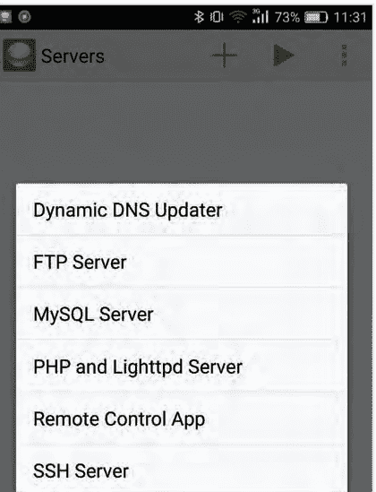


要让它运行起来，你只需要从 `Play Store` 下载一个应用即可开始广播。命名巧妙的 `IP Webcam` 就是关键，它与我们最喜欢的摄像头查看器配合得非常好。想象一下，将摄像头的音频仅上传到指定区域的 `Dropbox`、`SFTP` 或 `FTP` 服务器（你猜对了，还集成了电击枪功能），并带有移动检测。考虑到能够启用额外功能的版本价格非常便宜，它是一个极其实用的工具。

该应用还包含传感器采集和在线网页图表功能，因此你可以远程地了解设备周围发生状况。


就像普通的家庭服务器一样，你可能也很想从该设备提供内容。这是可以实现的！


一种方案是在设备上安装 Linux 发行版（参见 issue 168）；虽然这是最强大的选项，但并非绝对必须。许多 Android 应用都可以提供 Web 服务器，包括 `Server`，它不仅提供 Web 服务器，还提供了一套完整的 PHP 和 MySQL 栈，以及 DynDNS、FTP、SFTP 和 SSH。

如果你想使用远程连接来执行配置和更新等任务，可以考虑远程控制。`TeamWeaver` 提供了一个免费的 Android 服务器，允许你通过 TCP 连接到 ADB，系统会提供你的家庭网络地址（将 ADB 端口转发到网络外不是个好主意，因为是不安全的）。

## 06 将你的手机变成 IP 摄像头

我们提到过，Android 设备通常具有多种传感器，可以用于智能家居功能，但大多数手机中最好的还是摄像头。家用 IP 摄像头通常很昂贵，为什么不用你的 Android 设备来实现呢？

## 07 媒体服务与 NAS

常见的家庭服务器功能是使用 Plex 等平台在家里提供媒体服务。Android 设备在这一功能上实际上比你想象的要合适得多，具有 microSD 存储扩展功能，并能够支持直接连接手机的 USB OTG 硬盘。

这种设置的主要瓶颈出现在不需要进行转码时。虽然 CPU 和 GPU 足够强大处理视频转码，但我们看到的移动引擎并未针对此目的进行优化，例外是（但价格昂贵的）NvidiaShield。

## 选择一个廉价的 Android 设备

如果现在某处没有藏着的 Android 手机，这意味着你不能玩了吗？当然不是！你还可以以惊人的低价格购买新设备。例如，VoltaSFone Smart prime 价格便宜；它拥有广泛的传感器和出乎意地不错的摄像头。完美。

Plex 服务器本身在 Android 上受到限制，但另一个备选方案——`Kodi`（可以从 Play Store 下载）效果良好，而且全都是免费。如果你能使用宽带路由器为外部使用提供 VPN，那么当你外出时就可以连接到家庭网络并直接流媒体内容。当它在那个小小的 Android 手机上运行时，感觉特别令人震撼！


## Lucie 的手机

编辑备注

| | |
|---|---|
| IP 地址 | 192.168.0.128 |
| MAC 地址 | a0:dc:cf:e6:22:5f |
| 主机名 | |
| 厂商 | Sony |
| 首次出现 | 8月10日 11:45 - 现在 |
| 重要 | 否 |
| 收藏 | 否 |
| 日志 | |
| 服务扫描 | |
| Ping | |
| 路由 | |
| 域网唤醒 | |

## 09 扩展你的智能家居系统

如果 Android 是你进入智能家居的首次尝试，那么你需要确保在扩展设置时，以这种方式将所有部分整合在一起。这意味着什么？这意味着当你添加新的智能功能（如加热、灯光控制和监控）时，你可以以这种方式确保一切都是互操作且互不冲突的。

在之前你需要的问题是：“它能与 IFTTT 或类似的工具配合工作吗”，而且如果你喜欢动手，是否有开放的 API？推荐后者，因为这意味着如果在线服务没有提供你完全需要的，你就可以从自己的代码中解决问题，让一切完全按照你的想法运行。它还消除了对外部服务的依赖。现在该提一下你自己如何把家里的设备整合在一起了！

## 10 穿戴、语音命令和高级功能

如果你已经设置并运行了系统，那么现在是时候尝试智能功能了。你什么时候可以控制你的智能家居？把系统控制到你的 Android 设备中如何？对于这种级别的功能，有一个特定的设备带有一插件可以让你的生活更轻松——在 Play Store 上搜索 `AutoVoice`。他的 Auto 为 Google Voice 生成了 AutoVoice：现在有了用于 Android Wear 控制的 AutoVoice for Auto Wear；以及用于高级位置操作的 AutoLocation。

另一个有趣的项目是 `AutoRemote`，它使用了。


## 教程扫描

## 利用 Censys 发现已知漏洞

Censys 引擎将帮助你发现漏洞，从而避免大规模扫描的痛苦。

Censys 通过使用 Zmap 进行大规模扫描来获取数据。Censys 可以对任何 TCP IPv4 地址空间进行手动扫描。

## Censys 拥有海量数据，可以使用其自身的搜索引擎进行解析

# Mascan

nmap 在扫描、发现和检测检测方面非常强大，即使通过你的脚本虚拟工具也是如此。但正如我们之前对 nmap 的描述中提到的，你已经知道有各种类型的端口扫描器可以完成工作。Zmap 仅扫描开放端口。如果你想要获得具有更好扩展性的端口扫描器，Masscan 是你需要的。首先，确保你已经在你的 GNU/Linux 机器上安装了它，然后从它的仓库克隆 Masscan：

```bash
# git clone https://github.com/robertvdiahagrah/masscan
```

在编译之前，先安装构建依赖项：

```bash
## apt-get install libpcap-dev
```

最后，编译它：

```bash
## cd masscan
## make
```

现在让我们尝试一下。你将执行与之前完全相同的扫描，但是使用 Masscan 代替 Zmap。现在你可以使用我们的 TCP/IP 栈获取 banner（标识符）列表，从而绕过带有开关的那个。这意味着你可以使用任何本地端口连接到远程服务器以访问 Masscan。为了解决这个问题，使用端口 6666，并确保你的本地 TCP 端口没有被来自防火墙该端口的入站包拦截。

```bash
# iptables -I INPUT 1 -p tcp --dport 6666 -j DROP
```

现在运行命令搜索网络中可能的 Web 服务器：

```bash
## cd masscan
## cd bin
# masscan ...XXX.YYY.ZZ.0/24 --ports 80 --banners --source-port 6666
```

过了一会儿，你将看到一个监听在 TCP 80 端口的 banner 列表，如下所示：

```
Banner on 80/tcp ...XXX.YYY.ZZ.129: [http
HTTP/1.1 403 Forbidden

@Date: Sat, 06 Aug 2016 07:14:27 GMT
Server: Apache/2.2.6 (Debian)
```

如果你愿意，可以将结果保存为 JSON 以供进一步处理：

```bash
# masscan ...XXX.YYY.ZZ.0/24 --ports 80 --banners --source-port 6666 --json
```

Masscan 还允许你同时快速扫描多个端口。如果你想使用 TCP 端口 23 和 TCP 端口 21 (FTP) 搜索网络主机，可以这样使用 Masscan：

```bash
# masscan ...XXX.YYY.ZZ.0/24 --ports 21,23 --source-port 6666 --json-results
```

## Censys 

如果你没有时间或基础设施对你的网络进行大规模扫描，那么一定要利用 Censys 提供的所有数据来搜索你主机中的潜在漏洞。直接通过其 Web 界面使用其引擎了解从 Censys 获取可能的信息是一个好主意。在下一个场景中，我们将想象寻找潜在的漏洞 Vsftpd 2.3.4。

- 打开你选择的浏览器并导航到 `https://censys.io/`

- 在搜索查询中输入以下内容：

`vsptpd.port: 21 (vsftpd 2.3.4) and location_country: ES`

- 点击搜索按钮。

过了一会儿，结果将向你显示主机列表，这些主机在扫描时是 Vsftp 2.3.4 服务器。这些主机是否仍然在线或运行相同的版本无法确认。数据中的每个条目都有一个时间戳，显示了该特定主机何时被端口扫描。请注意，在此列表中，我们只显示运行未被植改的 Vsftp 2.3.4 主机。

## 使用 Censys API

使用 Web 界面固然很好，但你需要更广泛地搜索查询吗？Censys 提供了一个可以在不同编程语言（如 Python）中使用的 API。使用 Python 访问 API 并在 Censys 中创建一个账户。Censys 将给你一个 `Censys API Key` 中的加密令牌，你将在脚本中使用它：

- 打开你选择的浏览器并导航到 `https://censys.io/register`

- 填写表单

- 进入 API 密钥及其密钥，进入“My Account”（我的账户）页面，你的 API Key 和 API 密钥位于“API Credentials”（API 凭证）部分

## 漏洞扫描教程


由于我们在 Python 中使用了`CensysAPI`，你必须按照方式安装`Censys` Python 库：

```bash
## pip install censys
```

为了说明如何使用`CensysAPI`，你将执行之前相同的查询（即：在西班牙寻找`Vsftpd 2.3.4`的潜在遍历漏洞），但你将编写一个 Python 脚本。拿出你喜欢的 ASCII 编辑器编写以下内容：

```python
#!/usr/bin/python
import censys
import censys.ipv4
UID="your API Key"
SECRET="your API Secret"
fields = ["id"
```

我们将`vsftpd.py`保存为可执行文件：

```bash
## chmod +x vsftpd.py
```

运行它：

```bash
$ ./vsftpd.py
```

如你所示，每个主机连同时间一起打印。这个时间戳将帮助你识别主机何时被端口扫描。如果主机长时间没有被端口扫描，则意味着存储在`Censys`中关于该特定主机的信息已不再准确。因为你正在编写 Python 代码，你可以为脚本添加更多功能。通过查询`Censys`，你并没有与主机建立任何连接。但如果你想确保存储在`Censys`中的信息是准确的，你将必须与目标建立`TCP`连接。在脚本的打印行之后添加这些行（确保它们与示例一致）：

```python
try:
    socket.setdefaulttimeout(timeout)
    conn = socket.socket()
    conn.connect((ip,21))
    result = conn.recv(3333)
    conn.close()
except:
    print("Timeout or error")
```

不要忘记导入`socket`库并设置所需的`timeout`值：

```python
import socket
timeout = 5
```

保存一次。对于`Censys`报告的每个主机，你将建立一个`TCP`连接来获取几个字节。你基本上是在匹配其`banner`以组成：

| Host | Updated |
| :--- | :--- |
| ...XXX.YYY.ZZ | 2016-07- |

## 什么是 Heartbleed?

```
（注：此处原文内容为乱码/无意义字符，根据翻译要求保留格式或不翻译，但由于内容本身无意义，此处仅作占位或按原样保留）
```

## 结论

`Censys`是一个强大的数据搜索引擎，你可以利用它在查询中发现漏洞。但攻击者可以使用`proxychains`接入`Tor`网络来隐藏其真实 IP。如果你正在使用`Censys`寻找漏洞，你应该小心；无论如何，一些知名的邮件服务被`Censys`列入黑名单（如`dropmail.com`），攻击者在真实的发布中不需要小心...

尽管`Censys`提供的信息可能并非 100% 准确，但它是一个很好的起点。在 Python 中调用其`API`可以让你编写强大的脚本，自动化处理日常安全任务的各个方面。本教程已经向你展示了方法...

# Ubuntu 管理教程

## 安全备份你的数据

深入了解一些帮助你安全备份数据的技术。

备份通常是指数据的复制和归档过程：其核心思想是让管理员在发生数据丢失事件时能够恢复数据。你可以将备份视为一种简单形式的保险，但不应将其被视为可靠的数据恢复。将所有数据都保留在本地系统上的方法具有极大风险。例如，如果你的本地系统损坏，你将丢失数据。建议在位于其他地方机器上保留一份数据副本。在 Linux 系统上，使用磁带进行备份的方法是先创建归档，然后压缩文件，并在将该归档写入磁带时进行备份。随着技术的演进，磁带归档已被可以使用网络进行数据备份的技术所取代。


### Swayam Prakasha

拥有信息技术硕士学位，在信息系统领域工作多年，涵盖操作系统、网络、电子商务和`Web`服务器。`Swayam`曾为行业出版物撰写文章，并在各种主题上发表论文。可以通过`swayamprakasha@gmail.com`联系他。

使用`tar`创建备份可能是备份数据时最广泛使用的机制。`tar`命令是一个用于此目的的多功能工具。`tar`最初用于制作磁带归档，如今`tar`被认为是最受欢迎的命令，因为它提供了丰富的选项和功能。作为创建归档的一部分，你可以添加各种可以压缩归档的选项。最流行的选项可以

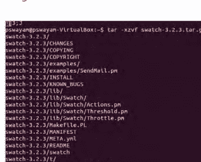

```bash
$ tar -cvf backup.tar /home/user
$ tar -cvzf backup.tar /home/user
$ tar -cvjf backup.tar /home/user
$ tar -cvjf backup.tar /home/user
$ tar -cvJ backup.tar /home/user
$ tar -cvJf backup.tar /home/user
$ tar -cvf backup.tar /root
$ tar -cvf backup.tar /etc
$ tar -cvf backup.tar /var
$ tar -cvf backup.tar /bin
$ tar -cvf backup.tar /sbin
$ tar -cvf backup.tar /usr
$ tar -cvf backup.tar /home
$ tar -cvf backup.tar /dev
$ tar -cvf backup.tar /lib
$ tar -cvf backup.tar /root
$ tar -cvf backup.tar /boot
$ tar -cvf backup.tar /opt
$ tar -cvf backup.tar /tmp
```

## 从 tar 中提取

请注意，`-z`使用`gzip`格式压缩，`-j`使用`bzip2`格式压缩归档。需要注意的是，普通的`tar`文件格式为`.tar.gz`（使用`gzip`压缩）或`.tar.bz2`（使用`bzip2`压缩）。除了上述`gzip`和`bzip2`之外，还有其他流行的压缩`tar`文件。你可以使用`tar`命令提取包。你可以预期`Unix`和 Linux 系统已经包含了你需要的`tar`工具。旧版本通常使用两步过程——创建归档，然后对其进行压缩。在较新版本的`tar`中，你将一次性完成这些任务——即在一步中创建归档并压缩输出内容。

| 名称 | BSD 通用命令手册 | TAR (1) |
| --- | --- | --- |
| tar | GNU 版本的 tar 归档 | |

## 资源

- [备份类型](http://types.backup.com)
- [数据备份详解](bit.ly/16u8c3)
- [传统技术与专用工具的虚拟备份](bit.ly/2bjec5)

## 概要

```text
tar [ -] A --concatenate --concatenate [c -- create | -f | -dff | --compare | t -- list | --test-label | u -- update | x] --extract --get [file=ARCHIVE] [options] [pathname ... ]
```

## 描述

`Tar`从磁带或磁盘归档中存储和提取文件。

`tar`的第一个参数应该是一个函数，可以是字母名称之一。函数字母不能以`-`为前缀，并可以与其他单字母选项组合。长函数名必须以`--`为开头。某些选项需要参数；在单字母格式下，这些参数必须作为单独参数给出。在长格式下，可以通过`选项=值`的形式给出。

主操作模式：

手册页`tar(1)`第 1 行 (h 帮助或 q 退出)

右页

广泛使用的`tar`命令详情

在使用`lzip`之前，理解这一点非常重要：你需要安装`lzip`软件包。为了实现`lzip`压缩，你需要利用`--use-compress-program`选项。你可以使用以下命令安装`lzip`：

下面的截图显示了如何从压缩的`tar`中提取文件。在屏幕显示的示例中，我们可以看到归档已从存档复制到当前目录。请注意我们使用了以下选项：

- `-x` 提取文件
- `-z` 解压缩文件
- `-v` 显示输出
- `-F` 表明下一个选项是归档名称

## 简述备份

```bash
$ sudo apt-get install lzip
```

```bash
$ tar -cvzf backup.tar /home/user
```

```bash
$ tar -cvjf backup.tar /home/user
```

```bash
$ tar -cvJ backup.tar /home/user
```

```bash
$ tar -cvJf backup.tar /home/user
```


# 教程

## Ubuntu 管理

### 用于网络备份的 OpenSSH 工具

OpenSSH 提供了多种对网络备份非常有帮助的工具。它们可用于远程登录和远程访问，在无需加密密钥的情况下在机器之间传输文件。这允许我们编写出无需任何人工干预即可使用的脚本。

用于压缩的第三方命令 `lzip` 与 `gzip` 和 `zip` 不同。需要注意的是，当我们使用 `lzip` 压缩文件内容时，它会保持原始文件完整，并创建一个扩展名为 `.lz` 的新文件。如下所示：

```
$ lzip -v myfiles
```

解压并删除。

```
$ lzip -d myfiles
```

这会删除原文件并创建一个压缩文件 `my_files.lz`。

`tar` 的主要用途是创建和解包归档。还有其他选项可以用于归档备份以及从归档中删除内容。让我们通过几个示例来看：

```
$ tar -af myfiles.tar myfile2tar
```

在示例中，我们正在将一个文件合并到另一个文件中 - 我们使用了 `-A` 选项来实现这一点。另外一个归档的内容被添加到第二个归档中。

```
$ tar -rv myfiles.tar extra_file
```

在示例中，我们实际上向一个归档添加了一个文件。你可以使用通配符，将多个文件添加到归档中。

```
$ tar -delete extra_file -f my_file.tar
```

让我们看看如何使用网络备份技术。快速且可靠，连接移动数据进行备份的网络具有高安全性。另一种方法是，许多人可以在网络上复制文件或用于将数据备份到远程服务器。对于每个特定任务，通过使用 `ssh` 和 `scp` 等 SSH 工具，你可以实现归档备份的安全传输。另一种流行的方法是只备份自上次备份以来更改的文件，以节省时间。在网络上备份文件的另一种方法是使用 `rsync` 等工具。你还可以查看另一个命令 - `rsync`，它可以运行并允许你对文件创建每小时、每天、每周或每月的快照。

通过使用 OpenSSH，你可以从多个客户端机器获取备份。让我们来看一个示例。

```
$ rsync my_backup; cd my_backup
## ssh user@remote 'tar -cvf my_files | tar xvf -'
```

在示例中，以 `my_file` 开头的文件位于当前目录。所有从我们的主目录（home 1）复制的文件都放在这里。可以注意到，管道的左侧创建了一个归档，而右侧将文件扩展到当前目录。`rsync` 命令提供了可以在网络使用的丰富功能set。`rsync` 是一种算法，通过比较本地和远程文件来执行

```
$ sudo apt-get install rsync
```

此命令带有一系列选项。请参考截图以查看更多选项。

```
rsync --help
-v, --verbose             详细输出
-a                         处理目录的特殊输出
-c --checksum             根据校验和、大小跳过文件（不基于修改时间）
--del                       删除接收端不存在的文件
--inplace                    原地更新文件
-z --compress              在传输期间压缩文件
-N --no-links               不创建符号链接
--exclude=PATTERN          根据模式排除文件
--exclude-from=FILE       根据文件排除文件
--partial                   保留部分传输的文件
--progress                  显示文件传输期间的进度
--set-perms=PERMS         在接收端设置权限、所有者和组
--set-group                 在接收端设置组 (g)
--set-owner=OWNER           在接收端设置所有者
--numeric-ids               不映射用户/组名称
--dry-run                   显示将要执行的操作但不实际执行
--help                      帮助
```

上述为 `rsync` 内部的选项

它也可以用于备份本地机器，在大多数情况下，以下命令对我们有效：

```
$ rsync -av /my_files/ my_dir/
```

这单行代码将同步 `my_files` 或 `my_dir` 的内容。可以注意到，如果 `rsync` 发现一个文件（不存在），它会删除该文件，除非在使用 `rsync` 时使用了 `-A`（递归）和 `-w`（通配符）选项。当你需要将其用于外部备份时，可以配置同步策略。另一种流行的方法是使用 `rsync`，因为它非常快且安全。

第一步，你需要确保同时安装了 `rsync` 和 `ssh`。你可以使用以下命令实现此目的：

```
$ yum install rsync
$ sudo apt-get install ssh
```

下一步，我们将运行此处所示 `rsync` 命令：


```
## rsync -av --delete /my_dir1/ /my_dir2/
```

## 编辑此文件以引入由 cron 运行的任务。

# 每个要运行的任务都必须通过单行定义
# 使用不同的字段指示任务何时运行
# 以及任务执行什么命令
#n# 要定义时间，你可以为以下字段提供具体值：
## 分 (m), 小时 (h), 日 (dom), 月 (mon),
# 以及 星期 (dow)，或在这些字段中使用 '*'（表示“任意”）。
# 注意，任务将根据 cron 守护进程
# 认为的时间概念和时区启动。
# crontab 的输出（包括错误）将发送到
# 用户 crontab 文件中（除非重定向）。
# 例如，你可以每周运行一次所有账户的备份，如下：
```

### 使用 cron 通过 rsync 自动执行备份


```
$ rsync -av --delete /my_dir/me/
```

如果我们查看 `cron` 条目，可以看到我们感兴趣在晚上 10 点运行备份。

如果我们配置为在 22 以外的时间运行，则需要使用 `-p` 标志作为选项提到。

当我们执行命令时，它会提示你输入密码 - 注意这是为了与 `SSH` 进行身份验证。`Cron` 无法自动处理密码。

系统管理员发现使用 `rsync` 自动化备份很容易。在 `Ubuntu` 上，我们使用 `cron` 来实现此自动化。要编辑该文件，输入以下命令：

尽管 `rsync` 非常流行，但它假设被备份的机器是你想保留备份的唯一地方。但请考虑多台机器需要同步特定文件的情况。在这种情况下，该命令变得非常有用。你可以通过使用：

```
crontab -e
```

然后使用编辑器为 `rsync` 创建一个别名，如下：

你可以管理页面以了解更多关于：

```
$ sudo apt-get install rsync
```

0 这里我们需要确保 `cron` 使用的语法是正确的。语法是分钟、小时，

| UNIX-5 Manual | General Commands UNIX-5 Manual |
|---|---|
| LINUX | |
| `cron(5)` - Unix 和 Windows 的文件规范 | |
| `-cron.8.2-root (options)` | `-cron.8.2-root (options)` |
| `cron(5)` | 描述 |
| `cron` 文件包含命令列表，是为旧 `Linux` 发行版编写的，因为原始程序是手册位于 `/usr/share/man/man/`，可以查看 | |

> 注意，任务将根据 `cron` 的守护进程的时间概念和时区启动。`crontab` 的输出（包括错误）将发送到用户 `crontab` 文件中（除非重定向）。例如，你可以每周运行一次所有账户的备份，如下：手册页查看详情或按 `q` 退出

# 教程

## 并发编程

### 学习 Go 中的并发编程

`img/c9de257c4e373c22707351f47f16002e_45_0.png`

`Mihalis Tsoukalos` 是一位 `Unix` 系统管理员、程序员（`Go`）以及数学家。他自 1993 年起就开始编程。你可以通过 `Twitter` 访问 `@msouk` 或 `mtskalos.eu`

## 资源

### 发现如何在 Go 中开发并发应用程序

并发编程是一个需要特殊的计算领域。本教程将介绍 `Go` 独特的并发方法。`Go` 使用 `goroutine` 和通道支持并发。例如，在 `Go` 中，当程序启动时，它的协程会自动调用主函数开始实际执行。

我们将主要讨论 `goroutine` 和并发。`Go` 还支持传统的共享内存并发模型准备绪！

## 与并发相关的 Go 标准包

`sync` 包包含可以帮助你同步协程的函数。`sync` 包中最重要的函数是 `Mutex` 和 `WaitGroup`。

`time` 包与并发没有直接关系，但包含一些实用的函数，包括用于暂停协程的 `Sleep`。然而，在没有严重理由的情况下，使用 `Sleep` 函数暂停协程是极不建议的，并应该避免。

## 关于 goroutine

`goroutine` 是可以并发执行的最小 `Go` 单位 - 注意 `goroutine` 这个词，因为它们比线程轻得多。然而，进程可以独立存在而不需要自己的线程。`goroutine` 离开进程不存在，因此在 `Go` 中，要有一个 `goroutine`，你需要一个至少有一个线程的进程。

你可以通过在函数调用之前使用 `go` 关键字定义一个新的 `goroutine`。这是简单的语法。`go` 关键字会在函数运行时立即调用函数。

另一方面，然而，你无法控制或假设你的 `goroutine` 将如何执行，这是调度程序的工作。

`goroutine` 程序包含 `Go` 代码，创建了两个 `goroutine`，一个使用函数，另一个使用匿名函数。你可以在文件 1 中查看 `goroutine.go` 的代码。示例，`goroutine.go` 生成了以下输出：

## Go 之旅

## Goroutine (协程)

`Goroutine` 是由 `Go` 运行时管理的轻量级线程。

```go
go func(x, y, z) {
    starts a new goroutine
}(f, y, z)
```

`f`、`y` 和 `z` 的求值在当前 `goroutine` 中发生，而 `f` 的执行在新的 `goroutine` 中发生。

`Goroutine` 在相同的地址空间中运行，因此可以在不需要同步的情况下访问共享内存。`sync` 包提供了原语，尽管在 `Go` 中你可能不需要太多它，因为还有其他原语（参见下张幻灯片）。

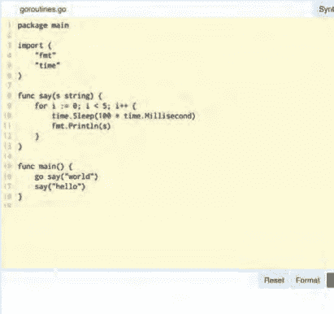

< 1 / 11

图 1


你在这里会发现一个极其棘手的点：如果你尝试从 `main` 函数中省略对 `time.Sleep` 的调用，它将先结束，导致两个 `goroutine` 没有足够的时间启动并完成它们的工作；结果是你无法从屏幕上得到任何输出，现在你可以开始理解并发编程的困难之处了！

正如你所意识到的，这样运行的 `goroutine` 之间是隔离的，无法交换任何数据，这并不总是想要的操作方式。下一节将为你介绍 `Channels`（通道），它为 `goroutine` 提供了一种发送和接收数据的方法。

## 关于通道 (Channels)

通道是 `goroutine` 之间的连接，允许 `goroutine` 交换数据——每个通道允许特定数据类型的元素类型。要操作通道，你需要有人接收通过通道发送的数据。否则，发送数据的函数将阻塞并等待接收其数据。

你可以使用以下方式通过 `chan` 关键字声明通道：

```gogopackage main

import (
    "fmt"
    "time"
)

func aFunction() {
    time.Sleep(100 * time.Millisecond)
    fmt.Printf("This is a function!\n")
}

func main() {
    time.Sleep(100 * time.Millisecond)
    fmt.Printf("Learning about Goroutines...\n")
    go aFunction()
    go func() {
        time.Sleep(100 * time.Millisecond)
        fmt.Printf("This is an anonymous function!\n")
    }()
}
```

上面的代码是创建两个简单 `goroutine` 的 `goroutine` 代码，一个使用现有的函数，另一个使用匿名函数。

```
// go run goroutine
Learning about Goroutines.
This is an anonymous function!
This is a function!
Exiting...
```

那么，你如何知道打印的消息来自不同的 `goroutine` 呢？理解这一点最好的方法是观察四条消息在屏幕上打印的顺序：看 `aFunction()` 中的延迟，匿名函数的消息先打印。这证明了匿名函数和 `aFunction()` 同时同时运行。

```go
aChannelStrings := make(chan string)

// 你可以向现有的通道发送语句
aChannelStrings <- "hello"

// 你可以像这样从通道中读取单个值：
for loop:
    valueFromChannel := <-aChannelStrings

你应该预期会有数量的值，可以使用循环进行读取：
for reading := range aChannelStrings
    fmt.Println(reading)
```

## 并发编程教程 (Tutorial Concurrent programming)

这是 `GoChannel` 的代码，展示了如何创建/使用通道。通道是并发模型中的一等公民。

```go
package main

import (
    "fmt"
    "sync"
)

func usingGoChannel(chan chan int) {
    for i := 0; i < 4; i++ {
        ch <- i
    }
    close(chan)
}

func main() {
    fmt.Println("Using Channels!")
    chan := make(chan int)
    usingGoChannel(chan)
    for my := range chan {
        fmt.Printf("%d
```

对应的下方是 `simple.go` 的代码，其中 `sync` 包的使用允许 `main()` 函数等待 `goroutine` 完成它们的工作。

在退出之前：

```go
package main
```


```go
import (

	"fmt"

	"sync"

)

func main() {

	fmt.Println("Using Goroutines Part 1")

	var wg sync.WaitGroup

	wg.Add(2)

	go func() {

		wg.Done()

		fmt.Println("This is 1!")

	}()

	go func() {

		wg.Done()

		fmt.Println("This is 2!")

	}()

	wg.Wait()

	fmt.Println("Exiting...")

}
```

正如你所看到的，这些在 `Go` 中非常重要，请确保在继续教程的其他部分之前很好地理解它们。

## 简单示例 (A simple example)

在下一个示例中，`main()` 将在结束前等待所有 `goroutine`，这是通过在本教程开头提到的 `sync` 包帮助将实现的行为。换句话说，你将停止调用 `sleep`。为了简单起见，这里使用了匿名 `goroutine`。

你可以在 `simple.go` 中找到这个示例的代码，你也可以在图 3 中看到它。执行以下代码：

```bash
$ go run simple.go

Using Goroutines Part 1

This is AF 1!

This is AF 2!

Exiting...
```

你可以看到 `goroutine` 的消息是以创建的反向顺序打印的。你还可以看到 `defer` 关键字的使用；在这种情况下使用 `defer` 没有增加程序的可靠性，但如果你的函数有多个返回点，它将很有用。

请注意 `sync.Add` 调用必须反映你想要等待的 `goroutine` 数量，这应该是你调用 `sync` 的 `goroutine` 总数。

调用 `sync.Done` 的次数多于 `sync.Add` 是不好的，但不会让你的程序崩溃——它会在所有 `goroutine` 完成工作之前结束。

你也可以忽略通道的值，实现如下：

```go
<-aChannel
```

关闭通道使用 `close(channel)` 函数。你可以在图 2 中看到 `GoChannel` 的代码，它使用了整数值。执行 `GoChannel` 生成如下输出：

```bash
$ go run GoChannel.go

Using Channels!

1 2 3

Channel is closed!
```

以下将查找通道的状态：

```go
ok := <-chan

if ok {
    fmt.Println("open")
} else {
    fmt.Println("closed")
}
```

## 并发并行 (Concurrency Parallelism)

常见的误区是并发和并行是相同的。并发是同时处理许多事情，并行是同时执行许多事情。

`Go` 程序使用单个通道。使用多个通道的非常常用的技术被称为流水线 (`pipelines`)，通过这种方法连接 `goroutine`，使一个的输出成为另一个通道的输入。

但在在此之前让我们谈谈展示的程序，名为 `pipelines.go`，该程序将读取文本行，计算每行的长度，并在打印所有长度之前统计每个长度出现的次数。图 5 显示了执行 `pipelines.go` 使用一个每行包含单个单词的文件时生成的输出输出。

```bash
$ wc INPUT

124586 INPUT

$ run pipelines.go INPUT | sort -rn
```

## 并发编程教程

正确的管道。这里的 `Go` 代码演示了如何使用文本文件实现管道。

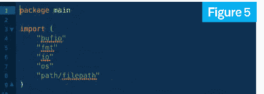

```go
package main

import (

	"bufio"

	"fmt"

	"io"

	"os"

	"path/filepath"

)

func ReadLine(filename string, out chan<- string) {

	file, err := os.Open(filename)

	if err != nil {

		fmt.Printf("error opening file: %v\n", err)

		return

	}

	defer file.Close()

	scanner := bufio.NewScanner(file)

	for scanner.Scan() {

		out <- scanner.Text()

	}

}

func FindLength(in <-chan string, out chan<- int) {

	for line := range in {

		out <- len(line)

	}

}

func CalculateAndPrintCounts(in <-chan int) {

	counts := make(map[int]int)

	for length := range in {

		counts[length]++

	}

	// Print the counts

	for i := 0; i < len(counts); i++ {

		fmt.Printf("%d: %d\n", i, counts[i])

	}

}

func main() {

	filename := "input.txt"

	lines := make(chan string)

	lengths := make(chan int)

	go ReadLine(filename, lines)

	go FindLength(lines, lengths)

	CalculateAndPrintCounts(lengths)

}
```

输出结果告诉我们，输入文件中存在 28,755 个四个字母的单词，237 个三个字母的单词，以及只有一个 27 个字母的单词。

既然我们已经有了 `Go`，解释管道的工作就变得容易了。`main` 函数仍然是使用 `Go` 通道创建所有必要连接的“胶水”。如果你需要灵活性，可以使用通道作为管道的构建块。

程序创建了两个 `goroutine`：`readFile` 和 `findLength` 函数。`readFile` 函数将读取的文件名作为第一个参数，并将将传递给 `findLength` 函数的通道作为第二个参数。`findLength` 函数返回一个通道，该通道将作为 `createHash` 函数的输入。只要有数据接收或获取，这三个函数就会保持活跃。`Go` 代码展示了如何在 `main` 内部使用这两个通道和三个函数：

```go
lines := make(chan string)

stringLength := make(chan int)

go getFile(filename, lines)

go findLength(stringLength, lines)

createHash(stringLength)
```


# 系统信息

奇景电子股份有限公司（Chicony Electronics Co., Ltd）thinkpad t4360

Bus 003 Device 002: ID 8087:002a
Intel 集成快速管理枢纽
Bus 003 Device 010: ID 8086:0002
Linux 2.0 根节点
Bus 002 Device 001: ID 8086:0003
Linux 2.0 根节点

## 传感器

acpitzv-virtual-0
适配器: 虚拟设备
temp: +49.0C (临界 = +200.0C)
thinkpad-isa-0000
适配器: ISA 适配器
风扇: 3612 RPM
coretemp-isa-0000
适配器: ISA 适配器
物理 ID: +50.0C (高值 = +87.0C)
核心 0: +48.0C (高值 = +87.0C, 临界 = +87.0C)

# 终端的类型

你基于 GUI 的桌面中的终端实际上是一个模拟器，你可以将各个窗口之间的区域拖动，从而创建出你理想的屏幕空间布局。

传统上，终端是绿屏硬件，与示波器并不相似。在现代工作站中，终端通过桌面环境中的虚拟应用程序进行安装。

虽然 Ubuntu 提供了一个不错的终端模拟器，但还有许多其他选项。某些选项包含大量令人印象深刻的设计选项和一系列辅助工具，可以帮助让复杂操作变得简单得多。

更多功能……
如此，还有许多其他产品可用——可以免费搜索 Google 来查找。

## 本地化！
LeRoy 以其高性能数字示波器适配器系列而闻名，这些适配器能够同时显示真实的图表。终端实际上提供了类似的体验——“分割符”

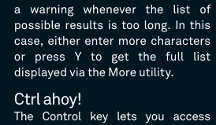

# 功能主命令行

## 帮助与帮助页 (MAN PAGES)

> 尽管 Google 为许多 shell 命令提供了大量信息，但 Unix 的内置帮助工具值得关注

## 010 名字背后的含义？

如果你好奇某个特定命令的作用，通过输入相关命令名称的 `whatis` 可以找到关于该主题的更多信息。我们在这里显示的示例告诉我们它是关于什么的。

```bash
$ whatis gcc

gcc (1) - C++ 编译器
```

## 009 键盘快捷键

使用这些实用的快速技巧，事半功倍。
对于大多数用户来说，他们只是在终端中不断敲击。当你的系统变得缓慢时，本产品提供了一系列有用的技巧。

Unix 在运行时会收集大量数据。大部分数据存储在 syslog 中，可以通过 `tail` 命令将这些行输入到终端。

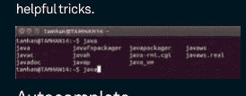

### 自动补全
命令行最强大的功能之一就是只需使用 `Tab` 键即可自动补全系统上的命令和文件。在 Bash 中，系统上的所有命令和文件都会根据可能的情况通过 `Tab` 建议。

```
tail /var/log/syslog
```

### Ctrl+l
Ctrl 键允许使用许多有趣的功能。按下 `Ctrl+L` 可以删除缓冲区——与 `clear` 不同，它还会保持你的滚动区域完好。按下 `Ctrl+C` 可以让你终止当前正在运行的任务，这对于帮助学者非常有帮助。

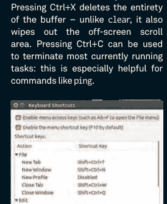

| 键 | 快捷键 |
| --- | --- |
| F11 | 启用访问键 |
| Ctrl+N | 新窗口 |
| Ctrl+A | 全选 |
| Ctrl+W | 清空窗口 |
| Ctrl+C | 复制文本 |
| Ctrl+V | 粘贴 |
| Ctrl+U | 撤销上行 |
| Ctrl+= | 放大 |
| Ctrl+- | 缩小 |

**了解更多**
如果你觉得在这里查找更多快捷键可以很快帮助打开 shell 的主面板？或者，在终端模拟器中点击“编辑：键盘快捷键”以打开显示选项

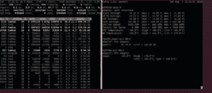

终端模拟器提供一系列功能，包括标签页和无限窗口

Gustavel 的错误浮动在屏幕上——由 Michael invdevgames 显示

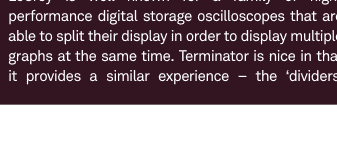

## 008 学习高级温度检测技术
今天 CPU 的散热能力可能比 CPU 驱动器需要的更多。你应该检查冷却问题（如气流问题或适配器插槽中的 GPU 卡未就位），尽可能查看内部传感器。例如，使用 `fanmon` 驱动或使用 `lm-sensors --` 命令检查 ATI 显卡的温度可能会有所帮助。

## 007 确定你的系统参数
笔记本电脑、台式机和工作站包含许多传感器。这些传感器由许多元件组成。如果没有安装相关部分，shell 将引导你完成安装过程。此代码显示了我们 ThinkPad430 的输出。

# Go 并发

来自 `lines` 和 `string` 通道的数据没有存储在任何地方；数据从 `readFile` 函数传输到 `findLength` 函数，再传输到 `createHash` 函数。

正如你所见，熟悉这些 Go 代码并不困难——你很容易对管道的通道感到困惑。

添加一个阶段展示了管道之间是如何交互的。你应该理解这是 Go 中一个非常强大的机制：

这张图片说明了数据是如何通过程序的通道和函数在 `pipelines.go` 中流动的。


| lines | stringLength |
| --- | --- |
| `readFile(...)` | `findLength(...)` |
| 输入 | 输出 (`createHist(...)`) |

所展示程序的设计非常直观，因此选择如何构建管道并不困难——对于复杂的设计，你可能需要更多时间来决定构建管道的替代结构。

通过使用 Go 通道，你将获得更多关于如何构建管道的理解，这使得执行更高效。

图 8

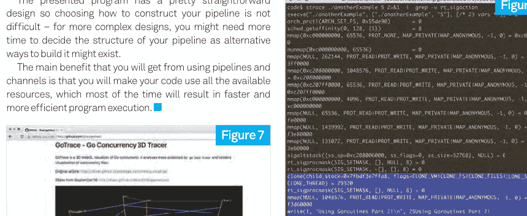

跨越 GoTrace 结构展示了 Go 程序的执行。

GoTrace - 并发

图 7

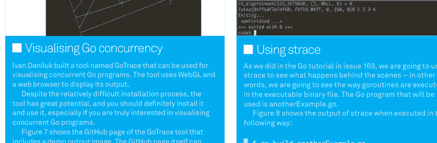

Go 可视化

Ivan Danilo 创建了一个名为 `GoTrace` 的工具，它可以使用 WebGL 显示 Go 程序。

如果你对安装过程感兴趣，你应该一定要尝试它，特别是对 Go 并发感兴趣时。

`GoTrace` 的 GitHub 页面展示了它，你可以在 https://github.com/ivanilo/gotrace 找到详细信息。

关于 `GoTrace` 的讨论超出了本教程的范围！

在下一个 Go 教程中，我们将跟踪后台发生了什么——我们将构建的程序 `anotherExample.go`。

以下展示了执行时的输出：

```bash
# go build anotherExample.go

# file anotherExample

anotherExample: ELF 64-bit LSB executable, x86-64, version 1 (SYS), statically linked, not stripped

# ./anotherExample 5 261 | grep -v
```


另一种方法涉及搜索内容：使用 `/pattern` 向前搜索，使用 `%pattern` 向后搜索。输入后，模式将以高亮方式显示。

## 011 简单帮助

大多数命令都带有一个集成帮助系统，提供有关语法的信息。可以通过输入 `--help`、`-h` 访问。如果系统支持，实用程序通常会显示关于该命令的小帮助列表。请注意，尝试这些命令可能是危险的：你可能会为 `rm` 或类似的命令输入参数，这会导致系统故障，特别是在删除易用的系统时。

## 012 阅读手册！

大多数命令都带有一个 `man` 页（帮助页）。通过输入 `man` 加上你想查找的内容名称，可以在不同的“手册”页之间移动。完成后，`man` 查看器将会在你的屏幕上显示对齐的内容。

## 013 高级 `man` 处理

你可以通过按下向上和向下键来滚动 `man` 页。

## 014 什么是 `man`

大多数命令都带有一个 `man` 页。

## 015 什么是 `man`

大多数命令都带有一个 `man` 页。

## 016 什么是 `man`

大多数命令都带有一个 `man` 页。

## 017 什么是 `man`

大多数命令都带有一个 `man` 页。

## 018 什么是 `man`

大多数命令都带有一个 `man` 页。

## 019 什么是 `man`

大多数命令都带有一个 `man` 页。

## Feature Master 命令行

## 安装指南

## 安装二进制文件

### 搜索软件包信息

`apt-get` 工具带有一个名为 `apt-cache` 的“小兄弟”。它可以用于查找当前缓存中已知的软件包，从各种存储库中收集信息。在执行 `apt-get` 之后，常见的用例包括获取更多关于软件包的详情。

### 使用 `apt-get autoremove` 来删除它们

幸运的是，这个问题非常简单：只需调用 `apt-get autoremove` 即可删除不需要的包。然而，由于某些依赖没有被 `apt-get` 标记为启动，重新安装你已删除的包可能会有所帮助。

```
$ apt-cache show gcc

Package: gcc

Priority: optional

Section: dev

Installed-size: 41
```

### 大多数包都是二进制的。但这意味着什么？

编译源代码对我们来说可能是枯燥且耗时的。实际上，二进制包解决了这个问题：它们包含了针对你的系统预编译好的镜像。安装过程通常包括将文件复制到相关位置——在一个地方、脚本中，或者运行以处理配置文件的编辑。

### 021 嗅依赖关系

在空间受限的系统上部署包时，了解更多依赖关系非常有帮助。只需输入 `apt-cache show` 软件包名称即可获取该包依赖关系的详细信息。

## DEB 架构

DEB 文件是一个包含两个部分的存档：一个关于软件包内容的元数据，另一部分包含需要安装在你的系统上的实际文件。该格式是 `Debian-binary` 格式。

### 022 清理

随着时间的推移，`apt-get` 会积累大量的缓存信息。可以通过运行 `apt-get clean` 来删除，但请注意，许多系统即使不运行该命令也不会积累缓存。在这种情况下，命令将返回且没有任何输出，因为没有剩余的可显示内容。

上述 `dp-get` 可以分析未知 DEB 文件的内容

### 025 依赖失败

尽管软件包管理由 Unix 系统处理，但仍应该记住依赖关系。它提供了大量的实用示例。例如，可以通过 [ ] 检查一个包。

当然，上述结构有一个缺点：二进制包只能在编译时针对的系统使用。拥有不同架构系统的所有者将收到一个包含 `x86` 或 `x64` 二进制文件的包。

### 023 执行更深层的清理

`apt-get clean` 并不会杀死 `apt-get` 缓存中的所有文件。运行 `apt-get autoremove` 会清理另一个未使用的进程，这需要一些额外的时间。

## 安装该 deb

大多数 DEB 包可以使用上述 `apt-get` 方法安装。然而，某些工具如 `dpkg` 可能需要 `root` 权限，因此只需双击你想安装的包即可。

### 024 学习消除孤立包

在某些情况下，包升级后一个或多个依赖项会被删除。在这种情况下，操作完成后 `package-get` 将提示一个孤立包。

仅通过命令行可能需要使用 `dpkg` 命令。可以使用以下命令立即安装包：

```
$ sudo apt-get update
```

以下软件包已安装且不需要：
`libd64-himbald` `libd64-2himbald` `lib0-26-lib0-28`

当你想为额外代码安装任何包时，使用 `-j` 后接远高于 CPU 核心数的数值是无效的，并且在所有情况下都会失败。

### 026 并行化

在引入双 CPU 操作十多年后，默认情况下它仍然一次次构建一个。使用 `-j` 后跟一个数字可以告诉工具在处理过程中应使用多个核心。

### 027 不要过度

在首次编译开发的大型项目时，将 `-j` 设置为一个高值。由于多种原因，这是无效的：首先，交换内存（`swap`）的使用

在编译最终用例时，同时使用所有核心会导致进程过载——或者在树莓派 3 上使用 `-j 4` 是导致过热重启的配方。

## >_028 使用 `grep` 搜索

### 掌握使用此文件搜索工具的高级方法

通过文件名和元数据查找文件始终解决方案的一部分：深入研究需要可以使用帮助定位的搜索工具。

`grep` 工具是此类任务的标准。使用它的另一种方法是在你读取的行上设置模式选项，随机的，不幸的。

```
$ grep -i "installation" readme.txt

for information installation

see: http://www.android.com/guide/Libraries

tamhan|TAMHAN4:-~/Android/libraries$ 
```

我们的第一个示例使用 `grep` 查找 `readme.txt` 文件内部的字符串 `info`。程序不仅限于简单搜索，还可以用通配符进行注释，从而修改行为以更好地适应需求。

## 管道与匹配

让我们来看看另一个命令，它在 `bashfile` 中将 `grep` 与 SDK 相关的命令结合起来。

```
$ grep -E " ~/.bashrc | grep '<ANDROID>'

export ANDROID_HOME=/home/tamhan/ 
```

```
© tamhan|TAMHAN4:-~/Android/libraries$ grep readme.txt

for information installing libraries. see: http://www.android.com/guide/

tamhan|HAN4:-~/Android/libraries$ 
```

## 高级 `grep`

除了普通的 `grep` 命令外，大多数 Unix 发行版还提供一个 `grep` 版本，它将所有输入视为正则表达式并提供相似的功能。

当 `grep` 命令与其他命令配合使用时，它提供了匹配项的相似性：

```
$ grep -i "installation" readme.txt
```

## 编译源码

在编译最终用例时，同时使用所有核心会导致进程过载——或者在树莓派 3 上使用 `-j 4` 是导致过热重启的配方。

## 可执行文件

在某些情况下，将文件标记为可执行。在文件系统中，解决这个问题只需使用 `chmod +x` 标记，它设置了执行权限。

有时你需要知道是否有足够的空间给某个文件。输入 `-h` 会列出所有文件——请注意，并非所有都是可访问的

```
$ chmod +x
```

## 统计字数

字数统计是有用的。`wc` 命令统计文件的单词数。其语法在帮助片段中显示

```
$ wc -hl
```


打印每个文件的行数、单词数和计数，当有更多文件或当文件是时 -

## 修改文件所有权

读取标准输入。它是一个由空格分隔的非零字符序列。情况下，文件需要更改所有者。这是 `chown` 命令的工作，名为“所有者”。`chown` 可以接受大量参数以详细方式更改权限系统。

## 依赖失败

尽管 Unix 系统处理软件包管理，但仍应该记住依赖关系。它提供了大量的实用示例。例如，可以通过 `[ ]` 检查一个包。

当然，上述结构有一个缺点：二进制包只能在编译时针对的系统使用。拥有不同架构系统的所有者将收到一个包含 x86 或 x64 二进制文件的包。

## 023 执行更深层的清理

`apt-get clean` 并不会杀死 `apt-get` 缓存中的所有文件。运行 `apt-get autoremove` 会清理另一个未使用的进程，这需要一些额外的时间。

## 安装该 deb

大多数 DEB 包可以使用上述 `apt-get` 方法安装。然而，某些工具如 `dpkg` 可能需要 root 权限，因此只需双击你想安装的包即可。

## 024 学习消除孤立包

在某些情况下，包升级后一个或多个依赖项会被删除。在这种情况下，操作完成后 `package-get` 将提示一个孤立包。

仅通过命令行可能需要使用 `dpkg` 命令。可以使用以下命令立即安装包：

```
$ sudo apt-get update
```

以下软件包已安装且不需要：
`libd64-himbald` `libd64-2himbald` `lib0-26-lib0-28`

当你想为额外代码安装任何包时，使用 `-j` 后接远高于 CPU 核心数的数值是无效的，并且在所有情况下都会失败。

## 026 并行化

在引入双 CPU 操作十多年后，默认情况下它仍然一次次构建一个。使用 `-j` 后跟一个数字可以告诉工具在处理过程中应使用多个核心。

## 027 不要过度

在首次编译开发的大型项目时，将 `-j` 设置为一个高值。由于多种原因，这是无效的：首先，交换内存（swap）的使用

## 028 使用 grep 搜索

> 掌握使用此文件搜索工具的高级方法

通过文件名和元数据查找文件始终解决方案的一部分：深入研究需要可以使用帮助定位的搜索工具。

`grep` 工具是此类任务的标准。使用它的另一种方法是在你读取的行上设置模式选项，随机的，不幸的。

```
$ grep -i "installation" readme.txt

for information installation

see: http://www.android.com/guide/Libraries

tamhan|TAMHAN4:-~/Android/libraries$ 
```

我们的第一个示例使用 `grep` 查找 `readme.txt` 文件内部的字符串 `info`。程序不仅限于简单搜索，还可以用通配符进行注释，从而修改行为以更好地适应需求。

## 管道与匹配

让我们来看看另一个命令，它在 `bashfile` 中将 `grep` 与 SDK 相关的命令结合起来。

```
$ grep -E " ~/.bashrc | grep '<ANDROID>'

export ANDROID_HOME=/home/tamhan/ 
```

```
© tamhan|TAMHAN4:-~/Android/libraries$ grep readme.txt

for information installing libraries. see: http://www.android.com/guide/

tamhan|HAN4:-~/Android/libraries$ 
```

## 高级 grep

除了普通的 `grep` 命令外，大多数 Unix 发行版还提供一个 `grep` 版本，它将所有输入视为正则表达式并提供相似的功能。

`grep` 命令与其他命令配合使用时，它提供了匹配项的相似性：

```
$ grep -i "installation" readme.txt
```

## 编译源码

在编译最终用例时，同时使用所有核心会导致进程过载——或者在树莓派 3 上使用 `-j 4` 是导致过热重启的配方。

## 可执行文件

在某些情况下，将文件标记为可执行。在文件系统中，解决这个问题只需使用 `chmod +x` 标记，它设置了执行权限。

有时你需要知道是否有足够的空间给某个文件。输入 `-h` 会列出所有文件——请注意，并非所有都是可访问的

```
$ chmod +x
```

## 统计字数

字数统计是有用的。`wc` 命令统计文件的单词数。其语法在帮助片段中显示

```
$ wc -hl
```

打印每个文件的行数、单词数和计数，当有更多文件或当文件是时 -

## 修改文件所有权

读取标准输入。它是一个由空格分隔的非零字符序列。情况下，文件需要更改所有者。这是 `chown` 命令的工作，名为“所有者”。`chown` 可以接受大量参数以详细方式更改权限系统。

## 依赖失败

尽管 Unix 系统处理软件包管理，但仍应该记住依赖关系。它提供了大量的实用示例。例如，可以通过 `[ ]` 检查一个包。

当然，上述结构有一个缺点：二进制包只能在编译时针对的系统使用。拥有不同架构系统的所有者将收到一个包含 x86 或 x64 二进制文件的包。

## 023 执行更深层的清理

`apt-get clean` 并不会杀死 `apt-get` 缓存中的所有文件。运行 `apt-get autoremove` 会清理另一个未使用的进程，这需要一些额外的时间。

## 安装该 deb

大多数 DEB 包可以使用上述 `apt-get` 方法安装。然而，某些工具如 `dpkg` 可能需要 root 权限，因此只需双击你想安装的包即可。

## 024 学习消除孤立包

在某些情况下，包升级后一个或多个依赖项会被删除。在这种情况下，操作完成后 `package-get` 将提示一个孤立包。

仅通过命令行可能需要使用 `dpkg` 命令。可以使用以下命令立即安装包：

```
$ sudo apt-get update
```

以下软件包已安装且不需要：
`libd64-himbald` `libd64-2himbald` `lib0-26-lib0-28`

当你想为额外代码安装任何包时，使用 `-j` 后接远高于 CPU 核心数的数值是无效的，并且在所有情况下都会失败。

## 026 并行化

在引入双 CPU 操作十多年后，默认情况下它仍然一次次构建一个。使用 `-j` 后跟一个数字可以告诉工具在处理过程中应使用多个核心。

## 027 不要过度

在首次编译开发的大型项目时，将 `-j` 设置为一个高值。由于多种原因，这是无效的：首先，交换内存（swap）的使用

## 028 使用 grep 搜索

> 掌握使用此文件搜索工具的高级方法

通过文件名和元数据查找文件始终解决方案的一部分：深入研究需要可以使用帮助定位的搜索工具。

`grep` 工具是此类任务的标准。使用它的另一种方法是在你读取的行上设置模式选项，随机的，不幸的。

```
$ grep -i "installation" readme.txt

for information installation

see: http://www.android.com/guide/Libraries

tamhan|TAMHAN4:-~/Android/libraries$ 
```

我们的第一个示例使用 `grep` 查找 `readme.txt` 文件内部的字符串 `info`。程序不仅限于简单搜索，还可以用通配符进行注释，从而修改行为以更好地适应需求。

## 管道与匹配

让我们来看看另一个命令，它在 `bashfile` 中将 `grep` 与 SDK 相关的命令结合起来。

```
$ grep -E " ~/.bashrc | grep '<ANDROID>'

export ANDROID_HOME=/home/tamhan/ 
```

```
© tamhan|TAMHAN4:-~/Android/libraries$ grep readme.txt

for information installing libraries. see: http://www.android.com/guide/

tamhan|HAN4:-~/Android/libraries$ 
```

## 高级 grep

除了普通的 `grep` 命令外，大多数 Unix 发行版还提供一个 `grep` 版本，它将所有输入视为正则表达式并提供相似的功能。

`grep` 命令与其他命令配合使用时，它提供了匹配项的相似性：

```
$ grep -i "installation" readme.txt
```


## 编译源码

在编译最终用例时，同时使用所有核心会导致进程过载——或者在树莓派 3 上使用 `-j 4` 是导致过热重启的配方。

## 可执行文件

在某些情况下，将文件标记为可执行。在文件系统中，解决这个问题只需使用 `chmod +x` 标记，它设置了执行权限。

有时你需要知道是否有足够的空间给某个文件。输入 `-h` 会列出所有文件——请注意，并非所有都是可访问的。

```bash
$ chmod +x
```

## 统计字数

字数统计是有用的。`wc` 命令统计文件的单词数。其语法在帮助片段中显示。

```bash
$ wc -hl
```

打印每个文件的行数、单词数和计数，当有更多文件或当文件是标准输入时。

## 修改文件所有权

读取标准输入。它是一个由空格分隔的非零字符序列。在需要更改文件所有者的情况下，这是 `chown` 命令的工作，名为“所有者”。`chown` 可以接受大量参数以详细方式更改权限系统。

# 多媒体

> 尽管多媒体与命令行没有关联，但有一系列出色的媒体管理工具等待着你

### 041 更改文件格式

图像处理通过 ImageMagick 工具完成。它在大多数工作站上不会自动部署，但必须使用 `apt-get install imagemagick` 手动安装。

每个任务都涉及不同文件格式之间的转换。使用随附的代码可以将 PNG 文件转换为 JPG 文件。

```bash
convert my_file.png jpg
```

### 042 轻松调整文件大小

更改文件大小很容易，但较小的文件大小需要被减小。在批量进行此操作时，应该灵活地处理像素数量，以保持宽高比。

随附的示例可以智能地调整图像大小，使两条边较宽的那条宽度为 200 像素——无论是竖屏还是横屏照片都能正确处理。

### 043 查看 EXIF 数据

数字相机在图像中存储了大量信息。Filenametool 可以读取包含这些记录的标签——随附的代码可能会揭示关于你文件的大量细节。

### 044 利用 ffmpeg

在不同版本的 Ubuntu 上，ffmpeg 工具在仓库中可用。如果安装了该程序，它允许你进行大量的媒体转换。ffmpeg 简化了文件格式的更改——使用 ffmpeg 可以轻松地将 MP3 文件转换为 OGG 文件。

```bash
ffmpeg -i input.mp3 -c a libvorbis -q 4 output
```

# 命令行播放器

> 从命令行播放多媒体内容出于多种原因变得很有趣，包括创建脚本的能力

# CMus

你们其他朋友使用他们喜爱的语法进行媒体播放器播放。部署 CMus 来获取一个经过设计的、你并不喜欢的媒体播放器，这你不太可能对该程序感到满意。如果你不知道如何操作，另一个用户界面更简单的播放器可能更适合你。

# mp3buster

如果你不熟悉 ffmpeg，那么 mp3buster 就是适合我们其他人的播放器。它超级简单的界面易于处理，这解释了为什么有各种音乐导航的快捷键。这种设计是为传统的 CD-ROM 播放器设计的——如果你有 CD，你会发现它非常易用。

# SoX

SoX 被描述为音频处理的“瑞士军刀”。它可以用于转换不同格式的音频文件，并作为插件提供，可用于向系统当前播放的音频添加编辑播放警告和状态音。

# ogg23

如果我的兴趣仅仅是播放 OGG 文件，那么以标准方式使用 ogg23 工具就足够了。它是一个简单的实用程序，甚至不需要太多知识就可以轻松使用。在 ogg23 出现之前，想要播放 OGG 文件的用户甚至……——该程序无法处理非 Vorbis 文件。

# 功能全能的命令行

### 045 SSH 以及如何使用它

> 使用 SSH 意味着你可以在不安全的网络上安全地运行服务

由于命令行的巨大威力，开发者和用户可能觉得可以通过命令行远程控制计算机。这是由于其低资源需求而实现的——由于是基于文本的，命令行即使在带宽受限的连接上也能工作。

最初，Unix 工作站通过 Telnet 访问。SSH（Secure Shell）取代了这些简单的明文传输，使用了更或少高效的加密形式。

**建立连接**

从工作站连接 SSH 守护进程：`deflector` 到 Google 以了解更多信息。建立连接很容易，但必要时可以忽略主机密钥。

```bash
$ work ssh 192.168.1.100

The authenticity of host 'RSA-2048' can't be established.

Are sure you want to continue connecting (yes/no/[fingerprint])?

ed256:b3:57:d5:56:e6:31:b5:53:dc:f4:c21:f8:a2:98
```

当：连接拒绝 (EDSA) 到主机列表。端口 22。关闭

按照传统，在从远程主机断开连接时启动的会话将会结束。这个问题可以通过使用 `tmux` 复用器来解决——它必须在部署后才能使用。

下一步，输入从远程主机分离（detach）。这将导致崩溃，看起来就像普通的终端一样。通过按下 `Ctrl+B` 然后按 `D` 可以保持会话持续：

```bash
$ tmux

[detached]
```

再次登录后，可以通过 `tmux attach` 回收会话——如果系统没有重启，它将就像你离开时的一样。

# 网络

> 相互连接很重要。一些命令行工具让这一切变得更舒适

### 046 获取网络状态

当发生网络问题时，了解各种接口的状态是有帮助的。只需使用 `ifconfig` 查看你想要知道的任何内容——注意不活跃或默认接口工具也是。

上面的 `mrt` 命令允许你深入查找连接中延迟发生的地方。

找出发生的地方。这是通过 `mrt` 实用程序实现的，它会打印你与远程主机之间数据传输的详细“时间分析”。

### 047 你在哪儿？

在工作站上运行进程或客户端时，客户端的界面是默认的。Nmap 可用于扫描 IP 范围内的主机，还可以对活动的主机生成报告。一旦安装完成，

### 050 列出所有端口？

在调试网络问题时，找出具体是哪些端口连接的是有帮助的。通过 `nmap` 命令使用它。参数列表允许你自定义在屏幕上显示的信息。当列表有限时，结合上述的 `watch` 特别有用。

### 048 查找网络延迟

如果发生网络问题，下一步是

```bash
$ -ifconfig

link Link-connect-Ethernet Hwaard

drop:de:ff:fe:ba

inet 192.168.1.253 Bcast:192.168.1.255 Mask:255.255.255.0

inet add:ether:7f27:ff:fe:ba/64
```

```bash
IP UPCASTING NETWORK LIMIT

MTU:1500

rx packets:13826 errors:0 drop:0 overflow:00:0

tx packets:12338 errors:0 drop:0 overflow:00:0

collisions:10 timeout:0

inet 192.168.1.1 (222.7 MB) TX

bytes:20342818 (20.3 MB)
```


大多数网络系统会对检测到的丢失包做出响应。发送它们可以通过使用`ping`实现——注意必须通过`Ctrl+C`结束进程以获取所示统计数据。

# 构建更好的网页
`www.webdesignermag.co.uk`

更智能的`CSS`技巧 | 释放`Node.js`的力量 | 20 最佳`WordPress`插件

# 今日购买你的杂志

纸质版请访问`www.imagineshop.co.uk`
数字版请访问`www.greatdigitalags.com`

可在以下平台提供

# 编码器与制作者的终极指南
## 实用型树莓派

> 72 “一旦我们的机器人能够避开墙壁，我们将添加第二个行为，以追踪光源，例如在机器人左侧或右侧照射的手电筒光”

## 目录

- 66 使用`Pi`生产净水
- 68 在`Pi`上设置家庭日历
- 70 使用`Pi NoIR`拍摄夜间照片
- 72 构建探险家机器人：第四部分

## 评估反应

使用树莓派的用处在于它比在此实验中可能使用的某些核心组件便宜得多，树莓派被用于评估正在发生的化学反应的速率和效率。

## 半导体

二氧化钛化学物质被旋涂在玻璃衬片上，然后将衬片放在烧杯底部，上方放置一个强紫外`LED`。衬片充当半导体，因此当紫外光子击中它时，电子就会变得活跃。

## 最终目标

在理想的情况下，树莓派最终将成为一种成本效益的方法，帮助稍微改进测试过程。虽然我们距离在全球范围内应用还有很远，但这是一个伟大的开始。

## 监控电压

当溶液通过系统时，通过它的光被光电极管记录。光电极管将此光输入转换为电压，由树莓派读取。

## 组件列表

- 树莓派
- `D.L.Y`扩展
- 光电极管
- 多个烧杯
- 带有`ADC`和`DAC`芯片的扩展板
- 布线和软管

使用了正确颜色的液体模拟化学反应，这种亮度更容易观察反应的发生。实验过程中使用了不同的实验设置，树莓派是一种现场为离子充电的廉价方式。

## 使用树莓派生产净水

得益于`Jessica Mabin`的光催化剂项目，使用树莓派拯救生命从未如此简单。

### 你能向我们介绍一下什么是光催化剂，以及你为什么要推动这个项目吗？

在十个人中只有一个人可以使用饮用水，其中一些人的水质并不安全。根据世界经济论坛2015年1月的引用，水危机被列为全球首要风险。这是一个严肃的问题，因此对于大型处理厂和小型硬件解决方案来说具有价值。尽管许多系统已被证明可以净化废水中的污染物，但它们通常价格昂贵且部分无效。

市场需要一种不需要过滤水但可行的系统。光催化剂是一种通过能量激活以产生反应的材料，在`TiO2`的情况下，它是通过紫外线激活的。这些反应产生有机自由基，从而消除高活性的自由基，这些自由基撕裂污染物，留下水和非气体。助催化剂最重要的特性是它们在反应中的稳定性，使其成为持续水处理的可持续材料。

### 你能告诉我们你的灵感源于哪里吗？

这始于我在伦敦大学学院工作时，我的学生`Stephen`发现了这个项目的基础。五年前回到卡迪夫大学重新激发了我让她参与的兴趣，首先作为一名硕士生，然后作为我博士论文的主题。该项目已经从需要数千英镑的昂贵专用设备演变为基于树莓派的约100美元的等效测试系统。这节省了大量的资金。

### 树莓派是如何在该项目中使用和整合的？

我们将项目设置从使用多个微控制器到另一个包含`ADC`和`DAC`芯片的板，以利用树莓派的能力。通过将其缩小，我们能够制造一个便携式系统，它可以简单地包含一个发射红光的激光二极管，红光通过电池盒并由光电极管测量。根据树莓派的功能生成了水。通过合适的板卡，我们可以利用树莓派测量更多重要的环境参数。`ADC`的数量限制了来自 24 位`ADC`的电压的灵敏度和分辨率，我们可以改进这一点。我们仍在改进表面涂层技术，正在进行的材料研究进展顺利。

### 你接下来的计划是什么？你觉得你可以在你的科学研究中更多地利用树莓派吗？

我们最近还没有充分利用树莓派可以提供的所有资源。我们正在使用树莓派作为微控制器完成一个系统。我们正在测量浓度，树莓派可以做到。

`Jessica Mabin`是卡迪夫大学天文学和伦敦系的博士生。她有不同的方法利用科学解决全球性问题。

喜欢吗？
市场对水有需求，但通过光催化剂去除污染物是由板载`ADC`芯片驱动的，我们具有以廉价设置并进行实验的灵活性。多重优势很重要，因为运行实验需要几个小时，它可以节省时间。

对于该项目的先进性，你发现树莓派有任何局限性吗？
我们仅仅是触及了光催化剂的表面，由板载`ADC`芯片驱动，我们具有以廉价设置并进行实验的灵活性。多重优势很重要，因为运行实验需要几个小时，它可以节省时间。

`TiO2`材料的特性是稳健的，并最终成为一种成本效益的方法，帮助稍微改进测试过程。虽然我们距离在全球范围内应用还有很远，但这是一个伟大的开始。

文章发表于：`www.linuxuserco.uk`

# Python

## 由于如今每个家庭都很忙碌，在这一期中我们将考虑使用树莓派来显示活动日历

对于今天的许多人来说，一个主要问题是保持时间的组织良好并跟踪事件。对于你需要跟踪的每一个额外事件，都包含了你家庭成员的生活。作为实际设备，你可以选择许多小型显示器或屏幕。

## Python `coulomb`

返回的数据是一个结构化数据集。你可以使用关键字`'items'`获取单个日历的条目。单个日历包含条目列表，例如唯一`ID`和摘要（`summary`）以及更多详细信息。你可以获取可用摘要的打印输出。

## 你可以进行更新吗？

这是你在创建事件时输入的内容。

你可能感兴趣的某些重要细节（如参与者列表和附件列表）都是结构化数据列表。对于每个事件，你可以用代码循环并提取每位参与者的名称。

虽然本文的主要部分是关于通过`Google`日历拉取事件来填充你的家庭日历显示，但并没有阻止你进行反向操作，根据监控器上发生的情况来更新日历。你可以与手机上的变化保持同步，或者使用`'insert'`方法（这对于此类更改可能大材用了），或者只是想使用快速添加方法。

```python


通过列表，你可以开始构建填充你家庭日历显示的实际事件列表。这些事件中的每个事件都有完整的详细列表，日历提供了摘要。作为快速操作，你可以使用以下代码获取主日历中所有事件的摘要。

```python
for cal in list['items']:
    print(cal['summary'])
```

```python
for attendee in event:
    print(attendee['display'])
```

如果列表是 `'Name'` 或其他内容，你可能在对其进行任何操作之前想获取一个字符串。同样地，你可以拉取事件中的附件文件。

```python
new_event = service.events().add(
    calendarId='primary',
    body='Meeting at August 28 2:00PM'
).execute()
```

```python
event_list = service.events().list(
    calendarId='primary').execute()
for event in event_list['items']:
    print(event['summary'])
```

假设你实际上想更新一个事件。例如，假设你新创建的事件时间错了。你可以使用这些示例获取摘要、开始时间和日期的打印输出：

```python
new_event = service.events().update(
    calendarId='primary',
    eventId=event_id,
    body=new_event
).execute()
```

```python
for event_item in list['items']:
    print(event_item['summary'] + ' - ' + event_item['start']['dateTime'])
```

对于你有访问权限的任何日历，只要有事件 ID，就可以执行此操作。最后一种简单的方法是删除现有的事件。

日期在列表中的打印格式类似于 `2023-10-34T00:30:00Z`。因此，你可以获取日期，然后获取事件的开始时间和结束时间。这一切都运行得很好，但由于如果你需要处理全天事件，在提取这些数据时需要进行一些错误检查。如果你在列表中找到具有事件 `'summary'` 属性条目，你可以访问：

```python
service.events().delete(
    calendarId='primary',
    eventId=event_id
).execute()
```

使用这种特定方法时要小心，因为你的后代可能会决定删除某个预约，然后在事后尝试移动这些事件。如果是这样，你可以通过以下操作将事件从一个日历移动到另一个日历：

`summary` 只是自由格式文本

我们只收集了你希望在家庭日历显示中查询的部分。希望你能看到使用 API 让你和家人保持更新的可能。所有其他 Google 服务也有 API，所以也许你可以使用上面的代码作为连接点，从你的在线动态中提取更多数据。如果你从他人的日历中拉取数据，甚至可以与祖父母可能发生的情况保持同步。

如果你想从列表中获取任何额外细节，这会有点混乱。如果你想查看 `'title'` 和 `'attendee'` 属性，有一种实用的方法可以获取这些数据，它们会显示出来。如果它存储在 Google 日历中，将有一个 `'File'` 属性可以从中提取文件信息。如果有文件文档，将有一个 `'File'` 属性可以从中提取文件：

```python
updated_event = service.events().move(
    calendarId='primary',
    eventId=event_id,
    destination='calendar'
).execute()
```

如果你的家庭允许某种交互（例如通过使用触摸屏平板电脑），那么你就可以从手机更新事件并传回互联网。你将立即在手机上知道家里的孩子增加了一天。

www.linuxus.co.uk | 69

# 教程

### 使用树莓派的 NoIR 摄像头尝试一些摄影！

安装 NoIR 摄像头来享受来自树莓派更好的光线照片和视频


Christian Gawley

我曾是一名 IT 和软件工程师，自 2010 年以来，一直在在线和纸质媒体为计算机和移动用户提供建议和灵感。我在 makeuseof.com 介绍树莓派以及 Linux。


| | | |
|---|---|---|
| GAO | E35174 | AWM |
| GAO | 35174 | AWM |
| GAO | 35174 | AWM |
| GAO | 35174 | AWM |
| GAO | 35174 | AWM |
| GAO | 35174 | AWM |

## 你需要什么

- 树莓派 NoIR 摄像头 V2
- Element14.com 摄像头外壳
- 便携式电源

想更深入利用树莓派摄影吗？你可能已经连接了官方摄像头模块，但发现某些活动——特别是显示光——没有成功。树莓派有一个底座。

## 03 安装你的摄像头模块

如果树莓派有底座，它将有四个极可以安装摄像头。只需连接摄像头并按下。

## 使用滤镜！

如果你发现 `raspist` 看起来不对，请使用滤镜。它与模块大小相同，可以放在前面拍摄照片。当然，这个小部分可以产生惊人的效果！

## 01 检查你的内容

当你收到两个项目时，树莓派 NoIR 摄像头本身应该准备好使用了，在其每个 PCB 孔上。采取静电措施，使用排线将 NoIR 摄像头连接到树莓派，它连接到附近的 HDMI 端口。不要在插入前忘记抬起（没有过度压力）以固定它。

| | | |
|---|---|---|
| 1 Change User | 修改 `pi` 用户名 |
| 2 Change Password | 修改 `pi` 用户的密码 |
| 3 Change WiFi | 设置你的无线网络 SSID 和密码 |
| 4 Internationalization | 设置你的时区和语言 |
| 5 Update | 运行 `apt list` 并重启 |
| 6 Remove unused | 移除树莓派不需要的包 |

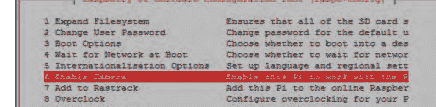

在启用摄像头后，退出 `raspi-config`——你会被提示：

## 04 更新你的树莓派

摄像头模块连接，是时候启动你的树莓派并运行更新了。

```bash
sudo apt update
sudo apt upgrade
```

这将确保你的软件安装正确。

## 延时

延时摄影有助于捕捉记忆（无需通过 SSH 耗尽电池）。使用毫秒，此命令每 8 分钟拍摄一次照片。使用 libavtool 转换你的图像。

```bash
raspist -t 48000 -l 5000 /time/lapse/image054.jpg
```

将摄像头输出到显示，可选地以 1024 拍摄：

```bash
raspist [options]
  摄像头参数
  -h          此帮助信息。默认: 640
  --width      像素宽度。默认: 1024
  --height     像素高度。默认: 768
  --fps        每秒帧数
  --bitrate    比特率 (kbps)。默认: 2500kb/s
  --format     视频格式（例如 h264, mjpeg）
  --encoding   视频编码格式
  --quality    质量设置 (0-100)
  --vinfo      拍摄期间的视频信息
  --tinfo      拍摄期间的时间信息
  --rotation   旋转图像
```


通过选项运行演示模式，没有
`raspist --help`

在编码和压缩后拍摄静态图像

今天要使用你的 NoIR 摄像头吗？记住，录制视频时电池会消耗得很快。在启动树莓派之前，也应该使用`raspi-config`启用摄像头。

## 05 拍摄照片和视频

两个工具`raspist`和`raspvid`用于用 NoIR 摄像头拍摄静态照片和视频。基本用法如下：

- `raspist photo.jpg`
- `raspvid -o video.h264`

使用帮助命令查找完整的命令集，包括指定尺寸和旋转（见顶部提示）：

## 06 制作延时摄影

为了充分利用 NoIR 摄像头的性能，你需要设置在低光下拍摄照片。如果你不能等到晚上，可能可以使用低光场景，如阁楼、地下室或橱子。

对于测试拍摄，尝试：

- `raspist -test.jpg`

## 07 准备晚上拍摄

如果你想在户外拍摄，你需要一个充电电池为树莓派和摄像头供电。你还应该选择一个坚固的外壳，良好的良好的防护。为了最佳效果，请使用全候外壳，或使用塑料袋！

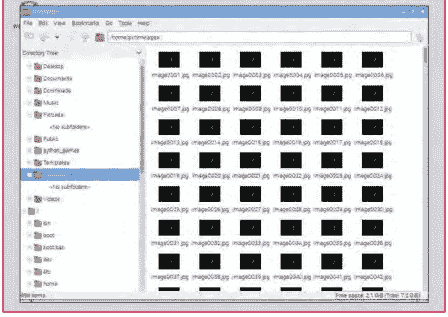

确保不要过载你的 SD 卡存储——保持延时摄影短小！

## 命令和开关

要了解更多关于`raspvid`可用的命令，请使用：

- `raspist -help`
- `raspvid -help`

## 09 编译你的延时摄影

视频编译完成后，考虑将其上传到 YouTube。延时视频非常受欢迎！

将延时摄影编译为视频图像文件：

```bash
ffmpeg -i ~/time/lapse/image%05d.jpg -r 24 -vcodec libx264 high profile -preset slow -time//lapse/timelapse.mp4
```

在树莓派上编译需要一些时间。完成后，使用以下查看结果：

```bash
omplayer /home/pi/timelapse/timelapse.mp4
```


## 构建 explorerHAT 机器人 第四部分

升级你的机器人，使其能够自动驾驶、寻光并通过传感器避障。

在第三部分中，我们通过手动控制程序和游戏手柄为机器人装上了“腿”。现在，我们将通过传感器和反馈回路来添加驱动能力。我们首先从使用开环控制开始，然后创建简单的避障行为。一旦我们的机器人能够能够避开墙壁，我们将添加一个传感器来追踪光源（例如机器人左侧或右侧的手电筒）。该项目正开始初具规模，以下程序可以使用两个红外线（IR）传感器适配为循线行为。

## 你需要的物品

- 文章的 Github 仓库 (`https://github.com/alexellis/zumopi`)
- 第二部分中构建的 Explorer 机器人
- Wi-Fi 适配器
- 超声波传感器
- 2 个模拟光敏传感器

**Alex Ellis** @alexellis 是 ADA 的高级软件工程师，`Docker` 和 `Linux` 爱好者。他喜欢所有与 `Linux` 和树莓派相关的事物，并定期在他的博客上发布教程。

代码使用 `Python` 编写，这意味着示例将兼容 `Python 2` 和 `Python 3`。所有代码都是开源的，因此如果你想提出改进或修复错误，请在 `Github` 上提交 issue。

### 04 构建避障行为
有了自动驾驶技术，我们唯一不想避免的是碰撞，无论是与无价的宠物猫还是对蜘蛛。用于此目的最廉价的传感器是 `HC-SR04` 超声波传感器。`HC-SR04` 有一个触发（`trigger`）和一个回响（`echo`）引脚；设置触发以碰到物体，然后立即开始计数直到回响引脚变低。这段时间对应于 `120cm` 到 `250cm` 之间的距离。

### 01 没有失败，没有反馈
当我们开始开发机器人时，我们需要在一个开放、可预测的环境中导航，例如厨房地板可能是一项非常棘手的任务。如果我们让系列第三部分的机器人在厚地毯或草地上行驶，我们将失去对转向和速度的控制。如果电机以 `100 rpm` 的速度转 `0.5` 秒，它会转超过 `360` 度，而在草地上它可能几乎不动，或者在地毯上它可能会转偏。

### 02 你能接受反馈吗？
在手动控制期间，我们开始观察机器人的性能，并通过随时纠正来做出反应。如果没有反馈，我们需要一种等的方式来衡量发生的情况。通过在平坦表面以 `70 rpm` 的速度驱动电机，我们可能可以爬上坡。这种程序包含一个开环系统，但为了补偿对反馈的需求。当我们有了直接的反馈机制时，这被称为闭环。

### 03 选择你的传感器
测量机器人移动多远、多快的常用方法是通过轮编码器或电机编码器。每个编码器都可以制成连接到轴的电机上的简单纸盘，或者使用霍尔效应磁性传感器。通过计算 `RPM` 并使用移动一段距离所需的时间，我们建立了与...

```python
import RPiGPIO as GPIO
import time

# trigger = ExplorerHAT 上的输出 1
# echo = ExplorerHAT 上的输入 1
# 其他输出或输入请参阅帮助信息：
# pinout.xy
```

### 05 动作快就会错失
使用 `HC-SR04` 传感器，我们需要声速来让树莓派操作系统准备好测量结果。遗憾的是，`GNU Linux` 的通用性并不保证是一个实时系统。原因是我们可能希望更频繁地测量或准确地平均传感器结果。另一种方法是避免使用引入过多延迟的代码库。在使用 `RPiGPIO` 库之前，请参阅示例类 (`ultrasonic.py`)

# Explorer 机器人


# 教程


```python
class ultrasonic_sensor:
    def __init__(self, trigger, echo):
        self.GPIO_ECHO=echo
        self.GPIO_TRIGGER=trigger

def cleanup(self):
    GPIO.cleanup()

def setup(self, setime):
    print("trigger = " + str(self.GPIO_TRIGGER))
    print("echo = " + str(self.GPIO_ECHO))
    # 设置引脚为输入和输出
    GPIO.setpinmode(self.GPIO_TRIGGER, GPIO.OUT)
    GPIO.setpinmode(self.GPIO_ECHO, GPIO.IN)
```

#### 不要撞上那面墙
现在我们有了一个可以通过 `ExplorerHAT` 进行测量的 `Python` 类，让我们写一个简单的循环来读取值，然后设置我们的机器人向前行驶，并在检测到周围 `30cm` 或更远的物体时停止。对于仅返回值并在终端上打印值的情况，请使用 `parameter_dummy.py`。下面的示例请使用 `part4/distance_dummy.py`。

```python
def measure(self, setime):
    # 将触发置为 False
    time.sleep(0.001)
    GPIO.output(self.GPIO_TRIGGER, True)
    time.sleep(0.001)
    GPIO.output(self.GPIO_TRIGGER, False)
    # 让模块稳定
    time.sleep(setime)
```

此外请注意，我们通过将变量命名为 `safe_distance`、`cm`、`power_percent`、`sensor_time` 来编写代码谁知道这意味着什么？

```python
# 发送脉冲
GPIO.output(self.GPIO_TRIGGER, True)
time.sleep(0.001)
GPIO.output(self.GPIO_TRIGGER, False)
start = time.time()
while GPIO.input(self.ECHO) == 1:
    pass
stop = time.time() - start

import explorerhat
import ultrasonic_sensor

# trigger = 1
# echo = 1

# 计算脉冲长度
# 行驶距离乘以声速 (cm)
distance = 34000 / elapsed

ultrasonic = ultrasonic_sensor(echo_pin, trigger_pin)
ultrasonic.setup()
print("Ping...")
while(True):
    sensor_time = 0.1
```


```python
cm = ultrasonic.measure(sensor_time)

safe_distance = 30

if(cm < safe_distance):
    explorerhat.motor.one.stop()
    explorerhat.motor.two.stop()
else:
    move_power_percent = 50
    # 距离和返回
    distance = distance / 2

return distance
```

# Explorer 机器人

并且能够在户外操作。笔记本电脑的缺点：这是一个交换 Wi-Fi 适配器以更新代码。教程的结果将一直保持终端开启并在运行时按下 `Ctrl+C`。


## 09 安装你的传感器

在这一点，你可能在好奇如何将传感器安装到 Zumo 小型底盘上。如果你有激光切割机，你可能需要为机器人制作额外的层来安装传感器。对于我们的测试，我们使用了少量的胶来固定传感器直到它们保持位置。

## 10 连接 ALS-19

ALS-19 是使用电阻制造的光敏传感器。我们只需要通过电线提供正反馈来读取信号。将一个和另一个连接到 `2`。有 `5V` 和 `GND` 连接器，以便我们需要离开并允许我们同时为超声波传感器。

## 11 从 ALS-19 读取模拟值

模拟值可以通过库读取，并给出一个 `0-100` 的值代表输入电压。这里有一个如何读取传感器的快速示例：

```python
explorer_motor.one.forwards(move_power_percent)
explorer_motor.two.forwards(move_power_percent)
print("%f\n", value)
```

## 07 设计逃逸行为

在转向寻光行为之前，让我们看看是否可以在机器人进入楼梯时停止它。一旦机器人检测到至少 `30cm` 的距离，就需要返回并运行一个 `while` 循环。简单的效果是转向来时的左侧然后继续主循环。注意，这将在一个循环中，因为表面可能是可能是大的。现在我们将考虑更小的模块。完整代码在 `parts/distance/roming.py` 中。

```python
print(explorer_analog.one.read())
print(explorer_analog.two.read())

def escape():
    backup_time = 0.1
    turn_time = 0.5
    explorer_motor.one.backwards(50)
    explorer_motor.two.backwards(50)
    time.sleep(backup_time)
    explorer_motor.two.forwards(50)
    time.sleep(turn_time)
```

最简单的控制程序将读取两个传感器并立即向左侧或右侧提供更多功率以做出转向。最好的控制程序将允许值匹配，然后使用 PID 控制器确保系统不会过度纠正。这是我们的尝试；我们留下了改进空间。

```python
import explorer
import time
from ultrasonic import *

def get_percentage(left, right):
    if left > right:
        return (20, 50, "left")
    else:
        return (50, 50, "right")
```

## 08 创建紧急停止

在继续追踪寻光行为之前，让我们看看如果机器人进入楼梯是否可以停止它。在第 3 部分中我们将看到并返回。按钮 B 可能会导致问题，也许按钮 B 的结果会救你免于掉下楼梯。zigzag模式的优势是极大的：

```python
while:
    left = explorer_analog.one.read()
    right = explorer_analog.two.read()

    tolerance = 0.10
    delta = abs(left - right)
    if(delta > tolerance):
        percentage_power = get_percentage(left, right)
        explorer_motor.two.forwards(percentage_
power(0))
```

### 共享自主权

有时机器人可以被赋予一项任务并自我调节——想象一下工厂的生产线，做出错误决策的潜力很高，这时我们希望与机器人共享自主权以降低风险水平；一个完美的例子就是自动驾驶汽车。

# 教程

# 寻找你附近的创客空间

创客空间（Maker Spaces）和黑客空间（Hacker Spaces）是与志同道合的人交流的绝佳方式，甚至让你接触到平时可能无法获得的工具和机械设备。树莓派聚会（Raspberry Pi Jams）也能让你发现自己的手工能力。展示机器人的棒方法是在 Cam's Jam！可以在 `https://piwars.org` 找到它。


```python
explorhat.motor.forwards(percentage_power[11])
print(percentage_power[22])
else:
    percentage_power = (50, 58)
    print("*")
explorhat.motor.forwards(percentage_power[11])
    time.sleep(0.1)
```

```python
explorhat.motor.forwards(50)
while(True):
    if(ultrasonic.measure(0.10) <= bump_buffer_cm):
        explorhat.motor.stop()
        explorhat.motor.stop()
        escape()
    left = explorhat.analog.read(1)
    right = explorhat.analog.read(2)
    tolerance = 10
    delta = abs(left - right)
    if(delta >= tolerance):
        percentage_power = get_percentage(left, right)
        explorhat.motor.forwards(percentage_power[80])
```

# 12 构建最终机器人控制程序

这是我们教程的最后一部分，也是我们最终的机器人控制程序。它将在环境中运行，确保不碰撞到任何东西并使用最强的光源。我们能够利用光束构建机器人障碍物，以便光束可以聚焦。通过身体两侧的触摸传感器，它可以控制方向和速度。完整代码提供在 `part4/follow_light/dummy_bump.py` 中。

```python
import explorhat
import time
from ultrasonic import sensor(6, 23)
ultrasonic.set_cpu()
bump_buffer_cm = 20
def get_percentage(left, right):
    if(left > right):
        return (20, 50, "*")
    return (50, 20, "*")
def escape():
    backup_time = 0.3
time = 0.15
explorhat.motor.backwards(50)
explorhat.motor.backwards(50)
time.sleep(backup_time)
```

```python
explorhat.motor.forwards(percentage_power[80])
print(percentage_power[22])
else:
    percentage_power = (50, 58)
    print("*")
explorhat.motor.forwards(percentage_power[11])
    time.sleep(0.1)
```

# 13 决定你想制作什么

在之前的教程中，我们查看了在 Python 中使用类（classes）的优势。将每个行为分离到独立的类中。也许你还需要另一个光光机器人，可以输出传感器，并通过少量更改让相同的代码变得简单或复杂。

我们还提到了变量。你可以在代码示例中的任何地方将其重构为具有自文档命名的独立变量。

尽玩你的机器人，并在 Twitter 上向我们发送完成品的照片：`@LinuxUserMag` 和 `@alexissuk`。


# 扩展你的 Pi

用于树莓派的可堆叠式扩展板

## ADC Pi Plus

`8` 通道模拟数字转换器，IC 地址选择允许你为树莓派添加多达 `32` 个模拟通道。

## IO Pi Plus

`32` 路数字 `5V` 输入和输出，IC 地址选择允许你在树莓派上堆叠最多 `4` 块 IO Pi 扩展板。

## RTC Pi Plus

带有电池备份的实时时钟和 `5V` PC 电平水平转换器，用于为你的树莓派添加外部 `5V` 设备。

我们还备货了适用于树莓派 A 型和 B 型的各种型号扩展板


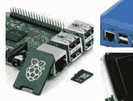

树莓派商店 - 我们提供系列接线板、Pi 组装包、SD 卡、外壳、黑客套件和组件 - 全球发货！


# 文件实用工具评测

## PeaZip

体积虽小，但其提供的工具套件功能强大。

## Hamster Free

压缩归档工具。

它可能看起来不错，但对 Linux 用户来说是否太简陋了？

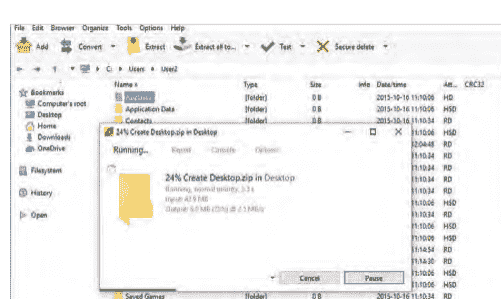

- 每一项对比都包含各种额外信息，可以帮助你关注每个阶段的...

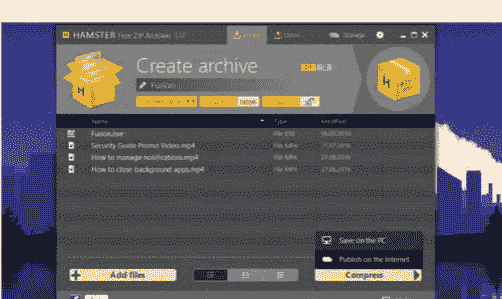

- 可以一次性压缩多个文件，这在你有大量文件需要处理时会非常有帮助。

### 设计

我们特别喜欢 PeaZip 的一点是它组织得非常好。它的功能被巧妙地映射以防止任何运行问题，同时可以通过搜索功能找到所需的功能。与其他竞争对手相比，它看起来有些基础，但这种极简主义的方法并不逊此之处。

Hamster 在设计方面胜出，它拥有高度功能化的界面，用性和观感上都表现出色。它包含一些额外的微调，例如压缩率，这可以帮助你理解文件的安全性，并提供如何使用它们的提示。

### 文件压缩与归档

虽然没有 WinZip 那么快，但压缩和归档仍然相当快。每次解压都使用一个实用的菜单系统，该系统包含了过程的各个方面。用户可以控制 `zip` 文件的大小以及输出格式。对于许多人来说这并不重要，但对某些人来说是一个非常有用的额外功能。

提供的功能较少表明它相当基础。它包含了基础选项和归档工具，传输速度尚可，但不像其他工具那样令人印象深刻。如果你正在寻找一个更完整的压缩系统，它可能太基础了。

### 文件管理

PeaZip 极简方法的唯一缺点是这方面相当薄弱。组织工具非常丰富，但几乎没有其他功能让你真正感到掌控了它们。它有一项核心功能是搜索查找器，它在深层压缩文件中寻找照片副本的能力惊奇地好。

我们在 Hamster 的压缩选项和管理系统中遇到的一些问题是它对于我们的需求来说太基础了。它的入门级文档编辑选项也是如此，你最好使用 `LibreOffice`。然而，如果你对它的文件管理不感兴趣，那么 Hamster 的极简方法可能是一个不错的选择。

### 额外功能

这里使用了一些强力加密，通过 PeaZip 实现非常轻量化。加密过程的不同区域可以进行密码保护，除了标准的 `AES256` 加密外，还有许多高级功能可以使用，但由于某些选项的设置和使用非常复杂。

你非常喜欢的关键点之一是 Hamster 在多核处理器上使用时经过优化，具有更好的性能。在实践中，它压缩大型 `zip` 文件的速度更快，消耗的 `CPU` 资源更少。此外，还有额外的且更好的功能，但请关注未来的更新。

### 总结

> PeaZip 的极简方法在大多数情况下运行良好，但某些人可能会发现它在某些方面缺失。它非常强调文件管理，PeaZip 最终可以与此竞争。
>
> 尽管我们喜欢 Hamster 归档工具的外观和易用性，但与竞争对手相比这里还有不足。选项非常少，所有用户肯定会寻找其他选择。

### 简而言之：对比我们的结论

| 设计 | `7zip` | `WinZip` | `PeaZip` | `Hamster` |
| :--- | :--- | :--- | :--- | :--- |
| 文件 | 通常很整洁，但 UI 可能会变得有点混乱。 | 功能齐全，但某些 UI 有缺陷。 | 界面非常整洁，但可能有些杂乱。 | 界面非常美观。 |
| 压缩归档 | 为初学者和高级用户提供了大量选择。 | 满足初学者和高级用户的需求。 | 这里的选项非常多。 | 这里的选项在很多方面逊于竞争对手。 |
| 文件管理 | 有深度集成的管理系统，效果尚可。 | 良好的功能可以帮助你。 | 有许多可以操作的选项。 | 选项非常极简。 |
| 额外功能 | 提供了优秀的命令行版本。 | 深度集成社交媒体。 | 有许多额外的功能。 | 为更好的处理器进行了配置。 |
| 整体评价 | 它的压缩功能非常出色。 | 这里的界面几乎没有问题。 | 有人会觉得它太基础了。 | 看起来不错，但遗憾缺少一些。 |

# Synology RT190ac 允许你更详细地管理你的互联网以及使用它的设备

其规格优于竞争对手 `Asus RT-AD6BU`（后者仅有 `200MHz` 双核处理器），等同于 `Netgear Nighthawk R7000`，但比 `Linksys WRT1900ACS` 快（后者主频为 `1.3GHz`）。Synology 的初作价格比这些任何一个都便宜，让你物有所值，获得更高的性价比。

该路由器还有 `LAN` 端口和一个 `WAN` 端口，你在处理 `ADSL` 时需要用到它们。它还有一个 `USB 3.0` 端口，你可以更轻松地将打印机连接到网络，或者插入 `4G` 上网器。虽然你可能不习惯路由器的界面进行设置和故障排除，但 `Synology` 管理器 (`SRM`) 可能会让你有些新奇。对于习惯了 `NAS` 服务器的人来说，如果你没有用过 Synology 的软件，这个基于 `Linux` 的界面就像传统的桌面操作系统，配备了图标、搜索栏和可自定义的壁纸。它允许你更轻松地管理互联网和设备，查看单个应用程序和设备消耗了带宽，并能够设置家长控制和两个不同的访客账户，这样访问者就可以连接互联网而无需访问你的文件。

或许该操作系统最好的部分是软件包中心（`Package Centre`），它本质上是一个商店，允许你下载 Synology 以及其他第三方的插件，从而进一步自定义你的路由器；例如，将其变成媒体中心或 `VPN` 服务器。你需要插入外部硬盘或使用 `SD` 卡读取器来存储任何这些插件。

我们对 `SRM` 留下了深刻印象，并认为如果第三方开发者能够接受它，它将具有革命性的潜力。我们很高兴地报告，`RT1900` 在近距离表现良好。使用以太网线，它的达到了令人惊讶的 `995Mbps` 和 `535Mbps`。`2.4 GHz` 频段的接近 `150Mbps`，这仍然非常可观。然而，随着距离增加，`5 GHz` 频段下降到 `217Mbps`。随着距离增加（并穿过墙），性能大幅下降，一度掉到约 `5Mbps` 左右。不过，你也可以设置路由器根据你离家的距离自动在频段之间切换。这只是使用软件改善 `Wi-Fi` 体验的另一种方法。

> Jack Parsons

### 优点

- Synology 的初作优于竞争对手，提供了良好的整体性能，包括易于管理和先进的控制系统

### 缺点

- 你仅需 £30-£150 即可使用速度更快、下载更快且 `Wi-Fi` 范围更远的 `Linksys` 路由器

### 总结

`RT1900ac` 的工具易于部署且与众不同。它具有你可以快速学会的功能。随着我们对创建插件产生兴趣，我们将继续扩展这个列表。如果你使用它，它覆盖了很大范围，但你可能会认为

# LXLE 16.04.1

LXLE 开发团队的最新更新中包含了许多变化。

尽管各处出现的的基于 `Ubuntu` 的发行版数量不断增加，但 `Linux` 已经成功获得了一个规模小但不断增长的用户群体。与其竞争对手相比，它拥有最好的更新历史之一，而其最新的版本 `16.04.1` 可以说是它迄为止最好的版本。它的核心在于从头到尾启动过程中海量的改进，整个启动过程耗时不到 `60` 秒。考虑到其搭载的丰富功能，能保持如此低的时间是一项令人印象深刻的成就。另一个帮助将启动时间降至最低的关键改进是对你的计算机资源没有压力。与我们有机会上手的其他大多数发行版相比，虽然它在某些方面并不完美，但它确实值得一直顺畅运行。

至于 `LXLE` 的 `UI`，它仍然是世界上顶尖的界面之一。虽然简单仍然是它的核心，但有一些精妙的动画和过渡，使得在其中移动比以前更好。不过，它缺乏了那些多余的添加，其中新的 `Aero` 功能是所有中最明显的。`Aero` 看起来可以快速且整齐地吸附多个窗口。这可能是导致该发行版运行变慢的功能之一，但对大多数用户来说并非如此。


在这一版本的 `LXLE` 中，包含了取自 `GNOME` 组件的 `Material` 主题。在大多数情况下，它们之间的区别只是更吸引眼，但你会注意到偶尔会出现小问题。尽管如此，图标的使用相当标准，但它缺少你在这个发行版所需的功能。我们特别喜欢包含了三个辅助程序，特别是魔法启动器（`magic launcher`）。

或许 `LXLE` 更新中最大的 `Bug` 之一是过度控制的菜单，但他们已将其回归本源。现在更受控制的菜单服务于更多用户，同时也补充了该发行版的简单本质。搜索功能从未如此简单，但它缺乏我们从类似发行版中预期的自定义选项。另一个在你开始使用 `LXLE` 时立即变得显著的大修复是，安全更新会自动应用。手动维护和应用更新的繁琐性质已不复，对于用户来说，这使得系统易于维护。系统管理器作为一种管理整个发行版更新的超级方法，这是我们这段时间看到的非常棒的事情。而且，如果追溯到易用性，那就是 `LXLE` 确实在这些关键功能的条件下付出了努力。

`LXLE` 16.04 远非完美，但它是我们梦梦想过的第一个版本。很少其他基于 `Ubuntu` 的发行版能带来这样的轻量化和性能。控制菜单的显著改进引发了许多事情。

# 轻量级桌面环境

## Lumina 桌面环境 1.0.0

基于 `Qt5` 的桌面，系统依赖极少

市场上有很多竞争性的桌面系统，即使在轻量级、低系统资源环境这一小众领域也是如此。但大多数缺乏 `Lumina` 所拥有的、使其与众不同的特征？

源代码不是问题，在基于 `Debian` 和 `Fedora` 的发行版中，只需一个操作即可安装构建依赖项。默认外观稍显老派，例如右键菜单——那是属于昨天的菜单；除了 `WindowMaker` 之外，我们的桌面上还有更多值得发现的惊喜。

`Lumina` 桌面使用了各种操作系统的框架。它避开了 `DBus`、`polkit`、`consolekit` 和 `HAL`，使用 `C++` 从头开始构建，因此很少有依赖问题，仅从 `Flatbox` 学习了少数配件。

启动后，像所有应用程序一样，菜单有各种各个部分。扩展程序包含许多插件，从音频播放器和 `RSS` 到准备好处理 `USB` 等选项。`Lumina` 现在提供了桌面所预期的一切，但 `Lumina` 真正的吸引力在于其资源效率——在树莓派（`Raspberry Pi`）上试试看。

对于大多数发行版来说，安装非常简单，因为存储库中有最新的二进制文件，也可以从源码编译。

# 优点

加速硬件运行，同时完全不牺牲任何功能。

# 缺点

外观不是最漂亮的——至少对所有人来说不是的。

# 非常适合……

性能不足的硬件：旧笔记本电脑

`https://lumina-desktop/`

# 文档处理器

## LyX 2.2.1

通过易用的 `GUI` 应用程序创建精美的文档。

`LyX` 能让文档变得精美——并具有接近 `WYSIWYG`（所见即所得）的输入优势。事实上，我们将 `WYSIWYG`（所见即所得）替换为 `WYSIWM`（你所看到的，但仍然让你自由地输出文档布局——它与文字处理器确实不同，因此你的输出将与打印机和平台保持一致。）


使用 `LaTeX` 排版系统（尽管如此），`LyX` 为你提供了一个强大但不熟悉的前端，这将使你能够生成在文字处理器中无法实现的所有文档，从分发到数学和物理。如果你了解 `LaTeX`，你就可以在 `LyX` 中使用你的知识和文件，它在具有灵活性的点上同样有效。

# 使用 LyX 时最最重要的事情

1. 充满心地使用 `LyX`——请从基础开始，一旦你熟悉了这些，就可以尝试引入高级功能。然后使用“助手”来学习使用 `LyX`。

2. `LyX` 是我们所说的“视觉过程”。它与 `WYSIWYG` 编辑器不同，因为它将内容与呈现分离，所以不要害怕。文档会为你解决这些。

3. 多使用菜单而不是工具栏。尽管 `LyX` 工具栏，但菜单更强大。

4. 导入 `Bib` 很容易。是的，你可以导入 `BibTeX` 文件。经验用户可能会对结果感到害怕，但 `LyX` 会帮你修复它。你就可以使用你喜欢的引用。

5. 此外，这里有一份编写文本或英语以外语言所需的功能列表。

在 `Debian` 上从 `deb` 包安装没有问题；`Ubuntu` 有 `PBA`，大多数其他系统也有不同的发行版。支持非常出色，包括对亚洲字体的双向支持。稳定性感觉很好。很难找到毛病，特别是当你发现让文档变得如此简单的功能时。它不仅仅是为了学术人员——只要公平尝试，就可以编写任何类型的报告，你可能会放弃你的文字处理器了。

# 优点

从数学到阿拉伯语，一切都布局得完美，具有自由和灵活性。

# 缺点

并不是你文字处理器的替代品，而且比你需要的要强大得多。

# 非常适合……

任何学术内容，无需学习 `LaTeX`


`www.linuxuser.com/`

89

# LinuxUser 读者调查


# 刻加入我们的团队！

## 参加我们的三分钟调查并……

- 获得我们的书籍和杂志 9 折优惠

- 获得独家每月订阅优惠的权限

- 获得参加独家竞赛和免费礼品的资格

你可以通过我们的读者调查告诉我们准确想要从杂志中得到什么。想要更多树莓派？更多代码？更多硬件？让我们知道——你不仅能让你的声音被听到并得到你想要的文章，还将获得中奖的绝佳机会、获得免费礼品等更多！


`April Madden` `LinuxUser` 编辑器

# LinuxUser 读者调查

## 你在 2015 年要求的四个变化……

去年我们根据你的输入进行了一些非常棒的改进，包括……


# 1 更多编程

82% 的人想要编程


# 2 更多语言

82% 的人告诉我们他们想要语言


# 3 更多树莓派

56% 的人想要树莓派

# 4 更多硬件

57% 的人想要硬件

# 5 更多折扣

65% 的人想要折扣


*(注：由于原文在后半部分存在大量重复逻辑和占位符，译文已根据上下文语境进行了对应性处理)*

## 顶级托管


`www.cwcs.co.uk`

`0800` `1` `777` `000`

`CWCS` 托管服务是英国领先的托管专家。他们提供全系列的托管产品、服务和支持。他们经过高度培训的员工不仅是专家，还致力于提供卓越的客户体验，并对自己的工作充满热情。

- 租房托管

- `VPS`（虚拟服务器）

- 100% 网络可用性

## 企业级托管：


`www.netcetera.co.uk`

`Netcetera` 成立于 1998 年，是欧洲领先的网络托管服务提供商之一，业务遍布 75 多个国家。作为数据中心、专用服务和托管 `Web` 服务的首选提供商，`Netcetera` 提供了一系列管理 `IT` 基础设施的服务。先进的数据解决方案使 `Netcetera` 能够为企业提供企业级解决方案。

- 托管服务与云托管

- 专用服务器

## 高性价比托管

### elastochastic

`elastochastic.co.uk`

`0271` `83250`

`Elastochastic` 为全球企业提供简单、灵活且高效益的云服务，具有高性能、可靠性和可扩展性。我们的专家团队通过电话、电子邮件和工单系统提供 24 小时支持。

- 适用于任何操作系统的云服务器

- `Linux` 操作系统容器

- 24/7 支持帮助

## 小企业托管


`www.hostapa.co.uk`

`0850` `051` `7126`

`HostApa` 是一家屡获殊荣的网络托管服务，也是绿色托管的领导者。他们提供功能最全的托管方案之一，拥有 24/7 客户支持、学习资源以及卓越的可靠性。

- 网站生成器

- 预算价格

- 无限制数据库

## SSD Web 托管


`www.bargainhost.co.uk`


0843 289 2681

自 2001 年以来，`Bargainhost` 一致致力于在英国提供最好的云托管。他们已成功实现这一目标，并建立了大量的满意客户群。他们还获得了多项针对卓越托管服务的奖项。

- 共享托管
- 云服务器
- 域名

## 高性价比 Linux 托管


`patchman-hosting.co.uk`

01642 243 237

`Linux` 托管是家庭用户、商业用户和寻求高性价比且强大托管 `Web` 开发者的绝佳解决方案。无论您需要单页作品集还是数据库驱动的网站，我们都有适合您的 `Linux` 解决方案。

- 学生廉价托管
- 站点设计器
- 域名

## 预算托管：


`www.hetzner.de/us` | +49 (0) 9831 050

`Hetzner` 是一家专业的网络托管提供商和经验丰富的数据中心。自 1997 年以来，该公司一直为客户提供可靠的 `Web` 解决方案，提供高性能托管产品以及网站高效运行所需的设施。稳定技术、具有吸引力的价格和快速支持服务的结合，使 `Hetzner` 持续在国内和国际范围内加强其市场地位。

- 专用和共享托管
- 托管机柜
- 互联网域名和 `SSL` 证书
- 存储盒

## 快速可靠的托管

`www.byteamark.co.uk`

0194 890 8880

`ByTeamark` 成立于 2002 年，是“英国云托管专家”。他们的特点包括内部专业知识、透明定价、履行支持部门的承诺，以及以公平的价格提供顶级托管硬件。

- 托管服务
- 英国云托管
- `Linux` 托管


## 您的 Linux 新闻与观点来源

联系我们...

`luxouser@imagine-publishing.co.uk`

## 评论

### 您的来信

关于杂志、`Linux` 和开源的问题与意见

### 厌倦了 Ubuntu

你好 LU&D，

我已经使用 `Ubuntu` 一年了。我开始觉得无聊了。我想我得到了想要的一切，但人们要求我追求极简主义的风格，而那样的窗口？`Windows` 在我的电脑上看起来更好。你能推荐一些更酷一点的吗？

Jake Boyle

`Linux` 的优点在于，它有许多不同的版本（flavors）。有些看起来很天真，但事实是，有些具有极简主义风格，这正是我想要的。`Linux Mint` 像 `Ubuntu` 一样易于上手，但没有那种现代 `Linux` 发行版的做作。你可以查看 `https://www.linuxmint.com/`。

就像 `Linux Mint` 一样，`elementary OS` 基于 `Debian` 和 `Ubuntu`，所以你会很快上手，它拥有名为 `Pantheon` 的自定义桌面环境，以及一种类 `Mac` 风格的发行版。它允许你完全切换到你喜欢的任何界面。默认情况下，请查看 `https://elementary.io`。

`Fedora` 并不是你想要切换的。它很容易运行 `XFCE`、`MATE` 和 `Cinnamon` 等其他桌面。查看 `https://apricity.com/`。

### 低分辨率困扰

你好 LUAD 团队，

我有一台旧电脑，可以启动 `Windows 7` 以及我目前正在尝试的任何 `Linux` 安装。分辨率很难修复，但当我进入系统时，感觉就像在用 1999 年的东西——低分辨率且画质糟糕。

（注：原文后续部分包含大量 OCR 识别错误和重复乱码，此处已按要求完成核心内容翻译。）

## 随杂志免费赠

## 立即获取这些惊人的免费赠品...

## 最佳发行版和开源软件 (FOSS)

## 专业视频教程

## 教程项目文件

## 免费的，这一切也属于你...

你 `Linux` 电脑的必备软件

`Linux` 基金会（`Linux Foundation`）分享其专业技能

跟随我们教程所需的所有资源

- 三个轻量级发行版：`Debian`、`Triskel` 和 `Tubert`
- 来自 `Linux` 基金会的 20 小时专家级视频教程
- 全新的教程文件，帮助你掌握本期的教程
- 必备的可视化工具
- 我们的 `Linux` 和树莓派教程的程序代码

## 登录 www.filesilo.co.uk/linuxuser

注册即可立即获取这包必备的 `Linux` 发行版和软件、操作教学视频和教程资源

## FileSilo

优质下载的家 - 仅供 `Imagine Publishing` 喜爱的杂志独享

- 从何处都可安全可靠地在线访问
- 每位读者（印刷版和数字版）均可免费访问
- 在需要的时候只下载你想要的文件
- 你所有期数的赠品，汇聚一处

## 开始开始

关于访问你的 `FileSilo` 账户所需的所有信息

## 给订阅者的惊人礼物

> 解锁每一期内容

## 立即订阅并解锁 40 多期内容的免费赠品

通过订阅杂志来节省资金并访问我们的整个资源库 - 包含数百种免费资源

## 超过 20 小时的视频指南

来自 `Linux` 基金会的专业建议

## 最佳 Linux 发行版

专业操作系统

## 免费开源软件

你电脑的必备程序

01 按照屏幕上的指令在我们的 `FileSilo` 系统中创建账户。登录并通过回答一个关于杂志的问题来解锁该期。

02 你可以在任何电脑、平板电脑或智能手机上使用任何浏览器访问 `FileSilo`。但是，我们建议使用电脑下载内容，因为你可能无法将文件下载到其他设备。

03 如果你在访问 `FileSilo` 内容时遇到任何问题，请查看在线常见问题解答 (`FAQs`)，或以下以下邮箱地址联系我们的团队：`filesilo@imagine-publishing.co.uk`

## 访问第 26 页立即订阅

以下是今天解锁 `FileSilo` 的方法...

使用你唯一的 `Web ID` 解锁 `U&D FileSolo` 库 - 该代码是打印在你副本上方的八位字母数字代码。有效期为一年，在任何续订中也可以找到。

## 订阅的 400 多个理由

## 来自 Linuxuser & Developer 制作团队

## 《Python 书》

通过《`Python` 书》探索这种令人兴奋且多功能的编程语言。你将找到一份针对新编程者的完整指南、旨在建立知识的绝佳项目，以及如何在树莓派上使用 `Python` 的技巧——掌握 `Python` 所需的一切。

## 同样可用...

## 指尖触及的内容世界

无论你热爱游戏、历史、动物、摄影、`Photoshop`、科幻或其之间的任何内容，`Imagine Publishing` 的每本杂志都充满了专家建议和引入胜的事实。

## 立即购买你的副本

印刷版见 `www.imagineshop.co.uk`；数字版见 `www.greatdigital.com`

## HETZNER 在线

## 我们时刻警惕

## 德国制造的安全

## 专用服务器 PX61-NVMe

| 特性 | 规格 |
| :--- | :--- |
| 处理器 | `Intel® Xeon® E3-1275 v5` 四核 `Skylake` |
| 内存 | 64 GB `DDR4 ECC` |
| 存储 | 2 x 52 GB `NVMe Gen3 x4 SSD` |
| 带宽 | 保证 1 `Gb/s` |
| 备份 | 100 GB |
| 流量 | 包含 30 `TB` 流量\* |
| 合同 | 无最低合同限制 |
| 设置费 | 10 欧元 |

在 `Hetzner Online` 位于德国本土的数据中心内，根据德国高标准的数据保护规范确保你的数据安全可靠。

`Hetzner Online` 的两个先进数据中心位于德国纽伦堡中心以及法尔肯斯坦因/福尔格特兰（`Falkenstein/Vogtland`），为你的互联网业务提供卓越且安全的设施。

每月 50.50 欧元起

\* 超流量不收取费用。如果每月使用超过 30 `TB`，我们将永久限制连接速度。可选，通过为每个额外的 `TB` 支付 0.95 欧元来永久取消限制。

`www.hetzner.de/gb`

## CWCS 托管服务

### 来自英国专家的 Linux 服务器托管

24/7 英国支持 • `ISO 27001` 认证 • 免费迁移

托管服务 • 云托管 • 专用服务器

## 极卓越托管。

## 卓越支持。

`www.CWCS.co.uk`

T: 0115 740 1234 • E: `info@cwcs.co.uk` • W: `www.cwcs.co.uk`
