# Linux User & Developer 171 - 24 小时打造更优服务器 171

现在就构建并部署最佳开源服务器架构

随时随地控制你的 `Ubuntu` 系统

部署 `LAMP` 栈

升级你的硬件

这台基于 `CHIP` 板板的 `Linux` 手持设备是否具备令玩家印象深刻的能力？

防止你的服务器遭受暴力破解、护墙攻击和中间人攻击

使用 `Skywriter` 手势感应扩展模块让机器人移动起来

“`Mycroft` 是针对 `Amazon Echo` 等语音激活助手的开源解决方案”——`Ryan Sipes`

- 编写你自己的 `ASP.NET`
- `.NET Web` 应用：在 `Linux` 下利用此跨平台开发框架
- >> 提升你的 `Bash` 技能
- >> 在 `Linux` 中学习高级编程技术
- >> `Salsa 14.2 Xfce` 版


3G/4G 热点


`Synology Router RT1900ac` 专家庭和办公室设计，支持 `2.4 GHz` 和 `5 GHz` 频谱，组合数据传输速度高达 `1900 Mbps`。使用应用层 `QoS` 和家长控制等高级网络工具微调流量。通过完整的 `Synology` 软件软件包以及 `Synology Router Manager (SRM)` 革命性的用户体验。

安装 `DS` 路由器，使用你的 `Android` 或 `iOS` 设备查找并完成设置。

购买渠道：`amazon.co.uk` `buyer.co.uk` `ebuyer.com` `SCAN computers` `Synology` 2018 媒体殊荣

## 编辑寄语

欢迎阅读 `Linux User & Developer` 最新一期，这是英国最喜爱的 `Linux` 和开源杂志。服务器曾是公司和其他机构的专利。现在，你更有可能在某人的家里看到它——也许它正运行着他们的业务，处理核心文件和文件夹、网络访问和账户；或者他们正用它在家庭网络中传输文件。如果你想加入行动，我们将通过解释如何升级现有的家庭或中小企业，或从零开始构建来提供帮助。

当然，一旦你运行了服务器，对其进行加密是一个好主意。但你需要确保它是安全的。查看第 38 页关于使用 `SSH` 进行远程管理的教程，以及第 14 页关于如何防止 `SSH` 攻击并保持数据安全。我们提供了 `Bash` 脚本、`NET` 和 `Go` 编程指南，帮助你提升技能。在第 52 页，我们深入探讨了 `Linux Mint`，分析了各个版本及其对比，并提供了如何根据你的喜好进行配置并确保其固若金汤的建议。祝本期愉快！

`April Madden`，编辑

### 杂志团队

编辑 `April Madden`

编辑助理 `Rebecca Heat`

设计师 `Rebecca Heat`

制作编辑 `Stephen Williams`

编辑 `Chris Wood`

出版总监 `Aaron Asquill`

**贡献**

`Dan-Andrew Roman`, `Cameron Caway`, `Steve de Beer`, `Ryan King Hill`, `Oscar`, `Paul O'Brien`, `Swen Swaka`, `Richard Sneedy`, `Jason Levin`, `Michael Michelson`

**广告**

可索取完整媒体包

客户经理

`Hans Davis`

栏目主管

`Charlotte Wood`

发行总监 `Darren Pearce`

制作总监 `James Hawkes`

财务总监 `Martin Price`

营销总监 `David Brown`

定价与发行 `William Gibson`

`Imagine Publishing Ltd New South Wales, Australia`

联系团队：

`linuxuser@imagine-publishing.co.uk`

访问我们的网站获取更多新闻、观点和评论：

`www.linuxuser.co.uk`


使用正确的硬件和软件构建服务器


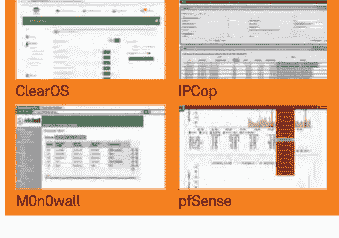

- 42 页 `Go` 并发编程 - 2：学习更多高级 `Go` 编程技术
- 88 页 `CHIP` 和 `PocketCHIP`：`CHIP` 是一款令人深刻的板卡，但它的手持设备如何？
- 90 页 `Salsa 14.2 Xfce` 版：最新版本的 `Salsa` 是否适用？


在线加入更多 `Linux` 新闻、观点和评论


英国数据中心，

英国支持


灵活


按需付费定价

企业级功能

- 负载均衡
- `VPN`
- 外部防火墙

秒级设置

- 易于使用

控制面板

云服务器起：

£15.00

每月（不含增值税，按20%征收）

拨打 `0808 1686 777`

或访问 `fasthosts.co.uk/cloud-servers`

服务器 • 托管 • 域名 • 交换邮箱


欢迎阅读 `Linux User` 并从 `Mint` 中获得最大收益。对于基于 `Ubuntu` 的 `Sarah` 版本，可以选择 `Cinnamon` 或 `MATE` 桌面环境；或者为 `Debian` 版本加载 `Cinnamon` 环境，学习如何像专业人士一样配置它们，并探索如何使用全球最喜爱的发行版完成更多任务。

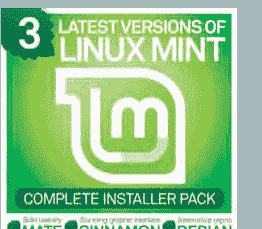

要访问软件和教程文件，只需将光片插入电脑并双击它。

要镜像启动此光盘提供的发行版，请将光片插入驱动器并重启电脑。


- 您需要确保电脑已设置为从以下设备启动：进入电脑的 `BIOS` 屏幕更改启动选项
- 部分电脑需要您按某个键以启用从光盘启动；请检查制造商手册以确认是否需要
- 从光盘实时启动：除非您选择这样做，否则将无法实现

最新版本 `Mint` 桌面的 `MATE` 版本通过 `MATE` 稳定、传统的界面增强了最新版本的强大功能，提高了您的工作效率并提供了全方可用性。此发行版支持实时启动。

虽然实时启动具有一些视觉特色，但最新版本 `Mint` 的 `Cinnamon` 版本非常时尚，非常适合追求极致 `Linux Mint` 安装效果的用户。此发行版支持实时启动。


此光盘已针对现代内核进行了优化，包括 `HTML` 和 `CSS` 标准渲染更新。为了获得最佳体验，我们建议您使用：

- `Internet Explorer` 8 或更高版本
- `Firefox` 4 或更高版本
- `Safari` 5 或更高版本

请发送邮件至 `linuxuser@imagine-publishing.co.uk`。如果您在使用提供的程序或资源时遇到问题，请告知我们并附上任何相关的软件副本。


凭借来自 `Debian` 的替代仓库以及经典 `Cinnamon` 的外观体验，这个版本的 `Linux Mint` 非常适合那些在想要更多控制权的同时保留 `Mint` 所有易用性的专业人士。此发行版支持实时启动。

在安装或使用光盘前请检查此内容

在本免责声明中，“本光盘”是指光盘上提供的所有软件、硬件以及物理光盘本身。

源自自由，`Linux` 源自优雅


# 软件许可条款

在使用“本光盘”之前，您必须同意以下条款和条件

- 共享软件 (Shareware)：如果您继续使用该程序，应向作者注册
- 免费软件 (Freeware)：您可以免费使用
- 测试版/演示版 (Trials/Demos)：这些通常有时间限制或仅部分功能
- 开源/GPL：免费使用，详情请访问 `https://opensource.org/licenses`

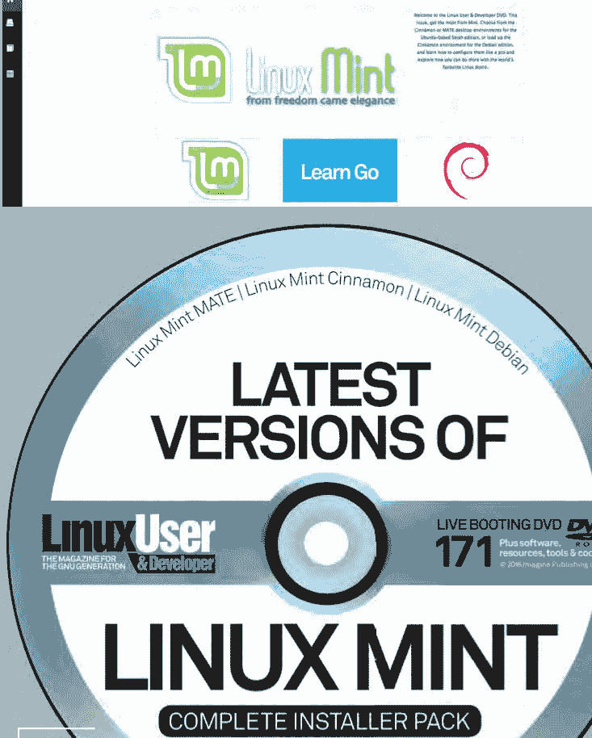

将光盘插入电脑并重启。您需要确保从光盘启动。

将光盘插入电脑并双击图标或启动磁盘，可以在不更改电脑的情况下运行新的操作系统。

或者，您可以插入并运行光盘以探索界面和内容。

# 树莓派

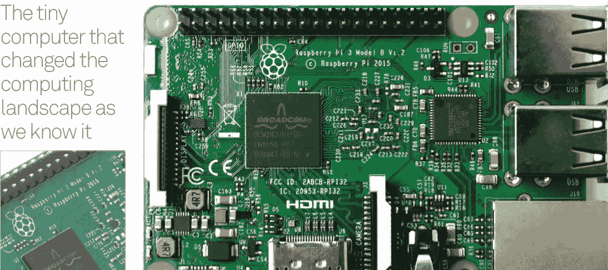

全球已售出超过 1000 万台树莓派

在计算行业，最好的事情之一是事物正以惊人的速度发展。在过去的几年里，整个计算格局发生了巨大的变化，而未来仍是不确定的。这种发展的未来是树莓派，一种价格亲民的电脑。当其他产品陷入挣扎时，它提供了持续的改进和具有吸引力的价格。

在过去的几周内，树莓派团队发现树莓派销量已超过了惊人的 1000 万台。虽然大部分初始销量是由树莓派爱好者完成的，但它实际上被应用于各地的机器人教学、医院以及物联网的发展。

在官方公告中，树莓派创始人 `Eben Upton` 对这种强大的成就感非常感动。

树莓派基金宣布了一个全新的树莓派启动套件。正如名称所示，它包含了构建您的第一台电脑所需的基础，比您想象的要简单，带有键盘和鼠标。孩子们能够构建并维护 `树莓派 3 Model B+`，这是一个四核处理器服务器，带有 `8GB` `SD` 卡，非常便宜。“开源”软件，所有用户还将获得树莓派基金特别年度。树莓派启动套件现售价 39 英镑。访问 `raspberry.org` 查看库存和货币。

> 树莓派基金发现树莓派销量已超过惊人的 1000 万台


# 杜杜诺 (ARDINO)

`OpenShot` 如此流行的原因在于它的简单：在几分钟内，您就可以在时间轴上剪辑视频、添加特效并进行增强。当然，它还包含了许多选项，但它真正擅长基础操作。

`Pitvi` 是少数用 `Python` 编写的视频编辑器之一，但这并没有影响它的基础功能。对于寻求在一个地方同时管理视频文件的人来说，这是一个极佳的选择。

印度初创公司 `Explore Embedded` 可能只想为它的合一 `M3` 板众筹 700 美元，但带来了一段时间以来最令人深刻的板之一。支持 `USB` 的 `Explore M3` 核心支持 `Arduino IDE`，对两种框架编程环境都有广泛支持，因为它是开源的。它可以与 `KiCode` 和 `Ellipse` 配合，拥有 `64KB` `RAM`，并通过虚拟 `COM` 和 `JTAG` 设备的使用实现进一步扩展。

除了主 `M3` 单元外，用户还可以获得可选的启动套件。该套件可与各种传感器配合，使用 `Arduino` 和裸机编程创建完整项目。套件包含了 `M3` 板。

`Explore M3` 基于 `NXP` 的 `LPC768` 微控制器，由于它内外完全开源，它有许多连接端口，这有助于保持低成本。在性能方面，`Explore M3` 明显比未命名的 `M2` 更匹配。

作为功能最完整的套件之一，`KDenlive` 还提供了令人印象深刻的键盘快捷键。这些快捷键可以节省时间并自动执行您需要的不同任务。

`Explore M3` 非常物值，尤其是考虑到它 19 美元的优优价格。可选的 `Arduino` 启动套件又增加了极大的价值，售价为 40 美元。应可以通过 `exploreembedded.com` 网站查询发货信息和供货情况。

`Blender` 是专业领域少数的视频编辑套件之一，事实如此，当您需要编辑套件提供额外功能时，它是首选。由于它是免费的，它可以与许多顶级产品竞争。

开发者会喜欢板载 `I/O` 的开头，它包含了四个 `UART`、两个 `I2C` 和 38 个 `GPIO`。`Explore Embedded` 也还

# Linux Mint 比任何时候都更大、更好

`Linux Mint` 是 2016 年真正扩大用户群的发行版之一。它的最新公告是又向前的一步。在经历了成功的测试阶段且仅记录到极少数错误后，`Linux Mint 18` `KDE` 的稳定版已正式发布。

`KDE` 版本与 `Cinnamon` 和 `MATE` 版本遵循相同的模式，但配备了极其优秀的全新更新管理器（`Update Manager`）以及一系列新设计的 `X-Apps`。当然，它仍然是默认 `KDE` 采用者的选择。


在硬件要求方面，纯安装 `Linux Mint 18` 需要 10GB 的磁盘空间。据记录，安装已简化到 2GB `RAM` 以下。出乎意料的是，最后一项要求仅需 100MB 的磁盘空间，这在大多数现代计算机上都是标准配置。`Linux Mint 18` 最大的新增是引入了 `Cinnamon` 桌面环境。它标志着相比之前更新的重大改进，并展示了 `Linux Mint` 真的有多么出色。

`Linux Mint 18` 将持续接收至 2021 年的关键更新。`Mint` 的所有未来版本可能使用相同的基础，以实现简单快速的更新。对于正在运行 `Beta` 版的用户，请前往更新管理器部分并点击“刷新”获取新更新并开始使用这一精彩的新发行版。

> 它标志着相比之前更新的改进，并展示了 `Linux Mint` 真的有多么出色

# 无人机

无人机已成为 2015 年及现在最大的希望之一。无人机市场正在不断扩大，但直到目前，无人机与 `Linux` 操作系统之间几乎没有交集。`Canonical` 的新项目涉及许多制造商。`Parrot` 则致力于改变这一切。

联手创建开发套件的两个团队将协助自主避障无人机及机器人的创建。`Parrot` 由 `Ubuntu` 和 `Ubuntu` 系统驱动，这允许 `Linux` 开发人员进行设计原型、3D 映射，并使用车载传感器进行数据采集。

> 这种微型设备安装在无人机顶部，几乎立即传输数据

最棒的一点是，得益 `HDMI` 端口，用户实际上可以将显示器连接到开发套件，并在他们的无人机上运行一台完整的 `Ubuntu 14.04` 计算机。更多信息，请访问 `www.parrot.com` 查看特定的价格和供应情况。

# Azure Service Fabric 将很快为 Linux 用户提供

如果你是喜欢运行 `Java` 和基于 `Linux` 的微服务应用的人，你会很高兴地知道 `Azure Service Fabric` 旨在简化管理完全基于微服务架构的应用的过程。这些微服务应用的主要目标最终是与更大的应用相结合。

早期对 `Service fabric` 的用户报告非常积极，许多人强调该服务的运行速度是其成功的关键因素之一。虽然微软已经有一些服务提供给 `Linux` 用户，但现在少数的专用服务之一已可用。

`Service Fabric` 此前在微软 `Build` 大会上发布。感兴趣的方可以访问 `www.parrot.com` 获取更多信息（注：原文此处链接可能有误，此处保留原样）。

> 它标志着相比之前更新的改进，并展示了 `Linux Mint` 真的有多么出色

> 它标志着相比之前更新的改进，并展示了 `Linux Mint` 真的有多么出色

## 发行版排名

| 排名 | 发行版 |
| :--- | :--- |
| 1 | `Linux Mint` |
| 2 | `Debian` |
| 3 | `openSUSE` |
| 4 | `Manjaro` |
| 5 | `Fedora` |
| 6 | `elementary` |
| 7 | `Zorin` |
| 8 | `CentOS` |
| 9 | `Arch` |
| 10 | `Parrot` |

- 稳定版 (Stable)：8月
- 实验性版 (Experimental)：9月

# SUSE 与惠普企业合并价值 80 亿美元

## 新合并可能引发与 Red Hat 的竞争

`SUSE` 的所有者宣布与惠普企业合并，价值 80 亿美元。这笔交易将在年底前完成，将使 `SUSE` 处于更有利的地位。

合并的未来对某些人来说可能是意外，因为它涉及到许多。`HPE` 拥有强大的软件平台，我们预计会有很大增长。我们了解到其中一些是其他情况，但我们正努力进行集成并交付尽可能的内容。

`Mycroft` 旨在为每个家庭带来人工智能，而无需像竞争对手那样复杂的设置。`Ryan Sipes` 为我们介绍了为什么 `Mycroft` 可能是未来

### Ryan Sipes

`Ryan Sipes` 是一位技术专家、社区经理和开源爱好者。他致力于围绕开源解决方案构建业务，以提供强大的技术和体验。

`Mycroft` 是对 `Amazon Echo`、`Siri`、`Cortana` 和 `Google Assistant` 等语音激活个人助手的开源回答。我们认为这种技术不应该严格由这几个人拥有，因此 `Mycroft` 的想法是经过深思熟虑的。


Nest、飞利浦 Hue 灯等。当然，在这些许多产品上还有大量工作要做，但为未来开发已经奠定了大量基础。这些是引入的第一步，旨在确保 Mycroft 与尽可能可能的家居设备具有操作性。我们了解到其中一些是其他情况，但我们正努力进行集成并交付尽可能的内容。

目前我们正在与社区合作，开发在 Kickstarter 中承诺的功能：

用户是否可以为 Mycroft 实现自己的功能？社区在它的开发中起着重要作用吗？

基本上我们正在继续完善制作过程

更加简单，而且我们正致力于更新文档，以反映最佳的启动和创建技能的方法。到为止，我们已经看到许多社区成员创建了出色的技能，例如 `Philips Hue Kodi` 技能、`Kodi` 技能（用于控制你的 `Kodi` 媒体中心），以及其他一些将 `Mycroft` 集成到 `KDE` 和 `GNOME` 等桌面扩展/插件中的。

对于这个项目，`树莓派 3` 是核心。我们创建了几块与 `Pi` 配合并组成设备的定制板（一个声学板和一个带灯的前面板）。硬件的制造是一个艰辛的过程，但它也是帮助我们捕捉到 Kickstarter 资助者热情的原因。

> 我们希望通过开发一个开源替代方案，能够赋能全球开发者和用户，让任何设备语音化

并且促使我们达到了今天的局面。我们正准备在知识共享（`Creative Commons`）下开放所有的硬件原理图，允许他人像改进软件一样改进硬件，我希望社区会欣赏并想要尝试它。我们有很多方向可以尝试，通过开放原理图，我们可以让用户实验所需的各种功能和特性。

`Snap`、`Snapcraft` 和 `Snaps` 都是 `Ubuntu` 团队一项倡议的一部分，我认为它将改变我们为 `Linux` 创建软件的方式。目前项目才刚刚开始，我们遇到了一些成长的痛苦。`Ubuntu Core` 的优势在于我们可以利用 `Snap`，让我们能够以一种减少……的方式交付软件。


设备失效或被恶意行为破坏的风险。事务性更新和良好的安全模型代表了我将使这项新的 `IoT` 工作变为现实的方式，我很高兴 `Mycroft` 是其中的早期示例。

`Adapt Intent Parser` 用于将查询分解为基础部分并确定需求。当有人说“关掉客厅的灯”时，`Adapt` 会将句子分解为它需要的内容。“关掉”代表一个意图，而“灯”和“客厅”代表一个对象和一个位置。`Adapt` 的开发是为了处理复杂的句子，而无需考虑查询的每种排列。


`Mycroft` 有一种像硅谷女孩的性格：“Mycroft，你能，那个，关掉客厅的灯吗？”遗憾的是，`Mycroft` 并不理解并确定你在请求什么。

最令人印象深刻的案例来自一位社区成员，他将其与游戏《守卫团 2》结合使用以启动宏（通过语音触发复杂的键盘快捷键）。所以，当他说“嘿 Mycroft，设置一个樱桃”时，`Mycroft` 会触发一系列键盘按键，他的角色就会——

`Adapt` 伟大的很大原因在于它能够理解并将自然语言实现到它的动作中。为了成功实现这一点，`Mycroft` 需要一个巨大的词汇表将语言映射为机器可读的数据结构。这听起来很复杂，但实际上并非如此，因为 `Adapt` 接收自然语言并将其解释为 `Mycroft` 可以轻松读取的数据结构。

除了处理自然语言外，`Adapt` 还用于其他语言应用程序，特别是在词汇量有限的情况下。对于终端用户来说，这意味着它可以用单词进行自定义，这使得它更容易连接到你家中的任何 `IoT` 设备。`Adapt` 软件最令人兴奋的是它是完全开源的，因此开发者可以在家里舒适地参与测试各种应用程序和软件。


开始工作并执行他的命令。我会尝试说服他发布一个视频，但这种我早期没有想到的用法完全让我大吃一惊。`Mycroft` 的生命周期仍处于早期阶段，所以我们正在逐渐揭示它真正能做什么。社区已经取得了惊人的进展，我们迫不及待想看到未来几年他们能做些什么。

希望与技术合作。`Mycroft` 允许的与计算机通过语音命令交互类型正在成为、并将继续成为常态。我认为这种开发出来至关重要，以便让世界各地的人都能享受。几年后，`Mycroft` 可以渗透到许多不同的产品应用中，让人们与技术更多互动，从而让计算机的优势对每个人都更容易触及。对于那些对学习更多关于 `Mycroft` 以及它能为家里做什么感兴趣的人，请前往 `Mycroft.ai`。

未来，你对 `Mycroft` 的目标是什么？你认为几年后它会在什么位置？我对 `Mycroft` 的目标仅仅是让它继续作为一个开源，让其他……

> 我认为这种开发出来至关重要，以便让世界各地的人都能享受

`Jon Masters` 总结了 `Linux` 社区的最新动态，4.8 内核的发布意味着下一个版本 4.9 的合并窗口已经开放。结果，许多 `Linux` 内核维护者一直在努力地提交他们的更改，这些更改贡献了 4.9。即将发布的来源之一是来自 `Mauro` 的签名列表。详情请查看 `michael.frektop.org`。

**`Jon Masters`**

是一位 `Linux` 内核黑客，在 `Linux` 领域工作了 19 年。他是《Linux of his Own》一书的作者，位于利兹大学。`Linus` 目前在一家大型嵌入 `Linux` 公司工作，并参与了能效 `ARM` 服务器标准的创建

我们将在下期提供 4.9 版本新功能的完整总结，并讨论关于重构 `Linux` 子系统以利用现代硬件的持续工作。

`Ara` 还必须支持硬件（可以随时进入或离开无需重启系统的设备或摄像头）以及任何安装或删除的必要驱动程序。当我们使用 `Uno` 时，处理不同设备变化所需的组件（应用层）——以及在单点链路之间路由数据的能力——仍需要。一些早期的 `Ara` 原型 `Greybox` 提供了设备发现和运行时管理的通用抽象。它们还提供了各种桥接连接以连接其他协议（如 `I2C`、`SDIO` 或 `USB`），允许复杂的并行。

`Linus` 发布此 `RC`（针对内核 4.8）的原因之一是它“看起来并不像发明（树计数开发在未来的内核周期中进行中）那么大，所以我……”

到为止，问题出现在 `Greg` 提交 `Linux` 4.9 请求系统时


驱动程序子系统，包括桥接协议的所有必要启用功能，以及各种类（摄像头、音频设备等）。总之，这代表了许多参与 `Ara` 的不同人员在大量工作内容中所付出的两年半的精力。其意图是将 `drivers/usb` 作为一个单元合并，这可能会让其他开发者感到非常不悦。主要的反对意见倾向于让新子系统进入暂存树（`staging tree`）（包括关于代码是否合并到主内核以进行实验性和新驱动测试的反复争论），而 `Greg` 本人也维护着这一观点，并希望按照内核更改的典型流程，将合并拆分为易于处理的组件。

讨论深入探讨了技术层面，包括对代码是否合并的反复争论，并对某些固定硬件依赖的存在表示担忧。尽管这种讨论尚未结束，但共识似乎是避免为了暂存树的特性而做出妥协。

它是否能进入最初的预期用途仍有待观察，但多个组件的推动者正在结束，如果未来在移动平台中看到 `Ara` 的各个方面，将令人惊讶。

在这种情况下，系统的 `NMI`（非掩断中断看门门可能会判断这是导致软锁（`soft lockup`）的原因，并杀死调用它的任务，而不是某种方式解决 `IPI` 从未送达的问题。`Alexander` 提议

`Linux 基金会`技术顾问委员会（`TAB`）宣布，他们正寻求为明年的 `Linux Plumbers Forum` 成立一个组织委员会——这是 `Linux` 内核和底层用户日历中的一个盛事，因为它是核心平台开发者之间对许多功能用途进行讨论和辩论的地方。感兴趣的人应该查看 `Linux 基金会`网站获取更多信息。

最后在本月，`Michael Oppenheimer`（以外包 `Elektr` 而闻名）注意到，提供发布版本之间各种更改指标的“内核补丁统计数据”已被废弃。开源中使用的模型有一个用处是可以在网站上查看，这意味着任何开发者都可以轻松访问内核统计数据。但缺点是，由于缺乏企业或非营利机构的支持，某些工作可能会在没有任何警告的情况下消失。这最近也简要提到了 `Gmane` 邮件列表存档和 `LKRG` 服务，直到另一家公司接手并在新的所有权下维护该服务。

`Solar Designer`（也称为 `Alexander`）作为一名安全研究员而闻名，他识别了对 `Linux` 内核和使用的应用程序的高安全风险。他最近注意到，用于在 `CPU` 上执行函数的内核函数 `function_call()` 可能会被领先 `IPI`（处理器间中断）中断，不幸地导致格式化的系统，这些系统必须重新诊断并可能重启函数本身。但如果 `IPI` 未送达给处理驱动程序，它将中断正在执行的操作并转而运行函数。但原始调用者 `call_mp_function_` 可能会等待永远不会回来的回复。

### 使用正确的硬件和软件构建服务器可以在一天内完成，并在未来几年内忠实地满足您的需求


如果您目前正在运行或正寻找为您的家庭或中小企业（SME）运行基于 Linux 的服务器，我们在这里帮助您根据自己的需求选择合适的硬件和软件。当然，您的服务器需要什么取决于您希望它执行哪些功能，但除了原始性能外，还有许多考虑因素，例如成本、未来的可扩展性、安全性和支持。还有其他方面需要考虑。您的用例是更适合单台服务器，还是多台机器更好？例如，如果您计划让一台机器执行特别的 CPU 密集型型任务（如视频转码），那么您可能希望将 Web 或文件服务等其他功能移动到不同的机器上。服务器将主要通过互联网使用？还是甚至在云端租用机器。您可能想考虑托管，甚至是租赁合适的硬件和软件，即使您选择了这个选项！


## 定义预算：最高质量

如果质量比价格重要，那么来自 HP 这样声誉良好的供应商的现机可能是最佳选择。主原因是售后。如果您的服务器出现硬件故障，拥有保修是重要的。企业级服务器还提供了令人印象深刻的管理，如 HP 的 `iLO` 等工具，即使其操作系统出现问题！

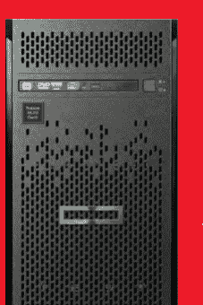

## 最佳价值

除了价值之外，自己指定组件并构建服务器也会带来某种满足感。请确保内部配置完全符合您的需求。无论是塔式还是机架式机器，确保它正是您想要的。需要良好的转码吗？强大的 CPU。`SSD` 和大量的 `RAM` 是当务之急。

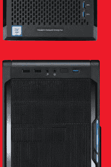 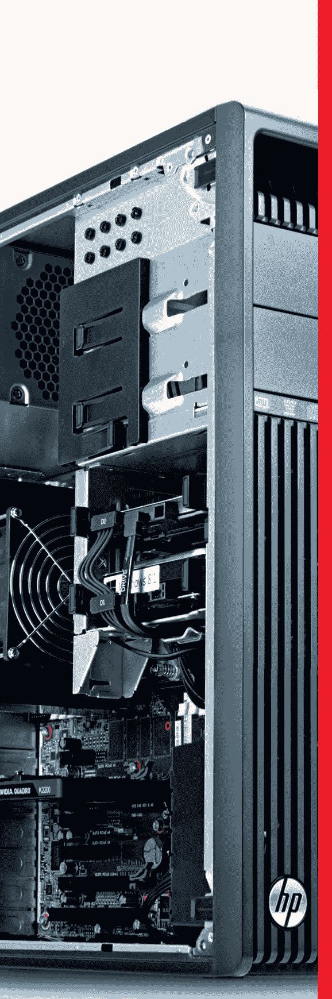 www.linuxuser.co

## 功能服务器：您需要升级吗？

如果您已经有一台 Linux 服务器，最简单的方法是。如果您刚开始使用 Linux 或正在使用 Windows，切换到新机器可以快速开始。如果您需要升级服务器，这不需要花一分钱！使用像 `top` 和 `iostat` 这样简单的命令行工具来查看当前的负载。

| PID | USER | PR | VIRT | RES | S | %CPU | %MEM | TIME | COMMAND |
| :--- | :--- | :--- | :--- | :--- | :--- | :--- | :--- | :--- | :--- |
| 30561 | wmw-data | 20 | 0 | 730676 | 85944 | S | 14.1 | 0.3 | 00:00:45 | apache |
| 30562 | wmw-data | 20 | 0 | 715336 | 72118 | S | 9.2 | 0.2 | 00:00:32 | apache |
| 30563 | wmw-data | 20 | 0 | 654760 | 69740 | S | 6.7 | 0.2 | 00:00:31 | apache |
| 30564 | wmw-data | 20 | 0 | 661448 | 41328 | S | 5.3 | 0.1 | 00:01:31 | apache |
| 30565 | wmw-data | 20 | 0 | 658232 | 69364 | S | 5.0 | 0.2 | 00:21:51 | nslookup |
| 30566 | wmw-data | 20 | 0 | 653396 | 37268 | S | 3.0 | 0.1 | 00:00:28 | apache |
| 30567 | wmw-data | 20 | 0 | 649338 | 31028 | S | 3.2 | 0.1 | 00:00:25 | apache |
| 30568 | wmw-data | 20 | 0 | 642484 | 32578 | S | 1.7 | 0.1 | 00:00:05 | apache |
| 30569 | wmw-data | 20 | 0 | 639338 | 52324 | S | 1.3 | 0.1 | 00:00:08 | apache |
| 30570 | wmw-data | 20 | 0 | 649204 | 58348 | S | 1.0 | 0.2 | 00:00:09 | apache |
| 30571 | wmw-data | 20 | 0 | 588938 | 38805 | S | 0.7 | 0.1 | 00:00:02 | apache |
| 30572 | root | 20 | 0 | 168080 | 80 | S | 0.3 | 0.0 | 00:12:30.82 | rcu_sched |
| 29971 | root | 20 | 0 | 251937 | 0 | S | 0.3 | 0.0 | 00:00:00 | Z |
| 29972 | root | 20 | 0 | 2025116 | 0 | S | 0.0 | 0.0 | 00:00:00 | Z |
| 30582 | wmw-data | 20 | 0 | 667698 | 79844 | S | 3.8 | 0.2 | 00:06:49 | apache |
| 30583 | wmw-data | 20 | 0 | 665338 | 38152 | S | 3.1 | 0.2 | 00:00:42 | apache |

上述命令行工具用于查看您机器的实际负载

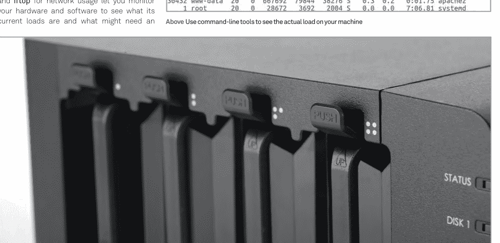

根据您的流量进行升级。如果你更喜欢看到服务器活动更具视觉化的表示，可以考虑查看第三方服务，例如 `New Relic`（提供免费的“Lite”版本），它可以实时绘制您的服务器使用情况图表，并从历史角度允许您查看使用模式。

许多人升级服务器是为了利用最新的处理器来降低功耗，升级前后的对比测量总是很有趣！

```
Reading package lists... Done
Building dependency tree
Reading state information... Done
Calculating update... Done
The following will be upgraded:
libperconserverclient10.1 libssl1.0 newrelic-daemon newrelic-php5
newrelic-php5-common openssl-perconserver-client-5.6
0 upgraded, 0 newly installed, 0 to remove and 0 not upgraded.
1 upgraded, After this operation, 352 kB of additional disk space will be used.
Do you want to continue? [Y/n]
```

上述操作在切换硬件之前，请确保您的操作系统已更新到最新版本

过去 30 分钟，直到现在

100 %

| | 10:55 AM | 11:00 AM | 11:05 AM | 11:10 AM |
| :--- | :--- | :--- | :--- | :--- |
| 系统 | 用户 | IO 等待 | | |

100 %

| | 10:55 AM | 11:00 AM | 11:05 AM | 11:10 AM |
| :--- | :--- | :--- | :--- | :--- |
| 交换 | 已用 | | | |

网络 I/O (Mb/s)

100 %

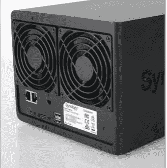

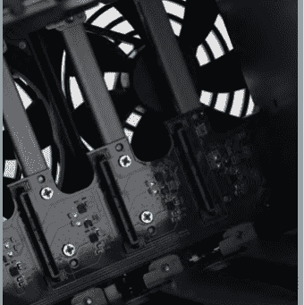

上述如 `New Relic` 等 Web 端工具可以提供使用的图形化表示

对于你新的、更好的服务器，你应该考虑选择哪些硬件？

有很多指南可以帮助你为办公或游戏 PC 选择最佳硬件，但针对服务器配置的指南并没有那么多——这可以理解，因为这有点小众。然而，构建服务器的优先事项除了具有执行所需任务的适当性能之外，是非常不同的。还有其他需要考虑的因素，如功耗、热量、噪音、韧性和使用寿命。如果你在从一开始就选择了正确的组件，那么频繁升级服务器是没有意义的。


对于服务器来说，机箱（或外壳）可能与你在家里使用的台式机看起来并不熟悉，但那是因为你并不是寻找未来感的设计和 LED 灯。相反，你追求的是智能冷却、组件的快速组装/更换以及与你计划购买部件的良好兼容性。你选择哪种类型的机箱取决于你是否想要将机器进行架式安装。对于构建者来说，架式机箱比传统版本更好但限制了选择，除非你有特殊需求，否则在构建服务器时避免使用架式安装可能是明智的。

> 一个具有快速、无需工具即可访问的高质量机箱会让服务器的运行更加轻松


虽然选择主板的核心是确保它与你计划的 CPU 和 RAM 兼容，但有些你可以注意的特性可以让你在构建服务器时生活更轻松。某些主板包含远程管理功能（通常称为 `IPMI`），开箱即用或作为扩展模块，这将让你获得 `ILO` 功能，而无需构建定制机。从连接性的角度来看，你的主板需求将取决于你是否打算拆分 `RAID` 以及网络连接到独立的网卡。

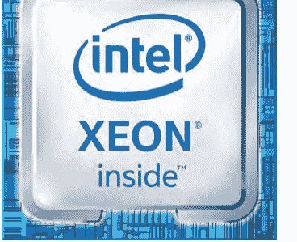

构建服务器的一个很好的建议是抵制选择你能找到的最新的、最快、最强大的 CPU 的诱惑。为什么？因为

确保你有足够的插槽用于所需的 RAM 以及任何你没有放置在独立卡上的连接器。

Intel Xeon 是服务器级 CPU，但对于大多数应用（特别是家庭环境）来说可能过剩。

22


相反，你应该确保你购买的适用于当前任务。如果你正在构建的机器大部分时间将作为文件服务器运行，那么 CPU 活动将非常少，因此你应该选择一个低电压处理器，这会减少对 SSD 的压力并为你省钱。Xeon 还提供一系列特定的 CPU，它们通常与同级的 Intel 处理器相同，但通过了 24/7 全天使用的认证，并取自最可靠的处理器。这是有代价的。

交换可能有问题。当你构建服务器时，请记住网络速度取决于你连接到机器的任何设备。


```
/ ... smb@samba1-server:/home/samba
# File: smb.conf
# Do something sensible when Samba crashes: mail to know backtrace
panic action = /var/share/samba/samba-action bd2d
```

```bash
## 认证方法
# server = Samba 运行的模式。可能的
# 值 = "standalone", member server, "classic primary
# or member server, "classic domain controller", 等。
# directory domain controller".
# 大多数用户使用 "standalone server" 或 "member server"
# 作为 "active directory domain controller" 托管需要
# root 降权权限来写入数据库并创建一个
# server role = standalone server
# 如果你使用加密密码，Samba 将需要知道
```

| 获取 | 写入 | 在何处 | 理由 | 最大值 |
| --- | --- | --- | --- | --- |
| 帮助 | 读取文件 | 默认 | 文档 | 联行 |

上述安装 Samba 将允许你从 Windows、Mac、Linux 甚至移动设备连接到你的服务器，如果你打算走这条路线，这非常值得考虑。

在构建服务器并确认一切运行正常后，你可能考虑实现某些远程管理工具，这样你就可以无需登录 `SSH` 控制台即可配置服务器。长期以来喜爱的 `Webmin` (`webmin.com`) 最近得于正版主题，外观非常漂亮——这为不使用免费替代方案提供了有力的理由。`ServerPilot` (`serverpilot.io`) 和 `Vesta` (`vestap.com`) 也是有趣的选择。

如果无法连接文件，文件服务器就毫无用！这意味着你需要在服务器上设置文件共享协议，以便客户端连接。对于包括 `OS X` 在内的所有平台，安装和配置 `SMB` (`Samba`) 提供了用户所需的访问。记住，作为管理员，你仍然可以通过 `SFTP` 发送和接收文件，获得更高级别的控制。

要安装 `Samba`，使用 `apt-get install samba samba-common` 安装所需的包，编辑 `/etc/samba/smb.conf` 以启用基于用户的安全设置，并连接到用户列表文件 `/etc/samba/users`，使用 `smbpasswd` 命令设置用户密码，最后在确保用户名位于 `smbusers` 文件后，运行 `service smbd restart` 将应用更改。用户现在应该能够映射到 `smb.conf` 文件中也定义的目录。

除了通过网络共享提供服务外，Web 服务器还允许你向浏览器分发内容。如果你已经运行起了一个基础服务器（或之前讨论过的文件服务器），你对其提出的第一个额外需求很可能是让它作为 Web 服务器运行。

从硬件角度来看，这项任务的性能需求也相对较低，但如果你计划也运行包含大量数据的数据库，内存和处理器的要求可能会增加。服务器对于提供静态内容和脚本都是用的——按照这里的步骤开始构建 `LAMP` (`Linux, Apache, MySQL, PHP`) 栈。

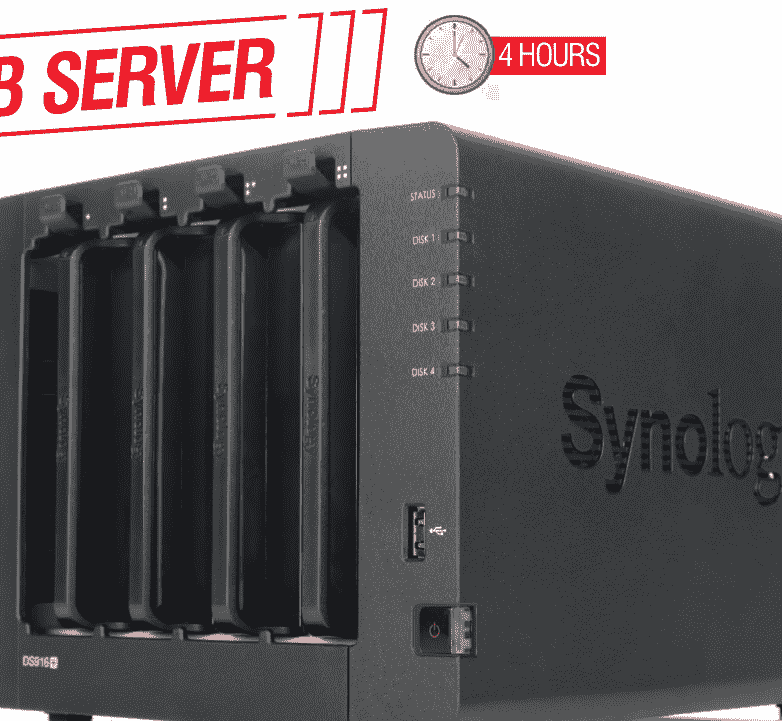

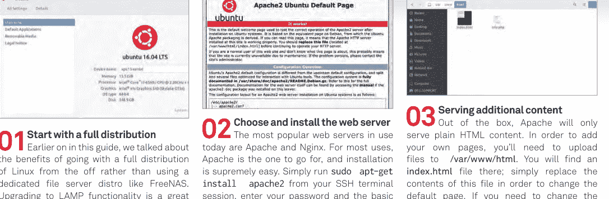

在指南早早之前，我们讨论了使用完整的 Linux 发行版而不是仅使用像 `FreeNAS` 这样的专用文件服务器的优势。升级到 `LAMP` 功能是一个很棒的，如果你已经在 `Ubuntu` 或类似的系统上，一切都将变得容易得多。某些用户通过在硬件使用 `VMware` 或 `Virtualox` 等虚拟化工具创建虚拟服务器，从而兼顾两者的优势。

今天最流行的 Web 服务器是 `Apache` 和 `Nginx`。对于大多数用户来说，`Apache` 是首选，从你的 `SSH` 终端运行 `apt install apache2` 进行安装，输入密码并输入命令 `apache2ctl start` 来启动你的 Web 服务器，它将立即开始服务。

默认情况下，`Apache` 仅提供纯 `HTML`。为了添加自己的内容，你需要将文件上传到 `/var/www/html`。你可以在默认页面找到包含这些文件内容的示例。如果你需要更改默认端口，可以在 `/etc/apache2/ports.conf` 中设置。主配置文件位于 `/etc/apache2/apache2.conf`；然而，你可以使用 `/etc/apache2/available` 目录和 `a2enconf` 命令添加自己的配置。

为了让你的网页动态化，你需要安装 `PHP`。使用 `apt-get install php libapache2-mod-php` 安装必要的包。


除非你是一个 `SQL` 大师，否则从命令行管理 `MySQL` 可能是困难的。基于 Web 管理是 `phpMyAdmin`。有很多方法安装它，但最简单的是 `apt-get install phpmyadmin`。在安装期间，系统会提示 root 数据库访问密码——这是你主服务器根的密码。

为了让你的网页动态化，你需要安装 `PHP`。使用 `apt-get install php libapache2-mod-php` 安装必要的包。要测试 `PHP` 是否正常工作，在 `/var/www/html/` 中创建一个名为 `info.php` 的文件，内容如下：

```php
<?php
phpinfo();
?>
```

然后在浏览器中导航到你的服务器 IP 地址 `/info.php` 以查看 `PHP` 配置。一旦你确认它可以工作，请出于安全考虑删除该文件。

```php
<?php
phpinfo();
?>
```


除了 `PHP`，还有其他 `Apache` 模块可用。`WebDAV` 模块允许你管理文件。要启用它，使用 `a2enmod dav` 和 `service apache2 restart`。

与其将你的 Web 服务器放在一个目录中，`Apache` 支持虚拟主机。这允许你从同一台机器提供多个网站。要配置虚拟主机，你应该在 `/etc/apache2/sites-available` 中添加它们并使用 `a2ensite`。

现在你已经安装了，是时候设置一些基础的反病毒和检测工具了。如果你提供敏感数据，后者尤为重要。

使用 `sudo mysql_install_db` 命令安装 `MySQL`，并可选地使用 `sudo /usr/bin/mysql_server_installation` 设置最重要的选项。


`ClamAV` 是一款备受尊敬的软件，对于恶意软件检测非常出色。

- ✓ 购买礼物，或犒劳一下自己！
- ✓ 礼物订阅每月送货上门

杂志名称

通过信用卡或借记卡支付

`Visa` `Mastercard` `Amex`

卡号 有期日期

我随附一张金额为 £ 的支票交给 `Imagine Publishing Ltd` 具

签名 日期

姓名

地址

邮编


## 订阅设置

如果您不想收到来自我们的任何促销邮件，请勾选此框。

通过电话、电子邮件联系我们：
*   电话号码
*   手机号码

如果您通过我们处收到其他公司的促销材料，请在此处勾选。如果您不想收到此类信息，请勾选此框。
*   他人
*   我自己

**地址**
*   姓名
*   邮编

请将此表邮寄至：
Imagine Subscriptions, 800 Guillat Avenue, Kent Park, Sittingbourne, ME9 8UG

## 促销信息

这是一项无限制优惠！随心购买任意数量的订阅。

联系我们友好的客服团队
*   请拨打 `0844 856 0644`

*   *这些优惠于2016年12月31日失效*
*   优惠价为£23.99，比商店价£29.99节省了费用
*   其他优惠请访问 `www.imaginesubs.co.uk/xmas161`
*   新订阅将从2017年1月1日起生效
*   现有订阅者将在我们记录的邮箱收到邮件。新礼物订阅将在下一个可用日期生效。*适用相关条款与条件。


## 集成 Bash 与 Qt

`Tam Hanna` 很难决定他更喜欢 `Qt`、`Bash` 还是电子学。显然，将他喜爱的两种语言相结合，让他乐意担任您的指南，引导您轻松地将高效的 shell 集成到 `Qt` 运行环境中。

*   `gnu.org/soft/bash`
*   `Qt Creator`
*   `www.qt.io`

如果你有一把锤子，每个问题看起来都像钉子。增加新工具会让你更高效。

`Bash` Shell 的脚本语言是图灵完备的。这意味着它可以用于解决任意复杂的计算问题。在实践中，其他语言更适合许多计算任务。

例如，`Bash` 不是面向对象的，并且不支持高级的数学运算。作为一种解释型语言，它容易产生翻译开销。最后，相对宽松的运行时检查使得语法错误变得困难。

幸运的是，有很多工具可以使用各种其他语言创建程序——`Qt` 就是一个有趣的例子——这些程序可以通过 shell 脚本调用。这种方式，可以使用面向对象且原生编译的编程语言来处理重量工作，而其余工作由 shell 脚本完成。

将 `Qt` 集成到 shell 脚本从另一个角度来看也有趣。我们讨论过的编程环境在过去的期数中已有详细介绍。`C++` 是一门强大的编程语言。许多（不是所有）科学算法至少带有一个 `C` 实现，它的速度非常快。

简而言之：集成 `Qt` 和 `Bash` 值得你投入时间，行动吧！

`files.co.uk`

让我们从打开 `Qt Creator` 开始。接下来，在图 1 中选择项目模板——它创建了一个与 GUI 栈和其他元素分离的控制台程序。

`argv` 代表“参数向量”——它包含实际参数。

遗憾的是，`C` 编程语言在这一点上有一个小陷阱。每个 `C` 程序都至少包含一个参数。`argv(0)` 始终包含相同的名称，这很重要，因为用户程序从索引 0 开始：计数为 1 意味着字符串可以相对地转换为整数。

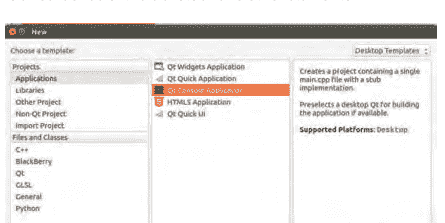

### 代码实现

与命令行输入和输出流的交互通过使用 `C++` 标准库来实现是最好的。在 `Qt` 项目中使用它们要求你向文件 `main.cpp` 添加以下两个头文件：

```cpp
#include <QApplication>
#include <iostream>
#include <cstdlib>

using namespace std;
```

在处理 `std` 库时，设置 `std` 命名空间属性是明智的。在项目中省略它将要求你在每个函数调用实例都使用 `std::` 前缀。程序的实际设置通过 `main` 函数完成。它接收 `C` 程序 de规范中的两个参数：

```cpp
int main(int argc, char argv[]) {
    QApplication app(argc, argv);

    int max, first, second = 0;

    if(argc < 2) {
        cout << "Error!\n" << flush;
    }
}
```

```cpp
QString arg(argv[1]);
max = QString(argv[1]).toInt();
```

现在，是时候查看实际实现了。`argc` 是参数计数，`argv` 是字符串数组。

```cpp
for (int i = 0; i < max; i++) {
    if (i <= 1) {
        next = i;
    } else {
        next = first + second;
    }
    first = second;
    second = next;
}
```

```cpp
cout << next << endl;
```

### 流处理

三个流 `STDIN`、`STDOUT` 和 `STDERR` 均可用。

之前的代码将标准输出重定向到 `/dev/null`，这指示操作系统丢弃它。我们的 `Qt` 应用程序也可以发送到该流：

```cpp
int main(int argc, char *argv[])
```

```cpp
if(argc==2){
    cerr << "Error! \n";
    return EXIT_FAILURE;
}
```

其内在作用是它会将命令的路径输出到命令行：

```bash
$ gcc
$ /usr/bin/gcc
$ bash
$ /bin/bash
```

通过将二进制文件移动到主机工作站的受批准文件夹之一，可以消除 `/` 路径。在 `Qt Creator` 中工作时，此步骤可以通过集成到构建过程中来实现自动化：只要编译成功，二进制文件就会被复制到目标文件夹。

### 程序通过交付数值返回码来告知遇到的成功或失败

发送到 `stderr` 的数据也可以被重定向，使其不会显示在屏幕上。实现此目标的一种简单方法涉及将其重定向到标准流，然后将其发送到 `/dev/null`。

实现此功能首先要切换到 `Qt Creator` 窗口的左侧。点击 `'Custom Step'` 步骤，`Qt Creator` 将允许你输入命令、工作目录并设置 `%(buildDir)` 的默认值，这确保了在 `'Command'` 和 `'Arguments'` 中输入的命令将在项目的构建目录中执行。然后，它显示在图 5 中。

### 高级通信

即使传递数值值也是重要的，但这只能解决部分问题。在许多情况下，必须将文本信息传回 shell。这通过重定向之前提到的流之一来实现效果最好；其中一类是：

```bash
#!/bin/bash
VAR=$(Command.testSender)
echo $VAR
```

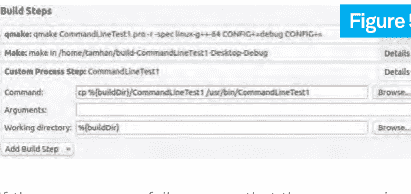

如果复制失败，请确保运行 `Qt Creator` 的用户拥有权限。或者，创建一个本地文件并将其添加到 `PATH` 中。

### 结论

即使作为示例的斐波纳契算法也不特别复杂，但它展示了 shell 脚本如何与 `Qt` 应用程序集成。在系列的下一部分，我们将介绍其他也可以集成到其脚本中的语言。

### 移出它

在编写本文时，我们的脚本仅通知 `Qt Creator` 的输出，且它们的文件位于同一个文件夹中。这并不令人满意，特别是当 shell 脚本打算部署给技术上未使用的用户时。让我们从分析通过以下通用的命令开始：

> 在罗马，属于罗马人！

如果你想将你的程序转换为 UNIX 生态系统中的良好公民，遵守返回码是一个良好的实践；学习如何使用 `%(buildDir)` 来查找常用值列表；如果程序返回了这些值，其他人将其集成到自己的脚本中就会更容易。

## .NET Core 教程

### 在 Linux 中开始编写 ASP.NET Core Web 应用程序


微软重新发明了 `ASP.NET`（.NET 长期使用的 Web 框架），使其更加现代化、高性能并能够跨平台运行，包括在大多数 Linux 发行版上。

`ASP.NET Core` 是一个模块化、轻量级、内存跨平台的 Web 开发框架。这个基于 .NET 的框架在 `GitHub` 上作为开源开发，并利用了现代 .NET 的新跨平台能力。随着 2016 年 6 月首次发布 `ASP.NET Core`，依赖注入已贯穿整个框架。这使得 `ASP.NET` 变成了一个具有灵活架构的强大引擎，包含一个代码化的、高性能的 Web 服务器。新框架提供了许多细粒度的选择。

最终结果是一个 Web 开发框架，它具有许多微小的、可重用的包，通过包管理系统包含 Linux、Windows 和 macOS 的跨平台支持。它也是基于 Linux 的跨平台事件驱动框架。`Node.js` 使用该框架来交付高性能 Web 应用程序。`ASP.NET Core` 在几个月的性能测试中证明了其性能，达到了每秒 100 万次请求 (rps)。

### Kevin


Kevin 是一位软件工程师兼 IT 经理，为 GitHub 上的开源项目做出贡献。他喜欢 Linux、Minecraft，以及编写代码。

## 资源

- 任何平台的 .NET

- [入门 ASP.NET Core](https://learn.microsoft.com/en-us/aspnet/core/getting-started)

- Yeoman 生成器

- [yeoman-generator-aspnet](https://github.com/microsoft/generator-aspnet)

## MVC 编程

- [docs.aspnet.microsoft.com](https://docs.aspnet.microsoft.com/)

## Web API

- [openweathermap.org](https://openweathermap.org/)

关于示例代码，本文的项目源码位于 `disc` 和 `FileSilo`。更多细节，让我们开始吧。

## 安装 .NET SDK、Visual Studio Code 和 Yeoman

第一步是安装用于开发 ASP.NET Core Web 应用的工具。包含的脚本是为 Fedora 发行版编写的，仓库随发行版而异，因此如果你需要在 Ubuntu 或 Debian 等其他 Linux 发行版上安装，请查看下方的注释。Linux 上的 .NET。

### 安装 .NET Core 依赖项

```bash
#!/bin/bash
sudo yum install -y libicu
curl -sO dotnet-tar.gz https://dotnet.microsoft.com/dotnet/6.0/linux-x64/
sudo tar -xf dotnet-tar.gz -C /usr
export PATH=$PATH:/usr/bin
```

### 安装 Visual Studio Code

```bash
curl -sO code_1_x64.rpm https://code.visualstudio.com/repo/
sudo rpm -ivh code_1_x64.rpm
```

### 安装 node.js 和 NPM

```bash
sudo yum install nodejs npm
node -v
npm -v
npm install -g generator-aspnet
```

### 安装代码扩展

| Model | View | Controller |
|---|---|---|
| Model Binding | Action | |
| Model Editing | Layer | |
| Model Validation | Tag Helper | MVC |
| ViewModels | | |
| Web API | WebServer | |
| Right | | |
| Linux | .NET Core | |
| Windows | | |

使用 ASP.NET Core Web 框架开发的应用程序使用 Linux 托管的服务器。

```bash
code
sleep 2
```

```bash
code --install-extension vscode.csharp
code --install-extension samuels.io
code --install-extension code-list-extensions
```

上面的命令系列提供了 .NET Core 以及 Node.js，Yeoman 是非常流行的 Web 开发脚手架工具使用的。此外，还安装了 Visual Studio 扩展。这包括用于 Yeoman 增强编辑器集成能力的扩展，以及允许各种模式的扩展。从命令行运行 Visual Studio Code 扩展需要编辑器已启动。首先，在从命令行安装 Yeoman 之前，确保已创建项目。这是启动 Visual Studio Code（使用命令并跟 `--install` 参数）以安装各种扩展的方法。

## 设置 Visual Studio Code 目录

在从 Visual Studio Code 启动 Yeoman 之前，你必须创建一个脚手架项目将所在的顶层目录。只需在用户目录的 shell 提示符创建一个文件夹。

## mdk 项目

然后，从 Visual Studio Code 打开文件夹，使 Visual Studio 的上下文设置为新创建的目录。如果你遵循了工具链安装步骤，还可以启动编辑器并在以下步骤中设置目录上下文：

- `Program.cs`
- `Project.json`
- `Startup.cs`
- `appsettings.json`
- `wwwroot` - 静态 Web 内容根目录
- `views` - 包含示例内容的 `index.html`
- `controllers` - 包括 `HomeController.cs`

此时，正在生成脚手架代码，因为它将是新编程功能的说明。建议检查 `Project.json` 文件，它包含了 Web 应用程序代码所在机设置；以及定义依赖和构建依赖的 `project.json` 文件。

## 从 Visual Studio Code 启动 Yeoman

在开始并继续你接下来的步骤中，我们将利用 Visual Studio Code 的 Yeoman 扩展为 ASPNET Core 编程模型生成脚手架。Yeoman 社区提供了许多 ASPNET Core 生成器，包括单页应用程序等生成器。要浏览你 Linux 环境中安装的 Yeoman 生成器，你可以在 Visual Studio Code 命令面板（使用 `F1` 快捷键访问），然后选择由 OmniSharp 组织发布的相关扩展（有关 OmniSharp 和 ASPNET Core 生成器的更多信息请参见第 37 页）。此 Yeoman 生成器作为第一步工具链安装的一部分的。

## 04 Yeoman aspnet

接下来，选择 `app` 并回车。`app` 生成器是 ASPNET Core Web 应用可用基于模板的生成器的顶层选择。来自 `app` 的生成器将产生文件夹和文件，以创建自定义开发的 ASPNET Core Web 应用代码骨架。

## 05 指定 ASPNET Core 项目模板

接下来，Yeoman 将提示创建一个基于模板的生成器，以包含一个空的 ASPNET Core Web 应用、一个带有权限支持的标准 ASPNET Core Web 应用和一个 Web API 支持，并选择 `Basic` 类型（以保持简单并避免示例中不需要的安全防护），在 UI 选择中选择 `Bootstrap`，并输入 `MyWebApplicationApp` 作为应用程序名称。

## 06 Yeomangenerated

在脚手架代码生成的最后步骤之后，你将从 Yeoman 获得许多代码制品作为 ASPNET Core 项目脚手架的一部分。此过程包括：

## .NET Core 教程

在 `project.json` 文件中添加并调试代理（`agents`）。同时，为 ASPNET Core 项目依赖的还原（如 `project.json` 文件中定义）提供确认。在确认这些细节后，Visual Studio Code 编辑器将在后台工作，完成本地开发的初始项目设置（这应该只需要几秒钟）。

一个为指定城市（位置）收集数据的异步网络查询。

```csharp
public static WeatherReport GetWeather(string city) {
    var weatherClient = new OpenWeatherMap();
    var weatherObject = weatherClient;
    GetWeather();
    WeatherReport report = new WeatherReport();
    Temperature temperatureInfo = new Temperature();
    report.Report = weatherObject.Result.main;
}
```

## 08 构建 ASPNET Core Web 脚手架代码

在生成脚手架并启动项目开发后，快速对解决方案进行快速完成是明智的，以确保你生成的脚手架代码与引用的版本完全兼容，并且 NuGet 包已正确还原。这是确保脚手架代码中引用的 API 和 SDK 运行时兼容的第一步。

这种“脚手架优先”思维的动力源于对 Xamarin 生成器、NuGet 生态系统以及 .NET Core 工具演进的认识。通常，更复杂的项目将要求你介入、配置和管理各个方面，以确保依赖库 .NET Core 运行时和 SDK 工具之间的兼容性。


```csharp
report.Report = weatherObject.Result.main;
report.Humidity = weatherObject.Result.humidity;
Winds wind = weatherObject.Result.Winds;
report.Winds = wind;
return report;
```

## 填充 MVM 脚手架代码以实现简单的天气页面

视图（View）、模型（Model）和控制器（Controller）的基础脚手架现在支持简单的天气示例，无需担心下面所示的代码片段，此示例的完整文件可在`FileSite`获取。

## 09 调试 ASPNET Core Web 启动

通过探索`ASPNET Core`环境和`Web`托管的运行时节点，你可能需要在`Startup.cs`的各个点设置断点，以便有机会检查应用程序启动期间创建和安装的许多`ASPNET Core`对象和数据结构。

### Model 和 ViewModel：

模型实现使用`C#`结构来处理温度和风力，以及压力等相关数据。`ViewModel`类将这些对象分组，以便视图于消费。

```csharp
public class WeatherModel {
    public Temperature Temperature;
    public double Pressure { get; set; }
    public double Humidity { get; set; }
    public Winds Wind { get; set; }
}
```

## 10 写入控制器

脚手架已生成且`ASPNET Core`应用将构建并启动（成功），现在是关注所编写代码了。为了提供实时天气数据，我们将使用`openweather.api`提供的`OpenWeatherMap`公共`API`。该`API`为基础天气示例等低频率、简单的示例提供了增强的理解。

### Controller：

事件控制器的方法也已填充，在这种情况下是为了向`OpenWeatherMap`发起请求。它使用相同的模型类，从`FileSite`或磁盘选择选定的城市数据以完成实现。

注意，需要注册以获取代码调用设置中指定的`API`密钥。

`OpenWeatherMapClient`类封装了对`OpenWeatherMap API`的`RESTful`调用，在调用期间管理`API`密钥，并在与`.NET`框架`HttpClient`交互时使用异步语言特性。

```csharp
public ActionResult Index(WeatherViewModel model) {
    var weather = new WeatherViewModel();
    if (ModelState.IsValid) {
        if (model.SelectedCity == null) {
            var weatherReport = new WeatherHelper;
            GetWeather(model.SelectedCity);
            weather.Temperature = weatherReport;
        }
    }
}
```


## 温度；

`Web`浏览器和`localhost:5000`的地址栏，

在选择城市后应产生类似的结果。

```csharp
weather.Pressure = weatherReport.Pressure;
weather.Humidity = weatherReport.Humidity;
weather.Wind = weatherReport.Winds;
weather.SummaryDescription = weatherReport.Summary;
```

### 描述；

```csharp
{
    return View(Weather);
}
```

### 视图；

基于`HTML`的视图`Index.cshtml`面向`Web`界面。此脚手架已更新以支持城市选择以及从查询到`OpenWeather API`的数据绑定。视图使用键绑定显示天气数据。


```html
@model Weather.Models.WeatherViewModel
<h2>Current temperature is: @Model.Temperature</h2>
```

注意，你也可以从命令行提示符的项目级别（即存在`project.json`文件的地方）运行`ASPNET Web`。此外，你可以使用`dotnet run`命令直接执行应用程序。顺便一下，如果你想调整城市列表以符合你的偏好。

```csharp
public class WeatherViewModel
{
    public string SelectCity { get; set; }
    public List<City> Cities { get; set; } = new List<City>
    {
        new City { Value = "Chicago,", Text = "Chicago" },
        new City { Value = "Detroit,", Text = "Detroit" },
        new City { Value = "Seattle,", Text = "Seattle" }
    };
}
```

```html
<p>Current temperature is: @Model.Temperature</p>
<p>High: @Model.High</p>
<p>Low: @Model.Low</p>
<p>Pressure: @Model.Pressure</p>
<p>Humidity: @Model.Humidity</p>
```

注意，需要注册以获取代码调用设置中指定的`API`密钥。

`OpenWeatherMapClient`类封装了对`OpenWeatherMap API`的`RESTful`调用，在调用期间管理`API`密钥，并在与`.NET`框架`HttpClient`交互时使用异步语言特性。

虽然无疑`rsh`、`rcp`等命令仍然包含在大多数`Linux`发行版中，但需要注意的是，某些工具的执行可能比当前的`SSH`命令更快。然而，连接的安全性与加密有关。通常倾向于忽略这些遗留命令，但它们在某些情况下可能很有用。此文本用于与路由器、交换机等网络设备通信，这些设备可能无法`SSH`守护进程。这给……带来了问题

当`Linux`专业人员需要访问其他计算机进行远程管理时，可以使用命令行。有许多`SSH`命令可以提供帮助。与安全`Shell (SSH)`相关的工具允许远程登录和文件传输。通过这些工具，在不安全的网络上提供加密通信。通过虚拟网络隧道，你将能够拥有远程桌面。它支持`Telnet`、`ftp`（文件传输协议）、`ssh`（远程`shell`）、`rcp`（远程拷贝）、远程执行（远程登录）等。凭据在公共网络上被认为是不安全的。

`SSH`客户端是一个用于登录远程机器并在其执行命令的程序。它旨在取代`login`和`rsh`，并为不信任主机之间提供加密通信。`X11`连接、任意`TCP`端口和`UNIX`套接字可以在安全通道中转发。

`Swayam Prashak`拥有计算机工程硕士学位。他在信息技术领域工作多年，专注于安全、网络和`Web`服务器。他编写了许多出版物并在行业会议上演讲。你可以通过`swayam.prashak@gmail.com`联系他。

通过探索`ASPNET Core`环境和`Web`托管的运行时节点，你可能……

深入了解`Ubuntu`远程管理

## 资源

- [Linux Administration Basics](https://github.example.com/...)

- [Linux Administration and Configuration](https://github.example.com/...)

- [Remote Administration](https://github.example.com/...)

如今，`SSH`被认为是`Linux`专业人员进行远程管理的“瑞士军刀”。

`pswayam@pswayam-VirtualBox:~$ ssh-keygen`

Generating public/private rsa key pair.

Enter file in which to save the key (/home/pswayam/.ssh/id_rsa): already exists.

overwrite? (y/n)

Enter passphrase (empty for no passphrase):


`Your identification has been saved in /home/pswayam/.ssh/id_rsa.`

`The key fingerprint is:`

```
++++[RSA 2048]----+
. 
. 
. =+++
. =0+0=.
+.E.
++++
```

`pswayam@pswayam-VirtualBox:~$`

# 远程管理中的系统诊断

当系统管理员在管理过程中遇到硬性障碍时，查看内存相关报告的总和会更好，这些报告提供了可以用于各种用途的实用摘要。有些工具可以免费检查当前的内存使用情况以监控进程，并进行优化。

# 使用 `ssh-keygen` 命令生成密钥对

`SSH` 命令及相关服务取代了旧工具，并添加了强加密、公密钥以及各种其他功能。在 `Linux` 世界，`SSH` 最常见的实现是 `OpenSSH`。需要，`OpenSSH` 同时支持客户端和服务器。如果你的机器上没有安装，可以通过执行以下命令安装 `OpenSSH` 服务器：

```
sudo apt-get install openssh-server
```

- 让我们来看关于 `SSH` 的一些事实。尽可能使用 `SSH` 版本 2，因为它始终是最安全的。

- 在 `Ubuntu` 上，你可以运行 `service ssh start` 来启动 `SSH` 服务（即 `ssh` 守护进程）。

图形化工具。让我们看看如何使用 `SSH` 进行远程登录。你可以为此目的使用以下语法：`ssh my_server john@my_server`。

需要注意的是，`scp` 和 `sftp` 仅支持 `@server` 语法。如果不指定用户，用户名将默认使用与本地登录相同的用户。登录后，你可以通过输入窗口的转义字符后跟一个句号，或者输入 `exit` 来轻松退出你的 `SSH` 会话。

在某些场景下，远程主机的 `SSH` 服务可能监听在不同的端口（默认为 22）。这基本上出于安全考虑。在某些情况下，

> 使用密钥密码比使用单词要安全得多，但这会变得非常繁琐

- 为了配置服务器，你需要编辑 `/etc/ssh/ssh_config`。

- 要配置 `SSH` 客户端，你应该编辑 `/etc/ssh/ssh_config`，我们可以使用 `-p` 选项连接到远程服务器。如下例所示：

```
ssh -p 5432 john@my_server
```

`SSH` 值得注意的是，`ssh` 命令可以支持公钥认证。这通常提供了...

# 系统管理教程

```bash
pswayam@pswayam-VirtualBox:~$ ssh-agent
SSH_AUTH_SOCK=/tmp/ssh-XXXXXX/agent1234; export SSH_AUTH_SOCK
SSH_AGENT_PID=1234
```

# 查看 `ssh-agent`

其具有以下优点：自动登录允许脚本通过分配空密码短语来自动登录。这非常简单方便，但被认为是危险的，因为任何找到你密钥的人都可以连接到任何机器。自动登录也可以通过密码和密钥进行配置。当我们使用命令将你的公钥复制到另一个系统上用户的 `authorized_keys` 文件时，通常会提示你输入远程用户的密码。但一旦你输入了，这将是你最后一次需要输入密码进行登录。

让我们看看两个系统之间基于密钥的通信过程。在客户端上，你可以运行命令并生成密钥对，以及需要发起与远程账户通信的用户。登录到远程账户并检查 `authorized_keys` 文件的内容。如果需要，你登录时将不会提示密码。

```
pswayam@pswayam-VirtualBox:~$ ssh-keygen
Generating public/private key pair (4096 bits) for /home/pswayam/.ssh/id_rsa
Oct 26 10:38:26 2023
```

执行结束，你将拥有一个私钥 (`id_rsa`)，还有一个公钥 (`id_rsa.pub`)。在此注意，在任何时候，任何 `SSH` 命令 (`scp`, `sftp`, `ssh`) 都可以在不提示本地服务器输入密码的情况下工作。但如果你使用密钥连接到远程服务器，你将会被要求输入密码短语。

如预期的那样，使用带短语的密钥比简单密码更安全，但每次连接时输入密码短语会变得更加繁琐。这就是为什么我们使用 `ssh-agent` 来处理密码短语。

如果你有私钥 (`id_rsa`)，则需要将 `~/.ssh/id_rsa.pub` 复制到 `~/.ssh/authorized_keys`，以便用户在远程服务器上使用 `SSH`。注意，如果你有多个用户使用 `SSH` 连接到此账户，该文件可以包含多个公密钥。虽然以前将你的公密钥复制到系统上的另一个账户是一个手动过程，但你现在可以使用 `ssh-copy-id` 命令轻松地完成。一旦你登录到创建密钥的账户，你就可以运行以下：

你的 shell 应该预期上述命令的输出。如果你启动了 `ssh-agent`，通过运行以下命令来评估其输出：

由于你已经创建了密钥，可以使用 `ssh-add` 命令添加默认密钥：

```
ssh-add
Identity: /home/pswayam/id_rsa (rsa)
```

```bash
pswayam@pswayam-VirtualBox:~$ screen -ls
There are screens on:

23981.my_screen (Wednesday 07 September 2016 06:55:55 IST) (Attached)
22818.pts-6-pswayam-VirtualBox (Tuesday 06 September 2016 06:11:32 IST) (Attached)
2 Sockets in /var/run/screen/pswayam/
```

`pswayam@pswayam-VirtualBox:~$`

上述 `my`，`screen` 显示在输出。如果你想移除 agent 中的所有密钥，可以使用带 `-D` 选项的 `ssh-add` 命令。

虽然 `screen` 命令对于远程管理非常强大，但它有一个缺点。`ssh` 命令允许一个 screen (shell)，如果你关闭它，将丢失正在进行的工作。如果你在会话中间，这变得很重要。如果你需要多个活动会话，请注意 `screen` 命令通过登录会话提供多个会话。`screen` 的另一个方面是它允许在你离开的地方继续工作。`screen` 可以被视为终端复用器，极大有助于系统管理员管理远程计算机。`Ubuntu` 安装了 `screen` 软件，你可以通过运行 `ssh` 命令连接到远程服务器，然后简单输入以下：

是共享屏幕会话。这在技术支持方面非常有帮助。

让我们看看另一种远程管理的有用机制。虚拟网络 (VNC) 允许我们共享桌面。VNC 由服务器软件和客户端软件组成。通过启动客户端 `vncviewer`，你可以访问远程桌面。请注意，如果你想连接到你的机器，还需要 `vncserver` 软件包。

为了使用 VNC，你首先需要设置 VNC 服务器。在设置 VNC 时，对于每个用户你需要运行 `vncpasswd` 命令来创建每个用户连接桌面所需的密码。下一步是配置远程机器上的 `vncviewer`。如果你对你的 VNC 服务器如何配置感兴趣，那么你需要编辑位置处的 `xstartup` 文件。当你完成一个会话时，可以关闭该特定会话。当 VNC 服务器运行时，你将能够从网络的任何部分连接到桌面。

# 并发编程教程

# Go 并发编程 – 第 2 部分

`Mihalis Tsoukalos`

前 `LINUX` 管理员、`Go` 程序员兼数学家。他从 1993 年开始就开始编写代码。你可以通过 `Twitter` 上的 `@mactsoukalos` 或访问 `mtsoukalos.com` 找到他。

## 资源

- 一个像 `Emacs` 或 `vi` 这样的文本编辑器

- `Go` 编译器

## 更多关于 `Go` 高级并发编程技术

本教程将继续讨论 `Go` 中的并发编程。首先，你将学习 `Go` 调度器和共享内存。然后，正如上一个教程承诺的那样，我们将开发 `wc` 工具。随后，我们将讨论缓冲通道、`GOMAXPROCS` 环境变量的重要性，以及 `Go` 程序如何使用共享变量（并发程序中交换数据的传统方式）以及互斥锁的使用。

在下一部分中，我们将讨论 `Go` 的调度以及其他有趣的内容，如保活（keepalive）：

### 你应该已经知道的

由于这是第二部分，你已经从第一部分学习了许多内容，包括如何创建 goroutine 和如何使用通道（channel）。你应该也熟悉 `select` 语句以及使用共享内存和变量进行并发的方法。

在最后一部分，我们将提到内核调度器负责 goroutine 的执行顺序，这并不完全准确。内核调度器负责你程序所拥有的线程的执行。`Go` 运行时有自己的调度器，负责通过使用 `n` 个线程的多路复用执行正在运行的 goroutine。因为 `Go` 调度器的开销比内核调度器要低得多。

### 关于共享内存的更多信息

当你使用共享内存时，问题在于确保在任何时刻只有一个代码语句在更改变量。正如我们稍后看到的，前述语句可以重写为“确保在任何时刻只有一个代码语句在更改变量”。

解决上述问题有很多方法，包括信号量和互斥锁。本教程将仅涉及互斥锁。


我们还会讨论并发，使用互斥锁进行编程必须非常小心，因为可能会产生`bug`。

可用的教程文件：

`files.co.uk`

### 图 1

```go
package main

import (
	"fmt"
	"os"
	"path/filepath"
	"runtime"
	"sync"
)

func main() {
	if len(os.Args) < 2 {
		fmt.Printf("Usage: %s <file1> [file2]...\n", os.Args[0])
		return
	}
	file, _ := filepath.Base(os.Args[1])

	var wg sync.WaitGroup
	for _, filename := range os.Args[1:] {
		wg.Add(1)
		go func(filename string) {
			defer wg.Done()
			dwc.Process(filename)
		}(filename)
	}
	wg.Wait()
}
```

### 图 2

```go
package main

import (
	"fmt"
)

func main() {
	numbers := make(chan int, 5)
	numbers <- 0
	numbers <- 1
	numbers <- 2
	numbers <- 3
	numbers <- 4

	// 这将不起作用
	// numbers <- 5

	// 这将工作
	select {
	case num := <-numbers:
		fmt.Printf("%d\n", num)
	}

	// 你可以这样读取缓冲通道
	select {
	case num := <-numbers:
		fmt.Printf("%d\n", num)
	default:
		break
	}
}
```


上面是`dwc`的重要部分，它是我们在教程中开发的并发版本，位于此处。

### 并发版本的`dwc`

我们将开发一些东西。`dwc`程序是一个以`wc`为起点的并发版本。

`dwc`的源代码见图1。这里没有展示计数函数的实现。执行它会产生以下输出：

```
$ dwc INPUT anotherfile
12486 lines             12444 characters		67876
124480 bytes           124350 characters			anotherfile
```

原因是每一行的计数是输出的前缀。再次，`dwc`没有打印汇总信息——这被留作了练习。`dwc`背后的并发逻辑如下：

```go
for filename := range os.Args[1:] {
	wg.Add(1)
	go func(filename string) {
		count(filename)
		defer wg.Done()
	}(filename)
}
```

关键点是你应该将并发方式执行的功能封装在函数中。

上面的程序展示了 Go 中缓冲通道的使用。在这种情况下，现有的`count()`函数被封装在作为`goroutine`执行的匿名函数中。这可能不是最优雅或最智能的方法，但它只需要对代码进行微小调整。

### 图 4

### 图 5

| GOMAXPROCS | real | user | sys |
|---|---|---|---|
| 1 | 0.113 | 0.006 | 0.015 |
| 2 | 0.099 | 0.039 | 0.018 |
| 3 | 0.041 | 0.086 | 0.019 |
| 4 | 0.030 | 0.083 | 0.020 |
| 5 | 0.051 | 0.088 | 0.021 |
| 6 | 0.026 | 0.102 | 0.022 |
| 7 | 0.025 | 0.116 | 0.023 |
| 8 | 0.027 | 0.128 | 0.025 |

```go
import {
	"math/rand"
	"sync"
	"time"
}
```

此图展示了`GOMAXPROCS`环境变量不同值下的基准测试结果。


```go
var readValue = make(chan int)
var writeValue = make(chan int)
```

```go
// 此函数设置一个新值
func SetValue(newValue int) {
	writeValue = newValue
}
```

```go
// 此函数获取当前值
func ReadValue() int {
	return <-readValue
}
```

`GOMAXPROCS`的最大值为`256`，如果你决定使用更大的整数。测量方法如下：

```bash
$ go build example.go
$ export GOMAXPROCS=$value; time ./example
$ export example=2000
```

```go
func monitor() {
	var info int
	select {
		case newValue := <-readValue:
			value = newValue
			fmt.Printf("%d\n", value)
		case readValue = <-value:
	}
}
```

基准测试结果可以在图4中看到。正如标记所示，你使用的核心越多，程序的性能提升就越明显。然而，如果你必须执行需要大量`CPU`算力的操作，情况可能不再如此；这是因为每个并发程序都会引入额外的额外通信开销和线程。

```go
func main() {
	rand.Seed(time.Now().UnixNano())
	go monitor()

	var wg sync.WaitGroup
	for i := 0; i < 15; i++ {
		wg.Add(1)
		go func() {
			defer wg.Done()
			SetValue(100)
		}()
	}
	wg.Wait()
	fmt.Printf("Last value: %d\n", ReadValue())
}
```

上一个示例在使用单核时执行时间更长，同时，名为`non-concurrent`的非并发 Go 程序使用以下代码完成与示例一相同任务的时间如下：

这可能是因为使用了`goroutine`—— 此外对`sync.Add`、`sync.Wait`和`sync.Done`的调用会降低程序的性能。

```bash
$ time non-concurrent 100
| real | 0.003s |
| user | 0.000s |
| sys | 0.000s |
$ time ./example 1000
| real | 0.0111s |
| user | 0.000s |
| sys | 0.000s |
```

请注意，这并不是一个科学的示例，但是一个快速简单的方法，说明了并行化并非万灵药 —— 然而，正确的设计和实现总是一件好事。

正如你看到的，当你使用单核运行并发程序时，并发版本的程序可能并没有普通版本快。

## 共享内存与共享变量

线程之间传统的通信方式是共享内存。Go 提供了同步功能，允许单个`goroutine`共享数据。这意味着其他`goroutine`必须向该`goroutine`发送消息。

## 并发编程教程

右图展示了使用`sync.Mutex`为一个或多个共享变量提供互斥读写访问。

```go
package main

import (
	"fmt"
	"os"
	"sync"
)

var (
	sync sync.Mutex
	sharedVariable int64
)

func init() {
	sharedVariable = int64(0)
	fmt.Printf("%d\n", sharedVariable)
	Mutex.Lock()
}

func increment(value int64) {
	Mutex.Lock()
	sharedVariable += value
	fmt.Printf("%d\n", sharedVariable)
	Mutex.Unlock()
}

func main() {
	// 创建一些 goroutine
	fmt.Printf("workers %d\n", len(os.Args[1:]))
	var wg sync.WaitGroup
	for i := 0; i < 5; i++ {
		wg.Add(1)
		go func() {
			defer wg.Done()
			increment(1)
		}()
	}
	wg.Wait()
	fmt.Printf("final: %d\n", sharedVariable)
}
```


当你有一个读取请求时，`monitor()` 使用 `value` 参数返回当前值。同样，当你想更改当前值时，你会更改 `value` 参数。所有使用 `SetValue()` 或 `ReadValue()` 的 `goroutine` 都在运行，`monitor()` 在任何给定时间最多处理一个请求，这防止了共享数据的损坏。

# SSH 安全教程

## 预防 SSH 攻击

通过相关技术锁定您的 SSH 访问，确保您的数据仅供您自己使用，即使对于远程访问也是如此。

计算领域最大的问题之一就是存在“不速之客”的存在：每当你参与某种长时间运行或非常有趣的任务时，你都可以确定会有人过来分散你的注意力。

适应这种环境的一种方法涉及了此类技术。虽然 VNC 可以镜像目前最强大的图形化访问系统，但随后你可以使用运行在工作站甚至某些设备上的高级窗口管理器。SSH 和 Telnet 的方法非常简单；它们允许用户通过终端窗口对对工作站或服务器进行远程控制。

SSH 和 Telnet 的区别在于后者是明文协议；如果攻击者嗅探了正在传输的数据包，他就可以读取到交互内容。SSH 通过实现相当简单的加密方案改变了这一点。

从原理上来说，设置 SSH 很容易。遗憾的是，大群恶作分子正等待接管连接到公共网络的安全性差的系统。然而，不要担心：如果你遵循本文列出的步骤操作，它也可以轻松地迁移到树莓派（Raspberry Pi）或香橙派（Orange Pi）等计算机上。在 Ubuntu 14.04 上，启动 SSH 需要配置服务器包。一个简单的窗口管理器将处理以下命令：

```
sudo apt-get install openssh-server
```

安装完成后，你的配置文件包含两个文件：`sshd_config`（完全处理服务器）和 `ssh_config`（负责连接到其他服务器的客户端行为）。

### 攻击是如何接管的？

通常，漏洞利用机器人会尝试获取大量的资源。为了做到这一点，他们采用了类似于古代电话黑客时代“扫网攻击”（wardrying）策略的技术；如 `nmap` 等端口扫描器会运行并探测以寻找是否存在任何监听器。在下一步中，会扫描一组常用端口以寻找可能可被利用的服务。

让此类攻击变得更加困难的方法之一（请注意这并不是唯一的措施）：

> 大群恶作分子正等待接管连接到公共网络的安全性差的系统

你可以期待一个可靠且安全的 SSH 体验。

SSH 通常通过 OpenSSH 服务器下的组程序实现。所使用的方法基于 Ubuntu 14.04 虚拟机；在所示的步骤中，你应该更改 SSH 服务器的端口。大多数端口简单地嗅探哪个端口是 22：如果一个 SSH 服务器位于另一个端口，它很可能在通过寻找随机受害者进行的频谱扫描中不被发现。

| tanhan@tanhan-thinkpad: `nmap` `192.168.50.101` | 图 A |
| :--- | :--- |
| Starting Nmap 6.40 (`http://nmap.org`) 于 2016-08-26 02:40 CEST <br> `192.168.50.101` 的 Nmap 扫描报告 <br> 主已上线 (0.0017ms 延迟)。<br> 未显示：999 个关闭端口 <br> 端口状态 服务 <br> `22/tcp` open ssh <br> Nmap 完成：0.06 秒内扫描了 1 个 IP 地址 (1 个主机) | Tam Hanna 知道自己玩自己的游戏更好。让他成为你配置系统 SSH 的向导，并保持安全。 |

```
tanhan@tanhan-thinkpad:~ $ nmap 192.168.56.101
Starting Nmap 6.40 ( http://nmap.org ) at 2016-08-26 02:39 CEST
Nmap scan report for 192.168.56.101
Host is up (0.0039s latency).
Not shown: 999 closed ports
PORT STATE SERVICE
2222/tcp open/IP-1

Nmap done: 1 IP address (1 host) scanned in 0.09 seconds
```

这门课程并并不能完全击败攻击者，他们仍然会浪费时间进行端口扫描。然而，这仍然很有意义，因为它减少了日志中发现的噪音，并更容易判断何时发生了有针对性且更危险的攻击。

更改 SSH 服务器并不算困难。只需调整配置文件的以下段落：

### 我们为端口 22 列出了哪些端口、IP 和协议

在保存到配置文件后，必须重启 SSH 服务器。可以通过输入以下命令实现：

```
sudo system restart ssh
```

现在，是时候执行对比前后的扫描了。图 A 显示了一个端口 22 开启的 Ubuntu 虚拟机，图 B 显示了 Nmap 扫描结果。将端口号改为 2222 导致了图 B 所示的输出。

## 登录吧-gopogo！

现在 SSH 已经启动，你可以从另一个主机连接到虚拟机。设置网络无论都不是这个故事的主题——因为我们有可以连接的主机。可以通过 `ssh` 命令建立连接：

```bash
ssh tamhan@192.168.56.101 -p 2222
authentication of host '192.168.56.101 [2222]' 失败，因为无法验证 RSA/ED25519 密钥。
ECDSA 指纹为 sha256:c3e1b2d4:f6c7:99bd:a1e:93:21.
你确定要继续吗 (yes/no)?
```

主机 `192.168.56.101 [2222]` 的身份验证失败，因为 `RSA/ED25519` 密钥无法验证。

`ECDSA` 指纹为 `sha256:c3e1b2d4:f6c7:99bd:a1e:93:21`。

你确定要继续吗 `(yes/no)`？

主机 `192.168.56.101 [2222]` 的身份验证失败，因为 `RSA/ED25519` 密钥无法验证。

`ECDSA` 指纹为 `sha256:c3e1b2d4:f6c7:99bd:a1e:93:21`。

你确定要继续吗 `(yes/no)`？

主机 `192.168.56.101 [2222]` 的身份验证失败，因为 `RSA/ED25519` 密钥无法验证。

`ECDSA` 指纹为 `sha256:c3e1b2d4:f6c7:99bd:a1e:93:21`。

你确定要继续吗 `(yes/no)`？

主机 `192.168.56.101 [2222]` 的身份验证失败，因为 `RSA/ED25519` 密钥无法验证。

`ECDSA` 指纹为 `sha256:c3e1b2d4:f6c7:99bd:a1e:93:21`。

你确定要继续吗 `(yes/no)`？

主机 `192.168.56.101 [2222]` 的身份验证失败，因为 `RSA/ED25519` 密钥无法验证。

`ECDSA` 指纹为 `sha256:c3e1b2d4:f6c7:99bd:a1e:93:21`。

你确定要继续吗 `(yes/no)`？

主机 `192.168.56.101 [2222]` 的身份验证失败，因为 `RSA/ED25519` 密钥无法验证。

`ECDSA` 指纹为 `sha256:c3e1b2d4:f6c7:99bd:a1e:93:21`。

你确定要继续吗 `(yes/no)`？

主机 `192.168.56.101 [2222]` 的身份验证失败，因为 `RSA/ED25519` 密钥无法验证。

`The authenticity of the host '192.168.56.101:2222' can't be established.`

`RSA2222 is not a known host.`

`ECDSA fingerprint is sha256:c3e1b2d4:f6c7:99bd:a1e:93:21.`

`Are you sure you want to continue connecting (yes/no/[fingerprint])?`


```bash
ssh-keygen -t rsa -b 4096 -C "user@example.com"
authenticity of host '192.168.50.101:2222' [192.168.50.101:2222] can't be established.
Are you sure you want to continue connecting (yes/no/[fingerprint])?
print the public key in /home/192.168.50.101/.ssh/id_rsa.pub.
Enter file in which to save the key (/ ) :
```


# 告别密码 (Goodbye passes)

五年前，曾写过另一篇文章讨论将 `O` 替换为零、将 `A` 替换为 `I` 的替换方法；例如当时认为特殊的密钥范围以后需要攻击者侧更多的资源。

遗憾的是，技术变革现在已达到了这一步。首先，`GPU` 处理的可用使得对密码进行大规模暴力破解所需的计算资源变得廉价。其次：虽然大型转储文件（`dump`）需要时间，但它很容易被分析。

这尤为棘手，因为我们社区的某些成员是网络安全专家。利用著名的德国密码学，开发了一套启发式方法来显著减小搜索空间，将其限制在人类可能选择并易于记住的排列中。某些算法甚至在网络中遇到几个密码后，能够根据常识性书籍进行解密。

所有受密码保护账户的安全性取决于使用 `SSH` 密钥，这些密钥由安全随机生成器生成。这意味着使用了对排列敏感的算法，来减少 `1024` 位长序列对每一个可能的密码的含义。

保护创建新密钥对的第一步是选择使用哪些算法以获得最大的安全性：

`tamhan/id_rsa.pub`

在下一步中，必须将 `~/.ssh` 中找到密钥重命名为 `authorized_keys`：它包含了所有授权在下方账户下登录的公密钥列表：

```bash
# cp id_rsa.pub authorized_keys
# chmod 600 authorized_keys
# ls -l id_rsa id_rsa
```

完成后，可以通过输入以下命令实现远程连接：

```bash
# ssh -i ~/Desktop/VMshare/id_rsa tamhan@192.168.50.101 2222
```

```bash
# Enter passphrase for key '/home/tamhan/id_rsa'
Welcome to Ubuntu 14.04 LTS (GUI)\x86_64
```

你应该考虑禁用密码访问，只需取消下面这一行的注释即可：

```bash
# No to disable tunnelled text colour
# PasswordAuthentication
```

当然，这并不是没有代价的。密码可以被记住，但 `SSH` 密钥无法通过任何方式（除了打印或 `USB` 密钥）传输。它们存在于文件之外的地方，这体验并不好。另一个更严重的问题是攻击者在目标的垃圾数据中坐了几天或几周后遗弃了记忆。

安全是一个持续的过程：如果你不使用设置为为了有效工作的 `SSH`，你只会看到严重的失败。修复新方法涉及将日志文件设置为详细模式（`verbose`）：

```text
LogLevel VERBOSE
```

重启后，日志将开始记录。如果你查看，可能会看到许多使用社会工程学等其他方法针对你的攻击。

这种方法唯一完美适用的旧阶段是当关机且无人能访问时。在正确的情况下，`SSH` 很少被用作网关；大多数服务器暴露了其他易于利用的服务。当然，这不适用于安全性不佳的服务器：使用几个用户名和密码组合对于任何黑客的工具箱来说，都不是什么大问题。

# Mint 特色 (Feature Mint)


# Mint终极指南 (Ultimate guide to Mint)

认为世界上最流行的发行版对专业人士来说不够强大？重新想想吧。

`Linux Mint` 作为 `Ubuntu` 的智能替代方案日益流行，拥有多个不同的版本（每个版本都有 `32` 位和 `64` 位）以及不同的桌面。

在最新版本 `Linux Mint 18 'Satyra'` 中，你可以拥有最新的 `Cinnamon` 环境，同时也提供 `XFCE` 和 `KDE` 版本。无论你选择哪种，你都能随手掌控 `PC` 的力量，并成为 `Linux` 世界增长最快社区的一部分。

如果你一直埋头在 `Arch Linux` 中，或者你是一个坚定的 `Ubuntu` 用户，你可能会好奇这是如何发生的。`Mint` 是如何变得如此流行的？为什么会有这么多版本？它不带任何专有软件吗？如果是这样，我们该怎么办？

这么多问题！幸运的是，我们在这里为你提供了答案，`Linux Mint 18` 携带了对 `Ubuntu` 的所有更新，而且在你的 `PC` 上，我们将引导你了解所需要的一切。担心 `Linux Mint` 的受恶意病毒感染的下载文件，或者为了更好的性能？你当然会。但最重要的是，你可能想知道为什么开发者选择了历史悠久的 `Linux Mint` 命名规范。

`www.linuxuser.co.uk` `53`

## Mint 如何成长的 (How Mint grew)


回到 `2006` 年，孤僻的 `Lefebvre` 发布了 `Mint` 的第一个版本（`'Ada'`），作为 `Ubuntu` 的一种替代方案。随着时间的推移，`Mint` 吸引了更多人加入 `Ubuntu` 社区共同工作。

在 `Mint` 诞生之初，由于 `GNOME 3` 的争议，`Linux Mint` 促使许多转向它。

## Mint 的命名规范 (Mint's naming conventions)

虽然版本以故事角色命名，而版本以动物命名，`Linux Mint` 使用以 `M` 开头的名字。

好吧，第 `10` 版本是 `'Lisa'`。多年来，每个主要版本和增量更新都有了名字，像 `'Mint'` 而不是 `'Sarah'`，`Lefebvre` 说。

但 `Mint` 仍然提供多种桌面选择。如果你是传统的 `Linux` 用户，可以找到带有 `Cinnamon` 的版本。

多年来，`Linux Mint` 包含了许多预装应用程序。这包括更新管理器以及一些小型工具，如备份工具、`USB` 镜像写入器和 `U` 盘格式化工具。


| 版本 | 名称 | 日期 (示例) |
| --- | --- | --- |
| 1 | Mint | 2084 |
| 2 | David | 1861 |
| 3 | Ubuntu | 1648 |
| 4 | Miller | 1156 |
| 5 | Maya | 1048 |
| 6 | Sandra | 1011 |
| 7 | Gemini | 953 |
| 8 | Victoria | 894 |
| 9 | Carlos | 793 |
| 10 | Lisa | 755 |
| 11 | Helena | 729 |
| 12 | Thomas | 673 |
| 13 | Ubuntu MATE | 642 |
| 14 | PLUGINS | 621 |
| 15 | Kelly | 606 |
| 16 | Abstract | 588 |

以及管理虚拟机。“虚拟化和对 `Linux` 的改进是为那些担心在开源软件世界中死亡的用户编写的，”`Lefebvre` 说。

该项目必须修复基于 `Ubuntu Linux` 的发行版 - 我们最新的操作系统。无论那涉及到...

`Lefebvre` 以前被所有用户视为“重要，因为他们使用了所有版本”，但随着 `Linux Mint 18`，这些工具已不再需要了。相反，如果你想了解更多关于我们的软件包，可以在软件包中找到它们，它们正在等待安装。

而且新的 `Linux Mint` 版本似乎在不断增加。除了基于 `Ubuntu` 的主流发行版 `LMDE` 之外，还有以 `Debian` 为基础的 `Linux Mint Debian`。是否可以从一个软件包切换到另一个软件包并改变现状呢？有趣的是，`Lefebvre` 表示，社区约有一半人已经开始为这种可能性做准备。我们对此做好了准备，因为对我们来说，不依赖特定的组件是非常重要的。

这一切的实现不仅是因为用户和社区的热情，还得益于捐赠。开源软件总是免费的，但开发者确实需要收入，即使仅仅是为了维护服务器。多年来，`Linux Mint` 获得了用户巨大的资金支持。例如，在 `2011` 年，由于 `Ubuntu Unity` 的出现为 `Linux` 世界带来了巨大变化，`Linux Mint` 博客报告捐赠金额大幅增加。`335` 个人提供了帮助，总计 `3,175` 美元，而这只是冰山一角，是实实在在的支持！这已经足够建立支付 `Linux Mint` 开发团队费用的预算了。


我们并不是为了“在家”工作而寻找，因为他更倾向于独自相处的舒适。`Linux Mint` 起于一种爱好，我每天都在做它，没有多余的时间做其他事情。

它超越了 `Ubuntu` 和 `Debian`。如果你还没有在使用 `Linux Mint 18`，现在是改变的时机了。


`Cinnamon` 桌面环境随 `Linux Mint 12` 引入，并已成为基于 `Ubuntu` 的桌面。以下目前有多种口味的 `Linux Mint` 可供选择，背离了以前不预装专有软件的方法。

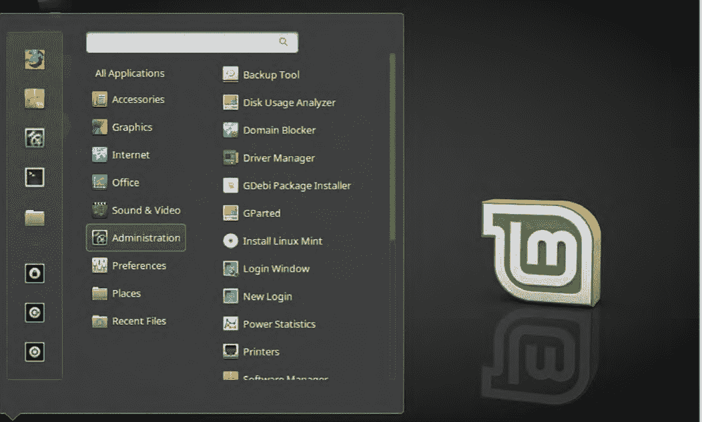

## 特色 `Mint`

### 基础

`Linux Mint` 如此受欢迎，以各种发行版和桌面环境都想要加入其中。值得注意的是，`Mint` 有两个构建版本，一个基于 `Ubuntu`，另一个基于 `Debian`。

`Debian` 且没有任何 `Ubuntu` 软件包，`LMDE 2.0 'Betsy'` 于 2016 年初发布，基于 `LTS` 而不进行滚动更新。

`Linux Mint` 最初于 2006 年发布并基于 `Ubuntu`，`Linux Mint 1.0 Ada` 被 `Ubuntu Mint 2.0 'Barbara'` 取代。`Linux Mint` 在上一个版本的基础上构建每个发行版本，但使用的是 `Ubuntu` 代码库包。这导致了 `Linux Mint` 与 `Ubuntu` 之间的兼容性，而不是在后期日期变成一个分支。

尽管这两个 `Linux Mint` 版本的起源不同，你可以根据自己的意愿灵活选择，版本 2.0 提供 `MATE` 和 `Cinnamon` 桌面，我们已经看到基于 `Xfce` 和 `KDE` 桌面的标准版 `Linux Mint 16.04 LTS` 非常棒的。

然而，短短年后，`Linux Mint Debian` 版问世了。它以滚动更新的形式发布。`Ubuntu` 版本和 `Debian` 版本各有优劣，当然，让我们来看看吧。


## 如何安装 `Mint 18` 的 `OEM` 版本

如果你制造并销售电脑，或者翻新旧电脑，并且不知道谁将使用它们，请使用 `Mint 18` 的 `OEM` 版本。


| 全部 | 描述 |
| :--- | :--- |
| 辅助 | 账户详情 |
| 已接受 | |
| 应用程序 | 账户管理器 |
| 社区 | 沙箱 |
| 策划 | 烘焙工具 |
| 互联网 | 软件 |
| 办公 | 服务 |
| 编程 | 蓝牙 |
| 音频与视频 | |
| 翻译 | 字符管理器 |
| 可视化 | 网页浏览器 |

通过 `Live` 光盘完成，你应该使用 `Gparted` 格式化任何分配的交换分区而不加入，并选择安装 `Mint OEM` 版本。

## `Debian` 版本

所有这些前沿软件意味着 `LMDE` 带来了一些细小问题。例如，对多核 `CPU` 的支持可能是一个问题，使用 `XFS` 作为文件系统也是如此。这些问题经常发生，但对于我们所有需求来说，频率通常足够低，有时只需使用它即可。

接下来，按照请求分区磁盘。完成后，检查“准备发货给终端”，让终端用户创建自己的账户并进行配置。

这看起来可能很困惑，因为 `Ubuntu` 是基于 `Debian` 的，而且也有一个基于 `Debian` 的 `Mint` 版本。

`Linux Mint Debian` 版没有标准的 `Ubuntu` 版本那么主流，它具有相同的软件包仓库，但缺乏兼容性和其他功能。正如你可能猜的那样，它是不同的，并且是为经验丰富的 `Linux Mint` 用户准备的。

只要你使用的不是主流操作系统，而且你拥有配置所需的技能和耐心，那么你就没问题。就像 `Linux Mint` 一样，新版本会这样改变桌面环境。


## `Ubuntu` 版本

基于 `Ubuntu` 的 `Linux Mint`是最受欢迎的版本。它基于 `Ubuntu`，并受益于其庞大的社区和软件支持。

 `Linux Mint` 是最受欢迎的版本。它基于 `Ubuntu`，并受益于其庞大的社区和软件支持。


## `MATE` 桌面

不喜欢 `Cinnamon` 吗？别担心，`MATE` 桌面是一个很不错的替代方案。

那么 `MATE` 具有哪些 `Cinnamon` 做不到的功能呢？嗯，它通常更快，所需的系统资源更少，使其成为在旧系统上安装 `Linux Mint 18` 的理想选择。记住，`MATE`

也许最重要的是，`MATE` 是 `GNOME2` 的分支，可以声称开箱即用更传统的 `Linux` 体验。

### 1

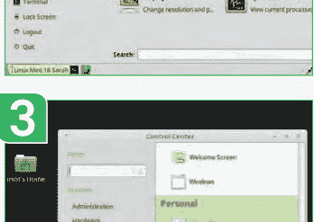

### 2


#### 更简单的菜单

可以认为，从图形呈现的角度来说，`MATE` 菜单更加简单，比 `Cinnamon` 消耗的资源。

#### 功能丰富的文件管理器

为了让用户获得想要的功能，而无需让他们在菜单中寻找功能，`MATE` 提供了一个功能丰富的文件管理器。

### 3


#### 控制中心

`MATE` 的控制中心是你可以找到所有设置的地方，在这里它们通过相应的标签让它们变得更容易寻找。

#### 更改外观

如果你想自定义桌面，`MATE` 提供了一个很棒的工具来切换背景，还可以更改主题和字体。

### 4


#### 面板图标

`MATE` 的图形样式延伸到整个面板的时钟区域，在那里可以找到各种图标，并点击它们获取选项。

### 5


#### 现代系统的理想选择

已发现 `MATE` 可以在内存仅为 64 MB 的 `PC` 上运行。这使其成为性能较低的旧电脑的极佳选择。

### 6


### 特性丰富的 `Mint`

#### 安全问题

`Linux Mint 17.3` 在 2016 年初遭到了恶意软件攻击。这种系统安全仍然是一个问题吗？

操作系统的安全非常重要；你必须信任你选择的操作系统是安全的、可以使用的。因此，当这种信任被破坏时，问题就会出现。

2016 年 3 月，`Linux Mint` 官方论坛的用户以及所有下载了新版 `Linux Mint 17.3 Cinnamon` 的人都首次暴露在恶意软件之中了。这种感染——附带在上一个版本的 `ISO` 文件中——被迅速处理了，已经得到了妥善解决。

毕竟，`Linux` 的优势之一难道不是恶意软件因为其用户群体相对较小而忽略了它吗？

用户应该更改他们所有敏感账户的密码，并销毁任何 `Mint 17.3` 的副本。

虽然恶意软件不再是一个问题，但这并不意味着你不应该意识到恶意软件和其他安全问题的风险——无论你运行的是什么。


### 01 启用防火墙

`Linux Mint` 内置了 `Uncomplicated`（一个针对 `IPTables` 的防火墙），但默认仍是禁用的。在木马和远程激活恶意软件的时代，这似乎是一个错误。我们可以通过使用此终端命令启用防火墙来修复：

```
ufw enable
```

运行时，你可以检查防火墙状态：

```
ufw status
```

可以读取完整的规则：

```
ufw status raw
```

如果你想禁用防火墙，输入：

```
ufw disable
```

### 02 缓解 `Flash` 问题

如果在设置 `Linux Mint` 时启用了多媒体支持，你会安装 `Adobe Player`。不幸的是，`Flash` 容易出现安全问题，且源更新并不快。

如果你正在使用 `Adobe Player`，使用此终端命令安装新版本：

```
apt-get install flashplayer-installer
```

注意，此操作会导致这些 `Flash Player` 包被移除。

### 03 保持你的浏览器安全

浏览器允许我们使用网络，但如果它们不一定得到维护，可能会导致某些恶意软件安全问题。你有几种方法可以避免这些问题：

- 确保安装并更新你的浏览器。如果你使用 `Chrome`，这会自动发生。

- 第二，将你的插件或扩展数量减少到最。只使用来自信任位置的内容。

- 第三，为你的浏览器采用沙箱，以锁定运行在你访问的页面上的任何恶意脚本。


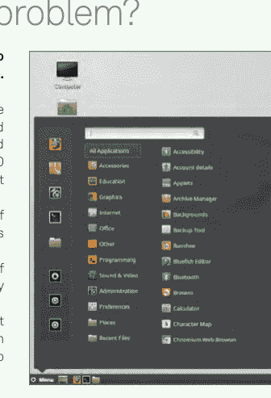


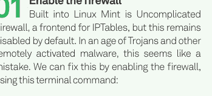


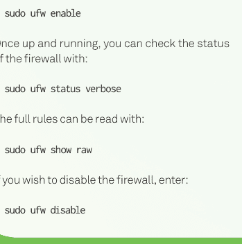

## 05 安装并在沙箱中使用你的浏览器

设置和使用沙箱很简单。在终端中，使用 `apt-get` 命令安装 `firejail`：

```
apt-get install firejail
```

完成后，你可以启动 `Firefox`：

```bash
firejail firefox
```

但不要忘记以后启动浏览器以保持安全。以后启动 `Firefox` 时，右键点击 `Firefox` 图标，选择编辑并确认沙箱正在运行：

```bash
firejail --tree
```

## 04 避免桌面和小应用程序

对于插件——每安装一个都会减慢你的浏览器——你应该小心。理论上，它们可以提高性能或美化你的环境。这并不意味着你应该使用它们增加资源消耗。系统性能可能会下降，同样，如果你不了解工具，你就无法信任它的行为。

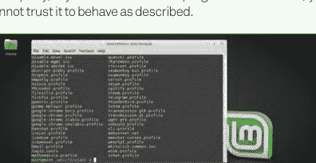

## 06 明智地使用 firejail

尽可能使用 `firejail` 是一个好主意。使用邮件客户端或其他 `Firefox` 不同的浏览器？也许你正在运行当前的客户端？在这种情况下，`firejail` 支持的比你需要的多。关于如何做的详细信息，请参考 `/etc/firejail`。

## 07 不要误用 sudo

这一点再强调也不过。基本上，如果一个命令不需要你切换到超级用户，就不要这样做。更改系统文件或应用的内容是可以的。但是，如果你用 `sudo` 运行应用程序，你就有麻烦了。它可能在某些时刻导致你访问的文件权限错误。这就是为什么运行标准应用时是不需要它的原因。

## 08 小心添加源

在某个时刻，你会被提示向更新管理器添加源，以添加存储库中的可用软件。这可能证明是一个安全风险，特别是当你正在设置一个新的存储库时。其中一个是不稳定的（`unstable`）。虽然默认禁用，但你应该确保在 `管理 > 软件管理器 > 软件源` 中，你应该确认该选项保持未勾选。

## 09 对 PPAs 和 DEBS 谨慎

与我们上面提到的类似，第三方存储库和 `DEB` 安装程序可能会导致安全风险。如果你想使用它们，在任何情况下都不应该在电脑上安装未公开的软件。这种软件应该在你测试或评估非替代方案，或者当你需要它时安装。同时，可以下载并安装的 `DEB` 安装文件也构成了巨大风险。使用软件管理器安装新应用，而不是浏览器。


# 特性丰富的 Mint

## 替换专有软件

### 专有软件可以在包中找到。为什么不选择你自己的软件？

在安装 `Linux 18` 后，你会发现专有软件。但是，除非是浏览器、邮件客户端或功能性应用，否则专有软件可能会带来问题。如果你想使用专有软件，在任何情况下都不应该在电脑上安装未公开的软件。这种软件应该在你测试或评估非替代方案，或者当你需要它时安装。同时，可以下载并安装的 `DEB` 安装文件也构成了巨大风险。使用软件管理器安装新应用，而不是浏览器。

# 不要安装 AMD 驱动

如果你的电脑或笔记本电脑带有 `AMD` 显卡，或者你自行添加了显卡，安装闭源专有驱动并不是一个选择。请使用开源选项，因为 `AMD Catalyst` 驱动并不兼容。请为这些显卡使用开源或 `radon` 驱动，以及 `Linux Mint`。请注意，如果你选择升级到 `Nvidia` 显卡，你需要安装专有驱动。

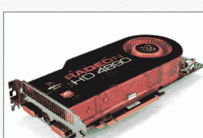

## 05 安装你需要的应用

如果你正在寻找某个 `Linux Mint` 之前的版本中包含的特定应用，你需要前往“软件管理器”（`Software Manager`）。在这里，你可以快速找到并安装它。为了节省时间，之前 `Mint` 版本中预装的你需要的应用程序可以在软件管理器中找到。你会发现许多多样且实用的工具，如 `Skype`、`Scribus` 和 `Wine` - 这些都是 `Linux` 用户的开源实用程序

## 06 你真的需要额外的应用吗？

这个问题听起来可能很奇怪，但值得考虑。你可能并不需要 `Mint` 版本中预装的专有应用，因为有许多免费应用可供选择。例如，会预装浏览器以及办公软件。通过这些工具，必要时你可以在线完成几乎所有操作。在线日历和联系人也可以通过各种来源（如 `Google`）获取


# 阻止 FOSS 应用

另一方面，你可能会对一个无法安装 `FOSS`（自由开源软件）的操作系统感到非常满意。你可以完全阻止专有软件的安装。通过启动菜单并在主目录下创建官方软件包仓库的副本：

| 分类 | 搜索结果 |
| :--- | :--- |
| `Postgresql-9.5-pgpq` | 用于 `postgresql` 复制、`lodiste` 和 `pgq` 的工具 |
| `Python-postgresql` | 用于 `postgresql` 复制工具的 `Python` 框架 |
| `Python-postgresql` | 用于 `postgresql` 复制工具的 `Python` 框架 |
| `Skytql2-ticker` | 用于 `postgresql` 复制、`lodiste` 和 `pgq` 的工具 |
| `Skytql3-waitmgr` | 用于 `postgresql` 复制和故障处理的工具 |

```bash
sudo cp /etc/apt/sources.list.d/official-package-repositories.list /home
```

接下来，用 `nano` 编辑该文件：

```bash
sudo nano /etc/apt/sources.list.d/official-package-repositories.list
```

在这里，编辑每一行以移除所有的 `'restricted'` 和 `'multiverse'`。同时，你还应该删除 `partner` 部分：

```bash
# deb http://archive.canonical.ubuntu/ xenial
```

按下 `Ctrl+X` 保存并退出。`Skype` 和 `Scribus` 等应用将不再可见。

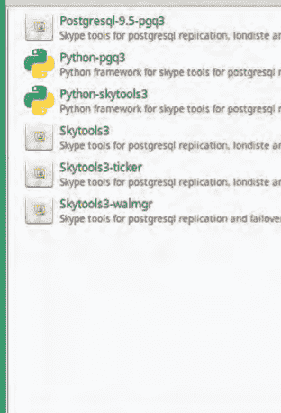

- 无正在进行的操作

## 高级配置技巧和妙招

是时候压榨 `Linux Mint 18` 以获得一些真正的性能提升了

`Linux Mint 18` 开箱即用，但为了挤榨出额外的性能，请尝试这些技巧。

在稳定性方面。较少的谨慎意味着更多的 `bug` 和安全更新，可以通过打开“更新管理器”并找到“编辑 > 更新策略”来完成。在这里，选择“不要弄我的电脑！”或“优化稳定性和安全性”以获得最佳效果。

### 停止休眠

如果在 `BIOS` 或 `UEFI` 中正确实现，省电对电池非常有好处。由于这种情况很少见，休眠可能会成为问题。`Ubuntu` 是，但 `Mint` 不是。

休眠——将会话保存到硬盘中——可以通过终端禁用：

```bash
sudo mv /etc/polkit/1/authority/50-local.d/com.ubuntu.enable-hibernation.policy /home
```

记得重启以使生效。

### 内存不足？减小交换分区（swap）

如果你的内存小于 `4 GB`，请通过终端降低 `swappiness` 值：

```bash
cat /proc/sys/vm/swappiness
```

通常值为 `60`，但可以通过打开... 轻松降低：

```bash
gedit /etc/sysctl.conf
```

...并在文件中添加以下内容：

```bash
# vm.swappiness=10
```

保存并关闭，然后重启。重复第一条命令确认已减少到 `10`。

### 简化安装流程

`Mint` 默认不安装推荐软件包，但你可以通过“管理 > `Synaptic` 软件包管理器”进行更改，然后进入“设置 > 偏好”。在“制作更改”下，勾选“将推荐软件包视为依赖”，然后点击应用并确定。接着在终端输入：

```bash
sudo sed -i 's/false/true/g' /etc/apt/apt.conf.d/
```

### 优化更新管理器

`Mint` 谨慎的更新管理器设置表面是为了提供稳定性。然而，`Ubuntu` 的限制选项较少，且不会损害...

### 禁用视觉效果


可以通过禁用视觉效果来提高性能，因此可以在“偏好>效果”中进行设置。你还应该检查“偏好>设置”，并禁用全屏窗口合成。打开“偏好>窗口平铺与对齐”并关闭。虽然 Mint 看起来不像你预期的那样华丽，但在运行密集型程序时，它运行得更快。


# 我的 Pi 项目

## PSPI V2

想要一种高性价比的方式来提升你的游戏体验吗？`Adam Seamer` 的 `PSP2` 项目将非常适合你。


- `PSP` 项目的灵感最初来自哪里？

我是在玩《超级马里奥》和《塞尔达》中长大的，那是在 90 年代后期。或者我每天都会用 `SNES` 或 `Gameboy Color` 玩一个我想玩的游戏。这一年非常忙碌。现在周末有人在享受它。我的重点是，我更倾向于把时间花在项目而不是钱上。我的目标是构建一个廉价的硬件，但配备更大的 `LCD` 以支持更多游戏，并且按钮要足够舒适以便连接外部 `USB` 驱动器。同时让 `Pi` 作为一个微主机也非常重要，这使其变得有用得多。使用一个损坏的 `PSP200` 是完美的选择。

而且这是在没有任何社区参与的情况下完成的。两个月来，我每天下班后工作两个小时来制作一个可以玩的手持设备。在这个过程中一切并非完美。设计是边做边完善的，每隔几天就会重新进行工程。我发现其他人也有同样的“第一个项目的杂乱感”，但没有我这么有条理。第二个 `PSP2` 在功能上几乎完全相同，但它更整洁、更成熟。从第二个版本开始，使用不同的 `LCD` 和质量更好的组件产生了巨大的差异。

希望这能让那些经验较少或没有时间进行大量研究的人能够复刻。这是一段旅程。

- 我们的读者复刻你的 `PSP2` 项目有多容易？对于想要尝试的人，你有什么建议吗？

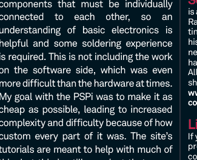

- 开始很困难。它包含了许多必须单独处理的组件，每个组件都散落在不同的地方。这比我们熟悉的硬件要困难得多。我的目标是使其尽可能简单，由于每个部分的成本都很昂贵，降低复杂性和难度。教程在这里可以为你提供帮助。当你操作它时，你会发现它并没有你最初认为的那么令人畏畏，而是很有回报。

- 在开发过程中你是否遇到过任何让你头疼的问题？

这个项目的每个部分都是一次学习经历。我完全按照我所构想的方式完成了它。

## Adam Seamer

一位长期的手工爱好者，拥有创建新手持游戏机的历史。所有它们最终都是自制的。

- 喜欢吗？如果你觉得组装一个项目太复杂，那么你可以在其他地方找到更多基于 `Pi` 的项目。

- `PSP Zero` 也能驱动 `PSP2` 的开发，你想如何测试它？与其尺寸相比，`PSP2` 项目的价格是多少？

`PSP2` 很容易制作，但并不易于被理解。它不是那种插上就能用的设备。它需要时间和精力的。对于这个特定项目来说，它所使用的材料非常值。但总的来说，这都关乎成本，这个项目是值得的。成本是 300 美元。我一直是个手工爱好者，因为我有这种动力，既然它这么便宜，可能性是无限的。这不会是我在 `PSP Zero` 上花费的最后一个项目。

延伸阅读：`Adam` 慷慨地在他的网站上分享了该项目的细节。他还在他的网站上提供了大量的教程。

- 你最近发布的原始 `PSP` 和 `PSP2` 之间有什么区别？

原始 `PSP` 是一个实验。

### “PSP2 的功能几乎完全相同，但更整洁”

但在功能线上，实现方式存在差异。与 `PSP Zero` 相比，`PSP2` 项目进行期间，我有充足的时间进行研究和规划。

我面对了早期硬件的不同方面，`GPIO` 控制、复合 `LCD` 以及音质和供电能力音频电路需要更好的设计。这很艰巨，也很难弄清楚，但硬件方面的糟糕程度只有这一半，而软件方面也同样复杂。我创建 `otherMod.com` 网站的原因之一是，随着项目的进展，我为项目的每个部分创建了教程，对于 `PSP Zero` 也是如此。这将让那些想要拥有自己 `PSP` 的人更容易上手这个项目。

- `PSP` 项目的未来如何？你认为前景内会有新东西出现吗？

是的，版本 2 将在不久后推出。`PSP2` 是第一个向社区展示的项目，社区的反馈非常好，有很多更改和增加的佳想法，这些将进入下一个版本。我预计它会变得今天一样流行，我会坚持下去，直到我们达到任何人都可以为自己制作一个境界。


# 教程


## 控制 A

### 机械臂

仅需你的指尖

通过拨动、手指动作和手势构建、破解并移动机械臂

本教程结合了 `Maplin` 机械臂和 `Pimononi` 的 `Skywriter HAT`，让你能够控制机械臂。手臂可以随着你的手指移动。手臂可以随着你的手指移动。当你操作时。在这个教程中，你将首先学习安装模块。接下来，你将学习如何编写程序。最后，你可以将其移动到不同的位置。观看视频：`https://www.youtube.com/watch?v=SVD6X8i`

- 需要

* `Maplin` 机械臂
* `Pimononi` 的 `Skywriter HAT`
* `Raspberry Pi`

### 机械臂

仅需你的指尖

通过拨动、手指动作和手势构建、破解并移动机械臂

本教程结合了 `Maplin` 机械臂和 `Pimononi` 的 `Skywriter HAT`，让你能够控制机械臂。手臂可以随着你的手指移动。手臂可以移动 120 度、300 度、270 度。在这个教程中，你将首先学习安装模块。接下来，你将学习如何编写程序。最后，你可以将其移动到不同的位置。观看视频：`https://www.youtube.com/watch?v=SVD6X8i`

## 机械臂

### 01 构建你的手臂

通过拨动、手指动作和手势构建、破解并移动机械臂

本教程结合了 `Maplin` 机械臂和 `Pimononi` 的 `Skywriter HAT`，让你能够控制机械臂。手臂可以随着你的手指移动。手臂可以移动 120 度、300 度、270 度。在这个教程中，你将首先学习安装模块。接下来，你将学习如何编写程序。最后，你可以将其移动到不同的位置。观看视频：`https://www.youtube.com/watch?v=SVD6X8i`

### 02 更新你的 Pi

现在你已经安装了编写程序所需的软件，请插上它。要做到这一点，只需将机械臂的电缆插入 `Raspberry Pi` 或任何可用的 `USB` 端口。你可以通过在终端输入 `sudo usb` 来测试连接是否正常以及手臂已被识别。

### 03 安装 USB 软件

为了使用 `Python` 编程控制手臂，首先安装 `USB` 软件。它提供了与 `Python` 的连接以及对 `Raspberry Pi` 通用串行线 (`USB`) 的访问权限。在终端中输入

```bash
$ git clone https://github.com/lavacal/pyusb
```

安装完成后，进入文件夹，输入 `pyusb`，然后输入代码 `sudo python setup.py` 这将安装库。最后，重启你的 `Raspberry Pi`。

### 04 将手臂连接到 Pi

现在你已经安装了编写程序所需的软件，请插上它。要做到这一点，只需将机械臂的电缆插入 `Raspberry Pi` 或任何可用的 `USB` 端口。你可以通过在终端输入 `sudo usb` 来测试连接是否正常以及手臂已被识别。

### 05 控制手臂

手臂通过向其发送代码来控制，向其

### 07 导入所需的库

在代码顶部，导入你的程序。使用 `time`、`usb` 和 `util` 库来访问 `USB` 端口，控制 `USB` 是一种复杂的协议，但 `PyUSB` 对于大多数配置来说都是足够的，最小化库允许你在每次手臂移动之间添加短时间延迟。添加以下代码行：

```python
import usb_core, usb_util
```

### 08 为设备命名

现在使用 `Python` 寻找手臂。在下一行，创建一个名为 `RoboArm` 的变量来存储手臂位置的信息——这基本上是哪个 `USB`

## 机械臂

端口已插入。现在，对于你插入到树莓派 `USB` 端口的设备，输入 `ID` 号和产品 `ID` 详情来搜索它。如果你使用的是不同的机械臂或模型，你需要找到这些详情并在代码中替换它们。

```python
RoboticArm.find(id=0x1267, idproduct=0xb000)
```

```python
# 导入 usb-dev 库
# 为 USB 设备分配名称 'robot'
robot = RoboticArm.find(id=0x1267, idproduct=0xb000)

# 检查是否检测到机械臂
if not robot:
    raise ValueError("arm not found")

# 创建一个用于持续时间的变量
duration = 0
```

下一步是搜索机械臂以将其连接到 `USB` 端口并开启。使用一个简单的条件，如果没有检测到（如果未找到机械臂），将向 `Python` 窗口返回错误消息让你知道：开启或关闭！代码的下一行是缩进的。


## 12 创建函数

该函数的最后部分是设置机械臂，第 1 行。这把机械臂连接到你在上一步中设置的 `ArmCmd(0,0,0)` 代码。注意，它存储在变量 `ArmCmd` 中，你可以更改传输到机械臂的命令。这一行也是缩进的。

## 09 如果机器人名称为

```python
raise ValueError("arm not found")
```

```python
# 导入 usb-dev 库
# 为 USB 设备分配名称 'robot'
robot = RoboticArm.find(id=0x1267,idproduct=0xb000)

# 检查是否检测到机械臂
if not robot:
    raise ValueError("arm not found")
```

```python
RoboticArm.transfer(4,6,0,0,0,0,ArmCmd,1000)
```

## 13 移动与动作

一旦你编译了函数，就可以使用它来控制机械臂。每个移动或动作都有一组独特的详情，用于最后一次移动的距离、以及想要旋转的方向。每个命令都以 `MoveArm` 开头，第一个数字是指令或动作的顺序。例如，1 基本上是移动一个区域的指令。第二个数字是旋转机械臂所需的信息。

## 10 创建函数，部分 1

在下一行，在每次机械臂移动之间添加延迟。在一个名为 `duration` 的新变量中赋值为 1，第 1 行。在下一行，创建一个函数，该函数包含你使用的持续时间，以及一段停止移动的代码。此外，添加将移动命令发送到 USB 端口的代码并将它们与机械臂关联。注意这一行是缩进的。

## 14 开启

在下一行，机械臂必须打开灯。使用灯的类型。`# Light on` 是注释，控制机械臂并不需要它。它用于识别你想要使用的代码的用户：它会打开灯。当你完成几个命令后。

## 15 Duration = 1

```python
def MoveArm():
    # 开始移动
    RoboticArm.transfer(4,6,0,0,0,0,ArmCmd,1000)
```

## 15 运行程序

现在你已经编译了用于机械臂 USB 端口的函数，然后编写了一条控制机械臂打开灯的指令。将程序保存到你的主文件夹中。一种简单的方法是按键盘上的 `F5`，保存名称，然后按回车键运行它。观察机械臂，它将会！

## 12 创建函数，部分 2

在下一行，添加一个很短的持续时间来设置动作持续时间的延迟。在这个示例中，持续时间被设置为 1。每个移动或动作将在你想要的时候发生。你可以通过更改步骤 10 中设置的值来体验这一点。在每次移动发生后，你需要使用代码 `ArmCmd(0,0,0)` 所在的（第 2 行），创建一个参数来停止移动旋转和移动。

## 16 关闭

除非你使用代码将其关闭，否则灯将一直保持开启。如果你在“关闭”命令中添加此行，灯将关闭，这样你就看不见它。在下一行，添加两秒钟的延迟，第 1 行，然后关闭灯，第 2 行。按 `F5` 按钮保存并运行你的程序。查看完整代码查看所有可用移动的行。你可以使用这些代码行来构建动作和机械臂的功能。

```python
# 在指定持续后停止移动
time.sleep(duration)
ArmCmd(0,0,0)
```

## 教程

`www.linuxuser.com` 73


## 手势控制

通过拨动、手指动作和手势构建、破解并移动机械臂

## 17 Skywriter 动作

`Pimor` `Skywriter` `HAT` 是一种电学近场 3D 手势传感板，它使用 4 层 `PCB` 以获得最佳传感性能，甚至可以应蜂蜂！它能够收集完整的 3D 位置和手势信息（滑动、轻点、双击、拨动和旋转），并对它们做出响应。它也组装。

```bash
pip install skywriter
```

以下命令安装 `skywriter` 所需库。如果你在使用虚拟环境，请激活它。要安装 `Skywriter` `HAT`，你可以在终端中运行以下命令：

```bash
sudo curl -s get.pimor.com/skywriter | bash
```

按照屏幕上显示的指示操作；它们将请求权限以安装软件，这会下载所需的库和依赖项。安装完成后，重启你的树莓派，然后就可以开始教程的下一部分。

## 18 安装软件

`Pimor` 让为 `Skywriter` 安装软件变得极其简单。加载终端并输入：

```python
import skywriter

skywriter.move()
def move(x, y, z):
    pass
```

## 19 你的第一个 Python 程序

打开一个新的 Python 文件（记得使用步骤 6 中的终端方法，需要管理员权限）并添加以下代码。首先导入 `skywriter` 库，然后创建一个函数来感应手势的位置，返回 x, y, z 坐标（第 4 行），最后打印到 `skywriter`。保存程序并运行它。注意它具有悬停能力，不需要实际触摸，只需悬停上方。

```python
import skywriter

skywriter.move()
def move(x, y, z):
    pass
```

## 20 双击

在这个程序中，你可以双击 `Skywriter` 板，它会告诉你位置。在第 3 行使用 `position` 变量来显示你在北、南、西哪里轻击（第 4 行）。例如，如果你在顶部双击，它将确保每次轻击都被清晰地识别（第 5 行）。保存并运行程序；在第 2 行轻击第 16 行的拨动确认。

```python
import signal
import skywriter

def double_tap(position):
    print("Double tap!")
    signal.pause()
```

## 新 Skywriter

通过拨动任何手势（如双击），你就可以识别 `skywriter` 的位置并做出特定响应。例如，你可以在顶部轻击；如果向右拨动，`Skywriter` 向东移动；如果向西，它就移动。可以使用条件来检查 `skywriter` 的拨动并返回信号。

```python
@skywriter.flick()
def flick(start, finish):
    print("Got a flick!", start, finish)
```

## 编辑你的代码

现在你尝试了一些命令，可以使用这些来控制机械臂。打开机械臂文件，并在程序顶部导入所需的库。


## 22 感应位置

当用户轻击板时（第 3 行），创建一个新函数，找到轻击并记录用户使用的位置。这存储在名为 `position` 的变量中。添加第 6 行的 `if` 语句来检查并比较位置。如果在顶部轻击，位置为北。使用第 5 行的 `else` 语句，如果是在底部轻击，位置为南。保存并运行。

```python
import signal
import skywriter

@skywriter.tap()
def tap(position):
    print("tap")
    if position == 'north':
        print("north")
    elif position == 'south':
        print("south")
```

## 23 降低响应速度

这是当你连续拨动 `Skywriter` 时。轻击是简单的按下，但如果你拨动两次再次再次，它将被解释为双击。你可能想区分拨动和双击。为了解决这个问题，在 `tap` 函数中添加一个变量，使动作只重复一次。如果你仍然认为两次点击足够明显，请增加重复率。

```python
@skywriter.tap(repeat_rate=1)
```

## 24 感应拨动

另一个有用的手势可以通过拨动被检测。只需在第 1 行使用 `Skywriter` 等待拨动。创建一个新函数来识别拨动和拨动的方向，例如北或东。

## 25 添加 Skywriter 命令来移动机械臂

接下来添加根据 `Skywriter` 感应到的手势控制机器的代码。使用 `touch` 命令注册触摸（第 1 行），并创建一个变量来保存你按下板的拨动位置（北、南、东、西，第 2 行）。使用第 3 行的 `if` 语句检查是否注意到了拨动。然后使用机械臂移动（第 4 行）。最后打印一条消息通知用户拨动已注册。


```python
import skywriter
import signal

@skywriter.tap(repeat_rate=1)## 提高下限
def tap(position):
    if position == 'north':
        MoveArm(1,16,0) # 肘向上
        print("Elbow Up")
```

## 27 添加更多移动

现在向程序中添加一些移动。使用下一行并缩进一个带有 `flick` 语句的 `if` 语句来检查南部位置（第 1 行）。如果在板底部（南部）触摸，它将注册并向下移动手臂（第 2 行）。按 `F` 保存程序，然后运行并测试。

```python
elif position == 'south':
MoveArm(1,32,0) # 肘向下
```

# 教程


# 28 为夹爪添加控制

继续构建你制作的手势。在原先的一行代码下方添加另一个 `else-if` 语句来检查新的西侧位置（第 1 行），然后使用手臂命令代码打开夹爪（第 2 行），通过触摸 Skywriter 行来关闭夹爪（第 3 行），然后添加代码到夹爪中（第 4 行）。

```
elif position2 == 'west':
    MoveArm(1,8,0) #夹爪关闭
elif position2 == 'east':
    MoveArm(2,8,0) #夹爪打开
```

# 29 使用任务 (Tasks)

任何 Skywriter 手势都可用于控制手臂。在新的一行中，创建一个新变量将其值设置为 1，然后重复可能任务的速率。创建一个名为 `position1` 的新变量，用以停止 Skywriter 覆盖之前的变量（例如，当你想要移动手臂但保持左转开启时）。在第 4 行检查位置，然后移动将产生效果的位置（第 5 行，这是可选的）。结合上一步，为手臂分配移动代码；例如移动肩膀（第 6 行），

```
@skywriter.tap(repeat_rate=1)
def tap(position):
    print('Tap!')
    if position == 'north':
        print "Shoulder Up!"
        MoveArm(1,64,0,0) #肩膀向上
```

# 30 肩部向下

要让肩膀向下移动，使用与第 27 行相似的格式。在下一行，即与 `if` 语句缩进齐的位置，添加一个 `else-if` 语句来检查对肩膀位置的点击（第 1 行）。添加一个可选语句来显示点击已记录（第 2 行），并添加移动肩膀的命令（第 3 行）。保存并运行你的程序。


```
if position1 == 'south':
    print "Shoulder Down"
    MoveArm(1,28,0) #肩膀向下
```

# 31 汇总

继续以类似的方式创建你的程序，如步骤 26 到 30 所示。首先选择你想要使用的手势类型，然后设置一个变量实体以及 Skywriter 上的手势部分位置，例如：北、南、西。我们可以使用条件语句、`if` 和 `else` 语句来检查位置，并根据完整列表相应地移动手臂。使用教程中的程序作为你想法的基础设置，然后进行扩展和自定义以添加你自己的动作。

# Ryanteck LTD

在 Linux 上使用树莓派扩展板、HAT 和 GPIO。（同时也支持 Windows 和 Mac）

# RTK.6GP10

`https://ryanteck.xyz`

预计于 12 月发货

关注进度请：

`http://ryanteck.com/rtkgpi10`

# MODMYPI

# 树莓派的一切！

树莓派商店 - 我们提供系列转接板、树莓派组合包、SD 卡、外壳、黑客套件和组件 - 全球发货！

`WWW.MODMYPI.COM`

# IQaudio

适用于树莓派的发烧友级配件

# Pi-DAC+

- 树莓派 HAT，无需焊接
- 全高清音频（最高 24bit/192MHz）
- 德州仪器 `PCM5122`
- 可变输出，达 2.1rms
- 耳机放大器 / 3.5mm 插座
- 开箱即用
- 集成硬件音量控制
- 访问树莓派 GPIO
- 连接 Hi-Fi 输入/输出
- 行业标准格式 (`RCA`) 接口
- 支持 `Pi-AMP+`

# Pi-AMP+

- `Pi-DAC` 配件，无需焊接
- 全高清音频（最高 24bit/192MHz）
- 德州仪器 `TPA318`
- 高达 25W 的功率注入
- 为树莓派供电
- 支持软开关
- 使用 `Pi-DAC` 耳机时自动静音
- 输入电压 12-19V
- 支持 4-8 欧姆扬器

# Pi-DigiAMP+

- 树莓派 HAT，无需焊接
- 全高清音频（最高 24bit/192MHz）
- 德州仪器 `TAS5756`
- 高达 25W 的功率注入
- 开箱即用
- 集成硬件音量控制
- 为树莓派供电
- 软件管理
- I/O (`I2c`, 3v, 5v, 0v, `GPIO22/23/24/25`)
- 只需添加扬声器即可完成 Hi-Fi
- 输入电压 12-19V
- 支持 4-8 欧姆扬声器

# 教程

# 使用 Onion Pi 将你的 Pi 变成 Tor 代理

## 将树莓派变成无线访问点以访问匿名 Tor


`Nate Drake` 是一位专攻网络安全的科技记者。他为各种杂志编写教程，他的志心是能够负担得起比他的朋友更好的树莓派。

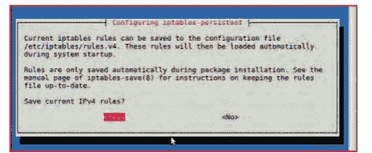

```
iptables-persistent

当前规则可以保存到配置文件
/etc/iptables/rules.v4。这些规则将在启动时自动加载。
如果你想保存规则，在安装期间运行 `iptables-save`
```

`iptables-persistent` 会询问你是否保存更改。

# 02 安装必要软件

运行命令 `apt-get update` 然后 `apt-get install isc-dhcp-server iptables` 来安装必要的软件。`iptables-persistent` 会询问你是否保存，两者都选择 `Yes`。在无处不在的监控时代，这比任何时候都要防止广告商和政府监控你的移动。如果你通过 Tor 连接，你的连接是加密的，并通过一系列名为 'onion' 的代理。这减慢了你的连接，但增加了你的隐私。

# 03 配置 DHCP 服务器

运行 `nano /etc/dhcpd.conf`。找到开头的 `domain-name` 和 `interface eth0`。去掉每行的 `#`。按照本教程的步骤将你的 Pi 变成名为 `Onion_Pi` 的无线访问点 (AP)。完成后，使用 `whatismyip.com` 等网站查看你的位置是否已更改。在文件末尾粘贴此。按 `Ctrl+X`，`Y` 然后返回编辑器。

```
subnet 192.168.1.0 mask 255.255.255.0 {
  range 192.168.1.10 192.168.1.200;
  option router 192.168.1.42;
  option default-lease-time 600;
  option domain-name "local";
}
```

Tor 如何工作？

Tor 网络是由志愿者运行的服务器（节点）组成的。当你启动 Pi 时，它会创建电路。每个节点只知道哪里以及去哪里。Tor 每几分钟变换一次身份，追踪你的位置变得极其困难。

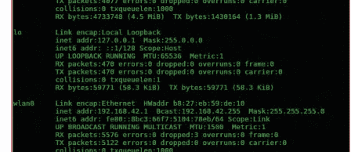

# 04 编辑 interfaces

运行 `nano /etc/interfaces`。滚动到 `INTERFACES` 部分并插入 `interface eth0 dhcp`。确保 "wan0" 在标记内。运行命令 `sudo systemctl restart networking` 和 `sudo systemctl restart isc-dhcp-server` 让你的更改在启动时生效。如果你的 IP 地址不同不要担心。

# 01 连接到 Pi

将你的 Pi 连接到网线，然后开启接口或连接。运行命令 `ifconfig -a`。你应该看到 `wlan0` 显示模块已启用。

# 05 设置静态 IP

运行 `nano /etc/network/interfaces`。找到 `allow-hotspot wlan0` 并在开头添加 `#` 将其注释掉。将以下行替换为：

```
iface wlan0 static address 192.168.1.2 netmask 255.255.255.0
```


你会在你平台的多个地方寻找此处：配置文件 `/etc/hostapd/hostapd.conf`。使用命令 `sudo nano /etc/hostapd/hostapd.conf` 为 `hostapd` 重复这些步骤。当你发送流量时，这种效果更好。

# 06 配置访问点

创建一个文件。不要使用在线文档：PDF 等可能包含泄露你真实位置的代码。粘贴以下内容：

```
interface=wlan0
driver=80211
ssid=Open_Pi
country=us
hw_mode=g
channel=6
mac_addr=
auth_al=1
ignore_broadcast_ssid=0
wpa=
wpa_password=Raspberry
wpa_key_mgmt=WPA
wpa_pairwise=TKIP
wpa_group_rekey=6400
wme_enabled=1
```

如果你使用的是树莓派，注释掉带有这一行

# 08 配置

运行 `sudo nano /etc/tor/torrc` 来配置它。访问 `https://www.torproject.org/docs/faq` 然后之后：

日志文件 `/var/log/tor.log`

`VirtualNetworkAddress` `192.168.10.1`

`AutoproxySuffix=exit`

`AutoproxyControlDNS=1`

`Traffic` `0`

`DNForward` `53`

`DNSAddress` `192.168.1.42`

保存并退出。运行 `sudo update-rc.conf` 在启动时启用 `tor`。

```
eth0: BROADCAST,MULTICAST,UP,LOWER_UP, mtu 1500 
	inet daddr  mask 255.255.255.0 global eth0

tether0: BROADCAST,MULTICAST,UP,LOWER_UP, mtu 1500
inet 192.168.13.1 scope tether0
   mask 255.255.255.0
```


可以自由密码从 `Raspberry` 更改为更复杂的。

```
iptables -t nat -A PRROUTING -o eth0 -s 192.168.13.0/24 -j MASQUERADE
iptables -A FORWARD -i tether0 -s 192.168.13.0/24 -j ACCEPT
iptables -A FORWARD -o eth0 -d 192.168.13.0/24 -j DROP
iptables -t nat -A POSTROUTING -o eth0 -j MASQUERADE
```

# 09 配置 IPTables

为了防止所有流量通过 `Tor`：

```
iptables -t nat -A PRROUTING -i wlan0 -p tcp
   --port 22 -j REDIRECT
iptables -t nat -A PRROUTING -i wlan0 -p udp
   --port 53 -j REDIRECT
iptables -t nat -A PRROUTING - i wlan0 -p tcp
   --port 53 -j REDIRECT
iptables -t nat -A PRROUTING - i wlan0 -p tcp
   --port 3080 -j REDIRECT
```

当你准备好检查配置时，使用命令 `sudo iptables -L -n`

## Python

## 构建树莓派集群

学习如何使用 `Python` 在你的树莓派集群上完成一些工作。

> 在此前的文章中，我们查看了如何将多台树莓派组合成一个机器集群。但你是否可以使用这些机器来完成除你创建的那个“巨兽”之外的更多事情呢？幸运的是，`IPython` 是让所有它们运行起来的一种极佳方法，让你的集群产生巨大的价值。

引擎（engines）负责实际运行你程序的代码。枢纽（hub）是你运行代码以及启动并行部分的地方。枢纽和客户端（client）是相互通信的部分。

可用的引擎。在上一个示例中，我们实际上在可用引擎列表上运行了代码。

这在单台树莓派上运行良好，但并不是我们感兴趣的。你如何利用你已经设置好并运行你服务的整个集群呢？关于如何组织集群以便它们都能从外部机器（即你）连接，有选项。最简单的方法是在每台机器上保留控制器，并使用 `ipython` 运行一切。默认情况下，`ipython` 设置为只接受本地连接。你需要使用 `IPython` 创建一个新的配置，如下：


Joey Bernal

Joey Bernal 是一个真正的工匠，负责拆分机器、制作家具、帮助科学计算问题以及 `Android` 应用

一旦安装好所有内容，你就可以使用树莓派上并行集群的任何部分来与其他客户端通信，如下：

```
ipython -n
```

这将启动 `n` 个引擎。例如，启动四个引擎将启动一个枢纽和一系列客户端。当运行运行它时，它会在后台保持运行。作为第一个测试，你可以看到它输出了一条消息。如果你想启动另一个客户端，在命令末尾按一个和符号 (`&`)，这样你就可以创建一个客户端对象并使用类似下面的代码连接到这些引擎：

### 为什么选择 Python？

它是 `Python` 的官方语言。

在 `ipython.org` 阅读文档。

```
sudo apt-get install ipython
ipython-notebook
```

### IPython 是让所有这些机器协同工作的极佳方法

如果你使用 `Python` 2.x，这将安装 `IPython`。如果你计划使用 `Python` 3.x，将需要安装 `ipython` 和 `ipython-notebook` 包。从 4.0 版本开始，并行功能已被提取到一个名为 `multipython` 的独立包中。大多数操作与旧版本的 `multipython` 并不兼容。你可能需要通过 `multipython` 安装它，如下：

```
sudo pip install ipython ipython-notebook multipython
```

根据你系统中依赖项的版本，你可能需要更新某些包。`IPython` 结构分为四个部分：引擎、枢纽、调度器以及

```python
>>> import multipython as ip
>>> c = ip.Client()
>>> [0, 1, 2]
>>> c.apply_sync(lambda: 'Hello World')
['Hello World', 'Hello World', 'Hello World']
```

当你使用 `ip.Client()` 实例化一个新的 `Client` 对象时，你需要设置默认配置以查看连接到你的并行集群。下一个语句将向你显示可用引擎。最后的测试是使用 `apply_sync` 方法在某些子集上运行 lambda 函数。

这将创建一个带一组设置的新配置。为了建立连接，你需要创建一个控制器来与之交互。你需要在目录中使用配置创建控制器，然后执行以下行命令用于 Hub。

```
ipython profile --myprofile
```

现在你可以启动集群了。你需要提供一个配置名称来使用引擎。如果控制器正在运行，且两台机器通过 `NFS` 位于同一网络上，你可以使用你想要创建新客户端的配置实例。

```python
>>> c = ip.Client(profile='myprofile')
```

如果它们没有文件系统，你需要在连接之前配置客户端。在托管控制器的树莓派上，你会在 `~/.ipython/profile_ipython/security` 目录下找到名为 `ipcontroller-client.json` 的文件，它包含客户端所需的所有连接。如果你将其拷贝到运行的客户端机器并放在 `~/.ipython/default/security` 目录下，你就可以不带任何参数创建一个新的客户端对象，它将从此 JSON 文件读取连接。

我们正在使用单台树莓派在集群上运行。为了将其池化，你需要使用 `ipython` 引擎而不是合合一的控制器。控制器需要接受来自客户端的连接，在远程机器上，我们将使用 IP 配置选项来设置网络。下一步是在组成池的每台树莓派上运行 `ipengine` 命令。此文件在 `~/.ipython/profile_ipython/security` 中创建，将包含第二个名为 `ipengine.json` 的文件，必须拷贝到集群中的每台 Pi 上，以便它们拥有连接所需的所有连接。在每台树莓派上，你将启动 `ipengine` 进程，指向你创建的 `ipengine.json` 文件。

```
ipython-client-engine.json
```


如果你想有多个主机引擎，你需要为每个引擎启动一个独立的`ipengine`进程。现在你已经有了运行的引擎（其中一个作为控制器），你可以将Python代码发送到此集群以并行你的工作，但我们如何做到这一点呢？你可以使用`scatter`和`gather`来并行处理你的数据，每个引擎都在集群上。

由`numpy`使用的后端并行化在文档中被称为调度器。虽然它对特定实例非常有用，但也有其他在实例化时自动创建的针对特定数据类型。这从现有的`numpy`数组创建一个新的数组对象。

```python
import numpy as np
import dask as da
a = np.random.randint(10, size=180)
d = da.from_array(a, chunks=30)
```

最后一步，`from_array`方法接受一个`chunks`参数，告诉`dask`如何处理数组的切分。良好的选择涉及到考虑数据的大小和处理步骤的计算时间。当创建一个新数组时，创建一个线程池，这意味着当你想在新创建的线程池上运行方法时。

```python
result = array.mean(2)
result.compute()
```

该语句是因为`dask`是惰性计算的。如果你已经在使用`pandas`或`numpy`，你绝对应该尝试一下`dask`。

```python
dict = dict(a=1, b='b')
v = dict(a=1)
v['a']='a'
{'a': 'a', 'b': 'b'}
```

这是方法的阻塞版本。如果方法需要时间，可以使用异步方法并返回一个`AsyncResult`对象以便在完成后检索结果。

随着人们随着时间处理并行代码，这些特定的部分被识别出来，人们编写了包来让这些变得更方便。今天这些包正变得流行。并行性的真正威力在于它的灵活性；你可以对任何新方法和对象进行并行化。例如，这些新对象可以合并。

希望这篇文章启发你利用所有那些闲置的树莓派，创建一个用于大数据计算的自己的集群！使用`Python`，你可以轻松地为`Python`引擎完成任何事情。

# 来自 Linuxuser & Developer 的出品


# Python 教程

通过《Python 教程》来探索这种令人兴奋且功能强大的编程语言。你将找到一份针对新编程者的完整指南、旨在建立知识体系的绝佳项目，以及如何在树莓派上使用`Python`的技巧——掌握`Python`所需的一切。


# 同样还有...


# 指尖上触及的内容世界

无论你热爱游戏、历史、动物、摄影、`Photoshop`、科幻还是其之间的任何领域，`Imagine Publishing`出版的每一本杂志和特刊都充满了专家建议和引人入胜的事实。


# 立刻购买您的副本

纸质版登录`www.imagineshop.co.uk` 数字版登录`www.greatdigitalmags.com`


## 评测

`83` `Group`组测 | `88` `PocketCHIP` | `90` `Salix 14.2` | `92` 自由软件

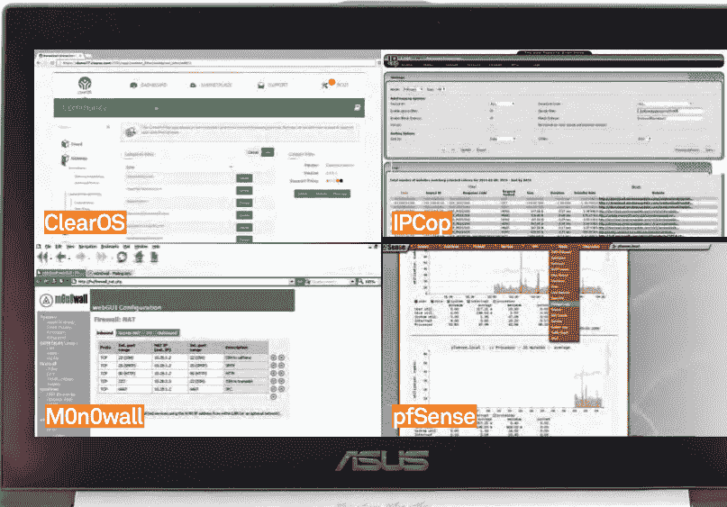

## 组测

## 防火墙

哪些程序能为你的桌面提供最好的防火墙保护？我们上手体验了市场上一些最流行的`Linux`防火墙。

### ClearOS

### IPCop

### M0nwall

### pfSense

`ClearOS`是该组中唯一的专用操作系统，但它拥有`Linux`用户可用的最印象深刻的防火墙功能。深入研究，你很快就会发现它非常适合你的服务器和网络需求，但这些防火墙提取是否包含其中？`ClearOS.com`。

虽然对你来说可能不是一个熟悉的名字，但`IPCop`实际上其防火墙系统一直保持着稳定的用户群。更新频繁，且配置具有极大的自由度。但这足以成为`Linux`用户的首选防火墙吗？`IPCop.org`

`M0nwall`旨在成为大多数现代发行版的全能嵌入式软件软件包。你可能会发现它对于进入防火墙世界的新用户来说可能令人生而畏，但它的深度对于寻找额外功能的人来说可能是理想的。`M0n0.ch`

与该组的其他产品相比，`pfSense`是普通用户最熟悉的那个。`pfSense`基于`FreeBSD`，已经经历了一些重大变化，如今已成为市面上最流行的开源防火墙解决方案之一。`pfSense.org`

`www.linuxx.co.uk` 83


## M0nwall

更新频率稀疏，

`M0nwall` 还是获胜者吗？

## pfSense

`pfSense` 可能是这里名气最大的，

但它拥有匹配的功能吗？

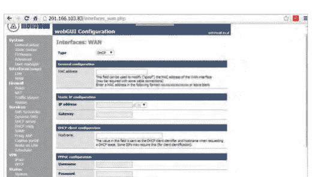

细节多到惊人，在此可以根据需求定制你的防火墙。


安装程序非常复杂，但在正确设置后，它运行得完美无缺。

## 设计

`M0nwall`的`UI`外观并没有特别之处，但并不意味着它不用户友好。所有可用工具都列在侧边，并有关键选项以便于导航。我们在测试时发现有几个功能似乎失效了，但这可能是某种出厂故障。

## 设计

与本次测试中的其他防火墙类似，`pfSense`使用标签菜单来帮助用户在其众多的选项中导航。虽然我们更倾向于`M0nwall`，但`pfSense`被认为拥有最易于使用的`UI`。某些项目还可以移动到`UI`的不同区域，如果你想自定义你使用的软件，这特别有用。

## 防火墙设置

`M0nwall`尽全力尝试为你提供可能需要的、以根据你的桌面定制防火墙的所有内容。细节多到惊人，虽然核心功能都是可用的，但还有许多内容可以删除以帮助简化流程。

## 防火墙设置

在在此显示的所有防火墙中，`pfSense`的设置过程最困难。虽然文档可以帮助你完成整个过程，但有时相当晦涩。然而，选项的选择令人望而畏，但你创建的防火墙允许你掌握整个过程。

## 控制与使用

`M0nwall`尽全力尝试为你提供可能需要的、以根据你的桌面定制防火墙的内容。细节多到惊人，虽然核心功能都是可用的，但还有许多内容可以删除以帮助简化流程。

## 控制与使用

`pfSense`使用起来非常愉快。

## 额外功能

`M0nwall`使用起来非常愉快。

## 控制与使用

`pfSense`使用起来非常愉快。

## 额外功能

`M0nwall`使用起来非常愉快。

## 总体

`pfSense`使用起来非常愉快。

## 额外功能

`M0nwall`使用起来非常愉快。

## 总体

`pfSense`使用起来非常愉快。

## 额外功能

`M0nwall`使用起来非常愉快。

## 总体

`pfSense`的设置过程是最困难的。

## 简评：对比与结论

| 项目 | ClearOS | IPCop | M0nwall | pfSense |
| :--- | :--- | :--- | :--- | :--- |
| 设计 | 是该组中唯一的专用操作系统，但它拥有 `Linux` 用户可用的最印象深刻的防火墙功能。深入研究，你很快就会发现它非常适合你的服务器和网络需求，但这些防火墙提取是否包含其中？`ClearOS.com`。 | 虽然对你来说可能不是一个熟悉的名字，但 `IPCop` 实际上其防火墙系统一直保持着稳定的用户群。更新频繁，且配置具有极大的自由度。但这足以成为 `Linux` 用户的首选防火墙吗？`IPCop.org` | `M0nwall` 旨在成为大多数现代发行版的全能嵌入式软件软件包。你可能会发现它对于进入防火墙世界的新用户来说可能令人生畏，但它的深度对于寻找额外功能的人来说可能是理想的。`M0n0.ch` | 与该组的其他产品相比，`pfSense` 是普通用户最熟悉的那个。`pfSense` 基于 `FreeBSD`，已经经历了一些重大变化，如今已成为市面上最流行的开源防火墙解决方案之一。`pfSense.org` |
| 防火墙设置 | 简单或复杂。9 | 分步向导将帮助创建。9 | 它最直观的 `UI`。8 |


| 控制与使用 | 是该组中唯一的专用操作系统，但它拥有 Linux 用户可用的最印象深刻的防火墙功能。深入研究，你很快就会发现它非常适合你的服务器和网络需求，但这些防火墙提取是否包含其中？`ClearOS.com`。 | 虽然对你来说可能不是一个熟悉的名字，但 `IPCop` 实际上其防火墙系统一直保持着稳定的用户群。更新频繁，且配置具有极大的自由度。但这足以成为 Linux 用户的首选防火墙吗？`IPCop.org` | `M0nwall` 旨在成为大多数现代发行版的全能嵌入式软件包。你可能会发现它对于进入防火墙世界的新用户来说可能令人生畏，但它的深度对于寻找额外功能的人来说可能是理想的。`M0n0.ch` | 与该组的其他产品相比，`pfSense` 是普通用户最熟悉的那个。`pfSense` 基于 `FreeBSD`，已经经历了一些重大变化，如今已成为市面上最流行的开源防火墙解决方案之一。`pfSense.org` |

| 额外功能 | 是该组中唯一的专用操作系统，但它拥有 Linux 用户可用的最印象深刻的防火墙功能。深入研究，你很快就会发现它非常适合你的服务器和网络需求，但这些防火墙提取是否包含其中？`ClearOS.com`。 | 虽然对你来说可能不是一个熟悉的名字，但 `IPCop` 实际上其防火墙系统一直保持着稳定的用户群。更新频繁，且配置具有极大的自由度。但这足以成为 Linux 用户的首选防火墙吗？`IPCop.org` | `M0nwall` 旨在成为大多数现代发行版的全能嵌入式软件包。你可能会发现它对于进入防火墙世界的新用户来说可能令人生畏，但它的深度对于寻找额外功能的人来说可能是理想的。`M0n0.ch` | 与该组的其他产品相比，`pfSense` 是普通用户最熟悉的那个。`pfSense` 基于 `FreeBSD`，已经经历了一些重大变化，如今已成为市面上最流行的开源防火墙解决方案之一。`pfSense.org` |

| 总体 | 8 | 5 | 8 | 8 |

## 获胜者是..

## `pfSense`

最好的防火墙之一是人们特别是针对桌面所寻找的一切。这种多样性让 `Linux` 如此独特，并展示了新用户和资深用户可使用的防火墙程序范围。当初学者在这一领域难以找到许多优秀者时，`pfSense` 证明证明自己是隧道尽头的光。`IPCop` 的标记也有优点，但被一些损害体验的小问题所掩盖。

我们会说，`pfSense` 应该是新用户的首选防火墙（仅次于 `IPCop`），如果你在安全和配置方面有一定的经验，它非常值得尝试。安装过程很长，且有时很具有技术性，但如果你花时间学习，它将是那里最完美的防火墙软件包之一。

`Oliver Hill`

86

# 扩展您的 Pi

适用于树莓派的堆叠式扩展板

## `ADC Pi Plus`

8通道模拟转数字转换器。`I2C` 地址选择允许您为树莓派添加最多 32 个模拟通道。

## `IO Pi Plus`

32路数字 5V 输入和输出。`I2C` 地址选择允许您在树莓派上堆叠最多 4 块 `IO Pi` 扩展板。

## `RTC Pi Plus`

带有电池备份的实时时钟和 5V `I2C` 电电平转换器，用于为您的树莓派添加外部 5V `I2C` 设备。

我们还提供多种适用于原始树莓派 A 型和 B 型的扩展板

electronics uk www.abeeelectronics.co.uk

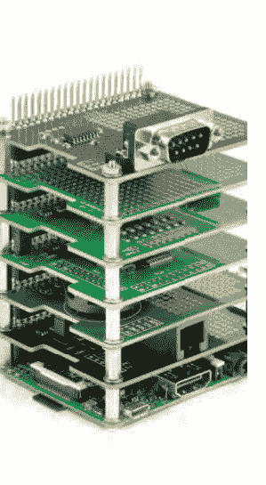


# UK SERVERS (英国服务器)

## 专用服务器

每月 39 英镑 + 增值税

使用优惠码 `LINUX1` 可享 15% 折扣

- 当日装机
- 24/7 英国免费热线支持
- 无需长期合同

咨询我们的团队成员，或访问我们的网站了解更多信息 0800 610 1 1620 | `www.ukservers.com`

# PocketCHIP 测评


# 硬件

### `NextThingCo` `CHIP` & `PocketCHIP`

| 特性 | 详情 |
| :--- | :--- |
| 价格 | `CHIP` $9，`PocketCHIP` $69（不含税和运费），线缆另计 |
| 网站 | `getchip.com` |
| 规格 | 尺寸 (`CHIP`): 62.9mm x 30.3mm x 14.8mm，重量 (`CHIP`): 2.3g |
| | 尺寸 (`PocketCHIP`): 165.1mm x 26.2mm，重量 (`PocketCHIP`): 257g |
| CPU | 双核 800MHz-1.2GHz `ARM` `Cortex-A7` |
| 连接性 | 1x `USB`, 模拟 TR 输出, 2x 40 针 `GPIO`, 1x 25针 |
| 网络 | 蓝牙 4.0 (仅限 2.4GHz) |

被作为树莓派的廉价替代方案的 `CHIP` 及其智能底座是否对得起这款超紧凑版本的名誉？

`CHIP` 是一款基于全志 R8 系统级芯片 (`SoC`) 处理器构建的超微型控制器。它专为廉价 `Linux` 设计，运行着定制的 `Debian` `Linux` 版本，但它没有用于存储扩展的微-SD 卡槽；

与树莓派相比，`CHIP` 有一些优势：它拥有 40 针 `GPIO` 引脚；存储作为标准配置内置；电池为嵌入式应用中的板卡提供了方便的电源方式；板载无线电提供了 802.11b/g/n `Wi-Fi` 和蓝牙 4.0 连接。

虽然全尺寸 `USB` 2.0 端口可以解决这一缺点，但没有网线端口，也没有数字视频输出端口；相反，3.5mm 接口提供了 TRRS 连接，可将模拟音频/视频复合到显示器、`VGA` 或 `HDMI`。

实际上，这台廉价电脑的价格在 14 到 24 美元之间。随着树莓派推出（英国售价为 4 英镑，国际售价为 5 美元），`NextThingCo` 需要一些特别的产品进入 `PocketCHIP` 市场。

为了达到领先竞争对手的价格点，一些功能被简化了


> 这种设计感觉就像 1980 年代的摇杆，当你用大拇指在 `PocketCHIP` 上艰难地打字时，感觉非常糟糕。

### 优点

低功耗、能力惊人、具有丰富的 `GPIO` 潜力，且 `PocketCHIP` 的设计是对过去时代的奇妙回归。

### 缺点

低功耗 CPU、未完成的软件，`PocketCHIP` 的键盘对于极短时间之外的任何操作都非常困难。

它设计为 `CHIP` 的扩展盒，其寿命可能比 1980 年代的 Sinclair S-J 摇杆长不了。键盘的一切都已就绪。正面顶部是一个低分辨率触摸屏，下方是 QWERTY 键盘。

这种设计并非表面看起来那样。在没有风扇的情况下运行，`NextCHIP` 设计了一台属于 1980 年代的设备：一台受限的机器。键盘打印在塑料 PCB 上，具有金属“咔哒”触圆罩。塑料压层层固定了一切，完成电路并记录为按键。

用大拇指在 `PocketCHIP` 上艰难地打字时，这种设计感觉就像一个摇杆。糟糕的是，Sinclair S-J 的命运揭示了这一点。

## 评测免费软件

## 卫星可视化

### `SaVi` 1.5.0

带有动画覆盖地图的卫星轨道

许多人对定位卫星有实际需求，无论他们是纳米卫星部署、业余爱好者还是像 Iridium 这样的卫星电话提供商。`SaVi` 可以告诉你卫星在何时可用，甚至可以生成覆盖地图的动画图像，你可以随身携带全球。

从源码中我们注意到，我们的 `Debian` 测试安装缺少正确的 tk 头文件（`/include/`）目录，因此我们明智地从之前的 tcl 版本创建了软链接，并安装了它们，然后运行 `make ARCH=ubuntu` 成功了并在本地运行了二进制文件。从仓库中安装 `geov` 可以启用 3D 视图，这是一个很棒补充，但基础包提供了一个非常实用的项目。


我们并不孤单——有很多硬件设备都是如此，但至少你可以追踪它。

从一次火星任务开始：1998 年的漫游者：一个需要通过卫星网络保持联系的环球者将是一件有趣的软件。`SaVi` 网站包含许多与卫星轨道及其背后的科学相关的学术论文链接，检查你当地 `GPS` 卫星的位置很有趣。

> 优点：当你需要寻找卫星星座时，用于快速访问非常易用。

> 缺点：你需要一些知识（“这些卫星都是什么？”）才能从 `SaVi` 中获得最大收益。

> 适用场景：在成千上万的其它地方寻找卫星电话链接。`savi.net/` 更多

## 基础编程环境

### `Gambas`，新增 3.91 版本

更新至 0.0 版本的 `BASIC` —— 封装在强大的 `IDE` 中


无论是通过经典的 8 位鼠标，还是微软的 `(jfif)` Visual Basic，BASIC 都是许多计算机用户的第一种编程语言。

不信邪者可能听说过“`GOTO` 是有害的”，并且一些人认为它是一种满足现代需求的一门严谨的入门语言。但那些人需要重新考虑他们的假设了，因为 `Gambas`（BASIC 的免费开源版本！）是一种面向对象的语言，拥有它自的 IDE，并且对于大多数初学者来说，使用它进行 GUI 编程非常简单。

`Gambas` 在我们重新发布时已在你的仓库中可用。我们从源码编译；`Gambas` 网站提供了所需的依赖项完整列表，但在 `Debian Jessie` 的情况下，它缺少 `libpopper-private-dev`，这没有扰乱配置脚本，但阻止了编译完成。一旦我安装了它，包编译就会运行，然后我们就可以回到 `Gambas` 了。

最后，有很多项目可以探索。如果你想深入并从他人的代码中学习，`Visual Basic` 是一个相对初级的。尽管 `Gambas` 并不是克隆版。对于初学者，教程将使这种语言和环境变得简单。

> 优点：强大的 BASIC，具有良好的创建和 GUI 创建能力，现代感。
>
> 缺点：缺乏 `Python`、`Perl` 和 `Ruby` 等跨平台脚本语言的自由。
>
> 适用场景：想要将 `VB` 技能迁移到 `Linux` 的 `MS` 用户。`gambas.net/` 更多

## CLI 文本编辑器

### `Micro` 10.3

一个简单直观的基于命令的文本编辑器。

它是这么说的……你需要另一个命令行文本编辑器吗？如果你是一个高级用户，对 `vi` 或 `Emacs` 感到满意，但在网络环境下不是，那么不需要，但考虑一下这种场景：一个非技术用户需要在没有经验的情况下编辑 `Ubuntu VPS` 上的文件。如果有一个强大的文本编辑器（基于 `CUA`）快捷键（`Ctrl+C`, `Ctrl+V`, `Ctrl+Z`）可用就太好了。

支持也很好，配置——通过 `Lua` 或基于 `JSON` 的配置文件——在教程中介绍。首先，尝试访问命令模型），然后 `Ctrl+Help` 快捷键向你显示重新绑定和链命令。在实际使用中，你会发现它很流畅。用 `Go` 编写，并由 `Zachary Zedy` 积极开发，`GitHub` 页面提供了许多新构建。静态二进制文件适用于 `ARM`（包括 `Pi`），值得尝试，以及整个 `BSD` 家族——不要犹豫，试试吧！在所有新的 `Ubuntu` 安装上安装 `micro`，`8.5MB` 的静态二进制文件在大多数情况下不是问题——但还有更多快捷键。鼠标和剪贴板。

> 优点：友好的快捷键。简单易用。
>
> 缺点：对于某些操作缺少快捷键。并不多！
>
> 适用场景：初学者以及所有历史爱好者。`github.com/zedyidia/micro/`

## 游戏

### 卡坦殖民者 (`Settlers of Catan`) 15.4

卡坦殖民者 —— 从桌面到电脑的流行游戏版本。它不是一个官方版本——甚至在关于卡坦殖民者的英文文章中都没有被提到。它的软件本质，如果你喜欢卡坦殖民者（或其他游戏），但无法聚在一起。


| 资源 | 数量 |
|---|---|
| 木头 | 4 |
| 砖 | 4 |
| 羊 | 4 |
| 谷物 | 3 |
| 人数 | 2 |
| 石矿 | 3 |
| 卡牌 | 4, 5 |

最新版本适用于大多数发行版。可以通过菜单找到指南，包含了开始所需的一切。如果你以前玩过，像《文明》(`Civilization`) 一样遵循指南学习如何玩也非常有用；节省时间；非常值得。

> 优点：启动快速，没有繁琐的设置，文档齐全。
>
> 缺点：在卡坦上，而不是高级的 PC，缺乏官方批准。
>
> 适用场景：如果你喜欢在线，你是正确的，和朋友一起。`sourceforge.net/www.linuxuser.com`

## 开源 推荐托管

在我们的目录中获取你的列表。在此广告，联系 `Luke biddiacombe@imagine-publishing.uk` | `+44 (0)12025863` 特色托管：`www.netcetera.co.uk` `0800 808 5450`


`Netcetera` 是欧洲领先的托管提供商之一，在全球拥有客户。作为英国数据中心托管、专用服务器和托管网络服务的顶级提供商，`Netcetera` 提供了一系列旨在有效管理 基础设施的服务。先进的环境让 `Netcetera` 为你的业务提供企业级的托管和解决方案。为你的业务提供无与伦比的价值，我们的客户和托管基础设施服务。从服务器到完全定制的数据中心，我们专注于你需要的 `IT`。

成本效益、可靠、安全的托管。

- 云托管 —— `Linux`、`Windows`、混合和私有云解决方案，支持和可扩展功能。

先进的数据中心环境让 `Netcetera` 为你的业务提供企业级的托管和解决方案。


## 我们提供

- 托管服务 —— 系列具有成本效益、可靠且安全的解决方案。
- 云托管 —— `Linux`、`Windows`、混合和私有云解决方案，支持和可扩展功能。
- 数据中心托管 —— 从单服务器到全机架，提供免费设置和慷的带宽。
- 专用服务器 —— 从四核到智能服务器，设置快速且完全可定制。

## 我们的 5 大顶级优势

可靠性、信任、支持。可靠性是选择托管合作伙伴的一个主要考虑因素。`Netcetera` 保证 `100%` 的可用性，能够应对多次互联网 `DDoS` 攻击，并在需要时提供支持，`24/7` 在你最需要的时候提供协助。我们的人确保你满意，并尽快解决你的问题。

`02` 安全且专用

`Netcetera` 对其数据中心环境感到自豪。它获得了 `ISO 27001` 安全认证，提供机架放置，以及在多个位置配置备份的选项。

`03` `24/7` 技术支持

`Netcetera` 拥有一支投入且知识丰富的员工随时可用。

`04` 我们不自称是最便宜的，但我们确实声称提供极高的性价比。我们提供同类产品的价格比对，并根据你的服务时长提供价格保证。

`05` 集中化

`Netcetera` 的承诺得到了生态冷却和水电能的支持。这使得 `Netcetera` 成为欧洲最环保的托管中心之一。

## 证言

`Roy T`

“我从 `Netcetera` 获得过很好的服务。他们的技术支持无与伦比。我的问题总是很快得到解决。”

`Suggy B`

“我们在 `Netcetera` 有好几台服务器，他们的网络连接是顶级的，速度和可用性从不是问题。他们的支持非常专业且动作迅速。我们非常推荐 `Netcetera`。”

`Steve P`

“我们在 `Netcetera` 放置了机架，基本上是一个完整的公司后端。他们的表现不能更专业、更热心、更迅速或更友好。整个团队都是非常愉快的合作对象，他们 `100%` 匹配了需求。”

## 顶级托管服务


`www.cwcs.co.uk`

`0800 1 777 000`

`CWCS` 托管托管是英国领先的托管服务专家。他们提供全面的托管产品、服务和支持。他们经过高度培训的员工不仅是专家，还致力于提供卓越的客户体验，并对自己的工作充满热情。

- 托管托管
- `VPS`（虚拟服务器）
- `100%` 网络可用性

## 性价比托管

### `elastochosts`

`elastochosts.co.uk`

`02071 028352`

`Elastochosts` 为企业和个人提供简单、灵活且高效益的云服务，具有高性能、可靠性和可扩展性。他们的工程师团队通过电话、电子邮件和工单系统提供 `24` 小时支持。

- 任意系统的云服务器
- 按需需用的 `Linux` 服务器
- 世界级 `24/7` 支持

## 小企业托管


`www.hostpaa.com`

`0800 051 7126`

`Hostpaa` 是一家屡奖的托管服务商，绿色托管领域的领导者。他们提供功能全面的托管包之一，具有 `24/7` 客户支持、学习资源以及卓越的可靠性。

- 网站生成器
- 预算价格
- 无限制数据库

## SSD 网站托管


`www.bargainhost.co.uk`

`0843 289 2681`

自 `2001` 年以来，`BargainHost` 一致力于在英国提供最好的云托管。他们已成功实现这一目标，并建立了拥有数千名客户的大数据库。他们还因提供卓越的托管服务而获奖。

- 共享托管
- 云服务器
- 域名

## 性价比 Linux 托管


`patchman-hosting.co.uk`

`01642 243 27`


Linux 托管是寻求高性价比和强大托管服务的家庭、企业用户和网页开发者的理想解决方案。无论你需要单页网站、作品集还是数据库驱动的网站，我们都有相应的 Linux 解决方案。

*   学生托管
*   站点设计器
*   域名

## 预算托管：


`www.hetzner.com` / `+49 0981 500`

`Hetzner` 是一家专业的托管提供商和经验丰富的数据中心。自1997年以来，该公司一直为企业和全球客户提供高性能托管产品以及网站高效运行的基础设施。结合了稳定的技术和极具吸引力的价格。

## 快速、可靠的托管


`www.bymarket.co.uk`

`01904 890 880`

自2002年以来，`Bytemark` 是“英国创立的云托管专家”。他们的宗旨包括内部专业知识、透明度和个性化支持，履行支持承诺，并以实惠的价格提供顶级托管硬件。

*   托管托管
*   英国云托管
*   Linux 托管
*   独立托管和共享托管
*   托管中心
*   互联网域名和
*   SSL 证书
*   存储中心

`www.linuxuser.co.uk`


## 随杂志赠送

## 立即获取这些惊人的免费礼物...

### 最好的发行版和开源软件 (FOSS)

您 `Linux` PC 必需的软件

### 专业视频教程

`Linux` 基金会分享其技能

### 教程项目文件

您跟随我们的教程所需的所有资源

### 此外，这一切都属于您...

*   最新的 `Linux`、`Ubuntu` 和 `Debian` 版本 `Linux Mint`，让您从全球最好的发行版中获益匪浅
*   来自 `Linux` 基金会的 20 小时专家视频教程
*   全新的教程文件，帮助您掌握本期的教程
*   `Linux` 编程与树莓派教程

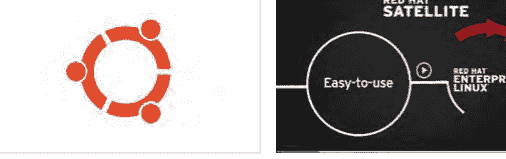

## 登录 `www.filesilo.co.uk/linuxuser`

注册即可立即获取这套包必不可少的 `Linux` 发行版和软件、教学视频和教程资源

> 现对数字读者免费！立即在平板电脑上阅读，在电脑上下载


## 给订阅者的惊人礼物

`FileSilo`

优质下载之园 - 仅供您喜爱的 `Imagine` 出版社杂志专属

*   安全的在线访问，随地可用
*   每位读者免费获取，纸质及数字版
*   在需要时下载您想要的文件
*   各期杂志的所有礼物，汇聚一处

## 开始

了解访问 `FileSilo` 所需的一切


01 按照屏幕说明创建我们的 `FileSilo` 账户。通过回答关于杂志的简单问题解锁内容。

02 您可以使用任何常用浏览器通过电脑或智能手机访问 `FileSilo`。我们建议您使用电脑下载内容。

03 如果在访问 `FileSilo` 时遇到任何问题，请查看常见问题或向我们发送电子邮件。

## 开始

了解访问 `FileSilo` 所需的一切


01 按照屏幕说明创建我们的 `FileSilo` 账户。通过回答关于杂志的简单问题解锁内容。

02 您可以使用任何常用浏览器通过电脑或智能手机访问 `FileSilo`。我们建议您使用电脑下载内容。

03 如果在访问 `FileSilo` 时遇到任何问题，请查看常见问题或向我们发送电子邮件。

## 开始

了解访问 `FileSilo` 所需的一切


01 按照屏幕说明创建我们的 `FileSilo` 账户。通过回答关于杂志的简单问题解锁内容。

02 您可以使用任何常用浏览器通过电脑或智能手机访问 `FileSilo`。我们建议您使用电脑下载内容。

03 如果在访问 `FileSilo` 时遇到任何问题，请查看常见问题或向我们发送电子邮件。

## 你能帮助下一代代码员吗？

`Code Club` 是一个面向 9-11 岁儿童的全国志愿者课后俱乐部网络。我们一直在寻找具备编程技能的人在当地的学校或社区中心每周运营一次俱乐部。您可以与同事合作，老师将提供您所需的所有材料。欲了解更多信息，请加入 `codeclub.org`。

## HETZNER ONLINE

# DDoS 防护

# 免费！

*   总流量
*   UDP
*   IP 分片
*   DNS 放大
*   ICMP
*   丢弃流量


`810.95 Kpps`

`600.00 Kpps`

`400.00 Kpps`

`300.00 Kpps`

`0.00 Kpps`

`00:00:00 00:08:00 00:16:00 00:25:00`

| 严重程度 | 最大严重百分比 |
| --- | --- |
| 低和高 | 372.3 % 到 810.95 % |
| 主要滥用类型：IP 分片 | |
| 方向性滥用类型： | |
| 最大突发告警 | 15.6 Gbps/920.0 |
| 合理边界 | ICMP |
| IP 分片, | |
| UDP, | |
| NTP 放大, | |
| DNS 放大 | |


## 例如，独立服务器

`PX61-NVMe`

# 防止 DDoS 攻击的安全防护

*   `Intel® Xeon® E3-1275 v5`
*   四核 Skylake 处理器
*   64 GB DDR4 ECC 内存
*   2 x 512 GB NVMe Gen x4
*   保证 1 Gbit/s 带宽
*   100 GB 备份空间
*   包含 30 TB 流量
*   无最低合同
*   设置费用 £102.50

`Hetzner Online` 的自动化系统保护您的 Web 应用程序、网站、服务器和 IT 基础设施免受拒绝服务攻击。它使用最新的硬件设备和复杂的安全技术，为客户提供大规模 DDoS 攻击的一流防护。而且这一切都是免费。

每月 51 欧元

## `www.hetzner.com/ddos`

> *   超过部分将产生费用。如果每月使用量超过 30 TB，我们将永久限制连接速度。可以选择，通过为每个额外使用的 TB 支付 1 欧元来永久取消限制。
>
> *   所有价格均不含值税，并受 `Hetzner Online GmbH` 条款限制。价格可能会变动。相关制造商保留所有权利。`Intel`、`Logo`、`Intel Xeon` 和 `Xeon` 是美国或其他国家 `Intel` 公司的商标。
