# Linux 用户与开发者 173 - 系统管理员生存技能

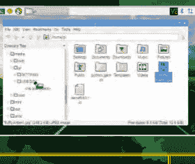


转码 4K 视频，使其适用于所有本地或远程设备。

随时访问并共享存储在 NAS 上的所有多媒体文件。

使用 Roku、Apple TV、三星电视、Airplay 和 DLNA 轻松流传输数字内容。购买请访问 www.synology.com

可用应用：Synology 媒体

欢迎阅读 LinuxUser & Developer 最新一期

编辑：April Mason

高级编辑：Stephen Williams

设计师：Rebekah Hill

设计师：David Cook

摄影师：James Sheppard

贡献者：Andrej, Joey Young, Bert Tosti, Sergei De Boer, Neal Davis, Oliver Hill, Mike King, Richard Speedy, Jaemin Spoon 和 Thomas White

广告经理：Luke Dickscombe

国际部：Catherine Blackman

订阅：致电讨论合作。访问 www.future.com

发行经理：Darren Pearce

财务与运营总监：Peter Marco

营销总监：Andrew Scott

William Gibbons


欢迎阅读 LinuxUser & Developer 最新一期，这是英国和美国喜爱的 Linux 和开源杂志。我们已准备好进入训练营，并在探索你在野外环境中所需的常用技能。在本期中，我们学习了成为管理文件系统、用户、权限和故障排除所需的必备工具和技术，让你立即成为系统管理员。如果你想完全控制你的家庭网络或让一切尽在掌握，请快速完成你所需的必备训练以达到战斗状态。本期还窥视了我们的水晶球，揭示了我们在 2017 年发现的最佳发行版和开源软件（FOSS）。你使用哪种 Linux？如果你不确定哪种发行版适合长期使用，请查看第 6 页的指南。你可以在 Directory 在线找到可以获得最佳体验的发行版列表，并可以通过我们的网站或他们的网站访问本期中涵盖的所有开源软件。你还将发现如何扫描你的配置、使用 Erlang 编程、使用 `tmux` 应对 SQL 注入威胁等精彩内容。阅读得愉快！

April Madden，编辑

联系团队：

user@image-publishing.com

访问我们的网站获取更多新闻、观点、教程和评论：

www.linuxuser.co.uk


Future 是一个屡获殊荣的杂志集团，每月覆盖超过 500 万国际客户。我们为充满激情的客户提供创新解决方案，涵盖在线、纸质和空中传输。

Future 是一家在伦敦证券交易所（LSE）上市的出版集团。

首席执行官 Zibah Young Thorne

zibah@future.com

首席财务官 Perry Ladden-Brand

+44 (0) 1781 342 244

管理文件系统、权限、用户等。

# 评测

## 81 音频编辑器

使用这些开源工具，混音自己的节奏从未如此简单。

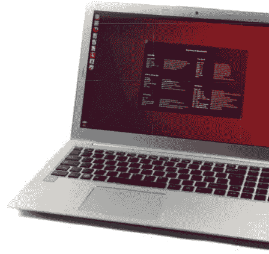

## 52 使用 `tmux` 增强终端

探索您免费光盘中的精彩内容

**欢迎使用 Linux 用户与开发者 DVD。** 在这一期节目中，我们展望了 Linux 的未来一年，因此我们挑选了 2017 年最好的发行版和自由开源软件（FOSS）。尝试一下它们吧——您会发现 `Puppy Linux`、`Maui` 和 `Arch Linux` 可以从光盘进行现场启动，而我们的其他选品已加入了发行版目录（Distro Directory）。请记住，您可以通过选择的发行版直接获取所有的自由开源软件，也可以从它们各自的网站获取。

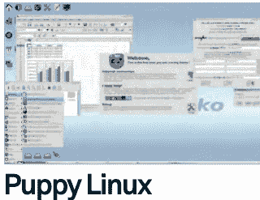

`Puppy Linux` 是 Linux 的一个特殊版本，旨在让计算变得简单快速，让您能够从损坏的电脑中恢复数据，或通过制作现场 USB 启动盘来实现。作为最优秀的轻量化发行版，它非常小且不占用资源，非常适合让旧硬件焕发新生！

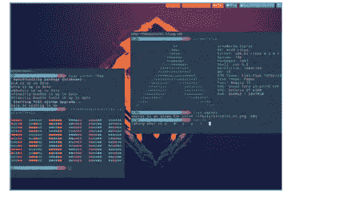

`Arch` 是一个简单、轻量且灵活的发行版，力求保持简单。它也异常强大，尤其是当你有时间按照自己的精确需求对其进行配置时。由于某些原因，它是您心目中最好的开发者发行版。


要访问软件和工具文件，请将光盘插入电脑并双击它。

要现场启动此光盘提供的发行版，请将光盘插入驱动器并重启电脑。

- 您需要确保电脑已设置为从电脑的 BIOS 屏幕启动，以更改选项
- 某些电脑需要您按下某个键来启用从介质启动；请检查制造商网站以确认是否此类情况
- 现场启动的发行版是从光盘运行的；除非您选择，否则它们不会安装到您的电脑上

此发行版因其对 HTML 和 CSS 标准更新的渲染方法而被选中。为了获得最佳效果，我们建议您使用：

请发送邮件至 linuxuser@imagine-publishing.co。如果您在使用所提供的程序或资源时遇到问题，请告诉我们，并附上相关的软件名称。

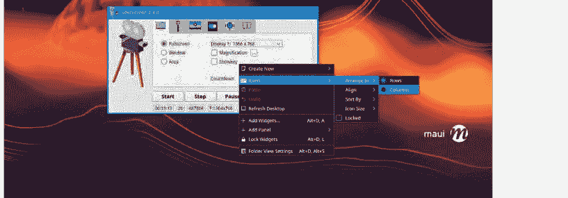

`Maui` 的第二个版本带有新功能、方法和仓库，基于 `Ubuntu 16.04` 和 `KDE Plasma`。它看起来非常棒，但更重要的是，它运行无缝衔接，并且充满了媒体和游戏潜力。这就是为什么我们将其选择为最好的娱乐发行版！

## 重要信息

在安装或使用光盘前请检查此项

出于本免责声明的目的，“光盘”是指存储在光盘上的任何数据资源丢失以及物理损坏。

在使用“本光盘”之前，您必须同意以下条款和条件

在任何情况下，`Future Publishing` 都对因使用“本光盘”而导致的任何损坏、中断或数据丢失不承担责任。`Future` 尽一切确保“本光盘”交付给您时没有病毒和间谍软件。我们强烈建议您在运行此光盘之前运行病毒扫描程序，并对您的硬盘进行数据备份。

## 软件许可

- 共享软件 (`Shareware`)：如果您继续使用该程序，应向作者注册。
- 免费软件 (`Freeware`)：您可以免费使用该程序。
- 试用/演示 (`Trials/Demos`)：这些是限时的，或者某些功能受限。
- 开源 (`Open Source`)：所有用途均免费。详情请访问 https://opensource.org/licenses/gpl/

除非另有说明，否则您没有许可复制和分发“本光盘”


将光盘插入电脑并重启。您需要确保电脑设置为从光盘启动。

可以现场启动某些发行版，让您可以立即运行非操作系统，而无需对电脑进行永久更改。

或者，您可以插入并运行光盘以探索界面和内容。

## 08 新闻与观点 | 访谈 | 09 文件

## 英特尔能竞争过树莓派吗？

由于搭载 `Apollo Lake` 芯片组的新一代单板计算机（SBC）具有无与伦比的性能，一旦您有时间将其配置为完全符合您的需求，它也变得异常强大。

## Android

欢迎来到小型强大的媒体中心

## Remix 发布搭载 Nougat 系统的游戏机与 PC 混合体

基于 `Android x86` 的 `Remix OS` 是技术实力的体现，发展了 Android 在个人电脑上的功能。由于其成功，`Remix` 团队更进一步，将操作系统的元素与桌面元素相结合。

### FOSS 能竞争过 Photoshop 吗？

#### Krita 3.1 Beta 版向 Adobe 发起了挑战

此 Beta 版本发布还带来了新的工作工具。镜像模式（`Mirror mode`）已增强，可以处理不同的操作。更新中还包含了许多动画工具，同时变换工具（`Transform`）中备受怀念的光标缺失也得到了恢复。其他变化还引入了新的画笔，而合并两个图层时现在也会合并皮肤（`skins`）。该 Beta 版本发布中的一个缺点是，懒人笔刷（`Lazy Brush`）插件可能会在正式发布之前移动。由于目前的实现方式，我们将在正式发布中适当恢复该功能。

预计第三个 Beta 阶段将支持一段时间，感兴趣的读者可以在 www.krita.org 找到所有下载链接。

为了提高可用性，还进行了速度改进，启动时的优化可以节省时间和精力。在这里，`Kate` 还被引入了新的消息协议中，该 `GCE 2` 打印系统使用缓慢。

*Winter Smith*

### Trinity 桌面应用支持 GCE 和 GDB

根据你选择的发行版，你们中的一些可能听说过 `Trinity` 桌面环境，而有些人可能没有。它以设计和简洁著称，可以在 `SparkyLinux`、`PCLinuxOS` 和 `CentOS` 的链接中找到。

“`R14.0` 是 `R14` 系列的第四个维护版本，基于 `R14.0.3` 版本构建并进行了改进。维护版本旨在为用户提供错误修复。此版本是首要的错误修复和安全更新，很大程度上受到 `Dirty COW` 漏洞的影响，此外还包含许多新功能。它还支持实用的编译器，这些编译器现在可以利用我们仍在寻找和实验的新算法。通过当前的 Beta 版本，你将预先看到用户界面的工作方式，但我们需要反馈并正在进行修复，”官方发布公告写道。

对 `Trinity` 桌面环境的支持不断增长，这些变化也进一步地提高了采用率。你可以全部前往 www.trinitydesktop.org 获取所有下载链接和安装要求。

`Ubuntu` 社区随着最新的开发持续增长。

其他人选择 `Ubuntu` 的主要原因之一是它提供了海量的独特“变体”（`flavours`）。虽然 `Budgie` 的用户群比以往任何时候都要多，但开发团队现在已经发布了最新的官方 `Ubuntu` 版本。该版本设定在 `Ubuntu 17.04` 上运行，截至目前，尚不清楚未来几年它将如何被支持和开发。

`Budgie` 是由 `Solus` 制作者开发的桌面环境，整合了更多 `GNOME` 特性。它拥有自己的用户界面。在 `Ubuntu Budgie` 中，用户将可以使用完整的 `Budgie` 功能套件，其中包含一个具有巨大潜力的现代桌面系统。

由于 `Solus` 团队目前正在开发该版本，预计 `Budgie` 的发布将延迟到 2017 年第一季度。获得官方身份也意味着该团队将能够完成 `Ubuntu` 网站，并在未来 `Ubuntu` 社区的持续发展中发挥更重要的作用。

`SLS` 的官方端口现已适用于 `Raspberry Pi 3`

根据来自 `SLS` 制造中心和高性能计算的官方报告，它运行在一台 35 美元卡大小的电脑上。在底层，`Btrfs` 已被引入为根文件系统，同时 `WebUI` 现在对用户可用，树莓派的优势还将更多，包括免费的自助注册。对于寻找业务转向云端入口的业务用户来说，这可能是你最佳且最具效益的选择。

### 前 10 名


（每日平均访问量，10月30日 - 11月）

| 发行版 | 访问量 |
| :--- | :--- |
| 1. Linux Mint | 2608 |
| 2. Debian | 1682 |
| 3. openSUSE | 1549 |
| 4. Ubuntu | 1497 |
| 5. elementary | 1343 |
| 6. Manjaro | 1173 |
| 7. Zorin | 1144 |
| 8. Fedora | 1028 |
| 9. CentOS | 783 |

- 稳定版 (10)
- 开发中 (7)
- 虽然本月许多大版本都备受关注，但 Kenros 也获得了一些关注。它能获得更多动力并攀升排名吗？

### 亮点

- **Antergos**：Antergos 的最新版本得益于现代特性和对 Arch 的采用，持续扩大用户群，但也可用于运行 Xcode、GNOME 和 Radeon-OS。
- **openSUSE**：openSUSE 的最新版本已发布，带有许多新功能。用户和整体桌面设置正在改进中。
- **Manjaro**：另一个基于 Arch 的发行版在桌面领域引起关注。

file.co

evive 能够让项目产生革命性变化

#### Akshat Agarwal

他是 `evive Technologies` 的联合创始人，也是印度理工学院的一大级本科生。

> 对于可能没有听说过 evive 工具的读者，你能概述一下它以及它是做什么的吗？

`evive` 是一个基于 `Arduino` 的开源平台，供学生、爱好者和创客社区学习和原型设计。设计 `evive` 的初衷是通过直观的菜单来消除重复性。`evive` 在 Indiegogo 上成功完成了众筹，筹集了 3.4 万美元，来自 20 多个支持者。

`evive` 由 `Arduino MEGA` 驱动，具备蓝牙和 Xbee 连接功能，即可用于物联网。它内置了 2600mAh 锂电池，可 `evive` 运行 4.5 小时，也可以通过电源适配器或电源盒外部供电。即用的硬件接口由电机驱动器、舵机输出、电位器、开关、LED 和蜂鸣器，使其在 LabVIEW、MATLAB、Scratch、Eclipse、ROS、Python、Arduino IDE 和 Processing 等多个平台上工作变得简单。电容触摸界面允许一次连接 12 个项目，非常适合实验。

> 工具包的核心是 Arduino MEGA。它在其中扮演了什么角色？

`Arduino MEGA` 是强大的。这是因为 `Arduino` 拥有一个惊人的开源社区用于构建项目、材料和易于使用的 IDE，而且它是目前市场上最流行的原型板。

您的 Linux 新闻与观点

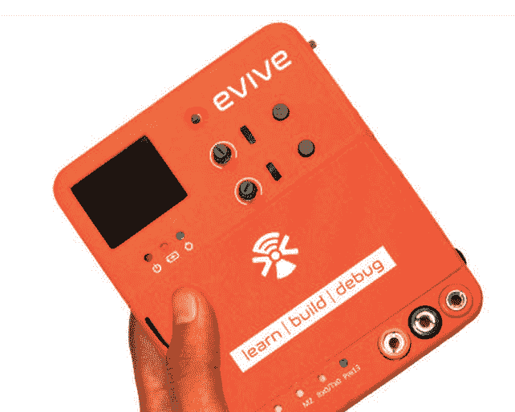


测试电路通常是一项棘手的工作，但 `evive` 的可编程特性使得这一过程变得简单得多。它不需要昂贵的设备和示波器，而是依赖于 `evive` 的核心功能集。`evive` 集成了一块 24 位 ADC 芯片，这为其提供了高精度的传感电路、调试和通用实验室测试功能。默认情况下，`evive` 可以帮助您在少于 1ms 内以完美的精度测量出 24 位分辨率的采样率。相比之下，`Arduino` 板载的 AVR ADC 进行 10 位分辨率的测量需要 112us。

为了准确地测试电路，`evive` 使用双通道进行同步测量，一个用于跟踪电压，另一个用于跟踪电流。通过使用隔离电源，用户能够分别跟踪每条线路，而无需担心短路。当此 ADC 与 `evive` 自带的微型示波器配合使用时，示波器配备了多层跟踪选项。一旦完成测试，所有数据都可以导出到 PC 以便查看结果。测试电路从未如此简单。

`evive` 在许多方面进行创新，其目标是将他人可能需要的各种因素整合到一个单一产品中。

世界正向新的学习方式转变，而 `evive` 为学生提供了构建项目所需的所有工具，帮助他们就地完成项目，帮助他们培养基本技能。学生可以通过参考我们丰富的在线文档、Hacker hub 项目以及许多独立项目（如硬件接口、如何制造和驱动机器人）来学习，`evive` 确保他们在实中学中学习。随着编程技能变得至关重要以及交互式图形化编程的兴起，它让学生能够看到自己的代码与物理世界的交互。微型示波器有助于实验结果的可视化，为手工制作增添了新的维度。我们将发布一个扩展学习包，它将成为使用 `evive` 进行全面建议课程的基础。

> 世界正向新的学习方式转变，evive 为学生提供了构建项目所需的所有工具，就地完成项目

工具包的开源特性值得投入。人们访问其硬件和软件非常容易。

我们目前正在编写完善文档，将在第一批产品出货前完成。文档将引导读者逐步访问我们的固件、对其进行操作并针对他们的项目进行修改，并解释每个文件实现的功能。硬件文件可以在 GitHub 上获取，完整的电路图也将在 `evive` 到达用户之前发布。它们绝对会易于访问和修改——毕竟，这是开源运动的一部分。我们的使命是


我们目前有四个学习模块。初学者套件包含了各种传感器、电阻和电容器，帮助初学者探索并花费几周时间对它们进行摆腾。机械臂是一个 DIY 套件，将由 3D 打印零件、传感器和电机组成，并带有如何玩它们的详细文档。移动机器人通过蓝牙通信，机械臂可以插入 `evive` 上的电位器和开关。机器人可以组装成遥控机器人、跟随者或用于避障机器人。机械臂可以组装成带有探头的机械手，或者带有特制支架可以放置铅笔的绘图手臂。我们还在为机械臂设计其他几种配置（末端执行器），它们将在我们的网站上发布，并由任何用户进行 3D 打印。家居自动化套件利用了 `evive` 精确的数据采集、记录和绘图功能，结合多个传感器和继电器模块，通过 `evive` 让您的家庭充满活力。您可以在屏幕上监控这些器的每一个，将其存储在 SD 卡中并直接发送到 PC。

目前，我们正致力于围绕 `evive` 构建一个支持生态系统，包含大量的项目、教程等。一旦它进入社区手中，我们希望能够快速扩展，并接收你们对 `evive` 的反馈。

我们还在考虑构建一个运行在电流（而非 5v 逻辑）下的 `evive`，因为会有更多支持 3.3v 的传感器和设备不断问世，这有助于改善我们的日常生活。我们还在考虑推出针对不同人群的特定版本，针对极客和专业人士。通用功能核心将出现在每个版本中，每个版本都将针对特定人群拥有特定功能，由于低价格的限制，我们在当前版本中无法引入这些功能。

您的 Linux 新闻与观点

Jon Masters 精通 Linux 内核社区的最新动态

SDRAM 长期以来一直是现代计算系统中系统内存的主流技术。随着时间的推移，这种变化可能会缓慢，特别是当新的相变存储器、“忆阻器”和非易失性内存变得更加主流时，但目前 SDRAM 仍然是王者，尽管它有缺陷。它最大的优势是它是纯净的，单元能够完美地运行 0 和 1。存储在 RAM 中的数据是生命中的瓶颈。

在过去的几周里，关于代码调度漏洞有许多讨论，每种漏洞都有自己的博客、推特线程和白皮书。

我们去年讨论过的 COW（写时复制）漏洞，在已描述的漏洞列表中仍然是面临的最巨大挑战之一。

当任何内存模式出现可疑时，该补丁会在内核中添加一个（小的）可配置延迟，停止对内存的进一步访问足够长的时间，以便硬件有机会刷新内存中的存储内容并正确渲染属性。也就是说，这至少在几个系统上已被证明是有效的，但它遭到了那些不认为传言可以可靠维护的人的强烈反对。他们警告不要有不切实际的期望。

完成（completion）需要管理，当数据传输等操作等待数据可用以便进一步处理时，通常会使用它。大多数完成在本质上是瞬时的，但有时，它们是系统范围内的，用于标记已发生的事件（该系统）。这将导致计数器回绕，并与当前状态不符。

在所有参与过内核较长时间的人员中，Rusty 的进展远超 Russell 的评估。他是一位才华的工程师，也是许多优秀内核函数的作者，例如帮助我们的架构变得可靠的 `futex` 锁，他多年来一直维护着可加载内核模块系统。Rusty 最闻名的是他的历史和绅士风范。在内核工作了二十年后，他决定开启一个新方向。他在关于维护内核可加载模块系统的消息中提到，“成为内核维护者一直是我的首要任务”。

在在他的消息中，Rusty 提到内核 `Documentation/schedule/completion.txt` 中描述了下文文档。Peter 在回复 Rusty 的帖子时用了那句经典的话：“那有文档吗？”然后开始了一个长长的帖子，讨论了文档与现状之间的差异，并对如何纠正它提出了不同的建议。良好的且及时的文档问题，虽然过去曾是许多志愿者工作的主要负担，但在内核中仍然存在。

多年来，Rusty 一直是一个理智的人，他曾预见到过某些已经失控的情况。在内核中，他的做法是对维护内核内存的补丁代码进行建设性且直率（甚至是严厉）的批评。在大多数熟悉内核的人群中，他是其中的核心人物。他也是那个害怕修剪叶子的人，他那些单行代码多年来一直让人们付笑不禁。如果这位作者和那位作者再不再参与内核，将感到非常遗憾。幸运的是，他仍在行业内（而且我们希望在未来的许多年里都能听到他的名字）。

Dmitry Trochkovov 讨论了长期存在（但有缺陷的）内核对未来完成（completion）的实现。完成是内核使用的一种数据结构，用于从一个部分向另一部分信号特定操作已完成。内核代码可以等待

最近，一位网络开发者注意到，他的网络接口实现比他的 Linux 对应版本好得多。这不是第一次像 Rusty 这样的人在问题上产生分歧。关于 Linux 基金会咨询委员会（TAB）重新选举的问题。TAB 由内核和用户社区的成员组成。投票在纽墨西哥州旧金山的 Linux 水管会议（LPC）举行，当时正值美国选举。他既无法确认也否认一个幽默的“让 Linux 再次伟大”作为 Linux 之一的投票。新的 TAB 由 Johnson Chris Mason（《Brit》的作者）领导，他是 ARM 架构管理人员的领军人物之一。

发现你将自己的 LINUX 职业提升到下一个水平所需的具备的关键技能和能力：系统管理员

成为系统管理员是一个过程，而不是一个你得到的礼物决定；它需要时间来学习许多事情。大多数管理员都是从管理自己的 Linux 服务器开始，然后才变得适应职业角色。在这里，你大约需要五个月才能成为一名丰富的管理员并学习其他有用技能，如果你获得了它们，它们将带你进入下一个水平。在此过程中，你需要学习许多技能、技术和方案。然而，在所有能力中，最重要的是在问题出现时保持冷静和快速，你最终将面对软件问题，但硬件故障，后者最难检测。软件问题更容易检测，但更难修复。由于工作的关键性，你将需要准备好以系统管理员身份工作，以便能够在生产服务器上执行简单任务，并能够自己在没有监督的情况下执行复杂任务。

请记住，在管理员职业的初期，每天查看日志是一个非常好的做法——这不仅能帮助你理解机器的内部，还能让你发现问题并编写观察日志的脚本，以便开始学习如何自动化

最后，应该一直记住的是，学习新工具或新技术需要时间，没有人期望你在一周内成为专家，所以不要在学习期间感到压力太大。你可能需要一夜来学会使用 Python，但一年后你就可以开始编写运行在繁忙生产系统上的 Python 脚本了。然而，你被要求的是一直保持新技能！

在系统管理中获得成功需要技能，包括对 UNIX 内部的良好知识以及编程能力

取代实践，阅读书籍，提问并观察经验丰富的系统管理员。

文件系统的管理是一项非常关键的任务，因为你定义了用户、组的大小和类型，这些之后无法轻易更改。然而，存在技术，包括调整大小和移动，可以帮助你以最轻松的方式调整文件系统。根目录是第一个挂载的，包含了引导系统、Linux 内核。

```
$ groups
[username] adddev tapirs
```

主要类型：系统级优化和应用优化。第一个是优化 Linux 系统，第二个是处理特定应用程序的参数以使其运行更快。通用优化是一门需要对背后运作原理有良好知识的艺术。

请记住，root 的用户 ID 始终是 0 - 即使是用户 ID 为 0 的权限

如果只有一个用户，拥有多个用户的 Linux 系统有什么意义？保护 Linux 系统与你存储内部的数据同样重要！处理问题时，单一最重要的技能是常识，其次重要的是理解事物是如何运作的。

让我们明确一点：当事情变得糟糕时，你周围迟早会出现问题。故障排除是你能做的最好的事情。其次重要的是尝试解决问题以缩短停机时间，在对生产系统进行任何更改和纠正问题之前。最后一步是记录整个过程！

Linux 机器支持多个用户和用户组。每个用户属于一个主组，但也可以包含其他组。你可以借助 `groups` 命令找出你属于哪些组：

- 4 存在两种主要的优化：软件优化和硬件优化：软件优化分为两

与文件系统相关最重要的单个文件是 `/etc/fstab`，它包含了挂载点、其类型以及关于它们的其他权限——系统负责读取此文件以包含正确的信息。`mount` 命令使用此文件来自动挂载所需的文件系统，并将数据与系统文件分离。

在 Linux 系统中，你应该开始学习硬盘分区，原因有两个：第一，这能让你了解备份策略；其次，当发生硬件故障时，这允许你创建创建多个分区。简单来说，如果一台 Linux 机器是一个 MySQL 数据库，那么如果你想创建第一台机器的副本，你将需要一台至少有两个分区的 Linux 机器。

分区主要有两种类型：数据分区和交换分区。创建多个分区的原因是将数据和分区与系统文件以及交换空间分开。

你可以列出所有挂载的磁盘，这些被称为块设备（图 1）：

通常，当你想要记录 Linux 系统的特征和角色时，你应该开始学习其硬盘分区：

```bash
# lsblk
NAME MIN RIM SIZE RO TYPE MOUNTPOINT
sda 0 23G 0  disk /
```

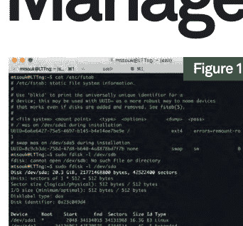

各种命令（`fdisk -l` 和 `part`）的输出将显示块设备的分区情况以及 `/etc/fstab`文件的内容。

## 文件类型

### 图 2

之前的输出显示了一个配置非常简单的 Linux 系统：只有两个分区，其中第一个（`/dev/sda`）被挂载，第二个（`/dev/sdb`）是交换空间。块设备的设备名称为 `/dev/sda`，你可以使用以下两个命令之一打印它的分区：

```bash
# fdisk -l /dev/sda
Disk /dev/sdb: 24608 cylinders, 64 heads, 32 sectors/track
# fdisk -l /dev/sda
Disk /dev/sda: 23.5 GiB, 2527217288 bytes, 4929264 sectors
```

单位：1 * 512 = 512 bytes

扇区大小（逻辑/物理）：512 bytes / 512 bytes

I/O 大小（最小最优）：512 bytes / 512 bytes

你可以通过以下方法找到交换空间的大小：

之前的命令没有告诉我们交换的使用情况，它也告诉了 Linux 系统的大小。你也可以使用 `swap` 命令找到关于你的交换空间的信息：

| | free | total | used | shared |
|---| :--- | :--- | :--- | :--- |
| Mem: | 4864764 | 137084 | 147236 | |
| buff/cache available | 1836 | 2496444 | 3548654 | 0 |
| Swap: | | 4192052 | |

```bash
/dev/sda5 4192052 0
```

如果你通过执行下一个命令（使用 `/proc` 设备）可以获取此信息：

```bash
# dd if=/dev/zero of=swapfile bs=4096 count=4096
# 4096+ records in
```

生成的临时文件名为 `asswapfile`，在实际情况下它很小，它的大小将大于 1GB。出于安全考虑，临时文件的所有者必须是 `root`。`mkswap` 命令创建一个节点索引，以及它们如何允许创建一个包含多个文件和目录的目录：

```bash
4096+ records out
16777216 bytes (17 MB, 16 MiB) copied
0.009514 s, 1.7 GB/s
# ls -l /swapfile
-rw-r--r-- 1 [username] 167772
# sudo chown root:root /swapfile
# ls -l /swapfile
-rw------- root root 16777216 Oct 10 12:20
# sudo mkswap /swapfile
# mkswap: Setting up swap partition, size: 1 GiB
/dev/swapfile (UUID=55d8c469-f6f92-442a-88fc-92d4a55599d0)
# sudo swapon /swapfile
```

一个适用于我们交换空间的文件或分区，`swap` 命令允许启用该文件作为交换空间。

下一个命令验证了创建的文件是否正确设置了交换：

```bash
/dev/sda5 4192052 0
```

```bash
# sudo swapoff swapfile
```

如果你需要一直使用交换文件，最好创建一个额外的交换分区，使用文件进行交换被认为不是良好的做法。

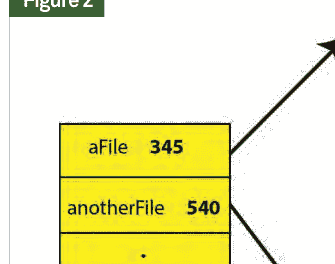

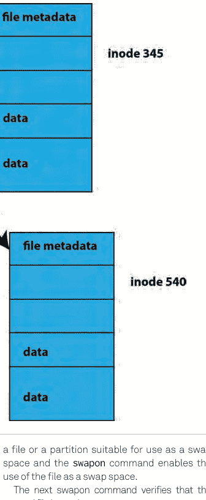

## 管理用户

图 3 显示了你如何使用 Debian 系统上的脚本在 Linux 机器上创建新用户。你可以通过搜索 `/etc/passwd` 来测试用户名是否已经存在。

正如你们大多数人所知，安全至关重要！你在列表上看到的技巧只是一个良好的起点。列表没有提到的是日志文件，你可以使用 `grep` 和 `awk` 等工具轻松进行搜索，以提取你想要的信息。以下命令将分别用于 Drupal 网站和 WordPress 网站的 Apache 日志：


```
$ grep "/wp-admin/add HTTP/1.1" "/GET/register HTTP/1.1" "/GET/user/register HTTP/1.1" "/GET/user/register HTTP/1.1" -f f.awk
```

```
cat HTTP/1.0 access.log | awk -f f.awk
```

这两个命令显示每小时的攻击次数。对于 WordPress 网站，你需要监控“POST /wp-login.php HTTP/1.1”、“GET /wp-login.php HTTP/1.1”和“GET-\.php”请求，这些请求指示了暴力破解。对于 Drupal 网站，你需要监控“GET=/node/add HTTP/1.1”和“GET=/user/register HTTP/1.1”请求，这些请求指示了直接攻击。

`dow.awk` 文件是一个 AWK 脚本，用于计算 Apache 日志文件中格式化日期是星期几——你可以使用 `dow.awk` 的 AWK 代码。

图 5

请记住，攻击一直在发生——你无法阻止攻击的发生。正确屏蔽地址非常重要；有时你可能需要创建新的防火墙规则，但有时你可能需要控制网络或了解发生的攻击。

例如，以下防火墙规则阻止了所有指向 8.8.8.8 的流量：

```
# iptables -A INPUT -d 8.8.8.8 -j DROP
```

注意，8.8.8.8 是 Google 的 DNS 服务器之一，在这里仅作示例：

下面的 C 程序（如 `random.c` 所示）按顺序数字生成不同的猜测密码：

> 无法阻止攻击的发生。重要的是检测异常行为并采取相应行动。


```c
#include <sys/types.h>
#include <stdio.h>
#include <stdlib.h>
#include <string.h>
#include <time.h>
#include <unistd.h>

int dayweek(int month, int year, int day) {
  int dow = 0;
  if (month == 1) month += 12;
  if (month < 3) year -= 1;
  return (year + year/100 + year/400 + dow) % 7 - 1;
}

int main() {
  time_t now;
  time(&now);
  struct tm *t = localtime(&now);
  printf("The day of the week is %d\n", dayweek(t->tm_mon+1, t->tm_year+1900, t->tm_mday));
  return 0;
}
```

```c
// Space character is excluded
#define FROM 3
#define ASCII_CHARS 44

int main(int argc, char **argv) {
  if (argc != 2) {
    printf("You should give just one argument\n");
    return -1;
  }
  int n = atoi(argv[1]);
  return 0;
}
```

```c
int f = open("/dev/urandom", O_RDONLY);
unsigned short seed;
uint16_t read = read(f, &seed);
```

这是计算星期几的 AWK 脚本代码，它使用 Apache 日志中的适当字符串，并告诉……的数量……

```
sizeof(mySeed);

close(f);

rand();
```

如果你想进入下一个阶段，还可以使用难以猜测的用户名，这会让密码组合变得更加困难。正如你所见，除非互联网上的每个系统都是一个大目标并被攻破，否则在你的某一台机器出现问题时有一个备份计划是同样方便的——当其中一台机器被攻破时该怎么办，或者如何恢复其数据，取决于它运行的服务的价值。

```c
for (int i=0; i<count; i++) {
    char c = 'A' + rand() % 26;
    printf("%c", c);
}
printf("\n");
return 0;
```

该程序接受一个命令行参数，即要生成的字符数。编译并执行 `random` 会产生如下输出：

```
$ gcc -o random random.c
$ random 10
$ random 20
```

查看网络安全的一种美观方法是可视化。可视化可以帮助你视觉化数据，包括使用 Graphviz、各种 Python 库、Gnuplot 和 Matplotlib。可视化的主要优势在于它能让你快速查看数据并获得发现异常情况的机会。可视化也可以用于其他领域。


## 系统管理员特性

## 请加强安全防护

正如你们大多数人所知，安全至关重要！你在列表上看到的技巧只是一个良好的起点。列表没有提到的是日志文件，你可以使用 `grep` 和 `awk` 等工具轻松进行搜索，以提取你想要的信息。以下命令将分别用于 Drupal 网站和 WordPress 网站的 Apache 日志：

```
$ grep "/wp-admin/add HTTP/1.1" "/GET/register HTTP/1.1" "/GET/user/register HTTP/1.1" "/GET/user/register HTTP/1.1" -f f.awk
```

```
$ grep "POST /wp-login.php HTTP/1.1" "/GET /wp-login.php HTTP/1.1" "/GET-\.php" -f f.awk
```

```
cat HTTP/1.0 access.log | awk -f f.awk
```

这两个命令显示了每小时的攻击次数。对于 WordPress 网站，你需要监控“POST /wp-login.php HTTP/1.1”、“GET /wp-login.php HTTP/1.1”和“GET-\.php”请求，这些请求指示了暴力破解。对于 Drupal 网站，你需要监控“GET=/node/add HTTP/1.1”和“GET=/user/register HTTP/1.1”请求，这些请求指示了直接攻击。

`dow.awk` 文件是一个 AWK 脚本，用于计算 Apache 日志文件中格式化日期是星期几——你可以使用 `dow.awk` 的 AWK 代码。

图 5

请记住，攻击一直在发生——你无法阻止攻击的发生。正确屏蔽地址非常重要；有时你可能需要创建新的防火墙规则，但有时你可能需要控制网络或了解发生的攻击。

例如，以下防火墙规则阻止了所有指向 8.8.8.8 的流量：

```
# iptables -A INPUT -d 8.8.8.8 -j DROP
```

注意，8.8.8.8 是 Google 的 DNS 服务器之一，在这里仅作示例：

下面的 C 程序（如 `random.c` 所示）按顺序数字生成不同的猜测密码：

> 无法阻止攻击的发生。重要的是检测异常行为并采取相应行动。


（C 代码块保持不变）

（C 代码块保持不变）

（C 代码块保持不变）

这是计算星期几的 AWK 脚本代码，它使用 Apache 日志中的适当字符串，并告诉……的数量……

（AWK 代码片段保持不变）

如果你想进入下一个阶段，还可以使用难以猜测的用户名，这会让密码组合变得更加困难。正如你所见，除非互联网上的每个系统都是一个大目标并被攻破，否则在你的某一台机器出现问题时有一个备份计划是同样方便的——当其中一台机器被攻破时该怎么办，或者如何恢复其数据，取决于它运行的服务的价值。

（C 循环代码块保持不变）

该程序接受一个命令行参数，即要生成的字符数。编译并执行 `random` 会产生如下输出：

```
$ gcc -o random random.c
$ random 10
$ random 20
```

查看网络安全的一种美观方法是可视化。可视化可以帮助你视觉化数据，包括使用 Graphviz、各种 Python 库、Gnuplot 和 Matplotlib。可视化的主要优势在于它能让你快速查看数据并获得发现异常情况的机会。可视化也可以用于其他领域。


优化过程中最重要的阶段是定义你想要解决的问题。换句话说，在尝试让其变快之前，确保知道你的 Linux 系统的哪个部分运行缓慢，否则你可能会尝试解决错误的问题。如果只有两个 Apache 服务进程来服务 1000 个用户，使用快速服务器并不如启动更多 Apache 进程有效！Linux 系统和网络很复杂，有很多因素——设计良好且易于理解的标准将有助于你的优化。

当你准备解决已识别的问题时，你应该尝试识别导致性能问题的原因。瓶颈可能是任何因素，包括响应缓慢的数据库、硬盘、用户过多或进程不足。拥有良好的 TCP/IP 网络知识，仅购买内存和更快的 CPU 是不够的。

在修复期间，最有用的东西是测试机。每当你有多个服务器时，不要同时在所有服务器上应用解决方案。请在高峰期实施。

## 安全工具与技巧

### nmap

你首先应该安装的工具是 `nmap`，它是一个端口扫描器。图 6 显示了如何使用 `nmap` 作为目标。

### lsof

`lsof` 列出打开的文件——`lsof` 的主要优势在于它能提供有关进程的详细信息。然而，你需要 root 权限来使用 `lsof`。

### Lynis

`Lynis` 是一个较新的开源审计工具，可以执行许多功能，包括漏洞检测、安全扫描、合规性审计和性能评估。使用 `Lynis` 的方法是从网上获取。

### 安全不仅仅取决于工具！

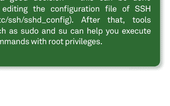

## 优化是一门艺术，没有单一的配方可以让你遵循并优化你的 Linux 系统和网络

最好的工具是那些能让你的工作变得轻松的工具。这出于两个原因：第一是你清楚地知道自己想要什么，第二是你对工具的了解越深，你就越有能力处理它的特定部分。

- 当优化 Apache 服务器时，你可以让 Apache 运行得更快的第一件事就是禁用不必要的模块。此外，如果你的网站使用 PHP，你可以使用 `php-fpm` 让 PHP 运行得更快。使用 `php-fpm` 可以让 Apache 将 PHP 请求转发给 `php-fpm` 而不是由自己处理。另一个你应该关注的是使用 Linux 的 PHP 进程的架构。

你可能需要限制工作节点（workers）的数量来使其更好，因为你请求的内存越多。相关信息存储在 Apache 配置文件中，通常命名为 `/etc/apache2/apache2.conf`。

之前的 Apache 配置允许多进程处理模块（MPM）帮助你配置 Apache。

你可能需要尝试另一个流行的 Web 服务器，如 NGINX，它使用异步套接字，从理论上讲，它可以不产生许多进程的情况下处理每秒更多的请求——这就是不同软件之间的区别决定了你的选择。你可以在 nginx.com 找到更多关于 NGINX 的信息。

```
<IfModule mpm_prefork_module>
StartServers 5
MinServers 5
MaxServers 10
MaxClients 10
MaxRequestsPerChild 6
</IfModule>
```

```
$ ps ax | grep php | grep -v grep
```

## 系统管理员特性

## 排除故障

故障排除为你提供了机会，提取你所学的一切并将其与其他知识相结合，以解决出现的问题，问题的根源可能是访问了你一台服务器的黑客。在其他情况下，当你进行故障排除时，你应该假设一切都在正常工作直到出现故障。通常，问题分为大类：系统相关和网络相关。第一类涉及本地可能发生故障的事情，例如磁盘空间不足或处理内存泄漏问题。第二类是网络相关问题，例如使用损坏的 DNS 服务器、存在错误的表或缺陷的路由器。网络相关问题可能非常复杂、难以隔离，特别是当硬件故障与软件配置不当结合时。

当你拥有一台有网络问题的 Linux 机器时，你应该尝试的第一件事是连接网络。这有助于你意识到三个基本点：问题是影响了你的设备还是网络，或者问题是否在机器本身。当你设置机器的 DNS 配置时，可以使用来自不同地理提供者的 DNS 服务器以获得额外的冗余。存储 DNS 服务器所在信息的文件始终定义在你的 IP 地址中。

系统管理员最困难的任务是快速、准确和高效地行动。当情况变得糟糕时，你应该在你的用户或老板之前查出问题，并尝试尽快解决它！故障排除在发现问题并以正确的方式处理问题方面也非常令人兴奋。

由于你无法一直查看所有内容，你应该使用一些监控工具来获取有关以下内容的有用通知：

> 问题的根源可能是从损坏的网络线到访问了你其中一台服务器的黑客的任何事情

一个可以用于故障排除的实用工具叫做 netcat。除外，netcat 还可以打印你机器的路由表（参见 `netstat -rn` 或 `netcat -rn`）。匿名路由设置对许多根源问题很有用，特别是在具有多个网络接口的机器上。网络工具（也称为 ncat）使用客户端和服务器通过 TCP 或 UDP 读写数据网络连接。以下示例显示了如何使用 netcat 创建一个在 12344 端口监听传入连接的服务器：

另一个好习惯是跟踪你对配置文件的更改，并记录什么人做了更改，通过在文件中插入注释来实现：

```
# 2013年7月8日 星期一
# (用户名)
# 首次 Cisco 日志记录
```

还请记住，有时从头开始构建新的 Linux 系统可能比尝试修复你现有的网络更简单快捷，然后你可以花时间找出原始机器哪里出了问题。然而，当你必须处理路由器等网络设备时，这一原理并不适用，因为两台路由器的配置比 Linux 机器复杂得多，也贵得多。在解决问题时不要忘记使用注释——正如亚瑟·柯南·道尔所说：“一旦你让不可能成为可能，剩下的无论多么不可能，都一定是事实。”

- `netcat -l 12344`

这验证了两个点：首先，远程机器是否可以连接到你的机器，其次是端口 12344 是否已被某些其他进程占用。图 10 显示了 netcat 工具的手页部分——用于查找所用参数信息的 man 页面条目：

祝你故障排除顺利！

## 5 个常见问题及解决方法

### 检查无法正常工作的 DNS 服务器

这非常罕见，但有时 DNS 服务器会因为某些原因失效。为了找到 DNS 服务器是否正常工作，你可以使用以下命令：

```
ns [host]
```

第一个命令显示 DNS 服务器，而第二个命令显示查询失败的消息。如果你得到了答案，你也可以使用 dig 和 nslookup 执行更多查询：

```
ns [host]
connection timed out; no response
``` 评估问题

故障排除为你提供了机会，提取你所学的一切并将其与其他知识相结合，以解决出现的问题，问题的根源可能是访问了你一台服务器的黑客。在其他情况下，当你进行故障排除时，你应该假设一切都在正常工作直到出现故障。通常，问题分为大类：系统相关和网络相关。第一类涉及本地可能发生故障的事情，例如磁盘空间不足或处理内存泄漏问题。第二类是网络相关问题，例如使用损坏的 DNS 服务器、存在错误的表或缺陷的路由器。网络相关问题可能非常复杂、难以隔离，特别是当硬件故障与软件配置不当结合时。

当你拥有一台有网络问题的 Linux 机器时，你应该尝试的第一件事是连接网络。这有助于你意识到三个基本点：问题是影响了你的设备还是网络，或者问题是否在机器本身。当你设置机器的 DNS 配置时，可以使用来自不同地理提供者的 DNS 服务器以获得额外的冗余。存储 DNS 服务器所在信息的文件始终定义在你的 IP 地址中。系统管理员最困难的任务是快速、准确和高效地行动。当情况变得糟糕时，你应该在你的用户或老板之前查出问题，并尝试尽快解决它！故障排除在发现问题并以正确的方式处理问题方面也非常令人兴奋。

由于你无法一直查看所有内容，你应该使用一些监控工具来获取有关以下内容的有用通知：

> 问题的根源可能是从损坏的网络线到访问了你其中一台服务器的黑客的任何事情

一个可以用于故障排除的实用工具叫做 netcat。除外，netcat 还可以打印你机器的路由表（参见 `netstat -rn` 或 `netcat -rn`）。匿名路由设置对许多根源问题很有用，特别是在具有多个网络接口的机器上。网络工具（也称为 ncat）使用客户端和服务器通过 TCP 或 UDP 读写数据网络连接。以下示例显示了如何使用 netcat 创建一个在 12344 端口监听传入连接的服务器：

另一个好习惯是跟踪你对配置文件的更改，并记录什么人做了更改，通过在文件中插入注释来实现：

```
# 2013年7月8日 星期一
# (用户名)
# 首次 Cisco 日志记录
```

还请记住，有时从头开始构建新的 Linux 系统可能比尝试修复你现有的网络更简单快捷，然后你可以花时间找出原始机器哪里出了问题。然而，当你必须处理路由器等网络设备时，这一原理并不适用，因为两台路由器的配置比 Linux 机器复杂得多，也贵得多。在解决问题时不要忘记使用注释——正如亚瑟·柯南·道尔所说：“一旦你让不可能成为可能，剩下的无论多么不可能，都一定是事实。”

- `netcat -l 12344`

这验证了两个点：首先，远程机器是否可以连接到你的机器，其次是端口 12344 是否已被某些其他进程占用。图 10 显示了 netcat 工具的手页部分——用于查找所用参数信息的 man 页面条目：

祝你故障排除顺利！

### 检查无法正常工作的 DNS 服务器

这非常罕见，但有时 DNS 服务器会因为某些原因失效。为了找到 DNS 服务器是否正常工作，你可以使用以下命令：

```
ns [host]
```


# 第一个命令显示 DNS 服务器，而第二个命令显示查询失败的消息

如果你得到了答案，你也可以使用 `dig` 和 `nslookup` 执行更多查询：

```
ns [host]
connection timed out; no response
```

## 评估问题

故障排除为你提供了机会，提取你所学的一切并将其与其他知识相结合，以解决出现的问题，问题的根源可能是访问了你一台服务器的黑客。在其他情况下，当你进行故障排除时，你应该假设一切都在正常工作直到出现故障。通常，问题分为大类：系统相关和网络相关。第一类涉及本地可能发生故障的事情，例如磁盘空间不足或处理内存泄漏问题。第二类是网络相关问题，例如使用损坏的 DNS 服务器、存在错误的表或缺陷的路由器。网络相关问题可能非常复杂、难以隔离，特别是当硬件故障与软件配置不当结合时。

由于你拥有一台有网络问题的 Linux 机器时，你应该尝试的第一件事是连接网络。这有助于你意识到三个基本点：问题是影响了你的设备还是网络，或者问题是否在机器本身。当你设置机器的 DNS 配置时，可以使用来自不同地理提供者的 DNS 服务器以获得额外的冗余。存储 DNS 服务器所在信息的文件始终定义在你的 IP 地址中。系统管理员最困难的任务是快速、准确和高效地行动。当情况变得糟糕时，你应该在你的用户或老板之前查出问题，并尝试尽快解决它！故障排除在发现问题并以正确的方式处理问题方面也非常令人兴奋的。

由于你无法一直查看所有内容，你应该使用一些监控工具来获取有关以下内容的有用通知：

> 问题的根源可能是从损坏的网络线到访问了你其中一台服务器的黑客的任何事情

一个可以用于故障排除的实用工具叫做 `netcat`。除外，`netcat` 还可以打印你机器的路由表（参见 `netstat -rn` 或 `netcat -rn`）。匿名路由设置对许多根源问题很有用，特别是在具有多个网络接口的机器上。网络工具（也称为 `ncat`）使用客户端和服务器通过 TCP 或 UDP 读写数据网络连接。以下示例显示了如何使用 `netcat` 创建一个在 12344 端口监听传入连接的服务器：

另一个好习惯是跟踪你对配置文件的更改，并记录什么人做了更改，通过在文件中插入注释来实现：

```
# 2013年7月8日 星期一
# (用户名)
# 首次 Cisco 日志记录
```

还请记住，有时从头开始构建新的 Linux 系统可能比尝试修复你现有的网络更简单快捷，然后你可以花时间找出原始机器哪里出了问题。然而，当你必须处理路由器等网络设备时，这一原理并不适用，因为两台路由器的配置比 Linux 机器复杂得多，也贵得多。在解决问题时不要忘记使用注释——正如亚瑟·柯南·道尔所说：“一旦你让不可能成为可能，剩下的无论多么不可能，都一定是事实。”

- `netcat -l 12344`

这验证了两个点：首先，远程机器是否可以连接到你的机器，其次是端口 12344 是否已被某些其他进程占用。图 10 显示了 `netcat` 工具的手页部分——用于查找所用参数信息的 man 页面条目：

祝你故障排除顺利！

## 5 个常见问题及解决方法

### 检查无法正常工作的 DNS 服务器

这非常罕见，但有时 DNS 服务器会因为某些原因失效。为了找到 DNS 服务器是否正常工作，你可以使用以下命令：

```
ns [host]
```

第一个命令显示 DNS 服务器，而第二个命令显示查询失败的消息。如果你得到了答案，你也可以使用 `dig` 和 `nslookup` 执行更多查询：

```
ns [host]
connection timed out; no response
```

## 评估问题

故障排除为你提供了机会，提取你所学的一切并将其与其他知识相结合，以解决出现的问题，问题的根源可能是访问了你一台服务器的黑客。在其他情况下，当你进行故障排除时，你应该假设一切都在正常工作直到出现故障。通常，问题分为大类：系统相关和网络相关。第一类涉及本地可能发生故障的事情，例如磁盘空间不足或处理内存泄漏问题。第二类是网络相关问题，例如使用损坏的 DNS 服务器、存在错误的表或缺陷的路由器。网络相关问题可能非常复杂、难以隔离，特别是当硬件故障与软件配置不当结合时。

当你拥有一台有网络问题的 Linux 机器时，你应该尝试的第一件事是连接网络。这有助于你意识到三个基本点：问题是影响了你的设备还是网络，或者问题是否在机器本身。当你设置机器的 DNS 配置时，可以使用来自不同地理提供者的 DNS 服务器以获得额外的冗余。存储 DNS 服务器所在信息的文件始终定义在你的 IP 地址中。系统管理员最困难的任务是快速、准确和高效地行动。当情况变得糟糕时，你应该在你的用户或老板之前查出问题，并尝试尽快解决它！故障排除在发现问题并以正确的方式处理问题方面也非常令人兴奋的。

由于你无法一直查看所有内容，你应该使用一些监控工具来获取有关以下内容的有用通知：

> 问题的根源可能是从损坏的网络线到访问了你其中一台服务器的黑客的任何事情

一个可以用于故障排除的实用工具叫做 `netcat`。除外，`netcat` 还可以打印你机器的路由表（参见 `netstat -rn` 或 `netcat -rn`）。匿名路由设置对许多根源问题很有用，特别是在具有多个网络接口的机器上。网络工具（也称为 `ncat`）使用客户端和服务器通过 TCP 或 UDP 读写数据网络连接。以下示例显示了如何使用 `netcat` 创建一个在 12344 端口监听传入连接的服务器：

另一个好习惯是跟踪你对配置文件的更改，并记录什么人做了更改，通过在文件中插入注释来实现：

```
# 2013年7月8日 星期一
# (用户名)
# 首次 Cisco 日志记录
```

还请记住，有时从头开始构建新的 Linux 系统可能比尝试修复你现有的网络更简单快捷，然后你可以花时间找出原始机器哪里出了问题。然而，当你必须处理路由器等网络设备时，这一原理并不适用，因为两台路由器的配置比 Linux 机器复杂得多，也贵得多。在解决问题时不要忘记使用注释——正如亚瑟·柯南·道尔所说：“一旦你让不可能成为可能，剩下的无论多么不可能，都一定是事实。”

- `netcat -l 12344`

这验证了两个点：首先，远程机器是否可以连接到你的机器，其次是端口 12344 是否已被某些其他进程占用。图 10 显示了 `netcat` 工具的手页部分——用于查找所用参数信息的 man 页面条目：

祝你故障排除顺利！

## 来自 Linuxuser & Developer 团队出品

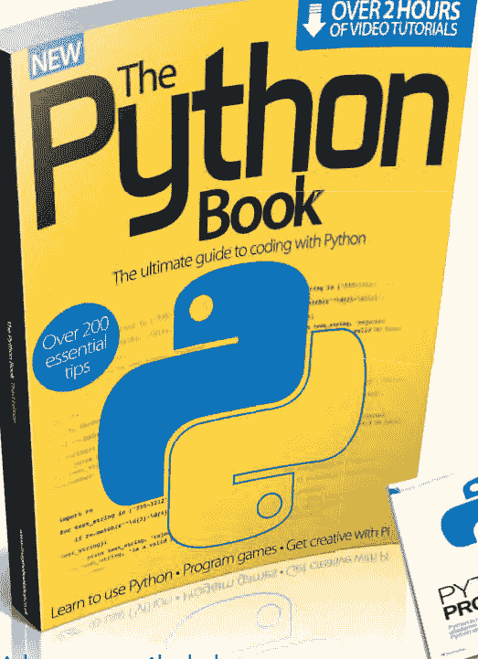

## 《Python 教程》

通过《Python 教程》探索这种令人兴奋且多功能的编程语言。你将发现一份针对新编程者的完整指南、旨在构建知识体系的绝佳项目，以及关于如何在树莓派上使用 Python 的技巧——你掌握 Python 所需的一切。


## 更多可选...


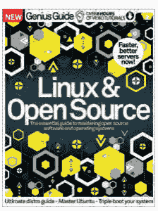
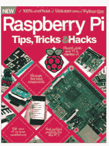
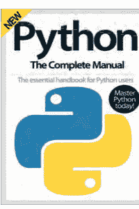

## 指尖上的内容世界

无论你热爱游戏、历史、动物、摄影、Photoshop、科幻，还是其它的任何领域，Imagine Publishing 出出的每一本杂志和特刊都充满了专家建议和迷人的的事实。


## 立刻购买您的副本

纸质版请访问 www.imagineshop.co.uk；数字版请访问 www.greatdigitalmagags.com


## 每期 £4.49

LinuxUser & Developer 订阅优惠


## 订阅即可省 25%

每一期都直接送送到您的门口

- 绝不错过任何一期
  每年 13 期，你将确保获得其中的每一期
- 送送到您的家中
  每期免费邮送，直接送达您的家门口
- 获取最佳优惠
  直接订购即可以更低的价格获得你喜爱的杂志

## 读者对我们如何评价...

> “我今天才发现这本杂志。它太棒了，正是我所需要的。我太惊讶了！” —— Donald Stein（通过 Facebook）
>
> “LinuxUser 刚刚邮寄寄到。多么棒的一期！我正准备开始玩树莓派呢。” —— Boris（通过 Twitter）
>
> “感谢带来这么出色的杂志。我已经长期订阅多年了。” —— Matt Caswell（通过邮件）

## 选择适合您的订阅方案

订阅即可省 25%

- 自动续订 – 绝不错过任何一期
- 通过直接借记（Direct Debit）支付：每六期支付一次 £26.95，比零售价节省了 £25
- 优享优惠，全球可用
- 一次性付款（使用卡或支票），确保您整整一年不会错过任何一期。13 期，直接送达家门口。

| 指示 | 详情 |
|---|---|
| 姓名 | Imagine Publishing Limited |
| 地址 | 800 Avenue Park, Sittingbourne, Kent ME9 |
| 邮政编码 | |
| 电话号码 | |
| 邮箱地址 | |
| 手机号码 | |
| 账户名称 | |
| 银行代码 (Sort Code) | |
| 账号 | |
| 银行名称 | |
| 储蓄银行 | |
| Visa / Mastercard | |
| 签名 | |
| 付款人 | Imagine Publishing Ltd |
| 日期 | |

如果您不希望通过邮寄接收任何促销材料，请告知。通过电子邮件。如果您不希望通过邮寄接收任何信息，请告知。请将此表邮寄至 Linux & Developer。尽快在线订购 www.images.co.uk。这使新订阅者每期仅支付 £26.95 以及贵公司的接入费。引用代码获取这些优惠优惠，优惠将于 3 月 31 日（周六）过期。可索取直接借记担保详情。订阅者可在 3 月 31 日后任何时候取消订阅。

# Bash 大师班

## 自动运行 脚本


Tam 一直被忽视。通过这种方式，他很快发现了许多适用于他的规则。因此，在没有人工干预的情况下运行 脚本是高效的。手动调用 脚本是无聊的。遗憾的是，你的操作系统带有各种自动处理调用的功能。

从传统的到无人值守的脚本执行需要思维的重大转变：由操作系统调用的 脚本，根据定义，是无人值守运行且不能接受用户的任何类型输入；此外，尽管脚本很困难，但它的输出会被重定向到不可见的地方。解决这个问题的最佳方法是使用 `syslog`。它是一个全局事件存储系统，可以向其输入信息。作为实际触发器，存在多个事件。最简单（在许多情况下也是最舒适）的方法涉及你可以插入其配置文件的程序。如果这不可行，也可以通过登录或在 `/dev/tty` 中出现设备时触发任务。位于文件夹中的 `syslog` 是一个先进先出的事件队列。


# 来自 Linuxuser & Developer 团队出品


# 《Python 教程》

通过《Python 教程》探索这种令人兴奋且多功能的编程语言。你将发现一份针对新编程者的完整指南、旨在构建知识体系的绝佳项目，以及关于如何在树莓派上使用 Python 的技巧——你掌握 Python 所需的一切。


# 更多可选...


# 指尖上的内容世界

无论你热爱游戏、历史、动物、摄影、Photoshop、科幻，还是其它的任何领域，Imagine Publishing 出的每一本杂志和特刊都充满了专家建议和迷人的事实。


# 立刻购买您的副本

纸质版请访问 `www.imagineshop.co.uk`；数字版请访问 `www.greatdigitalmagags.com`


# 每期 £4.49

LinuxUser & Developer 订阅优惠


# 订阅即可省 25%

每一期都直接送到您的门口

- 绝不错过任何一期
  每年 13 期，你将确保获得其中的每一期
- 送到您的家中
  每期免费邮送，直接送达您的家门口
- 获取最佳优惠
  直接订购即可以更低的价格获得你喜爱的杂志

# 读者对我们如何评价...

> “我今天才发现这本杂志。它太棒了，正是我所需要的。我太惊讶了！” —— Donald Stein（通过 Facebook）
>
> “LinuxUser 刚刚邮寄到。多么棒的一期！我正准备开始玩树莓派呢。” —— Boris（通过 Twitter）
>
> “感谢带来这么出色的杂志。我已经长期订阅多年了。” —— Matt Caswell（通过邮件）

# 选择适合您的订阅方案

订阅即可省 25%

- 自动续订 – 绝不错过任何一期
- 通过直接借记（Direct Debit）支付：每六期支付一次 £26.95，比零售价节省了 £25
- 优享优惠，全球可用
- 一次性付款（使用卡或支票），确保您整整一年不会错过任何一期。13 期，直接送达家门口。

| 指示 | 详情 |
|---|---|
| 姓名 | Imagine Publishing Limited |
| 地址 | 800 Avenue Park, Sittingbourne, Kent ME9 |
| 邮政编码 | |
| 电话号码 | |
| 邮箱地址 | |
| 手机号码 | |
| 账户名称 | |
| 银行代码 (Sort Code) | |
| 账号 | |
| 银行名称 | |
| 储蓄银行 | |
| Visa / Mastercard | |
| 签名 | |
| 付款人 | Imagine Publishing Ltd |
| 日期 | |

如果您不希望通过邮寄接收任何促销材料，请告知。通过电子邮件。如果您不希望通过邮寄接收任何信息，请告知。请将此表邮寄至 Linux & Developer。尽快在线订购 `www.images.co.uk`。这使新订阅者每期仅支付 £26.95 以及贵公司的接入费。引用代码获取这些优惠，优惠将于 3 月 31 日（周六）过期。可索取直接借记担保详情。订阅者可在 3 月 31 日后任何时候取消订阅。

# Bash 大师班

## 自动运行脚本


Tam 一直被忽视。通过这种方式，他很快发现了许多适用于他的规则。因此，在没有人工干预的情况下运行脚本是高效的。手动调用脚本是无聊的。遗憾的是，你的操作系统带有各种自动处理调用的功能。

从传统的到无人值守的脚本执行需要思维的重大转变：由操作系统调用的脚本，根据定义，是无人值守运行且不能接受用户的任何类型输入；此外，尽管脚本很困难，但它的输出会被重定向到不可见的地方。解决这个问题的最佳方法是使用 `syslog`。它是一个全局事件存储系统，可以向其输入信息。作为实际触发器，存在多个事件。最简单——（在许多情况下也是最舒适）的方法涉及你可以插入其配置文件的程序。如果这不可行，也可以通过登录或在 `/dev/tty` 中出现设备时触发任务。位于文件夹中的 `syslog` 是一个先进先出的事件队列。

一个示例 所示：

```
## m h mon dow command
* * * * *
| | | | | |
| | | | |
| | | | |
| | | | |
| Day - 7 (Sunday=0 or 7)
| Month of month (1-31)
| Hour (0-23)
| Minute (0-59)
```

```
/var/log/syslog grep IMAGINE
```

...结果所示在 Figure 2。

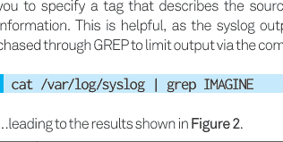

## Figure 2

Cron's crontab 每分钟运行。Cron 运行取决于时间是否匹配状态。将其中一个字段设置为星号表示该命令无论状态如何都执行。例如，让一个脚本每分钟运行，只需在 crontab 中输入以下行。上方 使用 grep 限制 cron

## 资源

## 教程可用文件

## Figure 1：syslog 可能是满的

首次调用 `crontab` 工具允许你做出选择。选择 `nano` 是简单的——`vi` 并不适合所有人（见 Figure 3）。

```
/crontab:/usr/sbin/cron/crontab
created by system admin
Select an editor. To change, run 'select-editor'
```

# 3

Cron 的名字源自希腊语中时间的表达，是 Unix 上最著名的守护进程之一。在 Ubuntu 14.04 中，cron 表位于 `/var/spool/cron/crontabs/`。请注意，直接访问存储在那里的文件是用户和开发者的禁忌，他们应该通过命令与其交互。编辑当前登录用户的 crontab 可以通过执行 `crontab -e` 完成。当你这样做时，它将编辑编辑器。这对于用户来说是一个很有帮助的工作，但如果你的脚本需要超级用户权限来执行管理任务，将其放在 root 的表中可以确保它拥有足够的权限。

```
* * * * *
```

## 教程

## Bash 大师课

### 观察功耗

在移动系统上，功耗与 CPU 功率消耗成正比。一种方法是当系统开发者禁用刚刚启动的后台工作时，减慢后台线程的刷新速度。

在文件末尾输入以下示例：

```bash
@daily
每天运行一次

@midnight
（与 @daily 相同，每晚凌晨12点运行）

@hourly
每小时运行一次
```

```bash
logger "Tam opened a terminal" -t "IMAGINE"
```

保存文件并打开几个仿真器。每次终端亮起都会导致 syslog（系统日志）中增加出一行。在下一步中，你可以自由编辑用户级配置文件。在其中找到的代码将通过 SSH 或本地输入系统进行执行。

最后，请在脑海中记住位于 `/home/$user/.crontab` 的 cron 任务生成器。它为设置系统的各种参数提供了一个舒适的环境。

### 登录时运行

### 蓝牙

Shell 脚本世界中的另一个常见问题涉及脚本在系统启动/或登录账户时的运行。Ubuntu 通过“启动”图标支持此功能，该图标可以在 14.04 及更高版本中找到。只需打开开始菜单，输入字符串“start”即可打开图 4 所示的内容。

如今的世界级操作系统对于一个保持你感兴趣行为的小型后台线程没有问题。在下一步中，让我们解释如何编写在特定设备进入范围时运行的程序，以及如何从命令行启动和停止扫描。在 Ubuntu 14.04 上，使用以下操作：

图 4


上述 Ubuntu 让创建启动脚本变得非常简单

如果这不是你想要的，你可以退回到 shell 和 profile 启动脚本。Shell 脚本在打开新终端时都会被调用，而 profile 脚本仅在登录 shell 时被调用：这意味着当用户打开工作站（交互式或通过 SSH）时。

这种行为的脚本开始通过创建一个新的 while 循环运行；同时确保循环运行直到退出的变量。我们使用 shell 的 `read` 命令将脚本的输出重定向到一个名为的变量中。之后，将变量的内容与你蓝牙手机的 MAC 地址进行匹配。如果找到，则向系统日志发送一条消息：

如果你想在 shell 中进行更多工作，可以使用此处列表中的各种文件。这里还有其他可以提供类似结果的文件——快速查看它们的 man page（手册页）可以获得更多信息。

```bash
/bin/bash
while true; do
  VAR=$(hcit scan)
  if [ $VAR == "10:A2:B3:B2:E8:D8*" ]; then
    logger "Tam opened a terminal" -t "IMAGINE"
  fi
  sleep 60;
done
```

### 命令

| 命令 | 描述 |
| :--- | :--- |
| `/etc/profile` | 全局安装，为登录脚本执行 |
| `/etc/bashrc` | 系统交互式 shell 启动脚本 |
| `/etc/bash.logout` | 全局登录 shell 清理，登录 shell 退出时执行 |
| `~/.bash_profile` | 个人安装，为登录脚本执行 |
| `~/.bashrc` | 个人交互式 shell 启动脚本 |
| `~/.bash_logout` | 个人登录 shell 清理，登录 shell 退出时执行 |

这其中的重要方面是 `sleep` 命令。只要 CPU 功率需要来解决任务，运行一次就不是问题。当然，如果将此脚本命令放入之前开发的 Linux 自动框架中——尽管不需要手动启动 Bash。

### 保持友善

Linux 作为一个抢占式操作系统，支持进程优先级的概念。当后台任务需要大量处理时，这特别有用——降低其优先级可以最大限度地减少对系统总性能的影响。

让我们测试一下。打开文件 `~/.bashrc` —— 波浪字符（`~` 代表完全登录用户的家目录）。接下来，

> Shell 启动脚本在每次打开新终端时都会被调用，而 profile 启动脚本仅从登录 shell 调用

现在启动一个新标签页允许你指定自己的优先级；值越大，优先级越低。由于 19 是默认值，以下操作不会显著占用 CPU 资源。

```bash
$ nice -n 19
```

对于 I/O 密集型任务，`nice` 提供了类似的机制。因为沉重的 I/O 对带有磁磁盘的系统特别有害——应该不惜一切代价避免创建大量小文件：

### Udev 规则

让我们看看 `/dev/rules/`：这是一个管理规则的文件系统，这些规则在系统设备树发生变化时被调用。

根据系统的不同，该文件夹将根据作者的作品包含更多或更少的现有规则，以下可能包含：

```text
udev/rules.d/
60-smfx.rules
60-video.rules
70-persistent-rules.rules
```

例如，让我们触发属于作者的 USB 硬盘出现。在 udev 中，它显示为：

```text
udev/rules.d/-dev-usb-device.rules
```

如果我们需要设备名称，可以使用以下命令查找：

```
| /dev/sdb1 | 188144 | 56216 | 140928 | 29% |
```

通过内核设备我们可以获取关于 USB 存储媒介的更多额外信息：

```bash
udevadm info -p /dev/sdb1
```

`udevadm` 命令从设备开始跟随父设备链。它为找到的每个设备提供 udev 键格式的所有属性。由于自身，输出的

由于方式，输出的部分聚合在列表中——`udev` 命令为每个设备输出一行，这些行共同可以构成顶层设备的属性列表以及一个

修复——混合多个规则是不允许的。

在下一步中，在 `/etc/udev/rules` 文件夹中创建一个 `81-stickrules.rules` 文件。最重要的是因为它指定了执行顺序；在冲突时，最后运行的具有优先权，使用较大的数字：

通过这种方式，你可以这样格式化规则：

此网站支持 SQL 查询。要注入我们在上一个示例中导致 BIGINT 溢出的 SQL 语句，请在 User ID 文本框中输入以下内容：


# SQL 注入教程

## 基于联合的 SQL 注入

一旦你点击 `Submit`（提交）按钮，你将获得与在 MySQL 客户端插入该语句时相同的数据库错误，在这种情况下，错误信息对于数据提取非常有价值。然而，你可以使用基于联合的漏洞。要将此负载注入到 `User ID` 字段中，请注意下面的命令中横杠 `--` 后面有一个空格：

```
-1 UNION SELECT VERSION(),--
```

由于这是一个基于 UNION 的 SQL 漏洞，你已经成功提取了预期的内容和 `SELECT version`。通过添加横杠和空格，你终止了查询，因此它的最后部分不会被执行。当然，你现在可以尝试其他操作：尝试此负载：

## 推断型 SQL

推断型 SQL 攻击有两种类型：盲注布尔型和基于时间的。第一种使用发送到数据库的查询返回 `TRUE` 还是 `FALSE`，或者发送到数据库的查询会强制服务器在响应之前等待一段时间；这将允许攻击者确定查询是 `TRUE` 还是 `FALSE`，从而提取数据。

### 盲注布尔型攻击

通过使用盲注布尔型查询，打开 MySQL 客户端执行：

```
$ mysql -u root -p
```

在被要求输入值时输入 `do`。现在，选择数据库并执行一个简单的查询来选择 `user_id` 为用户：

```
user_id=
```

因为我们想将其用于布尔型查询，请尝试：

```
mysql> SELECT user_id FROM users WHERE user_id=1 AND 1;
```

通过以下方法测试 SQL 漏洞相对容易：

```
mysql> SELECT user_id FROM users WHERE user_id=1 AND 1=0;
```

```
Empty set (0.0 sec)
```

因此，第一个返回了一行数据是因为它是 `TRUE`，而第二个返回了空集是因为它是 `FALSE`。要再次尝试这种攻击，请使用 Firefox 回到 DVWA 并进入 `SQL Injection`。先尝试第一个：

```
AND 1=0
```

你得到一个没有额外数据的页面。然后，尝试这个：

```
AND 1=1
```

页面将告诉你查询是否成功。在盲注攻击中，它连接到 `FALSE` 页面或 `TRUE` 页面。在盲注攻击中，通常通过测量其 `Content-length`（内容长度）来区分 `TRUE` 页面和 `FALSE` 页面。使用这种技术，你可以找到数据库版本的第一位是否为 5，或者：

```
AND 5=VERSION(1,1)
```

你得到了一个 `TRUE` 页面。所以你确定 `VERSION` 返回的字符串的第一个字符是 5。

### 盲注时间型攻击

盲注时间型攻击的背后的原理与此类似：

```
SELECT IF(VERSION(1,1)=5,SLEEP(15),0)
```

因为数据库服务器的第一位是 5，在查询返回之前存在延迟，然后你得到了结果。如果条件的评估为 `FALSE`，结果将返回空值。要在 DVWA 上再次尝试，请输入以下负载：

```
IF(VERSION(1,1)=5,SLEEP(15),0)--
```

服务器将被强制在向 Firefox 返回渲染后的页面之前产生延迟。请注意，注入的负载 `IF(VERSION(1,1)=5,SLEEP(15),0)` 将被评估为 0, `1-0=1`，你仍然将有一个有效的查询，选择 `user_id=1` 的用户。

> 注意：本教程重点关注了 MySQL 中 SQL 注入的影响。MySQL、Oracle、PostgreSQL 等不同 DBMS（数据库管理系统）对负载的行为也所不同。你可以找到处理数据提取过程的函数。其中一些是，但你必须指定你正在与哪种 DBMS 交互。

## SQL 注入分类与利用

SQL 攻击可以分为三类：带内、推断型和带外，具体取决于攻击者如何提取数据。

因此，第一要务的任务是识别服务器是否存在 SQL 漏洞，然后根据我们对 SQL 攻击的分类，你必须确定应用程序属于哪种攻击类型。当然，带内 SQL 漏洞速度更快，提取数据所需的时间更短，攻击者向远程服务器发送了大量的 HTTP 请求。无论何种，一旦你确定了在使用哪种类型的 SQL 漏洞，就使用你的工具提取信息。

### 使用 sqlmap 自动提取数据

针对 DVWA 运行 sqlmap 以检测我们第一次交互中的错误型漏洞，并获取当前数据库和服务器的列表。或者在虚拟机内部打开一个新终端并输入：

```bash
$ sqlmap -u "http://localhost/vulnerabilities/sql.php?id=1&submit=Submit" --technique=E --cookie="PSESSID=Hnt6S0gvVh2aq354qd16;security=medium"
```

```
-- current_database: 'dvwa'
-- hostname: 'djo2'
```

我们指定了要使用的技术（`E` 用于错误型）以及参数（`id`）。你可以通过以下命令获取有效的 sqlmap 查询列表：

```bash
$ sqlmap --help
```

## 篡改 SQLi 负载以绕过 WAF

某些 Web 服务器受 Web 应用防火墙 (WAF) 保护。WAF 的原理是在 SQL 注入被实际处理之前检测任何非法访问以保护你免受攻击。例如，假设你需要在 WAF 之后绕过 Web 应用程序。

```
AND 1=1
```

也许它实现了一个拦截 `AND 1=1` 的正则表达式。但可以通过 `AND 2=2` 等方法绕过 SQLi。某些 WAF 设计得比其他要好。总之，最好的方法是在开发应用程序时使用自定义安全规则。著名的 WAF 是 ModSecurity，它已安装在你的虚拟机上。

### 配置 ModSecurity

编辑 `modsecurity.conf` 以启用：

```bash
# /etc/modsecurity/modsecurity.conf
```

通过以下操作激活 SQL 规则：

```bash
mkdir /usr/share/modsecurity-crs/activated_rules
cd /usr/share/modsecurity-crs/activated_rules
ln -s ../../rules/41_*.rule .
vi /etc/apache2/mods-enabled/security2.conf
```

---

# SourceClear 教程

## 使用 SourceClear 扫描您的代码漏洞

确保您的软件项目安全——学习如何快速轻松地发现并修复基于库的安全漏洞

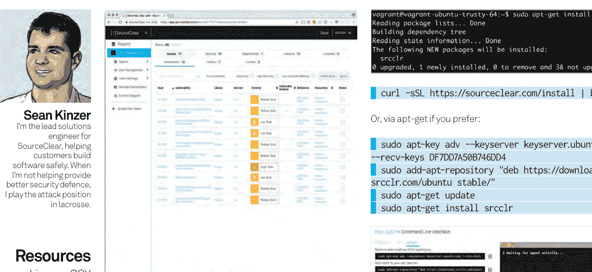

**Sean Kincaider**  
我是 SourceClear 的首席工程师，致力于构建软件安全。当我不在编写更安全的代码时，我在长曲球运动中担任进攻位置。

## 资源

- 接入互联网的 Linux 或 OSX 机器
- 本地安装了 Python 2.7 和 `pip`
- Git 1.9.3+
- 一个免费的 SourceClear 账户：<https://sourceclear.com/>


平均软件项目依赖于几十甚至上百个开源库。您使用的版本是否存在安全漏洞？您将如何获知？

为了回答这些问题以及更多问题，我们将使用 SourceClear 命令行代理来分析您的开源依赖项。通过接入管理开源依赖项的构建和包管理器，我们将开始收集完整依赖图的信息、Registry（全球最大的开源安全漏洞数据库）——并帮助您识别我们可能发现的内容。

让我们从查看一个流行的 Python 项目开始，看看我们可以发现些什么。

## 01 安装 SourceClear 代理

SourceClear 命令行界面 (CLI) 代理是一个灵活的工具，可以轻松扫描您的代码项目中的开源漏洞。该工具可以通过运行以下一组命令之一安装在任何基于 Linux 的操作系统上。

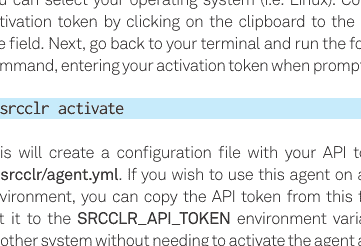

**方法一：使用 apt-get**

```bash
vagrant@ubuntu-trusty-64~$ sudo apt-get install srcclr
```

```
Reading package lists... Done
Building dependency index... Done
Reading state information... Done
The packages will be installed:
srcclr 1 newly installed, 0 to remove and 0 not upgraded.
```

**方法二：使用 curl 安装脚本**

```bash
curl https://sourceclear.com/install | bash
```

**方法三：手动添加仓库**

```bash
sudo apt-key adv --keyserver keyserver.ubuntu.com --recv-keys DF0D7A5B87640D4
sudo add-apt-repository "deb https://download.srcclr.com/ubuntu stable/"
sudo apt-get update
sudo apt-get install srcclr
```

## 02 激活您的 SourceClear 代理

要激活代理，我们需要您的激活令牌 (`token`)。登录 `SourceClear.com`。在“新代理 (New Agent)”页面上，您可以选择您的操作系统（Linux, OSX）。点击字段右侧的剪贴图标复制激活令牌。接下来，进入终端并运行以下命令，输入您的激活令牌：

```bash
srcclr activate
```

这将在 `~/.srcclr/agent.json` 中创建一个包含您的 API 令牌的配置文件。如果您想在另一个环境中使用它，可以从此处复制 API 令牌，并将其设置为另一个系统上的 `SRCCLR_API_TOKEN` 环境变量，而无需再次激活代理。

## 03 测试您的环境

运行以下命令，确保您的环境已准备好扫描 Python 项目：

```bash
srcclr test --pip
```

此命令将显示 SourceClear CLI 使用的系统信息，并对使用指定包管理器 (`pip`) 的测试项目进行扫描。

```
$ sourceclear --version
SourceClear CLI version 2.0.2
Build: 2021
OS: Windows 10 (10.0.19044)
Architecture: x64
Runtime: .NET Core 3.1.4
Framework: .netcoreapp3.1
```

> **注意**：上述版本信息为示例输出，实际输出取决于您的运行环境。

**安装 SourceClear CLI (Node.js 版本)**：

```bash
npm install -g https://github.com/sourceclear/sourceclear-cli
```

**扫描项目**：

```bash
sourceclear scan --path . --name my-project
```

**清除扫描记录**：

```bash
sourceclear clear --name my-project
```

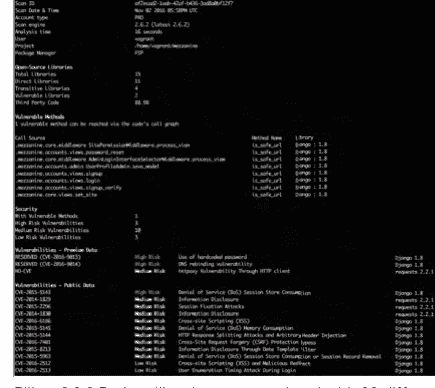

`Pillow 2.3.0` Python 库与 30 种不同的漏洞相关。此外，项目中的代码实际上正在使用与 `Django 1.8` 漏洞相关的漏洞方法。

## 安全自动化变得简单

从每次推送 (`push`) 开始扫描项目是一个很好的开始方式，为您的开发过程添加安全性有助于整个团队。当将 SourceClear 添加到持续集成环境中时，您的工作流可以变得简单。只需设置扫描并添加后处理以获取特定环境的指令，请访问 <https://www.sourceclear.com/data/>

## 04 扫描您的项目

为了演示 SourceClear 如何工作，我们将首先分析一个名为 `Mezzanine` 的公共项目。只有当您想扫描使用特定包管理器库的项目时，才需要包信息。运行此操作后，您现在应该会在屏幕上看到我们的列表。

```bash
$ vagrant@ubuntu-bionic:~$ srcclr scan
SourceClear: ready
Scanning...
Checking dependencies...
Found 1 vulnerabilities
```


# 05 查看扫描结果

Pillow 2.3.0 Python 库与 30 种不同的漏洞相关。此外，项目中的代码实际上正在使用与 Django 1.8 漏洞相关的漏洞方法。

# 06 审查完整扫描

SourceClear 的标准输出很有帮助，但让我们查看完整报告。查看漏洞信息允许我们确切看到漏洞部分在代码中的何位置。为了查看调用者 #2 `next_url` 是如何被使用的，我们可以在 `url.py` 文件中找到它。如截图所示，`safe_url` 函数在 `next_url` 函数内部被使用。

# 07 修复漏洞

更新库可能是复杂的，特别是当库被用在代码中——此时它依赖于其他依赖项，而这些依赖项也可能存在漏洞。坦率地说，Django 库直接在项目根目录下的 `setup.py` 文件中指定，这意味着我们可以轻松更新此特定版本的范围。截至 2016 年 11 月，1.7 或更高版本没有任何漏洞。

# 08 漏洞详情

我们如何识别漏洞以及想要修复它。SourceClear 为漏洞提供了详细信息。我们可以通过进入库标签页并扫描漏洞来看此。这将显示一个页面，包含漏洞描述、发现该漏洞的库以及任何可能使用的漏洞方法的完整调用堆栈。

# 09 查看漏洞部分

SourceClear 的标准输出很有帮助，但让我们查看报告。当将 SourceClear 添加到持续集成环境中时，您的工作流可以变得简单。只需设置扫描并添加后处理以获取特定环境的指令，请访问 https://www.sourceclear.com/data/

# 10 应用修复

在进行更改之前，验证您的项目是否与新库版本兼容是非常重要的。在这种特定情况下，我们更新的 Django 版本低于最高版本限制 (1.11)，因此更改不应破坏项目。我们可以使用 Django 运行项目的测试。如截图所示，测试通过了，这意味着我们可以放心地进行更改，因为这些

## SourceClear 要求所有与提交顺序相关的代码更改，以便结果在 Web 平台中发送和跟踪

依赖项要求（`setup.py`、`txt`、`xml` 等等）。剩余的两个漏洞库 Pillow 和 requests 具有版本范围要求，且未指定上界。这意味着我们可以将限制条件更新为大于或等于“最新扫描” 中显示的最新版本。

# JSON 输出

想要将 SourceClear 数据集成到安全报告或仪表板中？漏洞代理程序可以在扫描时使用 `--allow-dirty` 参数生成 JSON 格式的代码扫描。随后可以使用脚本结合这些数据来自动获取构建版本并识别漏洞或库。

假设已实现适当的覆盖率，项目将按预期方式工作。

## 更新您的库

现在，如果您想更新，只要版本范围大于指定的修复版本，您就可以更改版本范围。更新版本后，您应该使用 "allow-dirty" 参数再次运行扫描，以确保修复成功。一旦被 SourceClear 修复，如果另一个依赖项也依赖于该库，则该库可能也会被更新。SourceClear 将这些称为“传递依赖”。

# 13 提交前扫描

一旦我们识别出问题，可以通过将代码提交到版本控制并运行另一个 SourceClear 扫描来验证漏洞是否已修复。SourceClear 要求所有代码更改，以便结果在 Web 平台中发送和跟踪。通过使用 "allow-dirty" 参数，您可以扫描带有未提交更改的项目，而无需将结果发送到 Web 平台，从而验证漏洞是否已修复。


> 干得好

# 17 将提交的更改扫描到 SourceClear

最后，如果您已经识别并修复了所工作项目的所有漏洞，通过进入问题标签（issue tags），可以看到您的代码已没有已知漏洞。您可以将 SourceClear 添加到您的 CI 流水线，以实现过程自动化，并保持您的库与漏洞信息同步。

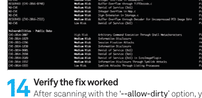

# 14 验证修复

使用 "allow-dirty" 选项扫描后，您可以查看结果概览以及您识别的漏洞是否出现在结果中。在这种情况下，输出显示没有与 Django 相关的漏洞。遗憾的是，此代码中仍在使用其他库。虽然这些库的漏洞方法没有被使用，但我们仍然更新到更高版本，以确保代码不使用漏洞方法。

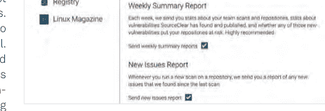

| 扫描 | 库（仅限直接） | 最新中的版本 | 扫描时的最新版本 |
|---|---|---|---|
| Django | 3.2.0 | 3.2.0 | 3.2.0 |
| requests | 2.25.1 | 2.31.0 | 2.25.1 |
| jinja2 | 3.0.1 | 3.1.2 | 3.0.1 |
| ddtf | 0.1.1 | 0.1.1 | 0.1.1 |

# 15 修复剩余漏洞

在 SourceClear 仪表板的“（Issues）部分中，您可以查看“更新（Updates）”，以查看过时且直接引用的库。

# 18 未来漏洞的通知

确保代码安全是一场持久的战斗，对代码中任何潜在漏洞或新识别的漏洞保持警觉非常重要。可以通过右上角的订阅并选择“通知设置（Notification Settings）”来确保收到通知。您可以选择启用所有项目的漏洞信息每周摘要，或者当任何项目引入新漏洞时发送通知邮件，或者两者兼顾。祝喜您，您的源库是安全的！


www.luxuker.com 45

# Erlang 教程


## Erlang 语言编程：简介

Mihalis Tsoukalos
他是一位 UNIX 员，也是一名程序员（UNIX & C 数学家家）。他从 1993 年就开始编程。（您可以通过 Twitter 上的 @mactsouk 或 mtsoukalos.com 联系他）

资源
- Erlang 安装程序
- 一个如 Emacs 或 vi 的文本编辑器

## 在我们的新系列中学习如何掌握 Erlang 编程语言

本教程将是 Erlang 编程语言系列教程的第一篇。Erlang 是一种函数式编程语言，具有许多独特且有趣的特性，设计用于用于电话设备的交换。尽管它看起来可能像任何通用编程语言，但它最适合开发高可用服务器进程。换句话说，使用 Erlang 开发应用程序的服务器端比开发客户端更好。

Erlang 程序应该实现为大量微小的进程，这些进程执行简单任务并使用无副作用的代码相互通信。这是通过在不共享任何数据的情况下交换消息实现的，因此允许 Erlang 在无故障的情况下使用多个 CPU 核心。一个 Erlang 程序的运行速度可能比四核快四倍。本教程将提供 Erlang 功能的快速概述。

## 关于 OTP

OTP 是一套用于构建分布式应用程序的工具和库。它允许您监控一个 Erlang 模块，并在需要时启动它。当该模块崩溃时，它会自动重启。

## Erlang

Erlang 是一种许多独特且有趣的特性的函数式编程语言，设计用于电话设备的交换。尽管它看起来可能像任何通用编程语言，但它最适合开发高可用服务器进程。换句话说，使用 Erlang 开发应用程序的服务器端比开发客户端更好。

### 什么是 OTP？

OTP 是一套用于构建分布式应用程序的工具和库。它允许您监控一个 Erlang 模块，并在需要时启动它。当该模块崩溃时，它会自动重启。

OTP 是 Erlang 强大且关键的部分。后续章节将为您介绍更多 OTP 并展示有趣的示例。

### 什么是 Erlang？

Erlang 是一种许多独特且有趣的特性的函数式编程语言，设计用于电话设备的交换。尽管它看起来可能像任何通用编程语言，但它最适合开发高可用服务器进程。换句话说，使用 Erlang 开发应用程序的服务器端比开发客户端更好。

### 获取 Erlang

大多数发行版不包含最新 Erlang 版本。因此，如果您想使用最新版本的 Erlang，可以尝试从源码编译。从源码编译并不容易，因此下载二进制包是更优的。它详细展示了过程，但您可以在 http://www.erlang.org/resources/download 找到更多信息。

### 小示例

您可以在下方找到正在寻找的 Erlang 示例，您可能会觉得有用：

```erlang
% erl _ok(Ok, Version) : release

file:join(code:dir(),"releases"),

erlang:system_info(otp_release,"OTP_VERSION"),

hello(). --shell

19.1.3
```

在演示示例之前，是时候看看 Erlang 版本的 Hello World 程序了，名为 hwl：

```erlang
% cat hwl.

%% Program: Mihais Tsoukoulos

%% hello world program

module(hw);

-export("hello",[]).

hello() ->

    io:write("Hello, world!\n").
```

# Erlang 教程

这是 `practical.er` 的 Erlang 代码，其中包含一个计算斐波那契数列数字的函数。

```erlang
-module(practical).

-export([fib/1, for/2, start/0]).

fib(0) -> 0;
fib(1) -> 1;
fib(N) -> fib(N-1) + fib(N-2).

for(_, _) ->
    [];
for(N,Term) when N > 0 ->
    write("~w:n", [N,Term]),
    for(N-1,Term).

start() ->
    for(5,1).
```

这展示了 Erlang 的能力，包括显示系统的 IO 命令。

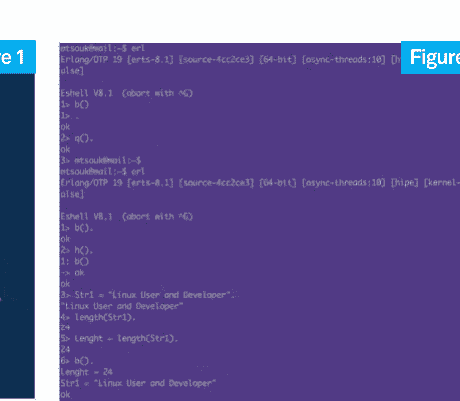

第一条命令使用 `erlang` 编译 Erlang 代码，Erlang 编译器是一个生成器，它产生用于解释 BEAM 代码的虚拟机的 BEAMS 文件。第二条命令创建一个交互式 shell，它是 Erlang 运行时的二进制文件，由 `erl` 自动启动，以执行 `helloworld` 函数，并打印出所需的消息。

退出 Erlang shell 的原因可以在命令的最后部分（`-s stop`）找到，它在退出目标模块函数后触发文本。或者，你可以通过在不带参数的情况下输入 `erl` 进入 Erlang shell 并执行函数：

```bash
1 erl()

(ok)

2 erl:helloworld().

Hello, world!

(ok)

3 -s stop

(ok)
```

第一条命令编译包的代码，第二条命令执行函数。如你所见，每个命令都应该以句号（`.`）结束。

函数式编程是一种编程范式，计算被视为数学函数的求值，并避免改变状态和副作用，以编写代码。

```
erlc helloworld()

erl -noshell -s practical start -s init stop

5: 5

4: 4

3: 3

2: 2

1: 1
```

现在是时候尝试一个更实用的例子了。函数中的 Erlang 代码定义了一个函数，允许你计算属于斐波那契数列的自然数。序列 1 显示了 practical 的 Erlang 代码，你也可以看到如何迭代循环（这在 Erlang 中是没有预定义的）。

你将看到如何使用 `helloworld` 函数在屏幕上打印输出。`helloworld` 函数打印到控制台（print 函数），我们使用控制子句来打印输出。practical 会生成如下类型的输出：

递归在各种函数式编程语言中被频繁使用，因为它符合函数式编程的工作。在 Erlang 中用递归之外实现 `fib(n)` 函数是——

为了节省空间，以后所有的 Erlang 代码都将包含在一个名为 `practical` 的模块中，仅用于查看相关函数的实现。请注意，模块名和文件名必须使用小写字母。

其他函数式语言还有 Elixir、Haskell、Common L 和 Racket 等。你将在 Erlang 的早期阶段通过保持关注学习更多关于函数式编程的知识！

## 函数式编程

## 添加列表项

```erlang
addList([]) -> 0;
addList(List) -> addList(List, Total);
addList([], Total) -> Total;
addList([Head|Tail], Total) -> ...
```

`addList()` 函数的 Erlang 代码演示了如何迭代列表元素进行相加。

Erlang shell
erlang interactive 是 Erlang 的一个强大组件。它可以用于许多不同的情况。关于 Erlang shell 你学习的第一点是如何探索它！如果你想退出 Erlang shell，应该输入 "q" 并按回车键——不要忘记通过按 Ctrl+U 将之前的命令复制到 Erlang shell，否则可能会获取复杂的消息，因此最好避免这种方法。

注意，如果你在 Erlang 中定义了一个新变量，你不能改变它的值，因为 Erlang 变量是不可变的：

```erlang
patternMatch(Number) ->
    case Number of
        10 -> iowrite("10");
        20 -> iowrite("20");
        _ -> iowrite("Unknown!")
    end.
```

这展示了 Erlang 中 `case` 语句的使用，它允许你根据条件匹配变量。

```erlang
readlines(FileName) ->
    (Ok, Device) = openfile(FileName, read)
    after close(Device) ->
```

这段 Erlang 代码包含两个函数。`readlines()` 打开文件进行读取，而 `process_line()` 可用于单独处理文件。

```erlang
process_line(Device) ->
    iowrite(Line).
```

- 4=123
- X=123
** error: no match of right hand side 124

发生这种情况是因为 Erlang 使用单次赋值，起初看起来很奇怪，但你可以正常使用它。此外，你代码的副作用最重要的是它可以使用可用的 CPU 核心之一在自己的进程中并发执行。变量的当前值为：

- 8=12
** error: no match of right hand side 123

2 展示了另一个与 Erlang shell 的交互，让你更熟悉它——你应该尝试匿名重载。

# 变量与数字

Erlang 变量以大写字母或原子（atom）开头。如果你尝试一个不同的变量，将得到这种错误信息：

Erlang 的设计从诞生初就遵循六个原则。第一是**隔离**。Erlang 进程拥有自己的栈并进行独立的垃圾回收。进程之间不共享内存，不会损害彼此。第三是**并发**。Erlang 进程是并发的，这是一个非常好的特性，计算机具有多核心处理器来检测故障。你可以在两个进程之间建立链接。当进程由于原因失败时，你可以对其进行升级并重启。这样，当出现问题时，你可以无需运行即可修改或升级代码！第五是**容错**：当进程失败时，Erlang 运行时会告诉你进程已失败。最后是**持久化**：如果你使用 Mnesia、Riak 或其他支持的数据库存储数据，数据就不会丢失。

## 使用仓库使用 Erlang

### 1. 手动添加仓库条目

要向系统添加 Erlang Solutions 仓库（包括用于 apt-secure 的公钥），请调用以下命令：

```
wget http://packages.erlang-solutions.com/erlang-solutions_1.0_all.deb
sudo dpkg -i erlang-solutions_1.0_all.deb
```

### 或者：手动添加仓库条目

将以下行之一加到您的 `/etc/apt/sources.list` 或自定义的发行版源文件中，然后使用以下命令为 apt-secure 添加 Erlang Solutions 公钥：

```
sudo echo "deb http://packages.erlang-solutions.com/debian/ stable main" | sudo tee /etc/apt/sources.list.d/erlang-solutions.list
sudo apt-key add erlang-solutions.asc
```

### 2. 安装 Erlang

刷新软件包缓存并安装 erlang 包：

```
sudo apt-get update
sudo apt-get install erlang
sudo apt-get update-otp
sudo apt-get install ei-erlang
```


请参考 FAQ 了解这些版本之间的区别。

### FAQ - 常见问题

#### 1. 什么是 erlang 包？

erlang/OTP 是一个由许多较小应用程序（模块）组成的复杂系统。安装 `erlang` 包会自动安装整个 OTP 套件。由于许多高级用户想要只选择特定的模块，因此 Erlang/OTP 被划分为更小的包（都带有固定前缀 `erlang-`），这些包可以被独立安装。

#### 2. 什么是 eisel-erlang，它与 erlang 有什么区别？

`eisel-erlang` 包是一个包含编译安装程序的大文件。它会安装 Erlang/OTP 平台及其所有的应用程序。`erlang` 包是多个用于编译和 `eisel-erlang` 的小模块的前端。

- 注意 `erlang-base` 具有几个优势：
  1. 它的依赖项比 `erlang` 少。
  2. 其他包依赖于 `erlang-base`。
  3. 如果你想在不包含未使用部分的情况下获取它，`erlang-base` 只需要 13MB 的空间。

#### 3. 我的操作系统使用的是最新的 Erlang 仓库。我们为什么应该选择你们的？

我们的仓库包含了最新的稳定 Erlang/OTP 分发版。我们的包是完整的，例如：当我们提供 R16802 时，Ubuntu 12.04 LTS Precise 仅提供了 R14800。

#### 4. 如何防止 Erlang Solutions 仓库的包被其他仓库替换？

这种情况非常重要，因为我们提供了最新的 Erlang Solutions，而发行版在更改提供的 Erlang/OTP 版本方面是独特的。Debian/Ubuntu 的自动更新工具会下载最新版本。

如果你有担心，请使用 `erlang-solutions_1.0_all.deb` 包（不带“安装仓库”）——它会自动将我们的仓库优先级设置为高于其他仓库。请看下文如何操作：


### 文件 I/O

本节将开发一个接受单个参数的函数，该参数是文件名；以便创建并写入三次斐波那契数列迭代。正如你所猜到的那样，我们将使用 `practical.erli` 模块中的 `fibo()` 函数，该函数还会向你展示如何获取其他函数的输出。`writeFibo()` 函数的 Erlang 代码见图 7。

> 这只是一个为了介绍 Erlang 中文件 I/O 的问题，因为没有必要向初学者解释 `writeFibro(b)` 的所有代码，但本教程将更多讨论 Erlang 中的输入和输出。

本教程是 Erlang 能力的介绍。如果你想让生活变得更轻松，请尽快开始学习 Erlang 以适应 Erlang 的问题。你可以通过访问 https://www.erlang-solutions.com/ 获取最新版本的预编译包：`tmux`

## 使用 tmux 增强你的终端

你是否曾经觉得终端太小了？`tmux` 可以帮助你。

传统上，用户登录时会产生一个 shell 实例。如果你的会话丢失了——例如 SSH 连接 断开时——shell 和所有程序都会消失。

`tmux` 代表终端复用器——它采用了一种不同的方法。对于长时间运行的进程，作为一个或多个 shell 实例的宿主机非常有帮助。

```
$ tmux
```

这出于多种原因是很有有趣的：首先，所有的 SSH 连接（例如不可靠的网络连接）不再是灾难，因为 `tmux` 中的任务会继续运行。你回到了你开始的地方。

`tmux` 的第二个优势是它允许你将多个窗口并排。通过这种方式，图形化的多屏界面变得更容易管理。当 GPU 繁忙时，处理进程时，这 特别有用。

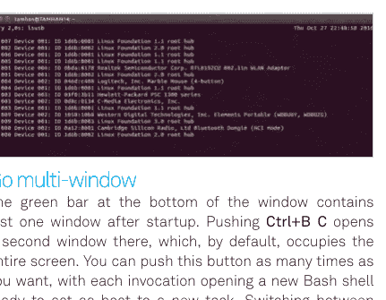

底部的绿色条只是一个窗口。启动。使用 `Ctrl+B` 可以创建占据整个屏幕的窗口。你可以根据需要多次按下此按钮，每次打开一个准备好作为宿机的 shell。通过按下 `Ctrl+B+(数字)` 可以切换窗口。此外，你可以通过按下 `Ctrl+B-` 跳到特定窗口。你应该尽快学会使用这些快捷键。

最后，`tmux` 允许你复用终端会话。如果你觉得要离开，只需获取你的笔记本并 SSH 到工作站，就像在家里一样。

## 多窗口

### 附加和分离

开始使用 `tmux` 非常简单。只需打开命令行或 SSH 连接，输入以下命令：

```
$ tmux
```

`tmux` 会话因其全屏显示而闻名：这意味着显示可以被分成多个区域，每个区域都满了信息。在 `tmux` 中，这个过程可以通过 panes（窗格）来实现。原则上，pane 是我们讨论的窗口内部的一个控制台。分割现有的 pane 可以创建新的 panes：你的窗口外观将像 `tmux` 激活时所示改变。在 `tmux` 实例中运行命令可以像普通终端一样——对你选择的任何命令进行操作。接下来，`Ctrl+B` 跟着 `Ctrl+A` 会创建一个标识符，告诉 `tmux` 键盘：

```
@user@tmux: $ tmux
@user@tmux: $ bash
```


图 1 按下键删除会话。右侧绿色条表示 `tmux` 现在处于激活状态。在远程系统连接在断开时无法保持程序运行的不幸的情况下。

## 资源

tmux.github.io

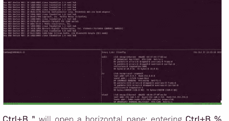

`Ctrl+B *` 将打开一个水平 pane，`Ctrl+B %` 将垂直分割活动 pane。这可以用于例如在屏幕上创建布局。通过按下 `Ctrl+B O` 切换活动 panes。按下 `Ctrl+B!` 可以当前活动 pane 提升为全屏窗口。当你决定占据 `tmux` 会话的前景空间时，这特别有用。按下空格键即可完成此操作。每次调用此命令会在五个默认布局之间切换。另一个技巧是按下 `Ctrl+B Q`。最后，注意在这种情况下，`tmux` 将显示一组数字。当前活动的 pane 数字将为红色；被动的 panes 显示为蓝色。

第一个适用于 UNIX 的终端复用器。许多开发者——尤其是老手——是随着 `screen` 长大的，它提供了 `tmux` 中不具备的高级功能和控制。`tmux` 被认为在开发者之间使用更广泛。

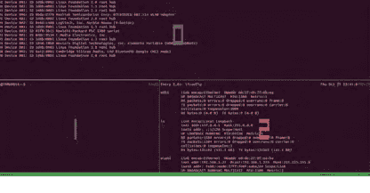

## 复你的会话

`Tmux` 限制一次只处理一个会话。如果你从一个会话分离并进入另一个会话，然后也从这里分离，程序将持有两个会话，可以通过 `tmux ls` 进行验证。

```
$ tmux ls

0: 1 windows (created Oct 27 22:48:30)

1: 1 windows (created Oct 27 23:32:36)
```

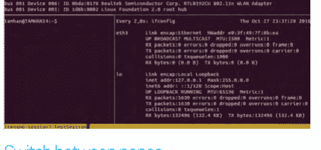

## 在 panes 之间切换

找到活动 pane 的最佳方法是寻找光标：当前正在输入的那一个。切换 panes 的最佳方法是按下 `Ctrl+B` 并使用方向键移动终端，就像你在像吃豆人那样的 2D 网格中一样。`tmux` 的一个有趣方面涉及调整 panes 大小。这可以通过按下 `Ctrl+B` 并按住键来实现。在这种情况下，当前活动的 pane 会沿着箭头的方向扩展或缩小。你也可以根据 `tmux` 配置中定义的某种标准来排列 panes。通过 `Ctrl+B` 和当

### 通过命令 `tmux attach -t "name"` 附加活动会话

为了处理会话，也可以为它们提供一个友好的名称。这是通过按下 `Ctrl+B $` 实现的。在下一步，按下回车键 `tmux` 状态行将变得熟悉。完成后，可以通过名称访问会话。

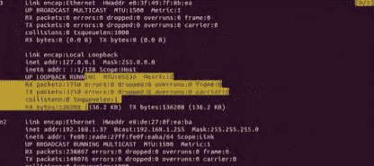


## 选择文本复制 tmux 剪贴板

> 即使连接到非图形系统，也可以实现图形化的多屏界面

剪贴板和命令之间并不协同；很难找到具有良好剪贴板的命令。`tmux` 尝试通过提供自己的剪贴板实现来解决这个问题，该剪贴板在会话的所有内容之间共享。开始使用这涉及将光标放在你想移动到

# 剪贴板

然后，光标可以移动到 `Ctrl+B` 的开头

# tmux 教程

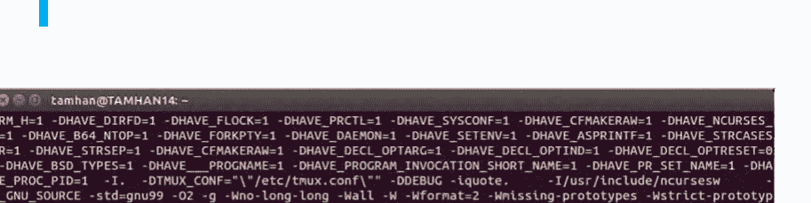

```
ERM_H=1-HAVE_DIRFD-1-HAVE_FLOCK-1-HAVE_PROCTL-1-HAVE_SYSCONF-1-HAVE_CFMAKERN-1-HAVE_NURSES-
TERM_H=1-HAVE_MATCH-1-HAVE_CFMAKERN-1-HAVE_DECL-1-HAVE_OPTARG-1-HAVE_DECL_OPTIND-1-HAVE_DECL_OPTSET0-0
TR=1-HAVE_STRSEP-1-HAVE_CFMAKERN-1-HAVE_DECL-1-HAVE_D_ARG-1-HAVE_DECL_OPTIND-1-HAVE_D
VE_PROC_DIF=1-D_CONF=1-TMUX_CONF="/etc/tmux.conf"--DEBUG -l quote-/usr/include/ncurses
D_GND=long-long-long-long-long-long-long-long-long-long-long-long-long-long-long
s-editing-declarations-write-strings-whisper-art-itch-writer-sign-compare-wbind-wbad-afunction-
-case-wincast-all-declaration-after-statement-pointer-sign-writer-at.MT
display-name=0 -I -m /dev/pts/0-display-c-main
-v F.type-type-set-line-t-set-select-pane-t-set-select-window
-v F.type-type-set-line-t-set-select-pane-
```

使用方向键选择所需的区域。最后，按下 `Ctrl+Space` 开始选择。从从那一刻起，光标将在你喜欢的区域生成选择框。完成后，按下 `Alt+v` 将信息复制到 `tmux` 的缓冲区中。可以通过 `Ctrl+B` 获取这些内容。

滚动功能允许你滚动所选面板的内容，在某些版本中，必须启用复制功能后才能生效。使用此功能的人会发现它非常有用，否则将不得不各种命令来滚动缓冲区。

# 让我们开始吧！

`tmux` 从 `~/.tmux.conf` 读取配置设置。这可以用于启用鼠标模式：这是一个非常实用的功能，允许你通过鼠标与工作区的面板和窗口交互。

对于只想使用终端复用器的用户来说，即使是 `tmux` 1.8 也足够了，但升级到更高版本可能会有益：最重要的原因是可以使用 `tmux` 插件管理器，它只在 1.9 或更高版本上运行。正如……所描述的：

> 很难找到一个带有良好 `tmux` 的命令行系统。尝试解决这个问题。

在不同版本之间（例如 Ubuntu 14.04 上的 `tmux` 1.8），`tmux` 的行为会有所不同。对于 Ubuntu 14.04，你需要编辑文件以包含以下内容：

- `set-option -g mouse`
- `set-mouse-resize-pane`
- `set-mouse-select-pane`
- `set-mouse-select-window`

在版本 2.1 中工作时，这四个不同的选项已不再可用。相反，通过输入单个参数来启用或禁用鼠标模式，例如：

自定义 PR（拉取请求）并不是每个人的菜，我们建议用户下载 `tmux` 主题并在工作站上编译新版本。这样做可以通过以下来自 raw.githubusercontent.com/tmux/master/README 的指令完成。
在我们的情况下，所需的命令可能会根据你的 Linux 发行版和 `tmux` 版本而变化：

- `set-option -g mouse`

```
sudo apt-get install libuberant-dev cmake
ibevent-dev ncurses-5
git clone https://github.com/tmux/tmux.git
cd tmux
sudo autogen.sh
sudo ./configure
sudo make make
```

关于鼠标模式的一个有趣点（Marble 鼠标不支持）——涉及使用：

- `sudo make install`

```
# tamhan@TAMHAN14:~
tamhan@TAMHAN14:-$ tmux which tmux
```

缺失了。
在某些 Linux 发行版中——我想到的——默认没有安装 `tmux`。通常可以立即从发行版的包仓库中获取该产品——只需输入如 `apt-get` 等命令，并按照屏幕上的指令操作。


```
[0]0:bash#$
CPU: ~5.69% | Pl okt-28 00:46
```

```
/usr/local/bin/tmux
sudo rm /usr/local/bin/tmux
sudo cp /usr/local/bin/tmux
# 其他示例:
# set -g @plugin 'github_username/plugin_name'
# set -g @plugin 'git.com/user/plugin'
# set -g @plugin 'git@bitbucket.com/user/plugin/
```

请注意，编译 `tmux` 可能需要一些库。如果缺少其中某些库，进程将无法成功。可以通过分析版本输出来检查是否编译成功：

```
/usr/local/bin/tmux -V
tmux 2.4
```

```
# 初始化 tmux 插件管理器
source ~/.tmux/plugins/tpm/tpm
```

在 `.tmux.conf` 底部确保插件管理器已加载。通过运行并执行以下命令来安装插件：……
最后，通过在 `.tmux.conf` 中添加以下内容来 `tmux` 插件管理器：

```
# set -g @plugin 'tmux-plugins/tmux-resurrect'
# set -g @plugin 'tmux-plugins/tmux-sensible'
```


按下 `Alt+B` 然后 `I` 安装插件。

## 特色：2017 终极发行版与 FOSS

## 最佳轻量级发行版

### 替代方案

借助这些对 CPU 友好的发行版，充分利用你的低资源或老旧桌面电脑。

### Puppy Linux

除非你有资金支持它，否则你所运行的硬件在处理发行版大小上是有限制的。有许多高能耗的发行版功能完备，但大多数需要高端桌面电脑。对于老旧机器，选择一个对 CPU 友好的发行版至关重要，但你需要一个在核心功能和易用性上不妥协。

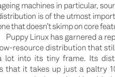

### Peppermint OS

通过利用 Mozilla 的 Python 技术，Peppermint OS 旨在与云端和基于 Web 的应用程序协作。对云依赖有助于将需求降至最低，并有助于提高加载和使用速度。


### Bodhi Linux

Bodhi Linux 看起来确实很有范儿，其特定的 ISO 镜像完美适配老旧机器和 Chromebook，即使只安装了五个应用程序和一系列模块化工具。


### Lubuntu

Lubuntu 成为最佳选择之一的原因是它的 `LXDE` 桌面环境，它能够在低配置机器上运行，并以快速的安装包而闻名，这同样缩短了安装时间。

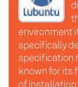

> 你很难找到 Puppy 无法轻松检测的硬件。

由于 Puppy 体积较小，安装仅需几分钟即可直接加载到 `RAM` 中，Puppy 的启动时间也更短。而大多数 Linux 发行版必须同时通过 `CD` 和 `USB` 加载，Puppy 的 `RAM` 加载系统意味着应用程序运行速度很快；缺点是默认应用程序的选择很少，但也是为了低资源机器考虑。缺乏资源的需求也让 Puppy 兼容多种硬件；然而，你很难找到 Puppy 无法识别的硬件。可以确定，你可能需要在网上连接自定义的驱动程序。无论你是想在 `CD` 还是 `USB` 上运行 Puppy，你都能获得这个低资源、高性能的发行版。如果你有一台无法重新启动运行的旧电脑，加载 Puppy 看看你是否能解决问题。所有必要的下载和更新详情可以在 `www.pupplinux.com` 找到。

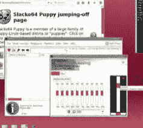

上述领先的从 `RAM` 启动的技术有助于显著提高加载速度。

### 最佳轻量级操作系统

| qBitturrent | Hub.lin | Roundcube | DataCenter | Tupi |
|---|---|---|---|---|
| 一个非常先进、快速的 BitTorrent 客户端，配备了内置 Web UI 用于远程控制。查看搜索引擎以找到你需要的下载。 | 不要忽视它是市面上最优秀的 Linux 程序之一这一事实，可以经常监控质量，还可以存储联系详情。 | Web 软件丰富，但 Roundcube 是你需要的帮手，提供了多语言功能、地址簿和 HTML 消息编写功能。 | 对你的数据库进行完整扫描，提醒你任何潜在的问题和漏洞。DataCenter 特别用于监控重复条目并发现数据中的趋势和模式。 | 一种简单的 2D 动画工具，让你学习设计和编辑创作的基础。专为老旧和低资源机器设计。 |


## 针对...的最佳发行版

### 娱乐与多媒体

娱乐类发行版可以为你的桌面带来急需的乐趣，对所有电影迷来说都是非常完美的。

### Maui Linux

Linux 并没有作为满足我们需求的最佳系统之一的声誉。关于代码设计糟糕、软件缺乏奖项等误解，他们并不知道可用的娱乐发行版数量对爱好者来说是完美的。

尽管如此，我们认为 Maui 是用户在 2017 年使用的最佳选择。该发行版的各种元素都是为那些寻求娱乐的用户量身定制的。它直接包含了多种版本的 `VLC` 媒体播放器，并针对不同的分辨率和显示尺寸进行了优化。此外还包括浏览器，


上述：内置了一个直观的文件管理器，方便传输媒体文件。

### 最佳 F

### 替代方案


### Ubuntu Studio

名副其实，Ubuntu Studio 充当爱好者的终极创作套件。它包含一系列视频和音频工具，帮助从零开始编辑创作媒体，而无需花费一分钱。

### Lakka


Lakka 为低性能硬件打造，是一台极佳的游戏机，它基于 `OpenLEC` 构建，流行的复古模拟器用户将能够让它在 `Raspberry Pi` 上运行。

### AV Linux


Linux 拥有大量的音频和视频制作软件，其中包含带有 `QThreading` 的自定义内核，该内核是为低延迟音频制作制作的。

Maui 是 `Steam` 真正无故障运行的发行版之一。

上述：切换发行版以获得完美的观影体验。

一个 Ubuntu 爱好者，是存储你的专辑收藏和混音自己的播放器的最好方法。对于所有组装桌面的人，你也将发现两者的兼得。在这里很有用，系统上有一个直观的播放器，可以扩展你自己需要的工具库。如果你是那种想要通过 Maui 存储电影收藏的人，请务必利用其集成的文件管理器。因为 `Steam` 是现有的对多媒体最友好的桌面环境之一，让管理大量文件和即时编辑变得简单。Maui 是 `Steam` 真正无故障运行的发行版之一。

## 最佳发行版适用于...
## 企业级

### 替代方案

管理您的业务非常艰辛，让这些发行版之一来为您提供帮助吧。

### ClearOS 企业版

### IPFire

在保护您的服务器和网络方面，IPFire 是目前最好的选择。它经过了优化，可以在高性能网络和基础设施上运行，且不会降低这类工具原有的难度。

现在是让您的业务带入 Linux 世界的最佳时机。迁移到该平台从未像现在这样简单，开发工具已经趋于成熟，云工具也正在以惊人的速度扩张。真正的问题在于哪一个（发行版）能将您的业务推向新水平，请相信我们：对于这些更好的业务需求，有非常多的选择。

### OpenSUSE

OpenSUSE 简化了您可能会遇到的许多服务器基础设施问题，提供了一个今天几乎即刻工作的绝佳团队环境。额外的支持可以帮助您扩展网络。

尽管竞争日益加剧，ClearOS 仍然处于供应商列表的前列，为提供者提供了帮助您的业务进入数字时代所需的工具。它的魅力之一是其软件包导入功能，提供了必要的程序来在一个平台上实现从安全、日常财务到管理员工的一切。别无他法。

### CentOS

CentOS 是成长型企业的首选方案之一，提供了一个可靠稳定的开发平台，朝着正确的方向发展。它也是一个坚实的选择，您可以在技术上更多地依靠它。

上方：通过一系列廉价方案扩展您的网络——相反，ClearOS 会为您完成这项工作。

对我们而言，ClearOS 是少数能够系统地优化您的网络流量以跟踪网络端用户交互的发行版之一，同时安全性可以与许多广泛采用的软件包关联。基于 `CentOS 5`，还有许多元素供用户自定义他们自己的防火墙工具，该工具是根据您的业务需求和要求建模的。

ClearOS 在其业务应用方面留有充足的扩展空间，其中许多应用在业务方面具有很强的功能性。每个领域都可以以某种方式进行定制，因此无论您的业务如何增长，您都可以放心 ClearOS 将与您一起成长。查看 2017 年第一季度发布的最新更新。

尽管近期竞争加剧，但 ClearOS 仍然处于企业金字塔的顶端。

## 最佳企业开源软件 (FOSS)

### HPCC Systems

### GnuCash

### Freeplane

### Bonita BP

### Vtiger CRM

`HPCC Systems` 是一个数据密集型计算平台，帮助企业解决复杂的数据问题。它基于一种以数据为中心的编程语言。

`GnuCash` 被广泛认为是可下载的最佳财务管理器之一。它可以执行详细的财务计算，并导入 `QIF/OFX` 和 `HCI` 文件。

`Freeplane` 专注于所有元素的协作。它的主要用途是作为思维导图工具，多个用户可以从世界任何地方自由访问和编辑。

`Bonita BP` 是一种业务流程管理工具，帮助开发人员构建自己的流程驱动应用程序并与客户建立联系。

`Vtiger CRM` 作为业务的伴侣，帮助控制销售、改进营销并更高效地与客户互动。

## 功能：2017 终极发行版与 FOSS

## 最佳发行版适用于...
## 安全

使用这些“无神论”（极简主义）发行版来攻克桌面安全。

### Parrot OS

在选择您的下一个 Linux 发行版时，最关键的因素是它的安全性。人们想要一个能够识别桌面漏洞并配备工具来保护其防线的发行版。你会发现真正能做到的 Linux 发行版少得令人惊讶，但那些做到的——

最好的之一是 `Parrot OS`，一个安全的发行版，配备了云渗透测试和磁盘工具，使其成为目前最易于使用的发行版之一；对于那些真正重视安全的人，`Parrot OS` 可以对任何选定的网络进行广泛的渗透测试。从这些测试中收到的数据可能是无价的，只要使用得当。

上方：利用 Parrot 的加密套件来大幅提高您的桌面安全性。

Parrot 的另一个价值部分是它的数字取证套件。通过与安全专家合作，Parrot 团队实现了一个虚拟实验室，可用于取证分析和证据识别。在所有功能中，这些有助于加密事务。

另一方面，Parrot 的价值还在于防盗保护。在安装期间，用户将发现可以将 Parrot 安装在受保护的加密分区上，以防电脑被盗时保护计算机数据。然后还有软件用于保护机密数据并保持您的桌面锁定。

如果安全性是您选择发行版的重点，且你不介意在更高级的发行版上“动手操作”，那么你会选择 `Parrot OS`。前往 `www.parrot.org` 获取所有信息。

## 最佳安全开源软件
### 替代方案

### Alpine Linux

`Alpine Linux` 是一个以安全为导向的发行版，具有一系列紧凑轻量级的渗透工具，帮助最大程度地提高机器的安全级别，如果您资源有限，这非常有效，仅需 `5MB` 内存即可安装。

### Qubes OS

得益于其架构，`Qubes OS` 通过使用虚拟机隔离潜在有害代码，防止其干扰您的工作，虚拟机充当了安全隔离程序。

### Wiflice

`Wiflice` 是基于 `Slackware` 的多种复杂安全和取证工具变体。它出色的之处在于对许多网络工具的支持、对有线和无线网络的检测。Parrot 团队已成功实现了一个可用于取证采集的虚拟实验室。

### VeraCrypt

基于信任，`VeraCrypt` 提供了磁盘加密软件，让您的桌面立即免受暴力攻击。它还能保护您的各种分区。

### DBAN

`DBAN` 是一个自包含的启动镜像，使用复杂的算法安全地擦除大多数桌面电脑的硬盘。它的高安全性意味着它是应急销毁数据的理想选择。

### Wapiti

漏洞扫描器非常有用，`Wapiti` 是一个可以扫描 `SQL` 注入的工具。

### FileVerifier

`FileVerifier` 能够对网站进行哈希检查。

### Clam Ant

`Clam Ant` 是一款适用于 `UNIX` 的工具，其核心功能是病毒数据库。

## 最佳发行版适用于...
### 隐私

通过这些发行版之一保护您的秘密安全。

### 替代方案

### Tails

由于隐私考虑，`Tails` 是一个经过优化的发行版。我们似乎每周都能听到关于它的消息，隐私现在比以往任何时候都重要。`Tails` 通过 `Tor` 网络路由所有流量来提供安全性。上方：由于加密位置，`Tails` 不在磁盘上保存任何内容。它在公共网络上使用是安全的。

## 特色：2017 终极发行版与开源软件

## 最佳滚动更新版

有些发行版提供频繁更新的发行版，但在 2017 年你应该使用哪一个呢？

### Apricity OS

`Apricity OS` 是最近推出的几个滚动更新发行版之一，专为那些喜欢系统更新且快速的用户设计。

Apricity 领域的一个特点是，它很大程度上迎合了云计算一代。其核心是 `ICE` 管理器，它可以为你的桌面提供 Web 应用程序。为了导入进一步开发所需的所有工具，该团队将其作为扩展功能之一来改进使用体验。

除了 `ICE` 管理器之外，还应该注意到 `Apricity OS` 是基于 `Arch` 的，某些人可能对此有所警惕。基于 `Arch` 的发行版通常会有安装问题，但这可能……`Apricity OS` 被广泛认为是目前可用外观最好的发行版之一。

## 最佳开源软件目标

### IDemprise

这款精美的套件配备了出色的财务工具，帮助你跟踪每日开支和收入。最棒的是，它可以高度定制以满足你的确切需求。

### Celestia

曾经想探索太空吗？有了这个太空模拟器，你就可以在不同维度探索宇宙所需的工具。有超过 `10,000` 颗恒星可以查看和发现。

### Giiada

`Giiada` 是一个 Linux 音频工具。它用于创建自定义样本或管理 `MIDI` 事件。它有一个直观的插件系统，帮助你即兴创作自己的节奏。

### b2evolution

这是一个构建任何网站的工具。它针对低维护进行了优化，因此选择主题、给博客命名非常简单，然后你就可以开始发布更新了。

### FreeCAD

`FreeCAD` 是一个参数化 `3D` 建模器，帮助你设计任何尺寸的现实物体。由于具有可脚本性和扩展性，`FreeCAD` 可以读取和写入许多开放文件格式。

### 替代方案

### PCLinuxOS

对许多流行的图形和音频工具提供开箱即支持，被认为是最友好的发行版之一。它的范围和配置包含了动态包管理的高用工具。

### Gentoo

`Gentoo` 是一款多功能发行版，为高级开发人员和网络专业人士构建。其滚动更新系统具有持续的质量更新和工具，提升了整体日常使用体验。

### Manjaro

`Manjaro` 基于 `Arch`，旨在提供稳定的滚动更新。它具有同时可用的多个内核、易用的软件安装以及用于驱动管理的特殊仓库（`Special Repos`）。

> 这是一种非常开箱即用的体验，为用户提供了所需的所有工具

## 为北美读者的特别优惠

## 7 期免费

当您订阅*
- 每期赠送免费资源下载
- 3 种 `LIVE` 启动发行版

面向专业人士和开发者的开源权威刊物

## 终极启动训练营

### 系统管理员生存技能

管理文件系统、控制权限、升级性能、处理任何错误

### 防御黑客攻击系统

### G-SWEEP 你的代码

识别并关闭 `SQL` 注入攻击

### 编程 Erlang

### 使用 TUX 增强终端

发现这款终端模拟器的强大

### 加密 RASPIAN

安全地设置你的树莓派

### NIMBOSFT AURORA

你尝试过用于树莓派的 Ubuntu 吗？

内置还包括：虚拟化、兼容层、新的桌面环境

订单热线 `+44 (0)1795 418661` 访问 `www.imaginesubs.co/uk`

> 享用此专属优惠请注明 USA！

*条款与条件：这是一项订阅优惠。您将支付 `80` 英镑的年订阅费。这在订购时等同于 `105` 美元，汇率可能会变化。`7` 期指的是美国零售价为每期 `16.99` 美元，`13` 期订阅价为 `220.87` 美元。您的订阅从下期开始，并将持续 `13` 期。此优惠于 `2017` 年 `3` 月 `31` 日过期。

## 构建更好的网页

`www.webdesignermag.co.uk`

## 免费资源

网页设计师
现正发售
`SEO` 成功的规则与工具 | 重新思考响应式设计 | 使用 `Facebook` 开发

## 即刻购买您的杂志

纸质版见 `www.imagineshop.co.uk`
数字版见 `www.greatdigitalmags.co.uk`

`facebook.com/webdesignermag` `twitter.com/webdesignermag`

## 编码员与创作者的必备指南
实用型树莓派

68 “我从 80 年风格的对讲机中获得了一些设计灵感，并将其整合到一个可以整齐容纳树莓派的外壳中”

## 目录

- 68 树莓派对讲机
- 70 加密你的树莓派家
- 74 读取并返回对象的朝向
- 76 熟悉 EnviroAT

使用 `3D` 打印了 `talkiepi` 的整个外壳，调整为容纳 `Pi 3` 和 `US Robotics` 扬声器所需的精确尺寸。必要的部分也切留了孔以便于取用。

绿色表示通过。`LED` 插入到顶部的支架中，它们是当你与某人 `talkiepi` 通话时的极佳指示。每个 `LED` 都通过底座少量的密封剂固定在位。

免提器安装在 `talkiepi` 外壳的后部，以便连接引脚。当 `PCB` 安装妥当后，`GPIO` 和 `USB` 线缆都固定并安全地到位。

`talkiepi` 中基于 `GPIO` 的接口简单得令人惊讶。它由一个按钮、两个用于状态的 `LED` 和一个在传输和连接时亮起的单个 `LED` 组成。

## 组件列表

- 树莓派 `3 Model B`
- `microSD` 卡
- `US Robotics` 免提扬声器
- `5 x M3` 尼龙螺丝 + `1 x M3` 螺柱
- `GPIO` 接口
- `2 x mm LED`
- 带 `LED` 的按钮
- `3 x 330ohm` 电阻
- `2 x M315` 螺栓
- `2 x M325` 螺栓
- `2 x M310` 螺栓和螺母

尼龙螺丝固定 `Pi 3`。音频接口的小孔让树莓派固定在位。

## 我的项目

### 如何将树莓派变成对讲机

`talkies` 拥有一个对孩子也直观的按键通话界面。作者 `Daniel Chote` 为我们介绍了这个个人项目。

talkies 的原始构想源自哪里？
几年前我有一个把树莓派用作对讲机的主意，但效果并不好。我想为孩子们做些什么。现在有智能手机和平板电脑，但没有人们可能需要的单一用途设备。我最近购买了一台 `Prusa MK3` `3D` 打印机，并开始使用 `Fusion 360`，所以如果能拥有所有工具和硬件来完成它就太棒了。

在过程中你遇到过任何问题吗？
关键在于保持简单且防孩子损坏。连接两个树莓派到扬声器最廉价的方法是设计一个非常简单的 `GPIO` 接口用于状态和电源。我发现并使用了一个开源项目，对其进行了大量修改以符合我的特定需求。起初，我想要“某些东西”，但很快意识到我需要更好的。所以借鉴了一些 `80` 年风格对讲机的设计。

使用尼龙螺丝固定的 `Pi 3`。音频接口的小孔让树莓派固定在位。

## 教程

# 加密你的树莓派家主目录

使用军级加密技术让你的 `Pi` 数据安全无忧

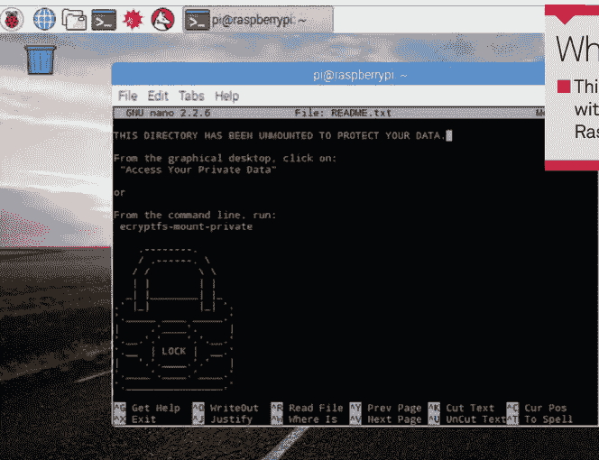

`Nate Drake`
`Nate (@natewriter)` 是一位专注于网络安全和复古计算的科技记者。他目前编写《Facebook》，这是一本在最大的社交网络上生存的指南。

### 你需要的准备

本教程兼容运行 `Raspbian Jessie` 的所有型号的 `Pi`。

随着绚丽的 `Pi` 桌面的出现，伴随着精美的图标和窗口，一些读者可能正在将 `Pi` 作为他们的家用电脑。

考虑到 `Pi` 会在不需要密码的情况下自动登录默认账户，这并不特别安全。即使设置了密码，任何人都可以挂载 `SD` 卡来查看你的文档、图片、视频和其他数据。

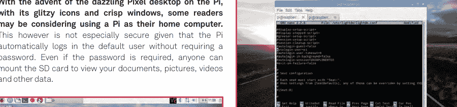

### 启用登录界面

如果你还没有这样做，请在 `Pi` 上打开终端或通过 `SSH` 连接并运行以下命令：

```bash
```


## 修改登录配置

运行命令打开登录配置文件：

```bash
sudo nano /etc/systemd/login.conf
```

在文件中找到 `login-user` 一行，在行首添加 `#` 将其注释掉。按 `Ctrl+X`，然后按 `Y` 保存并退出。此时默认密码已变为 "raspberry"。

## 备份数据

如果尚未备份，请登录 Pi 并将 Desktop、Documents、Pictures 等目录传输到 USB 闪存盘等外部介质。这将使后续将数据迁移到加密的家目录变得简单得多。若需备份浏览器书签等应用程序设置，可使用 `Ctrl+H` 显示隐藏文件夹。

## 重启并登录

重启树莓派并通过屏幕登录。用户名应已选中，密码为 "raspberry"。建议直接在 Pi 桌面操作，因为后续需要切换用户，这在 SSH 中较为困难。若无显示器，可尝试以 'pi' 用户身份通过 VNC 连接。

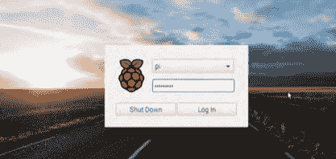

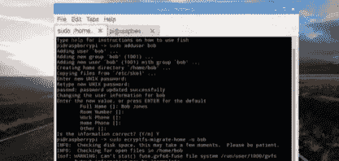

其中 'bob' 为新用户。你需要输入两次登录密码（可与创建的密码相同）。完成后，请务必阅读“重要注意事项”部分。**此阶段切勿重启。**

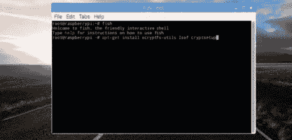

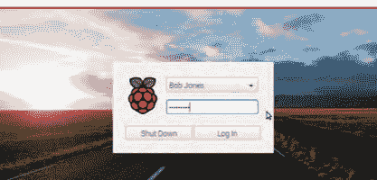

## 04 安装 ecryptfs 及相关工具

在 Pi 上打开终端并运行：

```bash
sudo apt-get install ecryptfs-utils lscrypt
```

## 05 创建新用户

若要正式使用 Pi，建议创建以你命名的账户。运行命令：

```bash
sudo adduser <username>
```

例如 `sudo adduser bob`。输入两次密码，其余选项（如位置）按回车接受默认值。

## 06 迁移并加密家目录

使用 ecryptfs 工具加密现有家目录。运行命令：

```bash
ecryptfs-migrate-home -u bob
```

**查看并记录生成的挂载口令，将其存储在安全位置。**

## 07 登录加密账户并验证

使用 `Menu > Shutdown > Log out` 退出 pi 用户，随后以 'bob' 身份登录。在向新账户写入任何数据前，打开终端运行命令 `mount`。输出信息中应包含 ecryptfs 相关内容，表明加密已生效。

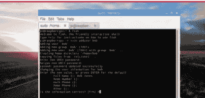

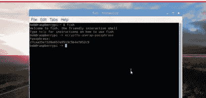

## 08 备份挂载口令

为防系统故障导致无法登录，需备份挂载口令以便从其他设备恢复文件。打开终端运行：

```bash
ecryptfs-unwrap-passphrase
```

## 09 迁移数据

使用 `Menu > Shutdown > Reboot` 重启 Pi 并以新用户登录。连接外部驱动器，将文档和数据复制回正确位置。新的家目录位于 `/home/bob`。

## 10 赋予用户管理员权限

退出新用户，登录 'pi'。打开终端运行：

```bash
sudo visudo
```

在 `root ALL=(ALL:ALL) ALL` 行后添加：

```text
bob ALL=(ALL:ALL) ALL
```

将 'bob' 替换为你的用户名。按 `Ctrl+X`，再按 `Enter` 保存退出。重启 Pi 使更改生效。

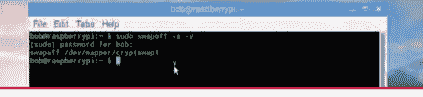

## 11 删除加密迁移产生的备份

加密过程中会在家目录下创建备份。由于是新账户，备份为空，但建议清理。打开终端运行：

```bash
sudo rm -rf /home/bob.backup
```


## 12 清理 pi 用户家目录中的原始数据

若原家目录中已有数据，其仍处于未加密状态，任何人均可访问。请手动删除或安全擦除 `/home/pi` 中的敏感文件。

## 13 禁用交换空间

SD 卡上的 `/var/swap` 在内存不足时作为交换空间使用。对于多数 Pi 型号，交换空间极少使用，且频繁写入存在安全风险且损耗 SD 卡。退出用户账户，在终端运行：

```bash
sudo swapoff -a
```

若需永久禁用，可执行 `sudo systemctl disable dphys-swapfile`。

## 14 修复文件权限

因备份迁移方式不同，文件权限可能异常。运行以下命令将 `/home/bob` 下所有文件所有者改为 bob：

```bash
sudo chown -R bob:bob /home/bob
```

## 15 验证文件安全性（可选）

重启 Pi 并登录 'pi' 用户。打开终端，若未设置 root 密码，先运行：

```bash
sudo passwd root
```

切换至 root 用户：

```bash
su - root
```

进入新用户家目录并查看内容：

```bash
ls -la /home/bob
```

此时目录下应仅有一个快捷方式和名为 `README` 的文件，提示数据已受保护。

## 选择强密码

即使家目录已加密，弱密码仍可被暴力破解。可使用 [diceware.com](https://diceware.com) 等方法生成高强度易记密码。若需安全删除文件（如旧备份），可使用 `shred` 命令：

```bash
shred -u <filename>
```

**注意：切勿对当前家目录（如 Desktop）中的活动文件执行此操作。**

---

# 教程：读取倾斜开关方向

设置并编写倾斜开关以重置其方向并响应所需动作。


## 所需硬件

- 树莓派
- 四根杜邦线（母对母）
- 倾斜开关模块

> **作者简介**：Dan Aldred 是树莓派认证讲师，CAS 首席教师。曾带领团队参加 Astro Pi 竞赛，并出现在 BBC 电视节目中。近期参与 Skycammy 高空气球项目，达到 31,000 米平流层高度。


倾斜开关可感知四个方向的变化：上、下、左、右。通过断开/接通电路工作，易于集成到项目中。工作电压 3.3V 或 5V，适配树莓派。可用于机器人跌倒检测、寻路功能开关等。虽专为树莓派设计，但本教程代码可移植至其他平台。

**GPIO** 是树莓派的物理接口，可用于控制外设开关。编程可使用 Python、C 等语言。
- **BCM 模式**：按 Broadcom 芯片 GPIO 编号引用引脚。
- **BOARD 模式**：按开发板物理引脚编号引用引脚。

### 01 设置并接线引脚

倾斜开关内部有一金属球，两个输入端（S1、S2）。倾斜时金属球滚动，接通不同电极对，产生四种状态组合，对应四个方向。

接线方式（物理引脚编号）：
1. 开关 VCC -> 树莓派 Pin 1 (3.3V)
2. 开关 GND -> 树莓派 Pin 6, 9, 14, 20, 25, 30, 34, 39 中任意 GND
3. 开关 S1 -> 树莓派 Pin 7 (GPIO 4, BCM 编号)
4. 开关 S2 -> 树莓派 Pin 22 (GPIO 25, BCM 编号)

**注意：树莓派必须关机状态下接线。**

### 02 系统更新与库安装

启动树莓派，打开 LXTerminal 运行：

```bash
sudo apt-get update
sudo apt-get dist-upgrade
```

安装 Python GPIO 库（通常预装，若无则执行 `sudo apt-get install python3-rpi.gpio`）。

### 03 编写 Python 程序：初始化 GPIO

创建 Python 脚本（如 `tilt.py`），需 `sudo` 权限运行以访问 GPIO。

```python
import RPi.GPIO as GPIO

# 使用 BCM 编号模式
GPIO.setmode(GPIO.BCM)

# 设置引脚为输入模式
GPIO.setup(25, GPIO.IN)  # S2 -> BCM 25 (物理 Pin 22)
GPIO.setup(4, GPIO.IN)   # S1 -> BCM 4  (物理 Pin 7)

# 关闭警告信息
GPIO.setwarnings(False)
```

### 04 读取方向逻辑

通过读取 GPIO 25 和 GPIO 4 的电平组合判断方向：

| GPIO 25 (S2) | GPIO 4 (S1) | 方向 |
| :--- | :--- | :--- |
| 1 (High) | 0 (Low) | Down |
| 1 (High) | 1 (High) | Up |
| 0 (Low) | 1 (High) | Left |
| 0 (Low) | 0 (Low) | Right |

完整循环检测代码：

```python
import RPi.GPIO as GPIO
import time

GPIO.setmode(GPIO.BCM)
GPIO.setup(25, GPIO.IN)
GPIO.setup(4, GPIO.IN)
GPIO.setwarnings(False)

try:
    while True:
        s2 = GPIO.input(25)
        s1 = GPIO.input(4)

        if s2 == 1 and s1 == 0:
            print("Down")
        elif s2 == 1 and s1 == 1:
            print("Up")
        elif s2 == 0 and s1 == 1:
            print("Left")
        elif s2 == 0 and s1 == 0:
            print("Right")
        
        time.sleep(0.1)  # 降低 CPU 占用
except KeyboardInterrupt:
    print("\n程序退出")
finally:
    GPIO.cleanup()  # 释放 GPIO 资源
```

### 05 接线与方向校准

若实际倾斜方向与打印不符，通常是 S1、S2 线接反。只需在代码中交换 "Left"/"Right" 或 "Up"/"Down" 的打印语句，或物理调换两根信号线即可。

---

# 教程：熟悉 Enviro pHAT

获取温度、压力、运动、光照、颜色等环境数据。


## 所需硬件

- 树莓派
- Pimoroni Enviro pHAT

> **作者简介**：Dan Aldred，树莓派认证教育者，CAS 首席教师。曾领队参加 Astro Pi 比赛，项目见于《The MagPi》杂志。参与高空气球项目达 31,000 米高空。


Pimoroni 出品的 HAT 板完全兼容所有树莓派型号。Enviro pHAT 集成四大传感器：气象（温度/气压）、光线/颜色、运动（加速度计）、模拟输入。本教程涵盖硬件安装、库配置及数据读取示例。

**RGB 颜色模型**：通过红、绿、蓝三通道叠加产生颜色。每通道值 0-255。0 通常为黑，255 为该色最大强度。

### 01 安装 Enviro pHAT 与软件库

1. 关机，将 Enviro pHAT 插入树莓派 GPIO 排针。
2. 启动，打开终端运行：

```bash
sudo apt-get update
sudo apt-get upgrade
curl -s https://get.pimoroni.com/enviro | bash
```

脚本将自动安装依赖库，并在主目录创建 `Pimoroni/enviro` 示例代码文件夹。

### 02 第一个程序：控制 LED

Enviro pHAT 自带 LED 灯。打开终端运行 `idle3` 启动 Python 编辑器，新建文件输入：

```python
import time
from enviro import led

# 开启 LED
led.on()
time.sleep(5)
# 关闭 LED
led.off()
```

保存运行，LED 将亮 5 秒后熄灭。

### 03 读取温度值

新建 Python 文件，读取气象传感器温度：

```python
from enviro import weather

# 获取当前温度（摄氏度）
temp = weather.temperature()
print(f"当前温度: {temp:.2f} °C")
```

运行脚本，屏幕将输出实时温度。同理可调用 `weather.pressure()` 读取气压、`light.rgb()` 读取颜色、`motion.accelerometer()` 读取加速度等。


### 04 读取压力

Enviro pHAT 配备有气压计。

## Enviro pHAT

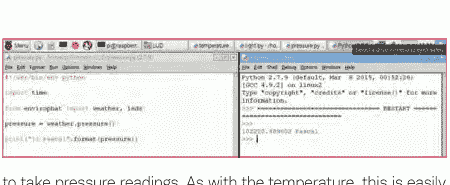

与额外的硬件模块结合。

| 类型 | 说明 | 默认值 |
| --- | --- | --- |
| float | 压力 | 0.0 |
| int | 温度 | 0 |
| float | 湿度 | 0.0 |
| float | 光照 | 0.0 |

Enviro pHAT 可以配备一系列传感器和模块，拥有几乎无限可能。例如，在 Uncom pHAT 上显示传感器、显示数据图表，或者在你自己的博客中编写关于它的文章。

读取数据。对于温度，只需几行代码即可实现。在你的模块中，第 1 行包含了读取压力的代码。在第 2 行，为压力创建一个新变量。要从传感器读取压力，使用以下代码：

- `pressure`

在第 2 行进行读取。最后，在第 3 行打印读取结果。保存并运行你的程序。

```python
from enviro_hat import pressure

pressure = pressure.read()

print("Pressure")
```

## 05 传感器测量：第一部分

Enviro pHAT 内置的加速度计可以检测运动、抖动或跌落。你还可以用它沿轴计算步数并绘制变化。通过导入 `time` 模块第 1 和 2 行开始一个新程序。在第 2 行，创建一个变量来存储触发检测器的运动量。在第 3 行，创建一个变量来存储上一次读取值（例如 `float`）。在第 3 行创建一个变量来存储当前读取值。最后，创建一个名为 `last_z` 的变量来存储 z 轴的值，表示未检测到运动。

使用一个简单的语句，第 2 行。在第 3 行，用当前读取值更新 `last_z`。最后，在检查运动之前稍作暂停。程序然后检查运动是否大于阈值。如果是，摇晃、抖动或掉落你的 pHAT 来触发运动。

```python
if last_z > 0 or abs(last_z) > 2:
    print("Motion Detected!")
    last_z = 0
```

```python
import time
from enviro_hat import motion

threshold = 0.2
readings = 0
```

## 06 传感器测量：第二部分

在下一行，使用循环通过获取 z 轴的位置读取来持续检查运动，并使用 `code.append` 将其添加到 `readings` 列表中。在第 4 行，取读取值的平均值，并将此值赋值给变量 `new`。将新值与上一个值进行比较。如果它发生了变化，则检测到了运动。注意第 3、4 和 5 行已缩进。

- `light()`

以此类推，第 3 行。接下来，创建三个变量来存储感知到的光照、绿光和蓝光量。要创建光的颜色，请使用这段简单的代码：

```python
import time
from enviro_hat import light

amount_of_light = light.light()
```

最后一步是打印读取并存储在四个变量中的光和颜色值。使用以下代码显示它们：

```python
print("amount_of_light: " + str(amount_of_light))
```

...这会打印出一条短消息，随后是读取值。这些值向你显示光照以及 0 到 255 之间的绿光和蓝光（RGB）值。尝试在移动你的 pHAT 经过传感器时编写程序，让它变亮或变暗。此外，在上方放置一个彩色物体——类似于五金店使用的油漆匹配软件，它可以将油漆颜色匹配另一个物体（如你喜欢的 T 恤）。

```python
while True:
    readings.append(accelerometer.read_z())
    readings = readings[1:]
    z = sum(readings) / len(readings)
```

## 07 传感器测量：第三部分

一个判断 `z` 的最后一个值是否大于零，以及新 `z` 去上一个值的“绝对”值是否大于阈值的条件。基本上，如果该值符合这些标准，说明 Enviro pHAT 已移动到新位置。通知用户。

```python
print("amount_of_light: " + str(amount_of_light))
print("Color, " + r + ...)
```

## Python

### 树莓派图形

Kivy 是一个多平台框架，需要将其添加到你的 Python 代码中。

- 本专栏的大部分文章探讨了你可以用来创建自己的 Python 程序的各种方法。通过这种方式，你可以创建复杂的构建界面或安卓应用。
- 在树莓派的中心，这次我们将查看如何确保你的 Pi 在没有显示器的情况下运行 Kivy，并且你可以使用任何种类的 GUI 为你的项目添加图形元素。有几个图形框架值得考虑。我们将专门展示 Kivy 如何作为一个适用于 Windows、Android 和 Linux（包括树莓派）的跨平台框架。由于它是一个 Python 模块，因此需要安装。我们将讨论在树莓派上的发行，因为你可以使用命令安装它。

一旦安装了 Kivy 及其依赖项，你就可以开始构建项目了。由于 Kivy 是一个完整的 GUI 框架，起点是 `main.py`。

```python
import kivy
from kivy.app import App
from kivy.uix.label import Label

class MyApp(App):
    def build(self):
        return Label(text='hello world!')

if __name__ == '__main__':
    MyApp().run()
```

Berald 

现在我们已经看到了 Kivy，让我们看看更实际的应用涉及的内容。第一步是，有很多构建方法可用于任何用户设计。这里有其他的：框布局、浮动布局、网格布局、页面布局、滑块和堆叠布局。它们都可以用于包含组件。

### 为什么选择 Kivy？

它是树莓派的官方语言。
阅读 kivy.org/doc

> 你可以让你的 Pi 驱动家居！

对于其他的，或者如果你有最新版本的 Kivy，你也可以选择使用 pip 使用以下命令安装：

```bash
sudo pip install python-kivy
```

这可能会带你进入依赖陷阱。第三种也是最后的选择是使用 Kivy，它可以从 http://kivy.org/download/ 下载。通过这种方式，你可以在无需额外麻烦的情况下安装所有依赖项。对于树莓派的其他发行，你只需要将其拷贝到 SD 卡并启动。

```python
from kivy.uix.gridlayout import GridLayout
from kivy.uix.label import Label
from kivy.uix.textinput import TextInput
from kivy.uix.button import Button

class MyApp(GridLayout):
    def __init__(self, **kwargs):
        super(MyApp, self).__init__(**kwargs)
        self.cols = 2
        self.add_widget(Label(text='Name:'))
        self.lastname = TextInput(multiline=False)
        self.add_widget(self.lastname)
        self.add_widget(Button(text=''))
```

在初始化时，第一步是调用来自父类的初始化方法。


## 与你的服务器交互

布局父类。然后你可以设置它的属性，并以其第一个最后一个姓名启动一个子类。在这种情况下，我们将布局设置为两列。我们获取的任何部件都将按照添加的顺序从左到右放置。这就是列表的工作原理：第一列将包含标签，而第二列将包含每个布局的文本输入字段。为了使用这种新布局，你可能需要将更改为如下内容：或滑块，允许用户在代码中输入信息。用户界面框架实现这一点的方法是设置一个函数，一个通过点击或移动用户界面触发的回调函数。例如，你可以有一个绑定到移动滑块动作上的回调函数。这里展示了一个处理按钮的示例：

```python
class MyApp(App):
    def build(self):
        return MyApp()
```

调用 `run()` 方法将创建一个新窗口，用户可以在窗口中输入数据。Kivy 的伟大之处之一是它是一个非常灵活的框架。你可以在几乎任何具有硬件/软件能力的系统上运行它，但代价是必须学习它。如果你想配置 Kivy 将查找的环境变量，可以配置选项。例如，你可以设置 `KIVY_WINDOW` 环境变量。你可以通过点击此链接（https://kivy.org/docs/guide/environment.html）来查看如何让你的应用程序发挥最佳性能。配置文件（位于 `KIVY_HOME/config`）你可以在其中存储配置选项以匹配你的喜好。

虽然本文涵盖了用于 Python 构建 GUI 应用程序的一种可能的框架，但它并不是唯一的选择。Python 网站维护了一份框架的部分列表，地址为：https://python.org/dev/gui/。如果你想获得可以从树莓派移植到其他平台的代码，请考虑 `wxPython`。该框架构建在 C++ 和 wxWidgets 之上。在树莓派上，你可以通过以下命令安装它：

```bash
sudo apt-get install python3-wx
```

和大多数框架一样，你需要为你的界面创建部件，然后使用某种循环来激活界面。一个 Hello World 应用程序看起来如下：

```python
from kivy.app import App
from kivy.uix.label import Label

class MyApp(App):
    def build(self):
        return Label(text='Hello World')

if __name__ == '__main__':
    MyApp().run()
```

`KIVY_WINDOW` 将使用 X11 协议绘制其窗口，而不是像 OpenGL 那样的硬件加速协议。还有另一组可用的环境变量，花时间学习如何使用它们以从 Kivy 中获得更好的性能。如上所述，用 Kivy 创建界面更简单。回调（函数）由对象作为输入参数调用并打印相关文本。之后，你必须将该函数绑定到界面，例如绑定到 `on_action`。其他部件也有这个功能。如果你有一个带有按钮的界面，则可以使用以下代码来跟踪触摸：你随后可以为给操作绑定到 `on_touch_down`。当你开发游戏时，这些框架与许多其他框架相似。你所做的事情有一些局限性。最大的限制是你只能有一个窗口。然而，如果是一个简单的应用程序，这可能没问题。一个类似的 Hello World 看起来如下：

```python
import kivy
from kivy.window import Window
from kivy.uix.widget import Widget
from kivy.core.text import Font

font = Font('Arial', size=24)
screen = Widget(size=(800, 600))
screen.canvas.clear()
screen.blit(font.render('Hello!', True, (255,0,0)), 200)
screen.display.update()
```


# 保持你的选项开放，以便你可以选择最适合的框架

探索技术内部 gadget.xyz

## 音频设置

gadget

从所有新闻店和超市可用

现在购买

2017 智能家居科技指南 科学解释如何

购买你的期今日

质版见于 www.imagineshop.co.uk，数字版见于 www.greatdigitalmags.com

## 评论

| 组测试 | 项目 | 状态 |
| :--- | :--- | :--- |
| Nimbusoft Aurora | Bodhi 4.0 | 免费软件 |

## 组测试：音频器

通过这些基于 Linux 的音频器的帮助，制作自己的节奏变得前所未有的简单。

---

# Rosegarden

Rosegarden 极简主义的音频编辑方法引起了用户的两极分化。

# BEAST

在缺乏一些关键功能的情况下，BEAST 能在竞争中脱颖而出吗？

得益于其简单的本质，学习 Rosegarden 提供的基础知识并不需要太多时间。

工作流中一个实用的缩放功能非常便于近距离观察音轨的音频电平。

## 设计与界面

作为一款音频编辑套件，Rosegarden 的极简核心设计确实让导航比大多数竞争对手更加易用。界面中实现了一个巧妙的菜单系统，提供了相对简单的用户体验。然而，界面缺乏自定义功能是其主要的缺点。

BEAST 是 Rosegarden 极简音频编辑方法的一个趣味版本。它是这里介绍的所有功能中最简单的一个，但正如你预期的那样，为了这一点，它经过了大量的精简。这里的自定义程度非常有限，这令人烦恼，但界面细节的缺失意味着它也并不那么糟糕。

## 工具选择

某些工具基于其 MIDI 序列器，因此在音乐创作方面有一些积极的补充。大部分 MIDI 支持它，并兼容相当数量的硬件，这些硬件号称非常即插即用，可以快速启动而无需修正。

如果你使用 BEAST 编辑当前音轨，你将找到几乎你需要的一切。有合并音轨和乐器的工具，而灵活的工作流允许你探索音轨的音频电平。编辑工具满足了最基础的需求，但仅此再无了。

## 音乐创作

由于我们提到的极简界面问题，理解 Rosegarden 的分层工作流是一项相对简单的任务；乐器可以导入项目中，这会自动更新整体音频电平并消除反馈感。然而，单个音轨的控制却参差不齐。

虽然它功能丰富，但想要创作音乐的人会发现对 MIDI 和合成器仅有基础支持（仅此一二）。这两个缺失都是显而易见的，并且很容易整合到你当前的项目中。我们还喜欢自动 32 位音频录制，这是导出音轨时的一个极佳选项。

## 插件与扩展

Rosegarden 以 DSS 架构作为音频插件的基础，可以支持数百种额外的乐器和工具。然而，它在特定乐器上会遇到某些问题。加载速度较慢，我们测试的其中一两个乐器与 Rosegarden 的原生乐器套件缺乏兼容性。

插件对 MMO/SSE 利用具有条件支持，因此你也可以导入少量的乐器和额外工具。硬件支持也被列在内，但我们未能让测试的大多数硬件在 BEAST 中从一开始就正常工作。

## 总结

极简的方法在原理上是行的，而且 Rosegarden 并没有忽略它的功能集，但处处存在着一些明显的缺失，可能会阻碍体验。

这是为那些只需要基础功能而不再需要的人准备的。要真正与该领域的顶级产品竞争，BEAST 需要提供更多内容来成长并扩大用户群。

# 评测

## 音频编辑器

### 简要回顾：对比我们的定论

| 设计与界面 | LMMS | Ardour | Rosegarden | BEAST |
|---|---|---|---|---|
| 导航过于复杂，但这种复杂仅针对个人用户需求而言。 | 菜单轮廓不够清晰，但界面的某些部分可以轻松修改。 | 有用且简单的菜单系统在这个整洁极简的 UI 中处于领先地位。 | 所有界面中最容易导航的界面，但选项极少且受限。 |
| 选择如此丰富，以至于我们认为内容太多了。 | 我们正努力使用一个此处未包含的 Ardour 工具——Ardour 有其局限性。 | 列出了即插即用的硬件支持，但遗憾的是仅工作不稳定。 | 图层管理和硬件控制是该程序的明显亮点。 | 对合成器仅有极少支持，而在其他地方如此。 |
| 多层编辑会导致减慢，这是这里唯一的问题。 | 工作流很容易管理，乐器非常容易使用。 | 工具非常基础，但图层控制在这里表现不一。 | 对合成器仅有极少支持，而且无处不在。 |
| 插件非常庞大且实现起来异常地简单。 | 额外的插件允许你以想要的方式控制音频。 | 虽然没有那么丰富，但这里仍然有很多兼容插件。 | 虽然使用 Ardour 插件时在实践中存在非常严重的问题。 |
| 功能应备全，这是一个相当完整的音频编辑器 | 起初看起来可能有点复杂，但这正是你需要的音频编辑器 | 在所有采用极简方法的编辑器中是最好的 | 整个过程中都太基础了，与其他产品相比缺乏选项 |

## 获胜者是……

# Ardour

市场上有一些惊叹的音频编辑套件，但其中许多仅限于负担得起溢价的人群。对于 Linux 来说，选择稍微容易获得，但我们成功在该领域发现了一些真正的瑰宝。虽然我们缺乏 LMMS 提供的大部分功能，但 Ardour 在这里给人一种更完整产品的感觉。

我们先处理糟糕的一面。首先，它是一套非常完整的设备，对于目前接触音频编辑的时间来说，学习曲线非常陡峭。然而，它的菜单系统很难导航，但有足够的文档可以帮助你在几小时内学会基础知识。

一旦你花时间习惯 Ardour，它就会进入一个属于自己的世界。接着是音频的录制和混音。它的每一个部分都有各种工具。录制可以通过插入外部麦克风完成，同时仍然具有从桌面导入的完整能力。

在涉及编辑时，标准工作流在这里表现出色。可以将多种乐器导入 Ardour 中以扩展其原生选择（这已经很多了），管理也起着关键作用，帮助用户管理项目的每个方面。

Ardour 是一个需要投入大量精力才能掌握基础的程序，但一旦你越过了那个门槛，你就拥有了当今最好的音频编辑套件之一——而且不需要一分钱。

Oliver Hill

- Linux 开发者
- Linux & 开发者
- 分类广告
- Linux & 开发者
- 生日
- 扫描你的奖励
- 二十年托管
- Linuxera
- 开发者

# 评测 Nimbusoft Aurora

## 硬件

- CPU: Intel 'Skylake' Core i5-6200U (2.3GHz Turbo 2.8GHz)
- GPU: Intel HD Graphics 520 (10GHz 动态)
- 存储: 128GB NVMe SSD
- 内存: 8GB DDR4
- 网络: Wi-Fi-802.1ac 波段，蓝牙 4.0
- 连接: 1x USB 3.0, 2x USB 2.0, HDMI, 模拟音频, SD 卡阅读器
- 尺寸: 15.6"
- 摄像头: 带麦克风的 HD
- 电池: 六芯锂离子电池，48.8Wh
- 操作系统: Ubuntu 16.04 LTS
- 质修: 一年整及部件
- 重量: 1.9kg（不含线缆）
- 价格: £649.96（含增值税）

凭借组件和桌面环境的选择，这款由 Ubuntu 驱动的 Ultrabook 是 Linux 移动战士的必备设备。

对于 Linux 用户来说，购买笔记本电脑可能是一个充满危险的过程：不支持的组件。虽然 Dell 在选机型上预装了 Linux，但基于 Nimbusoft 的产品提供了对所有设备选择主板的自由——包括其旗舰产品 Aurora。

Aurora 由原始设计制造商 (ODM) Topstar 定制，是一款光滑的铝制设备，最厚处为 20.35mm，配备 15.6 英寸全高清 (1920x1080) 显示面板，明亮清晰，并配有设计的键盘。

遗憾的是，这是键盘唯一的“猛兽”之处。它的岛式按键间距太远，长时间打字不舒服，且使用时手感柔软。触控板尚可，但仅限于三种设置：亮度、半亮度和完全关闭。

在内部，买者通过 Nimbusoft 简单的配置选项获得了多种硬件选择。我们测试了配备 Intel Core i7-6200u 双核处理器、具有超线程技术的四线程更强大的 Core i7、8GB DDR4 内存、金士顿 V500 SATA SSD 以及 Intel AC-9260 M.2 无线和蓝牙 4.0 连接的型号。

购买时的可用选项包括更大容量的存储、更大容量的内存、外部 HDMI 卡甚至可以在机身的第二个 M 槽中添加 1TB SSD 硬盘。

无论你选择哪种方案，你都能获得纯正的 Ubuntu 体验。Nimbus 取代了许多公司失败的诱惑，你会发现 Canonical 在 Ubuntu 本身中没有任何地方包含冗余软件。唯一的例外是触控板上覆盖的一张贴纸，它去掉了 Logo，该 Logo 可以替换成你喜欢的图标。此外还有 Super 键，默认为 Nimbus。

这款笔记本电脑的性能与任何配置相似的设备并无上下之分，尽管在亮度调至最高且关闭所有 Wi-Fi 和蓝牙的情况下，笔记本在充满电后仍能维持五个小时的视频播放。虽然这大约足够使用一天，但远好于制造商声称的小时，而且意味着你可能随身携带那个足够紧凑轻便的电源适配器。对于那些实际上喜欢折腾的人来说，Aurora 有一个卖点：易于访问内部结构。底壳实际上非常简单，只需拧下十字螺丝即可轻松取下。进入内部后，你可以找到一个最高支持 8GB DDR3 的内存槽、一个 2.5 英寸硬盘位以及一个带有 Wi-Fi 功能的固态硬盘 M.2 槽。在当前越来越多组件被焊在主板上导致难以维修或未来升级的时代，这是一个令人欣喜的景象，尽管这一过程并非由用户自行更换。

## 优点
- 纯净的 Linux 体验，没有冗余软件且开箱即用，显示在清晰锐利的屏幕上。

## 缺点
- 由于按键间距糟糕，键盘用起来很尴尬，触摸板布局也令人失望。

## 总结
虽然键盘无疑是该笔记本最糟糕的特性，但 Aurora 也有许多优点。显示屏非常清晰，有大量的接口用于未来升级或外接设备。没有冗余系统运行也很好，而且桌面元素的选择是一个极佳的起点。

---

## Bodhi Linux 4.0

在基于 Ubuntu 的发行版中，Bodhi Linux 保持了其在过去 24 个月内是改进最大的发行之一的声誉。它最近的发布版本经历了三个月的 Alpha 测试，事实证明这是一个明智决定，最终产品在多个领域改进了 Bodhi。与 Ubuntu 更新相比，文件要小一些，如果你没有良好的网络连接，这非常方便。一个潜在的担忧是从 Ubuntu 3.2 升级到 4.0 的过程，用户仍然需要重新安装操作系统。这与其说是一种不便，不如说我们预计会在未来的更新中看到它得到修复。

在 Bodhi 上安装过程相对简单，尽管最初遇到一些下载问题，但整个过程相对顺利。Bodhi 4.0 的核心是基于 Enlightenment 的 Moksha 0.1 桌面环境，在经过改版后，从头到尾的使用体验都非常愉悦。各种菜单经过了精简，简单来说，它易于使用且不会让用户感到压力。它也足够轻量，可以在低功率机器上运行，因此能够快速处理你扔给它的任何任务。如果你想探索，Moksha 提供了丰富的菜单，但可以调整的项很少，而且在这里，选择通常是很好的。虽然这些新增内容处于早期阶段，但他们表示将改进用户体验，并且对于那些首次尝试 Linux 并转到 Bodhi 的用户来说，这提供了一个非常有吸引力的切入点。

Bodhi 首次实现了最新的 Enlightenment Foundation Libraries (1.8.1)，该库再次调整了此处使用的窗口管理器背后的 UI。在本次发布期间，我们注意到以前遇到过的一些问题，但任何问题在这一稳定版本中已得到解决。我们在 Bodhi 4.0 的 Alpha 和 Beta 阶段提出的其他问题仍在待处理，特别是在窗口管理方面。

Bodhi 4.0 发布最令人愉快的方面之一是，用户不再需要经历 3.2 版本中遇到的相同 Bug，尽管 3.2 的用户将一直接收到 2019 年各种更新，目前预计更新还将再次出现。列表列出了 Bodhi 中实现的项目，且 Alpha 和 Beta 阶段都得到了改进。

## 优点
- Moksha 桌面环境有许多显著改进，拥有一系列全新的自定义工具，能够最大化提升用户体验。

## 缺点
- 缺乏某些选择，且有少量 Bug 待解决，直接升级对任何人来说都不是一个选项。

## 总结
你无法指责 Bodhi 所取得的成就，尽管还有几个 Bug。没有冗余软件也很好，桌面元素的选择是一个极佳的起点。

# 轻量级服务器套件

## （最小的服务器套件）20.0

在几乎任何 PC 硬件上启动小型服务器套件

专门的可启动 Linux 发行版已经存在了多年，以至于我们经常将以前喜爱的工具视为当然，也许忘记了在轻量级服务器领域，还有其他比我们今天在现场使用的工具表现更好的选择。

SSS 凭借其服务器软件集合和易用的命令行界面脱颖而出，得益于基于非常灵活的 Alpine Linux，它更新频繁。

该服务器软件包括 FTP、HTTP、SFTP、SSH、Telnet、针对 Tonomiser 的代理服务器、4ML、strides 防火墙以及 Cl 杀毒软件。后者将处理所有可疑文件，同时允许你从受影响的计算机远程备份数据。MC 随时待命让你探索系统，并有链接供你自助帮助。

启动时，登录界面会显示一个摄像头，然后邀请你加入或执行帮助命令。这将为你提供可用命令的快速列表，例如网络设置（如果需要的话），运行 `server` 将显示相关选项。还包括 PHP 支持，并默认启动 MariaDB，允许你将高端笔记本电脑变成一个非常强大的局域网服务器，建议尝试。

### 优点
按现代标准来说非常小，却是一组真正实用的软件集合。默认设置合理。

### 缺点
尽管体积很小，但不易扩展。不适合对命令行挑剔的用户。

### 非常适合...
让过时的硬件重新变得真正有用。mass.linuxux.com/

# 目录

### Where Change Directory 5.3.3

让你的 PC 记住目录所在的位置

Change Directory - 幸运地缩短为 `cd`，就像 Peter Norton 的一个旧 DOS 工具那样非常有用，以至于必须被复制。在目录之间切换时，你只需要提供名称的一部分，它就会处理所有可能的扩展或返回主目录的快捷方式。通配符和正则表达式在括号中。

切换目录始终在 Debian 测试中首次亮相，但可执行文件是 `cd`，这种通过别名或掩码带你到处跑是不必要的，因为你可能更喜欢这样做。它构建了一个文件树 `-f --tree=trecd`，你的目录也可以通过 `go-cd` 轻松进行交互式操作并立即返回。保持磁盘上没有杂物是极好的，但稍微有点糟糕。

如果你对自己足够简单，你将有一个非常有条不紊的列表！对于我们其他人来说，知道我们有一个目录（比如）并不难，但它是可能的目录之一（也许在不同的位置），这不仅节省了定位的时间，还让你距离目的地仅一键之遥。非常有用！

```
 /home/rich/npm/get-text-parser/1.0/package/test
 /home/rich/npm/get-text/0.9/package/test
 /home/rich/npm/get-conditions/0.4/package/test
 /home/rich/npm/get-load/0.5/package/test
 /home/rich/npm/get-hash/1.3/package/test
 /home/rich/npm/get-size/1.1/package/test
 /home/rich/npm/html-parser/2.3/package/test
 /home/rich/npm/is-buffer/1.1/package/test
 /home/rich/npm/is-my-valid/2.13/package/test
 /home/rich/npm/json-opentajs/0.1/package/test
 /home/rich/npm/json-string-safe/5.0/package/test
 /home/rich/npm/mkdir-mdir/0.5/package/test
 /home/rich/npm/node-uid/1.4/package/test
 /home/rich/npm/object/1.1/package/test
```

请选择一个按 `<Enter>` 开始：

# help = ?help Page 34


在上方输入 `cd` 和你目录的几个字符，你就可以离开了——通过一个快捷方式切换到那里。

### 优点
另一个非常棒的微型工具，你很快就会习惯它，因为它让你的生活变得简单得多。

### 缺点
除了需要排序和更新其数据外，唯一的小麻烦是记得你有这个东西！

### 非常适合...
非常适合高度组织的文件系统（适合每个人！）
westerlan.home.xx.se/
www.linuxux.com

## 开源

在我们的目录中列出您的信息
如在此处广告，请联系 Luke
luke.biddiscombe@imagine-publishing.co.uk | +44 (0)1202586431

## 推荐

### 托管列表

特推主机：
www.netcetera.co.uk
0800 808 5450

> 先进的数据中心环境使 Netcetera 能够为企业提供企业级托管和托管解决方案

自1996年以来，Netcetera 是欧洲领先的网络托管提供商之一，客户遍布全球 75 个国家。作为英国数据中心托管、云托管和托管网络托管服务的首选提供商，Netcetera 提供了一系列旨在更有效地管理 IT 基础设施的服务。先进的环境使 Netcetera 能够为您的企业提供企业级托管和托管解决方案。为预算提供无比拟的价值是我们客户和托管基础设施的驱动力。从单台服务器到完全定制的数据中心，我们专注于您需要的解决方案。

### 我们提供的服务
- 托管托管 - 一整系列解决方案，提供具有成本效益、可靠且安全的主机。
- 云托管 - 具有灵活性可扩展性的 Linux、Windows 和私有云解决方案。
- 数据中心托管 - 从单台服务器到整机机架，提供免费设置。
- 专用服务器 - 从四核到智能服务器，快速设置。

### 专业人士的五点建议
可靠性、信任、支持是选择托管合作伙伴时的一个主要因素。Netcetera 保证 100% 运行时间，具有处理 DDoS 攻击的多重网络，确保您的网站在您 24/7 需要时不会宕机，并在您最需要的时候为您提供协助。我们的人员确保您满意并尽可能地解决您的问题。

### 证言
我们不声称自己是最便宜的，但我们声称提供极高的性价比。我们将根据您的服务时长提供同类价格匹配。我在 Netcetera 获得过优质的服务。他们的技术支持无与伦比。我的问题总是很快得到解决。

### 安全且可靠
Netcetera 以其以客户为中心的环境自豪。它符合 ISO 27001 安全标准，在多个位置提供配置服务的备份可用。我们有几台来自 Netcetera 的服务器，他们的网络连接是顶尖的。

### 24/7 技术支持
Netcetera 拥有一支由知识员工组成的团队，并由水电支持。这使得 Netcetera 成为欧洲最环保的数据中心之一。我们将几台服务器投入了 Netcetera，基本上是完整的。他们不能更加专业、乐于助、响应迅速或友好了。与该团队合作完全是一种享受，没有任何事情是太麻烦的，他们满足了我们的需求：100%

## 终极托管
www.cwcs.co.uk
0800 1777 0

CWCS 托管服务是英国领先的托管公司。他们提供全面的托管产品、服务和支持。他们经过良好培训的员工不仅是专家，还致力于提供良好的客户体验，并对他们所做的充满热情。

- 托管
- VPS
- 100% 网络运行时间

## 价值托管
elastochosts.co.uk
02071 83822

Elastosts 为全球企业提供简单、灵活且具有成本效益的云服务，具有高性能、可用性和可扩展性。他们的工程师团队通过电话、电子邮件和工单提供全天候的专家支持。

- 任何操作系统上的云服务器
- Linux 操作系统容器
- 世界级的 24/7 支持

## 小型企业托管
www.hostopaka.co.uk
0800 051 7126

Hostopaka 是屡获奖的网络托管服务和绿色托管的领导者。他们提供功能最全的托管包之一，以及 24/7 客户支持、学习资源以及卓越的可靠性。

- 网站生成器
- 预算价格
- 无限数据库

## 英国本地托管
www.cyberhost.com | 08455 527 945

Cyber Host Pro 提供英国最好的云服务器托管 - 我们痴迷于您。我们是你信赖的优质云托管合作伙伴，可以保持您的业务运行，因为我们为供应商提供的独特在线托管将为您提供帮助业务增长所需的质量，看 CyberHost Pro 就了。

- 代理商托管
- 专用服务器

## 预算托管：
www.hetzner.com / +49 (0)981530

Hetzner Online 是一家可靠的托管提供商和经验丰富的数据中心。自1997年以来，该公司一直为网络托管客户提供高性能托管产品，以及各种业务运营的基础。稳定的技术与极具吸引力的价格相结合。

- 专用和共享托管
- 机架托管
- 域名
- SSL 证书
- 存储盒

## SSD 网络托管
www.bargainhost.com
0843 289 6681

自2001年以来，Bargain Hosting 一直为英国提供最好的托管。我们取得了成功并建立了大型云数据库，拥有许多客户。他们还因提供卓越的服务而获得多项奖励。

- 共享托管
- 云服务器
- 域名

## 价值 Linux
patchman-hosting.co.uk
01642 243 227

Linux 托管是寻求成本效益且强大的 Linux 托管的用户、业务用户和开发者的理想解决方案。无论您运行的是单页作品集还是数据库驱动的网站，Linux 托管都是您的完美选择。

- 学生托管
- 网站设计
- 域名

## 快速、可靠托管
www.bytermark.co.uk
0194 890 880

Bytmark成立于2002年，是“英国云托管领域的专家”。他们的特点包括内部专业知识、透明的支持、履行支持所做的承诺以及公平价格的高质量托管硬件。

- 托管
- 英国云托管
- Linux 托管

www.linuxuser.com | 93

## 开源

您的 Linux 新闻与观点来源

联系我们...
linuxuser@imagine-publishing.co.uk

# 评论

## 读者来信

关于杂志、Linux 和开源的疑问与意见


以上，如果有人可以的话，佳能，嗯……不行

## SELPHY 卡住了卡住了

你好 LU+，
我有一台小型的打印机，佳能 SELPHY CP910，我用它打印数字照片。如果电脑运行在 Windows 模式，它运行良好。通过相机的 WiFi，或者从我女儿的手机（从休息室（餐厅）进行无线访问）效果甚至更好。但当我尝试通过任何应用程序向它发送任何内容时，系统乱七八糟告诉我它未插入、未连接到电脑、不存在……这真的太让人沮丧了，因为我一直在尝试用 GIMP 编辑照片（我拒绝支付 Adobe 的订阅费！），并且我想把它们打印出来。我使用的是 Ubuntu 16.04，起初我认为这可能是问题所在，但我尝试了从现场启动光盘运行的 Linux Mint 和 Trisquel，在这两个系统下都不行。它到底是怎么了？

多年来，记录了无数无法与 Linux 工作的外围设备。现在开源运动终于获得了关注，数量和频率已开始减少，但仍然有一些品牌和产品无法与 Linux 工作，而佳能是一个经常被提到的名字。整个公告板都满了愤怒的人，但照片打印机正遭受着相同问题的变体。有些用户甚至写到编写自己的脚本来添加它，复杂程度不一（参考 http://ubuntu.com/questions/314833/diagnosing-the-problem-when-canon-printer-fails-to-connect-the 社区）。问题在于佳能缺乏兼容性，或者缺乏努力。如果不付出的努力，你无法在 Linux 下让它运行起来（如果能做到的话）。有一些不那么优雅的替代方案可以考虑，例如使用 GIMP，你可以使用你的 GIMP 图像进行传输，或者使用 .png 等无损格式交给另一个家庭成员，或者通过连接到你佳能打印机的设备进行打印。

94 Marie


# 匿名者的生活

## 任何地方、任何人的隐私

我们重视您的隐私和匿名性，并告诉您：

- 利用互联网进行匿名和应对环境
- 匿名浏览互联网并不是完全免费的
- 当你想明确表达时，不要留下任何痕迹
- 使用任何最新的加密工具来加密您的文件、图像和消息

了解更多


# Tails 2.7

- 关于
开始使用...
文档
帮助与支持
继续
新闻

捐赠

# LinuxUser

面向
新一代
与开发者的杂志

# 终极启动营

# 系统管理员
生存技能

使用 G-SWEEP 工具
防御系统
防止黑客

增强终端
加密
AURORA
用某种语言编程


上面的 LinuxUser 现在已成为 Future 家族的一部分

Tails 2.7
单元内存
发布于 2016年9月13日周二 上午 11:00 CET
查看新闻

Tails 2.7.1
发布于 2016年9月13日周日 下午 12:38:56 UTC
查看新闻

安全
普通安全漏洞 (Tails 2.7)
发布于 2016年9月18日周日 凌晨 02:03 UTC
查看安全。

上面的 Tails 是针对那些有隐私顾虑的人的高安全发行版

# 仓库管理员

跨度很大吗？Linux Voice 最近受邀加入了 Linux Magazine……加入这个大家吧！

为什么我需要连接互联网才能从我们的发行版中获取软件？与其他别无选择互联网这杯“毒酒”的人不同。在网络犯罪、监控和恶意软件之间，现代网络并不并不总是值得信任的，我宁愿与老鼠、恶意软件和没有连接的环境共处。我不希望我的 PC 访问它。我希望我的工作电脑保持原样——

简单回答：不，我们不是 Future 家族的一部分，但事实是，Linux Format 和 LinuxUser & Developer 是在隔 25 英里的地方制作的。杂志的侧重点也不同。Linux Format 更多关注桌面体验。我们也这样做，但我们也非常关注开发者、系统以及热爱 Linux 的人们。

> Phil S Shane

在您使用的每种软件中都有一个发行版，在任何您可能隐藏或想要的地方，它都只想以 CD 或 DVD 大小的体积运行，甚至比大内存卡或 USB 闪盘还要小。如果能实现就太好了，更说是一台机器了。这就是为什么 Linux 一直以来使用安全的仓库，通过终端或包管理器访问，允许用户从可靠且安全的位置安装他们想要的开源软件（FOSS）。大多数仓库都经过了数字签名，这样您的操作系统就可以识别出该位置是可靠的且没有恶意软件。任何坏人都不可能感染开源软件，除非伪造网站。

# 回到未来

对于那些有任何可用仓库可以使用的人，例如 Tails (https://tails.net/)，它提供了各种下载，通过 Tor 网络或 VPN 运行互联网流量。驱动器不再是以前的样子，但已比以前任何时候都更有用。有了像 Tails 这样的发行版，你可以确保它是安全的。在被 Linux Publishing 接管后，现在有什么变化吗？所以对于两者来说，它仍然保持完全如既常，但致力于制作最好的 Linux 特性和评测，以确保我们所有的读者都能获得最好的 Linux 杂志。

www.linuxuser.com

# 随杂志赠送

## 立即获得这些精彩的免费礼物

### 最好的发行版和开源软件

您跟随 Linux基金会（Linux Foundation）的 25 小时专家视频教程所需的所有资源

### 此外，所有这一切都属于你...

- 下载 Arch Linux – 使用它们访问开源软件
- 为我们的 Linux 和树莓派编写程序


登录 filesilo.uk 获取这些必备资源

使用你的 GIMP 图像进行传输，或者通过一个连接到你佳能打印机的设备打印它们


# FileSilo

## 给读者的人的礼物

属于你喜爱的杂志，来自佳能出版（Imagine Publishing）的精彩下载

- 安全且安全的在线访问
- 针对任何读者的免费访问
- 在你想要时下载
- 只要你想要的文件

## 开始使用

关于访问 FileSilo 的一切


01 按照屏幕上的指令创建一个账户。通过我们的简单问题解锁 FileSilo。


## 今天订阅并解锁来自 40 多期的免费礼物

订阅访问我们的整个资源库

来自 Linux 基金会的精华建议

最好的 Linux 发行版
专业操作系统

开源软件
你 PC 的必备程序


02 你可以在任何电脑、平板或智能手机上使用任何流行的浏览器访问 FileSilo。我们建议使用电脑下载内容，因为你可能无法将文件下载到其他设备。

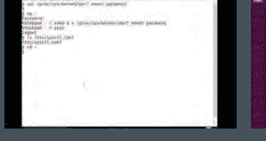


03 如果你在访问 FileSilo 内容时遇到任何问题，请查看在线上的常见问题或通过下方地址电子邮件联系我们的团队
filesilo@imagine-publishing.co.uk

# 转到第 32 页立即订阅

已经是印刷版订阅者？
这是今天解锁 FileSilo 的方法
使用您唯一的 Web ID 解锁 FileSilo 库——打印在订阅副本上面的八位数字代码。它也可以用于任何续订。

# 订阅的 400 多个理由


## 如果 Apple 出版了杂志
www.gadgetdaily.xyz

* 新款 MacBook Pro • 100 大最佳应用 • 精通 Final Cut

技巧与妙招 | 硬件评测 | 创意项目 | 最佳配件 | iOS & OS X 应用

## 立即购买您的杂志
纸质版请访问 www.imagineshop.co.uk
电子版请访问 www.greatdigitalmags.com

## 您能帮助启发下一代代码编写者吗？

代码俱乐部（Code Club）是一个全国性的志愿者网络，旨在为 9-11 岁的儿童提供领导的课后俱乐部服务。

我们一直在寻找具备编程技能的人才，志愿者每周在当地的小学、图书馆或社区中心运营一小时俱乐部。

你可以与同事结成伙伴小组，会有老师在现场提供支持，而且我们会提供你所需的所有材料，帮助激发孩子们对数字创造的兴趣。

有很多种参与方式！
欲了解更多信息，请访问 www.codeclub.org.uk 加入我们。

## CWCS 托管服务

### 由英国专家提供的 Linux 服务器托管

24/7 英国技术支持 • ISO 27001 认证 • 免费迁移

托管服务 • 云托管 • 独立服务器

## 极致托管。极致支持。

## www.CWCS.co.uk

T: 0115 740 1234 • E: info@cwcs.co.uk • W: www.cwcs.co.uk
