# Linux 用户与开发者第 176 期 - 掌控容器 176

欢迎来到《Linux 用户与开发者》的最新一期，这是英国和美国最受欢迎的 Linux 和开源杂志。你加入容器革命了吗？无论你是寻找完整运行时环境的开发者，还是希望保护隔离基础设施的系统管理员，抑或是希望探索最新计算发展的探索者，我们在第 18 页的特稿将解释你需要知道的一切，从容器化的原则到关键工具及其使用方法。

本期还将介绍如何解决 35 个最令人头疼的 Linux 问题。无论你是 Linux 新手还是资深专家，这些问题总是喜欢抬头露出狰狞面目。我们在第 56 页解释了如何修复所有这些问题。此外，学习如何配置 `LAMP` 架构，使用 `Firejail` 将应用程序沙箱化，继续学习 `Erlang` 和 `OpenRTM` 编程，深入了解 `Ubuntu` 下的系统管理，查看最佳密码管理器、最新的群晖路由器、`Arya Linux` 最新版本等等。我们的实用树莓派章节也包含一些关于设置 `VPN` 和熟悉 `Pimoroni Blink!` 板卡的精彩指南，我们还为园艺爱好者推荐了一个出色的树莓派项目。

祝阅读愉快！

April Madden，编辑


## 与团队联系：

`linuxuser@magazine-publishing.co.uk`

Facebook: Linux User & Developer | Twitter: @linuxusermag | 在线购买: `imagine-shop.co.uk`

访问我们的在线站点，获取更多新闻、观点、教程和评测：

`www.linuxuser.co.uk`

## Drobo 5N

更快、更简单的网络 Drobo。一款用于通过网络共享和备份所有数据简单、安全的设备。


**myDrobo 平台**

- `DroboAccess`：就像拥有您的个人云端。
- `DroboPix`：自动将您的照片和视频上传到 Drobo。
- 自愈
- 自管理
- 全面保护
- 无需：
  - 管理您的数据
  - 购买特定硬盘
  - 成为存储专家

**现已推出：**


## 开源

### 光盘内容

了解您的免费光盘上有什么内容。

**欢迎使用 Linux 用户与开发者 DVD。** 本期将介绍一些必要的工具，帮助您掌控容器。从必备的 `FOSS` 工具如 `Docker`，到旨在帮助您操作容器或在极简及裸机系统上运行的轻量级发行版，您将找到开始所需的一切。甚至还可以在基于 `Windows` 的系统上创建和管理容器！

### 精选软件：

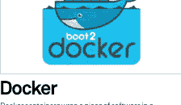

#### Docker

`Docker` 容器将软件封装在一个完整的文件系统中，包含运行所需的一切：代码、运行时、系统工具、系统库——任何可以安装在服务器上的东西。详情请参考第 18 页的完整指南，了解如何使用 `Docker` 并利用其完整的容器化包。

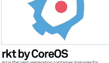

#### CoreOS 的 rkt

`rkt` 是面向 `Linux` 集群的下一代容器管理器。专为现代集群架构中的安全性、简洁性和兼容性设计，`rkt` 可发现、验证、获取并执行具有可插拔隔离功能的应用容器。这意味着您可以将单个应用及其运行所需的所有内容进行容器化。


#### Docker Toolbox

容器并不局限于您系统的 `Linux` 侧！`Docker Toolbox` 是一款安装程序，可快速轻松地安装和设置您计算机上的 `Docker` 环境。这是 `Windows` 版本。使用 `Docker Toolbox`，您将能够设置专业的容器化发行版和环境，以在 `Windows` 机器上运行。


#### 加载 DVD

要访问软件和教程文件，只需将此光盘插入计算机并双击图标即可。

#### 直接启动

要直接启动此光盘提供的发行版，请将光盘插入光盘驱动器并重启计算机。

#### 请注意：

- 您需要确保计算机设置为从光盘启动（在计算机 `BIOS` 屏幕上按 `F8` 以更改启动选项）。
- 某些计算机需要您按下一个键才能启用从光盘启动 – 请查阅您的手册或制造商的网站，以了解您的 `PC` 是否属于这种情况。
- 直接启动的发行版是从光盘读取的；除非您选择这样做，否则它们不会永久安装在您的计算机上。

#### 为获得最佳效果：

此光盘已针对能够呈现最新 `HTML` 和 `CSS` 标准更新的现代浏览器进行了优化。因此，为了获得最佳体验，我们建议您使用：

- `Internet Explorer` 8 或更高版本
- `Firefox` 3 或更高版本
- `Safari` 4 或更高版本
- `Chrome` 5 或更高版本

#### 光盘有问题吗？

请通过 `linuxuser@imagine-publishing.co.uk` 给我们发送电子邮件。但请注意，如果您在使用提供的软件或资源时遇到问题，请联系相关软件公司。

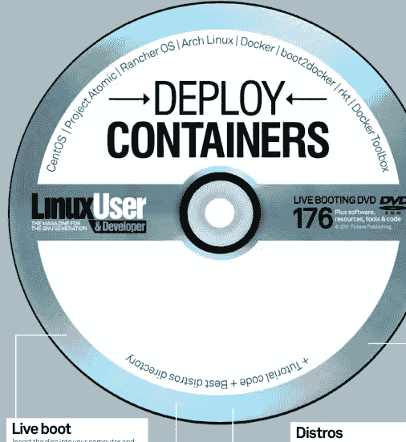


### 免责声明

#### 重要信息

在安装或使用光盘前请检查此项。

就本免责声明而言，“此光盘”一词指的是光盘中提供的所有软件和资源，以及物理光盘本身。

在使用“此光盘”之前，您必须同意以下条款和条件：

#### 数据丢失

Future Publishing 在任何情况下都不对因使用“此光盘”而导致的数据或计算机系统损坏、中断和/或损失承担责任或被视为负责。Future Publishing 尽一切努力确保“此光盘”交付给您时无病毒和间谍软件。我们仍然强烈建议您在“此光盘”使用之前进行病毒扫描，并在使用“此光盘”之前对硬盘进行最新备份。

#### 超链接

Future Publishing 对访问“此光盘”中发布的超链接可能出现的内容不承担任何责任。在生产时，“此光盘”上的所有超链接都指向预期的目的地。Future Publishing 无法保证在使用时这些超链接指向相同的预期内容，因为 Future Publishing 无法控制这些超链接上提供的任何内容。

#### 软件许可

软件根据不同条款授权；请在安装前检查程序使用哪种条款。

- **共享软件：** 如果您继续使用程序，应将其注册给作者。
- **免费软件：** 您可以免费使用该程序。
- **试用/演示版：** 这些版本要么有时间限制，要么禁用了一些功能/特性。
- **开源/GPL：** 免费使用，但详情请访问 <http://opensource.org/licenses/gpl-license>。

除非另有说明，否则您无权复制和分发“此光盘”。


上方：`KDE Slimbook` 预装了出色的 `KDE Neon`

### 硬件

### KDE 发布轻量级 Linux 笔记本

**Macbook 请让路，镇上有新国王了**

对于许多希望满足 Linux 需求的人来说，选择主要围绕着你要购买哪款台式 `PC`。预装核心 Linux 系统的笔记本电脑少之又少，除非您能买到 `Dell` 最近的型号，否则大多数都存在诸多缺陷，这常常导致用户感到沮丧和烦恼，而非享受。然而，最新亮相的预装 Linux 笔记本电脑可能正是我们一直在等待的变革者。

一直备受推崇的 `KDE`，以其出色的图形桌面环境而闻名，正在推出其专属的笔记本电脑。为此，它已与西班牙的 `Slimbook` 合作，正式推出 `KDE Slimbook`。过去，`KDE` 一直是绝大多数 `UNIX` 工作站的首选桌面环境，提供了开始使用 Linux 所提供的一切最便捷的方式之一。另一方面，`Slimbook` 在西班牙以外地区不太为人所知，但此前它曾以不同程度的成功构建和销售入门级笔记本电脑。


> “最新预装的 Linux 笔记本电脑可能正是我们一直在等待的变革者。”

然而，“预算”一词并不适用于 KDE Slimbook，因为它被定位为中高端台式 PC 的替代品。早期型号允许销售两种变体，用户可选择配备 `2.3GHz Intel Core i5` 或 `2.5GHz i7` 的型号。其他显着的规格包括 `4GB` 内存、`13.3` 英寸 `1080p` 显示屏、`120GB SSD` 和双 `USB 3.0` 端口。纸面上，这些规格令人满意，而且厚度仅为 `0.71` 英寸，它将与目前市场上主流笔记本电脑的同形状和设计相媲美。

在 Slimbook 负责硬件方面的同时，KDE 在软件方面如鱼得水。新的 KDE Slimbook 预装了流行的 KDE Neon 发行版。虽然它将针对新用户进行定制，但由于其基于 Ubuntu，高级用户将有很大的空间根据精确需求定制系统。

在 Slimbook 上使用 KDE Neon 的另一个最大优点是可以访问 KDE Plasma 桌面环境，该环境多年来已被证明非常成功。它将包含广泛的基于 KDE 的应用程序，并且不会吝啬于与该桌面环境相关的常规个性化工具。尽管关于此事项的详细信息仍很少，但据信 KDE 将提供所有必要的工具，以便在 KDE Neon 不适合您的需求时切换环境。

不太令人愉快的是潜在用户听到的价格标签。KDE Slimbook 的价格将从 `i5` 型号的约 `700 英镑/770 美元` 起，而更快的 `i7` 版本则接近 `820 英镑/910 美元`。目前可以在 `kde.slimbook.es` 上预订，首批产品预计将在 3 月底左右发货，但如果预订火爆，预计会有一些延迟。

## 前五名

### 最佳基于 Debian 的发行版

**1. deepin**

可以说，`deepin` 最大的卖点是自研的桌面环境 `DDE`。虽然 `DDE` 基于 `Qt 5` 工具包，但它可以根据用户需求进行自定义，而不会给硬件带来负担。请务必也看看它提供的本土化应用，包括出色的 `DMusic` 和 `DPlayer` 应用。

**2. Tails**

如果安全对你很重要，那么 `Tails` 应该是你首选的发行版。它使用了一种巧妙的“隐身模式”，帮助你绕过互联网流量追踪，使追踪你仅成为一种微弱的 possibility。

### 开发

### 华硕 Tinker Board 是我们一直想要的树莓派竞品

`4K` 能力能否让 `Tinker Board` 成为下一个必备的 `SBC`（单板计算机）？

多年来，众多树莓派竞品来来去去，但很少有能真正经受住时间考验，与这款迷你计算 powerhouse 抗衡。但尽管来自密切竞争对手的多次失败，科技巨头华硕推出了自己的树莓派竞品——`Tinker Board`。其尺寸仅为 `8.5 厘米 x 5.3 厘米`，两款单板计算机在大小上几乎相同，但相似性就此结束。`Tinker Board` 的核心是一枚四核 `ARM Cortex A17 CPU`，运行频率为 `1.8GHz`。此外还配备了 `ARM Mali GPU` 和 `2GB DDR3` 内存。对于那些在树莓派的 `Broadcom VideoCore IV GPU` 和 `Tinker Board` 之间犹豫不决的人来说，`Mali GPU` 将引起极大兴趣，因为前者在测试中表现出 vastly superior 的性能。性能的提升有助于 `Tinker Board` 不仅支持全高清 `1080p`，还支持 `H.265 4K` 解码，这是其尺寸的单板计算机首次实现。然而，在华硕的一份官方声明中，`4K` 支持目前仍在开发中，虽然用户实际上可以通过该设备享受 `4K` 视频，但暂时不要指望能观看 `4K Netflix`。除了核心组件外，其他贴心设计还包括为主板集成的主要 `Wi-Fi` 模块配备的可更换天线，以及千兆以太网和对 `SDIO 3.0` 的关键支持。随着 `Tinker Board` 的发布，华硕还发布了配套操作系统。截至本文撰写时，操作系统细节尚少，但已知它基于 `Debian`，并将与我们许多人习惯的核心树莓派操作系统非常相似。华硕还指出，正在为 `OpenSUSE` 和 `Ubuntu` 提供支持，并计划于 `2017` 年底推出扩展功能。华硕 `Tinker Board` 在纸面上是一款诱人的设备，看起来不仅能在核心功能上与树莓派匹敌，还能在其他领域超越它。感兴趣的用户目前可以直接通过华硕预订该设备，价格仅为 `55 英镑`，早期设备已开始发货。


**3. antiX**

尽管 `antiX` 不像本列表上的其他发行版那样知名，但不应被忽视。它主要面向较旧的硬件，但同样为新手和资深用户提供了完全功能性的操作系统。

**4. SparkyLinux**

`SparkyLinux` 在寻找简单且不含大量冗余附加软件的用户中获得了日益增长的声誉。它缺少一些核心应用，但只需下载几个即可解决该问题。

**5. Parrot Security OS**

这是另一款专为注重安全的人群设计的发行版。`Parrot` 包含大量用于渗透测试、计算机取证和高级逆向工程的实用工具。但它并不适合 Linux 新手。

## 开源

你的 Linux 新闻与观点来源

### 树莓派

### 谷歌正将 AI 带入树莓派

实验人工智能将变得轻松许多。

谷歌与树莓派基金会之间的桥梁是粉丝们期待已久的事，而近期发展表明，来自谷歌总部的最新消息可能是我们迄今为止最接近这一合作的时候。

科技巨头正寻求大力投资扩展其现有开发工具套件，这些工具目前可供树莓派开发者使用。反过来，这将有助于更好地在基于谷歌的项目中实施树莓派，提供一系列新的软件工具，用于自然语言处理、预测分析和情感分析。

为了帮助勾勒出前景，谷歌目前正在树莓派基金会上运行一项调查，用户可以在其中留下他们的想法和建议。调查开头写道：“我们谷歌对为创客创建智能工具感兴趣，并希望听取您的意见，了解哪些是最有帮助的。”除了之前列出的所有领域外，调查还概述了谷歌热衷于与树莓派合作的其他领域。如 `3D 打印`、`物联网`开发和`无人机`等领域都曾用树莓派探索过，但有了谷歌的 AI 工具，谁知道用户可能实现什么？

这一合作是大新闻，被视为加速该领域发展的绝佳方式。谷歌此前已投入大量时间于树莓派，早在 `2013` 年，谷歌就向英国学校赠送了价值 `100 万美元` 的微型处理器。新兴开发者应前往树莓派网站了解更多细节。

> “我们谷歌对为创客创建智能工具感兴趣，并希望听取您的意见”

### 软件

### 在 Linux 上运行 Windows 从未如此容易

寻找一种简便的方法来在 Linux 上成功运行 Windows 应用，长期以来是一项吃力不讨好的任务。然而，`WINE` 似乎颠覆了整个过程。它为用户提供了一种相对简单的方式，在基于 Linux 的操作系统上运行 Windows API。早期版本很糟糕，bug 众多且稳定性有时存疑。它在 Debian 和基于 Ubuntu 的发行版之外的可用性也有限，但幸运的是，这一点也改变了。

由于社区兴趣的一波浪潮，`WINE` 的最新版本 `2.0` 现已可供下载。最新更新的核心改进在于在 Linux 桌面上运行数千个 Windows 程序的稳定性。包含超过 `60` 个关键 bug 修复，并提升了与一些较冷门发行版的整体兼容性。可以说，最大的更新是 `Microsoft Office 2013` 现在具有完全的 `WINE` 兼容性，提供无与伦比的文档创建服务。然而，这只是许多新应用中的一种，直到此前，大多数 Linux 用户都难以触及。早期用户反馈显示，大型软件仍存在一些 issues，但总体而言，可用性比早期版本 vastly superior。Debian、Mageia、Fedora 和 Ubuntu 等初始二进制包均可下载，并计划在下一个开发周期中进一步扩展。`WINE 2.0` 的官方源代码可在 `www.winehq.com` 下载

> “Microsoft Office 2013 现在具有完全的 WINE 兼容性，提供无与伦比的文档创建服务”

### 发行版

### Linux Mint 18.1 KDE 和 Xfce 版本现已可用

最新更新紧随广受欢迎的 MATE 版本

`2016` 年底，Linux Mint 项目发布了令人惊叹的 `Linux Mint 18.1` 操作系统的 Cinnamon 和 MATE 版本。公众反应非常好，尤其是由于开发团队制定的长期支持计划，`18.1` 更新的开发预计将持续到 `2021` 年。

虽然 `Xfce` 和 `KDE` 版本的亮相并不令人惊讶，但其中涉及的变化令人欣慰。特别是 `Xfce` 版本基于最新的 `4.12` 桌面环境，配备了广泛的 `XApps`，仅举几例就有 `Xplayer`、`Xreader` 和 `Xed`。

另一方面，`KDE` 版本使用 `Plasma 5.8.5` 桌面环境，并包含对各个菜单和核心设置的广泛改进。这两个更新迄今均大受欢迎，越来越多的用户增强了 `Mint` 不断增长的声誉。计划后续为这些版本提供进一步的更新，但截至目前，尚未发布具体细节。

对 `Linux Mint 18.1 Xfce` 或 `KDE` 版本感兴趣的各方可以前往官方 Mint 网站（`www.linuxmint.com`）获取所有必要的下载链接和安装说明，供首次迁移到 Mint 的用户使用。


## 内核

### 林纳斯·托瓦兹宣布最新 4.10 内核发布候选版

来自 Linux 之王的定期更新正密集而至

最近几周，我们被林纳斯·托瓦兹带来的大量发布候选版宠坏了。来自 Linux 总部的最新公告展示了 `4.10` 内核系列中的新发布候选版。

在官方帖子中，林纳斯·托瓦兹表示：“情况似乎稳定了一些，一切看起来都正常。过去一周只有大约 250 个变更（不计合并），`diffstat` 触及的文件少于 300 个（主要以驱动器和架构更新为主，但也有工具和网络方面的更新）。”

虽然最新的发布候选版主要是在当前驱动器改进基础上的优化，更令人惊讶的是关于未来更新的信息披露。在官方公告中，托瓦兹还透露了 Linux `4.10` 定期发布日程的计划，管道中总共有七个发布候选版构建。

根据我们的估算，Linux `4.10` 的完整最终版本可能在 3 月底落地。当然，这些计划可能很快改变，但如果改变，我们会告诉你。

## 发行版动态

### 前十名

（平均每日访问量，1月15日-2月15日）

| 排名 | 发行版 | 访问量 |
| :--- | :--- | :--- |
| 1 | `Linux Mint` | 3,102 |
| 2 | `Debian` | 2,094 |
| 3 | `Manjaro` | 1,899 |
| 4 | `Ubuntu` | 1,489 |
| 5 | `openSUSE` | 1,256 |
| 6 | `Solus` | 1,053 |
| 7 | `Zorin` | 1,005 |
| 8 | `Fedora` | 998 |
| 9 | `Arch Linux` | 927 |
| 10 | `elementary` | 917 |

### 本月


稳定版本 (17)

开发中 (7)

本月下载量普遍上升，`Mint` 在发行版食物链顶端扩大了领先地位。也很高兴看到一些新兴发行版进入前十名。

### 亮点

`Linux Mint`

`Mint` 正在快速增长，以至于很难跟上它的步伐！其最近的 `18.1` 更新受到社区广泛好评，主要得益于引入的大量变更。如果你还没有查看，请务必看看。

`Solus`

`Solus` 持续攀升下载排行榜，原因显而易见。被誉为低资源机器最佳发行版之一的 `Solus`，以其开箱即用和美观设计为荣。

`elementaryOS`

谈论美观的发行版时，不能不提及 `elementaryOS`。其桌面环境 `Pantheon` 可以说是我们使用过的最用户友好的环境之一。

最新可用发行版：

`filesilo.co.uk`

`www.linuxuser.co.uk`

## 采访帕维尔·鲍伊博罗丁（Pavel Baiborodin）

### 十分钟构建应用

这个新平台旨在为你提供所有必要的工具，让你能在十分钟或更短时间内为你的 `Arduino` 项目构建一个应用。帕维尔·鲍伊博罗丁向我们详细介绍了为什么 `Blynk` 对初出茅庐的开发者来说是一个颠覆性的创新。


`帕维尔·鲍伊博罗丁（Pavel Baiborodin）`

他拥有丰富的微型计算机开发历史和用户体验（`UX`）设计经验。他创建 `Blynk` 的初衷是希望消除为 `Arduino` 和树莓派（`Raspberry Pi`）开发过程中的复杂性。入门指南可在网站 `www.blynk.cc` 上查阅。


四年前，我惊讶于如今可以多么快速地开始对物理交互物体进行原型开发。凭借我在用户体验和设计方面的背景，我很快意识到我需要某种可视化的界面来控制我的项目，但令我沮丧的是，我发现并没有简单的方法来实现这一点。于是，你刚刚让你的第一个 `LED` 灯闪烁（通过编程迈出的小小步子），然后你就意识到你需要学习 `PHP`、`Xcode`、`Android` 以及其他所有东西。更不用说，这个领域的大部分工具都是由开发者为开发者制作的。

正是在这时，我决定解决这个问题。我把这个想法告诉了 `Dmitry`，我的联合创始人兼 `CTO`，于是我们开始为自己构建它。我们制作的第一个项目是一个浇水系统，以便在我出差时让我的植物存活下来。当然，它本可以自动化，但我只是喜欢按下按钮，让世界另一端的泵开始工作。随后我们进行了 `Kickstarter` 众筹，社区规模扩大到 20 多万人，服务器每月处理数十亿次请求。

`Blynk` 是最容易使用且应用最广泛的构建物联网（`IoT`）项目和互联产品移动应用的平台。它主要有三个组成部分：固件、服务器和移动应用。首先，我们提供库，几乎可以将任何硬件在线化（目前支持超过 400 种型号），无论您选择哪种连接方式。`Wi-Fi`、蜂窝网络、以太网和 `XBee` 都已在线，对于本地连接，您可以使用 `BLE` 和 `USB`。此外，我差点忘了提及 `Node.js`、`Python` 和 `C` 的支持。

`Blynk` 还支持工业通信协议，如 `RS232`、`RS485`、`UART`、`CAN`、`ModBus` 和 `OneWire`。当您的硬件上线后，它将连接到我们的 `Blynk` 云服务器，该服务器是开源的，基于 `Java` 构建。访问 `Blynk` 云服务器是免费的，不过您也可以本地运行它。从本质上讲，服务器将您的硬件和智能手机连接在一起。

本地的 `Blynk` 服务器甚至可以运行在 5 美元的树莓派上，届时它将处理每秒高达 1,000 个请求。它是安全的、轻量的，而且快得惊人。接下来是用于 `iOS` 和 `Android` 的移动应用，用户可以在上面快速拼接出一个界面，以远程控制事物并可视化传感器数据。我们让使用变得超级简单：你只需拖放按钮、滑块、仪表、图表、地图等小部件即可创建所需的界面。无需编码或设计技能，因为所有的重大 `UI` 配置都在应用端完成。

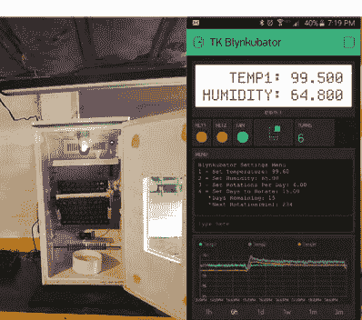

`Blynk` 包含许多专为物联网设计的功能，例如控制多个设备和组、轻松与他人共享硬件访问权限、同步物理和 `HMI` 状态、实时更新所有连接客户端的 `UI`、推送通知、电子邮件以及其他很棒的功能。正如你可能察觉到的那样，`Blynk` 功能强大。

**开发像这样的产品看起来非常复杂。从概念到现实很难吗？**

确实如此，现在也依然充满挑战，但另一方面，它也极具趣味性和令人兴奋。从一开始，我们就为系统的每个组件设定了很高的标准。我要提到的第一个挑战是，当像 `Blynk` 这样复杂的产品每周都在不断演进时，如何保持用户体验（`UX`）中相同的简单性和灵活性。

其次，有数千种设备，它们各自具有特定的规范和协议。完全与硬件和连接无关意味着在固件方面需要投入大量工作。我们的嵌入式解决方案架构师 `Volodymyr` 为其建立了坚实的基础，现在添加新硬件相当容易，但总有我们需要关注的小细节。甚至有一些竞争对手也在使用它。

总的来说，“打通各个环节”并提供无缝的开发者体验是最大的挑战。

> `Blynk` 是最容易使用且应用最广泛的构建物联网（`IoT`）项目和互联产品移动应用的平台。


## OpenSource（开源）

您的 Linux 新闻与观点来源

**在开始他们的之前，用户需要注意哪些（基于硬件或软件的）要求？**

`Blynk` 几乎可以在任何微控制器或微型计算机上工作。从 `Arduino` 和树莓派到 `Particle Photon`、`Intel Edison` 等。初学者可以先查看我们网站上的支持硬件列表（`www.blynk.cc`）。您还需要某种连接方式以启用互联网连接，很多人都会忘记这一点，这可能会让您感到惊讶。幸运的是，如今市场上有许多内置连接功能的设备。如果您没有这些设备，也可以支持 `BLE`。如果您想使用有线连接，`USB` 是您的选择，不过对于新手来说有点棘手。

如果您想运行自己的 `Blynk` 服务器，对硬件的唯一要求是安装 `Java 8+`。对于 `Linux`，我们建议使用我们的 `Node.js` 模块。

`Blynk` 应用运行在所有 `iOS 8` 及更高版本的 `iPhone` 上，而 `Android` 应用需要 `OS 4.0.3` 及更高版本。

我们尚未推出平板版本，但你仍然可以在 `iPad` 和 `Android` 平板上启动 `Blynk`——它只是会被放大显示。

**Blynk 是否为不同类型的基于 Linux 的硬件提供兼容性？**

关于 `Linux` 兼容性，我们开箱即用地支持像树莓派、`BeagleBone`、`CHIP`、`Omega` 和 `Intel` 板卡等单板计算机。你还可以在 `Fedora` 和 `Ubuntu` 等常规发行版上运行 `Blynk`，我们希望能在不久的将来扩展这个库。

我们建议使用 `Node.js` 模块进行 `Linux` 安装，因为它证明使用 `JavaScript` 实现简单项目要容易得多，不过也提供纯 `C++` 库。

我还想提一下，`Blynk` 提供了 `OpenWRT` 的安装包，从而扩展到数百种基于 `Linux` 的网络设备。

**Blynk 是否适合第一次接触 Arduino 开发的人？**


当我们开始做 Blynk 时，`Arduino` 和树莓派是仅有的两个目标平台，我们希望用户能在不到五分钟内看到初步结果。我认为我们在极其简单的起步方面做得非常出色。你只需要将特殊的密钥（我们称之为 `Auth Token`）粘贴到我们提供的示例代码中，并将固件上传到设备即可。之后，你立即可以访问模拟输入的传感器数据，并可以直接从应用控制数字引脚和发送 `PWM` 信号。完全不需要编写代码。

当你探索更多功能时，你可能需要参考文档，或者 `Hacker`、`Instructables`、`YouTube` 上的大量教程。我们的社区页面充满聪明且积极的人，他们总是乐于助人。

`我们注意到有关于 Blnk 可以使用的虚拟引脚（Virtual Pins）系统的提及，能否告诉我们关于这个的更多信息？`


### 小部件的奇妙世界

通过 Blynk 创建的大多数项目的核心将主要由小部件（`widgets`）组成。许多为 Blynk 设计的小部件为特定功能提供了触发器，而其他的则与你的智能手机连接并同步。也许让 Blynk 的小部件选择如此引人入胜的原因是，团队还引入了一系列传感器。所以，如果你的项目需要使用 `GPS`、加速度计，或者也许是陀螺仪，都会有预先编程好的小部件让它立即运行起来。团队计划在后续更新中推出更多的小部件，以真正开始探索一些尚未覆盖的硬件可能性。我们建议前往 Blynk 论坛，查看用户将小部件引入项目的独特方式。


虚拟引脚（`Virtual Pins`）是我们发明的一种非常简洁却又极其强大的概念。正如我之前提到的，Blynk 应用可以在无需任何额外代码的情况下控制和读取物理 `GPIO`。然而，在某些情况下，数据需要在设备上进行处理，或者需要额外的库来读取特定的传感器。

例如，如果你需要读取一个 `I2C` 温度传感器，将读数从摄氏度转换为华氏度，并计算每分钟的平均温度该怎么办？首先，该传感器并没有连接到特定的模拟输入引脚；其次，你可能需要一个库来读取这个特定的传感器型号，然后还需要在板上执行平均操作。这时，虚拟引脚就派上用场了。它们充当硬件与应用程序之间发送任何数据的通道，反之亦然。在硬件端，你可以将处理后的温度推送到，例如，虚拟引脚 1。在应用端，你可以添加一个图表控件（`Graph Widget`），并将其配置为使用相同的虚拟引脚 1，从而轻松绘制传入的数据。

或者，想象一下你需要在应用中设置一个按钮，该按钮可以自动化调暗灯光、关闭窗帘并打开电视的过程。这个按钮将向虚拟引脚 2 发送命令，而在硬件端，此命令将触发一个函数，按顺序执行所有操作。这为开发人员提供了极大的灵活性，因为无论硬件连接了什么，都可以在应用内部进行控制或读取。

> “Blynk 是一个非常有活力的产品。我们为 2017 年制定的路线图已经充满了新功能和改进。”

### 你见过 Blynk 被投入使用的最佳方式有哪些？

由 Blynk 制作的项目以及利用 Blynk 平台的产品成千上万。要从中选出最好的一个真的很难。这些项目种类繁多，包括智能家居、化学分配器、锅炉、智能电池、家庭啤酒酿造厂、无人机等等。每早晨醒来看到另一个伟大的想法通过 Blynk 变为现实，确实令人兴奋。这正是每天让我们保持灵感的动力。

### Blynk 未来有任何计划吗？也许是你希望扩展的领域？

Blynk 是一个非常有活力的产品。我们为 2017 年制定的路线图已经充满了新功能和改进。我们认真倾听社区的反馈，许多想法都源自于他们。我们将提供更多自定义功能、新控件、`UI` 增强以及其他酷炫的内容。

我们还在开发一项非常令人兴奋的服务：一个用于发布 Blynk 应用的平台。任何人都可以将他们的 Blynk 项目导出为独立应用，然后在短短几天内将其发布到 `App Store` 和 `Google Play`！我们相信，这将激发 talented 开发人员和工程师创造新的互联产品，并进一步推动物联网（`IoT`）的增长。所以请密切关注，今年注定会令人兴奋。

## 内核专栏

`Jon Masters` 总结了 `Linux` 内核社区的最新动态


`Jon Masters` 是一位 `Linux` 内核黑客，从事 `Linux` 开发工作已有近 19 年，自他 13 岁首次上大学以来。`Jon` 居住在马萨诸塞州剑桥市，就职于一家大型企业级 `Linux` 供应商，在那里他正推动制定基于 `ARM` 的高能效服务器标准。

`林纳斯·托瓦兹（Linus Torvalds）宣布了 Linux 4.10 罕见的第八个发行候选版本（RC）。` 这并非由于 4.10 存在大规模的不稳定性，而是时间表导致的后果。当时，我们中的许多人（包括林纳斯）正在加利福尼亚州太浩湖（`Tahoe, California`）参加年度 `Linux` 基金会开源领导力峰会（`OSLS`，前身为 `Colab Summit`）。如果 4.10 最终版在那一周发布，它将立即为注定要进入 4.11 的成千上万个补丁打开合并窗口。虽然林纳斯以前曾兼顾过旅行和合并窗口管理，但他“更喜欢避免这样做”，我们又有何理由责怪他呢？

值得注意的是，针对 4.10-rc8 报告了几个次要 bug，包括 `Dave Jones` 报告的一个 `RFAD` 警告刷屏（已被立即修复），以及 `Pavel Machek` 在其主要 `x86` 系统上标记的一个间歇性启动挂起问题。他仍然通过不断构建测试内核，在自上一个已知良好版本以来的内核最新变更中进行“二分查找（`bisecting`）”来解决这个问题。二分查找过程可能非常繁琐，但如果问题能在每次迭代中相当可靠地复现，通常都能找到问题所在。不过，这两个问题通常都不会阻碍 4.10 最终版的发布。

## 相干设备内存节点

计算机行业目前正在经历一次重大的技术拐点，因为跨代计算性能的提升速度正在放缓；然而，客户用户对计算的需求却从未如此之高。正是这种矛盾直接导致了对计算加速器（`compute accelerators`）的活跃研究正在获得动力。工作负载加速器（有时也被称为此类）通常是独立的硅片组件，提供某种卸载能力，以执行否则会浪费 `CPU` 周期的功能。一个典型的例子是加密或压缩引擎，如许多现代网卡中包含的那样。据说这些网卡卸载了某些可能会给 `CPU` 带来负担的计算。

在过去几年里，工作负载加速意味着添加在某些芯片中的小部件（无论是服务器类示例，如本例，还是添加到移动芯片中以节省能源的高能效特性——例如在硬件中实现的媒体播放/录音编解码器），或者（更常见的是）在 `GPGPU`（通用）配置中使用 `GPU` 的增加。`Nvidia` 的 `Tesla` 和 `AMD` 的 `FirePro` 令人印象深刻，但还有其他选择。然而，近年来，加速选项的范围开始膨胀，特别是随着原本小众的技术（如 `FPGA`）的初步采用。

`FPGA`（现场可编程门阵列）是一种非固定功能的硅片，包含数百万（甚至更多）未固定的门电路，可以动态地以几乎任何配置进行布线。这使得无需实际花费设计并制造完整芯片的成本，就能快速实现自定义硬件逻辑。当然，使用 `FPGA` 也有缺点（否则没人会费心制造自己的芯片了）：它们比全定制芯片消耗更多能源，速度比定制芯片慢，并且生产和购买成本更高。尽管如此，`FPGA` 可以实现执行速度远快于当代 `CPU` 的逻辑，甚至在某些情况下胜过 `GPU`。再加上无需触碰底层硬件即可动态重构它们的能力，`FPGA` 变得非常有趣。它们代表了许多旨在抵消 `CPU` 性能增长相对疲软的新颖方法之一。

这些新颖设备——无论是 `(GP)GPU`、`FPGA`、定制硅片（例如 `Google` 的 `TPU`——张量处理单元）——都需要连接到系统的其余部分。过去，这是通过诸如 `PCIe` 之类的互连完成的，通过该互连可以在设备特定驱动的控制下交换数据（使用内置的 `DMA` – 直接内存访问 – 引擎）。虽然这可行，但当设备存在大量内存时，它可能非常低效（理论上，甚至可以是比主机/PC 端安装的内存更多的内存）。许多新兴的互连旨在通过引入两侧内存的相干性来提高性能，允许设备在首先复制数据之前直接与应用共享数据。

相干性意味着设备 `and` 系统的其余部分都看到单一一致的内存视图。安装在特定适配器卡对宿主机的访问方式，就如同设备对宿主内存的访问方式一样（尽管可能存在安全限制），并且对该内存的任何更改在互连的两侧都是即时可见的。实现一致性需要一致性协议以及大量的复杂性，但其好处在于设备内存可以像主机系统内存一样进行管理。这让我们想到了由 `IBM` 的 `Anshuman Khandual` 发布的一组 `RFC`（意见征求稿）补丁系列。他的“定义一致性设备内存节点”旨在扩展现有的内核 `NUMA`（非均匀内存访问）概念，以支持创建包含由 `Linux` 内核像管理常规 `RAM` 一样管理的 `struct page` 结构的设备节点。


`NUMA` 的使用颇具吸引力。在 `NUMA` 机器（例如多插槽服务器）中，系统的所有部分共享全局内存，但对于非本地 `NUMA` 节点的访问，可能会经历相对的性能差异。因此，在新秩序下的 `CDA`（一致性设备访问）能够看到与包含 `CPU` 的另一节点相同的内存，但 `Linux` 会知道此类访问可能会跨越互连。`Anshuman` 的补丁非常有趣，因为它们开始实现我们多年来一直想要的功能：允许应用程序软件直接映射加速器内存，而完全无需特殊的设备驱动程序。虽然目前还处于早期阶段，但这类工作最终可能使加速器的使用变得更加简单。

完整讨论线程请访问此处：[https://lkm.lol/lkm1/20170/29/198](https://lkm.lol/lkm1/20170/29/198)。

## 持续开发

内核开发很少停滞不前（也许在那些参加年度内核峰会的人会看到进展缓慢），本月也不例外。两个讨论线程引起了作者的关注。其中一个涉及 `VFIO` 错误处理的实现，另一个则聚焦于理解和记录 `Linux` 中内存排序模型的持续工作。

`VFIO`（虚拟功能 I/O）是 `Linux` 内核的一种抽象，它通用表示 `IOMMU`（输入/输出内存管理单元），并允许将适配器卡（如 `PCIe`）提供的虚拟功能分配给来宾虚拟机。这些虚拟机既能看到专用硬件的性能，又保留了通过虚拟化提供的管理和隔离优势。在最新的工作中，`Michael S. Tsirkin` 试图将现有的对 `PCIe AER` 错误处理的有限支持扩展为一种通用机制，用于向虚拟机报告底层主机链路错误。

与此同时，`Paul McKenney`（`Linux` 内核中用于无锁可扩展数据结构的 `RCU` 读拷贝更新机制的作者及共同发明者，以及一本名为“`perf book`”的优秀免费在线并行编程图书的作者）继续致力于描述各种计算机架构使用的内存排序模型。大多数人完全不了解内存排序及其工作原理，因为他们习惯了 `Intel x86` 采用的强内存模型。然而，存在许多替代模型，它们对底层原语（如 `RCU`）产生了影响，涉及多个处理器（代理、处理元素或观察者）之间如何观察内存更改，以及以何种顺序观察。`Paul` 正与许多人（如 `ARM` 的 `Will Deacon`）合作，以更好地描述这些模型并捕捉其语义。最近，他正在尝试获取一台在线 `DEC Alpha` 机器的访问权限，以测试一些假设。

本月最后，`kernel.org`（托管大部分 `Linux` 内核开发的网站，由希望支持 `Linux` 的公司和其他机构通过捐款资助）宣布，它将于今年最终停止 `FTP` 服务。从 `2017` 年 `3` 月 `1` 日起，它将不再通过 `FTP` 提供我们的内核。`Mirrors.kernel.org` 将在 `12` 月跟进。`FTP` 并不是 `kernel.org` 多年来实施的唯一过时的服务。它曾实施过公共 `NFS/CIFS`（是的，`Windows`）服务器，但由于显而易见的原因（安全），这种情况持续时间相当短暂。

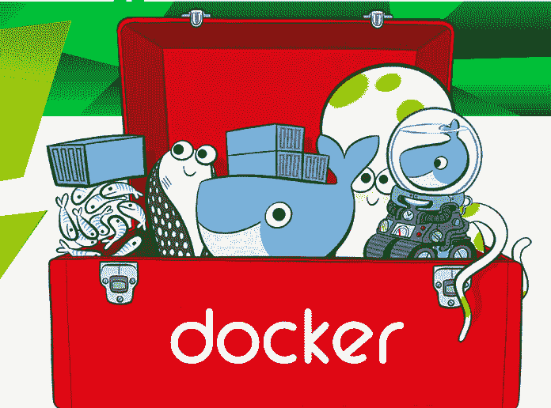

### 掌控容器

容器和容器编排平台正在变革 `DevOps` 和基础设施。了解更多如何从中受益的方法。

容器为软件可移植性问题提供了解决方案，即在从一个*计算环境*移动到另一个时如何可靠地运行。软件开发是一个漫长的过程，在被称为生产就绪之前，需要多次测试和开发迭代。这通常涉及在多种不同环境中工作——从开发人员的 `PC` 到测试环境，从预生产到生产环境，从数据中心的物理机器到云中的虚拟机。

容器包含应用程序及其所有依赖项、库和其他二进制文件，以及运行所需的配置文件，捆绑成一个单一的软件包。通过将应用程序及其依赖项容器化，操作系统和基础设施的差异被抽象化。任何人都可以从他们的系统中运行容器镜像，而不必过于担心底层需求。

随着开发和生产实践向容器化转变，重要的是要理解，虽然容器轻量级且适合移植应用程序，但在生产环境中管理容器是很困难的，该环境中可能存在数千个甚至更多容器，运行着不同的应用程序组件。这就引入了容器编排工具。这些系统用于管理运行容器所需的所有裸机或虚拟机。它们还管理容器，在底层机器上启动它们，确保它们分布合理并保持健康状态。

> 容器包含应用程序及其运行所需的一切，捆绑成一个单一的软件包


### 容器

- 托管运行应用程序的最小需求，实现快速且轻量级的部署。
- 独立且自给自足的应用程序包；它们可以在不同机器上运行而不会遇到兼容性问题。
- 可以进行版本控制、归档、共享，并用于回滚应用程序的先前版本。平台配置基本上可以像代码一样进行管理。
- 有助于将部署分解为功能离散的各个部分，实现关注点的明确分离，但这也意味着有更多组件需要处理。
- 服务器上可以容纳比传统虚拟机更多的容器。
- 在一个主机系统上运行的许多容器在理论上可能会引发安全担忧，因为它们访问相同的内核。
- 一种资源消耗较低的开始使用程序的方式。

### 虚拟机

- 使用 `VMware` 在单个主机上并行运行许多离散的操作系统实例。
- 模拟虚拟硬件并考虑所有底层系统需求。
- 虚拟机镜像比容器大得多。
- 实现真正的硬件级隔离，因此与容器相比，干扰和/或利用的可能性理论上更小。
- 确保安全性和一致的操作系统界面。
- 在现实场景中，虚拟机和容器是互补的，极有可能需要两者的结合。

### 掌控容器

### 使用 `DOCKER` 容器化完整文件系统

`Docker` 是容器技术领域最著名的名字。原因如下……

`Docker` 容器将软件包装在一个完整的文件系统中，其中包含运行所需的一切：代码、运行时、系统工具、系统库——任何可以安装在服务器上的东西。这保证了软件无论处于什么环境，始终能以相同的方式运行。`Docker` 容器的一个独特卖点是它们启动即时且使用的 `RAM` 更少。镜像由分层文件系统构建，并共享常见文件，这使得磁盘使用和镜像下载更加高效。

`Docker` 使用 `Linux` 内核及其功能（如 `cgroups` 和 `namespaces`）来隔离进程，使它们可以独立运行。这种独立性是“容器”的初衷——能够单独运行多个进程和应用程序，更好地利用基础设施，同时保留独立系统所具有的安全性。

`Docker` 技术最初建立在 `LXC` 之上，`LXC` 通常被认为是传统的 `Linux` 容器化技术。`LXC` 作为轻量级虚拟化很有用，但它没有良好的开发者或用户体验。现在，`Docker` 技术带来的不仅仅是运行容器的能力——它还简化了创建和构建容器、发送镜像和镜像版本控制的过程。

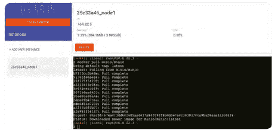

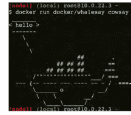

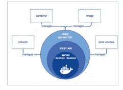


### 01 使用 `Docker`

`Docker` 用于快速且一致地交付应用程序。`Docker` 支持持续集成和持续部署工作流程。测试完成后，要交付产品，只需将更新的镜像推送到生产环境即可。作为一个基于容器的平台，`Docker` 允许高度可移植的工作负载。由于 `Docker` 轻量级且可移植，可以轻松地动态管理工作负载，并根据业务需求扩展或撤销应用程序和服务。

### 02 `Docker` 架构

`Docker` 使用客户端-服务器架构。`Docker` 守护程序承担了构建、运行和分发 `Docker` 容器的大部分繁重工作。`Docker` 客户端通过 `UNIX` 套接字或网络接口使用 `REST API` 与 `Docker` 守护程序通信。`Docker` 客户端有一个命令行接口，用于与守护程序进行通信。`Docker` 在守护程序进程中包含镜像、容器和注册表。`Docker` 镜像是一个只读模板，包含创建 `Docker` 容器的指令。`Docker` 容器是 `Docker` 镜像的可运行实例，而 `Docker` 注册表则是镜像库。

### 03 `Docker` 镜像

`Docker` 镜像是 `Docker` 的构建组件。每个镜像由一系列层组成，这些层使用联合文件系统组合成一个单一镜像。这些层使 `Docker` 变得轻量级。如果你更新了一个应用程序，则会构建一个新层，并仅替换被更新的层。每个镜像都从一个基础镜像开始。简单、描述性的指令存储在 `Dockerfile` 中，用于构建基础镜像。每条指令在镜像中创建一个新层。基础镜像使用 `Dockerfile` 中的 `FROM` 关键字定义。


#### 04 `Docker` 镜像仓库

`Docker` 镜像仓库是 `Docker` 的发行组件。它们可以是私有或公有的，并且可以与守护进程位于同一服务器上，也可以位于远程服务器上。它们在仓库中存储 `Docker` 镜像。在构建镜像后，可以将其推送到公有或私有镜像仓库。`Docker Hub` 是一个公有的 `Docker` 镜像仓库，拥有庞大的镜像集合。它允许你贡献自己的 `Docker` 镜像。`Docker Store`（现已从测试版转为正式发布）允许你买卖 `Docker` 镜像。


#### 05 Docker 容器

Docker 容器是 Docker 的运行组件。使用 Docker API 或 CLI 命令，你可以运行、启动、停止或删除容器。每个容器由镜像构建而成，表现得像一个隔离且安全的应用程序平台。它们还可以访问运行在不同主机或容器上的资源。Docker 客户端指示 Docker 守护进程使用 `docker run` 命令或等效的 API 来运行容器。例如，要使用 `Ubuntu` Docker 镜像运行容器并以交互模式执行 `/bin/bash` 命令，请执行：

```bash
$ docker run -i -t ubuntu /bin/bash
```

#### 06 Docker 服务

Docker 服务是 Docker 的可扩展组件。它们使 Docker 节点集群（`swarm`）协同工作。Docker 服务允许定义副本任务（`replica tasks`）实例的数量。这些副本任务本身是 Docker 镜像。你可以指定并发运行的副本任务数量。`swarm` 管理器将负载均匀地分布在 `worker` 节点上，因此对于消费者而言，它看起来像是一个单一的应用程序。`docker service` 命令用于创建、更新、检查、列出和扩展服务。要创建新服务，请执行：

```bash
$ docker service create
```

#### 07 编写自己的 Dockerfile：1

创建一个新文件并将其保存为 `Dockerfile`。在此文件中，你可以输入在 `Dockerfile` 中可用的指令。我们将以一个有状态应用程序（如 `Minio`）为例。首先，使用 `FROM` 指令指定基础镜像：

```dockerfile
FROM golang:1.7-alpine
```

如果需要指定任何环境变量，可以使用相应的设置指令，例如 `ADD`、`COPY`、`ENV`、`EXPOSE`、`LABEL`、`USER`、`WORKDIR`、`VOLUME`、`STOPSIGNAL` 和 `ONBUILD`。

假设你需要使用 `WORKDIR` 指令；在这种情况下，请输入：

```dockerfile
WORKDIR /go/src/app
```

这将工作目录设置为 `/go/src/app`。

#### 08 编写自己的 Dockerfile：2

`RUN` 指令在当前镜像之上的新层中执行命令并提交结果。`RUN` 命令在 shell 中执行，默认为 `/bin/sh -c`。要执行多条命令，请添加反斜杠 `\` 并换行继续。在我们的 `Minio` `Dockerfile` 中，`RUN` 指令如下所示：

```dockerfile
RUN apk add --no-cache git && \
    go-wrapper download && \
    -
```

`EXPOSE` 指令指定容器监听的运行时网络端口：

```dockerfile
EXPOSE 9000
```

`ENTRYPOINT` 配置可执行容器：

```dockerfile
ENTRYPOINT ["minio"]
```

`VOLUME` 指令创建挂载点：

```dockerfile
VOLUME ["/export*"]
```


#### 09 构建并运行你的 Dockerfile

导航到包含 `Dockerfile` 的文件夹。然后使用 `build` 命令创建镜像：

```bash
$ docker build .
```

这会在当前文件夹中查找 `Dockerfile` 并构建它，从而创建一个 Docker 镜像。要查看所有镜像，请执行：

```bash
$ docker images
```

这将显示镜像的仓库、标签、镜像 ID、创建日期和大小详情。现在运行该镜像以创建容器。例如：

```bash
$ docker run -p 9000:9000 65c7eba5362b /export
```

此处，`65c7eba5362b` 是已构建镜像的镜像 ID；它从 Docker 镜像列表中获取。

> 在保留独立系统安全性的同时，更有效地利用你的基础设施

## 使用 RKT 安全地运行独立应用程序

`rkt` 是 `CoreOS` 提供的一种容器方案，它可以在运行前验证容器镜像。

`rkt` 是 `CoreOS` 启动的 Docker 替代方案。它是应用程序容器（`appc`）规范的实现，该项目最初被称为 `Rocket`。`rkt` 被开发为一个独立工具，它存在于 `CoreOS` 之外，并支持 `Ubuntu`、`RHEL`、`CentOS` 和其他主要发行版。`rkt` 是可组合的。它还具有用于强信任、镜像审计和应用程序身份的加密原语，使其具有安全性。它可以下载、加密验证并运行应用程序容器镜像。它并非设计用于运行完整的系统容器，而是用于运行独立的应用程序，如 Web 应用、数据库或缓存。

`rkt` 允许在没有注册表要求的情况下部署到私有环境。容器镜像的发现很简单，由联合命名空间（`federated namespace`）和分布式检索来促进。其格式和运行时由社区制定良好并开发。存在独立的工具实现，允许相同的容器一致地运行。

`rkt` 没有集中式守护进程来管理容器。它直接从客户端命令启动容器，使其与 `systemd`、`upstart` 等 init 系统兼容。

### 01 安装 rkt

首先，从 GitHub 上的 `rkt` 发布页面（`github.com/coreos/rkt/tree/master/rkt`）下载相关的发行版版本。我们安装了 Debian 软件包。在这种情况下，下载 `DEB` 文件，并使用终端导航到下载的文件目录。然后执行：

```bash
$ sudo dpkg -i rkt_1.24.0-1_amd64.deb
```

`rkt` 守护进程会自动启动。要从压缩文件安装 `rkt`，请下载 `tar.gz` 文件，从终端导航到该目录，然后执行：

```bash
$ tar xvf rkt-v1.24.0.tar.gz
```

如果你想要 `rkt` 的源代码，请从相同的发布位置下载源代码 `ZIP` 文件。

### 02 Docker 架构

使用任何首选语言创建一个应用程序。在这个例子中，我们将使用 `Go`。我们创建一个名为 `hello.go` 的文件。

```go
$ vi hello.go
package main
import (
    "log"
)
func main() {
    log.Printf("Hello World")
}
```

现在，我们在脚本文件中使用 `abcudl` 创建一个镜像：

```bash
$ vi appc-hello.sh
abcudl begin
abcudl set-name example.com/hello
abcudl copy hello /bin/hello
abcudl set-exec /bin/hello
abcudl port add www tcp 5000
abcudl label add version 0.0.1
abcudl label add arch amd64
abcudl label add os linux
abcudl annotation add authors "Linux user <lud@example.com>"
abcudl write hello-0.0.1-linux-amd64.aci
abcudl end
```

执行脚本后，你将看到生成的日志，它们看起来大致如下：

```
Beginning build with an empty ACI
Setting name of ACI to example.com/hello
Copying host:hello to aci:/bin/hello
Setting exec command [/bin/hello]
Writing ACI to hello-0.0.1-linux-amd64.aci
```

最后，创建一个 `ACI` 文件，这是一个未签名、未加密的 `appc` 容器镜像。可以使用 `rkt` 运行此文件。

### 03 创建镜像

当你执行在上一步中创建的脚本时，将创建一个镜像。

```bash
$ ./appc-hello.sh
```

### 04 运行 rkt

使用以下命令检查 `rkt` 的镜像列表：

```bash
$ sudo rkt image list
```

现在使用以下命令启动容器：

```bash
$ sudo rkt --insecure-options=image run hello-0.0.1-linux-amd64.aci
```

默认情况下，`rkt` 期望你的镜像是签名的，因此需要 `--insecure-options` 选项。现在应用程序正在运行，`rkt` 也可以作为守护进程运行。按三个转义字符（`Ctrl+C`）来停止容器。要清理未使用的镜像和容器，请执行：

```bash
$ sudo rkt gc
```

这会清理未使用的镜像。要清理未使用的容器，请执行：

```bash
$ sudo rkt image gc
```

### 05 使用 curl 测试


创建一个程序，该程序创建一个监听`5000`端口的HTTP服务器，并在收到请求时打印`'hello'`：

```go
$ vi hello.go
package main

import (
    "log"
    "net/http"
)

func main() {
    http.HandleFunc("/", func(w http.ResponseWriter, r *http.Request) {
        log.Printf("request from %s\n", r.RemoteAddr)
        w.Write([]byte("hello"))
    })
    log.Fatal(http.ListenAndServe(":5000", nil))
}
```

使用`app-hello.aci`（在之前步骤中创建）构建它，然后启动容器。`rkt`会为运行中的容器分配一个IP地址。使用以下命令查找IP地址：

```bash
$ sudo rkt list
```

然后对`5000`端口上的该IP地址进行`curl`请求：

```bash
$ curl 172.16.28.2:5000
```

这将打印`'hello'`。

```bash
$echo Generating a default key
Key-Type: RSA
Key-Length: 2048
Subkey-Length: 2048
Name-Real: Chad Container
Name-Comment: GPG signing key
Expire-Date: 0
Passphrase: cha
Generating ltb.gpg
Generating rkt.sec
"secends"
"rkt.sec"
```

### 06 签名镜像：生成 GPG 密钥

之前步骤中创建的镜像是未签名的。如果你想对镜像进行签名，请使用`GPG`。创建一个名为`gpg-batch`的批处理文件：

```bash
$echo Generating a default key
Key-Type: RSA
%commit
$echo done
```

现在使用批处理模式生成密钥：

```bash
$ gpg --batch --gen-key gpg-batch
```

密钥创建后，列出密钥并使用`GPG`将相关密钥添加为受信任密钥。现在导出公钥：

```bash
$ gpg --no-default-keyring --armor \
--secret-keyring ./.rkt.sec --keyring ./rkt.pub \
--export lude@example.com > pubkeys.gpg
```

### 07 签名镜像：对 ACI 进行签名

既然你已经有了公钥，请使用`GPG`按照以下方式对`ACI`文件进行签名：

```bash
$ gpg --no-default-keyring --armor \
--output hello-0.0.1-linux-amd64.aci.asc \
--detach-sig hello-0.0.1-linux-amd64.aci
```

验证签名后的镜像：

```bash
$ gpg --no-default-keyring \
--certify-keyring ./.rkt.sec --keyring ./rkt.pub \
--verify hello-0.0.1-linux-amd64.aci.asc
hello-0.0.1-linux-amd64.aci
```

执行时你将看到签名详情。

作为构建和签名我们的`hello.go`应用程序镜像的一部分创建的文件是`hello-0.0.1-linux-amd64.aci`、`hello-0.0.1-linux-amd64.aci.asc`和`pubkeys.gpg`。

### 08 限制系统资源

使用`rkt`限制容器使用的`CPU`和允许的内存等系统资源。容器继承在系统服务单元文件中配置的资源限制。资源控制设置限制`CPU`时间配额、`I/O`和内存资源。要限制`CPU`时间配额，请创建一个单元文件：

```ini
[Service]
ExecStart=/usr/bin/rkt run github.com/iximages/stress:0.0.1
CPUQuota=20%
```

这确保了执行进程在一个`CPU`上获得的`CPU`时间不超过`20%`。要检查使用情况，请使用：

```bash
$ ps -p <PID> -o %cpu
```

...其中`<PID>`是运行中容器进程ID。

### 09 rkt 与 systemd

`rkt`与`systemd`等init系统协同工作。后者用于启动、停止和检查容器的状态。由于`rkt`不通过长时间运行的守护进程进行接口交互，因此其`pod`的生命周期由`systemd`直接管理。使用`rkt`创建一个单元文件：

```ini
$ vi rkt-unit-file
[Unit]
Description=etcd

[Service]
Slice=machine.slice
ExecStart=/usr/bin/rkt run coresys.com/etcd:v2.2.5
KillMode=mixed
Restart=always
```

这将在`systemd`下运行一个`etcd`实例。使用这些命令进行管理：

```bash
$ sudo systemctl start etcd.service
$ sudo systemctl stop etcd.service
$ sudo systemctl restart etcd.service
$ sudo systemctl enable etcd.service
$ sudo systemctl disable etcd.service
```

## 特性

### 掌控容器

#### 使用 RUNC 处理轻量级独立容器

`runc`是开放容器倡议（Open Container Initiative, `OCI`）提供的通用容器运行时。

`Docker`具有使沙箱环境*抽象化*的特性。它抽象了底层宿主机的具体细节，既无需重写应用程序，也无需承担过高的性能开销。这些特性被整合到一个名为*`runc`*的统一低层组件中。后来，`Docker Inc`将*`runc`*开发为一个独立工具。*`runc`*是一个轻量级、可移植的容器运行时。它包含了`Docker`用于与容器相关系统特性交互的所有管道代码。它专为安全性和可扩展性而设计，并且独立于`Docker`平台的其他部分。它原生支持`Linux`中可用的安全特性——`SELinux`、`AppArmor`、`seccomp`、控制组、能力丢弃、`pivot_root`、`uid/gid`丢弃等。`runc`拥有由`Google`工程师贡献的可移植性能配置文件。`Linux`基金会旗下的开放容器项目对其进行了治理。`runc`旨在让标准容器无处不在。容器作为*`runc`*的子进程启动。它们可以被嵌入到其他系统中，而无需运行守护进程。*`runc`*并不限制你使用特定的工作流或部署设置：它仅需要根文件系统和配置。它基于`Docker`使用的久经考验的管道代码。在生产环境中，你可以将其作为`Docker`部署的一部分，或者在你的自定义平台中作为独立工具使用。


#### 01 runc 特性

`runc`完全支持`Linux`命名空间，包括用户命名空间。`Linux`中可用的安全特性也得到`runc`的支持。`runc`原生支持实时迁移和`Windows 10`容器，并计划原生支持`Arm Power`、`Sparc`以及`DIOK`、`sr-iov`、`tpm`和信任执行环境（secure enclaves）等硬件特性。`runc`构建于`libcontainer`之上，这是驱动`Docker Engine`安装的核心。虽然其配置标准由开放容器项目正式制定和治理，但它并不强迫你使用限制性的工作流或部署设置。

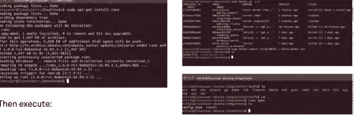

然后执行：

```bash
sudo apt-get install runc
```

安装期间你需要超级用户权限，以便在安装后使用该包。

#### 02 安装

要在你的`Linux`机器上安装*`runc`*，请从`GitHub`发布库（`github.com/opencontainers/runc`）下载*`runc-linux-amd64`*。从该软件包安装。如果你需要源代码，请下载`ZIP`文件。

```bash
$ sudo mv runc-linux-amd64 /usr/bin/runc
$ sudo chmod a+x /usr/bin/runc
```

或者你可以直接从`Ubuntu`软件包列表中安装：

```bash
$ sudo apt-get update
```

#### 03 根文件系统

启动`runc`容器仅需根文件系统和一个配置。`runc`无法自行创建或解包根文件系统。请使用`Docker`来创建它。


#### 03 创建根文件系统

```bash
$ mkdir /tmp/myapp/rootfs
$ docker export myapp | tar xvC - /tmp/myapp/rootfs
```

你可以使用其他使用 OCI 镜像的工具来创建根文件系统，或者使用一个已包含根文件系统的目录。检查该目录：

```bash
$ ls /tmp/myapp/rootfs
```

然后，在父目录中，使用 `runc` 创建一个 OCI 运行时配置文件：

```bash
$ cd /tmp/myapp
$ runc spec
$ ls
```

检查是否已创建 `config.json`。

#### 04 配置文件

编辑在上一步生成的 `config.json` 文件。

```bash
$ sudo vi config.json
```

编辑其中定义的配置，或根据需要添加新配置。默认情况下，使用 `config.json` 在容器内创建一个 SSH 会话，该文件由 `runc` 的 `spec` 命令创建。如果你希望在后台启动容器，请移除其中的终端设置。更新 `process` 字段，例如：

```json
{
  "process": {
    "terminal": false,
    "user": {
      "uid": 0,
      "gid": 0
    },
    "args": [
      "sleep", "5"
    ],
    "env": [
      "PATH=/usr/local/bin:/usr/local/sbin:/usr/sbin:/usr/bin:/sbin:/bin",
      "TERM=xterm"
    ],
    ...
  }
}
```

```text
... root... 4096 Dec 21 03:18 /usr/bin/ls
... root... 4096 Dec 21 03:18 /usr/bin/cat
```

#### 05 容器生命周期

`run` 命令用于创建 `runc` 容器。它处理容器的创建、启动和删除。首先，创建一个容器 ID：

```bash
$ cd /tmp/myapp
$ runc create containerId
```

现在创建容器：

```bash
$ runc run containerId
```

查看已创建的容器列表：

```bash
$ runc list
```

要启动容器内的进程：

```bash
$ runc start containerId
```

要在退出时删除容器，请执行：

```bash
$ runc delete mycontainerId
```

这允许更高层的系统管理 `runc`。这用于在创建和启动之间设置容器的网络堆栈。

#### 06 Systemd 集成

`runc` 不会守护进程化（daemonise）来管理容器。因为它直接从命令行界面启动，所以它可以与 `systemd` 等 init 系统集成。例如，`systemd` 单元文件可以如下所示：

```ini
$ vi myapp-unit-file
[Unit]
Description=Start My Container

[Service]
Type=forking
ExecStart=/usr/local/sbin/runc run -d --pid-file /run/containerId.pid
delete containerId
WorkingDirectory=/tmp/myapp
PIDFile=/run/containerId.pid

[Install]
WantedBy=multi-user.target
```

它也可以与其他 init 系统和进程监督者一起使用，以确保容器在退出时能够重启。

#### 07 卸载 runc

如果你想从系统中卸载 `runc`，请执行：

```bash
$ sudo apt-get remove runc
```

如果你想连同依赖项一起移除 `runc` 包，请执行：

```bash
$ sudo apt-get remove --auto-remove runc
```

要完全移除 `runc` 及其所有配置文件和数据，请执行：

```bash
$ sudo apt-get purge runc
```

或者使用：

```bash
$ sudo apt-get purge --auto-remove runc
```

这些命令会移除与 `runc` 包相关的所有配置文件和数据。它们无法恢复，因此请仅在非常确定时使用！

#### 08 runc 与 Docker

`Docker` 使用了 `Linux`、`Go`、`bnc`、`aufs`、`fuse`、`iptables`、`VirtualBox`、`vxlan`、`mesos` 等技术，以及 `consul` 和 `systemd`。虽然这些组件是可重用的，但它们使 `Docker` 变得复杂。`runc` 是一个轻量级、可移植的容器运行时。它不依赖于 `Docker` 平台的其余部分。虽然 `runc` 借助 `Docker` 创建根文件系统，但 `Docker` 和 `runc` 都支持可移植性、普遍性和可扩展性。`runc` 可以作为 `Docker` 部署的一部分或独立分发使用。

#### 09 runc 与 rkt

`runc` 和 `rkt` 都是开放容器倡议（`OCI`）规范的实现。`runc` 需要宿主操作系统和配置的低层细节，而 `rkt` 不期望用户了解宿主操作系统的低层细节。两者都没有中心化守护进程，因此都可以与 `systemd` 等 init 系统集成。`runc` 需要单独下载或密码学验证容器镜像。`rkt` 可以下载 `Docker` 镜像以及 App Container 镜像。

> `runc` 专为安全性和可扩展性而设计，并且独立于 `Docker` 平台的其余部分

## 使用 KUBERNETES 管理和编排容器

如果有硬件问题，你可以使用 `Kubernetes` 移动容器

微服务架构与容器化应用程序相结合，提供了一种出色的应用程序部署解决方案，能够处理大量流量。但这个解决方案仍然基于抽象：容器仍在资源有限的机器上运行。如果其中一台机器宕机，你需要移动容器怎么办？

容器编排平台管理运行容器所需的所有裸机或虚拟机。这些平台还管理你的容器，在底层机器上启动它们，确保它们的分布，并保持其健康状态。`Kubernetes` 就是这样一个容器编排系统。

`Kubernetes` 使用期望状态理念运行你的所有应用程序容器。这意味着你可以说明你需要多少个应用程序实例，系统会确保始终有那么多副本在运行。如果一个宕机，它会重启另一个。如果运行得太多，它会终止多余的。`Kubernetes` 由 `Google` 创建，基于其过去十年构建自有容器编排系统的经验。有很多组件使 `Kubernetes` 得以工作；让我们来看看它们。

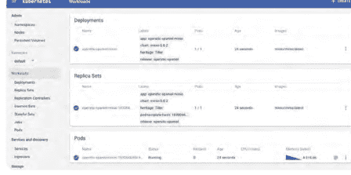


### 01 容器与 Pod

`Pod` 是 `Kubernetes` 中最小的执行单元，而容器是亚原子组件。这意味着你永远不会单独运行一个容器；它总是在一个称为 `pod` 的控制结构中运行。但这并不意味着你不能像在 `Docker` 中那样，完全相同地运行基于 `Dockerfile` 的 `Docker` 镜像。在这种情况下，`Kubernetes` 将启动一个单容器 `pod`。

其他 `Kubernetes` 组件会启动一个或多个 `pod`，或将一个或多个 `pod` 连接到网络。`Pod` 由一个或多个容器组成。运行在同一个 `pod` 中的容器共享磁盘、本地主机（`localhost`）、安全上下文和其他属性。

### 02 ReplicaSet

`ReplicaSet` 是 `Kubernetes` 系统的核心部分之一。它确保在任何时刻都有指定数量的 `pod` 副本在运行。如果数量太少，它会启动更多。与手动创建的 `pod` 不同，由 `ReplicaSet` 维护的 `pod` 如果在失败、被删除或被终止时会被自动替换。

### 03 Deployment

`Deployment` 可以被视为包含 `pod` 和 `ReplicaSet` 的抽象：当你创建一个 `deployment` 时，会启动 `ReplicaSet` 和 `pod`。你只需要描述 `deployment` 对象的期望状态，`deployment` 控制器就会以受控的速度将实际状态更改为期望状态。你可以通过创建新资源或替换现有资源来定义 `deployments`。在 `Kubernetes` 上部署应用程序的推荐方式是创建一个 `deployment`。

### 04 StatefulSet

许多分布式和有状态应用程序在部署前需要具有唯一的、预先知晓的网络标识符。有状态应用程序还需要稳定的、持久的存储，即使之前的 `pod` 已经宕机，这些存储仍可绑定到适当的 `pod`。`StatefulSets` 为此提供了所有这些功能

#### 05 PersistentVolumeClaim（持久卷声明）


有状态的应用程序可以使用 `PersistentVolumeClaims`（`PVC`，持久卷声明）来请求存储。`PVC` 类似于 `Pod`。正如 `Pod` 消耗节点资源并可以请求特定级别的资源（`CPU` 和内存）一样，`PVC` 消耗持久卷资源，并且可以请求特定的大小和访问模式（例如，它们可以一次以读写方式挂载，或者多次以只读状态挂载）。`PVC` 允许用户消费抽象的存储资源，而提供这些资源的职责则属于平台。

#### 06 Services（服务）

服务将临时 `Pod` 连接到需要长期运行的内部或外部进程，例如 `API` 端点。假设你正在运行三个执行 Web 服务器容器的 `Pod`，并且你需要一种方式将从公共互联网传入的请求路由到你的容器。你可以通过设置一个使用负载均衡器将请求从公共 IP 地址路由到其中一个容器之一来实现这一点。给 `Pod` 打上一个标签，例如 `web_server`，然后在服务定义中说明：“使用任何标记为 `web_server` 的容器提供 `80` 端口的服务”。

#### 07 The kubectl tool（kubectl 工具）

要在 `Kubernetes` 上部署和管理应用程序，你可以使用 `Kubernetes` 命令行工具 `kubectl`。它允许你检查集群资源，创建、删除和更新组件，以及执行更多操作。使用以下命令安装 `kubectl`：

```bash
$ curl -LO https://storage.googleapis.com/kubernetes-release/release/$(curl -s https://storage.googleapis.com/kubernetes-release/release/stable.txt)/bin/linux/amd64/kubectl
```

你应该使用以下语法从终端窗口运行 `kubectl` 命令：

```bash
$ kubectl [command] [TYPE] [NAME] [flags]
```

...其中 `command` 指定你想要执行的操作，`TYPE` 指定资源类型，`NAME` 指定资源名称，而 `flags` 是命令的额外输入参数。

#### 08 Pick the right platform（选择合适的平台）

`Kubernetes` 安装没有任何先决条件；你可以在各种平台上安装它，从笔记本电脑到虚拟机，再到云提供商或裸机服务器。这里需要注意的是，你的集群容量取决于底层平台。对于希望熟悉 `Kubernetes` 的用户来说，最好的入门方式是使用 `Minikube`，这是一种基于本地 `Docker` 的解决方案。这会在你的笔记本电脑上创建一个单节点 `Kubernetes` 环境。对于像 `GCE` 和 `AWS` 这样的云提供商，设置 `Kubernetes` 很容易。虽然 `GCE` 默认提供 `Kubernetes` 支持，但对于 `AWS`，你可以使用 `kops` 工具。

#### 09 Deploy applications on Kubernetes（在 Kubernetes 上部署应用程序）

现在你已经了解了 `Kubernetes` 的各种构建块及其工作原理，我们将看看如何实际部署一个应用程序。为此，你需要创建一个由 `Kubernetes` 定义格式的配置。然后，你可以使用 `kubectl create` 命令并将配置文件传递给 `Kubernetes`。该命令的格式如下：

```bash
$ kubectl create -f config.yaml
```

另一个选项是使用 `Kubernetes` 包管理器 `Helm`。包管理器维护一个名为 `Helm charts` 的 `Kubernetes` 配置公共仓库。要通过 `Helm` 部署应用程序，你可以使用带有 `chart` 名称的 `helm install` 命令。例如，要安装 `Minio` chart，你可以使用：

```bash
$ helm install stable/minio
```

> 像 `Kubernetes` 这样的容器编排平台管理运行容器所需的所有裸机或虚拟机

## NATIVELY MANAGE A CLUSTER WITH DOCKER SWARM（使用 Docker Swarm 原生管理集群）

当你能够同时运行大量容器时，为什么要只使用一个容器呢？

虽然像 `Kubernetes` 和 `DC/OS` (`dcos.io`) 这样的项目正在构建能够处理不同容器格式的容器编排平台，但 `Docker Inc` 将容器编排与其核心产品 `Docker Engine` 集成在一起。从 `Docker Engine v1.12.0` 开始，`Swarm` 已内置，无需安装任何额外软件即可使用。不过，你需要网络连接的主机机器来运行容器集群。

这种 `Swarm` 与 `Docker Engine` 的集成意味着你可以原生管理一个 `Docker Engine` 集群。这意味着你可以使用 `Docker CLI` 创建 `swarm`，向 `swarm` 部署应用程序服务并管理 `swarm` 的行为。使用最新的 `Docker Engine v1.13.0`，你甚至可以使用 `Docker Compose` 文件来管理你的 `Docker swarm`。对于初学者来说，`Docker Compose` 是一个用于在单个节点上定义和运行多容器 `Docker` 应用程序的工具。`Compose` 在名为 `docker-compose.yml` 的文件上工作。截至 `Docker Engine v1.13.0`，`Docker Compose` 文件也可以用于配置多节点 `swarm`。`Swarm` 提供了你所需的所有生产就绪功能，包括负载均衡、服务发现、滚动更新、扩展等。我们稍后将学习所有这些功能。现在，只需记住，当你在不使用 `swarm` 模式的情况下运行 `Docker` 时，你执行的是容器命令。当你在 `swarm` 模式下运行 `Docker` 时，你编排的是服务。

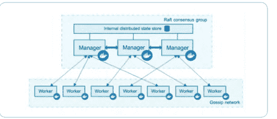

| 名称 | 活动 | 期望 | 状态 | URL | SWARM | DOCKER ENGINES |
|:---|:---|:---|:---|:---|:---|:---|
| `lucy@sdc-dockerswarm10/101905 docker-machine` | | | | | | |
| `swarm-war-manager-1` | `*` | 单个 | 运行中 | `tcp://198.199.226.244:2376` | `v1:13.0` | |
| `swarm-war-manager-2` | `*` | 单个 | 运行中 | `tcp://198.199.226.223:2376` | `v1:13.0` | |
| `swarm-war-worker-3` | | 单个 | 运行中 | `tcp://198.199.226.228:2376` | `v1:13.0` | |
| `swarm-war-worker-4` | | | 运行中 | `tcp://198.199.226.185:2376` | `v1:13.0` | |

### 01 Swarm 管理节点

参与 `swarm` 的 `Docker Engine` 实例称为节点。`Swarm` 可以有两种类型的节点：管理者和工作者。管理节点是 `swarm` 中的控制机构，处理所有管理任务，例如向工作者分发任务，并执行维持 `swarm` 期望状态所需的编排和集群管理功能。当 `swarm` 中有多个管理节点时，它们会选举一个唯一的领导者来执行编排任务。即使你想向 `swarm` 部署应用程序，你也是将服务定义提交给管理节点。

| 名称 | 地址 | 容器 | 期望/活动 | 所需内存 | 限制 |
|:---|:---|:---|:---|:---|:---|
| `manager` | | `1/运行中` `1/运行中` `1/运行中` | | | |
| | | `198.199.226.244:338372` | | `1536M` | |
| | | | | `15%` `15%` `15%` `15%` | |
| `manager` | | | | | |
| `worker` | | `3/运行中` `3/运行中` `3/运行中` | | | |
| | | `198.199.226.244:338372` | | | |

### 02 Swarm 工作节点

工作节点也是 `Docker Engine` 的实例，其唯一目的是执行容器。工作节点不参与做出调度决策，也不提供 `swarm` 模式 `HTTP API`。你可以创建一个包含一个管理节点的 `swarm`，但你不能在没有至少一个管理节点的情况下拥有工作节点。默认情况下，所有管理者也是工作者。在单管理节点集群中，你可以运行诸如 `docker service create` 之类的命令，调度器会将所有任务放置在本地引擎上。

### 03 Swarm 服务


要在 `Docker` `swarm` 模式下部署应用程序镜像，你需要创建一个服务。服务通常包含在更大应用程序上下文中的微服务的镜像。服务的示例包括 `HTTP` 服务器、数据库，或者你希望在不定环境中运行的任何其他类型的可执行程序。当你向 `swarm` 部署服务时，`swarm` 管理者接受你的服务定义作为该服务的期望状态。然后它将在 `swarm` 的节点上调度该服务，作为一个或多个副本任务。任务在 `swarm` 的节点上独立运行。

### 04 通过 Compose 文件部署服务

截至最新的 `Docker Engine` (`v1.13.0`) 和 `Docker Compose` `v3.0`，`Compose` 与 `Docker Engine` 的 `swarm` 模式之间存在互操作性。

> “当你在不使用 `Swarm` 模式的 `Docker` 中运行时，你执行的是容器命令。当你在 `Swarm` 模式下运行时，你编排的是服务”

这意味着你可以使用 `Docker Compose` 格式创建一个文件，并用于在 `Swarm` 模式下部署服务。这不仅简化了部署过程，还使得轻松传递 `Swarm` 服务定义成为可能。


```
hosted-docker-dashboard swamd running pool "localhost-swarm-new" master-manager:1 ...
```

```
To add a worker to this swarm, run the following commands:
$ docker swarm join ...
```

#### 05 Compose 文件格式

`Compose` 文件以版本部分开头。对于兼容 `Swarm` 的 `Compose` 文件，版本应为 `3`。接下来，你需要在 `services` 部分下定义要在 `Swarm` 中创建的服务。每个服务以服务名称开头，随后是 `image` 部分。在此你需要指定用于该服务的镜像。接下来，你需要添加 `volumes`、`ports`、`network`、`environment` 和 `deploy` 部分。最后，`command` 部分指示用于启动服务的命令。

#### 06 负载均衡

`Swarm` 管理器使用入口负载均衡来暴露你希望提供给 `Swarm` 外部访问的服务。`Swarm` 管理器可以自动为服务分配 `PublishedPort`，或者你可以为服务配置 `PublishedPort`。你可以指定任何未使用的端口。在 `Compose` 文件中，`ports` 部分指定端口映射。如果你没有指定端口，`Swarm` 管理器将分配 `30000-32767` 范围内的一个端口给该服务。

#### 07 创建 Swarm

要创建一个 `Swarm`，你需要在所有主机上安装 `Docker Engine` `v1.12` 或更高版本，并且所有机器上都要运行 `Docker Engine` 守护进程。此外，如果有网络连接这些主机，则端口 `2377`（用于集群管理）、`7946`（用于节点间通信）和 `4789`（用于创建覆盖网络）应该可用。一旦主机就绪，`SSH` 登录到你想用作管理器的机器，并初始化 `Swarm`：

```bash
$ docker swarm init --advertise-addr <MANAGER-IP>
```

在这里，你需要设置管理器机器的 `IP` 地址。

```
hosted-docker-dashboard:~$ docker-swarm-init --advertise-addr worker01-01
```

#### 08 向 Swarm 添加节点

一旦你创建了带有管理器节点的 `Swarm`，你就可以准备添加工作节点了。打开终端并 `SSH` 登录到你想运行工作节点的机器。登录机器后，运行上一步 `docker swarm init` 输出中生成的命令，以创建加入现有 `Swarm` 的工作节点。或者，你可以使用命令：

```bash
$ docker swarm join-tokens worker
```

```
hosted-docker-dashboard:~$ docker swarm init
```

#### 09 检查服务

你可以使用 `Docker` `CLI` 查看 `Swarm` 中运行的服务的所有详细信息。如果你还没有这样做，请打开终端并 `SSH` 登录到运行管理器节点的机器。然后，运行命令：

```bash
$ docker service inspect --pretty <SERVICE-ID>
```

...以易读的格式显示服务的详细信息。你可以使用其他 `docker service` 命令来探索服务详情。例如：

```bash
$ docker service ls
```

...显示所有正在运行的服务。

```bash
$ docker service ps <SERVICE-ID>
```

...显示为服务运行的所有任务。

## 特性

## 控制容器

## 使用 MESOSPHERE 运行企业级容器

这个分布式系统简化了在大型架构上构建和运行应用程序的过程

`DC/OS` 是一个基于 `Apache Mesos` 分布式系统内核的分布式操作系统。它使得将多台机器作为一个单一计算机进行管理成为可能。它自动化资源管理，调度进程放置，促进进程间通信，并简化和分布式服务的安装和管理。其 `Web` 界面和命令行界面促进了集群及其服务的远程管理和监控。

`Apache Mesos` 是 `Mesosphere` `DC/OS` 的核心开源分布式系统内核。`Mesos` 始于加州大学伯克利分校（`BSD UNIX` 的诞生地）的一个研究项目。受 `Google` 专有的 `Borg` 系统的启发，该项目的目标是创建一个开源内核，简化在非常大的规模上构建和运行分布式应用程序，并将整个数据中心视为一个巨大的超级计算机，同时保持可扩展的架构。

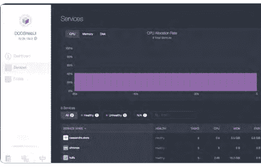

传统的单体调度器维护底层应用程序和基础设施的完整状态，同时执行工作负载放置逻辑。这种架构使得扩展变得非常具有挑战性，引入新特性和功能更加困难。通过双层级架构，`Mesos` 处理底层基础设施调度操作，而顶层的另一层（框架）处理所有特定于应用程序的操作和逻辑。

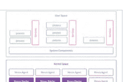

主节点（`masters`）编排运行在 `Mesos` 代理上的任务。它接收来自 `Mesos` 代理的资源报告，并将这些资源分配给已注册的 `DC/OS` 服务，例如 `Marathon` 或 `Spark`。`Mesos` 代理节点代表框架运行离散的 `Mesos` 任务。私有代理节点通过不可路由网络运行已部署的应用和服务。公共代理节点在公共可访问网络中运行 `DC/OS` 应用和服务。


预置容器镜像（`AppC` 也即将推出）。这意味着你可以在 `DC/OS` 中同时使用 `Mesos` 容器化程序和容器镜像类型。你还可以直接通过 `DC/OS` 使用 `Docker` 容器运行时，但通用容器运行时支持运行 `Docker` 镜像而不依赖于 `Docker Engine`，从而实现了与 `Mesos` 的更好集成。

### 01 架构

`DC/OS` 内核空间由 `Mesos` 主节点和 `Mesos` 代理组成。用户空间包括系统组件，如 `Mesos-DNS`、分布式 `DNS` 代理，以及服务，如 `Marathon` 和 `Spark`。用户空间还包括由服务管理的过程，例如 `Marathon` 应用程序。`Mesos`

### 02 Mesos 容器化程序

容器化程序允许你在容器中运行任务。`DC/OS` 支持两种容器化程序类型 – `DC/OS` 通用容器运行时和 `Docker` 容器化程序。通用容器运行时扩展了 `Mesos` 容器化程序以支持


### 03 DC/OS 安装

你可以通过使用自定义设置文件或云模板在任何你想要的环境中安装 `DC/OS`。针对所有主要云基础设施提供商都有详细的说明步骤。你还可以使用 `Vagrant` 在本地机器上创建虚拟机集群，用于 `DC/OS` 的演示、开发和测试。

### 04 Mesos 执行器和调度器

`Mesos` 调度器定义新的 `Mesos` 任务并为其分配资源（将其放置在特定节点上）。调度器接收描述 `CPU`、`RAM` 等的资源报价，并将它们分配给可由 `Mesos` 代理通过执行器启动的离散任务。

执行器进程由代理节点上的 `Mesos` 代理启动和管理。`Mesos` 任务由其调度器定义为由特定执行器（或默认执行器）运行。每个执行器运行在属于自己的容器中。


### 05 Marathon

`Marathon` 是 `DC/OS` 的生产级容器编排平台。它是 `DC/OS` 的核心组件，也是在 `DC/OS` 集群启动后第一个被引导的框架。这是因为 `Marathon` 还运行其他 `Mesos` 框架。


`Marathon` 支持 `Mesos` 容器（使用组）和 `Docker`。你还可以通过将持久存储卷绑定到应用程序来运行有状态应用。这意味着像 `MySQL`、`Postgres` 这样的数据库和像 `Minio` 这样的对象存储可以轻松部署在 `DC/OS` 上，并且其存储由底层平台计算。

### 06 Chronos

`Chronos` 是一个用于运行基于计划和依赖关系的作业的 `Mesos` 调度器。

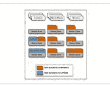

你可以将 `Chronos` 视为 `cron` 的替代方案。它是一个分布式且容错的调度器，运行在 `Apache Mesos` 之上，可用于作业编排。使用 `Chronos` 调度的作业配置有基于 `ISO8601` 的具有重复间隔的计划。通常，作业被计划无限期运行，例如每天或每小时一次。依赖作业可能有多个父级，一旦所有父级自依赖作业上次调用以来都成功调用过至少一次，它们就会被触发。

### 07 应用程序

像 `WordPress`、`Jenkins` 或其他此类实际应用程序可以作为 `Marathon` 应用程序部署在 `DC/OS` 上。应用程序通常是一个长期运行的服务，在许多主机上运行许多实例。每个应用程序实例称为一个任务。应用程序定义描述了启动和维持任务所需的一切。我们将在接下来的步骤中了解如何编写应用程序定义。

### 08 应用程序配置

在 `DC/OS` 中，应用程序可以定义为 `JSON` 文件。让我们以一个打印短语“Hello Marathon”的简单应用程序为例。创建一个 `JSON` 文件并添加以下详细信息：

```json
{
  "id": "basic-0",
  "cmd": "while [ true ] ; do echo 'Hello Marathon' ; sleep 5 ; done",
  "cpus": 0.1,
  "mem": 10.0,
  "instances": 1
}
```

上面的例子是执行的命令。它的值由底层的 `Mesos` 执行器通过 `/bin/sh -c $(cmd)` 包装。然后你可以将服务添加到 `DC/OS`：

```bash
$ dcos marathon app add <your-service-name>.json
```

完成后，`Marathon` 将执行权移交给 `Mesos`。`Mesos` 为每个任务创建一个沙箱目录。沙箱目录是代理节点上的一个目录，作为执行环境并包含相关的日志文件。

### 09 在应用程序中使用资源

为了运行需要诸如文件等资源非平凡应用程序，`Marathon` 有 `URI`（统一资源标识符）的概念。`URI` 使用 `Mesos` 获取器在下载（以及可能的）资源提取方面做繁重的工作。

```json
{
  "id": "basic-1",
  "cmd": "chmod u+x cool-script.sh && ./cool-script.sh",
  "cpus": 0.1,
  "mem": 10.0,
  "instances": 1,
  "uris": [ "http://example.com/app/cool-script.sh" ]
}
```

上面的例子执行命令，下载 `cool-script.sh` 资源（通过 `Mesos`）并使其在服务的 `Mesos` 沙箱中可用。运行使用 `Docker` 镜像的应用程序很简单，为什么不试试呢？例如，这是如何在 `DC/OS` 中创建一个简单的 `Docker` 应用：

```json
{
  "id": "basic-3",
  "cmd": "python3 -m http.server 8080",
  "cpus": 0.5,
  "mem": 32.0,
  "container": {
    "type": "DOCKER",
    "docker": {
      "image": "python:3",
      "network": "BRIDGE",
      "portMappings": [
        { "containerPort": 8080, "hostPort": 0 }
      ]
    }
  }
}
```

## 订阅并享受 25% 的优惠

每一期杂志，直接送达您的家门口

- 永不缺席任何一期
    - 一年 13 期，确保您收到每一期
- 送货上门
    - 每期免费配送，直达您的门口
- 享受最大优惠
    - 直接订购您的最爱杂志，价格更优惠

## 看看我们的读者怎么说……

> “我今天才刚发现这本杂志。它绝对精彩，正是我在找的东西，太令人惊讶了！”

> 唐纳德·斯莱思霍恩 通过 `Facebook`

> “@LinuxUserMag 刚寄到了。哇，这一期太棒了！我正准备开始玩 `mini-PCs` 和电烙铁。谢谢”

> @businessBoris 通过 `Twitter`

> “感谢这本出色的杂志。我已经连续订阅好几年了。”

> 马特·卡塞尔 通过电子邮件

## 选择适合您的订阅方案


## 订阅并享受 25% 的优惠

- 自动续费 – 永不缺席任何一期
- 通过直接借记支付

每六期支付 `£29.20` 的循环付款，比零售价节省 25%

## 一年订阅

- 优惠多多，全球可用
- 一次性支付，支持银行卡或支票

简单的一次性付款可确保您在完整的一年内永不缺席任何一期。共 13 期，直接送达您的门口


### 指示您的银行或建房协会通过直接借记付款

| 字段 | 值/填写内容 |
| :--- | :--- |
| 发起方详情 | `5101884` |
| 银行名称 | |
| 银行地址 | |
| 账户姓名 | |
| 分行代码 | |
| 账号 | |
| 邮政编码 | |
| 签名 | |
| 日期 | |

- [ ] 英国 `£67.50` （比零售价节省 20%）
- [ ] 欧洲 `£76` &nbsp;&nbsp;&nbsp;&nbsp; [ ] 美国 `£87` &nbsp;&nbsp;&nbsp;&nbsp; [ ] 世界其他地区 `£87`

## 通过银行卡或支票支付

### 通过信用卡或借记卡支付

- [ ] `VISA`
- [ ] `Mastercard`
- [ ] `Amex`

卡号： \_\_\_\_\_\_\_\_\_\_\_\_\_\_\_\_\_\_\_\_\_\_\_\_\_\_

有效期： \_\_\_\_\_\_\_\_\_\_\_\_\_\_\_\_\_\_\_\_\_\_\_\_\_\_

### 通过支票支付

我随函附上金额为 `£` \_\_\_\_\_\_\_\_\_\_\_\_\_\_\_\_\_\_\_\_\_\_\_\_\_\_ 的支票

签名： \_\_\_\_\_\_\_\_\_\_\_\_\_\_\_\_\_\_\_\_\_\_\_\_\_\_

日期： \_\_\_\_\_\_\_\_\_\_\_\_\_\_\_\_\_\_\_\_\_\_\_\_\_\_

请勾选： 指示 `Imagine Publishing Limited` 从本说明中详述的账户中通过直接借记扣款，受直接借记保证所述保障措施的约束。我理解此指示可能保留在 `Imagine Publishing Limited` 处，直至取消或电子转账至我的银行/建房协会。某些类型的账户可能不被银行和建房协会接受直接借记指示。

## 您的信息

姓名： \_\_\_\_\_\_\_\_\_\_\_\_\_\_\_\_\_\_\_\_\_\_\_\_\_\_

地址： \_\_\_\_\_\_\_\_\_\_\_\_\_\_\_\_\_\_\_\_\_\_\_\_\_\_

电话号码： \_\_\_\_\_\_\_\_\_\_\_\_\_\_\_\_\_\_\_\_\_\_\_\_\_\_

手机号码： \_\_\_\_\_\_\_\_\_\_\_\_\_\_\_\_\_\_\_\_\_\_\_\_\_\_

电子邮件地址： \_\_\_\_\_\_\_\_\_\_\_\_\_\_\_\_\_\_\_\_\_\_\_\_\_\_

邮政编码： \_\_\_\_\_\_\_\_\_\_\_\_\_\_\_\_\_\_\_\_\_\_\_\_\_\_

- 如果您不希望收到来自 `Imagine Publishing Ltd` 的任何促销材料，请勾选
    - [ ] 通过邮寄 &nbsp;&nbsp;&nbsp;&nbsp; [ ] 通过电话 &nbsp;&nbsp;&nbsp;&nbsp; [ ] 通过电子邮件
- 如果您不希望收到来自其他公司的任何促销材料，请勾选
    - [ ] 通过邮寄 &nbsp;&nbsp;&nbsp;&nbsp; [ ] 通过电话 &nbsp;&nbsp;&nbsp;&nbsp; [ ] 通过电子邮件
    - 如果您*希望*通过电子邮件接收此类信息，请勾选

请将此表格邮寄至

`Linux User & Developer Subscriptions`, `800 Guillat Avenue, Kent Science Park, Sittingbourne, Kent ME9 8GU`

## 在线安全订购 `www.imaginesubs.co.uk/lud`

输入促销代码 `PS17` 以享受这些超值优惠

## 联系我们的友好客户服务团队

致电 `0844 249 0282`

这些优惠将于

2017年5月31日（星期三）截止


请引用代码 `PS17`

电话费用为每分钟 7 便士，另加您的电话公司的接入费


# 创建自定义 OpenWRT 镜像

创建自定义的 OpenWRT 构建，让您能够紧密掌控路由器固件的内容

**Tam Hanna**

Tam 在嵌入式系统创建方面的经验让他对构建系统产生了浓厚的兴趣。尽管 OpenWRT 的构建系统无法与 `Yocto` 相比，但其简洁性仍然带来了一些有趣的学习体验！

## 资源

OpenWRT

`openwrt.org`

上一期关于 OpenWRT 的教程的结尾有些令人失望：由于 OpenWRT 团队没有填充许多软件包，我们在 Raspberry Pi 上的实验因可用产品缺乏而受到严重限制。

幸运的是，解决这个问题并不特别困难。毕竟，OpenWRT 只是 Linux 的另一个版本——当本教程的作者还是个年轻程序员时，编译自己的内核是每位专业用户的荣誉徽章。完成这一步后，可供我们 OpenWRT 构建使用的软件数量仅受限于我们的想象力和目标设备的内存。

以下指南将展示如何为 Raspberry Pi 过程计算机创建自己的 OpenWRT 镜像。请注意，此操作并不节省资源：以下项目是在一台配备 SSD 闪存、16GB 内存和针对持续高性能优化的冷却系统的 AMD 八核工作站上编写的。在笔记本电脑上执行相同的步骤——`HP` 的紧凑型小尺寸笔记本系列（如 `2540p`）是常见嫌疑对象——可能会导致热问题，从而损坏您的硬件。

与其他大多数操作一样，创建工作目录是一个很好的第一步。对于 OpenWRT，请注意：构建系统不允许路径中包含空格或特殊字符。我们使用了以下工作目录：

```
tamhan@TAMHAN14:~$pwd
/home/tamhan/wrtspace
```

编译复杂的操作系统需要主机上存在各种工具。安装说明建议 Ubuntu 用户执行以下命令：

```
$ sudo apt-get install git-core build-essential libssl-dev libcurlss5-dev unzip gawk zlib-dev
$ sudo apt-get install subversion mercurial
```

在下一步中，必须从 OpenWRT 的存储库下载代码。这是通过 `git` 完成的——由于服务速度有限，请做好等待一两分钟的准备：

```
tamhan@TAMHAN14:~wrtspace$ git clone https://github.com/openwrt/openwrt.git
Cloning into 'openwrt'...
Receiving objects: 100% (360595/360595), 132.89 MiB | 1.32 MiB/s, done.
```

我们下载的代码必须通过一些外部模块进行扩展。最好的方法是进入 OpenWRT 目录，然后运行两个额外的命令，从各种来源下载可选软件包：

```
cd openwrt
./.scripts/feeds update -a
./.scripts/feeds install -a
```


教程文件可供下载：`fileso.co.uk`

# 持续部署！

我们的源代码并不特定于任何架构：它适合为 OpenWRT 支持的任意类型设备编译产品。我们的下一个任务涉及为我们想要使用的 OpenWRT 目标设备创建自定义配置。

实际的自定义过程可以由三种不同的配置工具之一处理。本示例将使用 `menuconfig` 工具，Linux 世界的老手应该已经从为桌面编译内核中熟悉了它。开始使用它涉及输入以下命令，这将使 OpenWRT 开始准备过程：

```
camhane@TAMM1414:~/workspace/openwrt$ make menuconfig
```

大约三到四分钟后，一个类似图 1 所示的窗口会弹出。

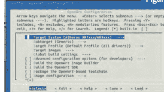

上方：与 `SlackWare` 安装有任何相似之处纯属巧合

上下箭头键允许您移动选择；按 `Enter` 键允许您激活屏幕底部高亮的选项。首先，选择目标系统选项并将其设置为 `BCM27xx`。

在下一步中，下一行允许您选择确切的处理器类型。正确的值取决于您的 Raspberry Pi 中找到的 `SoC`——下表提供了概述。

| 处理器类型 | 板类型 |
| :--- | :--- |
| `BCM2708` | Raspberry Pi Model B |
| | Raspberry Pi Model B+ |
| | Raspberry Pi Compute Module |
| `BCM2709` | Raspberry Pi 2 Model B |
| `BCM2710` | Raspberry Pi 3 Model B |

幸运的是，选错值并不会特别困难——如果您选择了错误的类型，您的目标板将不会显示在目标配置文件选择中。当目标系统、子目标和目标配置文件都正确设置后，使用侧键启用保存选项并按 `Enter`。对于以下步骤，我们假设文件已保存为 `.config`。`menuconfig` 工具的输出会提示您运行 `make` – 但我们还不太准备就绪：

```
camhane@TAMM1414:~/workspace/openwrt$ make
*** End of the configuration. *** Execute 'make' to start the build or try 'make help'.
```

此外，OpenWRT 团队建议在调用实际编译过程之前运行 `defconfig` 命令：

```
camhane@TAMM1414:~/workspace/openwrt$ make defconfig
# configuration written to .config
```

`defconfig` 工具使用 `.config` 文件中找到的信息，该文件指定了目标架构。然后它与一些默认参数一起扩展，形成一个“合理的基本配置”。

在下一步中，只需输入 `make` 即可开始编译过程。多核系统的用户最好传入 `-j3` 参数，这告知 `make` 工具应使用多个核心。

然而在这种情况下，请注意，达到的利用率可能相对较低 – OpenWRT 的编译过程不像 `VxWorks` 等系统中的那样高度并行化。

解决完这些问题后，是时候让您的工作站忙碌几分钟了：我们的八核机器花了大约一个小时来编译。

完成后，结果在 `/bin` 文件夹中呈现。细心的观察者会注意到二进制文件夹的路径名称与预期的不匹配 – Raspberry Pi 3 使用的是 `BCM2710` 处理器。

```
camhane@TAMM1414:~/workspace/openwrt$ ls
md5sums
openwrt-BCM2708-bcm2710-rpi-3-ext4-sdcard.img
openwrt-BCM2708-bcm2710-rpi-3-ext4-sdcard.img.gz
packages
sha256sums
```

> “可供我们 OpenWRT 构建使用的软件数量仅受限于我们的想象力和目标设备的内存”

■ 警惕编译错误

OpenWRT 团队明确警告开发者，多重地址编译错误可能会出现奇怪的问题。如果您的编译过程因不明原因失败，移动 `make -O1 -j3` 可以是一个不错的替代方案。有关此主题的更多信息可以在 `https://lxi/2s2DF` 找到。

# 教程 | OpenWRT

经验丰富的树莓派玩家部署该镜像应该不会遇到太大问题：将其烧录到任意 SD 卡中，插入你的宿主机并开机即可。实际的 OpenWRT 镜像与宿主机之间的交互可以通过 `SSH` 或键盘来实现。在下一步中，尝试调用 `GCC`。遗憾的是，该过程仍然会失败——因为该包不可用。

## 应对软件包难题

OpenWRT 由多种多样的软件包组成。默认情况下，`menuconfig` 中的配置设置会编译最重要的软件包——编译所有东西显然是愚蠢的。解决 `GCC` 缺失的问题并不特别困难。返回包含编译进程的窗口，并确保在调用 `menuconfig` 工具之前增加窗口大小——如果窗口足够大，屏幕上将显示所有选项。更改已打开的 `menuconfig` 屏幕大小并不一定是一个好主意，我们曾遇到一两次段错误。仔细观察下方的图表，我们会发现各个软件包组显示在镜像配置标题下方。首先打开“开发”菜单。它的样子将与图 2 所示的非常相似。

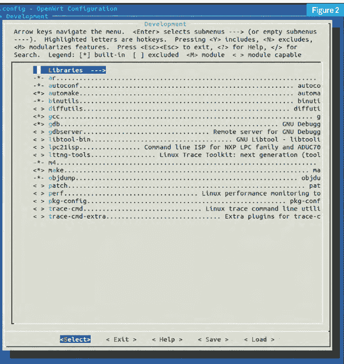

* OpenWRT 附带大量开发者工具，可按需部署


快速浏览窗口内容，会发现软件包旁边有括号组成的组。每一个描述一项，可以取`(``)`和`[ M ]`两种值。这两种状态之间的差异意义重大：将某项设置为`(``)`会将其构建进`main.IMG`文件，而将某项设置为`[ M ]`会创建一个可手动安装的软件包。对于拥有32GB存储卡的树莓派，这种差异并不特别重要。然而，如前所述，这是一个异常情况：普通用户通常将在只有4MB、8MB或16MB闪存内存的路由器上安装`OpenWRT`。

无论如何，将光标移至`GCC`条目，按`Y`键将其标记为部署到核心镜像中。由于`menuconfig`具有解析依赖关系的能力，你会看到它用星号标记了其他几个必需的软件包。在下一步中，对`GDB`和`Make`重复上述步骤，以获得现实地编译的成功机会。

如果你会大量使用该产品，标记其他一些工具也是有意义的——本指南的作者将选择所有选项，因为这会引发教育性的错误。在下一步中，使用左右光标移动功能高亮至“退出”，离开“开发”部分。在下一步中，你还应该查看“工具”部分，在那里你可以选择你可能需要的各种产品。

此时，是调用另一个`Make`进程的时候了：由于`GCC`的体积巨大，预计需要额外30分钟的工作时间。完成后，会出现一个与图3中显示的类似的错误。


## 哎呀！出错啦

寻找构建中的错误变得困难，这是由一个小众特性导致的：`OpenWRT`构建系统默认会缓存其低级软件包产生的任何输出。幸运的是，使用以下参数调用程序可以解决此问题：

```
tamhan@TAMH414:~/wrtspace/openwrt$ make -j1 V=s
Creating filesystem with parameters:
Size: 50331648
error: ext4_allocate_best_fit_partial: failed to allocate 3446 blocks, out of space?
make[5]: *** [mkfs-ext4] Error 1
```

运行几分钟后，错误信息将输出到控制台。在我们的案例中，问题出现在创建根文件系统期间——请记住，之前创建的镜像只有78MB大小。

## 时机如何？

你的作者喜欢在编译任务中使用`time`命令。只需将其附加到要运行的命令即可。它将输出以下信息：

- 实时值告诉你经过的时钟时间是多少
- 用户时间值提供有关资源使用情况的额外信息。请注意，在多核心工作站上，较低的值可能大于时钟时间值，因为使用了多个核心。

切换到`menuconfig`的“目标镜像”部分最能解决此问题：在那里，将“根文件系统分区大小”的值设置为较大的值，例如500MB。之后，运行`make`命令——它将顺利通过，生成一个新的可以部署到树莓派的镜像。

## 赞颂模块化！

尽管现在可以调用`GCC`，但创建自定义程序仍然需要合适的编辑器。

重新编译整个镜像很麻烦：让我们改为创建一个软件包。当需要更新正在积极使用的宿主机的镜像时，这个过程特别方便，因为通常覆盖镜像会销毁路由器上已有的所有信息。

创建专用软件包是解决此问题的最佳方式。返回`make menuconfig`并进入“工具”>“编辑器”。然后，标记`nano`软件包并按`M`键将其声明为模块，如图4所示。


## 哎呀！此产品将被模块化

保存配置后，再次运行`Make`以启动另一个编译进程。完成后，一个新的`IPK`文件将充实软件包文件夹。使用众所周知的`find`和`grep`组合可以更容易地找到它：

```
tamhan@TAMH414:~/workspace/openwrt/bin/brcm2708/packages$ ls
base  kernel  luci  management  packages  routing  targets  telephony
tamhan@TAMH414:~/workspace/openwrt/bin/brcm2708/packages$ find . | grep "nano"
./packages/nano_2.7.4-1_brcm2708.ipk
```

然后可以将该软件包部署到前一教程（第175期）中讨论的软件包实用程序中。或者，也可以通过Web服务器公开软件包文件夹的内容，从而使软件包管理器能够“即时”获取相关软件包。

## 结论

对于树莓派而言，拥有自己的镜像允许你添加各种`OpenWRT`团队目前未提供的工具。访问`GCC`意味着世界任你掌握——部署新技术就像下载源代码、将其改编以适应`OpenWRT`的需求、编译它并享受劳动成果一样简单。

---

# 教程

## LAMP 技术栈

### 配置 LAMP 技术栈

轻松在`Linux-Apache-MySQL-PHP`技术栈上部署你自己的网站


`Paul O'Brien`是一位专业的跨平台软件开发者，拥有部署和维护`Linux`系统的丰富经验。构建在`Linux`之上的`Android`也是`Paul`的专长领域之一。

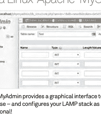

*   `phpMyAdmin`为你的数据库提供图形界面——并配置你的`LAMP`技术栈使其完全运行！

统计数据显示，尽管`Linux`在桌面上的渗透率低得多，但它驱动了约67%的所有Web服务器。这有很多原因——对于爱好者来说，该操作系统是免费的；对于企业来说，它功能强大且轻量级（特别是与`Windows`服务器相比）；并且有大量的软件可以部署在该操作系统上。`Linux`Web服务器最常见的使用案例是`LAMP`技术栈——意思是`Linux`（操作系统）、`Apache`（Web服务器）、`MySQL`（数据库）和`PHP`（脚本语言）。仅安装这四个元素，就可以轻松启动许多最流行的网站（例如`WordPress`），如果遇到任何问题，你可以利用庞大的点对点支持库。该技术栈在所有主要`Linux`发行版上都得到良好支持，并经常更新新功能以及安全修复。无论你的Web项目是大或小，这都是一个很好的起点。

## 资源

- `Ubuntu`: `ubuntu.com`
- `Apache`: `apache.org`
- `MySQL`: `mysql.com`
- `PHP`: `secure.php.net`
- `Let's Encrypt`: `letsencrypt.com`
- `certbot`: `certbot-auto.github.com/certbot/certbot`
- `Cloudflare`: `cloudflare.com`
- `phpMyAdmin`: `phpmyadmin.net`
- `Webmin`: `webmin.com`
- `Webmin Authentic Theme`: `github.com/pupod/authentic-theme`
- `MySQL tuner`: `mysqltuner.pl`
- `Apache2tuner`: `apache2tuner.pl`
- `Percona`: `percona.com`


## 下载 Ubuntu 服务器

- `Ubuntu Server 16.04.1 LTS`
    - 最新的`LTS`发行版包含最新的内核，包括桌面版发布，并享有`Canonical`提供的5年支持。
    - `600.3 MB`
    - 下载链接
    - 点击展开
- `Ubuntu Server 16.10`
    - 较新版本的`Ubuntu`服务器，包含`openstack`的最新发行版和其他新功能。
    - `1132 MB`
    - `600.3 MB`
    - 下载链接
    - 点击展开

## 01 选择你的发行版

在为`LAMP`服务器选择发行版时，首先要考虑它的部署位置。如果你也要将其用作开发机器，那么只需选择你喜欢的桌面发行版即可。但如果你将其部署到云中的机器、家庭/办公室无头机器或`VirtualBox`等虚拟机中的服务器，那么最好选择针对服务器优化的发行版。`Debian`或`Ubuntu`服务器被广泛使用，经常更新且非常推荐。

## 02 更新并保持最新

不言而喻，保持服务器随着新发布版本和安全补丁保持更新至关重要，当你部署到云中时更是如此。`ArubaCloud`是我们最喜欢的提供商之一，每月仅需1英镑即可获得不错的服务器，但在安装后你需要更新发行版（我们将使用`Ubuntu Server`），因为镜像可能已过时。要进行自动安全更新，只需使用以下命令安装`unattended-upgrades`软件包：

```
sudo dpkg-reconfigure --priority=low unattended-upgrades
```


即使启用了此功能，也要记得密切关注你的服务器！

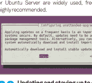

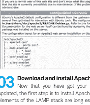

## 03 下载和安装 `Apache`

现在你已部署并更新了服务器，第一步是安装`Apache`（版本 2）。LAMP 技术栈的所有元素都已长久确立，因此正如你所料，它们在所有主要发行版仓库中可用（并经常更新）。通常根本不需要从源代码构建。只需使用：

```bash
sudo apt-get install apache2
```

……Apache 将自动安装并启动。

统计数据表明，尽管 `Linux` 在桌面端的市场占有率较低，但它支撑了全球约 67% 的 web 服务器。默认的网站将运行在您的机器 IP 地址上——默认文件位于`/var/www`。

### 04 启用模块

安装完成后，`Apache` 将默认启用一组模块。根据您计划如何使用服务器，您可能需要启用额外的模块（例如`rewrite`、`proxy`、`SSL` 等）。要查看可用的 `Apache` 模块，请列出`/etc/apache2/mods-available`的内容。要查看已启用的模块，请检查`/etc/apache2/mods-enabled`。要启用一个模块，请使用`a2enmod name`。通常，对于大多数标准网站，默认设置就足够了。

```bash
root@sys1: # a2query -M (or)
root@sys1: # ls /etc/apache2/mods-available
actions.conf alias.conf autoindex.conf cgi.conf
cgid.conf dav_svn.conf dav_fs.conf deflate.conf
expires.conf fcgid.conf imap.conf info.conf
lbmethod_bybus.conf lbmethod_byrequests.conf
lbmethod_bytraffic.conf lbmethod_leastconn.conf
logio.conf mime_magic.conf mime.conf mpm_event.conf
mpm_prefork.conf
To activate the pre configuration, you need to run:
root@sys1: # ls /etc/apache2/mods-enabled
actions.conf alias.conf autoindex.conf cgi.conf
cgid.conf dav_svn.conf dav_fs.conf expires.conf
root@sys1: # a2enmod mpm_prefork
root@sys1: # a2enmod autoindex
root@sys1: # a2enmod dir
root@sys1: # a2enmod filters
root@sys1: # a2enmod mpm_event
root@sys1: # a2enmod rewrite
root@sys1: # a2enmod setenvif
root@sys1: # a2enmod headers
root@sys1: # a2enmod socache_shmcb
root@sys1: # a2enmod spelling
root@sys1: # a2enmod suexec
root@sys1: # a2enmod status
root@sys1: # a2enmod version
root@sys1: # a2enmod watchdog
root@sys1: # a2enmod xsendfile
root@sys1: # a2enmod xml
root@sys1: # a2enmod authn_file
root@sys1: # a2enmod cgi
root@sys1: # a2enmod alias
root@sys1: # a2enmod cache
root@sys1: # a2enmod case
root@sys1: # a2enmod cgi
root@sys1: # a2enmod deflate
root@sys1: # a2enmod dumpio
root@sys1: # a2enmod env
root@sys1: # a2enmod filter
root@sys1: # a2enmod headers
root@sys1: # a2enmod include
root@sys1: # a2enmod logio
root@sys1: # a2enmod mime
root@sys1: # a2enmod mmapfile
root@sys1: # a2enmod negotiation
root@sys1: # a2enmod proxy
root@sys1: # a2enmod proxy_ajp
root@sys1: # a2enmod proxy_connect
root@sys1: # a2enmod proxy_fcgi
root@sys1: # a2enmod proxy_ftp
root@sys1: # a2enmod proxy_http
root@sys1: # a2enmod proxy_scgi
root@sys1: # a2enmod rewrite
root@sys1: # a2enmod setenvif
root@sys1: # a2enmod socache_shmcb
root@sys1: # a2enmod spelling
root@sys1: # a2enmod status
root@sys1: # a2enmod suexec
root@sys1: # a2enmod unixd
root@sys1: # a2enmod version
root@sys1: # a2enmod watchdog
root@sys1: # systemctl restart apache2
```

### 05 配置独立网站

配置完成后，将启用一个默认的独立站点。站点配置文件位于`/etc/apache2/sites-available`。如果您希望您的 `Apache` 安装能够托管多个站点，则需要创建额外的配置文件，定义您希望处理的 `ServerName` 以及您想要提供文件服务的目录。创建 `.conf` 文件（例如，`www.mysite.com.conf`）后，您可以使用`a2ensite www.mysite.com`命令启用它。请记住，使用`apache2ctl restart`重启服务以查看更改。

### 06 为服务器添加 `SSL`

在您的网站通过常规 `HTTP` 运行后，您很可能也希望提供通过 `SSL` 的访问。这不仅仅是出于安全原因——谷歌现在会在搜索结果中积极惩罚那些不支持 `HTTPS` 访问的网站，因此这是您绝对需要考虑的事项。好消息是，您可以使用来自`letsencrypt.org`的 `Let’s Encrypt` 免费获取证书。安装非常简单——从`github.com/certbot/certbot`下载`certbot-auto`脚本，运行它，按照提示操作即可。


```bash
root@sys1: # a2query -M
php5module=5:php5 - libphp5-5.5.3-4_all.deb ...
[Enabling php5_module: libphp5-5.5.3-4_all.deb ...
[Enabling alias_module: /etc/apache2/mods-enabled/alias.conf
... [Enabling autoindex_module: /etc/apache2/mods-enabled/autoindex.conf
... [Enabling cgid_module: /etc/apache2/mods-enabled/cgid.conf
... [Enabling cgi_module: /etc/apache2/mods-enabled/cgi.conf
... [Enabling dir_module: /etc/apache2/mods-enabled/dir.conf
... [Enabling env_module: /etc/apache2/mods-enabled/env.conf
... [Enabling mpm_event_module: /etc/apache2/mods-enabled/mpm_event.conf
... [Enabling mime_module: /etc/apache2/mods-enabled/mime.conf
... [Enabling negotiation_module: /etc/apache2/mods-enabled/negotiation.conf
... [Enabling setenvif_module: /etc/apache2/mods-enabled/setenvif.conf
... [Enabling status_module: /etc/apache2/mods-enabled/status.conf
... [Enabling version_module: /etc/apache2/mods-enabled/version.conf
... [Enabling xml_module: /etc/apache2/mods-enabled/xml.conf
... [Creating a2enconf for php5... ]
[Enabling php5... ]
[Creating a2enmod for autoindex... ]
[Enabling autoindex... ]
[Creating a2enmod for alias... ]
[Enabling alias... ]
[Creating a2enmod for cgid... ]
[Enabling cgid... ]
[Creating a2enmod for cgi... ]
[Enabling cgi... ]
[Creating a2enmod for dir... ]
[Enabling dir... ]
[Creating a2enmod for env... ]
[Enabling env... ]
[Creating a2enmod for mpm_event... ]
[Enabling mpm_event... ]
[Creating a2enmod for mime... ]
[Enabling mime... ]
[Creating a2enmod for negotiation... ]
[Enabling negotiation... ]
[Creating a2enmod for setenvif... ]
[Enabling setenvif... ]
[Creating a2enmod for status... ]
[Enabling status... ]
[Creating a2enmod for version... ]
[Enabling version... ]
[Creating a2enmod for xml... ]
[Enabling xml... ]
[Enabling php5...]...
```

### 缓存

管理您网站的缓存设置：

- 页面缓存
  注意：设置缓存时间可优化您网站的传输性能。
- 缓存级别
  注意：将级别设置为`2`可提升缓存传输效率。将缓存设置为`1`也可提升缓存传输效率。

### 浏览器缓存过期时间

配置浏览器在特定时间段内缓存您的文件。这将减少您网站使用的带宽量。

注意：默认情况下，过期时间设置为`30`天。

## 07 使用 CDN 减少带宽使用

使用`CDN`（内容分发网络）可以帮助降低因服务器提供商超出带宽限额而支付额外费用的风险，同时提升网站在全球范围内被访问时的性能。我们最喜欢的`CDN`是`Cloudflare`(`cloudflare.com`)，它将在其庞大的数据中心网络中托管您的静态内容，从而减轻主服务器的负载。最棒的是什么？`Cloudflare`的标准套餐完全免费。如果`Let’s Encrypt`出现问题，`Cloudflare`也是部署`SSL`的另一种替代方式。

### DNS

通过我们的工具管理您的`DNS`记录（域名系统）。

### DNS 记录

注意：我们强烈建议您不要使用`Cloudflare`系统，而是使用我们内部的`DNS`。

注意：使用此工具管理您的`DNS`记录。

## 08 查找您的 IP 地址并管理 DNS

为了测试您的安装，您需要知道服务器的`IP`地址，以便在浏览器中输入。在机器本机上，请使用此命令：

```bash
$ ifconfig eth0 | grep inet | awk '{ print $2 }'
```

为了避免每次都要记住该地址，您可能希望注册一个您自己的域名并指向一个`DNS`。

# Percona - 优化的 MySQL

`Percona Server for MySQL`是一款免费、完全兼容、增强型的开源`MySQL`替代方案，提供卓越的性能、可扩展性和管理功能。下载量已超过`500`万次。`Percona Server`的自调优算法以及对极高性能硬件的支持，带来了优异的性能和可靠性。`Percona`还具有增强型热备份功能（`in-mand trade-backups`），非常值得一试。

# 教程：LAMP 技术栈

输入`IP`地址。再次强调，`Cloudflare`是`DNS`托管的一个不错解决方案，它拥有易用且功能强大的工具包，以及极短的`TTL`（生存时间），这意味着`DNS`更改实际上会立即生效。如果你曾经等待过`DNS`传播，你会深知这项功能的价值！

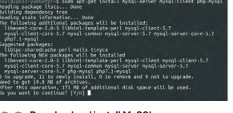

## 09 下载并安装 MySQL

既然你已经安装了`Apache`，下一步就是安装`MySQL` —— 这是大多数`Linux Web`应用程序使用的数据库引擎。要安装，请使用以下命令：

```bash
$ sudo apt-get install mysql-server mysql-client php-mysql
```

这将安装`MySQL`服务器和客户端（用于管理）、`Apache`模块以及`PHP`模块。在安装过程中，系统会提示你选择一个新的`MySQL`根用户密码。使用`sudo mysql_install_db`命令以完成安装。

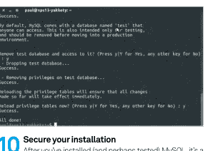

## 10 保护你的安装环境

安装（并可能测试了）`MySQL`后，建议运行提供的脚本来保护你的安装环境，使用以下命令：

```bash
$ sudo /usr/bin/mysql_secure_installation
```

这将删除匿名用户，允许你根据需要修改根用户密码为更安全的设置，限制`root`仅能从本地主机访问，并删除测试数据库。脚本会提示你重新加载权限表，这意味着更改将立即生效。

## 11 通过命令行管理

作为原始`MySQL`安装的一部分，你已包含`mysql-client`，它为数据库操作提供了一个命令行客户端。例如，要连接到`MySQL`数据库并创建新数据库，你可以使用命令`mysql -u root -p`，在提示时输入密码，然后使用`create database newdbname;`和`\u newdbname`。此时，你可以手动输入`SQL`语句，或`\s filename.sql`从磁盘运行脚本。请记住为你的应用程序设置所需的非`root`账户。

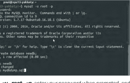

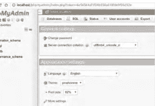

## 12 使用 phpMyAdmin 进行图形化界面管理


如果你认为从命令行管理`MySQL`过于复杂，或者只是想使用更具图形化的方式来查看数据，那么你应该考虑使用`phpMyAdmin`。大多数发行版的软件源中都提供它，但它们往往是过时的，因此更好的想法是从`www.phpmyadmin.net`下载最新的`tar.gz`压缩包。安装非常简单，只需将压缩包提取到一个`Web`可访问的目录，并设置配置文件中的关键值即可。

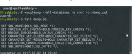

## 13 备份你的数据

你很可能会在`MySQL`服务器上存储宝贵数据，因此确保定期备份至关重要。`mysqldump`命令可以很容易地将数据库内容转储到文件中，然后你可以将其上传到远程位置（如果将`/var/www`的内容也上传保存有意义的话）。一些开源的自动化备份脚本可作为起点，然后你可以将其添加到`Cron`中定期运行。

## 14 下载并安装 PHP

`LAMP`技术栈的最后一个要素是`PHP`，一种脚本语言，它驱动着世界上一些最受欢迎的应用程序。要安装`PHP`，请使用以下命令：

```
sudo apt-get install php libapache2-mod-php
```

这将安装最新版本的`PHP`以及所需的`Apache`模块（或者会自动启用）。请注意，某些旧应用程序明确需要`php5`而不是`7`，因此你可能需要相应地调整命令。你可以通过创建一个包含`<?php phpinfo(); ?>`内容的`test.php`文件来测试你的`PHP`安装。

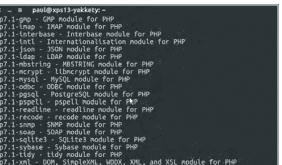

## 15 使用模块安装

与`Apache`一样，`PHP`也可以通过模块进行扩展。要查看可用的模块，请使用命令`apt-cache search php-`。应用程序通常会指定它们所需的`PHP`模块：然而，如果你遇到空白页面问题，可能是因为`PHP`错误报告已关闭，从而掩盖了问题的根源。你可以在脚本中通过添加`error_reporting(E_ALL);`和`ini_set('display_errors', '1')`这两行代码来暂时启用它。`Apache`日志位于`/var/log/apache2`，也是寻找线索的好地方。

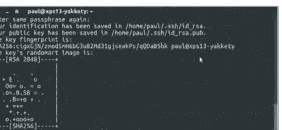

## 16 上传到服务器

如果你正在本地机器上部署`LAMP`技术栈（可能用于测试目的），那么上传内容并不是挑战。然而，对于基于云或虚拟机的部署，情况可能并非如此。最简单的方法是通过`SFTP`进行部署。确保服务器上已安装`openSsh-server`。在你的机器上生成公钥`ssh-keygen -t rsa`，将`~/.ssh/id_rsa.pub`的内容添加到服务器上相应用户的`~/.ssh/authorized_keys`，然后你应该能够使用`sftp`命令直接连接。

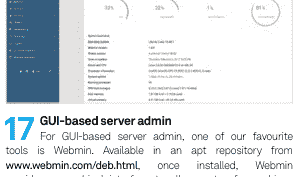

## 17 基于图形界面的服务器管理

对于基于图形界面的服务器管理，我们最喜爱的工具之一是`Webmin`。它可以从`www.webmin.com/deb.html`获取`apt`软件源。安装后，`Webmin`为`Linux`系统的各个方面（包括`LAMP`技术栈的所有元素）提供图形界面。`Webmin`默认主题非常过时，但第三方`Authentic`主题通过基于`Bootstrap`的响应式设计，将`Webmin`带入 21 世纪。你可以从`github.com/gcoop/strut2-theme-theme`获取它。

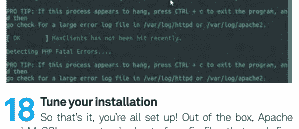

## 18 调整你的安装

就这样，你都设置好了！开箱即用的`Apache`和`MySQL`拥有一套标准的配置文件，在大多数硬件上运行良好，但肯定没有针对你的特定配置进行优化。两个来自`mycutter.net`的`Perl`脚本，即`apache2-tuner.pl`，旨在检查所有配置文件以及系统配置，并根据你的系统建议改进。它们还查看正在运行的系统的日志，因此请确保在使用之前系统至少已运行 24 小时。


> “ 你很可能会在`MySQL`服务器上存储宝贵数据，因此确保定期备份至关重要 ”

## 保护你的安装环境

你可以采取一些简单步骤来帮助保护`LAMP`环境。例如，你可以在`Apache`配置中包含`<Directory> Options -Indexes +Directory</Directory>`指令来禁用服务器上的目录列表。你还应该设置`ServerTokens Prod`和`ServerSignature Off`指令，以避免潜在的入侵者了解你的服务器版本/配置。同样，在`PHP`配置中添加`expose_php = Off`以隐藏其版本。禁用未使用的`Apache`和`PHP`模块也是一个好主意，你可以使用以下方式禁用潜在的`PHP`危险函数：

```
disable_functions = exec, shell_exec, passthru, system, popen, curl_exec, curl_multi_exec, tmp_file, show_source, proc_open, pcntl_exec
```

……在你的配置中。

# 教程

# 使用 Firejail 对应用程序进行沙箱隔离

在沙箱中运行可能存在安全风险的应用程序，以保护你的系统和数据


`Nitish Tiwari`是一名软件开发者，对自由和开源软件有着浓厚的兴趣。除了担任领先`FOSS`出版物的社区版主和作者外，他还帮助组织采用开源软件来满足其业务需求。

互联网是现有最大的知识来源，被广泛用于共享信息，但它也是恶意软件、间谍软件和多种其他类型病毒的最大来源。这使得互联网成为一个非常有趣但又充满挑战的地方。你需要小心从互联网下载的未经过验证（有时甚至是经过验证的）软件、你访问的网站、你打开的电子邮件附件等。无论是否有技术背景，这对任何人来说都可能很困难。

虽然没有什么能取代对系统安全危险的警惕，但有一些工具可以帮助你沙箱化你运行的应用程序。这样，你就可以确保从互联网下载的应用程序只做它应该做的事情。在这里，我们将向你介绍`Firejail`。它是一个简单的工具，帮助你使用`Linux`命名空间来限制不可信应用程序的运行环境。

`Firejail`允许一个进程及其所有后代拥有其对全局共享内核资源（如网络堆栈、进程表和挂载表）的私有视图。`Firejail`是用`C`语言编写的，几乎没有依赖项，该软件运行在任何具有`3.x`内核版本或更高版本的`Linux`计算机上。它可以沙箱化任何类型的进程：服务器、图形应用程序甚至用户登录会话。请注意，我们选择`Ubuntu 16.04`作为本教程的主机系统。

## 资源

`Firejail`

`firejail.wordpress.com`

### 01 安装

`Firejail`的预构建包可用于所有流行的操作系统发行版 – 如`Debian`、`Ubuntu`、`Linux Mint`、`Fedora`、`openSUSE`、`CentOS 7`和`RHEL 7` – 可从其网站获取。注意，这些包要求 64 位系统。`Arch Linux`的`AUR`中提供`Firejail`，你可以从`SlackBuilds`软件库中找到`Slackware`的包。要在`Ubuntu`上安装`Firejail`，请在终端中执行此命令：

```
$ sudo apt-get install firejail
```

如果提示，请输入`Y`以继续安装。现在你已准备好使用`Firejail`对你的应用程序进行沙箱隔离。

你也可以从源代码安装`Firejail`。首先，下载压缩包并使用以下命令解压文件：

```
$ tar -xvjf firejail-X.Y.Z.tar.bz2
```

或使用：

```
$ tar -xJvf firejail-X.Y.Z.tar.xz
```

然后编译并安装：

```
$ cd firejail-X.Y.Z
$ ./configure && make && sudo make install-strip
```

要在`Debian`和`Mint`上安装，请下载`DEB`包并使用以下命令安装：

```
$ sudo dpkg -i firejail_X.Y_1_amd64.deb
```

或使用：

```
$ sudo dpkg -i firejail_X.Y_1_i386.deb
```

对于`Fedora`、`openSUSE`和`CentOS 7`，请下载`RPM`包并安装：

```
$ sudo rpm -i firejail_X.Y-Z_x86_64.rpm
```


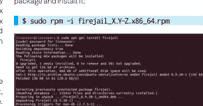

### 02 使用 Firejail

所有类型的程序 – 基于 GUI 或 CLI 的 – 都能很好地与 Firejail 配合工作。因此，你在打开任何不可信程序时可以放心。要在系统中对程序进行沙箱隔离，只需在前面加上 `firejail` 前缀。通用命令格式为：

```bash
$ firejail [options] program_and_arguments
```

例如，如果你想运行 Firefox，请执行：

```bash
$ firejail firefox
```

如果你想向沙箱化的程序隐藏主目录中的所有文件，请以私有模式执行 `firejail` 命令：

```bash
$ firejail --private program_and_arguments
```

在沙箱运行期间，Firejail 会在 `$HOME/user` 目录上挂载一个临时文件系统。在此目录中创建的任何文件都会在沙箱结束后被删除


右图 在 Firejail 中沙箱化的应用程序；右侧窗口显示沙箱中运行的进程

退出。若要使用现有目录作为沙箱的主目录，并在主目录上创建持久沙箱，请执行以下命令：

```bash
$ firejail /etc/init.d/apache2 start
```

要在 Firejail 中启动服务器，需要 root 权限。要启动 Apache 服务器，请执行以下命令：

```bash
$ firejail /etc/init.d/apache2 start
```

请注意，如果不带任何参数运行 Firejail，它将启动常规的 `/bin/bash` shell。只有 `Bash` 会话及其子进程在沙箱内可见。

#### 03 使用 Firejail（续）

要查看正在运行的沙箱列表，请使用以下命令：

```bash
$ firejail --list
```

你将看到格式为 `PID:用户名:命令` 的列表。要查看每个沙箱内的进程树，请输入：

```bash
$ firejail --tree
```

如果你想要加入一个已经运行的沙箱，请使用 `--list` 选项获取该沙箱的 PID。然后将此 PID 传入以下命令：

> 如果不带任何参数运行 Firejail，它将启动常规的 `/bin/bash` shell。只有 `Bash` 会话及其子进程在沙箱内可见 [19]

```bash
$ firejail --join=3974
```

如果你正在 Firejail 中启动 Firefox 并希望使用浏览器特定的 `iptables` 过滤器，请执行：

```bash
$ firejail --net=eth0 firefox
```

这将为 Firefox 会话创建一个新的 `TCP/IP` 栈，分配一个 `IP` 地址，并安装浏览器特定的 `iptables` 过滤器。如果在 Firejail 中启动的程序不需要网络访问，请执行：

```bash
$ firejail --net=none vlc
```

控制流入和流出沙箱的数据量：

```bash
$ firejail --name=browser --net=eth0 firefox &
$ firejail --bandwidth=browser set eth0 70 30
```

此示例将接收侧带宽设置为每秒 70 千字节，将发送侧带宽设置为每秒 30 千字节。你可以使用以下命令在运行时更改这些设置或清除它们：

```bash
$ firejail --bandwidth=browser clear eth0
```

#### 04 Firetools

Firetools 是 Firejail 的 GUI（图形用户界面）。它作为单独的包分发，并使用 `Qt4`/`Qt5` 库构建。它带有系统托盘的沙箱启动器选项，以及沙箱编辑、管理和统计功能。它不在标准软件仓库中，但有官方的 `DEB` 包可用。下载相关的 Firetools `DEB` 文件，然后导航到文件下载的文件夹并执行：

```bash
$ sudo dpkg -i firetools*.deb
```

这将安装 Firetools。但是，如果遇到依赖性问题，请使用以下命令解决：

```bash
$ sudo apt-get install -f
```

使用以下命令启动它：

```bash
$ firetools &
```

##### 沙箱应用程序的网络设置

沙箱应用程序的网络连接可以是直接的，也可以是路由的。在直接设置中，沙箱使用内核 `MAC` `VLAN` 设备连接到网络；在路由设置中，它使用网桥设备。直接设置如下所示：

```bash
$ firejail --net=eth0 firefox
```

在路由设置中，首先设置网桥，然后在上述命令中通过 `--net` 参数传入网桥名称。

# 教程

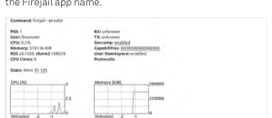

你可以看到 Firetools 窗口以及系统托盘中用于运行该应用的指示器。要启动任何应用，请双击它，或者右键单击并选择“运行”。要监控正在运行的应用，请在 GUI 的任意位置右键单击并选择“工具”；所有正在运行的应用将列在其中。要在 Firetools 中添加新应用，请右键单击 GUI 并点击“编辑”。填写相关详细信息，并将“命令”部分的值设为 Firejail 应用名称。

## 05 Firejail 特性

Firejail 背后的核心技术是 Linux 命名空间。这种轻量级可视化技术被用作隔离应用程序的第一步。

应用容器在沙箱启动时自动构建，并在沙箱关闭时销毁。该容器基于当前安装的文件系统。Firejail 可以为沙箱附加一个新的 `TCP/IP` 网络栈，该栈拥有自己的路由表、防火墙和接口集。此栈独立于主机网络栈。Firejail 支持的网络操作包括：创建新接口、移动现有接口、分配地址、主机名支持、`DNS` 支持、Linux `netfilter` 支持以及流量整形。安全配置文件位于 `/etc/firejail` 目录中，它描述了文件系统容器、安全过滤器和网络配置。Firejail 中的 `Appimage` 执行原生格式打包。添加 `--appimage` 以挂载包并在沙箱内运行。Firejail 提供沙箱审计和监控。它可以指出安全配置文件中的漏洞。它可以提供选项来跟踪沙箱化应用程序的所有方面。可以使用 Firetools 来监控 `CPU`/`内存`/`带宽` 使用情况、跟踪系统调用、监控 `exec` 和 `fork` 事件。

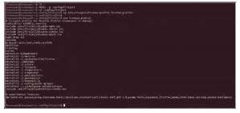

## 06 构建自定义配置文件

所有自定义配置文件都存储在 `~/.config/firejail` 目录中。使用配置文件将 Firejail 命令行配置选项传递给程序。要为任何应用构建自定义配置文件，首先在你的主目录中创建 `.config/firejail` 目录：

```bash
$ cd ~
$ mkdir -p .config/firejail
$ cd .config/firejail
```

使用以下命令将 Firejail 使用的默认安全配置文件复制到该目录中：

```bash
$ cp /etc/firejail/app_name.profile app_name.profile
```

在这里，`app_name` 是你正在创建自定义配置文件的应用的名称。现在编辑新配置文件。你可以注释掉行、将目录加入黑名单、将文件加入白名单等。修改完成后，保存并关闭文件，然后使用以下命令启动你的应用程序：

```bash
$ firejail app_name
```

由于在 `~/.config/firejail` 目录中存在一个与应用程序同名的配置文件，因此它会加载该文件。你也可以在 `/etc/firejail` 目录中创建配置文件。如果两个目录中都存在带有应用名称的配置文件，`~/.config/firejail` 的优先级高于 `/etc/firejail`。也可以在其他位置创建配置文件，并在启动应用程序时指定该位置。

## 07 构建白名单配置文件

白名单配置文件是限制更严格的配置文件，使用 Firejail 的白名单功能构建。我们在上一节中创建的自定义配置文件也称为黑名单配置文件，在那里你将应用程序不允许使用的文件列入黑名单。在此处，列出应用程序运行所需的文件，而其他所有内容均不可访问。要创建白名单配置文件，首先使用 `--private` 创建一个简单的 `Bash` 沙箱：

```bash
$ firejail --private
```

现在在此 `Bash` 会话中启动应用，并使用以下命令列出其中所有文件：

```bash
$ find .
```

定位需要加入白名单的目录/文件，然后退出并关闭沙箱。然后，像之前一样，在 `~/.config/firejail` 目录中创建名为 `app_name.profile` 的新配置文件。输入以下内容作为文件内容：


```
$ app_name profile
mkdir ~/, directory_name
whitelist ~/directory_name
include /etc/firejail/whitelist-common.inc
include /etc/firejail/default.profile
```

在这里，我们将 `directory_name` 加入白名单，它位于 `app_name` 目录结构内。会话配置从 `whitelist-common.inc` 中包含。

## 08 Firefox 沙箱化

通过执行以下命令启动 Firefox 进程：

```bash
$ firejail firefox
```

Firefox 的单个实例可以有多个浏览器窗口。因此，如果 Firefox 已经在运行，并且你想在 Firejail 中启动一个新会话，请执行：

```bash
$ firejail firefox --no-remote
```

沙箱仅允许 Firefox 访问少量文件和目录。如果 Firefox 试图访问被列入黑名单的文件，日志消息将发送到 syslog。默认启用的安全过滤器减少了内核的攻击面。seccomp 过滤器通常默认使用。如果你不信任浏览器中安装的扩展和插件，请使用 `--private` 选项并在沙箱级别配置 DNS。这可以防止来自重新配置 DNS 的攻击。

```bash
$ firejail --private --dns=8.8.8.8 --dns=8.8.4.4 firefox --no-remote
```

要创建新的 TCP/IP 栈，连接到你的以太网网络并指定明确的 IP 地址：

```bash
$ firejail --net=eth0 --ip=192.168.1.207 firefox
```

Firejail 用 Xpra 或 Xephyr 服务器替换常规 X11 服务器，防止 X11 键盘记录器和截图实用程序访问主 X11 服务器。

```bash
$ firejail --x11 --net=eth0 firefox
```

## 09 Seccomp 过滤器

Firejail 默认使用 Seccomp-bpf。它代表安全计算模式，以 Berkeley 数据包过滤器 (BPF) 格式表示。使用 Firejail 沙箱构建白名单 seccomp 过滤器并将其附加到用户程序。Firejail 需要 seccomp 过滤器的系统调用详细信息。我们使用 strace 来获取系统调用。让我们以 VLC 媒体播放器为例：

```bash
$ strace -qc vlc
```

这会打开 VLC；一旦你关闭它，strace 就会打印系统调用列表。将所有系统调用的列表复制到文本编辑器中，并将它们转换为无空格的逗号分隔形式。现在将此逗号分隔的系统调用字符串用于 `--seccomp`。保留以下值：

```bash
$ firejail --shell=none --seccomp=keep=poll,futex,[...] vlc
```

该命令看起来很长，但请确保包含所有系统调用。如果出现错误，添加遗漏的系统调用。现在在 `/etc/firejail` 中创建一个白名单配置文件。将默认的 VLC 配置文件复制到这里，并添加以下两行：

```
shell none
seccomp keep poll,futex,rt_sigreturn,stat,read,[...]
```

请注意，点号表示其余的逗号分隔的系统调用名称。

## 10 AppImage 支持

AppImage 是由 Simon Peter 开发的通用软件打包格式。

使用以下命令在 Firejail 中启动你的 AppImage 应用程序：

```bash
$ firejail --appimage=Firefox-50.1.0.g1ibc2.3.3-x86_64.AppImage
```

所有沙箱选项都可用，例如 `--private` 或 `--x11`。假设你已从 AppImage 项目仓库下载了 Firefox；要启动沙箱，请使用：

```bash
$ firejail --appimage --private --net=eth0 --x11 ~/Downloads/Firefox-50.1.0.g1ibc2.3.3-x86_64.AppImage
```

`--appimage` 用于进入 AppImage 模式，`--private` 创建空主目录，`--net=eth0` 创建新的网络命名空间，`--x11` 用于基于 Xpra 的沙箱化。

要验证安全参数，打开 Firetools 并点击 Firefox 沙箱以获取统计信息。查看 seccomp 统计信息已启用，以及 capability 字段为零？对于沙箱而言，这两个参数最为重要，其他一切均构建在此之上。如果有多个沙箱在运行，请按如下方式限制每个沙箱的带宽：

```bash
$ firejail --bandwidth=32119 set eth0 80 20
```

> Firejail 可以为沙箱附加一个新的 TCP/IP 网络栈，该栈拥有自己的路由表、防火墙和接口集。此栈独立于主机网络栈 [19]

## Firejail 对 X11 的沙箱化

Xpra 和 Xephyr 受 Firejail X11 沙箱化支持。常规 X11 由这些 X11 软件包替换：

```bash
$ firejail --x11=xpra --net=eth0 program-and-arguments

$ firejail --x11=xephyr --net=eth0 program-and-arguments
```

另一个选项是使用：

```bash
$ firejail --x11 --net=eth0 program-and-arguments
```

这样，Firejail 首先尝试使用 Xpra，如果未安装，则尝试查找 Xephyr。请注意，是以 root 用户身份启动 Xpra。不支持 X11 沙箱化功能。

# 使用 Erlang 编程：文件 I/O


Mihalis Tsoukalos 是一名 UNIX 管理员、程序员（UNIX 和 iOS）、数据库管理员（DBA）以及数学家。他自 1993 年起开始使用 Linux。你可以通过 Twitter 上的 @mactosouk 或他的网站 mtoukalos.eu 联系到他。

了解如何在 Erlang 中处理文件操作

## 资源

- Erlang 的安装环境

- 文本编辑器，例如 Emacs 或 vi

如果一种编程语言无法处理文本和二进制文件，那么它就不能被认为是一种重要的语言，因为如果不从现有文件中读取数据或将数据存储到文件中，你就无法开发实用的系统工具。因此，本教程的主题将使用 Erlang 处理文件和目录，这也包括允许你查找文件信息的 Erlang 函数。

下一篇 Erlang 教程将讨论 Erlang 中的网络编程，这也是一个非常重要且必不可少的任务，所以请继续阅读并尽可能多地编写 Erlang 代码。

## 关于文件 I/O

文件操作是系统编程的关键部分，因此它们必须可靠且快速；然而，在这种情况下，可靠性比速度更重要！可靠性的一部分来自于错误检查和错误报告代码，因为你无法确定什么会失败以及为什么会失败。

与文件操作相关的大多数函数都属于 `file` 模块，该模块为你提供文件系统接口。`file` 模块中与文件输入和输出相关的两个最重要的 Erlang 函数是 `file:read()` 和 `file:write()`。

第一个函数用于从打开的文件中读取，而第二个函数用于向文件写入数据。`file:read()` 函数接受两个参数：一个打开的文件描述符和你想要读取的字节数。`file:write()` 函数也需要两个参数：分别是你想要写入的文件的打开文件描述符以及你想要写入的数据。正如你将看到的，有更容易的方式来读取文件。

为了打开和关闭文件，你还需要另外两个函数，分别是 `open(File, Mode)` 和 `close(Device)`。`file:open()` 函数接受两个参数，即你想要打开的文件位置和你想要打开文件的方式（模式）。成功调用 `file:open()` 会返回一个类型为 `{ok, FD}` 的元组。第一个元素表示操作成功，第二个元素用于随后引用打开的文件。

`Mode`（模式）部分可以有四个值：`Read`、`Write`、`Append` 和 `Exclusive`。

Erlang 提供了 `file:read_file()` 函数，该函数接受一个参数，即文件名，并将其完整内容一次性存储到一个变量中。虽然此函数无法完全替代 `file:read()`，但它时不时非常实用！

## 处理命令行参数

本节将说明如何在 Erlang 中读取程序的命令行参数，这是一个非常重要的任务，因为大多数时候你都会将需要处理的文件名称作为参数传入。`cmdArgs.erl` 的 Erlang 代码如下所示。


以下与 Erlang shell 的交互将帮助你澄清许多与列表相关的事项：

```erlang
-module(cmdArgs).
-export([main/1]).

main(Args) ->
  io:format("Printing arguments:~n",[]),
  lists:foreach(fun(Arg) -> io:format("Arg: ~p~n", [Arg]) end, Args).
```

从命令行执行`cmdArgs.erl`中的`main/0`函数会产生以下类型的输出：

```bash
$ erlc cmdArgs.erl
$ erl -noshell -s cmdArgs main 1 2 3 4 five -s init stop

Printing arguments:
Arg: 1
Arg: 2
Arg: 3
Arg: 4
Arg: five
```

## 以读模式打开文本文件

以下 Erlang 代码打开由`File`标识的文件以供读取：

```erlang
{ok, FD} = file:open(File, [read])
```

`workText.erl`中说明了`file:open()`的用法。从`workText.erl`中执行`lineByLine/1`会产生以下类型的输出：

```erlang
1> c(workText).
{ok, workText}
2> workText:lineByLine("cmdArgs.erl").
-module(cmdargs).
ok.
```

`lineByLine/1`函数逐行读取文件，并在`read_line_by_line(FD)`函数的帮助下打印其内容。

你可以看到，以读模式打开文件可能会因各种原因失败，包括文件未找到以及没有正确的文件权限来打开文件。因此，如果存在此类错误，你将得到以下类型的错误消息：

```erlang
4> workText:lineByLine("cmdargs").
** exception error: no match of right hand side
   value {error,enotfound}
5> in function workText:lineByLine/1 (workText.erl, line 5)
```

学习如何解释和处理错误消息至关重要且实用，因为它允许你根据获得的错误类型决定采取何种措施。请注意，当你处理二进制文件时，也会收到相同的错误消息。

图 1 展示了在`workText.erl`中发现的`lineByLine/1`和`read_line_by_line/1`两个函数的实现。`file:read_line()`函数从文件中读取单行。

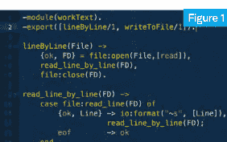

右侧：使用`file:open/2`函数打开文件以供读取，并使用`file:read_line/1`从打开的文件中读取单行

## 以写模式打开文本文件

为了以写模式打开文件，你需要更改`file:open()`函数第二个参数的值，即 Mode。如果你要写入的文件已经存在，它将被截断，因此请格外小心。如果你不希望出现这种行为，请使用追加模式。

图 2 展示了`writeToFile/1`的实现，该实现说明了`file:write()`函数的用法。执行`writeToFile/1`会产生以下结果：

```erlang
1> c(workText).
{ok, workText}
2> workText:writeToFile("./testing").
ok
3> q().
ok
$ cat testing
A Message.
```

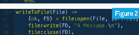

右侧：使用`file:write/1` Erlang 函数向文件写入数据

## 错误处理

当你需要处理文件读写操作时，错误处理是一项关键任务，因为在文件 I/O 过程中很多事物都可能出错。再次强调，Erlang 中的错误处理是通过模式匹配实现的。以下 Erlang 函数介绍了一种处理与`file:open/1`相关错误的简单方法：

```erlang
open_file_with_error_handling(File) ->
   case file:open(File, [read]) of
       {ok, Fd} ->
           io:format("File ~p opened successfully.~n", []),
           [File],
           file:close(Fd);
       {error, Reason} ->
           io:format("Error opening ~p.~n", [File]),
           io:format("Reason:~p.~n", [Reason])
   end.
```

你可以通过访问`bit.ly/2XMOHCm`来了解各种与文件相关的错误代码及其描述。

## 创建临时文件

本节将解释如何在 Erlang 中使用随机文件名创建临时文件，当你要保存数据而不必担心意外选择现有文件名时，这非常实用。开发的函数利用了`erlang:timestamp/0`函数，该函数返回当前系统时间作为包含三个元素的元组，这对于每个给定的系统都是唯一的。该元组被转换为单个变量，可用于生成新的文件或目录。图 3 展示了`workBin.erl`文件中找到的`create_temporary/0`函数的 Erlang 代码。执行该函数会产生以下结果：

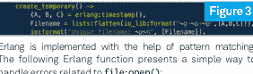

右侧：本图中展示的 Erlang 代码说明了如何创建唯一的名称

```erlang
10> c(workBin).
   {ok, workBin}
11> workBin:create_temporary().
   Unique filename: "1485-326598-527282"
   ok
12> workBin:create_temporary().
   ok
   Unique filename: "1485-326600-978734"
```

## 使用 Erlang 开发 wc

本节将展示`wc(1)`在 Erlang 中的一个基础实现。`wc.erl`的代码将不支持命令行开关，也不会打印读取的字符、单词和行的总数，因为这需要太多的代码。

你也允许专门处理某些错误消息。你可以在`workBin.erl`中找到代码。执行它会产生以下类型的输出：

图 4 展示了`wc.erl`的 Erlang 代码的一部分。从`wc.erl`的实现中你可以理解，Erlang 可能不是此类命令行工具的最佳选择！

```erlang
2> workBin:open_file_with_error_handling("wc.erl").
File "wc.erl" opened successfully.
ok
["wc.erl"]
3> workBin:open_file_with_error_handling("wc").
Error opening "wc".
Reason:enoent.
ok
```

输入文件作为列表传递给`wc:start/1`函数进行处理。但是，如果你想要处理单个文件，可以使用`wc:one_file/1`函数代替。`wc.erl`中最重要的是两个函数：`process_file/0`和`count_bin/0`。第一个函数确保所有文件都被处理，而第二个函数在`which_char/1`的少量帮助下执行实际的处理。每个文件的内容使用列表操作逐字符处理，这在函数式编程语言中相当常见。此外，`which_char/1`的定义允许你轻松更改处理特殊字符的方式。

## Erlang 适合文本处理吗？

以多个文件名作为参数执行`wc:start/1`会产生以下类型的输出：

| 文件 | 单词数 | 字符数 | 行数 |
| :--- | :--- | :--- | :--- |
| wc.erl | 217 | 1828 | 84 |
| mvc.erl | 1899 | 222 | 88 |
| ok | | | |


即使你是 `Lyx`、`Python` 或 `Perl` 等 `Erlang` 编程语言（注：原文此处逻辑可能有误，`Lyx/Python/Perl` 并非 `Erlang` 语言，但翻译保留原意或修正为“即使你是此类语言爱好者”）的粉丝，`Erlang` 也不应该`**`是你处理和分析文本文件的首选。`Ruby` 可能是此类任务更好的候选者，因为它们需要更少的代码就能完成工作。使用 `Erlang` 进行文本操作的唯一有效理由是你必须处理大量文本，因为在这种情况下 `Erlang` 没有真正的扩展性问题。然而，对于今天的大多数开发人员来说，情况并非如此。话虽如此，如果你有一个大型 `Erlang` 应用程序，并且想要进行少量的文本解析而不必使用另一种编程语言，`Erlang` 模式匹配将极大地帮助你并使你的生活变得更加容易。

如果你稍微修改 `wc.erl` 的 `Erlang` 代码，你就能够找出程序的流程，这可能非常实用。


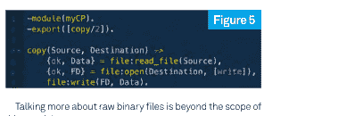

用于调试目的。你可以做的最简单的事情就是每次访问你感兴趣的功能时打印一个给定的字符。执行修改后的名为 `mw_counter.erl` 的 `wc.erl` 版本，会产生以下类型的输出：

```Erlang
1> mw_counter:start("mw_counter:1").
2-+++++++++++++++++
```

请注意，`wc.erl` 的 `Erlang` 代码相对先进，如果你无法完全理解所有内容，请不要失望！

## 处理二进制文件

二进制文件与普通文本文件不同，因此需要不同的处理方法。处理方法取决于二进制文件的确切格式，因此无法预先确定。

你可以按如下方式以原始模式打开二进制文件进行读取：

```Erlang
1> {ok, S} = file:open("network.erl", [read, binary, raw]).
{ok,{file_descriptor,prim_file,{#Port<0.435>,333}}}.
```

上述命令允许你随机访问刚刚打开的文件。然而，读取此类文件需要使用 `file:pread/1` 函数。

同样，你可以按如下方式以原始模式打开二进制文件进行写入：

```Erlang
2> {ok, S} = file:open("aRawBinary", [raw, write, binary]).
{ok,{file_descriptor,prim_file,{#Port<0.435>,333}}}.
```

使用 `file:pwrite/1` 函数可以向原始二进制文件写入数据。

关于原始二进制文件的更多讨论超出了本教程的范围。

## 在 Erlang 中实现 cp

`cp(1)` 实用程序以二进制格式读写所有文件，`Erlang` 的实现也不例外于这一不友好的规则。在 `Erlang` 中实现 `cp(1)` 核心功能的最简单方法是使用 `file:read_file/1` 函数。相关的 `Erlang` 代码可以在 `myCP.erl` 中找到，你也可以在图 5 中看到。该模块需要一个小型函数来完成这项工作，因为 `file:read_file/1` 读取文件的整个内容并将其存储到一个变量中，而 `file:write/2` 将变量的内容写入打开用于写入的文件描述符。执行 `myCP:copy/2` 会产生以下结果：

```sh
1> c(myCP).
{ok,myCP}
2> myCP:copy("myCP.erl", "copyMyCP.erl").
ok
$ diff copyMyCP.erl myCP.erl
```

`diff` 的空输出证明 `copyMyCP.erl` 和 `myCP.erl` 完全相同！

## 与文件相关的有用函数

本节将介绍各种便捷的 `Erlang` 方法，这些方法允许你确定文件是否真的是文件，目录是否真的是目录等。

首先，`file:list_dir/2` 或 `file:list_dir/1` 函数返回包含给定目录文件名的列表：

```Erlang
3> file:list_dir(".").
[{ok,["myCP.erl", "cmdArgs.erl", "wc.erl", "workBin.erl", "workText.erl"]}]
```

## Mnesia 数据库

数据库与文件相关，因为它们也提供了一种存储数据的方式。`Mnesia` 是一个用 `Erlang` 编写的极其快速的分布式 `DBMS`，是标准 `Erlang` 分发版的一部分。你可以使用类似于 `SQL` 和列表推导式的查询来查询 `Mnesia`。正如你可能记得之前的 `Erlang` 教程所述，列表推导式提供了一种创建列表的数学方法：

```Erlang
1> [X * X || X <- [1,2,3,4,5,6], X > 3].
[4,5,6]
```

上述 `Erlang` 代码基于数学条件创建了一个新列表。

虽然即将发布的教程将更多讨论 `Erlang` 和 `Mnesia`，但你可以在 `erlang.org/doc/apps/mnesia/` 处了解更多关于 `Mnesia` 的信息。

# 教程

## 正确。在 Erlang 中遍历目录树的 workBin:visit() 函数代码

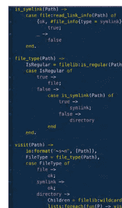

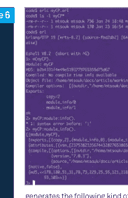

`**`横向。`** 如何从 `Erlang` shell 查找模块信息。输出还包括导出函数的名称

`filelib:file_size()` 函数返回作为参数提供的文件或目录的大小：

```Erlang
5> filelib:file_size(".").
4096
```

`filelib:is_file()` 和 `filelib:is_dir()` 函数分别使你能够确定给定路径是文件还是目录：

```Erlang
6> filelib:is_file(".").
true

7> filelib:is_dir(".").
true

8> filelib:is_file("wc.erl").
false

9> filelib:is_file("wc.erl").
true

10> filelib:is_dir("/dev/random").
false

11> filelib:is_file("/dev/random").
false
```

如你所见，`filelib:is_file()` 将目录视为文件，但可以区分常规文件和特殊文件（如 `/dev/random`）。

## 访问目录树中的所有文件

访问目录及其子目录中的所有文件是一种非常常见的需求。本节将教你如何在 `Erlang` 中执行此任务。同样，开发的函数需要一个参数，即目录，并返回所需的信息。`visit()` 函数包含在 `workBin.erl` 文件中。执行 `visit()` 会产生以下类型的输出：

```Erlang
3> workBin:visit("/var/spool").

/var/spool
/var/spool/cups
/var/spool/mqueue
```

你可以在 `**`图 6`** 中看到相关的 `Erlang` 代码。在 `visit()` 的实现中，最重要的 `Erlang` 函数是 `filelib:wildcard()`，它返回匹配给定条件的文件列表。

`filelib` 文件持有 `file_info` 记录的定义 - `file_info` 中的信息允许你确定你正在处理的是什么类型的文件。在 `Debian Linux` 系统上，可以在 `/usr/lib/erlang/lib/kernel-5.1.1/include` 找到 `file.erl` 文件。你可以在 `erlang.org/doc/man/file.html` 找到关于 `file_info` 持有的数据的更多信息。

## 查找文件信息

以下代码说明了如何使用 `file_info` 记录查找文件的更多信息：

```Erlang
file_permissions(Path) ->
    case file:read_file_info(Path) of
        {ok, FR} -> io:lib:format("~.8B", [FR#file_info.mode band 8#777]);
        _ -> error
    end.
```

上述代码打印文件或目录的文件权限。请记住，虽然 `file:read_file_info()` 包含关于文件大小和类型的信息，但调用 `file:file_size()` 和 `is_dir()` 比使用 `file:read_file_info()` 更实用。然而，请注意，`file:read_file_info()` 返回的一些数据无法通过使用其他 `Erlang` 函数发现。执行 `file_permissions()` 会产生以下类型的输出：

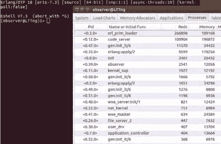


**左侧** `Erlang Observer` 应用程序的一个标签页正在运行

## 监视 `Erlang` 进程

`Erlang` 提供了一个名为 `Observer` 的强大的图形应用程序，允许你检查正在运行的 `Erlang` 进程。你可以通过在 `Erlang` shell 中执行以下命令来启动 `Observer` 应用程序：

```Erlang
1> observer:start().
```

但是，你也可以从 `Linux` 命令行启动 `Observer` – 这种方法的优势在于它使用更少的进程，并且需要更少的 CPU 功率。

```sh
$ erl -sname observer -hidden -setcookie MyCookie -run observer
```

图 8 显示了 `Erlang Observer` 应用程序，它已经取代了 `Xmon` 应用程序。你可以通过访问 `erlang.org/doc/apps/observer/observer_ug.html` 找到更多关于 `Erlang Observer` 的信息。即将发布的教程将更多讨论 `Observer`。

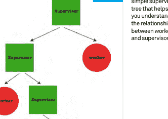

**左侧** 一个简单的监督树图，帮助你理解工作者和监督者之间的关系

```Erlang
2> workBin:file_permissions("wc.erl").  
["644"]  
3> workBin:file_permissions("/tmp").  
["777"]
```

## 查找模块信息

有两种简单的方法可以查找现有模块的导出函数信息。因此，假设有一个名为 `aModule` 的模块，你可以使用以下两个命令之一来了解更多关于它的信息：

```Erlang
1> aModule.  
2> aModule:module_info().
```

请注意，你需要该模块的 `BEAM` 文件才能执行这两个命令中的任何一个。图 7 显示了上述命令的输出。

## 更多关于 `OTP`

监督树是一种图形化表示应用程序中工作者和监督者之间关系的方式。工作者是执行实际工作的 `Erlang` 进程，而监督者是密切关注工作者或其他监督者状态的 `Erlang` 进程。监督树中有三种主要类型的子项：永久性的，它们死亡时会重新启动；瞬时的，仅在它们异常死亡时重新启动；以及临时的，它们死亡时永远不会重新启动。图 9 显示了监督树的图表。通过构建和查看监督树获得的主要优势是快速理解你的应用程序架构。当我们讨论 `OTP` 时，你将看到更多监督树的示例。

## `Ubuntu` 中的服务器管理

深入探讨 `Ubuntu` 下的服务器管理


`Swayan Prakash` 拥有计算机工程硕士学位。他在信息技术领域工作多年，专注于操作系统、网络、网络安全、电子商务、互联网服务、`LDAP` 和 Web 服务器等领域。`Swayan` 曾为多份行业出版物撰写文章，并在行业会议上宣读自己的论文。可通过 `swayan.prakash@gmail.com` 与他联系。

## 资源

-   系统管理主题：`bit.ly/2kt6yXx`
-   理解 `Ubuntu Linux` 系统的分步方法：`bit.ly/2kCi642`
-   基本的 `Ubuntu` 服务器管理：`bit.ly/2kQxIeJr`
-   `Ubuntu` 服务器指南 (PDF)：`bit.ly/18NkPkK`

**右图** 广泛用于服务器管理的 `sar` 实用工具

### 当我们将 `Linux` 系统配置为服务器时，需要关注几项任务。

顾名思义，服务器的存在就是为了提供服务。它们提供的数据可以包括网页、文件、数据库信息等。从服务器管理的角度来看，存在一些对系统管理技能的典型挑战。

首先是远程访问。在大多数情况下，管理将通过远程访问工具进行。由于图形界面可能不可用，你需要完全依赖命令行工具来执行远程登录、远程复制和远程执行等各种任务。这些工具中最常见的是基于 `SSH` 功能构建的。

其次是安全性。正如预期的那样，服务器将接受来自远程用户和系统的请求。因此，服务器管理员会打开所需服务的端口，并锁定不需要服务的端口。可以使用各种工具来保护这些服务。

第三是持续监控。服务器被期望全年 365 天、每年 7x24 小时保持在线。配置可用于监控每台服务器的工具有着巨大的需求。通过这种监控，你将能够收集所需的日志消息，并且在发生可疑活动时触发电子邮件通知。收集有关 `CPU` 使用率、内存使用率、网络活动等方面的数据总是有益的。

在此需要注意的是，无论你要启动的是文件服务器还是 Web 服务器，让服务器运行起来所需的许多步骤都是相同的。在配置和调整方面，我们会看到许多差异。一旦我们成功安装了服务器，下一步就是查看其默认配置。需要注意的是，大多数服务器软件包都安装为偏向于提供更高安全性的默认配置设置。

众所周知，大多数 `Linux` 服务器可以使用 `/etc` 目录下的纯文本进行配置。在大多数情况下，会有一个主配置文件，有时还有一个相关的配置目录，可以从中提取扩展名为 `.conf` 的文件并将其纳入主配置文件。`Apache Web` 服务器就是一个例子，它有一个主配置文件和一个目录，其他配置文件可以放入该目录并被服务包含。主配置文件是 `/etc/httpd/conf/httpd.conf`，配置目录是 `/etc/httpd/conf.d/`。

如前所述，大多数服务器软件包在安装时配置极少，如果我们想充分利用这些服务器，这将受到限制。邮件服务器和 `DNS` 服务器是功能有限的服务器的典型例子。请注意，这两个服务器都以其默认配置安装，并在重启时启动。但关键在于，它们都只监听本地主机上的请求。因此，直到我们配置这些服务器之前，未登录到你本地服务器的人员将无法向该服务器发送邮件或将你的计算机用作公共 `DNS` 服务器。

一旦我们安装并配置了服务器，下一步就是启动它。通常，我们在 `Linux` 上安装的大多数服务器都配置为在系统启动时启动。之后，服务持续运行并持续监听请求。这将一直持续，直到系统关闭。你可以使用两个主要功能来管理服务：`systemd` 和 `System V init` 脚本。无论 `Linux` 系统使用哪种功能，由你决定是否让服务在系统启动时启动，并根据需要启动、停止和重新加载服务。这里需要注意的另一件事是，大多数服务都实现为守护进程。下表简要描述了一些参数。

| 参数 | 描述 |
| :-- | :-- |
| 用户和组权限 | 守护进程通常以除 `root` 之外的用户和组身份运行。这样做的目的是，如果有人入侵这些守护进程，他们将没有权限访问该服务无法访问的文件之外的文件。 |
| 守护进程配置文件 | 通常，服务有一个守护进程的配置文件，存储在 `/etc/sysconfig` 中：有关更多详情，请参考特定守护进程的手册页。 |
| 端口号 | 大多数标准服务都有特定的端口号，守护进程监听这些端口，客户端可以连接。通常我们不需要更改守护进程监听的端口。 |

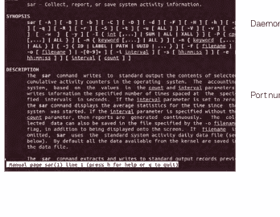

并没有强制要求所有服务都必须作为守护进程运行。一些服务使用 `xinetd` 超级服务器按需运行。我们可以将按需服务视为运行始终可用服务的主要方式。这里需要注意的是，按需服务不会持续运行，从而持续监听请求。这些服务注册在 `xinetd` 守护进程中，当请求到达 `xinetd` 守护程序时，`xinetd` 守护程序启动所请求的服务，并将请求交给该服务。这种方法有一个明显的优势，即我们将拥有更少运行的守护进程。

在保护服务器安全方面，你需要非常谨慎。在 `Linux` 系统中，各种措施可以帮助保护你的服务器和服务免受外部攻击。

拥有良好的密码和密码策略是保护 `Linux` 系统安全的第一道防线。这里最好的做法是禁止 `root` 直接登录，并强制每个人都作为普通用户登录，然后使用 `sudo` 变为 `root`。作为另一种最佳实践，你可以使用可插拔身份验证模块 (`PAM`) 功能，它将有助于调整某人登录失败尝试的次数，在此之后将阻止对该用户的访问。

`iptables` 防火墙服务是另一层安全防护。使用此服务，你可以丢弃或拒绝系统中请求服务的每个数据包，除了你启用的那少数几个。你还可以告知 `iptables` 仅允许来自特定 `IP` 地址的服务请求，或拒绝来自其他地址的请求。

你可以使用 `/etc/hosts.allow` 和 `/etc/hosts.deny` 文件中的功能来允许或拒绝访问启用了 `TCP` 封装的服务。可以根据主机名或 `IP` 地址允许或拒绝访问。

> 服务器的存在就是为了提供服务。它们提供的数据可以包括网页、文件和数据库信息

如今大多数发行版都带有安全增强型 `Linux` (`SELinux`) 功能，并且默认情况下以强制模式包含在内。`SELinux` 的一个重要功能是它有助于保护你的 `Linux` 系统的内容免受在该系统上运行的进程的影响。

作为另一项安全措施，你还可以在配置文件中处理安全设置。在

### 系统日志记录


系统日志记录是在 Linux 系统上配置的基本服务之一，将有助于跟踪系统上发生的情况。`rsyslog` 服务将提供收集在 Linux 机器上运行的软件/应用程序日志消息的功能。然后，服务器管理员可以将这些消息重定向到本地日志文件、设备或远程日志主机。

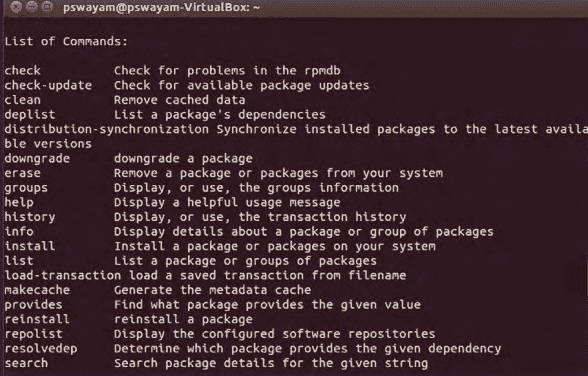


## Ubuntu 服务器管理

### 正确使用方法 rpm 命令

配置文件中，你可以设置数值以进一步加固服务。

服务器监控至关重要。由于你不可能全天候监控每一项服务，因此部署一些监控工具以便观察服务器状态显得尤为重要。这使得系统管理员的工作更加轻松，因为他们可以及时发现需要紧急关注的情况。有多种工具可用于服务器监控。

使用 `rsyslog` 服务，你可以收集关于各种服务的重要信息和错误状况。默认情况下，所有日志消息都定向到位于 `/var/log` 目录下的日志文件中。出于提高安全性和便利性的考虑，你还可以将所有日志消息重定向到集中式服务器。

`Sar` 是一个重要的实用工具，可以配置为监视系统上的活动。内存使用情况、CPU 使用率和网络活动是其中一些可以被 `sar` 监控的项目。

始终保持系统软件最新是非常重要的。换句话说，我们需要确保安装了包含补丁的更新软件包。一个广泛使用的命令是 `yum` —— 它将检查并安装适用于你系统的可用软件包。

检查文件系统也很重要，这样你才能识别可能的入侵。可以使用以下命令进行此操作：

```
$ rpm -V
```

此命令有助于我们检查系统上的任何命令、文档或配置文件是否被篡改。

服务器管理员严重依赖 Secure Shell (`SSH`) 服务来管理对服务器的远程访问。Secure Shell 工具可以被视为一组客户端和服务器应用程序，它们有助于在客户端机器和 Linux 服务器之间进行基本通信。流行的 SSH 工具有 `ssh`、`scp` 和 `sftp`。这里需要注意的是，由于客户端和服务器之间的通信是加密的，这些工具更加安全。使用这些工具时，除了通信，身份验证过程也是加密的。我们知道，来自 `telnet` 和早期“r”命令的通信会暴露数据和密码，使得有人可以轻松通过网络访问这些信息。

这里需要注意的是，大多数 Linux 系统都包含 shell 客户端，也可能包含 Secure Shell 服务器。包含这些工具的客户端和服务器软件包分别是 `openssh`、`openssh-clients` 和 `openssh-server`。

你可以使用以下命令来完成此目的：

```
$ yum list installed | grep ssh
```

如果服务器软件包未安装，请使用以下命令进行安装：

```
$ sudo apt-get install openssh-server
```

预装了 `openssh-server` 软件包的 Linux 系统有时可能未配置为自动启动。在这种情况下，你可能需要使用命令以确保 SSH 服务器守护进程 (`sshd`) 在你的 Linux 系统上正常运行。但在 Ubuntu 上，当我们安装 `openssh-server` 时，`sshd` 守护进程始终配置为在启动时自动运行。我们可能需要对 `sshd` 守护进程进行进一步配置——这可以通过编辑 `/etc/ssh/ssh_config` 文件来完成。这里一个至关重要的配置是将 `PermitRootLogin` 设置从 `yes` 更改为 `no`。这样，我们将阻止任何人远程登录为 `root`。

通过网络。完成后，我们可以输入 `exit` 来结束我们的远程连接。

`ssh` 命令也可以用于远程执行。我们可以使用此命令在远程系统上执行命令，并将输出返回到本地系统。当我们在 `ssh` 中运行包含选项或参数的远程执行命令时，我们需要确保整个远程命令行都被引号包围。

服务器管理员使用 `scp` 和 `rsync` 命令在系统之间复制文件。`scp` 命令与较旧的 `rcp` 命令非常相似，唯一的区别在于使用 `scp` 时所有通信都是加密的。

### 服务器管理员严重依赖 Secure Shell 服务来管理对服务器的远程访问

在所有的 Secure Shell 工具中，最常用的是 `ssh` 命令。服务器管理员可以使用此命令进行远程登录、远程执行以及其他类似任务。诸如 `scp` 和 `rsync` 等命令可用于在 SSH 客户端和服务器系统之间复制一个或多个文件。默认情况下，Secure Shell 工具使用标准的 Linux 用户名和密码进行身份验证，所有操作都在加密连接上进行。这些工具还支持基于密钥的身份验证，可用于在客户端和 SSH 服务器之间配置无密码身份验证。通过使用 `ssh` 命令，服务器管理员可以检查他们是否能够登录到正在运行 `sshd` 服务的 Linux 系统。一旦你登录到远程系统，你就可以开始执行 shell 命令。请注意，连接的功能与普通登录相同——唯一的区别是数据在通过网络传输时是加密的。

你可以将文件从远程复制到本地系统，或者反之亦然。`scp` 命令也可以用于通过网络备份文件和目录。但是，当我们比较包含选项或参数的 `rsync` 与 `scp` 时，我们需要确保整个远程命令行都被引号包围。

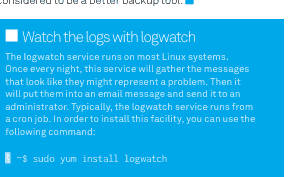

## 35 个必备修复技巧

无论你是经验丰富的 Linux 用户还是新手，你都可能会时不时地遇到问题。以下是解决它们的方法


### 修复 LINUX？

- 是
- 否

错误！

```
paul@xps13-yakkey:~$ uname -a
Linux xps13-yakkey 4.9.9-040909-generic #2d.02090333 SMP Thu Feb 9 08:35:27 UTC 2017 x86_64 x86_64 x86_64 GNU/Linux
paul@xps13-yakkey:~$
```

Linux 是一种奇特而奇妙的野兽。它最棒的地方之一在于，它真正给了你深入操作系统内部、将一切调整到你喜欢的状态的机会。然而，另一方面，当你调整设置时，你很可能遇到意外的问题，无论这些问题与你使用的发行版、你运行的硬件、某个特别晦涩的开源软件有关，还是仅仅因为 Linux 的工作方式与你习惯的不同。如果你是在从 Windows 转向后第一次使用 Linux，这种情况尤其可能发生——在许多领域，一开始可能会让人望而却步。

本文强调了一些你在使用 Linux 时可能遇到的问题，无论你是刚刚入门还是长期 Linux 用户。

如果你遇到的一个问题没有在我们的指南中列出，请不要担心，你几乎肯定不是第一个遇到这个问题的人。搜索引擎通常能为一般查询提供正确的方向，或者如果问题特定于某个软件，该产品的支持论坛或问题跟踪器是一个很好的起点。Linux 社区是一群很棒的人！

> “ 当你在 Linux 中调整设置时，你很可能遇到意外的问题 ”

### 内核问题

Linux 内核是世界上最大的开源项目之一，拥有超过 1300 万行代码——它是你的 Linux 机器所做一切的基础。通常来说，大多数 Linux 用户不会太在意内核：它就在那里，做它该做的事。当即将发布的版本添加了对机器中新硬件的支持，或者修复了现有硬件的一些问题时，内核对用户来说变得最重要和有趣。

通常，特定的内核版本与特定的发行版版本相关联。例如，Ubuntu Xenial Xerus 包含内核 4.4，而 Ubuntu Yakkey Yak 包含内核 4.8。尽管情况如此，如果你希望利用一些新功能，没有什么能阻止你在系统上安装新版本的内核。内核最棒的地方之一是你可以轻松安装新版本，在两个版本之间切换（通过 `GRUB`），并在需要时回滚到之前的版本。

安装较新内核最简单的方法是使用 Ubuntu 上游内核存档中的软件包 (bit.ly/1zcskza)。浏览到你想要安装的内核版本，选择适当的架构并下载文件。正常安装并重启以加载新内核。如果你确实需要恢复，打开 `GRUB` 高级菜单，加载旧内核并以正常方式卸载软件包。请注意，许多用户将内核更新视为 BIOS 更新——如果它没坏，就别修它！

## 安装与升级问题

在您的 Linux 冒险之旅中，不要在起步阶段就受阻——解决这些常见的安装或升级问题

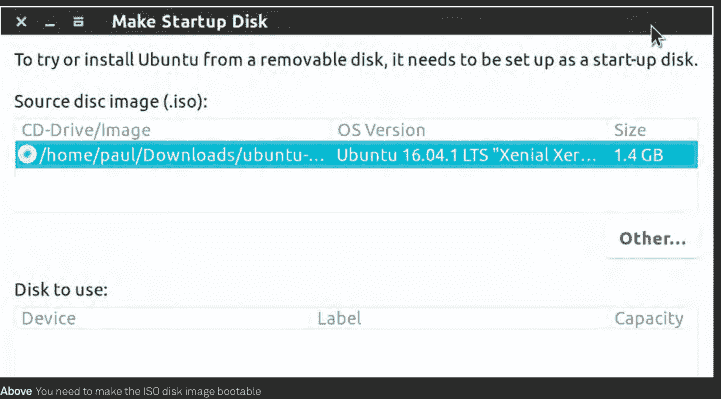

**上方** 您需要使 ISO 磁盘镜像可启动

> 最常见的问题之一是磁盘对 Linux 安装程序“不可见”。幸运的是，有一个简单的解决方法

### 1 安装介质无法启动

您已下载 Linux 并将其刻录到 CD/DVD 或复制到 U 盘。但它无法启动。开局不利。首先，如果您使用的是 CD/DVD，请确保您刻录的是实际的 ISO 文件，而不仅仅是复制该文件。同样，如果您使用 USB，您需要按照指南制作可启动镜像，而不仅仅是将其复制到 U 盘。如果已做到这一点，下一步需要执行的是访问您电脑的启动顺序菜单。这在现代设备上通常隐藏得很深，且不同制造商的菜单有所不同。尝试按 `Esc` 键或 `F12` 来显示选项。


### 2 安装程序无法检测到我的硬盘

近年来，PC 的工作方式发生了很多变化，我们从 BIOS 时代过渡到了 UEFI 时代。此外，硬盘（尤其是 SSD）及其在机器内部的通信方式进步迅速。许多这些优化是专门为 Windows 设计的，这可能会导致 Linux 出现问题。最常见的问题之一是磁盘对 Linux 安装程序“不可见”。如果您遇到此问题，幸运的是，有一个简单的解决方法——在计算机设置中，将硬盘模式更改为 `AHCI/SATA`。这很简单，但进行此更改可能会导致您的 Windows 安装无法启动（如果您正在双系统启动）。要修复此问题，正常启动 Windows 并使用以下命令：

```
bcdedit /set {current} safeboot minimal
```

...然后在更改设置之前执行此操作。然后，在更改设置并完成首次启动后，使用：

```
bcdedit /deletevalue {current} safeboot
```

...以恢复正常运行。

### 3 PC 仍然启动到 Windows

在新机器上安装 Linux 时的一个常见问题是，您完成了向导并按指示重启，但计算机仍然启动到 Windows。怎么回事？！别担心，您没有浪费时间——这通常是因为 `GRUB`（Linux 引导加载程序）未正确安装，通常是没有安装在正确的磁盘上。要解决此问题，如果您的操作系统仓库中可用，只需安装并运行 `Boot-Repair`。如果不可用，请使用：

```
sudo grub-install
```

...并结合使用以下命令显示的正确磁盘：

```
ls -l /dev/disk/by-label/
```

### 4 我的 Wi-Fi 无法使用

尽管 Linux 目前支持大量硬件，但在安装过程中可能会遇到问题，尤其是在定制硬件方面——特别是与网络相关的，尤其是 Wi-Fi！启动 Live CD 后发现自己没有网络连接，这种情况并不少见。解决问题的第一步是了解您机器中有哪些硬件——使用：

```
lspci --short
```

这将告诉您您的机器正在使用哪个芯片组，从而让您能够查找正确的驱动程序。`kernel.org` 上的 Linux Wireless 页面列出了内核支持的设备 – `wireless.wiki.kernel.org/users/drivers` 是一个很好的起点。

### 5 我无法使用打印机

尽管大多数大型打印机公司都提供一定程度的 Linux 支持，但可以说支持情况参差不齐，但一直在改进。如果您在使用打印机时遇到问题，或者您计划购买新的打印机，Ubuntu 托管了一个详细列出支持型号的有用页面 – `bit.ly/2mwr976` – `Linux-Printing.org` 也是如此。在 Linux 上，打印通过通用 UNIX 打印系统（`CUPS`）启用，这是一个开源、可移植的打印框架。安装 `CUPS`（使用 `apt install cups`）后，将您的 web 浏览器指向 `http://localhost:631/admin` 以访问基于 GUI 的打印系统配置。

### 6 Ubuntu 错误地声称我的 LTS 版本是最新的

如果您安装了 Ubuntu 的长期支持（`LTS`）版本，您可能会注意到，即使有可用新发行版，您的系统也未显示为可用。这是因为 `LTS` 版本通常仅提示更新到较新的 `LTS` 版本。当然，无论哪种情况，我们通常都希望使用最新版本。因此，要在 Ubuntu 中更改此行为，打开“软件和更新”，选择“更新”选项卡，并在“通知我新的更新”部分，将选项从“对于长期支持版本”更改为“对于任何新版本”。以通常方式检查更新，您现在就可以升级了。要在命令行实现相同结果，编辑 `/etc/update-manager/release-upgrades` 并确保设置了 `Prompt=normal`。使用：

```
do-release-upgrade
```

...开始升级。

### 7 我无法自动安装安全更新

开箱即用时，Ubuntu 的配置要求所有更新都需要用户手动安装。如果我们希望拥有对系统行为的最终控制权和知情权，这很棒。然而，至少让机器自动安装安全更新可能不是一个坏主意。配置这其实相当直接——运行命令：

```
sudo dpkg-reconfigure --priority=low unattended-upgrade
```

...然后接受提示，您就设置好了。注意，重启不会自动发生；要启用此功能，必须在 `/etc/apt/apt.conf.d/20auto-upgrades` 中设置 `Unattended-Upgrade::Automatic-Reboot "true"`。

### 8 我想安装专有驱动程序

在 Ubuntu 的默认安装中，专有驱动程序是禁用的。什么是专有驱动程序？它们是不符合操作系统本身完全开源许可证的驱动程序。只要您对此感到舒适，为无线网卡、显卡等安装这些驱动程序可以提供巨大的性能提升或修复原本损坏的功能。要启用，请转到“软件源”的“附加驱动”部分，选择您想要使用的驱动程序，并点击“应用更改”。选定的驱动程序将随之安装。

上方 当开源选项不可用时，安装专有驱动程序可以让硬件正常工作。

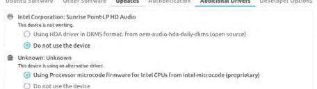

# 第三方应用程序

在您完成 Linux 初始安装后，您会希望立即在系统上获得最佳的第三方应用程序

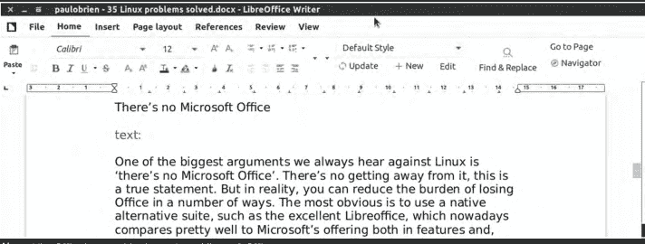

上方：`LibreOffice` 是 `Microsoft Office` 的强大替代品

### 9 我需要办公套件！

我们总是听到的针对 Linux 的最大论点之一是“没有 `Microsoft Office`”。不可否认，这是一个真实的陈述。但实际上，您可以通过多种方式减轻失去 Office 的负担。最明显的是使用本地替代套件，例如出色的 `LibreOffice`，如今在功能上与 Microsoft 的产品相当不错，并且随着 `LibreOffice 5.3` 中最新的功能区用户界面，风格也差不多。`LibreOffice` 包含所有主要 `Microsoft Office` 应用程序的替代品 — `Word` (`Writer`), `Excel` (`Calc`), `PowerPoint` (`Impress`), `Visio` (`Draw`) 甚至 `Access` (`Base`)。

尽管这绝对是纯选项，但即使是最坚定的 Linux 用户也可能承认，有时候只有真正的 Office 体验才行——与他人共享文件就是一个关键例子。`WINE 2.0`（或基于它的 `Cross-over` 或 `PlayOnLinux` 工具）允许 Windows 应用程序在 Linux 上完全运行，现在完全支持 `Office 2013`。只需安装主机应用程序并在其中运行 Office 安装程序即可。它的工作效果出奇地好。如果这些都不适合您，您可以考虑在 `VirtualBox` 或 `VMware` 虚拟机内部运行一个简单的 Windows 安装并安装到其中。虽然可能有点笨重，但它有效……而这才是最重要的！

### 10 在我的 HiDPI 显示器上一切都很小

所以您有一台配备出色新 `HiDPI` 显示器的机器…… 也许是 `XPS 13` 开发者版（`UHD`）或只是桌面用的漂亮新 `4K` 显示器。这都很好，除了在操作系统和您的一些最爱应用中一切都变得很小。首先，不要惊慌——这不是 Linux 独有的问题；即使现在，`Windows 10` 在高分辨率屏幕上的某些 UI 元素看起来也很糟糕。修复主要操作系统本身相当简单：您只需要在设置中的“屏幕显示”部分设置菜单和标题栏缩放因子。完成后，您需要查找存在问题的特定应用程序。许多应用程序有自己的 `HiDPI` 主题；但是，您也可以查看 `gnome-tweaks-tool` 中的窗口缩放选项，以帮助您将一切都缩放到恰到好处。

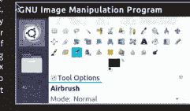

### 11 我真的很需要 Photoshop

您已使系统运行起来，并意识到由于有了 `LibreOffice`，您不再需要 `Microsoft Office` 了。新 Linux 用户难以接受没有另一个大应用是什么？`Adobe Photoshop`。不可否认 `Photoshop` 是一个很棒的应用程序，但除非您真的使用了 `Photoshop` 中大量的高级功能，Linux 有自己的重量级图像编辑器供您使用 — `GIMP`。`GNU` 图像操纵程序（`GNU Image Manipulation Program`）的缩写，由于其开源（当然免费）性质和可扩展的插件架构，该应用是照片修图、图像合成和创作以及其他方面的惊人工具。`GIMP` 也可在 `Windows` 和 `Mac OS X` 上获得，并在这些平台上表现出色！


### 12 未安装 JAVA


开箱即用的 `Linux` 并不包含 `Java` 编程语言。当你确实需要安装它时，也有许多不同的选择。首先要决定的问题是使用开源版本（`OpenJDK`）还是闭源版本（`Oracle`）`Java`。实际上，如今两者之间差别并不大；然而，根据你使用 `Java` 的用途，你可能需要特定版本。大多数发行版的软件源中包含了 `OpenJDK`，因此可以通过如下命令进行安装：

```bash
$ apt-get install openjdk-8-jre
```

若要安装 `Oracle` 的 `Java`，最简单的方法是使用 `PPA`，例如由 `webupd8team` 提供的那个 —— 使用如下命令：

```bash
$ sudo add-apt-repository ppa:webupd8team/java
$ sudo apt-get update
$ sudo apt-get install oracle-java8-installer
```

请注意，如果你并非专门进行 `Java` 开发，可能只需要安装 `JRE`（`Java` 运行环境）而非 `JDK`（`Java` 开发工具包）。

不过，如果你需要同时安装两种类型的 `Java`，或者可能需要多个版本（`Java` 7 / 8 等），你可以这样做 —— 并切换系统中默认启用的版本。使用如下命令：

```bash
$ sudo update-alternatives --config java
```

……以交互式方式选择你偏好的版本（如果需要，对 `javac` 也做相同操作）。

`Java` 的默认安装不会在你的浏览器中启用支持 —— 如有需要，你必须手动安装插件。`Oracle` 在其网站上有一个支持页面，详细介绍了操作方法。[bit.ly/2lZIu8](bit.ly/2lZIu8)。

## 13 此应用程序未正确安装

我们可以打赌，如果你使用 `Linux` 已经有一段时间了，那么你肯定已经厌倦了直接从命令行安装应用程序，而不是使用 `GUI` 安装器。大多数新用户在应用依赖项方面会很快且粗暴地学到教训 —— 例如，当 `GUI` 变得难以处理时，尝试安装 `Chrome` 浏览器就成了一次学习如何使用命令行的练习。你会注意到，当你尝试安装 `DEB` 软件包时，有时由于缺少依赖项且未自动解析，它们将安装失败。如果你遇到这种情况（如 `Chrome` 案例），通常可以使用如下命令自动修复问题：

```bash
$ apt-get install -f
```

## 14 我无法播放任何视频

`Linux` 的新手常常惊讶地发现系统并未预装功能强大的媒体播放器，因此播放视频文件可能会遇到问题。幸运的是，有一种简单的解决方案，即 `VLC`。`VLC` 是一款免费且开源的跨平台多媒体播放器及框架，能够播放大多数多媒体文件，以及 `DVD`、音频 `CD`、`VCD` 和各种流媒体协议。要在你的 `Linux` 机器上安装，你可以从发行版的软件源安装（我们保证它在那里），或者使用 `www.videolan.org` 上提供的软件包。浏览器插件（`browser-plugin-vlc`）和额外的流媒体编解码器（`libavcodec-extra-53`）也可用。为了播放区域锁定的 `DVD`，你需要按照 `VLC` 网站上的指南安装 `libdvdcss2`。

# 调整与改进

`Linux` 几乎可以无限地针对你的特定需求进行调优，但有一些关键事项是你想要做的

## 15 电池续航不如 Windows

这是一个残酷的现实：在便携式设备上运行 `Linux` 的电池续航通常比同一台机器运行 `Windows` 要差。这主要归因于制造商针对设备/操作系统组合做了特定的电池优化，且驱动程序更加成熟。然而，一个有助于缓解这种情况的秘密武器是 `TLP`。`TLP` 让你享受到 `Linux` 高级电源管理的益处，而无需了解每一个技术细节。`TLP` 带有默认配置，已针对电池续航进行了优化，因此你可以安装后直接忽略，尽管它高度可定制，若需满足特定要求亦可调整。安装完成后（`TLP` 存在于大多数发行版软件源中），可以使用如下命令启动：

```bash
sudo tlp start
```

然后使用：

```bash
sudo tlp-stat -s
```

……以检查系统是否正常工作。

## 16 我想要一个“桌面”快捷方式

有时是小事起了决定性的作用，而这就是一个绝佳的例子 —— 你不会相信启动器上有一个“桌面”快捷方式有多有用。更好的是，启用它通常非常简单明了。具体步骤取决于你使用的发行版，但以使用 `Unity` 的 `Ubuntu` 为例，只需安装 `unity-tweak-tool`，导航至 `Launcher` 部分，并切换“显示桌面图标”设置。图标应会立即出现。该应用还有许多其他有用的调整选项！

## 17 我缺少一些重要的字体

如果你正在加载从他人那里收到的文档，你可能会注意到缺少一些在 `Windows` 电脑上默认安装的字体。幸运的是，有简单的解决方法。只需安装 `ttf-mscorefonts-installer` 软件包，你的系统就会更新并包含 `Andale Mono`、`Arial`、`Comic Sans MS`（是的）、`Courier New`、`Georgia`、`Impact`、`Times New Roman`、`Trebuchet`、`Verdana` 和 `Webdings`。由于这是一个基本字体集，你仍会缺少 `Calibri` 和 `Cambria` 等某些微软字体。不幸的是，这些字体并不官方支持 `Linux`。

## 18 默认主题有点丑

尽管现在的状况比过去好多了，但 `Linux` 的图形界面开箱即用时仍算不上最漂亮，即使在运行 `Unity` 的 `Ubuntu` 旗舰发行版上也是如此。坏消息就是这样 —— 好消息是大多数发行版都易于换肤。试试下面这种简单的方式来让你的 `Ubuntu` 机器看起来比之前更酷。安装 `unity-tweak-tool`。从 [github.com/adapta-project/adapta-gtk-theme](https://github.com/adapta-project/adapta-gtk-theme) 下载 `Adapta-gtk-theme`。然后从 [snwh.org/paper](https://snwh.org/paper) 下载 `paper` 图标。使用 `tweak tool` 启用这两者。现在，看起来是不是像完全不同的操作系统了？太美了。

## 19 我无法在平板电脑上操作 GRUB

现在有很多配备强大硬件的可转换笔记本电脑，这意味着它们也是极好的 `Ubuntu` 机器（戴尔 `XPS` / `Latitude 12 7275` 就是完美的例子）。你很可能会对机器进行双系统启动，这会立即引发一个问题。`GRUB` 算不上什么触控优化的，对吧？在默认配置下，`GRUB` 将无限期地等待输入。这不是理想的。要绕过这个问题，你应该更新 `GRUB` 配置，添加默认选项和超时时间。编辑 `/etc/default/grub`，将 `GRUB_DEFAULT` 设置为所需值（列表从 0 开始）和合适的秒数 `GRUB_TIMEOUT` 值。另外，将 `GRUB_HIDDEN_TIMEOUT_QUIET` 设置为 `false`。运行如下命令后：

```bash
$ sudo update-grub
```

……问题就解决了。现在你至少可以在没有键盘的情况下启动机器了！

## 20 没有可用的屏幕键盘

一旦你成功在平板电脑上进入 `Ubuntu`，就会遇到一个新问题 —— 没有屏幕键盘。可以说，与其他平台相比，`Linux` 的平板体验稍显不足，但仍可使用。要做到这一点，加载系统设置并选择通用访问中的输入标签。启用屏幕键盘设置后，屏幕顶部会出现一个新图标，可用于显示键盘 —— 即使未登录时也可以。当处于适合输入文本的位置时，键盘也应该会自动显示和隐藏。

## 21 我想安装一些杀毒软件

“只有 `Windows` 才需要杀毒软件”。这是最后一句名言吗？尽管由于安装基数庞大，`Windows` 确实比 `Linux` 或 `Mac OS X` 遭受更多攻击，但对于 `Linux` 用户来说，安装杀毒软件也是良好的实践。大多数大型杀毒软件公司都提供保护 —— 通常免费。`Linux` 上最常用的杀毒软件是 `ClamAV`，它默认不带 `GUI`，但有一个轻量级的第三方 `GUI` 提供，即 `clamtk` 前端，可从 `https://github.com/clamtk` 获取。

## 命令行

即使是老练的图形界面爱好者，在某些时候也不得不深入命令行领域，如果你没有做好准备，这可能会带来一些问题……

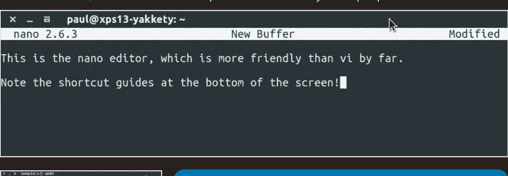

## 我觉得 VI 太难用了

在 `Linux` 机器上使用命令行时，通常推荐的编辑器是 `vi`——这并非没有理由，因为它是一个功能非常强大的工具。然而，它对初学者并不友好——其命令可能显得相当令人望而生畏。`vi` 的一个坚实替代品是 `nano`。这是一个仍在终端中运行的编辑器，但它稍微更易上手，在不显得繁琐的情况下给用户提供了更多的引导。当然，如果你想在命令行环境中编辑，但又真的希望在图形界面（`GUI`）中操作，你可以使用 `gedit` 或像来自 `atom.io` 的 `Atom` 这样更高级的图形界面编辑器。

## 我想以 ROOT 身份安全地执行操作


作为一个新的 Linux 用户，容易陷入的一个陷阱就是过多地以 `root` 身份进行操作。切换到 `root` 用户非常容易，但一旦养成习惯，就很难摆脱。这里有个小技巧——将 `root` 密码更改为不使用密码管理器或锁定它就无法记住的内容，然后尝试使用 `sudo`（它是以你的账户运行，但提升了你的权限）。

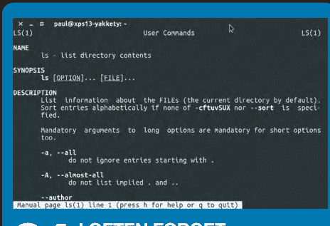

## 我经常忘记命令行选项

Linux 拥有令人眼花缭乱的命令行工具，每个工具都有其独特的语法，这意味着如果你不是每天都在使用它们，要记住具体如何使用它们可能会很困难。幸运的是，有一些标准方法可以找到正确的命令。寻求帮助的第一步是使用命令后的 `--help` 后缀（例如 `ls --help`）。这会打印出所有可能参数的简短列表，以及（通常）一个示例和指向完整文档的网页链接。如果你滚动得太快而看不清，请将其管道传输到 `more` 二进制文件 - 例如 `ls --help | more` - 它会逐屏显示；按空格键继续。要获取有关如何使用某条命令的更详细解释，请使用 `man` 功能（例如 `man ls`）。这会打开该命令的手册页，你可以再次使用空格键滚动浏览。

## 我想知道安装了哪些软件

在 Linux 上有多种安装软件的方式，查看已安装软件的最佳方法通常并不明确。如果你是手动编译和安装软件，那么跟踪起来就更难了。原则上，只要可用，请尽量从软件包安装。

要在 `Ubuntu` 中以图形化方式查看已安装的内容，请使用 `Ubuntu` 软件应用程序并点击“已安装”选项卡（这也会在一个选项卡中显示更新）。不幸的是，这只显示通过图形界面安装的内容，因此用途有限。命令行的替代方案是：

```bash
dpkg --get-selections
```

或者...

```bash
dpkg --get-selections | grep php
```

当然，如果你在寻找特定的东西，可以通过 `grep` 进行管道传输。例如：

要查看特定软件包安装了哪些文件，请使用：

```bash
dpkg -L packagename
```

如果你想更多地了解每个软件包的内容，可以使用以下命令获取带有简短描述的软件包列表：

```bash
dpkg-query -l
```

如果你是手动编译并从源代码安装，有没有什么方法可以跟踪？通常，一个好的做法是将你编译的任何应用程序的源代码保存在一个公共目录中，以便日后参考（即使你在安装后压缩了源代码）。这也让你以后可以使用 `make uninstall` 来移除软件。

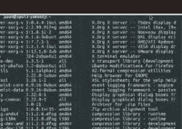

## LOCATE 命令不起作用

`locate` 命令是在 Linux 上查找文件最快且最简单的方法。只需输入 `locate filename`，系统将返回请求用户有权限访问的所有 `'filename'` 实例（支持通配符和正则表达式）。添加 `-i` 开关会使搜索不区分大小写。

如果 `locate` 命令没有显示出你确定存在的文件怎么办？数据库是定期更新的（通常在每日 `cron` 任务中），这意味着最近创建的文件和目录不会立即显示出来。要手动更新数据库，只需使用：

```bash
$ sudo updatedb
```

> 你启动了一个新会话，却完全不知道之前操作是否完成。简直是噩梦！

## 当 SSH 断开连接时，我会迷失方向

想象一下这个场景。你通过 `SSH` 登录到一台远程服务器，正在做一些非常重要的事情。你正在对数据库运行一条命令时，Wi-Fi 断开了。你立即重新连接到服务器，但你启动了一个新会话，并且完全不知道之前的操作是否完成。太糟糕了！

解决这个问题的绝妙方法是 `'screen'` 工具。这是一个全屏窗口管理器，它在多个进程（通常是交互式 shell）之间复用物理终端。每个虚拟终端都有独立的回滚缓冲、历史记录缓冲区以及允许用户在窗口之间移动文本区域的复制和粘贴机制。当 `screen` 首次打开时，它会创建一个包含 shell（或指定命令）的单个窗口，然后不打扰你，让你像平常一样使用程序。然后，在任何时候，你都可以创建其他程序（包括更多 shell）所在的新的（全屏）窗口，终止当前窗口，查看活动窗口列表，在窗口之间切换，等等。所有窗口中的程序运行完全独立，最重要的是，即使当前窗口不可见甚至整个 `screen` 会话从用户终端分离时，程序也会继续运行。

安装 `screen` 后，最好在 `.profile` 中添加它，以便在新连接时自动启动。使用 `screen -RD` 重新连接到会话，否则启动一个新的会话，并在需要时分离远程会话。

## 哎呀，我对二进制文件使用了 CAT

这是每个人在某时某刻都会遇到的经典问题。你本打算 `cat` 一个文本文件，但意外地 `cat` 了一个二进制文件。你的显示器开始发疯，计算机像疯了似的不断发出声音，于是你疯狂地按 `Ctrl+C`。没有任何反应，所以你继续按 `Break`，终于，谢天谢地，屏幕停止了滚动，你回到了命令提示符。万岁！但是……一切都不正常了。字符集完全乱了套，你输入的内容绝对与屏幕上显示的不符。情况不妙。真希望能有一种简单的方法恢复原状！幸运的是……有。只需运行 `reset`，你的终端就会恢复非二进制状态。呼！

```text
paul@xps13-yakety:~$ sudo du -hd1 --one-file-system
872M  ./lib
28K   ./mnt
4.0K  ./lib64
8.0K  ./media
261G  ./home
2.2G  ./var
17M   ./root
16K   ./lost+found
4.0K  ./srv
4.0K  ./cdrom
168M  ./boot
16M   ./sbin
821M  ./opt
9.4G  ./usr
4.9M  ./lib32
5.5M  ./libx32
4.0K  ./snap
33M   ./etc
```

如上所述，`'du'` 是发现那些异常巨大的目录的完美工具

## LINUX 服务器

如果你要将 Linux 部署到服务器上，那么你可以预见到会经历一组略有不同的挑战

## 我的磁盘空间不足

在将 Linux 部署到 VPS 服务器或容器时，我们似乎有点回到了过去——我们再次置身于磁盘空间有限、每一字节都至关重要的世界中！这有点讽刺，但幸运的是，Linux 有一些工具可以帮助我们查看宝贵的磁盘空间去向。第一个有用的命令行工具是 `'df'`，它显示每个卷的空间及使用量。使用 `'-h'` 获取更具人类可读性的版本。接下来是 `'du'`，它总结文件/目录的磁盘使用情况。同样，可以使用 `'-h'` 开关使输出更具人类可读性。另一个特别的开关是这样使用该命令：`du -h1`。这意味着以人类可读的形式显示使用情况，但最大深度为一个目录。因此，每个子目录的总数将被汇总，但显示为距离当前路径一级目录的总合。

## 已安装的应用程序未更新

之前，我们谈到了配置 Linux 以应用自动安全更新，但值得记住的是，应用程序本身的更新以及不太关键的更新将不会被安装。一般来说，自动更新所有东西并不是世界上最好的主意，但如果你想要这样做，你可以！以前面的示例类似的方式，你可以使用：

```bash
sudo apt install unattended-upgrades
```

...以便安装相应的文件到 `/etc/apt/apt.conf.d/50unattended-upgrades` 并检查相应的行以允许所有类型的更新。

一个有用的包是 `apticron`，它用于向管理员发送电子邮件，提供系统中任何有可用更新软件包的信息，以及每个软件包变更的摘要。安装后，在 `/etc/apticron/apticron.conf` 中设置目标电子邮件地址。

## 我的服务器启动进入图形界面

如果你要在服务器上运行 Linux，那么当然最好的方法是安装特定的服务器发行版。当然，有时这并不总是可行的——你可能从一台桌面机器开始，让它变成无头服务器，或者你可能更喜欢使用图形界面来设置。无论如何，如果你不使用图形界面，你很可能不希望它在你的机器上启动。要在每次启动时进入文本模式，编辑 `/etc/default/grub`，注释掉 `GRUB_CMDLINE_LINUX_DEFAULT` 行并确保设置了 `GRUB_CMDLINE_LINUX="text"`。在运行：

```bash
sudo update-grub
```

之后，你就准备好了。如果运行的是启用了 `systemd` 的系统（Debian 8/Ubuntu 15.04 及更高版本），你还需要运行：

```bash
sudo systemctl set-default multi-user.target
```

撤销操作请运行：

```bash
sudo systemctl set-default graphical.target
```

## 32 CPU 和内存使用率过高


如果你正在运行服务器，监控`CPU`和内存使用率是合理的，以便了解你的系统是否能承受你施加的负载。实现这一点的好方法是使用`New Relic`等第三方服务；然而，在服务器本身，你也可以使用`top`命令检查使用情况。单独运行`top`会按处理器使用率排序；但是，如果你按下大写`M`（`Shift+M`），排序将变为按内存使用量。请记住，较高的`CPU`使用率，特别是内存使用率，并不一定是坏事，尤其是在运行相当一致进程的服务器上。未使用的内存就是浪费的内存！

## 33 我的 LAMP 架构中的 PHP 无法工作

在服务器上配置`LAMP`（`Linux`、`Apache`、`MySQL`、`PHP`）架构时，你可能会陷入一个简单的陷阱。安装`PHP`包后，你可能会发现你的脚本没有执行，而是被打印到屏幕上，尽管你重启了`Apache2`并做了你认为应该做的所有事情。通常的原因是什么？忘记安装`libapache2-mod-php`包，该包将`PHP`与Web服务器集成在一起。这是一个常见的错误，很容易犯，而且这个包名并不容易凭记忆记下来！

## 34 我的服务器无法发出站邮件

> 你需要安装`MTA`

如果你想从`Linux`服务器发送邮件，你需要安装一个`MTA`（邮件传输代理），例如`Postfix`。在`Ubuntu`上安装`Postfix`及相关工具的最佳方法是使用：

```bash
$ sudo apt-get install mailutils
```

在安装过程的最后，系统会提示你选择“最适合你需求的邮件服务器配置” – 选择“`Internet site`”（默认选项）。系统将提示你提供域名；确保该名称的`DNS`与你的服务器`IP`地址匹配。现在，最重要的步骤 – 设置服务器只允许从本地主机发送邮件，编辑`/etc/postfix/main.cf`并用`inet_interfaces = localhost`替换`inet_interfaces = all`。要测试发送邮件，请使用命令：

```bash
$ echo "This is a test email" | mail -s "This is a test subject" me@myemailaddress.com
```

## 以防万一……

如果所有事情都出错了怎么办？你可能会遇到硬件问题，或者你的`Linux`问题意味着你需要擦除磁盘


上方：一个全面的、经过测试的备份方案将让你安心 – 特别是当你折腾你的`Linux`安装时！

## 35 我需要一个备份计划

你终于把你的`Linux`机器调整成你喜欢的样子了。干得漂亮！那么，你想再次经历那个过程吗？我们怀疑你不会。如果你的硬盘故障了，你是否有想要保存的重要数据？我们猜想你有。考虑到这一点，你应该确保为你的机器拥有可靠的备份策略，无论是桌面还是服务器。

有商业解决方案可用，例如`Crashplan`（非常出色，且提供朋友间的免费备份），当然也有优秀的免费替代品，如`CloudBerry Backup`，以及开源选项，如`Bakula`或`Bareso`。

> 如果你希望对备份拥有最终控制权，你可能需要自己动手编写脚本

互联网上有大量可供下载的备份脚本，它们为你的自编写脚本提供了理想的起点。其工作原理取决于你想备份什么 – 在桌面上，它可能主要是基于文件的，但在服务器上，你可能还想备份数据库。一种常见的做法是本地准备备份归档，并将其远程存储在服务如`Amazon S3`上，在指定时间后自动删除文件。

别忘了备份的黄金法则之一：时不时地通过还原来测试你的备份。诚然，这在服务器上比在工作站上更容易做到，但如果你从未测试你的解决方案，你就不能`100%`确定它有效！

---

## 每天 1,500 个足球场！

你知道吗？欧洲森林，它们为制造纸张和许多其他产品提供木材，在过去 10 年里增长了`44,000`平方公里？那相当于每天超过`1,500`个足球场†

喜欢杂志吗？知道它们是由天然、可再生且可回收的木材制成的话，你会更爱它们

†`UNFAO`，`全球森林资源评估 2005-2015`。

`Two Sides`是一项全球倡议，推广印刷品和纸张的负责任使用，当来源于经过认证或可持续管理的森林时，它是一种独特强大且自然的媒介。

有一些很棒的理由来`#LovePaper`立即发现它们，`two-sides.info`


---

## 北美读者特惠

### 免费 7 期

*当你订阅时*


**面向专业人士和开发者的开源权威**

订购热线`+44 (0)1795 418661`

在线`www.imaginesubs.co.uk/lud`

这是一个美国订阅优惠。实际上，年度订阅收费为`97`英镑。这相当于写作时的`100`美元，汇率可能会有变化。`7`期免费是指美国报亭`13`期价格`16`美元为`220.87`美元，而订阅价格为`109`美元。你的订阅从下一期可用期开始，持续`13`期。此优惠有效期至`2017`年`5`月`31`日。

**享受此独家优惠请引用 USA！**

---

## 程序员和创客的必备指南

# 实用树莓派

72 “只需几个简单步骤，你就可以配置你的`Pi`生成自己的无线接入点，并使其永久连接到`VPN`”

### 目录

- `72` 自动化你的室内花园
- `74` 动手玩转`Pimoroni Blink!`
- `76` 制作树莓派`VPN`接入点
- `80` 树莓派上的`Anaconda`

---

### OLED 显示屏

`Smart Plant`的所有监控都通过位于设备顶部的`OLED`显示屏集中完成。它可用于监控浇水进度和所有相关传感器数据，这些数据会自动传输给它

### 传感器包

确保所有浇水和监控尽可能精确很重要。为此，`Smart Plant`配备了一系列高质量传感器，它们仔细定位浇水过程的每个部分，并在每个层面进行优化

### 旋转按钮

通过旋钮和按钮控制`Smart Plant`中的浇水级别。通过顺时针旋转旋钮切换数值，并可以使用上方的`OLED`显示屏进行监控

### 测量空气质量

当空气质量传感器确保吸入`Smart Plant`的空气具有最佳质量时，它如此强大，实际上可以在更大范围内检测和定位劣质空气区域

### 组件列表

- `Pi2Grove`板
- `OLED`显示屏
- `4`通道`ADC`
- 旋钮和开关
- 传感器包
- 塑料管道和涂层
- 线缆
- `USB`电源控制
- `USB`控制泵


上方：`Amazon Echo`用户可以将他们的设备连接到`Smart Plant`，并仅使用语音监控进度。完整的设置教程很快将在`switchDoc.com`上提供

右侧：`Grove`按钮用作`SmartPlant`的中央控制。它与`Pi`协同工作以实现所有核心功能和功能


---

## 我的 Pi 项目

### 自动化你的室内花园

`John Shovic`的室内花园监控系统对于新老`Pi`创客来说都是一个完美的项目


**我们见过一些使用 `Pi` 的独特项目，但 `Smart Plant` 完全不同。这个概念是如何诞生的？**

最初的`SmartPlantPi`想法来自在当地酒吧的一次讨论。我们正在头脑风暴我们可以利用市面上大量环境传感器构建什么（当时我正盯着我的啤酒看），我提议为`Raspberry Pi`构建一个自动植物浇水系统。是什么让我想到这个的？我曾在当地一所大学教`CS270`系统编程课，每个学生都有一台`Raspberry Pi`电脑带回家构建项目。

当你在命令行中研究内核和`multitasking`系统时，`Linux`可能是一项令人望而生畏的研究。我决定让学生做我所谓的“物理计算”，即我们构建基于传感器的项目，如阳光分析仪，然后使用`LED`和其他设备让`Raspberry Pi`与环境互动。

**你花了多长时间从概念到成品？在构建过程中遇到了任何问题吗？**


`SmartPlantPi`套件的开发大约花了三个月时间，从项目开始到套件文档完成。我们在硬件设计上做出的重大选择是决定采用`Grove`连接器系统。`Grove`系统是一种标准插头，用于连接各种小型计算机设备。总的来说，市面上大约有 200 种不同的`Grove`传感器，来自不同制造商。所有`Grove`连接器尺寸相同，有四根线，但有四种类型：`FC`、`数字`、`模拟`和`串行`。采用全`Grove`设计意味着`SmartPlantPi`完全不需要焊接，这使得该项目对各级别的创客都更加易接近。

`对于可能不了解 SmartPlantPi 的人，你能给他们介绍一下这个项目是什么吗？`

`SmartPlantPi`（或简称`Smart Plant`）是一个入门级的、易于构建的基于`Raspberry Pi`的环境监测和植物浇水系统，使用先进的传感器监测土壤湿度、监测阳光、监控空气质量和温度湿度。它被设计为易于简单组装和测试，无需焊接。`Smart Plant`还配有`USB`控制的泵、水流传感器、用于水的塑料管和用于控制的按钮。

`你会说这个项目的重点在于教育吗？成年人也能从中受益吗？`

嗯，我们为创客市场构建的一切都旨在教育和学习。制作就是教育。制作就是学习。构建自己的项目允许你在框架周围创新，并做出我们从未想过的美妙事情。

> “制作就是学习。构建自己的项目允许你创新”

`Smart Plant`的教育目标是：

- 了解`Raspberry Pi`和在其上安装软件
- 将传感器连接到`Raspberry Pi`
- 了解反馈回路和调节植物用水
- 理解你的室内环境及其影响因素
- 了解被称为物联网的新兴技术

`Raspberry Pi 在这里起什么作用？`

`Raspberry Pi`是该系统的关键组件。它是大脑。我们可以使用更简单的计算机（如`Arduino`）设计这个系统，但我们希望提供`Pi`和`Linux`的功率，以便让`Smart Plant`能够连接到物联网和`Alexa`。为此，我们需要计算能力，`Raspberry Pi`在一个廉价的项目中提供了所有这些。

`我们听说 Smart Plant Pi 捆绑了多个传感器，它们为这个项目带来了什么？`

传感器包提供了一个完整的室内环境监测系统。温度、湿度、阳光、紫外线指数，以及一个非常酷的传感器：空气质量传感器。我们惊讶于这个廉价传感器的敏感性。我们可以检测整个房屋中的各种事件。需要指出的一点是，传感器几乎总是低于 3200（评级为新鲜空气），整个期间的平均值是 2727。

`人们能够跟踪他们植物的进度吗？`

当然，有几种方法。第一种是内置的`OLED`显示屏。它显示状态，并在检测到时闪烁警报。其次，我们可以使用`PubNub`和`Freeboard.io`在互联网上监控你的植物（如何操作的教程是`SmartPlantPi`文档的一部分）。这是我们演示植物的实时链接：`freeboard.io/board/BhKt4Y`

`在这个项目中，你发现与 Raspberry Pi 合作感觉如何？你以后会在其他项目中使用它吗？`

`Raspberry Pi`在这个项目中是设计和原型制作产品的项目的最佳和最强大的平台。我们可以构建能够做惊人事情的项目，并利用数千个可用的`Raspberry Pi`软件包和传感器。

`我们的下一个 Raspberry Pi Kickstarter 是什么？我们正在构建一个板，允许创客在 Raspberry Pi 上使用一些神经网络硬件辅助来实验人工智能。你能想象我们能用它构建什么吗？技术不必只是技术人员的领域。我们所有人都可以成为这个未来的一部分。学习。制作。重复。`


`John Shovic`

在硬件工程领域度过了 30 多年，是 50 多篇论文的自豪作者，包括对`Arduino`和`Raspberry Pi`的报道。

`喜欢吗？`

你可以增强一份相当令人难以置信的作品集，他在他的网站`switchdoc.com`上详细介绍了其中的大部分内容。一定要查看网站的教程部分，其中充满了针对初级和高级`Pi`项目的提示和技巧。

`延伸阅读`

`SmartPlantPi`的整个过程相当复杂，如果我们这里的简要概述还不够，那么请确保转到`switchdoc.com`网站，那里有完整的详细说明。

# 动手体验 Pimoroni Blinkt!


### 学习基础知识，并用你的 Blinkt! 创建闪亮的灯光

`丹·奥尔德雷德（Dan Aldred）` 是一位树莓派认证教育者，也是`CAS`的主要学校教师。他曾带领一支团队在`Astro Pi`中学竞赛中获胜，并出现在英国教育部（`DfE`）的“激励型教师”电视广告中。最近，他从`Skyacademy`毕业，成功将一个绑有树莓派的高空气球发射至平流层 31,000 米以上的空域。

`Pimoroni`公司打造了一款出色的“超高亮`RGB` LED 指示灯”，它是为树莓派添加视觉通知的理想之选，而且价格亲民！`Blinkt!`提供了 8 个`APA102`像素点，采用最小（也是最便宜）的外形规格，可以直接插入树莓派`3`/`2`/`B+`/`A+`/`Zero`。本教程将指导你安装`Blinkt!`以及所需的`Python`库和模块。接下来，创建并尝试一些简单的代码，以控制灯光，改变`LED`的颜色和亮度。最后，结合这些技能，编写一个`LED`颜色生成器代码，从八盏灯的范围中随机选择一个`LED`和一个随机`RGB`颜色值。这将创建一个迷幻的迪斯科灯光设置。

## 你需要什么

- `Pimoroni Blinkt!`


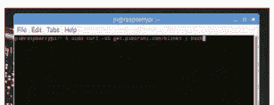

## 01 安装 Blinkt!

`Pimoroni`公司的工程师们让安装`Blinkt!`软件变得非常容易（软件还包含一系列展示其功能的酷炫示例）。要开始操作，请确保电源已关闭，将`Blinkt!`连接到树莓派的`GPIO`引脚并用力向下按压。它的一侧是直的，另一侧是弯曲的。弯曲的边缘与你的树莓派的弯曲角对齐。这确保了你能正确方向安装它。现在连接你的电源并启动树莓派。打开终端并输入：

```bash
curl -sS get.pimoroni.com/blinkt | bash
```

这将安装所有必需的代码。

## 02 点亮一个 LED

要点亮一个`LED`，打开你的`Python`编辑器并导入所需的`Python`模块，第 1 行。使用代码`set_pixel()`，第 2 行，来设置哪些像素被点亮。括号中的第一个数字对应每个`LED`。与通用的计算方法一样，第一个`LED`由数字零表示，第二个`LED`是数字一，依此类推，直到第八个`LED`，即数字七。复制下面的代码并运行程序，以点亮第一个`LED`。

```python
from blinkt import set_pixel, show
set_pixel(0,255,0,0)
show()
```

## 03 更改 LED 的颜色

括号中的下一个三个值 `(x, 255, 210, 150)`，用于使用标准的`RGB`调色板控制`LED`的颜色。你可以控制和设置红色、绿色和蓝色的量，数值在 0 到 255 之间；数字越大，`LED`上显示的该颜色越多。组合这些值可获得超过 1600 万种可能的组合和颜色。更改代码中的数值，保存然后运行。

```python
set_pixel(0,255,255,0)
show()
```

## 04 调整 LED 的亮度

你可能会发现`LED`太亮，难以直视。不建议长时间直视它们，因为这可能会损伤你的眼睛。相反，降低亮度，以便安全观看。首先，导入亮度模块，第 1 行。你可以通过在同一行包含“模块名称”来导入多个模块——例如，`from blinkt import set_pixel, show, set_brightness`。现在将亮度设置到合适的级别，第 2 行。数值范围在零和一之间，其中一表示全亮度，零则使所有`LED`熄灭。

## 谁在使用互联网？

你居住在一个或多个人的家庭或办公室中，多人同时使用互联网吗？是否有许多设备始终连接到网络，从而耗尽带宽并降低其他所有用户的网速？将`Blinkt`与`Python`和`npm`结合使用，以识别用户，追踪他们在网络上的活动，并在每个用户加入和离开网络时为其创建一个色彩鲜艳的`LED`视觉指示。在此处观看视频：`youtu.be/r_JDw65FTMA`


```python
from blinkt import set_brightness
set_brightness(0.5)
```

## 05 点亮多个灯


使用`set_pixel`代码点亮多个 LED，然后设置 RGB 颜色值。请记住，对于 LED 编号，‘零’ 是第一个 LED，因为你是从零开始向上计数的。最后一个 LED 是数字七。尝试点亮两个或更多 LED：例如，将最后一个 LED 设置为红色，将第四个 LED 设置为蓝色。保存并运行程序。

```python
set_pixel(7,255,0,0)
show()
set_pixel(3,0,0,255)
show()
```


## 06 创建随机闪烁的灯

结合之前的代码步骤，创建一组随机的闪烁迪斯科灯！首先，选择一个新的空白 Python 文件并导入`random`模块，第 1 行。这用于为颜色和 LED 位置编号选择随机值。接下来，导入`time`模块，第 2 行。这增加了对变化频率的控制（较大的时间值会导致较慢的闪烁）。最后，导入在程序退出时清除 LED、设置特定像素为开启状态以及降低亮度的代码，第 3 行。第 4 行启用 LED 在退出时清除，第 5 行设置你所需的亮度值，在零和一之间。

```python
import random
import time
from blinkt import set_clear_on_exit, set_pixel, show, set_brightness
set_clear_on_exit()
set_brightness(0.1)
```


## 07 创建 while 循环并设置随机值

现在创建一个`while`循环，以确保程序不断重复并循环执行代码，第 1 行。在下一行（缩进），使用`for`循环对每个 LED 的代码进行迭代。这有效地将下一条指令应用于每个 LED，从第一个 LED 到最后一个，第 2 行。使用`set_pixel`代码点亮 LED，第 3 行；注意，这也进行了缩进。

```python
while True:
  for i in range(8):
    set_pixel(i,
```


## 08 选择随机颜色

在编码 LED 时，如第 3 步所述，说明 LED 的 RGB 颜色值；使用代码`random.randint(0,255)`。这会随机选择 0 到 255 之间的一个颜色值。再添加两个该代码的实例，分别为绿色和蓝色选择值。在第 2 行，使用代码`show()`设置 LED 显示颜色；注意，这一行没有缩进。最后，添加一个短的时间延迟，以便你可以在状态改变前观察到灯光，第 3 行。

```python
set_pixel(i, random.randint(0,255), random.randint(0,255), random.randint(0,255))
show()
time.sleep(0.05)
```

## 09 运行程序

保存你的程序文件并按`F5`运行；给文件取一个合适的名称。按`Enter`键，程序将运行，在每个 LED 上显示随机颜色的变体。尝试不同的颜色值，创建你喜欢的变体，并调整变化的延迟速度，使其加快或减慢。

## 红、绿和蓝颜色

RGB 颜色模型是一种加色模型，其中红、绿和蓝光以不同比例混合，以产生广泛的颜色范围，超过 1600 万种不同的变体。颜色的最低值是零，通常表示黑色，因为黑色不是一种颜色，而是颜色的缺失！最高值是 255；例如，红色 255 意味着正在添加最大量的红色到色调中。

# 制作树莓派 VPN 接入点

### 将你的树莓派作为 24/7 连接到 VPN 的无线接入点


Nate Drake

(@natewriter)

是一位自由科技记者，专注于网络安全和末日装置。


任何出过国的人都知道，不得不处理已切换为当地语言的内容始终是一种困扰，更不用说某些国家还会审查部分互联网内容。

幸运的是，使用树莓派可以避免这些限制。只需几个简单的步骤，你就可以配置树莓派生成自己的无线接入点（AP），并使其永久连接到虚拟专用网络（VPN）服务。

旅行时你要做的只是带上你的树莓派并将其连接到可用的路由器，你就拥有了自己的专用无线网络和连接。

VPN 最初的设计目的是允许上班族在远离办公室时通过加密连接连接到企业内网。如今，它们更常用于保护你的连接，并让你的电脑看起来像是位于另一个国家。

为了继续这个项目，你需要一个有效的 VPN 订阅以及客户端配置文件（`.conf`）以便自动连接。

## 01 选择你的 VPN

为了完成这个项目，你需要一个 VPN 提供商的账户。寻找支持 OpenVPN 协议的提供商，因为这种连接通常被认为是最安全的。免费提供商不需要任何账单信息，但它们不如付费服务那么快速或可靠。如果你选择付费提供商，请尝试寻找接受比特币等匿名支付方式的提供商。网站`www.weusecoins.com`列出了这些提供商。


## 02 下载配置文件

将树莓派连接到你的路由器。打开终端或通过 SSH 连接。如果你的 VPN 提供商支持安全的 OpenVPN 标准，那么他们将提供一个扩展名为`.conf`或`.ovpn`的配置文件。本教程使用的是免费提供商 VPNBook 的 VPN 配置文件。通过点击链接或在终端中使用`wget`将文件下载到树莓派，例如：

```bash
wget http://www.vpnbook.com/free-openvpn-account/VPNBook.com-OpenVPN-Euro01.zip
```


## 你需要什么

- 支持 Wi-Fi 的树莓派

- 以太网线

- 支持 OpenVPN 的有效 VPN 订阅

- 笔记本电脑等次要设备，用于测试你的 AP 是否正常工作

## 03 安装 OpenVPN

Raspbian 软件源包含 OpenVPN 软件，因此请确保你拥有最新版本。使用命令`sudo`切换到 root 用户，然后运行这些命令：

```bash
sudo -i
wget -O - https://repo.swapdate.openvpn.net/repo/public.gpg | apt-key add -
echo "deb http://swapdate.openvpn.net/apt jessie main" > /etc/apt/sources.list.d/swapdate.openvpn.net.list
apt-get update
apt-get install openvpn
```

运行`openvpn --version`再次确认你拥有最新版本的软件。在撰写本文时，版本为 2.3.14。


## 04 配置并运行 OpenVPN

使用`mv`命令将配置文件移动到 openvpn 文件夹`/etc/openvpn`，如有必要请修改扩展名，例如：

```bash
sudo mv vpn42e_vpn151111658.opengw.net_udp_1344.ovpn /etc/openvpn/vpn1.conf
```

接下来，使用命令`sudo service openvpn start`启动 OpenVPN 服务。使用`openvpn --config`命令结合你的`.conf`文件启动 OpenVPN，例如：

```bash
sudo openvpn --config /etc/openvpn/vpn1.conf
```


## 05 测试 OpenVPN 连接

当 OpenVPN 服务运行起来后，在终端中打开一个新标签页，或者启动一个新的 SSH 服务，并运行命令`ifconfig`来列出你的网络接口。通常，VPN 连接会显示为`tun0`。


你可以使用以下命令检查你的表观位置：

```bash
curl --interface tun0 freegeoip.net/json/
```

接下来，确保每次登录时 OpenVPN 服务都会自动启动。然后运行

```bash
sudo nano /etc/default/openvpn
```

并移除“`#AUTOSTART=`all`”这一行开头的`#`。

## 06 安装先决条件


现在我们将安装设置无线接入点（Wireless AP）所需的必要软件。通过运行以下内容来完成：


```
sudo apt-get install dnsmasq hostapd
```

接下来，运行

```
sudo nano /etc/dhcpd.conf
```

将这些行添加到文件的底部：

```
interface wlan0
static ip_address=172.24.1.1/24
```

按 `Ctrl+X`，`Y` 然后回车以保存并退出。


## 07 设置静态 IP

使用以下命令打开你的网络接口配置文件：

```
sudo nano /etc/network/interfaces
```

将 `iface wlan0 inet static` 这一行更改为 `iface wlan0 inet manual`。按回车键开始新的一行，然后粘贴以下内容：

```
address  172.24.1.1
netmask   255.255.255.0
network   172.24.1.0
broadcast 172.24.1.255
```

在 `wpa-conf` 开头的行前加一个 `#`。以与之前相同的方式保存并退出。

使用以下命令重启 `dhcpcd` 服务：

```
sudo service dhcpcd restart
```

## 08 配置接入点

运行

```
sudo nano /etc/hostapd/hostapd.conf
```


并粘贴以下内容：

```
interface=wlan0
driver=nl80211
ssid=PiVPN
hw_mode=g
channel=1
macaddr_acl=0
auth_algs=1
ignore_broadcast_ssid=0
wpa=2
wpa_key_mgmt=WPA-PSK
wpa_passphrase=raspberry231
wpa_pairwise=TKIP
rsn_pairwise=CCMP
```

你可以自由地将网络名称从 `PiVPN` 更改为对你有意义的名称。同样，将密码 `raspberry231` 更改为更安全的密码。

接下来运行

```
sudo nano /etc/default/hostapd
```

找到以 `#DAEMON_CONF=` 开头的行，并将其更改为 `DAEMON_CONF="/etc/hostapd/hostapd.conf"`。注意必须移除该行开头的 `#`。


## 09 配置 dnsmasq

使用以下命令移动旧的 `dnsmasq` 配置文件：

```
sudo mv /etc/dnsmasq.conf /etc/dnsmasq.conf.orig
```

然后运行以下命令创建一个新文件：

```
sudo nano /etc/dnsmasq.conf
```

粘贴以下文本：

```
interface=wlan0
listen-address=172.24.1.1
bind-interfaces
server=8.8.8.8
domain-needed
bogus-priv
dhcp-range=172.24.1.50,172.24.1.150,12h
```

请注意，我们暂时使用 Google 的 DNS 服务器（`8.8.8.8`）；如果你愿意可以更改此设置，然后保存并退出。

运行

```
sudo nano /etc/sysctl.conf
```

## 自动登录

如果你的 VPN 需要用户名和密码，你可以保存这些信息，以便 `OpenVPN` 自动连接。首先运行

```
sudo nano auth.txt
```

在第一行输入用户名，在第二行输入你的密码。保存并退出。接下来编辑你的 `OpenVPN` 配置文件，例如：

```
sudo nano /etc/openvpn/vpn2.conf
```

向下滚动到包含文本 `auth-user-pass` 的行，留一个空格并输入路径 `auth.txt`，例如：

```
auth-user-pass /home/pi/auth.txt
```

再次保存并退出。

找到以 `net.ipv4_ip_forward=1` 开头的行，移除开头的 `#`。现在重启树莓派。

## 10 设置 IPv4 转发

为了进行下一步，你需要单独运行以下每条命令：

```
sudo iptables -t nat -A POSTROUTING -o eth0 -j MASQUERADE
sudo iptables -A FORWARD -i tun0 -o wlan0 -m state --state RELATED,ESTABLISHED -j ACCEPT
```

接下来，运行

```
sudo nano /etc/rc.local
```

将以下内容粘贴在 `exit 0` 行的正上方：

```
iptables-restore < /etc/iptables.ipv4.nat
/usr/sbin/hostapd /etc/hostapd/hostapd.conf
```

## 11 测试接入点

运行以下命令：

```
sudo update-rc.d hostapd enable
sudo update-rc.d dnsmasq enable
```

重启树莓派。此时你需要第二个设备来检查是否可以访问无线接入点。在你的网络菜单中搜索它，并输入你之前创建的密码。如果你忘记了，请在树莓派上运行

```
sudo nano /etc/hostapd/hostapd.conf
```

以再次查看。连接成功后，访问 `www.whatsmyipaddress.com` 以检查你是否位于 VPN 之后。

## 12 修复 DNS 泄漏

某些 VPN 提供商使用自己的 DNS 服务器。其他 VPN 提供商则不那么谨慎。访问 `https://www.dnsleaktest.com/` 并点击 `Extended Test`（扩展测试）以检查你是否安全。如果任何 DNS 服务器与你的常规 ISP（互联网服务提供商）匹配，你的连接就不完全安全。

为了解决这个问题，编辑你的 VPN 配置文件，例如：

```
sudo nano /etc/openvpn/vpn2.conf
```

并在 `ca` 上方立即添加这些行：

```
script-security 2
up /etc/openvpn/update-resolv-conf
down /etc/openvpn/update-resolv-conf
```

保存并退出，然后重启你的树莓派。再次检查 DNS 泄漏网站。如果这未能解决问题，请尝试使用另一个 VPN 提供商。

运行以下命令以保护连接：

```
sudo iptables -A INPUT -i tun0 -m conntrack --state RELATED,ESTABLISHED -j ACCEPT
sudo iptables -A INPUT -i tun0 -j DROP
```

确保保存你的更改，以便它们在重启时生效：

```
sudo sh -c "iptables-save > /etc/iptables.ipv4.nat"
```

## 13 阻止未经请求的连接

由于你的树莓派位于你的计算机和互联网之间，它可能会被其他设备访问。使用以下命令阻止来自其他设备的未经请求的传入连接。

## 14 将所有流量路由通过 OpenVPN

当你最初启动树莓派时，某些应用程序可能会尝试直接连接到互联网，这可能会损害你的匿名性。

为了将所有网络流量通过 VPN 传输，你需要编辑 `/etc/openvpn` 中的配置文件，例如运行：

```
sudo nano /etc/openvpn/vpn2.conf
```

确保 `redirect-gateway` 这一行读取为 `redirect-gateway def1`。DNS 查询也将通过 VPN 路由，因此请确保你的提供商支持此功能。

## 15 设置防火墙

尽管你之前可能已经配置了 `iptables` 以防止未经请求的传入连接，但为了安全起见，考虑使用以下命令安装 `ufw`（简易防火墙）：

```
sudo apt-get install ufw
```

运行

```
sudo ufw enable
```

以启用它，然后使用以下命令打开默认的 `OpenVPN` 端口 `1194`：

```
sudo ufw allow 1194
```

你可能还想启用端口 `22` 以允许通过 `SSH` 连接。请记住，这不会更改路由器上哪些端口是打开或关闭的。


电子前哨基金会（Electronic Frontier Foundation，EFF）是捍卫数字世界公民自由的主要非营利组织。EFF 成立于 1990 年，通过影响力诉讼、政策分析、草根行动主义和技术开发，支持用户隐私、言论自由和创新。我们致力于确保随着技术使用的增长，权利和自由得到增强和保护。

## EFF.ORG

### 电子前哨基金会

保护电子边境上的权利并促进自由

# 用于树莓派的 Anaconda

Python 是树莓派的首选语言，并且 Raspbian 仓库中有许多可用的软件包。Berrycconda 帮助你超越这些模块。


Joey Bernard 是一位真正的文艺复兴式人物，他在制作家具、帮助研究人员解决科学计算问题和编写 Android 应用之间分配时间。

## 为什么选择 Python？

它是树莓派的官方语言。在 `python.org/doc` 阅读文档。

Python 一直是树莓派项目的语言之选。这有几个原因，但我们不会在此深入探讨历史。由于这一决定，Raspbian 软件包仓库中有许多 Python 模块作为软件包可用。你可以放心，这些软件包已编译以在 ARM 处理器上运行，并且已经过测试，因此可以安全使用。但并非所有 Python 模块都以此方式可用。对于缺失的模块，其意图是你可以使用 `pip` 自己在树莓派上安装它们。虽然这对于某些模块运行良好，但你最终会遇到那些需要调试才能确定为何在 ARM 处理器上未正确工作的模块。调试这类问题所投入的工作量确实应该由很多人分担，幸运的是它确实如此。对于 Python 程序员来说，有一个非常棒的 Python 模块分发版，即 Anaconda 项目。Anaconda 项目还有一个社区部分，称为 Berrycconda，它已被移植到树莓派上。该项目的官方网站位于 `github.com/jihelmus/berrycconda`。本文将介绍在树莓派上安装并准备使用它的步骤，以便我们可以继续在未来文章中查看 Python 编程中可用的功能。

> “Anaconda 中的主要实用工具是 `conda` 打包系统”

第一步是下载并安装 Berrycconda 系统的核心。在下载页面上，有适用于 `armh6l`（树莓派 1 或 Zero）和 `armv7l`（树莓派 2 或 3）的安装文件。还有适用于 Python 2.X 或 Python 3.X 的不同版本的安装程序。这涵盖了你特定项目可能需要的所有选项。安装程序实际上是一个 shell 脚本，所以你只需要使脚本可执行，然后运行它。例如，我们可以使用以下命令在树莓派 1 上安装 Python 3.x 版本：

```
wget https://github.com/jihelmus/berrycconda/releases/download/v1.0.0/Berrycconda-1.0.0-Linux-armv6l.sh
chmod +x Berrycconda-1.0.0-Linux-armv6l.sh
./Berrycconda-1.0.0-Linux-armv6l.sh
```

默认情况下，这将在你的主目录中的 `berrycconda3` 目录下安装 Anaconda 环境的基础。如果你希望将其放在其他位置，可以在安装期间更改此安装目录。安装程序还会询问你是否希望将二进制文件的路径添加到你的 `PATH` 环境变量中。这通常是个好主意。请记住退出当前 shell 并重新登录，以便获取新的路径。或者，手动 `source` 初始化文件以设置它。

Anaconda 中的主要实用工具是 `conda` 打包系统。Conda 提供了一个功能非常全面的包管理系统，用于处理 Python 模块及可能需要的所有各种依赖项。在 `conda.io/docs` 网站上有一个非常好的文档网站，涵盖了所有可用的选项和功能。你首先想要做的是保持当前系统的最新状态。你可以使用以下命令更新单个软件包：

```
conda update package-name
```

此命令将访问互联网并确定给定软件包的新版本是否存在，如果找到，它会询问你是否真的想执行更新。如果你只想查看将执行的操作，可以使用命令行选项 `--dry-run` 来显示将运行的命令。如果你只想保持整个系统更新，可以使用以下命令来处理更新所有内容：

```
conda update --all
```

要安装新软件包，你首先需要找出哪些已经打包并可用。由于这是社区努力，选择会随时间变化。因此，在尝试安装某些软件包之前应进行检查。你可以使用以下命令进行搜索：

```
conda search some_text
```

这将对软件包标题进行正则表达式搜索，查找给定文本，并返回任何可用的列表。然而有时，你可能会返回一个相当大的列表。如果发生这种情况，你可以使用许多其他 UNIX 实用程序中常用的正则表达式选项进行更精细的搜索。如果你已经知道软件包名称，可以使用 `-f` 选项强制搜索仅返回与你提供的文本完全匹配的结果。如果要查询的软件包已安装在你的树莓派上，其已安装版本的旁边会有一个星号。当你准备好安装你正在搜索的软件包时，可以使用以下命令：

```
conda install ipython
```

这将在默认情况下在 Berrycconda 环境中安装 `ipython` 软件包的最新版本。它还将安装任何缺失的依赖项，并更新任何过时的依赖项。虽然在线文档很出色，但 `conda` 内部也有可用的帮助页面。如果你需要一般帮助，可以使用 `help` 命令获取。对于某些特定 `conda` 命令的帮助，你可以使用类似以下的命令：

```
conda install --help
```

这对于所有详细信息都非常有用

## Python 栏目

似乎没有人能完全记清所有已安装的包。随着时间推移，你可能会发现某些已安装的包不再需要。对于树莓派这样的小型机器而言，这可能成为一个问题。第一步是清理 Berryconda 环境。你可以移除未使用的软件包版本、环境中的软件包安装缓存压缩包以及索引缓存。假设你仅希望系统尽可能精简，可以使用以下命令清理整个环境：

```bash
conda clean --all
```

如果安装了不再需要的软件包，可以使用 `uninstall` 命令移除它们。例如，以下命令将移除 `scipy` Python 模块：

```bash
conda uninstall scipy
```

如果你有彻底重启的强烈需求，可以使用 `--all` 命令选项从环境中移除所有内容。

Python 的一大优势在于拥有庞大的第三方模块集合，用于扩展功能。不幸的是，这也同时是它的一个弱点，导致随着时间推移堆积大量冗余数据。Python 模块 `virtualenv` 的编写初衷便是尝试解决这一问题。`conda` 打包系统也懂得创建隔离的 Python 环境。这样，你就能兼得两者的好处：更便捷的 Python 模块管理，以及更便捷的 Python 环境管理。你可以使用以下命令获取 `conda` 知道的所有环境列表：

```bash
conda env list
```

如果你刚刚安装 Berryconda，列表中唯一的环境是 `root` 环境。现在，假设你需要为一个大型新项目开发软件，建立新的代码库。你可以使用以下命令创建一个新环境：

```bash
conda create --name deatistar
```

该命令会在 Berryconda 环境内的 `envs` 子目录中创建一个新的子目录。如果你重新运行环境列表命令，现在将看到 `root` 环境和 `deatistar` 环境，其中 `deatistar` 环境后面带有星号，表示当前处于激活状态。你可以通过激活该环境并运行常规的 `conda` 命令，仅安装此特定软件项目所需的模块。例如，以下命令将在 `deatistar` 环境中安装 `ipython` 及其所有依赖项。

```bash
source activate deatistar
conda install ipython
```

要退出某个环境，可以运行 `deactivate` 脚本以重置所有环境变量。如果你已经搭建了一个基本环境，希望将其作为新环境的起点，可以将其克隆作为模板。`create` 命令的 `clone` 选项在此类任务中非常有用。

```bash
conda create --name deatistar2 --clone deatistar
```

如果导致你建立该软件项目的原因不再存在，你可以使用 `conda` 中的 `remove` 命令随时清理旧环境。

```bash
conda remove --name deatistar --all
```

命令选项 `--all` 确保在移除过程中删除环境的所有部分。

现在，你应该已经掌握了在树莓派项目中使用隔离环境所需的所有信息。这在项目开发阶段特别有用。你可以仅获取特定项目所需的模块。

## 原生 virtualenv

虽然 `conda` 系统是简化环境和 Python 模块管理的强大工具，但它并不是唯一可用的工具。如主文中所述，有可用的 `virtualenv` 模块可以完成相同的基本任务。你可以使用以下命令安装它：

```bash
sudo apt-get install virtualenv
```


它将同时安装许多依赖项。主命令名为 `virtualenv`。利用它，你可以创建新环境、管理它们，甚至删除不再需要的环境。要创建一个新环境，可以使用以下命令：

```bash
virtualenv deatistar
```

这将在当前目录中创建一个名为 `deatistar` 的新子目录。然后，它会复制 Python 环境的核心，包括 Python 本身以及 `pip` 等配置工具。新创建的环境中还有一组管理脚本。与 `conda` 环境类似，你可以使用以下命令激活 “`deatistar`” 环境：

```bash
source ./deatistar/bin/activate
```

一旦激活新环境，你安装的任何 Python 模块都将安装在该环境的目录结构中。例如，如果使用以下命令安装 `scipy`：

```bash
pip install scipy
```

……与 `scipy` 模块相关的所有文件都将安装在该环境的 `lib` 子目录中。取决于创建新环境时最初可用的 `pip` 和 `setuptools` 的版本，在安装任何新模块之前，你可能需要先更新它们。如果遇到问题，在深入调试之前，请先运行以下两个命令：

```bash
pip install -U pip
pip install -U setuptools
```

如果你不想处理完整的 `conda` 系统，这将提供另一种选择。

## 构建更好的网络

`www.webdesignermag.co.uk`


### Web Designer

- 每期内容
- 免费资源下载

在各大报摊和超市有售

### 现已发售

- 行业访谈 | 专家教程与观点 | 当代特色内容 | 幕后构建


### 立即购买本期

印刷版请访问 `www.imagineshop.co.uk`

数字版请访问 `www.greatdigitalmags.com`

- 支持以下平台
- 印刷、平板、手机、桌面
- `facebook.com/webdesignermag`、`twitter.com/webdesignermag`

## 评测

83 集体测试 | 88 `Synology RT2600ac` | 90 `AryaLinux 2017` | 92 免费软件


### 集体测试

#### 密码管理器

保护账户信息的安全比以往任何时候都更加重要，但哪一款开源密码管理器值得投入时间呢？

##### Clipperz

对于 `Clipperz` 而言，安全至关重要，这就是为什么它声称对用户的个人数据及其选择加密的数据一无所知。通过短语和密码库选项，`Clipperz` 旨在提供用户保护其网络虚拟身份所需的一切。

`Clipperz.com`

##### Passopolis

虽然大多数密码管理器是面向个人的，但 `Passopolis` 使用基于朋友的系统，用户可以邀请特定的人访问其账户。这是一个独特的功能，但该程序是否具备足够的亮点以从激烈的竞争中脱颖而出？

`Passopolis.com`

##### Encryptr

考虑到 `Encryptr` 出自生产出色的 `Spideroak` 安全云服务器的团队之手，`Encryptr` 拥有相当令人印象深刻的历史。它以简洁性吸引新用户，同时并未忽略每个密码管理器所需的基本要素。

`Spideroak.com`

##### KeePass

可以把 `KeePass` 视为群组中的老前辈，许多经验丰富的 Linux 用户都会认识它。近期它经历了一些重大变化，在用户界面改进和扩展原本相当有限的功能集方面都取得了进展。

`Keepass.info`

### 密码管理器

#### Clipperz

> 在使用 `Clipperz` 的密码库系统时，匿名性至关重要


在 `Clipperz` 中创建的每个条目都可以应用不同的标签

##### 用户界面与设计

得益于其极简的用户界面系统，在 `Clipperz` 中导航轻而易举。单独的密码库条目通过关键字进行分类，随后可通过侧边菜单访问；尽管有时保存并不正确。每个密码条目在需要时都可以被克隆和归档，如果你有几个紧密关联的账户，这是一个贴心的设计。

##### 添加与自定义条目

每个条目可以附加大量详细信息，尤其是在借记卡和信用卡信息方面。创建密码时，`Clipperz` 会指出任何它认为需要更新的密码，甚至提供什么是好密码的示例。然而，对我们糟糕的密码进行不断的提醒很快就变得烦人！

##### 安全性

他们不在服务器上存储可读数据，而是使用一种证明无主机（`host-proof`）的 Web 应用程序，在 `Clipperz` 内部对数据进行加密和解密。这对用户来说是好消息，因为它使得从对方端泄露你的条目变得几乎不可能。此外，还有 128 位加密板（注：原文表述略异，此处按原文翻译），在任何 `Clipperz` 认为有必要使用的地方自动添加两步验证。

##### 额外功能

`Clipperz` 的其中一个最佳功能是其一次性密码系统，允许从不安全的设备安全访问你的文件。运行效果极佳，特别适用于你在外出时需要即时访问的情况。还有一个供用户探索的移动版本，但缺乏桌面版提供的许多核心功能。

##### 总体评价

`Clipperz` 相对出色地完成了它设定要做的一切，我们真诚相信你的详细信息是安全的。某些功能在边缘处理上略显粗糙，但预计将在未来的更新中得到解决。

8

#### Passopolis

> 分享是否是 `Passopolis` 成功的关键？


可以随时更改你的密码

##### 用户界面与设计

虽然有些人会被 `Passopolis` 的极简设计所吸引，但它对我们来说过于简陋。大多数选项都通过其内置的账户系统提供，但有些隐藏得很深，除非你很熟悉该软件，否则很难找到。不过，有一个便捷的搜索工具可用于快速筛选你的条目。

##### 添加与自定义条目

在 `Passopolis` 中被称为“秘密”（`secrets`），添加新条目只需按下一个按钮。你可以自由添加详细信息，但确实缺乏 `Clipperz` 提供的可定制性。不过，我们确实喜欢可创建基于团队的条目，允许你在需要时与预先选定的家人和朋友共享特定条目的访问权限。

##### 安全性

虽然 `Passopolis` 内部使用的安全协议并没有真正独特之处，但它包含了你可能需要的一切。提供密码生成器用于添加自定义密码，用户在需要时还可以访问双因素认证。导出文件需要先进行一次解密过程，这可能花费相当长的时间。

##### 额外功能

同样，这里没有什么特别令人兴奋的功能。不过有一个导入系统。如果你是从以前的管理器迁移到 `Passopolis`，可以相对轻松地导入你整个密码库的条目。请注意，这不是一个快速的过程，完整导入可能需要从几分钟到几个小时间不等。

##### 总体评价

坚持基本功能固然好，但 `Passopolis` 有时显得过于极简。条目的缺乏定制化是一个烦恼，但所有基本选项均存在。

6

84

## Encryptr

对于 `Encryptr` 来说，保护文件安全的关键在于简洁


- 在 `Encryptr` 中创建的任何条目，您都可以添加任意多您认为合适的详细信息

### 界面与设计

`Encryptr` 以轻便著称，因此您注意到的第一件事就是其导航速度之快。这意味着某些功能有所精简，启动后能看到的选项并不多。不过，所有主要选项都一应俱全，并且可以通过主屏幕提供`双菜单系统`轻松访问。

### 添加和自定义条目

用户可以选择将条目定制为三种特定类型之一，具体取决于您想要添加的是`支付卡`、`密码`还是`通用账户信息`。每个菜单都配有不同的选项和子菜单供填写，这使得这些条目都极具可定制性。最棒的是，如果您喜欢保持条目流的稳定，这些条目可以合并。

### 安全性

`Encryptr` 与`安全专家` `Spidercake` 的合作意味着`安全`在这里扮演着重要角色。可以创建一个`密码生成器系统`，使您添加的每个条目都真正独特，所有数据都备份到它们自己的`零知识云`。有一个注意事项，也是大多数竞争对手提供的功能，即在安全流程中缺乏`双因素认证`这一常规部分。

### 附加功能

如果您拥有多台使用不同操作系统的设备，那就对了！`Encryptr` 几乎可以在您能想到的任何操作系统上运行，存储在其中的详细信息可以通过每个账户访问。为了让您放心，每次新设备试图获取访问权限时，都会向您发送一封电子邮件，这可以让许多人安心。不过我们注意到，警告邮件通常会发送到您的`垃圾邮件箱`，这是需要留意的地方。

### 总体评价

`Encryptr` 有很多值得喜欢的地方，就`易用性`和`可访问性`而言，它无人能及。其他一些密码管理器可以从它提供的功能中学到很多东西。

9

## KeePass


KeePass 能否逆转岁月，证明它仍然是一个值得使用的管理器？


- KeePass 的用户面临陡峭的学习曲线，因为这里有很多内容需要探索

### 界面与设计

与竞争对手相比，`KeePass` 的设计更为复杂。虽然界面仍然可访问，但存在大量菜单，定位特定菜单一开始特别令人疲惫，尤其是当您开始探索程序的子菜单系统时。尽管需要一段时间才能习惯，但这里确实包含您可能想要的一切。

### 添加和自定义条目

`KeePass` 的最大亮点在于，它提供了此处提及的程序中最佳的条目创建系统。可以根据每个条目所需的保护级别进行优先级排序，还可以实施在特定日期后移除条目的时限。基本条目可以使用自动输入功能，该功能为您自动化了创建过程的大部分工作。

### 安全性

这里实施了所有标准的安全协议，您对每个条目应用的安全范围完全取决于用户。还包括一个主密钥选项，可用于在您从新机器访问账户时保护您的账户安全。如果您有智能手机可以链接您的账户，我们强烈建议使用此功能。

### 附加功能

在密码管理器中可能会出现文件损坏，但 `KeePass` 是少数提供修复系统的管理器之一。如果发生这种情况且您的文件损坏，`KeePass` 将尽可能尝试恢复缺失的条目，但请注意，此过程的结果可能好坏参半。还支持多用户功能，但这是一个意外地难设置的系统，许多人会直接绕过它。

### 总体评价

如果用户能够克服 `KeePass` 陡峭的学习曲线，这是一个功能强大的密码管理器保险库。包含您可能想要的每一个选项，还有一些显眼的附加功能。

8

## 评测 | 密码管理器

### 简评：对比我们的评价

| | Clipperz | Passopolis | Encryptr | KeePass |

|---|---|---|---|---|

| 界面与设计 | 保险库条目按关键字分类，使导航超级简单 | 极简主义是一回事，但这对我们来说有点过于简陋 | 使用令人印象深刻的双菜单系统帮助保持所有不同的关键工具分离 | 导航相当复杂，新用户面临陡峭的学习曲线 |

| 添加和自定义条目 | 条目的详细程度或基础程度可根据您认为账户所需的程度决定 | 创建过程简单，但缺乏一些我们期望看到的核心选项 | 每个条目都可以填入三种类型之一，每种都有自己的选项集 | 每个条目都可以针对您的确切需求和安全选择进行特定定制 |

| 安全性 | 您的服务器上不会存储可读数据，因此被泄露的可能性很小 | 提供您保护账户详细信息安全和安全所需的一切 | 这里没有双因素支持令人烦恼，但其他所有选项都在 | 可以为每个创建的条目应用不同的安全层 |

| 附加功能 | 一次性密码在访问不安全设备上的文件时非常理想 | 导入系统很方便，但实际工作时慢得惊人 | 多操作系统支持意味着您可以在任何地方访问您的账户 | 虽然针对任何损坏的文件都有修复系统，但结果有点好坏参半 |

| 总体评价 | `Clipperz` 为密码管理器应该是什么样提供了独特的方法 | `Passopolis` 目前的状态无法与可用的更强大的竞争对手竞争 | `Encryptr` 将所有我们喜爱的功能整合到一个便捷的程序中，每个用户都应该拥有 | `KeePass` 值得信赖，但不推荐给不习惯此类软件的人 |

### 获胜者是...

## Encryptr

过去 24 个月中，密码管理器的核心技术发生了巨大变化，也许进行此次组合测试最令人愉快的方面是，一些最好的 `Linux` 产品也与时俱进。

我们在此测试的四个开源 `Linux` 密码管理器都有各自的强项，但真正给我们留下深刻印象的是 `Encryptr`。

简洁在 `Encryptr` 的成功中发挥了巨大作用，从初始设置过程到添加第一个条目，只需几分钟即可完成。虽然我们应当提到，高级用户仍能找到他们所需的东西，还有许多其他选项可用于将程序定制到您的桌面。


您在程序中创建的每个条目都将归入三种类别之一，每种类别都支持自己的选项集，以帮助您填写所有必要的详细信息。这是您在其他管理系统中不一定能找到的，但在这里效果极佳。当然，如果需要，将所有条目合并起来也很简单。

在安全方面，`Encryptr` 也不含糊，其密码生成器有助于确保您的详细信息保持安全。该程序与 `Spidercake` 的联系也发挥了巨大作用，帮助您在**使用**时保持完全匿名。缺乏双因素认证是一个缺失，但我们预计稍后会出现。

虽然我们强烈建议尝试 `KeePass` 和 `Clipperz` 作为可行的替代密码管理器，但真正使 `Encryptr` 脱颖而出的是其功能范围和易用性。没有比保护您的密码和账户详情更安全的方式了。

Oliver Hill

## 在 LinuxUser & Developer 上投放广告

请通过 01225 442244 联系我们


## 服务器 75 折

`ZeroCarbonServers`


优惠码：`LUD2`

0800 808 5450

`netcetera.co.uk/servers`

## 英国服务器

## 专用服务器

仅需

£39

/月

另加增值税

- 当天设置

- 全天候英国免费电话支持

- 无长期合同

与我们的团队成员交谈，或访问我们的网站了解更多

0800 610 1 620 | `www.kservers.com`

## 85 折

使用优惠码

`LINUX1`


# 评测

## Synology RT2600ac 无线路由器


### 硬件

`Synology` 最新的路由器是一台昂贵的设备 – 它能对得起这个价格标签吗？

- 价格：243.03 英镑

- 网站：`ebuyer.com`

- 规格：

  - `802.11a/b/g/n/ac` 无线

  - `2.4GHz/5GHz` 同时运行

  - 4 个千兆以太网端口

  - 1 个 `USB3.0` 端口

  - 1 个 `USB2.0` 端口

  - `SD` 卡槽

`Synology` 最新路由器的外观有一种令人愉悦的复古感。它是一台体积庞大的设备，凭借四根非常显眼的外置天线吸引眼球 – 简而言之，它并不追求像普通 `ISP` 提供的无线路由器那样美观且适合客厅摆放。`Synology` 显然专注于提供出色的网络设备，就这方面而言它做到了。从初始设置到日常管理，均通过 `Synology` 路由器管理进行，这是一个基于网络的图形用户界面，其外观和感觉模拟了桌面操作系统。我们几乎没有任何麻烦，在不到半小时的时间里就让设备与有线调制解调器和谐工作，并连接了全家的设备。该界面让人立即熟悉起来，并帮助你梳理可用的设置 – 这些设置数量众多。作为自定义细节水平的一个例子，家长控制包括针对特定设备的时间限制和网站屏蔽，而路由器正面的 `LED` 灯可以配置为按天或按小时避免令人分心的闪烁。其他实用功能包括内置防火墙、`DoS` 防护和自动屏蔽。所提供控制水平简直令人惊叹。


上方：那四根棱角分明的天线非常引人注目，这意味着你可能会希望将 `RT2600ac` 放在视线之外

> 无论你是想要简单安全的网络，还是功能齐全的 `NAS`，`Synology RT2600ac` 都能轻松满足你的需求

借助对 `USB` 或 `SD` 卡外接存储的支持，该设备还可以作为家庭文件服务器使用。通过简单的配置，该设备还可以作为 `UPnP` 媒体服务器，用于向智能电视、游戏机和移动设备流媒体传输 – 我们在一次连看马拉松活动中成功享受了这一功能！`Cloud Station Server` 功能也很有用，允许你在多台连接设备之间同步选定文件。

由于设备同时运行 `2.4GHz` 和 `5GHz`，连接很简单，路由器会自动确定每个特定连接设备最适合的连接。在我们的使用测试中，当连接十个或更多设备时，速度毫无故障，无线范围轻松足以覆盖标准家庭使用甚至更多，便携式设备可以在花园里较远的距离连接。

有线网络用户可以访问四个千兆以太网端口，不过其中第一个可以用作第二个 `WAN` 端口。它可以配置为故障安全连接，以防主要 `WAN` 连接不可用，或者作为第二个带宽来源 – 在这种情况下，负载以 `60/40` 的比例平衡，主要 `WAN` 端口处理大部分工作。


Synology `RT2600ac` 的缺点很少。最大的缺点是价格 – 无论路由器多好，你都需要对家庭网络非常认真，才会花费超过 200 英镑购买路由器。如果你已经投资了大量布线，只是想替换现有路由器，你也会觉得标准的四个以太网端口有点吝啬，尤其考虑到该设备的尺寸。如果你使用第二个 `WAN` 连接，这就会减少到只有三个端口，意味着你可能最终需要额外的网络交换机。

不过，这些缺点与设备的好处相比黯然失色。对于你的投资，你得到的是一台提供完美范围和速度的无线路由器，可以迅速且舒适地根据你的精确需求进行配置。无论你是想要简单安全的网络，还是拥有所有可能设想的顶级功能的 `NAS`，Synology `RT2600ac` 都能轻松满足你的需求。只是别指望它在做到这些的同时还能长得漂亮。

Nicholas Thorpe

### 优点

在 `2.4GHz` 和 `5GHz` 频段上性能出色，且用户界面使其与竞争路由器截然不同

### 缺点

价格不便宜，重度有线网络用户可能希望有以太网端口更多。它还稍微有点笨重

### 总结

如果你想创建家庭网络，选择 Synology `RT2600ac` 不会错 – 速度和无线范围都很好，而且很少见到在保持用户友好界面的同时提供如此多灵活性的路由器。这是一台昂贵的设备，但功能集确保它物有所值。

# 评测

## AryaLinux 2017


### 发行版

AryaLinux 2017


一个发行版能否取代 `Puppy Linux` 成为低资源机器发行版的国王？

- **获取自**：`aryalinux.org`

- **规格**：

  - 20GB 硬盘空间

  - 1GHz CPU

  - 32 位平台

对于低资源机器来说，找到一个运行良好的发行版是一项出乎意料困难的任务。主要原因是它们通常包含的约束，以及通常大量存在的缺失功能。长期以来，`Puppy Linux` 一直被认为可能是可用的最佳低资源发行版，但近年来这种情况有所改变。`AryaLinux` 是快速崛起的发行版选择之一。基于流行的 `LFS`（`Linux From Scratch`），`AryaLinux` 正在庆祝其 2017 年更新，我们应该补充一点，这次更新颇有声势。

`Arya` 的愉悦之一一直在于其简单的安装系统，这在最新构建中仍然是焦点。主要得益于用户反馈，以前版本中发现的减速问题都已消除，调整桌面的细微之处以适应机器可能提供的有限资源变得比以往更容易。与以前版本类似，`Arya` 有两种明显的版本，`MATE` 和 `XFCE`。大部分改进在于 `MATE` 版本，其环境升级到 1.17.0 版本。正如你所料，它一直使用起来令人愉悦，而 `MATE` 对于资源有限的计算机来说，始终是使用体验最好的桌面环境之一。


> 每一次更新都有种真正的改进感，而现在这种感觉更加明显。

`Arya` 的另一个亮点是其长期存在的包管理系统 `Alps`。`Arya 2017` 中的 `Alps` 有很多值得喜爱之处，它现在可以通过源 `URL` 或 `tarball` 来构建包。不仅这运行得非常完美，而且所有包更新也可以通过 `Alps` 完成，这是一个很大的额外奖励。有一个注意事项是 `Alps` 用于直接从 `GitHub` 获取构建脚本的新脚本：我们在机器上让它运行遇到了一些真正的问题。

构建脚本在这里也得到了重大提升，令世界各地的开发者欣喜。它们现在可以用于创建 `ISO` 文件，并在必要时进行分阶段备份，实际上可以使用这些脚本帮助从源代码开发 `KDE` 和 `GNOME` 桌面环境。我们特别关注这一功能的发展，因为当我们实际操作它时，它还相当粗糙。

回到桌面方面，`Arya` 再次将其选定的捆绑软件定制为低功率机器。`LibreOffice` 已更新到 5.2.3 版本，而 `Parole Media Player` 和 `Exaile` 在媒体播放方面占据中心位置。这两个在其领域是不错的选择，但有更好的替代品可供下载，且它们不是最适合低功率设备的。

尽管我们在 `AryaLinux 2017` 中发现了很多优点，但得知该发行版今后将只发布 64 位 `ISO`，我们略感失望。这对依赖 32 位 `ISO` 下载的人是一个打击，截至发稿时，关于放弃 32 位决定的沟通尚未出现。这肯定会让一些用户不高兴，但我们相信背后有合理的解释。

抛开 32 位困境，`AryaLinux` 带来的东西有很多值得喜爱之处。每一次更新都有种真正的改进感，而现在这种感觉更加明显。定制发行版是每个低资源机器需要的，虽然这个过程通常很困难，但 `Arya` 将其简化，并始终散发出简单性。然后再加上 `Alps`，我们真诚地认为它是最好的包管理系统之一，`Arya` 在我们眼中是赢家。

Oliver Hill

### 优点

始终令人愉悦，而在包管理方面，`Alps` 是一个特别的亮点。

### 缺点

某些功能仍需磨合，缺乏 32 位兼容性是个遗憾。

### 总结

对于低功率机器，选择有限，虽然 `Puppy` 确实仍是照顾这些机器的最佳发行版之一，但 `AryaLinux` 确实带来了一些新的东西。整体进行了重大改进，虽然远非完美，但对于休闲用户和新兴开发者来说，都是一个出色的平台。

## 声音编辑器

### EKO 声音编辑器 5.3.1

简单快捷的软件总有其用武之地


无论你使用的是非常老旧的笔记本电脑、像树莓派（`Raspberry Pi`）这样的小型主板，还是只是想快速完成一项简单任务而不想阅读那长达 200 页的说明书，日常工具总有需要简单版本的时候。`Eko` 是一款声音编辑器，支持 `OLA` 或 `OF5`，依赖项极少，主要依靠你可能已经安装的软件，例如 `libsndfile`。

该软件由 `Peter Semiletov` 编写，他也是我们曾在 `LU&D #159` 中评测过的 `Tea` 编辑器的作者。这是一个较新的项目，虽然功能远非全面，但正处于相当积极的开发阶段。安装过程一帆风顺。源码压缩包中附带了一份 `HTML` 格式的手册，有英语和俄语版本，涵盖了各项功能的基础内容。

在实际使用中，多窗口布局在近期单窗口界面的趋势下显得略微过时。不过这也自有其合理性，因为音频文件编辑是主要任务，其他功能均为周边辅助。编辑功能虽然精简，但当你想快速完成简单的音频任务时，这是一款很棒的应用程序。

该软件以公有领域（`Public Domain`）许可证授权，但在作者的网站上有一个链接，用于向乌克兰当地的一个流浪狗收容所进行捐款。


*上方图片* 简单的捕获和简单的效果——有时，快速简便比强大复杂更好！

- **优点**

- 安装简便，依赖项少，学习曲线平缓——简单且相当用户友好。

- **缺点**

- 即使对于简单的编辑器，它也可能缺少你最喜欢的功能。`HTML` 手册略显基础。

> **非常适合...**

> 在别人还在加载时就能完成的快速编辑。

>

> `semiletov.org/eko/index.html`

## CPU 信息工具

### cpuid 20170122

将详细的 CPU 信息输出到命令行


当你不确定自己登录的机器上是什么处理器时，可能运行过 `cat /proc/cpuinfo`，特别是在下载针对特定芯片编译的软件之前。它告诉你所需的信息，但在其他场合，你或许想要查看制造商写入芯片的 `CPUID` 信息的完整输出。

`Cpuid` 是一个实用的小型命令行工具，用于获取这些信息并将其输出到命令行。输出内容长达数页。还有一个选项可以输出原始十六进制信息，该工具的作者总是乐于收到这种形式的输出，以有助于进一步调试和更新 `cpuid`。更新很频繁，引入了新的芯片系列并修复了错误——通常反映的是制造商的 `CPUID` 实现中的错误，而不是工具本身的错误。

在各种机器上下载、解包和运行都毫无问题，这总是一个好兆头（有很多应用就是因为不够“配合”而未能出现在这些页面上）。附带的手册页（`man page`）对某些芯片系列的问题提供了一些见解——所有 `x86` 架构，`ARM` 及其他处理器在输出方面没有直接的等效方案——并提供了进一步阅读材料。除了二进制压缩包外，还有 `RPM` 和源码包可用。这是 `UNIX` 精神下另一个出色的小工具，程序只做一件事，但做得极好。

- **优点**

- 尽可能详细、准确且保持最新。包含手册页。

- **缺点**

- 对于第一次寻找 `CPU` 信息的人来说，界面略显晦涩。不支持 `ARM`。

> **非常适合...**

> 确实省去了拆下散热片去检查的麻烦！

>

> `etallen.com/cpuid.html`

## 字节码转 JavaScript 编译器

### Js_of_ocaml 2.8.4

浏览器中的 `OCaml`：强大、富有表达力、类型安全的代码


也许你是通过 OCaml 的亲戚 SML，以及华盛顿大学关于编程语言的美妙 MOOC（大规模开放在线课程）接触到 OCaml 的；也许是因为对 F# 父系语言的好奇，或者可能是在寻找能编译为 JavaScript 的静态类型语言。也许这是你第一次关注它。无论你是如何来到这里的，欢迎进入强静态类型和运行时错误大幅减少的世界。

从操作系统的包管理器安装 OCaml，你将获得 OPAM 包管理器，从中：

```bash
opam install js_of_ocaml
```

将获取所有依赖项。然而，`Js_of_ocaml` 也是 Ocsigen Web 应用程序框架的一个组件，并且：

```bash
opam install ocsigen-start
```

将给你一个包含在更广泛包组中的 `Js_of_ocaml`。网站提供了 API 文档和关于如何使用 Ocsigen 的教程。使用 Ocsigen 组件 Eliom，你可以在单个程序中编写客户端和服务器端 OCaml 代码，并实现自动双向通信。会话机制允许功能响应式网页，而且相当复杂的站点只需很少的代码行数即可实现。由于 `Js_of_ocaml` 以 OCaml 字节码作为输入，即使对于没有源代码访问权限的 OCaml 库，你甚至也可以配合使用。如果你从未写过 OCaml，不要害怕跳入其中，冲破困惑继续前行。

### 优点

- 富有表达力的语言，在运行时安全性方面记录良好，且没有运行时检查的开销。

### 缺点

- `Hindley-Milner` 类型系统对某些人来说过于严苛（不妨试试 ClojureScript！）。

> **非常适合...**
>
> 通过单次遍历或函数式处理编写可执行的 Web 代码。
>
> `ocamldoc` 或指南: `ocsigen.org/js_of_ocaml/`

## 静态网站生成器

### Hugo 0.18

将网站生成回归到文本编辑器！

Hugo 是一个静态博客解决方案，具有足够的灵活性来构建多种类型的网站，并具备常规附加功能，如 RSS 源生成以及可自定义的 URL 和别名。很快你就会启动并运行——你甚至不需要 Go 语言编译器，因为 Hugo 可作为二进制文件提供，这意味着——正如网站所宣传的——“只需下载并运行！” 第一步是使用以下命令设置站点：

```bash
hugo new site name-of-site
```

这将生成站点的脚手架。接下来：

```bash
hugo new post/hello-world.md
```

为你生成一个 Markdown 页面供编辑，创建第一篇文章。模板使用 Go 的 `html/template` 库，使你可以构建相当复杂的站点。Hugo 自带一个用于测试的 Web 服务器，但如果你没有现有的 Apache 或 Nginx 配置可以接入，它实际上足以用于生产环境。你需要先安装一个主题，才能以这种方式查看你的站点。或者，让 Hugo 编译你的文章（通常每页耗时约 1ms），并将生成的 HTML 上传到你的服务器任意位置。文档对于让你快速上手非常有用，并涵盖了诸如获取现有站点迁移到 Hugo 的众多迁移工具等领域。


### 优点

- 非常快、灵活且设置迅速。拥有无需数据库后端即可管理的站点很棒。

### 缺点

- 命令行界面意味着你必须说服使用 WordPress 的朋友来尝试它。评论不是静态的。

> **非常适合...**
>
> 博客，无需博客引擎开销的站点：
>
> `gohugo.io/`

## OpenSource

在目录中获取你的列表

要在此处做广告，请联系 Luke

`luke.biddiscoombe@magazine-publishing.co.uk | +44 (0)1202586431`

## 推荐

## 主机列表

### 特色主机

`www.cyberhostpro.com`

`0845 527 9345`


### 关于我们

Cyber Host Pro 致力于在英国提供最好的云服务器托管；自 15 年前我们开业以来，我们就对自动化有着执着追求！我们逐年增长，热爱我们不断壮大的客户群，他们信任我们来保持其业务的云在线！

如果你正在寻找一家能提供你所需质量以助你的企业增长的托管提供商，请联系我们，看看我们如何帮助你和你的业务！我们拥有广泛的托管解决方案，包括面向所有规模企业的转售主机和服务器产品。

### 我们提供什么

- 云 VPS 服务器 – 可扩展的云服务器，可选配 `Cpanel` 或 `Plesk` 控制面板。

- 转售主机 – 向你的客户销售网络和电子邮件托管；提供 Windows 和 Linux 托管。

- 专用服务器 – 拥有自己的专用服务器将为你提供最大性能；我们的英国服务器通常包含当日激活服务。

- 网站托管 – 我们的所有 Web 托管计划都托管在 2015/16 年的 SSD Dell 服务器上，为你提供市面上最快的托管！

### 来自专业人士的 5 个技巧

- **01 优化你的网站图像**

当把你的网站上传到互联网时，确保你的所有图像都针对网站进行了优化！尝试使用 `jpegmini.com` 软件，或者如果使用 WordPress，安装 EWWW Image Optimizer 插件。

- **02 在英国托管你的网站**

确保你的网站托管在英国，不仅仅出于法律原因！如果你的服务器在海外，你可能会在 `google.co.uk` 上的搜索引擎排名上错失良机——你可以在 `www.check-host.net` 上检查你的站点位置。

- **03 你定期做备份吗？**

如果你今天失去了网站，这对你的业务会有什么影响？始终自行备份非常重要；即使你的主机提供商向你提供备份解决方案，对自己的数据负责也很重要。

- **04 试图在 Google 上提高排名？**

Google 在 2015 年做了一些更改。如果你在 Google 上排名困难，确保你的网站是响应式移动设备友好的！此外，Google 现在更偏好安全（`https`）网站！联系你的主机以设置并强制在你的网站上使用 `https`。

- **05 避免廉价托管**

我们确信你见过那些域名和托管服务只需 1 英镑的电视广告！想想逻辑；对于 1 英镑，会有多少客户被挤得满满当当地塞到那台服务器上？他们肯定会使用廉价的 C20 硬盘，而不是 C1k+ 企业级 SSD！请记住一分钱一分货！

> “拥有自己的专用服务器将为你提供最大性能；我们的英国服务器通常包含当日激活服务”


### 用户评价

- **Chris Michael**

“过去 12 年来，我一直使用 Cyber Host Pro 托管各种服务器。客户支持非常出色，他们非常可靠且物超所值！我强烈推荐他们。”

- **Glen Whealer**

“我是一名网站开发人员，12 年前我作为一名小型转售商注册了 Cyber Host Pro，12 年后我拥有多台与 Cyber Host Pro 的专用和云服务器，他们的技术支持非常出色，我通常每月获得 99.9~100% 的运行时间”

- **Paul Cunningham**

“我和我的业务伙伴之前在 Cyber Host Pro 拥有转售商账户长达 5 年，我们现在已经超出了转售商计划的需求，Cyber Host Pro 将我们迁移到我们自己的云服务器，而没有给客户造成任何停机时间！他们为我们提供的支持非常出色，典型的工单在 5~10 分钟内就会得到回复！”

## 顶级托管


`www.cwcs.co.uk`

`0800 1 777 000`

CWCS 托管服务是英国领先的托管专家。他们提供全面完整的托管产品、服务和支持范围。其受过高度训练的员工不仅是托管专家，还致力于提供卓越的客户服务体验，并对自己所从事的工作充满热情。

- 托管租赁

- VPS

- 100% 网络正常运行时间

## 高性价比托管

### Elastichosts

`elastichosts.co.uk`

`02071 838250`

ElasticHosts 为全球的企事业单位提供简单、灵活且具成本效益的云服务，具有高绩效、高可用性和可扩展性。其工程师团队通过电话、电子邮件和工单系统提供全天候的出色支持。

- 任意操作系统上的云服务器

- Linux 操作系统容器

- 世界级 24/7 支持

## 小型企业托管

### HostPapa

`www.hostpapa.co.uk`

`0800 051 7126`

HostPapa 是一个屡获殊荣的网页托管服务，也是绿色托管领域的领导者。他们提供市场上功能最齐全的托管套餐之一，并提供 24/7 客户支持、学习资源以及出色的可靠性。

- 网站构建器

- 预算价格

- 无限数据库


## 企业托管


`www.netcetera.co.uk` | 0800 808 5450

`Netcetera`成立于1996年，是欧洲领先的网页托管服务提供商之一，客户遍布全球75多个国家。作为英国数据中心托管租赁、云托管、专用服务器和托管网页服务的首选提供商，`Netcetera`提供一系列服务以有效管理IT基础设施。先进数据中心使`Netcetera`能够为您的企业提供企业级解决方案。

- 托管和云托管
- 数据中心托管租赁
- 专用服务器


## 预算托管


`www.hetzner.de/us` | +49 (0)9831 5050

`Hetzner Online`是一家专业的网页托管提供商，也是经验丰富的数据中心运营商。自1997年以来，该公司一直为个人和企业客户提供高性能托管产品以及高效运营网站所需的必要基础设施。稳定的技术、吸引人的价格以及灵活的支持和服务组合，使`Hetzner Online`能够持续巩固其在国内和国际市场的地位。

- 专用和共享托管
- 托管机架
- 互联网域名和SSL证书
- 存储盒

## SSD 网页托管


`www.bargainhost.co.uk`
0843 289 2681

自2001年以来，`Bargain Host`一直倡导在英国提供尽可能低价格的托管服务。他们成功地实现了这一目标，并建立了庞大的客户数据库，其中包括许多回头客。他们还因提供出色的托管服务而获得多项奖项。

- 共享托管
- 云服务器
- 域名

## 高性价比 Linux 托管


`patchman-linhosting.co.uk`
01642 424 237

`Linux`托管对于寻求高性价比且强大托管服务的家庭用户、商业用户和网页设计师来说是一个极好的解决方案。无论您是构建单页作品集，还是运行基于数据库的电子商务网站，都有适合您的`Linux`托管方案。

- 学生托管优惠
- 站点设计器
- 域名

## 快速、可靠的托管

### `:BYTEMARK`

`www.bytemark.co.uk`
01904 890 890

`Bytemark`成立于2002年，是“英国云与专用托管专家”。其宣言包括内部专业知识、透明定价、免费软件支持、履行支持人员做出的承诺，以及以合理价格提供顶级托管硬件。

- 托管服务
- 位于英国的托管
- `Linux`托管

`www.linuxuser.co.uk`

93

## 您的杂志免费赠送

# 立即访问这些令人难以置信的免费赠品...

- **最佳发行版和自由开源软件 (`FOSS`)**
  您的`Linux` PC必备软件

- **专业视频教程**
  `Linux`基金会分享其技能

- **教程项目文件**
  遵循我们的教程所需的所有素材

- **此外，所有这些都归您所有...**
  - 下载五个用于容器工作的专业发行版
  - 轻松访问您所需的必要工具，如`Docker`
  - 享受来自`Linux`基金会的20小时专家视频教程
  - 获取您的`Linux`和树莓派教程的程序代码

登录[`www.filesilo.co.uk/linuxuser`](www.filesilo.co.uk/linuxuser)

注册即可立即访问这套必备的`Linux`发行版和软件包、操作视频和教程素材

**数字读者也可免费享用！**
在平板上阅读，在电脑上下载

## 给订阅者的
一份难以置信的礼物


## 立即订阅，解锁来自 40 多个刊号的
**免费礼物**

通过订阅杂志节省资金，即可访问我们的整个资源库 – 也就是数百种免费资源

- **超过 20 小时的视频指南**
  来自`Linux`基金会的必备建议

- **最佳 Linux 发行版**
  专业`Linux`操作系统

- **免费开源软件**
  您的`Linux` PC必备程序


## 前往第 32 页立即订阅

**已经是印刷版订阅者？**
以下是今日解锁`FileSilo`的方法...

使用您的独特`Web ID`解锁整个`LUL&D FileSilo`资源库 – 即印在您的订阅副本邮寄标签上地址详情上方的八位字母数字代码。它也可以在任何续订信函中找到。

# 超过 400 个订阅的理由


## 发现我们的另一本精彩书刊

直接从我们这里购买，首单可享 **20%** 折扣


**Raspberry Pi for Kids**

树莓派是一个极佳的学习工具，有助于引导您的孩子进入编码和编程的世界。这本书记载了大量有趣的项目！


直接从我们这里购买可享受大幅优惠


数千种精彩出版物，许多在其他地方买不到


全球配送和超安全订购

Future **`www.imagineshop.co.uk`**
杂志、过刊 & 书刊。

首单时使用代码 “`WELCOMETO`” 即可享受折扣

迷失在...世界中

## 黑胶唱片

在`OXFAM`在线商店
找到属于你的一部分

`oxfam.org.uk/shop`


# **OXFAM**

## 网络安全

# 防火墙。

**规则 (入站)**

| # | 名称 | 源 IP | 目标 IP | 源端口 | 目标端口 | 动作 |
| :-- | :-- | :-- | :-- | :-- | :-- | :-- |
| 1 | `icmp` | `0.0.0.0/0` | `0.0.0.0/0` | `0.0.0.0` | `0.0.0.0` | `accept` |
| 2 | `ssh` | `85.10.212.62/32` | `0.0.0.0/0` | `0.0.0.0` | `22` | `accept` |
| 3 | `smtp` | `0.0.0.0/0` | `0.0.0.0/0` | `0.0.0.0` | `25` | `accept` |
| 4 | `http` | `0.0.0.0/0` | `0.0.0.0/0` | `0.0.0.0` | `80` | `accept` |
| 5 | `pop3` | `0.0.0.0/0` | `0.0.0.0/0` | `0.0.0.0` | `110` | `accept` |
| 6 | `imap` | `0.0.0.0/0` | `0.0.0.0/0` | `0.0.0.0` | `143` | `accept` |
| 7 | `tcp established` | `0.0.0.0/0` | `0.0.0.0/0` | `0.0.0.0` | `0.0.0.0` | `accept` |

添加规则


例如：专用根服务器 `PX61-NVMe`

Intel® Xeon® E3-1275 v5  
四核 Skylake 处理器  
64 GB DDR4 ECC 内存  
2 x 512 GB NVMe Gen3 x4 SSD  
保证 1 Gbit/s 带宽  
100 GB 备份空间  
包含 30 TB 流量\*  
无最低合同期限  
安装费 £101.00

# 您的专用根服务器免费使用防火墙！

Hetzner Online 的无状态防火墙是您的专用根服务器的免费安全解决方案。从即日起，您可以在客户界面 `Robot` 上使用防火墙功能，定义您自己的流量过滤设置，例如源 IPv4 地址或 TCP/UDP 发送方端口。通过此功能，Hetzner Online 帮助您保护专用根服务器免受互联网危险。并且自然完全免费。

`www.hetzner.de/gb`

每月 £ `50`

£ `0`  
防火墙免费

\* 超出流量不收费。如果每月使用超过 30 TB，我们将永久限制连接速度。可选地，承诺支付每额外使用 1 TB £1 的费用，可以永久取消该限制。

所有价格不含增值税，并受 Hetzner Online GmbH 的条款和条件约束。价格如有变动，恕不另行通知。保留所有权利，分别由各制造商持有。Intel、Intel 标志、Intel Xeon 和 Xeon Inside 是英特尔公司在美国或其他国家的品牌。
