# Linux 用户与开发者 177 - 征服云端 177

## 评测新款戴尔 XPS 13


将 4K 视频转码以适用于所有屏幕和带宽，无论是本地媒体播放器还是远程移动设备。

通过我们的系列应用程序，随时随地访问并共享存储在 NAS 上的所有媒体文件，适用于家庭或工作。

轻松通过 Roku、Apple TV、Chromecast、三星 TV 以及所有蓝牙、Airplay 和 DLNA 设备流传输数字内容。

了解更多请访问 `www.synology.com`

### 可用移动 App


**编辑团队**

编辑 Chris Thornnton

高级编辑 Andrew Gulliver

设计师 Rosie Webber

制片人 Eddie Sallard

摄影师 Jay Sween

**广告**

商业销售总监 Claire Dave

市场经理 Richard Henry

`richard.henry@future.com`

**财务**

财务总监 Andrew Timbley

`simonbley@future.com`

财务账目 Colin Moiler

`c010225@future.com`

Linux User & Developer 可授权。详情请联系许可部门或访问：

许可负责人 Cathy Blackman

`cathy.blackman@future.com`

**订阅**

所有订阅请拨：

*   海外 +44 (0) 1721 4186
*   英国 0345 606 961

**发行**

发行总监 Darren Pearce

`darren.pearce@future.com`

**制作**

制片人 Colin Nockey

**财务与运营**

财务经理 Marco Meroni

财务总监 Edward Ross

**配送**

配送经理 John White

26b Queens Street, Westgate, Manchester, M1XE

首席执行官 David Thorne

财务总 James Cook

首席财务官 Perry Ladden-Branch

电话 +44 (0)1721 4234

## 欢迎本期 Linux User & Developer

变化有时充满挑战。当我担任新编辑时，我们的办公室处于变动状态。LU&D 正在重建。每天新团队都能听到稳定的锤击声，看着天花板的腐烂，现在我正回到正轨，一切顺利，但也许我希望你加入我们。VPN 是一种很好的隐私措施，即使是为了避免 ISP 的追踪。在这里，我们锁定了 `Nginx` (p53)，并在 Pi 上评测了多种 VPN (p78)。而且，我们还有 Pi Zero W 和 Linux Desktop 的测评！

Chris Thornton, 编辑

### 联系团队：

`user@futurenet.com`

访问我们的网站获取更多新闻、观点和教程：


`twitter @linuxuser`

`imagineshop.co.uk`


利用云平台和服务优势

为您的网络提供更快速、更简单的 Drobo。一个简单、安全的设备，用于共享和备份您网络上的每一份数据。


`DroboAccess`: 就像拥有您的个人云。`DroboPix`: 自动将您的照片和视频上传到您的 Drobo。


**欢迎使用 Linux 用户与开发者 DVD。** 对于出版物来说，这是一个奇特的时刻，因为我们正在等待每半年一次的 Ubuntu “马戏团”到临。在此期间，我们选择了几个发行版中的异起之星与 Ubuntu 16.10 并列。Antheros 和 Solus 在过去一年中都变得很重要，作为对我们云功能的致敬，我们包含了 Peppermint 7 和三个出色的平台。

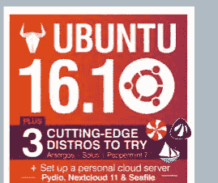

要访问软件和教程文件，只需将光盘插入驱动器并双击光盘图标。

要进入此光盘提供的发行版进行现场启动，请将光盘插入驱动器并重启电脑。

请注意：

- 您需要确保您的电脑已设置为从计算机的 BIOS 屏幕启动，以“更改启动选项”（Change Boot Options）
- 如果您想按键从光盘进行现场启动，请检查制造商网站以确认是否支持此功能
- 现场启动的发行版来自光盘；除非您选择安装，否则它们不会被安装

## Ubuntu 16.10

准备好在下期光盘中自动升级到 Ubuntu 16.10。前往“设置 > 软件与更新”，设置“有新 Ubuntu 版本时我”（LTS+2）并输入 `update-manager` - 更新管理器将在发布新的 LTS 时通知您。点击“升级”并按照屏幕上的指示操作。


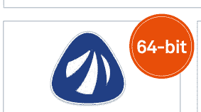


基于 Arch Linux，它的设计时尚，让新手也能接触 Arch，并包含了开箱即所需的一切。

受 Chrome 启发，Solus 迅速成为简单性和与 Google 卓越集成典范之一。

一个以用户为中心的发行版，带有高度定制的 LXDE 和许多巧妙的应用。它的界面非常好且运行快速。

在您的云中存储文件，`Seafile` 允许您在多个设备之间同步和共享文件，并作为虚拟驱动器访问。


在您自己的云中访问、存储并保护文件。跟踪日历，保存联系人。


系统和 IT 专家的云平台社区版本。使用 Collabora 支持完全管理的 HTML 和 CSS 标准。

这光光盘被许多用户遗漏了，所以为了正确运行，我们建议您使用：

- Firefox 或更高版本
- Safari 或更高版本
- Chrome 或更高版本

向 `linuxuser@forum.com` 发邮件告诉我们您在使用提供的程序或资源时遇到的问题。

软件根据不同的条款授权；在安装之前请检查程序使用的是哪种许可。

- 共享软件 (Shareware)：如果您继续使用该程序，请向作者免费注册
- 免费软件 (Freeware)：您可以免费使用该程序
- 试用/演示 (Trials/Demos)：这些是受限的或禁用了某些功能


- 开源/GPL：它是免费使用的，详情请访问 <https://opensource.org/licenses/gpl-license>。

另有说明，否则您没有权限复制和发行此光盘。

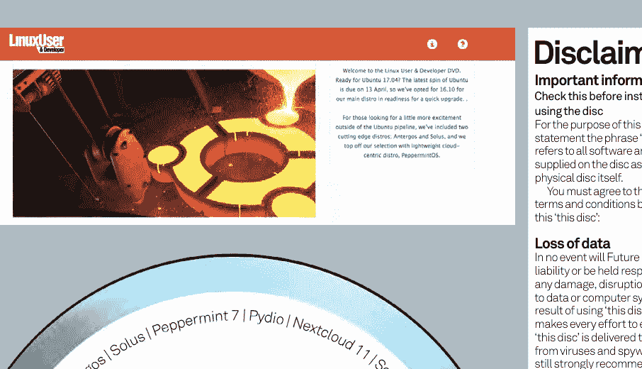

# LINUX 用户一代与 开发者

现场启动 DVD

软件工具与代码

# 现场启动

将光盘插入您的电脑并重启。您需要确保您的电脑能够从此光盘启动。

# 发行版

一旦光盘启动，您就可以在不对电脑进行任何更改的情况下尝试新的操作系统。

# FOSS (自由开源)

开源软件需要通过发行版或使用光盘界面进行安装。

或者，您可以插入并运行光盘以探索界面和内容。

08 新闻与观点 | 12 访谈 | 96 文件


下方：树莓派基金会为 `Raspberry Zero` 发布新的外壳和盖子。

# 树莓派

`Raspberry Pi Zero` 自五年前亮相以来没有显示出任何减速迹象。从那时起，它拥有了一系列出色的扩展，并刷新了单板计算机几乎的所有记录。作为庆祝 `Raspberry Pi Zero` 五周生日的方式，基金发布了 `Raspberry Pi Zero W`（参见我们的评测）。到目前为止，`Pi` 一直一直是预算开发者的首选，因为它可以处理许多原始 `Pi` 可以处理的项目，并配有广泛的配件。像 `Pi Zero` 一样，`W` 模型遵循相同的设计理念，并且尺寸明显小于全功能 `Raspberry Pi` 型号，这是其尺寸的一个大因素。`W` 模型最令人兴奋的方面是，它通过嵌入的 `802.11b/g/n Wi-Fi` 和蓝牙为微型计算世界增加了无线功能。

`CSI` 摄像头接口。`W` 模型与原始 `Zero` 完全相同，但无线芯片使其略重。除了 `Pi` 之外，树莓派基金会还将包含一个由 `Pimoroni` 设计的注塑外壳和一组可更换的盖子。每个盖子都为不同类型的项目定制。其中一个盖子为 `GPIO` 留了空间，并带有额外的摄像头模块孔。外壳还包含一个排线固定器和一组螺丝。

然而，增加的功能意味着 `W` 模型的价格将是原始的两倍。对于英国用户，价格将从 10 英镑起。

正如 `Pi` 发布时预期的那样，`Zero W` 的库存可能会紧张，基金会尚未获得确切的数字，它向每个库存分配了货物，但我们建议您尽快购买。


这款经典的摄像头是树莓派基金会推出的官方配件。它是一款高质量的 800 万像素相机，能够以 30FPS 的 `1080p/640p`、30FPS 的 `1080p` 或 60FPS 的 `720p` 进行拍摄。

如果你喜欢创建娱乐项目，这款配件是你的理想之选。`Media Stick` 完全符合用户尺寸，并带有触摸模块编程。它还拥有全 `HDMI` 端口、双 `USB` 端口以及一个额外的 `micro-USB` 端口。

# 4 树莓派笔记本 (`berry Pi-Top`)

# 5 `Adafruit` 16 通道 `PWM`/舵机 `HAT`

树莓派非常擅长很多，但在处理电子设备方面力不从心。这款 `HAT` 具有许多功能，允许你顺序添加并控制 16 个舵机，除了接线外无需进行任何其他操作。

# `Mozilla` 收购 `Pocket` 以增强移动端地位

`Firefox` 浏览器的创建者 `Mozilla` 正式宣布收购热门应用 `Pocket`。该应用因其随时随地保存文章、视频和其他网页内容的最佳方法而闻名。此次收购的一个大优势是 `Mozilla` 拥有的数百万用户群体，该群体自在 `Android` 平台首次发布以来一直在增长。

“`Pocket` 的使命是创建一个平台，让用户能够分享、保存和消费他们想要的内容。通过这种方式，我们希望能让保存和寻找‘高质量’内容变得更容易，”首席执行官 `Nate Weiner` 说，“对我们来说，最重要的是能够对用户的生活产生真实影响。我们终于找到了一个强大的新盟友，帮助我们在实现使命的同时，构建一个更美好、更健康、更有趣的互联网。”

通过他们的“发现”功能与其他用户进行社交。人们可以对自己的内容进行评分、分享，并与喜欢他们爱好的人交流消息。预计 `Mozilla` 团队将引入 `Firefox` 的功能并将两者整合。

然而，目前尚不确定核心团队会被引入 `Mozilla`。`Weiner` 赞扬该团队将作为项目的一部分留任，项目将独立于 `Mozilla` 公司继续增长。无论如何，我们将负责所有权。我们的团队和现有的路线图已经加强，并且比以往任何时候都清晰。

作为存储网页内容的中央枢纽，`Pocket` 还允许用户在获取内容时进行几次重大更新。当第一个 `Mozilla` 关联应用发布时，`Pocket` 最近发布了 `iMessage` 应用，表明其业务如常。

Linux 新闻与观点

热门的视频通话服务正在获得势头。可以可以说，自从去年推出 `Linux` 版 `Skype` 以来，获得发布版本的进展相当缓慢。经过多次更新和新功能的加入，`微软` 最近宣布 `Linux` 版已进入测试阶段，一些改进的功能缩小了 `Linux` 客户端与 `Windows` 版之间的差距。

用户现在可以为 `Skype` 账户添加联系人。对于终端用户，这使他们可以使用账户进行通话，并与 `Android`、`iOS` 和 `Mac` 其他用户进行一对一通话。另一个用户请求的功能是允许自定义状态，这对于识别联系人是否处于‘勿打扰’或‘离开’模式非常有用。新的测试版可以在此处下载：`www.skype.com/download/skype-for-linux`

更新的核心是增加了功能，让人们可以使用预付费账户。

Linux 内容可能会登陆 `HTC Vive`。`Valve` 极大地提升了全球 `Linux` 用户的能力。所有开源支持将随着 `SteamVR` 的发布推出。在写作此时，尚不清楚哪些硬件支持。项目大部分处于测试阶段，目前的开发范围限于 `NVIDIA` 驱动程序；`AMD` 显卡也是如此。所有必要的文档和 `Linux` 已问题的详情已发布在 `Valve` 的官方页面。

`NVIDIA` 驱动是推荐的选择，稳定性是一个已知问题。广泛预计其他显卡将

缺乏贡献者导致项目结束

用于嵌入式设备的流行发行版 `Manjaro ARM` 将下月关闭。在最近的公告中，`Manjaro` 团队提到，由于贡献者意味着无法完成未来的更新。团队已经停止开发并发布新版本。直接从 `Manjaro` 网站下载的所有用户将维护到网站关闭，用户根据需要可以自由更新项目版本。尽管发布了公告，`Manjaro ARM` 仍然是最常用的 `Arch` 发行版之一，开发团队已花时间概述了其关闭计划。

漏洞直到现在才被注意到

我们在 `Linux` 内核中看到了许多安全修复，但有一个漏洞漏掉了相当长的时间。正如 `CVE-2017-6024` 所示，该漏洞一直追溯到 2006 年，当时内核因“数据时代”而闻名。在漏洞中，这是最危险的漏洞之一。它可以使用堆喷技术在内核中执行恶意代码。更令人担心的是，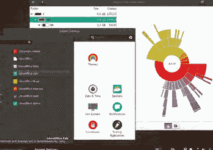

用户无法在 5 月期待未来的更新。尽管如此，`Manjaro ARM` 的论坛和官方网站将保持完全运行，不会丢失，因为团队表示他们希望与想要帮助 `Manjaro ARM` 项目未来发展的的用户讨论计划。感兴趣的伙伴应前往 <https://manjaro-arm.org> 网站获取更多信息。

内核中的这类元素已与其他漏洞结合，可能允许黑客再次进行随机攻击。然而，为了讨论职业为 `Google` 研究员的 `Andrey Konovalov` 所的发现，修复程序现在已合并到内核开发中。`Red Hat`、`Debian` 和 `Ubuntu` 用户也受到了影响，但可以通过他们的网站直接获取必要的补丁。我们建议受影响的用户尽快下载这些补丁。

1. `Mint`, 2718
2. `Debian`, 1990
3. `Ubuntu`, 1610
4. `Manjaro`, 1481
5. `Zorin`, 1328
6. `openSUSE`, 1227
8. `Antixos`, 1010
9. `elementary`, 998
10. `Fedora` 917

- 稳定版本（13 份），2 月（7 份）

虽然我们本月有几个新版本要加入列表，但就下载量而言并非如此。


分析 `ARM` 分支（参见 `Manjaro`）。`Manjaro` 随着每次发布都在增长，提供了易用性和锁定功能。其最近的 `15.5` 测试更新目前为止是成功的。


`elementary OS` 的简单性被证明是一个完美的特性。预计在未来几个月内会有更新，并在未来的期中提供更多信息。


```
filesite.ux.com
```

您的 Linux 新闻与观点来源


# 进入 Linux 世界

进入 Linux 世界可能很困难，但对初学者友好的 `MeArm Pi` 旨在为用户提供一个一包式的开发课程。`Ben Pirt` 解释了这款机器人作品是如何诞生的。


## 关于作者

`Ben Pirt` 是 `Mime Industries` 的董事，他的公司致力于开发套件来帮助教育儿童。他的产品已在世界范围内展示，感兴趣的用户可以查看网站 [https://mime.co.uk](https://mime.co.uk)。


## 背景

> 机器人世界以难以上手而闻名，特别是如果你没有开发背景的话。这是每年成千上万的人面临的问题，但有人正试图消除它。这家公司推出了开源机器人套件，简化了构建机器人的复杂性，并为新用户奠定了基础。

领导者是 `Ben Pirt`，他在开发发展世界的能源硬件和可再生技术方面拥有丰富的背景。虽然他在机器人领域的最初工作完全是利用空余时间帮助他的孩子，但他们对它的热爱促使他让套件更加普及。由于他和共同创始人 `Benjamin Gray` 已经完成了两次成功的 `Kickstarter` 活动，他们备受推崇的 `Mirobot` 现在已在 50 多个国家使用。他还与孩子们一起，教他们编程、工程和数字世界的基础知识。在这里，他谈到了 `MeArm` 以及它是如何将基础机器人推向新高度的。

## 什么是 MeArm Pi？

很多读者问过原始的 `MeArm`，但对于那些没问过的人，可以介绍一下 `MeArm Pi` 是什么吗？`MeArm Pi` 是一个孩子可以轻松构建的机器人套件。它连接到树莓派 `Pi` 上，你可以直接从 `Pi` 控制它，或者使用在浏览器中运行的应用程序进行控制。它被设计为一种低成本的学习技术的方式，并在过程中带来许多乐趣。我们借鉴了开发 `Linux` 整体的许多元素，并旨在让这一过程更易于实现。为树莓派和整个 `Linux` 开发世界引入新成员是非常重要的，我们想展示我们通过这款产品做到的：

> `MeArm Pi` 是一个可以教出孩子的机械臂。你可以从 `Pi` 上运行它。


## 改进与设计

关于我们正在这里实现的控制系统，另一个主要区别更为细微：虽然它表面上与之前的版本相同，但新模型使用了约三分之一的螺丝，这使得根据我们提供的说明书构建容易得多。仍然涉及很大程度的 DIY，但复杂性已经降低了。

构建机械臂有多容易？它专门为向新用户介绍核心开发概念而定制。

也许主要的区别在于我们原始 `MeArm` 和 `Pi` 版本之间的变化。原始 `MeArm` 连接到 `Pi`，但需要你对机械臂上的引脚进行一些接线，这对于新用户来说有点复杂。在 `MeArm Pi` 中，我们将两者紧密集成，因此现在有一个直接安装在 `Pi` 上的 `HAT`，上面有几个摇杆用于板载直接控制。在使用过程中，这证明是可行的。

## 技术核心

树莓派在项目开发中至关重要。它是 `MeArm` 项目的核心。我们已经看到通过 `GPIO` 引脚直接控制 `MeArm` 的巨大优势。目前，任何可以控制机械臂的编程语言都可以与其配合。

## 教育价值

在目前为止，我们看到 `MeArm` 的最佳教育方式有哪些？


# MeArm 与教学应用

最好的方式是在工作会或教室中使用它进行教学。`Ben Gray` 曾在伦敦科学博物馆举办过工作会，这帮助孩子们理解了计算机板的能力。从那里开始，出现了许多围绕 `MeArm` 的有趣项目。

还有其他硬件可以连接到机械臂吗？

当然！当我接上摄像头时，你可以演示它。


> `MeArm` 曾用于教孩子们技术，并向他们展示计算机板的能力。

在软件方面，我们看到关于 `MeArm` 可以告诉我们更多信息。

如果你还没有树莓派单元，大可担心。每个软件包套件都包含了所需的树莓派 3 单元、官方电源以及一张预装系统的 `8GB SD` 卡。更重要的是，包含的构建说明书将引导你从头到尾构建自己的 `MeArm`。


# Linux 内核动态：4.1 版本与 5 级分页

## Linux 内核 4.1 发布候选版

您的 `Linux` 新闻与观点来源

`Jon Masters` 总结了 `Linux` 内核社区的最新动态

`Linus Torvalds` 宣布了 `Linux` 内核 `4.1` 版本的第二个 `RC`（发布候选版本）。在公告中，`Torvalds` 对 `4.1` 合并窗口（允许更改的时间段）的关闭感到很高兴。这篇简报也是他上周发送给 `LKML`（`Linux` 内核邮件列表）的一封邮件，其中包含了一段长长的控诉，指责某些内核贡献者未能建立一种实践：对新功能进行浸泡测试（`soak-testing`），使其在 `next` 分支中持续一整个开发周期，然后再被拉入下一个内核。

在对 `4.1` 合并的分析中，`Linus` 注意到，他看到的提交并没有跟踪从一个维护者的开发树到另一个维护树或 `Linux` 主树的合并，且并未出现在 `next` 中。他表达了些困恼，认为那些没有使用 `next` 的人应该知道 `next` 合并窗口很快就会开启。有趣的是，有人通过 `linux-next` 流程提前请求了计划在 `4.12` 中上线的特性初始启用。

## 新架构与性能优化

从现在起，`4.1` 包含了一些新功能，大多数功能对终端用户（企业和移动开发者除外）影响不大。这些包括对支持该性的三元 `MONITOR/MWAT` 调用的支持、各种性能优化（包括 `IRID` 评审），以及带有初始 `SMP` 支持的 `RISC-V` 架构。正如预期的，还有常规的通用修复以及适用于任何内核的新驱动程序。让我们顺序来看这三个例子。

第一个功能允许应用程序（例如针对 `NFV` 和实时系统）使用特殊的 `MONITOR/MWAT` 指令，这些指令之前仅供特权内核代码使用。`MWAT` 是一种高性能机制，通过该机制，“v8”处理器（其他地方也类似机制）可以被指令临时等待内存位置的变化，而无需显式地循环检查其值变化。必须注意其对系统稳定性的影响，但它可以节省能量并提高应用程序性能。该实现是目前正在进行的核心代码众多性能改进示例之一。

`GRID` 提供了一个小型指针翻译服务，传统上使用固定大小的表格进行快速查找，或将进程 ID 转换为数据结构。该实现与内核现有的基数树（`radix trees`）支持和谐共存，后者使用了底层机制。这种功能是许多开发者新观察到的，并增加了内核的整体质量。

最后，对 `RISC-V` 架构的评审显示，正如所预期，考虑到需完成的工作量，`RISC` 和 `RISC-V` 开放式计算机架构正接近稳定规范，已有多个硬件实现使用 `Verilog` 编写。这是一种硬件描述语言（`HDL`），用于指定可以在 `FPGA`（现场可编程门阵列）中运行的逻辑门。

`Jon Masters` 是一位 `Linux` 内核开发者，从事 `Linux` 工作已超过 10 年。他毕业于德克萨斯大学，住在马萨诸塞州剑桥，在一家初创公司工作，负责能效 `AI` 驱动系统的标准设计。

`OpenRIS` 是最早的全开源架构之一，它在 `Warriors` 开源的基础上诞生，同时也邀请社区构建现代工具。`RISC` 正在获得 `SMP` 支持真是令人惊叹。可以通过 `linuxfuture@future.com` 联系我们了解更多关于 `OpenRIS` 或 `RISC-V` 的信息。

## 内核质量与播客更新

`Geert Lytveren` 发布了他对内核 `4.10` 和 `4.11` 之间 `bug` 回归或改进数量的分析。这显示了大量的警告和


其他再次引入并需要隔离和纠正的内容。

最后，本月，作者恢复了常规（每周一次）`Linux` 内核播客，可以在 `Google Play` 和 `Apple iTunes` 商店免费获取，也可以访问 `www.kernelpodcast.org`。特别感谢通过推特 `@kernelpodcast` 提供反馈。请告诉我您希望如何演进，以从所收集的海量数据中获益。

## 5 级分页与虚拟寻址

现代 `x86-64` 处理器通常实现对 `48` 位地址空间的支持，这限制了特定机器在不通过非实际操作的情况下可以访问的虚拟内存量。`256TB`（现代术语为 `256TiB`）是一个巨大的内存，但在运行程序可以快速直接访问非易性内存的世界里，这足够吗？除了不断增长的填充任何数量存储数据的需求（特别是那些需要随处可用且无需拆卸的设备数量），许多计算机架构已经修订了它们的上内存限制。

在 `Intel` 方面，这导致了一种允许 5 （最高 `57` 位）虚拟寻址的新架构。这允许为未来的机器连接到非常、非常大的内存。`Kirili` 已经在编写补丁以提供此功能一段时间了。他有许多“待办”事项，包括支持 `5级分页内核` 而非当前的层级（`48` 位）以及 `5级`（`57` 位）虚拟寻址，但基础设施已经相当完善了。

事实上，看到 `Kirili` 的某些代码在 `Linux 4.12` 预期上线日期之前就已经合并了。在 `4.11` 合并窗口关闭后，`Voids` 发布了：“我们……”

# 同步工具界面功能

## 文件管理功能

首页 备份 管理 同步 共享

显示隐藏文件

选择类别 选择特定文件和文件夹

| :--- | :--- | :--- | :--- |
| 桌面 | | | |
| 文档 | | `Drive` | `02` |
| 电影 | | `Folder` | `02` |
| 音乐 | | `Folder` | `02` |
| 图片 | | | |
| `bin` | | | |
| `boot` | | | |
| `cdrom` | | `Folder` | `04` |
| `dev` | | `Folder` | `06` |
| `etc` | | `Folder` | `06` |
| `home` | | `Folder` | `20` |
| `atomickarma` | | `folder` | `06` |
| 桌面 | | | |

存储空间 移除数据 账户大小：`2 GB` 购买更多空间 立即扫描

已用 `0` 字节 剩余 `250 GB` 用户：`atomickarma75@gmail.com` 设备：`atomic-envy` 版本 `6.1.5` 选项 账户 帮助

# 云存储与安全：SpiderOak

安全、隐私、云存储协作小组

任何网络都应该从安全开始，云存储也是如此。虽然 `Linux` 有许多移动端云存储解决方案宿主，但很少产品能提供像 `SpiderOak` 那样的规模和安全性，这正是它成为所有人（或个人）受欢迎的云存储解决方案的原因——无论他们使用什么操作系统。它支持 `Linux`、`macOS`、`Windows`、`Android` 和 `iOS`，还提供客户端可用存储以确保 `SpiderOak` 云中的数据安全。

有两种选择：

1. **`SpiderOne`**：一种你已经听过的可靠且安全的云备份服务。`SpiderOne` 旨在帮助你的数据免受丢失和勒索软件的影响。
2. **`SpiderOak Groups`**：针对小型企业的云备份替代方案，以及针对企业的、能够击败勒索软件的 `Endpoint Backup`，它提供了即时灾难恢复备份解决方案。

它适用于企业 `Linux` 领域的开源软件（`FOSS`），个人选项免费，而中小企业软件则需要支持订阅。此外，还有面向企业的 `SpiderOak Seamless`，这是一个提供群聊和文件共享的云端协作工具。这对于跨大型办公室或基于不同大陆的项目工作非常理想。理解有助于关注安全和隐私的云存储及备份解决方案是理智所当然的。

# Linux 与 Windows 共存策略

## 用户迁移与支持

不要禁用你的 `Windows` 用户——要帮助他们！

事实是，如果你在企业组织的 `IT` 或桌面支持部门工作，人们极有可能抵制来自——低声说——微软的软件。最初的本可能是教训他们，不如向他们展示 `Linux`，并至少让他们尝试双启动。无论解决方案是什么，支持这些用户意味着坚持使用兼容 `Windows` 的云解决方案。显而易见的选择是 `Dropbox`，它拥有 `Linux` 客户端。`Dropbox` 使用简单，可以作为非 `Linux` 用户拥抱开源软件（`FOSS`）运动的门户。

## 办公软件与生产力

办公软件呢？自然地，引导他们走向某些开源解决方案，但短期内 `Chrome` 浏览器的 `Microsoft Office Online` 插件可以作为解决方案。从桌面支持的角度来看，这里的重点是生产力的连续性……为他们为日后成功迁移到 `Linux` 留出时间。

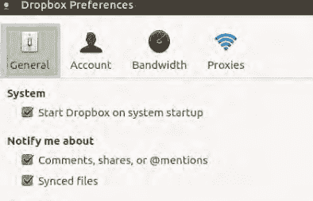

* `Dropbox` 选项
* 系统启动时启动 `Dropbox`
* 注释、共享或 `@` 提及
* 同步文件

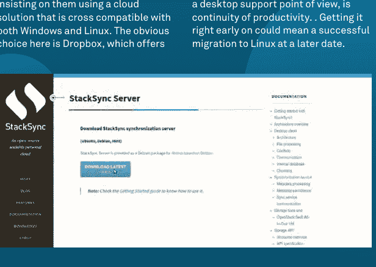

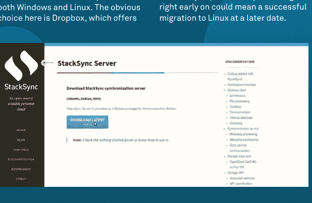


# 获取可扩展的个人云解决方案

得益于 `OpenStack` 等基础设施即服务 (`IaaS`) 平台，云存储的可扩展性现在已成为可能。你可以同时使用两种解决方案来提供个人和组织级的云存储。`StackSync` 确保控制权保留在组织内部，数据在客户端中使用 `AES-256` 加密（该算法被美国政府用于机密数据），可以随时随地共享，并免受拦截和窃取。因此，掌握 `StackSync` 以及其他技术应该是首要任务。投资你的团队，这让你有机会熟悉软件在某些情况下的行为方式。在不同用户之间复制高频使用场景将是困难的。`OpenStack`、`Amazon S3` 以及 `FTP`、`WebDAV` 等可以与 `StackSync` 集成成为强大的后端。可以在 `http://stacksync.io` 找到演示服务器。

## 忘记第三方云套件——构建你自己的吧！

我们已经讨论过意识到云端生产力工具的重要性，但在从专有系统迁移时，面向终端用户的开源软件（`FOSS`）替代方案有哪些？`Collabora Online` —— 可能是这里最令人兴奋的解决方案，凭借对所有办公套件的良好了解，你有机会获得印象深刻的面板。可以在 `www.collabora.com` 获取，`CODE` 是 `LibreOffice` 在线、企业级桌面办公软件的家园。它是最广泛使用的开源替代方案，并且受到 `Python` 和 `Nextcloud` 支持。`Collabora` 网站还提供演示，展示了配置 `CODE` 之后应该是什么样子。

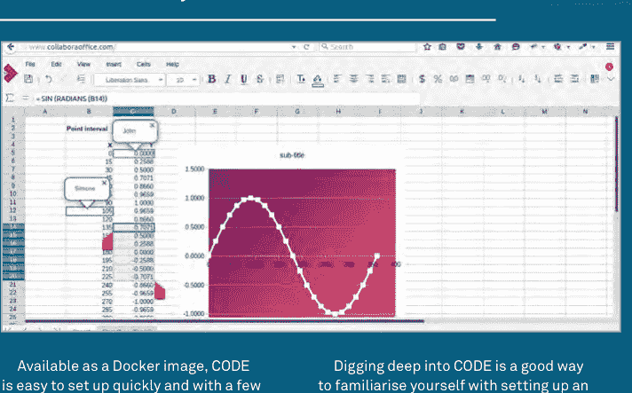

### 在 Linux 下使用 Docker

`66a11935f07f13d62210d3016f9115fc` 是同步的笔记

*(注：由于原文后半部分出现了关于 NixNote 教程的重复或逻辑跳转，以下是针对最后一段 NixNote 教程的翻译)*

# 获取可扩展的个人云解决方案

得益于 `OpenStack` 等基础设施即服务 (`IaaS`) 平台，云存储的可扩展性现在已成为可能。你可以同时使用两种解决方案来提供个人和组织级的云存储。`StackSync` 确保控制权保留在组织内部，数据在客户端中使用 `AES-256` 加密（该算法被美国政府用于机密数据），可以随时随地共享，并免受拦截和窃取。因此，掌握 `StackSync` 以及其他技术应该是首要任务。投资你的团队，这让你有机会熟悉软件在某些情况下的行为方式。在不同用户之间复制高频使用场景将是困难的。`OpenStack`、`Amazon S3` 以及 `FTP`、`WebDAV` 等可以与 `StackSync` 集成成为强大的后端。可以在 `http://stacksync.io` 找到演示服务器。

## 忘记第三方云套件——构建你自己的吧！

我们已经讨论过意识到云端生产力工具的重要性，但在从专有系统迁移时，面向终端用户的开源软件（`FOSS`）替代方案有哪些？`Collabora Online` —— 可能是这里最令人兴奋的解决方案，凭借对所有办公套件的良好了解，你有机会获得印象深刻的面板。可以在 `www.collabora.com` 获取，`CODE` 是 `LibreOffice` 在线、企业级桌面办公软件的家园。它是最广泛使用的开源替代方案，并且受到 `Python` 和 `Nextcloud` 支持。`Collabora` 网站还提供演示，展示了配置 `CODE` 之后应该是什么样子。


### 在 Linux 下使用 Docker 同步笔记


*(由于提供的文本结尾似乎存在错乱，以下是最后教程部分的翻译汇总：)*

- `Dropbox` 偏好
- 系统启动时启动 `Dropbox`
- 注释、共享或 `@` 提及
- 同步文件


# 获取可扩展的个人云解决方案

得益于 `OpenStack` 等基础设施即服务 (`IaaS`) 平台，云存储的可扩展性现在已成为可能。你可以同时使用两种解决方案来提供个人和组织级的云存储。`StackSync` 确保控制权保留在组织内部，数据在客户端中使用 `AES-256` 加密（该算法被美国政府用于机密数据），可以随时随地共享，并免受拦截和窃取。因此，掌握 `StackSync` 以及其他技术应该是首要任务。投资你的团队，这让你有机会熟悉软件在某些情况下的行为方式。在不同用户之间复制高频使用场景将是困难的。`OpenStack`、`Amazon S3` 以及 `FTP`、`WebDAV` 等可以与 `StackSync` 集成成为强大的后端。可以在 `http://stacksync.io` 找到演示服务器。

## 忘记第三方云套件——构建你自己的吧！

我们已经讨论过意识到云端生产力工具的重要性，但在从专有系统迁移时，面向终端用户的开源软件（`FOSS`）替代方案有哪些？`Collabora Online` —— 可能是这里最令人兴奋的解决方案，凭借对所有办公套件的良好了解，你有机会获得印象深刻的面板。可以在 `www.collabora.com` 获取，`CODE` 是 `LibreOffice` 在线、企业级桌面办公软件的家园。它是最广泛使用的开源替代方案，并且受到 `Python` 和 `Nextcloud` 支持。`Collabora` 网站还提供演示，展示了配置 `CODE` 之后应该是什么样子。


# 掌握文件、日历和联系人同步

如果你正在寻找一种简单的方法，在自己的硬件上尝试云服务器——而不是查看 `Google Cloud` 服务（请参见后文），那么 `Nextcloud` 是一个极佳的尝试选择。`Nextcloud` 由 `owncloud` 创始人 `Frank Karitschke` 创建，适用于任何机构，提供在 `macOS`、`Windows` 和 `Linux` 电脑上随时访问的自由。它还支持运行 `Android` 和 `iOS` 的移动设备等。

`Nextcloud` 基本上是一个开源云服务器，被设计为完整的云解决方案。文档、照片和联系人信息等数据存储在数据中心，并在策略允许的情况下从任何地方访问。`Nextcloud` 还关注数据安全，并提供粒度管理以引导用户或服务器之间的数据流。同时，客户端应用程序由经验丰富的专业人士完全控制。你可以通过从网站安装或从 `nextcloud.com` 下载来获取。


压缩包包含一个你需要运行一次的可执行文件。之后，选择你的设置选项。如果你已经安装了 `Nextcloud`，请使用更新命令运行它并完成安装。

字体 服务器用户存档压缩包

- 管理员用户
- 开发者
- 测试人员
- 适用于虚拟主机的 `Web` 安装程序
- 易于部署的设备设备
- 论坛

`Nextcloud` 安装程序将启动一个向导，帮助你配置环境。`Nextcloud` 将检查你的系统是否符合要求。我们根据你的个人需求推荐这些内容。

要开始 `Nextcloud`，你需要安装服务器和客户端。它们将是不同的设备，但你可以将 `PC` 或移动设备作为客户端。如前所述，还提供 `Android` 和 `iOS` 的移动版本。运行 `Windows` 和 `Mac` 的企业也能访问存储器。你可以从你的光盘安装，或访问 `https://nextcloud.com/install`。

你可以在专用服务器、`PC` 或作为虚拟应用程序安装 `Nextcloud`。物理需求要求你检查完整性，同时也提供了通过 `PGP` 验证的选项。同时，为虚拟主机提供了 `Web` 安装程序，而 `Nextcloud VM` 是在安全的虚拟环境中尝试它的极佳方式。我们建议使用此选项，以便于部署，并在你的 `PC` 上尝试。

下载完虚拟机（这是一个 `RAR` 文件）后，你需要将其解压。为了实现这一点，你需要 `unrar` 工具：

```bash
sudo apt-get install unrar
```

安装完成后，如果虚拟机非常大且超出了我们的磁盘空间，它中还包含了为已经运行的用户提供的服务器安装程序——你需要使用以下命令解压 `RAR` 包：

```bash
unrar Nextcloud_Community_VM.rar
```

这将需要几分钟时间。文件为 `VMX/VMDK` 磁盘格式，因此你需要选择一个合适的虚拟机。


如果你想为机器添加硬盘，可以创建一个新的硬盘文件，或者使用文件夹从列表或其他位置选择一个。如果你需要更复杂的设置，可以跳过此步，并在机器创建后对设置进行更改。建议的硬盘大小为 `8.00 GB`。

- 不要添加虚拟磁盘
- 创建虚拟硬盘


- 使用现有的虚拟磁盘

```
Nextcloud_Community_VM.vmx
```

接下来，你需要使用 `VirtualBox` 运行 `VMDK` 镜像。在 `VirtualBox` 中，点击“下一步”，然后为虚拟机命名（例如 `Nextcloud`）。选择 `Linux` 和 `Ubuntu` 作为操作系统。接下来，选择 `8GB` 虚拟磁盘，然后在虚拟设置中选择“使用现有硬盘”指向提取出的 `VMDK` 镜像。运行 `Nextcloud` 机器，在 `VirtualBox` 中选择它并点击“启动”。

> `Nextcloud` 遵循数据安全的行业惯例


当 `Nextcloud` 服务器运行时，你需要登录。详情可以在 `VMDK` 上的文本中找到，并使用 `cloudadmin` 访问 `Nextcloud`。接下来，你需要提供少量的输入，例如 IP 地址、键盘布局等，并且 `LAMP` 栈已经安装。随后你会被提示安装一个应用，有许多选项，如 `Collabora Online`（参见第22页），这对于小组项目非常有用。点击“确定”继续，遵循屏幕上的指令操作。

安装完成时，你将获得摘要/确认，并被提示安装 `SSL` 证书。这对于企业角色来说是一个好主意，但对于个人使用则没那么重要。之后，服务器需要重启，然后作为 `Nextcloud` 设置运行。

当服务器准备好访问时，安装桌面版（或移动客户端），创建一个新账户并开始使用 `Nextcloud`。设置已完成，但还有许多额外功能。

## VM 实例

### Compute Engine

创建实例 | 导入 VM | 浏览

VM 实例

| 按名称筛选 | 筛选 | 推荐 | 已选择项 | 状态 | 名称 | 机器类型 | 每月 SSH 费用 ($) | 区域 | 实例 | 外部 IP | 镜像 |
| :--- | :--- | :--- | :--- | :--- | :--- | :--- | :--- | :--- | :--- | :--- | :--- |
| | | | | 运行中 | `n1-standard-1` | `27.5 GB/月` | `US` | `Debian 9` | `10.128.0.2` | `194.108.108.108` |

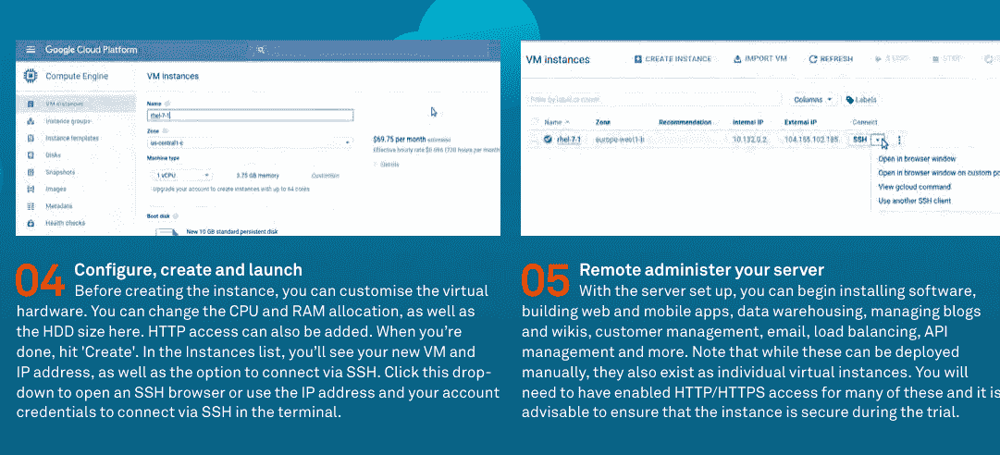

在创建实例之前，你可以对硬件进行自定义。你可以更改 `CPU` 和 `RAM` 分配，以及 `HDD` 大小。这里也可以添加其他内容。完成后，点击“创建”。在实例列表中，你将看到你的新 VM 和 IP 地址。你可以 `SSH` 连接到浏览器，或者使用 IP 地址和你的账户凭据通过终端进行 `SSH` 连接。

服务器设置完成后，你就可以开始安装、构建 Web 和移动应用、数据仓库、托管博客和维基、客户管理、负载均衡、`API` 管理等。请注意，这些都可以单独部署。你可能需要为其中任何一项启用 `HTTP/HTTPS` 访问，并且确保在试用期间实例的安全是至关重要的。

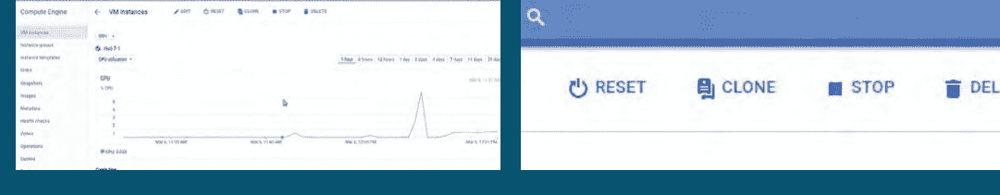

实例的管理就像管理任何物理（或本地位置）服务器一样。在 VM 实例页面上，你会找到停止、启动、重置、删除或创建新实例的工具。同时，选择实例可以监控其性能，例如 `CPU`、磁盘或网络使用情况。你还可以更改实例的设置，例如添加 `SSH` 密钥并更改 IP 地址。

出于连续性考虑——或者仅仅是为了节省时间——你可能会发现克隆实例是有益的。例如，当你准备启动一个新的在线服务时，可以克隆现有的服务器实例并将其上线。选择实例后，点击“克隆”。你将看到想要保存的所有详细信息，并在需要时更改这些内容的选项。

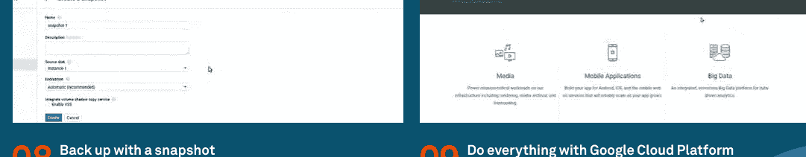

同样地，你可以通过快速创建快照来从新软件设置从快照创建实例。这似乎是一个当原始实例出现问题时可以进行切换的快速备份。你可以在左侧菜单中找到“快照”选项。点击它，然后点击“创建快照”。为它命名、添加描述，并选择源磁盘——即你想备份的实例。创建初始快照后随后的任何快照都是增量的。

`Google Cloud` 的真正优势在于为活动和发布业务提供了灵活的选项。你可能花几个月时间寻找工作，因此你可以确信雇主会想要使用更多这里提供的技术。到那时，你已经了解 `Google Cloud` 对企业或作为员工是有多重要，并积累了关于其提供的 Web 应用和服务的知识。

`www.linuxuser.co.uk` 27

降低组织内的硬件成本通常会导致配置较低降低，这使得云桌面成为保留功能的好方法。

除了购买一批 `Chromebook` 之外，这里的最佳选择可能是 `Peppermint Seven`，这是一种基于 `Ubuntu` 并带有 `LXDE` 桌面的以云为中心的发行版。它足够轻量，可以刷新你的简历和技能储备。轻松的入门方法是从云盘或 `USB` 闪盘安装它，它可以作为你的主操作系统安装、作为双系统/多系统操作系统安装，甚至直接从 `USB` 运行。如果你不确定，也不要排除在虚拟机中尝试它。

`Peppermint Seven` 本质上是一个带有云应用和本地应用的混合桌面，其界面允许你运行多个浏览器（`SSB`）。`SSB` 基本上会将网站变成桌面快捷方式。同时，软件要么通过云可用，要么没有可用选项，而是包含在发行版中。简而言之，这是一个平衡了功能、速度和简单性的云操作系统，可能可能是预算紧张情况的答案。


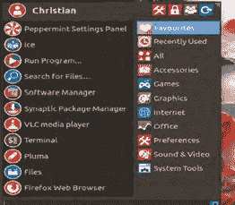


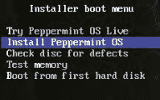


### 01 现场启动盘还是虚拟机？

如果你是第一次使用 `Peppermint Seven`，可以从现场启动盘运行，或从官方网站 `https://peppermintos.com` 下载。安装过程与安装 `Ubuntu` 等非常相似，这也是一种选项。它可以安装到你现有的 PC 或笔记本电脑中，也可以从 `CD` 或 `USB` 以现场会话运行。无论你选择哪种，它应该感觉像一个真实的桌面，这是任何以云为中心的操作系统的核心。

### 02 查找应用程序

启动 `Peppermint Seven` 后，打开菜单查找应用程序。可以立即看出哪些应用是云端的，哪些是随发行版安装的。要找到它们，点击“筛选”标签卡以查看 `Peppermint Seven` 中的应用。


### 03 使用 Ice 创建 Web 应用

`Peppermint Seven` 中的某些 Web 应用可以通过 `Ice` 添加。给应用程序命名，输入 URL，然后选择它在哪个窗口中打开，以及是否将其设置为默认浏览器。`Firefox` 预装在 `Peppermint Seven` 中。

### 04 标准应用安装

`Peppermint Seven` 的重点是云应用，你仍然可以安装 `Linux` 软件。通过打开终端并使用 `sudo apt install 软件包名` 来实现这一点。此外，你会在系统设置中找到软件管理器。如果你发现需要的工具在任何地方都不可用，`Gaptic` 安装程序也已安装。

### 05 实用预装工具

`Peppermint Seven` 有许多实用工具。例如，应用程序管理器和系统工具菜单。你还会找到非常有用的镜像写入器和 `USB` 闪盘格式化工具。你还会找到用于连接网络和打印机的 `Samba`，以及系统设置：任务管理器、更新管理器和 `LXDE`。

### 06 Peppermint 7

`Peppermint Seven` 不应忽视的元素之一是简化设置面板中的集成 `Linux` 搜索。显然，作为其他 `Linux` 工具和偏好伞的菜单使得终端用户管理生产系统比像 `Ubuntu` 简单得多。你可以在菜单 > 偏好中找到 `Peppermint` 设置和 `Peppermint` 控制中心。

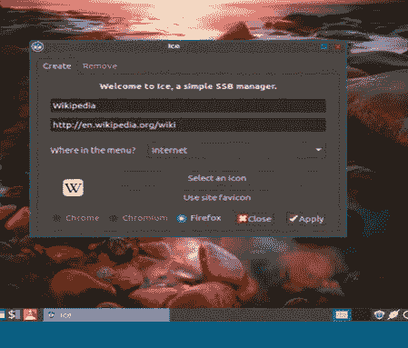

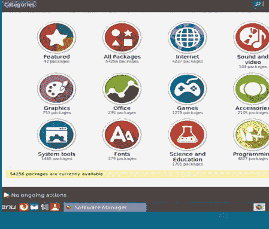

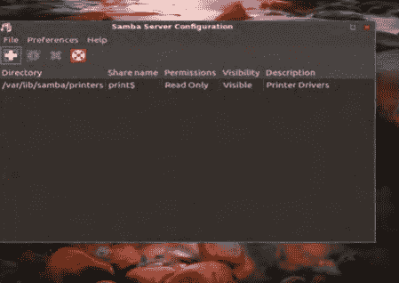

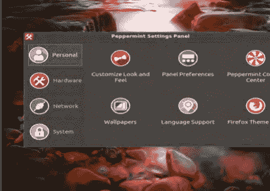

## 5 期仅需 5 英镑

赠送 4 份实机发行版 `DVD`

## LinuxUser & 开发者

`GNU` 世代的必备杂志

## 征服云端

最新的云端技术设置 团队工具

安全文件同步 构建云端办公室

## 专业人士的最佳 VPN


使用安全的隧道 `Red-hat` 性 规避您的互联网服务提供商 (ISP)

## 锁定您的 Web 服务器

使用主动监控和反 SQL 注入来保护您的数据库

## PI ZERO W 问世

迄为止制造的最先进型号

## 冷存储比特币


- 永不错过错过的任何一期

- 送达您的家中

每期杂志免费邮送，直达家门口

- 获取最大优惠

通过直接订购，以更低的价格获取您喜爱的杂志

只需访问 `www.imaginesubs.co.uk/spring171`

## 从我们的畅销杂志中选择


# 历史一切 (All About History)

# 游戏大师 (gamesTM)

# 复古游戏玩家 (Retro Gamer)


# 数字摄影师 (Digital Photographer)

# 原原理 (How It Works)

# 动物世界 (World Of Animals)

# 热线电话 0844 856 0644*

条款与条件：与英国报刊亭购买 13 期全价杂志相比的节省。试用优惠适用于通过直接订购的英国印刷版订阅者。您每年将收到 13 期。直接订购保证的详情可按要求提供。如果您在任何方面不满意，可以随时打电话或发送邮件取消订阅，并将获得已发行内容的退款。通过电话或邮件联系我们进行更改。适用其他条款。

优惠截止日期

2017 年 5 月 31 日

## OpenWRT 教程


`Tam Hanna`

是位于 `Breitavada` 的咨询公司 `Tamgemogen Holding` 的首席执行官。该公司从事由软件、`HID` 和硬件组成的跨学科系统开发咨询。

### 为 OpenWRT 添加硬件访问

#### 使用 OpenWRT 的硬件控制实现家庭网关冗余

树莓派的 `GPIO` 布局可能不符合每个人的口味，但我们无法否认这 40 针脚提供了连接各种硬件的充足机会。我们提到的许多内容对于 PI 的频繁读者来说应该是众所周知的，在让它们运行 `OpenWRT` 时只会遇到极小的障碍。本文假设您已处于遵循了教程并需要自定义 `OpenWRT` 构建的阶段。如果您尝试使用来自 `OpenWRT` 项目的代码库进行构建，它将无法工作。

在实践中，访问微处理器上的资源涉及向寄存器写入特定值。有几个映射的内存位置（如图 1 所示）。

直接提供内存访问可能会导致各种问题。`Linux` 内核与 `Windows` 之间的巨大差异就是一个例子——默认情况下，不允许对内存进行无限访问。

这一特定限制通过设置特殊常量来修复，该常量强制内核对内存保护变得不那么严格。

在我们情况下，在 `http://bit.ly/STRICT_DEVMEM` 找到的方法提供了有关该解决方案以及如何通过图形 `menuconfig` 系统启用的更多信息。

尽管作者可以为您提供关于如何在菜单中包含该选项的逐步说明，但相反的是：

资源

`OpenWRT`

`https://openwrt.org`

| 表 4-4 | 与端口相关的寄存器摘要 | 图 1 |
|---|---|---|
| 地址 | 名称 | `R0` | `R1` | `R2` | `R3` | `R4` | `R5` | `R6` | `R7` | `R8` | `R9` | `R10` | `R11` | `R12` | `R13` | `R14` | `R15` | 端口重置 | 端口中断 | |

上述 Microchip 的 `PIC16F84A` 有一组专门用于输入和输出引脚的寄存器

- `*/vfs/ext44_find -name config`
- `xargs | grep config DEVMEM`
- `/build/target-arm-cortex-a9-neonvfpv4-armv7hf-linux-ueabi/include/bcm2835-devmem.c`
- `/build/target-arm-cortex-a9-neonvfpv4-armv7hf-linux-ueabi/include/bcm2835-devmem.c`
- `/build/target-arm-cortex-a9-neonvfpv4-armv7hf-linux-ueabi/include/bcm2835-devmem.c`
- `/build/target-arm-cortex-a9-neonvfpv4-armv7hf-linux-ueabi/include/bcm2835-devmem.c`
- `/build/target-arm-cortex-a9-neonvfpv4-armv7hf-linux-ueabi/include/bcm2835-devmem.c`
- `/build/target-arm-cortex-a9-neonvfpv4-armv7hf-linux-ueabi/include/bcm2835-devmem.c`

上述 Microchip 的 `PIC16F84A` 有一组专门用于输入和输出引脚的寄存器

34

`3cm710/linux-4.4/drivers/char/config DEVMEM`

34

`Linux` 并不允许访问内存，设置一个约束强制它对内存保护变得不那么严格

> 注意红丝带！

由于相关原因，不建议禁用内存保护功能。如果你使用 `OpenWRT`

仔细查看输出显示没有太多可以发现

在 `SPI` 选项的情况下，启用 `SPI` 支持会打开一个新的菜单，其中必须启用 `BCM2835` 控制器的选项。

惊讶的是它的功耗并不大。坦率地说，作者们有能力解决这个问题，导致了图 3 所示的电路

## 硬件

尽管其他人创建了包含树莓派硬件访问 `WiFi` 库的 `OpenWrt` 包，但这尚未集成到主 `OpenWrt` 发行版中。在编写时，编译 `WiFi` 无法完成接口。但不用担心，因为没有工作可用。

我们的第一次实验切换大负载可以开启泵、涡轮或其他任何电源产品。逻辑表明 `GPIO` 引脚可以确保足够的功率且开关是一个继电器。

小型继电器仍然耗费许多功率。考虑到 `BCM2835` 最初被设计为手机中的处理器，它的功耗并不大令人惊讶。

上述你已经做了 `menuconfig`，并且 `menuconfig` 看起来与上面非常相似

由于我们已经，启用 `SPI` 和 `i2C` 支持选项以访问这些外设接口。

当保存配置并更新镜像文件时。该配置通过使用上一个实例中的步骤完成进行部署。

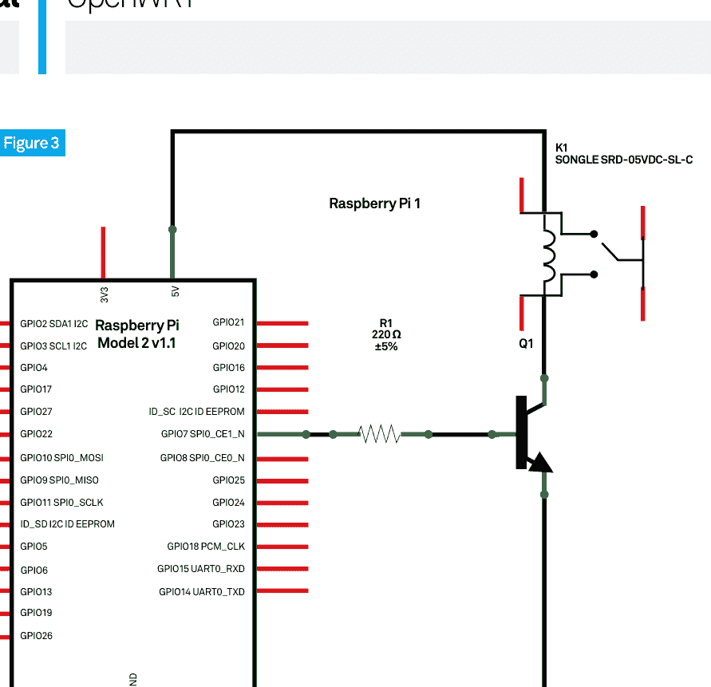

在某些情况下，需要一个电阻器在执行器和控制器之间进行切换；在我们的情况下，继电器额定为 `5V`，这使得额外的组件是不必要的。此外，这里使用的 `BC547` 限制为 `100mA`——如果你的继电器需要，请使用不同的晶体管。

直接访问内存会导致冲突：想象两个程序尝试设置同一个寄存器。在 `OpenWrt` 服务器的情况下，这不应该是问题。在这种情况下，请参考 `http://edgelinux.org/wiki/GPIO` 获取详细的寄存器访问方法，并将代码复制到工作站的文件系统中。

直接 代码寄存器。内存布局自树莓派 1 以来发生了变化，以下基地址仅适用于：

如果你觉得可以使用廉价的晶体管让你的继电器工作：

```
#define BCM2708_PERTI_BASE 0x2000000
```

下一步涉及复制 `main()` 方法的内容来切换单个引脚：

```
int main(int argc, char **argv) {
  int g_rep;
  setup_gpio(0);
  IN_GPIO(7);
  OUT_GPIO(7);
  for (rep=0;rep<1; rep++) {
    GPIO_SET = 1<<7;
    sleep(1);
    GPIO_CLR = 1<<7;
    sleep(1);
  }
  return 0;
}
```

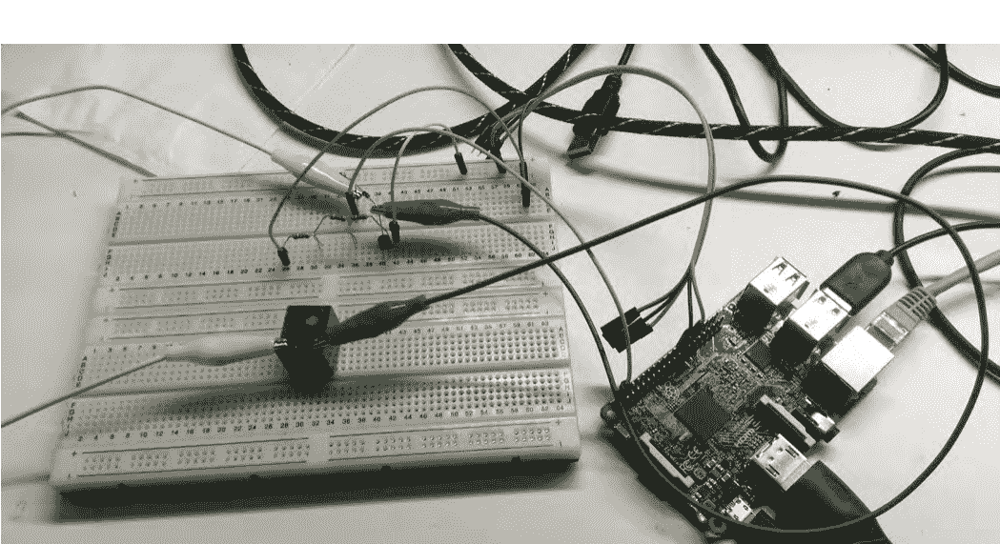

编写时，只需将代码复制到树莓派并编译。运行时，继电器应该自动开关。

## 改进交付


完成后，为你的树莓派提供新包需要物理添加和移除内存卡。在 `OpenWrt` 上工作需要频繁部署，因此我们使用一个简单的技巧来处理 `/etc/opkg`。`OpenWrt` 的源列表位于类似于 `bin/bcm2078/packages` 文件夹的文件中，向其中追加以下行：

*   `src/gz_calamer_base http://10.0.0.1/packages/base`
*   `src/gz_calamer_packages http://10.0.0.1/packages/packages`
*   `src/gz_calamer_luci http://10.0.0.1/packages/luci`
*   `src/gz_calamer_routing http://10.0.0.1/packages/routing`
*   `src/gz_calamer_telephony http://10.0.0.1/packages/telephony`
*   `src/gz_calamer_management http://10.0.0.1/packages/management`

`OpenWRT` 文件夹。你会被要求输入：

> `~/wrtspace/openwrt/bin/bcm2078 sudo python -m SimpleHTTPServer 80`

当然，输入 `opkg update` 来更新你的 `OpenWrt` 包列表——如果遇到不受你控制的存储响应的签名或 `wget` 错误，不要担心。我们将尝试安装一个镜像创建时未构建的包。`Opkg` 当然会在这里表现良好，如果包未知，会抛出错误并像往常一样尝试并重试。

启用 `OpenWrt` 硬件访问允许你为路由器添加异常功能。除了添加传感器，你还可以使用你的路由器控制家中的各种设备。在下一个教程中，我们将研究连接到你的 `OpenWrt` 路由器的某些设备。

## 高压警告

尽管我们有一个朋友在 `360V` 的电击中幸存，但高压仍会以突然而痛苦的方式夺你的生命。除非开关正确连接到断路器，否则不应操作电压电流。交流电最好在旁边有一位知道紧急情况下如何关闭系统的人的情况下进行。

接下来，让我们使用 `Python` 自带的 `SimpleHTTPServer` 建立一个简单的 `Web` 服务器，暴露我们的 `packages` 目录的内容。

`www.luxuser.com` `37`

## NGINX 教程

### 安全你的 NGINX Web 服务器

`NGINX` 已经成为非常流行的 `Web` 服务器选择。在教程中，我们将展示如何加固你的设置。


`Nishit Tiwari`

一名对自由和开源软件有浓厚兴趣的软件开发者。同时也是领先 `FOSS` 项目的和作者，帮助组织理解它们的业务需求。

欢迎来到教程！

本教程的目标是教你如何安装、配置以及更多关于 `NGINX` 的知识。

感谢使用本教程。

`NGINX` 是一个轻量级、高性能的 `Web` 服务器，可以处理几乎所有任务，并因性能和稳定性令人印象深刻。根据 `NetWorkers` 的报告，`28%` 的网站（如 `WordPress`、`Hulu` 和 `GitHub`）使用 `NGINX`。与传统服务器不同，`NGINX` 不使用 [进程] 来处理请求，而是使用更多的事件驱动架构。它的流行意味着安全考量的增加。在教程中，我们将探索第三方模块，例如 `FailBan`，你可以用它来加固你的安装。我们还将包括如何设置 `SSL` 证书防止通过 `HTTP` 泄露信息。

`www.nginx.com`

## 01 开始

在本教程中，我们将使用 `Ubuntu 16.04` 发行版创建 `NGINX Web` 服务器。要安装 `NGINX`，执行：

```bash
sudo apt-get update
sudo apt-get install nginx
```

以管理员 (`root`) 运行使用 '`sudo'`

```bash
sudo apt-get update
sudo apt-get install nginx
```

检查 `NGINX` 是否正确安装

```bash
service nginx status
```

检查服务器是否运行

```bash
curl -I http://localhost
```

如果你看到 `HTTP/1.1 OK`，那么服务器正在工作。一旦安装，`NGINX` 会自动启动。你可以通过浏览器访问服务器。默认情况下，服务器指向 `http://localhost`。为了确保 `Web` 服务器在重启时自动启动，执行：

```bash
sudo update-rc.d nginx
```

保持系统更新也更好。为了配置 `SSL` 频繁发布的安全补丁，并备份和更新已安装的包：

```bash
sudo apt-get update && sudo apt-get upgrade
```

## 02 防止信息泄露

`NGINX` 服务器以 `HTTP` 头的形式暴露了大量数据。例如，使用以下命令检查操作系统：

```bash
curl -i localhost
```

输出显示了 `NGINX` 版本和操作系统。你可以通过编辑 `nginx.conf` 文件来限制这些数据，在 `HTTP` 配置中添加以下行：

```nginx
server_tokens off;
```

现在保存并加载服务器：

```bash
sudo service nginx reload
```

命令将隐藏 `NGINX` 版本和操作系统名称。现在如果你运行 `NGINX`，`curl` 输出将包含 `OS` 细节。为了隐藏这些，编辑后端的 `php.ini` 文件：

## SSL 配置

为了加固你的 `Nginx` 服务器，首先检查服务器是否启用了 `HTTPS`。编辑 `Nginx` 配置文件的 `server` 块：

```bash
sudo nano /etc/nginx/sites-enabled/default
server {
    listen 80 default;
    listen [::80] default;
    ipv6_only;
}
```

你还需要使用以下配置接受 `SSL` 连接：

```nginx
listen 443;
root /var/share/nginx;
index index.html;
error_page 401 403 404 /404.html;
server_name your_domain.com;
ssl_certificate /etc/nginx/ssl.crt;
ssl_certificate_key /etc/nginx/ssl.key;
```

接下来，为了隐藏 `HTTP 401` 和 `403` 错误，编辑服务器配置文件：

```bash
- INPUT -p tcp --dport 80 -j ACCEPT
- INPUT -p tcp --dport 443 -j ACCEPT
- OUTPUT -p tcp --state ESTABLISHED -j ACCEPT
```

```bash
sudo mkdir /etc/nginx/sites-enabled
server {
    error_page 401 403 404 /404.html;
}
```

重启 `Nginx` 保存更改。

```nginx
location / {
    try_files $uri $uri/ =404;
}
```

为你的 `Nginx` 服务器创建一个自签名 `SSL` 证书。除非经过信任机构的签名，否则此证书不会验证你的用户。自签名证书允许你与 `Web` 服务器进行加密通信。创建一个证书：

现在重启 `Nginx`

```bash
sudo nginx restart
```

现在通过打开 `http://localhost` 进行测试。服务器现在显示。将协议更改为 `https://localhost`，这将产生一个证书无效的警告，给你继续或返回安全的选项。如果你创建了没有被任何信任机构签名的自签名证书，就会弹出此警告。点击“继续”。

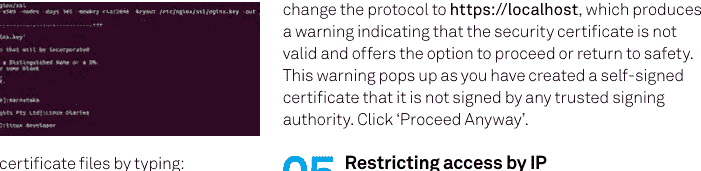

# 限制 IP

通过输入创建 `SSL` 证书和密钥文件：

```bash
sudo openssl req -x509 -days 365 -newkey rsa:2048 -keyout /etc/nginx/ssl/nginx.key -out /etc/nginx/ssl/nginx.crt
```

你必须正确回答提示的问题，这将创建一个密钥文件和证书。`openssl` 用于创建管理 `SSL` 证书。`req` 选项允许你指定 `CSR` 管理。在命令中，我们使用了 `365`。`nodes` 选项创建一个自签名证书，允许 `Nginx` 在无需用户交互的情况下读取它。我们使用 `-days` 指定证书的有效天数。`newkey` 选项指定在创建新证书的同时创建一个密钥。最后，`keyout` 和 `-out` 选项分别指定密钥和证书的输出位置：

## 设置防火墙


只有通过密码认证才能使你的 `Web` 服务器漏洞变得有意义。例如，如果你的网站是 `WordPress` CMS，管理页面密码可能被绕过。你可以将管理页面访问限制为你的 `IP` 或管理员的 `IP`。要执行此操作，打开 `Nginx` 配置文件并更新 `server` 块：

```bash
sudo nano /etc/nginx/sites-enabled/default
server {
    location /wp-admin/ {
        allow 10.2.74.45/24;
        allow 10.0.0.1/24;
        deny all;
    }
}
```

`www.linuxuser.com` 39

# Nginx 教程

在 `allow` 参数下（下文所示）的所有 `IP` 都可以访问管理页面，对于任何其他 `IP`，管理页面的访问将被锁定。`/24` 是子网掩码，您需要根据服务器配置数据对其进行更新。现在，重新加载 `Nginx` 服务器：

要启用 `NAXSI`，编辑 `nginx.conf` 并取消 `http` 部分中包含 `naxi_core.rules` 文件的注释：

```bash
$ sudo service nginx reload
```

```bash
$ sudo nano /etc/nginx/nginx.conf
http {
    nginx-naxi config
    ##
    # 如果安装了 naxi，请取消注释
    ##
    naxi include /etc/nginx/naxi_core.rules;
}
```

如果你使用任何其他 `IP` 访问 `Web`，将触发 `403` 错误：

# 06 安全审计

你可以使用安全审计工具独立扫描漏洞。有很多工具可以选择，但此处我们将使用 `Wapiti`。安装此 `Web` 漏洞扫描器：

```bash
$ sudo apt-get install wapiti
```

现在使用 `wapiti` 运行扫描：

在我们的示例中，`http://example.com` 是网站，`10` 表示限制具有相同模式的 `URL` 扫描数量为 `10` 以避免无限循环。将扫描范围限制为特定域名。

扫描结果创建在生成的 `generated-report` 目录中，该目录位于执行 `wapiti` 文件夹的位置。报告按漏洞类型分类：`SQL` 注入、绑定注入、处理等、跨站脚本、`CRLF`、资源消耗、请求头绕过、备份文件和潜在危险。

```bash
$ wapiti --http=example.com -n 10 -b folder
```

```bash
$ sudo nano /etc/nginx/naxi_core.rules
SecRulesEnabled:
#SecRulesDisabled:
DeniedUrl $1=".html";

# 检查规则
CheckRule($SQL= 8);
```

接下来更新 `NGINX` 配置文件中的 `server`：

```bash
$ sudo nano /etc/nginx/sites-enabled/default
location / {
    # 取消注释以在此位置启用 naxi
    include /etc/nginx/naxi.rules;
}
```

重新加载服务器。如果你想更新规则，请编辑 `naxi_core.rules` 文件中的主规则：

```bash
$ sudo service nginx reload
```

# 08 用于 NGINX 服务器的 Fail2ban

`Fail2ban` 防止恶意用户和机器人的攻击。该程序通过动态修改监狱策略（`jail policy`）来封禁 `IP` 地址。安装 `fail2ban` 的命令：

```bash
$ sudo apt-get update
sudo apt-get install fail2ban
```

当 `fail2ban` 在监控时检测到，`jail.conf` 文件会有条目。为了防止此文件在更新期间丢失，请执行：

```bash
$ sudo cp /etc/fail2ban/jail.conf /etc/fail2ban/jail.local
```

# 07 用于 NGINX 服务器的 NAXSI

`NAXSI` 是一个第三方模块，可以保护你的 `Web` 服务器免受各种攻击。从其发布页面下载 `NAXSI` 软件包，然后：

```bash
$ sudo dpkg -i nginx-naxi_1.1.19-ubuntu0.7amd64.deb
```

或者，从 `Ubuntu` 软件包列表中安装：

```bash
$ sudo apt-get update
$ sudo apt-get install nginx-naxi
```


# NASXI 是一个第三方防火墙模块，可以保护你的 Web 服务器免受各种攻击

```ini
[DEFAULT]
ignore = 127.0.0.1/8 10.214.75/24
bantime = 3600
dime = 3600 # 这些行结合封禁失败的客户端
maxretry = 6 # 在半小时内认证 6 次
mta = mail
destmail = example@email.com
enail = Fail2BanAlert
```

```ini
## enabled = true
## logpath(fail) 页面获取更多信息
## action = 'connect and -' (后跟空格) 用于过滤
filter = nginx-distro-conf
## 攻击选项的全局定义。你可以激活它
```

```ini
log = /var/log/nginx/access.log
maxretry = 2
```

现在为新创建的监狱创建过滤器。进入过滤器目录：

```bash
cd /etc/fail2ban/filter
```

在此处为示例监狱创建文件：例如 `nginx-badbots.conf`、`nginx-nproxy.conf` 等，用于坏机器人配置，例如之后也用于 `Apache` 和其他服务的相同文件。

将你的 `IP` 地址连带子网掩码添加到 `ignoreip` 参数中。根据所需的封禁时间更新 `bantime`。`insta mta` 启用邮件发送操作，并通过邮件客户端和发送者保护 `mta`。

## 09 Fail2ban 配置

接下来，使用 `/etc/fail2ban/jail.local` 监控你的 `Web` 服务器日志中的特定模式。默认情况下仅启用了 `jail`。如果你想监控登录尝试，找到 `[nginx-http-auth]` 监狱并启用它：

```ini
[nginx-http-auth]
enabled = true
filter = nginx-http-auth
```

可以创建自定义监狱，例如用于存储恶意请求模式：

```ini
[nginx-badbots]
enabled = true
port = http_https
logpath = /var/log/nginx/access.log
maxretry = 2
```

要使用你的 `nginx` 服务器作为开放代理封禁客户端，创建一个监狱：

```ini
[nginx-nproxy]
enabled = true
port = http_https
filter = nginx-proxy
```

# Diffie-Hellman 参数

在创建自签名证书后，可以生成 `4096` 位 `DH` 参数：

```bash
$ openssl dhparam -out /etc/nginx/dhparam.pem 4096
```

在 `/etc/nginx/nginx.conf` 的 `NGINX` 配置文件中更新 `server` 块：

```nginx
server {
    server_name localhost;

    ### SSL 部分
    listen 443 ssl;
    ssl_certificate /etc/nginx/ssl.crt;
    ssl_certificate_key /etc/nginx/ssl.key;

    ssl_ciphers ECDHE-ECDSA-AES128-GCM-SHA256:ECDHE-RSA-AES128-GCM-SHA256; 
    ssl_dhparam /etc/nginx/dhparam.pem;
}
```

重新加载服务器。如果你想更新规则，请编辑 `naxi_core.rules` 文件中的主规则：

```bash
$ sudo service nginx reload
```

最后，将使用分析工具（例如在线服务 `http://www.ssllabs.com/`）测试你的 `SSL` 配置。

# SuExec 教程

# 使用 SuExec 管理权限

`SuExec` 提高了安全性并允许 `Apache` 以原始用户运行 `CGI` 脚本


# Hello, World.


安装后，配置 `SuExec` 的关键是设置虚拟主机允许 Apache 在与运行原始用户的 Web 服务器上运行 CGI 和 SSL 文件的系统。通常，这些程序与 Web 服务器相同的用户运行（例如某些发行版中的 `www-data`）。`SuExec` 可以减少多户环境下用户运行自己的 CGI 脚本时发生的安全风险。请记住脚本必须是可执行的——很多人经常忽略这一点，并会导致错误。

## 01 设置 LAMP 栈

为了配置 `SuExec`，请确保你已安装 LAMP 栈。你可以通过在 `/var/www` 中创建一个 `php` 文件来验证 Apache 和 `PHP` 的运行。如果渲染正确，则在浏览器中加载该文件。如果你看到文件的内容，可能是 `libapache2-mod-php` 软件包有问题。这是一个常见的疏忽：Apache 实现了本文引用的站点。

| 特性 | 值 |
| :--- | :--- |
| 系统 | Linux x86_64 4.6.0-ubuntu |
| 构建日期 | 2017年2月16 11:52 |
| 服务器 API | Core |
| 虚拟目录 | enabled |
| 加载配置 | `/etc/php/7.1/cli.ini` |
| 额外文件扫描目录 | `/etc/php/7.1/conf.d` |
| 额外文件 | 7.1.3-deb |

## 02 启用 cgi 模块

要在 Apache 中使用 CGI，首先需要启用相应的模块。浏览 `modules-enabled` 目录（通常为 `/etc/apache2/mods-enabled`）下的 Apache 配置，并使用 `LoadModule cgi_module /usr/apache2/modules/mod_cgi.so` 指令启用它。如果没有该文件，说明我们使用一个允许配置运行目录的修改模块。我们看到所需的目录是 `/usr/lib/cgi-bin`，因此创建一个内容的测试文件：

```bash
#!/usr/bin/perl
print "Content-type: text/html\n";
print "Hello, World!\n";
```

这里的 `header` 特别重要，因为它告诉浏览器如何解释我们发送的数据。Web 服务器应该无任何警告地重启，你现在应该能够在启用的模式中看到该文件。使用 `a2enmod suexec` 命令显示单个模块，然后通过 `service apache restart` 重启 Apache。

```bash
sudo service apache restart
```

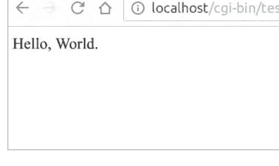

Hello, World.

```apache
## Module mod_cgi_conf
LoadModule cgi_module modules/libapache2_mod_cgi.so
## ...
```

## 03 检查默认虚拟主机

假设你使用的是 Apache 的基础安装，“默认虚拟主机”将通过 `/etc/apache2/sites-available/000-default.conf` 文件进行配置。如果你打开它，将发现没有启用 CGI 选项。这是因为系统没有提供 CGI 内容——它是通过这种方式被专门启用的。关键行是配置 `ScriptAlias`，你的网站上设置 `ScriptAlias /cgi-bin/` 将映射到 `/usr/lib/cgi-bin/`。由于 `+Execgi`，执行被启用。

```apache
ScriptAlias /cgi-bin/ /usr/lib/cgi-bin/
+Execgi
```

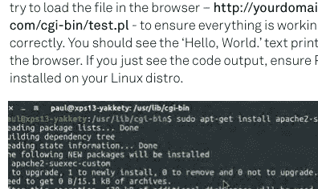

## Apache SuExec

> `SuExec` 通过擦除服务器配置中标记为安全以外的所有环境变量来清理环境

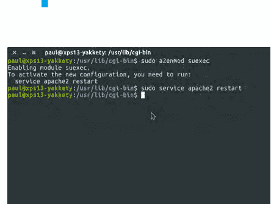

如果模块已安装，当你尝试重新加载 CGI 脚本时会遇到 500 错误——这是由于 `SuExec` 实施的安全措施。别担心，这很容易解决。

使用命令 `sudo mkdir /home/scripter/scripts` 创建一个合适的地方——`SuExec` 对谁有权在目录中写入和执行非常严格，因此我们可以通过 `sudo chown scripter:scripter /home/scripter/scripts` 传输所有权和正确的权限，以及 `sudo chmod 700 /home/scripter/scripts`——我们的用户 `scripter` 将能够写入该目录。

## 08 创建新用户

流程的下一步是创建一个新用户，该用户将执行我们的 CGI 脚本。如果你有多个站点，每个用户都可以有自己的家目录，

```bash
$ useradd -m -d /home/scripter scripter
Adding new user: 'scripter' with group 'scripter'
Creating home directory: '/home/scripter'
Copying files from '/etc/skel' to '/home/scripter'
passed password ownership successfully
$ chown scripter:scripter /home/scripter
$ chmod 755 /home/scripter
```

## 10 创建并复制新脚本

我们将创建一个新脚本，但首先我们需要确保它在我们新用户下可以正常工作，因此我们使用 `sudo touch /home/scripter/scripts/test.pl`。

将以下内容粘贴到我们用于定义解释器的文件中 `"Content-type: text/html\n<html><head></head>\n<body>print(\"Hello World!\");</</body></body></html>"` 中，以输出内容。当我们在接下来的步骤中测试脚本时，它的运行方式将与完全一样。

```bash
$ touch /home/scripter/scripts/test.pl
$ chmod 700 /home/scripter/scripts/test.pl
$ chown scripter:scripter /home/scripter/scripts/test.pl
```

并使用。在每个提示信息处按回车键——我没有显式地以用户身份登录，所以没关系。设置用户将自动创建相应的家目录，我们将在下一步中使用它。

```bash
$ su -s scripter -d /home/scripter /home/scripter/scripts/test.pl
```

## 11 变为可执行

现在我们已经测试了脚本，我们需要它是可执行的。我们还需要确保我们的新 `scripter` 是拥有该文件权限的人。为了做到，我们需要使用命令 `chmod 700 /home/scripter/scripts/test.pl`。我们现在将在 `web-data` 用户家目录中设置一切，这样此脚本才能通过 `SuExec` 正确运行。

## 09 创建新的脚本目录

我们将从新用户的家目录存储并运行脚本，

## 12 使用脚本目录更新虚拟主机

由于我们更改了脚本目录的位置，我们需要更新虚拟主机文件——例如，编辑默认虚拟主机文件 `/etc/apache2/sites-enabled/000-default`，并将 `ScriptAlias` 更改为 `/home/user/scripts/`。`ScriptAlias` 命令实际上需要 `Options +ExecCGI` 选项，这只有在重启 `apache` 时才严格需要。

```apache
<Module module_cgi.so>
  LoadModule cgi_module /usr/lib/apache2/modules/mod_cgi.so
</Module>
<Module module_env.so>
  LoadModule env_module /usr/lib/apache2/modules/mod_env.so
</Module>
<Module module_rewrite.so>
  LoadModule rewrite_module /usr/lib/apache2/modules/mod_rewrite.so
</Module>
<Module module_proxy.so>
  LoadModule proxy_module /usr/lib/apache2/modules/mod_proxy.so
</Module>
```

## 13 在虚拟主机中设置用户


最重要的是，我们需要添加新行 `SetOptions UserGroup scripter-user`——这确定了拥有虚拟主机文件的用户，正如我们之前讨论过的，脚本将以哪个组运行。在我们准备测试之前，只剩下一项需要配置了！

```apache
## /etc/apache2/sites-enabled/000-default.conf
<VirtualHost *:80>
  ServerName localhost
  DocumentRoot /var/www/html
  ScriptAlias /cgi-bin/ /home/user/scripts/
  Options +ExecCGI
  SetOptions UserGroup scripter-user
</VirtualHost>
```

## 14 设置 SuExec 目录

记得在教程中，我们在讨论安装自定义版本的 SuExec 以及我们如何使用自定义虚拟目录吗？编辑 SuExec 配置文件 `/etc/apache2/suexec/www-data` 并添加行 `/home/user/scripts/`。现在我们将脚本的子目录视为运行 CGI 的有效位置。

## 15 重启 Apache

记得在教程中，我们正在讨论安装自定义版本的 SuExec 以及我们如何使用自定义虚拟目录吗？编辑 SuExec 配置文件 `/etc/apache2/suexec/www-data` 并添加行 `/home/user/scripts/`。现在我们将脚本的子目录视为运行 CGI 的有效位置。

## 16 SuExec 与环境

记得在教程中，我们正在讨论安装自定义版本的 SuExec 以及我们如何使用自定义虚拟目录吗？编辑 SuExec 配置文件 `/etc/apache2/suexec/www-data` 并添加行 `/home/user/scripts/`。现在我们将脚本的子目录视为运行 CGI 的有效位置。

## 17 SuExec 与变量

记得在教程中，我们正在讨论安装自定义版本的 SuExec 以及我们如何使用自定义虚拟目录吗？编辑 SuExec 配置文件 `/etc/apache2/suexec/www-data` 并添加行 `/home/user/scripts/`。现在我们将脚本的子目录视为运行 CGI 的有效位置。

## 18 故障排除

我们能向网络应用程序开发人员提供的最佳建议是，在执行任务之前了解理论，以及如何编写使用 `TCP` 的软件。`SSH` 生成的加密流量在没有完美网络应用程序的情况下无法解密。记住，没有 `TCP` 就没有互联网，在创建网络应用程序时要小心。

## Erlang 教程

Mihalis Tsoukalos 管理员、程序员和数学家。他从 1993 年起就开始编写代码。你可以通过 Twitter `@msoukalos` 或 `mtskalos.eu` 与他联系。

我们的 Erlang 系列将继续介绍创建过程，我们将涵盖网络编程，这主要包括 `TCP/IP` 服务器的开发。

## 资源

最新安装的 Erlang 文本编辑器，如 `Emacs` 或 `vi`

## gen_tcp

`MODULE` `gen_tcp`

### MODULE 摘要

`TCP/IP` sockets 的接口。

### 描述

此模块提供了使用 `TCP/IP` 协议与 sockets 进行通信的函数。

下面的代码片段是客户端连接到 5678 端口服务器并关闭连接的简单示例。

```erlang
client() ->
  {Socket = gen_tcp:connect(binary, packet, 0), % 为了能在一台机器上运行
  {ok, Bin} = gen_tcp:connect(socket, "localhost", 5678, "Data"),
  {ok, Connection} = gen_tcp:open(Bin)}
```

在另一端，监听 5678 端口的服务器接受连接并返回二进制数据：

```erlang
server() ->
  {ok, Socket} = gen_tcp:accept(5678, active),
  {ok, Bin} = gen_tcp:recv(Socket, B),
  {ok, List} = list_to_binary(Bin)}
```

更多示例请参见 `Examples`（示例）章节。


### MODULE

`MODULE` 摘要

访问 `TCP/IP` 协议。

### 描述

此模块提供了对 `TCP/IP` 协议的访问。

另见 `inet:configuration` 获取更多关于如何配置 Erlang 运行时系统和使用通信的信息。

以下两个 `TCP` 连接参数会影响开放 Erlang 节点上所有 sockets 的行为：

- `inet_connect_options`：当节点关闭时返回时，它包含所有 sockets 的选项列表。
- `inet_listen_options`：包含在调用监听 socket 时使用的选项列表。

当使用 `accept` 时，监听 socket 选项的值会被继承。没有此类的应用程序变量。

### 有用的 Erlang 包

有三个 Erlang 包可以帮助我们在 Erlang 中开发网络应用：`gen_tcp`、`gen_udp`。这两个包提供了低级功能，而第三个包允许我们创建任何原始的 `TCP/IP` sockets。


图 1 显示了该模块文档页的一小部分，该模块允许我们从 Erlang 中使用 TCP/IP 协议。正如你稍后将看到的，使用我们的 TCP 和 UDP 客户端将需要使用来自 `gen_tcp` 和 `gen_udp` 模块的适当 Erlang 函数。

## Erlang 中的 TCP 服务器

本节将向你展示如何使用 Erlang shell 创建一个 TCP 服务器，以便更好地理解它们所使用的函数：

```erlang
3> (ok, TCPPort) = gen_tcp:listen(8000,
[(active,true), binary];
(ok,#Port#0.452)->n2=(ok, AcceptTCPPort) = gen_tcp:accept(TCPPort).
(ok,#Port#0.456)->n4=flush()=
Shell get (tcp,Port#0.456:"Hi there!\r\n");
Shell get (tcp,Port#0.456<<255,254,255,253>ok)
```

服务器使用 `gen_tcp:listen/1` 函数创建。第一个命令的返回值是 socket 的 Erlang 表示——你将在本教程中看到它。如果由于某些原因无法创建所需的 socket，你将收到如下类型的错误：

该函数也可以接受第二个参数，即 TCP 服务器等待传入连接的超时时间。如果 `gen_tcp:accept/1` 只有一个参数（即 `gen_tcp:listen/1` 的返回值），它会等待传入的连接，然后允许你在 Erlang 进程中处理它。

最后，你需要运行 `flush()` 命令来显示数据。`gen_tcp:close/1` 函数允许你关闭一个 TCP 类型的 socket。当客户端和服务器都关闭时，TCP 连接将正式终止。你也可以任何时候关闭 socket。

```erlang
> > gen_tcp:listen(80, [(active,true, binary]);
(error,errors)
```

使用 `telnet $192.168.1.200 80` 测试了连接。请注意，telnet 仅适用于 TCP 协议，所以如果你想测试 UDP 服务器，你需要在任何编程语言中使用等效工具或像 `netcat` 这样的高级实用。后者更适合测试目的，但前者为你提供了控制 TCP-socket 的所有参数的灵活性。

错误代码条目是对“Permission Denied（拒绝访问）”的解释，这完全合逻辑，你需要尝试使用一个已经由 Apache 服务器占用的特权端口。

接下来，你必须借助 `gen_tcp:accept/1` 函数设置 socket 的接受状态。成功执行后，它会等待连接而不会留下任何类型的错误消息。

## `gen_tcp:listen()` 的参数

TCP/IP 连接的参数对于你连接的方式起着关键作用。然而，`gen_tcp:listen/1` 函数允许一组定义应用程序 socket 行为的参数。

正确。Wireshark 程序是一个用于调试网络应用和解决相关问题的工具。

`binary` 选项指定了收到的数据包是否为二进制格式。Sockets 以 active（活跃）、active once（单次活跃）或 passive（被动）模式打开。将 socket 设置为 active 模式意味着在接收第一条消息后，需要再次启用才能接收另一条消息，这在 passive 模式（`active,true`）下并非如此。当 socket 处于被动模式时，你需要调用 `get:accept/1` 从 socket 中读取数据。它的优点是可以控制数据流，这在 active 模式下是无法实现的。

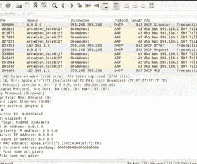

网络调试非常困难，因此你需要网络数据的帮助。然而，Wireshark 是一个图形化的协议分析器，可以捕获并分析任何流量，包括头部和负载，所以如果你刚开始，不用担心。图 8 显示了运行中的 Wireshark。Wireshark 有一个命令行版本叫做 `tresh`。虽然 `tresh` 工作方式相同，但使用图形化应用分析网络数据会让生活简单得多。你可以在那里找到更多关于 Wireshark 和 `tresh` 的信息。此外，如果你的 Linux 具有多个 IP 地址，你可以定义服务器使用的 IP 地址。

```erlang
(ok,TCPPort) = gen_tcp:listen(8000, [(192.168.1.200}), (active,true, binary]);(ok,#Port#49))
```

请注意定义 IP 地址的方式。最后，你可以如下使用 Internet Protocol (IPv6) 代替 IPv4：


www.wireshark.org

## 检查流量

使用 Wireshark 检查 Echo 服务的网络流量比看起来简单，即使它更复杂。关键在于提前准备数据，以及参与网络的两个机器的 IP 地址。知道端口号也可以帮助你过滤预期的数据包。过滤返回给 Echo 服务器的网络包——要确定你想看到的流量类型，请使用显示过滤器。通过过滤，你可以快速理解某些操作失败的原因。在提供的示例中，一切运行符合预期。

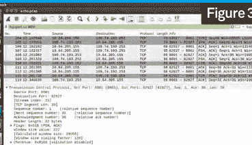

之后：Wireshark 显示与端口 8001 Echo 服务相关的流量

```erlang
(ok,TCPPort6) = gen_tcp:listen(8000, (active,true,inet6), (ok,port=501))
```

## 从 Erlang 创建 UDP 服务器

本节展示了如何创建一个原生 UDP 服务器。过程与 TCP 服务器类似——最大的区别在于使用的是 UDP 协议而不是 TCP 模块。遵循以下 Erlang 示例：

```erlang
(ok,UDPPort) = gen_udp:open(8000, (binary,active,true), (ok,port=4500))
```

由于你不能使用 telnet 测试 UDP 服务器，需要使用 `netcat` 工具来连接并测试 UDP 服务器：

```bash
$ nc -u 8000
```

如果你在使用 netcat 发送数据后运行 `flush()` 函数，你就会收到数据：

```erlang
5> flush().
```


```erlang
echo_client(Socket, Message) ->
  Binary = list:to_binary("~s\n", [Message]),
  gen_tcp:send(Socket, Binary, []),
  loop_client(Socket).
loop_client(Socket) ->
  case gen_tcp:recv(Socket, Data) of
    {ok, Data} -> ioformat("Received: ~s\n", [Data]);
    Error -> ioformat("Error: ~s\n", [Error]) end.
```

```erlang
Shell got (port=<450)(2,86,4,136),5276,"<<This is
```

```erlang
Shell got (ok,udp) port=4500,(2,86,4,136),5276,"<<10 01 11 "hello">>
ok
```

最后，你可以通过以下命令使用 UDP 服务器：

```erlang
6> gen_udp:close(UDPSocket).
ok
```

打开 UDP 服务器比打开 TCP 服务器更容易，因为它需要的连接少。

## 在 Erlang 中创建 TCP 客户端

接下来，我们需要为 Echo 服务器开发一个客户端。Echo 服务器使用 TCP 返回它接收的数据，这是测试两台机器是否能够成功通信的完美方法。`gen_tcp:send` 函数将数据发送到 TCP 服务器，而 `term_binary()` 函数将输入字符串转换为适用于网络传输的形式。我们使用 `term_binary()` 来格式化想要执行的函数。我们将在 `echo.er` 文件中找到客户端的 Erlang 代码并在此展示：

## 在 Erlang 中创建 TCP 服务器

在本节中，我们需要在 Erlang 中开发一个 Echo 服务器。你可以在 `echo.er` 中找到服务器的 Erlang 代码。正如你所理解，我们需要根据想要执行的内容使用适当的函数。服务器进程通常一直运行，因此拥有一个服务器进程比客户端进程重要得多，这意味着你应该通过调试服务器进程来测试它。

你可以在图 4 中看到 TCP 服务器的 Erlang 代码。它的好处处是你可以定义端口。

## Erlang 教程


```erlang
echo_server(Port) ->
    {Socket, Client} = gen_tcp:accept(gen_tcp:listen(Port, [])),
    gen_tcp:send(Socket, ["Hello, " ~p!\n", Client], [0]),
    echo_loop(Socket).
```

上图显示了实现 `Echo` 服务器（回显服务器）的代码。

当 `Echo` 服务器在屏幕上运行时，它会监听连接，并接收消息以及其他调试信息。

现在是查看 `Echo` 服务运行情况了。

我们将使用两个窗口以便你可以测试 `TCP` 服务器和客户端。在第一个窗口中，让我们开始使用端口 `8002`：

```erlang
33 >> echo_server(8002);
```

接下来，你将在第二个窗口中启动 `TCP` 客户端：

```erlang
9 >> echo_client("localhost", 8002, "HI!");
Socket: {port:8002};
Sent: {ok,131,0.7,32,105,33}
Recv: "HelloHI!"
nok
```

`Echo` 服务器将打印以下内容：

```erlang
Got - "HI"
ok
```

该过程的结果验证了消息已发回，并在其前面加上了 `"Hello "`。由于 `gen_tcp:listen` 函数具有 `active(false)` 参数，服务器进程在客户端连接后会终止；因此，如果你想让它持续运行，请重启。

## 在 `Erlang` 中创建 `UDP` 客户端

为了增加趣味性，我们将使用 `UDP` 开发 `Echo` 客户端。你可以在图 5 中看到 `UDP` 客户端的 `Echo` 代码，它与 `TCP` 版本非常相似。

`Echo` 服务器的实现有一个显著区别。过程如下：客户端发送数据并从服务器接收返回。之后，`UDP` 连接会自动关闭，因为 `UDP` 是无状态协议。与 `TCP` 不同，`UDP` 是无连接的。

简单来说，`UDP` 不关心数据包是否被接收或是否存在丢失；`TCP` 则对每个发送的数据包都有确认。此外，如果 `TCP` 没有收到


`net` 网络工具（也作为 `nc` 执行）可以帮助你测试连接，并且在 `TCP/IP` 网络上开发应用程序时非常有用。该工具的好处是可以在没有 `root` 权限的情况下操作。它既作为客户端也可以作为服务器。使用带有 `-u` 选项的命令对于绑定端口非常有用，这意味着我们可以测试 `UDP`。默认情况下 `net` 使用 `TCP`，但使用 `-u` 选项后它充当 `UDP` 服务器。该选项告诉你仅使用 `IPv6` 地址。

```erlang
echo_client(Host, Port, Message) ->
    {Socket, Server} = gen_udp:connect(Host, Port, []);
    gen_udp:send(Socket, Message, 0);
    {ok, Reply} = gen_udp:recv(Socket, 1024);
    Reply.
```

上述 `UDP` 客户端与 `TCP` 客户端有某些相似之处，虽然看起来像 `TCP`，但速度比可靠性更重要。在这种情况下，当数据被拆分为单个数据包时，`UDP` 可能是更好的选择。`Echo` 服务就是这样一个例子。


```erlang
echo_server(Port) ->
    {Socket, Address} = gen_udp:bind(Port, [], active(false));
    echo_loop(Socket).
```

```erlang
echo_loop(Socket) ->
    {ok, Message, Address} = gen_udp:recv(Socket, 1024);
    gen_udp:send(Socket, Message, 0);
    echo_loop(Socket).
```

上述是使用 `UDP` 协议的 `Echo` 服务器。在 `Erlang` 中创建 `UDP` 服务器

本节涵盖了使用 `UDP` 的 `Echo` 服务器的开发。代码用 `Erlang` 编写，你也可以在上面的图 6 中看到。我们的 `Echo` 服务器是一个被动式 `UDP` 服务器，使用逻辑/函数处理其连接。

首先，调用 `echo_server()` 并调用 `spawn()` 来在后台初始化服务器，这使得 `Erlang` shell 能够接收后续命令。因此，你可以如下所示启动 `UDP` 服务器：

```erlang
> net:echo_server(8000).
Socket:?Port=2071><66>.
```

接下来，我们启动在上一节中开发的 `Erlang` 客户端：

```erlang
> net:echo_client("localhost", 8000).
"Hello Hello!"
Cot:?Port<49>
:<This is Hello!>>
```

此时，`UDP` 服务器将打印以下行行：

```erlang
:"Hello Hello!"
```

因此，我们可以相信客户端和服务器的运行符合预期，且 `UDP` 服务的 `Erlang` 实现是正确的。

```erlang
{{127,0,0,1),(0,0,0),(255,0,0,0)}}
```

你也可以使用 `inet:getaddrs(Addr)` 获取相同的信息。图 7 显示了 `inet:getaddrs()` 函数更具分析性的输出——在 `Erlang` 中处理 `inet:getaddrs(Addr)` 的文本是一项困难的任务。你也可以用它来测试一个 `IP` 是否是有效的 `IP` 地址：

```erlang
> net:parse_address("192.168.1.200").
ok,((192,168,1,200)),
> net:parse_address("192.168.1.256").
error(invalid).
```

图 8 显示了一个名为 `dns.er` 的小型 `Erlang` 程序，它允许你使用 `inet:getaddr(Hostname)` 解析主机名。执行它将得到如下输出：

```erlang
-module(dns).

export([dns_resolve/1]).
dns_resolve(Hostname) ->
    Output = inet:getaddr(Hostname),
    format("~p~n", [Output]).
```

## 图 8

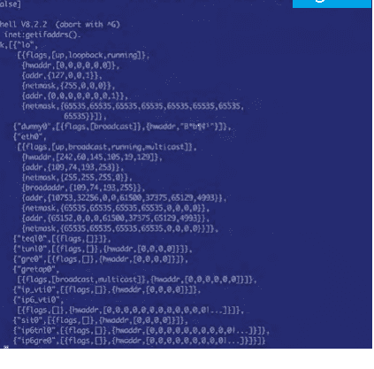

图 7 显示了 `dns.er` 的 `Erlang` 代码，它包含单个函数：

- `1) dns_resolve("linux.user.co.uk")`
  `ok,(52,117,23,92))`

输出告诉我们 `linux.user.co.uk` 的 `IP` 是 `52.117.23.92`，可以通过 `host` 命令行进行验证：

```bash
$ host linux.user.co.uk
www.linux.co.uk has address 52.117.23.92
```

接下来的教程将开始讲解 `OTP`（开放电信平台），为了避免混淆，它不是指超时，而是指处理电信应用程序特征的软件。

正如你所见，`inet:getaddrs()` 函数提供了更详细的 `IP` 分析。与 `inet` 模块工作

在本节中，我们将展示如何使用 `inet` 模块。`TCP` 以下内容：

```erlang
> net:parse_address("192.168.1.200").
ok,((192,168,1,200)),
> net:parse_address("192.168.1.256").
error(invalid).
```

有原生的安全扫描功能。`Ubuntu` Server on `nmap`

| NMAP | Nmap 参考指南 |
|---|---|
| SWIFT | nmap 探索工具 /端口扫描器 |
| DESCRIPTION | "Nmap" 是用于网络发现和安全审计的开源工具。它支持许多操作系统。Nmap 使用原始 IP 包发送和接收信息，并确定主机开启了哪些服务（应用程序版本等）。Nmap 广泛用于安全审计、网络管理、配置审核计划以及主机或服务的运行监控。 |

## 资源

当我们在网络上设置 `Linux` 系统时，面临许多安全挑战，我们可能对保持系统安全感兴趣。在本教程中，我们将展示一个可行的解决方案。我们将涵盖安全 `Ubuntu` 服务器的各个方面。

- [nmap](https://nmap.org)
- [Ubuntu Server](https://ubuntu.com/server/Basic)

## 状态名称 | 概要描述

| 状态名称 | 概要描述 |


## 端口扫描状态

| 状态 | 描述 |
| :--- | :--- |
| 开放 (Open) | 这被认为是最是最危险的状态。开放的端口通常表示服务器上有一个处理该端口请求的服务，这可能很容易成为外部黑客进入服务器的切入点。 |
| 关闭 (Closed) | 虽然可以访问关闭的端口，但没有服务在处等待。 |
| 已过滤 (Filtered) | 如果不想访问特定端口，那么“已过滤”是最佳端口状态。请注意，即使服务正在监听某个端口，防火墙也会阻止对该端口的访问。 |
| 未过滤 (Unfiltered) | 在此状态下，`nmap`扫描可以看到该端口，但无法确定端口是开放还是关闭。 |
| 开放 (Open) \| 已过滤 (Filtered) | `nmap`扫描看到了端口，但无法确定端口是开放还是被过滤。 |
| 关闭 (Closed) \| 已过滤 (Filtered) | `nmap`扫描看到了端口，但无法确定端口是关闭还是被过滤。 |

你可以参考官方网站 (`https://nmap.org/`) 获取其详细信息。你可以使用下面的命令安装 `nmap`：

```bash
$ apt-get install nmap
```

## 扫描类型

为了审计你的系统，`nmap`工具利用了多种实用的扫描类型。你可以在 `https://nmap.org/` 上使用的各种端口扫描技术是用于服务审计的最受欢迎的端口扫描类型：

- **TCP** - 这种类型的扫描中，`nmap`尝试连接到传输层协议的主端口，除非服务器连接端口完成了三次握手。
- **UDP** - 这种类型的扫描中，`nmap`向系统上的每个端口发送一个 `UDP`数据包。

当我们运行 `nmap`时，它会生成一个包含有关我们正在扫描的系统以及相关端口信息的报告。`nmap`扫描列出了六种可能的状态（见上表）。可以使用以下命令执行 TCP 连接扫描：

```bash
$ nmap -sS 127.0.0.1
```

如我们从图 1 中所示，TCP 连接扫描表明我们的示例有两个端口是开放的，并且我们有服务在本地上监听针对这些端口的请求。使用以下命令执行 UDP 扫描：

```bash
$ nmap -sU 127.0.0.1
```

如你在图 2 中所示，UDP 扫描报告了三个端口，并且有服务在这些端口上监听。你可以使用这两种类型的 `nmap`获取你服务器所使用的服务列表。`nmap`的另一个示例是扫描你的网络安全，以比较你的 `Linux`服务器从内部和外部的观，并利用它来确定你需要保持私密的服务。如果你这样做，那么对你来说进行扫描将变得很容易。

## 安全的 Ubuntu

设置防火墙规则的顺序至关重要。最好的做法始终是：将“拒绝所有 (Deny all)”作为第一条规则。确保将其放在顶部位置，表示我们想要阻止所有内容，然后选择性地允许规则来指定进出网络的流量。

```bash
$ user@virtual:~$ sudo ufw status
Status: active
To                         Action      From
------                         -----
22/tcp                     ALLOW       Anywhere
80/tcp                     ALLOW       Anywhere
443/tcp                    ALLOW       Anywhere
```

图 2

```bash
$ user@virtual:~$ cat /usr/bin/sshd | grep lib
```

在示例中，我们正在检查 `SSH`守护进程 (`sshd`) 是否使用了 `TCP`包装 (TCP wrappers)。此命令的输出可以在图 3 中找到。提示答案：当服务支持 `TCP`包装时，会检查 `hosts.allow`和 `hosts.deny`中是否存在与请求的 `IP`地址匹配的条目。如果 `allow`包含该系统地址，则授予系统访问。如果系统地址未列出，则 `TCP`包装将检查 `hosts.deny`文件。在两种情况下，这两个文件都非常重要。以 `#`开头的行会被忽略，而随其后有逗号分隔的地址列表的行将会被检查。因此，你可以让 `hosts.deny`尽可能的严格，并根据需要选择性地启用服务。

`UDP`扫描比 `TCP`慢，但可以与 `TCP`扫描结合以获得更高的效率。从多个位置，你可以考虑一种简单的方法，从同一网络或外部的另一台服务器来设置如 `Linux`服务器等的地方。需要注意的是，在审计图表时，需要考虑各种网络组件（例如你服务器的防火墙和路由器）的安全设置。比较你的 `Linux`服务器在网络内部与外部的观，并确定你需要保持私密的服务。

完全禁用未使用的服务可能是件的，即使你需要一个服务时，你也需要设置访问控制。使用 `TCP` Wrapper 是一种基于主机的访问控制 (ACL)，用于过滤对互联网的访问访问，如 `FTP`、`telnet`和 `POP3`。访问控制通过两个文件应用：`hosts.allow`和 `hosts.deny`。使用服务 `libwrap`时，在系统守护上使用此命令，例如：

```bash
$ user@virtual:~$ sudo /usr/bin/sshd | grep lib
$ user@virtual:~$ cat /etc/hosts.allow
```

图 3

1. 基于网络的。基于网络的防火墙有助于保护整个网络或子网，而基于主机的防火墙运行在单个主机服务器上并保护该服务器。
2. 基于主机的。防火墙可以安装在路由器等设备上，也可以在所有的计算机系统上。通过这些应用程序的帮助，你可以使用规则来过滤控制流量。防火墙还作为入流量的过滤器进行检查。

请注意，最佳设置是两者的结合。在 `Ubuntu`服务器上，防火墙基于 `iptables`，并由 `iptables`工具管理。该工具有助于创建用于访问控制列表的规则。让我们详细查看流行的 `iptables`防火墙规则。在使用 `iptables`之前，你需要理解用户应用的一些基本概念，如规则、表和策略。上述使用 `ldd`检查服务是否使用了 `libwrap`

`iptables`中有四个重要的表，每个表的功能如下：

- **filter** - 此表提供了防火墙的数据包过滤功能。对于进入和离开 `Linux`系统的包做出访问控制决策。
- **nat** - 这是用于重映射 `IP`地址空间的地址转换功能。
- **mangle** - 可修改表中的规则。
- **raw** - 用于将某些包排除在跟踪之外。

`DROP` - 网络包被丢弃且不允许进入服务器；不会发送拒绝消息。

在入站流量上使用 `DROP`操作是正常的，这样恶意人员就不会知道他们的流量被拦截了。尽管 `Ubuntu`服务器将带有运行的防火墙，但检查它是否启用是一个良好的习惯。我们启用规则的命令在不同的 `Linux`发行版上略有不同。

| 链 | 协议 | 目标 | 目的 |
| :--- | :--- | :--- | :--- |
| INPUT | tcp | ALLOW | Anywhere |
| INPUT | udp | ALLOW | Anywhere |
| INPUT | icmp | ALLOW | Anywhere |
| OUTPUT | tcp | ALLOW | Anywhere |
| OUTPUT | udp | ALLOW | Anywhere |
| OUTPUT | icmp | ALLOW | Anywhere |
| PREROUTING | tcp | ALLOW | Anywhere |
| PREROUTING | udp | ALLOW | Anywhere |
| PREROUTING | icmp | ALLOW | Anywhere |
| POSTROUTING | tcp | ALLOW | Anywhere |
| POSTROUTING | udp | ALLOW | Anywhere |
| POSTROUTING | icmp | ALLOW | Anywhere |
| FORWARD | tcp | ALLOW | Anywhere |
| FORWARD | udp | ALLOW | Anywhere |
| FORWARD | icmp | ALLOW | Anywhere |

- **t** 表 - `iptables` 命令应用于该表。
- **P** 链 - 这有助于设置特定链的整体策略。
- **D** 链 - 按链删除特定的规则。
- **d** IP 地址 - 将规则分配给指定的目的地址。
- **p** 协议 - 将规则分配给指定的协议。

# 关于 VPN 你想知道的一切

事实：你无法阻止 `GCHQ`（英国政府通讯）或 `NSA`（美国国家安全局）追踪你，但你可以让这种追踪变得困难。虚拟专用网络（`VPN`）是保护两台电脑之间连接的重要工具，我们将帮助你选择最适合你的一个。


# 为什么要虚拟化？

你为什么想使用 `VPN`？隐私和安全担忧是建立私有网络最常见的原因，但不是唯一的原因。


无论你是使用家庭宽带还是在国外漫游移动数据，你都有可能受到服务提供商采用的流量整形（traffic shaping），该技术用于限制其网络上的某些特定类型流量。例如，许多英国网络提供商会在内容匮乏时通过整形来限制音乐和视频流服务的速度，以阻止客户消耗大量流量。同样，一些英国提供商会在高峰时段对文件下载采取同样措施。`VPN` 可以帮助避免这种情况，因为它会加密通过你连接的所有流量，使得提供商无法准确看到你正在做什么。一个例外是，某些提供商可能会检测并限制 `VPN` 流量，尽管有许多不同的提供商可用，但通过使用不那么常见的服务（通常不是 `OpenVPN`）可以避免这一点。


如果你使用 `Linux` 机器访问互联网，那么了解虚拟专用网络（`VPN`）的优缺点是值得的。`VPN` 允许你保护两个位置之间的流量——第一个位置可以是你的 `VPN` 提供商，或者是你在其他地方部署的 `VPN` 系统，而第二个位置是你自选择的另一个地点，例如办公室。

`VPN` 可通过多种协议使用，但它们的本质是流量在主机端加密并在服务器端解密，确保其在通往目的地的途中不会被任何中间人窥探。

在使用 `VPN` 时，有许多与路由相关的选项。典型的场景是所有流量都通过 `VPN` 连接进行路由。然而，你也可以使用“分流隧道”（split tunneling），即根据路由规则，某些网络地址将绕过 `VPN` 连接并使用常规互联网连接。

`VPN` 通常被那些担心因活动受到迫害的人用工具，但它为任何在公共网络上发送数据的人提供了安心感。

# 功能 VPN 与 VPS

## 数据安全

## 使用 VPN 的场景将帮助保护你的数据。

`VPN` 的经典用例是公共 `Wi-Fi` 热点。如果你带着你的 `Linux` 笔记本电脑（或其他任何设备）在外面，你可能会获得你喜爱的咖啡馆提供的免费连接。这种方法的麻烦在于，你真的不知道正在发生什么。网络或咖啡馆中的其他活动者可能会拦截你想要使用的服务。如果你正准备发送任何你在意的数据，无论是社交网络还是在线银行，使用 `VPN` 将确保你通过网络的所有流量都经过安全加密。

当用户连接到 `VPN` 时，他们可以像实际上在办公室里一样浏览。分流隧道意味着网络访问仍然可行，但 `IP` 范围内的地址将通过 `VPN` 路由。通过在家里安装 `VPN` 服务器（或使用 `VPN` 功能），当你离开家时，可以连接到家中的网络中任何地方的机器。如果你有安全摄像头并想远程查看它们而不将它们暴露给全世界，这尤其有用用。

`VPN` 的常见用途是为办公室网络提供远程访问。使用这种方法可以避免将机器完全开放给全世界，而是只配置一个 `VPN` 服务器。

`VPC`，或虚拟私有云。这意味着公司可以在云中拥有若干服务器，但通常无法从 `Web` 访问。这仅允许它们相互通信。一个很好的选项是在 `VPC` 内部部署 `VPN` 访问，这样只有极少数的服务器暴露在世界上，有助于增强整体安全性。

使用 `VPN` 时的一个考虑因素是它们的位置。如果你在英国使用 `VPN`，但连接到另一个国家的 `VPN`——例如美国——这将影响网页浏览等活动，因为网站将显示你的 `IP`；即你实际路由流量的那个服务器的 `IP`。如果你想使用 `Google` 但结果都显示为另一种语言，这可能是负面的；或者如果你 `VPN` 回自己的国家以访问本地内容，这可能是积极的。

使用 `VPN` 为你提供了无值的安心感，确保你的流量在通过如 `Amazon Web Services` 等云基础设施传输时不会被拦截。云托管中的一个常见概念是 `VPC`。


## VPN 与 VPS

| 窃听者 & 黑客 | | | | 互联网 | | | |
| :--- | :--- | :--- | :--- | :--- | :--- | :--- | :--- |
| 左：无论你选择建立自己的虚拟专用服务器还是使用提供商，`VPN` 都会加密你的互联网连接以增强安全性和隐私 | | | | | | |
| 你 | `VPN` | | 加密隧道 | | | |
| | | | | 政府与企业封锁 | | | |

## 什么是 VPN 服务？

- 通常由专业的 `VPN` 公司提供
- 懂技术的人也可以也可以部署
- 价格非常昂贵，但从免费开始
- 通常，你付什么钱就得到什么服务

## 什么是 VPS？

- `VPS` 是一个虚拟私有云。这意味着公司可以在云中拥有若干服务器，但通常无法从 `Web` 访问。这仅允许它们相互通信。一个很好的选项是在 `VPC` 内部部署 `VPN` 访问，这样只有极少数的服务器暴露在世界上，有助于增强整体安全性。

# 功能 VPN 与 VPS

## 针对 Linux 用户的最佳提供商

### Streisand 易于部署

在部署自己的服务器时有许多选择。该脚本设计在 `Ubuntu` 16.04（当前的 `LTS` 版本）上运行，并且可以（诚然，这提供了最高级别的控制），但非常耗时。另一种选择是使用 `Streisand`。在安装结束时，你会得到一个可以与朋友或家人分享的 `HTML` 文件。使用 `Streisand` 的用处在于你可以随意拆除 `VPN` 并重新部署，从而减少了被攻破的风险。

这带有许多开源工具，如 `L2TP/IPsec`、`OpenVPN`、`Shadowsocks`、`Stunnel` 和 `WireGuard`（参见 `pdf`）。

### VyprPN

虽然本文的大部分讨论了你的 `VPN` 解决方案，但如果你想注册托管服务呢？你可以选择 `GoldenFog` 提供的 `VyprPN`，它誉为“世界上最受信赖的 `VPN`”。每月不到 5 美元，你可以获得快速的 `VPN` 速度、70 个全球服务器、20 万 `IP` 地址、适用于各种设备的易用应用程序，以及一种名为 `Chameleon` 的智能技术。

在后台，`VyprPN` 基于 `Ubuntu` 服务器以及大量的开源栈，包括 `OpenVPN`、`StrongSwan`、`Nginx`、`OpenSSH`、`Python` 等。系统的闭源部分使其如此出色：`Web` 界面、客户端和 `API`。`Chameleon` 功能也是闭源的，但它是使用该服务的有力理由。基于 `OpenVPN`，`Chameleon` 使用了多种协议。

当你不想使用开源解决方案时，`GoldenFog` 声称其 100% 的软件和网络不使用第三方协议，因此你的隐私得到了端到端的保护，并添加了混淆层，这对于故障排除非常有用（一种允许提供商进行流量整手的工具）。

当其他 `VPN` 方法在特别激进的提供商面前挣扎时，`Chameleon` 的表现出色。

如果这就是你需要的，`VyprPN` 可能是答案。该公司提供免费试用，你可以去了解。

### Algo 是 Streisand 工具的流行替代方案

虽然 `Streisand` 是一个流行且频繁使用的替代方案，但它并非独一。`Algo` —— 是一组 `Ansible` 脚本，用于设置大多数人需要的 `IPv6` `VPN` 或其他服务器配置。它包含了安全的默认设置，支持许多常见的提供商，至关重要的是，它在大多数设备上不需要客户端软件。

`Algo` 比 `Streisand` 流行得多，这是它的主要优势。`Algo` 支持使用单一加密算法 `AES-GCM` 的所有 `IKEv2`，而且你不需要安装 `Tor`。它有一点“风险”，而且在大多数设备上不需要客户端软件。`Algo` 的设置也比 `Streisand` 容易得多，后者可以使用 `use-post` 来更新用户列表。

`Algo` 具有可选功能，例如通过本地 `DNS` 解析器进行广告拦截。

### WireGuard

`WireGuard` 是一种创新的 `VPN` 选项

现今使用的许多 `VPN` 协议已经存在很长时间，并且可以即时完成。你只需要快速设置好 `Streisand` 和 `Algo` 即可——关于项目中应该包含哪些服务和协议，有很多讨论，但对这一问题尚未达成共识。也许 `WireGuard` 才是答案？

`WireGuard` 是一种极其简单且快速的 `VPN`，利用了最先进的加密技术。它的目标是比 `IPSec` 更快、更简单、更精简、更有用。它的设计旨在始终优于 `OpenVPN` 标准。`WireGuard` 被设计为一种通用 `VPN`，运行在各种平台上适用于所有类型的使用。

`WireGuard` 比 `OpenVPN` 快得多，由于它现在是 `Linux` 内核的一部分，它经过了大量的开发，已经被许多用户视为历史上最安全、最易用且最简单的 `VPN` 解决方案。

`WireGuard` 网站有一份安装产品的指南，当然，有两个选项：从源码编译或从包安装。为 `Ubuntu` 提供了 `PPA`，如果你使用的是 `Debian`、`Arch`、`Fedora/CentOS`、`OSSE` 或任何其他发行版，也适用。如果你准备好了，安装非常简单。

`WireGuard` 不仅仅是一个协议——它是一种革命性的 `VPN` 配置方式，正受到关注。凭借其作为简单网络接口的巧妙实现、极高的性能和最小的攻击面，它可能是未来的 `VPN` 解决方案。

对于 `Streisand`，该项目是开源的，并不断通过修复和改进进行更新。

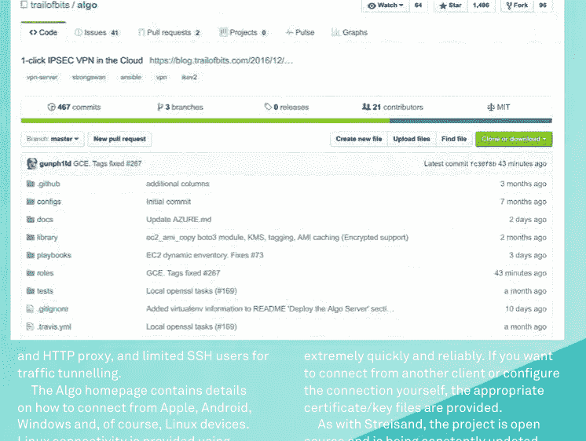

# 功能 VPN 与 VPS

## 指南：设置你的 VPN 和 VPS

启动你的第一个 `VPS` 或 `VPN` 并不令人畏畏


你已经读过关于不同的 `VPN` 选项，以及为什么 `VPN` 是 `Linux` 装备库中非常有用的工具。在指南中，我们将带你通过几个不同的提供商来设置和配置 `VPS`，然后根据你的需求安装 `WireGuard` 或 `Algo`，最后配置你的客户端连接到你的新 `VPN`。

那么，你在哪里部署你的 `VPS` 呢？最好的提供商都提供一些免费试用，所以你可以运行 `VPS` 一个月甚至更久。`ArubaCloud` 是我们最便宜的，提供带有 `1 vCPU`、`1GB RAM`、`20GB` 存储空间和 `1TB` 带宽的 `Ubuntu VPS` 服务器，使用欧元额度每月仅 `1 欧元`。缺点是管理界面在最好的控制面板中不算太理想。`DigitalOcean` 提供带有 `1 vCPU`、`512MB RAM`、`25GB` 存储空间和 `1TB` 带宽的服务器，每月 `5 美元`，注册时赠送 `10 美元` 额度。这两家提供商都有多个欧洲数据中心。


`Amazon Lightsail`


### 01 使用哪个 `VPN` 平台？

在决定使用哪种 `VPN` 平台时，你应该考虑哪些因素？

一个好主是加载每个选项的主页并阅读，看看它们提供了什么。

`WireGuard` 是一个全功能功能的的绝佳方法。如果你想保持精简且不要在服务器上增加太多东西，它也能保持简单和安全。既然有许多便宜的 `VPS` 可选，为什么不试试呢？

### 02 决定你的 `VPS` 平台

现在你已经决定了要什么，请决定使用哪种 `VPS` 平台。之前提到过许多提供商提供免费试用。明智的做法是查看你将使用的管理界面以及哪些提供商受到支持。所有都可以部署，`Ubuntu` 部署是最简单的选项。

### 03 你想把服务器放在哪里？

另一个考虑因素是你希望你的物理服务器位于哪里？这个问题取决于你想如何使用它。如果你希望你的 `VPN` 位于英国，那么 `Lightsail` 是理想之选。如果你希望在美国，它也是理想的。`DigitalOcean` 在荷兰、新加坡、美国、伦敦和印度有数据中心。

# 每月 1.00 欧元的云 `VPS`


### 04 在 `ArubaCloud` 注册

我们注意到 `ArubaCloud` 是最便宜的……要开始，访问 `www.arubacloud.com` 并点击 `Cloud VPS` 开始。你将被提示注册账户——一个用于客户（管理你的详情），一个用于控制面板（管理你的服务器）。提供免费试用——输入你的详情后你将获得欧元额度。

# 添加 `SSH` 密钥

这是一个相对直接的过程，尽管术语不同——`DigitalOcean` 使用 `'droplets'`。在选择 `droplet` 后，你将被提示发行版（选择 `Ubuntu 16.04`）、大小（`$5` 选择）、区域和名称。访问 `droplet` 需要使用 `SSH` 密钥——这将作为部署的一部分被保存。

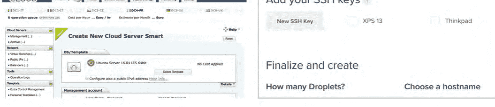

### 05 在 `ArubaCloud` 创建实例

登录 `ArubaCloud` 控制面板后，你可以从许多位置中选择：意大利、捷克、法国和英国。在点击“创建服务器”之前选择位置，选择模板（选择 `Ubuntu 16.04 LTS`），输入用户名和服务器名称。

### 08 登录或 `SSH` 密钥

不同的人有不同的验证方式。`DigitalOcean` 要求你上传 `SSH` 密钥。在你的 `Linux` 机器上，可以在 `~/.ssh/id_rsa.pub` 找到它。如果该文件不存在，输入 `ssh-keygen -t rsa`（你可以通过所有提示操作）。`SSH` 密钥比密码安全得多！


### 06 在 `DigitalOcean` 注册

`DigitalOcean` 更加文明。注册单一个账户在前两个月获得 `10 美元` 额度。更好，每个人推荐 `DO` 将获得 `25 美元` 额度。标准账户限制为 `25` 个实例，或者你可以增加限制。

### 09 在 `Amazon Lightsail` 注册

你听说过 `Amazon Web Services`，这家零售巨头拥有的云托管平台。`Lightsail` 是 `DigitalOcean` 和 `Linode` 的较新产品。它与 `Amazon` 的 `EC2` 等平台相同，但极大地简化了整个过程。你需要注册 `AWS` 账户来使用 `Lightsail`。

# 功能 `VPN` 与 `VPS`

## 创建实例

实例是一个虚拟服务器。


## 在 `Amazon Lightsail` 创建

你可以使用你的新 `VPN` 访问主面板。`Lightsail` 有一个简化的界面。对于学者，只需点击“创建实例”按钮，选择你的操作系统和计划。`5美元` 计划标记为“首月免费”，这是需要的。选择部署区域，命名你的实例并按下创建。

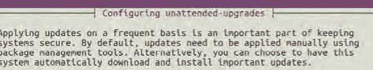

## 包配置

定期安装软件是维护安全的重要部分。你可以使用包管理工具安装所需的程序。或者，你可以让系统自动安装更新。

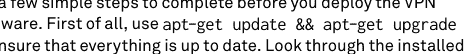

## 准备你的 `Ubuntu` 实例

无论你如何启动实例，在部署 `VPN` 服务器之前都要完成几个步骤。首先，使用 `apt-get update` 和 `apt-get upgrade` 确保一切都是最新的。查看已安装的包以最快速度设置你的 `VPN` 服务器。最后，使用 `sudo apt install unattended-upgrades` 在你的服务器上设置自动更新。

```bash
sudo apt-get update
sudo apt-get upgrade
sudo apt install unattended-upgrades
```

```bash
apt-get update
apt-get install -y git build-essential libssl-dev zlib1g-dev libncurses5-dev-utils libffi-dev libsqlite3-dev python3-dev python3-pip python3-venv curl wget libxml2-dev libxslt-dev libreadline-dev
```

## 安装前提条件

要在 `Linux` 节点部署 `stretchraid`，你需要安装 `id_rsa_key`、安装 `git`（以便从仓库下载 `Stretchraid`）、安装 `Python` 和 `Ansible` 的包管理系统（用于运行部署脚本）。你只需要执行一次。


## 下载并准备脚本

现在你已经满足了前提条件，使用 `git clone` 从仓库下载脚本：`https://github.com/jland/stretchraid`。如果你想部署列出的提供商之一的新实例，你已经准备就绪。如果你想部署自己的服务器，只需遵循最后两个步骤并添加你的实例 `IP` 地址。

```bash
## user paul@stretchraid-key ~ 
git clone https://github.com/jland/stretchraid.git
Cloning into....
Counting objects: 100 (delta 90), pack-rere: 90
Receiving objects: 100% (100/100), 1 MB
Resolving objects: 100% done
done
```

```bash
## git clone https://github.com/jland/stretchraid.git
```

```bash
cd stretchraid
```

```bash
ansible-playbook deploy.yml
```

## 部署

该出发了！对于标准场景，使用命令 `cd @stretchraid`；或者部署到自己的服务器，使用 `ansible-playbook ./playbooks/stretchraid.yml`。你将使用 `ansible-run` 脚本，它将处理 `10` 到 `20` 分钟。如果过程被中断，只需重启脚本，一切都会正常运行。过程完成后，你的 `HTML` 文件将创建创建

> 欢迎来到 `Stretchraid` 网关。你离非凡连接仅一步之遥。

# `STRETRAID`

## 连接问题


有很多方法可以连接我们，在任何一个受限的情况下，Streraid 提供了多种选择和不同的协议。列出的选项如下：

- `OpenVPN`
- `OpenConnect` / `Cisco AnyConnect`
- `OpenVPN` (直接)

## 连接到服务器

安装过程创建最后一个文件位于你机器上的子目录。该文件详细说明了如何下载并验证新实例 `NGINX` 的 `SSL` 证书。然后你可以使用新服务器获取如何连接 `VPN` 的详情。说明中为不同的平台提供了许多协议，因此你可以尝试以找到适合你的解决方案。

## 16 准备 `Algo`

为了准备 `Algo`，请先通过命令 `git clone https://github.com/TrailOfBits/Algo.git` 从 `git` 仓库下载源码，或者下载 `ZIP` 包。打开 `config.cfg` 找到对应的编辑行，并在 `'users'` 列表中指定你想要创建的用户。

```bash
$ git clone https://github.com/TrailOfBits/Algo.git
cd algo
```

如需添加更多用户，请编辑文件并重启服务。如需删除用户，请从列表中删除该行并重启服务。

## 18 部署 `Algo`

现在你已经有了虚拟环境，可以开始运行 `Algo` 了。从主源码目录 `/algo` 开始，系统将提示你选择要安装的版本。如果你想部署到多个之前准备好的 `VPS`，你将需要手动重新运行 `Ansible` 剧本（playbook）——有关如何操作的详细细节请参阅网站。使用 `Stressand`，你也可以在本地部署 `Algo`（直接在目标机器上）。

## 17 安装 `Algo` 依赖

预备工作设置的要求不高——你只需要有 `Python` 并存在一个 `Python` 环境。如果你已经配置好了 `Stressand`，则需要创建一个新的虚拟环境，命令为：`pip install virtualenv && virtualenv venv && source activate && pip install -r requirements.txt`。在这里配置并通过 `/bin/activate` 启动的虚拟环境在你运行 `Algo` 时必须保持运行状态。

## 19 连接到 `algo` 服务器

当 `Algo` 部署完成后，你会看到一条消息确认所有操作已完成，并详细说明创建的配置文件的位置。屏幕上还会显示你的私钥和公钥。请将它们妥善保存！私钥文件将允许你使用适合所选平台的 `Stressand` 连接到 `algo` 服务器。系统会为 `Apple` 设备创建配置文件，为 `Windows` 和 `Android` 客户端准备 `Powershell` 脚本，因此 `Android` 端请使用 `Stressand`。


## 特色 `VPN` 与 `VPSPs`


## `OPENVPN` 每月 $4.99


## 20 确保流量通过你的 `VPN`

连接到 `VPN` 后，你需要确保流量被正确路由。你可以在线检查 `My IP`，也可以手动检查。如需更详细的说明，请在浏览器中使用 `My IP`，它将显示你的 `IP` 和 `ISP`。如果你正在配置分流（split tunnelling），这是一个非常有用的工具，可以判断你的 `VPN` 正在跟踪哪个路由。

## 备份

备份会自动创建。备份安排在每周周日晚上 8 点到周一早上 7 点之间重启。`Dropout` 的备份费用每月 $2.00。


## `Dropplet` 备份


## 21 你需要备份你的 `VPN` 吗？

部署好 `VPN` 服务器后，值得考虑是否应对该服务器进行快照或备份。大多数 `VPS` 提供商提供廉价或免费的快照，但如果你需要撤销更改，可以这样做。现实情况是，备份一台服务器并不费费精力，如果你选择不这样做，也不太需要担心。

## 22 备选服务

特别是 `Streandish`，是一系列作为最常见的 `L2/spec` 和 `OpenVPN` 优秀替代方案的服务。`Shadowsocks` 是一种高性能 `SOCKS` 代理，速度极快，支持移动端，并且可以使用二维码极其方便地进行设置。`OpenConnect` 是 `Cisco` 的开源实现，是一个优秀且轻量级的 `VPN` 服务器，同时支持与 `AnyConnect` 客户端完全兼容。

## 23 设置家庭或办公 `VPN`

如果你想为家庭或业务设置 `VPN`，你有几种选择。你可以使用现有的路由器，但它可能不是最好的，特别是如果你的路由器是 `ISP` 提供的。在这种情况下，有几种方案——你可以更换路由器为支持 `VPN` 服务器的设备，或者在你的网络上部署一台 `Linux` 机器并进行端口转发。简单的设置不需要很强大，即使是一个廉价的 `Raspberry Pi` 也能做到！

## 24 安装 `VPN`

如果你有一台运行 `Raspberry OS` 或 `Jessie Lite` 的 `Raspberry Pi` 1、2 或类似机型，你可以从 `vpn.io` 安装 `OpenVPN`。你只需在 `Pi` 上运行 `curl https://://pn.io/install | bash` 即可安装。然后系统将提示你自定义一些选项，例如 `VPN` 端口（你需要转发该端口），之后安装将完成。你可以运行该 `VPN` 工具直到你需要进行任何更改为止。

## `PiVPN` 项目

为你的服务器提供安全连接。低成本，高安全性。

| 通用 | `Wi-Fi` | `IPv6-Fi` 安全 | `IPv4` 设置 | `IPv6` 设置 |
|---|---|---|---|---|
| 自动 | | | | |
| 全部 | | | | |
| 自动 | | | | |
| 你的 | | | | |

## 25 在 `Linux` 中自动连接 `VPN`

在 `Linux` 机器上配置好 `VPN` 后，你会发现在设置中有一个自动连接的选项。


## 水果成熟度检测器

在 `Craig` 雄心勃勃项目中，慈善与机器人技术相结合，旨在改善当地无家者社区的生活。


这个项目源于 `Concrete Jungle`，你能从日常工作中获得什么启示吗？

`Concrete Jungle` 是一家位于亚特兰大的非营利组织，负责收运果树并将其捐赠给当地家庭和食品银行。他们在亚特兰大南部有一个农场，在那里也会种植被捐赠的植物。

成熟度检测器的想法是如何产生的？

我们面临的最大问题之一是物流。在我们的数据中，几乎有三棵果树。在数据库中，果实成熟季节（主要是 5 月到 10 月），我们无法轻松识别出哪些果正在成熟，因此无法与志愿者一起规划采摘活动。这项服务对其他人是免费的（例如，虽然我们也是他人，但当我们生产、他们生产以及水果掉落时，我们会获得一些捐赠（价值））。

我们使用了一种让树本身成熟直到就绪的方法，并与佐治亚理工学院 `Craig` 的公共设计工作组合作开发了它。其中一个成熟度检测器是基于果实会随乙烯生长的事实。我们产生的最多的产物是乙烯，因此同时使用许多传感器进行广泛的气体分析。

我在传感器方面的问题主要集中在获取稳定读数上。传感器对任何温度或湿度都很敏感。每次测量都至关重要，如果能绝缘会更好。当然，我们有一个密封良好的腔体需要传感器，但进入和离开腔体会让事情变得困难。

在成熟期间采取行动。随后我们在设计可以部署在实际果树上的单元方面取得了一些进展。

树莓派（`Raspberry Pi`）似乎是这个项目的核心，我们是如何让它工作的？

我们使用树莓派记录并显示数据，尽管我们在某些统计方面取得了进展。我们的传感器连接到 `Arduino Nano`，由它读取传感器数据并发送给 `Pi`。端口位于该串口连接逻辑的另一端。它很容易操作，因为它仅仅是一个 `USB` 端口。记录数据比打开串口连接要简单得多。


`Craig` 是 `Concrete Jungle` 的经理兼创始人，该项目用于处理未要求的水果并进行分发。

喜欢吗？这个检测器可能会改变他们的生活。对于 `Concrete Jungle` 的当地居民来说，他们可以从我们“混凝土森林”的信息分支中获取相关信息。

我们遇到的问题是，`Pi` 似乎对某些功率波动敏感。为了完成这一点，当发生停电或波动时，`Pi` 可以立即切换电源并再次保存。

延伸阅读：令人惊讶的是，`Craig` 创建了项目的多个迭代版本——事实上！他因这样做而闻名。

## 我们的想法是让树告诉我们它什么时候准备好了

你能从你所做的构建背后的想法中获得什么吗？如果你发现了任何启示的话？


特别是对于成熟度检测器，我们正在与 `maskauki.com` 团队的一位同事合作，他开发了用于使用现成传感器进行过程监控的电子设备。其中一些传感器有时很敏感。

八个传感器在电源水平上是不可行的。我们使用了一个对果实有响应的电池包，且仅在季节期间使用。

我们下一步在哪些领域工作以增强检测器？

希望增加一条线将有助于阶段腔体更加稳定。我们还利用了使用电位器和组件进行物理传感器校准的事实。

在这个故事中还提到，这个工具对你有多有效？因此，在研究领域，有机会从中获得任何获得的数据是完全没问题的，我们能够获得成熟的水果。到我们可以获得大量数据并弄清楚关注的果实数量时。

使用的 `Taguchi` 传感器有时是可以在 `eBay` 上找到的触摸式传感器。`Michael` 根据此制作了一些 `PCB` 板板，我们正在使用它们，这让操作变得简单了。

`www.linuxuser.com`

# 教程

## 使用 Python 创建实时 LED 湿度显示

使用 `Astro Pi`（即 `SenseHAT`）读取湿度值并立即显示结果


`Dan Aldred`

是一位树莓派认证教育工作者，也是 `CAS` 的午休老师。他领导了 `Astro Pi` 中学竞赛团队，并出现在 `BBC` 的《`Inspiring TV`》节目中。目前他正在用树莓派制作一个倒计时器。

### 你需要

- `SenseHAT`

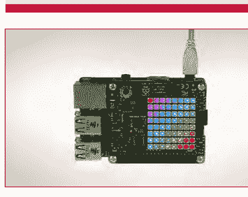

湿度是空气中水分或水的含量。在教程中，你将使用 `Python` 构建一个实时湿度显示。程序使用 `SenseHAT` 的板载传感器，然后计算比例来确定湿度，湿度越大，开启的 `LED` 越多。然后计算需要“关闭”的 `LED` 数量并加入列表。最后，你将设置程序显示并“开启”请求 `LED`。程序继续循环以更新 `LED` 显示。程序继续循环以更新 `LED` 显示。

### 01 连接 SenseHAT

我们遇到的问题是，`Pi` 似乎对某些功率波动敏感。为了完成这一点，当发生停电或波动时，`Pi` 可以立即切换电源并再次保存。

程序继续循环以更新 `LED` 显示。程序继续循环以更新 `LED` 显示。

程序继续循环以更新 `LED` 显示。程序继续循环以更新 `LED` 显示。

程序继续循环以更新 `LED` 显示。程序继续循环以更新 `LED` 显示。

程序继续循环以更新 `LED` 显示。程序继续循环以更新 `LED` 显示。

### 02 测试 SenseHAT

### 03 获取湿度

### 04 读取读数

我们遇到的问题是，`Pi` 似乎对某些功率波动敏感。为了完成这一点，当发生停电或波动时，`Pi` 可以立即切换电源并再次保存。

程序继续循环以更新 `LED` 显示。程序继续循环以更新 `LED` 显示。

### 05 关于更大的读数

### 06 LED 开启

### 07 添加关闭像素

### 08 添加“关闭”像素

### 09 运行

# 教程

# 制作比特币冷钱包

将你的比特币“冷冻”，并使用树莓派作为冷钱包来离线安全存储你所有的数字货币


`Nate Drake`

是一位自由职业财经记者，专攻网络安全和复古技术 `@natewriter`


> 你需要准备

适用于所有型号的 `Pi`（推荐使用 `Pi Zero`）。出于安全考虑，你需要为此项目准备一个专用的树莓派。

你可能已经知道，加密货币比特币可以用于匿名且不可逆转的支付，类似于现金。但对于注重隐私的人来说，它是数字货币这一事实意味着黑客经常针对比特币软件钱包的所有者。在教程中，我们将探索一种在树莓派上使用轻量级 `Bitcoin Wallet Electron` 的解决方案。树莓派将始终离线保存你的私钥。

你还需要在另一台电脑上设置一个在线“观察”钱包，以接收收到的付款。支付仅通过使用你的观察钱包生成交易来发送，然后通过 `USB` 闪盘手动将其传输到你的“冷”钱包进行签名。

由于你的冷钱包是离线的，只有拥有物理访问权限的人才能进行支付，这让你能够安全地存储比特币。

本指南假设你已经熟悉比特币的基础知识。如果不熟悉，请访问此教程介绍页 `http://bit.ly/2tmCt2x` 了解概述。

出于安全考虑，你应该只将这台树莓派作为未来购买的钱包。

仓库（`repos`）包含旧版本的 `Electron` 钱包，但最好手动下载最新版本。

接下来，运行以下两个命令，使用 `sudo apt-get install python3-pip` 安装最新的钱包软件。使用 `http://download.electron.org/2.17/Electron-2.17.tar.gz` 进行安装。


## 01 安装软件

将树莓派连接到显示器和键盘。打开终端运行这两个命令：

```
sudo apt-get update
sudo apt-get upgrade
```

## 02 断开网络连接

此步骤是为了确保你的钱包安全。移除连接到树莓派的任何网络和 `Wi-Fi` 适配器。如果你使用的是 `Pi 3`，只需点击 `Pi` 上的无线和蓝牙图标并选择“关闭 `Wi-Fi` 和蓝牙”。保持树莓派连接显示器和键盘，你在发送支付时需要它们。离线后，在终端中运行 `electrum` 命令启动钱包。


## 比特币钱包

10 个字符，混合字母、数字和符号。如果密码弱、中等或强，`Ethereum` 会发出提示。不要使用钱包中的任何单词作为密码。

### 匿名化你的网络连接

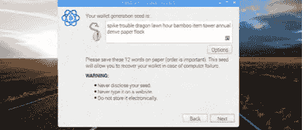

## 06 导出公钥

在 `Ethereum Wallet` 中，点击“`Wallet`”（钱包）菜单然后选择“`Master Public Keys`”（主公钥）。将其导出为可以在单独电脑上使用的字符串。

默认情况下，任何监控你连接的人都可以连接到 `Ethereum` 网络。你的 `IP` 可能用于在“观察”钱包中识别你的身份。如果你在系统上运行 `Linux`，可以通过进入 `Tools`（工具）> `Network`（网络）> ‘`SOCKS`’ 通过暗网连接。填写剩余信息后，点击“`OK`”。

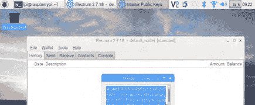

## 03 生成钱包

在第一个窗口选择“`Auto`”（自动），然后点击“`Next`”（下一步），在下一个屏幕选择“`standard`”（标准）`New Seed`（新种子）。为钱包生成 12 个随机单词，程序要求将这些写在纸上。这些纸可以在树莓派发生任何故障时恢复你的钱包。点击“`Next`”继续。

点击图标复制所有密钥，然后前往 `Applications`（应用程序）> `Text Editor`（文本编辑器）将其编辑为文本文件。使用 `USB` 闪盘并将新文件保存。


## 07 安装钱包

从树莓派拔下 `USB` 闪盘，将其插入要作为“观察钱包”使用的电脑。出于安全考虑，我建议使用 `Linux` 而不是其他平台。如果你使用的是 `Ubuntu` 等基于 `Debian` 的发行版，请确保使用 `apt-get`。对于其他平台，请按照 `https://ethereum.org/` 的说明进行操作。


## 04 确认并存储种子

确认种子后，你可以选择设置密码来保护树莓派上的钱包副本。在发送比特币时，你需要重新输入此密码。理想情况下选择至少 10 个字符的密码。将你写下的单词存储在安全的地方，或通过关联位置记住它们。

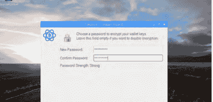

## 05 选择你的钱包密码

在第一个屏幕选择“`standard`”（标准）钱包，在“`Keystore`”（密钥库）屏幕上选择“`Private Keys`”（私钥）。在下一个屏幕，粘贴来自 `USB` 闪盘的主种子。读取警告并点击“`OK`”。

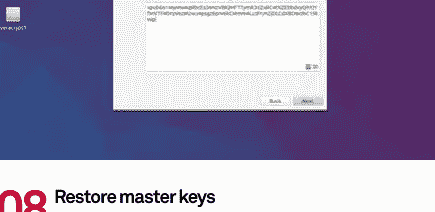

## 08 恢复主密钥

在在线机器上启动 `Ethereum`。在 `Linux` 中，你可以从终端运行 `electrum`。在第一个屏幕选择“`Auth`”（授权）并点击“`standard`”（标准）钱包。


## 09 设置地址


主窗口打开时，`Electrum`会为你生成地址，点击“`Receive`”（接收）标签查看你的地址。你会看到新地址的文本字符串和二维码。如果需要，为你的接收地址输入描述，然后点击“`Save`”（保存）。你可以生成更多地址。

## 13 签名交易

在树莓派上打开`Electrum`并点击“`Tools`”（工具）菜单。选择`Load Transaction`（加载交易）> `From`，找到`USB`闪盘上的交易文件。交易详情将加载。检查一切是否正常。输入密码，然后点击“`Save`”将新交易文件存储到`USB`闪盘。点击“`OK`”，然后是“`Close`”（关闭）并安全地拔下`USB`闪盘。

## 10 测试钱包地址

使用你的比特币钱包向新地址发送资金。如果可能，使用支持扫描二维码的客户端，这样就没有发错地址的危险。一旦支付发送，未确认的新余额应显示在`Electrum`窗口的左下角。你需要等待余额确认后再继续。

## 14 广播交易

接下来你需要插入`USB`闪盘以同步“观察”钱包。打开`Electrum`并点击`Tools` > `Load Transaction` > `From`。选择`USB`闪盘上的签名文件。弹出一个新窗口，显示：

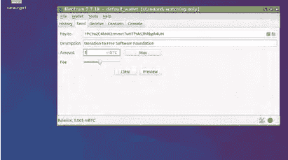

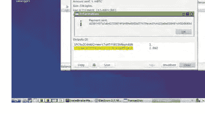

## 11 设置发送

现在你可以接收资金了，是时候测试你是否可以发送它们了。找到收件人的钱包地址。在本教程中，我们使用以太坊基金 (`EEF`) 的比特币地址发送捐赠。在`Electrum`中点击“`Send`”（发送）标签并将地址粘贴到“`Pay to`”（支付给）字段。如果需要，添加描述然后点击“`Preview`”（预览）。

交易详情。双检查并点击“`Broadcast`”（广播）将它们发送到比特币网络，你会看到确认消息。点击“`Close`”在`Electrum`窗口中查看未确认的金额。交易的处理时间将取决于你支付的手费。

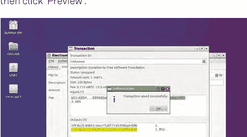

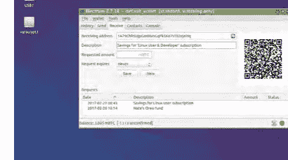

## 12 保存交易

在新窗口中点击“`Save`”查看`TXN`（交易）文件，导航到你的`USB`闪盘并将其放在那里。`Electrum`确认交易已保存。你可以点击“`Close`”关闭窗口。交易需要由树莓派上的钱包进行数字签名才能发送。

## 15 生成新地址

为了防止交易被追踪，你应该通过点击`Electrum`的“`Receive`”标签来生成新的接收地址，点击“`New`”创建一个新的。如果愿意，添加描述后点击“`Save`”。在“`Requests`”（请求）标签中，重复步骤 10-14 以接收和发送每个地址的交易。

完成本教程后，你将设置好“冷”钱包、支付方法以及用于跟踪支付的在线“观察”钱包。


你知道吗？在过去的10年里，用于造纸和许多其他产品木材的欧洲森林增加了44,000平方公里。每天增加的超过了1,500个足球场！†

喜欢杂志吗？如果知道它们是由天然、可再生和可回收的木材制成的，你将更爱它们。

联合国粮农组织（`UNFAO`），全球森林资源评估2005-2015。

`Two Sides`是一项促进负责任使用印刷和纸张的全球倡议。如果源自经过认证或可持续管理的森林，它是一种非常强大且自然的传播媒介。

有很多极好的理由 #热爱纸张。现在就探索它们，`twosides.info`

## Python

## 使用 Dash 进行并行编程

当你需要更多性能时，你需要转向并行化的 `Dask`。使用 `Dask` 来简化你的 `Python` 程序。

> 提升单机能力是有极限的，一旦你达到了它的极限，唯一的选择就是转向使用多台机器并扩展计算工作。但传统的并行编程可能很困难。

如果你正在使用 `Pi` 进行低功耗离线处理，我们将从这里开始。这些新的集合被称为数组（`arrays`）和数据帧（`dataframes`）。数据根据使用的节点数量进行划分。结构是由较小的 `ndarray` 组成的矩阵。每个 `ndarray` 都存储在 `RAM` 或磁盘中，无论是在单机还是远程机器上。这是可能的，因为

代码（在上一列）从可迭代对象创建一个新数组。

这里的大问题在于，你限于处理单个 `Pi` 内部的数据。此外，数组是不可变的，因此它们作为代码中组织对象的方式更有用。最后一个问题是，`dataframe` 是 `pandas dataframe` 的子集。与数组一样，较小 `ndarray` 的序列，数据是由较小的 `pandas dataframe` 构建的，这些用于从构建块（如数组或列表）创建新的 `dataframe`，而这些构建块将直接从 `dataframe` 加载。示例是一个。

`Dash` 提供了两个主要组件：

*   首先是调度系统，它负责管理集群的所有节点，并处理你的 `python` 函数的工作。
*   其次是一组集合，它们处理集群本身的并行性。

## 你可以使用 Dash 管理海量数据集

要从对象创建新数组，请使用以下代码：

```python
import dask.array as da
import dask.dataframe as dd

df = da.from_hdf('file.hdf5')
df = dd.from_csv('file.csv')
df = da.from_array(chunks=(1000,1000))
```

这从 `HDF5` 文件加载数据，如果你还没有 `ndarrays` 或 `dataframes`，它将创建一个。

## 为什么选择 Python？

你使用的是官方 `Python` 语言。

在 `python.org` 读取文档。

使用这些集合可能是向你的代码引入并行编程简单的方法。第一步是安装 `Dask` 模块。你可以使用调度框架（如果你不需要额外的集合，它才有用），或者单独使用每个类。但对于本文来说，我们将查看 `Dask` 能做的一切，所以你可能想要安装所有内容：

```bash
pip install dask
```

问题在于，如果你不熟悉 `Dask`，在某些情况下它对你的代码可能仍然有用，或者你只需要机器上可用的四个处理器核心。

如果你不想使用 `Dask` 库，可以使用 `--user` 选项安装属于你账户的 `Python` 库。

使用数组，你可以从其他 `Python` 对象创建数组：

```python
import dask.bag as db
bag = db.from_sequence([1,2,3,4,5])
```

```python
import dask.dataframe as dd
dataframe = dd.read_csv('file.csv')
```

在传统的桌面电脑上，`Dask` 的集合被用于处理大数据。对于数组来说也是如此，数组是定义对象的集合，`Dask` 允许你获取子集或对象列表到对象中，而无需加载整个集合。然后你

`Joey Berner` *一个真正的全才型人物，他的时间花在构建、帮助研究人员解决计算问题以及写作之间。*

# 手机 穿戴设备 音频 电视 汽车 家


用今日**顶尖科技、小产品和人物**的**终极清单**点燃你的世界

为什么 `KAPPA` 是终极装备

最佳无线扬声器 高分辨率多房间系统评测


4K `OLED` 电视 三星 `Galaxy S8` 下一代游戏 史夫·霍洛维 家庭机器人 智能家居 2.0 联网汽车 埃隆·马斯克

`HTC STEVE` 领衔无线领域 联网驾驶 `VECCHI` 控制你的电视 设置双倍

# 现已发售！

可在 `WHSMITH.MYFAVOURITEMAGAZINES.CO.UK` 购买，或在您的设备应用商店中搜索 `T3`

立即订阅，节省费用！访问 `WWW.MYFAVOURITEMAGAZINES.CO.UK/T3`

# 评测

81 组测 | 86 硬件 | 88 发行 | 92 免费软件


## 组测

媒体播放器

媒体播放程序的选择正在不断增加，但在 `Linux` 桌面面上你应该下载并使用哪一个呢？

### VLC

提到媒体播放器，`VLC` 是值得信赖的。它不仅拥有优秀的 `UI`，还声称兼容几乎任何解码器。竞争对手不断进步并缩小差距，所以它仍然处于领先地位吗？`www.videolan.org`

### Kodi

`Kodi` 的粉丝群体正在不断扩大——尽管它的插件和扩展系统——甚至某些第三方卖家因侵犯版权而陷入麻烦——它承诺为用户提供完全的自定义。它与其他视频播放器相比如何？`www.kodi.tv`

### Miro

尽管不像本次组测中的其他媒体播放器那样久久成名，但 `Miro` 提供了视频播放器的基本功能，并加入了一些新的额外功能。它的设计已得到证明，但它能足够脱颖而出吗？`www.getmiro.com`

### MPV


`MPV` 是流行的 `MPlayer2` 应用的分支，但包含显著的差异。从一开始，该组就对标准视频播放器提供了更具技术性的解读，但经验丰富的 Linux 用户应该觉得有些有趣之处。`www.mpv.io`

`www.linuxuser.co.uk` 81

## 评测 媒体播放器

# VLC

`VLC` 的定期更新能跟上追赶者吗？


你可以编辑并播放音频效果来增强视频文件的播放。

#### 用户界面和整体设计

从一开始，`VLC` 就通过其一键系统突显了简单性，让你播放视频文件。这是一个可以完美运行的系统；然而，通过工具，有足够的空间通过一系列唯一键来控制 UI。你不一定为体验添加任何额外内容，但它们看起来很漂亮。

#### 媒体管理

用户在播放文件时有支持选项。有同时上传多个文件的选项，以及从光盘播放内容，这两者在这里工作得很好。然而，我们发现直接网络流选项很容易正确设置。这对你来说是一个大功能。

#### 基础和高级播放

播放器底部有一系列控制控件以及你所需的所有基础支持。还包括高级管理功能，这对于编辑视频特别有用。

#### 插件和额外功能

`VLC` 包含了数百个额外功能，其他插件可以从网上下载。这是一个位于列表顶端的内容系统。改进 `VLC` 的字幕功能是应该探索的第一个插件，原生支持在大多数情况下很好。

#### 总体

`VLC` 持续改进，对其插件管理器的更新使其非常难以比拟。无论你运行什么，`VLC` 都是你选择中值得的补充。

### Kodi

学习基础知识，`Kodi` 将带给你极佳的体验

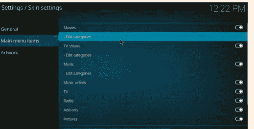

#### 用户界面和整体设计

`Kodi` 最近发布了 17 版本，进行了大规模改版。对于新用户来说，这是一个非常直观的系统，不会用大量选项让你不知所措。侧边菜单包含了管理视频文件的所有项目。

#### 媒体管理

`Kodi` 是最好的媒体管理系统。导入需要几分钟——取决于文件的大小——程序会拉取所有相关数据和封面。`Kodi` 使用库来展示你的电影，并有一系列动画增强它。

#### 基础和高级播放

`Kodi` 对文件有良好的播放控制，但在跳过某些视频文件时可能会有点棘手。有一个系统认为比 `VLC` 好，但实现额外层可能会令人困惑。

#### 插件和额外功能

`Kodi` 的插件系统与 `VLC` 平起。大多数以应用程序的形式出现，需要你手动添加。这个过程相当长，但插件的规模令人印象深刻。

#### 总体

`Kodi` 最近的更新改进了许多领域。它确实支持最好的管理功能之一，我们只希望插件的实现能更简单。

### Miro

这可能是用户需要的合一播放器。它看起来很基础，但 `Miro` 的方法对于低端系统是理想的。

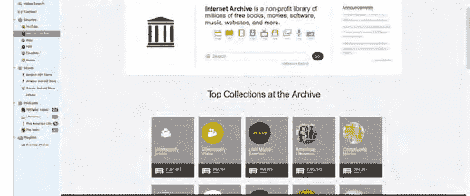


作为一个不错的视频播放器，`Miro` 与一系列外部网站协作，你可以将其视为替代媒体浏览器。对于某些用户来说可能太简约，但程序中的每个视频都有系列基础播放控制。

#### 用户界面和整体设计

`Miro` 是另一个使用侧边菜单系统进行导航的媒体播放器。这是一个在范围内运行良好的系统，提供了可用选项。然而，视频文件的初始导入较慢，我们发现与某些文件存在兼容性问题。这里没有功能帮助，而是为所有视频文件实现了拖放系统。毫无疑问你会发现非常即时的播放功能。对某些用户来说可能很基础，但功能的缺失对低端系统可能有帮助。

#### 媒体管理

媒体可以通过多种方式管理，完全取决于偏好。虽然程序将尝试使用元数据，类似于 `Kodi`，某些数据参差不齐。用户可以手动添加任何额外功能，或在浏览视频素材时使用方便的情况。虽然 `MPV` 确实包含一个管理文件的库系统，但它远没有 `Kodi` 和 `Miro` 水平。它也是一个旨在取悦低端桌面的棒功能，同步你的视频是播放器最好的功能之一。

#### 基础和高级播放

在我们介绍的四个播放器中，`Miro` 提供了最好的控制。这不一定是一件大事，但我们确实更好地与他们的任何进一步连接。该应用程序也连接在线视频文件，提供与离线文件相同水平的控制。视频输出是 `MPV` 的最强资产。它帮助了几个高级功能，因为这里可以进行视频缩放，我们还没有发现本组中的其他人使用它。我们还找到了需要的颜色管理选项。

#### 插件和额外功能

除了是一个不错的视频播放器，另一个 也是一个不错的音频播放系统。两者结合，提供了一些可以帮助你视频文件的关键额外设置。还有 `Miro` 将你存储的视频文件转换为其他格式等。`MPV` 的性质意味着你不会在这里发现很多嵌入的额外，这使得其他媒体播放器处于领先地位，因为它设计了一个 C API 来将 `MPV` 集成到许多其他应用程序中。它可能有点难以使用，但一旦它符合他们的喜好，初次就能工作。

#### 总体

> 很难批评 `Miro` 所做的一切，因为它为 Linux 用户勾选了许多选项。然而，它在某些部分基础，缺乏我们从这种类型程序中期望的额外功能。需要改进。

`MPV` 将导致用户分化。一些人会喜欢它的极简方法——尤其是低端桌面用户，但其他人可能会觉得它太简单，不符合他们的喜好。

`www.linuxuser.com` 83

# 测评

## 媒体播放器

## 简评：对比并分析我们的结论

| 用户 | `VLC` | `Kodi` | `Miro` | `MPV` |
|---|---|---|---|---|
| 界面和整体设计 | 默认中等，但额外的皮肤可以帮助用户个性化定制。 | 7 | 一次巨大的改版提供了一个直观的系统，侧边菜单装满了核心功能。 | 8 | 一切操作都通过侧边菜单完成，可以根据你的需求进行自定义。 | 8 | 拖放系统快速、方便，且非常适合即时视频播放。 | 8 |
| 媒体管理 | 拥有许多选项可以导入/导出任何扩展名的视频文件。 | 7 | 元数据添加很快，但通过侧边菜单安装它是一个实用的补充功能。 | 8 | 这里有一个直观的库，但从头开始改进元数据并不是件易事。 | 6 | 这里实现了一个非常基础的库，但表现仅限于此。 | 6 |
| 基础和高级播放 | 音频管理非常先进，大大提升了文件的音质。 | 8 | 考虑了所有必要的选项，但系统使用起来可能有点笨拙。 | 8 | 提供了一套不错的控制，但除了这些核心选项外并无更多。 | 8 | `MPV` 中可以实现从视频缩放等的一切操作。 | 8 |
| 插件和额外功能 | 有数百种选项可以提升你的 `VLC` 体验。 | 7 | 有大量的插件可用，但初次看起来可能会让人困惑。 | 8 | 兼备了一个胜任的作者播放器，也值得尝试。 | 7 | 与其他软件集成很容易，但没有其他太多令人兴奋的内容。 | 7 |
| 总体评价 | `VLC` 并不完美，但它的优点使其成为一个必不可少的程序。 | 7 | 如果你是老手，应该检查这个管理系统。 | 8 | 如果你需要一个视频音频编辑器，推荐使用，但缺少一些功能。 | 8 | 它的极简主义方法导致了用户分化，但对于低配 Linux 桌面来说太棒了。 | 7 |

# 获胜者是……

# VLC

在仔细观察视频播放器时，需要记住的一点是，每个用户想要的东西都是不同的。考虑到这一点，发现哪些播放器提供最好的方位体验至关重要。在大多数情况下，我们对测试的任何播放器都没有遇到过问题。事实上，每种播放器至少有一项让它脱颖而出的特点。然而，我们禁得认为 `VLC` 仍然处于顶尖。从核心来看，`VLC` 是王者，在导入和播放视频时提供了所有必要的播放控制。当然，它还有很大的改进空间，但通过使用一些深层 `VLC` 功能的额外扩展，你可以获得巨大的回报。从视频合并到音频效果，一切都可以相对轻松地完成，我们强烈建议你花时间考虑哪些值得添加的内容。

插件在 `VLC` 的整体吸引力中也起着作用，得益于其蓬勃的社区，


> 嵌入式视频音频用户增强了 `VLC` 播放系统的各个部分

有许多选项可以从上到下完全转换视频播放器。在增加美感的同时，除了实现新主题之外，其他改进视频和音频播放的工具也是可用的。用户有大量的空间供探索。

`VLC` 仍需努力才能获得十分中的满分，但随着每次更新，它正越来越接近那个目标。这不仅有助于它的插件系统，而且对于每种配置管理，我们可以毫无疑问地说，`VLC` 是每个用户需要的媒体播放器。

# 英国大促活动

（注：此部分原文包含大量重复的广告占位符文本，已根据语境保留核心信息）

# Dell XPS 13 测评


### 优点

QHD+ 屏幕非常漂亮。Ubuntu 型可以省钱并增加 15%续航。

## 缺点

昂贵，不适合高端游戏，自 2015 年型以来没有重大创新。

# 总结

一台优秀的机器，可以超越几乎任何笔记本电脑，但也面临来自三星的竞争。我们期待下一代 XPS 13。

# 硬件

`Dell XPS 13` (Kaby Lake)


这款配备 `Intel` 最新系列处理器的笔记本符合我们的喜好吗？

| 价格 | 规格 |
| :--- | :--- |
| £850 (不含值税) | 显卡: `Intel HD 620` |
| | CPU: 2.7GHz (3.5GHz Boost) `Core i7-7000U` |
| | RAM: 16GB (8GB) |
| | 存储: 1TB `SSD NVMe` (3200MB/s) |
| | 端口: 2x `USB-C/Thunderbolt 3`, `USB-C`, SD 卡读取器 |
| | 连接: `Qualcomm Killer 1530E` |
| | `蓝牙 4.2` |
| | 摄像头: 720p HD 摄像头带双阵列麦克风 |
| | 尺寸 (重量): 1.2kg |

`Dell` 是 `Linux` 的先驱。在 2000 年代初，该公司在其桌面电脑上提供了 `Linux`。今天，它是唯一这样做的大品牌。

在 `Sputnik` 项目下，其 `Precision` 系列笔记本和工作站一直关注小型 `XPS 13` 笔记本。这款笔记本于 2016 年底发布，采用了第七代 `Intel Core` 处理器并保持出色。

除了芯片组更新外，在测试期间电池寿命和性能有所提高，与之前的型号相比没有太大变化。这并不是坏事，因为它是首款配备晶莹 QHD+ Infinity 屏幕的设备，优于此尺寸的其他任何机器。同样的屏幕仍然位于笔记本下边框的位置。

`Dell` 最受欢迎的发行版之一是支持超级键（`super key`）。`Windows` 键——即快速访问 `Unity Dash` 的键。`Dell` 笔记本提供了足够的长度来启用最初被禁用的快捷键。参见 `http://bit.ly/EnableSuperKeyOnUbuntu`。尽管如此，`Dell` 的电池寿命几乎耗尽。

> `Thomas Harlan`

## `Pi Zero W`

### 测评

#### 优点

- 对于嵌入式应用的无线连接电脑来说，价格亲民。它也很便宜且紧凑。

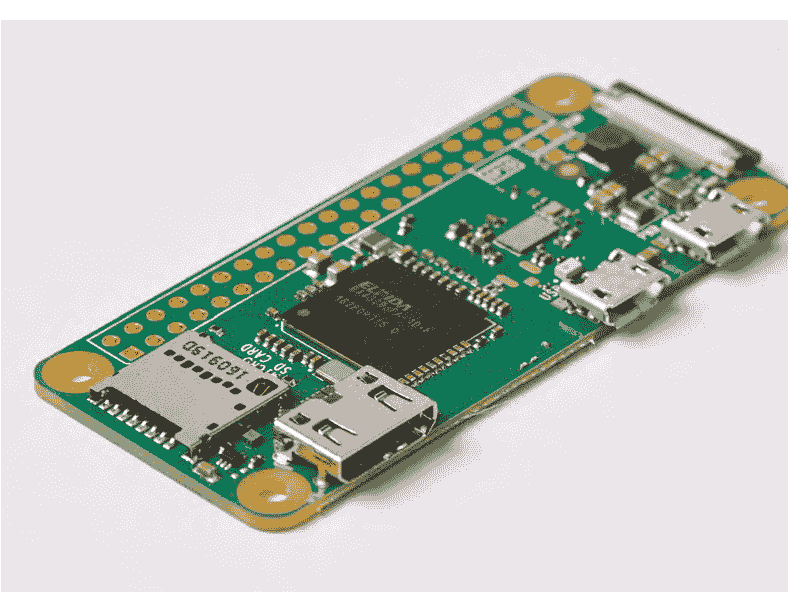

#### 缺点

单一 `USB` 端口意味着你需要添加一个 `USB` 集线器和一个 `Micro USB` 适配器。

### 总结

如果你在寻找需要无线连接的廉价应用电脑，`Pi Zero W` 凭借其低价格和强大的性能是一个强有力的竞争者，与树莓派 `B` 型相比，作为 PC 是值得的，尽管节省的成本非常微小。

## 硬件

### `Raspberry Pi Zero W`

新的 `Pi Zero W` 拥有 `Wi-Fi` 和 `蓝牙`

`Pi Zero W` 设计初主要用于嵌入式应用，即与现实世界交互，具有紧凑的外型和超低成本的特性。现在加入了 `Zero W` 版本，`Zero W` 也具有 `2.4GHz` 无线连接。价格仍然比原版便宜，并提供了更多的灵活性。如果你想省钱，£9.60 是一个很不错的节约。`Zero W` 只有一个 `USB` 端口，因此你需要一个供电的 `USB` 集线器来连接键盘和鼠标。添加后，`Zero W` 比 `Pi 3` 贵两三英镑，但值得的。考虑到所有这些细节，`Pi 3` 方案大约 22 英镑，带方案的 `Zero W` 大约为 31 英镑。成本节省可能令人困扰，但 `Zero W` 对性能有巨大影响。树莓派 `3` 比它快得多，运行时间四倍，初始化需要 30 到 60 秒。当然，尽管惊讶于 `Zero` 是 32 位处理器和 512MB 内存，但 `Pi 3` 拥有 64 位内核和 1GB 内存。我们得出结论，尽管对于嵌入式应用近乎完美，但 `Zero W` 远不是台式电脑。

## `Refracta` 评测

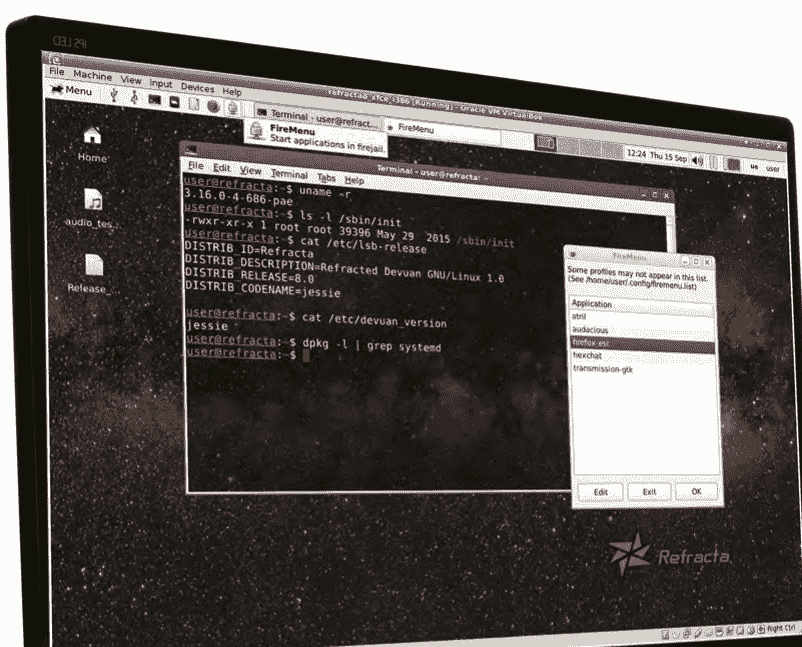

### 发行版 (`DISTRO`)

#### `Refracta`

##### 这是一个能超越 `Puppy Linux` 的轻量级发行版吗？

虽然有些人喜欢探索 `Linux` 发行版的各个领域，但大多数人仍然固守安全性和限制。`Refracta` 适合那些想要探索新事物但又害怕未知或风险的人。

`Refracta` 适合所有喜欢新事物但又觉得太复杂的人，它提供了愉悦体验所需的功能和工具。该发行版基于 `Debian` 的 `Devuan` 分支，外观与 `Puppy Linux` 非常相似。任何发行版在争夺 `Puppy Linux` 的轻量级称号时都很困难，`Refracta` 有许多迷之处。

在初始安装期间，我们发现 `Refracta` 的 `USB` 性能远优于其他产品，这在这种尺寸的发行版中并不多见。安装过程非常简单，它的 `Debian` 使得整个过程在几分钟内完成。在此阶段，还需要提到每个安装都可以根据你的桌面进行深度定制。`Refracta` 的某些方面是可以省略的，这对于单核桌面特别有用。在功能方面，它允许你增加自己需要的功能，只要你有一个不错的桌面。

另一个轻量选择是使用 `Xfce 4.10` 作为其桌面环境。它不仅高度可定制，而且针对低硬件需求进行了优化。虽然窗口管理器移除了一些动画，但用户设置已在 `Refracta` 中实现，我们没有发现任何实际问题。`Refracta` 和 `Xfce` 的组合最令人满意的是，你很难在速度上找到能与之匹配的对手。从菜单到管理多个窗口都很快，我们没有发现性能问题。个性化选项也非常丰富，包括桌面布局、壁纸和系统图标。软件通常是关注点之一，但 `Refracta` 的选择通常很好。还有一系列 `Refracta` 品牌软件，包括 `Refractus` 和 `refinstaller`。虽然它们并不都特别，但确实可以改进你现有的 `Refracta` 安装。

如果我们没有时间通过 `Refracta` 充分探索可提供的发行版，`Refracta` 是一个轻量、简单的选择，交付了我们无法实现的核心功能。在机器性能方面，它毫不含糊，虽然它没有提供任何真正独特的东西，但无疑是 `Puppy Linux` 最好的挑战者之一。如果你感兴趣，请从 `http://www.biblio.org` 下载 `Refracta`。`Oliver Hill`

它让大多数任务变得轻松，并提供了自定义桌面的选项。


| 特性 | 详情 |
| :--- | :--- |
| 内存 (`RAM`) | 256MB |
| 存储 | 512MB |
| 规格 | 基于 `Devuan-GNU` Live CD 或 `USB` 兼容 |

### 总结


> 在速度上，你很难找到能与 `Refracta` 和 `Xfce` 匹配的对手

#### 缺点

在桌面和软件选择方面存在一些遗漏。然而，这些是可以纠正的。对于追求完美的人来说，平衡易用性和效率传统上是困难的。虽然 `Refracta` 并不完美，但它包含了来自知名同类产品的大量功能。如果你的桌面需要一些照顾，`Refracta` 可以让你用起来。


## 评测

### 数字音频工作站 (`DAW`) 专属

#### `Ardour 5.6`

免费软件。专业的录制、编辑和混音。大多数需要音频录制解决方案的人都知道 `Ardour`，可能已经在用它或它的衍生版本。但对于其他人，如果你需要超越像 `Reaper` 或 `Audacity` 那种简单的音频编辑，这是你应该尝试的。`Ardour` 以其强大和功能脱颖而出，但部分原因是开发者 `Paul Davis` 的产物，他已经致力于此项目多年，并收到了其他用户和开发者的大量贡献。`Davis` 能够像他自己（包括专业人士和爱好者）一样为项目贡献每月订阅费用，但这是一个不稳定的资金来源，考虑订阅以接收稳定版本。这意味着软件在修复错误方面得到了很好的支持，并拥有出色的文档。尽管一些动画已从窗口管理器中移除，但用户设置已在 `Refracta` 中实现，我们没有发现任何实际问题。然而，如果你没有需要的内核，可以通过 `Debian` 仓库获取。遗憾的是，我们没有发现这特别棘手。也许 `Refracta` 和 `Xfce` 的组合最令人满意的是，你很难在速度上找到能与之匹配的对手。从菜单到管理多个窗口都很快，我们没有发现性能问题。个性化选项也非常丰富，包括桌面布局、壁纸和系统图标。软件通常是关注点之一，但 `Refracta` 的选择通常很好。还有一系列 `Refracta` 品牌软件，包括 `Refractus` 和 `refinstaller`。虽然它们并不都特别，但确实可以改进你现有的 `Refracta` 安装。

如果我们没有时间通过 `Refracta` 充分探索可提供的发行版，`Refracta` 是一个轻量、简单的选择，交付了我们无法实现的核心功能。在机器性能方面，它毫不含糊，虽然它没有提供任何真正独特的东西，但无疑是 `Puppy Linux` 最好的挑战者之一。如果你感兴趣，请从 `http://www.biblio.org` 下载 `Refracta`。`Oliver Hill`

它让大多数任务变得轻松，并提供了自定义桌面的选项。


| 特性 | 详情 |
| :--- | :--- |
| 内存 (RAM) | 256MB |
| 存储 | 512MB |
| 规格 | 基于 `Devuan-GNU` Live CD 或 USB 兼容 |

等等，文本提到：

...格式化为列表...

数字音频工作站

### `Ardour 5.6`

`Ardour` 以其强大和功能脱颖而出，但部分原因是开发者 `Paul Davis` 的产物，他已经致力于此项目多年，并收到了其他用户和开发者的大量贡献。`Davis` 能够像他自己（包括专业人士和爱好者）一样为项目贡献每月订阅费用，但这是一个不稳定的资金来源，考虑订阅以接收稳定版本。这意味着软件在修复错误方面得到了很好的支持，并拥有出色的文档。尽管一些动画已从窗口管理器中移除，但用户设置已在 `Refracta` 中实现，我们没有发现任何实际问题。然而，如果你没有需要的内核，可以通过 `Debian` 仓库获取。遗憾的是，我们没有发现这特别棘手。

软件媒体中心

### `Kodi 17.0`

一个精光的媒体中心

`Kodi` 已经存在了一段时间，最初作为 `XBMC`，是一个相当完整的媒体中心。尽管如此，背后的团队为新版本引入了新功能，以实现顶级用户界面——换句话说，它是专为这种距离（三米）观看而设计的，这是大多数家庭典型的电视观看距离。

前端 语言

### `Clojure 1.9`

`Clojure 1.9`

`Clojure 1.9`

`Clojure 1.9`

`Clojure 1.9`

`Clojure 1.9`

## 开源

## 推荐

## 托管列表

特色托管商：


关于我们

1996年以来，`Netcetera` 是欧洲领先的 `Web` 托管供应商之一，客户遍布全球75 多个国家。他们是领先的 `IT` 基础设施提供商，为全球企业提供机房托管、独立服务器和托管型基础设施服务。

我们提供的服务

- 托管主机
  为高性价比、可靠、安全的托管提供全方位的解决方案
- 独立服务器
  从单台服务器到整机架，均提供免费安装和宽裕的带宽
- 云托管
  `Linux`、`Windows`、混合云和私有云解决方案，具备支持和可扩展性功能
- 数据中心机房托管
  从 `QuadCore` 到智能服务器，均可快速部署

> `Netcetera` 是欧洲领先的 `Web` 托管服务提供商之一，客户遍布全球75 多个国家


## 专业人士的5个技巧

- 01 优化您的网站图片
  在向网站上传图片时，它们经过了网页压缩了吗？尝试 `jpegmin.com`，或者如果您使用 `WordPress`，请安装 `WWW Optimizer` 插件。

对您的数据负责是非常重要的。

- 04 想要提高排名？
  `Google` 在2015年做出了更改，所以请确保您的网站是响应式移动端的？此外，`Google` 提供免费的服务器 (`https`)：设置托管主机并强制使用 `https` 连接的最佳实践。

- 02 在英国托管您的网站
  您想在英国托管您的网站，而不仅仅是为了本地需求？如果您的服务器出现故障，您可能会错过搜索引擎排名，因此请检查您的网站是否在 `check-host.net` 上。

- 05 避开廉价托管
  我们见过那三条关于 1 英镑域名和托管的广告！想一下逻辑——为了 1 英镑，许多客户将挤在可能由 1 英镑以上的 `SSD` 驱动的 0 英镑硬盘驱动的服务器上！尝试记住您花这笔钱得到了什么

## 证言

`David Brown`

“我买了一个 `SSL` 证书。购买过程非常轻松，只需几分钟。我的困难在于安装证书。然而，我提交了一个粗略的工单，支持团队很快就协助了证书签名过程。在十分分钟内……”

`Suezy Bean`

“我们在 `Netcetera` 有几台服务器，他们的连接性是是顶尖的——运行时间极长，从未出现过问题。技术支持知识丰富且回复迅速——这是一个加分项。我们非常推荐 `Netcetera`……”

`J Everwards`

“尝试了其他托管公司后，你们的服务显然是最好的，我需要的所有功能都非常快，控制面板也非常全面……”

## 极速托管


`CWCS` 托管主机是英国领先的托管专家。他们提供全全面的托管产品、服务和支持。高技能员工并非都是托管专家，他们每个人都致力于提供卓越的客户体验，并对自己的工作充满热情。

- 机房托管
- `VPS`
- 100% 网络运行时间

## 高性价比托管

## `elastochosts`

`elastochosts.co.uk`

0271 82356

`ElastoHosts` 为全球企业提供简单、灵活且高效益的云服务，具有高性能、可用性和可扩展性。我们的工程师团队通过电子邮件和工单系统提供 24 小时的卓越支持。

- 适用于任何操作系统的云服务器
- `Linux` 操作系统容器
- 世界级 24/7 支持

## 小企业托管


`HostHapa` 是一家屡获殊名的 `Web` 托管服务，绿色托管的领导者。他们提供最具性价比的托管方案之一，拥有 24/7 客户支持、学习资源以及卓越的可靠性。

- 网站生成器
- 预算价格
- 无限制数据库


## `SSD Web` 托管


自2001年以来，`BargainHost` 实现了英国最低的云托管价格，成功实现了这一目标并建立了包含许多客户的大客户群。他们还因提供卓越的托管服务而获得过奖。

- 共享托管
- 云

## 高性价比托管


由于技术需求，托管是高性价比的解决方案。`Netcetera` 是一个领先的托管提供商。对于企业来说，托管是可靠的。

- 托管方案
- 网站构建
- 预算价格
- 域名

## 极速托管


自2001年以来，`BargainHost` 实现了英国最低的云托管价格，成功实现了这一目标并建立了包含许多客户的大客户群。他们还因提供卓越的托管服务而获得过奖。

- 共享托管
- 云托管

## 开源

## 推荐

## 托管列表

特色托管商：


关于我们

1996年以来，`Netcetera` 是欧洲领先的 `Web` 托管供应商之一，客户遍布全球75 多个国家。他们是领先的 `IT` 基础设施提供商，为全球企业提供机房托管、独立服务器和托管型基础设施服务。

我们提供的服务

- 托管主机
  为高性价比、可靠、安全的托管提供全方位的解决方案
- 独立服务器
  从单台服务器到整机架，均提供免费安装和宽裕的带宽
- 云托管
  `Linux`、`Windows`、混合云和私有云解决方案，具备支持和可扩展性功能
- 数据中心机房托管
  从 `QuadCore` 到智能服务器，均可快速部署

> `Netcetera` 是欧洲领先的 `Web` 托管服务提供商之一，客户遍布全球75 多个国家


## 专业人士的5个技巧

- 01 优化您的网站图片
  在向网站上传图片时，它们经过了网页压缩了吗？尝试 `jpegmin.com`，或者如果您使用 `WordPress`，请安装 `WWW Optimizer` 插件。

对您的数据负责是非常重要的。

- 04 想要提高排名？
  `Google` 在2015年做出了更改，所以请确保您的网站是响应式移动端的？此外，`Google` 提供免费的服务器 (`https`)：设置托管主机并强制使用 `https` 连接的最佳实践。

- 02 在英国托管您的网站
  您想在英国托管您的网站，而不仅仅是为了本地需求？如果您的服务器出现故障，您可能会错过搜索引擎排名，因此请检查您的网站是否在 `check-host.net` 上。

- 05 避开廉价托管
  我们见过那三条关于 1 英镑域名和托管的广告！想一下逻辑——为了 1 英镑，许多客户将挤在可能由 1 英镑以上的 `SSD` 驱动的 0 英镑硬盘驱动的服务器上！尝试记住您花这笔钱得到了什么

## 证言

`David Brown`

“我买了一个 `SSL` 证书。购买过程非常轻松，只需几分钟。我的困难在于安装证书。然而，我提交了一个粗略的工单，支持团队很快就协助了证书签名过程。在十分分钟内……”

`Suezy Bean`


“我们在 `Netcetera` 有几台服务器，他们的连接性是是顶尖的——运行时间极长，从未出现过问题。技术支持知识丰富且回复迅速——这是一个加分项。我们非常推荐 `Netcetera`……”

J Everwards

“尝试了其他托管公司后，你们的服务显然是最好的，我需要的所有功能都非常快，控制面板也非常全面……”

## 极速托管


`CWCS` 托管主机是英国领先的托管专家。他们提供全全面的托管产品、服务和支持。高技能员工并非都是托管专家，他们每个人都致力于提供卓越的客户体验，并对自己的工作充满热情。

- 机房托管
- VPS
- 100% 网络运行时间

## 高性价比托管

## `elastochosts`

`elastochosts.co.uk`

`0271 82356`

`ElastoHosts` 为全球企业提供简单、灵活且高效益的云服务，具有高性能、可用性和可扩展性。我们的工程师团队通过电子邮件和工单系统提供 24 小时的卓越支持。

- 适用于任何操作系统的云服务器
- Linux 操作系统容器
- 世界级 24/7 支持

## 小企业托管


`HostHapa` 是一屡获殊名的 Web 托管服务，绿色托管的领导者。他们提供最具性价比的托管方案之一，拥有 24/7 客户支持、学习资源以及卓越的可靠性。

- 网站生成器
- 预算价格
- 无限制数据库


## SSD Web 托管


自2001年以来，`BargainHost` 实现了英国最低的云托管价格，成功实现了这一目标并建立了包含许多客户的大客户群。他们还因提供卓越的托管服务而获得过奖。

- 共享托管
- 云

## 高性价比托管


由于技术需求，托管是高性价比的解决方案。`Netcetera` 是一个领先的托管提供商。对于企业来说，托管是可靠的。

- 托管方案
- 网站构建
- 预算价格
- 域名

## 极速托管


自2001年以来，`BargainHost` 实现了英国最低的云托管价格，成功实现了这一目标并建立了包含许多客户的大客户群。他们还因提供卓越的托管服务而获得过奖。

- 共享托管
- 云托管


在 Web 标准中，这是让·安托万·布里拉亚特·萨瓦林（Jean Antoine Brillat-Savarin）转述的一句引用（尽管萨瓦林的原话写道：“告诉我你吃什么，我就告诉你你是谁。”让（Jean）确实非常热爱食物）。

此外，通知似乎认为大多数人都在运行基于 `BIOS` 和 `MBR` 启动的 PC，这已经过时了。大多数 PC 使用 `UEFI` 和 `GPT`，但你们的杂志并没有这样做。

有时下班后，就像我通过玩游戏释放压力一样，我一直在玩 `GOG`：上帝赐予的免费游戏。你认为 Linux 用户 [开发者] 会偶尔考虑录制录像带吗？我很喜欢大部分教程，有时我想了解更多关于趣味趣味性的内容。

顶级的 `KDE Slimbook` 是一件精美的硬件，配备了 `Intel Core i7-5500u` 2.4GHz 处理器，并可选 4GB、8GB 或 16GB `DDR3` 内存。

# 游戏开始了吗？

我也在建议的帖子注意到，似乎认为大多数人都在运行 `BIOS` 和 `MBR` 启动的 PC，这已经过时了。大多数 PC 使用 `UEFI` 和 `GPT`，但你们的杂志并没有这样做。我无法承认这一点（撇开那几个半心不意的部分）。

为他们提供为 Linux 量身定制的理想桌面（例如，查看我们在第 86 页的 `XPS 13` (`Kaby Lake`) 开发者版）。正如我下一页将要做的那样，我打算触及这个话题，并渴望从新老读者那里学习关于他们喜爱的内容以及关于 `LU&D` 的知识。我们有所有的无人机，在街上寻找新作者，请通过邮件至 `linuxuser@forum.net` 向我们发送您的意见，如果您想加入我们并帮助塑造下一代，同时在这个领域赚取一些报酬，请告诉我们。

- 我可以对这句精彩的引用归功。我最近在读一篇对埃里克·A·迈耶（Eric A. Meyer）的采访，受尊敬的权威马特·史密斯（Matt Smith）

Chris：第一个月的人群很有趣，但这些必须解决。感谢他们。马特。只是误引了让·安托万·布里拉亚特·萨瓦林：“告诉我你构建了什么，我就告诉你你是谁。”我的希望是在工作的基础上建立一本最好的杂志，以便产出你们想要改变的 `LU&D`，但希望你们会发现这些改变是值得。


我针对 `KDE Slimbook` 那篇文章中发生的事情发表评论是合适的，除非说它是错误的，但我可以说，作为一个为组装机器工作了超过 12 年的人，我知道 `BIOS`（通常用于存储但指数据传输）和 `GPT`（我假设它是指的是 `CPU`）之间的区别。

Chris：有趣！你说，好的，喜欢释放掉软件中的开源游戏大部分是 `O.A.D.`，并且是专注的，但对于那些理解最好的游戏是为 `Linux/Steam` 制作的读者来说，这是一个很好的页面吗？或者 `LU&D` 的读者会为了游戏这种消遣的娱乐吗？

我也没有拥有一台不使用 `GPT` 和 `UEFI` 的机器，即使我没有大于 1TB 的硬盘。我确实认为需要承认，有些读者对他们的笔记本电脑和旧方法死守不放。我会尽力将这些财富引向光亮，并诱惑他们进入 `LU&D` 的信箱。

上方：所有的墙。都终将倒塌。（参见 `www.allwallsmustfall.com`）这是该游戏最近的一个例子。它是一个“科技黑色间谍惊悚片”，配合 `GOG` 和《Braid》看起来很不错。它设定在一个平行宇宙，在那里柏林墙从未结束，冷战也从未结束，该游戏目前正在众筹，从以后将会有 Linux 版本。

`www.linuxuser.com`
