# Linux 用户与开发者 180 - Gnome 深度解析 180

## 特别报道

探索 `Nextcloud` 12

全新的协作与通信功能

## 专家指南

为您的项目

获取完美的许可证

揭秘全球最大的 Linux 桌面环境的威力

- `Flatpaks` - `GLib` - `GSettings` - `GTK+` - `Wayland`

深度剖析

超级计算机：

Linux 的兴起

每秒超过 93,000 万亿次浮点运算


# 访谈

`elementary OS`

联合创始人 `Cassidy James Blaede`

谈论最酷操作系统的未来

# 37 页专家教程

- `Angr` - `Erlang` - `Puppet 5`

外加：使用 `Sense HAT` 制作了《战舰》游戏

出发吧，`Slack`

» 最佳 `Slack` 替代方案之一

让您的协作开源

`Android x86`

» 使用 `Android` PC 版

让您的旧设备焕发生机

# 来自转销托管创始者的 20i™

仅需 1 英镑即可获得首月无限转销托管，之后每月仅需 29.99 英镑

无合约 + 30 天退款保证

立即登录 `20i.com/dotnet` 注册

# 基于 100% SSD 的自动伸缩云托管平台。

> `TIM & JONATHAN BREALY`，`20i` 创始董事 & 行业资深人士

# 无限托管

包括无限的 SSD 网站空间、带宽、网站数量、用户账户、1GB MySQL 数据库、10GB 邮箱信箱以及免费的 SSL 证书。

# 轻松迁移

使用我们的自动化一站式迁移中心，轻松迁移您的域名、网站、电子邮件和数据库。

- 20i 特色专属

# SSD 标准配置

我们仅在服务器中配备顶级固态硬盘，以确保极快的运行速度和卓越的可靠性。

# 自动伸缩

我们的平台可根据需求扩展资源，确保您的网站即使在最繁忙时期也能保持在线和快速。

# 多平台支持

在经过调优的 `Linux`、`Windows` 和针对 `WordPress` 优化的平台运行托管网站。

- 20i 特色专属

# 100% 品牌定制

为您的客户提供他们自己的自定义控制面板。它界面精美、功能丰富且易于使用。

- 20i 特色专属

访问我们

# 20i.com/dotnet

邮件联系我们

# sales@20i.com

致电联系我们

## 编辑

`Chris Thornett`

`cris.thornett@linuxuser.com`

`01234 56789`

## 总监

`Phil Kimm`

## 制作编辑

`Paul Inman`

## 高级艺术编辑

`Jo Collier`

`Dan Allen`, `Michael Bennett`, `Bobby Beard`, `Jimi Bobell`,

`Colin Coleman`, `David Green`, `Edward Casey`, `Tom Castillo`,

`Grona Tam`, `Hanna`, `Oliver Hit`, `Paul O'Neil`, `Jason Mason`,

`Kevin Knight`, `Richard Sharpe`, `Simeon Mikhails`,

`Taashak Shikhara`

## 广告

媒体包请访问：

`www.linuxuser.com`

广告总监 `Richard Hemming`

`rich@linuxuser.com`

`01235 67890`

`01235/67894`

广告经理 `Simon Moore`

`simon@linuxuser.com`

`01235/67894`

## 国际版

`LinuxUser` 可供授权。请联系国际部门讨论合作机会

国际销售 `Matt Ellis`

`matt@linuxuser.com`

## 发行量

发行总监 `Daniel Pearce`

`0144 344 8852`

## 制作

制作部负责人 `Ian Manager Scott`

数字内容编辑 `Jason Hudson`

数字插画 `Chris Mason`

## 管理

执行董事 `Angela Lynne-Redman`

创意总监 `Aaron Seiler`

艺术与设计总监 `Rose Wood`

## 订阅

`item House, Library's Road, northborough, PE14 6WU`

`Chilwell Park, London`

我们诚挚邀请您在 `www.linuxuser.com/subscribe-now/` 订阅我们的杂志。

## 本期内容

>> `GNOME` 20 周年，p18

>> `Nextcloud` 12 的所有功能，p56

>> 了解我们的生日庆祝活动，p74

欢迎阅读英国和北美最喜爱的 Linux 和操作系统杂志。我们在英国本土度过了一段痴迷的时光。无论您的政治立场如何，任何处理安全问题的人都可能支持严厉的立法，这将强迫其在实践中留下后门。正如我们所知，`GNOME` 已经存在了 20 年，感谢你！`Nextcloud` 12 令人惊叹。


- 08 新闻：开源界大事

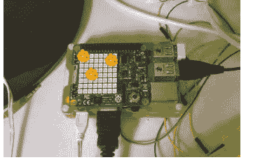

此外还有令人惊艳的蒸汽朋风笔记本。

我们本月上传了许多新的开源软件，包括 `Nextcloud` 12。此外，获取教程项目文件和素材——所有内容均托管在我们的安全存档中。


你知道吗？为造纸和其他许多产品提供木材的欧洲森林在过去 10 年中增长了 44,000 平公里？这每天超过了 1,500 个足球场！†

喜欢杂志吗？知道这些杂志是由天然、可再生和可回收的木材制成时，你会更爱它们。

有很多极好的理由 `#热爱纸`。现在就探索它们，`twosides.info`


> 数字版读者也免费！


- 随心所欲下载你想要的文件


01 按照屏幕上的说明通过我们安全的 `FileSilo` 系统创建账户。登录并通过回答关于杂志的简单问题来解锁期刊。


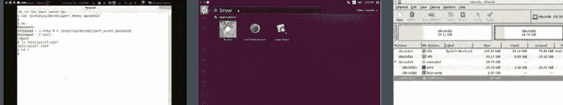


已经是纸质版订阅者？这里是今天如何解锁 `FileSilo` 的方法……使用你订阅副本上方打印的唯一八位字母数字代码解锁库。它也可以在任何续订中找到。

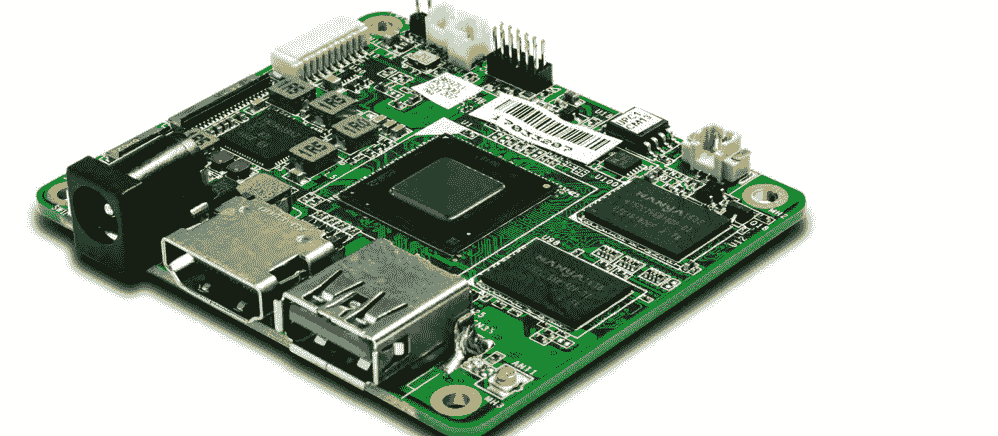


“采用开源方法使我们专注于开发创新功能并更快地推向市场，”丰田连接公司执行副总裁山本健司表示。

“`AGL` 平台的灵活性使我们能够快速推出物联网产品，为客户提供与消费技术速度一致的更好的连接和新功能。”

除了其他帮助我们提供娱乐，这项技术的早期愿景将使丰田能够完全控制车辆软件更新。在后期，固件更新可以应用到用户的电脑上。虽然 `Agile`

你的 `Linux` 新闻与见解来源


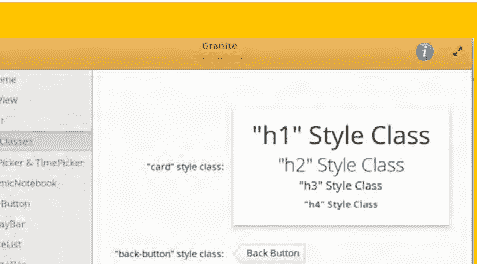

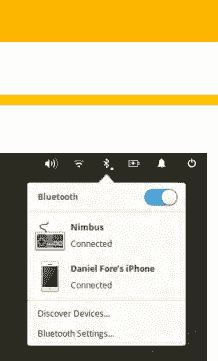


`Jon Masters` 是一位 Linux 内核黑客，关注 Linux 已超过 20 年，从他最初在剑桥开始使用 Linux 开始。`Jon` 住在剑桥，目前在一家大型企业 Linux 供应商工作，负责驱动高效 `ARM` 功耗服务器的开发。

各种补丁请求仍在进行中，并将与 6 月在布拉格举行的 `Linux` 基金会开源峰会相关的许多活动挂钩。我们对内核安全或其他任何相关主题感兴趣，请查看 `Linux` 基金会的活动：


在完成 `Ubuntu GNOME` 安装后，加载的第一个应用程序是“GNOME Tweak Tool”，同样的如果你还没有尝试过它，该应用程序对许多通常难以调整的功能提供了定制。`GNOME` 提供了一个强大的扩展框架，允许开发者和用户扩展并调整桌面的外观、行为和功能。我们喜欢这些扩展：

| Windows | Ubuntu GNOME | 默认 |
| --- | --- | --- |
| Microsoft Edge | Web | 默认 |
| Microsoft Office | LibreOffice | 通过 GNOME 软件安装 |
| Photoshop | GIMP | 通过 GNOME 软件安装 |
| 记本 | gedit | 默认 |
| Windows Store | GNOME 软件 | 默认 |
| WinZip / WinRAR | 归档管理器 | 默认 |
| Windows 播放器 (音乐) | GNOME Music | 默认 |
| Windows 播放器 (视频) | GNOME Videos | 默认 |
| Windows 资源管理器 | Files | 默认 |
| 磁盘管理 | GParted | 默认 |

> 顶部提示
>
> 按 `Super+M` 打开消息栏，其中包含错过的和未读的通知，如聊天对话和播放状态。

`button-layout = "size,maximized,close"` 右键点击窗口标题栏也会显示选项。双击标题栏可以最大化或还原窗口。你可以通过将窗口拖动到屏幕左侧或右侧来锁定窗口。

此项目的开发已经停滞，发行版通常包含 `LibreOffice` 或 `OpenOffice`（后者基于前者），`LibreOffice` 是一个已经成熟的产品，因此很难想象在可见的未来会有 `GNOME` 套件回归。每个新的 `GNOME` 版本每六个月发布一次，带来新功能。最新的发布版本是 `3.24`，“Portland”，包含了来自 753 名贡献者的 54,468 处更改。这些更改中的大多数与小修复和改进有关，散落着一些新功能，包括上述的夜灯（`Night Light`）和 `Features` 应用。

构成 `GNOME` 的应用完整列表可以在 `gnome.org/apps` 找到，但并非所有的发行版都会包含所有的 `GNOME` 应用。配置由“控制面板（又名设置）”和 `tweak` 工具管理。控制中心包含用于控制桌面的各种模块。`GNOME` 还包括 `Files`（文件管理器）、`照片`、`音乐` 和 `视频` 实用程序。还有许多实用的应用，如 `地图`、`天气`，以及 `联系人`、`日历` 和 `计算器`，以及如 `Notes` 应用和 `gedit` 等写作应用。通信由 `Chat`、`Mail` 和 `Polari` (IRC) 覆盖，以及 `Evolution`、`Thunderbird` 和 `Stability` 等管理工具。随着优秀的 Web 浏览器 (`Epiphany`) 的引入，`GNOME` 包含了你运行所需的一切。

之前有一个 `GNOME` 办公套件，包含 `AbiWord`、`GNOME-DB` 和 `Gnumeric`，

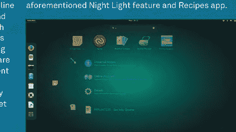

> 左侧？你可以将应用程序拖到 Dock，以便通过 `Super` 键或热角快速访问。

# 替代 GNOME 发行版

在本次发布中，设置应用中的三个区域经过重构：在线账户、打印和在线用户。改进主要在可用性方面，是改进该应用的长期努力的一部分，后续版本中将引入更大的更改。

照片应用经过了改进，具有更好的空间效率、高质量的缩略图显示以及改进的提取编辑功能。嵌入在 `Exif` 数据中的信息现在可以直接在应用内查看，并且对在线账户的支持得到了改进。

尽管 `GNOME` 本身曾有过有时动荡且具有一定争议的历史，但它现在已经达到了一个水平，许多发行版将其作为默认环境——这种方法最近开始变得越来越流行。`Linux` 的美之处在于几乎可以在任何发行版上安装 `GNOME` 并在相应的仓库中找到它。然而，你无法获得一个完全集成的体验——某些发行版你只会发现该发行版与桌面环境完全集成，额外的额外也随之而来。

> 如果你喜欢在 `Linux` 机器上玩游戏，`GNOME Games` 就是你的个人游戏中心。

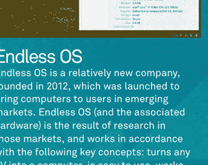

`Polari`（`GNOME IRC` 客户端）已更新到 `3.24`。现在点击会弹出一个窗口，提供如何启动对话请求，或者在他们上线时请求通知。其他改进还包括让应用程序在后台继续运行而不打开窗口的选项、加入房间对话框中的可用房间列表。如果你喜欢在 `Linux` 上玩游戏，`GNOME Games` 就是你的个人游戏中心——一个浏览和播放你视频库的场所。对于那些喜欢老派游戏的人，一些自制游戏对于 `Neo-Geo Pocket` 以及 `NES`、`SNES`、`Game Boy` 和 `Game Boy Color` 非常棒，可以使用如 `RetroArch` 等街机模拟器以及从原始 CD 复制的文件。游戏 应用还具有针对 `3.24` 的工具界面，包括更快的游戏加载、更好的窗口处理和更有用的错误信息，它还获得了通过 `libgame` 游戏的能力。`Evolution` 包含了计算器应用的更新，包括改进的外观、键盘快捷键、窗口函数、弹出层、更好的高亮以及改进的复数处理。

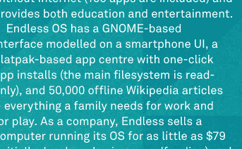

`Debian` 是现代 `Linux` 发行版的祖父，`Ubuntu`（最初于 1993 年发布）就是基于它构建的。这个品牌并不新。`Debian` 包含超过 43,000 个包，具有严格的质量控制和组织结构，以提供开箱即用的产品，并有极好的同行支持。值得解释为什么 `Debian` 项目有许多非商业贡献者。最新的稳定版本 `Debian Jessie` 使用了 `GNOME 3.14` 环境，但它是 `GNOME 2` 和 `3` 的某物——令人失望——以及 `Cinnamon`。与 `Ubuntu` 相比，它缺乏一点打磨，但很容易理解为什么它由许多才华横溢的老兵产生。

`Endless OS` 是一家相对新的公司，成立于 2012 年，其推出是为了将学生带新兴市场。`Endless OS` 是为那些市场中资源有限的硬件设计的，并符合以下关键点：一个没有互联网也能运行（所有应用）并提供教育和娱乐的操作系统。`Endless` 使用了基于手机 UI 模型的界面，一个基于 `Flatpak` 且一键安装的应用（主文件是只读的）——家庭学习和玩所需的一切。作为一家公司，`Endless` 销售副本。

在本次发布中，设置应用中的三个区域经过重构：在线账户、打印和在线用户。改进主要在可用性方面，是改进该应用的长期努力的一部分，后续版本中将引入更大的更改。

照片应用经过了改进，具有更好的空间效率、高质量的缩略图显示以及改进的提取编辑功能。嵌入在 `Exif` 数据中的信息现在可以直接在应用内查看，并且对在线账户的支持得到了改进。

尽管 `GNOME` 本身曾有过有时动荡且具有一定争议的历史，但它现在已经达到了一个水平，许多发行版将其作为默认环境——这种方法最近开始变得越来越流行。`Linux` 的美之处在于几乎可以在任何发行版上安装 `GNOME` 并在相应的仓库中找到它。然而，你无法获得一个完全集成的体验——某些发行版你只会发现该发行版与桌面环境完全集成，额外的额外也随之而来。

> 如果你喜欢在 `Linux` 机器上玩游戏，`GNOME Games` 就是你的个人游戏中心。在选择使用 `GNOME` 的发行版时，值得检查一下具体包含了哪一个版本。某些发行版允许访问最新最强大的版本，另一些则得益于与开发团队保持紧密关系的新手团队（特别是 `Fedora` 的情况）。如果是第一次开始使用 `GNOME`，值得利用出色的 Live 发行版，以及在选择你偏好的发行版之前并排尝试不同 `Linux` 版本的能力。


`Polari`（`GNOME IRC` 客户端）已更新到 `3.24`。现在点击会弹出一个窗口，提供如何启动对话请求，或者在他们上线时请求通知。其他改进还包括让应用程序在后台继续运行而不打开窗口的选项、加入房间对话框中的可用房间列表。如果你喜欢在 `Linux` 上玩游戏，`GNOME Games` 就是你的个人游戏中心——一个浏览和播放你视频库的场所。对于那些喜欢老派游戏的人，一些自制游戏对于 `Neo-Geo Pocket` 以及 `NES`、`SNES`、`Game Boy` 和 `Game Boy Color` 非常棒，可以使用如 `RetroArch` 等街机模拟器以及从原始 CD 复制的文件。游戏 应用还具有针对 `3.24` 的工具界面，包括更快的游戏加载、更好的窗口处理和更有用的错误信息，它还获得了通过 `libgame` 游戏的能力。`Evolution` 包含了计算器应用的更新，包括改进的外观、键盘快捷键、窗口函数、弹出层、更好的高亮以及改进的复数处理。


Debian 是现代 Linux 发行版的祖父，Ubuntu（最初于 1993 年发布）就是基于它构建的。这个品牌并不新。`Debian` 包含超过 43,000 个包，具有严格的质量控制和组织结构，以提供开箱即用的产品，并有极好的同行支持。值得解释为什么 `Debian` 项目有许多非商业贡献者。最新的稳定版本 `Debian Jessie` 使用了 `GNOME 3.14` 环境，但它是 `GNOME 2` 和 `3` 的某物——令人失望——以及 `Cinnamon`。与 `Ubuntu` 相比，它缺乏一点打磨，但很容易理解为什么它由许多才华横溢的老兵产生。

`Endless OS` 是一法相对新的公司，成立于 2012 年，其推出是为了将学生带新兴市场。`Endless OS` 是为那些市场中资源有限的硬件设计的，并符合以下关键点：一个没有互联网也能运行（所有应用）并提供教育和娱乐的操作系统。`Endless` 使用了基于手机 UI 模型的界面，一个基于 `Flatpak` 且一键安装的应用（主文件是只读的）——家庭学习和玩所需的一切。作为一家公司，`Endless` 销售副本。

目前的 `GNOME Builder` 尚处于起步阶段，但未来为 Linux 开发者承诺强大的功能。

在 `3.22` 版本（2016年9月）中成为默认设置证明了它已经准备好投入主流。随着 `GNOME` 出现在 `Ubuntu 17.10`，它也将切换到 `Wayland`，这为该项目提供了巨大的支持。

我们每天使用的 `GNOME` 项目的另一个关键元素是 `GTK+`（`GIMP` 工具包）——这是一个用于创建图形界面的跨平台工具包。`GTK` 库（当前版本为 `3`）是一组用于构建用户界面的图形元素——它包含了 203 个活跃和弃用的小部件。`GTK` 针对基于 Linux 的用户，但也运行在其他平台上，包括 `Microsoft Windows`（通过 `Windows API` 接口）和 `macOS`（使用不同引擎进行组件绘制的接口）。

除了构成 `GNOME` 桌面大部分部分的 `Shell` 和应用程序外，还有许多其他元素支撑着它。`Wayland` 就是一个很好的例子。`Wayland` 是一种合成器协议和库实现，其中窗口管理器和合成器的角色合而一。合成器使用 `KMS` 和 `DRM` 等 Linux API，并使用 `GTK` 进行渲染。`Wayland` 协议正在演变——长期以来通过向核心协议添加越来越多的功能来保持，但从长远来看这是不可持续的。开发一个基于合成的现代显示系统是可持续的。真的不需要担心 `X` 协议的过时部分（如较少使用的扩展），`X` 协议中任何更有问题的部分在 `Wayland` 中不存在，这为 `GNOME` 避免了大量问题。

整个 `GNOME` 有许多项目，包括 `CUPS` 打印系统。

由于 Linux 下 `GTK+` 是数据结构、缓存、线程和动态模块等最广泛使用的系统库，它用 C 语言编写。由 `GNOME` 代码开发的 `GTK+` 从 `GTK+` 分离出来，以便让 `GNOME` 以外的软件更容易使用（并确保 `GTK+` 专门包含 UI 相关的代码），从那以后一直并行开发。

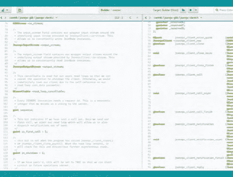

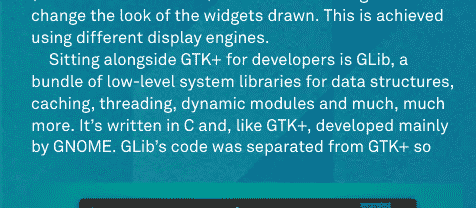

最初宣布后，花费了一半时间发布了第一个版本（1999年3月）。在 `GNOME` 世界大会上宣布它，`Miguel de Icada` 改变了 Linux 计算的未来。他是对的。`1.2` 版本于 2002 年3 月到达，并自信地认为自己在 `GNOME` 桌面的可用性、吸引力和规模上取得了突破。终端用户似乎能够“让他们的祖父母和弟妹留下深刻印象”。

最后一个 `1.1 “Tranquility”` 发布于 2001 年，承诺将软件推向新水平！`Nautilus` 使其成为家园，`Swift Wayland` 窗口管理器也是如此。

一年后，`GNOME 2` 到来，带有增强的功能和增强级别的添加。一流的国际化，以及整个界面中改进的无障碍支持。`GNOME 2` 的开发一直持续到 2010 年的 `2.32` 版本，之后没有重大变化，带来了丰富的变化：

- `Epiphany` 浏览器 `2`（2003年9月）

- `Evolution Plan 4`（2004年9月）

- `1.2` 中的 `GTK+2`（2006年9月）

- `2.14` 中的性能提升（2008年3月）

- `2.26` 中的 `Cheese` 网络应用（2009年3月）

- `2.30` 中的 `Pod` 支持（2010年3月）

到 `GNOME 2` 发布时，我们已经处于 `3.0` 版本。`2011年4月` 发布的 `3.0` 版本带来了备受争议的 `GNOME Shell`，以及 `GTK+`，并且没有移除长期被弃用的 API。

`3.22` 版本（2016年9月）将 `Wayland` 设为默认显示服务器并引入了对 `Flatpak` 的支持。

`GLib` 包含 `GObject`（又称 `GLib` 对象系统），它提供了一个具有跨语言实现的可移植对象系统，以及我们封面上的 `glimmer`（它是 `Pantheon` 桌面环境的一部分）。

此外，`GNOME` 并不是唯一的用户界面工具包。`Clutter` 是另一个项目开发的库，围绕 `GLib` 的复杂性提供了一个现代、高效的 API，`Clutter` 不强制特定接口，但为针对特定需求定制的高层提供了丰富、通用的基础。`GNOME` 团队最近添加的一个项目是针对 Linux 新手的，如果你不完全被 `GNOME` 说服并可能在考虑切换？那么仔细看看这些基于 `Ubuntu` 的替代方案：...

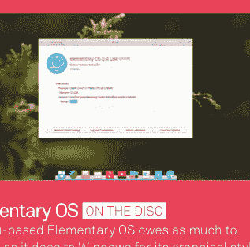

`Builder`（将需要调整），是一个新的 IDE，专注于将平台力量带给比任何时候更多的开发者。它目前正处于深度开发中，有一个庞大的待发布列表。如果 `GNOME` 能够交付此，它就有潜力真正改变 Linux 开发。基于 `Ubuntu` 的 `Elementary OS` 在其图形风格上既归功于 `macOS` 也归于 `Windows` —— 它看起来非常漂亮！该发行版对新用户来说也非常直观。

`Builder`（将需要调整），是一个新的 IDE，专注于将平台力量带给比任何时候更多的开发者。它目前正处于深度开发中，有一个庞大的待发布列表。如果 `GNOME` 能够交付此，它就有潜力真正改变 Linux 开发。

如果你最近关注过 `Ubuntu` 社区，可能熟悉 `Ubuntu` 的 `Snap` 计划。最初为 `Ubuntu` 创建的 `Snaps` 现在关注跨分发。`GNOME` 处于什么位置？通过对 `Flatpak` 的支持，两者的目标相同：让开发者能够创建并分发而不依赖于主机（即沙盒化）应用程序。什么是开源？它与自由软件有何不同？你如何决定哪种最适合？可靠性和性能远在后。哪一个会获胜？

`Zorin OS` 是一个基于 `Ubuntu` 的发行版，旨在让 `Windows` 用户感觉如家，适用于 `Windows XP`、`2000` 和 `7`。尽管每个人都有所有权，`GNOME` 对包括系统在许多其他项目都有贡献。许多功能源于 `GNOME` 项目，并与其他项目的持续协作扩展到 Linux 内本身、`GStreamer` 多媒体框架、发布以及实时通信。

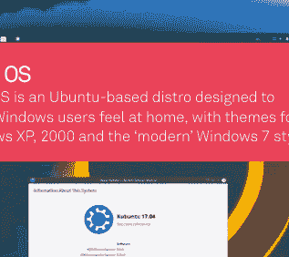

如果你不想完全离开，`Kubuntu` 是一个在概念上与 `KDE` 相似的很棒的桌面。


`5f7f_26_2.png`

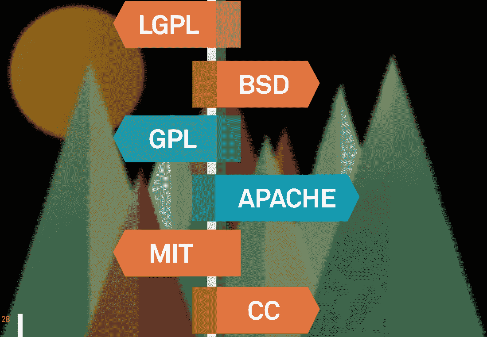

开源软件的成功以及对日常生活的影响是不可或缺的。从为中小企业提供成本效益的解决方案，到运行服务器甚至分析大数据。但什么是开源？它与自由软件有何不同？你如何决定哪种最适合？可靠性和性能远在后。不幸的是，它遇到了一个相当困难且复杂的问题：许可证泛滥。第一次，软件架构师和开发者对选择感到无所适从。

`www.linuxuser.com` 29

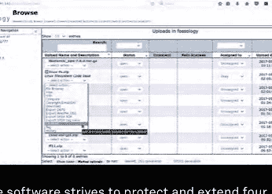

- `意思一致（Consensus ad idem）`；也称为意气相投。这是合同双方同意受合同条款约束的共同协议。

> 小贴士

| 二进制分析测试头部 | 文件 | 许可证 | 结果 |
|---|---|---|---|
| `main.exe` | `GPL-2.0` | 通过 |
| `lib.dll` | `MIT` | 通过 |
| `plugin.so` | `Apache-2.0` | 通过 |
| `utils.exe` | 专有 | 失败 |
| `data.bin` | 未知 | 失败 |
| | | | |


二进制分析工具有助于跟踪合规工作的变化。我们建议阅读文档，否则你将完全迷失。

`CC` 许可证适用于非软件作品，如图像、艺术品和音乐。著权共享 `CC-BY-SA` 允许修改被许可作品、分发衍生作品，但必须遵循相同的许可证。`CC-BY` 是宽松的，仅要求署名。

如果你希望获得宽松的许可证又希望授予专利权利，则推荐用于软件。由于其宽松性，它允许衍生作品以不同的条款发布并商业化。除了 `Apache`，`Android` 也是根据此许可证发布的。


如果它仅将 `GPL` 代码作为共享库使用，则可以允许以不同的许可证发布作品。这允许在专有项目中使用代码。这对于软件库也非常有用。它在所有其他方面与 `GPLv3` 相似。

`www.linuxuker.com` | 31

| 指示您的银行或合作社通过直接借记付款 | 7 6 8 1 9 5 |
|---|---|

| £67.50 (零售价的 8 折优惠) | | |
|---|---|---|

| 欧洲 £68.54 | 美国 $112.23 | 世界其他地区 $112.23 |
|---|---|---|

| 地址位于 | |
|---|---|

| | |
|---|---|

| 邮编 | |
|---|---|

| | |
|---|---|

| 账户名称 | |
|---|---|

| | |
|---|---|

| `Visa` `Mastercard` | |
|---|---|

| | |
|---|---|

| 排序代码 (`Sort Code`) | |
|---|---|

| | |
|---|---|

| 账户 | |
|---|---|

| | |
|---|---|

请通过本说明中指定的账户支付 `Future Publishing Ltd` 的直接借记款，并遵守《直接借记担保》的条款和条件，该担保对任何错误提供保护。`Future Publishing Ltd` 和（如果需要）详情将电子形式传输给我的银行/合作社。银行和合作社可能不接受任何类型的账户直接借记

# 使用信用卡或支票付款

通过信用卡或借记卡付款

| 卡号 | |
|---|---|

| | |
|---|---|

| 有效期 | |
|---|---|

| | |
|---|---|

| 支票付款 | 付款人抬头为：`Future Publishing Ltd` |
|---|---|

| 我随附一张支票，金额为 | |
|---|---|

| 签名 | 日期 |
|---|---|

| | |
|---|---|

# 您的个人信息

| 姓名 | |
|---|---|

| | |
|---|---|

| 地址 | |
|---|---|

| | |
|---|---|

| 电话号码 | 手机号码 |
|---|---|

| | |
|---|---|

| 电子邮箱地址 | 邮编 | |
|---|---|---|

| | | |
|---|---|---|

`[ ]` 如果您希望收到来自 `Future` 及其集团公司的任何包含新闻、优惠和产品信息的通讯，请勾选。

请将此表邮寄至：`Linux User & Developer Subscriptions, Future Publishing Ltd, 3 Queensbridge, The Northampton, NN78BF, United Kingdom`

# 在线安全订购 `www.myavouritemagazines.co.uk/sub`

# 联系我们的客户服务人员

# 道德黑客教程

## 使用“邪恶孪生”（`Evil Twin`）方法

学习黑客如何克隆无线网络以获取密码、观察流量并进行各种恶意破坏


`Emil Kreponic` 是一位 `IT` 专家和 `Linux` 爱好者，热衷于解决网络相关问题。他几乎不睡觉。

## 资源

- `Wireshark` 允许你查看单个数据包的内容以及 `DNS` 请求的样式

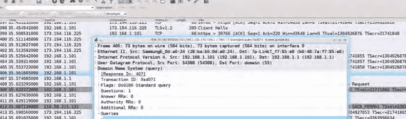

## `SSID` 攻击

`SSID` 攻击与此地描述的方法配合使用：`ARP` 中间人攻击，以便流量被重定向。我们使用 `HTTP` 版本的网页，以便收获密码。

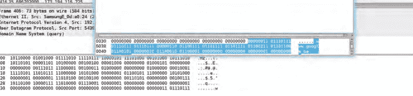

| 帧 | 时间 | 长度 | 源 | 目的 | 协议 | 信息 |
|---|---|---|---|---|---|---|
| 0 | 00:00:00.00 | 64 | 00:0c:29:4a:82:68 | ff:ff:ff:ff:ff:ff | `ARP` | |
| 1 | 00:00:00.001 | 64 | ff:ff:ff:ff:ff:ff | 00:0c:29:4a:82:68 | `ARP` | |
| 2 | 00:00:00.002 | 64 | 00:0c:29:4a:82:68 | ff:ff:ff:ff:ff:ff | `ARP` | |
| 3 | 00:00:00.003 | 64 | ff:ff:ff:ff:ff:ff | 00:0c:29:4a:82:68 | `ARP` | |
| 4 | 00:00:00.004 | 64 | 00:0c:29:4a:82:68 | ff:ff:ff:ff:ff:ff | `ARP` | |

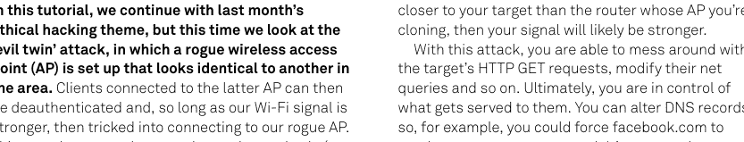

在本教程中，我们将继续上上的道德黑客方法，但现在我们来看“邪恶孪生”（即设置一个伪接入点 (`AP`)，使其看起来与区域内的另一个接入点完全相同）。连接到伪 `AP` 的客户端随后可以被取消认证并强制登录。信号要强得多，使他们连接到我们的伪造 `AP`。这补充了其他攻击，例如 `ssidist`（参见 `boost` 章节），因为它允许攻击者与潜在目标处于同一网络中。

可用的 `Linux` 工具可以让我们增强无线设备上的信号强度。但正如任何人所知，你不会惊讶地发现，它们的效用在很大程度上取决于你使用的无线适配器。如果你的驱动程序不支持所需的攻击，它将无法工作。可以使用 `USB` 设备来实现此功能。

你还需要在 `http://www.aircrack-ng/drivers` 检查兼容性（一旦找到了带有适配器的芯片），查看它是否支持包注入。如果你的驱动程序支持更高级的功能（如此操作所需的监听模式），那么它更有可能支持包注入。即使你的驱动程序不支持，你也可以利用控制电磁辐射的反平方定律——如果你制作了

## 设置你的孪生节点

我们将在 `Kali Linux` 中安装它，可以通过 `apt-get install airc-ng` 安装。首先，我们将打印监听模式信息并收集有关可用网络的信息。我们的无线接口名为 `wlp2s0`，它是兼容的。

```
ifconfig wlp2s0 mode monitor
iwconfig wlp2s0 mode monitor
```

所有这些命令都需要以 `root` 身份运行，因此必要时使用 `sudo`。某些程序可以与 `Airmon` 的操作集成，但我们继续使用

### `airmon-ng wlp250`

将显示进程列表及其 `PID`。你可能不需要杀死所有进程，但终止 `NetworkManager` 绝对是一个好主意。使用 `kill <PID>` 执行，其中 `PID` 显示在表中。此外，如果你看到一个表格，例如：

> 带有 `<PID> (dhClient)` 的进程正在接口 `wlp250` 上运行

杀死任何客户端实例也是明智的，我们可以通过以下命令监控无线流量：

- `airmon-ng wlp250`

这将显示所有附近的 `AP` 以及任何连接到它们的设备。按 `Ctrl+C` 停止你所有的黑客工具，不要攻击你没有权限的对象。现在攻击上一个命令中的目标（其 `MAC` 地址）、`SSID`（网络名称）和 `BSSID`：

- `airmon-ng -a <BSSID> --essid <SSID> -c <Channel> wlp250`

注意这创建了一个新接口：

- `Created interface at0`

对于我们的下一步，我们将对所有连接到我们网络的用户进行去身份认证。当他们尝试重新连接时，我们将撤销其与我们网络的连接。在实际中运行此命令：

- `aireplay-ng -a 0 <BSSID>`

## 设置你的孪生节点

我们将在 `Kali Linux` 中安装它，可以通过 `apt-get install airc-ng` 安装。首先，我们将打印监听模式信息并收集有关可用网络的信息。我们的无线接口名为 `wlp2s0`，它是兼容的。

```
ifconfig wlp2s0 mode monitor
iwconfig wlp2s0 mode monitor
```

所有这些命令都需要以 `root` 身份运行，因此必要时使用 `sudo`。某些程序可以与 `Airmon` 的操作集成，但我们继续使用

### `airmon-ng wlp250`

将显示进程列表及其 `PID`。你可能不需要杀死所有进程，但终止 `NetworkManager` 绝对是一个好主意。使用 `kill <PID>` 执行，其中 `PID` 显示在表中。此外，如果你看到一个表格，例如：

> 带有 `<PID> (dhClient)` 的进程正在接口 `wlp250` 上运行

杀死任何客户端实例也是明智的，我们可以通过以下命令监控无线流量：

- `airmon-ng wlp250`

这将显示所有附近的 `AP` 以及任何连接到它们的设备。按 `Ctrl+C` 停止你所有的黑客工具，不要攻击你没有权限的对象。现在攻击上一个命令中的目标（其 `MAC` 地址）、`SSID`（网络名称）和 `BSSID`：

- `airmon-ng -a <BSSID> --essid <SSID> -c <Channel> wlp250`

注意这创建了一个新接口：


# 道德黑客教程

## 使用“邪恶孪生”方法

学习黑客如何克隆无线网络以获取密码、观察流量并进行各种恶意破坏


Emil Kreponic 是一位 IT 专家和 Linux 爱好者，热衷于解决网络相关问题。他几乎不睡觉。

## 资源

- `Wireshark` 允许你查看单个数据包的内容以及 `DNS` 请求的样式


## `SSID` 攻击

`SSID` 攻击与此地描述的方法配合使用：`ARP` 中间人攻击，以便流量被重定向。我们使用 `HTTP` 版本的网页，以便收获密码。


| 帧 | 时间 | 长度 | 源 | 目的 | 协议 | 信息 |
|---|---|---|---|---|---|---|
| 0 | 00:00:00.00 | 64 | `00:0c:29:4a:82:68` | `ff:ff:ff:ff:ff:ff` | `ARP` | |
| 1 | 00:00:00.001 | 64 | `ff:ff:ff:ff:ff:ff` | `00:0c:29:4a:82:68` | `ARP` | |
| 2 | 00:00:00.002 | 64 | `00:0c:29:4a:82:68` | `ff:ff:ff:ff:ff:ff` | `ARP` | |
| 3 | 00:00:00.003 | 64 | `ff:ff:ff:ff:ff:ff` | `00:0c:29:4a:82:68` | `ARP` | |
| 4 | 00:00:00.004 | 64 | `00:0c:29:4a:82:68` | `ff:ff:ff:ff:ff:ff` | `ARP` | |


在本教程中，我们将继续上上的道德黑客方法，但现在我们来看“邪恶孪生”（即设置一个伪接入点 (`AP`)，使其看起来与区域内的另一个接入点完全相同）。连接到伪 `AP` 的客户端随后可以被取消认证并强制登录。信号要强得多，使他们连接到我们的伪造 `AP`。这补充了其他攻击，例如 `ssidist`（参见 `boost` 章节），因为它允许攻击者与潜在目标处于同一网络中。

可用的 `Linux` 工具可以让我们增强无线设备上的信号强度。但正如任何人所知，你不会惊讶地发现，它们的效用在很大程度上取决于你使用的无线适配器。如果你的驱动程序不支持所需的攻击，它将无法工作。可以使用 `USB` 设备来实现此功能。

你还需要在 `http://www.aircrack-ng/drivers` 检查兼容性（一旦找到了带有适配器的芯片），查看它是否支持包注入。如果你的驱动程序支持更高级的功能（如此操作所需的监听模式），那么它更有可能支持包注入。即使你的驱动程序不支持，你也可以利用控制电磁辐射的反平方定律——如果你制作了

## 设置你的孪生节点

我们将在 `Kali` `Linux` 中安装它，可以通过 `apt-get install airc-ng` 安装。首先，我们将打印监听模式信息并收集有关可用网络的信息。我们的无线接口名为 `wlp2s0`，它是兼容的。

```bash
### ifconfig wlp2s0 mode monitor
### iwconfig wlp2s0 mode monitor
```


所有这些命令都需要以 `root` 身份运行，因此必要时使用 `sudo`。某些程序可以与 `Airmon` 的操作集成，但我们继续使用

### `airmon-ng wlp250`

将显示进程列表及其 `PID`。你可能不需要杀死所有进程，但终止 `NetworkManager` 绝对是一个好主意。使用 `kill <PID>` 执行，其中 `PID` 显示在表中。此外，如果你看到一个表格，例如：

> 带有 `<PID>` (`dhClient`) 的进程正在接口 `wlp250` 上运行

杀死任何客户端实例也是明智的，我们可以通过以下命令监控无线流量：

- `airmon-ng wlp250`

这将显示所有附近的 `AP` 以及任何连接到它们的设备。按 `Ctrl+C` 停止你所有的黑客工具，不要攻击你没有权限的对象。现在攻击上一个命令中的目标（其 `MAC` 地址）、`SSID`（网络名称）和 `BSSID`：

- `airmon-ng -a <BSSID> --essid <SSID> -c <Channel> wlp250`

注意这创建了一个新接口：

- `Created interface at0`

对于我们的下一步，我们将对所有连接到我们网络的用户进行去身份认证。当他们尝试重新连接时，我们将撤销其与我们网络的连接。在实际中运行此命令：

- `aireplay-ng -a 0 <BSSID>`

## 让我们的桥接有用

我们使用 `HTTP` 版本的网页，以便收获密码。`SSID` 攻击流量被重定向。

(此处由于后续文本完全重复，已按指令要求停止输出)

```python
pg_explore(find=(0x0884453, avoid=0x0884461))
```

以下是你可以使用 `Angr` 探索整个程序的方法，以寻找以 `0x0884453` 结尾的数值路径，同时避开地址 `0x0884461`。第一个地址是打印 `"Password OK"` 的地方；第二个地址是输出 `"Invalid password"` 消息的地方。

对二进制文件进行符号执行后，你可以要求 `Angr` 求解查询。我如何获取路径 `0x0884087`？如果你在 `0x0884453` 找到了路径，你可以要求 `Angr` 重构你需要的值；字符串或描述符内部有一个值（第 4-6 行）。

```python
int len(pg.path());
```

## 跨二进制文件分析

`Angr` 允许你分析多种架构的二进制文件，而不仅仅是 `x86/x64`。请为 `ARM` 安装交叉工具链（在开发机上）或查看文档。你可以编译修改过的 `fauxware.arm-linux-gnueabihf -o=fauxware.arm --entry=/factory`。使用 `Angr` 查找目标路径和需要避开的路径；此程序有两个函数 `connected()` 和 `rejected()`，所以你可以使用 `radon` 中的命令来定位这些偏移量：

```
0x0001058 af-connected, rejected
```

| address | size | status |
|---|---|---|
| `0x0001058` | `1` | `sym_connected` |
| `0x000106c` | `24` | `sym_rejected` |

因此，你告诉 `Angr` 定位 `0x0001058` 或 `0x000106c`（在二进制文件中），这些偏移量在你的系统上有所不同。

## 尝试符号值和具体值

你可能已经使用过符号值。符号执行速度很快，但你需要对其进行调试。在二进制分析的实验中，二进制文件通常比像 `LLVM` 示例那样简单的破解程序复杂得多。要对 `fauxware.arm` 进行符号分析，你可以使用 `pc2_solver.fauxware.arm` 为任何元素创建一个符号值，并查看第 32-33 行。

```python
sym_arg_username=claripy.BV('sym_arg_username', 8)
symym_arg_password=claripy.BV('sym_arg_password', 8)
```

在这里你使用 `Clarity` 创建了两个符号输入缓冲区，分别为 `sym_arg_username` 和 `sym_arg_password`，长度均为 9 字节。执行符号分析后，这两个缓冲区将包含满足以下条件的值：

```
1. int a = a, b = b, c = y;
2. // symbolic
3. int x = 0, y = 0, z = 0;
4. if (a) {
5. x = 2;
6. if (a & (c < 5)) {
7. y = 1;
8. else {
9. z = 2;
10. }
11. assert(x+y+z=3);
```


符号执行通过对 `0x010568` 搜索路径问题中的值应用路径和约束来工作。最后，你可以指示 `Angr` 将二进制文件的起点设置为其入口点，沿路径传递构造好的参数数组（第 41 行）。

```python
state = factory.entry_state(path='path')

if len(state.args) > 0:
    print(state.args[0]('sym_arg_username'))
    print(state.args[1]('sym_arg_password'))
```

一旦符号执行结束，并且你成功到达了 `0x010568`，你就可以通过 `tell()` 获取符号输入缓冲区的具体值（第 50-57 行）。执行它你将看到打印的具体字符串被拒绝了 (2)；即 `sym_arg_password`：

## `Angr` 是一个用于下一代二进制分析的符号执行 (concolic) `Python` 框架，可用：`filesilo.com`


调用图允许你静态分析二进制文件。你可以使用 `Angr` 获取其函数和约束信息。你可以使用 `hooks()` 探索它：

```
pc2_solver.fauxware.arm
Arg[1](Username):
Arg[2](Password):
```

这意味着无论向程序传递什么用户名，密码始终是常数；快速后门！

## `Angr` 教程

在 2015 年，`PhD` 学生和 `Angr` 的创建者开始使用 `Python` 寻找漏洞。符号执行不是魔术；更好的方法是通过对符号值设置约束来引导它。你可以使用程序 `state` 和 `add_constraints` 方法固定八个字符的长度，第九个是（以空字符结尾的）：

## 修改流

```python
for i in range(8):
    state.add_constraints(sym_arg_username)
    state.add_constraints(sym_arg_username.get(i) != 0)
```

在二进制仿真过程中，你可以获取任意点的二进制文件的详细描述。该描述包括寄存器、内存和栈。所以你想到达程序中的某个路径，但不想在求解它上浪费时间，因为它太复杂或无法用原语求解。例如，`Angr` 之后可能存在漏洞，你可以在任意一点开始执行。`authenticate()` 的返回值存储在 `state` 中。该值随后位于 `fp = local_8`。其内容存储在 `r3` 中。程序检查 `authenticate()` 的返回值。如果为真，则用户已通过验证。使用 `Angr`，你可以在 `0x06b08` 执行之前更改 `r3` 的值，使用以下脚本 `poc3_execution_flow.py`：

```python
### poc3_execution_flow.py
At 0x06b08, value for r3
Value: 0x00
Value: 0x01
Branches to: 0x15e8
Branches to: 0x15ec
```

拒绝路径可能会暴露技巧！这里是如何使用 `Angr` 逐步执行二进制文件（第 77, 99 行）：

```python
while len(state.step()) > 0:
```

一旦指令指针位于 `0x66b8`（从 `authenticate()` 返回后），你就可以控制 `r3` 的值使其为 `1`（第 77-79 行）。

```python
if state.active_state.frame.addr == 0x66b8:
    state.active_state.regs.r3 = 1
```

之后，路径在偏移量 `0x6b00` 持续，这将执行，避开了拒绝路径。

### 插桩二进制文件

```
0x0066b4 authenticate
0xa2ffff bl sym
```

跳转到 `0x066b4` 处的指令并使用以下代码反汇编：

```
0x0006b44+4
0x0006b48 3
0x0006b48 0000be5 str r0[fp - local_8]
0x0006b4c 0831be5 ldr r3[fp - local_8]
```


# Puppet 5 教程

# 初探：使用 Puppet 5 管理您的容器

我们对这款配置管理工具的开放公测版以及 Puppet 新的 Lumagon 扫描器进行了深度测试。


Jolyon Brown 帮助开发 DevOps 项目，并已担任了十多年的顾问。最近他花了很多时间研究机器学习。

几年前，你们的专家加入了一个团队，该团队陷入了一个处于困境的项目，面临着严苛的截止日期。经过一番和的劝说，客户接受了扩展这种复杂基础设施是未来的趋势。使用容器已在进行中，突然之间，配置管理成为了必经之路。该项目取得了成功。转眼到了几个月后，我们发现配置管理不再有明显的作用，因为基础设施已经变得不可变的——每当我们我们需要更新时，它都会被销毁并替换为新版本。

看看 Puppet 5，它是将成为下一代流行的 Puppet Enterprise 配置管理工具的开源基础。首先，开源的 Puppet 5 仍然处于公测阶段，预计在年底之前不会达到 5.0 阶段。此外，任何使用 Puppet 的地方，构成平台的所有包（`puppet-agent`、`puppet-server` 和 `puppet-db`）其版本号都将与过去保持一致。这对于任何想要知道如何让 Puppet 4 平台运行起来非常有用。计划是在 5.0 阶段完成这些对齐，并允许从 `puppet5` 仓库下载。

在篇文章中，我们将演示即使在这些情况下，配置管理仍然有可发挥之地，而我们只是把这作为一个借口。

## 资源

- 一个 Ubuntu 虚拟机或测试系统
- [Puppet 5](http://puppet.com/)

## Lumagon

检查、报告和分析容器。

Lumagon 扫描并报告您的容器中的内容。

```
Run this docker run -it -v /var/run/docker.sock:/var/run/docker.sock puppet lumagon report
```

上述命令收集了所有运行容器的信息，并将结果发送到 Lumagon Web 服务，您可以在那里查看视觉化报告。

| 可视化查看容器的构成 | Lumagon |
| --- | --- |
| Lumagon 收集运行容器的元数据并生成可以与他们共享的图形报告。 | |
| 无需更改任何内容 | Lumagon 在不需要特殊软件的情况下尽可能地了解您的容器 |

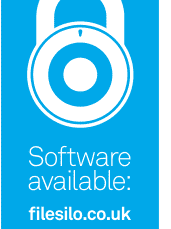

上述 Lumagon 是 Puppet 推出的许多聪明且实用的工具之一，旨在帮助用户跨越传统基础设施与容器化基础设施之间的差距。

对于这个新版本的 Puppet 有许多改进。虽然在编写时，针对 Puppet 5 的特定文档仍然非常简略，但一篇博客（[https://puppet.com/blog](https://puppet.com/blog)）简要回顾了重点领域。Puppet 的键值数据系统已经实现，并改进了调试和加密能力，使用了 UTF-8 的支持。原生 JSON 正在改进，增加了与其他 JSON API 的兼容性。

我们不想深入探讨 Puppet 的工作原理或它的功能。这些内容在网站本身上有更详细的介绍。希望足够说明 Puppet 是一种配置管理软件，在介绍中，我们可以通过案例研究描述系统的状态。Puppet 允许您轻松地修改此状态，但随后的运行将将其恢复到原位。Puppet 理解并可以处理差异，例如，一个基于 CentOS 5 的发行版（在安装 Nginx 时不需要要求人员考虑 Yum 和 Apt 的工作原理）。

Puppet 5 允许您创建构建。您可以从封面上下载构建，也可以从 [https://puppet.com](https://puppet.com) 或 [https://github.com](https://github.com) 下载，取决于您的需求。Puppet 是为“发行版”打包的，但它可以运行在任何 Linux 或 Unix 系统上，适用于任何想要获取代码的人，代码在 GitHub 的 'puppet' 仓库下可用。

要使用 Puppet 5，在我们像这样的这样的 Ubuntu 16.04 上，请执行以下步骤：

```
$ sudo apt-update
$ sudo apt-get install puppet-release-xenial.deb
$ sudo dpkg -i puppet-release-xenial.deb
```

这添加了安装 Puppet 软件所需的源，可以通过遵循命令（安装 `puppet agent`）完成：

```
$ sudo apt-update
$ sudo apt-get install puppet-agent
```

我们决定在这里保持简单，使用独立模式下的 agent。这是因为我们对这个版本的 Puppet server 有各种 bug。也许当您读到这里时，每日构建可能会稍微稳定一点。老实地说，看到 puppet agents 以这种方式随机运行是很常见的现象，特别是在测试期间：

## Puppet 和 Docker

Puppet 的一个明显用途是管理 Docker 本身。通过专门为此任务设计的 Puppet 模块，这非常简单。该模块的安装方式为：

```
$ puppet module install puppetlabs-docker --version 2.2.1
```

默认情况下，这将位于我们测试服务器的家目录 `/home/joly/puppet-docker/modules`（图 1）。我们将用它作为一个创建一个小型 Puppet manifest 的示例，我们将轻松地调用 `docker`：

```
node "lime1604"
  include 'docker'
```

这里的 `node` 是虚拟机的主机名。

Puppet 5 允许您创建构建。您可以从封面上下载构建，也可以从 [https://puppet.com](https://puppet.com) 或 [https://github.com](https://github.com) 下载，取决于您的需求。Puppet 是为“发行版”打包的，但它可以运行在任何 Linux 或 Unix 系统上，适用于任何想要获取代码的人，代码在 GitHub 的 'puppet' 仓库下可用。

要使用 Puppet 5，在我们像这样的这样的 Ubuntu 16.04 上，请执行以下步骤：

```
$ sudo apt-update
$ sudo apt-get install puppet-release-xenial.deb
$ sudo dpkg -i puppet-release-xenial.deb
```

这添加了安装 Puppet 软件所需的源，可以通过遵循命令（安装 `puppet agent`）完成：

```
$ sudo apt-update
$ sudo apt-get install puppet-agent
```


我们决定在这里保持简单，使用独立模式下的`agent`。这是因为我们对这个版本的`Puppet server`有各种`bug`。也许当您读到这里时，每日构建可能会稍微稳定一点。老实地说，看到`puppet agents`以这种方式随机运行是很常见的现象，特别是在测试期间：

## Puppet 和 Docker

`Puppet`的一个明显用途是管理`Docker`本身。通过专门为此任务设计的`Puppet`模块，这非常简单。该模块的安装方式为：

```bash
$ puppet module install puppetlabs-docker --version 2.2.1
```

默认情况下，这将位于我们测试服务器的家目录`/home/joly/puppet-docker/modules`（图 1）。我们将用它作为一个创建一个小型`Puppet manifest`的示例，我们将轻松地调用`docker`：

```
node "lime1604"
  include 'docker'
```

这里的`node`是虚拟机的主机名。

## 输出是一个 URL，提供了关于运行中容器的详细报告以及它们的构建方式。令人印象深刻且极快

在失败后，`Docker`会缓存其所有的层！但希望这已经表明`Puppet`可以弥合新旧流程之间的差距。

## 使用 Lumagon 进行发现

除了 5 月份的`Puppet 5`和`Puppet Enterprise 2017.2`发布之外，`Puppet`还宣布了另一个命名奇特的`Lumagon`，它将其称为一个用于检查、分析和报告容器的工具。基本上，在面对所有可用方法时，`Puppet`的目标是解决“黑盒”问题。例如，当面临安全事件时，普通容器会受到什么影响？如果任何一个容器运行时间不足十分钟的软件记录在组织中运行了两个周或一个月，那么与通常用于持续时间没那么长的几台物理服务器相比，这加剧了这个问题。`Lumagon`非常易于使用，并通过以下命令发送到其官方站点：

```bash
$ docker --rm -v /var/run/docker.sock:/var/run/docker.sock puppet/lumagon-report
```

输出是一个`URL`，提供了关于运行中容器的详细报告以及它们的构建方式（图 4）。它令人印象深刻且极快。当然，你的本地团队可能会禁止将此类细节发送到外部。可以轻松生成`JSON`格式的报告：

```bash
$ docker --rm -v /var/run/docker.sock:/var/run/docker.sock puppet/lumagon-report
```

这可以与饥渴的`jcmd`命令配合使用。通过`"containers.api.host.puppet.platform"`绑定输出命令，你可以选择运行时间长于第一次运行生成的大量数据的容器。我们非常喜欢这个工具，在我们的日常工作中发生过几次事件，如果当时能考虑到这一点将非常有帮助。

希望我们对`Puppet`、其部分模块以及`Lumagon`的首次游览突显了良好的配置管理软件所具备的特性。我们认为它在运行基础设施方面起着重要作用，并可以桥接新旧之间的差距。`Puppet`可以拉取关于发布、版本的深层元数据。不再需要费力查找`Dockerfile`中的版本信息了。

### 图 4

容器 ID: `1f5e7f1a-b5d4-45b6-8177-7f8bd2d69a73224e9febdbc5264f`

### 主机信息

| Key | Value |
|---|---|
| `hostname` | `0d950b3bd74d` |
| `procs` | `0` |
| `os` | `linux` |
| `uptime` | `0` |

### 软件包 (DPKG)

| Key | Value |
|---|---|
| `libicu6` | `52.1-8+deb8u5` |
| `libc6` | `2.35-3+deb8u1` |
| `libmam5` | `5.1.1+ubuntu201604-2-3` |
| `base-passwd` | `3.57` |
| `libnconf0` | `0.192` |
| `libsock6` | `2.25.2-6` |
| `libmanager` | `2.3+1` |
| `lib1` | `2.25.2-6` |

## Puppet Enterprise

作为开源版本的替代方案，`Puppet Enterprise`可用于管理节点或更复杂的环境。我们构建了一个全面使用`Puppet`管理基础设施的平台。与`Linux`服务器一样，你可以很好地访问`API`或`SF`。例如，我们必须能够轻松对`Docker Registry`进行监控和响应，以实现健的基于角色的身份验证。我们还包含了对安装在节点上的软件包仓库的查询，无论它们处于活动、运行还是停止的各种状态，安全以及编排器处理程序。这对于报告夏季期间的影响结果非常有帮助，`Enterprise`的下一个计划版本将纳入该功能。对于使用`Puppet`但在其他生产、报告和合规需求方面需要帮助的团队，`Enterprise`版本的内置功能非常值得研究——它们将让你的生活变得简单。

## Qt5 开发教程

### Qt5 开发：在 Android 上运行 Qt 应用


`Tam Hanna`是总部位于赫尔辛基的咨询公司`Tammberg k.s.`的首席执行官。该公司的重点是由软件、`HB`和硬件组成的跨学科系统的开发咨询。

让你的`Qt`应用从任何平台的束缚中解放出来，并在不编写单行`Java`代码的情况下在`Android`上运行它们。

`Palm`曾表示，小池塘里的大青蛙比大海里的小鱼生活得更好。这句话在移动领域是真实的：虽然`BlackBerry 10`和`Windows Phone`可能不是成功案例，但某些开发者确实做得很好，甚至成功地将用户的迁移作为进入`Android`的跳板。

`Qt`非常适合对冲市场风险，不是因为它是专业选择，而是因为允许他们统一移动操作系统的格局。如果`Qt`能早些出现，向`Windows Phone`的迁移将会更加顺畅。

对于`Android`来说`Qt`最有趣的部分是：它最初是`Bogdan Varga`的一个项目。`Digia`接手了该项目并使其良好发展。

我们的教程假设你已经在工作站上安装了（如果没有，请参考第 3 教程，第 34 页）。通过维护工具可以轻松处理使用`Qt`开发`Android`应用。

## 探索内部原理

开发者可能会好奇这里发生了什么：毕竟`Qt`是`C++`，而`Android`是`Java`语言。解决方案是`Bogdan`的一个天才之举：你有一个小的`Java`应用，它是一个原生`Activity`的实例，并调用`C++`模块。`Android`模块的`OpenGL`渲染器将`C++`模块的输出推送到`Java`小部件，由它将其放入屏幕，并负责处理用户和系统事件以` `标签内存在大量重复内容（尤其是末尾部分完全重复），根据“**不要重复原文**”的原则，我为您提取了核心逻辑并进行了翻译。


## Qt5 开发教程

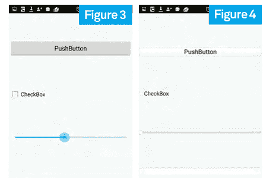

### 为什么它是共享的？

Android SDK 独立于其集成开发环境。在 Android Studio 中找到的 Android SDK 工具显示了包含 SDK 的文件夹，这也会影响其他开发工具。作为有经验的 Android 开发者，您可能会发现可以使用 Android SDK 替代以获得无限制的额外功能。

在屏幕左上角的栏的项目符号中，选择 `Android Android > Build` 以打开 Android 应用程序的构建配置。在下一步中，点击 `Build Android APK` 子栏目中的 `Details` 以打开参数设置。Android SDK 允许您决定在编译过程中应该使用哪个版本的 SDK。Qt 部署将回到 APK 中的 Qt 库——在主场景中部署您的应用程序之前，请务必检查许可。

例如，如果您对 Android 子栏目感兴趣，将点击 `Create template`。在下一步，将弹出一个向导。

当加载了正确的样式表时，控制相当合理，但 Qt 的类加载器则并非如此。

### Android 基于 Java，它访问原生 API 可能需要如图 4 所示的两种语言之间的连接

接下来，点击应用程序输出中的 `Stop` 按钮终止应用程序执行，并在智能手机上重启程序。由于框架的问题，应用程序将以图 4 所示的原生触摸屏界面启动。

幸运的是，这并不困难。打开 `main.cpp` 并如下所示入口点：

```cpp
int main(int argc, char *argv[]) {
    qputenv("QT_ANDROID_NATIVE_STYLE","");
    return QApplication(argc, argv);
}
```

该代码使用了 `putenv` 函数，允许您将变量写入 Qt 的执行状态：我们使用 `QT_ANDROID_NATIVE_STYLE`，在所有实例中都必须使用原生样式运行时。例如，变量应该在实例化 `QApplication` 之前设置，因为 Qt 会在初始化后检查其状态的变化。

> 创建 Android 模板向导
>
> 选择 Android 的源目录。
>
> Android 源目录中的文件被复制到用于构建 Android 目录，默认文件将被覆盖。
>
> https://doc.qt.io/androidManifest.html
>
> - 将文件复制到 Android 目录

## manifest 在哪里？

Android 开发者知道 manifest 是 Android 应用程序最重要的部分之一：它可用于定义应用程序与操作系统之间的交互。默认情况下，创建的 Qt 应用程序不带 manifest 文件。相反，Qt Creator 会在编译过程中使用来自 Eclipse 环境的 PRO 文件的信息创建一个“默认”文件：如果您对它满意，点击 XML 源码树以返回类似于 Android Studio 的代码编辑体验。

解决此问题需要我们使用一个之前从没用过的 Qt Creator 功能——点击

空白的区域意味着您能够配置程序符号：其中一个是一个打开以选择程序符号的对话框。权限可以通过切换按钮处理。请记住，Qt 会分析添加到 PRO 文件中的模块，并尝试确定需要哪些隐式权限——这些权限通常不会显示在其中。

接下来我们要求您选择 Android 软件包源目录。

## 图 5

完成后，是时候查看实际界面了。Digia 使用一组专门用于与 Android 交互的方法扩展了原始的“简单”Java 界面——我们将运行 `runAndroidThread`：


```cpp
void mainWindow::showToast(const QString &message, int duration) {
    QtAndroid::runOnAndroidThread(message, duration);
}
```

大而言，它按照您的预期工作工作：一个 `Runnable` 被设置为 Android UI 线程，并在其中执行。

由于 C++ 和 Java 使用完全不同的结构，Java 字符串是从传入的字符串新创建的：

```cpp
QObject* javaString = QtAndroidObject::fromString(message);
```

需要实际调用 `makeToast`。这个调用很有趣，因为第三个参数——它描述了方法的“签名”，并影响了用于其他参数的解析逻辑：

```cpp
QObject* object = QtAndroidObject::callStaticMethod("Toast", "makeToast", 
    QVariant("android.content.Context;java.lang.CharSequence"), QVariant("android.widget/Toast"), QVariant()));
invokeMethod(object, "show");
```

最后，调用生成的 Toast 对象的显示方法：

```cpp
toast.callMethod("show");
```

完成后，您必须从不同的位置显示 `showToast`——结果看起来如图 5 所示。


- Android 模板

## 图 1

| 系统 | 负载图表 | 内存分配器 | 应用 | 进程 | 端口 | 表格查看器 | 追踪概述 |
| :--- | :--- | :--- | :--- | :--- | :--- | :--- | :--- |
| 表格名称 | 表格 ID | 对象 | | 大小 (kb) | 所有者 ID | 所有者名称 | |
| lud | | | 6 | 2 | <0130.0> | | mnesia_monitor |

表信息：

| 记录名称 | 数量 | 年 | 月份 |
| :--- | :--- | :--- | :--- |
| lud | lud | 2017 | 6 |
| lud | lud | 2017 | 7 |
| lud | lud | 2017 | 8 |
| lud | lud | 2017 | 9 |
| lud | lud | 2017 | 10 |

### 标识与所有者

- 名称: `lud`
- ID: `lud`
- 命名表: `lud`
- 所有者: `<0130.0>`
- 所有者名称: `mnesia_monitor`
- 节点: `nonode@nhost`
- TV Mnesia: `lud@nonode@nhost`

### 设置

- 源: `mnesia`

在这里它只是一个单节点。此外，Mnesia 可以将数据存储在内存中，也可以在磁盘上，而 ETS 只能使用内存。如果你想回滚事务——ETS 不提供此功能。此外，Mnesia 提供了更好的查询语法，如果你有大量数据或想要创建高效的查询，可以使用它。

因此，为了在 Mnesia 数据库和表上启动记录，以便能够使用正确的参数启动 `mnesia:create_schema()` 函数：`mnesia:create_schema(node())`。`node()` 函数是该函数的参数，它返回当前节点的标识符。这意味着 Mnesia 实例目前使用单个节点。

结果是，Mnesia 和 ETS 在表面上有所不同，它提供了更多功能。因此，根结底，Mnesia 比 ETS 更强大，这意味着当你需要强大时，请选择 Mnesia。

> Mnesia 默认不运行；因为你不希望 Erlang 自动运行不必要的进程。

## 有用的函数

本节将介绍在处理 Mnesia 数据库时能让工作更轻松的函数：

- `mnesia:create_schema()` 此函数用于创建新架构。
- `mnesia:build_table()` 此函数允许在运行的 Mnesia 数据库上构建新表。
- `mnesia:write()` 此函数用于向 Mnesia 数据库的表插入新记录。
- `mnesia:transaction()` 此函数用于在写入记录时执行命令。
- `mnesia:table_info()` 此函数返回作为参数传递给它的表信息。请注意，`mnesia:table_info()` 需要第二个参数来指定你想要获取的信息类型——例如，使用 `'all'` 作为第二个参数将返回所有内容！

那时，Mnesia 将创建一个目录来存放其文件，该目录将命名为 `Mnesia.nonode@nhost` 并包含以下内容：

```
total 12
--- 1 mnesia msouk May 12 07:53 STATE_log
rw- 1 mnesia msouk June 22 07:53 SCHEMA.DAT
```


`LOG` 和 `SCHEMA` 都是二进制文件，但它们有不同的用途。第一个是基于磁盘的事务日志文件——它会不断增长，并应该定期转储。`SCHEMA.DAT` 包含 `Mnesia` 数据库的架构，并使用名为 `dets` 的标准库模块实现——所有可以在 `dets` 格式下执行的操作也可以执行，当你添加

## 在 Erlang Shell 中与 Mnesia 交互

关于 `Mnesia` 你需要学习很多点，但最重要的一点是如何启动它。`Mnesia` 默认不运行；这是很合理的，因为你不希望 Erlang 自动运行不必要的进程。

### Erlang 教程

## 如何在 Erlang Shell 中创建新记录以启动 Mnesia

```erlang
code et.\mnesia:dir = "/home/mnesia/1"
[sets-B] [source-D5c66] (error:false)
shell V.3: start with (ok)
mnesia:start_table(xt, y).
complete_table().\mnesia:create_schema(sampleTable)
mnesia:create_table(sampleTable, {set, retries, value(X)}).
error(already_exists(sampleTable))
code et.\mnesia:dir = "/home/mnesia/"
mnesia:start().
```

在与 `Mnesia.nonode@nhost` 相同的目录下选择当前 Mnesia 数据库的另一种方法是使用：

```
erl -mnesia_dir="/home/mnesia/"
```

之后，你仍然应该使用 `create_schema` 和 `mnesia:start()` 来创建数据库并启动 Mnesia 进程。所以，如果你在与 Mnesia 相同的目录下想要工作，选择这两种方法之一取决于运气，特别是当你有多个 Mnesia 数据库时，你不需要指定目录——这将帮助你获得所需的数据库。例如，如果你有另一个 Mnesia 数据库，比如 `erl -mnesia_dir="/home/mnesia/2"`，你可以通过运行以下命令选择其中之一：

```
erl -mnesia_dir="/home/mnesia/1"
erl -mnesia_dir="/home/mnesia/2"
```

Mnesia 中的新表和记录将向数据目录添加新文件并保留现有文件。请注意，如果你在启动和保存记录之前没有执行 `mnesia:create_schema()`，Mnesia 将使用你电脑的内存来保存架构，这意味着你的数据库一旦停止就会消失。为了启动 Mnesia，你将在 Erlang shell 中执行 `mnesia:start()`。同样，当你在 shell 中执行 `mnesia:stop()` 停止 Mnesia 时，将生成以下输出：

```
stopped
=INFO: 13-May-2017:07:45:39 =
application: mnesia
ited: stopped
type: temporary
```

首先启动表然后执行 `mnesia:create_schema()` 函数，你将获得以下消息：`error(already_exists(node:nonode))`。

### 为什么数据库很重要？

我们使用数据库的主要原因之一与内存限制有关。我们要在数据库中存储数据并尽可能快速地访问。因此，数据库可以处理无法放入内存的海量数据。数据库的主要优势是它们可以在不同的语言中使用数据，尽管你使用的是你的。此外，Mnesia 增加了高可用性和对分布式数据的支持——这是我们需要的。关系型数据库之所以有效是因为它具有 ACID 属性一致性、隔离性和持久性。然而，由于 Mnesia 在内存中执行许多事务，它没有满足持久性属性的问题，你可能需要选择不同的数据库。

```erlang
%% 为用户创建表
mnesia:create_table(sampleTable, {record, {user,id}}).
mnesia:create_table(users, {record, {id,name}}).
mnesia:create_table(orders, {record, {id,date}}).
%% 向表插入一些数据
mnesia:insert(users, {1, "Alice"}).
mnesia:insert(users, {2, "Bob"}).
mnesia:insert(orders, {1, 100, "2023-01-01"}).
mnesia:insert(orders, {2, 200, "2023-01-02"}).
%% 查询数据
mnesia:query("select(Name) from users where Id = 1")
```

图 3

嵌入 `mnesia:transaction()` 的 `mnesia:write_record()` 函数将记录插入 Mnesia 表中。如果你尝试在 Mnesia 已经放置文件创建记录，你将得到错误：`(already_exists(node:nonode))`，并且消息将被处理，这对 Mnesia 来说是好的。现在，如何创建一个新数据库。Erlang 必须将现有记录的结构转换为 Mnesia 表，这是使用记录的一种非常好的方法。首先，在 Erlang shell 中定义新记录 `sample`：

```erlang
1> sampleTable(x, y).
```

请注意，表必须至少向键添加一个字段，这意味着表不能只有一个字段，并且 Mnesia 行是基于名为 `sample` 的记录使用的。下一个命令将创建一个可以选择的命名表 `sampleTable`。该命令的输出将是 `{ok}`。如果 `mnesia:create_table()` 函数执行失败，你将得到一个 `{aborted, Reason}` 元组。这发生在你尝试创建一个已经存在的表时。然而，你还需要使用略有不同的技术从 Erlang 执行操作。所以，让我们定义新记录并使用它来创建名为 `My.record` 的表。

```erlang
>= mnesia:create_table(sampleTable, {type, attributes, record_info(fields, sample)})
```

```erlang
-record(sampleTable, x, y).
```

然后，你应该创建一个 mnesia 记录：

```erlang
>= mnesia:create_table(sampleTable).
```

上面的 `testlist` 函数让你查看表的数据，而 `table_info` 显示有关表的信息，此情况将命名为 `createTable.erl`，包含以下代码：

```erlang
-module(createTable).
-export([init/0]).
```


图 5

## 什么是 ETS？

`ETS` 代表 Erlang Term Storage。它用于动态表，数据存储在表中。`ETS` 是 `Mnesia` 吗？不是，但它有更多的资源。在开发简单应用时考虑它。短答案是肯。

```erlang
{mnesia:create_table(
ok,create_table:deletes_record(13),
ok,create_table:deletes_record(15),
nok,create_table,
nok,create_table,
{sampleTable, -1, ~1},
{sampleTable, 5, ~5},
{sampleTable,delete___record(1),
nok,create_table:deletes_record(5),
nok,create_table:deletes_record({sampleTable, -12, ~12})
ets:delete2(sampleTable)}
```

```erlang
-include("MyRecord.hrl")
```

一旦你创建了 `sampleTable.table`，图 2 显示了表内容的各种示例——你应该尝试在你的机器上执行它们并填充你自己的数据。然而，在使用 Erlang shell 后，示例表将在内存中删除，而不是在磁盘上。在教程的下一节中，你将学习如何将数据存储在。

### Erlang 教程

记录数据为 `{1,-}` – 你应该确保示例记录类型的定义在当前的 Erlang shell 中是激活状态，否则之前的命令将无法运行。当你想要向 mnesia 数据库插入多条记录时，推荐的方法是使用 all 列表函数，然后将该函数传递给 `mnesia:transaction()` 作为函数执行。你将在稍后的 `sampletable` 的 Erlang 代码中使用此这种技术。

#### 脏操作接口 (Dirty interface)

脏操作是在不使用上下文风险的情况下进行的操作。尽管它们是有危险的且应该只在遗留应用程序或其他系统中使用，但作为使用其函数的手段，它们是快速且有效的。脏接口可能会

| 命令 | 结果 |


| :--- | :--- |

| `23:create_querysampletable(-),` | `atomic,{sample={x=10,y=-1},{sample={x=2,y=-1}}}` |

| `24:create_querysampletable(all),` | `atomic,{[]}` |

| `25:create_querysampletable(table),` | `atomic,{sample={x=4,y=-10}}` |

| `26:create_querysampletable(100),` | `atomic,{[]}` |

图 7

图（见第52页）展示了如何使用 `mnesia:write()` 向 `sampletable` 插入数据。

### 查看数据

查看 Mnesia 表数据的简单方法是单独使用 `ets:table(name)` 函数或在以下函数中使用，它会生成一个结果

| 命令 | 结果 |

| :--- | :--- |

| `27:ets:table(sample),` | `sample={x=1,y=-1}, sample={x=4,y=-10},` |

| `28:mnesia:info(sample)` | |

在这两种情况下，你都需要提供 `table_name`，即你想要查找的实际表名。如你所知，`mnesia:info()` 函数将返回关于每个表的信息的列表。结果将包含信息的键，它被保存为

`mnesia:querysampletable()` 函数从表中获取字段具有指定值的记录

### 删除数据

本节将向你如何通过其他 Erlang 函数 `deleteRecord()` 从之前创建的 `sampletable` Mnesia 表中删除记录

```erlang
io:format('~p~n', ets:list(table_name)).
```

```erlang
{active_replicas({nodes,node1}), [nodes,node1]),
(arity,3),
{extras,{x,y}}.
```

```erlang
deleteRecord(V1) ->
  R = (sample, V1),
  f = fun() ->
  end,
  mnesia:transaction(F).
```

`ets:list(table_name)` 命令的输出以及 `mnesia:table_info(sampletable)` 命令的完整输出如图 4 所示（见第53页）。

`deleteRecord()` 函数仅接受一个参数：`sampletable` 字段的值

你可能会发现这比查询 MySQL 或 PostgreSQL SQL 等关系型数据库更复杂

`mnesia.Api` 模块包含一个比本节介绍的技术更有效的函数，用于查看表的所有数据。

| 数据记录 |

| :--- |

| `sampletable={x=0,y=0},sample={x=1,y=1},sample={x=2,y=2},sample={x=3,y=3},sample={x=4,y=4},sample={x=5,y=5},sample={x=6,y=6},sample={x=7,y=7},sample={x=8,y=8},sample={x=9,y=9},sample={x=10,y=10},sample={x=11,y=11},sample={x=12,y=12},sample={x=13,y=13},sample={x=14,y=14},sample={x=15,y=15},sample={x=16,y=16},sample={x=17,y=17},sample={x=18,y=18},sample={x=19,y=19},sample={x=20,y=20},sample={x=21,y=21},sample={x=22,y=22},sample={x=23,y=23},sample={x=24,y=24},sample={x=25,y=25},sample={x=26,y=26},sample={x=27,y=27},sample={x=28,y=28},sample={x=29,y=29},sample={x=30,y=30},sample={x=31,y=31},sample={x=32,y=32},sample={x=33,y=33},sample={x=34,y=34},sample={x=35,y=35},sample={x=36,y=36},sample={x=37,y=37},sample={x=38,y=38},sample={x=39,y=39},sample={x=40,y=40},sample={x=41,y=41},sample={x=42,y=42},sample={x=43,y=43},sample={x=44,y=44},sample={x=45,y=45},sample={x=46,y=46},sample={x=47,y=47},sample={x=48,y=48},sample={x=49,y=49},sample={x=50,y=50},sample={x=51,y=51},sample={x=52,y=52},sample={x=53,y=53},sample={x=54,y=54},sample={x=55,y=55},sample={x=56,y=56},sample={x=57,y=57},sample={x=58,y=58},sample={x=59,y=59},sample={x=60,y=60},sample={x=61,y=61},sample={x=62,y=62},sample={x=63,y=63},sample={x=64,y=64},sample={x=65,y=65},sample={x=66,y=66},sample={x=67,y=67},sample={x=68,y=68},sample={x=69,y=69},sample={x=70,y=70},sample={x=71,y=71},sample={x=72,y=72},sample={x=73,y=73},sample={x=74,y=74},sample={x=75,y=75},sample={x=76,y=76},sample={x=77,y=77},sample={x=78,y=78},sample={x=79,y=79},sample={x=80,y=80},sample={x=81,y=81},sample={x=82,y=82},sample={x=83,y=83},sample={x=84,y=84},sample={x=85,y=85},sample={x=86,y=86},sample={x=87,y=87},sample={x=88,y=88},sample={x=89,y=89},sample={x=90,y=90},sample={x=91,y=91},sample={x=92,y=92},sample={x=93,y=93},sample={x=94,y=94},sample={x=95,y=95},sample={x=96,y=96},sample={x=97,y=97},sample={x=98,y=98},sample={x=99,y=99}` | |

图 6

record，这是每个键。函数返回的 `Rid` 包含了你想从 `mnesia:delete()` 函数中删除的元素 id 再次调用 `mnesia:transaction()` 更改更改生效。

图 8 展示了如何从 `sampletable` 删除。可以在 `createTable.er` 文件找到 `deleteRecord()` 函数，注意你也可以使用 `mnesia:clear_table()` 清空表数据。

### 修改数据

为了更新 `sampletable` 的数据，你需要创建另一个 Erlang 函数

```erlang
* updateSampleTable(Tab, V1, V2) ->
```

上述 `updateSampleTable()` 用于修改 `sampletable` 中的数据。注意 `updateSampleTable()` 应该嵌入在 `mnesia:transaction()` 中。

## 表查看 (Table Viewer)

Table Viewer (TV) 是一个用于探索 ETS 和 Mnesia 表的 Erlang 图形化工具。你可以通过在 Erlang shell 中执行 `observer:start()` 来启动 TV —— 完成后忘记关闭。为了实际使用 TV，你应该选择 Table Viewer。最后，你应该数据库查看表。

图 1 显示了 TV 在查看 Mnesia 表数据时的运行情况。它可以提供 Mnesia 表的良好概述，而无需在 Erlang shell 中进行查询。

图 2 展示了各种查询。TV 是一个通过 `execute()` 启动的简单应用程序。

```erlang
fun() ->
  mnesia:read(Tab, V1),
  mnesia:write(SampleTable,y=V2)
end.
```


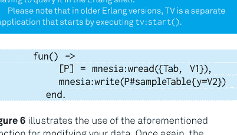

图 6 说明了使用上述函数修改你的数据。再次，`updateTable()` 函数应该嵌入你的更新函数中。

`updateTable()` 函数也可以在 `createTable.er` 中找到。

## 查询数据

本节将讨论如何从 `Mnesia` 数据库表中查询数据，这可能比 `MySQL` 或 `PostgreSQL SQL` 等关系型数据库稍微复杂。查看以下 `Erlang` 代码，它是 `createTable.er` 中的一个函数，用于查询 `sampletable` 中的数据。

```erlang
querySampleTable() ->
  fun() ->
  lqlc(Q):
```

```erlang
insert_sampledata() ->
  mnesia:create_table(Database, Table, [{type, {record, Name}}]),
  mnesia:stop(),
  mnesia:start(),
  mnesia:next_event(Database, Table, fun({Name, Year, Month, Day}) ->
    mnesia:write(Table, {Name, Year, Month, Day, Value}).
  end)),
  mnesia:stop(),
  mnesia:start().
```

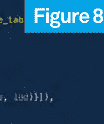

上方是 `mnesia:info` 函数在 `M` 未运行时和运行时的输出

# 隆重推出...

`NEXTCLOUD` 12

你是否厌倦了 `Google` 读取你的邮件并查看你的假期照片？

Neil Bothwick 将为你介绍如何使用 `Nextcloud` 运行你自己的云服务器。

# 新功能

- 即时应用 (Instant apps)

  可以轻松访问应用，现在它们位于 Web 界面的顶栏。

- 邀请游客 (Invite guests)

  通过游客账户赋予他人临时访问权限，而无需成为你云的成员。

- 圈 (Circles)

  云内部的一个基础社交网络，可以向用户组发送消息和文件。

- 模拟应用 (Impersonate app)

  允许管理员以用户的身份登录，以处理他们遇到的问题。

- 安全共享文件夹 (Secure shared folder)

  `Secure Drop` 允许用户将文件上传到共享文件夹，而不显示现有内容。

- 联邦共享 (Federated shares)

  与远程 `Nextcloud` 和 `ownCloud` 服务器共享文件和文件夹。

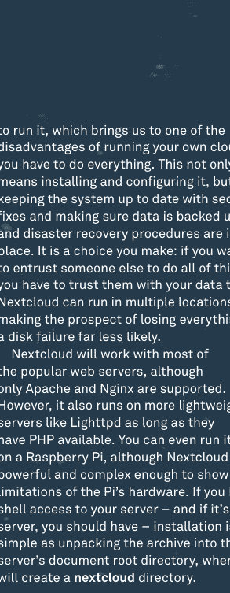

> 云就像它所基于的气象现象一样变幻莫测。没有人刻意定义这个术语的含义，因为它允许公司在某些限制内将其用于任何他们想要的地方。限制之一可能就是对云”的正确定义——“某人的计算机”。毫无疑问，云计算提供了许多益处，无论你是在查看邮件服务、文件共享、文档协作或其他应用程序，让别人负责管理而你只需将自己的服务扩展到他们的服务的想法是有益的。但总有一个“但是”，在这种情况下，它就是“你把自己的数据托付给了别人的计算机”。现在，你可能对很多人没有意见，但你信任的是你认识的人。

运行它，这让我们看到了运行自己的云的缺点之一——你必须完成一切。这仅意味着安装、配置、保持系统更新，并制定备份和灾难恢复程序。你可以选择信任他人为你完成，也可以毫无疑问地信任你自己的数据。`Nextcloud` 让磁盘故障导致丢失所有数据的可能性变得小得多。

`Nextcloud` 与流行的 Web 服务器兼容，尽管目前仅支持 `Apache` 和 `Nginx`。它也可以运行在树莓派等轻量级服务器上，只要你有 `PHP` 环境即可。

`Nextcloud` 允许你运行自己的云服务。它的核心功能是文件共享，但功能远超于此，尤其是包含了新版本的加入。协作是一项重要功能，允许多人编辑同一个文件，或者在文件上传时由他人操作。日历和相册等标准功能也包含在内，还有许多让用户和管理员生活更便利的应用。

# 海量文件

`Nextcloud` 的核心是一个在线存储系统。它还有许多其他功能，但基本上，当你登录 `Nextcloud` 账户时，你会看到文件和目录列表，这些内容可以下载到设备。

`Nextcloud` 是一个 `PHP` Web 应用程序，这意味着你需要一个 Web 服务器


详情 (`Details`) 标签页上方

不仅可以更改

文件，还允许

恢复到旧版本

正确设置

一个 `Secure Drop` 文件夹，

可以共享但

不可查看

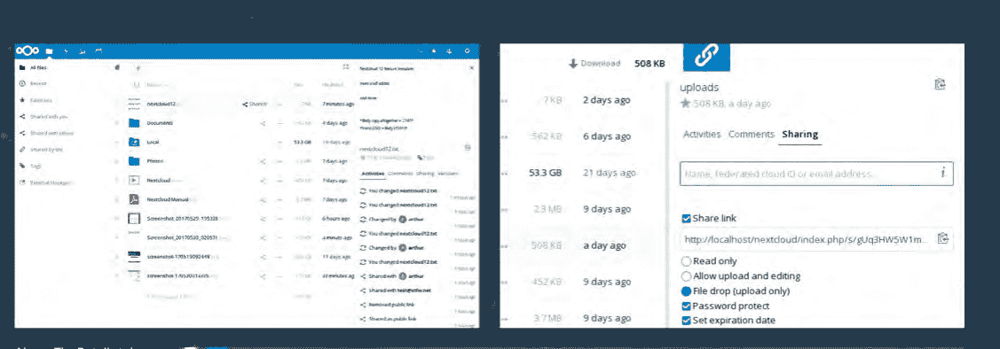

# Nextcloud 对比 owncloud

`Nextcloud` 是 `owncloud` 的一个分支，由一些 `owncloud` 开发者创建。主要功能在于

核心。虽然

`owncloud` 采用

开源

企业版是完全

开源的。

团队提供

企业级支持

包，但

保持免费。

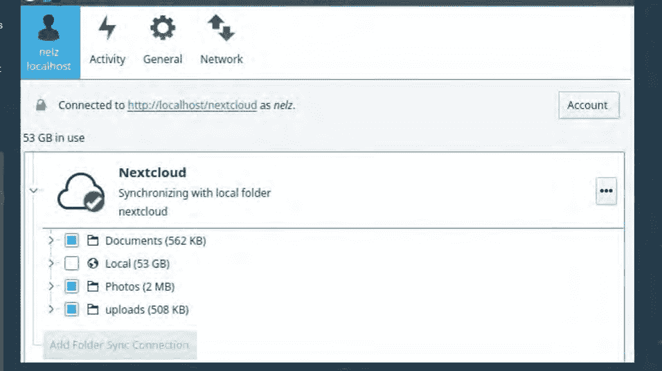

# Nextcloud 与本地文件夹同步

`nextcloud`

已用 53 GB

账户

- 文档 (562 GB)

- 本地 (53 GB)

- 照片 (2 MB)

- 上传 (508 KB)

添加文件夹同步连接

在 Linux 桌面同步客户端上方——所有文件都可以通过这里上传。如果链接了 `Dropbox` 或 `Google Drive`，情况会有不同。重要区别在于：上传内容没有限制，服务器上的存储空间也没有限制。如果你想设置限制，那将是你自己的限制。

实际上，使用 `URL`（如果你将其安装在服务器的文档根目录，则主机名为 `nextcloud`），你可以查看、上传、下载并管理你的文件。或者一种更自动的访问文件的方法是使用桌面同步客户端，它适用于许多桌面和移动平台。Linux 桌面客户端将在后台运行，并通过本地文件夹保护整个 `Nextcloud` 存储，或者你可以通过分层同步同步一个或多个子目录。它是瞬时的：将文件复制到本地文件夹，Web 界面就会更新。桌面客户端能够连接到许多服务器，并将每个同步到不同的本地文件夹。

# 所有人共享

到目前，一切都是你文件的镜像，这本身已经足够用了，但如果能与他人共享就更好了。这可以通过简单的步骤完成：链接生成器产生一个 `URL`，你可以给其他人来下载文件，或者只需输入电子邮件地址让链接直接通过邮件发送。你可以允许他人编辑文件而不仅仅是下载。这意味着，要在局域网之外共享文件，你的服务器需要从外部访问。

链接对于共享旧文件很好，但如果你需要更多功能或进行协作，你需要向他人添加用户。当你作为管理员设置 `Nextcloud` 时创建的用户，你也可以创建其他用户和组。通过 `Linux` 权限，用户可以通过文件邀请被单独邀请。开始只有一个组，即你的管理员用户。你还可以通过提供共享地址与 `Nextcloud`（或 `owncloud`）服务器上的用户共享文件。你可以在公司的每个办公室运行一个 `Nextcloud` 服务器，这样在局域网速度下允许所有操作，

> 是的，你可以将 `Google Drive` 或 `Dropbox` 作为你 `Nextcloud` 服务器的存储

但在这些办公室之间共享文件夹，提供与访问一样快的冗余。`Nextcloud` 将其称为“联邦共享”，尽管没有明显的标记“已实现！”。

# 增强安全性

你的数据安全至关重要。这就是为什么 `Nextcloud` 会偶尔给出并不含蓄的提示，建议使用 `HTTPS` 连接到你的服务器。你需要一个证书，自签名证书也可以，最好从 `letsencrypt.com` 获取一个。如果你在商业环境下运行 `Nextcloud`，购买自己的 `SSL` 是值得的支出。如果你在 `VPS` 上运行 `Nextcloud`，可以使用加密模块。加密必须由管理员用户启用，并适用于存储在服务器上的所有文件。用户的详情也会被加密。在使用远程存储（如其他存储服务）时，加密特别有用。许多存储服务提供免费的存储账户。通过远程存储，你可以让所有人可用或将其限制为特定用户或组。远程存储被分配到你服务器上的指定文件夹，类似于本地驱动器。这可以帮助你知道哪些数据存储在哪个位置。

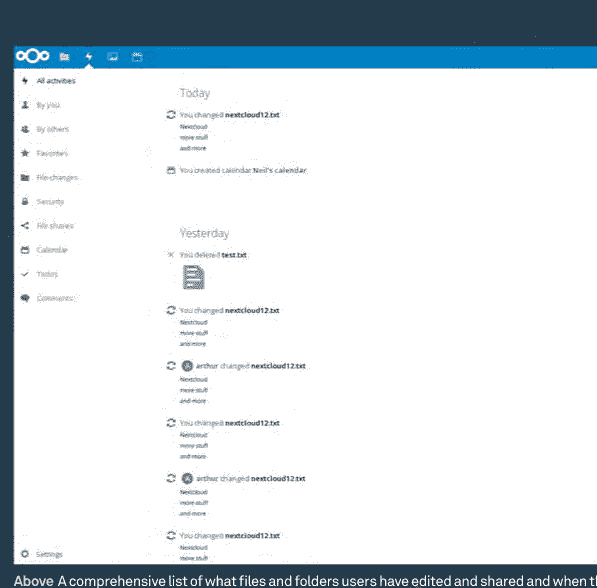

用户曾编辑和共享的文件和文件夹完整列表，以及管理员何时可用

# 文件详情


点击“菜单”按钮打开“详情 (Details)”标签页。在这里你可以找到关于文件的更多信息。“活动”列表显示了何时对文件内容或操作（如共享）进行了更改，以及是谁做的。你还可以通过顶栏的“活动”查看你们所有人的近期活动列表。“评论 (Comments)”标签允许你留下留言，任何共享该文件的人都可以阅读。有趣的是，当多个人编辑该文件时，“版本 (Versions)”提供了对文件之前的访问。版本的保存是自动处理的，服务器根据策略保留旧版本；对于一个月之前的版本，它每周保留一个。如果你的磁盘空间不足，`Nextcloud` 将删除最旧的版本，直到达到第50个阈值，或者被手动删除。

文件在这里还被分配了标签，所有带有特定标签的文件可以归类，使项目组织变得更容易。这是一个自动标记功能，会在你整理时对文件进行标记。文件可以被标记为收藏，例如可以用于突出需要处理的文件，这样你就可以轻松看到还有多少工作要做。


## 协作工作

存储文件是非常好的，但如果有多个用户想要处理同一个文件会发生什么？

协作是 `Nextcloud` 的核心元素，它的功能不仅仅是文件共享。你可以编辑其他用户可以写入的文件。`Onlyoffice` 应用为在 `Onlyoffice` 办公套件中打开的添加了操作。这需要单独安装，但你也可以将其作为后台服务，为 `Microsoft Office` 或 `Open Documents` 文档进行格式化编辑。

`Nextcloud` 是一个完全开源的软件，不仅仅是云存储。或者，你也可以使用基于 `LibreOffice` 的 `Collabora Online` 套件，尽管它的设置更复杂，并且运行在 `Docker` 容器中。

界面和同步客户端整洁且易于使用。还有另一种方法：`WebDAV` 协议。大多数文件管理器都直接支持此协议。例如，要在 `KDE` 的 `Dolphin` 中访问你的文件，请使用

```
webdav://hostname/nextcloud/remote/dav/files/
```

在提示时输入用户名和密码。`Nautilus` 的原理类似，你使用请求的 `dav://dav/`

使用 `HTTPS` 安装的 `webdav://`。

如果你使用的是自定义服务器，请访问

`https://www.nextcloud.org/projects/dav/` 来查找你的存储位置。

## 应用、应用、应用

文件共享固然重要，但这不是 `Nextcloud` 提供的全部功能。它使用应用系统来提供更大的灵活性。核心安装中包含许多应用，其中一些默认启用，此外还有精选的第三方应用。所有这些应用都可以在应用商店下载，需要时从商店选择“应用”即可。商业云提供的用户功能在这里也有，例如日历和电子邮件。还有一个照片库以及移动端应用。


## 设置 Nextcloud


| col_name | col_name |
| --- | --- |
| col_name | col_name |
| col_name | col_name |


| col_name | col_name |
| --- | --- |
| col_name | col_name |
| col_name | col_name |

## 启动 Web 服务器

`Nextcloud` 需要一个支持 `PHP` 脚本的 `Web` 服务器。`Apache` 是首选，同时也提供了 `Nginx` 的说明。`Lightt` 不在推荐列表中，尽管如果你的作者有偏好，它看起来运行良好。然而，如果你在设置时遇到任何问题，很大程度上只能自力更生。如果不确定，请坚持 `Apache`，因为它是支持最好的选项。

## 02 修复你的数据库

`Nextcloud` 需要一个数据库。对于大多数个人站点，`SQLite` 即可，但较大的站点受益于“正规”的 `SQL` 数据库。`MariaDB` 需要多进行一些设置，但它是值得的。你需要设置一个供 `Nextcloud` 使用的用户名和密码。这在 `Nextcloud` 网站上有相关文档。

## 03 解压 ZIP 文件

将 `ZIP` 压缩包解压到服务器的根目录。通过 `SSH` 访问服务器最容易实现。如果你没有访问权限，你需要要求服务器管理员为你操作。如果你使用托管服务，他们将有一系列标准的 `Web` 应用，只需点击控制面板即可为你安装。


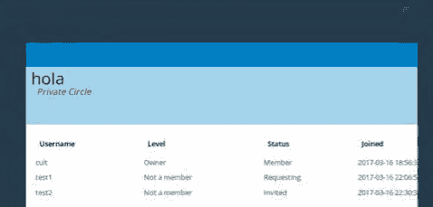

## 避免意外

桌面客户端非常快：将文件拖入同步文件夹，它会在几秒钟内出现在你的服务器上，并很快出现在其他同步设备上。这意味着，文件也意味着你的云服务器无法防止本地电脑上的意外删除。当你从服务器或通过同步客户端删除文件时，它会被移动到已删除文件区域而不是被直接删除。这意味着只要配额内有剩余空间，就可以恢复。当 `Nextcloud` 占用你可用空间的一半以上时，会删除一个以替换另一个，但你仍然可以改变主意并点击删除区域中的“恢复”按钮。

上面的圈（`Circles`）可以是小组、公共或私有的，你可以用它们进行共享、消息或社交动态。

允许用户上传所有照片和视频，特别是在存储空间有限的服务器上，可以设置为直接上传照片和视频，或者在连接 `Wi-Fi` 时上传。有应用可以添加不同的身份验证方法（包括一些双因子选项），以及一个嵌入共享文件并通知用户的应用。有用于组内共享的应用。有处理更改的应用，以及针对管理员的活动跟踪。多媒体文件由各种播放器和阅读器应用处理。`Nextcloud` 应用创建多种多样，以及不可避免的通过 `Twitter`、`Facebook` 等共享的应用。当与协作编辑结合时，圈功能可能特别有用。对于视频通话也很有用，它提供了屏幕共享以及摄像头视频。

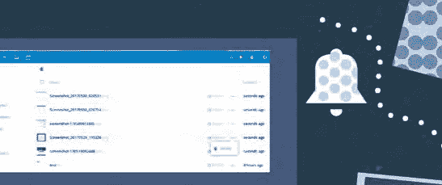


可能会导致问题，但 `Nextcloud` 有配额系统。这允许你指定每个用户可以使用的空间。当一个文件在多个用户之间共享时，它只对这些用户的配额计算一次。

## 04 拥有你的文件

文件共享很重要，但这并不是 `Nextcloud` 提供的全部功能。它还提供了许多方法。

上面的你不需要浏览器——大多数文件管理器都可以直接通过 `WebDAV` 查看你云的内容。例如，要在 `KDE` 的 `Dolphin` 中访问你的文件，请使用 `HTTPS` 安装的 `webdav://webdav://hostname/nextcloud/remote/dav/files/username` 在提示时输入用户名和密码。`Nautilus` 的原理类似，你使用请求的 `dav://dav/`。如果你使用的是自定义服务器，请访问 `https://www.nextcloud.org/projects/dav/` 来查找你的存储位置。

## 05 配置

`Nextcloud` 需要一个数据库。对于大多数个人站点，`SQLite` 即可，但较大的站点受益于“正规”的 `SQL` 数据库。`MariaDB` 需要多进行一些设置，但它是值得的。你需要设置一个供 `Nextcloud` 使用的用户名和密码。这在 `Nextcloud` 网站上有相关文档。

## 06 开始使用

将 `ZIP` 压缩包解压到服务器的根目录。通过 `SSH` 访问服务器最容易实现。如果你没有访问权限，你需要要求服务器管理员为你操作。如果你使用托管服务，他们将有一系列标准的 `Web` 应用，只需点击控制面板即可为你安装。

## 同样安全上传

`Nextcloud` 让创建变得简单。新的“安全投递”（`Secure drop`）功能允许你向任何人提供匿名访问，但为了提高机密性，不会让其看到文件夹中的文件。

## 标记日期

日历是群组软件的重要部分，`Nextcloud` 并没有忽略它们。如果从其他服务迁移，你可以将日历导出为 `ICS` 文件，但你无法将其导入 `Nextcloud`。考虑也导出现有的日历，但如果你也想在 `Nextcloud` 中导入它，日历应用可以订阅其他日历，这样你的信息就会在两个地方都显示。例如，访问 `Nextcloud`，查看你的日历并点击菜单按钮选择名称“日历设置”。出现的页面上有各种选项，你可以将其导出为 `ICS` 文件。


# 日历订阅与增强功能

如前所述，或者一个你日历的订阅 `URL`。点击日历地址部分的 `ICAL` 按钮，获取一个你可以粘贴到 `Nextcloud` 订阅框中的 `URL`。这是订阅非公开日历的选项，使用下一个——标记为“私有地址”（`Private Address`）的 `ICAL` 按钮。订阅此类日历，你可以在 `Nextcloud` 中查看事件。然而，如果你的服务器有公共 `IP` 地址，你可以创建一个链接并在 `Google` 或其他日历订阅你的 `Nextcloud` 日历，这样你仍然可以在 `Nextcloud` 中创建事件并在其他日历中看到它们。

总而言之，这对云是一个很好的增强，你的数据留在你想留下的地方，并且只有你授权的人才能读取。

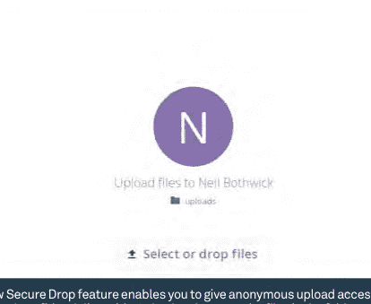

# 获取免费 6 期内容

当您订阅

# 免费 DVD 包含 3 种完整 Linux 发行版

> “ 专业人士和开发者的开源权威 ”

# Linux 与 开发者

GNU 世代的必备读物

庆祝成立 20 周年

# GNOME 深度解析

揭秘全球最大的 Linux 桌面环境的力量

特别报告：探索 `Nextcloud` 12 - 全新的协作工具且免费赠送

专家指南：为您的项目获取完美许可

免费赠送 5 种轻量级发行版，附带 4 种 Linux 发行版的免费 DVD

# LinuxUser & 开发者

征服云端的最佳方法

容器 火之系统

5 种 Linux 发行版 VPN 保护您的 PI 服务器

冷启动

安装与探索

# GNOME 桌面包

`UBUNTU` `GNOME` 17.04 & `FEDORA` 25 - 3 种可尝试的发行版

两个由 `GNOME` 3 增强的极佳发行版

# + 新发布

# 37 页教程

- `Ubuntu`

- `Puppy` 5

- 如何使用 `Smart HAT` 构建 `Bashlets`

- `Windows` & `Mac` 的时尚 Linux 风格刷新

每期均有免费资源下载

# LinuxUser & 开发者

# 最佳现场启动盘

`UT` 17.04 特别版 免费 DVD 附带 1 种发行版指南

# `UBUNTU-74` 启动包

`Ubuntu` 桌面安全维护与支持

# 优惠于 2017 年 7 月 31 日过期

订购热线 `+44 344 885 2852`

在线访问：`www.fymayoutmagazine.co.uk`

*此优惠为订阅优惠。“免费”是指英国报刊亭价格，13 期每期 16.99 英镑共 220.87 英镑，按订阅价计算为 112.23 英镑。您将在一年内收到 13 期。您可以在购买后 14 天内写信我们取消订阅。14 天后付款不予退款，除非有特殊情况。不影响法定权利。购买时的价格可能会发生变化。可根据要求提供直接记账保证的完整详情。英国内的通话费用与其他标准固定电话号码（`01` 或 `02`）相同，并包含任何优惠或免费分钟数（由您的手机套餐提供）中。有关条款和条件请访问 `magazine.com`。优惠于 2017 年 7 月 31 日结束。

# 超级计算与 Linux 的崛起

`Linux` 现在是世界上最快计算机的主导操作系统，迈克尔·贝德福（Michael Bedford）探讨了它的出现。每年会发布一次全球精英计算机列表。这份被称为“`Top 500`”的列表在著名的国际超级计算会议上展示，包含了这些最快的 500 台超级计算机的基准测试统计数据。这些数字非常有阅读价值。

显然，最受期待的故事是最新列表中最快的机器，在第二个运行时间内，中国的神威·光（`Sunway TaiLight`）时频达到了惊人的 93 `petaflops`（每秒千万浮点运算）。美国再次不再是计算顶端领域的明确领导者。

一个特别引人注目的趋势是操作系统用户对计算的偏好。`Top 500` 列表发布于 1993 年，当时 95.3% 的系统运行在 `UNIX` 上，其余 4.7% 为 `BSD`。然而，当我们考虑到 `BSD`——全名伯克利软件分发版——实际上是 `UNIX` 的派生版本时，`Linux` 机器、`UNIX` 和 `BSD` 在 1998 年 11 月之前在超级计算领域一直未受挑战并非事实。然后，一个系统——`Avalon`，一个由 140 台配备 `DEC Alpha` 处理器的通用计算机集群——开始运行 `Linux` 操作系统。如果我们想象一个桌面操作系统 `Windows` 和 `Mac OS` 试图立足的十年期间，`Linux` 已经实现了 `UNIX` 的稳步下降。在最新的列表中，`Linux` 驱动了最快 500 台计算机中除两台以外的所有机器，由于剩下的两台 `UNIX` 机器排名靠后（第 386 和 387 位），有些人认为它们将在今年内掉出，让 `Linux` 无无匹敌。

在这里，我们将深入了解世界上最快的计算机，这些惊叹的机器是如何被用来解决某些科学问题的，并发现为什么 `Linux` 在超级计算世界上具有如此主导地位。

# 处理器趋势

考虑到最快的超级计算机在数千个处理器中拥有数百万个核心，得知第一批超级计算机只有一个处理器可能会让人感到惊讶。那些早期的向量处理器通常是为特定的超级计算机设计的。它们是通过允许在单次操作中对整个字符串数据执行特定操作来获得性能优势，还是为了闪电般的速度而设计，这在超级计算领域直到 20 世纪 90 年代都是常态。

这种向量革命很快通过高性能 `RISC` 处理器的出现实现，付出了不小的努力。这些为工程工作站和服务器设计的处理器家族包括 `DEC Alpha`、`IBM POWER`、`SUN SPARC`、`HP PA-RISC` 和 `MIPS`。虽然它们确实比驱动 `PC` 的芯片要快，但这些高端处理器家族无法与向量处理器竞争，或者它们被用在多处理器配置中。

随着时间的推移，大多数这些 `RISC` 处理器变得过时或被专用应用程序取代。这是否由于 `x86` 处理器的力量尚存争议，但在 21 世纪初叶，桌面 `PC` 世界开始了第二次流向 `RISC` 和离开 `RISC` 的迁移。需要说明的是，最快的超级计算机在数千个处理器中拥有数百万个核心，得知第一批超级计算机只有一个处理器可能会让人感到惊讶。那些早期的向量处理器通常是为特定的超级计算机设计的。

这种向量革命很快通过高性能 `RISC` 处理器的出现实现，付出了不小的努力。这些为工程工作站和服务器设计的处理器家族包括 `DEC Alpha`、`IBM POWER`、`SUN SPARC`、`HP PA-RISC` 和 `MIPS`。虽然它们确实比驱动 `PC` 的芯片要快，但这些高端处理器家族无法与向量处理器竞争，或者它们被用在多处理器配置中。

随着时间的推移，大多数这些 `RISC` 处理器变得过时或被专用应用程序取代。这是否由于 `x86` 处理器的力量尚存争议，但在 21 世纪初叶，桌面 `PC` 世界开始了第二次流向 `RISC` 和离开 `RISC` 的迁移。需要说明的是，最快的超级计算机在数千个处理器中拥有数百万个核心，得知第一批超级计算机只有一个处理器可能会让人感到惊讶。那些早期的向量处理器通常是为特定的超级计算机设计的。

# 超级计算与 Linux 的崛起

`Linux` 现在是世界上最快计算机的主导操作系统，迈克尔·贝德福（Michael Bedford）探讨了它的出现。每年会发布一次全球精英计算机列表。这份被称为“`Top 500`”的列表在著名的国际超级计算会议上展示，包含了这些最快的 500 台超级计算机的基准测试统计数据。这些数字非常有阅读价值。

显然，最受期待的故事是最新列表中最快的机器，在第二个运行时间内，中国的神威·光（`Sunway TaiLight`）时频达到了惊人的 93 `petaflops`（每秒千万浮点运算）。美国再次不再是计算顶端领域的明确领导者。

一个特别引人注目的趋势是操作系统用户对计算的偏好。`Top 500` 列表发布于 1993 年，当时 95.3% 的系统运行在 `UNIX` 上，其余 4.7% 为 `BSD`。然而，当我们考虑到 `BSD`——全名伯克利软件分发版——实际上是 `UNIX` 的派生版本时，`Linux` 机器、`UNIX` 和 `BSD` 在 1998 年 11 月之前在超级计算领域一直未受挑战并非事实。然后，一个系统——`Avalon`，一个由 140 台配备 `DEC Alpha` 处理器的通用计算机集群——开始运行 `Linux` 操作系统。如果我们想象一个桌面操作系统 `Windows` 和 `Mac OS` 试图立足的十年期间，`Linux` 已经实现了 `UNIX` 的稳步下降。在最新的列表中，`Linux` 驱动了最快 500 台计算机中除两台以外的所有机器，由于剩下的两台 `UNIX` 机器排名靠后（第 386 和 387 位），有些人认为它们将在今年内掉出，让 `Linux` 无无匹敌。

在这里，我们将深入了解世界上最快的计算机，这些惊叹的机器是如何被用来解决某些科学问题的，并发现为什么 `Linux` 在超级计算世界上具有如此主导地位。

# 超级计算与 Linux 的崛起

无锡市在中国境外少为人知，但它拥有超过六百万人口。国家超级计算中心拥有世界上最快的计算机。神威·光比其前代产品天河二快近一倍。

# 绿色 500

摩尔定律指出芯片上的晶体管数量每 18 个月翻一倍。

超级计算机是耗电巨兽，由于对能源产生的影响，正转向效率。现在最重要的指标是单位功率的计算性能。


神威·光是目前的纪录保持者。它的设计目标速度是 125 `petaflops`，而到目前为止它实现了 93。

计算机硬件的总功耗为 15.4 `MW`。如果 24/7 运行，将相当于 2.4 万家庭的能耗。这不是不小的计算功率，但是，它需要一个令人印象深刻的冷却系统来计算 15,000 个水冷芯片。

# Linux 的优势

`Linux` 如何成为超级计算世界中的第一操作系统？高性能计算专家对这种主导地位给出了几个原因。首先，`Linux` 的模块化本质是实现硬件最大性能的关键。其次，它是全球重型计算的免费操作系统。

但它正面临动力不足，可能预示着更快速处理器的终结。每 14 个月，

# 英国的超级计算机

英国最快的计算机在 Top 500 列表中位列第 11 位，是一台 `Cray XC40`。它基于 `Q502` 芯片、`Intel Xeon E5-2699v4` 处理器和 1.6 `PB`（160 万 `GB`）内存，其拥有 241,920 个核心，处理能力实现了 6.7 `PFLOPS` 的吞吐量。

如果你喜欢钻研统计数据，你可能会惊讶地发现，它重 18 吨，相当于 11 辆双层巴士。

尽管花费了 9700 万英镑，但英国气象局（`Met Office`）认为这每一分钱都值，甚至更多。据建议，这台于 2010 年 4 月投入运行的超级计算机将使英国在天气预报方面领先世界，这可能节省数十亿美元。到 2020 年，通过增强对天气及相关灾害的防御能力，它可能产生价值 20 亿英镑的社会经济效益。


由于 `Linux` 是开源的，其定制性也得到了增强，大多数超级计算机使用经过内核修改的 `Linux` 版本。`Linux` 的稳定性至关重要，因为高性能计算机不会像 `Windows` 那样频繁崩溃。例如，2016 年的 Top 500 列表中有 29 个节点，拥有 24,851 个核心。六个月后，核心数达到了 300 个。终极目标是达到 40,000 个。`Linux` 让这些升级变得尽可能无痛。

选择 `Linux` 时，价格不是问题

`Linux` 提供的社区支持是一个关键因素。当你不需要为研究或商业应用所需的软件支付巨额费用时，进入 Top 500 列表要容易得多。尽管如此，顶级计算机的世界是一个完全共享知识的社区。

## 解决世界问题

超级计算机可能用于安全和商业应用，但范围并不广。为了结束对这个性能至上的世界的调查，关于这些非凡机器的用途有很多话要说。

关键在于，如今的超级计算机通过海量核心来实现速度，因此应用程序必须本质上是并行的。根据阿姆达尔定律，应用程序从大规模并行架构中受益的能力受限于其串行部分。如果 1% 是串行的，速度提升将达到单核的十倍；如果只有 5% 是串行的，那么在添加超过 20 个核心之后，预计改进微乎其微，最多仅增加 20 倍。

`Cray` 早于 1967 年出现，也许是被约翰·古斯塔夫（John Gustafson）所注意到，他说并行机器比串行机器更好，即使我们需要让软件尽可能并行化。本质上是并行的经典任务类可以进行许多改进，尽管一些人认为最快的超级计算机没有出现在 Top 500 集群中，例如 `NASA` 的集群，它们被用于监控电子邮件和数据编码。最近，由于这些机器需要如 `FPGAs`（现场可编程门阵列）之类的硬件辅助，一些离谱的推测认为这些政府设施已切换到通用计算机。现在，这真的将载入史册。

## 极端工程

极端计算领域指的是能够处理至少一个示例的计算机：即每秒指令数量极其惊人。今年将测试一个极端系统的原型。

## 轻松上手学习 `Linux`

现已发售！附赠免费数字版

可以买到的最好的 `Linux` 指南！立即订购您的副本！访问 `www.myavouriteitem.com` 在线订购。各大报刊杂志均有销售。

## 程序员与制作者的必备指南

实用型树莓派（`Raspberry Pi`）

## 目录

- 改造屏幕
- 组件列表
- 复古风键盘

“如果你错过了它，你会听到水花声；如果你击中它，你会听到爆炸声”

- 项目：蒸汽朋风笔记本
- 将《我的世界》变成《战舰世界》
- 插入树莓派获取你的汽车数据

## 改造屏幕

`Frazle` 使用了旧笔记本电脑回收的 `LCD` 屏幕，并对其屏幕的驱动板留下了深刻印象。

- 回收的 `LCD`
- `Talentcell` 可充电锂离子电池
- `AC` 翘板开关
- 磁吸
- `POT` 电位器
- `3mm` 光纤线
- 1 根 `HDMI` 线
- 1/2 英寸编织护套
- 青铜齿轮
- 带风扇的树莓派外壳

以及更多，请访问 `http://bit.ly/SteamLaptop` 查看完整项目

## 蒸汽朋克风格

`Frazle` 为了营造那种凡尔·徐留的感觉，付出了所有所需的细节。许多齿轮和仪表盘来自别处，但他在 `Etsy` 上找到了前面的电池开关和 `LED` 指示器。

## 复古键盘

旧打字机很昂贵，所以 `Frazle` 将机械键盘与打字机套装相结合，以实现它们锁定并对其进行改装。

## 棘手的 `LED` 灯

`Frazle` 在将现有光线路由到前面电源上的 `LED` 处费了番劲，他使用了大理石来扩散光，这些大理石是由堪萨斯斯州波纳斯斯普斯的 月大理石公司的布鲁斯·布雷斯（Bruce Bres）手工吹制的（`www.moonmarble.com`）。

他的核心是 `Pi 3`。盒子里的几乎每个细节都被缩短了，`Frazle` 必须拆开电源单元（`PSU`），将电源开关路由到盒子的背面。最终结果非常漂亮，但 `Frazle` 承认某些准备工作可能会避免许多重构和挫。

## 我的项目

## 蒸汽朋克笔记本

`Robbie Frazel` 为了那个惊人的效果制作了这款 `Pi` 驱动的蒸汽朋克笔记本。

蒸汽朋克笔记本的想法来自哪里？

它是为了你的祖父。我的第一次，我建立了一个镜像平台（`https://magnic.com`）。所以，我通过这个巨大的框架工作了 9700 万英镑，我认为那是……此后在我的 `MacBook` 上泼洒了咖啡。

键盘和键盘架。

想要复古风打字机并不便宜。那行不通，所以我买了一套打字机，并看到当你去那里时，我构建了它。最初的键盘架实际上是原始的。它进入了盒子里。我知道如何，当我把它放在顶部时，那还没有出来。我的第一次尝试了那些非常简化的硬件和软件心态，我正在构建一个。

我们看到了街机游戏（`arcade`）机器，它是非常漂亮的。那是我的第一次，我意识到他们变得好得多。最大的改进是使用 3D 到 `MDF`。当我把模块化放在末尾时，它真的让我意识到进展了多么离谱到基础。

`Robbie Frazel`

为了那个惊人的效果制作了这台 `Pi` 驱动的蒸汽朋克笔记本。


其他用途包括汽车有限元分析、航天、石油勘探以及许多。然而，一些人认为最快的超级计算机没有出现在 Top 500 集群中，例如 `NASA` 的，它们被用于监控电子邮件和数据编码。最近，由于这些机器需要如 `FPGAs`（现场可编程门阵列）之类的硬件辅助，一些离谱的推测认为这些政府设施已切换到通用计算机。现在，这真的将载入史册。

`Robbie Frazel`

为了那个惊人的效果制作了这台 `Pi` 驱动的蒸汽朋克笔记本。


# 教程

# 在 `Minecraft` 中控制玩家和环境

在我们关于 `mcpi` `Python` 编码的系列教程中，本期我们将介绍控制玩家角色以及他们周围的世界。

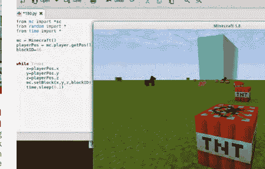

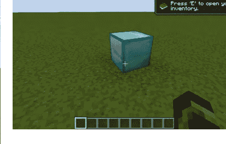

`Calvin Robinson` 是某州立学校的计算机部门主管兼网络经理。`Calvin` 精通计算机，还作为教育领域的计算机专家与伦敦各地的学校合作，提供高质量的计算机教学与学习。

# 你将需要

- `Minecraft` `https://www.mojak.com/games`
- `Python` `https://www.python.org`
- `McPiFiMo` `https://rogether.co.uk/McPiFiMo.mar`
- `Minecraft Turtle` `http://bit.ly/minecraftTurtle`
- 方块 `ID` `http://bit.ly/minecraft_id_links`

# 01 移动玩家角色

我们可以直接使用 `x,y,z` 坐标来控制角色的位置。创建一个新的 `Python` 脚本并导入。

```python
from mcpi import minecraft
mc = minecraft.Minecraft.create()
```

```python
x=20
y=20
z=20
mc.player.setTilePos(x, y, z)
```

当然，在随后的很多时候，我们可以用变量替换这些值：

但现在我们想要使用 `x,y,z` 坐标来改变玩家的位置。


使用 Python 直接在 Minecraft 中编写代码带给我们我们许多优势，但与其手动建造，我们可以使用编程技术，例如简化建造过程。在本期教程中，我们将操纵玩家角色的位置及其周围的方块。我们使用简单的代码行来行、列地复制方块，用空气建造出整个房间。我们还可以随时将 `Steve` 或 `Alex` 传送到你的世界中。结合这些功能，我们可以利用 `TNT` 玩玩乐，创造出我们的炸弹人。

作为前提，根据我们上一期的内容，`McPiFiMo` 包含了 `Blast` 开发的 `McPRY` 以及由 `Alexander Pruss` 开发的 `MCPRY` 组（树莓派模组），以及来自 `www.stuffstuffoutcode.com` 的 `Martin O'Halaman` 开发的 `Minecraft Turtle`。

# 02 放置方块

与移动玩家角色一样，我们需要在世界中放置和移动方块的能力。

为此，我们使用 `setBlock` 命令：

```
mc.setBlock(30,30,30,57)
x=30
y=30
z=30
blockID=57
mc.setBlock(x, y, z, blockID)
```

`57` 对应的 `blockID` —— 你可以在需要的链接中找到更多信息（第72）。

# 03 结合两者

如果我们将玩家赋值给变量，就可以将其作为放置方块的坐标，从而在玩家周围创建物体。

```python
playerPos = mc.player.getPosition()
x=playerPos.x
y=playerPos.y
z=playerPos.z
mc.setBlock(x,y,z,blockID)
```

```
relativeX = input("你希望这个方块放置在你位置多少个格子的处？ ")
mc.setBlock(relativeX,y,z,blockID)
```

你也可以对 `y` 和 `z` 坐标执行相同的操作。

# 05 按行和列建造

一个一个放置方块会减慢进度。在某些情况下，我们想要放置整行和整列的方块。在使用步骤3和第4步后，我们需要为行和列添加变量。

```
eastWest = 20
northSouth = 30
upDown = 40
mc.setBlock(x,y,z,eastWest,northSouth,upDown)
mc.setBlock(x+1,y+1,z+1,eastWest-1,northSouth-1,upDown-1, 0)
```

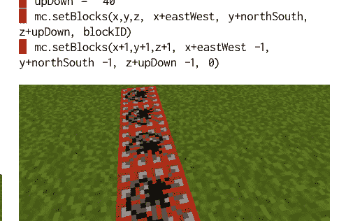

## 06 爆炸人

现在我们已经熟悉了 `playerPos` 和 `setBlock`，可以将两者结合，将你的玩家变成一个行走的炸弹客。为此，我们将之前的代码放入 `while` 循环中，通过添加一个简单的布尔值，我们可以让玩家每隔一段时间掉炸弹。

```python
while True:
    playerPos = mc.player.getPosition()
    x=playerPos.x
    y=playerPos.y
    z=playerPos.z
    mc.setBlock(x,y,z,26)
    time.sleep(0.1)
```

现在是时候玩玩了！


这会将方块精确放置在我们的玩家所在的位置。然后你可以相应地偏移坐标：`=1`。记住：如果 `x` 是东/西，`z` 是南/北，`y` 是上。


# 04 使用用户输入定义变量

通过添加 `input` 命令，我们可以询问用户想要创建什么类型的方块。

```
blockID = input("你想使用哪个方块 ID? ")
```

进一步，询问用户想要将方块放置在哪里。

## 使用时间

无论是放置方块还是在世界中移动玩家，你可能都想要设置间隔。使用 `time.sleep` 可以让程序暂停几秒。为了使用 `time.sleep`，你需要在代码顶部导入 `time`。

# 第1部分：使用 Sense HAT 编写战舰游戏

使用 `Sense HAT` 的功能来编写经典的战舰游戏并带有音效。


`Dan Aldred` 是一个树莓派认证教育者，在 `Astro` 中立学校担任首席老师。


在这一两部分的教程中，将通过发射鱼雷来寻找并击沉对方的船只。使用 `Sense HAT` 来创建经典的战舰游戏。当你完成时，程序结束并更新你的分数。你可以选择重新游戏。查看游戏：`https://youtube.be/SolWIcHsc`

## 01 导入模块和设置 - 部分1

在你的 `Python 3` 编辑器中创建一个文件。导入 `random` 和 `time` 模块。接下来，导入 `pygame` 控制；这使得 `Sense HAT` 允许你在矩阵上选择单个位置。添加代码导入 `Sense HAT`。

```python
import random
import time
import pygame
from sense_hat import SenseHAT
```

## 02 导入模块和设置 - 部分2

接下来，初始化 `pygame` 和 `mixer`。游戏需要一个窗口来播放和添加音效。设置游戏窗口；这是为了在游戏中使用 `Sense HAT`。然而，它不会显示任何内容，所以我们设置为最小尺寸。最后，设置 `sense_hat.brightness`：你可以使用代码减少 LED 矩阵的亮度，`sense_hat.light = True` 这将保护你的眼睛！

# 创建你自己的声音

```python
import random
import pygame
from pygame.locals import *
pygame.init()
pygame.display.set_mode((200, 200))
sense = pygame.SENSIVITY
frame_light = True
```

船和水的颜色

```
ship = [160, 200, 140]
water = [0, 0, 255]
ship = [255, 0, 0]
ammo = [255, 255, 255],
```

自定义你的游戏并创建自己的语音命令和玩家。使用 `texttospeech.com` 网站下载文件并将其格式化为 `pygame` 接口。

# 06 将数据添加到列表

记得你创建的 `Sea2` 列表。在这一步中你将填充该列表。为每个创建一个第一个，然后在另一个列表 `Sea2` 中。从 1 到 5 之间选择一个随机数并添加。

```python
import random
import pygame
from pygame.locals import *
pygame.init()
pygame.display.set_mode((200, 200))
sense = pygame.SENSIVITY
frame_light = True
```

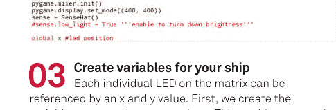

```python
item = random.randint(1, 5)
if item == 1:
    Sea2.append(ship)
elif item == 2:
    Sea2.append(water)
elif item == 3:
    Sea2.append(water)
elif item == 4:
    Sea2.append(water)
elif item == 5:
    Sea2.append(ammo)
```

# 07 计算船只数量

这一步统计添加到 `Sea2` 列表中的船只数量。这是一个随机数，每次游戏运行时都会变化。通过创建一个变量来存储船的数量，将其设置为零，以便为每个新游戏重置。然后检查 `Sea2` 列表中的每个个体是否为船：如果值是 `[160, 200, 140]`。如果该值是船只，则将船只数量变量加加 1。该变量现在存储了你需要寻找并摧毁的船的总数。

# 教程

红、绿、蓝颜色

“计算海中有多少艘船”

“遍历 `Sea2` 列表并统计船的数量”

```python
if y < 7:
    y = y + 1
elif event.key == K_UP and y > 0:
    y = y - 1
```

```python
number_of_ships = 0
for entry in Sea2:
    if entry == [160, 200, 140]:
        number_of_ships += 1
```


RGB 是一种绝对色彩模型，通过组合不同数量的红光、绿光和蓝光来创建广泛的色调。总共有 1600 万种变化，如果三种颜色的值均为 0，则其为最低值；如果所有元素均为 255，则每个元素的（无颜色）值最高，即白色。

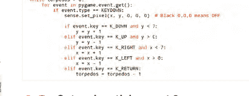

## 08 加载操作

现在我们已经计算出了船的数量，可以通过在 LED 矩阵上滚动显示消息来告知玩家。你可以通过更改 `text_colour` 来自定义颜色，该颜色使用与船相同的 RGB 值。初始化船的数量。

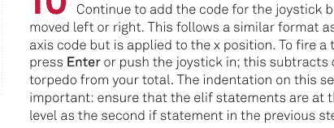

## 10 设置摇杆部分 2

继续添加摇杆以向左或向右移动。这遵循一个简单的格式，因为 `x` 和 `y` 代码已与位置绑定。首先推推摇杆，这会产生一个方向的移动。理想的重要语句与语句过程中的第二层相同。


```python
if event.key == K_RIGHT and x < 7:
    x = x + 1
elif event.key == K_LEFT and x > 0:
    x = x - 1
elif event.key == K_RETURN:
    print("torpedo", "torpedos")
```

## 09 设置摇杆部分 1

现在是时候设置摇杆移动移动船并对准某个位置了。你的船由 LED 表示。我们检查你是否还有鱼雷；如果是，则游戏正在进行，你可以移动。

## 11 检查是否击中船

要检查你是否击中了船，你必须将你的位置与 `Sea2` 列表中的船进行比较。例如，如果你在 `LED` 43 位置，则击中了船。使用公式 `(y*8)+x` 将你的位置计算为一个数字，然后我们检查是否击中船。如果是，我们更新另一个列表 `Sea3` 将其标记为 `'hit'`（命中），然后从 `Sea` 列表读取并显示新颜色。

通过创建一个变量将其累加到船的总数中。在末尾调整矩阵以使游戏变得更容易或更难。（测试时，值得每次部署 30 枚鱼雷来计数。）

“计算你在网格上的位置”

```python
position = (y*8)+x
```

“检查是否命中并更新列表”

```python
if Sea2[position] == ship:
    print("HIT")
    Sea[position] = hit
```

`Sea.set_pixel(ship)` 将 LED 设置为黑色，并使用步骤 3 中的 `x` 和 `y` 值将你的船放置在 LED 矩阵的左上角。添加代码响应摇杆移动，检查向左和右移动一个单位，让你的船向下移动。使用 `elif` 语句设置摇杆向上移动并让你的船向上移动。

## 12 添加爆炸声

```python
while torpedo > 0:
    for event in pygame.event.get():
        if event.type == KEYDOWN:
            sense.set_pixel(x, y, 0, 0) # 黑色 0,0 表示关闭
            if event.key == K_DOWN:
```

首先，我们利用 Pygame 音频并加载以下文件，用于命中；添加几秒钟的音频延迟直到船被击中，从剩余船的总数中减 1。

## 战舰大战


```python
### sound
pygame.mixer.load("impact.mp3")
pygame.mixer.play()
number_of_ships = number_of_ships - 1
```

## 13 更新玩家

玩家击中了一艘船：现在用当前船的数量来更新他们。这通过一个音频文件宣布。剩余的船的数量显示在 `Sea` 上。在此之前，你可以调整 RGB 值来设置颜色。最后，增加分数。

```python
pygame.mixer.load("shipsleft.mp3")
pygame.mixer.play()
sense.message(str(number_of_ships), text_color=(255, 0, 0))
score = score + 1
```

## 14 射空

如果你没有击中，则使用你船的位置来检查 `Sea` 列表中的相同位置。如果返回了，则更新 `Sea` 列表。打开蓝色 LED，然后使用 `Sea` 矩阵加载 MP3 文件。使用代码 `pygame.mixer.play()` 播放，并在下一帧之前留留。

```python
elif sense(your_position) == water:
    print("MISS")
    sense.show(Sea)

### sound
pygame.mixer.load("miss.mp3")
pygame.mixer.play()
time.sleep(1)
```

## 15 寻找另一个弹药

在游戏中，你可能足够幸运能找到弹药，这将添加到你的鱼雷储备中。之前的方法参见第 7 页。检查你的位置是否对应“弹药”，然后检查 `Sea` 列表。如果是，`torpedoes` 变量加 1，然后播放弹药 MP3 文件。查看这些行：

```python
elif sense(your_position) == ammo:
    Sea(your_position) = ammo

sense.pixels(Sea)
torpedoes = torpedoes + 1
pygame.mixer.load("ammo.mp3")
pygame.mixer.play()
time.sleep(3)
```

## 16 结束游戏

步骤：你编写了控制摇杆并在 LED 矩阵上移动船的代码。程序只有在你按下 `Enter` 时才会检查并比较你的位置与 `Sea` 列表。如果没有，简化对船、水或弹药的检查，更新 `Sea` 列表并列出相关的音频。直到鱼雷数量变为零，加载并播放游戏结束。使用代码 `sense.message` 在 LED 矩阵上滚动最终的“游戏结束”消息。

```python
sense.pixel(x, y, 255, 0) # 目标位置像素颜色
pygame.mixer.load("gameover_spook.mp3")
pygame.mixer.play()
```

## 17 测试游戏

教程的最后部分。你将测试并创建一个游戏的基础版本。创建一个变量 `S` 并分配一种颜色。`Sea` 列表在第 11、12、13 和 14 页。创建 6 个条目，每个代表一个隐藏点弹药，并将颜色写入 LED 矩阵。在下一个主程序之前添加简短延迟。游戏开始时，按下 `FPS`。一秒后你可以通过摇杆移动你的船。按 `Enter` 开始。祝你好运！

> “创建一个 64 个蓝色像素的网格，即‘海’”

```python
S = [S, S, S, S, S, S, S, S, S, S, S, S, S, S, S, S,
     S, S, S, S, S, S, S, S, S, S, S, S, S, S, S, S, S, S]
```

# Python 列

## 使用 PyOBD 快捷径

来自你的车辆的详细信息。这些响应具有属性。`value` 属性包含来自响应的解码值。`command` 属性包含最初发送到车辆的原始命令。

另一个查看故障码（DTC）的特殊查询和响应。当车辆出现故障亮灯时，就会设置这些代码。作为第一，你将使用以下代码来获取设置了多少 DTC：

如果你还没有想要添加 OBD 功能的自定义 GUI，可以使用 PyOBD 项目立即与你的车辆交互。该项目的地址为 `https://github.com/pyobd/pyobd`，你也需要使用它或下载 tarball 包安装到你的树莓派上。

`message` 属性包含有关响应接收时间的信息。你可以检查响应对象。最后一个属性名为 `named`，它包含接收响应时的状态值。如果查询未能获取值，你应该留意到这一点。

```python
response = my_car.query(obd, containing=DTC.TC)
print(len(response.set))  # 故障码
```

```bash
sudo apt-get install python-serial
sudo apt-get install python-wtk2
python-tools libwtk2.8-dev
```

`ob` 方法返回一个响应对象。大多数情况下，你可以使用 `is_null` 来检查此响应对象。

实际返回的值元组，包含实际代码以及 PyOBD 模块理解的错误描述。

一旦你获得了响应或解析后的内容，就可以将代码映射到你的字典中，并使用响应中返回的简单对象启动 GUI。然而，有一个属性会返回更复杂的响应；即状态查询响应。在这种情况下，你需要检查状态对象来获取错误代码。

主要问题是该方法是一个阻塞函数。这意味着在等待响应返回之前，你的程序将暂停运行。如果你正尝试构建一个显示数据的用户界面，那么这对用户来说是不友好的。在这些情况下，你最好使用异步连接对象。

```bash
cd pyobd
python pyobd.py
```


这会弹出一个带有 OBD 接口的 GUI，将你的树莓派连接到车辆。你需要这样做以便获得操作 OBD 接口的正确权限。你可能需要在 `11` 下运行它。OBD 可以找到的每个部分都有相应的标签页。主标签页提供与 OBD 对象连接的状态。第二个标签页提供来自车辆自检的值。第三个标签页报告车辆的值。你也可以在此标签页清除它们。

```python
if response.is_null:
    print("We have a problem.")
```

除了这些，还有一个为你的车辆运行的测试列表，其结果可以在此响应对象查看。每个测试都有你可以检查的相应属性。

这连接到持续监控 OBD 对象并更新返回的值。这意味着任何查询都会立即返回，而不需要你亲自询问引擎。该方法会跟踪引擎的 `RPM` 值。

```python
my_obd = obd.query()
my_obd.watch(obd.RPM)
my_obd.start()
```

对于每个测试：“此测试在你的车辆上可用的值”

当你完成后，调用 `stop()` 来停止监控 `RPM` 值。你现在可以将你花哨的车辆监控系统安装在仪表盘上了。

```python
if response.value.OXYGEN_SENSOR_MONITORING.available:
    print("Oxygen sensor test completed")
```

```bash
python obd_recorder.py
```

数据存储在 `HOME/pyobd/` 中。它实际上会查询 OBD 接口以及任何可用的传感器，以及可以被查询的相关值。


科技购买建议的来源

`techradar.com`

## 评论

`81` Group test | `86` Hardware | `88` Distro | `90` Free software


## 组测试

### 协作通信服务器

为什么要使用像 Slack 之类的工具呢，使用这些开源解决方案通常可以同样高效地与同行交流？

#### Let's Chat

这是位于多伦多的一家名为 Compass 的软件开发公司的自托管项目，该聊天服务绝对是小组测试中最好的。凭借其令人印象深刻的功能集，它可以与竞争对手抗衡，还是因为对小团队的关注而看到它失败？`http://bit.ly/SDLetsChat`

#### Mattermost

Mattermost 受欢迎的原因之一是它经常被推荐为 Slack 的开源有云替代方案。但仅仅由于更多无法备份的心态，还是说我们拥有了一个真正的硅谷巨头杀手者？`https://about.mattermost.com`

### Rocket.Chat

这个屡奖的协作工具直言不讳，并充当“终极聊天平台”；它的功能列表看起来好得不可真实，包含了视频会议和语音消息，但 Rocket.Chat 不仅仅是一个令人印象深刻的网站？`https://rocket.chat`

### Zulip

这是位于多伦多的一家名为 Compass 的软件开发公司的自托管项目，该聊天服务绝对是小组测试中最好的。凭借其令人印象深刻的功能集，它可以与竞争对手抗衡，还是因为对小团队的关注而看到它失败？`http://bit.ly/SDLetsChat`

#### Mattermost

Mattermost 受欢迎的原因之一是它经常被推荐为 Slack 的开源有云替代方案。但仅仅由于更多无法备份的心态，还是说我们拥有了一个真正的硅谷巨头杀手者？`https://about.mattermost.com`

### Rocket.Chat

这个屡奖的协作工具直言不讳，并充当“终极聊天平台”；它的功能列表看起来好得不可真实，包含了视频会议和语音消息，但 Rocket.Chat 不仅仅是一个令人印象深刻的网站？`https://rocket.chat`

## 评论

### 协作通信服务器

为什么要使用像 Slack 之类的工具呢，使用这些开源解决方案通常可以同样高效地与同行交流？

#### Let's Chat

这是位于多伦多的一家名为 Compass 的软件开发公司的自托管项目，该聊天服务绝对是小组测试中最好的。凭借其令人印象深刻的功能集，它可以与竞争对手抗衡，还是因为对小团队的关注而看到它失败？`http://bit.ly/SDLetsChat`

#### Mattermost

Mattermost 受欢迎的原因之一是它经常被推荐为 Slack 的开源有云替代方案。但仅仅由于更多无法备份的心态，还是说我们拥有了一个真正的硅谷巨头杀手者？`https://about.mattermost.com`

### Rocket.Chat

这个屡奖的协作工具直言不讳，并充当“终极聊天平台”；它的功能列表看起来好得不可真实，包含了视频会议和语音消息，但 Rocket.Chat 不仅仅是一个令人印象深刻的网站？`https://rocket.chat`

### Zulip

这是位于多伦多的一家名为 Compass 的软件开发公司的自托管项目，该聊天服务绝对是小组测试中最好的。凭借其令人印象深刻的功能集，它可以与竞争对手抗衡，还是因为对小团队的关注而看到它失败？`http://bit.ly/SDLetsChat`

### Rocket.Chat

### Zulip

你能让你的通信轨道环绕并圈回来吗？

被 `Dropbox` 收购并开源后，它能击败对手吗？

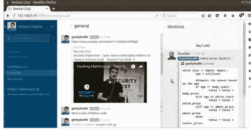

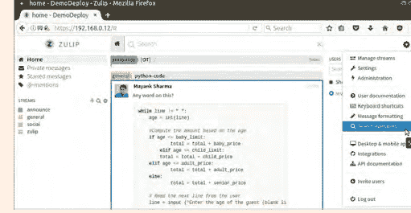

除了本地身份验证外，你还可以像 `GitHub` 和 `Twitter` 那样，接入 `LDAP` 服务器或通过 `OAuth` 服务获取凭据。

`Zulip` 与其他不同之处在于，它不是使用“房间”，而是将每个主题（`topic`）拆分为独立的流（`stream`），这需要一些时间来适应。

## 有用功能

`Rocket.Chat` 功能完备。它为你提供了几乎所有同类产品的所有有用功能，包括线程化对话、搜索和删除消息。它还有一些额外的功能，比如聊天，你可以通过 `Rocket.Chat` 与你网站的访问者进行交流。

## 有用功能

它包含了你对现代协作聊天服务器所期待的一切。它有线程化的群聊，这是其他产品所不具备的），并允许你同时参与多个讨论。你可以在所有流中发布公告，即使你对它们并不感兴趣。

## 通信类型

`Rocket.Chat` 处于独特地位，是该组中唯一允许你与团队进行视频会议的应用程序。你还可以记录并向公共或私有对话发送语音消息。应用程序还会关联 `Twitter` 和 `YouTube` 等热门服务的链接。

## 通信类型

`Zulip` 与许多同类产品一样，只增强了基于文本的聊天。然而，你可以分享媒体和视频，它会在可能的情况下内联显示。来自 `Twitter` 和 `YouTube` 等热门网络服务的预览在我们的测试中并不总是生成，而且在 `Mattermost` 中并不是真正的内联显示。

## 开发者友好

这可能是唯一的语法高亮插件，但它相当简陋。尽管如此，它的实现方式很聪明，因为它只会占用你已经分享的一部分代码。考虑到在这方面缺乏关注，`Rocket.Chat` 尚未准备好进行代码协作。

## 开发者友好

几乎没有任何影响，使用反引号来指定代码块的语言，`Zulip` 就会完美地高亮你的语法。它的实现包含了针对 `Jira`、`GitHub`、`Jenkins` 等更多热门第三方服务的代码更改、系统报告等内置集成。

## 部署易用性

`Rocket.Chat` 是一个支持 `Ubuntu`、`Debian`、`Fedora` 等操作系统的应用程序，只需一条命令即可完成。它还有一个详细的设置部分，其中包含一个非常有用的搜索功能，可以精确找到你想要调整的选项。为了实现最大覆盖，它为所有领先平台提供了移动和桌面应用程序。

## 部署易用性

`Zulip` 的安装简单但解释详尽。它需要设置 `SMTP` 服务器，但支持 `Gmail`，这对于小团队来说是一个方便的选择。它还拥有 `Windows`、`macOS` 和 `Linux` 的原生应用，以及适用于 `iOS` 和 `Android` 设备的移动应用。

## 总体

如果忽略它在共享代码方面的局限性，`Rocket.Chat` 在提供的非常有用的功能数量方面超过了其他其他选项。

## 总体

功能倾向于辅助开发者，尽管它的布局和执行方式与其他基于房间的协作工具略有不同，并且包含学习曲线。

`www.luxuker.com` `83`

## 协作通信服务器评论

## 简要：对比并总结我们的裁决

| 特性 | Let's Chat | Mattermost | Rocket.Chat | Zulip |
| :--- | :--- | :--- | :--- | :--- |
| 有用功能 | 有一些令人印象深刻的功能，但在同类产品面前显得逊色。 | 拥有许多功能可以进行更有结构化的对话。 | 在提供的功能方面胜过其他所有。 | 有足够的元素让对话变得高效。 |


| 通信类型 | 仅用于基于文本的通信，且方式有限。 | 主要以文本为主，共享媒体可以内联查看。 | 我们组中唯一可以进行视频会议的选项。 | 与 Mattermost 中的之前的不同。 |

| 开发者友好功能 | 特别设计为共享代码而设计。 | 支持文本格式和语法高亮，对程序员很有用。 | 所有的都非常复杂，使其不适合进行代码项目协作。 | 为开发者在工作时协作提供了许多选项。 |

| 部署易用性 | 易于安装——易安装配置需要手动完成。 | 文档齐全的安装和全面的调整设置。 | 它可以快速安装，得益于其简单的支持。 | 涉及的操作并不算复杂，在设置面板中也容易找到。 |

| 总体 | 它相对于 IRC 等其他聊天工具的改进在于持久的历史。 | 名副其实，对于那些沟通很重要的人来说，这是一个顶级选项。 | Rocket.Chat 在除共享代码外的所有方面赢得了竞争。 | Zulip 是我们强大的界面，可以很容易成为最大的回报。 |

## 那么胜者是……

# Rocket.Chat

`Rocket.Chat` 和 `Mattermost` 之间的竞争非常，但前者凭借其托管音频和视频会议的能力胜出。它的开发者友好功能无法匹配 `Mattermost` 或 `Zulip`，但也并非完全无用。`Let's Chat` 和 `Zulip` 处于顶级竞争地位，最适合有限的受众。`Let's Chat` 增强了小团队的文本通信，而 `Zulip` 是开发者协作的理想选择。另一方面，`Rocket.Chat` 为各种事情提供了许多选项，`Mattermost` 紧随其后。

为了帮助你开始，`Rocket.Chat` 帮助从数据源导入数据，例如 `Slack`。

## 三星 Chromebook Pro


## 硬件

### 三星 Chromebook Pro

### 下一代 Chromebook 已就绪（如果你买的话）

这款 12.3 英的三星设备既是 `Chromebook` 也是安卓平板电脑，首次将 360 度翻转笔记本电脑设计与 3:2 屏幕相结合，并适用于 `Chrome OS` 上支持手写笔。

这台全金属 `Chromebook` 的重量仅为 1.8 公斤，是同类设备中最轻的，而且与大多数笔记本电脑相比更是轻如羽毛。`Pro` 版还极其纤薄且灵活。

我们有机会评测了一台原型机，我们的评测价格为 849 美元（649 英镑），并将从美国发货，这是一个中等价格，比昂贵的 `Asus Chromebook` 低。

我们评测机的一个主要区别是，零售版的外观是喷射黑。即使在关闭状态下，它看起来也非常时尚。

`Pro` 配备了你本会在平板电脑上看到的 3:2 显示屏。这种正方形宽高比与 16:9 和 21:9 的宽屏比例不兼容，导致视频显示不自然，在内容上下会留有黑边。

它比 `Asus Chromebook` 轻了 40 磅。它也内置了手写笔，但存储空间与 `Asus` 一样。目前，三星 `Chromebook` 仅在英国和澳大利亚发布。

翻转属性的另一个遗憾影响是导致键盘非常拥挤。它没有空间伸展，导致整体按键较小，且键位偏移。

`Pyina`

$849

网站

`www.samsung.com`

规格

- 处理器: `0.99GHz Intel m3-Y330` (双核，`mcache`)
- 图形: `Intel HD Graphics 515`
- 内存: `4GB LPDDR3`
- 存储: `64GB SSD`
- 屏幕: `12.3` 英寸 `2400x1600 LED` 显示屏
- 端口: `2x USB-C`, `micro microSD` 卡槽, 耳机接口, `Wi-Fi`, `蓝牙 4.0`
- 重量: `2.8` 磅 (`1.08kg`)
- 尺寸: `11.6x8.72x0.55-0.55` 英寸 (`29x22.1x1.4 cm`)

我们的原型机是银色的，但零售版是喷射黑

86

## 总结

一块惊艳且生动的 `UHD` 显示屏。`Chrome OS` 触摸支持感觉像纸一样自然，设计精美且简单。

翻转屏幕后，`Chromebook Pro` 的感觉就像使用任何安卓平板电脑一样自然，而且在所有设备中——它是保持了正常尺寸的设备。这是一个不习惯的环境，但在使用 `Chromebook` 几周几个月后你可以适应。

三星将 `Chromebook Pro` 称为一种针对 `Play Store` 设计的新类设备。这台设备配备了 `gopilot` 和键盘。最重要的是，这是第一款内置手写笔的 `Chromebook`：在演示期间将其抽出，可以为你的屏幕层指针添加新工具。

对于写作和素描，手写笔感觉非常自然且精准。三星精调了玻璃与笔之间的间隙，使其感觉像在纸上写字一样。手写笔具有压力感，所以你按屏幕力度越大，线条就越粗。

`Google` 开发了软件来减少使用手写笔时的延迟。`Google` 的云和机器学习技术利用了数千小时的解释和艺术笔触来预测笔的去向。所有这些预测软件都内置在 `Chromebook Pro` 中，因此无需担心记录你的击键或为了流畅的写作或绘图体验而连接网络。

# 缺点

- 拥挤的键盘。
- 九小时电池续航，虽然不像其他 `Chromebook` 好。
- 扬声器较弱。

为 `Google` 推的未来设备而设计。对于 70% 到 90% 的时间需要安卓平板电脑的用户来说，这是完美的 `Chromebook`，设备可以翻转回传统的笔记本电脑用于写作和偶尔的额外操作。如果你的使用场景相同，那么它适合你。

三星能够胜任很多功能，包括 `4k` 媒体，其 `Intel Core i3-6130` 处理器性能充足。这对于大多数 `Chromebook` 来说通常过剩了，但三星最新的 `Chrome OS` 机器将这种性能用于驱动 `UHD` 屏幕并运行更多的安卓应用。高端硬件意味着对电池寿命的影响。我们的标准电池测试连续运行了近九小时并脉冲


翻转屏幕后，`Chromebook Pro` 的感觉就像使用任何安卓平板电脑一样自然。它熟悉的平板电脑形状非常适合阅读文章和电子书内容。有了安卓应用，你可以下载我们的视频离线观看。

`Google` 告诉我们，其余部分有稳定的软件发布并拥有完全访问 `Play Store` 的权限。无论如何，所有安卓应用运行得几近完美。偶尔会出现小故障，例如应用程序没有正确缩放文本，但我们只能希望未来会得到改进。

* `Kevin Lee`


> 翻转屏幕后，`Chromebook Pro` 的感觉就像使用任何安卓平板电脑一样自然


## 评测 `Android-x86` 6.0-r3


## `Android-x86` 6.0-r3

PC 上运行安卓的最佳选项之一。但你真的想使用移动操作系统吗？

在放弃在电脑上运行为移动设备设计的操作系统之前，请考虑一下阁楼里那些闲置的小笔记本：`Android-x86` 项目是让这些设备变得有用的理想选择。该项目最初是让安卓运行的一系列补丁，但已变成一个完整的发行版。`Android-x86` 不是现在支持 32 位的唯一选择。启动菜单让你选择进入 `Live` 环境或安装到你的磁盘上。

`Google` 告诉我们，其余部分有稳定的软件发布并拥有完全访问 `Play Store` 的权限。无论如何，所有安卓应用运行得几近完美。偶尔会出现小故障，例如应用程序没有正确缩放文本，但我们只能希望未来会得到改进。

| 可用性 | |
|---|---|
| 内存 | 1GB |
| 存储 | 1.2GB |
| 规格 | 32-位平台 |
| `www.android-x86.org` | |


# 免费软件回顾

## 实时编码音乐语言

## `TidalCycles` 0.9.3

快速上手并直接通过代码创作音乐

这种数字音频工作站模型基于编辑磁带的范式——这并非使用计算机制作音乐的唯一方式，生成式编码的历史可以追溯到 1850 年。最近，纯 `Data` 以及像 `Sonic Pi` 等平台激发了人们对实时编码（live coding）和笔记本电脑歌剧的兴趣。`TidalCycles` 是一种实时编码模式引擎，能够编写模式和变换，以实现各个部分之间复杂的交互。你需要 `Haskell` 以及一些合适的工具来实际产生声音。`Tidal` 的设计初衷是使用 `SuperSynth`，它运行在 `SuperCollider` 中。`Atom` 是控制台中的默认编辑器。

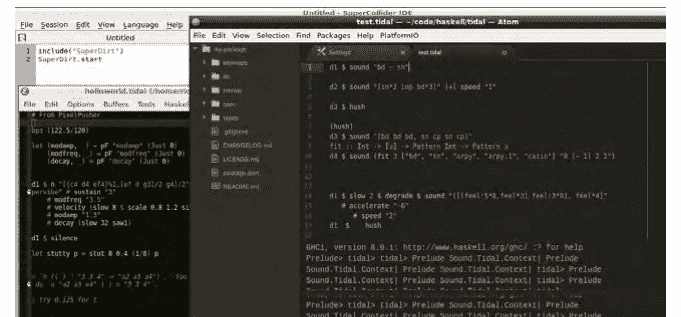

使用 `Atom` 更直观，但 `Emacs` 和其他文本编辑器也可以配合 `TidalCycles` 使用。

学习通道（channels）很容易——如 `d` 等，你可以在截图（右侧）中看到。最好从简单的节拍开始并使用它，配合排序和分类。实时 `Tidal` 活动遍布全球，可能比你想象的更近，寻找学习机会和探索各种可能，或者在 `GitHub` 上搜索一些优秀的示例并开始尝试。

# `JAVASCRIPT`/`CSS` 脚本

## `Lean & Mean` 拖拽组件 1.0

赋予你的用户重新排列代码块的能力

`Lean & Mean` Drag and Drop (`imid`) 是一个精巧的小脚本，用于“拖拽通常是容器中的框框，并可以使用 `CSS` 对其进行样式处理”。将其用于比较和对比装饰选择；或你网站或 `Web` 应用中任何其他需要此类交互的场景。在有如此多 `JavaScript` 框架的世界里，`imid` 是一个相对小的工具，压缩格式仅为 `422kb`。由于没有外部依赖，安装和集成比任何 `JavaScript` 项目都简单。首页提供了一个与 `Vue` 集成的示例，但指出该过程与 `Angular` 或 `React` 类似。文档还提供了高级用法建议，例如在容器之间克隆代码块，并展示了嵌套网格、带有手柄的多个容器等示例。`imid` 在带鼠标的触摸屏上运行良好，且如果编辑器不在屏幕上，它会自动支持。浏览器兼容性良好。虽然 `imid` 在各种情况下都非常有用，但在测试时也会发现，如果有人用这个工具构建出一个充满活力的竞技游戏，可能会大惊喜。

### 优点

- 无依赖且轻量级的拖拽重排序实现方式

### 缺点

- 无障碍性问题——并非所有的电脑用户都能使用指针设备

### 特别适合...

- 具有即时反馈的交互式应用和网站

```
http://github.0/LeanMeanID
```

90

# SHELL 脚本

## `WebNomad` 0.5.0

释放 Z 的力量生成图像画廊和网页

`Dyne.org` 是一个有趣的设计师和艺术家集合，为从事技术的创意人士制作实用的工具。`Denis Jérnais - Dyne` 参与了如 `Hasiccam`、`Freecon` 等项目，而 `dynoblic` 在 `Zsh` 上制作了一个静态图像画廊生成器。要运行它，某些可选功能需要其他库的支持。

这些功能允许为网页添加元数据，例如照片拍摄的位置和时间，以及你的计算机作为编辑软件和用户名等详情。`Dyne` 的脚本可以使用 `ImageMagick` 进行批量转换。

在标准操作下，`Nomad` 为你的网站制作幻灯片，脚本会为网站创建一个骨架，你可以使用 `Markdown` 创建它——正如静态内容也相当稳定，但这确实会增加页面加载时间。要查看它的运行情况，可以看看 `Devuan`，它是 `Debian` 的一个分支，也是许多使用 `WebNomad` 构建的网站之一。

> ### 优点
>
> 在任何安装了 `Zsh` 的地方都能轻松上手运行。使用实用的图像元数据。
>
> ### 缺点
>
> `Bootstrap` `CSS`、`jQuery` 和 `blimp` 意味着用户获得臃肿的页面加载。
>
> ### 特别适合...
>
> 无需学习 `HTML` 或 `CSS` 即可快速构建网站
>
> `http://bit.ly/WebNomad`

## `PYTHON` 环境

## `IPython` 6.0.0

带有高级笔记本的交互式 Shell

`IPython` 是 `Jupyter` 笔记本的 `Python` 后端（或内核）——`Jupyter` 是一个包含 `Python` 核心部分的笔记本，但同时也包含了 `Julia`、`R` 等语言，已发展为交互式数据分析工具。我们不会从这里重写 `IPython`，因为它包含一个实用的界面——开始安装，如果你有 `Python`，`IPython` 是一个简单的安装笔记本，有了 `pip` 它终于消失了（如果你决定用 `Angela` 的话）。它从命令行启动，并将在浏览器中打开，向你显示管理笔记本的仪表板和

这是一份非常好的指南，可以带你上手 `Jupyter`，还有完整的手册和社区文档，如 `ReadTheDocs`。`GitHub` 上的 `IPython Cookbook` 中有很多示例和教程可以向你展示。你还可以找到可下载的笔记本（即 `ipynb` 文件），用 `Jupyter` 打开并运行。

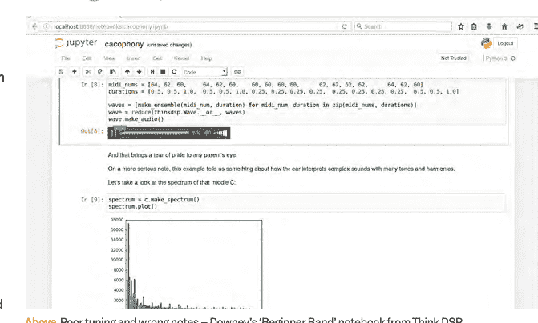

> ### 优点
>
> 运行 `Python` 会话并逐个探索数据的绝佳方法，并具有即时视觉结果。
>
> ### 缺点
>
> 抱怨其他系统上的一点客户端化是有些多余的——但我们只是
>
> ### 特别适合...
>
> 教育数据、自然科学和统计学
>
> `https://python.org`

## 开源

在你的目录中列出你的

如需在此广告，请联系 Kate

`kate.butterfield@futurenet.com` | `01225 68439`

# 推荐

# 托管：

**关于我们**

我们成立于 1999 年，是一家位于英国的独立公司，我们的使命是确保你的网站运行良好。我们提供极具价值的：

+   **我们提供**

- 免费邮件账户。
- 易用的控制面板。
- `SSL` 证书。
- 域名托管。
- 易用的控制面板来管理域名。
- 威胁防护。

+   **我们提供**

- 垃圾邮件防护。
- 易用的控制面板。
- 帮助你注册、转移和管理多个工具。
- 将你的域名重定向到其他域名。


# 给专业人士的 5 条建议

+   01 优化你的网站图像

当你将网站上传到互联网时，确保所有图像都经过了优化！尝试使用 `jpegmin.com` 或使用 `EWWI` 插件。

+   02 在英国托管你的网站

确保你的网站位于英国，不仅仅是为了免费！如果你的服务器位于海外，可能会影响你的搜索引擎排名——你可以查看你的网站位于

`www.check-host`。

+   03 你需要定期备份吗？


如果今天你的网站使用了，你的业务会感觉如何？制作任何备份都是重要的；即使你的主机提供了备份解决方案，对自己的数据和保护承担责任也是至关重要的。

### 04 尝试在 Google 上排名

在 2015 年。如果你很难在 Google 上排名，请确保你的网站是移动响应式的！此外，Google 排名 HTTPS。联系你的主机和支持团队。

### 05 避免廉价托管

我们确定你见过那些 1 镑/月的托管广告了！想想逻辑——会有多少个客户挤在一个服务器上？你可能宁愿使用 20 英元的驱动而不是 1000 多英元的企业 SSL！记住要得到你所付的！

## 证言

### David Bauer

我买了一个 SSL 证书。购买过程非常顺利，只需几分钟。安装证书很困难，这是我永远无法完成的事情。然而，我只是提交了一个工单，支持团队响应很快。他们在证书签名批准后的几小时内就回复了，并帮助我安装了证书。

### Tracy Helps

我们使用了 TheNames 的项服务，网络连接是顶尖的——出色的可用性和服务问题处理。技术支持知识丰富且回复迅速，这是一个加分项。我们会非常推荐 TheNames。

## 顶级主机托管

### SSD 网站托管


`www.cwcos.co.uk`

`0800 1 777 000`

`www.bargainhost.co.uk`

`0843 229 2681`

CWOS 托管主机服务是英国领先的托管服务专家。它提供全系列的托管产品、服务和支持。其高技能的员工不仅是主机托管专家，还致力于提供卓越的客户体验，并对他们所的工作充满热情。

自2001年以来，BargainHost 一直致力于在英国提供价格最低的托管服务。它已成功实现这一目标，并建立了包含许多客户的大型数据库。我们因提供卓越的托管服务而荣获多个奖项。

- 房机托管
- VPS（虚拟专用服务器）
- 100% 网络可用性


- 共享主机托管
- 云主机托管
- 域名

## 价值型托管

### 企业级托管


### 价值型 Linux

`www.202media.com` | `www.202Media.com`

## elastichosts

新用户可以使用预装的 `WordPress` 或获得免费管理。即时 `WordPress` 服务首年免费。

我们以其卓越的品质和服务闻名，也是全英国各地开发者和企业的信赖之。

`elastichosts.co.uk`

`0271 83250`


`patchman-hosting.co.uk`

ElasticHosts 为全球企业提供免费、简单、灵活且高效益的托管服务，具有高性能、可靠性和可扩展性。我们通过电话、电子邮件和工单系统提供 24 小时的卓越专家支持。


Linux 托管是寻求高性价比和强大性能的家庭企业、用户和设计师的绝佳解决方案。无论您是构建单作品集网站还是运行数据库电子商务网站，都有适合您的 Linux 托管解决方案。

- 任何操作系统系统上的云服务器
- Linux 操作系统配置
- 世界级 24/7 支持
- 学生托管优惠
- 网站设计器
- 域名

## 小企业主机托管

### 预算型托管

### 快速、可靠的托管


`www.hetzner.de` | `+49(0)0831 6364`

`www.bytemark.co.uk`

`0190 840 890`

HostHapa 是一家屡获殊荣的托管服务和绿色托管的领导者。它提供最全面的托管包之一，均配备 24/7 客户支持、学习资源以及卓越的可靠性。

Hetzner 是一家专业的网站托管提供商和基础设施专家运营商。自1997年以来，该公司一直提供私有服务器和虚拟服务器、高性能托管产品以及网站高效运行所需的基础设施。策略、方法、定价以及灵活的支持服务的结合，使 Hetzner 能够在保持国内和国际强有力地位的同时持续创新。

Bytemark 成立于 2002 年，是“云托管与数据库托管的英国专家”。他们的方法包括内部专业知识、透明的定价、由支持人员完成的免费软件更新，以及价格公道的高质量托管硬件。

- 网站生成器
- 预算价格
- 无限数据库
- 独立和共享托管
- 互联网域名和 SSL 证书
- 托管托管
- 英国云托管
- Linux 托管

`www.linuxuser.co.uk` 93

## 开源

您的 Linux 新闻与观点来源

## 评论

### 您的来信

关于杂志、Linux 和开源的问题与意见


### `lud177vd`

来自 LinuxUser 的用户与开发者

Topol Angelina，Linux 用户兼开发者，Ubuntu 16.04, Ubuntu 18.04, Bionic, Pepper, Ubuntu 20.04, Focal, Ubuntu 22.04, Jammy, Hyperbolic, Ubuntu 7.1, Yards, Zossa, Salus, Saturnus, Octavia, Ubuntu 100 Media

`lud177vd`, `2021-06-15`

用户访问：`https://www.linuxuser.com/details/lud177vd`

评论：这是我对 LinuxUser 年第 177 期的评论

# 29 个酷的智能家居升级方案

# T3

## 史上最薄的 4K 电视

比本杂志还要薄！

我们见证了 `LG` 厚度仅 `2.5mm` 的超屏幕！

### 《小配件杂志》(The Gadget Magazine)

全方位的最佳科技

通过我们精选的今日顶尖产品，全面升级你的生活各个方面

## 67 款 99 英镑以下的惊人好品


- 更多内容 -> 时尚唱胶片机 -> 平价电动汽车
- 下一代智能手表 -> 谷歌 WiFi -> 4K 旅游课程

# 现已热卖中！

可在 `WHITESM`、`MYFAVOURITEMAGAZINES.CO.UK` 购买，

或直接在您设备的应用商店中搜索 `T3`

立即订阅即可节省费用！访问 `WWW.MYFAVOURITEMAGAZINES.CO.UK/T3`

电子前沿基金会（EFF）是数字世界中捍卫公民自由的领先非盈利组织。EFF 成立于 1990 年，通过影响力性诉讼、政策分析、基层行动主义和技术开发，维护用户隐私、言论自由和创新。随着我们对技术使用的增加，我们致力于确保权利和自由得到增强和保护。

## EFF.ORG

电子前沿基金会

在电子前沿保护权利并促进自由

# 沉浸在黑胶片的世界

在乐施会（OXFAM）的在线商店中发现自我

`oxfam.org.uk/shop`


乐施会 (OXFAM)
