## Linux 用户与开发者 181 - 系统安全 181

---

### 2O™ 来自 RESELLER HOSTING 的创造者

第一个月的无限转售托管仅需 £1，之后每月仅 £29.99

无合约 + 30 天退款保证

在 `2Oi.com/dotnet` 注册

#### 基于 100% SSD 的自动扩展云平台上的转售网页托管。

`TIM & JONATHAN BREALEY`

`2Oi` 的创始董事 & 行业资深人士

- **无限托管**

包括无限 SSD 网页空间、带宽、网站、用户账户、`1GB` `MySQL` 数据库、`10GB` 邮箱以及免费 `SSL` 证书。

- **轻松迁移**

通过我们的自动化一站式迁移中心，轻松迁移你的域名、网站、电子邮件和数据库。`2Oi` 独有

- **SSD 为标准配置**

我们仅在服务器中配备顶级固态硬盘，以确保 blazing 般的极速和卓越可靠性。

- **自动扩展**

我们的平台按需扩展资源，确保你的网站即使在最繁忙的时段也能保持在线且快速。

- **多平台支持**

在针对 `Linux`、`Windows` 和 `WordPress` 优化的性能调优平台上托管网站。`2Oi` 独有

- **100% 可品牌化**

为你的客户提供定制的专属控制面板。它时尚、功能丰富且易于使用。`2Oi` 独有

访问我们：`2O™.com/dotnet`

电子邮件：`sales@2O.com`

致电我们：`0333 344 2733`

---

### 欢迎阅读 `Linux User & Developer` 第 181 期

#### 本期内容

- 保护你的系统，第 18 页

- 最新 `Linux Mint` 开发动态，第 28 页

- 面向 `Linux` 的 `AWS`，第 56 页


欢迎来到英国和北美最喜欢的 `Linux` 和 `FOSS` 杂志。上个季度，36% 的所有恶意软件都针对 `Linux`（`WatchGuard` 2017 年第一季度威胁报告）。其中大多数是物联网设备，但考虑到市面上大量产品发布后无法打补丁且在那里等待被黑客利用的情况，这并不令人惊讶。这种免费搭乘的情况需要结束。这些公司需要投资其使用的开源软件，否则就要被点名批评，直至倒闭。

虽然物联网的现状令人遗憾，但在桌面方面，我们通过关于保护系统的大型专题为你提供了全面覆盖（第 18 页）：我们从禁用未使用的服务到安全审计、自动化系统监控以及沙箱化，无所不包。我们还对 `Linux Mint` 的开发进行了一次全新的审视（第 28 页），并访谈了它的创始人（第 12 页）。对于动手派，我们有来自利物浦创客节的报道，以及内容丰富的 `Pi` 版块（从第 69 页开始）；对于开发者，则有一份关于如何充分利用 `AWS` 的综合指南。除了我们常规的全部内容，包括虚拟化软件的团体测试（第 81 页）外，我们还为初学者启动了 `Linux` 基础系列（第 36 页），并在第 44 页尝试了娱乐数学。这是一期内容丰富的杂志，请尽情享用！

`Chris Thornett`，主编

与团队联系：`linuxuser@futuresnet.com`

`Facebook`: `facebook.com/LinuxUserUK`

`Twitter`: `@linuxusermag`

`FileSi` `filessi@futuresnet.com`

获取最佳订阅优惠，请访问：`www.myfavouritemagazines.co.uk/sublud`

### 订阅立减 20%！详情请见第 34 页

---

---


### 每天 1,500 个足球场！

你知道吗，欧洲森林——它们提供木材用于制造纸张和许多其他产品——在过去 10 年间增长了 44,000 平方公里？这相当于每天超过 1,500 个足球场！†

喜欢杂志吗？知道它们是用天然、可再生且可回收的木材制成的，你会更喜欢它们

> †UNFAO, Global Forest Resources Assessment 2005-2015.

`Two Sides` 是一个全球倡议，提倡负责任地打印和纸张使用，当纸张来自经认证或可持续管理的森林时，它是一种独特而强大的自然传播媒介。

热爱纸张有一些绝佳的理由 `#LovePaper`

立即了解，

`twosides.info`


---

### 随杂志免费附赠

#### 立即访问这些惊人的免费赠品...

##### 最佳发行版和 FOSS

你的 `Linux` PC 必备的软件


##### 专业视频教程

`Linux` 基金会分享其技能


##### 教程项目文件

跟随我们的教程所需的所有资源


#### 此外，这些也归你所有...

- 下载新的 `Debian` 9 'Stretch'，以及 `Linux Mint` 18.2 和 `Kali` Light 的 `ISO`。

- 获取 `Erlang` 的程序代码，以及我们 `Sense HAT` 战舰游戏两部分所需的所有代码、声音文件和资源。

登录 `www.filesilo.co.uk/linuxuser`

注册以即时获取这些必备 `Linux` 发行版和软件包、操作指南视频及教程资源


# **FileSilo**

精彩下载的栖息地——专属您喜爱的 `Future Publishing` 杂志

- 随时随地享受安全、可靠的在线访问

- 所有读者均可免费访问，支持纸质版和数字版

- 仅在您想要的时间和下载您想要的文件

- 在一处汇集您所有问题中的所有赠品

## 开始使用

关于访问 `FileSilo` 账户您需要了解的一切

- 01 按照屏幕上的说明在我们的安全 `FileSilo` 系统中创建一个账户。登录并回答一个关于杂志的简单问题来解锁该期内容。

- 02 您可以使用任何主流浏览器在任何计算机、平板电脑或智能手机设备上访问 `FileSilo`。不过，我们建议您使用计算机下载内容，因为您可能无法将文件下载到其他设备。

- 03 如果在访问 `FileSilo` 上的内容时遇到任何问题，请查看在线常见问题解答，或向下方地址发送电子邮件给我们的团队。

  `filesilohelp@futurenet.com`

## 订阅者的超值赠品


## 立即订阅并解锁来自 40 多期杂志的免费赠品

通过订阅杂志以节省开支的方式访问我们的完整资源库——那是数百个免费资源

- **超过 20 小时的视频指南**

  来自 `Linux` 基金会的基本建议

- **最佳的 `Linux` 发行版**

  专业的 `Linux` 操作系统

- **免费开源软件**

  您的 `Linux` PC 必备程序


## 翻到第 34 页立即订阅

- **已经是纸质版订阅者？**

  今天如何解锁 `FileSilo`...

  使用您独特的 `Web ID` 解锁整个 `LULD` `FileSilo` 资源库——这是印在您的订阅副本邮寄标签地址详情上方的八位字母数字代码。它也可以在任何续订信函中找到。

## 超过 400 个订阅的理由


# OpenSource

08 新闻与观点 | 12 访谈 | 96 `FileSilo`


## 安全

### 欧洲议会议员推动全欧盟范围的“后门”禁令

欧盟立法能否保护加密技术？

长期以来，打击犯罪和恐怖主义一直是政府增加监控权力的说辞。但就加密技术而言，存在一个问题：加密要么有效，要么无效。没有半吊子的措施。

这是某些欧洲议会议员关注的问题，他们已向欧洲议会提出修订法规的提案，禁止出于执法目的设立加密后门。在题为《公民自由、正义和内政委员会》的草案报告中，指出技术进步已超过数据保护条例的规范，因此提出了对 2002 年电子隐私条例的修订。如果通过，这将影响英国阻止像 `WhatsApp` 等应用使用端到端加密（`E2EE`）的意图。


草案报告指出：“电子通信服务提供商应确保有足够的保护措施，以防止未经授权访问或修改电子通信数据，并确保传输的保密性和安全性由所使用的传输手段的性质或最先进的电子通信数据端到端加密来保证。此外，当使用电子通信数据加密时，应禁止对这类通信进行解密、逆向工程或监控。”

`Open Rights Group` 的执行主任 `Jim Killock` 回应这份草案报告时告诉我们：“委员会呼吁保护我们的数字安全，这一点非常值得欢迎，特别是在国际社会越来越施压要求公司削弱加密产品安全性的时候。英国已经拥有这些权力，需要对其进行严格测试和公开的法律挑战，以防止其被滥用，从而让所有人都面临风险。”

为加密通信提供后门将是开发者的责任，而目前为止，开发商一直抵制政府的压力。不仅这种可能性涉及隐私问题，它还有很大可能会影响数字经济。然而，要求这些后门的政府的论点是很强的。除了找出嫌疑人在线讨论的内容及其联系人外，还有什么更好的方式来打击国内恐怖主义吗？在恐怖袭击频繁的当下，有观点认为这些权力是必要的。在未来几个月里，随着欧盟委员会审查草案，以及德国、法国和英国政府提出反对意见，这场辩论很可能会在公众面前上演。考虑到英国脱欧的情况：如果现有的欧盟法律通过《大废除法案》纳入英国法律，我们是否会看到加密后门通过“后门”进入？


> 上方图片：欧盟将阻止加密后门，还是屈从于国家政府的压力？

## 硬件

### `Entroware` 推出两款新的 `Linux` 笔记本电脑

英国制造商推出 13 英寸和 17 英寸的 `Linux Ubuntu` 笔记本

世界需要更多的 `Ubuntu` 笔记本电脑吗？英国制造商 `Entroware` (`www.entroware.com`) 显然认为需要，他们在 6 月下旬发布了一对 `Ubuntu 17.04` 笔记本，提供多种功能选择。

第一款是 `Apollo`，一款 13.1 英寸的轻薄笔记本，沿袭 `MacBook Air` 的传统。最基础版本（含税 330 英镑）配备 `Pentium 4415U` 2.3GHz 双核 CPU，但也可选择 `Core i3`、`i5` 和 `i7` `Intel Kaby Lake` 处理器。默认的 4GB 内存和 500GB 硬盘也可以升级，图形由 `Intel HD Graphics` 控制。还可以选择支持 `LTE` 的网络卡。

新推出的另一款是 `hybris`，起价为 810 英镑。默认配置包括 `Core i5` 处理器、4GB `DDR4` 内存、500GB 硬盘和 `Intel HD Graphics`。当然，以上所有配置都可以升级，选项还包括 `Nvidia GeForce GTX 1050` 4GB。

这两款笔记本电脑模型默认安装了 `Ubuntu 17.04`，但也可以选择 `16.04 LTS`。但为什么要选 `Ubuntu`？`Entroware` 的会计和技术支持经理 `Mike Wilson` 告诉我们，这主要取决于客户满意度。

“`Ubuntu` [...] 通过多年的稳定性、熟悉度和易用性，已被证明是 `Linux` 桌面市场的支柱。加上 `LTS` 版本和上游更新的快速实施，我们能够生产更新的硬件来与其他消费级 `IT` 市场展开竞争。”

“但是在 `Windows` 笔记本电脑上安装 `Ubuntu` 不是更简单吗？” “不幸的是，在大多数情况下，并不是。一些硬件供应商使用了 `Linux` 支持不佳的组件，这可能会带来问题。这意味着客户可能要花大量时间尝试让机器正常工作，如果他们甚至能做到的话。”

为了解决这个问题，`Wilson` 表示 `Entroware` 的方法是采购硬件以最大限度减少兼容性问题，并为每台售出的电脑捆绑终身软件支持。“`Entroware` 对 `Linux` 的支持并未止步于此。此外，我们通过赞助活动（如 `OggCamp`）、支持发行版（如 `Ubuntu MATE`）和赞助 `Linux` 媒体（如 `Late Night Linux`）来帮助社区。”

## TOP 五

### `Unity` 项目


- **1 `Yunit` – `Unity 8` 的分叉版本**

  虽然 `Yunit` 未能获得普遍欢迎，但 `Unity` 确实有它的粉丝，许多开发人员正在合作开发一个新的分叉版本 `Yunit`。迄今为止，他们已开始为 64 位系统发布 `Debian` 不稳定版本。`Yunit` 还在与 `UBports` 项目（见下文）合作，用于 `Ubuntu Touch` 设备。更多详情请访问 `https://yunit.io`。

- **2 `UBports` 拯救了 `Touch`**

  支持 `Ubuntu` 手机和平板设备，并在核心设备（如 `Google Nexus 5` 2015 版）上建立存在感，`https://ubports.com` 的团队正在出色地维持 `Ubuntu Touch` 移动操作系统。


- **3 `Plasma Unity` 主题**

  切换到 `KDE Plasma` 后对 `Unity` 的消亡感到难过吗？得益于 `KDE` 商店的“`Loki and Feel`”部分，安装 `Unity` 主题变得很简单，该主题被称为 `United Desktop`。此主题运行在 `KDE Plasma 5.9` 上。

- **4 `Dash to Dock Unity`**

  最后，自 `Unity` 退役宣布以来，流行的 `GNOME` 扩展 `Dash to Dock` 已收到许多新的贡献。即将移植的功能包括启动器背光和 `expose`。转到 `GNOME` 的过程变得没那么痛苦了。

- **5 `United GNOME` 主题**

  令人惊讶的是，已经有多个 `Unity` 主题可用。最著名的是基于 `United 8` 的 `United GNOME`，可在 `GitHub` 上获取，提供了对桌面环境的忠实重现。与许多 `GNOME` 主题一样，`United GNOME` 需要安装 `GNOME Tweaks Tool`。

## 树莓派

### 树莓派的 `Raspbian` 发行版最新更新带来了 `Scratch 2.0` 的改进

新功能包括支持更便捷 `GPIO` 访问的离线版 `Scratch 2.0`

随着最新 `Raspbian` 系统更新，树莓派爱好者们又有了新的玩具。该更新提供了离线 `Scratch 2.0` 支持，通过增强 `GPIO` 支持实现物理计算功能，并新增了图标和 `Thonny IDE`。

虽然自定义图标为树莓派桌面增添了新的精致感，但 `Thonny IDE` 带来了一种在 `Python` 中编程的全新优秀方式，并让用户终于可以抛弃 `IDLE`。

然而，最大的新闻是能够离线使用 `Scratch 2.0`。作为 `Scratch 1.4`（使用 `Squeak` 语言）的功能强大升级版本，`Scratch 2.0` 得益于树莓派团队与 `Adobe` 的合作。2016 年末，发布了新版 `Pepper Flash` 插件，兼容 `Chromium` 并能够

> `LED`、蜂鸣器以及来自按钮和传感器的输入可以轻松地整合到 `Scratch` 项目中


如上所示，除了离线版 `Scratch 2.0`，该更新还增加了 `Thonny`，这是一款面向初学者的 `Python IDE`

在 `Raspbian Jessie` 上运行。为了应对 `Scratch 2.0` 需要互联网连接的问题，最新的 `Raspbian` 让本地 `Flash` 代码和 `Electron` 协同工作，作为打包为应用的本地网页。这欺骗了 `Scratch 2.0`，使其在树莓派实际上不在线时误以为在线！

`Scratch` 之前的限制也已得到解决。“我们知道人们希望将 `Scratch` 用于物理计算，而以前从 `Scratch` 访问 `GPIO` 引脚总是有点棘手，”树莓派基金会用户体验工程师 `Simon Long` 说道。虽然在 `Scratch 1.4` 中是可能的，但在 `Scratch 2.0` 中这一功能得到了改进，使得 `LED`、蜂鸣器以及来自按钮和传感器的输入可以轻松地整合到 `Scratch` 项目中。`Scratch 2.0` 还包含自定义代码块、精灵克隆和外设交互。对于 `Scratch` 的粉丝来说，这意味着探索基于图块的开发工具所提供潜力的无数种新方法。

## 恶意软件

### `Linux` 恶意软件增多，针对旧漏洞

这次轮到 `systemd` 了

2017 年 1 月，发现了一个 `Linux` 漏洞，一旦被利用，网络攻击者将获得目标电脑或服务器的 `root` 权限。近六个月后，又一个令人惊讶的漏洞被揭露。

“这次，该漏洞允许通过利用 `systemd-resolved` 初始化守护程序（via `TCP`）执行恶意代码。由软件工程师 `Chris Coulson` 发现，该漏洞目前在 `Ubuntu 17.04` 和 `16.10` 中已被 `Canonical` 修复。`Red Hat` 报告称该漏洞不影响其操作系统，而 `Debian` 则表示 `systemd-resolved` 服务已禁用。


追溯该漏洞至 2015 年，Coulson 写道：“恶意 DNS 服务器可以通过返回特制的 TCP 有效负载来利用这一点，欺骗 `systemd-resolved` 分配一个过小的缓冲区，随后向其末尾之后写入任意数据。”

那么 Linux 所谓的对恶意软件的免疫性如何呢？“简而言之，不免疫——这是过去的一项声明，在移动计算和智能家居设备时代已不再相关。”

随着 Linux 使用量的增加，专门针对该操作系统定制恶意软件的风险也在增加。我们之前已看到利用 Linux 服务器发行版漏洞的问题以及桌面安全问题。庆幸的是，这些问题已相对迅速地被修复。然而，Linux 在物联网硬件中使用量的增长为黑客打开了另一扇大门。

2017 年第一季度，WatchGuard 报告称 Linux 是 36% 恶意软件攻击的目标。请保持警惕，并确保安装那些更新！

## 向 `Pop!_OS` 问好，一款面向创作者的发行版

`System76` 不再等待 `Ubuntu` 添加额外功能，并宣布推出其自研版本

基于 `Ubuntu`，`Pop!_OS`（发音为“Pop OS”）是一款极简主义操作系统，拥有流畅的安装体验。其目的是让创作者专注于创作，为他们提供快速启动以及完成工作所需的工具集。

但指的是哪类创作者？具体包括从事人工智能、3D 建模、从事发明创造的创客，甚至计算机科学学生。

支持该操作系统的是一个社区，在截稿时正忙于制定开发路线图，开放讨论论坛（subreddit `/r/pop_os` 中已有一场对话正在展开）以及行为准则。只要贡献符合特定流程，项目欢迎任何贡献者。

与 Reddit 上的社区成员交谈时，社区经理 Ryan Sipes 解释说，`Pop!_OS` 未来将成为 `System76` 硬件的默认操作系统。“这将作为我们的默认操作系统。在 `17.10` 版本发布中，你将可以在 `Pop!_OS 17.10` 和 `Ubuntu 16.04`（LTS）之间进行选择。这都是为了更多地掌控我们生产的产品。我们在 `Unity 8` 上等待了三年，我们不再希望等待另一家公司来实现我们的客户和社区所要求的功能。”

目前处于 Alpha 阶段（`1.62GB`，可从 `https://system76/pop` 获取），`Pop!_OS` 的首个稳定版本预计于 2017 年 10 月发布。


## 树莓派计算模块上的 `Ubuntu Core`

再见 `Unity`，你好物联网！

`Canonical` 对物联网的重心转移已得到证实，因为 `Ubuntu Core` OS 现已支持树莓派计算模块 3。其目标是让物联网制造商有机会拥抱 Linux，轻松创建高性价比设备。

计算模块 3（`CM3`）是树莓派 3 的更紧凑、通用版本。它看起来像一条 RAM 内存条，可以插入带有 `DDR2 SODIMM` 接口的合适设备中。凭借 `1GB` 内存、`1.2GHz` 四核 CPU 和 `4GB eMMC` 闪存存储，它非常适合嵌入式智能家居产品。

`Canonical` 物联网与设备部执行副总裁 Mike Bell 表示：“[…] 借助 `CM3`，从边缘路由器到 […] 数字标牌解决方案的开发变得更加便捷和实惠 […] 只需为你的特定需求开发自定义 snap 即可。”

数字标牌公司 Screently 强调其对该合资项目的支持，指出带有 `CM3` 的 `Ubuntu Core` 将其设计规格与坚固的硬件相结合。

## Top 10

*（日均浏览量，2017 年 5 月 31 日至 6 月 30 日）*

1. `Linux Mint`

2. `Debian`

3. `Manjaro Linux`

4. `Antergos`

5. `Ubuntu`

6. `openSUSE`

7. `TrueOS`

8. `Fedora`

9. `deepin`

10. `Zorin OS`

## 本月

- 稳定版本发布 (22)

- 开发中 (8)

`Mint` 和 `Debian` 仍然是最流行的发行版，其中 `Debian 9 “Stretch”` 促使下载量足够多，使得 `Manjaro` 需要追赶很多。

## 亮点

**`Debian`**

如前所述，`Debian 9 “Stretch”` 带来了一种全新的感觉，恢复了 `Mozilla Firefox` 和 `Thunderbird`，并改善了构建网络的安全性。`Debian 9` 还包括对 `UEFI` 的改进支持，使其成为可以安装在现代硬件上的操作系统 – 参阅我们的评测，第 98 页

**`Manjaro Linux`**

这个用户友好的 `Arch Linux` 版本刚刚发布了一个新的稳定更新（2017-06-20），更新了 `Thunderbird`、`LibreOffice`、`Haskell`、`Python`，以及 `Chromium` 和内核。很高兴看到开发持续进行！

**`TrueOS`**

将 `FreeBSD` 与 `Lumina` 桌面相结合，`TrueOS`（前身为 `PC-BSD`）被定位为“快速、安全、现代的操作系统”。它还拥有 `OpenZFS` 文件系统和 `PersonaCrypt` 加密，以实现完全稳定性。

最新可用的发行版：`fileiso.co.uk`

## 采访 `LINUX MINT`

### 人民的发行版

`Linux Mint` 从一个酷炫的域名创意发展成为最注重社区的 Linux 发行版之一。在又从开发田野中采摘了一个新的 Mint 发布版本后，我们与创始人 Clément "Clém" Lefebvre 进行了对话


**Clément Lefebvre**

是 `Linux Mint` 项目负责人，前 `Ericsson` 开发者。他是仅次于公司支持的 `Ubuntu` 的第二大桌面 Linux 发行版用户群（非官方，因为具体统计数据难以获取）所领导的最受欢迎社区 Linux 发行版。

如上所示，虽然仍基于 `Ubuntu 16.04 LTS`，`Linux Mint Cinnamon` 是 Mint 生态系统中最新的旗舰发行版

> 最近几天，`Linux Mint` 网站（`www.linuxmint.com`）上活动频繁，一系列博客文章宣布了 `Linux Mint 18.2 Sonya` 四个版本的发布（评测见第 32 页），其中一个使用其官方支持的桌面环境 `Cinnamon`，其他分别是 `MATE`、`KDE` 和 `Xfce`。此次发布增加了许多功能（见“Linux Mint 中的新功能？”第 28 页），例如更好的蓝牙支持和新的显示管理器 `LightDM`。在这段忙碌的时间里，我们与会谈 Clément 'Clém' Lefebvre，了解这款最新发行版的进展情况。

`Linux Mint` 是如何诞生的，其目标是什么？

我从 2006 年开始。当时我为 `http://linuxforums.org` 写作，我想自己托管我的一些文章。我需要一个域名，我选择了 `'linuxmint.com'`。它很短，并且传达了新鲜感和即开即用的技术理念。名字就是这样来的：它原本是用于一系列致力于 Linux 的文章、评测和教程的域名。

与此同时，我一直在评测各种发行版并捣鼓很多事物，因此我对它们如何工作以及我喜欢或不喜欢的每个方面都有很好的了解。在某个阶段，我输出了一些东西并在 `linuxmint.com` 上写了一些关于它的内容。我对得到的反馈感到惊讶，几个月后，很明显人们对这个小项目比对我的文章更感兴趣。

最初并没有计划创建一个新的发行版，更不用说创建一个能与 `Microsoft Windows`、`Apple macOS` 甚至既定的 Linux 发行版相匹敌的产品。人们对我正在做的事情表现出兴趣，所以我做出了回应。到 `2.1` 版本发布时，目标已经改变，这不再是一个实验。它拥有大量受众，运行良好，并提供了人们在其他地方找不到的东西。我

### 克莱姆的完美笔记本

近几个月来，克莱姆·勒费弗尔（Clem Lefebvre）提到了硬件“合作及 `Linux Mint` 笔记本生产”的可能性，但这一设想尚未实现，因此我们询问了他心目中完美的 Mint 笔记本或 Mint 盒子是什么样的。

“嗯，这取决于用户群体。对许多人来说，完美的笔记本既便宜又拥有高配置。[...] 对我来说，价格不是很重要，完美的笔记本是我享受操控的对象，配有我喜爱使用的键盘和屏幕。我长期以来都很喜欢 `Sony TZXP`，目前我则喜欢使用 `Apple MacBook Pro` 进行工作，”勒费弗尔表示，`Linux Mint` 从合作伙伴关系上并没有赚取什么利润，或者至少不是很多。“这真的不是我们商业模式的一部分。我们不是制造商，这不是我们喜欢做的事情，而且我们可能也不擅长做这个。如果我们想通过笔记本赚钱，我们会为一款廉价的批量生产笔记本贴牌，那种你在任何地方都能买到的产品。”


然而，勒费弗尔对 `Linux Mint` 与 `Compulab` 在 `MintBox` 上的合作（见第 31 页）感到极其兴奋：“这些设备是独一无二的：我们终生都会自豪地将它们视为成就。”尽管 `Compulab` 盒子的利润率很低，但这对于勒费弗尔来说并不是关于金钱的问题，他只是纯粹地享受这个过程。至于他们是否有一天能制造自己的笔记本，他在这一点上似乎既充满憧憬又略带怀旧：“如果我们有一天做到了，它们可能会非常特别，非常令人兴奋，我希望它们也能相当独特。”


上方：`Mint` 开发团队与 `Compulab` 合作开发了一系列微型电脑。无风扇的 `MintBox` 迷你电脑尺寸最小，长仅 10.8 厘米。

他决定专注于该项目，并在每个新版本中不断完善它。自成立以来，它不断成长，尽管目标从未真正改变，但我认为其背后的原则保持不变。

### `Mint` 在存在十多年期间，其愿景是否发生了变化？

使命依然相同。2006 年，尽管对于新手用户来说 `Linux` 显然还有改进空间，但我坚信 `Linux` 已经是很多人最好的桌面操作系统。`Ubuntu` 是最好的发行版，因此通过在其基础上添加改进，我的主要目标仅仅是随着每个新版本的发布做得越来越好。这在今天依然成立：我们专注于自身，专注于我们要实现的目标以及用户的需求，我们的首要目标始终是发布一个更好的版本。

一个关键原则是让功能开箱即用。无论你是新手还是经验丰富的用户，每个人都喜欢功能直接可用。如果你必须通过折腾才能让某样东西工作，那么它要么被修复，要么被移除。

另一个关键原则是，你，作为用户，是核心，没有任何东西比你的用户体验更重要。当它运行在你的电脑上时，`Linux Mint` 不是“我们的”操作系统；它是你的。它必须为你工作。

> 当它运行在你的电脑上时，`Linux Mint` 不是“我们的”操作系统，它是你的。它必须为你工作。

当然，自由软件和许可对我们来说很重要，其他哲学层面也是如此，但与少数其他发行版不同，实用主义是关键。我们不是为了说教任何人：我们的首要目标是赋能我们的用户。

### 去年你公开反对了一些 `Linux` 发行版对 `Linux Mint` 散布恐惧、不确定性和怀疑（`FUD`）。这些天你的 `FUD` 配额如何？

我没时间也没耐心去理它，我告诉我的团队不要去回应。虽然 `FUD` 旨在损害你的声誉，但它通常会产生相反的效果，并有助于项目的增长。首先，一旦人们明白发生了什么，他们会表现出大量的支持，并积极着手遏制这种行为。其次，它会让很多人做出反应，突然间所有人都在谈论你，甚至是在 `Linux` 社区和通常能触达的受众之外。每次遭遇大规模的 `FUD` 攻势，我们都观察到增长率的显著上升。

话虽如此，这当然也是我们面临的问题，因为它是一个巨大的打击。[...] `FUD` 袭来时，提醒了我们有些人是多么阴暗、恶毒和无聊。[...] 当我们看到 `FUD` 时，我们的首要任务是忽略它。面临最大风险的是动力的丧失或时间的浪费，这是每个开发周期中最需要的两种基本资源。我们只在真正需要时才回应 `FUD`，在这些罕见的情况下，我们会确保点名并谴责那些帮助传播 `FUD` 的人。

**你认为流行的 `Linux` 发行版是否正在彼此之间筑起太多壁垒？**

不，我不这么认为。我最近唯一稍微担忧的是 `Snap`。我不认为发行版依赖底层的 `Ubuntu` 商店是可以接受的。我也担心它可能一夜之间消失。[...] 除此之外，我真的不那样看。

### 分支与交叉

`Linux Mint` 的 `X-Apps` 是 `GNOME` 应用的分支（见下文“`X-Apps` 的哲学”）


注：文本编辑器 `Xed` 是 `MATE` 的 `pluma` 的分支，而 `pluma` 本身又是 `Gedit 2` 的分支。

如今，标准更多地是由势头而非共识强加的，但我不能抱怨最终产品的质量，并且我很高兴看到越来越多的技术变得通用并被大多数发行版采用。其中很多来自 `GNOME` 和 `Fedora` 开发者，我个人对此表示欢迎。`GNOME` 本身正变得越来越像一个产品，其组件在自身环境之外的适用性越来越低。这对其他项目是一个问题（`X-App` 部分解决了这个问题，见左侧），但这也是 `GNOME` 自身的改进，并极大地启发了他人。

在我们这边，我们正在开发越来越多的跨发行版项目。这对所有人都有帮助。当然它帮助了其他发行版，但这也帮助我们的项目获得势头、`bug` 报告、拉取请求以及整体更好的质量。无论是 `Cinnamon`、`X-Apps`、新的 `Slack` 登录界面还是 `Blueberry`……我们做的许多事情都被他人使用，而这些其他发行版的开发者也在使这些项目更加成功方面发挥着作用。

**`Spices` 网站（用于 `applet`、`desklet` 和主题）背后的思路是什么？**

`Spices` 是 `Cinnamon` 的插件：`applets`（放置在面板上的小组件）、`desklets`（放置在桌面上的小组件）、主题（改变 `Cinnamon` 外观）和扩展（改变 `Cinnamon` 的工作方式）。你可以在系统设置内部安装 `Spices`，但我们需要一个网站让人们能够评论和“点赞”`Spices`。一个 `Spice` 获得的点赞越多，其分数就越高，`Cinnamon` 用户在列表中看到的排名就越靠前。

我们请克莱姆解释 `X-Apps` 项目的开发理念，这是一个为 `GTK` 桌面环境开发通用应用程序的项目：

> “`X-App` 项目的想法是开发一套通用的库、工具和应用程序，它们不仅能在特定的桌面环境中很好地工作，而且能在所有环境中很好地工作。”

鉴于 `Linux Mint` 支持四种桌面环境（其中三种基于 `GTK`：`Cinnamon`、`MATE` 和 `Xfce`），且每个环境都相当不同，`X-App` 项目使 `Mint` 能够减少对 `GNOME` 应用程序的依赖，因为 `GNOME` 应用程序专注于与 `GNOME Shell` 的集成并遵循特定于 `GNOME` 的用户界面指南。

这种方法还有其他好处：“`X-App` 也是跨发行版的，因此在 `Linux Mint` 之外获得了势头，”克莱姆说。“从开发角度来看，这使得 `Linux Mint` 团队能够针对改进和新功能进行工作，这些功能的受众远大于只针对单个桌面或单个版本的情况。”

**你们是否考虑过为第三方 `Spices` 采用随意付费模式，就像 `Elementary OS` 那样？**

没有。首先，我不确定这是否适用于 `Spices`。它们是针对我们 `API` 的开源实现，使用 `JavaScript` 编写。其次，我们通过包括 `GitHub` 代码审查的流程自行分发它们。第二，我不倾向于将商业方面和开发混合在一起。我们的模式是免费分发软件，并吸引那些对自己所做事情充满激情的开发者。我们与那些乐在其中且动机非商业化的人合作。我们不悬赏，我们不让人道捐款决定设计方向，在所有涉及金钱的地方，我们都确保它不会干扰我们的关系以及开发者工作的方式。甚至我们“支付”开发者的方式也是这样设计的，使得他们所做的与他们收到的金钱之间没有直接关系。我们不希望金钱来规定甚至影响我们要做什么；我们希望事情发生是因为开发者想要做它，或者因为团队的决策。

**是否有任何用户建议成为了让你当时感到惊讶的功能？**

是的，当然。在每个开发周期中都是如此。从来没有一个版本是“完全”按照我们计划的功能集发布的。我们经常推迟计划在开发周期结束时未准备好的一部分内容（我们有一个很长的待实现的好点子积压），我们也包括在周期期间刚好落地且突如其来的实现和新功能。这种情况总是发生……总有人说点什么。

### `X-Apps` 的哲学


上方：`Xviewer` 分支自 `GNOME` 的 `Eye of GNOME`，并正在快速发展。在 `18.2` 版本中，其工具栏重新设计，现在支持深色主题。

或者我们看到一些喜欢的东西，它激发了我们的灵感，或者有人带着一个想法甚至是一个实现方案来找我们，我们觉得它很棒，于是它就被纳入其中。

某项功能是否经过精心计划其实并不重要。如果它很出色，那么它的来源无关紧要，它就会被纳入。如果它尚未准备好，除非是必要的，否则无论它计划了多久，它都会被移除并推迟到下一个版本发布。重要的是，每个新版本都要比前一个版本更好。

### `Linux Mint` 笔记本版的构想已经悬而未决多年，但目前看来仍很受欢迎 (`http://bit.ly/LaptopMint`)。这是否改变了你们近几年的开发思路？

既有“是”也有“否”。我们的核心用户群体保持不变，我们专注于自己所做的事情。我们清楚自己是谁，也清楚我们的用户是谁。我们对其他项目或专注于移动设备没有兴趣。我认为我们永远不会有“笔记本版”。话虽如此，我们需要承认硬件行业的变化，并在趋势和新组件方面回应日益增长的需求。例如，我们看到了高 `DPI` 屏幕、触摸屏和加速度计的出现，因此我们尽最大努力支持这些新技术。

### `Linux Mint` 是游戏玩家操作系统的显而易见之选。你对 `Linux` 游戏怎么看？


我希望看到更多编辑器致力于支持 `Linux` 作为平台。`Valve` 以及 `Unity` 等技术让这一切变得比以前容易得多，现在游戏工作室可以针对 `Steam OS` 开发，并向 `Linux` 用户提供游戏。所需的只是在测试和支持方面稍作增加。看到诸如 `Paradox Interactive` 这样的高质量工作室引领这一潮流是一件乐事，我希望许多其他 `AAA` 级游戏编辑器也能跟进。

### 对你们来说，开发方式发生了怎样的变化？

开发过程变得越来越令人兴奋；我们正在使用惊人的开发工具（我对 `Git` 情有独钟）和沟通工具。团队内部氛围极佳。很难给你一个具体数字，因为不存在“成为团队一员”这种说法；我当然可以列举一些名字并开始数人头，但人们投入的时间或多或少有所不同，根据其喜好和动机关注不同的方面。目前我们的开发 `Slack` 团队中有 21 人，所以我猜这是上限，而我们拥有不到 20 名开发者。不过话说回来，我们做的很多事情都在 `Mint` 之外运作，所以我们也会收到来自其他发行版以及我们社区的贡献。

### 你们如何平衡这样一个大规模项目的压力与“工作”之外的生活？

噢，这很简单。你只是不睡觉！不，我认为这是随着时间推移而改善的。在承诺和雄心方面我很自律。我确保我们不要贪多嚼不烂。我们从不给出预计完成时间（`ETA`），也从不谈论我们不确定能完成的项目或不确定的功能。有时我们不得不做出艰难的选择，以确定我们的优先级，定义我们真正是谁，以及什么对我们来说是重要的。例如，我决定停止我们的 `LXDE` 版本或坚持使用 `LTS`（[`Ubuntu` 发行版]）。这些决定并不容易做出，但它们帮助我们成长，帮助我们专注于我们真正想实现的目标。

当然，还有经验。这个项目已经成立了十多年，因此许多方面实现了自动化，形成了一定的例行公事。我们一直在学习，关于我们的发行版以及如何改进它，但也非常多关于我们自己，我们如何工作，我们如何做事，并且我们也在这方面做了大量的改进。

从个人角度来看，我仍然工作到深夜，没有什么是周末或假期而没有计算机的，但我不能抱怨。我爱我所做的工作，我爱与我一起工作的人，也爱我为之工作的人。我迫不及待想做得更多，所以我想这不算真正的“工作”。你也更擅长管理动力、激情和生产力，更擅长识别什么是重要的，什么是紧迫的，以及如何解决问题。


上方：在 `Linux Mint 18.2` 中，对蓝牙的支持得到改进，通过蓝牙传输文件（使用 `OBEX` 协议）现在可以开箱即用


左：当你看到热门科技惊悚剧《机器之心》（`Mr. Robot`）希望在屏幕上使用你的发行版时，你就知道成功了。`Clém Lefebvre` 暗示 `Linux Mint` 将在第三季中出现

# 观点

## 内核专栏

在 `Linux 4.12` 发布，且针对将成为 `Linux 4.13` 的内核合并窗口开启之际，`Jon Masters` 总结了 `Linux` 内核的最新动态


`Jon Masters` 是一位 `Linux` 内核黑客，自 13 岁首次上大学以来，从事 `Linux` 相关工作已超过 22 年。`Jon` 居住在马萨诸塞州剑桥市，为一家大型企业 `Linux` 供应商工作，在那里他正在推动创建用于节能 `ARM` 架构服务器的标准。

`Linus Torvalds` 宣布了 `Linux 4.12` 的发布，并在他的公告邮件中反思道：“4.12 只是单纯地慢”，他指出这是“历史上较大的发布之一，我认为只有 4.9 的最终提交数量比它多”。而 4.9 之所以庞大，部分原因是 `Greg Kroah-Hartman` 宣布它是一个 `LTS` [长期支持 – 接收数年的更新] 内核。正如 `Linus` 也说的，没有什么特别“奇怪”的地方可以解释其体积，只是大量的持续开发旨在改进 `Linux`。

4.12 的差异化统计数据中有几个具体的怪癖脱颖而出，例如新上游化 `AMD` “`Vega`” 图形支持的大量头文件，但除了那个巨大的更改 [补丁集的一半] 外，其他修改包括典型的核心内核、架构和驱动程序变更，这在其他任何 `Linux` 发布中都很常见。

就纯数字而言，`Linux 4.12` 在仅仅九周前的 4.11 基础上增加了超过一百万行代码。`Linux Weekly News [LWN]` 有一个极好的总结，按雇主和开发者类型 [那些有薪水的与那些没有特定关联并在业余时间进行内核工作的] 分解了贡献。你可以在 `https://lwn.net/Articles/726817` 找到他们对 4.12 构成的总结。

查阅 `Linux Kernel Newbies` 的总结以获取详细的补丁列表也可能很有趣：`https://kernelnewbies.org`。

4.12 内核包含许多我们在之前几期中详细介绍过的新功能。特别是，对 `USB-C` 的支持意味着现在将可以使用 `Linux` 笔记本电脑既作为电源 [power source] 又作为汇流点 [power consumer]，由启用最新 `USB-C` 协议中新的电源传输 [PD] 功能的特殊驱动程序控制。我个人期待着实验 `'topm'` [Type-C 端口管理器]。我也对新的 `'BFO'` [预算公平排队] I/O 调度器感兴趣，笔记本电脑和桌面用户可能会喜欢它。I/O 调度器处理向磁盘（如 `NVMe` 固态硬盘）发出 I/O 操作，而 `BFO` 偏向于交互式桌面应用程序。I/O 调度器可以在启动时设置，在某些桌面上可能会设为默认值。

`Ted Ts'o` 宣布了“2017 维护者和内核峰会的下一步和计划”。内核峰会是年度活动，核心内核开发者聚集在一起——通常与 `Linux` 基金会活动或 `Linux Plumbers` 会议同地举行，而今年则与基金会在布拉格举行的欧洲开源峰会同地举行——以反思内核开发的情况，解决紧迫问题，并思考未来一年的某些重大目标。

今年将采用稍作修改的流程来确定谁有资格参加内核峰会。那些拥有新颖且有趣话题的人应查看 `http://bit.ly/KSummitDiscuss`。

## 合并窗口来临

随着 4.12 的发布，针对将成为 4.13 的‘合并窗口’ [内核开发周期开始时允许破坏性更改的时间段 – 大约两周] 也开启了。许多功能已经合并，截至本文写作时，合并仍处于早期阶段。将在 4.13 中落地的新功能将包括许多幕后功能，它们以微妙的方式增强用户体验。这些包括对 `ACPI` 的修改以支持 `NV-DIMM` [非易失性 RAM，特别是影响此类 RAM 的运行时错误]，对内核处理服务器中 `NUMA` [非统一内存访问] 的部分进行重构，以解决自 `Linux 3.10` 以来悄悄引入的性能回归，以及对服务器和笔记本电脑系统进行许多 `x86` 架构调整。后者包括几乎完成启用 `Intel` 5 级分页 [支持 56 位内存 – 以今天标准来看是疯狂的数量] 的补丁，以及处理进程上下文切换 [从一个运行进程切换到另一个] 的优化。传统上，当发生进程切换时，有必要向所有可能正在运行线程或与该进程共享内存的处理器发出信号，让它们应该使特殊内部缓存失效

## 内存与调度器工作

被称为 `TLB`（转换预取缓冲区）。`TLB` 在微处理器核心执行过“页表遍历”后，会在核心内部存储虚拟地址（`VA`）到物理地址（`PA`）的转换信息，该遍历操作基于代表正在运行的进程（在内核中称为“任务”）所使用的虚拟内存区域（`VMA`）的页表。当发生进程切换时，必须确保新的进程看不到过时的转换数据，因此会执行 `TLB`“失效”操作。在传统上，这在 `x86` 架构上（与现代替代方案，如 64 位 `ARM` 相比）开销较大，但随着 `TLB` 中启用 `PCID`（进程上下文 ID）标签支持，开销已减小，这使得两个不同地址空间的转换可以独立共存而互不冲突。

其中最引人关注的问题之一是，林纳斯（`Linus`）是否会决定合并 `RISC-V` 架构的初始补丁。我们在上一期中讨论了 `RISC-V`。新架构的启用补丁第 4 版由 `Palmer Dabbelt` 发布，其中整合了迄今为止收到的所有现有反馈意见。虽然支持尚不完整（它没有为特定的真实“机器”提供实际驱动程序），但它构成了后续启用实际平台的基础。截至本文撰写时，该补丁尚未被合并到 `Linux 4.13` 的林纳斯代码树中。

`Jérôme Glisse` 发布了他在缓存一致设备内存（`CDM`）方面的另一轮迭代工作，这建立在他之前关于 `HMM`（异构内存管理）的工作之上。`CDM` 的理念是为 `Linux` 提供一种通用的手段来处理“一致性”内存——也就是说，表现为普通 `RAM` 且其内容可以在不同设备和核心之间共享而不同步的内存——这些内存存在于即插即用适配器中，例如某些未来的显卡和服务器中的工作负载加速器模块。


### 保护您的系统

阅读孙子的著作只是应对那些试图危害您 `Linux` 机器的人的第一步。`Shashank Sharma` 揭示了你接下来需要做什么。

`Reddit` 上有一个完整的线程在讨论来自《哈利·波特》书的阿拉斯托·“疯眼”·穆迪教授是否曾说过那句口头禅：“保持警惕！”无论这句话应归谁所有，如果你关心保护你的 `Linux` 安装，无论是作为家庭用户还是系统管理员，采纳这种座右铭都是明智的。

你用来防御威胁的所有操作范围都分布在接下来的几页中。我们将指导你围绕机器创建数字护城河，以阻止入侵者。这包括使用 `KeePass2` 等密码管理器，使用安全登录，使用 `ClamAV` 检测特洛伊木马、病毒和恶意软件等。我们还将展示你如何通过自动化许多基本任务来简化生活，例如使用 `Nmap` 等工具监控端口的扫描器，并实施 `logcheck` 和 `logrotate` 等工具来理解由各种应用和服务生成的所有日志。沿途我们将帮助你部署 `rootkit` 检查器，讨论各种密码强化措施以及更多内容。最后，我们将讨论致力于使 `Linux` 对服务器和网络更加安全的项目，以及使内核更加健壮的努力。

虽然本特性使用 `Linux Mint`（在封面光盘中），但这里讨论的所有工具同样可以轻松地用于任何流行的发行版，如 `CentOS`、`Fedora`、`Mageia`、`Ubuntu`、`Debian` 等。

但首先，从第一步开始。这些是你必须并且可以采用的保护机器的技巧。如果你有兴趣保护亲戚的桌面（他们用它来浏览互联网以获取日常娱乐或世界政治新闻），即使这些更改也应该足以让你放心。

第一步是选择正确的发行版。听起来可能有点傻，但在决定使用任何 `Linux` 发行版之前认真思考是有原因的。你必须考虑该发行版是否有一个专门的小组致力于推动定期的 bug 修复和安全更新。这很重要，因为在近年来，许多流行的 `Linux` 应用和服务（如 `Samba`）中的安全弱点已被发现，除非你修补这些漏洞，否则你的系统处于风险之中。作为进一步的预防措施，你还可以禁用或卸载你不需要的服务。例如，如果你家里只有一台机器并且没有配置打印，你就不需要 `CUPS` 或 `Samba` 服务。

另一个要采用的技巧是选择加密。如今大多数 `Linux` 发行版允许你在安装过程中加密你的主文件夹。你也可以选择使用 `4crypt` 等应用来为当前安装配置加密。

重要的是不要使用字典单词或诸如 `qwerty` 或 `god111` 等关键字作为你的密码。最安全的选项是确保定期重置密码，你可以编程你的系统以拒绝用户以前使用过的密码：

`AMD` 团队已发布了其安全内存加密（`SME`）和安全加密虚拟化（`SEV`）补丁的更新。`SME` 可以通过页表将“单个内存页标记为加密。被标记为加密的内存页在从 `DRAM` 读取时会自动解密。”这项技术允许用户（尤其是数据中心运营者）确保数据不仅在静态时（在磁盘上）加密，甚至在离开微处理器时也始终处于加密状态。因此，可以在运行支持 `SEV` 的虚拟机的最终用户与 `AMD`（通过芯片中构建的各种附加功能）之间建立信任链，使得托管该 `VM` 的数据中心公司无法洞察正在运行的 `VM` 内存的内容。我期待在我的云 `VM` 中拥有这样的功能。

`Nicolas Pitre` 正在开发一个“调度器精简”补丁系列，旨在“[使] 可以配置掉调度器的某些部分，如截止时间和实时调度器类”。`Linux` 调度器代码决定了系统何时从运行一个进程（在内核中称为任务）切换到另一个。

在现代多核系统中，可能有很多进程实际上在同时运行，但现在甚至很少有足够多的 `CPU` 核心来同时执行每个任务。相反，多任务处理的错觉是通过调度器快速在一个进程和另一个进程之间切换来实现的。`Nico` 旨在使精简调度器代码以用于非常小的嵌入式系统成为可能，在这些系统中，一些常规功能并不是必需的。例如，市场上一些较大的 `IoT` 设备可能就是这样。

本月最后，我想花一点时间请求大家提供您希望在未来的问题中深入涵盖的内核开发主题的输入。如果您有一个渴望看到本栏目涵盖的热点问题，请通过推文或写信至 `linuxuser@futureret.com` 联系我们。


在接下来的几页中，你将发现有用的提示，有时还有详细的说明，介绍如何将许多这些原则应用到你的 `Linux` 安装中，除此之外还有你可以用来挫败攻击者的其他高级工具和技巧。


为了保护你的机器，你必须针对潜在攻击采取双管齐下的策略。第一部分涉及通过安装防火墙和采用更好的密码策略来防备入侵者。但仅此还不够。锁好家里所有的窗户是一回事，但你仍必须确保在你关上窗户之前没有人进来。

### 安全登录

信任密码来保护你所有的数据是愚蠢的。为了防止未经授权访问你的机器，你可以增加一层身份验证。最简单的方法之一是使用 `Google Authenticator` 服务，它颁发基于时间的身份验证令牌以补充现有的密码挑战。

你可以为你的 `Linux` 机器上所有配置的用户配置此实用程序，每个用户都将在其配置的 `Android` 设备上收到 `OTP`。除非用户输入那个快速过期的令牌，否则他们无法登录。如果你已配置你的机器以允许远程登录，你还可以配置 `Google Authenticator` 与 `SSH` 配合工作。

为了使用 `Google Authenticator` 实现这种多因素身份验证，你需要 `Google Authenticator PAM` 模块。`PAM` 代表“可插拔身份验证模块”- 一种将不同形式的身份验证插入 `Linux` 计算机的机制。

### 更强的密码

`libpam-pwquality` 工具是你可以用来改进密码的另一个此类模块。在你最喜欢的文本编辑器中打开 `/etc/pam.d/common-password` 文件，并识别读取为 `password [success=1 default=ignore] pam_unix.so obscure sha512` 的行。如果你希望用户选择具有最小长度的密码，请在该行末尾添加 `minlen` 参数，例如，`password [success=1 default=ignore] pam_unix.so obscure sha512 minlen=8`。

如果你同样希望确保用户选择包含大小写字母和特殊字符混合的密码，请加入诸如 `[credit=-1 credit=-1 credit=-2]` 的参数，这将分别强制用户使用一个小写字母、一个大写字母和两个数字。你可以使用终端中的 `sudo apt install libpam-pwquality` 命令安装它。

### 检查 rootkit

这里讨论的密码技巧，结合使用防火墙和定期系统更新，是保护系统的良好开端，但黑客通常采用其他手段来伤害你。攻击者常用的一种攻击策略是权限提升，在此期间之后

### 方法：使用 Gufw 防火墙


#### 01 启用防火墙

`Gufw` 是 `UFW`（简化防火墙）的图形前端，`UFW` 是 `iptables` 的最简单的前端之一。启动 `Gufw` 并将状态开关更改为“开启”以启用防火墙。`Gufw` 包含三个配置文件：公共、办公室和家庭。默认是家庭配置文件，它拒绝所有传入流量并允许所有传出流量。这将让你毫无问题地浏览互联网。


#### 02 定义策略

你可以通过选择各自下拉菜单中的三个选项之一来更改传入和传出策略。允许选项将不询问任何问题地允许流量。拒绝选项将静默丢弃数据包，而拒绝选项还会向发送方发送错误数据包。一个好主意是拒绝所有传入连接，然后选择性地启用你希望允许的那些。


#### 03 预配置规则

设置流量策略后，你可以为允许单独应用和服务的流量定义特定规则。要创建规则，切换到“规则”选项卡并点击“添加”按钮。使用“预配置”选项卡中的“应用程序”下拉菜单来选择你希望允许的应用程序，`Gufw` 将为该应用定义最有效的规则。然后按“添加”按钮以追加新规则。

通过攻破您的密码或安装恶意脚本来获取对机器的访问权限，尝试获得 `root` 访问权限，从而可以执行更具危害性的操作。`Rootkit` 是一种旨在为恶意目的获取非法 `root` 访问权限的脚本或程序。

其中最受欢迎的 `rootkit` 扫描器之一是 `chkrootkit`。您可以使用 `sudo apt install chkrootkit` 命令轻松地在终端中安装它。安装完成后，您可以使用 `sudo chkrootkit` 命令调用它。该工具旨在扫描您的机器上已知的一系列 `rootkit` 和恶意软件。运行 `chkrootkit -l` 命令可以获取该工具默认运行的所有测试列表。请记住，根据系统配置和可用资源的不同，此过程可能需要一些时间。


Rootkit 常用的一种技巧是打开端口，这将允许攻击者进入您的系统。您可以使用 `nmap` 实用程序扫描系统中的开放端口。您可以指定一个范围来扫描端口，也可以使用 `nmap -p 1-65535 localhost` 扫描所有端口。`nmap` 的全部功能过于庞大，无法在此一一列举。请参阅手册（使用 `man nmap` 获取有关充分利用该工具的详细信息）。

作为一种进一步的预防措施，您还必须安装 `ClamAV` 应用程序，它可以检测特洛伊木马和病毒。如果您的设置涉及 `Windows` 和 `Linux` 机器，还建议安装 `Linux Malware Detect`，这是一款针对 `Linux` 的恶意软件扫描器，甚至允许用户提交可疑恶意软件以供审查。

## 识别问题

### 使用 Lynis 进行安全审计

`Lynis` 以前被称为 `rkhunter`，是 `Linux` 上最流行的安全审计工具之一。尽管深受系统管理员的喜爱，但如果您正在运行服务器或通过 `SSH` 允许远程访问，它也是一项必备工具；其易用性和操作的简便性也可以帮助家庭用户。

`Lynis` 将研究已安装应用程序的配置文件，报告没有密码的用户账户，检查防火墙规则，识别过期的 `SSL` 证书，等等。总体而言，该工具将在主机上运行数百项测试，但它不需要任何额外软件。它不会自动解决问题，而是生成一份报告，列出所有已识别的问题，并提供有关如何更有效地加强系统安全的建议。

您可以通过 `git clone https://github.com/CISOfy/lynis` 获取 `Lynis` 的最新版本，这将把最新版本获取到 `lynis` 目录中。该工具不需要安装，因此您可以进入 `lynis` 目录并运行 `./lynis_audit_system` 命令开始使用。在运行扫描时，`Lynis` 会将每个执行测试的结果输出到屏幕上，但您需要自己解释结果并采取适当的措施。

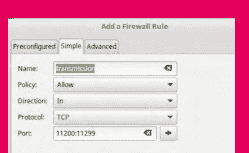


## 04 自定义规则

`Gufw` 允许您调整默认规则，这在您使用非默认端口运行服务时特别有用。切换到“简单”选项卡，它与“预配置”选项卡类似，但不同于应用程序的下拉列表，它允许您手动指定服务的端口号。您可以添加特定端口（`23`）或端口范围（`11200:11299`）。

## 05 更多自定义

如果您需要根据需求进行细微调整，高级选项卡非常有用——例如，如果您只希望允许特定 `IP` 地址范围内的计算机通过特定接口访问 `SSH` 服务。由于防火墙按升序匹配流量规则，您还可以手动为您的自定义规则分配一个编号，以指定其在防火墙规则列表中的位置。

## 06 监控传入流量

`Gufw` 的一个特别有用的功能是实时监听报告。添加规则后，切换到“报告”选项卡，该选项卡列出了所有流量以及其他相关信息，如协议、端口、`IP` 地址和应用程序。您可以使用这些信息来调整规则，特别是针对传入流量。此外还有“日志”选项卡，它跟踪 `Gufw` 的活动，有助于识别任何可疑活动。

## 功能

### 保护您的系统

#### 快速提示

#### 手动挂载

在新的 `Linux` 系统上要做的事情之一，是禁用 `USB` 闪存盘等可移动设备的自动挂载。

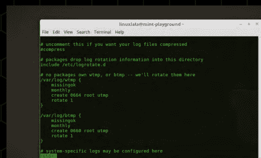

- **右侧**：您的系统日志文件可以分为四大类：应用程序日志、事件日志、系统日志和服务日志

- **横向**：完成扫描后，`Lynis` 将提供若干建议，您可以将其纳入以改进系统安全性

`Linux` 机器的安全不仅仅是安装软件的问题。它需要积极参与，以监控由众多工具和应用生成的日志文件和其他报告。您还必须解释这些报告，并在必要时采取进一步措施来威慑攻击者。除非您愿意做所有这些工作，否则您的机器很快就会成为各种可疑活动的宿主。但不要恐慌。您可以通过自动化其中一些任务来提供帮助。

### 自动化系统监控

网络分析器（通常称为嗅探器）是一种收集和捕获所有网络流量的程序。您可以使用它来确定是否有恶意实体正在攻击或已经攻击您的网络。当您的机器设置为混杂模式时，网络接口将收集通过该接口传递的所有网络流量。

您可以使用 `ngrep` 工具实时监视您的网络。它甚至允许您根据特定参数分离数据包。使用它的最简单方法是在终端中运行 `ngrep` 命令来监视通过网络传递的所有流量。如果您以前从未使用该工具，最好最初先研究 `ngrep` 的输出。稍后您可以开始尝试不同的过滤器，这些过滤器允许您基于主机、类型、协议或方向（流量方向）聚焦于特定数据包。您可以使用：`ngrep port_number > /tmp/ngrep-log` 将流量详情转储到日志文件中，以便稍后研究。

### 创建 cron 作业

`Cron` 是一个基于时间的调度器，您可以使用它在特定时间和日期运行定义的操作。它通常用于执行例行任务，如备份。每个计划操作都称为 `cron` 作业。您可以创建这样的 `cron` 作业，通过安排 `lynis` 和 `chkrootkit` 每天运行，以确保您的系统未被入侵。您可以使用 `crontab -e` 创建 `cron` 作业。这会在文本编辑器中打开 `crontab` 文件，然后您可以添加任务。`Cron` 作业的语法为：`分钟 小时 日 月 星期`。也就是说，您可以定义每个任务应运行的分钟、小时、日期、月份和星期几。最好安排 `chkrootkit` 每天运行。您可以在 `crontab` 文件中添加以下内容，将其配置为每天凌晨 1 点运行：

```
0 1 * * * /usr/sbin/chkrootkit > /tmp/chkrootkit_log 2>&1
```

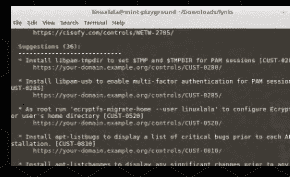

### 处理日志文件

您的 `Linux` 系统、众多的应用程序和工具，以及许多日常操作（如软件管理）都会生成日志文件。这些文件有三个主要用途。它们可以帮助您排除系统故障，例如软件安装失败的原因。其次，日志可以作为安全事件的早期预警系统。从安全角度来看，如果您确信您的系统已被入侵，日志可以帮助您进行取证调查。

只有当您熟悉系统在正常操作期间日志的样子时，才能依赖日志来确定某些事情出了问题。至关重要的是能够区分正常活动与有人试图攻击系统。只有当您不仅收集日志，还定期研究它们时，才能做到这一点！

在处理日志时，您还必须针对诸如日志记录频率等各种因素制定完善的策略。您还应定期备份日志文件，因为将当前日志与存档进行比较可以帮助您检测恶意活动。同时，您不能无限期地保留日志文件，因为随着时间推移，它们可能会占用大量空间。

### 管理日志文件

您可以使用 `logrotate` 轻松管理日志文件。它支持日志文件的自动轮换、压缩和邮件发送，并可以通过编辑 `/etc/logrotate.conf` 文件进行配置。`logrotate` 实用程序允许您定义轮换频率（每周或每月）以及每个日志使用的日志文件数量。您还可以为不同的日志文件设置不同的参数，并定义日志是否根据其大小进行轮换，以及轮换日志文件的存储周期。

例如，如果 `output.log` 文件的轮换设置为 10，`logrotate` 实用程序将自动创建 `output1.log`、`output2.log`，依此类推，直到 `output10.log`，而最新的日志将存储在 `output.log` 中。手册页有更多详细信息，由于该工具已存在很长时间，您很容易在互联网上找到详细的说明和示例。

另一个流行工具是 `logcheck`。它旨在定期扫描所有日志——它从上次的停止处开始扫描，节省了宝贵的时间。该高度可配置的工具允许您定义检查频率、要检查的日志文件、什么被认为是正常的以及什么不是，以及将警报发送到何处。您必须定义工具可以忽略的正常行为，否则您将被警报淹没。

### 搜索日志文件

日志监视员武器库中的另一个重要工具是 `swatch`。它通过查找指定的正则表达式并在找到匹配项时立即通知您来工作。

调用 `swatch` 的用户必须创建一个 `~/.swatchrc` 文件，该文件描述忽略和监视指令以及通知电子邮件地址。监视器条目是当找到匹配项时您希望收到警报的关键字列表。为了充分利用 `swatch`，您必须熟悉正则表达式。此外，如果您希望电子邮件发送到 `Gmail` 等外部服务，您的系统必须配置为同时向本地用户和互联网域发送邮件。

配置完成后，您可以使用 `swatch` 监视多个日志中的关键关键字。


#### 存储配额

对于多用户系统，您应启用配额并将用户限制在固定的磁盘空间量内。这可以防止如果用户账户被入侵时的滥用情况。


## 必备浏览器扩展

当然，下载扩展时必须谨慎。幸运的是，`Firefox` 和其他 `Web` 浏览器有几种有用的扩展可用。


- **HTTPS Everywhere**：适用于 `Firefox`、`Chromium`、`Opera` 和许多其他浏览器，它确保与网站的所有通信都经过 `SSL` 加密。

- **Ghostery**：此扩展禁用了 `Facebook` 和 `Google` 等网站上的跟踪器，使得即使您离开网站后数据也不会被收集，这正日益成为常态。

- **NoScript**：禁用网页上的所有脚本，如 `Flash`、`Java`、`JavaScript` 和其他可执行内容。它允许您创建受信任网站的白名单，例如您的银行，但需要适应。

- **WOT**：`Web of Trust` 维护着一个受信任网站的列表。对于您访问的每个网站，绿色图标表示可信网站，黄色提示您要谨慎，红色表示潜在危险。

- **BetterPrivacy**：`SOS` 是包含更详细信息（包括您的浏览偏好）的“超级 Cookie”。使用 `BetterPrivacy`，您可以选择以固定时间间隔删除 `LSOS`。

## 保护你的系统

到目前为止，我们已经讨论了许多你可以采用的工具和实践方法，以保护你的系统并防止攻击，但根据你是想保护你的服务器、网络，甚至是家用工作站，你仍然还有大量可以做的事情。

所有可用解决方案的全集很容易导致因分析过多而产生的焦虑瘫痪，这就是为什么我们列出了一些最好的防护工具。但仍有许多其他项目和机构正在努力保护你的机器免受损害。

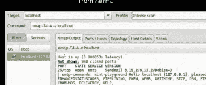

下方的 `Nmap` 前端 (`NmapFE`) 是一个设计精良且稳定的图形用户界面 (`GUI`)，允许你控制 `Nmap` 的几乎所有方面。

`Linux` 安全模块 (`LSM`) 框架允许 `Linux` 内核支持多种安全模块以实施强制访问控制 (`MAC`)。`SELinux` 和 `AppArmor` 是 `Linux` 上最受欢迎的两个 `LSM`。前者允许你定义每个用户、进程或守护程序可以执行的操作，而 `AppArmor` 可以使用特定于应用程序的配置来限制每个已安装的程序。容器供应商 `Docker` 也在开发另一个名为 `Landlock` 的 `LSM`，尽管它仍处于起步阶段。

除此之外，随着每个新 `Linux` 内核发布的更新中都有大量修复，修复了许多已识别的问题，以确保你的安全。在此基础上，内核自我保护计划 (`Kernel Self-Protection Project`) 已启动，旨在为 `Linux` 内核提供额外的安全层。你還可以调整内核的多个参数以增强安全性。运行 `sysctl` 可查看当前内核设置的列表。你可以使用以下命令将这些设置保存到文件：`sysctl -a > /sysctl1.settings`，这将使你能够将该文件用于参考或比较，如果你进行任何更改的话。

你可以通过编辑 `/etc/sysctl.conf` 文件来更改运行中的内核设置。在 `Linux Mint` 中，该文件已经存在并包含其中许多设置，但默认情况下它们是被禁用的。

系统安全面临的最大风险之一来自未经测试和未知的应用程序，你必须采取预防措施来保护系统免受此类程序的侵害。实现这一目标的一种方法是通过沙箱化 (`sandboxing`)。

### 如何操作：使用 zuluCrypt 加密文件

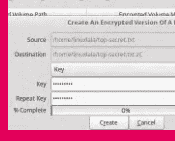


- **01 加密单个文件**

  前往 `ZC > 加密文件 (Encrypt A File)`。在弹出的对话框中，点击“源 (Source)”字段旁边的按钮，并导航到你想要加密的文件。然后在标记为“密钥 (Key)”的文本框中输入密码。`zuluCrypt` 将使用此信息创建一个同名文件，结尾带有 `.zc` 扩展名。文件加密后，请确保删除其原始版本。

- **02 解密文件**

  前往 `ZC > 解密文件 (Decrypt A File)`。在“源 (Source)”字段中指向加密文件，并在“目标 (Destination)”字段中指向解锁文件的位置。现在输入你用于加密文件的密码，然后点击“创建 (Create)”按钮。完成后，解密后的文件将在指定的目标位置创建。若要再次锁定文件，请按照第 1 步中概述的流程对其进行加密。

- **03 创建加密文件**

  如果你需要保护多个经常访问的文件，更好的方法是将其存放在加密存储区域中。要在文件内创建加密存储设备，请前往 `创建 (Create) > 文件中的加密容器 (Encrypted Container In A File)`。然后输入名称，完成目录的部分路径及其大小，这取决于它将容纳的文件数量以及你磁盘上的可用空间。


这涉及到为脚本或应用提供一个隔离的环境，从而保护你安装的大部分系统。

### 使用 chroot 进行沙箱化

`Linux` 中最古老的沙箱化工具 `chroot` 可用于更改进程的根目录。这可以防止 `chroot` 监狱内的应用访问其他目录或文件。类似地，像 `Docker` 这样的容器也可以用于运行隔离的应用程序实例。

如果你因为感到连接互联网时需要执行太多任务才能感到安全而有些不安，可以考虑使用 `Subgraph OS`。基于 `Debian` 的该发行版是从底层设计的，专注于安全和隐私。它附带一个加固的 `Linux` 内核，以及开箱即用的应用程序沙箱化、防火墙和代理功能。

尽管有所有这些工具，你必须理解，实现一个完全安全的系统是一个无法实现的目标。这是因为，用 `Linus Torvalds` 的话说，这个过程要求你：

> “拔掉网线并对物理安全实施严酷的措施。”没有适用于所有情况的安全黄金法则，即使有，它也早已被破解。

安全是需要持续工作和个性化的。通过结合讨论过的所有工具的权重，你将获得良好的系统安全的三个基本要素——预防、保护和检测——这是任何人都能期望的最多。

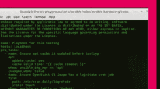

## 加固你的系统

### 自动安全加固

安全加固涉及从安全角度识别配置不当的系统并使其符合安全标准。这适用于系统的不同层，例如网络，在那里它将启用防火墙。在软件层面，加固涉及移除存在已知问题的软件包，仅允许安装签名软件包等等。

`Ansible` 是一个流行的加固工具，执行上述所有操作及更多。然而请注意，你仍然需要手动更新软件包和安装安全更新。要安装并运行 `Ansible`：

```
pip install ansible
ansible-galaxy install git+https://git.openstack.org/openstack/ansible-hardening
```

### 快速提示

#### 加密文件

你可以使用 `Vim` 的 `-x` 开关来加密文件内容，这样除非知道用于加密的短语，否则其他人无法读取它。


- **04 卷类型**

  当你点击“创建 (Create)”时，`zuluCrypt` 会弹出另一个窗口。除了指定密码外，你还必须从下拉菜单中选择一个卷类型 (`Volume Type`)。如果你想将加密卷在 `Linux`、`Windows` 和 `macOS` 计算机之间共享，`TrueCrypt` 或 `VeraCrypt` 卷效果最好。对于加密卷的其他值，如加密算法和文件系统，你可以安全地坚持使用默认选项。


- **05 挂载卷**

  在你可以将文件存储在这个加密卷中之前，你首先必须解密并挂载它。前往 `打开 (Open) > 托管在文件中的卷 (Volume Hosted in a File)`。使用弹出窗口中的文件按钮导航到加密容器文件。你可以选择性地输入文件的挂载名称，否则只需输入密码并点击“打开 (Open)”。一旦你的卷被挂载，它将像其他任何已挂载的文件系统一样出现在你的文件系统中。


- **06 使用后备机**

  现在你可以在这个挂载位置内创建目录和文件，就像在任何常规挂载设备上一样。完成后，在 `zuluCrypt` 界面上左键点击已挂载的卷并选择“卸载 (Unmount)”。这将卸载并加密卷，再次出现的只是一个内容无法识别的单一加密文件。按照 **步骤 5** 中的流程再次挂载该文件以显示其内容。

## 随机性的问题

### 你的随机性有多随机？

随机性位于安全的核心。它不能再靠运气——是时候予以关注了。


**理查德·穆尔德斯 (Richard Moulds)** 是 `Whitewood Security` 的总经理，拥有 20 年安全市场从业经验，专注于与密码学相关的部署挑战。


**R**andom numbers 真的非常重要。它们用于大多数计算机处理中。大多数情况下，它们是否真正随机并不重要，但在某些情况下则至关重要。在统计建模、游戏和安全方面，它们需要是可证明的随机数。对随机数最极端的要求来自密码学。随机数用于生成加密密钥，如果缺乏随机性，它们将更容易被破解。但制造完全随机的数字比你想象的要困难得多。

任何使用 `SSL/TLS` 或 `SSH` 进行网络加密的应用程序，都需要真正的随机数。基于 `PKI` 的数字签名应用程序以及专业加密应用程序，如支付和加密货币（这些领域受到严格监管并有着严格的合规要求）也是如此。弱密钥不仅会产生漏洞，而且更换成本极高。

但随机数从哪里来？通常是操作系统。无论应用程序只需要几个字节，还是需要完美的或“附近”随机数的许多兆字节，它们都来自同一个地方。就像在你家里一样，所有使用水的设备通常都从同一个供水系统获取水，无论其对水质或处理量的需求如何（见上文插图）。简而言之，关键的安全应用程序与更普通的任务竞争。

> “问题是软件不会自然地表现出随机性”


-   `/dev/random`

    优质流：仅在捕获了足够的熵时才提供随机数 – 否则它会停止

-   `/dev/urandom`

    低质量流：无论捕获了多少熵，都会提供随机数

随机性，如果随机性成为一种稀缺资源，这可能是一个严重的问题。

认为随机性可能会耗尽这很奇怪。问题是软件不会自然地表现出随机性。软件是确定性的：它是预编程的，从根本上说是可预测的。基于软件的随机数生成器通常被称为伪随机数生成器 (`PRNG`) 或确定性随机位生成器 (`DRBG`) – 但这两个名称都暗示了低于真正随机性的东西。它们使用众所周知的算法，将相对少量的随机“种子”外推为大量的“随机”数字。无论软件 `PRNG` 设计得多好，它本身无法创造随机性。一个类比是一个让歌曲更大声但不更好的音频放大器。

如果 `PRNG` 种子不佳，输出就有变得可预测的风险。另一个类比是发一副扑克牌。`PRNG` 相当于发牌的过程，而提供随机种子等同于洗牌；发牌的随机性完全取决于洗牌的质量。`PRNG` 可能遭受易错的实现或甚至是故意留下的后门，但其核心安全完全取决于种子过程的随机性。

`Linux` 有两个 `PRNG`；它们相似，但在一个重要方面有所不同。两者中更安全的 是 `/dev/random`，它每次请求随机数时都会重新播种。作为一种安全措施，只有当有足够的随机性重新播种时，`/dev/random` 才会启用，这反过来又可能导致严重的性能下降。另一种 `PRNG`，`/dev/urandom`（“u”代表“非阻塞”），无论它是否播种良好，都会提供“随机”数字。由于 `/dev/urandom` 始终可用，它成为开发人员一种流行但可能不明智的选择。

这种对重新播种的依赖提出了明显的问题。是否有可靠的种子来源？如何证明它们是真正随机的？`PRNG` 需要多久重新一次播种才能保持随机？如果你知道某事出了问题并且你的随机数不再随机，如何察觉？不幸的是，没有可靠的答案。

优质随机性与劣质随机性的主要区别在于**熵**，即无序性的统计度量。没有偏差、相关性或模式的数据被认为具有高熵。一个8位数字可能包含5.2位有效熵。但熵只是追求随机性的一部分。随机数还必须是完全不可预测的。圆周率 `Pi`（3.1415926535897932384...）的数字可能看起来随机并包含统计熵，但很容易被预测。证明随机性需要了解数据最初是如何生成的以及使用了哪些熵源。

幸运的是，我们的世界充满了熵。但将其应用于计算机系统并非如此简单。开发者发明了多种方法从物理世界——熵实际存在的唯一地方——收集自然熵。一些 capable 用户活动，如鼠标移动和键盘点击，麦克风噪音，甚至使用相机检测熔岩灯的运动。`Linux` 监控计算机硬件，包括磁盘驱动器中断、`CPU` 计数器和时序抖动。这些信号都不是完全随机的，但当它们组合在一起时，可以近似达到可接受的随机性。

缺乏熵或破坏熵源的攻击可能无法被检测到，为了缓解这些威胁，可以使用专用硬件设备作为补充熵源。例子包括 `USB` 令牌、硬件安全模块（`HSM`）、嵌入式 `CPU` 特性（例如 `Intel` 的 `rdrand`）和智能卡。这些确实有帮助，但挑战在于专用硬件会带来其自身的问题。例如，企业数据中心可能禁止使用 `USB` 令牌，而在公共云或托管环境中添加任何额外硬件可能都是不可能的。特别是在高度虚拟化环境中或资源受限的物联网设备上，我们面临双重打击。本地熵源很可能质量很差，而且很难或不可能添加额外硬件。

特别是对于容器和虚拟机而言，由于缺乏物理用户和设备（如硬盘），熵的收集可能完全依赖于低质量的来源，例如中断和计数器。

从 `DevOps` 的角度来看，虚拟化是一个伟大的概念，但 `hypervisor` 可以为熵创建一个虚拟防火墙，将应用程序需要随机性的虚拟世界与熵实际存在的物理世界隔离开来。当虚拟机作为快照复制时，虚拟化环境中缺乏熵的问题变得更加严重。每个快照可能包含相同收集的熵副本和软件 `PRNG` 的相同内部状态——这实际上是在牌堆洗牌后复制牌堆。这使得频繁重新播种变得更加重要。

在典型企业中的众多应用程序和设备之间生成随机数，其不一致性和未知性是不可避免的。每个应用程序实例获取熵的能力不同。使用不同的服务器硬件、不同的操作系统版本以及个体用户存在（或缺失）都会引入熵可用性的不一致，从而影响密钥生成的质量——在安全背景下，这始终是一件坏事。这创造了攻击者可以利用的隐蔽弱点区域，并让人质疑合规性声明。

现实是，随机数生成最好被描述为一种“本地尽力而为”：

-   如果可能生成密钥、测试其随机性并简单地拒绝那些不随机的密钥，我们可以绕过熵收集方面的缺陷——但糟糕的随机性并不是容易检测到的。

-   熵饥饿无法以被动反应的方式解决。

-   改进随机性的方法意味着必须在最初就将高质量熵源架构化到安全系统中，并使其广泛可用。简而言之，真正的随机数生成需要成为标准尽职注意义务的一部分。

## 随需而取的熵


而不是仅仅依赖每个应用程序实例的本地熵源，可以通过网络作为远程服务提供熵。共享熵源可以根据需求向许多需要增强熵的应用程序实例提供熵。这种面向服务的模型使得本地熵水平可以被监控和维护，从而无论操作系统运行在什么硬件上、存在什么虚拟化层以及是否有用户活动，`Linux` 内的 `PRNG` 都能频繁且良好地播种。

结果是 `/dev/random` 不再阻塞，而 `/dev/urandom` 被充分播种到可以被视为真正的随机数生成器。优点在于应用程序和操作系统无需修改。应用程序继续请求随机数，操作系统继续收集本地熵。补充熵的可用性有点像维生素补充剂——为应用程序实例群体带来确定性和一致性。

通过网络交付熵依赖于安全的通信通道以及能够生成足够随机种子的能力，以满足整个数据中心或物联网设备群的需求。建立对该熵质量的高度信心也很重要，出于这个原因，供应商通常会转向量子力学。基于量子的熵源利用亚原子水平的随机行为。这种行为本质上是随机的。就部署选项而言，解决方案以公共云服务和本地私有系统形式存在，以建立内部的私有熵服务。

随着时间的推移，基于网络的熵服务可能会被视为安全数据中心的基本要求。作为一种威胁工具，即开即用的熵（`entropy-as-a-service`）缓解了虚拟化环境和其他熵可用性不可靠、质量差或未知情况下的熵饥饿威胁。这是为了确保所有应用程序实例都能独立于硬件和物理环境访问真正的随机数，从而能够生成最高安全性的密钥。

您可以通过注册 `www.getnetrandom.com` 免费试用即开即用的熵服务——下载 `Linux` 代理并自动开始流式传输真正的量子熵。

# LINUX MINT 有什么新变化？

**Paul O'Brien** 深入探讨 `Linux Mint` 的开发；它是如何成长为被数百万人使用的，以及这个社区主导的发行版有什么新变化。

-   `Linux Mint` 可能没有获得与其基于的发行版（`Ubuntu`，因此是 `Debian`）相媲美的大量篇幅报道，但凭借数百万用户，它是目前最受欢迎的发行版之一。`Linux Mint` 始于 2006 年 8 月，1.0 版本（代号为 '`Ada`'）是一种快速实验性发行版，包含创始人 `Clem Vefeivre` 在在线评测中讨论的功能理念。该实验反响良好，新用户提供了许多功能请求以补充 `Clem` 自己的想法和改进。到 2007 年 2 月 2.2 版本 '`Bianca`' 发布时，项目已获得重大关注，显然其目标应该是让 `Mint` 与当时可用的最佳发行版竞争。

-   `Linux Mint` 从一开始就迅速获得巨大 popularity 的原因是开发团队从一开始就倾听其忠诚社区的反馈，并在一频繁发布和巨大增长的时期持续这样做（同样的社区关注口号至今适用）。`Mint` 历史上的一个关键时刻是 `GNOME` 3 的发布。团队最初对发行版的未来感到不确定，因为 `GNOME` 更新与 `Mint` 的目标不一致。团队最终选择分叉 `GNOME Shell` 以创建 `Cinnamon`，这是一个替代桌面环境，尽管它本身不要求安装 `GNOME`，但它保持真实

### 时间线

-   **2006 年 8 月 27 日**


Linux Mint 的第一个版本发布，基于 Kubuntu 6.06。1.0 版本 'Ada' 将是 Mint 发行版中唯一仅提供 KDE 桌面环境选项的版本。

- **2008 年 6 月 8 日**

  Linux Mint 的第一个“长期支持”（LTS）版本随 5 版本 'Elyssa' 到来。基于 Ubuntu 8.04，该发行版提供多种变体和多个桌面环境，包括 Fluxbox。

- **2010 年 5 月 18 日**

  Fluxbox 桌面环境像它出现得那样迅速，最后一次出现在 Linux Mint 发行版中，即 9 版本 'Isadora'。Xfce 仍然作为超轻量级环境提供。


# 概览

## Mint 18.2 的新进展

- **更佳的蓝牙支持**
  - 随着 `Blueberry` 界面的加入，18.2 中的蓝牙支持得到了大幅改进。

- **新的显示管理器**
  - Mint 18.2 弃用了 `MDM`，改用 `LightDM` 作为显示管理器，并支持 `X`、`Wayland` 等更多功能。

- **精致的登录界面**
  - 18.2 包含了由 `LightDM` 驱动、支持 `HiDPI` 的“Slick”登录界面，它是 Unity 登录界面的一个分支。

- **Mint-Y 精修**
  - Mint 18 引入了基于 `Arc` 的新主题 `Mint-Y`；18.2 增加了更多的视觉润色和新壁纸。

- **更新的环境**
  - `Cinnamon` 更新到 3.4 版本，`MATE` 更新到 1.18，`KDE` 更新到 `Plasma` 5.8.7，`Xfce` 更新到 4.12。

- **Linux 内核选项**
  - 版本 4.6、4.8 和 4.10 的内核可以直接通过 Mint 更新的内核管理工具获取。


该界面具备 `GNOME Shell` 中用户喜欢的特性。Linux Mint 的既定目标是打造一个“现代、优雅且舒适的操作系统，既强大又易用”。作为一个开箱即用的发行版，Mint 无与伦比。它捆绑了完整的多媒体支持，包括用于 `Flash`、`MP3` 和 `DVD` 播放的专有编解码器。虽然在 Linux 社区中这颇具争议，但它确实提供了最佳的用户体验。本着开箱即用的精神，标准版包含广泛的应用程序，包括 `LibreOffice`、`Firefox`、`Thunderbird`、`VLC` 和 `GIMP`。

Mint 通常被视为初学者的良好 Linux 发行版，特别是使用 `Cinnamon` 桌面环境时，而默认包含 `Wine`（Windows 兼容性层）则进一步增强了这一优势。“Mint4win”允许直接从 Windows 安装 Linux Mint，这与 Ubuntu 中的“Ubiquity”安装程序功能类似。这是一个特别有用的工具，因为它无需对主系统驱动器进行重新分区。由于 Linux Mint 基于 `Debian` 和 `Ubuntu`，它提供超过 30,000 个软件包以及市面上最好的软件管理器之一。其可靠性值得注意，这得益于对软件更新的保守策略以及一个名为 `mintUpdate` 的独特更新管理器，它是 `MintTools` 套件的一部分。该更新管理器旨在防止 inexperienced 用户安装不必要的更新或需要特定技术知识才能安装的更新，方法是基于更新的稳定性和必要性为更新分配一个安全级别（从 1 到 5）。

`MintTools` 中还包含 `mintinstall`，这是一个用于从 `Ubuntu` 和 `GetDeb` 仓库安装 `.mint` 文件或软件包的管理器。其他历史上包含的工具包括 `mintMenu`，一个方便的全局菜单；`mintBackup`，一个备份工具；`mintUpdate`，一个更新管理器；`mintHammy`，一个基本的家长控制工具；`mintDesktop`，一个桌面配置工具；以及 `mintWelcome`，一个浮动欢迎屏幕。

Linux Mint 的第一个 18.x 版本是该发行版发展历程中的一个重要里程碑。其底层基础更新为 `Ubuntu` 16.04 LTS，特别是 `Cinnamon` 和 `MATE` 桌面经过精炼——遵循进化路径而非选择激进的变革，在一个动荡的世界中（尤其是对于正在从 `Unity` 转换的 `Ubuntu` 而言）提供了一些令人欢迎的稳定性。回顾 Linux Mint 的根源，安装、使用和稳定性比以往任何时候都更好，为从 Windows 跨过来的用户提供了良好的体验。新的 `Mint-Y` 主题首先在“Sarah”版本中预览，随后基于用户反馈进行了调整和精炼（当然，这正是 Mint 的特色！）。


# 桌面环境

## Cinnamon 3.4 的新特性

`Cinnamon` 3.4 于今年五月发布，现已进入最新的 Linux Mint 版本（也可以安装在其他发行版上）。虽然主要是一个修复错误和提升性能的版本，但新版本添加了许多新功能，包括桌面网格、多进程改进、文件搜索中的通配符支持、面板启动器中的桌面操作、额外的屏幕保护程序配置选项、更好的鼠标加速和灵敏度配置，以及在系统设置中管理 `systemd` 单元和支持 `lightdm` 设置（由于 Mint 18.2 转向 `LightDM`，这一点很重要）。一个新的网站 - `https://cinnamon-spices.linuxmint.com` 现已可供 `Spices` 使用：包括 `Cinnamon` 的主题、小部件、桌宠和扩展。目前约有 300 个可用，允许对 `Cinnamon` 体验进行广泛的自定义。

### 2010 年 9 月 7 日

`LMDE` 是 Linux Mint 的一个替代版本，基于 `Debian`。`LMDE` 实现为滚动发布发行版，不绑定于特定的发布时间表。

### 2011 年 5 月 26 日

Linux Mint 11 'Katya' 是最后一个包含特定 `x64` 支持镜像的版本。随着平台使用越来越广泛，这些镜像已整合到后续所有版本的主镜像中。

### 2011 年 11 月 26 日

带有 `MATE` 桌面的第一个 Mint 版本出现在 12 'Lisa' 版本中，同时还有 `Cinnamon` 的前身“GNOME 3 with MGE”。`MATE` 实际上是 `GNOME` 2 的精神继承者。

# 额外应用


## Pix

一个图像浏览器、查看器、组织器和编辑器，支持数码相机导入、幻灯片放映、图像重命名、图像转换和重复项删除。此外还有插件系统以支持扩展。


## Xplayer

一个强大的媒体播放器，可以读取多种文件格式。该应用支持 `DVD` 播放、电视输出、全屏模式、键盘控制、字幕，并且像 `Pix` 一样具有可扩展的插件系统。


## Xed

这款文本编辑器在 Mint 18 中取代了 `Gedit` 和 `Puma`。虽然是一个简单的编辑器，但 `Xed` 比大多数编辑器功能更多，包括语法高亮、远程文件编辑、文件比较、文件历史、插件自定义和基于标签的界面。

对于版本 18，更新故事再次进行了重大更新。对于喜欢 `shell` 的用户，`apt` 命令获得了与同名 `Debian` 工具的兼容性。在图形界面方面，更新管理器（`Update Manager`）享受了一些重大改进，提供三种广泛的更新设置选择：安全选项，仅提供稳定更新；默认选项，安装稳定更新但也提供可能影响稳定性的更新；以及“放下谨慎并更新所有内容”选项，如果你不怕搞坏东西的话。Mint 中的内核更新工具是一个真正的高光亮点，超越了其他发行版提供的任何工具，允许你轻松安装和测试较新的内核。Linux Mint 18.1 'Serena' 代表了原始版本的一个小型更新。

> 2017 年 7 月发布了 Linux Mint 18.2 'Sonya'，这是一个长期支持版本，将得到支持直至 2021 年

`Cinnamon` 3.2 增加了更多的润色，包含的 `X` 应用接收了小的界面调整，而且——你猜对了——软件更新和安装也得到了精炼。登录屏幕显示管理器 `MDM` 接受了一些最显著的技术改进，这说明了问题的严重性。

2017 年 7 月发布了 Linux Mint 18.2 'Sonya'，这是一个长期支持版本，将得到支持直至 2021 年。Mint 18.2 提供 `Cinnamon`、`MATE`、`KDE` 或 `Xfce` 桌面环境，并且再次基于 `Ubuntu` 16.04。


Linux Mint 18.2 'Sonya' 在基础系统中包含了许多新功能和改进，并且在每个支持的桌面环境中也进行了额外的更改。对于常规蓝牙用户来说，新的 `Blueberry` 用户界面是一个巨大的福音。除了大幅改进的用户界面外，`Blueberry` 还增加了协议切换器、开箱即用的 `OBEX` 文件传输支持（使您可以轻松地从蓝牙设备（如手机或平板电脑）向计算机发送文件）以及更改计算机蓝牙名称的选项。在最新版本中，对包含的 X 应用投入了大量工作。文本编辑器 `Xed` 在用户界面方面有了重大改进。智能侧边栏和底边栏、深色主题、行排序、键盘和鼠标驱动的缩放、正则表达式搜索、简化的标签切换以及改进的换行可访问性等功能，使该应用比以往任何时候都更强大。媒体播放器 `Xplayer` 也在用户界面方面进行了改进。由于播放控制和进度条位于同一行，且状态栏被移除，界面更加紧凑。键盘快捷键得到改进和扩展，并且与 `Xed` 一样，增加了对深色主题的偏好支持。之前存在一定 bug 的屏幕显示也已修复。`Pix` 图像工具现在包含改进的键盘快捷键，并得到了一点视觉润色。`Reader` PDF 工具经历了更广泛的重新设计，并增加了触摸屏支持，特别是如果您在可转换机器上使用 Mint 时非常有用——现在您可以用手指在屏幕上滑动以快速浏览页面，甚至可以通过捏合操作进行放大或缩小。

最新版本的 `Cinnamon` 3.4 更新伴随着一次重写：从零开始构建的 `Cinnamon Spices` 网站。重写的目标不仅仅是简单的外观大修——该项目专注于提高安全性，并确保比以往更好的质量和兼容性。这意味着一些 Spices 被移除，许多被更新以使其达到适合其新环境的标准。这一努力的动机很容易理解。Spices 的质量，就像 `GNOME` 扩展一样，在 `Cinnamon` 的整体感知中起着重要作用。朝着“一切只需正常工作”这一既定目标取得的进展，随着此版本的发布又近了一步。

### 时间线

- 2012 年 5 月 22 日

  - Linux Mint 13 'May' 版本是第一个将 `GNOME Shell` 分支 `Cinnamon` 作为默认桌面环境提供的版本。还提供了 `MATE`（在版本 12 中添加）、`KDE` 和 `Xfce`。

- 2013 年 5 月 29 日

  - 自版本 16 'Olivia' 起，所有不同桌面环境的版本共享相同的共同代码库。版本 15 基于 `Ubuntu` 13.04，提供 `Cinnamon`、`MATE`、`KDE` 和 `Xfce`。

- 2014 年 5 月 31 日

  - 版本 17 'Olivia' 是第一个支持点更新（point sub-releases）的版本。命名约定似乎也已改变，保留女孩的名字，但 17.2 及以后的点更新不再使用字母表中的下一个字母。


`MATE` 桌面位于上方，是一个传统但美观的桌面环境。右上角。Mint 小部件是驻留在桌面上的小程序。右上方。Linux Mint 更新管理器是市面上最好的之一。

`Linux Mint` 18.2 的 `MATE` 版本搭载了 `MATE` 桌面 1.18 版，经过六个月的工作，终于完成了向 `GTK+` 的迁移。是的，整套应用程序和组件现在仅支持 `GTK3+`！新版 `MATE` 的其他改进包括支持；无障碍性大幅改善；`Caja` 文件管理器更新；升级的 `MATE` 面板；`Engrampa` 归档管理器支持更多格式以及 `MATE` 计算器的回归！

`Linux Mint` 的 `Xfce` 版本这次有较多的小更新，主要限于更新版本的 `Whisker` 应用程序启动器菜单以及 `xfwm4` 窗口管理器的升级，后者带来了 `Xinerama` 支持、缩放时的光标比例调整以及各种其他修复和改进。

`Plasma` 5.8 在 `Sonya` 的 `KDE` 版本中首次亮相。作为首个带有 `LTS` 支持的 `Plasma` 版本，5.8 具有全新的登录和锁定屏幕，旨在匹配主要 `KDE` 体验的外观和感觉。壁纸插件现在首次可以在锁定屏幕上显示。`KDE` 的小部件已更新以提高其效率。`Plasma Discover`（“`KDE` 软件商店”）已重新设计，多屏支持增强，`RTL` 语言支持显著扩展。

除了作为 `LTS` 版本在 2021 年前接收安全更新外，18.x 的后续 Linux Mint 版本将使用与 18.x 版本相同的软件包基础，简化升级过程。

Mint 有多主流？嗯，如你可能所知，Linux 在热门电视剧《黑客军团》中扮演了重要角色。角色们讨论过 `GNOME` 与 `KDE`、`GNOME 2` 和 `Kali Linux` 曾亮相——第三季计划将呈现 Linux Mint。保持关注！

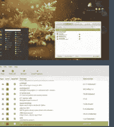


## 硬件

### `MintBox` 机器

`Compulab` 与 Linux Mint 团队之间的紧密合作推出了一系列微型 PC，它们预装了 Mint 即可使用。基于 `Compulab` 的 `fitel` 迷你 PC，有三种不同的 Mintbox 变体可供选择——高端的由 `Intel i5` 驱动的 `MintBox 2`，中端的由 `AMD A10` 驱动的 `MintBox Mini Pro` 以及低端的基于 `AMD A4` 的 `MintBox Mini`。尽管售价相对较高，但由于其口袋大小的尺寸、完全无风扇运行、良好的性能以及——当然——与 Linux Mint 出色的硬件兼容性，这些机器广受好评。

### 2015年4月10日

`LMDE 2 Betsy` 是基于 `Debian` 的 Mint 系统的当前版本，基于 `Debian Jessie`，再次采用滚动发布计划。`LMDE2` 提供 `MATE` 或 `Cinnamon` 版本。

### 2016年6月30日

在 18 “Sarah” 版本发布之前，曾提供 `OEM` 版本和无编解码器版本。`OEM` 版本因维护顾虑而被取消；编解码器选择现已集成到主要镜像中。

### 2017年7月2日

Linux Mint 的最新版本 18.2 “Sonya” 继续基于 `Ubuntu` 16.04，并提供增量更新和顺畅的升级路径。所有 18.x 版本均为 `LTS` 版本。


> *上方* 除了 `Cinnamon` 之外，该发行版还推出了基于 `MATE`、`Xfce` 和 `KDE` 桌面环境近期发布的版本

## 发行版

### Linux Mint 18.2 Beta

与对其前身的大动荡形成鲜明对比的是，Linux Mint 平静地提供了又一个出色的发行版。

- **内存** 16GB
- **存储** 20GB
- **规格** 1GHz 处理器和 HD 显卡
- 可从 `www.linuxmint.com/download.php` 获取

Linux Mint 无论是作为项目还是产品，随着每次发布都在不断成熟。事实上，最近几次发布如此稳固，以至于该项目似乎发布 beta 版本仅仅是为了遵循软件发布生命周期政策的例行公事。本次发布也不例外，它像之前的版本一样，基于经过彻底测试的 `Ubuntu 16.04 LTS` 发行版，符合 Mint 坚持使用 `LTS Ubuntu` 基础的新政策。Mint 已用 `LightDM` 取代其 `MDM` 显示管理器，`LightDM` 具有前瞻性，因为它支持包括 `Wayland` 和 `Mir` 在内的不同显示服务器。`LightDM` 驱动 Mint 的新问候程序 `Slickit`，该程序支持 `HiDPI` 分辨率。此外，默认情况下，Mint 启用了允许访客用户登录而无需输入密码的功能 - 如果你对此感到不安，可以更改设置。蓝牙支持也进行了全面更新，配置应用程序 `Blueberry` 拥有刷新后的界面。它现在开箱即支持 `OBEX`，因此与连接设备的文件传输就像在其他地方一样正常工作。你还可以使用 `Blueberry` 以更改计算机名称，这之前需要进入终端进行操作。

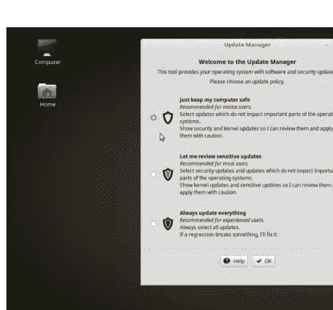

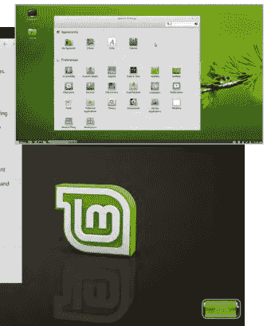

上方 你可以使用 `OEM` 安装选项来配置新计算机，然后用户可以在首次启动时进行自定义。

最有趣的变化在于更新管理器。Mint 重新制定了其更新过滤策略，使更新过程更安全、更简单，特别是对于被其他发行版的大量更新困扰的 Linux 初学者。Mint 根据更新对系统的影响对它们进行分类。大多数被标记为 1 级或 2 级，这些不会破坏系统。影响多个应用程序的更新为 3 级，而内核和其他核心组件的更新为 4 级。该应用程序有一个详细的文档部分，解释了这一关键领域。在用户级别光谱的另一端，新的 `mintupdate-tool` 将帮助经验丰富的用户通过 `cron` 任务和脚本安排更新。


`Mint 18.2` 使用 `Cinnamon 3.4`，提供了几个有用的新功能。长期用户会欣赏对齐、排序和更改桌面图标大小的功能。在幕后，开发人员将设置守护程序的不同插件分离到它们自己的进程中。这不仅使它们更容易跟踪，而且有助于桌面的整体稳定性，因为行为异常的插件不再会导致整个桌面崩溃。

你可以通过添加一系列小部件、桌面和主题来定制你的 `Mint` 安装。这些附加组件统称为“spices”，可在 `Cinnamon Spices` 网站 (`https://cinnamon-spices.inxi.com.int`) 上获取，该网站已从头重新设计。你可以使用新集成的社交工具在网站上探索和过滤 spices，然后手动下载它们或使用系统设置中的相关配置工具自动安装。

反映 `Mint` 成年的另一个方面是其核心实用程序集合，名为 `X-Apps`。这些本质上是流行 `GNOME` 应用程序的分支，现在以桌面无关的方式维护，以确保无论桌面环境如何都能获得一致的体验。从文本编辑器（`Xed`）和图像查看器（`Xviewer`）到 `PDF` 阅读器（`Xreader`）和媒体播放器（`Xplayer`），都有相应的 `X-App`。它们随 `Mint 18` 首秀，并且在这里都经过了进一步的调整和更新。

`Linux Mint 18.2` 将在 2021 年前接收安全更新。2018 年前推出的新 `Mint` 版本将使用与 `Linux Mint 18` 相同的软件包基础，这使得升级到点版本变得安全且简单。

`Mayank Sharma`

## 优点

一个精炼的桌面发行版，既稳定又直观，可以相对轻松地进行自定义。

## 缺点

它基于 `Ubuntu LTS` 发行版，这意味着它随附的是较旧的 `4.8.0-5.3` 内核。

## 总结

如果你一直在等待事情稳定下来再加入 `Mint 18` 的行列，那么不用再等了。`18.2` 中的变化，即更新管理器策略和将桌面插件分离到各自进程中，进一步巩固了其稳定性的声誉。

# 订阅

绝不错过任何一期


## 订阅并享受 20% 的折扣

每一期杂志，直接送到你家门口

- 绝不错过任何一期
- 一年 13 期，确保你能收到每一本
- 送到你家
- 每一期免费配送，直达你家门口
- 享受最大幅度的节省
- 直接订购，以更低的价格获得你喜爱的杂志

## 我们的读者怎么说...

> “我今天才刚发现这本杂志。它绝对很棒，正是我在找的东西。太让我惊喜了！”

> `唐纳德·斯莱特霍姆` 经由 `Facebook`

> “@`LinuxUserMag` 刚刚通过邮寄送达。哇，这一期太棒了！！我正准备开始把玩迷你电脑和电烙铁。谢谢”

> `@businessBoris` 经由 `Twitter`

> “感谢你们出色的杂志。我已经连续订阅好几年了。”

> `马特·卡斯威尔` 经由 电子邮件

# 选择适合你的订阅方案

## 最灵活

## 订阅并享受 20% 的折扣

- 自动续费 – 绝不错过任何一期
- 通过直接借记支付

每六个月定期支付 `£33.75`，比零售价节省 20%

**直接借记**

指示你的银行或建筑学会通过直接借记支付

发起人参考号 `768195`

| 字段 | 输入 |
| :--- | :--- |
| 银行名称 | [ ] |
| 银行地址 | [ ] |
| 账户名称 | [ ] |
| 邮政编码 | [ ] |
| 分行代码 | [ ] |
| 账户号码 | [ ] |
| 签名 | [ ] |
| 日期 | [ ] |

请根据直接借记保证中规定的保障规则，从本指示中详述的账户向 `Future Publishing Ltd` 支付直接借记款项。了解该指示可能会保留在 `Future Publishing Ltd`，我可能会定期向我的银行/建筑学会直接借记。银行与建筑学会可能不接受同类型账户的直接借记指示。

## 超值优惠

## 一年期订阅

- 超值优惠，全球可用
- 一次性支付，通过银行卡或支票

简单的一次性付款确保你在完整的一年内绝不错过任何一期。这一年共有 13 期，直接送到你家门口

`£67.50`（比零售价节省 20%）

`€88.54` `$112.23` `$112.23`

## 通过银行卡或支票支付

通过信用卡或借记卡支付 `VISA` `VISA` `Mastercard` `Amex`

| 字段 | 输入 |
| :--- | :--- |
| 卡号 | [ ] |
| 有效期 | [ ] |

通过支票支付

随附一张金额为 `£ [ ]` 的支票

抬头写为 `Future Publishing Ltd`

| 字段 | 输入 |
| :--- | :--- |
| 签名 | [ ] |
| 日期 | [ ] |

## 你的信息

| 字段 | 输入 |
| :--- | :--- |
| 姓名 | [ ] |
| 地址 | [ ] |
| 电话号码 | [ ] |
| 手机号码 | [ ] |
| 电子邮件地址 | [ ] |
| 邮政编码 | [ ] |

请将此表格邮寄至：`Linux User & Developer Subscriptions`, `Future Publishing Ltd`, `3 Queensbridge`, `The Lakes`, `Northampton`, `NN4 7BF`, `United Kingdom`

（如果你希望接收来自 `Future` 及其集团公司的通讯，其中包含新闻、特别优惠和产品信息，请勾选。）

安全在线订购 `www.myfavouritemagazines.co.uk/sublud`

## 咨询我们友好的客户服务团队

致电 `0344 848 2852`

这些优惠将于 2017 年 8 月 31 日到期，致电时请引用代码 `LUDPS17`

1 价格及节省金额是与购买全价印刷刊相比的。你将在一年内收到 13 期。你可以在购买后 14 天内随时致信取消订阅。除非有特殊情况，首个订阅期结束后付款不可退款。您的法定权利不受影响。价格以印刷时为准，可能会变更。有关直接借记保证的完整详情可应要求提供。英国通话费用与其他标准固定电话号码（以 01 或 02 开头）相同。电话号码可能在发票或费用中显示，并提前几分钟（通过电子邮件）或拨打你的电话号码。完整条款和条件请访问 `bit.ly/mygates`。优惠将于 2017 年 8 月 31 日结束。

# 教程

## Linux 基础


**`约翰·戈尔斯 (John Gowers)`**

是一名大学编程与计算机科学导师。他喜欢在他能接触到的每个设备上安装 `Linux`，并日常使用终端命令和 `Shell` 脚本。

## 资源

本教程中我们将使用的大多数工具在任何 `Linux` 发行版上都是标准的。但你可能需要安装 `wget` 命令。

### 第一步：在终端中使用管道、`grep` 和 `cat`

掌握 `Linux` 终端可能会让人望而却步，但一旦掌握，你会发现效率大幅提升。

如果你是 `Linux` 用户，你以前可能使用过终端，哪怕只是一两次，你可能也深入接触过 `Shell` 脚本的世界；终端是 `Linux` 的核心。虽然我们应当庆祝如今可以在不接触终端的情况下在 `Linux` 系统中完成大量工作这一事实，但如果你掌握了终端和 `Shell` 脚本，你就解锁了一个强大工具，它能让你更高效并让你对计算机拥有更大的控制权。使用终端比使用图形用户界面的学习曲线更陡峭，但它并不比学习一门编程语言更难，你会发现这份努力是值得的。

在这个教程系列中，我们将探讨如何使用 `Shell` 脚本和终端来改进你的工作流程并自动化常规任务。我们将从最基础的内容开始，迅速构建到更高级的主题。

成为终端大师的第一步是在你的系统上打开终端。在不同的发行版上操作方式不同，我们无法在这里提供全面的说明。找一个名为“终端”（`Terminal`）或“控制台”（`Console`）或类似名称的应用程序并打开它。如果你看到一个带有提示符和闪烁光标的窗口，如上图 1 所示，那么你就做对了。

要在终端中使用，我们在闪烁的提示符处输入命令并按 `Enter`。试着输入 `pwd` 并按 `Enter`。这个命令会显示当前终端所在工作目录的文件路径。现在输入 `ls` 并按 `Enter`。你应该会看到该目录中所有文件的列表。最后，我们将使用 `echo` 命令来发送问候语。`echo` 是一个将您选定的文本行打印回终端的命令：

```bash
$ echo 'Hello, world!'
Hello, world!
```

如果一切看起来都工作正常，让我们开始吧！

## 在终端中导航

为了开始使用终端，我们将创建一个新目录（文件夹）进行实验。创建新目录的 `Linux` 命令是 `mkdir`。输入 `mkdir sandbox` 并按 `Enter`；这将创建一个名为 `sandbox` 的新目录。

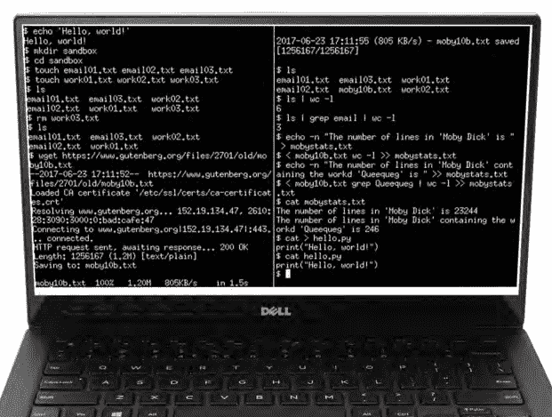

创建该目录后，我们需要进入它。使用 `cd` 命令更改目录。如果我们想进入新的 `sandbox` 目录，我们输入：

```bash
$ cd sandbox
```


如果你再次输入 `pwd` 并按 Enter，你会看到现在你已经在 `sandbox` 目录内部了。

我们将 `mkdir` 称为“命令”，但它实际上本身就是一个程序。事实上，终端的基本操作模式是：当用户输入一个程序名称时，运行该程序。程序可以在命令行中接受参数（例如，`mkdir sandbox` 中的 `sandbox`），这些参数会影响其行为。

正如我们稍后所见，这些程序可以组合在一起，形成一种强大的语言，其中程序扮演命令的角色。我们可以使用这种语言编写脚本来自动化重复性任务。

我们的新目录目前为空。事实上，如果我们现在在命令行输入 `ls` 并按 Enter，我们不会得到任何输出。为了演示各种命令，让我们在该目录中创建一些文件。我们将使用 `touch` 命令创建一些空文件：

```bash
$ touch email01.txt email02.txt email03.txt
$ touch work01.txt work02.txt work03.txt
$ ls
email01.txt email02.txt email03.txt
work01.txt work02.txt work03.txt
```

如果需要，我们可以使用 `rm` 命令删除文件：输入 `rm work03.txt` 以删除该文件。

通过 `touch` 创建的文件是空的。如果我们想要有内容的文件，我们需要使用不同的工具。如果你愿意，可以使用文本编辑器创建自己的文件进行实验，但在本教程中，我们将使用 `wget` 命令从互联网获取文本文件。

有可能你的系统上没有安装 `wget`。试着在命令行输入 `wget`：如果你收到“命令未找到”的错误，那么你需要使用你的发行版包管理器来安装它。

## 组合命令

安装 `wget` 后，输入 `wget https://www.gutenberg.org/files/2701/old/moby10b.txt` 并按 Enter。这将从在线公共领域存储库下载小说《白鲸记》的文本。你可以使用相同的命令下载万维网上的任何文件。你可能想再次输入 `ls`，以确保这个文本文件现在就在你的工作目录中，与我们刚才使用 `touch` 创建的其他文件在一起。

如果我们想要删除一个目录，可以使用 `rm` 命令。但是请注意，这只对空目录有效：

```bash
$ mkdir new
$ touch new/file.txt
$ rmdir new
上图 Linux 可用的终端模拟器有各种尺寸和颜色。你的系统上可能安装了不止一个
$ rmdir: failed to remove 'new': Directory not empty
```

为了删除包含文件的目录，我们可以使用 `rm -rf`。例如：

```bash
$ rm -rf new
$ ls
email01.txt email02.txt email03.txt
moby10b.txt work01.txt work02.txt
```

这是使用 `rm` 程序的一种新方式。`-rf` 部分被称为“开关”或“命令行选项”，它使 `rm` 以不同但相关的方式运行。每当你在 Linux 命令中看到一两个破折号后跟一个或多个字母时，你看到的就是命令行开关。`-rf` 包含两个字母，实际上是两个独立的命令行开关：`r` 告诉程序递归地删除目录及其中的所有文件，而 `f` 是“强制”的缩写。如果你省略 `f` 并写 `rm -r new`，那么 `rm` 有时会提示你询问是否真的想要删除这些文件。如果你确信自己不会误删错误的东西，你可以使用 `rm -rf` 来节省一些时间。

大多数 Linux 命令都有可以改变其行为的开关。例如，`echo -n` 打印短语时不在末尾换行。到目前为止，我们看到了单个命令的例子，但命令行的真正威力在我们组合两个或更多命令时才会显现出来。

## UNIX 是一个 IDE

有一种观点认为“UNIX 是一个 IDE”。其想法是，通过在一个或多个终端中运行命令，你可以复制在更高级的 IDE（如 `Eclipse`）中看到的相同功能。你可以在终端中运行 `nano` 和 `vi` 等编辑器，以及 `gdb` 和调试器等编程工具。如果你再添加一些 Shell 脚本来连接它们，你就可以在不离开终端的情况下高效编程。

# 教程

## Linux 基础

- **一切皆文件**

  类 UNIX 系统背后的哲学之一就是*一切皆文件*。甚至你在命令提示符中输入的文本也被当作文件处理。像 `grep` 和 `wc` 这样的命令不会终止，直到它们读完输入文件的末尾。如果你正在终端中输入，请使用 `Ctrl+D` 来标记输入的结束。

  当我们使用一种称为“管道”的设备将两个或多个命令组合在一起时，命令行的强大功能便显现出来。例如，统计当前工作目录中文件数量的一种方法是运行以下命令：

  ```bash
  $ ls | wc -l
  ```

  拆解并研究这个命令很有价值，可以看到每个部分的作用。`ls` 是我们已经见过的命令：它打印出工作目录中所有文件的列表。`wc` 是 'word count'（单词计数）的缩写：`wc` 是一个完全独立的程序，它接收文本作为输入，并返回单词数、行数和字符数。如果我们使用命令行开关 `-l`，则 `wc` 仅返回输入的行数。

  将这两个命令连接起来的是“管道”字符 `|`。管道意味着“获取前一个命令的输出并将其作为下一个命令的输入传递”。在这种情况下，`ls` 的输出是按行列出的工作目录中的文件列表。命令 `wc -l` 计算输出中的行数，这等于文件的数量。

## UNIX 哲学

Linux 使用的核心命令行工具链是以 UNIX 操作系统的命令为模型构建的，该系统可追溯至 1970 年代初。UNIX 的设计旨在既轻量又强大；这一目标最终凝结为“UNIX 哲学”，Doug McIlroy 在 1994 年将其总结如下：

> “编写程序只做一个事情，并做好它。编写能够协同工作的程序。编写处理文本流程序，因为这是一个通用接口。”

这使得它特别适合在命令行下进行脚本编写。这意味着 UNIX 程序本质上是像**图 2**中那样的盒子，它们接收一些文本作为输入并返回一些文本作为输出。我们将看到，可以使用管道字符将这些盒子组合在一起，如**图 3**所示。

如果愿意，我们可以组合两个以上的盒子。为了说明这一点，让我们介绍一个新程序 `grep`。它充当过滤器，仅打印出匹配特定模式的输入行。例如，假设我们想要统计目录中文件名包含单词“email”的文件数量：

```bash
$ ls
email01.txt email02.txt email03.txt
nobly10b.txt work01.txt work02.txt

$ ls | grep email
email01.txt
email02.txt
email03.txt

$ ls | grep email | wc -l
3
```

这里，目录中有三个文件，其名称包含模式“email”。命令 `ls | grep email` 将打印出匹配模式“email”的文件。然后我们将该输出通过管道传递给 `wc -l`，我们就得到了目录中名称包含模式“email”的文件数量。有关此组合命令的说明，请参阅**图 4**。

## 收尾工作

管道“两端”的输入和输出去向何处？为了弄清楚，让我们尝试单独运行命令 `grep tuna`；你现在应该能够输入单词并按下 Enter 键。你可以输入包含模式“tuna”的单词，然后它将被打印回来；否则，什么都不会打印。按 `Ctrl+D` 退出并返回命令行。

```bash
$ grep tuna
tuna
tuna
herring
mackerel
fortunately
fortunately
```


在这种情况下，`grep` 的输入来自所谓的“标准输入”或 `stdin`，输出则进入“标准输出”或 `stdout`（参见图 5）。默认情况下，`stdin` 指用户在命令行上直接输入的文本，而 `stdout` 指打印到控制台的文本。这里，`grep tuna` 匹配输入行“tuna”和“fortunately”（假设“fortuanely”是“fortunately”的拼写错误，或者作为不匹配的项被忽略，但文本称其匹配“tuna”和“fortuanely”，因此我将保留文本的声明，但如果在输入列表中它是匹配的，则注明可能的 OCR 错误。文本说“匹配输入行‘tuna’和‘fortuanely’”。我将保留解释中的原始拼写，但如果看起来像拼写错误，则更正命令输出中的明显错别字。然而，提示要求更正明显的 OCR 错误。“fortuanely”可能是“fortunately”的拼写错误。在 `grep` 示例中，如果输入是“fortunately”，`grep tuna` 不会匹配它。如果输入是“fortuanely”，它也不会匹配。文本声称它匹配。如果意图是匹配，那么输入很可能是“tuna”的重复，或者输入列表中的“fortuanely”是“tuna-something”这类包含“tuna”的单词的 OCR 错误。鉴于更正明显错误的指示，且“fortuanely”不是单词，我将假设它是拼写错误。然而，由于不知道 intended word，我会保留文本原样，但清理代码块中的明显标点符号或换行符问题，并保留语义不一致，除非是明显的字符误读。如果看起来像拼写错误，我会将列表中的单词更改为“fortunately”，但文本解释称其匹配。这很难处理。我将坚持更正标点符号和换行等 OCR 伪影，并保留语义不一致，除非是明显的字符误读。如果看起来像拼写错误，我将代码块中的“fortuanely”更改为“fortunately”。）

除了从控制台读取 `stdin` 和写入 `stdout`，我们还可以从文件读取和写入。例如，如果我们输入命令：

```bash
$ ls > files_in_directory.txt
```

这将创建一个名为 `files_in_directory.txt` 的新文件，其中包含 `ls` 命令的输出。如果该文件已存在，它将被覆盖。如果我们想将输出追加到现有文件的末尾，则可以使用 `>>` 而不是 `>`：

```bash
$ echo 'These are the files in the directory:' > files_in_directory.txt
$ ls >> files_in_directory.txt
```


我们还可以使用 `<` 连接符从文件读取输入。例如，我们可能想知道赫尔曼·梅尔维尔的《白鲸记》（Moby Dick）有多少行：

```bash
$ echo -n "The number of lines in 'Moby Dick' is " > mobystats.txt
$ cat moby10b.txt | wc -l >> mobystats.txt
$ echo -n "The number of lines in 'Moby Dick' containing the word 'Queequeg' is " >> mobystats.txt
$ cat moby10b.txt | grep Queequeg | wc -l >> mobystats.txt
$ cat mobystats.txt # 打印出文件 'mobystats.txt' 的内容

The number of lines in 'Moby Dick' is 23244
The number of lines in 'Moby Dick' containing the word 'Queequeg' is 246
```


## 条条大路通罗马（处理问题有多种方法）

在最后一个示例中，我们使用命令 `cat` 来打印文件的内容。这是一个相当多功能的命令；如果你单独运行它，它所做的只是将输入重新打印到输出中：

```bash
$ cat
Hello, world!
Hello, world!
```

如果你想直接将少量文本写入文件，而不打开文本编辑器，这有时很有用：

```bash
$ cat > hello.py
print("Hello, world!")
<Ctrl+D>
$ cat hello.py
print("Hello, world!")
```

读取和写入文件是 `cat` 命令的两个重要用例，但其原始用途是用于 `concatenating`（连接）文件（这就是其名称的来源）。如果我们向 `cat` 传递多个文件名作为参数，它将连接这些文件并打印出结果：

```bash
$ echo 'HAMLET: Do you see yonder cloud that\'s almost in shape of a camel?' > line1.txt
$ echo 'POLONIUS: By the mass, and 'tis like a camel, indeed.' > line2.txt
$ echo "HAMLET: Methinks it is like a weasel." > line3.txt
$ cat line1.txt line2.txt line3.txt > dialogue.txt
$ cat dialogue.txt
HAMLET: Do you see yonder cloud that's almost in shape of a camel?
POLONIUS: By the mass, and 'tis like a camel, indeed.
HAMLET: Methinks it is like a weasel.
```

到目前为止，我们遇到的命令允许我们创建和删除新文件和目录，并在不离开终端的情况下读写文本文件。这些命令本身相当简单，但当我们将它们与管道和文件重定向结合时，我们就能够使用它们来完成有用的工作。实验一下我们目前涵盖的命令和技术，看看你能用它们做什么。在下一个 Linux 基础教程中，我们将遇到一些新的更强大的命令，并且我们将介绍脚本编写，在这个过程中，我们创建文件来指示计算机依次运行一系列命令。

将更复杂的命令视为沿管道流动的数据是有益的

“使用管道和文件重定向，我们能够使用简单的命令来完成有用的工作”

哲学的前两部分与编程中的某些流派非常相似，这些流派规定函数或方法应尽可能通用，并且只做一件事。事实上，我们可以将整个 UNIX 程序工具链视为一种专用的编程语言——当我们讨论脚本编写时，这一点将变得更加明显。

哲学的第三部分——程序应处理文本流——在通用编程环境中意义较小，但非常适合命令行下的脚本编写。这意味着 UNIX 程序本质上是像图 2 中那样的盒子，它们接收一些文本作为输入并返回一些文本作为输出。我们将看到，可以使用管道字符将这些盒子组合在一起，如图 3 所示。

### 渗透测试


## 使用 VDI 技术搭建渗透测试训练环境

虚拟桌面基础架构（VDI）框架是道德黑客针对真实（或模拟）系统进行测试的绝佳工具

### 托尼·卡斯蒂略·希罗纳（Toni Castillo Girona）

拥有软件工程学士学位和计算机科学硕士学位，并在一所大学担任 ICT 研究支持专家。你可以在他的博客 `disabuxes.upc.es` 上阅读他的文章。

## 资源

- RAVADA VDI
    - `https://ravada.upc.edu/index.html`
- Libvirt
    - `https://libvirt.org`
- KVM
    - `https://www.linux-kvm.org/page/Main_Page`
- SPICE
    - `https://www.spice-space.org`
- 在 Debian 上安装 Ravada VDI
    - `http://bit.ly/RAVADAVDI`


- Libvirt 网络过滤器
    - `http://bit.ly/libvirt`
- Web Security Dojo 3.0
    - `http://bit.ly/WebDojo`

本教程已在 Debian Jessie 64位系统上经过测试。

我们都熟悉关于信息访问（或 ATAWAD）的“三个任意”概念：随时随地、任何设备。虚拟桌面基础架构（VDI）正是这种承诺的一种体现：如今，拥有一个完整的计算机教室并在每一台机器上部署独立的镜像似乎已毫无意义。毕竟，我们生活在云时代。VDI 应运而生。当然，这并不是我们能为 VDI 技术找到的唯一用途。渗透测试、恶意软件分析和取证也是众所周知的场景，在这些场景中，VDI 中间件可以扭转局势！RAVADA VDI 就是一个这样现成可用的 VDI 框架。其后端的设计和实现旨在允许通过 REST API 向框架添加未来的虚拟化程序。这一点非常棒，因为你不必担心 KVM 某日会过时：RAVADA VDI 肯定会支持未来流行的虚拟化程序。部署此框架将帮助你设计和管理渗透测试训练场景，在这些场景中，你可以测试任何疯狂、非常规的概念验证（PoCs），而不会损坏任何单一系统。

截至本文撰写之时，RAVADA VDI 仅支持 KVM 虚拟化程序，这意味着你需要为内核加载适当的模块。因此，如果你有基于 Intel 的处理器，请运行（作为 root）：`modprobe kvm-intel`。对于基于 AMD 的处理器，请运行：`modprobe kvm-amd`。

从最终用户的角度来看，唯一的要求是一个 web 浏览器和一个支持 SPICE 协议的远程查看器（例如，`apt-get install virt-viewer`）。

## 嵌套 KVM

你可以在具有嵌套 KVM 功能的计算机上设置该框架。这样你可以在部署之前先尝试 RAVADA VDI。你可以使用 libvirt 及其 `vir-manager` 工具创建一个新的虚拟机，然后在该虚拟机上安装 RAVADA VDI。首先确保你的处理器支持嵌套 KVM：`cat /sys/module/kvm_intel/parameters/nested`。如果输出为 'Y' 或 '1'，则说明可以使用。如果你没有嵌套 KVM 功能，不要惊慌：你仍然有机会拥有它：卸载 kvm 模块，然后使用 `nested=1` 参数重新加载它：

```
modprobe kvm-intel nested=1
```

## 在 Debian 上安装和使用 RAVADA VDI

如果你想在 Debian Jessie 上使用此 VDI 中间件，你需要先进行一些更改（参见资源）。请注意，RAVADA VDI 尚未在 6 月 17 日发布的 Debian Stretch 上进行测试。

克隆该存储库并开始研究其内部结构。代码是用 Perl 5 和 AngularJS 编写的。RAVADA VDI 背后的开发团队实施了一系列测试，以确保在发布新版本之前一切正常。你需要做的第一件事是克隆它：

```
git clone https://github.com/UPC/ravada.git
```

现在根据文档安装其先决条件。在 `ravada` 目录中，运行：`perl Makefile.PL`，然后以 root 身份执行所有测试：`make test`。RAVADA VDI 可以从其源代码或使用 DEB 包进行安装。要生成该包，`deb` 目录中有一个 Perl 脚本；请尝试使用：`deb/debianize.pl`。

## 夺旗

说到渗透测试，培训是强制性的。那里已经有大量准备好的虚拟机和在线系统，供你测试技能而不违反法律。当然，这很好，但为什么不想得更大一些呢？通过使用 VDI 中间件，你可以设置一个环境，让每一个渗透测试学员使用各自独立的 VDI 针对共享的虚拟机执行不同的测试和攻击。该想法是在 RAVADA VDI 中创建一个新虚拟机，学员将使用所有必要的工具，然后将其设为公共。这样，每个经过身份验证的用户都可以通过 SPICE 协议（参见资源）连接到它。

得益于 QCOW2 格式，一旦你创建了新虚拟机并将其作为基础镜像，每个用户的额外实例占用的磁盘空间将比原始虚拟机少得多。截至撰写时，RAVADA VDI 尚未在 GUI 中实现添加新 VDI XML 定义或 ISO 镜像的选项，但情况并不糟糕！接下来，你将准备你的 VDI 框架以容纳 Kali Linux（这将成为你学员的虚拟桌面）。

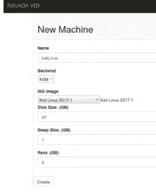

**上图** 厌倦了在命令行中输入冗长烦人的命令吗？别担心！GUI 来了！

> RAVADA VDI 后端的设计和实现旨在允许未来的虚拟化程序添加到该框架中

## 创建渗透测试机器

下载 Kali Linux 64位（参见资源）并将其保存到 RAVADA VDI 服务器的 `/var/lib/libvirt/images`。计算其 SHA256，并确保其与项目网站上的相匹配。然后，你需要执行一条 INSERT SQL 语句以更新 MySQL 数据库服务器中的 `iso_images` 表。INSERT 语句非常简单：表中的每个字段都比较直观。将 `file_re` 字段的值设置为 ISO 的名称，将 `md5_*` 字段填充为 NULL，不要忘记设置 `sha256` 为对应的哈希值。最后，`sha256_url` 应指向 `https://codimage.kali.org/current/SHA256SUMS`。

第二步是为新虚拟机准备两个 XML 文件。第一个将保存所有机器定义 – 处理器数量、网络接口、USB 通道等等。第二个是卷定义。从其他任何虚拟机复制这两个文件并重命名：`cd /var/lib/ravada/xml/; cp jessie-amd64.xml kali-amd64.xml; cp jessie-volume.xml kali-volume.xml`。使用你喜欢的 ASCII 编辑器编辑 `kali-amd64.xml`，并确保相应更改磁盘和 CD-ROM 虚拟磁盘定义：

```
<source file='/var/lib/libvirt/images/kali64.img'/>
<source file='/var/lib/libvirt/images/kali-2017.1-amd64.iso'/>
```

接下来，打开你的 RAVADA VDI Web 界面并导航到 Admin Tools > Machines，然后单击 New Machine。确保你在下拉列表中选择了 'Kali Linux' ISO 镜像。一旦你对虚拟机设置满意，请单击 Create。现在等待一会儿，直到机器创建完成。你可以使用 ‘Start’ 按钮启动机器，并单击 ‘View’ 连接它。继续进行 Kali 的正常安装，并添加你认为学员需要的任何额外包或工具。一旦你认为该机器已准备好部署，请勾选 Base 和 Public 复选框：从现在开始，任何已注册的 RAVADA VDI 用户都能使用各自独立的 Kali Linux VDI 实例，独立于其他实例运行。

RAVADA VDI 支持两种不同的身份验证机制。第一种是 LDAP；你可以将你的 RAVADA VDI 绑定到现有的 LDAP 服务器。如果你没有 LDAP...

## 开源 VDI 解决方案

除了 RAVADA VDI 之外，还有一堆免费（其中一些是开源的）VDI 项目。它们中的大多数基于 KVM (`http://bit.ly/VDI-KVM`)。RAVADA VDI 致力于不依附于任何特定的虚拟化程序；截至本文撰写之时，它仅支持 KVM，但其他虚拟化程序也在路线图之上（例如 LXDI）。所以如果你想帮助那些人，请不要害羞。

### 渗透测试

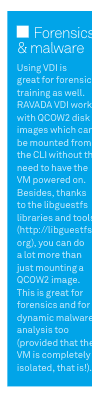

**取证与恶意软件分析**

使用 `Q2le`

同样非常适合取证追踪。RAVADA `vcl2` 支持 QCOW2 磁盘映像，可以从命令行直接挂载这些映像，而无需启动虚拟机。此外，得益于 `libguestfs`，你不仅能挂载 QCOW2 映像，还能做更多事情。这对于取证和动态恶意软件分析非常有用（前提是虚拟机完全隔离。切记！）。

即使网络上的服务器出现问题，你仍然可以使用数据库认证方法创建新用户：用户将存储在 `users` 表中。`password` 字段将存储用户的密码，并使用 SHA-1 进行哈希处理；截至本文撰写时，该框架尚不支持盐值（salt）。要向你的 RAVADA VDI 服务器添加几个使用数据库认证的用户（`lud01` 和 `lud2`），请执行以下命令：`rwd_back --add-user lud01`；对 `lud2` 执行相同操作。使用 web 浏览器导航至 VDI Web GUI，并分别以 `lud01` 和 `lud2` 身份登录；你将能够在浏览器中访问 Kali 虚拟桌面；你可以对自己的虚拟桌面为所欲为，而不会影响其他用户。你会注意到连接并未受 TLS 通道保护；默认情况下，GUI 不提供任何设置加密的手段（目前尚未实现）。

## 从 OVA 到目标易受攻击服务器


既然你已经部署了渗透测试机器，下一步将是准备你的易受攻击服务器。该服务器将由所有使用其 Kali VDI 的用户共享。Web Security Dojo（参见资源）是 web 渗透测试的良好起点。下载 OVA 文件，将其存储在计算机上的某个位置，并提取 VMX 文件：`tar xvf Dojo-3.0.ova`。由于 RAVADA VDI 使用 QCOW2 格式，你必须先将 VMX 文件转换为 QCOW2：`qemu-img convert -f vmmd -O qcow2 Dojo-3.0-disk001.vmdk Dojo-3.0-disk001.qcow2`。现在将此文件复制到 RAVADA VDI 服务器上的 `/var/lib/libvirt/images`。连接到 web GUI 并以管理员用户身份登录，然后创建一个尽可能类似于 Web Security Dojo 的新 VM。因为它是基于

> 你必须确保所有 VDI 都得到良好的隔离。
>
> 使用 libvirt 网络过滤器，你可以轻松实现这一点。

Ubuntu Xenial，因此你可以选择 Ubuntu Xenial 64-bit 作为模板。创建 VM 后，并在 RAVADA VDI 服务器上的安全 Shell 连接内部，编辑 VM 设置以设置 Web Security Dojo QCOW2 磁盘映像的位置，使用 libvirt 来实现：`virds edit YOUR_VM_NAME`。尝试在 XML 代码中找到 `file` 属性，并将其替换为你之前生成的转换后的磁盘映像：

```xml
<source file='/var/lib/libvirt/images/Dojo-3.0-disk001.qcow2'>
```

最后，删除 CD-ROM，交换条目并保存文件。现在你可以启动 VM 以确保一切正常。因为这将作为你的易受攻击服务器，你需要为其虚拟网络适配器设置一个静态 IP。这样，每次启动 VM 时，IP 地址都将保持不变。默认情况下，所有 VM 都可以通过桥接设备 `virbr0` 相互通信，该设备没有附加任何物理设备。此桥接通过 NAT 和转发为每个新域提供互联网连接。默认情况下，它们都将位于网络地址空间 `192.168.122/24` 中。使用 libvirt，首先为 Web Security Dojo VM 设置 MAC 地址：`virsh edit YOUR_VM_NAME`。现在找到 `<interface type="network">` XML 片段，并按如下方式添加 MAC 地址：

```xml
<interface type='network'>
    <mac address='52:54:00:a7:49:04'/>
```

最后一步是为该 MAC 地址分配一个静态 IP 地址；你需要再次使用 `virsh` 来实现这一点。假设你想将 IP 地址 `192.168.122.250` 分配给 Web Security Dojo，请照此操作：

```bash
virsh net-update default add ip=dhcp-host \
    '<host mac='52:54:00:a7:49:04' \
        name='WebSecurityDojo' ip='192.168.122.250' \
    />' \
    --live --config
```

完成！现在确保 VM 在启动时自动启动 – 在 RAVADA VDI 服务器的 CLI 中运行：`virsh autostart YOUR_VM_NAME`。最后，你可以通过点击 RAVADA VDI web GUI 中的“Start”按钮来启动此 VM。以 `lud01` 或 `lud2` 身份登录并连接到你的 Kali 虚拟桌面。打开一个新的终端，并向 Web Security Dojo 域发送一些 ping 以测试连接性。

你可以随时访问 Web Security Dojo，并启动你希望学员利用的任何易受攻击服务。想象一下你想让他们利用 H4CME CASINO web 应用程序：打开 RAVADA VDI web GUI，以管理员用户身份登录，然后点击“View”以打开到该域的 SPICE 连接。从菜单“Targets > H4CME Casino Start”中启动 H4CME CASINO。现在你可以回到任何 Kali 虚拟桌面，开始对此 web 应用程序进行渗透测试；你只需要提供正确的 URL：`http://192.168.122.250:3000`。

## 隔离渗透测试人员

到目前为止还算顺利，但你不希望你的学员开始互相进行渗透测试，对吧？你必须确保所有 VDI 都得到良好的隔离，并且不能从 Web Security Dojo 或彼此之间访问。使用 libvirt 网络过滤器，你可以轻松实现这一点。渗透测试桌面应能够向任何主机发送 ICMP echo-request 并接收其对应的 ICMP echo-reply，与其他任何主机建立新的 TCP 连接，并发送 DNS 查询。大致就这些。你可以创建自己的过滤器来实现此目的；打开你喜欢的 ASCII 编辑器并输入以下内容：

```xml
<filter name='isolated_vm' chain='ipv4'
    priority='700'>
    <rule action='accept' direction='out'
        priority='500'>
        <icmp type='8'/>
      </rule>
      <rule action='accept' direction='in'
          priority='500'>
        <icmp type='0'/>
      </rule>
      <rule action='accept' direction='out'
          priority='500'>
        <udp dportstart='53'/>
      </rule>
      <rule action='accept' direction='out'
          priority='500'>
        <tcp/>
      </rule>
      <rule action='drop' direction='inout'
          priority='500'>
        <all/>
      </rule>
    </filter>
```


将此文件保存为 `isolated_vm.xml`，位于 RAVADA VDI 服务器上的 `/etc/libvirt/nwfilter` 下。使其可用。`virsh nwfilter-define isolated_vm`。接下来，使用此新过滤器配置所有 KALI 域的网络接口：`virsh edit YOUR_VM_NAME`。在 `<interface>` 描述中添加对此过滤器的引用，如下所示：

```xml
<filterref filter='isolated_vm'/>
```

保存它，搞定！从这一刻起，任何学员都能连接到互联网和 Web Security Dojo 域上的任何开放端口，但他们之间将无法通信。请随意尝试 nwfilter 规则（再次参见资源）。

在你的 RAVADA VDI 服务器内部，你可以通过其虚拟串行控制台轻松访问任何 VM。如果 SPICE 连接停止工作，这将帮助你恢复对 VM 的访问。这在文档中有所描述（参见资源）。但是，不要忘记相应地设置 VM，通过在 `grub.conf`（在基于 Debian 的系统上是 `/etc/default/grub`）中添加 `"console=ttyS0"`，以确保系统在每次启动时都会在 `/dev/ttyS0` 上生成串行控制台。

## 通过虚拟串行控制台连接

## 前路多坎坷……

这是一个很棒的 VDI 入门项目。它易于安装和设置，并且可以快速部署。然而，它仍然存在一些重要缺陷（截至本文撰写时），我们希望这些缺陷将在未来的版本中得到修复。数据库认证机制缺乏伪随机每用户盐值生成；SPICE 协议默认不使用 TLS 通道加密（尽管，使用 TLS 可能会降低 VDI 性能）。还会生成一个伪随机的四字符临时密码来保护到桌面的远程 SPICE 连接，这使得 RAVADA VDI 容易遭受暴力破解攻击。但对于我们的测试目的而言它是完美的：你可以开始使用它来部署一个完整的渗透测试多用户环境。而对于我们刚才提到的所有缺陷，嗯，始终有提交 git 拉取请求（pull request）的可能性！所以，你还在等什么？是时候参与进来并开始训练了！

> 使用 RAVADA VDI，你可以在几分钟内部署上述夺旗（Capture-the-flag）场景；无论是 web 渗透测试还是二进制利用，天空才是极限！

# 分形几何与混沌理论的乐趣

加入我们，开启一段发现之旅，探索分形与混沌那个奇异、美丽且无穷的世界。


如果二维的曼德博集合（Mandelbrot set）令人着迷，那么它的三维近亲曼德博尔布（Mandelbulb）则更加引人入胜。

据慈善机构“国家读写能力协会”（`National Numeracy`）称，在英国承认自己不会做数学在社交上是可以被接受的，甚至有些人将其视为一种荣誉，用以将自己与疯狂科学家、书呆子以及社交笨拙的人区分开来。因此，英国在国际数学排名中仅列第 26 位（由经济合作与发展组织 `OECD` 发布）也就不足为奇了。这无疑是一个令人沮丧的统计数据，因为数学技能对于个人的日常生活、就业机会以及国家在国际市场上的表现至关重要。

虽然我们确信 `Linux` 用户是社会中对数字较为精通的人群之一，但对于我们的读者中有多少人真正觉得数学令人兴奋，我们的信心就不那么足了。不过，情况未必如此。为了进一步拓展你们的发现之旅，并证明数学确实可以很有趣，我们介绍了一个真正迷人的数学分支，你可以通过编程或使用各种免费软件深入探索。这个数学分支就是分形几何，以及与之密切相关的混沌理论领域。如果你对此感到陌生，请准备好惊叹吧。

## 分形几何

分形几何是数学中一个相对较新的分支，其起源可以追溯到 20 世纪 60 年代，当时数学家贝努瓦·曼德博（`Benoît Mandelbrot`）提出了一个问题：“英国的海岸线有多长？”事实证明，这个问题的答案取决于你用来测量的尺子的长度——尺子越短，海岸线就越长。这是因为海岸线像许多自然形态一样，在更小的尺度上拥有越来越多的细节。这在数学术语中称为“多尺度自相似性”，也是分形的简单定义。对于现实世界的物体来说，这种自相似性在分子和原子层面会耗尽，但真正的数学分形在所有层级上都表现出精确或近似的自相似性。换句话说，当你不断放大时，它会永远持续下去。

最初的几种分形是在“分形几何”这个术语被创造之前就被设计出来的，直到数学家在 20 世纪 60 年代和 70 年代将目光转向分形时，它们才被正式认可。一个经典的例子是谢尔宾斯基垫（`Sierpinski gasket`），这是一种被称为迭代函数系统（`IFS`）分形的分形类型。它只需几行代码就能轻松生成。首先，从一个实心的（即填充的）等边三角形开始。现在，通过连接三条边的中点，将其分成四个较小的等边三角形，并移除中间的那个。接下来，对剩下的三个实心三角形做同样的操作，将它们各自分成四个较小的三角形并移除中间的那个。以这种方式继续，直到你获得一种你觉得令人愉悦的效果，或者直到你感到厌烦为止，但要记住，要获得一个真正的谢尔宾斯基垫，你必须永远持续下去。

从谢尔宾斯基垫出发，你可能会想深入研究其他 `IFS` 分形，包括谢尔宾斯基地毯（`Sierpinski carpet`）、谢尔宾斯基五边形（`Sierpinski pentagon`）、科赫雪花（`Koch snowflake`）和龙曲线（`dragon curve`）；你会发现网上有大量的相关信息。如果你想要尝试一些三维实体建模，甚至还有一些分形的三维版本，包括谢尔宾斯基站（`Sierpinski pyramid`）和门格海绵（`Menger sponge`）。

或者，有很多免费的有时甚至是开源的 `Linux` 软件可以生成这些以及其他 `IFS` 分形。一个好的起点是免费图像操纵软件包 `GIMP`（https://www.gimp.org）的 `IFS Fractal` 插件，你可以在图像窗口菜单下的“滤镜 > 渲染 > 自然 > IFS Fractal”中找到它。

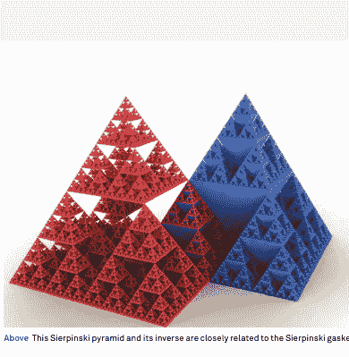

当你放大曼德博集合时，你会看到更多的细节，并且这个过程会永远持续下去。

除了生成看起来非常几何化的 `IFS` 分形外，该软件还允许你实验不太规则的分形，这些分形虽然定义严谨，但可以产生看似自然的形式，如树木和植物。

虽然 `IFS` 分形可能生成令人愉悦的图像并具有无穷的魅力，但鉴于其生成方式，它们在所有放大级别上都表现出自相似性也就不足为奇了。然而，当我们把注意力转向逃逸时间分形（`escape-time fractal`）时，尽管我们反复执行某个数学函数，但该过程会生成真正的分形这一点并不显而易见。更重要的是，这个过程产生的分形本质上是无限的，但当你放大它们时，它们具有一定程度的不可预测性。

最著名的逃逸时间分形无疑是曼德博集合——让我们看看它是如何生成的。生成曼德博集合涉及对复数的运算。快速回顾一下，复数是具有实部和虚部的数；例如，`2 + 0.5i`，其中 `i` 是 `-1` 的平方根。如果这对你来说仍然是一个谜，我们只能建议你自行阅读相关主题，但实际上它并没有你想象的那么难。

## 描绘曼德博集合

要生成曼德博集合的图像，我们需要对所有复数（实际上，你只需要考虑实轴上 `-2.0` 到 `+0.5` 之间以及虚轴上 `-1.2i` 到 `+1.2i` 之间的点）执行测试，并将结果标记在复平面上。测试很简单：从零开始，将其平方，然后加上正在测试的复数。如果结果的模（modulus，即复平面上距离零点的距离）大于或等于 `2`，那么该点不在曼德博集合中。如果它小于 `2`，则再次执行相同的操作；也就是说，取该结果，将其平方并加上正在测试的值。同样，如果结果的模大于或等于 `2`，它就不在曼德博集合中；但如果它小于 `2`，则再次执行计算并以此方式继续。有些点，那些不在曼德博集合中的点，很快就会超过模 `2` 并趋向无穷大。其他点，那些在曼德博集合中的点，无论重复多少次此操作，都会保持在零附近（不过，在实践中，通常会使用任意次数的迭代，通常为 `20` 次）。

> 编写代码绘制曼德博集合并不难，虽然提供允许放大的用户界面会稍显棘手。

完整的曼德博集合图像出现在 图 1 的左上角，一眼就能看出这不是一个简单的几何图形。而且它只会越来越好。当你放大曼德博集合边缘附近的区域时（正如我们在创建 图 1 中的其他图片时所做的那样），越来越多的细节会显现出来，与 `IFS` 分形不同，无限精细的锯齿图案意味着你永远无法在更高等级的放大中看到完全相同的图案，但你会看到类似星爆、螺旋和锯齿图案的东西，并且偶尔，你很可能会看到别人从未见过的景象。

编写代码绘制曼德博集合并不难，虽然提供允许放大的用户界面会稍显棘手。实际上，虽然放大只需要通过填充单元格来定义复平面上的某个区域来实现，但创建一个带有简单宏的 `Excel` 电子表格来完成这项工作也是轻而易举的事。虽然编写自己的软件会是一个有趣且有教育意义的练习，但如果你只是想生成令人印象深刻的曼德博集合图像，最好还是使用现成的软件。最受尊敬的 `Linux` 软件包之一是 `Gnofract4d` <http://edyoung.github.io/gnofract4d/>，它是免费的。除了曼德博集合外，它还可以让你探索密切相关的朱利亚集合（`Julia set`）；此外，还有定义自己公式的选项，这提供了研究任何可想象的逃逸时间分形的机会。如果你想探索三维分形（包括 `IFS` 和逃逸时间），免费的 `Mandelbulber` 软件包（<http://www.mandelbulber.com>）是你所需要的。

## 混沌理论

混沌理论研究那些被描述为对初始条件具有超级敏感性的系统——让我们看看这在实践中意味着什么。一个简单的生物物种（如果蝇）生长数学模型由公式 `x^(t+1)=a x^(t)(1-x^(t))` 表示，其中 `x^(t)` 是当前世代的种群数量，`x^(t+1)` 是下一世代的种群数量，而 `a` 是增长率。种群被数学家称为“归一化到 1”，因此所有值都在 0 和 1 之间，但总是可以通过乘以常数转换为现实世界的种群数量。如果你想在这个模型中尝试几代人的情况，你可以很容易地通过几行代码或 `Excel` 工作簿来做到这一点，从而获得类似 图 2 中重现的图表。

> “分形和混沌之间的一个共同因素是，两者都涉及同一种类型的数学函数”

### 分形景观

由于许多自然形式——包括山脉、海岸线、云和树——都具有分形特性，这使得能够生成看起来真实但只需少量数据的计算机生成图像。这种技术已被用于电影制作，例如当需要外观像外星人一样的科幻景观时，它在游戏制作中也很常见。


从一个大于零的种群数量（例如 `0.1`）开始，你会发现，当增长常数大于 `1` 但小于 `3` 时，种群数量会增加到一个最大值，随后在该点达到稳定。较高的增长率对应的最终数值更大。然而，当增长常数刚刚超过 `3` 时，会出现截然不同的行为模式。此时不再有一个单一的最终种群数量，而是在不同世代之间在若干数值间振荡。这种现象被解释为“繁荣与萧条”（boom and bust）现象，即奇数代种群数量过大，环境无法支撑，导致高死亡率，而这种死亡率会反映在下一代的种群数量中。接下来，尝试 `3.5` 的增长率，你会发现最终种群数量在四个不同的数值间振荡；而在更高的增长率下，你可能会发现最终种群数量在 `8`、`16` 或更多数值间振荡。不过，这种状态并不会永远持续。当增长率达到约 `3.7` 时，最终种群数量会在不同的数值间剧烈波动，这看起来像是混沌，但“混沌”一词在此处有着完全不同的含义。对于增长常数的较小取值，如果你以不同的初始种群数量开始，最终种群数量都会收敛到相同的数值或数值组。但在混沌区域并非如此。如果你以初始种群数量 `0.101` 代替 `0.1` 开始，虽然初期增长相同，但很快就会走上完全不同的路径——图 2 中的最后一张图展示了这一点。事实上，无论两个起始值多么接近，最终结果总会发散。初始种群数量 `0.1001` 的增长曲线会在更长的时间内镜像初始种群数量 `0.1` 的增长曲线，但最终它也会发散。这就是“对初始条件的超敏感性”这一短语的含义，它限制了我们模拟某些自然现象（最典型的是天气）向未来延伸太长时间的能力。

到目前为止，在讨论混沌理论时，我们看了一些方程并将它们可视化为简单的折线图，但还没有看到能与曼德博集合（Mandelbrot set）相媲美的事物。这一切即将改变，因为我们即将发现分岔图（bifurcation diagram）。以下是生成它的方法，同样，这是一个简单的编程练习。仅使用初始种群数量的一个值，计算增长率从 `1` 到 `4` 范围内对应的最终种群数值（尽管 `1` 到例如 `2.5` 的区域并不是特别有趣）。我们将最终种群定义为种群稳定后的数值，实现这一目标的最佳方法是丢弃最初几代，也许是前 `150` 代。然后，将最终种群数值对增长率绘制成 `X-Y` 散点图。结果如（第 `48` 页的）图 3 所示，被称为分岔图，描述混沌系统的截然不同的公式也可以生成非常相似的分岔图。你会注意到在增长率为 `3` 时特征性的分岔（即分裂为二），以及更高增长率时的进一步分岔。你还会注意到约 `3.65` 上方的混沌区域。然而，很明显混沌并不会永远持续。事实上，在混沌再次恢复之前，有三条明显的秩序主导的带状区域。

> 上方 这个简单的种群增长模型根据增长率的不同表现出截然不同的行为

# 混沌理论

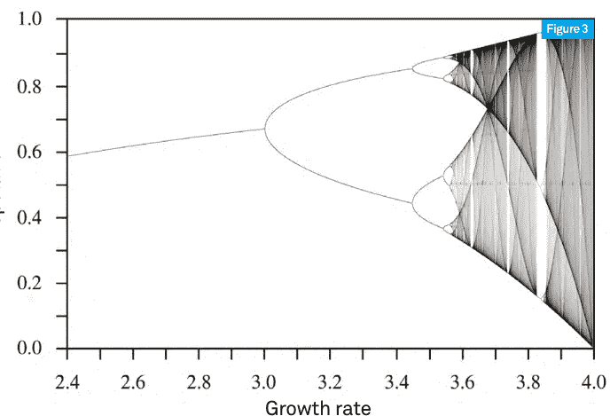

上方 分岔图被称为混沌的图景

对混沌理论的讨论现在将我们带入奇异吸引子（strange attractor）的奇特世界。在数学上，吸引子是一个系统演化至的一个或多个值。因此，对于增长率小于 `3` 的简单种群模型，吸引子是单个值；而对于略大于 `3` 的值，吸引子是成对的数值。长话短说——毕竟这只是分形和混沌的入门介绍——混沌系统的吸引子就是数学家所称的奇异吸引子，如果你绘制奇异吸引子，会发现它是一个分形图像。如果你更深入地探索混沌理论，可能会受到启发去阅读有关奇异吸引子的资料，但即使你没有完全理解它们，绘制奇异吸引子也是生成无限多复杂图像的一种有趣方式，并由此进一步强调这些数学领域令人震惊的本质。第一步是使用现成的软件，我们推荐 `Chaoscope`，它是免费的，你可以从 `http://www.chaoscope.org` 下载。

# 相互联系

到目前为止，我们研究了分形几何和混沌理论。不过，为什么会选择将这两个看似独立的数学分支结合在一起，这是一个合理的问题。我们不会陷入对这个问题进行正式数学论述的困境，但尽管如此，我们将强调一些令人惊叹的事实，这些事实表明分形与混沌之间的共同点比第一眼看到的要多。

一些令人惊叹的事实表明，分形与混沌之间的共同点比第一眼看到的要多

第一个联系可能你已经注意到了。分形和混沌的一个共同点是两者都涉及同一种数学函数。这种函数被称为迭代函数（iterative function），它涉及对一个值执行某种数学函数，然后反复对结果执行相同的操作。其他许多联系则出乎意料得多。

让我们想象一个高度放大的曼德博集合图像。现在考虑两个点，代表两个复数，一个位于曼德博集合内部（通常显示为黑色），另一个位于边界之外（通常显示为彩色）。这两个数几乎可以相同，也许只在第 `n` 位小数上有所不同，但当执行迭代函数时，一个趋向于无穷大，而另一个则保持在零附近。换句话说，存在对初始条件的超敏感性——这正是混沌系统的定义。

现在我们将分岔图置于聚光灯下——字面意义上的聚光灯。它可以被视为混沌的图像，但如果我们放大它的部分区域，就会发现它本身就是一个分形图像。

但我们把最惊人的共同特征留到了最后。如果你将完整的曼德博集合图像直接显示在分岔图图像的下方，但分岔图的绘制方向与通常显示相反，即数字沿水平轴从左到右递减，你会发现一些令人惊讶的事情。如果你缩放分岔图，使得直到第一个分岔（即分裂）的部分占据了与曼德博集合主心形区域相同的水平空间，你会注意到其他特征也对齐了。特别是，你会发现分岔图中第一个和第二个分岔之间的部分与曼德博集合的第一个圆形 `bulb` 对齐，第二个和第三个分岔之间的部分与第二个 `bulb` 对齐，等等。你还会发现，分岔图中秩序在混沌区域内回归的部分，对应于主曼德博集合“天线”上的曼德博集合的小副本。这些事实难道不足以让你相信数学真的可以是令人惊叹的吗！


上方 许多植物具有分形形式，但像罗马花椰菜（`Romanesco` broccoli）这样明显的情况很少见


# 集合预报

因为天气是一个混沌系统，而又不可能以无限精度测量温度、风速、湿度等初始条件，所以长期天气预报很困难。然而，集合预报提供了解决方案，因为天气并不总是同样地多变。这种方法涉及用许多略有不同的初始条件值求解方程，并根据它们的一致程度分配置信系数。

上方 `Chaoscope` 允许你玩弄奇异吸引子——它们本身是分形图像——这些吸引子描述了混沌系统

# `Erlang`

## 使用 `Erlang` 编程：开始开发 Web 应用程序

了解如何在 `Erlang` 中开发健壮的 Web 应用程序和 Web 服务器


**`Mihalisp Tsoukalos`**

是一名 UNIX 系统管理员、程序员（UNIX 和 IOS）、数据库管理员数学家。

自 1993 年以来，他一直在使用 `Linux`。

你可以通过 Twitter 账号 `@matsouk` 或访问 `http://www.mtsoukalos.eu` 与他联系。

## 资源

-   最近安装的 `Erlang`
-   `www.erlang.org`
-   你喜欢的文本编辑器
-   一个 Web 浏览器
-   为了品尝你开发的 Web 应用程序


这是 `Erlang` 系列教程中的另一个教程，其主题是 `Erlang` 中 Web 应用程序和 Web 服务器的开发。为了遵循本教程中的示例，你需要一个现代的 Web 浏览器以及最近安装的 `Erlang`。

好的方面是，你可以在不运行自己的 Web 服务器的情况下跟随本教程，因为你可以通过本地测试使用 `Erlang` 编写的 Web 服务器来测试大多数给出的示例，这些服务器随 `Erlang` Web 应用程序一起提供。

因此，本教程将讨论 `WebSockets`、`Cowboy` 和 `MochiWeb`，以及如何使用它们与 Web 浏览器通信并创建自己的 `HTTP` 服务器。除了必要的理论之外，本教程还包括方便且易于理解的 `Erlang` 代码，这些代码将帮助你解开 `Erlang` Web 开发中难以理解的部分。尽管如此，为了充分利用本教程，你必须编写自己的 `Erlang` 代码并创建自己的 Web 应用程序和 Web 服务器。

这是 `Erlang` 系列教程的最后一篇，所以现在是一个回顾之前所有 `Erlang` 教程并开始编写你自己的独特、有趣且方便的 `Erlang` 应用程序的好时机！`Erlang` 代码一开始可能看起来很难编写，但它提供了许多难以找到的优势，绝对值得一试！

在过去几年中，各种类型的 Web 应用占据了大部分互联网流量。因此，本教程将向你展示如何使用 `Erlang` 编写 Web 应用，以利用 `Erlang` 的独特特性，这些特性使你能非常轻松地创建健壮且分布式的应用程序。

由于 Web 是异步的、并发的且需要快速响应，`Erlang` 是参与整个 Web 体验的理想候选者。

本教程将对 `Erlang` 的功能进行温和且易于跟随的入门介绍，这些功能可以帮助你创建强大的 Web 应用程序和 Web 服务器。

## 关于 Web 应用程序


如果你不熟悉Web应用程序，你可能会问什么是Web应用程序。Web应用程序（或简称web app）是一种客户端-服务器软件应用程序，其中客户端部分运行在Web浏览器上。网络邮件、即时消息服务、在线商店以及其他许多类型的应用程序都是Web应用程序。因此，本教程的其余部分将教你如何创建此类应用程序，其中服务器部分使用`Erlang`开发，客户端部分显示在你喜欢的Web浏览器上。

`Erlang`允许你快速编写一个简单的Web服务器，可用于测试你的Web应用程序并发现你的机器与托管Web应用程序的机器之间的任何连接问题。因此，本节将介绍一个简单的`Erlang`模块，该模块实现了一个朴素的Web服务器，它始终打印‘Hello World!’消息。然而，在生产系统上使用如此简单的`Erlang`Web服务器可能不是最佳选择。

## 创建用于测试的 Web 服务器

该`Erlang`模块的名称为`naiveWS`，将保存为`naiveWS.erl`。你可以在图1中看到它的`Erlang`代码，这主要是一个简单的并发TCP服务器。

```erlang
-module(naiveWS).

open_connection(Port) ->
    spawn(fun() -> {ok, Socket} = gen_tcp:listen(Port, [{active, false}]),
        loop(Socket) end).

loop(Sock) ->
    {ok, Conn} = gen_tcp:accept(Sock),
    Handler = spawn(fun() -> handle(Conn) end),
    gen_tcp:controlling_process(Conn, Handler),
    loop(Sock).

handle(Conn) ->
    gen_tcp:send(Conn, reply("Hello World!\r\n")),
    gen_tcp:close(Conn).

reply(Str) ->
    B = list_to_binary(Str),
    ["Status: 200 OK\r\n" | "Content-Type: text/html;\r\n" | "Content-Length: " ++ Str ++ "\r\n"],
    [Size(B), B]].
```

上方是`naiveWS.erl`的`Erlang`代码，使用`gen_tcp:listen()`和`spawn()`实现了一个非常简单但并发的Web服务器。

`naiveWS:open_connection()`函数只需要一个参数，即Web服务器将使用的端口。因此，在编译`naiveWS.erl`后，你可以通过在`Erlang`外壳中执行以下命令来启动Web服务器：

```bash
2> naiveWS:open_connection(1200).
<0.64.0>
```

使用`wget`实用程序测试Web服务器就像执行下一个命令一样简单：

```bash
$ wget 127.0.0.1:1200/
--2017-05-29 10:12:08--
http://127.0.0.1:1200/
Connecting to 127.0.0.1:1200... connected.
HTTP request sent, awaiting response... 200 OK
Length: 12 [text/html]
Saving to: ‘index.html’

index.html              100%[===========================>]       12  --.-KB/s    in 0s

2017-05-29 10:12:08 (2.86 MB/s) - ‘index.html’ saved [12/12]
```

生成的输出将验证Web服务器按预期工作。

`index.html`文件的内容如下，这意味着Web服务器正在工作并且期望的消息已成功传送：

```html
Hello World!
```

如果Web服务器没有工作，`wget`命令的输出将与以下内容类似：

```bash
--2017-05-29 10:20:10-- http://127.0.0.1:1200/
Connecting to 127.0.0.1:1200... failed:
Connection refused.
```

然而，稍后你会看到，还有另外三个`Erlang`项目——MochiWeb、Yaws和Cowboy——更适合开发HTTP服务器。由于MochiWeb的简洁性，本教程稍后将会使用MochiWeb，并且因为Cowboy具有许多功能并受到其开发人员的极佳支持，所以也会使用Cowboy。尽管如此，Cowboy和Yaws都比MochiWeb拥有更多的功能。

## 使用 Cowboy，一个 HTTP 服务器

Cowboy是用`Erlang`编写的，它是`Erlang`、OTP和Elixir项目的小型高效HTTP服务器。Cowboy支持多种类型的手处理器，包括REST、WebSockets和HTTP。虽然本教程不是关于Cowboy的，但下一节将讨论其安装过程，因为如果你不习惯安装外部`Erlang`模块，你可能会发现这有点令人困惑。你可以在`https://github.com/ninenines/cowboy`以及Nine Nines的网站`https://ninenines.eu`上找到有关Cowboy的更多信息。

> 由于整个过程会相当复杂，你需要一个构建系统来让你的生活更轻松：在这种情况下，是`Erlang.mk`工具

### Hello World! 程序

理论到此为止——现在是时候学习如何安装Cowboy并观察其实际运行效果了！

本节将展示一个简单的Web应用程序，以便更好地理解`Erlang`和Cowboy的整体工作方式。由于整个过程会相当复杂，你需要一个构建系统来让你的生活更轻松——在这种情况下，构建系统将是`Erlang.mk`工具，它将是你在开发使用Cowboy的项目时需要下载的第一个东西。你可以在`https://github.com/ninenines/erlang.mk`上找到有关`Erlang`构建系统的更多信息。

但首先，你需要创建一个目录来保存项目的所有文件——在这种情况下，项目名称为`hw`，所以目录名称也将是`hw`，你可以通过执行`mkdir hw`命令来创建它。然后，你需要执行`cd hw`以实际进入该目录。

现在请按照以下步骤创建一个将使用Cowboy的新`Erlang`项目：

```bash
$ wget https://raw.githubusercontent.com/ninenines/erlang/master/erlang.mk
$ make -f erlang.mk bootstrap-rel
$ make
```


上方展示了`hw`项目初始化过程的一部分，说明了如何使用Cowboy在`Erlang`中开发Web应用程序。

图2显示了你执行上述命令后屏幕上得到的部分结果。到目前为止，你已经创建了一个新的`Erlang`项目的骨架和一个倾倒的shell脚本，你可以运行`.rel/hw/_rel/release/console`来确保一切正常。

现在是时候通过修改`Makefile`来实际安装Cowboy了。`Makefile`的最终版本如下：

```makefile
PROJECT = hw
PROJECT_DESCRIPTION = A Hello World program
PROJECT_VERSION = 0.1.0

DEPS = cowboy
include erlang.mk
```

所有的工作都由`DEPS = cowboy`这一行完成，这将指示构建系统下载并安装Cowboy。然后你需要在`src`目录中创建一个名为`hw.app.src`的新文件（如果它尚不存在——你可以通过查看随本教程提供的源代码来看见`hw.app.src`）。现在，如果你执行`make`实用程序，构建系统将负责其余的工作！如果输出的最后一行是`release-1.tar.gz successfully created`，那你目前做得很好。

接下来，你需要编辑一些现有的文件以定义你的Web应用程序将支持的URL，并添加实现Web应用程序所需功能的`Erlang`代码。首先，你将编辑`src/hw.app.erl`。图3展示了`src/hw.app.erl`文件的最终版本——这是你了解支持的URL列表以及Cowboy服务器将监听的端口号的第一个地方。然而，我们还没有完成，因为我们必须为该URL创建一个纯HTTP处理程序：


```bash
$ make new t=cowboy_http m=hw_handler
```


上方是 `src/hw.app.erl` 文件的 Erlang 代码，这是应用程序最重要的文件，因为这是你定义 Web 应用程序支持的 URL 的地方。

请确保处理程序的名称与你在 `hw.app.erl` 文件中定义的名称保持一致。

最后，你需要打开由上一条命令创建的 `src/hw_handler.erl` Erlang 文件，以修改 `handle()` 函数的实现。编辑后，`hw_handler.erl` 模块中 `handle()` 函数的实现应如下所示：

```erlang
handle(Req, State=#{state()}) ->
    {ok, Req2} = cowboy_req:reply(200,
```

## 所展示的应用程序将在 Web 浏览器中使用独立的 URL 显示 UNIX 纪元时间

```html
[{<<"content-type">>, <<"text/plain">>}]
<<<<"Hello World and Cowboy!">> ,Req),
(ok, Req2, State).
```

如您所见，这是您定义 `/URL` 将显示消息的位置。执行 `make` 命令并运行下一条命令：

```bash
$ ./rel/hw_release/bin/hw_release console
```

请注意，可执行文件的完整路径和名称基于项目名称，因此如果您给项目起了不同的名字，您应相应地调整之前的命令。

现在访问 [http://127.0.0.1:1200/](http://127.0.0.1:1200/) 以查看 Web 应用程序的运行效果，或者使用 `wget` 查看 `index.html` 文件的内容，它应该是 'Hello World and Cowboy!'。下一节将创建一个支持两个不同 URL 的应用程序，请继续阅读！

## 创建一个简单的 Web 应用程序

所展示的应用程序将在 Web 浏览器中使用独立的 URL 显示 UNIX 纪元时间——该应用程序总共将支持两个 URL，以及第三个捕获其他所有请求的额外 URL。

就像之前那样，您需要创建一个使用 Cowboy 的新 Erlang 项目——项目名称将是 `epoch`，因此请继续执行 `mkdir epoch` shell 命令来创建项目的 `root` 目录。

现在，创建一个与前一节中项目类似的项目，然后再继续。如果您遇到困难，请仔细阅读前一节。

因此，在拥有一个仅支持一个 URL 的项目之后，是时候开始修改 `epoch` 项目的文件了。但是，在此之前，请执行 `make distclean` 以清理任何不必要的文件，并确保 `epoch` Web 应用程序使用端口号 `1300`。

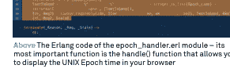

`epoch_handler.erl` 模块的 Erlang 代码——其最重要的功能是 `handle()` 函数，它允许您在本地机器的浏览器中显示 UNIX 纪元时间。该项目最有趣的部分是定义将由 Cowboy 处理的不同路由的位置：

```erlang
Routes = [[{'_',
    [
        ['/',  root_handler,  []],
        ['epoch', epoch_handler, []],
        ['_', cowboy_static, {priv_file,
        "static/error.html"}]
    }] ]
```

在定义 `Routes` 变量后，您应该编写 `Dispatch = cowboy_router:compile(Routes)` 语句，以便 Cowboy 实际激活这些路由。请注意，路由开头的 `'_'` 表示 Web 应用程序在任何主机上都能正常工作。第一个路由将捕获 `/` URL，并且只会显示一条文本消息。第二个路由捕获 `/epoch` URL，并以 UNIX 纪元格式返回当前时间。每次刷新页面时，输出都会更新。最后一个路由将捕获所有不匹配之前任何规则的 URL，它是一个静态规则，在浏览器中显示包含错误信息的 HTML 网页——最后一个路由不需要实现 handler，因为它使用 Cowboy 定义的 `cowboy_static` handler。这里，您只需告诉 Cowboy 在哪里找到您想要显示的 HTML 页面即可。请别忘了创建 `error.html` 页面并将其放入 `priv/static` 目录中；为另外两个路由创建两个模块并实现它们——在这种情况下，这两个规则的实现可以在位于 `src` 目录中的 `root_handler.erl` 和 `epoch_handler.erl` 文件中找到。`root_handler.erl` 实现的 Erlang 代码与前一节中您看到的 `hw_handler.erl` 文件中的 Erlang 代码类似。

图 4 展示了返回 UNIX 纪元时间的 Erlang 函数的实现，该实现可以在 `epoch_handler.erl` 中找到，以及该模块的其余代码。这是一个令人兴奋的 Erlang 函数，原因有很多。第一个原因是，为了在 Erlang 中计算 UNIX 纪元时间，您需要调用 `erlang:timestamp()` 并使用返回的三个值中的前两个来计算 UNIX 纪元时间并将其保存到 `Epoch_time` 变量中。

然后，您构建要发送给 Cowboy `req:reply()` 函数的字符串，并将其存储到 `TextToSend` 变量中。

虽然您在本教程中看到的应用程序是最终版本，但不要试图一次性实现所有内容，因为您的代码很可能包含各种类型的错误——良好的做法是为每个路由创建一个 dummy 函数，该函数将打印一条消息，以确保您的项目路由配置正确，然后开始逐个实现和测试路由。

图 5 展示了 `./src/root_handler.erl` 文件的 Erlang 代码，这应该不会让您感到惊讶。

> “您不需要访问所有目录或编辑包含的每个文件：`Erlang.mk` 会自动生成其中大多数。”

`handler.erl` 文件，这应该不会让您感到惊讶。图 6 展示了三个从浏览器访问 Web 应用程序时的输出截图，但您仍然可以使用 `wget` 和 `curl` 等命令行工具来测试 Web 应用程序。本教程的引导图片（见第 50 页）展示了 `epoch` 项目的完整目录结构，但未包含项目文件，以便更好地理解项目背后的复杂性，这些复杂性被隐藏起来以使您的生活更轻松。好事是您不需要访问所有目录或编辑包含的每个文件，因为 `Erlang.mk` 会自动生成其中大多数。

## 为什么 Web 应用程序很重要？

Web 应用程序很重要，因为它们消耗了大部分互联网流量。这意味着它们必须被开发得*快速*、*健壮*、*容错* 且 *能够扩展*。虽然 Erlang 符合所有这些要求，但它并不经常被用于创建 Web 应用程序，主要是因为 Web 开发人员不了解 Erlang 和一般的函数式编程。

网站性能越好，访问者越满意，这意味着 Web 应用程序很重要，并且应该仔细开发。此外，良好的 Web 应用程序将需要更少的硬件升级和更少的维护。

最后但同样重要的是，如果您是一位能够创建此类行为良好的应用程序的开发人员，您总是有事可做，并且更容易选择开发您最感兴趣的内容！因此，*行为良好的 Web 应用程序* 将使整个互联网流量更快、更安全。这意味着，如果一家公司的网站使用良好的 Web 应用程序，该公司的网络存在性将更好，更多的访问者将留在其网站上。

## Yawls Web 服务器

`Yawls` 是另一个特别擅长提供动态内容 Web 应用程序的 Web 服务器。由于它是用 Erlang 编写的，`Yawls` 在设计上是多线程的，可以非常高效地并发工作。

`Yawls` 有两种工作模式：*常规* 模式，它作为常规 Web 服务器运行；以及 *嵌入式* 模式，它可以在 Erlang 应用程序中运行。您可以在 [http://yawls.hyber.org/](http://yawls.hyber.org/) 上找到有关 `Yawls` 的更多信息。

### 关于 MochiWeb

`MochiWeb` 是一个允许您创建轻量级 HTTP 服务器的 Erlang 库。虽然 `Cowboy` 比 `MochiWeb` 更强大，但有时您可能需要更轻量的东西，并考虑使用 `MochiWeb`。因此，在下一节中，您将学习如何配置 `MochiWeb` 以提供简单的网页。

您可以通过在 Linux 终端中执行以下命令获取 `MochiWeb`：


```bash
$ git clone git://github.com/mochi/mochiweb.git
cd mochiweb
Cloning into 'mochiweb'...
remote: Counting objects: 2632, done.
remote: Total 2632 (delta 0), reused 0 (delta 0), pack-reused 2632
Receiving objects: 100% (2632/2632), 1.28 MiB | 603.00 KiB/s, done.
Resolving deltas: 100% (1681/1681), done.
```

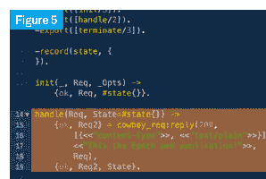

**图注** 处理所有 `/URL` 请求的 `root_handler.erl` 模块的 Erlang 代码

现在您可以自由使用 MochiWeb！

### 提供 'Hello World!' 页面

本节将展示如何编程 MochiWeb 以提供 'Hello World!' 页面。这个简单的例子将帮助您更好地理解 MochiWeb 的工作原理。您可以通过在 `mochiweb` 目录内部执行以下命令创建一个名为 `hwmochi` 的新项目：

```bash
$ make app PROJECT=hwmochi
```

然后，您需要通过执行 `cd ./hwmochi` 命令进入位于 `mochiweb` 目录外部的 `hwmochi` 目录。

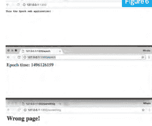

**图注** epoch Web 应用程序的三种可能输出——每一种代表开发人员应定义和实现的不同的 Cowboy 路由

## 关于 WebSockets

WebSockets 是 HTML5 标准的一部分，与 Erlang 没有任何关系。然而，WebSockets 提供了一种双向异步套接字，允许浏览器与外部世界（包括用 Erlang 编写的程序！）进行通信。所谓异步，是指 WebSockets 发送数据时无需等待响应。由于 Erlang 在设计上也是异步的，因此 WebSockets 是与 Erlang 程序通信的完美方式。

在开发使用 WebSockets 的 Erlang 应用程序时，你需要三个组件才能使一切正常运行：一个运行部分代码的 Web 浏览器、一个执行一些 Erlang 代码的 Erlang 应用程序（`A`），以及另一个能够与 WebSockets 协议通信的 Erlang 应用程序（`B`）。Erlang 应用程序 `A` 包含 Web 应用的逻辑，以及执行数据库通信等任务所需的 Erlang 代码。Erlang 应用程序 `B` 负责将消息从 Erlang 应用程序 `A` 传输到 WebSockets，反之亦然。

你可以在 `https://tools.ietf.org/html/rfc6455` 找到 WebSockets 协议的 RFC 文档。

为我们的应用程序添加一个名为 `/hello_mochi` 的新网页，这需要编辑我们之前创建的 `/.src/hwmochi_web.erl` 文件：

`hwmochi_web.erl` 中最有趣的代码是处理新支持的 URL 行为的代码：

```erlang
["hello_mochi" ] ->
    Req:respond({200, [{"Content-Type", "text/html"}],
        "<h2 style='color:#057;'>Hello MochiWeb!</h2>\n"});
```

图 7 展示了 `/.src/hwmochi_web.erl` 文件的完整 Erlang 代码——其中大部分是自动生成的！图 8 展示了上述 Erlang 模块提供页面时，Web 浏览器在屏幕上显示的内容。请注意，MochiWeb 会自动生成一个 `/hello_world` URL，如果你愿意可以删除它。

你可以通过编辑 `/.src/hwmochi_sup.erl` 文件来更改 HTTP 服务器监听的端口号。下一条 `grep` 命令的输出显示了包含相关代码的文件和行：

```bash
$ grep -n 8080 ./src/*
…/src/hwmochi_sup.erl:44:  web = web_specs(hwmochi_web, 8080),
```

通过查看 MochiWeb 项目和 Cowboy 项目的结构你就会发现，它们非常相似，这使得开发者的生活简单了许多。你可以在 `https://github.com/mochi/mochiweb` 找到更多关于 MochiWeb 的信息，但只有实践才能让你更擅长使用 MochiWeb！

那么，仅为了创建 Web 应用程序而学习 Erlang 值得吗？答案毫无疑问是值得的！

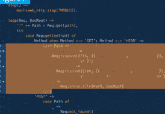

`useMochi.erl` 的 Erlang 代码，在此处你告诉 MochiWeb 它将支持哪些 URL

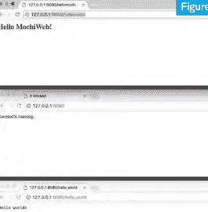

在此目录下运行 `make` 将编译这个示例项目，并允许你通过执行 `./start-dev.sh` 脚本来启动它。目前，你拥有一个监听 `8080` 端口的 Web 服务器，你可以通过在 Linux 终端中执行 `wget http://127.0.0.1:8080` 来测试它。这将创建一个 `index.html` 文件，包含以下 HTML 代码：

```html
<!html>
<head>
<title>It Worked!</title>
</head>
<body>
    hwmochi running.
</body>
</html>
```

上述代码可以在静态 HTML 页面 `/priv/www/index.html` 中找到。因此，我们现在应该让事情变得稍微有趣一点。我们稍后将做的是添加

`useMochi.erl` 的输出，它使用 MochiWeb Erlang 模块实现了一个简单的 HTTP 服务器

## LINUX 环境下的 AMAZON WEB SERVICES

`Peter O'Brien` 深入探究了驱动 Amazon 服务功能的强大基础设施，这些基础设施通过 Amazon Web Services (`AWS`) 在 Linux 平台上开放给公众，以满足个人及企业的各种托管需求。

如果你想在云端托管服务——无论是网站、数据库、文件还是任何通过网络访问的内容——都有大量选项可供选择。在决定使用哪项服务时，你会综合考虑诸多因素，如价格、性能、可靠性和声誉。就声誉而言，很少有服务比 Amazon Web Services (`AWS`) 更受人尊重，且这并非毫无道理。Amazon 的网站最近一次宕机是什么时候？如果它能承载其接收到的海量流量并保持规模运行，那么它很可能也能满足你的需求。传统上，高昂的成本是许多人使用 `AWS` 的门槛，但近期的变化使得试用该服务变得比以往任何时候都更容易。

Amazon Web Services 已经存在多年，尽管它经历过——并仍在经历——持续的变更和改进。该公司最初于 2002 年推出，愿景是开放 Amazon 的技术和产品数据，使第三方能够构建自己的应用程序。这一概念在 2003 年得到细化，提出了构建零售运营所用基础设施的提案，将其作为“基础设施即服务”产品提供，这有可能为公司提供额外的收入来源。该想法得到了验证，自 2006 年 3 月全面推出以来，`AWS` 呈现巨大增长，预计 2017 年为 Amazon 带来约 130 亿美元的净利润。

除了 `AWS` 提供的庞大且互操作性强的服务范围外，其关键优势之一在于它位于许多不同的地理位置。该服务在北美提供六个区域，在南美、欧洲（包括伦敦）以及亚太地区各提供六个区域。对于希望向全球用户提供服务的公司而言，这一点极具价值，同时借助在地理上偏远位置托管服务和数据的能力，也提供了弹性。此外，每个区域都有多个“可用区”，由一个或多个独立的数据中心组成，每个数据中心都有独立的电源和连接。这些可用区被刻意彼此隔离，以防止故障在区域间扩散。`AWS` 还在全球提供 54 个“边缘”网络接入点，可用于将内容托管在更接近客户的位置。

`AWS` 服务通常按需使用，并按使用量收费（尽管可以通过预留资源获得折扣）。新用户可享受免费套餐选项，该选项为 `AWS` 的许多服务提供免费的基础级别服务。目前，该公司在多种技术领域提供超过 70 种服务，并通过功能强大的 `RESTful` `API` 进行访问，访问权限由 `IAM`（身份与访问管理）控制，`IAM` 位于 `AWS` 的核心，允许对访问进行极其精细的控制。

> “若要预先了解您正在构建的系统成本，`AWS` 提供了一个简单的成本计算器”

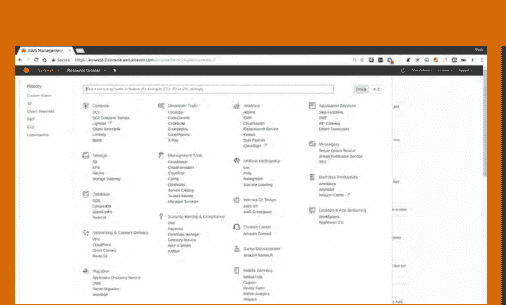

`AWS` 控制台提供了访问大量 `AWS` 服务的入口，同时也包括计费和支持服务。


AWS 庞大基础设施及其按使用付费模式的一个关键优势在于，它提供了快速扩展已配置资源的能力。如果你管理的服务器工作负载在所需资源方面波动较大，或者你希望处理突发的流量涌入，AWS 是一个不错的选择。理解 AWS 工作原理的最佳方法是将服务视为一组模块。每项服务独立运行，因此你可以从众多可用的产品中选择满足你需求的产品。然而，尽管这些服务完全独立，但它们被设计为彼此具有良好的互操作性，共享诸如公共 `API`、命名约定、前述 `IAM` 认证系统及连接概念等属性。虽然 Amazon 提供了广泛的 Web 服务，允许你控制基础设施的各个方面，但除非你选择使用，否则你不必使用它们——该公司还为多种编程语言提供了工具和库，以及一个功能齐全的管理控制台，再次，服务是单独呈现的，但共享许多常见的界面概念。

### 控制成本

使用 AWS 等云服务的一个主要担忧是成本。如果你超出了免费套餐，或者你的基础设施突然扩展，你需要支付多少费用？如何预先了解你正在构建的系统成本？AWS 提供了一个简单的成本计算器，帮助你预测价格，但首先需要理解几个关键概念。价格（可能因地区而异）使用诸如时间（例如服务器在线小时数）、容量（如数据传输量）、计数（在使用消息队列等服务时）或时间-空间（如数据在一段时间内的存储量）等指标。虽然成本可能令人担忧，但 AWS 提供了优秀的工具来管理支出。除了计费功能外，AWS“成本管理器”（`Cost Explorer`）允许你深入分析支出的去向，而强大的计费警报（由用于监控整个 AWS 系统的“`CloudWatch`”系统驱动）可以让你在成本超过预定义限额时收到通知。

安全性始终是一个主要关注点，也是公司转向 AWS 的另一个原因。该公司对服务的访问（包括物理数据中心和网络本身）进行严格控制、监控和审计。你可以确信其内部秩序井然，并提供了确保你也能做到同样的工具。除了使用身份与访问管理（`IAM`）对 AWS 资源创建非常精细的权限外，你还可以对数据应用 `ACL` 类型的权限（并确保数据静态加密），配置 `VPC`（虚拟私有云）以将你的资源与其他虚拟网络或互联网隔离。此外，你可以配置安全组以提供控制进出服务器流量的虚拟防火墙，并在启动虚拟服务器时指定密钥对，该密钥对用于加密登录信息，确保只有拥有私钥的人才能访问你的实例。


### 时间线

- **2003 年底**：提出了如今我们所知的 AWS。虽然该公司当时无法预料 AWS 增长得有多快，但 Amazon 意识到向他人提供自身的弹性基础设施将具有价值。
- **2006 年 3 月**：AWS 随 `S3`、`SQS` 和 `EC2` 重新推出。这三个作为“Amazon Web Services”推出的原始服务，至今仍支撑着核心系统功能，涵盖文件存储、消息队列和服务器实例。
- **2010 年 11 月**：所有 Amazon 站点托管在 AWS 上。令人惊讶的是，Amazon 花了将近四年时间才将自己的服务迁移到 AWS 平台，但这一步显示了对该项目的巨大信心。
- **2013 年 4 月**：Amazon 提供认证。使用 AWS 服务的工程师可以在多个领域完成 Amazon 认证，为其 AWS 技能提供专业验证。
- **2015 年 4 月**：AWS 实现首个 2.65 亿美元利润。Amazon 从不敢于在最终盈利之前不投入巨额资金；AWS 花了将近十年时间才实现收支平衡。
- **2016 年 12 月**：AWS 伦敦区域推出。AWS 现在从伦敦提供其许多服务，该市加入了法兰克福和爱尔兰，成为欧洲的一个服务位置。

# Linux 上的 AWS

## 作为托管方的入门指南

AWS 提供了多种方式在其系统内托管 Web 服务器，从高端的 `EC2` 实例到价格低廉的 `Lightsail` 产品。


## EC2 / Lightsail

`Lightsail` 最初于 11 月在美东主区域发布，但现在已更广泛可用（包括伦敦区域）。`Lightsail` 是亚马逊针对 `Linode` 或 `DigitalOcean` 等提供超廉价托管服务（参见第 63 页）提供商的防御措施。`Lightsail` 的起步价格为每月 5 美元，首月免费。随着存储、内存、带宽配额和 `CPU` 功率的增加，成本会随之上升，但其等级通常与竞争对手持平。

创建 `Lightsail` 实例非常简单。控制面板与主 AWS 管理界面分离，设置过程很简单：只需选择实例大小，选择区域和可用区，定义 `SSH` 密钥对和可选的启动脚本，最后选择裸操作系统（`Ubuntu` 或 `Amazon Linux`）或预配置的软件栈，例如 `WordPress`、`LAMP` 和 `Magento` 等。点击“创建”按钮后，你的实例就会启动。之后，你可以配置防火墙、创建快照并查看各种指标。还提供了基于 Web 的 `SSH` 控制台。你可以为实例分配静态 `IP`，这是浮动的——如果你启动新实例，可以随时更改该 `IP` 指向的位置。只要静态 `IP` 附着在实例上，它们就是免费的。

### 理解 EC2 流程有助于理解 Lightsail 在后台的工作机制

`EC2`（Elastic Compute Cloud）：`EC2` 服务器使用 Amazon 机器映像（`AMIs`）创建，这些映像可以手动创建和管理，也可以从 AWS 市场选择。在 `EC2` 中创建实例时，有众多不同的实例类型可供选择，每种类型都有不同的 `vCPU`（虚拟 `CPU`）数量、内存、存储类型、网络速度和优化选项。当然，选择的规格越高，支付的费用就越多。某些实例类型具有本地存储（例如，`i3.large` 是一种强大的类型，附带 475GB `SSD`），而其他类型则使用 `EBS`（Elastic Block Storage）。`EBS` 为你的实例提供持久的块存储，并在你的可用区内自动复制以保护硬件故障。提供磁磁盘、`SSD` 和高性能版本——当然，价格各不相同。选择机器类型后，你将配置 `IAM` 角色（即谁有权访问）以及机器所在的 `VPC`。`VPC` 是专用于你的 AWS 账户的虚拟私有云。默认情况下会创建一个，但你也可以创建多个 `VPC`。`EC2` 实例创建后，会分配一个用于外部访问的 `IP`（取决于你的安全组配置），或者你可以为其分配一个“弹性 `IP`”，顾名思义，这是一种可以分配给任何实例的 `IP`。

理解 `EC2` 流程有助于理解 `Lightsail` 在后台的工作机制。每种大小的 `Lightsail` 实例都相当于一个 `EC2` 实例，`Lightsail` 中的存储是特定大小的 `EBS` 卷，静态 `IP` 是弹性 `IP`，预配置的操作系统或应用程序栈是 `AMI` 映像。`Lightsail` 的好处是固定成本，它是许多用户进入 AWS 的门槛。如果你同时在 `Lightsail` 和其他 AWS 服务中有资源，它们之间可以通信吗？可以：在 `Lightsail` 配置中，你会看到一个“VPC 对等连接”选项，它启用 `Lightsail`（在后台设置了另一个“隐藏 VPC”）与你配置的 `VPC` 之间的相互通信。

> `Lightsail` 产品旨在易于访问，因此拥有简化版的控制台——是 AWS 的良好起点！

## Microsoft Azure

市场上只有少数几家厂商接近 AWS 的规模——其中之一就是拥有 Azure 平台的微软。`Microsoft Azure` 于 2008 年 10 月发布，与亚马逊的服务一样，部分得益于 `Linux`，其规模也大幅增长。`Azure` 提供超过 600 种服务，包括虚拟机、无服务器应用程序、文件存储、数据库服务和消息系统。`Azure` 在全球 38 个区域可用，其中两个位于英国。

## 选择你的数据库

一旦 Web 服务器启动并运行，接下来你要考虑的就是数据库。就像 AWS 上常见的情况一样，有很多不同的选择需要考虑。如果你在寻找基于托管服务的传统关系型数据库，你需要使用 `Amazon RDS`（Relational Database Service），它提供了许多最流行的关系型数据库引擎。如果你正在构建数据仓库，`Amazon Redshift` 可能正是你需要的。`Amazon DynamoDB` 提供高性能的 `NoSQL` 数据库，`Amazon Elasticache` 通过 `Memcached` 或 `Redis` 提供内存缓存。你也可以在自己的 `EC2` 实例上托管，但那样你就无法享受亚马逊服务的托管性质。最后一个选项是在 AWS 云内托管数据库的第三方公司，例如由 `IBM` 支持的 `compose.io`。

`Amazon RDS` 极其有用，因为它消除了关系型数据库大多数困难或繁琐的管理任务。首先，`RDS` 管理备份、补丁、自动故障检测和恢复。`RDS` 可以自动通过多个可用区中的多个实例来提供高可用性，从而以最小的努力带来安心。如果你自己搭建服务器，被迫通过扩展实例大小来增加服务器功率，但 `RDS` 允许你独立增加 `CPU`、内存和存储。最重要的是，与自建相比，`RDS` 在成本上非常有竞争力——那你为什么不使用它呢？`RDS` 唯一没有提供的是服务器的 `shell` 访问权限，尽管你很可能不需要它。你可以使用熟悉的工具来管理 `RDS` 数据库，同时享受在 AWS 内的优势，如 `CloudWatch` 监控、基于 `VPC` 的安全性和多区域可用性。

### 支持的数据库引擎

- **01 `MySQL`**


- `MySQL` 是全世界使用最广泛的数据库之一，也是 `LAMP` 软件栈的关键组件。

- **02 `Aurora`**

  - `Aurora` 是 `AWS` 高性能定制版 `MySQL`，完全兼容，无需代码更改。

- **03 `MariaDB`**

  - 与 `Aurora` 类似，`MariaDB` 是 `MySQL` 的增强型直接替代方案。由 `MySQL` 的原始开发者维护。

- **04 `PostgreSQL`**

  - `Postgres` 是一个复杂的、可扩展的对象关系数据库管理系统，对高级数据类型和函数提供了 excellent 支持。

- **05 `Oracle`**

  - `Oracle` 数据库是闭源的商业重量级选手，许多将数据迁移到 `RDS` 的公司需要仔细对待。

- **06 `Microsoft SQL Server`**

  - `Microsoft SQL Server` 是许多基于 `Windows` 的开发者的首选平台——`AWS` 提供从“Web”版开始的所有版本。


### 快速提示

**快照备份**

如果你正在运行 `Lightsail` 实例，可以手动创建快照以备备份。`AWS` 还提供“自动快照”模板，用于简单的每日快照和自定义保留期。

# Linux 上的 AWS

## 文件存储

`Amazon S3`（Simple Storage Service）原本是 `AWS` 的产品提供之一，但现在已成为一套文件存储产品的一部分。

### 快速提示：命令行工具

除了通过 `API` 提供连接和通过 Web 控制台进行管理外，`AWS` 还以 `aws-cli` 和 `aws-shell` 的形式提供强大且易用的命令行工具。

在 `AWS` 最初推出时，`S3` 存储服务是主打的亮点。在此之前，如果你需要在线存储，你会分块供应——也许获得一台具有几 `TB` 存储的服务器，当空间用完时，再获得另一台。`S3` 通过采用现在熟悉的模式改变了这一点——只为你使用的部分收费——并且在此方面具有极强的竞争力。`Amazon S3` 是一个简单的对象存储。它是安全的，耐用性为 99.99999999%，并能扩展到数万亿个对象。`S3` 非常适合备份和恢复、分层归档或用户驱动的内容（如照片、视频、音乐和文件）。对象通过 `AWS API` 上传和检索，或通过亚马逊的内容分发网络（CDN）服务 `CloudFront` 直接暴露给互联网。`S3` 对象可以在可用区和区域之间自动分布，并且可以使用版本控制来增加平台的额外弹性。虽然 `S3` 的价格极具竞争力，但你可能会发现上传了那些不需要经常访问的对象——例如，如果你使用该服务进行备份。为了在这种场景下节省成本，亚马逊提供了 `S3` 的“低频访问”层。这对于存储本身的价格大约是常规 `S3` 的一半，但对每个对象请求的费用会贵得多。对于更不常需要的对象，亚马逊提供了一种称为“Glacier”的 `S3` 特殊版本。虽然它非常便宜，但从 `Glacier` 检索数据的速度慢得多。数据检索分为三个层，可能需要几分钟到几小时不等。

除了用于附加实例存储的 `EBS` 和用于弹性对象存储的 `S3` 外，亚马逊还提供 `Amazon EFS`（Elastic File System），它为 `AWS Cloud` 中的 `Amazon EC2` 实例（或通过 `VPC` 对等连接的 `Lightsail` 实例）提供简单、可扩展的文件存储。`EFS` 提供自动增长和缩小容量的文件系统，并以始终较低的延迟提供高吞吐量。`EFS` 专为高可用性和耐用性而设计，为包括大数据和分析、媒体处理工作流、内容管理、Web 开发等在内的广泛工作负载和应用提供性能。

## 如何操作：AWS Elastic Beanstalk


- **01 部署 Beanstalk**

  - 使用 `Elastic Beanstalk`，你可以快速轻松地部署、监控和扩展应用程序。要部署现有的 Web 应用程序，你需要创建应用程序源束并创建新的 `Beanstalk` 应用程序。如果你想使用现有的 `Git` 仓库创建 `Beanstalk` 部署，可以使用 `CLI` 工具。还包括一些示例应用程序，以便你可以试用该流程。

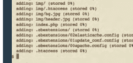

- **02 源束**

  - 应用程序源束由单个小于 512MB 的 `ZIP` 或 `WAR` 文件组成，包含你的应用程序源代码。这将由 `Elastic Beanstalk` 自动部署。你的源代码应位于根目录中，你还可以包括一个 `extensions` 目录，其中包含一个或多个用于配置环境选项的 `Elastic Beanstalk` `.config` `YAML` 配置文件。


- **03 名称和平台**

  - 在 `Elastic Beanstalk` 流程的第一步，系统将提示你提供最多 100 个字符的应用名称。接下来，你选择代码运行的平台——示例平台包括 `Python`、`Ruby`、`Tomcat`、`Go`、`Java`、`Node`、`PHP`、`Packer` 和 `.NET`，以及多个 `Docker` 选项和通用 `Docker` 容器。选择示例应用或上传代码后，你可以在此处创建你的应用或配置选项。


## AWS 替代方案

## 谷歌云平台


我们预计谷歌在云托管领域会有所布局——而它确实通过 **谷歌云平台（Google Cloud Platform）** 实现了这一点。与 `AWS` 和亚马逊类似，谷歌云平台基于用于驱动谷歌核心服务（如搜索和 `YouTube`）的相同基础设施。主要产品包括 `Compute Engine`（等同于 `EC2`）、`Cloud Functions`（等同于 `Lambda`）、`Cloud Datastore`（等同于 `DynamoDB`）和 `Storage`（等同于 `S3`）。

服务端、容器存储以及主目录。实际上，网络附加存储 `EFS` 与现有应用程序和工具配合使用效果极佳，多个 `EC2` 实例可以同时访问同一个 `EFS` 文件系统，这使得该服务非常适合跨运行在多个实例上的应用程序进行数据存储。`Amazon EFS` 采用广泛支持的 `NFS v4.1` 协议，在所有 `Linux` 发行版上都很容易使用。

### 免费套餐

亚马逊的免费套餐是尝试各项服务的绝佳途径，上述每种存储选项都包含在内。亚马逊将提供 30GB 的 `Amazon Elastic Block Storage`（通用型 SSD 或磁碟任意组合）；1GB 的快照存储；5GB 的 `Amazon S3` 标准存储，以及 20,000 次 `Get` 请求和 2,000 次 `Put` 请求；此外，首年每月 5GB 的 `Amazon EFS` 容量免费。

除了为 `Lightsail` 提供首月免费服务（可以理解的是，`Lightsail` 服务器本身没有长期免费套餐）之外，亚马逊还将 `EC2` 纳入免费套餐。在第一年内，您可以每月使用 750 小时的 `Amazon EC2` `Linux` 或 `Windows` `t2.micro` 实例使用量（足以持续运行），包含 1GiB 内存以及 32 位和 64 位平台支持，如需要，还可以在前面放置一个负载均衡器，并提供 15GB 的传输带宽。数据库产品的优惠力度同样很大——每月 750 小时的 `Amazon RDS` 单可用区 `db.t2.micro` 实例，可用于运行 `MySQL`、`PostgreSQL`、`MariaDB`、`Oracle` `BYOL` 或 `SQL Server`（运行 `SQL Server` `Express` Edition 版），配备 20GB 存储和 20GB 备份空间，以及 750 小时的 `Amazon ElasticCache` 缓存。

### 快速提示

### 计算成本

`AWS` 的“Simple Monthly Calculator”（简易月度计算器）是一个绝佳的工具，可用于评估基础设施配置、规模甚至区域的变化如何影响您的月度成本。请记住，所有 `AWS` 成本均以美元计。


`EFS`：`AWS` 存储解决方案涵盖广泛场景 – `EFS` 为 `EC2` 和 `Lightsail` 提供易于管理的网络存储


### 04 附加选项


在附加选项界面中，您可以选择基本低成本配置（符合免费套餐资格）或手动配置的更高级设置，例如高可用性或完全自定义。基本免费套餐将部署 64 位 Amazon Linux（在我们的示例中为 PHP-7）；如果您需要其他版本，可以选择“更改平台配置”并从列表中进行选择。

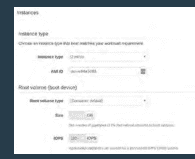

### 05 实例和容量

各种类别的选项都会选择合理的默认值。如果您需要更强大的服务器，可以在“实例”中选择。“容量”部分允许您指定首选的实例数量，以及是否希望跨多个可用区部署。负载均衡器将自动配置，您的应用程序更新可以立即部署或滚动部署。

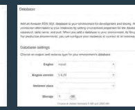

### 06 网络和数据库

默认情况下，配置中的“网络”部分会将您的实例启动到默认 VPC。如果您想使用特定的 VPC，可以在此处进行配置。`Elastic Beanstalk` 还可以通过“数据库”部分部署 `RDS` 数据库服务器，此处还可以配置引擎、大小、凭据、保留策略和可用性策略。部署后，也可以使用 `RDS` 控制台来更改这些设置。

## 特性

### AWS for Linux

### 迈向无服务器化

无服务器概念显然具有前瞻性。将复杂的应用程序拆分为微服务可以带来许多好处

我们之前讨论的所有 `AWS` 服务都是传统的服务器概念。然而，最近亚马逊一直在大力推广“无服务器”模式。顾名思义，无服务器计算允许您构建和运行应用程序和服务，而无需管理服务器基础设施。`Amazon CloudFront` 处理事件。`Amazon API Gateway` 使开发人员能够轻松创建、发布、维护、监控和保护 `API`：它可以处理数十万并发的 `API` 调用，并处理流量管理、授权和访问控制、监控以及 `API` 版本管理。`API Gateway` 是暴露 `Lambda` 所提供功能性的绝佳方式。`Amazon SNS`（`Simple Notification Service`，简单通知服务）和 `Amazon SQS`（`Simple Queue Service`，简单队列服务）提供进程间消息传递。`SNS` 是一种用于解耦分布式微系统元素的发布/订阅消息系统，而 `SQS` 是一种通用的消息队列服务。`AWS Step Functions` 使您可以使用可视化工作流协调分布式应用程序和微服务的组件。从每个执行独立功能的单个组件构建应用程序，使您可以快速扩展和更改应用程序。`Step Functions` 是一种可靠的方式来协调组件并逐步执行应用程序的功能。`Amazon Kinesis` 使收集、处理和分析实时流数据变得轻而易举，从而促成及时洞察，使您能够对新信息做出快速反应。`Kinesis` 让您能以成本效益的方式处理流数据，并灵活选择最适合应用程序需求的工具。借助 `Kinesis`，您可以将应用程序日志、网站点击流等实时数据摄取到数据库中，或使用这些数据构建自己的实时应用程序。

那么，这在现实中可能是什么样子呢？想象一下，你有一些托管在 `S3` 中的网站代码，通过 `CloudFront` 提供服务。当用户点击页面上的某个功能时，这可能会向 `API Gateway` 端点发起 `REST API` 调用，从而触发一个 `Lambda` 函数，从数据库（`RDS`、`DynamoDB` 或类似产品）检索信息，并通过 `API` 网关返回给应用程序进行渲染。由于应用程序智能逻辑运行在 `Lambda` 函数中，您只需在函数执行期间为使用的资源付费——一旦完成，微服务实际上就消失了。`AWS` 基础设施允许这些请求以巨大规模发生，在需要时提供巨大的容量，而在其他时间则保持节俭。

## 代码与交付

您可能不会感到惊讶，有一系列服务可以帮助您管理和部署应用程序代码。`AWS CodeCommit` 提供安全且可扩展的 `Git` 仓库用于存储代码。`AWS Codepipeline` 是一个持续集成和交付流水线，用于在每次变更时构建、测试和部署代码。`AWS CodeStar` 将许多 `AWS` 工具整合到一个统一的 `UI` 中，以便在一个地方轻松管理软件开发。它还完全集成了 `Atlassian JIRA` 用于问题跟踪，以及一系列 `AWS` 工具，包括 `Elastic Beanstalk`——用于自动部署 `AWS` 基础设施（如 `EC2` 实例、`S3` 存储桶和弹性负载均衡器）的编排服务。`Amazon AWS` 是一个极其先进的企业级产品，但通过面向初学者和爱好者的入门级服务（如 `Lightsail`）、深思熟虑的管理控制台、慷慨的免费套餐以及详尽的文档，它也是一个易于上手且乐趣十足的工具。

> 由于应用程序智能逻辑运行在 `Lambda` 函数中，您只需在函数执行期间为使用的资源付费

### 快速提示

`API Gateway`

`Amazon API Gateway` 支持 `Swagger` 导入和导出，以方便添加现有 `API`，并可为多种平台自动生成客户端库。

下方的 `Amazon Kinesis Analytics` 允许您对实时数据流执行基于 `SQL` 查询的分析，作为您无服务器系统的一部分


# 利物浦制造节特色

展示报告

# 利物浦 • 科学 • 技术 • 工艺制造节

当这个庆祝创造力、发明和奇技淫巧的节日进入第三年时，`理查德·斯梅德利`（`Richard Smedley`）混入了熙熙攘攘的人群之中。

> **关键信息**

> 制造节（`Make Fests`）和创客博览会（`Maker Faires`）是创意人士和技术人员聚在一起，向彼此及公众展示其项目的场所。

> 利物浦的活动是一个免费的一年一度的单日节日，由利物浦中央图书馆支持，并由志愿者运营。

在过去几年里，创客社区不仅将自由和开源价值观引入硬件和新兴的物联网（`IoT`）世界，还释放了一股创造力浪潮，吸引成千上万的年轻人和老年人以游戏的方式参与技术。鉴于此，`LU&SD`参加了第三届利物浦制造节，这是技术日历中最有趣的活动之一。我们还趁机与当地艺术家`罗斯·达齐尔`（`Ross Daziel`）交谈，探讨了艺术在技术和创客社区中的角色，他自述为“一位受创客文化启发并受到‘编程和硬件的黑客空间及开源文化’改变的艺术家”。更多相关内容稍后详述。

活动再次在利物浦中央图书馆举行，其优雅的新古典主义立面通向现代化的内部——以及书籍、技术和着装考究的蒸汽朋克世界形成的对比。利物浦制造节不仅是感官的盛宴，也是智力的盛宴。在这里可以看到英国强大且不断增长的创客运动的方方面面。

除了默西塞德郡教育场所常见的制造实验室（`fab labs`）外，利物浦有幸拥有两个创客空间。`DoES`（`Do Extrastordinary Stuff!`，意为“做非凡之事！”）是制造节的长期支持者，展示了一系列项目。`利物浦制造`（`Liverpool Make`）已扩展至两个空间，正在通过 `Indiegogo` 发起众筹活动，为“让利物浦制造得更酷”（`Make Liverpool Weid`）筹集资金，旨在“向利物浦市民提供公共焊接服务”。

许多现存的创客空间（`makerspaces`）和黑客空间（`hackspaces`）都大力推广传统工艺，这些工艺也在许多展位上展示甚至教授——从制作吉他和用废品制作珠宝，到缝纫和使用智能面料。新旧工艺无缝融合，年轻的参观者对传统和高科技都表现出同等的热情。

## 如此，我们便踏上通往星辰的旅程

通常在入口处，观众的目光会被一个全尺寸的 `Dalek`（“戴立克”，《神秘博士》中的反派机器人）所吸引，但今年它不得不与来自北威尔士创客`乔·林克利夫`（`Jo Hincliffe`）的一系列火箭和 `DIY` 卫星通信设备竞争。

从那里，我们穿过天花板高度的开放式中庭，沿着两段楼梯登上屋顶，来到当地天文学会架设的望远镜旁。随着电磁波谱的向下移动，我们找到了当地业余无线电小组的代表——一种自我学习和制作的文化比家用计算机早了几十年，但无线电爱好者们仍在不断适应新技术，构建软件定义无线电（`SDR`），或享受通过互联网传输摩尔斯电码的复古乐趣。

将图书馆五层中众多多样化的创客展位联系在一起的，是大量的动手体验活动。到处都有家庭和儿童在尝试事物，享受乐趣，并爱上技术带来的创造性可能。教育以几种意想不到的方式与技术相遇，例如`杰玛·拉瑟姆`（`Gemma Latham`）的 `PatternCraft`，它结合了纺织品、代码和《我的世界》（`Minecraft`），使用自制设备读取由儿童（和许多热心的成人）在展位上手工打孔的卡片。`Python` 代码在《我的世界》地图上构建卡片的 `8x8` 图案。附近，孩子们通过雅卡尔织机（`Jacquard looms`）和早期计算机键盘卡读卡器了解编程的演变，并体验到通过比键盘更具触感的方式学习编程的罕见乐趣。

## 技术文化

我们注意到，艺术家们从许多创客项目中汲取了趣味性，但学习元素似乎更为深刻。我们就此与`罗斯·达齐尔`（`Ross Dalziel`）进行了讨论，他表示他是在 `有意识` 地这样做。

罗斯告诉我们，过去五年里，他越来越 `转向创客世界`。“我喜欢创客文化的一点是，它让我想起了更传统的、 `互联网之前` 的制作方式 [那时我] 是那种会在 `Maplins`（一家电子元件零售商）里 `蹲着` 翻看目录的人。”


此前，对于罗斯来说，技术并不是故事的全部。在讨论几年前在 `FACT`（利物浦艺术与创意技术基金会）的一个项目时（免责声明：记者理查德·斯梅德利是一位贡献者），他回忆道：技术是微妙的。我真的很想推动 `FACT` 的发展。传感器和 `Arduino` 是其中的延伸 [...] 我将技术视为自然的一部分，文化的一部分——是我们挖掘出来的，但必须处理的东西。

由达齐尔、来自巴洛因弗纳斯（`Barlow-in-Furness`）的格伦·博特勒（`Glenn Bottler`）和 `MudLab` 联合创始人姜华英（`Hwa Young Jung`）组成的艺术家集体“家政学”（`Domestic Science`），表示他们对技术持审慎态度。不仅仅是对使用它感兴趣，而是参与这种文化，而不仅仅是利用它。

达齐尔在制造节的展位展示了一个基于 `Cockle` 板的交互式文字冒险游戏——这是一种基于 `ESP32` 的设备，由 `ShrimpPing!` 的 `Cefn Hoile` 共同开发，他参与了游戏设计和团队决策。这款游戏的成果源于艺术委员会委托给 2017 年 `The Hadrian’s Cavalry`（哈德良骑兵队）展览的一组不寻常的限制条件，这是一个横跨哈德良长城沿线十座博物馆的巡回项目，旨在让人们参与展览：要求是低成本解决方案，达齐尔说，这促使他们采用了跨站点的多次访问，游戏站点离线，无移动信号。我们发现了一个移动应用的想法。达齐尔回忆道。结果是一个文字冒险游戏，让年轻人能够体验基于哈德良骑兵队的趣味世界。它使用标签，游戏状态记录在 `RFID` 标签上，以便在站点间传递。技术是‘隐藏的，成为博物馆中的文物’，达齐尔解释道。你必须四处张望，将故事记在脑海中（就像阅读书中的故事一样），而不是总是低头看手机屏幕。标签推动它前进，游戏状态存储在手持物体中。


> 人们只看到技术文化的表面，但下面有一层丰富的底蕴需要宣传

## 文字优先

达齐尔从小就文字冒险游戏（也称为互动小说）的粉丝。他在 `ZX Spectrum` 上编写文字冒险游戏，最初是与朋友合作处理编程方面，然后使用 `Quill` 软件。后来，当我找到一个 `Spectrum` 模拟器时，我花了一个漫长的晚上用 `Quill` 试图重现那个冒险，并在 12 岁时放弃的同一个地方再次放弃！

另一个文字冒险项目涉及互动非虚构。今年夏天，在西北地区活动中的参与者使用 `Twine` 软件创建文字游戏，该软件从互联网数据、`API` 和各个网页获取输入。这些游戏将被放入街机机柜中。在九月，将在利物浦举办一场从业者工作坊，让艺术家和游戏设计师能够创建自己的项目。这种新旧融合、学习与玩耍的结合，可以在每次利物浦制造节上盛行的蒸汽朋克服装以及 `PatternCraft` 桌 上的敲击声中看到。人们只看到技术文化的表面，但下面有一层丰富的底蕴需要宣传，达齐尔说。像创客博览会这样的事件并不总是有最好的机会来展示文化知识和历史的重要性。

奇怪的是，人们认为技术是固定的和新事物——新铜线和面包板——但每个芯片背后都有数百人的工作，达齐尔说，重新阐释每个电路背后的文化和历史。我、格伦和伊娃（`Iiva`，即家政学团队）是技术的超级粉丝。一些艺术家使用技术文化。我们更多地是被它启发。我们想要改变我们的实践。

他举了一个更深入参与当地创客空间的好处例子。人们来到 `DoES`（利物浦的共享工作和创客空间），使用激光切割机的时间，然后离开。我试图在获取的同时也回馈一些东西——建立更好的关系。我们可以问更深入的问题，获得对技术更细致的理解，以便为未来的工作打下更好基础。

## 编程俱乐部

自然，在所有传统技能中，编码和计算机硬件在制造节上仍然占据重要地位：有编码无人机、机器人改装以及大量出售的 `Arduino` 扩展板。可以看到许多基于 `树莓派`（`Pi`）的桌面正在运行 `Scratch` 或 `Python`，但真正吸引我们目光的是两者的混合体：`EduBlocks`，它提供了一个类似 `Scratch` 的界面，可以拖放基于 `Python` 的代码块来构建程序，然后可以切换到完整 `Python` 代码的视图。它由 13 岁的乔舒亚·洛（`Joshua Lowe`）共同创建，他是 `All About Code` 的创始人兼首席执行官，也是 `Tech 4 Good` 奖项中 `BT 青年先锋奖` 类别的入围者。（更多详情见 `http://edublocks.org`）

教育——以及玩耍——很重要，但在灾难情况下，必须首先满足更基本的需求。创客们甚至在那里提供帮助（见右侧访谈）。如果你的 `树莓派` 和 `Arduino` 正在积灰，且需要灵感，去参加你附近的创客活动吧——为了创造力、乐趣 [...] 而学习则是意外之喜。


- 上方：互动是该活动的强烈主题，有许多涉及新旧工艺的创客活动供参与

## 访谈：劳拉·詹姆斯博士，Field Ready

许多参观者离开制造节时都在谈论 `Field Ready`（`www.fieldready.org`）的展位，这是一个专注于制造现场人道主义物资的非政府组织。我们与联合创始人兼工程负责人劳拉·詹姆斯博士进行了交谈。

### 将 3D 打印机带到灾害现场使之前无法做到的事情成为可能吗？

我们可以制造现场所需的东西，满足当地社区或援助工作人员的即时需求。在海地，我们遇到了没有无菌用品的接生员，她们使用绳子段来扎紧脐带，而当时需要无菌闭合。在尼泊尔，受地震破坏的诊所缺乏基本的医疗设备。

援助工作人员在不可预测的环境中工作，可能会发现自己需要将不同尺寸的管道以奇怪的配置连接在一起。[...] `Field Ready` 与大学团队一起创建了一个应用程序，允许用户输入需要连接的管道尺寸，并自动生成定制的管道连接器的 3D 模型，准备进行 3D 打印。

### 我们看到开源的工作方式影响了软件之外的许多领域……

我们了解到，即使有出色的工程师和设计师团队在现场，我们也无法独自解决我们在现场遇到的所有设计挑战。因此，我们形成了一个跨部门社区，由数百名技术人员、设计师和援助工作人员组成的“人道主义创客”，这是一个日益有用的论坛，用于寻找解决方案、共享信息和寻找志愿者。

### 您的设计是否可供其他组织在现场打印？

是的，我们公开分享我们的设计，供他人重复使用。您可以在 `Thingiverse` 上找到合集：（`http://bit.ly/FRTthingiverse`）我们使用 `3D-pressa` 提供更详细的说明。我们的设计通常采用 `CC-BY`（知识共享署名许可）。我们听到其他人重复使用我们的设计，例如加沙的一个 3D 打印我们的 `tectopic` 设计的项目，有时他们会反馈改进意见。

### 您仍在寻找创客社区帮助哪些方面？

我们始终乐意欢迎更多的人道主义创客，并计划在本年晚些时候推出新的互动测试计划。请在 `www.humanitarianmakers.org` 注册。

# 免费获取 6 期杂志

订阅时*

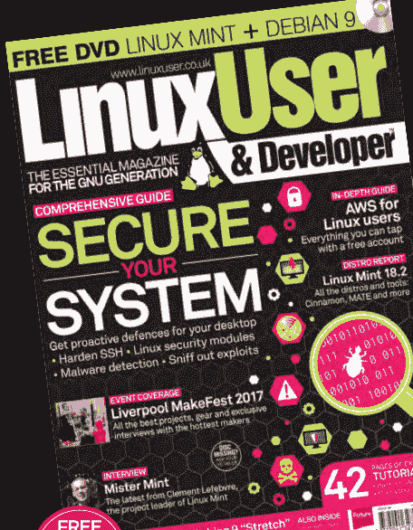

> 面向专业人士和开发者的开源权威


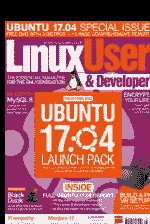


订购热线 +44 344 848 2852

在线访问 `www.myfavouritemagazines.co.uk/sublud` 订购

*这是美国订阅优惠。6 期免费是指美国零售价为 13 期 16.09 美元（合计 220.87 美元），而订阅价格为 112.23 美元。您将在一年内收到 13 期杂志。您可以在购买后 14 天内写信或致电我们取消订阅。除非有特殊情况，否则在 14 天取消期满后，款项不予退还。您的法定权利不受影响。价格以印刷时为准，并可能变更。有关直接借记保证的完整详情，如有需要可提供。英国境内的通话费用与其他标准固定电话（以 01 或 02 开头）相同，并包含在任何包月或免费通话时长配额中（如果您的电话费率提供此服务）。完整条款和条件请访问：`bit.ly/maglands`。优惠截止日期为 2017 年 8 月 31 日。

## 充分享受你的树莓派

现已上市！附赠数字版


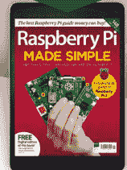

# 金钱所能购买的最好树莓派指南！

## 树莓派，化繁为简

学习如何利用强大的树莓派进行破解、编码和制作


- 148 页实用建议
- 包含全新的树莓派 3 指南
- 本书免费数字版！更多信息请见第 146 页

`Future`

# 立即订购！

在线访问 `www.myfavouritemagazines.com` 订购

在各大报刊亭均有售


# 实用树莓派


`70` “电子墨水显示器的巨大优势在于其无干扰性”

# 目录


- `70` 树莓派项目：乐高经典 Macintosh
- `72` 在 `Minecraft` 中创建自动像素艺术
- `74` 扩展你的 `Sense HAT` 战舰游戏
- `78` 使用 `Python` 在 `Minecraft` 中做酷炫的事


# 树莓派项目

# Jannis Hermanns

是 `www.pimopel.com` 的软件工程师，他放弃了风筝冲浪和篮球的爱好，转而照顾一群孩子和树莓派。

# 喜欢吗？

毫不意外，对 `Mac` 的怀旧情感和当代创客运动的维恩图有一个交集，其中充满了项目。Jannis 最喜欢的之一是 März Jonasson 的 `NESMAC`，这是一台内部装有树莓派的老款 `Macintosh Classic`（`https://youtube.com/PtPbUlf8`）。

# 延伸阅读

为了了解采访中提到的 `gitbox` 和 `weatherbox` 项目，或者 Jannis 的任何项目，请访问他的网站：`https://janni.is`。在他的 `Ghost` 博客上，你可以找到关于乐高经典 `Macintosh` 的完整介绍。你还可以在推特上关注他：`@jannis`。

# 乐高经典 Macintosh

这款用乐高重建的老式 `Mac` 是当代技术与童年怀旧感的迷人结合

## 什么启发了你的项目？

我的几乎所有副项目都源于解决某个痛点。在过去，那大多是软件——从 2000 年代初期名为 `S9y` 的博客软件开始，到最近的一款名为 `Gym Hero` 的 `iOS` 健身追踪应用 [...]。乐高经典 `Macintosh` 是我的第一个硬件项目，它始于我住在柏林并骑自行车上班，我想要一个厨房小显示屏来告诉我天气情况。我买了两个小显示屏和一个树莓派，让它们分别显示客厅的二氧化碳浓度和露台的当前温度。然后我意识到，这对我早上决定是否穿上优雅的雨中骑行服帮助不大。

## 你当时挑选那个特定的电子墨水显示器是怎么考虑的？

由于我需要更大的屏幕空间来显示当天的天气状况，我研究了适合树莓派的显示类型。虽然有很棒的高 `PPI` 彩色显示屏，但我选择了电子墨水显示器 [...] 厨房天气显示屏只需要每隔一分钟更新一次，而缺乏颜色使得设计信息展示方式更加简单。电子墨水显示器的巨大优势在于其无干扰性；它们看起来不像电脑，而且在黑暗中不会发光。那简直完美 [...]。我实际上买了两种不同尺寸的，并在这个项目中使用了较小的那个。另一个是 `Waveshare` 的 4.3 英寸显示屏，我已经开始计划围绕它制作另一个稍大一点的乐高经典 `Macintosh`。

> 我在两个月里每隔一个晚上工作一次

## 你能告诉我们你构思出的远程更新屏幕解决方案吗？

树莓派上运行着几个微型应用程序，负责获取数据，还有一个每分钟更新显示数据的应用程序。因此树莓派基本上是自给自足的；没有外部实体更新屏幕。它自己做所有工作。代码部署非常容易，可以远程完成 [...] 因为设备由 `resin.io` 管理，它是免费的层级。

## 项目中最具挑战性的部分是什么？

什么是最容易的：找到时间。我在两个月里每隔一个晚上工作一次，当时家人都在睡觉（这样他们就不会因为我用乐高玩耍而在厨房评判我）。这通常意味着每次对项目工作 30 分钟到两小时。其余的都很简单，但当然这 mostly 是因为我是个程序员。对于编程新手来说，这个项目的整个软件部分会花更长的时间——但这是完全可以实现的，不要害羞。既然你现在知道我的名字，你可以[让我]帮你。

## 如果人们想尝试你的项目，你会给他们什么建议？

获取一个树莓派 `Zero W`。它自带 `Wi-Fi` 和蓝牙，所以你不需要在那里进行任何焊接。另外，因为你无法在互联网上发布几块乐高积木的图片，尤其是如果你是把它们 `Dredeld` 进去的人。正如我们在该项目中学到的，互联网上有 `AFOL`（乐高成年粉丝），他们会轻视你的能力，如果你切积木 [...] 会严厉地评判你。

## 你最终使用了哪个基础镜像？

我使用了 `resin.io` 的善心人士提供的 `resin/raspberrypi-python:2.7`。在我的 `GitHub` 账户上，你可以找到一个预配置的 `docker` 镜像 – `https://bit.ly/ePaperDockerfile` – 用于配合我在此项目中使用的嵌入式艺术家电子墨水显示器显示数据。

## 你在你朋友的屏幕上显示的是什么？我们是否窥探到你将 Gym Hero 应用添加到树莓派上？

它目前显示他女儿的天数年龄、当天的降水概率、当前的体感温度，以及当天的最低最高温度。由于我是和我的伙伴 Jannik 一起制作 `Gym Hero` 应用的，而他收到乐高 `Mac` 作为生日礼物，它还显示前一天我们在应用中销售了多少健身计划。

## 在完成经典 Macintosh 之后，什么激发了你的兴趣？

它是我喜爱的树莓派商店 `Pinoroni`（`https://shop.pinoroni.com`）推出的一款新设备。这是一款名为 `Unicorn HAT HD` 的 16x16 `RGB` 像素矩阵，即插即用——只需将其插入树莓派 [...]。在你等待 `Unicorn HAT HD` 邮寄到货期间，你可以试用我用 `Unicorn HAT` 模拟器写的[它 [...]（`https://github.com/jany/icunicorn-hat-sim`）。[...] 目前，我制作了一个小的 `gitbox`，允许你用网页浏览器将 `GIF` 拖放到上面。下一步是把它变成 `weatherbox`，显示 16x16 的动画像素艺术，展示当天的天气（晴天、多云、雨天等）。又是天气。直到这次采访，我才意识到我对天气如此着迷。

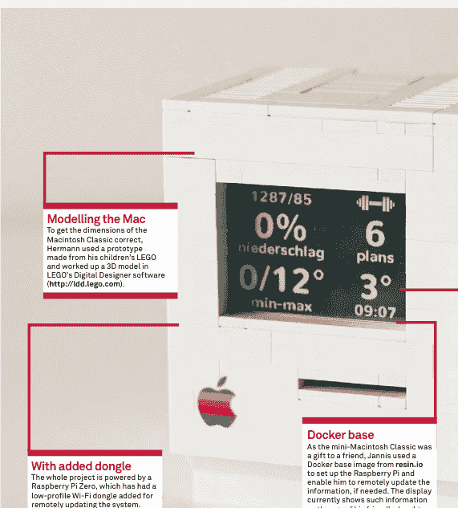


## 建模 Mac 电脑

为了获得准确的 `Macintosh Classic` 尺寸，Hermann 使用他孩子的乐高积木制作了一个原型，并在乐高的 `Digital Designer` 软件中建立了一个 3D 模型（`http://ldd.lego.com`）。

## 组件列表

- 乐高 `Digital Designer` 软件
- 乐高积木
- `Embedded Artists` 的电子纸显示屏
- `Raspberry Pi Zero`（但现在建议使用 `Pi Zero W`）
- 电源
- 微型复古 `Macintosh` 贴纸
- `Dremel` 旋转工具
- 线缆（公对母）

## 添加转接头

整个项目由 `Raspberry Pi Zero` 供电，该设备添加了一个低剖面的 `Wi-Fi` 转接头，以便远程更新系统。

## Docker 基础

由于这台迷你 `Macintosh Classic` 是送给朋友的礼物，Jannis 使用来自 `resin.io` 的 `Docker` 基础镜像来设置 `Raspberry Pi`，以便在需要时能够远程更新信息。该显示屏目前显示的信息包括他朋友女儿的年龄（以天计）、降雨概率和当前温度。

## 电子纸展示

Jannis 使用了来自 `Embedded Artists` 的 2.7 英寸电子纸显示屏，这带来了一些挑战，其中之一是显示板比显示屏本身大得多。


## 最左侧

当Jannis开始他的项目时，`Raspberry Pi Zero W`尚未发布，这就是为什么照片中的`Pi Zero`板上连接了一个USB Wi-Fi转接头的原因。如果你现在尝试这个项目，他建议只使用`Pi Zero W`。

## 左侧

这个项目并不是一帆风顺的：Jannis意识到他制作的模型恰好宽了一块积木时，不得不拿出`Dremel`旋转工具进行修整。

## Minecraft

### 使用 Python 代码在 Minecraft 中创建像素艺术

继我们关于Minecraft编程的系列报道后，本期我们将向你展示如何创建自动化的像素艺术


#### Calvin Robinson

Calvin是一所公立全纳学校的计算系主任和网络管理员。Calvin还与伦敦各地的学校进行咨询合作，帮助提供高质量的计算教学和课程。


```python
woolBlockGreenType = 5
#Black wool is blockID 15
woolBlockBlackType = 15

pixelArt = []

pos = mc.player.getPosition()
x = pos.x
y = pos.y + 7
#8 blocks above ground
z = pos.z
```

在Minecraft中创建像素艺术可以是一种很放松的活动，但逐个放置方块也非常耗时。然而，通过使用`Python`和几个简单的`for`循环，我们可以编写脚本来自动将预制好的像素艺术直接构建到我们的Minecraft世界中。

如果你正在树莓派上运行`Minecraft Pi`版，则无需安装额外的软件。我们还准备了一些工具，以确保此脚本可以在使用零售版Minecraft的`Linux`上运行。因此，作为先决条件，我们假设你已经从我们前几期的文章中安装了`McPiFoMo`。`McPiFoMo`包含了来自`MCPiPy.com`的`'jlep'`和`'bluepillRabbit'`开发的`MCPiPy`，以及由Alexander Pruss开发的`Raspberry Jam`。

在本教程中，我们将使用`Python`创建一个数组，用于按行和列构建方块，从而生成一些像素艺术。你需要手边准备好方块ID列表，以便选择与你期望颜色相匹配的一系列方块。在这里我们将使用羊毛作为选择，但你也可以使用任何符合你目的的方块。

所有`Python`脚本都应保存在目录`~/home/minecraft/mcppy/`中，无论你是运行`Minecraft Pi`版还是`Linux`零售版Minecraft。

## 01 设置代码

这是主要的代码列表...

```python
from mcpy import minecraft
mc = minecraft.Minecraft.create()

#Wool is blockID 35
#Green wool is blockID 35:5 (type 5)
woolBlock = 35
```

务必使用我们`McPiFoMo`包中附带的`Forge 1.8`配置文件来运行Minecraft。

```python
for row in range(len(pixelArt)):
    for pixel in range(len(pixelArt[row])):
        if pixelArt[row][pixel] == 0:
            mc.setBlock(x, y - row, z + pixel, woolBlock, woolBlockBlackType)
        elif pixelArt[row][pixel] == 1:
            mc.setBlock(x, y - row, z + pixel, woolBlock, woolBlockGreenType)
```

## 02 解析代码 – 方块类型

上述代码中有几个有趣的点。首先，你会发现我们每个方块使用了两个变量。为了将方块ID设置为`35:5`（即绿色羊毛），我们使用`woolBlock 35`和`woolBlockGreenType 5`。我们将对所有添加到像素艺术中的方块都这样做。如果没有方块“类型”，请简单使用`0`。

在我们的`for`循环中，我们调用`woolBlock.woolBlockGreenType.`。如果你经常使用没有类型的方块（例如钻石：`57`），可以完全省略类型变量。

## 03 解析代码 – 定位

你还会注意到我们的方块在`y`轴上的位置是`+7`。这是因为我们将创建像素艺术


## 资源

- **Minecraft**

  `www.mojang.com/games/`

- **Wireshark**

  `www.wireshark.org`

- **Python**

  `www.python.org`

- **McPiFoMo**

  `http://rpiethat.co.uk/McPiFoMo.rar`

- **Block IDs**

  `http://minecraft-ids.grahamedgecombe.com`

高八个方块，我们希望确保它从地面水平向上出现。

```python
pos = mc.player.getTilePos()
x = pos.x
y = pos.y + 7
z = pos.z
```

我们的方块按行构建：

```python
for row in range(len(pixelArt)):
    for pixel in range(len(pixelArt[row])):
        if pixelArt[row][pixel] == 0:
            mc.setBlock(x, y - row, z +
                        pixel, woolBlock, woolBlockBlackType)
        elif pixelArt[row][pixel] == 1:
            mc.setBlock(x, y - row, z +
                        pixel, woolBlock, woolBlockGreenType)
```

```python
woolBlockOrangeType = 1
#Blue wool is type 11
woolBlockBlueType = 11
#Brown wool is type 12
woolBlockBrownType = 12
#White wool is type 0
woolBlockWhiteType = 0
#Pink wool is type 6, but double jungle wood slabs look good (125:3)
woolBlockPink = 125
woolBlockPinkType = 3
```

## 06 创建史蒂夫头像 – 扩展你的 for 循环

我们还需要将这些新变量添加到下面的`for`循环中，以便将它们添加到每一行。我们可以这样做无数次。


```python
for row in range(len(pixelArt)):
    for pixel in range(len(pixelArt[row])):
        if pixelArt[row][pixel] == 0:
            mc.setBlock(x, y - row, z +
                        pixel, woolBlock, woolBlockOrangeType)
        elif pixelArt[row][pixel] == 1:
            mc.setBlock(x, y - row, z +
                        pixel, woolBlock, woolBlockBlueType)
        elif pixelArt[row][pixel] == 2:
            mc.setBlock(x, y - row, z +
                        pixel, woolBlock, woolBlockBrownType)
        elif pixelArt[row][pixel] == 3:
            mc.setBlock(x, y - row, z +
                        pixel, woolBlock, woolBlockWhiteType)
        elif pixelArt[row][pixel] == 4:
            mc.setBlock(x, y - row, z +
                        pixel, woolBlock, woolBlockPinkType)
```

### 04 绘制 2D 爬行者

现在，为了创建你的第一件像素艺术作品，你需要在`pixelArt`列表中创建一个由 1 和 0 组成的列表：

```python
pixelArt = [
    [1, 1, 1, 1, 1, 1, 1, 1],
    [1, 0, 0, 1, 1, 0, 0, 1],
    [1, 0, 0, 1, 1, 0, 0, 1],
    [1, 1, 1, 0, 0, 1, 1, 1],
    [1, 1, 0, 0, 0, 0, 1, 1],
    [1, 1, 0, 0, 0, 0, 1, 1],
    [1, 1, 0, 1, 1, 0, 1, 1],
    [1, 1, 1, 1, 1, 1, 1, 1]
]
```

如果你眯起眼睛，你可以从 1 和 0 中辨认出一个爬行者的头。

### 05 创建史蒂夫头像 – 添加更多方块类型变量

显然，爬行者只有黑色和绿色，但如果你想创建更高级的东西，你需要通过添加更多带有方块 ID 和类型的变量来添加更多颜色的方块。以下是创建史蒂夫头像所需的颜色：

```python
#wool is blockID 35
#Orange wool is type 1
woolBlock = 35
```

## 07 运行你的代码

将你的`pixelart.py`文件保存在`~/home/minecraft`。使用`Forge 1.8`配置文件打开`Minecraft`，创建/加载一个世界，并输入`/python pixelart`来生成你的创作。你可以这样做任意次来构建你预制像素艺术的新副本。■

> **寻找新的像素艺术**

>

> 如果你在为像素艺术创作寻找灵感时感到卡壳，或者你需要一点帮助，试着谷歌搜索像素艺术模板。有很多免费的模板可用，带有网格线和可计数的盒子。你可以通过计算行/列并调整你的`Python`列表来匹配这些模板。我们的爬行者和史蒂夫头像都是 8x8，但你可以通过增加四行代码并给每行追加四个数字，轻松地将其改编为 12x12。

>

> 我们很乐意看到你的 2D/3D `Minecraft`像素艺术创作。给我们发推特，附上你最棒的游戏截图 `@linuxusermag`，并告诉我们你正在哪个发行版上运行`Minecraft`。

## 战舰游戏

### 第二部分：使用 Sense HAT 战舰号令海上

这是我们在树莓派上使用`Sense HAT`制作经典战舰游戏系列的最后一部分。

`Dan Aldred`是一位树莓派爱好者、教师和程序员，他喜欢通过创建新的项目和黑客技巧来激励其他人开始学习。

- **树莓派**

  `www.raspberrypi.org/products`

- **Sense HAT**

  `http://bit.ly/BattleshipSenseHAT`

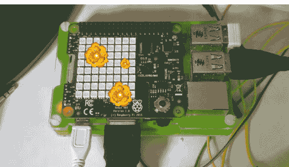

在本教程的第一部分 [LJUD#180，教程，第74页] 中，你已经开始构建经典的战舰游戏，编码了诸如部署船只、发射鱼雷和保持分数累计等功能。在第二部分，你将首先安装一个小程序，该程序使你能够轻松创建动画并在`Sense HAT`的 LED 矩阵上播放。这些动画可用于介绍游戏、显示游戏结束消息或根据游戏需要在任何地方更新玩家。教程在完成游戏玩法的主要机制之前，会先设置部署游戏的代码。首先，通过一系列声音和口头宣布来介绍游戏，然后在显示屏上滚动播放一艘船的动画。接着，在游戏开始前创建一个从三到零的简单倒计时。该游戏利用了我们在第一部分创建的主函数。游戏结束后，我们将添加选择是否再次游玩的选项。如果你将摇杆向下移动，程序将播放告别声音，显示动画，然后你的游戏结束，程序关闭。向上移动摇杆，你可以选择再玩一轮，系统将创建一个新的随机布局。在这里观看完整游戏的实际演示：`https://youtu.be/So1WAJHCac.`。

### 01 创建你自己的 8x8 动画

在 LED 矩阵上运行动画有一种简单的方法；这是一个出色的屏幕程序，使你可以实时操控 LED。你可以更改颜色，旋转并将动画导出为代码。首先安装`Python` PNG 库，打开终端并输入`sudo pip3 install png`；然后：

```bash
git clone https://github.com/jrobinson-uk/RP1_8x8GridDraw
```

安装完成后，进入`RPI`文件夹，输入`cd RPI_8x8GridDraw`，然后输入`python 8x8grid.py`运行应用程序。

### 02 创建并导出你的动画

网格编辑器允许你从右侧的一系列颜色中进行选择。选择一种颜色，然后点击网格上 LED 的位置。选择“在 LED 上播放”以在`Sense HAT`的 LED 矩阵上显示该“像素”。使用“清空网格”按钮清除 LED，然后重新开始。使用“+”按钮添加新的“幻灯片”并构建你的动画。这可能是一个棘手的过程，因此值得事先做好计划。完成后，按下“导出为 py”按钮将动画导出为代码。这会将动画保存为`RPI`文件夹中的一个`Python`文件；它将命名为`8x8animation.py`。你可以创建任意数量的动画；在这里我们将制作一个介绍和一个游戏结束屏幕。

### 03 添加分数

本教程现在继续从上 tutorial 第一部分编写的程序开始。删除从`!`到`Game`'注释以下的所有内容 – 这些行是添加用来测试你的代码的。现在你可以添加剩余的代码。在与相同级别的缩进中，添加播放'score'.MP3'的代码。这会宣布你的分数，第一行。使用`Pygame`播放 MP3 文件，第二行；添加一个短暂的暂停以留出时间让声音文件播放，第三行。

```python
pygame.mixer.music.load("sounds/yourScore1.mp3")
pygame.mixer.music.play()
time.sleep(1)
```

### 04 显示你的分数

保持相同的缩进级别，添加一行代码以将你的分数作为消息在 LED 矩阵上滚动显示。然而，首先分数需要转换为字符串才能显示。你可以通过更改方括号内的三个值来编辑消息的颜色，最大值可为 255，第一行。然后打印出剩余待摧毁的船只数量，第二行。

```python
sense.show_message(str(score), text_colour=[0, 200, 255])
print("There are", number_of_ships, "ships left")
```

### 05 你做得怎么样？第一部分

现在程序检查你在游戏中表现如何。如果剩余船只数量为零，那么你就做得非常好，第一行。在第三行，一条合适的“做得好”消息在 LED 矩阵上滚动显示。添加一个合适的“获胜者”声音，例如号角声，第四行，然后播放它。记得添加一个小的延迟以便文件播放。


```python
# add a score
pygame.mixer.music.load("sounds/yourscore1.mp3")
pygame.mixer.music.play()
time.sleep(1)

sense.show_message(str(score), text_colour=[0, 200, 255])
print("There are", number_of_ships, "ships left")

if number_of_ships == 0:
    print("WELL DONE, TOP JOB") # ADD SOME ANIMATION
    sense.show_message("TOP JOB", text_colour=[0, 255, 255])
    pygame.mixer.music.load("sounds/winner.mp3") # add a sea sound
    pygame.mixer.music.play()
    time.sleep(3)
else:
    print("Better luck next time") # ADD SOME ANIMATION
    pygame.mixer.music.load("sounds/restime.mp3") # add a sea sound
    pygame.mixer.music.play()
```

### 06 你做得怎么样？第二部分

如果你没有击沉所有船只，那么你就没有赢得游戏，而是输了。你可以添加额外的条件来检查不同的数量，例如一半的船只。首先使用第二行的代码在 LED 矩阵上滚动消息。然后播放合适的失败者声音，第三行和第四行。

```python
else:
    print("better luck next time")
```

### 像素灵感

`Johan Viet` 有一些出色的且令人鼓舞的 8x8 像素艺术示例 (`[http://bit.ly/8xBipixe](http://bit.ly/8xBipixe)lart`)，其中包括一些著名角色，并将展示你可以用 64 个彩色像素创造什么。

```python
sense.show_message("BETTER LUCK NEXT\nTIME", text_colour=[0, 255, 255])
pygame.mixer.music.load("sounds/intro.mp3") # add a sea sound
nexttime.mp3" # add a sea sound
pygame.mixer.music.play()
```


### 07 开始游戏

这就完成了所有的游戏机制，它们存储在名为 `main()` 的函数中 – 这段代码只有在调用 `main()` 时才会运行。然而，在此之前，让我们为游戏创建一个介绍。首先播放一个合适的声音，第一行。这个例子是波浪舒缓的声音。触发声音播放，第二行。在第三行，使用代码 `import intro_ship` 导入你在步骤 2 中创建的动画。这在声音播放时显示，从而为游戏创建一个美好的介绍。

```python
pygame.mixer.music.load("sounds/intro.mp3") # add a sea sound
pygame.mixer.music.play()
import intro_ship
```

### 08 开始游戏

在短动画结束后，我们向玩家宣布游戏开始。这使用了熟悉的 `sense.show_message` 代码在 LED 矩阵上滚动消息。这次，使用代码 `back_colour=[0, 0, 180]` 添加背景颜色，第一行。创建一个变量，第二行，将游戏状态设置为 `True`，意味着游戏正在进行中。接下来，检查游戏是否正在进行，第三行，并创建另一个名为 `play_again` 的变量，第四行，以响应玩家是否希望再次游玩游戏。

### 09 创建海洋

现在创建海洋。这是一个包含 64 个项目的列表，它们将每个矩阵 LED 变为蓝色。每次你选择一个位置，来自 `Sea2` 列表（在教程一中创建）的数据、敌方船只或弹药库会被添加到 `Sea` 列表的当前位置。然后 LED 显示会更新。首先设置颜色并将其赋值给名为 `S` 的变量。然后创建列表并添加 64 个 `'S'` 字符 – 注意最后一个后面不需要逗号。要将列表数据写入 LED，使用代码 `sense.set_pixels(Sea)`。添加一个小的延迟，然后停止第 7 步中的介绍音乐播放。注意这些行在代码中都是缩进的。

### 10 做好准备并倒计时

在游戏介绍之后，通知玩家“做好准备”，因为游戏即将开始。这是由一个简单的声音文件触发的，并使用了你之前用过的 `Pygame` 代码。接下来，创建一个从三到一的简单倒计时。这使用一个循环按顺序遍历一个列表。每次显示数字：`sense.show_letter(str(num))`。注意数字在显示前被转换为字符串。同样，在显示每个数字之间添加一个小的延迟。


### 11 开始

在倒计时结束后，游戏准备就绪。通过一个简单的“开始”或类似的听觉命令通知玩家，第一行和第二行。然后调用你在教程一中开始并在第 6 步中完成的 `main()` 游戏函数。由于 `main()` 函数位于 `Python` 程序的开头，它已经加载并准备部署。游戏开始……

```python
pygame.mixer.music.load("sounds/go.mp3")
pygame.mixer.music.play()
### Begin the main game ###
main()
```

### 12 再玩一次？

游戏现在开始，你可以选择海上的位置。该位置会被检查是否有敌方船只、弹药或仅是空旷区域。一旦 `main()` 函数结束，它会跳出游戏循环并运行下面的代码。这给了你再玩一次的选择。首先加载“选择”图像。然后加载并播放一个声音文件，询问玩家是否想再玩一次。


### 13 检查玩家响应

为了对问题做出反应，可以使用 `Sense HAT` 摇杆来选择向上或向下。在第一行，一个 `while()` 循环检查游戏选择是否等于 `1` 或 `True`。如果是，则使用 `Pygame` 检查


```python
pygame.time.wait(100)
pygame.mixer.music.load('sounds/reload.mp3')
program_ani = end_animation()
for i in range(int(23 * frame_rate)):
    pygame.display.set_mode(128,128)
    for x, y in program_ani[i]:
        pygame.draw.rect(screen, (0,128,128), [x, y, 1, 1])
    pygame.display.flip()
pygame.time.wait(500)
pygame.mixer.music.load('sounds/play.mp3')
print('Now to play game')
play_game()
while True:
    for event in pygame.event.get():
        if event.type == pygame.QUIT:
            break
        if event.type == pygame.KEYDOWN:
            if event.key == pygame.K_UP:
                print('You moved the joystick')
                play_again()
            elif event.key == pygame.K_RIGHT:
                print('You moved the joystick')
                # play_again() is already false so no
                print('Now to play game')
                play_game()
            elif event.key == pygame.K_DOWN:
                # a move down the joystick so we don't wish to play again
                print('Move down the joystick')
                print('Bye Bye!')
                pygame.mixer.music.load('sounds/soon.mp3')
                pygame.mixer.music.play()
                print('Bye Bye')
                import end_animation
                break
```

向下移动操纵杆。如果你将操纵杆向下推，则表示你不想再玩游戏；因此，`play_again`变量被更改为值 `0`。第8步中的变量`play_game`变为`false`，以表明游戏已结束。

### 14 游戏结束

如果玩家选择结束游戏，则加载并播放合适的声音文件，即第一行和第二行。如果你已经制作了结束动画，可以通过导入文件来播放它，见第四行。最后，跳出循环，使程序结束。若要再次玩游戏，你需要重新加载程序。请注意，此级别的缩进与上一步最后代码的缩进相同。

```python
pygame.mixer.music.load("sounds/soon.mp3")
pygame.mixer.music.play()
print("Bye Bye")
import end_animation
break
```

### 15 再次游玩

另一个选项是再次玩游戏。这是通过将操纵杆向上移动来实现的。第一行检查此移动，然后将`play_again`的值更改为`0`。请注意，第8步中指示游戏是否正在进行的`play_game`变量没有被更改，因此保持为`True`。程序重复循环，检查变量，发现它为`True`，并再次部署`main()`游戏函数。

```python
elif event.key == K_UP:
    play_again = 0
```

### 16 运行海战棋

这标志着教程和《海战棋》游戏背后程序的运行结束。确保声音文件存储在一个名为`sounds`的文件夹中。此外，确保动画也存储在同一个文件夹中。如果你以不同的方式组织文件夹，你需要相应地编辑代码。保存你的Python程序，按`F5`执行它。你能击沉多少艘船？■

### 创建图像

第2步中使用的网格编辑器程序也可以用于创建静态图像。然后，可以将这些图像显示在Sense HAT的LED矩阵上。按照第2步的说明加载网格编辑器工具，并使用它在网格中放置彩色像素。选择“在LED上播放”以在Sense HAT的LED矩阵上显示颜色。像以前一样，使用“清除网格”按钮清除LED，然后重新开始。

然后，当你完成静态图像的创建后，将其保存并导出为PNG文件。在程序中使用`sense.load_image("name_of_your_file.png")`来显示该图像。

## 专栏

## Python

## 使用 Minecraft 构建

本期内容，我们将探讨如何使用Python在树莓派上的Minecraft中完成一些非常酷的事情


`Joey Bernard`是一位真正的通才。他的时间分配在制作家具、帮助研究人员解决科学计算问题以及编写Android应用之间。

### 为什么是 Python？

它是树莓派的官方编程语言。阅读`www.python.org/doc`上的文档。

Minecraft长期以来一直是一个庞大的游戏环境。许多Minecraft玩家可能不知道的是，有一个版本的Minecraft服务器可以在树莓派上运行。更少的人可能知道，里面埋藏着一个Python引擎，你可以为它编写代码，让它做一些非常奇特和精彩的事情。本期，我们将探讨如何开始编写Python代码并与你的Minecraft世界交互。

在本文的其余部分，我们将假设你有一台Pi 3来操作。第一步是在树莓派上安装Minecraft，尽管它已内置于最新版本的Raspbian操作系统中。要安装Minecraft，请使用命令：

```
sudo apt-get install minecraft-pi
```

你可以通过桌面上的“编程”菜单或带有`minecraft-pi`命令的终端窗口启动Minecraft。然后，你可以点击“开始游戏”，再点击“创建新世界”来获得一个新的世界并做好准备工作。如果你想以通常的方式使用Minecraft，你可以在此处停止，开始在这个新世界中建造。但我们将对它进行编程！

为了在你创建的这个新世界内编写Python代码，你需要打开一个Python控制台：打开`编程 > Python 3 (IDLE)`。让我们从一个简单的`Hello World`程序开始：

```python
from mcpi.minecraft import Minecraft
mc = Minecraft.create()
mc.postToChat("Hello World")
```

第一步是导入`Minecraft`类，然后实例化一个新对象连接到当前游戏。最后一行在聊天窗口中显示文本“Hello World”。如果你使用的是`Shell`控制台，每行Python代码在你按下`Enter`时立即执行。如果你有更长的代码块想要编写，可以打开一个文件将代码写入其中。然后，当你保存文件并按下`F5`运行它时，可以执行整个代码块。

> “你可以与构成世界的方块进行交互”

你很可能首先想要做的是与游戏中的玩家角色进行交互。你可以使用以下代码获取角色位置：

```python
curr_pos = mc.player.getPos()
```

返回的位置对象包含`x`、`y`和`z`的值。你也可以同时对三个变量进行赋值，以便立即获取这三个独立的值。除了获取当前位置，你还可以使用以下命令设置角色的位置：

```python
x, y, z = mc.player.getPos()
mc.player.setPos(x+100, y, z)
```

这将玩家角色横向跳跃`100`个空间。在Minecraft世界中，地面上的方向由`x`和`z`标记，而`y`坐标则给出垂直方向上的位置。要小心那个`y`坐标。你可能会被传送到很远的天空，然后重重地坠回地面。别忘了重力。

除了移动角色的能力外，你还可以与方块进行交互，这些方块构成了你居住的世界。可用的最基本方法是`setBlock()`方法。例如，以下代码会在你旁边放置一个石头方块：

```python
mc = mc.getPos()
mc.setBlock(x+1, y, z+1, 1)
```

参数是`x`、`y`和`z`位置值，以及一个指示要创建的方块类型的ID。最常见的方块是：

- `0` 空气

- `1` 石头


- `2` 草
- `3` 泥土

虽然你可以使用这些原始 ID 数字，但有一个 `block` 类提供了一种更简单的方式来处理 Minecraft 方块。你可以使用以下代码执行上面相同的 `setBlock()` 命令。

```python
from mcpi import block
mc.setBlock(x+1, y, z+1, block.STONE_id)
```

其他类型的方块也有相应的参数。对于某些类型的方块，还有可用的其他选项。例如，对于木头方块，你可以从橡木、云杉或白杨等品种中设置木头类型。你可以通过给 `setBlock()` 方法添加第五个参数来设置这一点。有时，你可能需要检查某个特定位置有什么类型的方块。例如，你可能需要在尝试之前检查某块土地是否适合种植花

将它们种植下去，你可以使用以下代码：

```
curr_block = mc.getBlock(x, y, z)
if curr_block == mc.GRASS:
    mc.setBlock(x, y, z, block.FLOWER_CYAN)
```

除了逐个处理方块，你还可以将一组方块作为一个整体单元进行操作。例如，你可以使用以下代码创建一整面由十个石头方块组成的墙。

```
mc.setBlocks(x, y, z, x+10, y, z, block.STONE.id)
```

你也可以反过来操作，使用 `getBlocks()` 方法，通过指定起始点和终点，获取该区域内方块 ID 的列表。然后你可以遍历每一个方块，执行任何你想要编程的动作。

除了创建和放置方块，你还可以以更直接的方式与它们进行交互。这通过事件（Events）来实现。当世界中的某个玩家击中一个方块时，就会触发一个事件。你可以通过以下代码获取给定事件的详细信息。

```
curr_event = mc.events. pollBlockHits()
```

这个事件对象包含几个属性，你可以访问这些属性以查看当前正在发生什么。第一个属性是事件类型。目前，唯一实现的事件是 `BlockEvent.HIT`。受事件影响的方块位置可以从 `pos` 属性中获取。如果你希望实现的交互类型很重要，你甚至可以从 `_face` 属性中找出方块的哪个面被击中。如果你在进行多人游戏，你可以通过 `.entityId` 属性找出是哪个玩家触发了该事件。你可以设置方块仅在特定玩家击中特定方块的特定面时才执行动作。这在益智类游戏中可以发挥巨大作用。

为了更好地查看你所做的所有工作，你可以调整相机设置，从而改变你进入 Minecraft 世界的视角。你可以使用以下代码将相机设置到给定位置：

```
mc.camera.setPos(x, y, z)
```

如果你恰好在玩多人游戏，并且希望相机跟随某一位特定的玩家，你可以使用以下命令来实现。

```
mc.camera.follow(playerID)
```

你首先需要找到该玩家的 ID。一旦相机设置完成，你可以使用方法 `mc.camera.setFixed()` 改变模式。你可以使用方法 `mc.camera.setNormal(playerID)` 将其重置为通常模式。

最后两个非常有用的方法允许你保存和重启会话。在开始进行一些夸张的测试之前，你可以使用以下代码保存一个检查点：

```
mc.saveCheckpoint()
```

然后你可以使用下一个命令将世界重置到该检查点：

```
mc.restoreCheckpoint()
```

这样，你就可以尽情享受瞬间撤销任何你造成的损坏的能力。希望本文已经勾起了你的兴趣，让你迫不及待要深入我们的 Minecraft 编程系列（请翻到第 72 页）。

## 你还能做什么？

我们在这里介绍的是 Minecraft 世界中完整 API 的一个子集。如果你想立即在树莓派（Pi）版本中使用你开发的代码，有两个项目值得你探索。`Canarymod` 和 `RaspberryJcice` 是可以安装在你的 Minecraft 服务器中的附加组件。然后你可以直接运行你的 Python 代码，使用相同的 API。若要更进一步，你需要安装一些组件。第一个是用于托管你希望处理的世界的服务器。你还必须安装一个单独的 API，以便你的服务器能够受你的 Python 代码影响。一旦安装这些，你就可以开始使用该 API。例如，以下代码将传送你的玩家角色。

```
from mcpi.minecraft import Minecraft
mc = Minecraft.create()
mc.player.setRelPos(x, y, z)
```

如图所示，实际使用的方法可能与树莓派版本中使用的略有不同。当然，其他方法，如 `setBlock()` 和 `getBlock()` 在树莓派版本中工作方式相同。有很多不同的 Minecraft 服务器可供你使用。你可能听说过其中的两个：`bukkit` 和 `spigot`。若要使用 Python 作为脚本语言，在这两种情况下，你还需要安装一个插件，以便让你的 Python 代码运行并使用 Python API。有了所有这些额外功能，你还有许多额外的脚本语言选项。例如，由于 Minecraft 服务器的核心是用 Java 编写的，你可以使用 `Jython` 插件来编写能够直接与服务器内的 Java 对象交互的脚本。如果你希望同时使用树莓派和基于 PC 的服务器，你可以让树莓派连接到服务器。Python 控制台可以使用如下代码进行连接。

```
mc = Minecraft.create('192.168.1.1', 4711)
```

然后，你的 Python 代码将在基于 PC 的服务器上的世界中运行。当有一整团队的人在一个大型单一世界中一起（或相互对抗）工作时，这真的变得非常有趣。这实际上也是你需要记住的一点。在基于 PC 的服务器上，世界在物理上更大，这意味着如果你的位置值在树莓派服务器上有限的范围内，而在 PC 服务器上可以延伸到更大的值。

## 夏季促销！

## 5 期仅需 £5*

我们最畅销杂志的大额折扣


要在全系列杂志中享受巨大折扣，请访问在线全系列产品 `myfavouritemagazines.co.uk/summer17`

### 热线 0344 848 2852

*条款和条件：试用优惠仅面向通过直接借记支付的新英国付费订阅者。节省金额与购买全价纸质刊物相比。您可以在购买后 14 天内通过写信或打电话取消订阅。除非有特殊情况，14 天取消期后的付款不予退还。您的法定权利不受影响。价格在印刷时有效，并可能随时变更。直接借记担保的完整详情可应要求提供。英国境内通话费用与其他标准固定电话（以 01 或 03 开头）相同，或者包含在任何包月或免费分钟额度中（如果由您的电话费率提供）。完整条款和条件请访问：`bit.ly/magazine`。优惠截止日期为 2017 年 8 月 31 日

# 评测

81 **团体测试** | 86 发行版 | 90 自由软件

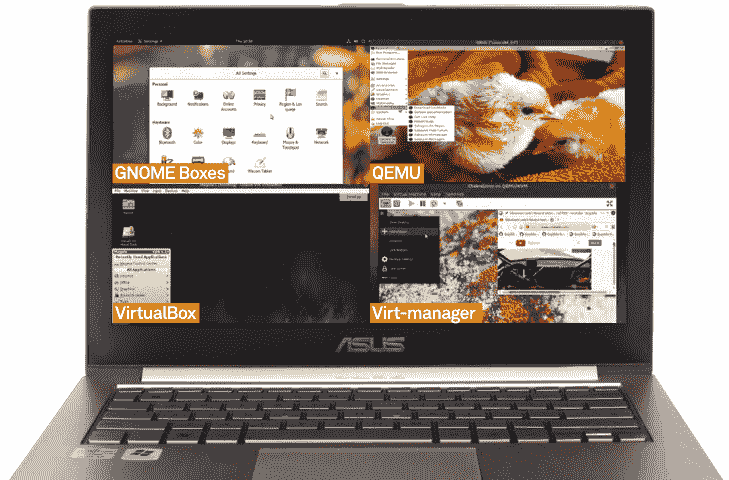

### 团体测试

### 桌面虚拟化软件

使用这些开源选项创建一些虚拟机，以发挥你日常电脑的真正潜能

- **GNOME Boxes**：这是少数几个随桌面环境捆绑提供的虚拟化应用之一，所有 GNOME 和基于 GNOME 的桌面用户都可以轻松获取。但它是否有足够的力量对专用应用发起严重挑战，还是仅仅占用空间？ [http://bit.ly/GNOMEBoxes](http://bit.ly/GNOMEBoxes)

- **QEMU**：作为此类应用中最古老的一个，自世纪之交以来，它一直帮助桌面用户体验虚拟化。但抛开技术比较不谈，作为桌面虚拟化软件，QEMU 是否仍有能力应对来自较新桌面应用的挑战？ [http://www.qemu.org](http://www.qemu.org)

- **VirtualBox**：如果你曾涉足桌面虚拟化，很可能就是得益于 VirtualBox。这款开源应用可以通过专有附加组件获得令人印象深刻的新技术。但当有纯开源竞争对手可用时，你真的需要这样做吗？ [https://www.virtualbox.org](https://www.virtualbox.org)


- `Virt-manager`：你可以将虚拟机管理器（Virtual Machine Manager）称为红帽对 Oracle 的回应。从纯粹的桌面用户角度来看，无论技术差异如何，它是 `VirtualBox` 等软件的合适替代品，可以在不穿越陡峭学习曲线的情况下创建虚拟机。 [https://virt-manager.org](https://virt-manager.org)

## `GNOME Boxes`

它并不是你可能预期的那种“百宝箱”


在某些发行版中，`Boxes` 提供“快速安装”选项，用于预配置虚拟机，例如创建用户。

### 易用性

这款虚拟化软件拥有非常友好的界面。要创建新的虚拟机，你可以输入 `URL`，应用将从中获取镜像并以此启动，或者指向本地可用的 `ISO` 文件。然而，该应用提供的自定义选项非常有限，你只能调整 `RAM` 数量和其可占用的最大磁盘大小。

### 高级功能

如果 `Boxes` 在计算机上发现其他由 `libvirt` 管理的虚拟机，你会获得导入它们的选项。它还可以克隆虚拟机，并允许你一键创建快照，之后可以轻松重命名并回滚到该快照。此外，你可以将 `Boxes` 指向远程 `VNC` 服务器或 `oVirt` 和 `libvirt` 代理。

### 原生硬件支持

在虚拟机的偏好设置菜单中，内置了连接宿主机的选项，包括摄像头和所有连接的 `USB` 设备。切换该选项后，设备会像预期那样出现在客户机 `dmesg` 命令的输出中。然而，只有连接到宿主机的 `USB` 驱动器如宣传那样正常工作，并毫无问题地出现在虚拟机内部。

### 与宿主机的集成

一旦虚拟机启动并运行，`Boxes` 表现相当不错。虚拟机内的声音工作正常，没有问题是，而且你还可以在主机和虚拟机之间复制粘贴文本。然而，没有进行文件传输的选项。

### 总体评价

`Boxes` 是一个用户友好的选择，支持所有基本功能，帮助虚拟化新手体验虚拟化的核心功能，而无需面对其中的麻烦。


## `QEMU`

Vulcan 的虚拟化软件，这是一个粗糙但有效的解决方案。


虽然文档完善，但使用 `CLI` 实用工具来创建和控制虚拟机并非人人乐事。

### 易用性

`QEMU` 拥有丰富的功能集，但这以牺牲易用性为代价。该应用本质上是一个命令行工具，典型安装会倾倒大量以 `qemu-` 为前缀的工具子集，用于模拟不同的架构。像 `Qemu Launcher` 和 `AQEMU` 这样的前端很好地为 `QEMU` 的许多高级选项提供了图形界面。

### 高级功能

你可以毫无问题地保存和恢复 `QEMU` 虚拟机。它还支持模拟各种架构，从 32 位机器到 `SPARC` 和 `PowerPC`。除了令人印象深刻的硬件虚拟化功能外，`QEMU` 还可以进行用户模式模拟，以在完全不同的平台上运行为另一个平台创建的应用程序。

### 原生硬件支持

`QEMU` 虚拟机可以与宿主机上的许多类型物理硬件交互，包括音频接口和各种 `USB` 设备。但这并不是它最擅长的领域。相反，你可以使用 `QEMU` 为其广泛支持的架构模拟各种类型的外设。

### 与宿主操作系统的集成

你可以将主机上的文件夹共享给在 `QEMU` 中运行的客户机，尽管你必须手动在客户机内挂载它们。但这几乎就是你能预期的所有集成，因为没有支持在虚拟客户机和主机之间复制粘贴文本或文件的剪贴板共享功能。

### 总体评价

在高级功能方面，`QEMU` 占据了优势，但在易用性方面几乎未得分。这就是为什么它最适合那些寻求灵活性的高级虚拟化爱好者。


## `VirtualBox`

其“功能全能”的方法赢得了众多粉丝。

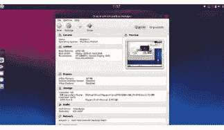

- `VirtualBox` 中可用的虚拟网络基础设施是虚拟化中最有趣的功能之一

### 易用性

`VirtualBox` 使用简短的向导引导用户自定义虚拟机的基本元素。创建后，你可以选择开机或调整其虚拟硬件的设置。虚拟机设置窗口包含有用的选项，例如为虚拟机手动选择半虚拟化接口的能力。

### 高级功能

该应用功能极其丰富。它可以对虚拟机进行快照和克隆，你还可以相对轻松地导入和导出虚拟设备。`VirtualBox` 还可以进行端口转发，让你能在虚拟机内运行服务器。然而，对于其某些高级功能，如磁盘映像加密，你需要依赖专有扩展模块。

### 原生硬件支持

这是 `VirtualBox` 的另一个亮点。它支持 `SSD` 和光盘的直通模式，并且是少数让虚拟机内的应用使用主机 3D 硬件的选项之一。其 `USB` 支持让你能够访问主机上的各种外设，你可以运行高分辨率的虚拟机，并将其分布在连接到主机的多个监视器上。

### 与宿主操作系统的集成

使用 `VirtualBox`，你可以共享剪贴板和文件夹，并可以配置为自动挂载。值得一提的是其无缝模式，在这种模式下，你可以让虚拟化的应用程序与主机桌面上的应用程序并排运行。

### 总体评价

凭借其独特的高级功能和易用性的结合，`VirtualBox` 提供了足够的内容，以满足经验丰富的和非经验丰富的用户。

8

## `Virt-manager`

在顶尖行列中表现出色，但 Red Hat 的产品有很多值得推荐之处。


- 虽然 `virt-manager` 主要创建 `KVM` 虚拟机，但它也可以管理 `Xen` 和 `LXC` 容器

### 易用性

`Virt-manager`（全称为虚拟机管理器）使用相当直观的向导来创建新的虚拟机。该应用覆盖的范围足够广，让系统调优者有充分的空间个性化他们的虚拟机，同时使用合理的默认值帮助初次用户顺利操作。该应用的主界面显示所有虚拟机的列表，如果其中有一个在运行，它还会显示其实时资源使用统计。

### 高级功能

`Virt-manager` 应用为某些硬件部件提供细粒度控制，这将吸引高级用户。它可以克隆虚拟机并在一台主机与另一台主机之间迁移它们，你还可以导入 `QEMU` 写时复制图像。

### 原生硬件支持

在虚拟机内部，声音开箱即用，显示器可以扩展至全屏。该虚拟化还支持连接 `USB` 设备的能力，包括可移动驱动器、摄像头和连接到主机的蓝牙设备，所有设备都能在客户机中无缝工作，没有任何问题。

### 与宿主操作系统的集成

一旦你在主机和客户虚拟机内部都安装了 `spice-vdagent`，你就可以在虚拟机和主机之间复制粘贴文本。然而，你无法以相同方式移动文件，并且与 `VirtualBox` 不同，没有额外的客户机扩展或类似的扩展来启用此类功能。

### 总体评价

`Virt-manager` 拥有你想要的所有常用功能。这些功能通过直观的界面展现，使该应用无论用户技能水平如何，都让人愉悦地使用。

7

# 评测

### 桌面虚拟化软件

#### 简评：比较我们的结论

| | `GNOME Boxes` | `QEMU` | `VirtualBox` | `Virt-manager` |
|---|---|---|---|---|
| 易用性 | 易于使用，但自定义虚拟硬件的选项有限。 7 | 本质上是一个命令行实用工具，初学者可通过第三方图形 UI 使用。 5 | 使用非常易上手的图形界面，可满足所有类型的用户。 8 | 得益于直观的虚拟机创建向导，几乎没有学习曲线。 8 |
| 高级功能 | 在功能方面无法与领导者竞争，但涵盖基础功能。 7 | `QEMU` 的成熟度在高级功能数量这一领域得到了体现。 8 | 这里功能并不匮乏，尽管有些需要专有扩展。 8 | 这将以其对虚拟硬件的广泛控制吸引高级用户。 7 |
| 原生硬件支持 | 除了 `USB` 驱动器外，`Boxes` 未能连接主机上的任何硬件。 5 | 与主机硬件交互的能力是 `QEMU` 的一个明显弱点。 6 | 让你能够轻松使用连接到主机的各种硬件。 8 | 主机上常用的外设也可以在虚拟机内使用。 8 |
| 与宿主操作系统的集成 | 虚拟机内的声音和复制粘贴工作正常，没有任何问题。 7 | 除了共享文件夹的能力外，`QEMU` 在集成方面提供的并不多。 6 | 除了剪贴板和文件夹共享，无缝模式值得称赞。 8 | 集成是 `Virt-manager` 提供功能有限的少数领域之一。 7 |
| 总体评价 | 如果你使用 GNOME 桌面，不妨让 `Boxes` 试试看，没有坏处。 6 | 不要用 `QEMU` 开始你的虚拟化之旅，但它是值得追求的目标。 6 | 即使没有闭源组件，它也能略胜一筹。 8 | 几乎与 `VirtualBox` 一样好，但没有专有扩展的阴影。 7 |

## 获胜者是...

### `VirtualBox`


这是那种分数有点误导人的团体测试。根据评分，`VirtualBox` 勉强领先于 `Virt-manager`。但如果你使用 `VirtualBox` 的开源版本（不含闭源扩展），你就拥有一场真正的激烈较量。在许多领域，如 `CLI` 支持，这对从终端管理虚拟机和从脚本内供应机器非常有用，`virt-manager` 让 `VirtualBox` 难以招架。还有定制虚拟硬件，这是 `virt-manager` 的专长。例如，除了 `CPU` 数量之外，`virt-manager` 允许你从其庞大的支持模型集合中为客人指定 `CPU` 模型，从 `Pentium 3` 和 `Opteron G5` 到 `Haswell`、`Westmere` 等。我们也对 `virt-manager` 的使用直观性及其良好的扩展性印象深刻，这使其适合庞大的人群。

然而，在几次表现乏力的更新之后，`VirtualBox` 通过整合并行化功能再次找回了状态。`VirtualBox` 还提升了令人印象深刻的虚拟机性能，并功能丰富。

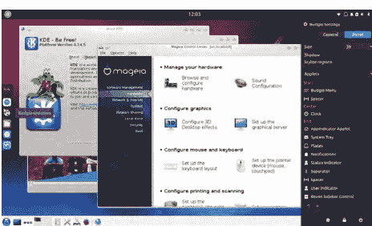

闭源扩展为 `VirtualBox` 令人印象深刻的功能所支付的代价很小。

诚然，其一些真正有用的以桌面为中心的功能依赖于闭源扩展包，但从实用主义的角度来看，这是一个很小的代价。

话虽如此，尽管 `VirtualBox` 夺得桂冠，我们仍建议读者尝试 `virt-manager`。如果它能做到你需要桌面虚拟化软件做到的一切，那么真的不需要其他任何东西。在这个意义上，即使是 `GNOME` 用户也不应仅仅因为 `Boxes` 是模拟应用（相对于其他）就绕过它——它可能足以满足大多数用户的需求。

Mayank Sharma


回收你的杂志，七天后它可能会变成你的报纸。

`www.recyclenow.com`

### 回收

可能性无穷无尽

# 弹性站点

# VPS 的力量

节省 50% 共享的简便性

`03330 439780`

`netcastera.co.uk/elastic`

# 大幅削减你的互联网、电视和电话账单！


只需一个快速的电话。

数以千计的交易。

**最低价保证**

每年最高节省 `£408*`

83% 的客户节省了

我们来为您做繁重的工作：

- 免费致电，与伦敦的公正专家交谈。
- 我们审查来自英国顶级提供商的 6,000 多个交易，为您找到最适合的 - 拥有我们的最低价保证。
- 我们的专家处理繁重的工作，回答您的问题，甚至安排安装！

我们自豪地成为唯一获得 `Ofcom` 认证的电视、宽带和家庭电话比价服务。


免费致电我们，我们会为您处理繁重的工作！

`0800 466 1053`

**专家可用时间：**

- 周一至周五 上午 8 点 - 晚上 8 点，
- 周六 上午 9 点 - 下午 5 点半，
- 周日 上午 10 点 - 下午 5 点半。

**简化数字生活**

`www.techradarstores.co.uk/digital` 或发送 “DEAL” 至 `81400`，我们会致电您

*“简化数字生活”客户实现了平均 £421 的节省。数据基于 2016 年 1 月 1 日至 2016 年 11 月 30 日之间的 1,5% 记录。 **我们 2016 年 1 月 5 日至 2016 年 9 月 30 日之间的交易咨询，第 30 位 SimplifyDigital 客户通过注册我们推荐的交易节省了资金。适用最低价保证条款和条件 – 请访问 `www.simplifydigital.co.uk/lowest-price-guarantee` 查看完整详情。标准短信网络费用适用。*

# 评测

## Debian 9


> *上图 如果认为全包 DVD 有点过分，`Debian` 还为不同的桌面环境发布了各种实时 CD，例如 `Xfce`、`MATE` 和 `Plasma`*

> 最新的 `Debian` 发行版是发行版所代表的核心价值的体现 – 稳定性和长期可用性

| 规格 | 详情 |
| :--- | :--- |
| 内存 | 1GB |
| 存储 | 10GB |
| 要求 | 1GHz `Pentium 4` 处理器 |
| 支持 | 包括 `ARM`、32 位和 64 位 `AMD`/`Intel` 在内的十大主要架构 |
| 获取方式 | `www.debian.org/releases/stable` |

作为最古老的生存下来的 `Linux` 发行版之一，`Debian` 是 `Linux` 生态系统中最令人喜爱特质 – 协作 – 的见证。该项目在三个开发分支上运作 – 稳定版（`Stable`）、测试版（`Testing`）和不稳定版（`Unstable`） – 软件包随着成熟从一个分支移动到下一个分支。最新的稳定版发行版是经过两年多残酷测试的产物，最终结果是一个极其稳定和可靠的发行版。

除了其慢速烹饪般的发布策略和庞大的软件存储库外，使 `Debian` 区别于其同行另一特性是其软件政策。该发行版仅包含在自由软件许可证下发布的应用程序。专有编解码器、硬件设备（如打印机和显卡）的驱动程序被归入非自由软件存储库，该存储库默认未启用。

正因为 `Debian` 中软件包含必须满足严格的技术要求，所以在十多年里，它没有捆绑两个最受欢迎的开源应用程序：`Mozilla Firefox` 浏览器和 `Thunderbird` 邮件客户端，而是用重新品牌化的 `Iceweasel` 和 `Icedove` 取而代之。


*上图 最新发行版包含一些默认软件的关键变更，例如用 `MariaDB` 替代 `MySQL`，以及更新版本的 `GNU PG (2.1)`*

由于漫长的测试过程，`Debian` 不包含尖端软件，但从某种意义上来讲，这对 `Linux` 生态系统也是一件好事

`Debian` 发行版标志着这两个备受喜爱的 `Mozilla` 应用程序的回归，因为争议最终得到解决。`Mozilla` 承认 `Debian` 对其产品的修改和更新符合 `Mozilla` 严格的质量标准。导致 `Iceweasel` 诞生的商标争议也随着 `Firefox` 标志在自由许可证下的发布而得到解决。

该发行版还包含一些对现有用户特别相关的变更。网络接口卡 (`NIC`) 现在使用 `BIOS`/固件和插槽号进行命名。例如，您的以太网和无线网卡现在将分别命名为 `ens0` 或 `wlP3s0`。如果您有按名称引用 `NIC` 的脚本，这一点很重要，因为您需要编辑这些脚本以提供新名称。

对于管理员而言，该发行版附带 `MariaDB`，它取代 `MySQL` 成为默认数据库服务器。安全是最新发行版的关键关注点：`Debian 9` 配备了流行的安全应用 `GNU PG` 的现代分支。虽然旧版本的 `GNU PG` 现在已弃用，但仍作为 `gnupg1` 提供给用户；然而，较新的分支带来了改进的智能卡支持和生成密钥的更好默认设置。虽然对启用 `UEFI` 的机器的支持是在上一个发行版中引入的，但 `Debian 9` 的实时镜像现在也支持 `UEFI` 启动。该发行版现在可以配置为 `X` 显示系统不再需要 `root` 权限即可运行。但要使用此功能，您需要 `logind`、`libbam-systemd` 和 `gdm3` 显示管理器。

最新发行版还包括底层软件的升级，例如 `Linux` 内核、桌面环境和日常应用程序，如 `LibreOffice`。由于漫长的测试过程，`Debian` 不包含尖端软件，但从某种意义上来讲，这对 `Linux` 生态系统也是一件好事，否则用户就没有理由去尝试像 `Ubuntu`、`Mageia`、`Mint` 和其他发行版了。

您可以使用本月的封面光盘来试用 `Xfce` 版本；`GNOME` 是默认桌面环境，但也有 `MATE` 的选项。最新发行版标志着向图形安装程序的转变成为默认选项，但您仍然可以选择基于 `curses` 的安装方式。开箱即用，该发行版提供了足够的应用程序供家庭用户和爱好者使用。如果您有更具体的用途，您将不得不扩展该发行版。

Shashank Sharma

## 优点

残酷的测试产生了一个极其健壮和稳定的发行版，由于其庞大的存储库，可用于任何用途。

## 缺点

它配备的软件版本比其同行旧。如果您对尖端功能感兴趣，请尝试测试版或不稳定版。

## 总结

献给其已故创始人 `Iain Murdock`，`Debian 9` 在过往发行版的基础上构建。长期的测试带来了即装即忘的稳定性在一个健壮的发行版中，不要介意由于缓慢的发布周期而过时的软件包，没有比 `Debian` 更好的了。


# Mageia 6 Plasma RC


该项目提供了一个全包的仅安装 DVD 镜像，以及几个针对不同桌面环境（如 Plasma 和 MATE）的实时可安装 ISO

## Mageia 6 Plasma RC

| 规格 | 详情 |
| :--- | :--- |
| 内存 | 最低 512MB 内存；最佳性能需 2GB |
| 存储 | 极简安装需 5GB 磁盘空间 |
| 要求 | 任何 AMD、VIA 或 Intel 处理器 |
| 获取方式 | `www.mageia.org/en/downloads` |

备受期待且严重延误的 Mageia 6 承诺成为一个精彩的新发行版，如果 RC（候选版）是任何征兆的话

与其前作在开发中花费了一年多时间一样，Mageia 6 也面临了过度的延误。随着 alpha 版本在 2016 年 3 月发布，beta 版本在 7 月发布，发布候选版（本文评测对象）终于在 2017 年 5 月底揭晓。最终版本原本计划在 RC 之后约两周发布，但目前尚未得知何时最终公布。

尽管开发人员在延迟问题上受到了一些用户的批评，但延误进一步证明了他们致力于发布极其稳定和可用产品的决心。长期孕育期的好处是，Mageia 6 附带了一堆新功能并拥有更好的性能。

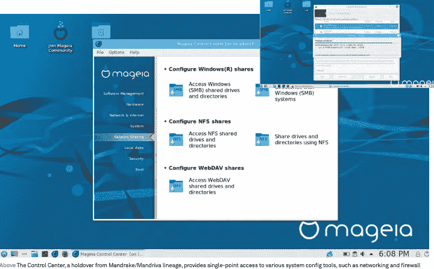

控制台中部上方（Above The Control Center）是来自 Mandrake/Mandriva 血统的遗留功能，它提供了对各种系统配置工具（如网络和防火墙）的单点访问。

> 漫长的孵化期的好处在于，Mageia 6 配备了许多新的功能和性能改进。

开箱即用方面，该工具简单直观的设计使其非常适合对底层包管理原理了解有限或完全不了解的用户。不幸的是，Mageia 不再提供直接启动软件管理应用程序的菜单入口。你必须点击 `菜单 > 工具 > 系统工具 > Mageia 控制中心`，然后点击 `安装和卸载软件` 来启动 `rpmdrake`。你也可以从美观设计的欢迎屏幕启动该软件应用。

尽管 `rpmdrake` —— 图形化软件管理工具 —— 仍然依赖 `urpmi` 来解决依赖关系，但开发者也在致力于 `DNF dracora`，这是一个作为 `DNF` 系统前端的替代应用程序，但它不会很快可用。Mageia 项目也在大力投入与 Fedora 的 `COPR` 项目合作，该项目旨在为构建第三方软件包仓库提供类似 `PPA` 的系统。

在 Mageia 6 中，所有应用程序都已移植到 Plasma 5，这是 KDE 4 桌面的继任者。该发行版最终放弃了对 `Lilo` 和 `Grub Legacy` 的支持，仅提供 `Grub 2` 作为引导加载程序，但如果你是从现有安装升级，你仍然可以继续使用其他引导加载程序。Mageia 5 的用户如果先安装所有可用的 5 版更新，就可以升级到 Mageia 6，但他们必须使用发行版的 DVD 版本，而不是实时镜像之一。延迟的主要原因是安装程序中的 bug，但在我们在物理机器上进行的测试安装以及作为 `VirtualBox` 客户机的安装中，我们没有遇到任何 bug。但该发行版并非完全无 bug。如果你希望启用家长控制，你可以通过控制中心进行操作，但行为不稳定并导致崩溃。同样，虽然该发行版允许创建快照，以便在系统配置错误时可以回滚到之前的状态，但该功能会导致频繁崩溃。各个实时镜像仅提供少数日常办公、互联网和多媒体应用程序。但用户可以通过 `Core`、`Nonfree` 和 `Tainted` 仓库访问数千个附加软件包。硬件组件（如无线网卡和显卡）的专有驱动程序通过 `Nonfree` 仓库提供，而多媒体编解码器以及其他可能侵犯版权、专利或其他法律权利的软件包则被归类到第三个仓库。请注意，在这三个仓库中，只有 `Core` 默认是启用的。

@Shashank Sharma

## 优点

坚定的开发人员结合庞大的用户社区，使 Mageia 成为理想的日常桌面发行版。

## 缺点

过去两个发行版一直困扰着项目的漫长且频繁的延迟令人担忧。

## 总结

这是一个相当稳定的发行版，建立在 Mageia 5 引入的众多变更之上，是一个适合日常使用的可靠发行版。最终版对于寻求可配置系统且不需要太多资源的新手和有经验的用户来说，可能是一个完美的桌面。

8


## 免费软件评论

### BashStyle-NG 10.0

通过图形界面自定义命令行设置

如果你曾经想要自定义 Bash 提示符，而且由于距离上次操作已经很久，你大概不得不去谷歌搜索相关命令，也许你会希望有一种简单的图形界面方式来做到这一点？你会认为这个花哨且自相矛盾的想法不可行——毕竟，Bash 的图形界面？——但这里我们展示了一个图形界面配置工具，它不仅处理 Bash 设置，还处理 Readline、Vim、nano 和 Git。一旦我们在测试机器上添加了 Python `configobj` 包，安装过程就很顺利（该包在 Debian/Ubuntu 仓库中可用，也可通过 `pip` 安装）。对于 Bash，大多数设置用于提示符和颜色。有一组预定义提示符；自定义颜色；自定义提示符的图形界面；以及 `grep` 中的颜色高亮。额外功能包括自定义 `cd`（可以即时创建目录）、制表符补全黑名单（用于屏蔽备份文件）；以及历史记录设置。Git 设置 - 姓名、电子邮件、默认编辑器、输出颜色 - 对于新手和偶尔的用户会很有用。挖掘该包的其他功能，如八进制和温度转换。这是一个小众软件，但一些用户会发现它是不可或缺的。


上方 点击一个彩色图标，图形界面会变得更老式的灰色，以更改应用程序参数

-   优点

    消除了记住所有配置文件、shell 变量和命令行设置的负担

-   缺点

    即使你喜欢图形界面，打开和使用它可能看起来和寻找配置文件选项一样麻烦

适合... 无需深入查阅 man 页面即可进行快速配置更改

`http://bit.ly/BashStyle`

### Mutt 1.8.3

高效快速地管理电子邮件只需几条命令


那些足够古老以至于记得电子邮件不是智能手机应用程序，而是互联网主要用途的我们，是在 Elm 及其克隆 Pine 和 Mutt 等命令行客户端长大的。远离命令行客户端的转变并未带来生产力的提升，而 Mutt 在过去两年中稳步增长改进，现在可能是重新审视（或首次发现）它的时机。

这是处理繁重电子邮件负载最有效的方式之一。我们需要远超半页的评论来告诉你 Mutt 的强大功能，所以请打开 Mutt wiki 上的新手指南，它也链接到优秀的第三方教程，然后是完整的 HTML 手册。顶部有一行快捷键列表，它会随着上下文变化，如你将看到的那样，当你用箭头向下移动到其中一封邮件并按 Enter 键打开它时。Mutt 的强大之处不仅在于练习基本命令，还在于将它们串联起来以加快繁琐的归档操作。

请记住，花在 Gmail 或 Evolution 等应用程序的菜单中搜索以及点击复选框以移动、归档或删除电子邮件的那些分钟——所有这些都累积起来。相反，花时间学习几条命令，你就可以手指不离键盘地快速完成任务。并且当你已经将邮件归档到服务器（或你的 Raspberry Pi）时，你可以瞬间发出一封电子邮件，或处理 `/var/mail/` 文件中的内容。

-   优点

    高效的快捷键，上下文特定的设置；键盘宏自动化复杂任务

-   缺点

    有很多需要学习的地方，但 Mutt 的口号是“所有邮件客户端都很糟糕。这一个只是糟糕得少点！”

适合...

最终让你控制好自己的电子邮件堆积如山的情况

`www.mutt.org`


## 虚拟桌面游戏查看器

### Rolisteam 1.8.2

无法参加朋友的桌面游戏会话？远程加入他们

> 它始于一篇法语 Ubuntu 论坛的帖子，寻求移植一些

Dungeons & Dragons 软件的帮助，结果发现该软件是用 Qt 编写的，很快就在 Ubuntu 7.10 上运行了。近十年后，Rolisteam 不仅在 GNU/Linux 下易于编译，而且已显著成长和改进，并翻译成几种欧洲语言。它不仅仅关乎 D&D，作为一个高效的方式，让远程玩家之间玩任何桌面游戏，因为它促进了通过互联网查看所有必要的角色卡、地图等。

`wiki` 和其他（多语言）文档涵盖了一切，但你需要挖掘它们以获得完整的图景。鉴于大多数 Dungeons & Dragons 爱好者在设置上投入了大量时间，这不会让很多人却步。一个用户，通常是游戏主持人，设置为服务器 - 或主机 - 其他玩家通过服务器地址连接他们；端口（默认：6660）需要打开。


“目标使 `Rolisteam` 管理的 `RPG` 游戏如同你桌边的 `RPG` 游戏一样好，”主页上说。所有组件都齐备：角色卡；地图和图片共享；矢量映射；掷骰子和秘密掷骰子；聊天；以及环境音乐（喜忧参半）。`Rolisteam` 甚至有一个内置的 `Twitter` 机器人，你可以用像 `#roll 5d10` 这样的推文调用；你也可以在游戏查看器中本地运行 `DiceParser`。

## 优点

涵盖了桌面游戏所需的一切，具有巧妙的矢量映射功能

## 缺点

临时网络连接可能对所有应用程序都有问题 - 注意防火墙问题

## 适合...

无法聚首时进行 `D&D` 桌面游戏

`www.rolisteam.org`

## 代码编辑器

### TKE 3.1

友好、功能齐全且无臃肿的代码编辑器


又一个文本编辑器？开始一个文本编辑器项目很容易，但需要真正的动力才能让它通过几个版本持续下去，因此值得看看 `TKE` 有什么可提供。它支持 `85` 种语言的语法高亮，提供多光标/多选择支持，并可通过 `Bird's Eye` 文本查看器快速导航代码。`TKE` 用 `Tcl` 编写，具有极简主义的 `Tk` 图形界面。

虽然安装相当容易，而且语法高亮和其他功能在我们尝试的许多语言中都能正常工作，但在打开文件时有一些问题：我们遇到了几秒钟的锁定，或者当其他编辑器没有问题时出现“文件不存在”的消息。我们承认我们的测试机器可能会产生自身的异常，并建议读者鉴于其他一切都正常，自行下载 `TKE` 并尝试一下。

虽然 `Tcl` 的 `Tk` 工具包你可能很熟悉——它用于许多 `Python` 项目，并广泛用于其他脚本语言——但你可能不熟悉 `Tcl` 语言。快速浏览一下组织良好的源文件可能会激起你足够的兴趣，让你在下一个脚本项目中尝试它。扩展使用 `TKE` 应该让你更加信服。


上方 `TKE` 是一个拥有许多有用功能的代码编辑器，且不被大量无用部分所掩盖

## 优点

终于，一个强大的代码编辑器，没有 `IDE` 的臃肿，也不是像 `Vim` 和 `Emacs` 那样全有或全无的拥抱！

## 缺点

一些锁定，且它处于比 `nano` 等更简单的编辑器和功能完备的 `IDE` 之间的一个困难利基市场

## 适合...

`Sublime Text` 的并非普遍稳健的 `Tcl` 替代

`http://tke.af.net`

**在我们的目录中展示您的信息**

**若要在此投放广告，请联系凯特**

`kate.butterfield@futurenet.com` | `01225 687439`

## 推荐

### 托管列表

**特色主机商：**

**`www.thenames.co.uk`**

`0370 321 2027`


**关于我们**

作为一家始于 `1999` 年的托管品牌的一部分，我们已经非常成熟稳定。我们基于英国，独立运营，我们的使命很简单——确保您的网络存在“即开即用”。

我们提供极具性价比的域名、`cPanel Web` 托管、`SSL` 证书、商务邮件、`WordPress` 托管、云服务和 `VPS`。

**我们提供的服务**

- 提供免费 `DNS` 账户，包含欺诈、垃圾邮件和病毒保护。

- 免费 `DNS` 管理。

- 易于使用的控制面板。

- 免费邮件转发——自动将您的邮件重定向到现有账户。

- 域名防盗保护，防止域名被意外转移或在未获您许可的情况下被转移。

- 易于使用的批量工具，帮助您在一步中注册、续费、转移多个域名或进行其他更改。

- 免费域名转发，用于将您的域名指向另一个网站。

## 来自专业人士的 `5` 个技巧

`01` **优化您的网站图片**

在将您的网站上传到互联网时，请确保您的所有图片都针对网络使用进行了优化！尝试使用 `jpegmini.com` 软件；或者如果使用 `WordPress`，请安装 `EWWW Image Optimizer` 插件。

`02` **在英国托管您的网站**

确保您的网站托管在英国，不仅仅是因为法律原因！如果您的服务器位于海外，您可能会错失在 `google.co.uk` 上的搜索引擎排名——您可以访问 `www.check-host.net` 来查看您的网站托管在哪里。

`03` **您定期备份吗？**

如果今天丢失了您的网站，将对您的业务产生什么影响？始终自行备份是至关重要的；即使您的主机商提供备份方案，对自己的数据负责并保护它也很重要。

`04` **试图在 Google 上获得排名吗？**

`Google` 在 `2015` 年进行了一些更改。如果您在 `Google` 上难以获得排名，请确保您的网站具有移动端响应式！此外，`Google` 现在更喜欢安全（`HTTPS`）网站！联系您的主机商为您的网站设置并强制启用 `HTTPS`。

`05` **避免廉价托管**

我们确信您看过那些域名和托管服务仅需 `1` 英镑的电视广告。想想其中的逻辑……对于 `1` 英镑，那台服务器上会挤满多少客户？他们肯定会使用廉价的 `20` 英镑硬盘，而不是 `1000` 英镑以上的企业级 `SSD`！请记住，一分价钱一分货！


使用我们直观的控制面板来管理您的域名

## 用户评价

**`David Brewer`**

我购买了一张 `SSL` 证书。购买过程毫不费力，只需几分钟。我的难点在于安装证书，这是我永远无法完成的任务。然而，我只需提交一个故障工单，支持团队就会迅速处理。十分钟内我会收到证书颁发机构的反馈，并批准该证书。随后，支持团队为我安装了证书。

**`Tracy Hops`**

我们拥有来自 `TheNames` 的几台服务器，网络连接非常出色——高正常运行时间和快速速度从未成为问题。技术支持知识渊博且回复迅速——这是一个加分项。我们强烈推荐 `TheNames`。

**`J Edwards`**

在尝试了众多其他托管公司后，你们的客户服务遥遥领先，并且具备我所需要的所有功能。共享托管速度非常快，控制面板功能全面……

## 卓越托管


`www.cwcs.co.uk`

`0800 1 777 000`

`CWCS` 托管服务是英国领先的托管专家。它提供全面的托管产品、服务和支持范围。其受过高度培训的团队不仅是托管专家，还致力于提供优质的客户体验，并热衷于自己所从事的工作。

- 托管机房租用

- `VPS`

- `100%` 网络正常运行时间

## 高性价比托管

`elastic.hosts`

`elastic.hosts.co.uk`

`02071 838250`

`ElasticHosts` 为世界各地的企业提供了简单、灵活且高性价比的云服务，具有高性能、高可用性和可扩展性。其工程师团队通过电话、电子邮件和工单系统提供卓越的 `7x24` 小时全天候支持。

- 任意操作系统上的云服务器

- `Linux` 操作系统容器

- 世界级的 `7x24` 支持

## 小型企业主机

`HOSPAPA`

`www.hospapa.co.uk`

`0800 051 7126`

`HostPapa` 是一家屡获殊荣的 `Web` 托管服务提供商，也是绿色托管领域的领导者。它提供了市场上功能最全的托管套餐之一，并提供 `7x24` 小时客户支持、学习资源以及出色的可靠性。

- 网站构建器

- 预算价格

- 无限数据库


## 企业级托管：


`www.2020media.com` | `0800 035 6364`

`WordPress` 为新用户预装，或提供免费托管迁移服务。第一年的托管 `WordPress` 服务完全免费。

我们以“知识渊博且服务卓越”著称，为英国各地的代理机构、设计师、开发人员和小型企业提供服务。


## 预算托管：


`www.hetzner.de/us` | `+49 (0)9831 5050`

`Hetzner Online` 是一家专业的 `Web` 托管提供商和经验丰富的数据中心运营商。自 `1997` 年以来，该公司一直为个人和企业客户提供高性能的托管产品，以及高效运营网站所需的必要基础设施。稳定技术的组合、有吸引力的定价以及灵活的支持和服务使 `Hetzner Online` 能够不断巩固其在国内和国际市场上的地位。

- 专用和共享托管

- 托管机架

- 互联网域名和 `SSL` 证书

- 存储盒

## `SSD Web` 托管


`www.bargainhost.co.uk`

`0843 289 2681`


自 2001 年以来，Bargain Host 一直致力于在提供英国最低价格托管服务方面进行推广。它成功实现了这一目标，并建立了一个庞大的客户数据库，其中包括许多回头客。它还因提供卓越的托管服务而赢得了多项奖项。

- 共享托管

- 云服务器

- 域名

## 高性价比 Linux 托管

PATCHMAN WEB HOSTING

patchman-hosting.co.uk

01642 424 237

Linux 托管是家庭用户、商业用户和寻求高性价比且强大托管服务的网页设计师的理想解决方案。无论您是构建单页作品集，还是运行数据库驱动的电子商务网站，都有适合您的 Linux 托管解决方案。

- 学生托管优惠

- 网站设计器

- 域名

## 快速、可靠的托管

:BYTEMARK

www.bytemark.co.uk

01904 890 890

Bytemark 成立于 2002 年，是“英国云和专用托管专家”。其宣言包括内部专业知识、透明的定价、免费的客户支持、履行支持员工做出的承诺，以及以公平价格提供高质量的托管硬件。

- 托管服务

- 英国云托管

- Linux 托管

## 评论

您的来信

关于杂志、Linux 和开源的问题与观点


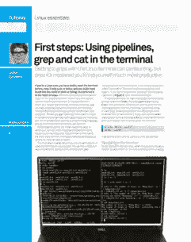

上图 终端不必是一个令人恐惧的地方。看，这里有一只斑马来证明这一点。想要了解更多实用应用，请查看我们在第36页开始的 Linux 基础系列

## 对于那10%的读者

我很感兴趣读到 Nikoalias Hedberg 博士的来信（[L&D180](https://example.org/L%26D180)，第44页），发现只有 10% 的 L&LD 内容对他有用。我并不是一个彻底的“10% 读者”（如果我是，我可能就不会购买这本杂志了，但很高兴他在那小部分内容中获得了如此多的收获），但我希望在每月一次的 Linux 世界内容中看到更多对新手友好的内容。我们并不都是职业程序员，我也想尝试一下。

Dan Jacobs

Chris：谢谢你，Dan。正如我对 Hedberg 博士所说，我们确实服务于广泛层次的读者，且内容通常不会低于爱好者级别。我们最近的一次调查显示，我们的大多数读者使用 Linux 和电脑已有数年（有些甚至数十年）之久。然而，我们已经认真听取了您和其他读者的意见，并在教程开头引入了“Linux 基础”系列（如果您还没注意到，请参见第36页）。

我们从介绍 Bash 开始。（您可能听过它被称为“终端”，这让人联想到黑暗和神秘的东西。）Bash 是 Linux 自带的默认 shell，可用于导航文件系统，发现有关系统的惊人详细详细信息，访问强大的实用程序并脚本化许多常规任务。如果您是新用户，Linux 的这个强大组件可能会显得有些令人望而却步，但过一段时间后，您将想知道自己以前是如何在没有它的情况下生活的。

随着系列的深入，我们将涉及 AWK（一种编程语言，非常适合报告和提取数据）、grep（一个方便的非文本搜索实用程序）和 sed（一个用于将文本分解为组件部分并进行转换的流编辑器）。我们希望能让那些经常摆弄终端的用户也能学到一些实用技巧。Linux 基础系列由迷人的 John Gowers 撰写，他是 Bath 大学编程与计算机科学讲师，所以您可以放心。

## 我还在这里

亲爱的 L&LD，过去几个月来，我一直收到一封标题为“Mikael，看看你在最新一期 Linux User & Developer 中错过了什么……”的电子邮件，显然你们认为我不再订阅了。事实上，我仍然是订户。

多年来我一直使用 Zinio 进行数字订阅。之前发生的情况是，由于我的信用卡过期，重新订阅付款失败了。但我只是再次办理了新的订阅，我立即又成为了订户。这是

以下

如果你是订阅者，你每个月都应该收到一封友好的欢迎时事通讯。我们还在为定期发布关于Linux世界动态的新闻通讯做准备，并且很快就会推广注册。

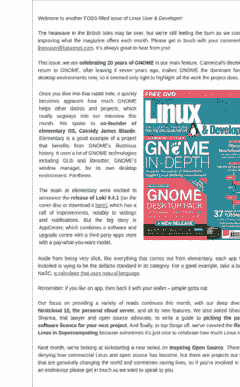

你是否有可能通过 Zinio 找到我的新订阅并将其以某种方式重新关联起来？

`米凯尔·斯特恩维斯松`

`克里斯：` 哎呀。很抱歉，米凯尔。很高兴你仍然是订阅者。我已将你的问题转给数据库管理员，确保我们修正那个字段，并每月通过友好的时事通讯欢迎回来。不幸的是，你并非个例。我们有几位读者投诉说，他们并未申请却被加入了订阅者名单，或者新订阅者刚注册就被标记为已失效！结果不太好，但据我了解，大多数情况下这是因为账户信息从 Imagine Publishing 迁移到 Future plc 系统所导致的。过去八个月，该公司经历了一个类似“博格化”的过程，双方系统或以某种方式被废弃、转移或合并。希望我们能顺利度过，但如果遇到问题，请使用官方渠道，发送邮件至 `linuxuser@futurenet.com`，我们会不断替你催促。

## 向 Knoppix 致敬

我欣赏了你们的《发行版工具包完全指南》[LU&D#179，第18页]，但看到 Knoppix 被安排在该专题的末尾，我感到有些失望。如果不提及 Knoppix，就无法全面介绍 Live CD。它现在常常被人遗忘，但它在概念上（甚至在代码层面）是所有 Live CD 的基础。

`菲尔·伊瓦泰罗`

`克里斯：` 你说得对。实际上，我们的光盘编辑尼尔·博斯威克提醒我们，应该以赞美之词来谈论这款久负盛名的 Live 发行版，因为他年纪够大，说起第一次使用它时便会两眼放光。（我在办公室以前叫他“灰白的博斯威克”，直到他发现后，我也开始变得灰白，并意识到这其实没那么好笑。）

Knoppix（www.knopper.net）再过几个月就将满16岁，我们必须向它的创造者克劳斯·克诺珀致敬，他意识到可以将 Linux 软件放在修复盘上，并使其在大多数机器上启动，以执行故障排除任务。鉴于微软此前对 Linux 的敌意，许多 Windows 用户因其功能正常的操作系统而欠了一位手持 Knoppix 的“白骑士”式 Linux 朋友的感激之情，这就颇具讽刺意味。对于不了解的人，除了作为展示软件产品演示的极佳方式外，Knoppix 还是出色的 Windows 恢复光盘，可用于多种任务，包括读取、写入和恢复多种文件系统、编辑注册表、创建系统备份以及扫描恶意软件。

## 发表你的意见！

请发送邮件至 `linuxuser@futurenet.com`

## 关注我们

Facebook：facebook.com/LinuxUserUK

Twitter：@linuxusermag


# XBOX ONE X：我们体验了真正的 4K 游戏

T3

科技小物杂志

夏季科技小物特刊

- 用这些精选好物享受阳光天


100英镑

健身入门装备

全新

iPad Pro 评测！+ iMac Pro 噢，还有 iPhone 8


16款

无线音箱


测试索尼惊人的4K手机


露营必备的顶级科技好物

最佳999英镑单反相机

HomePod

苹果挑战亚马逊 Echo 和 Google Home，争夺智能家居控制权

防水科技真的防水吗？73 将揭晓（以艰难的方式）


第221期 2017年8月 - www.T3MAG.COM/1002

8.5


9 771354 244131

现已发售！

可在 WHSMITH、MYFAVOURITEMAGAZINES.CO.UK 购买

或直接在设备的应用商店中搜索 T3

立即订阅并享受优惠！请访问 WWW.MYFAVOURITEMAGAZINES.CO.UK/T3


电子前哨基金会（EFF）是致力于在数字世界捍卫公民自由的首家非营利组织。`EFF` 成立于 1990 年，通过影响力诉讼、政策分析、基层行动主义和技术开发，倡导用户隐私、言论自由和创新。我们致力于确保随着我们技术使用不断增长，权利和自由得到加强和保护。

# `EFF.ORG`

## 电子前哨基金会

保护权利，促进电子前沿的自由

迷失在

### `黑胶`

的世界中

在

`OXFAM` 的在线商店

找到自我

[oxfam.org.uk/shop](https://oxfam.org.uk/shop)
