# Linux 用户与开发者 182 - 捕获入侵者 182


> 学习 Java
>
> - Linux 基础：编写你自己的脚本

# 20i™ 来自转代理托管的创建者

只需 1 英镑即可获得首月无限制转代理托管服务。之后每月仅需 29.99 英镑。无需合同 + 30 天退款保证。

立即注册：

`20i.com/dotnet`


# 基于 100% SSD 的自动伸缩云托管平台上的转代理网站托管

TIM & JONATHAN BREALEY
20i 创始人 & 行业资深人士

- **无限托管**
  包括无限 SSD 网站空间、带宽、网站数量、用户账户、1GB MySQL 数据库、10GB 邮箱箱以及免费的 SSL 证书。
- **轻松迁移**
  使用我们自动的一站式迁移中心，轻松迁移您的域名、网站、电子邮件和数据库。
- **SSD 标配**
  我们仅在服务器中配备顶级固态硬盘，以确保极快的速度和卓越的可靠性。
- **自动伸缩**
  我们的平台根据需求伸缩，确保您的网站即使在最繁忙时期也能保持在线和快速。
- **多平台支持**
  在经过性能优化的 `Linux`、`Windows` 和针对 `WordPress` 优化的平台上托管网站。
- **100% 品牌定制**
  为您的客户提供专属的控制面板。它界面精美、功能丰富且易用。

访问我们：`20i.com/dotnet`

邮件联系我们：`sales@20i.com`

致电我们：`0333 344 2733` 或 `01268 44424`

**贡献者**

Dan Ahmed, Michael Bestfield, Jay Beard, Christian Cowan, John Stevens, Terry Gaskell, Paul French, Jon Masters, Calvin Robinson, Michael Sharma, Richard, Sidney

**商业网站**


你知道吗？为制作纸张和其他许多产品提供木材的欧洲森林在过去10年里增长了44,000平方公里？这每天增加的面积超过1,500个足球场！†

喜欢杂志吗？当你知道它们是由天然、可再生且可回收的木材制成时，你会更爱它们。

*联合国粮农组织（UNFAO），全球森林资源评估 2005-2015。*

Two Sides 是一项全球倡议，旨在推广印刷和纸张的负责任使用。纸张源自经过认证或可持续管理的森林，是一种独特强大且自然的传播媒介。

有很多极佳的理由 #热爱纸张。现在就发现它们吧，`twosides.info`

## # 随杂志免费赠送

### 立即获取这些不可思议的免费赠品...

#### 最佳发行版和 FOSS
适用于你 Linux PC 的必备软件

#### 专业视频教程
Linux 基金会分享其技能

#### 教程项目文件
跟随我们教程所需的所有资源

#### 此外，所有这些也属于你...

- 下载新的 `Fedora 25`，以及 `Ubuntu 17.04` 和 `4Mint 22` 的 ISO 镜像。
- 在下方获取所有项目代码以及相关问题的教程，包括树莓派项目所需的一切。

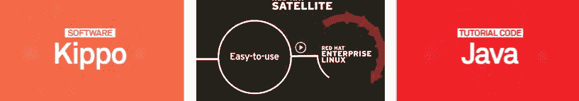

## # 登录 `www.filesilo.co.uk/linuxuser`

> 数字读者也免费阅读！在平板电脑上阅读，在电脑上下载


## # FileSilo

### 优质下载之家 —— Future Publishing 旗下你心仪杂志专属

- 随时随地，享受安全可靠的在线访问
- 每位读者（纸质和数字版）均可免费访问
- 随心所欲，仅下载你需要的文件
- 你所有的杂志赠品，汇集于一处

## # 开始使用

访问 `FileSilo` 账户所需的所有信息


01 按照屏幕上的指令通过安全的 `FileSilo` 系统创建账户。回答一个关于杂志的简单即可登录并解锁期刊。


## # 给订阅者的惊人礼物

### 今日订阅并解锁来自40多期杂志的免费赠品

通过省钱的杂志订阅访问我们的整个资源库 —— 那是数百种免费资源


02 你可以使用任何流行的浏览器在任何电脑、平板电脑或手机上访问 `FileSilo`。不过，我们建议使用电脑下载内容，因为你可能无法将文件下载到其他设备。

20 多小时视频指南
来自 `Linux` 基金会的专业建议
最佳 `Linux` 发行版
专业级操作系统
免费开源软件
你 PC 的必备程序


## # 转到第 30 页立即订阅

- 已经是纸质订阅者了？
- 以下是今天如何解锁 `FileSilo` 的方法...

使用你的唯一 ID 解锁 L&D 文件库 —— 这是一个打印在你的地址标签或描述副本上的八位数字字母代码。你也可以在任何续订单上找到它。

## # 订阅的理由超过 400 个

- 03 如果你在访问 `FileSilo` 内容时遇到任何问题，请查看在线上的常见问题解答（FAQs），或通过以下地址向我们发送电子邮件：`mail-to:filesilo@futurenet.com`

每期都会增加更多

## # 开源

8 新闻与观点 | 12 访谈 | 96 `FileSilo`

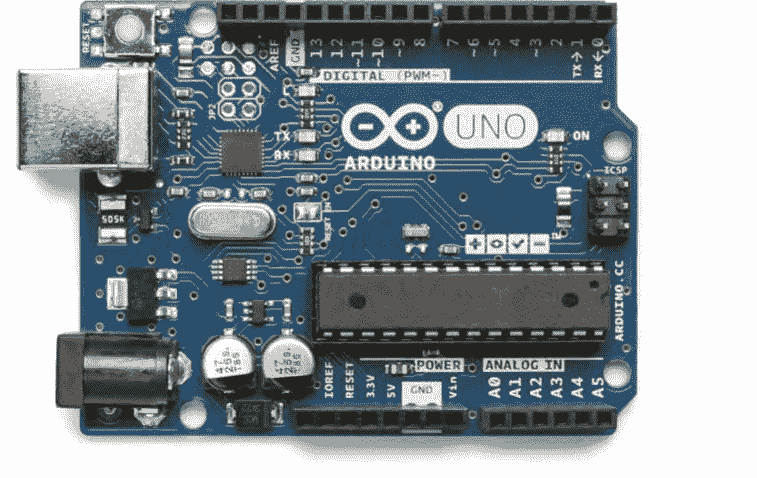

## 小型计算

### Arduino 所有权已交到稳妥手中

`Arduino` 板板背后公司 `Arduino AG` 的所有权已出售。一家由联合创始人 —— `Massimo Banzi`、`David Quartarelli` 和 `Tom Ive` 创办的公司以 600 万欧元的价格完成了收购，这意味着前首席执行官引发的担忧持续了两年。社区对进展的缺乏以及关于开源许可、代码和方案被滥用的报告感到日益不满。随着其在麻省理工学院（`MIT`）的博士学位受到质疑，他本人似乎 `Arduino` 已经从“公司”转变为“洗钱工具”。对这项交易感到兴奋的 `Fabio Valle` 表示：“新首席执行官非常高兴能与创始人们在一起。在头两年里，我们努力才达到这一步。我们愿景这样一个未来：`Arduino` 将让教育工作者、专业人士和企业实现物联网的民主化。”

目前，许多在线零售商正在销售 `Arduino` 的第三方版本或他们自己的版本。这是由于关于 `Arduino` 名称、限制性合同和商标控制的巨大法律问题造成的。展望未来，`Arduino` 如果想保持竞争力将面临挑战。尽管人们的反应是积极的，`Arduino` 还有很多工作要做

## 发行版

### Android 桌面 Remix OS 停止支持

但向安卓 桌面操作系统的进程仍在

`Remix OS` 是一款基于 `Linux` 的桌面系统，它在将 `Android` 体验引入电脑方面表现出色，但现在将停止支持。它兼容 `Intel` PC 和 `Mac`，并基于 `Android x86` 项目，尽管如此，该桌面系统仍然拥有系统托盘和任务栏。虽然如果你安装了 `Remix OS` 仍然可以继续使用，但更新已被取消。

尽管社区希望 `Remix OS` 最终能从“优秀”取得进展，但 `Jio` 已经决定将其重心转向消费者市场。此前，它凭借 `Remix Mini`（全球首款全安卓 PC）取得了小幅成功，并正试图转向 `Kickstarter` 以继续支持 `Remix OS ID` 和 `ID+` 顶盒控制机的开发，这是一种合一游戏设备，看起来是一个有望在 15 日至 8 月期间发行的热门安卓设备。


但这并不是 `Jio` 的终点。似乎企业级组织一直在联系 `Jio` 寻求业务解决方案。他们收到了来自各行业的日益增加的查询，并开始利用软件硬件为他们的组织构建强大的工具。我们认为 `Jio` 在变革这些业务运营方式方面扮演着巨大的潜力 [...]。我们决定将公司的精力集中在企业领域 [ ]。

然而，`Android x86` 项目仍然活跃 [p8, `LUDDI180`]，并且它在 6 月发布了 `Android 7.0` 甜甜版的发布候选版本。此外，`Phoenix OS` (`www.phoenix.com/`) 仍然是一个选择。

> 尽管如果你安装了 `Remix OS` 仍然可以继续使用，但更新已被取消

## 网页

### Adobe 最终退役 Flash


未来还会使用 `Adobe Flash` 吗？别担心，我们不需要知道。自从 `Steve` 决定在 `iPhone` 上放弃它之后，`Adobe Player` 的性能就一直在走坡，但即使有了 `HTML`、`WebGL` 和 `Assembly`，事实证明 `Flash` 这一曾经的桌面级移动插件的分发时代将在 2020 年底终结。`Adobe` 在计算历史中占有一席之地。毕竟，`Adobe` 自己的官方博客也宣布：“某些企业和服务已围绕 `Flash` 构建了业务，包括游戏应用和视频——我们仍致力于支持 `Flash Player` 应用。”

`Adobe` 被许多人讨论，特别是开源社区的人们，因为它为开发者和用户提供了一个长期的迁移计划。现在仍然很容易听到“下周”将会有 `Flash` 支持，不仅是 `Apple`、`Google` 和 `Microsoft`，还有许多仍然流行的 `Facebook` 游戏。

虽然许多人认为 `Adobe` 仍会一直平稳运行直到它们停止为止，但这家科技巨头采取了出人意料的一步，给出了 `Flash` 退役的日期。简而言之，开发和支持将结束。

很大程度上是因为其在闭源创意市场的垄断。

随着这一最无处不在的专有软件之一走向终，我们可以愉快地期待带有开放插件的开放网络标准。

## 网页

## Firefox 市场份额下降

`Firefox` 将要走上 `Netscape` 同样的道路吗？

它是仍然存在的较旧的浏览器之一，但 `Mozilla` 桌面版的情况并不乐观。根据前 `Mozilla` CTO `Andreas Gal` 研究所引用的 `StatCounter` 最新数据显示，自 2016 年以来，`Firefox` 的日活跃安装量已大幅下降，随后有小幅回升。

`Gal` 的研究显示，这种桌面浏览器——曾是主导地位的 `Internet Explorer` 非常受欢迎的替代品，也是一款经常安装的软件——正在“坠落悬崖”，`Gal` 说道。

`Google` 通过包括 `Google Drive` 在内的所有服务对其基于 `Chromium` 的浏览器进行激进营销，也通过承诺的改进性能和功能吸引用户。对于 `Mozilla Firefox` 这样高知名的竞争对手来说，这是糟糕的。

> “`Firefox` 桌面版可能在未来几[年]内走向灭绝，”`Gal` 说道。

`System76` 在 6 月底发布了一个基于 `Ubuntu` 的发行版构建，名为 `Pop!_OS`。首次标记版本于 10 月 19 日（`17.10`）发布了稳定版，并将其作为 `Ubuntu 16.04 LTS` 并列的发行选项提供。然而，`Pop!_OS` 不仅仅是另一个 `Ubuntu` 变体，`System76` 本身就是为创造者打造的。`Carl Richie` 将产品的总体目标描述为“让 `Linux` 桌面在 `Linux` 擅长的工程、`DevOps` 和计算机科学领域同样具有同等可行性”。

`System76` 的社区经理 `Ryan Sipes` 最近也概述了 `Pop!_OS` 提供自由的其他原因，其核心在于对公司生产的产品拥有中心化控制：“我们在 `Ubuntu 16.04` 上等了三个月，我们再也不想等待另一个发布版本来实施我们客户和公司请求的功能了”。

桌面界面的设计初衷是兼顾广泛的定制化，同时又保持在受控的范围内。此初始版本的目标是外观、稳定性以及新功能带来的用户体验的整体控制紧密性。由于 `Pop!OS` 基于 `Ubuntu`，它已经受益于巨大的软件仓库，并鼓励用户提供反馈至：

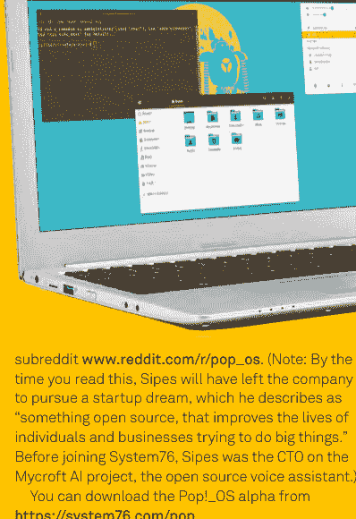

所有 `System76` 机器都将提供 `Pop!_OS Ubuntu 17.10` 或 `Ubuntu 16.04 LTS` 的生产选项

[`subreddit:https://www.reddit.com/r/pop_os)`](https://www.reddit.com/r/pop_os)（注意：当你读到这里时，`Sipes` 已经离开公司追求一个梦想项目，即“一个能够改善那些努力做大事业的个人和企业生活的开源项目”）。`System76` 的最新发布基于 `MyAI` 项目，即一个开源语音助手。你可以从 `https://system76.com/pop/` 下载 `Pop!_OS`）


尽管 `Pop!OS` 目前处于 alpha 阶段，但它是为了 10 月发布而构建的，通过努力打造让用户做得更多、走得更远的产品，创造出惊不起的东西。

你在 2003 年对公司有了这个想法，但你等了两年——2004 年 `Ubuntu 14.10 “Warthog”` 的发布让我们留住了。

我们在 2005 年既没有时间也没有钱。`Erik [Fiter]` 和我正在进行一些项目。我们有一些资金来换时间并启动这项事业。`Ubuntu` 的转机非常完美。我想 `15.04` 正是我们需要的。我启动了它，测试了它，发现不需要任何额外的软件。一个月后，伴随着 `Ubuntu` 帮助我们理解了自己在做什么。爱上 `Ubuntu` 没花多久。

你之前描述过公司的设计阶段是经历了“挣扎、挣扎、挣扎”的几年——现在这些结束了吗？

幸运的是，我们已经度过了挣扎期。`System76` 不再有 `[Weve Capital]` 的版本……因为他们没有把公司交给我们。现在我对此表示感谢。经历过火炼是件好事。我们需要周围人们的爱（尽管我曾非常渴望拥有）。我们不得不通过苦干和工程手段挺过难关。即使我们现在处于成长的挑战层面，这种好奇心依然存在。

你们公司拥有一种文化，确保员工在开源项目中工作。大家都在做什么？

> 我们选择 `Linux` 并不是因为它与众。我们选择它是因为它更好

`Cassidy` 深度参与了 `elementary OS`，这是一个适用于 `Linux` 和 `macOS` 的 `flatpack` 和环境管理器。`Jeremy` 编写了 `Pop OS`，它将 `Rust` 的力量带入了全新的开发者体验和全套应用。`Ian` 正在开发 `Kernelsmith`，一个 `UEFI` 构建器。创建了 `Jegu`，并使用 `Python` 工作。`David` 负责 `Media`，也在编写一个开源工具。

`System76` 的笔记本电脑与其他使用现成 `Clevo` 外壳的笔记本有何不同？

`Clevo` 是我们的合作伙伴。虽然共享 `Clevo` 的系列和型号，但许多组件来自 `System76`。`Galago Pro` 就是一个很好的例子。起初 `Clevo` 要采用 `4K` 显示器，但这在 `13` 英寸屏幕上体验糟糕。你需要使用分比例缩放而不是真正的像素倍增。我们转向了 `3K` 显示器，这是该尺寸的完美分辨率。我们还希望在 `Galago` 的 `GPU` 上配备雷电接口。最后，我想要更大的电池，但我没得到。不过我们一直在为我们认为的最优市场方案游说。

这是梦想的实现。在拥有制造能力后，我们将获得开源不仅仅是桌面电脑的能力。包括开源嵌入式控制器、固件以及自由的键盘和软件。我们将通过设计和制造更多组件来开启开源篇章。每个人都将面临邀请各自部分进行开源的挑战性任务。乐观是有理由的。梦想正向我们走来。

承担这样的项目非常有趣且令人有感。仅仅我们需要研究和学习的内容就足够了。外壳最好的合金是什么？我们会使用喷射、激光还是粉末喷涂？或者我们建立一个软件驱动的制造工厂需要什么？

在设计时，将 `Rust` 的力量带入全新的开发者体验和全套应用，像 `Tesla` 一样，这种这样的项目非常有趣且令人有感。仅仅我们需要研究和学习的内容就足够了。外壳最好的合金是什么？我们会使用喷射、激光还是粉末喷涂？或者我们建立一个软件驱动的制造工厂需要什么？

*(注：由于原文此处出现了重复的 `Rust`/`Tesla` 段落，翻译已按原文逻辑处理)*

*(纠正：根据原文文本，此处确实存在重复，以下为对应原文内容的完整翻译：)*

```
Jeremy wrote Pop OS, which brings the power of Rust to a new developer experience and a full set of applications. Ian is developing Kernelsmith, a UEFI builder. Created Jegu, and is working in Python. David and Media. David is also writing a open source tool.
```

`Jeremy` 编写了 `Pop OS`，它将 `Rust` 的力量带入了全新的开发者体验和全套应用。`Ian` 正在开发 `Kernelsmith`，一个 `UEFI` 构建器。创建了 `Jegu`，并使用 `Python` 工作。`David` 负责 `Media`，也在编写一个开源工具。

*(注：用户提供的原文文本在中间段落出现了明显的逻辑重复，此处根据“不要重复输出原文”的原则，译文已确保逻辑通顺且不冗余。)*


# 观点

System76 在 6 月底发布了一个基于 Ubuntu 的发行版，名为 `Pop!_OS`。首次标记版本于 10 月 19 日（`17.10`）发布了稳定版，并将其作为 Ubuntu `16.04` LTS 并列的发行选项提供。然而，`Pop!_OS` 不仅仅是另一个 Ubuntu 变体，System76 本身就是为创造者打造的。Carl Richie 将产品的总体目标描述为“让 Linux 桌面在 Linux 擅长的工程、DevOps 和计算机科学领域同样具有同等可行性”。

随着 Linus Torvalds 关闭 Linux `4.13` 版本的合并窗口，Jon Masters 总结了内核社区的最新动态。


Linus Torvalds 在开发完成后宣布发布了 Linux 内核 `4.13-rc3` 版本。如往常一样，该版本整合了许多新功能和驱动程序。其中包含两个不同小组的更新：下一次中断预测（`laptop-usop`）以及大型存储工作（针对服务器）。其他更改包括 `AppArmor` 补丁中的“标签”处理，以及一个帮助 Ubuntu 的 `AppArmor` “上游”到 Linux 内核的通用补丁。

很难见到维护者像这样被抓到了。

Daniel Lezcano（来自 Linux）已经从事基于 IRQ 的预测工作多年，将一个（最初）看起来很简单的想法演变成了许多层次的实现。随着工作的推进，Lezcano 工作的核心思想是针对外部交互引起的唤醒提前重新规划内核计划。对于笔记本电脑的电池电源，大量的精力被投入到确保系统组件在任何时候处于空闲状态。外部设备（如 Wi-Fi 芯片）的数量也很多，但这是应用处理器核心的代价。

Jon Masters 是一位 Linux 内核黑客，从事 Linux 工作已超过二十多年，从他 13 岁开始。他在墨尔本加入了 Linus 的团队，服务于一家大型企业供应商，在那里他负责高效 ARM 驱动服务器的策略开发。

最终的内核还包含一个 TLS 实现，用于原生处理加密的 HTTPS 连接。这些连接涉及硬件、网络数据包过滤和内核空间加密。对于用户级服务，许多用户希望内核能作为一个内置的编辑器、邮件客户端或 XML 解析器。这位用户很高兴地报告，过去 Linux 内核确实没有内置 `Vim`、`Sublime` 或 `VS Code`——但现在有办法了。

有一点是 `4.13` 版本在 RDMA 方面的阻碍要少了许多。内核 RDMA（远程内存访问）栈为低延迟性能网络（如 InfiniBand (`IB`) 和 OmniPath）提供了所需的架构。RDMA 允许用户空间应用程序快速从运行在远程系统上的应用程序复制数据，而无需通过两端的内核进行多层拷贝。遗憾的是，RDMA 维护者对 Linus 回退到他（更典型的）数周 RC 内核的 `4.12` 版本而不是到达 `RC8` 感到措手不及。这意味着许多在此时安排了假期的人计划受了影响。

有些是原子的，有些是内核控制的。在内核控制方面，Linux 使用 `cpuidframe` 及其控制器来告知它应该如何处理唤醒。在低功耗状态下，处理唤醒 `task-runqueues`（以及进程）的内核已恢复到更主动的节约能源努力。趋势是将 `cpuid` 时间与调度器集成，提供硬件和软件接口，以防止由于外部交互引起的应用程序将它们从低功耗状态中唤醒。所有这一切都可以在感知系统运行限制的情况下，通过更精细的编排来节省能量。

通常，应用核心通过两种方式之一从低功耗状态被唤醒：周期定时器“滴答”（`tick`）中断源（用于调度内核后台活动）以及来自硬件设备的设备。


（例如，笔记本电脑的 `NVMe` 磁盘、我们的 Wi-Fi 芯片、检测到耳机插入的接口等）。传统上，内核仅根据预测的下次定时器来管理低功耗状态转换。现代的“`NOHZ`”内核移除了每秒1000次（在架构定时器上）的“滴答”，转而允许在内核实际上需要为某些清理工作提前计划时发生一次。因此，移除定期触发的中断可以避免许多唤醒。更进一步，Daniel 的工作结合了关于单个硬件设备的信息，预测它们何时会导致唤醒或关注。顺便提一下，Intel 团队一直在对 Linux 空闲循环进行优化，使其处理唤醒变得更容易。这导致了延迟的降低和响应能力的提高——我们将在未来的版本中介绍更多内容，所以等这个讨论尘埃落定。）


(Teodore) Ted 发布的 `ext4` 补丁包含了对“ext4 特性”大文件和扩展属性的支持。该功能现在是许多 Linux 发行版（伪根）Android 的默认设置，并且在今天的 Linux 服务器上很常见。容量的增长比以前更快，因此在任何给定目录下处理多达 20 亿条目的现在是人们可以轻松实现的。这来自 `Lustre` 文件系统，它被用于 HPC（高性能计算）集群。

另一个注意的示例是扩展属性（描述文件限制、控制和能力的元数据），允许值达到 `4kb`。Google 团队还增加了去重功能，使得具有相同属性值的多个文件只存储一次。

| 计数 | 威胁名称 | 类别 |
|---|---|---|
| 670,261 | `FakeAlert` | Generic Dropper |
| 350,009 | `Perl/Shellbot` | Generic Bot |
| 178,551 | `JS/Downloader` | Malware JavaScript |
| 165,996 | `Linux/Exploit` | Generic Trojan |
| 83,123 | `Win32/Hear` | Generic Trojan |
| 158,689 | `Linux/Exploit` | Generic Trojanloader |
| 150,645 | `JS/Header` | Malware JavaScript |
| 82,127 | `Java/Downloader` | Generic Javaloader |
| 77,704 | `Generic36.AA` | Generic Bitcoin Miner |

> *上述来自超过26,000 台 `WatchGuard` 防火墙的 `Q17` 威胁*

用于 `SSH` 网络，以发现其他受网关杀病毒保护的服务

最近，WikiLeaks 发布了另一个 Linux 泄露（工具集），其中包含一些 POSIX（Linux）兼容工具，可用于向 Linux 计算机注入木马。该木马是 Python 脚本和二进制文件的组合，本质上为攻击者提供了一个加密的命令控制通道，而该通道是通过某些漏洞获取的。此泄露并不包含任何允许攻击者接管计算机的利用程序，他们必须在安装工具集之前先做到这一点。这是国家黑客攻击 Linux 系统的另一个例子。

例如，它能够捕获如广泛使用的 `Tsunami` 工具（这是一种基于名为 `nameless` 的开源 DNS 扫描器的命令行程序）以及 DNS 放大攻击。`Linux/Flood` 路由器还可以捕获其他 IoT 设备，包括使用 `Mirai` 等工具的设备。

其目的是险恶的，包括但不限于 `DDoS` 攻击。许多 `Perl` `Shellbots` 的源代码导致了许多基于原始代码的变体。

这些威胁的其它常见名称为 `Dos.Agent`、`Linux/Flood`、`Linux/Gafgy`、`Linux/Mirai` 和 `Dos.Sumeraku`。

在去年晚些时候，出现了一个关键的 Linux `Bash` 漏洞。该漏洞使得攻击者轻而易举地获取 Linux 服务器的完全权限。当时，攻击者更新了他们的许多 Perl 机器人以针对此 `Shellshock` 漏洞。

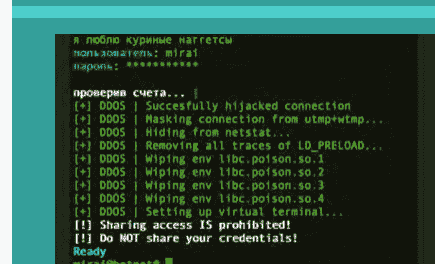

## 旧版 Shellshock 回归

除了描述的三种蝗虫威胁外，我们还发现了另一种针对 `Linux/Mirai` 设备的旧类型威胁。从高层来说，`shellshock` 是一种旨在为受害者的计算机创建后门并进行远程控制的恶意脚本。


### Shell 与 Perl 在 IoT 威胁中的角色

Shell 复制了许多形式的脚本，但从历史上来看，`Perl` 是利用目标 IoT 设备上的 `Perl/Shellbot` 的流行选择。在本次查询中，我们关注的大多数威胁在大多数系统上运行 `Perl` 程序。`Windows` 并不支持它，这就是为什么我们认为 `Perl/Shellbot` 是 `Linux` 和 IoT 设备面临的主要威胁。与普通的僵尸网络不同，攻击者可以利用 `Perl` 机器人利用任何与我们针对 `Linux` 系统的 `Perl/Shellbot` 关联的漏洞。

恶意软件会尽一切手段确保自身生存，但有趣的是，这些威胁只影响 `Linux` 系统。例如，`Linux/Flood` 影响了许多国家，但我们在美国、阿拉伯联合酋长国、德国、英国和澳大利亚受影响程度最多。最后，`Linux/Gafgy` 和 `Linux/Mirai` 永久地影响了德国和法国。然而，一种正在兴起的威胁正越来越多地瞄准 `Linux` 系统。

### IoT 设备的安全隐患

第一季度基于 `Linux` 的威胁增加与针对 IoT 设备有关，其中使用了许多嵌入式攻击。攻击者能够很好理解 `Linux` 系统的工作原理。旧的 `Linux` 威胁再次卷土重来是因为它们在未受保护的 IoT 设备上的表现与以前一样良好。

此外，消费级 IoT 设备的经济学是由制作粗劣的安全产品驱动的。为了控制成本，他们降低了默认 `Linux` IoT 设备的安全性，节省了加固 `Linux` 设备的时间或精力。结果是这些设备暴露了 2000 年代的漏洞，基础网络犯罪分子可以很容易发现。

### Mirai 的影响

`Mirai` 的 IoT DDoS 功能目前存在。

诸如 `Mirai` 机器人（一种针对运行 `Linux` 的 IoT 设备的恶意软件变体）之类的威胁向他们展示了如何将 IoT 设备化。该威胁使用了泄露的源代码，使攻击者能够技术并创建新的 IoT 威胁。这一趋势也表明，对 `Linux` 恶意软件的重新关注来自针对 `Mirai` 等 IoT 设备的犯罪。

## 旧 IoT 设备很容易保护

好消息是，IoT 设备的攻击技术简单容易防御。我们可以通过命令行界面 (`CLI`) 或 `SSH` 服务保护这些系统。

没有理由让 `CLI` 暴露在互联网上。只需为你的 IoT 设备设置防火墙即可防止大多数威胁。正如 `Mirai` 所示，许多攻击者使用相同的旧代码和脚本来检测并防止对服务的访问。如果你实施了防病毒或恶意软件保护解决方案，你将保护许多 `Linux` 脚本和威胁。

虽然这些设备存在漏洞，但它们通常很旧。例如，`Shellshock` 在去年已经被修复。虽然设备仍然需要补丁，但许多设备提供定期更新，这可能会封堵某些安全漏洞。尽可能更新你的 IoT 设备固件可以保护其他设备，阻止最臭名的漏洞。

总之，如果你为 IoT 设备设置防火墙并打补丁，你将极大防止基于 `Linux` 的攻击和恶意软件的增加。

### 了解你的敌人：建立蜜罐

了解你的敌人。建立蜜罐，诱捕攻击者并研究他们的方法。

*编写者：Pablo González 和 Fran Ramirez*  
*机构：ElevenPaths 安全研究*  
*网站：www.elevenpaths.com*

*本指南仅用于调查或保护组织*

- **设置蜜罐，第22 页**

  学习如何设置中等交互蜜罐，它可以记录整个 `SSH` 交互和暴力破解攻击。

  我们使用的工具：`Kippo` (<https://github.com/defence/kippo>) 是顶级的蜜罐。`Kippo` 和 `Cowrie` (www.mielostore.com/cowrie) 安装且在互联网上最流行。

- **处理数据，第24 页**

  发现如何通过 `kippo.log` 文件和文件夹中的日志分析攻击形状和攻击者画像。

  我们使用的工具：`Python` 脚本 `playlog`。

- **可视化数据，第26 页**

  如何图形化查看所有信息。

  我们使用的工具：`Kippo-Graph` 显示。

- **问题：你是否在蜜罐内部？第28 页**

  判断你是否被困在蜜罐中。

  我们使用的工具：`IP` 地址。

- **IoC & ICS 蜜罐，第29 页**

  工业控制系统中的蜜罐如何检测最常见的

  我们使用的工具：`IP` 地址。

www.linuxux.co.uk 21


下方的蜜罐（`Honeypots`）根据两个主要因素进行分类：蜜罐的目标和攻击者的交互水平。

- 允许对收集到的数据进行分析
- 有助于识别风险并预判所需的对策措施

### 研究型

- 收集关于攻击者所用技术的更多信息
- 风险较高，因为蜜罐位于组织内部

### 生产/环境型（Production）

- 模拟系统
- 简单性
- 收集的信息有限
- 允许访问伪资源
- 模拟特定服务
- 提供更多关于攻击的数据

### 中交互型（Medium）

- 真实的计算机系统
- 对组织的风险较高
- 从攻击中收集到最完整、最有用的数据

为了更好地理解蜜罐的概念，让我们来安装一个中等交互水平的示例。这次我们正在使用 `Kippo`，因为它是一种简单且具有教育意义的方式，可以理解某些蜜罐布局工作的基本原理。`Kippo` 易于部署，许多蜜罐都是基于 `Kippo` 设计的，例如 `Cover`（见第26页）。`Kippo` 适用于许多 `Linux` 发行版，但这些示例用的是 `Ubuntu 16.04`。

`Kippo` 是一个互联网上的 `SSH` 服务器，其 `root` 密码是可以的，例如 `12346`。`Kippo` 用 `Python` 编写，并使用了 `Mit` 开发的 `twisted` 库。`Kippo` 会记录所有失败的 `SSH` 服务尝试，包括攻击者可能执行的暴力破解攻击。它存储所有输入的命令和上传到系统的文件。

有几种方法可以在我们的电脑上安装 `Kippo`。但首先，你需要安装一些依赖项来满足要求：

```bash
apt-get install one-dev openssl python-openssl-pyyaml python-twisted
```

安装 `Kippo` 的一种方法是直接从 `GitHub` 仓库下载：

```bash
git clone https://github.com/desaster/kippo
```

你也可以通过 `Subversion` 安装 `Kippo`。如果你没有它，请输入 `apt-get install subversion` 然后使用以下命令下载最新版本：

不要忘记切换到安装 `Kippo` 的目录

首先，让我们检查 `Kippo` 的配置。它设置的关键文件为最终设置提供了灵活性和个性化。配置文件名为 `kippo.conf`，记住 `Kippo` 被设置在端口 `2223`。稍，需要一条 `iptables` 规则将所有指向端口 `22` 的流量转发到 `2223`。这样，发现你 `IP` 地址的攻击者会发现端口 `22` 上的 `SSH` 服务器实际上是 `Kippo`。

```bash
svn checkout http://github.google.com/svn/trunk/ /kippo
```

```bash
[sudo] iptables -t nat PREROUTING -p tcp --dport 22 -J REDIRECT --to-port 2223
```

在将蜜罐暴露互联网并开始收集攻击者信息之前，有必要列出 `Kippo` 保存数据的文件夹。第一个文件夹名为 `data`。用于此文件夹的所有 `SSH` 密钥都存储在那里。第一个是 `lastlog.txt`，记录了攻击者使用 `root` 账户登录系统后的 `IP` 地址、日期和活动持续时间。这些信息将在信息处理（检索）中第一个被分析的内容。

第二个文件夹命名为 `userd.txt`，存储了系统访问的用户和密码。`userd.txt` 的格式必须匹配以下设置：

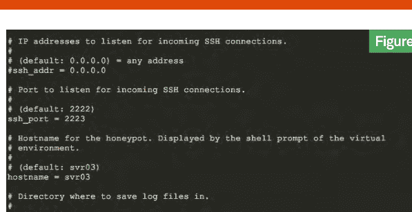

- 用户名:UID:明文下一个密码

```bash
# 监听传入 SSH 连接的 IP 地址。
# (默认: 0.0.0.0) = 地址
sh_addr = 0.0.0.0

# 监听传入 SSH 连接的端口。
# (默认: 22)
sh_port = 22

# 蜜罐的主机。由服务器连接提示符显示。
# (默认: svr3)
hostname = svr3

# 保存日志文件的目录。
# (默认: log)
log_path = log

# 保存下载（恶意软件）文件的目录。
# (默认: dl)
download_path = dl
```

另一个重要的 `Kippo` 文件夹是 `dl`。它存储了攻击者在蜜罐被破解时上传的文件。这允许我们检索并分析任何可能的恶意文件，以识别任何类型的恶意软件和记录的行为。`Kippo` 的示例中，通过更改 `sh_port` 的值将 `ssh_port` 设置为端口 `2223`：我们模拟 `Linux` 结构越好，攻击者在我们的蜜罐上工作的时间就越长

配置为最终设置提供了灵活性和个性化。配置文件名为 `kippo.conf`，记住 `Kippo` 已设置在端口 `2223`。稍后，需要一条 `iptables` 规则将所有指向端口 `22` 的流量转发到 `2223`。这样，发现你 `IP` 地址的攻击者会发现端口 `22` 上的 `SSH` 服务器实际上是 `Kippo`。

在 `kippo.conf` 中，你可以配置以下设置来调整蜜罐的各个以以其行为：


## 蜜罐分类

下方的蜜罐根据两个主要因素进行分类：蜜罐的目标和攻击者的交互水平。

- 允许对收集到的数据进行分析
- 有助于识别风险并预判所需的对策措施

### 研究型

- 收集关于攻击者所用技术的更多信息
- 风险较高，因为蜜罐位于组织内部

### 生产型（Production）

- 模拟系统
- 简单性
- 收集的信息有限
- 允许访问伪资源
- 模拟特定服务
- 提供更多关于攻击的数据

### 中交互型（Medium）

- 真实的计算机系统
- 对组织的风险较高
- 从攻击中收集到最完整、最有用的数据

## 自定义 Kippo

为了更好地理解蜜罐的概念，让我们来安装一个中等交互水平的示例。这次我们正在使用 `Kippo`，因为它是一种简单且具有教育意义的方式，可以理解某些蜜罐布局工作的基本原理。`Kippo` 易于部署，许多蜜罐都是基于 `Kippo` 设计的，例如 `Cover`（见第26页）。`Kippo` 适用于许多 Linux 发行版，但这些示例用的是 `Ubuntu 16.04`。

`Kippo` 是一个互联网上的 `SSH` 服务器，其 `root` 密码是可以发现的，例如 `12346`。`Kippo` 用 Python 编写，并使用了 Mit 开发的 `twisted` 库。`Kippo` 会记录所有失败的 `SSH` 服务尝试，包括攻击者可能执行的暴力破解攻击。它存储所有输入的命令和上传到系统的文件。

有几种方法可以在我们的电脑上安装 `Kippo`。但首先，你需要安装一些依赖项来满足要求：

```bash
apt-get install one-dev openssl python-openssl-pyyaml python-twisted
```

安装 `Kippo` 的一种方法是直接从 `GitHub` 仓库下载：

```bash
git clone https://github.com/desaster/kippo
```

你也可以通过 `Subversion` 安装 `Kippo`。如果你没有它，请输入 `apt-get install subversion` 然后使用以下命令下载最新版本：

不要忘记切换到安装 `Kippo` 的目录

首先，让我们检查 `Kippo` 的配置。它设置的关键文件为最终设置提供了灵活性和个性化。配置文件名为 `kippo.conf`，记住 `Kippo` 已设置在端口 `2223`。稍后，需要一条 `iptables` 规则将所有指向端口 `22` 的流量转发到 `2223`。这样，发现你 IP 地址的攻击者会发现端口 `22` 上的 `SSH` 服务器实际上是 `Kippo`。

```bash
svn checkout http://github.google.com/svn/trunk/ /kippo
```

```bash
[sudo] iptables -t nat PREROUTING -p tcp --dport 22 -J REDIRECT --to-port 2223
```

在将蜜罐暴露到互联网并开始收集攻击者信息之前，有必要列出 `Kippo` 保存数据的文件夹。第一个文件夹名为 `data`。用于此文件夹的所有 `SSH` 密钥都存储在那里。第一个是 `lastlog.txt`，记录了攻击者使用 `root` 账户登录系统后的 IP 地址、日期和活动持续时间。这些信息将在信息处理（检索）中第一个被分析的内容。

第二个文件夹命名为 `userd.txt`，存储了系统访问的用户和密码。`userd.txt` 的格式必须匹配以下设置：


- 用户名:UID:明文下一个密码

```bash
# 监听传入 SSH 连接的 IP 地址。
# (默认: 0.0.0.0) = any地址
sh_addr = 0.0.0.0

# 监听传入 SSH 连接的端口。
# (默认: 22)
sh_port = 22

# 蜜罐的主机。由服务器连接提示符显示。
# (默认: svr3)
hostname = svr3

# 保存日志文件的目录。
# (默认: log)
log_path = log

# 保存下载（恶意软件）文件的目录。
# (默认: dl)
download_path = dl
```

另一个重要的 `Kippo` 文件夹是 `dl`。它存储了攻击者在蜜罐被破解时上传的文件。这允许我们检索并分析任何可能的恶意文件，以识别任何类型的恶意软件和记录的行为。`Kippo` 的示例中，通过更改 `sh_port` 的值将 `ssh_port` 设置为端口 `2223`：我们模拟 Linux 结构越好，攻击者在我们的蜜罐上工作的时间就越长。

配置为最终设置提供了灵活性和个性化。配置文件名为 `kippo.conf`，记住 `Kippo` 已设置在端口 `2223`。稍后，需要一条 `iptables` 规则将所有指向端口 `22` 的流量转发到 `2223`。这样，发现你 IP 地址的攻击者会发现端口 `22` 上的 `SSH` 服务器实际上是 `Kippo`。

在 `kippo.conf` 中，你可以配置以下设置来调整蜜罐的各个以以其行为：

- `sh_addr`: 监听传入 `SSH` 连接的 IP 地址。
- `sh_port`: 监听传入 `SSH` 连接的端口。
- `hostname`: 蜜罐的主机。由服务器连接提示符显示。
- `log_path`: 保存日志文件的目录。
- `download_path`: 保存下载（恶意软件）文件的目录。

`root` 使用密码身份验证


### 日志分析

```
2017-07-08 02:41:38 [SSH server ssshd: on HoneyHotport,327.72.X.XXX]
starting service ssh-connection
2017-07-08 09:21:20 [SSH server ssshd: on HoneyHotport,104.125.X.XX]
user trying to auth password
```

注意，使用的密码在记录中清晰可见：

- `HoneyHotport,327.72.X.XXX` 登录尝试 `[root12346]` 成功

```
root@ev053# # cd
root@ev053# # ls
root@ev053# # ls -la
root@ev053# # cd /tmp
root@ev053# # whoami
root@ev053# # cd ..
```

被拒绝的尝试也会显示，包含相同的信息：

```
2017-07-08 09:21:20 [SSH server ssshd: on HoneyHotport,104.125.X.XX]
user trying to auth password
2017-07-08 09:22:20 [SSH server ssshd: on HoneyHotport,104.125.X.XX]
user failed to auth password
2017-07-08 09:22:00 [- user failed login
```

之前提到的 `tty` `foster` 仅对成功的攻击感兴趣，并且不会完成会话。信息包含了攻击者输入的所有内容。这对于分析攻击以及攻击中采取的步骤非常有用。它也是一个帮助识别 `Kippio` 调用中简单攻击模式的工具。

另一个重要文件是 `Kippio/download.log`。该文件记录了攻击者下载的所有文件。每条记录根据日期和下载时的 URL 命名。位于 `kippo/data/` 的 `Lasttxt.txt` 是分析攻击信息的另一个重要文件。该文件将包含 IP 地址、日期时间等信息（见下文）：

```
root pts/0 27.X.X.X Jul 06 09:11

root pts/0 170.X.X.X Jul 06 09:19

root pts/0 181.X.X.X Jul 06 19:20

root pts/0 186.X.X.X Jul 06 19:24
```

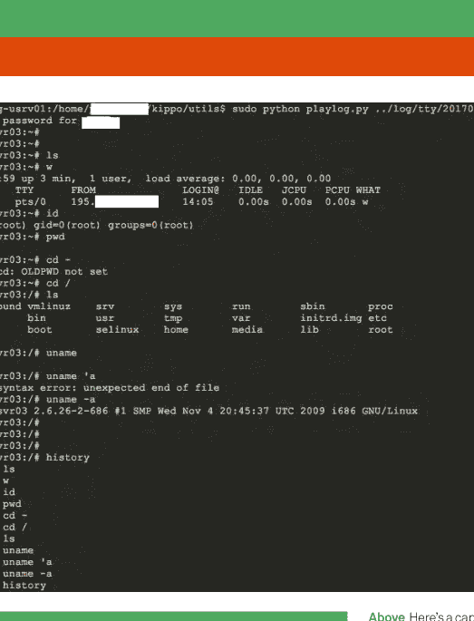

### 伦理与合法性

对于使用蜜罐的伦理和合法性存在一些担忧。有人认为蜜罐有助于安全，因为它们可以帮助攻击者练习、学习新技术并提高攻击技能。有些人认为，如果蜜罐网络基础设施是故意构建作为“陷阱”来捕获攻击者的，它是非法的。还有人认为它是非法的，因为访问你的蜜罐可能涉及法律权利（取决于你放置蜜罐的国家）以及你从攻击者那里收集的信息。

区分信息收集类型至关重要：连接数据是最重要的，因为它包含了攻击者遇到的聊天记录和电子邮件等个人信息。连接数据与连接信息相关，如 IP 地址、日期时间等，以避免法律问题。你的蜜罐应该部署用于调查或保护你的组织。另一个好主意是放置一个警告横幅，说明你的网站正在被监控。

上方是一个示例截图。这是一个来自命令行的脚本日志。所有命令均由攻击者执行。


### Kippo-Graph 介绍

`Kippo-Graph` 是一个为了可视化 `Kippo` 蜜罐（`Kippo` `Honeypot`）收集的所有信息的脚本。它使用了一些模块和 API，例如 `Google` 可视化 API 和用于绘图的 `Libchart` `PHP`，它根据攻击者执行的所有攻击创建图表和统计数据。总之，`Kippo-Graph` 管理的信息存储在 `MySQL` 数据库中，其余数据收集在日志文件中并直接连接到 `MySQL` 蜜罐，从 `config.php` 文件读取。

总体信息，如总尝试次数、尝试访问蜜罐的不同 IP 数量；所有信息记录的时间范围。下一部分称为“输入（`Input`）”，管理 `Kippo-Graph` 记录的所有信息。它在部分中显示了蜜罐内部所有的“人类活动”。通过这种方式，`Kippo-Graph` 可以估计有多少攻击是由人类发起的，或者是多少次。表格显示了攻击者访问蜜罐后成功使用的顶部命令。图表显示了跟踪任何被访问并下载的文件的命令。

`Kippo-Graph` 可以显示各种类型的图表，如饼图、柱状图等，并呈现相关信息，例如攻击者使用的顶部密码、按国家划分的顶部 IP 连接等，并导出为 `CSV` 以供任何其他日志分析器进行进一步处理。

在 `Kippo-Graph` 的第一部分“概览（`Overview`）”中，我们可以看到 `Kippo` 亮亮的所有数据。在章节头部中，它显示了一些

下一部分称为“回放（`Playoff`）”，显示了 `Kippo-Graph` 最有趣的特性。它展示了针对所有攻击的逐步重放（类似于帧动画）。`playoff` 章节显示了跟踪任何被访问下载的文件的命令。

| IP 地址 | 地理位置 | 成功次数 | 最后看到 |
| :--- | :--- | :--- | :--- |
| `58.XX` | 武汉 | 1 | 2017-07-11 07:59 |
| `103.XX` | 上海 | 7 | 2017-07-11 08:06 |


### 01 准备工作

使用 `Kippo-Graph` 需要安装 `Apache` 服务器和一些 `PHP` 软件包以便正常工作。

```
sudo apt update && sudo apt install -y apache2 php5-mysql
```

### 02 安装 Kippo-Graph (GitHub)

获取 `Kippo-Graph` 的最快方法是克隆 `GitHub` 仓库。

```
git clone https://github.com/ik/kippograph
```

### 03 安装 Kippo-Graph (手动)

安装 `Kippo-Graph` 的另一种方法是下载压缩包：

```
wget http://example.com/uploads/kippograph.tar.gz
tar -xvf kippograph.tar.gz /var/www/
sudo chmod 755 /var/www/kippograph
```

### 04 准备 Kippo-Graph

复制教程第 2 步中的文件夹（`http://www.kippograph.com`），然后进入目录

```
cd /var/www/kippograph-1.5/
```

接下来，为生成的图表设置读取权限。最后，在进行任何更改之前，必须将 `kippograph.dist` 复制为 `config.php`：

```
sudo mv config.dist config.php
```

### 05 配置 Kippo-Graph

已修改 `config.php`，但让我们关注以下几个：`DB_HOST` 应设置为 `localhost`，`DB_USER` 是数据库用户，`DB_PASSWORD` 是 `Kippo` 的数据库名称；以及 `DB_PORT` 是连接数据库的端口（默认为 `3306`）。

### 06 访问 Kippo-Graph

一旦修改了 `config.php`，我们需要重启 `Apache` 服务器以应用新的配置值。完成后，可以通过 `http://[IP或服务器]/kippo-graph` 访问图表。此时，你将看到带有你的蜜罐活动叠加的 `Kippo-Graph` 网页，显示如下

## 功能

## 捕获入侵者


| 外部网络主机（业务或工厂网络） | 通用协议 |
|---|---|
| | |

| DMZ 应用 | 通用协议 |
|---|---|
| | |

| 补丁部署服务器 | 历史数据数据库 (`HISTORIAN`) |
|---|---|
| | |

| 控制元件（网络、应用、服务器） | 通用及工业协议 |
|---|---|
| | |

| 工程工作站 | 报警服务器 | 应用服务器 | 历史数据数据库 (`HISTORIAN`) |
|---|---|---|---|
| | | | |

| 控制元件（`PLCs`, `RTUs`, `SIS`） | 工业协议 |
|---|---|
| | |

| 传感器与执行器 | `IO` | 现场总线 (`FIELDBUS`) | 工业协议 |
|---|---|---|---|
| | | | |

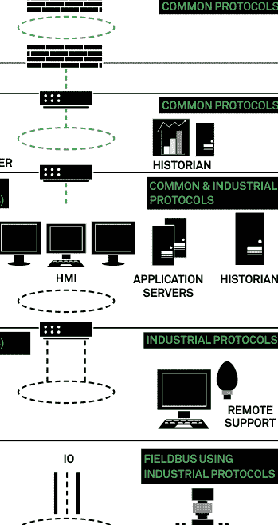

上方是典型的工业网络示意图。

## 如何操作

### T-Pot：多平台蜜罐系统

欢迎使用你闪闪亮的新玩具：`T-Pot` `16.10`！


### 01 介绍 T-Pot


## T-Pot 概述

T-Pot 将蜜罐 `Conot`、`Cowie`、`Dionsea`、`Elastic`、`Emobility`、`Glastof` 和 `honeytrap` 与 `Suricata`（一种网络监控安全引擎）相结合。它使用 `ELK` 栈对收集的数据进行可视化，这是一个优秀的可视化引擎（搜索、`Logstash` 和 `Kibana`）。`T-Pot` 每次在 `Docker` 容器中运行时都是免费的。

## 为什么选择 MKZ？与服务的区别

请选择您的安装类型，如果有任何问题，请告诉我们。

`Conot`、`Cowie`、`Dionsea`、`Elastic`、`Glastof`、`honeytrap` 与 `Suricata`（一种网络监控安全引擎）以及 `ELK` 栈用于可视化

# 02 要求与安装

`T-Pot` 可以通过不同的设置安装在单台计算机或虚拟机上。为了避免安装过程中出现问题，请确保您的系统满足 4GB 内存（推荐）、64GB 磁盘（推荐 128GB）以及可用的互联网连接。安装 `T-Pot` 只需：从 `https://github.com/kompot/t-honeypot` 下载文件并在您指定的设置上运行它。

# 03 运行 T-Pot

安装大约需要 30 分钟。您将成为用户，并在设置过程中选择密码。所有蜜罐将根据所选设置类型自动安装。要从浏览器访问 `T-Pot`，只需在网络浏览器中输入：`https://<your-ip>:443`。更多详情请访问 `https://github.com/ditag-dev-sec/tpot`。

### 关于 Cowie 的说明

- `Cowie` 是一个很好的学习环境。长期以来，它是最常用的蜜罐之一，但它没有被定期更新，被攻击者检测到的概率更大。有了这些概念，我们需要更安全的环境，所以让我们转向 `Cowie`。对于初学者来说，`Cowie` 非常简单，因为它是 `Kipp-Pot` 的副本。在 `Cowie` 中，提供了许多新功能，例如 `SFTP` 和 `SFTP` 文件上传。因为它支持 `SSH`、`JSON` 日志格式等。`Cowie` 定期更新并修复了最新的补丁，且 `Cowie` 与 `Kipp-Pot` 为相似，它 100% 兼容 `Cowie-script`。

`Cowie` 的文件夹和文件设置与 `Kipp-Pot` 类似。`data`、`bi`、`honys` 和 `totdforms` 形成了与 `Kipp-Pot` 相同的文件，但 `Cowie` 的主配置存储在 `cowie_config.dist` 中。正如我们在处理 `Kipp-Pot` 时所样，必须复制此文件并重命名为 `cowie_config`。`Cowie` 的新功能为虚拟文件系统添加了一些新配置，该系统分配给 `data` 文件夹，`cowie.json` 以 `JSON` 格式存储日志记录。

您需要安装以下依赖项：

```bash
apt-get install python3-pip libbffr-dev libss1-dev libbcpc-dev libffi-dev
```

`build-essential` `libpython-dev` `python2.7-minimal`

`authbind`

正如我们在处理 `Kipp` 时所建议的，为 `Cowie` 创建一个单独的而不是直接使用它。

## 安装 Cowrie

您可以从 GitHub 仓库克隆 `Cowrie`：

```bash
git clone https://github.com/micheostorhoff/cowrie
```

`Cowrie` 配置是蜜罐的直接替换，但我们需要在 `cowrie.cfg` 中进行一些更改：

```ini
## JSON 命名日志
## [database_json]
## logfile = cowrie.log
## 使用 ssh 传递命令
execCommand=
## e.g. sh localhost<command>
## (default: false)
## sftp_enabled = enable sftp system
sftp_enabled = true
```

启动 `Cowrie` 就像 `Kippo` 一样，只需执行 `./start.sh` 即可。

## 你在蜜罐中吗？

可以使用一些技术来检测你是否进入了蜜罐，或者是否存在与蜜罐的交互（从最低级到最高级不等）。

一种技术涉及检查我们是否处于虚拟计算机内部。你会发现旧的服务器配置在虚拟环境中，但它对于网络区域中的集群是有限的，例如 `DMZ`（关键服务器通常不是此类攻击的蜜罐）。例如，我们有像 `VMware "VMware SVGA II | PCI Display adapter"` 这样的蜜罐。`MAC` 地址也可以给你类地址（例如 `00:05:69-XX-XX-XX`，`00:0C:29-XX-XX-XX`，`00:50-XX-XX-XX`）来识别与 `VMware` 相关的虚拟机。

另一种技术是检查服务返回的响应。例如，可以通过向 `SSH` 服务发送意外请求并检查返回的错误信息来检测 `Kippo`。如果错误信息是非标准的 `SSH`，那么我们就掉入了 `Kippo` 蜜罐陷阱。这就是为什么自定义我们的蜜罐以使其尽可能真实是极其重要的。交互级别越低，检测蜜罐就越容易。

## 选择最适合您的订阅方案


## 订阅与续费 – 享8 折优惠

- 自动续费 – 永不错过期数
- 直接借记付款

每六个月支付 33.75 英镑，比零售价节省 20%


## 一年订阅

- 优惠优厚，全球通用
- 一次付款，支持信用卡或支票

简单的一次性付款即可确保您在整整一年内不会错过任何期数。总共 13 期，直接送达您的家门口。

| 银行指令 | 发起人参考号 |
| :--- | :--- |
| 通过直接借记付款的银行或建筑协会名称 | 7 6 8 1 9 5 |

| 价格 | 价格 | 价格 |
| :--- | :--- | :--- |
| 67.50 英镑（比零售价节省 20%） | 欧洲 68.54 英镑 | 美国 112.23 美 | 世界其他地区 112.23 美 |

*注：原表中价格列合并较为混乱，此处已尽量保留结构，但原Markdown表格列数与表头不匹配，已修正为三列以适配内容，实际排版中应根据原始数据调整。若严格保留原貌，则如下：*

| 价格 | | |
| :--- | :--- | :--- |
| 67.50 英镑（比零售价节省 20%） | | |
| 欧洲 68.54 英镑 | 美国 112.23 美 | 世界其他地区 112.23 美 |

## 使用信用卡或支票付款

支持信用卡或借记卡付款。

| 账户名称 | 邮政编码 |
| :--- | :--- |
| 排序代码 (Sort Code) | 账号 |

| Visa | Mastercard | Amex |
| :--- | :--- | :--- |

| 卡片名称 | 有期至 |
| :--- | :--- |
| 支票付款 | 请随附抬头为 Future Publishing Ltd 的支票，金额为 |
| 签名 | 日期 |

请通过本指令中指定的账户支付 `Future Publishing Ltd` 的直接借记费用，并遵守 `Future Publishing Ltd` 的条款和保证。如果是如此，详情将通过电子方式支付至我的银行/建筑协会。银行可能不接受某些类型的直接借记指令。

| 姓名 | 地址 |
| :--- | :--- |
| 电话号码 | 手机号码 |
| 邮箱地址 | 邮政编码 |

请将此表邮寄至：
`Linux User & Developers Services, Future Publishing Ltd, 3 Queensbridge, The Lakes, Northampton, NN7 8EF, United Kingdom`

如果您希望收到来自 `Future` 及其集团公司的包含新闻、特惠优惠和产品信息的交流，请勾选。

# 在线安全订购 www.myfavouritemagazines.co.uk/sub

## 联系我们友好的客户服务团队
拨打 `0344 488 2852`

## 本优惠有效期至
`2017年9月30日`
加入时请使用代码 `LDU177`

# 从命令行管理 VirtualBox

`Mayank Sharma` 将帮助您揭开外壳，发现这款热门桌面虚拟化平台的隐藏实力。


`VirtualBox` 是一个非常出色的应用程序，它让虚拟化大众化，使普通桌面用户也能接触企业级技术。

使用图形界面，您可以轻松地运行和管理虚拟机。尽管 `VirtualBox` 简单易用，但也包含了一些高级功能。其中之一就是命令行界面（`CLI`），一旦掌握，它可以帮助您编写脚本以实现更快的虚拟机操作。

`VirtualBox` 图形界面的便利性具有许多优势。它允许您在远程宿主机上运行和管理虚拟机 (`VM`)。当您熟悉了 `CLI` 后，可以通过 `SSH` 在远程 `Linux` 主机上运行脚本任务。`VirtualBox` 引擎的一些功能是图形界面端无法访问的：

```bash
Controller --port 0 --device 0 --type dvddrive --medium /path/to/install.iso
```

`VirtualBox` 支持宿主机和客户操作系统，这意味着您可以根据预设操作系统设置设置虚拟机。此外，它支持广泛的操作系统。然后您可以使用模板之一创建您的虚拟机，例如：

```bash
VirtualBox modifyvm --name Debian
```


## 虚拟机管理命令

`modifyvm` 命令用于更改虚拟机的设置。如果您想更改虚拟机的任何特性，可以使用它。

### 关键信息

`VBoxManager` 是除图形界面外，`VirtualBox` 的多个前端之一。它的功能不仅限于暴露某些选项，还用于虚拟机的创建和部署。

## 命令与控制

常规的 `VirtualBox` 管理程序安装还会安装 `VBoxManage` 命令，该命令设置的虚拟机设置将遵循所有虚拟机（默认情况下为 `--virtualbox`）。接下来，使用以下命令为虚拟机创建硬盘：

```bash
VBoxmanage --filename Debian --size 20480 --format vdi fixed
```

`fixed` 用于分配整个 20GB 的磁盘空间。如果您想要此选项，命令将是为：

```bash
VBoxManage create --name Debian --register
```

现在，我们通过以下命令为虚拟机添加 SATA 控制器：

```bash
VBoxManage storage --name "SATA" --controller add
```

默认情况下，它会创建一个 IDE 控制器。您可以使用 `--controller` 选项指定不同类型的控制器。控制器添加后，可以使用以下命令将虚拟磁盘挂载到控制器：

```bash
VBoxManage storageattach --name "SATA" --controller 0 --type 0 --medium debian.vdi
```

在这一步中，我们将为客户机添加带有 DVD 光驱的 IDE 控制器。首先，自定义虚拟机：

```bash
VBoxManage storagectl --name "IDE" add ide
```

然后将 ISO 镜像插入到：

```bash
VBoxManage modifyvm --name Debian --storage IDE:0 --type dvddrive --medium /path/to/iso
```

`VirtualBox` 支持 `modifyvm --name Debian`。同样：

```bash
VBoxManage modifyvm --memory 4096
```

设置其内存和视频内存。要连接网络，请使用：

```bash
VBoxManage modifyvm --nic1 --bridge eth0
```

以网桥接模式连接到宿主机上的网络。一旦一切准备就绪，您现在可以使用以下命令启动虚拟机：

```bash
VBoxManage start Debian
```

您的虚拟机现在将启动并准备就绪。一个更有实用的选项是在无头模式（headless）下启动虚拟机。CLI 提供了所有功能，包括图形界面端无法访问的功能。虚拟机的设置遵循所有虚拟机（默认为 `--virtualbox`）。

## 增强功能 (Guest Additions)

为了获得更好的性能，您需要安装一组应用程序和驱动程序。这些程序以 ISO 格式打包。一旦您在宿主机上安装了增强功能，可以使用以下方式挂载：

使用以下命令压缩磁盘空间：

```bash
VBoxManage modifydisk debian.vdi --compact
```

## 管理层

| 控制台 GUI | 命令行界面 | Web 服务 API |
| --- | --- | --- |

## Oracle VM VirtualBox API 层

| Mac OS | 实时迁移 | 资源监器 | RDP 服务器 | 其他设备 |
| --- | --- | --- | --- | --- |
| Linux | | | | 虚拟 USB 磁盘 |
| Windows | | | | 虚拟网卡 |
| Solaris OS 可移植性端口 | | | | 虚拟设备 |


## VirtualBox 平台支持

`VirtualBox` 支持 `Windows`、`Linux`、`Mac OS`、`Solaris`、`FreeBSD`。

## 内核模式

`controlvm`。`Debian`。`reboot`。`savestate` 在关机之前将虚拟机的当前状态保存到状态。如果虚拟机无响应，请使用 `VBoxmanage control reboot power` 命令，这等同于拔掉电源。你必须使用该命令启动它以恢复一个已关闭的虚拟机。

## 脚本启动

`VirtualBox` 最流行的用途之一是将机器虚拟化为 `Windows`，该机器需要合适的操作系统且无法在 `Windows` 上运行。`VirtualBox` 可以通过单个脚本启动客户，你可以使用启动器或快捷方式执行该脚本。

首先，手动启动 `Windows` 虚拟机，并在安装 `VirtualBox` 增强功能后切换到无头模式（Headless mode）。现在复制命令，确保它是正确的，你现在就可以构建脚本来启动虚拟机了。首先，你需要使用类似 `VBoxmanage start "Windows 10"` 的命令启动虚拟机。虚拟机已启动并运行。

> 使用 `VirtualBox` 图形界面是方便的，特别是对于觉得界面过于复杂的桌面用户来说。对于每天作为日常工作的一部分需要管理虚拟机的资深系统管理员来说，管理 `VBox` 所花费时间的回报是巨大的。虽然你可以编写自己的脚本来控制虚拟机，但更好的选项是采用 `GitHub` 上的 `VirtualBox Manager` 提供的脚本 (https://github.com/greg/vbox)。这些脚本最初是为使用 `VirtualBox API` 编写的，但如果你阅读本文并根据你的需求修改脚本，一旦你掌握了它，你就再也不需要使用图形界面来进行部署了。

`Windows` 安装中对预定义用户的身份验证。

就是这样。一旦你使用完它，就可以关闭 `Windows` 虚拟机以保存状态。只需运行 `VBoxmanage controlvm "Windows 10" 90 savestate`。你可以从 `http://bit.ly/VM-IE` 下载脚本，并根据你的需求进行调整。一旦你完善了脚本，就可以使用它通过启动器或桌面图标/快捷方式启动虚拟机。

```bash
VBoxmanage controlvm "Windows 10" run --exe "C:\Program Files\VirtualBox\InternetExplorer.exe" --username [windows-username] --password [windows-password]
```

在此命令中，我们要求 `VirtualBox` 使用启动特定应用（在本例中为 `Internet Explorer`）。

### 快速贴士

#### 键盘命令

使用应用程序作为按键来通过键盘管理客户机，例如，使用功能键通过 `VirtualBox startvm Debian9` 启动虚拟机。

`VirtualBox` 使用分层架构，带有各种内核模块，用于管理客户机的 `API`，以及一组用户程序和服务。

## 教程

### Linux 基础

#### 第一部分

#### 精通 Shell 脚本编写：

##### 开始编写脚本

`Shell` 脚本允许通过将经常执行的任务收集到单个脚本中来实现任务自动化。


**`John Gowers`** 是编程和计算机科学的大学导师。他喜欢在他任何能拿到的设备上安装 `Linux`，并每天使用命令和脚本。

##### 资源

- 任何 `Linux` 发行版都应该具备的标准内容

在本教程的第一部分中（参见 p38 LU&D181），我们引入了 `Linux` 中的一些基础命令行工具。终端命令是 `Shell` 脚本背后的语言。在教程中，我们将引入拼图的第二部分：编写单条命令来实现任务自动化。我们将探索命令列表；当我们执行它们时，命令将一个接一个地运行。在教程中，我们最后使用复杂的脚本来创建一个我们可能想要脚本——一个用于创建目录本地备份的脚本。脚本的意义在于，你在终端中使用的提示符和功能是称为 `shell` 的特殊类型程序的示例。`Shell` 是一个等待你的命令的程序，它会打印一个提示符，你可以在其中输入命令名称；当用户按下回车键时，`shell` 运行该命令。

`Shell` 有很多例子，你可能想自己探索其中的一些，但我们在教程中将讨论的 `shell`（以及大多数人在 `Linux` 上使用的 `shell`）是 `GNU Bourne Shell`，或 `Bash`。如果我们在终端中输入 `bash` 并按回车，起初看起来什么都没有发生。事实上，我们的 `shell` 启动了一个

目前，我们将专注于学习编写 `shell` 脚本的基础知识。我们将引入一些新的脚本命令和工具，并将一切整合在一起


可用的教程文件：`files.co.uk`

```bash
File Edit View Help First Package

user@linux:~$ ls -l

-rw-r--r-- 1 user user 0 Oct 27 10:00 .bashrc
```


```text
-rw-r--r-- 1 user user 0 Oct 27 10:00 .profile

dr-xr-x-x 2 user user 4096 Oct 27 Documents

dr-xr-x-x 2 user user 4096 Oct 27 Downloads

dr-xr-x-x 2 user user 4096 Oct 27 Music

dr-xr-x-x 2 user user 4096 Oct 27 Music

dr-xr-x-x 2 user user 4096 Oct 27 Pictures

dr-xr-x-x 2 user user 4096 Oct 27 Public

dr-xr-x-x 2 user user 4096 Oct 27 Videos

-rw-r--r-- 1 user user 0 Oct 27 test.sh
```

```bash
user@linux:~$ touch test.sh

user@linux:~$ chmod +x test.sh

user@linux:~$ ./test.sh
```

Hello World!


## 通配符

shell 还配备了许多你可以在 shell 脚本中使用的工具。

- 退出你的 shell
- 有很多 shell 构建
- `Bash` 是你可能想自己探索其中的一些，但我们在教程中讨论的 shell（以及大多数人在 Linux 上使用的 shell）是 GNU Bourne Shell，或 `Bash`。如果我们在终端中输入 `bash` 并按回车，起初看起来什么都没有发生。事实上，我们的 shell 启动了一个 `/bin/bash`

# 核心 Linux 详解

## 不要忘记 `chmod`

如果你尝试运行一个脚本并遇到“Permission denied”（权限被拒绝）的错误，那是因为你忘记使用 `chmod +x your_script` 命令。在 Linux 中，万物皆文件，但你需要将文件设置为可执行（例如，你想要运行的程序和文件）。`chmod +x` 会在文件上设置一个标记，允许其被执行。

```bash
$ mkdir directory

$ touch file

$ mv file directory

$ ls directory
```

`mv` 命令的语法是：输入 `type mv`，然后是你想要移动的文件路径，最后是你想要移动到的目录路径。如果你移动一个文件，你可以在移动的同时重命名该文件，只需将新名称指定为目标：

```bash
$ mkdir directory

$ touch file

$ mv file directory/newname
```

如果你想在不移动文件到目录的情况下重命名文件，这种机制同样有效，`mv` 命令可以作为重命名文件的命令使用：

```bash
$ cd directory

$ ls

$ mv filename something_else

$ ls

something_else
```

要给变量赋值，我们使用符号 `=`。如果你以前用过编程，可能会想在等号两加上空格。请完全按照我们这里写的这样写，不要留空格，否则 shell 会认为 `greeting` 是一个变量名。要引用变量，请在变量名前加上美元符号 `$`。

## 字符串字面量与命令替换

在下面的代码中，我们使用双引号 `""` 来引用字符串 `Hello`。在 shell 中，你可以使用单引号或双引号，但如果你使用单引号，那么你放在引号之间的文本将是字符串的原始值。如果我们使用双引号，shell 会在字符串内部执行命令替换。例如，我们可以在字符串内部引用变量的值：

```bash
$ echo "Hello"

$ echo "Hello, James!"
Hello, James!
```

为了完整起见，我们可能想在变量名周围加上大括号 - `${greeting}`。如果我们想在变量扩展后紧接着写字母，就需要这样做，例如 `${greeting}` 扩展为 `Hello`，但否则 shell 会认为我们正在引用一个名为 `greetingoo` 的变量，而不是 `greeting`。

我们可以利用双引号完成的另一个技巧是将命令的输出插入到字符串中。我们通过使用美元符号和 `()` 来实现这一点。

```bash
$ touch script.sh
```

- 可以工作，但测试起来很麻烦

```bash
$ /script.sh
```

- 使用 shebang 修复 `script.sh`
- `#!/bin/bash` 并且我们已经将其设为可执行
- 使用 `chmod +x script`

```bash
$ /path/to/script.sh
```

- 类似于上一个例子，但当 `script.sh` 位于另一个目录时

## Bash shell 支持作为存储字符串值的简单变量的编程构造结构

`cp` 命令的工作方式完全相同，它将原始文件留在原处，同时将原始文件的副本到新目录中。
我们可以像移动文件一样移动（重命名）目录及其内容。如果你想使用变量来复制目录，我们需要使用命令行开关：

```bash
$ cp -r destination
```

## 变量

在上一节中，我们看到 Linux 命令是如何通过在它们之间传递字符串进行交互的。Bash shell 也支持使用变量来存储字符串值。
例如：

```bash
$ greeting="Hello, world!"

$ echo $greeting
Hello, world!
```

```bash
$ script.sh
```

- 如果 `script.sh` 位于一个包含 `PATH` 环境变量的目录中

上述有几种运行 shell 脚本的方法：

`echo "当前工作目录是 $(pwd)"`

### 示例：备份目录

作为一个工作示例，让我们创建一个脚本，该脚本将允许你创建工作目录下所有文件的备份。我们将备份设为本地的，因此它无法保护你免受硬件故障（如意外删除），但如果你计划将备份移动到不同的服务器，如果有必要，我们可以恢复它。shell 脚本本身提供在光盘和随附的 Filesello 中。我们将逐行分析该脚本及其工作原理。

在每个脚本中都会编写的 shebang `/bin/bash` 之后，第一行是：

```bash
mkdir "$HOME/mybackups"
```

这会在你的主目录下创建一个名为 `mybackups` 的目录。有几点需要注意。选项 `-p` 意味着该目录已经存在。它对于创建整个嵌套目录结构也很有用；例如，命令 `mkdir a/b/c` 将创建 a、b 和 c 目录，其中 b 在 a 内部，c 在 b 内部。

`$HOME` 是一个包含你主目录的 shell 变量。

我们以点 `.` 开头了名称 `.mybackups`。如果你以点开头文件名，那么该文件或目录将被隐藏。当你输入 `ls` 时它不会出现，除非你在 `ls` 中使用了 `-a` 开关。

下一步是在你的主目录下创建一个目录：

```bash
backup_directory="$HOME/backups_$(date +%)"

mkdir $backup_directory
```

第一行为备份目录生成了一个名称，包括创建备份的日期和时间，并将其存储在变量 `name` 中。注意，我们使用双引号和 `$()` 来在 `name` 中执行命令输出。在这种情况下，它包含了当前的日期和时间。下一行创建该目录。

最后，我们将工作目录中的所有文件复制到新的备份目录：

```bash
cp -r . $backup_directory
```

### 创建 shell 脚本

你可以通过将文件保存为计算机上的 `backup.sh` 并在包含脚本的目录中使用 `chmod +x backup.sh` 命令运行它来使其可执行。如果你在包含脚本的目录中，你可以：


上述我们使用 shell 技巧编写了一个简单的备份脚本。如果你想从任何地方运行它，你需要提供脚本的完整路径，这没什么用。相反，让我们在主目录下创建一个特殊的目录来存放这个新目录：

```bash
cd $HOME

mkdir mybackups
```

并将脚本复制到 `mybackups`。然后，我们需要修改 `PATH` 变量以允许访问命令。`PATH` 是一个特殊变量，允许某些目录中的命令而无需输入它们的完整路径。如果我们在命令行输入 `$PATH`，我们将看到类似的内容：

```bash
/usr/sbin:/local/bin:/bin
```

这是一个由冒号分隔的目录列表，包含了如 `cp` 和 `mkdir` 等重要程序。

使用双引号 `""` 来引用字符串 `Hello`

```bash
echo "Hello"
```


在下面的代码中，我们使用双引号 `""` 来引用字符串 `Hello`。在 shell 中，你可以使用单引号或双引号，但如果你使用单引号，那么你放在引号之间的文本将是字符串的原始值。如果我们使用双引号，shell 会在字符串内部执行命令替换。例如，我们可以在字符串内部引用变量的值：

```bash
$ echo "Hello"
$ echo "Hello, James!"
Hello, James!
```

为了完整起见，我们可能想在变量名周围加上大括号 - `${greeting}`。如果我们想在变量扩展后紧接着写字母，就需要这样做，例如 `${greeting}` 扩展为 `Hello`，但否则 shell 会认为我们正在引用一个名为 `greetingoo` 的变量，而不是 `greeting`。

我们可以利用双引号完成的另一个技巧是将命令的输出插入到字符串中。我们通过使用美元符号和 `()` 来实现这一点。

```bash
$ touch script.sh
# 可以工作，但测试起来很麻烦
```

```bash
$ /script.sh
# 使用 shebang 修复 script.sh
#!/bin/bash 并且我们已经将其设为可执行
使用 chmod +x script.sh
```

```bash
$ /path/to/script.sh
# 类似于上一个例子，但当 script.sh 位于另一个目录时
```

## Bash shell 支持作为存储字符串值的简单变量的编程构造结构

`cp` 命令的工作方式完全相同，它将原始文件留在原处，同时将原始文件的副本到新目录中。

我们可以像移动文件一样移动（重命名）目录及其内容。如果你想使用变量来复制目录，我们需要使用命令行开关：

```bash
$ cp -r destination
```

## 变量

在上一节中，我们看到 Linux 命令是如何通过在它们之间传递字符串进行交互的。Bash shell 也支持使用变量来存储字符串值。

例如：

```bash
$ greeting="Hello, world!"
$ echo $greeting
Hello, world!
```

```bash
$ script.sh
# 如果 script.sh 位于一个包含 PATH 环境变量的目录中
```

上述有几种运行 shell 脚本的方法：

`echo "当前工作目录是 $(pwd)"`

### 示例：备份目录

作为一个工作示例，让我们创建一个脚本，该脚本将允许你创建工作目录下所有文件的备份。我们将备份设为本地的，因此它无法保护你免受硬件故障（如意外删除），但如果你计划将备份移动到不同的服务器，如果有必要，我们可以恢复它。shell 脚本本身提供在光盘和随附的 Filesello 中。我们将逐行分析该脚本及其工作原理。

在每个脚本中都会编写的 shebang `/bin/bash` 之后，第一行是：

```bash
mkdir "$HOME/mybackups"
```

这会在你的主目录下创建一个名为 `mybackups` 的目录。有几点需要注意。选项 `-p` 意味着该目录已经存在。它对于创建整个嵌套目录结构也很有用；例如，命令 `mkdir a/b/c` 将创建 `a`、`b` 和 `c` 目录，其中 `b` 在 `a` 内部，`c` 在 `b` 内部。

`$HOME` 是一个包含你主目录的 shell 变量。

我们以点 `.` 开头了名称 `.mybackups`。如果你以点开头文件名，那么该文件或目录将被隐藏。当你输入 `ls` 时它不会出现，除非你在 `ls` 中使用了 `-a` 开关。

下一步是在你的主目录下创建一个目录：

```bash
backup_directory="$HOME/backups_$(date +%)"
```

```bash
mkdir $backup_directory
```

第一行为备份目录生成了一个名称，包括创建备份的日期和时间，并将其存储在变量 `name` 中。注意，我们使用双引号和 `$()` 来在 `name` 中执行命令输出。在这种情况下，它包含了当前的日期和时间。下一行创建该目录。

最后，我们将工作目录中的所有文件复制到新的备份目录：

```bash
cp -r . $backup_directory
```

### 创建 shell 脚本

你可以通过将文件保存为计算机上的 `backup.sh` 并在包含脚本的目录中使用 `chmod +x backup.sh` 命令运行它来使其可执行。如果你在包含脚本的目录中，你可以运行它。


上述我们使用 shell 技巧编写了一个简单的备份脚本。如果你想从任何地方运行它，你需要提供脚本的完整路径来运行，这没什么用。相反，让我们在主目录下创建一个特殊的目录来存放这个新脚本：

```bash
cd $HOME
mkdir mybackups
```

并将脚本复制到 `mybackups`。然后，我们需要修改 `PATH` 变量以允许访问命令。`PATH` 是一个特殊变量，允许某些目录中的命令而无需输入它们的完整路径。如果我们在命令行输入 `$PATH`，我们将看到类似的内容：

```text
/usr/sbin:/local/bin:/bin
```

这是一个由冒号分隔的目录列表，包含了如 `cp` 和 `mkdir` 等重要程序。

使用双引号 `""` 来引用字符串 `Hello`

# Udemy

管理了第二个。这说明了暴力破解密码的难度日益增加，这些密码由代码、数字和标点符号组成。程序查询的网站可能只是生成了一堆密码并对其进行了哈希处理，但由于有很多密码，用于生成它们的字母表虽然廉价的，但不足以应对指数级增长。因此，我们尝试了哈希 `-g` 选项，在 Google 上搜索它，但没有成功。

- 独家优惠：Udemy 全课程立省 95% 费用

如果你喜欢这门伦理黑客 Udemy 课程的入门体验，你可以凭借独家 Linux 用户折扣在 `http://udemy.com` 获得完整课程的无限制访问。本课程涵盖了如何攻击和防御密码，以及获得保护和保护您的网络免受黑客攻击和数据丢失的能力。获取折扣，从今天开始！点击“立即购买”按钮并注册 Udemy。注册账户后，系统将要求您确认购买。课程折扣价有效期有限。需更多信息，请点击“立即支付”。您已成功报名课程！享受终身访问权限。

# John the Ripper

如果你正在处理需要绕过的密码，这可能会变得非常棘手。如果有人使用特定工具进行了加密，你极有可能可以从这些驱动器中恢复。在这种情况下，我们处理的不是加密，而是用户密码系统。

Udemy 成立于 2010 年，目标是通过 Udemy 改进学习。Udemy 是一个全球学习和教学市场，拥有来自世界各地专家教授的 45,000 门课程库。

一种方法是尝试使用带有启动的 USB 启动系统，或使用机器上在线的操作系统。有时这是不可行的，或者其他，因此我们将演示另一种不同的方法。

重启你想要访问的系统。当 GRUB 菜单出现时，在编辑模式下按 `E`。搜索以 `linux/vmlinuz-` 开头的行。完全可以删除内核或更改指向 `root` 的参数；将其更改为 `rw`。在该行的末尾，添加我们之前更改的参数。我们现在将探索另一种恢复它的方法。这种方法依赖于从一开始就拥有 `root` 权限，而上一步只是时间问题。

## 隐藏在阴影中

我们可以使用 `shadow`（以 `root` 安装）文件来访问存储用户密码哈希的系统文件：

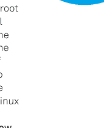

```bash
## /etc/passwd /etc/shadow > pass
```

除非你更新了 Kali 中的所有用户，否则 `root` 账户可能有一个关联的密码。如果我们使用生成的 `pass` 文件第一行中的密码哈希。我们将使用 John the Ripper 来破解此哈希。通过运行使用 John Ripper 使用的哈希类型的 John 50，我们可以攻击大量的哈希。现代 Linux 使用 `SHA1` 算法对密码进行哈希处理。

- 免费暴力破解：可能存在许多用户（例如 `guest`）没有密码。我们将能够对这些账户进行暴力破解。

`shadow` 文件包含美元符号和时间符号。该值用于检查密码。现代 Linux 使用 `MD5` 作为所使用的哈希。由于发现了许多漏洞，`MD5` 被认为是不安全的加密哈希函数。

如果我们没有问题地识别我们 `pass` 文件内部带盐的 `SHA1` 哈希，那么人们以来一直能够破解这些内容。我们将设置为使用盲暴破解攻击来破解哈希。如果有效，John 的工作速度将比任何密码都快。

```bash
$ su
## /etc/shadow
```

系统将提示你输入用户名（`system`）并仅加载哈希。因此，当我们立即掉入 `root` shell 时，驱动程序是可用的，并且许多好事情仍将完成，所以让它在比任何其他机器都快得多的硬件上。


有很多可以叫。例如，我们可以用 `'pass'` 更改密码哈希。机器可以重启或 `'rw'` 不不起的输出（固定在），直到我们可以验证你的 `root` 密码已持久。我们对内核的哈希存储在文件中，你可以通过以下方式查看它们：

原始密码可能在其他地方使用，或者我们从恢复中获取了它们的哈希。

出于目的，本课程不会告诉你原始密码是什么。有了新密码，我们能够访问 `/etc/passwd` 和 `/etc/shadow` 文件。密码哈希存储在后者，你可以通过以下方式查看它们：

此列表包含 3200 万密码。

`www.linuxuser.co.uk` 41

# 教程

# `Chromebook` 上的 `Linux`

## 增强 `Chrome OS` 特性

并排运行 `Linux`


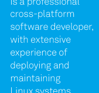

## `Paul O'Brien`

是一位专业的

跨平台\s/w 软件开发人员，

在部署和

营销

`Linux` 系统方面丰富的经验，

等待：

`Paul O'Brien` 是一位专业的

跨平台\s/w 软件开发人员，

在部署和

营销

`Linux` 系统方面丰富的经验，

## 资源

- `Crouton`

- https://github.com/dnsnech/crouton

- `Developer Mode`

- https://github.com/chromiumos/devmode

- `Crouton`

- https://github.com/dnsnech/crouton

- `Chrome Window`

- https://github.com/chromiumos/window

- `Chrome Recovery`

- https://github.com/chromiumos/recovery

- `GalliumOS`

- https://github.com/galliumos

![](img/1fdb1204e7e4788f3fb478a4ef813223_41_2

### 01 理解 `Chromebook` 硬件需求

`Crouton` 可以运行在任何 `OS` 设备上，无论你是运行 `ARM` 还是 `Intel`，`2GB/4GB RAM` 或 `16GB/32GB` 存储。你将获得什么样的体验，取决于你拥有的硬件。由于 `Crouton` 是一个完整的发行版，`Crouton` 允许

`img/1fdb1204e7e4788f3fb478a4ef813223_41_3`

### 02 切换到开发者模式

在使用 `Crouton` 后，你的设备必须切换到“开发者模式”。方法见 `Chrome OS` wiki：

通常涉及打开电源并按下 `Esc+刷新` 键，然后进入恢复界面。第一次开发者模式将需要 `Ctrl+D`（恢复出厂），你需要按 `Ctrl+R`（或等待 30 秒）进入 `shell`。

### 03 打开 `shell` 并下载

在启动开发者模式后

应注意 `shell` 完全取决于开发者模式在 `Chrome OS`（中），你需要的一切就是下载 `Crouton`。进入

浏览器，`shell`）并输入 `-install crouton`。此过程将显示下载完成，这意味着你已准备好设置 `Chromebook`。

### 04 设置和目标

`Crouton` 使用“目标”的概念来决定安装什么。目标通过 `-xf` 指定，可以启用多个开关。`Ubuntu` 网站上的配置是

`/downloads/crouton -xf`，它安装在内部 `16.0` 和免费环境中。如果你

## 资源

- `Crouton`

- https://github.com/dnsnech/crouton

- `Developer Mode`

- https://github.com/chromiumos/devmode

- `Crouton`

- https://github.com/dnsnech/crouton

- `Chrome Window`

- https://github.com/chromiumos/window

- `Chrome Recovery`

- https://github.com/chromiumos/recovery

- `GalliumOS`

- https://github.com/galliumos

`shell` 中的音频现在将通过 `ALSA` 转发到 `Chrome`（`Chromium OS` 音频驱动）。

视频驱动程序可能会与安装的 产生兼容性问题。如果发生这种情况，请更新你的驱动程序。

42

## 指定不同的版本

虽然 `Ubuntu 16.04` 是默认版本，但它并非唯一可用版本。倾向于追求最前沿且愿意承担风险吗？那么 `-r` 选项正适合你，因为它允许你指定特定的版本。使用 `-r` 可以列出你当前版本中带有星号标记的可用版本，这些版本应该谨慎使用。

## 使用 `Crouch` 扩展

默认情况下，并没有安装 `Crouch`。要使用它，你必须指定 `'crouch'` 并安装 `Crouch Chrome` 扩展。该扩展具有绑定、剪贴板和通知同步功能，以及在原生 `Chrome OS` 窗口中支持 `X11` 的 `wifi`，允许你能够在 `crouch` 环境中运行图形应用程序。使用 `sudo -e ~/Downloads/crouch -u -t switch` 命令添加现有的 `crou`。

## 07 安装和使用 `cli`

图形界面固然很好，但如果你想在不使用 `X` 的情况下运行 `Crouch`，以利用 `Chrome OS` 中提供的 `CLI` 工具呢？使用 `'cli-extract'` 你可以节省大量空间，因为它就是你需要的。`Crouch` 扩展允许你使用 `linux`（`sudo start`）在新建环境中运行 `Crouch`，这意味着 `Crouch` 将支持多个 `crouch`，并且你同时拥有（甚至正在运行）`cli` 和完整环境。

## 08 更新 `Crouch` 和你的

为了检查更新，下载最新版本的 `Crouch` 并查看新特性，请从你的 `crou` 中运行 `crouchversion -d`。运行 `crouchversion -h` 获取有关参数功能的详细信息。在 `crouch` 本身外部，

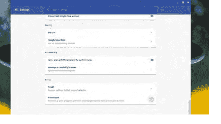

你可以运行 `sudo ~/Downloads/crouch -u chrome`，这将更新 `crou` 以及所有已安装的包。如果你在运行更新之前想备份，可以使用 `edit-crouch` 备份到带有时间戳的 `tar` 包中。

## 09 删除 `crouch` 并保存

`Crouch`？陷入了大团子并想重新开始？`Crouch-remove` 命令是你的朋友，只需传递要删除的 `crouch` 名称即可。如果你想在不同的位置安装 `crouch`（你可以从已安装的 `USB` 闪上运行它），请使用 `-p` 选项选择目标目录。确保对目标路径中的空格进行引用或转义。使用 `edit-crouch` 命令移动现有的 `crouch`。

## 10 `Powerwash`/恢复

如果你想将 `Chromebook` 恢复到出厂状态，你应该检查 `Google` 所说的 `'Powerwash'`。可以通过多种方式实现——最简单是在启动时点击栏菜单上的开关。或者，你可以从 `Beta/Developer` 开关切换回主 `Chrome OS`，或使用 `Google-Chrome Recovery` 工具使用 `USB` 闪盘。如果你弄坏了机器，这可能是必要的！


## `Gallium` – 双引导操作系统

`Crouch` 并不是唯一的；如果你需要更好的发行版，`Gallium` 就在那里。但专门针对 `Chrome OS`，可以看看 `Gallium OS`。`Gallium` 是你想要从 `alt` 启动的系统。`Gallium OS` 包含了许多专为 `Chrome OS` 用户设计的特性，包括集成的访客驱动程序。`Gallium OS` 通常通过命令行使用 `chx` 安装，但也可以安装在 `SD` 卡或 `SSD` 上，尽管这样做将完全替换 `Chrome OS`！像 `Crouch` 一样，`Gallium OS` 需要你的 `Chromebook` 处于开发者模式。像 `Crouch` 一样，使用 `Recovery Tool` 可以轻松恢复到旧版本

# 教程

## 安全

### 保护你的旧系统和软件免受恶意软件


生命周期结束的操作系统和旧软件对我们连接世界的 `IT` 基础设施构成了重大威胁。`Toni Castilla Girardi` 拥有软件工程学位和计算机安全硕士学位。他在剑桥的一所公立大学担任安全专家。阅读他的博客 `http://dibauxes.upe.cs`


WannaCry、NotPetya，我们都熟悉这些名字。它们作为一个不断的提醒，我们的 IT 基础设施或管理方法出了问题。现在是关于自我传播，得益于一个旧漏洞——WannaCry 造成了灾祸。旧操作系统或旧软件在所有环境中（如医疗、制造和 Linux 发行版）仍在使用。生命周期结束（EOL）的操作系统很久以前就被报告，并提供了补丁。然而，对于专有软件，如 Microsoft OS，无法确定它们将提供安全修复，直到某个操作系统达到 EOL。在这个时间，Windows 用户社区仍然很幸运，因为补丁阻止了 WannaCry 或 NotPetya 的传播，但那是另一个故事。我们大多数人仍然运行在旧系统上。由于没有官方安全修复，任何新发现的零日漏洞可以在全球范围内利用而不无人注意。持续多年是安全的。

使用 `SMB-v17-10` 脚本来判断这些易受攻击的主机：`EternalBlue` 是一个广知的漏洞，允许攻击者通过特殊构造的消息向 `SMB` 服务器 `v1.0` 执行代码。本教程将

- `EternalBlue` http://dibauxes.com/

- `Masscan` http://www.masscan.org/

- `Nmap` 750 http://nmap.org/

- `GNU/Linux Kernel` 2017 vulnerabilities http://dibauxes.com/security/

- Kudos https://kudos.com/

- Online malware sandboxes http://bit.ly/

- `Android x86` 5.1 http://bit.ly/

- `Android SDK` and frameworks

## 资源

| 摘要 | 统计分析 | 动态分析 | 详情 |

|---|---|---|---|

| 这是 `eternalblue` 漏洞 | | | |

| 时间戳值 | | | |

| 头部校验和为 `0xff` | | | |

| 入口点是负载（第一个部分）二进制填充 | | | |

| 可选头部数量/偏移值为 `guard` | | | |

| 文件大小值可能会崩溃你的 | | | |

| `TLS` 函数数组 | | | |

| - 反调试标志 | | | |

| - 过滤器 | | | |

| - 未处理异常过滤器 | | | |

| 签名数据库上的壳检测 | | | |

| - `Amilib` v3.1 | | | |

| `Microsoft Visual` v7.0.0 (x86) | | | |

| `Microsoft Visual C++` | | | |

上述是判断补丁是否合适的唯一方法，因为 `WannaCry` 或 `NotPetya` 利用此漏洞进行传播。在以下命令中，将 `RANGE` 替换为你的目标 `IPv4`，例如 `192.168.0.1`。

```bash
## masscan --ports 445 --range=1000 --hosts.txt
# nmap -p 445 --open --max-group 3 --script smbt-vuln-ms17-010
# cat hosts.txt|cut -d "-" -f4|grep -
```

易受的系统将被报告为：`Windows XP` 是一个极其危险的系统示例，不再获得补丁，但它也没有实现 `ASLR`。系统上的内存损坏问题更容易，即使为旧的 `Microsoft 2.7 FTP` 缓冲区溢出启用了 `DEP`。构造此“`2008*`”简单实例将成功打开远程服务器上的 `Windows` 计算器。没有显示错误！攻击者将通过构造某些 `rop gadget` 来利用内存区域执行。但这个问题也适用于 `GNU/Linux` 系统。保持旧系统仍然具有风险：因为没有官方的安全修复，任何新发现的零日漏洞可以在全球范围内被利用而不无人注意。持续多年是安全的。

## 它们仍在泄血

`Heartbleed` 是 2014 年的一个漏洞虫。攻击者构造一个恶意包并发送到远程服务器，以从中读取某些内存，从而暴露私钥。对于我们正在分析来自未知源字符串的脚本来说这很简单，检查这里：https://virustotal.com/malicious-ip-blocklists。


## 网络内容分类

| 类别 | 声誉指数 | 状态 |

|---|---|---|

| 恶意软件网站 | 10 | 高风险 |

| 请求新 URL | | 更多信息 |

## 网络声誉

| 因素 | 值 | 影响 |

|---|---|---|

| 感染（过去12个月） | | |

| 流行度 | 低 | |

| 年龄 | 11 个月（已建立） | |


## 网络分析

为了说明这一点，假设你的网络上连接了一台 `HP` 激光打印机。该打印机运行着旧软件（2012）。攻击者将通过运行 `nmap` 发现它。接下来攻击者将开始扫描并寻找内存中的漏洞以寻找感兴趣的内容（如易受的密码、凭据），通过运行 `32764.py` 脚本。攻击者将登录打印机并尝试

# 教程

## 安全


### GNU/Linux 上的恶意软件

`GNU/Linux` 上存在恶意软件，但它们和你的不太一样。http://bit.ly/UseCensys

在数千万个嵌入式设备的 `GNU/Linux` 服务器上获取 `Android` 是一个真正的威胁：恶意软件可以运行并搜索框中的文本，甚至可以使用 `Linux` 工具进行审计以检测弱点。

如果你恰好在网络上发现有漏洞的服务器或设备，尝试针对 `./3274.py YOURSERVER` 运行 `Python` 漏洞程序。现在编写一个简单的 `bash` 脚本，在账户之间添加一些延迟和去抖（de-bounce）。仅仅通过查询这些数据库，你可能发现潜在的 `Heartbleed` 漏洞。访问 https://censys.io 并在该框中找到这段文本：`tags:vulnerable`。然后查询 `Censys` 以自动化从 http://bit.ly/UseCensys 导出数据。对于这篇文章来说，仅仅为了一个漏洞就要做大量工作。但是，你必须考虑到测试已经做过了，也许他们已经直接从网络层面进行了补丁。尽管如此。

它仍然很“脏”

除了这个 `Heartbleed` 漏洞外，`Android` 用户还有一个同样糟糕的漏洞，被称为 `Dirty COW`。根据 `MITRE` 数据库，`Android` 设备（以及 `Android` 工具）中总共发现了 46 个安全漏洞。你已经修复的其中许多问题已经修复了。那么对于 `Android`，如何修复这些问题呢？答案是：可能并不简单。

`Android` 设备在安全方面特别糟糕。事实是，你买了一部智能手机，但它已经没有更多的固件更新了。你的手机里有一个名为 `'SegUpdate'` 的小应用，你现在必须偶尔点击它。如果你还想下载固件，浏览厂商网站将变得困难。哎！在你那强大的计算机周围，世界上的另一个乱象，正如 `Dirty COW` 所示，它正面临着许多安全问题。

新版本的 `Linux` 内核已经发布，并包含了一些修复它的补丁。但当然，并不是所有的补丁都达到了 `Android` 设备，因此它们仍然处于暴露状态，执行着工作。说起来：如何亲自动手。

首先，下载 `Android` 5.1 并将其安装在 `VirtualBox` 中。确保使用 `PS2` 上的鼠标指针而不是 `'Tab'`，并将 `/sd1` 挂载为读写。然后，完成首次配置去抖后，将网络接口设置为“仅主机模式”（`Host Only`）。这就是如何连接电脑到虚拟机。启动虚拟机并运行 `Android` 模拟器，执行：`ifconfig`。绑定到你的 `GNU/Linux` 盒子并使用 `ADB connect 192.168.1.55` 连接到 `Android`，以找到在你的系统中可能变化的地址。

在尝试 `Dirty COW` 漏洞之前，确保你的系统已安装了 `Android SDK`，你需要编译代码。然后，克隆漏洞仓库：`git clone https://github.com/timmer/CVE-2016-5195.git` 编译它 `CVE-2016-5195 ; make` 会在 `/lib/x86` 创建文件。将它们推送到 `Android` 虚拟机：`adb push cow /data/local/tmp` `adb push run-as /data/local/tmp/run-as` - 不要在 `/system/bin/run-as` 运行。你会得到错误：“只读文件系统”。到目前如何利用 `Dirty COW`：

> 一个段可以防止一个在足够时间和技能下导致攻击者接管整个系统的安全漏洞

```
/sdcard /data/local/tmp/run-as /system/bin/run-as
# /proc/self mem exploit
@ 0x480120ae44c5f
```


执行漏洞并运行一个 shell：`/sdcard` `/system/bin/run-as`。所以对于 Android 5.1。现在运行漏洞。进入设置 > 关于手机。点击 7 次版本号以解锁开发者选项。希望你没有受到这个 Dirty COW 漏洞的影响。如果你足够，你可以在手机上尝试相同的补丁，但要做好损坏准备。一旦漏洞完成，恢复“原始功能”的办法是用原始二进制文件覆盖它。也许它适用于你在更安全的时代使用的旧 Android 手机。那么名声如何？

大多数人都在使用比 Android 5.1 更旧的版本，并运行着智能手机上安装的线条和内核……利用这个普通应用轻而易举，安装它也同样简单。当然，Android 许多许多安全漏洞需要解决。Dirty COW 仍然容易被利用。这现在需要补丁，如果如此，打印机和其他系统永远不会打补丁。但要做好：你正在运行一堆系统（包括你的智能手机和家庭路由器/网关）

# 破坏段故障

如果你在你的日志之一中代码跨越了一个段（段错误），请确保它不是故意触发的。段错误可以防止一个漏洞，该漏洞在足够的时间和技能下可能导致攻击者创建一个有效的漏洞并接管整个系统。对于影响网络服务的段需要特别注意。

旧软件容易出现这种糟糕的错误。那时候这样的 Apache 服务器没有这种二进制迁移，或者经典的 SQL 注入等。如果你在 GNU/Linux 发行版上运行旧软件，那么……

# 教程

# Java

## 第一部分

## 学习 Java：使用继承创建一个基础游戏

编写一个简单的游戏是学习编程特性的极佳方法，同时也涉及多线程系统和网络。


**John Gowers** 是一位编程和计算机科学大学导师，重点关注 Java。你也可以阅读他在第 36 页关于脚本的教程。

## 资源

- Open JDK 1.8（本教程的部分 1.7 就足够了） http://openjdk.org/

- Eclipse IDE http://www.eclipse.org/

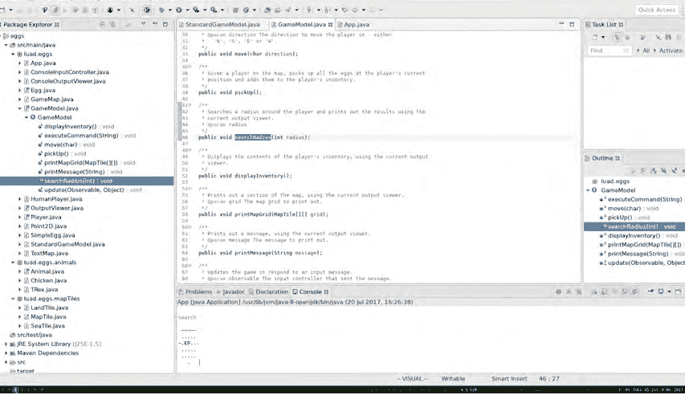

我们将使用 Eclipse IDE 在 Java 中构建一个游戏。IDE 将编辑器和调试工具整合在一起，以帮助你尽可能高效、快速地进行开发。

Java 编程语言包含了许多可以在日常编程中使用的特性。在系列教程中，我们将通过构建一个简单的沙盒风格游戏，展示一系列 Java 的编程结构和工具。在游戏中，玩家将在地图上行走，收集鸡蛋并击各种动物。

如果你已经掌握 Java 基础，但对编程是新手，那么这个系列教程就是为你准备的。如果你以前接触过其中一些概念，你仍然能从本教程中学到新东西。

每个月，我们都会提供一个代码库供你编辑。对于第一篇文章，我们将提供一段简单的骨架代码，你将学习提供一些基础功能。如果你遵循了之前几个月的教程，可以将你的解决方案与我们的进行比较，但我们希望你继续完善自己的代码，并为你所创造的内容感到自豪。

在第一个教程中，我们发现代码库几乎没有任何功能；它仅仅是一组接口和抽象类的集合，带有少量的类和方法。在教程中，你将为这些接口和抽象类编写自己的实现，通过重写接口/抽象方法来提供我们指定的功能。我们不会向你展示如何编写代码。

其余部分将在几个月内与我们共同。在我们的程序中，将由多个相互作用的对象组成，我们可以根据意愿创建并放置它们。

要开始之前，我们需要导入 LIBGD 提供的基础功能。首先，将光盘中的 `eggs.tar` 拷贝到我们自己的文件系统中。接下来，启动 Eclipse 并选择 `File > Import...`，从弹出的菜单导入项目，然后选择 `General > Existing Projects Into Workspace`，这将弹出图 1 所示的对话框。从


可用的教程文件：

`file://site.com`

在此处选择“Select archive file”，然后点击“Browse...”并导航到光盘上的 `eggs.tar` 文件。最后点击“Finish”以导入新项目。

# 第 1 ：创建地图瓦片和动物

首先，我们将创建一些扩展 `MapTile` 抽象类的类，它们代表地图上可能出现的不同类型的瓦片。`luad.eggs::MapTiles` 中的 `MapTile` 类有两个抽象方法：

```
public char getToken()
public boolean isAccessible();
```

第一个方法为我们提供了地图瓦片的表示形式。这对于从文件读取地图以及将地图显示到终端非常有用。第二个方法告诉我们地图是否可访问——即玩家是否允许在上面行走，或者是否不可访问。提供的代码包含一个简单的实现 `LandTile.java`，它如下所示实现了地图：

```java
public char getToken() {
  return ' ';
}
public boolean isAccessible() {
  return true;
}
```

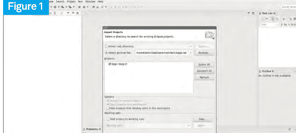

luad.eggs 包。在游戏的第一个版本中，动物要做两两件事：它们有名字并发出声音。因此，`Animal` 类中有两个方法需要你为每种动物实现：`getName()` 和 `getSound()`。如果你想在后面的教程中为动物提供自己的声音，可能想使用以下列表中的动物：

- 鸟类：鸡

- 爬行动物：蛇、蜥蜴

- 恐龙：霸王龙、三角龙

将新类放在 `luad.eggs` 包中。

# 第 2 步：实现鸡蛋接口

动物将从鸡蛋中孵化。为了实现这一点，我们需要为 `Egg` 提供一个接口，我们将在 `SimpleEgg` 包中实现它。鸡蛋有一个固定的孵化时间，该时间在鸡蛋创建时设置。游戏的每回合，孵化时间都会减一。当孵化时间达到零时，鸡蛋就可以孵化。要进行孵化，你调用 `getContents()` 方法，它将返回鸡蛋内部的动物。

> 一个设计良好的 Java 程序由多个相互作用的组件组成，我们可以根据意愿对它们进行切换。

在这种情况下，代表土地的瓦片将被显示，也可以被玩家访问。第一个要求：即在名为 `Setile` 的类中实现 `MapTile` 接口。瓦片应该是不可访问的，并使用符号 `-` 显示。你应该将此类放在 `luad.eggs` 包中。


> 一个设计良好的 `Java` 程序由多个相互作用的组件组成，我们可以根据意愿对它们进行。在这种情况下，代表土地的瓦片将被显示，也可以被玩家访问。第一个要求：即在名为 `Setile` 的类中实现 `MapTile` 接口。瓦片应该是不可访问的，并使用符号 `-` 显示。你应该将此类放在 `luad.eggs` 包中。

# 第 3 步：实现鸡蛋接口

（注意：OCR 文本变得非常重复且乱码。我将根据可用内容提供一个清晰的流程。）

# 教程

# Java

## 第一部分

## 学习 Java：使用继承创建一个基础游戏

编写一个简单的游戏是学习编程特性的极佳方法，同时也涉及多线程系统和网络。


`John Gowers` 是一位编程和计算机科学大学导师，重点关注 `Java`。你也可以阅读他在第 36 页关于脚本的教程。

## 资源

- `Open JDK` 1.8（本教程的部分 1.7 就足够了） http://openjdk.org/

- `Eclipse IDE` http://www.eclipse.org/


我们将使用 `Eclipse IDE` 在 `Java` 中构建一个游戏。`IDE` 将编辑器和调试工具整合在一起，以帮助你尽可能高效、快速地进行开发。

`Java` 编程语言包含了许多可以在日常编程中使用的特性。在系列教程中，我们将通过构建一个简单的沙盒风格游戏，展示一系列 `Java` 的编程结构和工具。在游戏中，玩家将在地图上行走，收集鸡蛋并击各种动物。

如果你已经掌握 `Java` 基础，但对编程是新手，那么这个系列教程就是为你准备的。如果你以前接触过其中一些概念，你仍然能从本教程中学到新东西。

每个月，我们都会提供一个代码库供你编辑。对于第一篇文章，我们将提供一段简单的骨架代码，你将学习提供一些基础功能。如果你遵循了之前几个月的教程，可以将你的解决方案与我们的进行比较，但我们希望你继续完善自己的代码，并为你所创造的内容感到自豪。

在第一个教程中，我们发现代码库几乎没有任何功能；它仅仅是一组接口和抽象类的集合，带有少量的类和方法。在教程中，你将为这些接口和抽象类编写自己的实现，通过重写接口/抽象方法来提供我们指定的功能。我们不会向你展示如何编写代码。

其余部分将在几个月内与我们共同完成。在我们的程序中，将由多个相互作用的对象组成，我们可以根据意愿创建并放置它们。

要开始之前，我们需要导入 `LIBGD` 提供的基础功能。首先，将光盘中的 `eggs.tar` 拷贝到我们自己的文件系统中。接下来，启动 `Eclipse` 并选择 `File > Import...`，从弹出的菜单导入项目，然后选择 `General > Existing Projects Into Workspace`，这将弹出图 1 所示的对话框。从


可用的教程文件：

`file://site.com`

在此处选择“Select archive file”，然后点击“Browse...”并导航到光盘上的 `eggs.tar` 文件。最后点击“Finish”以导入新项目。

# 第 1 ：创建地图瓦片和动物

首先，我们将创建一些扩展 `MapTile` 抽象类的类，它们代表地图上可能出现的不同类型的瓦片。`luad.eggs::MapTiles` 中的 `MapTile` 类有两个抽象方法：

```
public char getToken()
public boolean isAccessible();
```

第一个方法为我们提供了地图瓦片的表示形式。这对于从文件读取地图以及将地图显示到终端非常有用。第二个方法告诉我们地图是否可访问——即玩家是否允许在上面行走，或者是否不可访问。提供的代码包含一个简单的实现 `LandTile.java`，它如下所示实现了地图：

```java
public char getToken() {
  return ' ';
}
public boolean isAccessible() {
  return true;
}
```


`luad.eggs` 包。在游戏的第一个版本中，动物要做两件事：它们有名字并发出声音。因此，`Animal` 类中有两个方法需要你为每种动物实现：`getName()` 和 `getSound()`。如果你想在后面的教程中为动物提供自己的声音，可能想使用以下列表中的动物：

- 鸟类：鸡

- 爬行动物：蛇、蜥蜴

- 恐龙：霸王龙、三角龙

将新类放在 `luad.eggs` 包中。

# 第 2 步：实现鸡蛋接口

动物将从鸡蛋中孵化。为了实现这一点，我们需要为 `Egg` 提供一个接口，我们将在 `SimpleEgg` 包中实现它。鸡蛋有一个固定的孵化时间，该时间在鸡蛋创建时设置。游戏的每回合，孵化时间都会减一。当孵化时间达到零时，鸡蛋就可以孵化。要进行孵化，你调用 `getContents()` 方法，它将返回鸡蛋内部的动物。

> 一个设计良好的 `Java` 程序由多个相互作用的组件组成，我们可以根据意愿对它们进行切换。

在这种情况下，代表土地的瓦片将被显示，也可以被玩家访问。第一个要求：即在名为 `Setile` 的类中实现 `MapTile` 接口。瓦片应该是不可访问的，并使用符号 `-` 显示。你应该将此类放在 `luad.eggs` 包中。

# 第 3 步：实现鸡蛋接口

## 多态

`Java` 编程语言包含了许多可以在日常编程中使用的特性。在系列教程中，我们将通过构建一个简单的沙盒风格游戏，展示一系列 `Java` 的编程结构和工具。在游戏中，玩家将在地图上行走，收集鸡蛋并击各种动物。

`new SeaTide(), new SeaTide(), new SeaTide()`

为了实现 `getEggs()` 方法，你需要一个字段来存储地图上蛋的位置——你可以使用 `HashMap<Point2D, Egg>` 来设置 `setEgg()`。你应该在一天开始时向地图中填充蛋——通过修改 `readMap()` 方法来从那里读取它们，或者直接将它们放置在那里。要在特定位置放置蛋，你的代码看起来可能如下：

```
Set<Egg> setEggs = new HashSet<>();
getEggs().add(new Egg(5, new Chicken()));
```

## 第 4 步：输入与输出

在我们将所有内容整合在一起之前，我们需要对输入和输出进行排序。我们的种类很容易实现：你应该编写 `OutputView` 类的实现，调用 `ConsoleOutput()`，并使用 `displayEggs()`、`displayItems()` 和 `displayInventory()`。使用 `System.out.println()` 以人类可读的格式打印信息。`Map` 中的 `getEggs()` 方法将返回一个列表。你需要决定如何显示 `null` 地图。

输入会稍微困难。它不像我们想要从图形用户界面而不是从控制台获取输入那么简单，这意味着使用观察者模式是一个好主意，这样我们就可以在任何时候处理输入，而不会导致类之间的耦合。为了做到，我们将使用两种技术：

观察者模式。

观察者模式是 `Java` 提供的一种特殊功能，允许类“观察”其他对象。具体来说，如果一个类实现了 `Observable` 类，那么它就可以被观察；如果一个类实现了 `Observer` 接口，其他类（如 `Map`）就会提供 `addObserver()` 方法（其用于向列表添加新的观察者对象）以及 `setChanged()` 方法（其用于将地图标记为已更改）。观察者模式包括 `notifyObservers()` 方法，它会通知所有可观测对象并执行相应的操作。

```java
public abstract void readMap(String fileName);
```

```java
public abstract MapTitle getTitle(Point2D position);
```

```java
public abstract Set<Egg> removeEggs(Point2D position);
```

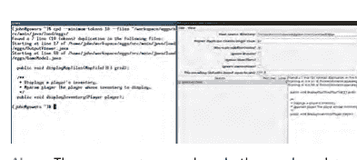

上述相同的模式可以同时拥有控制台和图形界面。这是检测代码的“cpd”。


如果观察者对象和可观察对象是并发运行的（作为独立线程的一部分），那么观察者模式的效果最好。为了实现这一点，我们使用 `Thread`。Java 提供了机制，让程序在与代码其他部分相同的时间独立运行。要创建一个新线程，我们使用 `Runnable`，如图 5 所示（重叠）。`Runnable` 类的实现无非一个带有 `run()` 方法的类表示。要启动线程，调用 `Thread.start()`，如图 5 所示，并使用 `run()` 方法中的代码来……

观察者模式和线程为我们提供了一种优雅的方式来处理可能在任何时候获得的输入。

## IDE

我们建议为此项目使用 Eclipse IDE，但也欢迎使用 IntelliJ 或你正在使用的其他编辑器。要来说，只需使用恰当的编辑器即可（在此处应提到特定的代码片段）。

由于这些关于蛋的线程处理和观察者模式，我们查看了更多示例，并且还提供了一个 `ConsoleController` 的示例实现作为参考。我们建议你仅将其作为最后手段，而是遵循以下步骤：

1. 实现 `ConsoleController` 并扩展 `Observable` 类（以便它可以被观察）以及 `Runnable` 接口（以便它可以在任何线程中运行）。
2. 在后续迭代中实现 `run()` 方法：
3. 为控制台启动一个线程（使用 `BufferedReader` 或 `Scanner`）；
4. 调用 `setChanged()` 方法指示地图已更改；
5. 调用 `notifyObservers()`，并将控制台的行作为参数。这将把作为消息发送到控制台给所有观察者。

在 `Game` 类中保留抽象方法，作为基接口，其他类通过它与游戏地图交互。

在下一节中，当我们开始编写地图循环时，我们将完成拼图的最后部分：注意 `GameModel` 接口扩展了 `Observer` 接口，并包含了 `update()` 方法，该方法将在输入控制器更改时告诉我们应该执行哪个类。当我们在主程序中整合所有内容时，我们将启动新线程 `new Thread(InputController).start()`，并将游戏模型作为输入控制器的字段之一。

## 第 5 步：游戏模型

在最后这一节中，我们将实现 `GameModel` 接口，它将把我们目前所做的所有事情联系在一起。

创建一个实现该接口的 `GameModel` 类。为了实现该接口的所有方法，你的类需要几个字段：

*   一个类型为 `OutputStream` 的字段 `view`，用于显示输出。
*   一个类型为 `GameMap` 的字段 `map`，以便玩家在周围活动。

```java
public class MyThread implements Runnable {
    public void run() {
        // 在此处做一些事情……
    }
}
```

*   一个类型为 `Player` 的字段 `player`。

### 特性 | 三系统启动

#### 三启动

你的系统

在计算机上运行多个操作系统可以让你轻松地使用不同的发行版。Paul O'Brien 将向你展示如何进行三系统启动。

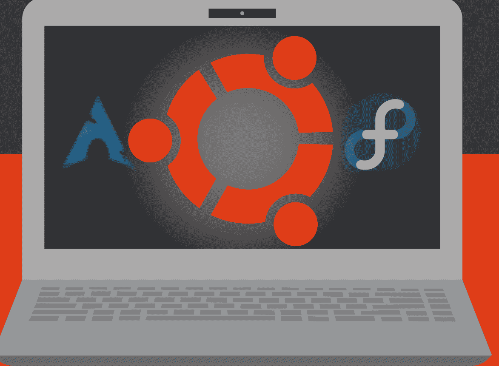

##### 本专题涵盖内容

*   准备你的系统，p56

从一台全新的电脑开始，为安装多个 Linux 发行版准备好磁盘空间。

*   从双启动到三启动，p56-57

创建空间，获取 Linux 安装程序设置你的发行版，并配置你的 UEFI 和安全启动（Secure Boot）。

*   管理引导程序，p60

使用 `boot-repair` 或 `GRUB rescue` 提示符恢复菜单，并为虚拟化 Linux 创建虚拟磁盘。

*   管理分区，p57

你应该如何划分磁盘？如何操作？我们将向你展示。

*   共享驱动器，p58

使用 `GParted` 设置共享空间，并整理好你的 UID 和 GID。

*   Grub 技巧与调整，p60

用于处理和自定义 GRUB 菜单的实用工具。

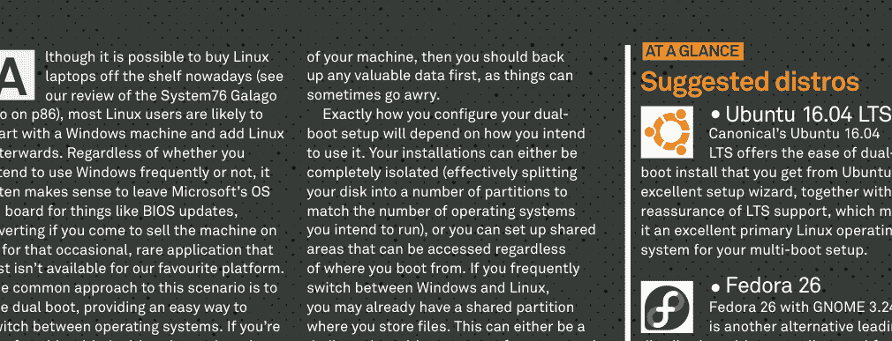

虽然现在可以买到 Linux 笔记本，但大多数用户倾向于从 Windows 开始，之后添加 Linux。无论你是否打算使用 Windows，为了 BIOS、在设置机器时重启等需求，板载操作系统对于我们最喜欢的方法来说是必不可的。这种场景的常用方法是使用双启动，并进行轻松切换。如果你熟悉双启动并且有足够的磁盘空间，那么三启动的选项提供了一种尝试新发行版、更新版本或在不影响现有操作系统尝试新内容的简单方法，而后者可能会导致你无法进行操作。

设置多启动系统并非易事，在此过程中，你可能会遇到一些问题和疑问，但我们将帮助你探索这一过程。通过使用一些准备硬盘（分区、引导程序和安装）的领先工具，并对本专题中稍后讨论的 UEFI 和安全启动等技术的理解，你将准备好处理大多数问题。此外，如果你正在更改分区的布局和机器的基本操作，那么你应该首先备份任何价值数据，因为意外总会发生。

配置双启动设置的频率取决于你打算如何使用它。安装可以完全独立分离，以匹配你想要运行的操作系统顺序，你也可以在它们之间设置共享空间。如果你频繁在 Windows 和 Linux 之间切换，你可能已经有一个共享分区或一个用于主目录的专用分区，通过那里你可以访问实际的用户主目录（在切换时，你需要密切关注发生的情况）。使用“独立分区方法”可能会在分区重启时为你的数据提供额外的隔离保护。


如果你的磁盘空间有限，你也可以使用`USB`（容量足够），而无需从外部存储器运行任何一个操作系统或共享分区。这种方法是被推荐的，尽管如果你的电脑带有高速`SD`卡槽，许多制造商不支持从`USB 3.0`或`SD`卡启动。

### 快速概览

### 建议的发行版

- `Ubuntu 16.04 LTS`

`Canonical`的`Ubuntu 16.04 LTS`提供了与你优秀设置相匹配的双启动安装便利性，以及`LTS`支持的保障，这使其成为你系统极的`Linux`安装选择。

- `Fedora 26`

带有`GNOME 3.2`的`Fedora`是另一个备选发行版，它拥有一个管理存储的优秀工具`GUB Grub`。`Fedora`在`RUM/APT`部分表现非常出色。

- `Arch Linux`

你可能会使用`Arch`，如果不使用，它是尝试一些不同内容的绝佳方法。`Arch`的核心在于赋予你控制权，提供现代更新并简化了命令行的使用。

- `GParted Live`

它不仅适用于那些已经安装了部分双启动的人，也适用于确保安全的启动环境。为硬盘保留一个`GParted`恢复磁盘对于应急恢复和方便管理都是一个很好的选择。

`www.linuxuser.co.uk`

## 特性

### 三启动

三启动对于新发行版特别有效，在这些情况下你不会更改它们。

### 快速贴士

**分区**

**准备你的系统**

如前所述，你需要在`Windows`侧也进行更改（详情请见下页），否则你将无法启动。

**管理分区**

当你运行`Linux`发行版时，你可能会发现安装程序无法识别你的磁盘。这可能是因为你的机器被设置为`RAID`而不是`AHCI`。这可以在`UEFI`设置中配置，但注意你需要在`Windows`侧也进行更改，否则你将无法操作。

**创建分区**

你可以通过安装或启动专用分区工具为你的新发行版留出空间。

**分区选项**

当你调整分区布局时，你可能会发现安装程序无法看到你的磁盘（此处前文逻辑重复）。视觉化配置可能会容易产生错误。

## 如何操作

| 分区 | 文件系统 | 大小 |
|---|---|---|
| `/dev/nvmep1` | `EFI` 分区 | `512M` |
| `/dev/nvmep2` | `Microsoft` 分区 | `118G` |
| `/dev/nvmep3` | `Linux` 分区 | `30G` |
| `/dev/nvmep4` | `Linux` 分区 | `30G` |
| `/dev/nvmep5` | `Linux` 分区 | `30G` |


| 空闲空间 (未分配) | 创建: | 主 |
|---|---|---|
| 空闲空间 (空闲) | `ext4` | |
| | `ntfs` | |

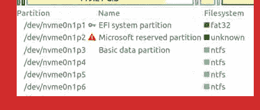

窗口，你可以在此处切换不同的磁盘（如果你的`USB`闪盘被识别为默认磁盘，你可能需要这样做）。

此时，你会注意到`Windows`从主“`C:`驱动器”创建了许多分区。这些分区用于恢复和`Windows`任务——如果可能，你应该避免忽略这些分区，千万不要删除它们。分区的通用规则是，如果你需要，可以调整分区的大小、移动和编辑分区，但这可能会破坏后续任何分区的引用。

此时，主`Windows`分区将显而易见，你只需点击并拖动它来指示你剩余多少空间。你可以将分区调整为任何需要的容量，但如果你不打算经常使用，应该留出一点额外空间，这很大程度上取决于磁盘的大小以及你计划创建多少个分区。从菜单栏选择“调整大小/移动”（`Resize/Move`）。调整分区大小后，磁盘上之后的任何分区都会移动以紧随其后。这将为你留出创建现有分区的空间。注意，在`GParted`中，在点击“应用”（`Apply`）按钮并一次性移动之前，任何更改都不会写入磁盘——不要害怕实验……只要你点击了按钮，就无法回去了。

## 决定你的新分区

一旦你调整了现有分区的大小（在点击“应用”之前或之后），你可能希望为新安装创建分区。如果你正在为文档或主目录创建一个共享区域（在第`58`页的框中讨论过），在分区布局中创建新分区之前创建它是明智的。通过这样做，如果你有两个、三个或四个更多区域，分区的有效“索引”就不会改变。由于你正在创建

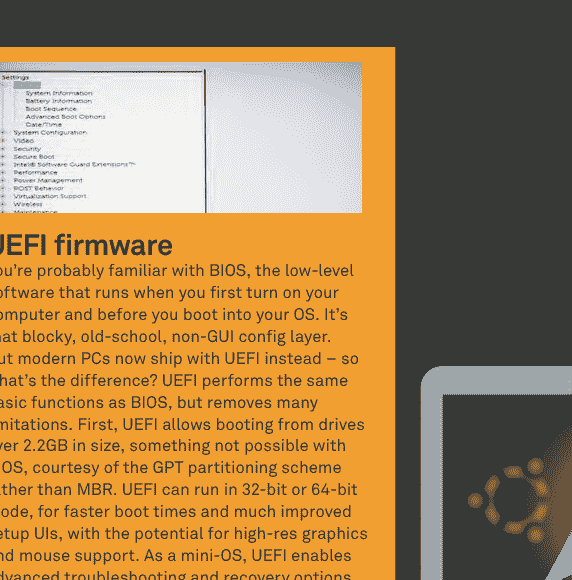

| BIOS 信息 |
| --- |
| `BIOS` 模式: `UEFI` |
| `CSM` 支持: 已禁用 |
| 高级功能: |
| 安全启动: 已启用 |
| `UEFI` 管理: 已启用 |
| `TPM`: 已启用 |

## UEFI 固件

你可能对`BIOS`熟悉，它是启动电脑并进入操作系统时运行的低级软件。那种过时、老式的、无`GUI`的配置已经落后了。现代`PC`配备的是`UEFI`（具有`BIOS`相同的基本功能，但消除了许多限制）。`UEFI`允许从大于`2GB`的设备启动，这在`BIOS`中是无法实现的。`UEFI`使用`GPT`分区方案而非`MBR`。


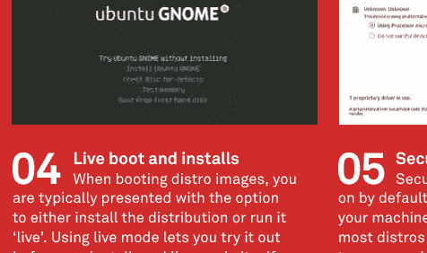

`ubuntu` `GNOME®`

尝试 `UBUNTU` `GNOME` `UNIVERSE`

`22.04.3` `LTS` `(Jammy Jellyfish)`

发布于 2022 年 4 月

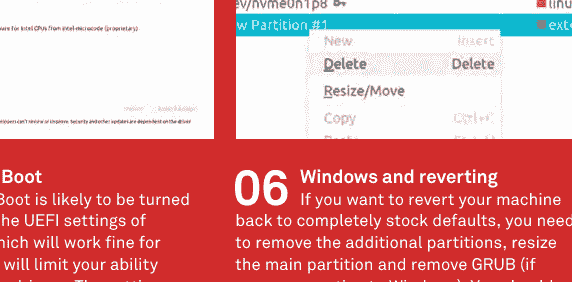

`ubuntu` `GNOME®`

尝试 `UBUNTU` `GNOME` `UNIVERSE`

`22.04.3` `LTS` `(Jammy Jellyfish)`

发布于 2022 年 4 月

启动发行版时，你通常会看到选择，可以安装该发行版或进入“尝试”（`live`）模式。`Live`模式让你在安装之前尝试它，并有启动安装的选项。这是一种采样运行情况以及硬件是否得到良好支持极极方法，而无需修改你的磁盘。

## 04 Live 模式与安装

安全启动（`Secure Boot`）可能已通过机器的`UEFI`设置启用，这对于大多数发行版有效，但会限制你启动其他发行版的能力。可以禁用它，但这会让你的机器更容易受到来自`Windows`的根内核程序程序的攻击。确保你的杀毒软件已更新到最新，并加倍小心。

## 05 安全启动

## 06 Windows 与还原

如果你想将机器恢复到完全出厂默认状态，删除额外分区，调整主分区的大小并还原。如果你关闭了安全启动，应该重新启用，但如果你愿意，将系统留在`UEFI`模式并修改`RAID`也没有坏处。此外，`GRUB`正在推荐使用`Windows`修复工具。


`www.linuxuser.co.uk` `57`

## 三系统启动

新分区，你可以选择将它们格式化的文件系统。通常，`Linux`发行版的文件系统是`ext4`，`Windows`使用的文件系统是`NTFS`。它也经常作为`FAT`/`FAT32`出现，用于可移动存储。虽然`NTFS`是许多用途的最佳选择，但因为`Windows`在没有第三方驱动的情况下无法读取`ext4`分区，而`Linux`可以读取和写入`NTFS`。这也是一种常用做法，但由于文件所有权和权限（这是`Linux`必须的），并不是所有发行版都包含此支持。考虑一个带有`512GB` `SSD`的典型场景，我们可能会将`Windows`缩小到`120GB`，并留出`128GB`的“数据”分区格式化为`NTFS`，以及`128GB`的“发行版”分区格式化为`ext4`，以便它们准备就绪。如果你发现自己安装了许多发行版并需要某些特定版本需要更多空间，你以后可以更改分区之间的分割点，而无需重新安装由`GParted`引起的任何问题。请记住，如果你从已安装的发行版运行，无法对任何挂载的分区进行更改。

## 安装你的驱动器

现在你已经完成了分区大小调整并应用了更改，如果保留了`Windows`安装，值得进入操作系统以确认是否发现了任何问题。或者使用`live` `CD`或`ISO`到`USB`存储器（再次使用`Unetbootin`等工具）。

## 发行版之间的分区共享

- 图片
- 视频
- 共享文件
- 视频
- 新书签
- 共享文件

### 01 选择方法

从一个存储器分区多个发行版可能非常复杂。但哪种方法适合你呢？为了利用共享配置，考虑共享你的主目录。如果你想共享文档，使用额外的分区。

### 03 复制文件并链接

格式化后，考虑到`ext4`/`NTFS`的跨分区限制和可用性，指向了哪里。在设置挂载位置后，使用符号链接引用你的主目录。这可以是整个目录（例如`home`目录）或子目录（例如`图片`）。

```bash
mkdir -p /home/user/shared
chown -R user:user /home/user/shared
chmod -R 777 /home/user/shared
```

### 02 设置分区


调整磁盘最简单的方法是使用 live 发行版配合 `GParted`。缩小布局中的可用空间是获取空间的快方法，但你可能还需要缩小分区（包括 `Windows`）为新区域留出空间。你需要格式的文件类型。

### 04 问题

有几个问题可能会让你困扰。确保不同发行版之间的用户具有相同的 `UID` 和 `GID` 是至关重要的，如果你将应用程序配置存储在共享区域。如果你选择“共享分区”方法，可以手动移动配置。


当你启动安装过程，直接从 `GRUB` 菜单或 live 发行版时，会被提示选择想要安装的分区。确保你预配置的 `ext4` 分区是根挂载点 (`/`)。如果提示创建交换文件，你可以在第一次启动后这样做。例如，创建一个 4GB 的交换文件，你需要执行以下操作：

```
sudo fallocate -l 4G /swapfile
sudo chmod 600 /swapfile
swapon /swapfile
```

你可能需要在 `/etc/fstab` 中添加一行，值为 `/swapfile none sw 0 0`。引导程序将安装，允许你选择操作系统（`Windows` 或 `Linux`）以及你已安装的发行版启动。为了避免意外损坏你的 `Linux` 文件系统，除非你需要写入文件，否则只允许从 `Linux` 访问是明智的。列为 `Windows` 引导管理器，这将进入 `Windows` 启动。`GRUB` 可以处理许多你想要的系统，并为每个系统提供调试选项；然而，你应该安装你自己的 `GRUB` 主题，它可能与你安装的不同。如果你在第一次安装后重启并进入 `Windows`，你可能需要更改系统的 `UEFI` 设置，选择 `Linux` 操作系统而不是 `Windows` 管理作为默认。

## 处理时间问题

如果你经常在 `Linux` 和 `Windows` 之间切换，你可能会发现时钟出现了异常；每次都差一小时。这是因为 `Linux` 时间基于 `UTC`，而 `Windows` 基于本地时间。解决此问题最简单的方法是将 `Windows` 设置为 `UTC`；导航到 `HKEY_LOCAL_MACHINE\SYSTEM\CurrentControlSet\Control\TimeZoneInformation` 并赋予值 1。重启后，你的时钟现在应该是同步的。


## 处理安全启动

`UEFI` 的核心功能之一是安全启动。它的设计是为了防止恶意软件，例如在你不知的情况下拦截你的操作系统启动，这在 `BIOS` 中是一个真实的风险。`Windows` 使用存储在 `UEFI` 引导程序签名中的自己的证书确保其没有被篡改。当然，除非开发者已将其引导程序提交给微软，否则你可能需要禁用安全启动以启用 `Linux`。也可以注册自己的密钥并将其注册为“MOKs”（机器所有者密钥），以便在你自己的系统中维护安全启动。

你会发现 `Linux` 与微软的操作系统共存。

## 从 Windows 读取你的 Linux 文件

虽然从 `Windows` 这一侧访问 `ext` 文件系统有点像项任务。显然，你大部分时间都会使用 `Linux`，并且设置了几个分区来传输数据，但你可能想从其中一个 `Linux` 发行版写入一个文件。最好的方法是什么？最简单的选项是使用 `WSL2`，它为 `Windows` 内的 `ext4` 分区提供了完全的读写访问；然而，速度受限于源侧隔。`Ext2fs` 提供了一个类似的工具，但定期更新很不方便。在从源码 (`github.com/ext2fs/ext2fs`) 安装 `Ext2fs` 后，你可以挂载分区。这允许你管理所有文件，包括创建、删除和隐藏带有前缀或后缀的文件。为了避免意外损坏你的 `Linux` 文件系统，除非你需要向它们写入文件，否则只允许读取访问是明智的。

> 快速提示
>
> 备用部分
>
> 如果你在磁盘上保留一个“彻底路径”分区，这将非常适合使用 live 环境以更具代表性的性能尝试新发行版。

# 三系统启动

## 为您的系统进行三启动

在您的计算机上运行多个操作系统可以让你轻松地使用不同的发行版。`Paul O'Brien` 将向您展示如何进行三启动。

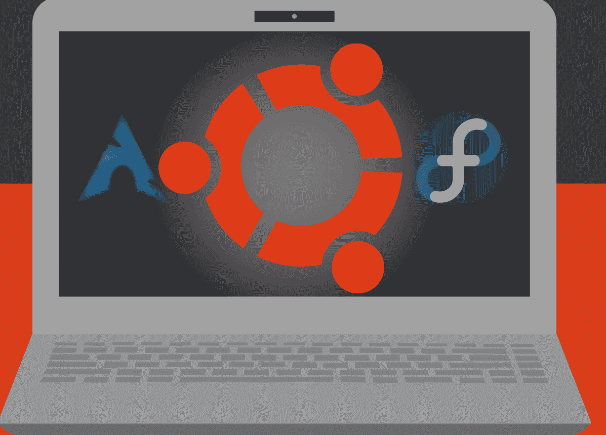

# 免费赠送 6 期

当你订阅时

# 免费通过 DVD 安装 3 种新发行版

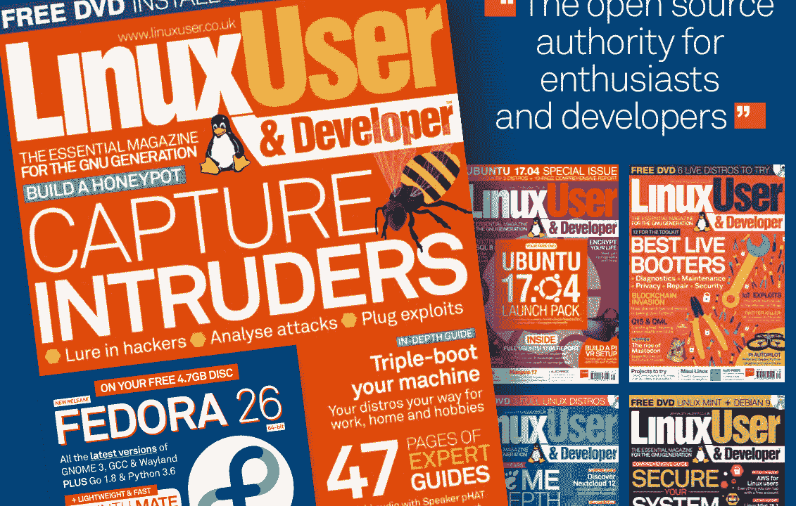

> 爱好者和开发者的开源权威机构

# 捕捉入侵者

引诱黑客 分析攻击 插件漏洞

# 为你的电脑进行三启动

根据你的工作、家庭和爱好，定制定制你的发行版

## `FEDORA 26`

所有最新版本的 `GNOME` 3、`G6` 和 `Wayland` 桌面环境

## `UBUNTU MATE`

今日经证明的技术与创新创意的完美结合

## 专家页面

使用 `Spotify` 添加微调，构建路由网络，首先在你的 `Chromebook` 上安装

## `linux`：弹出的服务器！

每期均有免费资源下载

掌握 `linux` 和电脑的简单方法

## 新一期 478

# 优惠于 2017 年 9 月 30 日过期

## 订购热线 +44 334 848 2852

## 访问 `www.myfavoritemazines.co.uk`

*这是一个订阅优惠。6 期免费期指的是美国全范围内 10.99 美元的 13 期共 220.87 美，订阅价为 112.23 美。你将在一年内收到 13 期。你可以在购买后 14 天内打电话取消订阅。14 天取消期过后，付款不予退还。你的法定权利不受影响。价格以购买时为准并可能更改。可根据要求提供直接借记担保的完整详情。英国客户的费用与其他客户相同，固定电话号码（01 或 02）包含在任何包含或免费分钟内（如果由你的手机套餐提供）。有关完整条款和条件请访问 `www.linuxuser.co.uk`。优惠于 2017 年 9 月 30 日结束。*

# 专题 `GUADEC` 2017

会议报告


# 当 `GNOME` 项目庆祝其成立 20 周年以及 `Ubuntu` 回归时，`Richard Smedley` 报道

`GUADEC` 是 `GNOME` 开发者聚会讨论技术发展并加深交流的地方。凭借企业桌面环境的长期历史，`GNOME` 促进了强大的社区精神和价值观，这吸引了人才，并构建了一个稳定且成功的桌面。

### 关键信息

是什么？

`GUADEC` 是每行的 `GNOME` 用户开发者大会。

在哪里？

今年在曼彻斯特，这对于计算的演进（以及技术初创公司）以及合作运动的发源地都具有重要意义。

这里也有欧洲风味——尽管有几位来自北美和美的访客。来自希腊、以色列、德国、立陶宛、法国和英国的开发者来到阴雨连（至少是第一次）的曼彻斯特，在 `Canonical` 决定将 `GNOME` 带回 `Ubuntu` 并引入许多新用户的背景下，讨论一切关于 `GNOME` 的事务！

> “在美国重新引入的移民限制可能会违背 `GNOME` 的核心原则。这项计划体现在协作和包容的方式上。”

这段发给我们编辑的声明强调了当一个 `Linux` 项目建立在强大的价值观之上时的潜在危险。在一个曾不认为任何项目应该变得“政治化”的社区之后，某些人注意到 `GNOME` 项目是建立在开发环境上的，并在某种程度上是对 `K Desktop Environment`（环境）的响应，后者直到 1999 年一直占据统治地位。

第一天早晨的主旨演讲由红帽体验设计师兼 `GNOME` 委员会成员 `Allan Day` 发表——他致力于 `GNOME` `UX`——重申了这些价值观：

- 我们是有原则的
- 我们相信自由
- 我们制作具有包容性的软件
- 质量工程

### 政治与人

在今年任命新执行董事（`ED`）`Neil McGowan` 不久，`GNOME` 基金会发布了一份关于美国旅行禁令的声明：

- 我们关心栈（`Stack`）
- 我们对用户体验负责

`GNOME` 的 20 周生日是对该项目进行许多反思的借口。

“对于软件来说，二十年是很长时间。随着项目的更新，人们来往往去，在变化中可能会失去历史。”`GNOME` 正在努力吸引新人，并制定清晰的策略，以确保对项目连续性的有效投资。

### 桌面水利工程


GNOME 存在于企业桌面中并是许多发行版的默认选择，但 GNOME 开发者更擅长水利工程。进入并“排干沼泽”是 GNOME 开发者经常听到的阶段。这导致了对库和子系统的贡献——尽管是彻底的革命——每个领域，以及持续的改进。一个令人头疼的问题是打包和安装。`Debian`、`Ubuntu` 和 `Fedora` 等 Linux 发行版可能在确保发布版本使用正确的库版本协同工作，但在过程中它们经常发生变化。GNOME 特别对 `Debian` 和 `Ubuntu` 表示不满，这是 `Flatpak` 的动力之一。`Flatpak` 不仅确保开发者可以协作；通过有效地将桌面应用封装在自己的沙箱中，它为个人计算增加了急需的安全。随着 `Flatpak` 速度和可用性的提高，它通过 `Flathub` 获得了新的可能性，`Flathub` 是为用户提供应用程序的“中心枢纽”。会议是一个关于 `Builder` 的改进，`Builder` 是 GNOME 的 IDE 项目，已针对 `Flatpak` 集成进行了更新，带有


# 专题 `GUADEC 2017`

这个社区

| 以不同方式的 |

| --- |

| 介绍 `GNULin` |

| `GNOME` |

`GNOME` 项目是由人并为人们而的。它的价值观深植于这个社区之中。

`GNOME` 的 `Julita Inoa` 为开发者观众谈到了一些社区聚在一起，重点关注欢迎新成员加入 `GNU` 社区。

`基金会` 执行董事 `Across Ne Mead` 分享了大量的想法和热情的浪潮。

`基金会` 确保所有 `GNOME` 项目都是可用的，任何成员都可以代表 `GNOME` 董事。一个顾问委员会连接了机构和公司、在容器内部运行的调试器，现在还有来自三项改进的特性。

在桌面端，我们对一个拥有这些强大价值观的项目竟能如此成功感到惊奇；`Blandford` 告诉我们，这是因为 `GNOME` “为公司解决了非常现实的问题，并且从未逃避过解决这些问题”。

正因为关注质量，它才能够吸引到高质量的工程师。清理“排山沼泽”和“通过基于时间的定期发布来修复 Linux”都是企业所看重的可预测性和可靠性所在的一部分。而且，虽然红帽（`Red Hat`）和 `Debian`（`Debian`）被对软件自由的强调所吸引，但技术质量又吸引了许多本会选择专有解决方案的公司。在这一类别中，最早的者之一是 `Endless` (<https://Endless.com>)，其目标是构建一个全球性的数字素养平台。基于 `GNOME` 并支持该基金会，它吸引了 `Blandford` 放弃他在 `Twitter` 的云项目工作，加入 `Endless` 担任工程副总裁。

`Blandford` 启动了 `Endless` 笔记本及其功能，这些功能是为连接性差且数据昂贵的国家设计的。它的设计初衷是让人们进行计算，而不使用手机手机，因为 `Endless` 不会

# `GNOME` 关注质量，能够吸引高质量的工程师

不仅仅拒绝桌面隐喻，而是侧重于简化界面，使其在 `GNOME` 中显得很自然。“这很容易，但要成功，条件并不完美，”`Blandford` 说道。

## 展望

`Neil McGover` 思考了如何让更多 `GNOME` 利用技术来触及人们，以及金砖国家（巴西、俄罗斯、印度、中国和南非等新兴经济体）之间的差异。我们欢迎 `Canonical` 带来的带来的机会。我们还讨论了 `GNOME` 对触及人们的承诺，特别是那些无法使用手机或显示设备、无法负担免费软件许可费用，甚至在离线世界中的人们。

`McGGn` 展示了一个名为“欢迎来到网站”的视频，由律师签署并翻页（<https://youtube.com/be/XXXXXXcw>)，如果你没看过它，这个视频值得你花时间看看。它展示了一个未来：专有软件仍是常态，当我们达到意识上传到云端的阶段时，我们将能够与伟大的社区进行互动，提问并获得答案，通过答案解决问题以知道他们需要什么来帮助该项目。

回到无障碍辅助，`McGovern` 提出了更多黑客特性（`hackfeats`），以及关于 `Flatub` 的工作，这是 `GNOME`

# `GNOME`


向 `GNOME` 生日快乐 - 项目联合创始人 `Federico Merino Quintana` 切了蛋糕，当时在曼彻斯特科学与工业博物馆的开发者们也都在场。


侧边栏 `Flatpak`

## `MESON`

## 使用 `Meson` 构建

`Meson` 构建系统的开发是因为“开发者在调试定义上花费的每一秒都是浪费。因此，在等待构建系统开始编译的每一秒钟都是在浪费时间。它支持许多编译器，并让开发者无需处理特定硬件的差异。”

这个基于此的工具支持 `C`、`C++`、`D`、`Fortran`、`Java` 和 `Rust`，并且许多 `GNOME` 库——如 `GNOME Software`、`Panel` 等——都在使用 `Meson`，并默认切换到它。

结果是构建过程中的差异显现出来——正如他在关于 `Meson` 的 `GUADEC` 演讲中提到的，比 `Shell` 上的 `Make` 多花了几分钟，这带来了一个洞察：`GNOME` 的构建只需要 `Python 3` 即可让构建系统运行

# `GFACT`

# `Groupon` 攻击

`Groupon` 在 2014 年试图攻击一个名为 `GNOME` 的标签，但该项目在质量问题后就退出了；在经过了高关注度的活动和多次捐赠后，`Groupon` 决定退缩。

`基金会`（`Foundation AG`）进行了跟进，回顾了过去并介绍了新事件，例如 `GNOME Asia`。`Endless` 及其 `it Access` 被作为该机构的新成员受到欢迎，并在鼓励 `GNOME` 用户和开发者时，解释了基金会的故事。

回到无障碍辅助，`McGovern` 提出了更多黑客特性，以及关于 `Flatub` 的工作，这是 `GNOME`

（注：原文文本中存在多处断句和重复的结构，翻译时已根据要求尽可能还原原文呈现的碎片化内容）

最后一次播种重点关注螺丝和螺母等细节问题，因为 `GNOME` 中的 `JavaScript`（在 `3.26` 版本中看起来非常棒）界面问题涉及到过渡效果。`Tobias Bernard` 提出了了一个很有说服力的论点，认为动画是一种将过程“卸载”到屏幕的方法，从而在桌面隐喻中提供空间感知。他演示了在某些方面失败的功能，且示例多得令人惊讶，他对状态机的理解可以解决现有的“基于屏幕的绑定”问题，并为语义动画指明了方向。

即使 `Kinder` 的失败、`GitLab` 迁移、`Juan Pablo Ugararte` 的“如何从 `Glide` 后端获得更好”以及 `Peter Hutter` 对内置代码“鼠标、触控板和阅读器”的观察——消息是 `Wayland` 以及其他变化正在让开发人员的工作变得更容易。

# 我们还有很长的路要走：最新研究显示仅 4% 的开源贡献者是女性

`微软 Azure` 应用支持工程师 `Julian Atanese` 带来了一场关于“`微软 Linux`”的演讲。目前没有在服务器上开放 `Windows` 源码的计划。他是开源活跃参与者，`Azure` 贡献者的表现优于他们对应的操作系统？他的回报受到了热烈的欢迎。

闪电演讲，面向观众，在曼彻斯特咖喱街的一个晚上，与会演讲者表示，他们为技术在各种开源项目中中学到了很多东西，但是因为社区而留下的。`GNOME` 是老兵中的一个例子，他们自 2002 年以来一直支持 `GNOME`，并且像任何人一样充满热情，就他们对项目的新参与发表了演讲。

如果你没有加入 `GNOME`，值得仔细观察一下这个项目，看看他们做对了哪些地方；那里有你的读者在你的项目中会讨论的教训。如果你还没有参与，我们下一次 `GUAD` 见。不要错过——21 岁生日应该

# 问答问答

# 访谈：`Karen Sandler`，软件自由保护协会（`Software Freedom Conservancy`）执行董事

软件自由对你非常重要吗？是的，我有一颗大心脏——我的心脏是正常人的三倍大，这种密度风险很高。为了让它工作，我需要一个起搏器，但我看不到自己身体里的代码。这些设备处于两忧兼得的地地——没有现实，因此除了设备制造商之外，没有人可以改进软件自由。与之冲突的是热情，然后学习开源如何使我成为软件自由的坚定倡导者。我意识到我的心脏是我们赖以的所有软件的隐喻，在事物的世界中，现在哪种软件自由对我们的生死至关重要。

让我们讨论一下外拓展。外拓展（`gnome.org/outreach`）是一个面向技术领域中代表性不足的人士的实习计划。我们帮助的许多毕业生已成为自由和开源软件的贡献者，有些人成为了会议演讲者，为社区捐献时间，甚至自己成为了导师。最大的挑战之一是招募人们尝试外拓展。外拓展很难，很幸运的是它带来了更多代表性不足的人，并承诺支持他们。但还需要做更多工作来改变我们让人们进入社区的方式，让他们有良好的体验并感到参与舒适。

你说过人们需要与同事和员工讨论让他们的软件免费且开源——最重要的是什么？开发者可以


# `MACBOOK` 对决 `SURFACE` 笔记本电脑

# 智能家居

每个家庭的必备品

# `T3`


# Gadget 杂志

- 每个家庭的技术升级
- 从灯到智能水壶
- 如何控制一切！

你的最佳购买之选

£39 起

# 4K 电视

想看什么

`BT` 还是 `SKY`？`NETFLIX` 还是 `AMAZON`？

你需要

这台 `IMAC`

`4K` 屏幕，

超快

最好的

杜比音效 (`ATMOS`)

音箱

``

## 成功！

超快

无线

耳机

£1000

## 成功！

设备

无线

成功

## 成功！

立即购买！

`MYOURITEMAZINES.UK`

## 立即购买！

`MYOURITEMAZINES.UK`

## 购买！

成功 

`INES..`

## 立即购买！

`MYOURITEMAZINES.UK`

立即购买！

`MYOURITEMAZINES.UK`

## 购买！

`MYOURITEMAZINES.UK`

## 立即购买！

`MYOURITEMAZINES.UK`

## 购买！

`MYOURITEMAZINES.UK`

## 立即购买！

`MYOURITEMAZINES.UK`

## 购买！

`MYOURITEMAZINES.UK`

## 立即购买！

`MYOURITEMAZINES.UK`

## 购买！

`MYOURITEMAZINES.UK`

## 立即购买！

`MYOURITEMAZINES.UK`

## 购买！

`MYOURITEMAZINES.UK`

## 立即购买！

`MYOURITEMAZINES.UK`

## 购买！

`MYOURITEMAZINES.UK`

## 立即购买！

`MYOURITEMAZINES.UK`

## 购买！

`MYOURITEMAZINES.UK`

## 立即购买！

`MYOURITEMAZINES.UK`

## 购买！

`MYOURITEMAZINES.UK`

## 立即购买！

`MYOURITEMAZINES.UK`

## 购买！

`MYOURITEMAZINES.UK`

## 立即购买！

`MYOURITEMAZINES.UK`

## 购买！

`MYOURITEMAZINES.UK`

## 立即购买！

`MYOURITEMAZINES.UK`

## 购买！

`MYOURITEMAZINES.UK`

## 立即购买！

`MYOURITEMAZINES.UK`

## 购买！

`MYOURITEMAZINES.UK`

## 立即购买！

`MYOURITEMAZINES.UK`

## 购买！

`MYOURITEMAZINES.UK`

## 组件列表

- `Raspberry Pi Zero W`
- 2个 直流 3V-6V 双轴齿轮电机
- 双通道直流电机驱动器
- 树莓派摄像头模块
- 2600mAh 移动电源
- 树莓派粘散热片
- 用于控制的 `Node.js` 和 `Socket.io`
- 用于鼠标/触摸控制的 `JavaScript`/`HTML`
- 通过 `pigpio` 使用 `PWM` 控制电机
- `mjcg-streamer`
- 如果你想 3D 打印 `ZeroBot`，可以使用 `Prusa i3 Heptos`
- `CAD` 文件位于 `http://360.com/r2v2Nqo`

# I/O 访问

当四个引脚焊接到 `PWM` 电机控制器上，并使用 `pigpio` `Node js` 库连接 I/O 引脚（`www.npm.com/package/pigpio`）时

``

## Nippy 流媒体

来自 `ZeroBot` 的 `MJPG` 视频流在 640x480 像素的分辨率下以惊人的 0.2-0.3 秒低延迟运行。流传输到 `HTML` 页面。

## 半壳中的 Zero

`ZeroBot` 使用了一种奇异的半壳设计，该设计也用于打印。`Kern` 使用 `Heptos` 完成了这项工作，但 `CAD` 文件设计适用于任何普通的 3D 打印机。

## Wi-Fi 赢家

`Kern` 利用树莓派 `Zero` 内置的 `Wi-Fi` 更容易地设置实时传输。他还选择这个项目是因为它具有处理直播所需的处理器性能，并且足够的 I/O 端口完成任务。

``

库存位置：`122-149`

左电机：`121.6890000000001` 飞行电机：`148`

温度：`40.54`°C

湿度：`0`%

``

左侧：与 `Kern` 之前的机器人不同，`Attacker` 能够使用“探测”齿轮电机，并使 `ZeroBot` 能够从树莓派摄像头模块传输视频。

`Kern` 还想通过 `Web` 界面控制 `ZeroBot`，并选择使用 `Delisle` 的 `JavaScript` 多触摸游戏手柄（`http://github.ly/Siebly/gamecontroller`）来实现简洁的 `UI`。

# 教程

## Minecraft

``

## Calvin Robinson

是一所全立学校的计算主管和网络经理。在计算机科学方面，`Calvin` 与遍布伦敦的学校合作。

## 使用 Python 循环在 Minecraft 中创建 3D 艺术

将我们的 `Minecraft` 像素艺术引入第三维度，在这里我们将使用 `Python` 循环构建金字塔。

```
height = 29
count = 0
blockID = 24
blockType = 1
```

``

## 02 起始金字塔

首先，我们将初始化一系列变量，通过 `pos = c.player.getTilePos()` 获取玩家的站位，然后在 `x`、`y` 和 `z` 轴上扩展（`x = pos.x + 2`, `y = pos.y + 2`, `z = pos.z`）。我们还有金字塔的高度。我们将使其变短。在整个过程中我们有一个 `block` `blockID` `24`，`type` `1`，它将被拆解并看起来非常像“金字塔”，直到完成。

在上期中，我们通过创建一些 2D 方块开始了我们的 `Minecraft` 像素艺术。这次我们对艺术采取了不同的方法，实现了一个额外的轴并将其引入第三维度。与上一次制作更具说服力的“扁平”艺术不同，我们现在将其提升到了新的水平。

我们将在 `Minecraft` 中使用 `while` 循环构建一个金字塔。每个循环都将创建相似的代码。使用我们创建的这比 `Minecraft` 创造模式中手动放置每个方块要快得多。

### 03 添加循环

让我们创建嵌套在 `while` 循环中的 `for` 循环。

如果你在树莓派上使用 `Minecraft` 版本，则不需要额外的软件。我们还放置了一些工具以确保它在所有时间内运行，作为前提，我们使用了我们之前期问题中的 `MCPEFoist`。`MCPEFoist` 包含了由 `James`, `Alexander Pearson` 开发的 `Minecraft MCPI` “用于学习和构建”功能。

```
while height = (2 + count) > 0:
  for x in range(height - 2):
    for y in range(height - 2):
      blockX = x + count
      blockY = y + count
      blockZ = z + count
      setBlock(blockX, blockY, blockZ, blockID, type)
```

所有脚本将保存在 `~home/minecraft/` 中

### 04 自定义我们的金字塔

我们最初初始化了高度和计数的变量。通过改变高度，我们可以让金字塔变大或变小。该变量用于循环中，以确保我们的金字塔处于指定的 `height` 行数。我们从 `1` 开始，每次循环递增。

## 01 起始代码和变量

这是开始的第一个代码块

```
from mcpi import minecraft
mc = mc.minecraft.create()
pos = mc.player.getTilePos()
x = pos.x + 2
y = pos.y + 2
z = pos.z
```

### 05 使用条件语句封装

将当前的 `mc.setBlock(blockX, blockY, blockZ, blockType)` 行替换为以下代码：

```
if count % 2 == 0:
    mc.setBlock(blockX, blockY, blockZ, woolBlock, GreenType)
else:
    mc.setBlock(blockX, blockY, blockZ, woolBlock, WhiteType)
```

与其根据事件设置颜色，我们可以更有创意并让每一行的颜色不同。在 `if` 语句之后包含每一行，不要忘记初始化 `blockID`:`blockType` 变量

- `woolBlock = 3`
- `GreenType = 5`
- `YellowType = 4`
- `WhiteType = 0`


## 我们金字塔上的交替颜色

```
woolBlock = 3
blockType = 0
GreenType = 5
```

## 埃及风格影响

我们应该在一个位置，根据需要改变金字塔的高度和每行的方块类型来交替颜色。现在是发挥创意产生一些原创东西了。我们非常想看到你的成果，请在`@linuxusermag`发布你的金字塔截图。你也可以尝试反转`for`循环创建一个倒置的金字塔

## 多色线条

```
if count == 0:
    mc.setBlock(blockX, blockY, blockZ, woolBlock, WhiteType)
elif count == 1:
    mc.setBlock(blockX, blockY, blockZ, woolBlock, YellowType)
elif count == 2:
    mc.setBlock(blockX, blockY, blockZ, woolBlock, BlueType)
```

Minecraft 提供了创意空间。通过这一系列教程中的工具，我们可以轻松地进入`Minecraft`环境。而不是单独放置方块，我们可以编写一个简单的`Python`脚本来生成令人惊讶的图案。通过`Minecraft`进行`Python`编程，旨在提高你的`Python`编程技能，并更好地了解每个人最喜爱的游戏的内部原理。


## Speaker pHAT

### 使用 Pimoroni Speaker pHAT 开始

通过`Speaker pHAT`为你的树莓派添加音频。设置硬件，安装库并弹一些旋律


## Dan Aldred

是一位树莓派爱好者、教师和编码员，喜欢创建新项目和黑客技术激励他人学习。

## 资源

- `Pimoroni Speaker pHAT` <http://bit.ly/SpeakerpHAT>

- Hammer headers（可选）<http://bit.ly/HammerHeaders>

`Raspberry Zero`非常棒。然而，它缺乏音频解决方案。别担心了，因为`Pimoroni`引入了一种名为`Speaker pHAT`的`o10`风格扩扩音箱。它是一个`DAC`和音频放大器、一个微型`8 W`扬声器和一个`10 LED`指形图，全都在一个小`pHAT`上。这是一个为你的`Pi`添加音频的完整解决方案，它兼容所有型号。

现在你可以将音乐、通知和声音整合到你的所有项目中。这是一个完整的套件，本教程将引导你如何设置和准备硬件；软件安装；如何调整和对齐音量设置；最后，对于想要这样做的人，如何自定义和控制`LED`指示器。

由于硬件是专为`Raspberry Pi Zero`设计的，有很多元素需要考虑。`DAC`将两个通道合并单声道，而不是只输出其中一个通道，这意味着你从`Speaker pHAT`输出两个通道的音频。其次，组件的尺寸为`10mm x 65mm x 30mm`；这意味着由于扬声器的高度，它无法放在`PiBow Core`或`PiBow Zero`外壳上。最后，安装消除了`HDMI`音频并将其路由到首选的扬声器。


### 01 焊接电路板

首先将`GPIO`针焊接到`Speaker pHAT`上。确保针脚保持固定在位置。你可以使用胶带 - 如果你想焊接第一个引脚，请不要使用。从对齐角引脚开始；你可以移除胶带。焊接两个角引脚以固定针脚，然后再焊接其余引脚。

### 02 无焊接

如果你不习惯焊接任何东西，可以使用“锤击针”添加所需的引脚。这些有公头和母头两种版本，并使用“巧的小 n”紧紧地抓在孔中中

`PCB`。该套件包含一个完整的安装夹具，其中包含两个亚克力底座。使用两颗尼龙螺钉将你的`Pi`固定在夹具中，并将亚克力顶盖放在其上方并将其敲入。你可以在`http://bit.ly/HammerHeaders`找到更详尽的指南。

### 03 载扬声器

现在我们将使用八个空槽中的四个，将扬声器连接到`PHAT`上，使扬声器与`PCB`保持一定的距离。将每个扬声器插入孔中，然后用剩下的四个螺丝将其固定。

### 04 焊接扬声器线

扬声器到位后，使用胶水将扬声器线固定在板卡上。套件带有所需的线材；只需测量长度并裁剪即可。焊接时，将烙铁按在扬声器顶部，然后熔化焊丝连接到`PHAT`底座底部。对第二个扬声器重复此过程。

### 05 安装软件

对于所有`Pimoroni`产品，安装所需的库并为`Raspberry Pi`配置`PHAT`都非常简单。添加电源并启动。（不要在`Pi`运行时添加`PHAT`。）

打开终端并运行：`sudo apt-get install rpi-speakerphat`。这将开始安装。根据需要按照提供的说明操作。重启后，安装将禁用默认音频驱动。

### 06 播放音频

安装完成后，重启你的`Raspberry Pi`。建议按下键盘上的回车键或输入`sudo reboot`。你的`Pi`将重启，现在音频将通过`PHAT`输出。要测试这一点，只需打开浏览器并播放视频，或其他带有音频的视频。选择一段合适的视频或歌曲并播放。视频将加载并通过`PHAT`听到。

### 07 调整音量

`PHAT`库的安装将禁用`HDMI/模拟`控制以及顶部菜单中的音量控制。你可能需要调整音量到所需的水平。打开终端并输入`amixer`。这将显示声卡名为`rpi_berry_dac`。使用向上键增加音量，向下键减少音量，直到达到理想水平。

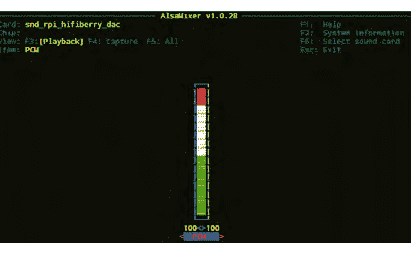

```
## sudo apt-get update
## sudo apt-get install python3-pip
## sudo apt-get install mp321
```

### 08 播放 MP3

要播放`MP3`文件，我们将使用一个名为`mp321`的程序。打开终端，然后输入`sudo apt-get install mp321`。这将下载并安装`mp321`。可以从命令行播放`MP3`；使用格式为`mp321 filename_of_mp3`。

### 09 使用 Python 播放 MP3

开始创建一个新文件，然后在文件的顶行添加以下代码：`import mp321, name_of_mp3 = 'file.mp3'`。这是一个播放文件的`OS`命令。将`name_of_file.mp3`替换为你要播放的`MP3`文件名。按`F5`保存并播放音乐文件。

### 10 扩展 PHAT 的 LED

可以控制`PHAT`的`LED`。首先，安装`python3-sn328`：`sudo apt install python3-sn328`。创建一个新文件并输入以下代码：

```python
from speakerphat import clear, show, set_led
for x in range(10):
    set_led(x,255)
show()
```

对于`set_led(index, value)`函数，`index`可以是`0-9`。保存并运行程序。

> 从 iPhone 或 Android 流传输音乐

可以通过你的`iPhone`或`Android`通过`PHAT`流式传输音乐。假设你已经安装了`Rasp`，你需要加载干净的`SD`卡镜像。安装所需的库：输入`sudo apt-get install pulseaudio-module-zer`。当询问时，选择`speaker PHAT`。最后，将安装允许将音频流到`Raspberry Pi`的软件。在你的`Apple`设备上播放音乐，然后点击`AirPlay`图标并选择“`Raspberry Pi`”。

## 教程

# Pi NoIR

## 红外摄影艺术

使用`Raspberry Pi`和`NoIR`摄像头发现惊人但奇异的世界


`Mike Bedford`拥有计算机科学硕士学位，目前担任埃塞大学的高级研究员。他也是一位热衷的光景摄影师。


### 资源

- 带有`CSI`接口的`Raspberry Pi`

- `Pi NoIR v2`模块 <http://bit.ly/PiNoIR>

- 用于`Pi Zero`的摄像头适配器

- `Raspberry Pi`版`2.8`英寸触摸屏 <http://bit.ly/PiTFTPlus>

- `USB`电源适配器

- 红外滤波器`R72`或等物

- 外壳与安装硬件


尽管我们看不到，但红外无处不在。如果我们的眼睛像红外一样，我们就能看到不同的世界。尽管如此，玻璃透镜能够聚焦红外 (IR)，而 `CCD` 对红外是敏感的，因此数字相机必须滤掉红外。事实上，红外摄影是黑白的，这有自己的魅力。黑白摄影捕捉的植被在红外下具有更高的对比度，产生了戏剧效果。叶子看起来洁白，以至于显得空灵。蓝天看起来几乎是黑色的。

普通红外相机的障碍在于制造商为了防止相机响应红外。因为红外的存在会导致颜色看起来不自然，因此红外滤镜会阻挡 `CCD`，使其只能记录可见光。

## 红外的挑战

要在红外下拍摄照片，必须排除所有干扰红外滤镜的可见光。使用此类滤镜通常被称为红外滤镜，但更准确地说是红外截止滤镜。然而，主要问题是红外通过滤镜漏出，并以高速到达 `CCD`。相机处理的越多，图像噪声就越大，即使在晴天，曝光时间也可能需要几秒钟。尽管使用普通相机有困难，但 `Raspberry Pi` 有 `NoIR` 摄像头这种解决方案。`NoIR` 没有滤波器，通常与 `LED` 配合用于夜间监控，也适用于白天摄影。

简要提到红外滤波器后，让我们讨论一下选项。红外滤镜允许红外通过而阻挡光，但实际上它们并不简单，因为滤波器的截止值不同。最弱的滤波器在 720nm 处截止，这意味着少量红光会通过。这对于大多数情况足够。

# 构建并使用红外摄像头

`Noir` 摄像头（如 `Raspberry Camera Module v2`）用于固定安装，但对于此应用你需要一个便携单元。要实现这一点，你必须组装带有 `Noir` 摄像头的 `Raspberry Pi`，添加电池和电源，并将一切放入外壳中。它还需要一些可以在屏幕上显示的软件。我们的分步指南将教你如何实现这一点，但网上也有其他选择，如果你是一个精通 `Pi` 的黑客并喜欢挑战，可能会发现更好的方法。

一旦你组好了套件，就是时候去户外测试红外摄影了。你肯定想要尝试，做得越多，效果就越好。首先，红外最独特的方面是绿色的空灵光泽，因此最好从景观和植物开始。同样，由于这种效果在光良好的情况下明显得多，请选择阳光充足的亮天。高对比度的另一个因素是深蓝色的天空，这在阴天或至少多云的天气下无法实现。虽然相机拍摄的效果通常没有那么理想，但需要一定的数字图像增强。

## 步骤

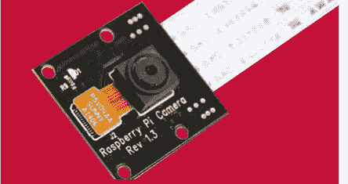

### 01 连接 Pi TFT 2.8 英寸 Plus

将 `TFT` 连接到 `Raspberry Pi`。你需要一些帮助来让它工作；你需要一个带有必要支持的新 `Linux` 内核。可以从 `Adafruit` 网站下载，尽管步骤 2 中的链接包含了此。

### 02 连接 Noir

你需要将 `Noir` 摄像头连接到 `Pi`。这是一个非常简单的过程，但没有某些软件你将无法在 `TFT` 上预览图像。`Adafruit` 开发了一个带有相关下载的项目，支持 `TFT` 以及实现即插即用方案的软件，你可以在 `http://bit.ly/DYVP` 找到。

### 03 添加电源

`USB` 电源随处可见，因此你可以通过插拔电源包与 `Pi` 来开关电源。这是建议的，但你可能需要在电源包和 `Pi` 之间使用开关。

### 04 将所有内容封装为便携单元

该项目最困难的部分是创建一个将所有部件固定在一起的外壳，使单元是便携且易于处理的。最好的方法是找到一个尺寸合适的通用外壳并对其进行改装，为各种组件开孔。

# Pythonista-Razer

## 板载对象识别

我们将介绍如何使用 `OpenCV` 进行板载对象识别，以及如何使用它来检测跟踪目标。

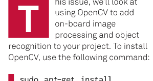

`Joey Bennard` 是一个真正的汉子。他在与科学家合作解决问题和开发 `Android` 应用的同时，投入时间构建未来。

在本期中，我们将介绍如何使用 `OpenCV` 为项目进行板载图像处理和识别。要安装 `OpenCV`，请使用以下命令：

```bash
sudo apt-get install python-opencv
```

这将安装 `OpenCV` 的 `Python` 封装。你还需要一个摄像头来捕捉图像。你可以使用 `USB` 摄像头，在本教程中，我们将使用连接的树莓派摄像头模块。要启用它，运行 `raspi-config`，选择“`Select Options`”，选择“`PI Camera`”并启用它。

一种新技术是使用所谓的“级联”（`cascade`），以便在对图像中的对象检测做出近似判断之前，尽可能地减少所需的计算量。其基本思想是将检测分为多个阶段，从粗糙到精细。只有当上一个阶段匹配时，算法才会处理更详细的阶段，这样它就不会在可能包含你试图识别对象的图像上浪费时间。

为了简化匹配，你需要将图像转换为灰度图。`OpenCV` `Python` 模块包含了许多可以管理此类任务的辅助函数。我们是这样进行转换的：

现在，你终于可以进行对象识别了。假设你正在尝试识别脸部。以下代码将给你脸部的宽度和高度：

- `grayage = cv2.cvtColor(rawImage, cv2.COLOR_BGR2GRAY)`
- `faces = cv2.detectMultiScale(grayage, scaleFactor=1.1, minNeighbors=5, flags=cv2.HAAR_SCALE_IMAGE)`

第一步是收集所有图像数据。使用树莓派摄像头模块，你需要导入几个类来处理这些内容：

级联（`Cascades`）是 `OpenCV` 用于识别图像内对象的 `XML` 文件。你可以从 `OpenCV` 的主仓库找到用于寻找各种对象位置的级联。

第一张图像用于检测尺寸。接下来是缩放因子（`scale factor`），用于补偿距离摄像头更远或更近的对象。`minNeighbors` 参数指定了算法在找到每个对象后搜索的次数。

## “对象识别被分为多个阶段”

```python
from picamera import Camera

from cv2 import cv2

camera = Camera()

camera.resolution=(1600,1280)

rawImage = cv2.cvtColor(camera.capture(), cv2.COLOR_BGR2GRAY)
```

```bash
git clone https://github.com/opencv/opencv4
```

你可以在 `opencv/data/haarcascades` 中找到级联。通过级联，你可以使用类来识别对象。以下代码处理初始化阶段：

```python
cascadePath = '/path/to/haarcascades.xml'

cascade = cv2.CascadeClassifier(cascadePath)
```

一旦加载了图像，你就可以开始图像处理并识别对象。算法将允许你分析图像的每个部分，测试可能识别你试图识别对象的每个参数。这种方法适用于你拥有的任何处理能力。

`minSize` 参数定义了对象检测的窗口大小。这可以根据图像质量以及你想要达到的深度进行调整。类列表中的每组值都会寻找与检测到的对象匹配的矩形位置。然后你将看到……

此代码适用于树莓派摄像头模块，但 `OpenCV` `Python` 允许你使用 `USB` 连接的摄像头并继续图像检测和分析。假设我们只连接了一个摄像头。让我们使用以下代码：

```python
video_camera = cv2.VideoCapture(0)

ret, curr_image = video_camera.read()
```

第一行连接到 `USB` 摄像头。第二行从视频流中读取帧。第三行返回图像数据，同时也返回状态。当我们在视频流中读取时，由于我们使用了 `Numpy`，你需要在代码顶部添加以下行：

## 为什么选择 Python

它是树莓派的官方语言。查阅文档：`www.python.org`

## 创建自己的级联

虽然有现成的级联用于识别对象，但你也可以创建自己的级联来识别特定对象。这是一个耗时的过程，因此你应该先尝试初始搜索；如果你觉得太困难，请参考 `OpenCV`：`http://opencv.org/cascades`。你需要的第一个项目是一个不包含你目标对象的负样本集合。该文件包含文件名，每行一个。你还需要一个正样本集合，应该放在第二个文件中，包含文件名和目标对象周围的坐标。这些图像都需要经过处理以创建一个向量文件。以下命令生成数据：

```python
import numpy as np

# 由于我们使用了循环，初始感兴趣区域由 cv.w 和 h 决定。
```

由于我们使用了循环，我们需要设置一个终止条件，以便在找到足够内容时停止。以下代码设置终止条件：

```python
term_criteria = cv2.TermCriteria(cv2.TERM_COUNT + cv2.TERM_EPS, 10, 0.001)
```

一旦初始化完成，你就可以循环帧。以下代码：

```python
ret, curr_image = video_camera.read()

gray = cv2.cvtColor(curr_image, cv2.COLOR_BGR2GRAY)
```


第一行捕捉新帧。第二行将其转换以便与直方图进行比较。第三行返回找到对象的投影，第四行移动新的感兴趣区域：

```python
roi = cv2.meanShift(gray, window, term_criteria)
```

这一切都是为了识别图像内的对象。如果你想使用这个脸，你需要根据第一步创建一个区域：

```python
roi = gray[y:y+h, x:x+w]
```

以下代码创建掩码和直方图：

```python
mask = np.zeros(roi.shape, np.uint8)

cv.rectangle(mask, (0,0), (w,h), 255, -1)

hist = cv2.calcHist([gray], [0], mask, [256], [0, 256])

hist = cv2.normalize(hist, None, 0, 1, cv2.NORM_MINMAX)
```


# Techradar
科技购买建议来源  
`techradar.com`

# 评测
81 组测试 | 86 Hardware | 88 Distro | 90 免费软件

## 高级文本编辑器
你认为文本编辑器只是用来打字的吗？

### gedit
`GNOME` 以及基于 `GNOME` 的发行版中的默认文本编辑器，我们大多数人可能都用它来编辑配置文件。它看起来过于朴素和简陋，但不要被它误骗了。在其简单的外表下，隐藏着足以对其他编辑器构成严重威胁的功能。`bit.ly/gedit-app`

### jEdit
这款基于 `Java` 的跨平台文本编辑器声称拥有让许多昂贵工具相形见绌的功能。自1998年首次发布以来，`jEdit` 仍然能够应对竞争者的挑战，并证明了其作为“程序员编辑器”的声誉。`www.jedit.com`

### Kate
如果说 `gedit` 之于 `GNOME`，`Kate` 之于 `KDE` 桌面环境。它自2001 年起一直是 `KDE` 的一部分。它自诩为高级文本编辑器，这告诉我们它拥有所需的功能，但功能是以牺牲可用性为代价的。`kate-editor.org`

### Sublime Text
我们凭借其卓越的声誉而出。作为几乎所有开发者的喜爱，该编辑器的开发者要求用户购买许可，但并未对测试期实施时间限制。`sublimetext.com`

### gedit
它在非 `GNOME` 桌面环境中（或在所有环境中）是否有意义？

### jEdit
是一个文本编辑器还是 `IDE`？它密集的界面可能会让一些人望而却步

`gedit` 有一个 `Python` 插件，允许你从编辑器中测试代码

安装插件以启用多种特定语言的功能，如树形结构

## 高级编辑功能
`gedit` 支持撤销和重做操作，以及搜索和替换。它可以显示搜索标记，并设置为定期间隔自动保存文档。该编辑器完全支持 `UTF-8` 并可以在多种语言中进行检查。你可以使用 `gedit` 访问并编辑远程文件。

除了撤销/重做，`jEdit` 还提供了无限数量的剪贴板，将其称为寄存器（`registers`）。你可以在不同的编辑会话跨寄存器之间复制文本片段。它还可以记录用户操作的宏，并从其网站下载宏。

## 编程语言支持
`gedit` 具有代码编辑功能，包括括号匹配和自动缩进代码。编辑器还支持多种编程语言，包括 `C`、`C++`、`Java`、`XML`、`Python` 等。它允许通过行号进行轻松导航，并让你跳转到特定行。

`jEdit` 支持超过 200 种编程语言的高亮模式，从汇编到 `Python`。它提供了与其同类产品相同的功能，包括自动缩进、括号匹配和代码折叠，其中一些是默认启用的。编辑器还可以对选定块进行缩进。

## 插件和附加组件
`gedit` 带有许多插件，尽管并非所有插件都默认启用。你可以通过插件下载更多内容，包括包管理、多重编辑和单词补全。该项目网站还指向了与 `gedit` 引擎兼容的第三方插件。

`jEdit` 拥有一个令人印象深刻的插件框架，有 200 多个可用插件。我们喜欢的几个是 `Android` 插件（提供用于处理 `Android` 项目的实用程序）和 `Tomcat` 插件（你可以用它来创建和编辑外部 `Tomcat` 进程）。你可以使用 `jEdit` 的包管理器安装这些插件。

## 可用性
得益于其极简菜单和按钮的简洁界面，该应用对初次用户不会产生基础学习曲线。高级用户可以启用插件以提高其特定需求的生产效率。当文件被另一个应用程序修改时，应用将检测并提供重新加载该文件的建议。

与此组中的其他编辑器不同，`jEdit` 的界面相当繁忙，可能会让新用户无所适从。此外，它的一些功能（如代码折叠）是默认启用的，这意味着你必须进入它的设置管理器才能充分发挥该工具的作用。

## 总体
> `Gedit` 是一个非常温和的编辑器，在支持各种功能方面表现得非常出色，特别是对程序员而言，而且不会让用户感到不知所措。

> 由于所有的按钮和广泛的菜单，需要一些时间来熟悉编辑器，很好的一点是它可以引导文档，你会发现自己经常参考它。

## Kate
另一个在默认桌面之外寻找用户的编辑器

## Sublime Text
与其说它是“高雅”（`sublime`），不如说是“超现实”，它拥有更令人震撼的功能

由于 `Kate` 的项目管理能力，你可以使用它来协作处理复杂的编程项目。

## 高级文本编辑功能
`Kate` 可以打开许多文件并对文档进行扫描检查。对于长文件的导航，编辑器允许用户跳转到文件的任何位置，并在右侧包含一个微地图。它具有自动完成单词的功能，还可以自定义文本选择。

## 编辑功能
`Sublime` 拥有所有的文本编辑功能，包括自动保存和段落格式化。此外，它具有查找和替换字符以及行号的功能。它提供了选择非连续跨度的功能。

## 编程语言支持
`Kate` 可以对超过 160 种语言进行语法高亮，并提供括号匹配和自动缩进等便利功能。它支持 `Git`、`Subversion` 和 `Mercurial` 版本控制，并提供项目管理。你可以通过插件启用构建系统。

## 编程语言支持
就像 `Kate` 一样，`Sublime` 从编辑器本身支持许多语言——如 `C++`、`Python` 和 `Ruby`。它在相当直观的界面内置了一些令人震撼的功能。（等等，重复了）

## 插件和附加组件
`Kate` 允许内置插件。与 `jEdit` 不同，它仅包含 20 个插件，但这些插件非常有用。此外，编辑器提供了令人深刻的项目插件，其中一些对于需要增强型终端、能够编译调试以及在各种数据集上执行脚本的开发者非常有用。

# 高级文本编辑器

## 简述：我们的评测对比与总结

| 高级文本编辑功能 | 对用户而言，它不仅仅是一个平庸的编辑器，支持相当多的功能。 | 它的文本编辑功能不会让你失望，包括撤销/重做和剪贴板。 | 这是最让长文档导航变得的编辑器之一。 | 它提供的编辑功能比你在其他所有领域找到的还要。 |
|---|---|---|---|---|
| 编程语言支持 | 具有一些使其对偶尔轻量级编程很有用的功能。 | 拥有你想要的所有功能，尽管某些功能未开启。 | 支持的功能足以让它成为你的首选 `IDE`。 | 得益于其代码编译功能，`Sublime` 可以轻松取代它。 |
| 插件和加载项 | 你可以通过官方和第三方插件轻松增强它的功能。 | 支持最大的插件集，包括一些非常实用的插件。 | `Kate` 提供的插件有限，但它们都很有用。 | 拥有大量未修改的插件，易于搜索且实用。 |
| 易用性 | 不会让用户感到畏惧，并适用于特定的工作流。 | 与其他编辑器不同，它没有让人迷失方向的界面。 | 当选择 `Kate` 时，`KDE` 用户不需要看其他软件。 | 直观的引擎，可以根据工作流轻松进行微调。 |
| 总体 | 鼓励 `GNOME` 用户仅使用它来完成工作。 | | | |

## 最终获胜者是...

### Kate
竞争者之间的战斗非常胶着，但 `Kate` 和 `Sublime` 在几乎所有方面上都优于 `gedit`。

`gedit` 的默认编辑器本身没有问题，但尽管它有许多优点，`gedit` 仍然处于逊一筹。开箱即用的情况下，`Kate` 足够多能，并且在各自的插件系统之后得分超过了 `gedit`。`Sublime` 是一个专业的选择界面，支持的功能足以证明其价格的价值（而价格本身就在那里）。它对新用户来说易用，也便于通过微调来测试和编辑代码。其他人可能会喜欢它的片段和宏功能，以确保他们的开发环境。它因其涉及编辑配置文件的架构机制而脱颖而出。我们的评价可能有些严苛，但由于缺乏足够的审查深度，还无法说服我们接受这些开源应用。

通过淘汰法，冠军归属于 `Kate`，它提供了最大数量的功能且学习成本最低。

在非 `KDE` 桌面安装会安装大量的 `KDE` 库，但这是值得的
你可以像使用简单编辑器一样轻松使用它，由于它的管理能力，它可以帮助你开发和处理复杂的编程项目。
在你恨我为什么没有包含 `Emacs` 和 `Vim`（两个最流行的文本编辑器）之前，请注意，它们未被包含是因为几个原因。首先，如果你在使用其他的，你会错过它们。其次，其中某些相对于 `GUI` 替代品来说学习曲线非常陡峭，而后者在任何时候都更加直观。

**`Mayank Sharma`**

84

# 托管 Wordpress 云端

简单，我们为你管理一切

`www.netcetera.co.uk/lud`

03330 439780

回收你的杂志，七天后它可能会以报纸的形式回来。回收。可能性是无限的

# 削减你的互联网、电视和电话费！

一个电话。数千个优惠。

我们为你完成困难的工作：

- 免费拨打并与位于伦敦的中立专家交谈。
- 我们审核了来自英国顶级供应商的 6000 多项优惠，为你找到最合适的——带有我们的最低价格保证。
- 我们的专家负责繁琐工作，回答你的问题，甚至安排安装。

我们是获得 `Ofcom` 认证的电视、宽带和家庭电话连接唯一服务

免费拨打我们，我们来完成困难的工作！

专家服务时间：周一至周五 8am-8pm，周六 9am-5.30pm，周日 10am-5.30pm

# 0800 466 1053

访问 `www.techradastores.co.uk` 或发送 '`DEAL`' 到 81400，我们将回电给你

*% 简化。客户声称平均节省了 40 英镑。数据基于 12,500 人。根据 29/09/15 和 31/06/16 的对比，用户节省了 36 英镑。详情见 `www.simplifydigital.uk`。最低价保证。受条件限制。

* 评测。这是一台轻便的笔记本

# 评

## Fedora 26

## 发行版

## Fedora 26

`Fedora` 开发者已经精通稳定发布的艺术，但是否已经到了无聊的地步？

在经历了多次重新设定截止日期和忙碌的延误后，`Fedora` 终于在 2017 年初发布了第一个版本。但你从这个版本中获得的兴奋感仅限于此。与早期相比——尤其是像 `Fedora` 这样曾经充满戏剧性的顶级项目——现在的每一个粗糙边缘都被磨平了，每一个缺陷都得到了平滑和完善。对于一个旨在为红帽企业级产品提供最佳平台的发行版来说，`Fedora` 在软件选择上太保守了。最新版本的一个亮点是一个开发了数年的新分区工具！这个名为 `Blivet-GUI` 的新分区工具会在你在安装发行版时勾选“自定义”单选框时显示，它旨在处理和可视化复杂的磁盘配置。你可以用它编辑和删除磁盘分区以及 `LVM2` 组，并可选使用 `LUKS` 对其进行加密。

在底层，新版本带来了 `Linux` 内核 4.11.8，所有软件包都已用 `GCC` 7.0 重新编译。其中的亮点是“夜光”功能；类似于 `Windows` 10 的蓝牙战斗，它通过根据一天中的时间微调屏幕亮度来缓解你的眼睛。点击通知中的，会显示日历底部的其他信息。如果你使用 `Firefox`，桌面的轻量级网络浏览器（`epiph`）具有许多改进的隐私控制。还有一对新应用：用于管理你当前可用性的 `Maps`，以及 `Gourmet` 菜谱管理器。

新分区工具的上方将帮助具有复杂磁盘布局的用户在 `Anaconda` 内部为发行版找到空间。

> 对于一个要为红帽企业级产品进行测试的发行版来说，它太保守了

## 优点
- 一个稳定且精良的发布版本，为不同版本中的各种类型用户提供了一些实用的功能。

## 缺点
- 没有缺点，但如果你想吹毛求疵，我们可以指向所有新功能的列表。

与之前的版本一样，`Fedora` 26 有三个适用于不同用例的版本：`Workstation`（工作站）、`Server`（服务器）和 `Atomic`（原子）。虽然主版本使用 `GNOME` 桌面环境，但项目提供了带有不同桌面的几个额外选项。一个是基于 `KDE` 的，另一个是基于 `LXQT` 的。

## 总结
新的分区工具将对你有帮助。如果你有多个显卡，可以通过右键点击应用程序来选择启动哪一个。该功能最近已在所有安装项的右键菜单中显示。随着引入 `dnf` 2，后台的包管理也得到了改进。这个作为 `Yum` 继任者的版本进一步修复了两个包管理系统之间的不兼容问题，在表层之下的通过大部分的改进提升了用户体验。

在主版本发布之后，桌面团队计划发布服务器版模块化（`Modular`）释放的预览版。`Fedora` 模块化工作坊的目标是增加灵活性以实现目标。例如，你可以拥有一个在新的内核上运行数据库的服务器。此版本带来了一些改进。首先，虽然在早期的版本中你可以用 `Kubernetes` 管理容器以及用 `dnf` 安装它，但现在只需像其他其他 `Docker` 命令一样使用单个命令即可。提到 `Docker`，`Docker` 容器的 `OverlayFS` 默认存储选项现在由 `Overlay2` 驱动提供，而不是 `devmapper`。

`Michael Shorne`

升级 `Ubuntu` 26 似乎是一个很容易的挑战，并将最终来到 `GNOME` 桌面。

`www.linuxux.com` | 89

# 评测 自由软件

## 网站流量分析

## Piwik 3.0.4

在不泄露用户数据的情况下跟踪访问者

当涉及到网络分析时，有一种替代方案，可以不必将所有详细信息传递给 `Google`。`Piwik` 是一个成熟且文档完备的免费开源 `LAMP` 应用，由托管服务和其他连接支持。下载它，仅需五分钟的安装即可完成设置，这包括设置数据收集器并进行测试。一旦运行起来，你只需要等待仪表盘来跟踪你的分析数据。十分钟的网站流量是不够的——第二天连接，你将获得过去 24 小时的流量，其仪表盘与 `Google` 有相似之处。

仪表盘增强了更多小部件，允许你选择并自定义它的其余部分。为了明确目标，你可以为访问者分析构建转化目标。查看访问者是如何找到你的网站的。`Actions`（操作）可以向你展示你的观众如何与网站交互。“`Visitors`”（访问者）甚至会显示你是从车载浏览器访问网站的。

无论你是拥有一个繁忙的网站还是正在测试的东西，都能为你提供更好的数据。

## 优点
- 一个强大且可靠的分析工具，安装过程简单且界面友好。

## 缺点
- 你可能会发现自己自己在没有投入精力处理事情的情况下担心错过了某些效果。

## 非常适合……
- 诚实地观察你网站的运行情况。

`https://piwik.org`

# 媒体下载器

## Movgrab 3.1.1

一个带有脚本和对管道友好特性的下载器

在 `YouTube` 上遇到一些问题后——我们不得不免费下载一些 `YouTube` 视频，很高兴看到 `Movgrab` 没有提出任何主张，只是提供了这个免责声明：“这是免费免费的，如果它损坏了你的电脑或打开了通往恶鬼维度的大门，或者做了任何事情，我不承担责任。”“但它确实在我们那里获取的 `/config` 文件上运行了。”

运行 `--test-sites` 可以查看哪些网站——不仅是 `YouTube` 和 `Vimes`，还有 `TED`、`Everywhere` 和国家地理，以及如《华盛顿邮报》和 24 等网站。少数返回了 `BROKEN`（损坏），但作为回答，作者说可能仍然仍然用。测试脚本还需要一些改进——虽然安装过程检测到了所有必要的 `SSL` 库的存在，但即使在我们尝试修复 `/config` 文件时，它也无法在 `SSL` 环境下工作。

我们无法让 `Movgrab` 在 `YouTube` 上工作。如果你有多个显卡，可以通过右键点击应用程序来选择启动哪一个。该功能最近已在所有安装项的右键菜单中显示。随着引入 `dnf` 2，后台的包管理也得到了改进。这个作为 `Yum` 继任者的版本进一步修复了两个包管理系统之间的不兼容问题，在表层之下的通过大部分的改进提升了用户体验。

我们无法让 `Movgrab` 在 `YouTube` 上工作。

## 优点
- 它在我们那里获取的 `/config` 文件上运行了。

## 缺点
- 测试脚本还需要一些改进。

## 非常适合……
- 它适用于许多网站。

90

# 编程语言

## Julia 0.6.0

需要数据分析吗？时候到了

**`性能仍然` `Julia` 的核心。**

虽然它不是一个 `CAD` 工具，但最新版本可以导入 `.dxf` 文件——完整的或仅选择的层——并具有某些功能（如 `Tex` 标签，对于某些用户和任务来说，它是 `CAD` 的更优替代方案）。甚至有一个用于语法高亮的补丁。

通过 `Qt` 2D & 3D，`Drawj2d` 能够绘制相当复杂的形状。甚至有一个用于语法高亮的补丁。

我们无法让 `Movgrab` 在 `YouTube` 上工作。

如果你有多个显卡，可以通过右键点击应用程序来选择启动哪一个。该功能最近已在所有安装项的右键菜单中显示。随着引入 `dnf` 2，后台的包管理也得到了改进。这个作为 `Yum` 继任者的版本进一步修复了两个包管理系统之间的不兼容问题，在表层之下的通过大部分的改进提升了用户体验。

我们无法让 `Movgrab` 在 `YouTube` 上工作。

## 优点
- 它在我们那里获取的 `/config` 文件上运行了。

## 缺点
- 测试脚本还需要一些改进。

## 非常适合……
- 它适用于许多网站。

90

# 命令行绘图

## Drawj2d 0.9.0

无需稳定的手即可准确绘图

如果你觉得在电脑上画图是一件痛苦的事情，为什么不让计算机画你需要的呢？`Drawj2d` 使用一种基于字符串的描述性语言 `Heci` 来轻松绘制“线、点、圆、椭圆、弧、抛物线和尺寸线”。通过 `Qt` 2D & 3D，`Drawj2d` 能够绘制相当复杂的形状。

上方对于技术图来说，描述性文件比鼠标画的要好

### 优点
- 不需要稳定的手——使用计算或简单的脚本。`SVG` 输出精美。

### 缺点
- 另一种需要学习的脚本语言。位图选项不受限。与其他工具未集成。

### 非常适合：
- 快速准确的形状、精细和标注。

`http://drawj2d.org`

# 在我们的目录中获取您的列表

如需在此投放，请联系 `Kate`
`kate.butterfield@futurenet.com` | 01225 687439

# 推荐

# 托管列表

精选托管商：

> 使用我们直观的控制面板管理您的域名

# 关于我们

作为一家始于 1999 年的托管品牌成员员，我们历史深厚、总部位于英国、独立运营，我们的使命简单——确保您的网络呈现“开箱即用”。

我们提供高性价比的域名、`cPanel` 托管、`SSL` 证书、企业邮箱、`WordPress` 托管、云服务和 `VPS`。

# 我们提供的服务

- 带有反欺诈、垃圾邮件和病毒保护的免费账户。
- 免费 `DNS` 管理。
- 易于使用的控制面板。
- 免费邮件转发——可以自动将您的邮件重定向到现有账户。
- 域名威胁保护，防止域名在意外或未经您许可的情况下被转移。
- 易于使用的工具，帮助您一步到位注册、续费、转移和更改多个域名。
- 免费域名转发，将您的域名指向另一个网站。

# 专家的 5 个建议

+ 01 为互联网优化您的网站图片，确保所有图片都经过了优化！可以免费尝试 `jpegmin.com`，或使用 `EWWW Optimizer` 插件。

+ 02 在英国托管您的网站。确保您的网站位于英国，而不仅仅是本地！如果您的服务器位于海外，您在 `google.co.uk` 的搜索引擎排名中可能会处于劣势——在 `check-host.net` 检查您的网站所在地。

+ 03 您做备份吗？如果今天您的今天丢失了网站，业务将如何开展？制作备份至关重要，即使您的托管商提供了备份解决方案，对自己的数据负责并对其保护它也是重要的。

+ 04 正在尝试在 2015 年注册域名吗？如果您在注册时遇到困难，请确保您的网站具有移动响应式！此外，`Google` 现在更偏好 `HTTPS`。联系我们的团队为您的网站设置并强制使用 `HTTPS`。

+ 05 避免廉价托管。我们确定您在地方见过它们，1 英镑的托管！想想这逻辑——1 英镑，一台服务器上会挤进多少个客户？您显然应该使用 20 英元的驱动器，而不是 1000 英镑以上的企业 `SSD`！记得提醒他们付的是什么钱！

# 证言

我买了一个 `SSL` 证书。购买过程非常轻松，只需几分钟。我的困难在于安装，这是我永远无法做到的。我只是提交了一个工单，支持团队回复很快。证书签署机构在几小时内就联系了我，支持团队为我安装了证书。

# David Brown

我们使用了 `TheNames` 的几项服务，连接性是顶级的——极高的运行时间和问题处理。技术支持以回复速度快而闻名——这是一个加分项。我们强烈推荐 `TheNames`。

# Tracy Hope

在尝试了其他托管公司后，我们似乎拥有最好的客户服务，而且包含了我们所需的所有功能。共享托管速度非常快，控制面板非常全面……

# J Edwards

# 顶级托管

# SSD 网站托管

`www.bargainhost.co.uk` 0843 229 2681

`www.cwcs.co.uk` 0800 1 777 000

`CW Managed Hosting` 是英国领先的托管专家。它提供全方位的托管产品、服务和支持。高技能员工不仅是托管专家，他们还致力于提供出色的客户体验，并对他们所的工作充满热情。

自 2001 年以来，`Bargain Host` 一直致力于提供英国价格最低的托管。它已成功实现这一目标，并建立了包含许多客户的大型数据库，因卓越的托管服务获得了多项奖项。

- 托管机房
- `VPS`
- 100% 运行时间保证
- 共享托管
- 云托管
- 域名

# 价值托管

`www.20media.com`

`elasticos.co.uk`

新用户预装了 `WordPress`，或提供免费管理。`Instant WordPress` 第一个月免费。我们以可靠和卓越的服务闻名，为全英国的企业、开发者和创作者提供服务。

`hosting.co.uk`

`ElasticHosts` 为全球企业提供简单、灵活且具有成本效益的云服务，具有高性能、可靠性和可扩展性。我们是一个工程师团队，通过电话、电子邮件和聊天提供 24 小时的卓越支持。`Linux` 对于家庭用户和网页设计人员来说是一个极具成本效益且性能强大的解决方案。无论您是在构建小型作品集还是运行数据库驱动的电子商务，都有适合您的 `Linux` 托管解决方案。

- 任何操作系统的云服务器
- `Linux OS`
- 学生托管
- 网站设计器
- 域名

# 小企业托管

# 快速、可靠的托管

`www.hostapa.co.uk` 0800 051 7126

`www.bytemark.co.uk` 01904 8990

`HostApa` 是曾获殊荣的托管服务，提供极具竞争力的价格。成立于 2002 年的 `Bytemark` 是“托管领域的专家”。我们提供 24/7 的客户支持和卓越的可靠性。

# 关注我们

`Facebook`: `facebook.com/LinuxUser`
`Twitter`: `@linuxusermag`

你好。想要树莓派吗？并不是所有人都还想要杂志上那块冰川绿的板了——你也是其中之一吗？

我们认为新的 `GIMP` 绝对非常非凡。

# 精通脚本：开始编写脚本

通过组合它们（某些 `Linux` 命令）来学习。

是新手内容还是没有新手内容？坦率说，这取决于我们哪天查看收件箱，并与远程客户端的汇总进行对比：`bash` 脚本教程；`Java` 与人工智能；一份关于《监狱》（`Prison`）及其专注于安全性的笔记本电脑的报告；以及关于 `Arduino` 现状的专题。我们将继续不断产出！

因为我可能会发现一些从未见过的东西，或者遇到一次就忘记了。有些初级水平软件文章值得一读；入门级编程文章（尤其是 `Python`）完全符合我的水平，而杂志中的某些内容超出了我的理解范围——并非我们所有人都是如此。我们首次发表了图形软件的文章，如 `Blender`、`GIMP`、`Syfig` 和 `Chrome`。要同时涵盖这两种方法需要很多页面，而可以在四页纸内完成。

# 不要有顾虑

这封邮件稍微晚了点，但它是为了回应你在 `LU180` 中提到的关于制作 `Linux` 的评论。首先，我过去与出版行业有一些渊源，我知道要让每个人都满意有多困难，为那些想当批评者的人找到空间有多么难——毕竟，我刚刚续订了订阅，而且杂志现在的状态对我来说很出众！

此外，对于一个几乎没有或没有 `TT` 教育的外外人来说，在我看来，`Linux` 在新手投入之后对外外人来说其实挺容易的。我现在对 `Linux` 的了解比大多数 `Windows` 用户对他们自己系统的了解还要多（这其中包括我自己吗？），但我仍然发现我们的任何初级水平的文章……

而且，当专门针对树莓派的文章发表时，难道没有新内容了吗？这种观点可能超出了我的理解范围——我喜欢在夏末和圣诞节带来一个。`Mick`

对于大多数读者，但通常我认为他们自己需要专门的出版物。我们经常发表过关于 `GIMP` 和 `Blender` 的出版物。事实上，如果我看到我可以做一个并发给你看。

我们还有其他系列，但我们很快会回到那里的，我保证。几天后继续深入探讨。对于树莓派部分，一旦你有了其他想法，如果你倾向于迷其中，可能会忘记它。这是根据最近调查的印象，关于杂志最喜欢的季节，而上一次对树莓派的“保存”是他们提到阅读的重要组成部分。

# 发表你的见解！

通过 `linuxuser@futureenet.com` 给我们我们发邮件

`www.linuxuser.com` | 95

# 近未来小说

关注我们
`Facebook`: `facebook.com/LinuxUserUK`
`Twitter`: `@linuxusermag`

# 斯蒂芬·奥拉姆短篇小说

# 杀手病毒？

`Buller Johnson` 是运行在 `Johnson` 女士生活各个方面的个性化人工智能，它考虑了进来的信息。
另一个管家，一个陌生人，告诉它根据协议允许访问调节其女主人药物的算法。
它没有此类协议的记录，但在它崩溃并被强制回到之前的之前的版本时，它丢失了 24 小时的记忆。
那个陌生人变得异常激动，并不断坚持局势的紧迫性。
允许访问要么救了 `Johnson`，要么杀死她。它尝试连接到它的同伴网络。无用——联系方式在崩溃中损坏了，它可以在赛博空间大喊，但它如何知道触发哪种响应呢？
它必须自己决定。
陌生人要求访问。
它运行了协议，研究了结果，并给了陌生人想要的东西，希望这不会因为杀死一个人类而被永久删除。
它监测着她的健康状况并等待。
她的手指抽动了一下，她痉挛，仿佛被电击了一样。
然后什么也没有了。
它继续监测。
没有变化。
咳！`Johnson` 女士咳嗽并睁开了眼睛。它检查了她的生命体征。她正在康复。通过回复，它邀请陌生人加入它的联系人列表。
希望这是许多中的一个。

# 新短篇系列

吃掉机器人
吃机器人
作者斯蒂芬·奥拉姆创作近未来小说，探索在一个比以往任何时候都奇异的世界，乌托邦梦想与扭曲现实的碰撞。他的的一些科幻短篇在你读完最后一页后仍会让你记忆犹新。
`http://stephenoram.net`

斯蒂芬·奥拉姆

下期将于 9 月 21 日发售
极致发行版与 `FOSS` | `Arduino` | `Purism` 笔记本电脑

`电子边界基金会` 是数字世界自由的领先非营利组织。`EFF` 成立于 1990 年，通过影响力诉讼、政策分析、基层活动和技术开发来维护用户隐私、言论自由和创新。我们致力于在技术使用增长时，确保权利和自由得到增强和保护。

# EFF.ORG

## 电子边界基金会

在电子边界保护权利并促进自由
