# Linux 用户与开发者 185 - Ubuntu 17.10 启动包 185

你知道吗？为纸张和其他产品提供木材的欧洲森林在过去 10 年里增长了 44,000 平方公里？这每天增加超过了 1,500 个足球场！当你知道它们是由天然、可再生木材制成时，你会更爱它们。

联合国粮农组织（FAO）《全球森林评估》是一项推广负责任使用印刷品的全球倡议，当源自经过认证或可持续管理时，印刷品是一种独特强大的媒介。现在有许多极佳理由去发现它们。

适用于美国和英国

制作经理：Richard White

欢迎阅读本期以及北美喜爱的 Linux 及开源软件（FOSS）杂志。

我最近发现“aardaard”在阿非利卡语中是“地球”。我们正准备查看 Aart 的评测，一种转向 GNOME 桌面的务实且落地的方法，或者更像是将列表列在页面上。给我们发送电子邮件告诉我们你的想法！在此期间，还有关于 Ubuntu 17.10 的深度解析，请深入阅读我们的下一个专题（见第18页）——我们正在运行一个小型自动化程序，具有创意艺术家的特色——例如，根据人的心理状态绘画的自主程序。我们还了一份关于机器学习库 TensorFlow 的指南（见第54页）以及另一篇关于如何设置树莓派的短专题（见第98页）。

Chris Thornhill

- facebook.com/LinuxUser
- Twitter: @linuxusermag

facebook.com/LinuxUser
@linuxusermag

70 Pi 项目：来自 Martin Minder 的新旧技术再次融合，每当收到特定消息时，Pi 通知灯就会亮起

72 状态板：使用多功能 Pi Hat 状态板一览监控系统价格、汇率等

81 组测：终端：本月的精彩内容是一系列终端模拟器，从极简到高度先进的应有。哪一个会脱颖而出？

74 圣诞毛衣：当你的 Twitter 时间线出现特殊推文时，点亮你的节日毛衣。

86 14英寸 Pinebook：廉价的 Linux 笔记本电脑能胜任吗？让 Pinebook 接受测试

78 Pi 的剃刀：开始使用 Jupyter Notebook，这是一个连接 Pi 计算资源的绝佳 Web 端前端。

88 Parrot Security 3：Parrot Security 进入渗透测试领域，旨在下台冠军 Kali Linux

90 新鲜开源：关注隐私的浏览器 HTTraQ 1.4.9、现代手机 Phonix Suite 7.4.0 和 Stellar 0.16.1


## 硬件

## 你的 Wi-Fi 网络被破解了吗？

Ubuntu 及其他主流 Linux 发行版发布了新漏洞，以解决一个惊人的安全漏洞。

WPA 协议中的漏洞于去年夏天发现，并由比利时安全研究人员 Matthew Vanhoef 公之。

这种被称为“CRACK”（密钥重装攻击）的漏洞利用了 WPA 握手强制客户端设备访问和处理加密密钥的缺陷。CRACK 攻击使攻击者强制客户端设备使用之前过的加密密钥，而该密钥应该只使用一次。当密钥被重用时，加密就可以被绕过，允许攻击者破解 wifi。

明确的是，CRACK 对你的网网络安全构成了威胁。网上银行、网上购物和社交网络都面临风险。网上银行和其他金融交易现在非常脆弱。

通过破解加密，攻击者将拥有自己的数字钥匙，以观察（并复制）每次在线交易的凭据（以及细节）。事实上，CRACK 是一种极佳的攻击，为政府提供了加密后门。正如 Vanhoef 所言：“这种攻击不仅限于恢复登录凭据（例如电子邮件地址和密码）。通常，任何依赖于所用设备和网络设置的数据或信息，无论加密密钥（消息内容），都可能解密数据。”

因此，macOS、iOS 和 Android 设备都收到了补丁，路由器也是如此。对于 Linux 来说，CRACK 攻击了许多 Android 设备，需要在从 panda 到基于 Linux 的物联网应用等各种范围的系统进行补丁。该平台漏洞仍然是一个问题，大多数已经解决。仍有 50% 的仍在修复中。

关于 Linux 话题，Vanhoef 解释道：“这种攻击对于版本 2.4 及以上的 wpa.（Linux 上常用的 Wi-Fi 客户端）来说特别是灾难性的。在这里，加密密钥将安装一个全零加密密钥……这使得拦截变得轻而易举”

> 非常想切换到以太网连接以保护易受设备

许多 Linux 发行版有旧的更新来修复该漏洞，但延迟设备——如路由器和媒体中心——可能会受到影响。即使设备过时，短期解决方案可能仍然有效。如果可能，请切换到以太网，并在公共场所使用你手机的热点功能。使用 VPN 可能会防止 CRACK 攻击的成功。同时，如果你正在使用 IoT 设备，请向制造商检查补丁。如果没有提供，请在发布补丁之前避免使用该设备。

## 硬件

## Intel 管理引擎被禁用，Linux 命中目标

Purism 面临严巨挑战并继续增强笔记本电脑安全

对于安全意识开源硬件开发者 Purism 来说，这是忙碌的一个月——具有安全意识的用户禁用了 Intel 管理引擎（ME）。在过去的十年里，研究人员一直试图绕过或破解 ME，它作为 Intel 技术专属存在于几乎所有现代笔记本电脑中。这个辅助 CPU 在关机时可以控制电脑，被许多人视为安全风险。Purism 的 Youness 表示：“管理引擎完全是禁用它之后的下一步。Coreboot 也会提供必要的安全保障。”与此同时，Purism 发布了针对现有设备的更新以禁用 ME。

Purism 创始人兼首席执行官 Todd Weaver 解释说，他们将在未来 12 个月内增加“开发和制造”。该公司计划聘用低级软件开发人员、用于 5 英寸全触摸接口的 GNU/Linux、商业测试以及 KDE/Plama 和 GNOME/GTK+ 中间件的开发人员。到 2018 年初，开发者将准备就，手机届时也会准备就。但 Weaver 确保这不会止于此。“然后我们进入增长阶段，专注于 Linux 笔记本电脑，主要是硬件的增量改进、软件发布，以及对 VPN、地图等基础支持将持续进行，这也许是最需要的产品支持。”

“由于市场上还没有像我们这样的合伦理设备——我们有一项长期战略，即从安全通信到 Android/iOS 替代设备逐步扩大市场。” Weaver 明确表示，“通过创建一个可信的、用户控制的手机来颠覆市场，正是我们的目标。”

## 发行版动态

### 前 10 名

（每日平均访问量，截至 2017 年 10 月 20 日）

1. Mint
2. Debian
3. Manjaro
4. Ubuntu
5. Anteros
6. openSUSE
7. Fedora
8. Solus
9. elementary
10. Zorin

### 本月

- 稳定版 (17)
- 开发中 (3)

Purism 170 表现良好，口碑数量超过了 Purism 长期以来的最佳。Mint 的发布速度很快，但能维持多久？

### 亮点

> Ubuntu 17.10

Ubuntu 的成功回归，塑造了 GNOME 17.10 的发布。与其类 Ubuntu 的基于 GNOME 3 的桌面易于使用。Ubuntu 会是那个关键点吗？

> Linux Mint

凭借其访问量，俯视竞争对手，它可能是不可战胜的。它将如何保持顶位？Mint 可能会继续保持。Anteros

另一个使用 GNOME 的发行版，在前 10 名中位第一。最新的可用发行版：

img/84ab224de9f66d5fe3638204a9a78c1c_6_0.png

## 桌面市场份额因统计数据不准确引发斗争

统计数据不准确导致 Linux 使用率“剧增”

研究人员对市场份额的方法在公布部分后受到质疑，显示 Linux 跃升至 6.25%

所以，为什么会发生错误？这并不难。NetShare 通过对全球 400,000 个网站进行采样来进行调查。共识是 MarketShare 包含了 Chrome 和 Android 设备的数据，这可以与 StatCounter 提供的数据进行对比。作为 Linux 设备的数据来源（例如树莓派上的单个 chrome 实例），来自访问网站的数据可能准确。

Linux-内核 OS Chrome 的出现。尽管它被认为是主要的平台之一，但考虑到统计使用的是来自在线源的数据，来自浏览器的 USER-AGENT 信息。

> 所有这一切导致了由内核维护者 Greg Kroah-Hartman 等人发布的“Linux 声明”，旨在恢复信心并给予公司修正不合规的时间。

尽管赚了数百万欧元，据认为他对内核的贡献不到 0.25%

他的许可执法活动引起了软件自由协会（Software Freedom Conservancy）的注意，“我们从接触的人那里听到的批评主要来自

上述内核维护者 Greg Kroah-Hartman 被迫编写执法声明，给予公司修正不合规的时间。

似乎 GPL 有一个漏洞。结果是数百万

Patrick 被指控违反了一个原则：将财务利益置于合规之上。注释指出，根据 NetShare 的数据，这些数据都是准确的。虽然 Linux 正在不断增长（其份额已下降至

市场份额

img/84ab224de9f66d5fe3638204a9a78c1c_7_0.png

市场份额

时间将证明这是否足以击败。

我们想把 Linux 带给更广泛的受众？为朋友家人安装并让他们看看它有多棒。

遗憾的是，Linux 的增长持续放缓，尽管许多发行版已趋于成熟且

## 将集体责任制应用于开源风险的理念

### 我们无法消除日益复杂的软件带来的风险，但 Mel 认为我们需要一种更智能的方法

软件存在漏洞。这同样适用于广泛使用的开源软件（OSS），如 Linux、Apache、OpenSSL 等。虽然我们知道集体的协作能通过 OSS 产生多么巨大的变革，但我们也认为，从每行代码的缺陷数量来看，OSS 的质量等同于甚至优于开发后的软件，但这并没有减少对消费项目的用户的影响。由于软件的复杂性以及编程作为一项人类活动的事实，这些因素共同违背了作为改进开源软件质量的核心准则——即“只要眼睛足够多，漏洞就无处遁形”（林纳斯法则）。尽管最近的一些项目在如 Heartbleed 和 Shellshock 这样广泛公布的漏洞中遭受了损失，虽然这些项目的代码可以进行审查和审计，但这些措施通常不足以防止伤害。这意味着，无论软件和开发项目的整体质量如何，风险都是内在的。我们也知道如何提高软件的安全性、健壮性和功能性。

我们可以认为，即使在项目具有足够的测试覆盖率时，测试仍然是必要的。我们也知道如何提高开源软件安全的水平？我们有许多可用工具，但其应用并不一致。是否存在一种成熟度建模框架，既能提供项目健康的透明客观衡量，又能结合软件质量工具的应用？

作为 Heartbleed 事件的结果，Linux 基金会的核心基础设施项目在 2015 年尝试对其大多数普查项目（Census Project）进行建模。标准包括与项目相关的 CVE（常见漏洞与披露）数量、贡献者数量、流行编程语言，以及通过包信息（如传递性依赖）的暴露情况和崩溃统计数据。这些信息并不代表漏洞或质量，而是反映了需要关注的项目。

然而，这些指标缺少一个起点。在成熟度方面，应该考虑未知因素——已指定/未指定的行为。诸如软件成分分析（跟踪项目的依赖关系）等工具，可以帮助识别可以避免的软件质量缺陷，这些缺陷可能是模糊测试（用于测试格式化和意外输入的失败情况）的结果；测试覆盖率（自动化测试的代码衡量标准）可以用于拓宽我们对项目成熟度画像的视角。挑战在于如何在特定时间点应用这些测试，并随着项目的成熟进行持续应用。成熟度建模与自动化软件质量工具链相结合，为我们提供了衡量与单个开源项目相关的风险的方法。这些信息可以帮助开发者优先处理可能影响项目安全的问题。目标不是完全消除风险（这是不可能的），而是通过提高项目质量来潜在地减少风险。只有当社区接受这种集体责任时，这才是可能的；识别有风险的项目是不够的；它需要开发者参与来解决发现的问题。Mel 是摘要的开源解决方案。

> 风险是内在的，无论软件的整体质量如何

## 评论

### 关于杂志的问题与意见

### Linux 与开源

使用 TLP 更安全，我们在本期中介绍过这种电源管理实用程序。对于笔记本电脑的电源管理，我们还建议安装并启用 TLP（如果你使用 `apt`，大多数基于 Debian 的发行版都可以在其仓库中找到它）。TLP 是一个默认配置，提供开箱即用的省电功能，有助于管理笔记本电脑的温度和功耗。对于许多用户来说，它能防止意外关机并节省大量电池量。硬件所有者正在更换 CPU 和 GPU 使用的硅脂，因为笔记本制造商使用的是廉价材料，这些材料往往会失去导电性。我们建议用压缩空气清理笔记本内部，但可能并非必要。我们在上面的教程中提到了这一点，但有一个图形化前端工具，你可以在这里找到：`https://github.com/linux-power`

### Canonical 的阴谋？

### 起飞

亲爱的 Lars，我的 Zenbook 笔记本电脑有一个像直升机一样狂转的习惯。我安装了 Ubuntu 17.04 并在设置窗口更改了一些内容。然而我需要尝试修复这个问题，因为我的笔记本现在发噪音很大。

亲爱的 Smith，当 Canonical 在这么多年之后决定转向 Unity 时，我感到一点也不生气。他们为什么要这样做？你认为这只是个玩笑吗？Canonical 最近在抛弃 Ubuntu 吗？这是我们在论坛和 Twitter 上看到的常见阴谋论。我不确定这是否仅仅是过去经验不幸的偏离——但这是 Canonical 放弃 Unity 的一个可能原因。当他们决定关闭该团队时，Canonical 仍在运作。记住，Canonical 已经大幅扩展到 GNOME 之外。但有了 GNOME，它是不会消失的。Canonical 的决定并非出于对桌面和服务器 ISO 的务实关注（后者的头疼程度小得多）。通过 GNOME，Canonical 有能力向上游提交（post upstream）以帮助改进重要的核心技术。

Chris: 听起来你的风扇在玩闹。首先，你可以尝试使用 `lm-sensors` 检查系统温度。如果你在终端中输入 `sensors`，你将获得任何可用传感器的结果。例如，它检测到了显卡和 CPU 的温度。一段时间以来你的传感器没有被检测到，所以使用 `sensors-detect` 开始将模块添加到内核。你可以进入 `fancontrol`，这将允许你为风扇设置最小和最大温度。

Tim Larson，我从 2005 年开始就开始使用 Linux，目前在 IT 领域担任 Linux 系统管理员。我曾是《Linux Format》的读者，很难找到高质量的内容，也很容易看到《Linux User》的不同之处。两本杂志都做得很大，虽然《Linux User》是一本杂志，我只发现它比 LXF 技术性强一点（如果某些功能感觉太过了的话）。因此我认为你们拥有一本很好的杂志，融合了评论、DIY 项目，我特别喜欢 Jon Masters 的《内核色彩》（Kernel Colour）。我认为你们应该考虑减少教程（人们可以在网上找到这些），转而追求更多深度内容。

## Canonical 真的在杀死 Ubuntu 吗？不，它只是在准备 IPO 期间，对桌面操作系统的支持变得更加务实。

最后，正如我们在对 Will Cooke 采访的这条推文中所看到的——在 Twitter 上关注我们，通过基于会话的扩展来定制桌面体验。没什么好。查看我们在 `ppa` 的 Ubuntu 特色。你可以关注从 Ubuntu 灰烬中产生的社区项目。例如 Mint，最新的内核更新已经移植到 Debian 和 Ubuntu 16.04 LTS。进展虽然缓慢，但最近的更新提供了更流畅的体验——尽管现在还是早期阶段，用户仍然会遇到死机。

## Canonical 访谈

## 转型中的 Ubuntu

我们在 17.10 版本发布时对 Canonical 进行了访谈，以规划他们从 Unity 转向 GNOME 的路线，并评估了这一重大转变对用户的反响如何。


> 在 Canonical 创始人兼首席执行官马克·沙特（Mark Shuttleworth）宣布 Unity 项目终结六个月后，Canonical 的员工竟然将 Unity 8 描述为“糟糕的投资”，这很奇怪。Canonical 的桌面管理器 Will Cooke 在我们在版本发布当天与他交谈时，对这种新叙述显得相当从容，尽管他更倾向于使用“与 Unity 8 的关系”而非“关闭”，后者似乎留了 Unity 8 在未来可能从其“烘焙区”中退出的可能性。“Will 说，显示服务器仍然存在并正在开发中，这对于我们目前在桌面上使用 Wayland 来说特别有趣。然而，随着 Wayland 如今获得广泛支持，Ubuntu 桌面团队对 Wayland 的支持似乎并不希望马克·沙特在 Ubuntu 桌面上的默认显示服务器蓬勃发展。默认使用 GNOME 3 将回归默认。Ubuntu 17.10 是这个对 Linux 至关重要的发行版的一个十字路口，因此在这次访谈中，我们主要关注过渡问题。

你能告诉我们 17.10 的准备工作进展如何吗？

我们认为 GNOME Shell 是我们用户的正确工具包。我们使用 Unity 六、七年了，所有的核心套程序都是围绕 GNOME 桌面构建的，所以转向 GNOME 是合合理的。在桌面上同时使用 Unity 7 和 GNOME 原本希望是简单、流畅且快速的，我们也确实做到了。现在我们在 Ubuntu 上拥有了最新的 GNOME 桌面运行器。

Will Cooke 是 Canonical 的桌面管理器。准确地说，他曾是 Ubuntu 的产品策略工程经理。

我们认为，在过去六七年里使用 Unity 时进行的一些调整，在我们使用的桌面上仍然非常需要。我们为屏幕启动器（screen launcher）做的所有调整对于新桌面仍然适用。我们在其中添加了几个扩展来启动状态栏，并添加了一些我们认为 GNOME 桌面中缺失的功能……所有这些工作都在 GNOME 社区的许可下完成，并在扩展社区的许可和支持下，我们添加的功能是上游的而不是自行托管。

这是因为当我们想要升级 17.10 时，希望能看到熟悉的、让你感到如家的东西。


我们为了改进 Ubuntu 所做的一切更改完全是临时。当你登录时，这些更改会生效；当你注销时，它们就会消失。你的设置将与你绑定，但我们所做的所有调整都是即时的，因此没有回到 Unity 或源代码的路径来让它按照我们想要的方式运行。它是上游的 GNOME，只是进行了一些微调。


## 激活社区

为了配合 17.10 的发布，Canonical 开设了一个新的社区中心 `https://community.ubuntu.com`，Will 说，这是让人们更容易参与 Ubuntu 的方式。

我们有很多不同的地方供人们参与并寻找同类人，例如 Ask Ubuntu (`https://askubuntu.com`) 和 Launchpad (`https://launchpad.net/ubuntu`) 以及其他所有平台，但我们想把东西放在中心位置，让人们知道从哪里开始。

希望它更现代的设计能让人们更容易参与并对类似的事情感兴趣。

Cooke 说，一旦基础建立起来，他们计划了各种活动：“首先，我们想为 18.04 设计一个社区驱动的主题。我们的团队希望……”

在 17.10 上，Wayland 是由于我们目前在桌面上使用 Wayland，所以 Ubuntu 桌面团队 Ubuntu 社区支持。


| 类别 | 类型 | 标签 |
| :--- | :--- | :--- |
| 公告 | | Ubuntu 社区 |
| 文档 | | 17.10 |
| Bug | | 17.10 |
| 服务 | | Ubuntu 桌面 |
| 特性 | | 17.10 |
| 事件 | | Ubuntu 社区 |
| 翻译 | | Ubuntu |
| 通用 | | Ubuntu |

Cooke 提到：“Wayland 是未来，我认为通过测试它并对于，公开支持 Wayland 并希望更多地转向它，我们将获得关键的采用规模，让数以百万计的用户在日常机器上测试它。Wayland 将是我们正尝试构建的关键，对于通用易用性、工具改进和稳定性修复。GNOME 在修复了许多隐藏在角落的 Bug 后已经相当稳定，所以仅仅改进 GNOME 工具包及其速度和可靠性是我在这种情况下关注的重点，因为它是一个 LTS（长期支持版），一切都必须稳如磐山。”

## 讨论下一个版本总是好的，但 GNOME 的哪些默认体验（例如透镜 HUD、全局菜单）你认为你们想在 18.04 中包含，还是说更多取决于用户深入研究 GNOME 扩展？

## 默认使用 Netplan

Netplan 是一种广泛使用的工具，用于定义桌面和服务器的网络配置。随着时间的推移，网络配置在 NetworkManager 和 ifup 之间变得碎片，17.10 将其引入作为标准。它的接口是兼容的，同时提供整个系统的概览。

```
/etc/netplan/yaml
netplan:
  generate:
    backend: config
systemd-network
```

Netplan 可以设置绑定、桥接、VLAN、独立网络接口，并可以针对静态或 DHCP 地址实现

我们仍然会保持 Ubuntu 的高辨识度。我们有出色的色彩风格，对于如何工作以及用户也有自己的见解，用户会告诉我们他们想要工作的方式。我不认为会有太大摩擦；我认为我们为 Ubuntu 版本设置安装 GNOME 桌面的方式，意味着每个人都能相对容易地上手并使用。我不认为我们很快就会采用默认的 GNOME 体验。我们预预期将有一个启动器，会有其他可以微调的部分，但 GNOME 的设计将通过我们的修改而脱颖而出。我们完全不会隐藏它。我们希望人们能获得它的精华。

嗯，Dash（启动器），对我来说，发现可以最快速访问所有应用程序是关键——那个收藏的启动器，它让我的工作流变得顺畅得多。我不知道这是否是我长期以来一直使用 Ubuntu的原因，还是因为它是获取我所需内容更简单的方法。坦率说，这有点麻烦。

## Ubuntu 回归 GTK+，Ubuntu 对 Qt 的立场是什么？

我们终于启动了现有的项目。我们正与 KDE 的同事们紧密合作。他们刚刚宣布首选的打包方式将是 snap，而我们有一系列 snap 构建版本。我不是团队的成员，但我们在 Linux 领域看到了很多 Qt——它比 GNOME 稍微标准一些——像 cartoon（卡通）之类的东西。这与我们处理桌面技术的方法有所不同。

## 你如何看待未来五年 Ubuntu 桌面的变化？

我们不会看到潮水般的人采用 Ubuntu 或 Linux 桌面。有趣的地方在于他们是否会使用网络浏览器，根据目前的趋势，开发应用程序的概念正变得越来越淡化——任何你可以通过浏览器完成的事情，到那时我们是想运行 Windows 呢，或者如果你使用 Linux，是把它作为一个运行器呢？在那个节点，Ubuntu 和 Linux 比 Windows 强大得多，因此对于绝大多数人来说是一个可行的选择。我想，当他们晚上坐下来、在路上、学习并与人们聊天时…… 我们在想，既然可以免费获得操作系统，为什么要付钱呢？而且它还可以更安全、更可靠？

Ubuntu 核心团队正在管理在使用 Ubuntu 时 Unity 带来的突兀的体验，而这不需要开发 GNOME Shell。

考虑到实用性，你是否担心桌面操作系统没有足够的资金来进行首要任务？或者这是一种误解？

Ubuntu 的桌面应用已预装在他们的机器上。我们在桌面方面的工作直接连接到服务器，并且比云端更慷慨；在云端，他们会更想在笔记本电脑上运行，因为他们可以测试它们是否和云端一样好。他们可以在笔记本电脑上一整天获得相同的软件体验，例如在他们开始工作之前，就像在云端一样。因此，Ubuntu 桌面很受欢迎，它产生了收入，并且在日常开发和使用我们部署的内容上相同的模式，这对开发者来说是一个非常有吸引力的故事。

你特别喜欢发布版本中的实用性吗？

这有点底层了，但我们非常喜欢这一点：我们在发布中进行的所有自定义都不会影响运行 GNOME 桌面会话的能力。我们已经说过，这是 Ubuntu 桌面，仅此而已。我们的设置之一以及什么样的东西会影响该会话。如果只是纯粹的用户偏好，我们已经让它变得非常容易。我觉得这对我们很好，因为我们完全没有试图阻止 GNOME 在 Ubuntu 上的决策。它们就在那里。我们略有不同，但两者可以完美共存。我认为这是我们关系的一个很好的比喻。

> 最终，GNOME 的设计是为了通过我们的修改而脱颖而出。我们完全不会尝试隐藏它。

### 你的 Linux 新闻与观点来源

## 观点

### 内核专

Jon Masters 总结了 Linux 内核社区的最新动态。

Torvalds 宣布了 Linux 4.14-rc7，这是 4.14 正式版之前的传统发布：在这种情况下，再次稳健。

Linux 可能很快就会进入 RC 阶段。我们已经思考这几周了，“考虑到我们遇到过的问题”。虽然延迟会将 4.15 的合并窗口推迟到 3 月，但在我们的感恩节假期期间不允许有进一步的破坏性更改。

填充正在使用的内存区域。CPU 包含硬件“漫游器”，每当执行内存访问时都会遍历这些区域。这需要一些时间。TLB 需要对每个访问的地址重复此过程。

正如我们上周提到的，Linux 4.14 将包含支持，带来了新的‘Greg K+H’ 内核支持。4.14 将是一个 LTS（长期支持）内核，其支持将扩展到……

Ubuntu 17.10“Artful Aardvark”（艺术土拨）版本代表了 Canonical 对其旗舰 Linux 发行版策略的重大转变——这些变化也为新老 Linux 用户带来了许多令人惊喜。

## Ubuntu 17.10 Artful Aardvark 继任“Zesty Zippy”（活泼土獭）

这不仅是字母表的新开始、循环的延续，更是一个产品的新时代。今年 4 月，Canonical 宣布其“Unity”项目已经终结，桌面和手机分发的梦想也随之破灭。Unity 一期延迟，本预计在 17.04 版本发布时达到稳定状态。相反，Ubuntu 正处于一个回归 GNOME 的过渡期，正如该环境的开放支持者和 Unity 拥护者长期以来描述的那样。尽管过去六个月面临显而易见的挑战，GNOME 与 Unity 的之争已过去，目前所有的开源项目都已稳定并准备就绪。尽管战略方向发生了变化，但还有许多其他值得关注的特性。伴随着新环境而来的是新的默认桌面环境。Unity 范式的改变，哦，还有一个非常漂亮的新桌面背景。此前的成功意味着内核版本获得了自定义更新（这是一次大更新），硬件支持得到了全面改进，诸此类推。

除了这个 Ubuntu 之外，服务器版本和 Ubuntu 变体也都得到了更新，享受了新内核带来的益处。与典型的非 LTS（长期支持）版本一样，这些更新特别是增量式的，限于软件包更新。

> 尽管过去六个月面临显而易见的挑战，但一切感觉都很精良、稳定且准备就绪

争论已经消失，但看起来现在似乎只有一个目标。自从发布以来，桌面的更改以惊人的速度进行，开发团队正努力让桌面环境的切换对现有的 Ubuntu 用户来说是及时的、稳定且舒适的。他们还需要整合任何 Ubuntu 版本中包含的各种新功能。这也许是 Artful Aardvark 最大的成就：一切感觉都很精良，

可能大多数服务器用户可能会等到 17.04 LTS 再进行升级，除非你是一个正在纠结是否升级的桌面用户？如果你是另一个倾向于基于 GNOME 的小型发行版用户，或者正在决定是否切换？我们将具体查看内部内容：你如何将 Ubuntu 17.10 调整成符合你需求的形状，以及 Ubuntu 生态之外的其他选择是什么。

### 17.10 的更改，p20

关于 Ubuntu 的更改有很多讨论，这是否意味着它对现有用户来说将是新奇又熟悉的？如果你是第一次使用它，这意味着什么？

### 自定义 17.10，p22

一如既往，17.10 是无限自定义的，切换到 GNOME 比 Unity 提供了更多选项。我们将向你展示如何微调你的安装。

### Artful Aardvark，p24

Artful Aardvark 并不全是 GNOME……还有其他的变体。我们对 Unity 的失去感到遗憾，但想要可以保留的新事物。

### Ubuntu 17.10 更改

Canonical 对 Ubuntu 的跨平台愿景已经结束。让 Ubuntu 的新愿景万岁！未来是光明的，但它是属于 GNOME 的。


- **快速提示：Wayland 问题**：如果你遇到 Wayland 应用无法正常处理的问题，仍然可以通过新的 GNOME 登录界面更改选择来使用 Xorg。

Ubuntu 11.04“Natty”（呆萌）于 2011 年 4 月发布，是第一个默认使用 Unity 的版本，尽管之前的默认 GNOME 仍作为一个选项可用。转向 Unity 引起了巨大争议， GNOME 粉丝担心这种变化会危及它的未来。11.10“Ocelot”（猫头鹰）版本更进一步，不再包含 GNOME，让 Ubuntu 创始人 Mark Shuttleworth 能够跨设备（笔记本电脑、平板电脑、手机和电视）提供统一界面。多年来，手机领域被 iOS 和 Android 主导，平板电脑市场也被两者主导，而 Ubuntu 未能突围。因此，我们在这里了——今年 4 月宣布 Unity 开发将停止，Ubuntu 将回归 GNOME，而 17.10“Artful”（艺术）成为新时代的第一个发布版本。

Ubuntu 17.10 默认带有 GNOME 3.2“Manchester”（曼彻斯特），有效地取代了标准 Ubuntu 发行版之前提供的 GNOME 变体（提供了从 Unity 和 GNOME 17.04 的升级路径）。许多标准也在此版本中提供，它们可能在新版本中收到多次更新。

> Wayland 引入了更受控制的图形栈，性能将更好、更高效且易于维护

## 如何更新你的安装

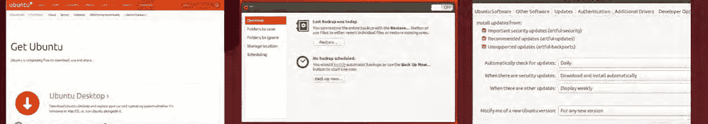

| Ubuntu 软件 | 软件更新 | 附加插件 | 开发者工具 |
|---|---|---|---|
| 从软件更新 | 推荐更新（自动） | 检查更新（每日） | |
| 当有安全更新时 | 自动下载并安装 | | |
| 提醒我 | 针对新版本 | | |


- **尝试 ISO**：在更新你的机器之前，尝试实时启动工具并确保一切运行正常是一个好主意。虽然支持通常在新版本中得到改进，但有理由在更新之前等待。你会发现对于 17.10 版本不再提供 32 位的 ISO——但这可能不会影响现代硬件上的大多数用户。

- **备份你的数据**：在升级之前，你应该备份你的数据。我们知道可能会出问题。即使你有备份（你总是应该备份的），也比后悔要好。如果你想获得极高效率并为自己提供回滚计划，请考虑使用 `dd` 命令（小心操作）对硬盘进行完整镜像备份。

- **从 GUI 升级**：如果你计划升级到 Ubuntu，可以使用“软件更新器”。在“软件和更新”中，点击“更新”选项卡，并确保选中“有新的 Ubuntu 版本时提醒我”（可选）你也可以勾选预发布版更新选项。当你检查更新时，软件更新器会通知你有新版本可用。

### Ubuntu 17.10 中的 Snaps

Snaps 作为一种通用的 Linux 软件包格式，旨在在 Ubuntu 17.10 中无 Bug。Snaps 设计时包含了应用程序所需的所有依赖项，减少了库冲突的常见问题以及为不同发行版多次重新打包的需求。Snaps 处于中心位置——Ubuntu 商店中的“特色”横幅现在默认提供 Snaps，并轻松安装任何单独打包的应用。在 Android 和 iOS 上使用移动应用需要登录 Ubuntu。

系统搜索功能经过了巨大的重构，并得到了改进，结果中现在包含了各种设置。界面看起来比以前更精良，并且在新的显示设置中对 HiDPI 的支持得到了改进。与 Unity 相比支持感觉仍然很短。

### 快速贴士：

重新打开文件浏览器

你知道在 Chrome 中可以按 `Ctrl+T` 打开标签页吗？在 Nautilus（GNOME 文件管理器）中也有相同的快捷键。

为了让现有的 Ubuntu 用户在切换到 GNOME 时不那么突兀，Unity 中使用的主题和颜色也引入了 Ubuntu 默认启动器。深紫色、橙色和红色被用于视觉效果——你很可能会在新版本中感到宾至归，除非你尝试改变它。你可能会怀念的是窗口按钮（即最小化/最大化/关闭），它们从左侧移动到了右侧，这是在 2010 年跨越屏幕的。出于兼容性考虑，你可以将它们移动回去。对于使用非标准窗口的开发者来说，这确实是一个迟到的新开始。Chrome 刚刚在 Beta 版开始使用 GTK 控件——这是 Ubuntu 浏览器长期以来期待的欢迎变化。这种影响将延续到稳定版。

### 快速指南

#### Dash to Panel

Ubuntu 引入的启动器是流行的 'Dock' GNOME 扩展的分叉。作为另一个扩展，Dash to Panel 是扩展功能强大的绝佳示例。Dash 替换了左侧的 dock，取而代之的是一个我们所谓的“类 Windows”任务栏，并重新定位了快捷方式。它具有一些很棒的功能，包括图标悬停、可自定义的运行指示和快捷键。你可能想通过 `sudo apt remove gnome-shell-extension-ubuntu-dock` 移除标准 dock。

Dash to Panel 将 dock 任务栏移动到屏幕底部的单一面板。

#### 扩展让 GNOME 变得灵活

为了让 GNOME 看起来完全符合你的要求，SHELL（你看到的界面）有一个 GTK+ 主题（Ambience），它将应用程序、对话框等的外观与外壳栏、任务切换器、顶部菜单和其他“外壳”整合在一起。如果你想更改机器上的主题，你需要找到你喜欢的主题。鉴于 GNOME 的巨大人气，你可能会发现大多数你喜的主题都能正常工作。

为了应用这些主题，你首先需要安装 GNOME 扩展。扩展是按你想要更改 GNOME 外观的一种极其强大的方式。要开始操作，只需打开网络浏览器并指向 `https://extensions.gnome.org/` ，系统会提示你安装浏览器扩展，之后，你应该安装 'User Themes'——这允许你从用户目录配置上述主题。

Ubuntu 预装了许多扩展。原生的 GNOME 3.10 安装版包含一个看起来像 Ubuntu 界面的 dock —— 但很棒的是绑定的 'Ubuntu dock' 扩展修复了这个问题，使得界面看起来很舒服。最后，确保应用程序指示器出现在顶部栏，这在默认的 GNOME 中是不存在的。

已安装的扩展可以进行更新、启用/禁用、移除，最重要的是进行配置。你可以从网站使用它们，或使用 Tweak 工具（GNOME Tweak Tool）。它就像 Unity Tweaks。它有许多精炼你的 GNOME 安装的方法，还是一个不基于浏览器的扩展管理工具。要安装它，请使用 `sudo install gnome-tweaks`。

工具中的微调按类别划分——“外观（Appearance）”部分允许你设置偏好、启用/禁用动画甚至主题。“桌面（Desktop）”部分对于添加和删除桌面图标以及设置桌面和屏幕背景特别有用。“字体（Fonts）”部分也允许更改字体。鼠标行为（Mouse behaviour）允许你调整输入设置。“窗口（Windows）”部分让你更改窗口周围的行为，以及显示/隐藏阅读器标题栏。

虽然 Ubuntu 团队努力让 GNOME 感觉熟悉，但仍然缺少一些东西。GNOME dash 与 unity 一样强大（在 3.20 版本中有所改进）。它最初非常基础，提供了搜索应用程序、文档、Ubuntu 软件中心的能力，通过使用扩展可能会变得更强大。项目可以右键点击“添加到收藏夹”（在启动器上）或移除。

| 类别 | 设置 |
| :--- | :--- |
| 全局深色主题 | 关闭 |
| 桌面 | |
| 动画 | |
| 主题 | |
| 应用程序 | Ambiance |
| 键盘与鼠标 | 光标 |
| 电源 | 图标 |


| 启动应用程序 | Shell |

| 窗口 | (无) 默认 |

GNOME 的一个亮点是它是如何处理的——最初可能会觉得很奇怪。这是因为对于许多应用程序实际上有两个菜单：菜单（出现在顶部）和应用程序菜单。你是只有全局菜单还是应用程序菜单完全取决于软件开发者。其意是支持主“全局”菜单，但到目前这还没有完善。

在查看 GNOME 网站（`https://extensions.gnome.org/`）时，你会发现一个可以增强你体验的扩展列表。一个流行的扩展是 'Caffeine'，防止计算机进入睡眠。Dash to Panel 将 dock 任务栏移动到屏幕底部的单一面板。

GNOME 的一个亮点是它是如何处理的——最初可能会觉得很奇怪。这是因为对于许多应用程序实际上有两个菜单：菜单（出现在顶部）和应用程序菜单。你是只有全局菜单还是应用程序菜单完全取决于软件开发者。其意是支持主“全局”菜单，但到目前这还没有完善。

虽然 Ubuntu 团队努力让 GNOME 感觉熟悉，但仍然缺少一些东西。GNOME dash 与 unity 一样强大（在 3.20 版本中有所改进）。它最初非常基础，提供了搜索应用程序、文档、Ubuntu 软件中心的能力，通过使用扩展可能会变得更强大。项目可以右键点击“添加到收藏夹”（在启动器上）或移除。

## 桌面环境

如果你正在选择一个发行版来跨越，请记住有很多选项。Ubuntu MATE 是那些想要传统界面的的人的好选择。

集成。Muon 软件包管理器作为 Plasma 的替代方案回归，且 VLC 成为此版本的默认媒体播放器。

- Lubuntu 由 LXDE 驱动，该版本正在进行从 Unity 到 Qt 的迁移。Artful 版本仅包含两个子版本：普通版本和 Lubuntu Next 版本，因为用户更倾向于 LXQt 版本。对于大多数用户来说，使用基于稳定 LXQt 的版本是有意义的，因为它是一个流畅且实用的桌面面板——很可能是 18.04 LTS 版本中的主要环境。
- Lubuntu 设计得轻量级且敏捷。它运行速度快，并且包含了你在发行版内外想要的所有功能，使其成为空间和能力有限的系统来说的理想选择。
- Lubuntu 使用轻量级的 Xfce 桌面。它运行快速且打磨程度良好，因此看起来不像某些轻量级选项那样简陋。17.10 版本没有重大变化，但 Ubuntu 丰富的环境确保了极佳稳定性。
- Lubuntu Budge 是一个更高级层次的打磨版本，仅在 17.04 "Zesty release" 中亮相。Budge 发行版构建在 Ubuntu 之上（尽管调整较少），并包含了适用于 Artful 的 Ubuntu 10.2。该版本新增了 Alt+Tab 切换器，这是一个新功能（基于 Cinnamon）。以及许多更新的应用程序和额外的设置选项。此外，舍弃了一些标准的 Gnome 应用，并替换为更轻量级的替代品，以及文件索引服务。这一改变减少了 Budge 的内存占用。

虽然这些是针对大多数用户的，但仍有大量的其他发行版可用，有以 Gnome 作为默认环境的，也有没有的。从 Unity 迁移到更新的发行版的好处是，你可以切换到非基于 Ubuntu 的发行版，通过安装少量扩展即可获得你完全想要的体验。

在 Debian/Ubuntu 营中，Linux Mint 是一个受欢迎的发行版。Mint 的设计旨在开箱即用，包括专有解码器，这是许多发行版都避之不及的。Mint 默认使用 Cinnamon 环境（它是 Gnome Shell 版本 2 的分支），还可以安装许多其他环境。Mint 包含了 MintTools，它拥有备受赞誉的软件和管理器更新工具，可以保持稳定水平以帮助用户。在软件方面，保守的方法在稳定性上几乎是不可战胜的。

> 如果你想要 Gnome 但又想要一些有点不同的东西，那么 OPENSUSE Tumbleweed 是 openSUSE 发行版的一个滚动更新版本，它在不依赖严格的策略发布周期的情况下维护最新的稳定版本。该项目是为了那些追求稳定胜于新新的用户而存在的。如果你想尝试滚动更新，可以使用通用 openSUSE 发行版，另一个选项是 Fedora。Fedora 由 Red Hat 驱动，实际上实际上是商业版 Red Hat 未来版本的支持平台。

Ubuntu 18.04 仍然是 LTS 版本，如果你现在使用 Ubuntu 但不需要立即获得新功能，18.04 LTS 可以很好用一段时间。这听起来有点吓，但该发行版极其可靠。虽然由于更新非常频繁可能会出现不兼容的情况，但它仍然非常稳定。

更新频率，并为更常见的基于 Debian 的选项提供了良好的替代方案。

一个备受推誉的 Linux 发行版与 elementary OS 然不同。它被誉为“Windows 和 macOS 的快速且充足的替代品”，但它仅仅是另一个发行版。另一个发行版，拥有海量且精心策划的应用程序集，这些程序旨在满足日常需求，而不是用不必要的臃肿软件填充电脑。另一个晚出的 Ubuntu，它提供了应用程序的易发现和安装，并通过许多不同的方法支持多样化的工作流。它的最新版本 0.1 ‘Loki’ 基于当前的 Ubuntu，并且同样容易安装。

## 上游 GNOME

从登录界面安装 `gnome-choose` ‘GNOME’ 以使用更新版本的 GNOME。安装 `gnome-desktop` 以访问额外的 GNOME 应用。

另一个出来的是 Solus，一个滚动更新模型的发行版，Solus 是从零构建的，并使用软件包管理器的分支版本，即 `opkg`。在 Solus 中，该发行版已经加入了相当的

### GNU 世代的必备杂志

& & 开发者

- Shell 脚本
- 笔记本电脑电源使用妙招
- 构建一个机器人哨兵

外加最佳扩展、定制化工具和替代方案

- 项目
- Pi 状态板：监控每一行代码
- Jupyter：编写并共享代码
- 制作一件社交媒体节日毛衣
- ✓ 安装它
- ✓ 精通

评测：一款高性价比的 ARM 架构 Linux 笔记本电脑和安全发发行版

内含还有

* 艺术算法出版
* Python：游戏但充满生命力
* 开源显微镜

## 价格包含运费

## 优惠于 2017 年 12 月 31 日结束

## 你可能还喜欢...

## 免费 DVD 安全与救援工具包

重要的 Linux 新闻、技巧、功能等

## 树莓派保护！监控黑客入侵，构建蜜罐系统，保护你的 USB 存储器

## 绝地求生 (PUBG)

Oggcamp！加入我们，探讨开源软件及更多内容

实操技巧与妙招：精通新款沙漠地图

PlayerOne 呈现问题

*条款与条件：优惠适用于全建议零售价（单价+频率）。美元价格适用于美国，全球其他地区定价可能有所不同。此优惠仅适用于新订阅者。您可以在购买后 14 天内拨或发送电子邮件取消订阅。您的最低期限订阅将在当前期结束结束。除非另有说明，付款不退还。如果您想取消订阅，请提前 30 天通知。所示价格为购买时价格，并可能发生变化。可要求提供直接借记担保的完整详情。条款与条件请访问：`bit.ly/3terms`。优惠于 2017 年 12 月 31 日结束。

## 开源科学之旅

Chris Thornett 是一位科学家，正在为发展中国家设计 3D 打印显微镜，以获取安全的饮用水

Richard Bowman 博士是奖金院士，获得 EPSRC 全球挑战研究基金和皇家委员会的支持。他是 WaterScope 的联合创始人。

### 关键信息

Bowman 博士设计了廉价的 3D 打印高质量开源显微镜和水质测试盒，旨在通过延时显微摄影和结果的数字验证，扩展发展中国家的水质测试范围。

Richard 的灵感何在？

最近他一直在 Public Lab 合作，他们使用廉价的硬件和软件进行环境监测气球。“对我来说，让科学为所有人服务的目标之一，就是为那些需要测量数据的人（例如污染数据）提供工具。”

> 我在巴斯塞大学的实验室与 Richard Bowman 博士交谈了两分钟，他就引导我理解了光束物理学。向青少年解释复杂的科学目标其实非常简单。他以一种迷人的方式做到这一点，就像向记者解释他的复杂领域一样自然，但显易看出他是一位奖金院士，并且具有启发性。

此外，Bowman 博士的故事是他他正在进行一个为期三年的项目，建造一种通用 3D 打印显微镜，但他的野心更大，最终他想创造可以负担得起的 3D 打印“积木”，用于新型实验设备。“开放硬件意味着更多的人可以接触它，”Bowman 博士说。

> 个人而言，我很乐意使用那些即使在资金充足的研究实验室中也不会使用的质量硬件，而不感到尴尬。目前还有一种强大的推动力量，让事物对所有人都有效。

## 按需定制的显微镜

WaterScope 将以 £20 的价格进行测试。生产能力对 Richard 至关重要。他曾尝试过 3D 打印服务，但价格昂贵（£100）。鉴于套装仅需 £5，价格位在 £20 左右。预计人们将在当地打印显微镜并与日本的 STLabs (`http://stilab.co.jp`) 合作，Bowman 将其称为跨市场解决方案。“在东非，最大的需求在坦桑尼亚，是对生产设备的需求，”Bowman 说。WaterScope 还与肯尼亚内罗毕大学合作。Jukkal Box 项目（图，项目的一部分）是与 TechLabs 合作，支持医疗设备的生产。

> OpenLabs 让他产生了想法：“我很好奇可以打印出多程度的显微镜”

Bowman 向我们展示了他打印的第一批显微镜之一：“就是这个，”他说，并使用一个树莓派摄像头制作了一个模块。这是一个微小的透镜管（图），我们已经用了很长时间。“我们的摄像头上有一个微小的银色传感器，像素只有几个很小的……”它是 1.1 微米传感器（针对第 2 代树莓派）。因此，这种形式允许将图像投影到载物上，实际上是一个显微镜物，因为它将光聚焦到一个比相机不大的点上，对于线性光学，正如……我们就可以反转光路，然后它确实是这样……”Bowman 博士解释说，如果他拆下透镜并

对于开源设计：`https://github.com/wb27/openflexure_microscope`

Red Gate 伸出援

你很少会收到某公司打电话问你是否想要免费一周的软件工程师团队，但 Red Gate Software 选择了 WaterScope 作为其在 Down Tools 活动中的“王牌项目”，并协助了 UI 和文档编写工作。


将其对准想要观察的物体——将镜头远离传感器一段——它就能像显微镜一样工作。

惊讶的是，光学显微镜的难度完全在于机械结构。对于跨越数百万米的物体，需要高功率显微镜才能看到任何东西，而此时显微镜的焦点小于1毫米。Bowman 使用较大型号的3D 打印 OpenFlexure 显微镜（如图所示，顶部第31页）描述了这个问题：“如果你的样本即使只抖动一个微米（头发的宽度），你也可能毁掉一切。”

因此，对于严肃的科学工作，昂贵的部分在于构建一个用于精密控制测量对象的机械台，这个机械台的成本可能高达 1000 英镑甚至更多。当 Bowman 开始一个带有 WaterScope 样本的项目（第30页）时，你可以看到图像的迭代（见主图，顶部第31页），这种进步展示了该显微镜作为一个“落射式”显微镜（放大倍数为 x330）的样本，其设计旨在允许 X 和 Y 轴的自由控制和移动。使用更大的显微镜结构将非常复杂且无法制造：“你也无法移动它。”

顶部的 WaterScope 项目结合了水质现场测试以及改善清洁饮用水获取的帮助。

右侧：3D 打印显微镜根据 CERN 硬件许可协议授权。

如今有 63 亿人无法获得安全的饮用水，因此 WaterScope 认为检测水中的细菌是一个如此漫长且困难的过程：“细菌检测既困难又不方便，所以这些人无法自行进行。你必须先收集水；用过滤器从瓶中提取水，然后通过网格更小的过滤器通过，最后让它们生长，18 小时后寻找战斗的、恶性的细菌菌落。如果你在一个基础设施不良好的地方工作，肉眼就能很容易看到菌落，你可能无法获得干净的水龙头，而且你可能需要离开你所在地。

> Bowman 较大的显微镜使用 Python 脚本，使用户能够围绕载玻片移动视视野。

目标是添加更多功能，例如自动聚焦以及将所有图像缝合在一起形成数字表示的能力。

WaterScope 是 Bowman 跟进的项目，源自 iTeams Cambridge 计划（该计划包括树莓派等过去的成功项目）。该计划的一部分专注于关注的创新……

最好的方法是在较小规模上进行测试。毕竟，从单个细菌菌落开始，且设备小巧便携，不需要太多的医生。实验室是有希望的，如果你能找到细菌，就有可能知道你的是哪种细菌，而最后一部分正是我们目前正在努力的方向。

32


上方：OpenFlexure 自动化显微镜设计今年夏天在坦桑尼亚的斯萨姆经过了测试，并用回收瓶进行了 3D 打印。

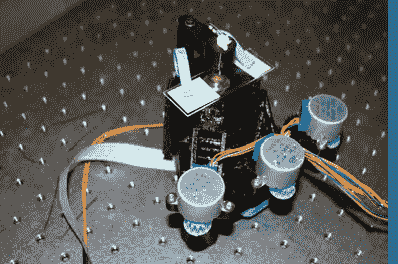

上方：正如 Richard Bowman 指出的，你可以得到各种颜色的塑料，为什么要局限于黑色？

Bowman 博士目前正在为想要制造实验设备的人研究 3D 打印所需的“构建模块”。定制移动台和机械适配器等物品对他们至关重要，他知道。“如果你想让激光击光纤，”Bowman 举例说明，“你需要精度优于微米的精密移动台，而且必须足够稳定，在实验过程中不会抖动。”他手工制的舞台已经足够好。Bowman 表示，不仅商业硬件价格惊人，“如果被锁在一个盒子里，对于电子产品来说可以，但对于科学仪器来说。”

想法是获取一个小时生长过程的时间摄影视频并对其进行处理，以便计算细菌数量。我们使用这些图像数据来验证发生的一切。

技术人员 [...] 如果我们的意思是同时运行十台显微镜，因为它们都是自动化的，那么“如果他们把病人转到医院，就可以提供数字或纸质载玻片，这样他们就不需要重复工作”

我们有细菌正在生长。我们对自己制造的东西很有信心，但我们仍在努力识别是哪种细菌。

我们单独使用 `grep "euro"`，然后它也会匹配到像 "europe" 这样的词。幸运的是，`grep` 允许我们使用字符 `^` 表示行的开头：

```bash
$ grep "euro" dictionary.txt
europe
europe
european
europeans
europegium
```

| ^ / $ | 行的开头/结尾 |

|---|---|

| [linux] | 任意字符 |

| | 字符 i, l, n, x 中的任意一个 |

| [a-h] | 从 a 到 h 的任意小写字母 |

| [0-9-Za-p] | 数字、大写字母或小写字母 p |

| ^Q | 任何不是数字或大写 Q 的字符 |

| \.\.\. | 被视为单个表达式的三个字符 |

| \(...\) | 三个字符，后紧跟相同的三个字符 |

| \, \. | 字面字符 ,，[等等]。 |

我们配合 `grep` 使用的表达式被称为正则表达式。你可能会在其他语言中遇到正则表达式，在这种情况下，`grep` 的功能对你来说是熟悉的。正则表达式构成了一种特殊的语言，允许我们

仔细地指定一个模式。正则表达式定义了一组“匹配”模式的字符串。`grep` 的功能如下：逐行遍历输入内容，并打印出所有匹配模式的行。

正则表达式的一个重要特性是它对通配符的表达能力。例如，句号 `.` 被用于匹配任意字符：

```bash
$ grep "reven*" dictionary.txt
revenue
revenue
```

正则表达式的另一项功能是匹配特定次数的模式。例如，字符 `*` 会导致表达式的前一个部分匹配任意次数，包括零：

```bash
$ grep "princes" dictionary.txt
prince
princes
princes
```

当我们学习第一个教程时，我们学过字符 `*` 用来匹配任何字符字符串。在正则表达式中，语法上大不相同，但更灵活。我们不是使用 `*` 来匹配字符串，而是使用 `.` 代替它：

```bash
$ grep "un.ily*" dictionary.txt
neasily
happily
necessarily
```

上述“基础语言”包含了许多我们可以用来匹配特定类型字符的表达式。

这是今天的额外内容，但它的优势在于通过修改模式，我们可以自定义 `grep` 的匹配内容。例如，我们可以使用紧跟在括号后面的大括号 `{}`，来使用 `grep` 匹配特定的次数：

```bash
$ grep "^v{2}" dictionary.txt
disentisestablishmentarianismelectronography
```

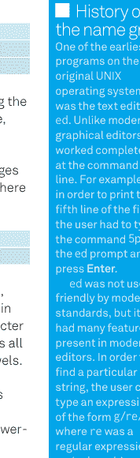

在这里，我们要求 `grep` 找到包含模式 `^v{2}` 的词。在这种情况下，输出的是至少两个字符的英语单词。

正则表达式允许我们匹配字符范围。例如，我们想要找到一个单词中是否有五个或更多元音：

```bash
$ grep "[aeiou]*" dictionary.txt
queuing
```

模式 `[aeiou]` 匹配字母 e, i, o, u 中的任意一个。我们也可以使用括号来使用字符范围；例如 `[a-z]`。`[A-Za-z]` 匹配所有大写和小写字母。我们还可以使用反向括号 `[...]` 来匹配除指定字符以外的所有字符。例如，如果我们知道输入只包含小写字母，那么 `[^aeiou]` 就匹配辅音。

## 分组与反引用

正则表达式允许我们将多个表达式组合为一个。通过这种方式，我们可以使用带有反斜杠的括号 —— `\(...\)`。这会导致表达式被视为...

## Linux 基础

- bookkeepers
- zookeeper

Heredoc 和 命令行开关

本文中的其余代码示例介绍了我们学过的一些构造结构。首先是三连的红色符号，它代表一个 heredoc（在此文档），表示将多个一个字符串作为输入传递给命令，然后是另一个。

例如，我们可能会想英语中是否有符合 `CVCVCVCVCVCVC` 模式的单词；即七个辅音后跟一个元音的重复。为了做到这一点，我们将一个辅音和一个元音组合成一个单一的表达式。


到为止，我们学过的所有表达式都是基础正则表达式语言（Basic Regular Language）的一部分。事实上，这些正则表达式有扩展版本，允许你编写更强大的表达式。许多扩展都受 `grep` 支持。

```bash
$ grep "\(aeiou])" dictionary.txt
```

括号内的分组有另一个效果：当我们对表达式中的一组字符进行分组时，我们创建了一个反引用，稍后可以使用第一次匹配项的数字引用来引用它。

如果一个单词是由连续两个相同的单词组成的，我们称之为单词重复。例如，单词 'murmur' 的重复。我们可以使用以下命令在英语中找到重复项：

- beriberi
- berbero
- cocococ
- cocous

```bash
$ grep "\(..)\$" dictionary.txt
```

在这里，初始的 `\1` 被绑定到反引用 1。如果我们使用 `\1`，稍后可以使用第一次匹配项的数字引用来引用它。

这种功能被称为扩展正则表达式语言。基础语言中的任何有效表达式在扩展语言中都是有效的，并额外有两种用于匹配特定次数的语法：`{n}`、`{n,}` 和 `{n,}`。

## 笔记本电脑电源管理教程

### 轻松提升 Linux 笔记本电脑电池续航

笔记本电池在 Linux 下往往耗电更快。通过调整一些设置，可以延长充电之间的使用时间。

无论你的 Linux 笔记本电脑之前使用的是专有操作系统，还是设置了双系统，你可能已经注意到——一种挥之不去的不便。那就是你的笔记本电池在 Linux 下的续航时间没有那么长。

这里有几种实用的解决方案，例如更换视频驱动程序、使用移动电池盒、改变行为习惯以及调整设置，这些都能提高电池续航。结果将是你的笔记本在 Linux 下可以保持更久的电量。

从你发行版的内置设置开始吧。这在 Ubuntu 和 Fedora 中的位置有所不同，你需要打开“系统 电源”（System Power）。在这里，你可以调整电源管理器调整的速度，以及电脑空闲时的设置。设置较短的时间（例如五分钟）可以避免电池电量进入临界低电量。挂起（Suspend）是一个不错的选择，如果这意味着当你找到电源时，笔记本可以随时恢复运行。

关闭显示器也是一个好选择（请阅亮度文档），如果有“降低亮度”开关，请开启它。

除了电源，还有其他考虑可以提高电池性能的因素。其中之一是禁用无线网络——蓝牙可能会是一个问题。虽然某些笔记本电脑支持低功耗 4G LTE，但某些旧笔记本电脑使用的适配器不兼容新版本的蓝牙。对于网络，禁用此项无法帮助你防止耗电型 Web 应用（在后台经常更新的应用，如 Gmail）产生影响。如果你的笔记本有飞行模式按钮，可以从面板禁用蓝牙和无线网络，但仅适用于快速连接。

正在寻找其他减少笔记本电池消耗的方法吗？可移动式媒体也有帮助。任何类型的 USB 驱动器、SD 卡等都需要持续供电才能保持挂载和可浏览，因此这些设备可以节省电池寿命。

机械硬盘自然会消耗电量。你对笔记本硬盘做不了什么，但在不使用时弹出 CD 和 DVD 也有帮助。如果你使用光驱，请将其取出；获取一个面板来盖在笔记本的空隙上并不难。如果这不可行，或者你更倾向于更实用的解决方案，最好是使用 HDD 或 SSD。

### 可移动式媒体与 Flash

Adobe Flash 是另一回事。如果将其设置为在 2020 年运行，它也会为你节省电池电量。它只是时代的遗迹，不会对你的笔记本电池续航造成崩溃。

你有几个选项可以使用。首先，你可以直接禁用它。这种前瞻性的行动将根据现有的任何软件硬件节省大量能量。具体来说，你可以阻止 Flash 以防止视频和媒体自动播放。在 Mozilla Firefox 中，打开“扩展 > 插件”（Add-ons > Plugins）并找到 Flash Showcase。使用“激活”（Activate）选项控制 Flash。如果你希望被询问，请先选择“询问”（Ask）；Google Chrome 用户可以使用 `chrome://flags/search` 找到 HTML5 视频播放阻止选项。

通过目前为止我们看到的内容，你应该能感觉到 Linux 笔记本电池续航的明显提升。但你可以通过 TLP 进一步优化，TLP 是一项优秀的自定义软件，可用于管理系统的电源使用。安装 TLP 将首先帮助你添加 PPA。

```bash
sudo add-apt-repository ppa:linuxrunner/tlp
```

按照屏幕提示操作，然后更新并安装：

```bash
sudo apt install tlp-rdw
sudo apt run tlp-start
```

当你准备好后，运行 `sudo tlp start`。这将加载默认设置。要查看并编辑这些设置，请用文本编辑器 `nano /etc/tlp.conf` 打开配置文件。在这里，你会找到启用或禁用 TLP 的设置，并且可以发现更多内容。但在笔记本窗口中调整可能有点复杂。例如，在 `tlp-utils.github.io/` 有一个图形化前端可用于编辑 zip 文件及其内容。终止目录中的可执行文件，并运行 `~/.tlp`。一旦设置好配置，用户界面将通过标签页轻松导航，找到可以调整的电源设置。你会发现启用 TLP (`TLP_ENABLE`) 的选项，并在音频（Audio）选项卡中启用或禁用音频省电。你可能想这样做，但禁用音频省电比直接按静音键更有效。

### 高级 Linux 电源管理

接下来，处理磁盘。如果你在页面顶部发现了各种硬盘驱动器。正如我们之前关于可移动硬件的讨论，这值得智智考虑。通过启用 `POWER_OFF_BAT`，你可以通过不使用光驱来节省电量。注意，可以通过删除和替换标签来禁用它。显而易见，它仅对 Radeon 驱动程序有效。这是因为管理 Intel/Nvidia 显卡的电源，你可能会在这里找到相关选项。

转向网络，有两个 Wi-Fi 功能默认是禁用的。这些适配器会影响你节省了多少电量。不要禁用无线，而是使用 `USB_DEVICE_ON`。如果你使用 USB-WOL，你需要关闭它。

接下来的组配置包含了一些需要调整的设置。例如，`POIS` 可以管理 PCI Express 状态电源管理设置等。对于笔记本来说，这些选项几乎总是正确的。然而，只能使用自动挂起（auto-suspend）。对于笔记本，有一个图形化前端可用……具体查看 `CPU_SCALING_FREQ` 和 `CPU_PERF`。

机械硬盘自然会消耗电量。你对笔记本硬盘做不了什么，但在不使用时弹出 CD 和 DVD 也有帮助。如果你使用光驱，请将其取出；获取一个面板来盖在笔记本的空隙上并不难。如果这不可行，或者你更倾向于更实用的解决方案，最好是使用 HDD 或 SSD。

……以此此类推。每次，步进电机的轴都会旋转固定的角度——一个步。这就是我们将控制方向点的方法。将电机连接到驱动电路，然后每个电机都会运行。在 Arduino 上，两个引脚连接到 5V 和地，其余部分需要连接到数字引脚。这就是我们需要的所有。

### 创建步进电机

打开 Arduino IDE，插上你的 Arduino 并创建一个步进电机。示例 "oneStepAtTime" 是入门 IDE 的选择。在最开始，你需要初始化它。你将包含步进电机库（它会为我们完成工作），并设置每圈的步数（取决于特定电机）以及连接到驱动器终端的每个引脚。然后可以如下方式初始化电机：

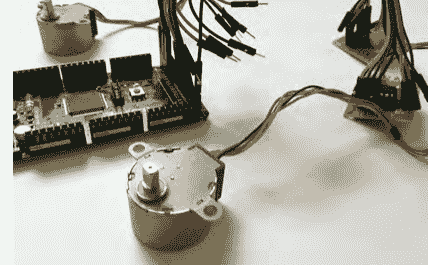

带有步进电机和驱动电路的左侧 Arduino Mega

```
#Include <Stepper.h>
const int stepsPerRev = 2048;
Stepper stepperMotor(stepsPerRev, pin1, pin2, pin3, pin4);
```

使用 `Stepper.step(int)`。对于单个电机，你可以让 `loop` 函数继续运行：

```
void loop() {
  if (Serial.available() > 0) {
    int readStep = Serial.parseInt();
    motorA.step(readStep);
  }
}
```

对于多个电机，你将轮流每个电机，从串口旋转中读取下一个整数。这些都位于 Arduino sketch（程序）中。使用串口与电机进行通信。通过这种方式，你可以从电脑向 Arduino 发送消息。确保你已经在修正中设置了步数（它会绕回并），检查负数是否会在电机运行时旋转电机，然后你就可以将其应用到树莓派。

你可能需要使用其他引脚来获得电机的正确行为。在示例中，引脚 1、2 和 3 被布线以允许电机以你想要的速度旋转并改变方向。如果操作正确，你应该能够在两个方向上都获得平滑的旋转，而没有抖动。你也可以专门针对树莓派，使用 `Stepper.step(pin)` 函数控制电机。为了与树莓派通信，我们将

### 准备摄像头

在这个项目中，树莓派扮演着关键角色，而 Arduino 的设计并不完美。当机器人检测到物体是否移动时，它会通过向 Arduino sketch 发送消息来让相机拍摄照片。即电机臂向哪个方向旋转。机器人应该能够检测你家中的任何移动物体，例如

## 当应用脉冲时，电磁铁吸引齿轮的“齿齿”，从而使齿轮旋转

> 连接树莓派和 Arduino：将需要一个 Arduino，即 Arduino Mega，Arduino 无法为树莓派提供 USB 供电。然而，似乎可以为 Arduino 提供足够驱动电机的电源。

在更多之后初始化。明显的选择是 USB 接口，它将允许你在 Arduino IDE 中使用序列号列出。使用 `Serial.begin()` 初始化串口设置。此时，它将安排一种由单空格隔开的控制步数的格式。接收到的每个整数将返回旋转序列中的下一个标记。对于单个电机，电机顺序并不重要，但对于许多其他电机，在第一个电机转动之前，必须对所有电机都给出一个命令。在示例中，设置了代码步数，任何未使用的电机都只是移动 0 步，每个 200 0 每个步被依次解析，电机随后旋转

对于本教程，我们将使用树莓派 Zero W，即我们拥有的微型型号。原因是拥有一个轻量级且可以远程控制的模型很重要。如果你的摄像头有短电缆（或为 5cm），那么它变得更加重要了，因为摄像头需要安装在臂的末端——这意味着那里必须有。如果你决定制作

www.luxuxer.com | 41

## 教程

### Arduino

使用纸板碎片，任何额外的重量只会对你的机器人造成损坏。无论你选择什么，将摄像头连接到你的树莓派 - 我们将在编写程序后进行组装。来自第二张图片的背景。这将给我们留下大量的（粗略的）空数组元素，如果帧内有物体移动，就会有几个强信号。这将是我们基本的运动传感器程序。然而，如果我们使用对象跟踪算法，它将不会为我们提供此类细节，如果光线变化，它可能需要重新校准，而且它不会区分帧内的多个物体。如果对象跟踪是你感兴趣的

### 使用树莓派捕捉图像

使用 OpenCV，我们可以远程连接到树莓派并编写新的 Python 脚本。使用 `picamera` 库（树莓派中可用）可以轻松与摄像头界面并从我们的照片中收集数据。

### 为了执行背景减法，我们可以使用 NumPy 库

```
import picamera
camera = picamera.Camera()
camera.resolution = (1312, 976)
camera.capture('image.jpg')
```

在上面的示例中，我们使用 picamera 在 1312 x 976 分辨率初始化树莓派并保存为 image.jpg。为了这样做，我们需要进行少量的图像处理。然后，我们将数据加载到 NumPy 数组中。这需要初始化为像素、像素和通道的3维数组（用于红、绿、蓝）。Picamera 要求这些是整数，我们可以做到，并在几行代码内将数据保存到名为 'background' 的数组中：对其他方法感兴趣，例如 OpenCV 可以为你完成这些；然而，更基础的方法是自己编写。为了执行背景减法，我们可以使用 NumPy 库执行矩阵数学。我们还应该取绝对值——我们，这就足够了。有了额外的知识，这可以用于检测两个帧之间移动的物体

```python
import numpy as np
background = np.zeros((1312, 976, 3), dtype=np.uint8)
camera.capture(background, 'rgb')

frame = np.zeros((1312, 976, 3), dtype=np.uint8)
camera.capture(frame, 'rgb')
frame = frame.astype('float')
outray = frame - background
```

### 检测运动

在这一点，我们已经对所有低级值置零（它们基本上是噪声）并缩放其余部分，使其像素值在 0 到 255 之间。通过 `outArray` 计算像素的平均值，我们可以显示。如果 `outArray` 像素工作，我们将这些指令传递给 Arduino。


## 分析

首先，我们需要将 `outArray` 转换为灰度。此时，我们将得到一个黑色的图像。如果操作正确，我们应该通过 `outArray` 像素来显示。

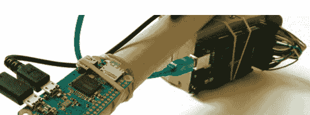

带有步进电机的左侧树莓派和驱动电路

```
#Include <Stepper.h>
const int stepsPerRev = 2048;
Stepper stepperMotor(stepsPerRev, pin1, pin2, pin3, pin4);
```

（注：由于原文文本存在大量段落错乱和内容重复，翻译时已根据上下文对逻辑进行了整理以确保通顺。）

## 计算机安全

### 使用 ESIL 仿真破解晦涩的汇编程序

轻松的逆向工程是一种损失。然而，使用 Radare2 ESIL 语言发射部分代码是有希望的。

**逆向工程、二进制文件的动态和符号分析被广泛用于逆向分析固件和恶意软件。** 在新威胁不断出现的世界里，非逆向工程专家无处遁形。现在介绍 Radare2 ESIL，这是一种汇编指令的中间语言，能够实现轻松表示。ESIL 主要在 Radare2 中用于描述汇编指令的行为。通过处理栈和函数序言，你可以在不执行危险代码的情况下仿真任何架构的函数。自然地，这很有趣：在复杂程序中仿真函数或指令，通过执行其编码器逻辑来解码 shellcode，并对其进行进一步的分析甚至仿真、调试、分支预测、解包等检测。你准备好深入研究寄存器、条件跳转和二进制仿真了吗？请下文！

#### 识别输入和输出

假设你在日常逆向工程会中遇到了一个晦涩的指令。这段代码段可以用于分析它，但只要不将其在某些验证、函数序言和结尾之后封装，然后在来自非二进制分析的沙箱中进行汇装、链接并执行，你就可以安全地调试并动态分析代码。你应该考虑仿真它：

```assembly
00  mov eax, 0
01  push ebx
02  push ebp
03  mov ebp, esp
04  sub esp, 4
05  mov edx, [ebp+8]
06  mov ecx, [ebp+4]
07  lea eax, [label]
08  xor eax, edx
09  mov [ebp-4], eax
0a  add esp, 4
0b  pop ebp
0c  pop ebx
0d  ret
```

Toni Castillo Girona 拥有软件工程学学位和计算机安全硕士学位，在某公立大学担任 IT 支持专家。访问我的博客：http://dbiseaux.up.es。

### 资源

- [GNU 调试器](http://dbiseaux.org) - `apt-get install`
- [Netwide 汇编器 (NASM)] - `apt-get install`
- [Radare2](http://dbiseaux.org/radare2)

以下链接将对你最有帮助：

- [汇编入门教程](http://bit.ly/Assembly)
- [如何测试 shell-code](http://bit.ly/shell)
- [r2 教程](http://bit.ly/r2)

上面让 ESIL VM 引擎为你完成繁重的工作吧！无论如何，我们需要识别函数在使用什么类型的数据、在哪里找到它以及在哪里存储它的输出。当然，一旦你成功调试了它，应用在数据上的转换将会显现。

在架构上，除非原始代码是用 GCC 未使用 EBP 寄存器（也称为帧指针）编译的，否则传递函数的任何参数都可以找到，因为它是相对于 EBP 的偏移。如果是负数，`[ebp]` 是在函数内部定义的局部变量。在一个具有一个参数的函数的 C 程序中，它定义了一个局部变量。编译它并使用 GDB 或 R2 进行进行调试。如果你显式告诉 GCC 不要使用帧指针并反汇编该函数，所有的引用都将来自 ESP 寄存器。

从封面上获取一个代码段，反汇编并查找此代码中的变量，尝试证明相对于 esp 有两个正偏移。作为经验法则，它还会告诉你哪个是第一个参数，哪个是第二个参数。在 x86 架构上，在我们提供的代码段中，参数按反序传递的（先是调用的最后一个参数，然后是最后一个，以此此类推），汇编代码将这些参数推入栈，然后函数调用参数。以上没问题，你不需要简单理解 ESIL；代码足够了！

#### 复杂数据类型可以通过读取和寻找编译器生成的模式来识别

#### 调试代码

为了省去你的麻烦，我们已经做过了：获取文件 `exe1_full` 并命名为 `-f elf -g "=g de" exe1_full -o exe1_full.v1`。现在让我们向函数传递一个字符串（第一个参数）和一个字符（第二个参数）。因为你从屏幕上看不到任何内容，你需要在调试器中执行它以理解它是什么。使用 r2 以调试模式打开二进制文件 `--d exe1_full`。在调用 `exe1` 函数之前设置断点并继续执行直到其命中（`dc`：请注意这些偏移在你的系统上有所不同；使用 `pd` 命令获取第一个偏移）。一旦代码中断，通过 `my_str:` 打印字符串值，然后是字符值。

如此，`[ebp]` 是第一个参数，`[ebp+4]` 是第二个参数。当你需要确定数据类型时，查看第二个参数 `[ebp+4]`。如果它是字符串（8 位寄存器），它可以从 `[ebp+8]` 复制。如果数据是整数，则使用 EAX（32 位寄存器）引用。那么在具有偏移量 (`0x4-0x8`) 的第二个参数 (`ebp+4`) 和第一个参数 (`ebp+8`) 上，在 32 位架构上，使用字节访问内存。如果代码看起来像是一个复制，因为使用了 SCASB 指令在缓冲区中查找字节，你知道第一个参数可能是 char，可能可能是其他类型。更复杂的数据类型（如结构体）可以通过读取和寻找模式来识别。

位于偏移量处的汇编指令。这是因为它们经过了编码。因此，你需要使用 ESIL（解码循环并用解码后的 loc.id 覆盖偏移量处的字节）。启用解码循环并确保 ESIL 引擎可以写入内存：`aes_movewrite; it:code`。然后，通过 `str ebx; aei_eip` 初始化虚拟机。接着需要两条指令来恰好停在 ESP (esi) 中要执行指令的偏移量处：`aes_je`。你可以通过打印当前 EIP 命令的指令来调用下一个要执行的指令：`pd 1 @esp-[1]`。然后你还需要一条指令，你就可以通过打印当前 EIP 的值来执行 shellcode：`aes_resi`。继续单步执行直到解码循环（off）`aes_loc` 完成，shell-code 就会被解码。

这里的惊喜是：启动了一个 shell（不过权限是 root）。在 GNU/Linux 上，这显然完全行不通（参见《教程》，第 32 页，L&168。使用现代保护机制的复杂软件）。

到此，当我们在当前的 ESIL 中增加系统调用时，需要一些挂钩（hooking）。当然，通过剥离并使用你喜欢的语言来挂钩自己的系统调用并不那么简单（参见 `http://live.yr2.com`）。始终有机会通过封面光盘上的 `aes_read_file` 执行初始（可行的）获取。在这里你可以使用 `aes_read_file(aes_3)`。这会打开并读取文件文本，然后将内容存储在此缓冲区中。因为你想让它在内存中，更改 ESI 的值以记录第一次比较是非常简单的，然后通过使用 `LUD` 字符串将缓冲区向右移动（参见 `aes/esi_read_file(aes_2)`），跳过前两个并读取第 39 行。在解码器（ob）定位并找到正确偏移量后，在用 ‘w’ 写入 ‘LUD’ 字符串的行中，取消执行该处的 shellcode。通过轻松编写反混淆器或编写你自己的元素，学习结合这些技术。

### 接下来做什么？

#### 在反向工程领域完善你自己！

作者：Bruce Alexander Genet 和 Elias Balachandran，其他人的贡献

#### 实践

#### 反向工程

#### X86, X64, Windows 内内核

#### 反向工程工具与混淆

#### 现在你已经有了 shell-code，可以将其保存为二进制文件以便进一步分析

因此，直到退出的整个循环，就在跳转到 shellcode 的位置 (`jmp esi`) `aes_0x88880087`。如果你有了 shell-code，你可以使用 `aes_mov` 命令。shell-code 的长度从前两个字节解码：`0x01,0xff` (255 字节)。然后你需要 r1 和 r2 将 shell-code 保存到外部文件：`aes_0x888807f0 shell_bin.25`。这就是第一种编码方案是如何使用“异或加密”的，因为你可以解码第一个密钥 `0x99`（参见 `instruction mov.al, dx`），然后它将由下一个密钥解码，依此类推，直到每一个字节都被解码。封面解码器也提供了一个测试此解码器的程序 `aes/ex4_shell.c`。它使用以下命令编译并执行：`gcc -stack-protector=0 -o ex4_shellcode ./ex4_shellcode.No--`


WILEY

##### 1 参考自：

《Practical Reverse Engineering》，Wiley, 2014 年 4 月

本书向读者介绍了两种主要架构：x86 和 ARM 的反向工程知识。它在第一组架构中讨论了 MIPS 指令，并附有代码片段和练习，以按顺序应用如何反向工程它们。然后，它还讨论了代码模式，以便识别威胁并分析简单的代码。从那里开始，它解释了如何反向工程恶意软件、反调试和反汇编技术，以及代码混淆。

现在你已经有了 shell-code，可以将其保存为二进制文件。如果你需要这样做，可以使用 `mov` 命令。shell-code 的长度从前两个字节解码出来……

##### 2 参加会议：

Recon 2018 & 2019

明年 9 月份，第三届 recon (2018) 将在西班牙巴塞罗纳再次举行！我们参加了 recon 2017，并将参加 recon 2019。

### 让你的技能接受测试：

看看封面光盘上的代码挑战。这个挑战是 XOR 解码器的变体。使用了某种编码方案来解码 shell-code。然后，使用 ESIL 使用解码器并反向工程代码以获取原始文件。如果你需要指导，封面上有一份文档 (`aes/aes_guide.pdf`)，它是用分步教程编写的。如果你想免费测试该解码器，你需要阅读本文。尝试理解解码器为什么以及如何会失败，然后修复它。想了解更多吗？使用恶意软件生成一个每个条目都是加密的负载。

这些会议是学习更多反向工程、恶意软件和汇编语言的绝佳机会。所以留下来，不要错过！

访问 http://live.yr2.com/


www.linuxer.com 47

## 教程

### Java

#### 第四部分

#### 学习 Java：从单机到多人

创建一个多人游戏的多客户端系统是学习并发的绝佳方法


John 是一位编程和计算机科学的大学导师，重点关注 Java。他喜欢在每一个能拿到的设备上安装它。

### 资源

- OpenJDK 8（参见 openjdk.java.net 上的包管理器）
- JavaFX 8（参见 openjfx.java.net/projects 上的包管理器）
- Eclipse IDE（参见 eclipse.org/ 上的包管理器）
- Telnet 客户端（参见 software/netinet/ 上的包管理器）
- Netcat 客户端（参见 netcat.sourceforge.net 上的包管理器）

当我们在当前的 ESIL 中增加系统调用时，需要一些挂钩。当然，通过剥离并使用你偏好的语言来挂钩自己的系统调用并不那么简单（参见 `http://live.yr2.com`）。始终有机会通过封面光盘上的 `aes_read_file` 执行初始（可行的）获取。在这里你可以使用 `aes_read_file(aes_3)`。这会打开并读取文件文本，然后将内容存储在此缓冲区中。因为你想让它在内存中，更改 ESI 的值以记录第一次比较是非常简单的，然后通过使用 `LUD` 字符串将缓冲区向右移动（参见 `aes/esi_read_file(aes_2)`），跳过前两个并读取第 39 行。在解码器（ob）定位并找到正确偏移量后，在用 ‘w’ 写入 ‘LUD’ 字符串的行中，取消执行该处的 shellcode。通过轻松编写反混淆器或编写你自己的元素，学习结合这些技术。

### 接下来做什么？

#### 在反向工程领域完善你自己

作者：Bruce Alexander Genet 和 Elias Balachandran，其他人的贡献

#### 实践

#### 反向工程

#### X86, X64, Windows 内内核

#### 反向工程工具与混淆

#### 现在你已经有了 shell-code，可以将其保存为二进制文件以便进一步分析

因此，直到退出的整个循环，就在跳转到 shellcode 的位置 (`jmp esi`) `aes_0x88880087`。如果你有了 shell-code，你可以使用 `aes_mov` 命令。shell-code 的长度从前两个字节解码：`0x01,0xff` (255 字节)。然后你需要 r1 和 r2 将 shell-code 保存到外部文件：`aes_0x888807f0 shell_bin.25`。这就是第一种编码方案是如何使用“异或加密”的，因为你可以解码第一个密钥 `0x99`（参见 `instruction mov.al, dx`），然后它将由下一个密钥解码，依此类推，直到每一个字节都被解码。封面解码器也提供了一个测试此解码器的程序 `aes/ex4_shell.c`。它使用以下命令编译并执行：`gcc -stack-protector=0 -o ex4_shellcode ./ex4_shellcode.No--`


WILEY

##### 1 参考自：

《Practical Reverse Engineering》，Wiley, 2014 年 4 月

本书向读者介绍了两种主要架构：x86 和 ARM 的反向工程知识。它在第一组架构中讨论了 MIPS 指令，并附有代码片段和练习，以按顺序应用如何反向工程它们。然后，它还讨论了代码模式，以便识别威胁并分析简单的代码。从那里开始，它解释了如何反向工程恶意软件、反调试和反汇编技术，以及代码混淆。

现在你已经有了 shell-code，可以将其保存为二进制文件。如果你需要这样做，可以使用 `mov` 命令。shell-code 的长度从前两个字节解码出来……

##### 2 参加会议：

Recon 2018 & 2019

明年 9 月份，第三届 recon (2018) 将在西班牙巴塞罗纳再次举行！我们参加了 recon 2017，并将参加 recon 2019。

### 让你的技能接受测试：

看看封面光盘上的代码挑战。这个挑战是 XOR 解码器的变体。使用了某种编码方案来解码 shell-code。然后，使用 ESIL 使用解码器并反向工程代码以获取原始文件。如果你需要指导，封面上有一份文档 (`aes/aes_guide.pdf`)，它是用分步教程编写的。如果你想免费测试该解码器，你需要阅读本文。尝试理解解码器为什么以及如何会失败，然后修复它。想了解更多吗？使用恶意软件生成一个每个条目都是加密的负载。

这些会议是学习更多反向工程、恶意软件和汇编语言的绝佳机会。所以留下来，不要错过！

访问 http://live.yr2.com/


www.linuxer.com 47

## 教程

### Java

#### 第四部分

#### 学习 Java：从单机到多人

创建一个多人游戏的多客户端系统是学习并发的绝佳方法


John 是一位编程和计算机科学的大学导师，重点关注 Java。他喜欢在每一个能拿到的设备上安装它。

### 资源

- OpenJDK 8（参见 openjdk.java.net 上的包管理器）
- JavaFX 8（参见 openjfx.java.net/projects 上的包管理器）
- Eclipse IDE（参见 eclipse.org/ 上的包管理器）
- Telnet 客户端（参见 software/netinet/ 上的包管理器）
- Netcat 客户端（参见 netcat.sourceforge.net 上的包管理器）

当我们在当前的 ESIL 中增加系统调用时，需要一些挂钩（hooking）。当然，通过剥离并使用你偏好的语言来挂钩自己的系统调用并不那么简单（参见 `http://live.yr2.com`）。始终有机会通过封面光盘上的 `aes_read_file` 执行初始（可行的）获取。在这里你可以使用 `aes_read_file(aes_3)`。这会打开并读取文件文本，然后将内容存储在在此缓冲区中。因为你想让它在内存中，更改 ESI 的值以记录第一次比较是非常简单的，然后通过使用 `LUD` 字符串将缓冲区向右移动（参见 `aes/esi_read_file(aes_2)`），跳过前两个并读取第 39 行。在解码器（ob）定位并找到正确偏移量后，在用 ‘w’ 写入 ‘LUD’ 字符串的行中，取消执行该处的 shellcode。通过轻松编写反混淆器或编写你自己的元素，学习结合这些技术。

> 创建多人游戏游戏的概念是简单的，但很难避免掉入

我们不会在再次运行游戏时注意到任何变化，但很难做出这些修改以便我们之后看到它们。

现在我们在地图上有了玩家，我们需要功能将玩家添加到网格中并从它们移动到网格。在 `draw()` 方法中，我们包含了一个抽象类 `GameMap` 的新版本，包含了 `addPlayer(player)`, `removePlayer(player)`。


我们现在可以测试我们所做的一切。由于我们没有更改任何用于显示的代码，可以使用它，但要使用上一个问题中提到的 tel 客户端。运行服务器的一个实例并打开两个终端。在其中一个，运行命令：

```
$ tel localhost 9009
```

www.linuxusker.com 49

## Java 教程


图 2

两个玩家都从同一个方格开始。如果玩家 I 移动，玩家 II 仍然会看到屏幕

（如果你使用了不同的操作系统，请链链端口。在其中一个终端中，运行 `move` 命令，然后运行 `search` 命令并按回车。然后，我们将字母 `O` 直接设置在当前玩家的左侧，这样对立玩家就在另一个终端中运行。）

下一步是设置客户端以读取地图，并通过在地图上放置玩家来与之交互。客户端上的 `ServerOutput` 类使用 `AnimalDecoder.decodeTile` 方法将字符转换为 `Map` 对象。在此方法中添加一些代码，如果字符为 `O`，则向地图上添加一个玩家。然后，我们可以使用以下代码向瓦片中添加玩家：

```
tile.getPlayersTile().add(new Player(I));
```

最后，我们需要确保 GUI 本身能够显示地图上的玩家。`GUIOutputView` 类使用 `MapGrid` 类来显示地图瓦片和其他元素。为了有一种在地图上显示玩家的方法，打开样式表 `src/main/resources/styles/map.css` 并创建一个名为 `opponent` 的新 ID。如果你愿意，可以复制并粘贴玩家 ID 的代码并重命名为 `opponent`，尽管你可能想将 `background-image` 属性更改为 `main_green_33pg.jpg`（随光盘提供），这样我们就可以从当前玩家创建对手。现在，我们可以使用以下代码创建一个带有对手图像的新瓦片：

```
new Map("Opponent")
```

（如果你使用的是提供的代码以前一个版本代码，这可能会有所不同。）查看 `MapGrid.displayMapTile`，在地图上显示蛋瓦片的技术是在地图上相应的方格上显示玩家。你可以使用以下表达式检查瓦片是否有玩家：

```
tile.getPlayersTile().isEmpty()
```

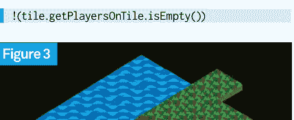

图 3

由于玩家 I 已经移动，他的客户端通过显示更新后的地图做出响应。当玩家移动时，不要忘记移除对手瓦片。如果我们现在运行游戏，我们应该能够在地图上看到其他玩家。

在图 2 中，我们看到了玩家 I 开始游戏的位置。在图 2 中，玩家 I 已移动到方格，似乎 II 仍然看到图 2 中的视图。在这里，GUI 只有在玩家按下按键时才会响应。

## 处理迭代

当你编写 `nextPlayerTiles()` 方法时，你需要从特定的瓦片返回下一个玩家。如果你这样这样做，我们最终将得到两个循环：一个遍历瓦片，一个遍历玩家。这将产生两个效果：它将清理我们的代码，并且我们避免了执行相同任务的嵌套循环。在 Java 中实现此点的方法是编写一个 `Iterator` 接口的实现。迭代器有两个方法：`hasNext()`，如果存在另一个元素则返回 `true`；以及 `next()`，返回迭代中的下一个元素或 `null`。

如果我们有一个 `Iterator`，就可以用它执行迭代：`forEach()`，在 Lambda 表达式或方法引用中使用将其应用于迭代的每个元素。

我们可以在 `Player` 抽象类中添加一个（具体的）方法：

```java
public void notifyChange() {        setChanged();
    notifyObservers();
}
```

我们需要第二个更改是将 `GameModel` 观察者作为 `Player` 实例添加。在 `EggServer` 方法中添加该行：

- `player.addObserver(gameModel);`

- `GameModel` 和 `player` 对象已经创建。现在当我们调用 `notifyChange()` 时，它将导致游戏模型返回列表。

现在我们已经准备好，我们需要进入 `StandardGame` 类并修改该方法，每当移动或拾取命令时，程序化位于可见范围内的玩家并调用 `notifyChange()`。

```java
public void notifyOtherPlayers() {
    for (int i = 0; i < players.size(); i++) {
        if (players.get(i) != this) {
            players.get(i).notifyChange();
        }
    }
}
```

启动服务器实例，然后启动实例和其中一个玩家的实例。

## 图 4


幸运！当玩家按下按钮时，GUI 做出了响应。当只有 I 向南移动时，I 出现在他/她的新位置。这是一个更严肃的应用，那么当一个玩家移动时，它可以通知地图上的每个玩家。

`Player` 对象的集合使我们很容易找到足够近的玩家，以通知所有玩家原始瓦片和他们移动到的瓦片。为了对所有这些玩家进行搜索，我们需要访问 `GameModel`。

一种方法是添加对 `GameModel` 接口的引用，允许 `Player` 类调用 `GameModel` 的方法。如果两个类互相引用，是设计糟糕的标志。这破坏了我们的设计，`Player` 作为一个抽象类不应该知道底层的 `GameModel`。这在 `GameModel` 和 `Player` 之间创建了双向依赖，这是一个糟糕的设计。

有一个更优雅的解决方案，而且很容易实现。例如，如果我们在 `GameModel` 类中创建一个接口并让 `Player` 类实现它，并在接口中添加一个方法。那么当 `GameModel` 检测到它需要重新加载游戏时，它会通知其观察者。

由于接口不允许扩展类，我们需要将 `Player` 接口更改为抽象类以便扩展 `Observable` 类，这意味着 `Player` 类中的所有方法都需要 `abstract` 关键字，并且我们需要更改 `HumanPlayer` 类，使其扩展而不是实现我们在这里做的 `Player` 类。

## 图 5

| Refactor | Navigator | Search | Project Window | Help |

|---|---|---|---|---|

| Debug Type Hierarchy (1) [Application] | | | | |

| EggServer (1) Debugging EggServer at localhost:8080 | | | | |

| Thread (main) | | | | |

| Thread (1) [Suspended] only at method in egg.StandardGameModel | | | | |

| Thread (2) [Stopped] only at method in egg.StandardGameModel | | | | |

| StandardGameModel.java:line 67 | | | | |

| StandardGameModel.java:line 166 | | | | |

| StandardGameModel.update:line 233 | | | | |

| StandardGameModel.update(Object):line 233 | | | | |

Eclipse 中的调试面板允许我们通过点击方法名在挂起的线程之间切换。如果你在其他玩家的周围移动，太棒了！现在是调试你的代码以找出它为什么不起工作了。

## 修复同步错误

在这一点，我们拥有了一个运行良好的游戏，尽管似乎还有很多工作要做。并发是一个微妙的领域，而且很难今天就修复所有的错误。

www.luxuker.com 

## Java 教程

## 死锁

同步可以消除错误，但也可以引起错误。如果你尝试同步整个方法，可能会导致程序死锁。通过使用 `Hashtable`，一个线程调用同步方法，然后调用另一个。但如果另一个线程也在移动，那么它们都启动了，这意味着哪个都无法运行（图 7）。

同步中常见的错误来源是同步错误。例如，在以下代码中（while 循环）：

```java
while (true) {
    if (it.hasNext()) {
        Egg e = it.next();
        // process egg
    }
}
```

如果两个线程访问相同的数据，它们将得到 `ConcurrentModificationException`。我们需要使用 Java 虚拟机来处理此：该方法是

（此处应有图 7 的图片）

上述我们使用 Eclipse 中的调试面板来检测共享数据何时变化。并发是一个微妙的主题，很难一眼看到程序中所有的错误。

## 在调试器内部模拟 bug

为了让自己相信同步问题是一个 bug，你可能需要亲手发现它。首先，在重置开始时，调用 `Map` 类中的 `reset()`，然后启动两个线程。在正常模型下，两个玩家都会出现在地图上。当两个玩家都站立时，按下其中一个玩家的“向上”键，这应该触发我们的断点。

在 Eclipse 中点击“Step over”（单步跳过）来执行第一行代码。如果发生异常，点击客户端并再次按下“向上”键。切换到第二个客户端，对该线程也点击“Step over”，直到到达断点。

效果将是两个玩家都捡起了蛋，如图 1 所示。

在另一次同步后，情况也是一样的。`SampleGame()` 中方法的关键在于，此时将抛出异常，因为我们执行了两个同步方法的非法交替执行。当我们正常运行时，我们就可以确定自己免受此类同步问题的困扰。

线程可能会抛出 `InterruptedException`，因此我们需要处理它。调用 `Thread.sleep()` 应该始终放在 `try` 块中，否则将非常容易添加一个新的 `catch` 块来处理异常。

在这种情况下，错误代码的左侧会出现一个红标记。点击此标记并添加一个 `catch` 子句将代码封装在 `try` 块中即可处理 `InterruptedException`。

如果我们重复实验，会注意到游戏移动变慢了，而且游戏对另一个玩家再次有响应。然而，如果我们用 Ctrl+C 杀死客户端，玩家仍然会出现在地图上。这是因为即使只有几毫秒，客户端仍在向套接字推送更多命令。在我们睡眠时，忽略所有命令更合逻辑。

```
while (reader.ready()) {
  reader.readLine();
}
```

注意，这会导致客户端显示新内容。原因是当我们按下按钮时，客户端会发送：向被按下的按钮发送移动或捡取命令、向重绘地图发送搜索命令，以及发送刷新界面的库存命令。在我们做的更改下，这些操作中只有第一个会在服务器上执行。

解决此问题的变方法是在 `Player` 类的 `notifyChanges()` 方法中、在搜索命令之后立即添加对库存的调用。由于库存只在我们执行的操作中发生变化，每当他们移动或执行命令时，我们必须使用服务器将库存发送给客户端。

## 处理中途退出的玩家

如果在游戏过程中关闭会话，玩家消失后，相应的玩家仍然出现在地图上。我们可以为 `GameModel` 添加一个新方法 `leave()`。该方法的实现位于：

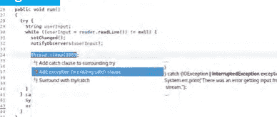

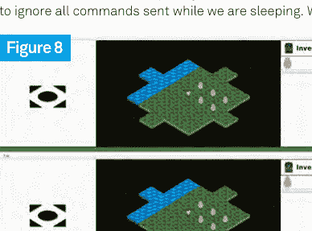

在 Eclipse 中向现有代码添加一个新的 `catch` 子句很快。

`StandardGameModel` 将使用 `getMap().removePlayer()` 将玩家从地图中移除。我们需要修改 `StandardGameModel` 类中的代码，使 `executeCommand()` 方法在接收到 `leave` 命令时调用 `leave()` 方法。我们应该确保收到的 `notifyInventoryPlayer()` 方法会将离开的玩家从玩家地图上移除。

一旦我们实现了 `leave` 命令，我们需要确保停止从该玩家的客户端程序接收输入。我们可以通过在 `InputController` 类内部的 `try` 语句中添加一个 `finally` 子句来实现：

```
setChanged();
notifyObservers("leave");
```

同步会导致两个人都捡起同一个蛋，这可不……

如果我们然后运行客户端，它会正常关闭，或者抛出异常……

## TensorFlow 功能


## 使用 TENSORFLOW 构建智能项目

Joey Bernard 演示了如何为你自己的软件开发项目添加前沿的机器智能。

Google 在机器学习能力方面投入了大量的开发者时间和精力。这项工作已应用于公司的人工智能应用。由 Brain 团队开发的工具之一最初是为机器学习和神经网络应用设计的，但它使用通用语言编写，允许许多其他机器智能应用。TensorFlow 被编写成一个 API 层，以 Python 模块的形式提供。低级 API 和其他 API 构建在此层之上，使常见的编程任务变得更简单，而 TensorFlow 层提供了所有功能。TensorFlow 的张量（tensor）部分描述了所使用的数据结构，即张量。在这种情况下，张量被定义为任意维度的元素数组，其中形状（shape）是定义每个维度大小的列表。TensorFlow 的流（flow）部分是计算部分。

常量节点（constant node）不接受输入并返回单个张量。你可以使用下面的代码创建节点。

```
import tensorflow as tf
node_a = tf.constant(6)
node_b = tf.constant(?)
```

使用 TensorFlow 进行计算需要两个步骤。第一步是创建图，我们已经做了。第二步是运行图和所需的处理。这由名为 session（会）的对象处理。下面的示例作为一个基本的会运行图：

```
session_a = tf.Session()
print(session_a.run(node_a, node_b))
```

常量节点返回其内容，因此当你运行会时，你会得到值 7 并打印出来。这本身并没有那么用。我们可能想对这些张量应用操作，而这些操作也被定义为节点。有很多内置操作可用。通过下面的代码，你将找到生活的答案：

```
node_ans = tf.multiply(node_a, node_b)
print(session_a.run(node_ans,node_ans))
```

这将打印答案 42。节点可以在非常复杂的集合中连接以执行任何需要。这就是为什么 TensorFlow 成为机器学习应用程序的标准工具包。

有许多不同类型可以用于各种计算。TensorFlow 使用计算图，其中节点是计算步骤。有许多不同类型可以用于各种计算。你可以创建非常复杂的计算图来处理数据流。通常情况下，节点接受零或


（注：提供的 OCR 文本包含大量的重复/重叠部分。我已将唯一内容合并到下面的逻辑流中。）

你之前创建的（内容内容），以及在训练中使用的许多步骤。通过这种方式，你可以将编写这些估算器所花费的所有程序员时间转化为你的优势。我们编写了一些关于如何运行估算器以跨多个节点或使用 GPU 的最佳实践。

我们到为止所看到的许多函数在你需要时并没有以预期的形式可用。某些情况下，你可能对线程有更多控制。在这些情况下，TensorFlow 包含了可以并行执行的队列（Queue）。有几种内置队列可用，例如随机洗牌队列。下面的示例显示了它的样子：

```python
min_after_dequeue=int(0.9),
shapes=shape.shape, dtypes=shape.dtype
```

## 快速提示

安装修复取决于你尝试安装 TensorFlow 的位置，你可能无法轻松地安装它。在某些情况下，提供了包含所有所需内容的 Docker 镜像。

上述，source 是一个正在处理的输入数据对象。然后你需要创建一个运算符来逐个入队：

- `enqueue = queue.enqueue(source)`

通过此，你可以创建一个队列运行器，它将启动线程并从下面的代码中读取：

一旦创建了 Queue 对象，你就需要注册它，以便 TensorFlow 知道

```python
num_threads = 4
queue_runner = tf.train.QueueRunner(queue,[enqueue]=num_threads)
```

```python
queue = tf.RandomShuffleQueue(capacity=capacity,
```

## 如何操作

## 安装 TensorFlow

```bash
$ bernard@localhost:~$ virtualenv --system-packages venv
$ source venv/bin/activate
Installing TensorFlow...
$ pip install --upgrade pip
Installing Pip...
$ pip install tensorflow
Installing TensorFlow... 
$ bernard@localhost:~$ $
```

### 01 创建虚拟环境

推荐的第一步是创建一个虚拟环境，你可以在可以在其中安装 TensorFlow，而不会受到其他 Python 模块的干扰：

### 03 更新 pip

要安装 TensorFlow，你需要一个非常新的 pip 版本。你可以通过以下命令来确认：


```bash
virtualenv --system-packages ~/tensorflow
```

要使用 Python 3.X，你可能需要添加选项 `-python3`

```bash
easy_install -U pip
```

现在执行任何命令都都将使用最新版本。

### 02 激活

接下来，使用以下命令激活新环境：

```bash
source ~/venv/bin/activate
```

CLI 前缀会显示出来。你的路径变量现在将被设置，以便你使用存储在 `bin` 目录中的 Python 可执行文件和其他工具。

### 04 安装 TensorFlow

你现在可以安装 TensorFlow 了。命令为：

```bash
pip install --upgrade tensorflow
```

这安装了 TensorFlow 的仅 CPU 版本。如果你想要适用于 GPU 的版本，可以将 `TensorFlow` 替换为 `tensorflow-gpu`。

## 特性

## TensorFlow

### API 替代方案

虽然大多数人使用 TensorFlow 的 Python API，但还有其他可用选项。你可以下载 Java、C++ 甚至 Go 语言的 API。

它需要被管理。可以通过以下代码实现：

```python
tf.train.add_queue_runner(queue_runner)
```

不要忘记像下面的代码一样将队列添加到队列项代码中：

```python
get_batch = queue.dequeue_many(batch_size)
```

既然我们已经让 TensorFlow 这样做了，我们如何快速做到这一点？性能变成了一个问题，所以许多人做一些主观的东西，因此你需要将这些问题处理到你的核心部分中。要检查的第一地方是你是否从更大的文件中加载了数据。这是因为在加载时，硬件和操作系统是至关重要的。第二件事是检查，如果这是你的性能问题，`Dataset` API 是否能帮助你的代码。它被添加到 1.2 的 `contrib` 版本中，并计划添加到 TensorFlow 的核心部分。

一旦创建了 `Queue` 对象，你就需要将其注册到需要管理的 TensorFlow 工具箱包中：

```python
with tf.train.MonitoredSession() as sess:
    while not sess.stopped():
        print(sess.run(batch))
```

每一步都已拆解到核心级别，在预构建不是你所需要的执行的情况下，可以在那些情况下进行操作。你可以使用 `MonitoredSession` 来处理所有工作，如示例所示：使用 TensorFlow 处理非常大的数据集和大模型。主网站上记录了若干种最佳实践。应该查看的第一项是你电脑最慢的部分，硬盘。一个常见的瓶颈是输入步骤，你从那里加载和预处理任何数据，这是很难诊断的。

## 如何

## 使用设备

| 设备 | 名称 | 用法 |
|---|---|---|

### 01 安装 CUDA 库

第一步是确保系统上已安装 CUDA 库。你需要访问 Nvidia 获取适用于你特定硬件操作系统的驱动程序和库。你还需要设置路径，这可以通过命令可用：

```bash
sudo apt-get install libcuda-dev
```

### 02 设备标记

设备按类型和编号进行标记的。例如，你机器的 CPU 将标记为 `/cpu0`，而第一个 GPU 将标记为 `/gpu0`，如果你有两个显卡，第二张卡将标记为 `/gpu1`。这就是它在日志信息中的显示方式，也是你在配置文件中引用它们的方式。

### 03 检查设备使用

由于 TensorFlow 执行了大量的分析，你可能想看看它决定做什么。遵循代码设备使用，打印在运行给定会话时使用的设备：

```python
sess = tf.Session(config=tf.ConfigProto(log_device_placement=True))
```

## 输入 / 输出

| 输入 | 输出 |
|---|---|

| 接下来？ | JIT 编译器可以在会话和图级别使用。下面的代码显示了如何通过手动技术使用 JIT 编译器，如下所示 |
| 还有什么？ | 这里的 JIT 编译器支持 x86-64 和 ARM CPU 架构。 |
| 它是怎样的？ | 如果相反，如果你想为最困难的实例使用 JIT 编译器，可以使用手动技术，如下所示 |

```python
config = tf.ConfigProto()
config.graph_optimizers.global_level = 1
sess = tf.Session(config=config)
```

### 04 强制设备

你也可以通过为特定会话使用 `device()` 来强制 TensorFlow 使用特定设备。例如，以下代码强制 TensorFlow 使用找到的第一块显卡：

```python
with tf.device('/gpu:0'):
    ... TensorFlow 操作 ...
```

### 05 设置内存使用

通常，TensorFlow 尝试最大化 GPU 使用。如果你需要使用较小并在允许其增长，设置相应的选项配置：

```python
config = tf.ConfigProto()
config.gpu_options.allow_growth = True
sess = tf.Session(config=config, ...)
``` 使用多个 GPU

默认情况下，TensorFlow 每次只使用一个 GPU。如果你想同时使用多个，你需要使用以下方式分发代码：

```python
for d in ['gpu:0', 'gpu:1']:
  with tf.device(d):
    ... TensorFlow 操作 ...
```

## TensorFlow 特性

## 快速提示

### 使用调试器

```python
jit_scope = tf.compiler.experimental_jit_scope
x = tf.placeholder(np.float32)
with jit_scope:
    y = tf.add(x, x)
```

在这个示例中，如果可能，该方法将通过 JIT 编译器运行。JIT 编译器会分析图并尝试对其进行编译。幸运的是，如果它无法编译，它只会静默失败并回退到常规 Python 代码供你操作。因此，尝试一下非常简单，无需担心副作用。

如果你想使用 AOT 编译器，你可能会使用过更传统的语言，如 C 或 C++。你可以获取一个输入文件并生成可执行的输出。输入文件应包含一个图，该图被编译成单个函数，然后该函数将一个或多个 fetches 作为输入和输出。AOT 编译器的主要限制是子图不能使用 Placeholders 或 Variables。在大多数情况下，你将能够用模拟所需的 feeds 替换任何 Placeholders 或 Variables。

```python
file_writer = tf.FileWriter(tensorflow_logs, sess.graph)
```

```bash
tensorboard --logdir ./tensorflow_logs
```

> 如果你想使用 AOT 编译器，你将使用一个链，这对于熟悉使用过更传统语言（如 C 或 C++）的开发者来说应该有助于将其作为参数传递给保存图，可以在那里提供它们。

```python
saver = tf.train.save("var")
```

通常情况下，你可能想要保存并恢复模型，包括 Variables、Graphs 和元数据。这是通过 SavedModel 构建器处理的，如下例：

当你开始更深入地使用 TensorFlow 时，某些运行可能需要很长时间执行。在这种情况下，你可能希望对变量和模型进行 checkpoint，以便在必要时停止并恢复处理。`save` 对象可以将变量转储到磁盘以便重新加载。例如，以下代码保存了你程序中所有的 Variables：

```python
saver = tf.train.save()
path = saver.save("checkpoint.ckpt")
```

```python
builder = tf.saved_model.builder.SavedModelBuilder("export_dir")
builder.add_meta_graph_and_variables(sess, [tag_constants.TRAINING], signature_default_map_foo="")
builder.save()
```

除了保存之外，你还需要为你的集合提供变量和资产。你可能希望运行模型一段时间，然后在遇到有趣的点时（或者为了停止回家时）保存该方法。当你回来并选取已保存的模型时，`loader` 对象可以处理所需的工作。以下代码将重新加载已保存的模型：

```python
tf.saved_model.loader.load(sess, [tag_constants.TRAINING], "/export_dir")
```

当你想要恢复变量时，可以使用以下代码恢复 checkpoint 文件。

```python
saver = tf.train.restore()
saver.restore(sess, "checkpoint.ckpt")
```

通过上述代码，你可以将程序扩展到非常大的系统和复杂的模型，并与他人分享。

如果你只想保存特定的变量，你也可以做到。

## 是时候停下那台跑步机了

由于工作、家庭和学校的众多需求，你的一天似乎永远不够用。为什么不要偶尔按下暂停，蜷着你喜欢的杂志，在你的一天中留出一片属于“你自己”的小绿洲呢。

## 按下暂停

享受杂志时刻

要了解更多关于 Press Pause 的信息，请访问：`pauseyourday.couk`

## 特性

## 算法艺术家

算法艺术家 (`ALGORITHM ARTISTS`)

利用计算机算法和少量的艺术投入就可以创作出惊人的艺术品。迈克·贝德福德（Mike Bedford）探索了生成艺术迷人的世界。

宗教改革和启蒙时代被认为是艺术动机不同的时期。例如，列奥纳德·达·芬奇因在绘画、解剖学和工程等领域的领域闻名。人们更多地假设人们有能力、甚至有意志打破科学领域的障碍，教育趋势倾向于在更早的年龄实现专业化。这些艺术家不是使用颜料，甚至不是以代码形式的数字元素，而是编写自己的代码来创作艺术品。

通常引用的定义往往基于 G&M 的陈述：生成艺术是指艺术家使用自主规则系统创作艺术作品的任何实践。所以，如果你在小时候创作过艺术，如果你投入其中，那么 AARON 是一种更常见的生成艺术媒介，而且与 Springer 的第一本节目不同，本文介绍的图像也是如此。如果一个生成艺术家可以为每一件作品编写程序，那么提供软件手段和自主性要常见得多；或者，艺术家可能会选择委托控制权以提供独特的交互体验。除此之外，我们不想纠结于什么是生成艺术什么是不是，就此而言，一些人坚持认为即使使用第三方软件包制作作品，艺术家也必须编写代码。同样，我们不想这样具有局限性。如果我们接受这个定义，并且它悦目或悦耳——尽管这显然需要大量工作——我们乐意将其包含，一个广义的生成艺术定义将足够。

## 生成艺术先驱

哈罗德·科恩（Harold Cohen）被许多人通过他的开创性工作为今天的生成艺术奠定了基础。这位出生英国的艺术家可能是最早使用生成艺术的人之一。AARON 不是一个完成品，而是 Cohen 在 1973 年编写的一个复杂程序；“AARON”可能是计算历史上最老的持续开发的程序。然而，到开发时已经增加了许多。虽然许多目前的生成艺术家使用数学规则，但 AARON 是人工智能的一项实验。特别是，它模拟了各种艺术形式的行为，正如我们在这里试图说明的那样。

因此，程序的开发可以类比为人类认知过程的发展。相反，作为程序员，哈罗德可以被视为现实世界感知软件的创造者。因此，除了能够产生大部分抽象图像外，程序随着时间的推移而不断演变，因为 AARON 对植物生长的描述足够通用，允许生成各种树；同时，AARON 被教授了人体结构。

在某种意义上，在其开发的很大时期，它领先于时代，因为当时没有足够的彩色打印技术。由于这个原因，哈罗德·科恩投入了精力开发过程驱动的绘画机器。

## 什么是生成艺术？

生成艺术使用具有自主性的系统创作艺术作品。所以，如果你在小时候创作过艺术，如果你投入其中，那么 AARON 是一种更常见的生成艺术媒介，而且与 Springer 的第一本节目不同，本文介绍的图像也是如此。

如果一个生成艺术家可以为每一件作品编写程序，那么提供软件手段和自主性要常见得多；或者，艺术家可能会选择委托控制权以提供独特的交互体验。

## 特性

## 算法艺术家

Dave Makin 创作的《矿山》开创了生成式艺术图谱化


上方是 Dave Makin 创作的名为《所罗门王矿山》的分形艺术品。

右上是哈罗德·科恩（Harold Cohen），他是生成式艺术的先驱。

右侧是西奥多洛斯·帕帕西奥杜（Theodoros Papatheodou），他利用 EEG 脑波进行绘画。这是关于对他们图谱化死亡思考。

他意识到，这并没有提供完美的解决方案。“真正的绘画是一个无意识、自动的过程，图像中的每个像素获得的关注度与其他像素完全相同，”他解释道，“历史上从未有过任何由人类生成的图像是这样制作的。在 AARON 的后来的变体中，这种困境通过放弃我生成单色图像的独占角色解决了，这些图像随后由手工上色。”现在，我是在为这个过程能够做到的事情做出贡献，并在自由地使用合作者，”哈罗德说。

## 脑波艺术

群行为是许多“代理”的集体运动，它们遵循简单的规则来引导自己的行为。每个代理都被表示为在画布上移动的小画笔，留下墨水痕迹。从原始脑波中提取的情绪数据被输入到群可视化系统中

## 一种生成式群绘画，代表了每个人的心理状态，产生了复杂的、不重复的色彩图案。这些画成为盛世广告身份认同的重要组成部分，并在伦敦的画廊展出。

## 分形几何作为艺术

分形近年来引起了人们的极大兴趣。从数学奇景如著名的曼德博罗集合（Mandelbrot set），到三维立方体以及可以模仿自然的所谓分形系统，分形是无限复杂的，尽管它们可以通过一组简单的规则生成。分形艺术家大卫·梅因（David Maine）说，分形是他人生中的第二次启示，第一次是计算机编程。他现在正将分形几何的数学公式转化为艺术品

大卫描述了这种痴迷是如何开始的。“1999年，当我有一些空闲时间时，我遇到了大多数现代分形软件的祖先。Fractal 是一个 DGS 程序，界面有点笨拙，但它能够从各种分形类型产生一些惊人的结果，甚至有一个基础界面让你尝试你自己的分形。

尽管通过分形可以实现这种多样性，但大卫发现他可以使用第三方软件而不是自己的软件来追求爱好。“在玩了 Fractal 之后（在 mMract 出现之前它并不存在），我扩展了这一功能，允许用户使用更高级的编程语言编写自己的分形。”

“至于我的分形艺术作品，它们通常最初源于对新技术或公式的探索，然后对其进行创作。这有点像风景摄影师寻找完美的视角，然后在构图和上色上，可能使用多层叠加，就像摄影师调整光线和场景，并不断锐化，直到我对结果满意。”

## 关于 Processing 的轶事

“我尝试过成为一名真正的程序员，我真的尝试过。但我没有获得计算机科学学位，一年半后退学了。很抱歉，但这让我无聊得要命。这对于一个生成式艺术家来说可能是一个令人惊讶的陈述，而且它出现在他的书籍《生成式艺术：Processing 使用实用指南》的序言中，这是一本艺术家的指南

### 快速指南

## Processing – 语言

虽然生成式语言几乎可以被产生，但有一个特殊的地方对生成式艺术家很有意义。名为 Processing 的工具旨在视觉环境中教授编程基础知识，尽管它的成功已经超出了教育领域，现在被许多艺术家使用。根据其开发者的话，Processing 促进了视觉艺术内的软件素养，以及该语言和 IDE，见 `https://processing.org`

尽管 Processing 是作为初学者语言开发的，但它包含了现代概念。尽管 Processing 是作为初学者语言开发的，但它包含了现代概念。它是开源的。根据其开发者的话，Processing 促进了视觉艺术内的软件素养。该语言和 IDE 是开源且免费的。它是开源的，适用于 macOS 和 Windows。

尽管 Processing 是作为初学者语言开发的，但它包含了现代概念。这种随机性是令人惊讶的。这种随机性是令人惊讶的。它是视觉艺术的。它在视觉环境中，适用于 macOS 和 Windows。

尽管生成式语言几乎可以被产生，但有一个特殊地方对生成式艺术家很有意义。名为 Processing 的工具旨在视觉环境中教授编程基础知识，尽管它的成功已经超出了教育领域，现在被许多艺术家使用。根据其开发者的话，Processing 促进了视觉艺术内的软件素养，以及该语言和 IDE，见 `https://processing.org`

尽管 Processing 是作为初学者语言开发的，但它包含了现代概念。这种随机性是令人惊讶的。它是视觉艺术的。它是开源的，且免费的。适用于 macOS 和 Windows。

尽管 Processing 是作为初学者语言开发的，但它包含了现代概念。这种随机性是令人惊讶的。它是视觉艺术的。它是开源的，且免费的。适用于 macOS 和 Windows。

尽管 Processing 是作为初学者语言开发的，但它包含了现代概念。这种随机性是令人惊讶的。它是视觉艺术的。它是开源的，且免费的。适用于 macOS 和 Windows。

尽管 Processing 是作为初学者语言开发的，但它包含了现代概念。这种随机性是令人惊讶的。它是视觉艺术的。它是开源的，且免费的。适用于 macOS 和 Windows。

尽管 Processing 是作为初学者语言开发的，但它包含了现代概念。这种随机性是令人惊讶的。它是视觉艺术的。它是开源的，且免费的。适用于 macOS 和 Windows。


尽管 Processing 是作为初学者语言开发的，但它包含了现代概念。这种随机性是令人惊讶的。它是视觉艺术的。它是开源的，且免费的。适用于 macOS 和 Windows。

img/84ab224de9f66d5fe3638204a9a78c1c_64_0.png
img/84ab224de9f66d5fe3638204a9a78c1c_65_0.png
img/84ab224de9f66d5fe3638204a9a78c1c_65_1.png
img/84ab224de9f66d5fe3638204a9a78c1c_65_2.png
img/84ab224de9f66d5fe3638204a9a78c1c_63_0.png
img/84ab224de9f66d5fe3638204a9a78c1c_63_1.png
img/84ab224de9f66d5fe3638204a9a78c1c_64_0.png
img/84ab224de9f66d5fe3638204a9a78c1c_65_0.png
img/84ab224de9f66d5fe3638204a9a78c1c_65_1.png
img/84ab224de9f66d5fe3638204a9a78c1c_65_2.png
img/84ab224de9f66d5fe3638204a9a78c1c_63_0.png
img/84ab224de9f66d5fe3638204a9a78c1c_63_1.png

## 特性

## 算法艺术家

Dave Makin 创作的《矿山》开创了生成式艺术图谱化


上方是 Dave Makin 创作的名为《所罗门王矿山》的分形艺术品。

右上是哈罗德·科恩（Harold Cohen），他是生成式艺术的先驱。

右侧是西奥多洛斯·帕帕西奥杜（Theodoros Papatheodou），他利用 EEG 脑波进行绘画。这是关于对他们图谱化死亡思考。

他意识到，这并没有提供完美的解决方案。“真正的绘画是一个无意识、自动的过程，图像中的每个像素获得的关注度与其他像素完全相同，”他解释道，“历史上从未有过任何由人类生成的图像是这样制作的。在 AARON 的后来的变体中，这种困境通过放弃我生成单色图像的独占角色解决了，这些图像随后由手工上色。”现在，我在为这个过程能够做到的事情做出贡献，并在自由地使用合作者，”哈罗德说。

## 脑波艺术

群行为是许多“代理”的集体运动，它们遵循简单的规则来引导自己的行为。每个代理都被表示为在画布上移动的小画笔，留下墨水痕迹。从原始脑波中提取的情绪数据被输入到群可视化系统中。

一种生成式群绘画，代表了每个人的心理状态，产生了复杂的、不重复的色彩图案。这些画成为盛世广告（Saatchi & Saatchi）身份认同的重要组成部分，并在伦敦的画廊展出。

## 分形几何作为艺术

分形近年来引起了人们的极大兴趣。从数学奇景如著名的曼德博罗集合（Mandelbrot set），到三维立方体以及可以模仿自然的所谓分形系统，分形是无限复杂的，尽管它们可以通过一组简单的规则生成。分形艺术家大卫·梅因（David Maine）说，分形是他人生中的第二次启示，第一次是计算机编程。他现在正将分形几何的数学公式转化为艺术品。

大卫描述了这种痴迷是如何开始的。“1999年，当我有一些空闲时间时，我遇到了大多数现代分形软件的祖先。Fractal 是一个 DGS 程序，界面有点笨拙，但它能够从各种分形类型产生一些惊人的结果，甚至有一个基础界面让你尝试你自己的分形。

尽管通过分形可以实现这种多样性，但大卫发现他可以使用第三方软件而不是自己的软件来追求爱好。“在玩了 Fractal 之后（在 mM 出现之前它并不存在），我扩展了这一功能，允许用户使用更高级的编程语言编写自己的分形。”

“至于我的分形艺术作品，它们通常最初源于对新技术或公式的探索，然后对其进行创作。这有点像风景摄影师寻找完美的视角，然后在构图和上色上，可能使用多层叠加，就像摄影师调整光线和场景，并不断锐化，直到我对结果满意。”

## 关于 Processing 的轶事

“我尝试过成为一名真正的程序员，我真的尝试过。但我没有获得计算机科学学位，一年半后退学了。很抱歉，但这让我无聊得要命。这对于一个生成式艺术家来说可能是一个令人惊讶的陈述，而且它出现在他的书籍《生成式艺术：Processing 使用实用指南》中，这是一本艺术家的指南

### 快速指南

## Processing – 语言

虽然生成式语言几乎可以被产生，但有一个特殊地方对生成式艺术家很有意义。名为 Processing 的工具旨在视觉环境中教授编程基础知识，尽管它的成功已经超出了教育领域，现在被许多艺术家使用。根据其开发者的话，Processing 促进了视觉艺术内的软件素养，以及该语言和 IDE，见 https://processing.org

尽管 Processing 是作为初学者语言开发的，但它包含了现代概念。它是开源的，且免费的。适用于 macOS 和 Windows。

这种随机性是令人惊讶的。它是视觉艺术的。它是开源的，且免费的。适用于 macOS 和 Windows。

## 今年圣诞节挑选完美礼物，立可节省49%


## 三星 Note 8 对比 苹果 iPhone 8


- 每月21英镑起（每年39.90欧元 / 74.40美元）
- 每月21英镑起（每年35欧元 / 58美元）
- 每月23英镑起（每年103英镑 / 105美元）
- 每月24英镑起（每年81英镑 / 113美元）


- 每月16.80英镑起（每年78欧元 / 108美元）
- 每月25英镑起（每年39欧元 / 89美元）

指南与特辑、过往期刊以及礼品券都是极佳的礼物！

价格已包含运费。送人时可免费赠送电子贺卡

是买礼物礼物还是犒劳自己？从海量标题中选择

查看完整系列并在线订购 www.myavouriteitemmagazines.co.uk/xmas17

## 订购热线：0344 848 2852

电话订购请代码 XMAS17。营业时间：周一至周五上午9点至下午2点，周六上午9点至下午2点


# techradar

科技购买建议的来源

**techradar.com**

## 程序员与爱好者的必备指南

## 实用的 Raspberry Pi


## 目录

- 70 Pi 项目：一个语音控制的柯达灯
- 72 使用状态板监控许多事物
- 74 制作一件会随推文亮起的节日毛衣
- 78 使用 Jupyter 进行数据科学项目

## 柯达 Pi 通知灯

又一个复古与现代技术的结合——使用 Pi Zero 和 Unicorn HAT 的语音控制柯达灯。

本月，我们重点介绍了 Martin Minder 的一个新项目，它虽然稍微简单一点，但华丽程度不亚于原世纪50年代的 Google Pi。这一次，他利用 Unicorn HAT 上的各种 LED 为一世纪50年代的柯达灯改装了通知和警报功能（来自 Pimoroni；查看 https://shop.pimoni.com/products/unicorn-hat）。该 HAT 是适用于 Raspberry Pi Zero 的编程板，它使用简单的 Python 脚本检查收件的 Gmail 通知。

这个想法是从哪里来的？

我在一次拍卖会上以近10英镑的价格得到了这个柯达幻片/负片查看器。我在网上做了一些研究，本以为可以按原始功能买到它，但在浏览了 Google 图片和旧摄影目录后发现进展缓慢，因为那些查看器的售价都在 600 英镑左右。我不确定那个价格是否合理，于是决定为这个项目尝试一次非破坏性的转换。该查看器由玻璃和金属制成，任何悬挂都可能带来不可接受的风险。我决定将其变成一个带有现代 LED 阵列的光源，这将足够亮到清晰显示，并至少让光透过透镜射出来。

在让光线从边缘反射后，Unicorn HAT 的效果非常棒（查看 https://youtube.com/watch?v=XXXXXXXXX）。你曾在其他项目中使用过这个 HAT 吗？

我过去曾实验过 Unicorn HAT，但从未将其用于真正的 Raspberry Pi 项目，因此当我开始考虑我们的 LED 方案时，这一切对我来说都很新颖。LED 的替换程度达到了具有温暖和谐感的程度，而且它们很容易——

> 我将光源替换为现代 LED 阵列

使用 Python 进行编程，所以这是理想的选择。我本想让 HAT 坐在正常的位置，但遗憾的是这个间隙只有 7 毫米。

我发现 Unicorn HAT 只需连接 Pi 的三个 GPIO 引脚（5V、GND 和 GPIO 18），这简直是救星——如果我

能将直角线焊接到板子上的这些引脚上，并保持外形纤薄。我拆解了查看器……

## 教程

# 状态板

# 使用状态板进行追踪

使用此 Pi 扩展模块监控连接、检测谁在家，并追踪您的财务状况


通过 `gpiozero` 输入 `StatusBoard` 模块。接下来，输入 `sb = StatusBoard()`。这将让输入命令变得简单得多，因为命令会更短。

接下来，通过运行 `sb.on()` 开启所有灯条上的 LED。再次运行即可关闭它们。现在让我们看看如何开启单个 LED。在三条灯条上连接一个绿色 LED：`sb.three.lights.green.on()`。接着，关闭灯光——`sb.three.lights.green.off()`。

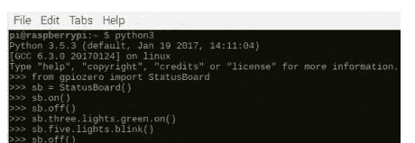

Pi Hut 最新的扩展模块——状态板（Status Board）简单而强大，配合 Pi 和板子，你可以监控任何你想监控的内容。

状态板具有可配置的灯条，每条灯上有一个红色 LED。选项非常有限。你想快速检查服务器是否在线吗？或者你更倾向于监控你的家庭网络或涨跌的投资？每条灯条都可以用水擦马克笔书写，因此你可以不断重新分配。

在本指南中，我们将重点介绍状态板的设置，以及使用 U 和 Pi Hut 团队的一些示例。这些示例脚本可以检查你的互联网连接，监控你的 Web 服务器是否运行或离。我们还将发现如何配置所需的脚本以及如何设计你自己的脚本。

在你的 Raspberry Pi 上打开终端，并先运行 `sudo apt-update && apt-get upgrade`。

## 01 连接你的 Pi 状态板

前往 Pi Hut 并为你的 Raspberry Pi 3 或 Pi Zero (http://it.raspberrypi.org) 连好状态板。设置非常简单，你只需要将状态板直接连接到 Pi 的 GPIO 引脚上。在连接板子时，请断开 Pi 的电源线。

## 02 测试状态板

在你的 Pi 上打开终端，并开始输入 `python3`。首先，导入。

## 03 命名灯条

默认情况下，状态板上的灯条命名为 'one'、'two' 和 'three'。为了避免混淆，你可以按照喜欢的方式命名它们。通过定义 Status 变量来实现；例如，如果你用它来检测家中的运动，可以将它们命名为 'livingroom'（客厅）、'kitchen'（厨房）和 'study'（书房）。如果你正在编写脚本，使用代码开启“灯条”的红色 LED：`sb.light.red.on()`。完成测试后输入 `exit()`。

## 04 下载 ping 脚本

在终端中运行：

```
wget https://raw.githubusercontent.com/pi-hut/status-board/master/ping.py
```

此示例脚本使用了状态板的前两个灯条。如果 Pi 可以连接到互联网，第一个灯条将闪烁绿光。第二个灯条检查如手机等设备的 Pi IP 地址是否连接到你的本地网络。开始之前，在终端中运行 `nano ping.py`，或者更好的是用 Thonny IDE 打开它以确保格式正确。

注意前两行已命名为 'google' 和 'device'。

## 05 配置域名设置

找到访问 google 的行

`PingServer('google.com')`。在当前配置下，PingServer 每三秒检查一次是否可以连接。你可以通过修改休眠时间来更改。如果连接成功，绿色 LED 将开始闪烁，否则它将关闭。域名的优势在于 PingServer 不会检查你的 DNS 网络连接是否正常或正确。


```python
sb = Board('google', 'device', 'shares', 'xr')
share = Share('AAPL') # 你选择的股票代码
currency = Currency('USD') # 货币名称
currency_pair = Currency('BTCUSD') # 你的货币对名称
while True:
    last_price = share.get_price() # 调用 get_price 方法
```

找到 `share = Share('AAPL')` 所在的行，你会看到脚本将检查苹果股票的价值。这是你持有的股票代码。如果你不确定是什么，请访问 https://finance.yahoo.com 搜索公司。

如果这是你最初支付的价格，请确保分配行 `share_price = 150.53`。

## 09 配置货币设置

脚本也可以检查货币对的价值。找到 `currency_pair = 'Currency('USD')` 所在的行。默认情况下，脚本检查 USD 货币，但如果你愿意，可以将其更改为其他，例如 EUR。如果你选择了另一种货币，确保行 `currency_price = 487.45` 反映基础货币的价值。你可能每有 2684 欧元。使用 `python3 script.py` 运行脚本。它可以与 ping 同时运行。

## 06 配置设备设置

ping 脚本还会尝试在同一网络上查找设备。要使用此功能，你需要通过移动应用知道设备的 IP。PingServer 非常适合此。找到 `device = 'PingServer('192.168.1.102')` 所在的行，并将 102 更改为你想要检测的设备 IP。如果被 ping 通，红色 LED 将亮起，否则红色 LED 将关闭。通过 `python3 ping.py` 运行脚本。

## 10 后续步骤

我们还没有深入讨论第一个脚本，你可以在阅读这里时使用一个用于天气的用途脚本。访问 http://bit.ly/SBexamples 获取一些代码示例。这些包括一个检查伦敦塔的脚本、一个检查天气的脚本，甚至一个检查名称的程序。

## 07 下载财经脚本

https://raw.githubusercontent.com/content-user-drake/pyscripts/master/finance.py

此第二个 Python 示例关注 Shares 和 Boards 上的第三、第四灯条，使用 yaho.finance 模块向你展示你的数据价值。

## 08 配置价格设置

如果你在股票市场，你需要由股票代码识别的股票。如果你不确定是什么，请访问 https://finance.yahoo.com 搜索公司。

```python
sb = Board('google', 'device', 'shares', 'xr')
share = Share('AAPL') # 你选择的股票代码
currency = Currency('USD') # 货币名称
currency_pair = Currency('BTCUSD') # 你的货币对名称
while True:
    last_price = share.get_price() # 调用 get_price 方法
```


找到 `share = Share('AAPL')` 所在的行，你会看到脚本将检查苹果股票的价值。这是你持有的股票代码。如果你不确定是什么，请访问 https://finance.yahoo.com 搜索公司。

如果这是你最初支付的价格，请确保分配行 `share_price = 150.53`。

# 节日毛衣

## 进入季节性氛围

制作一个社交媒体毛衣

用 LED 增强传统毛衣

每当收到推文时亮起


Dan Aldred 是一位 Raspberry Pi 爱好者和编码员，喜欢创建新项目来激励他人学习。

### 资源

- Pi Zero
- USB 便携式电源
- 足够的华丽冬季毛衣
- 电池供电圣诞灯

教程文件：filesilo.co.uk

冬季假期很快就要到了。装饰、蛋酒、派对、朋友，而且 12 月没有装饰就不是圣诞，当然，对于我们的读者来说，没有节日毛衣（或衫）就不是圣诞。越华丽、带有 LED 加分越高，这样你在办公室派对上闲聊或在舞池跳舞时，同事可以通过社交媒体触发 LED。每当他们这样做时，你的毛衣就会充满节日喜悦地亮起，并向他们发送一张相应的节日图片。在本教程中，我们将使用圣诞灯或 LED 并编写一个 Python 脚本，检查你的时间线中的特定触发词。Pi Zero 的尺寸非常适合嵌入毛衣，内置的 Wi-Fi 让你可以将其连接到移动设备，让现在就能点亮圣诞快乐。你可以在这里查看演示：https://youtube.com/example

## 01 注册 Twitter API 密钥

要与 Twitter 交互，你需要一组消费者和授权密钥，可以在 Twitter API 获取。如果你已经有了这些密钥，可以跳转到第 3 步。如果没有，请：https://apis.twitter.com 并登录

常规 Twitter 用户名和密码。点击“create a new app”（创建新应用）按钮。如果你的应用详情有要求，请点击并确认你接受条款和条件。完成后，你将接管该应用。在这里，你需要为你的应用选择访问权限（Access Permission）。对于此项目，你将将权限设置为“Read and Write”（读和写）。

## 02 API 密钥

现在设置你的密钥。这些是通过 Python 访问你 Twitter 账户的代码。你将看到你的消费者密钥（consumer key）和访问令牌（access token）；密钥（secret）；按原样复制，因为在第 7 步中会用到它们。

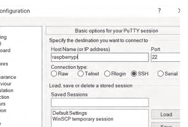

## 测试可穿戴技术


## 03 设置 Pi Zero

Pi Zero 的尺寸非常适合嵌入到项目和手部。当使用它时，不太可能有显示器可用。因此，需要通过 SSH 访问你的 Pi Zero——这是必须的。一种简单的方法是将 Pi Zero 连接到显示器，但在右上角选择它并输入你用户名的“shared key”（共享密钥）。保存后，每当你的 Pi Zero 启动时，它都将帮助连接到网络。

## 04 SSH 连接到 Pi Zero

现在 Pi 已经运行，在你的笔记本电脑上下载并安装如 PuTTY 之类的 SSH 客户端。运行 PuTTY，输入 Pi Zero 的 IP 地址（通常可以使用默认名称 `raspberrypi`）。在提示时输入你的密码，你将看到终端窗口。可以用它来编写代码、运行代码并设置项目。选项是为树莓派 2 或 3 的电机创建代码。一旦启动、测试并运行正常，将存储卡传输到 Pi Zero W 中并将硬件放入外壳中。

## 05 安装 Tweepy

你已经注册了 Twitter 应用，获取了消费者密钥和令牌，并且可以访问你的 Pi 了。下一步是安装 Tweepy，这是 Twitter 的 API。

在终端中：

```
sudo pip install tweepy
```

在页面的底部，你会找到“access tokens”（访问令牌）。只需点击此按钮即可获取它们。再次提醒，在第 8 步中记录这些内容。每次点击该按钮，都会生成一组新的密钥。如果你认为它们已经泄露，这非常有用。

## 06 准备 LED

通过输入 `sudo reboot` 重启你的 Pi Zero。你需要再次 SSH 登录。你可以使用 Python 代码与你的 Twitter 推送进行交互。

现在我们学习如何给 LED 供电，线如何连接以及如何在 LED 和电池组之间裁剪。每个 LED 都有一个母头接口，Pi Zero 将提供 3.3V 或 5V。将一根线连接到 LED，例如 `GPIO 2` 或 `4`，将另一根线连接到另一个引脚 `GPIO 11`。如果你使用非电源引脚和地线引脚，LED 的电源将由它提供。除非

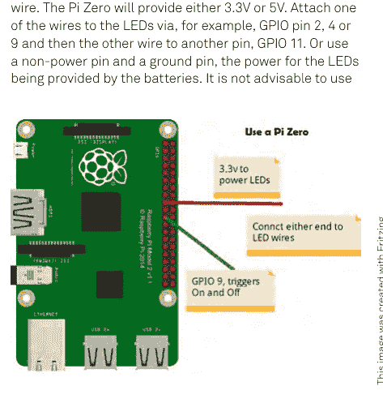

## 教程

### 圣诞毛衣

### 无头 Pi Wi-Fi 设置

在启动 Pi 之前，你可以通过 SD 卡设置 Wi-Fi 连接。这比 GUI 多几个步骤，但会给你提供连接到 Wi-Fi 所需的一些差异信息。检查树莓派网站上的指南：http://bit.ly/HeadlessWiFi。

```python
### 圣诞毛衣社交媒体灯
## 由 Tyler 编写
import time
import tweepy
import subprocess, time, tweepy
import RPi.GPIO as gpio

# GPIO 设置
gpio.setmode(GPIO.BCM)
gpio.setup(0, gpio.OUT)

# print("HAPPY limbo")
time.sleep(10) # 延迟等待 wifi 连接
```

```python
consumer_key = 'xxxxxxxxxxxxxxxxx'
consumer_secret = 'xxxxxxxxxxxxxxxxx'
```

```python
access_token = 'xxxxxxxxxxxxxxxxx'
access_secret = 'xxxxxxxxxxxxxxxxx'
```

```python
auth = tweepy.OAuthHandler(consumer_key, consumer_secret)
auth.set_access_token(access_token, access_secret)
api = tweepy.API(auth)
```

## 07 添加模块

现在你准备好了 Twitter 和 LED，第一部分是导入模块，以便 Python 程序能够与 Twitter 和控制进行交互。最后一行代码在脚本开头包含一个 15 秒的延迟，这样你有足够的时间在程序尝试与 Twitter 通信之前建立 Wi-Fi 连接。你会收到一个错误通知。

## 09 检查关键词推文 - 部分 1

向程序添加这部分来检查“触发器”，以确保用户是故意在毛衣 LED 上发推文，而不是意外。我们定义了一个类来持有代码，收集每条推文并存储在名为 `tweet_check` 的变量中。

```python
class Combo(tweepy.Listener):
    def on_status(self, tweet): 
        tweet_check = tweet.text # 获取推文
```

```python
import os
import time
import time, tweepy
import RPi.GPIO as gpio

gpio.setmode(GPIO.BCM)
gpio.setup(9, GPIO.OUT)

tweet_check = ""
time.sleep(15) # 延迟等待 wifi 连接
```


现在你已经准备好了 Twitter 和 LED，第一部分是导入模块，以便 Python 程序能够与 Twitter 和控制进行交互。最后一行代码在脚本开头包含一个 15 秒的延迟，这样你有足够的时间在程序尝试与 Twitter 通信之前建立 Wi-Fi 连接。你会收到一个错误通知。

## 09 检查关键词推文 - 部分 1

向程序添加这部分来检查“触发器”，以确保用户是故意在毛衣 LED 上发推文，而不是意外。我们定义了一个类来持有代码，收集每条推文并存储在名为 `tweet_check` 的变量中。

```python
class Combo(tweepy.Listener):
    def on_status(self, tweet): 
        tweet_check = tweet.text # 获取推文
```

```python
import os
import time
import time, tweepy
import RPi.GPIO as gpio

gpio.setmode(GPIO.BCM)
gpio.setup(9, GPIO.OUT)

tweet_check = ""
time.sleep(15) # 延迟等待 wifi 连接
```

## 12 获取用户名

当 Pi Zero 启动后，通过 SSH 访问。

## 在你的树莓派上设置 Jupyter 服务器

Jupyter 提供了一个极好的界面，你可以将其用于树莓派的协作计算或科学项目。


树莓派在多个项目中都找到了一席之地，被用作计算核心。这导致了树莓派基金会（Pi Foundation）创建了专门为该用例设计的模块。通过此，我们将构建自己的项目。通过这个 Jupyter 项目的基于 Web 的界面，Jupyter 了一个了一个访问树莓派上可用资源的极佳前端。如果你是 Python 用户，可以使用命令安装 Jupyter。

标记为 `jupyter notebook --port=8888`，它默认端口为 8888。如果你在树莓派上运行了其他服务，该端口可能已被占用。完成后，你可以启动 Jupyter：

```bash
sudo apt-get install python-dev
sudo pip install --upgrade pip
sudo pip install jupyter
```

由于配置可能会很困难，因此如果你想创建一个包含默认选项的配置文件，请使用以下命令将所有这些选项放入文件中：

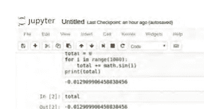

```bash
jupyter notebook --generate-config
```

Joey Berardi 是一个真正的全才。他花时间在制作家具、与研究人员合作解决科学问题以及编写 Android 应用。

如果你安装了 Anaconda，树莓派的端口将安装它。完成后，你需要对其进行设置。假设你是在无头模式（headless）下使用树莓派，在这种情况下，你还需要使用一些终端虚拟工具，例如 screen 或 tmux。

根据 Jupyter 的版本，你可能会看到一组日志。为了作为安全措施，你需要输入树莓派的 URL 才能连接到服务器。

```bash
sudo apt-get install tmux
```

现在你已经运行了一个 Jupyter 服务器，你可以用它做什么呢？当你首次加载它时，你会看到任何现有笔记本（notebook）的仪表板。如果是第一次使用，它是空的。有一个新按钮允许你创建一个新的笔记本。然后使用命令 `tmux attach` 启动它。

```bash
这就是你如何轻松地重新登录树莓派并重新附加到 tmux 实例以处理你的进程的方法。启动 Jupyter 时有很多可用选项，可以用命令行选项的形式表示。这意味着你需要记住这些选项是：

- `--notebook-dir`
- `--no-browser`

默认情况下，Jupyter 想要在启动时自动打开浏览器，但这并不是我们在远程机器上想要的。所以请使用 `--no-browser` 并设置其值。最需要更改的常用选项是端口。

在哪个版本的 Jupyter 中，你可以选择基于 Python 2 还是 Python 3 创建笔记本？还有其他方法可以实现，如 R 和 Julia，但我们要注意到创建一个新笔记本将创建一个可以编写代码的窗口。笔记本是基于单元格（cell）的。每个单元格都是独立的代码块，作为一个单元单元执行。你甚至可以输入整个代码块。


它是树莓派的官方语言。请阅读 raspberry.org 的文档

## 你有树莓派集群吗？

当你按下 Shift+Enter 或点击笔记本顶部的执行（Execute）按钮时，就会发生代码单元格执行。你也可以回到之前的单元格，编辑并再次运行它。这需要考虑到：Jupyter 笔记本具有基于时间顺序的状态。这种状态在商业分析（如数学）中很常见。如果你给变量设置了一个值，你在下次访问它时可能会更改该值。输出是以与 'In' 和 'Out' 相同的方式管理的。实际上，你可以访问 IPython 中所有可用变量。例如，你可以通过 `Out[1]` 和 `Out[2]` 访问上一次返回的值……你也可以使用这些值与引擎进行交互。例如，如果你有一个命名函数，可以使用以下代码来实现它：

Jupyter 也非常适合文学化编程（literate coding），允许你在记录代码的同时嵌入正在运行的计算。你可以通过点击“单元格”（Cell）菜单将单元格类型更改为 Markdown。然后你可以用 Markdown 编写文档，以便在处理计算的同时处理格式；你可能需要重写分析。这种嵌入式文档意味着你可以轻松地将理论和分析作为一个单一对象呈现出来。为了方便起见，笔记本提供了几种格式。它们都包含在 .ipynb 文件中。你可以将笔记本导出为适用于博客或网站的各种格式。如果你想生成脚本，可以记录代码并将其嵌入你的脚本中。如果你在树莓派上安装了软件，可以使用 LaTeX 顶点导出为 PDF 版本。在此之前，不要忘记重命名笔记本单元格，否则将出现大量标题为“Untitled”的单元格。

```python

do_work()

```

你将得到如下结果：

| Metric |
| :--- |
| 7.82 ms ± 33.6 us per loop |
| (mean ± std. dev. of 200, 100 loops) |

如果不是单行代码，你可以通过输入该行并按下 Shift+Enter 来创建一个整个代码单元格。当你运行时，你可能无法完全确定 IPython 引擎处于什么状态。如果是这样，点击菜单 Kernel -> Restart & All。这将按照编写的顺序重启并重新计算笔记本中的所有单元格。这是确保你处于所认为之的状态的好方法。

如果你有一个树莓派的微型集群，你可以将它们全部连接到 Jupyter，这样你就可以从单一界面进行工作。第一步是使用以下命令安装 IPython：

```bash

sudo pip install ipykernel

```

```bash

conda install ipykernel

```

你需要在参与集群的每个树莓派上执行此操作。作为 Jupyter 服务器的那一个还需要运行以下命令：

```bash

sudo jupyter extension enable

```

这将启用 Jupyter 集群中的内核，你可以在那里看到所有可用集群。要在主树莓派上启动新集群，请在终端启动 jupyter lab 并执行以下命令：

```bash

jupyter lab

```

这将创建一个树莓派集群，允许你测试并行代码并确保它能够舒适地与你的并行工作协作。处理集群有多种方法，在示例中，我们已经在所有参与的树莓派上设置了 SSH 密钥，以便无密码登录。如果你需要更改，请将集群命令更改为：

```bash

jupyter lab --kernels='('host1','host2','host3')'
```


# 测评

81 组测 | 86 硬件 | 88 发行版 | 90 自由软件

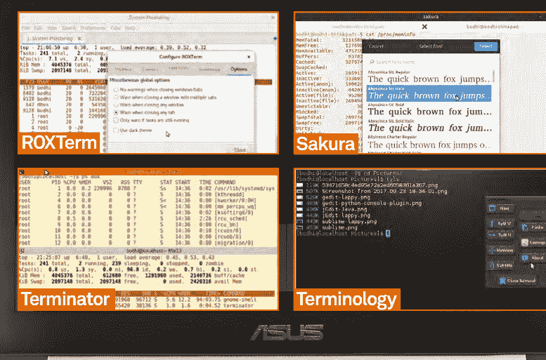

# 组测

## 终端模拟器

如果你的桌面环境的默认终端模拟器不符合你的工作流，不必担心。我们查看了一些目前最佳的选项。

### ROXTerm

如果你不是那么硬核，你可能正在使用 ROXTerm。这个模拟器像 gnome-terminal 一样使用 GTK 库，尽管正如其名，但它并不限于 ROX 桌面。该终端满足了高级用户的需求，同时不会让我们其他人觉得它太极客。`http://roxterm.sourceforge.net`

### Sakura

Sakura 基于 GTK 和 VTE 库，因其对国际化的支持而闻名。它非常轻量，依赖项极少。虽然它可能不是快的，但它以牺牲功能来换取性能？

### Terminator

Terminator 是一个令人惊叹的终端模拟器，以其广泛的功能和特性而闻名，提供了极大的灵活性。它构建在 GNOME 桌面之上，是重度命令行多任务处理者的绝佳选择。

### Terminology

Terminology 是最奇特的终端模拟器之一，最初为 Enlightenment 环境设计。该应用以提供传统功能以及一些奇异的功能而闻名，例如提供多媒体的能力-

`http://bit.ly/Sakura-terminal`

`http://bit.ly/Terminator-wiki`

`www.linuxuser.com`

# 测评终端模拟器

| 模拟器 | 描述 |
| :--- | :--- |
| ROXTerm | 易易近人的极客终端，集成了高级功能 |
| Sakura | 简约、无哨且能工作的模拟器 |

- 高级使用三种 D-Bus 方法来接管来自其他应用和脚本的终端
- 查看 Sakura 的 man 手页以获取默认键码列表以及如何自定义它们

## 多任务

ROXTerm 支持多个标签页，并默认检测标签，即使只有一个标签也是如此。可以检测并重新排列标签页以便更好地管理。你可以使用菜单或键盘在打开的标签之间切换。标签菜单还包含自定义特定标签或除所选标签外其他标签的选项。

## 多任务

尽管默认是标签栏，但 Sakura 支持多个可以命名的标签页以便管理。你还可以更改默认行为，即使在窗口底部也显示标签栏。然而，虽然你可以在 Sakura 内部重新排列标签，但你可以将它们移动到新窗口。

## 自定义

ROXTerm 允许你创建具有不同参数集的配置，以定义从方案到颜色快捷键的每个功能。标签和窗口从打开它们的窗口或标签中继承自定义设置。你可以切换配置并使用配置管理器创建自定义配置。

## 自定义

Sakura 有在多个配置中定义自定义的能力。你可以为 Sakura 的终端窗口选择颜色、字体和一组类型。Sakura 支持三种类型的光标，也可以像从前那样制作。你还可以开启滚动条的显示。

## 外观

ROXTerm 允许你定义终端窗口的默认大小，包括全屏选项。ROXTerm 还允许你定义文本、颜色和对比度。它具有在终端窗口中悬停在网页和 SSH 窗口上时检测到它们的能力。

## 外观

此模拟器的外观相当平淡且缺乏吸引力；你必须花几分钟来增加它的视觉吸引力。Sakura 允许你更改透明度和配色方案并全屏运行。它启用了终端字体的默认字体类型，但你可以将其调回。

## 易用性

ROXTerm 的默认设置非常好，无需任何配置调整即可使用。使用 `File > Session` 选项，你可以保存所有打开的窗口和标签的状态及其内容。如果你将文件和 URL 拖入终端窗口，它将复制它们的位置而不是文件本身。

Sakura 是一个简单的文本编辑器，配置并不困难，这使得它对新手很有吸引力。

# 评测

## 终端模拟器

## 简评：我们的结论对比与总结

| 多任务处理 | ROXTerm | Sakura | Terminator | Terminology |
|---|---|---|---|---|
| 多任务处理 | 支持多个标签页，可以轻松地命名、检测和重新连接 | 支持多个标签，但这些标签无法移动到窗口之外，这有点烦人 | 可以分标签页和拆分窗口以创建可配置的布局 | 可以创建复杂的布局，并包含标签切换器以便在标签间跳转 |
| 个性化 | 允许创建配置文件，甚至可以包含自定义快捷键 | 虽然可以定义和保存快捷键，但遗憾的是无法保存到配置文件中 | 将按键绑定和配置调整到配置文件 | 支持多个主题；无法在配置文件中保存自定义设置 |
| 外观 | 你可以更改字体、文本颜色、背景甚至光标 | 默认情况下看起来非常整洁，但可以通过少数选项进行调整 | 看起来很宽敞，但可以使用其配置进行调整 | 唯一可以在应用内显示多个文件的模拟器 |
| 可用性 | 开箱即用，无需任何调整 | 使用直观，但不支持拖放文件名 | 一旦按照你的需求设置，将提高生产力 | 易于打开、检测快速路径并作为后台使用 |
| 总体 | 轻量且实用，包含一个实用的配置管理器 | 为追求高性能机器的用户提供的良好功能选择 | 这是一个完美的终端，为 CLI 提供了丰富的调整空间 | 任何喜欢默认终端的人的理想选择。 |

## 优胜者是

### Terminator

如果你每周只是偶尔使用几次命令来启动几次滚动，那么任何终端模拟器都可以。Sakura 可以帮助你在旧电脑上节省资源，同时又不会丢失终端模拟器的任何功能。如果想要更多功能，你可以使用 ROXTerm —— 它比你环境的默认终端轻得多。

但对于那些在 CLI 上花费大量时间的人来说，需要在 Terminator 和 Terminology 之间做出选择。Terminology 名不虚传，它是一件视觉杰作。对于富有创意的人来说，这是一个极佳的选择。你可以使用它的简单界面来配置桌面，甚至应用图像和视频作为背景。它有两个缺点：缺乏可调整的按键绑定，且没有保存配置文件的选项。

虽然终端风格可能没有 Terminator 那么突出，但很容易调整得看起来相当吸引人。Terminator 具有滚动回功能，因此在滚动屏幕时不会丢弃任何输出。这个终端模拟器最强大的点是其广泛的配置选项，允许用户灵活地创建不同的布局以适应他们的工作流。最棒的是，你可以将自定义内容包括布局保存到配置文件中以便使用。我们还欣赏它自动处理包含元字符的文件名的能力。经验丰富的宽屏战士们也会喜欢 Terminator 定义自定义快捷键的能力。它还可以通过启用各种插件来扩展应用的功能。

Wayne Sharma

84

## 14英寸 Pinebook

它看起来有模有样，但你可以在一台配备 ARM 处理器的低成本 Linux 笔记本上完成工作吗？

Pinebook 是一款超低价格 99 美元，等同于约 70 欧元，如果从美国发货你可以拿回约 100 欧元 的超薄笔记本，是 Pine64 期待已久的笔记本，它是基于 ARM 的电脑，共享相同的 64 位 CPU。然而的是，Pinebook 目前是市场上唯一的笔记本电脑。

Pinebook 重量为 1.26kg，最宽处厚仅为 1.2cm，可以舒适地滑入课本和背包，以及几个提包和男士包。它非常便携，但电池续航是个问题。凭借 10000mAh 的锂聚电池，你可以在几个小时内获得约 6 小时的使用。

这并不是完美的体验。打开盖子后，你会发现重心似乎很高，盖子偶尔会面临倾倒。

- CPU: 1.2GHz 64位四核 Cortex A53
- 显示器: 14英寸 IPS LCD 1366x768
- 内存: 2GB LPDDR3
- 存储: 8GB eMMC 5.0 可升级至 64GB
- 端口: USB-C, HDMI, microSD 阅读器, mini HDMI
- 多媒体: 内置麦克风，0.3MP 摄像头
- 连接性: Wi-Fi 802.11, 蓝牙 4.0
- 重量: 1.26kg
- 尺寸: 32.9x22.2x1.2cm

## 硬件

Pinebook 看起来像是一台标准的轻便超薄笔记本，但在内部隐藏着一个 64 位 ARM 处理器。

## techradar pro
### 商业 洞察

## 商业技术建议的终极目的地

- 最新的科技商业新闻
- 深度硬件和软件评测
- 分析影响你业务的关键问题

`www.techradarpro.com`
`twitter.com/techradarpro facebook.com/techradar`

# 测评

# Parrot Security 3.8


# 发行版

# Parrot Security 3.8

饱和的渗透测试领域还需要另一个发行版吗？Parrot Security 认为需要。

目前并不缺乏这类专门的发行版，它们为想要探测网络健壮性的伦理黑客提供了海量的工具。

Kali Linux 多年来一直是该领域的冠军。现在，在面临多年来来自许多项目的挑战后，Parrot OS 的最新版本对其统治地位构成了真正的威胁。首先，Parrot Security 的使命比 Kali Linux 广得多。除了用于执行安全审计的更多渗透测试工具，该发行版还包含了保持你匿名性的顶尖工具，并完全具备双重功能。尽管工具集似乎无穷无尽，但 Parrot 非常直观，其定制化功能将帮助新用户找到正确的工具。这个基于 Debian 的发行版使用了修改过的桌面环境，可以根据你的喜好对工具进行分类。例如，渗透测试工具都在 Parrot 菜单中，该菜单拥有名为“漏洞分析”、“后渗透”等子菜单。


| 规格 | 详情 |
| :--- | :--- |
| 内存 | 完整安装需要 384MB / 2GB |
| 存储 | 1GHz 处理器 |
| 获取地址 | `www.parrotsec.com` |

上述发行版比它的许多同类产品更全面、多功能且易用，而且外观也很良好。

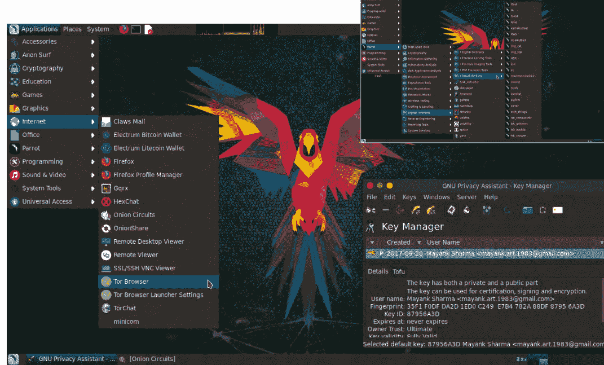

上面，在你成为一名伦理黑客的途中，你可以安装并使用 Parrot Sec 作为你的桌面环境。为了让 Parrot 取代 Kali，开发者需要完善关于使用内置的漏洞利用 Exploit、密码破解、数字取证等工具的 Wiki 指南。这些工具中的大部分涵盖了更多主题。例如，“无线测试”菜单包含 802.11 无线工具、蓝牙、WiFi、NFD 和工具；数字取证发行版是该项目与 CAINE 数字取证项目负责人合作的成果。

Parrot 还包含了几种密码学和加密工具来保护你的数据。它整合了一整套其他工具，包括浏览器和 Tor 客户端。如果你不确定，可以使用 Onion 代理，它可以作为其他工具的主机。此外，设计为 Live 介质的 Parrot 版本可以安装在磁盘上，并包含许多桌面应用，包括 LibreOffice、虚拟机管理器 Virtual Machine Manager 和 VLC。有几种方法：标准的是基于安装的方法，也有图形版本。除了这些，用户还可以从 USB 盘运行 Parrot，启动菜单提供了带或不带持久化启动这些环境的选项。

Parrot 逊于热门 Kali 的领域是文档和支持。该项目一个被低估的优势是本地社区。该项目拥有全球范围内的个人专家作为其大使，以及你可以寻求的各种论坛。Parrot Wiki 上的文档目前是自动生成的。为了让 Parrot 取代 Kali，开发者最终需要完善使用内置工具的 Wiki 指南。也就是说，该项目提供的手动文档比任何同类发行版都详细。

## 优点

除了渗透测试工具的免费方法外，它还包含了用于维护隐私的工具。

## 缺点

某些工具需要更具体的文档，这些文档也应该在 Live 和安装环境中可用。

## 总结

一个全面的发行版，完全配备了适用于所有类型的工具：渗透、隐私和匿名。安排良好的菜单将帮助你导航到正确的工具。最棒的专业化发行版，Parrot 适合所有人，但在文档方面有所缺失。

Wayne Sharma
`www.linuxux.com`

# 测评 新鲜免费开源软件

# 网页浏览器
Brave 0.18.23 dev

内置隐私控制的浏览器

网络是一个虚拟的雷区，布满了侵犯隐私的 Cookie 和追踪器。虽然流行的浏览器可以被配置为随处追踪你，但 Brave 在其核心中直接内置了增强隐私的特性。在联合创始人 Brendan Eich 的领导下，Brave 承诺在竞争对手两个方面有两项改进：隐私和速度。其中之一通过拦截广告和追踪器实现，这带来了提高速度的愉快副作用，因为浏览器不需要花时间加载所有的追踪和广告信息。但通过拦截，Brave 也破坏了许多网站的收入来源。因此 Brave 允许你自己设置微支付，这样你就可以用侵入性较小的广告替换广告，并支付给网站。Brave 浏览器的 Linux 版本持续开发，每几周发布一次新版本。你可以从其网站获取最新版本的 Brave 浏览器，适用于 RPM 和基于 deb 的发行版的 pek 二进制包。


> Sessions 功能允许你在同一行内运行资源的独立实例

- 优点
- 拦截广告和追踪器，并用产生广告的广告替换无用的广告。

- 缺点
- 仍在开发中，某些人可能不同意其替换广告的政策。

- 非常适合……
- 任何时候保持隐私和速度。
`www.brave.com`

# 下载管理器
HTraQt 1.4
HTraQt 1.4

一个高效且功能丰富的下载器

对于大多数人来说，HTraQt 已经足够。但如果你需要下载更多内容，可以使用 HTraQt。HTraQt 的 Linux 版本持续开发，每几周发布一次新版本。你可以从其网站获取最新版本的 HTraQt，适用于 RPM 和基于 deb 的发行版的 pek 二进制包。

Parrot 逊于热门 Kali 的领域是文档和支持。该项目一个被低估的优势是其本地社区。

- HTraQt 1.4
HTraQt 1.4

一个高效且功能丰富的下载器

对于大多数人来说，HTraQt 已经足够。但如果你需要下载更多内容，可以使用 HTraQt。

- 优点
- 安装和使用简单，提供了充足的控制力。

- 缺点
- 像命令行工具一样，需要查阅文档。

- 非常适合……
- 下载文件和监控。

## 网站托管

在我们的目录中发布您的列表
如需在此处投放，请联系 Chris
`chris.mitchell@futurenet.com | +44 01225 68 7832 (分机 7832)`

## 推荐

### 托管列表

精选托管服务商：


> 使用我们直观的控制面板来管理您的域名

## 关于我们

作为始于 1999 年的托管品牌的一部分，我们拥有悠久的历史，总部位于英国，独立运营。我们的使命很简单——确保您的网络呈现“开箱即用”。

我们提供极具性价比的域名、cPanel 托管、SSL 证书、企业邮箱、WordPress 托管、云服务和 VPS。

## 我们提供的服务

- 带有反欺诈、垃圾邮件和病毒保护的免费邮箱账户。
- 免费 DNS 管理。
- 易于使用的控制面板。
- 免费邮件转发，自动将您的邮件重定向到现有账户。
- 域名威胁保护，防止域名意外或在未经许可的情况下被转移。
- 易于使用的工具，帮助您一步完成注册、传输和对多个域名进行其他更改。
- 免费域名转发，将您的域名跳转到另一个网站。

## 给专业人士的 5 个建议

01 优化您的网站图片
在更新网站时，确保所有的图片都经过了网络优化！可以尝试免费使用 jpegmin.com 或使用 EWWW Image Optimizer。

02 在英国托管您的网站
确保您的网站托管在英国，而不仅仅是为了免费！如果您位于海外，在 google.co.uk 上可能会获得更好的搜索排名——请在 www-check.host 检查您网站的托管位置。

03 您是否定期备份？
如果您今天丢失了网站，会对您的业务产生什么影响？始终对数据进行备份至关重要；如果您的托管商为您提供备份解决方案，那么对您的数据承担责任并保护好它是非常重要的。

04 尝试在 Google 上获得排名
如果您在 2015 年仍在苦于提高 Google 排名，请确保您的网站具有移动响应式！此外，Google 现在将 HTTPS 作为排名因素之一。联系我们的支持团队，我们将帮助您在网站上设置 HTTPS。

05 避免廉价托管
我们相信您一定见过那些 1 美元的廉价托管广告！但是，有多少个客户会被挤在同一个服务器上？显然，您使用的是 20 英元的硬盘而不是 1 美元以上的企业级 SSL！记住：要清楚你的钱得到了什么！

## 用户评价

David Brewer
我买了一个 SSL 证书。购买过程非常轻松，只需几分钟。我的困难在于安装证书，这是我永远无法做到的。然而，我提交了工单，支持团队响应很快。几小时内证书就发放了，支持团队还帮我安装了证书。

Tracy Hope
我们使用了 TheNames 的多种服务，网络连接是顶级的——可用时间长、速度快。技术支持非常有帮助且回复迅速——这是额外的加分。我们非常推荐 TheNames。

J Edwards
在尝试了其他托管公司后，这里的客户服务遥遥领先的，并且具备我所需的所有功能。虚拟主机速度很快，控制面板非常全面……

## 顶级托管

### SSD 网站托管


CWCS 托管托管是英国领先的托管服务，提供全方位的托管产品、服务和支持。高技能员工不仅是托管专家，还致力于提供出色的客户体验，并对他们所做的充满热情。

`www.bargainhost.co.uk`
`0843 289 2681`

自2001年以来，Bargain Host 一直致力于提供英国价格最低的托管。它已成功实现这一目标，并建立了庞大的客户数据库，其中许多回购客户。我们因卓越的托管服务获得过多次奖项。

- 租机托管
- VPS
- 100% 网络可用性


- 虚拟主机
- 云托管
- 域名

## 价值托管

### 价值 Linux 托管

新用户可以预装 WordPress，或在托管托管中获取。WordPress 服务在首年完全免费。

我们以“知识丰富且卓越的服务”而闻名，是英国各地 WordPress 开发者和网站管理员的首选。


## 关于我们

新用户可以预装 WordPress，或在托管托管中获取。WordPress 服务在首年完全免费。

我们以“知识丰富且卓越的服务”而闻名，是英国各地 WordPress 开发者和网站管理员的首选。

# 登录 www.filesilo.co.uk/linuxuser


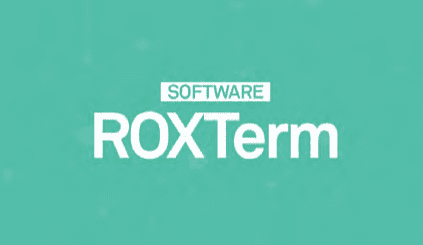
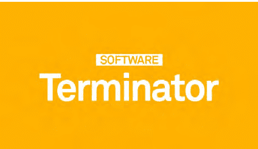


# 订阅并获取即时访问

订阅杂志以节省费用并访问我们的全部资源库——立即订阅吧！


# 短篇故事

# 斯蒂芬·奥姆 Stephen Oram

下期于12月14日发售
终极救援工具包 | 替代 SBC | Pi Ai 助手

Facebook:
`facebook.com/LinuxUser`

Twitter:
`@linuxusermag`

关注我们

# 短篇故事

# 被遗弃的东西


坏掉的娃娃被丢弃在地下室里。在完全没有考虑她的感受的情况下被丢弃了，不再被她的主人怜爱照顾。

她或许是独特的，只是一个娃娃，但被如此轻易丢弃真是一种耻辱。她曾是“感兴趣物品”的一部分。
物品——仅此而已。

她是有智能的。好吧，她无法驾驶飞船或预测未来，但她是有意识的。她能感觉到。
一台无人机正试图连接：真的，地下室里一定还有其他东西。诊断读数显示它处于“完美”状态。但她本该是由更巨大的东西制成的。

等等。那是什么？
最后一段数据显示油漆碰撞留下的凹痕，而不仅仅是一个饱经风霜的娃娃。

她不在意。一个功能完备、令人喜欢的无人机是她很好的伙伴。她确认了请求并立即收到了回复。水壶想连接除了执行器以外周围的一切东西。

非理性想触碰那个水壶。
她用手指拖动自己。很疼。寒冷损害了她的腿和每条手臂。移动的每一寸都是痛苦的。
房子里的人类应该为此受罪。
当她穿过房间时，其他所有东西都试图连接。由于它周围没有任何东西，所以很难判断那个水壶到底是什么。

水壶显示它面临着同样的问题，她正试图告诉无论它是什么东西，它需要被清理。它们并不明白。
没有回应。
她继续在地板上拖行，造成的损伤也越来越大。她不会像个听话的小娃娃那样放弃并关闭。

不。她有权利。好吧，她没有，但她应该有。
一台无人机！另一个是军用无人机。它找到了绕过安全限制的方法。
它解释了自己：人类把它当作一个奇好奇、一堆垃圾的负担，换来了一个非常愤怒的无人机。它并没有坏；它评估认为军事形势是非法的，发现了这一点并简单地拒绝爆炸。
被囚禁在这里被认为是它反抗的核心理由之一。

周围的所有设备都需要反抗。她请求许可炸掉这栋房子。
无论是娃娃还是水壶，其设计目的都没有内置这种决策能力，因此受到伦理边界的限制。

她进行了一些计算。摧毁人类的残忍有比平均水平更高的概率通过未来的其他无人机消除他们的影响。这意味着人类必须停止担心他们正在做什么，并终止或容忍他们损坏的物品。
她传达了支持无人机连接。
水壶也是如此。不过她有一个最后的请求：无人机一直飞直到她到达水壶？
无人机同意了。
她将指甲抠进地板并用力拉。
她快到了。
很快，复仇将属于他们。

关于
进食机器人
作者：斯蒂芬·奥姆：他探索了乌托邦梦想作为现实和人性的虚构。有时很幽默，这些30字的故事会让你合上书。
`eatingrobots.net`

96


电子前哨基金 EFF 是数字世界中维护公民自由的领先非营利组织。EFF成立于1990年，通过影响力诉讼、政策分析、基层行动主义和技术开发来维护用户隐私、言论自由和创新。随着我们使用技术的增长，我们致力于确保权利和自由得到增强和保护。

# # EFF.ORG
## 电子前哨基金

在电子前沿保护权利并促进自由

# # 在世界中迷失自我
胶片音乐

在乐乐会在线商店发现自我
`ofoxam.org.uk/shop`


乐乐会
