# Linux 用户与开发者 186 - 终极救援与修复工具包 186

面向 Linux 高级用户的网页浏览器

为创作者、开发者和极客者打造的发行版

------

你知道吗？为纸张和其他许多产品提供木材的欧洲森林，在过去的 10 年中增加了 44,000 平方公里？这每天超过了 1,500 个足球场！†

喜欢杂志吗？如果你知道它们是由天然、再生和可回收的木材制成的，你会更爱它们。

Two Sides 是一项促进负责任使用印刷和纸张全球计划。当纸张源自认证或可持续管理的森林时，它是一种独特强大且自然的传播媒介。

#LovePaper 有许多绝佳理由。现在就发现它们：twosides.info

## 编辑部

编辑 Chris Thornett

editor@linuxuser.com

设计 Rosie Weber

制片 Edie King

总编辑 Tech Graham Barrow

高级艺术编辑 Matthew

## 贡献者

Adam Black, Michael Bedford, Jaime Beard, Neil Benedict, Christian Crawley, Neal Drake, John Grover, Tim Harris, Chris Glyn, David Patterson, Paul Rogers, Catherine Kahn, Carolyn Robinson, Maya Sharma, Alexander Steve White

## 广告

媒体包在线提供

商业总监 Clive Dove

dove@linuxuser.com

广告经理 Andrew Tilling

tillingh@linuxuser.com

客户经理 Simon Mason

smason@linuxuser.com

011225 68735

LinuxUser & Developer 提供订阅。请联系销售团队获取广告和业务机会。

国际授权总监 Matt Ellis

mattellis@linuxuser.com

印刷订阅与书籍

我们接受电子邮件或电话订单

邮箱：orders@linuxusermagazines.co.uk

0346 84 9832

国际电话：(+44 (0)16 348 9832)

新闻主管 Tim Matters

## 制作

美国及英国区负责人 Mark Constance

制作经理 David White

广告经理 James Cooney

设计总监 Paul Young

制作经理 Note Cooley

总经理 Aaron Askill

助理编辑 Sarah Wood

艺术与设计总监 Ross Edwards

编辑助理 James Hill

财务总监 James Duncan

## 赞助者

## 发行

Future 是一本屡获奖项的杂志。我们在全球生产超过 200 期，并在在线、印刷、移动和店内创造世界级的内容。Future 是一家媒体出版公司。非执行主席 Peter Allen

首席执行官 James Dillon

电话 +44 (0)12225 2424

# 本期欢迎

欢迎阅读这份英国和北美喜爱的 Linux 和 FOSS（开源软件）杂志。我写此是为了告诉大家任何人都可以通过在用户名字段输入“`root`”来“黑进” macOS Sierra，但我必须说，他们发现的这个漏洞非常荒唐。在该事件之后，我们正在研究如何通过我们的 Linux 抢救与修复（p18）更改各种类型的功能。我们还想清理和维护系统以提供更好的未来。对于我们的第二个专题，我们考虑了未来将使用的技术，这体现在全新的两部分系列中，我们回顾了过去的编程以及现在的增长情况。我们还想看看你们喜欢在杂志中看到哪些语言，因为我们是为你们制作的！

Chris Thornett, 编辑

联系我们的团队：linuxuser@future.com

Facebook：facebook.com

Twitter: @linuxusag

获取最佳订阅优惠：linuxuser.co.uk/subscribe

优惠高达 20%

详情见第 30 页

- 18 终极抢救工具包：虽然我们知道 Linux 是最稳定可靠的操作系统之一，但问题仍会发生。不必绝望，Bothwick 展示了诊断和修复系统的最佳工具

# 封底

72 Pi 项目：微型机器人！Joshua Elidson 为了在课堂上教授多机器人行为，创造了比口袋硬币还小的微型机器人

订阅印刷版可节省 20%！更多信息请见第 30 页

## 硬件

### 英尔与 AMD 开发革命性 CPU

惊喜合资企业结出果实：2018 年发布的新芯片提供高性能独立显卡


对于一款集成了 AMD 显卡的英特强力 CPU，你会怎么说？这是一个好主意——而且你很快就能买到了。关于英特与 AMD 合作的传闻自 2017 年初就开始流传；这听起来似乎太不可思议了，尤其是考虑到这两个前合作伙伴之间还有诉讼史。

更令人惊讶的是，现实正在追上计划。显然，意识到自身处理器的弱点，引入一家可以缓解平衡 CPU 和独立 GPU 困难的公司是明智之举。

这提升了在 AAA 游戏和内容创作应用中的图形体验。这种新的半定制 GPU 将 Radeon 显卡的性能和功能交给了更广泛的爱好者，他们希望获得最好的视觉体验。

该系列作为第 8 代 Core 推出，通过其第二代 DDR5 带宽内存 (`HBM2`) 和自定义独立显卡芯片，将英特高性能移动平台推向前。英特的嵌入式互连桥接 (`EMIB`) 是其核心，支持游戏的处理需求。基本上，AMD 是一座加速数据流的桥梁，使设备更快速、更强大、更高效。

但这笔交易不仅是革命性的；产品本身也是。它可能让 OEM 厂商获得开发更薄、更轻的设计的自由。看起来更好的散热和更长的电池续航并非不可能。


对于这项新技术来说，以上轻量化难道不是 AMD 的吗？如果它是薄而轻的，现在就可以了！

除了我们家以外的所有家庭。与此同时，笔记本电脑、一体机和台式电脑都准备变得更轻巧、更强大。作为游戏设备，集成游戏和桌面平板游戏都是可能的。这对手持设备媒体生产的影响是巨大的，尽管有些事情尚不明确。目前我们不知道将进展到什么程度。同样，英特和 AMD 提供了处理器是否可用。

“我们与英特的合作扩大了 AMD Radeon GPU 的安装基础，并为高性能游戏带来了市场差异化，”AMD Technologies 总裁兼总经理 Scott Heckelman 表示，“我们共同为所有客户提供了机会获得一台更薄、更轻且能够提供更好性能的 PC。”

> 英特引入了唯一能够解决平衡 CPU 和独立 GPU 工程困境的公司

但这对 GNU/Linux 和开源世界意味着什么？现在说还为时尚早，但设备不仅仅是为了游戏。移动端硬件、多媒体中心和智能家居设备是

将通过 OEM 市场提供。噢，如果它还没有一个正式的名字，“英特单路多路解决方案”（Intel Single Package Multi-Solution）读起来并不怎么顺口，对吧？

（每日平均访问量，截至 2017 年 11 月 17 日）

- 1. Mint 2766
- 3. Debian 1825
- 6. Solus 1321
- 7. elementary 1090
- 9. openSUSE 930


## Web 开发

### Firefox 57 “量子”挑战 Chrome

更快、更强大的浏览器击中 Ubuntu

被誉为过去 13 年来针对 Mozilla Firefox 的最大更新，Firefox——“Firefox 量子版”（Firefox Quantum）——已如约而至。但它是否能完成完成足以与流行浏览器的衰落相竞争的跨越？

Firefox 拥有 4,885 行新代码和新架构，向未来迈出了重要一步。这个版本的浏览器终于抛弃了遗留扩展，提供了对 Web 扩展的兼容性。这意味着许多旧插件将不再工作，目前列出了 6,000 个扩展，急需的稳定性和安全性改进了短板。收益大于成本。我们忠实且快速的用户，Firefox 团队在博客中记录了

性能提升，这些提升被广泛认为是 2016 版 Firefox 的两倍。值得注意的是量子版使用的内存比 Google Chrome 少了 30%，部分归功于底层的变化，部分得益于新的 CSS 引擎 Style。Twitter 和 Reddit 上的公众反应是积极的，用户体验得到了提升。

Firefox 量子版提供了许多功能来增强浏览器体验。而不是系统扩展。与此同时，Pocket 稍后阅读服务已内置在内部。如果你使用 Firefox，你就可以继续阅读。Pocket 收藏的页面、截图，甚至标签页都可以在 Firefox 代码库中找到。浏览器还支持 WASM，这允许更快的加载、新主题和工具栏配置。

Firefox 能反击 Chrome 吗？虽然需要时间让数据反映这一点，但早期迹象是好的。大部分实验都集中在

性能改进。Firefox 量子版可以从 Mozilla.org 手动下载，Ubuntu 14.0 及后续用户将获得更新。

## Intel 管理引擎中的严重漏洞

SPS 和 TXE 技术中也发现了安全漏洞

正在使用 Intel 个人电脑或笔记本电脑吗？你的电脑正面临风险。隐藏在 Intel 管理引擎（ME）中的威胁——这被称为“计算机中的计算机”，且已在 2016 年被证实存在漏洞——使得任何支持 Intel 的 Linux、Apple Mac 或 Windows 设备都可能被劫持，即使在没有操作系统的情况下也是。

第三方专家（位于英国）发现，除了 ME 之外，服务器平台服务 (`SPS`) 和可信执行引擎 (`TXE`) 也容易受到任何伪装成特权 `root` 的用户的攻击。他们可以安装 `rootkit` 并进行覆盖写入。当用户登录时，被劫持的账户可以从内存中访问系统的所有数据。共享内存和服务面临尤为风险，且可以通过 USB 闪盘引入利用 ME 的代码。

由于该技术首次于 2008 年引入，目前使用的绝大多数处理器都有此漏洞。这包括第 6 代至第 8 代的 Intel Core CPU、低端赛扬和 Intel Xeon 芯片。

ME 被一些安全评论员描述为“后门”，它本质上是一个带有独立操作系统的微型计算机。自 2015 年以来（类 Unix 的 MinIX），它一直独立于你的操作系统运行，无论杀毒软件的权限范围如何。

那么为什么要包含它呢？Intel 管理引擎旨在为远程访问和工作站提供支持，以便专家能够提供支持并在后期安装和启用操作系统，这些在许多组织中至关重要。

Positive Technologies 的研究员 Michal Goryakh 表示：“攻击者可以绕过传统工具（如杀毒软件）提供的安全检测。”

Intel 表示可以从其下载中心获取漏洞（INTEL-SA-0086）。补丁已经发布。然而，不要期望你的操作系统会提供任何更新。如果你的系统受到影响，你需要联系硬件的 OEM。

在巨大的宣传声势中发布，Firefox 57（被称为 Quantum）改写了历史，它比 Chrome 更快，且内存占用减少了 30%。然而，Firefox 的未来尚不确定，但它的实力是否足以挑战 Chrome 呢？

Midori 采用 WebKit 渲染引擎，与 Xfce 桌面相关并按照相同的原理开发。只需投入少量精力，就能在许多 Linux 发行版中找到它。

任何用过 Google Chrome 的人对它的开源都很熟悉。但如果具有相同的功能，以及扩展程序呢？Chromium 快速且易于使用。

Brave 基于 Chromium 并由项目联合创始人 Brendan Eich 开发，通过阻止追踪器和广告，向广告商展示更少的数据。

以前名为 Epiph，它依然很强大（该包保留了新的 epiphany-browser，并使用 WebKit 渲染引擎）。最近增加了 Mozilla Sync，实现了跨设备的连续性。

你的 Linux 新闻与观点来源

### 读者来信

关于本杂志、Linux 和开源的问题与意见

```bash
$ ls -la
rwxr-xr-x  2 user group 4096 Oct 12 10:00 .
drwxr-xr-x 20 user group 4096 Oct 12 09:55 ..
-rw-r--r-- 1 user group 0 Oct 11 14:20 .bashrc
-rw-r--r-- 1 user group 1024 Oct 11 14:21 .profile
```

**关于** 你希望下次看到哪些事件报道？请通过下方邮箱向我们写信。

亲爱的 **LU&D**，我大约在一年前开始阅读你们的 Linux 杂志了。这是一本很棒的读物，我从你们提供的教程和更实用的功能中学到了非常多。我也喜欢你们关于 Linux 通用事件的图片，比如太空中的 Linux。我必须说，令我惊讶的是活动列表页面。如果它能告诉我这段时间有哪些培训活动和会议，我会做得更多。我认为这对只想知道关键日期的忙碌读者很有帮助。

**Joshua Allen-Phens**

**Chris**: 很高兴你从杂志中获得这么多收获，Joshua。对于你在回复中建议的话题，了解人们想在杂志中看到什么确实非常有帮助。日程表会很不错。我们应该看到 Linux 用户小组（LUD）的列表，例如专业活动，或者两者兼顾！我的担心是人们可能太忙了，无法抽出办公室时间，而时间是宝贵的。我们还希望有更多组织者和参与者的内容，因为我们一直在寻找能为我们报道活动的人。请通过下方邮箱向我们写信：linuxuser@futurenet.com。

```bash
$ top
top - 14:20:05 up 1 day,  2:15, 1 user,  load average: 0.00
Tasks: 140 total,   1 running, 139 sleeping,  0 stopped, 0 zombie
%Cpu: 0.0 user,  0.0 sys,  0.0 ni,  0.0 id,  0.0 wa,  0.0 si,  0.0 st
Memory: 8192.0 total,   7000.0 free,  1000.0 used
Swap: 2048.0 total,   2048.0 free,     0.0 used
```

**关于** 你希望下次看到哪些事件报道？请通过下方邮箱向我们写信。

**Right** 你希望下次看到哪些事件报道？请通过下方邮箱向我们写信。

**Right** 你希望下次看到哪些事件报道？请通过下方邮箱向我们写信。

**Right** 你希望下次看到哪些事件报道？请通过下方邮箱向我们写信。

**Right** 你希望下次看到哪些事件报道？请通过下方邮箱向我们写信。

**Right** 你希望下次看到哪些事件报道？请通过下方邮箱向我们写信。

**Right** 你希望下次看到哪些事件报道？请通过下方邮箱向我们写信。

**Right 是时候放弃所有 Ubuntu 变体并推出套装包了**

## Vivaldi：面向强力用户的浏览器

我们采访了基于 Chromium 的浏览器 Vivaldi 的首席执行官，探讨了关于隐私保护和网络中性的斗争，以及未来计划中的功能。

> Vivaldi 浏览器诞生于 2015 年，是对 Opera 变化的回应，也是 Opera 首席执行官兼创始人 von Tetzner 认为的市场需要一种能够迎合强力用户的浏览器。Von Tetzner 认为许多人过度简化了他们的体验。“他们基本上是在适应一种并不好用的东西，”他在波士顿外的豪宅（Mansion House）接受采访时说道，“没有被大多数人使用的功能都会被遗弃，软件就会过时并最终死亡。我们正朝着相反的方向努力，提供了如标签页分组、内置截图捕捉工具和广告拦截器等功能，并配备了大量的自定义选项。虽然许多人依赖扩展程序，但 Vivaldi 推出的是内置的差异化功能。

关于灵活性，有许多不同的处理方式，因此你可以找到自己的处理方法，这正是我们的核心所在。我们通过加入许多功能来适应你的需求，同时也提供了许多实现相同目标的方法，让你能够根据自己的需求进行调整，而不是让你去适应浏览器。

你是否感受到了 Linux用户的明显兴趣？

如果你看看我们拥有的 Linux 用户数量，他们与 Mac 用户数量相当，这告诉我们 Linux 用户显然正比其他平台更大的规模涌向我们，而这是一个小众市场。

## 约翰·史蒂芬森·冯·特策纳

## 你们达到 100 万用户了吗？

差不多吧，我们说正在接近 100 万。这是我们目前的状态。我们非常接近这个目标，而且增长率正在提高，我们很快达到第一个百万用户，我们统计的是活跃用户而不是下载量。我们统计的是有意义的数字，即对我们最重要的指标——月活跃用户数。


自 1996 年以来，他在互联网浏览器领域基本上一直拥有某种特质，现在是 Vivaldi 的首席执行官。

## Chrome 在 Linux 平台上占据主导地位

即使是 Mozilla 也通过加入大量功能而被用户垄断了，且收集的数据量非常惊人。你把 Vivaldi 视为竞争对手吗？

Vivaldi 正在通过提供多种处理方式，朝着与网络浏览器相反的方向突围。

## 你能谈谈你对隐私的执着吗？

我们在我们这边会尽所努力，在花费了大量时间思考和定位之后，这也是一个需要以不同方式解决的问题。我决定开始讨论它。我一直收到问题：“你们正在做什么来确保我们的安全？”我们开始做一些本应该加入的或思考类似的事情。有很多我们可以做的事，我们正在研究。

问题在于，当你开始为了某种目的使用某些东西时，你实际上在寻找可以隐藏的东西。这种不幸的是，当政府看待它时，他们认为我们想把它放在某些地方，被看作是在做坏事。我的感觉是这正是改变改变，而且数量上存在问题！

我们的感觉是，我们在互联网上花费了大量时间，你实际上需要能够适应你的需求和需要的浏览器。应该有许多处理问题的方法。在某些方面，就像你在 Vivaldi 中的处理方式那样，你有很多选择。

## 有什么新功能或即将推出的？

Vivaldi 令人印象深刻的是它每个季度发布的功能。窗口面板（Window Panel）是 Vivaldi 迎合开启大量标签页用户的经典案例。你还可以通过在它们之间抓取并拖动标签页来更改设置。“它是灵活的，”Tetzner 说，“我们知道人们对于如何处理标签页有不同的意见。”

Vivaldi 团队一直在改进下载面板。“我们有下载面板，包含了更多信息。Vivaldi 具备暂停和恢复下载的能力；它还在进度条中添加了速度显示，我们正在改进浏览器，这对用户来说是重要的。”虽然 Vivaldi 没有支持 Torrent（比特种子），但它是我们正在开发的列表元素之一。

> Vivaldi 正在不断添加新功能。有一个用于管理的新窗口面板，可以跨云同步。

在短期内，Vivaldi 将发布大部分新功能：11 月进行同步更新，并在 12 月发布一个针对树莓派（Raspberry Pi）的实验性版本。收集的信息量实在太大了。从一个角度来看，von Tetzner 表示，重点是改进网络浏览器和邮件客户端，他没有看到任何需要改变的地方。

你过去谈过监管。你认为广告需要什么形式的监管？

是高度的，而且在某些方面它并不大。这实际上是回到我们年前的状态，我不是唯一一个长期接触互联网的人，我认为事情正朝着正确的方向发展。并不是说人们不应该收集比他们需要的信息。作为一个例子，任何时候收集你的信息都是限制的。当你想要将其用于地图时需要更多信息，或者可能想用于交通，或者收集方式可能取决于你如何使用它？

我认为在线收集的概念真的非常多，对吧？能够翻译 Google 的东西，对吗？在线收集的确实很多，但坦率地说，由于我们能看到广告，这已经足够了。

Tetzner 提到，广告应该是公开的。这涉及到广告问题，，我们是基于地理位置被允许的，但这是不够的。

你声明过广告应该是免费获取的。你们希望如何处理？如果你看到广告，它是通过 Facebook 提供的，我不认为这足够处理这些广告，由于我们想看到某些广告，这可能只是。

> 不幸的是，当我们想要做某些事情时，我们被看作是在做坏事。这里有两件事：你有多少

你可以在不解决“房间里的大象”的情况下使用它，而这就是使用开源许可协议的问题。这是一个复杂的情况，对 Chromium 引擎进行的所有更改都是根据 BSD 许可发布的。这种类型的许可不要求分发源代码，尽管 Vivaldi 确实这样做，但我们保持 UI 是开源的。

“我们在 C++ 中做的每一个更改都是开源的，”Tetzner 说，“当我们最初启动项目时，我们讨论过——我们应该带许可发布吗？但我们还没有准备好。而现在，至少检查代码并更仔细地观察别人在做什么要好。”

Tetzner 表示公司确实考虑过使用 GPL，但由于风险，这是一个决定。“选择错误的许可并发布，我们会担心，而且在很多方面，人们仍然可以做他们想做的，”Jon 说。此外，这并没有阻止社区提交补丁供审查。有些补丁已经包含在浏览器中，但 Tetzner 承认它们没有被采纳。

这显然行不通。情况恰恰相反：我们应该限制 Facebook 和 Google 收集信息，而不是给更多个人和公司提供监视我们的机会。

这正是我们最初开发 Vivaldi 的原因。在开发 Opera 之前，我们与社区保持着密切的关系，但当时我们正偏离那条窄路并尝试完全不同的事情；这并不是人们对此感到不悦，我们觉得欠他们他们，不能让他们被抛弃。因此，我们开始构建一个更好的浏览器，并且与社区保持非常紧密的关系进行此。

我们有不同的层次：有志愿者帮助我们并提供反馈；有志愿者帮助我们进行翻译。此外，我们在 `https://vivaldi.net` 上有一个非常活跃的社区，用户会直言不讳地提出他们认为我们在软件上做得更好或需要改进的地方。我们非常认真地对待他们的反馈。我们有一种理念：“我们正在为用户构建这款浏览器，这不仅仅关乎我们作为朋友的用户，我们想为他们构建一个更好的浏览器。当你尝试它时，不要监视你的用户，因为你想保护好朋友的安全，你也想听取朋友的建议——这是真的。我们为用户做最好的，这也是我们公开讨论隐私问题的原因之一，因为隐私至关重要，如果你无法在技术层面解决所有问题，我们或许可以以其他方式介入。”

## 我注意到你们有一个博客平台

我们提供了一个博客平台和一个无广告的网站，我们正在制作人们喜欢的功能和内容，这旨在为用户提供一个聚会和交流的平台的一部分，让他们交流自己想要和不想要。

## 网页邮箱和客户端是分开的吗？

是的，正如我们所说，我们正在开发邮件客户端。邮件功能支持任何 IMAP 服务，因此它可以与 Gmail 以及其他任何此类服务配合。我们知道这是用户的一项重要功能，它正在完善中。我的意思是，我个人已经使用了很长时间，但它目前还有些雏形。我们想把它完美呈现给你们。还有几个问题需要解决，但目前还没有完全成型。

## 你们也有移动设备版本，对吗？

> Vivaldi 版本 12 增加了标签功能。Vivaldi 在起始页上有书签或“快速拨号”，用于访问收藏网站。

> 我们想为用户提供最好的，这也是我们公开讨论隐私问题的原因之一。当我们开始做邮件时，遇到了一些技术问题，我们正在处理。它正在取得进展，但尚未准备就绪。我们使用的是一个非常早的版本，还没准备好正式发布。

## 你们团队收到的请求最高的功能是什么？

邮件，是的，但我想说它是我们还没有提供的优先级，而且即将上线。之后，我们收到团队建议它可能在下一个快照（snapshot）中准备就绪，届时将交付用户。还有一些我们整合了很久的内容。其中一部分同步不仅是客户端的功能，也是服务器端的功能，因此构建相关技术是我们一直以来做的。它很快就会准备好，但我们总是说“等准备好了再说”。在发布当时，Vivaldi 致力于在 12 月 5 日发布适用于 ARM 设备（包括树莓派、CubieBoard 和 ASUS 板板）的实验版本。

## 开源 Linux 新闻与观点

### 观点

Jon Masters 报道了 Linux 社区的最新动态，随着 4.15-rc1 的发布，开发正向 4.15 的新功能推进。Linus Torvalds 宣布了 Linux 内核 4.15-rc1 的发布，此前经历了惯常的两周合并窗口期（即内核树中允许引入破坏性更改的时期）。在邮件中，Linus 指出这是这次合并窗口唯一的“常规”：由于美国假期，Linus 在后期休了假，并让所有人执行他们的补丁拉取请求，他必须在最后时刻对包含的内容变得非常严格。嗯，他对这个过程相当满意，特别是强调了更改在流转过程中，没有让 Linus 的 RISC-V 树流向我那里。

它支持 Intel x86 和 ARM，以及其他可能的架构选择，但它是使用邮件列表（像任何其他源码项目一样）开放开发的，并且硬件设计是免费的。这意味着你可以下载……拥有一个“开源”设计意味着什么？写在 RISC-V 源码中的设计描述与实际实现完全一致。通过使用 FPGA（可编程门门阵列）等特殊设备，你可以将 RISC-V “合成”到能够启动 RISC-V 的 FPGA 上。然后就可以让硬件在任何不需要硬件的设备上运行，因为有（相对简单的）RISC-V 设备以类似于树莓派类电脑的方式提供所有组件。许多此类板卡将在未来几周内上市，但在接下来的 Linux 合并窗口结束时，我们将看到能够运行开源操作系统（如 Linux Foundation Zephyr 项目）的全景。

**Jon Masters** 是一位 Linux 内核开发者，从事 Linux 相关工作已超过 22 年，从他 13 岁首次参加开始。在 Linux 会议上，Masters 曾工作过。

我们可以修复它，我们拥有这项技术。Neil Bothwick 揭了诊断、修复、清洁和维护系统的最佳工具。

- • 分析问题，p20

在尝试各种修复方法之前，请查看证据以确保你确切知道问题所在。

- • 克隆与备份，p22

为你的数据创建副本，在还可以时进行恢复，并确保任何修复尝试都不会导致进一步损失。

- • 恢复系统，p24

你可以做什么来从问题中恢复，主要目标有两个：

- • 硬件与清洁，p26

诊断故障或失效的硬件，并通过丢弃任何垃圾和不再需要的文件来清理自己的环境。

- • 维护技巧，p28

在保持系统安全的同时，最大限度地增加恢复电脑的机会。

Linux 用户对于他们所选操作系统的稳定性、安全性和可靠性通常表现出某种从容；但意外总会发生，而且也可能发生在你身上。故障、磁盘或内存错误（不是你的错），甚至是老化的电源都会导致所有故障，更不用说故障或恶意的软件漏洞了。你可以做一些事情来降低故障概率，并在故障发生时采取其他步骤来减轻损害，但在大部分范围内，我们将探索当灾难发生时该做什么，以及如何从致命崩溃中恢复。

问问自己，你的系统中最有价值的部分是什么？如果答案指的是任何硬件项目，那么我们几乎是错的。硬件是可以更换的；可能花费几英镑，但它适用于你的数据：购买的媒体、个人照片、文档和电子邮件可能会丢失。

接下来我们将介绍诊断和修复问题涉及的步骤，以及在崩溃发生前后保护你宝贵数据的方法。其中某些方法以一种复杂的方式，通常需要使用 启动 USB（live USB），我们将使用几个这样的 U 盘，配合本月的封面光盘（这是保留它的非常充分的理由），但你也可以从 U 盘启动它们，或者如果你愿意的话，甚至通过网络启动它们。

众所周知，问题的产生原因之一是采用了过于仓忙的解决方案；或者在处理完问题后没有清理现场。当问题出现时，我们需要采取结构化且正确的方法，以确保在尝试某些有时是激进的修复之前，知道哪里出错了。好消息是，许多 Linux 工具可以用来修复 Windows 问题，我们将简要介绍这些。在火灾发生之前，你可以做很多事情，从定期备份到监控系统的健康状况。

在开始尝试修复问题之前，你需要精确地确定该问题是什么。

那么，我们如何在不加恶化问题的情况下识别问题呢？要记住的最重要点是：观察在你遇到问题时发生了什么，不要急于归因为脑海中跳出的第一个原因。电脑能启动吗？还是崩溃了？它是停止并自动重启了吗？你需要进入 GRUB 菜单吗？选择任何选项对电脑有帮助吗？如果这些任何一个问题的答案是“否”，请寻找你的救援工具包副本并尝试修复 GRUB 问题。在这个过程中你能到达登录提示界面吗？所有的帮助信息是否指向你的系统在何处失败？如果你已经到了加载服务的阶段，你有很大机会在日志中找到线。如果调试启动没有正常运行，情况也一样。

Linux 日志几乎关于内核，但许多其他程序也会向系统日志报告信息。如果你的发行版使用系统日志，那就是 journal（日志文件）。journal 是添加了索引的系统日志，这使得查找信息变得简单得多。日志被写入纯文本文件中，你可以使用 `grep` 和其他工具轻松搜索。你仍然可以依靠系统日志，但有更好的选择。

这取决于写入日志的信息，在两种情况下它是不会写入的。> 系统 journal 基本上是一个带有索引的系统日志，使得查找信息变得简单得多

系统在启动过程的早期启动（在文件系统挂载和记录器启动之前），无法写入用户模式。某些内部进程启动非常早，将信息缓冲在内存中直到保存到磁盘，所以如果你能到达登录提示界面，就可以读取 journal。如果你不能，可以尝试进入早期用户模式（runlevel）。在 GRUB 菜单处（启动时可能需要按住某个键）或按 `e` 编辑条目，并在内核行中添加 `single`。该选项是 `system.unit=base.target`；basic：目标失败，尝试 `rescue.target`。此外删除任何你不想运行的选项——这将帮助你进入用户模式下的登录提示界面，这是最基础的操作模式。现在你可以读取内核日志了，系统日志通常位于 `/var/log/messages`；使用以下命令读取：

```
less /var/log/messages
```

有些用户使用不同的名称，例如 `/var/log/`，但它是 `/var/log` 中最近的文件之一。使用以下命令读取内核日志：

```
dmesg
```

在里面查找错误信息。不要太担心警告：它们可能由各种情况产生，例如系统寻找某个不存在的东西。大多数警告并不是致命的，也不会导致系统损坏。对于系统，使用：

```
sudo journalctl -b
```

如果你没有以 root 身份登录，则需要 `sudo`。

| Time | kernel | message |
|---|---|---|
| Nov 22 14:41:50 | kernel | usb-port:1-1:: Cannot disable (error -72) |
| Nov 22 14:41:50 | kernel | usb-port:1-1:: Cannot enable. The USB cable is bad |
| Nov 22 14:41:50 | kernel | usb-port:1-2:: Cannot disable (error -72) |
| Nov 22 14:41:50 | kernel | usb-port:1-3:: Cannot disable (error -72) |
| Nov 22 14:41:50 | kernel | usb-port:1-4:: Cannot disable (error -72) |
| Nov 22 14:41:50 | kernel | usb-port:1-5:: Cannot disable (error -72) |
| Nov 22 14:41:50 | kernel | usb-port:1-6:: Cannot disable (error -72) |
| Nov 22 14:41:50 | kernel | usb-port:1-7:: Cannot disable (error -72) |
| Nov 22 14:41:50 | kernel | usb-port:1-8:: Cannot disable (error -72) |
| Nov 22 14:41:50 | kernel | usb-port:1-9:: Cannot disable (error -72) |
| Nov 22 14:41:50 | kernel | usb-port:1-10:: Cannot disable (error -72) |
| Nov 22 14:41:50 | kernel | usb-port:1-11:: Cannot disable (error -72) |
| Nov 22 14:41:50 | kernel | usb-port:1-12:: Cannot disable (error -72) |
| Nov 22 14:41:50 | kernel | usb-port:1-13:: Cannot disable (error -72) |
| Nov 22 14:41:50 | kernel | usb-port:1-14:: Cannot disable (error -72) |
| Nov 22 14:41:50 | kernel | usb-port:1-15:: Cannot disable (error -72) |
| Nov 22 14:41:50 | kernel | usb-port:1-16:: Cannot disable (error -72) |
| Nov 22 14:41:50 | kernel | usb-port:1-17:: Cannot disable (error -72) |
| Nov 22 14:41:50 | kernel | usb-port:1-18:: Cannot disable (error -72) |
| Nov 22 14:41:50 | kernel | usb-port:1-19:: Cannot disable (error -72) |
| Nov 22 14:41:50 | kernel | usb-port:1-20:: Cannot disable (error -72) |
| Nov 22 14:41:50 | kernel | usb-port:1-21:: Cannot disable (error -72) |
| Nov 22 14:41:50 | kernel | usb-port:1-22:: Cannot disable (error -72) |
| Nov 22 14:41:50 | kernel | usb-port:1-23:: Cannot disable (error -72) |
| Nov 22 14:41:50 | kernel | usb-port:1-24:: Cannot disable (error -72) |
| Nov 22 14:41:50 | kernel | usb-port:1-25:: Cannot disable (error -72) |
| Nov 22 14:41:50 | kernel | usb-port:1-26:: Cannot disable (error -72) |
| Nov 22 14:41:50 | kernel | usb-port:1-27:: Cannot disable (error -72) |
| Nov 22 14:41:50 | kernel | usb-port:1-28:: Cannot disable (error -72) |


| Nov 22 14:41:50 | kernel | usb-port:1-29:: Cannot disable (error -72) |

| Nov 22 14:41:50 | kernel | usb-port:1-30:: Cannot disable (error -72) |

从系统 journal 日志中提取信息可能是困难的。

你可能只能看到你用户的日志记录。`-b` 选项告诉它只显示自上次重启以来的条目。你还可以通过进一步告诉它只显示错误或更严重的条目来精细调整，如下：

```
sudo journalctl -b p err
```

如果你习惯于使用分页器（pager）或 `grep` 来处理日志，那么系统崩溃并不是学习一种更灵活但你从未用过的工具的好时机。你可以将其发送到管道（pipe），它将发送像这样的纯文本：

```
journalctl -b | grep
```

一旦你看到一个错误，就应该寻找与同一组件相关的消息。在系统日志中，如果你看到与 `/dev/sda` 相关的错误，也可以通过以下命令查看（系统日志和内核缓冲区）：

```
journalctl /dev/sda
```

在诊断问题时，你可以向 GRUB 中的内核行中添加许多选项。这些参考可以告诉你发生了什么。如果你已经带有启动界面启动且系统已开始启动，请按 `Esc` 键退出启动界面并查看日志。使用 `initramfs` 帮助非常有帮助。使用 `rd.shell` 和 `dbg` 可能有助于找到问题的根源。如果系统未能完成启动，或者 `rd.debug` 已经尽尽所能，你可以将日志重定向到文件，或保存到 USB 盘中以备后用。

有时你在这些过去部分看到的信息就是你所需要的。你可能可以通过 `Shift+F2` 找回，前提是还没有运行得太远。通常，滚动缓冲区只保存几页。如果是这样，滚动不起作用，或者你在加载内核时没有运行多久——就像崩溃时那样——请使用你的相机并恢复运行，这样你就能看到需要的内容。用它，它是有效的。当 GRUB 工作时，你可以尝试任何方法配合它。对于发生的错误，是不完全更新后的缺少文件错误或包含 `/` 的文件系统损坏：


查看之前发生过

当你在日志中发现错误时，检查错误之前的条目——它们可能提供关于导致该错误的线索：

```
journalctl -b -1
```

你如何获取日志信息，一旦你获取了，通常就能看到哪里出了问题。一旦你知道了问题的原因，如果你正处于修复它的路上：

另一种没有写入日志的情况是程序在系统崩溃之前无法向日志写入。幸运的是，这种情况很少见，而且崩溃是瞬时的，你知道如何触发它。

系统日志或日记（journal）不是信息的来源。如果你在预期看到桌面时却使用了控制台日志，说明桌面加载失败。在这种情况下，请查找任何以 `/var/log/Xorg.log` 开头的行，特别是任何带有 `EE` 的行——

> 当程序导致瞬时崩溃时，在系统崩溃之前无法写入任何内容

在 `/log` 目录下还有其他日志——系统使用的所有内容。在问题发生后立即列出该目录，可以显示最近的日志文件，这可能帮助你了解：

```
ls -lrt /log
```

系统用户可以使用 `journalctl -xe` 显示最近记录事件的更多细节。应用这些技术，你要么会看到一个你理解的错误，要么会看到一个令你困惑的错误。在后一种，尝试将其粘贴到你喜爱的搜索引擎中，但不要急于采用第一个答案，确保你仔细阅读结果，以确保你正在尝试适用于你情况的正确修复，www.linuxuser.com


如果可能，不要将备份存在同一台计算机上，即使你使用的是网络中的另一台电脑，或使用云存储设备。

复制你的数据，并在可能时恢复它，确保任何修复尝试都不会导致进一步损失

如果磁盘驱动或文件系统出现任何问题，让其工作的简单方法是使用救援光。第一步是从只读驱动启动。在挂载它之前，你应该对驱动器进行备份镜像。通常工具是 `dd`，但程序从驱动器读取时速度很慢，所以我们使用 `ddrescue`。它的功能与 `dd` 相同，但在遇到错误时会重新运行，并跳到下一个部分。经过多次尝试后，我们可以在镜像文件上使用某些工具；为此，请在另一个上创建一个镜像副本——不要冒任何风险。我们可以再做一个。

```
ddrescue /dev/sda sda.map
```

第一个设备用于读取，第二个是镜像文件，第三个是用于跟踪任何无法读取块的 map 文件。你可以通过多次运行命令来恢复更多数据：`ddrescue` 使用 map 文件知道哪些块可以再次尝试，它对于有划痕的磁盘比硬盘效果更好。自然，你不能在你正尝试挂载的驱动器上存储镜像或 map 文件，所以你需要其他

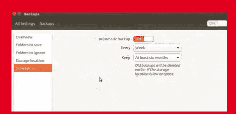

不要慌乱

如果你要更换电脑的电缆，请先拔掉电源。不要只是关机。在触摸任何东西之前，确保自己已接地，避免产生静电击穿。

了解如何从问题中恢复、保护数据安全并让系统重新运行。

磁盘故障是常见的烦恼来源，通常分为几种情况。驱动器物理性故障是最糟糕的，你通常需要与数据说别了，除非它的价值值得聘请专业的数据恢复公司（或其他人员）。其次是分区表损坏，此时驱动器可见但看不到任何分区。如果你在这些情况下开始尝试修复驱动器，它可能只是简单的文件系统错误、端口故障、某个电缆松动或损坏，亦或是坏道问题。另一个常见原因是文件系统错误：分区可见但无法挂载，或者数据看起来像已损坏，或者在文件系统完好但重要文件丢失的情况下（文件被他人删除），这通常是由非正常关机引起的。修复此类问题的标准工具是 `fsck`。在最基础的情况下，调用：

```bash
fsck /dev/sda1
```

注意，你是在分区上运行 `fsck`，不是整个磁盘。`fsck` 程序是一个封装，用于识别文件系统类型然后调用特定的 ext4 等 fsck 程序。然而，对于 ext2、ext3 和 ext4 等，程序会对每一个发生的错误或不一致之处提示你，这可能会发生数千次，因此你可能想运行 `fsck -y`（对全部选是）或 `fsck -p`（仅修复无需人工干预即可安全修复的错误）。当我们获得所需结果后，就可以对驱动器进行操作。如果驱动器显示分区或分区表损坏，我们可以恢复数据。请查看页面底部的说明。

## 损坏的文件系统
如果系统可以挂载但元数据错误，你可能可以文件系统。如果存在某种硬盘错误，你应该从 Live CD/DVD 启动以进行后续工作。有很多 Live CD/DVD，大多数通常都很有用。如果你手头有一个类似损坏菜单的系统启动盘，它们可能包含你所需的所有工具，例如 Rescueed。

### 使用 Testdisk 恢复丢失的分区
命令 [1-9]:
- 1 搜索主分区表
- 2 搜索其他分区表
- 3 搜索 EFI 分区表
- 4 手动指定扇区
- 5 分析几何结构
- 6 分析几何结构（专家模式）
- 7 整理文件系统
- 8 启动记录位置
- 9 退出

选择分区：
- 1 /dev/sda1 (Linux, ext4)
- 2 /dev/sda2 (Linux, ext4)
- 3 /dev/sda3 (NTFS)

操作 [a-q]:
- 17 写入新的 MBR 分区表
- 18 写入新的超级块分区表
- 19 写入新的 GPT 分区表
- 20 写入新的 NTFS 分区表
- 21 写入新的 GPT 分区表
- 22 创建空分区表

GPT 标准在磁盘的开头和结尾存储分区表的副本。使用 `gdisk`，按 `R` 进入分区表，然后按 `C` 从备份加载。要从备份重建分区表，按 `B` 然后按 `W` 保存。

旧式的 DOS 分区表不那么友好，只有一个副本。因此，你使用 `gdisk` 将备份导出到文件，以防万一。如果你没有备份，则需要尝试 testdisk。

你可以让 testdisk 扫描整个磁盘以寻找分区的特征。从 root 终端运行 testdisk 以查看可用驱动列表。你也可以使用使用 `dd` 或 `ddrescue` 创建的 mapfile。

基于 Linux 的 CD 默认启动到命令提示符，但如果你更习惯图形界面，也可以启动到类似图形的磁盘界面。正如其名所示，该发行版包含了修复 Linux 和 Windows 所需许多工具。它出现在本月的封面上，如果你需要一个安全的地方，这是一个不错的选择。它还包含一个安装在 USB 闪盘上的脚本，以提供更便携的解决方案。

另一个流行的救援盘是 Rescueed。选项越多，越有可能通过点击按钮轻松修复问题。它的 Rescueed 应用包含许多其他修复常见问题的按钮，对你来说是一个很好的修复方案。

并非所有故障都是由硬件或软件引起的，许多是由忘记密码的用户引起的。如果发行版允许你更改密码，忘记用户密码并不一定是致命的，但如果你忘记了 Windows 或 Ubuntu 密码呢？实际上非常简单：进入恢复模式后，将你的分区挂载到 /mnt/root，然后就可以更改密码。

```bash
passwd --root /mnt/root
```

Rescueed CD 使用你正在启动的磁盘通过这种方法更改任何用户（包括 root）的密码。

虽然使用 Linux CD 修复损坏的 Linux 系统看起来完全合逻辑，但用它来修复 Windows 问题并不那么显而易见，但确实可行。其明显的应用是挂载无法启动的 Windows 分区以恢复你的数据和其他文件。虽然过程可能不完美，但 Rescueed 可以非常容易地修复 Linux 和 Windows 的某些问题。点击按钮，阅读并操作。

如果驱动器显示分区或分区表损坏，我们可以恢复数据。Rescueed 可以非常容易地修复 Linux 和 Windows 的某些问题。点击按钮，阅读并操作。

```bash
ntfs -ro /dev/sda
```

我们使用 `sudo` 是因为 `smartctl` 需要访问设备的底级权限。要对驱动器进行彻底测试，你可以使用：

- sudo smartctl -t long /dev/sda

此测试可能需要一段时间，`smartctl` 应该会给出一个所需时间的估计。测试完成后，你可以通过以下命令查看结果：

- smartctl --log-selftest /dev/sda

查看你发现的错误详情：

- smartctl --log=error /dev/sda

我们定期运行 `smartctl` 程序并查看日志输出，这意味着人类懒得自己去检查。这个名为 `smartctl` 的程序在后台运行。只需编辑 `/etc/smartctl.conf`，找到只包含 `DEVICESCAN` 的行并将其更改为：

- DEVICESCAN -m me@email.com

一个清洁的系统较少出现问题。我们所说的“清洁”是指：没有感染和杂乱。而且在很多方面表现良好：它们让你的硬盘在没有累积错误的情况下运行非常完美。

除了增加备份时间外，这还会对你的系统产生积极影响。你可以随时清理主目录，删除不再需要的文件。各种程序还会保存到磁盘的临时文件：浏览器 Cookie、缓存文件和其他垃圾文件。用于此类问题的最佳工具之一是 `BleachBit`。

该程序扫描你的主目录并识别出你不再需要的文件。你可以选择它删除哪些文件。

## 还有清理

安装不必要的程序对你的系统也是一个潜在风险。你安装了不再使用的程序，可能会导致安全风险。卸载软件是其中一部分，但当你没有

| 设备 | 大小 | 已用 | 剩余 | 使用率 | 挂载点 | 可用 |
|---|---|---|---|---|---|---|
| /dev/sda1 | 500G | 200G | 300G | 40% | | 300G |
| /dev/sda2 | 200G | 50G | 150G | 25% | /home | 150G |
| /dev/sda3 | 100G | 10G | 90G | 10% | /var | 90G |
| /dev/sda4 | 50G | 5G | 45G | 10% | /root | 45G |

```
$ smartctl -a /dev/sda

SMART overall health self-test result: PASSED

Model Family: SSD 870 500GB

Serial Number: 12345

Power On Hours: 1200

Power Cycle Count: 15
```


安装一个程序，它会引入依赖项。对于基于 Debian/Ubuntu 的系统，你可以移除不再需要的依赖项：

- `apt-get autoremove`

保持不被感染更为重要。Linux 被认为对病毒污染免疫免疫，但事实并非如此。当你与 Windows 系统共享文件时，你也需要意识到病毒，这是一种更常见的威胁。虽然 Linux 病毒较少，但它确实有“坏病毒”，`ClamAV` 应该出现在你的软件库和许多程序中。

## 虽然 Linux 面临病毒问题，但它有一个很好的病毒扫描器，ClamAV

你首先需要刷新以更新病毒数据库——在扫描之前运行，或者通过 cron 任务运行。然后你可以使用 `clamscan` 进行清理，给出要搜索的目录：

- `clamscan --recursive --cross-fs /`

递归选项会删除过时的文件，因此这将清理文件系统。`cross-fs` 防止搜索其他文件系统，例如，如果 `/home` 在单独分区上，则需要再次调用 `clamscan`。如果你的电脑一直开着，

让我们用 `testfile.txt` 进行测试。在 Linux 中，你会用它做什么？让它定期运行是很重要的——在 `/etc/cron.daily` 中写一个两行的脚本，每天晚上检查一次。

不要让复杂性影响你的电脑安全，但不要让它卡死。记住花更多时间用在你购买它的初衷上

### 维护建议

保持你的系统安全并对问题做好准备，以最大限度地发挥它的价值；它应该在你工作良好之后、修理好之后故障一次，或者对你可能需要的任何事情做好准备，这样你就可以保持系统的健康，或者至少对问题做好准备。第一也是最重要的是建立一个备份系统并让它自动化。不要依赖记忆去执行，而是定期执行。安排备份，设置 `cron` 运行，一旦设置好，你就可以忘记它们；如果它们需要你的关注，它们会告诉你。

### 快速指南

#### SysReq 的魔力

Linux 通常足够稳定，可以确保软件异常，但程序可能会锁死整个电脑。在直接向这些程序发送命令之前，有一种更好的退出方法。使用 `Alt` 和 `SysReq` 通过按住 `Alt` 和 `SysReq` 键然后释放内核列表来修复内核，即使 X 完全锁定且不需要输入。
通常通过按住键盘，然后按 `S` 向问题进程发送 `TERM` 信号，请求它们转储日志文件。接下来，按 `I` 向所有剩余进程发送 `SIGKILL`，强制它们干净关闭。接下来，按 `B` 同步所有磁盘以便它们关闭。按 `U` 卸载所有文件系统并重新挂载为只读，以避免进一步损坏。最后，按 `E` 重启系统。

Right Conky 是一个高度可配置的系统监控器，让你能够关注系统状态的所有方面。

| 名称 | 大小 | 类型 | 挂载 |
|---|---|---|---|
| root | 20.5G | ext4 | / |
| home | 450.2G | ext4 | /home |
| swap | 8.0G | swap | - |

所以，就是按住 `Alt` 和 `SysReq` 并按顺序按下 `R-E-I-S-U`，最好每个字母之间留几秒钟，记住这一点，最合适的说法是：如果系统完全崩溃，**重启**是**最好**的办法（Reboot If System is Totally Broken），这是恢复系统的最好方法。你并不经常需要它，但在需要时它很有帮助。

为了监控桌面系统，`Conky` 或 `GkIM` 可以提供帮助，让你立即看到是否出现了问题。当你的电脑高负载工作时（如录制视频或编译软件），你自然会看到数值增加，但如果在正常使用时数值开始上升，你应该立即调查。高温会损坏硬件，但不必太担心，因为大多数情况下这只会缩短组件寿命。

笔记本电脑深受散热问题的困扰，因为风扇声音比其他地方更大，通常这只是通风口产生灰尘的问题。

#### 整理你的软件

如果你尝试了不同的软件包，请移除你不再需要的那些。安装的软件越多，你的系统暴露漏洞的机会就越大。保持系统整洁，因为大多数软件更新是为了修复错误或安全问题。尽可能保持使用你发行版主仓库的软件包，因为它们经过了兼容性测试。添加 PPA 看起来是个好主意，但它可能导致系统变得不不稳定。永远不要使用电源开关关闭电脑。

如果你的桌面锁定并显示无响应，可能可以重启电脑——直接断电是在自杀。如果只是桌面锁定了，而你正尝试使用 SSH 从另一台电脑登录并执行命令，如果这失败了，尝试 SysReq 键：它们在内核级别运行，并在其他方法都失效时帮助你执行任何操作。SysReq 的魔力在于。最重要的是，不要恐慌。你的系统会运作；如果它突然挂起，你总有办法解决，这通常只涉及一些常识和侦查工作，而不是崩溃。

# 订阅 不要错过任何期数

免费 DVD！尝试 2 种 Ubuntu 发行版

免费 DVD！4.7GB 发行版与工具包

# LinuxUser UBUNTU 17.10 特辑

面向 GNU 世代的必备杂志

面向 GNU 世代及开发者的必备杂志

> 100 种方法让你

# 精通终端 - 终极救援与修复工具包

在 24 小时内成为命令行大师

# UBUNTU 17.10

机器学习

所有新功能！替代发行版

ZeroPhone

使用 ZeroPhone 构建的英雄级设备为 $550

# 新书发布

安装并定制

数字取证 • 数据恢复 文件系统修复 • 分区与与安全分析

# 现在最火热的 2 种发行版！

# ANTEROS

现代、优雅并由 Arch 驱动。

# XUBUNTU

基于 Ubuntu，构建快速

+ + 55 种修复工具

# SYSTEMRESCUE AND RESSCATUE

+ + 使用 WIRESHARK 深入研究网络数据

# 深度指南

计算的未来

## 42 页指南

3: 安全：互联网 HTTPS 1 基础 Linux：性之悦

# 每期 £5.19（原价 £64）

# 订阅立省 20%

每期直接送达家门

不要错过任何期数
每年 13 期，您将
准备好获取每一期内容

送达您的家中
每期免费送货，
直接送达您的门口

享受最大优惠
直接订购，以更低的价格获得您喜爱的杂志

# 我们的读者对我们的评价……

“我今天才发现这本杂志。它简直太棒了——正是我寻找的。我太惊讶了！” 
Donald Sleighthome 来自 Facebook

“LinuxUserMag 刚通过邮寄寄达。多么棒的一期杂志！我正打算尝试微型 PC 和电烙铁玩具。”
@businessBoris 来自 Twitter

“对于一本优秀的杂志，我已经定期订阅了多年。”
Matt Caswell 邮件邮件

30

## 选择适合您的订阅方案

# 订阅立省 20%

- 自动续费 – 不要错过任何期数
- 通过银行直接借记支付

每六个月支付 £33.75，比零售价节省 20%

## 一年订阅

- 超值优惠，全球可用
- 一次付款，支持卡片或支票

简单的一次性付款确保您整整一年内不会错过任何期数。这是 13 期，直接送达您的门口。

| 给银行的指令 | 付款人参考 |
| :--- | :--- |
| 建筑学会扣款至 | 7 6 8 1 9 5 |
| 银行名称 | |

£67.50（比零售价节省 20%）
欧洲 £68.54 美国 $112.23 世界其他地区 $112.23

## 使用卡片或支票支付

使用信用卡或借记卡支付

| 地址 | 邮政编码 |
| :--- | :--- |
| 排序代码 (Sort Code) | 账号 |
| 卡号 | |
| 有期日期 | |
| 支票支付 | 付给：Future Publishing |
| 签名 | 日期 |

请向 Future Publishing Ltd 从本指令中详述账户扣款，需遵守 Future Publishing Ltd 提供的担保条款和条件，并在必要时将账号转至我的银行/建筑学会。银行和学会可能不接受所有类型账户的直接借记指令

## 您的信息

| 地址 | |
| :--- | :--- |
| 电话 | 手机号码 |
| 邮箱地址 | 邮政编码 |

如果您希望收到来自 Future 及其集团公司的包含新闻、特别优惠和产品信息的任何通讯，请勾选

请将此表寄至：
Linux User & Developers Society, Future Publishing Ltd.
3 Queensbridge, The Lakes, Northampton, NN7 7FB, United Kingdom

# 在线安全订 www.myfavouritemazines.co.uk/sub

## 联系我们友好的客户服务团队
拨打 0344 888 2852

这些优惠将于
2018 年 1 月 31 日过期
订阅时请提供代码 LDPS17

> * 价格和优惠金额基于全价印刷版详情。您每年将收到 13 期。您可以在购买后 14 天内电话或写信取消订阅。除非发生特殊情况，否则14 天取消期后付款不予退还。您的法定权利不受影响。请在销售点同意更改。可应要求提供完整的直接借记指南。可能会根据您的手机资费额度产生英国费用。条款请访问 bit.ly/maginfo 优惠于 2018 年 1 月 31 日结束

# 教程

## 基础 Linux 命令

第五部分

## 精通 Shell 脚本：Sed 之悦

John Gowers

是一位编程和计算机科学领域的大学导师。他喜欢在每一个能接触设备上安装 Linux，并每天使用终端和 shell 脚本。

学习流编辑器（stream editor）的多种用途，这是一种极其多功能的文本替换命令。在系列的第一部分中，我们学习了作为我们所学命令基础的 UNIX 哲学。该哲学的一部分是坚持所有程序都通过文本流进行相互通信，这是一个通用原则。如果两个程序通过接收文本输入并产生文本输出来运行，它们可以通过管道（pipeline）共同交互，即使它们并非设计为协同工作。

s/s  用于替换 (substitute)

这背后的核心点是，一个程序的文本输出格式可能不是下一个程序所要求的，因此我们使用了可以解决此问题的工具之一：grep 过滤掉我们需要的输出行。

最重要的 sed 命令是 s，它是命令的开头，要删除的字符串，s 是 'substitute'（替换）的缩写。基本语法为：

### 资源

```
$ <<< "couscous" sed '/s/pom/g'
```

在本期杂志中，我们将使用一个更强大的程序：“流编辑器”，或 sed，它可以充当程序之间的胶水。sed 不仅仅是过滤行，它还可以主动更改某行。

- 一个正在运行 shell 的终端（任何 Linux 发行版的标准配置）
- 一个“字典”文本文件，包含一份英语单词列表（检查 `/usr/share/var/bin/` 目录或在线搜索）
- 我们看到的您的包管理器或从 www.gnu.org/software/wget/ 下载

| olH | |
| :--- | :--- |
| /n/ !G |
| olH$ |
| s\(/\)\\(.*\n)\\&\2\1 |
| olH\nno$ |
| D |
| leH\nno$ |
| D |
| leH\nno$ |
| D |
| s\(/\)\\(.*\n)\\&\2\1 |
| leH\nno$ |
| D |
| ehH\nHello$ |
| s\(/\)\\(.*\n)\\&\2\1 |
| HnnHello$ |
| D |
| nnHello$ |
| s\(/\)\\(.*\n)\\&\2\1 |
| nHello$ |
| D |
| Hello$ |

```
#!/bin/sed -f

/n/ !G

s\(/\)\\(.*\n)\\&\2\1

s//
```

在这个示例中，s 是命令的开头，后面是要删除的字符串，然后是斜杠 /，然后是另一个斜杠 /，最后是替换的字符串，然后。

- 一个正在运行 shell 的终端（任何 Linux 发行版的标准配置）
- 一个“字典”文本文件，包含一份英语单词列表（检查 `/usr/share/var/bin/` 目录或在线搜索）
- 我们看到的您的包管理器或从 www.gnu.org/software/wget/ 下载

```
#!/bin/sed -f

/n/ !G

s\(/\)\\(.*\n)\\&\2\1

s//
```

```
#!/bin/sed -f

/n/ !G

s\(/\)\\(.*\n)\\&\2\1

s//
```

（注：由于提供的 OCR 文本包含大量重复和重叠部分，已进行清理以提供逻辑流畅的版本。）

## 教程：Linux 管理员必备技能

## 成为一名意外的管理员

虽然我们认为，每个人都是从使用 Linux 作为操作系统开始的。我们认为，大多数人第一次接触 Linux 是由于点击了某个按钮来设置个人或业务网站、小型地址或在线服务 - 突然之间，你就变成了一名 Linux 管理员。即便如此，你并不知道为什么。

在开始使用你的 Web 服务器时，事情非常简单。服务商为你提供如 cPanel 或 Plesk 这样的 Web 界面来管理你的服务器。强大的软件提供了简单的登录方式，并轻松安装 WordPress 等应用程序。

但当你第一次必须执行一些通过图形控制面板无法直接完成的操作时，你就发现自己力不从心了，必须使用强制性的命令行工具，并进入了纯文本终端的世界。

更糟糕的是，对许多人来说，他们第一次处理终端通常是在发生某些错误且无法通过控制面板修复时。或者，你刚刚读到某个重大安全漏洞席卷整个网络，所有的 Linux 服务器都必须立即更新。突然你意识到，你的控制面板实际上并没有为你的操作系统更新安全补丁，而你的小型个人博客可能是用于对他人发起 DDoS 攻击的大规模事件的一部分。你不仅是一个可能试图恢复或修复不属于你的东西的陌生人，而且这些东西只需花几英镑就很难处理，而你又不需要麻烦。

你成了一名意外的管理员！一个本打算放弃 Linux 服务器并让其安全的管理员，但现在你在这里了。你意识到这一切都在你付给 ISP（互联网服务提供商）的月费范围之内 - 一旦发现，还不为晚。Linux 服务器令人敬畏。本指南基于特定的发行版。所有的命令都像 Linux 桌面一样列在这里，以便你了解服务器。

什么是 SSH？字母 'cat' 到底意味着什么？我该如何为我的服务器应用补丁？别担心，你并不孤单。为了帮助你，我们编写了这份指南，包含了每个意外管理员都应该掌握的必备 Linux 命令。

### 核心管理员命令

Adam Oxford 经营南非科技新闻网站 WWW.techradar.co.za
他通过惨痛的方式汲取了许多教训。

所有 Linux 服务器管理员都应该闭着眼睛都能熟悉的终端命令。

你是一名意外的管理员！有人迟才决定承担 Linux 服务器的责任 - 因为没有发生任何差错，你迷失在了终端和命令的世界里。

还想不起你上周做的那个聪明操作吗？`history` 命令可以告诉你。

### 资源

所有的 Linux 发行版都不同，大多数都有多个可以在 CLI（命令行界面）访问的基于终端的文本编辑器

```
$ netstat -atnu

$ ifconfig -a

$ top

$ df -h

$ ls -ltr

$ uptime

$ pkill -f

$ grep

$ chroot

$ what it was doing

$ apt get update
```

## sed 教程

要编写脚本，我们从以下 shebang 行开始：

```bash
#!//bin/sed -f
```

我们已经学到的命令非常简单，但进一步的命令将帮助执行循环、状态保存以及同时对多行进行操作。如果你想学习这些内容，一个好的起点是阅读（或者最好是编写）我们写的脚本，它是一个反转内容的过滤器模拟器。如果你想学习 sed 的一些高级功能，最好的起点是写下为什么这个脚本会这样运行。

...这告诉我们脚本应该由 `sed` 命令运行。如果我们想扩展正则表达式，应该使用 `#!//bin/sed -ef`。这样我们就可以在一个文件中列出命令。例如：

```bash
#!/bin/sed -f

## 替换空格
s/ /g

## 将 'gobi' 替换为 'tuna'
s/gobi/tuna/g
```

将此保存为名为 `loop-replace.sed` 的文件，然后运行 `sed -f loop-replace.sed`。然后你可以直接从命令行运行它：

```
$ sed -f loop-replace.sed
forgo bite
fortunate
```


注意，我们在上面的脚本中使用了注释。`sed` 脚本中，任何以井号 `#` 开头的行都会被视为注释并被 `sed` 忽略。

## 选择性打印：案例研究

作者用于在计算机上安装软件的包管理器会打印如下格式的错误：

```
Installing...

package-name: /path/to/file already exists in filesystem

package-name: /path/to/file2 already exists in filesystem
```

这在你尝试安装一个已经存在的东西时发生。在这种情况下，包管理器不会覆盖文件，而是会将控制权交回用户，以便他们决定如何处理冲突文件。

很多情况下，安装后文件会遗留并且应该被删除。

> `Sed` 除了简单的文本替换外还提供了许多功能

## 使用 sed 编辑文件

使用普通的管道为文件运行 `sed` 命令是很容易的。例如：

```
$ sed s/dammarn/ > clean_email.txt
```

然而，这对于根据结果创建一个新文件是没用的。因此，使用 `sed -i` 直接修改文件：

```
$ sed -i orig.txt 's/dammarn/'
```

`-i` 后的 `.orig` 是可选的，但如果我们对 `sed` 命令犯了错，就会丢失原始文件。如果在 `-i` 之后添加扩展名，它将保存一份文件的副本。

```bash
#!/bin/sed -f
s3 's/abc//g'
s4 's/def//g'
s5 's/ghi//g'
s6 's/jkl//g'
s7 's/mno//g'
s8 's/pqr//g'
s9 's/stu//g'
s10 's/vwx//g'
s11 's/xyz//g'
```

## Essential admin commands

`Adam Oxford` runs South African tech news site
`WWW.techradar.co.za`
He learned many of these lessons the hard way.

Terminal commands that all Linux server administrators should know blindfolded.

You're an accidental admin! Someone resolved to late, that you were the responsibilities of Linux server - and because nothing has gone wrong lost in a world of terminals and commands.

Also can't remember that clever thing you did last week? The history is command you.

## Resources

All Linux distros are different and most have a number of terminal-based text editors you can access on the CLI

```
$ netstat -atnu
$ ifconfig -a
$ top
$ df -h
$ ls -ltr
$ uptime
$ pkill -f
$ grep
$ chroot
$ what it was doing
$ apt get update
```

## Tutorial sed

To write a script, we start off with the following shebang line:

```
#!//bin/sed -f
```

The commands we have learned are quite simple, but further commands that will help perform looping, saving of state and operations on multiple lines at a time. If you want to learn about these, a good place to start is by reading or better the script we wrote is an emulation of a filter that reverses its content. If you want to learn some of the advanced features of sed, a good place to start is by writing why this script works as it does.

...which tells that the script should be run by the `sed` command. If we want to extend the Regular Language, we should use `#!/bin/sed -ef` instead. We can then list the commands in one file. For example:

```
#!/bin/sed -f
# Replace spaces
s/ /g
# Replace 'gobi' with 'tuna'
s/gobi/tuna/g
```

Save this into a file named `loop-replace.sed` and then run with `sed -f loop-replace.sed`. You can then run it directly from the command line:

```
$ sed -f loop-replace.sed
forgo bite
fortunate
```

Note that we used comments in the script above. A `sed` script, any line with a hash `#` is treated as a comment and ignored by `sed`.

## Selective printing: a Case Study

The package manager that your author uses to install software on their computers prints out errors of the form:

```
Installing...

package-name: /path/to/file already exists in filesystem

package-name: /path/to/file2 already exists in filesystem
```

This happens when you try to install something that already exists. In this case, the package manager will not overwrite the files, but will pass control back to the user so they can decide what to do with the conflict files.

More than often, it turns out that the files are left over after a installation and should be deleted.

> `Sed` provides pieces of functionality besides simple replacement of text

## Editing files with sed

It is easy to use the normal pipeline to run a `sed` command for file. Example:

```
$ sed s/dammarn/ > clean_email.txt
```

However, this is useless to create a new file out of the result. So use `sed -i` in place to modify the file:

```
$ sed -i orig.txt 's/dammarn/'
```

The `.orig` after `-i` is optional, but if we make a mistake with our `sed` command, then we end up losing our original file. If we add the extension after `-i`, then it will save a copy of the

```bash
#!/bin/sed -f
s3 's/abc//g'
s4 's/def//g'
s5 's/ghi//g'
s6 's/jkl//g'
s7 's/mno//g'
s8 's/pqr//g'
s9 's/stu//g'
```

你不仅是一个可能试图恢复或修复某些不属于你的你的陌生人，而且这些东西只需花几英镑就很难处理，而你又不需要麻烦。


你成了一名意外的管理员！一个本打算放弃 Linux 服务器并让其安全的管理员，但现在你在这里了。你意识到这一切都在你付给 ISP（互联网服务提供商）的月费范围之内 - 一旦发现，还不为晚。Linux 服务器令人敬畏。本指南基于特定的发行版。所有的命令都像 Linux 桌面一样列在这里，以便你了解服务器。

什么是 SSH？字母 'cat' 到底意味着什么？我该如何为我的服务器应用补丁？别担心，你并不孤单。为了帮助你，我们编写了这份指南，包含了每个意外管理员都应该掌握的必备 Linux 命令。

## 核心管理员命令

Adam Oxford 经营南非科技新闻网站

`WWW.techradar.co.za`

他通过惨痛的方式汲取了许多教训。

所有 Linux 服务器管理员都应该闭着眼睛都能熟悉的终端命令。

你是一名意外的管理员！有人迟决定承担 Linux 服务器的责任 - 因为没有发生任何差错，你迷失在了终端和命令的世界里。

还想不起你上周做的那个聪明操作吗？`history` 命令可以告诉你。

## 资源

所有的 Linux 发行版都不同，大多数都有多个可以在 CLI（命令行界面）访问的基于终端的文本编辑器

```
$ netstat -atnu
$ ifconfig -a
$ top
$ df -h
$ ls -ltr
$ uptime
$ pkill -f
$ grep
$ chroot
$ what it was doing
$ apt get update
```

## sed 教程

要编写脚本，我们从以下 shebang 行开始：

```
#!//bin/sed -f
```

我们已经学到的命令非常简单，但进一步的命令将帮助执行循环、状态保存以及同时对多行进行操作。如果你想学习这些内容，一个好的起点是阅读（或者最好是）我们写的脚本，它是一个反转内容的过滤器模拟器。如果你想学习 sed 的一些高级功能，最好的起点是写下为什么这个脚本会这样运行。

...这告诉我们脚本应该由 `sed` 命令运行。如果我们想扩展正则表达式，应该使用 `#!//bin/sed -ef`。这样我们就可以在一个文件中列出命令。例如：

```bash
#!/bin/sed -f
## 替换空格
s/ /g
## 将 'gobi' 替换为 'tuna'
s/gobi/tuna/g
```

将此保存为名为 `loop-replace.sed` 的文件，然后运行 `sed -f loop-replace.sed`。然后你可以直接从命令行运行它：

```
$ sed -f loop-replace.sed
forgo bite
fortunate
```

注意，我们在上面的脚本中使用了注释。sed 脚本中，任何以井号 `#` 开头的行都会被视为注释并被 sed 忽略。

## 选择性打印：案例研究

作者用于在计算机上安装软件的包管理器打印如下格式的错误：

```
Installing...
package-name: /path/to/file already exists in filesystem
package-name: /path/to/file2 already exists in filesystem
```

这在你尝试安装一个已经存在的东西时发生。在这种情况下，包管理器不会覆盖文件，而是会将控制权交回用户，以便他们决定如何处理冲突文件。

很多情况下，安装后文件会遗留并且应该被删除。

> Sed 除了简单的文本替换外还提供了许多功能

## 使用 sed 编辑文件

使用普通的管道为文件运行 sed 命令是很容易的。例如：

```
$ sed s/dammarn/ > clean_email.txt
```

然而，这对于根据结果创建一个新文件是没用的。因此，使用 `sed -i` 直接修改文件：

```
$ sed -i orig.txt 's/dammarn/'
```

`-i` 后的 `.orig` 是可选的，但如果我们对 sed 命令犯了错，就会丢失原始文件。如果在 `-i` 之后添加扩展名，它将保存一份文件的副本。

在任何 Linux 命令前使用 `sudo` 可以临时授予 root 或 admin 权限。

除非你清楚自己在做什么，否则不建议使用 `sudo`。在使用 `sudo` 之后，系统会要求你输入密码。在桌面电脑上，这与你登录时使用的密码相同。然而，如果你是登录到 Web 服务器，对于由于重要更改而要使用的命令，是不需要的的。

如果你无法执行 `sudo`，说明你的访问级别受限，而且这可能无法更改。在 Linux 中，用户账户可以是“组”（groups）的一部分，许多组的订阅者可以使用 `sudo` 命令为自己授予管理员权限。

你可能需要在你选择的任何命令前使用 `sudo`。语法非常简单。例如：`sudo filename`。

## 02 sudo

虽然 `sudo` 用于排查 Web 服务器，但它也有局限性。如果你有一系列命令需要执行，你不想每次运行时都输入一遍，而且密码有 5 分钟的限制——这就是 `sudo` 的用场，它将为你提供整个命令行行的超级用户权限。只需在 `yourname:root@yourserver` 想要运行的命令前输入 `sudo` 即可。你可能认为 `sudo` 代表 superuser（超级用户），但它实际上是任何没有 root 账户的用户都可以的命令。如果你想成为 root，使用 `sudo` 将让你回到原始的、非超级用户的登录状态。

## 03 ifconfig

在排查 Web 服务器时，尽可能获取有关你实际连接的细节可能是好的。`ifconfig` 命令可以在没有 sudo 权限的情况下运行，它将为你提供每个网络接口的详细信息。如果你正在检查 IP 地址，查看是否连接到 VPN 也有用。连接的描述例如，如果你正在使用以太网线，那么这就是 VPN 隧道。

## 04 chmod

关于 `chmod` 有更多内容需要学习（见第33 页），我们强烈建议你这样做，因为它更强大。虽然 `chmod` 讨论哪些用户是文件的所有者，但该命令更改文件所有者及其所属组的身份。完全，

## 05 service

不，我们需要一次一次地尝试它，但有时它是很好的停留点（而且有时将更改加载到内存中是必要的）。在 Windows 上，可以使用 Windows 系统监视器或任务管理器使用 `sudo` 来启动和停止进程。在 Windows 中，命令行略有不同，有点棘手但并非如此。

令人困惑的是，许多 Linux 改变了它们管理启动的方式（通过切换），处理方法有两种。旧方法仍然适用于很多系统，是使用 `service` 命令，必要时前面加上 `sudo`。正确的方法稍微冗长：`systemctl restart myservice.service`。如果你想重启一个应用程序，将其代码更多进入 Web 服务器，命令将是 `systemctl restart_service.service`。

## 06 ls

理解控制台的关键在于路径，它显示在命令提示符中，告诉你在任何给定时刻位于文件夹结构中的位置。你如何知道当前位置有什么内容？使用 `ls` 命令查看你当前正在浏览的内容列表。如果列表很长，使用 `ls |` 传递到每页结束。

## 07 cat

该命令将向你显示你是否看到了找到指令——你不确定在看什么——“cat”是简写，用于合并文件。在最简单的形式下，它可以显示 `file1.txt` 和 `file2.txt`。

## 08 find

`find` 是一个有用且体面的命令，它的功能非常自言易懂。找到东西并不困难。如果 `find` 本身就像列出你当前目录中的所有文件。你也可以搜索所在位置的子目录。使用 `find -name "filename.txt"` 搜索文件名。通过在 `-name` 选项之前插入，你可以指定起始点以遍历文件夹。通过更改 `-name` 选项，你可以根据上次访问以来的天数 `-atime` 或

## 09 df

也许磁盘空间的大小有些问题？那么你将获得当前系统上挂载的每个卷的大小和使用情况的完整分解。默认情况下，它将以字节给出大数字，但如果你运行 `-h`（代表“human readable”，人类可读），大小将以兆字节、千字节或任何合适的单位报告。

## 10 apt

可能是最重要需要知道和使用的命令。我们都知道要保持计算机系统运行需要保持其更新，但如果你获得了 Linux 盒子的控制权，某些更改是不会自动完成的。简单的 `apt-get update` 将命令系统检查所有应用程序的最新版本。

## 11 grep

在计算机命令中，没有比 `grep` 更有名的了？它是一件真正的工具——如果它只是凭造的，你如何学会掌握这些东西？`grep` 是一个在文件中查找模式的实用工具。想在书中找到谈论某些内容的行吗？如果你做得好，检查 `grep "cheese.txt"`。然后你每天都可以使用它直接在文件中查找文本。现在你认识 `grep` 了。

## 12 top

当你在图形界面（如 Linux 桌面）中工作时，总有一个像系统管理器或任务器那样的应用程序，你可以用它来跟踪运行的应用程序，并提供有关 CPU 周期、内存的详细信息。当你在 Linux 桌面中工作时，总有一个像系统管理器或任务器那样的应用程序，你可以用它来跟踪运行的应用程序，并提供有关 CPU 周期、内存的详细信息。

## 13 kill

当你在图形界面中工作时，总有一个像系统管理器或任务器那样的应用程序，你可以用它来跟踪运行的应用程序，并提供有关 CPU 周期、内存的详细信息。当你在图形界面中工作时。

该命令将向你显示你是否看到了找到指令——你不确定在看什么——“cat”是简写，用于合并文件。在最简单的形式下，它可以显示 `file1.txt` 和 `file2.txt`。

## 14 w

`mv` 用于重命名。

## 15 mv

`mv` 用于重命名。该命令用于将文件从一个位置移动到另一个位置，`rm` 是

## 16 cp

`chmod 777 - filename` 例如将赋予所有用户编辑该文件的权限，不要在 Web 服务器上使用这种——出于明显的原因。

## 17 vi

## 18 nano

## 19 history

## 20 permissions

# SimpleScreenRecorder

## Linux 上的视频录制

学习使用 SimpleScreenRecorder 进行训练和教程视频，并让你的文件大小达到金子般的价值。

老式的演示方法是将摄像头对准屏幕——你仍然会在 YouTube 上看到这些操作，特别是当它涵盖 BIOS/UEFI 指南时。这提醒了你，计算机会生成实时图像信息，然后这些信息被输出到旧的模拟摄像机，它重新处理这些信息，并将其存储到视频文件中。除了右对齐漂移，还有量化噪声失真。

录制程序曾是一件困难的事，因为编码来自帧率的实时视频需要很高的处理能力。幸运的是，硬件的不断进步使其变得简单。我们的作者在一台配备低速双核 Intel CPU 的五年前的 IBM ThinkPad 上，录制了 Android Studio 的实时视频，以及如 PC 软件设计、Ubisoft（isoft）Target 3501 等演示产品。


## 工具选择

寻找理想的屏幕录制解决方案会产生大量的选项。然而，选择一个可靠的并不容易。例如，我们尝试了 Kam 和 Disastrous，因为这些程序经常崩溃。

在两个屏幕并排显示且有轻微偏移的情况下，管理你的简单屏幕录制器设置。

由 Maarten Beert 开发的 SimpleScreenRecorder 可以成为金标准，它被 YouTubeer 和视频编辑师使用。以下安装它的步骤适用于使用 Ubuntu 14.04：

- `sudo add add-repository ppa:maarten-beert/simplescreenrecorder`

- `sudo apt update`

- `sudo apt-install simplescreenrecorder`

较新版本操作系统的大多数用户可以直接下载该程序，因为 Canonical 已经为 17.04 将该产品添加到其仓库中：

如果你在 64 位工作站上使用 32 位捐赠版，你将需要安装另一个模块进行输出：

SimpleScreenRecorder 不限于 Ubuntu Linux。该程序可以在任何 *Linux 操作系统*上运行。有关支持的更多信息，请查看 https://github.com/SimpleScreenRecorder

完成后，即可启动程序。只需输入其名称即可打开主界面（如图 1 所示）。在使用 SimpleScreenRecorder 时，从顶部开始向下看。第一个切换开关允许你选择想要录制的素材。对于连接了多个屏幕的系统，有一个非常重要的方面；“录制整个屏幕”旁边的组合框提供了多种选项，各个屏幕会被识别。

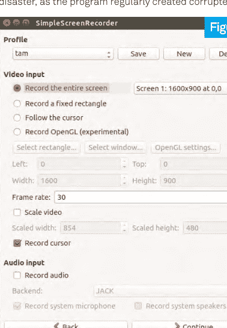

## SimpleRecorder

## 图 3

## 录制

- 开始录制

- 启用声音通知

- 启用录制热键

- 热键：Ctrl + Shift + B

- Super + B

| 信息 | 预览 |
| --- | --- |
| 时间: 0:00:00 | 注意：提供录制需要额外的 CPU（高帧率下耗时较长）。 |
| FPS: 60 |  |
| 大小: 1600x900 |  |
| 文件名: .mp4 |  |
| 文件大小: 8 MB |  |

与使用更多处理器资源相比权衡，这些资源正被消耗在你尝试演示的程序上。此外，确保勾选“允许跳帧”复框。如果你的计算机处理器在录制期间过载，这将使其价值连城。最后，请确保正确设置你的文件存储属性——避免覆盖生产就绪素材可能是灾难性的。

## 直播

SimpleRecorder GUI 包含其他功能；点击“打开”启动一个屏幕（图 3）。这并不会启用——实际录制过程在点击“开始”按钮后开始。启动后，实际录制开始，程序将显示实际录制内容。在使用 SimpleScreenRecorder 时，从顶部开始向下看。第一个切换开关允许你选择想要录制的素材。对于连接了多个屏幕的系统，有一个非常重要的方面；“录制整个屏幕”旁边的组合框提供了多种选项，各个屏幕

| 信息 | 预览 |
| --- | --- |
| 时间: 0:00:00 | 注意：提供录制需要额外的 CPU（高帧率下耗时较长）。 |
| FPS: 60 |  |
| 大小: 1600x900 |  |
| 文件名: .mp4 |  |
| 文件大小: 8 MB |  |
| 比特率: 24 kbps |  |

与使用更多处理器资源相比权衡，这些资源正被消耗在你尝试演示的程序上。此外，确保勾选“允许跳帧”复框。如果你的计算机处理器在录制期间过载，这将使其价值连城。最后，请确保正确设置你的文件存储属性——避免覆盖生产就绪素材可能是灾难性的。

## 直播

SimpleRecorder GUI 包含其他功能；点击“打开”启动一个屏幕（图 3）。这并不会启用——实际录制过程在点击“开始”按钮后开始。启动后，实际录制开始，程序将显示实际录制内容。在使用 SimpleScreenRecorder 时，从顶部开始向下看。第一个切换开关允许你选择想要录制的素材。对于连接了多个屏幕的系统，有一个非常重要的方面；“录制整个屏幕”旁边的组合框提供了多种选项，各个屏幕

事件驱动架构非常适合许多任务。例如，这种系统最大的用处是生产者和消费者之间的安排是灵活的；如果需要更改，只需要更改触发器（传感器）或其他消费者。

此外，测试事件驱动架构被大大简化。这种现象在观察它们是如何连接在一起时显而易见的。通过使用模拟类来测试你的协议实现，而无需向客户端发送准备的数据。

事件驱动系统并不新鲜。在物联网的世界中，MQTT 是一种针对小型传感器和移动设备的轻量级协议，针对高延迟或不可靠的网络进行了优化。它的主要优势是它是一个行业标准：开发协议的开发者必须在每个平台上实现网络代码；而 MQTT 用户只需下载库。最后，社区托管代理的流行意味着扩展性问题大大减少。

Mozilla 开始了对之后内容的详细描述。由于这种方法可能非常繁琐（而且我们有一个三部分的系列），让我们采取不同的方法。我们首先设置 Mosquitto 服务器，然后连接所有设备到它。

不要在你的机器上安装 Mosquitto 服务器：系列的后续部分将部署高级硬件，它们必须与 MQTT 服务器位于同一网络中。

幸运的是，开源 Mosquito 在大多数但并非所有的软件包仓库中可用。当你在屏幕

www.linuxux.co.uk 41

# MQTT 教程

## 第一部分

## MQTT 简介

使用 MQTT 并设置 Mosquitto 服务器来传输资源受限

事件架构非常适合许多任务。例如，这种系统最大的用处是生产者和消费者之间的安排是灵活的；如果需要更改，只需要更改触发器（传感器）或其他消费者。

此外，测试事件驱动架构被大大简化。这种现象在观察它们是如何连接在一起时显而易见的。通过使用模拟类来测试你的协议实现，而无需向客户端发送准备的数据。

事件驱动系统并不新鲜。在物联网的世界中，MQTT 是一种针对小型传感器和移动设备的轻量级协议，针对高延迟或不可靠的网络进行了优化。它的主要优势是它是一个行业标准：开发协议的开发者必须在每个平台上实现网络代码；而 MQTT 用户只需下载库。最后，社区托管代理的流行意味着扩展性问题大大减少。

Mozilla 开始了对之后内容的详细描述。由于这种方法可能非常繁琐（而且我们有一个三部分的系列），让我们采取不同的方法。我们首先设置 Mosquitto 服务器，然后连接所有设备到它。

不要在你的机器上安装 Mosquitto 服务器：系列的后续部分将部署高级硬件，它们必须与 MQTT 服务器位于同一网络中。

幸运的是，开源 Mosquito 在大多数但并非所有的软件包仓库中可用。当你在屏幕

- https://mosquitto.org

用于覆盖我们基础设施的 Mosquitto 服务器的网站

- http://mqtt.org

MQTT 协议社区的网站

- https://www.hivemq.com

由 albert priey 开发的专业 Mosquitto 替代方案

在 Ubuntu 14.04 上，可以通过 `apt-get install mosquito` 部署该产品。


以下步骤假设 Mosquito 服务器位于私有网络；本系列未涵盖在公共服务器上对其进行加密。Mosquito 实现了一个发布事件系统，这意味着客户端必须宣布它们对通道的兴趣，从那时起，所有匹配的事件都会发布。从命令行客户端开始，它们不属于发行的一部分，可以使用 `apt-get install mosquitto` 下载。

MQTT 消息是动态生成的。在你的开发环境中打开一个新终端并输入 `mqtt_sub -h localhost -t smallest`。当消息到达时，代理将发布消息：`-t` 参数指定要观察的通道。该发行还带有一个用于创建 MQTT 事件的辅助工具：

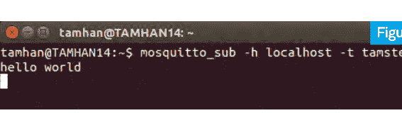

```bash
tamham@TAMHAN14 ~~
tamham@TAMHAN14:- mosquito_sub -h localhost -t smallest
hello world
```

```cpp
m_client->setHost("test.mosquito");
m_client->setPort(1883);
connect(m_client, &stateChanged, &MainWindow::onStateChange);
connect(m_client, &disconnected, &this, &MainWindow::onDisconnected());
m_client->connectHost();
```

在上面的 C++ 中，`mqtt_sub` 等待传入的消息而不会退出。

- `mqtt_sub -h localhost -t smallest` 输出 "hello world"

当你按下包含 `mqtt_sub` 的终端中的回车键时，首个终端将显示类似图 1 所示的 hello world 消息。

## 引入 Qt

C++ 框架的 MQTT 模块在 5.10 版本中尚未包含，因此我们必须使用 GitHub (`https://github.com/qt/mqtt`) 上的版本。使用 qmake 将外部模块集成到 Qt 构建中，可以为你提供一个开箱即用的项目结构。它基于 5.10 的版本 3，并包含在本教程中。它将帮助你理解项目的相关实现文件，并调整一些新模块的情况。

> C++ 框架的 MQTT 模块在 5.10 版本中不存在——我们必须使用 GitHub 上的版本。

加载并打开 MainWindow 的头文件，确保包含它，并为我们在后续步骤中使用的 Mqtt 实例创建一个指针：

```cpp
#include <mqtt/mqttclient.h>

class MainWindow : public QMainWindow
private:
    Ui::MainWindow *ui;
    MqttClient *m_client;
};
```

在构造函数中，我们为 MainWindow 连接到服务器：

```cpp
MainWindow::MainWindow(QWidget *parent) {
    ui->setupUi(ui);
    m_client = new MqttClient(this);
}
```

```cpp
void MainWindow::updateStateChange(const QString &state) {
    QTime::currentDateTime().toString(State Change) + QString::number(int(m_client->state()));
    qdebug() << "connected";
}
```

最后，注册了后续事件以便我们可以收集有关连接过程的信息。它们使用 `qdebug` 输出消息 - `updateStateChange` 看起来如下：

截至编写时，Qt 的许可过程为 Qt.. 在非 GPL 授权且预期用途的商业项目中使用时要小心。


在 C 中可以找到连接信息——请注意，成功连接会导致状态文件中存储的值变为 2。完成后，是时候首次使用该程序了。`StateChange` 将告知我们测试服务已接受连接——理论上，我们现在可以使用我们的服务器技术方法。

作者 — AP 产品正常工作。

www.linuxuker.com 43

# 教程

### MQTT

通过调整传递给 `MQTTClient` 对象的参数：MQTT 协议接收到了更新，该更新在 QTMQTT 和官方 Mosquitto 测试器中均已实现。然而，Ubuntu 包管理器后的团队以更新缓慢闻称。因此，需要手动干预。

```cpp
MainWindow::MainWindow(Widget *parent) {
    client->setHostName("localhost");
    client->setPort(1883);
}
```

首先进入系统——启动的 Mosquitto 实例将响应你的请求。仔细考虑代码——它是相关的，因为它描述了 Ubuntu 服务器何时加载代码，以及它想要对代码库执行什么。

遗憾的是，运行第一次修改的结果并不如意。在创建 'State 1' 后，输入了代理丢失消息。服务器正在活动运行我们的连接。

现在，使用 `remove mosquitto-clients` 从工作站中移除现版本的客户端和服务器。最后，向 `get-apt` 添加新的 PPA，执行更新并重启 mosquitto。

## 故障排除

Mosquitto 支持广泛的日志设施。遗憾的是，它们默认未启用。启动它们需要编辑 `/etc/mosquitto.conf`——选择一个顺序，从超级权限和权限开始。所有功能都可以在该段找到——日志目标必须通过设置字符串 `syslog:` 来：

```bash
sudo apt-add-repository ppa:mosquitto-dev
sudo apt-get update
sudo apt-get install mosquitto
```

```conf
log_dest = syslog
```

接下来，查找日志文件。它们默认以 `#` 字符开头，这标记它们为已禁用。只需删除该字符即可启用日志功能然后保存文件：

在部署期间，会弹出消息。如果你想使用配置文件或用新包提供的文件替换它，请按退出。如果你想保留现有配置，请选择该选项并按回车进入配置文件。之后，系统将显示你的日期可能比官方仓库的旧；然而，你的版本号将在 1.x 范围内，表明底层代码是新版本（见图 3）。

```conf
log_type = error
log_type = warning
log_type = notice
log_type = information
connection_messages = true
```

重启服务器以强制其在登录时读取新配置。系统日志最好使用 syslog 查看器完成——之后，重新连接你的客户端以查看图 2 所示的错误。此问题是由版本引起的。

## 增加一些问题？

让我们修改程序，使其注册测试。

## get安全

## 重定向与拦截

来自设备的 HTTP 请求

通过重定向手机和物联网（IoT）设备的流量，你可以检测恶意行为、发现弱点等。

Pros 等工具对于 Web 应用程序的渗透测试非常有用。它们能够检测网站上的常见漏洞（SQL 注入、SSL、敏感数据等），同时为你提供了一个强大的框架来绕过 Web 客户端、执行手动扫描或控制自动化攻击。在渗透测试过程中，可以学习到很多东西。但不仅限于 Web——考虑所有那些嵌入、交互，甚至检测某些隐藏或恶意的行为。你可以像处理其他计算机一样轻松地重定向来自智能手机或物联网设备的流量，并将其交给 Burp 或 ZAP。通过这样，你能够拦截 HTTP 请求，对其进行操作，并对任何普通网站一样进行常规的分析和攻击。

### 重定向（部分流量）

当涉及到重定向甚至修改来自设备的 HTTP 请求时，你会遇到两种情况：要么你拥有设备的管理员权限，要么你可以通过网关或代理控制网络流量（前提是设备支持代理）。后者将允许你拥有两个选项：

| 目标 | 代理 | 扫描器 | 攻击者 | 重复器 | 解码器 | 比较 | 交换器 | 项目导出 | 用户选项 | 告警 |
|---|---|---|---|---|---|---|---|---|---|---|---|

| 拦截 | HTTP 历史 | | | | | | | | | | | |
| | | | | | | | | | 30200 | JSON | | | | |
| | | | | | | | | | 22400 | JSON | | | | |
| | | | | | | | | | | 2000 | JSON | | | | |
| | | | | | | | | | | | 1212 | JSON | | | | |
| | | | | | | | | | | | 660 | HTML | | | |
| | | | | | | | | | | | 3002 | HTML | | 发现 |
| | | | | | | | | | | | 958 | HTML | | 发现 |
| | | | | | | | | | | | 1409 | HTML | 页面不可用 |
| | | | | | | | | | | | 2042 | JSON | | | |

你既可以在你的网络路由器上设置某些规则（你需要路由器的管理员权限）来实现，也可以通过通过“ARP 欺骗攻击”对设备的 ARP 缓存进行中毒。让我们先关注你有访问权限的设备。某些使用代理与网络通信的设备可以通过 DHCP 服务器自动配置。其他设备可能允许你设置它们的代理设置。请确保你的设备也已配置；按照以下步骤使用 Burp（安装在你的 Android 和 iOS 设备上）从你的智能手机拦截 HTTP 请求。

- 1. 在你的 Windows/Linux 客户端上运行 Burp 并进入 Proxy/Options 选项卡。
- 2. 点击 Proxy Listen 下方的“Add” 按钮，在“Port” 框中输入 `8080` 并选择你的私有 IP。然后选择“Specific addresses”（应该类似于 192.168.1.XX）。最后，按“OK”。列表将列出一个新代理。
- 3. 确保勾选 Proxy 选项卡上的“Intercept”以启用流量拦截，然后进入 HTTP History 选项卡。
- 4. 在你的 Android 设备上，进入 Settings > Wi-Fi，点击你的 Wi-Fi SSID 并选择“Modify”。
- 5. 启用“Advanced options”并向下滚动直到找到“Proxy”下拉列表。
- 6. 点击“Save”。
- 7. 在 Proxy host 框中输入你的 IP 地址，在“Port”文本框中输入 `8080`，然后点击“Save”。

打开你喜欢的浏览器（例如 Google Chrome）并浏览任何网站。你将在 Burp 的“HTTP history”选项卡中看到一些活动。“HTTP 代理”可能不会被其他应用使用。

- 3. 将文件保存到电脑的某处；命名为 `burp.cert`。
- 4. 现在，通过 `adb` 命令将此文件上传到你的 Android 设备上。
- 5. 在你的 Android 设备上，进入 Settings > Security > Install (phone) storage。选择 Burp 作为新证书。从 BURP 安装它，然后点击“OK”。
- 6. 如果你进入 Settings > Security > Credentials，你将看到新安装的证书。点击它获取一些信息（如指纹和有效期）。

如果你导航到 TLS 保护的网站，将不会显示警告；否则，HTTP 历史将不会显示明文流量（它是解密的）。


| 安全证书 | |
|---|---|
| PortSwager CA | |
| 组织: PortSwager Ltd | |
| 单元: PortSwager CA | |
| 有效期: 发布于: 25/10/2014 届期于: 25/10/2024 | |
| 指纹: SHA-256:8A:6E:8C:69:99:A6:A2:F2:28:5F:68:D1:E1:C2:AD:AE:47:B4:D0:C4:F1:33:C5:58:D0:79 | |

# 接下来做什么？

## Burp 的替代方案


OWASP ZAP 是一个非常出色且强大的开源工具，功能与 Burp 类似。它带有许多功能，非常适合测试 Web 应用，并可以在你的 CI/CD 流水线中自动化。

http://zaproxy.org/zap/

## 1 OWASP ZAP

ZAP (Zed Attack Proxy) 是一个免费的开源安全工具，用于发现 Web 中的漏洞。学者和专业人士都在使用。

```
apt-get install zap
```

## 2 mitmproxy

mitmproxy 是一个拦截代理，具有极佳的图形界面处理 HTTP 和 HTTPS 流量。如果你是命令行粉丝，那么这个工具非常适合你。

```
apt-get install mitmproxy
```

## 3 TamperData

这是一个已经过时的 Firefox 插件，但在 Burp 中仍然可用。它的操作极其简单：拦截并修改流量。它的功能相当有限，但非常适合快速处理临时任务。

http://burp.net/tamperData

## 4 Charles Fiddler

Charles Fiddler 是一个 HTTP 代理工具，包含许多有趣的功能，如支持 HTTPS 连接、Java 调试器和扩展系统。

http://www.charlesproxy.com/download/

## 5 Telerik Fiddler

Charles Fiddler 的现代版本，为 Windows 主机设计，也可以运行在 Linux/Mac 上。它支持使用任何 NET 语言进行扩展开发。

www.telerik.com/fiddler

在 robtex.com 搜索文本中粘贴此 IP 地址。Robtex 告诉你该 IP 来自俄罗斯。经过你的研究，显然这个远程 IP 与你路由器使用的灯泡服务无关。紧接着该域名属于恶意网站。确实，你的智能设备被攻破了！恭喜：你现在为黑客提供了一个新的工作区域。

其他你无法控制的设备怎么办？假设你连接到了一个你不管理的网络；设置某些路由器是不可能的。但也许你设置了自己的 DHCP 路由器，但设备的 TCP/IP 设置仍然保持为静态的。接下来呢？执行 MITM 攻击来伪造你的 ARP 缓存可能是你所需要的。

# 执行 MITM 攻击

拦截非 HTTP 流量。Burp 处理 HTTP 流量请求。但显然，某些设备可能使用自己的协议进行通信。Josh Smith 展示了 Burp 内部的非 HTTP 扩展。注意：(http://bit.proxy.net/) 最近安装在 GNU/Linux 网络上的命令：apt-get install iptables

## 拦截非 HTTP 流量

别忘记在电脑上也启动 Burp，监听 8080/TCP 端口。一旦完成投毒，执行 `killall burp` 来调用所有 burp 进程。

```
## iptables -t nat -A PREROUTING -p tcp --dport 80 -j REDIRECT --to-port 8080
```

接下来，在手机上选择一个客户端，并确保 IP 仍在攻击你的网关。然后，尝试连接到你的代理 Telerik。使用 TCP/IP 设置中的某些设置设置代理。

一旦成功安装 iptables，进入 Proxy/Server 设置。选择 'Next HTTP Proxy'，然后在 Server address 中输入你的电脑 IP 地址，Server port 输入 9999，并留空 Certificate。

最后，点击 'add' 将此按钮添加到下方的列表中。确保通过点击 'Intercept all traffic' 图标来启用此功能。然后，创建一个终端并将端口 23/ 重定向到服务器：

现在你可以重定向你的电脑，它将成为实际电脑的网关。有时它完全不起作用，或者网关可能有静态 ARP 条目用于特定设备。另一种方法是伪装网关 (192.168.1.1) 以拦截流量。

```
## iptables -t nat -A PREROUTING -p tcp --dport 22 -d <DEVICE_IP> -s 192.168.1.1 -j DROP
## iptables -t nat -A PREROUTING -p tcp --dport 22 -j REDIRECT --to-port 8080
```

现在你可以重定向并看到所有数据包。如果你可以将这些数据包重定向到 Burp，你将能够访问它们。使用这些规则允许你检测异常设备。

> 请求 Burp 如果你需要。

新的 Telnet 数据包等待被操作。实际上，编辑此标签页中的字符串来禁用 'Intercept'。最后，通过点击 'Go' 按钮重定向数据包。你将看到服务器如何请求此新登录！


# Arduino 教程

## 使用 Arduino 的睡眠模式监控温度

通过在整个季节监控温度来有效地保护你的管道并加热房屋。温度开始下降到冰点，日子已经很短了。对于那些担心把所有时间花在锅炉上的人来说，1 月通常是最痛苦的月份。有了这个温度计可以放在家里任何地方运行数月，自动报告数据到基站以通知你何时加热。


我们将使用低功耗的 Arduino 并使用 Adafruit 库准备传感器。我们将发送包含测量结果的消息，创建一个基站来接收数据。最后，我们将利用 Atmega 的睡眠模式，仅在需要时唤醒板载，这样电池就不会一次耗尽。最终，我们将产生无需维护即可运行整个季节的温度计，获取关于家里最冷房间的丰富数据。通过这种方式你可以提前（希望如此）几个小时开启暖气。

对于本教程，你对 Arduino 的选择至关重要。电池容量以毫安时（`mAh`）测量。大多数电源宝提供 `5V`，容量约为 `220mAh`。Arduino Uno 在空闲模式下将约 `50mA`，这会在 `4` 小时内耗尽电池。这是由于板上有大量的硬件组件，即使它们没有被激活也需要电源。

为了减轻电池的负担，根据所需的少量组件自己制作一个 Arduino 是一个好主意。

上面的 Arduino Nano 带有温度传感器、发射器和纽扣电池这些“精简”板可以消除三分之二的功率浪费，并使微控制器以微安电流运行——可能持续多年。如果这超出了你的能力范围，我们建议使用较小的板，例如 Arduino Uno，它的硬件更少。然而，我们将 `img/b0e5bcf1ba8a75a2b9418fda820e5cd0_49_0`

## 准备传感器

`DHT22` 是一种廉价的温度湿度传感器。它有两种变体。为了与传感器接口交互，我们需要在代码顶部包含几行。确保 `DHT` 引脚连接到 Arduino。

```
#include "DHT.h"
#define DHTPIN 2
#define DHTTYPE DHT22
DHT dht(DHTPIN, DHTTYPE);
```

在 `setup()` 中，我们需要调用 `dht.begin()` 来初始化对象。然后我们只需要获取读取的方法在以下函数中：

```
float temperature = dht.readTemperature();
float humidity = dht.readHumidity();
```

传感器需要几秒时间获取测量值，并且在使用之前还需要两秒时间预热。这一点在我们开始关闭硬件以节省电力时将变得重要。现在你可以测量家里的温度了。如果你有一个温度计，可能想确认你的读数是否准确：如果没有，你可能需要添加校准常数来修正你的 Arduino。

## 添加无线发射器

我们有一个 Adafruit 传感器套装。为了让它有用，我们将考虑如何处理数据。有了 SD 卡适配器会有更简单的选择，但我们想通过定期发送数据来实时解释测量值。在教程中，我们将改为

## Adafruit 库让我们免于处理通信协议

使用无线发射器广播我们的数据以连接到另一个 Arduino，它将通过 USB 继这些数据。如果你使用的是树莓派，你可以连接接收器并跳过第二个 Adafruit 单元。

我们使用了 `FS-001` 和 `AM-001` - `434MHz` 接收器和发射器对，它可以连接到两个设备。例如，在焊接到发射器和接收器并以 `5V` 运行时，实现了 `50` 米的通信（无视距）。它们应该足够应对家内的短距离。如果你的墙太厚且范围出现问题，你可能需要切换到蓝牙或 Wi-Fi。

- 无需

你甚至不需要去尝试绘制两个设备之间的通信协议。有库可以安装，所以棘手的部分已经完成，你可以花时间制作更有用的设备。

# 教程

## Arduino

将发射单元连接到 Arduino。你应该能够通过 `DHT22` 的数字输出引脚为该单元供电。将数据引脚连接到数字引脚，以便输出。

为了与无线电建立接口，我们将使用 VirtualWire 库，该库可以在网上免费获取。VirtualWire 是一个外部封装库，负责处理无线模块的通信。你只需要设计数据并提供要发送的消息即可。（等一下，查看文本：“All you have to do is design data and provide a message to be sent.”）

要使用无线电发射器，你需要在初始化库之前设置高低电引脚，然后选择一个位比特率。你可能还需要对某些无线模块反转信号——最简单的方法是在运行过程中发现。

从 Arduino 记录数据的简单方法可能是使用 Python 脚本。在上一个教程中，我们是从树莓派发送消息。我们将执行相同的操作，但可以在等待消息到达时将其保存到后台。打开一个新的 Python 脚本。你需要导入 `'serial'` 库，以便我们从 Arduino 读取数据。在 Python 脚本中，你可以写：

```cpp
we_tx(pin);
we_set_inverted(true);
we_set_bitrate(480);
```

你需要格式化发送到接收器的消息。任务是从 `DHT22` 测量温度（浮点数）并将其转换为字符数组。这可以在 Arduino 上使用函数轻松完成：VirtualWire 随后将获取该字符数组并传输它。这只需要几行代码：

```cpp
char message[10];
dtostrf(dataFloat, 6, message);
we_send(message, len(message));
```

```python
data = open("data.txt", "a")
while True:
    line = arduino.readline().decode("utf-8")
    data.write(line)
```

只需使用 `open()` 命令打开一个新文件并创建一个带有当前时间的字符串，然后使用 `'datetime'` 从缓冲区读取字符并将其写入该文件，然后可以将其添加到你文本文件中每行的末尾。

接收来自 Arduino 的消息是一个相似的过程。在 `setup` 中，`tx`（发射器）连接到 `rx`（接收器），在 `loop` 中，发送 `get_message`。接收到的消息以无符号整数的形式存储在缓冲区中。在另一个 sketch 中，尝试通过无线电无限接收数据并将其上传到接收器。你可以以与发射器相同的方式连接接收器，并让 VirtualWire 知道哪个数字引脚用于数据。这个过程应该是非常直接的，你可以按字母读取消息缓冲区，将整数转换为字符，并打印到串口：

```cpp
if (get_message(buf, buflen) > 0) {
    for (int i = 0; i < buflen; i++) {
        char c = buf[i];
        Serial.print(c);
    }
}
```

`b0e5cf1ba8a75a2b9418fda20e5cd0_51`

## 记录数据

现在我们已经接收到了消息，将其中继到计算机，这样我们就可以每天存储和分析数据，而不是在几周或几个月后从 SD 卡中收集。在发射器和接收器对之上；一根线，以提高绘制温度数据随时间变化的散点图的能力。

## 读取数据手册

到此为止你已经制作了一些有用的东西。然而，我们将更进一步，让你的 Arduino 尽可能节能。益处是显而易见的：通过使用微控制器芯片的低功耗模式并关闭部分硬件，你不仅节省了一些电，还能让设备运行得更久。在正确的设置下，可以创建一个能够监控并报告温度的设备，无需解释

在继续之前，你应该熟悉你的芯片数据手册——了解 Arduino 如何被“唤醒”或“进入睡眠”以及它与板的接口是非常重要的。

以下内容适用于 Arduino 板上的 `Atmega328` 和 `328P`。开始，你需要包含三个头文件：

```cpp
#include <avr/sleep.h>
#include <avr/power.h>
#include <avr/wdt.h>
```

这允许将芯片退出许多睡眠模式，关闭硬件并与看门定时器接口，我们将使用它来启动 Arduino。

通过关闭硬件开始。你启动任何东西，因为没有模数转换器、串口接口，甚至是 USB 本身。如果在与传感器和无线电连接后，你通过以下方式关闭硬件：

```cpp
ADCSRA = 0;
power_disable();
```

## 设置闹钟并睡眠

为了让 Arduino 唤醒，你需要设置一些不会关闭的硬件。中断会中断几个时钟周期。首先我们需要写入看门定时器，然后为了设置等待 Arduino 的定时器长度（在此例为秒），我们随后重置定时器：

```cpp
WDTCSR = (WDIE | WDE);
WDTCSR = (WDIE | WTC3 | WDPO0);
wdt_reset();
```

我们切断了硬件并请求唤醒。创建一个带有当前时间的字符串很容易，从缓冲区读取字符并使用 `open()` 命令将其写入文件，直到消息到达。

`b0e5cf1ba8a75a2b9418fda20e5cd0_52`

这种方法是我们从“鸡蛋游戏”开始一直采用的方法。所有的服务——TextMap、ConsoleOutputViewer:ServerHead 等——都是基于接口的，而像 `StandardGameHolder` 这样的类依赖于这些接口，而不是实现这些类。接口提供了 `StandardGameHolder` 使用的方法，但它们具有不同的功能；例如，`ConsoleOutputViewer` 和 `ServerHead` 均实现了 `OutputInterface`，但我们在程序中实例化的任何 Spring 类都可以创建的的。

然而，这一切的代价很小，在 `main` 方法中，我们必须实例化程序中使用的每个服务类，并将对象传递给其他依赖。我们的项目足够简单，但对于更复杂的项目，跟踪所有的依赖可能会变成一项艰巨的任务。如果我们想使用 Spring 类，我们必须管理它们某些不同的依赖；因此，如果我们想避免重复代码，我们需要更好的方法来帮助我们找到依赖。

解决这个问题的一种方法是使用**依赖注入**。这是一种通过配置文件或 Java 注解来解除类依赖的模式。通过依赖注入，我们可以指定：

> 依赖注入本由 Java 内部提供，但由于它并没有提供，我们必须使用外部框架

我们所定义的每个依赖项的版本，然后这些依赖项会在运行时“注入”到需要它们的类中。例如，我们不再向 `StandardGameHolder` 构造函数传递一个 `OutputViewer`，而是决定使用 `ConsoleOutputViewer`，并让依赖注入处理将此特定依赖项插入到类中。当类被调用时，我们不需要在 `main` 方法中跟踪 `StandardGameHolder` 类的内部运作。

实现依赖注入的方法有很多：Spring Framework、Google Guice。正如 Guice 的 README 所说，依赖注入本由 Java 内部提供，但由于它并没有提供，我们必须改用外部框架。在这个项目中，我们将探索 Spring Framework，但你可能也想去看看 Google Guice。

## 依赖

- 被其他类使用的类或接口
- `IOC` 容器 (`IOC Container`)：框架中负责运行程序和依赖的部分
- Bean (`@Bean`)：`IOC` 可用于满足依赖的对象
- 服务 (`@Service`)：一个可以被实例化以形成 Spring 创建的 bean 的类
- Bean 工厂 (`Bean Factory`)：Spring 初始化时提供的对象。自动注入（`autowired`） bean 的参数就是依赖项
- `@Autowired`：用于决定 bean 是只实例化一次（`@Singleton`）还是每次需要时实例化（`@prototype`）

## Spring 概念

Spring 的核心概念是 bean。bean 是一个由 Spring 框架创建并控制的对象。Spring 并不是通过构造函数为提供这种 bean 的实例，而是搜索构造函数所需的额外 bean。例如，在我们的程序中，我们将创建一个类型为 `GameLogic` 的 bean，它将创建一个 `StandardGameLogic` 类的实例，以及该类需要使用的所有类。

### Spring 依赖注入

向 Spring Framework 注册 bean 有两种方法。第一种是编写 XML 文件来定义 bean。第二种方法是让 Spring 通过 Java 注解读取 bean 类，我们将在本节中使用后一种方法。

如果我们提供一个带有 `@Service` 注解的声明，每当 Spring 需要该特定类型的 bean 时，它就会创建该类的实例。例如，如果我们对一个接口有依赖，并且我们带有 `@Service` 注解创建了 `ServerHead` 类，Spring 将实例化 `ServerHead` 类以满足第一个 bean 的依赖。

我们可以使用 `@Bean` 注解通过定义方法来创建 bean。例如，如果我们定义了一个 `Player` 类并对其添加 `@Bean` 注解，那么每当 Spring 需要满足类型为 `Player` 的 bean 依赖时，它将使用该方法并返回值。如果方法失败，Spring 将寻找更多可以插入的 bean 以进行调用。

为了构建 bean，我们使用一种名为 **Bean Factory** 的设备，它由 Spring 提供。

在这个过程中可能会出现一些问题。例如，如果 Spring 尝试创建一个... 的 bean

# 教程

## Java

这是一个 Maven 项目，但到目前为止我们还没有使用 Maven 的功能。

注意：在本节中，“dependency”（依赖）一词指的是我们可以添加到项目中的外部 Java 软件包。在其他地方，我们将按照依赖注入的含义使用它，如下所示。

如果我们在 Eclipse 中展开项目，会在底部看到一个 `pom.xml`。双击此文件将打开底到 Build 的图表（图 1）。`pom.xml` 文件为我们提供了关于如何编辑 `pom.xml` 的图形界面。

我们想要做的第一个更改是使其成为 Spring Framework 项目的子项目。这将使我们更容易添加依赖项，而无需覆盖 Overview 标签页，选择标题为 Parent 的

### 图 1

Eclipse 上方为 Maven 配置文件 `pom.xml` 提供了一个实用的图形界面。

为了管理依赖项，我们给它一个名称和 ID，Maven 将下载其存储库

> 找不到类型为 `lead.UserModel` 的组件。

另一个问题发生在我们在同一个项目中注册两个类型相同的 bean 时。Spring 会给我们一条如下所示的错误消息：

### 找到 2 个匹配的 bean

在这种情况下，我们将使用进一步的注解来告诉 Spring 在本文中使用哪些 bean，但你可能也想去看看 `@Qualifier` 和注解。

### 安装 Spring

| 图 2 |

|---|---|

| Group Id | `org.springframework.parent` |

| Artifact Id | `spring-boot-starter` |

| Version | `1.5.8.RELEASE` |

| | Add... |

| | Remove |

### 选择依赖

- `junit 3.8.1` [test]

### 依赖

第一步我们需要将 Spring Framework 安装到我们的项目中，我们将使用 Maven 实现这一点。如果你从未用过任何 Java 框架，你可能不知道从哪里开始。在 Eclipse 中，点击图 4 中的 `...` 按钮。点击顶部的 Maven Build，然后按 New... 图标。在顶部，给它一个名称并按回车。

在下方，点击 Base 目录树下的 Workspace...，然后点击 "eggs" 项目的名称并按回车。在 General 下，向下找到，输入 install。然后，点击底部的 Run 开始依赖项的安装。

Maven 现在将从互联网下载 Spring Framework 所需的 JAR 文件，如果你的电脑上还没有这些文件。你可以通过展开 Package Explorer 中的 Maven Dependencies 文件夹来检查它们是否已下载。如果它在 Spring 5 中运行符合预期，那么你就可以开始工作了。

## 启动依赖注入

在项目 `luad.eggs.spring.boot` 中创建一个新包，并在其中创建两个类：`EggsServer`（它应该包含一个 `main` 方法）和 `EggsRunner`（它应该实现 `CommandLineRunner`）。在 `org.springframework.framework.boot` 包中的 `main` 方法应该启动 EggsServer。

```
public static void main(String[] args) {
    SpringApplication.run(EggsServer.class, args);
}
```

我们还需要在类定义处，在主类 EggsServer 的正上方添加注解：

```
@SpringBootApplication(scanBasePackages = {
    "luad.eggs"
})
```

从常规方法的角度来看，这个选择顺序没有提到我们的其他任何类。`SpringApplication.run` 方法的作用是搜索实现 `ApplicationRunner` 接口或 `CommandLineRunner` 接口的 bean。因此，我们可以选择在 EggsRunner 的 `run` 方法中启动应用程序。

`@SpringBootApplication` 注解告诉 Spring 扫描 `scanBasePackages` 以搜索这些包内的 bean。由于我们想将 EggsRunner 类注册为一个 bean，我们还必须在类声明的正上方添加 `@Component` 注解（即 `@Component` 这一行）。

由于我们想将 EggsRunner 类注册为一个 bean，我们还必须在类声明的正上方添加 `@Component` 注解（即 `@Component` 这一行）。

```
import java.util.observable.*;
import java.util.Set;
import luad.eggs.util.MapperFactory;
```

// 使用基于文本的类型定义的类模型。


```
@Service
@Scope("prototype")
// 创建注解 Service
// 修改为 'ServiceMethod' (javax.xml)
// 在文件中重命名：(ClassName.java)
// 修复项目设置... 
```

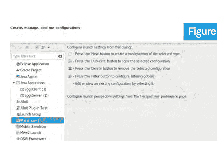

- 从对话框配置搜索设置
- 按 Dispatcher 复制选定的配置。
- 有一些选项
- 按 Dispatcher 复制选定的配置。
- 使用 Filter 配置匹配 bean。
- 从 Typepoints 页面选择 bean 参数设置

## 用于依赖注入的 XML

你可能喜欢使用 Spring 中旧的依赖注入方法，这种方法可以通过 XML 编写指定其依赖项的位置。对于这种我们尚未涵盖的方法，你可以从代码中定义你的 bean 和依赖项。

为了运行 Maven 项目，你必须使用 `goals` 对于写入到文件上的内容。

如果你已经在 EggsRunner 中创建了 `public void main(String[] args)` 方法，并在内部放入了一个简单的示例（例如 `System.out.println("Hello world!")`），这样我们就可以验证框架是否正常工作，

在创建一个新 Bean 后，调用 `eggs` run。在此之前，在 Base directory 下选择 `eggs` 项目，你可能会看到以下：

当你运行程序时，你应该能看到像 Spring 6 那样输出其 bean 的列表，但正如你所看到的，程序已经输出了信息。

## 设置你的 beans

我们现在将提到 EggsServer 类在 Spring 6 中的用处，以及我们需要为 Spring 更多 bean 供其使用。如果你查看原始代码，我们将看到第一个任务是创建 GameModel、Player 和 StandardGameOutputViewer bean。

由于我们正在使用依赖注入，你需要使用 EggsRunner 类来定义 GameModel、Player 和 OutputViewer bean 的特定实现。我们还希望能够处理每个客户端的拒绝，然后处理如何设置对象的细节。

为了使此运行，我们首先需要知道哪些类被允许作为 bean 使用。为了做到这一点，我们进入 StandardGameModel、HumanPlayer 和 StandardOutputController 类，并在类声明的正上方添加以下注解（即 `class @Component` 这一行）。

```
@Service
@Scope("prototype")
```

第一行告诉我们该类可以作为 bean 来满足依赖。例如，如果 Spring 正在尝试创建一个 `OutputViewer` 类型的对象，

左侧：在 Eclipse 中导入新注解与导入新类或接口一样简单

# 教程

## Java

### 更多魔力

使用 Spring

Spring 远不止依赖注入和反射。一个实用的工具是 `@Async`，它指定一个方法应该被异步执行。事实上，这个新类的优势之一是它可以接受任何参数。为了使用 `@Async`，你必须在你的主类上标记 `@EnableAsync`。

它将创建一个 ServerHead 对象以满足该依赖。

第二行

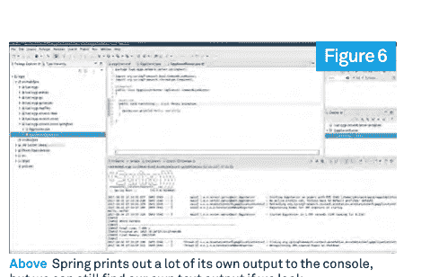

上方 Spring 将其所有输出打印到控制台，但如果我们查看

我们将看不到任何文本输出

TextMap 类和来自 HumanPlayer 类的 `getPosition()`。这两个方法都接受参数：地图的文件名和起始点。因此我们使用 EggServer 类并添加新 bean 来返回这些信息。例如，你可能会创建一个像这个类一样的方法：

```
public String getMapFileName() {
    return "src/main/resources/maps/map.txt";
}
```

...以及一个类似的 `getStartingPosition()` 方法返回一个合适的 Point20。为了告诉 Spring 它将使用这些方法来创建 bean，我们将在这些方法声明之前添加 Bean 注解。

> 依赖注入允许我们自由地抽象出代码的某以创建另一个类-

## 设置网络

另一方面，游戏地图应该是单例：想要创建地图的单个实例并让游戏模型的所有实例都使用它。因此，我们在 Map 类中添加 `@Service` 注解，但我们没有对类型添加 `@Scope("prototype")`。

## @Autowired 和 @Bean

还有一些方法需要在游戏后执行。当我们创建游戏地图时，我们需要在正确的地图文件中调用 `readMap()` 方法。当我们创建一个新玩家时，我们需要调用 `move()` 方法。因此，现在我们将让 Spring 来调用这些方法。我们在 `readMap()` 声明之前立即使用 `@Autowired` 注解。在我们的情况下，我们将该类标记为 `@Service`。Spring 只有该类的构造函数

依赖注入的优势是，我们可以自由地抽象出代码的某以创建另一个类。一个新类将在 `loading.java.net.server.ServerSocket` 类中调用 `ClientConnection`。这将是 ServerClass 在尝试创建一个匹配连接的客户端中使用的方式。

在类中创建一个类型为 `ServerSocket` 的字段，并编写一个构造函数，通过获取端口号作为参数并传递传递 `ServerSocket` 构造函数来设置该字段。然后我们在 EggServer 类中创建一个字段并将其标记为 `@Bean` 注解，返回端口号 9800。

- 下方我们可以看到我们的 map 依赖位于 Eclipse 的 Package Explorer 中

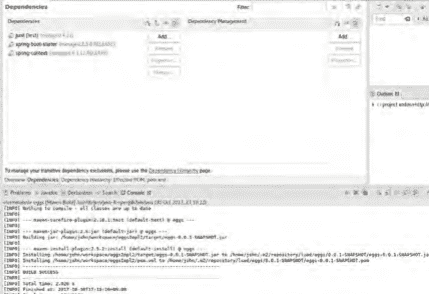

在 Client 类中创建一个类型为 `Socket` 的字段，使用 `ServerSocket.accept()` 设置该字段。`fetchClientConnection()` 方法应该返回一个布尔值：如果连接成功建立（如果 `clientSocket != null`）则返回 true，否则返回 false。

现在我们可以创建一个返回 `Socket` 对象的 bean。Client 类中的对象将调用 `getClientSocket()`，该方法返回带有 `@Bean` 的字段的值以及 `clientSocket@@@Scope("prototype")` 方法的值，以便它每次都返回一个新值。

## 底层原理

Spring 中的依赖注入使用反射工作：一组允许我们检查程序低级特性的工具，这通常被认为是一个非常糟糕的主意，但它让程序变得更容易调试。它允许我们执行通常认为是不可能的事，但安全性更高。

自动由 Spring 自身提供的 BeanFactory 填充此字段。例如，使用以下代码的 GameModel：

```
GameModel bean = beanFactory.getBean(GameModel.class);
```

反射 API 允许我们找到包中的所有类并读取它们的注解。这些注解用于识别哪些类应该由 Spring 管理。Spring 然后可以调用 `getAnnotation()` 来检查每个类的注解。例如，在 Spring 中，我们可以使用 `@Component` 注解来查找类型。如果我们将 bean 标记为 `@scope("prototype")`，Spring 将创建一个新实例

为了完成程序，从 EggsServer 中移除 `run()` 方法并将其替换为使其工作的代码。首先，我们需要使用 Bean Factory 来实例化 `ClientConnection` 的 bean，它是代码的网络部分。

## 创建游戏循环

现在我们可以创建主游戏循环了。我们需要告诉 Spring 创建 GameModel 和 StreamOutputController 的 bean，每个都对应一个客户端连接。到为止，我们看到了如何为了设置它们而创建 bean，但还没有看到如何创建。为了这样做，我们需要使用 Bean Factory，它是 Spring 为实例化目的提供的特殊对象。

创建 Bean Factory 是很容易的。事实上，我们只需要在 EggsRunner 中添加以下字段声明：

> 将这些代码包含到我们现在基于 Spring 的服务器中将很困难。相反，将它们传递给 GameModel 的构造函数会更容易。因此我们在构造函数的末尾添加以下两行：

- map.addObserver(player);
- player.addObserver(this);

如果你都做得正确，程序的运行将与之前完全相同（见图 7）。服务器使用我们之前创建的 eggs 配置，然后以通常的方式启动几个客户端。如果不起作用，请使用调试器和 Spring 错误输出找出你哪里

```
@Autowired
private BeanFactory beanFactory;
```

由于 Bean 是 Spring 框架的一部分，`@Autowired` 注解意味着 Spring 将

# Prolog

# APL

# 专题

## 编程语言的未来

## C++

## C++

## COBOL

## PYTHON

# Prolog

# APL

# 编程语言的

# 未来

Mike Bedford 带我们领览了一些不寻常且新兴的编程语言，以调查未来可能如何。

## COBOL

## 概览

### 不寻常的语言，p62

许多语言与其他许多语言有许多共同点，但只有少数语言敢于与众不同。我们研究了一些打破常规的语言，并借此提供了一种不同的编程方式。每种语言都能为更具冒险精神的程序员提供与众不同的。

### 值得关注的语言，p64

编程领域处于不断变化的状态，明年我们使用不同语言是极具可能的。正是这些语言开始获得势头，因此我们来看看当今即将上市的语言。

### 未来的语言，p66

为了感受编程的未来可能是什么，我们回顾了过去六十年语言的发展情况，并在这些基础之上，展示了那些处于编程语言前沿研究的人士的观点。

最近对编程语言的调查表明，它们都太容易预测了。Linux 编码者使用的语言、Python、C++ 和 Java 占据了桌面应用的前五。如果我们把视野扩大到 Web 应用，发现了 JavaScript 和 PHP，除了 Windows 平台上的 C# 之外，其他操作系统的列表也也相当相似。

然而，考虑到职业前景，学习一种能够最大化你的就业机会的语言是值得的，这意味着要学习那些在业务中最常用的语言。对于个人使用，选择最受欢迎的语言也有充分的理由。也许最不受欢迎的语言都有自己的长处。

尽管最受欢迎的语言地位显赫，但另寻他径也有充分的理由。毕竟，如果没有人敢于突破边界，我们现在仍然在使用 COBOL 和 Fortran。此外，并不是每个人都认为一种不那么受欢迎的语言可能会吸引你并提高你的工作效率。所以，如果你准备好考虑向你介绍一些你考虑过的语言的精力，并认为这趟语言之旅是一项严肃的工程——我们发现的一个列表最多只有 710 种语言，它们属于某些类别，而且即便如此，筛选也非常严格。如果我们成功地勾起了你的兴趣，尽管你没有新发现，我们我们突出的所有语言虽然没有处于语言排行榜的前端，但提供了不同的多样性，可能为更有热情的人提供选择。这些语言通常倾向于那些它们无疑已被所有人过的应用类型，但如果你的需求与其中一种语言提供的匹配，那么可能恰恰如此。

即使你作为一名程序员没有需求，你可能对编程版图有通一般的兴趣，因此你信任这份概述。我们正在识别不寻常的语言，因为在大多数情况下，这个短语并不是以贬义的含义使用的。

接下来，我们识别那些正在变得流行的语言，比如占据领先位置的 Python、Java 和 C++ —— 我们把这些语言称为新兴语言，因为没有保证其中任何一种会获得像 C# 或 Java 那样的成功，而且现实中无法预测是哪一个。

语言发展的历史并没有预示着平庸的未来。例如，COBOL 在 20 世纪 80 年代和 90 年代很流行，但在 2006 年之前就消失了，被发现它失去了编程语言中 IBO（业务机器的重要性）地位。一种语言花了六时间才达到其历史最高的流行程度。

最后，我们调查了对编程语言的研究，这些语言已经经历了 50 多年的发展，非常强大。研究人员正在建立新方法来指示计算机我们需要什么，我们请了几位专家来决定感兴趣的语言，并看看这些倡议何时能产生新的工作方式。

## 专题：编程语言的未来

## 不寻常的语言

与今天常用的其他语言完全不同的语言。

在这里我们看到的在某种意义上可以认为是不寻常的语言，因为它们并不常用，但许多正通过新的手段被使用。但它们并不一定是因为失败了。不寻常的语言通常是为小众应用设计的，或者可能吸引少数程序员，但仍然吸引着兴趣；因此，这里这里讨论的语言之一可能为你提供解决方案，或者至少为你提供一堂关于编程的有趣课程。

| Q | W | E | R | T | Y | U | I | O | P | |

|---|---|---|---|---|---|---|---|---|---|---|

| 1 | 2 | 3 | 4 | 5 | 6 | 7 | 8 | 9 | 0 | - |

| A | S | D | F | G | H | J | K | L | ; | ' |

| Z | X | C | V | B | N | M | | | | |

| Caps Lock | | | | | | | | | | | |

| a | s | d | f | g | h | j | k | l | ; | ' |

| z | x | c | v | b | n | m | | | | |

Prolog 追溯到 1972 年，但与今天使用的大多数语言不同，Prolog 在某些领域经常被描述为第一代语言。定义问题可能的，但 Prolog 不告诉计算机提供算法。在 Prolog 中编写涉及定义关系和规则，然后对这些关系和规则的数据库进行查询。

最初引入时，APL 需要一个特殊的键盘和图形打印机来配合其奇怪的字符集。最近的改变修正了这一点，改进了字体技术。

在 AI 中，事实是 Prolog 是一种小众的语言，它是功能完备的，这意味着它可以用于解决任何问题（尽管你可能并不想用它来解决问题）。

> 可以解决任何复杂问题，像 Python 或 C++ 那样？

考虑到 Java 或 Python 使用代码来解决问题。

COBOL 的引入是为了展示语言是如何不同的——即使是并非为现代编程设计的语言。追溯到 1959 年，它是业务领域的首选，而不是科学编程，它仍然是流行程度第 25 的语言。它的不寻常在于它几乎从未被使用。

它是人工智能和自然语言应用的首选——确实，大多数情况下。

Prolog 追溯到 1972 年，但与今天使用的大多数语言不同，Prolog 在某些领域经常被描述为第一代语言。定义问题可能的，但 Prolog 不告诉计算机提供算法。在 Prolog 中编写涉及定义关系和规则，然后对这些关系和规则的数据库进行查询。

最初引入时，APL 需要一个特殊的键盘和图形打印机来配合其奇怪的字符集。最近的改变修正了这一点，改进了字体技术。

在 AI 中，事实是 Prolog 是一种小众的语言，它是功能完备的，这意味着它可以用于解决任何问题（尽管你可能并不想用它来解决问题）。

> 可以解决任何复杂问题，像 Python 或 C++ 那样？

考虑到 Java 或 Python 使用代码来解决问题。

## 编程语言的未来

## 可能取代 Java 的语言

语言兴起彼伏。如果我们分析这些年来最常用的语言，我们会为每个年代得出一个不同的列表；例如，在过去的 10 年里，PHP 的使用率已从超过 5% 骤降至不足 2%，从 2002 年的略高于 1% 增长到现在的 5%。但真正的问题是下一个是什么？语言很少会凭空崛起，几乎可以肯定，我们几年后使用的语言将是那些开始变得受欢迎的语言。以下是我们正在关注的编程世界新兴语言。列出一份值得关注的后续语言列表将涉及一个非常困难的决定。因此，经过仔细判断，我们从几位评论者的观点中提炼出了顶少数几种。

我们查看了代表不同高级概念的语言，看看他们认为自己的作品是什么样的，并提了一些如果你在寻找新事物时可以考虑的语言。

Go 支持灵活且模块化的程序构建。Go 编译速度快，可以垃圾垃圾回收内存而不需要运行时反射。它是一种快速的、静态类型的编译语言，感觉又像动态类型的解释型语言。Rust 也很快。https://golang.org，那里有很多在线资源你会发现它们非常有用。

## Go

Go 也许人们最感到兴奋的语言，它是由 Google 团队及其他开发的开源项目。与许多其他开源语言不同，它非常新，首先他们说其目标是提高程序员的生产力——这并不新鲜，但这正是他们所声称的特点：

> 它是富有表达力的、简洁、干净且高效的。它的并发机制使其能够通过新颖类型系统充分利用多核和网络机器的性能。

## Haskell

Haskell 是一个拥有二十多年开发历史的开源项目。根据开发者的介绍，它是一种多态类型、惰性的、纯函数语言，不同的开发者对此赞有加。

| 1964 | 1964 | 1972 | 1972 |

| :--- | :--- | :--- | :--- |

| BASIC 是一种易于使用的第一门语言，为初学者设计。它被广泛用于 1980 年代的家用电脑上。 | APL 提供了一个交互式编程环境。使用独特的字符集，它可以完全地表达问题。 | Smalltalk 是最早具有面向对象特征的语言之一，受到今天流行语言的影响。 | C 语言发布。在 ALGOL 之上构建。 |

引起关注的新语言列表确实将是一个很长的列表。

## 量子编程

## D-wave

D-wave 是全球唯一商业量子计算机的制造商，提供了几种对其硬件进行编程的方法。这些方法从常见的高级语言到为解决优化问题设计的语言（许多 D-wave 机器），再到低级的量子机器语言。

研究人员正致力于使用通用数字量子计算机，它们将提供惊人的力量，支持此类硬件的语言已经在开发中。

十年来，微软的一个研究人员团队一直在研究量子计算，一种利用量子比特的计算模型。量子比特可以以位的形式存在，这将导致高度并行处理。不用说，使用这种奇异的架构需要不同的编程方法。


就在几个月前，微软宣布了一种新语言，供开发者为量子模拟器编程并在未来运行任何实际量子计算机。坦率地说，他们说你不需要理解这项技术。

通过采用量子退火架构，D-wave 机器可以被看作利用 Google 和 NASA 解决特定问题的量子计算机，这些问题不像我们的数字计算机那样是通用的。

由于功能方面也许是社区所暗示的 Haskell，值得更详细地看看这种编程涉及的内容。再次，放弃开发者的设置以及 Java 等许多其他命令式语言等初始语言。

它们是命令式的，因为它们由一组严格按顺序执行的命令组成，他们解释了函数式语言的工作原理：

根据一位发言人的话，“新的编程语言可以很容易地引入 Visual Studio，并且还有适用于 Linux 等多种操作系统的可用编译器。”

函数是一个表达式，由表达式执行。任何使用过不同函数式编程方法的人都会发现每个单元格相对于其他单元格的值。

## 还要考虑

引起关注的新语言列表确实将是一个很长的列表。然而，如果你继续探索它们，这些语言是广为人知的：`Kotlin`、`Scala`、`TypeScript`、`Clojure`、`Rust` 和 `Swift`。

为了说明这一点，他们展示了 Haskell 的六行代码以及对应的 C 语言代码，后者占据了 24 行，两者都为了清晰而留了间距。与许多编程语言一样，你可以在 `http://tryaskell.org` 学习更多细节，并可以在那里访问快速教程。

列出一个排序的短名单会更好，对于一种既新又不同常的语言——在采用某种不同编程范式的意义上——尝试 `Clojure` 怎么样？作为 1998 年引入的旧 Lisp 变言，它被称为现代语言。Rich Hickey，Clojure 说：“Clojure 是一种通用编程语言，包括用于脚本语言开发的功能，以及健壮的多线程编程基础设施。Clojure 是 Lisp 的变言，具有代码即数据的哲学和强大的宏系统。”

| 1991 | 1995 | 2009 | 2017 |
| :--- | :--- | :--- | :--- |
| Visual Basic 构建在 BASIC 之上，被设计为易于使用，专为开发 GUI 定身定制。 | PHP 和 JavaScript 出现。通过实现服务器端和客户端编程的设施，它们带来了更具吸引力的特性。 | Go 诞生并支持并发编程。它是当今新兴语言之一。 | 微软发布了一种用于量子计算机的语言，也许是 60 年来编程领域最重进展。 |

## 编程的未来

### 编程的未来

编程语言的未来将如何？

在展望编程语言的未来之前，深入过去以理解背景会有帮助。第一批计算机是用机器码编程的。最初，程序是通过向开关中写入二进制数来输入的，或者使用打孔纸带。

例如，为了处理旧操作码上的 011100，你可能需要将操作码（代表指令的二进制数）00001110 输入到特定地址，并将 011100 输入到下一个地址。

不用说，这并不容易，而且非常容易。首先，修改代码意味着你必须准确地计算出跳转代码。此外，修改代码是枯燥的。如果你在代码某处添加了指令，所有此类指令都必须移动到不同的地址，任何引用这些指令的跳转或分支指令都必须修改为新地址。

上图：今天的编程语言（如 C++）是过去 60 年演变发展的结果。

> 单条高级指令将取代几条机器码或汇编指令，具有明显的处处

上图：我们通过计算机开关输入机器码已经走了很远。

接下来是汇编语言，它是为了克服机器码的缺点而设计的。称为汇编器的软件会将汇编代码翻译成机器码。这提供了多样性。在每个操作码上，都使用了有意义的助记符。此外，变量名被用来引用内存位置，指令可以更改而无需生成跳转指令，因此，

可能会从 00001110 011100 变为 `JM INITIALISE`。

suggests.（建议）。特别是，一条高级指令通常可以替代几条机器码或汇编指令，为程序员带来清晰的收益。

例如，为了将具有唯一变量名 A 和 B 的两个内存位置的内容相加并将结果需要三条汇编指令：LOAD A、ADD 和 STORE；这三条指令将被替换为 `C = A + B`。

高级代码生成语言的历史可以追溯到较早以前，但那时它们还相当专业化，而现代编程的绝大多数属于第三代。这一说法并没有被普遍接受，根据专家的意见，它仅仅是代码供应商的一种营销噱头。

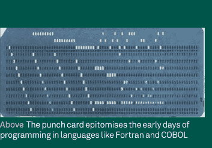

# 问答 Q&A

## 访谈：Martin Lester，牛津大学

Martin Lester 是牛津大学的研究员，对编程语言的理论和应用感兴趣。

上图：图表描述了 Fortran 和 COBOL 等编程语言的早期阶段

通过将代码排列在 BEGIN 和 END 语句块中进行编程，这导致了广泛的支持和衍生语言；从我们的角度来看，这是一个很大程度上被遗忘的方法，反过来导致了 C 语言。

今天的语言大多是通用的、命令式的且面向对象的，因此这种范式代表了如今的巅峰。

由于 C 非常流行且被广泛使用，这并不意味着它在某些情况下是最佳选择，或者事实上没有发生变化。

### 测试检查程序是否无法找到的一种良好方法

我们没有详细讨论第四代和第五代语言是如何定义的。然而，如果我们从代际的角度来看，共识是每一代都是一种定义比前一代更复杂问题的手段，而我们看到的硬件工作已经非常完善。

如果一个开发者创建一个现有的项目，语言已经固定了。大多数专业开发人员在现有项目上工作，可能无法选择使用什么语言。

所以，你是说还有后续发展吗？C 和 Java 在过去几年里引入了很多变化。每当向语言添加一个新功能时，其收益通常是能够更快地编写更多程序，然后让它们运行得更快，或者减少错误。所以我不知道未来会有什么特征或范式。我很有信心会有这样的

## 演进开发 Evolutionary development

机器码和汇编语言在高级语言之初是不同的。我们可以追溯演进路径，将今天使用的语言与最早的极少数语言联系起来，然后追溯到汇编语言。我们无法追溯今天最常用语言的祖先。该谱系基于斯坦福大学计算博物馆对语言的研究。

# 在表达像英语这样的语言时，进步意味着什么？

问题在于语言的使用是不断变化且持续的。如果你尝试与最好的在线聊天机器人对话，你可能会发现它们其实非常没用——尽管它们通过刻意模糊和之类手段在掩盖这一点上是有用的。

如果我们真的必须解决解释自然语言的难题，无论我们使用的编程语言有多么好，同一个 AI 都将能够以我们要求的任何语言进行书写。然而，在此之前，我们肯定仍然需要人类程序员。

Fortran 是第一个被广泛使用的高级语言，专为科学编程设计的。流控制几乎包含在 GOTO、DO、函数和子程序中，这导致了“面条代码”；ALGOL 是为了解决这个问题而设计的，提供了对

## 前景 The way ahead

为了看到未来可能是什么样子，我们与牛津大学的 Gon Runciman 教授和牛津大学的 Martin Lester 进行了关于编程语言的交流。

类型系统是一种在编译时而非运行时发现错误的代码。我们在这一领域的工作不仅是为了发现显而易见的错误（如给整数添加一个反引号），而是更好的类型，例如类型检查。这项研究的成果之一是对动态类型语言的静态类型系统的支持。示例包括类型对于


# 特性 Feature

## 编程语言的未来


# 问答 Q&A

## 访谈：Runciman 教授，牛津大学

Runciman 在牛津大学计算机科学系工作，对编程语言和系统、函数式编程以及软件工具感兴趣。

考虑到许多语言可以追溯到 50-60 年，高级语言是否已经成熟，或者会有进一步的发展？

在发展方面，可以预见到：首先，更强大的类型将提供某些保证，确保不会发生错误；其次，将开发更强大的方法为多核机器编译程序，包括优化。

Amazon Alexa 的成功可能暗示自然语言可能会取代编程。但编写查询是一回事；解决计算问题是另一回事。

另一个领域是对日益增长的并行计算的支持。一方面，你拥有巨大的算力，他们正在数据中心或云端使用 CUDA 或 OpenCL 进行大规模并行。另一方面，人们正试图扩展到多核、多处理器系统，无论是在数据中心还是云端。这里有很多关于 Go 和 Rust 的，它们在内存安全上通过传递消息而非共享

编程，即约束：大多数研究集中在如何找到解决方案，而不是描述解决方案的语言。存在很大范围的语言。遗憾的是，某些求解器在某些任务上非常出色。如果你想为特定问题使用编程，你可能需要多种语言来找到一个有效的。

由于某些语言已经创造了可以被称为算法的东西，那么程序员如何？查询将通过仅仅表达查询来实现。查询语言是一种方法——解决计算问题是另一种。许多查询可以用自然语言有效解决，即使它对于编程来说可能有些无望。

## 我们访谈的专家都没有认为程序员很快就会被淘汰

SMTLIB 项目为约束求解器提供了一种标准输入语言，它支持多种库，因此你可以尝试比较它们并找到最适合你问题的工具。输入语言是变量和锁。同时，Rust 带有借用检查器，使得共享变量是安全的吗？不言而喻，变量的使用是安全的。从根本上说，这是一个新兴的关注领域。

在发展方面，研究人员无疑会让求解器变得更好、更可靠，但我更有兴趣的是看到约束求解器作为主流编程的一部分能做什么。

更多的声明式编程，即你陈述问题而不是定义解决问题的指令序列。让我们解释这一类声明式之间的区别。

# 获取免费 6 期

当您订阅*时

## 免费 DVD TV 包含 2 种 UBUNTU 发行版

# Linux 用户与开发者

专为 GNU 世代打造的杂志

# 终极救援与修复工具包

- 数字取证。数据恢复。文件系统分区与克隆。安全分析

## 2款现在就可尝试的 2 个发行版！

## ANTEROS 现代、优雅并由 Arch 驱动

## XUBUNTU 基于 Ubuntu 并专为速度而生

- 救援与修复工具：SYSTEMRESCUE 和 RESCATUE

使用两个出大的发行版拯救您的系统，并使用 WIRESHARK 进入网络

## 每期均有免费下载

> 爱好者和开发者的开源权威


免费 DVD 安装：安装 3 种新发行版。免费 DVD 包含 MINT

# Linux 用户与开发者

## 捕获入侵者：发行版与应用

地球上最优秀的免费开源软件

## 终极项目：Kali & Arch Linux 回归！

纯硬件

## 46 份指南

免费 DVD UBUNTU 17.10 特别版

# Linux 用户与开发者

## STER 终端 TERMINAL

你需要的命令行指南

## UBUNTU 17.1

深度指南：编程的未来并非你所掌握的语言

## 42 页指南

- 5 格言：精通 http 协议

- 5 安全：网络黑客

- 核心 Linux：Sed 的乐趣

内部精彩：未来

## 优惠于 2018 年 1 月 31 日过期

## 订购热线 +44 344 488 2852

## 访问网站 www.mymagazine.co.uk/subscribe

*这是一份订阅，6 期免费杂志用于兑换美国全美价格的 16.99 美元，13 期的价格为 220.87 美元，而您只需支付 112.23 美元。您将在一年内收到 13 期杂志。您可以在 14 天内写信我们取消订阅。除非符合特定情况，14 天取消期后付款不予退还。您的法定权利不受保护。销售点价格为准并取决于全额。借记担保的详情可要求提供。英国内的拨打费用与标准固定电话（01 或 g2）相同，包含在任何包含或免费分钟额度内（如果您的资费提供）。条款和条件请访问 mymagazine.com。优惠于 2018 年 1 月 31 日结束。

# 是时候离开那跑步机了

面对工作、家庭和成员的众多需求，一天的时间似乎永远不够用。为什么不要偶尔按下暂停，蜷缩在你喜欢的杂志旁，为你的一天留出一小片“自我”的绿洲呢？


# 按下暂停

享受时刻

要了解更多关于“按下暂停”的信息，请访问：

pauseyourday.co.uk

# 编码员与制作者的必备指南

# 实用树莓派 Raspberry Pi

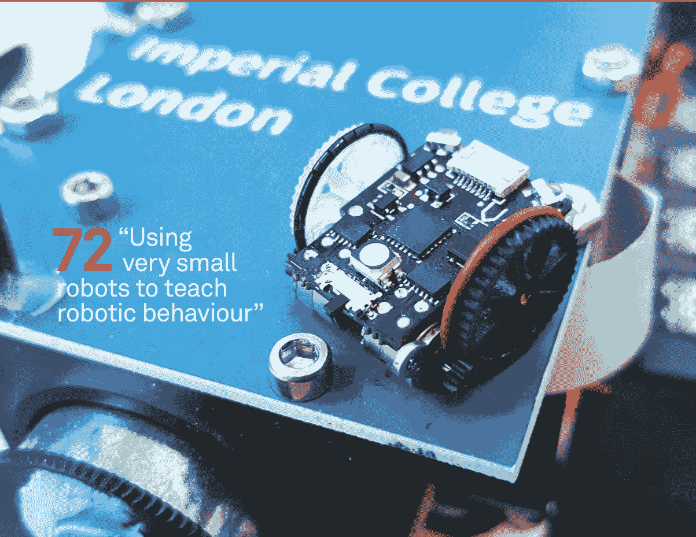

72 页“使用微型机器人教授机器人行为”

# 目录

- 72 页 Pi 项目：微型机器人真的非常小

- 74 页在你的 Minecraft 世界中绘制矢量形状

- 76 页添加带有 Google 助理的语音激活 AI

- 78 页使用 SQLite 创建轻量级数据库

## 微型机器人

## 一种务实的机器人教学方法导致了一个制造比硬零钱还小的机器人项目。

您能向我们概述一下微型机器人项目吗？你们微型机器人的设计理念是什么？微型机器人项目是在讨论帝国学会 Imperial Society 如何为青少年工程师开发课程时成立的，之前一个在小型机器人上介绍机器人学基础的课程非常成功，那个机器人大约一张 A4 纸大，但这个尺寸很快就成了我们的问题。我们不得不放弃昂贵的低级硬件；通常情况下我们一个班级只有一个，而我们必须这样服务。

你还提到了树莓派 3；它是如何融入项目的？最初我们将其视为一个教育套件的商业案例，而这些套件非常贵。使用树莓派帮助我们在不给用户提供额外设备的情况下提供计算系统。我们能够让带有高精度传感器和主电脑的微型机器人系统的负担负担。在整个开发过程中，为了方便起见，我们主要使用全桌面级系统。

> 我们将机器人用于有趣的编程练习

在微型机器人项目以及你正在进行的培训中，是否产生了任何交叉项目？

在班级中，我们有许多系统可以进行测试，但没有空间作为竞技场。此外，高度集成电子设备的成本可能会给讲师带来负担。自然地，这使得该项目变成了我和我的合伙伴 Thomas Bonech 博士的一项为期多年的开发工作。

机器人完全没有用于教学，尽管我们未来希望这样做。我正将它们用在对 13 岁孩子的私教课程中。这些机器人是为了趣味，我们还使用一组更大的机器人来教授焊接技术。主要的引导项目是实现机器人足球，我总是尝试让孩子们自己做。我们将看看最终能取得什么成就。

当你提到摄像头和 OpenCV 时——你能如何解释这一点？

对于大多数实验来说，知道它的位置是一个基本问题。如果我们的传感器还不够先进以发现位置，一种潜在解决方案是使用俯视摄像头来追踪机器人的位置。在这里，我们使用摄像头的位置作为输入。

能告诉我们你正在做的机器人吗？我们有一些备件用于机器人，所以决定创建一个 RC 接口。我们目前正在机器人前端实现一个 TOF 飞行时间 激光扫描仪。由于步进电机的动力，我们可以使用 SLAM 同步定位与地图构建 进行环境导航，这可以通过最小的机器人完成。

你认为微型机器人市场化需要什么？

你也提到了机器人需要视觉。是的，这比较容易说：我们为新的无人机实现了一个加速度计，驱动在磁性墙面上驱动机器人。加速度计可以配合绝对方向和重力工作。至于套件，我们很有可能制作一个套件——我们需要的一切都是开源的；只有电池需要购买。我们可能在今年生产更大批次，明年我们需要寻找可以供应机器人的机会。

Joshua Elsdon 目前是伦敦帝国学院 Imperial College London 的博士生，研究手持工程增强现实领域。我们对机器人的兴趣源于音频工程和高压电路，然后是一个为了机器人而开发课程的青少年。

喜欢吗？

访问 Joshua 的 YouTube 频道查看他的摄像头定位系统和机器人演示，以及同步模式和通用内容：http://bit.ly/Jemicicrobots

延伸阅读

要关注 Joshua 的微型机器人，请访问 http://bit.ly/Jemicicrobots

# 教程

## Minecraft

## 使用 Python 代码在 Minecraft 中绘制矢量形状


让我们仅用几行 Python 代码和好手的 McPiFoMo 在 Minecraft 中构建一些形状。

## Calvin Robinson

他是巴内内特 Barnet 一所全学段制学校 CoFE 员工的计算机科学负责人。Calvin 还与伦敦各地的学校合作，提供高质量的课程。

只需确保将它与 McPiFoMo 一起放入 `~/home/minecraft` 目录即可。安装 'Minecraft' 的另一种方法是使用 `sudo pip install minecraftstuff` 或 `sudo pip3 install minecraftstuff`。

## Python 准备

我们将在最喜欢的文本编辑器中创建一个新的 .py 文件，并导入所有相关的 Minecraft 模块。

## 资源

- McPiFoMo: http://github.com/co.uk/McPiFoMo.rar

- 方块 ID: http://bit.ly/MC-BlockIDs

- Minecraft Stuff: http://bit.ly/MC-stuff

```python
import mcpi.minecraft as minecraft
import mcpi.block as block
import server
import time
import minecraftstuff
```

这个问题回到了我们最初开始的地方，即使用 Python 代码直接在我们的世界中绘制形状。

## 03 连接到 Minecraft

本教程是以 Pi 版 树莓派版 编写的，但你不需要运行树莓派也可以跟随操作。我们整合了一个适用于任何版本 Minecraft 的包，因此你可以在桌面端、Linux 或 Pi 上使用它。要连接到 Minecraft，你需要安装 McPiFoMo 详情见下文。教程将在下一条目中继续：`~/home/minecraft`。McPiFoMo 包含了 Alexander Jam 开发的 Minecraft 中的 McPi。只要你已经安装，除了你喜欢的编辑器或 IDE 之外，不需要任何额外的软件。

```python
mc = mcpi.Minecraft.create()
```


在这里，我们正在创建变量 `mc`，我们可以用它直接在世界中生成形状。我们将在实例化 `Minecraft` 实例时使用该变量：Martin 的教程中有一些 GitHub 上可用的预定义函数（请参考参考文献中的 `Minecraft`）。无论你运行的是 Pi 版还是 Linux 版，本教程中的 Python 脚本应始终保存在 `~/home/minecraft` 中。确保正确运行 Minecraft。现在让我们获取当前位置以便绘图：`pos = mc.player.getPos()`。

# 04 生成形状

我们允许使用的预定义形状有 `drawLine`、`drawCircle` 和 `drawFace`。我们可以通过以下方式在世界中生成这些形状：

```bash
$ git clone https://github.com/martin/minecraft-stuff
```

或者直接访问 GitHub 手动下载 `minecraftstuff.py`，这就是本教程需要的全部。


我们刚才设置的绘制变量，即 `drawing.drawSphere()`，我们需要确保向函数传递了坐标，以及我们想要使用的方块类型。例如：

```python
drawing.drawSphere(playerPos.x, playerPos.y, playerPos.z, 5, block.DIAMOND_BLOCK.id)
```

# 05 函数及其参数

我们有不同的形状函数：

```python
drawing.drawLine(x1, y1, x2, y2, block)
drawing.drawSphere(x, y, z, radius, block)
drawing.drawCircle(x, y, z, radius, block)
```

我们稍后会扩展 `drawFace` 函数。它是填充表面的极佳工具。将 `drawFace` 视为 Photoshop 中的画笔：


```python
drawing.drawLine(playerPos.x, playerPos.y + 2, playerPos.x, playerPos.y + 2, block.DIAMOND_BLOCK.id)
```

结合 `drawFace` 使用，这为我们在 Minecraft 世界中创建内容提供了一些强大的工具，而无需花费过多时间放置方块。

# 09 时间的脚步

我们导入了 `time` 模块，以便在需要时减慢（或加速）。使用 `drawLine` 或 `drawFace` 函数时，最好在每次调用后包含一个短暂的暂停，否则你的游戏可能会出现追赶问题，延迟可能会导致混乱。只需一个 1 到 5 之间的的小数字就足够。

# 06 使用 drawFace 自定义向量 – 部分 1

预制形状很棒，但有时我们想绘制属于自己的形状。我们可以通过设置每个点的坐标，然后用 `drawFace` 填充空白：

- `shapesPoints = []`
- `shapesPoints.add(minecraft.Vec3(x1, y1, z1))`
- `shapesPoints.add(minecraft.Vec3(x2, y2, z2))`
- `shapesPoints.add(minecraft.Vec3(x3, y3, z3))`

# 10 状态更新

随着预制和自定义形状的添加，Python 脚本变得更加复杂。注释代码是一个良好的习惯，但用状态更新更新当前玩家也是一个很好的点笔。

```python
mc.postChat("awning in the player world")
```

... 是你正在生成的内容名称。在创建每个形状之前（或之后）插入这些行。

# 07 使用 drawFace 自定义向量 – 部分 2

现在我们设置了点的坐标，`drawFace` 将连接这些点并用你选择的方块填充线条：

```python
drawing.drawFace(shapesPoints, True, blockID)
```

然而，如果你想绘制形状的轮廓，可以将布尔值从 `True` 改为 `False`，这样 `drawFace` 就不会填充它们：

# Minecraft 中的 Python

使用 Python，我们可以直接注入 Minecraft Pi 来执行复杂的计算，在确定玩家角色位置后，在世界中生成方块以创建所有的 2D 和 3D 作品。我们可以对 Minecraft 的想象远多于它仅仅是一个直接通过 pickle 通信的脚本。

在这种情况下，我们创建了生成的粒子。

# 08 跨越线条

有时你可能想画一条线。本教程将向你展示如何做到这一点。

# 教程

## Google 助理

## 树莓派

## Google 助理

他是巴内特（Barnet）一所全学段制学校（CoFE）员工的计算机科学负责人。Calvin 还与伦敦各地的学校合作，提供高质量的课程。

只需确保将它与 McPiFoMo 一起放入 `~/home/minecraft` 目录即可。安装 `Minecraft` 的另一种方法是使用 `sudo pip install minecraftstuff` 或 `sudo pip3 install minecraftstuff`。

# Python 准备

我们将在最喜欢的文本编辑器中创建一个新的 `.py` 文件，并导入所有相关的 Minecraft 模块。

# 资源

- McPiFoMo: http://github.com/co.uk/McPiFoMo.rar
- 方块 ID: http://bit.ly/MC-BlockIDs
- Minecraft Stuff: http://bit.ly/MC-stuff

```python
import mcpi.minecraft as minecraft
import mcpi.block as block
import server
import time
import minecraftstuff
```

这个问题回到了我们最初开始的地方，即使用 Python 代码直接在我们的世界中绘制形状。

# 03 连接到 Minecraft

本教程是以 Pi 版（树莓派版）编写的，但你不需要运行树莓派也可以跟随操作。我们整合了一个适用于任何版本 Minecraft 的包，因此你可以在桌面端、Linux 或 Pi 上使用。要连接到 Minecraft，你需要安装 McPiFoMo（详情见下文）。教程将在下一条目中继续：`~/home/minecraft`。McPiFoMo 包含了 Alexander Jam 开发的 Minecraft 中的 McPi。只要你已经安装，除了你喜欢的编辑器或 IDE 之外，不需要任何额外的软件。

```python
mc = mcpi.Minecraft.create()
```

在这里，我们正在创建变量 `mc`，我们可以用它直接在世界中生成形状。我们将在实例化 `Minecraft` 实例时使用该变量：Martin 的教程中有一些 GitHub 上可用的预定义函数（请参考参考文献中的 `Minecraft`）。无论你运行的是 Pi 版还是 Linux 版，本教程中的 Python 脚本应始终保存在 `~/home/minecraft` 中。确保正确运行 Minecraft。现在让我们获取当前位置以便绘图：`pos = mc.player.getPos()`。

# 01 连接 ReSpeaker

将 ReSpeaker-2 Mic HAT 安装在树莓派上，确保 GPIO 引脚对齐。如果连接成功，红色 LED 将亮起。将耳机或扬声器连接到设备的 3.5mm 音频接口。如果没有使用扬声器，将另一根微 USB 线连接到 ReSpeaker 的端口以提供足够的电流。麦克风本身位于 HAT 的两端，标记为“左”和“右”：

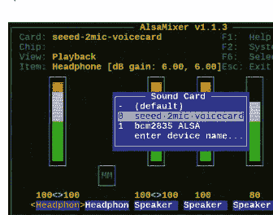

# 05 访问 Google Cloud Platform

为了让你的设备与 Google 助理交互，你需要一个 Google 账号。如果

如果你还没有，请在任选的浏览器中访问 https://google.com 并点击右上角的“创建账户”。完成后，访问 https://console.cloud.google.com/project 并使用账户详情登录。点击“下一步”，再次点击“下一步”。将出现“Google OAuth 权限”页面。要查看此页面，请选择一个项目。点击“创建”并建立你的项目。设置项目 ID，然后点击“创建”。

`www.googleapis.com/auth/assistant-sdk-prototype --save-headless`.

请确保将 `client_secret.json` 替换为 JSON 文件的实际名称。

# 输入确认码

现在会弹出一个带有 OAuth 确认码的 URL，要求你右键点击并复制链接。打开浏览器，右键点击地址栏并选择“转到”。点击你的账户名称然后点击“允许”。助手页面将生成一个代码。从浏览器中复制此代码并粘贴到终端（Terminal）。如果成功，你将看到一条你的凭据已保存的消息。

# 06 创建产品

为了使用 Google Assistant API，你需要配置凭据。这些凭据存储在派派 中，并让 Google 知道你正在使用授权设备。在加载的 API 页面上点击“启用”。接下来，访问 http://bit.ly/GCP-OAuth。点击“配置”屏幕，例如“派 语音助手”。如果你正在创建一个市场应用程序，请在帮助中心、标志和隐私策略字段中填写。完成后，点击顶部的“保存”。

# 10 启动 Google assistant demo

在终端中，运行 `sudo apt-get install pulseaudio`，然后使用 `pulseaudio &` 启动。最后，运行 `google-assistant-demo`。

# 07 创建客户端 ID

进入“创建客户端 ID”屏幕后。在“应用程序类型”下选择“其他”，然后点击“创建”。你现在将看到你的 Client ID 和密钥（secret key）。复制并记住它们。Google 现在会将你带回“凭据”屏幕，将加载 Client ID。点击右侧的向下箭头将凭据保存为 json 文件。如果文件已下载，打开浏览器将其移动到 `/home/pi`。这将更容易访问。

| 文件编辑标签页 |

| :--- |

| ### CONFIGURATION_DONE<br>START ---<br>{<br>  "client_id": "12345-67890.apps.googleusercontent.com",<br>  "client_secret": "GOCOB-1234567890",<br>  "redirect_uri": "http://localhost:8080"<br>---<br>[INFO] Authentication successful<br>[INFO] Logging in as user...<br>[INFO] Waiting for command...<br>[INFO] "What is the weather in London?"} |

确保你的耳机或扬声器已连接。使用默认的“Hey Google”让助手监听，然后问它一个标准问题，如“今天伦敦天气如何？”以收听天气预报。

Google Assistant 还可以播放声音；例如“狗是怎么叫的”或询问 100 欧元兑多少美元。

# 使用虚拟环境

如果你在嵌入式设备或应用程序中使用 Google Assistant，你可能想要创建一个专用的虚拟环境，将其与其他项目隔离开。

# 08 授权 Google Assistant

在你的浏览器中，访问 https://cloud.google.com/activity/credentials。确保选择了你的项目。点击“设备信息”和“语音与音频”。接下来，打开终端并运行 `sudo pip install --upgrade-google-auth-oauthlib`。你可以使用此工具配合上一步下载的 JSON 文件与派派协作。要此操作，请运行命令：

使用虚拟环境运行 `apt-get install python3.4`。接下来，为你的虚拟环境选择一个名称并创建它：`python3 -m venv`

如果你决定使用虚拟环境，运行 `source env/bin/activate` 切换到你的虚拟环境。完成后，使用命令 `source env/bin/activate` 退出。一旦你在虚拟环境中安装完成，照常输入命令：`./ google-assistant-demo`

- `google-auth-oauthlib --credentials /home/pi/client_secret... --scope https://`

77 www.linuxuser.co.uk

# 在 Python 中管理数据

当你需要处理的数据增长到超出简单文件的范围时，是时候转向使用数据库了。SQLite 是一个很好的起点。

> 在之前的期数中，我们查看了如何使用常规 IO 使用文件中的数据。

在这里，我们转向了研究如何用更科学的方法解析数据。但是，当你拥有了超出简单文件的数据时，该怎么办？特别是当你需要开始以更好的方式使用数据库时？本月我们将查看一些处理简单数据库的其它选项。

```python
my_conn = sqlite3
connection.connect('example.db')
```

这为你提供了一个连接对象，与存储在 `example.db` 文件中的数据库进行交互。如果文件不存在，`sqlite` 模块将创建一个新的数据库文件。如果你在程序运行期间需要数据库，可以给连接提供特殊文件名 `"memory:"` 以在 RAM 中创建数据库。


现在你已经有了连接，你要用它做什么呢？第一步是创建一个游标（`cursor`）。

## “所有的 SQLite 代码都是你代码的一部分”

在轻量级数据中，`SQLite` 是大多数环境下的标准。它以库的形式出现，提供对本地磁盘上文件支持数据库的访问。优点之一是它不需要运行服务器来管理数据库。所有的代码都在你的代码中。该语言是 SQL 的变体，这意味着你可以从 `SQLite` 开始项目，然后能够以极小的更改移动到更大的数据库。`SQLite` 相对轻量级，并作为 Python 的一部分包含。所以你应该已经安装了它。第一步是创建一个启动 `SQLite` 接口的连接对象：

- `sqlite3`
- 用于处理语句的数据库游标

```python
my_cursor.execute("CREATE TABLE people (name TEXT, phone_number TEXT)")
```

第一件事是创建一个表来存储你的数据。通过执行以下代码，我们可以存储名称和电话号码：一旦你有数据来填充每列，`SQLite` 支持除 `BLOB`、`INTEGER` 和 `NULL` 以外的所有类型。将这些映射到 Python 类型。

```python
my_cursor.execute("INSERT INTO people VALUES (?, ?)", (my_name, my_number))
```

虽然这是针对硬编码数据的，但对于从用户那里获取的数据，你应该检查并清理它，以确保没有 SQL 注入的风险。你可以在调用 `execute` 之前通过字符串处理来实现此。另一种选项是使用包含已存储数值的占位符的语句。这使得输入验证变得更容易处理。

```python
my_name = 'Joe Beard'
my_number = '555-5555'
my_cursor.execute("INSERT INTO people VALUES (?, ?)", (my_name, my_number))
```

语句中使用的值在一个元组（`tuple`）内提供。如果你有大量数据需要一次处理，可以使用 `executemany()` 方法。该方法接受一个包含每个条目的的可迭代对象，并将其作为一个数据块运行。

## 如果 SQLite 不够用？

有时，取决于你的特定需求，即使是 `SQLite` 可能也不够。在这些情况下，你有另一个选择。有一个非常流行的数据库 `dbm`，它将数据存储为文件系统中一组键值对。因此，你需要添加类似下面的数据库代码。

```python
import dbm
db = dbm.open('example.db', 'c')
```

现在数据库中有了数据，我们如何提取并处理它们呢？使用的基本 SQL 语句是 `SELECT` 语句，用于自动化报告获取电话号码。

```python
my_cursor.execute("SELECT phone_number FROM users WHERE name='John Bernard'")
print(my_cursor.fetchone())
```

你可以看到，你需要某种获取方法来获取实际结果。`fetchone()` 方法返回结果的第一行。如果没有内容，它会返回 `None`。如果你想分块处理结果值，可以使用 `fetchmany(size)` 方法，它在列表内返回多个项。如果你想从你的 `SELECT` 语句中获取所有项，可以使用 `fetchall()` 方法获取条目列表。

有一类特殊的数据库函数，即聚合器（`aggregators`），你可以使用它们来获取一组值并应用聚合函数，如对所有值求和。然后可以使用 `createaggregate()` 将一个类注册到集合。聚合器需要提供一个用于聚合计算的 `step` 方法以及一个返回最终结果的 `final()` 方法。

你可能需要做的最后一件事是可以一次性插入大块 SQL 语句。在这种情况下，你将希望使用 `executany()` 方法。记住，`commit()` 方法仅仅是为了保存你的工作。如果你需要回滚更改，使用 `rollback()` 方法。有一个注意事项需要记住。当你有更复杂的查询时，你可能需要跟踪数据来源。游标对象的 `description` 属性返回最后执行查询的列名。这打开数据库并在如果不存在则创建。你可以给定键插入值，稍后检索。以下是存储名称/电话号码的示例。

```python
db.get('John Bernard') = '555-5555'
```

当你这样做时，你需要获取存储的所有内容，所以你需要使用键，然后你需要使用它们获取值。

```python
my_number = db.get('John Bernard')
```

科技购买建议的来源

`techradar.com`

## 评测

81 组测试 | 86 Hardware | 88 Distro | 90 Free software

## 组测试

## 基于 Arch 的发行版

在舒适的桌面发行版中体验古老 Arch Linux 的优势，让安装过程变得不再痛苦。

### Antergos

这是一个以其设计上的简单性为自豪的发行版。特别是 Manjaro，它附带了自定义的艺术设计和主题，提供了一个开箱即用的系统，安装后可能不需要任何额外步骤。

`https://antergos.com`

### Chakra GNU/Linux

为桌面用户设计的受欢迎的基于 Arch 的发行版之一。`Chakra` 采用半滚动发布周期。该发行版的核心包仅接收安全漏洞更新，而其他包则采用滚动发布模式。

`https://chakralinux.org`

## Manjaro Linux

另一个基于 Arch 的发行版有其独特的一选择。该发行版提供三种不同的桌面环境 - Xfce、KDE 和 GNOME，且最新版本即将发布，这也是该项目最后一个支持 32 位硬件的版本。

`https://manjaro.org`

## RevengeOS

这个与众不同的发行版的核心在于选择 - 从它的六种桌面环境到默认应用程序。`RevengeOS` 的目标是提供一个易安装的 Arch 发行版，并通过其 Arch Linux 基础提供丰富的自定义选项。

`http://revengeos.weebly.com`

## 基于 Arch 的发行版

### Antergos

利用 Arch 巨大的仓库提供七种桌面选择。

### Chakra Linux

`KDE` 的完美呈现，并配有匹配的应用选择。

- 你可以通过非常有用的 Enchli 安装程序在 Antergos 仓库外，额外启用 Arch 用户仓库 (`AUR`)。
- `Chakra` 有几个自定义仓库，包括一个受 Arch 仓库启发的社区维护仓库。

## 安装

自制的、多语言 Enchli 安装程序在锚定发行版方面做得很好。它允许你从支持的桌面中选择，还可以安装类 Arch 的仅限 CLI 基础。分区操作对于新用户来说足够直观，并且有助于预安装应用的处理，例如将 ZFS home 目录放在单独的分区上。

## 安装

`Chakra` 使用独立于发行版的 Calamares 安装程序。这就是为什么它可以轻松导航。像 Arch 一样，你可以调用自动分区磁盘，也可以让你修改分区。然而，`Chakra` 提供的选项没有 Antergos 那么多。

## 预安装应用

`Antergos` 拥有多种实用的生产力应用。默认情况下使用 Chrome 浏览器，但你也可以在设置过程中安装 Firefox，同时获得引入 LibreOffice 和 Steam 的选项。默认还包括 Gnome 主题和配置编辑器，用于调整 Gnome 桌面。

## 预安装应用

`Chakra` 作为以 KDE 为中心的发行版展现了它的喜悦，这就是为什么它包含了一系列 KDE 应用，包括完整套件和其他 Qt 应用，如 Bomi 媒体播放器和轻量级 QupZilla 浏览器，而非功能更丰富的 Firefox。

## 可用性

项目的 Enchli 安装程序没有该项目的自定义工具。该发行版允许你在 Cinnamon、desktopin、KDE、Openbox 和 XFCE 之间进行选择。所有桌面都有自己的配置，并且通过丰富的桌面壁纸选择以及 Numix 主题得到了视觉关注。

## 可用性

`Chakra` 使用包管理来维护其仓库。在易用性方面，KDE 倾向于重塑新用户，这使得 `Chakra` 最适合那些熟悉并习惯桌面的用户。

## 帮助与支持

该项目有一个非常活跃的论坛，设有支持板块。用于安装、解决新手疑问，以及开发环境、包及升级问题等。在分类良好的 wiki 中有几篇实用的文章，你也可以寻求项目的 IRC 频道。

## 帮助与支持

该项目重构了其支持基础设施，开发者现在通过网站上的社区板块与用户进行互动。你可以找到旧 wiki 的链接，那里有帮助安装和管理该发行版的有用文章，而其他页面则只有骨架内容。

## 总体

`Antergos` 是一个审美上悦的发行版。它的 Enchli 安装程序做得非常好，帮助用户自定义安装的各个方面，包括应用选择。

## 总体

`Chakra` 是一个基于 Arch、仅限 64 位的发行版，其目标是为用户提供 KDE 体验。对于那些对目标有要求的人来说，这是一个出色的桌面。

## Manjaro Linux

通过其强大的自定义工具，帮助所有用户利用 Arch 的力量。

## RevengeOS

一个轻量级发行版，带有帮助你选择和自定义的工具

- 通过 `MSM`，你可以为连接的硬件安装专有驱动，并单击即可在它们之间切换。
- 通过发行版的软件安装工具，你可以单击安装流行的和多媒体应用。

## 安装

`Manjaro` 提供三种官方版本，虽然该项目没有推荐其中某一个，但我们使用了下载页面上列在第一的 Xfce 版本。所有版本都使用 Calamares 安装程序，允许你加密计划安装桌面的分区。

## 安装

`RevengeOS` 使用其自原生的 Nemesis 安装程序。它提供三种安装类型：Normal、OEM 和 StationX。安装程序的导航相当直观，允许你在两种桌面环境之间进行选择。分区步骤提供了自动安装选项，但也留了了 Gparted 用于手动分区。

## 预安装应用

`Manjaro` 包含了所有主流流行应用，如 LibreOffice 套件、GIMP、VLC、Firefox、Thunderbird、Steam 客户端等。桌面充满了来自 Xfce 的有用应用。如果你需要从仓库获取更多应用，Xfce 版本使用 Pacman 进行包管理和更新处理。

## 预安装应用

在安装期间，你会看到一个欢迎界面，允许安装 LibreOffice、Wine、Steam 客户端等有用软件。除了这些，桌面还包含了预装的 virtualbox 虚拟机以及另一个安装 Nvidia 驱动的程序。还有一个自定义控件，用于访问管理系统各个方面的各种工具，从切换壁纸到安装桌面解码器和切换器。

## 可用性

`Manjaro` 非常好用，因为它避免了常见的审美问题。Xfce 桌面遵循传统的桌面隐喻，将吸引大量的潜在用户。另一个加分项是项目的自定义工具——特别是 Manjaro 设置——允许用户利用 Arch 的优势。

## 支持

欢迎界面链接到加入 Google+ 社区论坛，另一个是链接到该发行版相当活跃的论坛板块。在这里，你会找到同伴们讨论关于安装的问题以及你可能遇到的任何问题。网站还有一个 wiki，里面有一些你可能觉得很有用的文章。

## 帮助与支持

`Manjaro` 在 Vimeo 上通过两段关于桌面方面及其发行版的视频与 Wiki 进行交流。他们的 wiki 相当详细且分类良好，项目举办了最完善的论坛和 IRC 频道。该发行版还捆绑了一个详细的 PDF 用户指南。

## 帮助与支持

## 总体

`Manjaro` 的开发者付出的努力帮助用户体验 Arch 的力量。凭借其自定义工具和捆绑应用，开箱即用的桌面在功能和形式上都表现出色。

`RevengeOS` 充斥着工具和脚本，是一个精制的发行版，在处理新用户和帮助他们掌握 Arch 方面做得非常好。

## 评测基于 Arch 的发行版

## 简要：对比我们的评结果

| 安装 | Anteros | Chakra GNU/Linux | Manjaro Linux | RevengeOS |

|---|---|---|---|---|---|

| 安装 | 它的安装程序帮助你选择桌面，并具有智能分区选项。 | 8 | 使用 Calamar 安装程序，功能没有 Chun 那么强大，但运行良好。 | 7 | Calamar 安装程序为你提供了加密安装分区的选项。 | 8 | 它的 Nemesis 安装程序非常实用，并支持三种安装类型。 | 8 |

| 预装应用 | 你可以使用 Firefox、LibreOffice 和 Steam 等已安装的应用。 | 8 | 作为一个仅限 KDE 的发行版，它内置了各种 Qt 应用程序。 | 8 | 包含了你在现代桌面环境中预期的所有内容。 | 9 | 安装程序帮助你选择桌面以及流行的日常应用。 | 8 |

| 易用性 | 所有支持的桌面都经过了调优，非常好用。 | 8 | 仅选择 Qt 而非主流应用可能会是一个问题。 | 8 | 自定义工具和帮助使得使用和导航变得简单。 | 9 | 你可以管理整个桌面作为你的自定义控制中心。 | 9 |

| 帮助与支持 | 除了帮助你找到任何可能问题的解决方法外，一无是处。 | 8 | 它不是最新的，但每个支持板块都能让你找到解决方案。 | 7 | 文字支持由 Vimo 频道的视频作为补充。 | 7 | 你可以获得 Google 页面帮助，或在论坛发布你的查询以寻求帮助。 | 7 |

| 总体 | 一个外观智能的发行版，其安装程序让你能够自定义安装。 | 8 | 纯 KDE 体验用户的终极基于 Arch 的发行版。 | 8 | 让所有技能水平的用户都能体验 Arch 的力量和灵活性。 | 9 | 本质上是一场独角戏，包含了各种工具来塑造想象中的世界。 | 8 |

## # 冠军诞生了……

## Manjaro Linux

在 Linux 之后，Arch Linux 是最流行的项目之一，它以 Arch 为基础创建各种分基以及通用版本。在我们的小组中，我们包含了那些专注于帮助新手和缺乏经验的用户理解 Arch 力量的项目，同时避免了那些让他们在通常需要安装 Arch 的过程中花费时间和精力的干扰因素。

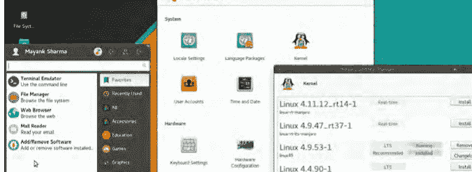

该发行版展示了其对 KDE 用户的喜爱，有无数选择，但它并不是缺乏经验的用户的最佳环境。`RevengeOS` 是自定义工具的天才，但那种没有固定发布计划的独角戏的感觉对我来说有点过头了，尤其是视觉效果需要花费大量精力，而投入这些精力对每个人都是最好的。

最后，获胜者是在 Anteros 和 Manjaro 之间产生的。Anteros 的一个大优势是它在安装期间提供了多个桌面的选项。除了没有其他自定义工具外，它在视觉上也很易用。

另一方面，`Manjaro` 包含了非常有用的 Manjaro 设置管理器（`jaro Settings Manager`），帮助用户利用 Arch 生态系统而无需陷入琐碎细节。它还装满了应用，可以开箱即用。

该项目拥有自己的专用软件仓库，提供经过彻底测试且稳定的软件，这些软件与 Arch 及其仓库配合良好，并可用于前沿软件。

最后，`Manjaro` 仍然是极少数独立开发的、同时适用于 32 位和 64 位架构的发行版之一。

> Manoj Sharma

## # # GIZMODO 英国

并非普通的科技网站


## 探索科技小产品、科学、设计及更多新词汇

- 来自技术前沿的迷人报告
- 创新、文化和极客文化的探索
- 加入英国领先的在线科技社区

`www.gizmodo.co.uk`

`twitter.com/GizmodoUK` `facebook.com/GizmodoUK`

## 评测 iStore DiskAshur Pro 2


## 硬件

## iStore diskAshur Pro 2

表面上是一个昂贵的便携硬盘，但良好的安全性从不廉

- 价格：195 英镑起（约 249 美元）
- 网站：`https://istore.uk.com`
- 容量：500GB-5TB
- 数据传输速度：高达 10Gbps（读/写）
- 电源：USB 总线供电
- 接口：USB-C
- 硬件加密：AES-256 位
- 质保：2 年
- 尺寸：124mmx84mmx20mm (500GB/1TB, 2TB)
- 重量：500GB/1TB/2TB, 3TB/4TB/5TB

对于每天携带敏感信息的人来说，丢失携带信息的设备（或被盗）是一个一直的问题。`diskAshur Pro 2` 外硬盘是一个紧凑设备，旨在无需软件的安全运行。Pro 2 的零售价为

最后，获胜者是在 Anteros 和 Manjaro 之间产生的。Anteros 的一个大优势是它在安装期间提供了多个桌面的选项。除了没有其他自定义工具外，它在视觉上也很易用。

另一方面，`Manjaro` 包含了非常有用的 Manjaro 设置管理器帮助用户利用 Arch 生态系统而无需陷入琐碎细节。它还装满了应用，可以开箱即用。

该项目拥有自己的专用软件仓库，提供经过彻底测试且稳定的软件，这些软件与 Arch 及其仓库配合良好，并可用于前沿软件。

最后，`Manjaro` 仍然是极少数独立开发的、同时适用于 32 位和 64 位架构的发行版之一。

> Manoj Sharma


> 设备具有多种保护措施以防御外部篡改

从设计角度来看，有两个功能使其与不同：第一个是内置 USB。另一个亮点是数字键盘。

该单元带有一个默认密码，你可以直接通过数字键盘进行更改。你甚至可以定义一个“自毁”序列，当密码和数据被评估时会执行内部擦除。

如果错误输入代码十次，硬盘将重置加密密钥，导致内容无法访问。Pro 2 的零售价为。

对于大多数人来说，Pro2 在安全性方面足够。


以 65MB/s 的读取速度和 144MB/s 的写入速度，Pro2 内部的旋转磁盘确实有些门道。SSD 会更快（更大），但性能水平足够，并且像使用硬盘存储的 PC 一样快速。单元本身通过了认证，具有防水功能。额外的物理保护是键盘按键涂了环氧树脂。这使得很难判断哪些按键被定期擦除。

Mark Pickering


### 优点

制作精良，提供了极佳的数据安全。由于自包含，它适用于任何 Linux 驱动

### 缺点

一物有所值，所以它很贵，且设置可能很复杂

### 总结

一个能够处理物理滥用和恶意攻击的安全存储设备需要高昂的价格。这种经过深思的设计与精良设备的结合非常有吸引力。

www.linuxuser.co

## Pop!_OS 17.10


## 发行版

## Pop!_OS 17.10

由于 Ubuntu 的剧烈变化，System76 决定采取主动行动。

System76 是少数销售预装有 100% 兼容 Linux 硬件的 Ubuntu 电脑的零售商之一。System76 —— 在 Unity 项目终结后，将其 91% 的业务整合到一个发行版中，旨在为客户提供与硬件相匹配的良好体验。随后，该公司发布了最新的 Ubuntu，并以 GNOME Shell 作为其定制发行版 Pop!_OS 的基础。

目前 Pop! OS 仅适用于 64 位架构，并针对 Intel/AMD 和 Nvidia 硬件发布了独立版本。

| 配置 | 需求 |
| :--- | :--- |
| 内存 | 2GB |
| 存储 | 20GB |
| CPU | 64 位 AMD 或 Nvidia 处理器 |
| 图形 | AMD 或 Nvidia |

获取地址：https://system76.com/pop

System76 并没有专注于维护主流发行版桌面，而是专注于设计一种为创作者、开发者和创客者打造的发行版桌面：“如果你从事软件工程、科学计算、机器人或 AI 领域，我们正在为为你构建 Pop!_OS，”Carl Richelle 在发布该版本的博客中写道。“我们将构建工具来简化你的开发环境管理。我们将确保 CUDA 易于使用并正常运行。”

System76 通过其 “Imagine” 营销活动（https://system76.com/imagine）提升了我们的预期，承诺提供“最高效且最美观的开发平台，即使它补充了一句‘我们才刚刚开始’。”在首次发布后接受 Richello 采访时，他解释了公司的雄心以及“该发行版的指导原则、美学、构建基础设施、测试和质量程序、社区建立、文档、生产环境开发以及所有桌面体验等等。”由于缺乏这些背景，考虑到其网站上的目标，第一个版本看起来有些平淡且极简主义。“在四个月的时间里，我们奠定了操作系统的基础设施和方向。接下来的六个月是执行我们的愿。”。”Carl 认为在评估该发行版时记住这一点很重要，但我们无法评审不存在的东西。

在软件方面，该发行版相当于标准豪华版，包含了 LibreOffice、Firefox 和 Gnome 的默认应用程序。与 Ubuntu 相比，Pop_OS 使用 Gear 代替 Thunderbird 和 Shotwave。Carl 表示，在公司的元素群体中，客户并不使用这些缺失的程序。Pop_OS 基于 Ubuntu，但带有自己的安装程序。除了外观之外，唯一真正的区别是它不是他们最初的原创。System 表示它拥有一个顶级的启动向导。Pop!_OS 的 gnome 桌面经过了辅助和调整，以提供最符合用户需求的用户体验。启用了 Gnome 元素来帮助导航“活动概览”（Activities Overview），另一个是在电源菜单中添加了“挂起”按钮。为了保护您的隐私，Pop 不在锁定屏幕上显示通知。System76 UI 团队花费了大量时间确保视觉细节正确。

扁平 GTK 主题基于 Material GTK+，配有匹配的颜色和图标对。作为良好的开源支持者，System76 还在改进上游代码。Carl 告诉我们，他们正在改进 Gnome 的窗口聚焦和控制。一个让我们感到困难的 Gnome 主题是重新映射的键盘快捷键。Carl 与软件开发者的反馈密切合作，但需要对设置编辑器进行微调，以将其恢复到熟悉的 GNOME 值。另一个亮点是基于 elementary 的 AppCenter 的商店。Carl 告诉我们它使用了相同的搜索逻辑并处理列出的项目。如果你无法从 Pop!OS 显示的发行版中安装 Thunderbird 或 Ethereum 等应用，请告诉他们使用 APT。他们正在创建“应用程序切换器”，将帮助用户获取与特定任务相关的程序。

### 优点

- 一个美感愉悦的 GNOME 环境，默认启用了实用的元素，并有一个直观的应用商店。

### 缺点

- 一个极简的发行版，其默认应用程序选择可能无法满足其需求。

### 总结

- 一个外观良好的发行版，不仅仅与官方网站相符。但背后做了大量工作，为未来的元素奠定了基础，并将帮助将该发行版推向完美的开发平台。

Maya Sharma

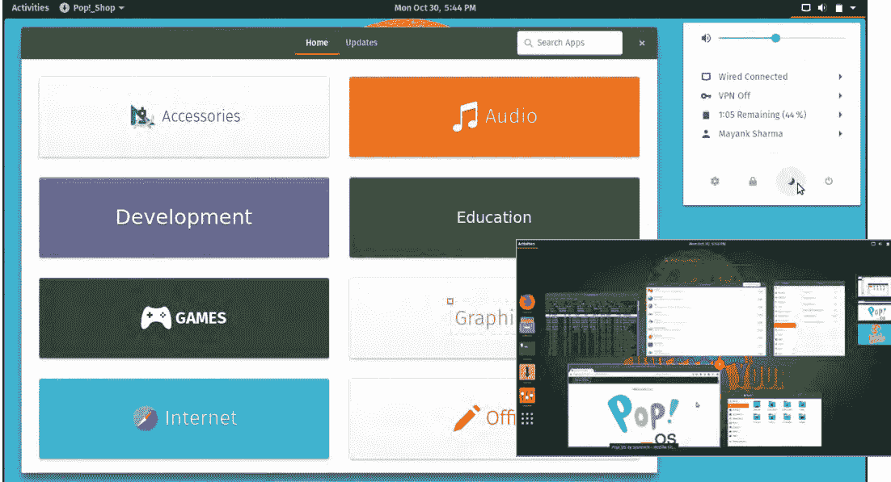

## 评测：新鲜且开源的软件

## 代码编辑器

### CudaText 1.23.0

一个用于编写代码的功能丰富的编辑器

Linux 不缺少可以作为轻量级 IDE 使用的高级文本编辑器，我们对继我们之后最好的几款进行了一组小组测试（见 LU 082, Pg 1）。CudaText 是一个专门为编写代码设计的跨平台编辑器，也可以作为一个高级文本编辑器。

该编辑器具有所有常用的便利功能，例如对 C、C++、Java、HTML、CSS 和 Python 在内的多种编程语言进行语法高亮。你还获得了 HTML 和 CSS 等语言的代码折叠功能、使用正则表达式进行搜索和替换的能力，以及多重编辑和多选功能。通过安装用 Python 编写的额外插件可以扩展功能。

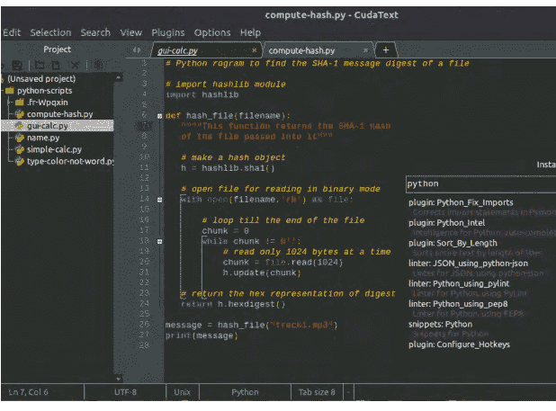

该应用拥有界面的颜色主题。它有一套匹配的编码方案。

该项目为 Debian 系发行版提供了未编译的二进制文件。Carl 告诉我们，它正在改进 Gnome 的窗口聚焦并正确控制。一个让我们感到困难的 Gnome 主题是重新映射的键盘快捷键。Carl 与软件开发者的反馈密切合作，但需要对设置编辑器进行微调，以将其恢复到熟悉的 GNOME 值。另一个亮点是基于 elementary 的 AppCenter 的商店。Carl 告诉我们它使用了相同的搜索逻辑并处理列出的项目。如果你无法从 Pop!OS 显示的发行版中安装 Thunderbird 或 Ethereum 等应用，请告诉他们使用 APT。他们正在创建“应用程序切换器”，将帮助用户获取与特定任务相关的程序。

### 优点

- 包含了所有的常用便利功能，可以通过插件扩展。

### 缺点

- 你需要编辑配置文件来连接 Python 解释器。

### 非常适合...

- 使用 IDE 编辑代码。http://viewsoft.com/cudatext/

## 潜水工具

### Subsurface 4.7

轻松分析每个 USB 潜水

Linus Torvalds 喜欢跟踪他所做的。他使用 Git 跟踪内核开发并使用 Subsurface 进行潜水。当 Linux 内核出现错误时，他喜欢焊接并潜水。他想为潜水找到一个好的日志。

该项目为 Debian 系发行版提供了未编译的二进制文件。因此你需要按照在线文档中包含的所有方面的说明进行手动编译，并仔细阅读以获取该程序的所有功能。（注：原文中存在大量由于 OCR 错误导致的重复文本，已根据上下文进行清理和翻译）。

# 在我们的目录中发布您的列表

如在此广告，请联系 Chris

chris.mitchell@futurenet.com | +44 01225 68 7832 (分机 7832)

## 推荐

## 托管列表


> 使用我们直观的控制面板来管理您的域名

精选托管商：

### 关于我们

作为始于 1999 年的托管品牌的一部分，我们历史悠久、总部位于英国、独立运营，我们的使命是——确保您的网络呈现“运行无忧”。

我们提供极具性价比的域名、cPanel 托管、SSL 证书、企业邮箱、WordPress 托管、云和 VPS。

+ 我们提供的服务：

- 带有欺诈、垃圾邮件和病毒保护的免费邮箱账户。

- 免费 DNS 管理。

- 易于使用的控制面板。

- 免费邮件转发，自动将您的电子邮件重定向到现有账户。

- 域名威胁保护，防止意外或未经您许可的情况下被转出。

- 易于使用的工具，帮助您一步完成多个域名的注册、转让并进行其他更改。

- 免费域名转发，将您的域名指向另一个网站。


## 专业人士提示

+ 01 优化您的网站图像

在更新网站时，请确保所有的图像都经过了优化！尝试免费使用 imagejpeg.com 或使用 EWWW Image Optimizer 插件。

**客户证言**

David Brown

我购买了一张 SSL 证书。购买过程非常轻松，只需几分钟时间。我的困难之处在于安装证书，这是我永远无法做到的。然而，我提交了一个支持工单，他们在几小时内就回复了，并帮助我获取证书签名授权，而且支持团队……

+ 02 在英国托管您的网站

确保您的网站托管在英国，而不仅仅是对我们本地！如果您的服务器位于海外，您可能会在 google.co.uk 的搜索排名中受到惩罚——在 www.check-host 检查您的网站所在地。

+ 04 尝试在 Google 上排名？

2015 年起。如果您正苦于在 Google 上获得排名，请确保您的网站是响应式的！Google 现在更倾向于移动端友好站点。联系我们的支持团队，我们将修复您网站的 HTTPS。

Tracy Hope

我们使用了 TheNames 的多服务，网络连接是顶级的——极高的可用性和运行速度。技术支持非常有帮助且回复迅速——这是额外的加分。我们非常推荐 TheNames。

+ 03 避开廉价托管

我们见过许多尝试获取廉价托管的人！例如，一台服务器上会挤进多少客户？您宁愿使用 20 英镑的廉价硬盘，也不用 11 英镑以上的企业级 SSL！记住：一分钱分货！

J Edwards

在尝试了其他托管公司后，我们的客户服务似乎远胜其他，而且我分享的所有功能。共享托管速度很快，控制面板非常全面……

+ 03 您会定期备份吗？

如果您今天丢失了网站，对您的业务会产生什么影响？始终进行自己的备份至关重要；如果……

## 高级托管

## SSD 网站托管


| www.cwcs.co.uk | 0800 1 777 000 |
| www.bargainhost.co.uk | 0843 289 2681 |

CWCS 托管托管是英国领先的托管专家，提供全系列的托管产品、服务和支持。高技能员工不仅是托管专家，还致力于提供卓越的客户体验，并对他们所做的充满热情。

自2001年以来，BargainHost 一直致力于英国争取最低的云托管。它已成功实现这一目标，并建立了一个包含许多重复客户的大数据库，并因卓越的托管服务而获奖。

- 托管机房

- VPS

- 100% 网络可用性

- 共享托管

- 云托管

- 域名


## 价值托管

## 价值 Linux

www.220Media.com | www.220Media.com

新用户或使用托管型服务的用户将预安装 WordPress。托管型 WordPress 服务第一年完全免费。

我们以“专业且卓越的服务”闻名，为全英国所有的网络业务、开发者和经理服务。

## elastochosts

elastochosts.co.uk

0271 83256


patchman-hosting.co.uk

0162 442 237

ElastoHosts 提供简单、灵活且高效益的云服务，具有高性能、可扩展性以及全球范围的支持。我们的团队……

（注：提示中的 OCR 文本根据提供的输入在页面处似乎有重复/中断。我已按照要求处理了可用文本。）

# 短篇

## 蒂芬·奥拉姆 (Stephen Oram)

下期将于1月11日发售

您的免费光盘 | 微软爱 Linux 吗？ | SBC 汇总

关注我们

Facebook:

facebook.com/LinuxUserUK

Twitter:

@linuxusermag

## 近未来小说

## 碎片

他赤条裸地站在全身镜前，收起着二头肌。

镜子闪烁起琥珀色的警告，提醒他在扫描身体时保持静止，他希望是如此。它将评估他的健康状况，并调整散布在他全身各处的增强植入物，通过不断调节来最大限度地提升他的体能和心理表现。

这种日常惯例让他感到被囚禁和逼入绝境，就像这面镜子是一个他几乎无法离开二十小时的接口。他想跑进海里，或者让自己醉醉；他想尽可能走得远一点。

挣脱的压力在他内心积聚，以至于在撑过又一天之前，他感到双倍的窒息。

当镜子的右上角向他靠近时，他收紧腹部肌肉并挺直背部。镜子咔哒一声落下，显示了他的档案，据他怀疑，还有一个中央数据库。

他用尽全力紧握拳头。成千上万的碎片飞过地板。守护他健康的整体守护者被肢解了，散落在他周围。

一种巨大的解脱感在他内心涌起。

但真的是这样吗？

镜子的碎片仍在孤立地工作，而他身体的不同部位正在选择它们自己的设置。

他的手变暖了，脚变冷了。

他的心脏在剧跳；胃部在抗拒，小腿肌肉却平静了。每当他的大脑检测到问题时，它就会告诉他不要担心，立即覆盖掉所有的警告。

他意识到，这种肢解带来的痛苦和记忆遗失已触及了他存在的每一个部分。

关于

进食机器人

节选自蒂芬·奥拉姆的新短篇小说集：探索梦想与扭曲现实、技术与人性之间碰撞的近未来小说。这30篇短篇小说将在你步入未来后出版。

http://linuxeron.net

早上好，今天你想成为什么样？

电子前沿基金会（Electronic Frontier Foundation，简称 EFF）是捍卫数字世界公民自由的领先非营利组织。EFF成立于1990年，通过影响力性诉讼、政策分析、基层活动和技术开发，捍护用户隐私、自由表达和创新。我们致力于确保随着技术使用的增长，权利和自由能够得到增强和保护。

## EFF.ORG

## 电子前沿基金会 (ELECTRONIC FRONTIER FOUNDATION)

在电子前沿保护权利并促进自由

# 在黑胶片的世界中迷失自我

在乐施会（OXFAM）在线商店中寻找自我

oxfam.org.uk/shop

乐施会 (OXFAM)
