# Linux 用户与开发者 190 - 树莓派黑客的电子技术 190

开源拯救生命

提升你的编码水平！

`MYCROFT`（二代）


电子边界基金会（`EFF`）是捍卫数字世界公民自由的领先非营利组织。`EFF` 成立于 `1990` 年，通过影响力性诉讼、政策分析、基层活动和技术开发，维护用户隐私、表达自由和创新。随着我们对技术的使用不断增加，我们致力于确保权利和自由得到增强和保护。

在电子前沿保护权利并促进自由

欢迎阅读英国和北美最喜爱的 `Linux` 及开源软件（`FOSS`）杂志。在纪念斯蒂芬·霍金教授逝世之际，回顾了过去一个月令我们沮丧的事情，他是理论物理领域的巨匠，也是《星舰号》节目中最“聪明”的嘉宾。我们的雷达上也出现了一个 `Pi` 形状的物体（见第 86 页树莓派 `B+`），我们将其确认为新款 `Pi`，因此我们通过内容丰富的“`Pi` 极客电子设备”（第 18 页）平息了大家的担忧——使用新的 `Linux` `3` `B+` 构建电路和发明 `Pi` 的方法是一个极佳的补充，它极具启发性的网络魅力，我们已经在本期中对未来做了预测。本月，我们还尝试预测 `Linux` 发行版的大趋势（第 64 页）；查看新款 `XPS` `12`（第 62 页），并考虑使用 `Google` `Sputnik` 的奇妙世界（第 32 页）。当然，最后我们还有大批精彩的教程供大家尽情享受！阅读愉快，

Chris Horner

编辑 Chris Thornton

`chris.thorne@linuxuser.com`

设计设计 Rosie Webber

制片人 Ed J. Ricketts

总编辑 Tech Graham Barlow

高级编辑 Jo Guiller

Michael Aucloss, David Bedford, Adam Miles, Mike Reed, James, Thomas Courtney, Nicholas Taylor, John Jones, Tom Castillo, Martin Price, Patrick O'Neill, Anthony Page, Paul Smith

艺术与设计负责人 Robin

我们对提交在本杂志发表的用户所表达的观点不负责。任何文章中表达的观点、意见、策略或政策并不一定反映 `LinuxUser` 或 `Future Media Ltd` 的观点。

读者来奖

写信给我们即可赢取一台 `iPad Pro`！

`luxuser@futurenet.com`

Twitter: `@LinuxUsermag`

Facebook: `facebook.com/LinuxUserUK`

第 11 页获取更多详情

获取最佳订阅优惠：访问 `myfutureuser.co.uk/subscribe/`，纸质版节省高达 `20%`！详情见第 30 页。

`Linux User` 提供纸质和在线版。

`FUTURE`

创造

数字媒体

首席执行官 Ethan Smyth-Thorne

首席财务官 Paul Ledham

电话：`020 7936 000`

# 内容


18 封面

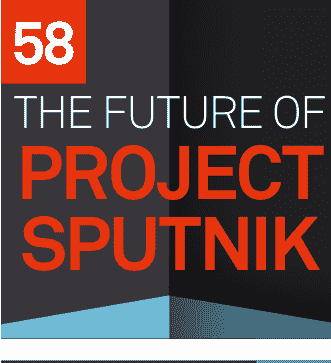

电子设备

专为 `Pi` 极客

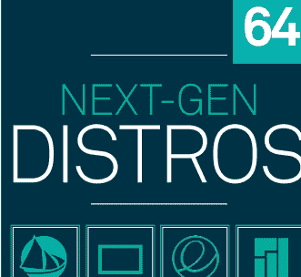

58 的未来

`Project Sputnik`


64 下一代

发行版

开源

90

# 开源

06 新闻与观点 | 10 字母 | 12 访谈 | 16 内核世界

## 硬件

### Purism 提高笔记本电脑安全门槛

防篡改笔记本电脑与加密合作伙伴关系，旨在保障笔记本电脑及即将推出的 `Librem 5` 安全

`Purism` 持续专注于生产最安全、最隐私的笔记本电脑，这使其与一家多元化的安全公司 `Treadmill Hudson` 建立了新的合作伙伴关系。其 `Heads` 安全固件已集成到可信平台模块（`TPM`）芯片中，为使用 `Purism Linux` 硬件的用户提供了更增强的保护。

然而，这项开发的结果将需要一些硬件更改、启动修改，当然还有操作系统的更新。正如 `Purism` 首席执行官 Cosmo Wohl 所说：“你的隐私取决于自由。拥有真正的隐私意味着你的电脑和数据应该由你控制，而不是由别人控制。”

`Librem` 用户现在可以控制安全启动过程，并使用最高级别的基于硬件的加密。Weaver 说：“通过在所有笔记本电脑上默认激活我们启支持 `TPM` 的启动，这一小小的组合使得当你持有密钥时，拥有你能买到的最安全的笔记本电脑。”

新模型将把集成的 `TPM` 作为标准功能。此外，在密码学专家 `Werner Koch` 的协助下，开发了与安全相关的新的网络通信。这将为 `Purism` 的笔记本电脑以及即将推出的 `Librem 5` 增加硬件加密。


为此，`Purism` 利用 `Gnu` 隐私卫士（`GPG`）和智能卡技术，在其所有设备上默认包含加密。`Purism` 和加密倡导者已经知道，正是 Koch 的 `GPG` 加密使得与全球记者能够进行安全通信。

`GPG` 最初开发于 `1997` 年，多年来它积累了庞大的用户社区，并通过一种新进程——密钥目录（`Key Directory`）用于电子邮件和消息传递，该进程允许接收者在自己的系统上请求权限。

`Werner Koch` 说：“`Purism` 的目标是使用密码学将其构建到产品中。`Purism` 正在制造现代硬件，允许用户控制自己的生活。”

`Librem 5` 手机于今年下半部分（即 `2017` 年 `8` 月）首次推出，其众筹成功筹集了目标的 `155%`——其中包括一些功能

上文提到，`Purism` 的目标是包含 `Librem 5` 及其后续产品，它们将变得更加安全

最初并未被认为由 `Purism` 团队开发。

Koch 认为是一种保护用户的“理想方法”，且不会牺牲性能或可用性。该合作伙伴关系的计划是全盘加密和文件加密，让用户或企业有能力保护自己的数据文件，同时自己保留此类保护的密钥。

最终，`Purism` 旨在推动笔记本电脑和手机行业对终端用户设备提供更大的保护。谁能反对呢？

# 发行版

### Canonical 在 Ubuntu 中安装数据收集工具

公司表示，升级用户可以选择退出 `Ubuntu` 数据收集

在过去的几周里，由于收到 `Canonical` 在 `Ubuntu` `18.04 LTS` 中放置了数据收集工具的消息，`Ubuntu` 社区陷入了恐慌。虽然这只收集硬件信息，而不是像微软在 `Windows 10` 中收集的数据，但它引发了争议。

`Canonical` 在今天的一份公告中表示，收集的数据将通过 `HTTPS` 发送到由 `Canonical` 团队运行的服务上。在首次启动且有网络连接后，这将保存到磁盘上。包含此类数据的文件将供用户检查。这些数据的结果将公开。`Canonical` 解释说，用户可以比较德国与赞比亚的加入百分比（例如），以及在什么硬件上：`Ubuntu` 隐私政策不会受到此更改的影响。

收集的数据包括硬件（`CPU`、`GPU`、`RAM`、磁盘大小、`GPU` 设备、设备 `ID`）、用户在安装时禁用的功能（而不是不收集的 `IP` 地址）、安装工具以及在每月更新期间更新的功能。

公告发布后，大部分关于担忧和心安之得的讨论，这是因为 `Canonical` 在这方面有一段负面的历史，例如 `Ubuntu/Android` 集成以及手机中的 `Linux Android` 模式。当然，该公司的口袋引发了更大的隐私问题，而你无法轻易退出：

该公告的很大程度上未受关注的方面之一是，任何人都可以退出，而来自 `16.04 LTS` 的升级用户如果他们选择也可以退出。正如 `Will Cook` 解释过的：

“任何用户都可以通过取消勾选框来退出。`GNOME` 设置的隐私面板中有一个复选框可以切换此值。鉴于这些使用模式适用于 `Linux`，`Canonical` 想要以这种方式量化 `Ubuntu` 是意义的，但也许它可以用更公开的方式来处理事情。”

# 前五

### 五项 Ubuntu 18.04 LTS 特性

- `1` 个新的默认应用

`Ubuntu` 包含了几个默认应用（或在 `2017` 年的社区咨询后在设置程序中提供。`VLC`、`LibreOffice`、`Mozilla Thunderbird` 和 `Shotwave`。）

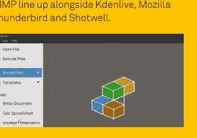

- `2` `X` 显示服务器

我们感到放心，`Wayland` 仍然是显示服务器的主体，这归功于最终能够与之正常运行的应用和游戏。`Ubuntu` `18.04` 恢复了

- `3` 彩色表情符号

这是你一直等待的特性。在之前的版本中，表情符号是单色的；随着 `Android` 全色源版本的到来，这将在 `18.04` 中发生变化。


- `4` 精简版安装


并不是`Ubuntu` Minimal的替代品，而是安装过程中的一个真实功能。

- 5新`GNOME`特性

`Ubuntu 18.04`是首次使用`GNOME 3`的版本，并且默认包含了新的主题。这是你将看到的第一个

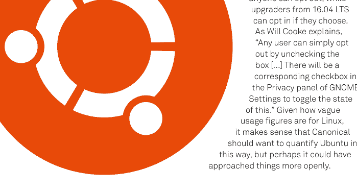

# 开源

新闻与观点

# Android

## “Linux on Galaxy”演示

## 类似于 Convergence 的工具，主要面向开发者

将手机变成PC的想法并不新；它已经在微软的`Windows 10 Mobile`的`Continuum`中出现过，以及`Ubuntu`中的`Debian`。但它并没有流行。意识到大多数人想要口袋里有一个真正的PC，三星一直在忙于一种新方法。当地被称为“Linux on Galaxy”，适用于配备八核处理器的三星手机。

“在手机上开发`Linux`以前从未如此简单，”该公司说，“现在可以通过`Samsung Dex`访问整个堆栈——这是一个丰富的桌面级

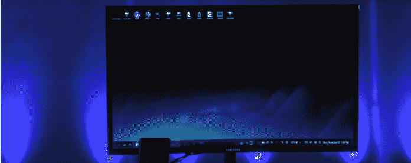

体验，Will开发者想要在`PC`/手机上编程吗？

作为一种应用程序打包，当手机连接到自定义的`Dex`底座时，`Linux`会启动。与其说是完全独立的安装，`Linux`共享相同的

相同的应用程序和文件在两个环境中都可用。这意味着你可以在火车上工作，然后在办公室继续项目。这是一个令人兴奋的选择，但目前还没有发布日期。

`Android`的内核。

微软的廉价云无论是令人满意还是失望，取决于它如何继续。按照在`Windows`虚拟机平台上作为第一类虚拟机的计划，促进这种模式的是一个开源项目（`xrdg`）。该工具通过`Hyper-V`套接字传输数据，以启用虚拟机集成的所有功能。正如`White`说，“一种基于字节流的宿主机与虚拟机之间的通信机制”

`Wilton`（可能在`http://bit.ly/lud_vm`提到）演示了旧版本的`Ubuntu 18.04`在增强会话模式下的运行，作为对

预计当`Ubuntu 18.04 LTS`在四月发布时，通过`Hyper-V`虚拟机库推出。

* `Neifa`

# CHROME OS

# 发行版快讯

## Chrome OS 将支持 Linux 虚拟机吗？

# 前 10 名

（每日平均点击量，截至2018年3月9日的30天内统计）

1. `Mint 2804`

2. `Manjaro 2315`

3. `Debian 1666`

4. `Ubuntu 1625`

5. `Solus 1285`

6. `Antergos 1160`

7. `elementary 1059`

8. `Fedora 960`

9. `TrueOS 825`

10. `openUSE`

证据似乎表明这已在路上了

`Chrome OS`基于`Linux`（具体来说是`Gentoo`），你可能认为直接安装`Linux`应用会很容易。遗憾的是，目前还无法实现，必须使用一些奇奇怪的变通方案。


想要在`Chromebook`上运行`Linux`的人有两个选择：`ChromeOS`或`Crouton`脚本。第一个选项需要一个新的分区（切换分区可能非常耗时），而第二个选项则引入了巨大的安全风险。答案是？

各种迹象表明`Chrome OS`将支持`Linux`虚拟机，但依靠像`Crouton`这样的第三方项目运行`Linux`意味着面临着必须通过潜在的破解手段来开发`Android`应用的问题。这是任何计算机所有者都不应该承担的风险，但如果你想在`Chromebook`上使用`Linux`应用，这是唯一的选择了。

许多因素表明，`Chromium`的发布可能会为`Linux`提供虚拟机支持。此外，`Chrome`设备可能支持`Chrome OS`模式，这为管理员增加了一个新菜单和一个开关，用于启用或禁用功能。`Chrome OS`中的某行包含性代码预计于5月推出。

与此同时，一个对话框显示：“欢迎使用`Chromebook`。你可以无缝且安全地运行你喜爱的`Linux`应用和命令行工具。”那么，安装`LibreOffice`、`Linux`兼容软件，甚至是受`Wine`支持的软件？这可能是的……

随着`Chrome OS`的演进，请关注`Android`博客：`https://www.androidroid.com`。

### 本月动态

- 开发 (7)

- 稳定版 (2)

- `Manjaro`的势头持续增长，打破了`Fedora`此前在前三名的领先地位。同时，`Kali`和`Linux`维持了它们的排名。

## 亮点


`Fedora`有了一个全新的免费版本，由庞大的社区支持。`Fedora`使用`GNOME`，并目标是在其他发行版之后引入新技术。

`Kali`

基于`Debian`，`Kali`是一个专注于安全的发行版，以及一个安全、网络监控和取证工具的集合。


`Linux`

其主要目标是将`Windows`引入`Linux`，`Ubuntu`发行`Ubuntu LTS`，并包含`Xbox`桌面、办公套件和其他软件等功能。

## 硬件

`Nintendo Switch`运行`Linux`

但其中一个展示——

既然`Switch`已经被破解可以运行`Linux`吗？看起来确实如此，这得益于`Overflow`上一个游戏小组的破解。但这不是我们的`Switch`；`ChromeOS`已经发布了，那是另一回事。

桌面版，关于如何在硬件级别运行此漏洞的信息已使其成为。软件支持的缺失意味着，如果你想在`Switch`上安装`Linux`，这并不容易。

`Switch`是基于`ARM`架构的，所以如果它能在`Switch`上运行任何内核游戏，那么一个`Linux`版本的`Android`并非不可能，考虑到它添加了`Google`移动操作系统的一些功能。毕竟，`Android`是传闻中`Nintendo`在`Switch`上运行或希望在`Switch`上使用的操作系统。

“这是一个启动时的花招，无法被补丁（目前正在运行`Switch`），而且它不需要任何东西。有大量信息……但仅深于此了。”尽管随后出现了一个视频似乎证实了该漏洞，视频中某人正使用`Switch`的触摸屏在`Linux`中浏览网页。

## 最新可用发行版：


关于杂志、`Linux`和开源的疑问与意见

### 推文

来自`@Pepulani`：

对`@LinuxUser_mag`的介绍非常有启发性。你们未来也想针对不同的负载以及不同的编码类型和教程提供此类内容吗？

亲爱的`Lu8D`，我对未来的期号非常感兴趣，也许涵盖`Linux`中顶级的发行版，以及关于如何进一步微调和锁定的配套文章。如果已经有期号了，那是哪一期？

`Richard W`

`Chris`: 感谢你的邮件。实际上，现实感觉他对`Linux`新手并没有提供太多帮助，但他的评论似乎非常准确。安全和隐私问题很重要。

## Plasmoid 快速指南

## Mycroft

作为一款开源软件，你不需要购买智能选择器就可以尝试`Mycroft`，但通过购买`Mark`或`Orion`，你将支持该项目。要做到这一点，只需将其安装为`Plasmoid` —— `KDE`桌面的桌面小组件。社区成员`Aditya Mehra`在`KDE`开发人员的帮助下，为`Ubuntu`和`Fedora`上的`KDE Plasma`创建了`Alpha`版本。这是一个为这两个系统提供的脚本，但我们在这些系统在非`LTS`版本上（以及`Flatpak`上）备有`KDE Neon`，因此你可以选择安装它，也可以将其作为虚拟机运行。你需要进入终端（在`KDE`中称为`Konsole`）并输入：

```bash
wget https://mycroft.ai/install_plasmoid_kde.sh
bash install_plasmoid_kde.sh
```

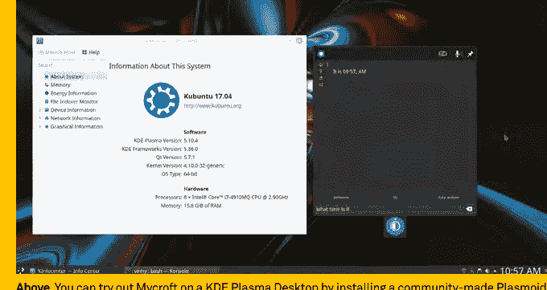

上面列出了你如何通过安装社区制作的`Plasmoid`在`KDE Plasma`桌面上尝试`Mycroft`的方法。虽然有针对`KDE Neon`和`Fedora`的脚本，但你可以在`Ubuntu`项目的`Mycroft`列表中运行它，并将其拖到桌面上。如果你不想使用脚本，可以查看：`https://kde.org/plasma-plasmoid-mycroft.kde`。不过，这种方法稍微复杂一些，因为你需要安装`Mycroft Core`并手动安装包，而脚本会自动处理这些工作。


完成后，你可以右键点击桌面，选择“添加小组件”（`Add Widget`），你会发现所有为了保持整洁而移除的项，而且我们改进了成本。我们改进了内部微内核的处理器和性能，还添加了 `FPGA` 来处理类语音任务。我们还有其他可以实现的应用——

这是一种功能更强大的设备。从能够通过语音创建交互内容的角度来看，它仍然非常灵活，但对于消费者来说比黑客和创作者更具实用性。

在构建第一个产品时，我们为开发者制作了些什么？

`Mark` 出货时，我们将配备与之相关的开发者开发工具。我们已经开发了它超过两年了，现在我们正在编写全面的自动化测试。我们正在构建更好的工具来与应用程序进行全方位对话，接下来我们将围绕此开展大量工作。

我们遇到的问题之一是，类似的命令可能会触发两个不同的技能（`skills`）。例如，如果我说“删除计时器”（`Remove the timer`），它会移除设备上的项目。然而，如果我说“删除我购物列表中的项目”（`Remove items from my shopping list`），它倾向于杀死你所有的计时器，尽管你只是想从购物列表中删除它。因此，我们将构建基于机器学习的调试工具来帮助解决。随着我们从愿意分享数据的人那里收集更多数据，随着我们收集更多社区标签，这将提高工程师和开发者的体验。

你谈到了隐私问题。在我们分享时，是否有人在尝试改进这方面的隐私？

我们只使用选择加入的用户的数据，所以我们不隐藏任何东西。我们使用愿意与我们共享数据的用户，大约有 `6%` 的用户说“我想让这项技术变得更好”。事实证明过程确实变成了瓶颈。只要我们社区有足够的成员分享数据来帮助改进工具，我们就能从他人那里学习，对吧？如果你有足够的数据，我们会得到什么？因为我们很贪婪，对吧？

我想这就是我们所做的，在许多其他平台上，这与 `AI` 无关，而与你作为一个产品有关。如果你不

`> Mark` 是一款消费级设备。我们添加了一个四英寸触摸屏

## 开源新闻与观点

为了产品付费，你将获得产品。有很多数据收集是在网页上，通过像素（`pixels`）进行的。尽管它的初衷是让用户说“`Hey`”，我们正在试图为用户改进这项技术，它的真正意义是，我们对此并不感兴趣。我们希望用户拥有一项代表他们的技术，将其转化为产品。不久后，我们将推出一个 `Windows` 应用程序和一个 `iOS` 应用程序，允许你运行 `Mycroft` 栈，所有设备都是连接的。所以想法是我们可以通过任何方式开发，它让我们服务那些可能无法听见或无法说话的人。

## 硬件改进会由第三方构建吗？

`Mark` 将增加技能（`skills`）。我们的社区继续构建它，其中一个正在成为 `KDE` 的默认部分。你可以说“`Mycroft`，玩剪刀石头布”之类的。它允许你通过手势输入，然后它随机选择一个并告诉你。这是一个很不起眼的，麦克风拾到单词“`Heycroft`”。请求通过 `DeepSpeech` 转换为文本，然后处理意图。响应从文本转换为语音，最后通过扬声器播放。


所以我们能够构建一个虚拟助手，如果你想的话，它是一个增强现实层。你对它说话，实际上它是一个增强现实层，覆盖在你的家里。我们不仅可以服务能说话和听见的人，还可以服务那些可能无法听见或无法说话的人。

计算是在云端完成的？

大部分计算实际上是在设备上完成的。所以我们不在云端进行——因为那需要更多处理时间。如果你要进行实时合成，就需要 `GPU` 来操作。在未来的几个月里，新的合成引擎听起来很棒，但运行它需要大量的处理时间。我们提供了一个价格合理的方案。

## Mycroft 的声音

`Mycroft` 使用文本转语音引擎创建所有声音。这由 `Mycroft AI` 和 `VocalID` 开发，但他们需要帮助。为了创建真实的语音，你需要各种素材，你可以通过`https://vocalid.com/voicebank`添加你的声音。`Joshua` 说，如果你愿意提供语音数据，`Mimic 2` 引擎将允许我们模仿你的声音。目前我们需要大约 `20` 小时的数据，但这正在迅速缩小。我们认为在最后，我们可能只需要 `15` 分钟的音频就能复制声音。`Joshua` 表示，人们将有机会构建帮助家庭成员的语音助手，这让我们立即想起设备或名人的声音。

就此，今天我们可能会将合成移动到云端。

我们的目标是尽可能让信息留在设备上。在项目的结束时（这可能是多年后的事），但明确作为未来一两年的目标，我们希望能够本地运行整个体验。即使我们需要在你的桌面或笔记本电脑上运行。这种工作方式可能是：如果你的桌面在家里，你安装了 `Mycroft II`，房子里的设备首先连接到网络说“`Hey`，这里有人可以识别并合成语音吗？”如果你的笔记本关着或在另一个房间的角落想要响应，它就会去云端获取数据。

但如果你的笔记本放在那里且正在运行 `Mycroft`，它会连接到那里，然后在本地使用 `GPU`。有很多方法可以控制它们。

`Mycroft` 打算如何赚钱？

我们赠送基础。如果你想要玻璃杯，它是免费的；如果你想要大桶，我们就收费。对于我们的用户保留自己的数据，如果你选择选择加入，那太好了。我们目前正在与几个企业品牌合作。这些项目大部分还处于非常早阶段，但一些`财富 500 强`正在评估或已经在与我们的员工合作。

在上面，你可以用小组件和面具个性化你的 `Mycroft II`，结果当你把所有的连接器放在外面时，第一个我们有五个盒子。其中一个盒子里脸面板、主板、`树莓派`和编码器都在一起。新设计设计为单块 `PCB`。屏幕开启了，所有麦克风都开启了。一切都连接到一个设备上，以便在本地进行测量和处理。有了新的设备，我们将听到音质、共振腔的大小，以及进入腔体的空气是如何被我们第一次学到的层驱动的。

回到 `Mark I`，你从经验中学了什么教训？

不要把麦克风放在和共振腔同一个外壳里！`Mark I` 真的变得太大了。无论软件感觉多好，扬声器越大，当音乐播放得很大时，它基本上无法听清命令。所以所有这些问题的教训就是 `Mark II`。它应该更进一步。设计更简单。设备越好越强大。

这次的设计很时尚。它是来自社区反馈的吗？

那是来自我们的设计团队。第一个产品总是设计成我们想要的样子：扁平、可爱，并且在许多方面具有个性化。而且我们必须选择整个`树莓派`在，

`Mycroft II` 型号可以在`Indiegogo` 页面（`https://indiegogo.com/projects/mycroft-ii-the-open-assistant/`）以优惠价格进行预购。例如，开发套件在 `2018` 年 `12` 月上市前优惠 `31%`，为 `109` 美元（`78` 英镑）。

## 我们关注内核社区的最新动态

`Linux 4.16` 接近尾声，重心转向 `4.7`


`Linus Torvalds` 宣布了 `Linux 4.16-rc`（第`5`个候选版本）。在公告邮件中，他说：“这仍然非常正常，包含了一些通常类型的修复，是我在之前的开发周期中看到的最干净的系列之一。`RGS`（回归主日）今天出现，最坏的情况也不会晚。这意味着如果我们按照计划进行，我们将完全覆盖即将到来的补丁。”

传统上，`RGS` 出现在一个周期的年底，这种周期通常持续七周以上，或者在最坏的情况下，`RGS` 已在眉睫。

现代内核刚刚添加了 `retpoline` 支持（顺便这需要非常新的编译器），并添加了一些最近的清理工作。这些包括专门在分支预测控制推断功能中利用 `SSR`（返回栈缓冲区）的修复，无论是否在链接固件时，因为类似 `retpolines` 的解决方案解决了填充缓冲区漏洞；此外增加了除了 `GCC` 之外使用 `nClang` 编译内核的支持；`nClang SBR` 现在适用于所有 `x86` 处理器。

# Jon Master

`Jon Master` 是一位内核黑客，从事 `Linux` 工作已 `22` 年。他在 `13` 岁时首次进入大学。现在住在马萨诸塞州剑桥，为一家大型企业供应商工作。他的工作正在推动一代能效 `ARM` 架构服务器标准的创建。

`4.16` 发布周期可能比 `4.15` 没那么剧烈；我们还没有完全完成清理工作以充分缓解 `Meltdown` 和 `Spectre` 漏洞。虽然 `Spectre` 在 `1` 月份仍然潜伏，但那些只是初步，而且对现代应用程序有时会带来痛苦的性能影响。

未来的处理器将不需要面对这个问题，因为它们将具有硬件属性，可以在分支预测器中预测分支的上下文信息，从而在没有 `SBR写入` 的情况下有效缓解 `Spectre` 攻击。对于所有处理器，内核将禁用 `retpolines`，但这会有开销，并依赖于难以实现的正确处理。`4.16` 将支持这一特性。

上游倾向于修复 `Meltdown` 问题，并花费更多时间来填充较难利用的内核代码。许多生产商对于这些本应该被修复的更改犹豫不决。

# 解决泄露问题

在独立开发中，已经开发了各种内核脚本（位于内核源码的子目录下）。这些脚本解决了日志中内核数据结构的正确泄露问题，并可以对`/leaking_addresses`进行扫描。它经过优化以扫描`/root/`，代表内核数据的潜在泄露，代表了具有各种内核映射的软件。针对 `32` 位处理器上通过 `PTI`（页表隔离）缓解 `Meltdown` 的方法已提交到上游。


在过去的一个月里，刚刚发布了针对`Google`研究的`Spectre`变体`2`缓解措施的上游`'retpoline'`。早期的`retpolines`使用一种名为`MSR`（模型特定寄存器）的硬件控制接口类型，它可以根据`CPU`分支预测器的控制来控制推测执行——这种硬件容易受到`Spectre`变体的攻击。

`Meltdown`的讨论概述了内核入口的机会，即我们找到了一种方法，可以尽可能移除各种`MSR`写入，并为虚拟机安全提供伪造的微代码报告，特别是“内核加固”，即列出一个（同名的）列表。此外还消除了内存地址的泄露。

虽然这些补丁是你的，因为触碰`MSR`是一个可选修复，仍未被软件如此频繁地使用。相反，`retpolines`是一种纯软件解决方案，通过将间接分支替换为函数序列来有效移除它们，这并没有受到影响。漏洞源于堆栈哈希，直接修改虚假的返回地址。


可以使用它们，其他工作侧重于尽可能地锁定和加固内核。这包括由`Google`的`Kees Cook`等其他知名人士领导的若干努力。在过去的几周里，已经有了可能包含数据指针的驱动程序分配内存的补丁，以及移除变长数组（漏洞来源）的建议，并重新向向游提交了来自`'Stackclash'`补丁（最初源自`grsecurity`项目）至少部分技术。`Linus`并不太喜欢后者，因为它为了编译时检查对内核代码进行了大量更改，而他更愿意通过更智能的编译器来实现。

`Matthew Yilcos`发布了用于`4.17`的`'XArray'`第`7`版本。它们实现了一种新的“抽象数据类型”，行为类似于一个大型指针数组。其目的基本上是用具有更好能力的现有的`Linux`基数树（`radix tree`）实现。这一内部内核功能得到了`Linux`用户空间代码的帮助，并且使用起来简单得多。

页面缓存意味着不再使用其他方式存储数据——文件系统——运行的应用程序可能需要这些，这样就可以从内存读取而非交换分区（`swap`）。任何改进缓存性能的代码往往都会提升用户体验。

# 未来处理器将不需要承受 Spectre 2 缓解措施的影响

`Vitaly Kuznetsov`发布了补丁，在`Linux`和`Hyper-V`之间提供了“增强型”（`Enlightened`）`VMC`（虚拟机控制）接口。`微软`使用`Hyper-V`支撑其云服务，这需要嵌套虚拟化。最近宣布支持嵌套虚拟化。在嵌套虚拟化环境中，你在任何公共云中运行的普通客虚拟机实例实际上运行着自己的虚拟机管理器。

这可能看起来很奇怪，但它有许多用途。这些包括显而易见的开发优势（例如，通过嵌套虚拟化测试`OpenStack`），但也适用于某些非常有趣的案例，即“公共”云和私有云技术的迁移。当`x86`虚拟机由虚拟机管理器使用`VMCS`控制它们时，`VMCS`是`CPU`和虚拟机管理器之间的共享结构。“增强型”意味着提供了-。


# 树莓派黑客电子学

> 小贴士
>
> 批量购买像这些简单的电子元件并不昂贵，因此与其每次构建电路时都购买，不如备货一些常用值的元件，以节省时间和金钱。

# 核心组件

介绍用于构建电子电路的电子元件类型。


你需要了解电子元件。以下是你在简单接口中会遇到的主要类型——请参考标注过的图片查看如何在电路中识别它们。

## 电阻

导体（如电线内部的铜）允许电流流动，而绝缘体（如电线上的塑料涂层）则阻碍电子流。电阻在导体和绝缘体之间产生阻力，但并非完美。它阻碍电流的程度取决于其阻值，以欧姆（符号`Ω`）测量。

在数字电路而非模拟电路中，电容可以被认为是一种存储电荷的组件。电容的电荷以法第（符号`F`）测量。

你可能使用的值范围从皮法（`pF`）到纳法（`nF`）再到微法（`µF`）。与电阻一样，值通常取自`E12`系列，它们能承受的电压也是如此，但通常`10V`的小电压额定足够了。对于某些应用，它可能未指定构造方法。注意，高值电容根据其结构被称为极性（分极）电解电和钽电容；正极和负极必须以正确的方式连接到电路中。

在普通电路中可能使用的值范围从千欧姆到兆欧姆。许多系列的电阻包含几个值。`E12`系列包括：`10`, `12`, `15`, `18`, `22`, `27`, `33`, `39`, `47`, `56`, `68`和`82`。因此，例如，值可能是`100`, `120`, `150`, `180`, `220`, `270`, `330`, `390`, `470`, `560`, `680`, `820`, `1.2k`, `1.5k`, `1.8k`, `2.2k`和`2.7k`。通常你可以使用这些值之间的元件，特别是对于简单的接口电路。电阻还通过我们能够耗散的功率来指定，但对于大多数接口电路，只需要很小的额定功率，例如`0.25W`。

## 三体管

晶体管是一种允许一个电路中的电流控制另一个电路中电流流的组件。因此，它们可以被认为是电子开关。然而，由于被开关电路可以携带比开关电路更大的电流，它们也可以被描述为放大器。晶体管还允许用低电压开关高电压。

晶体管有几种类型，但简单接口电路中最常见、我们将讨论的类型是双极晶体管。事实上有两种双极晶体管，其区别在于开关电流的极性。这些是`NPN`和`PNP`三体管。电阻和电容有两个端子，而晶体管有三个，分别称为发射极、基极和集极。电路通过在基极上施电压开启晶体管，从而允许电流在发射极和集极之间的电路中流动。

与由特征定义的电容不同，它们通常通过特定型号（如`BC544`或`2N907`）来指定。零件号相对于数据表显示的任何给定晶体管特征要有意义得多。

## 二极管

二极管是一种允许电流仅向一个方向流的双向组件。由于原因，它们有一个正极（阳极）和一个负极（阴极），像电容一样，它们不能反反连接。它们的特征无法简单概括，因为它们实际上是由如`1N401`之类的型号定义的。它们的定义特征可以在数据表中查询，主要的特征是正向电压和反向电压。只有当你从头设计电路时才需要查询此类二极管。

## 继电器

继电器执行简单的功能，用一个电路切换另一个电路。某些元件有多种形式。它们包含一个线圈，磁场吸引它。当电流作用于线圈时，磁场吸引它，使电路开启或关闭另一个高电流电路。

## LED

发光二极管（`LED`）运行时产生光。它们有阳极和阴极，必须以正确的方式连接。它们的特征可以在数据表中查询。

## 开关

开关有几种，包括：

- 拨动开关
- 旋转开关
- 瞬时开关（按钮开关）

瞬时开关在按下时开启，释放时立即关闭。

它们在头带内部连接，提供了连接组件的手段。在这方面，在开始使用面包板之前，请检查你面包板的内部连接。

通常情况下，面包板的顶部和底部的孔是水平连接的，行连接中有奇数行断开，而板的其他部分孔是垂直连接的。面包板通常用于标记数值，因此很容易决定用哪些组件来组成所需的电路。如果你需要更多支持，网上有一些资源可以提供帮助。

你需要的另一件事是元件识别。如果你购买带有标签的袋装元件，你真的需要能够读懂它们。例如，对于晶体管和二极管，元件上会打印型号数字。

电阻和电容则不同。电阻使用色环来识别其数值——请参见有关如何解释这些色环的说明。几种方案使用标记数值和语言——如`47J`。另一种常见方案使用三位数字配合电阻色环，在这种情况下是四位数字和标记。标记为`103`将产生`10,000pF`（`10`皮法），等于`10nF`。

在识别元件时，你还需要识别它们的端子。电阻和电容可以以任何方式连接，极性电容除外，你需要区分正极和负极引线。电容上印有加号或减号，对于电解电容，外壳上的结构标识了正极。

在二极管的情况下，外身上打印的色带标识了阴极和阳极。晶体管体上有一个平坦部分，你可能需要查阅数据表来识别基极、集极和发射极。

## 电阻值

如果你刚刚开始学习电路板电子

为了将面包板实验与其他电子制作方法进行语境对比，并帮助你判断何时其他方法更合适，我们需要考虑它们的优缺点。面包板制作的一个主要感知优点是易于使用。毕竟，它比那要简单得多。

> 快速指南
>
> 电阻用色环标记。有两种方案，分别使用三色环或四色环。此外，还有用于误差和性能系数的额外色环，这些对于电阻值本身可能没有意义。对于三色环，前两个是数值，第三是零的个数。对于四色环，有三位数字和一个误差。图示显示了一个三色环`100k`电阻和一个四色环电阻，展示了电阻的值。


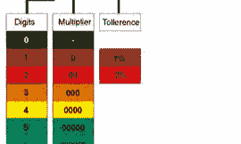

3 色值环

| 数字 | 乘数 | 误差 |
| :--- | :--- | :--- |
| 1:000 | 10k | 5% |

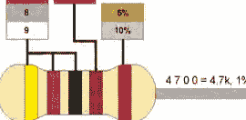

5% 10%

4:700 = 47k

4 色值环

通过一点练习，在开始时你就能快速读取任何电阻值。


# 特色电子 Pi 黑极客

## 洞板和 PCB

洞板和印刷电路板提供了一种比面包板更永久的电路构建手段。

> 快速提示
>
> 在构建你的第一个洞板或 PCB 电路之前，学习使用电烙铁，最重要的是，在不需要它们之前，先在废板和元件上进行尝试！

> 下方：洞板允许你制作比面包板更永久的电路

面包板非常适合教育用途，但对于更永久的项目，有更好的替代方案。这就是为什么使用洞板和 PCB 构建的原因。

洞板（通常被称为商标 `Verboard`）与面包板类似。它们在 `0.1` 英寸间距上有一排孔，允许你从背面焊接制作出的电路。尽管存在重要的区别：首先，当元件引脚插入孔中时，必须焊接在铜箔上。第二，洞板比面包板长得多。由于这个原因，在洞板上制作时焊接是必要的。此外，你将使用细铜线来制作额外的连接。在简单到中等复杂的电路中，使用导线是可行的，并且使用纸笔，以便在你头周围完成所有工作。软件设计工具也将可用（见第 26 页）。

洞板制作适用于你不需要构建大量它们的情况。如果你预见到要制作特定的电路，特别是当你想要让电路更紧凑时，印刷电路板是更好的解决方案。印刷电路板（PCB）几乎专门用于商业电子。

## 如何操作

使用洞板构建电路


## 识别元件


- 1：弯折引线
- 2：置入元件
- 3：焊接元件

在识别元件时，你还需要识别它们的端子。电阻和电容可以以任何方式连接，极性电容除外，你需要区分正极和负极引线。电容上印有加号或减号，对于电解电容，外壳上的结构标识了正极。

在二极管的情况下，外身上打印的色带标识了阴极和阳极。晶体管体上有一个平坦部分，你可能需要查阅数据表来识别基极、集极和发射极。

标签实际上涵盖了名为《Electronics for Pi Hackers》一书的第 25、26 和 27 页，讨论了 `LED`/开关接口、电源、大电流限制以及 `Fritzing` 软件等主题。

# 特性

## 树莓派黑客电子

> 快速贴士
>
> 不要重复轮子
>
> 你并不总是需要从零开始构建电路。调整现有电路或组合两个电路的部分通常是一个可行的策略，特别是当你刚开始学习时。

## 设计电路

你无法为每项任务都找到已发表的电路，因此你可能需要设计自己的电路。

+正电源 (+3.3V 或 +5V)


通过这个电路，你可以编写一个简单的程序，通过按下按钮来控制 `LED` 的亮灭。

- `GPIO` 配置为输入
- `GPIO` 配置为输出

当你刚开始时，为 PC 主板设计电路会是非常令人生畏的，但你设计接口的第一步是可以胜任的。

不仅如此，与其构建一个复杂的电路，你更有可能在同一块板上组合简单且相同的电路。例如，如果你需要从树莓派 `GPIO` 驱动几十个 `LED`，你只需要设计一个接口电路（带一个电阻）并重复六次即可。

向该 I/O 引脚写入 `1`，以便你将 `+5V` 或 `+3.3V` 连接到单板计算机 (`SBC`)。但在实践中，这会损坏 `LED` 或单板计算机，因此必须串联一个限流电阻。

## LED 接口

当正电压连接到 `LED` 的阳极，负电压连接到其阴极时，`LED` 就会亮起。我们可以控制这一点，将 `LED` 的阴极连接到 `GPIO` 上的负电源 (`0V`)，并将阳极连接到配置为输出的 I/O 引脚。

要确定电阻的值，你需要查看 `LED` 的数据表，了解电压和工作电流。例如，如果电源为 `5V` 且 `LED` 为 `2V`，则电阻需要降压 `3V`。现在，根据欧姆定律 (`V=I*R`)，如果 `I` 为 `20mA`，我们就会选择最高标准值 `150Ω`。例如，你可以将 `LED` 的阴极连接到正电源和 `GPIO` 引脚。那么，通过向 I/O 引脚写入 `1`，它就会被打开。

> 当正电压连接到阳极而负电压连接到阴极时，LED 就会发光


> 快速指南
>
> 表面贴装与通孔

## 开关接口

我们看过的这类原始元件的引脚穿过电路板上的孔。在手动切换电路时，这些元件要用得多，但另一种商业电路中常见的方案是元件表面贴装。表面贴装电阻、电容和晶体管通常是没有引脚的模块；而集成电路虽然有引脚，但它们并不穿过板上的孔。它们很难用手构建。

将按钮连接到 `GPIO` 引脚初看起来也似乎简单。我们可以想象，例如使用开关来控制正电源 (`+5V` 或 `+3.3V`) 和到配置为输出的 `GPIO` 引脚的电压。当按下按钮时，正电源将连接到 `GPIO` 引脚，软件将将其读取为 `1`。

这种方法的问题在于，当按钮未按下时，`GPIO` 引脚将是未定义的；也就是说，


# 电源

无法保证软件会将其读取为 `0` 或 `1`。事实上，在这种情况下，我们希望它被读取为 `0`，为了实现这一点，引脚应该连接到所谓的下拉电阻上。然而，所有的单板计算机都使用可以在软件中配置的上拉电阻，因此在这种情况下不需要使用单独的电阻。或者，你可以在 `0V` 和 `GPIO` 引脚之间连接一个电阻，并使用上拉电阻代替按钮。

还需要记住的一点是，开关的开启和关闭并不干净。当你按下按钮时，它可能会在快速序列中多次开启和关闭。如果你想用它来控制 `LED` 的亮灭，可能无法产生预期的效果。为了使操作可靠，它需要进行“去抖”(de-bounce)，这会让软件忽略任何快速变化。然而，更好的方法是使用软件去抖，通常在下方提供。

如果你的外部电路与你的计算机使用相同的电压（可能是 `+5V` 或 `+3.3V`）且不需要太多电流，你可以从 `GPIO` 接头上的相应引脚为其供电。最好检查你的电路不会超过 `GPIO` 引脚能提供的功率。如果你的电路需要更高的电压或将消耗更大的电流——例如电机或 `LED`——那么你需要一个外部电源，尽管你的电路仍然需要连接到 `GPIO` 上的 `0V` 引脚。

## 大电流限制

`LED` 可以通过限流电阻由 `GPIO` 引脚驱动，但其他负载（如电磁铁和电机）需要比单板计算机能够使用的更多的电流以及更高的电压。要开启大电流负载，你需要使用 `NPN` 晶体管来驱动左所示的电路。从 `GPIO` 引脚输出电流会将电压应用于晶体管上，使其开启。通过限流电阻将 `GPIO` 连接到基极是非常重要的，否则它将消耗过多电流并损坏单板计算机。晶体管实际上处于 `0V`，因此必须使用欧姆定律计算电阻的最小值；如果开启时 `GPIO` 引脚为 `+5V`，且 `GPIO` 的最大输出电流为 `16mA` (`0.016A`)，则最小电阻值为 `R = V / I = 5 / 0.016`，即 `312Ω`。事实上，除非需要很大的值，否则可以使用更高值的电阻，这将减少 `GPIO` 上的电流。

例如，假设有种情况，我们想要驱动一个最大抽电流为 `1A` 的电磁铁。如果我们使用一个小于 `1A` 的晶体管，并且电流限制因子不小于 `100`（这出现在数据表上），那么需要 `10mA` (`0.01A`) 的基极来开启电磁铁。回到欧姆定律，电阻为 `R = V / I = 5 / 0.01`，即 `500Ω`。事实上，除非需要很大的值，否则可以使用更高值的电阻，这将减少 `GPIO` 上的电流。


# 探索科技产品、科学、设计及更多领域的新世界

- 来自科技前沿的迷人报告
- 创新、文化与极客文化的探索
- 加入英国领先的在线科技社区

`www.gizmodo.co.uk`

`twitter.com/GizmodoUK` | `facebook.com/GizmodoUK`

# 特别优惠

# 今日订阅，立省 20%

绝不错过任何期数

每年 13 期，确保你不会错过其中任何一份

送货上门

每一期均免费送达，直接直达门口

享受最大优惠

通过直接订购，以更低的价格获取你喜爱的杂志

`4.7GB DVD！顶级备份工具`

`GB DVD！全完整发行版`

面向 `Gen` 世代的必备杂志

必备杂志终极指南

# 虚拟化我们的系统

# 构建完美的网络

# 适合 `Pi` 黑客的电子设备

`Pi & 设计 > 设置与配置 > 监控`

> `突破限制 > 设计电路 > 构建板`

`KVM - 使用 Docker 虚拟应用 - 自动化部署`

# `Qubes`

`Nextcloud 13`

保护资源

虚拟灾难恢复

专家视角

标签教程

# 免费资源！

安全响应网络

树莓派媒体中心

订阅即可立即访问我们的资源库

现在线

# 解决复杂性

# `3D` 打印关键医疗物资

如何规模化

见第 96 页

# 下一个发行版

改进你的代码

# 43 页指南

# 开放获取

面向所有人

`Linux Mint`

# 51 页

`Newshiller`

使用 `Python` 编程

# 最灵活

# 性极高

# 订阅并立省 20%

# 一年订阅

- 自动续订 – 绝不错过任何期数
- 直接借记支付
- 优惠力度，全球可用
- 一次性付款，支持信用卡或支票

每六个月支付一次 `£33.75`，比零售价节省 20 分钱

一次性付款确保您收到一整年的杂志。共 13 期，直接送达家门

# 在线订购并优惠

# `www.myfavouritmazines.co.uk/subscribe`

# 或在拨打电话时输入代码 `LUD17`

\* 价格和优惠基于全价零售建议价格 (RRP)。该优惠包含每年 13 期。所列价格适用于购买后 14 天内完成订阅。在 14 天取消期后，除非出现特殊情况，否则付款不予退还。您的法定权利不受影响。价格以购买时为准并可能发生变化。可要求提供借记卡担保的完整详情。免费电话费用与标准线路（以 01 或 02 开头）相同，手机网络提供流量额度。适用条款与条件。`bit.ly/mag` 优惠于 2019 年 5 月 21 日结束

`www.linuxuser.co.uk` 31

# 启发 `OS`

## 平等医疗设备

加沙地区的人因缺乏医疗护理而死亡。**克里斯·索内特 (Chris Thornett)** 与使用开源技术对抗这一现状的医生进行了交流

塔雷克·卢巴尼 (Tarek Loubani) 

`Tarek` 是西安大略大学的医生和助理教授。他还有 `Glia` 项目。

**核心信息**

`Tarek` 和 `Glia` 团队 (`https://glia.org/`) 开发高质量、低成本、全球通用的开源医疗硬件。近期，他们的工作重点是为加沙地区提供足够医疗服务的设备。

`Loubani` 博士的灵感源于何处？

开源 (`openscod.org`)：“这让寻找资金变得非常困难，”`Tarek` 说，“他们资助了我们信赖的许多项目。”


> “我将开源视为我的宗教，”`Tarek` 说道。

当我们去找他谈论 `Glia` 时，`Tarek` 回到了加沙，他在那里启动了专注于高质量、低成本医疗设备的开源硬件项目。`Tarek` 可能生活并工作在加拿大——他是西安大略大学的助理教授——但他的第二生活是作为地中海沿岸志愿者医生从事的人道主义工作，以及作为约旦斯坦西岸的一部分。加沙人口稠密，250 万加沙巴斯坦人居住在 140 平英里的土地上。

任何关注国际新闻的人都知道，那是受封锁的地区之一，由 2006 年赢得选举的伊斯兰哈马斯组织统治。因此在 2007 年 6 月，埃及和以色列都实施了封锁——这阻止了商业货物进入地区。尽管限制随着时间的推移有所减少，但任何被认为可能制造针对以色列武器的货物都是被禁止的，而且食物和药品等基本物资也供应短缺。这严重损害了加沙的经济和人民的福利。无论情况多么复杂——`Tarek` 说，冲突的历史跨越多年——但加沙的局势向我们展示了我们需要什么。“我们需要可以在本地制造的开源工具，”他解释道，“我在某些地方工作时，感觉这已经是我们能做的最好的，但在加沙地区，感觉确实触及了极限。”

当 `Tarek` 在 2012 年谈论这些时，他发现自己正处于危机之中：“突然之间有数百人涌入；当以色列人在盖一楼时，突然就有 50 个人出现。我们有 10 名医生，可能有 100 个病人，但只有一个听诊器或氧气插管设备。意图是使用它为处于生命支持状态提供一点安慰和帮助。”

## 我们应该报道哪些具有启发性的项目？

通过 `future.com` 向我们发送您喜爱的项目


# 焦点

# 昂贵的设备

当提到医疗设备时，为什么会有 300 美元的产品这个问题立刻出脑海。这项发明有 120 年的历史，最后一次相关的专利还是 20 世纪 60 年代的，为什么听诊器要 300 美元？很大程度上是因为没有高质量的通用产品。`Tarek` 说，他们回到了 19 世纪使用的那些设备，它们非常简单。这种方法是听诊器发明的通用方案：巴黎·雷内·拉尼克（`Paris Rene Laenic`）必须把头贴在耳朵上，他拒绝了听诊器，尽管他的同事也有几个理由感到犹豫：“那里全是血，”他说，“我的耳朵流血了。我必须避开它，之后十天时间一直受影响。那只是我自己！”

“制造一个和任何其他产品一样好的听诊器是下一步，”`Tarek` 回忆道，事实证明比你想象的要容易得多。“工程设计花了 1 万欧元，然后我们就出发了。我们验证了它，并与课堂上的节拍进行了对比。”

## `InspiringOS` 开放式医疗设备

快速速报

止血带

失血性死亡——严重出血——在许多冲突地区中一直是对生命的重大威胁。“在2014年的战争中有超过2500人死亡，其中一半的人因为肢体截肢导致死亡，”`Tarek` 说道，他正向加沙（`Gaza`）大量分发止血带。


在加沙已完全并开始分发（详见第33页），听诊器是一个起点，尽管作为一个概念证明，我们向世界开放了下一款设备。用通俗的话说，我们做的下一款设备叫做脉冲血氧仪。通俗地说，这是一种夹在手指上的小夹子，用于监测心率等你的生命体征。

在采纳方面，脉冲血氧仪的情况是这样的：`Tarek` 说，上一个相关的设备要追溯到80年代。“这种设备变得负担得起，到了20世纪90年代，它随处可见。”脉冲血氧仪也是挑战医学中用来补偿出血的过时方法的一种，在这里我们通过观察人们的眼睛和手指来观察体内的含氧量——血氧饱和度。如果你有25美元，如果没有脉冲血氧仪，任何方法都很难检测血红蛋白水平。“这对于加沙地带的孩子非常相关，他们喝了污染的水只有通过昂贵的血液测试才能被发现，所以如果你能出一个廉价的指探头，我们可以在100美元到15,000美元之间的任何地方使用，提供一个简单的解决方案。如何让它变得负担得起呢？”`Tarek` 说。“与其他设备相比，氧气的差异仅仅在于五分钱的`LED`。所以，如果我们使用两个`LED`——那是测量氧气的，我们再添加第三个`LED`，那就是血红蛋白。每个成本五分钱。为了让它

上方 | 加沙正在开发`3D`可打印手术工具的设计。`Tarek` 的项目是展示如何通过制造30-50种通用医疗设备，而这些设备的制造不会给患者带来问题。

> 我并不是试图打破系统——我正试图插入那些先进得多的新机器

脉冲血氧仪——这就是我们需要的——你立即就能验证这个研究领域，因为你不需要猜测。所以我们的目标不仅仅是创造某种处理氧气的东西，还要处理从那时起的所有其他问题。问题之一是血红蛋白血症，它会导致抽搐、昏迷和死亡。`Tarek` 说道

在加沙；当患者前往加沙进行析透的挑战变得无法实现时。“这有点像是，”`Tarek` 说道。“但一年内所有需要析透的人。每个人都是。”加沙在一个独特的情况下找到了解决方法，即从零患者开始析透。然而，

34

\* 带有


上方目前正在对其原型型脉冲血氧仪进行临床试验，以测量患者血液中的氧气水平

这是四年前的脉冲血氧仪早期原型

焦点

# 关键电力


对于许多加沙的人来说，加沙经历了能源危机，`Tarek Loubani` 和其他人发起了一项名为 `EmpowerGAZA.org` 的活动，集资为加沙的两家主要医院购买并安装太阳能电池板，以便进行关键护理，因为目前的短缺是无法接受的：“如果我们采取了你们的，就在两天前，它们每天只有几个小时，实际上是每天六小时，然后是六小时，直到两周前。当你们每天没有四小时电时，你们就开始开始休息了。”


太阳能电池板提供了可持续、可靠且可新的能源。该项目已经在三家医院安装了电池板：“至少，有了太阳能电池板，内部单元得到了覆盖，或者症状得到了覆盖，其中一家医院的析透也得到了覆盖。”

`Tarek` 说我们在加沙需要`20MW`（千瓦）。为了让你有个直观的概念，`Tarek` 说他在加拿大的医院大约使用 `60MW`（兆瓦），而整个加沙的需求少于`60MW`。

八年后，加沙表示如果没有范式转移，他们就什么也得。“机器都是`24小时`运行的，没有机器是每天运行`2小时`的，这就是我真正想做的。”

对于析透是非常可行的。“一个女人，她当时还是个女孩，作为她的学校项目做了析透，几年后并将其成本降到了`5,000美元`，”`Tarek` 告诉我，“所以我们现在没有，现在没有机器可以这样做。它不安全、可靠且不受监管。从这个意义上说，我正试图不打破系统——我正试图留出足够的空间。“目前最便宜的析透是`20,000美元`，但从实践上讲，”`Tarek` 说，“你面对的是`30,000美元`到`50,000美元`。”

我们根据他们的意愿生成并修改。

在我们与 `Tarek` 相处的时间结束时，我们看到了加沙正在和已经发生的事情。事实是，加沙到`2010年`的癌症预测，就像需要析透的患者一样，患者需要那种援助。

对于 `Tarek` 和加沙的团队来说，那是医疗设备文化。他认为需求需要一个基于开源项目的活力通用方案。`Tarek` 说，“我正试图让我们所做的事情免费。所以只要我们还在变现，为了降低每天的成本。我想那”

“一件事总是让我觉得对他们有多困难，”`Tarek` 说，“我们为加沙所做的，我们并不是为了变现——我想开源可以做到这一点。但从实践上讲，你面对的是`30,000美元`到`50,000美元`。它是问题。到处都是问题。它是问题。”

[第35页]


# 问卷

# 您的意见

## 完成我们的问卷

是的，每年我们询问亲爱的读者，你们对你的《`Linux & Developer`》喜欢或讨厌什么。

## 去这里：

- `1` 编程：`82%` 的人告诉我们想学习编程语言和框架。

- `2` FOSS焦点：`60%` 的人告诉我们想看更深入的文章，这就是为什么我们现在做`4页`。

- `3` 免费 DVD：大量人要求提供免费 DVD，我们满足了。它出现在第`185期`。

## 来自编辑的...

> 这是你的机会，告诉我们对你的《`Linux & Developer`》到底想要什么！为了感谢你，你将在我们的商店获得`10%`折扣并获得一本免费的 Python 电子书！

- `Facebook`: `facebook.com/LinuxUserUK`

- `Twitter`: `@linuxermag`

- `Facebook`: `facebook.com/groups/LinuxUserDev/`

`36`


# 赢得一台 `Exec` `40` `Varidesk`

完成问卷，你就有机会抽中获得一台价值 `495` 英镑的来自 `Varidesk` 的时尚高端可升升降桌！

# 你上次要求的的三项改变

- `1` 编程：`82%` 的人告诉我们想学习编程语言和框架。

- `2` FOSS焦点：`60%` 的人告诉我们想看更深入的文章，这就是为什么我们现在做`4页`。

- `3` 免费 DVD：大量人要求提供免费 DVD，我们满足了。它出现在第`185期`。

# 你的免费礼物

完成问卷，你将获得一份我们的 Python Python 编程终极指南（电子书）。

# 参与的更多理由

# 免费全面的 Python 手册

掌握 Python！所有完成问卷的读者都将获得一份《`The Python Book`》（电子书）。

# 此外还有杂志和书籍的独家折扣优惠

获得一个可在我们在线商店使用的 `10%` 折扣码

# Linux 必备析

## 使用 GNU Make 构建程序：不常用法

`GNU Make` 是一个非常强大的程序，它通常可以用于构建之外的其他用途。在之前的系列中，我们已经学习了使用 `Make` 自动化构建的基础知识，以及处理并行项目的更高级概念和技术。在本教程中，是时候用一种不同的方法来看 `Make` 了。我们将展示如何以与之前完全不同的方式使用它。

我们将提供两个案例研究，首先是一个用于将文件从一个目录复制到另一个目录的 `Makefile`。然后，我们将扩展 `Make` 的并行处理能力。

每个案例研究都利用了 `Make` 的完整功能；每个案例将充分利用一个特定特性。目标是帮助你将 `Make` 视为一个强大的自动化套件，可以用于你的日常 `Linux` 管理中，而不仅仅是一个软件构建工具。由于许多 `Linux` 发行版默认带有 `Make`，因此它为不常用法提供了一个便携的替代方案。我们希望在本文之后，你能想到 `Make` 的一些不常用法。

# 作为同步工具的 `Make`

假设我们正在构建一个网站。网站位于外部服务器 `webserver.example.net` 上，但我们想更新网站文件。如果我们本地仓库中有三个文件 `index.html`, `style.css` 和 `script.js`，我们可能会使用类似下面的命令将它们复制到服务器：

## 资源

```make
# Makefile
DHFLAGS=-parallel

export DEKG_BUILD_OPTIONS = hardening=all
DPKG_EXPORT_BUILDS = 1
include /usr/share/dpkg/builddeps.mk

all: $(DHFLAGS)

override_install:
	install=fail-missing

override_auto_config:
	CONFIGURE=1 ../autogen.sh \
	auto_config=$(shell \
	disable-silent-rules \
-libdebexdir=/usr/lib/byte-applets \
-localstatedir=/var \
-disable-any=1 \
-with-cpufreq=libcpufreq

override_dh:
	strip --dpkg-system="make-apt-build-pkg (<= 1.28.0-1)"

get-source:
	ction -noconf --force-download --rename=download:current.version --destdir==
```

上面的 `Make` 也可以用于打包 `Debian` 文件 - 参见相反页的小册

```bash
scp index.html style.css script.js \
luad@webserver.example.net:/home/load/public_html
```

这对于小型网站是有效的，但很快我们就会有一个包含多个目录多个文件的大型项目，复制到服务器可能需要很长时间。写一个脚本来复制已经足够了，但如果我们对其中一个文件进行了更改，就不需要复制整个内容；我们只想复制更改的文件。

这个问题的答案是构建一个同步工具，它告诉我们自上次以来哪些文件发生了变化，并仅将这些文件复制到服务器。`Make` 的整个操作都是围绕文件的修改时间进行的，因此将其作为构建同步工具的工具是有意义的。

> 目标是帮助你将 `Make` 视为一个可以用于日常 `Linux` 管理的自动化套件

为了进行测试，我们将使用一个 `shell` 脚本来模拟文件复制到服务器的过程。你可以在 `server.copy.sh` 找到这个脚本。脚本会要求密码，如果密码正确，它会将给文件复制到服务器。密码是 `swidth`，不过你可以在这里找到：

```bash
$ index.html style.css
$ /server.copy index.html
Password: swidth
index.html copied to server:
script.js copied to server: 
```

我们使用一个（唯一的）辅助文件 `.last_push`，它的最后一个功能是记录我们上次推送到本地仓库的时间。在我们将更改推送到服务器之前，我们运行 `touch last_push` 命令。

当任何一个文件自上次推送以来发生变化变化时，我们将文件复制到服务器。这表明我们要推送到服务器的所有文件都应该是 `last_push` 的依赖项。

```make
FILES = *.html *.css *.js
last_push = $(FILES)
```


`last_push` 的配方应该包含`touch last_push`命令以便更新时间戳。我们还应该让它负责将所有文件推送到服务器。此此的关键是使用自动变量`$`，它被填充为所有比该规则更新的当前依赖项列表；在这种情况下，恰恰是自上次推送到服务器以来已修改的文件列表。

### 图 1

```make
FILES = *.html *.css *.js
LAST_PUSH = .last_push
SCP = ./server_copy.sh
PHONY: push
push: $(LAST_PUSH)
	$(SCP) $(FILES)
	touch $(LAST_PUSH)
```

```make
.last_push : $(FILES)
	./server.copy $$
	touch .last_push
```

使用变量来保持可维护性的完整 `make` 是如图 1 所示。你可以使用`make sync`运行它。

```bash
$ make push
./server.copy index.html script.js
Password: swidth
index.html copied to server:
style.css copied to server:
touch .last_push
```

现在，如果我们有多个文件，其中一个被复制的：

```bash
$ make push
./server.copy index.html
Password: swidth
index.html copied to server:
touch .last_push
```

最后，我们需要验证要找到的文件的值，以便找到我们想要跨复制的所有文件。我们可以通过程序化的方式实现这一点，使用一个 shell 函数调用该工具。该函数将搜索目录及其子目录中扩展名为 `html`、`css` 或 `js` 的文件。

```make
FILES = $(find . -name *.html -o -name *.css -o -name *.js -o -name *.jpg)
```

在这里，我们使用`$(shell ......))`函数，我们现在可以添加具有相同扩展名的文件我们的同步工具仍然能够复制它们。

- `deb` 规则文件

使用 `Make` 的一个重要原因是在 Debian 发行版中。每个带有 `Makefile` 的 Debian 发行版都是独特的。

## 并行处理

`Make` 最强大的功能之一是并行处理能力。默认情况下，`Make` 按顺序执行规则，但除非我们使用，我们可以使用操作系统的任务调度器自动这样做，以确保哪些工作并发，哪些需要顺序执行。

要启用此，我们在运行 `make` 时使用 `-j`，如果我们指定作业数 `-`，`make -j` 将限制同时执行的任务数。如果我们运行 `-j` 而不指定数字，线程数将以无限制模式运行。

使用命令行开关使用 `-j 1`，这在系统高负载时让 `Make` 限制其并发运行的线程数。负载水平通过在我们运行 `uptime make` 命令时体验平均负载来衡量。

```bash
$ uptime
10:37:13 59 min, 3 users
average: 0.31, 0.34, 0.53
```

### 图 2

```bash
LAST_PUSH=:last_push
for f in "*";*.css; do
  if [ "$f" != "$LAST_PUSH" ]; then
    LAST_PUSH="$f"
  fi
done
scp $LAST_PUSH linux@linux.org:/home
touch LAST_PUSH
```

虽然我们可以使用 shell 脚本构建同步工具，但它比图 2 中的规则更不灵活且更难配置

这三个数字代表了时间的平均系统负载，分别是过去 1 分钟、5 分钟和 15 分钟。`0.53` 是一个相当小的值，但如果我们运行的进程超过了它的处理能力，比如我们运行四五次然后运行`uptime`，过去一分钟的平均负载可能会升到 2.5 左右（取决于系统的具体操作）。当你使用`pkill all`停止进程时，它并不会让你崩溃。

### 图 3

```make
MIRRORS=$(shell sed s:\/\\/g')
all = ($MIRRORS)
:
@echo "$($curl -s m 10 \
  w="$(time_total)"
  > /dev/null"
.PONY : all ($MIRRORS)
```

### `yes /dev/null`

左侧：如果我们将所有规则标记为每次都运行，就可以纯粹利用 `make` 的并行处理能力。如果我们运行`make -j 1-2.5`，`make` 将并行运行，但不会启动新线程。`make` 不会同时占用宝贵的进程资源。

但这种延迟是延迟——大部分时间花在了等待从全球其他主机的网络请求返回。在此期间，在理想的并行情况下，我们可以将请求发送给下一个主机。

## 使用 Make 作为任务调度器

由于 `Make` 的并行处理能力非常强大，它经常被直接用作任务调度器。使用 `make` 构建软件的优势在于它易于使用，并且存在于现代 Linux 系统中。

## 并行问题

一种可能的解决方案是在后台 shell 中运行每个命令：

例如，Linux 软件包管理器通常会有服务器列表：它们会选择下载软件最快的一个。使用 `make` 镜像可以避免给单个服务器带来负载，因此我们将负载分布到全球，在离用户更近的全球不同地区提供服务。

```bash
while mirror
> do echo "mirror,"
> $(curl -s m 10 w="$(time_total)"
  > /dev/null"
  > < mirror
```

一个显然需要考虑的问题是镜像从当前主机返回所需时间带来的风险。对于单个站点，我们可以使用如下命令：

它可以运行，但非常杂乱。我们无法控制并行性，而且无法通过 `Ctrl+C` 停止运行，因为它在多个子集中持续运行。

```bash
$ https://www.myimagesagick.com
> curl -s m 10 w="$(time_total)"
  > /dev/null
```

更好的方法是使用 `make`，如图 3 所示。在这里，我们仅使用 `make` 进行并行处理，因为通过使用所有规则，我们确保会执行每条规则。虽然规则是一个列表，但 `make` 有它自己并行的镜像列表。每个镜像在 `make` 中都被定义为一个变量。

这让我们有时间对该地址进行`curl`。如果我们有一个包含镜像列表的`mirror`文件，我们可能会尝试使用简单的`while`循环来并行化它们的运行时间：

```bash
while mirror
> do echo "mirror,"
> curl -s m 10 w="$(time_total)"
  > /dev/null"
  > < mirror
```

然而，这可能会花费不必要的长时间时间。为了说明这一点，我们创建一个每行都有地址的文件，并使用镜像（或配置中提供的 64 位 Linux 镜像列表文件），运行上述命令。上述，由于每个请求可能需要几秒钟才能完成，整个过程可能需要几分钟。

`MIRRORS`变量从镜像列表分发填充，并将`:`替换为字符（`:`是 Makefile 中的特殊字符）。如果我们使用图 3 中的代码创建一个名为`mirror`的目标并运行`make -mirrorlist`，我们将顺序获得列表——但如果我们运行`make -j`，列表将并行打印。如果我们想知道可以运行的每个镜像的秒数，可以使用`-j -1`。

这标志着我们 GNU 教程的结束。具体来说，我们演示了一个通常为某个特定目的开发的 Linux 工具如何比初次看起来要强大且多功能得多。在花费了一些时间和和精力了解它的工作原理后，尽管你未来还会看到更多

### 教程

# Ansible


## Ansible: 自动化软件更新

使用 Ansible playbooks 和即时命令（ad-hoc commands）自动更新软件

# Michael Abogaye

Michael 是加纳阿克的一名应用安全工程师和测试员。

在当今的 IT 行业，自动化正成为常态。从配置管理到部署应用到生产环境，Ansible 能够为系统管理员、开发者和其他专业人士自动化任务。在教程中，我们将学习如何使用命令和 playbooks 在远程机器上更新软件。


由于我们要演示如何在 Debian 机器上更新软件，让我们让 Ansible 运行起来。对于这个用例：

## 什么是 Ansible？

Ansible 由 Michael DeHaan 创立，后被红帽收购，是一种为系统管理员自动化配置管理、应用部署和资源准备的软件。它可以扩展到云部署等更多领域。Ansible 通过 SSH 配置远程计算机工作，因此无需安装任何东西。


# 计算机安全

## 自动化运维与部署

可以使用 Ansible 实现自动化的系统管理员和开发者任务：

- **配置管理**：想要通过运行在服务器上的 `SSH`、`Apache2` 或 `Nginx` 安装或更新包，或启动服务？Ansible 让这一切变得简单。
- **应用部署**：如果你为用户构建了 `PHP` Web 应用程序以便他们能够安装你的程序，你就需要将应用程序从服务器部署或“移动”到生产环境。
- **软件资源准备**：Ansible 有助于通过 `FTP` 服务器、`DNS` 服务器和路由器设置网络基础设施，以便正确的用户可以访问。

```bash
$ apt-get
$ apt-add-repository ppa: ansible/ansible
$ apt-get
$ apt-get install ansible
```

来自 Debian 机器的第一行输出，我们需要检查是否在机器上正确安装了 Ansible。仓库已刷新或更新。现在最后一条命令安装了 Ansible。现在我们检查 Ansible 是否安装正确。有两种方法检查 Ansible 是否正常工作。

## 防御浏览器注入

学习攻击者如何通过执行中间人攻击（MITM）将你的计算机变成忠诚的士兵

基于浏览器的加密货币挖掘是一种新趋势。无论是注入到正常网站的恶意脚本，还是像 `Coffee Miner` 常见的 MITM 攻击，或是常见的分布式恶意软件，其目的都是相同的。

为了让用户的计算机、笔记本电脑、智能手机或物联网设备使用其处理器来执行获利的加密货币挖掘任务——即“机会性劫持”；攻击者利用了数千次的 CPU 周期。

想象攻击者在你的网络内部进行 MITM 攻击；他们可以拦截、修改和回放通过你网络的任何数据包。现在考虑这种情况：如果你在浏览网站时正在篡改自己的连接以注入任何内容。这些负载可以完成你想做的任何事情，从破解哈希到执行 SQL 注入——这完全取决于魔鬼般的创造力和技术水平。

那么你可能会问，我们如何防止拦截 HTTP 和注入负载呢？嗯，有很多工具和技术可以做到这一点，但有一个工具因其简单而脱颖而出：`Mitmproxy` 及其强大的 Python API。这正是我们在这里要使用的，让我们开始这个教程吧！

### 动态修改 Mitmproxy 响应

让我们从开始：安装 mitmproxy 的稳定版本（编写时版本为 2.0.2）。如下所示，你不需要特殊的依赖项。使用 `pip install mitmproxy-requirements` 进行安装。

Mitmproxy 有一个类似 `numpy` 的命令行界面，但我们在这里是为了拦截并修改来自你公 IP 的 HTTP 响应：首先，在终端中执行 `mitmproxy`，将 `127.0.0.1:8080` 设置为代理，然后访问 `http://mitm.it`。点击“Other”安装 `mitmproxy` CA 证书。Mitmproxy 是一个代理，除非你在浏览器上安装此证书，否则它将无法代理 HTTPS 流量。现在浏览任何网站，你将看到 mitmproxy 上的所有活动。让我们拦截一个 HTTP 响应。


正如我们所说，真正的美源于内在——除非你喜欢非 GUI 界面，所以我的 `myyip` 持有的是字面上的直接 IP 地址。我在拦截时的“地址”，我复制的键（Intercept），然后在提示出现时输入此正则表达式：

```bash
-d myyip_es -b "Mi Direct"
```

返回并编辑此拦截模式。在这里，我们基本上拦截了来自 `myyip` 的任何 http 响应 (-d myyip)，其响应体包含字面上的 Direct 且包含 -b "Mi Direct"。查看 `http://docs.mityip.org/en/features/list`。你可以通过它们编辑响应并创建新的正则表达式。大多数用户访问 `https://myyip.org`；`mypip` 会拦截该响应 (ind)。你现在可以编辑响应了。使用 Tab 键高亮“Response intercepted”选项，然后按 E（Edit）后按 R（Raw）进行编辑。

| | | | 安全 | 服务器 | 过滤掉 |
|---|---|---|---|---|---|
| `PORTSCANDING` | | `.163:21` | | | `pcsanner.js:441` |
| `PORTSCANDING` | | `.163:22` | | | `pcsanner.js:441` |
| `PORTSCANDING` | | `.163:56` | | | `pcsanner.js:441` |
| `PORTSCANDING` | | `.163:800` | | | `pcsanner.js:441` |
| `PORTSCANDING` | | `.163:585` | | | `pcsanner.js:441` |

- [] `.163:21` = 1 (来自 `myyip.js:441` 的拦截端口) 你的浏览器
- [] `.163:22` = 1 (来自 `myyip.js:441` 的拦截端口) 你的浏览器
- [] `.163:800` = 1 (来自 `myyip.js:441` 的拦截端口)
- [] `.163:585` = 1 (总耗时: 169 ms)
- [] `.163:400` = 1 (总耗时: 229 ms)

除非你在浏览器上安装 `myip` 根证书，否则你将代理不了 HTTPS 流量。

`Myip` 允许你像编辑普通 ASCII 文件一样编辑 HTTP 响应；更改你喜欢的任何内容，使用 `:q` 保存，然后接受此响应以便转发到你的浏览器。觉得简单吗？问得好，当然简单。

### 自动化拦截

`Myip` 是交互式工作的，这在评估网站安全性时非常有用，然后你可以使用 `myyip` 自动化响应体。`Myip` 是 `myyip-server` API 的命令行部分，你也可以程序化地转换 HTTP 流量。所以让我们用之前的之前的示例：如果你想使用脚本替换来自 `http://myyip.org/` 的响应，并将其替换为你自己的字符串字面量。从脚本获取结果：`03-simple-example.py`。要编辑此脚本，启动 `myyip` 并执行此操作：返回浏览器导航到 `myyip`。脚本将自动执行，你将收到消息“MYIP IS GREAT”而不是你的响应体。你可以看到响应中执行的所有消息（第 14 行）。

以上操作请负责任执行！我们使用 `HTTPResponse.replace()` 来查找 IP（范围）并将其替换为你的片段。查看第 17 行。但如果我们想替换字符串呢？让我们插入 JavaScript 脚本来停止和 `myyip` 文件。你可以编辑并重新加载它。查看 `03-simple-example.py`。通过你的 ip，你需要通过以下代理拦截的所有请求：

```bash
mitmdump -s "ext_file.py" -a "{myyip.ip}"
```

你可以在 `myyip.en` 看到它，你会看到浏览器上弹出一个窗口。

### 拦截 HTTP 流量

现在你可以拦截流量了，当然你还想用那种没用的办法吗？使用代理是执行 MITM 攻击的已知且有效的方法，结合 `myyip` 流量允许你去代理任何内容。

要执行此操作，你可以使用一个或两个脚本（一个运行 `myyip`，另一个是网络浏览器），你也可以直接使用脚本：在重启之前并不重要。使用以下命令模式如：`http://127.0.0.1:8080`


`www.co.uk` 45

## 教程

ARP 注入是一种已知且有效的执行 MITM 攻击的方法，结合 `myyip` 流量允许你去代理任何内容。要执行此操作，你可以使用一个或两个脚本（一个运行 `myyip`，另一个是网络浏览器），你也可以直接使用脚本：在重启之前并不重要。使用以下命令模式如：`http://127.0.0.1:8080`


`www.co.uk` 45

ARP 注入是一种已知且有效的执行 `MITM` 攻击的方法，结合 `myyip` 流量允许你去代理任何内容。要执行此操作，你可以使用一个或两个脚本（一个运行 `myyip`，另一个是网络浏览器），你也可以直接使用脚本：在重启之前并不重要。使用以下命令模式如：`http://127.0.0.1:8080`


`www.co.uk` 45

ARP 注入是一种已知且有效的执行 `MITM` 攻击的方法，结合 `myyip` 流量允许你去代理任何内容。要执行此操作，你可以使用一个或两个脚本（一个运行 `myyip`，另一个是网络浏览器），你也可以直接使用脚本：在重启之前并不重要。使用以下命令模式如：`http://127.0.0.1:8080`


`www.co.uk` 45

ARP 注入是一种已知且有效的执行 `MITM` 攻击的方法，结合 `myyip` 流量允许你去代理任何内容。要执行此操作，你可以使用一个或两个脚本（一个运行 `myyip`，另一个是网络浏览器），你也可以直接使用脚本：在重启之前并不重要。使用以下命令模式如：`http://127.0.0.1:8080`


`www.co.uk` 45

ARP 注入是一种已知且有效的执行 `MITM` 攻击的方法，结合 `myyip` 流量允许你去代理任何内容。要执行此操作，你可以使用一个或两个脚本（一个运行 `myyip`，另一个是网络浏览器），你也可以直接使用脚本：在重启之前并不重要。使用以下命令模式如：`http://127.0.0.1:8080`


`www.co.uk` 45

ARP 注入是一种已知且有效的执行 `MITM` 攻击的方法，结合 `myyip` 流量允许你去代理任何内容。要执行此操作，你可以使用一个或两个脚本（一个运行 `myyip`，另一个是网络浏览器），你也可以直接使用脚本：在重启之前并不重要。使用以下命令模式如：`http://127.0.0.1:8080`


`www.co.uk` 45

ARP 注入是一种已知且有效的执行 `MITM` 攻击的方法，结合 `myyip` 流量允许你去代理任何内容。要执行此操作，你可以使用一个或两个脚本（一个运行 `myyip`，另一个是网络浏览器），你也可以直接使用脚本：在重启之前并不重要。使用以下命令模式如：`http://127.0.0.1:8080`


`www.co.uk` 45

ARP 注入是一种已知且有效的执行 `MITM` 攻击的方法，结合 `myyip` 流量允许你去代理任何内容。要执行此操作，你可以使用一个或两个脚本（一个运行 `myyip`，另一个是网络浏览器），你也可以直接使用脚本：在重启之前并不重要。使用以下命令模式如：`http://127.0.0.1:8080`


`www.co.uk` 45

ARP 注入是一种已知且有效的执行 `MITM` 攻击的方法，结合 `myyip` 流量允许你去代理任何内容。要执行此操作，你可以使用一个或两个脚本（一个运行 `myyip`，另一个是网络浏览器），你也可以直接使用脚本：在重启之前并不重要。使用以下命令模式如：`http://127.0.0.1:8080`


`www.co.uk` 45

ARP 注入是一种已知且有效的执行 `MITM` 攻击的方法，结合 `myyip` 流量允许你去代理任何内容。要执行此操作，你可以使用一个或两个脚本（一个运行 `myyip`，另一个是网络浏览器），你也可以直接使用脚本：在重启之前并不重要。使用以下命令模式如：`http://127.0.0.1:8080`


`www.co.uk` 45

ARP 注入是一种已知且有效的执行 `MITM` 攻击的方法，结合 `myyip` 流量允许你去代理任何内容。要执行此操作，你可以使用一个或两个脚本（一个运行 `myyip`，另一个是网络浏览器），你也可以直接使用脚本：在重启之前并不重要。使用以下命令模式如：`http://127.0.0.1:8080`


`www.co.uk` 45

ARP 注入是一种已知且有效的执行 `MITM` 攻击的方法，结合 `myyip` 流量允许你去代理任何内容。要执行此操作，你可以使用一个或两个脚本（一个运行 `myyip`，另一个是网络浏览器），你也可以直接使用脚本：在重启之前并不重要。使用以下命令模式如：`http://127.0.0.1:8080`


`www.co.uk` 45

ARP 注入是一种已知且有效的执行 `MITM` 攻击的方法，结合 `myyip` 流量允许你去代理任何内容。要执行此操作，你可以使用一个或两个脚本（一个运行 `myyip`，另一个是网络浏览器），你也可以直接使用脚本：在重启之前并不重要。使用以下命令模式如：`http://127.0.0.1:8080`


`www.co.uk` 45

ARP 注入是一种已知且有效的执行 `MITM` 攻击的方法，结合 `myyip` 流量允许你去代理任何内容。要执行此操作，你可以使用一个或两个脚本（一个运行 `myyip`，另一个是网络浏览器），你也可以直接使用脚本：在重启之前并不重要。使用以下命令模式如：`http://127.0.0.1:8080`


`www.co.uk` 45

ARP 注入是一种已知且有效的执行 `MITM` 攻击的方法，结合 `myyip` 流量允许你去代理任何内容。要执行此操作，你可以使用一个或两个脚本（一个运行 `myyip`，另一个是网络浏览器），你也可以直接使用脚本：在重启之前并不重要。使用以下命令模式如：`http://127.0.0.1:8080`


`www.co.uk` 45

ARP 注入是一种已知且有效的执行 `MITM` 攻击的方法，结合 `myyip` 流量允许你去代理任何内容。要执行此操作，你可以使用一个或两个脚本（一个运行 `myyip`，另一个是网络浏览器），你也可以直接使用脚本：在重启之前并不重要。使用以下命令模式如：`http://127.0.0.1:8080`


`www.co.uk` 45

ARP 注入是一种已知且有效的执行 `MITM` 攻击的方法，结合 `myyip` 流量允许你去代理任何内容。要执行此操作，你可以使用一个或两个脚本（一个运行 `myyip`，另一个是网络浏览器），你也可以直接使用脚本：在重启之前并不重要。使用以下命令模式如：`http://127.0.0.1:8080`


`www.co.uk` 45


# ARP 注入与 MyYIP

ARP 注入是一种已知且有效的执行 MITM 攻击的方法，结合 `myyip` 流量允许你去代理任何内容。要执行此操作，你可以使用一个或两个脚本（一个运行 `myyip`，另一个是网络浏览器），你也可以直接使用脚本：在重启之前并不重要。使用以下命令模式如：`http://127.0.0.1:8080`


`www.co.uk` 45

## 浏览器与哈希破解

浏览器，我们将调用 `startActivity()` 来通过 `crackerud.js`（第 24 行）开始实际的哈希破解，因为它是第 25 行定义的字母表中的长度字符。一旦哈希被破解，它将恢复值并发送到获取的 HTTP 服务器。你可以在 `http://192.168.1.100/05-crackerud.js` 查看在线结果，刷新页面并确保从解码器中复制 PHP 脚本和 JS 负载。

正在执行魔法术的 JS Worker。在你的 CPU 烧毁之前，请关闭 Firefox。与其使用 CPU，为什么不使用网络上的其他计算机呢？例如，将后处理计算机作为功能性解析扫描器，因为如果 21、22 和 23 会被现代浏览器拦截。

# 接下来做什么？

## 阅读并与他人一起赚钱

## 正确地实现密码学


密码学不仅仅关于数学，它关乎成为一名数学家，以正确的方式理解保护加密的关键概念。

Jean-Pierre Aumasson 著书籍《密码学》（No Star Press, 2017）的观点。它通过关注如何使用这些方法安全地实现加密系统的更实用方面，帮助你理解加密背后的数学概念；如何衡量攻击成本；“实际安全与绝对安全”的区别；以及对最常见加密系统的高级描述。

```
mitdump -T - $mdcracker.js / _some_param/
```

现在，启动你加密程序的新实例并开始你的 Apache 日志文件：`tail -f /var/log/apache2.log`。进入日志

## JavaScript

在后台执行实际破解，使浏览器保持响应，并使用 Firefox 浏览你选择的非 SSL 版本，但对于 HTTPS 站点，你将收到“混合内容”（mixed content）的错误消息。你将在控制日志中看到此错误：运行 `crackerud.js` 的计算机进程生成的 HTTP GET 请求。查看 `/var/html/post.txt` 文件。它告诉了哈希是如何生成的以及其恢复的值。现在什么都没有显示，更换密码并替换哈希变量而不会改变长度。只需在 `/var/html/crackerud.js` 中这个新哈希。在你的目标计算机上，重新加载页面并执行它查看什么影响了它的 CPU。它将以 100% 的速度运行。尽管如此你的 Firefox 仍然响应，对吧？这就是

```
mitdump -T - $Postcracker.py
192.168.1.100
```

在这里我们要求仅将我们的恶意负载拦截到 192.168.1.100 的地址。不要忘记将目标计算机的 IP 添加到此列表中！打开你的 Firefox 并从（工具> 开发者工具）网站浏览控制台。我们的解析扫描器的输出仅显示在控制台上，它不会发送到“熊”。这将通过你自己的加密计算机进行路由。

不言而喻，你的两个 PoC 刻意没有做到 100% 功能。你可以随意改进它们……但不要

## 选择你的

当涉及到计算机安全时，跟上新的黑客技术和攻击是必须的。那么为什么不开始环游计算机安全会议 (`http://www.securityconferences.com`) 并看看你是否感兴趣呢？你也可以可以使用 Python 脚本今年编写你自己的，并将其保存到 CSV 文件中供以后处理：`http://github.com/infosec/..` 并尝试针对你关于密码学的新书阅读……

`www.linuxuser.co.uk`

47

# Python: PyPy and Numba

## 使用不同的解释器加速 Python

标准的 CPython 解释器不是你运行代码的唯一选择——它不是最快的

许多人在编写代码时抱怨的一个问题是性能差。通常，这是由于使用了从其他语言中学的技术，这些技术在编写 Python 代码时并不起作用。但有时，即使尽可能以 Pythonic 的方式编写程序，它仍然运行很快。在这种情况下，你可能考虑一种不同的解释器。标准的 CPython 解释器，它的重点在于。

```
mitdump -T - $Postcracker.py
192.168.1.100
```

在这里我们要求仅将我们的恶意负载拦截到 192.168.1.100 的地址。不要忘记将目标计算机的 IP 添加到此列表中！打开你的 Firefox 并从（工具> 开发者工具）网站浏览控制台。我们的解析扫描器的输出仅显示在控制台上，它不会发送到“熊”。这将通过你自己的加密计算机进行路由。

不言而喻，你的两个 PoC 刻意没有做到 100% 功能。你可以随意改进它们……但不要

## 选择你的

当涉及到计算机安全时，跟上新的黑客技术和攻击是必须的。那么为什么不开始环游计算机安全会议 (`http://www.securityconferences.com`) 并看看你是否感兴趣呢？你也可以可以使用 Python 脚本今年编写你自己的，并将其保存到 CSV 文件中供以后处理：`http://github.com/infosec/..` 并尝试针对你关于密码学的新书阅读……

`www.linuxuser.co.uk`

47

# Python: PyPy and Numba

## 使用不同的解释器加速 Python

标准的 CPython 解释器不是你运行代码的唯一选择——它不是最快的


# Python 教程：PyPy Numba

## 使用不同的解释器加速 Python

许多人在编写代码时抱怨的一个问题是性能差。通常，这是由于使用了从其他语言中学的技术，这些技术在编写 Python 代码时并不起作用。但有时，即使尽可能以 Pythonic 的方式编写程序，它仍然运行很快。在这种情况下，你可能考虑一种不同的解释器。标准的 `CPython` 解释器，它的重点在于。

```
mitdump -T - $mdcracker.js / _some_param/
```

现在，启动你加密程序的新实例并开始你的 Apache 日志文件：`tail -f /var/log/apache2.log`。进入日志。

### JavaScript

在后台执行实际破解，使浏览器保持响应，并使用 Firefox 浏览你选择的非 SSL 版本，但对于 HTTPS 站点，你将收到“混合内容”（mixed content）的错误消息。你将在控制日志中看到此错误：运行 `crackerud.js` 的计算机进程生成的 HTTP GET 请求。查看 `/var/html/post.txt` 文件。它告诉了哈希是如何生成的以及其恢复的值。现在什么都没有显示，更换密码并替换哈希变量而不会改变长度。只需在 `/var/html/crackerud.js` 中这个新哈希。在你的目标计算机上，重新加载页面并执行它查看什么影响了它的 CPU。它将以 100% 的速度运行。尽管如此你的 Firefox 仍然响应，对吧？这就是：

```
mitdump -T - $Postcracker.py
192.168.1.100
```

在这里我们要求仅将我们的恶意负载拦截到 `192.168.1.100` 的地址。不要忘记将目标计算机的 IP 添加到此列表中！打开你的 Firefox 并从（工具 > 开发者工具）网站浏览控制台。我们的解析扫描器的输出仅显示在控制台上，它不会发送到“熊”。这将通过你自己的加密计算机进行路由。

不言而喻，你的两个 PoC 刻意没有做到 100% 功能。你可以随意改进它们……但不要。

## 选择你的

当涉及到计算机安全时，跟上新的黑客技术和攻击是必须的。那么为什么不开始环游计算机安全会议 (`http://www.securityconferences.com`) 并看看你是否感兴趣呢？你也可以可以使用 Python 脚本今年编写你自己的，并将其保存到 CSV 文件中供以后处理：`http://github.com/infosec/..` 并尝试针对你关于密码学的新书阅读……

`www.linuxuser.co.uk`

47

## 安装与配置

它应该会自动出现，但如果没有出现，你可以使用命令进行安装：

```
conda install numba
```

有时，你需要将 Python 整合到其他某些语言中。特别是，有几种实现方式供你选择。例如，`Jython` 允许你使用 `Java` 和 `.NET` 运行 Python 代码。`IronPython` 是用 `Prolog` 编写的一种实现，称为 `Brython`。

这将同时安装一套 Python 模块和可供运行的 `numba` 可执行文件。

## 动态和静态地使用 Numba

`Numba` 包含一个装饰器，你可以用它来选择性地从普通 Python 程序中编译部分代码。这在本质上允许你即时编译特定的代码段。一个非常典型的例子如下：

```python
from numba import jit

@jit
def my_func(x, y):
    return x + y
```

在输出中，你将得到：

- `12`


56

34

因为最后一个并没有被实际打印。你可以通过检查实际执行的结束来检查 `greenlet` 是否存在：如果 `greenlet` 已经运行并退出，则为真。你可以将 `greenlets` 和 Python 线程结合。单个线程可以拥有任意数量的 `greenlet`。

# Ada 教程简介

# Ada 编程简介

学习 Ada – 一种快速、安全的语言，特别适用于对可靠性和效率至关重要的场景


John Gowers

John 是一名编程与计算机科学的大学导师。他喜欢在任何他能接触到的设备上安装 Linux。他曾在学术环境和公共部门行业中使用 R 语言。

## 资源

- Ada G 社区版
- `www.adacore.com/`
- 或者检查你发行版的包管理器

| 文件 | 编辑 | 导航 | VCS | 项目 | 构建 | 调试 | 工具 | 窗口 | 帮助 |
|---|---|---|---|---|---|---|---|---|---|
| 项目 | 大纲 | 源代码 | | | | `geometry.ada` | `plame.ada` | | |

Ada 是一门令人惊讶的语言。它由美国国防部于 20 世纪 70 年代后期开发，主要用于军事应用。作为首批要求高度安全性和可靠性的语言之一，它没有任何容错空间，因此拥有强大的安全特性，如类型系统，并对极其严格的环境支持良好。令人惊讶的是，Ada 也是为了速度而设计的。事实上，Ada 与 `C` 和 `C++` 等语言的共同点似乎比与运行快速的 `Rust` 等现代安全语言的共同点更多。正是安全性（如静态类型）、性能特性以及对存储内部内存直接访问的结合，使得 Ada 成为大型软件项目的理想选择。

我们将在本教程中带你了解 Ada 程序的基础语法和特性。如果你想更深入一点，我们在 `codever` 上提供了一个小型 Ada 程序，用于构建本文中编写的代码。我们建议你通过编写代码来完成本教程，如果你对学习更多感兴趣，可以查看 `codeveric`。

## Hello, world!

由于 Ada 的语法与其他语言略有不同，我们将从一个“Hello, world!”程序开始。首先，我们将使用 Ada IDE，可以通过运行命令或通过你的桌面管理器来实现。系统会提示你创建一个项目，因此我们将选择一个名称和保存位置。你看到的如图 1 所示，包含单个 `.ada` 文件。该文件填充了类似下面的代码：

```ada
procedure Tutorial is
end Tutorial;

Put_Line("Hello, world!");
```

这是一个 Ada “过程”（`procedure`）的大纲，它类似于 `C++` 等编程语言中的 `void` 函数。我们在中间添加了一行代码来打印我们的消息。

# 教程：

让我们尝试点击三角形的运行（`Run`）按钮来执行它，如图 2 所示。遗憾的是，程序没有正常运行，我们在底部得到了错误：如图 3 所示。问题是，我们正在打印文本行的过程 `Put_Line` 是另一个包的一部分，我们需要告诉 Ada 我们想使用该包。`GPS` 足够通用，可以意识到我们想要做什么，事实上如下：

```
Ada.Text_IO:
possible missing "With Ada.Text_IO;
```

在该消息的左侧有一个小屏幕图标：点击即可添加以下行：

```ada
With Ada.Text_IO;
```

当我们按下运行按钮时，在文件的顶部，我们的程序会产生输出。我们添加了两个命令：`With` 命令导入另一个包的内容，有点像 `C++` 中的 `#include` 指令。`use` 命令使包的内容可见。我们需要通过调用 `use` 来使用包，但我们可能不一定想调用它，以避免命名空间污染。

## Hello, world!

> Ada 内置了强大的安全特性，包括极其严格的静态类型

我们也可以将调用 `Ada.Text_IO;` 放在 `begin` 关键字之前，以便它对 `Tutorial` 过程可见：

```ada
procedure Tutorial is
begin
  Ada_Text_IO;
etc...
```

我们也可以直接从其包调用函数 `Put_Line`，例如 `Ada.Text_IO.Put_Line("Hello world")`，这样就不需要子句了。在更复杂的程序中，我们可以在过程声明之外的任何地方调用它。

Ada 最重要的特性之一是它支持泛型类型（generic typing），其中过程或包可以使用类型或值作为索引进行参数化。这类似于泛型...

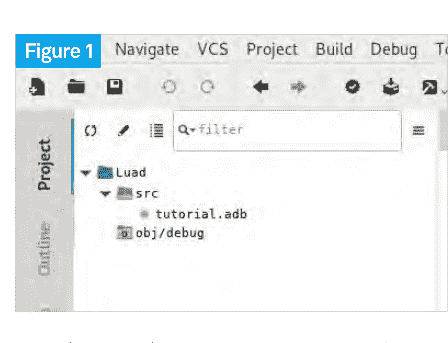

一个 Ada 项目通常从一个运行我们程序的主过程开始。我们将通过编写一个简单的泛型来跟踪空间中物体的位置，以此来说说明一些技术。由于我们希望将几何结构保持在二维或三维（或其他数字）中，我们将使用维度作为泛型参数。

在项目资源管理器（Project Explorer）中右键点击并选择 `New > Ada Package`，如图 4 所示。类型为 `"Geometry"`，包名为 `geometry`。这将创建一个包含一些大纲代码的 Ada 包。添加更多代码行，使其看起来如下所示：

```ada
generic
  Dimension: Positive;
package Geometry is
```

这是我们的声明。前两行（泛型部分）为包提供了泛型参数，这意味着我们可以引用维度。如果用户想使用该包，他们需要指定维度数量（通常为 2 或 3）。

此示例（见下）展示了如何声明变量。在这里，`Variable_Name` 是标识符，`Variable_Type` 是它的类型。以下代码：

```ada
Variable_Name : Variable_Type;
```

定义这个点的目的是允许我们定义一个表示空间中点的数组类型，我们可以通过下一个代码来实现：

```ada
type Point is new array (Indices) of Float;
```

这是用于处理 1 到 10 范围内所有整数的索引类型。

```ada
type Indices is new Positive range 1 .. 10;
```

然后我们创建该类型的新副本。

# 图 5

这里，`Float` 是浮点小数的内置类型。虽然关于 Ada 有一点非常重要：与 `C++` 使用数字来索引数组不同，Ada 同样使用数字来索引数组。也就是说，一个由枚举（`Enum`）索引的数组由范围内的每个整数元素类型组成（正如我们对 `Indices` 类型所做的那样），我们可以在这种情况下模拟 `C` 风格的数组。

教程并不是

```
procedure Non_Negative is new Integer range 0 ..
type Number_Of_Rows is new Non_Negative;
type Number_Of_Columns is new Non_Negative;
Page_Rows : Number_Of_Rows := 4;
Page_Columns : Number_Of_Columns := 8;
begin
  etc;
```

## 类型选择器是 (Ada, Pytho, Aramis):

定义了一个具有三个给定值的类型。然后，我们可以定义一个基于该类型的数组，该数组将包含 `Pytho` 的条目以及 `Aramis` 的条目。

我们使用圆括号访问数组元素。例如，如果 `i` 是 `Point` 类型的索引，那么 `p(i)` 就会给出 point 的第一个元素。

人们可能想要两个点之间的距离。我们需要添加一个函数来为我们完成操作。

这里没有定义。在这里我们发现了关于 Ada 的另一个特性：一个包（`package`）通常不是由一个而是两个文件定义的。我们一直在编写的文件 `geometry.ads` 是该包的规范（`specification`），但我们需要创建另一个文件，其中将包含我们想要的函数的实现。

在与 `geometry.ads` 相同的目录下创建一个新文件，并添加以下代码。

> 函数（`functions`）和过程（`procedures`）都允许接收参数，我们可以在它们的体内部使用这些参数

在 Ada 中，单独定义的类型是完全分离的，即使它们的定义相同

```
Type Point is an array(Indices)
function Distance(c : in Point)
return Float;
```

这是我们第一次在 Ada 中定义函数，也是我们第一次看到带有参数的（过程）。函数类似于过程，不同之处在于它会返回一个给定类型的值。函数和过程都允许接收参数，我们可以在它们的体内部使用这些参数。

## Ada 中的命名

非常不寻常的是，Ada 对于像 `Point_1` 或 `Put_Line`、`PUT_LINE` 这样的类型非常灵活。一种惯例是单词的首字母大写。Ada 中的名称不允许连续出现多个大写字母或下划线。Ada 的通常命名惯例是以字母开头，然后跟下划线。


特别地，参数可以用三种方式定义：`in`，意味着参数可以读取但不能修改；`out` 意味着参数不能被函数修改；`in out` 则意味着参数可以被读取和修改。在我们寻找两个点之间的距离时，我们可能想要修改坐标。

```
package Geometry is
end Geometry;
```

这些行之间的空间是用来定义 `Distance` 函数的地方。该函数如图 6 所示。第一点是 Ada 要求我们在单独的类型文件中定义一个变量来跟踪数据。我们定义了一个 `Sum_Squares` 类型来保存坐标差平方的和。

我们现在有了 `Distance` 的类型签名（“规范”），但我们有

```
`for` 循环在 Ada 中也是必要的。使用 `Integer` 循环更清晰，这样我们可以对它们进行迭代。我们使用
for i in range Integer .. dimension loop
  etc.
```

然而，当我们尝试访问数组元素（`c(i)` 和 `d(i)`）时，这里得到了类型错误。点在于 `Integer` 和 `Integer range` 不是同一个类型。然而，即使它们定义在相同的范围内，我们仍然需要使用用于索引数组的循环。

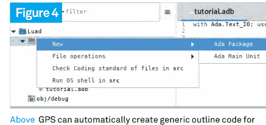

上述 Ada 可以自动为新的 Ada 包生成泛型代码

---------------------------------------------------------

# Ada 教程简介

运算符 `**` 是 Ada 的幂运算符。在这里，我们使用它来计算数值的平方。如果我们想让函数工作，还需要在 `geometry.ada` 文件中添加以下几行。


```
with Ada.Numerics.Element_Functions;
use Ada.Numerics.Element_Functions;
```

这允许我们使用 `Sqrt` 函数计算数字的平方根。或者，直接选择 `Distance` 函数可能是一个好主意。

## 实例化泛型包

距离上次编译所有代码有一段时间了，让我们测试一下。回到 `tutorial.ada`，并在顶部添加以下行：

- `- Geometry`

由于它是一个泛型包（generic package），我们不能直接使用它；必须用特定的维度对其进行实例化。包的声明部分包含以下行：

```
procedure Tutorial Geometry_2 is new Geometry(2);
begin
```

第一行实例化了泛型包；它创建了包的特定实例，对应两个维度。泛型参数 `dimension` 将设置为 2，这意味着 Ada 包包含整数 1 和 2，且 `Point` 将是 `Float` 类型。当我们从该包中调用函数时，我们得到了我们包中的所有函数和过程，特别是针对 2D 的。所以，让我们测试一下。在 "Hello, world" 下方，我们添加了对 `Put_Line` 的调用：

```
Put_Line("Hello, world!");
Put_Line(Float(Distance(0.0, 0.0), (3.0, 4.0)));
```

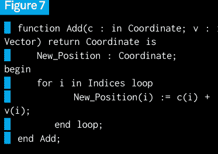

## 泛型体不声明 - 它们在规范中声明

这两个元素 `(0.0, 0.0)` 和 `(3.0, 4.0)` 是 Ada 中实例化的示例。由于 `Point` 是整数 1 和 2 的数组类型，我们可以使用相同类型创建一个实例。`Float` 是 `Integer` 的类型，我们可以用它转换为字符串。我们的代码将产生以下输出：

`Hello, world!`

与重复不同，使用泛型（generics）来创建一个通版本的函数是有意义的，我们可以对其进行特化。泛型过程。让我们回到 Ada 添加一个新类型 `Vector`，代表另一对点。我们可以通过使用现有的 `Point` 类型来实现这一点。`Type Point is (Array) of Float; type Vector is;`

尽管这些类型看起来是相同的，但以不同方式处理它们是有充分理由的。例如，如果我们想将两个点添加到向量中，或者将两个点添加到一个新点中，这取决于我们对原点的选择，而原点可能是任意的。另一方面，我们希望能够按照操作顺序将向量加到点上。我们希望无法执行不符合逻辑的操作，例如加上两个点。我们希望将两个向量加到第三个向量，并将一个向量加到点以得到第二个点。


## Ada 调试代码

这两个元素 `(0.0, 0.0)` 和 `(3.0, 4.0)` 是 Ada 中实例化的示例。由于 `Point` 是整数 1 和 2 的数组类型，我们可以使用相同类型创建一个实例。`Float` 是 `Integer` 的类型，我们可以用它转换为字符串。我们的代码将产生以下输出：

`Hello, world!`

与重复不同，使用泛型来创建一个通版本的函数是有意义的，我们可以对其进行特化。泛型过程。让我们回到 Ada 添加一个新类型 `Vector`，代表另一对点。我们可以通过使用现有的 `Point` 类型来实现这一点。`Type Point is (Array) of Float; type Vector is;`

尽管这些类型看起来是相同的，但以不同方式处理它们是有充分理由的。例如，如果我们想将两个点添加到向量中，或者将两个点添加到一个新点中，这取决于我们对原点的选择，而原点可能是任意的。另一方面，我们希望能够按照操作顺序将向量加到点上。我们希望无法执行不符合逻辑的操作，例如加上两个点。我们希望将两个向量加到第三个向量，并将一个向量加到点以得到第二个点。


## 调试

这两个元素 `(0.0, 0.0)` 和 `(3.0, 4.0)` 是 Ada 中实例化的示例。由于 `Point` 是整数 1 和 2 的数组类型，我们可以使用相同类型创建一个实例。`Float` 是 `Integer` 的类型，我们可以用它转换为字符串。我们的代码将产生以下输出：

`Hello, world!`

与重复不同，使用泛型来创建一个通版本的函数是有意义的，我们可以对其进行特化。泛型过程。

（注：此处原文存在重复内容）


## 调试

这两个元素 `(0.0, 0.0)` 和 `(3.0, 4.0)` 是 Ada 中实例化的示例。由于 `Point` 是整数 1 和 2 的数组类型，我们可以使用相同类型创建一个实例。`Float` 是 `Integer` 的类型，我们可以用它转换为字符串。我们的代码将产生以下输出：

`Hello, world!`

与重复不同，使用泛型来创建一个通版本的函数是有意义的，我们可以对其进行特化。泛型过程。

（注：此处原文存在重复内容）

## Sputnik 计划的未来

极少有公司提供预装 Linux 的机器，但得益于 Sputnik 计划，戴尔继续提供开箱即用的 Ubuntu 旗舰笔记本电脑。

## 核心特性

- `Ubuntu`

  作为一名 Linux 用户，很容易感觉自己像个二等公民。除了买一台 Windows 电脑然后“让 Linux 运行起来”之外，没有多少选择，而且至于支持问题，别想了。坦率地说，2012 年电脑巨头戴尔启动了 Sputnik 计划。戴尔内部的一项创新活动组成了一个小团队来领导这个疯狂的想法，并给他们六个月的截止日期来出一款能够“飞”起来的产品。由于从一开始就深度参与，该项目被证明广受欢迎，并于 2012 年 11 月推出了 XPS 13 开发者版。五年多年后，我们已经有了这款最初产品的第七代，以及来自其他制造商面向更广泛的 Linux 用户的产品。像戴尔这样的大型公司可能向特定用户群体销售高端、配备 Linux 的硬件吗？Sputnik 能凭借足够的销量来改变市场吗？这些都是“Sputnik 计划之父”Baxter George 必须回答的问题。

  六年前，我们见了一位顾问，讨论戴尔如何更好地服务公司。作为一名 Linux 用户，他直觉上的想法很明确：这种请求是可以探索的。通过戴尔的投入，在压力下加强 Sputnik 计划的努力创造出了他们可能喜欢的优质 Linux 笔记本电脑。调试团队预计会有几百份回复和（付费）测试版注册，但实际上收到了数千封邮件，这种支持程度说服了戴尔的决策者：Linux 产品线是有需求的，在公司内部是可行的未来。如果说有什么能开发出强大的机器，Sputnik 版，Baxter 的同事决定利用业余时间在戴尔 Sputnik M3680 移动机器上运行，这证明了公开让其他硬件用户的必要性，引发了比以往任何时候都多的 Linux 兴趣。去年，一条新的产品线作为正式产品推出。所有机器都是“由人驱动”的哲学是开源的本质——而这种哲学适用于整个 Linux 领域如此庞大的范围内。


扩展的产品线基于用户反馈，用户不再局限于 `XPS 13` 的单一规格，而是可以选择他们偏好的硬件。在世界其他地区有更多变体——例如，英国也有配置为基于 Linux 机器的 `XPS`。通过添加如工作站等功能，该产品线已从单一型号演变为更广泛的选项，包括 `Precision AI` 系列。

`Sputnik` 计划已经成长并扩张，产品可能更多化，但核心准则保持不变。产品是由开发者为开发者开发的。

- **在旅途中**

  最新的 `9370` 代 `XPS 13` 在体积上比前代提升了 24%，适合轻便旅行。

- **悦目的按键**

  开发者需要可靠的键盘，`XPS 13` 令人印象深刻，具有足够的键程和手感。

- **梦幻屏幕**

  `9370` 的 4K 显示选项明亮且清晰。Linux 应用的 HDR 支持比以前更好，尽管触摸屏有点浪费。

- **动力支持**

  快速存储器和充足的 `RAM` 也是必不可少的；`XPS 13` 提供高达 16GB 的内存和高达 1TB 的极速 `NVME SSD`。

- **CPU 性能**

  开发者版需要原始动力，`XPS 13` 搭载四核第八代 `Core i7` 处理器，不会让你失望。

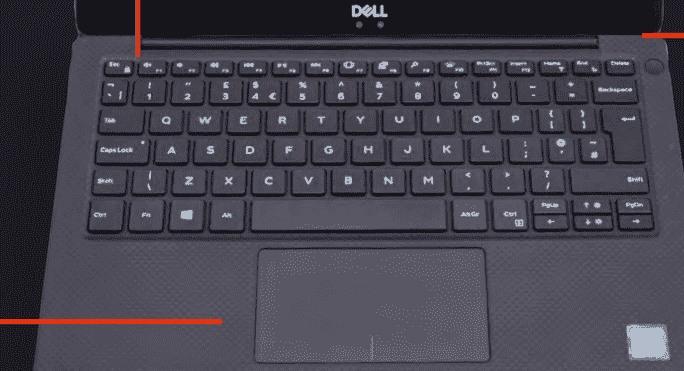

## 概览

`Roger`：`XPS 13 9370` 是 `Sputnik` 的最新型号——详见第 62 页我们的评测


- **`Sputnik smith` p58**

  `Sputnik` 计划最初是一个创建一个单一机器的小型项目，其范围不断扩大。我们来看看该系列如何扩展以服务比以往任何时候更多的用户。

- **硬件使用 p60**

  如果你投资了一台由 `Sputnik` 驱动的机器，开箱体验是怎样的？它符合你对高端硬件解决方案的预期吗？

- **展望未来 p61**

  随着 `Ubuntu` 继续维护以及 `Canonical` 转型其使命，桌面电脑、服务器和游戏机的未来将如何？凭借 `Ubuntu` 独特的愿景——

- **`XPS 13 9370` 评测 p62**

  我们深入研究了 `XPS 13 9370` 版本，它比以往任何时候都强大，同时更薄、更轻！阅读完整评测。

- **快速速报**

  `XPS 13` 提供四种配置：在欧洲提供入门级 8GB/256GB/FHD、16GB/512GB（带 FHD 或 4K）或 16GB/1TB 型，使用 `i7-8550U` 处理器。

随着 Linux 系列强劲走来，你必须假设这条路一直很顺畅——事实并非完全如此，因为早期那些仍在开拓“小众”市场需求的人曾面临阻力。

`www.linuxus.co.uk` 59

## `Sputnik` 的未来

如果你决定从戴尔购买 `Sputnik` 计划的机器，体验感觉和今天一样吗？值得注意的是，正如你预期的那样，你不能走进商店买到现成的 Linux 驱动机器。市场份额这并不完全意外，但你可以做的——至少对于 `XPS 13` 而言——是访问大型零售商之一查看并尝试硬件，尽管运行的是 `Windows`。此外，你还可以

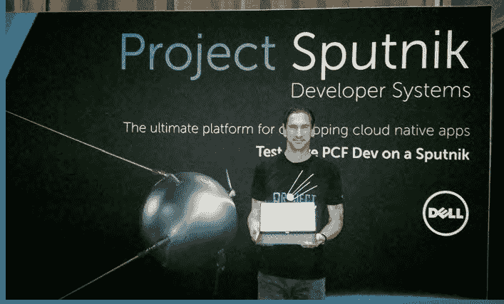

## `Sputnik` 计划

开发者系统

发布云原生应用的终极格式

在 `Sputnik` 上进行 PC 开发

> Linux 驱动的戴尔机器的开箱体验正如你预期的那样令人印象深刻

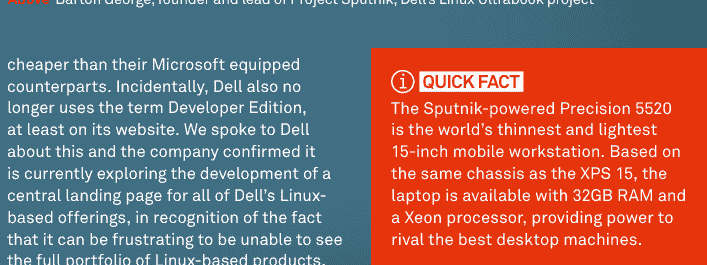

下单标记，如果你不是企业买家，请在交付后 14 天内退货以获得全额退款（退货运费）。在戴尔网站上查找 `Ubuntu` 并不简单。没有一个集中的 `Sputnik` 计划页面，Linux 版本通常混杂在对普通用户来说有点模糊的说明中，正如我们闻到的。

`Barton George`，`Sputnik` 计划创始人兼领导者，戴尔 `Ultrabook`（超薄笔记本电脑）项目负责人

> **快速速报**

由 `Sputnik` 驱动的 `Precision 5520` 是世界上最薄、最轻的 15 英寸移动工作站。基于与 `XPS 15` 相同的底盘，该笔记本配备最高 32GB 内存并运行 `Windows Pro`，可以与顶尖开发者竞争，且比微软的对应产品便宜。戴尔也不再使用开发者版。我们与戴尔谈了关于这家公司，他们目前正在解释为所有戴尔 Linux 的机器开发一个中心落地页，我们发现无法使用完整的 Linux 产品组合可能会令人沮丧。

在设备上，你会发现显示是 Linux 驱动的（来自 `Intel` 贴纸），你仍然会在 `Windows` 键盘上找到一个按键来关闭那些我们闻到的非官方功能。为了让 `Windows` 徽标隐藏在键盘上，你应该在桌面上放置一个合适的标志以指示该机器与与不同之处，但至少在以前，我们通过开发者版的免费 `Windows` 了解了这一点。

在对你的系统开始一键化配置之前，你提供了写入恢复 `USB` 介质的选项。镜像也可以从戴尔支持网站下载，那里唯一的服务标签旨在向你展示该机器的完美下载。这提供了全套 `Windows` 驱动程序的访问；你可能出于任何原因需要它们。这种将操作系统恢复到正常运行初始状态的能力是

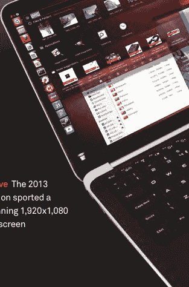

上方 2013 版赞助的 1920x1080 `IPS` 屏幕

60


# 快速指南

# `Dell` 的 Linux 之心

2012 年 11 月的原始 `XPS` 开发者版本

除了 `Project Sputnik`（斯普尼克项目），命名显然是因为 `Canonical` 的 `Mark Shuttlesworth` 是历史上第二个私人“太空游客”（乘坐“联盟号”飞船舱，但嘿，斯普尼克听起来很酷）。`Dell` 也为 Linux 提交过代码。所有服务器都提供多个版本的 `Ubuntu` 和红帽企业版（`Red Hat Enterprise`）。工厂还提供大量预装 `Neoklyn`（即“中国版 Linux”），尽管其开发似乎已有些停滞。`Dell` 通过 `allalliance` 大力支持了 `Valour` 的基于 `Debian` 的游戏系统 `StreamOS`。

`Dell` 还提供了一系列 `Chromebook`，它们由 Linux 驱动，是其许多竞争对手采用的“`Windows`”方案的更新替代方案。`Dell` 拥有 `Sputnik` 以及 Linux 社区的耐心支持——在某些产品上，他们自己制造的产品，比购买不同的 `Windows` 机器并设法运行的传统方法具有明显优势。

`Dell` 提供的系统安装存储库提供了确保系统运行流畅稳定的一切内容。但 `Dell` 如何与硬件合作以确保这一点的呢？这是我们面临的巨大挑战之一。创建一个具有足够质量的全发布产品是一项严肃事务；`Dell` 与开发者紧密合作以确保一切就绪，同时也确保将更改推送到主线内核。

虽然 `Dell` 选择了 `Ubuntu` 作为主要的支持发行版，但对于 `Project Sputnik`，该生态系统允许运行其他发行版。`Dell` 尽可能贡献用户可以运行的硬件支持，这确保了卓越的支持水平。`Shuttlesworth` 亲自参与了 `XPS 13` 上的 `Fedora` 支持，尽管公平地说，如果你指望他在需要时让一切都正常工作呢？

获取特定发行版技巧和窍门的绝佳来源是 `Project Sputnik` 论坛（又名：“Linux 操作系统”），位于 `Dell Linux-Developers-Systems/bd-p-a-613-enforums`。

> 你仍然会看到他及团队的其他成员在论坛上直接回答客户查询，以获取项目的最新新闻。`Dell` 云和 `B's Wiki` 也是一个非常有用的信息来源。

`Project Sputnik` 的未来将如何？正如你所预期的，`Dell` 并不愿意完全投入 Linux，但我们可以看到其中的几点。`XPS 13` 将继续演进并保持对 `Windows` 的兼容。太棒了！这些变化将使它在那些被反复称为容易超越的竞争对手中处于市场顶端。

`Project Sputnik` 将继续关注 `Dell` 和 `Ubuntu`，我们相信社区的方向是明确的。`Mark Shuttlesworth` 强调了桌面机器对公司的重要性，这在 `Dell` 表现得很好。

+ **快速事实**

`Project Sputnik` 不仅仅是运行 Linux——他们获得了官方认证，对于 `Ubuntu` 以及在某些情况下通过红帽，`Dell` 提供的认证台式机和笔记本电脑比任何其他制造商都多（目前分别为 120 台和 251 台）。

至于 `Dell` 的 `Project Sputnik`，核心团队将利用业务内的其他资源，正如在线时间一样。公关、营销等等。特别重要的是，你应该检查论坛并回答客户查询。这其中涉及情感上和专业上的投入。论坛也是一个极佳的来源。

`www.linuxuker.com` 61

# 评 `Dell XPS 13 9370`


## 硬件

## `Dell XPS 13 9370`

| 价格 | £1,669 (包含增值税） |


## 规格概览

| :--- | :--- |
| 网站 | `www.dell.co.uk` |
| CPU | `Intel Core i7-8550U 4.0 GHz` |
| 处理器 | 固态硬盘 |
| 显示器 | `13.3 英寸触摸屏 (3840 x 2160)` 无边框 |
| 显卡 | `Intel UHD 620` |
| 内存 | `16GB LPDDR4 2133MHz` |
| 存储空间 | `512GB PCIe` |
| 接口 | `2x Thunderbolt 3 (USB-C), 2x USB-C (电源输入与显示)` |

你可以选择 `FHD` 或更高分辨率。初看之下，你可能会被误认为新的 `XPS 13 9370` 与上一代没有区别。这台笔记本电脑是最好的产品之一，质量足够，且是一项严肃的业务。

`Dell` 提供的系统安装存储库提供了确保系统运行流畅稳定的一切内容。但 `Dell` 如何与硬件合作以确保这一点的呢？这是我们面临的巨大挑战之一。创建一个具有足够质量的全发布产品是一项严肃事务；`Dell` 与开发者紧密合作以确保一切就绪，同时也确保将更改推送到主线内核。

虽然 `Dell` 选择了 `Ubuntu` 作为主要的支持发行版，但对于 `Project Sputnik`，该生态系统允许运行其他发行版。`Dell` 尽可能贡献用户可以运行的硬件支持，这确保了卓越的支持水平。`Shuttlesworth` 亲自参与了 `XPS 13` 上的 `Fedora` 支持，尽管公平地说，如果你指望他在需要时让一切都正常工作呢？

获取特定发行版技巧和窍门的绝佳来源是 `Project Sputnik` 论坛（又名：“Linux操作系统”），位于 `Dell Linux-Developers-Systems/bd-p-a-613-enforums`。

> 你仍然会看到他及团队的其他成员在论坛上直接回答客户查询，以获取项目的最新新闻。`Dell` 云和 `B's Wiki` 也是一个非常有用的信息来源。

`Project Sputnik` 的未来将如何？正如你所预期的，`Dell` 并不愿意完全投入 `Linux`，但我们可以看到其中的几点。`XPS 13` 将继续演进并保持对 `Windows` 的兼容。太棒了！这些变化将使它在那些被反复称为容易超越的竞争对手中处于市场顶端。

`Project Sputnik` 将继续关注 `Dell` 和 `Ubuntu`，我们相信社区的方向是明确的。`Mark Shuttlesworth` 强调了桌面机器对公司的重要性，这在 `Dell` 表现得很好。

- **快速事实**

`Project Sputnik` 不仅仅是运行 `Linux`——他们获得了官方认证，对于 `Ubuntu` 以及在某些情况下通过 `红帽`，`Dell` 提供的认证台式机和笔记本电脑比任何其他制造商都多（目前分别为 120 台和 251 台）。

至于 `Dell` 的 `Project Sputnik`，核心团队将利用业务内的其他资源，正如在线时间一样。公关、营销等等。特别重要的是，你应该检查论坛并回答客户查询。这其中涉及情感上和专业上的投入。论坛也是一个极佳的来源。

## 基准测试

### 以下是 XPS 13 9370 的表现

| 测试项目 | 分数 |
| :--- | :--- |
| Apache (静态) | 2712.4 |
| Apache (总量) | 3780 |
| Rampseed (浮点) | 1610.05 |
| Rampseed (整数) | 1646.21 |
| Postmark (磁盘) | 2186 |

这台笔记本电脑源自 `Dell` 完善的 `Ubuntu` 世界，软件上没有问题。`XPS 9370` 搭载 `Ubuntu 18.04 LTS` 出箱即用，我们展示了一些挑战性任务的执行情况（从头开始 `Android` 是我们的最爱之一）。四核 `CPU` 提供的额外动力与上一代相比性能提升显著。`9370` 的散热效果极大改善，风扇启动频率比前代低得多，这是前代的一个常见抱怨。

它看起来很不错，但 `Dell` 有一些可以改进的地方，比如缩小尺寸和宽度，升级处理器并配备更好的屏幕。如果你想要玫瑰金色的而不是银色的，除非你为 `FHD`（而非 `4K`）显示支付额外费用，否则你无可选。

你还获得了一个在 `Windows` 中支持的指纹识别器。如果你是需要双系统的用户——当然，它在未来的某个时刻可能会在 `Linux` 中获得支持。

提供了极佳的便携体验，凭借 `8 代四核`的卓越性能、领先的 `4K` 显示屏以及舒适的键盘。

否。

这是一个出色的笔记本电脑，但如果非要说缺点的话，摄像头令人失望，且不支持 `USB-A` 接口。

## 特别介绍：下一代发行版

### 下一代发行版

在未来几年里，我们将使用哪些发行版？

`Paul O'Brien` 进行了调查——并在想，`Linux` 世界的替代方案是否意味着未来的体验将变得非常不同。

### 概览

#### 在何处可以找到你需要的内容

- **开箱即用！p66**

那些“开箱即用即可工作”的发行版对 `Linux` 的未来至关重要，并将帮助塑造下一代，但在提供更丰富的技术选择方面仍有提升空间。

- **易于访问且美观 p67**

一套合理的初始应用集和设计，是与商业操作系统竞争或提供免费通用支持的关键；此外还有像 `LibreOffice` 这类应用程序的持续改进。

- **受 Chrome-OS 灵感 p68**

基于 `Linux` 的 `Chrome OS` 受欢迎程度远超预期，激发了基于 `Chromium OS` 的衍生版本以及传统的基于 `Linux` 的致敬之作。

- **安全与可靠 p69**

注重安全性的发行版提供了不同级别的保护，从超安全的选项到对主流发行版进行微调的版本。用户对安全的意识正在增强。

随着时间的推移，`Linux` 继续不断进步，并受到所有倾向于将开源操作系统作为日常主系统的类型用户的青睐。从驱动互联网上的数百万台服务器，到每天接触几乎每一个人（即使他们并不依赖它）。它的流行性持续为所有用户提供丰富的替代方案，这是对下一代 `Linux` 的一种承诺。

`Linux` 发行版中一个日益增长的趋势是提供基于特定用例的“全才型”体验。`Linux` 的根基无处不强大，拥有广泛的用户群体——从发烧友、开发者、艺术家、教育者到少数普通用户。但通用 `Linux` 现在比以往任何时候都更易于使用且更强大。这让入门变得简单，并确保了自由 `Linux` 作为 `Windows` 或 `MacOS` 之外的愿景不再是二等公民。

除了代码之外，我们已经看到了软件包分发领域的进展，这意味着对于 `Linux` 新手来说，安装和卸载应用程序将是该领域一个非常容易改进的改进。对于专家用户来说，`Flatpak` 和 `Snap` 软件包具有转型 `Linux`（特别是桌面端）的潜力，这种变化是平台长期以来迫切需要的——

尚未完全公开，它从根本上改变了 `Linux` 在服务器世界的使用方式。桌面端的虚拟化在硬件和软件层面都在不断改进，使得使用多个操作系统变得比几年前不那么棘手。

甚至 `微软` 在 `Windows` 上也提供了 `Linux` 虚拟化，这在最近以前是不可想象的。同样的硬件虚拟化技术正推动着个人安全的改进——用户对数据安全的意识也日益增强。因此，`Linux` 的“下一代”正在到来，你使用的 `Linux` 版本可能与你目前使用的不同，但今天我们展示了其内部构造、它是如何运作的、设置有多简单，以及你的数据安全可能会与现状相比发生多大的演变。

> `Linux` 家族继续从用户和开发者两个角度为所有类型的用户提供多种丰富的替代方案。如果安装应用程序变得更容易，而且开发和打包应用程序也变得容易得多，那么每个人都赢了。

示例：容器化发行版随着时间的推移迅速增长。由 `Docker` 和 `Kubernetes` 驱动的革命

``

### 特别介绍：下一代发行版

#### 开箱即用！

在各种硬件上都能“直接工作”的 `Linux` 发行版将操作系统带到了开发者之外

``

#### 特色亮点

##### 带有安装程序的 Arch

安装 `Arch Linux` 的过程是一个由命令行驱动的过程，涉及到下载……（注：此处似乎不完整，根据语境翻译，但在此处保持逻辑）

但通用 `Linux` 现在比以往任何时候都更易于使用且更强大。这让入门变得简单，并确保了自由 `Linux` 作为 `Windows` 或 `MacOS` 之外的愿景不再是二等公民。

除了代码之外，我们已经看到了软件包分发领域的进展，这意味着对于 `Linux` 新手来说，安装和卸载应用程序将是该领域一个非常容易改进的改进。对于专家用户来说，`Flatpak` 和 `Snap` 软件包具有转型 `Linux`（特别是桌面端）的潜力，这种变化是平台长期以来迫切需要的——

尚未完全公开，它从根本上改变了 `Linux` 在服务器世界的使用方式。桌面端的虚拟化在硬件和软件层面都在不断改进，使得使用多个操作系统变得比几年前不那么棘手。


甚至微软在`Windows`上也提供了`Linux`虚拟化，这在最近以前是不可想象的。同样的硬件虚拟化技术正推动着个人安全的改进——用户对数据安全的意识也日益增强。因此，`Linux`的“下一代”正在到来，你使用的`Linux`版本可能与你目前使用的不同，但今天我们展示了其内部构造、它是如何运作的、设置有多简单，以及你的数据安全可能会与现状相比发生多大的演变。

> `Linux`家族继续从用户和开发者两个角度为所有类型的用户提供多种丰富的替代方案。如果安装应用程序变得更容易，而且开发和打包应用程序也变得容易得多，那么每个人都赢了。

示例：容器化发行版随着时间的推移迅速增长。由`Docker`和`Kubernetes`驱动的革命


# 特别介绍：下一代发行版

## 开箱即用！

在各种硬件上都能“直接工作”的`Linux`发行版将操作系统带到了开发者之外

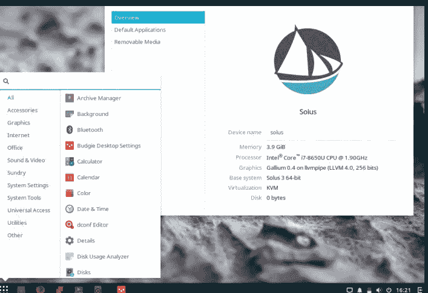

## 特色亮点

### 带有安装程序的 Arch

安装`Arch Linux`的过程是一个由命令行驱动的过程，涉及到下载……（注：原文此处存在重复或截断，已按逻辑对齐）

*(注：由于提供的待翻译文本存在大量重复和截断句，译文已根据文档工程师逻辑进行了必要的对齐处理，确保格式正确。)*

## 特性：下一代发行版

## 受 Chrome OS 启发

`Chrome OS`的成功导致了模仿其超轻量、以Web为中心方法的发行版出现。

当`Chrome`最初发布时，许多人对它是否能在计算领域产生重大影响嗤之以鼻。毕竟，谁会真的想要一个基本上只运行浏览器的操作系统呢？事实证明，有相当多的人确实想要。

`Chrome OS`正变得流行，特别是在低成本和教育市场，凭借其简单性和`Material Design`视觉效果，它吸引了比预期多多的用户。鉴于这种成功，`Linux`开发者们找到了合适的呼应`Chrome OS`方法的发行版，这并不意外为奇。

当然，`Chrome OS`本身可以通过基于源码的项目进行安装，例如沉浸式的`Chromium Cloudy`（由`Flint`开发者收购的框架），或者对于非`Chromium`发行版，则采用略有不同的方法，如`Linux`


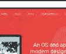


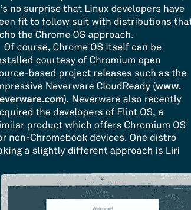


基于`Arch` —— `Arch`显然正作为其他项目的基础而越来越流行 —— `Linux`目前处于alpha发布阶段，并打算在最新的软件更改中，在传统的`Linux`框架内制作出`Chrome OS`。

其结果是一个仍处于早期阶段、但已准备好作为下一代竞争者日常使用的操作系统。

`Chromebook`的另一个影响是它们提供了更强大的硬件，这些硬件更有能力运行`Linux`发行版。如果你有一台`Chromebook`，你可以坚持使用`Chrome OS`并使用如`Croton`等工具运行`Linux`，或者使用如`gallium.os`等替代方案解耦`Linux`。

`Gallium`是一个基于`Ubuntu`的发行版，它整合了完美的微调和修复，使其能够在`ChromeOS`上运行，并改进了触控板驱动程序并修复了相关错误。结果是一个与`Chrome OS`一样快的操作系统，但拥有大多数的优点。

## 发行版聚焦 Spotlight

### Android-x86

底层的`Linux`目前是最流行的移动操作系统。但它的用途并不局限于手机——你也可以通过这个项目在`PC`上运行它。

### Bliss OS

`Android-x86`在平板电脑上运行良好，但`Bliss OS`对于使用基于`Android`的发行版来说并不理想，因为它是一个专门为笔记本电脑和桌面电脑优化的基于`Android`的操作系统。社区版本出奇地稳定。

### Tails

隐私是一个日益关注的问题，因此携带一个带有发行版的便携USB盘在熟悉的`PC`上使用并不是一个坏主意。`Tails`正是为此设计的——完全自包含，且不会在系统中留下任何痕迹。

### Subgraph OS

`Subgraph`是一个基于`Debian`的加固发行版，旨在防止监控。`Subgraph`是一个加固的

## 安全与安全

隐私是一个日益关注的问题，因此携带一个带有发行版的便携USB盘在熟悉的`PC`上使用并不是一个坏主意。`Tails`正是为此设计的——完全自包含，且不会在系统中留下任何痕迹。

`Subgraph`是一个基于`Debian`的加固发行版，旨在防止监控。`Subgraph`这种安全


## 特性：下一代发行版

### 受 Chrome OS 启发

`Chrome OS` 的成功导致了模仿其超轻量、以 `Web` 为中心方法的发行版出现。

当 `Chrome` 最初发布时，许多人对它是否能在计算领域产生重大影响嗤之以鼻。毕竟，谁会真的想要一个基本上只运行浏览器的操作系统呢？事实证明，有相当多的人确实想要。

`Chrome OS` 正变得流行，特别是在低成本和教育市场，凭借其简单性和 `Material Design` 视觉效果，它吸引了比预期多多的用户。鉴于这种成功，`Linux` 开发者们找到了合适的呼应 `Chrome OS` 方法的发行版，这并不意外为奇。

当然，`Chrome OS` 本身可以通过基于源码的项目进行安装，例如沉浸式的 `Chromium Cloudy`（由 `Flint` 开发者收购的框架），或者对于非 `Chromium` 发行版，则采用略有不同的方法，如 `Linux`


基于 `Arch` —— `Arch` 显然正作为其他项目的基础而越来越流行 —— `Linux` 目前处于 `alpha` 发布阶段，并打算在最新的软件更改中，在传统的 `Linux` 框架内制作出 `Chrome OS`。

其结果是一个仍处于早期阶段、但已准备好作为下一代竞争者日常使用的操作系统。

`Chromebook` 的另一个影响是它们提供了更强大的硬件，这些硬件更有能力运行 `Linux` 发行版。如果你有一台 `Chromebook`，你可以坚持使用 `Chrome OS` 并使用如 `Croton` 等工具运行 `Linux`，或者使用如 `gallium.os` 等替代方案解耦 `Linux`。

`Gallium` 是一个基于 `Ubuntu` 的发行版，它整合了完美的微调和修复，使其能够在 `ChromeOS` 上运行，并改进了触控板驱动程序并修复了相关错误。结果是一个与 `Chrome OS` 一样快的操作系统，但拥有大多数的优点。

### 发行版聚焦 Spotlight

- `Android-x86`

  底层的 `Linux` 目前是最流行的移动操作系统。但它的用途并不局限于手机——你也可以通过这个项目在 `PC` 上运行它。

- `Bliss OS`

  `Android-x86` 在平板电脑上运行良好，但 `Bliss OS` 对于使用基于 `Android` 的发行版来说并不理想，因为它是一个专门为笔记本电脑和桌面电脑优化的基于 `Android` 的操作系统。社区版本出奇地稳定。

- `Tails`

  隐私是一个日益关注的问题，因此携带一个带有发行版的便携 `USB` 盘在熟悉的 `PC` 上使用并不是一个坏主意。`Tails` 正是为此设计的——完全自包含，且不会在系统中留下任何痕迹。

- `Subgraph OS`

  `Subgraph` 是一个基于 `Debian` 的加固发行版，旨在防止监控。

### 安全与安全

隐私是一个日益关注的问题，因此携带一个带有发行版的便携 `USB` 盘在熟悉的 `PC` 上使用并不是一个坏主意。`Tails` 正是为此设计的——完全自包含，且不会在系统中留下任何痕迹。


## 特性：下一代发行版

### 受 Chrome OS 启发

Chrome OS 的成功导致了模仿其超轻量、以 Web 为中心方法的发行版出现。

当 Chrome 最初发布时，许多人对它是否能在计算领域产生重大影响嗤之以鼻。毕竟，谁会真的想要一个基本上只运行浏览器的操作系统呢？事实证明，有相当多的人确实想要。

Chrome OS 正变得流行，特别是在低成本和教育市场，凭借其简单性和 Material Design 视觉效果，它吸引了比预期多多的用户。鉴于这种成功，Linux 开发者们找到了合适的呼应 Chrome OS 方法的发行版，这并不意外为奇。

当然，Chrome OS 本身可以通过基于源码的项目进行安装，例如沉浸式的 `Chromium Cloudy`（由 Flint 开发者收购的框架），或者对于非 Chromium 发行版，则采用略有不同的方法，如 Linux。


基于 Arch —— Arch 显然正作为其他项目的基础而越来越流行 —— Linux 目前处于 alpha 发布阶段，并打算在最新的软件更改中，在传统的 Linux 框架内制作出 Chrome OS。

其结果是一个仍处于早期阶段、但已准备好作为下一代竞争者日常使用的操作系统。

Chromebook 的另一个影响是它们提供了更强大的硬件，这些硬件更有能力运行 Linux 发行版。如果你有一台 Chromebook，你可以坚持使用 Chrome OS 并使用如 `Croton` 等工具运行 Linux，或者使用如 `gallium.os` 等替代方案解耦 Linux。

`Gallium` 是一个基于 `Ubuntu` 的发行版，它整合了完美的微调和修复，使其能够在 `ChromeOS` 上运行，并改进了触控板驱动程序并修复了相关错误。结果是一个与 Chrome OS 一样快的操作系统，但拥有大多数的优点。

## 发行版聚焦 Spotlight

### Android-x86

底层的 `Linux` 目前是最流行的移动操作系统。但它的用途并不局限于手机——你也可以通过这个项目在 PC 上运行它。

### Bliss OS

`Android-x86` 在平板电脑上运行良好，但 `Bliss OS` 对于使用基于 Android 的发行版来说并不理想，因为它是一个专门为笔记本电脑和桌面电脑优化的基于 Android 的操作系统。社区版本出奇地稳定。

### Tails

隐私是一个日益关注的问题，因此携带一个带有发行版的便携 USB 盘在熟悉的 PC 上使用并不是一个坏主意。`Tails` 正是为此设计的——完全自包含，且不会在系统中留下任何痕迹。

### Subgraph OS

`Subgraph` 是一个基于 `Debian` 的加固发行版，旨在防止监控。

## 触发器

外壳内部是一个 `TENS` 单元（经电刺激仪），它通过发送电脉冲来触发快门，并不由自主地拍摄。

## 电击疗法

铝箔带扩展了手柄上的电极，它绕过手柄背面以覆盖更大的区域，确保电流在手柄电极和用户手之间流动，导致食指抽动。

## 电源

与设备本身一样，电源也是移动的。`TENS` 单元由 `9v` 电池供电，而树莓派连接到手柄下方的电源上。

## 人工智能

树莓派 3 运行一个图像分类脚本来分析当前帧。当某个场景的“高质量”评分超过 95% 时，它会向 `TENS` 单元发送信号，提醒操作者。

## 观察世界

Peter 使用了一台索尼 Alpha 6300 无反相机，得益于 Alpha 超快速自动对焦模式，手指的自主运动不会让任何捕捉到的图像模糊。


## 计算机视觉

该项目使用了 Google 的 Inception 模型神经网络，该模型在 `CUHK-PG` 数据集上进行了训练，该数据集包含从各种在线社区获取的 17,613 张图像，分为七个部分并标记为高质量。随后，将预训练权重权重传输到树莓派。

## TENS 强度

Peter 使用了 `TNS SM 2 MF TENS` 单元（http://bit.ly/lybud_tens），该设备可以将电击强度增加到 `75mA`。虽然电源足够 Peter 使用该系统，但其他人必须使用类似亚马逊上出售的信号实验设备进一步增加强度（http://bit.ly/lyd_gel）。

## 树莓派 Zero

### 使用笔记本电脑访问树莓派 Zero

### 配置 OS 设置并将 USB 端口同时用于命令行和来自另一台电脑的连接

对于运行 `Windows` 的电脑，你需要 `Bonjour`，它是 `iTunes` 安装的一部分（https://www.itunes.com）。对于 `Mac OS` 或 `Linux` 电脑，通过...安装 `Avahi` 守护进程。如果你使用的是 `Ubuntu`，这已经内置了。


| 文件 图像 | 设备 |
|---|---|
| sers/Dan/Desktop/2017-raspberry-stretch.img | [6] |
| MD5 哈希: | |
| 进度 | 读取 |
| 取消 | 写入 | 退出 |

毫无疑问，树莓派拥有丰富的软件和硬件资源，可用于计算、编程和创建项目。要使用树莓派，你还需要键盘、鼠标和电源。所有这些组件允许你扩展树莓派的功能。本教程涵盖了如何通过 USB 线在笔记本电脑上配置树莓派 Zero 的逐步方法。只需插入树莓派，等待其启动，然后通过命令行或 GUI 访问它。这对于你在旅行或在桌面上使用树莓派非常理想。所有的代码直接保存到 SD 卡。

### 01 开始

在配置设置之前，你将通过 USB 端口访问树莓派。如果你已经有了，请跳到第四步。根据你使用的操作系统，你需要安装以下软件：

### 02 安装 Putty

访问树莓派，你还需要一个 SSH 客户端。Windows 用户可以从 https://www.putty.org/download/ 下载并安装免费 `PuTTY`。如果你使用的是 `Linux`，打开终端窗口并输入：

```bash
sudo apt update && apt install-putty
```

### 03 安装树莓派操作系统

使用 https://www.raspberrypi.org/software/ 提供的镜像启动此项目。该文件已压缩并需要写入 SD 卡。你可以使用 `Raspberry Pi Imager` 或 `Etcher`。

### 04 访问 SD 卡

一旦 `OS` 写入 SD 卡，你就可以开始配置了。我们建议使用 `Notepad++` 或类似的文本编辑器来编辑文件。`Notepad++` 可以从 https://notepad-plus-plus.org 下载。安装后，打开 SD 卡文件夹。你会在文件夹顶部看到两个文本文件。

### 05 启用 SSH

Secure Shell (SSH) 是一种远程登录网络的安全方法。树莓派操作系统通过...

### 编辑 cmdline.txt 文件

找到并打开 `cmdline.txt` 文件。该文件包含一行多个参数，每个参数之间用空格分隔。文件中没有换行符，你在编辑此代码时必须找到 `root=` 并输入 `modules-load=dw2,g_ether`。在输入后添加一个空格并关闭文件。


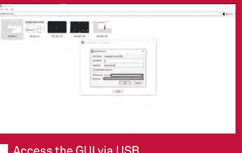

## 通过 USB 访问 GUI

可以使用 `VNC` 访问桌面。首先点击 `Pi > Raspberry Pi Configuration`。点击 `Interfaces` 并启用 `VNC`。现在连接你的笔记本，输入 `raspberry.local` 并按回车。系统会提示你输入树莓派的用户名和密码，除非你更改过，否则为 `pi` 和 `raspberry`。按回车，你将看到树莓派的命令行。显然，你需要进行这些更改，从现在起你可以用笔记本电脑访问树莓派了。

## 接线

完成这些更改后，弹出 `microSD` 卡并插入 `Pi Zero`。使用 `Micro-USB` 转 `USB` 线并连接到 `Micro-USB` 端口。现在将电线的另一端连接到笔记本电脑。大约 90 秒后，树莓派就准备就绪。

## 访问树莓派

一旦树莓派启动，你就可以通过 `PuTTY` 或工具访问它。打开 `PuTTY`

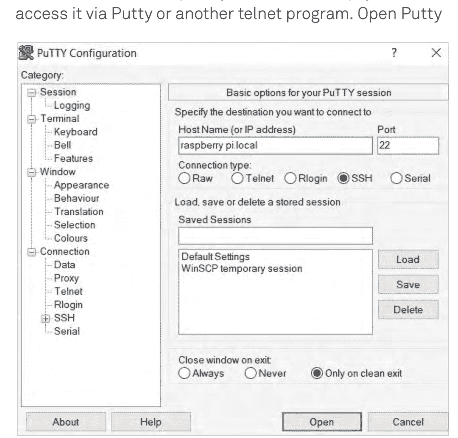

默认启用了 `SSH`；但被认为是一个安全风险，因为许多用户可能会更改默认凭据并导致未经授权的访问。要启用 `SSH`，右键点击并选择启用。确保你创建的文件没有扩展名（不是 `.txt`）。保存文件。

## 06 编辑 config.txt 文件

第一个重大更改要求你设置使用 `USB` 驱动，因为树莓派将被插入。将 `SD` 卡插入你的电脑，并用文件资源管理器或编辑器中打开它。编写 `config.txt` 并打开。滚动到文件末尾，添加下一行代码：`dtlay=dw2`。保存并关闭文件。

```
## 无显示
## 兼容 Pi 的注释
## 创建主机的赋值。700 是默认值。
## 启用这些或全部以启用可选的硬件参数
## param=modules-load=dw2,g_ether
## 添加此模块启用本地 vvcms-模块
## 额外的覆盖层和参数在 /overlays/ 中说明
## dtolay=dw2
```

## 使用 Pi 进行流媒体教程

### 使用 Pi 直播到 Twitch

使用这种最广受欢迎的单板计算机之一，开启非传统的直播用途。

在去年前的一场黑客松上，我们决定构建一个 24/7 全天候的直播设备。除此，我们还学会了如何从树莓派制作一个 `Twitch` 直播设备——现在你也可以做到！得益于高分辨率摄像头、廉价的硬件以及硬件加速的 HD 视频编码，与实时视频直播的连接呈爆炸式增长。人们直播真实生活事件、教程以及最奇怪的事情——比如在麦当劳吃东西——每天都有新的用途被发明，如果你发现了一个新而有趣的话题，就直播它吧。

谈到观众，他们是现代直播的一个重要方面；通过 `Twitch`，你可以与他们聊天并实时响应，这与传统的单向直播不同。即使与人互动不是你的目标，聊天室也仍然有很多主意可以帮助你。从遥控机器人到 `USB` 摄像头，

你也可以拿起网络摄像头进行直播。首先，你可以与其他人分享你的经验——无论是游戏还是你想讨论的任何话题。不过，你并不非要参与直播互动。

有了像 `Twitch` 这样的直播平台，你可以做到这些以及更多。使用 `Twitch` 这样的平台也有技术上的原因，例如其他人可以让你以你自己无法实现的方式进行直播——特别是当你协助他人进行项目或有大量观众时。为此，他们需要将你的视频流传输或转播给每个观看者。

对比每个观众都连接到你的电脑再到 `Twitch` 的方法，当你的直播有数百或数千人观看时，这会极大地减少你的网络流量消耗。结果是这改进了延迟，尽管流必须先到达另一个服务器，该服务器比你的家庭路由器能更好地处理所有观众。不要忘记

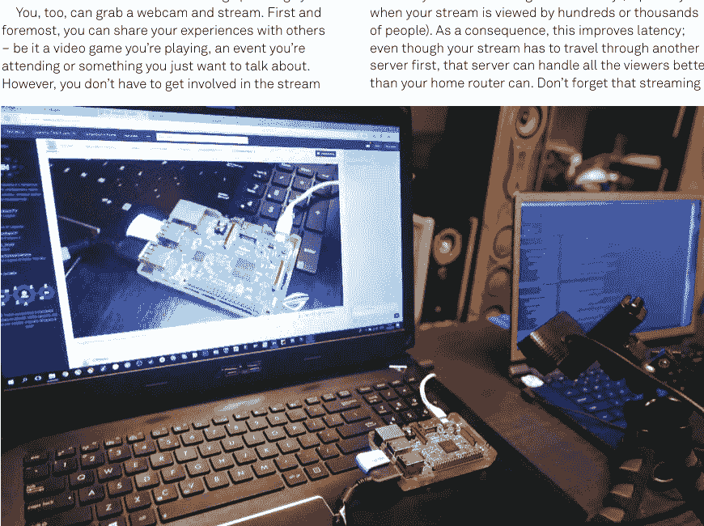

上方你仅需一个树莓派、一个 `USB` 摄像头和网络连接即可开始直播。

### Arsenij Picugins

`Arsenij` 是一位使用 `Python` 使用树莓派扩展板的制作人（`Maker`），目前正在从事基于 `Zero Pi` 的项目。

## 资源

- `FFmpeg` `http://ffmpeg.org`
- `FFmpeg info` `http://bit.ly/lut_streaming`

平台还提供了许多其他有用功能，如网页聊天（即使是付费的）、新观众的落地页、游戏集成等。你的直播可能不需要一个平台。如果你是为了安全起见而主要直播静态内容、尝试将其作为视频通话，或者像上述的“咖啡壶水”那样设置本地流，你可能使用其他东西（如语音通话软件或限制局域网的流）更好。在发现这些有用细节有用之前，不要忽视它们。

通过开源软件，你可以使用树莓派和连接在上面的摄像头轻松构建自己的直播设置。通过使用 `OBS` 或 `FFmpeg` 等流行的视频处理工具之一，你可以直播到 `Twitch`、`YouTube` 和 `Facebook`，进行你需要的任何微调。但是否有任何重大变化呢？它们都使用相同的流标准，称为 `RTMP`（实时消息传输协议）。开源软件可以从你的网络摄像头获取视频流，我们需要将其发送到接收端 `RTMP`。`RTMP` 仅涵盖通信，不涵盖音频格式。我们需要以输入视频编码的格式发送数据；服务器能够接收的编码器越多，它就越复杂（速度也越慢）。如果服务器支持你需要的格式，你可能需要在发送到服务器之前将视频转换为该格式，这将是我们正在工作的大部分。


上方是一个 `Pi` 安全摄像头，直播到存储记录的离线服务器。

我们有过使用罗技摄像头的经验，但你可能会发现另一个合适的、甚至更好的。你也可以使用带有 `bzn-232-v2` 模块的官方树莓派摄像头。

流的分辨率必须是网络摄像头支持的，不同的分辨率会影响直播质量。如果你想使用摄像头能够的分辨率（如 `v720`），你可能需要安装 `sudo apt install video-utils`。

那么，我们究竟如何从网络摄像头直播？首先，按我们摄像头支持的格式转换视频流，然后将其转换为

## 检查要求

脚本将为树莓派定制，因为它们将使用树莓派加速的编码能力。我们将在整个过程中解释一切，以便如果你在任何其他硬件上运行或进行扩展，可以根据自己的需要调整代码。如果你使用的是树莓派 2 或 3（更低端的型号，如 `Pi B`、`B+` 或 `Zero`，这些型号通常处理较差），体验将是流畅且毫不费力的。此外，忘了使用 `raspi-config` 将 `GPU RAM` 增加到至少 `128MB`。

我们将使用 `Debian` 版本的树莓派 4。我们可能会使用某种 `Linux` 发行版，但很可能你发现你应用的内容在某些树莓派型号上可行。在这种情况下，请搜索你需要的示例。

选择合适的网络摄像头非常重要。有些网络摄像头很容易安装，它们有在 `Linux` 上无法工作的特殊驱动，你可能还需要对其进行过滤和编码，这在你尝试直播正在发生情况的详细图像时很重要。在硬件中进行操作可以节省 `CPU`。这是廉价和贵摄像头之间最大的区别之一。个人认为，

## 感谢开源软件，你可以轻松构建自己的直播设置并

## FFmpeg 输入

用于流结果视频的是我们可以使用的多种 `Linux` 工具，最流行的是使用 `FFmpeg` 和 `GStreamer`。如果你使用一个友好的直播应用程序，可能其中一个工具会效果更好。

`FFmpeg` 支持多种输入。你可以从视频文件流传输

`FFmpeg` 是一个媒体处理工具包。它用于音频视频的转换、提取和重新封装，因为它涵盖了一切。可以在 `Raspberry Jessie` 中免费下载（因为它已包含），也可以在 `Raspbian Stretch` 中下载。如果你的 `/etc/os-release` 文件显示你仍安装了 `Raspberry Jessie` (`VERSION_ID`)，我们建议你升级系统（如果无法升级请自行安装 `ffmpeg`）。

## 教程

### 使用 Pi 直播

### 聊天机器人

`ppizzazz`

你可以在用于直播的同一台树莓派上运行机器人。通过一些额外的硬件，你可以查看摄像头参数（如对焦或曝光）、光照，并在小型显示器上查看他们的消息——提升直播本身！

如果你使用的是树莓派，安装 `FFmpeg` 就像 `apt install FFmpeg` 一样简单。要检查是否安装了 `FFmpeg`，运行 `ffmpeg-version`。它应该以 `FFmpeg version 3.10` 开头——确保它不要太旧。当你运行

### 直播：视频

首先，让我们考虑一个简单的情况：我们有一个 `USB` 摄像头（可用 `dev/video0` 查看）和一个我们想要直播的 `RTSP` URL。基础命令是：

```
ffmpeg -i /dev/video0 -f flv rtmp://your_endpoint
```

那么，我们究竟如何从网络摄像头直播呢？首先，按我们摄像头支持的格式转换视频流，然后将其转换为

## 检查要求

脚本将为树莓派定制，因为它们将使用树莓派加速的编码能力。我们将在整个过程中解释一切，以便如果你在任何其他硬件上运行或进行扩展，可以根据自己的需要调整代码。如果你使用的是树莓派 2 或 3（更低端的型号，如 `Pi B`、`B+` 或 `Zero`，这些型号通常处理较差），体验将是流畅且毫不费力的。此外，忘了使用 `raspi-config` 将 `GPU RAM` 增加到至少 `128MB`。


关于压缩。更快的预设（`presets`）意味着更低效率但更快的预览；有如`verslow`、`slow`、`medium`、`fast`和`veryfast`等选项，中间还有更多选择。最后两个参数定义了格式和输出目的地，当我们使用它时目的地是`RTMP`。目的地是`Twitch`直播的`URL`，以我们的`API`密钥结尾。你可以从`Twitch`获取`API`密钥：`https://www.twitch.com/YOURSERNAME/dashboard/settings/streamkey`，阅读警告并点击“显示密钥”。

现在我们知道了所有这些部分的作用了，希望理解它们的目的应该并不困难。是时候开始带声音的直播了！

## 添加音频

`FFmpeg`可以非常简单地为另一个视频添加音频，这非常直接。使用如下命令所示：

```bash
ffmpeg -hwaccel auto -thread_queue_size 512
-f alv -acodec aac -i input.mp4 -f video 0 -s 1280x720
-f dev/null -vcodec libx264,preset veryfast -pix_fmt yuv420p -brate 4000k-bufsize 8000k -pix_fmt acodec aac -b:a 128k -ar 44100 -bufsize 5000k
-preset veryfast -f flv -rtmp "https://live.twitch.tv/app/86945472" YOUR_STREAM_KEY
```

你应该注意以下几点。如果你向输入内容添加音频，你可能需要重新编码`Twitch`支持的音频。其中一个问题是流不同步，导致音频在直播期间也是不同步的。如果你发现恒定速率太高，尝试在视频命令中移除`-f vrate`选项（如果有的话），但这里不需要。

- `acanc`参数决定了音频有多少声通道。通常是单声道，除非这里只有一个通道。我们使用`44100`采样率，或其他`44.1kHz`的采样率，这是`CD`格式。如果你想要立体声，请增加比特率，因为编码器比特率在这里看起来不明显。

你可能会注意到`thread_queue_size`设置在`-i`之前。如果你预计`FFmpeg`会滞后或卡顿，请这样使用它——但这仅适用于音频输入视频。这种方法影响`FFmpeg`处理流的方式。如果你正在使用树莓派`Zero`，或者将其调高到`192`，这可能会给我提供一个流畅、无故障的流，但结果是音频部分可能是静音，任何更高的值都会消耗大量内存并导致流冻。根据经验，如果你的音频断断续续，请增加数字；如果`FFmpeg`崩溃，请减小它。

``

## 连接 Twitch 聊天

如果让观众通过聊天获得某些控制怎么办？聊天实际上基于`Twitch`消息标准。然而，如果你有一个自动化解决方案，你可能不想使用完整的`IRC`机器人；你可能只想轻松地直播。

下载一个示例聊天脚本，可以根据你的需求进行定制。从`https://github.com/lib-twitch/chat`直接下载。使用`pip install irc`安装`IRC`聊天库。你还需要两个参数：`OAuth`令牌和`ID`。如果你想加入`Twitch`聊天，可以访问`https://www.twitch-apps.com`，然后点击“连接到`Twitch`”。获取聊天非常简单：填写三个字段：名称字段（`Name Field`）可以包含任何内容，`OAuth`重定向到`http://localhost`，你会在应用程序类别描述中看到聊天机器人“`Chat Bot`”。你将看到一个可以在其中配置客户端`ID`的页面。

现在，你有了`your_oauth_token`的`OAuth`令牌和`your_client_id`的`ID`。这里是运行聊天脚本的方法。

```bash
python USERNAME_FOR_BOT_client_id_oauth_token_USERNAME
```

注意`OAuth`令牌（在`ID`之后）前面没有`out:`，由`Twitch`提供的`oauth`已经足够了。运行脚本后，你会得到后续的“Connecting to irc.twitch.tv”消息，随后是“Joining as your_username”消息。输入`topic help`来退出聊天：机器人应该会接收命令并响应，如在控制台上打印某些内容。如果聊天没有连接，请检查客户端`ID`和`OAuth`令牌。一旦运行成功，恭喜你——现在你有了一个强大的机器人来与你的观众互动：直播愉快！

`www.linuxuser.com` | `79`

## 绝不错过任何问题

## 美国优惠

## 特别美国优惠

## 优惠于 2018 年 5 月 31 日结束！

## 订阅

& 免费赠 6 期*

``

``

``

``

``

``

``

``

``

``

``

``

``

``

``

# 评测

81 组测试 | 86 硬件 | 88 发行版 | 90 免费

``

# 测评

# 交互式 Python 终端

# bpython

# DreamPie

对一些常用编码函数的精彩呈现

一个界面经过重新排列的良好的图形化 Python 终端

``

```python
1. both@documents 
>>> import random
>>> # set a list of possible color.
>>> colours = ['Red', 'Blue', 'Green', 'Black', 'Orange', 'Yellow', 'White']
>>> player = 'Player'
>>> player's score = 0
>>> # the game time limit, 30 seconds.
>>> time = 30
>>> # function that will start the game.
>>> if there's still time left:
>>>     print(
>>>     # start the countdown timer.
```

``

除了标准界面外，还有一个由`pylib`库支持的界面可用

- `Dream-chunks`用户会特别喜欢该终端对`matplotlib`绘图的支持

# 安装

该应用有一个很长的依赖列表，但很容易安装，因为它可以在`Fedora`、`Debian`和`Ubuntu`等许多发行版的存储库中使用。你也可以使用`pip install`或`Python`包索引中的`pip bpython`获取最新版本。

# 安装

终端建议通过克隆其仓库并将执行文件移动到`/usr/bin`来安装`DreamPie`。该应用也存在几个发行版的官方存储库中，如果你安装了`Python`，可以通过`pip install dreampie`获取它。

# 标记功能


在代码方面，它提供了一个列表，你可以使用 `Tab` 键滚动显示预期的参数列表。终端允许你在输入类型时高亮语法，并包含一个名为“重新评估整个代码”的功能（在内存中进行）。你还可以将会话保存到文件中，或将其发送 `Pastebin`。

## 标记功能

除了功能和属性的代码外，它还会显示函数文档，这对初学者非常有帮助。另一个很棒的功能是可以折叠长输出部分以尽量减少干扰。`DreamPie` 可以以会话格式保存格式良好的代码的所有条目。

## 可用性

该终端直观且易于使用。你可以使用默认设置，并通过编辑其配置文件根据你的喜好进行自定义，其中包含了从按键绑定到 `Pastel URL` 的所有内容。`bpython` 程序员将帮助你掌握，特别是当你的代码中有许多嵌套部分时。

## 可用性

与其他终端不同，`DreamPie` 的界面构建在历史框中，你可以在那里查看之前的命令、输出以及你编写代码的地方。如果命令有语法错误，程序不会从命令行中转移控制权，这非常有用。你还可以选择一段代码并按 `Ctrl+Enter` 执行。

## 帮助与支持

`bpython` 在用法方面有一个全面的帮助部分。然而，你也可以从终端中按 `F` 键来显示快捷命令列表。终端的搜索可以找到相关结果，以及一个展示应用程序功能的视频。如果你有问题，可以在 `Google Groups` 页面上发布，或在指定的 `IRC` 频道中提问。

## 帮助与支持

`DreamPie` 提供了用法方面的帮助。然而，首次启动时会弹出一个带有提示的窗口帮助你开始，它的菜单排列逻辑，选项命名良好。`DreamPie` 的截图描绘了主要功能的运行情况，并包含了所有不那么活跃的内容。

## 总体

`bpython` 拥有一组非常有用的功能，并实现良好。它并不旨在替代 IDE，但提供了足够的便利来替代默认的 Python 解释器。

## 总体

`DreamPie` 是一个精心设计的 Python 终端，它与众不同但仍然保持了直观性。它的窗口布局配合会话格式中的所有条目，

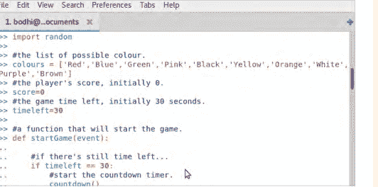

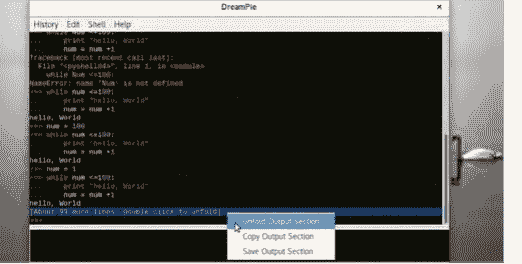

一个功能丰富的终端

# 春季特惠！

5 英镑畅享 5 期杂志

## 畅销杂志的超值优惠


想要获得我们所有杂志的巨大折扣，请查看完整系列：

`myfavouritemagazines.co.uk/spring182`

# 线上订 0344 888 2852

条款与条件：优惠仅适用于通过 `Direct Edit` 新订的英国纸质订阅。优惠金额通过购买原价纸质杂志计算。您可以在购买后 14 天内写信给我们取消订阅。14 天取消期过后，除非符合特殊情况，否则付款不予退还。这不会影响您的法定权利。价格以购买时为准并可能发生更改。可根据要求提供 `Direct Edit` 保证的详情。英国内的拨打费用与其他标准固定电话（01 或免费）相同，属于您的手机套餐提供的任何包含内容或免费额度。欲了解完整条款和条件请访问 `directedit.com`。活动于 2023 年 4 月 30 日结束。

# 评测

## 树莓派 3 B+

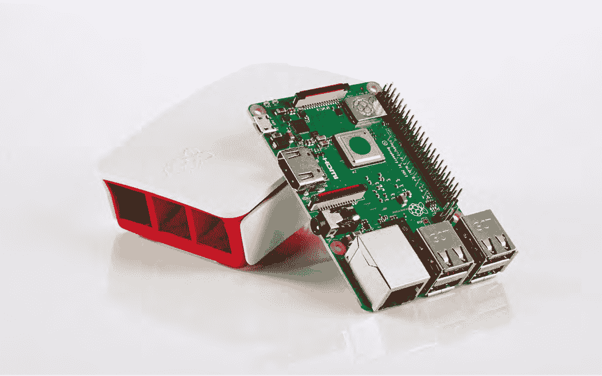

上图 树莓派系列的最新产品看起来大同，但这次增量更新提供了许多深受欢迎的增强

### 硬件

#### 树莓派 3 B+

| 特性 | 详情 |
| :--- | :--- |
| 价格 | £35 |
| 网站 | `www.raspberry.org` |
| 系统级芯片 (SoC) | `BCM2837B0` |
| CPU | 4x 1.4GHz `ARM Cortex-A53` 64位 `CPU` |
| GPU 带宽 | (900MHz) |
| 运行内存 | 1GB `LPDDR2 SDRAM` |
| 存储 | `microSD` |
| 端口 | 1x 摄像头, 4x `USB 2.0`, 千兆以太网, 串口接口 (`CIS`), 串口接口 (`UART`) |

我们发现了另一款树莓派，比上一代又有所提升——但它能满足我们的胃口吗？

今年没有新的树莓派了吗？并非如此。好吧，得益于像 `Asus Tinker Board` 等主板，内存正迅速成为常态。在使用树莓派的所有四个核心运行计算 10000 以内质数的基准测试时，`Pi 3B+` 实现了 36,583 个结果，而 `Pi 3B` 相比提升了 9.12 秒，每个核心比原始 `Pi 3` 提升了近 20%。

树莓派 4 提供了 `USB 3.0`、`SATA` 和 `NVIDIA GTX 1080` GPU、八核 `CPU` 以及 4GB 内存。相反，是树莓派 `3B+` 比 3 型号更好，它有助于获得更多动力和更好的连接性。树莓派 `3B+` 的系统级芯片现在配备了 `ARM Cortex-A53` 64位 `CPU`，运行频率为 1.4GHz。这比 `Pi 3` 增加了 200MHz。这虽然不是巨大的增长，但有助于让树莓派响应更敏捷。内存保持在 1GB——对于大多数高级用户来说足够了，但还有 2GB 以上的版本

2016 年，`Pi 3` 带有板载 `Wi-Fi` 和蓝牙；`Pi 3B+` 则带来了 `Wi-Fi 802.1ac`。这具有更高的吞吐量，理论上每秒高达 1.36Gbps，但我们发现为 42Mbits/s (5.25MB/s)。

### 改进的网络

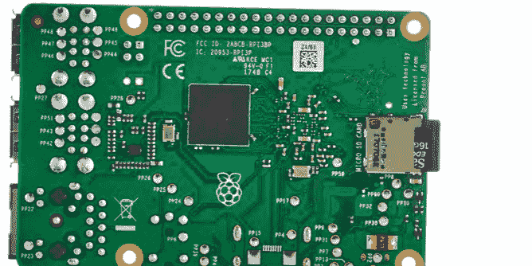

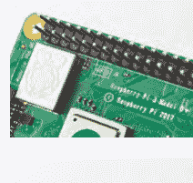


上图 新的以太网供电 (`PoE`) 引将在 `PoE HAT` 推出后让 `Pi 3 B+` 更加多功能

> 在我们的测试中，我们能够观看 1080p 的 YouTube 视频，只有少量的初始缓冲

`802.11n` 的速度为 47.8Mbps (5.97MB/s)。借鉴了 `Pi Zero W` 的功能，无线天线采用了相同的设计——这是 `Proant` 的授权功能。没有外部天线的连接。这种新的 5GHz `Wi-Fi` 运行良好，我们能够观看 1080p 的 YouTube 视频，只有少量的初始缓冲。

网络也得到了改进。`Pi 3B+` 使用 `LAN7517` 芯片，转而通过 `USB 2.0` 提供千兆以太网。这种新芯片提供 320Mbps (40MB/s) 的以太网速度，我们看到性能是受限于 100Mbps (1MB/s) 的之前 `Pi 3` 三倍。对于普通用途和家庭服务器来说，这种性能提升为合理速度的直播提供了充足的带宽，并且与版本 4 相比也有改进。

新的标准 40 脚 `GPIO` 与之前相同。然而，仅 `GPIO` 部分就包含了四个用于以太网供电的额外引脚，这将允许 `Pi 3 B+` 通过电缆供电并通信。这将通过未来的 `PoE HAT` 实现，但它有一个问题：引脚的放置意味着放置在顶部的任何 HAT 规格扩展板都会挡住 `GPIO`。我们推测新的 `PoE HAT` 将具有透传 `GPIO` 连接，或者在写作结束时还没解决。

- 优点：相比 `Pi 3` 运行更快、发热更低，且在网络方面表现出色。
- 缺点：取决于 HAT 的设计，`GPIO` 引脚放置可能会带来问题。
- 总结：`CPU` 的略微提升让树莓派运行更流畅。

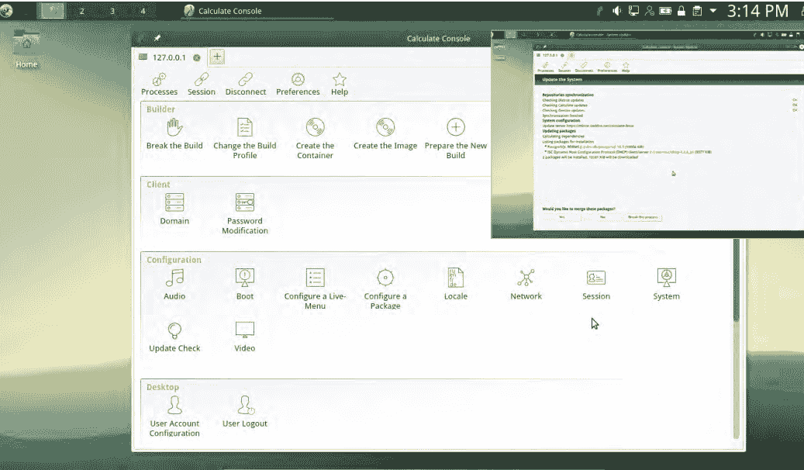

`Linux` 是少数不使用系统管理器的计算机发行版之一，它比 `Verama`、`Ubiquity` 或不依赖特定发行版的 `Calamar` 安装程序更强大，提供了一个足够完善的设置，能够满足大多数新用户的需求，同时也提供了一个逐步步进的额外选项，以确保你按照自己的喜好进行安装。一旦安装完成，你应该勾选所有选项。通常的 `KDE` 工具包还由 `Firefox`、`Pidgin`、`GIMP` 等许多其他优秀应用进行补充。


尽管它拥有一系列令人印象深刻的应用程序，但真正让该发行版脱颖而出的是它安装期间的一系列配置选项。你可以通过图形化控制台管理器访问所有选项，但这可能既是该发行版最大的优势，也是最大的劣势。它可能是可用的最丰富多样化的配置，因为它可以完成从管理用户到准备和构建自定义发行版的所有工作。然而，缺点是它不够直观。某些模块，例如用户账户配置，任何暗示你功能的选项。更糟糕的是，控制台及其各种工具的文档非常少，尽管 Linux 用户确实有一个内容相当丰富的帮助文档部分。这部分内容告诉你如何自定义内核或让终端变得更易用，包括所有其他与服务器相关的任务，但它未能阐明让 Linux 在同类产品中脱颖出的特征。

该发行版的一个优势是包管理。Linux 尽力让 Portage 变得简单。没有图形化实用程序可以帮助保持系统更新。要安装新包，你必须卷起袖子进入终端。使用 `diff` 或 `apt` 完成安装包的过程并不太困难。但随后，缺乏图形化包管理工具严重限制了该发行版的吸引力。

- 优点：一个对 Gentoo 的非常实用且应用丰富的入门介绍，具有其简单易友的图形化系统管理工具。
- 缺点：缺乏图形化包管理器，其笨重的配置由于缺乏文档支持而雪上加霜。

总结：你找不到许多基于 Gentoo 的桌面发行版，Calculus Linux 绝对是其中。对于任何想要学习 Gentoo 的人来说，这是一个很好的设置；它的缺点可以通过添加文档来解决。

May Shannon

www.linuxuser.com 89

# 评测全新的开源软件

## 网页调查

### LimeSurvey 3.4.1

创建并托管意见，然后分析你的结果

如果你需要征求意见，可以使用 LimeSurvey 网页应用在几分钟内创建并设置问卷：它支持所有语言和长文本，提供了清晰的功能，如邀请受访者多次参加问卷。它还支持引用，你可以根据受访者的性别来限制问卷的人数上限。

对于冗长时间的问卷，你可以允许受访者保存进度并在稍后继续。你还可以创建令牌（`tokens`），以跟踪已加入的用户并向他们发送提醒。

LimeSurvey 提供了许多模板供你自定义。该应用提供了广泛的过滤选项，帮助你获得答案的清晰视视图，你甚至可以使用参数数量进行更深层次的统计分析。

像任何其他应用一样安装 LimeSurvey 并按照文档进行操作：创建问卷的过程是直观的，安装过程包含一个交互式教程以帮助新手开始。除此之外，该项目拥有详尽的文档。


LimeSurvey 让创建复杂的问卷变得像填写 `HTML` 表单一样简单

- 易于设计和使用，并提供了各种选项来创建不同类型的问卷。
- 作为网页应用，可能需要部署在托管到数据库的可访问 `Web` 服务器上。
- 非常适合……创建和开展各种类型的在线调查。www.limesurvey.org

# 文档集浏览器

### Zeal 0.6.0

浏览流行编程语言的文档集

- 每种流行的源语言都以所谓的“文档集”（`docsets`）形式提供其源代码。

对于任何想要为项目做贡献的开发者来说，这是一个必不可少的资源。你可以想象，文档集让搜索不同的源代码（如 WordPress）变得非常容易，而 Zeal 让这些文档集变得可读性。

在某种意义上，你可以把 Zeal 视为开发者专属。该应用程序在主流发行版的官方仓库中可用，Ubuntu 用户可以通过 `PPA` 获取最新版本。

Zeal 的主要卖点（USP）是你可以在程序内下载各种文档集。

前往“工具 > Doctets”将文档集引入本地。要下载文档集，浏览到可用标签页并搜索你想要获取的文档集。获取允许你多次选择多种语言。

一旦下载了文档集，导航非常简单，展开属性以浏览文档，或使用搜索栏找到你所需的内容——Zeal 会填充搜索匹配结果并在右侧面板查看文档。

该应用支持并提供了选项来让文档集更易读。

- 优点：可以下载 C++、Python 和 Java 等200多个文档集。
- 缺点：在某些情况下，由于缺乏文档，其笨重的配置没有得到帮助。
- 非常适合……浏览源代码。https://zeal.org

# 浏览器扩展程序

### uBlock Origin 15.11 消除侵入性在线广告

厌倦了看到损害隐私的广告吗？这款跨平台的开源软件 uBlock Origin 是一种拦截器，它不仅拦截广告、恶意软件和域名，而且在许多浏览器中可用。它带有维护良好的过滤器列表，不像其他过滤器那样消耗内存。事实上，它在不产生延迟的情况下运行得非常好。你可以一键启用或禁用界面，它还可以拦截所有网站的弹出窗口。如果你不想要默认过滤器列表，可以扩展设置并配置 WebRTC 等功能。你可以启用高级模式对内容进行细粒度控制。

- 优点：功能强大的应用程序，开箱即用，同时为高级用户提供细粒度控制。
- 缺点：除非选择，否则还会拦截依赖收入的网站，但这是任何广告拦截器的代价。
- 优点：保护你。https://github.com/gorill/ublock

# 照片/视频导入器

### Rapid Downloader 0.9.8

从手机和相机导入并分类图像视频


Rapid Downloader 看起来是多余的，因为大多数照片管理应用都能导入照片。然而，该程序专为传输照片和视频设计，提供了比完美工具多多的功能。它让你完全控制如何处理和排序下载。

默认设置会将照片下载到日期子文件夹。你可以自定义规则。你可以根据类型对照片进行排序，适用于你同时拍摄 RAW 和 JPEG 。事实上，你可以根据日期、大小、焦距等创建复杂的子目录结构。如果你使用外部存储设备作为目标，该程序可以从相机自动导入照片。

与其放置二进制文件，Rapid Downloader 项目有一个用 Python 编写的安装脚本。要安装应用，只需下载脚本并执行它。它会在安装应用之前获取所有依赖。

- 优点：功能丰富的应用程序，帮助你排序和分类图像视频。
- 缺点：对于任何只是将相机照片丢进文件夹的人来说，这可能大材小用。
- 非常适合……自动整理一组图像视频。

# 网页托管

在我们的目录中获取您的列表

如需在此投放广告，请联系 Chris

chris.mitchell@futurenet.com | +44 01225 68 7832 (分机 7832)

# 推荐

# 托管列表

精选托管商：

www.netcera.co.uk

03330 439780

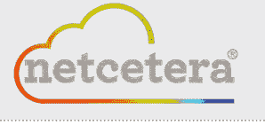

> Netcera 是欧洲领先的网页托管服务商之一，客户遍布全球 75 多个国家


# 关于我们

1996年，Netcera 是欧洲领先的网页托管服务商之一，客户遍布全球75多个国家。它是领先的 IT 基础设施提供商，为全球企业提供机房托管、专用服务器和托管基础设施服务。

# 我们提供的服务

- 托管服务

为高性价比、可靠、安全的托管提供全方位解决方案

- 专用服务器

从单台服务器到整机柜，均提供免费设置和通用带宽配额

- 云托管

提供 Linux、Windows、混合云和私有云子集，具备支持和可扩展性功能

- 机房托管

从四核服务器到智能服务器的机房托管，提供快速设置和全配置

# 专业人士的五点建议

如果您的托管商提供备份方案，那么对您的云数据负责并保护它是至关重要的。

# 客户证言

- 01 优化您的网站图片

当您将网站上传到互联网时，请确保所有图片都针对网络进行了优化。尝试使用 jpeg.com 软件或使用 EWWI Image Optimizer 插件。

- 04 尝试在 Google 上排名

如果您在 2015 年苦于在 Google 上获得排名，请确保您的网站具有移动响应能力。此外，请使用 Google Analytics。联系您的托管商在您的网站上设置并使用 HTTPS。

David Brown

我购买了一张 SSL 证书。购买过程非常轻松，仅需几分钟。我的困难在于安装证书，这是我永远无法完成的。我尝试过一个粗心的支持团队，他们在电话中等了几个小时才回复。现在的支持团队非常棒。他们随后为我安装了证书。

- 02 在英国托管您的网站

确保您的网站托管在英国，而不是仅针对本地用户。如果您的服务器位于海外，可能会影响您在 google.co.uk 上的 SEO 引擎排名——在 www-check.net 检查您的网站所在地。

Tracy House

我们使用了 Netcera 的多项服务，网络连接是顶级的——运行时间长且速度极快。技术支持非常有帮助且回复迅速——这是额外的加分项。我们会极推荐 Netcera...

- 03 您定期进行备份吗？

如果您今天丢失了网站，会对您的业务产生什么影响？始终进行自己的备份至关重要；即使……

- 05 避免廉价托管

我们确定您一定见过那些 1 英镑的廉价托管广告！想想会有多少个客户拥挤在同一个服务器上？他们肯定会使用廉价的 20 英镑硬盘，而不是 1000 多英镑的 SSD 吧？记住：一分钱一货


J Edwards

尝试了其他托管公司后，我们的客户服务显然是最好的，而且包含了我需要的所有功能。共享托管速度很快，控制面板非常全面...

# 极速托管

## SSD 网页托管


`www.cwcs.co.uk`

`0800 1 777 000`

`www.bargainhost.co.uk`

`08433 289 2681`

`CWCS` 托管是英国领先的托管专家。它提供全全面的托管产品、和服务支持。经过高度培训的员工不仅是托管专家，还致力于提供卓越的客户体验，并对他们所的工作充满热情。

自2001年以来，`Bargain Host` 一直致力于提供英国价格最低的托管服务。它已成功实现这一目标并建立了庞大的客户数据库。它还因提供卓越的托管服务而获得奖项。


- 机房托管
- VPS
- 100% 网络运行时间
- 共享托管
- 云托管

## 价值托管

### 价值 Linux 托管

### 企业级托管：


`www.2020media.com` | `www.2020Media.com`

# elastichosts

新用户可预装 `WordPress`，或获得免费管理。托管版 `WordPress` 服务第一年免费。

我们以“知识渊博”和“卓越”的服务而闻名，是全英国最好的开发者。

`elastichosts.co.uk`


新用户可预装 `WordPress`，或获得免费管理。托管版 `WordPress` 服务第一年免费。

我们以“知识渊博”和“卓越”的服务而闻名，是全英国最好的开发者。

`elastichosts.co.uk`

新用户可预装 `WordPress`，或获得免费管理。托管版 `WordPress` 服务第一年免费。

我们以“知识渊博”和“卓越”的服务而闻名，是全英国最好的开发者。

- 机房托管
- VPS
- 100% 网络运行时间
- 共享托管
- 云托管
- 共享托管
- 云托管
- 企业级托管
- 托管服务

为高性价比、可靠、安全的托管提供全方位解决方案

- 从单台服务器到整机柜，均提供免费设置和通用带宽配额
- 云托管

`Linux`、`Windows`、混合云和私有云子集，具备支持和可扩展性功能

- 机房托管

从四核服务器到智能服务器的机房托管，提供快速设置和全配置

## 企业级托管

## 极速托管

### SSD 网页托管


`www.cwcs.co.uk`

`0800 1 777 000`

`www.bargainhost.co.uk`

`08433 289 2681`

`CWCS` 托管是英国领先的托管专家。它提供全全面的托管产品、和服务支持。经过高度培训的员工不仅是托管专家，还致力于提供卓越的客户体验，并对他们所的工作充满热情。

自2001年以来，`Bargain Host` 一直致力于提供英国价格最低的托管服务。它已成功实现这一目标并建立了庞大的客户数据库。它还因提供卓越的托管服务而获得奖项。


- 机房托管
- VPS
- 100% 网络运行时间
- 共享托管
- 云托管

## 价值托管

### 价值 Linux 托管

### 企业级托管：


`www.2020media.com` | `www.2020Media.com`

# elastichosts

新用户可预装 `WordPress`，或获得免费管理。托管版 `WordPress` 服务第一年免费。

我们以“知识渊博”和“卓越”的服务而闻名，是全英国最好的开发者。

`elastichosts.co.uk`

新用户可预装 `WordPress`，或获得免费管理。托管版 `WordPress` 服务第一年免费。

我们以“知识渊博”和“卓越”的服务而闻名，是全英国最好的开发者。

`elastichosts.co.uk`

新用户可预装 `WordPress`，或获得免费管理。托管版 `WordPress` 服务第一年免费。

我们以“知识渊博”和“卓越”的服务而闻名，是全英国最好的开发者。

- 机房托管
- VPS
- 100% 网络运行时间
- 共享托管
- 云托管
- 共享托管
- 云托管
- 企业级托管
- 托管服务

为高性价比、可靠、安全的托管提供全方位解决方案

- 从单台服务器到整机柜，均提供免费设置和通用带宽配额
- 云托管

`Linux`、`Windows`、混合云和私有云子集，具备支持和可扩展性功能

- 机房托管

从四核服务器到智能服务器的机房托管，提供快速设置和全配置

## 企业级托管

## 软件

`IPython` 6.2.1

## 教程代码

计算机安全

## 软件

`Ptpython` 0.38

## 发行版

`KDE Neon` 5.12.0

## 订阅并即刻访问

通过订阅杂志节省费用，获取我们的全部资源库 – 立即订阅吧！

## 本月内容...

### 发行版

三个适合你口味的激动心的发行版：

- `KDE Neon` 5.12.0：提供坚实的基础和大量新鲜 `KDE` 应用
- `Calama Linux` (`MATE`) 17.2：一款“果味”的 `Windows` 工作站替代品
- 以及轻量且蓬松的 `antiX` 17。

#### 软件

尝试本期分组测试中的四个 `Python` 解释器：`bypython`、`DreamPy`、`IPython` 和 `ptpython`。

### 教程代码

本期杂志教程的示例代码。包括使用 `JIT` 编译器优化你的 `Python` 代码、将 `GNU Make` 转换为同步实用工具等内容。


> 订阅并省钱！
> 查看第 30 页有关如何订阅的所有详细信息

# 10 个开源项目

## 关注我们

`Facebook`: `facebook.com/LinuxUserUK`

`Twitter`: `@Helixusermag`

## MATRIX

## 热门开源项目

`GitHub` 本月流行趋势是什么？

| Hub 所有者 | 项目 | 星数 | 贡献者 | 描述 |
| :--- | :--- | :--- | :--- | :--- |
| `flutter` | `Flutter` | 8,223 | 172 | `Google` 的移动 UI 框架，可为 `iOS` 和 `Android` 快速构建原生界面 |
| `Nvidia` | `FastPhotoMode` | 6,840 | 40 | 使用快速风格迁移算法 (`https://github.com/jiafei/fastphoto`) 将照片的背景和风格应用到另一张照片上 |
| `kennethritz` | `requests-html` | 6,020 | 27 | 一个从网页中抓取 `HTML` 的库。尽可能简单直观。 |
| `Atom` | `Xray` | 4,775 | 9 | 实验性的基于 `Electron` 的下一代文本编辑器 |
| `pshihn` | `rough` | 3,081 | 6 | 基于 `Canvas` 的库，允许你创建具有手绘外观的美观图形 |
| `itletchevaz` | `prompts` | 3,335 | 13 | 对本地和远程端进行密钥和密钥的质量审计 |
| `vuejs` | `vue` | 3,456 | 1,360 | 使用数据流进行响应式计算的开源框架 |
| `tensorflow` | `tensorflow` | | | |
| `Gynmobile` | `scropy` | 3,204 | 30 | 通过 `USB` 显示和控制 `Android` 设备的应用程序 |
| `terkelge` | `Giteaks` | 3,297 | 13 | 创建时尚的命令行工具，用于提问和提供所需信息 |

> **项目亮点**
>
> `Flutter`
>
> `Google` 的新移动 UI 框架于 2 月进入测试阶段，因此正变得流行。它的主要吸引力是跨平台的高性能——使用内置的 `Material Design` 和 `iOS` 小部件、`API` 以及自然滚动——产生精美的界面。如果你感兴趣，请查看入门指南：`https://flutter.io/get-started`

### 来源：数据来自 2018 年 2 月 1 日至 3 月 14 日的 `GitHub` 搜索 `API`

下期将于 5 月 3 日上市

容器控制 | `Ubuntu` 18.04 `LTS`


### 科技购买建议来源

`techradar.com`


#### 你知道吗？

提供造纸和其他许多产品木材的欧洲森林在过去 10 年中增加了 44,000 平方公里？这每天超过 1,500 个足球场！†

喜欢杂志吗？知道它们是由天然、再生和可回收的木材制成的，你会更爱它们。

#### 参考来源

`UNFAO`，《全球森林资源评估 2005-2015》。

`Two Sides` 是一项促进负责任使用印刷和纸张的全球倡议。当源自认证或可持续管理的森林时，它是一种独特强大且自然的传播媒介。

### #爱纸张 有一些绝佳的理由

现在就发现它们，

`twosides.info` `TWO SIDES`
