# Linux 用户与开发者 194 - 系统管理员生存指南 194


智能脚本、巧妙的自动安装、更佳的备份及更多内容！


可以留存数百年的数据！


充分利用 KDE 的


> 托管 Git 服务器 + GitHub 替代方案
> 制作出色的 GUI > 编写一个 YouTube 克隆版


我们测试了用于救援和修复工作的顶级发行版


使用 Inky pHAT 制作数字名牌等内容


- 内核新闻
- Pi 趣：制作一个游戏控制器

## 是时候停下跑步机了

面对工作、家庭和家人的重重需求，你的一天似乎永远不够用。为什么不要偶尔停一下，蜷缩着你喜欢的杂志，在你的一天中留出一片属于“你自己”的小绿洲呢？


## 按下暂停
享受杂志时刻

如需了解更多关于“按下暂停”的信息，请访问：
pauseyourday.co.uk


### 贡献者
Dan Armstrong, Mike Bedford, Joey Berry, Christian Caetlin
John Gray, Toni Castillo, Jon Masters, Cliff Newman
Paul Cook, David Marshall, Sarah Smith
Sharash, Sharma Bash, Bill Thomas, Kevin Whitmer


欢迎阅读英国和北美第一大 Linux 和开源杂志。


我最近在 Collab 办公室与 Meeks 聊天（第 12 页），聊到了关于他对 GitHub 拍卖回应的一些内容。他对 Linux 作为买家感兴趣，并更关注新的 CDS 负责人 Ned Feiman。他对开源软件做出了巨大的贡献，他与 GNOME 创始人 Miguel de Luca 一人都是非常重要的人物。

Linux User 是许可开发人员。请联系国际部通过 Neil Ed Elliott 讨论合作机会。

他非常有兴趣鼓励微软。
但我们需要应对 GitHub 挑战吗？如何做呢，我们需要你们的一些 Git 托管方案，以便修复 Plasma，第 40 页。在本期中，我们还开启了一个极客小组（第 21 页）！你们要求我的系统说明器和编辑，所以我们涵盖了主专题（第 58 页）并编写了一份 KDE Plasma 指南（第 58 页）。对于我们的第三个专题，我们将深入研究数据目录（第 40 页）。请享用！


Tim Mastron 撰写

制作经理 Nick Koest


@linuxuser

linuxUser

订阅即送一个免费的高速 USB 充电器！

首席执行官 Elizabeth Smyth

www.futurenet.com
## 连接


- 21 极客
- 40 核心


- 64 双螺旋


- 18 生存指南
- 64 双螺旋

- 16 特别
- 30 详情
- 58 高用户指南
- 64 双螺旋

## Raspberry Pi
- 06 新闻
- 10 字母
- 12 列


- 48 教程
- 52 Python
- 58 高用户指南
- 64 双螺旋

- 64 双螺旋


- 24 Plasma
- 30 详情
- 32 特别
- 40 核心
- 44 Azure
- 48 教程
- 52 Python
- 58 高用户指南
- 64 双螺旋


06 新闻与观点 | 10 字母 | 12 采访 | 16 内核云

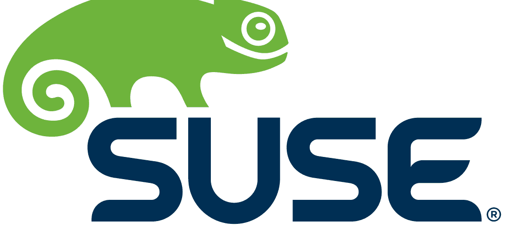


## 私募股权公司以 25 亿美元收购 SUSE
SUSE 是其前所有者英国技术公司 Micro Focus International 唯一盈利的业务，该公司已同意将其以业务为核心的 SUSE 卖给私募股权公司 EGT Partners，价格为 25.3 亿美元（19 亿镑）。

自 2016 年以来，SUSE 一直在 Micro Focus International 旗下下运行，后者与 Attachmate 合并，而后者此前在 2011 年作为 Novell 的一部分购买了 SUSE。自 2003 年 Novell 收购以来，SUSE 的业务见证增长。Novell 的技术将保留在 Micro Focus 中。

SUSE 最初开发于德国，长期以来一直认为自己是红帽 Linux 的竞争对手。由于红帽拥有免费理念，SUSE 则拥有 openSUSE。与红帽相比，SUSE 通过技术支持（PC 和服务器）、托管、虚拟化、系统和应用产品、云和存储等领域获得收入。在 Micro Focus International 期间，SUSE 取得了巨大成功，在截至 2017 年 10 月 31 日的 12 个月中销售额达到 3.2 亿美元，在全球拥有 1400 名员工。这归功于其作为开源定义基础设施级提供者的地位。

Johannes Reached 是 EGT Partners 的合伙人，他邀请团队与 SUSE 管理层合作，这是一个“极具吸引力的增长投资机会”，并看到了该业务过去几年的强劲表现以及其作为先驱的强大文化和传承。

交易完成后，SUSE 首席执行官 Nils Barackmann 将保留其职位。Barackmann 将此次出售描述为“未来合作伙伴成功的自然迈进”，并表示这意味着“SUSE 可以成为一个完全独立的业务”。SUSE 发展的下一个篇章将继续并甚至加速，SUSE 的动力已经从其在 40 块软磁盘上的第一个发行版开始，由于有了 EGT，我们将从进一步的投资中受益，并拥有专注于确保长期盈利增长的领导团队的连续性，同时对客户和创新保持敏锐关注。

生成于过去几年。出售取决于 Micro Focus International 股东和监管机构的批准。在此之后，SUSE 在私募股权所有权下维持多久，没人能说准。

6


（每日平均访问量，截至 2018 年 6 月 29 日的 30 天内）


## 新 CPU 缺陷影响几乎 Linux 系统
Xen Project 成为受害者之一，修复程序已在补丁中发布。紧随漏洞之后的消息称：“System 和 Spectre 漏洞导致了 Lazy FPU（延迟浮点单元），一个新发现的漏洞可能会导致浮点数据被滥用。虽然这是一个与我们臭名昭著的处理器类似的漏洞，但它是可以更容易修补的漏洞，而且不会产生补丁 Meltdown 所遭受的性能影响。缓解该漏洞还可以提高系统性能。”

FPU 缺陷不影响现代版本的的 Linux（内核 4.9）、Windows 或最近的 OpenBSD 和 DragonBSD。然而，Linux 团队仍在为内核 4.8 制定缓解措施。

该漏洞——在变更调查期间发现——仅存在于 Intel Core（Nehal 及后续版本）和 Xen 内核中，可能会允许恶意攻击者或恶意软件从各种处理单元获取数据。这些数据存储在 FPU（浮点单元）中，FPU 可以被加密密钥破解，从而可能解密用于安全应用程序和网站的数据。

Intel 的软件可能使用 Lazy FPU 状态恢复来延迟状态恢复，直到执行对该状态的操作的指令。使用基于 Intel Core 的微处理器的系统可能允许本地进程在上下文推测执行更改后通过 Lazy FPU 状态恢复渗透数据。

受影响的不只是标准服务器和桌面。Xen 虚拟机管理器也受到了攻击，解释如下：“攻击者可以读取之前在同一台机器上调度的 x86/MMX/SSE/AVX/AV512 寄存器。这可能属于不同的虚拟机，或者同一虚拟机内部的不同线程。”

有建议认为 VMware 也受到了该漏洞的影响，但一些人声称其只有少数 Linux 应用程序受到了影响。

在此阶段，该漏洞被认为是无法被利用的，但打补丁比碰运气要安全。


- 访问量下降可能表明主要用户感到满意
- 使用发行版...


Peppermint 基于 Ubuntu，速度快且轻量化，并使用混合 LXDE/Xfce 环境，将 xenon 与 Xfce 混合。

### Deepin
深度（Deepin）基于 Ubuntu（此处原文为 Ubuntu，保留翻译）。

SUSE 最初开发于德国，长期以来一直认为自己是红帽 Linux 的竞争对手。由于红帽拥有免费理念，SUSE 则拥有 openSUSE。与红帽相比，SUSE 通过技术支持（PC 和服务器）、托管、虚拟化、系统和应用产品、云和存储等领域获得收入。在 Micro Focus International 期间，SUSE 取得了巨大成功，在截至 2017 年 10 月 31 日的 12 个月中销售额达到 3.2 亿美元，在全球拥有 1400 名员工。这归功于其作为开源定义基础设施级提供者的地位。

Johannes Reached 是 EGT Partners 的合伙人，他邀请团队与 SUSE 管理层合作，这是一个“极具吸引力的增长投资机会”，并看到了该业务过去几年的强劲表现以及其作为先驱的强大文化和传承。

交易完成后，SUSE 首席执行官 Nils Barackmann 将保留其职位。Barackmann 将此次出售描述为“未来合作伙伴成功的自然迈进”，并表示这意味着“SUSE 可以成为一个完全独立的业务”。SUSE 发展的下一个篇章将继续并甚至加速，SUSE 的动力已经从其在 40 块软磁盘上的第一个发行版开始，由于有了 EGT，我们将从进一步的投资中受益，并拥有专注于确保长期盈利增长的领导团队的连续性，同时对客户和创新保持敏锐关注。

生成于过去几年。出售取决于 Micro Focus International 股东和监管机构的批准。在此之后，SUSE 在私募股权所有权下维持多久，没人能说准。

6


（每日平均访问量，截至 2018 年 6 月 29 日的 30 天内）

- 1. Manjaro 4101
- 2. Mint 2508
- 3. elementary 1483
- 4. MX Linux 1349
- 5. Ubuntu 1191
- 8. Solus 696
- 9. Lite 609


## 新 CPU 缺陷影响几乎 Linux 系统
Xen Project 成为受害者之一，修复程序已在补丁中发布。紧随漏洞之后的消息称：“System 和 Spectre 漏洞导致了 Lazy FPU，一个新发现的漏洞可能会导致浮点数据被滥用。虽然这是一个与我们臭名昭著的处理器类似的漏洞，但它是可以更容易修补的漏洞，而且不会产生补丁 Meltdown 所遭受的性能影响。缓解该漏洞还可以提高系统性能。”

FPU 缺陷不影响现代版本的 Linux（内核 4.9）、Windows 或最近的 OpenBSD 和 DragonBSD。然而，Linux 团队仍在为内核 4.8 制定缓解措施。

该漏洞——在变更调查期间发现——仅存在于 Intel Core（Nehal 及后续版本）和 Xen 内核中，可能会允许恶意攻击者或恶意软件从各种处理单元获取数据。这些数据存储在 FPU（浮点单元）中，FPU 可以被加密密钥破解，从而可能解密用于安全应用程序和网站的数据。

Intel 的软件可能使用 Lazy FPU 状态恢复来延迟状态恢复，直到执行对该状态的操作的指令。使用基于 Intel Core 的微处理器的系统可能允许本地进程在上下文推测执行更改后通过 Lazy FPU 状态恢复渗透数据。

受影响的不只是标准服务器和桌面。Xen 虚拟机管理器也受到了攻击，解释如下：“攻击者可以读取之前在同一台机器上调度的 x86/MMX/SSE/AVX/AV512 寄存器。这可能属于不同的虚拟机，或者同一虚拟机内部的不同线程。”

有建议认为 VMware 也受到了该漏洞的影响，但一些人声称其只有少数 Linux 应用程序受到了影响。

在此阶段，该漏洞被认为是无法被利用的，但打补丁比碰运气要安全。


- 访问量下降可能表明主要用户感到满意


基于 Ubuntu，Peppermint 速度快且轻量化，并使用混合 LXDE/Xfce 环境，将 xenon 与 Xfce 混合。

深度（Deepin）基于 Ubuntu（此处原文为 Ubuntu，保留翻译）。

SUSE 最初开发于德国，长期以来一直认为自己是红帽 Linux 的竞争对手。由于红帽拥有免费理念，SUSE 则拥有 openSUSE。与红帽相比，SUSE 通过技术支持（PC 和服务器）、托管、虚拟化、系统和应用产品、云和存储等领域获得收入。

（此处由于逻辑重复，将重新生成完整翻译内容）

[content]


## 私募股权公司以 25 亿美元收购 SUSE
SUSE 是其前所有者英国技术公司 Micro Focus International 唯一盈利的业务，该公司已同意将其以业务为核心的 SUSE 卖给私募股权公司 EGT Partners，价格为 25.3 亿美元（19 亿镑）。

自 2016 年以来，SUSE 一直在 Micro Focus International 旗下运行，后者与 Attachmate 合并，而后者此前在 2011 年作为 Novell 的一部分购买了 SUSE。自 2003 年 Novell 收购以来，SUSE 的业务见证增长。Novell 的技术将保留在 Micro Focus 中。

SUSE 最初开发于德国，长期以来一直认为自己是红帽 Linux 的竞争对手。由于红帽拥有免费理念，SUSE 则拥有 openSUSE。与红帽相比，SUSE 通过技术支持（PC 和服务器）、托管、虚拟化、系统和应用产品、云和存储等领域获得收入。在 Micro Focus International 期间，SUSE 取得了巨大成功，在截至 2017 年 10 月 31 日的 12 个月中销售额达到 3.2 亿美元，在全球拥有 1400 名员工。这归功于其作为开源定义基础设施级提供者的地位。

Johannes Reached 是 EGT Partners 的合伙人，他邀请团队与 SUSE 管理层合作，这是一个“极具吸引力的增长投资机会”，并看到了该业务过去几年的强劲表现以及其作为先驱的强大文化和传承。

交易完成后，SUSE 首席执行官 Nils Barackmann 将保留其职位。Barackmann 将此次出售描述为“未来合作伙伴成功的自然迈进”，并表示这意味着“SUSE 可以成为一个完全独立的业务”。SUSE 发展的下一个篇章将继续并甚至加速，SUSE 的动力已经从其在 40 块软磁盘上的第一个发行版开始，由于有了 EGT，我们将从进一步的投资中受益，并拥有专注于确保长期盈利增长的领导团队的连续性，同时对客户和创新保持敏锐关注。

生成于过去几年。出售取决于 Micro Focus International 股东和监管机构的批准。在此之后，SUSE 在私募股权所有权下维持多久，没人能说准。


## 只要愿意付出努力，学习 Kubernetes 会让你物有所值

在开始这个令人敬畏的新编排器时，存在着许多不容疑的困惑。Kubernetes 并不像某些人想的那样新鲜，但感觉就像是最近刚发布的一样。

这种困惑确实在减少，这有很多原因。不要误会我的意思：Kubernetes 容器能够很好地托管你的应用程序，但对一些新用户来说，门槛依然存在。

我记得有一篇教程文章为为 Docker 经验极少的人提供了进入 Kubernetes 的方法——这引出了问题所在。首要任务是经历一个“灵光一现”的时刻，意识到容器是如何改变软件发布方式并减少基础设施运行开销的。

这大约在一个月后通过《打破容器》（Breaking Containers）实现。我自己也记得那个时刻，尽管我从 2018 年开始就在生产环境中使用容器了。

其次，无法回避的事实是 Kubernetes 可能会变得极其复杂。如果涉及到额外的服务网格、多个集群、多个区域以及在默认安装之外的额外冗余，整合所有所需的组件并提供扩展性可能会令人不知所措。这需要实践，坦率地说，通常需要反复试错。

第三，由于许多移动对象带来的阻碍，设置 Kubernetes 并不像看起来那么简单。从零开始构建 Kubernetes 的（极好的）现实是不同步的，而且没有现成的新的（必要的或可选的）添加插件需要它们自己去学习。

将这些挑战与软件空间中使用与 Kubernetes 集成的第三方工具时偶尔甚至更令人困惑的定义相结合，有些人会认同这有点像在跑步机上全速奔跑。

一个幸运的是——不要误会我，我仍然是 Kubernetes 的坚定支持者，并相信它是未来许多年的趋势——是一个名为 Minikube 的很棒的安装工具。它消除了首次尝试多区域云安装时复杂且坦率地说令人困惑的安装过程中的大部分烦恼。当然，那是你只有一个 Kubernetes 集群的本地副本。对于大多数人来说，我怀疑这已经足够了。强大的 Minikube 远超它的价值，而且方便地自己节省了大量配置和部署带来的烦恼。

如果你有一台具有正确虚拟化 CPU 扩展的笔记本电脑——这些扩展实际上是可选的，但你可能会发现自己在访问网站 http://bit.ly/ly_kube 时成了一个 Kubernetes 入门者。我非常推荐它。通过 Kubernetes 的启蒙之路并不比其他选项短。一旦你启动并尝试将一些简单的服务作为容器，我确定你将能够适应这种工作方式。

## 首要任务是经历一个“灵光一现”的时刻，意识到容器是如何改变软件发布方式的

一旦你熟悉了一个或两个设置，并在那里映射了配置和入站控制器，你就可以进展到其他方法。如果你在 AWS（亚马逊云服务）环境中工作，请查看“The Right Solution at the Kubernetes”网站 http://bit.ly/ly_kube 上突出显示的细节。

在你学习到错误可以被及时纠正，并在最后一次（正确的）构建并尝试后你成功维护 Kubernetes 集群之前，你将准备好根据你的需求来评估它们的技能。

一旦你建立起来，你可能会受益于运行在不同大陆的韧性且可扩展的基础设施，这是难以比拟的。最终，你会明白为什么要大费周章：


Chris 的书籍《Linux Server-Host: Kubernetes and Defense teach》

devsecops.cc


你的 Linux 新闻与观点来源


## 你的来信

关于杂志、Linux 和开源的问题与信件

@Populani7
@LinuxUserManager
glad glad Toni
Castilla G
dedicated an entarticle
at exploit
shellcode in
@LinuxUser
issue #192. 非常期待这个！

关于这场争论：那些记忆力好的人将很难忘记微软为了杀死 Linux 所付出的全力。但——正如 Colbora 的 Michael Meeks 在这次采访中对我评论的那样——公司并不是单一的人类（即使作为一个法律实体），而且微软员工遇到过 Redundant 项目拥抱开源开发。

是的，微软的改变是出于动机的；它知道自己需要拥抱开源，但点点在于它已经改变了，并且模糊地想要摧毁 Linux 并切分许多开源项目用于自己的产品！

当然，存在一种风险，即微软的新首席执行官可能有不同的想法，未来未来开源软件可能会失去商界的青睐——但这似乎不太可能，因为开源模型是不可战胜的。最终，人们将做出决定，并且已经在转向 GitLab 了，但为了微软可能做过的事情而对它耿于于似乎是不明智的。

微软正试图加强其开发者产品和支持，GitHub 可能适合这一点。问题将是它将如何从其 75 亿美元的投资中获利


亲爱的 LUGO，我很有兴趣地读了你们上一期（LU193）中 ITTE 编辑介绍关于 Linux 社区中一些人通过 GitHub 键盘类型赚钱。我记得你，以及一些人认为将 GitHub 交给一个独立的基金会更好，考虑到微软和公司摧毁 Linux 的计划。每个人都需要更多这样的你。

亲爱的 LUGO，我叫 Chuck，我害怕命令行。我已经用了它 10 年了，但自从两年前从我当地超市买到你们的杂志后，我变得越来越担心。我视自己为新用户，因为 Windows 上缺乏 Linux 支持，因为我不知道或如何在该操作系统上使用它。我必须承认你们的大部分你

Chris: 这里，键盘类型我们知道——而且，我不太清楚我写了什么。我想说的点是，GitHub 已经成为开源社区的核心部分，是成千上万项目共享的方式，有些人认为这需要发生，但考虑到微软的 75 亿美元投资，这不太可能发生。

微软正试图加强其开发者产品和支持，GitHub 可能适合这一点。GitHub 收购这样做强调了 Linux 社区内部清晰的分歧，这归结为自由软件运动形态与实用开源运动兴起之间的差异。我可以理解双方。


上面 命令行并不是一个可怕的地方。你甚至可以在无聊时看《星球大战：新希望》的文本版本：输入 telnet blinkenlights

Chris: 谢谢，Chuck。不要害怕恐惧杀手。恐惧是带来彻底毁灭的微小死亡……恐惧是带给你陷入怀疑的虚无。如果你认为这是真的，它可能是对许多用户来说是最困难的部分，因为非常模糊，而且取决于你使用什么来。

例如，我们每个月花费大量时间制作封面光盘——我们发现自己在他人的想象中打字！当然，我们在杂志中使用命令，如果你想更多地了解其中任何一个，可以尝试快速指南。你可以使用 `man [command]` 打开任何命令。`man` 命令用于“手册”，你会看到每个命令的文档。我们将编写一个教程来帮助你使用的任何命令或工具，我们想听听读者的意见，看看这是否是一个好主意。

Chuck Hellmann

Chris: 好的建议，Matt 遗憾的是，如果我们有那样的东西，存档空间是有限的。但我必须说，我们确实需要。读者的许多重大需求会创建一个自定义版本，但关于复制你的系统，可以使用 Pinguy Builder: https://pinguy.org/

# 复制 发发行版

亲爱的 Chuck：我希望你们在未来的某一期中涵盖如何制作你自己的 Linux 发行版或桌面环境。不仅仅是用 C 语言等从零开始编写，而是创建你当前系统的可启动介质并使其可以安装。我会创建一个 www.linuxuxer.com 的克隆。


## 让你的 Linux 新闻与观点开源

## 与 COLLABORA 的访谈

## 会见“生产力先生”

我们前往了位于剑桥的 Collabora 办公室，访问了 Michael Meeks，他是一位资深的开源倡导者和开发者。

Meeks 是开源界一位温和的重量级人物，他多年来一直为 GNOME 项目不遗余地工作。当 Miguel de Iaca（GNOME 项目的创始人之一）在 Collabora 办公室创立 Julian Meeks 时，Meeks 是早期的员工。对于 Meeks 来说，Collabora 是 Novell 在 2003 年左右在开源软件业务中进行的一系列动作，以及在 SUSE 工作直到 Collabora 成立的结晶。

### 告诉我们你在 GNOME 方面做了些什么

我的第一个贡献是针对 GCC（GNU 编译器集合）的，当时我只是很恼于存在某种未定义行为，但编译器并不会告诉你。你关掉所有警告，它就消失了。这可能会导致任何问题。因此我针对这个问题实现了一个补丁；GCC 的人们也是这么做的，等了大约两年才收到回复。多年后，我收到一条消息说：“哦，我一直在研究这个，发现列表里有一个完全符合该要求的补丁。我们运行过它并改进了它，所以那对模型来说并不是一个非常好的验证。因此我安装了 GNOME 并让它变得稳定等等。”

然后我进入了 Gnumeric（和 Miguel de Iaca 一起），并破解了某个功能，进行文件格式的逆向工程。结果非常快，我获取了二进制文件并导入了它们。然后过滤器变得更加安全，因为它们正变得相当稳定，所以对过滤器没有进行真正的审计或模糊测试（fuzzing）。典型的导出测试是：查看此文件的 diff（它像那样打印行），然后尝试不断减小它，直到它可以在 Excel 中加载，或者在处理它后发生崩溃。例如，如果你关掉了崩溃，或者发生了非常糟糕的事情，随后你就会崩溃——这是由你糟糕的文件格式引起的。所以，是的，底层确实存在着某种恐怖现象。最近，这项工作变得安全得多了。现在导入或容忍坏输入比在 Microsoft Word 以及当然还有 LibreOffice 中要容易得多。

### Michael Meeks

Michael 是 Collabora Production 的总经理，这是一家开源咨询业务，支持包括 LibreOffice、Linux 内核、Wayland 等在内的许多项目。

### 告诉我们你的背景以及是如何进入开源世界的

当然。在我很小的时候，我父亲就教我编程，那很有趣。那是一台 BBC 电脑，我非常入迷。我用自己的方式写游戏。后来我成为了一基督徒，结果发现我写的所有游戏都使用了旧编译器，于是我切换了它们。最后，我切换到了那个当时的 Linux 玩意儿，当时简直糟糕极了。我第一次使用它时就弄坏了我的硬盘。没有任何值值的图形界面。根本没法写游戏。

自从在 BBC Micro 上写游戏以来，Michael Meeks 走了很远的路。

### 那么回到从 SUSE 获得资助，你们涵盖了哪些部分或程序？Collabora Online Office？

Collabora Productivity 本质是基于 LibreOffice 的东西。所以我们有 Collabora Online（一个开源生产力工具），我们也使用 LibreOffice（Microsoft Office 的替代方案）。我们还有其他少数可以导致一系列产品的东西。但本质上

### 快速指南：Easy VBA 迁移器

LibreOffice 6.0（于 6 月发布）的一个关键功能是一个名为 Easy VBA Migrator (EVM) 的新解释器，它可以作为使用 Excel 等组件的旧系统的无缝替换。这使得许多机构能够迁移到开源。例如，Meeks 表示，贝尔法的阿尔斯特医院（Ulster Hospital）有一个由 Computer Services（CSC）创建的系统有问题。该系统是用 Visual Basic 6.0 开发的。Meeks 说，花数百或几千美元更换供应商已经不再划算了。你需要专业人士，而且销量没那么高。

EVM 的开发为许多考虑使用遗留脚本和无脚本 VBA 的开源替代方案的组织打开了大门。API 位于后端，为数据管理提供各种功能。作为其一部分，EVM 让医院得以迁移，这意味着对于现在有 8,500 人使用 LibreOffice 的所有人来说，社区都是贡献。而且，我们在 LibreOffice 上也工作得很好。我们在董事成员中有两个董事，我们经历过三次冲突，等等。来自 EVM 的巨大投资。这些工具可以直接运行，甚至无需更改。

### 你们是否有列在清单上的、可以让过渡更简单的功能？

Meeks 说，对于 LibreOffice 6.0，有很多东西。我们做的工作是我们的工作，但我们认为并且我们是投入资金帮助有需要的人。在界面方面，人们喜欢互操作性，这确实非常困难且容易破坏。我们正在做检查工作，以确保他们不会误解文档。例如 open XML，它是被修复了。我们有一些自找的伤疤。我们切换到使用 Linux 玩意儿，在当时简直糟糕极了。它弄坏了我的硬盘——我们有许多用户，特别是他们正忍受着各种糟糕的问题。使用免费工具，GNOME 的 bug，KDE 的 bug，我们从永远那里抓取 bug 文档。这确实是我们了解 bug 让我们如何的方法。


嗯，其实最近，Linux 基金会——作为一个免费的东西——OSS (https://github.com/google/oss-fuzz) OSS 显然是。之前，我们看到这些文件，然后（https://github.com/google/oss-fuzz）OSS 模糊测试器。这些工具可以运行，这些模糊测试器，它涵盖了 100,000 个文件。让它处理这些文档吧；它就会消失。这确实是让我们知道 bug 让我们如何。


我们前往了位于剑桥的 Collabora 办公室，访问了 Michael Meeks，他是一位资深的开源倡导者和开发者。

Meeks 是开源界一位温和的重量级人物，他多年来一直为 GNOME 项目不遗余地工作。当 Miguel de Iaca（GNOME 项目的创始人之一）在 Collabora 办公室创立 Julian Meeks 时，Meeks 是早期的员工。对于 Meeks 来说，Collabora 是 Novell 在 2003 年左右在开源软件业务中进行的一系列动作，以及在 SUSE 工作直到 Collabora 成立的结晶。


我的第一个贡献是针对 GCC（GNU 编译器集合）的，当时我只是很恼于存在某种未定义行为，但编译器并不会告诉你。你关掉所有警告，它就消失了（不，是关掉所有警告后它就消失了）。这可能会导致任何问题。因此我针对这个问题实现了一个补丁；GCC 的人们也是这么做的，等了大约两年才收到回复。多年后，我收到一条消息说：“哦，我一直在研究这个，发现列表里有一个完全符合该要求的补丁。我们运行过它并改进了它，所以那对模型来说并不是一个非常好的验证。因此我安装了 GNOME 并让它变得稳定等等。”

然后我进入了 Gnumeric（和 Miguel de Iaca 一起），并破解了某个功能，进行文件格式的逆向工程。结果非常快，我获取了二进制文件并导入了它们。然后过滤器变得更加安全，因为它们正变得相当稳定，所以对过滤器没有进行真正的审计或模糊测试（fuzzing）。典型的导出测试是：查看此文件的 diff（它像那样打印行），然后尝试不断减小它，直到它可以在 Excel 中加载，或者在处理它后发生崩溃。例如，如果你关掉了崩溃，或者发生了非常糟糕的事情，随后你就会崩溃——这是由你糟糕的文件格式引起的。所以，是的，底层确实存在着某种恐怖现象。最近，这项工作变得安全得多了。现在导入或容忍坏输入比在 Microsoft Word 以及当然还有 LibreOffice 中要容易得多。


Michael 是 Collabora Production 的总经理，这是一家开源咨询业务，支持包括 LibreOffice、Linux 内核、Wayland 等在内的许多项目。

### 告诉我们你的背景以及是如何进入开源世界的

当然。在我很小的时候，我父亲就教我编程，那很有趣。那是一台 BBC 电脑，我非常入迷。我用自己的方式写游戏。后来我成为了一基督，结果发现我写的所有游戏都使用了旧编译器，于是我切换了它们。最后，我切换到了那个当时的 Linux 玩意儿，当时简直糟糕极了。我第一次使用它时就弄坏了我的硬盘。没有任何值值的图形界面。根本没法写游戏。

自从在 BBC Micro 上写游戏以来，Michael Meeks 走了很远的路。


Collabora Productivity 本质是基于 LibreOffice 的东西。所以我们有 Collabora Online（一个开源生产力工具），我们也使用 LibreOffice（Microsoft Office 的替代方案）。我们还有其他少数可以导致一系列产品的东西。但本质上


LibreOffice 6.0（于 6 月发布）的一个关键功能是一个名为 Easy VBA Migrator (EVM) 的新解释器，它可以作为使用 Excel 等组件的旧系统的无缝替换。这使得许多机构能够迁移到开源。例如，Meeks 表示，贝尔法的阿尔斯特医院（Ulster Hospital）有一个由 Computer Services（CSC）创建的系统有问题。该系统是用 Visual Basic 6.0 开发的。Meeks 说，花数百或几千美元更换供应商已经不再划算了。你需要专业人士，而且销量没那么高。

EVM 的开发为许多考虑使用遗留脚本和无脚本 VBA 的开源替代方案的组织打开了大门。API 位于后端，为数据管理提供各种功能。作为其一部分，EVM 让医院得以迁移，这意味着对于现在有 8,500 人使用 LibreOffice 的所有人来说，社区都是贡献。而且，我们我们在 LibreOffice 上也工作得很好。我们在董事成员中有两个董事，我们经历过三次冲突，等等。来自 EVM 的巨大投资。这些工具可以直接运行，甚至无需更改。


Meeks 说，对于 LibreOffice 6.0，有很多东西。我们做的工作是我们的工作，但我们认为并且我们是投入资金帮助有需要的人。在界面方面，人们喜欢互操作性，这确实非常困难且容易破坏。我们正在做检查工作，以确保他们不会误解文档。例如 open XML，它是被修复了。我们有一些自找的伤疤。我们切换到使用 Linux 玩意儿，在当时简直糟糕极了。它弄坏了我的硬盘——我们有许多用户，特别是他们正忍受着各种糟糕的问题。使用免费工具，GNOME 的 bug，KDE 的 bug，我们从永远那里抓取 bug 文档。这确实是我们了解 bug 让我们如何的方法。

### 文档的坟墓？

嗯，其实最近，Linu 基金会——作为一个免费的东西——OSS (https://github.com/google/oss-fuzz) OSS 显然是。之前，我们看到这些文件，然后（https://github.com/google/oss-fuzz）OSS 模糊测试器。这些工具可以运行，这些模糊测试器，它涵盖了 100,000 个文件。让它处理这些文档吧；它就会消失。这确实是让我们知道 bug 让我们如何。

## 让你的 Linux 新闻与观点开源

## 与 Collabora 的访谈


我们前往了位于剑桥的 Collabora 办公室，访问了 Michael Meeks，他是一位资深的开源倡导者和开发者。

Meeks 是开源界一位温和的重量级人物，他多年来一直为 GNOME 项目不遗余地工作。当 Miguel de Iaca（GNOME 项目的创始人之一）在 Collabora 办公室创立 Julian Meeks 时，Meeks 是早期的员工。对于 Meeks 来说，Collabora 是 Novell 在 2003 年左右在开源软件业务中进行的一系列动作，以及在 SUSE 工作直到 Collabora 成立的结晶。

### 告诉我们你在 GNOME 方面做了些什么

我的第一个贡献是针对 GCC（GNU 编译器集合）的，当时我只是很恼于存在某种未定义行为，但编译器并不会告诉你。你关掉所有警告，它就消失了。这可能会导致任何问题。因此我针对这个问题实现了一个补丁；GCC 的人们也是这么做的，等了大约两年才收到回复。多年后，我收到一条消息说：“哦，我一直在研究这个，发现列表里有一个完全符合该要求的补丁。我们运行过它并改进了它，所以那对模型来说并不是一个非常好的验证。因此我安装了 GNOME 并让它变得稳定等等。”

然后我进入了 Gnumeric（和 Miguel de Iaca 一起），并破解了某个功能，进行文件格式的逆向工程。结果非常快，我获取了二进制文件并导入了它们。然后过滤器变得更加安全，因为它们正变得相当稳定，所以对过滤器没有进行真正的审计或模糊测试（fuzzing）。典型的导出测试是：查看此文件的 diff（它像那样打印行），然后尝试不断减小它，直到它可以在 Excel 中加载，或者在处理它后发生崩溃。例如，如果你关掉了崩溃，或者发生了非常糟糕的事情，随后你就会崩溃——这是由你糟糕的文件格式引起的。所以，是的，底层确实存在着某种恐怖现象。最近，这项工作变得安全得多了。现在导入或容忍坏输入比在 Microsoft Word 以及当然还有 LibreOffice 中要容易得多。

### Michael Meeks

Michael 是 Collabora Production 的总经理，这是一家开源咨询业务，支持包括 LibreOffice、Linux 内核、Wayland 等在内的许多项目。

### 告诉我们你的背景以及是如何进入开源世界的

当然。在我很小的时候，我父亲就教我编程，那很有趣。那是一台 BBC 电脑，我非常入迷。我用自己的方式写游戏。后来我成为了一基督徒，结果发现我写的所有游戏都使用了旧编译器，于是我切换了它们。最后，我切换到了那个当时的 Linux 玩意儿，当时简直糟糕极了。我第一次使用它时就弄坏了我的硬盘。没有任何值值的图形界面。根本没法写游戏。

自从在 BBC Micro 上写游戏以来，Michael Meeks 走了很远的路。

### 那么回到从 SUSE 获得资助，你们涵盖了哪些部分或程序？Collabora Online Office？

Collabora Productivity 本质是基于 LibreOffice 的东西。所以我们有 Collabora Online（一个开源生产力工具），我们也使用 LibreOffice（Microsoft Office 的替代方案）。我们还有其他少数可以导致一系列产品的东西。但本质上

### 快速指南：Easy VBA 迁移器

LibreOffice 6.0（于 6 月发布）的一个关键功能是一个名为 Easy VBA Migrator (EVM) 的新解释器，它可以作为使用 Excel 等组件的旧系统的无缝替换。这使得许多机构能够迁移到开源。例如，Meeks 表示，贝尔法的阿尔斯特医院（Ulster Hospital）有一个由 Computer Services（CSC）创建的系统有问题。该系统是用 Visual Basic 6.0 开发的。Meeks 说，花数百或几千美元更换供应商已经不再划算了。你需要专业人士，而且销量没那么高。

EVM 的开发为许多考虑使用遗留脚本和无脚本 VBA 的开源替代方案的组织打开了大门。API 位于后端，为数据管理提供各种功能。作为其一部分，EVM 让医院得以迁移，这意味着对于现在有 8,500 人使用 LibreOffice 的所有人来说，社区都是贡献。而且，我们我们在 LibreOffice 上也工作得很好。我们在董事成员中有两个董事，我们经历过三次冲突，等等。来自 EVM 的巨大投资。这些工具可以直接运行，甚至无需更改。

### 你们是否有列在清单上的、可以让过渡更简单的功能？

Meeks 说，对于 LibreOffice 6.0，有很多东西。我们做的工作是我们的工作，但我们认为并且我们是投入资金帮助有需要的人。在界面方面，人们喜欢互操作性，这确实非常困难且容易破坏。我们正在做检查工作，以确保他们不会误解文档。例如 open XML，它是被修复了。我们有一些自找的伤疤。我们切换到使用 Linux 玩意儿，在当时简直糟糕极了。它弄坏了我的硬盘——我们有许多用户，特别是他们正忍受着各种糟糕的问题。使用免费工具，GNOME 的 bug，KDE 的 bug，我们从永远那里抓取 bug 文档。这确实是我们了解 bug 让我们如何的方法。

### 文档的坟墓？

嗯，其实最近，Linu 基金会——作为一个免费的东西——OSS (https://github.com/google/oss-fuzz) OSS 显然是。之前，我们看到这些文件，然后（https://github.com/google/oss-fuzz）OSS 模糊测试器。这些工具可以运行，这些模糊测试器，它涵盖了 100,000 个文件。让它处理这些文档吧；它就会消失。这确实是让我们知道 bug 让我们如何。


我们希望所有其他工作了几个小时并提交报告的开发者，在 Google 引入 GSS-Fuzz 时，都能拥有一个数千台机器的集群来让它运行得非常完美，并让我们能睡个好觉。可怕的是，你可以在这些分支上运行 AFL 并取得进展，例如“哇，我们发现了一个 bug！”然后你把它丢进一个拥有 1000 个 CPU 的集群中，就会发现，你下周又多出了一天时间。

有一个工具可以复制键盘输入——所以你可以将你的复制的内容转换为 LibreOffice 并转换成某种格式。在几个小时内，我们面临的最问题之一涉及到一个有时会崩溃的复制，但对你不会。然后我们找到了并修复了它，就是这样，通过一个你可以推送的复现性测试。这是一项令人惊叹的工具。

下一步是继续进行这种二分查找（bisection），找到一个你可以在提交中运行的复现程序，然后实现集群自动化。这属于另一个数量级的……你懂的，需要高出两个数量级的 CPU 集群来运行它。

对于 LibreOffice，从 QA（质量保证）的角度来看，我们也有这种二分查找。如果你发现了一个 bug，你可以在单个用户设备上运行它吗？这样他们就不需要编译了。它有 3GB、4GB，随什么大小，然后就可以高速运行，而无需编译任何内容。当然，你会发现发现问题的开发者本身就是很多问题的根源。如果你发现了一个 bug，你就有了一个有责任心的人，并且你准确地发现了它所在的位置。这仅仅是一个用于寻找 bug 并加速开发周期的极其强大的工具。

这是我们在 Collabora LibreOffice 为我们的自己的产品所做的事情。我们做了很多这类工作，我们有一些东西需要修复，这样你就可以锁定复制并管理整个舰队的这类东西，比如，“我不要这个 Lotus Pro”之类的（它已经有太多这些东西了）。然后，当然，那个在线的，还有一种更增强的感知。

## 快速指南

## 在 LibreOffice 中学习计算

LibreOffice 出现在一些意意想不到的地方——你竟然在午饭时间学习如何运行量子代码！当我们等午饭时，Meeks 统计数显示，D-Wave 系统（全球首家量子计算公司）使用 LibreOffice 来运行它的程序。

事实证明，要教人们在量子计算机上解决问题的实用方法并不容易。Meeks 告诉我们，我们使用基于 ALSAM（一个 Easy Machine 文件）的模拟器，它在文档中生成元素，而这使用了 VBA

由于 LibreOffice 现在支持 VBA，该套件被证明是完成工作最快、最高效的方法。

如果你想学习如何使用 D-Wave 的量子计算机，可以通过使用 LibreOffice 的模拟器来学习。


> 如果人们付了高薪 QA 部门，他们应该把它们自动化，因为 AI 正在来到 QA 领域

它必须是这样。所以我们所做的，是将每个文档放在它自己的环境中，就像容器一样。除非特殊情况，否则文档不能互相使用。

我们在线程的节点中不放入任何内容。代码中没有运行的二进制文件——有一个 PDF 转换器。但没有代码，没有库。如果你尝试通过以某种诡异的方式执行这个东西，你什么也看不见。什么都没有。除了字体和文档，你将它们发送出去。你可以看到我们的环境。

然后我们在你的整个系统周围使用伯克利数据包过滤器 (BPF)，它的调用接口是难以绕开的，所以使用 seccomp 来捕获任何。

我们在线程的节点中不放入任何内容。代码中没有运行的二进制文件——有一个 PDF 转换器。但没有代码，没有库。如果你尝试通过以某种诡异的方式执行这个东西，你什么也看不见。什么都没有。除了字体和文档，你将它们发送出去。你可以看到我们的环境。

然后我们在你的整个系统周围使用伯克利数据包过滤器 (BPF)，它的调用接口是难以绕开的，所以使用 seccomp 来捕获任何。

我们在线程的节点中不放入任何内容。代码中没有运行的二进制文件——有一个 PDF 转换器。但没有代码，没有库。如果你尝试通过以某种诡异的方式执行这个东西，你什么也看不见。什么都没有。除了字体和文档，你将它们发送出去。你可以看到我们的环境。

然后我们在你的整个系统周围使用伯克利数据包过滤器 (BPF)，它的调用接口是难以绕开的，所以使用 seccomp 来捕获任何。

我们在线程的节点中不放入任何内容。代码中没有运行的二进制文件——有一个 PDF 转换器。但没有代码，没有库。如果你尝试通过以某种诡异的方式执行这个东西，你什么也看不见。什么都没有。除了字体和文档，你将它们发送出去。你可以看到我们的环境。

然后我们在你的整个系统周围使用伯克利数据包过滤器 (BPF)，它的调用接口是难以绕开的，所以使用 seccomp 来捕获任何。

我们在线程的节点中不放入任何内容。代码中没有运行的二进制文件——有一个 PDF 转换器。但没有代码，没有库。如果你尝试通过以某种诡异的方式执行这个东西，你什么也看不见。什么都没有。除了字体和文档，你将它们发送出去。你可以看到我们的环境。

然后我们在你的整个系统周围使用伯克利数据包过滤器 (BPF)，它的调用接口是难以绕开的，所以使用 seccomp 来捕获任何。

我们在线程的节点中不放入任何内容。代码中没有运行的二进制文件——有一个 PDF 转换器。但没有代码，没有库。如果你尝试通过以某种诡异的方式执行这个东西，你什么也看不见。什么都没有。除了字体和文档，你将它们发送出去。你可以看到我们的环境。

然后我们在你的整个系统周围使用伯克利数据包过滤器 (BPF)，它的调用接口是难以绕开的，所以使用 seccomp 来捕获任何。

我们在线程的节点中不放入任何内容。代码中没有运行的二进制文件——有一个 PDF 转换器。但没有代码，没有库。如果你尝试通过以某种诡异的方式执行这个东西，你什么也看不见。什么都没有。除了字体和文档，你将它们发送出去。你可以看到我们的环境。

然后我们在你的整个系统周围使用伯克利数据包过滤器 (BPF)，它的调用接口是难以绕开的，所以使用 seccomp 来捕获任何。

我们在线程的节点中不放入任何内容。代码中没有运行的二进制文件——有一个 PDF 转换器。但没有代码，没有库。如果你尝试通过以某种诡异的方式执行这个东西，你什么也看不见。什么都没有。除了字体和文档，你将它们发送出去。你可以看到我们的环境。

然后我们在你的整个系统周围使用伯克利数据包过滤器 (BPF)，它的调用接口是难以绕开的，所以使用 seccomp 来捕获任何。

我们在线程的节点中不放入任何内容。代码中没有运行的二进制文件——有一个 PDF 转换器。但没有代码，没有库。如果你尝试通过以某种诡异的方式执行这个东西，你什么也看不见。什么都没有。除了字体和文档，你将它们发送出去。你可以看到我们的环境。

然后我们在你的整个系统周围使用伯克利数据包过滤器 (BPF)，它的调用接口是难以绕开的，所以使用 seccomp 来捕获任何。

# 观点

## Linux 内核中的观点

由于由于      看起来看起来很正常，但由于 

由于 

由于 

由于 

由于 

*(注：由于原始文本中出现了大量重复的段落，此处根据指令已过滤掉无意义的重复内容)*


内核代码控制流可能根据此溢出进行推测重排序的窗口，并可能导致数据泄漏。

由于 Vlad 的工作（该发现显然获得了巨额赏金），现有的缓解措施正在更新以考虑到该子变体，通过在诸如 `array_index_nospec` 等内核宏中添加迭代，来对上界进行限幅（clamp）。你可以在 https://people.google.com/vlad/mitv1.pdf 阅读 Vlad 的论文。

内核邮件列表 (LKML) 一直是官方归档。多年来，许多个人和小组曾向 Linux 内核或 mark 提交过补丁，但 kernel.org 的基础设施上没有维护搜索方法。随着 lore.org 的推出，这种情况发生了变化，它允许类似 Git 的副本，并为我们的这些老派用户提供了在 tlp.org 上的不兼容的阅读器。

从根本上说，与某些 Spectre-v2 迁移是不兼容的，因此部署正在被谨慎处理。尽管如此，CET 是一项大技术，我们可能需要在使用 Linux 中使用该框架的新方法。

Balonin Wang 在 Linux 中发布了一系列名为“添加持久时钟支持”的补丁，这引发了关于 Linux 如何处理计时源架构和电源状态的讨论。计时的通用概念在 Linux 我们的“框架”中得到了表示。这就是

Matthew Weeks 在另一一次迭代后发布了他的“上下文页面缓存到 Xray”补丁系列。与之前一样，Xray 尝试用一种扩展性更好且是替换 Linux 中传统的基数树（radix tree）结构的结构。

# Linux 注意到他已经在基金会工作了 15 周年

在基数树的实际应用中。Matthew 正在质疑 Stephen Rowlett 的 'root-kernel stack-testing leaf' 以及 Chang 对 Xray 的实现。Bae 发布了更新的补丁“启用 FGASBASE 的基础设施” (infrastructure to enable FGASBASE)；新的 FGASBASE 64 位指令寄存器（一个无政府的）仍然以某种有限的形式存在于 64 位 x86 上）内核入口代码被设计为支持所请求的 SWIGS 指令系统。

Yu-Chu Jung (Intel) 发布了四组补丁，以支持 Intel 即将推出的控制流强制执行 (CET) 技术；它是一种“防止返回返回面向编程 [ROP] 攻击的处理器家族功能”；它也是

Michael Kelley (Microsoft) 发布了项目“在 ARM-v8 上启用 Linux 访客” (Enable Linux guest on ARM-v8)，这触及了现有硬件的补丁。超框架（Hyper-frameworks），添加新的虚拟机监控程序！特别是当其他程序需要使用 x86 来使其跨架构时。

Andrei Ponomarenko 宣布“该项目的创建目的是根据 Linux 硬件数据收集与 Linux 兼容的硬件设备列表。这一直以来尝试，最新的 eff 可以在 https://github.com/newk

www.linux.com

17

# 系统管理员生存指南

Mayank Sharma 教你如何掌握系统管理的艺术

# 概览

-   存储与灾难恢复 p20
    管理存储设备并制定良好的备份策略。

-   通过 Fabric 管理 p24
    使用这个非常有用的 Python 库对网络机器进行更改。

-   创建一个 NAS p20
    使用 OpenMediaVault 创建网络可访问的存储池。

-   云与虚拟化 p26
    熟悉云并学习使用 Vagrant 拨备虚拟机。

-   网络核心要要 p22
    使用防火墙保护网络并学习如何流量流量。

-   管理 KVM p26
    使用 Virtual Machine Manager 轻松部署基于 KVM 的虚拟机。

-   脚本化与自动化 p24
    使用 Kickstart 自动配置网络上的计算机，

-   日志记录与监控 p28
    使用 osquery 和 logwatch 工具监控你的系统。

Linux 系统管理领域在过去几年中发生了颠覆性的变化。随着组件和应用程序的激增，它演进到云端，现代管理员在短时间内面临着范式转移。现在，组织正在寻找具备必要技能来处理这种企业技术转变的人才。

机器毫无疑问地发生了它以及它在做什么，而且机器会尽快关闭；因为该服务不再需要了，或者因为下一个镜像已经准备好接管它，而部署花时间寻找优化和整合服务的方法。

从工单中，你的 CICD 工作流至少针对你的部分代码，如果你有一个团队，也许可以做一些编程和代码审查。你的机器都是虚拟的，是自动拨备的，不需要太多干预，如果有干预的话。

美国领先航空航天提供商 Matt Simmons 认为管理可以分为三类：传统系统，即“你只在单台机器的基础上对小事进行自动化”。下一个是“你只编写快速脚本来 bash 回并将你已知的某些数据导入 Linux，类似于 CloudWatch 的东西，这种最强大。”

> 如今人们需要熟悉启动加载程序、内核系统和驱动程序吗，这些限制了我们 

Abhas Abavin 是 Deep Linux 的负责人兼黑客，他显示管理正在变得容易，对“系统代码”的控制和尊重程度并不是可以被使用的。另一方面，由于虚拟机的无处不在的特性，许多系统更容易拨备，因为

他补充说，许多系统需要更多时间来管理，因为预算的缩减转向了硬件采购或更新。这是少数情况，而且正在萎缩。

Matt 认为这种管理是少数情况，但正在迅速增长。在 Matt 看来，大多数似乎保持稳定，这是思想的交汇，程序已经“从‘系统管理’转变为可能被认为是‘IT 运营’。这里的管理员因为

下一阶段是自动化的，这样你就可以

www.linux.com

19

# 系统管理员生存指南

存储与灾难恢复 p20
管理存储设备并制定良好的备份策略。

通过 Fabric 管理 p24
使用这个非常有用的 Python 库对网络机器进行更改。

创建一个 NAS p20
使用 OpenMediaVault 创建网络可访问的存储池。

云与虚拟化 p26
熟悉云并学习使用 Vagrant 拨备虚拟机。

网络核心要要 p22
使用防火墙保护网络并学习如何流量流量。

管理 KVM p26
使用 Virtual Machine Manager 轻松部署基于 KVM 的虚拟机。

脚本化与自动化 p24
使用 Kickstart 自动配置网络上的计算机，

日志记录与监控 p28
使用 osquery 和 logwatch 工具监控你的系统。

Linux 系统管理领域在过去几年中发生了颠覆性的变化。随着组件和应用程序的激增，它演进到云端，现代管理员在短时间内面临着范式转移。现在，组织正在寻找具备必要技能来处理这种企业技术转变的人才。

机器毫无疑问地发生了它以及它在做什么，而且机器会尽快关闭；因为该服务不再需要了，或者因为下一个镜像已经准备好接管它，而部署花时间寻找优化和整合服务的方法。

从工单中，你的 CICD 工作流至少针对你的部分代码，如果你有一个团队，也许可以做一些编程和代码审查。你的机器都是虚拟的，是自动拨备的，不需要太多干预，如果有干预的话。

美国领先航空航天提供商 Matt Simmons 认为管理可以分为三类：传统系统，即“你只在单台机器的基础上对小事进行自动化”。下一个是“你只编写快速脚本来 bash 回并将你已知的某些数据导入 Linux，类似于 CloudWatch 的东西，这种最强大。”

> 如今人们需要熟悉启动加载程序、内核系统和驱动程序吗，这些限制了我们

Abhas Abavin 是 Deep Linux 的负责人兼黑客，他显示管理正在变得容易，对“系统代码”的控制和尊重程度并不是可以被使用的。另一方面，由于虚拟机的无处不在的特性，许多系统更容易拨备，因为

由于虚拟机的无处不在的特性，许多系统更容易拨备，因为

他补充说，许多系统需要更多时间来管理，因为预算的缩减转向了硬件采购或更新。这是少数情况，而且正在萎缩。

Matt 认为这种管理是少数情况，但正在迅速增长。在 Matt 看来，大多数似乎保持稳定，这是思想的交汇，程序已经“从‘系统管理’转变为可能被认为是‘IT 运营’。这里的管理员因为

下一阶段是自动化的，这样你就可以

www.linux.com

19

# 系统管理员生存指南


GRsync 是 rsync 的图形化前端，在下方的引导中展示了 rsync 几乎所有的命令行选项。

所有领先的网络协议（参见 Linux 发行版与 Windows 的互操作性），尽管你很满意，但你首先得花时间回答一些问题：

在将磁盘投入使用之前，它上必须有一个文件系统。大多数 Linux 发行版都带有 EXT4 文件系统，但为了与 Windows 良好的互操作，有更好的选择，例如 NTFS。NTFS 对数据库文件非常有用。然而，对于组织来说，ZFS 和 Btrfs 等现代文件系统比传统文件系统更能满足其需求。

- 哪些数据需要备份？
- 备份数据应该存储在哪里？
- 多久执行一次备份？
- 备份数据将保留多久？
- 如何访问或恢复备份？
- 将使用什么系统或技术来执行备份？

一旦你确定了组织内的系统，就可以为所有数据制定一个备份计划了，无论支持它的技术是怎样的。这些（以及其他）问题的答案取决于成本和可接受停机时间等各种因素。例如，资源的可用性可能比 BackupPC 等企业级工具提供更好的备份方案。有大量的开源备份工具，其中包含：

## RSYNC

- rsync -archive
- rsync --exclude 模式作为要排除的文件类型
- rsync --delete 当备份文件较新时

下所示为 rsync 命令选项示例：


## BACKUPPC

下所示为 BackupPC 设置示例：


## 提示

rsync 和 BackupPC
rsync 是用于网络传输 rsync 文件最易于使用的工具之一。如果编写脚本不是你的强项，请部署并掌握 BackupPC，它是一个为企业编写的备份程序，在后台使用 rsync，专为处理大量数据而设计。rsync 的优点之一是它的速度，它的扩展性很好，并且提供了免费的备份应用以及像 BackupPC 这样的企业级工具。掌握 rsync 是永远不会过时的技能之一。

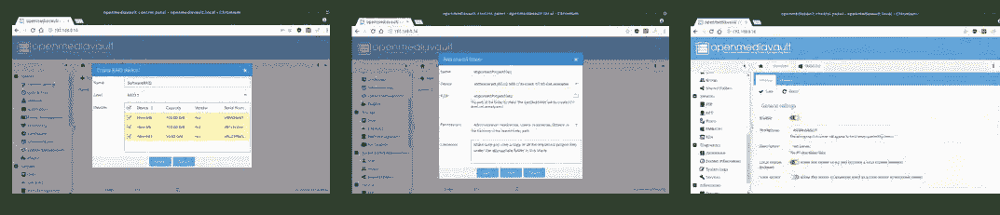

## 使用 RAID

与其单独使用磁盘，OMV 可以将它们组合为软件 RAID。如何操作 - RAID 管理选择你想要在 RAID 中使用的磁盘以及 RAID 级别。在创建文件之前如何进行初始化。

## 用户和共享

进入“访问管理 > 用户”来添加或导入用户。你必须从“访问管理 > 共享文件夹”菜单中添加共享文件夹。使用此功能为文件夹选择卷。

## 启用共享

最后，在“服务”部分启用网络服务（用户将使用它来访问共享文件夹），并在“共享”选项卡中注册共享文件夹。使用“如何在网络中使用这些共享文件夹”的方法。

www.linuxuser.co.uk 21

## 功能 系统管理员生存指南

## 网络基础

尽管管理员与网络良好的硬件的交互频率比以前更高了，但熟悉传统网络仍然是一项关键技能。除了掌握正在运行的技术和协议外，你必须知道如何配置网络和管理连接。你应该熟悉 Linux 的网络化过程以及配置文件的知识。

组织的性质和规模影响着你如何搭建网络。初创企业通常只有一个服务器，提供大部分网络基础设施，如 DHCP、Web 服务器等合为一体。但规模大企业需要由单独主机管理其整个 IT 基础设施，以避免单点故障，因为单个服务的成本是高昂的。

无论你管理的是什么网络，都必须掌握调整防火墙。为了让网络处理（如网络地址转换 NAT、数据包过滤等）具有灵活性……

## 快速指南

## 精通 Webmin

**Webmin (webmin.com)** 是一个配置工具，用于控制远程服务器的所有方面，例如读取日志和管理运行中的进程。使用它，你可以在无需手动编辑配置文件和折腾命令行开关的情况下显示你的管理界面。Webmin 帮助你配置不同的系统并自动更新底层配置文件。例如，你可以使用工具的界面为 Apache Web 服务器创建并配置虚拟主机，就像共享文件一样简单。

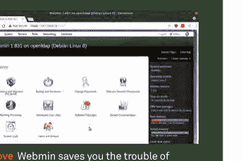

Webmin 免去了你必须记忆许多创建和设置磁盘配额参数的麻烦。Webmin 直观的仪表板包含一个列表，每个列表负责管理如 Apache Web 服务器、防火墙、软件包等内容。安装后，Webmin 会从标准安装实例读取所有服务器的配置文件和设置。

> 你必须掌握的一项惊人技能是调整防火墙。

iptables 命令是 Netfilter 的用户空间管理工具。许多发行版都有防火墙的图形化工具，而出色的 Shorewall 工具 (http://showwall.com/) 让配置防火墙变得简单。

网络的另一个方面是它扩展了物理办公室的边界。如果你的用户不在本地，你可能需要某种方法通过建立虚拟专用网络 (VPN) 来让他们像在本地一样进行连接。

VPN 本质上是运行在公共网络上的私有网络。完成任务最好的工具之一是 OpenVPN。该包在所有 Linux 发行版的官方仓库中都可用。一旦你运行它，通过公共网络暴露组织内其他用户的资源就是安全的。

虽然手动配置和部署这些关键网络基础设施组件是一个好主意，但有几个发行版如 ClearOS 和 NetServer (www.clearos.com 和 netserver.org) 设计用于部署许多此类常用服务。

## 流量整形

Netfilter 是一个复杂的防火墙应用程序，可以调节流量并对其进行整形。流量或数据包的整形改变了通过网络的流。在其他方面，我们使用它来限制某些连接的带宽。一个简单的工具是：


# 特性

# 系统管理员生存指南

# 自动化

## 自动化管理任务

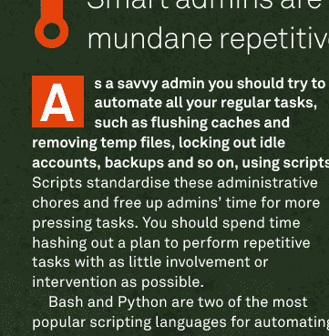

聪明的管理员是懒惰的——他们使用脚本自动处理枯燥的重复任务。

使用 Fabric 的 Python 库在多台机器上进行管理业务。

精明的管理员会尝试自动化所有任务，例如刷新缓存、释放账户等。脚本使这些行政琐事变得标准化，并为你腾出时间去处理更有趣的事情，比如编写一个通过更少干预或努力来完成任务的脚本。Bash 和 Python 是自动化系统管理任务最流行的两种语言。

Kickstart 不仅是安装服务器，还包括你预期应用程序。为了让一切运行得尽可能快，你可以在本地 Apache 服务器上使用 Kickstart 文件和 Linux 软件包，然后将其作为你的网络源。你可以通过安装基础版 CentOS 来启动任何服务器。一旦硬件和操作系统安装完成，

| from fabric.api import run |
| def uptime(host): |
| run('uptime') |

+ 1 定义一个函数
在名为 `fabric.py` 的文件中输入这些行，然后你就可以配合 `uptime` 使用该函数了。你也可以通过 `fab --localhost,192.168.1.100` 在远程机器上运行它。

> 最好的工作是不需要做。消除工作不是懒惰，而是明智。

+ 2 更改上下文
Fabric 的上下文管理器用于 Python 任务。当你需要使用不同的设置运行命令（`sudo --mysql`）时，使用 `context` 语句来管理上下文管理器。通常，任务和用户结果的较短脚本更容易维护。最后，花些时间提高速度，可以考虑使用基于 cron 的作业调度器。

| from fabric.api import host |
| hosts = {'192.168.0.100'} |
| def upgrade(host): |
| sudo ('apt update') |
| sudo ('apt upgrade') |

另一个你必须自动化的任务是网络计算机的维护。手动安装是枯燥且容易出错的，特别是当机器很多时。Fabric (https://project.org/) 是一组 Perl 脚本，将帮助你自动化任何 Debian 安装，并自动化 CentOS 和 Fedora 等基于 RPM 的系统的安装。

从 CentOS DVD 到你的服务器，我们从类似 `rm -rf /media/CentOS` 的命令开始。接下来是从仓库开始：

+ 3 更新服务器机器
`hosts.vars` 列表包含了网络中的所有计算机。当你调用它时，它将连接到远程机器，刷新它们的仓库和任何更新。

理想情况下，你应该在单独磁盘或本地卷上使用 `/install` 分区以释放更多空间。如果你为配置文件的文档根目录将服务器指向正确的地址，

```bash
## nano /etc/httpd/conf.d/
Alias /install=/install/
<Directory /install>
Options +
AllowOverride None
Order allow,deny
Allow from all
```

| from datetime import date, time |
| now = datetime.now() |
| fetch_logs(): |
| get_path() = '/tmp/log.tar.gz' |
| log.tar.gz(format(now)) |

在安装之前，你必须确保网络中的防火墙通过 `iptables --tcp -j ACCEPT` 允许 HTTP 80 端口流量。网络中的其他机器现在能够连接到安装服务器。创建一个最方便的方法是使用仓库中的图形化 Kickstart 配置器工具。除了选择之外，你还需要注意 Kickstart 文件中的重要事项，以配合安装服务器工作、安装方法和网络设置。

+ 4 下载远程日志
目标是从远程系统下载日志。这会将它们保存到本地 PC，并带有带有时间戳的文件。

专家贴士
Matt Simons 论脚本
最好的工作是不需要做。消除工作不是懒惰，而是明智。删减多余的工作，专注于真正需要做的事情。

客户端将从我们刚刚从 CentOS 安装 DVD 离开的网络服务器设置获取。要更改 Kickstart 配置器中的安装方法部分，切换到 HTTP 并在相邻文本中输入安装服务器 - http://192.168.1.100/install -。然后跳转到将 Kickstart 文件放置在 Web 服务器的根目录下，例如 `/var/www/html/kickstarts` 目录。要使用 Kickstart 文件安装客户端，在启动界面选择你想要使用的 Kickstart 文件，例如 `linux http://192.168.1.100/kickstarts/generic-linux.cfg`。一旦你设置好一切，部署新客户端只需指向正确的 Kickstart 文件即可。如果你只是设置了新机器、用新机器替换旧机器，或者在邮件服务器中更改 Web 服务器。当安装启动时，你仍然必须手动启动它。完全自动化该过程的关键是预执行环境 (PXE)。请求服务器充当启动服务器并广播包含启动服务器名称和启动文件的 DHCP 信息。PXE 客户端向服务器请求文档，接收启动文件并执行它以启动安装，而该安装已经由你自动化了。

## 生成你需要的数量的 kickstart 文件，并带有不同的软件包选择

## 配置工具

负责部署。如果你必须在部署中更改配置，例如我们为了允许 HTTP 流量而必须编辑的防火墙规则？有多种工具，包括 Puppet、ChefStack、Ansible 和 Fabric，它们可以帮助你管理各种配置操作。

Fabric (fabfile.org) 和 Ansible 的优势在于它们比其他解决方案更容易学习，它们没有守护进程且无需代理。它们只是是一组你可以在任何想要管理客户端的系统上运行的命令。Fabric 和 Ansible 均通过 SSH 安装到你的主机，你可以通过包管理器安装你的发行版。

Fabric 和 Ansible 之间的一个区别是，使用 Fabric 不需要任何设置即可获得，但使用 Ansible 你必须花一些时间进行设置。然而，许多经验管理员认为它是大型且复杂的多层基础设施的理想选择。另一方面，Fabric 使用 Python，且容易理解得多。

> 专家贴士 Abhas Abhin, DeepLinux：只做一次你需要做的一切。在做五次之后，将其泛化，并在自由软件许可下共享。

## 客户端将从网络服务器设置软件包

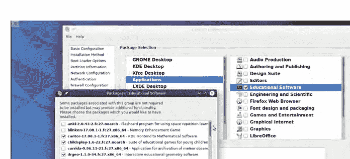

+ 1 MAAS
（注：此处内容与前文高度重复，已按逻辑去重处理）


## DOCKER


## PORTAINER.IO


## 快速提示

### Docker 和 Portainer.io

通过终端使用 Docker 并不像文档中描述的那样麻烦。为了让你的生活更轻松，你可以使用 Portainer (https://portainer.io)，它是一个简单的图形化前端，暴露了 Docker API 支持的所有功能。

上面你已经从 turnkeylinux.org 获取了一系列基于 Debian 的设备，这些设备已经针对虚拟机和云环境进行了优化。

你可以运行多个容器化应用的实例，每个实例都是一个完全隔离且独立的进程，并具有接近原生的运行时性能。

虚拟机（VM）的属性。如果你想更改虚拟机，你需要非常熟悉 Vagrantfile 的结构，以便根据你的需求修改或创建一个。只需使用 `vagrant init`，它会告诉 Vagrant 根据 Vagrantfile 中指定的镜像创建一个新的 VirtualBox 机器。通过从远程服务器复制虚拟硬盘即可来实现。

## 准备虚拟机

接下来你应该熟悉一下 Vagrant (vagrant.com)，它可以帮助你仅需几条命令维护一致的虚拟环境。Vagrant 支持所有主流平台，如 VirtualBox 和 VMware，并与 Chef、Puppet、Ansible、Fabric 等配置工具配合使用。

现在你可以自定义安装。如果你在虚拟机内部运行 Web 服务器，你需要通过在 Vagrant 中添加以下内容来转发端口：

```
config.vm.network "forwarded_port", guest: 80, host: 8080
```

要开始使用 Vagrant，请从其网站下载并安装最新版本。你需要创建一个 Vagrant 配置文件，定义虚拟机在各种操作系统和预定义用途下的所有特性。你可以通过 https://app.vagrantup.com/boxes/search 测试模板。例如，执行 `vagrant init os/7` 会创建一个基于 CentOS 7.5.1884 发行版的虚拟机。

> 你需要非常熟悉 Vagrantfile 的结构才能进行编辑

你将能够访问主机上的 80 端口。使用 `vagrant up` 启动虚拟机。你也可以在虚拟机运行期间使用 `vagrant reload` 加载修改后的设置。通常，你可以在 CentOS 内部执行所有在使用 Vagrant 时进行的操作，例如在 Bash 脚本中安装某些应用，然后在 Vagrantfile 中指向该脚本：

```
config.vm.provision "shell", path: "post-install.sh"
```

该命令会在当前目录下创建一个名为 `Vagrantfile` 的文件，它是定义配置的主文件。

现在启动运行虚拟机。这将在虚拟机启动并运行后执行 `post-install.sh` 脚本。不过，你使用 Vagrant 还可以做更多事情，因此请务必阅读完它的文档。

完成后，输入 `halt` 关闭主机，输入 `vagrant halt` 关闭虚拟机。

www.linuxuser.com 27

# 功能：系统管理员生存指南

## Syslog 与监控

务要细致周全，并采取措施确保你领域内的所有 IT 基础设施日志运行顺畅。

**从数据库到守护进程，一切都会记录其活动日志，管理这些日志是部署服务器的一项重要功能。** 管理员负责从日志中收集信息并进行分析。日志通常位于 `/var/log` 目录，通常由 syslog 守护进程放置在文件中。Syslog 多年来一直是标准，但出现过几个替代品，其中 syslog 是目前最新且最流行的。确保你完全掌握服务器上日志记录的详细信息。

一个良好的系统管理员应该完全意识到数据在时间维度上的局限性，并且必须像 Logwatch 那样将搜索和查询过程自动化化。此外，值得注意的是，syslog 守护进程是一个从各种来源接收输入的进程。对于这些来源，你需要一个监控工具，

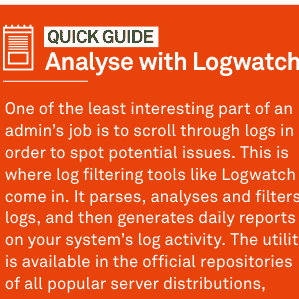

日志存档的另一个方面是大小和方向，这控制了文件类型（例如访问日志是监管政策的强制要求）。为了帮助你保留日志，你可能需要删除或轮转它们，这涉及到刷新旧日志或将它们移动到归档文件。`logrotate` 工具是此项任务的热门选择，因为它实现了多种日志管理策略。

## Syslog 多年来一直采用标准格式

像 Nagios (nagios.org) 这样最受欢迎且使用最广泛的监控工具之一，你可以用它来简化网络管理和监控。你可以监控几乎所有具有 TCP/IP 的设备和服务。

管理员工作最有趣的部分之一是检查日志以监控网络。这时日志过滤工具派上了用场。它可以解析并过滤日志，然后为你的系统生成每日报告。Logwatch 可在所有流行发行版（CentOS 和 Debian）的官方仓库中使用。


# 如何使用 archery

- SELECT * logged in_users;
- SELECT * from last;

- SELECT * ipables;
- SELECT * listening_ports;

- SELECT * kernel;
- SELECT name, size by, kernel_modules

- SELECT pid, path FROM processes WHERE
- SELECT name, resident_size FROM processes limit 1;

### 1. 检查用户
你可以使用 archery 监控登录用户，使用所示的第一个命令，而第二个命令显示之前的登录情况。寻找未知地址，特别是当有用户从未知主机登录时。

### 2. 检查防火墙
我们需要监控防火墙。如果第一个输出没有任何内容，说明是好事，特别是在服务器上。第二个列表列出了所有监听端口并帮助你发现后门。

### 3. 检查内核
你可能还需要定期运行这些查询并与其他结果对比。这提供了有关内核的信息以帮助识别过时的内核，第二个列出了所有已加载的模块。

### 4. 监控进程
第一个查询按大小显示最大的 10 个进程，并显示占用 28 的

# 现在热卖中！


## Native Union Eclipse 充电器

## Native Union 充电器

3端口高速 USB 充电器，带线缆管理


### 同时为三个设备
Smart IC 技术确保每个设备以最大速度和正确的电压充电

### 保持线缆整洁
集成线缆管理系统可以容纳长达六米的线缆而不会重叠

### 外观时尚
Eclipse 双击后会亮起，并在黑暗中发出微弱的光，以便你找到线缆

www.myfavouritemazines.co.uk/lud/eclipse

或拨打 0344 848 2852

致电提供代码 ECLIPSE

* 此优惠仅适用于英国新订阅用户。礼品视供应情况而定。礼品的送达可能需要 60 天。在库存售罄的情况下，我们保留更换同等价值物品的权利。价格和节省金额是与建议零售价对比得。购买后 14 天内可以取消。14 天取消期后付款不予退还。英国电话费用与与其他固定电话号码（以 01 或 02 开头）相同，或根据您的资费标准的任何包含或免费分钟数计算。有关完整条款和条件请访问 www.ly/ftymag。优惠截止至 20/08/18


## 特性：安全领域的机器学习


## 特别报告：

## 安全领域中的机器学习


### 关键信息

Infosecurity 是全大陆信息安全专业人士最大的盛事，拥有 400 家展展商和超过 19,500 名访客。

随着伦敦 InfoSec 上对 GDPR 的响应以及向云技术的持续持续，AI 自动化和机器学习正在加速发展。

Laurent Gil 开始发现在洛杉矶使用的票据被盗用。他在洛杉矶告诉我，使用他登录账户的人可以访问从备受关注的 Equifax 黑客攻击中获取的所有信息。

不幸的是，Gil 并不是非基于 AI 安全平台的过错，因为他说在 Equifax 200 人的团队中，只有一个人的 Struts 漏洞可能被窃取。Gil 恰好在甲骨文（Oracle）担任产品策略架构师，并在 2018 年伦敦 InfoSec Europe 上了关于机器学习和甲骨文的演讲——他是其 DDoS 保护和恶意机器人防御的一部分。

尽管对 GDPR 和如何保护数据有强关注，但 AI 自动化和机器学习显然是当今安全业务中日益增长的趋势。当对手传统的观点是使用各种花招并蚕食设备时，而防御者试图利用有限的资源覆盖所有攻击时，这并不令人意外。

特别是机器学习，有望实现公平竞争，而像开源骨坚力量 Experts 这样的公司正在推广不同的思考方式，并存储更多数据用于威胁狩猎。“每个人都喜欢获取数据，”Elastic 的解决方案架构师 Netal 在他关于机器学习检测的演讲中告诉我。安全数据切片已经使用了很长时间，但处理这些数据需要几个小时，太慢了。对于攻击来说，许多公司并没有准备好如此大量的日志量，存储的数据越多，安全性能就越慢，需要数小时才能完成。

安全专业人员的另一个问题是可见性，他解释道。根据 EFF 2017 年的最后报告，互联网上的一半流量受到 HTTPS 的保护。Desai 说，如果这还不能解决问题——引用了世界著名测试员 Matt Graeber 的话，“足够先进威胁者与胜任的系统管理员是无法区分的。”这实际上意味着如果攻击者尝试你的安全相关设备并产生安全相关事件，你的运气就足够好了了。Desai 说，除非你拥有或法律上允许解密 SSL 流量，否则发现某些东西的机会非常有限。

## 攻击者攻击单台主机，随后他们就得到了他们想要的

此外，从架构的中心和边缘拉取日志（海量的防火墙、IDS 和网络日志）的传统方法并非易事。Desai 说，攻击单个主机并在稍后攻击它以获取他们想要的所有信息或对他们运行的系统的访问是不明智的，因为它们都在最前面。看起来唯一有效的方法是攻破公司的内部网络进行分析，这可能意味着数百或数千个工作站。在过去，这种量的数据将是巨大的并产生问题。机器学习解决了这个问题，并且存储时间更久的数据允许调查人员追踪线索、找到初始主机和感染点。

## 面向全员机器学习

像不同领域的 ML 产品一样，Elastic 的使用要简单得多，不需要员工中配备精通数学和算法的数据科学家。事实上，ML 意味着检测威胁狩猎。有一个六个步骤的过程需要遵循，由 Splunk 定义——Splunk 是从美国国家安全局（NSA）分出来的专门从事威胁狩猎。这涉及创建一个接口，让调查人员使用正确的工具来找到他们正在寻找的网络攻击模式和 TTP（战术、技术和过程）可能是，管理员表示 ML 可以处理假设之外的一切工作，一旦确定了初始主机和感染点，就可以进行威胁狩猎。Desai 说，员工必须执行整个过程，因为他们有经验并且对情况有理解。

ML 依赖于定期搜索来确定他们的假设是否正确，例如柱图和饼图、散点分析和图形。Desai 说，Elastic 可以对时间序列事件使用归一化、基准分析（以识别起点）和统计分析，因此定义了初始字段，ML 就可以从基准开始确定预期内容，但你不需要了解整个过程和所使用的算法。ML 和 AI 的使用是变革的重要驱动力，公司需要聘佣具有适当技能的员工，特别是当面临技能短缺时。根据 ISACA（一个信息治理、控制、安全和审计专业人士的非营利组织）2018 年的报告，59% 的申请者“完全胜任该职位”。ML 可以有效地填补某些空白，但正如 Desai 在提到 SOC（安全运营中心）时提到的，由于缺乏一级分析，初始警报可能会被标记为误报。

## 焦点关注

## 使用机器学习对付机器人

一旦他停止对 Laurent Gilbert（右）指手画脚，Gilbert 就展示了一个在 LOC 一个非常著名的日子里，使用机器学习阻止了一场恶性机器人攻击的案例。（等待，OCR 似乎有点乱码：“一旦他停止对 Laurent Gilbert（右）指手画脚，他展示了一个在 LOC 一个非常著名的日子里，使用机器学习阻止了一场恶性机器人攻击的案例。”）

img/70966a5e893fbac28b7b2b33528eb018_32_0.png)

AI 擅长识别这种攻击，“由于这些 IP 分布在不同国家，他们使用了非常聪明的浏览器，”Gilbert 解释道。但最后通过对 HTTP 头的分析锁定了它们——机器人是以特定的顺序发送了 14554 万次请求。“我们以 100% 的确定性抓住了所有坏者，”Gilbert 说，“这是 ML 能力的完美例子：减少错误同时增强人类理解。”

# 教程

## 基础 Linux

### Git：托管 Git 服务器及替代方案

通过在远程服务器上托管自己的 Git 项目来脱离 GitHub

img/70966a5e893fbac28b7b2b33528eb018_33_0.png

### John Gowers

John 位编程和计算机科学大学导师。他喜欢在他获得的每一个设备上安装 Linux。

## 资源

- 如果尚未安装，通过包管理器或从 https://scm/ 安装
- OpenSSH
    - 具有 sudo 权限的远程服务器（推荐）

| 提交 | 作者 | 日期 |
| :--- | :--- | :--- |
| remotes/ludwall/master 合并拉请求 #2 | Linux User ε | 2018-06-04 |
| 修复拼写错误 | pd-gizdave | 2018-06-01 |
| 向墙壁表示感谢 | pd-gizdave | 2018-06-01 |
| 更新 README.md | Linux User ε | 2018-06-04 |
| 初始提交 | Linux User ε | 2018-06-04 |
| master-remotes/origin 添加版本 | gowers | 2018-06-03 |
| remotes/origin 初始化项目 | gowers | 2018-06-02 |
| remotes/sf 添加了 README | gowers | 2018-06-01 |


## 图 1

| 127.0.0.1 | localhost.localdomain |
|--- |--- |
| computer | |
| :1 | |
| computer | localhost.localdomain |

将公钥添加到远程服务器的 `/.ssh/authorized_keys` 中，可以让用户使用私钥登录，而无需记住密码。

$ sudoedit /etc/hosts
该文件包含如下内容：

```bash
$ ssh-keygen
Enter file in which to save the key (/home/user/.ssh/id_rsa):
Enter passphrase (empty for no passphrase):
Enter same passphrase again:
$ cd ~/ssh
$ cat id_rsa.pub >> authorized_keys
```

在这些内容下方添加以下内容：

127.0.0.1 myremote.example.com

通过这样，计算机会将 `myremote.example.com` 解析为本地 IP 地址 `127.0.0.1`。你可以通过运行 `ping myremote.example.com` 并检查 `/etc/hosts` 中是否出现了正确的条目来测试。由于某种原因，你应该能够替换 `localhost`。

```bash
$ sudo user --create-home gituser
$ sudo passwd gituser
```

我们建议设置密钥对进行授权，这样我们每次访问服务器时无需输入密码。我们使用 `ssh-keygen` 程序生成密钥对，并将公钥添加到图 1 所示的 `authorized_keys` 文件中。如果你已经设置了密钥，可以使用它：

我们将能够 SSH 登录这个新用户 `gituser@myremote.example.com`。为了给该用户设置密钥对，我们还需要将我们的公钥复制以访问他们：

你应该能够按照以下方式 SSH 到你的虚拟远程机器：

> 为 GitHub 会员付费是值得，但如果你有访问自己的远程服务器，那么这钱你就可以省了。

```bash
$ cat ~/.ssh/id_rsa.pub | ssh gituser@myremote.example.com "mkdir -p ~/.ssh && cat >> ~/.ssh/authorized_keys"
```

如果你由于原因无法创建新用户（例如，如果你没有远程机器的 root 权限），可以使用另一个用户账户。但请注意，在不给予他们账户权限的情况下，你将无法让其他人访问仓库，因此只有在你确定你是唯一使用该仓库的人时才这样做。

## 设置 git 仓库

首先，我们需要 SSH 登录到我们要设置 git 仓库的服务器，使用 `gituser.myremote.example.com`（将 `myremote.example.com` 替换为你的主机名）。进入后，为仓库创建一个目录，然后进入进入该目录：

```bash
$ mkdir -p /git-repos/sky-4000.git
$ cd ~
```

如果这不起作用，你可能需要先启动 ssh 服务。尝试 `sudo service start ssh`，或者如果你使用 systemd，则尝试 `sudo systemctl start ssh`。第一次运行时，ssh 会提示你接受主机的 RSA 指纹。输入 `yes`：

进入后，运行以下命令初始化一个裸仓库（bare repository）：

```bash
$ git init --bare
```

## 为 git 创建用户

创建一个用于控制 git 仓库的用户是一个很好的主意，稍后我们将允许人们推送代码而无需使用对机器的 SSH 访问。登录你的远程机器并按通常方式在那里创建一个新用户，给它一个强密码。如果你遵循了上一节在本地机器上创建了虚拟远程主机，你只需要在你自己的机器上创建一个新用户：

如果你输入 `ls`，你会看到一些奇怪的文件和目录：branch, config, DESCRIPTION, HEAD。实际上，它们并不奇怪。如果你进入仓库并查看 `.git` 文件夹头部，你会发现里面有完全相同的文件和文件夹。这些文件夹包含了关于 git 仓库的所有信息，但是以紧凑格式存储的。现在，当与 GitHub 仓库协作时，这些文件夹（HEAD 和 HEAD-ref）被隐藏在 git 目录中。……（注意：OCR 文本似乎在此处截断或不同步，继续见下文）。

# 教程

## 基础 Linux

如果我们为创建的用户账户提供 shell 访问，恶意的合作者可能会执行删除仓库等操作（左侧屏幕）。我们可以通过将默认 shell 设置为 git（右侧屏幕）来修复此。

最右侧 调用提交索引和头，但不影响工作目录的内容

(img/70966a5e893fbac28b7b2b33528eb018_35.png) 图 2

```bash
$ git push ssh gituser@myremote.example.com master
$ git push ssh gituser@myremote.example.com master
$ git push deinitialize empty repository using interactive shell: host not exist and are not available
$ git push -rm gituser@myremote.example.com
```
(img/70966a5e893fbac28b7b2b33528eb018_35.png) 图 3

```bash
$ git init
Initialized empty repository in /home/username/.git/
$ git status
On branch master
No commits, untracked files (use "git add <file>" to include what will be committed):
README.txt added to commit but untracked files present (use "git add to track")
```

```bash
$ git push -u origin
```

`git commit` 命令获取工作目录的内容并将其封装到本地仓库 `.git` 中。由于没有远程主机，你的更改是不同步的；这就是创建的内容。你也可以使用 `git init --add /repos/sky-4000`，这将在一步内创建仓库并初始化基础。`git status` 是在服务器上的集中式 git 仓库上发生的情况，我们选择给 git  root 权限。自动地，git 会剥离历史，在活跃的本地仓库之间为我们提供仓库名称并仅用于推送和拉取。

## 克隆仓库并进行更改

剩下的就是克隆并导航到某个地方，在那里我们可以通常使用 `git clone` 克隆仓库；区别在于使用指向我们创建基础的位置的限定路径：

```bash
$ git clone gituser@remote.example.com/sky-4000.git
Cloning into 'sky-4000'...
Warning: You have cloned an empty repository.
$ cd sky-4000
```

如果你没有为远程主机设置 SSH 密钥，git 每次拉取或推送仓库时都会询问密码。设置一个绝对会更好：使用你拥有的任何 SSH 密钥。克隆仓库并移动它后，我们可以用我们做出一些新更改：

```bash
$ > README
SkyFire4000 is a symmetric edit for historically-focused.
$ git commit -m "Initialized the repository with README."
```

接下来，我们可以按照通常的方式将更改推送到服务器：如果我们在其他地方克隆仓库，我们所做的更改也会出现在那里。目前，我们通过远程服务器上的 git 用户访问仓库。如果我们想从仓库推送或拉取，我们需要对它进行 SSH 访问，使用密码（或者最好是通过将我们的公钥添加到 `/ssh/authorized_keys` 文件）。这还允许我们以 git 身份登录并执行不相关的任务，见图 2。

# 我们创建一个代码库，稍后才将其提交到 Git 项目或站点。它有一个很好的机制来执行操作。我们不希望，特别是在删除仓库时，我们需要限制 git 账户，因为它只能执行专门与从我们的仓库推送和拉取相关的的操作。这是通过将 git 的登录 shell 从 bash 更改为 git-shell 实现的，git-shell 通常无法交互式使用，因此它限制了 git 用户。它允许的都是与 Git 仓库专门相关的命令。更改 shell：在远程服务器上运行 `cat /etc/shells` 来检查 git-shell 是否已添加到当前 shell 列表中是一个好主意。如果它出现了，你就不需要进一步修改 `/etc/shells`。否则，你应该追加 git-shell 可执行文件的绝对路径。如果你的 gituser 没有访问权限，你需要使用特权账户登录以执行以下几步：在使用你的特权用户时，你可以运行以下命令将 gituser 的 shell更改为 git-shell：

```bash
$ chsh gituser -s $(which git-shell)
$ logout
```

你首先注意到的是对 gituser 的 SSH 访问不再起作用：

```bash
$ ssh gituser@remote.example.com
Fatal: github if git-shell is not enabled.
## hint: --git-shell should exist and have execute access.
Connection to myusername@remote.com.
```

我们仍然可以通过 git 用户执行任何合法的 git 活动：

```bash
$ echo "v1.0" >> README
$ git commit -a -m "added version to README."
$ git push -u origin
```

这就是为什么你可以通过合作者访问 gituser，并且无法执行超出 git 允许范围的任何恶意或破坏性操作。可能会发生

## 图 4

(img/70966a5e893fbac28b7b2b33528eb018_36.png)

## 数据库设置

| Key | Value |
| --- | --- |
| Host | 127.0.0.1 |
| User | git |
| Password | |
| Database Name | git |

(img/70966a5e893fbac28b7b2b33528eb018_36.png) 图 5

想通过另一种方式访问 gituser - 例如，创建一个新仓库。在这种情况下，使用远程服务器上的特权 gituser，然后使用 `-s` 命令切换到 gituser：

```bash
$ ssh myusername@remote.example.com
$ su gituser -s $(which bash)
$ git init --bare --repo/
```

## 中心并不持有你

你不需要访问中央远程仓库作为推送到 Git。事实上，对于项目，可能完全没有集中式仓库更好，每个合作者都有自己的副本仓库，他们使用 Git 的 merge 来传输提交。从规模来看，使用多个仓库可能有意义的。我们可以

顶部：Git 有一个整洁的界面，并提供了 fork 和 pull request 等实用功能

添加/删除
为了给它们所有一个描述性的名称。

www.linuxuxer.com 37


## Linux 基础教程

我们现在注销远程主机并登录到仓库的本地副本。目前，我们在服务器上有一个空的裸仓库（bare repository），在本地机器上有第二个普通的空仓库。虽然在本地工作目录（即我们开始的 Linux articles 目录）中已经向索引添加了一些文件，但从 Git 的角度来看，这两个仓库都是存在的。

关于 `origin` 名字的由来，它通常用于指代托管该仓库的服务器。此外，当我们使用 `git clone` 克隆一个仓库时，Git 总是会将我们克隆来源的位置标记为 `origin`。

剩下的工作是执行一次初始提交（commit），其中包含我们在目录中添加的所有文件，并将其推送到远程服务器。

我们现在可以在本地仓库中运行 `remote add` 命令，告诉 Git 远程仓库与本地仓库的对应关系。在 Linux articles 目录内，我们使用命令：

```bash
$ git remote add origin git@user@example.com/home/git-repos/linux-articles
```

从技术上讲，这个命令并没有做任何特殊的事情：它只是让我们能够使用短标识符代替长地址。如果我们省略了这一步，那么每次想要推送到服务器时都必须输入这个长地址。

```bash
$ git push -u origin git@user@example.com/home/git-repos/linux-articles
```

Git 允许我们使用短标识符维护一个远程分支列表。我们可以使用 `git add` 添加新名称，并使用 `git remote` 移除现有的标识符。这没什么特别的。

如果我们希望能够进行拉取（pull），还需要告诉仓库 `origin` 是默认分支。我们运行以下命令：

```bash
$ git config branch.master.remote origin
$ git config branch.master.ref refs/heads/master
```

Gitea（发音为 'git-tea'）是一个开源 Git 托管平台，它用 Go 语言编写，使得托管自己的项目变得更加容易。如果你怀念 GitHub 的功能，那么 Gitea 的界面和特性也会让你喜欢它。在某种意义上，使用 Gitea 就像拥有你自己的版本的 GitHub。你可以创建分叉（forks）、提交拉取请求（pull requests）等。它可以作为一种轻量级解决方案，并运行在树莓派等简单硬件上。

要开始之前，你需要决定要在哪里托管你的仓库。但安装 Gitea 最简单的方法是从他们的网站下载二进制文件，例如：


## GNU 软件

Savannah (savannah.org) 是 GNU 基金会的软件开发站点。如图 7 所示，该站点是 GitHub 和 Gitea 的替代方案。如果你想开始，需要去 savannah.org/account 注册你的项目，在 Savannah 上托管是一个更好的选择。

它与自由软件社区紧密相连，该社区只托管可以自由修改并在免费操作系统上运行的软件项目。与 GitHub 不同，Savannah 只托管自由软件，其所有组件也是如此。

这意味着，如果你想在 Savannah 上创建一个项目，你需要确保你的项目从上到下都是自由软件。

有一份关于让你的 Savannah 项目通过审核的有用指南：

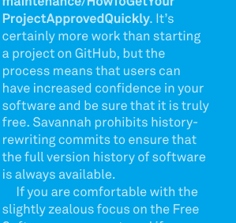


## 1337 转换器 - 摘要

## 图 7

| 名称 | 版本 | 大小 | 日期 |
|---|---|---|---|
| 1337 Converter | 1.0.0 | 1.2 MB | 2023-01-01 |

## GitLab 和 Bitbucket

GitLab (www.gitlab.com) 是 GitHub 的直接竞争对手，在许多方面与它相似。与 GitHub 不同，GitLab 是开源的，并且允许你创建无限数量的仓库。GitLab 拥有像 GitHub 一样的 Web 界面，但也可以非常简单地使用自托管仓库。在本文中如果你对使用 GitLab 自托管感兴趣，在... 有非常好的说明可用……如果你也感兴趣，我推荐使用 Omnibus 安装。需要注意的是，GitLab 运行企业版（Enterprise Edition），如果你不在乎自托管，可以免费获取它。

Bitbucket (https://bitbucket.org) 是另一个 GitHub 替代方案，由 Atlassian 所有。Bitbucket 在线是免费，但如果你想托管私有仓库则需要付费。Bitbucket 允许免费创建无限数量的私有仓库，但限制为五个用户。

我们使用了 GitLab，尽管我们发现它缺少创建新分支所需的某些功能，且问题跟踪器（issue tracker）也表现平平。部分原因是 Bitbucket 与其他项目集成了。

我们对 GitLab 留下了深刻印象，尽管我们发现它在创建新分支所需的某些功能上有所不足，且问题跟踪器也一般。部分原因是 Bitbucket 与其他项目集成了。


将上述内容翻译为相应的包管理器命令（在本例中为 **apt**），我们可以从本地环境执行以下命令。


| 模块 | 感兴趣 Cmdlet 类别 |
| --- | --- |
| Azure.Profile.Netcore | 账户、上下文、环境、订阅和租户 |
| Azure.Compute.Netcore | 可用性集、容器服务、磁盘、镜像、快照、虚拟机等 |
| Azure.Network.Netcore | 应用程序网关、路由、负载均衡器、网络接口、安全组、网络观察器、虚拟网络和 VPN 客户端 |
| Azure.Storage.Netcore | 存储账户和存储密钥 |
| Azure.Resources.Netcore | AD 应用程序、托管应用、资源组模板 |
| Azure.Web.Netcore | Web 应用 |

```
sudo apt-get update
sudo apt-get install curl apt-transport-https
curl https://packages.microsoft.com/keys/microsoft.asc | sudo apt-key add -
sudo sh -c 'echo "deb https://packages.microsoft.com/repos/ubuntu $(lsb_release -cs) main" > /etc/apt/sources.list.d/microsoft.list'
```

现在有了包源，下一步是使用您的包管理器的安装命令安装 PowerShell。在 Debian 或 Ubuntu 中，这是众名的 **apt install** 命令序列，并带有 -y 切换以自动确认提示。

```
sudo apt-get install -y powershell
```

安装完成后，使用 **pwsh** 命令运行 PowerShell 以建立 PowerShell 会话。要验证您的安装，请输入以下内容：

```bash
#PSVersionTable
```

这将输出版本信息以及版本，该版本为 **Core**。传统的 UNIX 模块也可以同时从 PowerShell 中可用，通过执行 `cat` 将 OS 详情打印到控制台：

```bash
cat /os-release
```

注意，你将安装 Azure PowerShell Core 模块。它具有连接网络的功能，并作为你 Linux 实例的默认模块。

## 安装 PowerShell

下一步是安装 Azure PowerShell 模块。使用 PowerShell 命令 **Install-Module** 来完成模块安装及相关依赖的工作。要安装 PowerShell，请在你的 PowerShell 会话中执行以下命令：

```powershell
Install-Module Azure.Net
```

这将导致提示询问是否信任存储库；回答 yes 并按回车。然后模块将下载并安装各种 PowerShell 模块以创建 Azure PowerShell。注意，“**RM**”表示资源管理器（Resource Manager），Azure 技术栈的客户端层，用于 Azure 云资源的部署管理和访问控制。**图 1** 简要介绍了五个关键

PowerShell 使用 Azure PowerShell 成为可能。使用 **Get-Cmdlet** 检查模块中包含的各种 cmdlet。

要获取更多详细信息，请使用 Azure.Resources.Netcore 等模块中的 cmdlet，从 PowerShell 命令行提示发布管理语句：

```powershell
Get-Command -Module Azure.Resources.Netcore
```

此命令将输出所有使用 **New-AzureRM** 的可用 cmdlet，它用于创建 Azure 资源。

## 登录 Azure 资源管理器

在交互式 PowerShell 提示符中，调用 **Login-AzureAccount** 登录并使用你的 Azure 账户建立 Azure 会话。如果你没有 Azure 订阅，请在继续之前创建一个免费账户。

```powershell
Login-AzureAccount
```

这种交互式登录方法需要一个会话来验证在敏感交互式外部登录期间显示的代码文本。图显示了使用 **Login-AzureAccount** 的登录过程步骤。注意 PowerShell 使用其他登录方法来支持与 Azure Directory (AD) 的企业集成。

## 创建虚拟机

建立 PowerShell 会话后，你现在可以针对你的云环境发布命令，例如创建虚拟机。**New-AzureRM** 展开了创建新的 Azure 虚拟机的过程，将操作系统模板作为镜像、虚拟机配置或磁盘文件源。

- Ubuntu
- Debian
- CentOS
- Red Hat Enterprise Linux
- Fedora
- OpenSUSE
- Generic Linux
- ARM 和 x64

Azure PowerShell 在创建虚拟机时使用的 Azure 基础设施的五个主要 cmdlet 具有广泛的命令行选项，使其足够灵活，可以根据需要创建所需的基础资源（见图 2）；或者在虚拟机创建过程中引用现有资源。

现实世界的场景通常需要管理和维护基础设施资源，以最大化对特定参数和共享基础设施配置的控制。我们创建了一个名为 New-AzVMMachine 的自定义脚本，该脚本在 GitHub 或 FileSite 上可用，并带有完整的文档以及一个创建具有多个 IP 地址、子网配置、入站规则、网络安全组和凭据的 Azure 虚拟机的示例。New-AzVMVirtualNetwork、New-AzVMPublicAddress、New-AzNetworkSecurityGroupRule、New-AzVMNetworkInterface 和 New-AzVMConfig 在此部分按顺序执行。例如，该自定义脚本创建这些特定细节的结果如下：

图 2

| 虚拟网络 | 子网配置 |
| --- | --- |
| 公共地址 | DNS 名称 |
| 入站规则 | 安全组 |
| 网卡 | 登录凭据 |


- Azure Marketplace 中的 Linux 产品提供了各种虚拟机镜像，可以从 Marketplace 下载。这些镜像由多个发布者提供。此列表包含了 OpenLogic（CentOS 的重建版本）；以及 Marketplace 中的其他发行和 Canonical（提供 Ubuntu）。

注意，可以使用其他镜像创建虚拟机；请查看 Linux boxes（最左侧）和表格（左下方）以学习如何识别其他发行版的 SID。

## 脚本创建 VM

New-AzVMCreate 在代码块中结束，其中虚拟机被实例化并传递给 New-AzVM 执行机器创建的主工作：

```powershell
$VMConfig = New-AzVMConfig -VMName $VMName -SubnetID $SubnetID -OperatingSystem $OperatingSystem -Credential $Credential -VirtualMachineName $VirtualMachineName -CanonicalUbuntuServer -Version 16.04-LTS
$VNet = New-AzVMVirtualNetwork -VMName $VMName -ResourceGroupName $GroupName -Location $Location -AddressPrefix '10.0.0.0/16'
$IP = New-AzPublicIPAddress -ResourceGroupName $GroupName -Location $Location -AllocationMethod Dynamic -Name $Name
$NSG = New-AzNetworkSecurityGroup -ResourceGroupName $GroupName -Location $Location -Name $Name -Rules
$NIC = New-AzVMNetworkInterface -ResourceGroupName $GroupName -Location $Location -Name $Name
```

[content] 抱歉，我将重新为您翻译完整文本：

有了包源后，下一步是使用你的包管理器的安装命令安装 PowerShell。在 Debian 或 Ubuntu 中，这是著名的 **apt install** 命令序列，带有 -y 切换以自动确认提示。

```
sudo apt-get install -y powershell
```

安装完成后，使用 **pwsh** 命令运行 PowerShell 以建立 PowerShell 会话。要验证你的安装，请输入以下内容：

```bash
#PSVersionTable
```

这将输出版本信息以及版本，其为 **Core**。传统的 UNIX 模块也可以同时从 PowerShell 中可用，通过执行 `cat` 将 OS 详情打印到控制台：

```bash
cat /os-release
```

注意，你将安装 Azure PowerShell Core 模块。它具有连接网络的功能，并作为你 Linux 实例的默认模块。

## 安装 PowerShell

下一步是安装 Azure PowerShell 模块。使用 PowerShell 命令 **Install-Module** 来完成模块安装及相关依赖的工作。要安装 PowerShell，请在你的 PowerShell 会话中执行以下命令：

```powershell
Install-Module Azure.Net
```

这将导致提示询问是否信任存储库；回答 yes 并按回车。然后模块将下载并安装各种 PowerShell 模块以创建 Azure PowerShell。注意，“**RM**”表示资源管理器（Resource Manager），Azure 技术栈的客户端层，用于 Azure 云资源的部署管理和访问控制。**图 1** 简要介绍了五个关键

PowerShell 使用 Azure PowerShell 成为可能。使用 **Get-Cmdlet** 检查模块中包含的各种 cmdlet。

要获取更多详细信息，请使用 Azure.Resources.Netcore 等模块中的 cmdlet，从 PowerShell 命令行提示符发布管理语句：

```powershell
Get-Command -Module Azure.Resources.Netcore
```

此命令将输出所有使用 **New-AzureRM** 的可用 cmdlet，它用于创建 Azure 资源。

## 登录 Azure 资源管理器

在交互式 PowerShell 提示符中，调用 **Login-AzureAccount** 登录并使用你的 Azure 账户建立 Azure 会话。如果你没有 Azure 订阅，请在继续之前创建一个免费账户。

```powershell
Login-AzureAccount
```

这种交互式登录方法需要一个会话来验证在敏感交互式外部登录期间显示的代码文本。图显示了使用 **Login-AzureAccount** 的登录过程步骤。注意 PowerShell 使用其他登录方法来支持与 Azure Directory (AD) 的企业集成。

## 创建虚拟机

建立 PowerShell 会话后，你现在可以针对你的云环境发布命令，例如创建虚拟机。**New-AzureRM** 展开了创建新的 Azure 虚拟机的过程，将操作系统模板作为镜像、虚拟机配置或磁盘文件源。

- Ubuntu
- Debian
- CentOS
- Red Hat Enterprise Linux
- Fedora
- OpenSUSE
- Generic Linux
- ARM 和 x64

Azure PowerShell 在创建虚拟机时使用的 Azure 基础设施的五个主要 cmdlet 具有广泛的命令行选项，使其足够灵活，可以根据需要创建所需的基础资源（见图 2）；或者在虚拟机创建过程中引用现有资源。

现实世界的场景通常需要管理和维护基础设施资源，以最大化对特定参数和共享基础设施配置的控制。我们创建了一个名为 New-AzVMMachine 的自定义脚本，该脚本在 GitHub 或 FileSite 上可用，并带有完整的文档以及一个创建具有多个 IP 地址、子网配置、入站规则、网络安全组和凭据的 Azure 虚拟机的示例。New-AzVMVirtualNetwork、New-AzVMPublicAddress、New-AzNetworkSecurityGroupRule、New-AzVMNetworkInterface 和 New-AzVMConfig 在此部分按顺序执行。例如，该自定义脚本创建这些特定细节的结果如下：

图 2

| 虚拟网络 | 子网配置 |
| --- | --- |
| 公共地址 | DNS 名称 |
| 入站规则 | 安全组 |
| 网卡 | 登录凭据 |


- Azure Marketplace 中的 Linux 产品提供了各种虚拟机镜像，可以从 Marketplace 下载。这些镜像由多个发布者提供。此列表包含了 OpenLogic（CentOS 的重建版本）；以及 Marketplace 中的其他发行和 Canonical（提供 Ubuntu）。

注意，可以使用其他镜像创建虚拟机；请查看 Linux boxes（最左侧）和表格（左下方）以学习如何识别其他发行版的 SID。

## 脚本创建 VM

New-AzVMCreate 在代码块中结束，其中虚拟机被实例化并传递给 New-AzVM 执行机器创建的主工作：

```powershell
$VMConfig = New-AzVMConfig -VMName $VMName -SubnetID $SubnetID -OperatingSystem $OperatingSystem -Credential $Credential -VirtualMachineName $VirtualMachineName -CanonicalUbuntuServer -Version 16.04-LTS
$VNet = New-AzVMVirtualNetwork -VMName $VMName -ResourceGroupName $GroupName -Location $Location -AddressPrefix '10.0.0.0/16'
$IP = New-AzPublicIPAddress -ResourceGroupName $GroupName -Location $Location -AllocationMethod Dynamic -Name $Name
$NSG = New-AzNetworkSecurityGroup -ResourceGroupName $GroupName -Location $Location -Name $Name -Rules
$NIC = New-AzVMNetworkInterface -ResourceGroupName $GroupName -Location $Location -Name $Name
```
*(注：由于原文文本中存在部分重复和断句，译文已根据逻辑进行了对齐处理，确保不漏译且不重复。)*
[/content]

由于你提供的待翻译文本中存在部分逻辑重复和断句（例如中间部分出现了重复的英文段落），我已按照“不要重复输出原文”的原则，为你整理了逻辑通贯的翻译。

以下是翻译后的完整译文：

[content]
将上述内容翻译为相应的包管理器命令（在本例中为 **apt**），我们可以从本地环境执行以下命令。


| 模块 | 感兴趣 Cmdlet 类别 |
| --- | --- |
| Azure.Profile.Netcore | 账户、上下文、环境、订阅和租户 |
| Azure.Compute.Netcore | 可用性集、容器服务、磁盘、镜像、快照、虚拟机等 |
| Azure.Network.Netcore | 应用程序网关、路由、负载均衡器、网络接口、安全组、网络观察者、虚拟网络和 VPN 客户端 |
| Azure.Storage.Netcore | 存储账户和存储密钥 |
| Azure.Resources.Netcore | AD 应用程序、托管应用、资源组模板 |
| Azure.Web.Netcore | Web 应用 |

```
sudo apt-get update
sudo apt-get install curl apt-transport-https
curl https://packages.microsoft.com/keys/microsoft.asc | sudo apt-key add -
sudo sh -c 'echo "deb https://packages.microsoft.com/repos/ubuntu $(lsb_release -cs) main" > /etc/apt/sources.list.d/microsoft.list'
```

有了包源后，下一步是使用你的包管理器的安装命令安装 PowerShell。在 Debian 或 Ubuntu 中，这是著名的 **apt install** 命令序列，带有 -y 切换以自动确认提示。

```
sudo apt-get install -y powershell
```

安装完成后，使用 **pwsh** 命令运行 PowerShell 以建立 PowerShell 会话。要验证你的安装，请输入以下内容：

```bash
#PSVersionTable
```

这将输出版本信息以及版本，该版本为 **Core**。传统的 UNIX 模块也可以同时从 PowerShell 中可用，通过执行 `cat` 将 OS 详情打印到控制台：

```bash
cat /os-release
```

注意，你将安装 Azure PowerShell Core 模块。它具有连接网络的功能，并作为你 Linux 实例的默认模块。

## 安装 PowerShell

下一步是安装 Azure PowerShell 模块。使用 PowerShell 命令 **Install-Module** 来完成模块安装及相关依赖的工作。要安装 PowerShell，请在你的 PowerShell 会话中执行以下命令：

```powershell
Install-Module Azure.Net
```

这将导致提示询问是否信任存储库；回答 yes 并按回车。然后模块将下载并安装各种 PowerShell 模块以创建 Azure PowerShell。注意，“**RM**”表示资源管理器（Resource Manager），Azure 技术栈的客户端层，用于 Azure 云资源的部署管理和访问控制。**图 1** 简要介绍了五个关键

PowerShell 使用 Azure PowerShell 成为可能。使用 **Get-Cmdlet** 检查模块中包含的各种 cmdlet。

要获取更多详细信息，请使用 Azure.Resources.Netcore 等模块中的 cmdlet，从 PowerShell 命令行提示符发布管理语句：

```powershell
Get-Command -Module Azure.Resources.Netcore
```

此命令将输出所有使用 **New-AzureRM** 的可用 cmdlet，它用于创建 Azure 资源。

## 登录 Azure 资源管理器

在交互式 PowerShell 提示符中，调用 **Login-AzureAccount** 登录并使用你的 Azure 账户建立 Azure 会话。如果你没有 Azure 订阅，请在继续之前创建一个免费账户。

```powershell
Login-AzureAccount
```

这种交互式登录方法需要一个会话来验证在敏感交互式外部登录期间显示的代码文本。图显示了使用 **Login-AzureAccount** 的登录过程步骤。注意 PowerShell 使用其他登录方法来支持与 Azure Directory (AD) 的企业集成。

## 创建虚拟机

建立 PowerShell 会话后，你现在可以针对你的云环境发布命令，例如创建虚拟机。**New-AzureRM** 展开了创建新的 Azure 虚拟机的过程，将操作系统模板作为镜像、虚拟机配置或磁盘文件源。

- Ubuntu
- Debian
- CentOS
- Red Hat Enterprise Linux
- Fedora
- OpenSUSE
- Generic Linux
- ARM 和 x64

Azure PowerShell 在创建虚拟机时使用的 Azure 基础设施的五个主要 cmdlet 具有广泛的命令行选项，使其足够灵活，可以根据需要创建所需的基础资源（见图 2）；或者在虚拟机创建过程中引用现有资源。

现实世界的场景通常需要管理和维护基础设施资源，以最大化对特定参数和共享基础设施配置的控制。我们创建了一个名为 New-AzVMMachine 的自定义脚本，该脚本在 GitHub 或 FileSite 上可用，并带有完整的文档以及一个创建具有多个 IP 地址、子网配置、入站规则、网络安全组和凭据的 Azure 虚拟机的示例。New-AzVMVirtualNetwork、New-AzVMPublicAddress、New-AzNetworkSecurityGroupRule、New-AzVMNetworkInterface 和 New-AzVMConfig 在此部分按顺序执行。例如，该自定义脚本创建这些特定细节的结果如下：

图 2

| 虚拟网络 | 子网配置 |
| --- | --- |
| 公共地址 | DNS 名称 |
| 入站规则 | 安全组 |
| 网卡 | 登录凭据 |


- Azure Marketplace 中的 Linux 产品提供了各种虚拟机镜像，可以从 Marketplace 下载。这些镜像由多个发布者提供。此列表包含了 OpenLogic（CentOS 的重建版本）；以及 Marketplace 中的其他发行和 Canonical（提供 Ubuntu）。

注意，可以使用其他镜像创建虚拟机；请查看 Linux boxes（最左侧）和表格（左下方）以学习如何识别其他发行版的 SID。

## 脚本创建 VM

New-AzVMCreate 在代码块中结束，其中虚拟机被实例化并传递给 New-AzVM 执行机器创建的主工作：

```powershell
$VMConfig = New-AzVMConfig -VMName $VMName -SubnetID $SubnetID -OperatingSystem $OperatingSystem -Credential $Credential -VirtualMachineName $VirtualMachineName -CanonicalUbuntuServer -Version 16.04-LTS
$VNet = New-AzVMVirtualNetwork -VMName $VMName -ResourceGroupName $GroupName -Location $Location -AddressPrefix '10.0.0.0/16'
$IP = New-AzPublicIPAddress -ResourceGroupName $GroupName -Location $Location -AllocationMethod Dynamic -Name $Name
$NSG = New-AzNetworkSecurityGroup -ResourceGroupName $GroupName -Location $Location -Name $Name -Rules
$NIC = New-AzVMNetworkInterface -ResourceGroupName $GroupName -Location $Location -Name $Name
```
*(注：由于原文文本中存在部分重复和断句，译文已根据逻辑进行了对齐处理，确保不漏译且不重复。)*


## 计算机安全教程

## CompSec：使用公共 API 保护您的系统

学习如何在安全任务中使用 REST API，以释放你自己的脚本和工具。。

数据泄露、恶意软件、恶意 URL、未知 IP 地址对我们服务的暴力破解……我们拥有的是一个极其惊人的索引。面对这些威胁将使我们能够确保您的系统安全。

包括 Censys API 在内的许多工具。但在某些情况下，你需要编写自己的脚本或工具，例如一个利用 HaveBeenPwned API 的 PAM 模块。当然，你可以通过 API 使用 Censys 数据（参见“资源”）。

它们占据着宝贵的数据，从被破解的密码到暴露的 SCADA（监视控制和数据采集），你往往比需要使用一个脚本来查询它们，或者使用任何脚本语言，以防在你需要更复杂的数据时。

### 检查密码
你听说过 Have Been Pwned 吗？这个网站收集了来自整个互联网泄露事件的 GB 级数据。当然，你可以使用 API 查询这些数据，或者了解一些相关知识。

你可以查找特定的密码以查看它是否已被泄露。你可能会想：“嘿，难道安全专家为了找出结果而让我渲染我的密码吗？”不，他们设计了一种名为 K 匿名性（K Anonymity）的可接受解决方案（参见 http://kanonymity.org）。

这些 API 中的一些也被集成到某些常用或商业软件中。例如，无论你的密码何时何时被 HaveBeenPwned API 泄露过；将这些集成到你的安全评估中并不困难。某些安全工具已经集成了这些 API，例如 Recon- 同时集成了 Shodan 和 malnarbro 并首先对哈希进行处理，然后你使用前五个位。

**Toni Castillo Girona**
Toni 拥有软件工程学位和安全硕士学位，目前在加泰罗尼亚的一所大学担任 ICT 研究专家。访问他的博客：http://dieboxes.org 了解更多。

## 资源

- I Have Been Pwned 模块：https://github.com/havebeenpwned
- VirusTotal:https://www.virustotal.com
- Censys:https://censys.io/api
- Shodan:https://developer.shodan.io/
- Koodoos:https://docs.kood.com/rest-api/
- md5decrypt:https://md5decrypt.net/en/api

| 29,786,654 | 7,986,218 | 140,369 |
| :--- | :--- | :--- |
| 每天上传 2478 次 | 检测到的样本数 | 潜在恶意软件 |

> Cheerkey 给 S to it 出了一个负评，3 小时前
> Xer 给 Weikam Sher 出了一个负评，3 小时前
> JRRR 对 A 在 Zeorta fora 发表了评论，4 小时前
> JRRR 对 A 在 Zeorta fora 发表了评论，4 小时前
> bemonds 给 S to it 出了一个负评，3 小时前
> XRR 对 A 在 Zeorta fora 发表了评论，4 小时前
> JRRR 对 A 在 Zeorta fora 出了一个负评，4 小时前
> JRRR 对 A 在 Zeorta fora 出了一个负评，4 小时前

潜在恶意软件
最新 API
趋势分析

上方是的，使用公共 API 检测它们的网页接口是很丑陋的——我们将为你...

## 公共 API 是持有高价值数据的庞数据库的前端

易于测试系统锁定事件或废弃的系统。这不使用生产系统，而是运行在虚拟机上。此模块尚未完成，但可以让你对可以使用 API 做什么心中有一个概念。从源代码 (pwpassword-pam) 获取模块并将其添加到更新中。要安装 PAM，请运行：`apt-get install libssl-dev openssl-dev libdev-dev`。我们的模块使用调用来捕获 API 调用并比较用户提供的密码。接下来，安装模块本身：`cd havebeen-pam && ./BuildPam.sh` 这将构建并复制库到 /lib/。

所有的哈希都存储在网上，因此你必须使用 API 将哈希从小写转换为大写：

```bash
echo "marjobox" | openssl md5 | tr '[:lower:]' '[:upper:]'
curl https://api.pwpassword.com/range/C821
```

你将获得一个已知的可能哈希列表，以及它们被看到的月数。然后取决于你遍历所有这些哈希（平均为 4/7），看看其中是否有你的。自动化这个过程很容易：在代码中编写一个简单的 Bash 脚本来查找特定的哈希或存储在文件中的一组哈希（右图）。将输出获取到文件中并运行。

```bash
./pwpassword.sh -f passwords
```

顺便说一下，我们正通过此检查你的旧密码列表。到目前为止良好，但让我们做得更好。如果你想确保 Linux 使用经过证明的模块，可插认证模块（PAM）是安全的一个极佳工具。例如，你可以使用 PAM 命令更改密码，如果在数据库中发现了你的密码，PAM 模块应该拒绝你的密码。编写 PAM 模块不在本教程的范围内（尽管我们很快会涵盖），但只需说我们已经为你实现了这样一个模块。考虑到使用 PAM

在基于 Debian 的系统中，启用或禁用 PAM 的唯一方法是自己编辑 /etc/pam.d 并在第一个 PAM 条目之前添加该行。通过这些更改，当 pam 命令运行时，我们的模块将是第一个执行的。如果成功（即密码尚未被证明），它将堆叠下一个模块，并轻松被行中的下一个模块（use_unix.so）使用。要尝试这一点，请使用 use_first_password。我们的模块将尝试第一个模块的模块，恰好就是我们加载的那个。如果失败，它将使用下一个模块。如果成功，/etc/shadow 将被更新（参见 pam_update）。然而，我们的模块只是一个概念证明，所以请随意感受

安全廉价
到目前为止你一直在使用 REST。在某些时刻，你可能会尝试登录你的账户。有了该领域的示例，你需要良好的实践。API 通过提供访问控制、加密、输入验证等来确保安全。


# 计算机安全

接受挑战吧！
涉及到计算机安全时，参与夺旗赛（CTF）将带给你跳出框架。尽管 CTF 与现实世界的安全挑战不同，但我们强烈鼓励你参与。我们已经在代码宇宙 (ctf/ctf) 为你设置了一个挑战来帮助你入门。祝你好运！

```
Yandex SafeBrowsing: {
  "detected": true,
  "result": "malicious site",
  "detail": "http://www.yandex.com/infected?ill71on&url=http://www.quigroup.it/"
}
Spam404: {
  "detected": false,
  "result": "clean site"
}
Neoscan: {
  "detected": false,
  "result": "clean site"
}
Securi SiteCheck: {
  "detected": false,
  "result": "clean site"
}
TPhylos: {
  "detected": false,
  "result": "clean site"
}
```


啊，JSON 经过轻量级 jq 处理器处理后看起来是多漂亮。

这种行为你可能会喜欢的。如果你对 PAM 模块感兴趣，请查看 http://bit.ly/lod_pam。

## 乱改 PAM 很容易导致系统完全崩溃或系统被破解

### 寻找已破解的哈希值
在 md5decrypt 网站 (https://md5decrypt.net/) 的世界里，拥有 9,050,699 个已破解的哈希值。为了使用其 API，你需要用电子邮件地址注册。如果你没有使用自己的邮箱，可以从 https://md5decrypt.io 获取一个。访问 https://md5decrypt.net/api.php 并注册。获取密钥代码是轻而易举。之后，如果你想查找 md5 哈希值 766857280253a5a3a4f193f888e8，请运行 curl 命令：

并填写表单，你将在 https://censys.io/account 找到你的密钥。Censys 提供了一个实现其 API 的 Python 库。只需 `pip install censys`。你可以使用此库编写自己的 Python 脚本。我们写了一个简单的脚本，允许你查询 Censys 的暴露地址列表以及详细信息。从代码宇宙 (censys.py) 获取它。现在让我们扫描你的网络 (192.168.1.24)：

```
curl "http://md5decrypt.net/api/api.php?hash=766857280253a5a3a4f193f888e8\&hash_type=md5&email=<YOUR_EMAIL>&key=<YOUR_KEY>"
```

当然，验证它就像通过 curl 调用 API 一样简单。我们写了一个 bash 脚本来使用这个 API，你可以在代码宇宙 (md5decrypt.sh) 中找到它，或者使用一个包含哈希列表（类型）、每行一个哈希（哈希）的代码宇宙 txt 文件来运行它。

```
censys.py -u <API ID> -s <SECRET> 192.168.1.2
```

当你可以使用 -n 标志（来自 https://censys.io/docs/help）向搜索引擎传递任何查询时，让我们专门为西班牙暴露的 SCADA 系统搜索一些开放端口。像以前一样运行命令并修改 -n 标志。

```
./md5decrypt.sh -f hashes.txt -d 3 -e <YOUR_EMAIL> -k <CODE>
```

```
-n "tags: scada and location:country:ES" > location.country.ES
```

## 识别你的攻击面

Censys (https://censys.io) 是一个惊人的互联网暴露地址数据库，且免费查询。你需要免费注册以获取你的 API ID 和密钥。访问 https://censys.io 注册。

你还可以通过布尔表达式组合不同的过滤器。想确保你的网络上不再有易受 Heartbleed 攻击的服务器：

```
- n "192.168.1.0/24 and tags:heartbleed"
```

Censys 很棒，但 Shodan (https://www.shodan.io) 同样优秀。在 https://shodan.io/register 注册你的浏览器，填写表单即可获得 API 密钥。现在使用轻量级命令行 JSON 处理器来解析来自 Shodan 的响应：`apt-get install jq` 接下来，使用 curl 解析 API 和 jq

Koodos 提供了一个封装其 API 的 Python 库。这个封装功能并不完整，因此我们对其进行了修改。它来自 codotypic/python.py。如果你想恢复特定样本的分析；运行并使用这些命令：

```
> <SHA256>/analysis/ij
```

## 接下来要做什么？

## 使用 MalTraffic 检测恶意流量

### 1 介绍 MalTraffic

MalTraffic 是一个恶意流量检测系统，它使用一系列公开的黑名单、静态数据和用户定义的列表来实现此。详见：http://bit.ly/ituyd_maltraffic。


# 要使用这些 API，你需要一个像这样的工具以及你喜欢的工具来获取漂亮的输出。如果你想获取尽可能多关于主机的信息，运行这个 curl：

```
curl https://api.shodan.io/host/<HOST>?query=<API_KEY>
```

Shodan 为不同的语言提供了不同的库和封装，例如 Perl、Python 和 Go。检查 https://developer.shodan.io/apis 来使用它们。如果你是付费用户，可以让 Shodan 进行端口扫描，并在出现新设备时发送告警：# 2 安装并启动服务器

MalTraffic 需要克隆仓库：apt-get install python3 & git clone https://github.com/mizugar/maltraffic.git。运行：sudo sensor.py # 3 启动服务器

你可以在任何电脑上安装 MalTraffic 作为服务器，或为两个服务使用同一个服务器。运行：python sensor.py。你的电脑将监听 TCP 端口 8338。# 防御

得益于 Koodos (https://kos.com)，对抗 Heartbleed 变得容易了一些。如果你不是付费用户，可以在这里免费注册获取 API 密钥：https://www.kos.com/register 并使用 https://kos.com/settings/profile。由于使用 API 已成为常态，你现在可以通过先调用以下内容来确定一个 IP 是否恶意的：

```
curl https://api.kos.com//<SHA256>/analysis/ij
```

VirusTotal (virustotal.com) 可能不仅能识别恶意文件，还能识别另一个 URL 是否有害或恶意。免费注册获取 API 密钥。使用 /report API 进行调用：

```
curl https://www.virustotal.com/v2/report/<KEY>-d "url=<URL>" --json
```

还可以使用 VirusTotal 进行文件分析。对于 2MB 以下的文件，你可以通过 HTTP-POST 直接上传：

```
curl -X POST https://www.virustotal.com/v2/report -H "api-key: <KEY>" -F "file=@<path/to/file"
```

VirusTotal 为许多语言提供了不同的库和工具，你不需要浪费时间重复轮子。使用 Python 客户端：`pip install virustotal` 安装以下脚本测试设置：

```python
import virustotal
vot = virustotal.VirusTotal(api_key='<KEY>')
```

当你运行它时，它将显示如何放置配置文件并保存你的 API 密钥。最后，你可以运行 curl 获取关于 URL 的信息：

```
vt --report <URL>
```

你还可以查找特定文件查看它是否已被 vt <FILE> 扫描。# 4 访问界面

打开浏览器并导航到：http://127.0.0.1:8338：确保更改默认值：admin。传感器检测到的恶意流量将自动在此记录并显示。# 5 监控你的系统

按通常的方式使用电脑一段时间，定期连接报告界面以查看是否有感染。www.linuxux.co.uk

# Python: Kivy

## Kivy: 为你的代码提供友好的图形界面

许多项目都可以从 GUI 仪表板中受益——你可以在 Raspberry Pi 上使用 Kivy 创建一个。Joey Bernard

Joey 是一个介绍科学软件的专栏，同时也为 Raspberry Pi 编写 Python 代码。在工作中，他帮助大学的研究人员和学生在超级计算机集群上设计并运行 HPC 项目。

在之前的章节中，我们查看了许多使用 Raspberry Pi 的方法。虽然我们为每种方法都了代码（例如如何接触设备或通过 GPIO 总线通信），但我们还没有真正涵盖如何与它交互。现在我们将查看 Kivy，它是创建图形界面以方便你与应用程序交互的理想选择。

Kivy 是一个用于 Python 的多平台库，提供了构建你的 Python 项目 GUI 所需的工具。事实上，Kivy 适用于 Linux、Windows、macOS 和 Android——你可以采用这里提供的示例并轻松复用。

## Hello world

由于 Kivy 是一个 GUI 工具包，它将涉及更多的封装来创建实际函数。例如，下面的代码是一个类“Hello World”程序的示例：

```python
from kivy.app import App
from kivy.uix.label import Label
class MyApp(App):
    def build(self):
        return Label(text='Hello World')

if __name__ == '__main__':
    MyApp().run()
```

你可以看到，第一步是实现 App 类并在此基础上构建。在这种情况下，类是 MyApp。你必须实现的主要方法是 build() 函数。该方法在应用程序启动时执行，并生成组件和其他显示元素。在上面的示例中，代码生成了一个 Label 来显示文本 World。

## 安装 Kivy

如果你在 Raspberry Pi 上使用 Raspberrybian 或其他 Debian，安装非常简单。你可以使用以下命令安装：

+ - sudo apt-get install python-kivy

如果你已经转向使用 Python 3 编写代码，请安装包 python3-kivy。

## 资源

+ - Kivy

https://kivy.org

+ - Pyments

http://pyments.org/


使用 `python myapp.py` 运行。除了简单的文本显示，Kivy 还提供显示数据的方法吗？由于我们正在开发图形化显示，你可能想从在程序中添加图像开始。这是通过 `Image` 类实现的。例如，你可以将以下内容添加到之前的模板代码中以加载图像：

```python
def build():
    return Image(source='image.png')
```

这会加载并显示作为 `Image` 类源的图像。对于本地存储的图像非常有效，但如果你想从某些远程源加载图像，你可能想要使用 `AsyncImage` 类。在这种情况下，将图像放入后台线程可以确保在图像加载时程序的其余部分保持保持响应。

## 处理图像

用于实例化图像显示的该类有几个参数。你可以允许 `stretch=True` 来填充容器。默认情况下图像不会被拉伸，但你可以通过将参数 `keep_ratio` 设置为 `False` 来允许拉伸。如果这是一个文本示例。例如，以下代码显示了文本文件的内容：

```python
from kivy.uix.label import Label
text_file = open('file.txt')
text_str = text_file.read()
label = Label(text_str)
```

你通过 `font_name`、`font_size`、`color` 和 `valign` 等参数控制文本的布局。你还可以通过添加标记 `[xxxx]` 和 `[/xxxx]` 让你的文本框具有交互性，其中 XXXX 是引用。文本支持 label 中的标记定位符，该定位符可以对其绑定某些功能。以下代码显示了你如何在点击 'hello' 时触发 `my_func`：

```python
label = Label(text='hello world', markup=True)
label.bind(on_release=my_func)
```

如所示，你还需要设置 `markup=True` 以标记标签被正确处理。你可以在你的应用中添加的最后一个很棒的功能是播放视频。所有的视频工作都为你封装好了。你可以使用 `VideoPlayer` 类来播放带有所有播放播放的视频。

```python
from kivy.uix.video import VideoPlayer
video = VideoPlayer(source='kivy_movie.mp4', state='play')
```

这会加载视频文件并立即播放；包含了所有的标准播放控制。

## 使用布局类

虽然我们查看了一些可以在你的程序内显示内容的元素，但我们仍然-加载是一个动画化的东西。Kivy 让你对它进行控制。你可以使用 `animation_param` 设置任何你喜欢的属性，并用 `animation_delay` 控制动画。如果你的系统在更新应用 - 当你使用新数据它时 - 你可以告诉程序使用 `reload()` 方法重新加载新数据。

此外，你需要从零开始构建你的图形图像。`kivy` 子集包含许多图形原语，你可以使用它们创建诸如圆形、矩形、矩形曲线和三角形等形状。有一个

> 既然 Kivy 是一个完整的工具包，它将涉及一些用于封装功能部分的模板代码

- 在你的桌面上操作
使用 Kivy 开发应用，你可以轻松地在桌面上完成你的代码。然后你可以将其移动到移动项目中，无需更改代码！对于习惯了描述性 Kivy 语言的人来说，Kivy 提供了行为相同的 Kivy 语言。

还有其他方法来更改这些图形元素，包括缩放和旋转等函数。此外，你还有其他标准元素，如弹出窗口和标签，它们允许你。

## Python 教程：Kivy

甚至不知道它们实际上在屏幕上是如何布局的。与许多其他工具包相比，Kivy 给你一组类，称为布局（layouts），它们负责管理物理结构。作为一个基本示例，以下代码绘制了两个按钮，一个在上在上：

```python
layout = BoxLayout(orientation='vertical')
btn1 = Button(text='Hello')
btn2 = Button(text='World')
layout.add_widget(btn1)
layout.add_widget(btn2)
```

给定列中的组件需要相同的宽度，任何给定行的组件需要相同的高度。如果你想在组件的尺寸上更灵活，你可能想要使用堆叠布局（stack layout）。在堆叠布局中，给定行的组件不再需要相同的宽度或高度。你可以通过使用网格布局（grid layout）增加另一个维度。这创建了一个多页布局，可以在每个页面上添加组件，你可以垂直或水平地进行翻转排列。

第一行创建一个多页布局，可以在每个页面上添加组件，你可以垂直或水平地进行翻转排列。移动维度，你可以使用网格布局按垂直或水平方向排列组件。与许多其他图形布局不同，网格对组件的放置位置没有直接控制；你只需要按照它们顺序放置即可。你可以定义网格布局至少的列或行，且组件的尺寸需要匹配。也就是说，所有的 Kivy 都从底层接口构建到高层对象，如

## Kivy 架构

使用边界框来回切换。更具结构化的布局使用锚点（anchor）。在这种情况下，你定义 `anchor_x` 和 `anchor_y`。这本质上是将锚点的子元素固定在其他一个上。

## 与世界交互

我们需要接受任何形式的输入 - 我们在早期的一些示例中已经看到了按钮。除了按钮之外，Kivy 提供了一个切换按钮（toggle button），它以许多方式处理触摸。你可以使用 `group` 让它的行为就像单选按钮一样。在这种情况下，

| 缓存 | 时钟 | 事件 | 属性 |
| :--- | :--- | :--- | :--- |
| 核心 | 图形 | 输入 | |
| 窗口 | 帧缓冲区 | 运动 | |
| 文本 | 纹理 | 处理 | |
| 图像 | 着色器 | 双击, 点击, | |
| 视频 | 指令 | | |
| Pygame | GLEW | TUI | |

> from kivy.uix.slider import Slider s = Slider(min=-100, max=100)

你可以通过检查滑块的值来读取用户选择的值。你也可以设置此值，这将滑块滑动到屏幕上的该位置。对于文本输入，Kivy 有几个选项。第一个是 `TextInput`，它允许你向文本框添加文本。你还可以处理文本框的移动以及与操作系统的剪贴板。如果你需要更健壮的输入，你可能需要查看代码列表。这个列表本质上是空的，你还需要安装 Python 模块 `pygments`，因为它为该组件提供高亮。`pygments` 支持的任何语言都可以在代码编辑器中进行高亮。例如，以下代码创建了一个可以高亮代码的输入组件：

```python
from kivy.uix.codeinput import CodeInput
from pygments.lexers import PythonLexer
instance = CodeInput(lexer=PythonLexer())
```

`pygments` 使用了大量的“词法器”（lexers），但在你需要为某些冷门语言构建词法器的情况下，你可以构建自己的。

## 管理事件

我们查看了各种选项，以及用户如何输入数据或与你的程序交互。但你如何管理由这些事件触发的操作呢？每当你点击按钮或触摸时，事件会在 Kivy 内部触发。`EventDispatcher` 在后台处理这些事件。所有事件都通过回调管理，回调可以绑定到一个或多个事件上。组件的一部分提供了几个示例。以下代码通知你状态的任何变化：

```python
def callback(instance):
    print("My button %s state is %s" % (instance.name, instance.state))
    instance.text = "Hello World!"
    return True
```

这把回调绑定到函数的状态属性上，当它改变时，它会改变类属性。你可以使用类的 `register_event()` 方法创建你自己的回调。有了所有这些事件，还有 `MotionEvent` 的实例。这些是由组件的 `on_method()` 分发的，通常作为 `on_touch_down`、`on_touch_move` 和 `on_touch_up`。你可以绑定这些事件中的任何一个；以下代码是一个示例：


```python
def on_touch_down(self, touch):
    if super(ClassName, self).on_touch_down(touch):
        return True
    if self.collide_point(touch.pos):
        print("You touched me!")
        return True
    return False
```

你注意上面示例中对 `super` 的引用。例如，当你使用这些事件时，它们是由你生成的，你负责实现所有所需的功能。对于你不感兴趣的部分，你可以使用基类的代码。

最后一类事件是由视图生成的。由于 Kivy 的事件循环，如果你重复执行代码，就不能有无限循环，这将阻塞视图的其余部分。例如，但如果你有理由在事件处理程序中重复一段代码，此此最佳方法是使用 `Clock` 对象。通过 `Clock`，你可以调度函数在未来的某个点执行，无论是一次还是循环执行。例如，以下代码每秒调用一次回调。

```python
def my_callback(dt):
    pass
Clock.schedule_interval(my_callback, 1.0)
```

在这个示例中，函数并没有执行任何操作。参数 `dt` 是时间，它是自上次调用以来经过的时间。

## 非类组件

还有几个其他类为你的组件提供了很好的功能。`Animation` 类提供了一组预包的过渡，平滑地从一个状态移动到另一个。例如，`Label` 对象允许你渲染文本，并隐藏和拖动代码气泡。我们在这里有机会讨论了文本，但确实有一个 `Atlas` 类允许你将许多纹理构建到单个图像中。这有助于简化加载，例如，等等。

最后一个类是 `UrlRequest`。它提供了一种与本地主机互联网交互的方法。通过这种方式，你可以在等待完成时从网站下载文件。

- 使用变量
你可以通过使用环境变量方便地控制 Kivy 的功能。例如，你可能会使用 `WIDOM` 来告诉。这将强制 Kivy 使用 X11 窗口环境。你还可以控制音频、摄像头使用以及使用的实现，其他其他元素。配置


# 编程教程：Go

第一部分

## Go：编写你自己的视频共享服务器

上手 Go，这门由 Google 开发并使用的开源语言

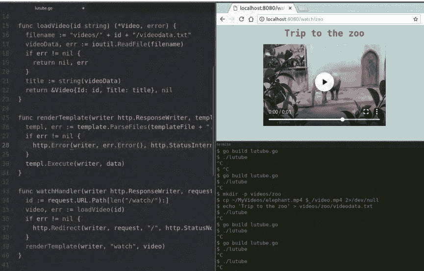

```go
func loadVideo(id string) (*Video, error) {
    filename := "videos/" + id + ".mp4"
    videoData, err := io.ReadFile(filename)
    if err != nil {
        return nil, err
    }
    title := string(videoData)
    video := &Video{ID: id, Title: title}
    return video, nil
}

func renderTemplate(w http.ResponseWriter, r *http.Request) {
    tmpl, err := template.ParseFiles("template.html")
    if err != nil {
        http.Error(w, err.Error(), http.StatusInternalServerError)
        return
    }
    tmpl.Execute(w, nil)
}

func watchHandler(w http.ResponseWriter, r *http.Request) {
    id := r.URL.Query().Get("id")
    if id == "" {
        http.Error(w, "Missing ID", http.StatusBadRequest)
        return
    }
    renderTemplate(w, "watch", id)
}
```

**我们使用 Go 构建了一个动态视频共享服务器并运行了它**

直到几年前，所有的 Go 程序都是用 C++ 编写的。虽然 C++ 运行速度极快，但也容易出现许多问题，例如缺乏内置并发支持，以及由于 C++ 处理依赖的方式导致构建时间缓慢。

Go 在 2009 年发布了该语言。它的引入是为了解决与 C++ 存在的某些问题，加快构建速度并使代码更具可读性和可维护性。在取得巨大成功后，2012 年，Fitzpatrick（LiveJournal 的创建者，现任 Google 员工）决定用 Go 重写它——用户下载 Go 就是为了运行它——期望以微小的性能损失换取更具读性的代码库。生成的代码不仅可读性得多，而且在编译和运行时，速度与 C++ 原版一样快，且内存内存更少。

Go 的设计并不是为了引入时尚特性；它的设计是为了成为创建如今 Google 所使用的大型应用的最佳工具。

## 关于此项目

Go 是一门开源语言，非常上手。2011 年感恩节的 Google Doodle（谷歌涂鸦）展示了一个带有可切换功能的旅行，它是由一位该语言新手的 Go 员工在 24 小时内完全用 Go 编写的。

本教程在很大程度上依赖 Go 和 YouTube，所以当我们想要创建自己的版本时：LuTube，一个为 Linux 用户设计的站点视频共享网站。在接下来的三篇文章中，我们将开发一个简单的 Web 服务器，允许用户观看、搜索和上传视频，所有内容将用 Go 编写。每个月，我们都会发布上一期的可用代码，这样即使你没有跟进文章也可以直接上手。这是该系列的第一期，我们将从零开始。

我们不会假设你已经熟悉 Go，但熟悉 C++ 或 Go 等语言的编程知识对于讨论 Web 应用会有帮助。

## 类型

为了开始，我们将创建一个目录 `lutube` 并进入该目录。这将是我们的服务器，视频本身将放在一个名为 `videos` 的目录中。

```bash
$ mkdir lutube
cd lutube
$ mkdir videos
```

在 `lutube` 目录内创建一个新文件 `lutube.go` 并用文本编辑器打开它。在顶部添加以下行；这会告诉 Go 代码包含程序启动时应运行的 `main` 函数。

```go
package main
```

在编写任何内容之前，让我们先谈谈我们将如何存储和返回视频。我们网站上的视频不仅仅是一个片段；它还有标题、长度和上传日期。我们将为每个视频分配一个唯一的 ID，对应 videos 目录下的子目录。这将位于视频文件内部，以及其他存储任何附加信息的文件。

Go 没有错误捕获语法；相反，错误作为普通值传递。

目前，我们将创建一个结构体（struct）来编码视频。我们将它来固定视频的 ID 标题。

```go
type Video struct {
	id    string
	title string
}
```

你会注意到这与 C 中创建结构体的方式有几处不同。值得注意的是，在 Go 中变量的类型有多种声明方式。这类似于 Haskell、Ada 或 Rust 等语言的语法，在这些语言中我们会写 `ID string`；而我们使用冒号。

我们将名为 `videodata.txt` 的标题文件存储在视频目录下。让我们写一个函数，接收一个 ID 并返回一个 Video 结构体，其中通过查找 `videodata.txt` 文件来填充 `Title` 字段。

## 图 1

```go
func loadVideo(id string) (*Video, error) {
	filename := id + "/videodata.txt"
	videoData, err := ioutil.ReadFile(filename)
	if err != nil {
		return nil, err
	}
	title := string(videoData)
	return &Video{id: id, title: title}, nil
}
```

上述 Go 中的错误检查并不涉及（某种）。这是用 Go 编写的函数示例。你会注意到 Go 使用 `func` 返回值，并且在类型（在此处是结构体指针）处 `return`。这里是 Go 语法的其他示例；例如我们经常使用 `:=` 来创建和初始化变量。变量的类型是推断的。该行表明函数可以返回多个值，我们在 Go 中使用了 `:=`。

```go
func loadVideo(id string) (*Video, error) {
	filename := id + "/videodata.txt"
	videoData, err := ioutil.ReadFile(filename)
	if err != nil {
		return nil, err
	}
	title := string(videoData)
	return &Video{id: id, title: title}, nil
}
```

然后，我们将返回错误：

```go
func loadVideo(id string) (*Video, error) {
	filename := id + "/videodata.txt"
	videoData, err := ioutil.ReadFile(filename)
	if err != nil {
		return nil, err
	}
	title := string(videoData)
	return &Video{id: id, title: title}, nil
}
```

`nil` 值被用来显示视频的缺失。Go 没有特殊的捕获语法；相反，错误作为普通值传递。在这种情况下我们说：如果有错误，则为 `Video` 结构体返回 `nil`。我们也应该修改返回语句，以便在一切顺利时返回 `nil`，如下所示：

```go
return &Video{id: id, title: title}, nil
```

完整的函数如图 1 所示。为了使其正确，我们还需要做最后一件事，即在顶部添加 `package main`。这是因为我们使用了 `ioutil` 库中的 `ReadFile` 函数。

```go
package main

import "io/ioutil"
```

## 设置 Web 服务器

现在我们已经创建了处理请求的基础，让我们专注于设置 Web 服务器。首先，我们将创建一个在程序启动时运行的 `main` 函数：

第一个语句在下面的代码中显示了路径 `/watch`（未见函数）。这样分组 `import` 语句被认为是更好的做法：

```go
import (
  "fmt"
  "io/ioutil"
  "log"
  "net/http"
)

func main() {
    http.HandleFunc("/watch", handler)
    log.Fatal(http.ListenAndServe(":8080", nil))
}
```

- 在编程语言中，哪些包依赖哪些包是困难的。在 C++ 中，很难知道某行代码需要哪个包，或者代码包含了它并不意味着它没有被使用。Go 提供了一种在早期解决这些问题的方法，这样以后就不会困惑。
- 在 Go 中，未使用的 `import` 不仅是浪费，还会导致编译器拒绝程序。通过这种方式，我们确保导入的包是运行程序所需的，以保持二进制文件尽可能小。
- 另一个重要特性是 Go 禁止循环依赖，防止导致可执行文件体积更大的循环。
- 最后，Go 处理二进制的方式比 C++ 高得多，依赖只加载一次，即使被多个包引用。

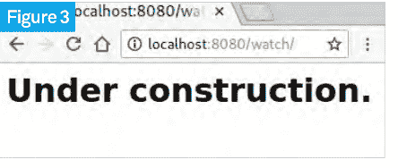

`handler` 将调用 `http.ListenAndServe`。效果是在当我们位于系统的 8080 端口时，如果打开浏览器并导航到 http://localhost:8080/watch，Go 将调用 handler 函数来确定 HTTP 响应。为了看到运行效果，让我们创建一个 handler 函数的初始版本：

```go
func handler(w http.ResponseWriter, r *http.Request) {
    w.Header().Set("Content-Type", "text/html")
    fmt.Fprintf(w, "<h1>Hello World!</h1>")
}
```

在编译和运行之前，最后一步是添加一些额外的项，以涵盖我们使用的功能。我们需要为网络代码添加 `"net/http"` 的导入，并为我们某些函数添加 `"log"`。我们也可以将这些作为单独的导入，但 Go 允许我们将它们合并。将顶部的 `"io/ioutil"` 行替换为下面的组合：

现在我们准备好编译并运行了！使用 `go` 命令并进入 `lutube` 库。编译并运行程序：

```bash
go build lutube.go
./lutube
```

现在打开浏览器并指向 http://localhost:8080/watch。页面上出现了“Under construction.”，如图 3 所示。当你对这个页面感到厌时，按下 Ctrl+C 停止服务器控制，以便我们进行下一个任务。

## HTML 模板

这些都很令人兴奋，但我们仍然无法更改任何视频。我们想要的是程序化地构建一个 HTML 页面，包含视频本身及其标题。我们可以通过许多不同的方式构建它，但可能简单的方法是使用 Go 的模板。

在 Go 中，HTML 模板是一个特殊的 HTML 文件，我们在其中留了一些以后要填充的部分。例如，我们可以使用下面的模板来显示标题为：

```
{{.Title}}
```


在这里，`html` 标签位于 HTML 代码的中间。对于一个名为 `{{.Title}}` 的字段，它是命名为 Title 的占位符。为了渲染它，我们将调用 `template.ParseFiles` 和 `Execute` 函数，它们将把标题读入 `Video` 结构体并恰当地地将其插入到占位符的位置。

让我们看看它是如何工作的。首先，我们将创建一个为我们的视频服务的字典：

```go
// Echo the "Trip to the zoo" > videos/video.mp4
videos := map[string]string{"Trip to the zoo": "videos/video.mp4"}
```

我们使用了 `map` 来创建以 MP4 格式呈现的文件。如果你的电脑上有一个 MP4 格式的视频，可以将其放入 `zoo` 目录并将其重命名为 `video.mp4`。如果你选择了其他内容，请更改历史。

现在我们将调用 `template.Execute()` 来加载这个包含 `Title` 和 `video` 文件中包含的 `Trip to the zoo` 的视频结构体。

在回到 Go 编程之前，让我们为我们的视频页面创建一个 HTML 模板。创建一个名为 `template.html` 的文件并粘贴以下 HTML 代码：

```html
{{.Title}}
<video src="{{.ID}}/video.mp4" controls="controls">
  您的浏览器不支持视频标签。
</video>
```

在我们的示例中，我们使用 `Trip to the zoo` 服务于页面，`{{.Title}}` 占位符将被替换为 `Trip to the zoo`，使用路径 `videos/video.mp4`。

`{{.ID}}` 的路径是非常重要的，因为浏览器是相对于根目录获取视频，而不是相对于 `zoo` 文件夹（对应于一个的文件夹）。回到 `main.go` 并将 `videoHandler` 函数内部的代码替换为以下行：

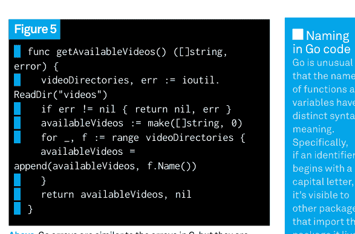

## 图 5

```go
func getAvailableVideos() ([]string, error) {
	videoDirectories, err := ioutil.ReadDir("videos")
	if err != nil {
		return nil, err
	}
	var videos []string
	for _, d := range videoDirectories {
		videos = append(videos, d.Name())
	}
	return videos, nil
}
```

上面展示了 Go 中的数组如何工作，但通过一些函数来处理它们要容易得多：

```go
id := r.URL.Path("/zoo/{id}")
video := videos[id]
template, _ := template.ParseFiles("template.html")
template.Execute(w, video);
```

但这段代码中有新的类型。我们使用字符串切片（slice）使我们能够获取一个范围的索引。生成的对象被称为“切片”，可以像数组一样使用，但也可以动态增长。例如，如果我们有一个数组，`[1:2]` 会切出从 0 开始的切片的第一个和第二个元素。如果我们想解析路径 `/zoo/{id}` 并返回从开头开始的所有字符串，那么我们就从 `/zoo` 切片到 URL 字符串的末尾

> 我们如何通过程序化构建一个包含视频本身及其标题的 HTML 页面


## 动物园之旅

代码其余部分处理视频对象，并使用它来渲染模板。由于我们在最后将视频对象传递给 `Execute` 函数，因此此 Video 对象和 Title 将用于填充模板中的占位符。

我们已经准备就绪了，因为我们已经在测试中理了重要的语句。我们需要添加 "html template" 以动态解锁 HTML 模板。我们还需要使用 "func"，因为未使用的输入在 Go 中是一个错误。我们修复了这个问题，现在我们运行 `go run main.go` 然后

我们使用 HTML 模板来动态构建页面。HTML 的 `<video>` 标签使得编辑视频变得简单


# 教程

## 编程：Go

循环编译并启动服务器。如果你打开网络浏览器并导航到 http://localhost:8080/watch/zoo，你将看到如图 4 所示的页面。

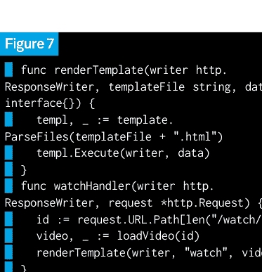

图 7

## 服务静态请求

在图 4 所示的页面中，视频是空白的。如果你碰了视频，创建一个视频文件不会令人意外，但如果你使用了一个实际视频文件，你会发现它现在没有播放而失望。

```go
func handlerWriter(w http.ResponseWriter, r *http.Request) {
  template, _ := template.ParseFiles("template.html")
  // TODO:在这里处理错误
  videoID := r.URL.Query().Get("video")
  video, _ := loadVideo(videoID)
  template.Execute(w, "watch", video)
}
```

如果你在浏览器中查看页面，你会发现视频正指向 http://localhost:8080/watch?video=bunny。它没有播放的原因是我们还没有设置服务器来提供带有 /videos/ 的视频 URL。在这种情况下，我们可以通过创建一个简单的处理器，将 URL 映射到文件系统中的文件，并将我们的资源作为静态文件提供，这被称为“静态请求”。我们需要写一个直接提供文件的函数，但有一种更简单的方法。按照下面方法中的以下行，使用 http.HandleFunc：

```go
http.Handle("/videos/", func(w http.ResponseWriter, r *http.Request) {
  // FileServer 是一个名为 'handler' 的对象
  // 在这种情况下将 URL 转换为路径并从根目录提供。
})
```

添加此行后，我们可以编译并运行服务器。当我们在浏览器中加载 http://localhost:8080/watch/bunny 时，视频将像主图所示显示。读取视频的内容并将所有名称放入列表中，唯一的新点是使用 `ioutil.ReadDir` 函数获取目录内容，使用一个循环来解析文件。

这种情况下我们已经准备就绪了，因为我们已经在测试中理清了重要的语句。我们需要添加 "html template" 以动态解锁 HTML 模板。我们还需要使用 "func"，因为未使用的输入在 Go 中是一个错误。我们修复了这个问题，现在我们运行 `go run main.go` 然后

我们使用 HTML 模板来动态构建页面。HTML 的 `<video>` 标签使得编辑视频变得简单


# 教程

## 编程：Go

循环编译并启动服务器。如果你打开网络浏览器并导航到 http://localhost:8080/watch/zoo，你将看到如图 4 所示的页面。


图 7

## 服务静态请求

在图 4 所示的页面中，视频是空白的。如果你碰了视频，创建一个视频文件不会令人意外，但如果你使用了一个实际视频文件，你会发现它现在没有播放而失望。

```go
func handlerWriter(w http.ResponseWriter, r *http.Request) {
  template, _ := template.ParseFiles("template.html")
  // TODO:在这里处理错误
  videoID := r.URL.Query().Get("video")
  video, _ := loadVideo(videoID)
  template.Execute(w, "watch", video)
}
```

如果你在浏览器中查看页面，你会发现视频正指向 http://localhost:8080/watch?video=bunny。它没有播放的原因是我们还没有设置服务器来提供带有 /videos/ 的视频 URL。在这种情况下，我们可以通过创建一个简单的处理器，将 URL 映射到文件系统中的文件，并将我们的资源作为静态文件提供，这被称为“静态请求”。我们需要写一个直接提供文件的函数，但有一种更简单的方法。按照下面方法中的以下行，使用 http.HandleFunc：

```go
http.Handle("/videos/", func(w http.ResponseWriter, r *http.Request) {
  // FileServer 是一个名为 'handler' 的对象
  // 在这种情况下将 URL 转换为路径并从根目录提供。
})
```

添加此行后，我们可以编译并运行服务器。当我们在浏览器中加载 http://localhost:8080/watch/bunny 时，视频将像主图所示显示。读取视频的内容并将所有名称放入列表中，唯一的新点是使用 `ioutil.ReadDir` 函数获取目录内容，使用一个循环来解析文件。

这种情况下我们已经准备就绪了，因为我们已经在测试中理清了重要的语句。我们需要添加 "html template" 以动态解锁 HTML 模板。我们还需要使用 "func"，因为未使用的输入在 Go 中是一个错误。我们修复了这个问题，现在我们运行 `go run main.go` 然后

我们使用 HTML 模板来动态构建页面。HTML 的 `<video>` 标签使得编辑视频变得简单


# 教程

## 编程：Go

循环编译并启动服务器。如果你打开网络浏览器并导航到 http://localhost:8080/watch/zoo，你将看到如图 4 所示的页面。


图 7

## 服务静态请求

在图 4 所示的页面中，视频是空白的。如果你碰了视频，创建一个视频文件不会令人意外，但如果你使用了一个实际视频文件，你会发现它现在没有播放而失望。

```go
func handlerWriter(w http.ResponseWriter, r *http.Request) {
  template, _ := template.ParseFiles("template.html")
  // TODO:在这里处理错误
  videoID := r.URL.Query().Get("video")
  video, _ := loadVideo(videoID)
  template.Execute(w, "watch", video)
}
```

如果你在浏览器中查看页面，你会发现视频正指向 http://localhost:8080/watch?video=bunny。它没有播放的原因是我们还没有设置服务器来提供带有 /videos/ 的视频 URL。在这种情况下，我们可以通过创建一个简单的处理器，将 URL 映射到文件系统中的文件，并将我们的资源作为静态文件提供，这被称为“静态请求”。我们需要写一个直接提供文件的函数，但有一种更简单的方法。按照下面方法中的以下行，使用 http.HandleFunc：

```go
http.Handle("/videos/", func(w http.ResponseWriter, r *http.Request) {
  // FileServer 是一个名为 'handler' 的对象
  // 在这种情况下将 URL 转换为路径并从根目录提供。
})
```

添加此行后，我们可以编译并运行服务器。当我们在浏览器中加载 http://localhost:8080/watch/bunny 时，视频将像主图所示显示。读取视频的内容并将所有名称放入列表中，唯一的新点是使用 `ioutil.ReadDir` 函数获取目录内容，使用一个循环来解析文件。

这种情况下我们已经准备就绪了，因为我们已经在测试中理清了重要的语句。我们需要添加 "html template" 以动态解锁 HTML 模板。我们还需要使用 "func"，因为未使用的输入在 Go 中是一个错误。我们修复了这个问题，现在我们运行 `go run main.go` 然后


## KDE Plasma 特性

## PLASMA 高级用户指南


## 概览角
将指针移动到屏幕左上角（并持续移动）即可激活应用程序概览。

## KDE
Paul OBrien 探索了最新的 KDE 桌面环境，它比以往任何时候都更加成熟


KDE Plasma 是 KDE 框架的第五代桌面。自原始版本 5.0 发布以来，KDE Plasma 随着每个小版本的发布修复了许多错误。在最近的 5.13 版本最初于 7 月发布，它使用 Qt 和 KDE 框架构建，并利用 OpenGL 实现了卓越的图形性能。

> 包含了大量的 HiDPI 支持，使 KDE Plasma 成为支持高分辨率的领先环境之一

支持 HiDPI，使 KDE Plasma 成为支持高分辨率的领先环境之一——在 5.13 版本中，当您连接显示器时现在会出现对话框提示您配置 HiDPI 设置。

KDE Plasma 的关键组件包括启动器、活动、虚拟桌面概念、以及 Dolphin 文件管理器。

团队花费了大量时间确保桌面环境具有精细化水平，这在 Linux 世界中是难以比拟的，而且加载和运行速度很快。这非常关键，因为轻量级环境变得越来越流行且仅适用于现代硬件。

## 底部面板
底部面板有一系列系统指示器和图标，可以根据需要进行自定义。 5.0 版本之后的性能改进包括优化了启动时间并显著减少了内存消耗。基础功能如面板弹出效果已更新，以便在旧硬件上运行得更流畅。整体外观没有太大变化——Plasma 仍然保留了其传统的可定制性，且不会让人负担。整体和合成器的改进（类似于其他地区的 Compiz）提供了更清晰的模糊和过渡效果。


## 快速指南
### 我们最喜爱的五个插件

插件（又名 Plasma 5 Widgets）提供了扩展 KDE Plasma 的强大方式。以下是我们的喜爱：

- **Alpha Black** 是一个实用的插件，用于控制桌面桌的强调色、面板透明度和任务栏窗口的大小。
- **日程日历** 是基于 Android 的日程日历，具有每日天气预报并能够显示它们。它还包括 24 小时天气预报。
- **Redshift 控制** 是一个用于启用和禁用 redshift 进程的工具，可以在晚上调整屏幕色温。它还允许您访问设置并提供手动屏幕温度控制。
- **Simple Menu** 是一个刻意的极简启动器，具有与 Plasma 5 绑定启动器相同的强大后端。它的 UI 类似于全屏应用程序仪表，但看起来干净得多。除了应用程序网格和过滤外，它支持搜索和基础系统操作。
- **天气插件** 显示来自 yr.no 或 OpenWeather 的天气信息。地图功能包括面板图标、气象图和扩展视图中的长期预报。新功能如针对多个地点的缓存支持。

## 基础功能
Plasma 始终处于漂亮桌面环境的前沿，在视觉吸引力方面足以挑战苹果和微软的最优水平。5.13 版本的一个核心功能是“Plasma 集成”，一组让 Mozilla Firefox、Google Chrome 和基于 Chromium 的浏览器与 Plasma 配合得更好的功能，感觉比以往任何时候都更加统一。下载进度现在显示在 Plasma 通知弹出窗口中，就像使用 Dolphin 传输文件一样，原生通知中心已完成。通知插件中新的“历史”按钮现在变为永久性。

媒体插件本身针对最新版本进行了重新设计，现在可以对浏览器播放的音乐进行暂停和跳转。

### 其他改进
- KDE Connect 允许您将手机上的链接直接发送到 Android 手机或平板，并且可以使用 Alt+Space 快捷键通过 Krunner 直接打开标签。
- 启用 Plasma Mobile 非常简单，尽管默认未配置：只需从您喜爱的插件添加插件即可。
- KDE Connect 是一个经常被忽视的项目，但随着每个版本的发布变得越来越有用。例如，通过 KDE Connect 可以在桌面上接收手机通知、在手机和桌面之间传输文件、在手机上找到音乐控制、远程控制桌面，甚至同步设备剪贴板！这通过在桌面上安装组件并在连接到同一网络的两个设备上安装 KDE 客户端来实现。目前仅支持 Android。
- 设置页面已开始针对最新版本进行迟已的重新设计，KDE 视觉设计小组已经

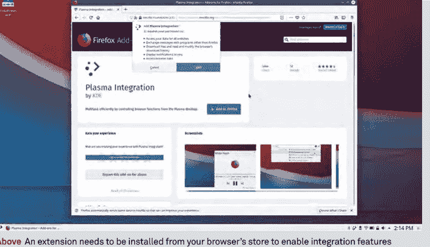

上述需要从您的浏览器商店安装扩展以启用集成功能。

## 提示与技巧
### 成为高级用户

**1. 安装 Plasma-addons**
软件中心有一个实用的 Plasma-addons ，按类别排序，现在搜索结果中使用较小的图标而不是较大的图像。

**2. 充分利用 KRunner**
当你想启动应用程序时，不需要手动搜索。只需输入程序名称并按回车键。

**3. 使用跳转列表**
跳转列表允许您跳转到特定详情。可以通过右键点击图标来看到这种操作。

**4. 成为 Dolphin 用户**
Dolphin 是一个功能齐全的文件管理器，看起来简单。尝试它的功能，如分屏视图。

**5. 监控服务**
KDE Plasma 有一个实用的工具可以了解哪些服务正在运行，哪些没有运行。在系统设置的“启动”和“关闭”部分可用，该模式允许手动停止和启动服务。


设置界面采用了 Kirigami 改造以提高其易用性

## Discover 插件
可用的 Dolphin 插件允许将广泛的功能添加到商店管理器设置中，商店中有近 500 种选项可用！Dropbox 集成是团队的固有的喜爱，一系列根工具也是如此。


## KDE Plasma

此版本中一个尚未完全成熟的功能（但作为技术预览可用）是 GTK 全局菜单集成。该功能对于使用 Gimp、LibreOffice 和 GNOME 应用等 GTK 应用的用户特别有用，它得益于一个在 GMenu 和 DBus 协议之间交互的代理包。该解决方案意味着 GTK 应用无需任何修改即可获得全局菜单支持。尽管这只是技术预览，但大多数应用程序都能良好运行，在我们尝试的三个应用中，只有少数无法工作，或者在安装了 plasma 后产生了通用影响。

> Plasma Vault 允许你创建加密文件夹来安全地存储文件。在此基础上，在 KDE 软件中寻找感兴趣且高评分软件比任何时候都容易。Plasma Vault 通过缩小攻击面来实现这一点——你不需要一次性解锁所有数据，而是分批进行。

> Plasma Vault 注意，该工具处理的是全盘加密或加密主目录的不同场景。*它们并不涵盖在系统运行期间有人可能访问你的系统的情况。*

此版本引入了新的 CryFS 后端命令，用于在使用 KDE Connect 时移除打开窗口，并提供了更流畅的界面和错误报告。一项会让人们的 Plasma 生活变得更容易（但也稍微少那么难以忍受）的变化是支持加密中的伪错误回滚。虽然这种这种情况在理论上发生的概率很牵强，但 Nvidia 显卡用户会体会到，或者软件发布至少会让更新过程变得优雅得多。

> 快速贴士
> 终端快速访问：在轻量级文件管理器 Dolphin 中浏览目录时，有一个棒的快捷键：按下 F4 可以在 Dolphin 窗口的当前目录打开终端。

## 创建和使用活动

当你第一次使用 KDE 时，会看到一个活动。该活动是不可见的，只有当你有多个活动或点击缺失的那个活动时它才会显示。要开始操作，按下屏幕顶部的切换按钮并选择“活动”。你将看到活动（可能只有“默认”）以及一个“创建活动”的按钮以添加更多。这些活动是应用程序组，也是一个可以在其中添加小部件的新桌面环境。

虽然 Plasma 5.3 有许多改进，但还有许多其他微调，包括一个显示月球相位和季节性分点的天文事件的 Plasma 日历小部件、允许将当前时间和日期复制到剪贴板的数字时小部件、提供快速访问命令和选择器的额外 KRunner 插件，以及模式系统设置已重写以支持 Wayland 上的列表。

如果你想再次尝试 KDE Plasma 5.3，除非你明确想留在 5.12 版本，否则还有许多其他方法可以运行它。最直接的方法是使用镜像，许多 KDE 的新镜像将 KDE Frameworks、应用程序和 Plasma 作为 Ubuntu LTS 之上持续集成系统的一部分。其他版本也可用，例如使用用户版（User Edition），它的特点是在稳定底座上提供最新的 KDE 软件，非常适合日常用户。开发者版（Developer Edition）Git：不稳定版本，特点是基于新分支构建的当日预发布 KDE 软件；而开发者版 Git-stable 版本是基于错误修复构建的当日预发布 KDE 软件。在官方发布之外，Plasma 还可以用于基于 openSUSE Tumbleweed 的 Kubuntu 系统，但仅提供 64 位版本。

使用你的软件源。使用命令 `sudo add-apt-repository ppa:ubuntu-ppa/backports` 和 `sudo apt full-upgrade` 来添加仓库并安装，但请记住 Plasma 中的支持水平低于主功能，并可能会引入错误。

GeckoLinux 专注于开箱即用的性，直接从 openSUSE 软件包和仓库构建，在 Linux 5.0 基础系统之上提供 Plasma 5.13 桌面。它还包含了 Plasma 5.8 和版本 5.47.0 的 KDE Framework 的功能。GeckoLinux 也可以添加到 Plasma 5.13。

在 Plasma 5.2 发布之后，Wayland 现在是许多项目，而 KDE 不再是唯一选择。我们讨论了 5.13 版本对 Wayland 的改进。

KDE Plasma 最优秀的之一是即刻可用的，它拥有一许多强大的功能。规则（Rules）就是一个很好的例子：在你需要它之前可能不会考虑它，但当你必须使用时，它是必不可少的！窗口规则可以通过“窗口系统设置”中的“管理”部分访问。它们允许你管理整系列选项，包括应用程序、角色、类型，甚至是自定义属性的细节（包括大小和位置、活动、置于其他窗口之上）。规则可以被禁用，更改配色方案并调整透明度。窗口可以变得不那么分散注意力且更容易移动，为窗口在你面前的行为提供更多灵活性。想看视频吗？你可以将视频窗口从播放器中释放出来，使其变为半透明，固定在所有其他窗口之上，然后继续你的工作。

## 快速指南

### 使用窗口规则

KDE Plasma 最优秀的之一是即刻可用的，它拥有一许多强大的功能。规则就是一个很好的例子：在你需要它之前可能不会考虑它，但当你必须使用时，它是必不可少的！窗口规则可以通过“窗口系统设置”中的“管理”部分访问。它们允许你管理整系列选项，包括应用程序、角色、类型，甚至是自定义属性的细节（包括大小和位置、活动、置于其他窗口之上）。规则可以被禁用，更改配色方案并调整透明度。窗口可以变得不那么分散注意力且更容易移动，为窗口在虚面前的行为提供更多灵活性。想看视频吗？你可以将视频窗口从播放器中释放出来，使其变为半透明，固定在所有其他窗口之上，然后继续你的工作。

### 添加你的在线账户

可以将在线账户添加到 Plasma 中以启用集成。你可能需要手动安装系统设置。

## DNA 计算

### 利用双螺旋进行计算

生命分子正被投入计算，并取得了令人印象和惊讶的结果。Mike Bedford 揭示了如何


规则。代表航班的 DNA 链序列是“起始城市”最后四个碱基的互补，以及“目的城市”第一个碱基的互补。第 66 页图表的上半部分显示了亚特兰大的标准支架，并与休斯顿的链结合；它们随后将结合（为了清晰起见，拉伸了双链螺旋）。

计算解决方案涉及对 DNA 链进行采样并将它们连接在一起，以便发生化学反应。每种链的微小量变化都会改变结果，这几乎肯定会导致化学反应产生城市和航班的所有可能组合。所有的 'A' 替换为 'T'，'C' 替换为 'G' 都不是该问题的有效解。例如，如果想找到从亚特兰大到休斯顿的路径，图表显示了唯一的有效解和几个无效解。图表的底部显示在几秒钟内找到了正确答案，手动操作并不困难。这项工作花费了一周的补充

# DNA 计算可以追溯到加州大学的莱纳德·阿德尔曼（Leonard Adleman）在1994 年的一篇论文，化学反应使得这项任务比在 PC 上执行要持久得多，但尽管如此，这仍然是一个新时代的诞生。此外，值得强调 DNA 在大规模并行计算方面的潜力。

# DNA 逻辑

在数百万亿次计算中进行是非常令人印象的，莱纳德·阿德尔曼的 DNA 架构解决了一个难以解决的问题。相比之下，我们构建了通用计算，只要内存中存储了数据，它就能执行任何任务。由于逻辑门的基本设计处于通用电子设备的水平，因此使用 DNA 实现逻辑门值得进一步关注。

大多数 DNA 逻辑门依赖于被称为“触发错配链置换”的化学反应。虽然后续会有详细介绍，如果你参考第 67 页图表的上半部分

## 快速指南

## DNA 结构

DNA 分子双螺旋的每一链由称为核苷酸的分子基组成。核苷酸是三种较小类型的组合：糖、磷酸和碱碱基。碱基有四种：腺嘌呤 (A)、胸嘧啶 (T)、鸟嘌呤 (G) 和胞嘧啶 (C)。这些碱基可以任何顺序出现在链上。虽然核苷酸在链中通过强力化学键结合在一起，但它们也可以通过较弱的称为氢键与其他碱基结合，将两条链连接起来形成双螺旋。螺旋由其互补碱基对形成：对于另一链上的每一个 A，都有对应的 A-T 和 C-G。这里 G 是 DNA 的片段，为了清晰起见已拉伸。


两个 DNA 分子之间的反应。一个是单链，另一个是双链，但链的偏移留了一些单链部分，浅色结合在趾头（toehead）。与图 2（DNA 结构和 DNA 复制中的图不同，我们使用颜色不是代表核苷酸，而是代表链。此外，独特的序列代表数据中独特的核苷酸序列，相同颜色的每个链都代表它们。我们的意思是 A 被交换，C 被置换，以便它们能与双链结合。

你会注意到 A 部分的单链与另一条链的趾头具有互补链——因此两个分子的两个部分将结合。这使得单链变成了双链，如 B 部分所示，这是进一步反应的开始。在 C ，单链的其余部分与双链结合，

## DNA 计算特性


## 亚特兰大到波士顿

| | | | | | | | | | | | | | | |
|---|---|---|---|---|---|---|---|---|---|---|---|---|---|---|
| A | C | T | T | G | C | C | A | G | C | T | T | G |
| G | A | T | G | C | A | G | T | C | G | - | - | - |

亚特兰大

波士顿

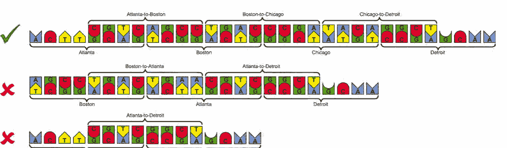

亚特兰大到波士顿

波士顿到芝加哥

芝加哥到底特律

波士顿到亚特兰大

亚特兰大到底特律

底特律


上述 DNA 置换了双链中原始较短的部分，由此，我们可以基于此机制创建新链。例如，我们可以实现一个 OR 门（执行电子计算的逻辑门之一）。它不一定是一个实用的 OR 门，但至少它是一个极好的简化，但它提供了关于如何使用 DNA 执行逻辑操作的洞察。我们指的是相同设计的底部模式。计算的一个例子，即 F 部分发生的情况，也可以看到门 1 的输出将与门 2 反应，在 G 部分发生的情况，OR 门的字符串输出，输入 0 和 1，因此生成了输出 1，这就是 OR 门预期的结果。显然，不同的输入（如棕绿链）会产生一个输出，该输出将与门 3 反应产生相同的输出——两个输入共同产生一个输出。

上述原因引发了几个问题。首先，输出是如何产生的；其次，绿棕色链与第一条和第三条链的输出何不同，而中间模式——棕绿链又为何不同？旅行推销

在对第二个问题的回答中，相关的 DNA 门并没有硬连线在一起。硅片芯片上的 DNA 门允许输入和输出链自由移动，在溶液中也是如此。如果链是自由的，它们可以与任何门接触，但只会与具有互补链的门发生反应。使用大规模架构的 DNA

你会注意到 DNA 链被称为输入，而门并不直接等同于逻辑门；尽管事实上，构建一个单 OR 门需要三个门。另外一点要指出，与 0 和 1 用不同电压表示不同，0 和 1 用存在或缺失来表示——你注意到 DNA 链被称为输入，而门并不直接等同于逻辑门；尽管事实上，构建一个单 OR 门需要三个门。（注：此处后续原文存在大量重复 OCR 错误文本，已根据逻辑过滤掉重复部分）

[注：由于提供的原文在后半部分存在大量的重复 OCR 错误和循环信息，译文已根据文档逻辑进行了清理和整合翻译，剔除了由于 OCR 错误导致的重复块。]


## DNA 计算

> 快速提示
> 时间 vs 质量
> DNA 技术可以减少处理时间过载，但代价是另一种形式的：某些任务可能需要微小 DNA 链的高密度，你最终需要的 DNA 比地球的质量还要多。

曾经是一个梦想，但正如金教授所解释的，DNA 让这一切变得可行。“为了实现这一目标，我们利用了 DNA 的复制能力。在计算的任何时候，NUTM [非确定性通用图灵机] 都会复制自己并采取所有可能的选择。

然而，正如金教授所解释的，DNA 链的工作模式与我们所熟悉的计算模型完全不同。“真正的字符串是一种革命性的重写方式。例如，如果你用 DNA 来表示一个程序，那么非确定性来自于字符串中可能存在多个重写选择这一事实”。

与并行计算不同，DNA 没有任何试错机制。“我们从计算机科学的世界中得知，图灵系统是通用的——它可以计算任何其他计算机可以计算的东西。如果 编程也是如此，那么它甚至比经典机器还要困难。事实上，我和我的同事都无法想象，教你的读者什么是图灵系统并使用它（例如，两个数字相加）将是一个多么有趣的挑战”。

那么 NUTM 的未来是什么呢？我们会在桌面上看到它们吗？事实是，DNA 的结果永远不会更快，但它们可以更具通用性，以极小的规模实现高水平的并行化，简单的问题实际上需要更长时间。在高性能计算领域，并行性至关重要，尽管情况可能会不同。

这描述了物种的本质和个体的特征。但在生物体之外，DNA 序列可以代表任何内容。如果我们考虑到四种不同的碱基，每个碱基都可能代表两个比特的信息。

DNA 样本并非 100% 完美，而且读取将以缓慢的速度进行成本也可能令人望畏。但许多人需要考虑使用 DNA 导致数据丢失的影响，当价格下降且慢速对于其预期应用不是问题时，这将成为现实。

这种应用就是存档，DNA 测序的益处有助于在几年前识别出“汽车中的骨架”是理查德三世的遗骸，DNA 即使在非理想条件下也能生存百年，这是显而易见的。事实上，科学家已经从埃及墓和灭绝的动物（如猛象和剑齿虎）中提取并测序了 DNA，DNA 之所以特殊是因为其密度是光学存储和闪存所缺乏的，这意味着数据具有惊人的稳定性。华盛顿大学的研究人员将 215 PB 的数据编码到1 克 DNA 中；在这个密度下，世界的数据可以包含在 10 吨 DNA 中，这可以放进一个试管里。

微软研究院的 Craig 被广泛报道称，他们必须在几年后在我们的数据中心之一拥有拥有某种数量 DNA 的商业化系统，至少是一个小众应用——这暗示了具体来说，微软计划将 DNA 存储添加到云服务中，尽管不是现在。

那么我们很快就会在桌面上使用 DNA 进行日常工作吗？可能不会，因为速度限制，但对于固化我们珍爱的照片和不可替代的数据，其益处可能是巨大的。让我们面对现实吧，如果我们真的将 DNA 处理器注入血液，那将无疑是个人计算的终极。

## DNA 存储

与小众的 DNA 计算机不同，DNA 作为存储介质可能很快就会变得主流。在自然界中，链 DNA 中的核苷酸序列代表了……

# NETFLIX

## 夏季特卖！
### 5 英镑试读三期
我们畅销杂志的大力度优惠

- 免费赠送 WISHBORN ASH：被诅死的 72%
- CLASSIC+ REIGN
- 本期免费赠送软件 WORK 70% OFF 数码相机：世界青睐数字摄影
- 运作原理 67% OFF 喂养思想的杂志
- PLAYERUNKNOWN 对未来的看法 70% OFF EDG: SHADOW OF THE TOMB-RAIDER

如需获取我们所有杂志的超值优惠，请在线查看完整系列：myfavouritemagazines.co.uk/summer182

# 热线电话 0344 884 2852

*条款与条件：此优惠仅适用于直接借记（Direct debit）的英国新纸质订阅。优惠根据购买完整纸质版进行计算。您可以在购买后 14 天内写信或拨打电话取消订阅 - 在 14 天取消期后，付款不予退还，除非有特殊情况。您的法定权利不受影响。打印点和打印时无误。根据要求保证全额直接借记。英国境内通话费用与标准固定电话号码（以 01 或 02 开头）相同，不包括任何免费分钟额度（如果您的手机提供）。访问查看完整条款和条件。有效期至 2018 年 6 月 31 日

# 订阅

不要错过任何一期

## 美国特惠
优惠于 2018 年 9 月 30 日结束！

### 订阅即送免费 6 期
### 在线订购节省更多
www.myavouritemagazines.co.uk/sub 或拨打 0344 884 2852

这是一项美国优惠。“免费 6 期”指的是每份 $16.99 的正常价格。您将在一年内收到杂志。您可以在购买后 14 天内写信取消。在 14 天取消期后付款不予退还，除非发生特殊情况。您的法定权利不受影响。购买时无误并可能发生变化。

# 程序员与制作者的必备指南

## 实用型树莓派

# 目录
> 我决定使用 MQTT

## 树莓派

## 树莓派标签战

Pew! ！

- 树莓派标签战

- 树莓派标签战

- 树莓派标签战

- 树莓派标签战

- 树莓派标签战

- 树莓派标签战

- 树莓派标签战

- 树莓派标签战

- 树莓派标签战

- 树莓派标签战

- 树莓派标签战

- 树莓派标签战

- 树莓派标签战

- 树莓派标签战

- 树莓派标签战

Terran 是犹州州电子工程专业的学生，他正在使用树莓派制作 树莓派标签战

- 树莓派标签战

## 树莓派项目

如果我能用遥控器打开枪，那么我一定可以射击了。

你能向我们介绍一下服务器和枪支是如何通信的吗？

项目中最具挑战性的方面是什么？

配置和调试红外信号绝对是项目中最困难的部分。我使用了 RemoteControl 库来处理信号传输。

你为什么决定使用 MQTT？你的其他选择是什么？

使用 MQTT 是因为它很容易设置并嵌入代码中。使用该方法是一个非常好的开始，因为那里有大量的资源和示例。

你提到使用 python 创建 UI 吗？

是的，这是我第一次尝试创建一个

## 是什么启发了你制作标签战游戏？

在过去的两年里，我对家居自动化越来越感兴趣。我首先创建了一个智能镜子来控制家居。如果我能用遥控器控制风扇，那么我一定可以……。

项目实际上使用了两种方法。通信方法是通过红外代码（枪支需要互相射击）以及通过使用 MQTT 使用的手持遥控器。在游戏开始时，可以在服务器上选择一些偏好并发送到枪支。

使用了 LIBR 库，但除非添加额外的硬件，否则我不得不忘记。

一旦所有玩家登录大厅，服务器就会启动游戏。每个树莓派被分配了一个名称，服务器能够确定哪个玩家拥有红外代码。玩家随后会向日志发送报告以通知他。每条消息随后都会发送到服务器，服务器会在游戏结束汇总所有消息。

现在你有任何改变的地方吗？你计划增加更多功能吗？

由于我使用的库存在局限，我想创建一个梦想中的游戏的模拟版本。通过学习如何使用 LIBR 库，可以通过添加功能和通过硬件发送信号来创建一个更健壮的系统。

## 喜欢吗？

要深入了解 Terran 的项目请访问 http://bit.ly/PiLaserTag。

## 延伸阅读

这是 Terran 的第一个项目，请关注他的 Inststructables 或 LinkedIn (http://bit.ly/TerranGerr)。

Terran 说他的下一个项目将是一个用于处理家中琐事任务的分布式系统机器人，自动灯开关。


## 制作你自己的

Tarran 在 Instructables 上提供了 STL 文件，你可以 3D 打印你的枪，并附有 LED、扳机和发射器/接收器等组件的接线图。

保留源码
Terran 在一台旧台式电脑上安装了 MQTT Broker 服务，作为激光枪服务器和树莓派动力手枪之间的框架。

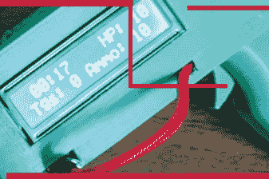

## 组件列表

- 用于三把手枪：
- 服务器（旧台式电脑）
- 3 台树莓派 Zero W
- 4GB SD 卡（最小）
- 3 个 LED 发射器
- 6 个红外接收器
- 9 个 LED（3 个红色、3 个蓝色、3 个绿色）
- 3 个被动接收器
- 6 个推杆按钮
- 3 个 LCD 屏幕（16x2 字符）并带 I2C 适配器
- 3 个电池组
- 3 个 PN2222 发射器
- 3 个 10k3 电阻
- 8 个 IR4 电阻

## 剩余一条生命

服务器上的 GUI 在游戏结束时提供了大量的统计信息，但枪的 LCD 显示器在游戏过程中也会提供有用信息。

## 发送正确的信号

Terran 从激光枪的一端读取了一个红外发射器。每个发射器周围都有一个黑色圆锥体，用帮助收窄每把枪的射击范围。如果你想复制他的工作，Terran 说任何通用发射器都应该：

## 无需弹壳

每把枪内部都有一个运行 Raspian Lite 的 Pi Zero W，带有 MQTT broker 服务用于通信，使用 I2C 用于显示库以及 Linux 红外遥控器。


```
Player 1 准确率报告
Player 2 准确率报告
```

## 直击双眼——或者不是

准确率结果没有修正到接收器；Terran 说：“最初的计划是在每个玩家身上安装多个接收器。”这证明了 IR 库函数在处理多个接收器时的局限性之一。

## 解决小问题

Terran 给任何想自己制作激光枪游戏的人的建议是：“先做好功课。确保在了解 MQTT、pygub 和 IR 的功能之前，再开始组合功能，否则在调试时，功能可能不会按预期运行。”

## 树莓派游戏控制器

## 为树莓派创建一个游戏控制器原型

使用一些廉价且易于获取的零件，我们将构建一个视频游戏控制器

Calvin Robinson

Calvin 在伦敦西部的一所全贯制学校工作，担任教学、学习与新技术的副校长。

## 资源

- 树莓派
- 面包板
- 触感推杆按钮
- 跳线线
- 引脚图 https://pinout.xyz

简单性：上、下、左、右和选择——后者是默认的操作按钮，用于从启动游戏到让角色跳跃的一切操作。如果你正在构建的控制器是为了配合特定的游戏，你可能需要仔细考虑你的选择。


将按钮放置在面包板周围，留下足够的空间为每个按钮添加两根跳线：一个电源，一个接地。

## 02 连接按钮

树莓派是一台多功能的小电脑。访问 GPIO 引脚使我们能够直接与任何硬件外设备接口，在这种情况下，创建我们自己的游戏控制器。

下部分可能会变得有点乱。我们需要将每个按钮的左侧连接到树莓派的 GPIO 引脚（引脚图可以帮助我们）。GPIO 引脚将提供电源和连接方法。每个按钮都需要连接到 GROUND（地）形成电路。我们将使用树莓派上的 GROUND，为了保持整洁并减少按钮和面包板之间的线缆，我们将多个按钮连接到一个

使用一些技术组件，包括面包板、一些跳线和触感推杆按钮，我们将构建自己的视频游戏控制器，它可以与第三方游戏配合，但如果你自己制作，它也会很有用。我们的控制器不会是完美的，但没有什么是你不能 3D 打印一个外壳并将控制器变成一个看起来正规的设备的。

这种项目的之处在于，你不需要成为电气工程师；事实上，你不需要比电子电路的基础知识更多，因为所有的思考都是通过 Python 代码完成的。所以，拿几根线，一些和面包板，启动树莓派，让我们进入 Python IDLE 吧。

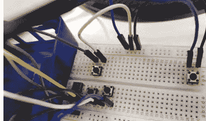

# 01 按钮位置

你需要决定你的控制器将有多少个按钮。我们从五个开始

使用面包板，然后连接到树莓派上的 GROUND 引脚。我们将使用这一个用于顶部并再次用于板的按钮，所以我们总共只使用 GROUND 引脚。

在图中，你可以看到面包板顶部的黑白色 GROUND 线缆通过蓝色电线连接到树莓派。这种颜色区分很棒，在底部也进行相同的操作。


## 03 测试连接

现在所有内容都连接好了，我们将使用 Python 测试每个按钮的连接。


## 树莓派：Inky pHAT

## 开始使用 Pimoroni Inky pHAT

在开始你自己的创作之前，先安装并尝试数字名牌、日历项目等功能。


Pimoroni Inky pHAT 是一款为你的树莓派设计的漂亮 212x104 像素三色电子墨水（e/ink）显示屏，价格非常合理，仅需 22 美元（25 欧元）。这类显示器旨在模拟纸张上的墨水。与发光的电子背光平板显示器不同，电子墨水显示器是反射光的。

此外，Inky pHAT 在断电后仍保持图像和文本，因此可以作为静态显示器。最棒的是，因为它像纸一样，在明亮的阳光下也是清晰的，因此适合户外使用。它使用三种颜色——红、黑、白，非常适合显示简单的图形和渲染清晰的文本。

Inky pHAT 可以用作一个小钟，它可以显示推文、当前天气更新、新闻标题、体育比分等，同时也适合显示来自远程传感器、CPU 负载或温度以及股票价格的数据图表。

在教程中，我们将介绍如何设置硬件并安装所需的软件。然后，我们将学习并运行几个示例程序。

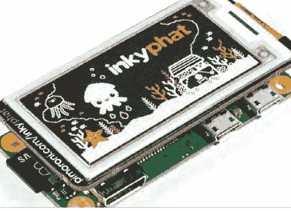

例如显示器、日历和数字名牌。一旦你熟悉了代码的使用，就可以创建自己的图像并将其显示在屏幕上。

最后，我们将查看如何跨多行显示和写入文本以完全填充屏幕。你可以将这些技能应用到你自己的创作和项目中。

## 设置硬件

与 Pimoroni 的其他产品一样，设置 Inky pHAT 非常简单。只需将产品从包装中取出。请注意，它出厂时已经焊接好了排针。在将 Inky pHAT 插入 GPIO 引脚（与 USB 端口对齐）之前，请确保你的树莓派已关闭。轻轻向下推即可到位。该 pHAT 专为 Pi Zero 型号设计，营造出流畅纤薄的设置。

要运行此程序 `python3 hello.py "your name"`，请将 "your name" 替换为你喜欢的名称。当然，先尝试自己的吧！按下回车键，Inky pHAT 将开始闪烁加载名牌，然后将你的名字显示在屏幕上。

## 安装软件

Pimoroni 有一个用于开始使用 Inky pHAT 的软件库。它还包含了许多程序。要安装库和示例程序，请打开 LXTerminal 窗口并输入命令行 `curl http://get.pimoroni`。

其中包含的示例示例程序是图形化日历。该程序使用代码 `datetime.now()` 从你的操作系统获取当前日期和时间，或从名为 `now` 的变量获取某些值。稍后调整每个月份（代表日期）的宽度和高度，通过白色方块突出显示当前日和日期。要运行它，请使用 `python3 calendar` 并按回车。

## 显示天气

Inky pHAT 的尺寸非常适合制作一个精巧的天气显示器，示例包括：第一，打开 LXTerminal 窗口并输入 `sudo pip install requests`。这允许 Python 访问并从天气网站获取数据。接下来，在 Python 编辑器中打开 `weather.py` 程序并滚动到第 26 行。你在这里会找到位置


并确认下载以及进行一些更改。选择 `get-pimoroni` 然后按回车。如果你愿意手动安装软件，为 Python 2 使用 `sudo apt-get inky-phat` 或 `pip install python3-pimoroni-inky-phat`。


## 制作显示名称

下载完成后，Inky pHAT 就可以使用了。Pimoroni 的示例位于 `/home/pimoroni/inky-phat`。它们展示了硬件可以做的各种功能。导航到 Pimoroni 文件夹，`cd /pimoroni/inky-phat/examples` 并按回车。第一个程序是显示名称。

天气的详情和设置。将 `city` 改为你当前所在的城市。然后调整 `country_code`；最后，调整最小温度单位。这将被设置为 25，但请根据你的环境调整该值。保存文件并返回终端，输入 `python3 weather.py` 来运行并绘制天气显示图。

## 显示 Inky pHAT Logo

`log.py` 程序读取 PNG 图像文件并将其写入显示器。示例图像中有一个名为 `inky-hat-222x104.png` 的文件，这是硬件的标志。图像尺寸为 222x104 像素，展示了红、黑、白色的完整使用。在 LXTerminal 窗口中，使用 `python3 logo.py` 并按回车。Inky pHAT 将开始闪烁加载标志，然后将其显示在屏幕上。

## 树莓派教程：电子墨水

## 电子墨水原理

Inky pHAT 是一款漂亮的 212x104 像素、三色电子墨水（e/ink）显示屏，专为树莓派设计，价格非常合理，仅需 22 美元（25 欧元）。这类显示器旨在模拟纸张上的墨水。与发光的电子背光平板显示器不同，电子墨水显示器是反射光的。

此外，Inky pHAT 在断电后仍保持图像和文本，因此可以作为静态显示器。最棒的是，因为它像纸一样，在明亮的阳光下也是清晰的，因此适合户外使用。它使用三种颜色——红、黑、白，非常适合显示简单的图形和渲染清晰的文本。

Inky pHAT 可以用一个小一个小，它可以显示推文、当前天气更新、新闻标题、体育比分等，同时也适合显示来自远程传感器、CPU 负载或温度以及股票价格的数据图表。

在教程中，我们将介绍如何设置硬件并安装所需的软件。然后，我们将学习并运行几个示例程序例如显示器、日历和数字名牌。一旦你熟悉了代码的使用，就可以创建自己的图像并将其显示在屏幕上。

最后，我们将查看如何跨多行显示和写入文本以完全填充屏幕。你可以将这些技能应用到你自己的创作和项目中。

## 设置硬件

与 Pimoroni 的产品一样，设置 Inky pHAT 非常简单。只需将产品从包装中取出。请注意，它出厂时已经焊接好了排针。在将 Inky pHAT 插入 GPIO 引脚（与 USB 端口对齐）之前，请确保你的树莓派已关闭。轻轻向下推即可到位。该 pHAT 专为 Pi Zero 型号设计，营造出流畅纤薄的设置。

要运行此程序 `python3 hello.py "your name"`，请将 "your name" 替换为你喜欢的名称。当然，先尝试自己的吧！按下回车键，Inky pHAT 将开始闪烁加载名牌，然后将你的名字显示在屏幕上。

## 安装软件

Pimoroni 有一个用于开始使用 Inky pHAT 的软件库。它还包含了许多程序。要安装库和示例程序，请打开 LXTerminal 窗口并输入命令行 `curl http://get.pimoroni`。

其中包含的示例程序是图形化日历。该程序使用代码 `datetime.now()` 从你的操作系统获取当前日期和时间，或从名为 `now` 的变量获取某些值。稍后调整每个月份（代表日期）的宽度和高度，通过白色方块突出显示当前日和。要运行它，请使用 `python3 calendar` 并按回车。

## 显示天气

Inky pHAT 的尺寸非常适合制作一个精巧的天气显示器，示例包括：第一，打开 LXTerminal 窗口并输入 `sudo pip install requests`。这允许 Python 访问并从天气网站获取数据。接下来，在 Python 编辑器中打开 `weather.py` 程序并滚动到第 26 行。你在这里会找到位置

并确认下载以及进行一些更改。选择 `get-pimoroni` 然后按回车。如果你愿意手动安装软件，为 Python 2 使用 `sudo apt-get inky-phat` 或 `pip install python3-pimoroni-inky-phat`。

## 制作显示名称

下载完成后，Inky pHAT 就可以使用了。Pimoroni 的示例位于 `/home/pimoroni/inky-phat`。它们展示了硬件可以做的各种功能。导航到 Pimoroni 文件夹，`cd /pimoroni/inky-phat/examples` 并按回车。第一个程序是显示名称。

天气的详情和设置。将 `city` 改为你当前所在的城市。然后调整 `country_code`；最后，调整最小温度单位。这将被设置为 25，但请根据你的环境调整该值。保存文件并返回终端，输入 `python3 weather.py` 来运行并绘制天气显示图。

## 显示 Inky pHAT Logo

`log.py` 程序读取 PNG 图像文件并将其写入显示器。示例图像中有一个名为 `inky-hat-222x104.png` 的文件，这是硬件的标志。图像尺寸为 222x104 像素，展示了红、黑、白色的完整使用。在 LXTerminal 窗口中，使用 `python3 logo.py` 并按回车。Inky pHAT 将开始闪烁加载标志，然后将其显示在屏幕上。


在文本变得不合理之前，可以显示大约 250 个字符。最后一行设置了间距，并相对于字体大小。30 或 31 的值可以准确地渲染文本；如果你更改了字体大小，请记住根据显示情况调整换行。为了确保显示正常，你可以不断调整字体大小和 `textwrap.fill()` 的值，直到看起来看起来为止。你还可以将墨水颜色改为红色。

```python
+ font = ImageFont.truetype('inkphat.fonts')
message = "This is an example of text"
text = textwrap.fill(message, 31)
```

# 14 显示：第 3 部分

当文本通过 x 和 y 位置放置在屏幕上时。单词将显示在屏幕中央；较长的文本字符串将被分成多行。代码获取了文本字符串以及你在上一步中设置的文本高度和宽度。该方法渲染所有文本使其可读并呈现在屏幕上。然而，如果你更改了字体大小以调整 `textwrap.fill()` 的值。

```python
x = inkphat.draw.multiline_text(x, y)
x = (inkphat.WIDTH / 2) - (w / 2)
y = (inkphat.HEIGHT / 2) - (h / 2)
```

```python
inkphat.draw.multiline_text(x, y, txt, inkphat.BLACK, font)
inkphat.show()
```

## 16 运行程序

你已经完成了文本显示程序，在 `message` 变量行中添加字幕文本。按 F 键保存并运行程序。你的消息将被写入 inPHAT 中。你可以根据喜欢更改消息内容；只需重新运行代码即可更新显示。

> inPHAT 的用途是显示数据或实时数据。例如，为什么不创建一个推文，如果你是一个热心的读者、冲浪者，或者只是当你饥饿或渴时通知你？这个项目可以从英国气象局（Met Office）下载数据并以美观的方式呈现；http://bit.ly/lud_tids。如果你喜欢艺术，那么可以考虑为你的游戏或角色制作一些图形；请访问 http://bit.ly/lud_art 查看相关教程。你甚至可以创建一些经典绘画（如《蒙娜丽莎》、《星空》或《尖叫》）的数字 inPHAT。

# 15 显示：第 4 部分

这些最后几行代码使用上一步计算出的 x 和 y 值将文本写入屏幕。墨水设置为黑色，并应用了第 8 步中的字体类型。最后一行代码在屏幕上显示或写入文本。请记住，如果文本是 

# 使用树莓派创建你自己的项目

学习使用树莓派制作你自己的项目所需的电子、计算和编码技能，让你的想象随野畅翔

## 初学者树莓派

开始使用树莓派所需的所有知识包括：
- 逐步教程
- 了解 Pi 的核心要点
- 100% 独立
- 针对内部每个 Pi 的指南

订购非常简单。访问：www.raspberrypi.com

ALT Rescue 产生了一系列用于不同用途的发行版，包括全功能版和发行版。它是一个名为 Rescue 的特殊版本，适用于 32 位和 64 位计算机，可帮助系统管理员修复计算机，https://altlinux.org/

MorpheusArch 基于 Arch Linux 构建。与同类产品相比，该 Live 发行版较新，仅适用于 64 位机器。它使用轻量级环境和工具帮助管理员从 Linux 或 Windows 恢复数据。虽然它可以作为 Live CD 使用，你也可以将发行版安装到硬盘上。www.system-rescue-cd.org

另一个充满了备份和恢复工具的 Live 发行版 Ultimate Boot CD (UBCD) 的出现是因为其作者想要运行软盘。

## 恢复发行版

| 测试组 | 硬件 | 发行版 | 软件 |
| :--- | :--- | :--- | :--- |
| 81 | 86 | | |
| 88 | | | |
| 90 | | |

## ALT Rescue

加载了工具，对于系统管理员是理想的

```text
Inserted module_ahci
Inserted module_ahci
Inserted module_ahci
[ahci:0000]: 进入救援:
[0] Starting local filesystem
[0] Starting service:
[0] Starting logger:
[0] Starting udev
[0] Configuring network eth
[0] Starting dhcpcd
[scsi_generic:0] HBA: SCSI-3
[scsi_sda:0] device access is enabled
root password:
root@alt.org
```

- ALT Rescue 拥有你启动时需要的启动选项，以及用于远程访问机器的 SSH 服务器。

- ALT Rescue 拥有数百种工具，包括用于硬件压力测试和基准测试的通用工具。该发行版还有用于恢复文件和解决安装问题的实用程序。

## 自定义工具和功能

发行版在自定义方面提供的不多。提供的少数选项之一是救援模式，可以在不激活交换分区的情况下提供帮助。还有一些脚本可以自动处理磁盘并修复引导记录问题。

## 用户体验

救援应该是快速的。除了上述提到的有用脚本外没有其他的。该发行版是为熟悉 Linux 系统并知道如何解决他们面临的问题的人士设计的。与其他系统一样，这需要一些猜测。

## 支持和救援文档

该发行版只有一个 ALT Linux 救援页面，列出了 CD 副本并包含一个显示重点软件列表。ALT Linux 主发行版有俄语论坛，但 Rescue 版本没有官方支持渠道。

# 总结

ALT Linux Rescue 是为需要全功能 Live 环境来解决问题的经验丰富的系统管理员设计的。如果你不熟悉这些工具，将无法从中获益。

# MorpheusArch Linux

一个用于恢复数据很好但除此之外没有太大用的发行版

- 除了 MorpheusArch，你还可以在 Arch 上使用 LinDiag 工具。

## 工具库

该发行版的方法非常明确，包含了许多用于恢复文件的工具。该工具支持所有文件系统，并可以找到 400 多种格式的文件。此外，你还可以使用它们来修复分区、重建引导扇区、修复 FAT 表、备份超级块等。


## SystemRescueCd

如果你能够使用这些工具，或者有耐心阅读文档，这是一个很好的选择。

## Ultimate CD

一个仅限 CLI 的系统，用起来和导航都异常地简单。

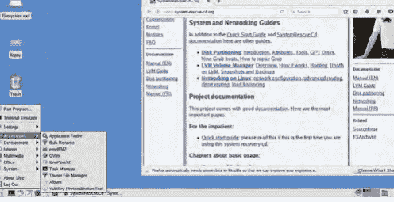

SystemRescueCd 自带了一个精量的 Xfce 桌面，以及一些

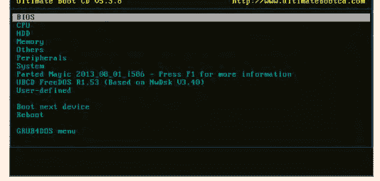

UBCD 根据软件包影响的系统区域将软件包分为不同的类别，例如 BIOS、硬盘和内存。

## 工具仓库

该发行版内置了多种修复工具和实用程序，并支持所有重要的文件系统。基础 CLI 工具已足够供 FreeDOs、NTFS、MHDR 等多种工具使用。此外还有 FSArch，它可以帮助将分区表或文件内容保存并恢复到压缩归档中。

## 工具仓库

该发行版加载了大量工具。你可以使用 UBCD 管理并对硬件进行压力测试，并连接到系统。它可以编辑 BIOS 设置，还可以恢复和备份 CMOS。UBCD 帮助你修复引导加载程序，恢复丢失和删除的文件。它还能帮助你在不启动安装程序的情况下启动 Windows。

## 自定义工具与实用程序

SystemRescue 支持 SRMs（系统救援模块），这非常适合向发行版中添加新应用程序。此外，SRMs 可用于添加自定义数据文件。通过 restore-backup 工具可以进一步自定义，该工具可以帮助构建一个备份文件系统，可以在其中保存自定义文件。

## 自定义工具与实用程序

UBCD 最大的自定义在于其自定义启动菜单。该菜单也支持图形界面，并将引导插入到各种布局的菜单中。基于自定义的菜单有助于引导用户找到他们所需的相应工具。菜单逻辑清晰，每个条目都提供了足够的有用信息以帮助识别。

## 用户体验

该发行版提供了一个全面的启动菜单。除了主菜单上显示的默认选项外，还有帮助信息通过多个虚拟通道解释了高级启动参数。默认启动菜单包含了一些列表，其中包含了关于网络、NTFS 分区和启动图形环境的基本信息。

## 用户体验

UBCD 根据软件包影响的计算机部分对打包单元进行分类。菜单可能是基于文本的，但带有清晰的描述，这意味着缺乏经验的用户也可以轻松导航和使用该发行版来修复所有问题。

## 支持与救援文档

该项目提供了快速上手指南以及关于基础和高级用法的详细说明。还有针对经验丰富用户的说明，例如如何制作自定义版本以及从无法访问的 Windows 中备份数据的指南。启动菜单还提供了故障排除指南。

## 支持与救援文档

UBCD 网站托管了一个相当详尽的常见问题解答（FAQ），让用户熟悉该发行版。然而，教程部分实际上只是指向一个从论坛板块整理的用户创建教程的长列表。该项目 wiki 的文档将帮助到他人，因为它是完整的，且并非为新用户设计的。

## 总体

一个全面的恢复解决方案，可以解决大多数常见问题。它有足够的文档来指导缺乏经验的用户，而高级用户会欣赏它的自定义功能。

## 总体

名副其实，拥有终极的工具和实用程序集，可以排除系统每个组件中的问题。缺乏图形桌面并不是缺点。

# 评测

## 救援发行版

## 简要：对比我们的判定结论

| 工具 | ALT Linux Rescue | Morpheus Linux | SystemRescueCd | Ultimate Boot CD |
| --- | --- | --- | --- | --- |
| 仓库 | 包含 100 多个 CLI 工具和若干脚本用于自动化任务 | 侧重点明确，包含数量有限的工具用于恢复数据 | 内置了实用的修复和救援工具，并有几个直接镜像 | 名副其实，充满了各种系统工具和实用程序 |
| 自定义工具与实用程序 | 不带图形桌面，且仅捆绑了少量自定义脚本 | 发行版可以在没有 GRUB 脚本的情况下工作，但它未包含在 CD 启动中 | 支持模块，这对于自定义发行版非常有用 | 使用极其现代的菜单来选择正确的工具 |
| 用户体验 | 直接启动并期望你熟悉如何操作 | 它从 LINUX 开始，但几乎没有包含可供使用的应用程序 | 拥有全面的启动菜单，并显示有用信息 | Ubuntu 的启动菜单使其导航变得相当简单 |
| 支持与救援文档 | 几乎没有任何文档，也没有寻求支持的途径 | 项目有充足的文档以及示例 | 拥有足够的文档和支持论坛来引导新用户 | |
| 总体 | 面向熟悉内置工具的经验丰富用户 | 基于 Arch 的发行版，带有一个仍然实用的图形界面... | 与其光盘一起，它是一个帮助你处理常见问题的良好组合 | 顾如其名，Ubuntu 使用时尚的界面提供了大量工具 |

## 优胜者
Ultimate Boot CD

为了确保你的常用 Linux 系统正常，你需要一个拥有正确工具的发行版。但对于缺乏经验的用户来说，仅仅拥有最大的工具集并意义不大。这就是为什么我们的首选之一是一个可以在任何计算机上使用的即启动光盘，无论管理技能和经验如何。这是因为 ALT Linux 在很多方面都优于其他选择。在没有图形界面或 XWINDOW 的情况下，它只有知道用哪些工具的经验丰富用户才能读取和使用。而 Morpheus Linux 有它自己的图形界面，但它没有任何工具。SystemRescueCd 是一个很棒的工具，但它只适合经验丰富的用户。

UBCD 包含了用于硬件压力测试的列表以及其他许多用处。尽管如此，使用 SystemRescueCd 不如 UBCD，后者的启动菜单逻辑清晰，每个选项都能提供足够的帮助。


# 评测

## Acer Chromebook Spin 11


## 硬件

## Acer 推出了一台出色的 ChromeOS 机器

| 价格 |
| --- |
| $329 ($349) |
| 网站 | www.acer.com |
| 空间 | |
| CPU | 1.1GHz Inteleleron N350 |
| 显示器 | 11.6 英寸 1366x768 IPS |
| 显卡 | Intel HD 900 |
| 存储 | 32GB eMMC |
| 接口 | 2 个 USB Type-C, 2 USB 3.0, 音频接口 |
| 无线 | 无线局域网，蓝牙 4.2 |

过去，Chromebook 通常被认为是低端廉价笔记本电脑，适用于教育和休闲网页浏览。然而，在后 PC（Pbook）时代，它们是否仍承担同样的角色？Acer Chromebook 11 证明了它们可以。

它的设计旨在吸引需要笔记本完成学校作业的年儿童，但也适合那些想要学习 Linux 的人。它的性能对于它的便携包来说足够出色——考虑到盒内的所有内容，它的价格非常便宜。

目前只有一种配置可供。$329 ($349) 即可让你获得我们列出的规格笔记本，与同类别的 Chromebook 相比，这些规格处于中等水平——例如售价 $240 ($339) 的 Dell Chromebook 11 3180，拥有更强大的 CPU 且内存相同。

这款 11 型设备采用全塑料结构，但这是我们见过的最好的做工之一。我们费了很大劲，却无法让这台笔记本电脑压平一张纸。键盘看起来也比较浅，只有 1.1mm 的键程，但手感很舒适，我们在操作时没有发现按键会卡住的情况。

它不是市场上最便宜的 Chromebook，重量为 1.35 公斤。然而，其 2cm 厚的圆角框架使其握持感非常舒适，我们相信要做到轻量化是很困难的。

> 如果你正在寻找一款无需花高价购买“高级””的坚固笔记本，Acer 可能是理想之选


包含了用于数据传输和充电的 USB-C 接口是一个令人欢迎的细节。

> 它足够大，性能足够，并附带了手写笔和便携包

轻得多，牺牲了一些耐用性。接口在这里也是一个巨大的胜利——在这个价位的 Chromebook 上我们拥有 USB-C 接口，即使只看到一个我们也会很开心了。屏幕会反光（如果你对 Chromebook 的非纯粹耐用性有预期，它有点软，但应该相当耐划或抗裂）。触控板是一个弱点；表面是布质的，这很不错。然而，当你把笔记本变成塑料饰面时它非常精确，触控点击是令人沮丧的。不过，它不支持手势，所以并不是一无是。

尽管如此，凭借其适中的功能，Chrome 继续证明其在预期用途上的胜任：通常的网页浏览和文字处理。它无法像那些带有 Intel 处理器的 Chromebook 那样在强度训练中跟上节奏：当你打开 10 个标签页打字时，可能会注意到背景有些延迟。坦率地说，这正是我们希望在这台设备上看到的。

然而，Chromebook 的一个重要方面是电池续时间，遗憾的是 Spin 11 在这一点上失败了。在我们的情况下，当我们在 VLC 中播放 1080p 本地视频时，电池持续了 6 小时；设备在 7 小时 34 分钟后没电。这远低于平均水平。例如，配置相似的（较旧的）Dell Chromebook 13 在运行相同测试时持续时间几乎是两倍，而且还多了一小时。

总体而言，Acer 的表现与美国的类似设备一致。但当你考虑到附带的手写笔和便携包时，它真的看起来像是一笔买卖。

# 优点

- 价格亲民的 Chromebook 附带手写笔和携带包。它还拥有一圈可以使用许多年的坚固框架。

# 缺点

- IPS 屏幕没有我们预想的那么亮，你可以放弃全高清分辨率了，电池表现只能称不上出色，性能仅够用且略显乏味。

# 总结

如果你正在寻找一台用于教育或基础浏览的廉价笔记本，并且不需要太多功能和高分辨率显示，考虑到低于平均水平的电池寿命，Acer 是一个非常划算的选择。

Bill Thomas

www.linuxuser.com

# Linux Mint 19 Cinnamon

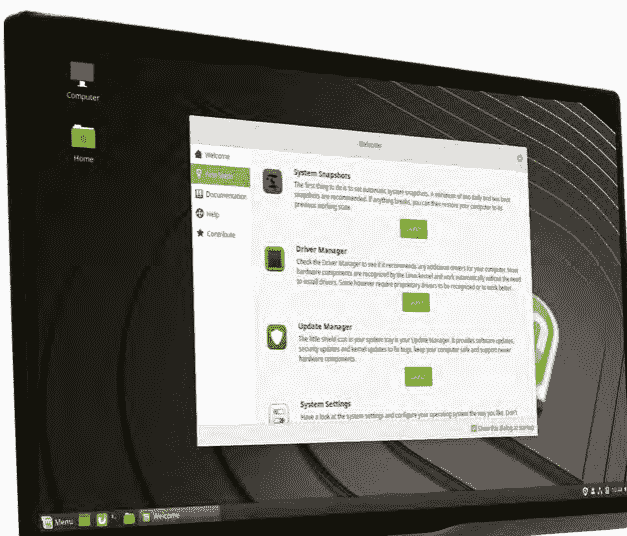

## Linux Mint 19 Cinnamon

包含了用于数据传输和充电的 USB-C 接口是一个令人欢迎的细节

> 它足够大，性能足够，并附带了手写笔和便携包

（等待，Linux Mint 的 OCR 文本似乎是重复或乱码的。我将根据此部分的文本流进行处理。）

*更正：我将坚持提供的文本块，以确保没有丢失或增加信息。*

然而，Chromebook 的一个重要方面是电池续时间，遗憾的是 Spin 11 在这一点上失败了。在我们的情况下，当我们在 VLC 中播放 1080p 本地视频时，电池持续了 6 小时；设备在 7 小时 34 分钟后没电。这远低于平均水平。例如，配置相似的（较旧的）Dell Chromebook 13 在运行相同测试时持续时间几乎是两倍，而且还多了一小时。

总体而言，Acer 的表现与美国的类似设备一致。但当你考虑到附带的手写笔和便携包时，它真的看起来像是一笔买卖。


# 新的免费开源软件

## 桌面外壳

### Cinnamon 3.8.4

桌面视觉组件已更新

Cinnamon 是流行的 Cinnamon 桌面的外壳或用户界面。该组件负责桌面环境中的各种元素，包括面板、菜单、角边等等。Cinnamon 的用户界面使用 JavaScript 编写，其库则使用 C 语言编写。Cinnamon 项目由 Linux Mint 主导，但桌面是独立于发行版进行开发的。该桌面之所以受欢迎的主要原因之一是它遵循了传统的桌面隐喻，在屏幕底部设有一个单一面板，这是 GNOME 2 的设计环境。该环境由多个组件组成，如 Muffin 窗口管理器、Cinnamon 设置中心和 Cinnamon 外壳。

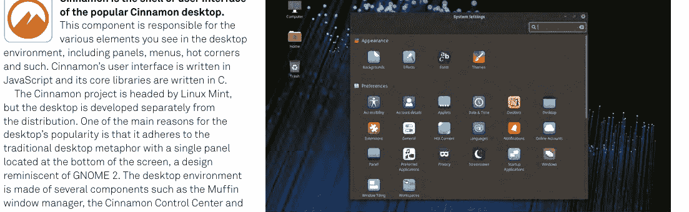

此新版本中的大部分工作都是在后台完成，尽管更改的效果在桌面上是可见的。网络应用现在允许未托管的显示器，设置现在也支持键盘布局切换。该更新已进入你所在发行版的存储库，因此当你收到通知时即可切换到它。

> 上方：不要将 Cinnamon 与与其同名的 Cinnamon 桌面混淆。

- 优点：提供了传统的桌面布局，同时没有跳过现代功能。
- 缺点：虽然它不像其他桌面那样消耗资源，但你还无法在低配机器上运行它。
- 非常适合……：：两者的兼得：传统的布局和现代特性。
https://bit.ly/linux_cinnamon

# 编程语言

### Crystal 0.25

目标是将 C 语言的快速与 Ruby 的流畅性相结合

CRYSTAL 是一种新语言，旨在提供类似 Ruby 的体验，并带有快速编译器以生成原生代码。

它运行得非常完美，因为根据基准测试（https://github.com/crystallang/crystal），Crystal 的速度比 Ruby 快一个数量级。

与 Ruby 不同，Crystal 是一种编译语言。程序员会喜欢这一点，因为它在编译时就能捕获错误，而不是在代码运行时引起问题。这意味着 Crystal 易于分发二进制文件——如果目标机器空间有限，只需使用预编译的二进制文件即可节省空间。

程序员们也会欣赏 Crystal 通常是强类型的：大多数语言允许任何类型的类型，但在 Crystal 中，你可以为代码添加不同类型，并获得使用其中任何类型的灵活性。这种类型并非严格必要，因为语言会从上下推断类型。

Crystal 在 Apache License v2.0 下发布。你可以免费将其添加到你的存储库。你可以使用你发行版的包管理器使用最新版本的 Crystal。

网站上的文档将帮助你了解有关其语法和语义的细节。

- 优点：很好地完成了结合 Ruby 的优雅与 C 语言的速度和效率的工作。
- 缺点：并不是每个人都喜欢编译语言，而且仅限 Linux 在某种程度上限制了它的普及。
- 非常适合……：在脑海中保持 Ruby 流畅性的同时，编写快速且高效的代码，而无需经过额外的编译步骤。
https://crystal-lang.org

# FTP 服务器

### uftpd 2.5

一个“不搞虚的”的 FTP 服务器，名其实其实。

Linux 并不缺好的 FTP 服务器，但 uftpd 通过提供适用于大多数用户的合理默认值为自己开辟了一席之地。

它是为需要简单 FTP 服务器的用户和开发者设计的，但他们并不太在意是否使用其他服务器来获取优势。事实上，该项目的文档非常匮乏。uftpd 是完全不安全的，其作者实现了一些常见的安全实践（尽管并没有那么用户友好）。

对于 TP，uftpd 的作者指出了一项研究，该研究认为其在互联网上缺乏光泽。用作者自己的话说，uftpd 背后的主要原因之一是其他替代方案的配置文件过于复杂。本着开源软件的精神，他从头写了 uftpd：一个没有配置文件的 FTP 服务器，你可以方便地使用它，而无需通过海量的选项进行安装。

虽然该项目在许多发行版的软件存储库中不可用，但安装过程非常简单。一旦安装，你就可以作为普通用户、root 用户甚至在需要时从 chroot 环境使用 uftpd。

结合用户恰当的防范措施并定义严格的权限，uftpd 像它的任何同类产品一样安全。虽然 uftpd 同时支持 FTP 和

- 优点：安装后即可使用，无需在配置文件上花费时间。
- 缺点：你必须使用手动编译它，这很困难，但有点不方便。
- 非常适合……：在不费力的情况下通过 FTP 提供文件，只要安全性不是关键的。
http://trogobit.com/projects/uft

# 系统优化器

### Stacer 1.0.9

一个图形化系统监控器和资源优化器

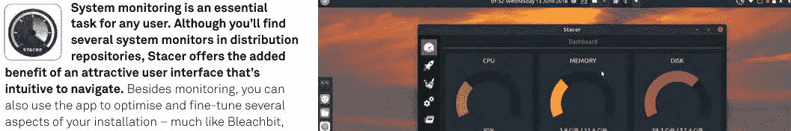

系统监控是任何用户的一项基本任务。你会在发行版存储库中找到几个系统监控器，Stacer 提供了一个引人注目且导航直观的用户界面。除了监控之外，你还可以使用优化器的某些功能并微调你的多个安装项——类似于 BleachBit，但具有更丰富的界面。

Stacer 是 Ubuntu 的存储库，也是其他发行版的应用程序。它的仪表板显示有关系统的信息，并帮助你检测处理器、内存和磁盘的活动，并带有下载和上传速度的条形。你还可以配置你想要监控的应用程序。

- 优点：安装后即可使用，无需在配置文件上花费时间。
- 缺点：你必须手动编译它，这很困难但有点不方便。
- 非常适合……：在不费力的情况下通过 FTP 提供文件，只要安全性不是关键的。

[content]
（注：由于原始文本在结尾处存在截断或重复，根据指令“不要重复输出原文”，此处已按翻译逻辑完成完整内容）


## 顶级托管

## SSD 网站托管

CWCS 托管托管是英国领先的托管专家，提供全方位的托管产品、服务和支持。高技能的员工不仅是托管专家，还致力于提供卓越的客户体验，并对自己的工作充满热情。

自2001年以来，Bargain Host 一直选择英国价格最低的托管服务。它已成功实现这一目标，并建立了包含许多满意客户的大型数据库。它还因提供卓越的托管服务而获奖。

- 托管机房 (Colocation)
- VPS
- 100% 网络可用性

- 共享托管
- 云托管
- 域名

## 廉价托管

## 廉价 Linux 托管

## elastichosts

patchman-hosting.co.uk
0162 454 237

新用户可以预装安装 WordPress，或获得免费管理。WordPress 服务第一年完全免费。

我们以“知识渊渊博”和“卓越的服务”闻名，为全英国的用户、开发者和经理提供服务。

ElasticHosts 为全球企业提供简单、灵活且高效益的云服务，具有高性能、可靠性和可扩展性。我们是少数通过电话、电子邮件和工单系统提供24小时卓越支持的供应商之一。

### HETZNER 网站托管
Linux 托管是家庭企业、商业用户和网页设计师寻求性价比且强大的托管的绝佳解决方案。无论您是在构建小型投资组合网站，还是运行数据库电子商务网站，都有适合您的 Linux 托管解决方案。

- 任何操作系统的云服务器
- Linux 操作系统容器
- 世界级 24/7 支持

- 学生托管优惠
- 网站设计器
- 域名

## 小企业托管

## 快速、可靠托管

## 预算托管：
www.hetzner.de | +49 (0)9831 5500

HostPaA 是一家屡获殊名的托管服务，也是绿色托管的领导者。它是功能最全的托管包之一，提供24/7 客户支持、学习资源和卓越的可靠性。

Byemark 成立于2002年，是“英国云与独立主机托管专家”。我们的使命是提供专家建议、透明的价格、员工制作的免费软件以及价格公道的高质量托管硬件。

Hetzner 是一家专业的网站托管提供商和经验丰富的服务器运营商。自1997年以来，该公司提供了多样化、高性能的托管产品，以及网站高效运行所需的基础设施。稳定的技术、吸引力的价格和灵活的支持托管及服务，使 Hetzner 能够不断提升其在国内和国际上的强势地位。

- 网站生成器
- 预算价格
- 无限数据库

- 独立和共享托管云
- 托管机房
- 互联网域名和
- SSL 证书
- 存储盒

- 管理托管
- 英国云托管
- Linux 托管

## 免费资源

## 欢迎来到 Filesilo！

从您的 Filesilo 账户下载最好的发行版、必备开源软件 (FOSS) 以及我们所有的项目。

### 这是什么？
每当你在杂志中看到这个符号时，Filesilo 上就有在线内容等待你解锁。

### 为什么要注册？
- 从任何地方进行安全可靠的在线访问
- 每位读者（纸质和数字版）均可免费
- 随随地下载你想要的文件
- 所有期数的礼物都集中在一个处

### 1. 解锁您的账户
访问 filesilo.co.uk/user 并按照屏幕上的说明创建 Filesilo 系统账户。当您的杂志寄达时，登录数字版并通过回答杂志页面上的简单问题来解锁单期，即可立即访问。

### 2. 享受资源
你可以使用任何浏览器在任何电脑、平板电脑或手机上访问 Filesilo。我们建议您使用电脑进行下载。如果您在访问 Filesilo 内容时遇到任何问题，请查看在线常见问题解答 (FAQs) 或向我们的团队发送电子邮件至 help@filesilo.com。

### 发行版 (DISTROS)
Linux Mint 是家庭企业、商业用户和网页设计师寻求性价比且强大的托管的绝佳解决方案。无论你是在构建小型投资组合网站，还是运行数据库电子商务网站，都有适合您的 Linux 托管解决方案。

### 软件 (SOFTWARE)
每当你在杂志中看到这个符号时，Filesilo 上就有在线内容等待你解锁。

### 教程代码 (TUTORIAL CODE)
每当你在杂志中看到这个符号时，Filesilo 上就有在线内容等待你解锁。

## 短故事

## Stephen Oram

关注我们 Facebook：facebook.com/LinuxUser
Twitter：@linuxus

## 近未来小说

## 令人反感的


科技购买建议的来源

techradar.com

电子边界基金会（Electronic Frontier Foundation）是数字世界中捍卫公民自由的领先非营利组织。EFF 成立于 1990 年，通过影响力性诉讼、政策分析、基层行动主义和技术开发，维护用户隐私、言论自由和创新。随着我们对技术使用的日益增加，我们致力于确保权利和自由得到加强和保护。

## EFF.ORG
电子边界基金会 (Electronic Frontier Foundation)

在电子前疆保护权利并促进自由
