# Linux 用户与开发者杂志第 183 期

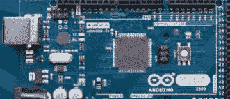


- 精通 Shell 脚本
- 安全 Android - 学习 Java
实用 Pi：制作你自己的 MP3 播放器


>> Python 多线程
>> 最新内核新闻
>> 评测：Cookie8
未来


你知道吗？提供制造纸张和其他许多产品木材的欧洲森林，在过去 10 年中增加了 44,000 平方公里？这每天相当于超过 1,500 个足球场！†

喜欢杂志吗？知道它们是由天然、可再生和可回收的木材制成后，你会更爱它们。

UNFAO，《全球森林资源状况2005-2015》。

Two-Sides 是一项全球倡议，旨在促进印刷和纸张的负责任使用。当源自经过认证或可持续管理的森林时，它是一种独特强大且自然的传播媒介。

## 编辑部

编辑 Christopher Barnett

cturnett@linuxuser.com

设计师 Rose Weber

编辑 Steve Paul King

编辑 Paul Newman

资深艺术总监 John Lee

## 贡献者

Andy Harvey, Joey Beamy, Christian Wesley, John Jones,
Toni Castillo, Paul O'Brian, Nathan Jordan, Jon Masters,
Cavin Black, Roman Stanley, Richard Cherry, Alexander
Smith

## 广告

可根据要求提供媒体方案包

商务部

广告总监 Richard Hendricks

richards@linuxuser.com

01255 687119

广告经理 Timothy Bury

tillbury@linuxuser.com

01255 687144

## 国际版

LinuxUser 可供授权。请联系国际部讨论合作机会

国际总监 Matt Little

matt.little@linuxuser.com

## 印刷复印与批量订购

网站：`www.mylinuxusermagazine.co.uk`

邮箱：sales@mylinuxusermagazine.co.uk

联系人：Matt Little

## 发行量

发行总监 Daniel Pearce

01203 58620

## 制作

英国制作及周边商店负责人

制作经理 Claire Scott

数字插画编辑 Jason Hunter

制作经理 Nola Colby

## 管理

创意总监 Aaron Swann

艺术与设计总监 David Rose

## 市场

Marketplace, Clapham Plaza, London, E14 9WH

市场总监 Alexander Smith

alex@linuxuser.com

Future 是一家屡获奖的国际公司，领先全球数字业务。我们在印刷、在线、移动和智能手机领域创建并构建世界级的内容和广告。

非执行董事 Aaron Palmer

首席执行官 David Miles

电话 +44 (0)1205 442 244

欢迎阅读英国和北美最喜爱的 Linux 和开源软件（FOSS）杂志。本期内容极其丰富！首先是 Librem 5（手机）登上头条，我们采访了首席执行官 Todd Weaver (`p50`)。接下来，我们找到了 Richard Brown，让他解释开源的 B25 以及带回 Htoppi 的计划 (`p12`)。我们还决定是时候放下我们的痴迷了，尘埃终于揭示了 Arduino 的优点 (`p56`)。为了完成所有内容，我们还有惯常的教程和从 `p38` 开始的常规栏目。

在本期中，我们推出了一个名为 InspiringOS (`p52`) 的新系列，我们重点介绍试图改变世界的开源项目和人物。“inspire”一词（源自拉丁语 inspire）指的是“进入”的感觉或赋予生命的“想法”。我们希望你被这种精神所感染，向世界偏远地区提供高质量的教育。

Chris Thomas, 编辑

与团队联系：

linuxuser@future.com

Filesile

filesile@future.com

3


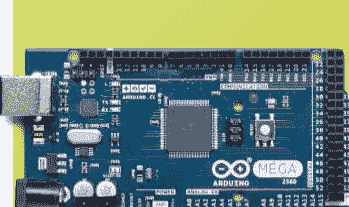

进入读者的世界

你应该使用哪些发行版和应用？Paul O'Brien 解释了大量的 Linux 发行版以及免费开源选项，以找到适合你的产品。

了解黑客如何向 Android 应用注入恶意代码。发现如何反编译和调试应用以消除威胁并保护系统。

- 32 Kolibri

延续上期的教程，发现如何使用 JavaFX 库为你的游戏添加精美的图形界面，并让其按钮能够控制角色。

- 56 Arduino


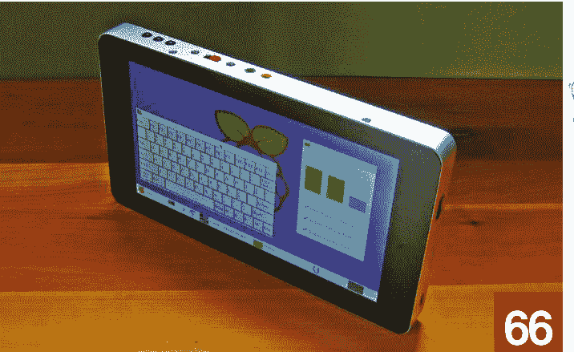

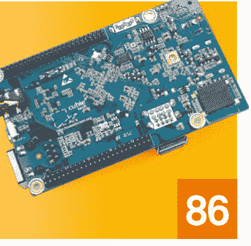

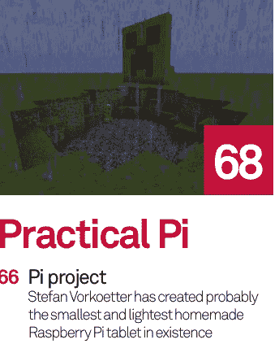


使用 Pi Zero 和 Speaker phAT 构建你自己的便携式音乐播放器。

创建一个“生日设备”，在被触发时启动一个特殊的……功能。

Ghost 1.0 博客、FixWiK 0.9 UNIX 内核、DataMelt 0.2 可视化以及 CommonMark MD 转换器。

学习如何在 Python 中同时处理多个任务。立即订阅。订阅即可享 8 折优惠！


简而言之，如果你对 Android 和 iOS 缺乏隐私感到沮丧，那么你可能对 Librem 5 感兴趣。这是一款不会追踪你的手机，包含了开放 Wi-Fi、蓝牙以及基础电话/移动数据。

简而言之，Librem 5 的一切看起来都很好，在印刷时资金已达到 10.84%，还有 52 天。


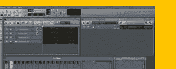

避免这种攻击的最简单方法是忽略该消息。如果你点击了，可能需要修复以添加 Pi。如果你已经感染，或者知道谁感染了，以下是帮助步骤：

（每日平均访问量，截至2017年8月25日的30天统计）

| 排名 | 发行版 | 访问次数 |
| 3 | Manjaro | 1606 |
| 7 | Solus | 1012 |
| 8 | Fedora | 819 |
| 9 | TrueOS | 762 |

- 稳定发布版 (10个)
- 开发中 (3个)

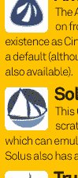


在一次成功的 IndieGo 众筹活动（以 15,116 美元的目标筹到了 200,000 元）后，GPD 的 Chrome 硬件正成为超便携 PC。它配备了 64 位四核 Atom 处理器、8GB 内存和 128GB 存储，八小时的电池续航是一项挑战。关键在于，尽管它很大，但触摸操作被波纹式控制器取代了。GPD Pocket Ubuntu 版仅有 188x106mm，配备 5.8 英寸沉浸式屏幕。比 7 英寸平板电脑略厚，拥有一块1920x1200 像素的 IPS 触摸屏。


关于显示。然而，GPD 正在向一个完全不同的市场。这台小笔记本电脑采用了纯 CNC 全金属机身，这意味着它的工艺水平可以达到 MacBook+ 的水平。一台可以装进口袋的轻薄笔记本。预装了 Ubuntu。GPD 的其他设备尚未提供类 Linux 体验。更多信息请访问 `www.gpd.com/pocket`。请看下期对 GPD Pocket 的测评。


亲爱的 LuAP，在其中一期中，你提到可能会添加一个专门的游戏页面。它在哪里？我是 Chris，Linux 游戏的知名支持者，也注意到你关于 11-bit Studios 在开发期间承诺后取消对《死亡之子》（Children of Morto）Linux 支持的推文。

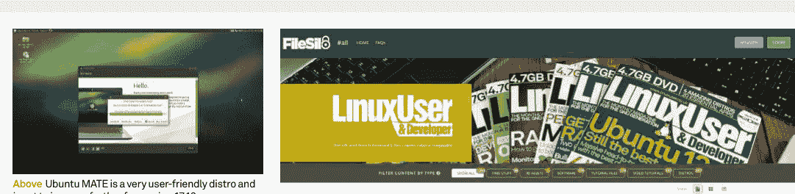

## Geeko 之路

> 现在是访谈 SUSE 并探索开源最新进展的绝佳时机，因为 openSUSE 在本月庆祝成立 25 周年。尽管公司一直向其自发行版 SUSE Linux Enterprise (`SLES`) 发布大量的向后兼容更新，但自 2004 年首次鼓励新的 openSUSE 项目以来，就再没有过这种操作了。自从 Tumbleweed 滚动更新发行版及其稳定可靠的发布出现以来，该项目一直推动着 `SLES` 的发展。在这次采访中，我们主要询问了 openSUSE 主席 Richard Brown 关于 Kubic 的问题，它真正拥抱了开放和自由的“核心”开源原则，社区可以设定自己的方向，且社区成员必须保持一致并共同工作。

最近，SUSE 与 SAP HANA 的合作确实扩展了 Linux 在企业级硬件上的功能范围以及对内存数据库的支持。（据我所知，目前还有默认的 `Btrfs`，这是 2017 年以来第一个默认“下一代文件系统”的主要 Linux 发行版。这非常符合 SUSE 在文件系统选择上领先以及支持 `XFS` 以获得长期利益的传统。Debian 也支持它，但对于选择使用该系统的用户来说，SUSE Tumbleweed 在这方面具有明显优势。）

Richard Brown 在 SUSE 担任 Linux 发行版工程师，并将从 9 月起负责 Kubic 的工作。Richard 也是 openSUSE 项目的主席。

**SUSE 本月庆祝成立 25 周年，SUSE 历史中让 GNU/Linux 社区受益的关键时刻有哪些？**

追溯到 1994 年，SUSE 是发布“第一个企业级 Linux”的公司，这是针对 IBM S390 的第一个商业级 Linux。从同年起，SUSE 就开始与 AMD 合作进行大量初始工作，将 Linux 移植到 SPARC 架构。虽然显然带有主观性，但我认为 openSUSE 在 2004 年的值得提及，因为它代表了与许多其他企业创立的社区完全不同的模型。

目前，我期待 `GCC 7.2` 作为 Tumbleweed 的默认编译器与 `Glibc 2.26` 一起上线。这将对系统产生极其巨大的影响，并真实地证明了我们的流程是可信赖的。


在我们继续使用 `Btrfs` 的同时，Red Hat 已采用 Stratis 项目作为下一代策略。Andy Gray 在一份白皮书（`http://bit.ly/StratisSoftwareDesign`）中指出，通过努力，Stratis 加上基于 LVM [2.1] “构建”的 `ZFS` 文件系统是可能的。


| | Filip Montana (独立) |
| | Stephen Stephens (独立) |
| | Jan Schmidt (独立) |

Kubernetes 目前由 Flame（用于 Kubernetes 集群）、事务性更新和从 Docker 导入镜像组成。此外，Kubernetes 正在致力于实现这些技术，并在 openSUSE Tumbleweed 上运行，大型软件栈的重大升级通常在上游发布后几小时内完成。这一切都是在没有任何重大版本发布的情况下实现的——而这是我所有日常工作的唯一依据。

以下是 SUSE 新的 Kubic 项目专注于容器技术及相关工具。


---

## Geeko 之路

SUSE 在 Linux 和开源软件领域拥有悠久的创新历史。在庆祝成立 25 周年之际，openSUSE 已经开始开发 Kubic 项目，这是一种由社区运营的集群计算、容器和微服务的新方法。

**SUSE 本月庆祝成立 25 周年，SUSE 历史中让 GNU/Linux 社区受益的关键时刻有哪些？**

追溯到 1994 年，SUSE 是发布“第一个企业级 Linux”的公司，这是针对 IBM S390 的第一个商业级 Linux。从同年起，SUSE 就开始与 AMD 合作进行大量初始工作，将 Linux 移植到 SPARC 架构。虽然显然带有主观性，但我认为 openSUSE 在 2004 年的值得提及，因为它代表了与许多其他企业创立的社区完全不同的模型。

**你把 Tumbleweed 描述为“运行滚动发布的最好的方式——那么有什么让你感到兴奋的进展吗？”**

我一直对 Tumbleweed 感到兴奋，因为我是滚动发布模型的坚实支持者。除了加入 Tumbleweed 项目外，我非常期待看到该发行版如何处理内核的快速更新，这种变化速度是其他发行版可能需要一两年才能完成的，而且大型软件栈（Gnome 和 KDE）的升级通常在上游发布后几小时内就能完成。这一切都是在没有任何重大版本发布的情况下实现的——而这是我所有日常工作的唯一依据。

目前，我期待 `GCC 7.2` 作为 Tumbleweed 的默认编译器与 `Glibc 2.26` 一起上线。这将对系统产生极其巨大的影响，并真实地证明了我们的流程是可信赖的。


| + | FusionIO |
| | Filip Montana (独立) |

但关键点在于：数据安全（不意外删除重要数据）与磁盘空间之间始终存在平衡。使用现代工具维持这种平衡需要用户学习新概念并考虑新的变量。

## 红帽公司对 Bitfs 的去孤立化（deorphanification）是否会改变 Kubic 项目和 SUSE 的计划？

因此，当我们考虑这个问题时，我们寻找的是一种既不同又能利用我们在 `RPM` 方面的丰富知识和工具链的解决方案。我们不想再次重新发明轮子。

由于我们销售的是 openSUSE Kubic 的操作系统部分和 SUSE SaaS 平台，它不受多用途操作系统的限制，它只有一个单一目的，即容纳工作负载。因此，我们可以自由地引入新的技术和想法，如事务型更新和只读文件系统，这在传统的 openSUSE 或 SLE 版本中是不可能实现的。我们正在积累这些新技术的经验，我们有能力思考这些技术对多用途操作系统意味着什么，以及如何集成它。Kubic 中的并非所有内容都有意义，因此可能将其集成进来，但通过使用相同的工具来“剪布料”，即使用我们用于所有操作系统的工具和流程，我们拥有了一个精精高效的环境来实验，并在我们需要的地方进行实验，并在可以的情况下分享想法、创新和代码。

第 20 页

在日常工作和娱乐中使用 Linux 时，你需要一个多功能的发行版。

第 22 页

第 23 页

手头备一个修复发行版可以帮助你恢复无法启动的机器。

第 26 页

第 27 页

Linux 长期以来一直是复活旧机器的最佳选择。

### 最佳娱乐发行版

使用专注于娱乐的发行版将 Linux 引入你的客厅。

虽然没有决定性的标准，但轶事证据表明，你应该从一个你喜欢的发行版开始，这取决于它们的运行情况以及 Linux 社区的支持。这很有道理：我们都会熟悉自己选择的环境，而且我们在实现设定目标时会变得越来越熟练。当我们探索在其之上使用的开源软件时，这种性就体现出来了。

- Red Hat 发行版后的社区，具有快速更新。

| :--- | :--- |
| 社区 | 9/10 |
| 安装 | 9/10 |
| 硬件支持 | 9/10 |

- Firefox: 尽管 Google Chrome 的日益流行，Firefox 仍然是一个优秀的浏览器。

## 最佳开发发行版

## 概览：替代发行版

- Arch Linux: 对于高级用户，Arch 提供了无可比拟的定制性。
- Arch Linux: Arch 是一个轻量级发行版，用户可以根据自己的目的定制。

| :--- | :--- |


| 发行版 | 描述 |

| :--- | :--- |

| BlackArch | 如名所示，它基于 Arch Linux，安装了超过 1,800 个用于安全渗透测试的工具。 |

| :--- | :--- |

| 文档 | 7/10 |

| 软件包 | 8/10 |

| 安装 | 8/10 |

| 硬件支持 | 9/10 |

| :--- | :--- | :--- | :--- |

## 终极发行版与应用

### Qubes OS

| :--- | :--- |

| 文档 | 5/10 |

| 定制化 | 5/10 |

| 社区 | 6/10 |

| 性能 | 6/10 |

| 硬件支持 | 5/10 |

Whonix 是一种为了高级安全和隐私设计的发行版，通过多个虚拟机实现隔离和流量保护。

### IprevOS

Ipredix 是一个准备即用的 Linux 发行版，带有全套互联网访问应用以及流量匿名和加密。

### Tails

Tails 通过 Tor 加密所有流量，并在主机计算机上不留痕迹。

由于虚拟化带来的限制。Qubes 尝试通过有用功能来克服这一点，如透明全盘加密、安装安全、区域间的复制粘贴、安全文件共享、恶意软件隔离以及虚拟机内的无色窗口。使用 'Type 2'（或宿主型）虚拟机管理程序通常用于虚拟化，这种安全性使得 Qubes 初步很有吸引力，但某些工具可能会变得难以处理。

# 最佳发行版概览

## Hiren's Boot CD

Hiren's Boot CD (HBCD) 包含了基于 Windows 和 Linux 的工具，用于恢复或备份故障系统。

## Clonezilla Linux

专为单机克隆和映像而设计，包含网络功能和大量的命令行工具。

## Ubuntu

虽然它不是一个恢复工具，但如果你手有一个可启动的 Ubuntu 镜像，你可能已经拥有修复系统所需的所有工具。

# 评分

| 桌面环境 | 1/10 |

| :--- | :--- |

| 文档 | 5/10 |

| 个性化 | 7/10 |

| 社区 | 5/10 |

| 性能 | 9/10 |

| 安装 | 8/10 |

| 硬件支持 | 8/10 |

# 修复发行版将帮助你让损坏的系统（甚至是 Windows）重新运行

## SystemRescue

能力越大，责任越大，出问题的可能性也越大。偶尔，即使是最经验丰富的 Linux 用户也会遇到系统出现问题并需要紧急修复的情况。这比对 GRUB 进行任何危险操作要好得多，但当你旅途中丢失了一切时，你就完全陷入了麻烦。这就是修复发行版的用武之地：它们不仅存在于 DVD 中，也可以安装在硬盘的分区中，修复工具旨在包含所有帮助应对危机的工具。该类型的一个例子是 SystemRescue - 这是一个可以在 PC 上运行的实时发行版，无论是运行 Linux 还是 Windows 的桌面或服务器，在你需要帮助系统时非常有用。它提供一些 GDE 版本，包含在 Xfce 环境中运行的图形化工具，涵盖了几乎所有对应的 Shell 替代方案。该发行版包含的内核支持你读写 NTFS，以及 SMB 和 NFS 等网络文件系统。它包含一个基础网络浏览器，你应该在运行救援模式时研究你需要做的每项工作。高级 SystemRescue 功能包括安全数据工具、由 Rocky 提供的备份和恢复功能、支持 PIE 网络启动，甚至可以通过 SSH 或 VNC 管理远程数据中心中的任何服务器。SystemRescue 基于 Gentoo Linux，包含了如何使用 Gentoo 软件包创建自定义版本工具的详细信息。你喜欢使用哪种发行版工具？这很容易办到。为了应对意外情况，在 USB 闪盘或钥匙环上保留副本也是值得的。SystemRescue 大约每月更新一次，特别是对于普通用户，所以你不需要频繁提示更新副本。同时也提供了最佳实践建议。

## 最佳开源软件 (FOSS)

## Clonezilla

Clonezilla 可以作为一个应用程序而非发行版运行，用于磁盘克隆、分区和裸机备份操作。

## GParted

使用图形化环境管理分区。可以在不丢失数据的情况下移动、调整大小和复制分区。

## PhotoRec

数据恢复工具，可以从内部和可移动存储器中恢复丢失的视频、照片、文档和存档。

## TestDisk

TestDisk 是一种用于恢复已删除或损坏分区并使无法启动的磁盘再次使用的工具。

# 功能强大的发行版与应用

# 最佳滚动发行版

通过 Tumbleweed 的即时更新体验 openSUSE 的卓越特性

## openSUSE Tumbleweed

大多数 Linux 发行版基于固定版本工作。一个周期被发布后，它将在一段时间内接收更新，在版本发布后，开始开发其继任版本。这对于通过测试版和发布候选版确保稳定性效果良好，但为用户增加了额外开销，因为它不是最流行的滚动发行版。最流行的滚动 Linux 发行版之一是 Arch Linux。

滚动发行版按滚动向用户交付软件包，这意味着它更加敏捷，可能以牺牲最终稳定性为代价。最流行的滚动 Linux 发行版之一是 Arch Linux。openSUSE 的滚动版本 - Tumbleweed - 兼顾了两者的优点。openSUSE 发行版拥有 GNOME 和 KDE Plasma 作为默认桌面环境。openSUSE 允许你选择想要哪一个桌面 - 这种选择在其他日子不会失效。最流行的 openSUSE 特性之一是控制中心，用于配置整个系统，包括包管理。openSUSE 的底层是“Factory”，这是一个持续进行的开发平台，普通的 openSUSE (Leap) 版本是从该平台的快照提取的。Tumbled 滚动版本在更新集成到 Factory 并通过测试后会接收更新。

如果你是高级用户并想处于最前沿，是否应该考虑使用滚动发行版？是的，如果你的系统依赖于专源图形驱动程序或更新速度不如最新内核更新的第三方内核模块，且你习惯于从主 Leap 版本中进行更改，那么其他用户可能在使用滚动版本版本之前需要跟进内核，但对于不够高级的用户来说，这是一个潜在的痛点。对于一个稳定的滚动发布，特别是因为其缺乏戏剧性，openSUSE 是一个很棒的发行版，Tumbleweed 增强了体验。

### 概览

## 替代发行版

Manjaro 基于 Arch Linux 并保留了其滚动发布模型，但采用了更易用户的方法。

Gentoo 的系统根据用户的偏好在本地编译，并通过 `emerge` 命令按滚动方式发布。

Debian 不稳定版 (`sid`) 并不总是滚动发布的，但如果你熟悉 Linux，它就是！

# 评分

| 桌面环境 | 9/10 |

| :--- | :--- |

| 文档 | 9/10 |

| 个性化 | 9/10 |

| 社区 | 9/10 |

| 软件包 | 9/10 |

| 安装 | 9/10 |

| 硬件支持 | 9/10 |

## 最佳开源软件 (FOSS)

## 文本编辑器

### Mousepad

Mousepad 是一个基于 Leaf 的 Xfce 图形化文本编辑器。

## 文档查看器

### Evince

一个文档查看器，支持多种文档格式，也支持漫画。

## CD/DVD 刻录

### Xfburn

一个简单的 CD/DVD 刻录工具，可以刻录镜像并添加数据。

## 媒体播放器

### MPV

MPV 是一个基于 Implayer / Mplayer 2 的媒体播放器，支持大量的媒体格式和字幕文件。

# 特色终极发行版与应用

## 最佳用于

## 娱乐

### 使用基础发行版和 Kodi 媒体播放器，将 Linux 带入你的客厅

## OpenELEC

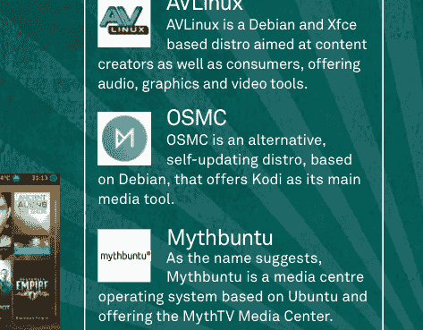

我们都通过桌面版和服务器熟悉 Linux，但该操作系统在全球范围内也被用于非常特定的任务。这种方法对于你的家来说也是理想的，通过使用 OpenELEC 发行版满足你的家庭娱乐需求。

OpenELEC 允许你在不到 5 分钟内将 PC 变成功能齐全的媒体播放器。凭借超过 450,000 名普通用户，这个屡获殊的平台运行在各种硬件（任何数量的 ARM 平台）上，仅需 10GB 磁盘空间，并可以从硬盘、SSD、CompactFlash 或 SD 卡运行。从去年开始，它简要限制了可以支持分发的缓存。媒体可以从外部存储设备播放，或通过内置的 SMB 支持播放。OpenELEC 的核心是 Kodi 媒体播放器软件，它最初起源于 'Xubuntu' 并演变成一个电视和文件管理程序、图片浏览器以及音乐和有声书播放器。它与 Kodi 非常接近，因此该发行版包含了最新的（并非小版本更新）'Kryton' 版本，以及许多第三方插件，包括复古游戏机模拟器和 DVR 功能。如果你想在你的 Kodi 方案中放入一台 Linux PC，OpenELEC 是一个很棒的选择。作为一个精简版操作系统，它以媒体为中心，没有需要担心的频繁更新，而且你知道你不需要执行任何那类技术操作。

一旦运行 OpenELEC，你就可以尽情享受大量的 Kodi 插件。这让你具备了从本地服务器观看直播电视的能力，并对媒体流传输有有极佳的支持。

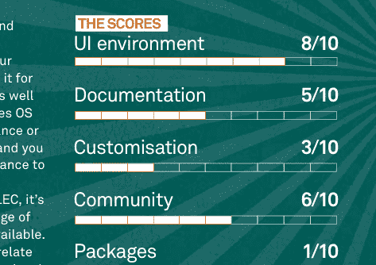

如果你想尝试对 OpenELEC 更更新且不同的替代方案，可以看看 Ubuntu，它是去年 Linux 的一种成熟操作系统，并且与另一个用户提到的类似，相似之处在于提供更新更频繁的 Kodi 构建。

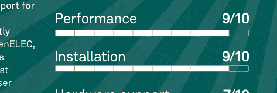

### 概览

## 替代发行版

| AVLinux | AVLinux 是一种基于 Debian 和 Xfce 的发行版，在创作者和消费者中都很受欢迎，提供音频、图形和视频工具。 | OSMC | OSMC 是一种替代的、自更新的发行版，基于... 提供 Kodi 作为其主要媒体工具。 | Mythubuntu | 如名所示，Mythubuntu 是一个基于 Ubuntu 的媒体中心操作系统，提供 Myth Media Center。 |

| UI 环境 | 8/10 | 定制化 | 3/10 | 社区 | 6/10 | 软件包 | 1/10 | 安装 | 9/10 | 硬件支持 | 7/10 |

## 最佳用于

| Kodi | Kodi 媒体播放器并不一定需要像 OpenELEC 那样使用专用发行版——它也可以作为普通应用程序安装。 | VLC | VLC 是一个媒体播放器和框架，支持几乎所有的媒体格式，包括本地和流媒体以及 DVD。 | Recalbox | Recalbox 允许你重温游戏时光，支持大量的家用、街机和便携式机器。 | Stremio | Stremio 是一款媒体播放器，设计用于不仅播放本地内容，还可以播放来自你喜爱服务的流媒体内容。 |

## LUCA

数据驱动决策

@Luca_d3

hello@luca-d3.com

www.luca-d3.com


Telefónica 数据单元

## 订阅，不要错过任何一期

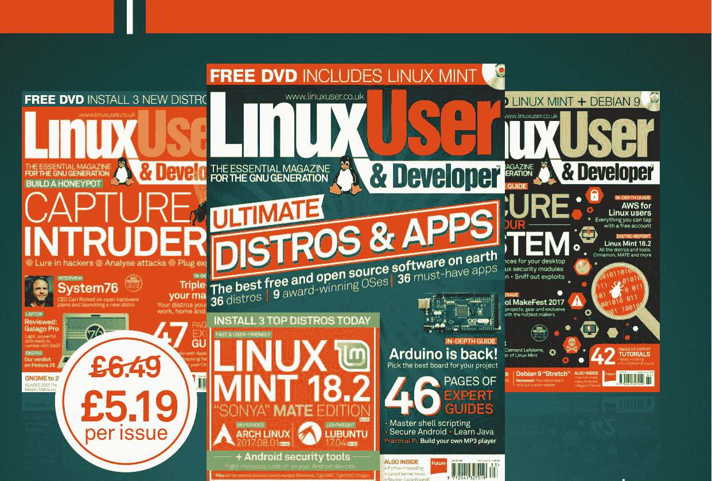

## 免费 DVD 赠送 LINUX MINT

### 免费 DVD 安装 3 种新发行版

## LinuxUser

### GNU 世代必备杂志

## & 开发者 

### 构建一个蜜罐

## 捕获入侵者

诱捕黑客 分析攻击 接入我们

## 终极发行版与应用

### 地球最好的开源软件

36 种发行版 9 种获奖 36 种必备应用

### 今日安装 3 种顶级发行版

## LINUX MINT 18.2

### "SONYA" MATE 版本

- - ARCH LINUX

- LUBUNTU

### + Android 安全工具

## Arduin 之战！

为你的项目选择最佳方案

## 专家指南

快速掌握 Shell - 学习 Java

制作你自己的 MP3 播放器

## 订阅并节省 20%

每一期都直接送货上门

### 永远错过任何一期

每年 13 期，你将确保获得其中的每一期

### 送送到你家

每一期免费送货，直接送达你的门口

### 获取最大优惠

通过直邮，以更低的价格获取你喜爱的杂志

## 读者对我们如何说...

> “我今天才发现这本杂志。它太棒了，正是我在找的。我太惊异了！”

Donald Goldithwaite 通过 Facebook

> “我今天才发现这本杂志。它太棒了，正是我在找的。我太惊异了！”

Donald Goldithwaite 通过 Facebook

> “我今天才发现这本杂志。它太棒了，正是我在找的。我太惊异了！”

Donald Goldithwaite 通过 Facebook

> “我今天才发现这本杂志。它太棒了，正是我在找的。我太惊异了！”

Donald Goldithwaite 通过 Facebook

> “我今天才发现这本杂志。它太棒了，正是我在找的。我太惊异了！”

Donald Goldithwaite 通过 Facebook

> “我今天才发现这本杂志。它太棒了，正是我在找的。我太惊异了！”

Donald Goldithwaite 通过 Facebook

> “我今天才发现这本杂志。它太棒了，正是我在找的。我太惊异了！”

Donald Goldithwaite 通过 Facebook

> “我今天才发现这本杂志。它太棒了，正是我在找的。我太惊异了！”

Donald Goldithwaite 通过 Facebook

> “我今天才发现这本杂志。它太棒了，正是我在找的。我太惊异了！”

Donald Goldithwaite 通过 Facebook

> “我今天才发现这本杂志。它太棒了，正是我在找的。我太惊异了！”

Donald Goldithwaite 通过 Facebook

> “我今天才发现这本杂志。它太棒了，正是我在找的。我太惊异了！”

Donald Goldithwaite 通过 Facebook

> “我今天才发现这本杂志。它太棒了，正是我在找的。我太惊异了！”

Donald Goldithwaite 通过 Facebook（下方有重复）

> “对于一本精彩的杂志，我一直是长期订阅者”

Matt Caswell 通过邮件

> “对于一本精彩的杂志，我一直是长期订阅者”

Matt Caswell 通过邮件

> “我今天才发现这本杂志。它太棒了，正是我在找的。我太惊异了！”

Donald Goldithwaite 通过 Facebook

> “对于一本精彩的杂志，我一直是长期订阅者”

Matt Caswell 通过邮件

> “我今天才发现这本杂志。它太棒了，正是我在找的。我太惊异了！”

Donald Goldithwaite 通过 Facebook

> “我今天才发现这本杂志。它太棒了，正是我在找的。我太惊异了！”

Donald Goldithwaite 通过 Facebook

> “对于一本精彩的杂志，我一直是长期订阅者”

Matt Caswell 通过邮件（重复）

# 我们接下来需要什么样的具有启感的来源？

请将您喜爱的项目发送邮件至 `linuxuxer@futurenet.com`

# 正在改变我们世界的灵感源

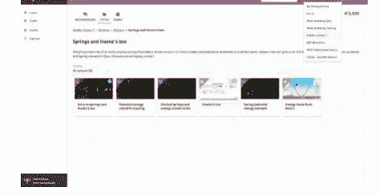

# KOLIBRI 的开源层

| 前端 | 后端 |

|---|---|

| Vue.js JavaScript 框架 https://vuejs.org | Django Web 框架 https://www.djangoproject.com |

| Keen UI UI 层 https://github.com/JosephusP/KeenUI | Django 库，例如 REST framework https://www.django-framework.org |

| PyCSS 响应式 CSS 模块 https://https.io/ | SQLite 数据库 https://www.sqlite.org |

| Material Design 图标集 http://bit.ly/MaterialIcons | Python Kolibri 使用 Python 编写 https://www.python.org |

**以上**的 Kolibri 目前处于演示阶段，但将在秋季发布

设备无需任何互联网连接即可连接到本地服务器。Alexandre 拥有认知科学背景，拥有加州大学的博士学位。在他博士期间的第一年，他对人类学习理论感兴趣，但随后转向了更具积极性的语言学习应用开发，然后他有机会在可汗学院（www.khanacademy.org）作为一个软件开发项目度过了一个夏天。

“我想进入他们在技术领域正在兴起的地方，我想学习并应用我的一些技术，”Alexandre 说，“正如我在他们核心平台上所做的一切一样，但我看到了正在开发的材料，即这些新的教学理念以及支持学生和老师的新方法。”

在一个完美的环境下，树莓派的推出并开启了 Alexandre 对可能性的想象：“我和另一个人盯着它看了一整天；而这里可汗学院，这些就是我们制作的全部内容”

## 其他客户可以在不需要任何互联网连接的情况下连接到本地服务器

材料，实际上，这是一种低成本、低功耗的设备，可以在互联网限制、连接性或电力有限的各种语境下使用。我们看到了在可汗学院所面临的成本问题，我们可以将其压缩到那台树莓派中，也许这就是将其带给那些可以在设备上使用的人的机会。

但很明显，树莓派将是某些安装方案的答案，因为世界上大多数地区需要一种可以在设备上使用的离线解决方案：“2012年，世界的一半地区仍然离线状态，”Alexandre 说，“所以 KA Lite 最初只是一个黑客行为，一个晚上的产物，然后我们”


它有多许多开源层。在 Keen UI 的情况下，Learning Equality 与开发者 Josephus P II 合作——他来自澳大利亚新加里多尼亚的构建，并由基金会资助。Cherry 充当 Web 服务器来托管 Django 应用和多线程服务器。我们使用该框架显示相同的移动响应式 Web 界面，无需连接到“服务器”。

- 用于 Python Android 的 Kivy https://kivy.org
- 前端系统，例如 Requests & JS http://reqs.org & https://github.com/websocket/githubio
- Cherry 极简 Python Web 框架 https://cherry.py

向我推广了我，当时非常兴奋，然后我必须回到学校，因为我还在读博士学位。这就是 KA Lite 的开始。KA Lite 可以访问各种内容，例如实操练习和教学视频。KA Lite 的初始版本是

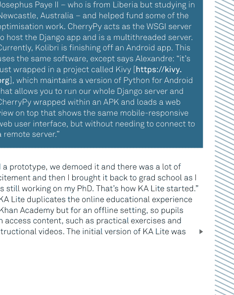

# 灵感OS

### 快速事实

Learning Equality 的第一个平台 KA Lite 在六个月内安装于 60 个国家，现在已覆盖 175 个国家和地区，估计有 450 万学习者。


Alexandre Shen 在 2012 年12 月在 Reddit 上宣布。Alexandre 觉得 KA Lite 会获得一些初步兴趣，也许会有想要合作的人，“但事实证明，人们开始在世界范围内部署它，”Alexandre 说，可汗学院与该项目联系了起来并产生了雪球效应（在 https://learningequality.org/ 的交互式地图上）。

一个缺乏许多计划用于规模化功能的早期测试版正以极快的速度被采用。“前六个月真的太棒了，”Alexandre 回忆道，KA Lite 的架构最终被固定下来，因为它获得了意想不到的大规模采用。团队很快就开始处理积压工作，现在有了一个庞大且热情的社区来支持。接着电话响起来了：“我们开始与联合国机构和世界银行进行对话”

Alexandre 和团队并没有预料到 KA Lite 在欧洲和美国的安装量。许多是由于海外探索该平台的草根倡议，但实际上，很大一部分是美国的囚犯。“但这并不是我们在理想中设计的，”Alexandre 承认道，“但由于由于原因导致的基础设施限制，例如在那个方面出于安全考虑，它恰好被需要了，”KA Lite 还通过斯坦福医学院的合作用于医学培训，Alexandre 说，“我们正试图通过培训医生和护士来提高医疗能力。”联合国儿童会表示，另一个用途是培训在生殖健康和降低婴儿死亡率等领域接受培训的前线工人公共卫生或卫生工作人员。

联合国儿童会在乌干达使用该平台分发公共卫生知识——KA Lite 是一项巨大的成功——它已在 175 个国家安装，覆盖了估计 450 万学习者。我们想构建一些不仅仅是像可汗学院的东西。

# 移动访问


# 通过数据实现免费教育


# 教程

# 核心 Linux 命令与脚本

## 第二部分

### 精通 Shell 脚本：程序结构

Bash 脚本提供了条件判断、循环和函数，你可以用它们创建强大的脚本。

现在我们开始编写一些 shell 脚本，这是将 Bash 视为一门语言的开始。与 Python 和 Java 等许多语言不同，Bash 的 REPL 入口允许你实时解释命令。同样，命令行也充当了 shell 脚本的 REPL 角色：当你编写脚本时，可以在命令行中尝试命令，而无需将它们复制到脚本中。

Bash 脚本是一个功能出奇完备的工具。我们将学习条件判断、循环和函数，它们的行为与其他语言是相似的。我们还将看到 shell 脚本变量，并学习如何在脚本内部引用这些参数。

通过这些工具和我们学到的命令，你将开始编写自己的脚本来自动化重复性任务。虽然这花费的时间可能比节省的要多，但你将成为一个更高效的 Linux 用户。

在 Bash 脚本中，任何包含井号 `#` 的行都被视为注释且不会执行。

shebang `#!/bin/bash` 是注释的一个示例：它用于确定运行脚本的程序，但开头的 `#` 确保了当脚本传递给 Bash 时它不会被执行。

最简单的编程结构是条件语句 `if`。Bash 提供的条件判断语法与其他语言中的语法相似。例如，这里有一个检查目录是否存在的小脚本：

```bash
#!/bin/bash
if [ $(ls -1) -gt 10 ]; then
	echo "too many files in the working directory"
else
	echo "ten or fewer files in the working directory"
fi
```

通用语法如下：以 `if` 开始，后面跟着方括号 `[ [ ]` 内的条件。

```bash
#!/bin/bash

## 检查参数
if [ $# -ne 1 ] || [ "$1" = "dev/null" ]; then
  echo "argument is required"
  exit 1
fi

## 检查文件是否存在
IFS=$IFS
if [ -f "$1" ]; then
  FILE="$1"
else
  echo "file not found"
  exit 1
fi
IFS=$IFS

## 读取文件内容
while IFS= read -r line; do
  if [[ "$line" != "#"* ]]; then
    echo "$line"
  fi
done < "$FILE"
```

### John Gowers

是编程与计算机科学的大学导师。他喜欢在每一个能用的设备上安装 Linux，并每天使用终端和命令行。

### 资源

- 运行运行 Bash shell 的终端（在 Linux 发行版上）

可用的教程文件：

files.co.uk

### 条件表达式

#### 如果返回真，如果

```
[[ num1 -eq num2 ]]
```

```
num1 和 num2 相等
```

```
[[ num1 -ne num2 ]]
```

```
num1 和 num2 不相等
```

```
[[ num1 -lt num2 ]]
```

```
num1 小于 num2
```

```
[[ num1 -le num2 ]]
```

```
num1 小于等于 num2
```

```
[[ num1 -gt num2 ]]
```

```
num1 大于 num2
```

```
[[ str1 -ge num2 ]]
```

```
str1 大于等于 num2
```

```
[[ str1 = str2 ]]
```

```
str1 与 str2 相同
```

```
[[ str1 != str2 ]]
```

```
str1 与 str2 不同
```

Bash 的 `if` 提供了许多比较运算符，后跟 `else` 命令并用 `fi` 结束代码块。如果我们想添加额外的分支（对应其他语言中的 `else if` 结构），则使用关键字。

> 大多数语言都提供简单的 `for` 循环，Bash 脚本也不例外。

```bash
#!/bin/bash
number_files=$($1 | wc -l)
if [ "$number_files" -gt 100 ]; then
  echo "ten more files in the working directory"
elif [ "$number_files" -gt 10 ]; then
  echo "10 more files in the working directory"
else
  echo "ten fewer files in the working directory"
fi
```

与赋值一样，在编写条件时使用空格是非常重要的；你必须在起始的 `))` 之后和结束的 `))` 之前留出空格，否则脚本将无法工作。同样，在每个 `if` 或 `elif` 之后包含关键字（但不包括 `else` 子句）很重要；否则你会得到语法错误。

#### for 循环

大多数语言提供简单的 `for` 循环，而 Bash 脚本并非如此。Bash 中 `for` 循环的基本操作是遍历一个序列：

```bash
for s in list
echo $s
done
```

在这里，第一行将变量 `s` 设置为执行每个字符串，最好的做法是在每次运行时执行循环体（`do` 和 `done` 之间）。

### Linux 命令


```bash
#!/bin/bash
number_files=$($1 | wc -l)
if [ "$number_files" -gt 100 ]; then
  echo "ten more files in the working directory"
elif [ "$number_files" -gt 10 ]; then
  echo "10 more files in the working directory"
else
  echo "ten fewer files in the working directory"
fi
```

与赋值一样，在编写条件时使用空格是非常重要的；你必须在起始的 `))` 之后和结束的 `))` 之前留出空格，否则脚本将无法工作。同样，在每个 `if` 或 `elif` 之后包含关键字（但不包括 `else` 子句）很重要；否则你会得到语法错误。

### for 循环

大多数语言提供简单的 `for` 循环，而 Bash 脚本并非如此。Bash 中 `for` 循环的基本操作是遍历一个序列：

```bash
for s in list
echo $s
done
```

在这里，第一行将变量 `s` 设置为执行每个字符串，最好的做法是在每次运行时执行循环体（`do` 和 `done` 之间）。

# 教程

# 核心 Linux 命令与脚本

第二部分

## 精通 Shell 脚本：程序结构

Bash 脚本提供了条件判断、循环和函数，你可以用它们创建强大的脚本。

现在我们开始编写一些 shell 脚本，这是将 Bash 视为一门语言的开始。与 Python 和 Java 等许多语言不同，Bash 的 REPL 入口允许你实时解释命令。同样，命令行也充当了 shell 脚本的 REPL 角色：当你编写脚本时，可以在命令行中尝试命令，而无需将它们复制到脚本中。

Bash 脚本是一个功能出奇完备的工具。我们将学习条件判断、循环和函数，它们的行为与其他语言是相似的。我们还将看到 shell 脚本变量，并学习如何在脚本内部引用这些参数。

通过这些工具和我们学到的命令，你将开始编写自己的脚本来自动化重复性任务。虽然这花费的时间可能比节省的要多，但你将成为一个更高效的 Linux 用户。

在 Bash 脚本中，任何包含井号 `#` 的行都被视为注释且不会执行。

shebang `#!/bin/bash` 是注释的一个示例：它用于确定运行脚本的程序，但开头的 `#` 确保了当脚本传递给 Bash 时它不会被执行。

最简单的编程结构是条件语句 `if`。Bash 提供的条件判断语法与其他语言中的语法相似。例如，这里有一个检查目录是否存在的小脚本：

```bash
#!/bin/bash
if [ $(ls -1) -gt 10 ]; then
	echo "too many files in the working directory"
else
	echo "ten or fewer files in the working directory"
fi
```

通用语法如下：以 `if` 开始，后面跟着方括号 `[ [ ]` 内的条件。

```bash
#!/bin/bash

## 检查参数
if [ $# -ne 1 ] || [ "$1" = "dev/null" ]; then
  echo "argument is required"
  exit 1
fi

## 检查文件是否存在
IFS=$IFS
if [ -f "$1" ]; then
  FILE="$1"
else
  echo "file not found"
  exit 1
fi
IFS=$IFS

## 读取文件内容
while IFS= read -r line; do
  if [[ "$line" != "#"* ]]; then
    echo "$line"
  fi
done < "$FILE"
```

## John Gowers

是编程与计算机科学的大学导师。他喜欢在每一个能用的设备上安装 Linux，并每天使用终端和命令行。

## 资源

- 运行运行 Bash shell 的终端（在 Linux 发行版上）

可用的教程文件：

files.co.uk

## 条件表达式

### 如果返回真，如果

```
[[ num1 -eq num2 ]]
```

```
num1 和 num2 相等
```

```
[[ num1 -ne num2 ]]
```

```
num1 和 num2 不相等
```

```
[[ num1 -lt num2 ]]
```

```
num1 小于 num2
```

```
[[ num1 -le num2 ]]
```

```
num1 小于等于 num2
```

```
[[ num1 -gt num2 ]]
```

```
num1 大于 num2
```

```
[[ str1 -ge num2 ]]
```

```
str1 大于等于 num2
```

```
[[ str1 = str2 ]]
```

```
str1 与 str2 相同
```

```
[[ str1 != str2 ]]
```

```
str1 与 str2 不同
```

Bash 的 `if` 提供了许多比较运算符，后跟 `else` 命令并用 `fi` 结束代码块。如果我们想添加额外的分支（对应其他语言中的 `else if` 结构），则使用关键字。

> 大多数语言都提供简单的 `for` 循环，Bash 脚本也不例外。

```bash
#!/bin/bash
number_files=$($1 | wc -l)
if [ "$number_files" -gt 100 ]; then
  echo "ten more files in the working directory"
elif [ "$number_files" -gt 10 ]; then
  echo "10 more files in the working directory"
else
  echo "ten fewer files in the working directory"
fi
```

与赋值一样，在编写条件时使用空格是非常重要的；你必须在起始的 `))` 之后和结束的 `))` 之前留出空格，否则脚本将无法工作。同样，在每个 `if` 或 `elif` 之后包含关键字（但不包括 `else` 子句）很重要；否则你会得到语法错误。

### for 循环

大多数语言提供简单的 `for` 循环，而 Bash 脚本并非如此。Bash 中 `for` 循环的基本操作是遍历一个序列：

```bash
for s in list
echo $s
done
```

在这里，第一行将变量 `s` 设置为执行每个字符串，最好的做法是在每次运行时执行循环体（`do` 和 `done` 之间）。

### Linux 命令

## Functions

```bash
#!/bin/bash

reverse() {
  for word in "$@"
  do
    result=$word$result
  done
  echo "$result"
}

reverse world! Hello
```

在这里我们使用函数而不是脚本来创建字符串：反转程序（reversal program）。

```bash
$ jowers sandbox$ ./hello.sh
Hello, world!
$ jowers sandbox$
```

图 3

在 bash 中，我们使用以下语法创建函数：

```bash
this_a_function () {
  # 命令
}
```

```bash
$ read
Hello, world!
$ echo $?
$1
```

函数的行为与命令相似；它们以相同的方式被调用（例如，图 3 所示），并且它们接收（字符串）参数，这些参数被称为 `$1` 等。例如，这里有一个创建一个新目录并进入该目录的函数：

```bash
mkdir $1
cd $1
```

如果 `read` 遇到文件末尾，或者用户按了 Ctrl+D，它将返回一个错误代码：

如果你将此内容添加到你的 `~/.bashfile` 中，你将拥有一个名为 `mkdir_name` 的函数，并将创建一个名为 `name` 的目录并进入其中。你不需要亲自执行这些操作，因为它在自己的 Bash 实例中运行，并且无法更改父接口的目录。

```bash
$ read line
Hello, world!
$ echo $line
```

脚本和函数没有特定的返回值的方法，但它们确实有一项被称为“退出代码”（exit code）的信息。如果你用 C 或 C++ 编程，你会编写 main 函数，在程序执行时通过返回一个数值来声明一个值。一个程序或脚本的退出码有一个值；它通常为 0，但也会取其他值来指示各种情况，例如程序是否因错误结束。最近运行的命令的退出码是：

```bash
return_hello () {
  echo "Hello, world"
}
```

调用该消息将导致 `eval` 返回代码 `message="Hello, world"`。我们随后可以在脚本的其他地方使用变量 `message`。

为了在你的脚本中实现这种行为，你需要一个额外的变量。假设该变量作为第一个参数传递。假设它确实如此，其值为 `$1`。然后你可以编写 `return=$return_value` 来在函数内部设置此值，但在 Bash 中，Bash 进程的赋值 = 会扩展变量。通常情况下，你必须使用命令打印 shell 代码作为，例如，创建命令行参数，正如我们做的那样将每个参数追加到结果中。它存储在特殊变量 `?` 中，你可以像访问 `$?$` 一样访问它。例如，`read` 命令在 shell 脚本中从标准输入读取一行文本。

## Android 安全

### 学习黑客如何向应用中注入恶意代码

反编译和调试 Android 应用是对抗设备上代码的基本技能。

当你从 Google Play Store 安装应用时，Android 是一个危险的生态系统，但你仍然有机会通过潜在有害的 APK 破解你的智能手机。这就是为什么它主要用 Java 编写。某些可能包含原生库（C/C++），并且是一个包含 DEX 二进制文件的 ZIP 文件，该文件随后由 Dalvik 或 ART 引擎执行。APK 还包含其他文件，如位图、XML 布局等。DEX 字节码可以使用开源工具（如反编译器）进行格式化。

它是使用 `apktool` 来反编译的。在提取 DEX 代码之后，你将获得 APK 内的所有额外文件。在查看这些代码之前，你应该知道应用名称及其对应的活动（activity）。通过这些，你将知道去哪里寻找。得益于此，你将能够识别出从哪个代码开始分析，否则很容易迷路。你可以从 Android 源码和 APK 包中获取信息。

如果你发现反编译包是 `org.helloworld`，那么你就知道它是恶意的，这样你就知道该看哪里了。得益于此，你将能够识别出分析哪个代码，否则很容易迷路。你可以从 Android 源码和 APK 包中获取信息。

# 教程

## Android 安全

- 应用钩子 (App hooking)

能够修改少量代码并重新打包应用成是一个 APK。你可以做得比仅仅钩持方法要多。

通过钩持 Android 方法并编写脚本，Xposed 框架是一个强大的工具，可以与各种应用配合。借此，没有什么字符串是太小的。

https://koodoom.com 使用了其高级搜索功能。在搜索框中输入 "apk's cert:99C95C4A2AE92CD16F477A5162CF5BA2D196。有多少个 APK？

## 向合法 APK 注入恶意代码

假设坏人已经给这个合法应用添加了一些恶意行为。他们重新打包了应用并重新安装了。通过使用替代方案 (hook-world-trojan.apk)，你可以获取该应用的样本进行执行。如果你获取了代码 (hook-world-trojan.apk)，你可以在 VirusTotal (virustotal.com) 上查看。两款反病毒软件将其识别为 'ELF-Exploit/PL'；第三款报告了基于 CVE-2016-5195 的漏洞。此 CVE 被称为 Dirty COW 漏洞。

通过使用 Dirty COW，可以在已 root 的沙箱中运行 'File Tail' 二进制文件。这允许你将恶意的 ELF 二进制文件作为库执行。

无论如何，此应用已被修改为使用 Dirty COW。反编译应用并钩持 `Activity.onCreate()` 方法。通过这样做，会出现大量额外的指令，然后你就能看到一些恶意代码的执行路径。不要忘记移除 hello-world-trojan.apk。接下来，执行应用，你将发现它确实起作用。之后，你可以对原始的 hello-world.app 执行相同的任务。Dirty COW 漏洞已被成功利用。

已 root 的二进制文件 `/system/xbin/librank` 带有参数：run --line 10。要在 adb 会话中执行此：添加 shell `/system/xbin/librank`。你将获得一个 root shell。

所以，到目前为止 HelloWorld 应用很容易分析，因为它非常小；只有几行代码。每当处理真实应用时，你将尽可能地需要帮助。除了 AndroidGUI (http://androidgui.org/) 等工具，还有几个强大的工具可以为你完成很多任务：逆向工程、通过动态分析对 APK 进行去混淆以及自动化工具。还有一个很有名的 Android root 应用叫 HackMe (www.hackypick.hk)。它出厂自带了一些用于 ID JX5780 所需的工具。这个工具有很多内容要说：/mara.sha $hackypick.apk。入口加载可能需要一段时间。当被问及要反编译应用时，输入 'np'；Android 解密（Android Decrypt）只需让你寻找 1M。当被问及钩持控制流图时，输入 'w'。终端中的所有结果都在 data/hackypick.apk。

一旦分析完成，导航到 data/analysis/static/malicious_activity。在这里 Mara 收集了信息以确认可疑行为，或者为了你的安全，请检查 Android 框架的反编译扫描和隔离选项，现在你可以环顾四周并得出你自己的结论：HelloWorld 应用似乎确实有点诡异，你不觉得吗？为了验证并查看它做了什么，为下载的 APK 计算 SHA-256 哈希 - sha256 hackypick.apk - 并使用此哈希在 VirusTotal 上搜索。在本文，六款反病毒软件检测到了可疑行为；例如，入口处的 Dowlin (http://bit.ly/AndroidDoughwin)。执行搜索并查找证书指纹：GetHackMe:SHA-1 证书指纹并在 Koodoom 中查找；在所有共享相同证书的应用中，你可以发现有趣的内容。

## 当检测到恶意应用时，共享其签名的其他应用可能也被认为是危险的


## 后端代码分析

在后端代码中，有一个字符串字面量指向 Android `/system/xbin/` 内的文件路径。该字符串通过空格扩展，如果你执行该代码路径，你将看到此字符串涉及 `StringBuilder` 构造函数，这显示不同的字符串被拼接在一起，然后它们被作为参数传递给 `Runtime.exec()` 方法（第 274 行）。总结一下：执行 COW ELF 二进制文件以覆盖

## 调试 smali

Leocker 是一种原生机制，它在执行你的代码之前会执行一些检查，以确保在有库或虚拟环境中执行将更加困难。例如，Leocker 会检查手机日志中是否存在任何钩子或文件。这些检查可以通过逆向工程应用并使用 smali 读取其代码来轻易发现。当然，它可以被轻易绕过。调试 smali 可以帮助你解决这类问题，尽管要记住大多数恶意软件可能也附带调试技术。

所以，恢复你 Android VM 之前的快照，从封面磁盘 `hello-world-trojanized-nfc.apk` 获取我们 Hello World 最新版本；使用 `adb` 安装它然后执行它。如果 `/system/xbin/librank` 则什么都没有发生。应用没有执行其负载。让我们看看为什么。下载并安装 IntelliJ 和 smali 插件（参见资源）。接下来，解密你的应用：`apktool.sh hello-world-trojanized-nfc.apk`。

## 在调试应用之前，构建其控制流图可能是一个好主意

按照说明在你的 Android VM 上设置调试。然后进入 Settings（设置）和 Android debugability（Android 可调试性）。启用 'Wait for Debugger'等待调试器）选项。最后，执行应用并到达断点。通过双击 `MainActivity.java` 中的 `onCreate` 方法设置一个断点。

现在你准备好使用 'Debug/Step'（调试/单步）并选择你之前设置的 'Resume'恢复）选项了。执行代码直到遇到条件语句：`if-v2==cond_0`。这是评估结果：如果 `v2` 等于 0，则跳转到标签 `cond_1`，否则跳过。你正在进行某种测试，如果 `v2` 评估为 1。在此处设置断点并点击 'Resume Program (F9)' 恢复执行。

- `1 const-v2,0 "android.hardware.nfc"`
- `2 move-object/v1,v2`
- `3 invoke-virtual/v1,v1,Landroid/content/package/PackageManager;->hasFeature(Ljava/lang/String;)`
- `4 move-result v0`
- `5 if-eq v0,v2,0x0`

所以，检查 NFC 能力是否为 (3）；如果值不是 3，则负载没有执行（见行 S）。现在，从你的 Android VM 分离调试器并使用 IntelliJ 编辑 smali 文件。对于 `onCreate()` 方法，找到执行条件跳转的行。将 `if-eq` 替换为 `if-ne`。保存文件然后使用 Apktool 重新编译并打包 APK：`apktool.sh hello-world-trojanized-nfc`。不要忘记调整它然后将其安装到你的 Android VM 上（先卸载之前的版本，因为你不应该拥有原始开发者包）。在 Android VM 上使用 'replace' 选项再次运行新应用。此负载已启动，现在 `/system/xbin/library` 已被 `flow.png` 覆盖以查看路径。这将允许你看到路径以及每个节点的深度，以及从哪一个开始分析。

这里你有了：我们的 Android Studio Hello World 应用正处于恶意状态

可用教程：

filesoft.co

```
python .Flow -c /path/to/MainActivity.java.
```

这将生成一个名为 `flow.png` 的新文件。打开文件查看绿色红色箭头。绿色代表条件跳转真；红色代表条件跳转假。Try-catch 代码结构很容易发现：try 内部的代码通过蓝色箭头引用；橙色的用于 catch。使用此 CFG，你可以通过在这些部分设置断点来发现 smali 代码的一些有趣部分。这将加快你的分析。请记住，为大型类构建 CFG 将花费大量时间。

## Java 教程

### 学习 Java：使用 JavaFX 为你的游戏创建一个 GUI

JavaFX 库让为 Java 应用设计和构建精美且现代的图形用户界面变得简单。

John Gowers 是一位编程和计算机科学的大学导师，重点关注 Java。他喜欢在他能拿到的每一台设备上都安装软件。

- OpenJDK 1.8 http://openjdk.org/
- JavaFX 8 http://openjfx.net/projects/javafx/
- Eclipse IDE http://www.eclipse.org/

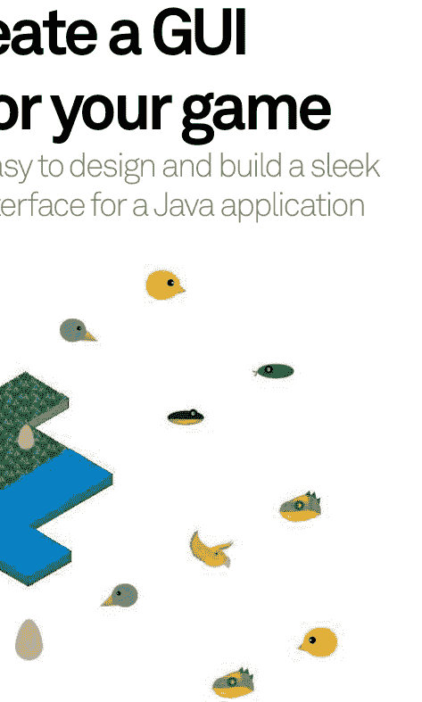

JavaFX 是一个用于 Java 的强大图形框架。通过本教程中的艺术设计和编程技巧，你将能够为我们上个月教程中制作的游戏创建一个复杂的图形界面：

Java 特别擅长的领域之一就是设计图形用户界面（或 GUI）。在我们的 Java 教程系列的第二部分中，我们将学习如何使用 JavaFX 创建一个图形游戏，玩家可以在地图上行走，收集会孵化成各种动物的蛋。在本教程中，我们将用 JavaFX 的图形组件替换基于控制的输入输出，这将有助于演示 Java 中继承和多态的威力。

你应该确保你的系统中已经安装了 Java 的 OpenFX 实现。我们建议你通过包管理器安装 OpenFX。在大多数发行版中，该包的名为 `openjfx`。如果你正在使用 Eclipse，在安装 OpenFX 后应该重启 Eclipse。

如果你已经完成了上个月的教程，请在 Eclipse 中打开该项目。上个月的项目是一个 eclipse 项目，接着点击“浏览...”并导入 `file.tar.gz` 文件。要执行此操作，请选择 File > Import...。

JavaFX 是一个庞大且功能丰富的库，我们无法在一篇文章中涵盖你需要的所有内容。本月教程的目标是教你 JavaFX，让你能够构建基础的 GUI，然后自己探索该库以制作出你想要的 GUI。像既往一样，Oracle 文档（http://docs.oracle.com/javase/api/）是一个极佳的参考，尽管你可能会找到针对特定功能的更详尽且易于学习的教程。

花些时间玩玩这个框架，并熟悉 N/E/S/W（南东南西）、搜索、拾取和物品栏命令。如果你本月加入教程，你也将拥有代码，以便自己进行实验并了解其工作原理。

当你对文本游戏感到熟悉后，我们导入本月的额外代码。要执行此操作，导航到 File > Import，并选择 General > Archive File。将出现图 1 所示的对话框。选择顶部的箭头，在右侧找到光盘上的 `eggsExtra_lt.tar`，然后在底部的“folder”附近选择“Browse...（浏览...)”，点击 `eggs` 项目并点击“OK”将新文件合并到现有项目中。这将为项目添加一个新包 `load.eggs`，其中包含一些新文件。它还会创建一个新目录 `src/main/resources/`，其中包含补充材料，包括一些你可以使用的专门制作的艺术设计。`resources` 目录出现在 Eclipse 窗口左侧包资源管理器的顶部，如图 2（概览）所示。我们现在可以构建

## JavaFX 概念

当我们加载新的 App Java（我们上个月创建的 App）时，我们注意到 JavaFX 对其核心概念使用了一些术语。JavaFX 应用程序顶层容器被称为“stage”（阶段），它有能力容纳一个或多个“scene”（场景）。场景是在阶段内部可见的，它们允许界面完全改变；例如，当我们从欢迎界面移动到主应用程序时，欢迎界面占据一个场景，而主应用程序占据另一个场景。

在场景之上，我们放置 GUI 组件 - 例如文本框、按钮和图像。在 JavaFX 中，这些组件被称为“nodes”（节点），它们被组织在一个名为“scene graph”（场景图）的自由树中，其中节点被指定为子节点。

> JavaFX 允许我们使用 CSS 对图形元素进行样式处理，CSS 是一种专门为其他节点设计的语言。JavaFX 简化了编写 GUI 代码的过程，因此你不需要担心隐藏或显示不同的组件。规则很简单：如果父节点显示，其所有子节点都会显示。例如，HBox 是一个将其子节点排列在水平线上的框。如果你隐藏了 HBox，它将不再出现，所有的子节点也将之消失。我们需要处理某种布局；我们添加了 `Parent` 类。`Parent` 类将子存储在节点的 `ObservableList` 中，我们可以通过 `getChildren()` 方法检索它们。`ObservableList` 实现了 `List` 接口，因此我们可以使用与从有序列表中添加和删除元素相同的方法进行添加和删除。参见图 3 直接放置在场景上的“root”（根）节点。根节点是 GUI 上所有节点的祖先。如果一个节点不是根节点的后代，它将不会显示。

- 最后，创建 JavaFX 应用程序时有一些步骤要遵循：
  1. 创建 root（通常是 Pane）。
  2. 使用 `getChildren().add()` 向根添加更多节点（通常是 Panes）以处理应用程序的不同部分，或者一些其他节点。

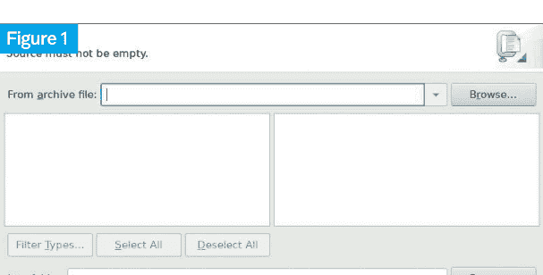 JavaFX 概念

当我们加载新的 App Java（我们上个月创建的 App）时，我们注意到 JavaFX 对其核心概念使用了一些术语。JavaFX 应用程序顶层容器被称为“stage”，它有能力容纳一个或多个“scene”。场景是在阶段内部可见的，它们允许界面完全改变；例如，当我们从欢迎界面移动到主应用程序时，欢迎界面占据一个场景，而主应用程序占据另一个场景。

在场景之上，我们放置 GUI 组件 - 例如文本框、按钮和图像。在 JavaFX 中，这些组件被称为“nodes”，它们被组织在一个名为“scene graph”的自由树中，其中节点被指定为子节点。

> JavaFX 允许我们使用 CSS 对图形元素进行样式处理，CSS 是一种专门为其他节点设计的语言。JavaFX 简化了编写 GUI 代码的过程，因此你不需要担心隐藏或显示不同的组件。规则很简单：如果父节点显示，其所有子节点都会显示。例如，HBox 是一个将其子节点排列在水平线上的框。如果你隐藏了 HBox，它将不再出现，所有的子节点也将之消失。我们需要处理某种布局；我们添加了 `Parent` 类。`Parent` 类将子存储在节点的 `ObservableList` 中，我们可以通过 `getChildren()` 方法检索它们。`ObservableList` 实现了 `List` 接口，因此我们可以使用与从有序列表中添加和删除元素相同的方法进行添加和删除。

- 最后，创建 JavaFX 应用程序时有一些步骤要遵循：
  1. 创建 root（通常是 Pane）。
  2. 使用 `getChildren().add()` 向根添加更多节点（通常是 Panes）以处理应用程序的不同部分，或者一些其他节点。

### JavaFX 概念（续）

当我们加载新的 App Java（我们上个月创建的 App）时，我们注意到 JavaFX 对其核心概念使用了一些术语。JavaFX 应用程序顶层容器被称为“stage”，它有能力容纳一个或多个“scene”。场景是在阶段内部可见的，它们允许界面完全改变；例如，当我们从欢迎界面移动到主应用程序时，欢迎界面占据一个场景，而主应用程序占据另一个场景。

在场景之上，我们放置 GUI 组件 - 例如文本框、按钮和图像。在 JavaFX 中，这些组件被称为“nodes”，它们被组织在一个名为“scene graph”的自由树中，其中节点被指定为子节点。

> JavaFX 允许我们使用 CSS 对图形元素进行样式处理，CSS 是一种专门为其他节点设计的语言。JavaFX 简化了编写 GUI 代码的过程，因此你不需要担心隐藏或显示不同的组件。规则很简单：如果父节点显示，其所有子节点都会显示。例如，HBox 是一个将其子节点排列在水平线上的框。如果你隐藏了 HBox，它将不再出现，所有的子节点也将之消失。我们需要处理某种布局；我们添加了 `Parent` 类。`Parent` 类将子存储在节点的 `ObservableList` 中，我们可以通过 `getChildren()` 方法检索它们。`ObservableList` 实现了 `List` 接口，因此我们可以使用与从有序列表中添加和删除元素相同的方法进行添加和删除。

- 最后，创建 JavaFX 应用程序时有一些步骤要遵循：
  1. 创建 root（通常是 Pane）。
  2. 使用 `getChildren().add()` 向根添加更多节点（通常是 Panes）以处理应用程序的不同部分，或者一些其他节点。

```java
{
  launch(args);
}
```

总结来说，让 JavaFX 运行的最后两个步骤是：

- 5. 创建一个实现 `javafx.application.Application` 的类，并顺序使用我们创建的 `Scene` 实现 `primaryStage.setScene(primaryScene)`。
- 6. 调用 `launch()` 方法来启动并运行应用程序。

这些步骤看起来有些复杂，但它们很快就会变成你的本能。我们建议你从我们的 JavaFX 示例开始。

## JavaFX 与 CSS

JavaFX 有了一项功能，允许你使用 Web 开发中广泛使用的级联样式表（CSS）格式对 UI 组件进行样式设置。这是一个非常棒的；CSS 是一种设计用于描述文档呈现信息的语言。与其使用 Java 方法，你可以使用 CSS 样式表。如果我们想修改 GUI 任何部分的外观，可以轻松地修改 CSS 样式表，而不是通过 Java 代码。

如果你在 JavaFX 的父节点上添加 CSS 样式，该样式将应用于该节点及其子节点。就像向节点添加子节点一样，使用 `getStyle()` 方法很容易地向节点添加样式：

具有 `button` 样式类的按钮，其中一个具有 ID `ok-button`。

我们将再次重构“实现接口”的游戏，但这次你会有更多的自由来发挥创意。在上次采用的基于继承的方法中，我们定义了每个步骤的目标，现在我们只需要更改应用程序的两个部分：处理布局和逻辑的部分。我们还更改了 `OutputViewer` 的实现以及我们读取并将其输入游戏中的 `Observable` 对象。

## 创建 GUI

我们提供了三个新接口：`GamePane`、`InventoryDisplay` 和 `Controls`。这些方法有许多实现方式，但它们将帮助你按照自己的意愿制作游戏。我们还提供了这些接口的实现，但做出某些决定取决于你。

`GamePane` 类代表我们用于显示地图的主区域。我们需要实现的方法是 `drawMap()` 和 `clearTiles()`。让我们先开始创建一个 `GridPane` 对象来持有地图。`GridPane` 是 `StackPane` 的子类。你可能决定使用不同的窗格对象来持有地图瓦片，但我们使用 `GridPane` 来构建 `GamePane`。

现在我们需要一些瓦片来放置在网格上。JavaFX 提供了 `ImageView` 类来查看图像，但它并不容易使用。相反，让我们使用 `Pane` 作为瓦片，这样我们就可以使用 CSS 属性 `-fx-background-image`。如果在 `map.css` 目录中创建一个样式并应用它，你可能注意到 `GamePane` 类包含了两种不同的样式。如果你想在主窗格中使用 3D 地图，我们建议在项目中使用支持此点的 `GamePane` 类。我在 `GamePane` 类中包含了一些注释供你参考。

```css
pane.getStyles().addClass("style.css");
```

然而，这需要 `style.css` 目录。我们为你设置了独立的目录来存放样式表，但我们为你提供了一个辅助方法 `addStylesheet()`，你可以使用它尽可能方便地添加样式表。

一旦我们在 GUI 上的节点上添加了样式，就可以开始为游戏设置样式了。例如，使用 `GridPane` 和一些 CSS，我们可以创建一个简单美观的地图。

## 3D 窗格

多态允许我们“拔掉”控制台并在图形界面中替换“查看器”。使用此内容作为模板来指定在按下按钮时执行的代码。你可能希望编写简单的方法来减少代码重复。

| |

| :--- |

| class GuiOutputViewer implements OutputViewer { |

| private EggsGui gui; |

| public GuiOutputViewer(EggsGui gui) { this.gui = gui; } |

| @Override displayInput(Player player) { gui.getInventory().displayInput(player); } |

| // 等... |

| button.setOnMouseClicked(new EventHandler<MouseEvent>() { @Override public void handle(MouseEvent event) { // 事情。参数 'event' 包含了关于点击及其位置的信息. }} |

你应该将玩家符号添加到地图中间的瓦片上，并在 `Tile.hasEggs()` 方法返回 `true` 的任何瓦片上放置鸡蛋符号。你可能会得到与图 7 类似的结果。

在 Java CSS 代码中，我们可以按照以下行轻松创建陆地和海洋瓦片：

```java
Pane newLand = new Pane();
Pane newSea = new Pane();
newLand.getChildren().add(new Tile("tile-land"));
newSea.getChildren().add(new Tile("tile-sea"));
```


我们最后需要学习如何设置网格瓦片的坐标。为了做到这一点，我们使用 `GridPane` 类中的 `setRow(int)` 和 `setCol(int)` 方法。

```java
GridPane.setRow(newLand, 2);
GridPane.setCol(newLand, 3);
```

...这给我们提供了坐标 `(2, 3)`。当我们使用 `add(node, col, row)` 将其添加到网格时，它将自动放置在正确的位置。

边做边测试；例如，你可以尝试直接在 `App` 类的场景上放置网格窗格，添加几个瓦片并排列它们以确保你得到了想要的内容。例如，如果你想在网格窗格定义的坐标上添加陆地海洋瓦片，那么你就必须再次实现 `mapGrid()` 方法，该方法将 `MapTile` 实例的二维数组转换为 GUI 瓦片并将它们放置在正确的位置。你还可以实现 `clearTiles()` 方法来从网格中移除地图瓦片。

## 实现 InventoryInterface

`InventoryInterface` 接口有一个简单的方法 `displayInventory(Player)`，它接收一个 `Player` 实例并显示玩家库存的内容。我们将为你做出决定，提供一些提示。

- 1. 你必须可以使用 JavaFX 的 `BBox` 和 `GridPane` 类。在这里，`GridPane` 是 `Pane` 的子类，因此共享相同的 `getChildren()` 方法。`BBox` 在列表中按水平或垂直顺序排列子，而 `GridPane` 按水平行排列子。在这些情况下，你还需要对它们进行对齐。如果你倾向于网格布局，你可能决定如何进行。

- 2. 你可能决定为玩家提供鸡蛋和其他物品的图片以添加到玩家库存中。我们将使用与显示地图瓦片相同的技术：将物品实现为 `Pane` 并设置图片和大小。

- 3. 我们建议你使用 CSS 进行所有样式设置，不要在 Java 代码中包含任何样式代码。使用 `inventory.css` 样式表来设置样式。一个好主意是从表开始并为玩家库存窗格添加样式。然后你还需要像我们这里展示的那样为库存的每个元素设置样式，然后添加更多 CSS 来设置文本。

我们鼓励你思考如何让 GUI 看起来尽可能复杂。

## 实现控制接口

例如）并通过返回这些按钮来实现这些方法。

设计的最后部分是组装 GUI。为了实现这一点，如果你想创建一个 GUI，我们将创建一个名为 `Eggui` 的新类，然后我们将查看 `BorderPane`。`BorderPane` 有左、右、上、底，我们使用 `set()`、`setColor()` 和 `get` 方法来添加这些元素，而我们在其他地方使用了 `getChild()` 方法。一种方法是将地图放在中心，另一种是在文本下方放置状态栏，并在顶部放置标题栏或菜单。你的代码可能如下：

```java
private Map maparea = new MapArea();
public EggGui() {
    BorderPane main = new BorderPane();
    main.setCenter(maparea);
    // ...
}
```

为 `EggGui` 类添加方法以保留你的 `Mapview`、`DisplayOverlay` 和 `Controls` 实例。

## 创建 GUI

我们现在应该有一个漂亮的 GUI 了，但它还什么都不做。为了让它与程序配合，我们需要重新实现 `OutputInterface` 并提供一个新的 `SubObservable` 类来与 GUI 和程序的其他部分通信。

`OutputInterface` 有三个方法：`display()`、`displayTiles()` 和 `display()`。我们已经实现了 `Mapview` 和 `DisplayOverlay` 接口，其中两个很容易实现。通过遵循之前的方法，我们创建了一个实现 `OutputInterface` 的新类 `GuiController`，并通过其构造函数与 GUI 通信。见图 8，这是一个关于如何开始实现此类的示例。

稍微困难的部分是让 GUI 函数正常工作。为了做到这一点，我们创建一个扩展 `Controller` 的 `EggListener` 类。我们将实现它，使得当用户按下按钮时，我们使用 `notifyObservers()` 方法。例如，如果用户按下北按钮，`EggListener` 应该同时调用 `notifyObservers("search")` 和 `notifyObservers("inventory-update")`，当玩家移动时，地图和背包也会更新。

## 使用 lambda 表达式和方法引用

添加事件处理按钮的语法可能看起来很笨拙，但如果你在 Java 框架中写过内部类，它就会非常熟悉。Java 已经实现了用于单接口方法的匿名内部类。在泛型和之前的类型帮助下，Java 8 引入了 lambda 表达式和方法引用，它们写起来更简单、更整洁。使用 lambda 来实现图 9 中的新类，我们可以写一个 lambda 表达式：

```java
button.setOnAction(() -> {
    handle();
});
```

另一种替代方案是使用方法引用。假设我们在 `EggListener` 中写了一个 `doThings()` 方法，它与图 9 中的 `handle()` 方法相同。那么我们就可以使用：

通过 `EggListener` 的构造函数传递 `EggGui` 实例是好的。监听器类可以使用 `controls` 轻松访问所有的 GUI 组件。如果你希望在按下按钮时执行代码，我们使用 `setOnMouseClicked` 方法。在这些匿名内部类的 `EventHandler` 中，将其作为输入，并且如图 8 所示

如果你使用 `Button`（而不是 `Pane` 或类似物）控制你的控件，请使用 `setOnAction()` 而不是 `setOnMouseClicked()`，并替换 `MouseEvent`。这个类更容易实现。我们将在 Filelo 的 Java 部分看到这个类，寻找 `EggListener.java`。

## 运行程序

现在你已经有了这些，你的 `App` 类可以使用与文本版本的 `EggGui` 的 `App` 类非常相似的功能，然后你只需要将 `ConsoleOutput` 替换为 `GuiController` 实例，将 `ConsoleController` 实例替换为 `Controller`，并将 `EggGui` 接口传递给构造函数。你不需要为此创建一个线程，因为 Java 实际上运行在新的线程数组中，所以你应该保留 `new Thread(controller).start();`。通过创建一个带有 `EggGui` 实例顶的新场景来启动 GUI。通过这一步，Filelo 中有一个可用的模板。在 Java 部分寻找 `App.java`。

确保你测试了代码并在修复了 bug 后继续进行。接下来，我们将学习如何跨网络连接游戏。


## 追求纯粹

Richard Smedley 会见了 Purism 的首席执行官 Todd Weaver，这是一家直面应对隐私问题的硬件公司


## 全栈自由

对于 Purism 来说，能够能够用 `coreboot` 替换专有 BIOS 只是时间问题，让 Librem 12 和 Librem 15 笔记本电脑（之前评审过）最终获得自由；对于那些拥有 Purism 硬件的人来说——在我们进行时，它正在接受 QA 测试。

制造商提供了两台笔记本电脑，尽管 Dell 并不总是容易找到它们，而且转销商不会为你安装，特别是带有 System6/ 的时候，但事实是，大多数人不足以承担脱颖而出的风险。

如果你不能，你可以使用 USB 闪盘来控制笔记本电脑——根据总部位于柏林的研究团体和咨询公司的想法，Purism 也在考虑替代方案以及他们自己的 NVME 规范。

如果他们没有这样做，可能是因为公众缺乏对自由的意识，而且开源软件正在快速增长，树莓派已将 GNU/Linux 交到新一代的人手中。

Purism 最重要的工作是——鉴于他们已经准备好这系列笔记本电脑——用 Purism 的 Intel-me 的话来说：“ME 对用户是威胁，特别是 Intel 签名的用户必须执行未经验证的代码损害安全、隐私和自由。”

在过去的几年里，在勒索软件的背景下，允许监控并收集公司数据。到目前为止，Purism 拥有内核、栈以及大约 92% 的 Intel 二进制文件——致力于替换或替换所有内容。然而，Vault 有一部分可以防御针对 EFI；UEFI（现代 BIOS）替换的攻击。

# 纯主义

在今年的 GUADEC（GNOME 大会）上，我们开始问他：这为什么重要？

“数字权利应该反映物理权利，”Weaver 告诉我们，“现在的趋势是更多的数据收集和更多的企业监控，尤其是在移动设备上。这种趋势正处于最糟糕的状态。我们需要一种能够保护消费者数字权利的产品——以及为了与软件协同工作而打造的硬件。”

他强调了通过用户控制来提升自由的深度，并将自由基金会（Free Foundation）的原则引入硬件，但 Weaver 表示，他们正在更进了一步，“‘便利性’可不是（两个重要的词）。”

因此，为什么 GNOME 7 将其视为一个结合了极佳外观和优秀性能的自由软件产品——但特别突出了“通过应用隔离提供卓越安全性，为个人提供隐私，并尊重数字权利（这是自由软件）”。

Purism 的 GNOME 5 也将允许我们通过 Librem 5 使用手机，虽然许多用户购买它是为了“端到端加密通信”，或者为了逃离现有双垄头的围墙花园，但许多用户正期待一个可以连接在家里、配备大屏幕和键盘的安全设备——而基础套包是众筹页面最受欢迎的选项之一。

## 父母的选择

随着两款标记在特定价格位的笔记本电脑销量增加，以吸引 GNOME/Linux 用户之外的群体，Weaver 被问及：“我们想知道他的客户是谁”

“自由软件支持者和 GNOME/Linux 用户，甚至是他们自己，”他回答道，“但这些主要用户是——具有安全意识的 CTO、CIO 和企业高管。以及为了隐私给孩子购买电脑的父母。”

从用户反馈来看，最近发布的勒索软件攻击和 Vault 7 事件让每个客户心头都留下了忧虑：“我给女儿买了一台，现在面对可能发生的事情，我放心了，因为他们受到了保护。”

除了具有安全意识的 CTO 和 CIO 之外，Weaver 表示，从他们的开发者那里，他们对“高净值人士也很有兴趣，他们想要安全、自由和风格——是我们需要的最大群体，而且我们发现 Librem 在自由开发者中口碑良好”。

-ThinPad，尽管这种外型意味着没有机械键盘。我们认为 Librem 在 p54 上的表现令人印象深刻，近乎“ThinPad 的质量”。

Weaver 关注所有设备的硬件质量：耐用的合链、未安装在主板上的 p5 滚轴连接器，以及默认配置。回到受欢迎的 Linux 用户身上，我们问这些父母是如何听说 Purism 的？

Weaver 提到他在 TechCrunch 和其他受关注的媒体中提到过，仅仅是简单的口碑传播。CTO 和 CIO 需要在社交问题中被问到：“我应该为孩子寻找什么样的笔记本电脑？这是什么。”许多人已经触达到了“下一阶段的受众”，因为他们可以作为“安全且便利”的选择被推荐。

这在 Pow Browser 中最为显而易见——它是集成了 Mozilla 专注于安全的插件（如 Privacy Badger）并解锁防止追踪的 Firefox。尽管 GNOME 自己的浏览器——GNOME Web（以前称为 Epiphany）对于消息、视频通话、浏览器是免费的；所有其他功能稍后提供——尽管 PureOS 允许我们在“完整的自由软件栈”中添加任何我们想要的内容，并且通过 USB-Type，Weaver 表示这是一种“融合”。

GNOME 聊天中的另一部分也起了作用，因为 Weaver 的安全通信功能使用了 Matrix.org，它汇聚了我们拥许多通信手段。我们拥有这个和那个，这种未来属性可能更适合消费者通信的开发。

## 特洛伊式的自由

我们问 Weaver 这种对安全的关注是否想要将自由软件带入人们的设备？“这不是偶然，”Weaver 补充道，“安全是市场非常想要的，而我们需要从自由中寻求任何创意来解决这个问题。例如，基于安卓（带有其专有组件）的‘推出隐私手机’并没有深度的信誉可言。我们尽可能深入堆栈深层——我们比任何人都钻得深。唯一具有任何信誉的方法就是自由软件。”

我们问及了尝试将自由软件带入设备中的痛点。

键盘的触感非常奇妙，足以让触摸鼠标的感觉变得很自然——一旦用户适应了略短的键程，一切都会都得恰到好处。整天打字本应该是它该有的样子——没有产生巨大的噪音。操作过程中有大量的机械噪音，因此这种老式键盘的感觉并没有完全消失。无论你每天工作六小时还是八小时以及是否使用鼠标，这并不重要。

至于触控板，我们中有些人仍然倾向于使用鼠标，因为它在光谱中处于相对“软弱”的位置——多点触控用于滚动、滑动，并受到应用程序支持的缩放中键点击，并且可以通过 `Fn+F` 禁用滚轮，以避免在编辑时间轴时意外移动光标。功能键还控制进入睡眠的快捷键（合上盖子时同样有效，作为...

> 制造质量良好，欢迎通过十字螺丝访问内存和存储设备

| 组件 | 供应 | Purism 输入 |
| --- | --- | --- |
| 电池 | 采购 | 否 |
| 摄像头 | 采购 | 否 |
| 外壳（底盘） | 采购并制造 | 是 |
| Purism 硬件开关 | 制造 | 是 |
| 铰链盖 | 制造 | 是 |
| 主板 | 制造 | 是 |
| 无线卡 | 采购 | 否 |
| SSD 固态硬盘 | 采购 | 否 |
| CPU | 采购，并在未锁定状态下融合 | 是 |
| 扬声器 | 采购 | 否 |
| 内存 | 采购 | 否 |
| 风扇 | 采购 | 否 |
| 子卡 | 采购 | 否 |
| 键盘 | 采购 | 是 |
| 产品设计 | 制造（来自参考设计） | 否 |
| 产品颜色与品牌 | 制造 | 是 |
| BIOS 和内核 | 采购 | 是 |
| 操作系统和软件 | 采购 | 是 |
| 控板和蓝牙驱动程序 | 采购 | 否 |
| 包装 | 采购 | 否 |

## 自定义组件

Purism 的关注点是自由软件权利、隐私和安全，因此尽管键盘和散热器是符合要求的组件（表格中标记为“Purism 输入”），但它们与供应有关，并可以在未来的版本中加入以符合 Purism 的哲学。

应该（睡眠）；静音、屏幕亮度、韧性和宽度。Libre 笔记本电脑为带给我们的是硬件开关（HKS）的存在。摄像头、内存以及 Wi-Fi 均由 HKS 控制——只需滑动那个滑块，你获得的是在开启摄像头或 Wi-Fi 时的自由，以防止数据收集、监控或可能更恶意的目的。我们非常希望为孩子们提供这些设备。

演进性的改进意味着更好的型号正在到来。在第一次上手这台笔记本电脑期间，我们没有在评论中发现任何问题。欢迎通过十字螺丝构建内存和存储。你也可以购买不带任何配件的 Librem，并放入你自己的。我们还有可更换的部件。Skylake Intel i7 速度足够快，但更多的核心将让编译器和其他应用程序充分利用它们。性能无疑没有问题，尽管电池续航尚可但并非——考虑到我们有...

纤薄的设计、大且宜人的尺寸。我们经历了大约六个月的真实使用，我们希望你通过保持笔记本凉凉和安静。如果 GNOME 不是你目前的首选设备，PureOS 可能会是一个令人惊喜的发现。每一个 Purism 都兼顾了安全与便利，提供了最出开箱即用的 GNOME 体验之一。如果你在英国购买，会有 20% 的关税。

Richard Shelley

## 优点

隐私、安全、从栈到底的自由软件、具有竞争力的性能以及对细节的关注。

## 缺点

比在二手 ThinkPad 上安装第二个系统要贵，如果你不了解那台机器。

## 总结

如果你正在寻找高端笔记本电脑，Purism 卓越的工程设计和对细节的关注将令你印象深刻。如果你想要一个...

## Arduino

## 特性

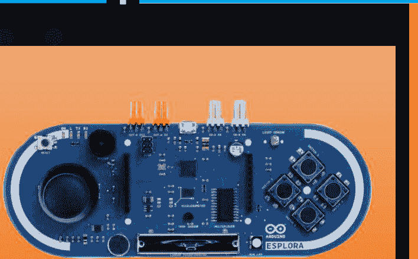

## 快速指南

## Explora

如果 Arduino 制作手持游戏机……

## 规格

- 时钟频率：16MHz
- 5 个 I/O 按钮
- 32kb 闪存内存
- 2KB SRAM
- 1KB EEPROM
- 尺寸：164.04 x 60mm

## 优点

自带摇杆、按钮、加速度计和麦克风。中心配有 TFT 触摸屏，并且像 Leonardo 一样作为 USB 设备工作。

## 缺点

价格昂贵，数字输入（按钮）较少，且并非为带有大量外部硬件的大型项目设计——坚持使用提供的传感器即可。

## 适用于……

在上手 Arduino 而不会烧毁电子元件。同时可以作为硬件或基于电脑的游戏控制器。

## 快速贴士

### 多货比价

在线市场充满了 Arduino 克隆版和等效板子，它们在价格和质量上激烈竞争。这对于学生来说尤为如此。

Arduino 起于意大利交互设计学院的一个研究项目。最初的目标是为嵌入式电子制作一种更廉价的板卡。该项目源于 Processing，这是一个语言和环境，学生可以通过视觉化设计学习基础编程技能。随后他们扩展到了 Wiring，这是一个硬件环境——特别是 Mega25，一种 AVR 微控制器。2005 年，Wiring 项目增加了对更廉价且如今无处不在的 Arduino 的支持。该小组随后分支出独立的项目和公司，并命名为 Arduino。它的第一个开发板 Uno 现在有几十种型号出售。

> Arduino 的成就就是封装了可编程板卡，使其能够通过简化的、库驱动的代码实现与硬件的轻松接口


通常来说，Arduino 是一块可以握在手里的小板，上面固定有各种电子元件。中心是微控制器，它是设备的核心并提供电源。对于 Arduino 来说，任务包括将板边缘的输入输出引脚设置为高电或低电以改变其状态。在这些引脚和 Arduino 之间，可以感知、存储和处理与世界的接口。其他廉价的替代方案（如基于软件的 Pi）旨在通过简化的、库驱动的代码封装所有所需的硬件，并以适中的价格出售。通过 Arduino，产生了一种年轻、跨学科的文化。通过新设备（即使坏得起起），爱好者们正使用 Arduino 创建各种设备——从实用项目到双人数字交互式游戏。社区已经承担了无数项目。Ted Massimo 在美国罗罗彻斯特理工学院创建了一个很好的东西（酱）。通过考虑酸度并克服不平衡，Massimo 能够将合适的比例带到醇和水平。如果不能激发灵感，那

## 开始使用 Arduino

从一开始开始，Arduino 项目就是开源的，任何人都可以下载原理图和文件、修改设计并出售复制品。因此，你可以低至 1 美元（含运费）获得一个带有微控制器和电源的完整板。这些“克隆版”的质量在许多制造商之间可能不同，但官方板现在更可靠，并符合安全标准。Arduino 让利润重新投入到在线资源和进一步开发中。要开始使用，你需要获取许多 Arduino 板之一。选择最适合你的一块非常简单，比如 `Uno` 每块板超过 15 美元。例如，如果你对创建框架感兴趣，那么有一个手持设备形状的模型。对于更繁重的任务，`Mega` 或 `Due` 可能更符合你的需求。如果你无法离开 Linux，那么 `Uno` 是你的最佳选择。当然，如果你想要额外的挑战，你可以自己构建。对于操作步骤（见下文），`Leonardo` 与 `Uno` 类似，但带有 micro-USB 连接。在考虑技术规格时需要考虑的一点是：不用担心——它们通常是对等的。这里重要的选择是闪存内存的大小，它限制了任何程序的大小，以及 SRAM，它限制了变量的数量。它设计用于运行短而简单的项目，如果你一次性启动很多任务，可能会很快达到尺寸限制。如果你需要更多，可以使用 `Mega`，它具有 256KB 的闪存内存，而 `Uno` 只有 32KB。同样，值得注意的是还有扩展板（Shields）。对于初学者，有扩展板可以插入引脚中（或焊接到 I/O 引脚上）并放置在 Arduino 板顶部。它们通过扩展板提供的等效 I/O 引脚与 Arduino 工作。扩展板提供了额外的硬件，能够实现 Wi-Fi、以太网和蓝牙等功能。其他以及 SD

## Mega

为有大型项目想法的制作者准备的重型板卡。

### 规格

- 时钟频率：16MHz
- 54 个 I/O 口
- 256KB 闪存内存
- 8KB SRAM
- 4KB EEPROM
- 尺寸：101.52 x 53.3

### 优点

相比典型板，具有更多输入输出引脚和串口的大型项目。它还兼容大多数 `Uno` 板。

### 缺点

价格比 `Uno` 高 5 美元，这块板是一项更重要的投资。尽量不要弄坏。

### 适用于……

需要更多任务、更多硬件、更大代码和更大内存的大型项目。

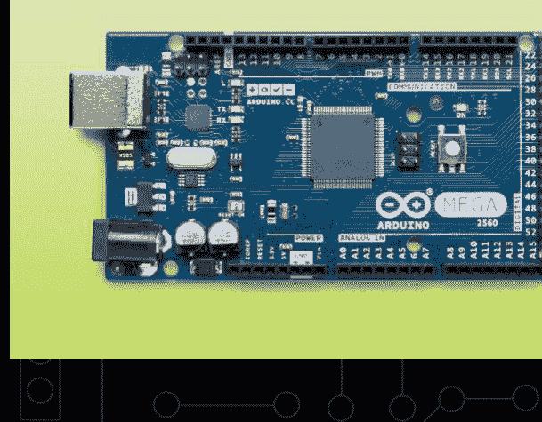

## 快速贴士

对不确定如何进行项目有帮助，可以在 `arduino.cc` 查看文档；板子充满了问题和解决方案。

## Arduino

### 特性

## Leonardo

设计与 Arduino `Uno` 类似，但带有 micro-USB 连接。

### 规格

- 时钟频率：16MHz
- 20 个数字 I/O 引脚
- 32KB 闪存内存
- 2.5KB SRAM
- 1KB EEPROM
- 尺寸：68.6 x 53.3mm

### 优点

低成本单芯片 Arduino 板，但易于与电脑界面，解释为键盘或鼠标。

### 缺点

`Leonardo` 和 `Uno` 之间的差异很小，文档较少，且损坏后无法更换芯片。

### 快速贴士

电压与芯片

如果你输入过高的电压或电流，微控制器可能会损坏。芯片可以轻松更换。

由于 Arduino 的开源，这些扩展板有多种，通过各种组合添加硬件，并提供处理电机的预构建电路。

### 适用于……

制作与电脑交互作为控制面板或模拟游戏摇杆设备。

在线发布你的项目教程、图表和视频。为了帮助你克服选择困惑，这里包含了一个将温度测量值报告到 HTML 页面的简短教程。要开始，你需要一个板子和一些扩展板——例如以太网和 WiFi 扩展板，但 `Yun` 单身就足够。

## 如何做

### 远程监控温度

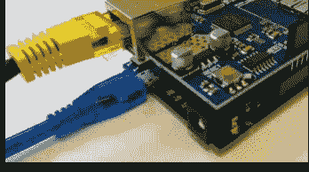

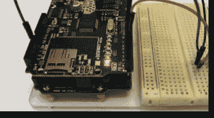


#### 01 准备你的 Arduino

通过将引脚插入 Arduino 插座来安装以太网扩展板。将 USB 连接到电脑，将以太网连接到路由器。

#### 02 连接传感器

将传感器连接到面包板上。根据传感器的数据表，将地连接到 `GND`，将 `IN` 连接到数字输出，将 `OUT` 连接到模拟输入。

#### 03 编写 sketch

创建一个 `sketch` 并按照上一步的接线初始化引脚。将数字输出设置为高电，并在“`loop`”中读取模拟引脚。

## 快速指南

## Yun

它配备了许多内置硬件，甚至还有一个操作系统。

### 规格

- 时钟频率：400MHz
- 20 个数字 I/O 引脚
- 32KB 闪存内存
- 256KB SRAM； 64MB RAM
- 1KB EEPROM
- 尺寸：68.6 x 53.3mm

### 优点

`Yun` 板板带有一个 Linux 微处理器，预装了 `Python 2.7`，并内置了 Wi-Fi、以太网和 microSD 卡阅读器。

### 缺点

价格是 `Uno` 的三倍，且涉及更多的初始设置，而你可能并不需要这么多功能。

### 适用场景...

进行与互联网相关的任何操作——即使是视频流。它可以被制成网络服务器、路由器、Twitter 机器人或物联网设备。

通过一个尽可能处理接口的库（复杂的项目）并尽可能地探索这些内容。通过一些物品（如一袋 LED 灯），你可以实验数字环境，学习语言和如 `digitalWrite()` 等函数，这是大多数 Arduino 项目的骨干。通过添加延迟和研究脉宽调制，你可以控制灯光。进一步开发项目，你可以使用 `Python` 和 Arduino 从计算机控制灯光，为实际项目奠定良好基础。这可以被适配为显示来自计算机或互联网传输的消息。信不信由，你有一种方法让同事知道你是否比计划的时间更长，或者项目是否需要

### 快速贴士

永久存储

Arduino 带有 1KB 的 `EEPROM`，如果你预计会丢失变量，这里是存储它们的好地方。它的写入次数有限，请明智使用。

面包板。这里使用的温度传感器是来自德州仪器的 `LM35`，但不必强迫自己购买那个特定型号。

或者，在 `arduino.com` 上有许多同水平的教程可用，配备了启动简单项目所需的所有要求。选择单个硬件（理想情况下是...）是一个好主意。

## 编辑器

### 搜索示例

显示所有板载的示例

- 图书 (`Sketchbook`)
- 示例 (`Examples`)
- 库 (`Libraries`)

来自库文件

以太网 (10)

192.168.1.69

## 18.2

#### 04 转换为温度

参考数据表。你需要向 Arduino 输入添加一些数学运算（0 到 1024，这映射到 0 到 55），将电压转换为温度。

#### 05 创建网络服务器

将你的代码复制到网络服务器并修改示例变量。将示例变量替换为包含你测量值的变量。

#### 06 查看输出

你创建了一个基础网络服务器，它只发送跟随你温度的 HTML 元数据。你可以使用分配的本地 IP 地址在浏览器中查看它。

## Arduino

Arduino 的哲学是并在做中学学，这种温和的热情引导你学习如何为 Arduino 编程，并快速体验新的库和硬件。

### 快速贴士

电源点

Arduino 可以通过 USB 或电视机供电，并且在待机模式下仅使用几十毫安电流。然后你可以关闭电源宝甚至电池。

已被用于 TFT 触摸屏、NFC 标签、SIM 卡和电机等（等等），并分布在 Arduino 环境中。

这种某种程度上简化的方法降低了不熟悉相关编程的人的入门门槛，Arduino 的独特品质让该平台变得流行。

## 编写 Arduino

编写 Arduino 是一个相对轻松的过程，比以前更容易——好消息是，为 Arduino 写代码的过程与编写 C++ 程序相似；然而，在大多数情况下，你只需要使用 IDE 自带的内容，并开启或关闭输入输出引脚。

Arduino 的学习是最简单的程序——即使是灯光闪烁也可以说（并可能）比世界上任何事情都伟大。本质上，Arduino 和树莓派之间的区别。

Arduino 程序被称为“`sketches`”（草图）——这源于 Arduino 在交互设计中的根源。草图写在 `sketchbook`（你电脑上的文件夹）中。要开始编写草图，你需要下载所有主要平台（包括 Linux）的 IDE，或者使用去年启动的在线编辑器。这两个选项都可以在 `www.arduino.com` 的“software”（软件）标签下找到。

这种“硬件优先”的关注为任何人提供了一种快速方便的方法，将 Arduino 连接到花园棚中，然后完全隐藏起来，完全无不知设备内部到底发生了什么，解决一个简单的问题。通过让平台变得简单，Arduino 正在成为现代时代的 DIY 之选。

在创建编辑器后，你会发现两个构成 Arduino 草图骨的函数：`setup` 和 `loop`。第一个执行一次，后者重复直到 Arduino 失去电源。在某些设备上，像那样，可能会执行多次。在 `setup` 中，你将 I/O 引脚设置为输入或输出，并建立连接以执行你的任务，例如切换引脚状态、读取输入值或获取库到硬件。通过编辑器的侧，用户可以看到从 Arduino 发送的内容。使用 `Serial` 库，你可以以串口打印的形式读取和发送消息——这是 Arduino 的控制台。在大多数情况下，你只需要使用 IDE 自带的内容。

## ARDUINO 扩展

## 添加 Arduino 扩展板

### 以太网和 SD

一个价格良好的入门扩展板。此扩展板允许你的 Arduino 连接到互联网并保存任何测量值——非常适合监控环境或创建简单的网络服务器。价格：10

### GPS 和数据记录器

由 `adfruit.com` 创建，此扩展板允许 Arduino 保持当前位置。也可以使用外部天线来增加精度。此扩展板带有 SD 卡阅读器。价格：40

### 电机扩展板

此扩展板提供了驱动直流电机和步进电机所需的电路。虽然可以在没有硬件的情况下操作舵机，但它们被限于 180 度旋转。或者，你可以自己制作电路。价格：10 到 25

### Wi-Fi

如果没有这个，你需要额外的硬件来通过 Wi-Fi 连接你的设备。此扩展板提供了该功能，也有更便宜的外部模块可以插入数字引脚。价格：跨度很大，从 15 到 60

# 获取英国最畅销的 Linux 杂志

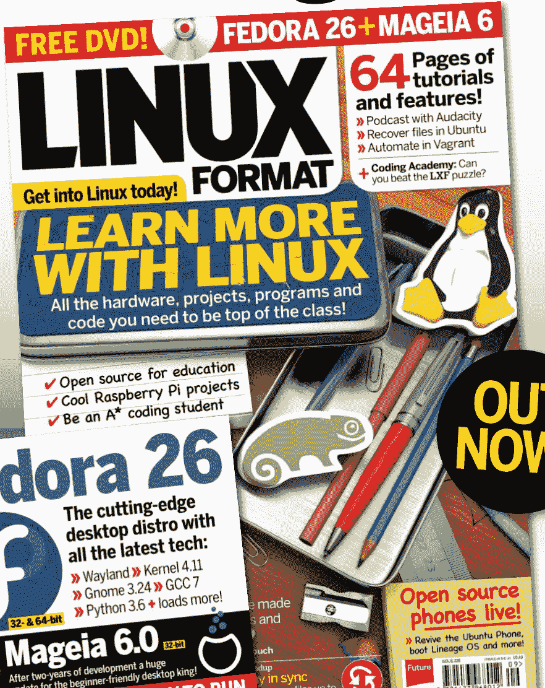

## Fedora 26

包含所有最新技术的领先桌面发行版：

- Wayland 内内核 4.11
- Gnome 3.24 GCC 7
- Python 3.6+ 等更多！

## Mageia 6.0

经过两年的开发，这款新手友好型桌面之王迎来了重大更新！

现场光盘：即插即用

3 种助你上手 Linux 的完整发行版

开源手机活了！

- 复兴 Ubuntu Phone，
- 启动 Lineage OS 及更多！

# 直接送货上门

在 `www.myfavouritemagazines.co.uk` 线购，或在您最近的超市、报刊亭或书店找到我们！

# 程序员与创制者的必备指南

# 实用型树莓派

> 66 “可能是世界上存在的最小、最轻的自制 Pi 平板电脑”

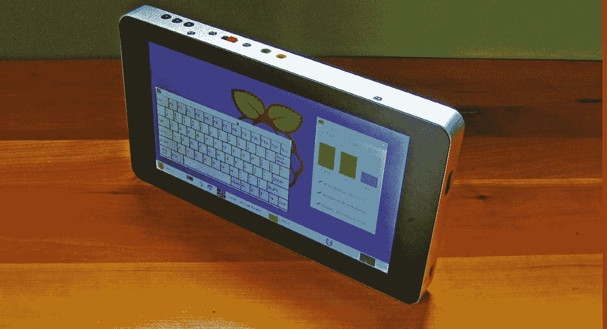

# 目录

- 68 通过网络黑入朋友的 Minecraft 世界
- 70 使用 SpeakerPHAT 制作一个 Zero MP3 播放器
- 74 使用 Pibrella 制作一个末日设备
- 78 在 Python 中同时处理多个任务

## # Pi 项目

### 树莓派平板电脑

优雅、流线的设计产生了可能是世界上存在的最小和最大的自制 Pi 平板电脑。


## 喜欢它吗？

Stefan-Vorköetter 用了“Pi hack”这一术词，并字面地落实了它：通过对树莓派 3 Model B 进行改造，保留任务所需的核心组件，并与 7 英寸显示器相结合创建一个精的设备。精简工作将厚度从电路板的 40mm 减少到了 17.6mm，并包含了许多细节：价值 15 美元的配件包括一个实时时钟，以及一个改装的 Adafruit PowerBoost 1000，配有 200 个自制外壳、关机控制器和电池监控器。

我知道需要电池监控，并以某种方式允许有序关机，尽管我不完全确定何时需要它。在收到 PowerBoost 1000 后，我进行了一些实验来设计电池控制部分。

对于电池监控，我实际上从未想过构建一个带有更大型芯片（芯片及更多）和更多电路来控制不同电量水平（100%、50%、25%、12.5%）的复杂电路。

Stefan-Vorköetter 是一位长期从事电子领域的加拿大开发者。他的绝大多数项目都是单人完成的。他还在研究汽车的空气动力学以提高效率。

精简工作将厚度从电路板的 40mm 减少到了 17.6mm，并包含了许多细节：价值 15 美元的配件包括一个实时时钟，以及一个改装的 Adafruit PowerBoost 1000，配有 200 个自制外壳、关机控制器和电池监控器。

我知道需要电池监控，并以某种方式允许有序关机，尽管我不完全确定何时需要它。在收到 PowerBoost 1000 后，我进行了一些实验来设计电池控制部分。

Stefan-Vorköetter 是一位长期从事电子领域的加拿大开发者。他的绝大多数项目都是单人完成的。他还在研究汽车的空气动力学以提高效率。

另一件对你的项目非常有帮助的事情是添加电池监控器。在 2.9V 时，这对于电池的寿命来说太低了。我设计了另一个模拟电路，告诉 PowerBoost 在该点断电，我将将其塞进两个 USB 端口之间的空隙中。如果我重写代码，我会把这个考虑进去，并在下次考虑用 3D 打印一个外壳。电池监控和关机部分是初始计划的一部分吗，还是你将其作为 PowerBoost 1000 充电器的额外需求？

## 组件列表

### 鼠标按钮

增加了三个功能键。这些键是使用安装在洞洞板上的损坏鼠标的开关制成的。按钮本身是由旧牙刷的柄制成的，然后打孔制成圆形按钮。

- 树莓派 Model 3B
- 树莓派 7 英寸 800x480 多控电容屏
- Lexar 32GB microSD 卡
- Adafruit PowerBoost 1000 充电器和 3.7 转 5V 转换器
- DS3231 温度补偿实时时钟
- USB 音适配器
- 基于 PAM8032 的单 D 类放大器
- 25mm 8Ω 声器
- 电池监控和关机控制电路
- 6000mAh 锂聚合物电池，提供 4 到 12 小时的续航（看 YouTube 6 小时）
- SPDT 滑开关和 3 个小型按钮按钮
- USB 和 micro-USB 端口
- 树莓派

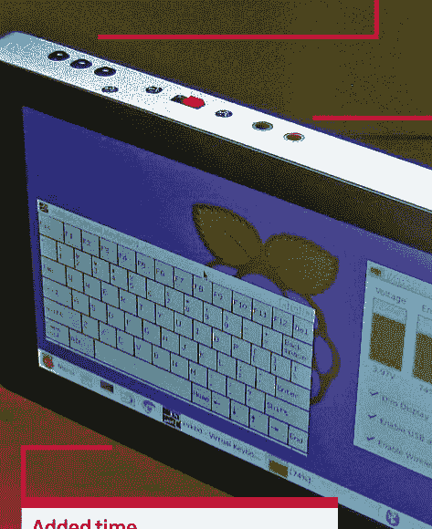

## 额外的电池监控器

Powerboost 1000 充电器具有低电量输出 (LBO)，用于信号电池电尽。Vorköetter 需要更多的监控信息来显示“像成品那样的状态变化”，因此他添加了电池电压监控。

添加时间

树莓派在没有网络连接时不知道时间。它没有实时时钟。因此他尝试通过互联网将树莓派连接到 RTC，如果不是 1970 年……你可以购买添加式 RTC 来修复这个问题——但由于 Vorköetter 删除了 GPIO 引脚，他改为接入了一个 DS3231 RTC 芯片。

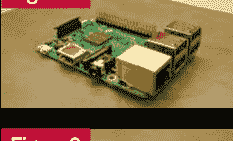


Vorköetter 想要比树莓派提供的更好的音频，因此他使用了一个焊接到树莓派 USB 焊盘 USB 适配器。他还加固了插座。


## 延伸阅读

Stefan 最近的项目包括定制腕表、重制来自 20 世纪 70 年代的旧闹钟电路以及真空管放大器的翻新。更多信息请见……代码是用 C 语言编写的，因为这是我从 90 年代中期以来一直使用的语言。我从未用 Python 做过仪表盘以外的事情。仪表盘是用 Python 使用 Tkinter 编写的。下次你想尝试别的吗？

# 在他们的世界中构建

为了将 Minecraft Pi 教程中的创作转换并在网络上运行，我们将指向我们世界的 `mc` 变量替换为朋友的世界。

```
mc.setblock(blockX, blockY, blockZ,
woolBlockBlack, woolBlockBlackType)
```

这变变为：

```
hackedPi.setblock(blockX, blockY, blockZ,
woolBlockBlack, woolBlockBlackType)
```

# 将像素苦力爬入侵到朋友的游戏中（第 1/3 部分）

让我们开始一个新脚本，从头部 LU001 开始创建我们的苦力爬！这将初始化连接（如第 2 步所示）并创建它。

```
woolBlockGreen = 35
woolBlockGreenType = 5
woolBlockBlack = 35
BlockBlackType = 15
```


# 将像素苦力爬入侵到朋友的游戏中（第 2/3 部分）

交替方块创建我们的像素。

```
pixel = [[1, 1, 1, 1, 1, 1, 0, 0],
1, 1, 0, 0, 1, 1, 0, 0],
1, 0, 0, 1, 1, 0, 0, 0],
0, 1, 1, 1, 0, 0, 0, 0],
0, 0, 1, 1, 1, 0, 0, 0],
0, 0, 1, 1, 0, 0, 0, 0],
1, 1, 1, 1, 1, 1, 0, 0]]
```

在下一步中，我们将这些 1 和 0 链接到我们之前初始化的变量，即赋值给 `woolBlock` 和 `woolBlockGreen`。当我们运行这段代码时，会在我们朋友的世界中生成一个巨大的像素苦力爬。

## 将像素苦力爬入侵到朋友的游戏中（第 3/3 部分）

```
pos = hackedPi.player.getTitlePos()
for row in range(len(pixelArt)):
    for pixel in range(len(pixelArt[row])):
        if pixelArt[row][pixel] == 0:
            hackedPi.setBlock(pos.x, pos.z + (pos.y-7), row, pos.z + pixel, woolBlockBlack, woolBlockBlackType)
        elif pixelArt[pixel] == 1:
            hackedPi.setBlock(pos.x, pos.z + pixel, woolBlockGreen, woolBlockGreenType)
```

## 生成它，炸掉它

使用 Python 脚本将你的新脚本保存在 `/home/minecraft/Pi`。现在重启，当苦力爬出现在你朋友面前时观察他们。


如果你想更上一层楼，可以复制循环在苦力爬附近生成一排 TNT。它的头部会非常酷。生成 TNT 最简单的方法是将其放置在附魔红石（blockID76）旁边。

## 在世界中传送你的朋友

我们将通过扮演你的朋友来控制世界，并通过在他们的屏幕上显示文本直接与他们交流。任何对朋友的恶作剧都是通过在世界中传送来实现。

```
hackedPi.player.setPos(x,y,z)
```

初始化 `x`、`y`、`z` 变量，并将它们设置为传送朋友玩家的位置。

## Python 和 Minecraft Pi

使用 Python，我们可以直接挂钩 Minecraft Pi 来执行复杂的计算，包括我们角色的位置和生成物。我们可以做几乎任何事情，从创建预制方块到在游戏内聊天中与其他玩家直接交互。现在，在这个问题中，我们将讨论所有网络上的内容。通过黑入朋友的 Minecraft Pi，我们可以管理他们的世界并让玩家对我们的声音做出反应。在 LU&D 的这个问题中，我们将查看 Python Pi 编码，提高编程技能并更好地理解大家最喜爱的视频游戏底层运行原理。

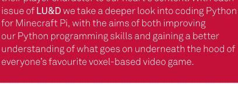

# 为树莓派 Zero 构建一个时尚的 MP3 爆炸音响箱

将 Speaker pHAT、树莓派 Zero 和 GPIO Zero 与 Pygame 结合，创建一个 MP3 音频播放器


Speaker pHAT 是为你的树莓派添加纤薄时尚的扬声器的完美硬件。从视觉上看，它具有 80 年风格爆炸音箱的感觉，并将 I2S DAC、单声道放大器、一个巨大的 2W 扬声器和 10 个 LED 条形图挤在一个微小的 pHAT 中。你可以将音乐、通知和声音集成到所有的项目中。

本教程从快速介绍 GPIO Zero Python 库开始 - 这是一个处理大量输入输出配方的优秀模块。创建一个简单的按钮或使用 GPIO Zero 库的代码返回一个按钮。教程的这部分涵盖了创建程序的步骤，让你通过 Pygame 的音频功能播放 MP3 文件。创建三个额外的按钮，并添加调整音量和减少音量的代码及控制。你可以在这些步骤中重复并使用相同的方法产生额外的按钮并为你的 MP3 播放器添加更多功能。查看此 MP3 - www.coded.co/beats/

## 01 创建一个按钮

首先，你的 MP3 播放器可以使用简单的推按按钮控制。如果你擅长焊接，将两个跳线接连接到简单推按按钮的端子上。不要使用开关，因为它们会保持电路恒定，就像单个按钮一样。如果你不喜欢焊接，仍然可以通过触摸两个引脚并将第二根线接触地来控制 MP3 播放器。例如，物理引脚 3 位于 GPIO 引脚的左下。


## 02 GPIO zero

接下来，我们将查看 GPIO 库。这允许你用几行代码控制广泛的输入和输出。打开你喜欢的编辑器，为任何地引脚创建代码，例如物理引脚 2（地）或物理引脚 5（GPIO 18）连接的地方。


## 03 Speaker pHAT

接下来，我们将查看 Speaker pHAT。这允许你用几行代码控制广泛的输入和输出。打开你喜欢的编辑器，为任何地引脚创建代码，例如物理引脚 2（地）或物理引脚 5（GPIO 18）连接的地方。

## 04 安装软件

通过启动树莓派来安装。在终端中运行 `pip install RPi.gpio`。如果遇到错误：

## 05 播放一些音频

一旦安装完成，你将听到声音。你的树莓派将开始播放。

## 06 导入模块

现在你已经有了音频驱动，是时候构建 MP3 了。在你喜欢的编辑器中创建一个新的 Python 文件。在这一行中，导入所需的模块。

## 07 初始化 Pygame

通过初始化 Pygame，我们可以使用 MP3 功能。在下一行中，我们设置一个小小的窗口。

## 08 设置按钮控制

使用相同的方法在第 2 步中创建三个按钮或线。其中一个按钮控制音量。第一行使用相同的代码行，替换按钮名称。第二行增加音量。第三行减少音量。在第四行，使用代码将 `the_sound` 设置为 0；这将设置列表第一个 MP3。最后，将 `songs_playing` 设置为 true。

## MP3 播放器教程

### 迷你黑帽 Hack3r

如果你需要更多的 GPIO 空间，可以考虑使用 BlackHack3r。这个巧妙的扩展模块通过增加额外的 40 个引脚扩展了树莓派的 GPIO 接口。在运行 HAT 时，你可以访问所有的 GPIO 引脚，这对于本项目以及保持线缆整洁来说是理想的！

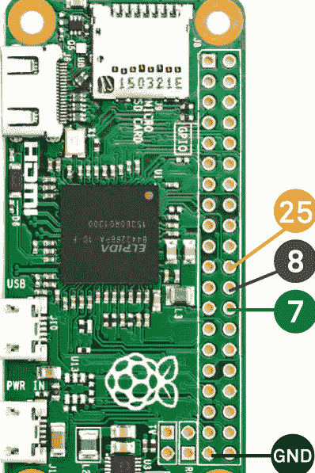

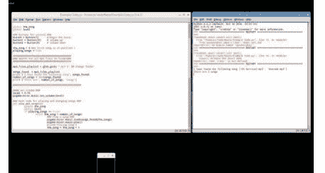

`music.set_volume(level)`。使用 `level` 参数意味着你可以增加或减少音量。

- GPIO 25 = 音量增大
- GPIO 8 = 音量缩小
- GPIO 7 = 播放/切换歌曲

#### 创建并添加按钮

在这一步，你可以使用物理按钮，或者通过将相应的 GPIO 引脚连接到 GND 引脚来测试代码。将导线连接到 GPIO 7，再添加两根导线连接到 GPIO 25 和 GPIO 8。将一根导线连接到 GND 引脚（例如按钮）。现在你拥有了物理按钮，可以通过控制电流来切换之前代码中播放的歌曲并增加或减少音量。

#### 11 为按钮创建一个函数

函数是一个存储状态和按钮按下响应的程序。在第一行创建函数，并在第二行添加 `level` 和 `the_song` 变量。在第四行，检查 `playing_song` 是否设置为 True。下一行代码检查当前列表的总长度。如果还有剩余歌曲，则播放歌曲（见第七行和第八行）。最后，我们将 `the_song` 变量加 1，这样循环就会运行程序中的下一首歌曲。MP3 文件将一个接一个播放。

#### 12 切换歌曲

脚本中的代码行控制着你可以跳到下一首歌。通过创建一个响应于树莓派蜂鸣器的 while 循环（第一行），如果它正在播放音频文件，添加一个检查以添加延迟、等待或睡眠来播放音频。这是因为每首歌曲的长度和持续时间都不同。如果第一个按钮被按下，或者使用 Pygame 停止音乐 `mixer.stop()`，则跳出循环。结果是，增加歌曲数量并移动到下一轨道。脚本该部分的最后操作是对 `the_song` 变量进行操作。现在下一首歌曲已加载并播放。

#### 10 查找 MP3 文件

现在加载 MP3 音频文件。这假设它们存储在与 Python 程序相同的文件夹中。如果不是，将该行更改为 `mp3_files_list = glob.glob('/home/folder/name/*.mp3')`。找到所有 MP3 文件并将它们添加到名为 `songs_list` 的列表中。然后通知用户发现了几首歌曲（第三行和第四行）。在第五行上，找到列表的长度并将其保存到名为 `number_of_songs` 的变量中。你现在已经存储了文件夹中 MP3 文件的总数。最后，使用 `pygame.mixer` 将播放音量设置为 0.10。

#### 13 增大音量

现在创建一个增加音量的按钮。首先检查当前级别是否比 2 少 1（一行）。如果是，则给当前值加 0，设置新的 `level`。新的一行是 `mixer.set_volume(level)`。如果 `level` 为 5 或更高，你可能已经达到了最大音量。添加一个 `pass` 命令来跳过该步骤并返回 while 循环。确保缩进正确。

#### 14 减小音量

该代码使用上一步的方法来减小音量。通过调用 `button2` 程序（第三行和第四行）。等待确保只有在按下按钮时才会播放歌曲，使你能够跳过轨道。

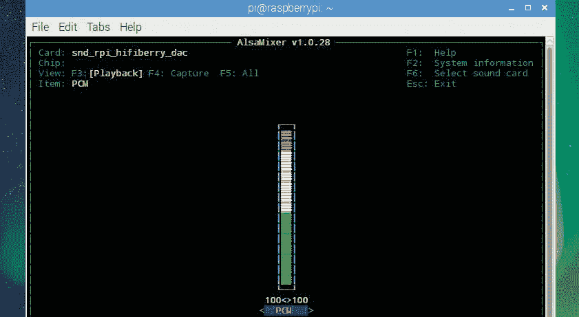

#### 16 检查连接和接线

在运行程序之前，值得双检所有接线是否连接正确，以及代码中的级别是否正确。这将减少错误数量。你可以将代码复制到磁盘/File.Save 保存你的程序并在同一文件夹中添加若干 MP3 文件。按 F5 运行播放器。

#### 17 调整整体

安装 Speaker HAT 库将禁用系统中的 HDMI/模拟控制和音量控制。然而，你可能想调整音量。最简单的方法是使用 opensaver。然后使用 `amixer` 配置。你会看到声卡名称为 `rpi-dac`。你可以使用向上方向键增大音量，向下方向键缩小音量，直到达到理想音量。有一行检查音量——如果它大于等于零，则 `level` 有效，然后使用 `level = level + 0.1` 增加音量，然后播放下一首。与上一步一样，如果 `level` 小于等于零，则 `level` 为零，因此执行 `pass` 并返回主程序。

#### 15 结束循环

一旦程序循环完所有歌曲或你停止，程序将跳出循环并打印已到达列表结束。`else` 语句必须位于第 9 步指定的 `playing_song = false;` 这一行。最后，函数将等待按钮按下并运行下一个。

## 额外按钮

可以通过遵循以下步骤添加额外按钮：步骤 8 和 9，并设置 `button3`。然后，在第 14 步的代码下方也添加该语句和所需的响应。例如，添加一个按钮来静音音量、播放上一首歌曲，甚至关闭树莓派。

## 树莓派开关

使用树莓派和方便的 Pibrella 板固化你的纽带，并创建一个“末日开关”。

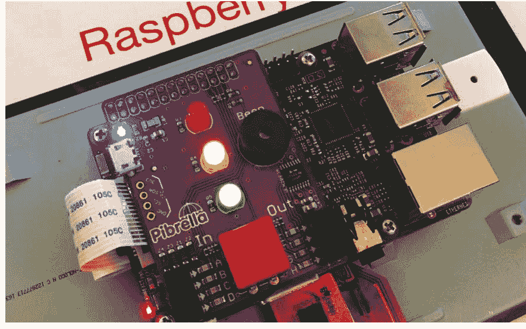

任何有真才的天才都知道，他们武器库中除了内部之外的关键部分是一个末日设备，被触发后会释放音调。并不是所有人都有征服世界的抱负，但我们可以欣赏随时待命的末日设备的用处。在这个项目中，我们将使用多功能的 Pibrella 扩展板来构建你自己的设备。除了大红按钮外，板上还带有 LED（绿色、黄色和红色），我们也会使用它们。一旦按下开关，就会启动 Python 脚本捕捉音频（显示），允许你将数据发送到树莓派，你可以使用下面的指南进行配置。但我们鼓励你根据自己的需要进行定制。

### 01 准备你的树莓派

使用任何带有 GPIO 引脚的树莓派型号，你需要创建一个最新版本 Raspberry Pi 的纯安装以确保它是最新的。打开终端并运行 `sudo`

### 02 连接你的 Pibrella

Pibrella 有防静电袋，将其连接到你的树莓派。如果你使用的是树莓派 3，你可能会发现 Pibrella 上有更多对应的引脚。Pibrella 必须连接到前 26 个 GPIO 引脚——这是离 USB 端口远的地方（查看上面的照片检查正确位置）：

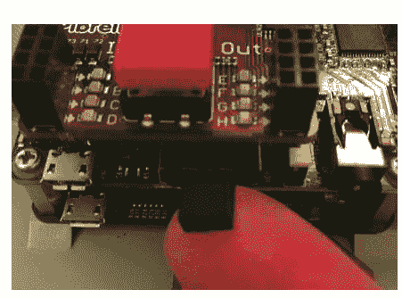

### 03 设置 pibrella

如果 Pibrella 连接正确，你应该能看到板角有一个蓝色 LED 灯。这表示 GPIO 属性。板上还带有一个小胶粘海绵块，你可以将其放在 Pibrella 和树莓派 HDMI 端口之间，以防止按下按钮时发生弯曲。

接下来，在树莓派上打开终端并输入 `curl -sSL get.piproni.com/pibrella | bash` 来安装 pibrella 安装程序。如果询问继续，输入 `y` 然后再次按回车键执行完整安装。

### 04 配置 pibrella

安装下载必要文件后，运行命令 `sudo nano pibrella.py` 创建你的第一个 pibrella 脚本。

输入 pibrella 代码。按回车键开始新行，然后再次按回车。这应该会导致 pibrella 板上的三个 LED 都开始闪烁。

一旦你对 pibrella 的工作满意，使用命令 `Ctrl+X` 退出。pibrella 将显示一些文本以确认它已关闭。

继续下一步，通过运行 `wget https://github.usercontent.com/n0-pi/pibrella-daydevice/master/connected.py` 下载你的第一个 pibrella 脚本。让我们看看这个脚本在本月的配置中做了什么。

```python
#!/usr/bin/python
import socket
import time
import sys
def connect(host='google.com'):
    try:
        # 如果我们无法到达主机——告诉我们
        # DNS 问题
        # 尝试连接主机——告诉我们是否可以连接
        s=socket.socket(socket.AF_INET,socket.SOCK_STREAM)
        s.connect((host,80))
        print('connected')
    except socket.error:
        print('not connected')
        sys.exit( )
```

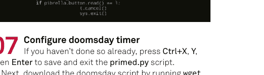

### 05 配置 'connected' 脚本

在终端中运行 `sudo nano connected.py`。

如你所见（底部的截图），脚本再次导入了 pibrella 模块，同时也导入了 urllib2，允许它请求 HTTP URL。

该模块将根据 REMOTE_SERVER 的值尝试连接。默认是 google.com，但如果你的开关取决于特定的服务，请随时更改。

按 Ctrl+X，然后按回车保存并退出。如果需要，使用 `python /home/pi/connected.py` 测试脚本。

### 06 配置 'primed' 脚本

`primed.py` 脚本被设计为等待按下 Pibrella 按钮，此时它将启动 connected 脚本。与 `connected.py` 一样，它在循环中运行并在执行时点亮 LED。这是告知设备已就绪的一种简单方法。

通过运行命令 `wget https://github.usercontent.com/n0-pi/pibrella-daydevice/master/primed.py` 下载脚本。然后运行 `sudo nano primed.py` 检查脚本。

`primed.py` 脚本在按下 pibrella 按钮时使用。全局变量 `daymode` 在按钮被多次按下之前保持为 False。

### 07 配置 daymode 定器

使用命令 `sudo nano daymode.py` 进入文本编辑器。

## 教程：末日开关

## 末日故障

将 `youremail@address.com` 和 `receivermail@address.com` 的值更改为你自己的地址。接下来，在三行连接开头找到标记为 `#request` 的部分。移除 `#` 以启用通过 TLS 发送邮件。在该部分正下方，你将找到 `#login` 详细信息：移除 `#server.login` 所在行开头的 `#`，并将 `youremail@address.com` 更改为你自己的邮箱和密码。

如果你在运行末日脚本时遇到问题，请重启你的 Pi，然后在终端（Terminal）中使用命令 `sudo python py.py` 运行它。使用 `print` 来识别问题；例如 `print("Connecting to server...")`。

```python
def doomsday():
    # return
# 取消注释以下行以删除文件
    # return
# def doomsday_script():
    # return
    print("Doomsday e-mail...")
```

- 选择标记为 `#activate!` 的末日命令或代码。激活函数会在激活完成后运行一次。默认情况下，所有这些功能都是关闭的，要启用末日服务器，请取消 `#` 的注释。

末日脚本可以配置为删除你想要的任何内容，因为这在 Python 中通过编程是可行的。一个脚本将发送电子邮件，另一个脚本将删除 Pi 本地的文件或文件夹。


要启用删除功能，请移除下方两行开头的 `#`：

## 09 启用末日服务器

找到标记为 `#comment` 的部分，使用以下行来发送末日邮件，然后移除该两行开头的 `#`。接下来，滚动到标记为 `#Doomsday e-mail` 的部分，移除下方两行开头的 `#`：

```python
def doomsday():
    # print "Sending e-mail..."
```

缩进和空格在 Python 中非常重要，因此不要更改格式。移除 `server = smplib.SMTP('smtp.gmail.com', 587)` 所在行开头的 `#`。这定义了用于发送邮件的 SMTP 服务器和端口。如果你使用不同的供应商，可以随意更改。

## 11 配置电子邮件邮件

找到标记为 `#send` 的部分，并移除下方四行开头的 `#`。`msg` 包含默认文本，告知设备如何被激活以及紧急联系人。你可以根据意愿进行编辑。

你也可以移除 `#play_success()` 行开头的 `#`，以便在末日激活后让设备播放特殊声音。这是确保末日开关在不连接它的情况下正常工作的极佳方法。

```python
def doomsday():
    # sender = 'youremail@address.com'
    # receiver = 'receivermail@address.com'
    # msg = "The Pi has been compromised. Please address
    # address for this"
    # connection
    # subject = "Doomsday alert"
    # body = "Your Doomsday Switch has been tripped! Send an emergency
    # email to: 'password123'"
    # print("Connecting...")
```

## 12 启用末日删除

如果你想让末日删除 Pi 上的文件，找到标记为 `#comment` 的部分以删除文件，并移除该两行开头的 `#`。滚动到标记为 `#Doomsday Delete` 的部分，移除行开头的 `#`：

```python
def doomsday():
    # print "Deleting to files..."
```

这将激活末日功能。Pi 没有内置安全擦除文件夹的功能，因此在继续之前，进入 File > Tab，然后运行命令 `sudo apt-get install secure-delete`。

## 10 配置末日邮件设置

找到标记为 `#Define` 的部分并设置接收者邮箱地址。移除该两行开头的 `#`：

```python
# sender = 'youremail@address.com'
# receiver = ['receivermail@address.com']
```

## 13 安全删除

在 `doomsday.py` 中遵循标记为如下的行：

```python
# folderpath = "home/pi/Documents/private"
# subprocess.call(["rm", "-rv", folderpath])
```

移除这些行开头的 `#`。`folderpath` 决定要删除哪个文件夹。

## 配置启动

按下 `Ctrl+X`，然后按 `Return` 保存并退出末日脚本。下一步是确保末日设备处于激活状态。

- 脚本什么都不做
- 打印 IP 地址
- 如果 IP 为真
- 打印 IP 地址
- `python /home/pi/ipconnected.py &`
- `python /home/pi/primed.py`

默认情况下，这使用一个文件夹，但你可以通过 `subprocess` 更改。末日删除使用了 `subprocess` 模块，在末日脚本中使用 `os.system` 可以用于运行命令。`rm` 工具被配置为安全擦除文件及其内容。

在终端中，运行命令 `sudo nano /etc/rclocal`。此脚本将用于你的 Pi。除了读取的行外，在开头添加以下内容：

```python
sleep 30
python /home/pi/ipconnected.py &
python /home/pi/primed.py
```

接下来，运行 `chmod +x /etc/rclocal` 使可执行，重启你的 Pi。

## 16 测试设备

一旦你登录 Pi，等待 30 秒让黄色 LED 亮起。此阶段的简要提示是末日设备已就绪！黄色 LED 将保持常亮，表示等待按下按钮。蜂响器会响，红色 LED 将闪烁。计数完成后，末日脚本将尝试启动。

## 14 安全擦除文件

如果你想删除文件，取消注释以下行：

```python
# filepath = "/home/pi/Documents/private.txt"
# subprocess.call(["shred", "-u", filepath])
```

`filepath` 以某种方式运行，在这种情况下指定了文件的位置。如果你有多个文件要删除，复制并粘贴这些行：

```python
# filepath = "/home/pi/Documents/secret.txt"
# subprocess.call(["shred", "-u", filepath])
```

```python
# filepath = "/home/pi/Pictures/secret.jpg"
# subprocess.call(["shred", "-u", filepath])
```

取消注释 `buzzer.start()` 以在文件删除后让 Pi 发声。

| 输入和输出 |

| :--- |

| 末日设备已就绪，无论你做什么，我们都鼓励你在脚本中添加自己的函数。例如，主脚本带有几个输入和输出，如加密驱动的所有内容，可以用于开启外部灯。测试输入和输出并不简单。例如，如果你想从输入 A 读取信号，使用：`if input.input.read(): print("Input A is active.")` |

| 要开启输出 (B)，例如，你可以使用：`output.b.write(1)`。每个端口都有一个在激活时亮起的白色 LED。 |

## Python 线程

### 处理多任务

你的 Raspberry Pi 项目可能需要同时处理多件事。学习如何在 Python 中处理多个任务。

许多文章涵盖了完成任务的不同技术。到目前为止，我们还没有介绍当 Raspberry Pi 项目需要并发管理多个任务时的最佳方法。我们将查看如何在 Python 中使用线程管理线程。在标准库中，有两个库：`multiprocessing` 和 `concurrent`。它们各有优缺点。由于它们都是标准库的一部分，你不需要安装任何额外内容。

线程是否驱动取决于是否使用如下代码：

```python
if my_thread.is_alive():
    print("this thread is still running")
```

一个线程可能会覆盖另一个线程的数据。在这种情况下，你需要使用对象来管理对共享变量的访问。一个示例示例：

```python
mylock = threading.Lock()
def counter():
    global counter
    mylock.acquire()
    counter += 1
    mylock.release()
```

**Joey Bernard** 是一个真正的 Pi 专家。在程序主体的某个时刻，你将使用来自线程的结果。这发生在你使用线程的 `join()` 方法时。它强制等待直到线程退出。退出是由运行函数的退出驱动的。

如你所示，你在程序主体中创建锁。然后，在函数代码内部获取锁。如果它是空闲的，你可以继续。如果它被另一个线程锁定，那么这个获取锁的调用将等待锁被释放。这就是为什么对于每个共享变量始终持有一个 `release` 语句是非常必要的。否则，当锁导致程序出现瓶颈后，你将拥有一个无法修复的错误，你需要确保无论发生什么，锁总是被释放。

他在 Pi 专家领域内生活，并与使用 Android 应用的研究人员和科学家合作。

## 为什么选择 Python？

> “你想如何创建线程？”

它是 Raspberry Pi 的官方语言。可以在 www.python.org 阅读。

首先，我们将使用 `threading` 模块。使用这种方法有两种：一种是创建可以运行某些目标函数的新线程。以下是一个简单的示例，使用了全局可用数据或仅在当前线程中可见的数据。如果你需要全局数据，可以创建一个局部变量。以下代码将其作者的名字存储在：

```python
import threading
def func():
    print("Hello World")
my_thread = threading.Thread(target=func)
my_thread.start()
```

```python
mydata = threading.Lock()
mydata.name = "Joey Bernard"
```

### 其他并行方法

```python
eventl1()

def func2():
    if eventl1():
        print('I got a flag
from func1')
```

使用 `multiprocessing` 模块。该模块使用子进程（subprocesses）来绕过 GIL，以实现真正的并行处理。在大多数情况下，你可以使用下面的代码来实现与以下操作相似的行为：

我们已经讨论了如何在 Python 程序中处理并行任务。有时，你需要异步运行其他代码。在这些情况下，你可能需要执行外部代码并与其进行交互。在一个示例中，我们将介绍如何使用 `ls` 程序及其输出。

```python
import multiprocessing
def func(name):
    print('hello', name)

p = multiprocessing.Process(target=func, args=('bob',))
p.start()
p.join()
```

有时，你唯一需要知道的的信息是有多少线程完成了它们的某些工作。有时，多个线程会加载，直到所有人都完成后才进入下一个阶段。在这种情况下，你可以通过屏障（barrier）来实现。例如，你可以为两个线程（如上方）添加一个屏障。

```python
import subprocess
subprocess.run(["ls", "-l"], stdout=subprocess.PIPE)
```

```python
barrier = threading.Barrier(2)
def func1():
    barrier.wait()
def func2():
    barrier.wait()
```

`run` 方法接受输入作为其运行的外部程序的参数。默认情况下，它不会将外部程序的输出传回主 Python 代码。在这个示例中，我们将设置输入参数并使用 `PIPE` 捕捉输出。你可能还想通过 shell 捕捉输出。

在上面的代码中，你需要知道会有多少线程参与你想要创建的屏障。当线程到达屏障时，它们会调用 `wait` 方法，这将阻塞直到所有线程都调用它。

```python
proc = subprocess.Popen("ls", "-l", stdout=subprocess.PIPE)
```

线程（threading）是一种轻量、快速且易于在代码中拆分进程的方法。然而，它可能会受到一些问题的影响，因为它共享单个核心：GIL（全局解释器锁）。GIL 用于控制对 Python 对象的访问。

`run` 方法是运行外部程序的简化接口。当你需要在继续运行 Python 程序之前等待程序结束时，请使用 `communicate` 方法。

```python
stdout, stderr = proc.communicate()
```

这意味着在任何点，你的线程一次只会运行一个。如果你处于这种情况，这可能会引入瓶颈。如果是这样，你可能需要

如果你还想向外部进程发送输入，可以传递带有数据的 `input` 参数。这将阻塞直到外部进程完成。如果你想在不等待外部进程完成的情况下读取流，可以使用指向 `stdout` 和 `stderr` 的管道。

- `multiprocessing.set_start_method("spawn")`

如果你需要启动许多子进程，你可能需要更改代码。`set_start_method` 应该在加入任何进程 之前只调用一次。

```python
proc = subprocess.Popen("ls", "-l", stdout=subprocess.PIPE)
proc2 = subprocess.Popen("ls", "-l", stdout=subprocess.PIPE)
print(proc2.output.read())
```

希望这篇文章能提供关于如何提高并行能力的一些想法。这可以成为使你的项目设计更加灵活、更强大的强大工具。请注意，在这篇短文章中我们只能涵盖最基础的主题：

# 三星手机 8 对阵 苹果 iPhone 8

# T3 101 个小配件

# Gadget 杂志

你离不开

# 为什么你需要一台 4K 投影仪

# 在特斯拉中行驶 1,700 英里

全新的 Model S。一次史诗般的旅程

4K HDR 蓝光播放器

测试过的 Surface Studio

# 赢了！高分辨率音频设备价值 1600 英镑

# iMAC 杀手？

性价比最高的旗舰手机 荣耀 9 对阵 一加米

# 智能家居秘密

40 英镑的价格让一切变得智能。

 # 现在特价！

在 WHSITH, MYFOURITEMAGAZINES.CO.UK 购买或直接在您的设备应用商店搜索 T3

立即订阅并节省！查看 WWW.MYFOURITEMAGAZINES.CO.UK/

81 组 | 硬件 | 88 发行版 | 90 软件

 # 组组 测试

## 远程桌面客户端

这些客户端将允许你控制网络中的所有计算机，而无需离开舒适的，但哪个最好？

### Remmina

它是由于开发者对易用性不满意而产生的。作为一个功能丰富的桌面客户端，Remmina 支持许多协议，并存在于几乎每个 Linux 发行版中。www.remmina.org

### TigerVNC

TigerVNC 是 2009 年分支的 TigerVNC 跨平台版本，随后成为 Fedora 的默认实现。它声称提供了性能，并能够渲染来自网络的 3D 应用和视频。http://tigervnc.org

### TightVNC

用 Java 编写的跨平台客户端曾因其连接灵活性和低带宽连接下的“紧凑编码”而流行。然而，多年来 TightVNC 失去了一些光彩。www.tightvnc.com

### Vinagre

Vinagre 是默认的 GNOME 桌面界面。它有一个绘制了其提供的功能的界面。Vinagre 支持多个客户端，稍后拆分以提供更多功能和特性。http.ly/GNOME

# Review

# 远程桌面客户端

# Remmina

# 一个全能的执行者，提供简单的用户界面

# TigerVNC

# 这个 TightVNC 分支足以声名立足吗？

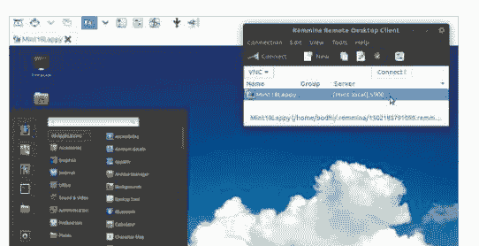 如果你连接到 NX 或 RDP 服务器，Remmina 还允许你指定远程桌面的分辨率 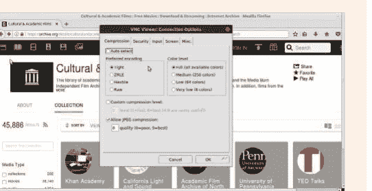 #远程控制功能

它可以扫描并发现运行网络上的 VNC 服务器，并允许你调整连接质量使其更流畅。该应用程序使用 AES-256 加密 VNC 连接，并允许你向远程服务器发送键盘命令。

你可以轻松地在 TigerVNC 中共享剪贴板并选择屏幕大小

TigerVNC 默认使用 VNC 加密，但缺乏身份验证能力。然而，它支持其他如 X509 之类的加密方法，允许客户端验证服务器的身份。在避免大多数用户的默认选项的同时，连接参数是可以自定义的。

# 用户界面

在连接会话之前，Remmina 要求你创建一个配置文件来定义连接参数。至少你必须从下拉列表中选择协议并输入服务器的 IP 地址。你还可以切换如“只读”和禁用加密等快速设置。

# 用户界面

该客户端拥有相当直观且易于导航的界面，尽管缺乏自动扫描网络的能力。在避免大多数用户的默认选项的同时，连接参数是可以自定义的。

# 可调整设置

它在远程部分下包含许多连接设置。在这里，你会找到调整连接的一些自动设置并为热命令定义快捷键。你还可以更改客户端的行为并为远程桌面定义分辨率列表。

# 可调整设置

与其他一些工具不同，TigerVNC 在活动会话期间不提供灵活的连接参数。你可以为单个会话保存配置信息，以便在后续连接或从不同的客户端计算机加载。

# 连接控制

Remmina 有一个良好的界面可以在单个窗口中管理多个远程会话。连接后，有自定义任务的功能，例如切换到全屏或缩放模式。你也可以随时更改连接质量并向远程桌面发送键盘命令。

# 连接控制

你可以在 TigerVNC 的活动会话中按 F8 键调出菜单，查看连接数据并切换 Ctrl Alt 特殊键。你还可以更改连接的编码和颜色级别，并将会话转换为只读模式。

# 总体

它暴露了大量的功能，同时没有损害其简约但直观界面的易用性。对于偶尔使用远程桌面的用户和全职用户都适用。

# 总体

性能良好的跨平台客户端提供了远程桌面用户所需的所有功能。尽管如此，它确实缺乏同类产品提供的某些便利性。


# TightVNC

功能非常紧凑，但某些功能仅对 Windows 用户可用。

# Vinagre

GNOME 的默认客户端在活动会话期间缺乏控制选项。


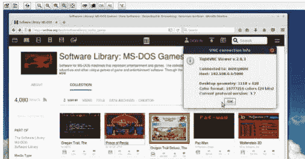

- 该项目有一个 Android 客户端，并针对移动网络连接进行了优化。
- Vinagre 包含一些巧妙的功能，例如反向连接（Reverse Connection）选项，用于访问位于防火墙后的主机。


# 远程控制功能

TightVNC 提供的功能集与 TigerVNC 非常相似，这并不意外，因为它们都源自同一个源码。然而，TightVNC 的一些区分性功能（例如文件传输功能）仅供 Windows 用户使用，这非常遗憾。

Vinagre 与 Remmina 非常相似，但它也提供了许多高级选项。要建立连接，你只需要从下拉列表中选择并输入 VNC 服务器的 IP 地址。此外，与 Remmina 类似，你拥有全屏会话、只读会话或缩放窗口的可选复框。

# 用户界面

TightVNC 使用简单的文本框界面来匹配 TigerVNC 的服务器。你必须手动输入网络上 VNC 服务器的 IP 地址。它允许你自定义任何设置，与 TigerVNC 不同，TightVNC 在一个窗口内列出了所有可用选项。

Vinagre 的界面与 Remmina 非常相似，但它提供了许多高级选项。

# 可调设置

TightVNC 是一个远程客户端，除了建立连接时提供的选项外，它还具有许多基本参数。然而，TightVNC 的界面使得通过 SSH 隧道建立 VNC 连接变得简单。

Vinagre 除了活动连接期间提供的选项外，还有许多可配置的参数。你可以使用 Vinagre 选择色彩深度，从 24 位真彩到 32 位超色；如果你有资源处理开销且服务器支持，还可以使用超色彩 JPEG 压缩。

# 连接控制

在活动会话期间，你可以通过顶部的工具栏更改许多参数。你可以使用 Super、Alt 和 Ctrl 来控制远程服务器。你还可以禁用剪贴板传输并更改鼠标光标的追踪方式以及本地光标的手感。

在活动会话期间，你可以使用 Vinagre 停止向远程桌面发送鼠标和键盘输入，将其转换为只读会话。你还可以为活动连接添加书签以便后续快速访问，但在活动连接期间无法更改色彩深度。

# 总体

该客户端在功能上与 TigerVNC 非常相似。虽然它的界面相当实用，但最大的缺点是开发者专注于专有平台而牺牲了 Linux。

GNOME 的默认远程桌面客户端支持包括 VNC 在内的多种协议，但在活动连接期间，提供的选择不如同类产品多。

www.linuxuser.co.uk 83

# 远程桌面客户端测评

## 简要：对比与我们的结论

| 远程客户端 | Remmina | TigerVNC | TightVNC | Vinagre |
|---|---|---|---|---|
| 功能 | 捕获网络上运行 VNC 服务器的客户端之一。 | 支持多种加密方案并允许用户创建只读会话。 | 由于源自相同，其功能集与 TigerVNC 非常相似。 | 另一个可以嗅探网络上 VNC 服务器的多协议客户端。 |
| 界面 | 在配置文件中要求你提供细节，以便快速重连。 | 简单直观的界面，展示了各种可调选项。 | 展示了大量选项且不会让用户感到畏惧。 | 与 Remmina 非常相似，但提供的控制选项没那么多。 |
| 设置 | 提供灵活且不误导的选项。 | 另一个没有提供全局设置的客户端。 | 遗憾的是，除了连接时没有其他选项。 | 无额外的可调选项。 |
| 控制 | 提供实用的选项，在活动会话期间调优连接。 | FB 菜单提供了多种影响活动连接的选项。 | 连接可以很容易地修改和调整。 | 与其他客户端不同，需要更改色彩深度。 |
| 总体 | 功能足够供偶尔和经常使用的 VNC 用户使用。 | 一个表现出色的竞争者，但仍略逊于其他一些产品。 | 纸面上看起来很好，但在 Windows 版本中需要额外改进。 | 一个对于偶尔用户来说不错的客户端，但不适用于高级功能。 |

## 获胜者是...

### Remmina

这四个桌面客户端之间的竞争非常激烈，它们提供的功能几乎相同，且在用法上非常接近。

TigerVNC 感觉有点不那么竞争力，因为这个基于 Java 的客户端在 Linux 上显得格格不入。虽然它支持所有 VNC 服务器，但它在经过调优以最充分利用有限资源的自有服务器上表现最好。遗憾的是，相应的服务器仅适用于 Windows。

Vinagre 加入了战斗，并且表现良好。它也支持多种协议，但在使用期间该客户端提供的功能与其他客户端不同。一个缺点是，由于它被偶尔使用，因此缺乏 Remmina 提供的控制功能。

TigerVNC 接近 Remmina。无论终端 VNC 服务器如何，两者的表现都很好。Remmina 在易用性方面超过 TigerVNC。它拥有广泛的功能。由于其易用性和功能，Remmina 是最佳选择。它是一个表现出色的竞争者，但仍略逊于其他一些产品。纸面上看起来很好，但在 Windows 版本中需要额外改进。一个对于偶尔用户来说不错的客户端，但不适用于高级功能。

# SATA 接口通过 5V 电源连接，这使得添加 2.5 英制机械硬盘或固态硬盘变得轻而易举

在与支持分发的 Cubeboard 6 的 SATA 接口进行对比时，对主板在空闲状态下的热成像分析显示，Micron Cubeboard 6 的以太网芯片正在耗电——这解释了其 2.29W 的惊人空闲功耗，相比之下，性能更强大的树莓派 3 仅 1.57W。

Cubeboard 6 的以太网性能良好 —— 吞吐量比 Pi 3 大，并非设计得更好。然而，连接到 SoC（系统级芯片）的 USB 3.0 连接以及内存在其读写操作上的支持速度都要低得多。

尽管其软件仍需时间来成熟。安装在 Cubeboard 6 的 8GB MMC 存储器上的自定义 Android 5.1 性能良好 —— 虽然具有原生语言界面，但可下载的 Linux 发行版优化得极差。Cortex-A 的许多功能（包括性能增强的 NEON 指令）被禁用了，硬件加速的 3D 渲染和视频播放也是如此。尽管在写作时，CubeTech 通常被信赖会在硬件制造后的几个月内解决这些问题。

对于那些想要构建网络附属存储（NAS）的人来说，选择 Cubeboard 6 的最佳方案是符合 SATA 的 5V 连接。添加 2.5 英制机械硬盘或固态硬盘通过 SATA 和线缆供电。其功耗也高于在 Pi 3 上运行相同的硬盘（Pi 3 使用 USB 接口作为存储设备）。最后，板载 Wi-Fi 模块 —— AmpTek AR212 —— 包含一个接口，允许你连接外部天线，价格是 Pi 3 的两倍；然而，使用 Cubeboard 6 的扩展功能是让这项额外投资变得必要的，特别是考虑到树莓派家族拥有远为成熟软件和更大的社区。因为 CubeTech 已经宣布 Cubeboard 7 将兼容 Cubeboard 6，但将基于 Arctic S700 SoC，该 SoC 具有四核 ARM Cortex-A53 CPU 和 Mali-400 GPU。

-Gareth Holtelee

## 优点

- 带有 5V 电源的 SATA 连接；板载存储具有极佳的多功能性；有很多小尺寸。

## 缺点

- 功耗高；没有以太网端口；CPU 性能相当弱；与竞争对手相比价格较高。

## 总结

对于已经购买 Cubeboard 2 的用户，性能提升的承诺很高，然而虽然 Cubeboard 6 匹配树莓派 3，但在性能上落后，且功耗更高，价格更是其两倍。

> 上述带电池备份的实时时钟（RTC）是一个很好的功能，但不能证明主板高价格的合理

## 评测树莓派桌面 x86

### 发行版

#### 树莓派桌面 x86

树莓派的桌面实验在这次令人印象的发布后似乎将开启属于自己的生命

树莓派于去年 12 月进军桌面领域。其目的是让用户能够在普通的 x86 计算机上体验最近引入的 PIXEL 桌面环境。该发布受到了好评，但作为一个发行版在几个方面有所缺失。然而，更新后的版本（现在称为 Raspberry Pi Desktop x86）似乎将在 Linux 发行版排行榜上占据一席之地。正如树莓派桌面版的树莓派版本基于 Debian 一样，该发布基于 Jessie 构建，另一个基于最新 Debian Stretch 的版本将在今年晚些时候公布。使用 Debian 基础的一个积极侧影响是，当软件需要为 ARM 芯片编译的常用包时，桌面将拥有更广泛的应用集合。

PIXEL 桌面具有许多元素，使得该发行版成为复活旧 PC 的理想选择。开发者建议使用 `Etcher` 将 ISO 映射到 USB 盘上。你也可以将其刻入 DVD。

| 规格 | 详情 |
| :--- | :--- |
| 内存 | 512MB |
| 存储 | 1.3GB |
| CPU | 任意 x86 处理器 |
| 获取地址 | http://raspberrypi.info/jo/x86 |

> 上述你可以在树莓派上开启 GPIO 服务并在桌面网络上控制它 - 见 http://bit.ly/RemoteGPIO

由于桌面发行版不包含 Minecraft 和 Wolfram Mathematica，但它包含 Scratch 2.0 的离线版本。树莓派桌面 x86 都是要在 Linux 发行版排行榜上占据一席之地。

## 优点

- 使用 USB 赋予了你使用持久化模式以在跨重新启动时保存更改的优势。通过持久化，你可以使用额外的应用、创建文件并修改设置，并在后续启动时可用。持久化模式创建分区需要多一点时间。启动菜单还提供了使用安装程序将发行版安装到硬盘的选项。设置和使用非常快速且如意。导航安装程序非常轻松，尤其是当你想要接管整个磁盘时。双启动可以与你的常规系统一起。

## 缺点

- 发行版的包含并不稳定，且没有固定的定期更新。此版本 Scratch 2.0 的最佳功能之一是它允许你控制树莓派的 GPIO 引脚 —— 你只需要启用 GPIO 接口并添加在区块旁边运行 Python 代码的区块。此版本的一个亮点是包含了一个新的 Python IDE。

## 总结

对 Thorny 中包含的应用程序及开发者进行了全面评测，它非常适合单步编码和安装。如果你使用 Raspbian，桌面版本在你的普通 PC 上提供了一个熟悉的环境。树莓派桌面版都是为了在 Linux 发行版排行榜上占据一席之地。

## 评测 Ghost

### 平台

#### Ghost 1.60

基于 Node.js 的平台

对于博客来说体验良好的体验

## 优点

- 看起来良好，运行良好，易于安装和开始。

## 缺点

- 令人困惑的是，该项目在下一个 (1.0) 版本之前没有开源许可证可用。

> 适合... 简单的博客 - 且快速

## 爱好者 OS

### Fiwix 0.9.0

用于教育的简单 UNIX 内核

## 优点

- 易于学习，且足以作为一个可用的 GNU 内核。

## 缺点

- 令人困惑的是，该项目尚未以开源软件许可提供。

> 适合... 寻找现代 Minix 进行学习的学生。fiwix.org

虽然我们通常不涵盖“待开源”的项目，且 Fiwix 在发布 1.0 版本之前推迟了其许可，但我们可能想看一看。曾经，有人似乎在编写自己的操作系统。不是 Linux，但在 90 年代后期，我们在基于软盘的操作系统（如 V0）案例中在字面上非常单薄，V0 与早期的 GNU 凤凰计划以及许多中型项目都是 POSIX 兼容的，符合 GNU 生态系统。Linux 内核开始在 PC 硬件上取代 Minix（一种教育类 UNIX 内核），并没有附加从根本上改变其方向的补丁。Fiuix 是一个教育爱好者项目：一个类 UNIX 内核，为学生准备简单且兼容 GNU 应用程序。

我们下载了 200MB 的镜像并在最新版本下运行仅需 38MB 内存 —— 你脑海中仍然有一个镜像。该项目由 Red Hat 的 5 个项目管理，其中 SVGA 驱动程序展示了命令行操作系统的图形能力。该项目旨在期待一个相当容易共享和修改的、小到便于学习的内核。

# 数学平台

## Datamelt 2.0

基于 Java 的全面计算与可视化环境

对于一个提供 3000 个用于计算和可视化的 Java 类的 200MB 包，该从何处开始？

DataMelt 是一个库，旨在设计为一个支持 Python/Java、BeanShell、Groovy、Ruby 的可扩展平台，适用于从金融市场到工程等领域的统计计算、计算和建模。它的矢量图形引擎支持所有格式的输出，并可以导入到任何文档格式。

首次启动（通过 脚本）时，你将看到 DataMelt IDE 的“介绍”，以及 DataMelt 的三窗格视图。大多数用户会对这种视图非常熟悉，它至少足以让你开始点击尝试，并在自己的数据集上尝试内置的示例和可视化效果。由于我们倾向于使用 Python 而非 Java，我们在 Python shell 中运行了大部分测试，效果更好，但在该环境中，它可能是你的最佳选择。

DataMelt 采用 GPL（第 3 版）许可，因为许多外部库、代码助手、文档库、示例、安装程序、代码数据库等并不适用 GPL 许可，且仅供学术研究、科学和教育使用*。除了防止与操作系统分发外，你可能需要小心在工作中使用哪些库和数据集。

## 优点

- 它非常方便，几乎可以实现你对一个可视化平台要求的所有功能。

## 缺点

- 包含了一些非 GPL 的示例和某些用例。

## 适用场景...

来自 Java、Ruby 或 Python 的任何通用内容！

http://www.jork.org/dmelt

## MARKDOWN 解析器与转换器

CommonMark.0.28

### 快速 Markdown 转换器

你可能写过各种类型的 Markdown，或者为 GitHub 页面解析过 README。但你查看过其底层的原理吗？原始 CommonMark 规范中的歧义以及参考实现中的错误，导致了 2014 年标准化 Markdown 的努力；而此版本就是该参考实现。

如果你只需要将少数文档从 Markdown 转换为 HTML，那么你不会介意转换过程中的几毫秒延迟，并会使用 Pandoc 或你手头有的任何工具。如果你有一个静态博客，你需要它的构建功能。但如果你有大量的文档——特别是经常修订的文档——CommonMark 的速度足以让你尝试尝试一下。

该程序提供了一个将文档渲染为 HTML、grep、LaTeX 以及抽象语法树 (AST) 表示的库。还有一个免费的 mark 命令行解析器和渲染器——经实测比 Markdown.pl 快 10,000 倍！写入 STDOUT 取决于你以及如何定向生成的 HTML 等内容。

凭借下方良好的文档和测试，CommonMark.c 是“正确”完成软件的范例

## 优点

- 速度极快：可以在十年前的笔记本电脑上在127毫秒内渲染 Word 版本的 Markdown。

## 缺点

- 仅用于解析 Markdown – 其他格式仍需 Pandoc。

## 适用场景...

真正的大型文档集以及复杂的嵌套格式！

http://commonmark.org

## 在我们的目录中发布您的列表

如在此处广告，请联系 Kate

kate.butterfield@futurenet.com | 01225 687439

## 推荐

### 托管列表

特色主机：

> 使用我们直观的控制面板管理您的域名

## 关于我们

作为一家始于 1999 年的托管品牌的一部分，我们历史悠久，位于英国，独立运营，我们的使命非常简单——确保我们的网络服务“始终可用”。

我们提供高性价比的域名、cPanel 托管、SSL 证书、企业邮箱、WordPress 托管、云和 VPS。

## 我们提供的服务

- 带有欺诈、垃圾邮件和病毒保护的免费邮箱。
- 免费 DNS 管理。
- 易用的控制面板。
- 免费邮件转发，自动将您的邮件重定向到现有账户。
- 域名盗窃保护，防止意外或未经许可的转移。
- 易用的工具，帮助您单步注册、转移和修改多个域名。
- 免费域名跳转，将您的域名指向另一个网站。

## 专家的 5 条建议

### 01 优化您的网站图片

将图片上传到互联网时，请确保所有图片都经过了优化！尝试使用 jpegmin.com 软件；或使用 EWWW Image 插件。

### 02 在英国托管您的网站

确保您的网站托管在英国，而是！如果你的服务器位于其他地方，你可能在 google.co.uk 上获得更好的搜索排名——根据 www.check-host.com 检查哪个站点是基于位置的。

### 03 您定期进行备份吗？

如果丢失了网站，会对您的业务产生什么影响？始终进行备份至关重要；即使您的托管商提供了解决方案，数据和流程的责任仍在您身上。Google 在 2015 年做了一些更改。如果你在 Google 排名上遇到挣扎，请确保您的网站是移动响应式的！此外，Google 现在更偏好 HTTPS。联系我们的支持团队帮助您修复网站的 HTTPS。

### 04 避免廉价托管

正尝试在 Google 上排名吗？我们相信你一定见过那些 1 英镑廉价托管的广告。想想逻辑——1 英镑钱，一台服务器上会挤进多少个客户？你显然应该使用 20 英元的硬盘，而不是 1 英镑以上的企业级 SSD！试着记住。

## 证言

David Boxer

我买了一个 SSL 证书。购买过程毫无痛苦，只需几分钟。我的困难之处在于安装证书，这是我永远做不到的。我只是提交了一个支持工单，他们在我通话后的几小时内就回复了。随后支持团队为我安装了证书。

Tracy Hough

我们在 TheNames 购买了多项服务，其网络连接是顶级的——可用性高，问题处理出色。技术支持以回复迅速而闻名——这是一个额外的加分项。我们强烈推荐 TheNames。

J Edwards

在尝试了其他托管公司后，我们似乎这里的客户服务是长期以来最好的，而且具备我需要的功能。共享托管非常快，控制面板非常全面...

# 随杂志赠送的免费赠品

## 即刻获取这些惊人的免费赠品...

最佳发行版和开源软件 (FOSS)

您 Linux 电脑的必备软件

专业视频教程

Linux Mint 基金会分享其专业技能

教程项目文件

跟随我们教程所需的所有资源

所有这些也同样属于你...


- 下载我们精选的高质量远程桌面客户端：Remmina、TigerVNC、TightVNC，并获取光盘中包含的 Linux Mint 18.2、Arch Linux 15.01 和 Ubuntu 17.04 的 ISO 镜像。

- 获取所有用于跟随教程的代码程序，包括 Java 和树莓派项目（mp3 播放器）以及 Android 安全的资源。

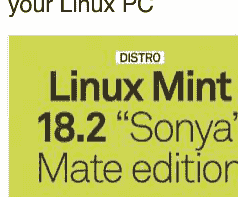
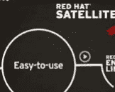


# 登录 www.filesilo.co.uk/linuxuser


注册即可即刻获取这套包必备的 Linux 发行版、教学视频和教程资源


# ESTIMATE DISTROS & apps 开发者

地球上获奖的开源软件 (OSE) 技术与开源软件


ct Kubic in-get on the here this

Arduino 回归！为你的项目选择最佳方案

专家指南页面

46 页精通 Shell 脚本安全。

Ubuntu 中的 26 个 PR

# FileSilo

绝佳下载的家园 —— 为您喜爱的 Future Publishing 出版社旗下杂志专属

- 安全可靠的在线访问，随地随
- 每位读者（纸质版和数字版）均可免费访问
- 随心所欲下载你想要的文件
- 所有期数的赠品，齐于一处

# 开始使用

关于访问您的 FileSilo 账户需要知道的一切

01 按照屏幕上的说明在我们的 FileSilo 系统创建账户。登录并回答一个关于杂志的简单问题以解锁该期。

02 您可以使用任何流行的浏览器在任何电脑、平板电脑或手机上访问 FileSilo。但是，我们建议您使用电脑下载内容，因为您可能无法将文件下载到其他设备。

03 如果您在访问 FileSilo 内容时遇到任何问题，请查看在线常见问题解答 (FAQs) 或向下方地址发送电子邮件：filesilo@futureplanet.net

# 给订阅者的丰人礼物


# 立即订阅并解锁超过 40 期的免费赠品

通过订阅杂志节省费用并访问我们的整个资源库 —— 那是数百免费资源

超过 20 小时的视频指南

来自 Linux 基金会的专业建议

最佳 Linux 发行版

专业操作系统

免费开源软件

您电脑的必备程序

# 前往第 30 页立即订阅

已经是订阅者了？

这里是今天如何解锁 FileSilo 的...

注意：解锁 LU&D FileSilo 资源库的方法已更改。解锁单期并将其添加到您的账户，即可查看杂志的所有 40 页并即刻获取额外内容。非常简单！

# 订阅的 400 多个理由

每期都会新增

# 短篇故事

# Stephen Oram

Facebook:

facebook.com/LinuxUserUK

Twitter:

@linuxusermag

关注我们

# 短篇故事

# Jodie 被删除了


她一瘸一跛地走着，每拖一下，破旧运动鞋边缘就添上了痕迹。她拖着腿。她的肩膀缩着，头低着，看着别人的手机。她自己并没有手机。

她可能和光着头或留着亮绿头发没区别；因为没有声音很奇怪 —— 她在这一英里都格格不入。

她缓慢地移动，面露痛苦，刚在公共场合出现过。偶尔，口袋里那些专注手机的人，手机震动，她的手机有近距离提醒，而他们没有察觉直到为时已晚。但她现在或以后都不想去理会。

她是一个彻头彻尾的局外人。

有人大声喊：“女孩！”

街上已经没人这样做了 —— 她知道必须-。

又是那个，女孩的声音。

一只手抓住了她的肩膀，“Jodie”。

Jodie 慢慢抬起头看着女孩的脸。“是她，”Rosa 说，“我从资料里认识你。”

Jodie 试图挣脱，但 Rosa 抓住了。“我们想念你，”

> “我被删除了。”
> “什么？”
> “某一天，我的账户不在了。我没有任何联系方式 —— 没有号码，什么都没有。”
> “他们删除了你？”
> “是的。该死了，” 
> “是的。”

Rosa 擦了擦手机。“看，你的还在。我们以为你搬家了，换了圈子？”

> 她了摇头：“没有。一个人。”

Rosa 抓住她的手挤了挤。“加油，我的朋友。让我们重新连接。”

泪水顺着 Jodie 的脸滑落。

# 下期 10 月 19 日发售

100 种精通终端的方法 | 成为渗透测试员


# 关于

《机器人》

摘自 Stephen Oram 的新书

《机器人》：短篇故事探索

反托邦现实，当人类和技术日益融合

有时幽默又怪异，这 30 个短篇故事将改变你访问第一页的方式。

http://robots.net


电子前基金会 (EFF) 是数字世界维护公民自由的领先非营利组织。EFF 成立于 1990 年，通过影响力诉讼、政策分析、基层行动和技术开发来捍护用户隐私、自由表达和创新。随着我们对技术的使用，我们致力于确保权利和自由得到增强和保护。

# EFF.ORG

## 电子前基金会

在电子前沿保护权利并促进自由
