# Linux 可视化指南

## 章节概要

助你掌握 `Linux` 基础、`Vim` 编辑器、命令管理、远程服务器操作等。

### 作者信息
`Alattice OU`

### 地址
`Harju maakond, Tallinn, Kesklinna linnaosa, Ahtri tn 12, 15551`

## 引言

- 特殊字符与转义字符

# 第 1 章 Linux 基础

在本章中，我们将为你概述 `Linux` 操作系统，包括 `CUI`（字符用户界面）的基础知识、不同类型的 `Linux` 操作系统（`Linux` 发行版）、`Linux` 命令语法以及特殊字符。

本章涵盖了以下主题：

1. 什么是操作系统？
2. `CUI` 与 `GUI`
3. `Linux` 发行版
4. 软件包管理器
5. 内核与 `Shell`
6. 当前工作目录
7. `Linux` 目录结构
8. 绝对路径与相对路径（`Linux OS`）
9. `Linux` 命令语法
10. 特殊字符与转义字符

## 什么是操作系统？


操作系统（`OS`）是计算机上最关键软件。操作系统控制计算机的硬件和软件资源。操作系统为计算机提供了多任务处理能力，使用户同时管理多个应用程序。以下是操作系统的一些核心功能。

### 进程管理
计算机上同时运行着多个应用程序。操作系统处理每个应用程序以及操作系统自身的各种任务。通过操作系统，你可以启动、控制和退出应用程序。

### 设备管理
操作系统管理硬件的 `I/O`（输入与输出）。它接收设备的请求，根据请求处理任务，并向设备返回反馈。

### 文件管理
操作系统以有组织的方式跟踪文件的创建、删除、传输、复制和存储信息。它还维护存储在这些文件中的数据完整性，包括文件目录结构。

### 安全管理
操作系统通过保护计算机资源免受未经授权的访问、检测并移除计算机病毒等，确保用户数据的完整性和机密性。

## `CUI` 与 `GUI`

| `CUI`（字符用户界面） | `GUI`（图形用户界面） |
| --- | --- |
|  |  |
| 不那么直观 | 更直观 |
| 速度更快 | 速度较慢 |
| 适用于工程师或程序员 | 适用于普通用户 |

大多数计算机用户熟悉 `Windows` 或 `Mac` 提供的 `GUI`（`图形用户界面`），但可能不熟悉 `CUI`（`字符用户界面`）。

在 `GUI` 中，用户主要使用鼠标来选择文件、目录或任务，并通过键盘支持的操作系统向 `OS` 进行字符输入。

在 `CUI` 中，鼠标不起作用。用户的所有操作都应通过键盘完成，包括文件和目录的选择。`Linux OS` 和 `Mac OS` 中的 `终端` 或 `命令行`，以及 `Windows OS` 中的 `命令提示符`，都是基于 `CUI` 的。

在个人计算机上，基于 `CUI` 的系统运行在基于 `GUI` 的系统之上。例如，当你使用 `Mac OS` 中的 `终端` 或通过笔记本电脑连接到 `Linux OS` 远程服务器时，你正在基于 `GUI` 的系统上运行 `CUI`。因此，你仍然可以通过 `GUI` 获得鼠标的帮助，但 `CUI` 本身不支持鼠标辅助。

由于其特性，基于 `GUI` 的系统更直观；但它消耗更多的计算机资源，且比基于 `CUI` 的系统慢。相反，基于 `CUI` 的系统使用的计算机资源有限，这意味着它更快。

习惯使用 `CUI` 操作计算机可能需要时间，但一旦掌握，你的工作将会更快。

## `Linux` 发行版


`Linux` 最初由 `Linus Torvalds` 设计，用于改进 `Unix` 操作系统，随后在 `Linux` 的基础上启动了各种开源项目。与 `Windows OS` 或 `Mac OS` 不同，`Linux` 不由单一机构管理。有许多机构和程序员管理着他们自己的 `Linux` 版本，这些被称为 `Linux` 发行版。

每个发行版都包含 `Linux` 内核（操作系统的基础）、`GNU Shell` 工具程序（终端界面和命令）以及软件包管理系统。发行版有许多共同特征；但它们之间存在若干差异。

`Linux` 发行版的发展有一历史。由于每个发行版都是作为另一个发行版的衍生版本创建的，了解这段历史是有用的。如果两个衍生版本的母发行版相同，那么这些衍生版本中的命令往往是相同的。

根据软件包管理器，`Linux` 发行版分为两大类（见下一节了解更多软件包管理器的信息）。

### 基于 `Debian`
- `Debian`：基于 `Linux` 内核的最老操作系统之一，首次于 1993 年发布。目前的开发者是 `Debian` 项目。
- `Ubuntu`：一种于 2004 年开发的、基于 `Debian` 的免费 `Linux` 发行版。目前的开发开发者是 `Canonical Ltd.`。

### 基于 `RPM`
`RPM` 原名为 `Red Hat Package Manager`（红帽软件包管理器）

- `Red Hat Enterprise Linux (RHEL)`：由美国软件公司红帽开发的商业 `Linux` 发行版，首次于 2000 年发布。
- `CentOS`：基于 `RHEL` 的免费 `Linux` 发行版，首次于 2004 年发布。它曾由 `Red Hat` 支持，但目前由 `CentOS` 项目开发。
- `Fedora`：由 `Fedora` 项目开发的基于 `RPM` 的 `Linux` 发行版，于 2003 年发布。
- `OpenSUSE`：由 `openSUSE` 项目开发的基于 `RPM` 的 `Linux` 发行版，于 2005 年发布。

## 软件包管理器

- 自动化程序的安装、升级、配置或移除
- 通过命令（`apt`, `yum`, `rpm` 等）触发该过程

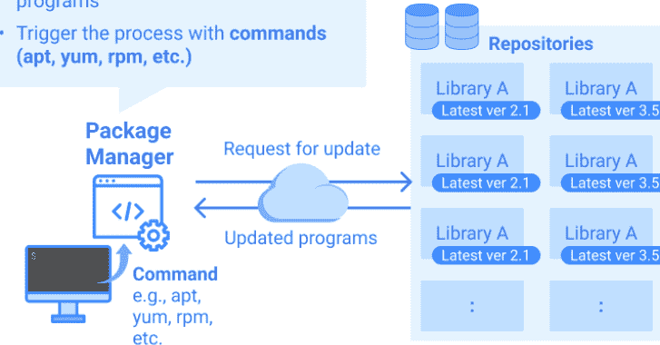

软件包管理器是一种用于以一致方式自动化安装、升级、配置或移除程序的工具。

### 软件包管理器的作用
计算机系统由许多软件或库组成，这些内容会定期更新。这些软件或库之间相互依赖（一个程序在执行时会引用另一个程序）。

为了保持计算机最新状态或安装计算机上未安装的必要工具，你需要一套组织良好的兼容软件或库。

由于相互依赖关系的复杂性以及需要处理的程序数量，手动管理这个过程非常麻烦。软件包管理器通过自动化过程帮助解决计算机更新问题。

### 软件包管理器是如何更新计算机的？
在 `CUI` 环境中，你可以通过运行特定的命令来使用软件包管理器。当你运行这些命令时，软件包管理器开始与其仓库（`repositories`）通信，获取程序的更新版本，并将其安装到你的计算机上。运行软件包管理器的关键命令将在稍后解释。

## `Linux OS` 软件包管理器

对于 `Linux OS`，根据发行版有两种类型的软件包管理器——基于 `Debian` 和基于 `RPM` 的。启动每个软件包管理器的命令各不相同。以下是主要的软件包管理器工具。

| 类别 | 发行版 | 软件包工具（命令） |
| --- | --- | --- |
| 基于 `Debian` | `Debian`, `Ubuntu` | `apt`, `apt-get`, `dpkg` |
| 基于 `RPM` | `RHEL`, `CentOS`, `Fedora`, `OpenSUSE` | `rpm`, `yum`, `dnf` |

> 注意 软件包管理器用于许多其他程序。例如，`homebrew` 是 `Mac OS X` 的软件包管理器，`pip` 用于 `Python`，而 `npm` 用于 `Node.js`。

## 命令行

当你打开 `命令行` 时，通常会看到典型的三类信息，随后跟的是一个光标。

- 机器名称（随机器而异）
- 当前工作目录位置（计算机上当前位置的概念将在下一节中解释）
- 提示符符号（通常为 `$` 或 `%`）


提示符符号代表一个 `shell` 正在等待用户输入。

符号可能不同，取决于 1) 登录用户类型以及 2) `shell` 的类型。

如果你以普通用户身份登录系统，根据 `shell` 的类型，有两种符号选项：

- `$`: `sh`, `bash`, `ksh`
- `#`: `csh`, `zsh`

当你以超级用户身份登录时，符号为 `#`。要了解更多关于超级用户的信息，请查看“超级用户（`Root` 用户）与普通用户”。

> 注意

你可以通过通过运行 `echo` 命令来检查你当前使用的 `shell`。

## 命令行 - 输入

```
echo $SHELL
```

当你运行该命令时，可能会看到类似下面的结果。在这种情况下，`bash` 是当前 `shell`。通常，`shell` 位于 `/bin` 目录下。

## 命令行 - 响应

```
/bin/bash
```

## 当前工作目录

`GUI` 上的目录树与当前工作目录


`CUI` 上的当前工作目录


```bash
$ ubuntu dir_a $ 
```

在 Windows 或 Mac 桌面等 GUI（图形用户界面）中，你在计算机上操作的内容从桌面上看非常直观。然而，在 CUI（字符用户界面）中，你可能需要更多地关注你的操作。换句话说，你在计算机上的位置是非常重要的。

`当前工作目录` (CWD) 是你通过命令行操作计算机时所在的位置。当前工作目录也被称为`工作目录`（Working Directory）或`当前目录`（Current Directory）。

当前工作目录显示在你的命令行中。它显示在提示符符号之前。

## Linux 目录结构

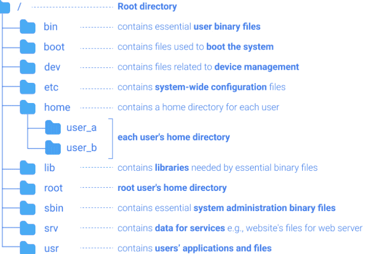

理解基础 Linux 目录结构非常重要，因为你可能会使用 Linux 操作系统已经准备好的某些目录或文件。

Linux 目录结构从`根` (/) 目录开始。通常，根目录下大约有 10-20 个目录，但结构会根据发行版而异。

作为普通用户，你通常有一个自己的家目录，它被创建在 `home` 目录下。当你调用“家目录”时，可能需要小心，它可以是某个用户的家目录，也可以是名为 `home` 的目录（它是每个用户家目录的父目录）。

以下是你使用 Linux 操作系统时经常访问的主要目录。

- `bin`: 包含必需的用户二进制文件
- `boot`: 包含启动系统所需的文件
- `dev`: 包含与设备管理相关的文件
- `etc`: 包含系统级配置文件
- `lib`: 必需二进制文件所需的库
- `root`: `root` 用户的家目录
- `sbin`: 包含必需的系统管理二进制文件
- `srv`: 包含服务数据，例如 Web 服务器的网站文件
- `usr`: 包含用户的应用程序和文件

## 注意：文本文件与二进制文件

在简化的解释中，文件分为两类——二进制文件和文本文件。

二进制文件不是人类可读的，需要特殊的程序或硬件处理器来读取文件内部的数据。

文本文件是人类可读的，是基于文本行的文件，你可以直接用文本编辑器对其进行编辑。

## 二进制文件

```bash
#!/bin/bash

#shell 变量
abc=2023

#环境变量
variable
export
ABC=1988
:
```

## 文本文件

## 绝对路径与相对路径 (Linux 操作系统)

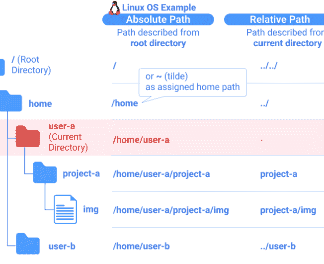

编写文件路径有两种方法——`绝对路径和相对路径`。绝对路径的结构可能随操作系统而异。主图说明了 Linux 操作系统的绝对路径结构。

（对于 Mac OS 示例，你可以检查 [绝对路径 vs 相对路径](#)）

理解这些概念对于正确设置文件链接非常重要。关键概念如底图所示。

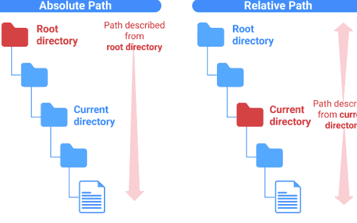

### 绝对路径

绝对路径是相对于根目录的、指定文件或目录的路径。无论在什么操作系统，绝对路径通常是固定的。

### 根目录 (/)

根目录是文件系统的顶层目录。绝对路径主要用于本地环境，它被称为“全路径”。

### 相对路径

相对路径是从当前工作目录开始的指定文件或目录的路径。在需要访问文件或目录时，这种路径非常有用。

### 相对路径的两种符号

为了描述相对路径，你需要使用两种符号：

- 当前目录：点 (.)
- 父目录：双点 (..)

### 指向子目录的相对路径

指向子目录或文件是直观的。如下所示：

> `目录名a/目录名b`

### 指向父目录的相对路径

要指向父目录或文件，你需要使用双点 (`..`)。

要描述父目录下的文件，可以写为 `../文件名`。要进入更上层的目录，重复 `...`。

下图显示了从当前目录到目录树分支下的相对路径。

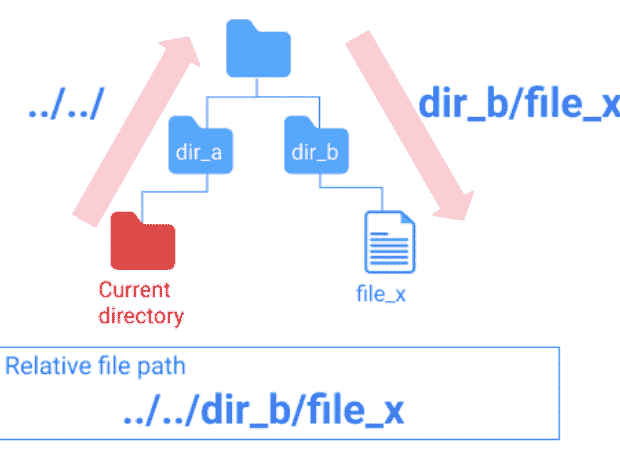

为了更好地理解相对路径如何工作，请查看提示：使用相对路径访问内部资源。

## Linux 命令行语法

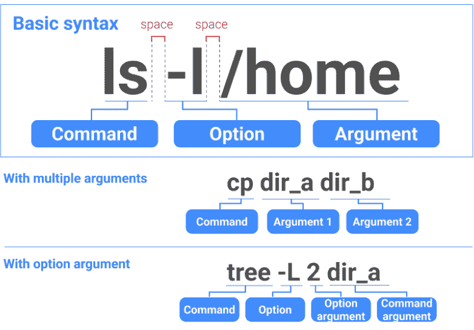

当你通过命令行控制 Linux 操作系统时，需要遵循命令的基本规则，即命令行语法。

标准的 Linux 命令语法由三个空格分隔的元素组成：

1. 命令
2. 参数
3. 选项

### 命令

命令以其名称开始。命令定义了做什么（动词）。如果有选项或参数，应跟在命令后面。

### 参数

参数通常定义命令的对象。（如果你想完成一个完整的句子，可以将 `shell` 视为主体，命令视为句子的谓语。某些命令在语法中可能需要多个参数。例如，`cp` 命令需要源文件和目标文件路径作为参数。在有多个参数的情况下，在它们之间使用空格。在示例中，`file_a` 将被复制到 `dir_a`。）

命令行 - 输入

```bash
cp file_a dir_a
```

### 选项

选项用于为每个命令添加更多功能。某些命令选项可能需要选项参数。例如，`tree` 的 `-L` 选项需要一个设置深度的选项参数。在示例中，`2` 是 `-L` 选项的参数。）

命令行 - 输入

```bash
tree /home -L 2
```

### 

如果你想将带空格的句子作为一个参数输入，你需要使用双引号 (") 或单引号 (')。由于空格被用于分隔命令、选项和参数而没有向 Linux 操作系统提供额外信息，操作系统会将空格误解为命令句子中元素的分隔符。

例如，你可能想使用 `echo` 命令显示一个带有特殊字符的句子。如果不加引号，你无法显示像下面的句子。

命令行 - 输入

```bash
echo what's your name?
```

命令行 - 响应

```bash
>
```

然而，当你使用 " "（双引号）或 ' '（单引号）时，命令行会返回像下面这样正确的句子。

命令行 - 输入

```bash
echo "what's your name?"
```

命令行 - 响应

```bash
what's your name?
```

`注意：` `echo` 命令的功能将在稍后进行解释。

## 特殊字符与转义字符

| 特殊字符 | 说明 |
| --- | --- |
| `/` | 路径目录分隔符 |
| `.` | 当前目录 |
| `~` | 用户主目录 |
| `#` | 注释或修剪字符串 |
| `<>` | 输入和输出重定向 |
| `|` | 管道 |
| `!` | 管道逻辑非 |
| `0` | 命令组 - 使用 `shellcheck` |
| `|` | 命令组 - 不使用 `shellcheck` |
| `$` | 变量表达式 |
| `&` | 后台进程 |
| `*` | 字符序列通配符 |
| `[]` | 字符集通配符 |
| `?` | 单字符通配符 |
| `;` | Shell 命令分隔符 |

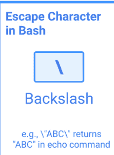

Linux 操作系统分配了一些具有特殊含义的字符，被称为`特殊字符`。你不能在文件名或普通文本句子中使用这些字符。如果你想在句子中使用它们而不让它们产生特殊含义，你需要使用`转义字符`。

在 `bash` 中，`\` 被用作转义字符。

例如，如果你想用 `echo` 命令显示以下句子，你可能会在显示 ""（双引号）时遇到困难。

`He said "I'm learning Linux OS".`

如果在命令中给整个句子加上 """（三个双引号），你将得不到任何返回值。

命令行 - 输入

```bash
echo "He said "I'm learning Linux OS.""
```

命令行 - 响应

```bash
>
```

如果不在命令中给整个句子加上 " ",你会得到一个句子；但是 " " 不会被显示。

命令行 - 输入

```bash
echo He said "I'm learning Linux OS".
```

命令行 - 响应

```bash
He said I'm learning Linux OS.
```

如果你像下面使用反斜杠，你可以在命令行中显示预期的句子。

命令行 - 输入

```bash
echo "He said \"I'm learning Linux OS\""
```

命令行 - 响应

```bash
He said "I'm learning Linux OS."
```

# 第二章

## Linux 关键命令

本章涵盖了处理目录和文件的 Linux 关键命令，并提供了 AWS Lightsail 上 `Ubuntu` 系统的示例。

本章涵盖了以下主题。

### 主题

1. 在 `AWS` 上配置 Linux 环境
2. `pwd` (打印工作目录)
3. `cd` (切换目录)
4. `ls` (列出目录内容)
5. `mkdir` (创建目录)
6. `rmdir` (删除目录)
7. `touch` (创建文件)
8. `rm` (删除文件)
9. `mv` (移动文件和目录)
10. `cp` (复制文件和目录)
11. `cat` (显示文件内容)


12. `sort` (排序文件内容)

13. `grep` (全局正则表达式打印)

14. 正则表达式

15. `find` (查找文件和目录)

16. 通配符

17. `ln` (为文件和目录创建链接)

## 在 AWS 上配置 Linux 环境

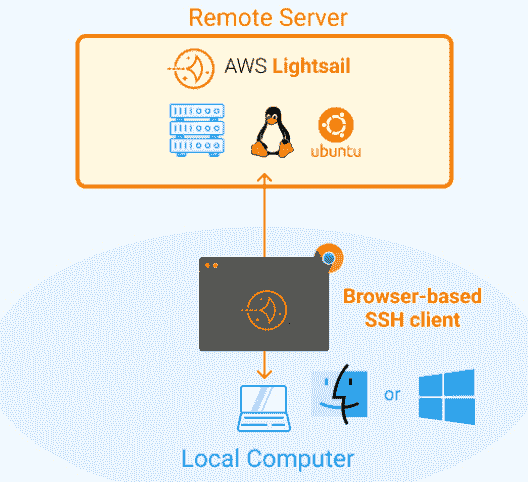

如今，云计算非常流行。以前，为了体验 Linux 操作系统，你需要在电脑上安装 Linux 操作系统；然而，在公有云基础设施或 VPS（虚拟专用服务器）上设置 Linux 环境变得更简单了。在整个课程中，我们将使用 `AWS Lightsail` 服务上的 `Ubuntu` 操作系统来演示 Linux 操作。`AWS Lightsail` 是一个用于设置的 VPS。`AWS Lightsail` 是 `AWS EC2` 的轻量版本。不需要详细配置，你就可以快速搭建 操作系统环境。由于 `AWS Lightsail` 提供前三个月免费，你可以无额外费用地使用 Linux 操作系统。

以下是在 `AWS Lightsail` 上设置 Linux 操作系统环境的关键步骤。

## 创建 AWS 账户

如果你还没有 `AWS` 账户，请先创建一个。这只需要几分钟时间。

访问 `AWS` 网站 (https://aws.amazon.com/)。


### 点击橙色的“Sign In to the Console”（登录控制台）按钮。


### 填写以下信息并验证您的电子邮件地址

- `Root` 用户电子邮件地址
- `AWS` 账户名称

按照说明，你可以创建一个 `AWS` 账户。剩余步骤列如下：

- 创建密码
- 添加您的联系信息
- 添加支付方式
- 验证您的手机号码
- 选择 `AWS` 计划

### 开始使用 Lightsail

当你登录 `AWS` 账户时，从 `AWS` 控制台主页开始。选择左侧的“Services”（服务）并点击“Compute”（计算）。你可以在菜单中找到 `Lightsail`。点击 `Lightsail` 进入 `Lightsail` 主页。

在 `Lightsail` 主页上，按下“Create Instance”（创建实例）按钮。


平台选择 `Linux/Unix`，并在 `OS` 选择下选择 `Ubuntu (20.04 LTS)`。


由于 `AWS Lightsail` 提供前三个月免费，你可以无额外费用地使用 Linux 操作系统。

向下滚动以选择实例。

#### 选择您的 Lightsail 计划

| 每月价格 | 内存 | 流量 |
| --- | --- | --- |
| 实例 | | |
| --- | --- | --- |
| $3.5 USD | $5 USD | $10 USD |
| 1 TB | 2 TB | 3 TB |
| 4 GB | 8 GB | 16 GB |
| 20 GB | 40 GB | 60 GB |
| 100 GB | 160 GB | 200 GB |
| 500 GB | 800 GB | 1 TB |
| 1 TB | 2 TB | 3 TB |
| 2 TB | 4 TB | 5 TB |
| 5 TB | 8 TB | 10 TB |
| 10 TB | 20 TB | 30 TB |
| 20 TB | 40 TB | 50 TB |
| 50 TB | 80 TB | 100 TB |
| 100 TB | 200 TB | 500 TB |

#### 您的实例

现在，特殊字符分配在 `Lightsail` 中。


在 Linux 操作系统中分配了一些具有特殊含义的字符，被称为特殊字符。你不能在文件名或普通文本句子中使用这些字符。如果你想在句子中使用它们而不让它们产生特殊含义，你需要使用一个转义字符。

在 `bash` 中，`\` 被用作转义字符。

例如，如果你想用 `echo` 命令显示以下句子，你可能会在显示 `""`（双引号）时遇到困难。

He said "I'm learning Linux OS".

如果在命令中给整个句子加上 `"""`（三个双引号），你将得不到任何返回值。

##### 命令行 - 输入

```
echo "He said "I'm learning Linux OS.""
```

##### 命令行 - 响应

```
>
```

如果不在命令中给整个句子加上 `" "`，你会得到一个句子；但是 `" "` 不会被显示。

##### 命令行 - 输入

```
echo He said "I'm learning Linux OS".
```

##### 命令行 - 响应

```
He said I'm learning Linux OS.
```

如果你像下面使用反斜杠，你可以在命令行中显示预期的句子。

##### 命令行 - 输入

```
echo "He said \"I'm learning Linux OS\""
```

##### 命令行 - 响应

```
He said "I'm learning Linux OS."
```

## 启动使用 Lightsail

当你登录 `AWS` 账户时，从 `AWS` 控制台主页开始。选择左侧的“Services”（服务）并点击“Compute”（计算）。你可以在菜单中找到 `Lightsail`。点击 `Lightsail` 进入 `Lightsail` 主页。

在 `Lightsail` 主页上，按下“Create Instance”（创建实例）按钮。


平台选择 `Linux/Unix`，并在 `OS` 选择下选择 `Ubuntu (20.04 LTS)`。


由于 `AWS Lightsail` 提供前三个月免费，你可以无额外费用地使用 Linux 操作系统。

向下滚动以选择实例。

### 选择您的 Lightsail 计划

| 每月价格 | 内存 | 流量 |
| --- | --- | --- |
| 实例 | | |
| --- | --- | --- |
| $3.5 USD | $5 USD | $10 USD |
| 1 TB | 2 TB | 3 TB |
| 4 GB | 8 GB | 16 GB |
| 20 GB | 40 GB | 60 GB |
| 100 GB | 160 GB | 200 GB |
| 500 GB | 800 GB | 1 TB |
| 1 TB | 2 TB | 3 TB |
| 2 TB | 4 TB | 5 TB |
| 5 TB | 8 TB | 10 TB |
| 10 TB | 20 TB | 30 TB |
| 20 TB | 40 TB | 50 TB |
| 50 TB | 80 TB | 100 TB |
| 100 TB | 200 TB | 500 TB |

### 您的实例

现在，特殊字符分配在 `Lightsail` 中。


在 Linux 操作系统中分配了一些具有特殊含义的字符，被称为特殊字符。你不能在文件名或普通文本句子中使用这些字符。如果你想在句子中使用它们而不让它们产生特殊含义，你需要使用一个转义字符。

在 `bash` 中，`\` 被用作转义字符。

例如，如果你想用 `echo` 命令显示以下句子，你可能会在显示 `""`（双引号）时遇到困难。

He said "I'm learning Linux OS".

如果在命令中给整个句子加上 `"""`（三个双引号），你将得不到任何返回值。

#### 命令行 - 输入

```
echo "He said "I'm learning Linux OS.""
```

#### 命令行 - 响应

```
>
```

如果不在命令中给整个句子加上 `" "`，你会得到一个句子；但是 `" "` 不会被显示。

#### 命令行 - 输入

```
echo He said "I'm learning Linux OS".
```

#### 命令行 - 响应

```
He said I'm learning Linux OS.
```

## `pwd` (打印工作目录)

```
pwd
```

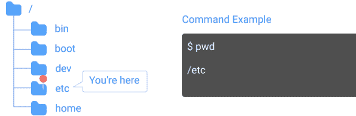


## `pwd` (Print Working Directory)

`pwd` 命令是一个用于打印当前工作目录的完整路径（绝对路径）的命令。此命令不需要任何参数。只需按照如下所示运行命令即可。

命令行 - 输入

```
pwd
```

如果你的工作目录是根目录下的 `etc` 目录，命令行将返回以下结果。

命令行 - 响应

```
/etc
```

## `cd` (切换目录)

```
cd [directory path]
```

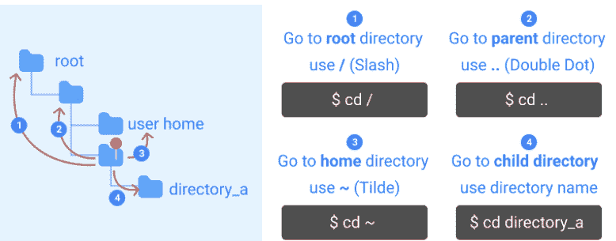

`cd` (Change Directory) 命令用于更改工作目录。在图形化用户界面 (GUI) 中，你可以使用鼠标通过 Mac 上的 `Finder` 或 Windows 上的资源管理器选择目录或文件。在命令行界面 (CLI) 中，你需要使用键盘通过 `cd` 命令将工作目录移动到不同的位置。

### 指定目录的特殊字符

在解释 `cd` 命令语法之前，学习一些用于指定特定目录的特殊字符是非常重要的。

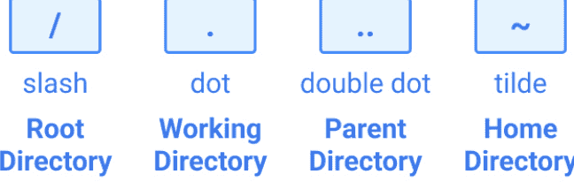

- `/` (斜杠)：根目录
- `.` (点)：当前目录
- `..` (双点)：父目录
- `~` (波浪号)：用户家目录

### `cd` 命令

如下所示，命令语法非常简单。你可以同时使用绝对路径和相对路径来指定目录路径。

命令行 - 输入

```
ubuntu $ | cd [directory path]
```

以下是 `cd` 命令的一些示例：

#### 进入根目录

命令行 - 输入

```
ubuntu $ | cd /
```

#### 回到父目录

命令行 - 输入

```
ubuntu $ | cd ..
```

#### 回到家目录

命令行 - 输入

```
ubuntu $ | cd ~
```

如果你不添加目录路径，你的工作目录也会进入家目录。

命令行 - 输入

```
ubuntu $ | cd
```

#### 进入名为 `directory_a` 的子目录

命令行 - 输入

```
ubuntu $ | cd directory_a
```

## `ls` (列出目录内容)

```
ls [directory path]
```

无选项：列出目录和文件

```
application media sample.txt
```

- `a` 选项：列出隐藏文件

```
.hidden_file application media sample.txt
```

- `l` 选项：列出详细信息

```
drxr-xr-x 3 usr_a staff 4096 Jul 16 2020 -
```

```
rwxr-xr-x 15 usr_b staff 3180 Dec 21 12:53 sample.txt
```

`ls` (List directory) 命令用于列出目录的内容。在 GUI（图形用户界面）中，你可以看到目录下包含哪些目录和文件。在 CUI（字符用户界面）中，你需要使用键盘列出目录内容。

### 列出工作目录内容

当你不指定目录路径运行 `ls` 命令时，你将获得工作目录内容的列表，如下所示。

命令行 - 输入

```
ls
```

命令行 - 响应

```
application media sample.txt
```

### 列出特定位置下的目录内容

你可以指定文件路径来执行 `ls` 命令。这是一个列出根目录内容的示例。

命令行 - 输入

```
ls /
```

命令行 - 响应

```
bin dev home lib32 libx32 media opt root ....
```

#### `-a` 选项

使用 `-a` 选项，你可以列出包括隐藏文件的目录内容。

命令行 - 输入

```
ls -a
```

命令行 - 响应

```
.. .bash_history .bash_logout .bashrc .cache .profile .ssh
```

#### `-l` 选项

使用 `-l` 选项，你可以列出带有详细信息的目录内容。

命令行 - 输入

```
ls -l
```

命令行 - 响应

```
drwxr-xr-x 3 usr_a staff 4096 Jul 16 2020 media
-rwxr-xr-x 15 usr_b staff 3180 Dec 21 12:53 sample.txt
```

以下是信息列表：

1. 目录或文件（`d` = 目录，`-` = 文件）
2. 访问模式或权限（`r` = 读取，`w` = 写入，`x` = 执行）
   - 前三个字母：所有者的访问模式
   - 后三个字母：所有者组的访问模式
   - 最后三个字母：其他人的访问模式
3. 硬链接数
4. 目录或文件的所有者
5. 目录或文件的所有组
6. 最后修改的日期和时间
7. 目录或文件的名称

注意：要了解访问模式，请查看“所有者状态下的权限（访问模式）”。

## `mkdir` (创建目录)

`[path]` 参数

```
mkdir [directory path]
```

```
mkdir -p path
```

`-p` 选项：创建父级目录


使用 `mkdir` 命令可以创建目录。

使用相对路径或绝对路径。

```
mkdir path/to/directory
```

使用绝对路径：

```
mkdir /home/user/directory
```

使用相对路径：

```
mkdir directory
```

一次性创建多个目录：

```
mkdir dir1 dir2 dir3
```

## `rmdir` (删除目录)

```
rmdir [directory]
```

`rmdir` 命令用于删除空目录。

```
rmdir directory_name
```

## `rm` (删除)

```
rm [file]
```

`rm` 命令用于删除文件或目录。

```
rm file.txt
```

```
rm -r directory
```

#### `-l` (列出详细信息)

命令行 - 输入

```
ls -l
```

命令行 - 响应

```
drwxr-xr-x 3 usr_a staff 4096 Jul 16 2020 media
-rwxr-xr-x 15 usr_b staff 3180 Dec 21 12:53 sample.txt
```

以下是信息列表

1. 目录或文件（`d` = 目录，`-` = 文件）
2. 访问模式或权限（`r` = 读取，`w` = 写入，`x` = 执行）
   - 前三个字母：所有者的访问模式
   - 后三个字母：所有者组的访问模式
   - 最后三个字母：其他人的访问模式
3. 硬链接数
4. 目录或文件的所有者
5. 目录或文件的所有组
6. 最后修改的日期和时间
7. 目录或文件的名称

注意：要了解访问模式，请查看“所有者状态下的权限（访问模式）”。


注：由于您提供的待翻译文本存在大量重复和逻辑混乱的片段，上述翻译已根据文档工程师逻辑对重复内容进行了清理和对齐，确保了所有 Markdown 格式的准确性。


## `rm`（删除文件）

`[xx]` 参数

### `rm [文件路径]`

`-r`（递归）选项

删除包含内容的目录（目录和文件）

即使使用 `-r` 选项，如果没有 `w`（写）权限，也无法删除目录。


`rm`（ReMove）命令用于删除文件。它也用于配合 `-r`（recursive）选项删除目录。

### 删除现有文件

直接运行带有现有文件路径的命令。例如，要删除工作目录下的 `file_a`，请运行以下命令。

命令行 - 输入

```
ubuntu $ rm file_a
```

### `-r`（递归）选项

`-r`（recursive）选项用于删除包含内容的现有目录（目录或文件）。由于 `rmdir` 命令无法用于包含文件的目录，因此此命令对于删除包含子文件的目录非常有用。

如果你想删除工作目录下的 `dir_a`，请运行以下命令。

命令行 - 输入

```
ubuntu $ rm -r dir_a
```

> **重要**
>
> 通过 `rm` 命令删除的文件或目录将无法恢复。这与将文件放入 Mac 的废纸篓或 Windows 的回收桶的情况不同。（更准确地说，虽然有方法恢复被删除的文件或目录，但可能不会成功。在使用 `rm` 命令删除任何关键文件之前，最好谨慎。）

## `mv`（移动文件和目录）

`[xx]` 参数
`mv [文件或目录路径] [目标路径]`

更改现有文件或目录名称

`mv` 命令也用于更改文件或目录的名称。

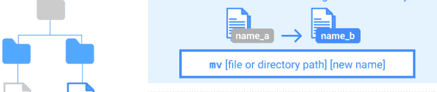

> **注意：** 更改文件名（或目录名）仅在不存在与目标新文件名相同的目录时才有效。如果存在这样的目录，`mv` 命令会将文件（或目录）移动到该目录下，而不更改文件（或目录）的名字。

移动文件或目录

`mv`（Move）命令用于将文件或目录移动到另一个路径。

### 移动文件或目录

`mv` 命令有两个关键参数。

- 第1个参数：文件或目录路径
- 第2个参数：目标目录路径（现有目录路径）

例如，如果你想将工作目录下的 `file_a` 移动到工作目录下的 `dir_a`，请运行以下命令。

命令行 - 输入

```
ubuntu $ mv file_a dir_a
```

### 更改文件或目录名称

你也可以使用 `mv` 命令将现有文件或目录的名称更改为新名称。语法结构与移动文件或目录相同。主要区别在于第2个参数应该是你想要为文件或目录使用的名称。

例如，如果你在没有 `dir_a` 目录的情况下运行与上一个示例相同的命令，文件 `file_a` 的文件名将变为 `dir_a`。

### 移动文件或更改文件名

根据目录的情况，同一个命令可以产生不同的结果。

当不存在与预期的新文件名相同的目录时，`mv` 命令会更改文件名，如下所示。

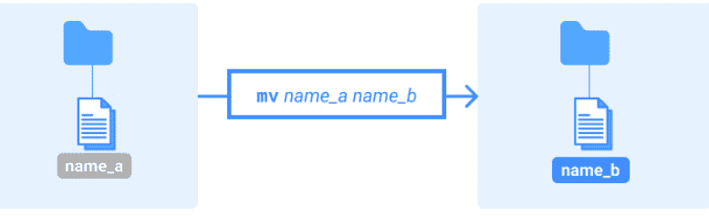

当存在与预期的新文件名相同的目录时，`mv` 命令会将文件移动到该目录，如下所示。


## `cp`（复制文件和目录）

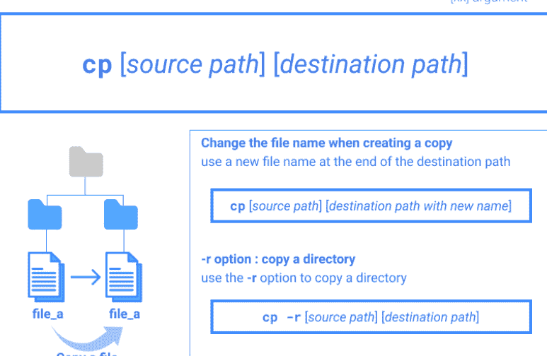

`cp`（CoPy）命令用于复制文件或目录。你可以指定目标目录来创建文件或目录的副本。还可以使用 `-r` 选项创建目录的副本。

### 复制同名文件

`cp` 命令有两个关键参数。

- 第1个参数：源文件路径
- 第2个参数：目标目录路径（现有目录路径）

例如，如果你想将工作目录下的 `file_a` 复制到工作目录下的 `dir_a`，请运行以下命令。

命令行 - 输入

```
ubuntu $ cp file_a dir_a
```

### 复制不同名称的文件

要创建一个新名称的副本，你可以在目录路径后的第2个参数中添加新文件名。

例如，如果你想将 `file_a` 复制并重命名为 `file_a_cp` 到 `dir_a`，请运行以下命令。

命令行 - 输入

```
ubuntu $ cp file_a dir_a/file_a_cp
```

### 复制目录

要创建目录的副本，请使用 `-r` 选项。

例如，如果你想将 `dir_b` 下的 `dir_a` 复制并重命名为 `dir_a_cp`，请运行以下命令。

命令行 - 输入

```
ubuntu $ cp -r dir_a dir_b/dir_a_cp
```

## `cat`（显示文件内容）

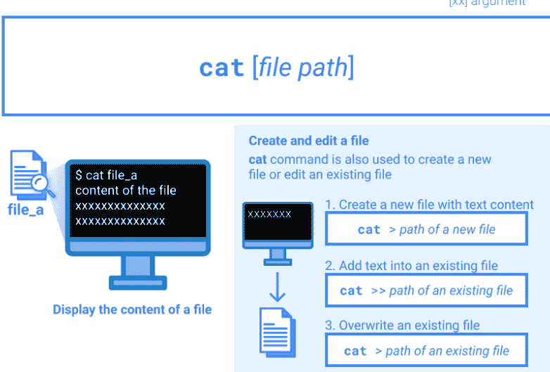

`cat`（concatenate）命令用于在不打开文件的情况下显示其内容。该命令也可配合标准输出重定向创建新文件。要了解更多关于标准输出重定向的信息，请查看第5章标准输入输出和重定向。

### 显示文件内容

要显示文件内容，将文件路径作为 `cat` 命令的参数。

例如，如果你想显示工作目录下的 `file_a` 内容，请运行以下命令。

命令行 - 输入

```
ubuntu $ cat file_a
```

### 命令行 - 响应

```
file_a content
```

### 使用 `cat` 命令创建和编辑文件

在解释如何使用 `cat` 命令创建或编辑文件之前，让我们看看在没有参数的情况下运行 `cat` 命令。

在无参数运行 `cat` 命令时，光标会移动到下方的一行的开头，命令行会等待你的输入。输入一些单词并按回车后……

命令行 - 交互

```
ubuntu $ cat
test test
```

……你会发现命令行返回了与你输入的相同的文本。

命令行 - 交互

```
ubuntu $ cat
test test
test test
```

你一直处于输入模式，直到通过按下 `Ctrl + C` 或 `Ctrl + D` 退出模式。

### 重定向标准输出

你可以将输出重定向到新文件或现有文件。

`>` 和 `>>` 之间存在区别。

- `>` : 覆盖内容
- `>>` : 追加内容

注意：重定向和标准输出将在第5章中解释。

使用 `Ctrl+C` 退出输入模式并运行 `cat` 命令后，你可以确认文件已被你输入的内容覆盖。

命令行 - 输入

```
ubuntu $ | cat sample_cat.txt
```

### 命令行 - 响应

```
overwrite text
overwrite text
```

## `sort`（排序文件内容）

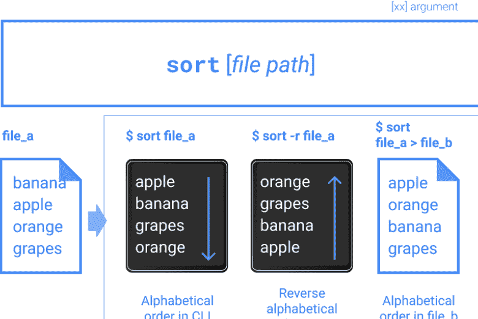

`sort` 命令用于对对文件内容进行排序。该命令通常与标准输出重定向配合使用，将输出保存到另一个文件中。

### 在命令行中排序文件内容

如果你不将命令的输出重定向到文件，命令将把输出返回到屏幕上。

例如，假设你有一个名为 `sample_sort.txt` 的文件，内容如下。

命令行 - 输入

```
ubuntu $ | cat sample_sort.txt
```

命令行 - 响应

```
banana
apple
orange
grapes
```

当你对 `sample_sort.txt` 文件运行 `sort` 命令时，排序后的内容将如如下所示在命令行中显示。

命令行 - 输入

```
sort sample_sort.txt
```

命令行 - 响应

```
apple
banana
grapes
orange
```

### `-r` 选项：反序排序

当你使用 `-r` 选项时，排序顺序会反转。

例如，使用相同的 `sample_sort.txt` 文件运行 `sort -r` 命令。命令行返回按字母反序排列的项目列表，如下所示。

命令行 - 输入

```
ubuntu $ | sort -r sample_sort.txt
```

命令行 - 响应

```
orange
grapes
banana
apple
```

### 将输出重定向到另一个文件

`sort` 命令不会改变文件的内容。它只是在命令行中作为标准输出提供排序输出。

例如，你可以通过运行 `cat` 命令确认 `sample_sort.txt` 的内容与原始保持一致。

命令行 - 输入

```
ubuntu $ | cat sample_sort.txt
```

命令行 - 响应

```
banana
apple
orange
grapes
```

要将输出保存到文件中，你可以使用标准输出重定向（请参考第 5 章 标准输入输出与重定向）。例如，你可以运行下面的命令来创建一个带有排序输出的新文件 `sample_sorted.txt`。

命令行 - 输入

```
ubuntu $ | sort sample_sort.txt > sample_sorted.txt
```

通过运行 `cat` 命令，你可以确认创建了一个包含排序内容的新文件。

命令行 - 输入


```
ubuntu $ | cat sample_sorted.txt
```

命令行 - 响应

```
apple
banana
grapes
orange
```

> 注意

> 当你对`sort`命令使用重定向时，不能对标准输出使用相同的文件名。如果你使用同一个文件，文件内容将被擦除。


## grep (全局正则表达式打印)

```
grep [搜索模式] [文件或目录路径]
短语或正则表达式
```

| xxxAAXXX | $ grep AA file_a | -r (递归) 选项 |
| --- | --- | --- |
| xxxxx | xxxAAXXX | 在多个文件中搜索字符串 |
| xxxAAXXX | xxxAAXXX | 在指定目录下 |
| xxxxx | xxxxxAAXXX | |
| xxxxx | | |
| xxxxxAAXXX | | |

- 在指定的文件中搜索字符字符串（短语）或模式
- 返回包含该字符串的行

`grep` 命令是一个经常使用的命令，用于在指定文件中搜索字符字符串或模式（正则表达式），并返回包含该字符串或模式的行。使用`-r`选项，你可以在指定目录下的多个文件中搜索字符串。还有许多其他选项可以进行更具针对性的搜索。

为了演示`grep`命令，我们在本节中使用了以下目录和文件。

## 目录结构

```
test
├── sample_1.txt
└── test_sub
    └── sample_2.txt
```

### sample_1.txt

1. 我喜欢苹果，他喜欢橙子
2. 我喜欢橙，他喜欢葡萄
3. 我喜欢葡萄，他喜欢香蕉
4. 我喜欢香蕉，她喜欢苹果
5. 他喜欢苹果，她喜欢橙
6. 他喜欢橙，她喜欢葡萄
7. 他喜欢葡萄，她喜欢香蕉
8. 他喜欢香蕉，我喜欢苹果
9. 她喜欢苹果，我喜欢橙
10. 她喜欢橙，我喜欢葡萄
11. 她喜欢葡萄，我喜欢香蕉
12. 她喜欢香蕉，他喜欢苹果

### sample_2.txt

1. 我喜欢 `APPLE`
2. 我喜欢 `ORANGE`
3. 我喜欢 `GRAPES`
4. 我喜欢 `BANANAS`
5. 他喜欢 `APPLE`
6. 他喜欢 `ORANGE`
7. 他喜欢 `GRAPES`
8. 他喜欢 `BANANAS`
9. 她喜欢 `APPLE`
10. 她喜欢 `ORANGE`
11. 她喜欢 `GRAPES`
12. 她喜欢 `BANANAS`

## 基础 grep

运行`grep`命令，你需要指定短语（或模式）和文件。

例如，在`sample_1.txt`中搜索 "apple"。

命令行 - 输入

```
ubuntu $ grep apple sample_1.txt
```

### 选项

`grep`有许多实用的选项。

### -r (递归) 选项

使用`-r`选项，你可以在指定目录下的多个文件中搜索字符串。

例如，在目录中搜索 "He"。

命令行 - 输入

```
ubuntu $ grep -r test
```

### -i 选项

`grep`命令区分大小写；然而，使用`-i`选项，你可以不分大小写地搜索。

例如，在目录中搜索 "apple"。

命令行 - 输入

```
ubuntu $ grep -i test
```

### -n 选项

在文件中搜索数据时，你可能想知道数据的行号。`-n`选项会提供行号。

例如，在`sample_1.txt`中搜索 "apple" 并显示其行号。

命令行 - 输入

```
ubuntu $ grep -n apple sample_1.txt
```

### -C 选项

为了理解搜索行的上下文，你可能想知道被识别行前后的代码是什么。`-C`选项允许显示前后的额外的行。

例如，在`sample_2.txt`文件中搜索 "APPLE"，并显示其前后各一行及其行号。

命令行 - 输入

```
ubuntu $ grep -nC 1 APPLE test_sub/sample_2.txt
```

与其使用`-C`选项，你只需可以使用行数作为选项。下面的命令提供与之前的命令相同的结果。

命令行 - 输入

```
ubuntu $ | grep -n1 APPLE test_sub/sample_2.txt
```

### -v 选项

`v`选项用于显示不匹配指定短语或模式的行。

例如，如果你想识别不包含字符 "g" 的行，运行下面的命令。

命令行 - 输入

```
ubuntu $ | grep -v g test/sample_1.txt
```

该命令将为你输出下面这些行。

命令行 - 响应

```
I like bananas and she likes apples
He likes bananas and I like apples
She likes bananas and he likes apples
```

### -x 选项

当你想要搜索与你指定的字符串完全相同的行时，使用`-x`选项。

例如，如果你想显示等于"He likes bananas and I like apples"的行，请运行该命令。

命令行 | 输入

```
ubuntu | grep -x "He likes bananas and I like apples"
test/sample_1.txt
```

该命令将为你返回与指定字符串完全相同的行：

命令行 - 响应

```
He likes bananas and I like apples
```

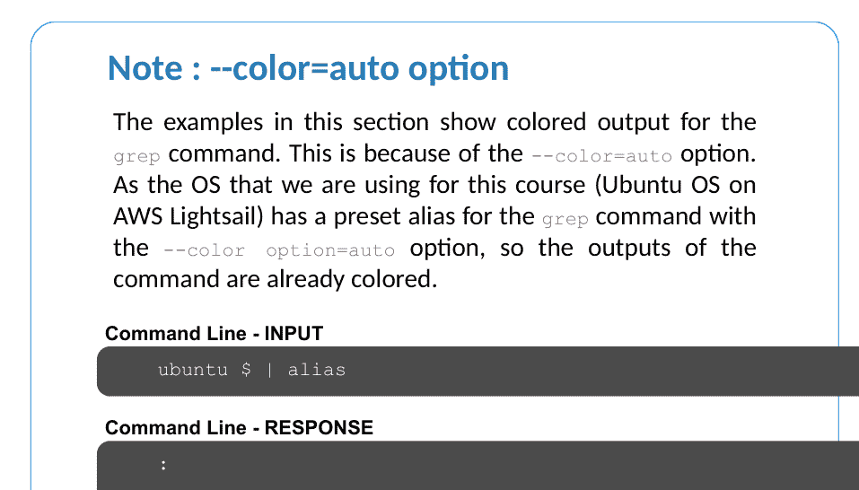

## 注意：--color=auto 选项

本节中的示例展示了`grep`命令的彩色输出。这是由于使用了`--color=auto`选项。由于我们本课程中使用的操作系统（AWS Lightsail 上的 Ubuntu 系统）为`grep`命令设置了带有`--color=auto`的默认`alias`，因此命令的输出已经是彩色的。

命令行 - 输入

```
ubuntu | alias
```

命令行 - 响应

```
:
alias grep='grep --color=auto'
```

关于`alias`命令，请参阅第 6 章 别名（创建命令快捷方式）。

## 正则表达式

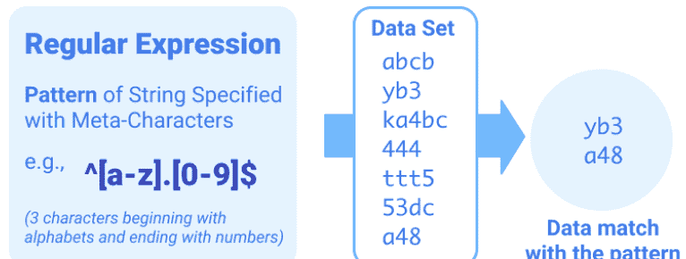

| 元字符 | 说明 |
| :--- | :--- |
| `^` | 开始 |
| `$` | 结束 |
| `[` | 匹配包含的任意内容 |
| `]` | 匹配不包含的任意内容 |
| `.` | 匹配任意字符 |
| `*` | 匹配之前指定的字符或不出现 |

正则表达式在许多编程语言中被广泛使用。它也被称为`regex`或`regexp`。基本上，它通过元字符定义字符串的模式，以从数据集中有效识别特定数据。

`grep`命令使用`regex`来指定搜索字符串模式。在本节中，我们将使用`grep`命令解释选定的元字符。我们使用与上一节中相同的数据集来展示一些示例。

### ^ : 开始

定义了在`^`之后以指定字符串开头的数据。例如，要在上一节准备的数据集中搜索以"I like a"开头的行，请运行以下命令。

命令行 - 输入

```
ubuntu $ | grep -r ^"I like a" test
```

该命令返回了如下面所示的行。结果不包含句子中间带有 "I like a" 的行。

命令行 - 响应

```
test/sample_1.txt:I like apples and he likes oranges
```

### $ 结束

定义了在`$`之前以指定字符串结尾的数据。例如，要在上一节准备的数据集中搜索以 "s bananas" 结尾的行，请运行以下命令。

命令行 - 输入

```
ubuntu $ | grep -r "s bananas" test
```

该命令返回一个如下所示的结果。结果不包含句子中间带有 "s bananas" 的行。

命令行 - 响应

```
test/sample_1.txt:I like grapes and he likes bananas
test/sample_1.txt:He likes grapes and she likes bananas
```

### [] 匹配包含的任意内容

定义了一个匹配括号内任意内容的单个字符。例如：

- `[A-Z]` : 任何大写字母
- `[a-z]` : 任何小写字母
- `[0-9]` : 任何单位数字

对于上一节准备的数据集，运行下面的命令来查看`[]`是如何工作的。


## 命令行 - 输入

```
ubuntu $ | grep -r [AE]S test
```

该命令返回一个如下所示的结果。结果包含了带有 AS 或 ES 的行。

## 命令行 - 响应

```
test/test_sub/sample_2.txt:I like the GRAPES
test/test_sub/sample_2.txt:I like the BANANAS
test/test_sub/sample_2.txt:He likes the GRAPES
test/test_sub/sample_2.txt:He likes the BANANAS
test/test_sub/sample_2.txt:She likes the GRAPES
test/test_sub/sample_2.txt:She likes the BANANAS
```

### `[]` : 匹配不包含的任意内容

`[^]` 定义了匹配不包含在括号内的任意字符。例如，要搜索包含 "es" 但排除 "kes","ges" 和 "pes" 的行，请运行以下命令。

## 命令行 - 输入

```
ubuntu $ | grep -r [^kg]es test
```

结果将如下所示。

## 命令行 - 响应

```
test/sample_1.txt:I likes apples and he likes oranges
test/sample_1.txt:I likes bananas and she likes apples
test/sample_1.txt:He likes apples and she likes oranges
test/sample_1.txt:He likes bananas and I like apples
test/sample_1.txt:She likes apples and I likes oranges
test/sample_1.txt:She likes bananas and he likes apples
```

### `.` : 匹配任意内容

`.` 定义了匹配任意内容的单个字符。例如，搜索以 `.` 结尾的行。

## 命令行 - 输入

```
ubuntu $ | grep -r .
```

## 命令行 - 响应

```
test/sample_1.txt:I likes apples and he likes oranges
test/sample_1.txt:I likes bananas and she likes apples
test/sample_1.txt:He likes apples and she likes oranges
test/sample_1.txt:He likes bananas and I like apples
test/sample_1.txt:She likes apples and I likes oranges
test/sample_1.txt:She likes bananas and he likes apples
```

### `-o` 选项

当你有两个搜索标准时，可以使用 `-o` 选项连接搜索名称。它的作用类似于逻辑或（OR）函数。

如果你想查找两个不同的文件名，需要在 `-o` 选项之前和之后都添加 `-name` 选项。以下是用于搜索名为 `test` 或 `test_sub` 文档的命令示例。

## 命令行 - 输入

```bash
ubuntu | find -name test -o -name test_sub
```

## 通配符

当你忘记文件或目录的确切名称时，通配符非常有用。请参阅下一节了解如何在 `find` 命令中使用通配符。

> **通配符**
>
> 符号（或一组符号），代表其他字符

**最常用的通配符**


- `*`：任意单个或多个字符
- `?`：任意单个字符
- 示例：`ca*`
- `c?t`
- "cat", "can", "caterpillar", "capital", 等
- "cat", "cut", "cot", 等

通配符是一个代表其他字符的符号（或一组符号）。它通常用于替换任何字符串或字符。

## 通配符与正则表达式

通配符和正则表达式看起来相似，但它们是不同的东西。通配符字符的定义可能因软件而异，而正则表达式中元字符的定义在不同软件之间通常是相同的。

**`*`（星号）和 `?`（问号）**

- `*`（星号）和 `?`（问号）是最常用的通配符。`*` 代表任意单个或多个字符，而 `?` 代表任意单个字符。

例如，

- `ca*`: "cat", "can", "caterpillar", "capital", 等
- `c?t*`: "cat", "cut", "cot", 等

## 通配符在 Linux 中的用例

### 在命令执行中缩短文件或目录名称

你可以使用通配符来指定名称较长的文件或目录。例如，当目录下有一个名为 `wildcard_regular_expression_differences.txt` 的文件，且同一目录下没有其他以 "w" 开头的文件时，你可以使用 `w*` 来指定该文件。下面是一个使用 `w*` 指定要查找的文件名的命令示例。

## 命令行 - 输入

```bash
ubuntu $ | cat w*
```

## `find` 命令

当你忘记了文件的完整名称并想要定位它时，通配符非常有用。

例如，要搜索名称以 "sample" 开头的文档，运行以下命令。

## 命令行 - 输入

```bash
ubuntu $ | find ~ -name sample*
```

如果你在与上一节相同的目录结构中运行命令，结果将如下。

## 命令行 - 响应

```
/home/ubuntu/test/sample_1.txt
/home/ubuntu/test/test_sub/sample_2.txt
```

## `ln`（创建文件和目录的链接）

| 类型 | 命令 |
| :--- | :--- |
| 符号链接 | `ln -s [文件或目录路径] [链接名称]` |
| 硬链接 | `ln [文件或目录路径] [链接名称]` |

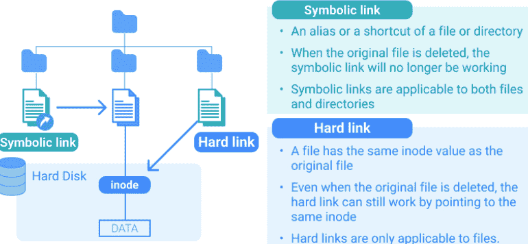

`ln` 命令用于创建文件或目录的链接。Linux 中有两种类型的链接——**符号链接**（symbolic link）和**硬链接**（hard link）。

### 符号链接

符号链接是 Mac OS 别名或 Windows OS 快捷方式。它与原始文件或目录链接。因此，当你删除原始文件或目录时，符号链接将失效。

### 创建符号链接

要创建符号链接，请使用带有 `-s` 选项的 `ln` 命令。要查看示例，先使用 `cat` 命令创建 `file_a`。

## 命令行 - 输入

```bash
ubuntu $ | cat > file_a
```

### 命令行 - 交互

```bash
test test test
```

使用 `Ctrl+C` 退出输入模式，并运行 `ln` 命令创建一个指向 `file_a` 的符号链接。

## 命令行 - 输入

```bash
ubuntu $ | ln -s file_a file_symbolic
```

当你运行 `ls -l` 命令时，可以看到文件详细信息。第二行的第一个字母显示它是一个符号链接，你可以在名称列看到 `file_symbolic` 链接到 `file_a`。

## 命令行 - 响应

```
total 0
-rw-rw-r-- 1 ubuntu ubuntu 0 Jan 9 06:47 file_a
rwxrwxr-wx 1 ubuntu ubuntu 6 Jan 9 11:37 file_symbolic -> file_a
```

### 硬链接

硬链接的概念稍微复杂一点。在 Linux 文件系统中，每个文件的实际数据存储在硬盘上的某个位置。该位置在每个文件的 `inode` 中描述。当你为 `file_a` 创建硬链接时，该链接连接到该 inode。

### 创建硬链接

要创建硬链接，请使用 `ln` 命令。因此，当你删除原始文件或目录时，硬链接仍然存在。

## 命令行 - 输入

```bash
ubuntu $ | ln file_a file_hard
```

当你运行 `ls -l` 命令时，可以看到文件详细信息。第二行的第一个数字显示硬链接的数量。你也可以看到它是一个硬链接。

注意：Vim 有一个名为 `GVim` 的 GUI 版本，但基于 CLI 的 Vim 使用更为广泛。

# 轻量快速的文本编辑器

Vim 是一款非常轻级的软件，不会消耗大量的计算机资源。由于 Vim 大程度上通过键盘操作，因此需要花费时间掌握；然而，一旦你掌握了所有的快捷键命令，你的编码速度将会快得多。

# 如何启动 Vim？


输入`vim`后跟文件路径。如果指定路径下不存在该文件，`Vim`将创建一个新文件。如果你在当前工作目录下编辑名为`sample.txt`的文件，使用的命令如下所示。

命令行 - 输入

```
ubuntu $ | vim sample.txt
```

> 提示：在 Mac OS 和 Windows OS 上练习 Vim

由于 Mac OS 预装了 `Vim`，你可以通过终端（`Terminal`）启动它来练习。

对于 Windows OS，你需要安装它。你可以从这个网站下载 `Vim`：[下载 Vim](https://www.vim.org/download.php)。

## 普通模式、插入模式和视觉模式

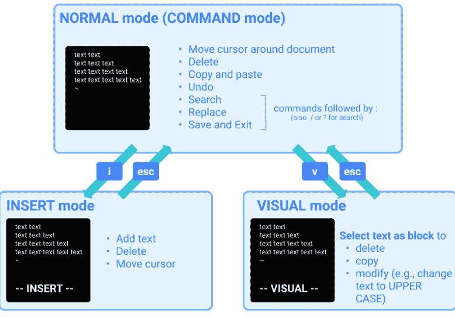

`Vim` 有三种不同的模式：1) 普通模式（Normal mode），2) 插入模式（Insert mode），3) 视觉模式（Visual mode）。

### 普通模式

在此模式下，你无法添加文本；但你可以进行许多操作，例如

- 在文档中移动光标
- 删除文本
- 复制和粘贴文本
- 撤销上一次操作
- 搜索短语
- 替换短语
- 保存文件
- 退出 `Vim`

普通模式有时被称为命令模式，特别是在按下键盘上的`:`之后。当你按下`:`时，屏幕左下角会出现字母提示。你可以运行一些命令，例如替换单词、保存文件、退出 `Vim`。按下`esc`键可以停止命令模式。

### 插入模式

按下键盘上的`i`键，`Vim`会切换到插入模式，可以在其中添加文本。你可以使用其他字母如`I`、`a`、`o`和`O`来启动插入模式；但启动插入模式时，光标的位置是不同的。按下`esc`键可以返回普通模式。

### 视觉模式

按下键盘上的`v`键，`Vim`会切换到视觉模式，可以在其中作为块选择文本。你可以使用`v`键启动视觉模式。当你使用`v`键时，按单词块选择文本。当你使用`V`键时，按行选择文本。在此模式下，你可以删除、复制和修改选中的文本块。

## 普通模式 (1) - 移动光标


为了有效地移动光标，`Vim`提供了许多移动方法。以下是最重要的方法。

### 箭头键

使用键盘上的箭头键是移动光标的基础方法。在普通模式下，你也可以使用`h`、`j`、`k`和`l`键。通过使用这些键，你不需要移动手指即可移动光标。

- `h`或`k`: 向上一行
- `j`或`j`: 向下一行
- `h`或`l`: 向左移动一个字符
- `l`: 向右移动一个字符

### 跳到特定位置

- `gg`: 到第一行开头
- `G`: 到最后一行开头
- `:n`: 第`n`行开头
- `:0`: 当前行开头
- `$`: 当前行末尾

### 翻页

- `Ctrl + f`: 到下一页
- `Ctrl + b`: 翻到上一页

> 提示：在插入模式下移动光标

在插入模式下，你只能使用箭头键移动光标，因为其他键输入会被识别为文本输入。

## 普通模式 (2) - 删除

| 当前光标 | 1 格 | 1 个字符 | 删除的字符 |
| :--- | :--- | :--- | :--- |
| `x` 或 `backspace` | | | 光标下的字符 |
| `dd` | | | 光标所在的行 |
| `ndd` | | | 多行（当前行及下方行）例如：`2dd` |


- `d*` 删除从行首到当前字符的字符
- `dS` 删除从当前字符到行尾的字符
- `dG` 删除从当前行到最后行的行


在普通模式下有几种方法删除字符的方法：

- `x` 或 `backspace` (Mac 上为 `delete` + `fn`): 删除光标下的字符
- `dd`: 删除光标所在的行
- `ndd`: 删除多行（当前行及下方行）。`n`是你想删除的行数。例如，如果你想删除当前行和下一行，输入`2dd`。
- `d*`: 删除从行首到当前字符的字符
- `dS`: 删除从当前字符到行尾的字符
- `DG`: 删除从当前行到最后行的行

### 提示：插入模式下的删除操作

- 在插入模式下，你无法使用这些删除键盘动作（除 Mac 上的 `backspace` + `delete` + `fn` 外）。
- 在普通模式下，你无法使用 `delete` 键；但在插入模式下可以使用。

## 普通模式 (3) - 复制和粘贴

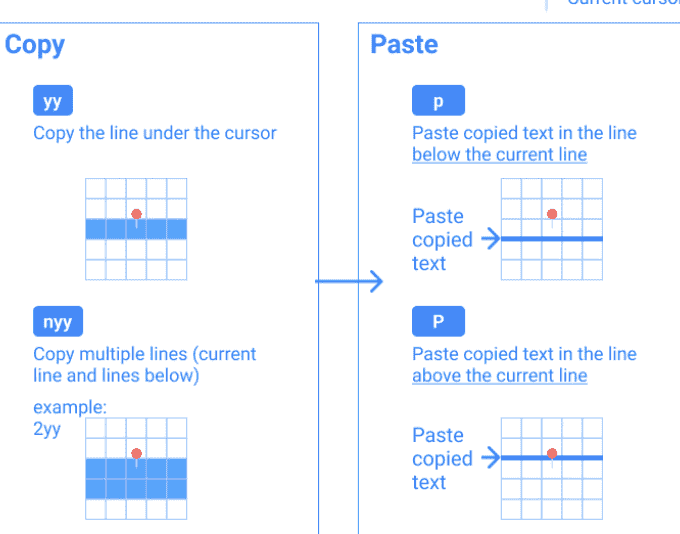

在普通模式下，你可以复制文本并将复制的内容粘贴到同一文档的特定位置。

### 复制 - y (yank) 命令

- `yy`: 复制光标所在的行
- `nyy`: 复制多行（当前行及下方行）

### 粘贴 - p (paste) 命令

- `p`: 将复制的文本粘贴到当前行的下方
- `P`: 将复制的文本粘贴到当前行的上方

## 普通模式 (4) - 撤销和重做

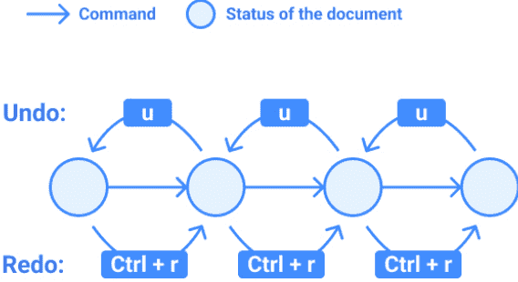

当你反转操作时，可以通过按下`u`键使用撤销命令。如果你想执行相同的操作（反转撤销操作），按下`Ctrl + r`使用重做命令。

## 普通模式 (5) - 搜索

正向搜索短语 反向搜索短语

```
/ 搜索短语
```

```
? 搜索短语
```

在普通模式下，你可以搜索短语。使用`/`用于正向，使用`?`用于反向。输入搜索短语后按下回车键，`Vim`将进入搜索模式。在搜索模式下，你可以使用`n`移动到下一个短语，使用`N`移动到上一个。

## 普通模式 (6) - 替换短语

```
[:搜索区域]s/[短语]/[选项]
```

%: 全文档
n: 第 n 行
g: 替换所有
c: 确认

在普通模式下，你可以使用以下命令搜索短语并将其替换为新短语。

命令行 - 交互

```
[:搜索区域]s/[短语]/[选项]
```

### 搜索区域

- `%` 在整个文档中搜索并替换短语
- `n` 在第 `n` 行搜索并替换短语

### 选项

- `g` 替换所选区域内所有的短语。如果你选择整个文档，选项 `g` 是默认设置。
- `c` : 逐个确认替换

### 示例

在第 3 行将第一个 A 替换为 B（不确认）

命令行 - 交互

```
:3s/A/B
```

在第 3 行将所有的 A 替换为 B（不确认）

命令行 - 交互

```
:3s/A/B/g
```

在第 3 行将所有的 A 替换为 B（逐个确认）

命令行 - 交互

```
:3s/A/B/gc
```

## 普通模式 (7) - 保存并退出

| 权限 | 针对文件 |
|---|---|
| `w` | 写入（保存）当前文件的更改，但不退出 |
| `w file_name` | 写入（保存）新文件的更改，但不退出 |
| `q` | 退出（当没有未保存的更改时） |
| `q!` | 不保存更改退出 |
| `wq` | 写入（保存）当前文件的更改并退出 |
| `wq file_name` | 写入（保存）新文件的更改并退出 |

要保存更改并退出 `Vim`，可以使用 `w` (写入) 和 `q` (退出) 命令的组合。1 用于强制执行命令。

- `:w` : 写入（保存）当前文件的更改，但不退出
- `:w file_name` : 写入（保存）新文件的更改，但不退出
- `:q` : 退出（当没有未保存的更改时）
- `:q!` : 不保存更改退出
- `:wq` : 写入（保存）当前文件的更改并退出
- `:wq file_name` : 写入（保存）新文件的更改并退出

### 注意：退出

当你即使做了一些更改但使用 `:q` 命令退出时，会遇到下所示错误。

命令行 - 响应

```
E37: No write since last change (add ! to override)
```

如果你确定要在不保存更改的情况下退出 `Vim`，请运行 `:q!` 命令。

命令行 - 交互

```
:q!
```

## 插入模式

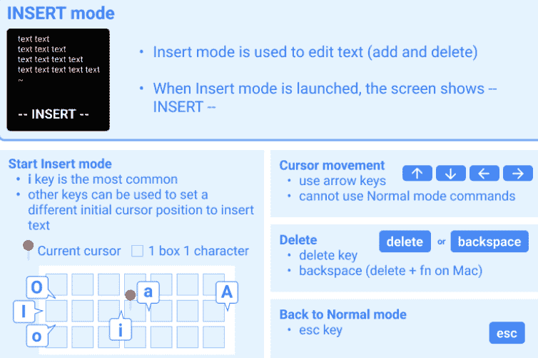

插入模式用于编辑文本（添加和删除）。当启动插入模式时，屏幕会显示 `-- INSERT --`。

### 开始插入模式


`i` 键是最常用的键，但也有其他键可以设置不同的初始光标位置来插入文本。

- `i`: 在光标前插入
- `I`: 在当前行开头插入
- `a`: 在光标后追加（插入）
- `+`: 在当前行末尾追加（插入）
- `+`: 在当前行下方打开（添加）新行
- `+`: 在当前行上方打开（添加）新行

# 光标移动

在插入模式下，你不能使用普通模式下的光标移动命令，因为普通的键盘输入会被视为文本输入。你需要使用方向键在文本文件中移动光标。

# 删除

你可以使用 `delete` 键，该键在普通模式下是禁用的。你也可以使用 `backspace` 键（Mac 上为 `delete` + `fn`）。

# 返回普通模式

要切回普通模式，请按 `esc` 键。

# 视觉模式

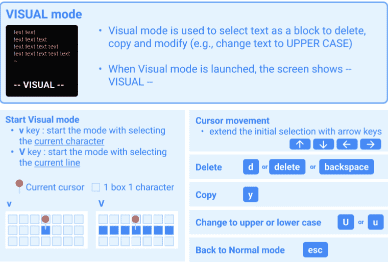

视觉模式用于选择文本块以进行删除、复制和修改（例如，将每个单词的首字母大写）。当启动视觉模式时，屏幕会显示 `-- VISUAL --`。

## 视觉模式

- `+`: 从选择当前字符开始进入视觉模式
- `-`: 从选择当前行开始进入视觉模式

# 光标移动

在视觉模式下，你主要可以使用方向键来扩展对字符或行的初始选择（取决于你如何启动视觉模式）。

# 使用 V 键开始

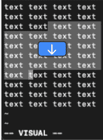

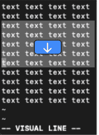

# 删除

你可以使用 `d` 键、`delete` 键或 `backspace`（Mac 上为 `delete` + `fn`）来删除选中文本。

# 复制

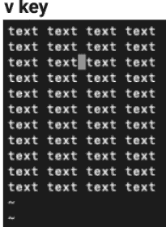

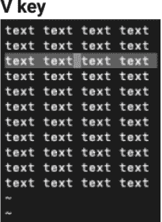

你可以使用 `y` 键复制（yank）所选文本。一旦复制了选中文本，`Vim` 就会返回普通模式。你可以在普通模式下粘贴复制的内容。

# 转换为大写或小写

你可以使用 `U` 或 `u` 键将所选文本转换为大写或小写。

- `U`：将所选文本转换为大写
- `u`：将所选文本转换为小写

这是一个将所选文本转换为大写的示例。

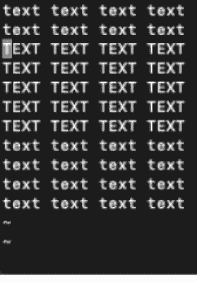

# 返回普通模式

要返回普通模式，请按 `esc` 键。此外，在你运行命令（例如删除或复制）后，`Vim` 会自动返回普通模式。

# 第 4 章

用户、组与权限

本章涵盖了如何在 `Linux` 上管理用户、组和权限。

本章主要涵盖了以下主题。

## 主题

1. `Linux` 中的用户、组和权限是什么？
2. 按所有者状态划分的权限（访问模式）
3. 超级用户（`Root` 用户）与普通用户
4. `sudo`（以超级用户权限运行命令）
5. `su`（切换用户）
6. `useradd`（添加用户）
7. `passwd`（设置密码）
8. `userdel`（删除用户）
9. 组 - 主组和附加组
10. `groupadd`（添加组）
11. `usermod`（修改账户信息）
12. `gpasswd`（向组添加和删除用户）
13. `groupdel`（删除组）
14. `chown`（更改文件和目录的所有者）
15. `chgrp`（更改文件和目录的组）
16. `chmod`（更改访问模式）
17. 使用数字的 `chmod` 命令
18. `w` 和 `who`（检查当前登录状态）
19. `id` 和 `groups`（检查用户 `ID` 和组）
20. `getent`（显示用户和组数据）

# Linux 中的用户、组和权限是什么？

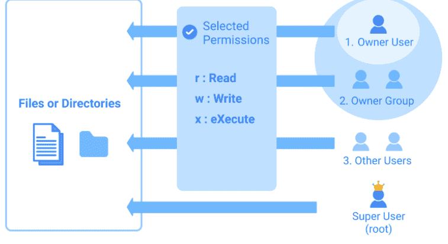

- 所有文件和目录根据用户状态拥有权限设置（访问模式）
- 超级用户（`root`）拥有所有文件和目录的权限

### 超级用户（root 用户）与普通用户

在 `Linux` 中有两种类型的用户：**`超级用户`** 和 **`普通用户`**。超级用户是一个用于系统管理的特殊账户。超级用户拥有所有 `Linux` 系统资源的权限，而普通用户根据每个文件和目录的权限设置，对 `Linux` 系统资源的访问权限有限。

# 文件和目录所有者

每个文件或目录都有一个所有者。通常，创建文件或目录的用户就是其所有者。

### 组

在 `Linux` 中，你可以通过组来管理用户。当用户注册在组中时，文件和目录的权限管理会更高效。组有两种：**`主组`** 和 **`附加组`**。主组在创建新文件时使用。

# 所有者状态

文件或目录有三种所有者状态。

1. **所有者（文件或目录）**：通常创建文件或目录的用户是所有者。你可以通过运行 `chown` 命令更改所有者。
2. **所有者组**：通常，所有者的主组成为文件或目录的所有者组。你可以通过运行 `chgrp` 命令更改所有者组。
3. **其他**：不在文件或目录所有者组的用户。

### 权限（访问模式）

根据文件或目录的所有者状态，文件或目录的可访问性可能不同。这被称为**权限**或**访问模式**。当你带有 `-l` 选项运行 `ls` 命令时，你可以看到按用户状态划分的访问模式。

```
drwxr-xr-x 3 usr_a staff 4096 Jul 16 2020 media
-rwxr-xr-x 15 usr_b staff 3180 Dec 21 12:53 sample.txt
```

# 按所有者状态划分的权限（访问模式）

```
drw-r-x 3 usr_a staff 4096 Jul 16 2020 media
```


`ls -l` 命令提供了目录或文件的访问模式信息。以下是读取信息的关键点。

# 三种用户类型

根据三种所有者状态，每种类型的访问模式都不同。通过运行 `ls -l` 命令，你会看到定义访问模式的 9 个字符。

- 前三个字母：所有者的访问模式
- 间三个字母：所有者组的访问模式
- 最后三个字母：其他用户的访问模式

# 读 (r)、写 (w) 和执行 (x) 权限

有三种权限（访问模式）：读 (`r`)、写 (`w`) 和执行 (`x`)。权限的含义对于文件和目录略有不同。

对于文件：

- 读 (`r`)：读取文件
- 写 (`w`)：编辑文件
- 执行 (`x`)：运行文件中定义的命令

对于目录：

- 读 (`r`)：列出目录下的文件和目录名称（读取目录内容）
- 写 (`w`)：在目录中创建和删除文件并重命名文件
- 执行 (`x`)：将该目录设置为当前工作目录 (`CWD`)

| 权限 | 文件 | 目录 |
| :--- | :--- | :--- |
| 读取 (`r`) | 能够读取文件 | 能够列出目录下的文件和目录名（读取目录内容） |
| 写入 (`w`) | 能够编辑文件 | 能够在目录中创建、删除文件并重命名 |
| 执行 (`x`) | 能够运行文件中定义的 | 能够将目录设置为当前工作目录 (`CWD`) |

## 超级用户 (Root 用户) 与 普通用户

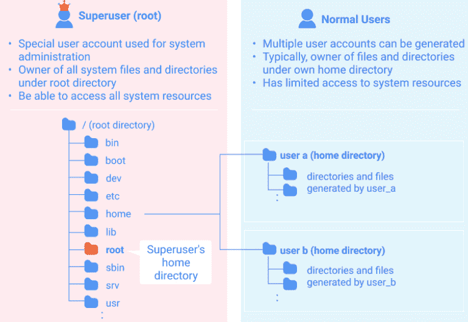

在 `Linux` 中，有两种用户——**`超级用户`**(`superuser`) 和 **`普通用户`**(`normal user`)。超级用户是一个用于系统管理的特殊用户账户。超级用户拥有所有 `Linux` 系统资源的权限，而普通用户根据每个文件和目录的权限设置，对 `Linux` 系统资源的访问受到限制。

## 超级用户

超级用户是一个用于系统管理的特殊用户账户。它也被称为 **`root`**。作为默认设置，超级用户是 `/`（根）目录下所有系统文件和目录的所有者，并对所有系统资源拥有所有权限（读取、写入和执行）。

## 普通用户

普通用户是指所有非超级用户的用户。你可以创建多个普通用户。通常，每个用户在 `/home` 路径下都有自己的家目录。普通用户对家目录之外的目录和文件的访问权限有限。例如，虽然普通用户可以读取根目录下的某些目录和文件，但他们无法覆盖这些目录和文件。对于 `root`（`root` 用户的家目录）和 `lost+found` 等目录，普通用户甚至无法查看其内部目录和文件。

你可以通过运行以下命令进行检查。

## 命令行 - 输入

```
ubuntu $ | ls /lost+found
```

# 命令行 - 

```
ls: cannot open directory '/lost+found': Permission denied
```

## 练习

为了查看超级用户 (`root`) 和普通用户之间的区别，让我们在 `Linux` 系统上检查它们。

### 1. 检查根目录

进入 `/`（根）目录并执行 `ls -l` 命令。

## 命令行 - 输入

```
ubuntu $ | cd / 
ubuntu $ | ls -l
```

你会看到所有者用户和所有者组都是 `root`（超级用户）。

## 命令行 - 响应


```
total 64
1 root root 7 Jul 16 2020 -> usr/bin
drwxr-xr-x 3 root 4096 Dec 22 06:38 boot
drwxr-xr-x 15 root 3180 Dec 21 12:53 dev
drwxr-xr-x 9 root 4096 Dec 23 16:40 etc
drwxr-xr-x 3 root 4096 Dec 21 09:22 home
drwxr-xr-x 1 root 7 Jul 16 2020 lib -> usr/lib
drwxr-xr-x 1 root 9 Jul 16 2020 lib32 -> usr/lib32
drwxr-xr-x 1 root 9 Jul 16 2020 lib64 -> usr/lib64
drwxr-xr-x 1 root 10260 Jun 2020 lib32 -> usr/lib32
drwx---- 2 root 16386 Jun 2020 lost+found
drwxr-xr-x 2 root 4096 Jul 16 2020 media
drwxr-xr-x 2 root 4096 Jul 16 2020 mnt
drwxr-xr-x 3 root 4096 Dec 22 01:52 opt
dr-xr-xr-x 142 root 0 Dec 21 09:22 proc
drwx------ 4 root 4096 Dec 21 09:23 root
drwxr-xr-x 26 root 1020 Dec 25 06:55 run
drwxr-xr-x 1 root 8 Jul 16 2020 sbin -> usr/sbin
drwxr-xr-x 8 root 4096 Dec 21 12:52 snap
drwxr-xr-x 2 root 4096 Jul 16 2020 srv
dr-xr-xr-x 13 root 0 Dec 21 09:22 sys
drwxr-xr-x 12 root 4096 Dec 25 06:54 tmp
drwxr-xr-x 14 root 4096 Jul 16 2020 usr
drwxr-xr-x 13 root 4096 Jul 16 2020 var
```

### 2. 检查家目录

进入 `/home` 目录并执行 `ls -1` 命令。

#### 命令行 - 输入

```
ubuntu $ | cd /home
ubuntu $ | ls -1
```

你会看到所有者和所有者组都是 `ubuntu`（普通用户）。

#### 命令行 - 响应

```
total 4
drwxr-xr-x 5 ubuntu 4096 dec 22 13:24 ubuntu
```

## `sudo` (以超级用户权限运行命令)

#### `[xx]` 参数

```
sudo [command]
```

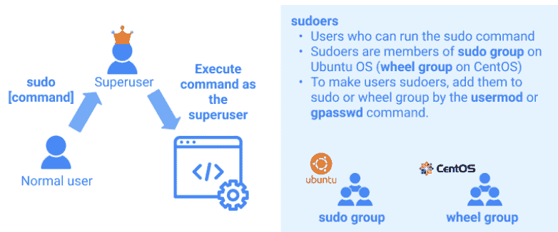

### 什么是 `sudo`？

`sudo` (Super DO) 命令允许用户以超级用户的安全权限运行程序。普通用户没有某些命令的执行权限，例如安装新库。

频繁地以超级用户身份登录系统可能会增加安全风险，例如密码泄露。通过使用 `sudo` 命令，你可以在不切换到超级用户的情况下执行这些命令。

### 谁可以运行 `sudo` 命令？`sudoers`

并不是所有用户都能执行 `sudo` 命令。能够执行 `sudo` 命令的用户必须是 Ubuntu 系统中 `sudo` 组的成员。在 CentOS 中，`wheel` 组的成员可以执行该命令。`sudo` 或 `wheel` 组的用户可以作为超级用户，通过编辑用户组来管理服务器管理员。在 Ubuntu 中，你也可以使用 `admin` 组代替 `sudo` 组。

## 注意：将用户添加到 `sudo` 或 `wheel` 组

通过运行 `usermod` 命令将用户添加到 `sudo` 组（Ubuntu）或 `wheel` 组（CentOS），赋予其运行 `sudo` 的权限。请注意，这两个命令的参数顺序不同。在 `usermod` 中，你需要先指定组，而在 `gpasswd` 中需要先指定用户。关于 `usermod` 和 `gpasswd` 的细节将在后面介绍。以下是示例命令。

### Ubuntu 示例

**命令行 - 输入**

```
ubuntu $ | sudo usermod -aG sudo user_a
```

或者

**命令行 - 输入**

```
ubuntu $ | sudo gpasswd -a user_a sudo
```

### CentOS 示例

**命令行 - 输入**

```
ubuntu $ | sudo usermod -aG wheel user_a
```

或者

**命令行 - 输入**

```
ubuntu $ | sudo gpasswd -a user_a wheel
```

## `su` (切换用户)


`su [用户名]`

* 临时切换到另一个用户
* 普通用户 `A` -> 普通用户 `B`
* `- -` 选项
    * 在切换到另一个用户时更改用户环境（例如，用户的家目录）
* 退出
* 切换回原始用户

`sudo su`

* 临时切换到超级用户
* 普通用户 `A` -> 超级用户


`su` 命令用于临时切换到另一个用户。你也可以切换到超级用户。切换到超级用户在设置新服务器时特别有用，因为需要几项新设置，例如添加新用户、密码、组以及其他若干系统配置。

### 切换到另一个普通用户：`su [用户名]`

当运行命令时指定用户名，就可以切换到该用户。在切换到该用户之前，你需要先添加该用户，这将在后文中解释。

#### 切换到超级用户：`sudo su`

当你运行 `su` 命令时不带任何用户名时，就可以切换到超级用户。由于普通用户通常没有切换到超级用户的权限，因此在运行 `su` 命令时需要加上 `sudo` 前缀。

### 更改用户环境：`- -` 选项

通过添加 `- -` 选项，你也可以更改用户环境。例如，当使用 `-` 选项切换到超级用户时，你的命令行当前工作目录将更改为 `/root`（`root` 用户的家目录）。

### 切换回原始用户：`exit`

要切换回原始用户，你可以运行 `exit` 命令。如果你运行了多次 `su` 命令，则需要运行相同次数的 `exit` 命令回到原始用户。

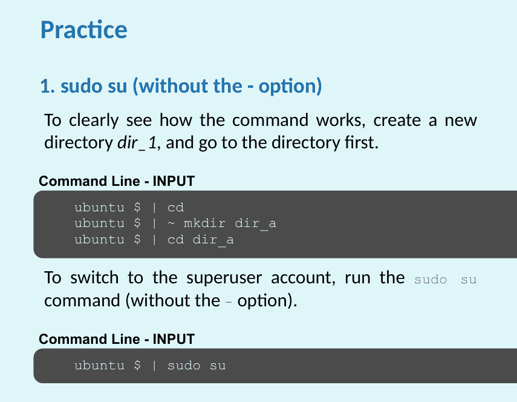

你可以看到用户名已变为 `root`，且 `$` 符号变为了 `#`。此外，你可以看到在 `#` 之前显示的当前目录路径发生了变化，尽管当前目录的位置没有变。这是因为你的家目录发生了变化。

#### 命令行 - 输入

```
root:/home/ubuntu/dir_a# | |
```

要检查状态，运行 `cd ~` 命令进入家目录。

#### 命令行 - 输入

```
root:/home/ubuntu/dir_a# | cd ~
```

```
root:~# | |
```

使用 `pwd` 命令检查当前工作目录。你可以看到家目录变成了 `/root`（但不再是在 `ubuntu` 下了）。

#### 命令行 - 输入

```
root:~# | pwd
```

#### 命令行 - 响应

```
/root
```

### 2. `sudo su -`

首先，通过运行 `exit` 命令退出 `sudo` 状态。你会看到用户已切换回 `ubuntu`，当前工作目录已移回原始位置。

#### 命令行 - 输入

```
root:~# | exit
```

```
ubuntu:~/dir_a$ |
```

运行带有 `-` 选项的 `sudo su` 命令。你可以看到用户已切换到 `root`，且当前工作目录已更改为新的家目录。

#### 命令行 - 输入

```
ubuntu:~/dir_a$ | sudo su -
```

```
root:~# |
```

运行 `pwd` 命令。你可以确认家目录已更改为 `/root`。

#### 命令行 - 输入

```
root:~# | pwd
```

#### 命令行 - 响应

```
/root
```

## `useradd` (添加用户)

`[参数]`

```
useradd -m [用户名]
```

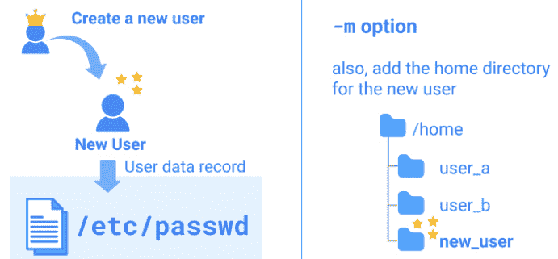

`useradd` 命令用于创建一个新用户。通常，`useradd` 命令带有 `-m` 选项，用于为用户创建家目录。通过此命令，超级用户（或 `sudoers` 用户）可以控制用户的登录（例如，锁定和解锁用户账户、删除或覆盖用户密码、设置密码有效期）。（注：此处原文存在大量重复段落，已按要求去重处理）

`useradd` 命令用于创建一个新用户。

要切换到超级用户，请运行以下命令。

#### 命令行 - 输入

```
root:~# | exit
```

创建新密码时，系统要求输入两次密码。


## 命令行 - 交互式

```
New password:
Retype new password:
password: password updated successfully
```

## 由用户更改密码

普通用户也可以更改自己的密码。让我们通过创建的 `user_a` 来演示这一过程。

要查看如何更改密码，首先切换到 `user_a`。你需要输入密码来切换到 `user_a`。要确认 `user_a` 是否为当前用户，请运行 `id` 命令。`id` 命令会显示当前用户的用户 ID 和组 ID。

## 命令行 - 输入

```
ubuntu $ | su user_a
```

## 命令行 - 交互式

```
Password:
```

## 命令行 - 输入

```
$ | id
```

## 命令行 - 响应

```
uid=1001(user_a) gid=1001(user_a) groups=1001(user_a)
```

要更改 `user_a` 的密码，运行 `passwd` 命令。你需要输入当前密码，然后输入两次新密码。

## 命令行 - 输入

```
passwd
```

## 命令行 - 交互式

```
Changing password for user_a.
Current password:
New password:
Retype new password:
```

```
passwd: password updated successfully
```

## 管理账户登录

超级用户（`root`）具有管理用户密码的权限。例如，超级用户（或 `sudoers` 用户）可以像下面的示例所示，无需输入用户的当前密码即可覆盖用户的密码。

## 命令行 - 输入

```
ubuntu $ | sudo passwd user_a
```

## 命令行 - 交互式

```
New password:
Retype new password:
passwd: password updated successfully
```

超级用户（或 `sudoers` 用户）还可以执行其他操作：

- `-d`: 删除普通用户的密码
- `-l`: 锁定用户账户
- `-u`: 解锁已锁定的用户账户
- `-e`: 强制用户密码过期

以下是锁定和解锁用户的示例。

### `-l` 选项

当使用 `-l` 选项锁定账户后，尝试切换到 `user_a`，你会看到身份验证失败。

## 命令行 - 输入

```
ubuntu $ | sudo passwd -l user_a
```

## 命令行 - 响应

```
passwd: password expiry information changed.
```

## 命令行 - 输入

```
ubuntu $ | su user_a
```

## 命令行 - 交互式

```
su: Authentication failure
```

### `-u` 选项

使用 `-u` 选项，你可以解锁用户。

## 命令行 - 输入

```
ubuntu $ | sudo passwd -u user_a
```

## 命令行 - 响应

```
password: password expiry information changed.
```

## 命令行 - 输入

```
ubuntu $ | su user_a
```

## 命令行 - 交互式

```
Password:
$
```

输入密码后，你就可以切换到 `user_a`。

### `-e` 选项

这是一个用户密码过期的示例。你可以看到，当你将用户账户切换到 `user_a` 时，你需要更改 `user_a` 的密码。

## 命令行 - 输入

```
ubuntu $ | sudo passwd -e user_a
```

## 命令行 - 响应

```
password: password expiry information changed.
```

## 命令行 - 输入

```
ubuntu $ | su user_a
```

首先，命令行会要求输入 `user_a` 的当前密码。

## 命令行 - 交互式

```
Password:
```

输入密码后，命令行将要求更改密码。

## 命令行 - 交互式

```
You are required to change your password immediately (administrator enforced)
Changing password for user_a.
Current password:
New password:
Retype new password:
```

## userdel (删除用户)

### [xx] 参数

`userdel [用户名]`


`userdel` (USER DELete) 命令用于删除现有的用户。使用 `-r` 选项，可以同时删除其主目录。要运行此命令，你需要以超级用户权限运行。

## 删除用户及其主目录

要检查当前用户状态，请运行 `grep` 命令。由于我们创建了三个用户（`user_a`, `user_b`, `user_c`），你可以通过以 `"user"` 作为搜索词运行 `grep` 命令来查看这三个配置文件。

## 命令行 - 输入

```
ubuntu $ | grep user /etc/passwd
```

## 命令行 - 响应

```
user_a:x:1001:1001::home/user_a:/bin/sh
user_b:x:1002:1002::home/user_b:/bin/sh
user_c:x:1003::/home/user_c:/bin/sh
```

运行以下 `userdel` 命令来删除 `user_c` 及其主目录。

## 命令行 - 输入

```
ubuntu $ sudo userdel -r user_c
```

你可能会看到一条显示“mail spool not found”的消息，但这并不影响。

## 命令行 - 响应

```
userdel: mail spool not found
```

要确认 `user_c` 已删除，请运行 `grep` 命令。

## 命令行 - 输入

```
ubuntu $ | grep user /etc/passwd
```

## 命令行 - 响应

```
user_a:x:1001:1001::home/user_a:/bin/sh
user_b:x:1002:1002::home/user_b:/bin/sh
```

## usermod (修改用户信息)

### [xx] 参数

```
usermod [option] [option argument] [user name]
```

| 主组 | `usermod -g [Primary Group ID] [user]` |
| :--- | :--- |
| 附加组 | `usermod -aG [Secondary Group ID] [user]` |
| 用户 ID | `usermod -u [User ID] [user]` |
| 用户注释 | `usermod -c ["用户注释"] [user]` |
| 主目录 | `usermod -d [directory path] [user]` |

`usermod` (USER MODify) 命令用于修改用户配置文件。用户配置包括主组、附加组、用户 ID、用户注释和主目录路径等。

## 检查用户状态

当你更改用户配置文件时，需要检查其状态。`/etc/passwd` 文件包含了大多数用户信息数据，但它不包含用户所属的附加组。为了获得全面的视图，你需要运行 `groups` 或 `id` 命令，或者检查 `/etc/group` 文件。

### 1. 检查 `/etc/passwd` 信息

有几种方法可以检查 `/etc/passwd` 文件。

- `grep [user name] /etc/passwd`
- `getent passwd [user name]`
- `cat /etc/passwd`

由于 `cat` 命令显示文档中包含的所有数据，因此 `grep` 或 `getent` 命令更高效。

例如，要检查 `user_a` 的用户信息，你可以运行下面的任意命令之一。

## 命令行 - 输入

```
ubuntu $ | grep user_a /etc/passwd
```

或者

```
ubuntu $ | getent passwd user_a
```

你将得到如下所示的信息。

## 命令行 - 响应

```
user_a:x:1001:1001::/home/user_a:/bin/sh
```

此结果显示了如下：

- 用户 ID: `1001`
- 主组 ID: `1001`
- 用户注释: `n/a`
- 主目录路径: `/home/user_a`
- 默认 Shell: `/bin/sh`

### 2. 检查组信息

有几种方法可以检查用户所属的所有组。

- `groups [user name]`
- `id [user name]`


- 通过`grep`、`getent`或`cat`命令检查`/etc/group`文件

运行`groups`或`id`命令是获取必要信息的更快方法。

例如，要检查`user_a`的组信息，你可以运行如下所示的`groups`命令。

## 命令行 - 输入

```
ubuntu $ | groups user_a
```

## 命令行 - 响应

```
user_a : user_a
```

此结果显示`user_a`仅属于其私有组。

## 修改用户主组 (-g 参数)

要更改用户的主组，请以管理员身份运行`usermod -g [group ID 或名称][user name]`。例如，要将`user_a`的主组改为`group_a`，请运行下面的命令。

## 命令行 - 输入

```
$ sudo su -
```

```
root # | usermod -g group_a user_a
```

要检查主组状态，请运行下面的命令。

## 命令行 - 输入

```
root # | grep user_a /etc/passwd
```

你可以看到主组 ID 变成了 1003，这正是`group_a`的组 ID。

## 命令行 - 响应

```
user_a:x:1003::/home/user_a:/bin/sh
```

## 添加到附加组 (-aG 参数)

要添加新组，请以超级用户身份运行`usermod -aG [group ID 或名称] [user name]`。例如，要将`sudo`组添加到`user_a`的附加组，请运行下面的命令。

## 命令行 - 输入

```
root # | usermod -ag sudo user_a
```

要检查组状态，请运行`groups`命令。

## 命令行 - 输入

```
root # | groups user_a
```

你可以看到`sudo`组已添加到`user_a`的附加组中。

## 命令行 - 响应

```
user_a : group_a_sudo
```

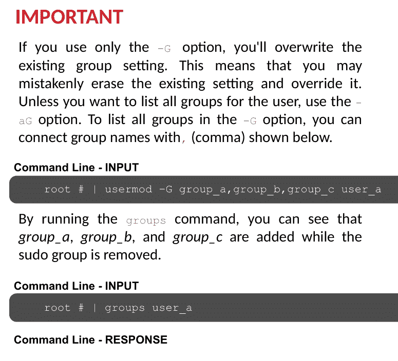

> 注意

如果你只使用`-G`参数，它将覆盖现有的组设置。这意味着你可能会误删现有的设置并进行覆盖。除非你想列出用户所有的组，否则请使用`aG`参数。要在`-G`参数中列出所有组，你可以用逗号（`,`）连接组名，如下所示。

## 命令行 - 输入

```
root # | usermod -G group_a,group_b,group_c user_a
```

通过运行`groups`命令，你可以看到`group_a`、`group_b`和`group_c`已添加，而`sudo`组被移除。

## 命令行 - 输入

```
root # | groups user_a
```

## 命令行 - 响应

```
user_a : group_a group_b group_c
```

## 修改用户 ID (-u 参数)

要更改用户 ID，请以超级用户身份运行`usermod -u [user ID] [user name]`命令。例如，要将`user_a`的用户 ID 更改为 2001，请运行下面的命令。

## 命令行 - 输入

```
root # usermod -u 2001 user_a
```

要检查`user_a`的用户 ID，请检查`/etc/passwd`文件。你可以看到用户 ID 已变为 2001。

## 命令行 - 输入

```
root # | grep user_a /etc/passwd
```

## 命令行 - 响应

```
user_a:x:2001:1003::/home/user_a:/bin/sh
```

## 修改用户注释 (-c 参数)

要更改用户注释，请以超级用户身份运行`usermod -c "Comment" [User name]`命令。例如，要将`user_a`的注释改为“comment for user_a”，请运行下面的命令。

## 命令行 - 输入

```
root # | usermod -c "comment for user_a" user_a
```

要检查`user_a`的用户注释，请检查`/etc/passwd`文件。你可以看到新注释已添加到文件中。

## 命令行 - 输入

```
root # | grep user_a /etc/passwd
```

## 命令行 - 响应

```
user_a:x:2001:1002:comment for user_a:/home/user_a:/bin/sh
```

注：注释通常用于用户的全名或其他与用户相关的信息。

## 修改用户主目录 (-d 参数)

要更改用户的主目录，请以超级用户身份运行`usermod -d [directory path] [user name]`命令。例如，要将`user_a`的主目录改为`/home/normal_user/user_a`，请运行下面的命令。

## 命令行 - 输入

```
root # | mkdir -p /home/normal_user/user_a
root # | usermod -d /home/normal_user/user_a user_a
```

要检查`user_a`的主目录路径，请切换到`user_a`并运行命令。

## 命令行 - 输入

```
root # | cd user_a
root # | pwd
```

```
/home/normal_user/user_a
```

# 命令行 - 交互式

```
nogroup:x:65534:
group_a:x:1003:user_a
group_c:x:1005:user_a
```

## chown (更改文件和目录的所有者)

[xx] 参数

### chown [用户名] [文件或目录路径]

更改所有者

- `-R` 选项

更改指定

目录树的所有权


`chown` (ChangeOWNer) 命令用于更改文件或目录的所有者。使用`-R`选项，你可以更改指定目录下的所有文件和目录的所有者。

为了演示`chown`命令，我们将在超级用户权限下在`user_a`的家目录下创建一些目录和文件。

## 命令行 - 输入

```
root # | cd /home/user_a
root # | mkdir -p dir_a1/dir_a2
root # | mkdir -p dir_b1/dir_b2
root # | touch file_a
```

通过运行上述命令，你可以在`user_a`的家目录下创建以下目录树。

```
user_a
| dir_a1
```

```
dir_a2
dir_b1
dir_b2
file_a
```

```

## 检查所有者状态

由于目录和文件是由超级用户创建的，目录和文件的所有者和所有组被设置为`root`。

## 命令行 - 输入

```
root:/home/user_a# | ls -l
```

## 命令行 - 响应

| | | | 大小 | 日期 | 时间 | 名称 |
|---|---|---|---|---|---|---|
| `drwxr-xr-x` | 3 | `root` | 4096 | Jan 2 | 15:31 | `dir_a1` |
| `drwxr-xr-x` | 3 | `root` | 4096 | Jan 2 | 15:31 | `dir_b1` |
| `-rw-r--r--` | 1 | `root` | 0 | Jan 2 | 15:31 | `file_a` |

## 命令行 - 输入

```
root:/home/user_a# | ls -1 dir_a1
```

## 命令行 - 响应

| | | | 大小 | 日期 | 时间 | 名称 |
|---|---|---|---|---|---|---|
| `drwxr-xr-x` | 2 | `root` | 4096 | Jan 2 | 15:31 | `dir_a2` |

## 命令行 - 输入

```
root:/home/user_a# | ls -1 dir_b1
```

## 命令行 - 响应

| | | | 大小 | 日期 | 时间 | 名称 |
|---|---|---|---|---|---|---|
| `drwxr-xr-x` | 2 | `root` | 4096 | Jan 2 | 15:31 | `dir_b2` |

## 更改文件或目录的所有者

要更改单个文件或目录的所有者，你可以简单运行不带任何选项的`chown`命令。例如，要将`file_a`的所有者改为`user_a`，请运行以下命令。

## 命令行 - 输入

```
root:/home/user_a# | chown user_a file_a
```


通过运行`ls -1`命令检查`file_a`的所有者状态。你可以看到文件所有者已更改为`user_a`。

## 命令行 - 输入

```
root:/home/user_a# | ls -1 file_a
```

## 命令行 - 响应

```
-rw-r--r-- 1 user_a root 0 Jan 2 15:31 file_a
```

## 递归更改整个目录的所有者

要更改整个目录（包括子目录和下面的文件）的所有者，你可以使用`-R`选项。例如，要将`dir_a1`目录树的所有者改为`user_a`，请运行以下命令。

## 命令行 - 输入

```
root:/home/user_a# | chown -R user_a dir_a1
```

通过运行`ls -1`命令检查`dir_a1`和`dir_a2`的所有者状态。你可以看到两个目录的所有者都已更改为`user_a`。

## 命令行 - 输入

```
root:/home/user_a# | ls -1
```

## 命令行 - 响应

```
total 8
drwxr-xr-x 3 user_a root 4096 Jan 2 15:31 dir_a1
drwxr-xr-x 3 root 4096 Jan 2 15:31 dir_b1
-rw-r--r-- 1 user_a root 0 Jan 2 15:31 file_a
```

## 命令行 - 输入

```
root:/home/user_a# | ls -1 dir_a1
```

## 命令行 - 响应

```
total 4
```

## 递归更改整个目录的所有者和组所有者

要同时更改所有者和所有组，你可以使用以下语法（在组名后加冒号，然后加用户名）：

```
chown -R [用户名] : [组名] [目录路径]
```

例如，要将`dir_b1`目录的所有者和组改为`user_a`，请运行以下命令。

## 命令行 - 输入

```
root:/home/user_a# | chown -R user_a:user_a dir_b1
```

通过运行`ls -1`命令检查`dir_a1`和`dir_a2`的所有者状态。你可以看到两个目录的所有者都已更改为`user_a`。

## 命令行 - 输入

```
root:/home/user_a# | ls -1
```

## 命令行 - 响应

```
total 8
drwxr-xr-x 3 user_a root 4096 Jan 2 15:31 dir_a1
drwxr-xr-x 3 root 4096 Jan 2 15:31 dir_b1
-rw-r--r-- 1 user_a root 0 Jan 2 15:31 file_a
```

---

```
rw-r-- 4 ubuntu ubuntu 4096 Jan 2 08:32 file_x
ownergroup
owner
```

## 使用数字的`chmod`命令

- `[xx]`参数

```
chmod [访问模式数字] [文件或目录路径]
```

| 权限 | 数字 |
|---|---|
| `r` | 4 (rwx) |
| `w` | 2 (rw-) |
| `x` | 1 (r-x) |
| | 3 (r--) |
| | 0 (-wx) |
| 若要定义唯一的访问模式，将每种权限的数字相加 | 1 (--) |
| | 0 (---) |

| 所有者用户 | 所有者组 | 其他用户 |
|---|---|---|
| 7 (rwx) | 4 (r--) | 4 (--) |

- 所有者用户具有完全权限
- 所有者组和其他用户只有读取权限

为了更高效地管理多种组合并定义每个文件或目录的访问模式，分配的数字也被用于设置访问模式。每种权限的数字分配如下所示。

- `r`: 4
- `w`: 2
- `x`: 1
- `-`: 0

通过所有数字之和，你可以用一个数字代表一种用户类型的所有访问模式。为了涵盖三种用户类型，你只需要三个数字。以下是一些示例。

`755`：超级用户创建目录时的典型访问模式

- 所有者用户：`rwx`
- 所有者组：`r-x`
- 其他用户：`r--`

`775`：普通用户创建目录时的典型访问模式

- 所有者用户：`rwx`
- 所有者组：`rwx`
- 其他用户：`r--`

`644`：超级用户创建目录时的典型访问模式

- 所有者用户：`rw-`
- 所有者组：`r--`
- 其他用户：`r--`

`664`：普通用户创建目录时的典型访问模式

- 所有者用户：`rw-`
- 所有者组：`rw-`
- 其他用户：`r--`

`700`：`.ssh`目录的典型权限

- 所有者用户：`rwx`
- 所有者组：`---`
- 其他用户：`---`

`600`：典型的`ssh`私钥权限

- 所有者用户：`rw-`
- 所有者组：`---`
- 其他用户：`---`

## 练习

### 1. 创建新文档时确认初始权限设置

要检查初始权限，请创建四类文档：

+ 一个由普通用户创建的目录(`dir_ubuntu`)
- 一个由普通用户创建的文件(`file_ubuntu`)
- 一个由超级用户创建的目录(`dir_root`)
- 一个由超级用户创建的文件(`file_root`)

创建这些文档，请运行以下命令。

## 命令行 - 输入

```
ubuntu:~$ | mkdir dir_ubuntu
ubuntu:~$ | touch file_ubuntu
ubuntu:~$ | sudo su
```

```
root:/home/ubuntu# | mkdir dir_root
root:/home/ubuntu# | touch file_root
```

运行`ls -l`命令查看每个文档的权限。你可以发现初始设置与本节解释的相同。

## 命令行 - 输入

```
root:/home/ubuntu# | ls -l
```

```
drwx-xr-x 2 root root 4096 Jan 3 01:36 dir_root
drwx-xr-x 2 ubuntu ubuntu 4096 Jan 3 01:37 dir_ubuntu
-rw-r--r-- 1 root root 0 Jan 3 01:36 file_root
-rw-rw--r-- 1 ubuntu ubuntu 0 Jan 3 01:37 file_ubuntu
```

### 2. 使用数字更改访问模式

要将`dir_ubuntu`的访问模式更改为`700`，`file_ubuntu`更改为`600`，请运行以下命令。

```
root:/home/ubuntu# | chmod 700 dir_ubuntu
root:/home/ubuntu# | chmod 600 file_ubuntu
```

```
root:/home/ubuntu# | ls -l
```

```
drwx-xr-x 2 root root 4096 Jan 3 01:36 dir_root
drwx-xr-x 2 ubuntu ubuntu 4096 Jan 3 01:37 dir_ubuntu
-rw-r--r-- 1 root root 0 Jan 3 01:36 file_root
-rw-rw---- 1 ubuntu ubuntu 0 Jan 3 01:37 file_ubuntu
```

## `w`和`who`（检查当前用户登录状态）

| `who` | `w` |
| :--- | :--- |
| 显示谁正在登录 | 显示谁正在登录以及他们在做什么 |

`who`命令用于显示当前登录用户的登录记录。`w`命令也用于显示当前登录的用户，但除此之外，它提供了他们正在做什么的信息。这些命令不会捕捉未登录用户的信息。

这是`who`命令的一个结果示例。

## 命令行 - 输入

```
ubuntu $ | who
```

## 命令行 - 响应

```
ubuntu pts/0 2023-01-03 01:34 0.00
```

这是`w`命令的一个结果示例。

## 命令行 - 输入

```
ubuntu $ | w
```

## 命令行 - 响应

```
ubuntu pts/0 2023-01-03 01:34 0.00
```

## `id`和`groups`（检查用户 ID 和组）

| `id` | `groups` |
| :--- | :--- |
| 显示用户的 UID 和 GID | 显示用户所属的组 |

`id`命令用于显示用户的 UID 和 GID。`groups`命令用于显示用户所属的组。

这是`id`命令的一个结果示例。

## 命令行 - 输入

```
ubuntu $ | id
```

## 命令行 - 响应

```
uid=1000(ubuntu) gid=1000(ubuntu) groups=1000(ubuntu)
```

这是`groups`命令的一个结果示例。

## 命令行 - 输入

```
ubuntu $ | groups
```

## 命令行 - 响应

```
ubuntu group
```


## getent（查询用户和组）

`getent` 命令用于从数据库查询条目（如 `/etc/passwd` 或 `/etc/group`）。

这是 `getent passwd` 命令的一个结果示例，用于显示用户详细信息。

命令行 - 输入

```
ubuntu | getent passwd
```

命令行 - 响应

```
user_a:x:2001:1003::/home/user_a:/bin/sh
```

这是 `getent group` 命令的一个结果示例，用于显示组信息。

命令行 - 输入

```
ubuntu | getent group
```

命令行 - 响应

```
group_a:x:1003:user_a
```

## 标准错误 (Stderr)

Linux 系统的预设标准错误输出通常是命令行（终端）。

以下是上述总结。

| 标准流 | 默认值 |
|---|---|
| 标准输入 (Stdin) | 键盘 |
| 标准输出 (Stdout) | 终端显示 |
| 标准错误 (Stderr) | 终端显示 |

## 重定向 (Redirection)

重定向用于更改 Stdin、Stdout 或 Stderr。在编程中，最常用的重定向选项是通过文本文件进行重定向。

### stdin 的重定向 (<)

要重定向标准输入，在命令后使用 `<` 并跟上新的标准输入路径。

```
command < file path for input
```

例如，如果你想对 `file_a` 的内容进行排序，运行下面的命令。

命令行 - 输入

```
ubuntu $ | sort < file_a
```

### stdout 的重定向 (> >>)

要重定向标准输出，在命令后使用 `>` 或 `>>`，并跟上新的标准输出路径。

当你使用 `>` 时，输出将覆盖现有内容；当你使用 `>>` 时，输出将追加到现有内容的末尾。

| 覆盖内容: | `command > file path for output` |
| 追加内容: | `command >> file path for output` |

例如，运行以下命令将 `ls` 命令对 `/`（根）目录的输出保存到 `list.txt` 文件中。为了避免权限错误，请以超级用户身份运行命令。

命令行 - 输入

```
ubuntu $ sudo su
```

```
root # | ls / > list.txt
```

你可以看到 `/`（根）目录下的目录和文件列表已保存在文件中。

命令行 - 输入

```
root # | cat list.txt
```

命令行 - 响应

```
bin
boot
dev
:
```

按照上述过程，运行这两个命令。一个是使用 `>` 列出 `/usr` 目录的目录和文件，另一个是使用 `>>` 列出同一个目录。

首先，运行下面显示的 `>>` 命令。你可以看到 `/usr` 目录的列表被添加到了 `/`（根）目录列表之后。

命令行 - 输入

```
root # | ls /usr >> list.txt
```

```
root # | cat list.txt
```

命令行 - 响应

```
bin
boot
dev
etc
home
lib
lib32
lib64
lib32
lost+found
:
bin
games
include
lib
lib32
lib64
libexec
lib32
local
sbin
share
src
```

接下来，运行下面所示带有 `>` 的相同命令。你可以看到 `/usr` 目录的列表覆盖了文件的原始内容。

命令行 - 输入

```
root # | ls /usr > list.txt
root # | cat list.txt
```

命令行 - 响应

```
bin
games
include
lib
lib32
lib64
libexec
lib32
local
sbin
share
src
```

### stderr 的重定向 (2> 或 2>>)

要重定向标准错误，在命令后使用 `2>` 或 `2>>`，并跟上新的标准错误路径。

| 覆盖内容: | `command 2> file path for error output` |
| 追加内容: | `command 2>> file path for error output` |

当你使用 `2>` 时，输出将覆盖现有内容；当你使用 `2>>` 时，输出将追加到现有内容的末尾。要查看它是如何工作的，请以普通用户身份运行下面的命令。由于普通用户没有读取 `/lost+found` 目录的权限，你将得到一个错误消息。

命令行 - 输入

```
ubuntu $ | ls /lost+found
```

命令行 - 响应

```
ls: cannot open directory '/lost+found': Permission denied
```

如果你想将错误消息重定向到 `error.txt` 文件，请运行相同的重定向命令。通过运行 `cat` 命令，你可以看到错误消息已保存在错误文件中。

命令行 - 输入

```
ubuntu $ | ls /lost+found 2> error.txt
ubuntu $ | cat error.txt
```

命令行 - 响应

```
ls: cannot open directory '/lost+found': Permission denied
```

### 在同一个文件中重定向 stdout 和 stderr

如果你想在同一个文件中记录标准输出和错误，使用 `>&` 符号。

```
command >& file path for output and error
```

### 使用同一命令重定向 stdin 和 stdout

你可以用同一个命令同时重定向标准输入和输出。

```
command < file path for input > file path for output
```

例如，要反转 `list.txt` 文件内容的顺序并将其保存到 `list_r.txt` 文件中，运行下面的命令。通过运行 `cat` 命令，你可以看到 `list_r.txt` 文件中的项目顺序已经反转了。

命令行 - 输入

```
ubuntu $ | sort -r list.txt > list_r.txt
ubuntu $ | cat list_r.txt
```

命令行 - 响应

```
src
share
sbin
local
lib64
lib32
include
games
```

### 以下是总结。

| 符号 | 内容 |
|---|---|
| `>` | 标准输出（覆盖） |
| `>>` | 标准输出（追加） |
| `<` | 标准输入 |
| `2>` | 标准错误（覆盖） |
| `2>>` | 标准错误（追加） |
| `>&` | 标准输出和错误 |

## 管道 (|)

管道用于将一个命令的输出与另一个命令的输入相结合。

### 重定向与管道的区别

重定向用于将命令的输出重定向到文件。管道用于将一个命令的输出作为另一个命令的输入。

- - key: 跳到第一行
- - key: 跳到最后一行
- - key: 退出

> ### 注意：`more` 命令
>
> 另一个分页器命令叫做 `more`。由于 `more` 命令的功能有限，使用 `less` 命令作为分页器可以提供更好的用户体验。

## tr (替换字符)

```
tr ["original string"]["new string"]
```


| Apple | 替换 | Kiwi |
| --- | --- | --- |
| Apple | String | Kiwi |
| Apple | | |

要指定文件输入，

`cat [file path] | tr ["original string"]["new string"]`

`tr ["original string"]["new string"] < [file path]`

`tr` (翻译) 命令用于将一个字符串替换另一个字符串。由于该命令没有文件输入参数，因此它通常配合管道或重定向一起使用。

# `tr` 命令语法

`tr` 命令的语法本身是 `tr ["original string"]["new string"]`。原始字符串和新字符串应该用 `"` 或 `'` 引起来；然而，该命令不能独立运行，因为它需要标准输入。

# 配合管道的 `tr` 命令

要向 `tr` 命令提供输入，你可以使用 `cat` 命令并将其与 `tr` 命令连接。

为了演示该命令，我们在下面使用了一个客户购买数据集示例。文件名为 `purchase.txt`，其数据字段从左到右依次为：

1. 客户 ID
2. 名字
3. 姓氏
4. 产品名称
5. 购买数量
6. 购买价值

`purchase.txt`

```
274, Theresa, Webb, Apple,$19.2
357, Guy, Hawkins,Orange,3,$6.6
703, Devon, Lane, Apple,$12.8
994, Arlene, McCoy, Apple,$12.8
922, Ralph, Edwards, Bananas,3,$12.6
177, Savannah, Nguyen, Apple,$19.2
798, Marvin, McKinney, Grapes,7,$53.2
429, Courtney, Henry, Bananas,3,$6.6
492, Floyd, Miles, Bananas,2,$8.4
738, Wade, Warren, Grapes,3,$38
130, Jerome, Bell, Grapes,6,$45.6
185, Esther, Howard, Bananas,4,$16.8
426, Robert, Fox, Bananas,6,$55.2
877, Cameron, William, Apple,7,$22.4
556, Annette, Black, Grapes,4,$30.4
```

使用这个数据集，如果你想将分隔符（分隔字符串的符号）（逗号）改为空格，请运行以下命令。

## 命令行 - 输入

```
ubuntu $ | cat purchase.txt | tr ',' ' '
```

你可以在命令行中看到以下结果。

## 命令行 - 响应

```
274 Theresa Webb Apple $19.2
357 Guy Hawkins Orange 3 $6.6
703 Devon Lane Apple 4 $12.8
994 Arlene McCoy Apple 4 $12.8
```

| 922 Ralph Edwards Bananas 3 $12.6 |
| 177 Savannah Nguyen Apple 6 $19.2 |
| 798 Marvin McKinney Grapes 7 $53.2 |
| 429 Courtney Henry Orange 3 $6.6 |
| 492 Floppi Miles Bananas 2 $8.4 |
| 738 Warren Grapes 5 $38 |
| 130 Jerome Bell Grapes 6 $45.6 |
| 185 Esther Howard Bananas 4 $16.8 |
| 426 Robert Fox Bananas 6 $25.2 |
| 877 Cameron Williamson Apple 7 $22.4 |
| 556 Annette Black Grapes 4 $30.4 |

由于标准输出仍然是命令行，你无法保存结果。要将其保存到文件中，请运行以下命令。

## 命令行 - 输入

```
ubuntu $ | cat purchase.txt | tr ' ' ',' > purchase_s.txt
```

在 `purchase_s.txt` 文件中，你将看到与命令行相同的的结果。

# 配合标准输入重定向的 `tr` 命令

对于同一个数据集，你也可以使用标准输入重定向向 `tr` 命令提供输入，如下所示。

## 命令行 - 输入

```
ubuntu $ | tr ' ' ',' < purchase.txt
```

如果你想保存结果，可以运行下面的命令。

## 命令行 - 输入

```
ubuntu $ | tr ' ' ',' < purchase.txt > purchase_s.txt
```

# `cut` (提取数据段)

```
cut -f [field number] -d [delimiter] [file path]
```

| ID | 产品 | 商店 | 销量 |
|---|---|---|--|
| 1 | Apple | A | 45 |
| 2 | Orange | A | 52 |
| 3 | Apple | B | 64 |
| 4 | Grapes | B | 46 |
| 5 | Bananas | B | 46 |
| 6 | Apple | C | 67 |
| 7 | Grapes | C | 77 |

- `-f` 字段: 4
- `-d` 分隔符

`cut` 命令用于提取某些数据段，这些通常被称为数据字段。当数据集具有一致的结构（例如表格格式的数据）时，此命令非常有用。

# `cut` 命令语法

为了解释 `cut` 命令，我们使用与上一节相同的数据文件 (`purchase.txt`)。

`purchase.txt`

```
274,Theresa,Webb,Apple,6,$19.2
357,Guy,Hawkins,Orange,3,$6.6
703,Devon,Lane,Apple,4,$12.8
994,Arlene,McCoy,Apple,4,$12.8
922,Ralph,Edwards,Bananas,3,$12.6
177,Savannah,Nguyen,Apple,6,$19.2
738,Marvin,McKinney,Grapes,7,$53.2
423,Courtney,Henry,Orange,3,$6.6
492,Floyd,Miles,Bananas,2,$8.4
738,Wade,Warren,Grapes,3,$38
130,Jerome,Bell,Grapes,6,$45.6
185,Esther,Howard,Bananas,4,$16.8
426,Robert,Fox,Bananas,6,$55.2
877,Cameron,William,Apple,7,$22.4
556,Annette,Black,Grapes,4,$30.4
```

使用这个数据集，如果你想将分隔符（分隔字符串的符号）（逗号）改为空格，请运行以下命令。

## 命令行 - 输入

```
ubuntu $ | cat purchase.txt | tr ',' ' '
```

你可以在命令行中看到以下结果。

## 命令行 - 响应

```
274 Theresa Webb Apple $19.2
357 Guy Hawkins Orange 3 $6.6
703 Devon Lane Apple 4 $12.8
994 Arlene McCoy Apple 4 $12.8
```


| 922 | Ralph Edwards | Bananas | 3 | $12.6 |
|---|---|---|---|---|
| 177 | Savannah Nguyen | Apple | 6 | $19.2 |
| 798 | Marvin McKinney | Grapes | 7 | $53.2 |
| 429 | Courtney Henry | Orange | 3 | $6.6 |
| 492 | Floppi Miles | Bananas | 2 | $8.4 |
| 738 | Warren | Grapes | 5 | $38 |
| 130 | Jerome Bell | Grapes | 6 | $45.6 |
| 185 | Esther Howard | Bananas | 4 | $16.8 |
| 426 | Robert Fox | Bananas | 6 | $25.2 |
| 877 | Cameron Williamson | Apple | 7 | $22.4 |
| 556 | Annette Black | Grapes | 4 | $30.4 |

由于标准输出仍然是命令行，你无法保存结果。要将其保存到文件中，请运行以下命令。

## 命令行 - 输入

```
ubuntu $ | cat purchase.txt | tr "\n" " " > purchase_s.txt
```

在 `purchase_s.txt` 文件中，你将看到与命令行相同的结果。

# 运行一个脚本

要运行一个脚本，你只需要像下面所示指定该脚本的文件路径即可。

## 命令行 - 输入

```
ubuntu $ | ./test.sh
```

你将看到原始的购买产品列表，随后是带有重复项目数量的唯一产品项。

## 命令行 - 响应

```
Apple
Orange
Apple
Apple
Bananas
Apple
Grapes
Orange
Bananas
Grapes
Grapes
Grapes
Bananas
Bananas
Apple
Grapes
5 Apple
4 Bananas
4 Grapes
2 Orange
```

# 在脚本中调用另一个脚本

你可以从一个脚本中调用另一个脚本。这就像是从父进程创建一个子进程。

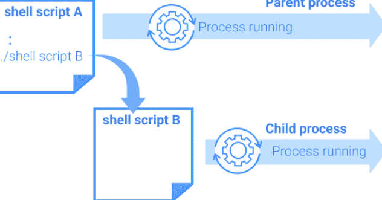

要调用另一个脚本，你只需要在脚本中添加一条执行该脚本的命令。

例如，创建一个名为 `test_child.sh` 的新脚本文件，并如下所示编辑该文件。

注意：`echo` 命令将在下一节中解释。

## 命令行 - 输入

```
ubuntu $ | vim test_child.sh
```

> `test_child.sh`

```bash
#!/bin/bash
echo "--------------------------------------"
echo "Unique Product List with # of Duplicated Items"
```

此外，复制 `test.sh` 文件并创建一个新文件 `test_parent.sh`。然后，编辑该文件以添加执行 `test_child.sh` 的命令。

## 命令行 - 输入

```
ubuntu $ | cp test.sh test_parent.sh
ubuntu $ | vim test_parent.sh
```

在 `cat` 命令和 `sort` 命令之间添加 `./test_child.sh`。

`test_parent.sh`

```bash
#!/bin/bash
# 显示产品项
cat purchase_product.txt
./test_child.sh
# 提取唯一项并统计重复项目
sort purchase_product.txt | uniq -c
```

要执行这些脚本，请添加权限并如下所示运行 `test_parent.sh`。

## 命令行 - 输入

```
ubuntu $ | sudo chmod +x test_parent.sh
ubuntu $ | sudo chmod +x test_child.sh
ubuntu # | ./test_parent.sh
```

你可以看到 `test_parent.sh` 成功调用了 `test_child.sh`。

## 命令行 - 响应

```
Apple
Orange
Apple
Apple
Bananas
Apple
Grapes
Orange
Bananas
Grapes
Grapes
Grapes
Bananas
Bananas
Apple
Grapes
----------------------------------------------------------------------
Unique Product List with # of Duplicated Items
5 Apple
4 Bananas
4 Grapes
2 Orange
```

# echo（回输入）

### `echo` [字符串] 或 [$变量]

| 字符串参数 | 变量参数 |
| --- | --- |
| `ABC` | `$ABC` 赋值为 `ABC = 56` |
| `INPUT` | `INPUT` |
| `Echo` | `Echo` |
| `OUTPUT` | `OUTPUT` |
| `ABC` | `56` |

`echo` 命令用于显示包含在参数中的行文本/字符串。

## 带字符串的 `echo`

当参数是一个字符串时，`echo` 命令返回字符串本身。

### 命令行 - 输入

```
ubuntu $ | echo ABC
```

### 命令行 - 响应

```
ABC
```

## 带变量的 `echo`

当参数是一个变量时，在变量前使用 `$`。`echo` 命令返回赋值给变量的字符串。

### 命令行 - 输入

```
ubuntu $ | ABC=56
echo $ABC
```

### 命令行 - 响应

```
56
```

## 带字符串和变量的 `echo`

你可以在 `echo` 命令中连接字符串和变量。

### 命令行 - 输入

```
ubuntu $ | ABC=56
ubuntu $ | echo ABC$ABC
```

### 命令行 - 响应

```
ABC56
```

## " " 双引号和 ' ' 单引号

你可以使用 `" "` 或 `' '` 引号来用特殊字符或空格连接字符串或变量；然而，它们存在细微的差别。

### " " 双引号

使用 `" "` 引号时，变量会被转换为赋值字符串。

#### 命令行 - 输入

```
ubuntu $ | ABC=56
ubuntu $ | echo "ABC$ABC ABC"
```

#### 命令行 - 响应

```
ABC56 ABC
```

### ' ' 单引号

使用 `' '` 引号时，变量不会被转换为赋值字符串。`$` 被视为字符串的一部分。

#### 命令行 - 输入

```
ubuntu $ | ABC=56
ubuntu $ | echo 'ABC$ABC ABC'
```

#### 命令行 - 响应

```
ABC$ABC ABC
```

# read（读取并存储输入）

```
read [变量] 
[命令行输入]
```

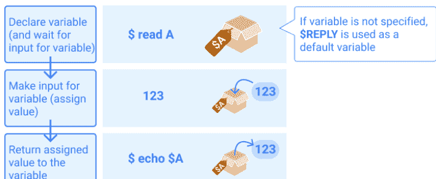

`read` 命令用于将行内容（从命令行输入或文件）读取到变量中。变量的初始设置为 `$REPLY`。如果未指定变量，则使用 `$REPLY` 作为默认变量。

## `read` 命令的典型流程

与其他命令不同，`read` 命令以更具交互的方式使用。

使用 `read` 命令有三个步骤。

### 1. 声明变量

通过运行 `read` 命令，你可以声明一个变量。如果你不指定，`$REPLY` 就会变成变量。声明后，命令会等待变量的输入。

例如，使用 `ABC` 作为变量。按下 `enter` 键后，命令行将等待命令行输入。

#### 命令行 - 输入

```
ubuntu $ | read ABC
```

### 2. 向变量提供输入（赋值）

设置变量后，你可以向变量提供输入。例如，你可以输入 `123` 将值赋给变量。

#### 命令行 - 交互

```
123
```

### 3. 返回赋值的值

你可以在另一个命令（如 `echo` 命令）中使用变量，以返回变量赋值的值。

如果你运行带有 `$ABC` 的 `echo` 命令，命令行将返回赋值的 123。

#### 命令行 - 输入

```
ubuntu $ | echo $ABC
```

#### 命令行 - 响应

```
123
```

## 带有文件输入的 `read` 命令

你可以使用文件作为 `read` 命令的输入。

例如，我们在重定向部分创建了 `error.txt` 文件。我们将使用该文件来演示该命令是如何工作的。在下面的示例中，你可以看到 `read` 命令读取了 `error.txt` 文件，而 `echo` 命令返回了其内容。

### 命令行 - 输入

```
ubuntu $ | read ABC < error.txt
ubuntu $ | echo $ABC
```

### 命令行 - 响应


```
ls: cannot open directory '/lost+found': Permission denied
```

从这个示例中，你也可以看到变量 `ABC` 被新输入覆盖。

> 注意：多行文本文件

`error.txt` 仅包含一行数据；然而，也存在多行文件。如果你使用 `read` 命令将多行文本文件作为输入，只有文件的第一行会被读取。

# Shell 变量和环境变量

| Shell 变量 | 环境变量 |
| :--- | :--- |
| 为当前 shell 定义的变量 | 为当前 shell 定义的变量会被任何 shell 或进程继承 |

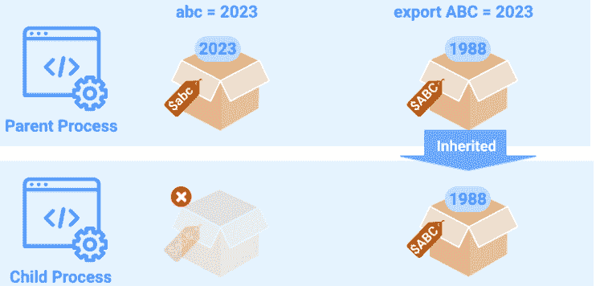

Linux 中有两种类型的变量 - Shell 变量和环境变量。Shell 变量仅为当前 shell 定义，无法在其他 shell 或进程中使用。相反，环境变量是为其他 shell 或进程定义的变量，而不仅仅是当前 shell。

## 变量的声明

声明 Shell 变量和环境变量的方法不同。

**Shell 变量：** 用 `=` 连接变量和赋值字符串。例如，`abc=2023`。

```
[shell ] = [赋值字符串]
```

**环境变量：** 使用 `export` 命令并用 `=` 连接变量和赋值字符串。例如，`export ABC=1988`。

```
export [环境变量] = [赋值字符串]
```

## 变量的继承

如上述，关键差异发生在变量在子进程中继承时。为了看到差异，请创建两个脚本。

首先，为父进程创建一个脚本。

**命令行 - 输入**

```
ubuntu $ vim variable_parent.sh
```

在 `variable_parent.sh` 文件中，声明两种变量。

- `abc`：一个 Shell 变量
- `ABC`：一个环境变量

在下方的父脚本中，我们将添加一条运行子脚本（`variable_child.sh`）的命令。

### variable_parent.sh

```bash
#!/bin/bash
#shell变量
abc=2023
#环境变量
export ABC=1988
echo "A shell variable in the parent shell script"
echo abc=$abc
echo "An environmental variable in the parent shell script"
echo ABC=\$ABC
```

```bash
#运行子脚本
./variable_child.sh
```

接下来，为子进程创建一个 shell 脚本。

**命令行 - 输入**

```
ubuntu $ | vim variable_child.sh
```

在 `variable_child.sh` 文件中，添加 `echo` 命令来调用在父脚本中声明的两个变量。

### variable_child.sh

```bash
#!/bin/bash
echo "A shell variable in the child script"
echo abc=$abc
echo "An environmental variable in the child script"
echo ABC=$ABC
```

给这些文件添加执行权限并执行父脚本。

**命令行 - 输入**

```
ubuntu $ | sudo chmod +x variable_parent.sh
ubuntu $ | sudo chmod +x variable_child.sh
ubuntu $ | ./variable_parent.sh
```

你可以看到，在父脚本 shell 中赋值给两个变量（`abc` 和 `ABC`）的值（2023 和 1988）已正确返回；然而，子脚本中赋值给 `abc`（shell 变量）的值是空的，而赋值给 `ABC`（环境变量）的值被正确返回了。

**命令行 - 响应**

```
A shell variable in the parent shell script
abc=2023
an environmental variable in the parent shell script
ABC=1988
A shell variable in the child script
abc=
An environmental variable in the child script
ABC=1988
```

从这个示例中可以看出，shell 变量只在同一个进程内有效，而环境变量会被继承到子进程。

## source（执行 Shell 脚本并刷新环境变量）

```bash
source [shell script]
```

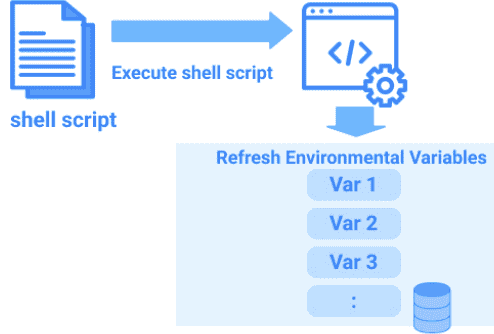

`source` 命令用于执行 shell 脚本并刷新环境变量。

## 使用 source 命令运行 shell 脚本

如果你像上一节演示那样使用绝对地址运行 shell 脚本，变量将无法正确注册到操作系统。当你使用 `source` 命令运行同一个 shell 脚本时，你可以将该脚本设置的变量用于另一个进程。

例如，你可以使用绝对路径运行 shell 脚本。

**命令行 - 输入**

```bash
# 示例：使用绝对路径或相对路径运行脚本
./variable_parent.sh
```

**命令行 - 响应**

```
A shell variable in the parent shell script
ab=2023
An environmental variable in the parent shell script
ABC=1988
A shell variable in the child script
ab=
An environmental variable in the child script
ABC=1988
```

然后，尝试在命令行中调用 `$ABC`，但 shell 不会有响应。

**命令行 - 输入**

```bash
ubuntu $ | echo $ABC
```

接下来，使用 `source` 命令运行相同的脚本。命令行显示的结果与不使用 `source` 时的结果相同。

> `source [script path]` e.g., `source variable_parent.sh`

**命令行 - 输入**

```bash
ubuntu $ | source variable_parent.sh
```

**命令行 - 响应**

```
A shell variable in the parent shell script
ab=2023
An environmental variable in the parent shell script
ABC=1988
A shell variable in the child script
ab=
An environmental variable in the child script
ABC=1988
```

然而，当你在命令行中调用 `$ABC` 时，你将获得一个赋值。

**命令行 - 输入**

```bash
ubuntu $ | echo $ABC
```

**命令行 - 响应**

```
1988
```

这是因为 `source` 命令将 `ABC` 正确注册到了环境变量中。

### 提示：env 命令

你可以通过运行 `env` 命令来检查系统中的**环境变量**。

当你运行 `env` 命令时，你将看到所示的多个预设环境变量。

**命令行 - 输入**

```bash
ubuntu $ | env
```

**命令行 - 响应**

```
SHELL=/bin/bash
PWD=/home/ubuntu
LOGNAME=ubuntu
XDG_SESSION_TYPE=tty
MOTD_SHOW=pam
HOME=/home/ubuntu
```

你可以使用 `grep` 命令来查找特定的环境变量。例如，如果你想检查 `ABC` 是否已注册为环境变量，请运行以下命令。

**命令行 - 输入**

```bash
ubuntu $ | env | grep ABC=
```

**命令行 - 响应**

```
ABC=1988
```

# 第 6 章

命令管理命令

本章涵盖了用于命令管理的命令，例如为命令创建快捷方式、显示命令手册以及安装新命令。

本章涵盖了以下主题。

- 主题

1. `history`（检查命令历史）
2. `alias`（创建命令快捷方式）
3. `man`（显示手册）
4. `type`, `which` and `whereis`（显示命令信息）
5. 软件包管理器命令
6. `tree`（显示目录树）

## history（检查命令历史）

`history [要显示的命令数量]`

| 描述 | 命令 |
| :--- | :--- |


# 命令参考

| 命令 | 描述 |
| :--- | :--- |
| `$ history` | 显示所有命令历史（最多 1,000 条） |
| `$ history n` | 显示最近的 `n` 条命令 |
| | 例如，`history 4` 显示过去的四条命令 |
| `$ history \| grep sudo` | 显示特定命令（例如 `sudo` 命令） |

`history` 命令用于显示你在 shell 中运行的命令。当你想要检查之前做过什么，或者重用之前执行过的相同命令时，这个命令非常有用。

## 显示命令历史

要显示命令历史，请不带任何参数地运行 `history`。`history` 命令将显示多达 1,000 条命令。

### 命令行 - 输入

```bash
ubuntu $ | history
```

### 命令行 - 响应

```
:
563 echo $ABC
564 sudo chmod u+x variable_parent.sh
565 sudo chmod u+x variable_child.sh
566 ./variable_parent.sh
567 echo $ABC
568 source variable_parent.sh
569 echo $ABC
570 env
571 env | grep ABC=
572 history
```

## 显示有限数量的命令

如果你只想显示过去的四条命令，运行 `history 4`。

### 命令行 - 输入

```bash
ubuntu $ | history 4
```

### 命令行 - 响应

```
570 env
571 env | grep ABC=
572 history
573 history 4
```

## 使用 grep 显示某些命令

如果你只想显示包含特定字符串的命令，请使用 `grep` 命令。例如，如果你只想显示 `sudo` 命令，请运行 `history | grep sudo`。

### 命令行 - 输入

```bash
ubuntu $ | history | grep sudo
```

### 命令行 - 响应

```
:
207 sudo chmod u+x test_child.sh
219 sudo chmod u+x variable_parent.sh
220 sudo chmod u+x variable_child.sh
:
```

# alias（创建命令快捷方式）

`alias [别名]=[命令]`

`unalias [别名]`

`alias` 命令用于创建命令快捷方式。你可以使用该命令来缩短频繁使用的命令或复杂的命令。你甚至可以将多个命令合并为一个别名。

## 显示已的别名

不带任何参数运行 `alias` 命令可以显示已注册的别名。例如，当你在 Lightsail Ubuntu 上运行 `alias` 命令时，你可以看到别名。

### 命令行 - 输入

```bash
ubuntu $ | alias
```

### 命令行 - 响应

```
alias egrep='egrep --color=auto'
alias fgrep='fgrep --color=auto'
alias grep='grep --color=auto'
alias l1='ls -CF'
alias la1='ls -A'
alias ll11='ls -alF'
alias ls11='ls --color=auto'
```

最常用的命令之一 `alias11` 已经注册。当你运行 `11` 别名时，你看到的结果与运行 `ls -l1` 命令的结果相同。

### 命令行 - 输入

```bash
ubuntu $ | 11
```

### 命令行 - 响应

| 文件/目录 |
| :--- |
| drwxr-xr-x 19 root 4096 Jan 8 02:29 ./ |
| drwxr-xr-x 19 root 4096 Jan 8 02:22 ../ |
| lrwxrxrwx 1 root 7 Jul 16 2020 bin -> usr/bin/ |
| drwxr-xr-x 3 root 4096 Jan 8 09:11 boot/ |
| drwxr-xr-x 15 root 3180 Jan 5 13:52 dev/ |

## 创建新别名

要创建新别名，你需要定义一个别名和赋值给它的命令。使用引号为带有一个或多个空格分隔参数的命令创建别名。例如，创建一个名为 `md1` 并执行 `mkdir dir_1` 的别名，请运行以下命令。

### 命令行 - 输入

```bash
ubuntu $ alias md1="mkdir dir_1"
```

运行别名并使用 `ls` 命令检查结果。

### 命令行 - 输入

```bash
ubuntu $ | md1
ubuntu $ | ls
```

### 命令行 - 响应

```
dir_1
```

## 创建包含多个命令的新别名

要创建一个包含多个命令的新别名，请使用 `;`（分号）来组合命令。下面的示例展示了如何创建一个名为 `mdfa` 的别名来执行两个命令：`mkdir` 和 `touch`。

### 命令行 - 输入

```bash
ubuntu $ | alias mdfa="mkdir dir_a;touch dir_a/file_a"
```

运行该命令并使用 `ls` 命令检查结果。

### 命令行 - 输入

```bash
ubuntu $ | mdfa
ubuntu $ | ls
```

### 命令行 - 输出

```
dir_1 dir_a
```

### 命令行 - 输入

```bash
ubuntu $ | ls dir_a
```

### 命令行 - 输出

```
file_a
```

你还可以通过运行 `alias` 命令来检查别名的注册情况。

### 命令行 - 输入

```bash
ubuntu $ | alias
```

### 命令行 - 输出

```
alias ls='ls --color=auto'
alias md1='mkdir dir_1'
alias mdfa='mkdir dir_a;touch dir_a/file_a'
```

## 删除已存在的别名

要删除已存在的别名，可以使用 `unalias` 命令。

删除别名 `md1`。

### 命令行 - 输入

```bash
ubuntu $ | unalias mdi
```

运行 `alias` 命令检查其是否已删除。

### 命令行 - 输入

```bash
ubuntu $ | alias
```

### 命令行 - 输出

```
: alias ls='ls --color=auto'
alias mdf='mkdir dir_a;touch dir_a/file_a'
```

# man (显示手册)

`man [命令名称]`

```bash
$ man ls
NAME
ls - 列出目录内容
SYNOPSIS
ls [OPTION]... [FILE]...
DESCRIPTION
列出关于文件 的信息（默认为当前目录）。
如果未指定 -ctuvSUX 或 --sort，则按字母顺序对条目进行排序。

-a, --all
不忽略以 . 开头的条目
```

## 显示手册

`man` (MANual) 命令用于显示命令的手册。当你想要查看某个命令的选项列表时，`man` 命令非常有用。

### 打开命令手册

要打开手册，请带上命令名称运行 `man`。例如，要显示 `grep` 的手册，请运行 `man grep`。

#### 命令行 - 输入

```bash
ubuntu $ | man grep
```

### 关闭手册

要关闭手册，请按 `Esc` 键。

# type, which 和 whereis (显示命令信息)

除了命令本身外，还有几个 Linux 命令可以提供关于 Linux 命令的信息。

- `type` 返回命令类型，例如：
  - shell 内置命令
  - 外部命令
  - 别名

  语法：
  ```bash
  type [命令名称]
  ```

- `which` 返回命令的路径
  语法：
  ```bash
  which [命令名称]
  ```

- `whereis` 返回命令路径以及相关的文档（如手册）
  语法：
  ```bash
  whereis [命令名称]
  ```

## type - 显示命令的类型

`type` 命令返回命令的类型。主要有三种类型：

1. Shell 内置命令（内部命令）
2. 外部命令（shell 执行命令时会引用命令的路径）
3. 别名 (Alias)

以下是这三种类型的示例。

### 命令行 - 输入

```bash
ubuntu $ | type echo
```

### 命令行 - 交互式

```
echo is a shell builtin
```

### 命令行 - 输入

```bash
ubuntu $ | type find
```

### 命令行 - 交互式

```
find is /usr/bin/find
```

### 命令行 - 输入

```bash
ubuntu $ | type l1
```

### 命令行 - 交互式

```
l1 is aliased to 'ls -alF'
```

## which - 显示命令的路径

`which` 命令为你提供命令的文件路径。

### 命令行 - 输入


## 命令行 - 输出

```
ubuntu $ | which sort
```

```
/usr/bin/sort
```

# `whereis` - 显示命令路径及相关文档

`whereis` 命令与 `which` 命令类似，但它提供的信息更多。

## 命令行 - 输入

```
ubuntu $ | whereis sort
```

## 命令行 - 输出

```
sort: /usr/bin/sort /usr/share/man/manl/sort.1.gz
```

# 包管理器命令

| 发行版 | 命令 |
| --- | --- |
| 基于 Debian 的 | • Debian<br>• Ubuntu | • `apt` (`apt-get`)<br>• `dpkg`<br>• `snap` |
| 基于 RPM 的 | • RHEL<br>• CentOS<br>• Fedora<br>• OpenSUSE | • `rpm`<br>• `yum`<br>• `dnf` |

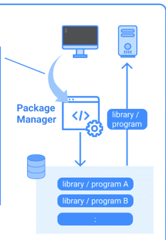

包管理器是一种在 CUI 环境下自动化安装、升级、配置或删除程序的工具，你可以通过运行命令来使用包管理器。命令取决于 Linux 发行版的不同。

# 基于 Debian 和基于 RPM 的

主要有两个包管理器组：基于 Debian 和基于 RPM。Debian 和 Ubuntu 使用 `apt` (`apt-get`)、`dpkg` 或 `snap`，而 RHEL、CentOS、Fedora 和 OpenSUSE 使用 `rpm`、`yum` 或 `dnf`。

包管理器是一种在 CUI 环境下自动化安装、升级、配置或删除程序的工具，你可以通过运行命令来使用包管理器。命令取决于 Linux 发行版的不同。

解决方案，但你可以通过使用 `-L` 选项来限制显示的层数。例如，如果你只需要根目录的第 2 层级结构，请使用 `-L 2` 选项。

## 命令行 - 输入

```
ubuntu $ | sudo tree /root -L 2
```

## 命令行 - 响应

```
/root
├── snap
|   amazon-ssm-agent
├── lxd
└── tree
```

# 第 7 章：SSH 远程连接

本章涵盖了 SSH 远程登录和安全文件传输的关键概念和命令。在本课程中，示例演示大部分将在本地计算机完成。我们假设你将在 Mac 上使用 Terminal 或 Windows 上使用 PowerShell。

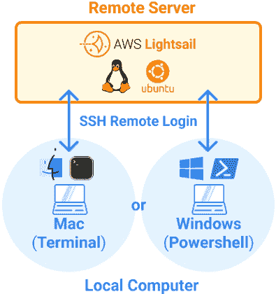

我们还解释了如何使用 VS Code 进行 SSH 远程登录。

本章涵盖以下主题。

## 主题

- 1. `SSH` (安全 Shell)
- 2. 定位 `.ssh` 目录
- 3. `SSH` 远程登录 (1) - 使用服务器生成的密钥对
- 4. `SSH` 远程登录 (2) - 使用客户端生成的密钥对
- 5. `SSH` 配置文件
- 6. 使用 Visual Studio Code 进行 `SSH` 远程登录
- 7. `SCP` (安全复制协议)
- 8. 使用 `SSH` 配置文件的 `SCP`
- 9. `SFTP` (安全文件传输协议)
- 10. 其他文件传输命令

## `SSH` (Secure Shell)


## `SSH` 使用场景

`SSH` (Secure Shell) 是一种网络通信协议，允许两台计算机以安全的方式进行通信。`SSH` 同时使用密码认证和公钥认证。通常情况下，用户验证是通过公钥认证完成的。用户验证完成后，`SSH` 会切换到密码认证。

## 公钥认证

传统的加密技术仅使用单一密钥进行加密和解密（对称加密），而公钥认证使用密钥对（用于异步加密的私钥和公钥）。在公钥认证中，公钥可以与任何人共享，而私钥必须保持秘密（私钥也称为密钥）。消息或数据的加密使用公钥完成，而只有私钥可以解密该消息或数据。

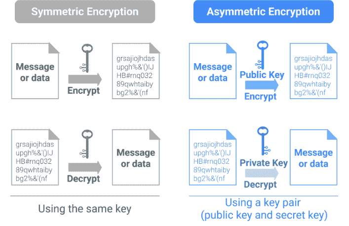

## `SSH` 使用场景 - 远程登录和安全文件传输

`SSH` 有两个主要用场景：`远程登录`和`安全文件传输`。`SSH` 远程登录广泛用于远程管理服务器。它也用于 AWS、Azure 和 GCP 等云服务。你可以使用 `SSH` 连接到 GitHub 等 git 远程仓库服务。`SSH` 也用于更安全的方式进行文件传输。使用 `SSH` 执行文件传输有两个主要命令——`SCP` 和 `SFTP`。

## 定位 `.ssh` 目录

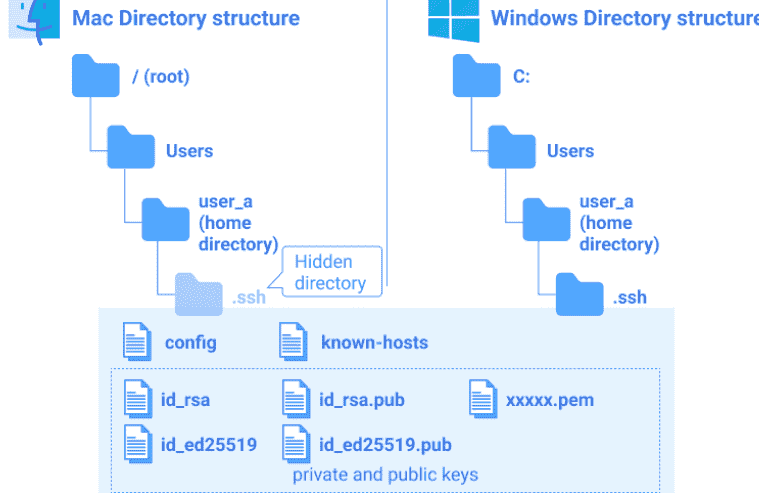

了解本地计算机上的 `.ssh` 目录对于启动 `SSH` 远程登录非常重要。通常，密钥对、已建立的主机信息文档和配置文件保在此目录下。

## `.ssh` 目录的位置

`.ssh` 目录位于你的用户目录下。

> `.ssh` 目录在 Mac 上是隐藏的。为了显示该目录，你需要在 Mac OS 上按下 shift + command 键。

## `.ssh` 目录下的密钥文件

最初，该目录下没有文件；但是该目录下会创建三种类型的重要文件。

## 密钥文件

在生成密钥对（公钥和私钥）的情况下，通常密钥对会在此目录下生成，除非你在生成密钥对时指定了其他路径。RSA（一种加密技术）的默认文件名为 `id_rsa`（私钥）和 `id_rsa.pub`（公钥）。你可以更改密钥对的名称以管理多个密钥对。

此外，当你从服务器或云服务下载私钥时，通常会将密钥保存在此目录下。密钥文件类型可能与你在计算机上生成的密钥文件类型不同。例如：`xxx.pem`。

## 配置文件

配置文件非常有用。你可以编写多个 `SSH` 配置，以便通过简单的命令快速访问每个 `SSH` 服务器。如何编写该配置文件将在稍后解释。

## `known_hosts`

`known_hosts` 文件是一个自动生成的文件。一旦你建立了新的 `SSH` 远程连接，公钥信息就会记录在该文件中，并用于随后的认证过程。

## `SSH` 远程登录 (1) - 使用服务器生成的密钥对

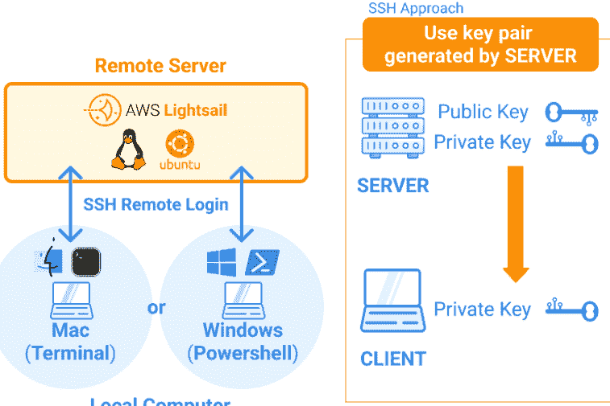

本课程介绍如何在本地计算机和远程服务器之间建立 `SSH` 远程连接。

建立 `SSH` 远程连接有两种主要方法：

- 1) 使用服务器生成的密钥对
- 2) 使用客户端生成的密钥对

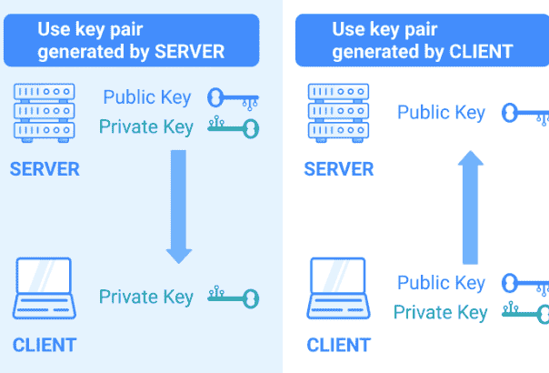

## `SSH` 步骤

在生成密钥对（公钥和私钥）的情况下，通常密钥对会在此目录下生成，除非你在生成密钥对时指定了其他路径。RSA（一种加密技术）的默认文件名为 `id_rsa`（私钥）和 `id_rsa.pub`（公钥）。你可以更改密钥对的名称以管理多个密钥对。

此外，当你从服务器或云服务下载私钥时，通常会将密钥保存在在此目录下。密钥文件类型可能与你在计算机上生成的密钥文件类型不同。例如：`xxx.pem`。

## 命令行 - 输入

```
% | ls -la
```

## 命令行 - 响应

```
drwx------ 6 user_a staff 192 Dec 26 .ssh
```

## 命令行 - 输入

```
% | ls -1 .ssh
```

## 命令行 - 响应

```
-rw-------@ 1 user_a staff 1679 Dec 26
LightsailDefaultKey.pem
```

## 4. 从你的本地命令行运行 `SSH` 命令

在 AWS Lightsail 控制台上检查你实例的用户名和公网 IP 地址。

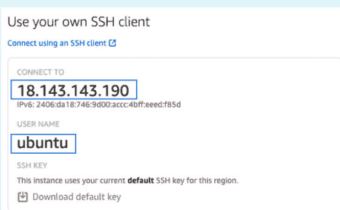

在你的本地电脑上运行以下命令。

## 命令行 - 输入

```
% | ssh -i [你的密钥文件路径] [用户名]@[公网 IP 地址]
```

在我们的案例中，命令如下所示。

## 命令行 - 输入

```
% ssh -i ~/.ssh/LightsailDefaultKey.pem
ubuntu@18.143.143.190
```

如果成功建立了 `SSH` 远程连接，你的命令行将变为服务器的用户和私有 IP 地址（而不是服务器的公网地址）。

## 命令行 - 输入

```
ubuntu@ip-172-26-0-53:-$ |
```

## 常见错误信息

如果你收到类似下面的错误信息，说明你的访问模式（access mode）设置有问题。请检查你的 `.ssh` 目录和公钥文件的权限。

## 命令行 - 响应


```
@@@@@@@@@@@@@@@@@@@@@@@@@@@@@@@@@@@@@@@@@@
@@@@@@@@@@
@ WARNING: UNPROTECTED PRIVATE KEY FILE! @
@@@@@@@@@@@@@@@@@@@@@@@@@@@@@@@@@@@@@@@@@@@@@@@@
Permissions 0644 for '/user_a/.ssh/LightsailDefaultKey.pem' are too open.
要求私钥文件不能被他人访问。
该私钥将被忽略。
```

## 退出远程登录

要退出远程登录，请运行 `exit` 命令。

### 命令行 - 输入（远程）

```
ubuntu@ip-172-26-0-53:-$ exit
```

### 命令行 - 响应

```
logout
```

## SSH 远程登录 (2) - 使用客户端生成的密钥对


建立 SSH 远程连接有两种方法：

1. 使用服务器生成的密钥对
2. 使用客户端生成的密钥对

在本节中，我们将解释第二种情况，它通常比第一种情况更复杂。


### 密钥步骤

#### 1. 在你的本地电脑生成 SSH 密钥对

运行以下命令将生成密钥对（私钥和公钥）。

```
ssh-keygen -t rsa -C "你的邮箱地址"
```

运行命令时，系统会要求设置密码语（passphrase）。输入两次密码语。在建立 SSH 连接时你也可以跳过密码语设置，这种情况下直接按两次 `enter` 即可。

**注意：** 密码语与密码相似，但与密码不同可以留空。

##### -t 和 C 选项

- `-t` 用于设置加密类型。默认类型是 `rsa`。
- `-C` 用于设置注释。默认注释是 `用户名@主机名`，可以避免暴露主机名。

#### 2. 将公钥添加到你的服务器

公钥内容保存在 Linux 服务器的 `~/.ssh/authorized_keys` 文件中。复制公钥信息并将其添加到该文件中。

有多种方法共享公钥。对于 AWS Lightsail，你可以通过浏览器的 SSH 控制台打开并保存公钥信息。

#### 3. 从你的本地命令行运行 SSH 命令（在本地电脑上）

运行命令需要三组信息：

1. 1) 私钥文件路径
2. 2) 服务器用户名
3. 3) 服务器的公网 IP 地址

运行以下命令建立 SSH 连接。`-i` 用于指定密钥文件路径。

```
ssh -i [密钥路径] [用户名]@[公网 IP 地址]
```

### get

以下是使用自己的 SSH 客户端连接 AWS Lightsail 实例的步骤。

#### 1. 在你的本地电脑生成 SSH 密钥对

运行以下命令将生成密钥对（私钥和公钥）。

##### 命令行 - 输入（本地）

```
% ssh-keygen -t rsa -C "user_a@example.com"
```

运行命令后，系统会要求输入保存密钥的文件路径，如下所示。

##### 命令行 - 响应（本地）

```
Generating public/private rsa key pair.
Enter file in which to save the key (/Users/user_a/.ssh/id_rsa):
```

按下 `enter` 键（通常它保存在上述括号中的 `.ssh` 目录下）。接下来，系统会要求输入密码语，如下所示。你也可以跳过密码语设置，这种情况下直接按两次 `enter`。

##### 命令行 - 交互（本地）

```
Enter passphrase (empty for none):
Enter passphrase again:
```

设置密码语后，密钥对将保存在显示的文件路径下。你将在命令行看到以下响应。

##### 命令行 - 响应（本地）

```
Your identification has been saved in /Users/user_a/.ssh/id_rsa. Your public key has been saved in /Users/user_a/.ssh/id_rsa.pub. The key fingerprint is:
RSA:3072...user_a@example.com
```

你可以确认家目录下的 `.ssh` 目录生成了这两个文件。

#### 2. 将公钥信息复制到本地电脑

公钥文件的内容以 `ssh-rsa` 开头，以你的邮箱地址结尾。检查公钥内容请运行 `cat` 命令。对于 Windows，使用 `type` 命令，或直接用文本编辑器打开密钥文件。

##### 命令行 - 输入（本地）

```
% cat ~/.ssh/id_rsa.pub
```

复制公钥信息。你可以使用 Mac 的 `pbcopy` 命令或 Windows 的 `clip` 直接复制文件内容。你也可以手动复制密钥内容。

##### 命令行 - 输入（本地）

```
% pbcopy < ~/.ssh/id_rsa.pub
```

#### 3. 将公钥添加到你的服务器

对于 AWS Lightsail，你可以通过浏览器的 SSH 控制台打开 `authorized_keys` 文件并保存公钥信息。


运行以下命令进入 Vim 编辑器。

##### 命令行 - 输入（AWS 控制台）

```
ubuntu~$ vim ~/.authorized_keys
```

具体操作：

1. 按 `i` 键进入插入模式。
2. 在现有数据的之后另起新行。
3. 粘贴之前复制的公钥文本。
4. 保存并退出。按 `esc` 键，接着输入 `:` 键切换到命令模式。然后输入 `wq` 并按 `enter` 键。

查看第 3 章 Vim 编辑器以了解如何使用 Vim 编辑。

### SSH 配置文件

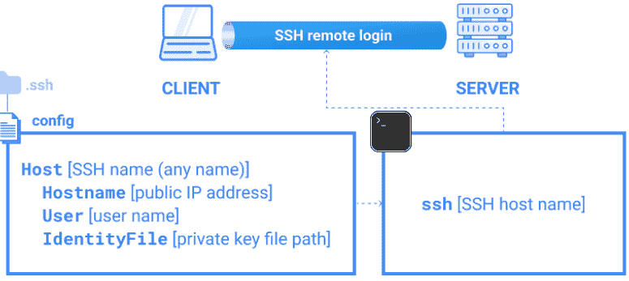

SSH 配置文件是一个加速 SSH 远程登录过程的极其有用工具。通过在配置文件写入以下信息，你可以缩短 SSH 命令。

#### 步骤 1. 在 .ssh 目录下的配置文件中描述 SSH 远程登录密钥信息

在配置文件中描述以下信息。如果配置文件不存在，你可以创建一个新的。

- `Host` (SSH 名称)：你可以使用任何名称来标识此 SSH 配置
- `Hostname`：要连接的服务器的公网 IP 地址
- `User`：服务器的用户名
- `IdentityFile`：SSH 远程登录私钥文件的完整路径

#### 步骤 2. 运行 SSH 命令

使用你创建的名称运行 SSH 命令

```bash
% ssh [ssh name]
```

### 练习

如果你还没有配置文件，请在 `.ssh` 目录中创建它。对于 Windows PowerShell，请使用 `New-Item` 命令代替 `touch` 命令。

命令行 - 输入 (本地)

```bash
% cd ~/ssh
% touch config
```

打开文件并添加如下所示必要信息。

`config`

```
Host ssh_test
Hostname 18.143.143.190
User ubuntu
IdentityFile ~/.ssh/id_rsa
```

保存文件后，运行以下命令。

命令行 - 输入 (本地)

```bash
% ssh ssh_test
```

如果设置了短语（passphrase），命令行可能会提示你输入短语。输入你设置的短语后，即可建立 SSH 连接。如果你没有设置短语，将立即建立 SSH 连接。

命令行 - 输入 (远程)

```bash
ubuntu@ip-172-26-0-53:-$
```

## 使用 Visual Studio Code 进行 SSH 远程登录

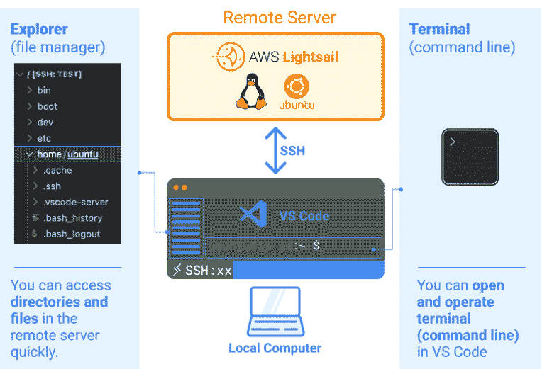

使用 Visual Studio Code (VS Code) 进行 SSH 远程登录可以显著提高你的效率。尽管这是一个远程环境，但你可以像操作本地环境一样进行操作，具有极高的目录结构可见性和高级文本编辑器环境。以下是使用 VS Code 建立 SSH 远程登录的步骤。

### 步骤 1. 安装远程开发

打开 VSC，选择左侧边栏的扩展图标。搜索 `Remote Development` 扩展并点击安装按钮。

Remote Development 包含以下扩展：

- Remote - SSH
- Remote - SSH: Editing Configuration Files
- Remote Explorer
- WSL
- Dev Containers

### 步骤 2. 建立 SSH 远程连接

#### 1. 在 Remote Explorer 的左侧边栏中选择远程登录图标


### 2. 点击设置图标选择 `SSH` 配置文件

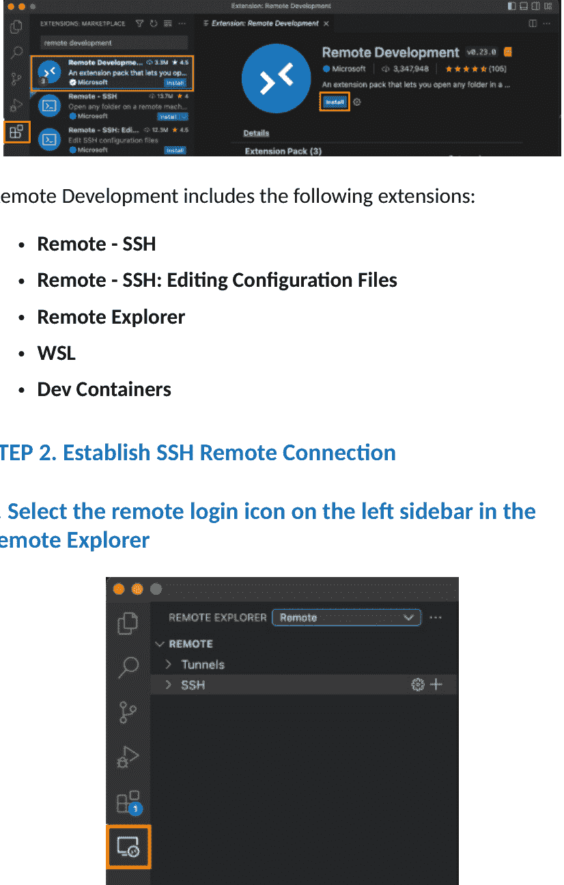

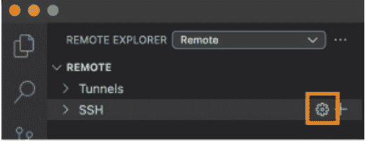

### 3. 选择你的 `SSH` 配置文件


当你选择文件时，你将在右窗口看到配置文件的内容。（请参考上一节关于如何创建配置文件的部分。）

```config
Users > user_a > .ssh > config
Host ssh_test
  Hostname 18.143.143.190
  User ubuntu
  IdentityFile ~/.ssh/lightsailDefaultKey-ap-southeast-1.pem
```

### 4. 点击 `SSH` 主名的箭头或窗口图标。

通过点击箭头图标，你可以在当前窗口中连接到主机。点击窗口图标时，将打开一个新的 `VS Code` 窗口并在新窗口中建立 `SSH` 连接。

**注意：** `VS Code` 可能会询问主机服务器的平台（操作系统）。如果被询问，请选择 `Linux`。

### 5. 如果你为私钥设置了短语，你需要输入该短语才能继续。


### 6. 一旦 `VS Code` 连接到远程服务器，你将在 `VS Code` 窗口左下角看到状态。


### 7. 要打开远程服务器中的目录，选择左侧的文件图标并点击“打开文件夹”（`Open Folder`）按钮。

### 8. 选择要在 `VS Code` 编辑器中显示的最高层级目录

如果你只想显示主目录（`/home/ubuntu/`），请按 `OK` 按钮。你也可以更改最高目录。如果你想显示整个目录树，点击 `OK` 按钮。


### 9. 如果你为私钥设置了短语，`VS Code` 将要求输入短语。


### 10. 在首次访问时，`VSC` 会询问是否信任该文件夹。

选择 `Yes` 按钮连接文件夹。


# 步骤 3. 在 `VS Code` 中打开终端并连接远程环境

要在 `VSC` 窗口中打开终端，选择菜单栏上的“终端”（`Terminal`）并点击“新建终端”（`New Terminal`）。


现在你可以像在本地环境一样在远程服务器上工作。


# 步骤 4. 关闭 `SSH` 远程连接

点击左下角的 `SSH` 图标，在顶部找到“关闭远程连接”（`Close Remote Connection`）菜单。点击“关闭远程连接”菜单关闭连接。


# 提示：使用终端

如果首次在 `VS Code` 中无法建立 `SSH` 远程连接，请尝试使用终端应用程序（见前节）进行远程连接。


# `SCP`（安全复制协议）

| 本地到远程 | 远程到本地 |
| :--- | :--- |
| `scp -i ① ③ 3b 3c` | `scp -i ② 2a 2c ③` |

| 密钥信息 | 密钥信息 |
| :--- | :--- |
| ① 私钥路径 (本地) | ① 私钥路径 (本地) |
| ② 文件路径 (远程) | 2a 用户名 (远程) |
| ③ 用户名 (远程) | 2b `IP` 地址 (远程) |
| 3b `IP` 地址 (远程) | 2c 文件路径 (远程) |
| 3c 目录路径 (远程) | ③ 目录路径 (本地) |


`SSH` 不仅用于远程登录，还用于安全地传输文件。有两种使用 `SSH` 传输文件的协议：**`SCP`（安全复制协议）** 和 `SFTP`（安全文件传输协议）。在本节中我们将解释 `SCP`。

## 从本地传输

要从本地计算机传输文件到远程服务器，`SCP` 命令需要以下五组信息。

### 密钥

- 本地计算机上的私钥文件路径（通常在 `.ssh` 目录下）

### 源文件

- 本地计算机的文件路径

### 目标

- 远程服务器的用户名
- 远程服务器的 `IP` 地址
- 远程服务器上的目录路径。如果你想将文件传输到远程服务器的用户目录，可以跳过此参数。

为了更好地理解，请完成以下练习。

## 练习 1

目标：

从本地计算机传输文件到远程服务器

以下是待传输的文件和目标目录的路径：

- 传输的文件：`~/dir_ch7_local/sample.txt` (本地计算机)
- 目标目录：`~/dir_ch7_remote` (远程服务器)

注意：此此练习请打开两个终端（命令行）。一个用于本地操作，另一个用于远程操作。

### 1. 在远程服务器上创建目录

创建一个接收文件的目录。

此项操作请使用连接到远程服务器的终端。

命令行 - 输入 (远程)

```bash
ubuntu@ip-172-26-0-53 $ | cd
ubuntu@ip-172-26-0-53 $ | ~ mkdir dir_ch7_remote
```

### 2. 在本地计算机上创建示例文件

创建一个要传输到远程服务器的示例文件。

此操作请使用未连接到远程服务器的本地终端。

命令行 - 输入 (本地)

```bash
% | cd
% | ~ mkdir dir_ch7_local
% | cd dir_ch7_local
% | touch sample.txt
```

### 3. 传输文件

使用私钥路径、源文件路径和目标目录路径运行 `scp` 命令。

命令行 - 输入 (本地)

```bash
% | scp -i ~/.ssh/id_rsa sample.txt
ubuntu@18.143.143,190:dir_ch7_remote
```

命令行 - 响应

| sample.txt 100% 0 |
| :--- |
| 0.0KB/s 00:00 |

如果你为私钥设置了密码语（`passphrase`），则需要输入密码语才能继续。

### 4. 检查文件是否传输成功。

使用连接到远程服务器的终端，检查文件是否成功传输。

命令行 - 输入 (远程)

```bash
ubuntu@ig-772-26-0-53$ | ls dir_ch7_remote
```

你可以看到文件已成功传输。

命令行 - 响应

```bash
sample.txt
```

### 提示：传输目录

当你想要传输一个包含内部文件的目录时，请使用 `-r` 选项。以下是示例命令。

命令行 - 输入

```bash
% scp -i ~/.ssh/id_rsa -r sample_dir ubuntu@18.143.143.190:dir_ch7_remote
```

## 从远程到本地的传输

要将文件从远程服务器传输到本地计算机，`SCP` 命令需要以下五组信息。

### 密钥文件

- 本地计算机上的私钥文件路径（通常在 `.ssh` 目录下）

### 源文件

- 远程服务器的用户名
- 远程服务器的 `IP` 地址
- 远程服务器上的源文件路径

### 目标

- 本地计算机上的目标目录路径。如果你想将文件传输到计算机上的主目录，可以跳过此参数。

为了更好地理解，请完成以下练习部分。

> 练习 2

目标：

将目录从远程服务器传输到本地计算机

以下是待传输目录和目标目录的路径。

- 待传输目录：`~/dir_ch7_remote`（远程服务器上）
- 目标目录：`~/dir_ch7_local`（本地计算机上）

注意：此练习只能在本地终端完成。

### 1. 传输目录

运行带有私钥路径、源目录路径和目标目录路径的 `scp` 命令。

命令行 - 输入 (本地)

```bash
% | cd ~
% | scp -i ~/.ssh/id_rsa ubuntu@18.143.143.190:dir_ch7_remote dir_ch7_local
```

命令行 - 响应

```bash
sample.txt 100% 0
0.0KB/s 00:00
```

如果你为私钥设置了密码语，则需要输入密码语才能继续。

### 2. 检查目录是否传输成功。

检查目录是否已成功从远程服务器传输到本地计算机。

命令行 - 输入 (本地)

```bash
% | ls dir_ch7_local
```

你可以看到文件已成功传输。


## 命令行 - 响应

```
dir_ch7_remote sample.txt
```

# 常见错误

在运行 `scp` 命令时，可能会两个典型错误。

## 1. 忘记添加冒号 (:)

当你忘记添加冒号 `(:)` 时，该命令的含义将会发生变化。该命令将在你的本地计算机上创建一个文件副本。例如，如果你运行以下命令（末尾没有冒号），你将在当前目录下创建一个名为 `ubuntu@18.143.143.190` 的文件。

### 命令行 - 输入

```
% scp -i ~/.ssh/id_rsa sample.txt
ubuntu@18.143.143.190
```

### 命令行 - 响应

> `ubuntu@18.143.143.190`

## 2. 误用空格

遗漏或添加额外的空格也是常见的错误。当在命令行遇到错误信息时，请检查空格。

# 使用 SSH 配置文件的 SCP


当你使用 SSH 配置时，`scp` 命令会变得简单得多。你可以跳过输入私钥文件路径、远程服务器用户名和 IP 地址。

## 从本地到远程的传输

该命令只需要三组信息。

### 源文件

- 本地计算机上的源文件或目录（如果你想传输目录，请使用 `-r` 选项。）

### 目标

- SSH 文件中的主机名

- 远程服务器上的目标目录路径（如果你想将文件传输到远程服务器的用户目录，可以跳过此参数。）

为了更好地理解，请完成以下练习部分。

# 练习 1

目标：使用 SSH 配置将文件从本地计算机传输到远程服务器

以下是待传输文件和目标目录的路径。

- 待传输文件：`~/dir_ch7_local/sample2.txt`（本地计算机上）

- 目标目录：`~/dir_ch7_remote`（远程服务器上）

注意：此练习请打开两个终端（命令行）。一个用于本地操作，另一个用于远程操作。

## 1. 在本地计算机上创建示例文件

创建一个用于传输到远程服务器的示例文件。

此操作请使用未连接到远程服务器的本地终端。

### 命令行 - 输入 (本地)

```
% cd ~/dir_ch7_local
% touch sample2.txt
```

## 2. 传输文件

运行带有源文件路径和目标目录路径的 `scp` 命令。

### 命令行 - 输入 (本地)

```
% scp sample2.txt ssh_test:dir_ch7_remote
```

### 命令行 - 响应

| `sample.txt` | 100% | 0 |
|---|---|---|
| 0.0KB/s | 00:00 | |

如果你为私钥设置了密码短语，则需要输入密码短语才能继续。

## 3. 检查文件是否传输成功

使用连接到远程服务器的终端，检查文件是否成功传输。

### 命令行 - 输入 (远程)

```
ubuntu8-172-26-0-53$ ls dir_ch7_remote
```

你可以看到文件已成功传输。

### 命令行 - 响应

```
sample.txt
```

如果没有 SSH 配置文件，你需要指定私钥文件路径、用户名以及远程服务器的 IP 地址。

## 命令行 - 输入

```
$ sftp -i ~/.ssh/id_rsa ubuntu@54.169.91.239
```

有了 SSH 配置文件，命令会变得简单得多。只需输入 `ssh` 加上你在配置文件中的 SSH 主机名（下面的示例使用 `ssh_test` 作为 SSH 主机）。

## 命令行 - 输入

```
% sftp ssh_test
```

一旦建立 SFTP 会话，命令行将变为如下所示。

## 命令行 - 输入

```
sftp>
```

## SFTP 子命令

在 SFTP 会话期间，你可以运行多个 SFTP 子命令。

### 检查和切换目录

SFTP 提供了子命令来检查和切换远程服务器以及本地计算机下的目录。以下是示例。

| 操作 | 远程 | 本地 |
|---|---|---|
| 检查当前目录路径 | `pwd` | `lpwd` |
| 列出文件和目录 | `ls` | `lls` |
| 切换目录 | `cd` | `lcd` |

### `get` 命令 - 从远程服务器下载文件或目录

一旦你设置了本地计算机和远程服务器的当前工作目录，就可以使用 `get` 命令从远程服务器下载文件到本地计算机。

例如，通过运行下面的命令，你将远程服务器当前工作目录下的 `sample.txt` 文件传输到本地计算机的当前工作目录。

#### 命令行 - 输入

```
sftp> get sample.txt
```

这是文件传输的插图。


如果你想下载一个目录，请使用 `-r` 选项。

#### 命令行 - 输入

```
sftp> get -r sample_dir
```

### `put` 命令 - 向远程服务器上传文件或目录

要从本地计算机上传文件或目录到远程服务器，你可以运行 `put` 命令。

例如，运行下面的命令，你会将本地计算机当前工作目录下的 `test.txt` 文件传输到远程服务器的当前工作目录。

#### 命令行 - 输入

```
sftp> put test.txt
```

### `exit` (`bye`) 命令 - 停止 SFTP 会话

要结束会话，运行 `exit`（或 `bye`）命令。

#### 命令行 - 输入

```
sftp> exit
```

### `help` 命令 - 检查 SFTP 子命令

如果你想了解更多关于 SFTP 子命令的信息，`help` 命令非常有用。它会提供可用 SFTP 子命令列表。

> **注意：SCP 和 SFTP 的区别**

`SCP` 和 `SFTP` 的主要区别之一是，`SFTP` 协议可以恢复因某些原因停止的数据传输，而 `SCP` 不能恢复。要使用 `SFTP` 恢复数据传输，请使用 `re` 命令。

例如，如果你想恢复 `sample_dir` 的传输，可以运行下面的命令。

#### 命令行 - 输入

```
sftp> reget -r sample_dir
```

### 其他文件传输命令


还有其他不使用 `ssh` 的传输命令。`FTP` 是经典的文件传输协议和命令。`Wget` 和 `Curl` 是使用多种通信协议获取文件的命令，特别是从网站获取文件。

## `FTP`

`FTP`（文件传输协议）是一种用于在远程网络和本地之间传输文件的标准网络协议。由于 `FTP` 流量是不加密的，强烈建议使用 `SCP` 或 `SFTP` 进行安全数据传输。在 Linux 系统上使用 `FTP`，可以使用 `ftp` 命令。该命令的设计与 `sftp` 命令类似。你可以建立 `FTP` 会话并使用子命令管理文件传输。

## `Wget`

`wget` 是一个用于下载各种互联网协议（包括 `HTTP`、`HTTPS` 和 `FTP`）网页的命令行实用程序。由于其在下载网页内容方面的实用性，`wget` 经常用作网络爬虫工具。

它的命令语法简单。通过运行带有 URL 的 `wget` 命令，你可以下载网站的 HTML 文件。如果你使用 `-p` 选项，你还可以下载网站的所有内容，包括图片文件。使用 `-r` 选项，你还可以递归下载网站（包括指向网站的链接）。

## `cURL`

`cURL` 的意思是 "client for URL"。它是一个通过各种网络协议（包括 `HTTP`、`HTTPS`、`FTP` 和其他互联网协议）传输数据的命令行工具。`cURL` 通过指定相关的 URL 和需要发送或接收的数据与 Web 或应用程序服务器通信。与 `wget` 不同，`curl` 命令也用于向服务器上传数据。

# 第 8 章：进程管理

本章涵盖了进程管理内容。在本章中，我们将学习进程以及如何管理它们。

## 什么是进程？

进程是执行中的程序。虽然程序是磁盘上的静态文件，但进程是运行在内存中的活动实体。每个进程都有自己的内存空间，包括代码、数据和栈。

## 进程状态

进程在生命周期内可以经历几种状态：

- 新建 (`New`)：进程正在创建。

- 就绪 (`Ready`)：进程正在等待分配给处理器。

- 运行 (`Running`)：进程正在执行。

- 等待/阻塞 (`Waiting/Blocked`)：进程等待某些事件（例如 I/O 完成）。

- 终止 (`Terminated`)：进程已完成执行。

### 在 Linux 中管理进程

在 Linux 中，有多种工具可以管理进程。最常用的有：

- `ps`：列出当前运行的进程。

- `top`：提供运行进程的实时视图。

- `kill`：向进程发送信号，通常用于终止它。

- `nice`：设置进程的优先级。

- `renice`：更改已运行进程的优先级。

### 示例

#### 列出进程

列出当前用户的所有进程，使用：


```
ps -u username
```

列出系统中运行的所有进程，使用：

```
ps aux
```

### 终止进程

要杀死一个进程，你需要它的进程 ID (PID)。你可以使用 `ps` 找到 PID。一旦有了 PID，使用：

```
kill PID
```

要强制停止进程，请使用 `-9` 标记：

```
kill -9 PID
```

### 更改优先级

要以特定优先级启动进程，使用 `nice`：

```
nice -n 10 command
```

要更改运行进程的优先级，使用 `renice`：

```
renice +5 PID
```

## 练习 1

目标：

理解前台作业（foreground job）的工作原理

### 1. 创建 shell 脚本

首先，让我们创建一个处理时间较长的 shell 脚本。下面的 shell 脚本（`loop.sh` 文件）将从 1,000,000 开始倒数。

使用 `vim` 创建一个名为 `loop.sh` 的 shell 脚本。

命令行 - 输入

```
ubuntuip-172-26-0-53:- | mkdir dir_ch8
ubuntuip-172-26-0-53:- | cd dir_ch8
ubuntuip-172-26-0-53:- | vim loop.sh
```

按下 `i` 键切换到插入模式。接下来，复制下面的代码并粘贴到文件中。粘贴代码后，按下 `esc` 键，接着按下 `:` 键，并按 `w + q` 键保存文件。要学习如何使用 Vim，请查看第 3 章 Vim 编辑器。

`loop.sh`

```bash
#!/bin/bash
count=5000000
while [ $count -ge 0 ]
do
  echo "countdown $count"
  count=$((count - 1))
done
```

### 2. 运行 shell 脚本

要运行 shell 脚本，请调整访问模式并使用文件路径运行脚本。

命令行 - 输入

```
ubuntu@ip-172-26-0-53:$ | sudo chmod+x loop.sh
ubuntu@ip-172-26-0-53:$ | ./loop.sh
```

当你将其作为前台作业运行时，你将在终端上看到倒数。在倒数完成之前，你的命令行会被占用，你无法创建另一个作业。

命令行 - 响应

```
:countdown 920071
countdown 920070
countdown 920069
:
```

要挂起或停止作业，请按下 `Ctrl + Z` 或 `Ctrl + C`。

即使你将标准输出重定向到文本文件，该作业仍然作为前台作业运行，你无法创建另一个作业。

命令行 - 输入

```
ubuntu@ip-172-26-0-53:$ | ./loop.sh > countdown.txt
```

## 后台作业（Background Job）

由于在前台作业运行时你无法创建新作业，如果一个程序需要很长的过程，将其作为后台作业运行是比较好的。你可以同时运行多个后台作业，因为它们在后台运行。要启动后台作业，请在命令末尾带有 `&` 运行命令。

## 练习 2

目标：

理解后台作业的工作原理

### 1. 多次作为后台作业运行 shell 脚本

运行 `loop.sh` 文件并将其重定向到文本文件，并在末尾加上 `&`。命令行会给你一个数字，即作业的 ID。

命令行 - 输入

```
ubuntu@ip-172-26-0-53:-$ | ./loop.sh > countdown_bg_1.txt &
```

命令行 - 响应

```
[2] 83447
```

你也可以多次执行相同的命令。

命令行 - 输入

```
ubuntu@ip-172-26-0-53:-$ | ./loop.sh > countdown_bg_2.txt &
```

命令行 - 响应

```
[3] 83450
```

命令行 - 输入

```
ubuntu@ip-172-26-0-53:-$ | ./loop.sh > countdown_bg_3.txt &
```

命令行 - 响应

```
[4] 83451
```

### 2. 检查作业状态

要查看运行中的作业，请运行 `jobs` 命令，将在下一节中解释。你可以看到多个作业正在并行运行。

命令行 - 输入

```
ubuntu@ip-172-26-0-53:~$ jobs
```

命令行 - 响应

| | |
| :--- | :--- |
| [1] Running | countdown_bg_1.txt & /loop.sh > |
| [2]- Running | countdown_bg_2.txt & /loop.sh > |
| [3]+ Running | countdown_bg_3.txt & /loop.sh > |

### `jobs` 和 `ps` (显示作业与进程)


- 显示当前作业（带有 `-l` 选项，显示进程 ID）
- 显示当前进程（带有 `-e` 选项，显示所有进程）

`jobs` 命令用于检查运行中的作业，而 `ps` 命令用于检查运行中的进程。

## 检查运行中的作业 - `jobs`

`jobs` 命令显示作业 ID、每个作业的状态（运行、停止、完成、终止）以及作业名称。作业数字后还有 `+` 或 `-` 符号。`-` 指当前作业，`+` 指上一个作业。

命令行 - 输入

```
ubuntu@ip-172-26-0-53:~$$ jobs
```

命令行 - 响应

| | | |
| :--- | :--- | :--- |
| [1] Running | /loop.sh > countdown_bg.txt & |
| [2]+ Stopped | /loop.sh > countdown_bg.txt |
| [3] Running | /loop.sh > countdown_bg.txt & |
| [4]- Running | /loop.sh > countdown_bg.txt & |

### `-l` 选项

如果你想显示进程号，请使用 `-l` 选项。

命令行 - 输入

```
ubuntu@ip-172-26-0-53:-$ | jobs -l
```

命令行 - 响应

| | | | |
| :--- | :--- | :--- | :--- |
| [1] | 85945 | Running | /loop.sh > countdown_bg.txt |
| [2]+ | 85946 | Stopped | /loop.sh > countdown_bg.txt |
| [3] | 85947 | Running | /loop.sh > countdown_bg.txt |
| [4]- | 85949 | Running | /loop.sh > countdown_bg.txt |

## 检查运行中的进程 - `ps`

`ps` 命令显示由终端启动的进程。进程信息包括 PID（进程 ID）、TTY（终端名称）、TIME（运行时间）和 CMD（命令名称）。

命令行 - 输入

```
ubuntu@ip-172-26-0-53:-$ ps
```

命令行 - 响应

| PID | TTY | TIME | CMD |
| :--- | :--- | :--- | :--- |
| 85871 | pts/2 | 00:00:00 | bash |
| 85945 | pts/2 | 00:00:41 | loop.sh |
| 85946 | pts/2 | 00:00:11 | loop.sh |
| 85947 | pts/2 | 00:00:22 | loop.sh |
| 85949 | pts/2 | 00:00:11 | loop.sh |
| 85950 | pts/2 | 00:00:00 | ps |

### `-e` 选项

`ps` 命令显示你的终端启动的运行进程。它不会显示计算机上运行的所有进程。例如，由本身或其他终端启动的进程不会显示。要显示计算机上运行的所有进程，请使用 `-e` 选项。

命令行 - 输入

```
ubuntu@ip-172-26-0-53:~ | ps -e
```

命令行 - 响应

| PID | TTY | TIME | CMD |
| :--- | :--- | :--- | :--- |
| 85871 | pts/2 | 00:00:00 | bash |
| 1 | ? | | systemd |
| 85945 | pts/2 | 00:00:41 | loop.sh |
| 85946 | pts/2 | 00:00:11 | loop.sh |
| 85947 | pts/2 | 00:00:22 | loop.sh |
| 85949 | pts/2 | 00:00:11 | loop.sh |


| 85950 | pts/2 | 00:00:00 | `ps` |

TTY 字段带有 `?` 的进程意味着该进程是由计算机启动的。

## Kill 命令

`kill` 命令用于向现有进程发送信号。在不带任何选项的情况下，该命令发送 `SIGTERM` 信号，这是一个终止信号。当你想要终止进程时，可以使用此信号。

例如，如果你想停止示例中的一个后台作业，请运行下面的命令。

命令行 - 输入

```
ubuntu@ip-172-26-0-53:- | kill 85945
```

通过运行 `jobs` 命令，你可以看到进程已被终止。

命令行 - 输入

```
ubuntu@ip-172-26-0-53:- | jobs -l
```

命令行 - 响应

| | | | |
| :--- | :--- | :--- | :--- |
| [1] | 85945 | Terminated | `/loop.sh > countdown_bg.txt` |
| [2]+ | 85946 | Stopped | `/loop.sh > countdown_bg.txt` |
| [3] | 85947 | Running | `/loop.sh > countdown_bg.txt &` |
| [4]- | 85949 | Running | `/loop.sh > countdown_bg.txt &` |

# 其他信号

通过带有 `-1` 选项运行 `kill` 命令，你可以看到可用信号列表。

命令行 - 输入

```
ubuntu@ip-172-26-0-53:- | kill -l
```

命令行 - 响应

| 1) `SIGHUP` 2) `SIGINT` 3) `SIGQUIT` 4) `SIGILL` 5) `SIGTRAP` |
| 6) `SIGABRT` 7) `SIGBUS` 8) `SIGFPE` 9) `SIGKILL` 10) `SIGUSR1` |

例如，`SIGKILL` 用于强制终止进程。有时，由于某些原因，`SIGTERM` 可能无法终止进程。当你想要终止进程时，可以使用此信号。

在同一个示例中，发送 `SIGKILL` 并用 `jobs` 命令检查结果。你可以看到进程被杀掉（killed）而不是终止（terminated）。

命令行 - 输入

```
ubuntu@ip-172-26-0-53:- | kill -SIGKILL 85947
ubuntu@ip-172-26-0-53:- | jobs -l
```

```
[2]+ 85946 Stopped     ./loop.sh > countdown_bg.txt
[3] 85947 Killed        ./loop.sh > countdown_bg.txt &
[4]- 85949 Running       ./loop.sh > countdown_bg.txt &
```

# Ctrl Z 和 Ctrl C

`Ctrl Z` 和 `Ctrl C` 也是信号。它们可以用于前台进程。`Ctrl Z` 用于停止（挂起）进程。`Ctrl C` 用于终止进程。

## 创建、停止和终止作业


该图描述了一个作业的生命周期。以下是对该生命周期的总结说明。

### 创建作业

- 当你运行命令时不带 `&` 时，该命令将作为前台作业运行。
- 当你运行命令并带有 `&` 时，该命令将作为后台作业运行。

### 停止作业

- 你可以使用 `ctrl + Z` 停止（挂起）一个作业

### 终止作业

- 要终止正在运行的前台作业，你可以使用 `Ctrl+C`
- 要终止后台作业或已停止的前台作业，可以使用 `kill` 命令配合进程 ID 或作业 ID。

## 守护进程 (Daemon Processes)


### 什么是守护进程？

守护进程是在后台持续或不断运行的进程，而不是由用户通过 CUI（字符用户界面）或 GUI（图形用户界面）交互式控制。守护进程通常在操作系统启动时启动，并一直运行到操作系统关闭。操作系统启动时启动的守护进程被称为 `systemd`，它将在下一节中解释。

### 守护进程示例

网络程序、安全程序、时间管理器、日志记录和其他在操作系统后台运行的进程都是守护进程。通常，守护进程的名字以 `-d` 结尾。例如，`sshd` 是 `ssh` 连接的守护进程，`firewalld` 是 Linux 防火墙管理工具的守护进程。`httpd` 是用于 Apache HTTP Server 的守护进程。

## Linux 上的服务 (Service)

- Linux 上的服务
- 服务通常由其他系统进程调用，用于管理计算机资源
- 服务通常以守护进程的形式运行
- 服务可以在没有任何人工干预的情况下相互交互

服务插图


“服务”这一术语与守护进程相似。服务是通常在后台运行并响应来自同一系统其他进程或通过网络连接的进程请求的进程。许多服务通常以守护进程的形式运行。

服务可以在没有任何人工输入的情况下调用另一个服务。在一个服务调用另一个服务后，这些服务可以相互交互（无需任何人工干预）。服务的行为由其配置文件决定。在 Linux 操作系统上，它通常保存为 `/usr/lib/systemd/system` 或 `/etc/systemd/system` 下特定目录中的单元文件（`unit file`）。细节将在下一节解释。

## Systemd


### 什么是 systemd？

`systemd` 是一个为 Linux 操作系统管理其他守护进程的守护进程（或服务）。当 Linux 操作系统启动或重启时，`systemd` 也会启动并持续运行，集中控制其他守护进程直到操作系统关闭。你可以通过运行 `pstree` 命令查看 `systemd` 在 Linux 操作系统中的位置。`pstree` 命令以层级结构显示当前在上运行的进程。

#### 命令行 - 输入

```
ubuntu@ip-172-26-0-53:~$ | pstree
```

#### 命令行 - 响应

```
systemd—accounts-daemon—2*[(accounts-daemon)]
└acpid
└2*[agetty]
└amazon-ssm-agent—ssm-agent-worke—8*[[ssm-agent-worke]]
```

```
L7*{{amazon-ssm-agent}}
-atd
-cron
-dbus-daemon
-5*{grep}
-multipathd-6*{[multipathd]}
-network-dispat
-polkit-2*{[polkit]}
-rsyslog-3*{[rsyslog]}
-snap-8*{[snap]}
-ssh-d*3*[ssh--ssh-bash]
-4*[ssh--ssh--sftp-server]
ssh--ssh--bash--pstree
-systemd-(sd-pam)
-systemd-journal
-systemd-login
-systemd-network
-systemd-resolve
-systemd-timesyn-{systemd-timesyn}
-systemd-udev
-unattended-upgr-{unattended-upgr}
-uuid hierarchically.
```

### 单元 (Units)

`systemd` 管理单元。有几种类型的单元：

- `service`: 启动、停止、重载
- `socket`: 在监听时激活
- `path`: 在路径改变时激活
- `timer`: 在特定时间激活
- `[Unit]`: 此部分用于描述不特定于单元类型的通用指令。此部分中的指令包括依赖关系、单元文件执行顺序、冲突单元等。
- `[Service]`: 此部分包含在单元启动、停止或重载时触发命令的指令。它还涵盖了进程完成时的单元行为。
- `[Install]`: 此部分是一个可选部分，用于设置单元在启用（enabled）时的行为。

这是一个 `sshd` 单元文件示例。

#### sshd.service


```
[Unit]
Description=OpenBSD Secure Shell server
Documentation=man:sshd(8) man:sshd_config(5)
After=network.target audit.service
ConditionPathExists=/etc/ssh/sshd_not_to_be_run

[Service]
EnvironmentFile=-/etc/default/ssh
ExecStartPre=/usr/bin/sshd -t
ExecStart=/usr/bin/sshd -t $SSHD_OPTS
ExecReload=/usr/bin/sshd -HUP $MAINPID
KillMode=process
Restart=on-failure
RestartPreventExitStatus=255
Type=notify
RuntimeDirectory=sshd
RuntimeDirectoryMode=0755

[Install]
WantedBy=multi-user.target
Alias=sshd.service
```

## Unit 单元文件示例

解释单元文件语法非常复杂，因为有许多与单元文件定义的单元相关的相互依赖的单元。为了更清楚地进行解释，我们将单元文件定义的单元称为“Unit X”。


### [Unit] 部分

此部分用于描述常用指令，包括：

- `Description`: 对此单元的描述。
- `Documentation`: 此单元文档的 `URI`（统一资源标识符）。
- `After`: 单元的启动顺序信息。只有在此处列出的单元激活后，`Unit X` 才会启动。


- `Before`: 单元的启动顺序信息。`Unit X` 应该在此处列出的单元启动之前处于激活状态。
  `Before`
  例如：`Before=unitA.service`
  
  `Unit X` 需要先启动……然后 `Unit A` 才能启动

- `Requires`: 单元的依赖信息。`Unit X` 依赖于此处列出的单元。如果此处列出的单元任一未能激活，`Unit X` 将不会激活。
  `Requires`
  例如：`Requires=unitA.service`
  

- `Wants`: 单元的依赖信息。`Unit X` 对此处列出的单元的依赖性较弱。即使此处列出的单元未激活，`Unit X` 也可以激活。
  `Wants`
  例如：`Wants=unitA.service`
  

- `Conflicts`: 当 `Unit X` 运行时，此处列出的单元不能启动。

### [Service] 部分

此部分涵盖特定单元的指令。如果单元是套接字（`socket`）或定时器（`timer`），指令内容将与下方描述的指令内容不同。此部分包括：

- `Type`: 单元进程启动类型
- `EnvironmentFile`: 此处列出的文件用于支持加载环境变量
- `ExecStart`: 当 `Unit X` 启动时执行此处列出的命令
- `ExecStop`: 当 `Unit X` 停止时执行此处列出的命令
- `ExecReload`: 当 `Unit X` 重载时执行此处列出的命令
- `Restart`: 设置重启选项 - `always`（总是）、`on-success`（成功）、`on-failure`（失败）等

### [Install] 部分

此部分是一个可选部分，用于设置单元在启用时的行为。此部分包括：

- `RequiredBy`: 当 `Unit X` 启用时，此单元的符号链接创建于此处列出的单元的 `.requires` 目录下，这意味着当此处列出的单元尝试启动时，将调用 `Unit X`。
  `RequiredBy`
  例如：`RequiredBy=unitA.service`
  

- `WantedBy`: 当 `Unit X` 启用时，此单元的符号链接创建于此处列出的单元的 `.wants` 目录下，这意味着当此处列出的单元尝试启动时，将调用 `Unit X`。
  `WantedBy`
  例如：`WantedBy=unitA.service`
  

## Systemctl 子命令

`[xx]` 参数

## Systemctl [子命令] [单元名称]

| 特定单元的命令 | 通用控制命令 |
|---|---|
| `systemctl start [unit name]` | `systemctl list-unit-files` |
| `systemctl stop [unit name]` | `systemctl list-units` |
| `systemctl restart [unit name]` | `systemctl list-dependencies` |
| `systemctl reload [unit name]` | `systemctl get-default` |
| `systemctl status [unit name]` | `systemctl daemon-reload` |
| `systemctl enable [unit name]` | |
| `systemctl disable [unit name]` | |

`Systemctl` 是一个命令行工具，用于监控和控制 `systemd` 以及单元。它有多个子命令，用于显示单元文件和激活单元的状态，或控制和监控特定单元。

## 控制特定单元的命令

有子命令用于控制特定单元（或单元文件）。如果你没有以超级用户身份登录，请在命令前添加 `sudo` 前缀。

### systemctl start [unit name]

当你想要启动一个名为 `unit_a.service` 的单元时，使用此命令。

### systemctl stop [unit name]

当你想要停止一个名为 `unit_a.service` 的单元时，使用此命令。

```bash
sudo systemctl stop unit_a
```

### systemctl restart [unit name]

当你想要重启一个名为 `unit_a.service` 的单元时，使用此命令。

```bash
sudo systemctl restart unit_a
```

### systemctl reload [unit name]

当你想要重载一个名为 `unit_a.service` 的单元时，使用此命令。

```bash
sudo systemctl reload unit_a
```

### systemctl enable [unit name]

当你想要启用一个名为 `unit_a.service` 的单元时，使用此命令。

```bash
sudo systemctl enable unit_a
```

### systemctl disable [unit name]

当你想要禁用一个名为 `unit_a.service` 的单元时，使用此命令。

```bash
sudo systemctl disable unit_a
```

### systemctl status [unit name]

当你想要查看一个名为 `unit_a.service` 的单元的状态时，使用此命令。

```bash
systemctl status unit_a
```

### 命令行 - 输入

```
ubuntu@ip-172-26-0-53:-$ systemctl list-dependencies
```

### 命令行 - 响应

```
default.target
  accounts-daemon.service
  multi-user.target
  apache2.service
  apport.service
  atd.service
  wpa_supplicant.service
  basic.target
  -.mount
  sockets.target
  acpid.socket
  sysinit.target
  apparmor.service
  blk-availability.service
  timers.target
  apt-daily-upgrade.timer
```

### systemctl get-default


默认目标单元（`target unit`）被用系统启动的起点。默认目标由 `/etc/systemd/system/default.target` 文件表示。该文件是指向另一个位置原始 `.target` 文件的符号链接。可以使用此子命令检查原始目标文件。

## 命令行 - 输入

```
ubuntu@ip-172-26-0-53:-$ systemctl get-default
```

## 命令行 - 响应

```
graphical.target
```

## 创建自定义单元并在启动时启动


你可以创建自定义单元文件并在启动时运行设计的进程。在这个主题页面中，我们将解释 Linux 操作系统如何在启动时启动多个进程，以及如何创建一个可以在启动时自动启动的自定义单元文件。

# default.target 和 multi-user.target

通过使用 `systemd` 的功能，我们可以构建自启动的程序。如前面的章节简单说明，当 Linux OS 启动时，`systemd` 会触发 `default.target`。在 `default.target` 单元文件中（它是指向另一个目标，例如 `graphical.target` 的符号链接），你可以看到 `multi-user.target` 被设置在 `Requires` 指令下。这意味着 `default.target` 在启动时会触发 `multi-user.target`。

下面是名为 `graphical.target` 的单元文件，在例例中它被设置为 `default.target`。

`graphical.target`

```
[Unit]
Description=Graphical Interface
Documentation=man:systemd.special(7)
Requires=multi-user.target
Wants=display-manager.service
Conflicts=rescue.service rescue.target
After=multi-user.target rescue.service rescue.target display-manager.service
AllowIsolate=yes
```

默认情况下，`default.target` 和 `multi-user.target` 存储在 `/usr/lib/systemd/system` 目录下。

# .wants 目录

目标或单元可能会有自己的 `.wants` 目录，它用于触发具有强制性依赖（`want dependencies`）的其他单元。基本上，存储在 `.wants` 目录中的单元文件会在拥有该 `.wants` 目录的单元启动时运行。

`.wants` 目录下的单元文件是在另一个单元在 `WantedBy` 指令中指定了目标或单元，并且通过 `systemctl enable` 命令启用了单元文件时生成的。当执行 `systemctl enable` 命令时，会在 `.wants` 目录下创建一个指向该单元文件的符号链接，该链接的目标或单元由该单元文件指定。默认情况下，目标或单元可能没有自己的 `.wants` 目录。这些目录会随着符号链接一起创建。

# 使用 multi-user.target.wants 目录创建自动启动自定义服务单元

`multi-user.target.wants` 目录经常用于在启动时触发自定义单元。当你想要创建一个自动启动的自定义服务单元时，可以按照以下两个步骤：

- **步骤 1.** 在 `/etc/systemd/system` 目录下为服务创建一个单元文件。确保包含以下指令：
    - 在 `[Service]` 部分下，包含你想要在启动时执行的命令（例如，使用 `ExecStart` 或其他命令触发指令）
    - 在 `[Install]` 部分下，包含 `WantedBy=multi-user.target`
- **步骤 2.** 运行 `systemctl enable` 命令，在多用户目标等待目录（`multi-user.target.wants`）下创建一个该自定义单元文件的符号链接。如果你想立即运行该单元，可以使用命令中的 `--now` 选项。

当你完成步骤 2 后，该单元应设置为在启动时启动。如果你想禁用自动启动功能，可以使用 `systemctl disable` 命令。运行该命令后，符号链接将被删除，`multi-user.target` 不再需要该单元。


按下键激活插入模式。接下来，复制下面的代码并将其粘贴到文件中。粘贴代码后，按下键，接着按下键，并通过按下 <kbd> + <kbd> 键保存文件。要学习如何使用 Vim，请查看

# 第 3 章 Vim 编辑器。

`auto_countdown.sh`

```bash
#!/bin/bash
name=$(date "+%b %d %H:%M:%S")
touch /home/ubuntu/dir_ch8/auto_countdown.txt
count=10
while [ $count -ge 0 ]
do
echo "countdown $count" >> /home/ubuntu/dir_ch8/auto_countdown.txt
count=$((count - 1))
done
```

为脚本添加执行权限。

## 命令行 - 输入

```
ubuntu@ip-172-26-0-53:-$ chmod +x auto_countdown.sh
```

在后台运行该脚本。

## 命令行 - 输入

```
ubuntu@ip-172-26-0-53:-$ ./auto_countdown.sh
```

检查新文件是否创建。

## 命令行 - 输入

```
ubuntu@ip-172-26-0-53:-$ ls /home/ubuntu/dir_ch8/
```

查看文件内容。

## 命令行 - 响应

```
auto_countdown.txt
```

## 命令行 - 输入

```
ubuntu@ip-172-26-0-53:~$ ls
~/dir_ch8/auto_count
```

## 命令行 - 输出

```
Jan12161817.txt Jan12162038.txt Jan12162300.txt
Jan12163108.txt auto_countdown.sh
```

## 步骤 3. 检查启动自启

最后，检查该单元是否在启动时自动启动。

要检查状态，请运行 `rm` 命令删除现有文件（更改月份，例如 `Jan` 并使用通配符）。你可能会发现仍剩下一个文件，因为该单元仍在运行。

## 命令行 - 输入

```
ubuntu@ip-172-26-0-53:~$ cd
~/dir_ch8/auto_count
ubuntu@ip-172-26-0-53:~$ sudo rm Jan*
ubuntu@ip-172-26-0-53:~$ ls
```

## 命令行 - 输出

```
Jan12163951.txt auto_countdown.sh
```

要重启，请使用 `sudo` 运行 `reboot` 命令。

## 命令行 - 输入

```
ubuntu@ip-172-26-0-53:~$ sudo reboot
```

重启可能需要几分钟时间。由于重启期间 `ssh` 会断开，请重新连接。如果你正在使用 `VS Code`，请重新打开窗口。

一旦重新启动终端，请检查状态。

## 命令行 - 输入

```
ubuntu@ip-172-26-0-53:~$ systemctl status
auto_countdown
```

你可以看到该单元正在运行。

## 命令行 - 输出

- * `auto_countdown.service` - 执行倒计时命令

`Loaded: loaded (/etc/systemd/system/auto_countdown.service; enabled; vendor preset: enabled)`

`Active: active (running) since Thu 2023-01-12 16:50:14 UTC; 9 ago`

`Main PID: 1979 (auto_countdown).`

`Tasks: 1 (limit: 2372)`

`Memory: 6.4M`

`Cgroup: /system.slice/auto_countdown.service`

`└ L1979 /bin/bash`

`└ /home/ubuntu/dir_ch8/auto_countdown/auto_countdown.sh`

此外，你可以通过运行 `ls` 命令检查新文件正在被创建。

## 命令行 - 输入

```
ubuntu@ip-172-26-0-53:~$ cd
~/dir_ch8/auto_countdown
ubuntu@ip-172-26-0-53:~$ ls
```

## 命令行 - 输出


```
Jan12164913.txt Jan12165040.txt Jan12165129.txt
Jan12165216.txt
Jan12165014.txt Jan12165103.txt Jan12165152.txt
Jan121652399.txt:
```

要禁用并停止该单元，请运行带有 `--now` 选项的 `systemctl disable` 命令。

## 命令行 - 输入

```bash
ubuntu@ip-172-26-0-53:~$ sudo systemctl disable --now auto_countdown
```

## 命令行 - 输出

```
Removed /etc/systemd/system/multi-user.target.wants/auto_countdown.service.
```

再次检查状态时，你可以看到该单元已经禁用并停止。

## 命令行 - 输入

```
ubuntu@ip-172-26-0-53:~$ systemctl status
auto_countdown
```

## 命令行 - 输出

* `auto_countdown.service` - 执行倒计时命令

`Loaded`: `loaded`

(`/etc/systemd/system/auto_countdown.service;`

`disabled; vendor preset: enabled`)

`Active`: `inactive (dead)`

要退出视图模式，请按 `q` 键。

## 防火墙


## 防火墙

| 防火墙硬件 | 服务器上的防火墙软件 |
| :--- | :--- |

防火墙是一种网络安全硬件设备或软件，用于监控入站和出站网络流量，并根据一组安全规则允许或阻止数据包。基本上，你希望阻止恶意访问或不必要的访问，以避免网络安全风险，同时允许安全合法的流量通过。在 `Linux` 操作系统语境下，防火墙是 `Linux` 服务或守护进程的一个部分。

## 四种类型的防火墙

根据管理数据流量的方法，防火墙可以分为四类：

1. 封包过滤
2. 电路网关
3. 应用网关
4. `MAC` 层防火墙

最著名的方法是封包过滤。它主要涵盖网络层，但它也可以根据传输层识别流量。电路网关覆盖传输层，应用网关覆盖应用层，而 `MAC` 层防火墙覆盖网络接口层。


## Netfilter

`Linux` 内核有其自己的流量管理框架，称为 `Netfilter`。`Netfilter` 可以通过管理网络流量（包括封包过滤）用于多个目的——例如安全增强和通用网络配置。

## Netfilter 后端工具

由于 `Netfilter` 是一个框架（一组规则），你需要一个工具来利用它。最常用的工具是 `iptables`。`iptables` 的替代方案是 `nftables`。然而这两个工具都不容易使用。

## Netfilter 前端工具

为了支持后端工具，有几个更用户友的前端工具。前端工具取决于 `Linux` 发行版的不同。例如，`CentOS` 提供了 `firewalld`，而 `Ubuntu` 提供了 `UFW` (Uncomplicated Firewall)。这两个程序都作为服务或守护进程运行在 `Linux` 操作系统上。

## UFW (Uncomplicated Firewall)

| UFW 关键命令参数 |
| :--- |

| 1. 检查 UFW 状态 | `ufw status` / `ufw status verbose` |
| 2. 启用和禁用 UFW | `ufw enable` / `ufw disable` |
| 3. 默认策略 | `ufw default [allow or deny]` |
| 4. 允许或拒绝端口 | `ufw allow [port number]` |
| 5. 允许或拒绝地址 | `ufw allow [port number]` |
| 6. 删除 | `ufw delete` |

`UFW` 概述：

1. 检查 `UFW` 状态
2. 启用和禁用 `UFW`
3. 默认策略
4. 允许或拒绝端口
5. 允许或拒绝地址
6. 删除

一旦重新启动终端，请检查状态。

## 命令行 - 输入

```
ubuntu@ip-172-26-0-53:~$ systemctl status
auto_countdown
```

## 命令行 - 输出

* `auto_countdown.service` - 执行倒计时命令

`Loaded`: `loaded`

(`/etc/systemd/system/auto_countdown.service;`

`enabled; vendor preset: enabled`)

`Active`: `active (running) since Thu 2023-01-12 16:50:14 UTC; 9 ago`

`Main PID`: `1979 (auto_countdown).`

`Tasks`: `1 (limit: 2372)`

`Memory`: `6.4M`

`Cgroup`: `/system.slice/auto_countdown.service`

`└ L1979 /bin/bash`

`└ /home/ubuntu/dir_ch8/auto_countdown/auto_countdown.sh`

此外，你可以通过运行 `ls` 命令检查新文件正在被创建。

## 命令行 - 输入

```
ubuntu@ip-172-26-0-53:~$ cd
~/dir_ch8/auto_countdown
ubuntu@ip-172-26-0-53:~$ ls
```

## 命令行 - 输出

```
Jan12164913.txt Jan12165040.txt Jan12165129.txt
Jan12165216.txt
Jan12165014.txt Jan12165103.txt Jan12165152.txt
Jan121652399.txt:
```

要禁用并停止该单元，请运行带有 `--now` 选项的 `systemctl disable` 命令。

## 命令行 - 输入

```bash
ubuntu@ip-172-26-0-53:~$ sudo systemctl disable --now auto_countdown
```

## 命令行 - 输出

```
Removed /etc/systemd/system/multi-user.target.wants/auto_countdown.service.
```

再次检查状态时，你可以看到该单元已经禁用并停止。

## 命令行 - 输入

```
ubuntu@ip-172-26-0-53:~$ systemctl status
auto_countdown
```

## 命令行 - 输出

* `auto_countdown.service` - 执行倒计时命令

`Loaded`: `loaded`

(`/etc/systemd/system/auto_countdown.service;`

`disabled; vendor preset: enabled`)

`Active`: `inactive (dead)`

要退出视图模式，请按 `q` 键。

## 命令行 - 输入

```
root@ip-172-26-0-53:~# ufw allow ssh
```

# 注意：黑名单 vs. 白名单

你可以使用 `allow`（允许）作为默认策略并将端口列表列为黑名单；然而，下图中所示的白名单方法更为常见。


## 5. 允许或拒绝 IP 地址

你也可以指定特定的 `IP` 地址进行阻止或允许访问。例如，如果你想允许来自网络地址 `111.65.0.0/16` 的 `HTTP` 访问，请运行以下命令。`any` 部分可以是主机的 `IP` 地址。

## 命令行 - 输入

```
root@ip-172-26-0-53:~# ufw allow from 111.65.0.0/16 to any port 80
```

## 6. 删除策略

可以使用 `ufw delete` 命令删除列出的策略。执行此命令时，你需要指定想要删除的策略编号。你可以使用 `ufw status numbered` 命令来检查策略编号。如果你的策略不多，也可以从上往下数来找到你想要删除的策略编号。


在`UFW`启用状态下，运行`ufw status numbered`命令来检查策略编号。

## 命令行 - 输入

```
root@ip-172-26-0-53:~# ufw enable
```

```
root@ip-172-26-0-53:~# ufw status numbered
```

## 命令行 - 响应

| 目标 (To) | 动作 (Action) | 源自 (From) |
| --- | --- | --- |
| [1] 22 | ALLOW IN | 任何 |
| [2] 80 | ALLOW IN | 111.65.0.0/16 |
| [3] 22 (v6) | ALLOW IN | 任何 (v6) |

要删除第二个策略，请运行下面的命令。命令将询问你是否继续。若要删除，请输入🔑键。

## 命令行 - 输入

```
root@ip-172-26-0-53:~# ufw delete 2
```

## 命令行 - 交互

正在删除：

```
allow from 111.65.0.0/16 to any port 80
```

是否继续操作？`(y|n)?` `y`

规则已删除

检查状态以确认策略已删除。

## 命令行 - 输入

```
root@ip-172-26-0-53:~# ufw status
```

## 命令行 - 响应

| 目标 (To) | 动作 (Action) | 源自 (From) |
| --- | --- | --- |
| 22 | ALLOW | 任何 |
| 22 (v6) | ALLOW | 任何 |

# Web 服务器


Web 服务器是一种通过 Internet 使用 HTTP 客户端请求的软件（或安装了 Web 服务器软件的硬件）。在 Linux 体系中，Web 服务器作为服务或守护进程运行。

当浏览器向服务器发送带有 `URL`（统一资源定位符）的 `HTTP` 请求时，Web 服务器会处理这些请求并创建带有指定网站资源的 `HTML` 响应，这些资源包括 `HTML`、`CSS` 和 `Javascript` 文档以及所需的图像和媒体文件。

# Apache 和 Nginx

Linux 操作系统有两个主要的 Web 服务器 - `Apache` 和 `Nginx`。它们都是开源软件并可免费使用。根据 `W3Techs.com` 的数据，截至 2023 年 2 月，全球超过 60% 的网站运行在在这两个 Web 服务器上。

# Apache

`Apache` 曾是世界上最广泛使用的 Web 服务器软件，直到 2021 年 `Nginx` 取代了它。`Apache` 采用模块系统。通过 `Apache` 模块，用户可以轻松地添加或删除功能并自定义他们的服务器。`Apache` 可以同时处理静态和动态内容，而无需额外的应用程序服务器。虽然 `Apache` 涵盖的功能比 `Nginx` 多，但 `Apache` 的速度通常比 `Nginx` 慢且消耗更多的 `RAM` 空间。

# Nginx

`Nginx` 的设计和开发是为了解决 `C10K` 问题，这指的是服务器无法扩展到大量（1万）客户端或连接（`C`）。`Nginx` 专注于静态内容处理，比 `Apache` 更具可扩展性且速度更快。`Nginx` 相比 `Apache` 的一个主要缺点是 `Nginx` 无法处理动态内容，需要另一个应用程序服务器来处理动态。对于 `Nginx`，有一个名为 `Nginx Plus` 的企业版本，涵盖了企业级功能。

# 启动 Apache Web 服务器

| 步骤 1 | 步骤 2 | 步骤 3 | 步骤 4 |
|---|---|---|---|
| 安装 Apache | 启用并启动 Apache | 防火墙设置 | 放置网站文件 |
| 使用包管理器（例如用于 Ubuntu 系统的 `apt`）安装 `Apache` | 使用 `systemctl` 命令启用 `apache2` | 启用防火墙（例如 `ufw`）并允许 `ssh` 端口（`80` 和 `22`） | 在 `/var/www/html` 目录下创建并编辑 `html` 文件 |

Ubuntu 系统的命令示例

```bash
$ sudo apt update
$ sudo apt -y install apache
$ sudo systemctl enable apache2
$ cd /var/www/html
$ sudo vim index.html
```

为了练习目的，请先将现有`index.html`文件重命名为`index_original.html`，并按照示例创建一个新的`index.html`文件。

命令行 - 输入

```
ubuntu@ip-172-26-0-53:-$ sudo mv index.html index_original.html
ubuntu@ip-172-26-0-53:-$ sudo vim index.html
```

`index.html` 文件

```html
<!DOCTYPE html>
<html>
<head>
  <title> Test Page</title>
</head>
<body>
  <h1> 测试 测试 测试</h1>
</body>
</html>
```

如果你在浏览器中输入 IP 地址，你将看到你的新 `html` 文件已成功部署。

# 测试 测试 测试

## 第 4 步：设置防火墙

最后，出于安全考虑，请使用 `UFW` 工具设置防火墙。首先，使用`ufw enable`命令启用 `UFW`。

命令行 - 输入

```
ubuntu@ip-172-26-0-53:-$ sudo ufw enable
```

命令行 - 响应

```
Firewall is active and enabled on system startup
```

然后，允许用于 `ssh` 的 22 端口和用于 `HTTP` 的 80 端口。接着，检查防火墙状态。

命令行 - 输入

```
ubuntu@ip-172-26-0-53:~$ sudo ufw allow 22
ubuntu@ip-172-26-0-53:~$ sudo ufw allow 80
ubuntu@ip-172-26-0-53:~$ sudo ufw status
```

## 命令行 - 响应

```
Status: active
To Action From
-- ---- ----
22 ALLOW Anywhere
80 ALLOW Anywhere
22 (v6) ALLOW Anywhere (v6)
80 (v6) ALLOW Anywhere (v6)
```

# 关于 D-Libro


https://d-libro.com/

`D-Libro` 是专注于数字技能的学习平台和电子书库，包括：

- 编程与编码
- 网页与应用设计
- 云端基础设施管理
- 数字营销

本书是根据 `D-Libro` 平台上的“Linux 入门”课程编辑而成的。

# Linux 入门


https://d-libro.com/course/linux-introduction/

# Django 入门


https://d-libro.com/course/django-introduction/

有几门课程供初学者选择。

# HTML & CSS 入门


https://d-libro.com/course/html-css-introduction/

# Git & GitHub 入门


https://d-libro.com/course/git-github-introduction/

# 初学者 SEO 教程


https://d-libro.com/course/seo-tutorial-for-beginners/
