# Linux Web Hosting：WebSphere、DB2 和 Domino (IBM Redbooks)

**Budi Darmawan**
**Alistair le Roux**
**Yu-Phing Ong**
**Iwan Setiawan**

# 前言

本红书旨在帮助 Web 服务器管理员利用 IBM 软件，以 Linux 为基础操作系统构建并管理服务器。假设读者具备基本的管理技能，理解通 HTML 语法，并熟悉 Java 编程。因此，本红书并不提供关于 Linux 或 Linux 上的 IBM 软件的基础安装和配置信息。

本红书采用的方法是以 IBM 软件作为案例研究，在 Linux 上创建一个 Web 服务器。我们构建的 Web 服务器是一个自定义的 IBM Redbook 主页，我们使用了以下工具：

- Linux，使用 RedHat 版本 6.2 和 Caldera eDesktop 2.4
- IBM HTTP Server 版本 1.3.6
- IBM Database 2 (DB2) 版本 6.1 带有 FixPack 3
- IBM WebSphere Application Server 版本 2.03
- Lotus Domino Server 版本 5.03

我们讨论的话题包括：

- 使用 Java Server Pages (JSP)、Servlet 和 Java Bean 创建动态 Web 页面
- 通过 DB2 接口提供动态用户和用户配置管理
- 使用 DIIOP/CORBA 接口集成对 Lotus Domino 数据库的访问
- Web 服务器的操作

# 编写本红书的团队

本红书由来自奥斯汀国际技术支持组织（International Technical Support Organization, Austin Center）的全球专家团队制作。

**Budi Darmawan** 是奥斯汀国际技术支持组织的系统专家。他在全球范围内针对数据库、编程和系统管理的所有领域进行 IBM 和 Tivoli 的写作和教学。在加入 ITSO 之前，他在 IBM 印度尼西亚担任服务团队方案架构师。他在 OS/390 和分布式系统的数据库及通用系统管理领域工作了多年。他目前感兴趣的是 Tivoli 系统管理软件以及 Web 和 Java 编程。

**Alistair le Roux** 是南非的高级工程师（CE）。他在 IBM RS/6000 硬件和 AIX 方面有两年经验。他的兴趣领域包括 Linux、AIX、DB2 和电子商务产品。这是他的第一本 Redbook。

**Yu-Phing Ong** 是 IBM 澳大利亚的高级软件专家。他在数据库、商业智能和电子商务领域拥有六年的 IBM 经验。他的专长包括 WINTEL、Unix 和编程。他在红书和认证指南中编写了大量关于 DB2 和 Net.Commerce 的文章。

**Iwan Setiawan** 是印度尼西亚 PT Sistindo Mitralintas 的系统工程师。他在网络领域有三年的经验。他拥有印度尼西亚大学的物理学学位。他的专长包括 Linux 和 Windows NT 系统管理。

感谢以下人员对本项目做出的无私贡献：

- John Owczarczak，国际技术支持组织，奥斯汀中心
- Catherine A. Webb，IBM 集成解决方案 PDT 负责人

## 您的意见对我们非常重要！

我们希望我们的 Redbooks 尽可能提供帮助。请通过以下方式之一就本红书或其他红书发送意见：

- 填写第 229 页“IBM Redbooks 评审”中的评估表，并传真至表格所示传真号码。
- 使用位于 `http://www.redbooks.ibm.com/` 上的在线评估表。
- 通过电子邮件向 `redbooks@us.ibm.com` 发送您的意见。

# 第 1 章 项目介绍

在本章中，我们讨论了整个项目的背景信息。讨论分为以下几节：

- 1.1 节“Linux 与 IBM”显示了 IBM 对 Linux 作为受支持操作系统之一的承诺。
- 1.2 节“电子商务模式”展示了使用模式作为基本单元在企业内部构建电子商务的结构化方法。
- 1.3 节“网络上的企鹅”提供了本红书和项目的背景信息。
- 1.4 节“文档组织”提供了红书的整体文档结构和扩展目录。

## 1.1 Linux 与 IBM

正如 Linux at IBM 网站 `http://www.ibm.com/linux` 所示，IBM 致力于将 Linux 作为客户操作系统选项之一——我们将这一承诺扩展到对开源操作系统 Linux 的支持。为了满足这一动态操作系统日益增长的需求，我们提供了最全面的硬件、软件和支持解决方案。Linux 用户可以利用 IBM 丰富的经验、技能和资源来解决技术需求。需要 Linux 支持的客户可以联系 IBM 全球服务处理所有 Linux 支持需求，从咨询和协助到运营支持服务。客户可以拨打 24 小时电话热线或访问在线帮助中心以获得 Linux 支持。

目前已有多种 IBM 产品可在 Linux 上使用。许多其他 IBM 产品正在进行 Linux 的 Beta 测试。IBM 与 Linux 发行版的关键联盟包括：

- Caldera 联盟
- Red Hat
- Turbo Linux
- SuSE

然而，由于某些产品的可用性有限，我们仅在 RedHat 6.2 版本和 Caldera eDesktop 2.4 版本对场景进行了测试。

## 1.2 电子商务模式

电子商务模式旨在为构建电子商务系统提供一种快速可用的设计模式，包括系统架构和指南。这些模式被归类在以下方案中：

- 用户到业务
- 用户到在线购买
- 业务到业务 (B2B)
- 用户到数据
- 用户到用户
- 应用程序集成

有关这些电子商务模式的更多信息，请参阅 IBM developerWorks 网站：`http://www.ibm.com/software/developer/web/patterns`。

我们选择实现这些模式中最常见的子集，即“用户到在线购买”，它是“用户到业务”模式的子集。我们选择的应用程序拓扑是 Web-ub 方案，这意味着我们在 Web 服务器中从零创建应用程序，而不进行后端集成。图 1 显示了该模式的理想运行时拓扑。

在图 1 中，企业的电子商务系统跨越了非军事化区（DMZ）到企业内部网络。以下组件构成了“用户到在线购买”模式的电子商务解决方案：

- **协议防火墙**：过滤掉不需要的有害协议包。它只允许入站请求进入特定机器和特定端口。
- **请求分发器**：充当多个 Web 服务器系统的负载均衡。它将请求路由到特定的 Web 服务器以促进整体负载平衡，从而提高整体吞吐量。
- **商务服务器**：是带有应用程序服务器的 Web 服务器，处理来自互联网的 HTTP 请求。
- **域防火墙**：通过仅允许 DMZ 中的某些机器向内部网络发送数据包来保护内部网络。
- **DB 服务器**：为 Web 应用程序提供数据库支持。数据库数据被认为是安全的，因为它同时受到协议防火墙和域防火墙的保护。

| 外部世界 | 非军事化区 (DMZ) | 内部网络 |
| :--- | :--- | :--- |
| 购物者不在此完成订单 | Web 服务器 | 应用程序节点 |
| 零售客户互联网 | 商务服务器节点 | 应用程序节点 |
| | Web 服务器到后端的（可选） | 应用程序节点 |
| | DB 服务器节点 | 数据库 |
| | 静态页面 - 促销 | 内容管理节点 |

**图 1. 用户到在线购买的运行时拓扑**

电子商务模式还包括产品选择。然而，目前产品选择中没有选项；因此，我们必须定义产品选择。我们在商务节点中实现了 `IBM HTTP Server` 和 `WebSphere Application Server`；而在 DB 服务器上，我们放置了 `IBM DB2` 和 `Lotus Domino`。为了简单起见，我们没有实现分发器。

关于“用户到业务”和“用户到在线购买”模式及其指南的深入信息，请参考《电子商务模式：使用 WebSphere Advanced 版的拓扑 1 和 2》。

## 1.3 网络上的企鹅

本红书是根据奥斯汀的一个项目制作的。红书旨在展示使用 Linux 作为操作系统为通用 Web 托管和电子商务提供高级平台的能力。我们采取的方法实际上是在 Linux 上构建一个提供示例电子商务功能的 Web 服务器。我们使用的 Linux 发行版是 RedHat 6.2 版本和 Caldera eDesktop 2.4 版本。该项目使用的软件包括：

- IBM WebSphere 2.0 版本
- IBM HTTP Server 1.3 版本
- IBM Database 2 (DB2) 6.1 版本
- Lotus Domino 5.0 版本

该项目进一步扩展，以提供有关操作 Linux 服务器的一些考虑。考虑涵盖了从日常 Linux 操作到管理 Web 服务器可能需要执行的特定任务。我们选择提供的示例应用程序是一个自定义的 Web 网站。我们提供的 Web 应用程序包含：

- 使用 DB2 的动态管理
- 使用 Servlet、Java Server Page (JSP) 和 Java Bean 的动态页面
- 使用 WebSphere Application Server 的 Servlet 管理
- 访问 Lotus Domino 数据库
- 动态用户管理等

将上述功能整合在一起展示了我们遇到的许多互操作性问题。但构建一个运行的解决方案本身也是一项任务。

## 1.4 文档结构

本红书旨在为使用 Linux 服务器和 IBM 产品的管理员提供使用和管理信息。我们不涵盖产品的基本安装。假设读者具备基础 HTML 技能、Java 编程和 Linux 管理知识。本文包含以下章节：

- 第 1 章，“项目介绍”，提供了项目的背景信息。
- 第 2 章，“设置与配置”，提供了我们执行的安装过程概述。安装过程大多是简述的，但产品工作所需的特定任务除外。
- 第 3 章，“构建 Web 服务器”，讨论了我们构建 Web 服务器的步骤。本章讨论了我们使用的编程结构和构建的代码。涵盖的技术包括：
  - 使用 JDBC 访问 DB2
  - 使用 JDBC 访问 Domino
  - 通用访问
  - Java Server Page 实现
  - Java Bean 编程
- 第 4 章，“操作考虑”，展示了确保 Web 服务器运行可能执行的一些基本操作。这里讨论的操作是设施的基本启动和停止、常规维护以及一些监控和故障排除技巧。
- 第 5 章，“扩展案例”，讨论了一些可以实现但由于时间或产品限制尚未实现的内容。

我们提供的附录包含了整个项目中使用的各种源代码和 HTML 文件。我们还提供了一个光盘，包含了所有使用的 Java 文件、脚本、HTML 文件和 JSP 文件的源代码。使用光盘请参考附录 F，“使用材料”。

# 第 2 章 设置与配置

本章包含了实施场景时执行的基本设置和配置任务。我们讨论的项目包括：

- 2.1 节“系统配置”，展示了我们在环境中所使用的系统配置。
- 2.2 节“安装概述”，提供了整体设置和配置任务的概述。
- 2.3 节“Linux 设置”，讨论了设置 Linux 系统涉及的问题，包括硬件要求、磁盘分区方案以及对 RedHat 和 Caldera 的实际考虑。
- 2.4 节“应用程序安装”，展示了本项目中使用的 IBM 软件的安装和配置。

我们使用 `bstest1` 和 `bstest2` 作为前端 Web 服务器，即与世界的接口。所有的应用程序数据都存储在 `bstest3` 中，那里运行着 Domino 和 DB2 数据库。前端服务器使用了 Caldera eDesktop 版本 2.4 和 RedHat 版本 6.2，而后端服务器我们仅使用 RedHat 版本 6.2。

我们使用的机器是 IBM Netfinity 3000 系统。这些 Netfinity 3000 系统具有以下规格：

- 型号：8476-2U
- Flash EEPROM 级别：NTKT29AUS
- BIOS 日期：02/10/00
- 处理器：Pentium II 350/100 MHz
- 内存：192MB
- SCSI：Adaptec AHA 2940 uWB Bios 1.32S8
- 磁盘：8 GB
- 视频适配器：S3 Trio3D 4 MB RAM
- 网络：IBM PCI Token Ring 卡

## 2.2 安装概述

本节提供了用于安装系统的系列全局步骤。在本节中列出的步骤既可以概述，也可以作为执行安装的检查清单。有关每个步骤的详细讨论将在后续章节中提供。

我们首先介绍后端服务器的步骤，确保数据库可以访问，然后是前端服务器的步骤，最后验证前端服务器可以访问后端数据库。

### 2.2.1 后端服务器安装

后端服务器安装步骤如下：

1.  准备硬件并确保它满足所有将用软件的配置要求。
2.  安装我们选择的 Linux 发行版。
    - 将 userID `admin` 添加为普通用户。
    - 熟悉首选的 X-Window 环境：KDE 或 GNOME。
3.  安装 DB2
    - 安装 DB2，以 `root` 用户身份登录。
    - 对于 RedHat 安装，安装 `pdksh` 的 rpm 包以便 DB2 安装程序运行。
    - 在安装过程中，创建默认 DB2 实例和 DB2 管理服务器实例。
    - 通过以用户 `db2inst1` 登录并创建并访问示例数据库来验证 DB2 安装。
4.  从控制台安装 Domino 服务器。
    - 安装 Domino，以 `root` 用户身份登录。
    - 停止 `http`、`mail` 和其他服务以防止与 Domino 冲突。
    - 安装后，以 `notes` 用户 ID 登录，从 Domino 数据目录运行 `httpsetup` 命令，并使用 Web 浏览器运行 Domino 服务器的管理配置。
    - 从 Domino 数据目录运行 `server` 命令并使用 Web 浏览器测试 Domino 服务器的安装。
    - 验证 HTTP、DIIOP 和 Java 组件在 Domino 服务器中运行。
    - 使用 Domino 管理器客户端或 Web 管理来配置 Domino，例如 CORBA 访问、HTTP 端口等。确保 Domino 服务器配置了正确的完全限定 Internet 主机名。
    - 使用 Web 浏览器测试新配置。

### 2.2.2 前端服务器安装

前端服务器安装步骤如下：

1.  准备硬件并确保它满足所有将用软件的配置要求。
2.  安装选择的 Linux 发行版。
    - 将 `admin` 名称添加为普通用户。
    - 熟悉首选的 X-Window 环境：KDE 或 GNOME。
3.  安装 Java，我们使用了 `IBM JDK 1.1.8`。
    - 安装 Java，以 `root` 用户身份登录。
    - 对于 Caldera 安装，移除旧的 Java 版本。
    - 安装后，导出 `JAVA_HOME` 环境变量。
4.  安装 IBM HTTP Server 1.3.6
    - 安装 IBM HTTP Server，以 `root` 用户身份登录。
    - 移除任何其他 Web 安装，例如 Apache 及其相关依赖。
    - 安装后，修改运行级别以使 IBM HTTP Server 在重启动时启动。重启服务器。此时 IBM HTTP Server 守护进程将正常启动。
    - 使用 Web 浏览器测试 IBM HTTP Server。
5.  安装 WebSphere 2.0.3
    - 安装 WebSphere，以 `root` 用户身份登录。
    - 确保已设置 `JAVA_HOME` 环境变量。
    - 安装核心和特定 Web 服务器的 WebSphere rpm 包。
    - 对于 JSP，将 `pagecompile` 目录的所有者更改为用户 `nobody`。
    - 修改并验证各种 IBM HTTP Server 和 WebSphere 配置文件。
    - 重启 IBM HTTP Server。这将加载并运行 WebSphere。
    - 使用 Web 浏览器测试 WebSphere 是否运行了 `snoop` Servlet，以及 `localhost` 端口 `9527` 是否有 WebSphere 管理。
6.  配置对后端数据库的访问
    - 安装 DB2 客户端启用器 (CAE) 并创建带有 Java 支持的默认 DB2 实例。
    - 验证与后端服务器示例数据库的连接性。
    - 修改 `bootstrap.properties` 文件和 `ibmhttpd` 启动脚本以访问 DB2。
    - 重启 WebSphere 和 IBM HTTP Server，然后测试 DB2 到示例数据库的连接。
    - 从后端服务器拷贝 `NCSO.jar` 文件。
    - 修改 WebSphere `bootstrap.properties` 文件以访问 Domino 服务器。
    - 重启 WebSphere 和 IBM HTTP Server，然后测试 Domino 到示例数据库的连接。

## 2.3 Linux 设置

本节涵盖前端服务器的设置。本节详细介绍了安装系统的全局步骤。

### 2.3.1 磁盘分区

前端服务器安装步骤为：

1.  准备硬件并确保它满足所有将用软件的配置要求。

（根据文本流，此节关注下面的设置步骤）。

### 2.3.2 RedHat 安装

前端服务器安装步骤为：

1.  准备硬件并确保它满足所有将用软件的配置要求。
2.  安装选择的 Linux 发行版。
    - 将 `admin` 名称添加为普通用户。
    - 熟悉首选的 X-Window 环境：KDE 或 GNOME。
3.  安装 Java，我们使用了 `IBM JDK 1.1.8`。
    - 安装 Java，以 `root` 用户身份登录。
    - 对于 Caldera 安装，移除旧的 Java 版本。
    - 安装后，导出 `JAVA_HOME` 环境变量。
4.  安装 IBM HTTP Server 1.3.6
    - 安装 IBM HTTP Server，以 `root` 用户身份登录。


我们使用 `bstest1` 和 `bstest2` 作为前端 Web 服务器，即与世界的接口。所有的应用程序数据都存储在 `bstest3` 中，那里运行着 Domino 和 DB2 数据库。前端服务器使用了 CalderaDesktop 版本 2.4 和 RedHat 版本 6.2，而后端服务器我们仅使用 RedHat 版本 6.2。

我们使用的机器是 IBM Netinity 3000 系统。这些 Netinity 3000 系统具有以下规格：

- 型号：8476-2U
- Flash EEPROM 级别：NTKT29AUS
- BIOS 日期：02/10/00
- 处理器：Pentium II 350/100 MHz
- 内存：192MB
- SCSI：Adatec AHA 2940 uWB Bios 1.32S8
- 磁盘：8 MB GB
- 视频适配器：S3 Trio3D 4 MB RAM
- 网络：IBM PCI Token Ring 卡

## 安装概述

本节提供了用于安装系统的系列全局步骤。在本节中列出的步骤既可以概述，也可以作为执行安装的检查清单。有关每个步骤的详细讨论将在后续章节中提供。

我们首先介绍后端服务器的步骤，确保数据库可以访问，然后是前端服务器的步骤，最后验证前端服务器可以访问后端数据库。

## 后端服务器安装

后端服务器安装步骤如下：

1. 准备硬件并确保它满足所有将用软件的配置要求。
2. 安装我们选择的 Linux 发行版。
   - 将 userID `admin` 添加为普通用户。
   - 熟悉首选的 X-Window 环境：KDE 或 GNOME。
3. 安装 DB2
   - 安装 DB2，以 `root` 用户身份登录。
   - 对于 RedHat 安装，安装 `pdksh` 的 rpm 包以便 DB2 安装程序运行。
   - 在安装过程中，创建默认 DB2 实例和 DB2 管理服务器实例。
   - 通过以用户 `db2inst1` 登录并创建并访问示例数据库来验证 DB2 安装。
4. 从控制台安装 Domino 服务器。
   - 安装 Domino，以 `root` 用户身份登录。
   - 停止 `http`、`mail` 和其他服务以防止与 Domino 冲突。
   - 安装后，以 `notes` 用户 ID 登录，从 Domino 数据目录运行 `httpsetup` 命令，并使用 Web 浏览器运行 Domino 服务器的管理配置。
   - 从 Domino 数据目录运行 `server` 命令并使用 Web 浏览器测试 Domino 服务器的安装。
   - 验证 HTTP、DIOP 和 Java 组件在 Domino 服务器中运行。
   - 使用 Domino 管理器客户端或 Web 管理来配置 Domino，例如 CORBA 访问、HTTP 端口等。确保 Domino 服务器配置了正确的完全限定 Internet 主机名。
   - 使用 Web 浏览器测试新配置。

## 2.2.2 前端服务器安装

前端服务器安装步骤如下：

1. 准备硬件并确保它满足所有将用软件的配置要求。
2. 安装选择的 Linux 发行版。
   - 将 `admin` 名称添加为普通用户。
   - 熟悉首选的 X-Window 环境：KDE 或 GNOME。
3. 安装 Java，我们使用了 IBM JDK118。
   - 安装 Java，以 `root` 用户身份登录。
   - 对于 Calder 安装，移除旧的 Java 版本。
   - 安装后，导出 `JAVA_HOME` 环境变量。
4. 安装 IBM HTTP Server 1.3.6
   - 安装 IBM HTTP Server，以 `root` 用户身份登录。
   - 移除任何其他 Web 安装，例如 Apache 及其相关依赖。
   - 安装后，修改运行级别以使 IBM HTTP Server 在重启动时启动。重启服务器。此时 IBM HTTP Server 守护进程将正常启动。
   - 使用 Web 浏览器测试 IBM HTTP server。
5. 安装 WebSphere 2.0.3
   - 安装 WebSphere，以 `root` 用户身份登录。
   - 确保已设置 `JAVA_HOME` 环境变量。
   - 安装核心和特定 Web 服务器的 WebSphere rpm 包。
   - 对于 JSP to，将 `pagecompile` 目录的所有者更改为 user body。
   - 修改并验证各种 IBM HTTP Server 和 WebSphere 配置文件。
   - 重启 IBM HTTP Server。这将加载并运行 WebSphere。
   - 使用 Web 浏览器测试 WebSphere 是否运行了 snoop servlet，以及 localhost 端口 9527 是否有 WebSphere 管理。
6. 配置对后端数据库的访问
   - 安装 DB2 客户端启用器 (CAE) 并创建带有 Java 支持的默认 DB2 实例。
   - 验证与后端服务器示例数据库的连接性。
   - 修补 `bootstrap.properties` 文件和 `ibmhttpd` 启动脚本以访问 DB2。
   - 重启 WebSphere 和 IBM HTTP server，然后测试 DB2 到示例数据库的。
   - 从后端服务器拷贝 `NCSO.jar` 文件。
   - 修补 WebSphere `bootstrap.properties` 文件以访问 Domino 服务器。
   - 重启 WebSphere 和 IBM HTTP Server，然后测试 Domino 到示例数据库的。

## 2.3.3 CalderaDesktop 安装

Caldera 2.4 版本的安装非常简单，只需启动 Caldera Version 2.4 CD-ROM 并对大多数选项选择默认值，但以下除外：

### 网络配置

我们的网络是基于令牌环（token ring）的；因此，我们选择设置 `tr0` 接口用于令牌环。Caldera 提供了以太网卡的脚本，但没有令牌环的脚本。我们修改了以太网脚本以生成所需的令牌环接口。我们使用了以下步骤：

a. 确保在启动时已加载正确的令牌环驱动程序。对于我们来说，使用的是 olympic 驱动程序。它是预编译到内核 2.2.14 的。

#### Token olympic 驱动

我们在 Caldera eDesktop 2.4 的 2.2.14 olympic 驱动上存在问题；因此，我们将内核 rpm 软件包更改为 Caldera eServer 2.3 分发的 2.2.14 内核以激活 olympic。

b. 编辑 `/etc/sysconfig/network` 文件，并如图 4 所示将令牌环接口添加到 `IF_LIST` 中。

```
NETWORKING=yes
HOSTNAME=bdtest1.itsc.austin.ibm.com
IF_LIST=lo eth tr0 sl ppp
```

图 4. `/etc/sysconfig/network-scripts/ifcfg-eth0` 到 `/etc/sysconfig/network-scripts/ifcfg-tr0` 如图 5 所示。

c. 复制 `/etc/sysconfig/network-scripts/ifcfg-tr0` 恰如图 5 所示。

```
#bdtest1 network-scripts]# cp ifcfg-eth0 ifcfg-tr0
```

图 5. 将 eth0 脚本复制到 tr0 脚本

d. 编辑 `ifcfg-tr0` 脚本以反映我们的令牌环网络参数。`ifcfg-tr0` 的内容见第 14 页的图 6。

```
#!/bin/sh
#>>>Device type: token ring
#>>>Variable declarations:
DEVICE=tr0
IPADDR=192.168.1.2
NETMASK=255.255.255.0
NETWORK=192.168.1.0
BROADCAST=192.168.1.255
GATEWAY=none
ONBOOT=n0
DYNAMIC=
#>>>End variable declarations
```

图 6. `ifcfg-tr0` 文件的内容

e. 执行 `ifup tr0` 命令以启动此网络接口。

### 账户配置

如之前 2.2 节第 8 页的“安装概述”所述，我们创建了一个名为 `admin` 的 userID。

### X 配置

Caldera-Desktop Version 2.4 默认安装了 X 服务器。该过程非常顺利，在连接到带有 S3 TRIO 3D、4 Mb 显存卡的 P50 显示器上，分辨率为 1024x768@70Hz，首次运行成功。

安装完成后，从 CD-ROM 驱动器中取出 CD 并重启服务器。

我们现在可以进入应用程序安装阶段。

## 2.4 应用程序安装

应用程序安装按以下顺序说明：

- 第 15 页节 2.4.1，“DB2”展示了如何在我们的后端服务器上安装 fixpack 级别 3 的 DB2 版本 6.1。
- 第 19 页节 2.4.2，“Domino Enterprise server”展示了如何在我们的后端服务器上安装 Domino 版本 5.03。
- 第 32 页节 2.4.3，“IBM JDK 118”展示了如何安装 IBM Java Development Kit 版本 1.1.8。
- 第 33 页节 2.4.4，“IBM HTTP Server”展示了如何在我们的前端服务器上安装 IBM HTTP 1.3.6。
- 第 39 页节 2.4.5，“WebSphere”展示了如何在我们的前端服务器上安装 IBM WebSphere Application Server 2.03。
- 第 44 页节 2.4.6，“配置前端访问后端数据库”通过提供从前端系统到后端数据库的连通性来完成安装。

### 2.4.1 DB2

在基于 Linux 的工作站上安装 DB2 之前，我们必须确保我们的 Linux 发行版内核为 2.035 或更高版本。我们还需要安装以下软件包：

- RPM (Red Hat Package manager)
- pdksh (public domain Korn shell)
- glibc 2.07 或更高版本
- libstdc++ Version 2.8.0

对于 RedHat Version 6.2 和 CalderaDesktop Version 2.4，除了缺少 `pdksh` 软件包外，所有这些要求均满足。

#### 2.4.1.1 安装 pdksh

pdksh shell 被 DB2 安装程序和设置脚本使用。它通常不作为 Linux 安装的一部分安装。在这里，我们必须使用 `rpm` 命令从 CD-ROM 安装它。

```
[root@dbtest3 /root]# rpm -i /mnt/cdrom/RedHat/RPMS/pdksh-5.2.14-236.rpm
```

图 7. 安装 pdksh 软件包

#### 2.4.1.2 安装 DB2

fixpack 级别 1 的 DB2 安装存在问题。因此，我们选择安装从 IBM 下载的 DB2 v6.1。安装步骤如下：

1. 以 `root` 身份登录。
2. 将工作目录更改到存储 DB2 Version 6.1 fixpack 3 的目录。
3. 执行 `db2setup` 命令。打开 DB2 V6 屏幕。
4. 使用 Tab 键将高亮选项更改为 DB2 UDB Enterprise Edition。按 Enter 键选择此选项。按 Tab 键切换到 OK 并继续。
5. 在下一个屏幕中（创建 DB2 Services），通过 Tab 键切换到该选项来选择 DB2 实例。
6. 在随后出现的 DB2 实例屏幕中接受所有默认值，使用 Tab 键移动到 OK 并按 Enter 键。

### 2.4.2 Domino 企业版服务器

在我们的项目中，我们将 Domino 服务器安装在后端服务器 `bdtest3` 上。在开始安装 Domino 服务器之前，请确保满足以下条件：

- **验证库结构和可用性**

确保机器上的内核版本为 2.2.5 或更高版本，并安装了 glibc 2.1.1 或更高版本以及 libstdc++ 2.9 或更高版本。更重要的是，发行版必须遵循 `libstdc++-libc6` 命名规范。

- 停止 Linux 节点上任何不必要的服务。

我们必须确保如 HTTP 服务器或 sendmail 等服务可能已自动启动或已停止。

- 检查终端大小

确保您的终端大小为 80 列 24 行，这是 Domino 安装程序所要求的的。您可以在执行安装的 Linux 命令行提示符处使用 `echo COLUMNS` 和 `echo LINES` 命令来检查终端大小。

#### 2.4.2.1 安装 Domino

使用以下步骤在您的机器上开始安装 Domino：

1. 以 `root` 用户身份登录。
2. 为运行 Domino 创建 `userID`。我们使用了名为 `notes` 的 `userID` 以及用户组 `notes`。
3. 切换到 Domino 安装包目录，Domino 位于 `/home/src/domino503src` 目录下。
4. 在命令行提示符中输入 `../install`。出现 Domino 安装界面。

| Domino 安装按键用法 |
| :--- |
| 在安装过程中，我们必须使用 `Tab` 键继续，使用 `Esc` 键返回上一个屏幕，并使用 `Space`（空格键）选择选项。 |

5. 阅读许可协议并选择 `Yes` 以接受许可协议。
6. 使用 `Space` 键选择 `Domino Enterprise Server` 作为您要安装的安装包。
7. 指定安装目标目录。我们将 Domino 服务器放在 `/opt/lotus`。
8. 如果您想在机器上安装多个 Domino 服务器，可以在此屏幕上选择 `Yes` 选项，让 Domino 创建这些额外的服务器。在我们的项目中，我们选择了 `No`，因为我们只想在机器上安装一个 Domino 服务器。
9. 指定 Domino 数据文件目录。我们将 Domino 数据文件安装在 `/local/notesdata` 目录。
10. 指定拥有 Domino 数据文件的 `userid` 和 `group`，并按照第 19 页第 2 步所述，以 `notes` 身份运行 Domino 服务器。
11. 处理完成后，Domino 显示如图 11 所示的屏幕。
12. 按 `Tab` 键，安装脚本将执行安装任务。

```
=============================
Domino Server Installation
=============================
Installation settings:
Installation type  : Domino Enterprise Server

Program directory : /opt/lotus
Data directory    : /local/notesdata
UNIX user         : notes
UNIX group        : notes

Press the Escape key to re-configure the settings
or
Press the Tab key to perform the installation...
```

图 11. Domino 安装界面

13. 安装成功完成后，安装程序提示您以 `userID notes` 登录以运行程序，而不是以 root 身份运行 Domino。

#### 2.4.2.2 运行 httpsetup 程序

Domino 服务器的初始配置通过 Web 浏览器界面完成。以下步骤讨论了该过程：

1. 使用 `notes` `userID` 登录。
2. 切换目录到 Domino 数据目录。


### 3. 启动 HTTP 任务

发布命令：`/opt/lotus/bin/http httpsetup`

如果一切出现错误，我们将看到类似于图 12 的屏幕。

```
[notesdata/3 notesdata1@ /opt/lotus/bin/http httpsetup
04/28/2000 06:00:10 PM Created new log file as /local/notesdata/1
of.log
04/28/2000 06:00:12 PM
************************************
* Lotus Domino Server Setup
* To setup this server, please connect
* your web browser to port 8081
* Example: http://this.server.com:8081
************************************
04/28/2000 06:00:12 PM JVM: Java Machine initialized.
04/28/2000 06:00:13 PM HTTP Web Server started
```

图 12. Domino 设置 http 连接

### 4. 启动 Web 浏览器

连接到本地机器的 8081 端口。Web 配置窗口如图 13 所示。

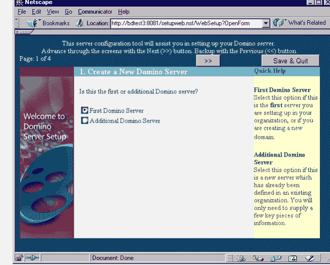

图 13. Domino Web 安装

### 5. 服务器观众设置

点击 `>>` 按钮继续到服务器观众（Server Audience）窗口。我们选择的服务如图 14 所示。

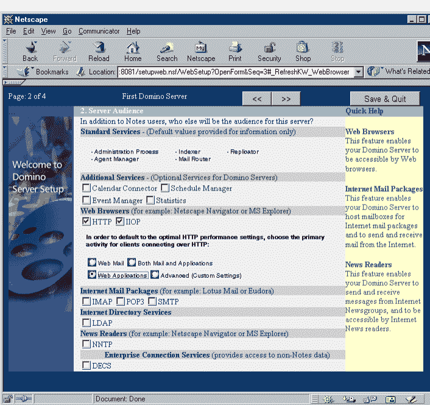

图 14. 出现在 Web 浏览器上的服务器观众设置是管理设置。

### 6. 管理设置

Web 浏览器上出现的下一个屏幕是管理设置。我们将填写适当的字段以适应我们的设置。在我们的项目中，我们按照图 15 和第 23 页所示的配置填充了这些字段。

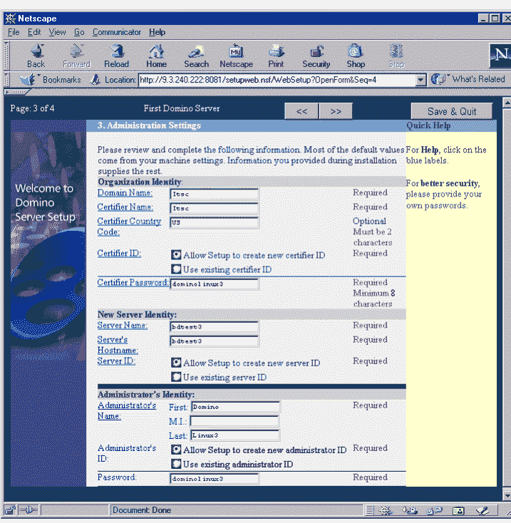

### 7. 网络和通信设置

指定网络和通信设置。我们选择安装默认值。完成填写后，点击 `Finish` 按钮。

### 8. 完成安装

Web 浏览器中将出现进度条，完成后，点击 Domino 欢迎窗口中的 `Exit` 按钮，Domino 将关闭 Web 服务器。

### 9. 启动 Domino 服务器

若要启动 Domino 服务器，我们将当前目录更改为 Domino 数据目录并输入以下命令：

```
/opt/lotus/bin/server
```

第 24 页的图 16 显示了带有 Domino 服务器启动命令的屏幕。


```
notesisdbtest3 data$ /opt/lotus/bin/server
Lotus Domino (i) Server, Release 5.0.3, March 21, 2000
Copyright (c) (1985-2000) Lotus Development Corporation, All Rights Reserved
05/09/2000 03:59:45 AM Router: Unable to obtain Internet host and domain names
05/09/2000 03:59:45 AM Mail Router started for domain T
...
```


第 24 页的 16 显示了带有 Domino 服务器启动命令的屏幕。

13. 安装成功完成后，安装程序提示您以 `userID notes` 登录以运行程序，而不是以 root 身份运行 Domino。

### 2.4.2.2 运行 httpsetup 程序

Domino 服务器的初始配置通过 Web 浏览器界面完成。以下步骤讨论了该过程：

1. 使用 `notes` `userID` 登录。
2. 切换目录到 Domino 数据目录。
3. 启动 HTTP 任务，发布命令：`/opt/lotus/bin/http httpsetup`

如果一切出现错误，我们将看到类似于图 12 的屏幕。

```
[notesdata/3 notesdata1@ /opt/lotus/bin/http httpsetup

04/28/2000 06:00:10 PM Created new log file as /local/notesdata/1

of.log

04/28/2000 06:00:12 PM

************************************

* Lotus Domino Server Setup

* To setup this server, please connect

* your web browser to port 8081

* Example: http://this.server.com:8081

************************************

04/28/2000 06:00:12 PM JVM: Java Machine initialized.

04/28/2000 06:00:13 PM HTTP Web Server started
```

图 12. Domino 设置 http 连接

4. 启动 Web 浏览器并连接到本地机器的 8081 端口。Web 配置窗口如图 13 所示。


图 13. Domino Web 安装

5. 点击 `>>` 按钮继续到服务器观众（Server Audience）窗口。我们选择的服务如图 14 所示。


图 14. 出现在 Web 浏览器上的服务器观众设置是管理设置。

6. Web 浏览器上出现的下一个屏幕是管理设置。我们将填写适当的字段以适应我们的设置。在我们的项目中，我们按照图 15 和第 23 页所示的配置填充了这些字段。


7. 指定网络和通信设置。我们选择安装默认值。完成填写后，点击 `Finish` 按钮。
8. Web 浏览器中将出现进度条，完成后，点击 Domino 欢迎窗口中的 `Exit` 按钮，Domino 将关闭 Web 服务器。
9. 若要启动 Domino 服务器，我们将当前目录更改为 Domino 数据目录并输入以下命令：

```
/opt/lotus/bin/server
```

### 2.4.2.3 连接 Domino

我们可以通过 Web 浏览器执行许多功能，但我们仍需要 Domino 管理器或客户端进行操作。在对机器进行任何操作之前，我们需要提取 ID 文件，如 3 所示。

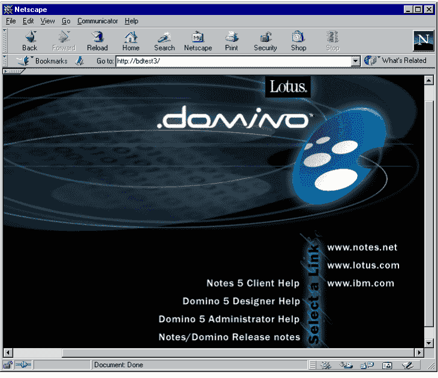

1. 使用 URL 访问地址簿：`http://test3.itsc.austin.ibm.com/names.nsf`
2. 在设置窗口中输入管理员用户 ID 及其密码。
3. 点击“人员”视图并打开之前创建的管理员文档。

Netscape

如果你使用的是 Netscape，你可能需要将 ID 文件重命名为 `USER.ID`。要使用 Domino 管理器或客户端访问 Domino，请遵循以下步骤：

1. 打开 Notes Client 并切换到我们之前下载的 `USER.ID` 文件。
2. 点击管理员或设计图标。
3. 对于设计器，选择 `File -> Database -> Open`。在输入新服务器名称或 IP 地址几秒后，Notes 客户端将显示新服务器可用的数据库。对于管理员，选择 `File -> Open Server` 并指定新服务器的名称或 IP 地址，然后点击 `Open`。

这些任务可以通过以下控制台命令启动：

- 加载 HTTP 任务：

```
load http
```

- 加载 DIQOP 任务：

```
load diiop
```

### 2.4.2.5 使用 Web 浏览器配置 Domino 服务器

现在，我们将解释如何在我们的项目中配置 Domino 服务器。在本文描述中，我们使用 Web 浏览器来配置 Domino 服务器。我们也可以使用 Domino 管理客户端来配置 Domino 服务器。

我们通过以下步骤配置 Domino 使用端口 8000 以进行匿名访问：

1. 通过将 Web 浏览器指向后端服务器上的相应 URL 来访问 Domino Web 管理员，在此情况下：

```
http://bdtest3/webadmin.nsf
```

2. Domino 服务器将要求管理员用户 ID 和密码。
3. 成功登录服务器后，Web 浏览器将显示类似于第 28 页图 19 的屏幕。

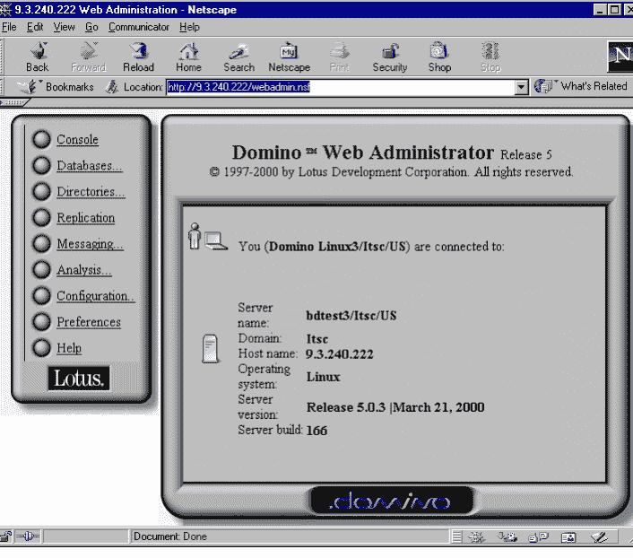

图 19. Domino Web 管理员

4. 从管理员窗口中（如图 19 所示），点击 **Configuration**（配置）。
5. 点击 **Servers**（服务器），你将得到一个类似于第 29 页图 20 的窗口。

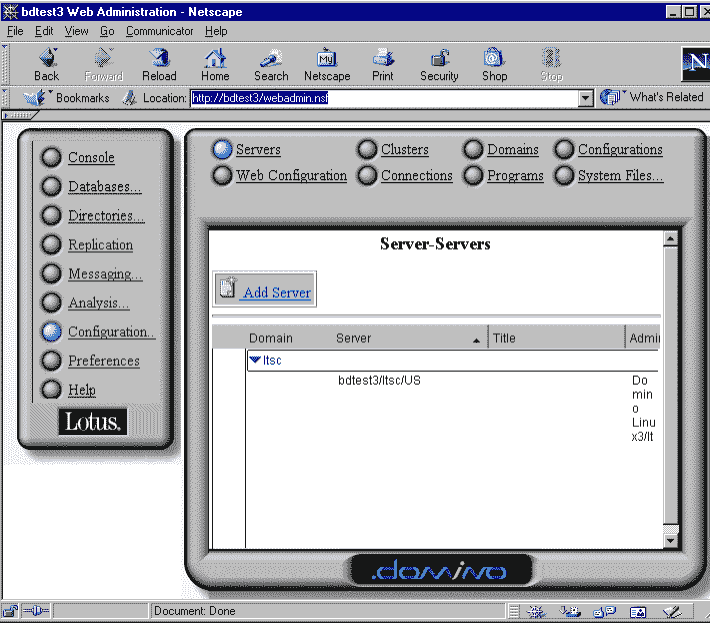

**图 20.** 配置屏幕

6. 双击服务器名称，然后点击 **Edit Server**（编辑服务器），Web 浏览器上将出现类似于第 30 页图 21 的屏幕。

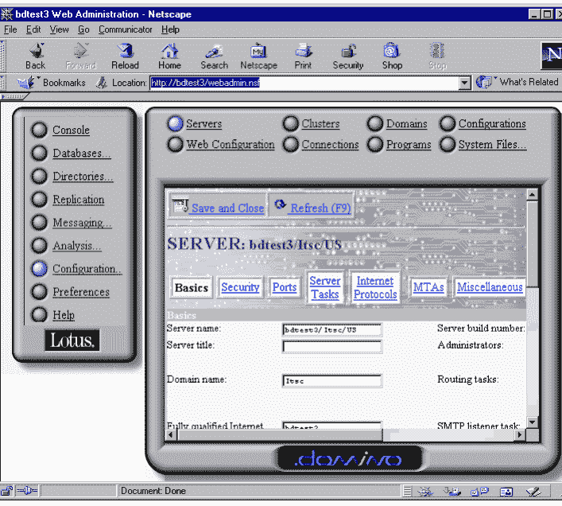

图 21. 编辑服务器屏幕

7. 在基本配置中，确保已 **Fully qualified Internet host name**（完全限定 Internet 主机名）填写了主机名 `bdtest3i.itsc.austin.ibm.com`。

8. 点击 **Ports**（端口），然后点击 **Internet Port**（Internet 端口）。
9. 将 **TCP/IP port number** 字段从 80 改为 8000。
10. 点击 **IIOP Server** 标签页并完成这些字段：

- TCP/IP Port Number：这是 DIOP 任务监听的端口名称。除非你将指定的端口号 63148（默认值）分配给其他任务，否则不要更改此端口。
- TCP/IP port status：Enable（启用）

11. 点击 **Internet Protocols** -> **IIOP** 并完成此字段：

Number of Threads：这是你希望允许 DIOP 服务器任务同时处理的线程数。默认值为 10。

12. 点击 **Security**（安全）标签页，并在 IIOP Restrictions 区域中完成这些字段：

- Run restricted Java/JavaScript（运行受限制的 Java/JavaScript）：applet 或应用程序访问服务器时使用的名称。在此字段中录的 applet 或应用程序名称允许运行使用受限制 Java 和 Javascript 特性创建的程序。如果 applet 或应用程序匿名登录，请在此字段中输入单词 **Anonymous**（匿名）。
- Run unrestricted Java/JavaScript（运行不受限制的 Java/JavaScript）：applet 或应用程序访问服务器时使用的名称。在此字段中录的 applet 或应用程序名称允许运行使用所有 Java 和 Javascript 特性创建的程序。如果 applet 或应用程序匿名登录，请在此字段中输入单词 **Anonymous**（匿名）。

安全设置位于第 32 页的图 22。

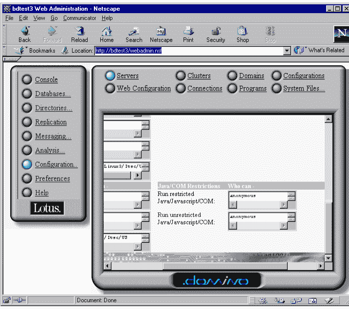

13. 点击 **Save and Close.**（保存并关闭）。

在配置并保存配置后，我们必须重启 Domino 服务器。在 webadmin.nsf 页面的浏览器窗口中，点击 **Console**（控制台）。在 Domino Console 字段中输入 `restart server` 命令并点击 **Send**（发送）按钮。

现在你可以使用 Web 浏览器指向端口为 8000 的 Domino 服务器来测试新配置。

### 2.4.3 IBM JDK

本节讨论了项目中 Java 开发工具包 (JDK) 的安装程序。

### 2.4.3.1 IBM JDK 预安装

在安装 IBM JDK 之前，你应该确保 Java 环境是干净安装的。这涉及移除任何现有的 Java 环境和运行时，除非它们对其他应用程序是必要的。例如，我们使用命令查询了 Linux 发行版：

```
rpm -qa | grep jdk
```

我们发现 Caldera 默认安装了 jdk-1.2.2。因此，使用命令删除了默认 JDK：

```
rpm -e jdk-1.2.2
```

### 2.4.3.2 安装 IBM JDK

我们的目标安装位于 `/opt` 目录。发行包为 tar 格式并经过 gzip 压缩。以 root 用户登录，将工作目录更改为目标安装目录 `/opt`，然后使用 tar xzf 命令解压并提取此文件 `ibm-jdk-118-linux-x86.tgz`。

由于我们将在 JDK 之后安装 IBM HTTP Server 和 WebSphere，我们还定义并导出了环境变量 `JAVA_HOME` 以指明 JDK 的安装位置。图 23 显示了执行 tar 命令的结果。

```
tar xzf /mnt/cdrom/ibm-jdk-118-linux-x86.tgz
export JAVA_HOME=/opt/ibm-jdk-118-linux-x86.tgz
```


安全设置位于第 32 页的图 22。


13. 点击 **Save and Close**（保存并关闭）。

在配置并保存配置后，我们必须重启 Domino 服务器。在 `webadmin.nsf` 页面的浏览器窗口中，点击 **Console**（控制台）。在 Domino Console 字段中输入 `restart server` 命令并点击 **Send**（发送）按钮。

现在你可以使用 Web 浏览器指向端口为 8000 的 Domino 服务器来测试新配置。

### 2.4.3 IBM JDK

本节讨论了项目中 Java 开发工具包 (JDK) 的安装程序。

#### 2.4.3.1 IBM JDK 预安装

在安装 IBM JDK 之前，你应该确保 Java 环境是干净安装的。这涉及移除任何现有的 Java 环境和运行时，除非它们对其他应用程序是必要的。例如，我们使用命令查询了 Linux 发行版：

```
rpm -qa | grep jdk
```

我们发现 Caldera 默认安装了 `jdk-1.2.2`。因此，使用命令删除了默认 JDK：

```
rpm -e jdk-1.2.2
```

#### 2.4.3.2 安装 IBM JDK

我们的目标安装位于 `/opt` 目录。发行包为 tar 格式并经过 gzip 压缩。以 root 用户登录，将工作目录更改为目标安装目录 `/opt`，然后使用 `tar xzf` 命令解压并提取此文件 `ibm-jdk-118-linux-x86.tgz`。

由于我们将在 JDK 之后安装 IBM HTTP Server 和 WebSphere，我们还定义并导出了环境变量 `JAVA_HOME` 以指明 JDK 的安装位置。图 23 显示了执行 tar 命令的结果。

```
tar xzf /mnt/cdrom/ibm-jdk-118-linux-x86.tgz
export JAVA_HOME=/opt/ibm-jdk-118-linux-x86
```

显示了 `httpd.conf` 文件的部分内容，我们在其中添加了我们的 `ServerName` 项。

```
# ServerName: 允许你设置一个主机名，如果该名称与程序获取的
# 名称不同（例如 "www" 而不是主机的真实名称），则会返回给你的服务器。
# 注意：你不能随意发明主机名并希望它们生效。在这里定义的
# 名称必须是适用于你主机的有效 DNS 名称。如果你不知道
# 这些，请询问你的网络管理员。
# 如果你的主机没有注册的 DNS 名称，请输入其 IP 地址
# 你将必须通过此地址访问它（例如 http://123.45.67.89/），
# 这样可以使重定向以合理的方式工作。
#ServerName localhost
ServerName bdtest2.itc.austin.ibm.com
```

图 27. 在 httpd.conf 中添加 ServerName 指令

## 3. 让 IBM HTTP Server 在启动时启动

要使用 X-窗口工作站设置 IBM HTTP Server 在启动时启动，请按照以下步骤：

- a. 运行 `tkysav` 命令。运行级别管理器窗口如第 37 页图 28 所示。

- b. 验证 `ibmhttpd` 是否列在“Available”列表中，并且在运行级别 2 的“start”和“stop”列表中。

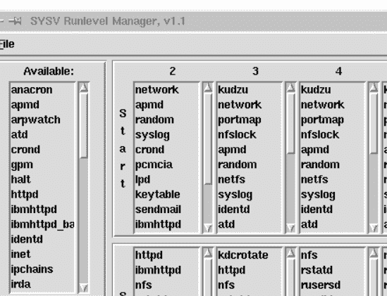

- c. 要将 `ibmhttpd` 添加到所需的运行级别，在“Available:”列表中突出显示它并点击“Add”。将弹出一个与第 38 页图 29 类似的屏幕，并提示你启动或停止服务。

- d. 选择运行级别 2 并点击“Done”。此过程需要在你希望为 httpd 配置的每个运行级别上完成。

第 2 章 设置与配置 37

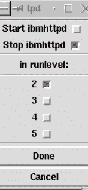

图 29. 将 httpd 添加到运行级别

如果没有具备 X-窗口功能的工作站，可以使用以下步骤在启动时添加 `ibmhttpd`：

- a. 在 `/etc/rc.d/init.d` 下应该名为 `ibmhttpd` 的可执行脚本文件。如果没有，请从 `/opt/IBMHTTPServer/bin` 复制此脚本文件。

- b. 执行以下命令在各个 rc.d 目录中为相应的运行级别创建符号链接：

```
ln -s /etc/rc.d/init.d/ibmhttpd /etc/rc.d/rc0/K15ibmhttpd
ln -s /etc/rc.d/init.d/ibmhttpd /etc/rc.d/rc1/K15ibmhttpd
ln -s /etc/rc.d/init.d/ibmhttpd /etc/rc.d/rc2/K15ibmhttpd
ln -s /etc/rc.d/init.d/ibmhttpd /etc/rc.d/rc3/S85ibmhttpd
ln -s /etc/rc.d/init.d/ibmhttpd /etc/rc.d/rc4/S85ibmhttpd
ln -s /etc/rc.d/init.d/ibmhttpd /etc/rc.d/rc5/S85ibmhttpd
```

现在，你可以启动 IBM HTTP Server 了。现在 IBM HTTP Server 也应该会在启动时启动。通过重启系统并尝试使用 Web 浏览器连接端口 80 来检查这一点。当我们能够在 Web 浏览器中获取 IBM HTTP Server 默认网页时（如第 39 页图 30 所示），我们证实了安装工作正常。

## 2.4.5 WebSphere

我们在这里介绍了在前端服务器上安装 WebSphere、为 WebSphere 和 IBM HTTP Server 配置各种配置文件，以及验证 IBM HTTP Server 将加载并运行 Java servlet 的步骤。

### 2.4.5.1 安装 WebSphere

WebSphere 必须以 root 用户身份安装。它要求安装 JDK 并设置 `JAVA_HOME` 环境变量。然后需要安装 2 个组件。这些是安装步骤：

- 安装 `JAVA_HOME=/opt/jdk118`，因为我们之前已经安装了 IBM JDK 118（见第 32 页第 2.4.3 节“JDK 118”）。

- 安装 WebSphere 核心，文件名为 `IBMWebAS-core-2.03-1.i386.rpm`。

- 我们现在可以安装 Web 服务器特定组件。由于我们使用的是 IBM HTTP Server，我们将使用文件 `IBMWebAS-ibm-http-2.03-1.i386.rpm`。

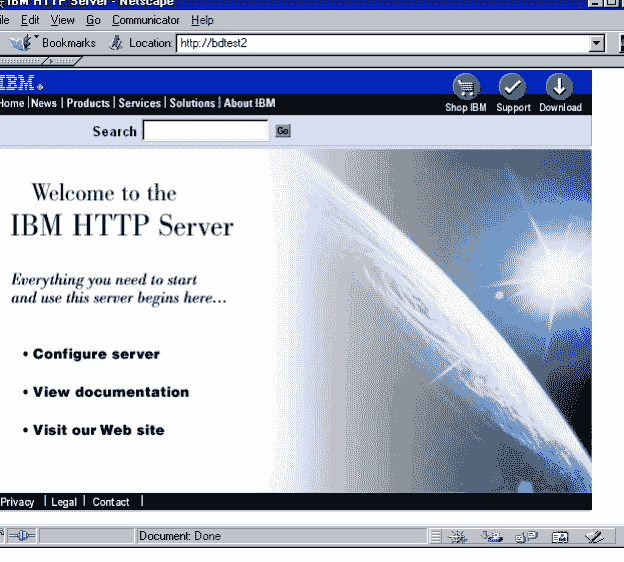

第 2 章 设置与配置 39

#### WebSphere 依赖

用于 IBM HTTP Server 的 WebSphere rpm 包依赖于 IBM HTTP Server 1.3.6；因此，确保已安装 IBM HTTP Server 1.3.6。

图 31 显示了我们按照之前记录的安装步骤安装 WebSphere 应用程序服务器。

```
[root]@dttest2 /opt# export JAVA_HOME=/opt/jdk118
[root]@dttest2 /opt# rpm -i /mnt/cdrom/was/IBMWebAS-core-2.03-1.i386.rpm
配置副本已创建并位于 /opt/IBMWebAS/properties/bootstrap.properties.bak
[root]@dttest2 /opt# rpm -i /mnt/cdrom/was/IBMWebAS-ibm-http-2.03-1.i386.rpm
httpd.conf 备份已创建并保存到 /opt/IBMHTTPServer/conf/httpd.conf
```

图 31. 安装 WebSphere 应用程序服务器

- 4. 最后，为了确保 JSP 页面可以编译，我们更改位于子目录 `/opt/IBMWebAS/servlets` 中的 `pagecompile` 目录的所有权，将其所有者和组设为 `nobody`。我们使用以下 `chown` 命令：

```
chown nobody.nobody /opt/IBMWebAS/servlets/pagecompile
```

### 2.4.5.2 验证 WebSphere 安装

我们通过以下方式验证 WebSphere 已成功安装：

- 视觉检查 WebSphere 属性。
- 视觉检查 IBM HTTP Server 配置文件。
- 使用 Web 浏览器验证 WebSphere 运行。

#### 验证 IBM HTTP Server 配置文件

IBM HTTP 服务器有一个名为 `httpd.conf` 的配置文件，位于 `/opt/IBMHTTPServer/conf`。视觉检查此文件并检查以下内容：

- `LoadModule_app_server_module`

在动态共享对象列表中，应该有一个用于 `app_server_module` 的 `LoadModule` 定义以加载 WebSphere，位于 `Extra Modules` 部分的注释 `#Dynamic Shared Object (DSO) Support` 之后。加载语句如图 32 所示。

```
##
# Dynamic Shared Object (DSO) Support
#
# LoadModule usertrack_module libex/mod_
```

（注：源末处的 OCR 文本是不完整的）。

```
[root]@bdtest2 /opt# killall Java
Java: no process killed
[root]@bdtest2 /opt# /etc/rc.d/init.d/ibmhttpd stop
[/etc/rc.d/init.d/ibmhttpd stop: http stopped
[root]@bdtest2 /opt# /etc/rc.d/init.d/ibmhttpd start
[/etc/rc.d/init.d/ibmhttpd start: http started
```

图 36. 首次启动 IBM WebSphere 服务器

现在我们可以访问服务器来运行 snoop servlet，我们可以

图 37 显示了运行 snoop servlet 的结果。

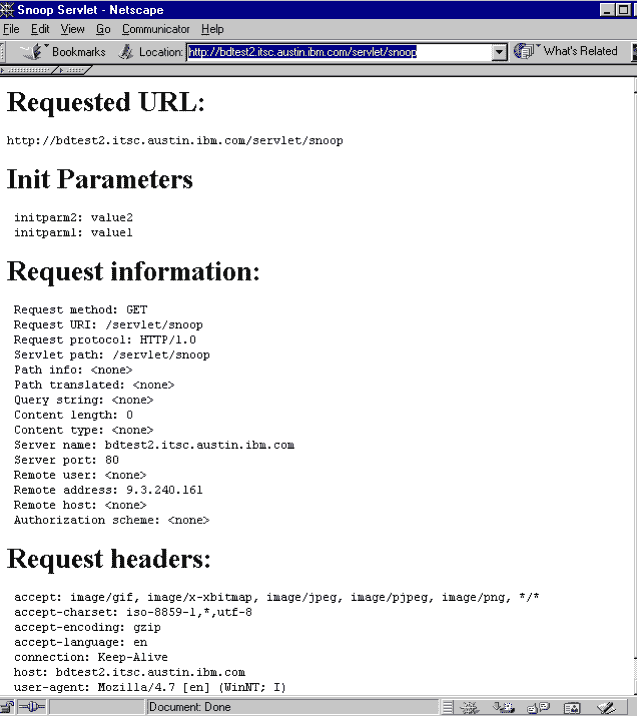

# 请求 URL:

`http://bdtest2.itc.austin.com/servlet/snoop`

# 初始化参数

`initparam1=value`

`initparam2=value`

# 请求信息:

`Request Method: GET`

`Request URI: /servlet/snoop`

`Request protocol: HTTP/1.0`

`Servlet path: /servlet/snoop`

`Path info: <none>`

`Path translated: <none>`

`Query string: <none>`

`Content length: 0`

`Content type: <none>`

`Server port: 80`

`Remote host: <none>`

`Remote address: 9.3.240.161`

`Remote host: <none>`

`Authorization scheme: <none>`

# 请求头:

`accept:image/gif,image/-vbit,image/jpeg,image/jpeg,image/png,/**`

`accept-language: en-iso8859-1,*utf-8`

`accept-encoding: deflate`

`connection: keep-alive`

`host: bdtest2.itc.austin.com`

`user-agent: Mozilla/4.7 [en] (WinNT; I`

图 37. 使用 snoop servlet 测试 WebSphere 安装

第 2 章. 建立与配置 43

我们还验证了 WebSphere 管理服务器正在运行，并通过端口 9527 连接到我们的服务器。图 38 显示了结果。

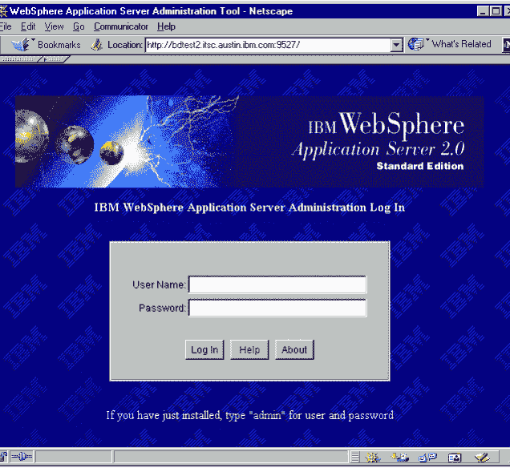

图 38. 验证 WebSphere 前端管理服务器在端口 9527 上运行

## 2.4.6 配置前端对后端数据库的访问

此时，我们的前端服务器尚未准备好访问后端 DB2 和 Domino 数据库。我们必须在前端服务器上执行进一步的配置。参见以下章节：

- 第 44 页第 2.4.6.1 节，“配置前端对 DB2 的访问”
- 第 49 页第 2.4.6.2 节，“配置前端对 Domino 的访问”

### 2.4.6.1 配置前端对 DB2 的访问

为了让安装在前端服务器 dbtest2 上的 IBM WebSphere 和 IBM HTTP Server 能够访问后端服务器上的 DB2 Java 类库和 DB2 服务器，我们必须在前端服务器上执行以下步骤：

- 1. 安装客户端应用程序启用器 (CAE)。
- 2. 验证 DB2 CAE 的安装。
- 3. 修改 IBM WebSphere 配置文件以包含 DB2 Java 库。
- 4. 修改 IBM HTTP Server 以识别 DB2 实例和相关的 DB2 库。
- 5. 验证对后端 DB2 数据库的访问。

我们将在接下来的章节中描述这些步骤。

#### 安装 DB2 客户端应用程序启用器

要执行此任务：

- 1. 以 root 身份登录。
- 2. 将工作目录更改到存储 DB2 6.1 fixpack 3 版 DB2 CAE 代码的目录。
- 3. 执行 `db2setup` 命令。打开安装 DB2 V6 界面。
- 4. 运行 `db2setup` 命令后，根据 DB2 的发行版本，将提供 DB2 管理客户端或 DB2 运行时客户端供安装。选择任一可用的版本来安装 CAE。在我们的场景中，它是 DB2 管理客户端提供的。
- 5. 按下**回车键**以选择 **DB2 Administration Client**。屏幕应如图 39 所示。

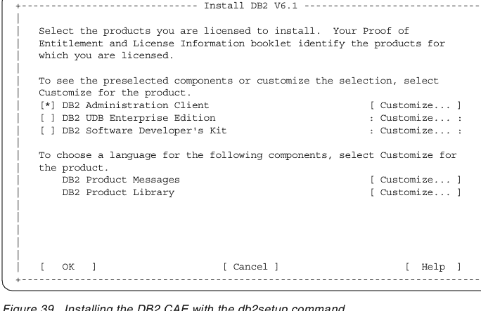

图 39. 使用 db2setup 命令安装 DB2 CAE

- 6. 为了确保安装 Java 组件，我们使用 Tab 键将光标移动到 Customize（自定义）选项，然后按 Enter。我们验证 Java 支持组件将如图 40 所示。

| 安装 DB2 V6.1 |
| :--- |
| 选择您获得许可可以安装的产品。您的权利证明（Proof of Entitlement）和许可信息手册识别了您获得许可许可的产品。 |
| 要查看预选组件或定制化选择，请选择 DB2 Administration Center |
| 必需: | DB2 Client |
| 可选: | `[*]` Java Support `[ ]` Control Center |
| `[ 全选 ]` `[ 取消全选 ]` `[ 默认 ]` |
| `[ ]` `[ 完成 ]` |

图 40. 为 Java 支持定制化 DB2 安装

- 7. 选择 OK。
- 8. 在安装 DB2 界面，选择 OK 继续。
- 9. 通过 JDBC 访问 DB2 有两种方法：应用程序驱动程序和网络驱动程序。更多信息请参见第 83 页的第 3.5.3 节，“通过 JDBC 访问 DB2”。我们使用应用程序驱动程序；因此我们设置 `DB2INSTANCE` 参数。
- 10. 接受 DB2 界面上的默认设置。
- 11. 安装完成后，选择 OK。
- 12. 安装结果如图 41 所示。
- 13. 关闭退出 DB2 安装程序。

#### 验证 DB2 CAE 安装

一旦安装了 DB2 CAE，对其进行验证：

- 1. 以 root 身份登录。
- 2. 使用以下命令访问 SAMPLE：
- 3. 使用以下命令验证连接：
- 4. 最后，通过执行以下命令验证其工作正常：

图 41. 在前端上分类 SAMPLE

#### 修改 WebSphere 配置文件

我们必须将 `db2java.zip` 添加到 WebSphere 中。操作如下：

- 1. `bootstrap.properties` 文件位于前端服务器的 `/opt/IBMWebAS/properties` 目录下。
- 2. 以 root 身份登录，编辑此文件并找到以下条目：
- 3. 将以下路径添加到该条目中：
- 4. 现在 `bootstrap.properties` 中的条目应如图 42 所示。

```
##
classpath 应包含 JVM 类和任何用户类。WebSphere classpath 是根据 <InstallRoot>\lib 的内容动态构建的。
```

图 42. 为 WebSphere Java.classpath 添加 db2java.zip

#### 修改 IBM HTTP 服务器配置文件

为了使 JDBC 连接生效，必须设置 `DB2INSTANCE` 环境变量，并修改库路径以包含 DB2 库。我们修改了 IBM HTTP Server 启动文件 `/etc/rc.d/init.d/ibmhttpd`，并添加了如图 43 所示的环境变量。

图 43 文件中的 DB2INSTANCE 和 LIBPATH

重启 IBM HTTP Server 以激活这些设置。

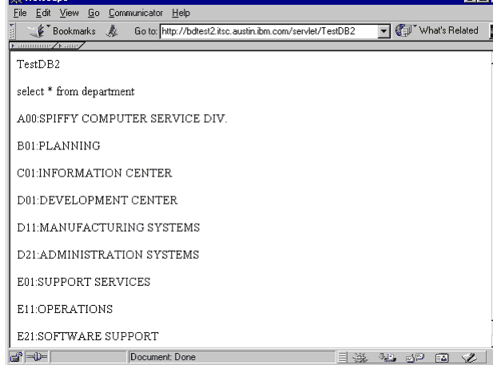


为了从我们的前端服务器 `bdtest2` 访问 Domino 数据库，我们必须通过以下任务配置 WebSphere 应用程序服务器：

1. 从 Domino 服务器上的 `/local/notesdata/domino/Java/` 目录拷贝 `NCSO.jar` 文件到前端服务器。我们将该文件放在 `/opt/domino` 目录。
2. 编辑 `bootstrap.properties` 文件。我们在 `/opt/IBMWebAs/properties` 处有一个 `bootstrap.properties` 文件。
3. 在 `classpath` 中放入 `NCSO.jar` 的完整路径：

```
Java.classpath=...;opt/domino/NCSO.jar
```

第 50 页的图 45 将显示我们修改后的 `bootstrap.properties`。

```
####################################################
# Java 虚拟机配置
####################################################
```

# JVM 的类路径。该类路径将附加在

# WebSphere 运行时类路径之前。此类路径应包含

# JVM 类和任何用户类。WebSphere 类路径

# 是根据 <Install Root>/lib

# 目录的内容动态构建的

Java.classpath:/opt/jdk11/lib/classes.zip:/opt/IBMAS/classes:/opt/IBMAS/clabs:/usr/IBMJ2_6.java/java.zip:/opt/Domino/NCSO.jar

图 45. 将 NCSO jar 添加到 classpath bootstrap 属性。

4. 使用以下命令重启 IBM HTTP 服务器：

```
killall Java
/etc/rc.d/init.d/httpd stop
/etc/rc.d/init.d/httpd start
```

## 2.4.6.3 验证 WebSphere 访问 Domino 服务器

为了验证 WebSphere 能够访问 Domino 数据库，我们需要一个简单的 Java Servlet 程序。我们在 WebSphere 上创建一个简单的 servlet，尝试打开到 Domino 服务器的会话并显示数据库标题。

1. 编写在第 159 页附录 C.1 "Java servlet TestDomino" 中提供的 `TestDomino` servlet。
2. 使用 Java 编译器编译 servlet。
3. 将 servlet 类文件放入 WebSphere servlets 目录。
4. 配置 WebSphere 加载该 servlet。
5. 要验证 WebSphere 和 Domino 之间的连接，从 Web 浏览器运行 servlet。我们使用 URL：

```
http://bdtest2/servlet/TestDomino?db=homepage&host=bdtest3&port=8000
```

其中 `homepage` 是 Domino 服务器默认提供的 `homepage.nsf` 数据库文件。

结果与第 51 页的图 46 类似。

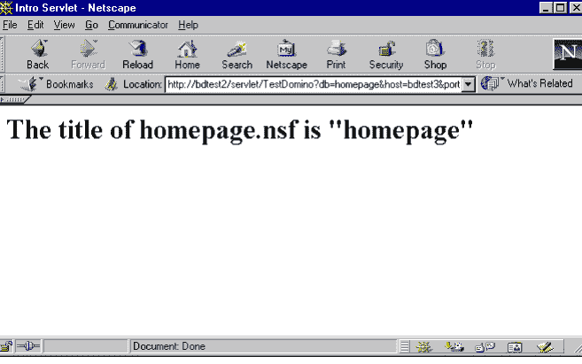

图 46. TestDomino servlet 结果

# 第 3 章 构建 Web 服务器

在本章中，我们将详细探讨构建 Web 服务器时所采取的步骤。讨论分为：

- 第 53 页第 3.1 节“外部功能”描述了所创建网站的外部结构。
- 第 60 页第 3.2 节“内部设计”展示了我们用于构建网站的组件和构建块。
- 第 61 页第 3.3 节“DB2 数据库”讨论了我们 DB2 数据库结构的设计和结构。
- 第 69 页第 3.4 节“Domino 数据库”提供了 Domino 数据库和 Redbooks 数据库设置的概述。
- 第 78 页第 3.5 节“Servlet 程序”详细讨论了我们使用的 servlet 的制作。
- 第 98 页第 3.6 节“JSP 文件”讨论了使用 JSP 实现动态 Web 页面。
- 第 103 页第 3.7 节“通过 Java Bean 访问数据”提供了使用简单 Java Bean 进行 Web 编程的概述。

## 3.1 外部功能

在本节中，我们将讨论 Web 服务器的外部功能。我们将作为典型用户来操作我们的 Web 服务器。网站有两种类型的用户：未注册用户和注册用户。

该网站具有以下功能：

- 浏览和搜索 Redbooks 数据库
- 资料管理、注册和更新用户
- 订购功能

我们提供了一系列 Windows Media 格式的 ScreenCam 视频，说明网站的流程。这些 ScreenCam 视频可在随附的 CD-ROM 中获得。请参考第 211 页附录 F“使用附加材料”获取更多关于 CD-ROM 的信息。

第 54 页的图 47 说明了未注册用户的流程。


如图 47 所示，该网站显示的初始页面是欢迎页，如第 55 页的图 48 所示。

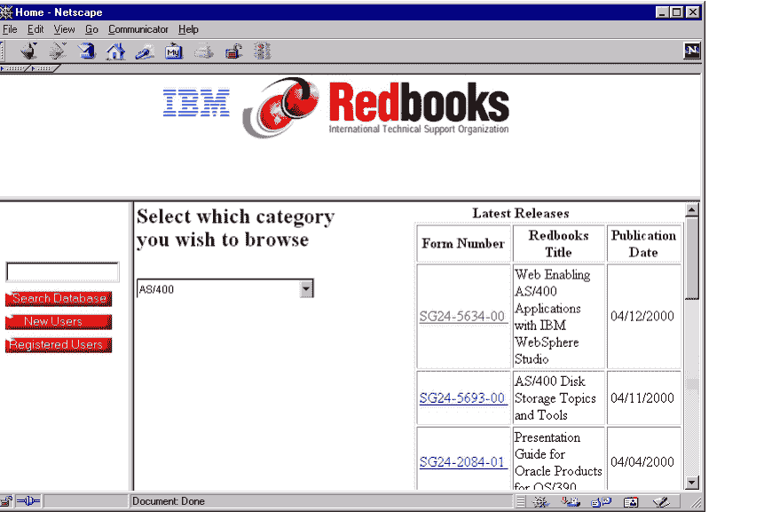

从图 47 所示的欢迎页，未注册用户仅具有：

- **搜索数据库**，允许搜索数据库。
- **新用户**，显示注册页面。

注册页面如第 56 页的图 49 所示。注册需要您填写个人信息。如果失败，将显示错误；否则，您将看到您的自定义主页。

该网站具有以下功能：

- 浏览和搜索 Redbooks 数据库
- **注册用户**，显示登录页面。需要输入有效的用户名和密码。如果登录失败，将返回登录页面并允许重试。如果登录成功，您将看到您的自定义主页。

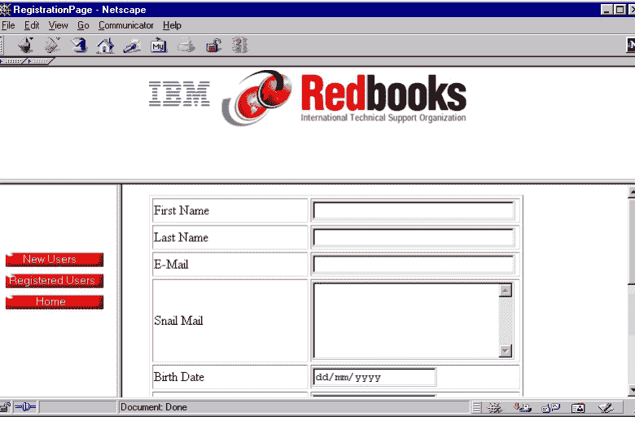

图 49. 注册页面

注册用户从第 55 页图 48 所示的欢迎页选择“注册用户”按钮进入登录页面。需要输入有效的用户名和密码。如果失败，将返回登录页面并允许重试。如果登录成功，您将看到您的自定义主页，类似于第 59 页图 52 所示的窗口，该窗口包含兴趣资料。

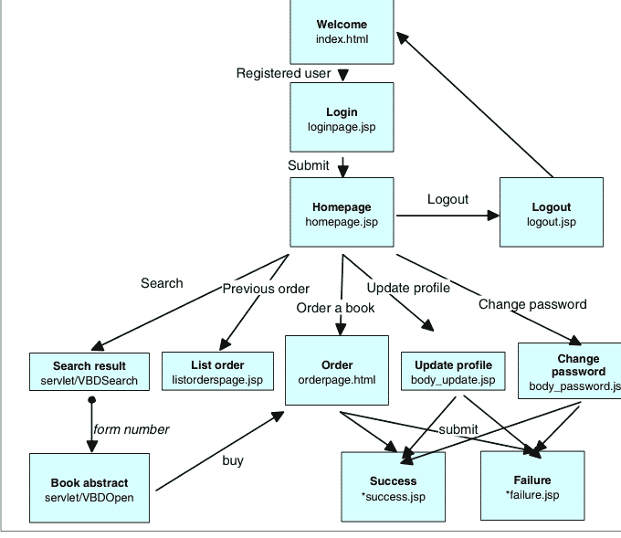

图 51. 注册用户的 HTML 流程

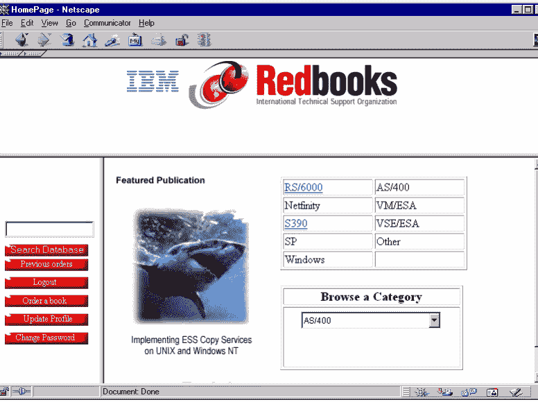

图 52 注册用户的主页

作为注册用户，你可以如图 52 所示，从主页选择几个选项之一：

- “搜索数据库”（Search Database）按钮与未注册用户的搜索功能类似。
- 点击“以前订单”（Previous Orders），将带你进入订单列表页面，其中显示你使用 Java Bean 提交的订单。
- 点击“购书”（Order a book），将带你进入订单页面以启动订购流程。
- 点击“更新配置”（Update Profile）。这允许更新个人信息和兴趣分类。
- 点击“修改密码”（Change Password）。这将提供密码修改界面。

从订单页面、个人配置更新页面和修改密码页面，你将进入成功页面或失败页面。如果失败，点击“继续”（continue）将返回到上一个屏幕。如果成功，点击“继续”将返回主页。

如第 58 页的图 51 所示，可以通过书籍摘要页到达订单页面，或者如果你知道表单编号，也可以直接进入订单页面。成功的订单将显示订单号和发货详情。失败将再次显示错误消息和进一步的指令。

## 3.2 内部设计

我们随后开发的 Web 应用程序结构能够提供第 53 页第 3.1 节“外部功能”中讨论的展示流。由于我们决定使用电子商务用户在线购买的拓扑结构，应用程序在开发时在前端包含一个商业服务器节点，后端包含一个数据库服务器节点。前端使用 WebSphere 运行 Web 服务器和业务逻辑，而后端包含数据。图 53 显示了我们的内部配置。

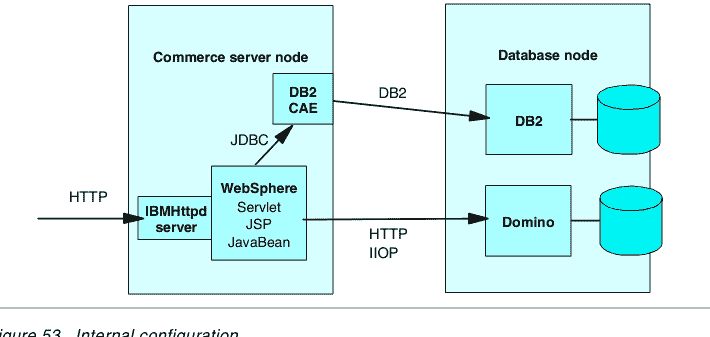

设计从数据库服务器结构开始。我们使用了两个数据源：用 DB2 数据库存储订单和用户配置，用 Lotus Domino 数据库存储书籍信息。DB2 数据库的结构见第 61 页第 3.3 节“DB2 数据库”。关于 Lotus Domino 红书数据库的讨论见第 69 页第 3.4 节“Domino 数据库”。

商业服务器节点使用 RedHat Version 6.2 和 Caldera eDesktop Version 2.4 实现。我们使用的 HTML 代码可在第 173 页附录 D“HTML 和 JSP 文件列表”中找到。在本书中，我们描述 Web 服务器中某些 Java 相关组件的开发。这些讨论安排在：

- 第 78 页第 3.5 节“Servlet 程序”，讨论了我们开发的 Servlet 程序。这些 servlets 主要用于维护会话、访问 DB2 数据库以及访问 Domino 数据库。
- 第 98 页第 3.6 节“JSP 文件”，讨论了我们使用的 Java Server Pages（JSPs）。JSP 提供了创建动态 Web 页面的能力，而无需在 servlet 中编写所有代码。
- 第 103 页第 3.7 节“通过 Java Bean 访问数据”，概述了我们用于在 Web 页面中表示任意数量动态数据的 Java Beans。

## 3.3 DB2 数据库

本节详细讨论了构建我们所使用的 DB2 数据库所需的步骤。我们执行的步骤讨论如下：

- 第 61 页第 3.3.1 节“数据库建模”，在其中我们提供了开发数据库时面临的设计考量。
- 第 66 页第 3.3.2 节“创建数据库”，展示了实际的数据库创建。

### 3.3.1 数据库建模

为了实现网站的目标，我们的数据库至少必须对以下实体进行建模：

- 用户（Users）
  用户是访问 Web 网站浏览、使用用户名和密码登录、注册红书类别兴趣配置以及查看红书的客户。
- 订单（Orders）
  这些实体反映了用户对产品的订购。为了简单起见，用户一次只能订购一种产品（即没有购物车概念，在订单最终确定之前可以放置一个或多个数量不同的产品）。

我们将从更具体的细节上检查视这些实体中的每一个一个。

#### 3.3.1.1 用户（Users）

`users` 实体必须具有以下属性：

- 用户名（Username）：用户名被认为是是的。因此，我们通过验证用户名和密码的组合来验证用户是否已注册。每当在数据库上执行操作时（无论是更改还是访问用户密码、信息和配置），都必须验证用户名和密码。

用户名和密码信息由于性能和实现的考虑，需要分开构建。出于性能考虑，我们需要将对此类信息的访问与其他所有访问分开，以便能够对数据提供快速高效的访问。从实现的角度来看，我们也会发现以后更改密码加密算法和访问方法会更方便。

- 用户信息（User information）
  用户信息包含姓、名、地址、电子邮件等。此表的字段通常是静态的且不更改。我们添加了日期来跟踪用户注册的时间。
- 个人配置信息（Profile information）
  配置反映了用户对红书的兴趣。此列表可能会经常变化。

#### 3.3.1.2 订单（Orders）

订单实体具有以下属性：

- 与订单相关的用户名
- 订单的时间戳
- 已订购的产品
- 唯一的订单 ID

此订单 ID 是必须的，因为我们不再使用用户名作为标识符（因为用户可以订购多个产品）。

#### 3.3.1.3 完整设计

基于用户和订单项目的讨论，我们将创建四个数据库表。每个表都有一组字段（或列名），每个字段都有数据类型、长度和可空性。

- 数据类型（Data type）
  DB2 提供了多种数据类型。我们在数据库中使用以下数据类型：
  - `varchar`：提供变长字符串类型
  - `char`：提供固定长度字符串类型
  - `date`：提供仅日期数据类型
  - `timestamp`：提供到微秒的日期
  - `int`：提供整数类型
- 字段长度（Field length）
  这代表字段的长度（如果适用）。例如，`char` 或 `varchar` 类型需要长度，`date`、`timestamp` 或 `int` 类型不需要。
- 可空性（Nullable condition）
  最后一个属性，可空性，是为了跟踪该字段是否可以留空、未定义或必须填写。例如，0 长度字符串；它不是空字符串。

我们构建的数据库结构由图 54 所示的实体关系图表示。

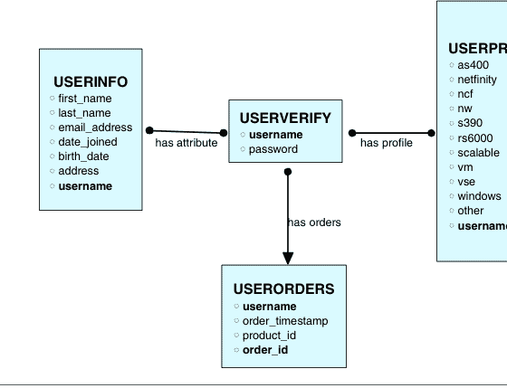

我们的 DB2 数据库结构实体关系图

### USERVERIFY

`USERVERIFY` 表包含用户名和密码。此表的字段如表 1 所示。

表 1. USERVERIFY 数据库表

| 字段名 | 数据类型 | 长度 | 可空 |
| --- | --- | --- | --- |
| username | varchar | 20 | no |
| password | varchar | 20 | no |

用户名字段将是此表的搜索键；因此，我们也将将其分配为表的主键。

用户名和密码都不允许为空。

### USERINFO

`USERINFO` 表包含用户信息。该表的字段如表 2 所示。

表 2. USERINFO 数据库表

| 字段名 | 数据类型 | 长度 | 是否允许 |
| --- | --- | --- | --- |
| first_name | varchar | 50 | no |
| last_name | varchar | 50 | no |
| email_address | varchar | 50 | no |
| date_joined | date | - | no |
| birth_date | date | - | no |
| address | varchar | 200 | no |
| username | varchar | 20 | no |

`username` 字段将作为该表的搜索键；因此，我们也将将其分配为表的主键。

这些字段均不允许为空。

### USERPROFILE

这包含了用户感兴趣的平台列表。每个注册用户在该表中都有一个条目。除了 `username` 之外，所有字段都设置为可为空。如果注册用户表示了对某个平台感兴趣，则该字段被设置为单个字符，通常是字母 y。`USERPROFILE` 表的字段如表 3 所示。

表 3. USERPROFILE 数据库表

| 字段名 | 数据类型 | 长度 | 是否允许 |
| --- | --- | --- | --- |
| as400 | char | 1 | yes |
| netfinity | char | 1 | yes |
| ncf | char | 1 | yes |
| nw | char | 1 | yes |
| s390 | char | 1 | yes |
| rs6000 | char | 1 | yes |
| scalable | char | 1 | yes |
| vm | char | 1 | yes |
| vse | char | 1 | yes |
| windows | char | 1 | yes |
| other | char | 1 | yes |
| username | varchar | 20 | no |

`username` 字段将作为该表的搜索键；因此，我们也将将其分配为表的主键。

### USERORDERS

这包含了您的订单。每个订单除了 `username`、订购的 `product_id` 以及订单时间戳外，都将有一个唯一的 `order_id`。`USERORDERS` 表的字段如表 4 所示。

表 4. USERORDERS 数据库表

| 字段名 | 数据类型 | 长度 | 是否允许 |
| --- | --- | --- | --- |
| username | varchar | 20 | no |
| order_timestamp | timestamp | | no |
| product_id | varchar | 20 | no |
| order_id | int | | no |

`order_id` 字段将作为该表的搜索键；因此，我们也将将其分配为表的主键。

我们要求表中的所有字段都必须填写。

### 3.3.2 创建数据库

创建数据库包括以下步骤：

- 创建 DB2 数据库
- 在数据库中创建 DB2 表

我们假设 DB2 已安装，并且如第 15 页第 2.4.1 节“DB2”所述，已成功验证了安装。

### 3.3.2.1 创建 DB2 数据库


我们可以使用 DB2 Center GUI 界面或通过命令行来创建 DB2 数据库。

我们演示了如何通过命令行创建数据库，如下：

1. 在服务器上，以用户 `db2inst`（默认 DB2 实例所有者）登录。
2. 执行 `db2 create database` 命令创建 USERSTUF 数据库：

```
db2 create database USERSTUF
```

### DB2 数据库名称

DB2 v6.1 中的 DB2 数据库名称长度必须为八字符或以内。因此，我们将数据库命名为 USERSTUF（而不是 USERST）。

第 67 页的图 55 显示了 `create database` 命令的结果，使用默认设置创建了 USERSTUF 数据库。我们通过 `db2 connect database` 命令连接到数据库来验证数据库已创建。

```
[db2inst@bdtest1$] db2 create database USERSTUF
DB2000OI The CREATE database command completed successfully.
[db2inst@bdtest1$] db2 connect to userstuf
```

```
Database server = DB2/LINUX 6.1.0
SQL authorization ID = DB2INST1
Local database alias = USERSTUF
```

图 55. 在服务器 bdtest1 上创建 USERSTUF 数据库

此命令在默认位置 `/home/db2inst1` 创建了一个名为 USERSTUF 的数据库。

## DB2 数据库备份

始终使用 `db2 backup database` 命令备份 DB2 数据库。备份文件系统或在文件系统级别备份数据库文件无法达到相同的效果。更多关于 DB2 操作的信息请参见第 107 页第 4 章“操作注意事项”。

## 3.3.2 在前端服务器上对数据库 USERSTUF 进行建模

如第 83 页 3.5.3 节“通过 JDBC 访问 DB2”所示，前端服务器将使用 DB2 原生 API 类型 2 JDBC 驱动程序访问 DB2 USERSTUF 数据库。为了这项工作，我们必须在前端服务器上对 USERSTUF 数据库建模。

我们按照以下顺序发布 `db2 catalog tcpip node` 命令，以 DB2 实例所有者 `db2inst1` 的身份登录前端服务器：

```
db2 catalog tcpip node dbtest3 remote 9.3.240.221 server 50000
db2 catalog database userstuf at node dbtest3
```

使用命令验证连接到 DB2 数据库：

```
db2 connect to userstuf
```

### 3.3.2.3 在数据库中创建 DB2 表

我们可以使用 DB2 Control Center GUI 或通过 DB2 命令行为 USERSTUF 表创建数据库表。

我们演示了如何使用命令行界面创建表。我们已经创建了四个用于此过程的 SQL 脚本文件（参见第 145 页附录 A，“创建 USERSTUF 表的 SQL 脚本”）。我们在此演示创建 USERINFO 表。脚本文件名为 `userinfo.ddl`，内容如图 56 所示。

```
create table userinfo (
first_name varchar(20) not null,
last_name varchar(20) not null,
email_address varchar(50) not null,
date_joined date not null,
birth_date date not null,
address varchar(200) not null,
username varchar(20) not null,
primary key (username)
);
```

图 56. userinfo.ddl 文件

创建 USERSTUF 表的步骤如下：

1. 以默认 DB2 实例所有者 `db2inst1` 登录。
2. 使用命令连接到 USERSTUF 数据库：

```
db2 connect to userstuf
```

3. 带有 `-tvf` 选项的 db2 命令，指定当前路径下的 USERINFO 脚本文件 `userinfo.ddl`：

```
db2 -tvf userinfo.ddl
```

第 69 页的图 57 显示了服务器上执行 `connect` 和 `create table` 命令的结果。

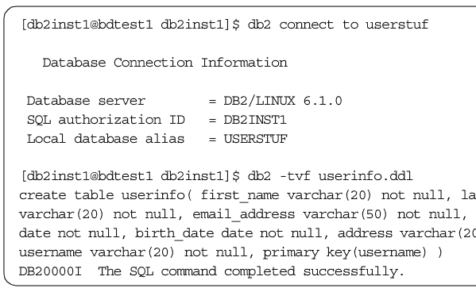

图 57. 服务器 dbtest1 USERINFO 表

重复此步骤创建 USERSTUF 表。

## 3.4 数据库

在本节中，我们将讨论数据库。

### 3.4.1 数据库概念

Domino 数据库是存储在文件中的相关信息集合。Domino 应用程序至少使用一个数据库。数据库包含设计也包含数据。Domino 数据以文档组织。文档是一个包含文本、图形、视频或音频的任何富文本的对象。

#### 3.4.1.1 表单

表单是提供给用户通过输入或其他控件输入数据的骨架。表单也可以被视为文档的抽象结构。它定义了文档的所有字段及其类型。数据库中至少有一个表单，尽管典型的业务应用程序会有许多表单，每个表单针对用户想要保存到数据库的特定信息。

表单包含了所有的设计元素：存储用户信息的字段、静态文本、按钮、区域、图像以及帮助用户输入数据的子表单。

#### 3.4.1.2 视图

视图显示存储在 Domino 数据库中的文档列表，可以认为是数据库的目录。视图提供了组织文档的方法，以便向用户或程序展示。视图中的每行代表单个文档的数据。每列代表该文档的字段或公式的结果。

#### 3.4.1.3 文档

Domino 文档是数据的容器，类似于数据库管理系统（DBMS）中的行。每个文档都是字段的集合。每个文档在创建时都会赋予一个唯一标识符，并被数据库作为主键使用。

文档的设计存储在表单（form）中，表单规定了文档每个字段可以包含的内容，例如数字、日期或富文本。

### 3.4.2 视图与表单详解

Domino.nsf 数据库是从当前视图复制的。该数据库提供的重要功能是表单和可用视图。本节分为：

- 第 71 页第 3.4.2.1 节“form”，讨论了文档的格式。
- 第 74 页第 3.4.2.2 节“views”，讨论了我们为了支持 Web 应用而创建的视图。

#### 3.4.2.1 表单

表单有两种形式：标准的 Notes 表单和抽象 Web 模板。II 访问使用标准的 Notes 表单，而直接 Web 访问使用 Web 模板。图 58 显示了数据库中的表单。

表单本身以图形化的方式组织，如第 73 页的图 59 所示。

文档包含我们使用的字段：

- FormNumber: 出版号
- BookTitle: 文档标题
- PublishDate: 书籍的出版日期，用于排序
- Platforms: 书籍使用的平台分类
- Abstract: 书籍的摘要文本

第 74 页的图 60 显示了文档的子表单，我们在附录 C.5 第 168 页的“Java servlet VBDOpen”中使用我们的 servlet、VBDOpen 对其进行了模拟。

#### 3.4.2.2 视图

视图是数据库中搜索和导航的主要手段，必须根据编程需求创建。我们在项目中创建了两个视图，它们是：

- **平台排序视图**：此视图按平台对所有文档进行排序，然后在每个平台的分类下按出版日期排序。我们拥有的平台有：
    - AS/400
    - Netinity and Software
    - Network Computing Framework
    - Networking Hardware
    - OS/390 and S/390
    - RS/6000 and AIX
    - Scalable Parallel
    - VM/ESA
    - VSE/ESA
    - Windows WinNT
    - 其他
- **所有书籍视图（All books view）**：此视图不按平台排序；它按出版日期显示所有文档。第 76 页的图 62 显示了使用 Domino 客户端从数据库查看的全部书籍视图。

## 3.5 构建 Web 服务器

以下步骤解释了我们平台排序视图的创建过程：

1. 在 Domino Designer 客户端上，点击数据库对象列表中的 **Views**，然后点击 **New** 按钮。
2. 点击 **Copy from** 并选择你想要从中复制的视图，然后点击 **OK**。将出现创建视图窗口，如第 77 页的图 63 所示。
3. 在图 63 所示的创建视图窗口中输入视图名称、确定视图位置、输入选择条件（Selection condition）并点击 **OK**。
4. 双击新创建的 **platform sorted** 视图，你将得到与第 75 页图 64 类似的界面。
5. 双击新创建的 **sorted** 视图，你将得到与第 76 页图 65 类似的界面。

Domino.nsf 数据库是从当前视图复制的。该数据库提供的重要功能是表单和可用视图。本节分为：

- 第 71 页第 3.4.2.1 节“form”，讨论了文档的格式。
- 第 74 页第 3.4.2.2 节“views”，讨论了我们为了支持 Web 应用而创建的视图。

| Servlet 名称 | 功能 | 环境 |
| --- | --- | --- |
| AccessUserstuff | 连接 DB2 的主要接口。处理 GET 和 POST 方法，其操作由一个名为 action 的参数决定。 | DB2 和 Beans |
| VBDSearch | 对 Redbooks 数据库进行搜索。搜索参数存储在名为 search 的参数中。 | Domino |
| VBDList10 | 列出某个类别的最新的 10 本书。该类别由第一个参数指定。 | Domino |
| VBDLatest | 提供 Redbooks 数据库中所有类别最新发布的 10 本书。 | Domino |
| VDBOpen | 访问红书的摘要并以 HTML 格式显示。 | Domino |

### 3.5.2 在 HTTP 中维护状态

HTTP 是一种无状态协议。为了执行事务性活动，必须维护某种状态。目前已经有很多许多维护状态的方法：使用 Cookie、URL 重写、HTML 表单中的隐藏字段等。Java Servlet API 通过 `HttpSession` 对象实现了状态访问。

#### 3.5.2.1 会话跟踪 (Session Tracking)

`HttpSession` 是一种技术实现，用于在无状态的 HTTP 协议上管理会话。它是 Java Servlet API 的一部分，可以在 Java Servlet 开发工具包中访问。

`HttpSession` 对象是 Java 编程对象，具有类似于字典的接口，用于存储用户定义的数据。可以使用任何关键字在 `HttpSession` 对象中存储数据，并使用该关键字检索数据。

每个会话对象都有自己的 ID。`HttpSession` 对象通过其会 ID 与客户端关联。会话跟踪器使用会 ID 来查找用户的会话对象。会话对象不会在 Web 客户端和服务器之间传输。只有 ID 在 Web 客户端和 Web 服务器之间往返。这意味着会话对象适用于存储用户的安全数据。

由于有许多不同的表示会话数据的方法，`HttpSession` 提供了一种无缝、统一的方法来访问会话数据，如果客户端 Web 浏览器支持，可以使用 Cookie，也可以使用 URL 重写来保存与客户端关联的会 ID。

存储在 `HttpSession` 对象中的数据在来自同一机器的请求之间共享。因此，`HttpSession` 对象也适用于存储客户端的个人会话配置数据。

`HttpSession` 对象不是持久化数据。它会在超时后或通过 `invalidate()` 方法被删除。为了持久化存储数据，WebSphere 提供了 `UserProfile`（参见第 140 页第 5.1.1.2 节，“用户配置跟踪”）。

可以在此处找到 `HttpSession` 的描述：

```
http://java.sun.com/products/servlet/2.1/api/java.servlet.http.HttpSession
```

会话跟踪的更多信息可以在：

```
http://java.sun.com/docs/books/tutorial/servlets/client-state/session-tracking.html
```

### 3.5.3 使用 HttpSession

要使用这些对象，我们需要获取会话对象，向对象获取或设置值，并在我们需要移除上下文时将其失效。

#### 获取会话对象

要获取与客户端关联的会话对象，我们使用 `getSession` 方法（假设 `req` 的类型为 `HttpServletRequest`）：

```java
boolean flag=true;
HttpSession session=req.getSession(flag);
```

这从客户端获取与此请求相关的当前有效会话。`flag` 表示如果未找到会话对象，是否应该创建一个。

#### 从会话对象中获取值

例如，要从会话中获取用户名，我们如下使用与会话对象相关的 `get` 方法：

```java
String username=(String) session.getAttribute("username");
```

#### 向会话对象设置值

我们还可以使用 `setAttribute` 方法在会话中设置值。在下面的示例中，我们将密码 `password` 键与值 `elephant` 关联：

```java
session.setAttribute("password","elephant");
```

#### 使会话对象失效

最后，要使会话实例失效，我们如下使用 `invalidate` 方法：

```java
session.invalidate();
```

这在注销过程中可能是需要的。

### 3.5.4 通过 JDBC 访问 DB2

Java 类通过 JDBC 访问 DB2 的初始设置需要导入相应的包、注册 DB2 驱动程序并创建到 DB2 数据库的连接。这只需要执行一次。

之后，执行每个 SQL 语句都需要创建、执行并最终关闭语句。

最后，我们提供一个编写使用 JDBC 访问 DB2 数据库的 Java Servlet 示例。

#### 3.5.4.1 DB2 JDBC 驱动程序

DB2 JDBC 的主要用途是执行动态 SQL 语句以及支持上层，如 SQLJ 和 IBM DataAccess beans。

DB2 提供两种 JDBC 驱动程序：原生 API Type 2 驱动和网络协议 Type 3 驱动。这两个驱动程序的 Java 类均可在 `dbj2.zip` 中。

- **原生 API 驱动**用于运行在应用程序服务器上的服务器端应用程序。该驱动程序由 Java 部分和 C 原生 API 接口（DB2 CLI）组成。驱动程序将 JDBC 调用翻译为 DB2 CLI 调用。它将调用传递给 DB2 Client 组件，组件将其传递给 DB2 服务器。之后，驱动程序将结果返回给应用程序。此 JDBC 驱动程序的类名是 `COM.ibm.db2.jdbc.app.DB2Driver`。
- **网络协议驱动**用于使用 Java applet 创建应用程序。

#### 3.5.4.2 创建 JDBC 程序

要创建一个通过 JDBC 访问 DB2 的 Java 程序，我们需要以下步骤：

##### 导入 java.sql 包

```java
import java.sql.*;
```

##### 注册驱动程序

我们必须注册驱动程序。如 3.5.4.1 节 DB2 驱动程序所述，这可以是两个类之一：

```java
try {
  Class.forName("COM.ibm.db2.jdbc.app.DB2Driver");
} catch (Exception e) {
  e.printStackTrace();
}
```

##### 创建连接

使用 `getConnection` 方法创建到 `useruf` 数据库的连接。例如，要连接 `useruf`（我们假设 `useruf` 已正确目录），使用默认用户名和密码，我们将如下使用该方法：

```java
String url="jdbc:db2:useruf";
String uid="db2inst";
String pwd="db2";
Connection con=null;
try {
    con=DriverManager.getConnection(url, uid, pwd);
} catch (SQLException e) {
    e.printStackTrace();
}
```

##### 创建语句

每次我们需要执行 SQL 语句时，必须先创建一个语句。通过以下代码完成（假设连接变量 `con` 已创建并赋值）：

```java
Statement stmt=con.createStatement();
```

##### 执行语句

使用此语句，我们现在可以执行两种类型的 SQL 语句：

- **插入/更新/删除**

  SQL 插入、更新和删除返回 SQL 语句影响的行数。我们将使用 `executeUpdate` 方法执行这些 SQL 语句。该方法返回 SQL 语句影响的行数，类型为整数。因此，我们可以编写代码删除 `USERINFO` 表中用户名等于 "alistair" 的所有行：

```java
String sqlType="delete from userinfo where username='alistair'";
int rs=stmt.executeUpdate(sqlType);
```

- **查询**


SQL 查询返回一组行。这被称为结果集。使用语句的 `executeQuery` 方法，它返回 `ResultSet` 类型。我们可以编写简单的 SQL 查询从 `USERINFO` 表中的所有行：

```java
String sqlType="select * from USERINFO";
ResultSet rs=stmt.executeQuery(sqlType);
```

每个结果集都由其元数据描述。要获取结果的元数据，我们使用结果集的 `getMetaData()` 方法。例如：

```java
ResultSetMetadata rsmd = rs.getMetaData();
```

我们可以通过一些示例代码来更好地说明这一点。对于以下示例代码，我们假设连接已经创建（参见第 84 页的“创建 DB2 连接”）并且有一个输出流 `out`。

- a. 首先，我们创建语句：
  `Statement stmt = con.createStatement();`

- b. 接下来，我们执行一个查询类型的语句，返回类型为 `ResultSet` 的结果：
  ```java
  ResultSet rs = stmt.executeQuery("select * from userinfo");
  ```

- c. 为了打印每个结果集行的第一列，我们有以下代码段：
  ```java
  while (rs.next()) {
    out.print(rs.getString());
  }
  ```

- d. 为了更进阶的操作，我们可以通过获取结果集元数据、确定结果集中列的数，然后使用 `getMethod` 打印每个结果集的所有列：
  ```java
  ResultSetMetaData rsmd = rs.getMetaData();
  int numFields = rsmd.getColumnCount();
  while (rs.next()) {
    for (int currField = 1; currField < numFields; currField++) {
      out.print(rs.getString(currField));
    }
    // 下一行
    out.println();
  }
  ```

### 字段/列从 1 开始

注意，字段/列计数从 1 开始。因此，上述示例代码中的循环从 1 开始循环。

`getString` 方法可以像我们之前的那样使用列号，也可以使用列名，例如：
`rs.getString("first_name")`

你将在随后的示例中看到该方法以两种形式出现。

### 显式关闭 DB2 语句

DB2 语句在到达最后一行结果或 Java 实例终止时会自动关闭。在某些情况下，立即释放语句的数据库和 JDBC 资源是有希望的；`close` 方法提供了这种即时释放：

```java
stmt.close();
```

在位于 `USERSTUF` 数据库的 `USERINFO` 表上执行简单的 DB2 查询语句所需的最小代码见第 87 页的图 67。

```java
import java.servlet.*;
import java.servlet.http.*;
import java.sql.*;

public class DB2Servlet extends HttpServlet {
    public void doGet(HttpServletRequest req, HttpServletResponse res) throws Exception {
        try {
            Class.forName("com.ibm.db2.jdbc.DB2Driver");
            String url = "jdbc:db2:userstuf";
            String uid = "db2inst1";
            String pwd = "imdb2";
            Connection conn = DriverManager.getConnection(url, uid, pwd);
            Statement stmt = conn.createStatement();
            ResultSet rs = stmt.executeQuery("select * from userinfo");
            // 在此处对结果集进行操作
            stmt.close();
        } catch (Exception e) {
            e.printStackTrace();
        }
    }
}
```

图 67. 从 servlet 访问 DB2 表所需的最小代码

## 3.5.3.3 DB2 servlet AccessUserstuf

AccessUserstuf servlet 负责所有涉及 `USERINFO`、`USERPROFILE`、`USERVER` 和 `ORDERORDERS` 数据库表的操作。因此，它必须执行以下操作：

- 在初始化时（当被 WebSphere 引擎首次加载时），它必须注册 DB2 类库并创建到 `USERSTUF` 数据库的连接。我们已经在第 83 页的 3.5.3，“通过 JDBC 访问 DB2”中讨论过如何实现这些，并在第 87 页的图 67 中提供了示例代码。

- 在调用时，通过 POST 方法，它必须实现所需的操作。我们将在本节进一步讨论这些操作实现。

DB2 servlet 必须处理 POST 方法。它是一个 `HttpServlet`。每个操作都可以成功或失败。对在用户 servlet 中实现的操作进行简要讨论如下：

- login：该操作期望 Request 对象中设置了用户名和密码，并对它们进行验证。

- changepword：该操作要求 Request 对象中设置了用户名和密码。

- register：该操作要求 Request 对象中设置了用户名和密码。

- update：该操作要求 Request 对象中设置了用户名和密码。

- delete：该操作要求 Request 对象中设置了用户名和密码。

- order：该操作要求 Request 对象中设置了用户名和密码。

- listorders：该操作要求 Request 对象中设置了用户名和密码。

### 3.5.3.4 DB2 servlet action-login

当使用以下方式调用 servlet 时，会执行以下任务序列：

1. login 操作期望 Request 对象中设置了用户名和密码，并通过 `getParameter` 方法对它们进行验证。假设变量为 `HttpRequest req`，执行此操作的代码如下：

```java
String username = req.getParameter("username");
String password = req.getParameter("password");
```

出于我们的目的，这段代码经常重用；因此，我们编写了 `getUsername` 和 `getPassword` 私有方法。`getUsername` 方法为：

```java
private String getUsername(HttpRequest req) {
    return req.getParameter("username");
}
```

因此，我们将代码更改为：

```java
String username = getUsername(req);
String password = getPassword(req);
```

#### 方法重载

我们使用了另一种形式的 `getUsername` 方法，例如在 listorder 操作中，它从 `HttpSession` 对象获取值。因此，我们有如下的 `getUsername` 方法：

```java
private String getUsername(HttpSession session) {
    return session.getValue("username");
}
```

我们重载了 `getUsername` 和 `getPassword` 方法。这些方法通过传递的参数类型来区分。

```java
protected boolean passwordsMatch(String username, String password) {
    boolean match=false;
    try {
        String sqlStmt="select password from userverify where username="+username+"";
        Statement stmt=conn.createStatement();
        ResultSet rs=stmt.executeQuery(stmt);
        if (rs.next()) {
            ResultSetMetaData rmd=rs.getMetaData();
            if (rs.getColumnCount()>0) {
                String password=rs.getString(1);
                if (password.equals(password)) match=true; 
            }
        }
    } catch (SQLException e) { e.printStackTrace(); }
    return match;
}
```

图 68. passwordsMatch 方法的 Java 代码

- 26. 如果登录成功，我们必须使用 `putValue` 方法向 Session 对象填充以下信息：

  a. username，password

  这些信息已经存在于 username 和 password 变量中。因此，代码简单如下：

  `session.putValue("username", username);`
  `session.putValue("password", password);`

  b. 用户信息

  用户信息（例如地址或电子邮件）必须从 USERINFO 数据库表中获取。我们对相关信息进行查询，然后遍历要填充到 Session 对象中的 USERINFO 列列表。

  我们定义了一个名为 `infoCols` 的字符串数组，它包含我们打算从 select 语句中获取的值列表，然后将其放入 Session 对象中（实际上是使用此字符串数组作为过滤器）。代码看起来类似于第 92 页的图 69。

```java
private String infoCols[]={"first_name", "last_name", "email_address", "date_joined", "birth_date", "address"};
....
String sqlStmt="select * from userinfo where username="+username+"";
Statement stmt=con.createStatement();
ResultSet rs=stmt.executeQuery(sqlStmt);
if (rs.next()) {
  for (int i=0; i<infoCols.length; i++) {
    String info=infoCols[i];
    session.putValue(info, rs.getString(info));
  }
}
```

在 Session 对象中填充用户信息的 Java 代码

#### 用户配置文件

同样地，我们从 USERPROFILE 表中查询相关的列。如果特定类别（如 as400、entity 等）没有空值，则意味着用户对该类别表示了兴趣，因此我们应该在 Session 对象中设置该值。

我们再次使用一个名为 `profileCols` 的字符串数组作为过滤器。代码类似于图 70。

图 70. 在 Session 对象中填充用户信息的 Java 代码

- 4. 最后，一旦登录成功，并且我们重定向填充了适当信息的 Session 对象，我们就可以将流重定向到服务器上的另一个页面，由 `successpage` 变量指示：
  `res.callPage(successpage, req);`

## 3.5.4 在 Linux 中使用 Java 访问 Domino 数据

Java 程序有多种机制可以访问 Domino 数据、Domino 服务或其他数据库管理系统，例如：

- 通过与 NCSO 或 `notes.jar` 包含的 `lotus.domino` 包提供的 Java Domino 对象。Domino 对象表示并可以用于操作 Domino 数据，例如项目值、组件（如数据库）以及服务（如用户注册函数）。

- 用于调用 C 或 C++ API 函数或程序的 Java Native Interface (JNI)。Lotus C 或 C++ Domino 和 Notes API 可以比 Domino 对象提供的更细粒度的级别上操作 Domino 数据和服务。

- Lotus Script 扩展器 (LSX) 工具包及其 Java 适配器。LSX 工具包允许 LotusScript 开发者在 C++ 中创建自定义对象并在 LotusScript 中调用它们。Java 适配器提供了从 Java 调用这些对象的功能。由于用于创建对象的语言是 C++，因此这些 C++ 程序可以调用 Domino 和 Notes API 或其他 API 来访问数据和服务。

在本版红书中，我们重点关注使用 Domino 对象类来访问 Domino 数据和服务。要需有关有关 Lotus C 和 C++ API 以及 LSX 工具包的完整信息，请访问 Developer Central 网站：http://www.lotus-developer.com。

Domino 对象类架构基于概念性的包含模型，其中容器定义了对象的范围。容器对象始终用于访问它所包含的对象。例如，我们使用 Session 对象来获取 Database 对象，使用 Database 对象创建 Document 对象。

由于一个 Domino 对象可能被其他对象包含，完整的包含关系超出了本红书的范围。然而，一些关键的包含关系如下表所示。

| Session | Database | ACL | ACLEntry |
| --- | --- | --- | --- |
| | | Document | Item |
| | | DocumentCollection | RichTextItem |
| | | Form | |
| | | View | ViewColumn |
| | | Agent | ViewEntry |
| | | | NavigationView |

Domino Java 类在以下包中：

- Domino `notes.jar` 文件包含用于本地 Java 访问的 `lotus.domino` 类。
- Domino `NCSO.jar` 文件包含用于远程 Java 访问的 `lotus.domino` 类。

在后续章节中，我们将解释如何开发 servlet。仅显示代码的重要部分。有关 servlet 的完整列表，请参阅第 159 页的附录 C，“与相关的 Java 代码”。

### 导入包

我们的 servlet 需要以下包：

```java
import java.io.*;
import javax.servlet.*;
import javax.servlet.http.*;
import lotus.domino.*;
import java.util.Vector;
```

除了标准的 Java 包和 servlet 包外，`lotus.domino` 是我们需要访问 Domino 数据库的包。我们还使用 `java.util.Vector` 提供动态长度支持。

### 访问 Domino 会话和数据库

Session 是 Domino 包含层次结构的根。我们可以根据访问服务器的方式使用多种方法打开会话。

有两种访问服务器的方法：

- 远程访问：对于要远程访问 Domino 数据库，我们需要在 `NotesFactory.createSession` 方法中使用主机名、用户名和密码。例如，尝试在服务器 host1 上使用用户名 myUser 和密码 myPass 打开 myDB：

```java
Session s = NotesFactory.createSession("host1:8000","myUser","myPass");
Database db = s.get("myDB");
```

记住 HTTP 和 DIOP 服务器必须在运行中。在我们的情况下，我们使用匿名访问 DIOP，因此只需要在 `NotesFactory.createSession` 方法中放入主机名。有关如何设置 DIOP 服务器的更多信息，请参阅第 26 页第 4.2.4.2 节，“Domino 服务器 Java 和 CORBA 要求”。

```java
Database db = s.getDatabase("mydb");
```

### 访问视图

成功打开数据库后，我们可以通过 `getView` 和 `getViews` 访问数据库中的视图和文件夹。通过 `View` 类，我们可以在视图中定位文档并在那里执行操作。

```java
View view = db.getView(viewname);
```

`viewname` 必须包含 Domino 数据库中视图或文件夹的名称。视图或文件夹的名称必须完全指定。

### 使用 ViewNavigator 访问文档


# ViewNavigator

`ViewNavigator` 是在 `View` 对象下创建的对象，用于选择所选视图中的条目并导航视图以访问视图中的特定文档。

## 创建 ViewNavigator

`ViewNavigator` 可以通过多种方法创建：

### createViewNav

`createViewNav` 为视图中的所有条目创建一个视图导航器，例如：

```java
Session s = NotesFactory.createSession("bdest3:8000");
Database db = s.getDatabase("Redbooks");
View view = db.getView("platform sorted");
ViewNavigator viewnav = view.createViewNav();
```

此程序将从服务器 bdetest1 上的 Redbooks 数据库中获取视图 platform sorted 的所有条目。`viewnav` 的内容取决于数据库的结构，可能是一个类别或文档。

### createViewNavFromCategory

此方法将为指定类别下视图中的所有条目创建一个视图导航器。例如，我们使用此方法获取 Redbooks 数据库中选定类别的所有条目：

```java
Session s = NotesFactory.createSession("bdest3:8000");
Database db = s.getDatabase("Redbooks");
View view = db.getView("platform sorted");
ViewNavigator viewnav = view.createViewNavFromCategory("AS/400");
```

此程序将从服务器 bdetest1 上的 Redbooks 数据库中获取视图 platform sorted 且类别为 AS/400 的所有条目。

### createViewNavMaxLevel

此方法将为视图指定级别的所有条目创建一个视图导航器。例如，如果我们需要获取视图顶层的所有条目，可以使用以下代码：

```java
Session s = NotesFactory.createSession("bdtest1:8000");
Database db = s.getDatabase("Redbooks");
View view = db.getView("platform sorted");
ViewNavigator viewnav = view.createViewNavMaxLevel(0);
```

## 访问文档的字段

在 Navigator 中获取条目后，我们可以执行某些方法从 navigator 访问文档：

```java
ViewNavigator viewnav = view.createViewNavFromCategory("AS/400");
ViewEntry entry = viewnav.getFirst();
while (entry != null) {
    Document doc = entry.getDocument();
}
```

此代码将返回与视图条目关联的文档。

如果条目不是文档，在 `ViewEntry` 对象创建后文档被删除，则返回 `null`。

`getDocument()` 方法返回一个文档对象。该文档对象有几个方法可以使用它们来检索字段值：

### getItemValueString(String)

此方法返回具有单个文本值的项的值。如果该项没有值，或者值是数字或日期-时间，此方法将返回空字符串。

```java
out.println(entry.getDocument().getItemValueString("FormNumber")); 
```

此代码将返回列 FormNumber 的文本。

### getItemValue(String)

此方法返回文档中相应字段的值。结果的数据类型始终是 `java.util.Vector`；然而，Vector 的元素取决于实际字段类型，如表 6 所示。

#### 表 6. getItemValue() 获取的项目数据类型

| 项类型 | 返回类型 |
| --- | --- |
| 富文本 (Rich text) | 带有纯文本 String 元素的 `java.util.Vector` |
| 文本（包含 Names, Authors 和 Readers 类型）或文本列表 | 包含 String 元素的 `java.util.Vector` |
| 数字或数字列表 | 包含 Double 元素的 `java.util.Vector` |
| 日期-时间或日期-时间值范围 | 包含 DateTime 元素的 `java.util.Vector` |

在我们的项目中，我们发现 `PublishDate` 列的值是一个日期-时间值；因此，我们必须使用以下代码将数据转换为字符串：

```java
Vector dm = entry.getDocument().getItemValue("PublishDate");
if (dm.size() > 0) {
    DateTime dt = (DateTime) dm.elementAt(0);
    String PublishDate = dt.getDateOnly();
}
```

# 第3章 构建Web服务器

## 3.6 JSP 文件

Java Server Pages (JSPs) 是提供动态内容和改进功能的 HTML 文件。它们利用 Java 或各种其他脚本语言。

JSPs 在使用之前会由 WebSphere 应用服务器编译为 servlets。

当在 Web 服务器上安装 WebSphere 应用服务器时，Web 服务器的默认配置是将针对 JSP 文件（扩展名为 .jsp 的文件）的 HTTP 请求传递给应用服务器。应用服务器的默认配置是将 JSP 文件传递给其 JSP 处理器，`pageCompile` servlet 会为每个 JSP 文件创建两个文件并编译一个 servlet。处理器为每个 JSP 文件产生两个文件：

- `java` file - servlet 的 Java 语言代码
- `class` file - 编译后的 servlet

WebSphere 将编译的 JSP servlet 存储在 `/opt/IBMWebAS/servlets/pagecompile` 目录。WebSphere 应用服务器可以自动检测 JSPs 的更改，并根据需要重新编译 JSP 文件。记住，在 WebSphere 安装后，需要将 `pagecompile` 目录的所有者更改为 `nobody`。

> （注：OCR 包含大量重复和碎片部分。我已根据提供的逻辑流进行了处理。）

该 bean 随后会在 JSP 的内联 Java 代码中访问。关于 beans 的更多讨论，请参见第 3.7 节“通过 Java bean 访问数据”。

## 3.6.2 在我们的 Web 应用中实现 JSP

本节描述了我们在 Web 应用中实现 JSP 的方式。

我们选择通过 JSP 方法请求 servlet 响应。这如图 76 所示。

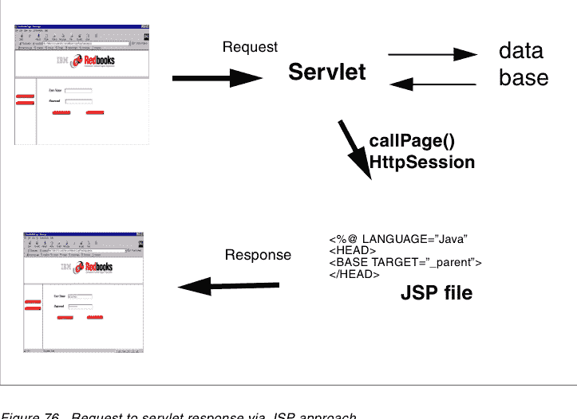

### 3.6.2.1 调用 servlet

在 JSP 内部调用 servlet 是通过创建一个调用该 servlet 的 URL 实现。它具有以下通用格式：

```
http://hostname:port/servlet/servlet_name
```

我们在 HTML 表单内部调用 servlet，并如下所示调用：

```
<FORM action=http://hostname/servlet/servlet_name METHOD=POST>
```

图 77 显示了我们如何作为 HTML 表单实现这一过程。

```html
<FORM NAME="login" ACTION="http://bdtest1/servlet/AccessUserstuf" METHOD=POST>
<INPUT TYPE=HIDDEN NAME="action" VALUE="login">
<TABLE CELLPADDING=0 CELLSPACING=0 BORDER=0 WIDTH=363>
</TABLE>
```

图 77. 调用将处理表单的 servlet

在我们名为 `AccessUserstuf` 的 servlet 中，我们通过在表单中添加隐藏参数来指示要执行的操作。在图 77 中，该参数称为 `action`，并指示此表单将作为登录、更新、注册或其他操作进行处理。此代码允许我们只编写一个 servlet 来执行各种功能。

### 3.6.2.2 生成动态 HTML

当 `AccessUserstuf` 的隐藏参数设置为 `login` 时，它会验证用户是否有效。如果在验证过程中发生错误，servlet 必须能够将错误传回给调用的 JSP。我们选择实现 `HttpSession` 对象以能够维护连接信息（请参见第 3.5.2 节“在 HTTP 中维护状态”）。servlet 将信息放入 `HttpSession` 对象并调用 JSP 文件。JSP 文件按如下方式检索这些信息：

- 使用 `HttpSession` 创建会话
- 使用 `getValue()` 方法访问信息

图 78 阐述了这种方法：

```jsp
</HEAD>
<% HttpSession session = request.getSession(true);
if (session.getValue("error") != null) {
%>
  <B ALIGN=CENTER><FONT SIZE="+2">ERROR:</FONT></B>
<%
  out.println(session.getValue("error"));
}

session.removeValue("error");
%>
```

图 78. 在 JSP 中实现会话。

如果 `session.getValue()` 返回非空值，则将使用 `out.println()` 将错误和说明打印到客户端浏览器。随后将从会话信息中移除错误关键字。

通常情况下，传递到我们 JSP 文件的所有信息都是使用 `HttpSession` 对象实现的。图 79 展示了我们如何在主页中实现这一点的。

```jsp
<% if (session.getValue("as400") != null) { %>
<TD WIDTH="15"><A HREF="/servlet/VBDList10?as400-item1">AS/400</A>
<% } %>
</TD>
```

图 79. 从会话对象中检索信息

在图 79 中，我们使用 `HttpSession` 中包含的信息来动态生成指向新 servlet 的链接。如果 `session.getValue()` 返回 `null`，则指向 `/servlet/VBDList10?as400-item1` 的链接将不会显示在主页上。

## 3.7 通过 Java bean 访问数据

Java beans 是设计在客户端系统上的组件。它们是符合特定编码标准的 Java 类。可以根据它们的属性、方法和事件进行描述。Java beans 可能会与一个名为 `BeanInfo` 的特殊描述符类以及特殊的属性编辑器类一起打包在 JAR 文件中。Java beans 可能是也可能不是视觉组件。更多信息请参阅 Java bean 文档：

http://java.sun.com/beans/docs

在其中一个实例选择了一个 bean，用于查询数据库获取有关之前订单的信息。我们创建了以下代码构建对订单列表 bean 的访问：

- 在 JSP 内部使用 `<bean .../>` 标签调用 bean。然后 JSP 就可以访问包含在 bean 请求对象中的值。图 80 展示了我们如何实现这一目标。

```jsp
<bean
    name="orders"
    type="penguins.access.db2.Orders"
>
</bean>
```

**图 80.** listordersPage.jsp 中的 bean 标签

JSP 页面 `listordersPage.jsp` 获取名为 `orders` 的 bean，并从 Request 对象中找到 `penguins.access.db2.Orders` 的实例。bean 中包含的信息可以通过公共方法访问。请参见第 3.7.1 节“AccessUserstuf action=listorders”，我们在其中讨论了 Orders bean。

- 我们使用该 bean 在表格中打印之前的订单。这是通过以下代码遍历 bean 中包含的所有订单来实现的：

```java
for (Enumeration e = bean.orderIDs(); e.hasMoreElements(); ) {
    String key = (String) e.nextElement();
    // ... process order
}
```

完整的 `listordersPage.jsp` 见附录 D。

# 第 4 章 运行考虑

本章讨论了运行 Linux Web 服务器的运行方面。此处的讨论旨在维护构成正在运行应用程序的产品，这些产品分为：

- IBM HTTP 服务器
- IBM WebSphere Application Server
- IBM Database 2
- Lotus Domino Enterprise Server

讨论分为以下部分：

- 第 4.1 节，“设施管理”
- 第 4.2 节，“设施监控”
- 第 4.3 节，“常规维护”
- 第 4.4 节，“故障排除概述”

## 4.1 设施管理

本节描述我们在维护 Web 解决方案时执行的一些管理操作。大多数启动和关闭过程都是在操作系统启动或关闭时自动完成的，但必须掌握一些手动操作的知识。这些管理任务将在后续章节介绍：

- 第 4.1.1 节，“IBM HTTP Server 和 WebSphere 管理”描述了 Web 服务器管理。
- 第 4.1.2 节，“DB2 操作”描述了 DB2 运行考虑。
- 第 4.1.3 节，“Domino 操作”描述了 Domino 运行考虑。

### 4.1.1 IBM HTTP Server 和 WebSphere 管理

基本上，IBM HTTP Server 是一个 Apache Web 服务器。有几个优秀的 Web 页面讨论了 HTTP 服务器的管理，例如：

- http://www.ibm.com/software/webservers
- http://www.apache.org

本节将在后续章节提供 IBM HTTP Server 和 WebSphere 的一些管理概述：

- 第 4.1.1.1 节，“Web 服务器启动和关闭”显示了 Web 服务器的手动启动和停止。
- 第 4.1.1.2 节，“IBM HTTP Server 管理服务器”显示了 IBM HTTP Server 管理客户端的概述。
- 第 4.1.1.3 节，“使用 WebSphere 管理 Servlet”提供了 WebSphere Servlet 管理的概述。

#### 4.1.1.1 Web 服务器启动和关闭

正如第 2.4.5.2 节“验证 WebSphere 安装”所讨论，WebSphere 作为 IBM HTTP Server 的模块插件运行。因此，WebSphere 功能随 IBM HTTP Server 同时启动和停止。

IBM HTTP Server 启动一组 http 进程，而 WebSphere 启动一组 Java 进程。IBM HTTP Server 的手动命令为：

- 启动 HTTP 服务器：
  `/etc/rc.d/init/ibmhttpd start`

- 通过发送 SIGHUP 信号重启 HTTP 服务器：
  `/etc/rc.d/init/ibmhttpd restart`

- 优雅重启 HTTP 服务器：
  `/etc/rc.d/init/ibmhttpd graceful`

- 停止 HTTP 服务器：
  `/etc/rc.d/init/ibmhttpd stop`

这些命令的输出如图 82 所示。

```bash
[root@bdtest1 init.d]# /etc/rc.d/init/ibmhttpd stop
/etc/rc.d/init/ibmhttpd stop: httpd stopped
[root@bdtest1 init.d]# /etc/rc.d/init/ibmhttpd start
/etc/rc.d/init/ibmhttpd start: httpd started
[root@bdtest1 init.d]# /etc/rc.d/init/ibmhttpd restart
/etc/rc.d/init/ibmhttpd restart: httpd restarted
[root@bdtest1 init.d]# /etc/rc.d/init/ibmhttpd graceful
/etc/rc.d/init/ibmhttpd graceful: httpd gracefully restarted
```

图 82. httpd 命令的输出

如果需要快速杀死服务器且上述命令失败，服务器会将父进程 ID 保存在名为 `httpd.pid` 的文件中。该文件位于 `/opt/IBMHTTPServer/logs/`。向此进程发送 TERM 信号将优雅地停止服务器。一旦执行了所需的命令，可以通过以下命令检查是否成功：

```bash
ps ax | grep httpd
```

此命令的输出与图 83 类似。注意，在我们的示例中启动了七个 http 服务器，只需杀死父 ID 即可停止所有进程。


```bash
[root@dbtest1]# ps ax | grep httpd
12571 S 0:00 /opt/IBMHTTPServer/bin/httpd
13165 S 0:00 /opt/IBMHTTPServer/bin/httpd
13166 S 0:00 /opt/IBMHTTPServer/bin/httpd
13167 S 0:00 /opt/IBMHTTPServer/bin/httpd
13168 S 0:00 /opt/IBMHTTPServer/bin/httpd
13169 S 0:00 /opt/IBMHTTPServer/bin/httpd
13180 pts/13 S 0:00 grep httpd
```

图 83. ps.ax 输出

在停止 HTTP 服务器之前，使用 `killall` 命令确保由 WebSphere 启动的 Java 进程也终止。

## 4.1.1.2 IBM HTTP 服务器管理

本节提供了安装和配置 IBM HTTP 服务器管理的步骤。我们不涉及如何使用控制台安装服务器的细节。步骤如下：

- 安装 RPM 包：

```
rpm -i IBM_Admin_Server-1.3.6-1386.rpm
rpm -i IBM_Admin_Forms-1.3.6-1386.rpm
```

- 切换到 `/opt/IBMHTTPServer` 目录。

- 为管理员创建组：

```
groupadd -g 500 webadmin
```

## 4.1.1.3 执行 /setup.admin

此脚本是交互式的，下面的执行显示了我们的输入：运行管理服务器的用户 ID、运行管理服务器的组名称以及包含文件的目录。使用通配符（例如 `*`）更改目录中所有文件的权限。

```text
************************************************
Please use a User ID to run the Administration Server:
[default] -> httpuser
************************************************
Please supply a GROUP NAME to run the Administration Server:
[default] -> webadmin
************************************************
Please supply the Directory containing the files for permissions:
[default] -> /opt/IBMHTTPServer/conf
************************************************
```

| 权限 | 所有者 | 组 | 大小 | 日期 | 名称 |
| :--- | :--- | :--- | :--- | :--- | :--- |
| -rw-r-- | root | webadmin | 4137 | Jul 29 | admin.conf.default |
| -rw-r-- | root | webadmin | 4137 | Jul 29 | admin.conf |
| -rw-r-- | root | webadmin | 6246 | Jun 24 | admin.passwd |
| -rw-r-- | root | webadmin | 31405 | May 12 | httpd.conf |
| -rw-r-- | root | webadmin | 31028 | May 12 | httpd.conf.bak |
| -rw-r-- | root | webadmin | 30989 | Jul 29 | httpd.conf.default |
| -rw-r-- | root | webadmin | 30989 | Jul 29 | httpd.conf.sample |
| -rw-r-- | root | webadmin | 12441 | Jul 29 | magic.default |
| -rw-r-- | root | webadmin | 12441 | Jul 29 | magic.key |
| -rw-r-- | root | webadmin | 7350 | Jul 29 | mime.types |
| drwxr-xr-x | root | webadmin | 1024 | Oct 18 | /opt/IBMHTTPServer/conf |
| -rw-xr-x | root | webadmin | 46807 | Jul 29 | /opt/IBMHTTPServer/bin/admin |

此是用于 Root 的 SetUserID 文件：

```text
************************************************
CONTINUE - Perform Changes
QUIT - No Changes
************************************************
(default: 2) -> 1

Changes Completed
Configuration file: /opt/IBMHTTPServer/conf/admin.conf
will be saved as /opt/IBMHTTPServer/conf/admin.conf.21:14:42_139
Do you wish to update the Administration Server Configuration file?
CONTINUE [y]
EXIT [y]
************************************************
[default: QUIT - 2] -> 1
USER DONE
Group DONE
Successfully updated configuration file
Old configuration file saved as /opt/IBMHTTPServer/conf/admin.conf.21:14:42_139
```

## 5. 为 httpuser 创建密码：

```
/passwd -b ../conf/admin.passwd httpuser webadmin
```

## 6. 启动管理服务器：

```
/adminctl start
```

## 7. 运行 Web 浏览器并指向我们 Web 服务器的端口 8008。初始管理界面如图 84 所示。

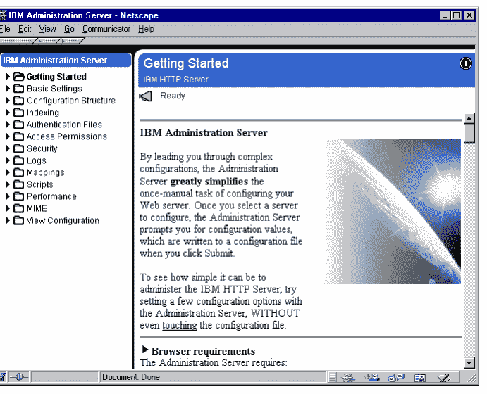

图 84. 管理服务器启动界面

要更改 Web 服务器的基本设置，请完成以下操作：

- 1. 点击基本设置
- 2. 点击核心设置

这将显示一个与图 8 类似的屏幕。

图 85. Web 服务器的基本设置

Web 服务器和管理服务器的文档位于第 113 页的图 86，可以通过 Web 浏览器从 Web 服务器的 `manual` 子目录进行访问：

`http://bdtest/manual/Contents.html`

### 4.1.1.3 使用 WebSphere 管理 Servlet

使用我们 Web 服务器端口 9527 上的 WebSphere 管理界面，我们可以管理环境中的 servlet。本节讨论了 servlet 的添加、加载和删除。关于 WebSphere 管理的更全面介绍可以在此处找到：

`http://www.ibm.com/servers/index.html`

#### 添加 servlet

一旦写好 servlet，在使用之前需要将其在 WebSphere 中注册。这需要执行以下步骤：

- 将编译后的 servlet 类副本放在 servlet 根目录中。默认情况下，服务器在 servlet 根目录 `/opt/IBMAS/servlets` 中查找 servlet 文件。
- 如果 servlet 属于某个包，请将该包结构镜像为 servlets 目录下的子目录。例如，我们的 servlet 名为 `penguins.access.db2.Accessstat`；因此类文件 `Accessstat.class` 被复制到以下目录：`/opt/IBMAS/servlets/penguins/access/db2`。
- 在 WebSphere 运行时，使用 Web 浏览器登录端口 9527 上的管理工具。管理界面类似于图 87 中的窗口所示。
- 使用 `admin` 作为用户名和密码登录。我们现在看到了如第 115 页图 88 所示的 WebSphere 介绍界面。

图 88. WebSphere 介绍界面

- 5. 点击左侧框架中的 **Servlets**。
- 6. 选择 **Configuration**（配置），显示的 Servlet 配置窗口如第 116 页图 89 所示。
- 7. 点击 **Add**（添加）按钮，并在图 90 的弹出框中输入 servlet 名称。它必须是一个唯一名称。这将是从 Web 浏览器运行 servlet 时使用的名称。
- 8. 填写 servlet 的类。类名是完整的包名。例如，您的完整 Accessstat servlet 名为 `penguins.access.db2.Accessstat`。
- 9. 如果 servlet 是一个 bean，请填写此信息，选择 yes 并填写其 jar 文件的位置。
- 10. 点击 **Test**（测试）以加载并测试 servlet。如果一切顺利，将显示成功。
- 11. 点击 **Add**。servlet 将自动加载。该 servlet 现在已注册并可以访问。

#### 加载 servlet

要加载 servlet，请完成以下步骤：

1. 在如第 116 页图 89 所示的 Servlet 配置窗口中点击 Servlet -> Configuration。
2. 从 Servlet Names 列中选择 servlet 名称。
3. 点击 **Load**（加载）。

#### 卸载 servlet

要卸载 servlet，请完成以下步骤：

1. 在如第 116 页图 89 所示的 Servlet 配置窗口中点击 Servlet -> Configuration。
2. 从 Servlet Names 列中选择 servlet 名称。
3. 点击 **Unload**（卸载）。

#### 删除 servlet

要删除 servlet，请遵循以下步骤：

1. 在如第 116 页图 89 所示的 Servlet 配置窗口中点击 Servlet -> Configuration。
2. 从 Servlet Names 列中选择 servlet。
3. 点击 **Unload**（卸载）。
4. 点击 **Yes**（是）确认。

## 4.1.2 DB2 操作

本节讨论了 DB2 服务器的手动启动和关闭过程。

### 4.1.2.1 启动 DB2 实例

使用命令启动 DB2 实例：

```
db2start
```

该命令必须由 DB2 实例所有者执行，在我们案例中为 `db2inst`。执行示例请见图 91。

图 91. 启动 DB2 实例

### 4.1.2.2 停止 DB2 实例

使用命令停止 DB2 实例：

```
db2stop
```

该命令必须由 DB2 实例所有者执行，在我们案例中为 `db2inst`。执行示例请见图 92。

图 92. 停止 DB2 实例

在某些情况下，我们仍然选择在不等待所有连接终止的情况下停止数据库。在这种情况下，我们必须使用命令：

```
db2stop force
```

该命令如果成功，其输出与不带任何参数的 `db2stop` 命令所示完全相同。

## Domino 字符控制台

Domino 字符控制台是一个从命令行访问服务器控制台的工具。我们可以通过 telnet 连接到 Domino 服务器并使用 **cconsole** 调用字符控制台。

首次运行 Domino 字符控制台时，我们需要完成以下任务：

- a. 切换到我们的 Domino 数据目录。
- b. 将服务器管理员 ID 文件复制到 Domino 数据目录。
- c. 调用控制台：

```
/opt/lotus/bin/console -i -f /local/notesdata/user.id
```

其中 `/opt/lotus/bin` 是 Domino 安装路径，`user.id` 是 Domino 服务器管理员的用户 ID。

- d. 对于实时控制台，执行以下命令：

```
live
```

- e. 停止控制台。

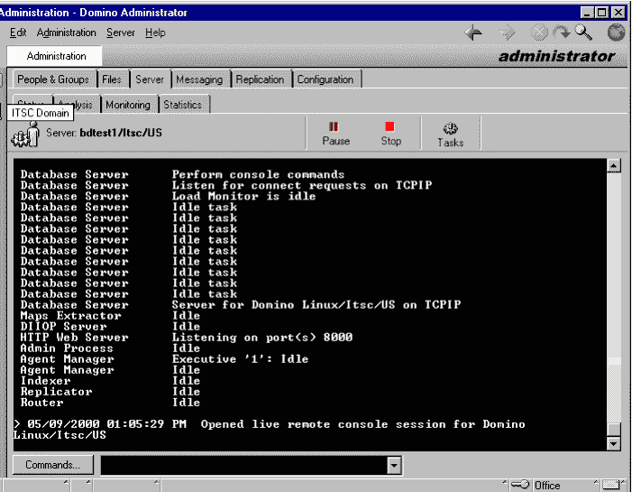

图 97 显示了 Domino 字符控制台的截图。

```bash
[notes@bdtest1]$ /opt/lotus/bin/cconsole -i -f /local/notesdata/user.id
Domino Character Console v0.0
Warning: You are remotely connected to host bdtest1.itsc.austin.ibm.com.
如果你没有对此连接采取任何安全措施，
密码将在网络上暴露。
输入密码：
05/09/2010 21:20:56 PM 正在 bdtest1.itsc.austin.ibm.com 上启动控制台
> show db
```

| Database Name | Refs | Fds LockWait/AvgWait #Waiters MaxWai |
| :--- | :--- | :--- |
| /local/notesdata/dlog.nsf | 1 | N | 1 | 0 | 0 | 0 |
| /local/notesdata/mail.box | 1 | N | 1 | 0 | 0 | 0 |
| /local/notesdata/names.nsf | 46 | N | 12 | 0 | 0 | 0 |
| /local/notesdata/log.nsf | .. | Y | 1 | 0 | 0 | 0 |

图 97. Domino 字符控制台

## 4.1.3.2 启动和停止 Domino 服务器

使用命令行启动 Domino 的过程如下：

- 1. 使用 userID notes 登录。
- 2. 切换到 Domino 数据目录。我们在 `/local/notesdata` 中有数据目录。
- 3. 执行命令：

```
/opt/lotus/bin/server
```

其中 `/opt/lotus` 是 Domino 服务器的安装路径。

服务器控制台启动，并显示启动状态和其他 Domino 消息。

要从服务器控制台停止 Domino 服务器，请执行 `quit` 命令。

Domino 服务器将在 10 秒后关闭。

为了能够自动启动 Domino，我们开发了一个 `start_domino.sh` 脚本。该脚本的完整列表见附录 E.1，第 209 页的 "start_domino.sh"。该脚本执行以下顺序的任务：

- 1. 确保使用 notes userID 登录。
- 2. 确保 Domino 服务器未在运行。
- 3. 检查并移除由 userID notes 拥有的 IPC 共享内存。
- 4. 启动 Domino 服务器。

创建 `start_domino.sh` 脚本后，我们可以自动启动 Domino 服务器。我们在 `/etc/initab` 文件中添加如下条目：

```
notes:2:once -c /bin/su notes -c /home/notes/start_domino.sh
```

如果 Domino 异常退出，在重启 Domino 之前需要清理 Domino 进程间通信（IPC）资源。崩溃后请执行以下步骤清理 Domino：

- 1. 杀死来自 userID 的 Domino 进程。
- 2. 移除相关的进程间通信（IPC）资源。
- 3. 使用 `ipcs` 命令列出共享内存和信号量。`-m` 显示共享内存，`-s` 显示信号量。
- 4. 移除任何共享内存和信号量。使用 `ipcrm $id` 移除共享内存，使用 `ipcrm $id` 移除信号量。
- 5. 从目录中移除 `.lock` 文件。

`cleanup_domino` 脚本执行上述步骤，见附录 E.2，第 210 页的 "cleanup_domino.sh"。

## 4.2 监控设施

本节提供了对构建的系统组件的监控概述。可以使用其他方法来确保系统的可用性和性能。

### 4.2.1 Monitoring WebSphere

可以通过 Server Execution（服务器执行）界面查看加载的 servlets：

- 1. 登录 WebSphere 管理界面，获取如图 88 所示的 WebSphere 窗口。
- 2. 选择 Server Execution。
- 3. 选择 Monitors（监控）。
- 4. 选择 Loaded Servlets 以显示如图 124 所示的监控窗口。

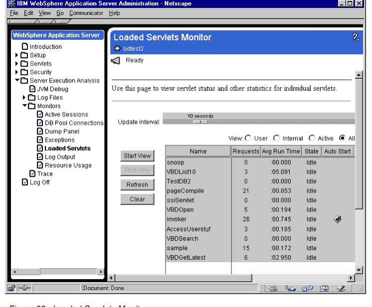

### 4.2.2 监控

可以通过 Server Execution 界面查看加载的 servlets：

- 1. 登录 WebSphere 管理界面，获取如图 88 所示的 WebSphere 窗口。
- 2. 选择 Server Execution。
- 3. 选择 Monitors。
- 4. 选择 Loaded Servlets 以显示如图 124 所示的监控窗口。


```
Server.Task.DB = Database Server: Idle task: [05/09/2000 13:26:20 CT]
Server.Task.DB = Database Server: Idle task: [05/09/2000 13:26:20 CT]
Server.Task.DB = Database Server: Idle task: [05/09/2000 13:26:20 CT]
Server.Task.DB = Database Server: Idle task: [05/09/2000 13:26:20 CT]
Server.Task.DB = Database Server: Server for Domino Linux/Itcs/US on TCPIP: [05/09/2000 13:26:20 CT]
Server.Time.Start = 05/09/2000 10:12:43 CT
Server.Title
Server.Trans.PerMinute = 0
Server.Trans.PerMinute.Peak = 241
Server.Trans.PerMinute.Peak.Time = 05/09/2000 10:27:32 CT
Server.Trans.Top = 631
Server.Users.MinPeak = 1
Server.Users.MinPeakTime = 05/09/2000 10:28:32 CT
Server.Users.Peak = 4
Server.Users.Peak.Time = 05/09/2000 10:27:10 CT
Server.Users.MinPeak = 4
Server.Version.Notes = Release 5.0.3
Server.Version.OS = Linux 2.2.14-5.0 Tue Mar 7 2
Stats.Time.Current = 05/09/2000 13:27:06 CT
Stats.Time.Start = 05/09/2000 10:12:41 CT
```

图 100. 显示 Domino 字符控制台的静态命令输出

## 4.2.3 统计与事件

统计和事件功能允许我们配置、创建并报告有关 Domino 服务器的信息。可以通过以下步骤在 Domino 管理器中显示统计和事件：

1. 选择“Configuration”（配置）选项卡
2. 展开“Statistic & Event”（统计与事件）类别。

Domino 服务器的统计参数见第 128 页的图 101。

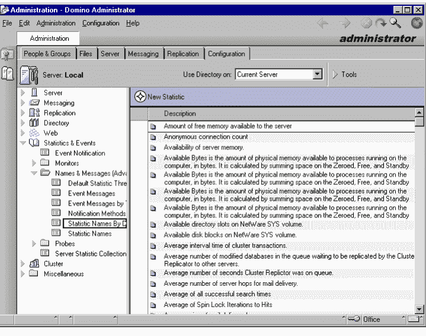

图 101. 统计与事件

统计和事件由两个服务器任务 `event` 和 `collect` 控制。默认情况下，每小时收集一次统计数据。捕获的信息存储在以下 Domino 数据库中：

- `statrep.nsf`，在此记录统计信息
- `events4.nsf`，在此配置事件处理和统计监控。

通过统计和事件，我们还可以创建监控器来跟踪服务器资源和网络活动。每个监控器都有关联的阈值。当达到阈值时，监控器会生成一个事件。

可用的监控工具使用“Statistics & Events”类别。第 229 页的图 102 显示了文件活动监控工具的截图。

128 使用 WebSphere、DB2 和 Domino 的 Linux Web Hosting

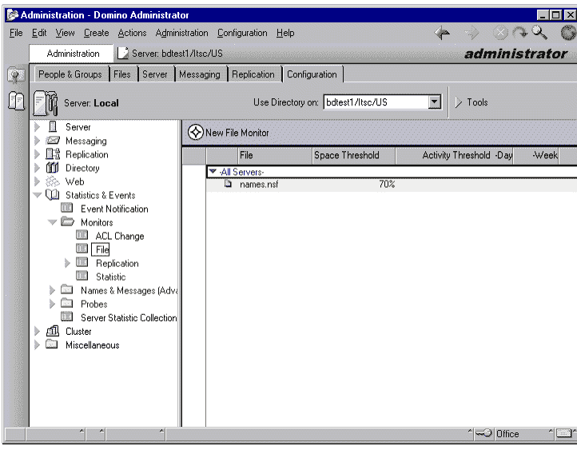

图 102. Domino 管理器客户端监控工具

### 4.2.3.4 Notes 系统诊断工具

Notes 系统诊断 (NSD) 工具由 Iris 开发，仅适用于 UNIX 平台。NSD 包含在 Domino 服务器安装包中。

要运行 NSD，请执行 `nsd` 命令并使用 `-help` 选项查看可用参数说明。NSD 将创建 `nsd.log<日期和时间>` 文件，其中日期和时间是程序被调用的时间。使用任何文本编辑器查看此文件。

## 4.3 常规维护

本节概述了需要对 Domino 服务器执行的任务。

### 4.3.1 常规维护任务

需要定期执行以下任务以确保系统的的可用性和性能：

- 数据库备份
- 清理旧日志文件
- 检查磁盘空间
- 数据库碎片整理

### 4.3.2 运行考虑

需要定期执行以下任务以确保系统的可用性和性能：

- 监控资源使用
- 监控网络活动
- 监控服务器健康

### 4.3.3 常规 Domino 维护

本节概述了需要对 Domino 服务器执行的任务。

#### 4.3.3.1 备份 Domino 文件系统

备份系统在日常运行中非常重要，因为你永远不知道何时会遇到麻烦。

在 Domino 中，我们必须执行的最低限备份是在每日备份期间备份所有的 Domino 服务器数据文件，包括数据库、模板文件以及 `notes.ini` 文件和 ID 文件，其他文件可能需要每周备份一次。

假设我们的 Domino 服务器运行非常完美，我们现在计划对 Domino 服务器进行备份。我们需要备份以下目录和文件：

- `/opt/lotus` 是 Domino 软件目录。在升级或安装新的 Domino 服务器之前，我们对该目录进行备份。如果资源允许，建议将此目录包含在我们的常规备份中。
- `/local/notesdata` 这是 Domino 数据目录。在这个目录中，我们将找到数据库、模板、邮件文件等等内容。如果我们的操作产生了大量数据，该目录可能需要每天进行一次或多次每日备份。如果我们想备份操作数据，必须先关闭 Domino 服务器。
- `notes.ini`, `*.id` 在安全的地方在可拆卸式存储介质上保留这些文件的副本。这些文件存在于 Domino 数据目录 (`/local/notesdata`) 中。ID 文件包括：`cert.id`, `server.id`, `user.id`。

我们可以使用 Linux 中的许多工具进行备份，如 `tar`、`cpio` 等，并选择最适合我们环境的工具。记住，所有备份的目标都是尽可能减少服务器停机时间；因此，在这种情况下，请选择你非常熟悉的解决方案。

#### 4.3.3.2 其他维护任务

日常运行需要进行常规维护，以尽可能的减少潜在问题的风险，并确保我们的 Domino 服务器继续可靠地运行。

红书《A Roadmap for Deploying Domino In The Organization》（SG24-5617）包含了一份我们可以执行的常规维护实用清单。更多信息请参阅此书。

## 4.4 故障排除概述

本节提供了对 Web 服务器某些基本组件进行故障排除的概述。讨论内容分为：

- 第 4.4.1 节，第 134 页，“IBM HTTP Server 和 WebSphere 日志文件”
- 第 4.4.2 节，第 136 页，“DB2诊断日志文件”

### 4.4.1 IBM HTTP Server 和 WebSphere 日志文件

以下日志对于在 Web 服务器中查找特定问题以进行确定和解决非常有用。WebSphere 会向其日志文件记录大量信息。如果某些功能运行不正常，应该查看这些日志。所有日志文件都可以在 `/opt/IBMWebAS/logs` 中找到。在该目录下，你通常会发现以下一个或多个：

- `jstderr.log`

JVM 标准错误日志可能是所有 WebSphere 日志中最实用的一个。在此日志中，会出现来自主 WebSphere Java 进程的标准错误输出。

- `jstdout.log`

JVM 标准输出日志是 WebSphere 中最实用的。标准输出日志包含了 Java 应用程序使用静态 `java.lang.System.out` 方法写入标准输出的所有输出。此日志的格式取决于应用程序。使用此日志可以检查你的 Java 应用程序写入 `System.out` 的调试和信息性消息。此日志始终是开启的。

- `apache.log.INFORM.*`

IBM HTTP Server 信息日志包含由随 WebSphere 附带的 IBM HTTP Server 产生的信息消息和错误消息。每当服务器重新初始化时，都会生成一个新的日志，并使用不同的数字作为文件名的最后一部分。这些日志中的每个部分内容是显示 WebSphere 初始化时属性的消息。Servlet 服务事件日志允许你查看 Servlet 何时加载、何时被调用以及带什么参数被调用。它将包含：

- 时间戳
- 引起事件的跟踪器（tracer）名称
- 引起事件的线程 ID
- 跟踪器的严重级别
- 事件生成的任何异常
- 消息文本

- `servlet/adminservice_access_log`
- `servlet/adminservice/error_log`
- `servlet/adminservice/event_log`

Servlet 服务错误日志包含 WebSphere 尝试运行 Servlet 时产生的消息。这与 Servlet 相关的错误。Servlet 产生的 `System.out` 和 `System.err` 输出分别放在标准输出和标准错误中。

### 4.4.2 DB2 诊断日志文件

DB2 保留有一个诊断日志文件，称为 `db2diag.log`。该文件位于实例主目录下的 `sqllib/db2dump` 子目录。在我们的场景中，在后端服务器 btest3 上，它将位于 `/home/db2inst/sqlib/db2dump`。该文件会追加诊断信息，或者如果它尚不存在，则创建并追加。

诊断信息的量由 DB2 数据库管理器配置中的 `DIAGLEVEL` 决定。登录 DB2 实例所有者并使用命令访问数据库管理器配置：

```
db2 get dbm cfg
```

```
$db2inst1@db2test$ db2inst1$ get dbm cfg | more
```

# 数据库管理器配置

节点类型 = 带有本地和远程客户端的数据库服务器

数据库管理器发行级别 = 0xa0900

CPU 速度（毫秒/指令） = 1.637460e-06

并发活动数据库数 = 8

数据链接支持 (DATALINK) = 否

联邦数据库系统支持 (FEDERATED) = 否

事务处理器监控名称 (TP_MON_NAME) = 

默认计费账户 = (DFT_ACCOUNT_STR) =

Java 开发工具包 1.1 安装路径 (JDK1_PATH) = 

诊断错误捕获级别 (DIAGLEVEL) = 3

诊断数据目录路径 (DIAGPATH) = /home/db2inst1/sqllib/db2dump

图 103. DB2数据库管理器中的 DIAGLEVEL 参数

如果将 `DIAGLEVEL` 设置为 4 或遇到错误，`db2diag.log` 文件可能会迅速增长。因此，请通过定期备份和删除此文件来确保该文件的大小是可控的（DB2 数据库启动进程会在需要时创建并追加此文件）。一旦你确定文件中提供的诊断信息不再有用，就可以删除备份文件。

第 4 章 运行考虑因素 137

# 第 5 章 扩展案例研究

本章讨论了我们实现中的某些可能扩展。我们解释了这些可能性，但未能亲自执行它们。讨论分为分为：

- 第 139 页的第 5.1 节“利用高级功能”，讨论了我们由于实现的复杂性而未使用的可用功能。
- 第 142 页的第 5.2 节“Linux 中的产品局限性”，讨论了我们使用的软件的 Linux 版本中不可用的功能。

## 5.1 利用高级功能

本章讨论了某些软件产品中由于缺乏实现时间而未利用的高级功能。然而，这些功能在红书（redbooks）中已有详细介绍，例如《Linux for WebSphere and DB2 Servers》(SG24-5850) 以及《电子业务模式：使用 WebSphere Advanced Edition 的拓扑 1 和 2 的用户到业务模式》(SG24-5864)。更多信息请参考这些红书。

### 5.1.1 WebSphere

以下 WebSphere 的高级功能可用，但在我们的项目中未被利用：

- 第 139 页的第 5.1.1.1 节“数据库连接池”
- 第 140 页的第 5.1.1.2 节“用户配置文件跟踪”

#### 5.1.1.1 数据库连接池

连接和断开数据服务器会导致资源的高效利用。WebSphere 提供了数据库连接池功能，程序员可以使用它来管理与数据库的连接。这是一个包含以下方法的 API：

- 为给定的数据库建立连接池
- 从托管池中请求连接
- 将连接返回到托管池

针对特定数据库的此连接池通过 WebSphere 管理设施进行管理。

连接管理器允许你通过池化并重用连接更高效地连接和断开数据服务器。这减少了连接和断开的开销。Servlet 使用连接池的方式：

- 当用户通过 Web 向 servlet 发请求时，servlet 使用池中的现有连接，这意味着用户请求不会产生数据服务器连接的开销。
- 当请求被满足时，servlet 将连接返回到连接管理器池供其他 servlet 使用。

因此，用户请求不会产生断开数据服务器的开销。

连接管理器还允许你控制到数据服务器产品的并发连接数。如果数据服务器协议限制了你特定数量的并发用户，这将非常有用。

在 WebSphere 文档的 IBMWebAS 目录下，对连接管理器有很好的介绍。在我们的测试系统中，它的 URL 为：

```
http://servlet1/IBMWebAS/doc/whatis/icmgr.html
```

#### 5.1.1.2 用户配置文件跟踪

WebSphere Application Server 有一个名为 UserProfile 的 API，可以轻松地维护有关你的 Web 网站访问者的持久信息。UserProfile 允许你在不编写任何 SQL 代码的情况下将用户数据存储在数据库中。

UserProfile 包含了用户个人数据的接口，例如姓名、邮政地址和电子邮件地址、电话号码和购物车信息。如需更多信息，请阅读 WebSphere 文档中 IBMWebAS 目录下的 UserProfile API 引用指南。在我们的测试系统中，它的 URL 为：

```
http://servlet1/IBMWebAS/doc/apid/Package-com.ibm.servlet.personalization.userprofile.html
```

### 5.1.2 IBM HTTP Server

以下 IBM HTTP Server 的高级功能可用，但在我们的项目中未被利用：

- 第 141 页的第 5.1.2.1 节“SSL”
- 第 141 页的第 5.1.2.2 节“缓存与动态页”

#### 5.1.2.1 SSL

IBM HTTP Server 的功能包括对 SSL 的加密支持。安全套接层 (SSL) 是一种在应用程序之间提供隐私性和完整性的协议。

客户端和服务器之间传输的数据通过密钥加密。通过 SSL 数字证书可以验证服务器的身份。一旦你的服务器有了数字证书，支持 SSL 的浏览器（如 Netscape 和 Internet Explorer）就可以安全地与服务器通信。有关 SSL 的更多信息，请参考：

- http://home.netscape.com/eng/
- http://www.ibm.com/software/webservers/

#### 5.1.2.2 缓存与动态页

默认情况下，大多数 Web浏览器会缓存页面。对于 JSP 文件、HTML 文件和 servlet，这些页面是动态生成的。为了防止缓存并从而访问动态页面，我们可以在 Java Server 或 servlet 中添加以下代码：

```
response.setHeader("Pragma", "no-cache");
response.setHeader("Expires", "0");
response.setHeader("Cache-Control", "no-cache");
```

为了防止代理服务器共享页面，使用以下代码：

```
response.setHeader("Cache-Control", "private");
```

这两个头部可以结合使用以防止缓存。

请访问 URL http://nowcode.dev/servlet-essentials/chapter0.html 查看有关 `RequestDispatcher` 类的教程。访问 URL http://java.sun.com 获取各种 Java API 规范的官方规范和文档。

## 5.2.2 用于 Domino 的 JDBC 连接

JDBC(TM)是一种对象接口，允许 Java 应用程序、applet 和代理使用 SQL 在数据库管理系统中检索和操作数据。JDBC 接口允许单个应用程序通过标准协议连接到许多不同类型的数据库。

Lotus Domino JDBC 驱动程序实现了 JDBC 1.0 规范。它适用于 Windows 95、Windows 98 和 Windows NT 4 操作系统。这是一个类型 2 驱动，由 Java 类和非 Java 编译代码组合而成。目前不支持任何其他平台（包括 Linux）。

Lotus Domino JDBC 驱动程序允许 Java 程序员使用 JDBC 访问 Domino/Notes 数据库。Java 可以与任何支持 JDBC 的报表工具配合以访问 Lotus 数据库。Java 程序员可以使用任何 Java 数据库连接 (JDBC) 标准应用程序工具像访问关系型数据库一样轻松访问 Lotus Domino 数据库。在 Domino R5 上运行此 JDBC 驱动时，Java 程序员可以创建访问 Domino 数据的 Servlet。Lotus Domino JDBC 驱动程序通过生成镜像关系模型的结果集，使 Domino 数据库看起来像 SQL 工具或应用程序接口的另一个后端数据源。应用程序还可以对 Domino 数据与关系型数据库（如 Oracle、Sybase 或 DB/2）的数据进行 SQL 联操作。

产品功能包括：

- 对 Domino 4.5x、4.6x 和 R5x 数据库的 Java 标准级访问。
- 兼容 Netscape Communicator 4.05 及更高版本。


- 兼容带有服务程序包 1 及更高版本的 Microsoft Internet Explorer 4.01。
- 包含未签名版本，以便在创建使用 JDBC 的 Java applet 时具有最大的灵活性。
- 支持 2000 年准备；因此，它可以正确读取两位年份 (`mm/dd/yy`) 和四位年份 (`mm/dd/yyyy`) 格式的日期。
- 已通过 IBM Visual Age for Java 2.0、IBM WebSphere Application Server 2.0、Lotus eSuite DevPack 1.5、Borland JBuilder 3 Professional、Jinfonet Software JReport Professional 1.3、EnterpriseSoft Enterprise Reports 3.0、Symantec Visual Cafe Database Development Edition Version 3.0 以及 NetObjects BeanBuilder 1.0 的测试。
- 支持多线程，适用于高性能 Web 场景。
- 支持集群服务器，通过负载均衡和故障转移实现高应用程序可用性。
- 包含四个示例程序（文档中提供了 `.java` 文件）。
- Lotus Domino JDBC 驱动程序是 JDBC 承诺开放标准以及开放 Domino 数据库和服务的又一步，使客户无论其企业配置或工具选择如何，都能够将 Domino 集成到任何电子商务解决方案中。

JDBC API 包含在 Sun JDK v1.1 及更高版本中。下载并安装 Lotus Domino JDBC 驱动程序时会提供 Lotus Domino JDBC 驱动程序 (`LDJ`)。Lotus Domino JDBC 驱动程序需要 DLL 来连接到 Domino/Notes 数据库（上述的非 Java 编译代码）。

- 如果您的 Java 程序运行在客户端计算机上，则必须安装 Notes 客户端。
- 如果您的 Java 应用程序运行在未运行 Domino 的服务器上，则必须安装并配置 Notes 客户端以连接 Domino 服务器。
- 如果您的 Java 应用程序运行在 Domino 服务器上（例如在 R5 上作为 Servlet 运行），则 Notes DLL 和 API 已经存在，无需安装。

## Notes API 知识

| |
|---|
| 您不需要了解 Notes API。`Lotus Domino JDBC 驱动程序`可以屏蔽这些内容，并让您使用 `JDBC API` 连接到 Domino 并使用 SQL 查询、更新和管理 Domino 数据。 |

访问 URL `http://www.lotus.com` 获取更多关于 `Lotus Domino JDBC 驱动程序` 的信息。

144 使用 WebSphere、DB2 和 Domino 的 Linux Web 托管

## 附录 A. 创建 USERSTUF 表的 SQL 脚本

本附录提供了用于项目中创建 DB2 表的源文件列表。

### A.1 USERINFO 表

```sql
create table userinfo (
  first_name varchar(20) not null,
  last_name varchar(20) not null,
  email_address varchar(50) not null,
  date_joined date not null,
  birth_date date not null,
  address varchar(200) not null,
  username varchar(20) not null,
  primary key (username)
);
```

### A.2 USERVERIFY 表

```sql
create table userverify (
  username varchar(20) not null,
  password varchar(20) not null,
  primary key (username)
);
```

### A.3 USERPROFILE 表

```sql
create table userprofile (
  username varchar(20) not null,
  as00 char(1),
  netfinity char(1),
  ncf char(1),
  nw char(1),
  s390 char(1),
  rs6000 char(1),
  scalable char(1),
  vm char(1),
  vse char(1),
  windows char(1),
  other char(1),
  primary key (username)
);
```

### A.4 USERORDER 表

```sql
create table userorders (
  username varchar(20) not null,
  timestamp timestamp not null,
  product_id varchar(20) not null,
  order_id int not null,
  primary key (order_id)
);
```

## 附录 B 与 DB2 相关的 Java 代码

本附录提供了与 DB2 相关的 Java 代码列表。

```java
package penguins.access.db2;

import java.io.*;
import java.servlet.*;
import java.sql.*;
import java.util.*;

public class TestDB2 extends HttpServlet {
    private Connection conn = null;
    private String[] fieldNames = {"first_name", "last_name", "email_address", "date_joined", "birth_date", "address", "username"};

    static {
        // 初始化代码
    }

    public TestDB2() {
        // 构造函数代码
    }

    public void doGet(HttpServletRequest req, HttpServletResponse res) {
        try {
            ServletOutputStream out = res.getOutputStream();
            out.setContentType("text/html");
            out.print("<html><head>TestDB2</head><body>");
            out.print("<p>Contents of userinfo:</p>");
            String sql = "select * from userinfo";
            Statement stmt = conn.createStatement();
            ResultSet rs = stmt.executeQuery(sql);
            ResultSetMetaData md = rs.getMetaData();
            int cols = md.getColumnCount();
            for (int i = 1; i <= cols; i++) {
                out.print(rs.getString(i) + "</td>");
            }
            stmt.close();
            out.print("</table><p>End contents of userinfo</p>");
            out.print("<p>Contents of userverify:</p>");
            sql = "select * from userverify";
            stmt = conn.createStatement();
            rs = stmt.executeQuery(sql);
            md = rs.getMetaData();
            cols = md.getColumnCount();
            for (int i = 1; i <= cols; i++) {
                out.print(rs.getString(i) + "</td>");
            }
            stmt.close();
            out.print("</table><p>End contents of userverify</p>");
            out.print("</body></html>");
        } catch (Exception e) {
            e.printStackTrace();
        }
    }

    protected void doService(HttpServletRequest req, HttpServletResponse res) {
        // 将 ...Servlet... 转换为 ...Service...
        HttpServletRequest request = (HttpServletRequest)req;
        HttpServletResponse response = (HttpServletResponse)res;
        // 获取会 对象
        HttpSession session = req.getSession(true);
        // 获取要执行的操作
        String action = req.getParameter("action");
    }
}
```


```java
// 清除任何之前的错误
session.remove("error");
// 获取成功和失败页面
String successpage = req.getParameter("success");
String failurepage = req.getParameter("failure");
// 获取数据库连接
initDB();
// 调试动作；
if (action.equals("debug")) {
    debug(req);
    return;
}
try {
    // 处理订单，我们期望获得一个 product_id cookie 值
    if (action.equals("order")) {
        String username = getUsername(session);
        String password = getPassword(session);
        if (passwordMatch(username, password)) {
            uidError(username, password, failurepage, req, res);
        } else {
            String product_id = req.getParameter("product_id");
            if (product_id == null || product_id.equals("")) {
                raiseError("Product ID cannot be empty", failurepage, req);
            }
            if (product_id.length() > 20) {
                // 生成新的 order_id
                // 如果没有先前的，从 15344 开始；
                int order_id = 15344;
                String sql = "select max (order_id) from userorders";
                Statement stmt = conn.createStatement();
                ResultSet rs = stmt.executeQuery(sql);
                if (rs.next()) {
                    order_id = rs.getInt(1) + 1;
                    // 插入新记录
                    String sqlStmt = "insert into userorders (username, order_timestamp, product_id, order_id) values ('" + username + "', '" + current_timestamp + "', '" + product_id + "', " + order_id + ")";
                    stmt = conn.createStatement();
                    int ri = stmt.executeUpdate(sqlStmt);
                    if (ri != 1) {
                        raiseError("USERORDERSINSERT=1", failurepage, req, res);
                    }
                }
                stmt.close();
                // 将 product_id 放入 session 对象
                session.setAttribute("product_id", product_id);
                res.callPage(session, req);
            }
        }
        return;
    // 为给定的用户名列出订单
    if (action.equals("listorders")) {
        String username = getUsername(session);
        String password = getPassword(session);
        if (passwordMatch(username, password)) {
            uidPwError(username, password, failurepage, req, res);
        } else {
            res.call(success, req);
            return;
        }
    }
    // 结束登录
    // 根据用户名和密码的 cookie 值修改密码
    // 新密码在请求流的参数找到
    if (action.equals("changepassword")) {
        String newPassword = req.getParameter("password1");
        String newPasswordAgain = req.getParameter("password2");
        if (newPassword.equals(newPasswordAgain)) {
            raiseError("password", newPassword + " and " + newPasswordAgain +
                " do not match",
                failurepage, req, res);
        } else {
            Hashtable errors = new Hashtable();
            errors = validatePassword(newPassword, errors);
            if (errors.isEmpty()) {
                String username = getUsername(session);
                String password = getPassword(session);
                if (passwordMatch(username, password)) {
                    updatePwError(username, password, req, res);
                } else {
                    String sqlStmt = "update user set password='" + newPassword + 
                        " where username='" + username + "'";
                    Statement stmt = con.createStatement(sqlStmt);
                    int rs = stmt.executeUpdate(sqlStmt);
                    stmt.close();
                    raiseError("UPDATE FAILED: rows 1 from " + sqlStmt,
                        failurepage, req, res);
                }
            }
            // 更新密码 cookie
            session.setAttribute("password", newPassword);
            res.call(success, req);
        }
    }
    return;
    // 结束 changepassword
    // 将注册信息作为请求流参数
    if (action.equals("register")) {
        String username = getUsername(username);
        if (usernameExists(username)) {
            raiseError("username", username + " already exists. Please try again",
                failurepage, req, res);
        } else {
            Hashtable errors = validateUsername(req);
            errors = validateUsername(username, errors);
            String password = getPassword(req);
            errors = validatePassword(password, errors);
            if (!errors.isEmpty()) {
                raiseError("The following error(s) have been detected. Please correct and
                    try again: " + toString(errors), failurepage, req, res);
            } else {
                Statement stmt = con.createStatement();
                String sqlStmt = "insert into userinfo (first_name, last_name,
                    email_address, joined_date, birth_date, address, username) values ('" +
                    req.getParameter("first_name") + "', '" +
                    req.getParameter("last_name") + "', '" +
                    req.getParameter("email_address") + "', '" + current_date + "', '" +
                    req.getParameter("birth_date") + "', '" +
                    req.getParameter("address") + "', '" + username +
                    "')";
                int rs = stmt.executeUpdate(sqlStmt);
                stmt.close();
                if (rs == 1)
                    raiseError("USERINFOSERT: result != 1 from " + sqlStmt);
                failurepage(req, res);
                return;

                // 插入 userverify
                stmt = "insert into userverify(username,password) values ('" + username
                + "','" + password + "')";
                stmt = conn.createStatement();
                rs = stmt.executeUpdate(sqlStmt);
                if (rs == 1)
                    raiseError("USERVERIFY: result != 1 from " + sqlStmt);
                failurepage(req, res);
                return;

                // 插入 userprofile
                stmt = "insert into userprofile
                    (username,as400,nameity,ncf,nw,s30,scalable,vm,vse,windows,other) values ('" +
                    username + "',','");
                for (int i = 0; i < profileCols.length - 1; i++) {
                    if (req.getParameter(profileCols[i]) == null) {
                        sqlStmt = sqlStmt + "'y',";
                    } else {
                        sqlStmt = sqlStmt + "null,";
                    }
                }
                if (req.getParameter(profileCols[profileCols.length-1]) == null) {
                    sqlStmt = sqlStmt + "'y';";
                } else {
                    sqlStmt = sqlStmt + "null';";
                }
                session.putValue("sqlStmt", sqlStmt);
                stmt = conn.createStatement();
                rs = stmt.executeUpdate(sqlStmt);
                stmt.close();
                if (rs == 1)
                    raiseError("USERINSERT: result != 1 from " + sqlStmt);
                failurepage(req, res);
                return;

                // 自动登录，设置所有 cookie 值
                session.putValue("username", username);
                session.putValue("password", password);
                for (int i = 0; i < infoCols.length; i++) {
                    if (req.getParameter(infoCols[i]) != null)
                        session.putValue(infoCols[i], req.getParameter(infoCols[i]));
                }

                req.call(successpage, req);
                return;
                // 编辑注册
                // 从 cookie 值中删除用户名和密码
                if (action.equals("delete")) {
                    String username = getUsername(session);
                    String password = getPassword(session);
                    if (passwordMatch(username, password)) {
                        Statement stmt = con.createStatement();
                        // 删除 userprofile 以使其无法登录
                        // 但保留 profile, userorders 和 userinfo 以便我们
                        // 跟踪订单（来自 userorders），同时保留用户名
                        /* 这可以使用唯一的 userId 而不是用户名来实现
                        稍后用更复杂的设计实现 */
                        String sqlStmt = "delete from userprofile where username='" + username + "';";

                        int rs = stmt.executeUpdate(sqlStmt);
                        stmt.close();
                        if (rs <= 1) {
                            raiseError("UPDATE result rows <=1 from " + sqlStmt);
                            failurepage(req, res);
                        }

                        //失效 session，返回首页
                        session.invalidate();
                        res.callPage(session, req);
                    } else {
                        uidPwError(username, password, failurepage, req, res);
                    }
                    return;
                }

                // 根据请求流中的参数更新用户信息
                if (action.equals("update")) {
                    String username = getUser(session);
                    String password = getPassword(session);
                    if (passwordMatch(username, password)) {
                        HandleErrors errors = validateData(req);
                        if (errors.isEmpty()) {
                            // 我们假设请求环境中传递的
                            // 不再可以更改的内容需要更新。
                            // 请记住如果更改了密码，则通过 action=changepassword 激活
                            String sqlStmt = "update userinfo set first_name, last_name, address = '" + req.getParameter("first_name") + "', '" + req.getParameter("last_name") + "', '" + req.getParameter("address") + "', '" + req.getParameter("birth_date") + " ' where username='" + username + "'";
                            Statement stmt = con.createStatement();
                            int rs = stmt.executeUpdate(sqlStmt);
                            stmt.close();
                            if (rs <= 1) {
                                raiseError("UPDATE result rows <=1 from " + sqlStmt);
                            }
                        }
                        // 更新 profile set
                        String sqlStmt = "update profile set " + (as400,netcdf.for,we390,rs600,scaleable,vm,vse,windows,other) + " = (";
                        for (int i = 0; i < profileCols.length -1; i++) {
                            if (req.getParameter(profileCols[i]) == null) {
                                sqlStmt = sqlStmt + "'y',";
                            } else {
                                sqlStmt = sqlStmt + "null,";
                            }
                        }
                        if (req.getParameter(profileCols[profileCols.length-1]) == null) {
                            sqlStmt = sqlStmt + "'y';";
                        } else {
                            sqlStmt = sqlStmt + "null';";
                        }
                        // ... (profile 更新的剩余逻辑)
                    }
                }
            }
        }
    }

```


## 附录 B. 连接到 DB2 的 Java 代码

```sql
sqlSnt = sqlSnt + " 'y'";
else
sqlSnt = sqlSnt + " null";

sqlSnt = sqlSnt + "where username=' + username + "'";
stmt = conn.createStatement(sqlSnt);
rs = stmt.executeUpdate(sqlSnt);
stmt.close();
if (rs != 1)
    raiseError("USERPROFILMENT: result !==1 from " + sqlSnt);

failurepage, req, res);

    // 设置浏览器 cookie;
for (int i = 0; i < infoCols.length; i++) {
    if (req.getParameter(infoCols(i)) != null) {
        session.putValue(infoCols(i), req.getParameter(infoCols(i)));
    }
}

    // 用户个人资料的 cookies
for (int i = 0; i < profileCols.length; i++) {
    if (req.getParameter(profileCols(i)) != null) {
        session.putValue(profileCols(i));
    }
}
req.getParameter(profileCols(i))
else // 未定义兴趣类别
    res.removeValue(profileCols(i));
}

res.callPage(success, req);
else
    raiseError("the following error(s) have been detected. Please correct
and and try again." + toString(error), failurepage, req, res);
else
    uidPwError(username, password, failurepage, req, res);
else
    raiseError("ACTIONERROR: Please report the following: <p> ACTION \* " + action +
"* not defined in URI " + req.getRequestURI() + " *", failurepage, req, res);
    res.callPage(failurepage, req);
catch (SQLException e) {
    e.printStackTrace();
    session.putValue("SQLERROR " + e.getMessage());
    res.callPage(failurepage, req);
}

private String getPassword(HttpServletRequest req) {
    return req.getParameter("password");
}

private String getPassword(HttpSession session) {
    return (String) session.getValue("password");
}

private String getUsername(HttpServletRequest req) {
    return req.getParameter("username");
}

private String getUsername(HttpSession session) {
    return (String) session.getValue("username");
}

protected void initDB() {
try {
    String url = "jdbc:db2:userutf";
    String uid = "db2inst";
```

## 附录 B. 与 DB2 155相关的 Java 代码

```
String pwd = "lmbnd2";
con = DriverManager.getConnection(url, uid, pwd);
catch (SQLException e) {
    e.printStackTrace();
}

protected boolean passwordMatch(String username, String password) {
    boolean match = false;
    try {
        String sqlStmt = "select password from userverify where username='" + 
            username + "' + ";
        Statement stmt = con.createStatement();
        ResultSet rs = stmt.executeQuery(sqlStmt);
        if (rs.next()) {
            ResultSetMetaData md = rs.getMetaData();
            if (md.getColumnCount() > 0) {
                // 实现任何用于检查的密码算法
                String hash = rs.getString(1);
                if (password.equals(hash)) {
                    match = true;
                }
            }
        }
    } catch (SQLException e) {
        e.printStackTrace();
    }
    return match;
}

protected void handleError(String errorText, String errorPage, HttpServletRequest req) {
    try {
        HttpSession session = req.getSession(true);
        session.setAttribute("error", errorText);
        session.callPage(errorPage, req);
    } catch (Exception e) {
        e.printStackTrace();
    }
}

private String toString(Hashtable elements) {
    Enumeration he = elements.keys();
    String errorText = "";
    String fieldName = "";
    while (he.hasMoreElements()) {
        fieldName = (String) he.nextElement();
        errorText += fieldName + " = " + elements.get(fieldName) + " *";
    }
    return errorText;
}

private void useError(String username, String password, String redirectedPage, HttpServletRequest req) {
    HttpSession session = req.getSession();
    raise("username = " + username + " * with password = " + password + " * \* invalid");
    req.sendRedirect(redirectedPage, req, res);
}

private void useError(String username, String redirectedPage, HttpServletRequest req) {
    raise("username = " + username + " \* does not exist", redirectedPage, req, res);
}

protected boolean usernameExists(String username) {
    boolean exists = false;
    try {
        if (username == null) {
```

return false;

/*

注意此处我们从 userinfo 而不是 userverify 获取用户名

如果用户名之前被删除过，

由于 userinfo 中仍然存在，因此可以避免在 userinfo 中产生重复

*/

String sqlStmt = "select * from userinfo where username=' + username +

PreparedStatement stmt = conn.prepareStatement(sqlStmt);

ResultSet rs = stmt.executeQuery(sqlStmt);

if (rs.next()) {

    ResultSetMetaData md = rs.getMetaData();

    if (md.getColumnCount() > 0) {

        // 实现任何用于检查的密码算法

        String hash = rs.getString(1);

        if (password.equals(hash)) {

            exists = true;

        }

    }

}

} catch (SQLException e) {

    e.printStackTrace();

}

return exists;

protected boolean validateData(HttpServletRequest req) {

    Hashtable errors = new Hashtable();

    try {

        for (int i = 0; i < infoCols.length; i++) {

            if (req.getParameter(infoCols(i)) != null) {

                session.putValue(infoCols(i), req.getParameter(infoCols(i)));

            }

        }

        // 用户个人资料的 cookies

        for (int i = 0; i < profileCols.length; i++) {

            if (req.getParameter(profileCols(i)) != null) {

                session.putValue(profileCols(i));

            }

        }

        req.getParameter(profileCols(i))

        else // 未定义兴趣类别

            res.removeValue(profileCols(i));

    }

}

res.callPage(success, req);

else

    raiseError("the following error(s) have been detected. Please correct

and and try again." + toString(error), failurepage, req, res);

else

    uidPwError(username, password, failurepage, req, res);

else

    raiseError("ACTIONERROR: Please report the following: <p> ACTION \* " + action +

"* not defined in URI " + req.getRequestURI() + " *", failurepage, req, res);

    res.callPage(failurepage, req);

catch (SQLException e) {

    e.printStackTrace();

    session.putValue("SQLERROR " + e.getMessage());

    res.callPage(failurepage, req);

}

private String getPassword(HttpServletRequest req) {

    return req.getParameter("password");

}

private String getPassword(HttpSession session) {

    return (String) session.getValue("password");

}

private String getUsername(HttpServletRequest req) {

    return req.getParameter("username");

}

private String getUsername(HttpSession session) {

    return (String) session.getValue("username");

}

protected void initDB() {

try {

    String url = "jdbc:db2:userutf";

    String uid = "db2inst";

```

## 附录 C. 与 Domino 相关的 Java 代码

此附录提供了 Domino 相关的代码列表。

### C.1 Java servlet TestDomino

（代码部分略，保持原样）

### C.2 Java servlet VBDList10

```java
import java.*;
import java.util.*;
import javax.servlet.*;
import javax.servlet.http.*;
import lotus.domino.*;
import java.util.Vector;

public class VBDList10 extends HttpServlet {

    String viewname = "platform sorted";
    String dname = "RedBooks";
    String host = "bdtest3:8000";
    String category = null;
    String tm, dumb;
    DateTime dt;

    public void doGet(HttpServletRequest req, HttpServletResponse res)
            throws ServletException, IOException {
        doService(req, res);
    }

    public void doPost(HttpServletRequest req, HttpServletResponse res)
            throws ServletException, IOException {
        doService(req, res);
    }

    public void doService(HttpServletRequest req, HttpServletResponse res)
            throws ServletException, IOException {
        String catcat = null;
        int no;
        Vector listParam = new Vector();

        /* 获取参数名和值 */
        for (Enumeration e = req.getParameterNames(); e.hasMoreElements(); ) {
            String param = (String) e.nextElement();
            String paramValue = (String) req.getParameter(param);
            listParam.addElement(paramValue);
        }

        for (int i = 0; i < listParam.size(); i++) {
            catcat = (String) listParam.elementAt(i);
            if (catcat.equals("item1")) category = "AS/400";
        }
    }
}
```


## 附录 C 与 Domino 数据库相关的 Java 代码

### C.1 Java servlet 示例

```java
if (catcat.equals("item2")) category = "Netfinity and Software";

if (catcat.equals("item3")) category = "Network Computing Framework";

if (catcat.equals("item4")) category = "Networking Hardware";

if (catcat.equals("item5")) category = "OS/390 and S/390";

if (catcat.equals("item6")) category = "RS6000 and AI";

if (catcat.equals("item7")) category = "Scalable Parallel";

if (catcat.equals("item8")) category = "VM/ESA";

if (catcat.equals("item9")) category = "VSE/ESA";

if (catcat.equals("item10")) category = "Windows and Win NT";

if (catcat.equals("item11")) category = "Other";

res.setContentType("text/html");

ServletOutputStream out = res.getOutputStream();

try {

    // 创建会话并打开数据库
    Session s = NotesFactory.createSession(host);
    Database db = s.getDatabase(s.getServerName(),
```

```java
ViewEntry entry = navy.getFirst();
int count = 0;

while ((entry != null) && count < 10) {
    if (entry.isCategory()) out.println("");
    if (entry.getDocument()) {
        Vector dm = entry.getDocument().getValue("PublishDate");
        if (dm.size() > 0) {
            dt = (DateTime) dm.getElementAt(0);
            tm = dt.getDateOnly();
        } else {
            if (tm == null) out.println("");
            out.println("<tr><td><center>");
            out.println("<a href='/servlet/VDBOpen?docid=" + entry.noteID() + " target='body'>");
            out.println(entry.getDocument().getValue("FormNumber"));
            out.println("<td></td>");
            out.println("</center></td>");
            out.println("<td></td>");
        }
        out.println(entry.getDocument().getValueString("BookTitle"));
        out.println("<td></td>");
        out.println("</center></td>");
        out.println(tm);
        out.println("</center></td></tr>");
        count++;
    }
    entry = navy.next();
}

out.println("<tr><td ALIGN=CENTER WIDTH=20></td></tr>");
out.println("<td></td><td></td></tr><table><blockquote>");
out.println("</td></td></tr></body></html>>");

} catch (DocumentElementException ex) {
    out.println("<html>" + ex.id + " * " + ex.text);
    out.println("<html><body>");
    out.println(ex.id + "* " + ex.text);
    out.println("</body></html>");
}
```

### C.2 Java servlet VBDGetServletLatest

```java
import java.io.*;
import java.util.*;
import javax.servlet.*;
import javax.servlet.http.*;
import lotus.domino.*;
import java.util.Vector;

public class VBDGetLatest extends HttpServlet {
    String viewname = "All books";
    String dname = "Redbooks";
    String host = "bdtest3:8000";
    String category = null;
    String tm;
```

```java
if (category.equals("")) {
    out.println("未分类</font><b></b></li></p></blockquote>");
} else {
    out.println(category + "</font><b></b></li></p></blockquote>");
}
```

```java
// NavigationView nav = view.createNavigationViewFromCategory(category);
NavigationView nav = view.createNavigationViewMaxLevel(0);
ViewEntry entry = nav.getFirst();
int ix = 0;

while ((entry != null) && (ix < 10)) {
    if (entry.isCategory()) { out.println(""); }
    if (entry.getDocument()) {
        Vector dm = entry.getDocument().getItemValue("PublishDate");
        if (dm.size() > 0) {
            dt = (Date) dm.elementAt(0);
            tm = dt.getDateOnly();
            if (tm == null) out.println("");
        } else {
            ix++;
            out.println("<tr><td><td></td></tr>");
            out.println("<tr><td><A href='/servlet/VDBOpen?docid=" + entry.getNodeID() + " TARGET='body'></a></td></tr>");
        }
    }
    out.println("<td>" + entry.getDocument().getItemValue("FormNumber") + "</td>");
    out.println("</tr>");
```

```java
out.println("</center></td>");
out.println("<td>");
out.println(entry.getDocument().getItemValueString("BookTitle"));
out.println("</td>");
out.println("<td></center></td>");
out.println(tm);
out.println("</center></td></tr>");
}
entry = navy.next();
out.println("<tr><td ALIGN=CENTER WIDTH=20></td></tr>");
out.println("<td></td><td></td></tr></table><blockquote>");
out.println("</td></td></tr></body></html>");
} catch (DocumentElementException ex) {
    out.println("<html>" + ex.id + " * " + ex.text);
    res.setContentType("text/html");
    ServletOutputStream out = res.getOutputStream();
    out.println("<html><body>");
    out.println(ex.id + "* " + ex.text);
    out.println("</body></html>");
}
```

```java
public String getServletInfo() {
    return "创建一个显示指定数据库标题的页面";
}
```

### C.3 Java servlet VBDSearch

```java
import java.io.*;
import java.util.*;
import javax.servlet.*;
import javax.servlet.http.*;
import lotus.domino.*;
import java.util.Vector;

public class VBDSearch extends HttpServlet {
    String viewname = "All books";
    String dname = "Redbooks";
    String host = "bdtest3:8000";
    String query = null;
    String tm, dumb;
    DateTime dt;
```

```java
public void doGet(HttpServletRequest req, HttpServletResponse res)
    throws ServletException, IOException {
    doService(req, res);
}
```

```java
public void doPost(HttpServletRequest req, HttpServletResponse res)
    throws ServletException, IOException {
    doService(req, res);
}
```

```java
public void doService(HttpServletRequest req, HttpServletResponse res)
    throws ServletException, IOException {
    int no;
    /* 获取参数名和值 */
    query = req.getParameter("search");
}
```

```java
// 创建会话并打开数据库
Session s = NotesFactory.createSession(host);
Database db = s.getDatabase(s.getServerName(), dbname);
View view = db.getView(viewName);
```

```java
res.setContentType("text/html");
ServletOutputStream out = res.getOutputStream();
out.println("<html>");
out.println("<head><title>Redbooks 查询结果</title></head>");
out.println("<body>");
out.println("<p>");
```

```java
out.println("参数 = ");
```

```java
out.println("<blockquote>");
out.println("<table BORDER=3 COLS=3 WIDTH=95%");
out.println("<tr ALIGN=LEFT VALIGN=CENTER>");
```

```java
out.println("<td ALIGN=CENTER WIDTH=15%>");
out.println("<center><b>Form Number</b></center></td><td>");
out.println("<td>");
out.println("<center><b>ReBooks Title</b></center></td><td>");
out.println("<td WIDTH=20%>");
out.println("<center><b>Publication Date:</b>" + Date.toString().substring(10) + "</center></td></tr>");
```

```java
out.println("</body></html>");
}

public String getServletInfo() {
    return "创建一个显示指定*数据库客户端标题的页面";
}
```

### C.4 Java servlet VBDOpen

```java
import java.io.*;
//import java.util.*;
import javax.servlet.*;
import javax.servlet.http.*;
import lotus.domino.*;
import java.util.Vector;

public class VBDOpen extends HttpServlet {
    String dbname = "RedBooks";
    String host = "bdtest3:8000";
    String tm;
    DateTime dt;

    public void doGet(HttpServletRequest req, HttpServletResponse res)
        throws ServletException, IOException {
        doService(req, res);
    }

    public void doPost(HttpServletRequest req, HttpServletResponse res)
        throws ServletException, IOException {
        doService(req, res);
    }

    public void doService(HttpServletRequest req, HttpServletResponse res)
        throws ServletException, IOException {
        /* 获取参数名和值 */
        String docid = (String) req.getParameter("docid");
        HttpSession sess = req.getSession(true);
        String username = (String) sess.getValue("username");
        try {
```

```java
/* 创建会话并打开数据库 */
Session s = NotesFactory.createSession(host);
Database db = s.getDatabase(s.getServerName(), dbname);
```

```java
res.setContentType("text/html");
ServletOutputStream out = res.getOutputStream();
out.println("<html>");
out.println("<head><title>RedBooks</title></head>");
out.println("<body text=\"000000\" BCOLOR=#FFFFFF>");
```


# 附录 C 与 Domino 数据库相关的 Java 代码

```java
out.println("<TABLE WIDTH=\"100%%\" ORDER=0 CELLSPACING=0 CELLPADDING=\"0\">");

out.println("<TR VALIGN=top WIDTH=100%><FONT>Feedback</FONT></TR>");

out.println("<TR VALIGN=top><FONT SIZE=1 FACE=Arial><TD WIDTH=100%\'>");

out.println("<a href=\"mailto:to \"><td></a></td></td>");

out.println("</tr></tr></table></td></tr></table>");

} catch (NotesException ex) {

    System.out.println("Error");

    sess.putValue("error", ex.id + " *" + ex.text);

}

private String StringToHtml(String curText) {

    int nl = -1;

    StringBuffer tempText = new StringBuffer(0);

    while (curText.indexOf("\n") != -1) {

        nl = curText.indexOf("\n");

        tempText.append(curText.substring(0, nl) + "<br>");

        curText = curText.substring(nl + 1);

    }

    tempText.append(curText);

    return tempText.toString();

}

public String getServletContext() {

    return "创建一个显示 Redbook 摘要的页面";

}
```

# 附录 D HTML 和 JSP 文件列表

本附录提供了项目中使用所有 HTML 和 JSP 文件的列表。

## D.1 Body_homepage.jsp

```html
<!DOCTYPE HTML PUBLIC "//W3C//DTD HTML 3.2 FINAL//EN">

<% LANGUAGE="java" %>

<HTML>

<HEAD>

<BASE TARGET="_parent">

<% if (session.request.getSession(true)) { %>

</HEAD>

<BODY BGCOLOR="#FFFFFF" FCOLOR="#000000" VLINK="#000080" TEXT="#000000" TOPMARGIN=20 LEFTMARGIN=20>

<TABLE CELLPADDING=0 CELLSPACING=0 ORDER=0 WIDTH=520>

<TR>

<TD ALIGN="TOP-LEFT">

<TABLE CELLPADDING=0 CELLSPACING=0 ORDER=0 WIDTH=230>

<TR>

<TD ALIGN="TOP-LEFT">

<TD WIDTH="14" HEIGHT="23"></TD>

</TR>

<TR>

<TD ALIGN="TOP-LEFT">

<TD WIDTH="14" HEIGHT="340"></TD>

</TR>

<TR>

<TD ALIGN="TOP-LEFT">

<TD WIDTH="18" HEIGHT="24"></TD>

</TR>

</TABLE>

</TD>

<TR>

<TD WIDTH="269">

<TABLE ID="Table1" BORDER=1 CELLSPACING=3 CELLPADDING=1 WIDTH=269>

<td><% if (session.getValue("rs6000") != null) { %>

<A href="/servlet/VBDList10?rs6000=item">RS6000

<% } else { %></td>

<td><% if (session.getValue("as400") != null) { %>

<A href="/servlet/VBDList10?as400=item">AS400

<% } else { %></td>

</TABLE>

</TR>

<TR>

<td><% if (session.getValue("mw") != null) { %>

<A href="/servlet/VBDList10?mw=item2">Netfinity

<% } else { %} %td>

<td><% if (session.getValue("vm") != null) { %>

<A href="/servlet/VBDList10?vm=item8">VM

<% } else { %} %td>

<td><% if (session.getValue("s390") != null) { %>

<A href="/servlet/VBDList10?s390=item5">S390

<% } else { %} %}</td>

<td><% if (session.getValue("vse") != null) { %>

<A href="/servlet/VBDList10?vse=item9">VSE/ESA

<% } else { %} %}</td>

<td><% if (session.getValue("scalable") != null) { %>

<A href="/servlet/VBDList10?scalable=item7">SP

<% } else { %} %}</td>

<td><% if (session.getValue("other") != null) { %>

<A href="/servlet/VBDList10?other=item11">Other

<% } else { %} %}</td>

<td><% if (session.getValue("windows") != null) { %>

<A href="/servlet/VBDList10?windows=item11">Windows

<% } else { %} %></td>

</td>

<td>

.

0

0000000000000000000000111

></td>

</TR>
```

## D.4 body_orderpage.js

```html
% LANGUAGE="java" %>

<HTML>

<BASE TARGET="parent">

<HEAD>

<%Session session=request.getSession(true); %>

<BODY COLOR="#FFFFFF" LINK="#0000FF" TEXT="#000000" TOPMARGIN="20" LEFTMARGIN="15" RIGHTMARGIN="22">

<FORM ACTION="/servlet/Userstatus" METHOD="POST">

<TABLE CELLSPACING="0" WIDTH="515">

<INPUT TYPE="HIDDEN" NAME="order" value="">

<INPUT TYPE="HIDDEN" NAME="success" value="Redbooks/OrderPage/ordersuccess.jsp">

<INPUT TYPE="HIDDEN" NAME="failure" value="Redbooks/OrderPage/orderfailure.jsp">

<TD VALIGN-TOP-ALIGN-LEFT></TD>

<TD WIDTH="96" HEIGHT="17" SRC="./clearpixel.gif" WIDTH="96" HEIGHT="1" ORDER=0/></TD>

<TD WIDTH="419" SRC="./clearpixel.gif" WIDTH="419" HEIGHT="1" ORDER=0/></TD>

<TD VALIGN-TOP-ALIGN-LEFT></TD>

<TD WIDTH="419"><P ALIGN="CENTER"><b>订单信息</b></P></TD>

<TABLE BORDER="0" CELLSPACING="0">

<TD VALIGN-TOP-ALIGN-LEFT></TD>

<TD WIDTH="56" HEIGHT="33" SRC="./clearpixel.gif" WIDTH="56" HEIGHT="1" ORDER=0/></TD>

<TD></TD>

<TD VALIGN-TOP-ALIGN-LEFT></TD>

<TD WIDTH="457"></TD>

<TABLE ID="Table1" CELLSPACING="3" CELLPADDING="1" WIDTH="457">

<TR>

<TD WIDTH="219"><P>产品编号</P></TD>

<TD WIDTH="219"><INPUT ID="EditField" TYPE="TEXT" NAME="product_id" value="<%=session.getValue("FormNumber")%> SIZE="27" MAXLENGTH="27"/></TD>

</TR>

</TABLE>

</TD>

</TABLE>
```

## D.5 Body_password.js

```html
<!DOCTYPE HTML PUBLIC "//W3C//DTD HTML 3.2 FINAL//EN">

<HTML>

<HEAD>

  <BASE TARGET="_top">

</HEAD>

<BODY BGCOLOR="#FFFFFF" LINK="#0000FF" VLINK="#000080" TOPMARGIN="22" LEFTMARGIN="22" RIGHTMARGIN="22">

<TABLE BORDER="0" CELLSPACING="0" CELLPADDING="0" WIDTH="66">

  <TR ALIGN="LEFT">

    <TD WIDTH="66" HEIGHT="26"></TD>

    <TD WIDTH="277"></TD>

    <TD WIDTH="103"></TD>

  </TR>

  <TR>

    <TD COLSPAN="2">

      <TD WIDTH="277" ALIGN="CENTER"><b><FONT SIZE="2">密码格式</FONT></b></TD>

    </TD>

  </TR>

  <TR>

    <TD COLSPAN="4">

      <TD WIDTH="300" ALIGN="LEFT">

        <FORM NAME="" ACTION="/servlet/Userstatus" METHOD="POST">

          <input TYPE="hidden" NAME="password" value="password">

          <input TYPE="hidden" NAME="password1" value="../passwords/passuccess.jsp">

          <input TYPE="hidden" NAME="password2" value="../passwords/passwordfail.jsp">

        </FORM>

      </TD>

    </TD>

  </TR>

  <TR>

    <TD COLSPAN="4">

      <TD WIDTH="52" HEIGHT="35"></TD>

    </TD>

  </TR>

  <TR>

    <TD COLSPAN="4">

      <TD WIDTH="333">

        <td id="Table4">输入新密码</td>

        <td width="157">输入 <input id="Editfield1" type="password" name="password1" value="" maxlength="19"/></td>

        <td width="157">输入 <input id="Editfield2" type="password" name="password2" value="" maxlength="19"/></td>

      </td>

    </TD>

  </TR>

</TABLE>

<TABLE BORDER="0" CELLSPACING="0" CELLPADDING="0" WIDTH="359">

  <TR ALIGN="LEFT">

    <TD WIDTH="58" HEIGHT="26"></TD>

    <TD WIDTH="61"></TD>

  </TR>

  <TR ALIGN="LEFT">

    <TD COLSPAN="2">

      <TD WIDTH="120" ALIGN="CENTER"><TD width="120"><a href="javascript:document.forms[0].reset();"><b>重置</b></a></TD>

    </TD>

  </TR>

  <TR>

    <TD width="120"><input type="="="="""" type=" type" type="

</td>

  </TR>

</TABLE>
```

## D.6 Body_registration

```html
<!DOCTYPE HTML PUBLIC "//W3C//DTD HTML 3.2 FINAL//EN">

<HTML lang="Java">

<head>

<base target="_parent">

</head>

<body bgcolor="#FFFFFF" link="#0000FF" text="#000000" topmargin="20" marginmargin="20" marginGIN="20">

<form name="registration" action="/servlet/Userstatus" method="POST">

<input type="hidden" name="success" value="Redbooks/OrderPage/ordersuccess.jsp">

<input type="hidden" name="failure" value="Redbooks/OrderPage/orderfailure.jsp">

<table>

<table cellspacing="0" width="515">

<tr>

<td valign-top-align-left></td>

<td width="96" height="17" src="./clearpixel.gif" width="96" height="1" order=0/ ></td>

<td width="419" src="./clearpixel.gif" width="419" height="1" order=0/ ></td>

<td valign-top-align-left></td>

<td width="419"><p align="center"><b>订单信息</b></p></td>

<table border="0" cellspacing="0">

<td valign-top-align-left></td>

<td width="56" height="33" src="./clearpixel.gif" width="56" height="1" order=0/ ></td>

<td </td>

<td valign-top-align-left></td>

<td width="457"> </td></td>
```


## 附录 D. HTML 和 JSP 文件

### D.7 Body_update.js

```html
<!DOCTYPE HTML PUBLIC "//W3C//DTD HTML 3.2 FINAL//EN">
<HTML LANGUAGE="Java">
<HTML>
<HEAD>
<BASE TARGET="parent">
</HEAD>
<%Session session=request.getSession(true); %>
<BODY BGCOLOR="#F0F0F0" LINE="#000000" TEXT="#000000" TOPMARGIN=20 MARGIN=20 MARGIN=20>
<FORM NAME="form" ACTION="/Books/UpdatePage/update.jsp" METHOD="POST">
<input TYPE="HIDDEN" NAME="action" value="update">
<input TYPE="HIDDEN" NAME="success" value="/Books/UpdatePage/updatesuccess.jsp">
<input TYPE="HIDDEN" NAME="failure" value="/Books/UpdatePage/updatefailure.jsp">
```

用户名: `<%= session.getValue("username") %>`

| 字段 | 输入值 |
| :--- | :--- |
| 名字: | `<%= session.getValue("first_name") %>` |
| 姓: | `<%= session.getValue("last_name") %>` |
| 电子邮件 | `<%= session.getValue("email_address") %>` |
| 邮寄地址: | `<%= session.getValue("address") %>` |

### D.8 Header_defaultmaster.border

### D.9 Homepage.jpg

### D.10 Index.html

### D.11 Left_homepage.html

### D.12 index.html

### D.13 Left_loginpage.html

### D.14 Left_orderpage.html

```html
<!DOCTYPE HTML PUBLIC "//W3C//DTD HTML 3.2 FINAL//EN">
<HTML>
<HEAD>
</HEAD>
<BODY BG="#FFFFFF" LINK="#000080" VLINK="#000080" TEXT="#000000">
<FORM NAME="LAYOUTFORM" ACTION="POST">
<TABLE BORDER=0 CELLSPACING=0 CELLPADDING=0 WIDTH=126>
<TR VALIGN=TOP-LEFT>
<TD WIDTH="6" HEIGHT="56"></TD>
</TR>
<TR VALIGN=TOP-LEFT>
<TD HEIGHT="17"></TD>
</TR>
<TR VALIGN=TOP-LEFT>
<TD COLSPAN="2" HEIGHT="9"></TD>
</TR>
<TR VALIGN=TOP-LEFT>
<TD WIDTH="120" LAYOUTFORM-LEFT VALIGN-TOP"><a href="../RegistrationPage/registrationpage.jsp" target="_blank"></a></TD>
</TR>
<TR VALIGN=TOP-LEFT>
<TD COLSPAN="2" HEIGHT="9"></TD>
</TR>
<TR VALIGN=TOP-LEFT>
<TD COLSPAN="2" HEIGHT="9"></TD>
</TR>
<TR VALIGN=TOP-LEFT>
<TD WIDTH="120"><a href="home.gif"></a></TD>
</TR>
<TR VALIGN=TOP-LEFT>
<TD COLSPAN="2" HEIGHT="9"></TD>
</TR>
<TR VALIGN=TOP-LEFT>
<TD HEIGHT="17"></TD>
</TR>
</TABLE>
</FORM>
</BODY>
</HTML>
```

### D.15 Left_registrationpage.html

```html
<TR VALIGN=TOP-LEFT>
<TD COLSPAN="2" HEIGHT="9"></TD>
</TR>
<TR VALIGN=TOP-LEFT>
<TD HEIGHT="17"></TD>
<TD WIDTH="120" VALIGN-TOP><A HREF="../Registrationpage/registration.jsp"></a></TD>
</TR>
<TR VALIGN=TOP-LEFT>
<TD COLSPAN="2" HEIGHT="9"></TD>
</TR>
<TR VALIGN=TOP-LEFT>
<TD HEIGHT="17"></TD>
<TD WIDTH="120" VALIGN-TOP><A HREF="../page/loginpage.jsp"></a></TD>
</TR>
<TR VALIGN=TOP-LEFT>
<TD COLSPAN="2" HEIGHT="9"></TD>
</TR>
<TR VALIGN=TOP-LEFT>
<TD HEIGHT="17"></TD>
<TD WIDTH="120" VALIGN-TOP><A HREF="../Homepage/homepage.jsp"></a></TD>
</TR>
<TR VALIGN=TOP-LEFT>
<TD COLSPAN="2" HEIGHT="9"></TD>
</TR>
<TR VALIGN=TOP-LEFT>
<TD HEIGHT="17"></TD>
<TD WIDTH="120" VALIGN-TOP><A HREF="../Access/ListOrders/listorder.jsp"></a></TD>
</TR>
</TABLE>
</FORM>
</BODY>
</HTML>
```

```html
<!DOCTYPE HTML PUBLIC "//W3C//DTD HTML 3.2 FINAL//EN">
<HTML>
<HEAD>
<BASE TARGET="parent">
</HEAD>
<BODY BGCOLOR="#FFFFFF" LINK="#0000FF" TEXT="#000000">
<FORM NAME="registration" ACTION="/servlet/InsertUserInfo" METHOD="POST">
<TABLE BORDER=0 CELLPADDING=0 WIDTH=126>
<TR VALIGN=TOP-LEFT>
<TD WIDTH="56></TD>
</TR>
<TR VALIGN=TOP-LEFT>
<TD HEIGHT="17"></TD>
</TR>
<TR>
<TD HEIGHT="17"></TD>
</TR>
<TR VALIGN=TOP-LEFT>
<TD COLSPAN="2" HEIGHT="9"></TD>
</TR>
```

### D.16 Left_registrationpage.jsp

```jsp
<!DOCTYPE HTML PUBLIC "//W3C//DTD HTML 3.2 FINAL//">
<HTML>
<HEAD>
<BASE TARGET="parent">
</HEAD>
<% HttpSession session=request.getSession(true); %>
<BODY BGCOLOR="#FFFFFF" LINK="#000080" VLINK="#000080">
<FORM NAME="registration" ACTION="/servlet/AccessUserInfo" METHOD="POST">
<TABLE WIDTH="56"></TD>
</TR>
<TR VALIGN=TOP-ALIGN="LEFT">
<TD COLSPAN=2 HEIGHT="9\></TD>
</TR>
...
```

### D.17 Left_updatepage.html

```html
<TR VALIGN=TOP-LEFT>
<TD COLSPAN="2" HEIGHT="9"></TD>
</TR>
<TR VALIGN=TOP ALIGN-LEFT>
<TD HEIGHT="17" WIDTH="120" ALIGN-TOP><A HREF="../Login/page.html"></a></TD>
</TR>
<TR VALIGN=TOP ALIGN-LEFT>
<TD COLSPAN="2" HEIGHT="9"></TD>
</TR>
<TR VALIGN=TOP ALIGN-LEFT>
<TD HEIGHT="17" WIDTH="120" ALIGN-TOP><A HREF="../Home/homepage.jsp"></a></TD>
</TR>
<TR VALIGN=TOP ALIGN-LEFT>
<TD COLSPAN="2" HEIGHT="9"></TD>
</TR>
```


## D.18 Listorder.jsp

```html
<html>
<head>
<% session=request.getSession(true); %>
</head>
<center>
<p><h4 align="center">发生错误</h4></p>
<p><h4 align="center"><%= session.getAttribute("error") %></h4></p>
<p><b>返回</b></p>
<p><a href="../OrderPage/orderpage.html"></a></p>
</center>
</body>
</html>
```

## D.19 Listorders.jsp

```jsp
<%@ page language="java" import="java.util.*" %>
<html>
<head>
<base target="_parent">
</head>
<body>
<table name="orders" border="1">
<%
Enumeration e = orders;
while (e.hasMoreElements()) {
    String key = (String) e.nextElement();
    out.println("<tr><td>" + key + "</td><td>" + key + "</td><td>" + key + "</td></tr>");
}
%>
</table>
</body>
</html>
```

Linux 托管于 WebSphere、DB2 和 Domino

## D.20 Loginpage.jsp

## D.21 Login.jsp

```html
<!DOCTYPE HTML PUBLIC "-//W3C//DTD HTML 3.2 FINAL//EN">
<HTML>
<HEAD>
<%@ page language="java" %>
...
</HEAD>
<BODY>
<CENTER>
<p><h3 align="center">发生错误</h3></p>
<p><h4 align="center"><%= (String) session.getValue("error") %></h4></p>
<p><b>返回</b></p>
<p><a href="../Loginpage.jsp"></a></p>
</CENTER>
</BODY>
</HTML>
```

## D.22 Logout.jsp

## D.23 order.jsp

```html
<html>
<head>
<% session=request.getSession(true); %>
</head>
<body>
<center>
<p><h3 align="center">发生错误</h3></p>
<p><h4 align="center"><%= (String) session.getAttribute("error") %></h4></p>
<p><b>返回</b></p>
<p><a href="../OrderPage/orderpage.html"></a></p>
</center>
</body>
</html>
```

## D.24 Orderpage.html

```html
<!DOCTYPE HTML PUBLIC "-//W3C//DTD HTML 3.2 FINAL//EN">
<HTML>
<HEAD>
<FRAMESET ROWS="142,*">
<FRAME NAME="header" SRC="header_default.html" SCROLLING="NO">
<FRAMESET COLS="152,*">
<FRAME NAME="left" SRC="../Orderpage/left.html" SCROLLING="AUTO">
<FRAME NAME="body" SRC="../Orderpage/body.jsp" SCROLLING="AUTO">
</FRAMESET>
</FRAMESET>
</HEAD>
</HTML>
```

## D.25 Success.jsp

```jsp
<%@ page language="java" %>
<HTML>
<HEAD>
<BASE TARGET="parent">
<% HttpSession session = request.getSession(true); %>
</HEAD>
<BODY BGCOLOR="#FFFFFF" LINK="#0000FF" VLINK="#000080" TEXT="#000000" TOPMARGIN="20" MARGINLEFT="2" MARGINHEIGHT="2">
<TABLE BORDER="0" CELLSPACING="0" CELLPADDING="0">
<TR VALIGN="LEFT">
<TD WIDTH="96" HEIGHT="17"></TD>
<TD WIDTH="419" HEIGHT="1"></TD>
</TR>
<TR VALIGN="LEFT">
<TR>
<TD WIDTH="419" HEIGHT="1"><CENTER><FONT SIZE="+2">订单信息</FONT></CENTER></TD>
</TR>
</TABLE>

| 产品编号 | <%= session.getValue("product_id") %> |
| :--- | :--- |
| 客户名称 | <%= session.getValue("last_name") %> |
| 地址 | <%= session.getValue("address") %> |

邮寄详情

200 带有 WebSphere、DB2 和 Domino 的 Linux 托管
```

## D.26 Passwdsuccess.jsp

```jsp
<%@ page language="java" %>
<HTML>
<HEAD>
<% HttpSession session=request.getSession(true); %>
</HEAD>
<BODY>
<CENTER>
<P>
<H3 ALIGN="CENTER">您的密码已成功修改</H3>
</P>
<P>
<H4 ALIGN="CENTER">您的新密码是：
<B ALIGN="CENTER"><%= session.getValue("password") %></B></H4>
</P>
<P>
<CENTER>
<P>
<B>返回</B>
</P>
<P>
<A href="../Page/homepage.jsp"></A>
</P>
</CENTER>
</BODY>
</HTML>
```

## D.27 Passwdfailure.jsp

```jsp
<HTML>
<HEAD>
<% HttpSession session=request.getSession(true); %>
</HEAD>
<BODY>
<CENTER>
<P>
<H3 ALIGN="CENTER">发生了错误</H3>
</P>
<P>
<H4 ALIGN="CENTER"><%= (String) session.getValue("error") %>
<B><% session.removeValue("error"); %></B>
</H4>
</P>
<P>
<B>返回</B>
</P>
<P>
<A href="../Page/homepage.jsp"></A>
</P>
</CENTER>
</BODY>
</HTML>
```

## D.28 Registerfailure.jsp

```jsp
<HTML>
<HEAD>
<% HttpSession session=request.getSession(true); %>
</HEAD>
<CENTER>
<P>
<H3 ALIGN="CENTER">发生了错误</H3>
</P>
<H4 ALIGN="CENTER"><%= (String) session.getValue("error") %>
<% session.removeValue("error"); %>
</H4>
<P>
<B>返回</B>
</P>
<P>
<A href="../RegistrationPage/registrationpage.jsp"></A>
</P>
</CENTER>
</BODY>
</HTML>
```

## D.29 Registersuccess.jsp

```jsp
<!DOCTYPE HTML PUBLIC "-//W3C//DTD HTML 3.2 FINAL//EN">
<HTML>
<HEAD>
<BASE TARGET="_parent">
</HEAD>
<% HttpSession session=request.getSession(true); %>
<BODY BGCOLOR="#FFFFFF" LINK="#000000" VLINK="#000000" TOPMARGIN="22" LEFTMARGIN="2">
<TABLE BORDER="0" CELLSPACING="0" CELLPADDING="3">
<TR>
<TD WIDTH="60" HEIGHT="30"></TD>
<TD WIDTH="273"></TD>
</TR>
<TR>
<TD VALIGN="TOP">
<TD WIDTH="273"><P ALIGN="CENTER"><B><FONT SIZE="+1">用户资料 : <%= session.getValue("username") %></FONT></B></P></TD>
</TR>
</TABLE>
<TABLE BORDER="0" CELLSPACING="0" CELLPADDING="0">
<TR>
<TD VALIGN="TOP">
<TD WIDTH="40" HEIGHT="62"></TD>
</TR>
<TR>
<TD VALIGN="TOP">
<TD WIDTH="459">
<TABLE ID="Table5" BORDER="1" CELLSPACING="3" CELLPADDING="1" WIDTH="459">
<TR>
<TD WIDTH="199"><P>
<TABLE WIDTH="96" BORDER="0" CELLSPACING="0" CELLPADDING="2" ALIGN="LEFT">
<TR>
<TD><P>名</TD>
</TR>
<TD WIDTH="241"><P><%= session.getValue("first_name") %></TD>
</TR>
</TABLE>
<TD WIDTH="199" BORDER="0" CELLSPACING="0" CELLPADDING="0" ALIGN="LEFT">
<TD><P>姓</TD>
</TR>
<TD WIDTH="241"><P><%= session.getValue("last_name") %></TD>
</TR>
</TABLE>
<TD WIDTH="199" BORDER="0" CELLSPACING="0" CELLPADDING="0" ALIGN="LEFT">
<TD><P>电子邮箱</TD>
</TR>
<TD WIDTH="241"><P><%= session.getValue("email_address") %></TD>
</TR>
</TABLE>
<TD WIDTH="199" BORDER="0" CELLSPACING="0" CELLPADDING="0" ALIGN="LEFT">
<TD><P>详细地址</TD>
</TR>
<TD WIDTH="241"><P><TEXTAREA NAME="address" ROWS="5" COLS="30"><%= session.getValue("address") %></TEXTAREA></P>
</TR>
</TABLE>
<TD WIDTH="199" BORDER="0" CELLSPACING="0" CELLPADDING="0" ALIGN="LEFT">
<TD><P>出生日期</TD>
</TR>
<TD WIDTH="241"><P><%= session.getValue("birth_date") %></TD>
</TR>
</TABLE>
<TABLE BORDER="0" CELLSPACING="0" CELLPADDING="0" WIDTH="460">
<TR>
<TD WIDTH="241"></TD>
</TR>
<TR>
<TD WIDTH="219"><P>在下表中，您选择了以下感兴趣的平台：</P>
</TR>
</TABLE>
<TABLE WIDTH="55">
<TR>
<TD>
<TD>
<TD>
<TD>
<TD>
<TABLE BORDER="2" CELLSPACING="1" WIDTH="70">
<TR>
<TD WIDTH="73"><% if (session.getValue("as400") == null) { %>selected<% } else { %>not selected<% } %></TD>
<TD WIDTH="600"><% if (session.getValue("rs600") == null) { %>selected<% } else { %>not selected<% } %></TD>
</TR>
</TABLE>
```

## D.33 Updates_success.jsp


# 附录 E 示例脚本

本附录提供了 Notes 操作的脚本列表。

## E.1 start_domino.sh

```bash
#!/bin/bash

NOTES_USER=notes # Notes 用户
NOTES_PATH=/home/notes # 目录
NOTES_DATA=/opt/notesdata/ # Domino 目录
SERVER=/opt/lotus # Domino 位置
SERVER_NAME=${SERVER##*/} # Domino 服务器名称
OUTPUT_LOG=/var/log/$SERVER_NAME.log # 日志存放位置
PATH=/opt/lotus/bin:$HOME:$PATH
if [ "$USER" = "root" ]; then
    echo "不要使用 root 服务器"
    su notes
fi
if [ ! -x $SERVER/bin/server ]; then
    echo "找不到 server 命令"
    exit 1
fi
if [ ! -d $NOTES_DATA ]; then
    echo "无法访问 notes 目录"
    exit 1
fi
NOTES_RUNNING=$(ps -fu notes | awk '{print $2}' | grep /opt/lotus | \
grep -v grep | cut -d"-" -f1,2,3,4 | head -n1)
if ! "$NOTES_RUNNING"; then
    echo "Domino 服务器已经在运行"
    exit 1
fi
cd $NOTES_DATA
rm -f *.notes 2>&1
mems=$(ipcs -m | grep $NOTES_USER | awk '{ print $2 }')
sems=$(ipcs -s | grep $NOTES_USER | awk '{ print $2 }')
for j in $mems; do [ -n "$j" ]; then ipcrm $j; done

 j in $sems;; [ -n "$j"" then ipcjjj>.lck; done
rm -f tmp.lck

echo "正在 Linux 上运行 Domino"
```

## E.2 cleanup_domino.sh

```bash
#!/bin/bash

NOTES_USER=notes

NOTES_PATH=/local/notes

PATH=$NOTES_PATH:/opt/lotus/bin:$HOME:$PATH

count=0

NOTES_RUNNING='ps -fu $NOTES_USER | grep /opt/lotus | grep -v grep | grep -v bash'

while [[ -n $NOTES_RUNNING ]]; do

  sleep 10

  count=$((count + 1))

  echo "...等待 $count 秒"

  if [ $count -eq 12 ]; then

    echo "2 分钟后 Domino 服务器仍在运行"

    echo "现在将其杀死"

    for i in $(ps -m | grep $NOTES_USER | grep /opt/lotus|grep -v grep|grep -v awk '{print $2}'); do

      kill -9 $i

    done

    seps=$(ps -m | grep $NOTES_USER | awk '{print $2 }')

    sems=$(ipcs -s | grep $NOTES_USER | awk '{ print $2 }')

    for j in $seps; do [ -n "$j" ]; then ipcrm $j; done

    for j in $sems; do [ -n "$j" ]; then ipcrm $j; done

    rm -f tmp.lck

    exit

  fi

  NOTES_RUNNING='ps -fu $NOTES_USER | grep /opt/lotus | grep -v grep '

done

rm -f $NOTES_PATH/notes.lck

echo "Domino 停止完成"
```

# 附录 F 使用附加材料

本红书还包含 CD-ROM 材料。请参下文有关使用或下载 CD-ROM 材料的说明。

## F.1 使用 CD-ROM

随附红书的 CD-ROM 包含以下：

| 文件名或目录 | 描述 |
| --- | --- |
| `SG246007.html` | Windows 系统的自动运行主 HTML 文件 |
| `AUTORUN.*` | 各种 HTML 文件 |
| `*.html` | HTML 文件中使用的各种图像 |
| `*.avi` | 视频目录 |
| `Java/` | Java 程序源代码目录 |
| `htdocs/` | HTML 和 JSP 文件目录 |
| `script/` | 各种脚本文件目录 |
| `sample/Redbooks.nsf` | 示例红书 Lotus Domino 数据库 |

### F.1.1 使用 CD-ROM 的系统要求

为了优化使用 CD-ROM，推荐以下软件配置：

| 浏览器 | 描述 |
| --- | --- |
| | 如 `Internet Explorer` 或 `NetScape Navigator` |
| `Adobe Acrobat Reader` | 用于阅读 PDF 格式的红书 |
| Windows 视频/AVI 播放器 | 用于运行视频 |

### F.1.2 如何使用 CD-ROM

CD-ROM 应该自动打开浏览器窗口。如果需要手动打开 CD-ROM，可以通过将浏览器指向 CD-ROM 根目录下的 `SG246007.html` 文件并遵循找到的链接来访问 CD-ROM 或磁盘的内容。

## F.2 在互联网上查找附加材料

与本红书相关的 CD-ROM、磁盘或 Web 材料也可以通过 IBM Redbooks 服务器以软件副本在互联网上提供。将您的浏览器指向：

```
ftp://www.redbooks.ibm.com/redbooks/S9324607
```

或者，您可以访问 IBM Redbooks 网站：

```
http://www.redbooks.ibm.com/
```


选择“附加材料”并打开与红书表单对应的目录。

## 附录 G 特别说明

本出版旨在帮助系统管理员或 Web 服务器开发者使用 IBM 产品实现基于 Linux 的 Web 服务器。本出版物的信息并非所有 IBM 产品提供的编程接口规范。请参阅 `IBMphere application server`、`IBM HTTPd server` 和 `IBM Database 2` 的公告获取更多信息。

IBM 可能对本文中的主题拥有专利或待批申请。提供本文并未授予您这些专利的许可。您可以书面向 IBM 咨询许可咨询：IBM Director of Licensing, IBM Corporation, North Castle Drive, Armonk, NY 10540-1785。

本程序的许可者若希望为了实现独立创建程序与其他程序（包括本程序）之间的信息交换，以及为了互惠使用已交换的信息，应联系 IBM Corporation, Dept. 600A, Mail Drop 1329, Somers, NY 10589 USA。

此类信息在适当的条款和条件下可用，在某些情况下可能需要付费。

本文包含的信息未经过正式测试，并按“现状”分发。使用这些信息或实施任何这些技术都是客户的责任，并取决于客户评估并将其集成到客户运行环境的能力。虽然每项内容可能针对特定情况经过 IBM 的准确性审查，但不保证无误。

在其他地方可能会获得相同或类似的结果。尝试将这些技术应用于其自身环境的客户需自担风险。

本出版物中对外部网站的引用仅为了方便之见，并不以任何方式对这些网站进行背书。

以下术语是国际机器公司（International Business Machines Corporation）在美国/或其他国家的商标：

| IBM | DB2 |
| :--- | :--- |
| DB2 Connect | Infinity |
| VisualAge | WebSphere |

以下术语是其他公司的商标：

`C-bus` 是 Corollary, Inc. 在美国/或其他国家的商标。

`Caldera Systems`、`C` 标志和 `OpenLinux` 是 Caldera Systems, Inc. 的注册商标或商标。

`Domino`、`eSuite`、`Lotus eSuite` 和 `Notes` 是 Lotus Development Corporation 的商标。

`Java` 以及所有基于 `Java` 的商标和标志是 Sun Microsystems, Inc. 在美国/或其他国家的商标或注册商标。

`Linux` 是 Linus Torvalds 的注册商标。Linux.com 上的所有商标和注册商标均归各自公司所有。

`Lotus` 和 `Lotus Notes` 是 Lotus Development Corporation 的注册商标。

`Microsoft`、`Windows`、`Windows NT` 和 `Windows` 标志是 Microsoft Corporation 在美国/或其他国家的商标。

`PC Direct` 是 Ziff Communications Company 在美国/或其他国家的商标，经授权由 IBM Corporation 使用。

`Red Hat`、`Red Hat“Shadow Man”标志`、`RPM`、`Maximum RPM`、`RPM` 标志、`Linux Library`、`PowerTools`、`Linux Undercover`、`RHmember`、`RHmember`、`Rough Cuts`、`Rawhide` 以及所有基于 `Red Hat` 的商标和标志均为 Red Hat, Inc. 在美国/或其它国家的商标。

`ActionMedia`、`LANDesk`、`MMX` 和 `ProShare` 是 Intel Corporation 在美国/或其他国家的商标。

`UNIX` 是通过 The Open Group 独家在美国和其他国家的注册商标。

`SET`、`SET Electronic Transaction` 和 `SET` 标志由 SET Electronic Transaction LLC 所有。其他公司、产品和服务名称可能是他人的商标。

本节列出的带有 `WebSphere`、`DB2` 和 `Domino` 的 Linux Web Hosting 出版物被认为特别适合讨论本红书（redbook）涵盖的主题。

## 如何获取 IBM Redbooks

本节介绍了客户和 IBM 员工如何查找 IBM Redbooks、再版版（reedepcies）和 CD-ROM。还提供了通过传真或电子邮件订购书籍和 CD-ROM 的表格。

- Redbooks 网站 `http://www.redbooks.ibm.com/`
在 Redbooks 网站搜索以查看、下载或订购纸质/CD-ROM。在此 Redbooks 网站阅读再版版并下载额外材料（代码示例或磁盘/CD-ROM 镜像）。

Redbooks 也可以通过以下 CD-ROM 获取。点击 `http://www.redbooks.ibm.com/` 上的 CD-ROM 按钮获取有关所有提供的 CD-ROM、更新和格式的信息。

| CD-ROM 标题 | 编号 |
| :--- | :--- |
| System/390 Redbooks Collection | SKT2177 |
| Networking and Systems Management Redbooks | SKT6022 |
| Transaction Processing and Data Management Redbooks | SKT8038 |
| Lotus Redbooks | SKT8039 |
| Tivoli Redbooks | SKT8044 |
| AS/400 Redbooks Collection | SKT2849 |
| Netfinity Hardware and Software Redbooks Collection | SKT8046 |
| RS/6000 Redbooks Collection (BImgr) | SKT8040 |
| RS/6000 Redbooks Collection (PDF Format) | SKT8043 |
| Application Development Redbooks | SKT8037 |
| IBM Enterprise Storage and Systems Management Solutions | SKT3694 |

## 其他资源

这些出版物作为进一步的信息源也相关性：

- WebSphere Application Server Guide, SC34-4767（订购详情请参阅摘要）
- DB2 Universal Database for UNIX Quick Beginning, GC09-2836
- DB2 Universal Database Administration Guide, Volume 1, SC09-2839
- DB2 Universal Database Administration Guide, Volume 2, SC09-2840
- DB2 Universal Database Command Reference, Volume 6, SC09-2844
- DB2 Universal Database Application Building Guide, Volume 6, SC09-2842

## 参考网站

这些网站也作为进一步的信息源具有相关性：

- IBM Linux 页面：`http://www.ibm.com/linux`
- IBM 软件主页：
  - `http://www.ibm.com/software/developer/web/patterns`
  - `http://www.ibm.com/software/web`
  - `http://www.ibm.com/software/webservers/https`
- Sun 的 Java 文档页面：
  - `http://java.sun.com/docs/servlet`
  - `http://java.sun.com/products/servlet/2.1/api/javax.servlet.http.HttpSession.html`
  - `http://java.sun.com/docs/books/tutorial/servlets/client-state/session-tracking.html`
  - `http://java.sun.com/products/jsp`
  - `http://www.javasoft.com/beans/docs`
- Apache 网站：`http://www.apache.org`
- 来自 Netscape 的 SSL 文：
- servlet 信息的其他来源：`http://novocode.de/doc/servlet-essentials/chapter0.html`
- Lotus 信息：
  - `http://www.lotus.com`
  - `http://www.lotus-developer.com`

## 如何获取 IBM Redbooks

有关第 219 页订购这些出版物的信息，请参阅：

- Patterns for e-business: User-to-Business Advantage, SG24-5864
- Roadmap for Deploying Domino in the Organization, SG24-5617
- Connecting Domino to the Enterprise, SG24-5425
- Domino Release 5.0: A Developer's Handbook, SG24-5331
- Netfinity and Caldera Integration Guide, SG24-5861
- Netfinity and Red Hat Integration Guide, SG24-5853
- Linux for WebSphere and DB2 Servers, SG24-5850
- Domino for Linux on IBM Netfinity, SG24-5968

Redbooks 网站 `http://www.redbooks.ibm.com/` 在 Redbooks 网站搜索以查看、下载或订购纸质/CD-ROM。在此 Redbooks 网站阅读再版版并下载额外材料（代码示例或磁盘/CD-ROM 镜像）。再版版正在进行中；并非所有的 Redbooks 都会变成。其意图是比正式出版流程更快地发布信息。

电子邮件订购通过电子邮件发送订单至：`public@ibm.com`

电话订购：
- 美国（免费电话）：1-800-879-2755
- 加拿大（免费电话）：1-800-IBM-YOU
- 境外：国家电话号码

传真订购：
- 美国（免费电话）：1-800-445-9269
- 加拿大：1-403-267-4455
- 境外：传真号码

IBM 员工内网

> IBM 员工内网
IBM 员工可以通过访问内网网站 `http://w3.itsno.ibm.com/` 并点击 ITSO 邮件列表来注册研讨会、培训和 Redbooks 信息。在材料库中查找由 ITSO 技术人员开发和编写的工作讨会、演示、论文和网页；点击“额外材料”按钮。员工可以通过 `http://w3.ibm.com/` 访问 MyNews 获取红书、培训和研讨会公告。

## 缩写词与术语

| AIX | 高级交互执行系统 | JNI | Java 原生接口 (Java Native Interface) |
| API | 应用程序接口 | JSDK | Java Servlet 扩展包 |
| CAE | 客户端启用器 (Client Enabler) | JSP | Java 服务端页面 (Java Server Page) |
| CDROM | 只读光盘 | JVM | Java 虚拟机 (Java Virtual Machine) |
| CE | 客户工程师 (Customer Engineer) | KDE | 桌面环境 |
| CLI | 命令行界面 | LDDJ | 用于 JDBC 的 Lotus Domino 驱动 |
| CORBA | 通用对象请求代理架构 | LSX | Lotus 脚本扩展 (Lotus Script Extender) |
| DB2 | 数据库 2 | NSD | Notes 系统诊断 (Notes System Diagnostics) |
| DIOP | 分布式 IIOP | ORB | 对象请求代理 (Object Request Broker) |
| DLL | 动态链接库 | RPM | 软件包管理器 (RedHat Package Manager) |
| DMZ | 非军事化区 | SHTML | 安全 HTML |
| GNOME | GNU 网络对象模型环境 | SQL | 结构化查询语言 |
| HTML | 超文本标记语言 | TCP/IP | 安全套接层协议/网协议 |
| HTTP | 超文本传输协议 | UDB | 通用数据库 |
| HTTPD | HTTP 守护进程 | URL | 统一资源定位符 |
| IBM | 国际业务机器 | | |
| IIOP | 互联网 Inter-ORB 协议 | | |
| IPC | 进程间通信 | | |
| ITSO | 国际技术支持组织 | | |
| JDBC | Java 数据库连接 | | |
| JDK | Java 开发工具包 | | |

## 索引

A
- `AccessServlet` 87
- 修改密码 (`changepassword`) 88
- 删除 (`delete`) 88
- 列表 (`listers`) 89, 104
- 登录 (`login`) 88, 89
- 订单 (`order`) 89
- 注册 (`register`) 88
- 更新 (`update`) 88
- 管理 (`administration`)
- IBM HTTP Server 107
- WebSphere 113
- 管理设置 (`Administration settings`) 22
- 高级功能 (`advanced feature`) 139
- 高级功能 (`advanced features`)
- IBM HTTP Server 140
- WebSphere 139
- Apache 1.3 33
- `apache.log.ERROR` 139
- `apache.log.INFORM` 134
- `apache.log.TRACE` 135
- 应用程序集成 (`Application integrate`) 2
- 应用程序拓扑 (`application topology`) 2

B
- 后端服务器 (`back-end server`) 8
- 后端服务器安装 (`backend server installation`) 8
- `BEAN` 标签 100
- `BIOS` 日期 (`BIOS Date`) 8
- `Body_homepage.jsp` 173
- `Body_index.jsp` 175
- `Body_login.jsp` 176
- `Body_orderpage.jsp` 179
- `Body_password.jsp` 179
- `Body_registration.jsp` 181
- `Body_update.jsp` 184
- `bootstrap.properties` 47
- `bootstrap.properties` 10, 42, 49
- 业务对企业 (`Business-to-business`) 2

C
- 缓存与动态页面 (`caching and dynamic pages`) 141
- `CAE` 10, 44
- Caldera eDesktop 安装 13
- 账户配置 (`Account Configuration`) 14
- 网络配置 (`Network Configuration`) 13
- X 配置 (`X Configuration`) 14
- Caldera eDesktop 版本 2.4 8
- Caldera Systems 1
- CD-ROM 5
- 客户端启用器 (`Client Application Enabler`) 44
- 客户端启用器 (`Client Application Enabler`)，参见 `CAE`
- `COM.ibm.db2.jdbc.app.DB2Driver` 83
- `COM.ibm.db2.jdbc.net.DB2Driver` 83
- 商业服务器节点 (`Commerce server node`) 2
- 配置 (`configuration`)
- Domino 27
- 烹饪师 (`cooks`) 81
- `CORBA` 9
- 自定义首页 (`custom home page`) 58

D
- 数据类型 (`data types`) 63
- 数据库 (`database`) 2 4
- 数据库连接池 (`database connection pooling`) 139
- DB 节点节点 (`DB server node`) 3
- `DB2` 9
- 数据库索引 (`cataloging the database`) 68
- 创建表 (`Creating the tables`) 66
- 数据库备份 (`database backup`) 130
- 数据库日志 (`database logs`) 131
- 数据库结构 (`database structure`) 61
- `DIAGLEVEL` 137
- 安装 (`installation`) 15
- `JDBC` 83
- `JDBC` 应用驱动程序 (`JDBC app driver`) 46
- `JDBC` 网络驱动程序 (`JDBC net driver`) 46
- 维护 (`maintenance`) 130
- 监控 (`monitoring`) 124
- 操作 (`operation`) 117
- 组织 (`organization`) 132
- 启动 (`Starting`) 117
- 静态更新 (`static update`) 132
- 停止 (`Stopping`) 118
- 验证 (`verification`) 17
- `DB2 E.1` 包 15
- `DB2` 管理客户端 (`DB2 Administration Client`) 45
- `DB2 CAE`
- 安装 (`installation`) 45
- `DB2 CAE` 验证 47
- `DB2` 事件
- `DB2` 事件监控器 (`DB2 event monitors`) 125
- `DB2 JDBC` 驱动程序
- 原生 API (`native API`) 83
- 协议 (`protocol`) 83
- `DB2` 性能监控 (`DB2 Performance Monitor`) 124
- `DB2 v6.1` 补丁包 3 15
- `db2diag.log` 125, 136
- `db2inst` 9, 17
- `DB2INSTANCE` 环境 48
- `db2java.cp` 47, 83
- `db2sample` 17
- `db2setup` 16, 45
- `db2start` 17
- `USERINFO` 145
- `USERORDERERS` 146
- `USERPROFILE` 145
- `USERVERIFY` 145
- 非军事化区 (`demilitarized zone`)
- 参见 `DMZ`
- `developerWorks` 2, 26
- `DIILOP` 9, 26
- 磁盘分区 (`Disk partitioning`) 11
- `DMZ` 2
- 域防火墙 (`domain firewall`) 2
- Domino 匿名访问 (`Domino anonymous access`) 27
- 配置 (`configuration`) 27
- 数据库概念 (`database concept`) 70
- 文件备份 (`file backup`) 133 199
- `IPC` 清理 (`IPC cleanup`) 123
- `JDBC` 驱动程序 (`JDBC driver`) 143
- 维护 (`maintenance`) 132
- 操作 (`operation`) 119
- 统计与事件 (`statistic and event`) 127
- 启动 (`startup`) 122
- 停止 (`stopping`) 122
- Domino 管理员 (`Domino Administrator`) 25
- Domino 控制台 (`Domino console`) 120
- Domino 字符控制台 (`Domino character console`) 121
- Domino 数据目录 (`Domino data directory`) 20
- Domino 数据库 (`Domino database`)
- 概念 (`concept`) 70
- 表单 (`form`) 70
- 视图 (`view`) 70
- Domino 企业服务器 (`Domino Enterprise server`) 9
- 安装目录 (`installation directory`) 20
- Domino 进程间通信 (`Domino Inter-Process Communication`) 123
- Domino 对象 (`Domino objects`)
- 包含关系 (`containment relationships`) 93
- 字段 (`Access the fields`) 97
- 访问文档 (`Access to document`) 96
- 访问 Domino 数据库 (`Access to Domino database`) 95
- 访问 Domino 会话 (`Access to Domino session`) 95
- 访问视图 (`Access to View`) 96
- 包 (`Import packages`) 95
- Domino 脚本 (`Domino script`)
- `cleanup_domino.sh` 210
- `start_domino.sh` 209
- Domino 服务器 (`Domino server`) 126
- Domino 视图 (`Domino view`)
- 所有书籍 (`All books`) 75
- 排序 (`sorted`) 74
- 企业 (`EE`)
- 实体图 (`Entity diagram`) 63
- `events.nsf` 128
- 防火墙 (`firewall`) 2
- 前端服务器 (`front-end server`) 9
- 前端服务器 (`front-end server`) 8
- `glibc` 19
- `GNOME` 8, 9
- `Header_default.html` 188
- `Homepage.jsp` 188
- 技能 (`skill`) 5
- `HTTP` 9, 26
- `httpd.conf` 40
- `HttpSession` 对象 (`HttpSession object`) 81
- 获取值 (`Getting values`) 82
- 失效 (`Invalidating`) 83
- Linux 托管 WebSphere, DB2, Domino
- `JDK118` 9
- 设置值 (`Putting values`) 82
- 动态 HTML (`dynamic HTML`) 102
- 使用 (`using`) 82
- 嵌入式 Java (`embedded Java`) 99
- 调用 servlet (`Invoking a servlet`) 101
- 步骤 (`step`) 20
- `JSP` 指令 (`JSP directive`) 99
- `JSP` 标签 (`JSP tags`) 100
- `jvm_stderr.log` 134
- `jvm_stdout.log` 134
- 高级功能 (`advanced features`) 140
- 缓存与动态页面 (`caching and dynamic pages`) 141
- `KDE` 8, 9
- 安装 (`installation`) 33
- 维护任务 (`maintenance tasks`) 30
- `Left_homepage.html` 189
- 安全锁 (`Secure Locks`) 14
- `Left_index.html` 190
- 服务器名称 (`ServerName`) 36
- `Left_loginpage.html` 191
- 验证 (`verification`) 33
- `Left_order.html` 192
- `Left_registration.html` 193
- `Left_registration.jsp` 194
- 安装 (`installation`) 109
- `Left_update.jsp` 195
- `Index.html` 89
- `libstdc++` 1
- `DB2 CA` 44
- `Linux` 1
- 分发 (`distribution`) 8
- `DB2` 15
- Linux 内核 (`Linux kernel`) 15
- Domino 19
- `Listordfailure.jsp` 196
- `Listorderspage.jsp` 196
- IBM HTTP Server 33
- `JDK 1.1.8` 33
- 负载均衡 (`load_balancing`) 2
- WebSphere 39
- `Loginfailure.jsp` 197
- `Loginpage.jsp` 197
- Java bean 代码 (`Java bean code`)
- `Logout.jsp` 198
- 订单 (`Orders`) 158
- Lotus Domino 4
- Java beans (`Java beans`) 4, 103
- Lotus Domino Driver for JDBC 143
- Java 开发工具包 (`Java Development Kit`) 32
- `LSX` 工具包 93
- Java 原生接口 (`Java Native Interface`) 93
- Java 编程 (`Java programming`) 5
- Java 服务页面 (`Java Server Page`) 4, 98
- Java Servlet API 81
- `DB2` 130
- Domino 132
- `DB2 Applet` 84
- IBM HTTP server 130
- `JDBC` 程序 (`JDBC program`)
- 监控 (`monitoring`) 124
- 关闭语句 (`Closing the statement`) 84
- `DB2` 124
- 创建语句 (`Creating statement`) 84
- 创建语句 (`Creating statement`) 85
- 执行语句 (`Executing statement`) 85
- 导入包 (`Importing package`) 84
- `NCSO.jar` 10, 49, 94
- 注册 DB2 驱动 (`Registering the DB2 driver`) 84
- Netfinity 3000 8
- `JDK` 已移除 (`JDK removed`) 33
- 未注册用户 (`non-registered user`) 53
- 流程 (`flow`) 53
- Notes 系统诊断 (`Notes System Diagnostic`) 129
- `notes.jar` 94
- 空条件 (`nullable condition`) 63
- 请求调度 (`request dispatch`) 2
- `RequestDispatcher` 类 (`RequestDispatcher class`) 142
- 运行级别 (`Runlevel`) 36
- 运行时拓扑 (`run-time topology`) 2
- 奥运级驱动程序 (`olympic driver`) 13
- `DB2` 117
- Domino 119
- `orderfailure.jsp` 198
- `Orderpage.html` 199
- `Ordersucc.jsp` 199
- 方法重载 (`Overloading methods`) 90
- 屏幕视频 (`Screen Cam videos`) 53
- 服务器观众窗口 (`Server Audience window`) 22
- Servlet
- 概述 (`overview`) 79
- 参数 (`parameter`) 80
- 规范 (`specification`) 79
- servlet 代码 (`servlet code`)
- `AccessURL` 147
- `TestDB2` 147
- `TestDomino.` 159
- `VDBGetLatest` 163
- `VDBList1` 160
- `VDBDoOpen` 168
- `VDBSearch` 165
- servlet 管理 (`servlet management`)
- 添加 (`Adding`) 113
- 删除 (`Deleting`) 117
- 卸载 (`Unloading`) 117
- `SERLET` 标签 (`SERLET tag`) 100
- 设置与配置 (`setup and configuration`) 7
- 嗅听 servlet (`snoop servlet`) 43
- 协议 (`protocol`) 81
- `statrep.nsf` 128
- `SuSE` 1
- 系统配置 (`system configuration`) 7
- `Passwordfailure.jsp` 201
- `Passwordsucc.jsp` 201

# IBM Redbooks 评测

Redbook 作者非常重视您的反馈。我们特别感兴趣 Redbook 在您遇到的某些任务或问题中起过“关键作用”的情况。请使用以下方法之一对 Redbook 进行评测，并根据情况对价值、主题、结构、深度和质量进行评价。

- 使用 `ibm.com/redbooks` 上的“联系我们评测红book”功能。
- 将此表单传真至：美国国际接入代码 + 1 914 432 8264。
- 通过电子邮件将您的意见发送至 `redbookau@ibm.com`。

| 文档编号 | SG24-607-00 |
| :--- | :--- |
| Redbook 标题 | 使用 WebSphere、DB2 和 Domino 进行 Linux Web 托管 |
| 评测 | |
| 您希望 IBM Redbooks 涵盖哪些其他主题？ | |
| 请为您的总体满意度评分： | O 非常好 O 良好 O 中等 O 差 |
| 请说明您属于以下哪个群体： | O 客户 O 业务伙伴 O 解决方案开发人员 O IBM、Lotus 或 Tivoli 员工 O 以上都不是 |
| 您的电子邮件地址： | 您在此处提供的数据可能被 IBM 或我们的业务伙伴用于提供有关我们产品、服务或活动的信息。 |
| O 不要将在此处收集的信息用于未来的营销、促销联系或超出本次交易范围的其他通信。 |
| 有关于 IBM 隐私政策的疑问吗？ | 下述链接解释了我们如何保护您的个人信息。`ibm.com/privacy/yourprivacy/` |

# 使用 WebSphere、DB2 和 Domino 进行 Linux Web 托管

Linux 下 Web 服务器开发的快速通道

Linux 作为一种开源操作系统，被认为是未来电子商务领域的主要关键系统之一。IBM 在 Linux 上提供了一系列电子商务应用程序，使其成为一个先进且稳健的电子商务平台。IBM 的核心产品包括 `WebSphere` 应用程序服务器、`IBM Database 2` 和 `Lotus Domino`。

Domino 与 DB2 数据库并肩运行示例

本书讨论了如何将 Linux 实现为电子商务平台。书中详细提供了关于基于电子商务模式设计系统、软件安装与配置、开发电子商务解决方案以及操作 Web 服务器的详细信息。本书使管理员和程序员能够快速跟上 Linux 平台和 IBM 产品带来的电子商务爆炸式增长。书中对编程技巧进行了非常详尽的解释，以确保完全覆盖。本书还包含一张光光盘，其中包含了我们开发和使用的所有组件的源代码，这些作为我们在 Linux 上进行电子商务开发的示例。

JSP 与 Servlet 之间的交互说明

# 国际技术支持组织

# 基于实践经验构建技术信息

IBM Redbooks 由 IBM 国际技术支持组织开发。来自世界各地合作伙伴的专家根据实际场景创建及时的技术信息，并提供建议以帮助您在环境中更有效地实施 IT 解决方案。

对于想要部署基于 Linux 的电子商务配置的 Web 管理员和程序员来说，本书是必读之目。

更多信息请访问：`ibm.com/redbooks`

SG24-6007-00 IBM 073428544
