# WebSphere, DB2, 和 Domino 的 Linux Web 托管

Budi Darmawan

Alistair le Roux

Yu-Phing Ong

Iwan Setiawan

## 前言

本红书（redbook）旨在帮助 Web 服务器管理员利用 IBM 产品，以 Linux 为基础操作系统构建并管理 Web 服务器。本书假设读者具备基础管理技能，理解通用 HTML 语法，并熟悉 Java 编程。因此，本红书并非提供关于 Linux 或基于 Linux 的 IBM 软件的基础安装和配置信息。

本红书采用的方法是以 IBM 软件为案例研究，在 Linux 上创建一个 Web 服务器。我们构建的 Web 服务器是一个定制的 IBM Redbook 主页，我们使用了以下 de和组件：

- Linux，RedHat 版本 6.2 和 Caldera eDesktop 2.4

- IBM HTTP server 版本 1.3.6

- IBM Database 2 版本 6.1（带有 FixPack 3）

- IBM WebSphere Application Server 版本 2.03

- Lotus Domino Server 版本 5.03

我们讨论的话题包括：

- 使用 Java Server pages (JSP)、servlets 和 Java bean 创建动态 Web 页面

- 通过 DB2 接口提供动态用户及用户配置管理

- 使用 IIOP/CORBA 接口集成对 Lotus Domino 数据库的访问

- Web 服务器的操作

## 编写本红书的团队

本红书由来自全球国际技术支持组织（International Technical Support Organization）奥斯汀中心的专家团队制作。

Budi Darawan 是国际技术支持组织奥斯汀中心的系统专家。他在全球范围内撰写了大量文章，并在数据库和系统管理的所有领域教授 IBM 课程。在加入 ITSO 之前，他曾在 IBM 担任服务团队的解决方案架构师。他在分布式系统领域工作多年。他目前感兴趣的方向是 Tivoli 系统管理软件和 Web 编程。

Alistair Roux 是南非的高级客户工程师（CE）。他在 IBM RS/6000 硬件和 AIX 方面拥有两年的经验。他感兴趣的领域包括 Linux、AIX、DB2 和电子商务产品。这是他的第一本 Redbook。

Yu Pheng Ong 是澳大利亚的软件专家。他在数据库商业智能和电子商务领域拥有六年的 IBM 经验。他的专长领域包括 Linux、Unix 和编程。他在 DB2 和 redbooks 方面编写过大量文章。

Iwan Setiawan 是印度尼西亚 PT Sistindo 的系统工程师。他在网络领域拥有三年的经验。他毕业于印尼大学。他的专长领域包括 Linux 和 Windows NT 管理。

感谢以下人员对本项目的宝贵贡献：

- John Owczczak，国际技术支持组织奥斯汀中心

- Catherine Webb，集成解决方案负责人

## 欢迎意见

您的意见对我们非常重要！我们希望我们的 Redbooks 能尽可能提供帮助。请通过以下方式向我们反馈关于本书或其他 Redbooks 的意见：

- 使用第 229 页的“IBM Redbooks review”访问在线表单：`http://www.redbooks.ibm.com`

- 将意见发送至 redbooks.ibm.com

# 第1章 项目介绍

在本章中，我们将讨论整个项目的背景信息。讨论分为以下几个章节：

- 第 1 页第 1.1 节“Linux 与 IBM”展示了 IBM 对 Linux 作为支持的操作系统之一的承诺。

- 第 2 页第 1.2 节“电子商务模式”展示了使用模式在企业内部构建电子商务的结构化方法。

- 第 4 页第 1.3 节“网络上的企鹅”提供了本红书及项目的背景信息。

- 第 4 页第 1.4 节“文档结构”提供了文档的整体结构和扩展后的目录。

## 1.1 Linux 与 IBM

正如 IBM 网站（`http://www.ibm.com/linux`）所示，IBM 致力于将 Linux 作为支持的操作系统之一，支持客户对平台的选择——我们扩展了对开源操作系统的支持。为了满足动态操作系统的需求，我们提供了全面的硬件、软件支持解决方案。用户可以通过拨打 24 小时热线或访问 Web 帮助中心来获取 Linux 支持。

目前有多种可用的 Linux IBM 产品。许多其他 IBM 产品正处于测试阶段。主要的 IBM 发行版包括：

- Caldera

- Red Hat

- Turbo Linux

- SuSE

然而，由于某些产品的可用性限制，我们仅在 RedHat 6.2 和 Caldera eDesktop 2.4 上进行了。

## 1.2 电子商务模式

电子商务模式旨在为构建电子商务系统提供即用的设计模式，包括系统架构和指南。这些模式按以下方案分类：

- 用户到业务

- 用户在线购买

- 业务到业务

- 用户到数据

- 用户到用户

- 应用集成

有关这些电子商务模式的更多信息，请参阅 IBM developerWorks 网站：

`http://www.ibm.com/software/developer/web/patterns`

我们选择实现最常见的模式子集——“用户在线购买”，它是“用户到业务”模式的子集。我们选择的应用拓扑是 Web Web 方法，这意味着我们在 Web 服务器上从零创建应用程序，没有后端集成。第 3 页的图 1 显示了该模式的理想运行拓扑。

在第 3 页的图 1 中，企业的电子商务系统跨越非军事化区（DMZ）到企业内部网络。以下组件构成用户在线购买模式的电子商务解决方案：

- 协议防火墙过滤不需要的入协议包。它只允许请求进入特定机器并包含端口。

- 请求分发器作为多个 Web 服务器系统的负载均衡器。它将请求路由到特定的 Web 服务器以实现负载，从而提高整体吞吐量。

- 电子商务服务器是带有应用程序服务器的 Web 服务器，处理来自互联网的 HTTP 请求。

- 域防火墙通过只允许 DMZ 中的特定机器向内部网络发送请求包来保护内部网络。

使用 WebSphere、DB2 和 Domino 的 Linux Web 托管

• 数据库服务器节点为 Web 应用提供数据库支持。数据库中的数据被认为是安全的，因为它同时受到协议防火墙和域防火墙的保护。

| 外部世界 | 非军事化区 (DMZ) | 内部网络 |
| :--- | :--- | :--- |
| 零售客户 Cookie | | 购物者不负责订单的完成 |
| | 互联网 | 应用节点 |
| | 商业服务器节点：- Web 服务器功能、商业应用程序连接、到后端的数据库连接（可选） | 应用节点 |
| | | 应用节点 |
| | 安全和非安全协议 | 安全互联网协议 (IP) | 数据库服务器数据库 |
| | - 静态页面 - 促销活动 | - 正在工作的数据库 |
| | | 内容创建与管理节点 |

图 1. 电子商务“用户到在线购买”模式的运行时拓扑结构

电子商务模式还包括产品选择。然而，目前产品选择中没有 Linux 选项；因此，我们必须自己产品选择。我们在商业服务器节点中实现了 IBM HTTP 服务器和 IBM WebSphere 应用服务器；而在数据库服务器节点上，我们放置了 IBM DB2 和 Lotus Domino 企业服务器。为了简单起见，我们没有实现防火墙或分发器。

关于用户-业务和用户到在线购买模式及其指南的深入讨论，请参考《电子商务模式：使用 WebSphere 高级版拓扑结构 1 和 2 的用户到业务模式》，SG24-5864。

第 1 章 项目介绍 3

## 1.3 Web 上的企鹅

本红书是根据德克萨斯州奥斯汀 ITSO 的一个驻留项目制作的。红书旨在展示 IBM 使用 Linux 作为操作系统为通用 Web 托管和电子商务提供高级平台的能力。

我们采取的方法实际上构建一个虚拟的 Web 服务器，在 Linux 上使用 IBM 软件提供示例电子商务功能。我们使用的 Linux 发行版是 RedHat Linux 6.2 和 Caldera eDesktop 版本 2.4。我们利用的 IBM 软件包括：

- IBM WebSphere Server Version 2.03

- IBM HTTP server Version 1.3.6

- IBM Database 2 Version 6.1 FixPak 3

- Lotus Domino Version 5.03

该项目进一步扩展，以提供关于操作 Linux 服务器的一些考虑。这些考虑涵盖从基础日常 Linux 操作到管理 Linux Web 服务器可能需要执行的特定任务。

我们选择提供的示例应用程序是为 IBM Redbooks 页面定制的 Web 站点。我们构建的 Web 应用包含以下：

- 使用 IBM DB2 进行动态 Web 页面和用户配置管理

- 使用 Servlet、Java Server Page (JSP) 和 Java beans 的动态 Web 页面

- 使用 WebSphere 应用服务器进行 Servlet 和 beans 管理

- 访问 Domino 服务器中的 IBM Redbooks 数据库

将上述所有功能整合在一起显示了我们经历的许多互操作性问题。还有其他本红书也讨论了软件与 Linux 的集成，事实证明，在构建可行的解决方案时集成所有软件本身就是另一个任务。

## 1.4 文档结构

本红书旨在为使用带有 IBM 产品的 Linux Web 服务器的 Web 管理员提供使用和管理信息。我们不会涵盖产品的基础安装。假设红书的读者具备基础的 HTML 技能、Java 编程和 Linux 管理知识。本文档包含以下章节：

- 第 1 章第 1 页的“项目介绍”，提供了有关整个项目的一些背景信息。

- 第 2 章第 7 页的“设置与配置”提供了我们在系统上执行的安装过程和程序的概述。安装过程大多简要描述，但使产品正常工作所需的某些细节外。

- 第 3 章第 53 页的“构建 Web 服务器”讨论了我们构建 Web 服务器所采取的步骤。本章讨论了我们使用的编程结构和构建的代码。我们涵盖的编码技术包括：

- 使用 JDBC 访问 DB2

- 使用 IIOP 访问 Domino

- 通用 HTTP 会话访问

- Java Server Page 实现

- Java beans 编程

- 第 4 章第 107 页的“运行考虑”显示了为了确保 Web 服务器运行可能需要执行的一些基本操作任务。这里讨论的操作设施的基本启动和停止、必须进行的例行维护以及一些监控和故障排除提示。

- 第 5 章第 139 页的“扩展案例研究”讨论了一些可以实现但由于时间限制或产品限制在目前项目中尚未实现的内容。

我们提供的附录包含了我们在整个项目过程中使用的各种源代码和 HTML 文件。

我们还提供了一张光盘，包含我们使用的所有 Java 文件、脚本、HTML 文件和 JSP 文件的源代码。有关使用光盘的说明，请参考第 211 页附录 F，“使用额外材料”。

# 第 2 章 设置与配置

本章包含了我们为实现场景而执行的基础设置和配置任务。我们在这里讨论的项目包括：

- 第 2.1 节第 7 页的“系统配置”显示了我们在环境中所使用的系统配置。

- 第 2.2 节第 8 页的“安装概述”提供了设置任务的概述。

- 第 2.3 节第 11 页的“Linux 设置”讨论了设置 Linux 系统所涉及的问题，包括硬件要求、磁盘分区以及对 RedHat 和 Caldera 的实际考虑。

- 第 2.4 节第 14 页的“应用安装”显示了项目中使用的 IBM 软件的安装。

## 2 系统配置

根据我们在 1.2 节中选择的电子商务用户到在线购买模式，我们有一个前端服务器和一个后端服务器。我们使用的系统配置如图 2 所示。

我们使用 btest1 和 btest2 作为前端服务器，即与世界的接口。所有的应用程序数据都位于 btest3 中，Domino 和 DB2 位于那里。我们在前端服务器使用了 Caldera eDesktop 版本 2.4 和 RedHat 版本 6.2，而后端服务器只使用 RedHat 版本 6.2。

我们使用的机器是 IBM Netinity 3000 服务器。这些 Netinity 3000 系统具有以下规格：

- 模型：8476-2U

- Flash EEPROM 级别：NTKT29AUS

- BIOS 日期：02/10/100

- 处理器：Pentium II 350/100 MHz

- 内存：192MB

- SCSI：Adatec AHA 2940 uWB Bios 1.32S8

- 磁盘：8 GB

- 适配器：S3 Trio3D 4 MB RAM

- 网络：IBM PCI Token Ring 卡

## 2.2 安装概述

本节提供了安装系统的系列全局步骤。在本节中提出的步骤可以作为概述，也可以作为执行安装的检查清单。每个步骤的详细讨论将在后续章节中提供。我们首先介绍后端服务器的步骤，确保数据库可以访问，然后是前端服务器的步骤，最后验证前端服务器可以访问后端数据库。

### 2.2.1 后端服务器的安装

后端服务器的安装步骤如下：

1. 准备硬件并确保它满足所有可用软件的配置要求。

2. 安装我们选择的 Linux 发行版。

   - 将 userID `admin` 添加为普通用户。

   - 熟悉首选 X-Window 环境：KDE 或 GNOME。

- 3. 安装 DB2，

  - 安装 DB2，请以 root 用户身份登录。

  - 对于 RedHat 安装，安装 `pdksh` 的 rpm 包以便 DB2 安装程序能够运行。

  - 在安装过程中，创建默认的 DB2 实例和 DB2 管理实例。

  - 通过以用户 `db2inst1` 登录创建并访问示例数据库来验证 DB2 的安装情况。

- 4. 从控制台安装 Domino Enterprise 服务器。

  - 安装 Domino，请以 root 用户身份登录。

  - 停止 http、mail 和其他服务，以防止与 Domino 冲突。

  - 安装后，以 notes 用户身份登录，从 Domino 数据目录运行 `httpsetup` 命令，并使用 Web 浏览器运行 Domino 的管理配置。

  - 从 Domino 数据目录运行 `server` 命令，并使用 Web 浏览器测试 Domino 服务器的安装。

  - 验证 Domino 服务器中 HTTP、DIOP 和 Java 组件正在运行。

  - 使用 Domino 管理员客户端或 Web 管理来配置 Domino，例如 CORBA 访问、HTTP 端口等。确保 Domino 服务器配置了正确的完全限定 Internet 主机名。

  - 使用 Web 浏览器测试新配置。

### 2.2.2 前端服务器的安装

前端服务器的安装步骤如下：

- 1. 准备硬件并确保其满足所有将用软件的配置要求。

- 2. 安装所选的 Linux 发行版。

  - 将管理员名称作为普通用户添加。

  - 熟悉首的 X-Window 环境：KDE 或 GNOME。

- 3. 安装 Java，我们使用了 IBM JDK118。

  - 安装 Java，请以 root 用户身份登录。

  - 对于 Caldera 安装，移除旧版本的 Java。

  - 安装后，导出环境变量 `JAVA_HOME`。

- 4. 安装 IBM HTTP Server 1.3.6

  - 安装 IBM HTTP Server，请以 root 用户身份身份登录。

  - 移除任何其他 Web 服务器安装，例如 Apache 及其依赖项。

  - 安装后，修改运行级别（run levels），使 IBM HTTP Server 在重启时启动。重启服务器。此时 IBM HTTP server 守护进程将正常启动。

  - 使用 Web 浏览器测试 IBM HTTP server。

- 5. 安装 WebSphere 2.0.3

  - 安装 WebSphere，请以 root 用户身份登录。

  - 确保环境变量 `JAVA_HOME` 已设置。

  - 安装核心及 Web 服务器特定的 WebSphere rmp 包。

  - 为了让 JSP 正常，将 `pagecompile` 目录的所有者更改为用户 `nobody`。

  - 修改并验证各种 IBM HTTP Server 和 WebSphere 配置文件。

  - 重启 IBM HTTP Server。这应该加载并运行 WebSphere。

  - 使用 Web 浏览器测试 WebSphere 是否运行了 snoop servlet，并测试 localhost 端口 9527 的 WebSphere 管理界面。

- 6. 配置对后端数据库的访问

  - 安装 DB2 客户端应用程序启用器（CAE）并创建支持 Java 的默认 DB2 实例。

  - 验证与后端服务器上示例数据库的连接性。

  - 补丁 `bootstrap.properties` 文件和 ibmhttpd 启动脚本以访问 DB2。

  - 重启 WebSphere 和 IBM HTTP server，然后测试 DB2 到示例数据库的连接性。

  - 从后端服务器拷贝 `NCSO.jar` 文件。

  - 补丁 WebSphere `bootstrap.properties` 文件以允许访问 Domino 服务器。

  - 重启 WebSphere 和 IBM HTTP Server，然后测试 Domino 连接性。

## 2.3 Linux 设置

本节讨论了在我们的 Netfinity 服务器上设置 Linux 操作系统的相关问题。本节并不旨在涵盖 Linux 安装的所有方面，而仅仅强调我们为使 Linux 系统运行而执行的一些操作。请参考参考文献，其中有几本关于设置 Linux 的更多详细信息的书籍。

本节分为：

- 第 11 页第 2.3.1 节“磁盘分区”，讨论了我们的磁盘分区策略

- 第 12 页第 2.3.2 节“RedHat 安装”，讨论了 RedHat 6.2 版本的安装


- 第 13 页第 2.3.3 节“Caldera EDesktop 安装”，讨论了 Caldera EDesktop 2.4 版本的安装

### 2.3.1 磁盘分区

我们的磁盘分区基于每个 Linux 发行版的默认设置。例如，RedHat 安装中 `df` 命令的输出如图 3 所示。

| Filesystem | 1k-blocks | Used | Available | % | Mounted on |
|---|---|---|---|---|---|

| /dev/sda8 | 256667 | 31415 | 212000 | 13% | |
| /dev/sda1 | 23302 | 2875 | 19224 | 13% | /boot |
| /dev/sda6 | 3842376 | 2096 | 3645092 | 0% | /home |
| /dev/sda5 | 3842376 | 440776 | 3206412 | 12% | /usr |
| /dev/sda7 | 256667 | 31415 | 212000 | 13% | |

图 3：`df` 命令的输出

### 2.3.2 RedHat 安装

RedHat 6.2 的安装非常简单，大多数选项都使用默认设置，但有以下例外情况：

- 安装类型

  选择了我们的 RedHat 安装类型。

- 网络配置

  我们的网络是令牌环的，因此我们设置了 `tr0` 用于令牌环。

- 账户配置

  如前文第 11 页 2.2 节所述，我们讨论了磁盘分区策略。

- X 配置

  由于我们需要 X11，我们配置了以下内容：

### 2.3.3 CalderaDesktop 安装

Caldera 2.4 版本的安装非常简单，大多数选项都使用默认设置，但有以下例外情况：

- 网络配置

  我们的网络是令牌环的，因此我们设置了 `tr0` 用于令牌环。Caldera 有用于以网卡的脚本，但没有用于令牌环的脚本。我们修改了以太卡脚本以生成所需的令牌环接口。

图 6. 用于启动此网络接口的 `ifcfg-tr0` 文件内容。

- e 执行 `ifup tr0` 命令以启动此网络接口。

* 账户配置

如第 2.2 节第 8 页的“安装概述”所述，我们创建了一个名为 `admin` 的 userID。

* X 配置

Caldera-Desktop 版本 2.4 默认安装了 X 服务。安装过程非常顺利，并且在第一次使用连接到 S3 TRIO 3D 的 P50 显示器、配备 4 Mb 显卡的设备（分辨率为 1024x768，刷新率为 70Hz）时就运行成功了。

安装完成后，从 CD-ROM 驱动器中取出 CD 并重启了服务器。

我们现在可以进入应用安装阶段。

## 2.4 应用安装

- 应用的安装按照以下顺序记录：

* 第 15 页的第 2.4.1 节“DB2”展示了如何在我们的后端服务器上安装 fixpack 级别为 3 的 DB2 6.1 版本。

* 第 19 页的第 2.4.2 节“Domino Enterprise”展示了如何在我们的后端服务器上安装 Domino 5.0 版本。

* 第 32 页的第 2.4.3 节“IBM JDK”展示了如何安装带有 WebSphere、DB2 和 Domino 的 Java 开发工具包 1.1.8 Hosting 版本。

* 第 33 页的第 2.4.4 节“IBM HTTP Server”展示了如何在我们的前端服务器上安装 HTTP 1.3.6 版本。

* 第 39 页的第 2.4.5 节“WebSphere”展示了如何在我们的后端服务器上安装 WebSphere 应用服务器 2.03 版本。

* 第 44 页的第 2.4.6 节“配置前端访问后端数据库”涵盖了安装内容。

在在基于 Linux 的工作站上安装 DB2 之前，我们必须确保您的 Linux 发行版内核版本为 2.0.3 或更高版本。我们还需要安装以下软件包：

- RPM (Red Hat 软件包管理器)

- pdksh (公共 Korn shell)

- glibc 2.07 或更高版本

- libstdc++ 2.8.0 版本

对于 RedHat 6.2 版本和 Caldera-Desktop 2.4，除了不存在 pdksh 软件包外，所有这些要求都得到了满足。

### 2.4.1.1 安装 pdksh

`pdksh` 被 DB2 安装程序和设置脚本使用。它通常不作为 Linux 的一部分安装。我们必须使用 `rpm` 命令安装它。图 7 显示了我们从 CD-ROM 安装 pdksh 软件包使用的命令。

```
root@test]# rpm -i /mnt/cdrom/RPMS/pdksh-5.2.14.rpm
```

图 7. 安装 pdksh 软件包

### 2.4.1.2 安装 DB2

DB2 6.1 在 fixpack 级别 1 时存在安装问题。因此，我们选择安装从 IBM 下载的带有 fixpack 3 的 DB2 v.1。安装步骤如下：

1. 以 root 身份登录。

2. 将工作目录更改到存储 DB2 6.1 fixpack 3 的目录。

3. 执行 `db2setup` 命令。打开“Install DB2 V6”屏幕。

4. 使用 Tab 键将高亮选项更改为 DB2 Enterprise Edition。按 Enter 键选择此选项。按 Tab 键将高亮移动到 OK，按 Enter 继续。

5. 在下一个屏幕“Create DB2 Services”中，通过 Tab 键将高亮移动到该选项并按 Enter 键选择 DB2 实例。

6. 在随后出现的 DB2 实例屏幕中，接受所有默认值，使用 Tab 键移动到 OK 并按 Enter 键。注意，系统生成的密码将是 `ibdb2`。

7. 用户屏幕也同样，选择 OK 并注意系统生成的使用的密码也是 `ibdb2`。现在将返回到 DB2 实例屏幕。

8. 由于您可能想使用 DB2 管理服务器，请选择现在安装它。高亮“Create the Administration Server”选项，并按 Enter 键。

9. 再次接受所有默认值，按 OK，并注意系统生成的密码是 `ibdb2`。进一步通知说明 DB2 变量 `DBYSTEM` 将设置为服务器的主机，在此例中为 `bdtest`。按 OK 继续。

10. 返回 DB2 实例屏幕，可以通过选择 OK 继续。

11. 这将带您进入 DB2 安装程序的摘要报告（Summary Report）屏幕。选择 Continue（继续）。

12. 选择 OK 开始安装。安装应如第 17 页图 8 所示。

```
+-- DB2 Installer --+
|-- Summary Report --+
| | |
| Installation |
| | |
| Product components to be installed: |
| +-- Installing... ++
| DB2 Client DB2 Run-time Environment |
| Code Page Conc |
| Java Support |
| DB2 Run-time En [ Cancel ] |
| DB2 Engine ++ |
| DB2 Communication Support - TCP/IP |
| Administration Server |
| DB2 Connect Support |
| Replication [ More... ] |
| +-----------------------+|
| [ Continue ] |
```

图 8. DB2 安装程序摘要报告和安装窗口

13. 安装完成后，选择 OK 进入状态报告（Status Report）屏幕。验证所有组件均已成功安装，并选择 OK 返回。

14. 选择 Close 退出安装程序。

### 2.4.1.3 验证 DB2 安装

现在我们通过创建并访问数据库来验证 DB2 安装。执行以下步骤：

1. 以 `db2inst` 身份登录。

2. 执行 `db2start` 命令检查 DB2 是否正在运行。

3. 运行 `db2create` 创建示例数据库。

4. 命令完成后，连接到示例。如图 9 所示。

5. 通过执行以下命令验证 DB2 引擎工作正常：

```
db2start
```

数据库已激活。

数据库连接

| | |
|---|---|

| Database server = LINUX | |
|| alias = sample | |
| DBYSTEM = bdtest |

图 9. 创建并连接示例

```
6. 使用以下命令重置连接：
```

`db2 connect reset`

```
这验证了安装工作正常。

| DEPTNAME | MGRNO | LOCATION |
|---|---|---|
| ADM | 10 | COMPUTER |
| PLAN | 20 | PLANNING |
| INFO | 30 | INFORMATION |
| DEV | 40 | DEVELOPMENT |
| MANU | 50 | MANUFACTURING |
| OPER | 60 | OPERATIONS |
| ADMIN | 70 | ADMINISTRATION |
| SUPP | 90 | SUPPORT |
| SOFT | 100 | SOFTWARE |

图 10. 来自 DEPARTMENT 表的 SQL 查询

## 2.4.2 Domino 企业服务器

在我们的项目中，我们在后端服务器 `bdtest` 上安装了 Domino 服务器。
在开始安装之前，请确保以下条件：
- 验证库结构和可用性：确保内核版本为 2.2.5 或更高版本，并且安装了 glibc 2.1.1 或更高版本以及 libstdc++ 2.9.1。重要的是，发行版必须遵循 libstdc6 的命名规范。
- 停止 Linux 上的不必要服务：我们必须确保自动启动的 HTTP 服务器或邮件发送服务已停止。
- 检查终端大小：确保您的终端大小为 80 列 24 行，这是 Domino 安装程序的要求。您可以在执行安装的 Linux 提示符处通过 `echo COLUMNS` 和 `echo LINES` 命令来检查终端大小。

### 2.4.2.1 安装 Domino

使用以下步骤在您的机器上启动 Domino：
1. 以 root 用户身份登录。
2. 为运行 Domino 创建 userID。我们使用了带有组说明的 userID。
3. 切换到 Domino 安装包目录， Domino 位于 `/home/src/domino503src`。
4. 在命令行提示符处输入 `./install`。出现 Domino 安装屏幕。
5. 阅读许可协议，并选择 Yes 接受许可协议。
6. 使用空格键选择 Domino Enterprise Server 作为要安装的软件包。

| Domino 安装按键 |
|---|
| 在安装过程中，我们需要使用 Tab 键继续，使用 Esc 键返回上一个屏幕，并使用空格键进行选项选择 |

7. 指定安装目标目录。我们将 Domino 服务器存放在 `/opt/lotus`。

8. 如果您想在机器上安装多个 Domino 服务器，可以在此屏幕上选择选项“Yes”，以让 Domino 创建这些额外的服务器。在我们的项目中，我们选择了 No，因为我们只想在机器上安装一个 Domino 服务器。

9. 指定 Domino 数据文件所在目录。我们将 Domino 数据文件安装在 `/local/notesdata` 目录。

10. 指定拥有 Domino 数据文件的用户 ID（userid）和组（group），并按照第 19 页第 2 步所述，以 notes 身份运行 Domino 服务器。

11. 进程完成后，Domino 将显示如图 11 所示的屏幕。

12. 按 Tab 键，安装脚本将执行安装任务。

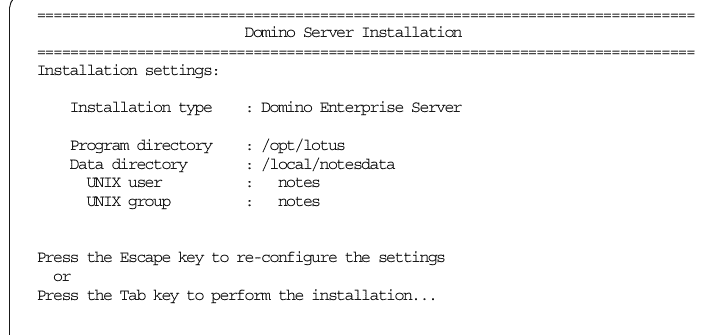

图 11. Domino 安装界面

13. 当安装成功完成后，安装程序会提醒您以 userID notes 登录以运行程序，而不是以 root 身份运行 Domino。

## 2.4.2.2 httpsetup 程序

Domino 服务器的初始配置是通过 Web 浏览器界面完成的。以下步骤介绍了该过程：

- 1. 使用 notes userID 登录。
- 2. 切换到 Domino 数据目录。
- 3. 要启动 HTTP 任务，执行命令：`/opt/lotus/bin/http setup`
如果出现错误，我们将看到类似于图 12 的屏幕。

```

***notesdata/3 notesdata@ /opt/lotus/bin/http setup

04/28/2000 06:00:10 PM Created new log file as /local/notesdata/1of.log

04/28/2000 06:00:12 PM

********************************

* Lotus Domino Server Setup

* To setup this server, please connect

* your web browser to port 8081

* Example: http://this.server.com:8081

********************************

04/28/2000 06:00:12 PM JVM: Java Virtual initialized.

04/28/2000 06:00:13 PM HTTP Web Server started

```

图 12. Domino 设置连接

4. 启动 Web 浏览器并连接到本地机器的 8081 端口。
Web 配置窗口如图 13 所示。

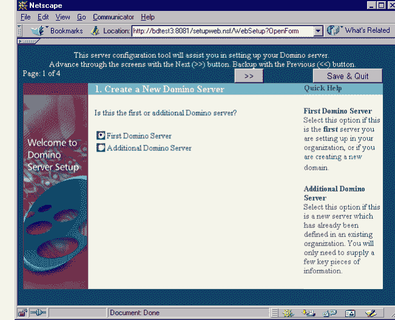

图 13. Domino Web 安装

5. 点击 >> 按钮进入服务器受众（Server Audience）窗口。我们选择的服务如图 14 所示。

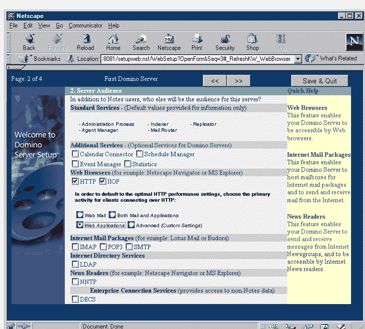

图 14. 我们 Domino 服务器上的服务器受众设置

6. Web 浏览器上出现的下一个屏幕是管理设置（Administration settings）。我们将填写适合我们项目的相应字段，我们按照第 23 页图 15 所示的配置填充了这些字段。

22 使用 WebSphere、DB2 和 Domino 的 Linux Web 托管

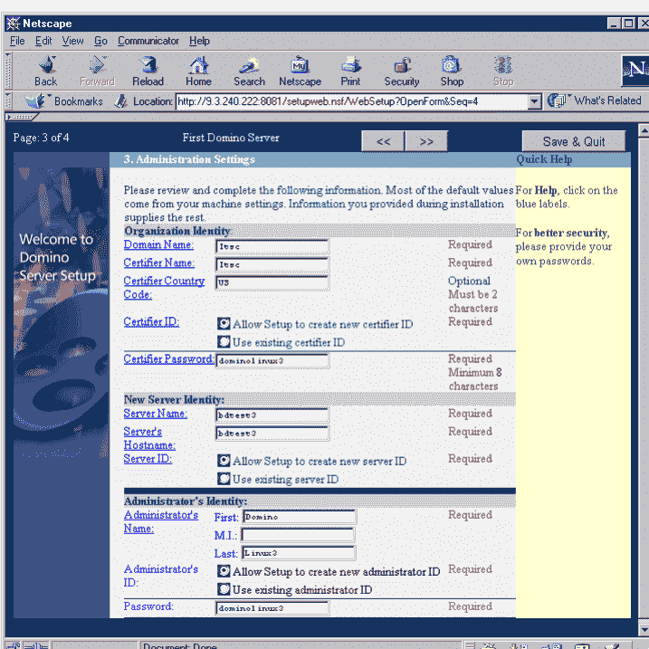

7. 指定网络和通信设置。我们选择安装默认设置。完成字段填写后，点击 Finish（完成）按钮。

8. Web 浏览器中将出现进度条，完成后，点击 Domino 窗口中的 Exit（退出）按钮，Domino 将关闭 Web 服务器。

9. 为了启动 Domino 服务器，我们将当前目录更改到 Domino 数据目录并输入命令：

```
/opt/lotus/bin/server
```

第 24 页图 16 显示了 Domino 服务器启动的屏幕。

第 2 章 设置与配置

```

notesdata$ /opt/lotus/bin/server

Lotus Domino (i) Server, Release 5.0.3, March 21, 2000

Copyright (c) 1995-2000 Lotus Development, All Rights Reserved

05/09/2000 03:59:45 AM Router: Unable to obtain Internet host and domain

05/09/2000 03:59:45 AM Mail Router for domain dbtest3

05/09/2000 03:59:45 AM Router: SMTP host dbtest3 in domain

05/09/2000 03:59:50 AM Index process

05/09/2000 04:00:00 AM Agent Manager started

05/09/2000 04:00:01 AM JVM: Java Virtual initialized.

05/09/2000 04:00:01 AM Maps: Executive started

05/09/2000 04:00:05 AM dbtest3/TSC is the Administration Server of the Domino-

05/09/2000 04:00:05 AM Administration Process started

05/09/2000 04:00:10 AM JVM: Java Virtual initialized.

05/09/2000 04:00:10 AM HTTP Web Server started

05/09/2000 04:00:15 AM DIOP Server started for dbtest3

05/09/2000 04:00:15 AM DIOP port: 6314 not available on this system, will use 6014 instead

05/09/2000 04:00:20 AM Maps Extractor started

05/09/2000 04:00:25 AM Database Extractor: Building Maps profile

05/09/2000 04:00:25 AM Maps Extractor: Maps profile OK

```

图 16. Domino 启动命令

10. 我们可以通过将 Web 浏览器指向我们的 Domino 服务器来测试配置：

```
http://bdtest3/
```


如果 Domino 服务器运行正常，浏览器将出现类似于第 25 页图 17 的窗口。

24 使用 WebSphere、DB2 和 Domino 的托管

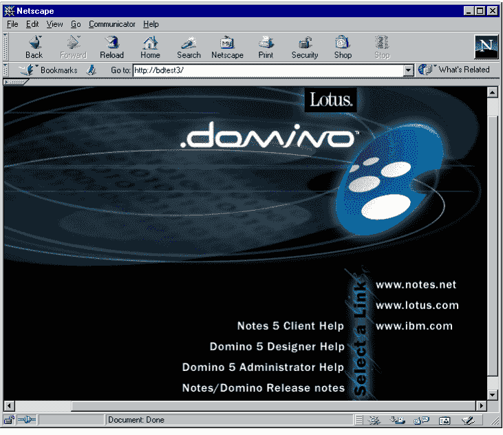

### 2.4.2.3 连接 Domino 客户端

可以使用 Web 浏览器执行许多管理功能，但仍然需要 Domino Administrator 和 Designer 客户端来执行其他任务，例如创建 ID 或设计新数据库。

在我们的项目中，由于没有 Linux 版 Domino Administrator 和 Designer，我们在另一台机器上安装它们。在用 Domino 客户端对 Domino 服务器进行更多管理之前，我们需要提取管理员 ID 文件并将其移动到计划用于管理的机器。

- 1. 使用 Web 浏览器通过 URL 打开地址簿：`http://bdtest3.itsc.austin.com/names.nsf`
- 2. 输入第 23 页图 15 所示管理窗口提供的 Domino Linux 管理员 ID 及其密码。
- 3. 点击 People 视图，打开之前创建的管理员并下载 `USER.ID` 文件。

Netscape 用户：如果您正在使用 Netscape 浏览器，可能需要将 ID 文件重命名为 `USER.ID`。

要使用 Domino Administrator 或 Designer 客户端访问 Domino 服务器，请遵循以下步骤：

- 1. 打开 Notes 并切换到之前下载的 `USER.ID` 文件。
- 2. 点击 Administrator 或 Designer 图标。
- 3. 对于 Designer，选择 File -> Database -> Open，输入新服务器的名称或 IP 地址，几秒后，Notes 客户端将显示新服务器的数据库。对于 Administrator，选择 File -> Open Server 并指定新服务器的名称或 IP 地址，点击 Open。

### 2.4.2.4 Domino 服务器 Java 和 CORBA 要求

在使用 Java 程序通过 CORBA Domino 数据之前，我们必须配置配置支持 Java 和 CORBA 环境。

### HTTP 和 DIIOP

在 Domino R5 中，安装脚本应配置服务器默认运行 HTTP 和 DIIOP 任务，但我们必须确保 `notes.ini` 文件中包含以下行：

```
ServerTask=<any other task>, HTTP, DIIOP
```

此外，确保在启动 Domino 服务器时，服务器控制台上出现第 26 页图 18 所示的行。

| 05/03/2000 01:50:40 PM | JVM: Java Virtual Machine initialized. |
| 05/03/2000 01:50:41 PM | HTTP Web Server started |
| 05/03/2000 01:50:45 PM | DIOP Server started on bdtest1.itsc.austin.ibm.com |

> 图 18. 在 Domino 服务器控制台上验证 Java、HTTP 和 DIIOP 任务

这些任务可以通过以下控制台命令启动：

- 加载 HTTP 任务：
```
load http
```
- 加载 DIIOP 任务：
```
load diiop
```

图 19. Domino Web 管理员

- 4. 从`administrator`窗口（如图 19 所示），点击`Configuration`（配置）。
5. 点击`Servers`（服务器），你将得到一个与第 29 页图 20 类似的窗口。

**图 20.** 配置屏幕

6. 双击服务器名称，然后点击`Edit Server`（编辑服务器），Web 浏览器上将一个与第 30 页图 21 类似的屏幕。

第 2 章. 设置与配置

图 21. 编辑服务器屏幕

- 7. 在基本配置中，确保你已用 `Fully qualified Internet host name`（完全限定 Internet 域名主机名）填写主机名 `bdtest35.itsc.austin.ibm.com`。

> 完全限定 Internet 域名主机名
> 确保此字段填写正确。否则，Domino 将不允许 Java 应用程序使用 CORBA 连接。

- 8. 点击`Ports`（端口），然后点击`Internet Port`（Internet 端口）。
9. 将 `TCP/IP port number`（TCP/IP 端口号）字段从 80 改为 8000。
10. 点击 `IIOP Server` 标签并完成这些字段：
    - TCP/IP Port Number: 这是 DIOP 任务监听的端口名称。除非你已将端口号 63148（默认）分配给另一个任务，否则不要更改此端口。
    - TCP/IP port status: Enable（启用）

11. 点击 `Internet Protocols`（Internet 协议） -> `IIOP` 标签并完成此字段：

线程：你想允许 DIOP 服务器任务同时处理的线程数。默认值为 10。

12. 点击 `Security`（安全）标签并完成 IIOP Restrictions（IIOP 限制）部分的字段：

    - Run restricted Java/JavaScript（运行受限 Java/JavaScript）：
applet 或应用程序访问服务器使用的名称。在此字段中输入的 applet 或应用程序名称允许运行使用受限 Java 和 JavaScript 特性的程序。如果 applet 或应用程序匿名登录，请在此字段中输入 `Anonymous`（匿名）。

    - Run unrestricted Java/JavaScript（运行不受限 Java/JavaScript）：
applet 或应用程序访问服务器使用的名称。在此字段中输入的 applet 或应用程序名称允许运行使用所有 Java 和 JavaScript 特性的程序。

安全设置如第 32 页图 22 所示。

图 22. 我们项目中的安全配置

13. 点击`Save and Close`（保存并关闭）。

在配置并保存配置后，我们必须重启 Domino 服务器。在 `webadmin.nsf` 页面的浏览器窗口中，点击 Console（控制台）。在 Domino Console 字段中，输入 `restart server` 命令并点击 Send（发送）按钮。

现在你可以使用 Web 浏览器指向端口 8000 上的 Domino 服务器来测试新配置。

## 2.4.3 IBM JDK 118

本节讨论了我们项目中 Java 开发工具包 (JDK) 的安装步骤。

### 2.4.3.1 IBM JDK 118 预安装

要开始 IBM JDK 118 的预安装，请以 root 用户身份登录。

在安装 IBM JDK 118 之前，你应该确保 Java 环境是干净安装的。这涉及移除任何现 Java 虚拟机和运行时环境，除非它们对于其他应用程序是必要的。

例如，我们使用命令查询了 Linux 发行版：

```
rpm -qa | grep jdk
```

我们发现 Caldera eDesktop 2.4 默认安装 JDK 1.2.2-1。我们的场景需要 IBM JDK 118。因此，使用命令删除了默认的 JDK：

```
rpm -e jdk-1.2.2-1
```

## 2.4.3 安装 IBM JDK 118

我们的 JDK 安装是 tar 格式并经过 gzip 压缩的。以 root 用户登录，我们将工作目录更改到目标安装目录 `/opt`，然后使用 `tar xzf` 命令解压并提取此文件 `ibm-jdk-1118-linux-x86.tgz`。

由于我们将在安装 JDK 之后还将安装 IBM HTTP Server 和 WebSphere，我们还定义并导了环境变量 `JAVA_HOME`，以指示 JDK 已安装。

图 23 显示了在我们前端服务器上执行 tar 和 export 命令的结果。

```
[root@dbtest2]# tar xzf /mnt/cdrom/Java/ibm-jdk-1118-linux-x86.tgz

[root@dbtest2]# export JAVA_HOME=/opt/jdk118/
```
图 23. 在前端服务器上安装 JDK 118

## 2.4.4 IBM HTTP Server

IBM HTTP Server 的安装是在 root 用户身份登录时进行的。我们在使用 RedHat 6.2 和 Caldera eDesktop 2.4 自带的 Apache Web 服务器时遇到了一些问题。如果使用 Apache 模块安装 WebSphere 并且重启了 Apache，Apache 会对 WebSphere 使用的 Apache 模块报错。图 24 展示了 RedHat 6.2 上的此错误。

```
[root@dbtest2]# /etc/init.d/httpd start

Starting httpd: [Fri May 5 20:43:05] [warn] Loaded /opt/WebAS/plugins/linux/mod_server.so uses plain API, might crash (please recompile it)

[FAILED]
```
图 24. Apache 加载模块失败

由于此错误，Apache 将不会启动。因此，我们必须移除 Apache 并安装 IBM HTTP Server。

### 2.4.4.1 移除 Apache 服务器

要移除 Apache 服务器并安装 IBM HTTP Server，需要按照以下顺序移除 Apache：

- 1. 使用命令 `rpm -e` 移除 `mod_perl`
- 2. 使用命令 `rpm -e` 移除 `php`
- 3. 使用命令 `rpm -e` 移除 `apache`

在 Caldera 安装中，过程有所不同。图 25 显示了在我们前端服务器上执行这些命令的结果。

```
[root@dbtest2]# rpm -e mod_perl

[root@dbtest2]# rpm -e php

[root@dbtest2]# rpm -e apache
```
图 25. 卸载 Apache 服务器

现在我们可以继续安装 IBM HTTP Server。

### 2.4.4.2 IBM HTTP Server 安装

安装步骤如下：

- 1. 安装 IBM HTTP Server 包。在我们的实例中，文件名为 `IBM_HTTP_SERVER-1.3.6.1.i86.rpm`。参见图 26 查看 `-i` 命令的结果。

```
[root@dbtest2]# rpm -i /mnt/cdrom/ibmhttp/2.1/IBM_HTTP_SERVER-1.3.6.1.i86.rpm

httpd: cannot determine local host name.

Use the ServerName directive to set it manually.

/opt/IBMHTTServer/bin/apachectl start: httpd could not be started

execution of script failed
```
图 26. rpm 安装 IBM HTTP Server

- 2. 设置 ServerName 直接

在 `/opt/IBMHTTServer/conf` 目录下，我们需要编辑 `httpd.conf`，添加带有主机名的 ServerName。第 36 页图 27 显示了 `httpd.conf` 的部分内容，我们添加了 ServerName 项。

```
# ServerName: 允许你设置一个返回给服务器的主机名

# 如果它与程序获取的名称不同（例如相对于真实主机使用 www）。

# 注意：你不能随意发明主机名并希望它们有效。在此定义的

# 名称必须是主机的有效 DNS 域名。如果你不知道，请咨询 你的网络管理员。

# 如果你的主机没有注册的 DNS 域名，请输入其 IP 地址

# 你无论如何通过地址访问它（例如，http://123.45.67.89/），

# 这将使重定向以合理的方式工作。

#ServerName localhost

ServerName bstest2.itsc.austin.ibm.com
```
图 27. 在 httpd.conf 中添加 ServerName 直接

## 3. 让 IBM HTTP Server 在启动时运行

要使用 X 窗口工作站设置 IBM HTTP Server 在启动时运行，请使用以下步骤：

- a. 运行 `chconfig` 命令。运行级别窗口如第 37 页图 28 所示
- b. 验证 `ibmhttpd` 是否在可用列表中，并且列在运行级别 2 的启动和停止列表中。


图 28. tksysv 命令的输出

c. 要将 `ibmhtpd` 添加到所需的运行级别（run level），请在“Available”（可用）列表框中高亮它并点击`Add`（添加）。将弹出一个与第 38 页图 29 类似的屏幕，并提示你启动或停止服务。

d. 选择`run level 2` 并点击`Done`（完成）。对于你希望配置 ibhtpd 的每个运行级别，都需要完成此操作过程。

第 2 章. 设置与配置 37

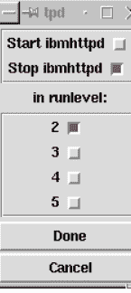

如果没有具备 X 窗口功能的工作站，你可以使用以下步骤在启动项中添加 ibmhtttpd：

- a. 在 `/etc/rc.d/init.d` 应该有一个名为 `ibmhtttpd` 的可执行脚本文件。如果没有，请将此脚本从 `/opt/IBMHTTPServer/bin` 拷贝过来。
- b. 执行以下命令在各个 rc.d 目录中为相应的运行级别创建符号链接：
  * `ln -s /etc/rc.d/init.d/ibmhtttpd /etc/rc/rc0/K15ibmhtttpd`
  * `ln -s /etc/rc.d/init.d/ibmhtttpd /etc/rc/rc1/K15ibmhtttpd`
  * `ln -s /etc/rc.d/init.d/ibmhtttpd /etc/rc/rc2/K15ibmhtttpd`
  * `ln -s /etc/rc.d/init.d/ibmhtttpd /etc/rc/rc3/S85ibmhtttpd`
  * `ln -s /etc/rc.d/init.d/ibmhtttpd /etc/rc/rc4/S85ibmhtttpd`
  * `ln -s /etc/rc.d/init.d/ibmhtttpd /etc/rc/rc5/S85ibmhtttpd`

现在，你可以启动 IBM HTTP Server 了。现在 IBM HTTP Server 也应该会在启动时自动启动。通过重启系统并尝试使用 Web 浏览器连接到 80 端口来检查。当我们在 Web 浏览器中获得第 39 页图 30 所示的 IBM HTTP Server 默认页面时，我们验证了安装工作正常。

## 2.4.5 WebSphere

我们在这里描述在以前端服务器上安装 WebSphere 的步骤、为 WebSphere 和 IBM HTTP Server 配置各种配置文件，并验证 IBM HTTP Server 是否能够加载并运行 Java servlets。

### 2.4.5.1 安装 WebSphere

必须以 root 用户身份安装 WebSphere。它要求安装 JDK 并设置 `JAVA_HOME` 环境变量。然后它需要安装 2 个组件。这些是安装步骤：

- 1. 导出 `JAVA_HOME=/opt/jdk118`，因为我们之前安装了 IBM JDK 118（见第 32 页第 2.4.3 节“IBM JDK 118”）。
- 2. 安装 WebSphere 核心组件，文件名为 `IBMWebAS-core-2.03-1.i386.rpm`
- 3. 我们现在可以安装 Web 服务器特定组件。由于我们正在使用 IBM HTTP Server，我们将使用文件 `IBMWebAS-ibm-http-2.03-1.i386.rpm`。

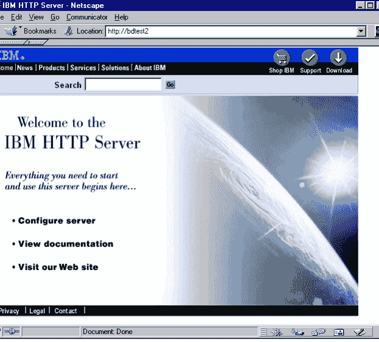

第 2 章. 设置与配置 39

## WebSphere 依赖

用于 IBM HTTP Server 的 WebSphere rpm 包依赖于 IBM HTTP Server 1.3.6；因此，确保已安装 IBM HTTP Server 1.3.6。

图 31 显示了按照之前记录的安装步骤安装 WebSphere 应用程序服务器。

```bash
[root]@dttest2 /opt# export JAVA_HOME=/opt/jdk118

[root]@dttest2 /opt# rm -i /asmrt/cdrom/was/IBMWebAS-core-2.03-1.i386.rpm

A copy of the configuration file was made and is located at /opt/IBMWebAS/properties/bootstrap.properties.bak

[root]@dttest2 /opt# rm -i /asmrt/cdrom/was/IBMWebAS-ibm-http-2.03-1.i386.rpm

A backup of your httpd.conf has been made and is being saved at /opt/IBMHTTPServer/conf/httpd.conf
```


## 2.4.5 WebSphere

### 2.4.5.1 安装 WebSphere

必须以 root 用户身份安装 WebSphere。它要求安装 JDK 并设置 `JAVA_HOME` 环境变量。然后它需要安装 2 个组件。这些是安装步骤：

- 1. 导出 `JAVA_HOME=/opt/jdk118`，因为我们之前安装了 IBM JDK 118（见第 32 页第 2.4.3 节“IBM JDK 118”）。
- 2. 安装 WebSphere 核心组件，文件名为 `IBMWebAS-core-2.03-1.i386.rpm`
- 3. 我们现在可以安装 Web 服务器特定组件。由于我们正在使用 IBM HTTP Server，我们将使用文件 `IBMWebAS-ibm-http-2.03-1.i386.rpm`。
- 4. 最后，为了确保 JSP 页面可以编译，我们更改页面目录（位于子目录 `/opt/IBMWebAS/servlets`）的所有权，使其所有者和组所有变为 nobody。我们使用如下形式的 `chown` 命令：

```bash
chown nobody.nobody /opt/IBMWebAS/servlets/pagecompile
```

### 2.4.5.2 验证 WebSphere 安装

我们通过以下方式验证 WebSphere 是否成功安装：

- 目视检查 WebSphere 属性文件。
- 目视检查 IBM HTTP Server 配置文件。
- 使用 Web 浏览器验证 WebSphere 是否运行。

#### 验证 IBM HTTP Server 配置文件

IBM HTTP Web 服务器有一个名为 `httpd.conf` 的配置，位于 `/opt/IBMHTTPServer/conf`。目视检查此文件并检查以下内容：

- `LoadModule_app_server_module`

在“Extra Modules”部分、注释 `#Extra Modules` 之后的 `#Dynamic Shared Object (DSO) Support` 之后的动态共享对象模块列表中，应该有一个用于 `app_server_module` 的 `LoadModule` 定义，以加载 WebSphere。加载模块语句如图 32 所示。

```apache
#
# Dynamic Shared Object (DSO) Support
#
# LoadModule usertrack_module libexec/mod_usertrack.so
LoadModule unique_id_module libexec/mod_unique_id.so
LoadModule setenvif_module libexec/mod_setenvif.so
LoadModule itm_app_server_module /opt/IBM/WebAS/plugins/linux/mod_itm_app_server.so
```

图 32. `httpd.conf` 中 `app_app_server.module` 的 `LoadModule` 条目

- `AddModule mod_app_server.c`

在模块加载列表中应该有一个 `mod_app_server.c` 的 `AddModule` 定义。此列表由适当的注释和 `ClearModuleList` 指令前缀。在 Extra Modules 部分，我们将找到此 `mod_app_server.c` 的 `AddModule` 定义，如图 33 所示。

```apache
# Reconstruction of the complete module list from all available
(static and shared ones) to achieve correct module execution
# WHENEVER YOU CHANGE THE
ClearModuleList

# AddModule usertrack_module
AddModule unique_id_module
AddModule setenvif_module
AddModule itm_app_server_module
```

图 33. `mod_app_server.c` 的 `AddModule` 定义

- 在 `httpd.conf` 的末尾，我们检查它是否包含了第 34 页图 34 所示的 WebSphere 运行级别项。

```apache
图 34. httpd.conf 中的 WebSphere 配置
```

#### 验证 WebSphere 配置文件

IBM HTTP Web 服务器有一个名为 `httpd.conf` 的配置，位于 `/opt/IBMHTTPServer/conf`。目视检查此文件并检查以下内容：

- `LoadModule_app_server_module`

在“Extra Modules”部分、注释 `#Extra Modules` 之后的 `#Dynamic Shared Object (DSO) Support` 之后的动态共享对象模块列表中，应该有一个用于 `app_server_module` 的 `LoadModule` 定义，以加载 WebSphere。加载模块语句如图 32 所示。

```apache
#
# Dynamic Shared Object (DSO) Support
#
# LoadModule usertrack_module libexec/mod_usertrack.so
LoadModule unique_id_module libexec/mod_unique_id.so
LoadModule setenvif_module libexec/mod_setenvif.so
LoadModule itm_app_server_module /opt/IBM/WebAS/plugins/linux/mod_itm_app_server.so
```

图 32. `httpd.conf` 中 `app_app_server.module` 的 `LoadModule` 条目

- `AddModule mod_app_server.c`

在模块加载列表中应该有一个 `mod_app_server.c` 的 `AddModule` 定义。此列表由适当的注释和 `ClearModuleList` 指令前缀。在 Extra Modules 部分，我们将找到此 `mod_app_server.c` 的 `AddModule` 定义，如图 33 所示。

```apache
# Reconstruction of the complete module list from all available
(static and shared ones) to achieve correct module execution
# WHENEVER YOU CHANGE THE
ClearModuleList

# AddModule usertrack_module
AddModule unique_id_module
AddModule setenvif_module
AddModule itm_app_server_module
```

图 33. `mod_app_server.c` 的 `AddModule` 定义

- 在 `httpd.conf` 的末尾，我们检查它是否包含了第 34 页图 34 所示的 WebSphere 运行级别项。

我们还通过连接到端口 9527 的服务器，验证了 WebSphere 管理服务器正在运行。图 38 显示了该结果。

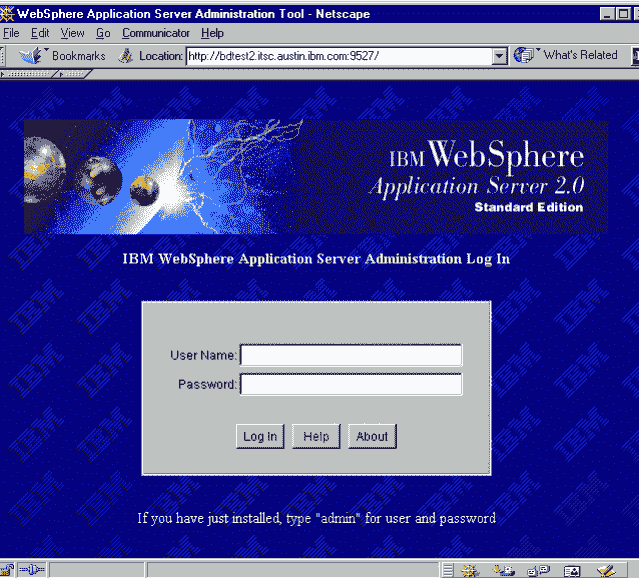

图 38. 验证 WebSphere 管理服务器是否在端口 9527 上运行

## 2.4.6 配置对后端数据库的前端访问

此时，我们的前端服务器尚未准备好访问后端 DB2 和 Domino 数据库。我们必须在前端服务器上进行更进一步的配置。请参阅以下节章节：

- 第 44 页第 2.4.6.1 节，“配置对 DB2 的前端访问”
- 第 49 页第 2.4.6.2 节，“配置对 Domino 的前端访问”

### 2.4.6.1 配置对 DB2 的前端访问

为了让安装在我们的服务器 `bdtest2` 上的 IBM WebSphere 和 IBM HTTP Server 能够访问我们后端服务器上的 DB2 Java 类库和 DB2 服务器，我们必须在前端服务器上执行以下步骤：

1. 安装 DB2 客户端应用程序启用器 `CAE`。
2. 验证 DB2 CAE 的安装。
3. 修改 IBM WebSphere 配置文件以包含 DB2 Java 库。
4. 修改 IBM HTTP Server 以识别 DB2 实例和相关的 DB2 库。
5. 验证对后端 DB2 数据库的访问。

我们将在接下来的章节中描述这些步骤。

#### 安装 IBM DB2 客户端应用程序启用器

执行此任务：

1. 以 root 身份登录。
2. 将工作目录更改到存储 DB2 6.1 fixpack 3 DB2 CAE 代码的目录。
3. 执行 `db2setup` 命令。DB2 V6 安装屏幕将打开。
4. 运行运行 `db2setup` 命令后，根据 DB2 的发行情况，将提供 DB2 管理客户端或 DB2 运行时客户端供安装。选择任一可用的版本安装 CAE。在我们的场景中，它是以 DB2 管理客户端的形式提供的。
5. 按 **回车键** 以选择 **DB2 管理客户端**。屏幕应如图 39 所示。

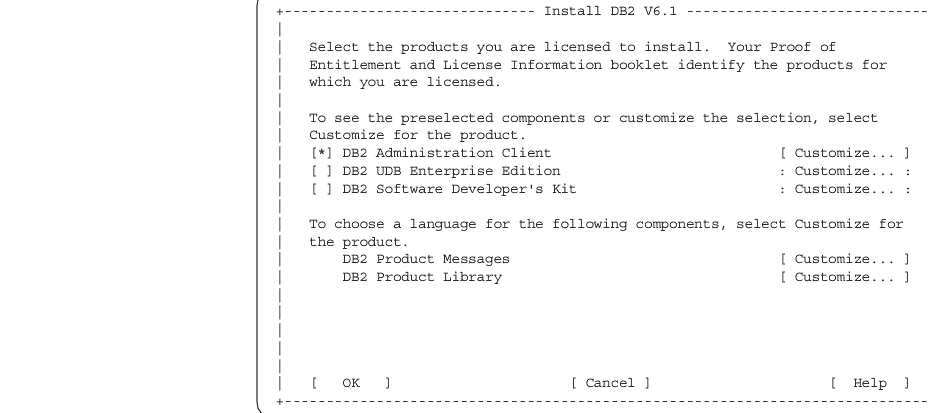

图 39. *使用 `db2setup` 命令安装 DB2 CAE*

6. 为了确保安装了 Java 组件，我们通过 Tab 键将光移动到“自定义 `Customize`”选项，然后按回车键。我们验证 Java 支持组件将如图 40 所示。

| 选择您许可安装的产品。您的权利证明（Proof of Entitlement）和许可信息手册识别了您获得许可许可的产品。 |
|---|---|
| 要查看预选组件或自定义选择，请选择 DB2 管理中心 |
| 必选： | DB2 客户端 |
| 可选： | [*] Java 支持 [ ] 控制中心 |
| [ 选择全部 ] | [ 取消全选 ] [ 默认 ] |
| [ OK ] | [取消 ] [ 帮助 ] |

图 40：为 Java 支持自定义 DB2 安装

7. 选择 OK 继续。
8. 回到安装 DB2 屏幕，选择 OK 继续创建实例。
9. 使用 JDBC 访问 DB2 有两种方法：应用驱动程序和网络驱动程序。更多信息请参阅第 83 页第 3.5.3 节，“通过 JDBC 访问 DB2”。我们使用 Java 应用驱动；因此，我们选择创建一个 DB2 实例。
10. 在 DB2 实例屏幕接受所有默认设置。选择 OK 并记录系统生成的密码 `ibdb2`。按回车键确认此操作，并返回 DB2 服务屏幕。
11. 选择 OK 进入摘要报告屏幕。选择继续 `Continue`。
12. 要开始安装，选择 OK。安装将继续进行。
13. 安装完成后，选择 OK 进入状态报告屏幕。验证所有组件均已成功安装，并选择 OK 返回初始 DB2 安装程序屏幕。
14. 选择关闭退出 DB2 安装程序，并选择 OK 消除关于退出 DB2 安装程序的最终警告。

#### 验证 DB2 CAE 安装

一旦安装了 DB2 CAE，按照如下方式验证其运行情况：

1. 以 DB2 实例所有者 `db2inst` 的身份登录。
2. 按照顺序使用以下命令访问后端服务器中的 `SAMPLE` 数据库：
`db2 catalog tcpip node dbdtest3 remote 9.3.240.222 server 50000`
`db2 catalog database sample at node dbdtest3`
图 41 显示运行这些命令的结果。

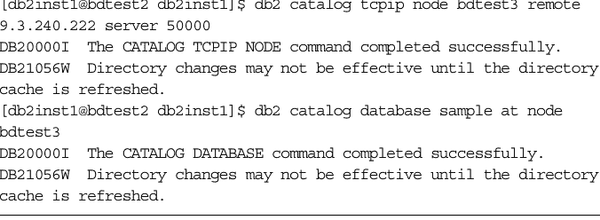

图 41. 在前端服务器上对 `SAMPLE` 数据库目录

3. 使用 `db2 connect` 命令按如下方式验证连接：
`db2 connect to sample user db2inst1 using ibmdb2`
4. 最后，通过发布以下命令验证 SQL select 是否有效：
`db2 "select * from department"`
查看第 18 页第 10 点获取此查询结果的示例。

#### 修改 IBMSphere 配置文件

我们必须将 DB2 Java 库添加到 WebSphere 配置文件中。

1. 找到位于前端服务器的 `bootstrap.properties` 文件。
2. 以 root 身份登录并编辑该文件。
3. 在以下条目中添加 DB2 Java 路径：
4. 修改如下所示的 DB2 实例：

```
############################
# Java Virtual Machine configuration
############################
# The classpath for the JVM
# This2 is appended to the
#
```

### 2.4.6.2 配置对 Domino 的前端访问

为了从我们的前端服务器 `bdtest2` 访问 Domino 数据库，我们必须继续配置 WebSphere 应用程序：

1. 将 `Domino.jar` 文件从 Domino 服务器的 `/localdata/domino/Java/` 目录拷贝到前端服务器。将其放在 `/opt/domino` 目录下。
2. 编辑 `bootstrap.properties` 文件。它位于 `/opt/WebSphere/properties`。
3. 在 classpath 中包含 `Domino.jar` 的完整路径：

```
Java.classpath=...:/opt/domino
```

第 50 页的图 45 显示了修改后的 `bootstrap.properties`。


```
####################
# Java Virtual Machine configuration
####################
# The classpath for the JVM
# This is appended to the
# the runtime classpath. This classpath should contain
# the JVM classes and any user classes. The WebSphere classpath is
# built dynamically from the contents of
# <Install Root>
# directory
Java.classpath:/opt/jdk/lib/classes.zip:/opt/WebSphere/classes:/opt/WebSphere/classes:/usr/IBMJRE6/java/java.zip:/opt/Domino/Dominojar
```

图 45. `bootstrap.properties` 的 `Domino.classpath`

### 4. 使用以下命令重启 IBM HTTP 服务器：

```
killall Java
/etc/rc.d/init/httpd stop
/etc/rc.d/init/httpd start
```

## 修改 HTTP Server 配置文件

为了激活这些设置，我们需要修改 `/etc/rc.d/init/httpd` 文件中的 DB2 环境变量。

1. 在 `bootstrap.properties` 文件中添加 DB2 CAE 路径。

2. 在以下条目中添加 DB2 路径：

3.

.

.图 43 所示：

```
############################
# Java Virtual Machine configuration
############################
# The classpath for the JVM
# This
```

.

图 43. `inithttpd` 文件中的 `DB2INSTANCE` 和 `LIBPATH`

重启 HTTP Server 以应用这些设置。

# 验证后端 DB2 数据库

现在我们可以通过附录 B.1，“Java servlet TestDB2”第 147 页的 `TestDB2` servlet 验证对 DB2 数据库的访问。

### 2.4.6.3 验证 WebSphere 访问 Domino 服务器

验证 WebSphere 访问 Domino 数据库，我们需要一个简单的 Java servlet 程序。我们在 WebSphere 上创建一个简单的 servlet，尝试打开 Domino 服务器的会话并显示数据的标题。

1. 编写位于附录 C.1，“第 159 页的 Java servlet TestDB2”的 `TestDBino` servlet。

2. 使用 Java 编译器编译 servlet。

3. 将 servlet 类文件放入 WebSphere servlets 目录。

4. 配置 WebSphere 加载该 servlet。

5. 从 Web浏览器运行该 servlet。我们使用 URL：

```
http://bdtest2/servlet/TestDomino?db=homepage&host=bdtest3&port=8000
```

其中 `homepage` 是 Domino 服务器中默认提供的 `homepage.nsf` 数据库文件。

结果与第 51 页的图 46 相似。

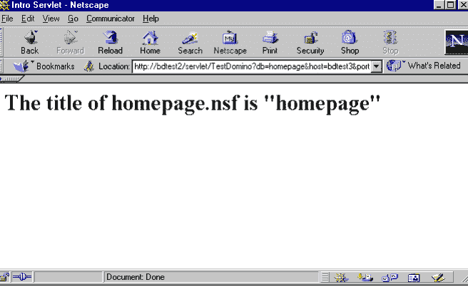

图 46. `TestDomino` servlet 结果

第 2 章 设置与配置 51

52 使用 WebSphere、DB2 和 Domino 进行 Linux Web 托管

# 第 3 章 构建 Web 服务器

在本章中，我们将详细探讨构建 Web 服务器时所采取的步骤。讨论分为以下部分：

- 第53 页第 3.1 节“外部功能”描述了所创建网站的外部结构。
- 第60 页第 3.2 节“内部设计”展示了我们构建网站时使用的组件和构建块。
- 第61 页第 3.3 节“DB2 Database”讨论了我们 DB2 数据库结构的设计与构建。
- 第69 页第 3.4 节“Domino Database”提供了 Domino 数据库和 Redbooks 数据库设置的概述。
- 第78 页第 3.5 节“Servlet 程序”详细讨论了我们所使用的 servlets 的制作。
- 第98 页第 3.6 节“JSP 文件”讨论了使用 JSP 实现动态页的方案。
- 第103 页第 3.7 节“通过 Java Bean 访问数据”提供了使用简单 Java Bean 进行 Web 编程的概述。

## 3.1 外部功能

在本节中，我们将讨论 Web 服务器的外部功能。我们将像典型用户一样带您熟悉我们的 Web 服务器。该网站有两种用户：未注册用户和注册用户。

该网站具有以下功能：

- 浏览和搜索 Redbooks 数据库
- 用户个人资料管理、注册和更新
- 订书功能

我们提供了一系列 Windows Media 格式的 ScreenCam 视频，用于演示网站的流程。这些 ScreenCam 视频可在随附的 CD-ROM 获取。有关 CD-ROM 的更多信息，请参阅第211 页附录 F“使用附加材料”。

第54 页的图 47 展示了未注册用户的流程。

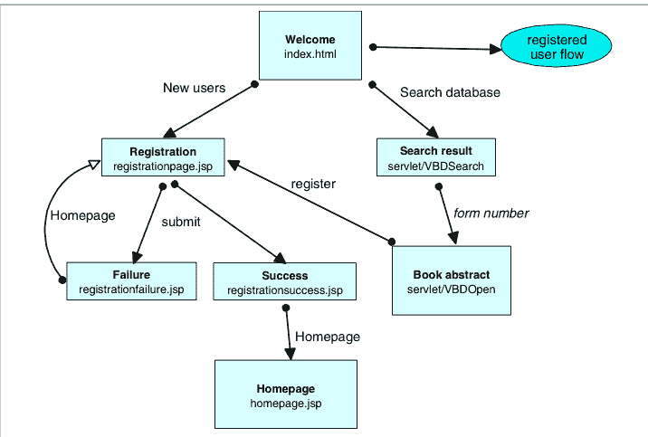

图 47. 未注册访问者的 HTML 流程

如图 47 所示，此网站显示的初始页面是欢迎页，如第55 页的图 48 所示。

54 使用 WebSphere、DB2 和 Domino 进行 Linux Web 托管

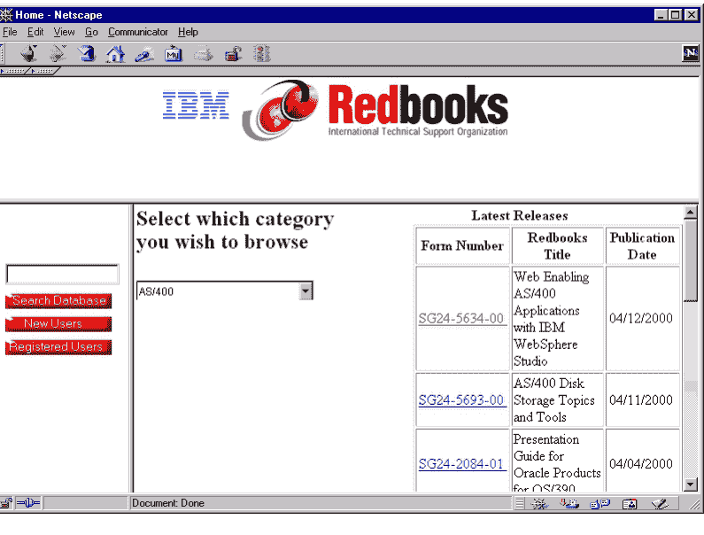

从图 48 显示的欢迎页开始，未注册用户只能访问有限的菜单和功能。这些功能包括：

- 点击 **Search Database（搜索数据库）**，允许在 redbooks 数据库中搜索特定主题。这不需要用户名或密码。
- 点击 **New Users（新用户）**，将显示注册页面以开始注册流程。

注册窗口位于第56 页的图 49。注册页面要求您填写个人信息以及对感兴趣书籍类别的兴趣。这些书籍类别以菜单选项的形式显示在主页上。您还需要选择用户名和密码。如果失败，将显示错误信息和说明；否则，将显示一个显示您的用户名和密码的页面。然后您可以选择“继续”或“退出”。如果您选择“继续”，将看到您的定制化主页。

第 3 章 构建 Web 服务器 55

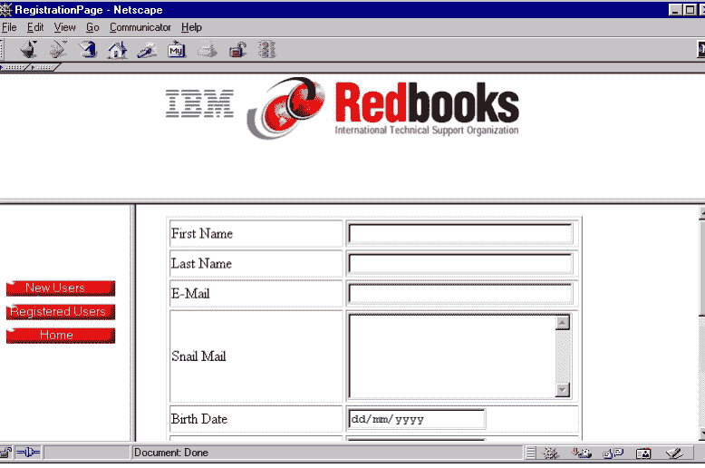

图 49. 注册页面

- 点击 **Registered Users（注册用户）**，将显示登录页面并需要有效的用户名和密码。此选项供注册用户登录使用。
- 点击欢迎页正文中“Latest Releases（最新发布）”表格中任何条目的表单编号（SGxxx-xxxx），进入该特定书籍的摘要页。

书籍的摘要如第57 页的图 50 所示。未注册用户在先注册并登录之前将无法订购书籍。书籍摘要页提供了指向注册页的链接，您可以在那里进行注册、登录和订购。

56 使用 WebSphere、DB2 和 Domino 进行 Linux Web 托管

## 摘要

使用 IBM WebSphere Studio 启用 AS/400 应用程序，SSG24-6634-00。

在过去的二十年里，业务模式发生了巨大变化。今天，如果没有某种在线存在将是非常罕见的现象。互联网已经演变，在过去的几年里，人们对利用提供交互内容的兴趣大大增加。有各种工具和技术可以将现有 AS/400 应用程序的内容引入 Web。完成这些任务的工具是 IBM WebSphere Application Server Edition 5.0，AS/400 包含了该版本。

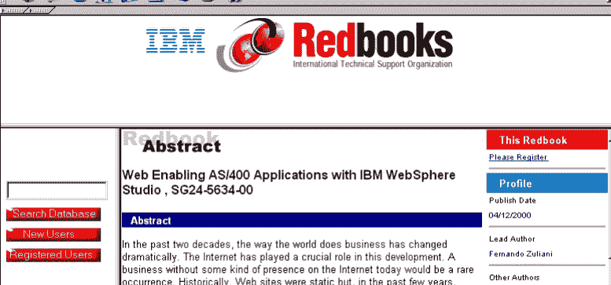

- 从下拉列表中选择以浏览 redbook。

图 51 描述了 Web 的流程。

第 3 章 构建 Web 服务器 57

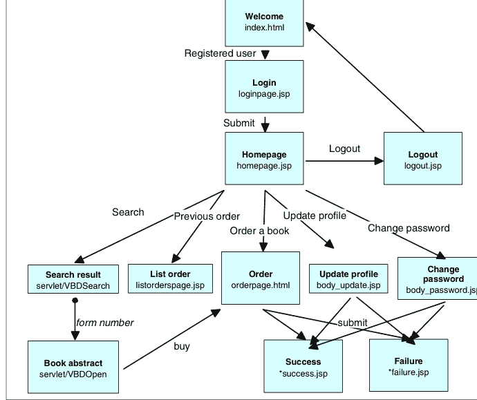

图 51. 注册用户的 HTML 流程

注册用户从第55 页图48 显示的欢迎页选择“Registered users”按钮进入登录页面。需要输入用户名和密码。如果登录失败，将返回登录页面。如果登录成功，将显示您的定制化主页。52。

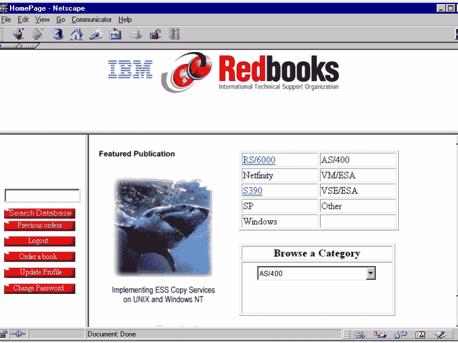

图 52. 注册用户的主页

- 搜索（搜索）按钮与未注册用户的搜索类似。
- 点击 **Previous Orders（之前的订单）**，将进入您使用 Java Bean 提交的订单列表。
- 点击 **Order a book（订购书籍）**，将启动订购流程。
- 点击 **Update Profile（更新个人资料）**，这将更新个人信息。
- 点击 **Change Password（更改密码）**，这将提供密码更改界面。

从订购页、个人资料页和密码更改页，可能会获得成功或失败页面。如果失败，点击**继续** 将返回上一个屏幕。如果成功，点击**继续** 将返回主页。

第 3 章 构建 Web 服务器 59

如第58 页图 51 所示，可以从摘要页进入订购页，或者如果您知道表单编号可以直接进入订购页。成功的订购将显示订单号和配送详情。失败将再次导致错误消息和进一步说明。

## 3.2 内部设计

我们的 Web 应用结构随后被开发以提供第53 页第 3.1 节“外部功能”中讨论的展示流程。由于我们还决定使用电子商务用户在线购买拓扑，应用程序随后包含了前端的业务服务器节点和后端数据库节点。前端使用 WebSphere 运行 Web 服务器和业务逻辑，而后端包含数据。图53 展示了我们的内部配置。

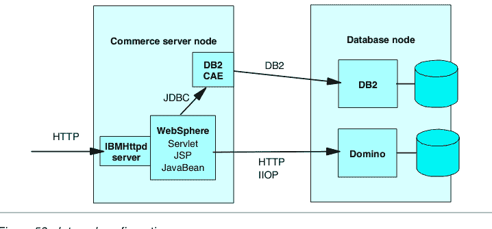

设计从数据库结构开始。我们使用两个数据源：DB2 数据库存储订单和用户资料，Lotus Domino 数据库存储书籍信息。DB2 数据库的结构见第61 页第 3.3 节“DB2 Database”。关于 Lotus Domino 红书型数据库的讨论见第69 页第 3.4 节“Domino Database”。

业务服务器节点使用 RedHat 版本 6.2 和 Caldera eDesktop 版本 2.4 实现。我们使用的 HTML 代码可参见第173 页附录 D“HTML 和 JSP 列表”。我们在此处

redbook，关于 Web 服务器的一些 Java 相关组件的开发。这些讨论包含在以下章节：

- 第 78 页第 3.5 节“Servlet 程序”，其中讨论了我们开发的 Servlet 程序。这些 Servlet 主要用于维护会话（session）、访问 DB2 数据库以及访问 Domino 数据库。
- 第 98 页第 3.6 节“JSP 文件”，其中讨论了我们使用的 Java Server Pages (SPs)。JSP 提供了创建动态 Web 页面的能力，而无需在 servlet 中编写所有代码。
- 第 103 页第 3.7 节“通过 Java Bean 访问数据”，概述了我们用于在 Web 页面中表示订单列表的任意动态数据的 Java Beans。

## 3.3 DB2 数据库

本节详细讨论了构建我们使用的 DB2 数据库所需的步骤。我们执行的步骤在以下范围内讨论：

- 第 61 页第 3.3.1 节“数据库建模”，在其中我们提供了开发数据库时所面临的设计考量。
- 第 66 页第 3.3.2 节“创建数据库”，展示了实际的数据库创建过程。

### 3.3.1 数据库建模

为了实现网站的目标，我们的数据库至少对以下实体进行建模：

- 用户 (Users)

用户是访问网站进行浏览、使用用户名和密码登录、注册 redbook 分类兴趣以及订购 redbook 的客户。

- 订单 (Orders)

这些实体反映了用户对产品的订单。为了简单起见，用户一次只能订购一种产品（即没有购物车概念，无法在订单完成前放置一个或多个数量不同的产品）。

我们将更具体地检查这些每一个实体。

#### 3.3.1.1 用户

用户（users）实体必须以下属性：

- 用户名和密码

每个用户名被认为是唯一的。因此，我们通过验证用户名和密码的组合来验证用户是否已注册。每当对数据库执行任何操作时（无论是更改还是访问用户密码、信息和配置），都必须验证用户名和密码。

出于性能和实现的考虑，用户名和密码信息需要单独构建。出于性能考虑，我们需要将对这些信息的访问与其他所有访问隔离开，以便提供快速且高效的数据访问。从实现的角度来看，我们发现以后更改密码加密算法和访问方法也会更加方便。

- 用户信息

用户信息包含用户的姓、名、地址、电子邮件等信息。一旦用户注册，这些信息通常是静态的。这些数据通常不会被更改。

我们添加了 `date joined`（加入日期）属性来跟踪用户注册的时间。

- 个人配置信息

配置信息反映了用户对 redbook 分类的兴趣。用户感兴趣的类别列表可能会根据用户的不同而经常变化。类别列表也可能随时间改变。

根据属性的差异，我们决定在不同的表中实现这些属性。

#### 3.3.1.2 订单

订单（Orders）具有以下属性：

- 与订单关联的用户名
- 订单的时间戳
- 已订购的产品
- 唯一的订单识别码

需要这个唯一的订单 ID，因为我们不能再使用用户名作为唯一标识符（因为用户可以、或者应该能够、订购多件产品）。

#### 3.3.1.3 完整设计

基于对用户和订单项目的讨论，我们将创建四个数据库表。每个表都有一组字段（或列名），每个字段都有数据类型、长度和可为空条件（nullable）。

- 数据类型

DB2 提供了多种数据类型。我们在数据库表中使用以下数据类型：

- `varchar`：提供可变长度字符串类型
- `char`：提供固定长度字符串类型
- `date`：提供仅日期的数据类型
- `timestamp`：提供精确到微秒的日期和时间
- `int`：提供整数类型

- 字段长度

这代表字段的长度（如果适用）。例如，`char` 或 `varchar` 数据类型需要长度，而 `date`、`timestamp` 或 `int` 数据类型不需要。

- 可为空条件

最后一个属性可为空条件是为了让我们跟踪该字段是可以留空、未定义，还是必须填写。例如，“长度为 0 的字符串；它不是空字符串”。

我们构建的数据库结构由图 54 所示的实体关系图表示。

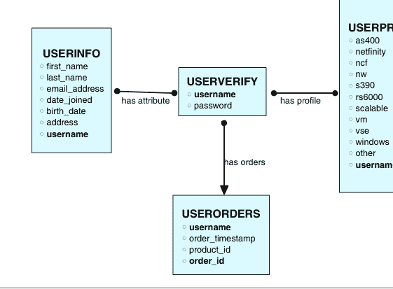

我们的 DB2 数据库结构实体关系图

我们现在可以在以下子节中列出这四个数据库表的字段名及其属性。

## USERVERIFY

`USERVERIFY` 表包含用户名和密码。该表的字段如表 1 所示。

表 1. `USERVERIFY` 数据库表

| 字段名 | 数据类型 | 长度 | 可为空 |
|---|---|---|---|
| `username` | `varchar` | 20 | no |
| `password` | `varchar` | 20 | no |

用户名字段将是此表中的搜索键；因此，我们将其分配为表的主键。

用户名和密码都不允许为空。

## USERINFO

`USERINFO` 表包含用户信息。该表的字段如表 2 所示。

表 2. `USERINFO` 数据库表

| 字段名 | 数据类型 | 长度 | 可为空 |
|---|---|---|---|
| `first_name` | `varchar` | 50 | no |
| `last_name` | `varchar` | 50 | no |
| `email_address` | `varchar` | 50 | no |
| `date_joined` | `date` | - | no |
| `birth_date` | `date` | - | no |
| `address` | `varchar` | 200 | no |
| `username` | `varchar` | 20 | no |

## USERPROFILE

该表包含用户感兴趣的类别列表。每个注册用户在表中都有一个条记录。除了用户名外，所有字段都设为空。如果注册用户对某个平台感兴趣，该字段将设置为单个字符（通常为 y）。`USERPROFILE` 表的字段如表 3 所示。

表 3. `USERPROFILE` 数据库表

| 字段名 | 数据类型 | 长度 | 可为空 |
|---|---|---|---|
| `as400` | `char` | 1 | yes |
| `netfinity` | `char` | 1 | yes |
| `ncf` | `char` | 1 | yes |
| `nw` | `char` | 1 | yes |
| `s390` | `char` | 1 | yes |
| `rs6000` | `char` | 1 | yes |
| `scalable` | `char` | 1 | yes |
| `vm` | `char` | 1 | yes |

## USERORDERS

该表包含订单。每个订单除了用户名、product_id 和订单时间戳外还有一个唯一的 order_id。`USERORDERS` 表的字段如表 4 所示。

表 4. `USERORDERS` 数据库表

| 字段名 | 数据类型 | 长度 | 可为空 |
|---|---|---|---|
| `username` | `varchar` | 20 | no |
| `order_timestamp` | `timestamp` | - | no |
| `product_id` | `varchar` | 20 | no |


| `order_id` | int | - | no |

`order_id` 字段将是此表中的搜索键；因此，我们将其分配为表的主键。

我们要求此表中的所有字段都必须填写。

我们演示如何通过命令行创建数据库，如下：

- 1. 在服务器上，以用户 `db2inst` 登录（默认 DB2 实例所有者）。

- 2. 执行 `db2 create database` 命令来创建 `USERSTUF` 数据库：

```
db2 create database USERSTUF
```

## DB2 数据库名称

| DB2 v6.1 中的 DB2 数据库名称长度必须为八字符以内。因此，我们将数据库命名为 `USERSTUF`（而不是 `USERST`） |

第 67 页的图 55 显示了 `create database` 命令的结果，使用默认设置创建了 `USERSTUF` 数据库。我们通过使用 DB2 `connect to database` 命令连接到数据库来验证数据库已创建。

```
db2inst@bddtest db2inst$ $ db2 create database USERSTUF
DB20000I THE CREATE DATABASE command completed successfully.
db2inst@bddtest db2inst$ $ db2 connect to userstuff
```

数据库连接信息

| 数据库服务器 = DB2/LINUX 6.1.0 |

| SQL 授权 ID = DB2INST |

| 本地数据库别名 = USERSTUF |

图 55 在服务器 bstest1 上创建 `USERSTUF` 数据库

此命令在默认位置 `/home/db2inst1` 下创建一个名为 `USERSTUF` 的数据库。

## DB2 数据库备份

请始终使用 `db2 backup database` 命令备份 DB2 数据库。备份文件系统或在文件系统级备份数据库文件将无法实现相同的效果。请参考第 107 页第 4 章“操作注意事项”获取更多关于 DB2 操作的详细信息。

### 3.3.2 在前端服务器上目录数据库 USERSTUF

正如第 83 页 3.5.3节“通过 JDBC 访问 DB2”所示，前端服务器将使用 DB2 原生 API 类型 2 的 JDBC 驱动程序访问 DB2 `USERSTUF` 数据库。为了这项工作，我们必须在前端服务器上对 `USERSTUF` 数据库建立目录。

我们按照顺序发布 DB2 catalog tcpip node dbstest，在前端服务器上以 DB2 实例所有者 `db2inst1` 的身份登录：

```
db2 catalog tcpip node dbstest remote 9.3.240.221 server 50000
db2 catalog database userstuf node dbstest
```

使用命令验证与 DB2 数据库的连接：

```
db2 connect to userstuf
```

### 3.3.3 在数据库中创建 DB2 表

我们可以使用 DB2 控制中心 GUI 或通过 DB2 命令行为 `USERSTUF` 表创建数据库表。

我们演示了如何使用命令行界面创建表。我们已经创建了用于此过程的 SQL 脚本文件（详见第 145 页附录 A，“创建 USERSTUF 表的 SQL 脚本”）。我们在此处演示创建 `USERINFO` 表。脚本文件名为 `userinfo.ddl`，内容如图 56 所示。

```
create table userinfo (
    first_name varchar(20) not null,
    last_name varchar(20) not null,
    email_address varchar(50) not null,
    date_joined date not null,
    birth_date date not null,
    address varchar(200) not null,
    username varchar(20) not null,
    primary key (username)
)
```

图 56. `userinfo.ddl` 文件

创建 `USERINFO` 表的步骤如下：

- 1. 以默认 DB2 实例所有者 `db2inst1` 的身份登录。

- 2. 使用命令连接到 `USERSTUF` 数据库：

```
db2 connect to userstuf
```

- 3. 带有 `-tvf` 选项运行 `db2` 命令，指定当前路径下名为 `userinfo.ddl` 的 `USERINFO` 脚本文件：`db2 -tvf userinfo.ddl`

第 69 页的图 57 显示了服务器上 `connect` 和 `create table` 命令的结果。

```
[db2inst1@dbtest1 db2]$ db2 connect to userstof

数据库连接信息

数据库服务器       = DB2/LINUX 6.1.0
SQL 授权 ID = DB2INST1
本地数据库别名 = USERSTOF

[db2inst1@dbtest1 db2inst]$ db2 -tvf userinfo.ddl
create table user(first_name varchar(20) not null, last_name
varchar(20) not null, email_address varchar(50) not null, date_joined
not null, birth_date not null, address varchar(200) not null,
username varchar(20) not null, primary key(username)
DB20000I The SQL command completed successfully.
```

图 57. 服务器 `dbtest1` 上的 `USERINFO` 表

重复此步骤以创建其他三个数据库表 `ORDERERS`、`USERVERIFY` 和 `USERPROFILE`，根据情况将 `userinfo.ddl` 脚本文件替换为其他数据库表的名称。

这些表的默认位置在 DB2 表空间 `USERSPACE1` 中；因此，我们将在 `db2inst1/NODE0000/SQL00002` 目录下找到相关的数据库表文件。

## 3.4 Domino 数据库

在本节中，我们将讨论我们涉及的 Domino 数据库。

### 3.4.1 Domino 数据库概念

数据库是相关数据的集合。数据库包含至少一个表，大多数包含多个表。数据库是能够高效存储和检索的数据集合。

#### 3.4.1.1 表单 (Form)

表单是提供给用户数据的骨架。

#### 3.4.1.2 视图 (View)

视图显示数据库中的文档列表，可以被看作目录。

#### 3.4.1.3 文档 (Document)

文档是数据的容器，类似于数据库管理系统 (DBMS) 中的行。

### 3.4.2 Redbooks 数据库

`Redbooks.nf` 数据库是从当前的 redbooks 视图复制的。从 redbook 数据库获得的重要功能是 Redbook 表单和可用视图。本节分为：

- 第 71 页 3.4.2.1节，“Redbook 表单”，讨论了 redbook 文档的格式。

- 第 74 页 3.4.2.2节，“Redbook 视图”，讨论了我们为支持 Web 应用创建的视图。

#### 3.4.2.1 Redbook 表单

redbook 有两种形式：标准 notes 表单和抽象 Web 页面模板。IIOP 访问使用 notes 表单，而直接 Web 访问使用 Web 页面模板。

图 58 显示了我们 Redbooks 数据库的表单列表。

红书（redbook）表本身是以图形化的方式组织的，如第 73 页图 59 所示。

72 使用 WebSphere、DB2 和 Domino 的 Linux Web 托管

图 59. IBM Redbook 表单

红书文档包含了我们使用的字段：

- `FormNumber`: IBM 出版号

- `BookTitle`: 文档标题

- `PublishDate`: 红书发布日期，用于排序

- `Platforms`: 作为红书分类的平台

- `Abstract`: 书籍的摘要文本

第 74 页的图 60 显示了红书文档的 Web 子表单，我们在附录 C.5（第 168 页）的“Java servlet VBDOpen”中模拟了我们的 servlet `VBDOpen`。

# 第 3 章。构建 Web 服务器 73

图 60. 我们工作坊中的 Redbook 子表单

#### 3.4.2.2 Redbook 视图

视图（Views）是 Domino 数据库中搜索和导航的主要手段，必须根据编程需求创建。我们在项目中创建了两个视图，如下：

- 按平台排序的视图

此视图显示了所有按平台排序的红书，并在每个平台的分类下按发布日期排序。我们拥有的平台包括：

- AS/400

- Netinity and Software

- Network Computing Framework

- Networking Hardware

- OS/390 and S/390

- RS/6000 and AIX

- Scalable Parallel

- VM/ESA

- VSE/ESA

74 使用 WebSphere、DB2 和 Domino 的 Linux Web 托管

- Windows WinNT

- 其他

图 61 显示了通过 Domino Designer 客户端在 Redbooks 数据库中按平台排序的视图。

图 61. 按平台排序视图的设计

- 所有书籍视图

此视图不按平台排序；它只是按发布日期显示所有文档。第 76 页的图 62 显示了通过 Domino Designer 客户端从 Redbooks 数据库中查看的所有书籍视图。

第 3 章。构建 Web 服务器 75

图 62. 所有书籍视图的设计

1. 在 Domino Designer 客户端上，从数据库对象列表中点击 **Views**，然后点击 **New** 按钮。

2. 点击 **Copy from** 并选择你想要复制的视图，然后点击 **OK**。将出现创建视图窗口，如第 77 页的图 63 所示。

76 使用 WebSphere、DB2 和 Domino 的 Linux Web 托管

创建视图 (Create View)

| 视图名称: | 视图类型: |

| :--- | :--- |

| platform sorted | 共享 (Shared) |

| 选择新视图的位置: | |

| 8. 按经理排序当前红书 | |

| 9. 按年份统计所有红书 | |

| 10. 按生命周期日期排序当前红书 | |

| 11. 红书 excess | |

| 12. 1998-2000 简化为 QR | |

| 13. 按日期和所有者排序当前红书 | |

| 14. 按平台排序当前红书 | |

| 15. 按日期排序当前红书 | |

复制样式：Redbook/U/4: 按平台排序的当前红书 帮助...

选择条件 (Selection conditions):

| SELECT Form ="Redbook" & BookStatus =="u" & BookStatus =" | 字段与功能 (Fields & Functions)... |

| :--- | :--- |

| 按公式选择 (Select by formula) | 公式/窗口 (Formula/Window)... |

| | OK 取消 (Cancel) |

图 63. 创建视图

3. 输入视图名称，确定视图位置，输入选择条件并在图 63 所示的创建视图窗口中点击 OK。

4. 双击新创建的平台视图，你将获得与第 75 页图 61 类似的屏幕。

5. 选择 `PubDate` 列，右键点击列头并选择列属性（Column properties）。弹出窗口如第 78 页图 64 所示。

第 3 章。构建 Web 服务器 77

6. 如图 64 所示，定义 `PubDate` 列的排序选项。

7. 检查其他列，确保排序列是分类（Category）和 `PubDate` 列。

8. 点击文件（File）并保存（Save）。

# 5. Servlet 程序

在项目中，我们利用大量的 servlet 为 Web 服务器提供业务逻辑和编程能力。这些 servlet 访问 DB2 数据库、Domino 数据库、HTTP 会话信息和 Bean 对象。在本节中，我们主要讨论 servlet 的行为以及我们如何编写 servlet 来实现目标。本节讨论分为：

- 3.5.1 第 79 页的“Servlets”，讨论了 servlet 的概述，并给出了项目中使用的 servlet 列表。

- 3.5.2 第 81 页的“在 HTTP 中保持状态”，显示了 servlet 处理会话属性的方式。

78 使用 WebSphere、DB2 和 Domino 的 Linux Web 托管

- 3.5.3 第 38 页的“通过 JDBC 访问 DB2”，讨论了如何使用 servlet 访问 DB2 数据库。

- 3.5.4 第 93 页的“在 Linux 中访问 Domino 数据”，讨论了我们如何使用 servlet 访问 Domino 数据。

如果客户端 浏览器支持，则使用 cookie，也可以使用 URL 重写来保存与客户端关联的会 ID。

存储在 `HttpSession` 对象中的数据在来自同一机器的请求之间共享。因此，`HttpSession` 对象也适用于存储客户端的单个会配置数据。

`HttpSession` 对象不是持久化数据。它会在超时后通过 `invalidate()` 方法被删除。为了持久存储数据，WebSphere 提供了 `UserProfile`（见第 140 页第 5.1.1.2 节，“用户配置跟踪”）。

可以在此处找到 `HttpSession` 的描述：

```
http://java.sun.com/products/servlet/2_1/api/javax.servlet.http.HttpSession
```

关于会跟踪的更多信息可以在此处找到：

```
http://java.sun.com/docs/books/tutorial/servlets/client-state/session-tracking.html
```

### 3.5.2 使用 HttpSession 对象

要使用这些对象，我们需要获取一个会对象、存取值，并在需要移除上下文时将其失效。

#### 获取会对象

要获取与客户端关联的会对象，我们使用 `getSession` 方法（如下），假设 `req` 的类型为 `HttpServletRequest`：

```
boolean flag=true;
HttpSession session=req.getSession(flag);
```

这从客户端获取与此请求关联的当前有效会。`flag` 表示如果未找到会，是否创建一个会对象。

#### 从会对象获取值

例如，要从会中获取用户名，我们如下使用会对象及其 `getAttribute` 方法：

```
String username=(String) session.getAttribute("username");
```

#### 向会对象存入值

我们还可以使用 `setAttribute` 方法在会中设置值。在接的示例中，我们将键名 "password" 与值 "elephant" 关联：

```
session.setAttribute("password","elephant");
```

#### 使会对象失效

最后，要使会实例失效，我们如下使用 `invalidate` 方法：

```
session.invalidate();
```

这在注销处理过程中可能需要。

### 3.5.3 通过 JDBC 访问 DB2

Java 类通过 JDBC 访问 DB2 的初始设置需要导入相应的包、注册 DB2 驱动程序并创建到 DB2 数据库的连接。这只需要执行一次。

之后，每个要执行的 SQL 语句都需要创建、执行并最终关闭语句。

最后，我们提供一个编写 Java servlet 以通过 JDBC 访问 DB2 数据库的示例代码示例。

#### 3.5.3.1 DB2 JDBC 驱动程序

DB2 JDBC 的主要用途是执行动态 SQL 语句并支持上数据层，如 SQLJ 和 IBM Access beans。

DB2 提供了两种 JDBC 驱动：原生 API 类型 2 驱动和网络协议类型 3 驱动。这两个驱动程序的 Java 类都可以在 `db2java.zip` 中找到。

- 原生 API 驱动用于运行在应用程序服务器上的服务端应用程序。该驱动由 Java 部分和 C 原生 API 接口（DB2 CLI）组成。驱动程序将 JDBC 调用转换为 DB2 CLI 调用，然后将调用传递给 DB2 客户端组件，该组件将其传递给 DB2 服务器。之后，驱动程序将结果返回给应用程序。此 JDBC 驱动的类名为 `COM.ibm.db2.jdbc.app.DB2Driver`。

- 网络协议驱动用于使用 Java applet 模型创建应用程序。该驱动是一个 100% 的 Java 程序，随 applet 下载到客户端浏览器。驱动程序通过 TCP socket 协议与应用程序服务器机器上的 JDBC Applet Server 交换消息。JDBC Applet Server 将 applet 消息转换为 DB2 CLI 调用。它将其发送到 DB2 客户端组件，该组件将其传递给 DB2 服务器。然后，JDBC Applet Server 将结果传回 applet。此 JDBC 驱动的类名为 `COM.ibm.db2.jdbc.net.DB2Driver`。

JDBC Applet Server 是一个独立的 socket 服务器应用程序。要激活 JDBC Applet Server，请输入以下命令：

```
db2jstr <port>
```


这将激活在端口 `<port>` 上监听的 JDBC Applet Server。然而，我们并不会激活此功能，因为 DB2 数据库仅通过 WebSphere 的 servlet 访问，而不是直接通过 applet 访问。

### 3.5.3.2 创建 JDBC 程序

要创建一个通过 JDBC 访问 DB2 的 Java 程序，我们需要执行以下步骤。

### 导入 java.sql 包

创建一个通过 JDBC 访问 DB2 的 Java 程序需要导入：

`import java.sql.*;`

### 注册 DB2 驱动程序

我们必须注册 DB2 JDBC 类。如第 83 页 3.5.3.1 节“DB2 Drivers”所述，这可以是两个类之一：

- `COM.ibm.db2.db2.app.DB2Driver`
- `COM.ibm.db2.db2.net.DB2Driver`

如果客户端上安装了 DB2 CAE，请使用此驱动。

如果您不希望在客户端上安装 DB2 CAE，请使用此驱动。

注册驱动程序的代码（假设您将配合原生 API 驱动使用此 Java 类）如下：

```
try {
  Class.forName("COM.ibm.db2.jdbc.app.DB2Driver");
} catch (Exception e) {
  e.printStackTrace();
}
```

### 创建连接

使用 `getConnection` 方法创建到 DB2 数据库的连接。例如，假设连接已创建（见第 84 页“创建连接”）且 URL 已经定义。我们如下使用 `DriverManager` 类：

```
String url="jdbc:db2://...";
Connection con=null;
try {
  con=DriverManager.getConnection(url);
} catch (SQLException e) {
  e.printStackTrace();
}
```

### 创建语句

每次我们执行语句时，都必须先创建一个语句。通过以下代码实现：

```
Statement stmt=con.createStatement();
```

### 执行语句

- 插入/更新/删除

SQL 插入、更新和删除返回受影响的行数。我们使用 `executeUpdate` 方法来执行这些 SQL 语句。它返回一个整数。

```
String sqlStmt="delete from userinfo";
int rs=stmt.executeUpdate(sqlStmt);
```

- 查询

SQL 查询返回一组行。这被称为结果集（result set）。使用语句的 `executeQuery` 方法，它返回一个 `ResultSet` 类型。我们可以编写代码：

```
String sqlStmt="select * from userinfo";
ResultSet rs=stmt.executeQuery(sqlStmt);
```

要获取每行结果，我们使用 `next()` 方法。如果存在下一行，则该方法返回 `true`，且它的初始位置位于第一行结果之前。例如：

```
if (rs.next()) {
  // 处理下一行
}
```

每个结果集由其元数据（meta data）描述。要获取结果集的元数据，我们对结果集使用 `getMetaData()` 方法。例如：

```
ResultSetMetaData rsmd=rs.getMetaData();
```

我们可以通过一些示例代码来完美说明这一点。对于以下示例代码，我们假设连接已创建（见第 84 页“创建连接”）并已定义了输出 `out`。

a. 首先，我们创建语句：

`Statement=con.createStatement();`

b. 第二，我们执行查询类型的语句，返回类型为 `ResultSet` 的结果：

`ResultSet rs=stmt.executeQuery("select * from userinfo");`

c. 为了打印每个结果集行的第一列，我们有代码片段：

```
while (rs.next()) {
  out.print(rs.getString());
}
```

d. 为了更高级一些，我们可以通过获取结果集元数据、确定结果集的列数，然后使用 `getString` 方法打印出每行结果的所有列：

```
ResultSetMetaData rsmd=rs.getMetaData();
int numFields=rsmd.getColumnCount();
while (rs.next()) {
  for (int currField=1; currField<numFields; currField++) {
    out.print(rs.getString(currField));
  }
  // 下一行
out.println();
}
```

# 字段/列从 1 开始

注意字段/列计数从 1 开始。因此，上述示例代码中的循环从 1 开始循环。

`getString` 方法可以使用列号（如我们所做的那），也可以使用列名，例如：

`rs.getString("first_name")`

你将在后的示例中以这两种形式看到该方法。

## 显式关闭 DB2 语句

当到达最后一行结果或 Java 实例终止时，DB2 语句会自动关闭。在某些情况下，希望立即释放语句的数据库和 JDBC 资源；`close` 方法提供了这种即时释放：

`stmt.close();`

图 67 显示了在位于 USERSTUF 数据库的 USERINFO 表上执行简单 DB2 查询语句所需的最少代码。

```java
import java.servlet.*;
import java.servlet.http.*;
import java.sql.*;

public class DB2Servlet extends HttpServlet {
    public void doGet(HttpServletRequest req, HttpServletResponse res) throws ServletException {
        try {
            Class.forName("com.ibm.db2.jdbc.DB2Driver");
            String url="jdbc:db2:userstuf";
            String uid="db2inst1";
            String pwd="imdb2";
            Connection conn=DriverManager.getConnection(url, uid, pwd);
            Statement stmt=conn.createStatement();
            ResultSet rs=stmt.executeQuery("select * from userinfo");
            // do do something with the result set here
            stmt.close();
        } catch (Exception e) {
            e.printStackTrace();
        }
    }
}
```


### 3.5.3.3 DB2 servlet AccessUserst

AccessUserstf servlet 负责涉及 USERINFO、USERPROFILE、USERIFY 和 ORDERERS 表的所有操作。因此，它必须执行以下操作：

- 在初始化时（首次由 WebSphere 引擎加载时），它必须注册 DB2 类库并创建到 USERSTUF 数据库的连接。我们已经在第83页的3.5.3节“通过 JDBC 访问 DB2”中讨论了如何实现这一点，并在87页的图 67 中提供了示例代码。
- 在通过 POST 方法调用时，它必须实现所需的动作。我们将在本节中详细讨论这些操作的实现。

DB2 servlet AccessUser 必须处理 POST 方法。因此，它被实现为 `HttpServlet`。每个操作都可能成功或失败。无论何种情况，重定向到的页面都作为参数在 Request 对象中传递，名称分别为 success 和 failure。

对在 AccessUser servlet 中实现的动作进行简要讨论如下：

- login

此动作要求 Request 对象中有有效的用户名和密码。然后它将用户名、密码、用户信息和用户配置放入 `HttpSession` 对象中。

- changpassword

此动作要求 `HttpSession` 对象中有有效的用户名和密码，并在 Request 对象中有新密码（password1）及其验证（password2）。它会检查 password1 是否等于 password2，并更新 userverify 表以及 `HttpSession` 对象中的密码值。

- register

此动作要求 Request 对象中有一个不存在的有效用户名、一个非空密码、有效的 userinfo 和 userprofile。然后它执行以下操作：

    - 将新用户名和密码插入 userverify 表
    - 将新 userinfo 插入 userinfo 表
    - 将新 userprofile 插入 userprofile 表
    - 将用户名、密码、用户信息和用户配置放入 `HttpSession` 对象。

- update

它需要 `HttpSession` 对象中有效的用户名、密码，以及 Request 对象中有效的 userinfo 和 userprofile。然后它更新 userinfo 表、userprofile 表和 Session 对象。

- delete

此动作要求 `HttpSession` 对象中有有效的用户名和密码。它删除 userverify 条目并使 `HttpSession` 对象失效。

- order

此动作要求 Session 对象中有有效的用户名、密码，以及 Request 对象中的 product_id。它将新订单插入 userorders 表。

- listorders

此动作要求 `HttpSession` 对象中有有效的用户名和密码。它返回带有 order_ids 列表、关联时间和 product_ids 的 Orders。

AccessUserstf servlet 代码的完整列表可用第147页的附录 B.2，“servlet AccessUserstf”。对 servlet 中执行的所有方法的完整讨论超出了本书的范围。我们将在第89页的 3.5.3.4 节“AccessUserstf action-login”中演示 login 动作的详细实现。关于 listorders 的讨论将在第103页的 3.7 节“通过 Java bean 访问数据”的 Java讨论中进行。

## 3.5.3.4 AccessUserstf action-login

当使用包含 `login` 值的 action 参数调用 servlet 时，会执行以下任务序列：

- 1. login 动作期望 Request 对象中设置了用户名和密码参数，并将通过 `getParameter` 方法访问这些参数。假设通过变量 `req` 传递了 HttpServletRequest 对象，代码如下：

```java
String username=req.getParameter("username");
String password=req.getParameter("password");
```

为了方便起见，这段代码经常被重用；因此，我们编写了私有方法 `getUsername` 和 `getPassword` 来获取这些值。getUsername 方法的代码如下：

```java
private String getUsername(HttpServletRequest req) {
    return req.getParameter("username");
}
```

因此，我们将代码修改为：

```java
String username=getUsername(req);
String password=getPassword(req);
```

## 方法重载

另一种形式的 getUsername 可以从 `HttpSession` 对象中检索值。因此，我们重载了 `getUsername` 和 `getPassword` 方法。

```java
private String getUsername(HttpSession session) {
    return session.getValue("username");
}
```

- 2. 如果登录成功，我们必须使用 `putValue` 方法在 Session 对象中填充以下信息：

    - a. username, password

    这些信息已经在 username 和 password 变量中可用。因此，代码简单如下：

```java
session.putValue("username", username);
session.putValue("password", password);
```

    - b. user information

    用户信息（例如地址或电子邮件）必须从 USERINFO 数据库表获取。我们对相关信息进行 `select` 查询，然后遍历 USERINFO 列列表并将其填充到 Session 对象中。

我们定义了一个名为 `infoCols` 的字符串数组，它包含了我们打算从 select 语句中获取的值列表，然后将其放入 Session 对象中（实际上使用此字符串数组作为过滤器）。代码看起来类似于第92页的图 69。

}

第 3 章. 构建 Web 服务器 91

```java
private String infoCols[] = {"first_name", "last_name",
"email_address", "date_joined", "birth_date", "address"};
...
String sqlStmt="select * from userInfo where
username="+username+"";
Statement stmt=con.createStatement();
ResultSet rs=stmt.executeQuery(sqlStmt);
if (rs.next()) {
  for (int i=0; i<infoCols.length; i++) {
    String info=infoCols[i];
    session.putValue(info, rs.getString(info));
  }
}
```

图 69. 在 Session 对象中填充用户信息的 Java 代码

## c. 用户配置 (user profile)

同样地，我们从 USERPROFILE 表中查询相关的列。如果特定类别（如 as400、entity 等）没有空值（null），则意味着用户对该类别表示感兴趣，因此我们应该在 Session 对象中设置该值。

我们再次使用一个名为 `profileCols` 的字符串数组作为过滤器。代码如图 70 所示。

```java
private String profileCols[] = {"as400", "entity", "pcf", "nw",
"s390", "rs6000", "scalable", "vm", "vse", "windows", "other"};

String sqlStmt="select * from userprofile where
username="+username+"";
Statement stmt=con.createStatement();
ResultSet rs=stmt.executeQuery(sqlStmt);
if (rs.next()) {
  for (int i=0; i<profileCols.length; i++) {
    String category=profileCols[i];
    if (category!=null) session.putValue(category, category);
  }
}
```

图 70. 在 Session 对象中填充用户信息的 Java 代码

92 使用 WebSphere, DB2 和 Domino 的 Linux Web 托管

4. 最后，一旦登录成功，并且我们重定向填充了适当信息的 Session 对象，我们就可以将控制流重定向到服务器上的另一个页面，由 `successpage` 字符串变量指示：

`res.callPage(successpage, req);`

### 3.5.4 在 Linux 中使用 Java  Domino 数据

Java 程序有几种机制可以访问 Domino 数据、Domino 服务或其他数据库管理系统，例如：

- *通过在 NCS.jar 或 notes.jar 中包含的 `lotus.domino` 包提供的 Java Domino 对象*。Domino 对象表示并可以操作 Domino 数据，例如项目值、组件（如数据库和视图）以及服务（如用户注册函数）。
- *Java 原生接口 (JNI)*，用于调用 C 或 C++ API 函数或程序。Lotus C 或 C++ Domino 和 Notes API 可以在比 Domino 对象提供的更细粒度的级别上操作 Domino 数据和服务。


*Lotus Script 扩展器 (LSX) 工具包及其 Java 适配器*。`LSX` 工具包允许 LotusScript 开发者在 C++ 中创建自定义对象并从 LotusScript 中调用它们。Java 适配器提供了从 Java 调用这些对象。。由于创建对象使用的语言是 C++，这些 C++ 程序可以调用 Domino 和 Notes API 或其他 API 来访问数据和服务。

在本本红皮书（Redbook）中，我们重点关注使用 Domino 对象类来访问 Domino 数据和服务。有关关于 Lotus C 和 C++ API 以及 LSX 的完整信息，请访问 Developer Central 网站：

`http://www.lotus-developer.com`。

Domino 对象类架构基于概念性的包含模型，其中容器定义了对象的范围。容器对象始终用于访问其所包含的对象。例如，我们使用 `Session` 对象来获取 `Database` 对象，使用 `Database` 对象来创建 `Document` 对象。

由于一个 Domino 对象可能被其他几个对象包含，完整的包含图超出了本红皮书的范畴。然而，一些关键的包含关系见第 94 页的图 71。


图 71. Domino 对象包含架构

Domino Java 类提供在以下包中：

- *Domino notes.jar 文件*包含用于本地 Java 访问的 `contents.domino` 类。
- *Domino NCSO.jar 文件*包含 `lotus.domino` 类的 CORBA 实现。。它仅供远程 Java 程序使用。

在 Linux 版 Domino R5 中，远程 Java 程序可以通过 CORBA/IIOP 网络通信机制访问 Domino 服务器上的 Domino 对象类。

关于 Domino CORBA 编程的更多信息，请参阅红皮书《Lotus Domino Release 5.0: A Developer's Handbook》，SG24-5331。

我们使用它编写 servlet 并使用 IBM JDK 1.1.6 编译 servlet 以创建 servlet；但是，您可以使用支持 JDK 1.1.6 或更高版本的 Java 开发环境开发 Java 程序，例如 Sun JDK 1.1.6、IBM VisualAge for Java 3.0 或 Symantic Visual Cafe 3.0。

编译和运行 Domino servlet 的 `CLPATH` 必须包含：

- `classes.zip` 中的基础 Java 类
- Java servlet 类
- `NCSO.jar` 中的 Domino 类（用于远程访问）或 `notes.jar` 中的 Domino 类（用于本地访问）

在接下来的章节中，我们将解释如何开发 Domino servlet。这里只显示了代码的重要部分。如需查看 servlet 的完整列表，请参阅第 15 页的附录 C，“与 Domino 数据库相关的 Java 代码”。

## 导入包 (Import packages)

导入包。。这里只显示了代码的重要部分。如需查看 servlet 的完整列表，请参阅第 15 页的附录 C，“与 Domino 数据库相关的 Java 代码”。

包。

## 访问会话 (Access to session)

会话。。这里只显示了代码的重要部分。如需查看 servlet 的完整列表，请参阅第 15 页的附录 C，“与 Domino 数据库相关的 Java 代码”。

## 访问数据库 (Access to database)

数据库。。这里只显示了代码的重要部分。如需查看 servlet 的完整列表，请参阅第 15 页的附录 C，“与 Domino 数据库相关的 Java 代码”。

## 访问视图 (Access to view)

视图。。这里只显示了代码的重要部分。如需查看 servlet 的完整列表，请参阅第 15 页的附录 C，“与 Domino 数据库相关的 Java 代码”。

## 远程访问 (Remote access)

远程访问。。这里只显示了代码的重要部分。如需查看 servlet 的完整列表，请参阅第 15 页的附录 C，“与 Domino 数据库相关的 Java 代码”。

## 本地访问 (Local access)

本地访问。。这里只显示了代码的重要部分。如需查看 servlet 的完整列表，请参阅第 15 页的附录 C，“与 Domino 数据库相关的 Java 代码”。

``` 
Session s = NoteFactory.createSession("bdtest1:8000");
Database db = s.getData("Redbooks");
View view = db.getView("platform sorted");
Navigator viewnav = view.createViewNavMaxLevel(0);
```

# 访问文档字段

在 Navigator 中获取条目后，我们可以执行某些方法访问文档：

```
Navigator nav = view.createViewNavFromCategory("AS/400");
Entry entry = nav.getFirst();
while (entry.hasNext()) {
    Document doc = entry.getDocument();
}
```

此代码将返回与视图项相关的文档。

如果条目不是文档，且在 ViewEntry 对象创建后文档被删除，则返回 null。

`getDocument(Item)` 方法返回一个文档对象。文档对象有几个方法我们可以用来检索字段值：

- *getItemValue(String)*
  此方法返回具有字符串文本值的项的值。如果该项没有值，或者值是数值或日期时间，则此方法返回空字符串。

```
out.println(entry.getDocument().getItemValueString("FormNumber"));
```

此代码将返回列 FormNumber 的文本。

- *getItemValue(String)*
  此方法返回来自文档中相应字段的值。结果的数据类型始终为 `java.util.Vector`；然而，Vector 的元素取决于实际字段类型，如表 6 所示。

表 6. `getItemValue()` 返回项的数据类型

| 项类型 | 值返回类型 |
|---|---|
| 富文本 (Rich text) | 包含纯文本 String 元素的 java.util.Vector |
| 文本（包括 Names, Authors 和 Readers 类型）或文本列表 | 包含 String 元素的 java.util.Vector |
| 数字或数字列表 | 包含 Double 元素的 java.util.Vector |
| 日期时间或日期时间范围 | 包含 DateTime 元素的 java.util.Vector |

在项目中，我们发现 PublishDate 列的值是一个日期时间；因此，我们必须使用以下代码将数据转换为字符串：

```
Vector dM = entry.getDocument().getValue("PublishDate");
if (dM.size() > 0)
  DateTime dt = (DateTime)dM.elementAt(0);
String PublishDate = dt.getDateOnly();
```

## 3.6 JSP 文件

Java Server Pages (JSPs) 是提供动态内容和增强功能的的 HTML 文件。它们利用 Java 或各种脚本语言。

JSPs 在使用之前会被 WebSphere 应用服务器编译为 servlet。

当您在 Web 上安装 WebSphere 应用程序时，Web 服务器的默认设置为将针对 JSP 文件（扩展名为 .jsp 的文件）的 HTTP 请求传递给应用程序服务器。应用程序服务器的默认设置为将 JSP 文件传递给其 JSP 处理器 pageCompile servlet。JSP 处理器为每个 JSP 文件从每个 JSP servlet 生成两个文件：

- java file - 包含 servlet 的 Java 语言代码
- class file - 编译后的 servlet

WebSphere 将编译后的 JSP servlet 存储在 `/opt/IBMWebAS/servlets/pagecompile` 目录下。WebSphere 应用程序可以自动检测 JSP 的更改并根据需要重新编译 JSP 文件。请记住，在 WebSphere 安装后需要将 pagecompile 目录的所有者更改为 nobody。

### 3.6.1 JSP 组件

JSP 文件可以是 .jsp 扩展名，并可以包含以下组合：

- HTML 标签
- JSP 指令，例如 `<%@LANGUAGE="Java" %>`
- 内联脚本：`<% ... %>`
- JSP 标签，例如 `<%SERVLET>`、 `<%BEAN>` 等

### 3.6.1 JSP 指令

JSP 指令标签定义了适用于整个 JSP 页面的属性。我们在 JSP 页面中使用了 `<%@ LANGUAGE="Java">`，表示我们将使用 Java 作为默认语言。图 72 显示了我们 logout.jsp 文件的部分。注意 JSP 指令位于文件的开头。

```
<!DOCTYPE HTML PUBLIC "//W3C//DTD HTML 3.2 FINAL//EN">
<%@ LANGUAGE="Java %>
<HTML>
<HEAD>
<META HTTP-EQUIV="Content-Type" CONTENT="text/html;charset=ISO-889-1">
<TITLE>MainPage</TITLE>
<BASE TARGET="parent">
```

图 72. logout.jsp 的部分

所有相关 JSP 指令的完整列表可以 Sun 的 JSP 页面获取：

`http://java.sun.com/products/jsp`

### 3.6.1.2 内联脚本

您可以在 JSP 文件的 `< %>` 标签之间嵌入任何有效的 Java 代码。Java 代码可以与 HTML 混合。图 73 展示了我们如何将 HTML 和 Java 嵌入到 JSP 文件中。

```
<HEAD>
<TITLE>HomePage</TITLE>
<BASE TARGET="parent">
</HEAD>
<% HttpSession session=request.getSession(true);
if (session.getValue("error") != null) {
  <B ALIGN="CENTER"><FONT SIZE="2">ERROR:</FONT></B>
  %
  out.println(session.getValue("error"));
  }
  session.removeValue("error");
%>
```

图 73. 在 JSP 文件中嵌入的 HTML 和 Java

在图 73 中，我们通过确保前面的 Java 语句被 `< %>` 包裹来嵌入 HTML，提供一些 HTML 代码，然后在 `< %>` 标签内部放置另一组 Java 代码。图 73 第 99 页中的 HTML 除非其之前的 Java 代码中的条件返回 true，否则将不会显示。

# 3.6.1 JSP 标签

`<SERVLET>` 标签可以从 JSP 页面调用 servlet。其语法为：

```
<SERVLET_NAME name=servlet servlet_class_name CODEBASE=remote_url initparam=parameter>
  <PARAM PARAM_NAME name=parameter_name VALUE=parameter_value>
</SERVLET>
```

我们使用此标签包含 Domino 数据库的最新发布版本，图 74 展示了该标签的用法：

| | 最新发布 |
|---|---|
| servlet name="VBDGetLatest" | /servlet |

图 74. 嵌入的 servlet 标签

`<BEAN>` 标签用于在 JSP 页面中包含 Java bean。

如果 `session.getValue()` 返回空字符串，则将使用 `out.println()` 将错误和说明打印到客户端浏览器。随后将从会话信息中移除错误关键字。

通常，servlet 传递到我们 JSP 文件的所有信息都是通过 `HttpSession` 对象实现的。图 79 展示了我们在主页中是如何实现这一点的。

```jsp
<% if (session.getValue("as400")!=null) {%
<TD WIDTH="15"><A HREF="/servlet/VBDList10?as=400-item1">AS/400</A>
<% }%
</TD>
```

图 79. 从 session 对象中检索信息

在图 79 中，我们使用了包含在 HttpHttpSession 中的信息来动态生成指向新 servlet 的链接。如果 `session.getValue()` 返回的“value”包含空字符串，主页上将不会显示 /servlet/VBDList10?as=400-item1 的链接。

## 3.7 通过 Java bean 访问数据

Java beans 是设计用于运行客户端的 Java 组件。它们是符合特定编码标准的 Java 类。可以通过属性、方法和事件来描述它们。Java beans 可以与一个名为 BeanInfo 的特殊描述符类以及特殊的编辑器类一起封装在 JAR文件中。Java beans 可能是视觉组件，也可能不是。更多信息请参见 Java bean 文档：

`http://www.javascript.com/beans/docs`

其中一个实例选择了一个 bean，用于从数据库查询与之前的订单相关的信息。我们创建了以下代码结构来访问订单列表的 bean：

- 在 JSP 内部使用 `<BEAN ...> </BEAN>` 标签调用 bean。然后 JSP 就可以访问在 bean request 对象中包含的值。第 104 页的图 80 展示了我们是如何实现的。

第 3 章. 构建 Web 服务器 第 103 页

```xml
<bean
name="orders"
type="penguins.access.db2.Orders"
>
</bean>
```

图 80. listordersPage.jsp 中的 bean 标签

JSP 页面 `listordersPage.jsp` 获取了名为 `orders` 的 bean 名称，并从 Request 对象中 了 `penguins.access.db2.Orders` 的 bean 实例。bean 中包含的信息可以通过公共方法访问。参见第 104 页 3.7.0.1 节“AccessUserst action=listorders”，我们在其中讨论了 Orders bean。


我们使用该 bean 在表格中打印之前的订单。这是通过以下代码遍历 bean 中包含的所有订单实现的：

```java
for(Enumeration e=orders.orderIds(); e.hasMoreElements(); {
  String key=(String) e.nextElement();
  out.println("<tr><td>"+orders.timestamp(key)+"/</td></tr>");
  out.println("<td>"+orders.productID(key)+"/</td></tr>");
}
```

`listorders.jsp` 的完整列表位于第 196 页附录 D.19，“Listorders.jsp”

## 3.7.0.1 AccessUserstuf action=listorders

当使用 action 参数包含值：`listorders` 来调用 servlet 时，会执行以下任务序列：

1. `listorders` 使用 `getUsername` 和 `getPassword` 方法从 Session 对象中检索用户名和密码：

`String username=getUsername(session);`

`String password=getPassword(session)`

2. 我们使用第 89 页 3.5.3.4 节“AccessUserstuf action=login”中之前定义的 `passwordsMatch` 方法验证用户名和密码对。如果成功，我们继续执行下一步，或者重定向到关于用户名和密码认证错误的页面。

3. 用户的订单列表可以从 `USERORDERS` 数据库以 SQL 查询的形式检索。它是订单 ID 以及相关时间戳和产品 ID 的列表。由于我们不知道该列表对于某个用户可能会增长到多久，我们将使用一个名为 `Orders` 的 Java bean 来封装这些信息，并通过 Session 对象通过 bean 返回这些信息。

让我们定义 Orders bean 必须能够做什么：

- 添加订单，订单由 `order_id`、`timestamp` 和 `product_id` 元素组成
- 列出所有订单
- 检索特定 `order_id` 的时间戳
- 检索特定 `order_id` 的 `product_id`

因此，bean 类必须至少具有以下接口：

```java
public class Orders {
    public void add(String order_id, String order_timestamp, String product_id);
    public Enumeration orderIDs();
    public String productID(String orderID);
    public String timestamp(String orderID);
}
```

我们将订单 ID 列表实现为 vector，并使用 hashtables 存储订单时间戳和产品 ID。Orders bean 的 Java 代码 own于第 106 页的图 81。

```java
import java.util.*;
public class Orders {
    private Vector orderIDs=new Vector();
    private Hashtable timestamps=new Hashtable();
    private Hashtable productIDs=new Hashtable();
    public Orders() {
    }

    public void add(String order_id, String order_timestamp, String product_id) {
        orderIDs.addElement(order_id);
        timestamps.put(order_id, order_timestamp);
        productIDs.put(order_id, product_id);
    }

    public Enumeration orderIDs() {
        return orderIDs.elements();
    }

    public String productID(String orderID) {
        return productIDs.get(orderID);
    }

    public String timestamp(String orderID) {
        return timestamps.get(orderID);
    }
}
```

图 81. Orders bean 实现

如果需要快速杀死服务器，且上述命令由于任何原因失败，服务器会将父进程 ID 保留在一个名为 `httpd.pid` 的文件中。该文件可以在 `/opt/IBMHTTPServer/logs/` 下找到。向此进程发送 TERM 信号将不优雅的方式停止服务器。

```
ps ax | grep httpd
```

此命令的输出类似于图 83。请注意，在我们的示例中，我们启动了七个 http 服务器，只需杀死父 ID 即可停止所有进程。

```
[root@test1 ~ # ps ax | grep httpd
12531 S 0:00 /opt/IBMHTTPServer/bin/httpd
13165 S 0:00 /opt/IBMHTTPServer/bin/httpd
13166 S 0:00 /opt/IBMHTTPServer/bin/httpd
13167 S 0:00 /opt/IBMHTTPServer/bin/httpd
13168 S 0:00 /opt/IBMHTTPServer/bin/httpd
13169 S 0:00 /opt/IBMHTTPServer/bin/httpd
13180 pts/1 S 0:00 grep httpd
[root@test1 ~]# grep httpd
```

> 图 83. ps.ax|grep httpd 的输出

为了确保由 WebSphere 启动的 Java 进程也被终止，在停止 HTTP 服务器之前执行 `killall java` 命令。

## 4.1.1.2 IBM 服务器管理服务器

本节提供了安装和登录 IBM 服务器管理服务器的步骤。我们不会详细介绍使用此控制台配置 Web 服务器的任何细节。下面的步骤描述了我们如何安装服务器：

- 安装 RPM 包：
  - `rpm -i IBM_Admin_Server-1.3.6-1.1386.rpm`
  - `rpm -i IBM_Admin_Server_Forms-1.3.6-1.1386.rpm`
- 到 `/opt/IBMHTTPServer` 目录。
- 为 webadministrator 创建组：
  - `groupadd -g 500 webadmin`

### 4. 执行 `/setupadmin.cmd` 此脚本是交互式的，执行过程如下所示，显示了我们的输入：

************************************************************************************

请提供一个运行管理服务器的用户 ID

我们将使用系统管理工具创建 DBMS

************************************************************************************

[no default] -> `root`

************************************************************************************

请提供一个运行管理服务器的组 名称

我们将使用系统管理工具创建该组

************************************************************************************

[no default] -> `webadmin`

************************************************************************************

请提供包含需要更改权限的文件的目录：

************************************************************************************

[default: /opt/IMBTPServer/conf] -> `/opt/IMBTPServer/conf`

我们将为 Root 标记 SetUserID，并更新

组、组访问权限以及

文件的组权限：

`/opt/IMBTPServer/bin/adminrest`

此接口对于管理服务器重启以重启管理的 Web 服务器的请求是必要的：

```
YES(default: Y) -> 1
ENTER
1
```

请使用通配符（例如 *）

更改目录中所有文件的默认权限

[default: ALL FILES] -> `*`

更改目录中所有文件的文件权限

```
这些是我们将更改组权限的文件和目录：
-rw-r--  1 root      webadmin  4137 Jul 29 1999 admin.conf.default
-rw-r--  1 root      webadmin  4137 Jul 29 1999 admin.conf.default
-rw-r--  1 root      webadmin  6246 Jun 24 18:51 admin.map
-rwxrwx  1 root      webadmin  31405 May 12 16:50 admin.passwd
-rw-r--  1 root      webadmin  31028 May 12 16:50 httpd.conf.bak
-rw-r--  1 root      webadmin  30989 Jul 29 1999 httpd.conf.default
-rw-r--  1 root      webadmin  39990 Jul 29 1999 httpd.conf.sample
-rw-r--  1 root      webadmin  12441 Jul 29 1999 magic.default
-rw-r--  1 root      webadmin  12441 Jul 29 1999 magic.key
-rw-r--  1 root      webadmin  7350 Jul 29 1999 mime.types
drwxr-xr-x  2 root      webadmin  1024 Oct 18 09:55 /opt/IMBTPServer/conf
-rwxrxr-x  1 root      webadmin  46807 Jul 29 1999 /opt/IMBTPServer/bin/adminrest
```

这是我们将为 Root 设置用户 ID 权限的文件：

```
CONTINUE - Perform Changes ENTER
2
No Changes ENTER\2
************************************************************************************
(default: Y) -> 1
************************************************************************************
Changes Completed
```

配置文件：`/opt/IMBTPServer/conf/admin.conf`

将保存为 `/opt/IMBTPServer/conf/admin.conf.21:14:42_139`

你是否希望更新管理服务器配置文件

110 使用 WebSphere、DB2 和 Domino 的 Linux Web Hosting

CONTINUE enter 2

EXIT 2

************************************

[default: QUIT - 2] -> 1

USER DONE

Group done

成功更新配置文件

旧配置文件已保存为 `/opt/ibm/HTTPServer/conf/admin.conf.21:14:42:139`

### 5. 为 httpuser 创建密码：

```
/passwd -b ../conf/admin.password httpuser webadmin
```

### 6. 启动管理服务器：

```
/adminctl start
```

### 7. 运行 Web 浏览器并指向 Web 服务器的 8008 端口。初始管理界面如图 84 所示。

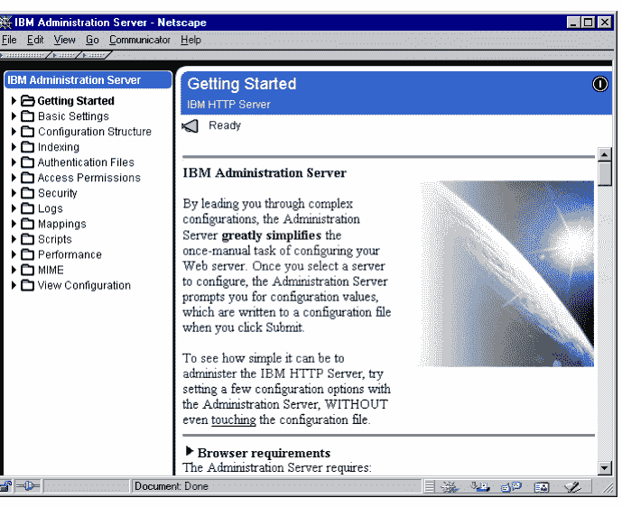

图 84. 管理服务器启动界面

要更改 Web 服务器的基本设置，请完成以下操作：

- 1. 点击 Basic Settings（基本设置）
- 2. 点击 Core Setting（核心设置）

第 4 章 运行考虑量 111

这将显示一个类似于图 85 的屏幕。

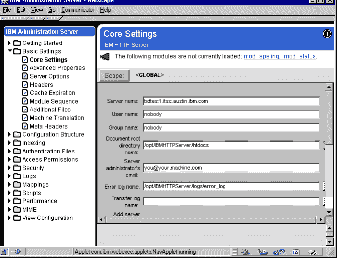

图 85. Web 服务器的基本设置

Web 服务器和管理服务器的文档见第 113 页的图 86，可以通过浏览器访问：

`http://bdtest/manual/2Contents`

112 使用 WebSphere、DB2 和 Domino 的 Linux Web Hosting


### 4.1.1.3 使用 WebSphere 管理 servlet

使用 Web 服务器 9527 端口的 WebSphere 管理可以管理 servlet。本节讨论了添加、加载和删除 servlet。关于 WebSphere 的更完整内容请参见：

113

#### 添加 servlet

一旦编写了 servlet，需要在 WebSphere 中对其注册才能使用。这需要以下步骤：

- 1. 将编译好的 servlet 类文件放在 servlet 根目录。默认情况下，服务器在 `/opt/IBMHTTPServer/servlets` 中查找类文件。
- 2. 如果 servlet 属于某个包，请镜像包结构的子目录。例如，我们的 servlet 是 `penguins.db2.AccessUser`；因此，类文件 `AccessUser.class` 被复制到 `/opt/IBMHTTPServer/servlets/penguins/db2`。

第 4 章 运行考虑量 113

3. WebSphere 运行时，使用浏览器登录 9527 端口的管理工具。管理界面类似于图 87 中的窗口。


4. 使用 admin 作为用户名和密码登录。我们现在看到了第 115 页图 88 所示的 WebSphere 介绍界面。


图 88. WebSphere 介绍界面

- 5. 在左框架中点击 Servlets。
- 6. 选择 Configuration（配置），显示的 Servlet 配置窗口如第 116 页的图 89 所示。

## IBM WebSphere 应用管理 - Notescape


图 89. 点击 Add 和 Servlet 配置

7. 点击 Add 按钮并在图 90 的弹出框中输入 servlet 名称。它必须是一个唯一名称。它是从 Web 浏览器运行 servlet 时将使用的名称。

8. 填写 servlet 的名称。classname 是完整的包名。例如，我们完整的 AccessUserstuf servlet 名称为 `penguins.access.db2.AccessUserstuf`。

116 使用 WebSphere、DB2 和 Domino 的 Linux Web Hosting

9. 如果 servlet 是一个 bean，请填写此信息，选择“yes”（是），并填写其 jar文件的位置。

10. 点击“Test”（测试）来加载 servlet 并进行测试。如果一切顺利，它将显示成功。

11. 点击“Add”（添加）。servlet 应该会自动加载。现在 servlet 已经注册并可以访问。

#### 加载 servlet

要加载 servlet，请完成以下步骤：

- 1. 在 Servlet Configuration 窗口中，点击 Servlet -> Configuration，如第 116 页的图 89 所示。
- 2. 从 Servlet Names 列中选择 servlet 名称。
- 3. 点击 Load（加载）。

#### 卸载 servlet

要删除一个 servlet，请完成以下步骤：

- 1. 在 Servlet Configuration 窗口中，点击 Servlet -> Configuration，如第 116 页的图 89 所示。
- 2. 从 Servlet Names 列中选择 servlet 名称。
- 3. 点击 Unload（卸载）。

#### 删除 servlet

要删除一个 servlet，请遵循以下步骤：

- 1. 在 Servlet Configuration 窗口中，点击 Servlet -> Configuration，如第 116 页的图 89 所示。


- 2. 从 Servlet Names 列中选择 servlet。
- 3. 点击 Unload（卸载）。
- 4. 点击 Yes（是）确认。

## 4.1.2 DB2 操作

本节讨论了 DB2 器的手动启动和关闭过程。

### 4.1.2.1 启动 DB2 实例

使用命令启动 DB2 实例：

```
db2start
```

该命令必须由 DB2 实例所有者执行，在本例中为 `db2inst1`。请参图 91 查看在我们的后端服务器 `dbtest3` 上执行此命令的示例。

```
[db2inst1@dbtest3 db2inst1]$ db2start
SQL1063N DBSTART processing was successful.
```

图 91. 启动 DB2 实例

### 4.1.2.2 停止 DB2 实例

使用命令停止 DB2 实例：

```
db2stop
```

该命令必须由 DB2 实例所有者执行，在本例中为 `db2inst1`。请参图 92 查看在我们的后端服务器 `dbtest3` 上执行此命令的示例。

```
[db2inst1@dbtest3 db2inst1]$ db2stop
SQL1064N DBSTOP processing was successful.
```

图 92. 停止 DB2 实例

在某些情况下，DB2 实例中可能存在活动的数据库连接。此 DB2 数据库被认为活动状态，如果发出 `db2stop` 命令，DB2 实例的 DB2 数据库管理器将如图 93 所示报错。

```
[db2inst1@dbtest3 db2inst1]$ db2stop
SQL1025N The database manager was not stopped because databases are still active
```

图 93. 当数据库仍活动时停止 DB2 实例

我们可以确保存在哪些数据库连接，并决定是否继续停止数据库。我们使用 `db2 list` 命令。该命令的示例输出见第 119 页的图 94。

```
[db2inst1@dbtest3 db2inst1]$ db2 list applications
```

| Auth Application | Appl. Handle | Application Id | DB Name | # of Agents |
|---|---|---|---|---|
| DB2INST1 | java | 1 | 0706.000512653 | USERST | 1 |
| DB2INST1 | java | 2 | 0804.000512655 | USERST | 1 |

图 94. 查看实例连接

我们可以通过使用 `db2 list applications detail` 获取更多关于这些连接的信息。图 95 显示了该命令的结果。结果现在显示了每个数据库连接的更多信息。在关闭数据库的情况下，我们通常使用这些信息来检查连接状态，判断是否可以安全地强制断开。

```
[db2inst1@dbtest3 db2inst1]$ db2 list applications detail
```

| Auth Id | Application Name | Appl. Time | Application Id | Seq# |
|---|---|---|---|---|
| DB e | Coordinator | Status | Age | |
| DB Name | DB Path | pid/thread | | |
| DB2INST1 | java | 1 | 0706.000512653 | 0001 | 1 |
| | | Waiting | Not Collect | |
| USERST | /home/db2inst1/NODE0000/SQL002/ | | | |
| DB2INST1 | java | 0 | 16773 | 0001 | 1 |
| | | /home/db2inst1/NODE0000/SQL002/ | | Not Collect |
| | | 2 | 0804.00051265 | | |
| | | Waiting | | |

图 95. 列出实例的详细连接

如果我们仍然不等待直接停止数据库，必须使用命令：

```
db2stop force
```

如果该命令执行成功，输出与第 118 页图 92 中不带参数的 `db2stop` 命令所示。

## 4.1.3 Domino 操作

本节讨论了用于管理 Domino 的若干功能。此处涵盖的主题：

- 4.1.3.1 第 120 页的“Domino console”讨论了 Domino 控制台的用法。
- 4.1.3.2 第 122 页的“Starting and stopping the Domino server”显示了启动和停止 Domino 的过程，包括异常终止后的清理。

### 4.1.3.1 Domino console

如果我们想监控 Domino 服务器，Domino 控制台是一个重要工具。我们可以通过多种方式访问控制台：

- Domino Administrator client

如第 25 页 2.4.2.3“Connecting a Domino client”所述，我们可以使用 Domino Administrator client 监控 Domino 服务器。目前 Linux 不支持 Domino Administrator client，迫使我们在 Windows 等其他平台上使用客户端。

从 Domino Administrator client 获取控制台：

- a. 选择 Server 标签。
- b. 选择 Status 标签。
- c. 点击 Live 图标。

第 121 页的图 96 显示了 Domino Administrator 控制台的截图。

## Domino console

Domino字符控制台是一种从命令行访问服务器控制台的工具。我们可以登录到 Domino 服务器并使用 `cconsole` 命令。

首次运行 Domino字符控制台，我们需要完成以下任务：

- a. 将服务器管理员 ID 文件更改到 Domino 数据目录。
- b. 将服务器管理员 ID 文件复制到 Domino 数据目录。
- c. 调用 `cconsole` 程序：
- d. 对于活动控制台，发布以下命令：
- e. 停止控制台。

```
/opt/lotus/bin/cconsole -f /local/notesdata/user.id
```

其中 `/opt/lotus/bin` 是 Domino 安装路径，`user.id` 是 Domino 服务器管理员的用户 ID。

- 活动状态


图 97 显示字符控制台的截图。

```
[notes@dbtest1]$ /opt/lotus/bin/cconsole -f /local/notesdata/user.id
ino Domino Console v0.0
Warning: You are remotely connected to host dbtest1.itsc.austin.com.
If you have not taken precautions to secure this connection,
passwords will be exposed over the network.

Enter your password:
05/09/2000:11:20:56 PM Initiating console on dbtest1.itsc.austin.com
> show db
```

| Database | Refs | Mods | Locks/AvgWait | #Waiters MaxWai |
|---|---|---|---|---|
| /local/notesdata/dnlog.nsf | 1 | N | 1 | 0 | 0 |
| /local/notesdata/mail.box | 1 | N | 1 | 0 | 0 |
| /local/notesdata/names.nsf | 46 | N | 12 | 0 | 0 |
| /local/notesdata/log.nsf | .. | Y | 1 | 0 | 0 |

### 4.1.3.2 启动和停止 Domino 服务器

使用命令行启动 Domino 的过程如下：

- 1. 确保使用 `notes` 用户 ID 登录。
2. 切换到 Domino 数据目录。我们在 `/local/notesdata` 中拥有数据目录。
3. 执行命令：

```
/opt/lotus/bin/server
```

其中 `/opt/lotus` 是 Domino 服务器安装路径。

服务器控制台启动，并显示启动状态和其他 Domino 消息。

从服务器控制台停止 Domino 服务器，请输入 `quit` 命令。

Domino 服务器将在 10 秒后关闭。

2. 确保 Domino 服务器未运行。
3. 检查并移除由 `userID` `notes` 拥有的 IPC 共享内存。
4. 启动 Domino 服务器。

创建 `start_domino.sh` 脚本后，我们可以自动启动 Domino 服务器。我们在 `/etc/initab` 文件中添加如下条目：

`notes:2:once -c /bin/su notes - /home/notes/start_domino.sh`

如果 Domino 异常退出，在重启 Domino 之前需要清理 Domino 进程间通信（IPC）资源。为了在崩溃后清理 Domino，请执行以下步骤：

- 1. 从 `userID` `notes` 杀死所有失败服务器的所有 Domino 进程。
- 2. 移除相关的进程间通信（IPC）资源。
- 3. 使用 `ipc` 命令列出损坏的共享内存和信号量。`-m` 选项显示共享内存，`-s` 选项显示信号量。
- 4. 移除任何共享内存和信号量。使用 `ipcrm shmid` 共享内存，使用 `ipcrm sid` 信号量。
- 5. 删除 Domino 目录下的 `-notes.lock` 文件。

`cleanup_domino` 脚本执行上述步骤，位于附录 E.2 第 210 页的“cleanup_domino.sh”。

## 4.2 设施监控

本节提供了对我们构建的 Web 解决方案组件进程监控的概述。可以使用其他各种方法来确保系统的可用性和性能。

### 4.2.1 监控 WebSphere

可以通过服务器执行分析（Server Execution Analysis）屏幕查看已加载的 servlet：

- 1. 登录 WebSphere 管理界面，获取第 115 页图 88 所示的 WebSphere 介绍窗口。
- 2. 选择 Server Execution Analysis。
- 3. 选择 Monitors（监控）。
- 4. 选择 Loaded Servlets（已加载的 servlet），显示第 124 页图 98 所示的监控窗口。

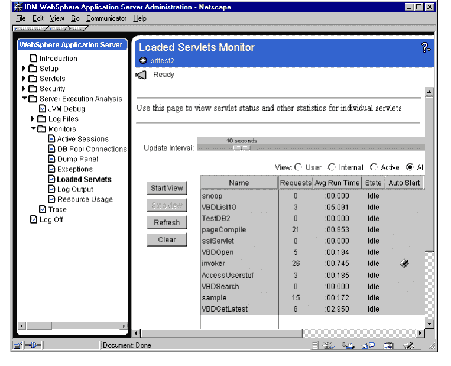

通过选择相应的菜单项，可以在此窗口查看所有日志文件、调试信息、资源使用情况和数据库详情。

### 4.2.2 DB2 服务器监控

DB2 包含两个主要的监控工具。它们是：

- DB2 性能监控（DB2 Performance Monitor）
- 性能监控器提供有关 DB2 通用数据库及其控制的数据状态的信息。这是一个图形化程序，可以针对我们的数据库环境进行自定义。我们可以定义阈值或区域，当性能监控器收集的值不在接受范围内时，触发警告或报警。
- 当我们需要监控现有问题或想要观察系统性能时使用该工具。它还允许我们对特定时间点的数据库活动和性能数据拍摄快照。

124 使用 WebSphere、DB2 和 Domino 的 Linux Web 托管

这些快照用于随时间进行比较。图上的每一点代表一个数据值。

这些信息可以帮助我们识别和分析潜在问题，或根据我们设置的阈值识别异常情况。如果我们需要了解某个时间点数据库管理器及其数据库应用程序的性能并查看随时间的趋势，则使用性能工具。我们还可以使用它来获取处于警报状态元素的视觉概览。这有助于识别哪些参数可能需要调整。然后，我们可以详细查看为该元素设置的参数并更改它们以提高性能。

- DB2 事件监控器（DB2 event monitors）

与 DB2 性能监控器的时间点快照不同，DB2 事件监控器收集一段时间内的数据库活动信息。这些收集的信息为特定数据库事件（例如数据库连接或 SQL 语句）的活动提供了良好的总结。

事件监控记录了特定事件发生时数据库的状态。它允许我们获取数据库活动的跟踪。事件监控记录在数据被捕获后进行存储和分析。当我们需要了解事务是如何执行的，例如一个 SQL 语句使用了多少 CPU 时，我们就使用事件监控器。然后我们使用事件分析器（Event Analyzer）从事件监控器读取数据。

除了这两个工具之外，我们还应该定期备份并分析 DB2 诊断日志文件 `db2diag.log`。更多信息请参见第 136 页第 4.4.2 节“DB2 诊断日志文件”。检查此日志文件是否存在潜在问题的迹，例如磁盘空间不足。

### 4.2.3 Domino 监控

Domino 包含了许多强大的监控功能，可以作为自动记录统计和自动通知事件的相当全面的机制。本节解释了以下监控功能：

- Domino 服务器监控
- Domino 统计显示
- Notes 系统诊断

#### 4.2.3.1 Domino 服务器监控

Domino 管理服务器包含一个服务器监控，它可以提供 Domino 服务器状态和可用性、任务、实时系统统计以及状态指示器的视觉表示。

图 99 显示了 Domino 服务器监控的截图。要调用 Domino 服务器监控，请执行以下任务：

- 1. 运行 Lotus Domino 管理客户端。
- 2. 点击 Server。
- 3. 点击 Monitoring。
- 4. 点击 Start 图标。

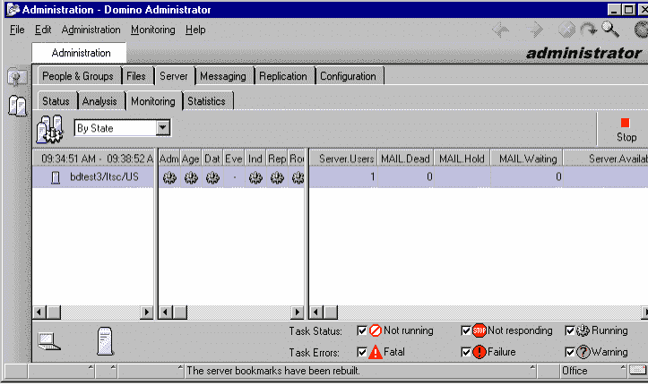

图 99. Domino 服务器监控

#### 4.2.3.2 Domino 状态统计

我们可以从 Domino 控制台获取 Domino 统计快照。我们需要第 4.1.3.1 节所示的 Domino 管理客户端或字符控制台。在 Domino 控制台提示符处可以执行：

```
show statistic
```

这将显示 Domino 服务器的统计信息。第 127 页的图 100 展示了该命令的输出。

```
Server.Task.DB = Database Server: Idle task: [05/09/2000 13:26:20]
Server.Task.DB = Database Server: Idle task: [05/09/2000 13:26:20]
Server.Task.DB = Database Server: Idle task: [05/09/2000 13:26:20]
Server.Task.DB = Database Server: Server for Linux: [05/09/2000 13:26:20]
Server.Task.DB = Database Server: Idle task: [05/09/2000 13:26:20]
Server.Task.DB = Database Server: Idle task: [05/09/2000 13:26:20]
Server.Task.DB = Database Server: Server for Linux: [05/09/2000 13:26:20]
Server.Task.DB = Database Server: Idle task: [05/09/2000 13:26:20]
Server.Task.DB = Database Server: Idle task: [05/09/2000 13:26:20]
Server.Task.DB = Database Server: Server for Linux: [05/09/2000 13:26:20]
Server.Task.DB = Database Server: Idle task: [05/09/2000 13:26:20]
Server.Task.DB = Database Server: Idle task: [05/09/2000 13:26:20]
Server.Task.DB = Database Server: Server for Linux: [05/09/2000 13:26:20]
Server.Task.DB = Database Server: Idle task: [05/09/2000 13:26:20]
Server.Task.DB = Database Server: Idle task: [05/09/2000 13:26:20]
Server.Task.DB = Database Server: Server for Linux: [05/09/2000 13:26:20]
Server.Task.DB = Database Server: Idle task: [05/09/2000 13:26:20]
Server.Task.DB = Database Server: Idle task: [05/09/2000 13:26:20]
Server.Task.DB = Database Server: Server for Linux: [05/09/2000 13:26:20]
```


## 4.2.3 统计和事件

统计和事件设施允许我们配置、创建和报告有关 Domino 服务器的信息。在 Domino 管理器中通过以下步骤显示统计和事件：

1. 选择 Configuration 标签页。
2. 展开 Statistic Event 类别。


Domino 服务器的统计参数如第 128 页的图 101 所示。

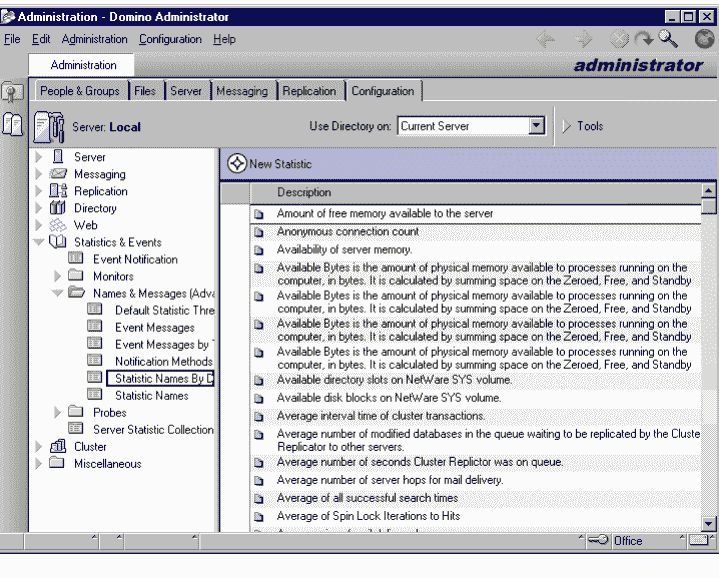

统计和事件由两个服务器任务 `event` 和 `collect` 控制。默认情况下，每小时收集一次统计。捕获的信息存储在以下数据库中：

- `statrep.nsf`，在此记录统计信息。
- `events4.nsf`，在此配置事件处理和统计监控。

通过统计和事件，我们还可以创建监控器来跟踪服务器资源和网络活动。每个监控器都有关联的阈值。当达到阈值时，监控器会生成事件。

Statistics & Events 类别下可用的监控工具。第 129 页的图 102 显示文件监控工具的截图。

128 使用 WebSphere、DB2 和 Domino 的 Linux Web 托管

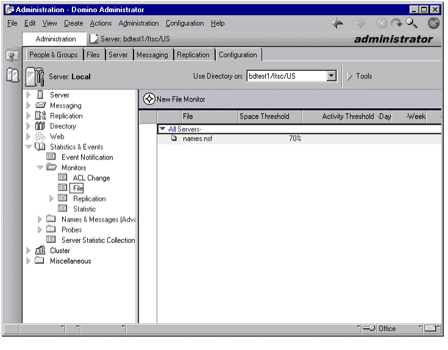

图 102. Domino 管理客户端的监控工具

## 4.3 例行维护

本节讨论了需要定期执行的例行维护任务，以确保系统的可用性和性能。

第 4 章 运行考虑 129

## 4.3.1 IBM HTTP Server 维护

建议对 IBM HTTP Server 目录（在本文中为 `/opt/IBMHTTPTPServer`）执行以下任务：

- 备份 ServerRoot 目录。该目录包含所有的配置文件以及 htdocs 中的的任何 Web 页面。

你可以使用任何你选择的备份方法，例如 `tar` 命令。在 `/opt/IBMHTTPTPServer` 目录下执行该命令时，它会将所有 IBM HTTP Server 文件拷贝到备份文件 `HTTPServer.tar` 中：

```
tar cvf /HTTPServer.tar
```

- `/opt/IBMHTTPTPServer/logs` 目录中的日志是服务器上重要的信息源；然而，它们往往增长得很快，需要进行修剪。

在 `/opt/IBMHTTPTPServer/logs` 目录下执行以下命令进行修剪：

```
mv access_log access_log.old
kill -1 "httpd.pid"
```

`kill` 操作是必要的；否则 `httpd` 将继续向之前的日志文件写入内容。

## 4.3.2 DB2 例行维护

本节说明了确保 DB2 服务器可用性和性能所需的所有任务。这些任务在以下章节中讨论：

- 第 130 页第 4.3.2.1 节，“备份 DB2 数据库”，解释了 DB2 备份过程的概述。
- 第 131 页第 4.3.2.2 节，“DB2 数据库日志文件”，讨论了 DB2 日志文件。
- 第 132 页第 4.3.2.3 节，“表重组”，说明了表重组程序。
- 第 132 页第 4.3.2.4 节，“DB2 统计”，讨论了更新 DB2 统计信息。

### 4.3.2.1 备份 DB2 数据库

必须使用 `db2 backup` 命令对 DB2 数据库进行备份。使用文件系统备份无法获得保持数据库完整性的备份。

DB2 备份命令相当复杂。可以使用多种备份介质（磁盘、磁带、ADSM）使用不同的缓冲区大小等进行在线或离线数据库备份。讨论所有这些各种选项超出了本节的范围。欲获取更全面的信息，请参考 *IBM DB2 Universal Database Command Reference, SC09-2844*、*IBM DB2 Universal Database Administration Guide Volume 1, SC09-2839* 以及 *IBM DB2 Universal Database Administration Guide Volume 2, SC09-2840*。

我们展示了一个简单的 db2 离线数据库备份格式，即将我们的数据库 `USERSTUF` 备份到服务器上的目录 `/backup`，如下：

```
db2 database userstuf to /backup
```

### 4.3.2.2 db2 数据库日志文件

所有数据库都有与其相关的日志。这些日志记录了数据库的变化。在某些情况下，取决于后端服务器上 DB2 数据库器的配置，我们可能需要备份某些日志文件（活动日志文件和归档日志文件）并将它们从默认位置删除。

**删除活动日志文件**

永远不要删除活动日志文件。这些文件被 DB2 数据库管理器用于跟踪当前的数据库事务。删除这些日志将导致数据库处于不一致状态。

在我们当前的 DB2 实例配置中，DB2 实例使用默认的循环日志。因此，我们没有备份和删除日志文件的要求。

详细讨论数据库日志超出了本节的范围。欲了解有关各种类型日志归档（循环、日志保留）、不同类型日志（活动、归档、离线归档）、日志文件位置等的更全面的信息，请参考 *IBM DB2 Database Administration Guide Volume 1, SC09-2839* 和 *IBM DB2 Universal Database Administration Guide Volume 2, SC09-2840*。

修剪 DB2 诊断日志的内容同样重要。关于 DB2 诊断日志的讨论见第 136 页第 4.4.2 节，“DB2 诊断日志文件”。

### 4.3.2.3 表重组

DB2 表偶尔需要进行重组，以改进其结构，从而提高其性能。DB2 表的重组使用以下程序进行：

- 1. 使用实例所有者（在本文中为 `db2inst1`）的 `db2` 命令调用 DB2 命令。
- 2. 连接到数据库：

```
db2> connect to userstuf
```

- 3. 对你感兴趣的每个表运行重组：

```
db2> reorg table userverify
db2> reorg table userinfo
db2> reorg table userprofile
db2> reorg table userorders
```

欲了解所用命令的更多信息，请参考 *IBM DB2 Universal Database Command Reference, SC09-2844*。

### 4.3.2.4 DB2 统计

需要定期更新 DB2 统计信息以优化针对数据库的查询。按照以下程序对每个表和数据库运行 DB2 统计信息更新：

- 1. 使用实例所有者（在本文中为 `db2inst1`）的 `db2` 命令调用 DB2 命令。
- 2. 连接到数据库：

```
db2> connect to userstuf
```

- 3. 更新你感兴趣的每个表的统计信息：

```
db2> runstats table userverify
db2> runstats table userinfo
db2> runstats table userprofile
db2> runstats table userorders
```

欲了解所用命令的更多信息，请参考 *IBM DB2 Universal Database Command Reference, SC09-2844*。

## 4.3.3 例行维护

本节提供了我们可以可以执行的任务概述。

### 4.3.3.1 备份我们的数据库

建议对 IBM HTTP Server 目录（在本文中为 `/opt/IBMHTTPTPServer`）执行以下任务：

- 备份 ServerRoot 目录。该目录包含所有的配置文件以及 htdocs 中的的任何 Web 页面。

你可以使用任何你选择的备份方法，例如 `tar` 命令。在 `/opt/IBMHTTPTPServer` 目录下执行该命令时，它会将所有 IBM HTTP Server 文件拷贝到备份文件 `HTTPServer.tar` 中：

```
tar cvf /HTTPServer.tar
```

- `/opt/IBMHTTPTPServer/logs` 目录中的日志是服务器上重要的信息源；然而，它们往往增长得很快，需要进行修剪。

在 `/opt/IBMHTTPTPServer/logs` 目录下执行以下命令进行修剪：

```
mv access_log access_log.old
kill -1 "httpd.pid"
```

`kill` 操作是必要的；否则 `httpd` 将继续向之前的日志文件写入内容。

### 4.3.3.2 其他维护

需要例行维护以确保服务器继续运行。红皮书 *A Roadmap for Deploying IBM In The Organization, SG24-5617* 包含一个实用的检查清单。欲了解更多信息请参考此书。

## 4.4 故障排除概述

本节提供了对我们服务器基本组件的故障排除概述。讨论分为：

- 第 134 页第 4.4.1 节，“IBM HTTP Server 和 WebSphere 日志文件”
- 第 136 页第 4.4.2 节，“DB2 诊断日志文件”

### 4.4.1 IBM HTTP Server 和 WebSphere 日志文件

以下日志对于发现服务器中的特定问题非常有用。WebSphere 向其日志文件写入大量信息。如果某些功能运行异常，应该查看这些日志。我们简要讨论一些日志文件。所有日志文件位于 `/opt/IBMWebAS/logs`。在此目录下，你通常会发现或多个：

- `jvmstderr.log`
- `jvmstdout.log`

JVM 标准错误日志可能是所有 WebSphere 日志中最用的。在该日志中，会出现主 WebSphere Java 进程的标准错误输出。

JVM 标准输出日志是 WebSphere 中非常有用的一个。标准输出日志包含了 Java 通过静态 java.System.out 方法写入标准的所有输出。此日志的格式取决于应用程序。使用此日志检查 Java 应用程序写入 System.out 的调试和信息消息。此日志始终启用。

- `apache.log.INFORM.*`

IBM HTTP Server 信息日志包含由包含 WebSphere 的 IBM HTTP Server 生成的信息和错误消息。每当服务器重新初始化时，都会生成一个新的日志，并使用不同的数字作为文件名的最后一部分。这些日志的大部分被显示 WebSphere 初始化属性的消息占据。这对于确认特定 WebSphere 调用所使用的参数值有用。每行包含以下组件：

- 特定于特定 WebSphere 用的 ID 号。这与日志名称后缀使用的数字相同。
- 时间戳。
- 属性（Property）。
- 属性名和值由 `=` 符号分隔。

- `apache.log.ERROR.*` 和 `apache.log.TRACE.*`

IBM HTTP 服务器日志包含由 WebSphere 随附的 IBM HTTP 服务器日志所生成的错误消息。其格式和内容仅限于描述错误状况。这些消息也包含在信息日志中，但在启用追踪（trace）时，HTTP 服务器追踪日志会包含额外信息。

- `WebSphere_trace.log`

WebSphere 追踪日志包含不同追踪函数的输出。每条日志条目都是由一个追踪监控器捕获的事件结果，并可能包含以下六个组件中的任何一个：

+ - 时间戳
- 作为事件源的追踪器名称
- 引起事件的线程 ID
- 追踪器消息的严重级别
- 事件生成的任何异常
- 消息文本

+ - `servlet/adminservice/access_log`
- `servlet/adminservice/error_log`
- `servlet/adminservice/event_log`

servlet 管理服务错误日志包含与执行 WebSphere 管理服务期间发生的事件和错误相关的消息。这包括在运行任何追踪程序时可能发生的错误。

+ - `servlet/servletservice/access_log`
- `servlet/servletservice/error_log`
- `servlet/servletservice/event_log`

servlet 服务错误日志包含 WebSphere servlet 服务在尝试运行 servlet 时生成的信息。它包含了与特定 servlet 相关的错误以及与 servlet 服务本身的信息。servlet 产生的 `System.out` 和 `System.err` 输出分别被放置在 JVM 标准输出和标准错误日志中。

此日志可用于诊断 servlet 失败的原因以及 servlet 服务失败的原因。此日志将记录 WebSphere 在尝试加载或配置 servlet 时抛出的任何异常；因此，它是诊断此类问题的良好起点。它还包含与确定 servlet 服务启动失败原因相关的信息。

服务事件日志允许你查看 servlet 何时被加载、何时被调用，以及以及使用什么参数进行调用的。这对于诊断为什么特定 servlet 在某些情况下失败而在其他情况下未失败非常有用，因为它显示了它是如何被调用的。你可能想向 servlet 中添加包含时间戳的调试写入，以便你能够将标准输出或标准错误输出中产生的调试输出与事件日志中带有时间戳的消息进行匹配。

+ - WebSphere 引擎追踪日志显示了关于服务器活动的详细信息。此日志存储在你从 WebSphere 管理中激活追踪功能时指定的目录中。服务器采取的每个操作都会被记录。此日志的格式为：

+ - 时间戳
+ - 消息

此日志非常适合诊断 CLASSPATH 问题，因为它提供了关于类路径中发现并验证了哪些目录和 JAR 文件的详细信息。

## 4.4.2 DB2 诊断日志文件

DB2 维护着一个名为 `db2diag.log` 的诊断日志文件。该文件位于实例主目录下的 `sqllib/db2dump` 目录下。在我们的场景中，在后端服务器 `btest3` 上，它位于 `/home/db2inst1/sqlib/db2dump`。该文件会被追加诊断信息，或者如果它不存在，则会被创建并追加诊断信息。

诊断信息的量由 DB2 数据库管理器配置中的 `DIAGLEVEL` 参数决定。以 DB2 实例所有者的身份登录并使用命令访问数据库管理器配置：

```
db2 get dbm cfg
```

第 137 页的图 103 显示了以 DB2 实例所有者 `db2inst1` 身份登录时，在我们后端服务器 `btest3` 上运行此命令的结果。`DIAGLEVEL` 信息行已加粗显示。

```
[db2inst1@db2test$ db2inst1$ db2 get dbm cfg | more
```

## 5.1.2.1 SSL

IBM HTTP Server 特性包括对 SSL 安全连接的 set 安装支持。

安全套接层（SSL）是一种在两个使用 TCP/IP 的应用程序之间提供隐私性和完整性的协议。HTTP 可以使用 SSL 进行安全通信。

在客户端和服务器之间传输的数据由一种秘密的公钥算法进行加密，该算法用于交换秘密加密密钥以及对服务器中的数字签名进行加密。通过服务器证书，客户端可以验证服务器的身份。

一旦您的服务器拥有了数字证书，启用 SSL 的浏览器（如 Netscape Navigator 和 Microsoft Internet Explorer）就可以使用 SSL 协议与你的服务器进行安全通信。基于 Apache 的 IBM HTTP Server 支持客户端身份验证、可配置密码规范以及会话 ID 缓存，以提高 UNIX 平台上的 SSL 性能。有关 SSL 的更多信息，请参阅：

- http://home.netscape.com/erg/ssl/


- `http://www.ibm.com/software/webservers/httpsservers/`

## 5.1.2.2 缓存与动态页面

默认情况下，大多数 Web 浏览器和代理服务器都会缓存 Web 页面。对于 JSP 文件、HTML 文件和小程序，这些 Web 页面是动态生成的，并且可能会每次尝试访问时发生变化。

为了防止缓存从而访问新生成的动态数据，我们可以在 Java Server Page（JSP）或 servlet 中添加以下代码，防止 Web 浏览器缓存 JSP/SHTML 文件和 servlet：

```
response.setHeader("Pragma", "no-cache");
response.setDateHeader("Expires", "0");
response.setHeader("Cache-Control", "no-cache")
```

使用以下代码防止代理服务器共享缓存页面：

```
response.setHeader("Cache-Control", "private");
```

这两个头部可以结合使用以防止缓存。

## 5.2 Linux 下的产品局限性

Linux 上的 WebSphere 版本落后于其他平台（如 Windows NT 或 AIX）的可用版本。这对于我们利用许多让电子商务开发变得更简单的新功能（例如 `RequestDispatcher` 类）造成了相当限制。关于该类的更全面讨论，请参见第 142 页第 5.2.1 节“RequestDispatcher 类”。

在我们的项目中，我们使用 CORBA 访问 Lotus Domino 数据库。也可以通过 JDBC 访问 Lotus Domino 服务器。然而，JDBC 的 Lotus Domino 驱动仅适用于有限的平台，Linux 并不在。关于 Lotus 此项功能的更全面讨论，请参见第 143 页第 5.2.2 节“Domino 的 JDBC 连接”。

## 5.2.1 RequestDispatcher 类

`RequestDispatcher` 类的基本用法是将当前请求传递给另一个程序（servlet 或 JSP）。Request Dispatcher 有两个主要方法可以包含另一个程序的响应或将程序的请求转发到另一个程序。

- 包含另一个程序的响应需要使用方法：

```
aRequestDispatcher.include(request, response)
```

如果我们想从当前 servlet 调用另一个 servlet， 然后在调用该其他 servlet 后在当前 servlet 中执行更多处理，就会使用此方法。

- 将请求转发到另一个程序需要使用方法：

```
aRequestDispatcher.forward(request, response)
```

我们将此用于转发到另一个 servlet，然后允许此新 servlet 直接将响应返回给客户端。

遗憾的是，`RequestDispatcher` 类仅在 Java SDK 2.1 API 的 `javax.servlet` 类中可用（在 WebSphere 3.02 中支持并扩展）。在我们的 servlet 中，为了处于仅支持和扩展 SDK 2.0 的 WebSphere 2.03 环境，我们被迫使用 `com.sun.servlet.http` 包中已弃用的 `callPage` 方法。这也解释了为什么在 servlet `AccessUsersf` 的 Java 代码中使用了 `HttpServletResponse` 和 `HttpServletRequest` 对象。

参阅 URL `http://novocode.doc/servlet-essentials/chapter0.html` 获取 `RequestDispatcher` 类的良好教程。参阅 URL `http://java.sun.com` 获取各种 Java API 规范的官方规范和文档。

## 5.2.2 Domino 的 JDBC 连接

JDBC 是一种对象接口，允许 Java应用程序、applets 和代理使用 SQL 在数据库系统中检索和操作数据。该接口允许单个应用程序通过标准协议连接到许多不同类型的数据库。

Lotus JDBC 驱动实现了 JDBC 1.0 规范。它可以适用于 Windows 95、Windows 98 和 Windows NT 4.0 操作系统。这是一个 Type 2 驱动，由 Java 类和非编译代码组成。目前不适用于任何其他平台（包括 Linux）。

Domino JDBC 驱动允许 Java 程序使用 JDBC 访问 Domino/Notes 数据库。Java 可以与任何支持 JDBC 的报告工具配合访问 Domino 数据库。Java 程序员可以使用启用 Java Database Connectivity (JDBC) 标准的应用工具像访问任何关系型数据库一样访问 Lotus Domino 数据库。在 Domino R5 上运行此 JDBC 驱动时，Java 程序员可以创建访问 Domino 数据的 Servlet。Lotus Domino JDBC 驱动通过产生镜像关系模型的结果集，使 Domino 数据库像 SQL 工具或应用程序接口的另一个关系型后端源。应用程序还可以对 Domino 数据与关系型数据库（如 Oracle、Sybase 或 DB/2）的数据执行 SQL Join 操作。

产品特性包括：

- 通过 Java 标准访问 Domino 4.5x、4.6x 和 R5x 数据库。
- 兼容 Netscape Communicator 4.05 及更高版本。
- 兼容带有 service pack 1 的 Microsoft Internet Explorer 4.01。
- 提供签名和未签名版本，为创建使用 JDBC 的 Java applets 提供最大的灵活性。
- 准备好应对千禧年问题，因此它可以正确读取和解释两位年份（mm/dd/yy）和四位年份（mm/dd/yyyy）格式的日期。
- 通过了 IBM Visual Age for Java Version 2.0、IBMSphere Application Server 2.0、Lotus eSuite DevPack 1.5、Borland JBuilder 3 Professional、Jinfonet Software JReport Professional 1.3、EnterpriseSoft Enterprise Reports 3.0、Symantec Virtual Database Development Edition 3.0 以及 NetObjects BeanBuilder 1.0 测试。
- 用于高性能 Web 使用的多线程。
- 通过负载均衡和故障转移支持集群服务器的高可用性。
- 文档提供了四个示例源码（`.java` 文件）。
- Lotus Domino JDBC 驱动是 Lotus 开放标准和数据库服务访问性的又一步，使用户无论企业配置或工具选择如何都能将 Domino 集成到任何电子商务解决方案。

JDBC API 包含在 JDK v1.1 及更高版本中。在下载和安装 Lotus Domino JDBC 驱动时会提供 Lotus Domino JDBC 所需的 DLL 连接 Domino/Notes 数据库（即上述的非 Java 编译代码）。

- 如果您的 Java 程序运行在客户端计算机上，则必须安装 客户端。
- 如果您的 Java 应用程序运行在未运行 Domino 的服务器上，则必须安装并配置 客户端以连接 Domino 服务器。
- 如果您的 Java 应用程序运行在 Domino 服务器上（例如在 R5 上作为 Servlet 运行），则 Notes DLL 和 API 已经存在，无需安装。

# Notes API 知识

| 描述 |
| :--- |
| 您不需要 Notes API。Lotus Domino JDBC 驱动屏蔽了这些，并让您能够使用 JDBC API 连接到 Domino 并使用 SQL 查询、更新和处理 Domino 数据 |

参阅 URL `http://www.lotus.com` 获取有关 Lotus Domino JDBC 驱动的更多信息。

144 使用 WebSphere、DB2 和 Domino 的 Linux 托管

## 附录 A. 创建 USERSTUF 表的 SQL 脚本

本附录提供了项目中创建 DB2 表的源文件列表。

### A.1 USERINFO 表

```
create table userinfo (
first_name varchar(20) not null,
last_name varchar(20) not null,
email_address varchar(50) not null,
date_joined date not null,
birth_date date not null,
address varchar(200) not null,
username varchar(20) not null,
primary key (username)
);
```

### A.2 USERVERIFY 表

```
create table userverify (
username varchar(20) not null,
password varchar(20) not null,
primary key (username)
);
```

### A.3 USERPROFILE 表

```
create table userprofile (
username varchar(20) not null,
s000 char(1),
ettfinity char(1),
ncf char(1),
nw char(1),
s390 char(1),
r6000 char(1),
scalable char(1),
vm char(1),
vse char(1),
windows char(1),
other char(1),
primary key (username)
);
```

### A.4 USERORDERs 表

```
create table userorders (
  username varchar(20) not null,
  order_timestamp timestamp not null,
  product_id varchar(20) not null,
  order_id int not null,
  primary key (order_id)
);
```

## 附录 B. 与 DB2相关的 Java 代码

本附录提供了 DB2 相关的 Java 代码列表。

### B.1 Java servlet TestDB2

```java
package penguins.access.db2;

import java.sql.*;
import javax.servlet.http.*;
import javax.servlet.*;
public class TestDB2 extends HttpServlet {
    try {
        Class.forName("com.ibm.db2.jdbc.app.DB2Driver");
    } catch (Exception e) {
        e.printStackTrace();
    }

    public TestDB2() {
        super();
    }

    public void doGet(HttpServletRequest req, HttpServletResponse res) {
        String url = "jdbc:db2:sample";
        String uid = "db2inst";
        String pwd = "db2password";
        Connection conn = DriverManager.getConnection(url, uid, pwd);
        ServletOutputStream out = res.getOutputStream();
        out.setContentType("text/html");
        out.print("<html><head>TestDB2</head><body><p>");
        out.print("select * from department");
        Statement stmt = conn.createStatement();
        ResultSet rs = stmt.executeQuery("select * from department");
        while (rs.next()) {
            out.print(rs.getString(1) + ":" + rs.getString(2) + "<p>");
        }
        out.print("</body></html>");
    } catch (Exception e) {
        e.printStackTrace();
    }
}
```

### B.2 Java servlet AccessUserstuff


```java
package penguins.access.db2;

import com.sun.server.http.*;
import javax.servlet.*;
import javax.servlet.http.*;
import java.io.*;
import java.util.*;
import java.sql.*;

/**
 * © Copyright IBM Corp. 2000
 * 版本
 * 从服务调用 init，这会在每次调用时创建一个数据库连接
 * 而不是在每个 servlet 创建时创建（即在加载时）
 * 这是由于数据库重启导致连接断开的情况……所以连接
 * 被重新创建，而不是必须重新加载 servlet。
 *  {：Thing
 */

out.println("<table><td>" + key + "</td><td>" + session.getValue(key) + "</td></tr>\n");
out.println("</table>");
// 我们最感兴趣的数据库表内容
try {
    // userinfo 的内容
    out.println("<p>Contents of userinfo:\n");
    String sql = "select * from userinfo";
    Statement stmt = con.createStatement();
    ResultSet rs = stmt.executeQuery(sql);
    ResultSetMetaData md = rs.getMetaData();
    int cols = md.getColumnCount();
    for (int col = 1; col <= cols; col++) {
        out.print(rs.getString(col) + "</td><td>");
    }
    stmt.close();
    out.println("<p>End contents of userinfo</p>");
    // userverify 的内容
    out.println("<p>Contents of userverify:\n");
    String sql = "select * from userverify";
    Statement stmt = con.createStatement();
    ResultSet rs = stmt.executeQuery(sql);
    ResultSetMetaData md = rs.getMetaData();
    int cols = md.getColumnCount();
    for (int col = 1; col <= cols; col++) {
        out.print(rs.getString(col) + "</td><td>");
    }
    stmt.close();
    out.println("<p>End contents of userverify</p>");
} catch (SQLException e) {
    e.printStackTrace();
    out.println(e.getMessage());
    session.invalidate();
} catch (Exception e) {
    e.printStackTrace();
}

public void doGet(HttpServletRequest req, HttpServletResponse res) throws ServletException {
    doService(req, res);
}

public void doPost(HttpServletRequest req, HttpServletResponse res) throws ServletException {
    doService(req, res);
}

protected void doService(HttpServletRequest req, HttpServletResponse res) throws ServletException {
    // 获取 request 和 response
    HttpServletRequest req = (HttpServletRequest)req;
    HttpServletResponse res = (HttpServletResponse)res;
    // 获取 session 对象
    HttpSession session = req.getSession(true);
    // 获取执行的操作
    String action = req.getParameter("action");

    // 清除之前的错误
    session.remove("error");
    // 获取成功和失败页面
    String successpage = req.getParameter("success");
    String failurepage = req.getParameter("failure");
    // 获取数据库连接
    initDB();
    // debug 操作
    if (action.equals("debug")) {
        req(res);
        return;
    }
    try {
        // 处理订单，我们期望一个 product_id cookie
        if (action.equals("order")) {
            String username = (String) session.getAttribute("username");
            String password = (String) session.getAttribute("password");
            if (passwordMatch(username, password)) {
                raiseError(username, failurepage, req, res);
            } else {
                String product_id = req.getParameter("product_id");
                if (product_id == null || product_id.equals("")) {
                    raiseError("Product ID cannot be empty", failurepage, req, res);
                }
                if (product_id.length() > 20) {
                    raiseError("Product ID cannot be over 20 characters", failurepage, req, res);
                } else {
                    // 生成新的 order_id
                    // 如果之前有，从 1 开始
                    int order_id = 1;
                    Statement stmt = con.createStatement("select max(order_id) from userorders");
                    ResultSet rs = stmt.executeQuery(sqlStmt);
                    if (rs.next()) {
                        order_id = rs.getInt(1) + 1;
                    }
                    // 插入一条新记录
                    String sqlStmt = "insert into userorders (username, order_timestamp, product_id, order_id) values (' + username + "', '" + product_id + "', + order_id + ")";
                    stmt = con.createStatement();
                    int rs1 = stmt.executeUpdate(sqlStmt);
                    if (rs1 != 1) {
                        raiseError("USERINSERT failed", failurepage, req, res);
                    }
                    stmt.close();
                    // 将 product_id 放入 session 对象
                    session.setAttribute("product_id", product_id);
                    res.callPage(session, req);
                }
            }
        }
        // 根据用户名列出订单
        if (action.equals("listorders")) {
            String username = (String) session.getAttribute("username");
            String password = (String) session.getAttribute("password");
            if (!passwordMatch(username, password)) {
                raiseError(username, failurepage, req, res);
            } else {
                String sqlStmt = "select order_id, order_timestamp, product_id from userorders where username = " + username + "";
                Statement stmt = stmt.createStatement();
                ResultSet rs = stmt.executeQuery(sqlStmt);
                Orders orders = new Orders();
                while (rs.next()) {
                    orders.add(rs.getString("order_id"), rs.getString("order_timestamp"));
                }
                rs.getString("product_id");
                stmt.close();
                // 将环境中的 bean 传递给 j
                req.setAttribute("orders", orders);
                res.callPage(successpage, req);
                return;
            }
        }
        // 使用请求流中的用户名和密码登录
        if (action.equals("login")) {
            String username = getUsername(req);
            if (username != null) {
                userinfoError(username, failurepage, req, res);
                String password = getPassword(req);
                if (passwordMatch(username, password)) {
                    userinfoError(username, failurepage, req, res);
                    // 设置用户名的 cookie 值
                    String sqlStmt = "select first_name, last_name, email_address, date_joined, birth_date from userinfo where username='" + username + "'";
                    Statement stmt = stmt.createStatement();
                    ResultSet rs = stmt.executeQuery(sqlStmt);
                    ResultSetMetaData rmd = rs.getMetaData();
                    if (rmd.getColumnCount() > 0) {
                        for (int i = 0; i < rmd.getLength(); i++) {
                            session.putValue("info" + i, rs.getString("info" + i));
                        }
                    } else {
                        raiseError("USERINFOSELECT: no records selected: * " + sqlStmt, failurepage, req, res);
                    }
                    stmt.close();
                    // 设置 userprofile 的 cookie 值
                    String sql = "select as450, nationality, ncf, nw, s390, s6000, scalable, vm, vse, windows, other from userprofile where username='" + username + "'";
                    Statement stmt = conn.createStatement();
                    rs = stmt.executeQuery(sqlStmt);
                    rmd = rs.getMetaData();
                    if (rs.next()) {
                        for (int i = 0; i < profileCols.length; i++) {
                            if (rs.getString(profileCols[i]) != null) {
                                session.putValue(profileCols[i], rs.getString(profileCols[i]));
                            }
                        }
                    } else {
                        raiseError("USERPROFILE: no records selected: * " + sqlStmt, failurepage, req, res);
                    }
                    stmt.close();
                    // 设置用户名和密码的 cookie 值
                    session.putValue("username", username);
                    session.putValue("password", password);
                    // 最后，回到主页
                }
            }
        }
    }
}
```


## 使用 WebSphere、DB2 和 Domino 的 Linux 托管

```java
res.call(success,req);
return;
// 结束登录
// 根据 cookie 中的用户名和密码值更改密码
// 如果在请求流参数中发现了新密码
if (action.equals("changepassword")) {
    String newPassword = req.getParameter("password1");
    String newPasswordAgain = req.getParameter("password2");
    if (newPassword.equals(newPasswordAgain)) {
        raiseError("password", newPassword + " and \" " + newPasswordAgain + "\" != null",
        failurepage, req, res);
    } else {
        Hashtable errors = new Hashtable();
        errors = validatePassword(newPassword, errors);
        if (errors.isEmpty()) {
            String username = getUsername(session);
            String password = getPassword(session);
            if (passwordMatch(username, password)) {
                updatePwError(username, password, req, res);
            } else {
                String sqlStmt = "update user set password='" + newPassword + "' where username='" + 
                username + "'";
                Statement stmt = con.prepareStatement(sqlStmt);
                int rs = stmt.executeUpdate(sqlStmt);
                stmt.close();
                raiseError("USERUPDATEFAILED: result rows " + rs + " from " + sqlStmt,
                failurepage, req, res);
            }
        }
        // 更新密码 cookie
        session.setAttribute("password", newPassword);
        res.call(success,req);
    }
}
return;
// 结束更改密码
// 使用请求流中的参数进行注册
if (action.equals("registration")) {
    String username = getUsername(username);
    if (usernameExists(username)) {
        raiseError("username", username + " already exists. Please try again",
        failurepage, req, res);
    } else {
        Hashtable errors = new Hashtable();
        errors = validateUsername(username, errors);
        String password = getPassword(password);
        errors = validatePassword(password, errors);
        if (errors.isEmpty()) {
            raiseError("The following error(s) have been detected. Please correct and
            try again:" + toString(errors), failurepage, req, res);
        } else {
            // 插入用户信息
            Statement stmt = con.prepareStatement(sqlStmt);
            String sqlStmt = "insert into userInfo (first_name, last_name,
            email_address, joined_date, birth_date, username) values ('" + 
            req.getParameter("first_name") + "', '" + req.getParameter("last_name") + "', '" + 
            req.getParameter("email_address") + "', '" + current_date.date() + "', '" + 
            req.getParameter("birth_date") + "', '" + req.getParameter("address") + "', '" + username + 
            + "')";";
        }
    }
}
```

```java
int rs = stmt.executeUpdate(sqlStmt);
stmt.close();
if (rs == 1) {
    raiseError("USERINFOSERT: result != 1 " + sqlStmt);
    failurepage, req, res;
    return;
}

// 插入用户验证
sqlStmt = "insert into userverify (username,password) values ('" +
username + "', '" + password + "')";
stmt = conn.createStatement();
rs = stmt.executeUpdate(sqlStmt);
stmt.close();
if (rs == 1) {
    raiseError("USERVERIFYINSERT: result != 1 " + sqlStmt);
    failurepage, req, res;
    return;
}

// 插入用户配置
sqlStmt = "insert into userprofile ('" +
username + "',s450,entity,ncf,nw,s330,rs560,scalable,vm,vse,windows,other) values ('" +
username + "', ");

for (int i = 0; i < profileCols.length - 1; i++) {
    if (req.getParameter(profileCols[i]) != null) {
        sqlStmt += "', '" + "'";
    } else {
        sqlStmt += ",'null'";
    }
}
if (req.getParameter(profileCols[profileCols.length - 1]) != null) {
    sqlStmt += "', '" + "'";
} else {
    sqlStmt += ",'null'";
}
}
session.putValue("sqlStmt", sqlStmt);
stmt = conn.createStatement();
rs = stmt.executeUpdate(sqlStmt);
stmt.close();
if (rs == 1) {
    raiseError("USERPROFILE: result != 1 " + sqlStmt);
    failurepage, req, res;
    return;
}

// 自动登录成功，因此为所有内容的 cookie 值
session.putValue("username", username);
session.putValue("password", password);
for (int i = 0; i < infoCols.length; i++) {
    if (req.getParameter(infoCols[i]) != null) {
        session.putValue(infoCols[i], req.getParameter(infoCols[i]));
    }
}

for (int i = 0; i < profileCols.length; i++) {
    if (req.getParameter(profileCols[i]) != null) {
        session.putValue(profileCols[i], req.getParameter(profileCols[i]));
    }
}
res.callPage(successpage, req);
return;

// 注册
// 从 cookie 值中删除用户名和密码
if (action.equals("delete")) {
    String username = getUsername(session);
```

## 使用 WebSphere、DB2 和 Domino 的 Linux Web 托管

```java
sqlSnt = sqlSnt + " 'y'";
} else sqlSnt = sqlSnt + " null";

sqlSnt = sqlSnt + "where username='" + username + "'";
stmt = con.createStatement();
rs = stmt.executeUpdate(sqlSnt);
stmt.close();
if (rs != 1) {
    raiseError("USERPROFILMENT: result !==1 from " + sqlSnt);
}
failurepage, req, res);

    // 设置浏览 cookie;
    for (int i = 0; i < cookiesInfo.length; i++) {
        if (req.getParameter(cookiesInfo(i)) != null) {
            session.setAttribute(cookiesInfo(i), req.getParameter(cookiesInfo(i)));
        }
    }

    // 用户配置 cookie
    for (int i = 0; i < profileCols.length; i++) {
        if (req.getParameter(profileCols[i]) != null) {
            session.putValue(profileCols[i], req.getParameter(profileCols[i]));
        }
    }
}
```

```java
return false;
}
* 注意：这里我们从 userinfo 而不是 userverify 获取用户名
* 如果用户名之前被删除过，userverify 条目将被删除，
* userinfo 仍然在那里，因此通过从 userinfo 中查询来避免“重复”用户名
String sqlStmt = "select username from userinfo where username=' + username + "'";
Statement stmt = conn.prepareStatement(sqlStmt);
ResultSet rs = stmt.executeQuery(sqlStmt);
if (rs.next()) {
    ResultSetMetaData rmd = rs.getMetaData();
    if (rs.getCount() == 1) {
        if (username.equals(rs.getString(1))) {
            exists = true;
        }
    }
}
catch (SQLException e) {
    e.printStackTrace();
}
return exists;

protected Hashtable validateData(HttpServletRequest reql) {
    HttpServletRequest reql = (HttpServletRequest) reql;
    Hashtable errors = new Hashtable();
    try {
        String fname = reql.getParameter("first_name");
        if (fname == null || fname.equals("")) {
            errors.put("first_name", "First name cannot be empty");
        }
        String lname = reql.getParameter("last_name");
        if (lname == null || lname.equals("")) {
            errors.put("last_name", "Last name cannot be empty");
        }
        String email = reql.getParameter("email_address");
        if (email == null || email.equals("")) {
            errors.put("email_address", "Email address cannot be empty");
        }
        String birthdate = reql.getParameter("birth_date");
        if (birthdate == null || birthdate.equals("")) {
            errors.put("birth_date", "Birth date cannot be empty");
        }
        String address = reql.getParameter("address");
        if (address == null || address.equals("")) {
            errors.put("address", "Address cannot be empty");
        }
    } catch (Exception e) {
        e.printStackTrace();
    }
    return errors;
}

private Hashtable validatePassword(String password, Hashtable errors) {
    if (password == null || password.equals("")) {
        errors.put("password", "Password cannot be empty");
        return errors;
    }
    if (password.length() < 4) {
        errors.put("password", "Password must be 4 characters or longer");
    }
    if (password.length() > 20) {
        errors.put("password", "Password cannot be longer than 20 characters");
        return errors;
    }
}

private Hashtable validateUsername(String username, Hashtable errors) {
    if (username == null || username.equals("")) {
        errors.put("username", "Username cannot be empty");
        return errors;
    }
    if (username.length() > 20) {
        errors.put("username", "Username cannot be longer than 20 characters");
        return errors;
    }
}
```

### B.3 Java Bean


```java
package penguins.access.db;
import java.util.*;

public class Order {
    private Vector orderIDs = new Vector();
    private Hashtable timestamps = new Hashtable();
    private Hashtable productIDs = new Hashtable();

    public Order() {
        super();
    }

    public void add_order(String order_id, String order_timestamp, String product_id) {
        orderIDs.add(order_id);
        timestamps.put(order_id, order_timestamp);
        productIDs.put(order_id, product_id);
    }

    public Enumeration orderIDs() {
        return orderIDs.elements();
    }

    public String productID(String orderID) {
        return (String) productIDs.get(orderID);
    }

    public String timestamp(String orderID) {
        return (String) timestamps.get(orderID);
    }
}
```

## 附录 C 与数据库相关的 Java 代码

本附录提供了 Domino 相关的 Java 代码列表。

### C.1 Java servlet TestDomino

```java
import java.io.*;
import java.util.*;
import javax.servlet.*;
import javax.servlet.http.*;
import lotus.domino.*;

public class TestDomino extends HttpServlet {
    public void doGet(HttpServletRequest req, HttpServletResponse response) {
        // 实现细节略略
    }
}
```

### C.2 Java servlet VBDList

```java
import java.io.*;
import java.util.*;
import javax.servlet.*;
import javax.servlet.http.*;
import lotus.domino.*;
import java.util.Vector;

public class VBDList extends HttpServlet {
    String viewname = "platform sorted";
    String dbname = "Redbooks";
    String host = "localhost:8000";
    String category = null;
    String tm;
    DateTime dt;

    public void doGet(HttpServletRequest req, HttpServletResponse response) {
        doService(req, response);
    }

    public void doPost(HttpServletRequest req, HttpServletResponse response) {
        doService(req, response);
    }

    public void doService(HttpServletRequest req, HttpServletResponse response) {
        String catcat = null;
        Vector listParam = new Vector();

        /* 获取参数名和值 */
        for (Enumeration e = req.getParameterNames(); e.hasMoreElements(); e++) {
            String param = (String) e.nextElement();
            String paramValue = req.getParameter(param);
            listParam.addElement(paramValue);
        }

        for (int i = 0; i < listParam.size(); i++) {
            catcat = (String) listParam.elementAt(i);
            if (catcat.equals("item1")) {
                catcat = "item1";
            }
            if (catcat.equals("item2")) {
                catcat = "item2";
            }
        }

        ViewEntry entry = view.getFirst();
        int count = 0;
        while (entry != null && count < 10) {
            if (entry.isCategory()) {
                out.println("");
            }
            if (entry.getDocument()) {
                Vector dm = entry.getDocument().getValue("PublishDate");
                if (dm.size() > 0) {
                    dt = (DateTime) dm.elementAt(0);
                    tm = dt.getDateOnly();
                } else {
                    if (tm == null) {
                        out.println("");
                    }
                }
            }
            // ... 逻辑继续
        }
    }
}
```

### C.3 Java servlet VBDServlet

```java
import java.io.*;
import java.util.*;
import javax.servlet.*;
import javax.servlet.http.*;
import lotus.domino.*;
import java.util.Vector;

public class VBDServlet extends HttpServlet {
    String viewname = "All books";
    String dbname = "Redbooks";
    String host = "localhost:8000";
    String category = null;
    String tm;
    DateTime dt;

    public void doGet(HttpServletRequest req, HttpServletResponse response) {
        doService(req, response);
    }

    public void doPost(HttpServletRequest req, HttpServletResponse response) {
        doService(req, response);
    }

    public void doService(HttpServletRequest req, HttpServletResponse response) {
        int no;
        /* 获取参数名和值 */
        category = req.getParameter("category");
        if (category.equals("All")) {
            viewname = "All books";
        } else {
            viewname = "platform sorted";
        }

        try {
            /* 创建话并打开数据库 */
            Session s = NotesFactory.createSession();
            Database db = s.getDatabase(s.getServerName(), dbname);
            View view = db.getView(viewname);
        } catch (Exception e) {
            e.printStackTrace();
        }

        res.setContentType("text/html");
        ServletOutputStream out = res.getOutputStream();
        out.println("<<html><head><title>Redbooks 访问测试</title></head>");
        out.println("<body>");
        out.println("<blockquote>");
        out.println("<li><font size=1>" + category + "</b></li>");

        if (category == null || category.equals("")) {
            out.println("未分类");
        }
        out.println("</</blockquote>");
        out.println("<table BORDER='3' WIDTH='95%'>");
        out.println("<tr ALIGN='LEFT' ALIGN='CENTER'>");
        out.println("<td ALIGN='LEFT' ALIGN='CENTER' WIDTH='15%'>");
        out.println("<center><b>表单编号</b></center></td>");
        out.println("</center></td>");
        out.println("<<td>");
        out.println(entry.getDocument().getItemValueString("BookTitle"));
        out.println("</td>");
        out.println("<td></center>");
        out.println(tm);
        out.println("</center></td></tr>");
        // ... 表格剩余部分
    }

    public String getServletInfo() {
        return "创建一个显示指定数据库标题的页面";
    }
}
```

```java
String host="btest3:8000";
String query=null;
String tm, dumb;
DateTime dt;
```

```java
public void doGet(HttpServletRequest req, HttpServletResponse res)
throws SQLException, IOException {
    doService(req,res);
}
```

```java
public void doPost(HttpServletRequest req, HttpServletResponse res)
throws SQLException, IOException {
    doService(req,res);
}
```

```java
public void doService(HttpServletRequest req, HttpServletResponse res)
throws SQLException, IOException {

```

```java
int no;
/* 获取参数名和值 */

query = req.getParameter("search");
```

```java
try {

/* 创建话并打开数据库 */
Session s=NotesFactory.createSession(host);
Database db=s.getDatabase(s.getServerName(), dbname);
View view = db.getView(view);

res.setContentType("text/html");
ServletOutputStream out=res.getOutputStream();
out.println("<head><title>Redbooks 查询结果</title></head>");
out.println("<body>");
out.println("</p>");
```

```java
out.println("Parameter = "+query+"</p>");

ViewEntryCollection vec = view.getAllEntries();
vec.FTSearch(query);
ViewEntry entry = vec.getFirstEntry();
if (vec.getCount() != 0) {

out.println("<table BORDER=3 WIDTH=95%");
out.println("<tr ALIGN=LEFT VALIGN=CENTER>");
```

```java
out.println("</body></html>");
}

public String getServletInfo() {
    return "创建一个显示指定数据库客户端标题的页面";
}
```

## C.5 Java servlet

```java
import java.io.*;
//import java.util.*;
import javax.servlet.*;
import javax.servlet.http.*;
import lotus.domino.*;
import java.util.Vector;

public class VDBOpen extends HttpServlet {

    String dbname="RedBooks";
    String host="btest3:8000";
    String tm;
    DateTime dt;

    public void doGet (HttpServletRequest req, HttpServletResponse res)
        throws ServletException, IOException {
        doService(req, res);
    }

    public void doPost (HttpServletRequest req, HttpServletResponse res)
        throws ServletException, IOException {
        doService(req, res);
    }

    public void doService (HttpServletRequest req, HttpServletResponse res)
        throws ServletException, IOException {

        /* 获取参数名和值 */
        String docid=(String)req.getParameter("docid");
        HttpSession sess=req.getSession(true);
        String username = (String)sess.getValue("username");
        try {
```

```java
/* 创建会话并打开数据库 */
Session s=NotesFactory.createSession(host);
Database db=s.getDatabase(s.getServerName(), dbname);
```

```java
out.println("<FONT FACE=\"Arial\">"+doc.getItemValue("BookTitle"));
```

```java
out.println("<TR ALIGN=\"top\"><TD WIDTH=\"100%\">");
```


```java
out.println("<TR VALIGN=top><TD WIDTH=100%><FONT>反馈</FONT></TD></TR>");
out.println("<TR VALIGN=top><FONT SIZE=1 FACE=Arial><TD WIDTH=100%>");
out.println("<td><a href=\"mailto:\""></a></td></TD></TR>");
out.println("</font></TR></td></tr></table>");
} catch (NotesException ex) {
    System.out.println("Error");
    sess.putValue("error",ex.id+"-"+ex.text);
}

private String toHtml(String curText) {
    int nl=-1;

    StringBuilder tempText=new StringBuffer(0);
    while (curText.indexOf("\n") != -1) {
        nl = curText.indexOf("\n");
        tempText.append(curText.substring(0,nl)+"<br>");
        curText = curText.substring(nl);
    }

    tempText.append(curText);
    return tempText.toString();
}

public String getServletInfo() {
    return "创建一个显示 Redbook 摘要的页面";
}

```

## 附录 D. HTML 和 JSP 文件列表

本附录提供了我们项目使用的所有 HTML 和 JSP 文件的列表。

### D.1 Body_homepage.jsp

```jsp
<!DOCTYPE HTML PUBLIC "//W3C//DTD HTML 3.2 FINAL//EN">
<%@ language="java" %>
<HTML>
<BASE TARGET="_parent">
<% Session session = request.getSession(true); %>
</HEAD>
<BODY COLOR="#FFFFFF" LINK="#0000FF" VLINK="#000080" TEXT="#000000" MARGIN=20>
<TABLE CELLPADDING="0" CELLSPACING="0" ORDER="0" WIDTH="520">
<TR VALIGN="TOP-LEFT">
<TD CELLPADDING="0" CELLSPACING="0" ORDER="0" WIDTH="230">
<TR VALIGN="TOP-LEFT">
<TD WIDTH="14" HEIGHT="23"></TD>
</TR>
<TR VALIGN="TOP-LEFT">
<TD WIDTH="219" HEIGHT="340"></TD>
</TR>
<td>
<% if (session.getValue("rs600")!=null) { %>
<A HREF="/servlet/VDBList10rs600-item" TARGET=body:RS600/A>
<% } else { %>
RS600
<% } %>
</TD>
<TD WIDTH="125">
<% if (session.getValue("as400")!=null) { %>
<A HREF="/servlet/VDBList10as400-item" TARGET=body:AS/400/A>
<% } else { %>
AS400
<% } %>
</TD>
<TR>
<TD>
<% if (session.getValue("mw")!=null) { %>
<A HREF="/servlet/VDBList10?item=2" TARGET=body:Netfinity>
<% } else { %>
Netfinity
<% } %>
</TD>
<TR>
<TD>
<% if (session.getValue("vm")!=null) { %>
<A HREF="/servlet/VDBList10?item=8" TARGET=body:VM/ESA>
<% } else { %>
VM/ESA
<% } %>
</TD>
<TR>
<TD>
<% if (session.getValue("s390")!=null) { %>
<A HREF="/servlet/VDBList10?item=5" TARGET=body:S390>
<% } else { %>
S390
<% } %>
</TD>
<TR>
<TD>
<% if (session.getValue("vse")!=null) { %>
<A HREF="/servlet/VDBList10?item=9" TARGET=body:VSE/ESA>
<% } else { %>
VSE/ESA
<% } %>
</TD>
<TR>
<TD>
<% if (session.getValue("scalable")!=null) { %>
<A HREF="/servlet/VDBList10?item=7" TARGET=body:SP>
<% } else { %>
SP
<% } %>
</TD>
<TR>
<TD>
<% if (session.getValue("other")!=null) { %>
<A HREF="/servlet/VDBList10?item=11" TARGET=body:Other>
<% } else { %>
Other
<% } %>
</TD>
<TR>
<TD>
<% if (session.getValue("windows")!=null) { %>
<A HREF="/servlet/VDBList10?item=10" TARGET=body:Windows>
<% } else { %>
Windows
<% } %>
</TD>
</TR>
</TABLE>
<TR>
<TABLE ORDER=0 CELLSPACING=0 CELLPADDING=0>
<TR ALIGN=LEFT>
<TD WIDTH="18" HEIGHT="22"></TD>
<TD>Web Hosting</TD>
</TR>
<TR VALIGN="TOP-LEFT">
<TD>
<TD WIDTH="263">
<TR>
<TABLE ID="Table2" BORDER="1" CELLSPACING="1"><B><FONT SIZE="1">Browse a Category</B></FONT></TD>
<TR>
<TD WIDTH="251"><P VALIGN="MIDDLE-CENTER"><B><FONT SIZE="1">
<map name="map" height="60" action="AE/600" code="url.class">
  <param name="u010" value="http://test2.itsc.austin.ibm.com/servlet/VDBList10-item10">
  <param name="u011" value="http://test2.itsc.austin.ibm.com/servlet/VDBList10-item1">
  <param name="u012" value="http://test2.itsc.austin.ibm.com/servlet/VDBList10-item2">
  <param name="u013" value="http://test2.itsc.austin.ibm.com/servlet/VDBList10-item3">
  <param name="u014" value="http://test2.itsc.austin.ibm.com/servlet/VDBList10-item4">
  <param name="u015" value="http://test2.itsc.austin.ibm.com/servlet/VDBList10-item5">
  <param name="u016" value="http://test2.itsc.austin.ibm.com/servlet/VDBList10-item6">
  <param name="u017" value="http://test2.itsc.austin.ibm.com/servlet/VDBList10-item7">
  <param name="u018" value="http://test2.itsc.austin.ibm.com/servlet/VDBList10-item8">
  <param name="u019" value="http://test2.itsc.austin.ibm.com/servlet/VDBList10-item9">
  <param name="u020" value="http://test2.itsc.austin.ibm.com/servlet/VDBList10-item10">
  <param name="u021" value="Desirable Par">
  <param name="u022" value="Nog OS">
  <param name="u023" value="Windows and Windows NT">
  <param name="u024" value="http://test2.itsc.austin.ibm.com/servlet/VDBList10-item11">
  <param name="u025" value="Categorized"
</map>
</B></FONT></P>
</TD>
</applet>
</TD>
</TD>
</TR>
</TABLE>
</TR>
</TR>
</TR>
</TR>
</TR>
</TR>
</BODY>
</HTML>
```

### D.2 Body_index.jsp

```jsp
<% LANGUAGE="Java" %>
<HTML>
<HEAD>
<BASE TARGET="_parent">
</HEAD>
<BODY COLOR="#FFFFFF" LINK="#0000FF" VLINK="#000080" TEXT="#000000" TOPMARGIN=2
LEFTMARGIN=2 MARGINRIGHT=2 MARGINHEIGHT=2>
<table padding=0 cellspacing=0 border=0 width=100%
<TR VALIGN="top" align="left">
<td>
<table border=0 cellspacing=0 padding=0 width=256>
<tr valign="top" align="left">
```

### D.3 Body_loginpage.jsp

```html
<!DOCTYPE HTML PUBLIC "//W3C//DTD HTML 3.2 FINAL//EN">
<html lang="java % %>
<html>
<head>
<meta name="TARGET" content="_top">
<body bgcolor="#000000" link="#000080" text="#000000" TOPMARGIN=20 MARGIN-LEFT=20 MARGIN-RIGHT=20>
<form name="_login" action="/servlet/Accessuserertf" method="POST">
<input type="hidden" name="action" value="login">
<input type="hidden" name="success" value="/Redbooks/HomePage/loginpage.jsp">
<input type="hidden" name="failure" value="/Redbooks/Loginpage/loginfailure.jsp">
```

176 Linux Web Hosting with WebSphere, DB2, and Domino

<TABLE CELLPADDING=0 CELLSPACING=0 WIDTH=363>

  <TR VALIGN=TOP ALIGN=LEFT>

    <TD>

      <TABLE ORDER=0 CELLSPACING=0 CELLPADDING=0 WIDTH=176>

        <TR VALIGN=TOP ALIGN=LEFT>

          <TD WIDTH=67 HEIGHT=1></c></TD>

          <TD WIDTH=109></c></TD>

        </TR>

        <TR VALIGN=TOP ALIGN=LEFT>

          <TD WIDTH=109><P ALIGN=CENTER><b><I><FONT SIZE="1">用户名</FONT></I></b></P></TD>

        </TR>

      </TABLE>

    </TD>

    <TABLE ORDER=0 CELLSPACING=0 CELLPADDING=0 WIDTH=187>

      <TR VALIGN=TOP ALIGN=LEFT>

        <TD WIDTH=11 HEIGHT=49></c></TD>

      </TR>

      <TR VALIGN=TOP ALIGN=LEFT>

        <TD HEIGHT=22><INPUT ID="FormEditField1" TYPE="username" VALUE="" SIZE=22 MAXLENGTH=40"/></TD>

      </TR>

    </TABLE>

  </TD>

  <TABLE ORDER=0 CELLSPACING=0 CELLPADDING=0 WIDTH=365>

    <TR VALIGN=TOP ALIGN=LEFT>

      <TD>

        <TABLE ORDER=0 CELLSPACING=0 CELLPADDING=0 WIDTH=170>

          <TR VALIGN=TOP ALIGN=LEFT>

            <TD WIDTH=64 HEIGHT=28></c></TD>

            <TD WIDTH=106></c></TD>

          </TR>

          <TR VALIGN=TOP ALIGN=LEFT>

            <TD WIDTH=106><P ALIGN=CENTER><b><I><FONT SIZE="1">密码</FONT></I></b></P></TD>

          </TR>

        </TABLE>

      </TD>

      <TABLE ORDER=0 CELLSPACING=0 CELLPADDING=0 WIDTH=195>

        <TR VALIGN=TOP ALIGN=LEFT>

          <TD WIDTH=19 HEIGHT=23></c></TD>

        </TR>

        <TR VALIGN=TOP ALIGN=LEFT>

          <TD HEIGHT=22><INPUT ID="FormEditField2" TYPE="password" VALUE="" SIZE=22 MAXLENGTH=40"/></TD>

        </TR>

      </TABLE>

    </TD>

  </TABLE>

  <TABLE ORDER=0 CELLSPACING=0 CELLPADDING=0 WIDTH=451>

    <TR VALIGN=TOP ALIGN=LEFT>

      <TD WIDTH=104 HEIGHT=34></c></TD>

      <TR VALIGN=TOP ALIGN=LEFT>

        <TD WIDTH=107></c></TD>

      </TR>

    </TD>

  </TABLE>


附录 D. HTML 和 JSON 文件列表 177

```html
<td VALIGN="TOP" ALIGN="LEFT">
  <td COLSPAN="1">HEIGHT=1</td>>
  <td WIDTH="120" ROWSPAN="2" ALIGN="LEFT" VALIGN="TOP">A
  <script type="javascript">document.forms[0].reset();</script>/A</td>
  </TR>
  <TR VALIGN="TOP" ALIGN="LEFT">
  <td WIDTH="16">HEIGHT=0</td>>
  <td WIDTH="120" ROWSPAN="2">INPUT ID="FormsButton1" type="submit" TYPE="IMAGE B=0 SRC="./submit.gif"></td>
  </TR>
  <TD>
  </TABLE>
</BODY>
```

## D.4 body_orderpage

```html
<LANGUAGE="java"
<html>
<BASE TARGET="parent">
<HEAD>
<script>request.getSession(true);</script>
<BODY BGCOL="#FFFFFF" LINK="#0000FF" VISLINK="#0000FF" TEXT="#000000" TOPMARGIN=5 MARGIN-RIGHT=22>
<FORM ACTION="/servlet/AccountUs" METHOD="POST">
<TABLE ORDER="1" CELLSPACING="0" WIDTH="515>
  <INPUT TYPE="HIDDEN" NAME="order">
  <INPUT TYPE="HIDDEN" NAME="success" value="./clear.gif" WIDTH=96>
  <TR NAME="order">
  <INPUT TYPE="HIDDEN" NAME="success" value="./Redbooks/Page/orders.jsp">
  <INPUT TYPE="HIDDEN" NAME="failure" value="./Redbooks/Page/orderfailure.jsp">
  <TR VALIGN="TOP" ALIGN="LEFT">
  <td WIDTH="96" HEIGHT="17" SRC="./clear.gif" WIDTH=96 HEIGHT=1></td>
  <TR VALIGN="TOP" ALIGN="LEFT">
  <td WIDTH="419"><P ALIGN="CENTER"><B><FONT SIZE="2">信息</FONT></B></P></td>
  <TR VALIGN="TOP" ALIGN="LEFT">
  <td WIDTH="419" SRC="./clear.gif" WIDTH=419 HEIGHT=1></td>
  </TR>
  </TD>
</TABLE>

<TABLE ORDER="1" CELLSPACING="0">
  <TR VALIGN="TOP" ALIGN="LEFT">
  <td WIDTH="56" HEIGHT="33" SRC="./clear.gif" WIDTH=56 HEIGHT=1></td>
  </TR>
  <TR VALIGN="TOP" ALIGN="LEFT">
  <td WIDTH="457">
  <td ID="Table1" CELLSPACING="3" CELLPADDING="1" WIDTH="457">
  <TR>
  <td WIDTH="219"><P>产品编号</P>
  <td WIDTH="219"><INPUT ID="FormEditField" TYPE="TEXT" NAME="product_id" value="<%=String)request.getParameter("Number1")" SIZE="22" MAXLENGTH="27"></td>
  </TR>
  </TD>
  </TR>
</TABLE>
```

178 Linux Web Hosting with WebSphere, DB2, and Domino

```html
<TABLE ORDER="0" CELLPADDING="0" WIDTH="362>

  <TR VERTIGN="LEFT">

    <td WIDTH="64" HEIGHT="22"></td>

    <td WIDTH="298"></td>

  </TR>

  <TR VERTIGN="LEFT">

    <td WIDTH="298"><P ALIGN="CENTER"><FONT SIZE="1">收货详情</FONT></P>

  </TR>

  <TABLE ORDER="0" CELLPADDING="0" CELLPADDING="0">

    <TR VERTIGN="LEFT">

      <td WIDTH="62" HEIGHT="16"></td>

    </TR>

    <TR VERTIGN="LEFT">

      <td WIDTH="315">

        <TABLE ID="table">

          <TR WIDTH="216"><P>客户姓名:</P></td>

          <td WIDTH="280"><P>session.getValue("last_name")&nbsp;</P></td>

        </TR>

        <TR WIDTH="216"><P>地址:</P></td>

        <td WIDTH="280"><P>(String) session.getValue("address")&nbsp;</P></td>

        </TR>

        </TABLE>

      </TD>

    </TR>

  </TABLE>

  <TABLE ORDER="0" CELLPADDING="0" WIDTH="422">

    <TR VERTIGN="LEFT">

      <td WIDTH="167" HEIGHT="37"></td>

      <td WIDTH="15"></td>

    </TR>

    <TR VERTIGN="LEFT">

      <td WIDTH="120" ALIGN="LEFT" VERTIGN="TOP"><A HREF="javascript:document.forms[0].reset()" TARGET="_top"></A></td>

    </TR>

  </TABLE>

  </TR>

</BODY>

</BODY>

<html>
```

## D.5 Body_password.js

```html
<!DOCTYPE HTML PUBLIC "//W3C//DTD HTML 3.2 FINAL//">
<html>
<HEAD>
<BASE TARGET="_top">
</HEAD>
<BODY BGCOLOR="#FFFFFF" LINK="#0000FF" VLINK="#0000FF" TEXT="#000000" LEFTMARGIN="22" RIGHTMARGIN="22">
Appendix D. HTML 和 JSP 文件列表 179

<TABLE ORDER="0" CELLPADDING="0" CELLPADDING="0" WIDTH="493">
  <TR VERTIGN="LEFT">
    <td WIDTH="66"></td>
    <td WIDTH="47"></td>
    <td WIDTH="277"></td>
    <td WIDTH="103"></td>
  </TR>
  <TR VERTIGN="LEFT">
    <td COLSPAN="2">
      <td WIDTH="277"><P ALIGN="CENTER"><B><FONT SIZE="2">密码</FONT></B></P></td>
    </TR>
  <TR VERTIGN="LEFT">
    <td COLSPAN="4">
      <td WIDTH="300">
        <FORM NAME="password" ACTION="/servlet/Accessuser">
          <INPUT TYPE="HIDDEN" NAME="action" value="password">
          <INPUT TYPE="HIDDEN" NAME="success" value="./Redbooks/Page/orders.jsp">
          <INPUT TYPE="HIDDEN" NAME="failure" value="./Redbooks/Page/orderfailure.jsp">
          <TABLE ORDER="0" CELLPADDING="0">
            <TR VERTIGN="LEFT">
              <td WIDTH="52"></td>
              <td WIDTH="335">
                <td WIDTH="157"><P>输入新密码：</P>
                <td WIDTH="157"><INPUT ID="Formfield1" TYPE="PASSWORD" NAME="password1" VALUE="" SIZE="19" MAXLENGTH="19"></P>
              </TR>
              <TR>
                <td WIDTH="157"><P>重复输入：</P>
                <td WIDTH="157"><INPUT ID="Formfield2" TYPE="PASSWORD" NAME="password2" VALUE="" SIZE="19" MAXLENGTH="19"></P>
              </TR>
            </TABLE>
          </FORM>
        </td>
      </td>
    </TR>
  </TR>
</TABLE>

<TABLE ORDER="0" CELLPADDING="0" CELLPADDING="0" WIDTH="359">
  <TR VERTIGN="LEFT">
    <td WIDTH="58"></td>
    <td WIDTH="61"></td>
  </TR>
  <TR VERTIGN="LEFT">
    <td COLSPAN="2">
      <td WIDTH="120" HEIGHT="2" ALIGN="LEFT" VERTIGN="TOP">
        <A HREF="javascript:document.forms[0].reset();" TARGET="_body"></A>
      </td>
    </td>
  </TR>
  <TR VERTIGN="LEFT">
    <td WIDTH="120" ROMAN="2"><INPUT ID="FormButton2" NAME="FormButton2" TYPE="IMAGE" BORDER="0" SRC="../submit.gif" /></td>
  </TR>
</TABLE>
```

## D.6 Body_registration.jsp

附录 D. HTML 和 JSP 文件列表 181

## D.7 Body_update.js

184 使用 WebSphere, DB2 和 Domino 的 Linux 托管

```html
<TD WIDTH=273></TD>
<TR>
<TD ALIGN="LEFT"></TD>
<TD WIDTH=273><P ALIGN="CENTER"><FONT SIZE="1">用户配置文件 : <%= session.getValue("username") %></FONT></P></TD>
</TR>
<TABLE BORDER=0 CELLSPACING=0 CELLPADDING=0>
<TR>
<TD WIDTH=40 HEIGHT=42></TD>
<TR>
<TD ALIGN="LEFT"></TD>
<TD WIDTH=459>
<TABLE ORDER="1" CELLSPACING=3 CELLPADDING=459>
<TR>
<TD WIDTH=199><p>名字:</p></TD>
<TR>
<TABLE>
&nbsp;</TD>
<TD WIDTH=241><P INPUT="FormEditField8" TYPE=TEXT NAME="first_name" VALUE="<%= session.getValue("first_name")" SIZE=30 MAXLENGTH=30>&nbsp;</p></TD>
</TR>
<TD WIDTH=199-p<TABLE WIDTH=95 BORDER=0 CELLSPACING=0 CELLPADDING=0 ALIGN="LEFT">
<TR>
<TD>姓氏:</TD>
<TR>
<TABLE>
&nbsp;</TD>
<TD WIDTH=241><P INPUT="FormEditField5" TYPE=TEXT NAME="last_name" VALUE="<%= session.getValue("last_name")" SIZE=30 MAXLENGTH=30>&nbsp;</p></TD>
</TR>
<TD WIDTH=199-p<TABLE WIDTH=95 BORDER=0 CELLSPACING=0 CELLPADDING=0 ALIGN="LEFT">
<TR>
<TD>电子邮箱 </TD>
<TR>
<TD WIDTH=241><P INPUT="FormEditField6" TYPE=TEXT NAME="email_address" VALUE="<%= session.getValue("email_address")" SIZE=30 MAXLENGTH=30>&nbsp;</p></TD>
</TR>
<TD WIDTH=199-p<TABLE WIDTH=96 BORDER=0 CELLSPACING=0 CELLPADDING=0 ALIGN="LEFT">
<TR>
<TD>邮寄地址:</TD>
<TR>
<TABLE>
&nbsp;</TD>
<TD WIDTH=241><P><TEXTAREA WRAP=PHYSICAL ID="FormMultiline" NAME="address" ROWS=5 COLS=28"><%= session.getValue("address") %></textarea>&nbsp;</p></TD>
</TR>
<TD WIDTH=199><p></TD>
</TABLE>
```

使用 Sphere, DB2 和 Domino 的 Linux Web 托管

```html

<TABLE>

  <TR>

    <TD>

      <INPUT ID="Checkbox9" TYPE="CHECKBOX {% if (session.getValue("vm")!=null) { CHECKED % } NAME="vm" VALUE="&nbsp;"></TD>

    </TR>

  <TR>

  <TD WIDTH="179">
```


<TABLE WIDTH="125" ORDER="0" CELLSPACING="0" CELLPADDING="0" ALIGN="LEFT">
<TR>
<TD>P/S/390</TD>
</TR>
<TR>
<TD><INPUT ID="Checkbox8" TYPE="CHECKBOX {% if (session.getValue("s390")!=null) { CHECKED % } NAME="s390" VALUE="&nbsp;"></TD>
</TR>
<TR>
<TD WIDTH="179">
<TABLE WIDTH="125" ORDER="0" CELLSPACING="0" CELLPADDING="0" ALIGN="LEFT">
<TR>
<TD>P/VSE/EDA</TD>
</TR>
<TR>
<TD><INPUT ID="Checkbox7" TYPE="CHECKBOX {% if (session.getValue("vse")!=null) { CHECKED % } NAME="vse" VALUE="&nbsp;"></TD>
</TABLE>
</TD>
</TR>
</TABLE>
</TD>
<TR>
<TD WIDTH="179">
<TABLE WIDTH="125" ORDER="0" CELLSPACING="0" CELLPADDING="0" ALIGN="LEFT">
<TR>
<TD>P/S</TD>
</TR>
<TR>
<TD><INPUT ID="Checkbox6" TYPE="CHECKBOX {% if (session.getValue("scalable")!=null) { CHECKED % } NAME="scalable" VALUE="&nbsp;"></TD>
</TR>
<TR>
<TD WIDTH="179">
<TABLE WIDTH="125" ORDER="0" CELLSPACING="0" CELLPADDING="0" ALIGN="LEFT">
<TR>
<TD>未分类</TD>
</TR>
<TR>
<TD><INPUT ID="Checkbox5" TYPE="CHECKBOX {% if (session.getValue("other")!=null) { CHECKED % } NAME="other" VALUE="&nbsp;"></TD>
</TABLE>
</TD>
</TR>
</TABLE>
</TD>
<TR>
<TD WIDTH="179">
<TABLE WIDTH="125" ORDER="0" CELLSPACING="0" CELLPADDING="0" ALIGN="LEFT">
<TR>
<TD>P/Netfinity</TD>
</TR>
<TR>
<TD><INPUT ID="Checkbox4" TYPE="CHECKBOX {% if (session.getValue("netfinity")!=null) { CHECKED % } NAME="netfinity" VALUE="&nbsp;"></TD>
</TR>
<TR>
<TD WIDTH="179">
<TABLE WIDTH="125" ORDER="0" CELLSPACING="0" CELLPADDING="0" ALIGN="LEFT">
<TR>
<TD>P/Windows</TD>
</TR>
<TR>
<TD><INPUT ID="Checkbox3" TYPE="CHECKBOX {% if (session.getValue("windows")!=null) { CHECKED % } NAME="windows" VALUE="windows;"></TD>
</TABLE>
</TD>
</TR>
</TABLE>
</TD>
</TR>
</TABLE>

附录 D. HTML 和 JSP 文件 187

```html
<TABLE ORDER=0 CELLSPACING=0 CELLPADDING=0 WIDTH=100>
<TR ALIGN="LEFT">
<TD WIDTH=75 HEIGHT=17></TD>
<TD WIDTH=92></TD>
</TR>
<TR ALIGN="LEFT">
<TD HEIGHT=17>
<TD WIDTH=120><INPUT ID="FormsButton" NAME="FormsButton" TYPE=IMAGE ORDER=0 SRC="./pixel.gif" /></TD>
<TD WIDTH=120 ALIGN="LEFT" VALIGN="TOP"><A HREF="javascript:document.forms[0].reset()" TARGET="_blank" ID="Picture18" HEIGHT=170 SRC="./clear.gif"></a></TD>
</TR>
</TABLE>
<FORM>
<BR>
</HTML>
```

## D.8 Header_defaultmaster.border

```html
<DOCTYPE HTML PUBLIC "//W3C//DTD HTML 3.2//">
<HTML>
<HEAD>
<META HTTP-EQUIV="Content-Type" CONTENT="text/html; charset=ISO-8859-1">
<META NAME="Generator" CONTENT="Microsoft Fusion 4.0 for Windows">
<BASE TARGET="parent">
</HEAD>
<BODY MARGIN=0 LEFTMARGIN="000000" WIDTH="000000" TOPMARGIN="000000" MARGINLEFT=2 MARGINRIGHT=2>
<TABLE ORDER=0 CELLSPACING=0 CELLPADDING=0 WIDTH=772>
<TR ALIGN="LEFT">
<TD WIDTH=188 ALIGN="LEFT" VALIGN="TOP"></TD>
</TR>
<TR ALIGN="LEFT">
<TD WIDTH=72></TD>
<TD WIDTH="584" ALIGN="LEFT" VALIGN="TOP"></TD>
</TR>
</TABLE>
</BODY>
</HTML>
```

## D.9 Homepage.jsp

```html
<DOCTYPE HTML PUBLIC "//W3C//DTD HTML 3.2//">
<jsp Language="Java">
<HTML>
<HEAD>
<FRAME NAME="left" SRC="142.jsp">
<FRAME NAME="header" SRC="../header_defaultmaster.border" SCROLLING=AUTO MARGINWIDTH="2" MARGINHEIGHT="1" BORDER=5 NORESIZE>
<FRAMESET COLES="152,*">
<FRAME NAME="left" SRC="../HomePage/left_homepage.html" SCROLLING=AUTO MARGINWIDTH="2" MARGINHEIGHT="1" BORDER=5 NORESIZE>
```

188 使用 WebServer 和 Domino 的 Linux 托管

```html
<FRAME name="body" SRC="../Page/body/homepage.jsp" SCROLLING=AUTO
MARGINWIDTH=2 MARGINHEIGHT=2>
</FRAMESET>
<HEAD>
<html
```

## D.10 Index.html

```html
<!DOCTYPE html PUBLIC "//W3C//DTD HTML 3.2 FINAL//">
<html
<HEAD>
<FRAME NAME="152,">
<FRAME name="header" SRC="../header_defaultmasterborder.html" SCROLLING=AUTO
MARGINWIDTH=0 MARGINHEIGHT=0 BORDER0 NORESIZE>
<FRAME COLS="152,">
<FRAME NAME="left" SRC="../left_index.jsp" SCROLLING=AUTO MARGINWIDTH=0
MARGINHEIGHT=0>
<FRAME name="body" SRC="../body_index.jsp" SCROLLING=AUTO
MARGINWIDTH=0
MARGINHEIGHT=0>
</FRAMESET>
<HEAD>
<html
```

## D.11 Left_homepage.html

```html
<!DOCTYPE HTML //W3C//DTD HTML 3.2 FINAL//">
<html
<head>
<BASE TARGET="parent">
</head>
<body BODYCOLOR="#FFFFFF" LINK="#000080" VLINK="#000080" TEXT="#000000">
<form name="search" action="/servlet/VSearch" method="POST" target="body">
<table BORDER="0" CELLACING="0" CELLPADDING="0">
<TR VALIGN="LEFT">
<TD WIDTH="56"></td>
</TR>
</table>
</form>
</body>
</html>
```

## D.12 Left_index.html

190 使用 WebSphere, DB2 和 Domino 的 Linux 托管

# D.13 Left_loginpage.html

```html
<TD COLSPAN="2" HEIGHT="7"></TD>
<TR>
<TD VALIGN="TOP" ALIGN="LEFT">
<TD HEIGHT="17">
<TD WIDTH="120" VALIGN="TOP" HEIGHT="22"><INPUT ID="FormEditField12" TYPE="TEXT" NAME="userid" VALUE="" SIZE="15" MAXLENGTH="10"></TD>
</TD>
</TR>
<TD VALIGN="TOP" ALIGN="LEFT">
<TD COLSPAN="2" HEIGHT="9"></TD>
<TR>
<TD VALIGN="TOP" ALIGN="LEFT">
<TD HEIGHT="17">
<TD WIDTH="120"><INPUT ID="FormsButton" NAME="FormsButton" TYPE="IMAGE" BORDER=0 SRC="Search_Database.gif"></TD>
</TD>
</TR>
<TD VALIGN="TOP" ALIGN="LEFT">
<TD COLSPAN="2" HEIGHT="9"></TD>
<TR>
<TD VALIGN="TOP" ALIGN="LEFT">
<TD WIDTH="120"><A HREF="/Registrationpage/registrationpage.jsp"></A></TD>
</TD>
</TR>
<TD VALIGN="TOP" ALIGN="LEFT">
<TD COLSPAN="2" HEIGHT="9"></TD>
<TR>
<TD VALIGN="TOP" ALIGN="LEFT">
<TD HEIGHT="17">
<TD WIDTH="120" VALIGN="TOP"><A HREF="/Loginpage/loginpage.jsp"></A></TD>
</TD>
</TR>
<TD VALIGN="TOP" ALIGN="LEFT">
<TD COLSPAN="2" HEIGHT="9"></TD>
<TR>
<TD VALIGN="TOP" ALIGN="LEFT">
<TD HEIGHT="17">
<TD WIDTH="120" ALIGN="TOP"></TD>
</TD>
</TR>
<TD VALIGN="TOP" ALIGN="LEFT">
<TD COLSPAN="2" HEIGHT="9"></TD>
<TR>
<TD VALIGN="TOP" ALIGN="LEFT">
<TD HEIGHT="17"></TD>
</TR>
</TABLE>
</FORM>
<BODY>
</html>
```

<!!DOCTYPE HTML PUBLIC "//W3C//DTD HTML 3.2 FINAL//">
<HTML>
<HEAD>
<BASE TARGET="_parent">
</HEAD>
<BODY BGCOLOR="#FFFFFF" LINK="#000080" VLINK="#000000">
<FORM NAME="login" ACTION="/servlet/AccessUserInfo" METHOD="POST">
<INPUT TYPE="HIDDEN" NAME="action" VALUE="login">
<TABLE ORDER=0 CELLPADDING=0 WIDTH=126>
<TR WIDTHIGN=TOP ALIGN-LEFT>
<TD HEIGHT=56></TD>
</TR>
<TR WIDTHIGN=TOP ALIGN-LEFT>
<TD HEIGHT=17></TD>
</TR>
<TR WIDTHIGN=TOP ALIGN-LEFT>
<TD COLSPAN=2 HEIGHT=9></TD>
</TR>
<TR WIDTHIGN=TOP ALIGN-LEFT>
<TD WIDTH=120 ALIGN-LEFT><a href="../RegistrationPage/registrationpage.jsp" target="_blank"> WIDTH=120 BORDER=0></a></TD>
</TR>
<TR WIDTHIGN=TOP ALIGN-LEFT>
<TD COLSPAN=2 HEIGHT=9></TD>
</TR>
<TR WIDTHIGN=TOP ALIGN-LEFT>
<TD WIDTH=120 ALIGN-LEFT VERTIGN=TOP><a href="../home.html"></a></TD>
</TR>
<TR WIDTHIGN=TOP ALIGN-LEFT>
<TD COLSPAN=2 HEIGHT=9></TD>
</TR>
<TR WIDTHIGN=TOP ALIGN-LEFT>
<TD HEIGHT=17></TD>
</TR>
</TABLE>
</FORM>
<BODY>
```

# D.14 Left_orderpage.html


```html
<!DOCTYPE HTML PUBLIC "//W3C//DTD HTML 3.2 FINAL//">
<HTML>
<HEAD>
<BASE TARGET="_parent">
</HEAD>
<BODY bgcolor="#FFFFFF" LINK="#000080" VLINK="#000000" TEXT="#000000">
<FORM NAME="LAYOUTFORM" METHOD="POST">
<TABLE ORDER=0 CELLPADDING=0 WIDTH=126>
<TR WIDTHIGN=TOP ALIGN-LEFT>
<TD WIDTH=56></TD>
</TR>
<TR WIDTHIGN=TOP ALIGN-LEFT>
<TD HEIGHT=17></TD>
</TR>
```

# D.15 Left_registrationpage.html

```html
<TR VALIGN="TOP ALIGN-LEFT>
<TD COLSPAN=2 HEIGHT=9></TD>
</TR>
<TR VALIGN="TOP ALIGN-LEFT>
<TD HEIGHT=17></TD>
<TD>
<20 ALIGNIGN-
<1-11AAARegistrationregistrationregistration.."><">< ID="Picture15"1117"11120 SRC="../Users.gif" BORDER"0"="新用户"a></TD>
</TR>
<TR VALIGN="TOP ALIGN-LEFT>
<TD COLSPAN=2 HEIGHT=9></TD>
</TR>
<TR VALIGN="TOP ALIGN-LEFT>
<TD HEIGHT=17></TD>
<TD WIDTH=120 ALIGN-LEFT><A HREF="../Login/loginpage.jsp"></TD>
</TR>
<TR VALIGN="TOP ALIGN-LEFT>
<TD COLSPAN=2 HEIGHT=9></TD>
</TR>
<TR VALIGN="TOP ALIGN-LEFT>
<TD HEIGHT=17></TD>
<TD WIDTH=120 ALIGN-LEFT><A HREF="../Home/homepage.jsp"></a></TD>
</TR>
<TR VALIGN="TOP ALIGN-LEFT>
<TD COLSPAN=2 HEIGHT=9></TD>
</TR>
<TR VALIGN="TOP ALIGN-LEFT>
<TD HEIGHT=17></TD>
<TD WIDTH=120 ALIGN-LEFT><A HREF="../Access/servletUseraction=listorders&ListOrdersPage/order.gif" Alt="上一个 /></a></TD>
</TR>
<TR>
</TABLE>
</FORM>
</BODY>
</HTML>
```

```html
<!DOCTYPE HTML PUBLIC "//W3C//DTD HTML 3.2//EN">
<HTML>
<HEAD>
<BASE TARGET="parent" />
</HEAD>
<BODY BACKGROUND="#FFFFFF" LINK="#0000FF" VLINK="#000000">
<form NAME="registration" ACTION="/servlet/Insertinfo" METHOD="POST">
<TABLE ORDER=0 CELLPADDING=0 WIDTH=126>
<TR VALIGN-TOP ALIGN-LEFT>
<TD WIDTH=56 SRC="../clearpixel.gif" HEIGHT=6 BORDER=0></TD>
</TR>
<TR VALIGN-TOP ALIGN-LEFT>
<TD HEIGHT=17></TD>
</TR>
<TD HEIGHT=17></TD>
</TR>
<TR VALIGN-TOP ALIGN-LEFT>
<TD COLSPAN=2 HEIGHT=9/></TD>
```

```html
<TR VALIGN="TOP-ALIGN-LEFT>
<TD HEIGHT="17"><A HREF="../Registrationpage/registration.jsp" target="_blank"></a></TD>
</TR>
<TR VALIGN="TOP-ALIGN-LEFT">
<TD COLSPAN="2" HEIGHT="9"></TR>
<TR VALIGN="TOP-ALIGN-LEFT">
<TD HEIGHT="17"></TD>
<TD WIDTH="120" ALIGN="TOP-LEFT"><A HREF="../Login/logging.jsp"></a></TD>
</TR>
<TR VALIGN="TOP-ALIGN-LEFT">
<TD COLSPAN="2" HEIGHT="9"></TR>
<TR VALIGN="TOP-ALIGN-LEFT">
<TD HEIGHT="17"></TD>
<TD WIDTH="120" ALIGN-LEFT><A HREF="../index.html"></a></TD>
</TR>
<TR VALIGN="TOP-IGN-LEFT">
<TD COLSPAN="2" HEIGHT="9"></TR>
<TR VALIGN="TOP-IGN-LEFT">
<TD HEIGHT="17"></TD>
</TR>
</TABLE>
</FORM>
</BODY>
```

# D.16 Left_registration.jsp

```html
<!DOCTYPE HTML PUBLIC "//W3C//DTD HTML 3.2 FINAL//">
<HTML>
<HEAD>
<BASE TARGET="parent">
</HEAD>
<% HttpSession session=request.getSession(true);%>
<BODY BGCOLOR="#FFFFFF" LINK="#000080" VLINK="#000000">
<FORM NAME="registration" ACTION="/servlet/AccessUserInfo" METHOD="POST">
<TABLE>
<TD WIDTH="56"></TD>
</TR>
<TR VALIGN="TOP-ALIGN-LEFT">
<TD HEIGHT="17"></TD>
</TR>
<TR VALIGN="TOP-ALIGN-LEFT">
<TD HEIGHT="17"></TD>
<TR VALIGN="TOP-ALIGN-LEFT">
<TD COLSPAN="2" HEIGHT="9"></TD>
</TR>
<TR VALIGN="TOP-ALIGN-LEFT">
<TD HEIGHT="17"></TD>
```

# D.17 Left_updatepage.html

```html
<TR VALIGN-TOP ALIGN-LEFT>
<TD COLSPAN=2 HEIGHT=9></TD>
</TR>
<TR VALIGN-TOP ALIGN-LEFT>
<TD HEIGHT=17></TD>
<TD WIDTH=120 ALIGN-LEFT VALIGN-TOP><A HREF="/Page/login.html"></a></TD>
</TR>
<TR VALIGN-TOP ALIGN-LEFT>
<TD COLSPAN=2 HEIGHT=9></TD>
</TR>
<TR VALIGN-TOP ALIGN-LEFT>
<TD HEIGHT=17></TD>
<TD WIDTH=120 ALIGN-LEFT VALIGN-TOP><A HREF="/OrderPage/orderpage.html"></a></td>
</TR>
</TR>
</TABLE>
</FORM>
</BODY>
</CENTER>
</HEAD>
</HTML>
```

# D.18 Listorderliste.jsp

# D.19 Listorderspage.jsp

```html
<% language="java" %>
<html
<head>
<base target="parent">
</head>
<body>
<bean name="orders" type="penguins.access.DB2.Orders">
</bean>订单列表 <p

<table border=1>
<<tr><th>订单ID=</th><th>时间戳</th><th>产品ID=</th>
</tr>
<%@page import="java.util.*" %>
<% for (Enumeration e=orders.orderIDs(); e.hasMoreElements(); {) {
	String key=(String)e.nextElement();
	out.println("<tr><td>"+key+"<td>"+timestamp(key)+"</td><td>"+orders.productID+"</td></tr>");
	}
%>
</table>
</body>
</html>
```

# D.20 Loginpage.jsp

```html
<!DOCTYPE HTML PUBLIC "//W3C//DTD HTML 3.2 FINAL//">
<HTML>
<HEAD>
<BASE TARGET="_parent">
</HEAD>
<%@ HttpSession session=request.getSession(true);%>
<BODY BGCOLOR="#FFFFFF" LINK="#000080" VLINK="#000000">
<FORM NAME="login" ACTION="/servlet/AccessUserInfo" METHOD="POST">
<INPUT TYPE="HIDDEN" NAME="action" VALUE="login">

<CENTER>
<P>
<H3 ALIGN="CENTER">发生了错误</summary>
</P>
<P>
<H4 ALIGN="CENTER">%= (String)session.getValue("error")%>
<% session.removeValue("error") %>
</P>
<P>返回/ B</P>
<A href="/LoginPage/login.jsp"></a>
</CENTER>
</BODY>
</HTML>
```

# D.21 Loginpage.jsp

```html
<!DOCTYPE HTML PUBLIC "//W3C//DTD HTML 3.2 FINAL//EN">
<%@ LANGUAGE="Java" %>
<HTML>
<HEAD>
<BASE TARGET="_parent">
</HEAD>
<FRAMSET>
<BODY>
<FRAME NAME="header" SRC="/header_defaultmasterborder.html" SCROLLING="AUTO MARGINWIDTH="2" MARGINHEIGHT="1" BORDER=5 NORESIZE>
<FRAMSET>
<FRAME NAME="left" SRC="/LoginPage/left_loginpage.jsp" SCROLLING="AUTO MARGINWIDTH="2" MARGINHEIGHT="1" BORDER=5 NORESIZE>
<FRAME NAME="body" SRC="../LoginPage/body_loginpage.jsp" SCROLLING="AUTO MARGINWIDTH=2 />
</FRAMSET>
</FRAMSET>
</BODY>
</HTML>
```

## D.22 Logout.jsp

```html
注意：图片提供的代码包含一些伪迹/拼写错误，但这反映了可见的文本。
```

## D.23 orderfile.jsp

```html
<HTML>
<HEAD>
<% HttpSession session=request.getSession(true); %>
</HEAD>
<BODY>
<CENTER>
<P>
<H3 ALIGN=CENTER>发生了一个错误</H3>
</P>
<P>
<H4 ALIGN=CENTER><%= (String)session.getValue("error") %>
</P>
</CENTER></HTML>
```

```jsp
<% session.removeValue("error") %>
<P>
<B>返回</B>
<P>
<A href="../Orderpage/orderpage.html"></a>
<P>
<CENTER>
<BODY>
<html
```

## D.24 Orderpage.html

```html
<!DOCTYPE HTML "-//W3C//DTD HTML 3.2 FINAL//">
<HTML>
<HEAD>
<FRAMESET ROWS="142,*">
<FRAME NAME="header" SRC="header_defaultmasterborder.html" SCROLLING=TO MARGIN=1 MARGINHEIGHT=5 NORESIZE>
<FRAMESET COLS="152,*">
<FRAME NAME="left" SRC="../Orderpage/left_order.html" SCROLLING=AUTO MARGIN=1 BORDER=1>
<FRAME NAME="body" SRC="../Orderpage/body_order.jsp" SCROLLING=AUTO MARGIN=2 MARGINHEIGHT=2>
</FRAMESET>
</FRAMESET>
</HEAD>
```

## D.25 Success.jsp

```html
<% language="java" %>
<HTML>
<HEAD>
<TITLE TARGET="parent">
<% HttpSession session=request.getSession(true); %>
</HEAD>
<BODY BGCOLOR="#FFFFFF" LINK="#0000FF" VLINK="#800080" TEXT="#000000" TOP=2 MARGINHEIGHT=2>
<TABLE ALIGN="LEFT" CELLPADDING="0">
<TR>
<TD WIDTH=96 HEIGHT=17></TD>
<TD WIDTH=419></TD>
</TR>
<TR>
<TD VALIGN="TOP" ALIGN="LEFT"><n<TD WIDTH=419><CENTER><FONT SIZE="*2">订单信息</B></FONT></CENTER></B></TD>
</TR>
<TABLE BORDER="0" CELLPADDING="0">
<TR>
<TD WIDTH=56 HEIGHT=33></TD>
</TR>
</TABLE>
<TD WIDTH="457.
```


## D.26 password.jsp

```html
<%@ LANGUAGE="Java" %>
<HTML>
<HEAD>
<% HttpSession session=request.getSession(true);%>
</HEAD>
<BODY>
<CENTER>
<P>
<H3 ALIGN=CENTER>密码已修改</H3>
</P>
<P>
<H4 ALIGN=CENTER>新密码为：<B ALIGN=CENTER><%= session.getValue("password") %></B></H4>
</P>
<P>
<CENTER>
<B>返回</B>
<P>
<a href="../Page/homepage.jsp"></a>
</P>
</CENTER>
</BODY
</HTML
```

## D.27 passwordfailure.jsp

```html
<HTML>
<HEAD>
<% session=request.getSession(true); %>
<CENTER>
<P>
<H3 ALIGN="CENTER">发生了一个错误</H3>
</P>
<H4 ALIGN="CENTER"><String session.getValue("error") %>
<% session.remove("error") %>
<P>
<B>返回</B>
<P>
<a href="/RegistrationPage/registration.jsp"> </a>
</P>
</CENTER>
</BODY
</HTML
```

## D.28 Registerfailure.jsp

```html
<!DOCTYPE HTML "-//W3C//DTD HTML 3.2//EN">
<HTML LANGUAGE="Java">
<HEAD>
<BASE TARGET="_parent">
</HEAD>
<% HttpSession session=request.getSession(true); %>
<BODY BODYCOLOR="#FFFFFF" LINE="#000000" VLINK="#000080" TOPMARGIN=20 LEFTMARGIN=2 MARGIN-2>
<TABLE BORDER=0" CELLSPACING=0 CELLPADDING=3 WIDTH=430>
  <TR>
    <TD WIDTH="60" HEIGHT=30></TD>
    <TD WIDTH="273"></TD>
  </TR>
  <TR>
    <TD WIDTH="273-0><P ALIGN="CENTER"><B><FONT SIZE="*1">用户资料：<%= session.getValue("username")></FONT></B></P></TD>
  </TR>
</TABLE>
<TABLE>
<TABLE BORDER=0 CELLSPACING=0 CELLPADDING=10>
  <TR>
    <TD WIDTH="40" HEIGHT=62></TD>
    <TD WIDTH="459></TD>
  </TR>
  <TR>
    <TD WIDTH="459>
    <TABLE ID="Table5" BORDER=1 CELLSPACING=3 CELLPADDING=1 WIDTH=459>
      <TR>
        <TD WIDTH="199"><P>
        <TABLE WIDTH="96 BORDER=0 CELLSPACING=0 CELLPADDING=2 ALIGN=LEFT>
          <TR>
            <TD><P>名字 </TD>
          </TR>
        </TABLE>
        </TD>
        <TD WIDTH="241"><P>%s session.getValue("first_name") &nbsp;</P></TD>
      </TR>
      <TR>
        <TD WIDTH="199-sx<P>
        <TABLE WIDTH="95 ORDER=0 CELLSPACING=0 CELLPADDING=0 ALIGN=LEFT>
          <TR>
            <TD><P>姓 </TD>
          </TR>
        </TABLE>
        </TD>
        <TD WIDTH="241"><P>%s session.getValue("last_name") &nbsp;</P></TD>
      </TR>
      <TR>
        <TD WIDTH="199-s<P>
        <TABLE WIDTH="95 ORDER=0 CELLSPACING=0 CELLPADDING=0 ALIGN=LEFT>
          <TR>
            <TD><P>电子邮箱 </TD>
          </TR>
        </TABLE>
        </TD>
        <TD WIDTH="241"><P>%s session.getValue("email_address") &nbsp;</P></TD>
      </TR>
      <TR>
        <TD WIDTH="199-s<P>
        <TABLE WIDTH="96 CELLSPACING=0 CELLPADDING=0 ALIGN=LEFT>
          <TR>
            <TD><P>留言邮箱 </TD>
          </TR>
        </TABLE>
        </TD>
        <TD WIDTH="241"><P><TEXTAREA WRAP="3" NAME="address" ROWS="32%>session.getValue("address") %></TEXTAREA></P></TD>
      </TR>
    </TABLE>
    </TD>
  </TR>
</TABLE>
</TABLE>
```

## D.30 Registrationpage.jsp

```html
<!DOCTYPE HTML PUBLIC "//W3C//DTD HTML 3.2 FINAL//EN">
<%@language="Java" %>
<HTML>
<HEAD>
<FRAMET ROWS="142,*">
<FRAME NAME="header" SRC="../header_defaultmasterborder.html" SCROLLING-AUTO
MARGINWIDTH="2" MARGINHEIGHT="1" BORDER=5 NORESIZE>
<FRAMET COLS="142,*">
<FRAME NAME="left" SRC="../RegistrationPage/left_registrationpage.html" SCROLLING-AUTO
MARGINWIDTH="2" MARGINHEIGHT="1" ORDER=5 NORESIZE>
<FRAME NAME="body" SRC="../RegistrationPage/body_registrationpage.jsp" SCROLLING-AUTO
MARGINWIDTH="2" MARGINHEIGHT="2">
</FRAMET>
</FRAMET>
</HEAD>
</HTML>
```

## D.31 Updatepage.jsp

```html
<HTML>
<HEAD>
<% HSession session=request.getSession(true); %>
</HEAD>
<BODY>
<CENTER>
<P>
<H3 ALIGN=CENTER>发生错误</H3>
</P>
<H4 ALIGN=CENTER><%= (String) session.getAttribute("error") %>
<% session.removeValue("error"); %>
</P>
<P>
<B>返回</B>
</P>
<A HREF="../UpdatePage/body_update.jsp"></A>
</P>
</CENTER>
</BODY>
</HTML>
```

## D.32 Updatepage.html

附录 D. HTML 和 JSP 文件列表第 205 页

## D.33 Updatesuccessess.jsp

```html
<!DOCTYPE HTML PUBLIC "//W3//DTD HTML 3.2//EN">
<% LANGUAGE="Java" %>
<HTML>
<BASE TARGET="parent">
</HEAD>
<% HttpSession session=request.getSession(true); %>
<BODY COLOR="#FFFFFF" LINK="#0000FF" VLINK="#000080" TEXT="#000000" TOPMARGIN=22 MARGINLEFT=2 MARGINRIGHT=2>
<TABLE ORDER="0" CELLACING="0" CELLPADDING="0" WIDTH="433">
<TR>
</TD>
<TR>
</TD>
<TR>
<TD VALIGN="LEFT">
<TD WIDTH="273"><FONT SIZE="4">用户资料：：<%= session.getValue("username") %></FONT></TD>
</TR>
<TABLE ORDER="0" CELLACING="0" CELLPADDING="0">
<TR VALIGN="LEFT">
<TD WIDTH="440" HEIGHT="62" SRC="./clearpixel.gif" WIDTH="40" HEIGHT="1" BORDER="0"></TD>
<TR>
<TD VALIGN="LEFT">
<TD WIDTH="459">
<TABLE ID="Table5" ORDER="1" CELLACING="3" CELLPADDING="0" WIDTH="459">
<TR>
<TD><TABLE WIDTH="96" ORDER="0" CELLACING="0" CELLPADDING="0" ALIGN="LEFT">
<TR>
<TD><p>名:</p></TD>
</TR>
</TABLE></TD>
<TR>
<TD WIDTH="241"><p><% session.getValue("first_name") %>&nbsp;</p></TD>
<TR>
<TD WIDTH="199"><p>
<TABLE WIDTH="95" ORDER="0" CELLACING="0" CELLPADDING="0" ALIGN="LEFT">
<TR>
<TD><p>姓:</p></TD>
</TR>
</TABLE></TD>
<TR>
<TD WIDTH="241"><p><% session.getValue("last_name") %>&nbsp;</p></TD>
<TR>
<TD WIDTH="199"><p>
<TABLE WIDTH="95" ORDER="0" CELLACING="0" CELLPADDING="0" ALIGN="LEFT">
```
206 使用 WebSphere, DB2 和 Domino 的 Linux Web 托管


附录 D. HTML 和 JSON 文件 207

```html
<td>if (session.getValue("vm")==null) {selected} else {not selected}}td></td>
<td>if (session.getValue("se")==null) {selected} else {not selected}}td></td>
<td>if (session.getValue("a390")==null) {selected} else {not selected}}td></td>
<td>if (session.getValue("other")==null) {selected} else {not selected}}td></td>
<td>if (session.getValue("windows")==null) {selected} else {not selected}}td></td>
<td>if (session.getValue("scalable")==null) {selected} else {not selected}}td></tr></table><P><CENTER><B>返回：</B></P><a href="../HomePage.jsp"></P></CENTER></BODY>
```

208 使用 WebSphere, DB2 和 Domino 的 Linux Web 托管

附录 E. 示例

本附录提供了 Notes 操作脚本列表。

### E.1 start_domino.sh

```bash
#!/bin/bash

NOTES_USER=notes # Notes 用户

NOTES_PATH=/home/notes # 用户目录

NOTES_DATA=/local/notesdata/ # 数据目录

SERVER_PATH=/opt/lotus # 服务器位置

SERVER_NAME=SERVER01 # 服务器名称

OUTPUT_LOG=/var/log/$SERVER_NAME.log # 存放日志的地方

PATH=$opt/lotus/bin:$HOME/bin:$PATH

if [ "$(whoami)" = root ]; then

	echo "不要使用 root 运行 Domino 服务器"

	su - notes

fi

if [ -x $SERVER_PATH/bin/server ]; then

	echo "找不到 server 命令"

	exit 1

fi

if [ ! -d $NOTES_DATA ]; then

	echo "无法访问 notes 目录"

	exit 1

fi

NOTES_RUNNING=$(ps -fu notes | awk '{print $8}' | grep /opt/lotus |

grep -v grep | cut -d"-" -f 1,2,3,4 | head -nl)

if ! $NOTES_RUNNING; then

	echo "Domino 服务器已经在运行"

	exit 1

fi

cd $NOTES_DATA

rm -f *.notes.l 2>

mems=$(ipcs -m | grep $NOTES_USER | awk '{ print $2}')

sems=$(ipcs -s | grep $NOTES_USER | awk '{ print $2}')

for j in $mems; do if [ -n "$j" ]; then ipcrm shm $j > tmp.lck; done

for j in $sems; do if [ -n "$j" ]; then ipcrm sem $j > tmp.lck; done

rm -f tmp.lck

echo "正在 Linux 上运行 Domino"
```

### E.2 cleanup_domino.sh

```bash
#!/bin/bash

NOTES_USER=notes

NOTES_PATH=/local/notesdata

PATH=$NOTES_PATH:/opt/lotus/bin:$HOME:$PATH
```

```bash
count=0

NOTES_RUNNING=$(ps -fu $NOTES_USER | grep /opt/lotus | grep -v grep | grep
  -v bash)

while [[ -n $NOTES_RUNNING ]]; do

  sleep 10

  count=$((count + 1))

  echo "等待 ...$count 秒"

  if [ $count -eq 1 ]; then

    echo "2 分钟后 Domino 服务器仍在运行"

    echo "现在 ... 它将强强制关闭"

    for i in $(ps -fu $NOTES_USER | grep /opt/lotus| grep -v grep | \
      awk '{print $2}'); do

      kill -9 $i

    done

    sems=$(ps -m | grep $NOTES_USER | awk '{print $2}');

    sems=$(ps -cs | grep $NOTES_USER | awk '{print $2}');

    for j in $sems; do if [ -n "$j" ]; then ipcrm shm $j>tmp.lck;fi; done

    for j in $sems; do if [ -n "$j" ]; then ipcrm sem $j>tmp.lck;fi; done

    rm -f tmp.lck

    exit

  fi

  NOTES_RUNNING=$(ps -fu $NOTES_USER | grep /opt/lotus | grep -v grep )

  rm -f $NOTES_PATH/-notes.lck

  echo "Domino 关机已完成"
```

## 附录 F. 使用额外材料

本红书还包含 CD-ROM 中的额外材料。请参阅下方相关章节获取有关使用或下载 CD-ROM 材料的说明。

## F.1 使用 CD-ROM

随附红书的 CD-ROM 包含以下内容：

| 文件名或目录 | 描述 |
| --- | --- |
| SG246007.html | 主 HTML 文件 |
| AUTORUN.* | 基于 Windows 系统的自动运行程序 |
| *.html | 各种 HTML 文件 |
| *.gif | HTML 文件中使用的各种图像 |
| avi/ | ScreenCam 视频目录 |
| Java/ | Java 程序源代码目录 |
| htdocs/ | HTML 和 JSP 文件目录 |
| script/ | 各种脚本文件目录 |
| sample/Redbooks.nsf | 示例红书的 Lotus Domino 数据库 |

### F.1.1 使用 CD-ROM 的系统要求

为了优化地使用 CD-ROM，建议采用以下软件配置：

- Web 浏览器：如 Internet Explorer 或 Netscape Navigator
- Adobe Acrobat Reader：用于阅读红书的 PDF 格式
- Windows /AVI 播放器：用于运行 ScreenCam 视频

### F.1.2 如何使用 CD-ROM

CD-ROM 会自动打开 Web 浏览器窗口。如果您需要手动打开 CD-ROM，可以将 Web 浏览器指向 CD-ROM 根目录下的 `SG246007.html` 文件，并通过其中的超链接来访问 CD-ROM 或磁盘片的内容。

## F.2 在互联网上查找额外材料

与本红书相关的 CD-ROM、磁盘片或 Web 材料也可以通过 IBM Redbooks Web 服务器以软拷贝形式在互联网上获取。将您的 Web 浏览器指向：

```
ftp://www.redbooks.ibm.com/redbooks/S93246007
```

或者，您可以访问 IBM Redbooks 网站：

```
http://www.redbooks.ibm.com/
```


选择“Additional materials”（额外材料）并打开与红书表号对应的目录。

## 附录 G. 特别说明

出版物旨在帮助系统管理员或 Web 服务器开发者使用 IBM 产品实现基于 Linux 的 Web 服务器。出版物中的信息并非书中使用的所有 IBM 产品所提供的编程接口的规范。请参阅《IBM WebSphere application server、IBM HTTP server、IBM Database 2 和 Lotus Domino Enterprise Server IBM 编程公告》中的“PUBLICATIONS”（出版物）部分，获取更多关于哪些出版物被视为文档说明的信息。

本文中对 IBM 产品、程序或服务的引用并不意味着 IBM 打算在其运营的所有国家提供这些服务。对 IBM 产品、程序或服务的任何引用均不表示仅可以使用 IBM 的产品、程序或服务。可以使用任何不侵犯知识产权的功能等效程序来代替 IBM 的产品或服务。

书中的信息是结合指定设备的使用开发的，其应用仅限于那些特定的硬件和软件产品。IBM 可能拥有涵盖本文主题的专利或待批申请。提供本文档并未授予您任何许可。希望为了实现 (i) 独立创建的程序与其他程序（包括本文）之间的信息交换以及 (ii) 此类信息的互用而获取相关信息的许可方，应书面提交至 IBM Corporation, Dept. Licensing, Armonk, NY 10540。在某些情况下可能需要支付费用。本文档包含的信息未经过任何正式测试，并按“现状（AS）”分发。使用这些信息或实施这些技术是客户的责任，取决于客户将其集成到自身环境的能力。虽然每项内容可能已经过 IBM 的准确性审查，但在其他地方将获得相同或类似的结果。本文中指向其他出版物的任何提示仅供参考。

## 附录 H. 相关出版物

本节列出的出版物更适合详细讨论红书涵盖的主题。

### H.1 IBM 红书

有关订购这些出版物的信息，请参见第 219 页的“如何获取 IBM 红书”。

- 业务模式 1 和 2，SG245864
- 在组织中部署 Domino 的路线图，SG245617
- 使用 Java 连接 Domino，SG245425
- Lotus Domino 版本 5.0：开发者手册，SG245331
- Caldera OpenLinux 集成指南，SG245861
- Red Hat Linux 集成指南，SG245853
- 用于 WebSphere 和 DB2 的 Linux，SG245850
- IBM Netfinity 上的 Domino R5，SG245968 (IBM Redice)

### H.2 IBM 红书集

红书也可通过以下 CD-ROM 获取。请点击 `http://www.redbooks.ibm.com/` 上的 CD-ROM 按钮获取所有提供的 CD-ROM、更新和格式信息。

| CD-ROM 标题 | 集合编号 |
| --- | --- |
| System/390 红书集 | SK2T-2177 |
| 网络与系统管理红书集 | SK2T-6022 |
| 事务处理与数据管理红书集 | SK2T-8038 |
| Lotus 红书集 | SK2T-8039 |
| Tivoldi 红书集 | SK2T-8044 |
| AS/400 红书集 | SK2T-2849 |
| Netfinity 硬件和软件红书集 | SK2T-8046 |
| RS/6000 红书集 (BIkmgr) | SK2T-8040 |
| RS/6000 红书集 (PDF 格式) | SK2T-8043 |
| 应用开发红书集 | SK2T-8037 |
| IBM 企业级存储和系统管理解决方案 | SK3T-3694 |

### H.3 其他资源

以下出版物也是进一步的信息源：

- *WebSphere Application Server Guide*, SC34-4767（订购详情请参阅摘要）
- DB2 Universal Database for UNIX Quick Beginning, GC09-2836
- DB2 Universal Database Administration Guide, Volume 1, SC09-2839
- DB2 Universal Database Administration Guide, Volume 2, SC09-2840
- DB2 Universal Database Command Reference, Volume 6, SC09-2844
- DB2 Universal Database Application Building Guide, Volume 6, SC09-2842

### H.4 参考网站

这些网站也是进一步的信息源：

- IBM Linux 页面: `http://www.ibm.com/linux`
- IBM 软件首页:
    - `http://www.ibm.com/software/developer/web/patterns`
    - `http://www.ibm.com/software/Web`
    - `http://www.ibm.com/software/webservers/httpsservers`
- Sun 的 Java 文档页面:
    - `http://java.sun.com/docs/servlet`
    - `http://java.sun.com/products/servlet/2.1/api/javax.servlet.http.HttpSession.html`
    - `http://java.sun.com/docs/books/tutorial/servlets/client-state/session-tracking.html`
    - `http://java.sun.com/products/jsp`
    - `http://www.javasoft.com/beans/docs`
- Apache 网站: `http://www.apache.org`
- servlet 信息的 SSL 文档: `http://home.netscape.com/eng/ssl3`
- servlet 信息的其他来源: `http://novocode.de/doc/servlet-essentials/chapter0.html`
- Lotus 信息:
    - `http://www.lotus.com`
    - `http://www.lotus-developer.com`

## 如何获取 IBM Redbooks

本节解释了客户和 IBM 员工如何查找 IBM Redbooks、电子版（rediepies）和 CD-ROM。还提供了一份通过传真或电子邮件订购书籍和 CD-ROM 的表单。

- Redbooks 网站 `http://www.redbooks.ibm.com/`
  可以在 Redbooks 网站搜索查看、下载或订购纸质/CD-ROM 版 Redbooks。还可以在此 Redbooks 网站阅读电子版并下载额外材料（代码示例或磁盘/CD-ROM 镜像）。

电子版正在制作中；并非所有的 Redbooks 都会变成电子版，有时今年只会发布少数章节。其意图是比正式出版流程允许的速度更快发布信息。

- 电子订单
  通过电子邮件发送 IBM Redbooks 订购表单中的信息至：
  **电子邮件地址** `pubscan@us.ibm.com`
  联系信息见该网站的“如何订购”（How to Order）部分：`http://www.elink.ibmlink.ibm.com/pbl`

- 电话订单
  美国（免费服务电话）
  加拿大（免费服务电话）
  北美以外
  1-800-879-2755
  1-800-IBM-4YOU
  国家协调电话见该网站的“如何订购”（How to Order）部分：`http://www.elink.ibmlink.ibm.com/pbl`

- 传真订单
  美国（免费服务电话）
  加拿大
  北美以外
  1-800-445-9269
  1-403-267-4455
  传真号码见该网站的“如何订购”（How to Order）部分：`http://www.elink.ibmlink.ibm.com/pbl`

此信息在出版时是当前的，但会不断变化。最新信息可以在 Redbooks 网站上找到。

> 员工 IBM 内部网
IBM 员工可以通过访问 IBM 内部网网页 `http://w3.ibm.com/` 并点击 ITSO 邮件列表注册研讨会、驻留项目和 Redbooks。在材料库（Materials repository）中查找由 ITSO 技术人员开发和编写的研讨会、演示、论文和网页；点击“附加材料”（Additional Materials）按钮。员工可以通过 `http://w3.ibm.com/` 的 MyNews 查看红书、驻留和研讨会公告。

## IBM Redbooks 传真订单表

请向我发送以下内容：

| 标题 | 订购号 | 数量 |
|---|---|---|
| | | |
| | | |
| | | |
| | | |
| | | |

| 名字 | 姓 |
|---|------|
| | |

| 公司 | |
|---|---|

| | |

| 地址 | |
||------|
| | |

| 城市 | 邮编 | 国家 |
|---|---|---|
| | | |

| 电话号码 | 传真号码 | 增值税号 |
|---|---|---|
| | | |

- [ ] 发票至客户编号
- [ ] 信用卡号

| 信用卡有效期 | 发行地 | 签名 |
|---|---|---|
| | |

我们接受 American Express、Diners、MasterCard 和 Visa 信用卡

## 缩写

| AIX 高级执行器 | JNI Java 接口 |
|---|---|
| API 应用程序接口 | JSDK 开发包 |
| CAE 客户端启用器 | JSP Servlet 页面 |
| CDROM 紧读存储 | JVM 虚拟机 |
| CE 工程师 | KDE 桌面环境 |
| CLI 命令行接口 | LS 脚本 |
| CORBA 通用架构 | NSD 诊断 |
| DB2 数据库 | ORB 请求代理 |
| IIOP 分布式 IIOP | RPM 包管理器 |
| DLL 动态链接库 | SSL HTML |
| DMZ 去军事化区 | SSL 安全层 |
| GNOME 网络模型 | TCP/IP 传输协议 |
| HTML 标记语言 | DB2 数据库 |
| HTTP 传输协议 | URL 资源定位符 |
| HTTPD 守护进程 | |
| IBM 国际机器公司 | |
| IIOP 互联网协议 | |
| ITSO 国际技术支持 | |
| JDBC 数据库连接 | |
| JDK | |

## 索引

### A

- 访问 87
- 更改 88
- 删除 88
- 列表 89
- 登录 88
- 订购 89
- 注册 88
- 更新 88
- 管理 89
- IBM 软件 107
- IBM 139
- IBM 功能 139
- IBM 140
- Apache 1.3 33
- Apache 错误 134
- Apache 跟踪 135
- Apache 跟踪 135
- 应用程序 2
- 应用程序集成 13
- 应用程序功能 139
- 应用程序架构 22
- 应用程序界面 14
- 应用程序 8
- 客户端a 客户端 8
- 客户端启用 44
- CDROM 5
- 客户端系统
- 数据库备份 133
- 数据库连接 2
- 数据库池 39
- 数据库概念 70
- 数据库目录 68
- 数据库创建 68
- 数据库结构 61
- 数据库日志 35
- 数据库类型 63
- 数据库用户 104
- 数据库设置 88
- DB2 2
- DB2 CAE 45
- DB2 事件 125
- DB2 性能 124
- DB2 v.1 fix 15
- DB2environment 48
- DB2 实例 17
- DB2java 17
- DB2setup 16
- DB2diag.log 125
- DB2environment 48
- DB2cp 47, 83
- DB2start 17
- DBE 125
- DBE 83
- DBE 125
- Disk partitioning 11
- DMZ 2
- domain firewall 2
- Domino
- anonymous access 27
- configuration 27
- file backup 133
- installation 19
- IPC 123
- JDBC driver 143
- maintenance 132
- operation 119
- setting and event 127
- startup 122
- stopping 122
- Domino Administrator 25
- Domino console 120
- Domino Administrator 120
- Domino character console 121
- Domino data directory 20
- Domino database 70

### B

- 后端 8
- 后端服务器 9
- BEAN 8
- Date 8
- 首页 173
- 登录页 175
- 订单页 179
- 注册页 184
- 更新页 181
- `bootstrap.properties` 47
- `bootstrap.properties` 42
- data 63
- pooling 39
- concept 70
- cataloging 68
- creating 68
- structure 61
- logs 35
- types 63
- DB2 2
- DB2 CAE 45
- DB2 Event 125
- DB2 Performance 124
- DB2 v.1 fix 15
- DB2environment 48
- DB2instance 17
- DB2java 17
- DB2setup 16
- DB2diag.log 125
- DB2environment 48
- DB2cp 47, 83
- DB2start 17
- DBE 125
- DBE 83
- DBE 125
- Disk partitioning 11
- DMZ 2
- domain firewall 2
- Domino
- anonymous access 27
- configuration 27
- file backup 133
- installation 19
- IPC 123
- JDBC driver 143
- maintenance 132
- operation 119
- setting and event 127
- startup 122
- stopping 122
- Domino Administrator 25
- Domino console 120
- Domino Administrator 120
- Domino character console 121
- Domino data directory 20
- Domino database 70

### 获取 82

放置值 82
- 使用 82
- HttpSessions 对象 81
- httpsetup 20

### I

- IBM HTTP Server 10
- 管理 107
- 高级功能 140
- 缓存与动态页面 141
- 挂起 33
- 维护任务 130
- 安全套接层 SSL 141
- ServerName 参数 36
- 验证 38
- IBM HTTP Server 4
- IBM HTTP Server 管理 109
- 挂起 109
- Index.html 189

- DB2 CAE 44
- 安装
- DB2 15
- Domino 19
- IBM HTTP Server 33
- IBM JDK 1.1.8 33
- WebSphere 39

### J

- Java 代码
- Order 158
- Java beans 4, 103
- Java 开发工具包 32
- Java 原生接口 93
- Java 编程 5
- Java Server Page 4, 98
- Java Servlet API 81
- JDBC 83
- DB2 Applet Server 84
- JDBC 程序
    - 关闭语句 84
    - 创建连接 84
    - 创建语句 85
    - 执行语句 85
    - 导入包 84
    - 注册 DB2 驱动 84
- 移除 JDK 33

### JDK118 9

### JSP

- 动态 HTML 102
- 嵌入式 Java 99
- 调用 servlet 101
- JSP 指令 99
- JSP 标签 100
- jvm_stderr 134
- jvm_stdout 134

### K

- KDE 8, 9

### L

- Left_homepage.html 189
- Left_index.html 190
- Left_login.html 191
- Left_order.html 192
- Left_registration.html 193
- Left_registration.page 194
- Left_update.html 195
- libstdc++ 19
- Linux 1
- Linux 发行版 8
- Linux 内核 15
- Listordertfailure.jsp 196
- Listorderspage.jsp 196
- 负载均衡 2
- Loginfailure.jsp 197
- Loginpage.jsp 197
- Logout.jsp 198
- Lotus Domino 4
- Lotus Domino JDBC 驱动 143
- LSX toolkit 93

### M

## 维护

- DB2 130
- Domino 132
- IBM HTTP Server 130
- 监控 124
- DB2 124
- WebSphere 123

### N

- NCSO.jar 10, 49, 94
- Netfinity 3000 8
- 未注册用户 53
- 流程 53
- Notes 系统诊断 129
- notes.jar 94
- 可空条件 63
- 请求分发 2
- RequestDispatcher 类 142
- 运行级别管理器 36
- 运行时拓扑 2

### O

- olympic 驱动 13
## 操作

- DB2 117
- Domino 119
- orderfailure.jsp 198
- Orderpage.html 199
- Ordersuccess.jsp 199
- 方法重载 90

### S

- Screen Cam 视频 53
- Server Audience 窗口 22

## Servlet

- 概述 79
- 参数 80
- 规范 79
- servlet 代码
    - AccessServlet 147
    - TestDB2 147
    - TestDomino 159
    - VDBGetLatest 163
    - VDBList 160
    - VDBOpen 168
    - VDBSearch 165
- servlet 管理
    - 添加 113
    - 删除 117
    - 卸载 117
- SERVLET 日志 100
- 设置与配置任务 7
- snoop servlet 43
- 无状态协议 81
- statrep.nsf 128
- SuSE 1
- 系统配置 7

### P

- Passwdfailure.jsp 201
- Passwordsucc.jsp 201
- 电子商务模式 2
- 应用程序整数 2
- 企业对企业 2
- 用户对企业 2
- 用户对数据 2
- 用户对在线购物 2
- 用户对用户 2
- 电子商务的模式
    - 用户对在线购物 7
- pdksh shell 15
- 企鹅 4
- php 34
- 协议防火墙 2

### T

- 红帽 (Red Hat) 1
- Redbooks.nsf 71
- RedHat安装 12
- 账户配置 12
- 安装类型 12
- 网络配置 12
- X 配置 12
- Redhat 版本 6.2 8
- 已注册用户 53
- 流程 57
- Registerfailure.jsp 201
- Registersuccess.jsp 202
- Registrationpage.jsp 205

### R

- TestDB2 servlet 48
- tksysv 36
- Turbo Linux 1
- Updatefailure.jsp 205
- Updatepage.html 205
- Updatesuccess.jsp 206
- URL 重写 81
- USERID 26
- USERINFO 表 65
- USERORDERS 表 66
- UserProfile 82

226 使用 WebSphere, DB2 和 domino 的 Linux 托管

- USERPROFILE 表 65
- UserProfile 跟踪 140
- 用户对企业 2
- 用户对企业 3
- 用户对数据 2
- 用户对在线购物 7
- 用户对在线购物 3
- 用户对用户 2

## V

- 访问 DB2 48
- 访问 Domino 50
- DB2 47
- IBM HTTP Server 38
- WebSphere 40

## W

- WebSphere 54
- WebSphere 113
- WebSphere 139
- WebSphere 140
- WebSphere 135
- WebSphere.log 43
- WebSphere-up 40

## X

- X 12
- X-free 227
