# Linux Web 服务器开发：Ubuntu、Fedora 及其他 Linux 发行版分步指南

## Linux Web 服务器开发

- 端口转发服务的示意概述

## 第 13 章 数据库驱动的网站

- MySQL 安装
- 从命令行创建 MySQL 数据库和表
- 从命令行向数据库插入数据
- 从命令行查询数据库
- 创建启用 PHP 的虚拟服务器
- 创建带有表单的 PHP 页面
- 本地测试数据库网站
- 远程测试数据库网站
- 录：Fedora Linux 的实现 202
- root 用户 202
- 防火墙 202
- yum 包管理器 208
- IP 地址配置 210

## 引言

## 专业的自制 Web 服务器

本书将引导你通过一些简单的步骤，为你的家庭或办公室部署一个专业的 Web 服务器。你可能会问自己：“我真的需要为家里或办公室设置一个功能齐全的 Web 服务器吗？为什么要设置？”可能的答案是：

- 你希望为工作或个人兴趣设置并维护一个网站，以避免雇佣他人完成工作的费用。
- 你希望做比免费 Web 托管站点允许的更复杂的事情。虽然有很多免费托管站点，但它们通常不提供高级功能。例如，你的网站可能需要执行数据库查询，或者你可能希望在网站上显示网络摄像头的输入。
- 你希望通过实践方法学习更多关于互联网的技术。

无论情况如何，通过阅读本书，你将能够完成以下操作：

- 使用开源程序将即使是老旧的电脑变成 Web 服务器。
- 通过提供适当的 IP 地址和 TCP 端口号配置操作系统（OS）以支持 Web 服务。
- 配置你的路由器使你的 Web 服务器对整个互联网可用。
- 使用 DNS（动态域名解析）服务为你的网站获取域名（例如 `name.ddns_0.com`）。
- 利用网络工具检查网站的连接性、性能和状态。你甚至会创建一个返回访问者 IP 地址的网络工具。
- 学习 Web 的底层技术，并开始构建简单的 HTML 或高级 PHP 和 MySQL 网站。

本书的不同之处在于，它将引导你完成设置 Web 服务器的整个过程。唯一的要求是有一台连接互联网的计算机。

## Web 服务器设置概述

以下段落是对你为设置 Web 服务器将遵循的步骤的概述。如果你不理解概述中的某些术语/概念，请不要担心——概述中的术语/概念将在后面的章节中进行解释。

在为你的服务器选择操作系统以及 Web 服务器程序之后，你必须配置操作系统的网络层。例如，你可能需要打开服务器程序所需的 TCP 端口，并为服务器计算机提供静态 IP 地址。

使用你的路由器提供的虚拟服务器服务，你将把指向路由器唯一公共 IP 地址的 HTTP 请求重定向到服务器的私有 IP 地址。

通过在动态 DNS `DDNS` 服务上注册你的域名，你将免费把路由器的公网 IP 地址映射到域名，例如 `webserver.dynu.com`。

你将运行 Web 服务器，甚至启动多个虚拟服务器（这与路由器的虚拟服务器服务无关），它们将并行运行，并根据你配置的一系列规则分发不同的内容。

你将学习如何执行简单的管理任务；读取日志文件、查看显示服务器活动的图表等。

你将使用在线网络工具确保网站在你的局域网（LAN）中的行为符合预期。

你将使用 PHP 动态内容增强网站，并查询你使用 MySQL 构建的数据库。

右键点击 ISO 镜像并选择“刻录磁盘映像”。


这将启动 Windows 磁盘映像刻录程序。在程序窗口，只需点击“刻录”按钮即可开始过程。

在 DVD 驱动器中插入 `.iso` 磁盘并启动电脑以进入 Lubuntu 安装过程。确保您的 BIOS 设置为从您正在使用的第一个设备/媒体启动。

在此过程中，计算机将检查是否有所需的 4.4 GB 磁盘空间，并检查 Internet 连接情况。您还将被要求选择若干选项：

- 安装过程使用的语言
- 是否希望将 Lubuntu 安装在本地硬盘硬盘上
- Lubuntu 系统的语言
- 是否希望安装程序在安装时同时下载更新
- 是否希望与当前操作系统并存安装 Lubuntu，或擦除当前操作系统
- 地理位置
- 键盘布局
- 用户名、密码和计算机名称

安装完成后，重启电脑并登录系统。

安装 Ubuntu 的步骤类似。下面的图片显示了 Ubuntu 12.04.5 LTS 桌面：

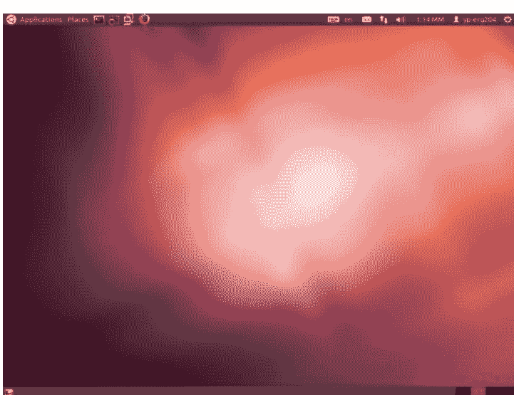

### 选择 Web 服务器

最流行的 Web 服务器是 Microsoft IIS 和 Apache，后者是一个已经存在了多年的开源 Web 服务器。Cherokee 是一种带有 Web 界面的新型服务器，最近变得流行。

以下是百科对 Cherokee 的介绍：

> Cherokee 是一个开源跨平台 Web 服务器，运行在 Linux、BSD 变体、Solaris、Mac OS X 和 Microsoft Windows 上。它是根据 GNU 通用许可证许可的轻量、高性能 Web 服务器/反向代理。它的目标是快速且功能齐全，同时保持轻量。Cherokee 的主要特性包括一个名为 `cherokee-admin` 的图形管理工具和模块化的轻量设计。

独立测试表明，Cherokee 在提供静态和动态内容时的性能优于 Apache。

Cherokee 由开源社区维护和开发。

下面的图片显示了 Cherokee 首页（`www.cherokee-project.com`）：

#### CHEROKEE WEB 架构为今日而生

Cherokee Web 是一款直观、功能丰富、极速且易于配置的开源 Web 服务器，为下一代高并发安全 Web 设计。

#### 特性亮点

- 用户友好：通过 Cherokee Admin 轻松管理您的 Web，这是一个漂亮且强大的 Web 界面
- 现代技术：Cherokee Web 支持所有最新的 Web 技术，包括 SSL、COOP、LOMT、TLS/SSL、HTTP 代理、视频流、内容缓存、流量整形、API
- 跨平台：Cherokee 可运行于 Linux、Windows、OS X、Solaris、FreeBSD。


## 第 2 章 Cherokee 安装与配置

### Cherokee 安装

安装和配置 Cherokee 需要 `root` 权限。Linux 的一种方法是以 `root` 身份登录。另一种方法是在每个命令前加上 `sudo` 命令。`sudo` 实用允许允许以 `root` 用户身份运行程序，这是 Ubuntu 推荐的方法。对于 Fedora Linux，如附录所示，我们将使用 `root` 用户账户。

安装 Ubuntu 的用户使用 `sudo` 命令执行需要 `root` 权限的命令。要启用另一个用户（例如用户 `christos`）使用 sudo，您可以使 `/etc/sudoers` 文件可写。在 Linux 终端中输入：

```
$ sudo chmod +w /etc/sudoers
```

编辑 `/etc/sudoers` 文件：

```
$ sudo edit /etc/sudoers
```

向 `/etc/sudoers` 添加以下条目以恢复原始权限：

```
christos ALL=(ALL) NOPASSWD: ALL
```

除了编辑，您还可以 `echo` 命令：

```
$ echo "christos ALL=(ALL) NOPASSWD: ALL" >> /etc/sudoers
```

将 `/etc/sudoers` 的权限重置为原始权限：

```
$ sudo chmod -w /etc/sudoers
```

下载和安装 Cherokee 的命令在不同的 Linux 发行版中不同。对于 Ubuntu：

```
$ sudo apt-get install cherokee
```

`apt-get` 命令是一个命令行工具，它使用 Ubuntu 的`高级软件包工具 (apt)` 来下载、安装、升级和移除软件包。

注意，由于 `apt-get` 命令会下载包，因此之前的命令需要活跃的 Internet 连接。

在使用之前的 `apt-get` 之前，为了更新 `apt-get` 使用的软件包仓库并安装最新版本的 Cherokee，输入以下命令：

```
$ sudo apt-get update
```

如果 `apt-get` 仓库未更新到最新版本，您可以从源码下载并安装 Cherokee。在 `cherokee-project.com` 首页，点击 `Download Cherokee` 链接。

### 快速指南

下载 Cherokee

- 稳定发布版
- 每日发布版

安装 Ubuntu

```
sudo add-apt-repository ppa:cherokee/stable
sudo apt-get update
sudo apt-get install cherokee
```

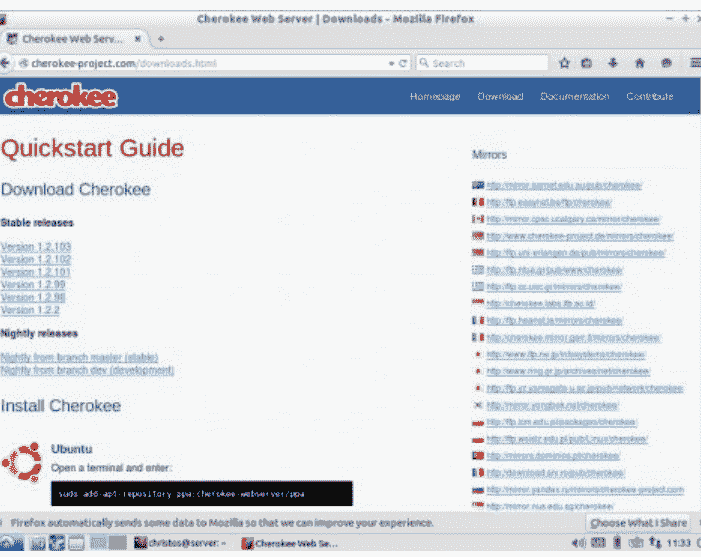

下载完成后，右键点击 ISO 镜像并选择“刻录磁盘映像”。


按照通常的方法解压。在 Linux 终端中，切换目录到解压后的包：

```
cd ~/Downloads
tar -xvf cherokee-1.2.101.tar.gz
cd cherokee-1.2.101
./configure --prefix=/usr --sysconf=/etc
make
sudo make install
```

注意，为了让示例在某些系统中运行，必须安装某些工具（`gcc`, `make`, `gettext`）：

```bash
sudo apt-get install gcc gettext
```

从 Ubuntu 软件中心安装 Cherokee 是另一种选择。Ubuntu 软件中心是一个用于浏览、安装和删除程序的 GUI（图形用户界面）。

在 Ubuntu 桌面上，点击应用程序菜单并选择 Ubuntu 软件中心。在搜索框中输入 `cherokee` 并按回车。在结果中，选择 Cherokee 条目并点击“安装”按钮开始下载 Cherokee。


### 使用 cherokee-admin 启动管理面板

Cher Cherokee 非常，因为它有一个巨大的优势：由 `cherokee-admin` 工具提供的简单浏览器配置界面。

您可以使用 Firefox、Internet Explorer、Chrome 或任何其他浏览器配置 Cherokee。

要打开浏览器管理面板，需要一个临时密码。正如其名称所示，临时密码仅有效一次。在使用后，它将失效，必须创建新密码。潜在的入侵者会发现临时密码无法再次使用，因为它在首次使用后将不再有效。

Cherokee 临时密码由 `cherokee-admin` 生成。`cherokee-admin` 必须以 root 权限执行，它是 Cherokee 的管理界面。`cherokee-admin` 的输出方便地提醒用户在浏览器地址栏中输入的地址。

启动 `cherokee-admin` 并获取临时密码，在 Linux 终端输入：

```
[sudo] password for christos:
Cherokee Web Server 1.2.101 (May 23 2015): Listening on port 127.0.0.1:9090,
TLS disabled, IPv6 enabled, using epoll, 4096 fds system limit, max. 2041
connections, caching I/O, single thread
```

```
$ sudo cherokee-admin
```

这是 `cherokee-admin` 的输出：

Login:

User: admin

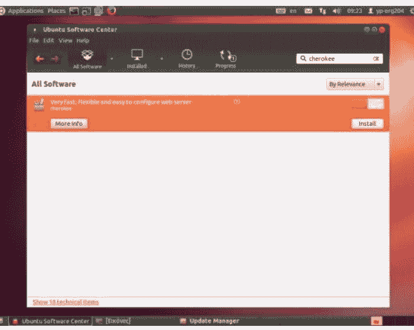

一次性密码：`YW61JCFdXConKyj`

Web 界面：

URL：`http://127.0.0.1:9090/`

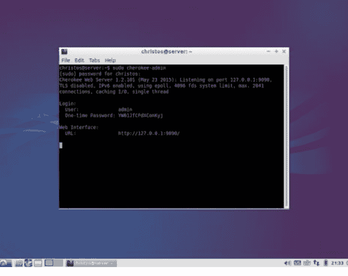

`cherokee-admin` 表示我们应该在浏览器的地址栏中输入 `127.0.0.1:9090` 来启动 Cherokee 管理面板。在大多数计算机系统中，`localhost` 主机名解析为地址 `127.0.0.1`。`localhost` 使用计算机的环回网络接口。环回接口绕过了网络接口硬件。端口 `9090` 是 `cherokee-admin` 进程监听连接的默认 TCP 端口。

打开浏览器，在地址行中输入以下 URL（统一资源定位符）：

`http://localhost:9090`

或者

`http://127.0.0.1:9090`

弹出一个对话框，包含两个字段：用户名和密码。

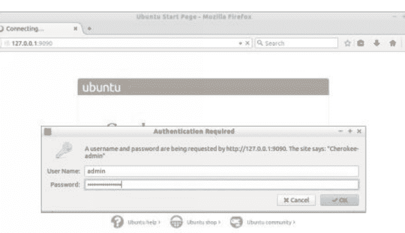

我们将 `admin` 输入为用户名，并将 `cherokee-admin` 返回的一次性密码作为密码，在之前的示例中，该密码为 `YW61JCFdXKonYij`。如果登录成功，你将进入 Cherokee 管理面板的主页：

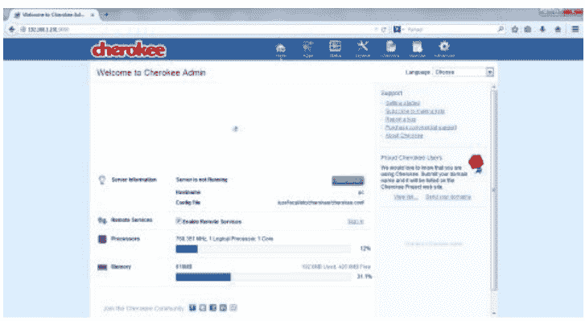

默认情况下，`cherokee-admin` 仅绑定到 `127.0.0.1` (`localhost`)，这意味着你只能从同一系统连接到它。然而，你运行 `cherokee-admin` 时可以使用 bind `(-b)` 选项来指定监听的网络地址。如果 `-b` 选项未提供 IP 地址，Cherokee 将绑定到所有接口。在下面的示例中，你可以从局域网内的任何计算机使用管理面板：

```
$ sudo cherokee-admin -b
```

假设你的 Web 服务器的私有 IP 地址为 `192.168.1.101`，则在局域网内的任何浏览器上应使用以下地址来启动管理面板：

`http://192.168.1.101:9090`

你将在第 3 章学习如何设置服务器的私有 IP 地址。

关于 `cherokee-admin` 选项的更多信息，请使用实用程序的手册：

```
$ man cherokee-admin
```

### Cherokee 管理面板

从 Cherokee 管理面板的主页，我们可以通过标签页：Status（状态）、General（常规）、vServers、Sources（源）和 Advanced（高级）进入其他配置页面。下面的图片显示了管理面板首页：

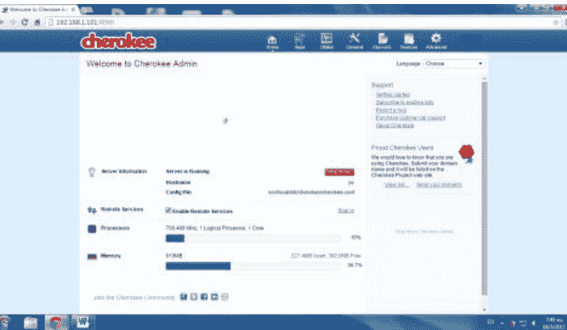

首页最重要的可能是启动 Cherokee 的绿色按钮，标记为 `Start Server`（启动服务器）。当你点击此按钮时，按钮从绿色变为红色，并出现 `Stop Server`（停止服务器）说明。

### Cherokee 测试页面

让我们测试你刚刚启动的服务器。使用我们访问 `cherokee-admin` 时相同的 IP 地址，在浏览器的地址栏中输入以下 URL：

```
http://127.0.0.1
```

Cherokee 默认使用 `HTTP 协议`（万维网的协议）的官方端口 `80`。你不需要在 URL 中显式指定此端口。另一方面，使用以下地址也不会报错：

```
http://127.0.0.1:8080
```

除了`环回` IP 地址外，你也可以使用 `localhost` 主名：

```
http://localhost
```

Cherokee 测试页面会出现在浏览器窗口中。测试页的文件名为 `index.html`，标题为 `Cherokee Test Page`（Cherokee 测试页面）。当你建立网站时，你将用你自己的页面替换 Cherokee 测试页面。

因此，Cher 测试页面或你网站的任何页面都可以从 Web 服务器计算机本身进行测试。

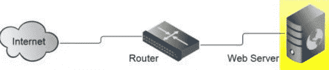

如果发生某些错误导致 Cherokee 测试页面没有显示怎么办？如果你使用 Fedora，你必须在系统的防火墙中打开 Web 服务器使用的每个端口。对于 Web 服务器，默认端口是 `80` 端口。此外，本书中的示例还使用了 `8080` 端口和 `8181` 端口。你必须允许这些端口，还要打开 `9090` 端口，这是默认 `cherokee-admin` 监听连接的端口。你必须按照附录所述配置防火墙。

注意，某些版本的 Ubuntu 预装了 Apache Web 服务器的测试页面。该服务器已经使用了 `80` 端口，你必须在系统设置时禁用 apache 进程启动，或使用另一个端口号（例如 `8080` 端口）。两种方法在第 4 章中都有描述。最后，在 Ubuntu 系统中必须使用 `-t` 选项来启动 `cherokee-admin` 程序：

```
$ sudo cherokee-admin -b -t
```

在第 3 章中，你将从局域网内的另一台计算机测试 Web 页面。

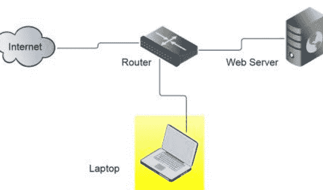

在第 5 章中，你将使用在线网络工具从互联网上的另一台计算机测试你的 Web 页面。

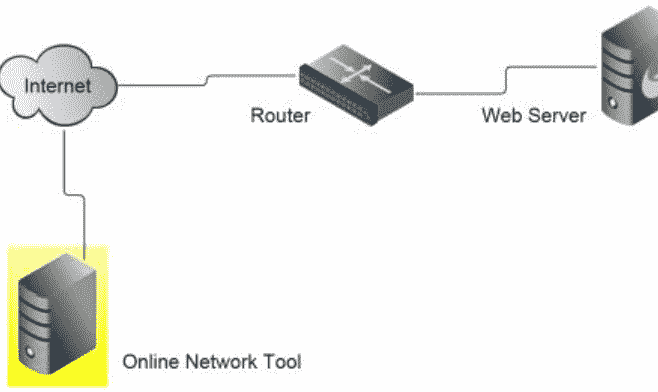

## 第 3 章 操作系统配置

### 为服务器分配私有静态 IP 地址


你必须为你的 Web 服务器分配静态 IP 地址。让我们以 IP 地址 `192.168.1.101` 为例。这是一个私有 IP 地址。私有 IP 地址仅对你的局域网有效。之前的地址是来自私有网络 `192.168.1.0` 的随机 IP 地址。按照习惯，路由器使用此地址引用 C 类私有网络，这是最常见的 IP（互联网协议）网络类。另一个常用的常用的私有网络是 `192.168.0.0` 网络。IP 地址也可以是静态的，这意味着在系统管理员手动更改之前，该 IP 地址不会发生变化。

家庭路由器通常使用 `DHCP`（动态主机配置协议）来动态分配 IP 地址，这些地址在一段时间后会更改，通常以天为单位。使用静态 IP 地址，你可以远程配置 Cherokee 服务器，并从局域网内的其他节点测试服务器。此外，且更重要的是，你可以在路由配置中指定服务器的静态 IP 地址，将其作为处理 `HTTP`（HTTP 代表超文本传输，万维网的协议）的服务器。

为了让服务器从互联网各个客户端可见，服务器必须有一个关联的公共 IP 地址。此关联地址是公共 IP 地址，即服务器局域网路由器面向互联网的接口地址。通过使用路由器的虚拟服务器服务（将在第 5 章中讨论），所有发往路由器的 HTTP 请求将由路由器转发到 Cherokee 服务器。在接下来的图中，Web 服务器是主机 `192.168.1.101`。通过使用路由器的 IP 地址 `94.69.219`，可以在互联网上访问该 Web 服务器。路由器的私有 IP 地址为 `102.168.1`，允许从内部访问路由器。

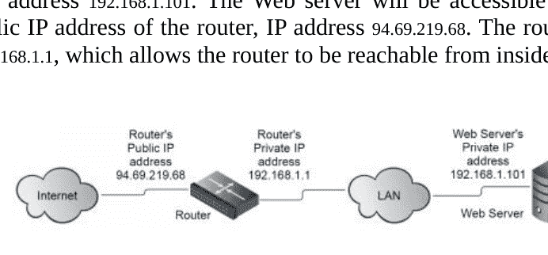

为了将局域网内的一台计算机指定为 Web 服务器（如第 5 章所述），该计算机必须使用静态 IP 地址。你必须禁用 `DHCP` 并手动配置服务器的静态 IP 地址、子网掩码、网关和 DNS 参数。

对于 Ubuntu Linux，点击启动按钮并选择设置，然后选择网络。点击添加按钮添加新连接。

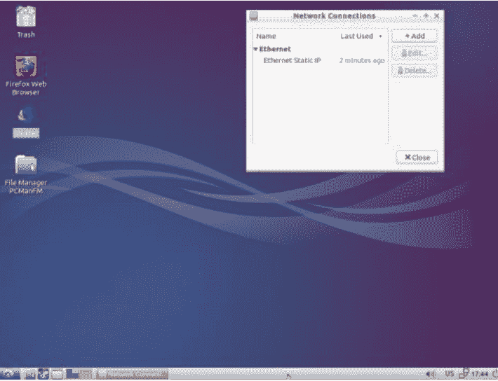

在弹出的对话框中，在连接名称框中输入连接名称（例如 Ethernet IP），并点击 `IPv4` 设置标签页。在方法下拉菜单中选择手动（默认设置为 `DHCP`）。

点击添加按钮编辑地址、子网掩码和网关字段。

输入以下值：

地址：`192.168.1.101`

这是我们分配给 Cherokee 服务器的 IP 地址。

子网掩码：`255.255.255.0`

子网掩码（Network mask）字段指示如何将 IP 地址划分为网络部分和主机部分。`255.255.255.0` 的掩码值表示 IP 地址的前三个字节指定网络，第四字节指定主机。

网关：`192.168.1.1`

网关是路由器的另一个名称。输入路由器的私有 IP 地址，即路由器内部接口的 IP 地址。当然，路由器也有一个对于整个互联网有效的公共 IP。在本示例中，路由器的私有 IP 为 `192.168.1.1`。

再次将路由器的私有 IP 地址输入到 DNS 服务器（域名系统服务器）字段：

DNS 服务器：`192.168.1.1`

点击“保存”按钮以确认更改。

对于 Ubuntu，点击桌面面板右上角通知区域的“网络管理器指示器”（双箭头）图标。在弹出的菜单中，选择“编辑连接”。

“网络连接”窗口出现：

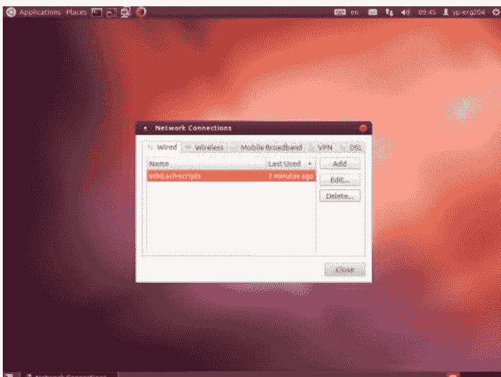

点击“添加”按钮创建新连接。会弹出另一个窗口。在“连接名称”文本框中输入一个名称，例如“静态 IP”。此名称将包含在新窗口的标题中，例如“正在编辑静态 IP”。在“方法”下拉菜单中选择“手动”。

点击“添加”按钮以编辑地址、子网掩码、网关和 DNS 服务器。要分配 Web IP 地址 `192.168.1.101`，请在“地址”字段中输入此值。同时在“子网掩码”字段中输入值 `255.255.255.0`。最后，在“网关”和“DNS 服务器”字段中输入路由器的私有 IP 地址（例如 `192.168.1.1`）。


点击“保存”按钮以确认更改并关闭“网络连接”窗口。

### 从操作系统请求端口号

`0` 到 `1023` 范围内的 TCP 端口号是良已知端口，有时被称为系统端口。在类 Unix 操作系统（例如 Linux）上，进程必须以超级权限执行，才能使用其中一个良端口将网络套接字绑定到 IP 地址。

Web 服务器可以使用 `80` 端口（HTTP 的默认端口）或良已知端口范围内的任何其他端口。端口 `8080` 和 `8181` 是本书中将使用的两个端口。

在某些 Linux 系统（例如 Fedora）上，你必须配置防火墙以允许使用任何特定端口。（防火墙限制了对 IP 地址和端口的访问）。

附录中包含更多关于 Fedora 防火墙以及 Fedora Linux 与 Ubuntu 之间其他差异的信息。对于 Ubuntu，使用特定端口不需要进一步配置。

### 从局域网内的另一计算机测试服务器

你现在可以从局域网（LAN）内的另一台计算机检查 Cherokee 测试页面。如果你之前配置过 Cherokee 服务器使用 IP 地址 `192.168.1.101`，请在浏览器中使用以下地址：

```
http://192.168.1.101
```

只要 Cherokee 服务器正在运行，就应该出现 Cherokee 测试页面：

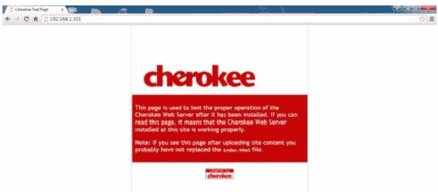

在第 5 章中，你将更进一步，允许 Web 服务器从局域网外部可见，从而在整个互联网上可用。

## 第 4 章 Cherokee 管理面板

在本章中，你将将览 Cherokee 管理面板的主要部分。每个部分都可以通过面板网页顶部相应的图标进行访问。请注意，管理面板的区域数量和其他功能可能会根据 Cherokee 版本而异。

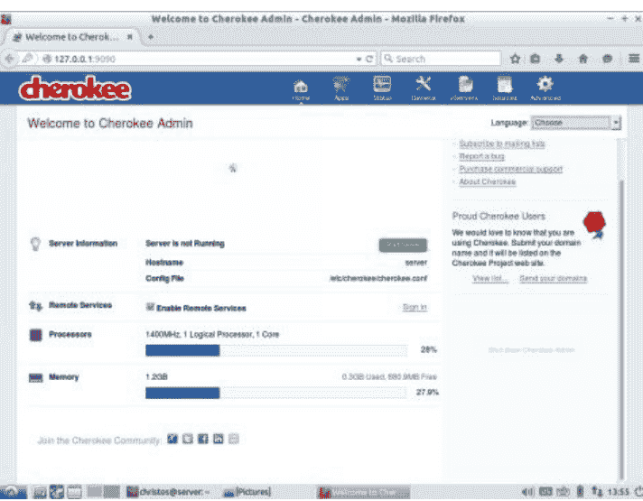

### 管理面板的首页部分

在“首页”部分，你可以找到有关服务器状态、系统内存和处理器、系统主机名以及 Cherokee 配置文件路径的一些信息。在“语言”下拉菜单中，你可以选择管理面板界面使用的语言。

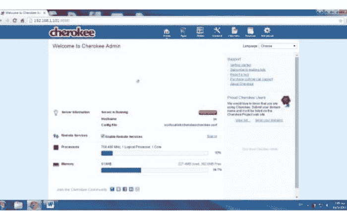

窗口的右侧区域包含指向 Cherokee 服务器的支持链接。正如前面提到的，你必须使用绿色的“启动服务器”按钮启动服务器，并使用同一个按钮（当服务器运行时，它会变为红色且显示为“停止服务器”）来停止服务器。“启动/停止服务器”按钮是首页部分最重要的功能。

#### 管理面板的状态

要进入“状态”部分，请点击“状态”链接。状态部分提供了一个监控工具。要激活此监控，点击“信息收集”链接，这会将带你到“常规”部分。

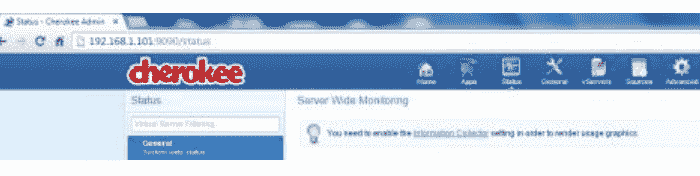

在“常规”部分，如果“图表类型”下拉菜单中尚未选中，请选择 `RRDtool` 。

本书的最后几章描述了你如何同时运行多个 Web 服务器，称为“虚拟服务器”。要单独为特定的虚拟服务器启用图表（而不是查看所有服务器的系统级数据），你必须为特定服务器启用数据收集。到目前只运行了一个虚拟服务器——默认服务器。要允许对默认服务器收集数据，返回“状态”部分并点击“常规”链接下方的服务器名称（default）。勾选“启用”复选框。

记住——每当在管理面板中配置偏好设置时，请按 Cherokee 图标旁的“保存”按钮。在配置某些选项（如之前的“图表类型”）后，Cherokee 程序将要求你重启服务器。

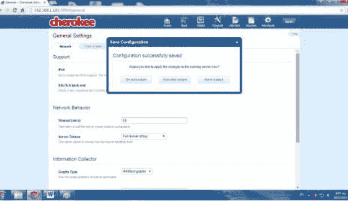

在出现的“保存配置”对话框中点击“平滑重启”按钮。在配置这些选项后，状态页面如下：

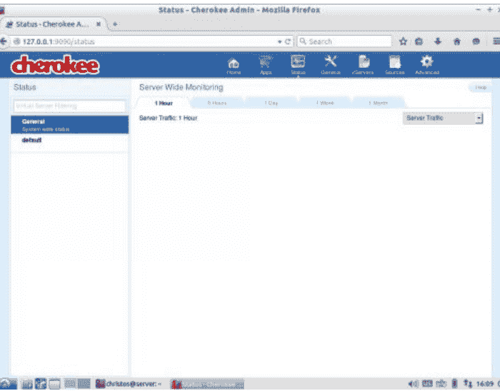

如果此时没有可用图表，是因为示例系统中缺少 `RRDtool` 包。`RRDtool`（轮询数据库工具）是处理网络带宽、CPU 负载等时间序列数据的数据日志和绘图工具。你可以在 Linux 终端上使用以下命令安装 `RRDtool`（如果尚未安装）：

```
$ sudo apt-get install rrdtool
```

之后你必须重启服务器。在 `RRDtool` 安装完成后，图表即可可用：

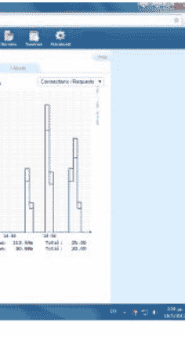

你可以通过从局域网内的另一台计算机访问 Cherokee 测试页面来测试图表，或者像我们在下一章中描述的那样，使用在线网络工具从外部计算机进行测试。

通过从下拉菜单中选择相应的选项可以查看三种类型的图表：

- 服务器流量
- 连接 / 请求
- 连接超时

你还可以通过点击图表顶部的以下标签之一来设置数据收集的时间段：1 小时、6 小时、1 天、1 周和 1 个月。

在图表的左侧，你可以点击“常规”来显示系统级数据，或者点击服务器名称来显示特定虚拟服务器的数据。

要了解更多关于 Cherokee 图表的信息，请访问 Cherokee 文档页面：

http://cherokee-project.com/doc/other_graphs.html

### 管理面板的常规部分

“常规”部分提供了网络、监听端口、权限、图标和 MIME 类型等标签。你已经访问了“网络”标签并将“图表类型”的值设置为“RRtool 图表”。此页面还提供了网络配置选项。例如，你可以配置服务器关闭空闲连接的时间。作为另一个示例，你可以启用 `IPv6` 支持。

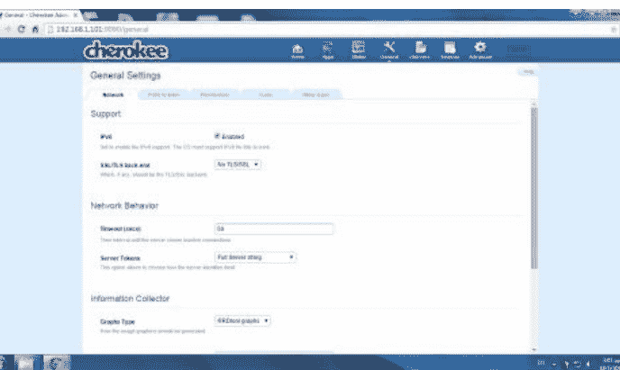

在“监听端口”标签中，你可以添加和删除服务器监听的端口。HTTP 协议的默认端口 `80` 已包含在内。你可能需要添加额外的端口，因为：某些互联网服务提供商（ISP）禁止访问 `80` 端口，或者你可以为你的 Web 服务器使用不同的端口。一个常用的端口号是 `8080`，有时被称为备用端口。第 12 章描述了同时使用不同端口（`8080` 和 `8181`）服务器。

在添加新端口之前，确保该端口未被其他服务使用。在 Linux 终端运行以下命令：

```
$ netstat --tcp --listening --programs
```

下面的图像显示了在我们启动 `cherokee-admin` 和启动 Cherokee 服务器之前的命令输出：

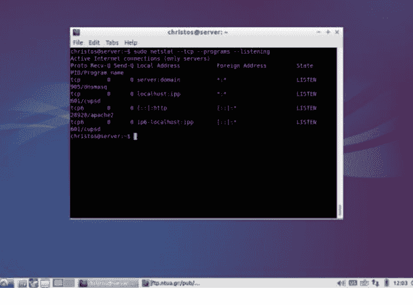

如所示，有一个 Web 服务器正在监听 http 端口（`80` 端口）：

活动 Internet 连接（仅服务器）

| Proto | Recv-Q | Send-Q | Local Address | Foreign Address | State | PID/Program name |
|---|---|---|---|---|---|---|
| tcp | 0 | 0 | 0:server:domain | *:* | LISTEN | 905/dnsmasq |
| tcp | 0 | 0 | 0:localhost:ipp | *:* | LISTEN | 601/cupsd |
| tcp6 | 0 | 0 | [::]:http | [::]:* | LISTEN | 28928/apache |
| tcp6 | 0 | 0 | ipv6-localhost:ipp | [::]:* | LISTEN | 601/cupsd |

运行在 `80` 端口的服务是 Apache Web 服务器（apache 2）。

禁用 apache 进程在系统启动时启动，从而释放 `80` 端口，允许 Cherokee 使用标准端口：

```bash
$ sudo update-rc.d -f apache2 remove
```

注意，为了再次启用 apache，你应该输入：

```
$ sudo update-rc.d apache2 defaults
```

## 你不能重启计算机。netstat 的输出显示没有进程在端口 80 (http) 上进行监听：

活跃的 Internet 连接（仅限服务器）

```
Proto Recv-Q Send-Q Local Address      Foreign Address State PID/Program name
```

```
tcp 0 server:domain             *:* LISTEN 909/dnsmasq
tcp 0 localhost:ip                +**: LISTEN 603/cupsd
tcp6 0 ip6-localhost:ip         ::]:* LISTEN 603/cupsd
```

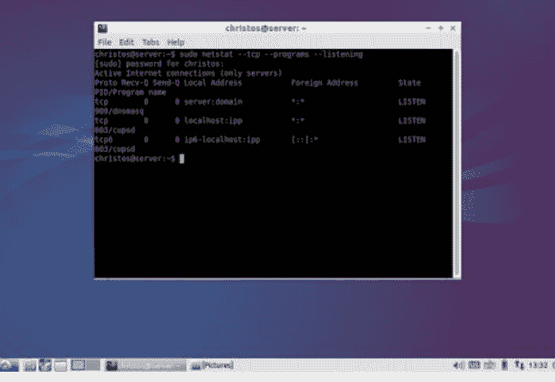

若要以数字形式显示端口号（例如，使用 `80` 而不是 http），请使用 `numeric-ports` 参数：

```
$ netstat --tcp --listening --programs --numeric-ports
```

由于没有其他进程与标准 HTTP 端口 `8080` 和 `8181`（在后续章节中使用）发生冲突，因此 Cherokee 可以配置为监听这些端口。

要添加一个 Cherokee 将监听的新端口，请点击“Add new port”（添加新端口）按钮。

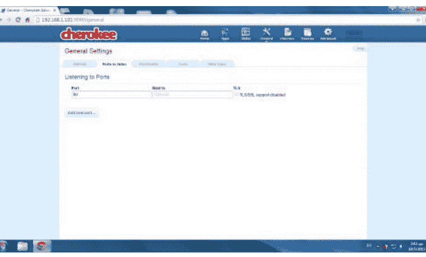

在出现的对话框中，在 *Port*（端口）文本框中输入端口号（例如 `8080`），然后点击 *Add*（添加）按钮。

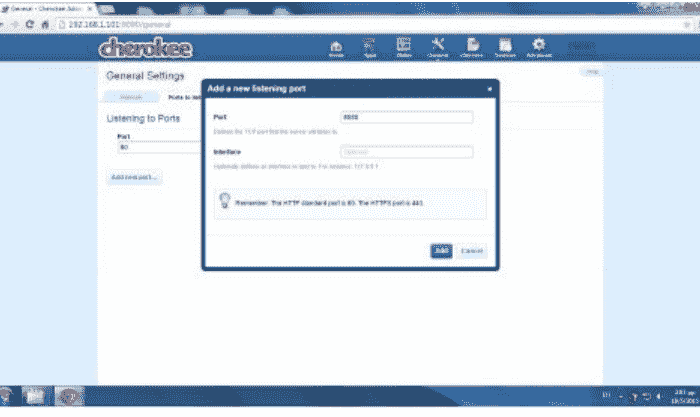

新端口号包含在 *Listening to Ports*（监听端口）列表中：

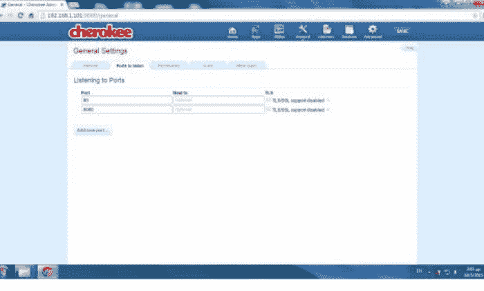

你可以用相同的方法添加更多端口。例如，书中的几个示例使用了 `8181` 端口。你可以通过点击对应端口所在行末尾的“x”按钮来删除端口号。点击窗口右上区域的 SAVE 按钮以确认更改。在出现的对话框中，点击 Graceful restart（平滑重启）按钮使用新配置重启服务器。

以下是运行 `cherokee-admin` 和 Cherokee 服务器后 `netstat` 命令的输出，服务器在端口 `80` (http)、`8080` (http-alt) 和 `8181` 上监听。注意，`cherokee-admin` 监听的端口 `9090` 也被包含在输出中：

christos@server- $ sudo netstat --tcp --programs --listening

活跃的 Internet 连接（仅限服务器）

| Proto | Recv-Send-Q | Local Address | Foreign Address | State | PID/Program Name |
|---|---|---|---|---|---|
| tcp | 0 | server:domain | *:* | LISTEN | 981/dnsmasq |
| tcp | 0 | localhost:ip | *:* | LISTEN | 612/cupsd |
| tcp | 0 | localhost:4000 | *:* | LISTEN | 1782/python |
| tcp | 0 | localhost:9090 | *:* | LISTEN | 1723/cherokee-admin |
| tcp6 | 0 | [::]:http-alt | *:* | LISTEN | 1838/cherokee-woke |
| tcp6 | 0 | [::]:http | *:* | LISTEN | 1838/cherokee-woke |
| tcp6 | 0 | [::]:8181 | *:* | LISTEN | 1838/cherokee-woke |
| tcp6 | 0 | [::]localhost:ip | *:* | LISTEN | 612/cupsd |

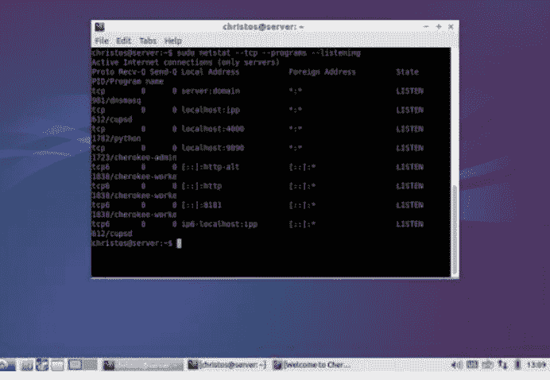

## 管理面板的虚拟服务器部分

下一个要讨论的部分是 vServers，它是 Virtual Servers（虚拟服务器）的缩写。Cherokee 支持多个同时运行的 Web 服务器（虚拟服务器）。每个虚拟服务器可以使用不同的域名、支持不同的网站并利用不同的工具。即使你不想创建多个虚拟服务器，仍然会使用默认虚拟服务器。这个名为 default 的虚拟服务器存在于每个 Cherokee 中。

在 Servers（服务器）的 Basics（基础）选项卡中，你可以配置网站的 Document Root（文档根目录）目录。这是 Cherokee 提供文件的目录。例如，如果 Document Root 是 `/var/www`，那么客户端对 `http://www.example.com/index.html` 的请求指向 `/var/www/index.html`。如上一张图片所示，对于 Ubuntu，Document Root 默认为 `/var/www` 或 `/usr/local/www/`。如果我们想更改 Document Root 目录，可以在 Document Root 文本框中输入新目录的路径。

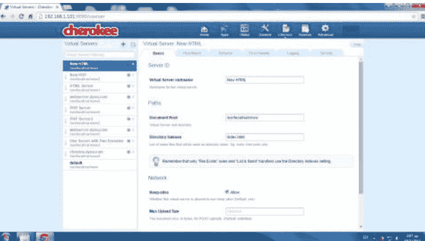

Directory Indexes（目录索引）文本字段设置目录索引。目录索引指示当客户端请求域名结尾带有斜杠（/）的 URL（例如，`http://webserver.dynu.com/`）时，要发送的文件列表。目录索引文件的常见名称是 index 加上对应的文件扩展名（例如，`index.html`， `index.php`）。如果目录索引设置为 `index.html`，则之前的 URL 等同于：


`http://webserver.dynu.com/index.html`

在 Logging（日志）选项卡中，你可以配置 Cherokee 服务器的日志（例如，使用哪两个文件名进行错误和访问日志）。Error Logging（错误日志）和 Access Logging（访问日志）文件名也可以从默认值更改。

要在 Format（格式）下拉菜单中启用访问日志，请选择 Apache compatible（兼容 Apache）而不是默认的（None）。在 Filename（文件名）文本框中，为日志文件选择新名称和路径。你也可以保持默认。在 Time（时间）标准下拉菜单中，选择 Local time（本地时间）或 UTC（协调世界时）。

如果默认访问日志位置未从默认位置更改，可以使用以下命令查看访问日志文件：

```
$ sudo more /usr/local/var/log/cherokee.log
```

下图中所示示例输出显示了有关 Web 客户端连接服务器的信息记录。该信息包括 Web 客户端连接服务器的 IP 地址、时间、客户端请求的 URL。例如：

`50.22.226 - [13/Feb/2015:17:24] "GET /HTTP/1.1" 200 251 "-" "Mozilla/5.0 (X11; Linux x86_64) AppleWebKit/537.36 (KHTML, like Gecko) Chrome/40.0.2214.93 Safari/537.36"` 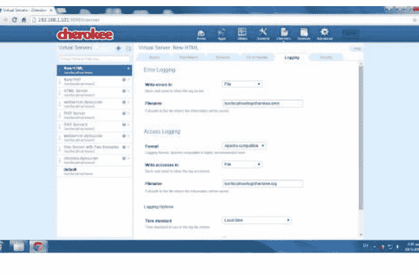

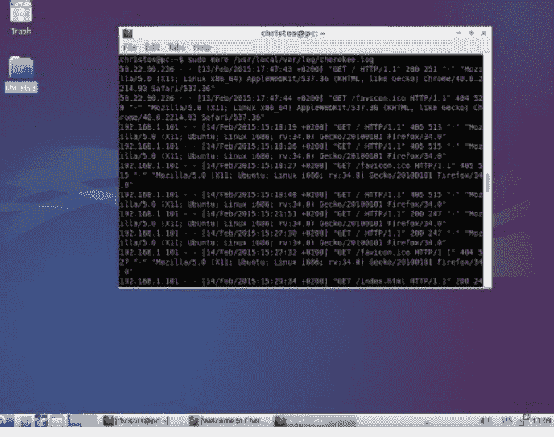

你也可以通过在下拉菜单中选择索引并在 Filename 文本框中指定文件名来配置错误日志。选项有 Standard、Execute、Disabled。

第 8 到 12 章包含了创建和运行虚拟服务器的许多示例。这些章节还讨论了 vServers 部分。

### 从互联网可见

此时，Cherokee 服务器正在运行，但它仅对局域网可见。在本章中，你将使服务器对整个互联网可用。假设你的路由器目前使用 NAT（网络地址转换）允许局域网内的每台计算机伪装成路由器。通过虚拟服务器选项，路由器管理员可以注册一个端口，由指定的计算机负责监听。例如，如果你希望使用局域网内 IP 地址为 `192.168.1.200` 的计算机作为使用端口 80 的 Web 服务器，使用另一台计算机 `192.168.1.110` 作为使用端口 8080 的 Web 服务器，并在虚拟服务器设置中将端口 80 分配给 IP `192.168.1.200`，将端口 8080 分配给 IP `192.168.1.110`。更改配置后，当客户端连接到 `webserver.dynu.com:80`（或简单的 `webserver.dynu.com`，因为请求发送到了路由器的公 IP 地址，例如 `94.69.235.77`，这是 `webserver.dynu.com` 对应的 IP），根据虚拟服务器表，路由器会将请求传递给 IP 为 `192.168.1.200` 的服务器。同样，到 `webserver.dynu.com:8080` 的连接将传递给 IP 为 `192.168.1.110` 的服务器。

### 虚拟服务器路由器选项

路由器的公 IP 地址可以是静态的或动态的。对于静态 IP，你可以通过 DNS 系统注册与该 IP 对应的域名。对于动态 IP（更常见且成本更低），可以使用从 DDNS（动态 DNS）提供商分配的域名（通常免费）。DDNS 将在下一章解释。

因此，通过虚拟服务器（Virtual server router）选项，不同端口上的多台计算机都可以使用路由器的公 IP 地址。（相比之下，在 Cherokee 的虚拟服务器配置中，你的 Cherokee 服务器可以虚拟化多个 Web 服务器。）

#### 路由器配置

为了配置路由器，以便任何连接互联网的客户端计算机都能访问你的服务器，你可以使用路由器的 Web 界面。许多路由器还支持通过 `telnet` 服务调用的命令行界面。然而，我们不会详细介绍命令行界面，因为图形化界面通常更容易使用。这将是你在书中第二次使用 Web 界面。第一次是在使用 Cherokee 管理面板时。

我们使用一台一级 FBR-1161 ADSL2+ 路由器作为案例研究。不同路由器的 Web 界面各不相同。每个型号的菜单和选项通常也不同。有时它们的功能也存在差异。接下来，将描述大多数现代路由器共有的基本功能。示例中路由器的私有 IP 地址为 `192.168.1.1`。在路由器局域网（LAN）的任何计算机的浏览器地址栏中输入此地址。弹出的对话窗口提示你输入用户名和密码。你输入的值可以是默认用户名/密码（在路由器手册中找到），也可以是你之前选择替换默认值的新值。*Status*（状态）页面将会：

在该页面的 WAN（广域网）部分，你可以找到路由器的公 IP 地址（有时称为其外部 IP 地址）。如果你的互联网服务提供商（ISP）为你分配了动态 IP 地址（大多数情况都是如此），路由器的公 IP 地址会在一段时间后或每次你关闭并重启路由器时更改。在上一个示例中，路由器的公 IP 地址是 `79.130.85.60`。还有其他方法可以获取你的 IP，例如，一些网站会报告你的 IP 地址：`http://www.whatssmyipaddress.com`

点击 **Advanced Setup**（高级设置）链接，会出现以下页面：

点击 **NAT** 链接配置 **Network Address Translation**（网络地址转换）选项。会出现以下页面：

可见 NAT 处于激活状态。（如果路由器未激活 NAT，你必须点击 Interface Setup（接口设置），然后点击 Internet 链接，并在 NAT 下拉菜单中选择 Enable，然后点击 SAVE 按钮）。激活 NAT 后，点击 Virtual Server（虚拟服务器）链接来配置虚拟服务器选项。在 Application 下拉菜单中选择 HTTP_Server（这随路由器型号而异）。在 Start Port Number（起始端口号）和 End Port Number（结束端口号）字段中输入端口号（例如 `8080`）。在 Local IP Address（本地 IP 地址）字段中输入 Web 服务器的私有 IP 地址（例如 `192.168.1.101`）。点击 SAVE。对其他端口重复相同的过程。

在此示例中，私有 IP 地址为 `192.168.1.101` 的计算机被分配了处理端口 `8080` 和 `8181` 流量的任务。端口 `8080` 是提供 Web 服务的常用端口 `80`，而端口 `8181` 是一个随机端口号。如果你的 ISP 允许接入端口 `80` 的入连接，你也可以添加官方的 HTTP 端口。你可以尝试包含端口 `8080`，并使用在线网络工具进行测试（在本章下文中将描述该方法）。如果你使用非标准端口（例如端口 `8080`），URL 将从常用的：

`http://some_site.com`

变为：

`http://some_site.com:8080`

这没有问题，因为大多数 DDNS 服务都会处理此问题（使用端口重定向 DDNS 将第 6 章讨论）。目前，你可以使用带有 IP 地址而不是域名的 URL 访问网站。

### 从互联网测试你的网站

到为止，你已经通过 Cherokee Web 服务器的私有 IP，从 Web 服务器或局域网内的其他计算机查看了 Cherokee 测试页面：

```
http://192.168.1.101
```

（如果互联网服务提供商禁止，端口 80 在你的局域网内仍然有效）

或者

```
http://192.168.1.101:8181
```

或者

```
http://192.168.1.101:8080
```

配置好路由器后，你可以从局域网外的互联网计算机上测试你的网站。那么，路由器的公 IP 地址以及（因此）你网站的 IP 地址是多少？下面的图片显示了 `www.howfindmypipaddress.com` 的结果：

那么你难道不能从内部局域网的浏览器中使用路由器的外部 IP 地址吗？遗憾的是，这在大多数情况下行不通。许多路由器出于安全考虑会阻止环回连接（loopback connections）。这意味着局域网上的机器（即路由器后面的机器）无法连接到同样位于局域网内的机器的外部 IP 地址。你无法通过端口 80 连接到路由器的内部 IP，因为这将指向 Web 路由器配置界面。你还无法从路由器的内部（私有）地址访问 `8080` 和 `8181` 端口，因为虚拟服务器服务不支持内部接口。

就像人需要镜子来看自己的形象一样，你需要一台外部计算机来查看你的网站在局域网外的样子。即使网站在局域网内部计算机上看起来良好，也不能确保它从互联网访问时没有问题。使用在线网络工具，你还可以确定不同国家的下载速度并确定哪些端口是关闭的。

这些网站之一是 `pingdom.com`。

这些网站之一是 `pingdom.com`。如果公地址是 `79.130.85.60` 且我们使用的端口是 `8181`，请在文中输入：

`http://79.130.85.60:8181`

## 第 6 章 使用 DDNS

到此为止，你的 Web 服务器已经在运行，互联网上的任何浏览器都可以通过 URL 访问测试页面：

`http://<router's-public-IP-address>:8181`

例如，如果路由器的公 IP 地址为 `94.69.220.39`，则该 URL 为：

`http://94.69.220.39:8181`

请记住，你的路由器会将所有收到的目标为端口 `8181` 的请求（在本章示例中也包括端口 `8080`）重定向到你的 Web 服务器。

如果你的互联网服务供应商分配了静态 IP 地址，你可以注册一个域名（例如 `www.mydomain.com`）。该域名将通过静态 DNS（域名解析服务）映射到路由器的公 IP 地址。如果你已经拥有域名和静态 IP 地址，就可以按如下方式发布 URL 了：

`http://www.mydomain.com`

（如果我们使用 80 端口，假设你的 ISP 允许这样做）

如果你的 ISP 为路由器分配了动态 IP 地址（这通常是廉价连接的情况），或者你不想为域名付费，那么你就无法使用 DNS，必须使用 DDNS（动态 DNS）。通过 DDNS，即使服务器的公 IP 地址是动态的且会变化，你也可以为 Web 服务器使用域名。

首先，你必须注册一个 DDNS 服务。在此过程中，你将获得一个与注册时路由器公 IP 地址对应的域名。每当路由器的公 IP 地址发生变化时，DDNS 服务器就会收到通知并更新新的 IP 地址。路由器的 DDNS 客户端服务会向提供商的 DDNS 服务器通知 IP 地址的变化。或者，如果路由器没有此功能，Cherokee 服务器上的 DDNS 客户端程序可以检查 IP 地址更改并相应地通知 DDNS 服务器。

### DDNS 服务注册

网络上有许多 DDNS 服务提供商，选择一个并不总是容易的。决定使用哪种 DDNS 服务提供商将基于以下因素：

- 价格。廉价的服务并不意味着缺乏可靠性。
- 某些 DDNS 提供商允许端口转发（见下文描述）。
- 设置 DDNS 客户端所需的工作量。

如果你的服务器使用的是标准 HTTP 端口 `80` 以外的端口，你可以使用端口转发。例如，如果你使用端口 `8181` 而不是端口 `80`，你可以使用：

`my_server.ddns_provider.com`

而不是：

`my_server.ddns_provider.com:8181`

通过端口转发，即使是 `8181` 端口也不会包含在 URL 中，所有客户端请求都会重定向到路由器端口 `8181` 的公 IP 地址。然后路由器会将请求传递给你的 Cherokee 服务器，正如上一章在虚拟服务器服务中所描述的那样。

`Dynu.com` 是 DDNS 提供商的一个示例：

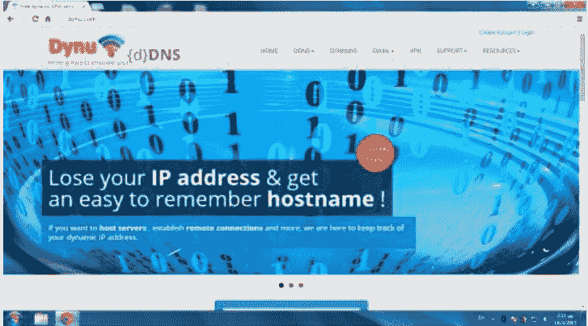

在 `dynu.com` 的首页上，点击窗口右上角的“Create Account”（创建账户）链接。填写表单详细信息（例如域名、密码）并点击“Submit”（提交）按钮。

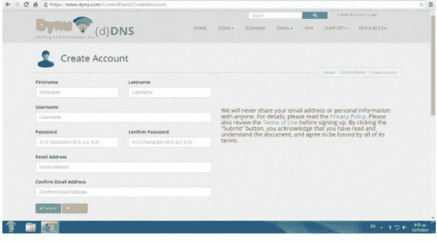

你将在提供的邮箱账户中收到一封邮件。点击邮件中的链接通过验证你的邮箱地址来激活账户。

邮件中的链接将带你进入控制面板（Control Panel）。稍后，你可以通过“Create Account”旁边的“Login”（登录）链接，输入邮箱地址和密码，并点击页面右上角的小齿轮图标。

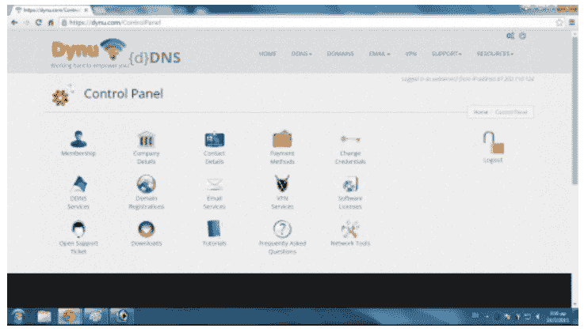

要配置你的 DDNS 选项，点击“DDNS Services”链接。接着点击“Add”（添加）按钮添加新项目：

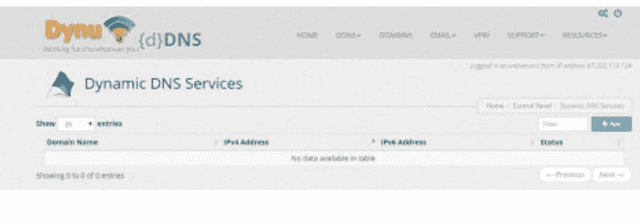

接下来，在“Host”（主机）字段中填入你注册的域名的主机名（例如 `webserver`）。点击“Add”按钮。

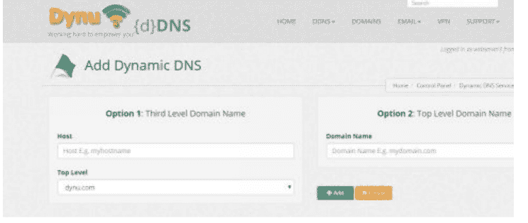

会出现“Manage Dynamic DNS Service”（管理动态 DNS 服务）页面。下次你登录时，你的域名将出现在“Dynamic DNS Services”页面上，你只需点击它即可进入“Manage Dynamic DNS Services”页面。

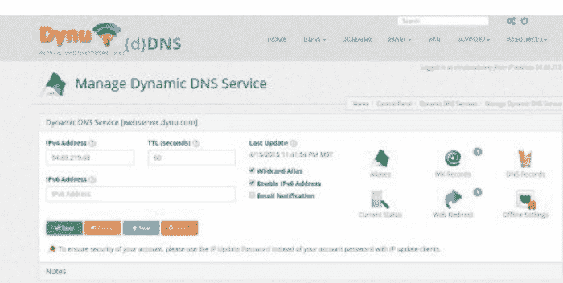

注意，路由器的公 IP 也会检测并输入到“IPv4 Address”文本框中。还会显示别域名（例如 `server.dns.com`）。在此页面上，你将配置 DDNS（例如启用或禁用端口转发）。

### 激活端口转发服务

接下来，你可以通过点击“Manage Dynamic DNS Service”部分中的“Web Redirect”（Web 重定向）链接来启用端口转发服务。会出现“Manage Web Redirect”页面：

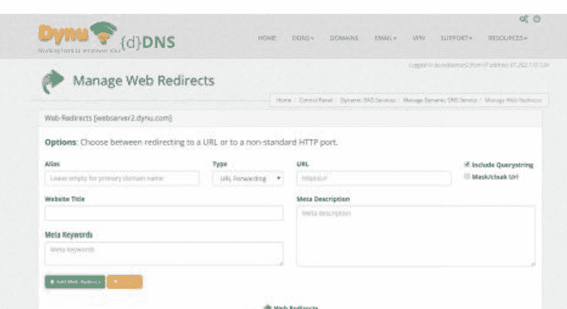

在“Type”（类型）下拉菜单中，选择“Port Forwarding”（端口转发）。在“Port”（端口）字段中，输入 Web 服务器监听的端口号（例如 `8080`）。点击“Add Web Redirect”按钮。若要在控制面板中禁用端口转发，请选择“Dynamic DNS Services”。

点击“Domain Name”字段中的域名（例如 `webserver.dynu.com`）。此链接将带你进入“Manage Dynamic DNS service”。点击“Web Redirect”链接，在下一个页面“Manage Web Redirects”中，点击“Disable Web Redirect”（禁用 Web 重定向）按钮。

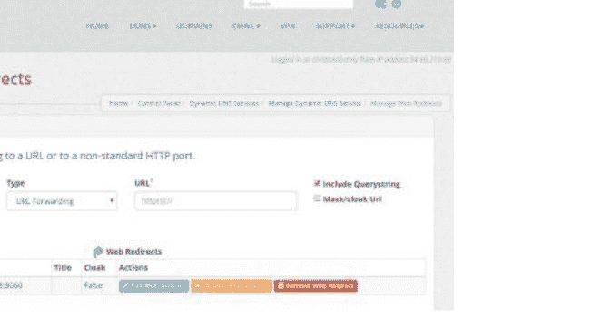

要再次启用端口转发，点击“Enable Web Redirect”按钮。

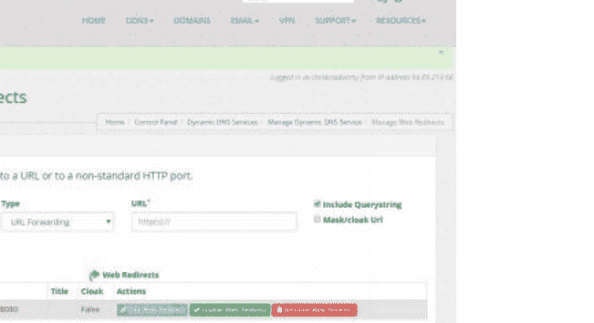

### 安装和配置 DDNS 客户端

你必须首先确定路由器是否提供 DDNS 服务，如果提供，它支持哪些 DDNS 服务器。在路由器基于 Web 的界面的“Access Management”（访问管理）部分中，点击“DDNS”以确定我们的路由器是否支持特定的 DDNS 服务器。

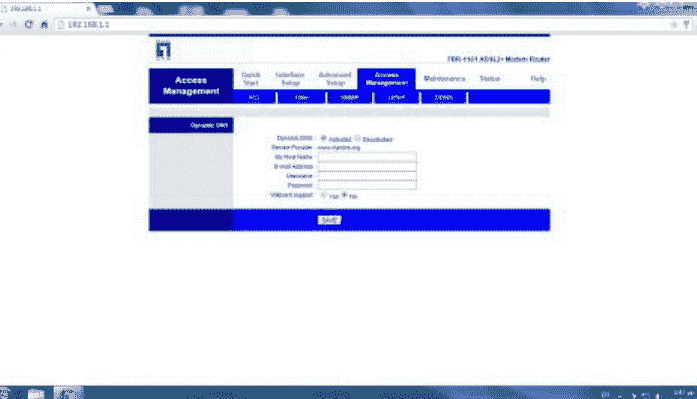

如果列出的 DDNS 服务器是你不想使用的服务器，则你无法使用路由器来实现 DDNS，而必须下载 Linux DDNS 客户端到我们的 Cherokee 服务器上。

有许多作为开源程序的 DDNS 客户端可用。与其随机选择 DDNS 客户端，DDNS 提供商通常会推荐一个 DDNS 客户端。在 `dynu.com` 中，点击“Support”菜单并选择“DOWNLOADS”。出现下载页面。点击“DDClient Configuration File”查找 `dynu.com` 关于配置 Linux 客户端的建议。

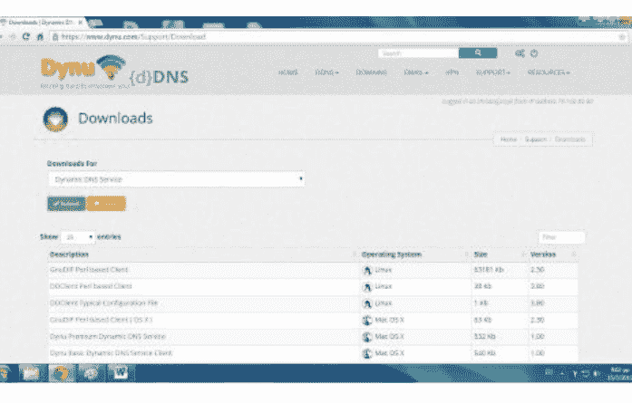

在 Ubuntu 终端中使用以下命令安装 `ddclient`：

```
$ sudo apt-get install ddclient
```

在整个安装过程中，会出现若干带有蓝色边框的屏幕用于 `ddclient` 的配置。由于你将使用一个现有的配置文件，请在每个屏幕上都按 ESC 键。

注意，若要移除 `ddclient`，你需要在命令行中输入：

```
$ sudo apt-get purge --auto-remove ddclient
```

安装完成后，使用 `gedit` 编辑 `/etc/ddclient.conf` 配置文件：

```
$ sudo gedit /etc/ddclient.conf
```

粘贴我们从 `dynu.com` 下载的配置文件中的行行。更改以下字段：

```
login=my_domain_name
password=a_passwd
```

还要输入你在 `dynu.com` 注册的域名：

`my_domain_name.dynu.com`

下图显示了域名 `christos.dynu.com` 的 `ddclient.conf`。


#### `ddclient.conf` - edit
# christos
# check every 60 seconds
#### comment
#### log update ms to syslog
#### mail all to root
#### mailroot
#### mail-for-hosts to root
#### mail-failure=root
#### record=300
#### use all comp. with ssl-library

#### get ip from server.
#### server=christos.dynu.com, web-skip='IP Address'
#### default server
#### server=dynu.com
#### default login
#### login=christos
#### password=7f6ak7e
#### protocol=2nd
#### christos.dynu.com

需要编辑的行：

`login=christos`

`password=7f6ak7e`

`christos.dynu.com`

要为你的服务器支持多个域名，请将 DDNS 提供商提供的针对第二个域名的特定行添加到 `ddclient.conf` 中。

### 测试 DDNS 客户端

在命令行中使用 query 参数 `ddclient` 来测试运行的 `ddclient` 守护进程：
```
$ sudo ddclient -query
```

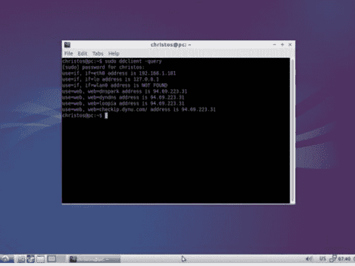

### 此命令应该输出你的路由器在特定时间的公共 IP 地址：

```
use=if, if=eth0 address is 192.168.1.101

use=if, if=lo address is 127.0.0.1

use=if, if=wlan0 address is NOT FOUND

use=web, web=dspark address is 94.69.223.31

use=web, web=dynndns address is 94.69.223.31

use=web, web=loopia address is 94.69.223.31

use=web, web=checkip.dynu.com/ address is 94.69.223.31
```

你可以通过在线网络工具检查，以确保 IP 地址（在我们示例中的 94.69.223.31）确实是你路由器的公共 IP 地址。你也可以读取 syslog 文件来找到 `ddclient` 在 DDNS 服务器更新 IP 地址的日期和时间。

```
$ sudo cat /var/log/syslog | grep SUCCESS
```

命令的输出示例如下：

```
May 17 07:39:31 pc ddclient[1125]: SUCCESS: updating christos.dynu.com: good: IP address set to 94.69.223.31

May 17 07:39:32 pc ddclient[1125]: SUCCESS: updating webserver.dynu.com: good: IP address set to 94.69.223.31
```

你还可以在路由器 IP 地址更改时检查 `ddclient` 的响应。关闭路由器几秒钟然后重新启动。你的路由器的公共 IP 地址应该更新。使用 `ddclient` 查找新的 IP 地址：

```
christos@pc: ~$ sudo ddclient --query

use1, if-not is 192.168.1.181

use2, if-not is 127.0.0.1

use3, if-dyndro address is 79.130.93.2

use4, web-server address is 79.130.93.2

updating dynu.com: address is 79.130.93.2

christos@pc: ~$
```

```
$ sudo ddclient --query
```

命令的输出变为：

```
use=if, if=eth0 address is 192.168.1.101

use=if, if=lo address is 127.0.0.1

use=if, if=wlan0 address is NOT FOUND

use=web, web=djspark address is 79.130.93.2

use=web, web=dyndns address is 79.130.93.2

use=web, web=loopia address is 79.130.93.2

use=web, web=checkip.dynu.com/ address is 79.130.93.2
```

### 同样检查 syslog 文件：

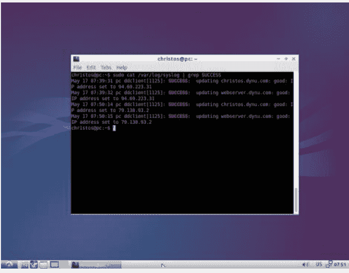

```
$ sudo cat /var/log/syslog | grep SUCCESS
```

命令的输出变为：
```
May 17 07:39:31 pc ddclient[1125]: SUCCESS: updating christos.dynu.com: good: IP address set to 94.69.223.31
May 17 07:39:32 pc ddclient[1125]: SUCCESS: updating webserver.dynu.com: good: IP address set to 94.69.223.31
May 17 07:50:14 pc ddclient[1125]: SUCCESS: updating christos.dynu.com: good: IP address set to 79.130.93.2
May 17 07:50:15 pc ddclient[1125]: SUCCESS: updating webserver.dynu.com: good: IP address set to 79.130.93.2
```

### 使用域名测试站点

要使用从 `dynu.com` 获取的新新域名来测试你的站点，请访问 `tools.pingdom.com`。在 Test Now（立即测试）文本字段中，输入你站点的新 DDNS URL：

`http://christos.dynu.com`
或
`http://christos.dynu.com:8181`
如果在 DDNS 服务中未启用端口转发。

将会出现 Cherokee 测试页面以及一些性能统计：

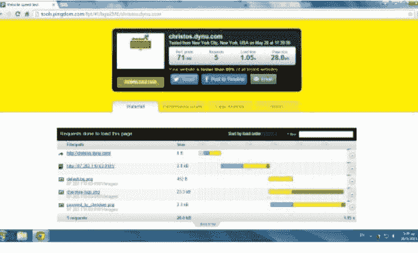

点击网页图标可以放大 Cherokee 测试页面：

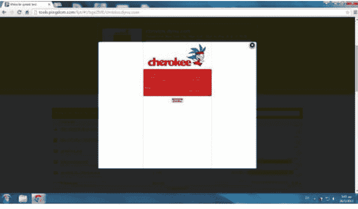

## 第 7 章 构建你的站点

在本章中，你将用另一个文件替换你当前的主页（即默认的 Cherokee 目录索引 `index.html`）。正如你可能记得的，`index.html` 是 Cherokee 测试页面。

接下来，你将以最简单的方法使用 HTML 创建网页。HTML 代表超文本标记语言（Hypertext Markup Language），是发明用于创建网页的第一种语言。对 HTML 的详细研究不在本书的范围之内，但我们将查看一些基础 HTML 来入门。有很多在线教程（例如，`http://www.w3schools.com`），你可以在那里继续构建你对 HTML 的知识。

在本章的最后一节，你将创建一个 PHP 页面，在你启用服务器 PHP 支持后可以在 Cherokee 服务器上使用它。安装 PHP 和创建 PHP 虚拟服务器的步骤包含在第 9 章中。将创建的 PHP 页面是一个在线网络工具，用于显示访问者的 IP 地址。

### 创建 HTML 文件

要创建新的 HTML 文件，可以使用命令行中的 `gedit`，或者在桌面或文件夹上右键点击并选择“新建（Create New）”，然后选择“空文件（Empty File）。

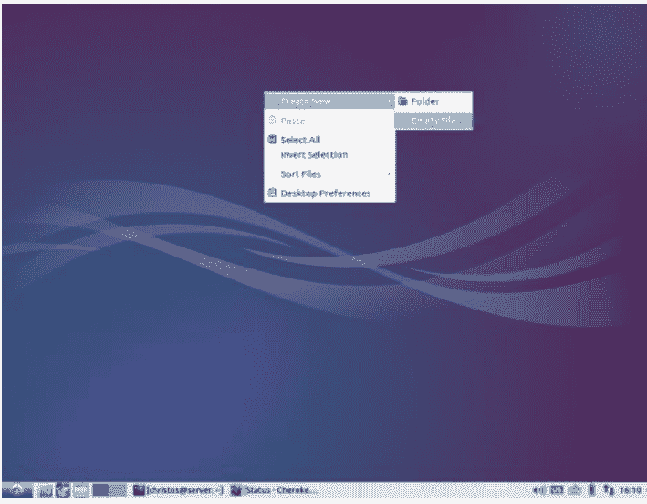

在出现的窗口中，输入文件名。如果你为站点创建目录索引并想保留默认索引名，请输入 `index.html`。

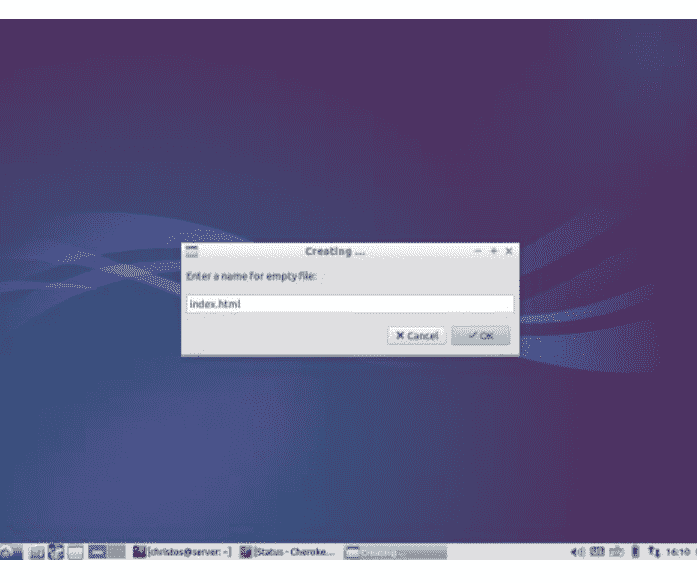

要将文件作为网页打开，双击该文件或右键点击并选择一个可用浏览器（例如 Firefox Web Browser）。要编辑网页并输入 HTML 代码，右键点击并选择编辑器（例如 `edit`）。如果没有 `gedit`，请使用 `apt-get` 安装包。在 Linux 终端中：

```
$ sudo apt-get
```


### HTML 标签

HTML 使用各种标签来定义网页的结构和内容。大多数标签成对出现：一个起始标签和一个结束标签。

- `<html>`：HTML 文档的根元素。
- `<head>`：包含文档的元数据，如标题和样式。
- `<body>`：包含页面的可见内容。
- `<title>`：设置在浏览器标签页上显示的标题。
- `<p>`：定义一个段落。
- `<h1>` 到 `<h6>`：定义标题。
- `<a>`：定义超链接。
- ``：嵌入图像。
- `<ul>`, `<ol>` 和 `<li>`：定义列表。

基础 HTML 结构示例：

```html
<html>
<head>
    <title>我的第一个页面</title>
</head>
<body>
    <h1>欢迎！</h1>
    <p>这是一个段落。</p>
</body>
</html>
```

`<A HREF="docs/page1.html" style="font-size:200%">关于 Cherokee</a>`
<br /><br />
`<A HREF="docs/page2.html" style="font-size:200%">其他 Web 服务器</a>`
</p>
</body>
</</html>

之前的 HTML 代码创建了一个有一个图像链接和两个文本链接的网页。该链接是外部的，因为它指向另一个网站的页面（`cherokee-project.com`）。文本链接是网站内部的（`page1.html` 和 `page2.html`）。


这两个页面放置在 `/var/www` 的 `docs` 子目录中，因此通过相对于（文档根目录）名称 `docs/page1.html` 和 `docs/page2.html` 进行访问。同样，代码中使用的图像 `cherokee.png` 放置在 `images` 目录中，并通过相对名称 `images/cherokee.png` 进行引用。

### 创建 PHP 页面

PHP 是一种流行的用于服务器端脚本的编程语言，它可以提供动态内容。在第 9 章中，你将启用一个 Cherokee 虚拟服务器，允许客户端请求由 PHP 解析器处理。在第 13 章中，你将运行一个基于 PHP 和 MySQL 的数据库功能网站。在本节中，你将创建一个名为 `index.php` 的第一个 PHP 页面。

作为你的第一个 PHP 页面，你将创建一个类似于你以前使用过的查找 IP 地址的在线网络工具。该 PHP 页面将显示你网站访问者的当前 IP 地址。

使用你的文本编辑器创建 `index.php` 文件并放置以下行：

```
<?php
$ip = $_SERVER['REMOTE_ADDR'];
echo "Your IP address is $ip";
?>
```


之前的代码段将变量 `$ip` 赋值为 `$_SERVER` 数组中索引为 `REMOTE_ADDR` 的元素值。`$_SERVER` 数组是一个定义变量，包含头、路径和脚本位置等信息。该数组中的项是由 Web 服务器动态创建的。在数组的索引 `REMOTE_ADDR` 处，服务器存储了用户的 IP 地址。

更改文本格式——例如，使用绿色文字且字体大小为 80 像素并居中对齐——可以使用 HTML 段标签（`<p>`）的 `style` 属性：

注意，为了转义 `echo` 命令内部的双引号（"）以便其不被解释为 echo 字符串的结束，你使用反斜杠（\）作为转义字符。

按照第 9 章后面描述的步骤，为带有 `index.php` 目录文件的 Cherokee 创建一个启用 PHP 的虚拟服务器。使用在线网络工具测试网站。下面的图片显示了从 tools.pingdom.com 看到的页面：

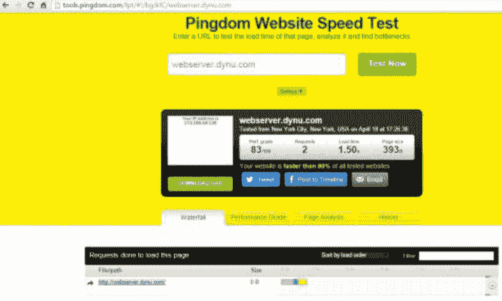

点击上一图中远程浏览器的屏幕进行放大：

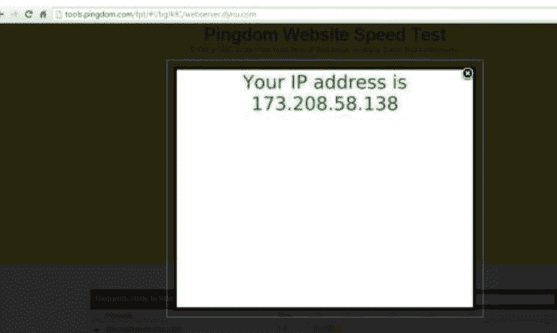

显示的 IP 地址是远程在线工具的 IP 地址。你可以通过在 tools.pingdom.com 上选择不同的系统来重复测试。点击 Settings（设置）链接并选择另一个国家的服务器以显示其 IP 地址。

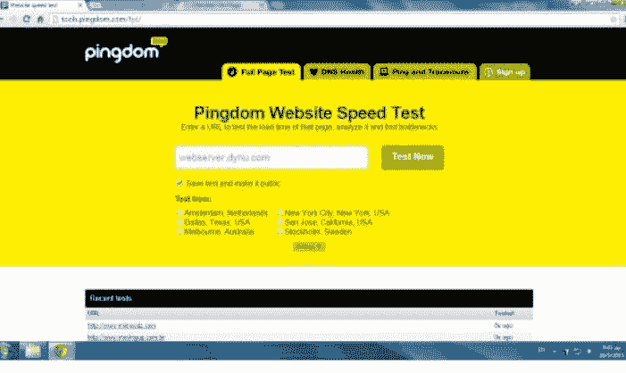

## 第 8 章 手动创建虚拟服务器

本章的重点是创建虚拟服务器并手动设置其行为的过程。在下一章中，你将使用向导来帮助你开发 PHP 服务器。

### 匹配虚拟服务器

创建虚拟服务器时，`vServers` 选项卡包含了决定服务器如何行为的设置。向导是帮助系统配置虚拟服务器的助手。

虚拟服务器的规则

在 Host Match 选项卡中，你设置虚拟服务器的规则。该部分包含了虚拟服务器的三个属性，以及服务器如何处理请求的设置。


在 Basics 选项卡中，你设置虚拟服务器的 `set` 属性（例如 `index.php` 目录文件）。在 Method 方法的下拉菜单中，可以选择以下方法来匹配服务器：

- 匹配名称（Match Nickname）
- 通配符（Wildcards）
- 正则表达式（Regular Expressions）
- 服务器 IP（Server IP）

你创建的每个虚拟服务器都会添加到 `vServers` 列表中。该列表从上到下进行评估。一旦匹配到虚拟服务器，评估就会停止。例如，考虑已经存在两个虚拟服务器：

- webserver.dynu.com
- myWebServer

下面的图片显示了列表中的两个虚拟服务器：


你可以通过点击服务器名称旁的双箭头来更改列表中服务器的顺序。你还可以通过点击服务器名称右侧的圆形按钮禁用或启用服务器。还有一个 'x' 按钮可以删除服务器。

第一个服务器的名称对应一个有效的域名，而第二个服务器的名称则不是。对于第一个服务器，选择了 Host Match 方法，这需要一个有效的域名；而第二个服务器选择了 Server IP，这需要一个特定的 IP 地址（例如 192.168.1.101）。

### 服务器规则查找与处理

一旦从列表中选择了处理请求的虚拟服务器，请求将针对你为该虚拟服务器创建的规则进行评估。例如，考虑一个请求 `.html` 扩展名的规则，或者一个针对端口 8080 的规则。因此，必须搜索两个列表。再次，评估是从列表顶部到部执行的。如果没有规则适用于客户端请求，则由默认规则胜出。

虚拟服务器规则定义了服务器采取行动的条件以及如何处理请求。你可以在 `vServers` 的 Behavior 选项卡中设置规则。此部分包含了你当前设置的规则以及每个虚拟服务器预设的默认规则。

该 URL：

http://cherokee-project.com/doc/config_virtual_servers_rule_types.html

描述了规则类型。

在 Handler（处理器）选项卡中，你为从列表中当前选中的规则设置处理器。你可以选择以下一种规则处理器之一：

- 无 (None)
- 列表与发送 (List & Send)
- 静态内容 (Static Content)
- 仅列出列表 (Only listing)
- 重定向 (Redirection)
- CGI 执行 (CGI Execution)
- FastCGI 服务器支持 (FastCGI Server Support)
- SCGI 服务器支持 (SCGI Server Support)
- uWSGI 服务器支持 (uWSGI Server Support)
- HTTP 反向代理 (HTTP Reverse Proxy)
- 音频/视频流 (Audio/Video streaming)
- 服务器端包含 (Server Side Includes)
- 隐藏下载 (Hidden Downloads)
- MySQL 桥接 (MySQL Bridge)
- HTTP 错误 (HTTP Error)
- 1x1 透明 GIF (1x1 Transparent GIF)
- 站点信息 (Server Info)
- 远程管理 (Remote Administration)

#### URL：

http://cherokee-project.com/doc/config_virtual_servers_rule.html

为了继续当前章节的示例，我们选择了名为 webserver.dynu.com 的虚拟服务器。这包含了两个规则和一个默认规则（Default）。对于这两条规则，选择了规则类型 Extensions（扩展名）；第一个使用了 html，第二个使用了 htm。此外，第一个规则选择了处理器 List & Send（列表与发送），第二个规则选择了 Only Listing（仅列出列表）。默认规则不能分配任何规则类型，但可以设置处理器。我们假设它被设置为 None（无），默认服务器的默认规则也设置为 None。

通过在浏览器地址栏中输入以下 URL：

http://webserver.dynu.com/info.html

虚拟服务器向客户端浏览器分发网页 info.html。在这种情况下适用的规则是 List & Send，因此可以提交网页。

通过输入以下 URL：

http://webserver.dynu.com/info.html

结果是 HTTP 错误消息 404。这是 Not Found（未找到）错误消息，其原因是在此处适用的处理器被选择了 Only Listing（仅列出列表）。

如果在请求中将 index.htm 设置为目录索引：

http://webserver.dynu.com

将列出文档根目录（找到 index.htm 的目录）。

如果将 index.html 设置为目录索引，则请求：

http://webserver.dynu.com

向客户端浏览器发送页面 index.html。

通过输入以下 URL：

http://webserver.dynu.com/about.pdf

结果是 HTTP 错误消息 405 (Method Not Allowed，方法不允许)）。


#### 创建虚拟服务器的基本步骤

接下来你将创建一个分发静态（HTML）内容的虚拟服务器。在管理面板的 `vServers` 部分，点击 Add New Virtual Server（添加新虚拟服务器）按钮，即 Cherokee 窗口左上角带有蓝色加号的按钮。


在出现的对话框中，在 Nick（昵称）文本字段中输入昵称 HTML Server，并在 Document Root（文档根目录）字段中输入目录 `/var/www1`。Cherokee 将从该目录为你的虚拟服务器提供服务。


在点击 Add（添加）按钮之前，打开终端窗口输入以下命令创建目录 `/var/www1`：

```
$ sudo mkdir /var/www1
```

使用 edit 或任何文本编辑器编辑 index.html：

```
$ sudo edit index.html
```

index.html 的 HTML 源代码如下：

```
<!DOCTYPE html>
<html lang="en">
<head>
<meta http-equiv="Content-Type" content="text/html;charset=utf-8"/>
<title>Cherokee Server</title>
</head>
<body bgcolor="orange">
```

返回管理面板并点击 Add。

新服务器已添加到 `vServers` 部分左侧的 Virtual Server 列表中。为了确保配置了正确的服务器，请直接验证标签上方的虚拟服务器名称。如果不是，请点击服务器列表中的服务器名称。

#### 配置 Basics 选项卡

在 Basics（基础）选项卡中，在 Directory Indexes（目录索引）文本字段中输入文件名 `index.html`。Directory Indexes 文本字段设置了客户端通过在目录名称末尾指定斜杠（/）请求目录索引时要搜索的文件列表。我们点击面板右上角的 SAVE（保存）按钮。管理面板询问是否需要重启。应用新更改需要重启。在出现的对话框中点击 Graceful restart（平滑重启）按钮。


#### 配置 Host Match 选项卡

接下来，点击 Host Match（主机匹配）选项卡，那里有四种方法。从 Method（方法）下拉菜单选择 Server IP（服务器 IP）选项。点击 Add new IP/Subnet（添加新 IP/子网）按钮，并在出现的对话框文本字段中输入 Web 服务器的私有 IP 地址。在示例示例，使用了地址 192.168.1.101。点击 Add（添加）按钮。IP or subnet 文本框现在反映了服务器的私有 IP 地址。

根据之前的配置，任何目标地址为 192.168.1.101 的数据包接收到的服务器客户端请求将被接受。

#### 配置 Behavior Tag

点击 `vServers` 部分的 Behavior（行为）选项卡以为虚拟服务器应用规则。点击 Rule Management（规则管理）按钮，会出现一组新选项卡（Rule、Handler 等）。如果稍后需要返回之前的选项卡，请点击顶部的 `vServers` 链接。

#### 配置 Rule Tag

在 Rule（规则）选项卡中，在 Rule Type（规则类型）下拉菜单选择 Extensions（扩展名），并在 Extensions 文本框中输入 html,htm。勾选 Check local file（检查本地文件）复选框。点击规则名称右侧的'x'框删除任何其他预定义规则，例如 Directory /icons。


#### 配置 Handler Tag

在 Handler（处理器）下拉菜单中选择 List & Send（列表与发送），并在 Document Root（文档根目录）文本框中清除任何输入。这指定了一个备用的文档根目录。


### 启动虚拟服务器

点击 Cherokee 管理面板中的 `vServers`（虚拟服务器）部分，然后点击 Add New Virtual Server（添加新虚拟服务器）按钮。该按钮是 Cherokee 管理面板左上角带有蓝色加号的按钮。

在弹出的对话框中，在 Nick（昵称）文本框中为服务器输入一个昵称。此昵称可以是对应新虚拟服务器的域名。在我们的示例中，这是一个像 PHP Server 这样的简单名称。你还必须输入 Document Root（文档根目录）。Ubuntu 的默认 Document Root 为：

```
/var/www
```

或

```
/usr/local/var/www
```

为你的虚拟服务器创建目录 `/var/www2`。这个新目录将作为我们的 `Document Root`。在 Linux 终端窗口中输入：

```bash
$ sudo mkdir /var/www2
```

返回 Cherokee 管理面板，在 Document Root 文本框中输入新创建的目录名称并点击 Add（添加）按钮。


新的虚拟服务器出现在管理面板左侧的 Virtual Servers 列表中。

添加新虚拟服务器后，当你想要配置此服务器时，必须小心从 `vServers` 左侧区域列表中选择该服务器。否则，你可能会意外更改另一个虚拟服务器的设置。当前服务器名称显示在标签正上方。

在 Basics（基础）选项卡中，在 Directory Indexes（目录索引）文本框中输入 `index.php`。稍后你将创建一个名为 `index.php` 的 PHP 文件。

在接下来的部分中，你将为 Cherokee 安装并启用 PHP 语言。

对于此虚拟服务器，我们选择了一个与 Web 服务器域名不对应的昵称，因为我们将在 Host Match（主机匹配）方法中使用 Use IP（使用 IP）选项。点击 Host Match 选项卡，在 Method（方法）下拉菜单中选择 Server IP 方法。点击出现的 Add new IP/Subnet（添加新 IP/子网）按钮旁的 Next ，输入 Web 服务器的私有 IP 地址（例如 192.168.1.101）。点击 Add 按钮。


IP or Subnet 文本框已更新为服务器的私有 IP 地址。


### PHP 安装与配置

在 Ubuntu 上安装 PHP，在终端输入以下命令：

```bash
$ sudo apt-get install php5 php5-cgi
```

要配置 PHP，使用 `gedit` 命令编辑 *php.ini* 文件。根据 PHP 版本的不同，此文件可能位于不同的目录。尝试：

```bash
$ sudo gedit /etc/php5/cgi/php.ini
```

或

```bash
$ sudo gedit /etc/php/php.ini
```

通过删除分号（;）来取消以下配置选项的注释：
`;cgi.fix_pathinfo=1`

还必须创建一个 .php 文件作为我们网站的索引。使用 Linux 编辑器在 Document Root 目录中创建 `index.php` 文件。在 Linux 终端中输入：

```bash
$ sudo edit /var/www2/index.php
```

在弹出的编辑窗口中，输入并保存以下 PHP 程序。此简单程序将输出我们当前运行的 PHP 版本的一些信息：

```php
<?php
phpinfo();
?>
```


### 在 Cherokee 中启用 PHP 解释器

点击 `vServers` `Cherokee` 部分的 `Behavior`（行为）选项卡。接着点击 `Rule Management`（规则管理）按钮。


出现了一组新标签。

点击 `Add Behavior Rule`（添加行为规则）按钮，该按钮是 `Cherokee` 窗口右上角带有蓝色加号的按钮。在弹出的对话框中，在左侧列表中选择 `Languages`（语言），然后点击右侧的 `PHP` 选项。点击 `Add` 按钮。


在随后出现的 `PHP` 向导对话框中，点击 `Create`（创建）按钮。


管理面板左侧列表中出现了一条条名为 `Extensions php` 的新规则。


注意到规则列表中规则名称旁边有一个 `NON FINAL`（非最终）按钮。点击此按钮将其切换为 `FINAL`（最终）。当规则被标记为 `FINAL` 时，将不再应用其他规则。

注意，`Cherokee` 会自动创建适用于某些目录的规则（例如 `/cherokee-themes` 和 `/cherokee_icons`）。点击规则名称旁边的 'x' 按钮删除这些规则。

点击 `Handler`（处理器）选项卡。注意 `Handler` 菜单已由向导设置为 `FastCGI`。`FastCGI` 是一种将交互式程序与 Web 服务器连接的编程接口。


`FastCGI` 使用一个别称为 `PHP Interpreter`（`PHP` 解释器）的信息源。`PHP Interpreter` 是位于 `localhost` 端口 `47990` 的 `FastCGI` 服务器。


要保存设置，点击管理面板右上角的 `SAVE` 按钮。使用 `Graceful restart`（优雅重启）按钮重启 `Cherokee` 服务器。

## 测试 PHP 服务器

让我们使用 `tools.pingdom.com` 测试你的 `PHP` 服务器。在文本框中输入为该站点注册的第二个域名 `webserver.dynu.com`。点击 `Test Now`（立即测试）按钮并等待结果。


结果页中的图像显示了我们的网页在远程浏览器中显示的样子。你可以点击图像查看完整显示：

### Pingdom 网站速度测试

输入 `URL` 开始任何页面的速度测试，对其进行分析并基准测试。


未识别

## 第 10 章 同时用于动态和静态内容的虚拟服务器

### 实现多条规则

接下来我们将启用 `PHP` 服务器也提供静态 `HTML` 站点。之前已为静态内容创建了一个新的文档根（`Document Root`）：

```
$ sudo mkdir /var/www2/www
```

记得 `/var/www2` 已设置为 `PHP` 服务器的文档根。

使用 `gedit` 或或其他编辑器，在 `www` 目录中创建 `index.html` 文件：

```
$ sudo gedit /var/www2/www/index.html
```

在 `index.html` 中输入以下 `HTML` 代码：

```html
<!DOCTYPE html>
<html lang="en">
<head>
<meta http-equiv="Content-Type" content="text/html" charset="utf-8"/>
<title>Cherokee Server</title>
</head>
<body bgcolor="yellow">
</body>
</html>
```

接下来，在虚拟服务器的 `Directory Indexes`（目录索引）文本框中添加新目录，用逗号分隔两个目录索引：

```
index.php, www/index.html
```

点击 `Behavior`（行为）选项卡并点击 `Rule Management`（规则管理）按钮。在这里，你将创建一个用于管理静态 `HTML` 内容的规则。点击 `Add Behavior Rule`（添加行为规则）按钮，即窗口左上角带有蓝色加号的按钮。

在弹出的对话框中，在 `Rule Type`（规则类型）下拉菜单中选择 `Extensions`（扩展名），并在 `Extensions` 复选框中输入 `html`。点击 `Add`（添加）按钮。


新规则名为 `Extensions html`，它将出现在管理面板左侧区域的规则列表中：


/var/www2/www


点击 `SAVE`（保存）按钮确认更改，然后点击 `Graceful Restart`（软重启）按钮提交更改。

### 测试扩展工具

使用在线网络工具 `tools.pingdom.com` 测试你的站点。在文本字段中输入 `URL` `webserver.dynu.com`。如第 9 章之前所述，`PHP` 服务器的目录索引（`index.php`）将被分发。再次运行测试并输入 `URL` `webserver.dynu.com/index.html`。这一次，静态服务器将提供我们在本节中创建的新型彩色页面 `index.html`。


### 在 Cherokee 规则中使用逻辑运算符

接下来，修改 `Extensions html` 规则，创建一个通过 `AND` 逻辑运算符组合的两个规则的复合规则。`Cherokee` 提供了三个逻辑运算符来组合规则：`AND`、`OR` 和 `NOT`。规则处理器与 `Extensions html` 相同。当在端口 `8080` 上接收到对扩展名为 `html` 的文件的请求时，句器 `Static Content`（静态内容）将响应目录索引（这是一个 `HTML` 文件）。

选择 `Rule`（规则）选项卡并点击列表中的 `Extension html` 规则以修改该规则。点击 `AND` 按钮，出现一个新的 `Rule Type` 菜单。选择规则类型 `Incoming IP/Port`（入站 `IP`/端口），然后在 `Incoming IP/Port` 菜单中选择 `Port 8080`。点击 `SAVE` 按钮并重启服务器。名为 `Extensions AND Port 8080` 的复合规则被激活。


为了确保不符合此规则的请求不会被保存，请禁用 `Default`（默认）规则。在 `Handler`（处理器）选项卡的规则列表中，点击 `Default` 并在 `Handler` 菜单中选择 `None`。这将拒绝例如对端口 `8181` 上的 `index.html` 的请求。

要测试新规则，请使用在线网络 `tools.ping.com`。这一次你可以使用路由器的公 `IP` 地址来测试服务器。使用在线工具查找当前的 `IP` 地址，或直接在 Google 搜索框中输入 "find my ip"。将显示你当前的 `IP` 地址，例如 `87.202.110.63`。在 `tools.ping.com` 的 `Test Now` 文本字段中输入：

```
87.202.110.63:8080/index.html
```

点击 `Test Now` 按钮查看结果。将分发以下页面：


再次运行测试。这一次，使用端口号 `8181`（它不满足复合规则的第二个条件）：

87.202.110.63:8181/index.html

结果显示在：


点击浏览器窗口进行放大。显示 `HTTP 405` 错误信息（`Method Not Allowed`，方法不允许）。


## 第 11 章 使用多个域名

在上一章中配置了一个虚拟服务器，为不同类型的内容（`html` 和 `php`）提供两条规则。在本章中，我们将配置服务器提供两条规则：一个是接受端口 `8080` 连接的规则，另一个是接受端口 `8181` 连接的规则。记得我们现在有两个注册的 `DDNS` 域名：

- `webserver.dynu.com`，使用端口 `8080` 的端口转发
- `christos.dynu.com`，使用端口 `8181` 的端口转发

对于给定的资源请求，`Cherokee` 将在其规则中查找与请求域名匹配的项。

### 应用多条规则

在 `Cherokee` 管理面板的 `vServers` 部分，点击 `Add New Virtual Server`（添加新虚拟服务器，即蓝色加号按钮）。在弹出的对话框中，在 `New` 文本框输入 `One Server with Two domains`，并在 `Document Root` 文本框中输入值 `/var/www3`。点击 `Add` 按钮。在 `vServers` 部分的 `Basics` 选项卡中，在 `Directories` 文本框中输入 `index.html`。


点击 `Host match`并在 `Method` 下拉菜单中选择 `Server IP`。点击 `Add Subnet`，对话框中输入私有 `IP`（例如 `192.168.1.101`）并点击 `Add` 按钮。


现在反映了服务器的私有 `IP`。进入 `Behavior` 选项卡并点击 `Rule Management` 按钮。在管理面板左侧区域你可以找到预定义的规则。


要删除预定义规则，点击规则名称右侧的“x”。再次点击 `Add Behavior` 按钮（左上角的蓝色加号）。在对话框中，在 `Rule Type` 下拉菜单中选择 `Incoming IP/Port`，并在 `Incoming IP/Port` 下拉菜单中选择服务器监听的端口之一，即 `8080`。点击 `Add` 按钮。


`Rule` 选项卡反映了这些设置并允许你更改。


在 `Handler` 选项卡中选择 `Server Info`。

我们需要另一条规则。再次点击 `Add Behavior` 按钮。在对话框中，在 `Rule Type` 下拉菜单中再次选择 `Incoming IP/Port`，并选择另一个端口 `8181`。点击 `Add` 按钮。


在 `Handler` 选项卡中选择 `Only Listing`。

最后，点击窗口左上角的 `SAVE` 按钮，然后在对话框中选择 `Graceful restart`。

### 使用多个 URL 测试虚拟服务器

要测试你的虚拟服务器，你将再次使用 `tools.pingdom.com`。在开始测试之前，记得启用两个域名的端口转发。在之前的示例中，这将是 `webserver.dynu.com` 的端口 `8080` 和 `christos.dynu.com` 的端口 `8181`。在文本字段中输入 `webserver.dynu.com`。点击 `Test Now` 按钮开始测试。


结果包含了有关 Web 服务器的信息。

## Cherokee Web 服务器 1.2.101 (UNIX)

在使用这些信息之前，请自行承担风险并对其进行进一步验证。

Cherokee 许可证
本程序是免费软件；您可以根据从我处获得的 GNU 通用公共许可证（GNU General Public License）条款对其进行重新分发和销售。详情请参阅 <http://www.gnu.org/licenses/>。
发布本程序是希望它有用有用，但**不提供任何形式的明示或暗示保证**，包括但不限于对特定用途适用性的保证。详情请参阅 GNU 通用许可证。
您可以分发或修改软件的部分，包括此模板包代码：Order 28, Boston, MA 0211-257


再次运行测试，这次使用 `URL` `christos.dynu.com`：


结果是文档根目录的列表：


请注意，考虑到设置的规则处理器，两种情况下的响应都是符合期的。

在这个示例中，两个域名 `christos.dynu.com` 和之前的 `christos.dynu.com` 之间存在差异，因为它们提供的内容不同——这与之前的示例不同。原因是 `DDNS` 将这些每个域名的请求重定向到不同的端口，并且每个端口都关联着不同的处理器。

## 第 12 章

### 并行运行虚拟服务器

在本章中，你将配置两个并行运行的虚拟服务器。由哪个虚拟服务器处理请求取决于请求 `URL` 中的域名菜单，而不是服务器的 `IP` 地址。回想一下在上一章中，你为同一个虚拟服务器使用了两个不同的名称。该服务器使用了两个基于端口号的不同规则来处理每个域名。在本章中，你可以使用 `Match Nickname`（匹配昵称）选项根据它们的域名来区分这两个虚拟服务器。在以下示例中，第一个虚拟服务器将使用 `webserver.dynu.com` 名称，第二个虚拟服务器将使用 `christos.dynu.com` 域名。

### 禁用端口转发服务

在本节中，你将了解到为什么需要端口转发（`Port Forwarding`）`DDNS` 服务来实现 `Match Nickname` `Cherokee` 主机匹配。

`Host` 选项卡中 `Method` 下拉菜单的 `Match Nickname` 选项用于创建一个虚拟服务器，当客户端请求 `URL` 中的域名与虚拟服务器名称匹配时，该服务器将做出响应。例如，当用户在浏览器地址栏中输入 `URL` 时：

```
http://webserver.dynu.com/news/file.html
```

`URL` 被包含在 `HTTP` 请求消息中，正如生成的 `HTTP` 请求所示：

```
GET/news/file.html HTTP/1.1
Host: webserver.dynu.com
```


Cherokee 服务器会将 HTTP 请求的 Host 与虚拟服务器名称进行比较，如果找到匹配（例如，虚拟服务器的名称为 `webserver.dynu.com`），则由特定的虚拟服务器处理该请求。

尽管如此，当使用端口转发 DDNS 服务时，之前的事件序列不会发生，所有的客户端-服务器消息都将路由到 DDNS 服务提供者的端口转发服务。当 DDNS 服务接收到已启用端口转发的域名请求时，DDNS 服务将用其自身的端口转发服务器 IP 地址进行响应，而不是 Cherokee 服务器前端路由器的公 IP 地址。当端口转发服务器接收到客户端的 HTTP 请求时，端口转发会将客户端重定向到 Cherokee 服务器前端路由器的公 IP 地址发送新的 HTTP 连接，而不是默认端口号 80（即你的服务器监听的端口，例如端口 8080）。端口转发服务器会修改 HTTP 连接请求中 Host 的域名（例如，将从 `webserver.dynu.com` 变为 `<router's-public-ip-address:8080>`）。端口和域名都必须先在 DDNS 服务提供者处注册（这在第 6 章中已完成）。

为了说明这一事件序列，我们将查看初始的 HTTP 请求（来自客户端系统）以及 Web 服务器接收到的 HTTP 请求。我们将查看两种情况：启用端口转发和禁用端口转发。我们将检查 HTTP 协议的标头，并将使用在线网络工具 HTTP Viewer：

`http://www.rexswain.com/httpviewer.html`

另一个提供类似服务的网站是 `http://web-sniffer.net`。让我们先看禁用 DDNS 端口转发服务的情况。在 HTTP Viewer 服务器网站的 URL 字段中：

`http://webserver.dynu.com:8080`


点击 `Submit` 按钮后，出现以下页面：


以下是该页面提供的部分信息。它包含了 `rexswain.com` 对 `webserver.dynu.com:8080` 的请求，该请求解析路由器的公 IP 地址（87.202.110.63），并最终通过虚拟服务器路由器配置到达分配端口 8080 的服务器，即你的 Web 服务器。

```
GET / HTTP/1.1

Host: webserver.dynu.com:8080

User-Agent: Mozilla/5.0 (Windows NT 6.1) AppleWebKit/537.336 (KHTML, like Gecko) Chrome/43.0.2357.65 Safari/537.36

Referer: http://www.rexswain.com/htptpview.html

Connection: close

Finding host ip...

Host IP address = 87.202.110.63

Finding TCP protocol...

Binding to local socket...

Connecting to host...

Sending request...

Waiting for response...

Receiving Header:
```

## 客户端请求中的 Host 字段为：

`http://webserver.dynu.com:8080`

网页还包括 Web 服务器对客户端（`rexswain.com`）的回复。这是一个 OK 类型的消息：

```
HTTP/1.1-200-OK(CR)(LF)

Connection:close(CR)(LF)

Date: Sun, 24-May-2015-04:38:37(CR)(LF)

Server: Cherokee/1.2.101 (UNIX)(CR)(LF)

Content-Length: 670(CR)(LF)

Content-Type: text/html(CR)(LF)

Expires: Tue, 01-Jan-1970-00:00:00+0000(CR)(LF)
```
注意 `(CR)` 和 `(LF)` 对应回车和换行符，作为 HTTP 字段的分隔符。

接下来，登录你的 DDNS 提供商管理网站并启用端口转发。返回 HTTP Viewer (`www.rexswain.com`) 并使用以下 URL：

```
http://webserver.com
```

由于启用了端口转发，不再给出端口号（8080）。结果如下所示：


### 以下是客户端到转发服务器的请求以及 rexswain.com 页面列出的服务器回复：

```
GET / HTTP/1.1

Host: webserver.dynu.com

User-Agent: Mozilla/5.0 (Windows NT 10.0) AppleWebKit/537.36 (KHTML, like Gecko) Chrome/43.0.2357.65 Safari/537.36

Referer: http://www.rexswain.com/httpview.html

Connection: close
```
- Host IP address = 173.208.132.91
- Finding TCP protocol...
- Binding to local socket...
- Connecting to host...
- Sending request...
- Waiting for response...

Receiving Header:

### 这次，客户端发送的 *Host* 为：

`http://webserver.dynu.com`

同时也列出了对应此 URL 的 IP 地址信息。该 IP 地址是 DDNS 服务提供者的端口转发服务器的 IP 地址：

Host IP address = 173.208.132.91

### 端口转发服务器回复以下消息：

```
HTTP/1.1:302-Object-moved(CR)(LF)

Date: Sat, 23-May-2015-05:58:19-GMT(CR)(LF)

Server: Dyn-Web-Server(CR)(LF)

X-Powered-By: Dyn-Dynamic-DNS-Service(CR)(LF)

Location: http://87.202.110.63:8080/(CR)(LF)

Content-Length: 145(CR)(LF)

Content-Type: text/html(CR)(LF)
```

之前是 `rexswain.com` 向 DDNS 提供的者的端口转发服务器发送连接请求。端口转发服务器使用“对象已移动”（Object Moved）消息将客户端重定向到 Web 服务器局域网路由的公网 IP 地址，端口为 8080，这正是被转发的端口。随后是另一个步骤，通过另一个连接请求让客户端（`rexswain.com`）连接路由器并最终连接 Web 服务器。从 `rexswain.com` 到 Web 服务器的连接是通过两个请求完成的。第二个连接请求消息也包含在 rexswain 的网页中：

```
GET / HTTP/1.1

Host: 87.202.110.63:8080

User-Agent: Mozilla/5.0 (Windows NT 6.1) AppleWebKit/537.36 (KHTML, like Gecko) Chrome/43.0.2357.65 Safari/537.36

Referer: http://www.rexswain.com/httpview.html

Connection: close
```
- 正在查找 TCP 协议...
- 正在绑定到本地套接字...
- 正在连接到主机...
- 正在发送请求...
- 等待响应:...

接收到报头：

### Web 服务器的响应是 HTTP 消息 200 (OK)：

```
HTTP/1.1-200-OK(CR)(LF)

Connection: close(CR)(LF)

Date: Sun, 24-May-2015 03:58:46-GMT(CR)(LF)

Server: Cherokee/1.2.101 (UNIX)(CR)(LF)

Content-Length: 6708(CR)(LF)

Content-Type: text/html(CR)(LF)

Expires: Tue, 01-Jan-1970-00:00:00-GMT(CR)(LF)

(CR)(LF)
```

在禁用端口转发时，客户端消息中的 Host 字段对应服务器的域名。然而，在启用端口转发时，发送到服务器的第一个请求消息的 Host 字段虽然对应服务器的域名，但它会被重定向。随后的第二个连接请求消息将具有一个修改过的 Host 字段。

你也可以使用数据包嗅探器检查到达服务器计算机的客户端 HTTP 请求，数据包嗅探器是一种用于捕获和分析通过网络的数据包的程序。如果你没有数据包嗅探器，你需要安装 Wireshark。从你 Web 服务器的 Linux 终端上运行：

```
$ sudo apt-get install wireshark
```

安装完成后，在终端窗口中输入以下内容：

```
$ sudo wireshark
```


### Wireshark 窗口打开：


在 `Capture`（捕获）菜单中选择 `Interfaces`（接口）。出现一个对话框。选择你使用的接口（例如 `eth0`）。点击 `Start`（开始）开始捕获数据包。


Wireshark 开始捕获服务器计算机发送和接收的数据包：

### 从 `eth0` 捕获 [Wireshark 1.10.8 (v1.10.8 from master-1.10)]

| No. | Type | Source | Destination | Protocol | Info |
|---|---|---|---|---|---|
| 250 | TCP | 192.168.1.101 | 192.168.1.1 | TCP | 54 > 80 [SYN] Seq=13252 Ack=0 |
| 251 | TCP | 192.168.1.1 | 192.168.1.101 | TCP | 80 > 54 [SYN, Ack] Seq=1 Ack=13253 Win=6420 |
| 252 | TCP | 192.168.1.101 | 192.168.1.1 | TCP | 54 > 80 [ACK] Seq=13253 Ack=1 |
| 253 | TCP | 192.168.1.1 | 192.168.1.101 | TCP | 80 > 54 [PSH, Ack] Seq=1 Ack=13253 Win=6420 |
| 254 | TCP | 192.168.1.101 | 192.168.1.1 | TCP | 54 > 80 [ACK] Seq=13253 Ack=1 |
| 255 | TCP | 192.168.1.1 | 192.168.1.101 | TCP | 80 > 54 [ACK] Seq=1 Ack=13253 Win=6420 |

Frame 1: 62 bytes on wire (62 bytes), Bits captured (49 bytes) on interface `eth0`
Ethernet, Destination: 00:00:5e:00:53:01, Source: 00:00:5e:00:53:02, Type: IPv4 (0x0800)
Internet Protocol Version: 4, Src: 192.168.1.101, Dest: 192.168.1.1, Length: 54, Flags: 0, Identification: 0, Fragment offset: 0, TTL: 64, Protocol: 6, Checksum: 0x, Options: 0, Data: 255.255.255.255.255.255.255.255
TCP Source Port: 80, Destination Port: 54, Sequence number: 1, Acknowledgement number: 0, Flags: [S], Window size: 6420, Checksum: 0x, Options: 0


访问 `tools.pingdom.com` 并请求你的网页。（由于 DDNS 端口转发，不要忘记端口号）。://webserver.dynu.com:8080


点击 `Stop`（停止捕获）按钮（红色正方形）。接下来，尝试找到来自 `tools.pingdom.com` 的请求。这是来自 `tools.pingdom.com` 客户端指向 Web 服务器（IP 地址为 192.168.1.101）的 HTTP 消息：`GET / HTTP/1.1`

### Wireshark 1.10.0 (from-master-1)

| Time | No | Source | Destination | Protocol | Length | Info |
|---|---|---|---|---|---|
| 71.579999000 | 1 | 192.168.1.105 | 93.184.216.34 | HTTP | 51 | GET /index.html |
| 71.579999000 | 2 | 93.184.216.34 | 192.168.1.105 | TCP | 54 | 61748 -> 41745 [ACK] Ack=1 Win=29212 |
| 71.580000000 | 3 | 192.168.1.105 | 93.184.216.34 | TCP | 54 | 54 http-alt [ACK] Ack=61748 Win=65535 |
| 71.580000000 | 4 | 93.184.216.34 | 192.168.1.105 | TCP | 236 | 236 TCP segment of a reassembled PDU |
| 71.580000000 | 5 | 192.168.1.105 | 93.184.216.34 | TCP | 1456 | 1456 TCP segment of a reassembled PDU |
| 71.580000000 | 6 | 93.184.216.34 | 192.168.1.105 | TCP | 1456 | 1456 TCP segment of a reassembled PDU |

Frame 76: 442 bytes on wire (442 bytes), 442 bytes captured (442 bytes) on interface 0
Ethernet, Src: 00:0c:29:4f:8b:31, Dst: 5d:53:59:dc:d4:22
Internet Protocol Version: 4, Src: 192.168.1.105, D: 93.184.216.34, Len: 60
Transmission Control Protocol, Src: 61748, D: 41745, Dst Port: http (80), Seq: 1, Ack: 1089


在数据包列表中找到该数据包并在 Info 列中选择 `GET / HTTP/1.1`，然后在弹出的菜单中右键点击特定数据包并 `Show Packet in New Window`（在新窗口中显示数据包）以便在独立窗口中查看。

### *Wireshark 1.0 (v10.6 from master-110)*

| 序号 | 时间 | 源 | 目的 | 协议 | 长度 | 信息 |
|---|---|---|---|---|---|
| 69 | 10:00:00.182 | 192.168.1.100 | 192.168.1.1 | TCP | 54 | 54 bytes - >> [SYN] [ACK] Seq=1 Ack=1 Win=3512 |
| 70 | 10:00:00.184 | 192.168.1.1 | 192.168.1.100 | TCP | 54 | 54 bytes - >> [ACK] Seq=3512 Ack=1 Win=512 |
| 71 | 10:00:00.186 | 192.168.1.100 | 192.168.1.1 | TCP | 146 | 146 TCP segment of a reassembled P |
| 72 | 10:00:00.188 | 192.168.1.1 | 192.168.1.100 | TCP | 146 | 146 TCP segment of a reassembled P |

帧 69: 438 bytes (438 bytes), 438 bytes captured (438 bytes) 接口 `eth0`
以太网 II, Src=00:00:5e:00:01:41, Dest=00:00:5e:00:01:55
网协议版本 4, Src=192.168.1.100, Dest=192.168.1.1, Id=52284, Flags=0, Offset=0, TTL=64, Src=1, Len: 384
超文本传输协议 (HTTP)


在数据包列表中右键点击特定数据包并在弹出菜单中选择“在新窗口中显示数据包”（`Show Packet in New Window`），可以在独立窗口中查看它。

该数据包的超文本传输协议头部摘要如下：

超文本传输协议
`GET / HTTP/1.1`
Host: 802.110.63:8080
Connection: keep-alive
Pragma: no-cache
Cache-Control: no-cache

Accept: text/html,application/xml+application/xml;q=0.9,image/webp/*;q=0.8
User-Agent: Mozilla/5.0 (X11; Linux; x86_64) AppleWebKit/537.36 (KHTML, like Gecko) Chrome/39.0.2171.95 Safari/537.36
Accept-Encoding: gzip, deflate
Accept-Language: en-US,q=0.8

完整请求 URI: http://802.110.63:8080/
HTTP 请求 1/2
响应在帧中: 75
下一个请求在帧中: 88

将所选数据包中的 Host 值与之前保存的数据包进行比较。请注意，保存的第一个数据包（禁用端口转发时保存）中的 Host 值与客户端发送的数据包完全相同。这是：
Host: webserver.dynu.com:8080
其中 `\r` 是回车符（Carriage Return），`\n` 是换符（Line Feed），用作 HTTP 头部字段的分隔符。

当启用端口转发时，端口转发服务器会更改客户端发送的 Host 字段，将其替换为路由器的公网 IP 地址加上端口号，例如：802.110.63:8080。在这种情况下，Host 字段不再指示服务器的域名，你无法使用 `Matchname`（名称匹配）选项根据域名来区分两个虚拟服务器。因此，为了使用 `Matchname` 选项，我们必须禁用这些域的端口转发。

## 端口转发服务的原理概述

接下来的图显示了 Web 客户端如何形成连接请求。当使用 HTTP 网络工具（例如 `websniffer.net`）时，该工具充当 Web 客户端并查询 DDNS 服务器将 Web 域名解析为 IP 地址，然后向 Web 服务器发送请求。建议使用两次该工具——一次启用端口转发，另一次禁用端口转发。

当启用端口转发时，在线工具使用的 URL 是：http://webserver.dynu.com。如下图所示，在线工具连接的 DDNS 服务器 (1) 将此 URL 解析为端口转发服务器的 IP 地址。网络工具作为客户端向端口转发服务器发送连接请求 (2)，该服务器将客户端重定向到 Web 服务器的局域网 IP 地址。重定向地址包含了适当的端口（例如端口 8080），在本例中，重定向后的地址变为 `<路由器的公网 IP>:8080`。客户端随后连接到路由器，通过虚拟服务器配置，客户端最终连接到 Web 服务器 (3)。

当禁用端口转发时，在线工具中向 Web 服务器发送请求的 URL 是 webserver.dynu.com:8080。此时，DDNS 系统 (1) 将 Web 服务器的域名解析为 Web 服务器路由器的 IP 地址，路由器通过其虚拟服务器服务将请求重定向到 Web 服务器 (2)。在这种情况下，端口转发未受到干扰，数据包中的 Host 字段保持不变。

| Web 客户端 (在线网络工具) | | |
|---|---|---|
| I | 启用端口转发：Host: webserver.dynu.com |
| II | 禁用端口转发：Host: webserver.dynu.com:8080 |

| 互联网 DDNS 服务器 | Web 服务器 | |
|---|---|---|
| I | 启用端口转发：Host: <IP 地址:8080> |
| II | 禁用端口转发：Host: webserver.dynu.com:8080 |

当启用端口转发时，Wireshark 捕获的数据包中的 Host 字段已经由 DDNS 系统的端口转发服务器修改。服务器域名已被替换为路由器的公网 IP 地址。Host 选项卡中的 `Matchname` 选项无法匹配虚拟服务器，因为数据包的 Host 字段包含不是服务器域名（例如 webserver.dynu.com），而是 `<路由器的公网 IP>:端口号`。

创建第一个虚拟服务器

我们必须创建两个虚拟服务器，一个用于域名 *christos.dynu.com*，另一个用于域名 *webserver.dynu.com*。由于上一节讨论，在创建服务器之前，请访问 DDNS 服务商网站禁用这两个域名的端口转发。同时禁用任何可能响应（从而干扰）客户端请求的虚拟服务器。将 *default* 服务器的处理器设置为 *None*。

首先创建一个文档根目录。

```
$ sudo mkdir /var/www4
```


在 `wwww4` 目录下创建 `index.html` 文件，这是一个背景非白色的 HTML 页面。

在 `vServers` 部分，点击 Cherokee 管理面板左上角的“添加虚拟服务器”按钮（蓝色加号按钮）。在对话框的 `Nick` 文本字段中输入 `christos.dynu.com`，这是书中介绍的域名。同时在 Document Root 文本字段中输入你刚刚创建的目录 `/var/www4`。点击 `Add` 按钮确认设置。

点击窗口左侧服务器列表中的新虚拟服务器，将其他设置应用到该新虚拟服务器。在 `Basics` 选项卡中，在 Directory Indexes 文本字段中输入文件名 `index.html`。

在 `Host Match` 选项卡中，从 `Method` 下拉菜单中选择 `Matchname` 选项。

接下来进入 `Behavior` 标签页，并点击 `Rule Management` 按钮。会出现一组新的标签页（`Rule`、`Handler` 等等）。

在 `Rule` 标签页中，在 `Rule Type` 下拉菜单中选择 `Incoming IP/Port`。在出现的 `Incoming IP/Port` 下拉菜单中选择 `8181`。由于虚拟服务器是基于域名而非端口号（正如我们在上一章中所做的那样），你可以为此虚拟服务器分配更多端口。在 `Assign new IP/Port` 区域的下拉菜单中，选择端口 `8080`。


在 `Handler` 标签页中，在 `Handler` 下拉菜单中选择 `List & Send`，并删除 `Document root` 文本框中的任何条。这是一个备用的文档根路径。


你也可以通过点击窗口左侧 `Rule` 列表旁绿色圆形按钮来禁用 Cherokee 创建的任何预定义规则。你还可以将 `Default` 规则的处理器设置为 `None`，以避免将内容发布到你设置的规则之外。
接下来点击 `SAVE` 按钮确认设置。在出现的对话框中点击 `Graceful restart` 按钮。

### 创建第二个虚拟服务器

我们接下来创建一个匹配域名 `webserver.dynu.com` 的虚拟服务器。点击 `Add New Virtual Server` 按钮，并在 `Nick` 文本字段中输入域名 `webserver.dynu.com`。创建目录 `/var/www5` 以及在该目录下创建文件 `index.html`。在 `index.html` 文件中，输入用于显示简单彩色页面的 HTML 代码。在 `Document Root` 字段中输入 `/var/www5`。点击 `Add` 按钮，并在窗口左侧区域的服务器列表中选择新虚拟服务器的名称（`webserver.dynu.com`）。
在 `Basics` 标签页中，在 `Directory indexes` 字段中输入 `index.html`。在 `Host Match` 标签页中，选择 `Match Nickname` 方法并点击 `Behavior` 标签页中的 `Rule Management` 按钮。在新的标签页中，点击 `Rule` 页，在 `Route type` 下拉菜单中选择 `Incoming/Port`，并在 `Incoming IP/Port` 下拉菜单中选择 `8080`（本章使用的两个端口之一）。同样将 `Default` 规则的处理器设置为 `None`。与上虚拟服务器一样，你也可以分配另一个服务器使用的端口 `8181`。

在 `Handler` 标签页中，在 `Handler` 下拉菜单中选择 `List & Send`，并删除 `Document Root` 文本框中的任何条。最后点击窗口右上角的 `SAVE` 按钮确认设置。在出现的对话框中点击 `Graceful restart` 按钮。

### 测试虚拟服务器

此时，两个虚拟服务器正在同时运行，且每个虚拟服务器都在

 提供不同的内容。在本例中，`christos.dynu.com` 应该提供一个绿色背景的 HTML 页面，而 `webserver.dynu.com` 应该提供一个红色背景的 HTML 页面。

 我们将使用 `www.webpagetest.org` 查看来自两个虚拟服务器的 HTML 页面。记住，我们没有使用端口转发服务器；因此，必须在 URL 中包含端口号：

`http://webserver.dynu.com:8080`

或者

`http://webserver.dynu.com:8181`

或者

`http://christos.dynu.com:8181`

或者

`http://christos.dynu.com:8080`

前两个 URL 应该显示红色的页面：

`/var/www5/index.html`


后两个 URL 应该显示绿色的页面：
`/var/www4/index.html`


## 第 13 章 数据库驱动的网站

在本章中，你将创建一个支持 PHP 的虚拟服务器，它通过 PHP 连接到 MySQL 数据库。这将允许客户端通过 Web 上的表单查询数据库。你将从在服务器上安装 MySQL 数据库开始，然后在命令行创建并测试数据库，最后创建一个连接 MySQL 数据库的 PHP 页面以及用于向远程用户显示表单的 PHP 页面。表单嵌入第一个 PHP 页面中。用户在第一个 PHP 页面提交请求的信息后，数据将发送到第二个 PHP 页面，由该页面查询数据库并将结果返回给用户。最后，你将在测试并在局域网和远程使用在线网络工具进行数据库查询。

### MySQL 安装

打开 Linux 终端并输入以下命令：

```bash
$ sudo apt-get install mysql-server mysql-client php5-mysql
```

在安装过程中，会出现一个简单的蓝色窗口询问 MySQL root 用户的密码。输入密码并按键盘上的回车键。

 另一个窗口出现；重新输入你的密码。

安装完成后，在 Linux 终端中输入以下命令以 mysql 用户 root 登录 mysql（不要与 Linux 用户 root 混淆）。使用 `-p` 参数提供所需的密码，并使用 `-u` 指定用户：

```bash
sudo mysql -u root -p
```

为 `sudo` 命令输入用户密码，然后输入你在安装期间创建的 MySQL 密码。当你看到 mysql 提示符时，MySQL 已准备好供你输入命令：

```text
[sudo] password for christos:

Enter password:

Welcome to the MySQL monitor. Commands end with; or \g\nYour MySQL connection id is 39

Server version: 5.5.41-ubuntu0.14.10 (Ubuntu)

Copyright (c) 2000, 2014, Oracle and/or its affiliates. All rights reserved.

Oracle is a registered trademark of Oracle Corporation and/or its affiliates. Other names可能是其所有者的商标。

Type 'help'; or 'h' for help. Type 'c' to clear the current input statement.

mysql>
```


### 从命令行创建 MySQL 数据库和表

使用 `create database` 命令创建一个名为 `bookstore` 的数据库：

```sql
mysql> create database bookstore;
```

注意，MySQL 命令也可以大写（例如 `CREATE DATABASE`），且所有命令都应以分号（`;`）结束。

输入 `use` 命令使用特定的数据库（在本例中为刚刚创建的数据库）：

```sql
mysql> use bookstore;
```

让我们为 `bookstore` 数据库添加一个名为 `books` 的表。使用 `create table` 命令创建 `books` 表：

```sql
mysql> create table books(book_id int auto_increment primary key, title varchar(255) not null, author varchar(255) not null);
```

或者

```sql
mysql> create table books(book_id int auto_increment, title(255) not null, author varchar(255) not null, primary key(book_id));
```

`books` 表包含一个名为 `book_id` 的字段，它是一个整数（`int`）数字。`auto_increment` 关键字表示在添加每个记录时 `book_id` 会自动递增（默认从 1 开始）。`primary key` 约束表示此字段唯一标识表中的每条记录。

表还将包含另外两个字段，`title` 和 `author`。它们都是 `varchar` 类型，存储指定最大长度的可变字符串。字段 `title` 和 `author` 可以存储 255 个字符。`not null` 指令强制字段不允许空值。

使用 `show tables` 命令显示 `bookstore` 数据库包含的表。你只创建了一个名为 `books` 的表：

```sql
mysql> show tables;
```

命令输出如下：

```text
mysql> show tables;
+----------------------+++
| Tables_in_bookstore |
+----------------------+
| books               |
+----------------------+
1 row in set (0.01 sec)
```

```sql
mysql>
```

使用 `describe` 命令显示表结构：

```sql
mysql> describe books;
```

命令输出如下：

```text
mysql> describe books;
+-----------+-------------+------+------+-------+------+
| Field | Type | Null | Key | Default | Extra |
+-----------+-------------+------+------+-------+------+
| book_id | int(11) | NO | PRI | NULL | auto_increment | |
| title | varchar(255) | NO | | NULL | | |
| author | varchar(255) | NO | | NULL | | |
+-----------+-------------+------+------+-------+------+
3 rows in set (0.05 sec)
```

```sql
mysql>
```

### 从命令行向数据库插入数据

使用 `insert` 命令向 `books` 表插入三条记录。请记住，`book_id` 字段是自动递增的，你不需要输入 `book_id` 值。

```sql
mysql> insert into books (title, author) values ('Waving The Web', 'Tim Berners Lee');
mysql> insert into books (title, author) values ('Just for Fun', 'Linus Torvalds');
mysql> insert into books (title, author) values ('How the Web was Born', 'Gillies & Cailliau');
```

要查看这三条记录，使用 `select` 命令。你可以指定要查看的记录，或者使用星号 `'*'` 通配符选择任何记录：

输出所示：

```sql
mysql> select * from books;
+-----------+--------------------------+----------------+
| book_id   | title                    | author           |
+-----------+--------------------------+----------------+
| 1 | Weaving The Web         | Tim Berners Lee  |
| 2 | Just for Fun             | Linus Torvalds   |
| 3 | How the Web was Born     | James Gillies and Robert Cailliau |
+-----------+--------------------------+----------------+
3 rows in set (0.07 sec)
```

### 从命令行查询数据库

你可以使用 `select` 命令查询数据库。执行一个特定的查询，你也将通过在线网络工具重复此操作，远程查询你站点的数据库。例如，查看包含关键字 Web 的书籍标题和作者。

```sql
mysql> select title, author from books where title like "%Web%"
```

SQL 的 `like` 运算符用于 `where` 子句，以便在字段中搜索特定模式。在上一个示例中，`like` 与 `%` 通配符字符配合，它可以匹配任何字符序列或空。另一个通配符字符下划线 `_` 精确匹配一个字符。因此，查询结果是任何包含 Web 关键字的标题和作者配对。

如预期的那样，数据库中有两个标题包含 Web 关键字：

```sql
mysql> select title, author from books where title like "%Web%"
+------------------------------------------------+
| title | author |
+------------------------------------------------+
| Weaving The Web | Tim Berners Lee |
| How the Web was Born | James Gillies and Robert Cailliau |
+------------------------------------------------+
2 rows in set (0.02 sec)
mysql>
```

要退出 MySQL 输入：

```sql
mysql> \c
```

然后输入：

```sql
mysql> exit
```

### 创建启用 PHP 的虚拟服务器

在 Linux 终端中，启动 `cherokee-admin`：

```bash
$ sudo cherokee-admin -b
```

从局域网的任一计算机上打开浏览器，并在地址栏输入：
`http://192.168.1.101:9090`

其中 `192.168.1.101` 是 Web 服务器的私有 IP 地址。

在出现的对话窗口中，在 Username 处输入 `admin`，并在 Password 处输入 `cherokee-admin` 输出返回的次性密码，以进入 Cherokee 管理面板。

在 `vServers` 部分，点击 `Add New Virtual Server` 按钮（蓝色加号按钮）创建一个新的虚拟服务器。在 `Add New Virtual Server` 对话窗口中，为服务器输入别名（例如 `Bookstore`），并提供文档根目录 `/var/www6`，该目录之前已使用以下命令创建：

```bash
$ sudo mkdir /var/www6
```


点击 `Add` 按钮。

在 `Basics` 选项卡中，在 `Directory Indexes` 框中输入 `index.php`。在 `Host Match` 中，从 `Method` 下拉菜单中选择 `Server IP` 选项。点击出现的 `Add new IP/Subnet` 按钮，并在对话窗口中输入 Web 服务器的私有 IP 地址（例如 `192.168.1.101`）。点击 `Add` 按钮。

在 `Behavior` 选项卡中，点击 `Rule Management` 按钮查看新的标签页集（`Rule`, `Handler` 等）。点击 `Add Behavior` 按钮（面板左上区域的蓝色加号按钮）。在新的对话窗口中，点击左侧的 `Languages` 并选择右侧的 `PHP`。

点击窗口中的 `Add` 按钮，在出现的 `Configuration Assistant` 窗口中点击 `Create` 按钮。在左列表中新创建的扩展 `PHP` 中，点击 `NON-FINAL` 按钮。`FastCGI` 选项现在出现在 `Handler` 选项卡的下拉拉菜单中。点击 `SAVE` 按钮，并在下一个对话窗口中点击 `Graceful restart`。

新的可以连接 `MySQL` 服务器的启用 `PHP` 的虚拟服务器现在已就绪。接下来创建的 `PHP` 页面将放置 `/var/www6` 目录。

## 创建带有表单的 PHP 页面

为了允许客户端查询数据库，你必须为其提供一个带有表单的网页，用户可以在其中输入关键字并发送到数据库。可以使用 `PHP` 轻松建立 `MySQL` 连接。这种简单性使得 `PHP` 成为一个吸引人的选择。

按照前面描述的步骤创建一个启用 `PHP` 的 `Cherokee` 虚拟服务器。在 `vServers` 部分使用双箭头将此虚拟服务器移动到虚拟服务器列表的最顶部。为此虚拟服务器创建一个目录索引（例如 `index.php`）。该文件将实现一个 `HTML` 表单，包含一个输入关键字的文本框和一个用于将客户端数据发送到你的 `PHP` 虚拟服务器并最终发送到数据库的 `Submit` 按钮。

`<form>` 标签中的 `action` 参数指定了接收客户端数据并将结果返回客户端的服务器端程序。设置为 `database.php`。这是你在 `index.php` 同一目录下创建的另一个 `php` 文件。`database.php` 将连接到 `MySQL` 服务器，对客户端传递的字符串执行查询并生成结果。

## 在本地测试数据库站点

从服务器局域网（LAN）的计算机测试数据库站点。在 Web 浏览器的地址栏输入以下 URL：

`http://192.168.1.101`

或者，如果你运行服务器时使用的端口不是 `80` 端口（例如 `8181` 端口），请使用以下 URL：

`http://192.168.1.101:8181`

虚拟服务器分发目录索引，你之前已将该索引设置为 `index.php`。


在表单的文本框中输入一个单词进行关键字搜索。你可以使用之前在命令行中使用的相同单词（例如 `Web`）来比较结果。点击表单中的 `Search`（搜索）按钮。表单将 `database.php` 定义为处理服务器端数据的程序。`PHP` 解析器运行代码，输出由客户端接收：


## 远程测试数据库站点

使用在线网络工具如 `http://tools.pingdom.com/` 或 `http://www.webpagest.org/` 来测试数据库站点。你可以通过在文本框中输入站点地址来查看包含表单的首页：

`http://webserver.dynu.com/`

点击 `Test Now`（立即测试）按钮，页面 `index.php` 就会会在在线网络工具的虚拟浏览器中出现：


点击左侧的图像可以放大网页：


测试数据库站点的首页是绝对必要的，但使用在线网络工具查询数据库会更有帮助。当然，你无法控制远程浏览器在文本框中输入关键字并点击 `Search` 按钮。但是，你可以通过发送附加在 URL 上的数据来请求查询。在在线网络工具中，在文本框中输入以下 URL：

使用之前的 URL，你通过将数据附加在 URL 中直接将其提供给 `database.php`，而不需要用户在 `index.php` 提供的表单中输入。

在本示例中，发送的关键字是 `Web`，就像通过文本框名称发送的一样。

结果如下所示：


通过点击左侧的浏览器图标，你可以放大图标（通过放大）、检查网页并查看结果：


远程查询中 URL 上的问号 (`?`) 将查询字符串与指向处理数据资源（`database.php`）的目录路径隔离开。

查询字符串是提交给 Web 服务器的 URL 部分，其中包含了数据库字段及其值。在之前的示例中，提交到服务器的字段只有一个，即取值为 `Web` 的 `title`。如果我们的站点使用了两个或多个字段，将使用波浪号 (`&`) 来分隔字段/值对。例如，如果查询还包含 `author` 字段：

`http://webserver.dynu.com/database.php?title=Web&author=Tim Berners Lee`

接下来，在 `tools.pingdom.com` 的文本框中使用以下 URL：

`http://webserver.dynu.com/database.php?title=Weaving The Web`

再次运行测试将得到如下结果：

`Weaving The Web, Tim Berners Lee`


注意，为了以所有浏览器接受的方式提交查询，我们可以将任何空格替换为特殊的 URL 编码字符 `%20` 或加号。之前的查询可以提交为：

`http://webserver.dynu.com/database.php?title=Weaving%20The%20Web`

或者

`http://webserver.dynu.com/database.php?title=Weaving+The+Web`

## 附录：Fedora Linux 实现

后续章节描述了 `Cherokee` Web 服务器在 `Fedora` 下的实现。我们选择 `Fedora` 是因为该发行版与我们在本书中使用的 `Ubuntu` 有一些显著差异。除了 `Ubuntu` 之外学习另一个 Linux 发行版可能会增强你在任何 Linux 发行版上使用 `Cherokee` Web 服务器的信心。

从 `Ubuntu` 迁移到 `Fedora` 时可能会注意到的主要区别如下：

- root 用户的可用
- 防火墙的存在
- `yum` 包管理器
- IP 地址配置

### root 用户

`Fedora` 默认在安装过程中创建一个 root 用户。要运行安装包的命令或启动 `cherokee-admin`，你可以使用 root 账户或 `sudo` 命令。在第一种情况下，不需要 `sudo`。root 提示符 (`#`) 会显示在命令行中：

```
cherokee-admin -b
```

### 防火墙

现代操作系统（如 Windows、Linux 和 Macintosh）具有内置机制，允许或禁止在某些端口、IP 地址和服务服务的建立连接。为了防止针对特定服务的外部攻击，防火墙仅对必要的端口和服务不进行过滤。

`Fedora Linux` 的防火墙是一个名为 `Firewall`（名副其实）的应用程序。防火墙可以允许或禁止端口、IP 地址、协议（例如 `UDP` 或 `TCP`）或这些组合（例如，仅允许 `4000` 端口上的 `192.168.1.25`）。如果你想在 `Fedora` 中使用端口，必须配置 `Firewall` 应用以打开该端口。

要打开 `Firewall` 应用，点击 `Activities`（活动）菜单。这将展开桌面左侧的选项。


点击 `Show Applications`（显示应用程序）选项，即上一图中展开菜单中的最后一个图标。在 `Frequent`（常用）或 `All`（全部）中找到 `Firewall` 应用。我们也可以使用 `Type to search` 文本框搜索 `Firewall`。


点击 `Firewall` 图标启动应用程序。


在配置菜单中应用 `Runtime`（运行时）和 `Permanent`（永久）选项的配置。在 `public`（公共）和 `external`（外部）区域的 `Zones` 选项卡中，点击 `Services` 选项卡选择你想添加的常用互联网服务。点击 `Ports` 选项卡添加开放端口。如下，开放的端口是 `80`、`8080` 和 `8181`。书中将使用 HTTP 的默认端口 `80`、备用端口 `8080` 以及在此场景偶尔使用的端口号 `8181`。你还必须打开端口 `990`，这是 `cherokee-admin` 的默认端口。


使用 `netstat` 命令查看 `Firewall` 开启了哪些端口。启动 `cherokee-admin`，然后在 Linux 终端中输入以下命令：

```
netstat -ntulp
```

该命令输出 `Cherokee` 使用的端口号 `80`、`8080` 和 `8181`，以及 `cherokee-admin` 使用的端口号 `990`。


`Fedora` 防火墙是 Linux `iptables` 命令行工具的图形界面。你可以从 `Ubuntu` 以及所有其他发行版使用 `iptables` 为你的防火墙配置端口号和 IP 地址。要使用 `iptables` 列出开放端口，使用 `-n`（数字输出）和 `-L`（列表）参数：
`iptables -n`

图像显示了带有命令输出的终端：


### yum 包管理器

`Fedora` 默认使用 `yum` 包管理器而不是 `apt-get`。例如，我们使用：

```
yum install cherokee
yum install rdtool
yum install ddclient
yum install php
yum install mysql mysql-server php-mysql
yum install wireshark
```

和 `Ubuntu` 和 `Lubuntu` 一样，有一个图形包管理器。它被称为 `yumex`（`yum` 扩展）。下载 `yumex` 请运行：

```bash
yum install yumex
```

使用下一个命令启动 `yumex`：

```bash
yumex --root
```

在下文中，在 `yumex` 的搜索框中输入了关键字 `cherokee`。


为 `Fedora` 分配静态 IP 地址与 `Ubuntu` 的配置类似。你必须输入相同的信息：静态 IP 地址、子网掩码、网关和 DNS 服务器。

点击 `Activities`（活动）菜单以展开桌面左侧的选项：


选择 `Show Applications`（显示应用程序）选项，它是上一幅图中展开菜单中的最后一个图标。桌上会出现一些应用程序图标。


点击桌面底部的 `All`（全部）按钮并找到 `Settings`（设置）图标。点击该图标进入 `All Settings`（所有设置）窗口：

点击 `Network`（网络）图标进入 `Network`（网络）窗口。

在 `Wired`（有线）部分，DHCP 配置配置文件 (`em1`) 已经设置。点击 `Add Profile`（添加配置）按钮添加带有静态 IP 的新网络配置。在弹出的对话框中，选择 `IPv4`。在 `Address`（地址）下拉菜单中，选择 `Manual`（手动）而非 `DHCP`（默认选项）。


在对应的文本框输入以下值：

`IP`: `192.168.1.101`
这是我们想要分配 Web 服务器的 IP 地址。

`Netmask`: `255.255.255.0`
`Netmask`（子网掩码）指示 IP 地址如何划分为网络部分和主机部分。

`Gateway`: `192.168.1.1`

`DNS`: `192.168.1.1`

在 `Gateway` 框中输入路由器的私有 IP 地址。同样在 `DNS` 框中输入路由的 IP。点击 `Apply`（应用）按钮确认配置设置。

## 关于贡献者

Christos Karayiannis（作者）是一名程序员和网络专家，拥有威尔士大学的计算机科学硕士学位和塞萨洛基大学的物理学学士学位。Christos 与他的妻子 Irene 以及他们的孩子 Basilis 和 Stamatia 住在希腊。可以通过 `karayiannis_christos@yahoo.com` 联系 Christos。

Andrew Swartzbaugh（编辑）是一名安全专家，分别拥有加州大学洛杉矶分校（UCLA）和伊利诺伊大学的电气工程硕士和学士学位。Andrew 与他（有时很难相处）的妻子 Barbara 以及（有时很任性）的孩子们（Alfie, Coco 和 Dot）住在匹兹堡。可以通过 `andrew.swartzbaugh@gmail.com` 联系 Andrew。

Christos/Andrew 之前的之前的出版物：
`http://www.os-forum.com/minix/net`
