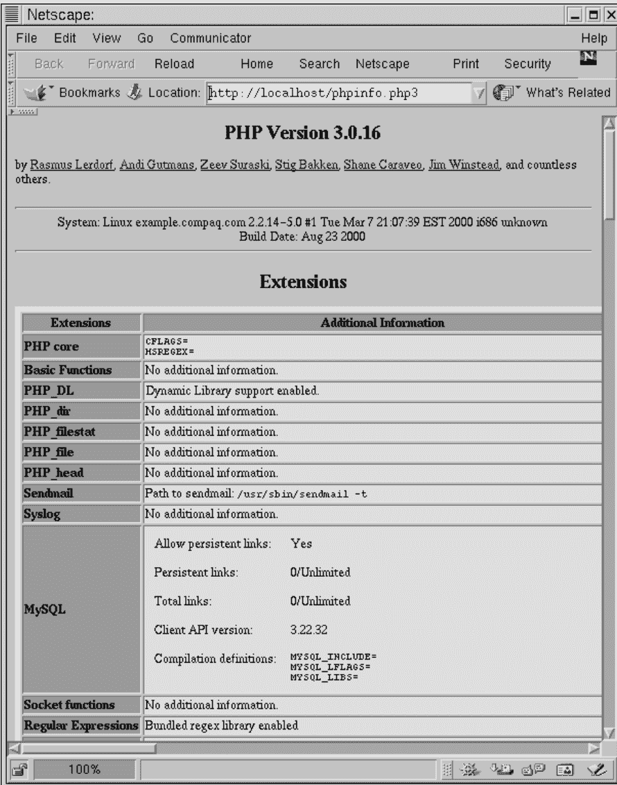
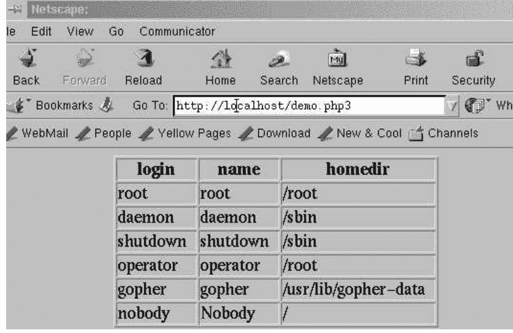
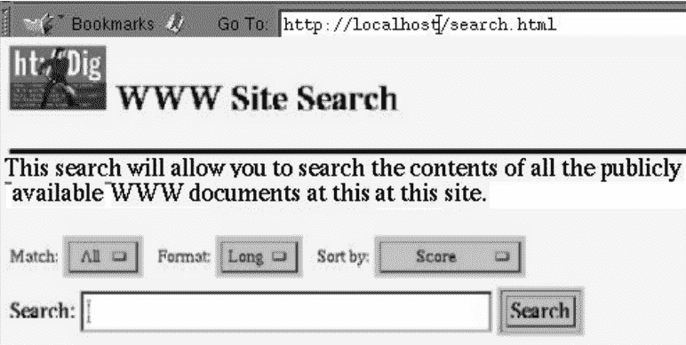
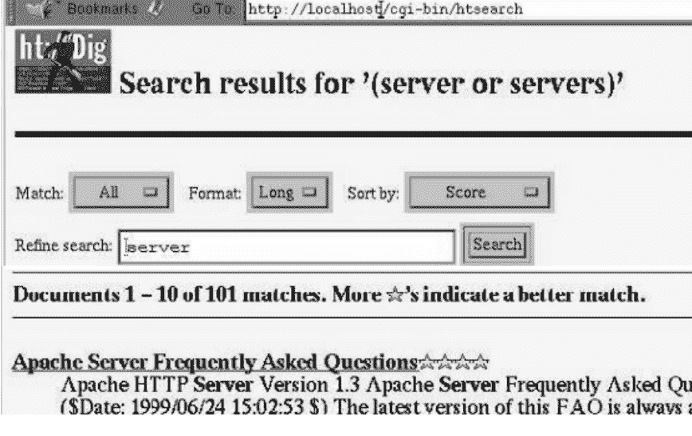

# Apache、PHP、MySQL 和 HTTP 的 Linux Web 解决方案

由以下部门编写：

`dotCOM & Service Provider Solutions`

# 基于 Apache、PHP、MySQL 和 `http://Dig` 的 Linux Web 解决方案

# 摘要

在当今所有的 Web 服务器中，Apache 最受欢迎的，因为它开箱即用基本的 Web 服务器功能。然而，许多客户需要更复杂的网站，具备 SQL 数据库功能、搜索能力和服务器端脚本功能。这些软件包的复杂性和相互依赖性使得独立软件供应商、解决方案开发人员和网站管理员难以组合出一套解决方案。

在 Linux 平台上通过额外功能来定制 Apache 服务器可能是非常复杂的。扩展功能的解决方案并非显而易见。

本技术指南演示了如何将 PHP、MySQL 和 `http://Dig` 与 Apache 服务器集成。独立软件供应商、解决方案开发人员、程序员和网站管理员可以使用此指南在 Linux 平台上规划和部署 Apache Web 服务器。

请将对此解决方案的意见和问题发送至 `activeanswers_support@compaq.com`。请在邮件主题中包含文档编号（显示在本页左上角）。

由 `dotCOM & Service Provider Solutions` 编写

# 1 解决方案概述

本文档描述了如何在 Linux 操作系统上安装、配置和部署复杂的 Apache 网站。该网站包含了强大的服务器端脚本语言 PHP3、功能齐全的 SQL 数据库 MySQL 以及 htDig 搜索引擎。本文档中描述的所有软件软件包都是开源应用程序。

是什么让开源软件如此具有吸引力？首先，它是免费的。其次，你获得了软件源代码的副本，这让你能够自由地控制软件以满足你的短期和长期需求。

开源软件限制的关键点在于，任何人不得：

- 在没有提供源代码（或修改版本与原始版本之间差异的列表）以及所有相关文档副本的情况下分发该产品

- 对软件本身收费（仅对其分发收费）

- 对它的分发施加限制

有关许可的信息，请参考开源倡议组织（Open Source Initiative）定义的规章：`http://www.opensource.org/osd.html`。

# 1 Apache Web 服务器

Apache 的使用率超过了所有 Web 服务器的总和。Netcraft 在 2000 年 9 月份的一项调查证实了这一说法。在对超过 2100 万台连接互联网计算机计算机 Web 服务器软件使用情况进行调查后，他们发现超过 61% 的互联网网站运行在 apache 上。（更新信息，请参见 `http://www.netcraft.com/survey/`）。

显然，Apache 软件基金会正在实现其目标，“提供一个安全、高效且可扩展的服务器，使其 HTTP 服务与 HTTP 标准保持同步。”

Apache Web 服务器项目主页包含你可以下载的 Apache 服务器及其相应的文档。Apache 服务器的官方网站为 `http://www.apache.org/`。

获取 Apache 的支持

除了在线文档和常见问题列表外，Apache 网站还维护了若干邮件列表。要接收来自其他 Apache 开发人员关于代码发布、漏洞、安全修复和其他信息的邮件，请加入其中一个列表，地址为 `announce@apache.org`。可以在 `http://www.apache.org/announcementlist.html` 找到该邮件列表。

## 1.2 PHP 脚本语言

PHP（原名为 Personal Home Page）脚本语言支持创建动态的、定制的网站。通过 PHP，开发者可以在网页中嵌入脚本。Web 服务器调用 PHP 执行脚本操作，然后服务器将页面返回给用户。从功能上说，PHP 和微软活动服务器页面 (ASP) 脚本语言非常相似。

# 使用 Apache、PHP、MySQL 和 http 的 Linux Web 解决方案

如表 1 所示，PHP 是一种丰富且灵活的软件。

| 表 1. PHP 特性 | 支持 | 示例 |
|---|---|---|
| 多平台 | Linux/Intel, Linux/Alpha, Compaq Tru64 UNIX Windows 95/98/NT 和 Windows NT | |
| 多数据库 | MySQL, Oracle, Informix, subbase 和 Unix dbm. | |
| 电子邮件协议： | IMAP (互联网消息访问协议) POP3 (邮局协议 3) SMTP (简单邮件协议) |
| USENET 新闻协议 | NNTP (网络新闻传输协议) |
| 其他功能 | | 基于会话的验证、用于创建动态图像的图形库、低级网络和套接接口 |

PHP 仍在持续增长。许多开源和商业项目选择 PHP 作为 Web 电子解决方案、数据库访问工具、电子商务网站搜索等其他实现语言。PHP 官方网站 `http://www.php.net` 发布了来自 RecNet 的使用统计。按照目前的增长率，截至 2000 年 9 月，将有超过 350 万（虚拟）服务器使用 PHP。要阅读完整的项目列表，请选择 PHP 网站上的“Projects”（项目）。

### 获取 PHP3 的支持

除了在线文档和常见问题列表外，PHP 网站还维护了一系列邮件列表。当邮件列表成员了解 PHP 产品时，他们可以在邮件列表与其他其他人分享他们的发现。如果你更倾向于订阅组合包，可以订阅每天两次一次的摘要。多个国家维护着邮件列表；在本文写作时，有英语、意大利语、葡萄牙语和西班牙语版本。对于一般讨论，请订阅 `php3@lists.php.net`。

要订阅或其他邮件列表，请参阅 PHP3 支持页面 `http://www.php.net/support.php`。

## 1.3 MySQL 数据库

MySQL（读作 "my - S - Q - L"）是一个带有客户端/服务器实现的多线程数据库服务器。它的速度、健壮性和易用性使其成为动态内容网站的流行数据库。PHP3、C++、Java 和 Perl 可以直接访问 MySQL。

MySQL 源代码以及手册链接和 MySQL 教程可以在 MySQL 数据库的官方网站 `http://www.mysql.com` 获取。

### MySQL 邮件列表

MySQL 网站维护了一系列邮件列表。当邮件列表成员了解 MySQL 产品时，他们可以在 MySQL 网站与其他其他人分享他们的发现。Web 设计师可以从通用用户邮件列表和仅公告列表中获益。对于使用 MySQL-Java 接口、MySQL-ODBC 接口以及在 Windows32 平台上使用 MySQL 的人员，请在此注册 MySQL 邮件：`http://www.mysql.com/documentation/index.html`。

# 1.4 htDig 搜索引擎

搜索引擎软件包 htDig 是一个完整的网络索引和搜索系统；它是为此目的提供的少数开源软件软件包之一。

与可以扩展到全网搜索的 AltaVista 不同，htDig 系统是为较小的配置设计的，例如小型域名、单体网站或网站子部分。如有必要，htDig 可以对多个 Web 服务器进行索引。如果安装了适当过滤器，htDig 可以索引并搜索 Adobe Acrobat (.pdf) 文件和 Microsoft Word (.doc) 文件。

源码包、手册和用户邮件列表存档位于该产品的官方网站 `http://www.htdig.org/`。

获取 htDig 的支持和邮件

htDig 网站维护了一系列邮件列表。当邮件列表成员了解该产品时，他们可以在列表中与其他其他人分享他们的发现。两个最有用的邮件列表如下：

- 讨论 htDig 及相关公告：`htdig@htdig.org`

- 接收新版本发布通知：`htdig3announce@htdig.org`

要订阅其中任何，请使用 `http://www.htdig.org/mailarchive.html` 上的表单。

# 2 尺寸考量

Web 系统的性能取决于许多高度可变性的条件，包括：

- 网站的热度

- 静态页面 (.html, .gif, .jpg) 与动态生成页面的数量

- 服务器代码的复杂度

- 数据库的大小和设计

- 搜索引擎的使用

- 如 SSL 等加密技术的使用

性能指南基于开源软件提供的文档以及 Compaq 进行的测试。

表 2 描述了用于交互式网站构建的典型 Compaq ProLiant 服务器。

| 配置 | 系统 | 核数 | 内存 |
|---|---|---|---|
| 小型 | ProLiant 360, ProLiant 380 | 1 → 2 | 512 MB → 1 GB |
| 中型 | ProLiant 380 | 1 → 2 | 512 MB → 2 GB |
| 大型 | 前端：参见分布式服务器阵列 (DISA) 配置文档：* ProLiant 360, * ProLiant 380。后端：* ProLiant 380, * ProLiant 580 | | |

## 2.1 小型配置


最简单的配置是将所有组件——Web 服务器、MySQL 数据库和搜索引擎运行在同一台机器上。对于磁盘空间需求有限的小型配置，机架式、1U 规格的`Compaq ProLiant DL360`具有两个内部`Ultra-2`或`Ultra-3`磁盘，这意味着在高性能集成`Smart Array`上最大可达 9 GB 到 36.4 GB。

如果空间密度对于内部磁盘存储和 PCI 插槽不是高优先级，那么`Compaq ProLiant DL380`是最佳替代方案，因为它支持多达六个`Wide-Ultra2`或`Wide-Ultra3`内部磁盘。

### 基于 Apache、PHP、MySQL 和 httpdDig 的 Linux Web 解决方案

需要将`MaxSpareServers`分别增加到至少 100 和 20，以便能够快速响应大量的同时请求。一个不包含 PHP 脚本的`Apache`进程需要 1 MB 内存，如果 PHP 编译在进程中，该进程的内存占用可能会增长到 1.5 MB。100 个并发`Apache`进程需要 150 MB 内存。

另一个内存消耗者可能是`MySQL`进程。对于`Apache`Web 服务器，由于性能需求，每个传入的请求都需要一个进程。对于一个包含 500,000 条记录的简单数据库，每个`MySQL`进程的 RAM 需求在 0.5 到 0.75 MB 之间。

内存需求取决于流量、动态创建的静态内容数量以及基于数据库查询动态创建的内容数量。如果一个网站预计有 100 个并发`Apache`进程运行，并且有一个数据库，则大约需要 175 MB RAM。为了获得最佳性能，应该有足够的内存来允许大型文件缓冲区缓存，以及系统上运行的其他进程的常规开销。对于低流量网站，`Compaq` 512 MB 的 RAM 就足够了。

当 CPU 平均负载保持在 15 或以上时，就该时候升级到第二个 CPU 了。`Linux`发行版默认只安装单处理器版本的内核，在首次安装时只有一个 CPU。添加第二个 CPU 后，从`Linux`发行版介质安装`SMP`内核，或启用`SMP`支持重新编译内核。

## 2.2 中等配置

`Compaq ProLiant DL380`服务器是需要较大磁盘空间的大型极极选择。通过向`Smart Array`控制器插满 36 GB `Wide Ultra-2`驱动器，`ProLiant DL380`支持高达 21 GB 的存储。与之前的配置一样，配备 512 MB 内存和 933 MHz 处理器的`ProLiant DL380`适用于中等规模的网站。

如果您的网站使用了`Dig`引擎，增加第二个 CPU 并内存增加 1 GB 将显著提高性能。

`httpdDig`引擎的数据库大约与它索引的网页大小相当。在`Linux`内核`v2.2`中，文件大小限制为 2 GB，这意味着如果您的总 Web 内容超过 2 GB，`Dig`将失败。此时您需要将 Web 内容划分到不同内容区域的独立目录。在`Linux`开发内核(`v2.3`)中，此最大文件限制已增加到 4 GB。在`v2.4.0`中，可用限制将提升到太级。

当`Apache`进程数量接近数据库查询时，`MySQL`数据库有许多需要考虑的调优参数。如果存在，`MySQL`服务器将在启动时使用它进行配置。`MySQL`手册建议大型网站使用以下`etc/my.cnf`设置：

```
[mysql]
set-variable = max_connections=500
set-variable = connect_timeout=10
set-variable = key_buffer=384M
set-variable = max_allowed_packet=1M
set-variable = table_cache=512
set-variable = sort_buffer=2M
set-variable = record_buffer=2M
```

此外，`Compaq`建议按如下方式增加参数：

```
set-variable = max_connections=200
set-variable = connection_timeout=10
set-variable = back_log=200
```

不断增长的系统可能会遇到另一个问题，即存在大型`MySQL`数据库。与`httpdDig`类似，如果`MySQL`有非常大的表，就会达到最大文件大小。由于您的网站无法等待具有更大文件限制的`v2.4.0`，您可以考虑使用其他 SQL 数据库。`PostgreSQL`(`postgresql.org`)是一个开源 SQL 数据库，也支持`PHP`访问，并具有自动拆分超出操作系统最大文件大小表格的优点。`MySQL`在 Web 应用中常见的“主要是读”操作方面表现更好，而`PostgreSQL`在处理更混合的读写操作时表现良好。

## 2.3 大型配置

对于大型 Web 部署，为了扩展以满足高负载网站的需求，需要从单系统扩展到多系统的分布式互联网服务器阵列 (DISA) 架构。后端服务器仅处理 SQL 数据库功能。根据您的可用性需求，应该考虑`Linux`集群包之一，例如`Convolo`(`http://www.missioncritillinux.com`)或`SteelEye`(`http://www.steeleeye.com/`)集群解决方案。

`Compaq ActiveAnswers`网站(`http://www.compaq.com/activeanswers`)包含了详细介绍`DISA`架构的文档。

# 3 安装并验证组件

本指南假设`Linux`已安装在您的系统上。由于大多数`Linux`发行版都包含`Apache`软件，您将按照以下步骤检查并在必要时卸载现有的`Apache`软件。这些程序中的所有软件都应尽可能更新。

## 3.1 安装组件

注意安装组件的顺序至关重要，请遵循以下序列：

1. 安装`MySQL`
2. 安装`Apache`服务器（第一阶段）
3. 安装`PHP3`
4. 重配置`Apache`服务器（第二阶段）
5. 安装`httpdDig`搜索引擎

### 3.1.1 安装 MySQL

安装`MySQL`需要以下步骤：

- 从官方`MySQL`数据库`http://www.mysql.com/`获取最新版本的源码。

一旦进入，导航到“Downloads”页面并识别最新发布版本号（撰写本文时为版本`3.22.32`）。根据该信息，您可以选择一个本地镜像站点并验证它提供了最合适的版本。（注意，某些镜像站点更新源码比其他站点更频繁。）如果本地站点缺少正确版本，请使用其他镜像站点或直接从此`http://www.mysql.com/`下载源码包。

将压缩包（例如`mysql-3.22.32.tar.gz`）保存在方便的位置，如`/usr/src/`。

```
# cd /usr/src/
# tar xf mysql-3.22.32.tar.gz
```

- 卸载系统上的任何`MySQL`软件包。许多`Linux`安装还会安装`Apache`软件。当`Red Hat`包管理器(`RPM`)实用程序从互联网请求代码时（`RedHat`、`SuSE`和`TurboLinux`安装中），这种情况尤为常见。

要检查是否存在`MySQL`安装，请输入以下命令：

```
# rpm -qa | grep -i mysql
```

如果存在`MySQL`软件，使用类似下面的命令将其删除：

```
# rpm -e mysql-3.22.27
# rpm -e mysqldev-3.22.27
```

基于 Apache、PHP、MySQL 和 httpdDig 的 Linux Web 解决方案

- 使用以下命令配置、构建并安装`MySQL`包：

```
# cd /usr/src/mysql-3.22.32/
# ./configure
# make
# make install
```

- 使用以下命令安装`MySQL`用于管理自身的数据库：

```
# scripts/mysql_install_db
```

- 使用以下命令手动启动`MySQL`服务器：

```
# /usr/local/bin/safe_mysqld &
```

同时编辑您的启动脚本`/etc/rc.d/rc.local`，包含命令：

```
# /usr/local/bin/safe_mysqld &
```

始终在行尾包含符号符号(&)。参考`MySQL`手册为您的环境调优`MySQL`。

- 为数据库分配`root`访问密码。注意单引号包裹您分配的任何密码。例如，输入命令：

```
# /usr/local/bin/mysqladmin -u root password 'newpassword'
```

### 3.2 安装 Apache 服务器（第一阶段）

`Apache`服务器安装分两个阶段进行。在第一阶段，您获取最新源码并卸载现有的`Apache`服务器软件。此阶段为后续的`PHP`编译准备文件。安装`PHP`后，完成`Apache`安装的第二阶段，重新配置`Apache`服务器使用`PHP3`库。


- 从 Apache 官方网站 `http://www.apache.org` 或较近的镜像站点获取服务器源码。与 MySQL 软件一样，首先检查最新的 Apache 版本，然后参考镜像站点列表。将压缩包（例如 `apache_1.3.14.tar.gz`）保存在方便的位置（如 `/usr/src`），并使用以下命令解压压缩包：

```bash
# cd /usr/src
# tar xzvf apache_1.3.14.tar.gz
```

- 配置 Apache 服务器。对于第一阶段，必须运行 Apache 配置脚本。为此，输入以下命令：

```bash
# cd /usr/src/apache_1.3.14/
# ./configure --prefix=/usr/local/apache
```

使用 Apache、PHP、MySQL 和 `http://` 的 Linux Web 解决方案

- 卸载任何现有的 Apache 服务器。（如果你正在运行某一个 Linux 发行版，你可能已经有了 Apache 服务器。）如果你已经更改了配置，你可能想以新名称保存 Apache 文件。按照以下方法删除现有版本：

```bash
# rpm -qa | grep apache
apache-1.3.3-1
apache-devel-1.3.3-1
```

- 在安装了其他包的情况下，你将收到关于其他包依赖关系的警告。必须先删除它们。`RPM` 管理器提示使用 `"man rpm"` 获取关于使用该工具的信息。例如：

```bash
# rpm -e mod_perl-1.15-3 mod_php-2.0.1-5 mod_php3-3.0.5-2
# rpm -e apache-1.3.3-1 apache-devel-1.3.3-1
```

在下一步中，你将编译 PHP，并完成 Apache 安装的第二阶段。

### 3.1.3 安装 PHP3

导航到 PHP 的官方网站 `http://www.php.net/`。该网站提供了 PHP 源码包、手册、代码示例以及使用 PHP3 的其他开源包的指针。进入“Downloads”并从最近的镜像站点下载最新的 PHP3 源码包。将该包（例如 `php-3.0.17.tar.gz`）保存在方便的位置 `/usr/src/`，并使用以下命令解压该包：

- 获取源码，使用与之前命令中 Apache 切换时相同的 Apache src 目录。

```bash
# cd /usr/src/
# tar xzf php-3.0.17.tar.gz
```

> 注意：在下一步中，使用与之前命令中 Apache 切换时相同的 Apache src 目录。

- 编译 PHP3。PHP3 在编译为 Apache 模块并使用 MySQL 之前需要进行配置。

有许多你可能想要启的编译选项。常用的选项包括 IMAP 支持、用于动态创建图像的 GD、轻量级访问协议 (LDAP) 支持、WebDAV（HTTP 分布式授权与版本控制 (DAV)）支持以及 zlib（压缩库）。这些选项需要安装额外的包，并且超出了本文的范围。要编译 PHP3，输入以下命令：

```bash
# cd /usr/src/php-3.0.17/
# ./configure --with-mysql --with-apache=../apache_1.3.14 \
--enable-track-vars
```

- 使用以下命令安装 PHP3：

```bash
# make
# make install
```

### 3.1.4 重新配置 Apache 服务器（第二阶段）

此时，MySQL 数据库正在运行，Apache 服务器已部分就绪，PHP 库已安装。你将重新配置 Apache 服务器以使用 PHP。

- 返回 `apache_1.3.14` 目录，如下：

```bash
cd /usr/src/apache_1.3.14/
```

- 编译带有 PHP 模块的 Apache 服务器，以及 `mod-status` 和 `mod-info` 两个模块，你可以通过配置信息和服务器状态配置 Web 管理员。

```bash
#./configure --activate-module=src/modules/php/libphp3.a \
--enable-module-info --enable-module=status

# make

# install
```

- 编辑配置文件。

PHP 的默认配置是合理的，但你可以修改某些资源限制。默认情况下，任何 PHP 页面的最大执行时间 (`execution_time`) 为 30 秒。

将 PHP 的配置移动到系统目录，如下：

```bash
cp /usr/src/php3-3.0.17/php3.ini-dist /usr/local/lib/php3.ini
```

- 编辑 Apache 配置文件 `/usr/local/apache/conf/httpd.conf`，使其处理带有 `php3` 扩展的文件。删除以下行中的 `#` 字符：

```apacheconf
#AddType application/x-httpd-php3 .php3
#AddType application/x-httpd-php3-source .php
```

- 使用以下命令启动 Apache Web 服务器：

```bash
/usr/local/apache/bin/apachectl start
```

- 同样编辑你的系统启动脚本 `/etc/rc`，包含以下命令：

```bash
/usr/local/apache/bin/apachectl start
```

### 3.1.5 安装 htdig 搜索引擎

- 从官方网站 `http://www.htdig.org/` 获取 htdig 源码。

然后进入“Where to get it”页面并下载最新的源码包（编写时版本为 3.1.5）。

将该包（例如 `htdig-3.1.5.tar.gz`）保存在方便的位置如 `/usr/src/`，并使用此类命令解包：

```bash
cd /usr/src/
tar zxf htdig-3.1.5.tar.gz
cd /usr/src/htdig-3.1.5
```

编译 htdig。默认情况下，搜索引擎将文件放置在 `/opt/www/htdig` 目录。

构建该包非常简单：使用以下命令进行配置、编译和安装。注意设置 Apache 目录默认位置的开关。

```bash
# ./configure --with-cgi-dir=/usr/local/apache/cgi-bin \
--with-image-dir=/usr/local/apache/icons \
--with-search-dir=/usr/local/apache/htdocs
```

```bash
# make
# make install
```

重新配置 Apache 服务器，使其能够找到 htdig 使用的内容。为此，修改文件 `/usr/local/apache/conf/httpd.conf`。找到 aliases 部分并在末尾插入此行：

```apacheconf
Alias /htdig/ "/usr/local/apache/icons/"
```

由于你修改了 Apache 配置文件，你需要重启进程以启用此更改。以下命令将重启 Apache 服务器：

```bash
# /usr/local/apache/bin/apachectl restart
```

### 3.1.5.1 更改文件位置

由于数据库可能会变得很大，将数据库移动到具有足够剩余空间的分区是一个好主意。

注意：运行在 Intel 上的 Linux v2.x 最大大小为 2 GB。运行在 Alpha 上的 Linux 最大大小为 8 GB。

搜索数据库的存储需求各异。为了给预期搜索内容大小的两倍充分分配存储，索引增长比被索引的内容量略大。这种搜索不支持大量信息扩展。

要移动数据库，通过修改 `htdig.conf` 文件（通常位于 `/opt/www/htdig/config/`）来修改以下行：

```text
database_dir: /opt/www/htdig/db
```

### 3.1.5.2 更改搜索引擎查找内容的起点

这是一个由空格隔开的 URL 或文件位置列表。默认情况下，只跟随系统上的链接。例如，该行将 htdig 的起点更改为此 Web 服务器的名称。

```text
Start_url: http://www.isp.com/
```

### 3.1.5.3 将搜索方法从 HTTP 连接更改为通过文件系统进入

使用这种方法 htdig 直接遍历内容，这种方法大大减少了索引网站所需的时间以及 Web 日志中的混乱。

注意：此方法仅在 Web 服务器和搜索引擎位于同一系统上，或者它们可以通过 NFS 访问相同的磁盘时才有效。

为了演示这一点，在 `htdig.conf` 文件中添加一个 `local_urls` 条目，提供从 Web 空间到文件系统位置的映射。例如，如果 `http://www.isp.com` 位于 `/usr/local/apache/htdocs` 且 `http://www.isp.com/products` 的内容位于 `/home/data/`，你将拥有如下条目：


```
local_urls:
http://www.isp.com=/usr/local/apache/htdocs/
http://www.isp.com/products=/home/data/
```

### 3.1.6 构建搜索引擎数据库

在安装并优化 `htdig` 以索引数据库后，运行一个脚本来构建数据库。`htdig` 在 `/opt/www/htdocs/bin/rundig.sh` 中包含一个脚本。为了解决任何配置问题，从命令行运行该脚本。一旦脚本正常工作，请将其作为 `cron` 任务定期运行。

查看 `man cron` 和 `man 5 crontab` 获取有关如何设置批作业的信息。

## 3.2 验证安装

一旦安装了软件组件，你就需要验证所有组件是否正常工作。以下章节描述了如何验证以下内容：

- `Apache` 调用 `PHP3` 脚本引擎处理文件，且 `PHP3` 内置了 `MySQL` 支持。
- 可以设置 `MySQL` 测试数据库。
- `PHP` 脚本引擎可以连接到 `MySQL` 数据库。
- `htdig` 搜索引擎已索引站点并正常工作。

### 3.2.1 验证自动启动

由于系统启动脚本已修改以启动 `Apache` 服务器和 `MySQL` 数据库，在部署系统之前应该进行重启。在此程序的阶段，所有服务器都在运行，因此你可以执行以下验证步骤并检查启动过程：

### 3.2.2 验证 PHP3 操作

创建一个名为 `phpinfo.php3` 的文件并在文件中添加以下行：

```php
<?php phpinfo() ?>
```

将该文件放在 `Apache` DocRoot 中，默认称为 `/usr/local/apache/htdocs`。

启动浏览器并访问 `http://127.0.0.1/phpinfo.php3`。如果 `PHP3` 工作正常，浏览器将显示与图 1 所示的屏幕。务必验证扩展列表中是否列出了 `MySQL`。

基于 `Apache`、`PHP`、`MySQL` 和 `HTTP` 的 Linux Web 解决方案

图 1. `PHP3` 界面



13T3-1100A-WWEN

### 3.2.3 验证 MySQL 支持

从 shell 窗口尝试连接到数据库服务器，然后显示可用数据库。使用你在第 3.1.1 节中建立的密码。

```
# mysql -u root -p
Enterter password: <password>
+----------------+
| Databases        |
+----------------+
| mysql            |
| test             |
+-----------------+
```

然后尝试连接到 `mysql` 数据库并查看表。

> 注意：分号（`;`）用于终止所有 SQL 命令。

```
# mysql -u root -p
Enter password:
Reading table information for completion of table and column names
You can turn off this feature to get a quicker startup with -A

Welcome to the MySQL monitor. Commands end with ; or g.
Your MySQL connection id is 29 to server version: 3.22.23b
Type 'help' for help.

mysql> show tables;
```

| Tables in mysql |
|----------------|
| columns_priv |
| db |
| fun |
| host |
| tables_priv |
| user |

```
6 rows in set (0.00 sec)

mysql> quit
Bye
#
```

### 3.2.4 设置 MySQL 测试数据库

验证 `MySQL` 正常工作后，创建一个数据库并向其填充一些数据。用户密码文件是以固定格式查找某些信息的一种方便方法。下面的对话框提供了一些命令和系统响应。

- 第一步使用 `MySQL` 管理工具创建一个名为 `"etcpasswd"` 的数据库。

```
# mysqladmin -u root -p create etcpasswd
Enter password:
  Database "etcpasswd" created.
#
```

- 进入 `MySQL` 交互式监控，并使用 `root` 权限连接到新创建的 `"etcpasswd"` 数据库。

```
# mysqlpasswd -u root -p
Enter password:
Welcome to the MySQL monitor. Commands end with ; or \g.
Your MySQL connection is 39 to server version: 3.22.32

Type 'help' for help.
```

- 创建一个表来存储信息。以下命令将包含 `/etc/passwd` 文件的内容。

```
mysql CREATE TABLE users (login VARCHAR(20), optpw VARCHAR(20), \
uid INT, gid INT, name VARCHAR(40), homedir VARCHAR(40), \
shell VARCHAR(40));
Query OK, 0 rows affected (0.00 sec)
```

- 为名为（例如 `"admin"`）的用户授予 `etcpasswd` 数据库的所有权限，但仅限于运行 `MySQL` 的同一台系统。请注意，此用户名与 Linux 用户账户无关。

```
mysql GRANT ALL PRIVILEGES ON etcpasswd.* \
TO admin@localhost \
IDENTIFIED BY 'somepassword';
```

- 指导 `MySQL` 将 `/etc/passwd` 文件导入 `"users"` 表。使用单列分隔值。

```
mysql LOAD DATA INFILE '/etc/passwd' INTO users \
FIELDS TERMINATED BY ';';
Query OK, 34 rows affected (0.00 sec)
Records: 34 Deleted: 0 Skipped: 0 Warnings: 0
```

- 6. 验证信息是否已加载。以下 SQL 命令仅显示 `users` 表中的登录名称列。结果限制在前五条条目。要显示所有信息，请使用命令 `"select from users"`；

```
mysql> select login, name from users limit 1,5;
+----------------------+
| login | name |
+----------------------+
| bin   | bin   |
| daemon| daemon|
| adm   | adm   |
| lp    | lp    |
| sync  | sync  |
+----------------------+
5 rows in (0 sec)

mysql> quit
#
```

### 3.2.5 验证 PHP 连接 MySQL

确保所有软件运行正常。测试数据后，可以使用 `PHP` 获取 `MySQL` 数据。下面的代码将显示数据库中包含字母 `"o"` 的所有用户。将代码放在方便的位置，例如 `/usr/local/apache/htdocs/demo.php`。


```php
<?php
// 连接到此系统上的 MySQL 服务器
mysql_connect("localhost", "admin", "somepassword")
or die("Unable to connect to SQL server");

// 使用 etcpasswd 数据库
mysql_select_db("etcpasswd")
or die("Unable to select database");

// 获取 users 数据库的列名列表
$result = mysql_list_fields("etcpasswd", "users");

// 获取 login 包含字母 "o" 的所有字段
$query = mysql_query("select * from users where login like '%o%");

// 获取返回行数
$affected = mysql_num_rows($query);

if(!$affected) {
    echo "No users with 'o' in their name returned";
} else {
    // 显示列名
    echo "<table align='center' border=1>";
    echo "<tr><th>" . mysql_field_name($result,0) . "</th></tr>";
    echo "<tr><td>" . mysql_field_name($result,4) . "</td></tr>";
    echo "<tr><td>" . mysql_field_name($result,5) . "</td></tr>";
    // 显示每一行
while($row=mysql_fetch_row($query)) {
echo "<tr><td>$row[0]</td></tr>";
echo "<tr><td>$row[4]</td></tr>";
echo "<tr><td>$row[5]</td></tr>";
}

echo "</table>\n";

// 释放与查询相关的内存
mysql_free_result($query);
?>
```

生成的网页将类似于图 2 所示。

**图 2 通过 PHP 查询 MySQL 的结果**



13T3-1100A-WWEN

基于 Apache、PHP、MySQL 和 HTTP 的 Linux Web 解决方案

### 3.2.6 验证 HTTP 是否工作

完成第 3.1.5 节描述的 `rundig.sh` 脚本后，打开 URL `http://127.0.0.1/search.html`。该 URL 应显示搜索查询页面，如图 3 所示。

**图 3. HTTP 搜索页面**



13T3-1100A-WWEN

基于 Apache、PHP、MySQL 和 HTTP 的 Web 解决方案

输入查询并查看结果。`rundig.sh` 脚本应该索引了 Apache 手册的本地副本。尝试搜索“server”。图 4 显示结果示例。

## 图 4. HTTP 搜索结果



13T3-1100A-WWEN

# 4 管理 Apache 服务器

安装后，Apache Web 服务器应该无人值运行一段时间。然而，监控服务器以确保其运行良好是明智的。

## 4.1 监控日志文件

为了确保系统不会耗尽磁盘空间，请监控持有访问和错误日志的磁盘分区。默认情况下，Apache 服务器将这些日志存储在 `/usr/local/apache/log`。

日志文件的增长速度差异很大，日志大小取决于访问频率以及请求的 URL 类型。虽然你可以假设访问日志约为 150 字节数据，但使用取决于 Web 内容目录的结构和命名规范。

`logrotate` 工具旨在简化生成大量日志系统的管理工作。它允许对日志文件进行自动轮转、压缩、删除和发送。每个日志可以每天、每周或在过大时处理。如果你的 Linux 发行版不包含 `logrotate`，你可以从以下站点获取它：

```
ftp://ftp.redhat.com/pub/linux/RedHat/redhat/code/logrotate/
```

或者许多 RedHat 镜像站之一。

## 4.2 监控网络连接

某些第三方开源 Apache 模块限制了到特定目录的并发连接数，或者对于超过“每秒字节”下载速率的用户限制响应。

ApacheWeek 维护了一个限制 Web 域访问的模块列表。更多信息，请访问他们的网页 `http://www.apacheweek.com/features/modulesoup`。

## 4.3 监控系统性能

有很多开源工具可以监控通用系统特别是 Web 服务器。

### 4.3.1 状态显示

`mod_status` 模块传递有关 Apache Web 服务器总体运行的信息，例如，它的运行时间以及当前请求计数、Apache 子进程、总访问量和发送的字节数

默认情况下，Apache 配置文件 (`httpd.conf`) 禁止从所有地方访问状态报告。

# 基于 Apache、PHP、MySQL 和 http:// 的 Linux Web 解决方案

若要允许访问，请取消 `Allow` 行的注释，并编辑互联网提供商 (`isp.com`) 的位置，以包含一个可以访问该 URL 的系统或域名列表。

```
#允许服务器状态报告，URL 为 http://servername/server-status
# 将 "your.domain.com" 修改为您的域名以启用。
#<Location /server-status>
# SetHandler server-status
# Order deny,allow
# Deny from all
# Allow from your.domain.com
</Location>
```

如需了解更多信息，请参阅 Apache 文档：

`http://www.apache.org/docs/mod/mod_status_status.html`

### 4.3.2 配置信息

`mod_info` 模块返回有关服务器配置的全面信息；这包括配置文件中所有安装的模块和指令。

默认情况下，Apache 配置文件 (`httpd.conf`) 禁止从所有地方对 URL 进行 Web 访问。取消并更改 `Allow` 行，以包含一个允许访问该 URL 的系统或域名列表。

```
# 允许远程服务器配置报告，URL 为
# http://servername/server-info (需要加载 mod_info.c)
# 将 "your.domain.com" 修改为您的域名以启用。

#<Location /server-info>
# SetHandler server-info
# Order deny,allow
# Deny from all
# Allow from your.domain.com
</Location>
```

如需了解更多信息，请参阅 Apache 文档：

`http://www.apache.org/docs/mod/mod_info.html`

### 4.3.3 监控工具

监控工具包括以下内容：

- 大型系统和网络监控器
- `mon`，服务守护进程监控是一个基于 Web 的监控和通知包。

大型系统和网络监控器是一个基于 Web 的监控和通知包。通过这些监控工具，网站运营人员可以集中观察远程 UNIX 和 Microsoft NT 系统。

监控器由几个客户端组成：本地测试系统状况和网络可用性。这些客户端将报告发送到显示和解析网页，通知系统管理员 Web 服务器、DNS、NNTP (USENET 新闻)、SMTP 和 POP3 的可用性。

系统状态报告包括 CPU 使用率、系统日志消息、关键系统进程运行以及磁盘空间等信息。

# 基于 Apache、PHP、MySQL 和 http://Dig 的 Linux Web 解决方案

访问网站 `http://bb4.com` 下载源码、查看演示或获取更多信息。

`mon`，服务监控守护进程是一个通用的资源监控系统，旨在检查网络服务可用性、服务器问题和环境条件等状况。

资源监控可以视为两个独立的任务：状况的测试以及在失败时触发某种操作。`mon` 的设计是将测试和执行操作的任务作为独立程序。`mon` 被实现为一个调度器，它执行监控器（测试状况），并在监控器失败时调用相应的警报。访问网站 `http://www.kernel.org/software/mon` 获取更多信息、示例页面并下载源码。

## 4.4 分析日志文件

### Webalizer


Webalizer 是一种用于 Web 服务器的快速免费日志分析程序。它能生成高度详细、易于配置的 `HTML` 格式使用报告，可以使用标准 Web 浏览器查看。它可以访问热门 `URL` 显示的信息、浏览器的源 `IP` 地址、引用您网站的页面 `URL`、访问网站的人图表以及所使用的浏览器。

要下载源码并获取更多信息，请访问其网站：

`http://www.mrunix.net/webalizer`

### Analog

Analog 可以生成高度详细且可配置的 `HTML` 格式使用报告。虽然 Analog 没有 Webalizer 那么图形化，但它是一个可靠的工具。

要下载源码并获取更多信息，请访问其网站：

`http://www.analog.net/`

### Freshmeat.net

这是另一个专门查找 Linux 日志分析工具的良好资源。它位于：

`http://www.freshmeat.net/appindex/console/log-analyzers.html`

## 扩展阅读

有关本指南中讨论的软件包信息，请参阅以下网站：

- Apache Web 服务器的官方网站：`http://www.apache.org`
  在此处下载 Apache 源码包。此处还提供了服务器文档。

- Apache 支持网站：`http://www.apache.com`
  目标是为任何运行 Apache 服务器的人或负责运行基于 Apache 服务的人员提供资源。该网站拥有关于用户授权、服务器配置以及使用软件模块扩展 Apache 服务器过程的丰富信息。

- 流行的 Linux 发行版包括：
  - Caldera Systems 的 OpenLinux：`http://www.caldersystems.com`
  - Debian：`http://www.debian.org/`
  - Red Hat Software, Inc.：`http://www.redhat.com`
    提供美国最流行的 Linux 版本之一。
  - SuLinux：`http://www.suse.com/`
  - TurboLinux：`http://www.turbinolux.com/`

- PHP3 脚本语言的官方网站：`http://www.php.net`
  提供 PHP3 文章、示例脚本和源文件的支持网站。

- PHP 库程序源码：`http://phplib.net.de/`
  这些程序简化了许多复杂操作。最有用的是基于 `cookie` 或 `URL` 的认证库，它使用 `MySQL` 数据库来维护用户信息。

- Zend 软件源码：`http://www.zend.com`
  Zend 极大提升了 PHP 脚本语言的性能。在本文期间，Zend 正处于 `Beta` 测试阶段。

- MySQL 官方网站：`http://www.mysql.com`
  提供通用的 MySQL 信息、文档、源文件、镜像站点以及指向相关教程网站的链接。

- //Dig 搜索引擎站点：`http://www.htidig.org`
  用于小型域名或局域网的索引和搜索搜索引擎。

- 新旧和更新的开源软件包清理中心：`http://www.freshmeat.net`
  在编写自己的解决方案之前，请检查 Freshmeat 站点以获取新的和更新的开源软件包。

- 开源组织首页：`http://www.opensource.org`
