# Linux 周末速成课

## 关于作者

Naba Barkakati 是一位资深程序员和成功的计算机书籍作者，拥有从 MS-DOS、Windows 到 UNIX 和 Linux 的各种系统经验。1984 年从马里兰大学获得电气工程博士学位后，他购买了他的第一台电脑——IBM PC-AT。在从事工程职业期间，Naba 梦想为新兴市场编写书籍。在过去的 12 年里，他编写了从 `C++` 编程到 `Linux` 的多部畅销著作，如《Turbo C++》、《面向对象编程 C++》和《Visual C++ Developer's Guide》。他的书被翻译成多种语言：西班牙语、法语、波兰语、希腊语、意大利语、中文和韩语。Naba 最近的著作《Red Hat Secrets, 第三 Edition》同样由 Hungry Minds, Inc. 出版。

Naba 住在马里兰州北波特麦克，与妻子和孩子一起。

## 谢谢

收购编辑：Terri Varis

媒体开发经理：Laura Carpenter

项目编辑：Terrence O'Donnell

媒体开发主管：Rich Graves

贡献：Terry Collings

权限编辑：Laura Moss

技术编辑：Matthew Hayden

媒体开发专家：Greg Stephens

文字编辑：C.M. Jones

媒体开发协调员：Marisa Pearman

项目协调员：Regina Synder

校对与索引：York Services

平面与制作：Joe Buck, Adam Mancilla, Kathie Schutte, Kendra Span, Erin Zelt

封面设计：Clark Creative Group

质量控制：Valery Bourke, Susan Moritz, Angel Sant, Charles Spencer

> 本书献给我的妻子和女儿 Emily 和 Ashley。

## 前言

由于 Linux 越来越受欢迎，许多计算机用户希望快速学习。如果你在关注 Linux 的机构工作，你需要配置、使用和管理 Linux 系统。最好的方法就是安装 Linux 并学习其命令和应用程序——这是一个组织良好的课程集，让你在周末内学会 Linux。所有潜在的 Linux 爱好者——无论是初学者还是高级人员——Linux® 周末快速上手班提供了一个教学指南：30 节易于使用的课程，每节一小时，逐步建立你的 Linux 能力。作为 Hungry Minds“快速上手”系列的一部分，从周五晚上安装 Red Hat Linux 开始，到周日下午的系统管理主题结束，旨在让你周末内完成。

本快速上手的节奏很快。每节课程都从“课程清单”开始——本节课程内学习的主题短列表。每节课程都以“自测”部分结束，让你通过回答问题来测试自己的技能。对于对应一周时间的每个主要部分，书中还包含了复习题，涵盖了该部分课程教授的内容。你可以尝试回答复习题并在附录 A 中检查答案。

本书包含了 CD-ROM，提供了最新版本的 Red Hat Linux，你可以按照第 1 至 3 节的说明进行安装。在学习书中其余课程的过程中，你可以使用这个版本的 Red Hat Linux，也可以使用你系统中安装的其它流行的 Linux 发行版。

## 准备工作

若要开始课程，你需要一台可以安装 Red Hat Linux 的 PC。PC 的最低系统要求为：Intel 486 或兼容 Pentium 的处理器、32 MB 内存、1 GB 磁盘空间、3.5 英制软盘驱动器和 CD-ROM 驱动器。你需要一张 3.5 英制软盘在安装期间创建启动盘。对于其他某些课程，你需要以太网卡、调制解调器和接入接入。你还需要一个空闲的周末来完成所有课程。

## 书的结构

Linux 周末快速上手班共有 30 节课程，分为六部分。它还有两个附录。

- **第一部分：周五晚上**指导你完成从本书附带 CD-ROM 安装 Red Hat Linux 的步骤。假设安装程序能够识别某些硬件，你应该应该在一小时左右完成安装。
- **第二部分：周六上午**侧重于让 Red Hat Linux 快速运行、探索文件和目录、学习 Linux 命令和文本编辑器并执行一些基本的系统管理任务。
- **第三部分：周六下午**向你展示如何设置网络（假设 PC 有以太网卡）以及如何将 Linux PC 连接到互联网（也简要讨论了拨号 PPP、DSL 和电缆调制解调器）。部分课程向你展示如何在网络环境中使用 Linux 系统，例如作为互联网服务器（Web、电子邮件）或作为带有 Samba 的 Windows 文件服务器。
- **第四部分：周日晚上**教你如何使用 GNOME 和 KDE 桌面，以及 Red Hat Linux 自带的一些应用程序。
- **第五部分：周日上午**向你介绍各种系统管理任务：配置 X；学习 Linux 启动序列；从 RPM 和 tar 文件安装新软件包；构建新内核；调度在特定时间运行的任务；以及执行备份。
- **第六部分：周日下午**侧重于 Linux 系统管理员应该具备的技能。下午从使用编程工具编译和构建新的软件包课程开始。它涵盖了系统性能监控、安全以及获取进一步帮助的方法。
- **附录 A：部分复习题答案**提供了六部分之后出现的每个复习题的答案。

附录 B：“CD-ROM 中包含什么？”描述了随附 CD-ROM 的内容。

如果您是新用户，应该从第一部分开始，该部分涵盖了如何从 CD-ROM 安装 Red Hat Linux。然后，您可以按照顺序继续学习各个章节。如果您已经安装了 Linux，请跳到周六上午的第二部分。

## 本书使用的惯例

《Linux 周末速成课程》使用了简单的符号风格。所有的列表、文件名、函数名、变量名、关键字和 Web 地址均采用等宽字体排版，以便阅读。新术语和概念的首次出现将使用*斜体*。书中指示您输入的文本将使用**粗体加等宽字体**，并带有*斜体*。遵循 Hungry Minds “周末速成课程”系列的设计，我使用了图标来帮助您快速定位有用信息。以下是我对图标的设定：

- 注意有趣的事实 —— 我认为您可能想知道的内容。
- 快捷方式或方法 —— 您可以遵循这些让工作更轻松。
- 潜在的陷阱。通过这个图标，我是在告诉您：“小心！可能会损害您的系统！”
- 交叉引用 —— 指向书中讨论特定主题的其他章节 ——或指向 CD-ROM 上提供的特定程序。

## 侧边栏

有时，我会使用侧边栏来突出有趣（但至关重要）的信息。侧边栏解释了您可能以前遇到过的概念，或者对相关主题提供一些见解。如果您赶时间，可以安全地跳过侧边栏。另一方面，如果您发现自己正在翻阅书籍寻找有趣信息，我鼓励您阅读侧边栏。

每个章节还包含四个与时间相关的图标，让您了解自己的进度：


## 与我们联系

出版商和我希望得到您的反馈。请随时通过以下邮箱与我联系：`naba@ieee.org`

## 致谢

感谢 Terri Varveris 给我这次编写《Linux 周末速成课程》的机会 —— 这是一本在周末内教授 Linux 的指南。感谢 Terry Collings 对文本进行修订，以适应 Linux 操作系统和应用程序的最新变化。作为项目编辑，Terry O'Donnell 引导了本书直至圆满完成。Terry Collings 和非常感谢 Terry O'Donnell 在项目期间提供的指导和支持。

我要感谢 Matthew Hayden 对手稿进行技术准确性审阅。

感谢 Hungry Minds, Inc. 的全体人员，将原始手稿转化为这本编辑精良、包装精美的书籍。

当然，如果没有 Linux，这本书就不存在的意义了。为此，我要感谢 Linux Torvalds 以及全球成千上万的 Linux 开发者。感谢 Red Hat 为本书提供了一份 Red Linux Copy。

最后，一如既往地，我最感谢我的妻子 Leha 以及我们的女儿 Ivy、Emily 和 Ashley —— 是她们的爱与支持一直让我不断前进。感谢你们的陪伴！

## 目录

+ 处理文件的命令 ................................... 117
+ 统计文本文件中的字符、单词和行数 ........ 117
+ 对文本文件排序 ................................................................ 118
+ 将任何文件分成若干个小文件 .............. 118
+ 维护文件系统的命令 ................. 119
+ 第 10 节–Linux 文本编辑器 ........................................ 123
+ 使用 GUI 文本编辑器进行文本编辑 ................. 123
+ 使用 `ed` 和 `vi` 进行文本编辑 ................................. 124


# 第三部分 – 周六下午

## 第 11 节 – 配置调制调器

- 将调制调器到 PC
- 学习串口设备名称
- 检查 `Linux` 是否检测到串口设备
- 使用 `Minicom` 拨号
- 以 `root` 用户身份运行 `Minicom`
- 以普通用户身份运行 `Minicom`

## 第 12 节 – 连接到互联网

- 学习拨号网络的基础知识
- 使用 `PPP` 连接到互联网
- 验证 `PPP` 连接已建立
- 验证路由表是否设置正确
- 验证可以访问互联网主机
- 运行或关闭 `PPP` 连接
- 使用 IP 伪装（`NAT`）共享互联网连接

## 第 13 节 – 设置互联网服务

- 理解互联网服务
- 使用电子邮件
- 设置 `Apache` Web 服务器
- 设置 `FTP` 服务器

## 第 14 节 – `Linux` 中的网络

- 设置以太网
- 配置 `TCP/IP`
- 学习设备名称
- 运行 `Red Hat`
- 检查 `TCP/IP` 诊断
- 检查接口
- 检查路由表

# 目录

- 检查 `TCP/IP` 配置
- `/etc/hosts`
- `/etc/networks`
- `/etc/host.conf`
- `/etc/resolv.conf`
- `/etc/hosts.allow`
- `/etc/hosts.deny`

## 第 15 节 – 设置工作组

- 使用 `NFS` 共享文件
- 输出文件系统
- 挂载 `NFS` 文件系统
- 将 `Linux` PC 设置为 `Windows` 服务器
- 检查是否安装 `Samba` 并安装 `Samba`
- 配置 `Samba`
- 使用 `SWAT`
- 访问 `Samba` 服务器
- 使用 `smclient` 访问资源

## 第 16 节 – 访问 `Windows` 和 `DOS` 文件系统

- 挂载 `DOS`/`Windows` 文件系统
- 通过安装挂载 `DOS`/`Windows` 文件系统
- 使用 `mount` 命令挂载 `DOS`/`Windows` 文件系统
- 挂载和访问 `DOS`/`Windows` 软盘
- 使用 `mtools` 访问 `DOS`/`Windows` 软盘
- 检查是否安装了 `mtools`
- 检查 `/etc/mtools.conf` 文件
- 理解 `mtools` 命令
- 格式化 `DOS`/`Windows` 软盘

# 第四部分 – 周六晚上

## 第 17 节 – 自定义 `GNOME` 和 `KDE` 桌面

- 自定义 `GNOME` 桌面
- 更改背景
- 选择主题
- 自定义窗口管理器
- 更改默认桌面
- 自定义 `KDE` 桌面
- 更改背景和主题
- 选择配色方案
- 执行其他任务

## 第 18 节 – 屏幕保护和玩游戏

- 激活屏幕保护
- 在 `GNOME` 中设置屏幕保护
- 在 `KDE` 中设置屏幕保护
- 在 `GNOME` 中玩游戏
- 纸牌游戏
- 西子棋 (`Gnome-Stones`)


- GNOME 麻将 (GNOME Mahjongg) ... 230
- 国际象棋 ... 230
- 在 KDE 中玩游戏 ... 230
- 扫雷游戏 ... 231
- 数字接龙 (Patience) ... 232
- 四色消除 (Shisen-Sho) ... 232
- 第 19 节–多媒体应用 ... 233
- 配置声卡 ... 233
- 播放音频 CD ... 235
- 处理图形与图像 ... 236
- `GIMP` ... 236
- `Ghostscript` ... 238
- `Ghostview` ... 240
- 第 20 节–GNOME 和 KDE 办公工具 ... 243
- 使用数字电子表格 ... 243
- 使用日历 ... 244
- `ical` 日历 ... 245
- GNOME 日历 ... 245
- 使用计算器 ... 245
- `xcalc` 计算器 ... 246
- GNOME 计算器 ... 246
- KDE 计算器 ... 247
- 使用拼写检查器 ... 247
- 商业用办公软件 ... 248
- Linux 版 WordPerfect Office 2000 ... 249
- `Applrix Office` ... 249
- `StarOffice` ... 250
- 第五部分—周日早上 ... 256
- 第 21 节–理解 Linux 如何启动 ... 257
- 理解 `init` 进程 ... 257
- 检查 `/etc/inittab` 文件 ... 259
- 使用 `init` 命令尝试新的运行级别 (run level) ... 263
- 理解 Linux 启动脚本 ... 264
- 第 22 节–从源码构建软件包 ... 269
- 下载并解压软件 ... 269
- 下载软件 ... 270
- 解压软件 ... 272
- 从源码构建并安装软件 ... 272
- 编译软件 ... 273
- 安装软件 ... 274
- 运行软件 ... 274
- 基础构建步骤概述 ... 275
- 第 23 节–安装软件包 ... 277
- 使用 Gnome RPM 安装和移除包 ... 277


- 使用 `rpm` 命令安装和移除包 ................................280
- 理解 RPM .......................................................................................................281
- 查询 RPM .......................................................................................................282
- 安装 RPM ..........................................................................................................283
- 移除 RPM ................................................................................................................284
- 升级 RPM ........................................................................................................285
- 验证 RPM .........................................................................................................286
- 第 24 节–构建新内核并重新编译内核 ................................289
- 安装内核源码 ................................................................290
- 创建单内核与模块化内核 ................................291
- 配置内核 .......................................................................................292
- 编译并安装内核及模块 ................................294
- 编译内核 ............................................................................................................294
- 编译并安装模块 ................................................295
- 安装新内核并设置 `LILO` ...................................296
- 重启系统 ........................................................................298
- 第 25 节–在 Linux 中调度任务 ................................................301
- 调度一次性任务 ...................................................................302
- 提交一次性任务 ..........................................................302
- 验证 `cron` 任务已调度 ................................................303
- 取消一次性任务并接收输出 ................................304
- 调度周期性任务 ...................................................304
- 提交 `cron` 任务 ...................................................305
- 验证 `cron` 任务已调度 ................................................305
- 为任何用户设置 `cron` 任务 ................................................306
- 第 26 节–备份与恢复文件 ...................309
- 选择备份策略和存储介质 ........................309
- 使用磁带归档程序 (`tar`) 备份和恢复文件 ... 311
- 备份和恢复单卷归档 ................312
- 备份和恢复多卷归档 ................313
- 磁带备份 ................................................................................314
- 执行增量备份 .................................................................315
- 执行自动全备份和增量备份 .................................316
- 第 27 节–执行基础系统管理任务 ...................321
- 理解 Linux 系统与网络管理 ................................321
- 系统管理任务 ...................................................................322
- 网络管理任务 ................................................................323
- 使用 `Linuxconf` 添加用户账户 ........................................324
- 探索 `Linuxconf` 执行的其他任务 .......................................326
- 第 28 节–监控系统性能 .......................................329
- 使用 `top` 工具 ............................................................................................330
- 使用 GNOME 系统监器 ...................................331
- 使用 `vmstat` 工具 ......................................................................332
- 检查磁盘性能和磁盘空间 ................................................334
- 探索 `/proc` 文件系统 ................................................335
- 第 29 节–维护安全策略 ...................341
- 建立安全策略 ...................................................342
- 加固系统 ..........................................................................343
- 保护密码 .......................................................................................343
- 加固互联网服务 ......................................................346
- 监控系统安全 ...................................................348
- 日志文件 ..........................................................................349
- 安全新闻与更新 ...................................................350
- 第 30 节–从可用资源获取帮助 ................353
- 使用帮助查看器 ...............................................353


* GNOME 帮助浏览器 .......................................354
* KDE 帮助 ......................................................................................354
* 使用 Linux 命令获取帮助 ................................355
* `man` 命令 ........................................................................................355
* `whatis` 命令 ..........................................................................................356
* `apropos` 命令 ...................................................................357
* 查找在线 HOWTO 文件 ................................................357
* 访问其他 Linux 资源 .......................................359
* 网页 .........................................................................360
* 互联网新闻组 .......................................................361
* FTP 归档站点 ............................................................362
* 杂志 ......................................................................362
* 附录 A–各部分练习答案 ................................................367
* 附录 B–CD-ROM 中包含什么？ .................................................381
* 索引 ................................................................................................383
* Hungry Minds, Inc. 最终用户许可协议 ...................................402
* GNU 通用公共许可证...............................................................404
* CD-ROM 安装说明..................................................................410


# 第一部分–周五晚上

## 第 1 节：准备安装 Linux
## 第 2 节：硬盘分区
## 第 3 节：安装 Linux
## 第 4 节：首次运行 Linux

# 第一部分：周五晚上


## 第 1 节：准备安装 Linux

## 第 2 节：硬盘分区

## 第 3 节：安装 Linux

## 第 4 节：首次运行 Linux


## 第 1 节：准备安装 Linux

### 节清单
* 统计你的 PC 硬件组件
* 创建红帽（Red Hat）启动盘

在本节中，你将在你的 PC 上安装红帽 Linux。我选择这个 Linux 发行版是因为它是最广泛使用的。然而，本节描述的许多步骤也适用于安装其他 Linux 发行版。

在 PC 上安装红帽 Linux 后，最好的学习方法是交互式的，即使用 Linux 命令和应用程序。为此，傍晚的课程将引导你完成通过书中配套的 CD-ROM 安装红帽 Linux 的步骤。假设安装程序能够识别你 PC 中安装的大多数硬件，你应该可以在一个小时左右完成安装。当你到达傍晚的第三节课程时，你应该已经在 PC 上安装好了红帽 Linux。在这一节中，我将引导你完成收集 PC 硬件信息的基本步骤，并准备启动第 2 节安装所需的红帽启动盘。

### 统计你的 PC 硬件组件

在安装 Linux 之前，你必须收集有关 PC 硬件的信息。与许多操作系统一样，Linux 通过称为设备驱动程序的软件组件支持各种类型的硬件。对于每种外围设备（如网卡或声卡），Linux 都需要单独的驱动。由于 Linux 是免费提供的（相对廉价），而且由于全球许多程序员合作开发 Linux，你无法要求对特定类型硬件的支持。你最好的办法是希望有人能为相同的硬件编写 Linux 驱动程序。在很大情况下，它最终会进入 Linux 的某个版本；Linux 支持新硬件可能需要一段时间。

即使对某些外围设备没有 Linux 驱动程序，你也可以安装并运行 Linux。但至少，你必须拥有兼容 Linux 的处理器、总线、显卡、显示器、鼠标和 CD-ROM 驱动器，才能从配套 CD-ROM 安装红帽 Linux。如果你想运行 X Window 系统以及 GNOME 或 KDE 等图形桌面，你必须确保 `XFree86`（Linux 的 X Window 系统）支持鼠标、显卡和显示器。


### 检查 Linux 是否支持你的 PC

在开始在 PC 上安装 Linux 之前，你需要知道正在安装的发行版是否支持你的硬件。要检查红帽 Linux 是否支持 PC 中的硬件，请执行以下步骤：

* 收集 PC 中安装的所有硬件的品牌、型号和其他技术细节。这就是你的硬件清单。你可以查阅 PC 手册（如果你有的话）或使用当前的操作系统来查找硬件信息。例如，在 `Windows 95/98` 下，双击控制面板中的“系统”图标来收集部分此类信息（在“系统属性”中点击“设备管理器”选项卡）。
* 拿到硬件清单后，访问红帽网站 `http://www.redhat.com/hardware`。该网站列出了红帽最新版本支持的硬件列表。将你的 PC 硬件与该列表对比，确保红帽 Linux 支持关键组件。如果你正在安装另一个发行版，请检查其网站以确认兼容性。

### 探索 PC 硬件

接下来的章节提供了红帽 Linux 支持的 PC 硬件概述。尽管这里特指红帽，但这些信息也适用于其他 Linux 发行版。在你的 PC 上安装红帽 Linux 之前，请尽可能收集有关硬件的信息。

### 处理器

处理器是中央处理单元（`CPU`）——执行 PC 中所有处理的集成电路。至少你需要一个 `Intel 8386` 处理器来运行红帽 Linux。任何兼容 `Intel 8386`、`8486`、扬（`Celeron`）或奔腾（`Pentium`）的处理器都可以运行 Linux 系统。在兼容处理器中，红帽 Linux 可以在 `AMD K5`、`K6` 和 `Cyrix` 处理器上运行。Linux 还具有对称内核（`SMP`），支持一个主板上的多个处理器。

### 总线

总线是处理器与其外围设备之间的标准电气连接。存在多种 PC 总线。最流行的总线是工业标准架构（`ISA`）总线，以前称为 `AT` 总线，因为 `IBM` 在 电脑中引入了它。其他总线包括扩展工业标准架构（`EISA`）；`VESA` 本地总线（`VL-bus`）；微通道架构（`MCA`）；以及最近的部件部件接口（`PCI`）。目前 Linux 支持所有这些总线。

### 内存

内存通常被称为随机访问存储器或 `RAM`，是兼容性的一个因素。你需要至少 32MB 的 `RAM` 来获得良好的性能。虽然你可以在拥有 16MB `RAM` 的 PC 上安装并运行红帽 Linux，但无法运行 X Window 系统。X Window 系统通过需要大量内存的 `X` 服务器管理图形界面。


如果你正在购买新 PC，它可能配备至少 32MB 的 `RAM`，甚至是 64MB 或更多。如果你有一台少于 8MB `RAM` 的旧 PC，你可能想要增加一些内存，使总量达到 16MB。系统的物理内存越多，运行越高效，因为程序可以全部放入内存中。虽然 Linux 可以使用硬盘的一部分作为虚拟内存，但磁盘内存远慢于物理内存。所需的物理内存取决于操作系统的大小以及你一直运行的其他软件，如 X Window 系统。

### 显卡和显示器


Linux 适用于所有显卡。但对于 `XFree86`（`X Window` 系统的版本）情况大不同。如果 `XFree86` 没有显式支持你的显卡，你可能需要进行配置来让 `XFree86` 支持你的显卡。

你使用的显示器类型并不关键，但它必须能够显示显卡使用的屏幕分辨率。这些分辨率以水平和垂直像素元素（像素）的数量为单位（例如 `1024 × 768`）。

通常，`XFree86` 对显卡的支持取决于芯片组——控制显示器和显示输出的集成电路。你可以从显卡的文档中找到使用的芯片组名称。

如果你在 `http://www.redhat.com/support/hardware/` 列表中没有看到你的显卡名称，不要惊。大多数流行的显卡使用红帽列出的芯片组。事实上，同一个芯片组用于许多显卡。例如，`Nvidia` `RIVA` `TNT` 芯片用于 `Diamond` `Viper` `V550`、`Hercules` `TNT`、`STB` `Velocity` `4400` 和 `ELSA` `ERAZ` `II` 等许多显卡。在你安装红帽时，红帽安装程序会在设置 `X Window` 系统时尝试自动检测视频芯片组。

### 第 1 ——安装 Linux 准备

### 硬盘

Linux 支持你的 PC 基础输入/输出系统（`BIOS`）支持的任何硬盘。但在许多较旧的 `386` 和 `486` PC 上，你必须使用单独的驱动程序来访问大硬盘——系统 `BIOS` 无法处理这些硬盘。你无法在此类系统上安装 Linux。简而言之，只有当系统 `BIOS` 在不需要任何额外驱动的情况下支持硬盘时，Linux 才支持你的硬盘——但有一个重大限制。


> 为了能够从大硬盘（任何超过 1024 个磁道的驱动）启动 Linux，Linux 加载器（`LILO`）、Linux 内核和 `LILO` 配置文件必须位于该硬盘的前 1024 个磁道内。这是因为 Linux 加载器使用 `BIOS` 加载内核，而 `BIOS` 无法访问前 1024 个磁道之后的区域。

对于通过小型计算机系统接口（`SCSI`）控制器卡连接到 PC 的硬盘，Linux 必须有一个驱动程序，使 `SCSI` 控制器能够访问和使用硬盘。

关于硬盘的唯一决定是它的容量。如果你有一台旧 PC，你可能有一个容量较低的硬盘——可能低至 500MB。虽然你可以在 500MB 内安装 Linux 和 `X Window` 系统，但这样做不会为 `Windows 95/98/2000` 留出空间。（你需要至少 2GB 的磁盘空间来同时运行 Linux 和 `Windows 95/98/2000`。）因此，如果你的旧 PC 具有 `IDE` 接口并有一个小硬盘（500MB 或更小），你可能想添加第二个硬盘，因为大多数 `IDE` 控制器可以支持两个。添加第二个硬盘可以防止你搞乱硬盘。如果你有 `SCSI` 卡，可以向它连接最多七个 `SCSI` 设备。

如果你正在购买新 PC，请记住，完整的 Red Hat 安装（包含所有 Red Hat 软件包）需要超过 1GB 的磁盘空间。此外，你还需要一些磁盘空间用于工作。幸运的是，大多数新 PC 的硬盘大小在 2GB 到 20GB 之间。此范围内的任何硬盘都足够大，因此你可以将 `Windows` 留在一个分区上，然后选择启动 `Windows` 或 Red Hat。

### 软盘驱动器

与硬盘的情况一样，Linux 驱动程序使用 PC `BIOS` 访问软盘驱动器。因此，你的软盘驱动器与 Linux 兼容。不过，在安装期间你必须从软盘驱动器启动 Linux。为此，请使用高密度 3.5 英寸（1.44MB 容量）软盘驱动器。只要你可以在 `MS-DOS` 下启动 PC（而不是 `Windows 95/98/2000` 下的 `MS-DOS` 窗口）并通过 `DOS` 命令提示符访问 `CD-ROM`，就可以避免从软盘启动。

### 键盘和鼠标

Red Hat 和其他 Linux 发行版支持任何在 PC 上正常工作的键盘。然而，Red Hat Linux 需要对鼠标的支持。如果你想配置和运行 Linux 的 `X Window` 系统，就需要鼠标。Red Hat Linux 支持流行的鼠标，包括常见的 `PS/2` 风格鼠标，以及触 Alps 触触摸板设备。

### SCSI 控制器

小型计算机系统接口，通常称为 `SCSI`（读音为 scuzzy），是将许多类型的外围设备连接到计算机的标准方法。`SCSI` 用于各种计算机，从高端 `UNIX` 工作站到 PC。通常，你通过 `SCSI` 控制器连接硬盘和 `CD-ROM` 驱动器。要在 PC 上使用 `SCSI` 设备，你需要一个插入 PC 总线连接插槽的 `SCSI` 控制器卡。

`SCSI` 控制器支持设备 0 到 7，其中 7 通常分配给控制器本身。这意味着你可以向 PC 连接最多七个 `SCSI` 设备。如果你想在 Linux 下访问和使用 `SCSI` 设备，你必须确保 Red Hat Linux 支持你的 `SCSI` 控制器卡。随附 `CD-ROM` 上的 Red Hat Linux 发版支持许多流行的 `SCSI` 控制器。

### CD-ROM 驱动器

`CD-ROM`（光盘只读存储器）驱动器非常受欢迎，是因为每张 `CD-ROM` 可以存储高达 650MB 的数据。与软盘相比，这是一个相当大的存储量。`CD-ROM` 可靠且制造成本低。

供应商可以使用 `CD-ROM` 以合理的成本分发大量信息。本书通过 `CD-ROM` 提供了 Red Hat Linux，因此你需要一个 `CD-ROM` 驱动器来安装软件。

### 声卡

通过 Linux，你可以在声卡上播放声音，以享受多媒体程序和游戏。如果你有声卡，就可以播放音频 `CD`。

> 随附 `CD-ROM` 上的 Red Hat Linux 版本支持多种音频 `CD` 卡。请根据 Red Hat 网站（`http://www.redhat.com/support/hardware/`）上列出的列表检查你的声卡。


### 网卡

只有当你将 PC 连接到局域网（Linux 支持多种类型，如 `3Com` 或 `Intel`）时，才需要网卡。如果你有网卡，还应该收集以下信息：

- 主机名

- 域名

- 互联网协议 (`IP`) 地址

- 网关地址

- `DNS` 服务器

- `IP` 地址

> 如果你计划通过互联网服务供应商（`ISP`）使用拨号连接，请使用点点协议（`PPP`）。


### 创建引导盘

为了首次启动 Red Hat Linux 并启动 Red Hat Linux 安装程序，你需要一个 Red Hat 引导盘。为了这一步，你应该在启动 PC 时不在 `A:` 盘中插入磁盘


> 提示

如果你可以在 `MS-DOS` 下启动 PC（而不是 `Windows 95/98/2000` 下的 `MS-DOS` 窗口）并通过 `DOS` 命令提示符访问 `CD-ROM`，则不需要引导盘。如果你运行 `Windows 95/98`，请以 `MS-DOS` 模式重启 PC。但你可能无法在 `DOS` 中访问 `CD-ROM`，因为启动 `AUTOEXEC.BAT` 和 `CONFIG.SYS` 可能未正确配置。要在 `DOS` 中访问 `CD-ROM`，你通常需要在 `CONFIG.SYS` 中添加 `CD-ROM` 驱动程序并在 `AUTOEXEC.BAT` 中添加一行。如果可以从 `CD-ROM` 启动，进入系统 `BIOS` 查看选择启动器的区域。如果你选择了 `CD-ROM`，就可以直接从安装 `CD-ROM` 启动。如果成功，请跳过本节直接进入第 2 节。

`MS-DOS` 引导盘 Red Hat 引导盘在你的 PC 上加载必要的操作系统文件并启动 Red Hat Linux 安装程序。安装 Red Hat Linux 后，你不再需要 Red Hat 引导盘（除非你需要从 `CD-ROM` 重新启动 Red Hat Linux）。

Red Hat 引导盘包含初始版本的 Red Hat Linux，你用它启动 Red Hat Linux、准备硬盘并加载其余 Red Hat Linux。创建 Red Hat 引导盘涉及使用名为 `WRITE.EXE` 的工具程序将名为 Red Hat 引导镜像的文件拷贝到磁盘。

在 `Windows` 下创建 Red Hat 引导盘，请遵循以下步骤：

- 1. 打开 `MS-DOS` 窗口（选择 开始 -> 所有程序 -> `MS-DOS` 提示符）。

- 2. 在 `MS-DOS` 窗口中，在 `MS-DOS` 提示符处输入以下命令。（注释在括号内，你的输入为加粗）：

```
d:（使用 CD-ROM 驱动器的驱动器号）
cd \dosutils
```

# 第 1 节——准备安装 Linux

输入磁盘镜像源文件名：`\images\boot.img`

输入目标磁盘驱动器：`a`

请向 `A:` 驱动器插入一张已格式化的磁盘并按

回车 :-

- 3. 按照指示，你应该将已格式化的磁盘插入 PC 的 `A:` 驱动器中，然后按回车。`RAWWRITE.EXE` 程序会将启动镜像文件复制到磁盘。


当你看到 DOS 提示符后，就可以从 `A:` 驱动器中取出红帽启动盘，并（如果你尚未这样做的话）对其进行适当的标记。

### 复习

本节首先概述了 Red Hat Linux 的安装过程。然后，你学习了 PC 上安装的硬件，以及 Red Hat Linux 如何支持这些硬件。最后，你准备了在想要启动 Red Hat Linux 安装时所需的启动盘。

### 自测

1. 为什么在安装 Red Hat Linux 之前必须收集有关你 PC 硬件的信息？（参见“检查您的 PC 组件”。）
2. 在哪里可以找到 Red Hat Linux 支持的硬件列表？（参见“检查您的 PC 组件”。）
3. `CD-ROM` 存储的最大数据是多少？（参见“`CD-ROM` 驱动器”。）
4. 如果你的 PC 有网卡，你需要配置哪些参数来设置网络？（参见“网卡”。）
5. 你如何处理红帽启动盘？（参见“创建红帽启动盘”。）

### 课程


# 硬盘分区

### 课程清单

- 使用 `FIPS` 重新划分你的硬盘
- 启动 Red Hat Linux 安装
- 为 Red Hat Linux 硬盘进行分区

在上一节中，你收集了关于你 PC 硬件的信息并准备了红帽启动盘。本节将向你展示如何完成另一项准备工作——留出磁盘空间。它还演示了下一步：使用红帽启动盘开始 Red Hat Linux 安装，然后再次对磁盘进行分区（划分）——这次是在 Linux 下——以创建必要的 Linux 分区。然后你将进入下一节，该节将展示如何完成 Red Hat Linux 的安装。

30 分钟。

剩余

> 如果你计划在第二个硬盘上安装 Red Hat Linux，或者你想完全清除当前磁盘并在上面安装 Red Hat Linux，则无需在 `MS-DOS` 下通过重新划分硬盘来为 Red Hat Linux 留出空间。请跳过下一节直接进入“启动 Red Hat Linux 安装”部分。

### 使用 FIPS 重新划分你的硬盘

如果你的 PC 只有一个硬盘，那么该硬盘很可能安装了 `Microsoft Windows 95/98`。如果你的硬盘至少有 1GB，即使你主要在 Linux 中工作，也建议在系统系统中安装 Windows。毕竟，你必须在 `MS-DOS` 或 Windows 下执行某些 Red Hat Linux 的步骤。此外，你可以从所有 Linux 发行版访问 Windows 文件。本质上，通过在安装红 Linux 时保留 `MS-DOS` 和 Windows，你就可以兼得两者。

> 如果你的 PC 有一个大硬盘（通常大于 2GB）但有两个驱动器——`C:` 盘和 `D:` 盘——这意味着磁盘已经有两个分区了。在这种情况下，你可能只想将扩展分区（`D:` 盘）用于 Linux。请跳过此步骤直接进入“启动 Red Hat Linux 安装”部分。

通常，你 PC 的硬盘被设置为单个大驱动器，指定为驱动器 `C:`。除非你为 PC 寻找了第二个硬盘，或者你已经有一个第二个磁盘，否则你的第一个任务是划分你唯一的硬盘，为红 Linux 留出空间。

重新划分硬盘有两种方法：

- 破坏现有分区并创建两个较小的分区——一个用于 Windows，另一个用于 Red Hat Linux。这需要你备份并恢复现有的 Windows 文件。这是重新划分硬盘的方法。
- 使用 `FIPS`（首次无破坏交互式分区划分）实用程序（包含在随附的 `CD-ROM` 中）调整现有分区的尺寸，并为第二个分区留出空间，你可以在其中安装 Red Hat Linux。`FIPS` 划分出硬盘的未使用部分，并根据该未使用部分创建一个新分区，而不会破坏已用部分存在的任何数据。你也可以使用商业磁盘分区软件，例如 `PartitionMagic` (`http://www.powerquest.com/partitionmagic/index.html`)。

无论你采取哪种方法重新划分硬盘，在备份硬盘当前内容之前切勿执行此步骤。备份硬盘可以确保在重新划分出现任何问题时，你的文件是安全的。

# 第 2 节——硬盘分区

在本节中，我将向你展示如何使用 `FIPS` 重新划分硬盘（为 Red Hat Linux 创建新分区的简单方法）。其思路是缩小现有的 `DOS` 分区并为 Linux 分区留出空间。稍后在 Red Hat Linux 安装期间，你必须将分区至少分为两部分：一个用于 Linux 根文件系统。

提示：`RESTORRB.EXE` 是一个程序，允许你从 `FIPS` 创建的这些区域的备份中恢复硬盘的某些部分。

`FIPS` 程序进行分区，而 `ERRORS.TXT` 包含错误信息。

其思路是缩小现有的 `DOS` 分区并为 Linux 分区留出空间。稍后在 Red Hat Linux 安装期间，你必须将分区至少分为两部分：一个用于 Linux 根文件系统。虽然不能保证 `FIPS` 可以工作，但你可以重新安装 Windows 和应用程序。要使用 `FIPS`，请遵循以下步骤：

1. 在 `MS-DOS 6.0` 或更高版本中，使用 `FORMAT-A: /S` 创建启动磁盘。在 `Windows 95/98` 中，选择
2. 在 `MS-DOS 6.0` 或更高版本中，使用 `SCANDISK` 创建启动磁盘。在 `Windows 95/98` 中，使用添加/删除。
3. 从 `CD-ROM` 复制以下文件：

```
COPY D:\DOSUTILS\FIPS.EXE A:
COPY D:\DOSUTILS\RESTORRB.EXE A:
COPY D:\DOSUTILS\ERRORS.TXT A:
```

4. 将启动磁盘留在 `A:` 驱动器中重启 PC。PC 从 `A:` 启动并显示 `A>`。
5. 输入 `FIPS`。`FIPS` 程序运行并提供有关磁盘的信息。`FIPS` 在继续之前提供保存备份的机会。之后，`FIPS` 显示新分区可以起始的磁道（以及其兆字节数）。
6. 使用左右键调整新分区（划分现有分区产生的）的起始磁道以更改其大小。按右箭头增加起始数字。这将为现有分区留出更多空间并缩小新分区的大小。创建一个大于 1GB 的分区。
7. 当你对新分区的大小满意时，按回车键。`FIPS` 显示修改后的分区表，并提示你输入 `C` 或 `R` 重新编辑分区表。
8. 按 `C` 继续。`FIPS` 显示有关磁盘的一些信息并询问你将新的分区信息写入磁盘。
9. 按 `Y`。`FIPS` 将新分区表写入硬盘，然后退出。
10. 从 `A:` 驱动器中取出磁盘并重启 PC。

当系统启动时，硬盘上的所有内容都应该是完好无损的——但 `C:` 盘会变小。你从原来的 `C:` 盘的未使用部分创建了一个新分区。

你不需要担心 `DOS` 下新创建的分区。稍后在 Red Hat Linux 安装期间，你从新分区创建两个或多个 Linux 分区。

### 启动 Red Hat Linux 安装

要启动 Red Hat Linux 安装，将红帽启动盘放入 PC 的 `A:` 槽并重启 PC。（在 `MS-DOS 6.0` 或更高版本中，按重置键或按 `Ctrl+Alt+Delete`；在 `Windows 95/98` 中，选择开始然后选择


20 分钟。

剩余

## 第二节—硬盘分区

（来自对话框。）您的 PC 将经过正常的启动序列，例如检查内存和运行 `ROM BIOS` 代码。然后，PC 从启动磁盘加载红帽 Linux（Red Hat Linux）并开始运行红帽安装程序。其余的安装工作将在安装程序的控制下进行。

> 当您使用红帽启动盘开启电源或重启 PC 时，请将本书书的附带 `CD-ROM` 光盘放入 `CD-ROM` 驱动器中。这样，安装程序就能找到并使用 Red Hat Linux `CD-ROM` 以图形模式启动安装。否则，安装程序将最初以文本模式启动，并提示插入 `CD-ROM`。只有那时，它才会启动 `X Window` 系统并切换到图形安装界面。

片刻后，您开始启动过程，出现一个初始屏幕。屏幕显示欢迎消息，并以 `boot:` 提示符结束。欢迎消息提示您按 `F1` 到 `F5` 的功能键之一来查看更多信息。

如果您想阅读帮助屏幕，请按与帮助相应的功能键。如果您在一分钟后没有按任何键，启动过程将继续将 Linux 内核加载到 PC 内存中。要立即开始启动红帽 Linux，请按回车。Linux 内核加载后，它会自动启动红帽 Linux 安装程序。随后，它启动 `X Window` 系统，该系统为安装提供图形用户界面。

如果您已拥有所有的配置信息（例如显卡、显示器、网卡详情、`IP` 地址以及 `TCP/IP` 网络配置的主机名），并且一切顺利，在快速（200MHz 或更高）的奔腾 PC 上通过附带 `CD-ROM` 安装红帽 Linux 可能需要 30 到 40 分钟。（这假设您选择了几乎所有的软件包）。在 64MB RAM 和 1GB 硬盘分区区的情况下，需要 35 分钟。在较旧的 486 PC 上，安装过程可能会更长。


> 在安装期间，红帽安装程序会探测——尝试确定——特定硬件的存在，并据此调整安装步骤。例如，如果安装程序检测到网卡，程序将显示全屏对话框，您可以在其中配置 `TCP/IP` 网络。这意味着，根据您的特定硬件配置，步骤的顺序可能会有所变化。

## 20 周五晚上

如果您在安装过程中遇到任何问题，请参考第 4 节学习如何解决安装问题。


在准备安装红帽 Linux 之前，您将在进入下一节的磁盘设置以及第 3 节中各种软件包的实际安装之前，执行以下步骤：

- 假设您在开始安装之前已将本书的附带 `CD-ROM` 光盘放入 `CD-ROM` 驱动器中，安装程序将启动 `X` `Window` 系统并在图形安装屏幕上显示语言列表。使用鼠标选择您想要的语言，然后点击“下一步”（`Next`）按钮继续下一步。

在图形模式安装中，每个对话框的左侧都有一行可用内容。您可以阅读帮助消息以了解更多关于您在特定处应该选择的内容。


- 安装程序显示键盘类型列表，如图 2-1 所示。选择一个与您的 PC 键盘匹配的键盘模型。如果您在列表中没有看到您的键盘模型，请选择一个通用模型之一：通用 101 键 PC 或通用 104 键 PC（带有 `Windows` 键的新型键盘符合此模型！）。接下来，选择与您的语言字符集对应的键盘布局（例如，美国英语）。最后，如果您选择必须通过顺序按多个键来组合的特殊字符，请选择“启用死键”（`Enable dead keys`）选项。对于英语，您可以安全地选择“禁用死键”（`Disable dead keys`）选项。

- 安装程序显示一个屏幕（见图 2-2），您可以在其中配置系统的鼠标。各种鼠标类型以树形结构列出，制造商按字母顺序组织。您需要知道您的鼠标类型，以及它是连接到 PC 的串口还是 `PS/2` 端口（一个小型圆形连接器）。（此处原文存在大量重复，已根据逻辑去重处理）

### 在设备上挂载文件系统

在 `Red Hat` 以及其他 `Linux` 发行版中，你通过将物理磁盘分区与文件系统的特定部分关联起来来使用它。这是一种目录的层级结构——即目录树。如果你有多个磁盘分区（你可能有一个带有 `Linux` 分区的第二块硬盘），你可以在 `Red Hat Linux` 的单个目录树下使用所有分区。你所做的就是决定 `Linux` 目录树的哪个部分挂载到每个分区上——这一过程在 `Linux` 中被称为“在设备上挂载文件系统”（磁盘分区就是一个设备）。

> 挂载点一词指的是你与磁盘分区或其他任何设备关联的目录。


假设你的 PC 上两块硬盘，并在两块硬盘上都创建了 `Linux` 分区。图 2-3 展示了你如何将 `Linux` 目录树（文件系统）的不同部分挂载到这两个分区上。

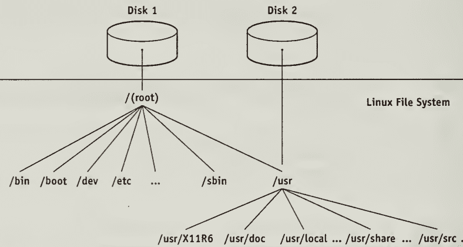

图 2-3

在两个磁盘分区上挂载 `Red Hat Linux` 文件系统的示例

### 理解交换分区

大多数高级级操作系统都支持虚拟内存概念，在虚拟内存中，系统硬盘的一部分充当物理内存（`RAM`）的扩展。当操作系统的物理内存耗尽时，它可以移动（或交换出）内存中当前未使用部分的内容，为任何需要更多内存的程序腾出空间。当操作系统需要访问被交换出的数据中的任何内容时，它必须找到其他内容交换出，并从磁盘交换所需的数据。这种在 `RAM` 和磁盘之间来回交换数据的过程也称为分页（`paging`）。

由于磁盘速度远慢于 `RAM`，当操作系统必须执行大量分页操作时，系统性能会变慢。然而，虚拟内存允许你运行在其他情况下无法运行的程序。

`Red Hat Linux` 支持虚拟内存并可以使用交换分区。当你创建 `Linux` 分区时，也创建一个交换分区。通过下一节描述的 `Disk Druid` 实用程序，创建交换分区非常简单。只需将分区类型标记为交换设备，`Disk Druid` 就会执行必要的任务。

## 第 2 节——硬盘分区

在选择安装类型后，屏幕会提示你想要分区磁盘的方法——选项有“自动分区”和“删除数据”。使用 `fdisk` 手动分区（仅限专家）或“使用 `Disk Druid` 手动分区”。选择“使用 `Disk Druid` 手动分区”并点击“下一步”（`Next`）按钮。这将显示 `Disk Druid` 界面（见图 2-4）。

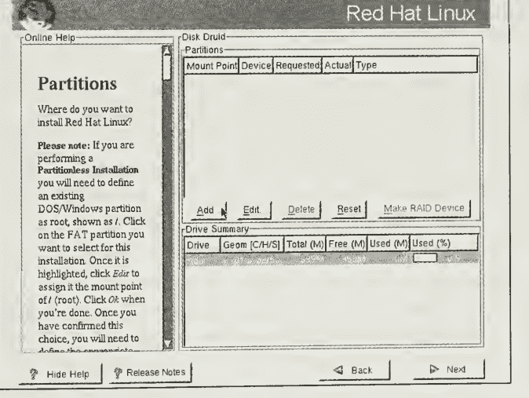

图 2-4

`Red Hat Linux` 安装程序中的 `Disk Druid` 界面

`Disk Druid` 收集有关你系统中硬盘的信息，并在屏幕下部显示磁盘驱动器列表，在屏幕上部的“分区”（`Partitions`）列表中显示其中一个硬盘当前的分区信息。对于每个分区，`Disk Druid` 显示五个字段：

- `挂载点（Mount Point）` 指明操作系统将挂载分区的目录。例如，如果你只有一个用于 `Linux` 文件系统的分区，则挂载点将是根目录（`/`）。对于交换分区，此字段显示 `Swap`。如果此字段显示为 `<not set>`，你必须指定一个挂载点。要这样做，请选择分区并点击“编辑”（`Edit`）按钮。

- `设备（Device）` 指分区的名称。例如，`hda1` 是第一个 `IDE` 驱动器的第一个分区。

- `请求（Requested）` 字段显示分区拥有多少空间。例如，如果分区有 `256MB` 空间，则此字段显示为 `256M`。

- `实际（Actual）` 字段显示分区正在使用的磁盘空间。通常，请求和实际字段是相同的，但对于可以增长的分区，它们可能会有所不同。

- `类型（Type）` 显示分区的类型，例如 `Linux` 原生（`Linux Native`）或 `DOS`。

如果没有定义任何分区，分区列表中的表格将为空。你必须通过点击“添加”（`Add`）按钮添加新分区。

你在 `Disk Druid` 中通过跨屏幕中间的五个按钮执行磁盘设置任务。具体来说，这些按钮执行以下操作：

- `添加（Add）` 允许你创建新分区，前提是有足够的可用磁盘空间。当你点击此按钮时，会出现另一个对话框，你可以在其中填写创建分区所需的信息。

- `编辑（Edit）` 允许你更改分区列表中当前高亮分区的属性。当你点击“编辑”按钮时，会在另一个出现的对话框中对当前属性进行更改。

- `删除（Delete）` 移除分区列表中当前高亮的分区。

- `重置（Reset）` 导致 `Disk Druid` 忽略你所做的任何更改。

- `创建 RAID 设备（Make RAID device）` 设置 `RAID`（独立冗余磁盘阵列）设备——这是一种结合多个磁盘以提高可靠性和数据传输速率的技术。有几种类型的 `RAID` 配置。只有当你的系统具有支持 `RAID` 设备的必要硬件时，此按钮才处于状态。

## 第 2 节——硬盘分区

你在 `Disk Druid` 中具体做什么，取决于你 PC 上的硬盘以及它们已经拥有的分区。对于这两种情况，请执行以下操作：

### 设置分区

为了准备分区，你必须执行以下步骤：

1. 删除你想使用的分区。要这样做，从分区列表中选择分区（通常为设备 `hda1`）并点击“删除”按钮。
2. 为 `Linux` 文件系统创建一个新分区。要这样做，点击 `Druid` 屏幕上的“添加”按钮。在对话框中（见图 2-5）输入大小。点击“确定”定义分区并返回 `Druid` 屏幕。
3. 创建另一个新分区并将其设置为交换空间。要这样做，点击 `Druid` 屏幕上的“添加”按钮（见图 2-4）。在分区类型列表中，使用鼠标选择 `Swap`。这样做后，挂载点字段会出现 `Swap` 字样。接下来，点击“确定”定义分区并返回 `Druid` 屏幕。
4. 如果你想在 `Linux` 下访问 `DOS` 分区，确保为该分区分配一个挂载点。基本上，你是在分配一个 `Linux` 目录名称。例如，你可以使用 `/dos` 作为 `DOS` 分区的挂载点；这样你可以在 `/dos` 目录下访问 `DOS` 文件。这个记忆很好，因为名字 `dos` 会提醒你是 `DOS` 或 `Windows` 下的 `C` 盘。要分配挂载点（通常位于分区列表中设备 `hda2`），点击“编辑”按钮编辑属性。编辑对话框出现。输入挂载点（例如 `/dos`），点击“确定”按钮返回 `Druid` 屏幕。
5. 做出更改后，点击 `Druid` 屏幕上的“下一步”按钮进入下一个安装步骤。

### 选择要格式化的分区

在 `Disk Druid` 中指定分区后，`Red Hat` 安装程序会显示一个屏幕（见图 2-6），列出可能要在 `Linux` 中格式化的分区。如果你只有一个用于 `Red Hat Linux` 的磁盘分区，列表将仅显示一个分区。

要格式化分区，点击分区名称旁的按钮。还要点击标记为“格式化时检查坏块”选项旁的按钮，以便格式化过程标记磁盘上可能物理缺陷的区域。

## 第 2 节——硬盘分区

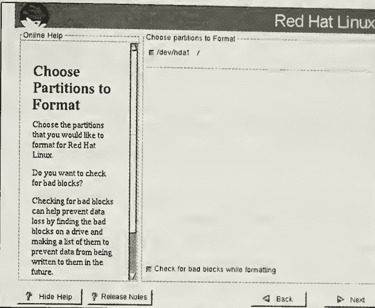

图 2-6

为 `Red Hat Linux` 选择用于格式化的分区


如果你在你的磁盘上有多个磁盘分区并将其挂载在 Linux 文件系统的不同目录上，并且你正在升级现有的安装，则无需对任何你想要保留现有数据的分区进行格式化。例如，如果你的用户目录位于一个独立的磁盘分区上，并挂载在 `/home` 目录，那么你就不需要格式化该分区。

这标志着安装准备阶段的完成。安装程序在询问更多配置信息（包括你想要安装的软件包）之后，会对分区执行实际的格式化。

### 复习

本节首先向你展示了如何为 Red Hat Linux 安装预留磁盘空间。然后，你使用上一节中准备的 Red Hat 启动盘开始安装。通过图形用户界面，你指定了语言、键盘和鼠标，并创建了用于 Red Hat Linux 的磁盘分区。你还学习了交换分区（`swap partition`）等术语的含义，以及在磁盘分区上挂载文件系统的意义。

### 自测

- 1. 什么是 `FIPS`？你可以用它做什么？（参见“使用 `FIPS` 重新划分你的硬盘分区”。）
- 2. Red Hat 安装程序使用什么信息来定制安装步骤？（参见“启动 Red Linux 安装”。）
- 3. 挂载文件系统意味着什么？（参见“在设备上挂载文件系统”。）
- 4. 什么是 `Disk Druid`？你应该用它做什么？（参见“为 Red Hat Linux 准备磁盘分区”。）
- 5. 如果你所有的用户目录都在一个挂载在 `/home` 目录的独立磁盘分区上，在执行 Red Hat Linux 的自定义安装时，你需要重新格式化该分区吗？（参见“选择要格式化的分区”。）

### 课程


### 安装 Linux

### 章节清单

- 配置 Red Hat Linux
- 选择要安装的软件包
- 完成 Red Hat Linux 安装

在上一节中，你为 Red Hat Linux 预留了磁盘空间，启动了安装程序并准备了磁盘分区（包括交换分区）。在本节中，你将完成 Red Hat Linux 的安装。你将学习如何配置 Red Hat Linux、选择要安装的软件包，并让安装程序完成剩余安装工作。


### 配置 Red Hat Linux

在你用 `Disk Druid` 准备好磁盘分区并指定要格式化哪些分区后，安装程序将进入某些配置步骤。典型的配置步骤如下：

- 安装 `LILO`
- 配置网络
- 设置时区
- 设置 `root` 密码并添加用户账户
- 配置密码认证

接下来的章节将引导你完成这些配置步骤。

### 安装 LILO

`LILO` 代表 Linux Loader（Linux 加载程序）——这是一个运行在你的硬盘上并从硬盘启动 Linux 的程序。如果你在硬盘上有 Windows 95/98，你也可以配置 `LILO` 来加载这些操作系统。`LILO` 也称为引导加载器（`bootloader`）。

Red Hat 安装程序显示 `LILO` 配置屏幕（参见图 3-1），该屏幕询问你想要在哪里安装 `LILO`。对于 Windows 95/98 和 Red Hat `LILO` 位于同一块硬盘的系统，最好将它们安装在同一处。

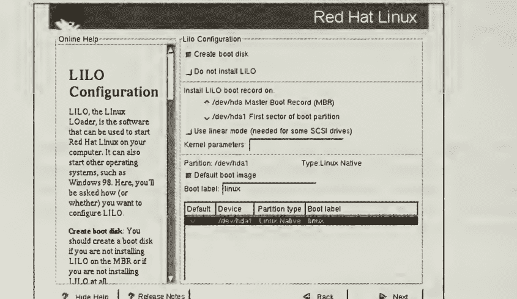

图 3-1

`LILO` 配置屏幕询问你想要在哪里安装 `LILO`。对于 Windows 95/98 和 Red Hat `LILO` 位于同一块硬盘的系统，最好将它们安装在同一处。

引导磁盘按钮询问你是否要创建引导磁盘。

在 `LILO` 配置屏幕上，你可以点击“安装 `LILO`”按钮进入下一步。

`LILO` 配置屏幕允许你将 `LILO` 安装在以下位置之一：

- 主引导记录 (`MBR`)
- 磁盘的首扇区 (`C:`)

Red Hat Linux 内核可能需要的某些选项取决于你的硬件。当 Red Hat Linux 使用 3C503 网卡时，你需要 `xhr=1` 选项。

> 在安装 `LILO` 后，不要在 Windows 中使用 `fdisk` 命令。


LILO 配置屏幕允许你将 LILO 安装在以下位置之一：

- 主引导记录 (MBR)
- 磁盘的首扇区 (`C:`)

安装 LILO 后，每当你的电脑从硬盘启动时，LILO 会运行并显示提示：在提示处，你可以输入操作系统的名称。

重启电脑时，如果你在 LILO 提示处什么都不输入，LILO 将等待几秒钟并启动默认操作系统。默认操作系统是图 3-1 中“默认”列带有复选标记的。在这种情况下，Linux 是默认操作系统。

所有这些仅供你参考。你可以基本上接受屏幕上的默认选择，并点击“下一步”按钮进入下一个配置步骤。

### 配置网络

假设 Linux 内核检测到了网卡，Red Hat 安装程序将显示网络配置屏幕（参见图 3-2），允许你为系统配置局域网（LAN）参数。

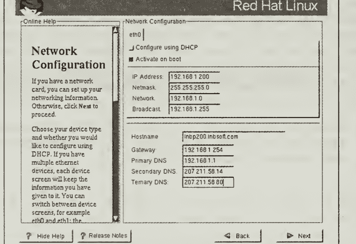

图 3-2

网络配置屏幕允许你配置局域网。

此步骤不是配置拨号上网。如果你的 Linux 系统是通过以太网卡或其他高速数据网络连接到 TCP/IP 局域网，而不仅仅是连接到 ISP 的解调器，你需要执行此步骤。

> 如果 Red Hat 安装程序没有检测到你的网卡，你应该重新启动并在启动提示处输入 `expert`。你可以手动选择网卡。更多信息请参见第 4 节。

## 第 3 节—安装 Linux

网络配置屏幕（图 3-2）显示了选项卡对话框——每个标签页对应系统中安装并被 Linux 内核检测到的一个网卡。这些网卡被标记为 `eth0`、`eth1` 等。如果你的系统只有一个以太网卡，你将只看到 `eth0` 标签。图 3-2 只有一个标签。每个标签为指定网络接口的 IP（互联网协议）提供了两个选择：

- **DHCP**——如果你的 PC 从动态主机配置协议（DHCP）服务器获取 IP 地址和其他网络信息，请点击标记有“配置（Configure）”的按钮。
- **提供静态 IP 地址**——填写必要的网络相关信息。

只有当您的本地局域网上运行 DHCP 服务器时，才选择 DHCP。如果您选择了 DHCP，DHCP 服务器将自动设置网络配置，您可以跳过本节的其余部分。您应该勾选“启动激活”（Activate on boot），以便在每次启动系统时都连接网络。

要提供静态 IP 地址和其他网络信息，您必须在网络配置屏幕上出现的文本输入字段中为 TCP/IP 配置输入某些参数（参见图 3-2）。

网络配置屏幕要求以下关键参数：

- 以太网接口的 IP 地址
- Linux 系统的主机名（对于私有局域网，您可以分配自己的主机名，而无需担心与互联网上的任何系统发生冲突）。
- 网关 IP 地址（您通过它访问任何外部网络的系统）
- 主域名服务器的 IP 地址
- 备域名服务器的 IP 地址
- 三域名服务器的 IP 地址

如果您有私有局域网（未直接连接到互联网的网络），可以使用指定用于私用的范围内的 IP 地址。私有局域网常用的 IP 地址是 `192.168.1.1` 到 `192.168.1.254` 范围内的地址。

第 12 节提供了关于 TCP/IP 网络和 IP 地址的更深入的信息。


输入所需的参数后，点击“下一步（Next）”按钮进入防火墙配置步骤。防火墙配置屏幕提供三个安全级别。默认值为“高（High）”，目前是合适的。点击“下一步”按钮继续。

### 时区

完成防火墙配置后，您必须选择在 Red Hat 系统上想要使用的默认语言。从列表中点击该语言以进行选择，然后点击“下一步”按钮。现在您将设置时区——本地时间与英国格林威治当前时间之间的差异，格林威治时间是标准参考时间。时区也被称为格林威治标准时间（GMT）或 UTC，国际电信电电联盟（ITU）选择 UTC 作为协调世界时间的标准缩写。安装程序向您显示“时区选择”屏幕（见图 3-3），您可以在从中根据地理位置或相对于 UTC 的偏移来选择时区。图 3-3 显示了按地理位置选择时区。

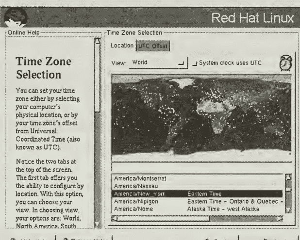

图 3-3

按地理位置选择您的时区

注意，时区选择屏幕上有两个标签——“位置（Location）”和“UTC 偏移（UTC Offset）”。屏幕最初显示“位置”标签。此标签允许您只需通过点击您的地理位置即可选择时区。当您将鼠标移动到地图上时，当前选择位置的名称将出现在文本字段中。如果您需要，也可以从长的国家和地区列表中选择您的位置。例如，如果您居住在美国东海岸，请选择 `USA/Eastern`。最简单的方法是点击地图上的 `eastern USA`。

如果地图世界太大导致您无法选择自己的位置，请点击地图顶部的“视图（View）”按钮。会出现一个带有若干选择的视图下拉列表。然后您可以点击适合您所在位置的视图。

设置时区的另一种方法是指定您的本地时间与 UTC 之间的时间差。点击“UTC 偏移”通过这种方式选择时区。例如，如果您在美国东部，请选择 `UTC-05:00` 作为时区。此标签还允许您启用夏令时（Daylight Saving Time），这仅适用于美国。选择时区后，点击“下一步”按钮进入下一个配置。

### 设置 root 密码并添加用户账户

完成时区选择后，安装程序将显示“账户配置”屏幕（见图 3-4），您可以在其中设置 root 密码并添加更多用户账户。

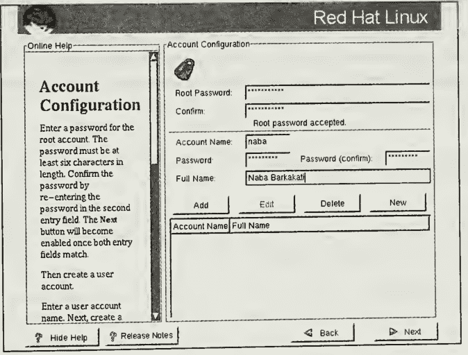

图 3-4 设置 root 密码并添加其他用户账户

root 用户是 Linux 中的超级用户。由于超级用户可以在系统内核执行任何操作，因此您应该分配一个您能记得但他人难以猜到的密码。通常，密码长度至少为八个字符，包含字母和数字，并（为了保险起见）加入一些特殊字符，如 `+` 或 `*`。记住密码是敏感的。

安装程序显示一个可以在其中配置密码验证的屏幕。有几个可以启用的选项：

- 启用 MD5 密码：选择此选项允许用户使用长达 256 个字符的长密码，而不是最多只有 8 个字符的标准密码。注意，MD5 指的是消息摘要算法 5，这是一种由 `RSA, Inc.` 开发的用于计算消息摘要的算法。本质上，MD5 将消息还原为由四个 32 位数字组成的摘要。这允许您输入密码短语而不仅仅是密码。
- 启用影子密码（shadow passwords）：此选项将 `/etc/passwd` 文件替换为 `/etc/shadow`，只有超级用户（`root`）可以读取。这提供了额外的安全级别。

您应该使用这些默认设置来增加系统安全性。点击“下一步”按钮继续配置。

### 选择要安装的软件包组

完成关键配置步骤后，安装程序将显示一个屏幕，您可以在其中选择想要安装的 Red Hat Linux 软件包组。选择软件包组后，您可以去喝咖啡休息一下，Red Hat 安装程序可以格式化磁盘分区并将所有选的文件复制到这些分区。

Red Hat 使用称为“软件包（packages）”的特殊文件封装组成软件的文件。例如，`Perl` 语言的所有配置文件、文档和二进制文件都包含在一个 Red Hat 软件包中。您使用名为 Red Hat 软件包管理器（`RPM`）的特殊程序来安装、卸载和获取软件包信息。第 23 节将向您如何使用 `RPM`。现在只需记住软件包组是由若干 Red Hat 软件包组成的。

图 3-5 显示了“软件包组选择”屏幕，带有您可以安装的软件包组列表。图标、描述性标签和按钮可以标识每个软件包组。

这是 Red Hat 推荐为您选择的安装类型（工作站、服务器或自定义）安装的软件包。但是，您可以选择安装任何或所有组件。使用鼠标在滚动列表中上下移动，并点击某项以选择或取消选择该软件包组。


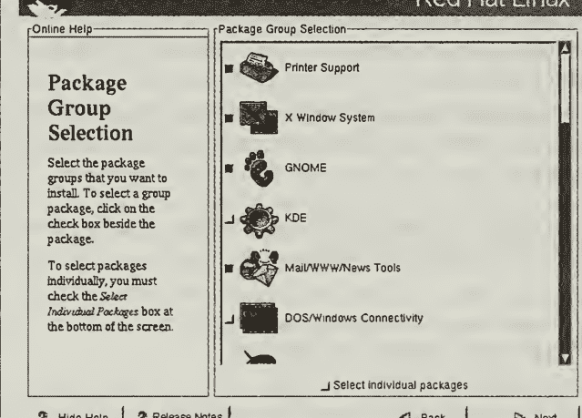


图 3-5

从中选择要安装的组件的软件包组选择屏幕

> 在理想的红帽 Linux 安装中，你只安装你所需要的那些软件包组。然而，为了本速成课程的目的，你选择了许多不同的软件包组，因为你需要它们来完成所有的课程。每个软件包组都需要特定的软件包才能运行。红帽的安装程序会自动检查任何软件包依赖关系，并向你显示你未选择的软件包列表。在这种情况下，你应该安装这些所需的软件包。

由于每个软件包组都是许多红帽软件包的集合，因此安装程序还提供了选择单个软件包的选项。如果你选择了图 3-5 列表下方出现的“选择单个软件包”（`Select individual packages`）项目并点击“下一步”（`Next`）按钮，安装程序将带你进入到其他屏幕，你可以在可以在处选择单个软件包。如果你是第一次安装红帽 Linux，你真的不需要细化到这种程度来安装特定软件包。只需从图 3-5 显示的屏幕中选择你认为需要的组件即可。选择好你想要的组件后，点击“下一步”按钮继续剩余的安装。

# 第 3 节——安装 Linux

你以后可以使用第 23 节中描述的 `RPM` 实用程序安装额外的软件包。


### 完成安装

在你完成关键配置步骤并选择要安装的组件后，安装程序将配置 `X` 窗口系统（`X Window System`）。安装程序使用一个具有最小功能的 `X` 服务器，该服务器可以在所有显卡上运行。在这一步中，安装程序会准备 `X` 服务器在你重启时使用的配置文件。

安装程序尝试检测显卡并显示 `X` 配置屏幕，以指示探测的成功或失败。如果没有检测到显卡，你可以从列表中选择，或者选择一个通用的 `VGA` 驱动程序。接下来，安装程序尝试检测你的显示器，并带有结果显示 `X` 配置屏幕（见图 3-6），无论结果是否成功。

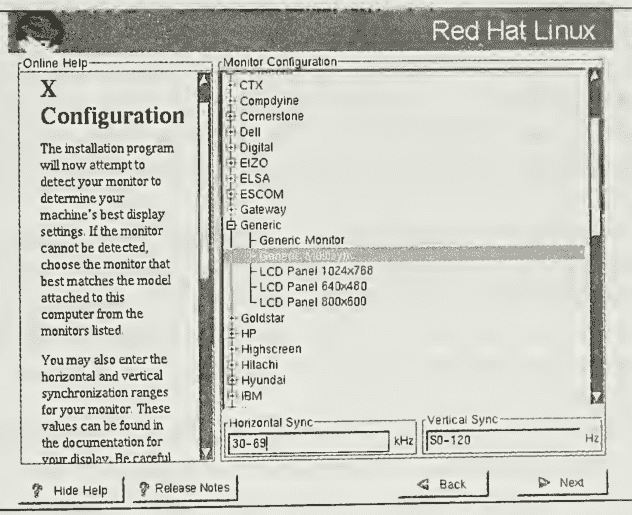

**图 3-6**

显示在 `X` 配置屏幕上的显示器检测结果

# 42 周五晚上

如果安装程序显示错误的显示器或通用显示器作为选项，你应该为屏幕底部两个参数输入范围值：

- 水平同步（`Horizontal Sync`）——显示器每秒显示水平光栅线的次数，单位为千赫（`kHz`）。典型范围可能是 `30-64` 千赫（`kHz`）。
- 垂直同步（`Vertical Sync`）——显示器每秒显示整个屏幕的次数，单位为赫兹（`Hz`）。也称为垂直刷新率，典型范围为 `50-90` 赫兹（`Hz`）。

通常，显示器的文档包含了所有这些信息。获取显示器信息的其他地方包括：`Microsoft Windows` 设置、你的系统 `Windows` 驱动程序、电脑厂商的网站或 `Norton` 系统信息工具。

> 不要指定超出显示器能力的水平同步范围。不正确的值可能会损坏显示器。


选择显示器后，安装程序将呈现自定义配置（`Custom Configuration`）屏幕，你可以从中选择颜色深度和屏幕分辨率。安装程序会选择它认为对你的系统最优的值。你可以通过点击箭头打开下拉框从中选择不同的值。你还可以通过勾选屏幕底部的复选框，选择让系统以文本模式或图形模式启动。

完成 `X` 配置选项的选择后，点击“下一步”按钮。安装程序将显示一条信息消息，告诉你的安装日志位于 `/tmp/install.log` 文件中。该文件列出了系统中安装的所有红帽软件包。你可以在稍后查看安装日志并保留该文件以备后后。安装日志的内容取决于你选择安装的精确软件包。

点击“下一步”按钮继续安装。红帽安装程序将格式化磁盘分区并安装软件包。在安装软件包时，安装程序会显示状态屏幕，显示安装进度以及诸如总要安装的软件包总数、已安装数量、估计所需的磁盘空间以及预计的剩余安装时间。格式化和安装都需要一段时间。

# 第 3 节——安装 Linux

43

安装所有软件包后，安装程序将显示一个屏幕，提示你向 PC 的 `A:` 盘插入一张空白软盘。这张软盘是应急启动盘，如果硬盘出现问题或你没有安装 `LILO`，你可以使用它来启动红帽 Linux。

将一张空白软盘插入 PC 的 `A:` 盘，并点击“下一步”按钮。安装程序将 Linux 内核和其他一些文件复制到软盘中。准备好启动盘后，安装程序将显示安装已完成的消息。

> 当你向 PC 的 `A:` 盘插入空白软盘时，在将 Linux 文件复制到驱动器的过程中，软盘上的所有之前数据都会被破坏。


消息继续提醒你在退出安装程序之前从 `A:` 盘取出软盘。请这样做，对软盘进行适当标记并保存备用。然后点击“退出”按钮重启你的 PC。当重启完成后，你应该看到红帽 Linux 的图形登录界面。你现在已经准备好探索 Linux 了。

### 复习

在本节中，你继续了上一节开始的红帽 Linux 安装步骤。安装程序允许你配置多个项目，包括 Linux 加载程序（`LILO`）、局域网、时区以及 `root` 用户密码。然后你选择了软件包组并配置了 `X` 窗口系统。之后，由安装程序接管——它格式化了磁盘分区并从光盘复制了所有必要文件。你还准备了应急启动盘。

### 自测

- 什么是 `LILO`？它有什么作用？（安装 `LILO`）
- 什么是 `root`？（设置 `root` 密码和添加用户）
- 在网络配置屏幕中指定哪些参数？（配置网络）
- 如果你不选择任何软件包组，会发生什么？（选择软件包组）
- 如果安装程序无法正确检测你的显示器，你必须指定哪些参数？（完成安装）

### 课程


# 首次运行 Linux

### 课程清单

- 在文本模式下排故障并安装红帽 Linux
- 在专家模式下排故障并安装红帽 Linux
- 配置 `X` 窗口系统
- 登录和注销
- 探索 `GNOME` 和 `KDE`

30 分钟即可

在过去的三个节中，你从此书的附带光盘安装了红帽 Linux。红帽 Linux 安装程序尝试自动检测关键硬件组件，例如 `SCSI` 控制器和网卡。根据检测到的硬件，安装程序引导你通过一系列步骤来配置检测到的硬件。例如，如果安装程序无法正确检测到网卡，它将跳过网络配置步骤。安装程序还尝试通过跳过某些系统配置步骤（如设置打印机）来简化安装。由于有其他执行这些任务的方法，你可以恢复大多数安装和配置问题。本节展示了解决常见安装和配置问题的几种排故障方法。

### 在文本模式下安装 Red Hat Linux

`Red Hat` 安装程序会尝试使用最小化的 `X` 窗口系统 (`X`) 来显示图形化用户安装界面。如果程序无法检测到显卡，`X` 将不会启动。如果由于此原因或其他任何原因 `X` 无法启动，你始终可以回退到旧的文本模式安装程序，以手动指定显卡。如果你熟悉旧的安装程序，也可以使用文本模式安装。

要使用文本安装，在从 `Red Hat Linux` 启动软盘启动 PC 后，在 `boot:` 提示符处输入 `text`。此后，基本步骤与第 2 节中描述的图形化安装类似。然而，许多小细节有所不同。你应该能够响应这些提示并执行安装。

在文本模式下，当安装程序无法检测到显卡时，它会显示显卡列表。从列表中选择一个显卡。由于你在选择显卡时提供了帮助，当在文本模式下安装时 `X` 可能会正常工作。如果运行不正常，你可以使用本节稍后出现的“配置 `X`”部分以及第 5 节中的信息来配置 `X`。

### 专家模式下的 Red Hat Linux

如果 `Red Hat` 安装程序没有检测到你的 `SCSI` 控制器或网卡，你可以通过以专家模式运行安装来手动指定这些设备。在 Linux 内核启动时显示的消息中查找任何关于 `SCSI` 或网络设备的指示。要查看这些消息，按 `Ctrl+Alt+F4`。这将切换到文本模式虚拟控制台，消息显示在那里。虚拟控制台是存储内存中的文本或图形信息屏幕，你可以通过按下相应的键序列在物理屏幕上查看它。

要以专家模式运行安装，在 `Red Hat Linux` 安装期间出现的初始文本界面的 `boot:` 提示符处输入 `expert`。安装程序随后会显示另一个文本界面，询问你是否有磁盘驱动程序（如果有）。

你的硬件供应商提供了一个带有 Linux 驱动程序的软盘。如果你有该磁盘，按 `Enter`，对话框会提示你将磁盘插入 `A:` 驱动器。完成后，按 `Enter`，安装程序将加载驱动并引导你完成安装驱动所需的步骤。

# 第 4 节——首次运行 Linux

如果你没有驱动磁盘，请选择“取消”(`Cancel`)。安装程序将通过另外两个界面，在其中你选择语言和键盘布局。然后，安装程序会提示包含要安装软件包的介质。

接下来，安装程序将显示一个对话框，为你提供另一个添加设备的机会。按 `Tab` 键高亮“添加设备”(`Add Device`) 按钮，然后按 `Enter`。安装程序随后会显示设备类型的对话框——`SCSI` 或网络。


如果你有任何 SCSI 设备（例如 SCSI 硬盘），选择 `SCSI` 并按 `Enter`。然后，安装程序将显示 `SCSI` 控制器列表，你应该从列表中选择你系统中的那个并按 `Enter`。安装程序将加载驱动模块。

`SCSI` 驱动程序会自动探测并确定 `SCSI` 控制器的设置，例如中断请求 (`IRQ`) 和 `I/O` 端口地址。如果驱动程序在检测 `SCSI` 控制器设置时出现问题，你可以手动指定这些参数。要进行操作，选择标记为“指定模块参数”(`Specify module parameters`) 的框并按 `Enter`。安装程序将提示你输入模块参数。

你可以输入类似 `a152x=0x340,11,7` 的行来指定驱动模块的参数。请查看本节稍后侧边栏“指定控制器设置”(`Specifying Controller Settings`) 以获取有关这些设置的更多信息。

添加任何 `SCSI` 控制器后，你会返回到选择设备类型的对话框。你也可以从此对话框添加网卡。在对话框中，从列表中选择“网络”(`Network`) 并按 `Enter`。安装程序随后将显示网卡列表，你可以从中选择你的网卡。

当你按 `Enter` 时，安装程序将加载所选网卡的驱动模块。该驱动程序将探测并确定网卡的设置。

一旦你返回到选择 `SCSI` 或网络的屏幕，选择“返回”(`Back`) 并按 `Enter`。这将进入添加设备的对话框。选择“完成”(`Done`) 并按 `Enter`。安装程序随后将切换到图形模式，并引导你完成剩余安装，如文所示。

### 配置 X 窗口系统

如果安装程序在 `X` 配置步骤无法检测到你的显卡，你可以跳过该步骤，并在完成剩余安装后配置 `X`。

### 指定控制器设置

如果系统中存在 `SCSI` 控制器，`Red Hat` 程序将为该控制器加载 `SCSI` 驱动模块。你必须识别 `SCSI` 控制器的类型（例如 `Adapatec 1542` 或 `Adapatec 2940`）。安装程序可以通过探测 `I/O` 端口地址来尝试确定控制器设置，例如 `IRQ` 和 `I/O` 端口地址。然而，如果安装程序无法确定 `SCSI` 控制器设置，你必须将这些参数（`IRQ` 和 `I/O` 地址）作为模块选项指定。这些选项的精确格式随模块而异。例如，`Adapatec AHA 152x` 的驱动接受以下格式：

```
aha152x=IOPORT,IRQ,SCSI_ID,[Reconnect,Parity]
```

其中 `IOPORT` 是 `I/O` 端口地址，`IRQ` 是中断请求号，`SCSI_ID` 是 `SCSI` 控制器。最后两项是可选的。`aha152x` 模块的典型选项可能是：

```
aha152x=0x340,11,7
```

完成后，你会返回到选择设备类型的对话框。你也可以从此对话框添加网卡。在对话框中，从列表中选择“网络”(`Network`) 并按 `Enter`。安装程序随后将显示网卡列表，你可以从中选择你的网卡。

当你按 `Enter` 时，安装程序将加载所选网卡的驱动模块。该驱动程序将探测并确定网卡的设置。

一旦你返回到选择 `SCSI` 或网络的屏幕，选择“返回”(`Back`) 并按 `Enter`。这将进入添加设备的对话框。选择“完成”(`Done`) 并按 `Enter`。安装程序随后将切换到图形模式，并引导你完成剩余安装，如文所示。

## 第 4 节——首次运行 Linux

`Xconfigurator` 4.3.35 - (C) 2000 `Red Hat Software` and others

```
PCI Probe:
PCI probing found a:
PCI Entry : 83 Inc., IVGA/2
Server : 9F830A
Xframe driver: S3 (默认不使用)

[ Ok ]
```

`Tab`/`Alt-Tab` 在元素间切换 `Space` 选择 `F12` 下一屏幕

### 图 4

来自 `Xconfigurator` 探测显卡的消息


例如，如果你的显示器说明书说显示器能够在 `60Hz` 下显示 `1280x1024` 分辨率，你应该选择符合此规格的选项。选择好水平同步能力后，按回车。

`Xconfigurator` 会提示你设置显示器的垂直同步率。选择与显示器规格最接近的垂直同步范围并按回车。

如果 `Xconfigurator` 无法检测到显卡的显存大小，它会显示一个对话框，提示你从列表中选择显存大小。选择与显卡内存最接近的数值并按回车。

`Xconfigurator` 提示你识别时钟芯片——显卡上的一个定时设备。你可以安全地按回车接受标记为“无时钟芯片设置（推荐）”的默认选择。

随后，`Xconfigurator` 会显示“选择模式”对话框，其中列出了各种像素分辨率的视频模式，例如 `1280 x 1024`，并按要求视为每像素 `16` 位。

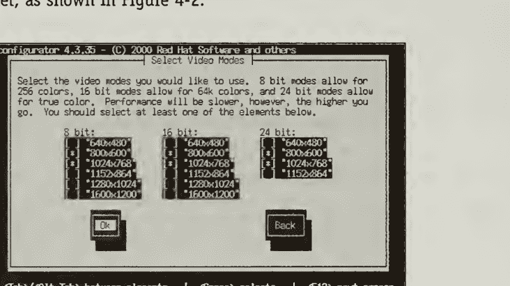

### 20. Min. To Go

`Xconfigurator` 4.3.5 — © 2000 `Red Hat Software` 及其他

- 选择视频模式

选择你想要使用的视频模式。`16` 位模式允许 `24` 位颜色（支持每种颜色），`32` 位模式允许真色彩。然而，性能会变慢，位深越高-

你应该选择以下元素中的至少一个。

| `16` | `24` | `32` |
|---|---|---|
| `640x480` | `640x480` | `640x480` |
| `800x600` | `800x600` | `800x600` |
| `1024x768` | `1024x768` | `1024x768` |
| `1280x1024` | `1280x1024` | `1280x1024` |
| `1600x1200` | | `1600x1200` |

使用 `Tab`/`Shift-Tab` 在元素间切换，`Space` 选择，`F12` 下一屏幕

### 图 4-2

选择一个或多个视频模式

按 `Tab` 键将光标移动到视频模式，按空格键选择该模式。你可以选择任意数量的模式。然后按 `Tab` 键选择 `OK` 按钮并按回车。

接下来，`Xconfigurator` 会提供启动 `X` 以测试你的配置的选项，你应该按回车。会出现一个图形 `X` 屏幕，`Xconfigurator` 会显示一个对话框，测试你是否能阅读上面的文字。点击关闭对话框。`Xconfigurator` 在 `/etc/X11` 目录下写入 `XF86Config` 文件并完成 `X` 配置。下次你重启 `PC` 时，`X` 应该会启动，你会看到图形化登录界面。

## 会话 4—首次运行 Linux

现在你已经从本书的配套光盘安装了 `Red Hat Linux`，你已经准备好探索并学习它了。首先，你将学习如何登录、注销和关闭你的 `Linux` 系统。然后你再次开机，快速浏览 `GNOME` 和 `KDE` 图形用户界面（`GUI`）——读音为 "goo-ease"。

## Linux

安装完成后，`Red Hat Linux` 安装程序会自动重启系统。`PC` 将经历正常的开机序列并从 `C` 盘加载 `LILO`；屏幕上会显示 `LILO` 可以启动的分区名称。如果你什么都不做，`LILO` 将继续从你在会话 1 中配置 `LILO` 时指定的默认分区启动。如果你按下 `Ctrl+X`，将出现以下提示：

`LILO boot:`

当你安装 `LILO` 时，如果将 `Linux` 分区指定为默认分区，你只需等待即可；几秒钟后，`LILO` 就会启动 `Linux`。

> 如果你想从另一个分区（例如 `Windows`）启动，请按 `Tab` 键。`LILO` 会显示所有可用可启动分区的名称。例如，一个典型的显示可能是：

`LILO dos`

然后你可以告诉 `LILO` 你想要启动的分区名称，或者按回车键从第一个分区启动。

`LILO` 启动 `Linux` 后，你将看到一系列启动消息——包括 `Linux` 检测到的设备名称。在所有消息结束处，你将看到一个图形化登录界面，如如图 4-3 所示。

屏幕中间的窗口显示了一条带有你系统主机名的欢迎消息——这是你在配置网络时为系统分配的名称。如果没有配置网络，则使用 `localhost.localdomain` 作为主机名。

你可以使用安装期间定义的任何账户登录，包括 `root`。例如，要以 `root` 身份登录，请在文本字段中输入 `root`（在开始输入前将鼠标移动到登录窗口上）并按回车。然后输入 `root` 密码（安装期间设置的密码）以超级用户身份登录。

### 图 4-3

`Red Hat Linux` 中的图形化登录界面

由于默认 `GUI` 是 `GNOME`，`GNOME` 桌面出现时会有一个来自 `GNOME` 文件管理器的警告对话框。点击 `OK` 按钮关闭警告对话框。`GNOME` 提示窗口出现，你将获得桌面（如图 4-4 所示）。

你将在几分钟内探索 `GNOME` 桌面。现在，我想介绍如何注销。

## 注销

在你探索 `GNOME` 桌面之前，你先学习如何注销。从 `GNOME` 桌面注销时，选择位于边缘的 `GNOME` 菜单（见 4-3）。

另一个对话框会询问你是否真的要关机。点击“是”按钮，系统将以有序的方式关闭。

随着系统关闭，你会看到关于进程关闭的消息。尽管没有人显式运行任何程序，你可能对有这么多进程感到惊讶。如果系统在关闭时没有自动关闭，你可以手动关闭。

## 探索 GNOME


再次启动 PC，并在进入图形登录界面后登录。你应该再次获得 GNOME 桌面，因为它是默认的。在本节中，你将花时间探索 GNOME 桌面。

> GNOME 的具体外观取决于当前的会话。会话无非一组应用程序（包括窗口管理器）以及这些应用程序的状态。GNOME 将会话信息存储在家目录下 `.gnome` 子目录下的 `session` 文件中。这是一个文本文件；如果你好奇，可以使用 `more ~/.gnome/session` 查看它。现在不要担心语法；你将在会话 6、7 和 8 中学习更多关于 Linux 命令。


## 会话 4—首次运行 Linux

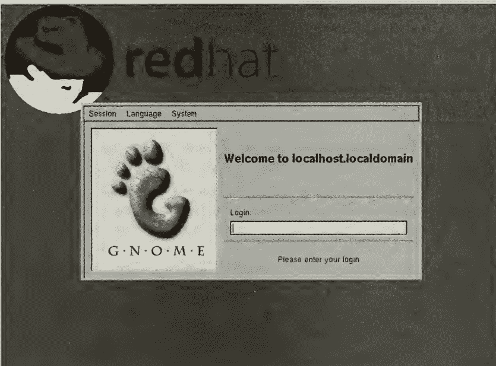

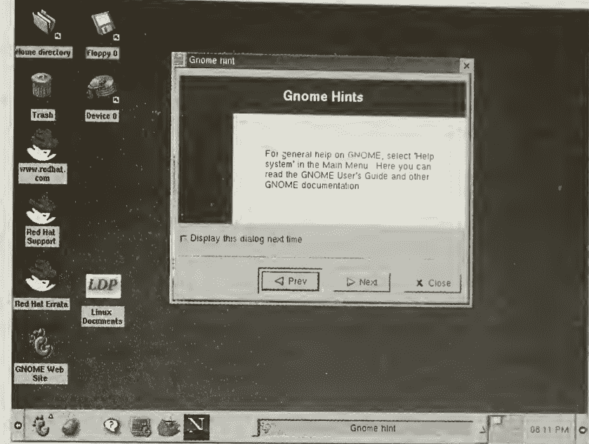

图 4-4

登录后的 GNOME 桌面

### 什么是 GNOME？

GNOME 代表 GNU Network Object Environment；正如你可能所知，GNU 代表 GNU's Not UNIX。GNOME 是一个图形用户界面（GUI）和一个编程环境。从用户的角度来看，GNOME 是基于 Motif 的常用桌面环境（CDE）或微软 Windows。在后台，GNOME 拥有许多功能允许程序员编写运行良好的图形应用程序。在本会话中，我只指出了 GNOME GUI 的一些功能，细节留给你自己探索。

你可以随时通过访问 GNOME 主页获取有关 GNOME 的最新信息。

### 第 4 节——首次运行 Linux

默认会话描述生成的初始 GNOME 桌面（见图 4-4）与 Windows 95/98/NT/2000 桌面非常相似。它包含了 GNOME 面板（类似于 Windows 任务栏）和 Sawfish 窗口管理器，从而形成了与图 4-4 所示相似的桌面。

从 GNOME 桌面左侧出现的图标（参考图 4-4）你可以看到，GNOME 允许你直接将占位符和应用程序放置在桌面上。这与在 Windows 95/98/NT/2000 桌面上直接放置图标的方式相似。

你可以像在 Microsoft Windows 中那样移动和调整窗口大小。同样，类似于 Microsoft Windows 95/98/NT/2000 的窗口框，标题栏右上角三个按钮。最左侧的按钮最小化窗口，中间的按钮最大化窗口填充整个屏幕，最右侧的按钮关闭窗口。

GNOME 桌面的一个关键特性是屏幕底部的一条长条。这被称为 GNOME 面板或简单的面板。面板是一个独立的 GNOME 应用程序。如图 4-5 所示，它为菜单和面板插件提供了显示区域。每个面板插件都是设计在面板内部运行的小程序。例如，面板最右侧的时钟插件显示当前时间。

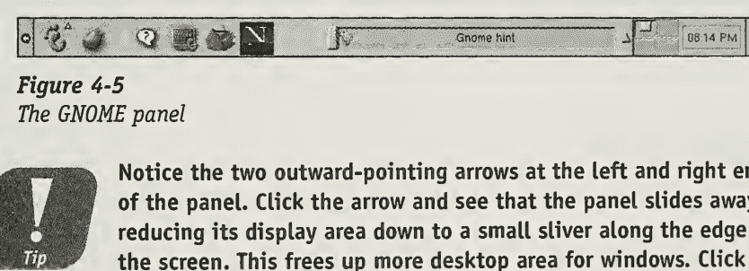

图 4-5

GNOME 面板

注意面板左右两端的两个向外的箭头。点击箭头，你会看到面板滑走，将其显示区域缩小为屏幕边缘的一小细条。这为窗口腾出了更多桌面区域。再次点击箭头，面板就会出现。

面板包含其他插件：

- GNOME 翻页插件：它提供了一个比系统屏幕物理尺寸更大的虚拟桌面。在图 4-5 中，翻页器在一个小的显示区域内显示四个页面。每个页面代表等于 X 显示屏幕大小的区域。要跳转到特定页面，点击翻页窗口中的该页面。GNOME 翻页插件还为当前虚拟页中显示的每个窗口显示按钮。
- 启动器插件：这些是脚图标右侧的按钮。每个按钮都显示一个该按钮启动的应用程序的图标。点击按钮将启动（运行）该应用程序。尝试点击这些按钮看会发生什么。问号 (`?`) 按钮启动 GNOME 帮助浏览器；工具箱按钮启动 GNOME 控制中心；终端图标启动终端窗口；地球图标启动 Netscape 通信器。锁图标启动屏幕保护程序并要求你输入密码返回桌面。
- 主菜单：GNOME 面板显示一个行为类似于 Windows 开始菜单的主按钮。这是面板左侧的按钮（见图 4-5），上面带有一个样式化脚的图像（GNOME 标志）。那个脚就是主菜单按钮。就像 Windows 95/98/NT/2000 中的开始按钮一样，你可以点击脚图标上的鼠标左键从弹出的菜单启动应用程序。通常，此菜单列出了启动应用程序的项目。当你将鼠标指针放在带有箭头的项目上时，某些菜单项目会有箭头。当……会出现另一个弹出菜单

如果时间允许，你应该探索主菜单中的所有项目，查看你可以从此菜单执行的所有任务。此时，选择主菜单（脚图标) `⇧` 注销，这样你就可以开始 KDE 会话了。

### 探索 KDE

要尝试 KDE 图形界面，你必须在周五的前三节安装 Red Hat Linux 期间安装 KDE 软件包。通常，安装程序会将 GNOME 设置为你的默认 GUI。现在，你可以通过在图形登录窗口中选择会话 KDE 来更改下次会话的 GUI。

> 在第 17 节中，你将学习将默认 GUI 从 GNOME 切换到 KDE，反之亦然。


### 第 4 节——首次运行 Linux

### 什么是 KDE？

KDE 代表 K Desktop Environment。KDE 项目始于 1996 年 10 月，旨在为使用 X 窗口系统的 UNIX 系统开发一个通用的 GUI。KDE 的第一个测试 beta 版本于一年后的 1997 年 10 月发布，KDE 1.0 版本于 1998 年 7 月发布。

从用户的角度来看，KDE 提供了一个图形桌面环境，包括一个窗口管理器 (`kwm`)；一个文件管理器 (`kfm`)；一个用于启动应用程序的面板 (`kpanel`)；一个帮助系统；配置工具以及许多应用程序，包括图像查看器、PostScript 查看器新闻程序。

从开发者的角度来看，KDE 拥有类库和对象模型，方便用 C++ 开发应用程序。KDE 本身是一个大型开发项目。

当你选择 KDE 作为会话的 GUI 并登录后，你会看到一个与图 4-6 所示类似的初始 KDE 桌面。

KDE 易于使用，与 Windows 95/98/NT/2000 桌面有很多相似之处。面板是一个独立的 GNOME 应用程序。如图 4-5 所示，它为菜单和面板插件提供了显示区域。每个面板插件都是设计在面板内部运行的小程序。例如，面板最右侧的时钟插件显示当前时间。注意面板左右两端的两个向外的箭头。点击箭头，你会看到面板滑走，将其显示区域缩小为屏幕边缘的一小细条。这为窗口腾出了更多桌面区域。再次点击箭头，面板就会出现。

面板包含其他插件：

- GNOME 翻页插件：它提供了一个比系统屏幕物理尺寸更大的虚拟桌面。在图 4-5 中，翻页器在一个小的显示区域内显示四个页面。每个页面代表等于 X 显示屏幕大小的区域。要跳转到特定页面，点击翻页窗口中的该页面。GNOME 翻页插件还为当前虚拟页中显示的每个窗口显示按钮。


图 4-5

GNOME 面板


KDE 易于使用，与 Windows 95/98/NT/2000 桌面有很多相似之处。面板是一个独立的 GNOME 应用程序。如图 4-5 所示，它为菜单和面板插件提供了显示区域。每个面板插件都是设计在面板内部运行的小程序。例如，面板最右侧的时钟插件显示当前时间。注意面板左右两端的两个向外的箭头。点击箭头，你会看到面板滑走，将其显示区域缩小为屏幕边缘的一小细条。这为窗口腾出了更多桌面区域。再次点击箭头，面板就会出现。

面板包含其他插件：

- GNOME 翻页插件：它提供了一个比系统屏幕物理尺寸更大的虚拟桌面。在图 4-5 中，翻页器在一个小的显示区域内显示四个页面。每个页面代表等于 X 显示屏幕大小的区域。要跳转到特定页面，点击翻页窗口中的该页面。GNOME 翻页插件还为当前虚拟页中显示的每个窗口显示按钮。


图 4-5

GNOME 面板

### 第 4 节——首次运行 Linux

### 什么是 KDE？

KDE 代表 K Desktop Environment。KDE 项目始于 1996 年 10 月，旨在为使用 X 窗口系统的 UNIX 系统开发一个通用的 GUI。KDE 的第一个测试 beta 版本于一年后的 1997 年 10 月发布，KDE 1.0 版本于 1998 年 7 月发布。

从用户的角度来看，KDE 提供了一个图形桌面环境，包括一个窗口管理器 (`kwm`)；一个文件管理器 (`kfm`)；一个用于启动应用程序的面板 (`kpanel`)；一个帮助系统；配置工具以及许多应用程序，包括图像查看器、PostScript 查看器新闻程序。

从开发者的角度来看，KDE 拥有类库和对象模型，方便用 C++ 开发应用程序。KDE 本身是一个大型开发项目。


当你选择 `KDE` 作为会话的 `GUI` 并登录后，你会看到一个与图 4-6 所示类似的初始 `KDE` 桌面。

`KDE` 易于使用，与 `Windows 95/98/NT/2000` 桌面有很多相似之处。面板是一个独立的 `GNOME` 应用程序。如图 4-5 所示，它为菜单和面板插件提供了显示区域。每个面板插件都是设计在面板内部运行的小程序。例如，面板最右侧的时钟插件显示当前时间。注意面板左右两端的两个向外的箭头。点击箭头，你会看到面板滑走，将其显示区域缩小为屏幕边缘的一小细条。这为窗口腾出了更多桌面区域。再次点击箭头，面板就会出现。

面板包含其他插件：

- `GNOME` 翻页插件：它提供了一个比系统屏幕物理尺寸更大的虚拟桌面。在图 4-5 中，翻页器在一个小的显示区域内显示四个页面。每个页面代表等于 `X` 显示屏幕大小的区域。要跳转到特定页面，点击翻页窗口中的该页面。`GNOME` 翻页插件还为当前虚拟页中显示的每个窗口显示按钮。


图 4-5

`GNOME` 面板


- 3. 在什么情况下你需要手动配置 `X Window` 系统？（参见“配置 `X Window` 系统”。）

- 4. 为什么必须以有序的方式关闭 `Linux` 系统？（参见“关闭 `Red Hat Linux`”。）

- 5. 你如何将你的 `GUI` 切换到 `KDE`？（参见“探索 `KDE`”。）

# 第一部分

# 周五晚上

- 1. 在开始从此书附带的 `CD-ROM` 安装 `Red Hat Linux` 之前，你如何获取有关 `PC` 硬件的信息？

- 2. 为什么安装 `Red Hat Linux` 或其他 `Linux` 发行版时需要启动盘？你如何从附带 `CD-ROM` 创建 `Red Hat` 启动盘？

- 3. 为什么在安装 `Linux` 之前你通常需要对硬盘进行分区？硬盘分区分哪些方法？你使用哪种方法为 `Linux` 分区在硬盘上留空间？

- 4. `Red Hat Linux` 有哪些不同的安装选项？如果选择服务器类（`Server class`）安装会发生什么？

- 5. `Linux` 中 `IDE` 和 `SCSI` 设备的名称是什么？常见的分区名称有哪些？

- 6. `Linux` 如何利用交换分区（`swap partition`）？你应该为 `Linux` 留多少交换空间？

- 7. 假设你有一个用于安装 `Linux` 的磁盘分区（交换分区外）。在安装 `Linux` 之前，在 `Disk Druid` 中必须为该分区指定哪个挂载点？

- 8. 在 `Linux` 安装期间如何挂载 `DOS` 分区？

- 9. 假设你的 `PC` 同时安装了 `Windows 95/98` 且现在正在安装 `Red Hat Linux`。在安装过程中，你如何确保 `Linux` 加载器（`LILO`）默认启动 `Windows`？

- 10. 在 `Red Hat Linux` 安装期间可以添加普通用户账户吗？用户账户数量有限制吗？你如何创建用户账户？

- 11. 什么是包组（`package groups`）？你可以在包组中选择单个包吗？

- 12. 假设你正在一台连接到网络的 `PC` 上安装 `Red Hat Linux`，该网络通过动态主机配置协议（`DHCP`）服务器动态分配 `IP` 地址。在这些 `PC` 上安装 `Red Hat Linux` 时，如何进行网络配置？

- 13. 在 `Red Hat Linux` 安装期间有哪两种方法可以指定时区？你如何开启夏令时？

- 14. 如何使用文本模式界面启动 `Red Hat Linux` 安装？为什么可能使用文本模式安装？

- 15. 解释必须使用专家模式（`expert mode`）安装的情况。你如何开始以专家模式安装 `Red Hat Linux`？

- 16. 在专家模式下安装时，为 `SCSI` 适配器或网卡可能需要指定哪些典型参数？展示一个 `SCSI` 适配器的参数规格示例。

- 17. 如果 `Red Hat` 安装程序未能正确检测到显卡，你如何排除此问题？你使用什么工具？

- 18. 当你配置 `X` 时，你会指定显示器的水平同步频率和垂直刷新率。这些术语是什么意思？你如何找到你的显示器这些参数的值？

- 19. 假设你想将打印机连接到 `PC` 的并行端口并配置 `Linux` 打印。你如何确定 `Linux` 是否检测到了 `PC` 的并行端口？

- 20. 你可以使用 `Linux` 设置哪些类型的打印机？你是否可以配置 `Linux` 系统在局域网上连接到 `Windows` 系统的打印机上打印？如果是，那是种类型的打印机？

# 第二部分–周六上午

第 5 节：配置 `X Window` 系统

第 6 节：安装打印机

第 7 节：`Linux` 文件和目录结构

第 8 节：命令行 `Shell`

第 9 节：`Linux` 命令

第 10 节：`Linux` 文本编辑器

# 第三部分–周六下午

第 11 节：配置调制解器

第 12 节：连接互联网

第 13 节：设置互联网服务

第 14 节：`Linux` 网络网络

第 15 节：设置工作组服务器

第 16 节：访问 `Windows` 和 `DOS` 文件

# 第四部分–周六晚上

第 17 节：自定义 `GNOME` 和 `KDE` 桌面

第 18 节：屏幕保护和玩游戏

第 19 节：多媒体应用

第 20 节：`GNOME` 和 `KDE` 办公套件

# 第二部分

# 周六上午

- 第 5 节：配置 `X Window` 系统

- 第 6 节：安装打印机

- 第 7 节：`Linux` 文件和目录结构

- 第 8 节：命令行 `Shell`

- 第 9 节：`Linux` 命令

- 第 10 节：`Linux` 文本编辑器


# 章节


# 配置 X Window 系统

### 章节清单

- 设置 `X Window` 系统

- 运行和控制 `X Window` 系统

> 剩余 30 分钟

今天上午的课程重点关注各种系统任务，例如：配置 `X`；学习启动序列；从 `tar` 文件安装新包；在特定时间调度作业；执行系统备份。`X` 系统，简称为 `X`，学习如何配置 `X` 非常重要，因为 `GNOME` 和 `KDE` 这样的图形桌面需要 `X`。

# 设置 X Window 系统

`X Window` 系统，简称 `X Window` 系统，广义地应用于在显示器上辅助图形输出的组件——无论是插件卡还是集成在主板上的电路。`Linux` 来自 `XFree86` 项目——一个为 `PC` 带来 `X` 的协作项目。（你可以在 `http://www.xfree86.org/` 访问 `XFree86` 主页）因此，`Linux` 版 `X` 被称为 `XFree86`。


# 理解 X

`X` 的核心是 `X` 服务器——运行在显示器、键盘和鼠标计算机上的进程（计算机程序）。应用程序（`X` 客户端）通过与 `X` 服务器通信来实现输出。

当你在系统上运行 `X` 时，`X` 服务器运行在你的计算机上并控制显示器、键盘和鼠标。服务器响应 `X` 客户端发送的打开窗口和在窗口内绘图的命令。客户端可以在本地运行，也可以在远程系统运行。

`X` 服务器根据存储在配置文件中的信息配置显示器（颜色数、水平和垂直像素分辨率）、鼠标和键盘。`Linux` 带有两个版本的 `XFree86`：`3.3.6` 和 `4.0.1`。根据你的显卡，配置会从 `XFree86` 的一个版本中选择 `X`。每个版本都有不同的配置。对于 `XFree86 3.3.6`，配置文件是 `/etc/X11/XFree86`。对于 `XFree86 4.0.1`，配置文件是 `/etc/XFree86-4`

配置 `X` 需要你准备配置文件。配置文件包含了关于显卡、显示器、键盘和鼠标的信息。`Red Hat Linux` 自带名为 `x86config` 的工具程序（与文件名同，但全小写），它能够创建 `XFree86` 工作配置文件。

如果你按照第 1 节到第 9 节概述的说明安装 `Red Hat Linux`，就不需要使用 `x86config` 程序创建 `X` 配置文件，安装程序会自动检测你的系统芯片组并允许你通过多个对话框配置 `X`。此外，第 4 节将展示如何运行 `Xconfigurator` 工具来创建 `X` 配置文件。


## 第 5 节—配置 X 系统

本节将引导你完成使用 `xf86config` 进行 `X` 配置的过程，让你能够详细查看配置选项，并理解存储在配置文件中的各种项目的格式和用途。特别是，当你使用 `xf86config` 配置 `X` 时，你会看到最新版本的 `Free86` 支持的 600 多块显卡的列表。如果在使用 `Linux` 安装期间没有正确配置 `X`，你可以从此列表中选择你的显卡并创建一个可以工作的 `X` 配置文件。

### 使用 xf86config 程序


`xf86config` 程序会向你提问。你需要一些关于你的 PC 显卡和显示器的信息来回答这些问题。

要运行 `xf86config`，请以 `root` 身份登录并在 shell 命令行提示符下输入 `xf86config`。`xf86config` 程序会显示一个带有一些有用信息的文本屏幕。按 `Enter` 键继续。

`xf86config` 程序要求你指定鼠标协议，该协议决定了 X 服务器与鼠标通信的方式。程序会向你显示鼠标类型列表。输入与你的鼠标类型对应的数字；然后按 `Enter` 键。

`xf86config` 程序向你提出以下问题：

> 请用 'y' 或 'n' 回答以下问题。
>
> 你是否要启用模拟按钮（`EmulateButtons`）？

如果你的鼠标有两个按钮，你就可以启用 `EmulateButtons`。输入 `y`。如果你启用了 `EmulateButtons`，你可以通过同时按下两个按钮来模拟中键点击。许多 X 应用假设鼠标有三个按钮，因此此功能在鼠标只有按钮的 PC 世界中非常有用。

接下来，你需要为鼠标指定完整的设备名称。对于 Red Hat Linux 安装，你对鼠标进行配置后，安装程序会在你的鼠标设备与标准名称 `/dev/mouse` 之间创建一个链接。因此，你可以直接按 `Enter` 键。

`xf86config` 程序显示键盘类型列表，并提示你选择与你的键盘匹配的类型。输入列表中的数字。如果没有一种类型与之匹配，你始终可以选择 `1`，它代表通用 101 键键盘。


`xf86config` 程序随后询问你键盘应该配置的国家。同样，你必须从程序显示的列表中进行选择。

接下来，`xf86config` 通知它需要你显示器的两个关键参数：

- 水平同步频率 — 显示器每秒显示水平光栅线的次数，单位为千赫兹 (`kHz`)
- 垂直同步率 — 显示器每秒显示整个屏幕的次数，单位为赫兹 (`Hz`)

你可以在显示器的用户手册中找到这些信息。


按 `Enter` 键继续。`xf86config` 程序显示了多个水平同步频率的范围，或者你可以输入 `11` 来输入你自己的值范围。

> 不要指定超出显示器能力的水平同步范围。错误的值可能会损坏显示器。


要输入一个值范围，输入 `11` 并按 `Enter`。程序提示输入范围。以减号 (`-`) 分隔两个值来输入该范围。我的显示器文档说明水平同步范围是 30–69 `kHz`，所以我输入了以下内容：

水平同步范围: 30-69

接下来，`xf86config` 提示你垂直同步率并给出一个值范围；或者你可以输入 `5` 来输入你自己的值范围。如果你知道该范围，输入 `5` 然后按 `Enter`。在下一个提示处，输入垂直同步的范围。我的显示器文档显示该范围为 50–120 `Hz`，所以我输入了以下内容：

垂直同步范围: 50-120

## 第 5 节—配置 X 系统

接下来，`xf86config` 要求你提供鼠标的完整设备名称。对于 Red Hat Linux 安装，你对鼠标进行配置后，安装程序会在你的鼠标设备与标准名称 `/dev/mouse` 之间创建一个链接。因此，你可以直接按 `Enter` 键。

`xf86config` 程序显示键盘类型列表，并提示你选择与你的键盘匹配的类型。输入列表中的数字。如果没有一种类型与之匹配，你始终可以选择 `1`，它代表通用 101 键键盘。


`xf86config` 程序随后询问你键盘应该配置的国家。同样，你必须从程序显示的列表中进行选择。

接下来，`xf86config` 通知它需要你显示器的两个关键参数：

- 水平同步频率 — 显示器每秒显示水平光栅线的次数，单位为千赫兹 (`kHz`)
- 垂直同步率 — 显示器每秒显示整个屏幕的次数，单位为赫兹 (`Hz`)

你可以在显示器的用户手册中找到这些信息。


按 `Enter` 键继续。`xf86config` 程序显示了多个水平同步频率的范围，或者你可以输入 `11` 来输入你自己的值范围。

> 不要指定超出显示器能力的水平同步范围。错误的值可能会损坏显示器。


要输入一个值范围，输入 `11` 并按 `Enter`。程序提示输入范围。以减号 (`-`) 分隔两个值来输入该范围。我的显示器文档说明水平同步范围是 30–69 `kHz`，所以我输入了以下内容：

水平同步范围: 30-69

接下来，`xf86config` 提示你垂直同步率并给出一个值范围；或者你可以输入 `5` 来输入你自己的值范围。如果你知道该范围，输入 `5` 然后按 `Enter`。在下一个提示处，输入垂直同步的范围。我的显示器文档显示该范围为 50–120 `Hz`，所以我输入了以下内容：

垂直同步范围: 50-120

### 运行和控制 X 窗口系统

如果你有一个完整的 `XF86Config` 文件，你的 X 服务器应该已经准备好运行。通常情况下，在 Linux 安装期间你需要图形登录选项，因此每次重启系统时 X 都会启动。

如果你没有选择图形登录选项，可以通过运行 `startx` 脚本来启动 X 服务器，这是一个包含 shell 命令的文件。该脚本位于 `/usr/X11/bin` 目录，该目录应该在你的 `PATH` 环境变量中。因此，要运行该脚本，在 shell 提示符下输入 `startx`。

可以使用特殊的快捷键来控制 X 服务器。以下章节将介绍这些控制 X 的方法。

## 使用 `Ctrl+Alt+Backspace` 退出 X

如果你创建了一个新的 `XF86Config` 文件来尝试新的视频模式，可以通过按下 `Ctrl+Alt+Backspace` 杀死 X 服务器来中止它。（在 UNIX，

# 第 5 节—配置 X 窗口系统

`kill`（杀死）术语指的是异常退出程序。UNIX 甚至有一个 `kill` 命令可以停止运行错误的程序。

如果你在安装 Red Hat Linux 时选择了图形化登录选项，X 服务器将立即重启——但这次将使用新 `XF86Config` 文件中的配置选项。如果你的系统没有设置图形化登录界面，你将返回到文本显示界面。

如果你启用了图形化登录界面，但 X 因为 `XF86Config` 文件中的错误配置选项而没有正常运行，请按 `Ctrl+Alt+F1` 进入文本模式的登录界面。然后以 `root` 身份登录，并按照前节的步骤设置 X。按 `Ctrl+Alt+F7` 返回图形化登录界面，并按 `Ctrl+Alt+Backspace` 杀死 X 服务器并强制其使用新的配置选项重启。


### 使用 `Ctrl+Alt-数字键盘键` 切换屏幕模式

为了演示如何切换屏幕模式，请查看 `XF86Config` 文件中适用于你 X 服务器的 `Screen` 部分。注意这里有几个 `Display` 子节。每个 `Display` 子节列出了针对特定深度（每个像素值中的位数）所支持的视频模式。`Display` 子节以显示分辨率列出视频模式，分辨率用水平和垂直像素数来表示。例如，这里是 SVGA X 的 X 配置文件中 `Screen` 部分的部分列表：

```
### The svga server
Section "Screen"
svga
Driver "Diamond Stealth 3D 2000 PRO"
Monitor "Micron700FGX"

Subsection "Display"
Depth 8
Modes "640x480" "800x600" "1024x768" "1280x1024"
Viewport 0 0
EndSubsection

### Subsection "Display"
Depth 16
Modes "640x480" "800x600" "1024x768" "1280x1024"
Viewport 0 0
EndSubsection

# EndSection
```

当 X 服务器启动时，它会以默认分辨率配置视频卡（在这种情况下为 640 × 480，或水平 640 像素），该分辨率对应于第一个 `Display` 子节中 `Modes` 条目显示的第一个模式。


你可以尝试其他模式，而无需退出 X 服务器。按 `Ctrl+Alt+数字键盘 .`（数字键盘指小数字键盘上的加号键）。X 服务器将切换到下一个模式——在这种情况下是 800 × 600。再次按 `Ctrl+Alt+数字键盘 +`，X 服务器将切换到 1,024 × 768 模式。当你按 `Ctrl+Alt+数字键盘 +` 时，X 服务器将向前循环到 `Modes` 条目中列出的下一个模式。

> 多按几次 `Ctrl+Alt+数字键盘 +` 以确保 X 服务器在所有视频模式下都能工作。


要切回上一个模式，按 `Ctrl+Alt+数字键盘 -`（数字键盘指小数字键盘上的减号键）。因此，如果 X 服务器正在以 800 × 600 模式显示，你按了 `Ctrl+Alt+数字键盘 -`，服务器将切换到 640 × 480 模式。

你可以让 X 服务器以任何支持的模式启动。如果你希望 X 服务器以最高分辨率模式启动，只需将对应你 X 服务器的 `Screen` 部分（`Screen` 部分中的 `Driver` 条目指示 X 服务器的类型）中的 `Modes` 更改为：

`Modes "1024x768" "800x600" "640x480"`

此更改将使 X 以 1,024 × 768 模式启动，这为你提供了比 640 × 480 模式多多的屏幕区域。某些应用程序要求 X 服务器在 16 位色深下运行。要了解如何在 16 位色深下运行 X 服务器，请参见侧边栏。

# 第 5 节—配置 X 窗口系统

### 以 16 位色深运行 X 服务器

应用程序（例如 `Apprixware` 办公套件）要求以每像素 16 位模式（也称为 16 位色深）运行 X 服务器。要让 X 服务器以 16 位色深启动，请执行以下步骤：

1. 使用喜欢的文本编辑器打开 `/etc/X11/XF86Config` 文件。（在 `Caldera` 和 `SuSE` 中，文件为 `/etc/XF86config`。）
2. 找到与你 X 服务器对应的 `X Section` 部分。例如，如果你使用 `SVGA` 服务器，请查找 `Driver` 条目为 `svga` 的 `Screen` 部分。
3. 在第一个 `Display` 子节之前，插入以下行：

`DefaultColorDepth16`

这强制 X 服务器使用 16 位色深。X 服务器将使用来自 `Display` 子节中指定 `Depth` 为 16 的信息。

4. 保存 `XF86Config` 文件。
5. 如果 X 正在运行（并假设你已经启用了图形化登录），按 `Ctrl+Alt+Backspace` 杀死 X 服务器并强制其使用新的配置选项重启。

### 以 16 位色深运行 X 服务器

应用程序（例如 `Apprixware` 办公套件）要求以每像素 16 位模式（也称为 16 位色深）运行 X 服务器。要让 X 服务器以 16 位色深启动，请执行以下步骤：

1. 使用喜欢的文本编辑器打开 `/etc/X11/XF86Config` 文件。（在 `Caldera` 和 `SuSE` 中，文件为 `/etc/XF86config`。）
2. 找到与你 X 服务器对应的 `X Section` 部分。例如，如果你使用 `SVGA` 服务器，请查找 `Driver` 条目为 `svga` 的 `Screen` 部分。
3. 在第一个 `Display` 子节之前，插入以下行：

`DefaultColorDepth16`

这强制 X 服务器使用 16 位色深。X 服务器将使用来自 `Display` 子节中指定 `Depth` 为 16 的信息。

4. 保存 `XF86Config` 文件。
5. 如果 X 正在运行（并假设你已经启用了图形化登录），按 `Ctrl+Alt+Backspace` 杀死 X 服务器并强制其使用新的配置选项重启。

### 回顾

本节向你展示了如何通过 `xf86config` 配置 X。你熟悉了位于 `/etc/` 目录下的 `X86Config` 文件。你还学习了如何通过特殊按键控制 Linux 的显示深度。

### 测试

1. 什么是 X 服务器？它的作用是什么？
2. `xf86config` 是什么？如何启动它？
3. 什么按键会杀死 X？
4. 什么按键让 Linux 识别显示模式？
5. 如何让 X 服务器使用 16 位色深？

# 章节


# 章节

- 安装打印机
- 理解 Linux 打印基础
- 在 Red Hat Linux 中配置打印机
- 在 Caldera 中配置打印机
- 在 SuSE 中配置打印机

在本节中，你将学习为 Linux 配置打印机。首先，你将检查 Linux 是否检测到并行端口。然后你将学习 Linux 如何进行打印以及支持哪些类型的打印机。最后，你将配置打印机以适配 Red Hat Linux、Caldera 和 SuSE。

### 配置打印机

Linux 发行版的安装程序并不包含打印机配置步骤。然而，只要 Linux 内核可以检测到你的并行端口，就可以

# 星期晨

要查看 Linux 是否检测到并行端口，请在终端中输入 `dmesg | grep par`。`dmesg` 命令提供了内核参数的信息。在此实例，这里是该命令的典型输出：

```
port00: PC-style at 0378 [SPP,PS2]
port00: no IEEE-1284 device present
lp0: using parport0 (polling)
```

`port00` 的第一行是 Linux 识别第一个并行端口的方式。该行的其余部分指定了端口的特性和地址，在此例中为 0x378，虽然没有显示，但中断为 7。这一行基本上表示操作系统已检测到端口。

### Linux 打印基础

在 Linux 下，打印任务通常通过打印队列发送到打印机。发送到打印机的数据首先在打印队列中缓冲，然后通过打印程序发送到打印机。打印程序还确保同时发送到打印队列的打印任务按顺序打印，以避免打印机冲突。

要打印的数据通常是打印机无法理解的格式，通常由打印过滤器程序对其进行转换。打印过滤器将数据转换为标准的打印语言，例如 `ASCII` 文本、`PostScript`、`PCL 3`、`PCL 5` 或 `PCL 6`。

`PostScript` 是 Unix/Linux 的标准打印语言。由于 `PostScript` 打印机价格较高，Linux 使用名为 `Ghostscript` 的过滤器程序将 `PostScript` 转换为 `PCL 3`、`5` 或 `6`。`HP` 以及其他兼容喷墨打印机使用 `PCL 5` 和 `6`。

只要打印机理解这里提到的任何一种语言，就可以使用。然而，如果打印机不识别你讨论的任何一种标准语言，打印机通常无法与 Linux 工作，只能在其设计的操作系统上工作。这些打印机被称为 `GDI` 打印机（有时称为 `Winprinters`）。当你考虑购买用于 Linux 的打印机时，请确保它不是 `GDI` 打印机。在购买任何用于 Linux 的打印机之前，请检查打印机兼容性指南。

## 第 6 节—安装打印机

我们将首先在 `Red Hat Linux` 中配置打印机，然后查看如何在 `Caldera` 和 `SuSe Linux` 发行版中配置打印机。无论使用哪种发行版，我们都需要运行 X 来设置打印机。我们在 `Red Hat Linux` 中使用 `GNOME` 桌面设置打印机，而在其他发行版中使用的 `KDE` 桌面。

### 在 Red Hat Linux 中配置打印机

从图形登录界面，以 root 身份登录，并在 Gnome 桌面上选择主菜单 -> 系统 -> 打印工具 (Print Tool)。如果你没有以 root 身份登录，请在终端窗口中输入 `su`，输入 root 密码，然后输入 `print` 来运行打印工具。）

打印工具的主窗口（正式名称为 `Red Hat` 打印系统管理器）将会显示（如图 6-1 所示）。如果你没有安装 `IPX/网络连接性软件包组`，将看到一个对话框，其中的消息提示你未安装 `ncpfs` 包；因此，你无法向 `Netware` 打印机打印。你可以点击“忽略 (Ignore)”按钮关闭此对话框，并操作打印工具的主窗口。

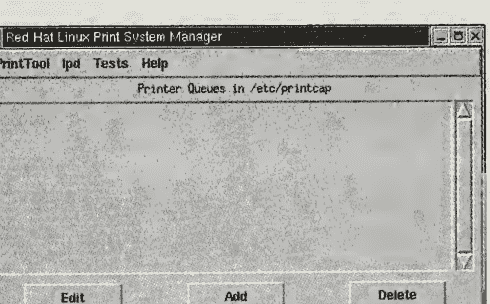

图 6-1

`Red Hat` 打印系统管理器窗口允许你管理打印队列并添加新打印机。

你可以通过打印工具实用程序管理打印队列并添加新打印机。点击“添加 (Add)”按钮配置新打印机。打印工具会显示“添加打印机条目 (Add a Printer Entry)”对话框，要求你选择打印机类型，如图 6-2 所示。

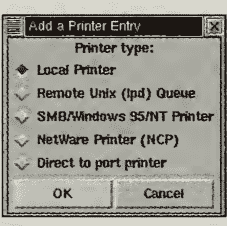

### 6-2

选择打印机类型


### 打印机类型

你可以从五种类型的打印机中选择：

- **本地打印机** (`Local Printer`)：直接连接到安装 `Red Hat Linux` 的 `PC` 并行或串口的打印机。
- **远程 Unix (lpd) 队列** (`Remote Unix (lpd) Queue`)：物理连接到局域网上另一个 `Linux` 系统的打印机（`lpd` 指 `Linux` 打印守护进程——负责管理打印队列）。
- **SMB/Windows 95/NT 打印机** (`SMB/Windows 95/NT Printer`)：连接到局域网内运行 `LAN` 管理协议的另一台 `PC` 的打印机（通常用于在运行 `Windows 95/98` 或 `Windows NT` 的 `PC` 之间共享磁盘和打印机等资源）。
- **NetWare 打印机 (NCP)** (`NetWare Printer (NCP)`)：通过局域网连接到 `Novell` 服务器的打印机。
- **直接端口打印机** (`Direct to port printer`)：通过特定 `TCP/IP` 端口（通常为端口号 `9100`）接收数据的网络打印机。

### 配置本地打印机

指定适用于你配置的打印机连接。假设你将打印机连接到 `PC` 的并行端口，这意味着你应该在“添加打印机条目”对话框中选择“本地打印机”按钮。选择“本地打印机”按钮并点击“确定”后，打印工具将显示一个包含检测到的并行端口信息的对话框。点击“确定”继续打印机配置。接下来，“编辑本地项 (`Edit Local Entry`)”对话框将提示本地打印机的各种条目（如图 6-3 所示）。

字段已填充，你可以直接接受这些设置。你必须选择一个输入过滤器，它是取决于你连接到并行端口的打印机品牌和型号的驱动程序。执行此操作，点击“输入过滤器 (`Input Filter`)”文本字段旁的“选择 (`Select`)”按钮。这将弹出一个大型对话框（见图 6-4），允许你选择打印机类型以及其他参数，如纸张尺寸和打印机分辨率（现代激光打印机通常为每英寸 `600 × 600` 点）。为所有字段选择适当的值。

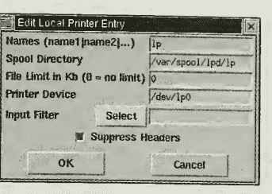
图 6-3：提供本地打印机信息

| 打印机类型 | 程序描述 |
| :--- | :--- |
| `Epson Stylus 650` & `ESCIP2` 打印机 | `HP LaserJet 4` 打印机的驱动程序。它可能支持 `LaserJet 4` 打印机以及仅限 `3000` 系列的 `Early LaserJet` 模型。如果驱动程序无法工作，请使用通用驱动程序。 |
| `Epson ColorJet (UP)` | |
| `HP DeskJet 600` | |
| `HP LaserJet 4000/S525/524B/524C` | |
| `HP LaserJet 500` | |
| `HP LaserJet 5200/C500` 系列 | |
| `HP LaserJet 8500/8557/1100/1300` 系列 | |
| `HP DeskJet Plus` | |
| `HP LaserJet 50P (TIP)` | |
| `HP LaserJet 4` - 指向式 | |
| `HP LaserJet 476` 系列，已安装 | |
| `HP LaserJet 1100`（带 `Dot How` 配置） | |
| `HP LaserJet 1100bt`/带 `TIF` 压缩 | |
| `HP LaserJet PXL` | |
| `HP LaserJet XL` | |
| `HP LaserJet 3600` 和 `LaserJet 1200C` | |

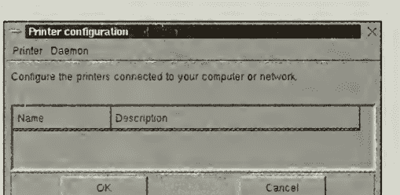
图 6-4：选择打印机类型以及尺寸和分辨率等选项

图 6-4 所示对话框中的一个特定项目是标记为“修复阶梯文本 (`Fix stair-stepping text?`)”的选项。这指的是一种问题，当发送到打印机的文本出现时。这种问题出现在在 `Red Hat Linux` 中打印文本时。通过在对话框中勾选“修复阶梯文本”选项可以解决此问题。

要完成打印机配置，点击确定，并等待打印机守护进程重启。守护进程重启后，`COAS` 将通知你打印机已准备就绪。为了确保打印机配置正确，请尝试从 `KDE` 应用程序（如文本编辑器）中进行打印。

### 在 SuSe Linux 中配置打印机

在 `SuSe Linux` 中配置打印机，请使用发行版自带的 `YaST2`（又一个设置工具二）程序。`SuSe` 默认安装的桌面是 `KDE`，因此你可以使用此桌面启动 `YaST2`。点击 `KDE` 桌面左下角的 `K` 图标，选择 `SuSe 管理` -> `配置` -> `打印机`。会出现 `YaST2` 打印机配置对话框（见图 6-9），并尝试检测打印机。

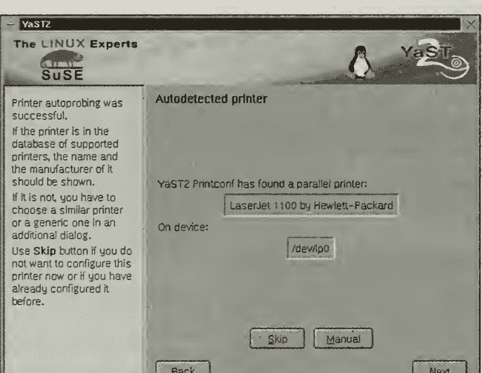
图 6-9：`YaST2` 打印机配置工具会自动检测连接到 `PC` 的打印机。

如果打印机，将显示其名称、制造商以及设备位置。对于未检测到的打印机，你需要点击“手动”按钮并从列表中选择一个与你的兼容的设备。当你

## 第 6 节——安装打印机

对选择满意后，点击“下一步”继续进入图 6-10 所示的打印机设置屏幕。

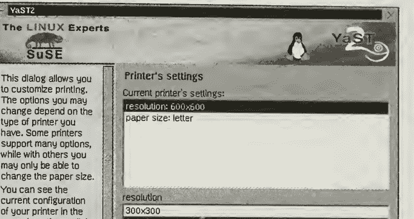
图 6-10：打印机设置对话框包含选项，允许你设置打印机分辨率并选择页面大小。点击顶部框中你想要更改的项目，并从底部框列出的选项中选择新设置。当你对选择满意后，点击“测试”按钮，然后在提示检查打印机是否就绪的对话框中点击“确定”。

如果页面没有打印或输出不符合预期，返回本节开头并重复步骤选择不同的打印机。如果页面输出符合预期，点击确定进入图 6-11 所示的下一个对话框。

成功配置打印机后，它将列在标题为“本次会话添加的打印机”的框中。如果没有配置打印机，这将为你提供另一个机会，通过从底部列表选择并点击“添加”。点击“完成”完成打印机配置过程。`YaST2` 将通知你配置已保存，打印机现在已准备就绪。

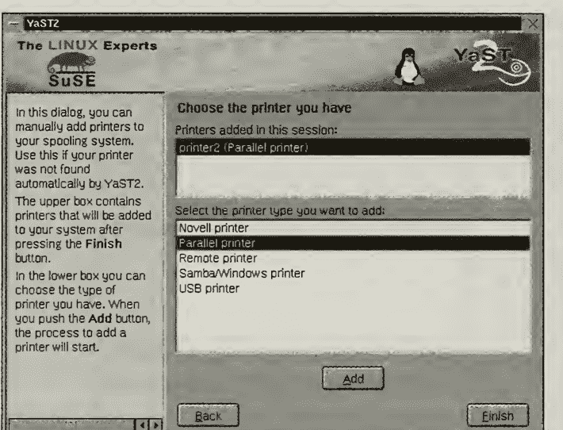
图 6-11：此对话框显示了你配置的打印机。

### 复习

在本节中，你学习了如何判断 `Linux` 是否识别你 `PC` 上的并行端口。你了解了一些与 `Linux` 兼容的打印机语言。你还学习了如何在三个 `Linux` 发行版中配置打印机：`Red Hat`（红帽）、`Caldera Open` 和 `SuSe`。

### 自测

1. 如何启动在 `Red Hat Linux`（红帽）中允许你配置打印机的实用程序？（见“在红帽 Linux 中配置打印机”。）
2. “修复阶梯状文本”是什么意思？（见“在红帽 Linux 中配置打印机”。）
3. 如何启动在 `Caldera` 中允许配置打印机的实用程序？（见“在 Caldera Open Linux 中配置打印机”。）
4. 如何启动在 `SuSe` 中允许配置打印机的实用程序？（见“在 SuSe Linux 中配置打印机”。）
5. 什么是 `GDI` 打印机，它在 `Linux` 中能工作吗？（见“Linux 打印基础”。）


## 课程

# Linux 文件和目录结构

### 课节检查清单

- 理解 `Linux` 文件系统
- 使用 `GNOME` 文件管理器
- 使用 `Linux` 命令导航并操作文件和目录

剩余 30 分钟

在第 4 节中，你学习了登录、注销和关闭你的 `Linux` 系统。本节将从对 `Linux` 文件系统的简要介绍开始。然后它将向你展示如何使用 `GNOME` 文件管理器和若干 `Linux` 命令来处理文件和目录。

### 理解 Linux 文件系统

与其他操作系统一样，`Linux` 使用文件和目录来组织信息。文件被包含在目录中。目录是一种特殊文件，可以包含其他文件和目录，从而形成层次结构。这种文件的层次结构被称为文件系统。

`Linux` 文件系统提供了系统中所有存储的统一模型。文件系统有一个单一根目录，用正斜杠（`/`）表示。然后是文件和目录的层次结构。文件系统的部分可以存在不同的物理介质上，如硬盘、软磁盘和 `CD-ROM`。图 7-1 明了 `Linux` 文件系统的概念以及它如何跨越多个物理设备。

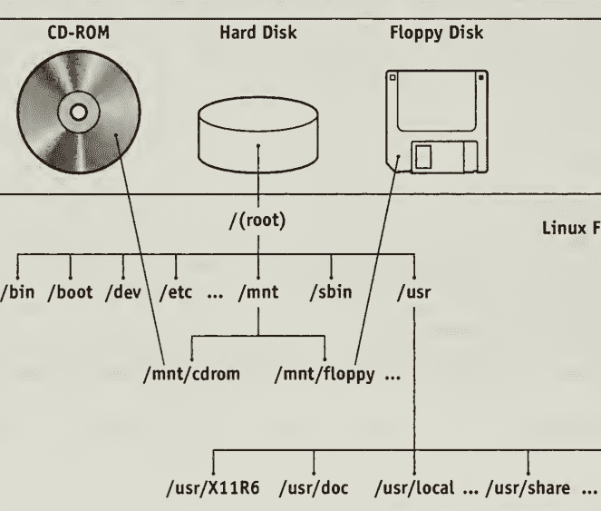
图 7-1：`Linux` 文件系统提供了系统中所有存储的统一模型。文件系统有一个单一根目录，用正斜杠（`/`）表示。然后是文件和目录的层次结构。文件系统的部分可以存在不同的物理介质上，如硬盘、软磁盘和 `CD-ROM`。

## 第 7 节——文件和目录结构

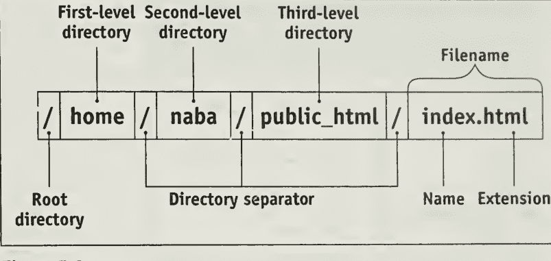
图 7-2：典型的 `Linux` 路径

从图 7-2 可以看出，`Linux` 路径由：

1. 根目录，用正斜杠（`/`）表示
2. 层次结构，每个目录之间用正斜杠（`/`）分隔
3. 文件名

现在你已经了解文件系统的基础，可以通过两种方式探索文件系统：

- 使用图形文件管理器
- 在终端输入相应的 `Linux` 命令


### 使用 GNOME 文件管理器

本节涵盖了图形化管理器和 Linux 命令。图形管理器类似于 `Windows Explorer` 且易于使用。现在我们花几分钟使用文件管理器探索文件系统。（我不涵盖 `KDE` 文件管理器）。

从图形登录界面进入系统后，可以通过双击桌面上的文件夹图标查看你的主目录。图 7-3 显示了主目录的初始显示。

### 查看文件

`Gnome` 文件管理器的窗口垂直分为两个窗格。左侧显示文件系统的树视图；右侧显示当前选择目录的文件和目录。从树视图可以看出，图 7-3 显示了 `/home` 的内容。标题栏显示当前目录的名称。

如果你用过 `Windows Explorer`，可以用类似的方法使用 `GNOME` 文件管理器。要查看另一个目录的内容，首先在树视图中找到该目录。例如，要查看 `/etc/X11` 目录，点击 `etc` 旁的加号（`+`）。这会让文件管理器显示 `etc` 中的子目录并将加号变为减号。现在点击 `X11` 目录。窗口右侧现在显示 `/etc/X11` 的内容

`Gnome` 文件管理器使用图标显示所选目录的内容。每个目录显示为一个文件夹，下方显示目录名称。不同的文件有不同的图标。普通文件显示为纸。目录显示为文件夹。

`Gnome` 文件管理器窗口具有标准的菜单栏和工具栏。如图所示，工具栏上的“图标”标签被按下状态。这意味着目录内容使用大图标显示。点击“简要”按钮；这会让文件管理器以较小图标列表格式显示内容。

要查看每个文件的更多信息，点击工具栏上的“详细”按钮。文件管理器现在显示每个文件或目录的大小以及修改时间

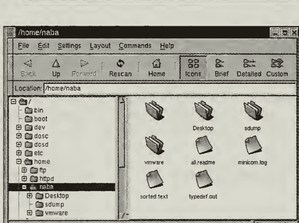

图 7-3：`GNOME` 文件管理器中显示的我的主目录

#### 最后修改的时间

最后修改的时间。详细视图以表格形式显示目录内容，包含三列，标记为 `Name`（名称）、`Size`（大小）和 `MTime`（修改时间）。如果你点击详细视图顶部的任何信息标题——`Name`、`Size` 或 `MTime`——文件管理器现在将显示按最近修改时间（即 `MTime`）排序的文件和目录列表。点击 `Name` 信息标题将按字母顺序对文件和目录进行排序。此功能在简览（`Brief`）视图和自定义（`Custom`）视图中同样有效。

最后，你可以通过点击自定义（`Custom`）按钮查看文件权限。文件管理器随后会显示图标、文件名、大小和文件权限。

现在，请忽略权限的含义。在下一节我讨论用于导航文件系统的 `Linux` 命令时，你会学习到它们。

### 执行任务

除了在文件系统中移动和查看目录内容外，你还可以使用文件管理器执行任务，如将文件从一个地方移动到另一个地方以及删除文件。我没有每一个步骤，但你可以花几分钟尝试以下任务：

- 要将文件移动到不同的目录，将文件图标拖放到你想要放置文件的目录上。
- 要将文件复制到新位置，选择文件图标，然后选择 `Copy`（复制）。你也可以在文件图标上点击右键，从弹出菜单中选择 `Copy`（复制）。对话框会提示你输入将文件复制到的目录名称。
- 要删除文件或目录，右键点击图标，并从弹出菜单中选择 `Delete`（删除）。对话框会要求你确认是否真的删除该文件或目录。你可以点击 `Yes`（是）删除所选项目，或点击 `No`（否）取消操作。
- 要重命名文件或目录，点击图标视图中的名称（图 7-3）。然后你可以输入新名称或编辑名称。
- 要创建一个新目录，在右侧窗口的空白区域点击右键，并从弹出菜单中选择 `New Directory`（新建目录）。对话框会提示你输入新目录的名称。
- 要查找文件，从菜单栏选择 `Commands`（命令）`Find Files`（查找文件）。对话框会提示你想查找什么以及从哪里开始搜索。输入这些信息后，点击 `OK` 开始搜索。搜索结果将出现在新窗口中。


### 使用 Linux 命令导航和操作文件及目录

虽然图形化文件管理器易于使用，但只有在你具有图形登录的情况下才能使用它们。有时你可能没有可以运行图形文件管理器的图形环境。例如，你可能通过文本终端登录，或者 `X` 在你的系统上无法运行。在这种情况下，你必须依靠 `Linux` 命令来处理文件和目录。幸运的部分是，你始终可以使用 `Linux` 命令——即使在图形环境下也是如此。你只需要打开终端窗口并输入 `Linux` 命令。点击 `GNOME` 面板上的终端图标即可启动显示终端窗口的终端仿真程序。

### 目录导航

在 `Linux` 中，当你以 `root` 登录时，你的主目录是 `/root`。我的主目录通常在 `/home` 目录下。我的主目录（当我以 `naba` 登录时）是 `/home/naba`。这些信息存储在 `/etc/passwd` 文件中。默认情况下，只有超级用户和你自己有权限在自己的主目录中保存文件，并且只有你可以在主目录中创建子目录来进一步组织你的文件。

`Linux` 支持“当前目录”的概念，即所有文件和目录命令所操作的目录。登录后，例如，你的当前目录就是主目录。要从终端窗口查看当前目录，输入 `pwd` 命令。

要更改当前目录，使用 `cd` 命令。要将当前目录更改为 `/usr/doc`，输入以下内容：

```
cd /usr/share/doc
```

然后，要切换目录到 `/usr/share/doc` 中的 `bash-2.04` 子目录，输入此命令：

```
cd bash-2.04
```

如果你使用 `pwd` 命令，该命令将显示 `/usr/share/doc/bash-2.04` 为当前目录。因此，你可以通过两种方式引用目录名称：

- 绝对路径（例如 `/usr/share/doc`），它指定目录树中的确切目录
- 相对目录名（例如 `bash-2.04`，它代表当前目录下的 `bash-2.04` 子目录）

如果你在 `/usr/share/doc` 中输入 `cd bash-2.04`，当前目录将变为 `/usr/share/doc/bash-2.04`。然而，在 `/home/naba/bash-2.04` 中执行相同的命令，该路径可能并不存在。顺便提一下，不带任何参数输入 `cd` 命令会将当前目录更改为你的主目录。

你可以使用快捷方式来引用任何用户的主目录。在用户的登录名称前加一个连字符（`-`）即可引用该用户的主目录。因此，`-naba` 指用户 `naba` 的主目录，`-root` 指 `root` 用户的主目录。如果你的系统上有一个登录名为 `emily` 的用户，你可以输入 `cd -emily` 来切换到 `Emily` 的主目录。


名称 `.` 和 `..` 有特殊含义。单点（`.`）表示当前目录，而双点（`..`）表示父级目录。例如，如果当前目录是 `/usr/share/doc`，你可以通过输入此命令将当前目录更改为 `/usr/share`：

```
cd ..
```

本质上，此命令让你在文件系统的层级结构中向上移动一级。

### 目录列表和权限

当你穿梭于 `Linux` 目录时，你可能想知道目录的内容。你可以使用 `ls` 命令获取目录列表。默认情况下，不带选项的 `ls` 命令会以紧凑的多列格式显示当前目录的内容。例如，输入以下命令来查看 `/etc/X11` 目录的内容。（输入加粗字体的命令；）

从此列表中，你无法判断某条目是文件还是目录。要区分目录和文件，请使用 `-F` 选项：

```
ls -F
```

对于 `/etc/X11`，典型的输出如下：

```
total 76
lrwxrwxrwx 1 root root 24 Jul 31 20:32 X -> /usr/X11/bin/SVGA
-rw-r-- 1 root root 1459 Jul 31 20:59 font.config
-rw-r-- 1 root root 1545 Jul 31 20:32 fonts.dat
-rw-r-- 1 root root 491 Jul 14 14:46 modmap
drwxr-xr-x 9 root root 4096 Jul 31 15:29 apps
```

目录名称后面带有一个斜杠（`/`）。普通文件名直接显示。在文件后带有 `@` 符号表示该文件实际上是一个链接（例如列表中的）。

你可以使用 `-1` 选项查看文件的更详细信息。

从右侧列向左查看一行，你会发现最右侧列显示的是文件最后修改的时间。在日期和时间之前是文件的大小，单位为字节。文件的组和所有出现在大小列的左侧。下一个数字表示文件的链接数。最后，左侧列显示文件的权限设置，它决定了谁可以读取、写入或执行该文件。权限设置的第一个字母具有以下特殊含义：

- 如果第一个字母是 `l`，文件是一个符号链接。
- 如果第一个字母是 `d`，文件是一个目录。
- 如果第一个字母是横线（`-`），文件是一个普通文件。
- 如果第一个字母是 `b`，文件代表块设备设备（如磁盘驱动器）。
- 如果第一个字母是 `c`，文件代表字符设备（如串口端口或终端）。


# 第 7课——Linux 文件和目录结构

在第一个字母之后，左侧列显示一组九个字符，当每个字母都存在时显示为`rwxrwxrwx`。每个字母表示一种特定的权限：读取(`r`)、写入(`w`)和执行(`x`)。在字母位置的横线

表示对特定文件的特定操作没有权限。因此，字符串`rw-`意味着所有者具有读写权限，但没有执行权限。将这九个字母看作三组三个字母(`rwx`)，解释如下：

- 最左侧的`rwx`组控制文件所有者的读、写和执行权限。

- 中间的三个`rwx`字母控制属于文件组的任何用户的读、写和执行权限。

- 右侧的`rwx`组控制所有其他用户（统称为“世界”）的读、写和执行权限。

因此，权限设置为`rwx------`的文件只有文件所有者可以访问。同时，权限设置为`rxr-r--`的文件允许世界用户读取。

这三组字母中的每组都被分配了一个数值。`r`是`4`，`w`是`2`，`x`是`1`。`chmod`命令使用这些数字更改文件权限。要为自己设置完全权限，请将第一个数字设置为七。要拒绝权限，将所有数字设置为零。以下是显示命令和结果的一些示例。

```
chmod 700 filename rwx
chmod 777 filename rwxrxrxr
chmod 644 filename rw-r---
chmod 000 filename
```

通常，可执行程序（包括`shell`程序）具有执行权限。但对于目录，执行权限等同于使用权限——用户必须对目录具有执行权限才能打开并读取目录的内容。


`ls`命令的一个有趣特性是它不会列出任何以点开头的文件名。要查看这些文件，你必须使用带有`-a`选项的`ls`命令如下：

```
ls -a
```

### 文件操作

你经常需要文件从一个目录复制到另一个目录。使用`cp`命令执行此任务。`cp`命令创建文件的新副本并保持原始文件完整。要将文件`/usr/X11R6/lib/X11/xinit/Xclients`复制到当前目录（例如你的家目录）下的`Xclients.sample`文件，请输入：

```
cp /usr/X11R6/lib/X11/xinit/Xclients.sample
```

如果你想将文件复制到当前目录并保留相同名称，请使用点(`.`)作为`cp`命令的第二个参数。因此，以下命令将`/etc/X11`目录下的`XF86Config`文件复制到当前目录（用单点表示）：

```
cp /etc/X11/XF86Config
```

另一个`Linux`命令`mv`将文件移动到新位置。原始文件消失，并在指定目的地出现一个新副本。你可以使用`mv`重命名文件。如果你想将`today.list`的名称更改为`old.list`，请使用以下`mv`命令：

```
mv today.list old.list
```

另一方面，你可以使用此命令将`today.list`文件移动到名为`saved`的子目录中：

```
mv today.list saved
```

另一个常用操作是删除文件。例如，使用`rm`命令删除名为`old.list`的文件，只需输入以下命令：

```
rm old.list
```

> 小心使用`rm`命令，特别是当你以`root`身份登录时。无意中在`rm`中使用通配符会让删除文件变得很容易。


除了复制、重命名和删除文件外，你可能还会查看文件内容。使用`more`命令逐页查看文本文件。例如，查看文件`/etc/X11/XF86Config-4`，使用此命令：

```
more /etc/X11/XF86Config-4
```

`more`命令在每页后暂停，因此按空格键移动到下一页。按回车键逐文件中向前移动一行。要返回上一页，按`b`。

另一个查看文件的有用`Linux`命令是`less`。（这个名字是一个双关语，因为`less`的功能比`more`少。）

### 目录操作

为了组织家目录中的文件，你必须创建新目录。使用`mkdir`命令创建目录。例如，在当前目录中创建一个名为`images`的目录，请输入：

```
mkdir images
```

创建目录后，你可以使用`cd images`命令切换到该目录。当你不再需要某个目录时，使用`rmdir`命令删除它。只有当目录为空时，才能删除它。

### 文件和目录查找

最后，我想向你介绍`find`命令，因为它对于查找符合指定搜索标准的文件（和目录）非常有用。`Linux`版本的`find`命令来自`GNU`，它比标准的`UNIX`版本具有更广泛的选项。我显示`find`命令的语法，因为语法在`Linux`中是通用的，你可以在其他`UNIX`系统上使用相同的格式。

假设你想找到任何名称以`gnome`开头的文件或目录。你可以使用`find`执行此搜索，如下：

```
find -name "gnome*" -print
```

这条命令告诉`find`从根目录开始搜索，匹配文件名，并打印完整路径。如果你想在家目录下查找所有以`report`开头的文件，可以使用以下`find`变体：

```
find ~ -name "report*" -print
```

当你熟悉了`find`的语法后，可以使用`find`的其他选项。例如，查找特定类型的文件（如目录），使用`-type`选项。以下命令显示你系统中的所有顶级目录：

```
find -type d -maxdepth 1
```

前面的示例代表了`find`命令的简单形式。你可能不需要在系统中使用复杂形式，但可以通过此命令查看更多`find`：

```
man find
```

# 第 8课 命令 Shell

### 开始使用 Shell

正如第 7课提到的，遗憾的是你无法在图形化环境（如`GNOME`或`KDE`）中完成所有操作。在这种情况下，你必须使用`Linux`命令来完成特定任务。第 7课向你介绍了从文本终端操作文件和目录的`Linux`命令。本课将向你介绍`Bash` shell —— `Linux`中默认的命令解释器。在这里你将学习关于`shell`执行命令的重要特性。

如果你用过`MS-DOS`，你可能对`DOS`命令解释器很熟悉。该程序（命名为`COMMAND.COM`）显示著名的`C:\>`提示符。（在`Windows`中，你可以在`MS-DOS`命令窗口看到这个提示符。）`Linux`提供了类似于`DOS`命令解释器的命令解释器，但随着

正如你可能预期的，它的功能比`DOS`命令解释器要强大得多。`Linux`命令解释器被称为`shell`（壳）。

`Linux` shell被称为`bash`，其程序名为`/bin/bash`（位于`/bin`目录中）。当你从`GNOME`或`KDE`桌面打开终端窗口，或在文本控制台登录时，`shell`会提示你输入命令。当你输入一个命令时，`shell`就会执行该命令。

除了标准的`Linux`命令外，`bash`还可以执行存储在可执行文件中的任何程序。`bash`还可以执行`shell`脚本，脚本是一个包含一个或多个命令的文本文件。

在接下来的几分钟里，你可以尝试`bash` shell的各种功能，从通用的命令语法到`shell`编程的基础。如果你还没有这样做，请打开终端窗口，以便你可以使用`shell`。

### 使用 Bash Shell

`shell`会解释你输入的内容，因此了解`shell`如何处理你输入的内容是非常重要的。所有的`shell`命令都具有这种通用格式：

```
command option1 option2 ... optionN
```

单行命令通常被称为命令行。在命令行上，你输入一个命令，后面紧跟一个或多个选项（参数），这些选项被称为命令行选项（或命令行参数）。

一条基本规则是，你必须使用空格或制表符分隔命令和选项。你也必须用空格或制表符分隔选项。如果你想使用包含空格的选项，必须将该选项放在引号内。例如，为了在密码文件中搜索我的名字，我输入以下`grep`命令（`grep`在文件中搜索文本）：

```
grep "Naba Barkarkati" /etc/passwd
```

当`grep`打印出带有我名字的一行时，它看起来如下：

```
naba:x:500:500:Naba Barkarkati:/home/naba:/bin/bash
```

如果你以你的名字创建了一个用户账户，请直接以你的名字作为参数输入`grep`命令。

> 在`grep`命令的输出中，你可以看到最后一个冒号（`:`）之后是`shell`的名称(`/bin/bash`)。


## 第 8 节——命令 shell


## 第 8 节——命令 shell

### 让 bash 完成你的命令

许多命令以文件名作为参数。例如，要浏览名为`/etc/X11/F86Config`的文件，输入以下命令：

```
more /etc/X11/F86Config
```

此命令一次显示屏幕`/etc/X11/F86Config`文件。对于以文件名作为参数的命令，`bash`包含一项允许你输入短文件名的功能。你只需要做最少的工作——只需输入前几个字符——就能在目录中唯一标识该文件。

要查看示例，输入`more /etc/X11/KF`但不要按`Enter`；而是按`Tab`键，`bash`会自动补全文件名，使命令变为`/etc/X11/F86Config`。现在按`Enter`运行命令。

### 使用通配符字符

避免输入许多文件名的另一种方法是使用通配符——特殊字符，例如星号（`*`）和问号（`?`），匹配字符串中的零或多个字符。如果你熟悉`MS-DOS`，你可能会使用如`COPY *, A:`之类的命令，将当前目录的所有文件复制到`A:`盘。`Bash`在文件名中接受类似的通配符。事实上，`bash`提供的通配符选项比`MS-DOS`多。

-   `Bash`支持三种类型的通配符：

-   星号（`*`）匹配文件名中的零或多个字符。因此，`*`表示目录中的所有文件。

-   问号（`?`）匹配任何单个字符。

-   括号中的字符集匹配该集合中的任何单个字符。例如，字符串`[x]*`匹配任何以`x`或`X`开头的文件名。

当你想要对一组文件执行任务时，通配符非常方便。例如，要从目录`/mnt/cdrom`复制所有文件到当前目录，输入以下内容：

```
cp /mnt/cdrom/*
```

-   `Bash`将通配符`*`替换为`/mnt/cdrom`目录中所有文件的名称。命令末尾的点表示当前目录。

你可以将星号（`*`）与文件名与其他部分配合，以选择更特定组的文件。假设你想使用`grep`命令在`/usr/include`目录下所有符合以下条件的文件中搜索字符串`typedef struct`：

- 文件名以`s`开头。

- 文件名以`.h`结尾。

通配符规范`*.h`表示所有符合这些条件的文件名。因此，你可以使用以下命令执行搜索：

```
grep "typedef struct" /usr/include/s/.*
```

字符串中包含一个你想让`grep`命令找到的空格，因此你必须用引号将其括起来。这种方法确保`Bash`不尝试将字符串中的每个单词解释为独立的命令行参数。

虽然星号（`*`）可以匹配任意数量的字符，但问号（`?`）仅匹配单个字符。假设在当前目录下有四个文件——`image1.pcx`、`image2.pcx`、`image3.pcx`和`image4.pcx`。要将这些文件复制到`/mnt/floppy`目录，请使用以下命令：

```
cp image?.pcx /mnt/floppy
```

`Bash`会将问号替换为任何单个字符，并将四个文件复制到`/mnt`。

第三种通配符格式`[]`匹配特定集合中的单个字符。你可能想将此格式与其他通配符结合，将匹配文件名缩小到较小的集合。要查看`/etc/X11/xdm`目录下所有以`x`或`X`开头的文件，输入以下命令：

```
ls /etc/X11/xd[X]*
```

> 如果`bash`在展开时没有找到任何匹配`[]`通配符格式的文件名，`bash`将保持通配符规范不变。

### 查看命令历史

为了方便你重复长命令，`bash`存储多达 500 条旧命令。本质上讲，`bash`维护了一个命令历史（旧命令列表）。要查看命令历史，输入`history`。`Bash`会显示带编号的命令列表，包括你在之前登录期间输入的命令。该列表可能如下所示：

1. `cd`

2. `ls -a`

3. `more /etc/X11/XF86Config`

4. `history`

如果命令列表太长，你可以选择只查看最后几条命令。要仅查看最后 10 条命令，输入此命令：

```
history 10
```

要重复`history`命令显示的列表某条命令，只需输入感叹号（`!`），后跟该命令的数字。要重复第 3 条命令，输入`!3`。

你也可以在不知道命令编号的情况下重复旧命令。假设你之前输入过`/usr/lib/X11/xdm/xdm-config`，现在想再次查看该文件。要重复上一次的`more`，请输入：

```
!more
```

通常，你可能想重复上次输入的命令——也许带有轻微的更改。例如，你可能使用`ls -l`命令显示了目录内容。要重复该命令，输入两个感叹号：

```
!!
```

有时，你可能想重复上一条命令但为其添加额外的参数。假设`ls -l`显示了太多文件。只需重复该命令，并通过`more`命令管道输出，如下：

```
!! | more
```

`Bash`会将两个感叹号替换为上一条命令，并在该命令后附加`| more`。

回以前命令的一种简单方法是按向上方向键，这会让`bash`在命令列表中向后移动。要在命令历史中向前移动，请按向下方向键。

### 为命令使用别名

要查看别名的用处，输入以下命令：

```
alias goboot='cd /usr/src/linux/arch/i386/boot/'
```

这会将`goboot`定义为别名——即另一个名称——对应单引号内的文本。该文本是一个将当前目录更改为`/usr/src/linux/arch/i386/boot`的命令。

现在你定义了别名，在`bash`提示符下输入以下：

```
goboot
```

现在输入`pwd`确认当前目录确实是`/usr/src/linux/arch/i386/`。

你可以看到，别名只是长命令的另一种（通常更短的）名称。`bash`会将别名替换为它的定义并执行等效命令。

如果你不再需要别名，使用`unalias`命令来删除别名。例如，如果你不再想使用`goboot`别名，输入：

```
unalias goboot
```

执行此步骤后，输入`goboot`会导致类似这样的错误消息：

```
bash: goboot: command not found
```

许多用户使用别名功能为常用命令提供更熟悉的名称。如果你是`DOS`用户并使用`md`命令创建目录，你可以简单将`md`定义为`mkdir`的别名（创建新目录的 Linux 命令）。操作方法如下：

```
alias md=mkdir
```

现在，你可以输入`md`来创建一个新目录`dirname`。别名的另一个良好用法是重新定义危险的命令（如`rm`），使其更安全。默认情况下，`rm`命令删除一个或多个指定的文件。如果你误输入了`rm *`，`rm`会删除你当前目录下的所有文件。我曾吸过惨痛的教训，有一天我想删除所有以`.xwd`结尾的文件。

# 第 9 节

# Linux 命令

### 章节清单

- 回顾你目前为止学过的命令

- 探索几类 Linux 命令：管理进程、设置日期和时间、处理文件以及维护文件系统


在本节中，你将回顾在之前节次中已经学过的命令，还将学习几类新的 `Linux` 命令。然而，由于 `Linux` 命令数量非常多，你无法在半小时的节次内真正探索每一个命令。你将在随后的节次中尝试更多命令。要开始本节，请在图形化登录界面登录，并打开终端窗口。然后你就可以在该登录界面中输入命令。

30 分钟。

待进行

# 回顾你目前为止学过的命令

你在之前的节次中已经尝试了相当多的 `Linux` 命令。查看表 9-1 并浏览该列表。这些是你在之前节次中使用的命令。为了刷新你对命令作用的记忆，请按照表 9-1 中“描述”（Description）列所示说明来尝试该命令。为了方便起见，我将命令按类别进行了分类。

# 表 9-1

你之前在节中学学过的 `Linux` 命令

| 命令名称 | 描述 |
| --- | --- |
| 获取在线帮助 `man` | 显示在线帮助信息。输入 `man 1s` 获取该命令的帮助。 |
| 让命令更简单 `Alias` | 为长命令定义缩写（快捷方式）。输入 `alias` 查看所有当前定义的别名。输入 `alias topdir='cd'` 然后输入 `topdir` 将目录更改到根目录（`/`）。 |
| 删除别名 `unalias` | 删除通过 `alias` 定义的缩写。输入 `unalias topdir` 取消 `topdir` 别名。 |
| 管理文件和目录 `cd` | 更改当前目录。输入 `cd /usr` 更改到 `/usr` 目录。 |
| `chmod` | 更改文件权限。输入 `chmod +x filename` 使该文件可执行（将 `filename` 替换为现有文件名称）。 |
| `chown` | 更改文件所有者。输入 `chown ownername filename` 设置该文件的所有者。（分别将 `ownername` 和 `filename` 替换为用户名和文件名。） |
| `cp` | 复制文件。输入 `cp` 将目录更改到你的家目录。输入 `cp /etc/X11/XF86Config` 将文件复制到你的家目录。 |
| `ls` | 显示目录内容。输入 `ls -F` 查看当前目录的内容。 |
| `mkdir` | 创建目录。输入 `cd` 进入你的家目录，然后输入 `mkdir temp` 创建名为 `temp` 的目录。 |
| `mv` | 重命名文件并将从一个目录移动到另一个目录。输入 `mv filename filename2` 更改文件名（使用现有文件名作为 `filename`）。 |
| `rm` | 删除文件。语法为 `rm filename`。（请谨慎使用，因为文件会在没有提示确认的情况下被删除。） |
| `Rmdir` | 删除目录。输入 `rmdir ~/temp` 删除你家目录中名为 `temp` 的目录（参见 `mkdir` 命令）。 |
| `Pwd` | 显示当前目录。输入 `pwd` 查看当前目录名称。 |
| 查找文件 `find` | 根据指定标准（如名称、大小等）查找文件。输入 `find /usr -name "README*"` 尝试此命令。 |
| 处理文件 `cat` | 在标准输出上显示文件（可以将多个文件合并为一个大文件）。输入 `cd` 进入你的家目录，然后输入 `cat .bash_profile` 查看该文件的内容。 |
| `Grep` | 在文本文件中搜索正则表达式。输入 `cd` 进入你的家目录，然后输入 `grep BASH.*` 查看在某些文件中搜索字符串 `BASH` 的结果。 |
| `more` | 一页一页地显示文本文件。输入 `more /etc/init` 逐页查看内容。（按空格键向下翻页或输入 `q` 退出。） |
| 管理进程 `printenv` | 显示当前环境变量。输入 `printenv` 查看环境变量列表。 |
| `ps` | 检查运行中的进程。你可以看到正在运行的程序、程序正在使用的资源，以及是谁在运行这些程序。输入 `ps -au` 查看显示所有用户及其名称的详细列表。 |
| 管理用户 `adduser` | 使用此命令向系统添加用户。输入 `adduser -d home_dir` 添加用户和家目录。（默认名称与登录名相同）。此命令有许多选项。输入 `man adduser` 获取更多详情。 |
| `passwd` | 更改密码。输入 `passwd` 并按照提示更改你的密码。 |
| `su` | 变为另一个用户或 `root`（当不带任何参数调用时）。输入 `su` 并在提示时输入 `root` 密码。现在要小心，因为你现在是超级用户了。输入 `exit` 返回普通用户。 |

以下章节涵盖了之前节次未涵盖的新命令（按分类）。

# 管理进程的命令

每当 `shell` 执行你输入的命令时，它都会启动一个进程。`shell` 本身是一个进程，`shell` 执行的任何脚本或程序也是如此。你可以使用 `ps` 命令查看进程列表。例如，当你输入 `ps` 时，`Bash` 向你显示当前的进程组。以下是 `ps x` 命令的部分输出（我还包含了 `--cols 13` 选项，以确保你可以完整看到每个命令）：

```
PID TTY  STAT TIME COMMAND
1 ? S 0:05 init [S]
325 ? S 0:00 syslog -m 0
335 ? S 0:00 klogd
```


# 第 9 节—Linux 命令

| 命令名称 | 描述 |
| --- | --- |
| `480 ?` | `S` `0:00 xinetd -reuse -pidfile /var/run/xinetd.pid` |
| `511 ?` | `S` `0:00 sendmail: accepting connections` |
| `580 ?` | `S` `0:00 ppm -tims2` |
| `596 ?` | `S` `0:01 /usr/bin/gnome-session` |
| `849 ?` | `S` `0:00 gnome-smproxy -` |
| `901 ?` | `S` `0:02` |
| `967 ?` | `S` `0:36` |
| `985 ?` | `S` `0:00` |
| `994 ?` | `S` `0:00` |
| `1001 ?` | `S` `0:00` |
| `2143 ?` | `S` `0:00` |
| `2144 ?` | `S` `0:00` |
| `2145 ?` | `S` `0:00` |

每当 `shell` 执行你输入的命令时，它都会启动一个进程。`shell` 本身是一个进程，`shell` 执行的任何脚本或程序也是如此。你可以使用 `ps` 命令查看进程列表。例如，当你输入 `ps` 时，`Bash` 向你显示当前的进程组。以下是 `ps x` 命令的部分输出（我也包含了 `--cols 13` 选项，以确保你可以完整看到每个命令）：

```
PID TTY  STAT TIME COMMAND
1 ? S 0:05 init [S]
325 ? S 0:00 syslog -m 0
335 ? S 0:00 klogd
```


# 第 9 节

# Linux 命令

### 章节清单

- 回顾你目前为止学过的命令
- 探索几类 `Linux` 命令：管理进程、设置日期和时间、处理文件以及维护文件系统


在本节中，你将回顾在之前节次中已经学过的命令，还将学习几类新的 Linux 命令。然而，由于 Linux 命令数量非常多，你无法在半小时的节次内真正探索每一个命令。你将在随后的节次中尝试更多命令。要开始本节，请在图形化登录界面登录，并打开终端窗口。然后你就可以在该登录界面中输入命令。

30 分钟。

待进行

## 回顾你目前为止学过的命令

你在之前的节次中已经尝试了相当多的 Linux 命令。查看表 9-1 并浏览该列表。这些是你在之前节次中使用的命令。为了刷新你对命令作用的记忆，请按照表 9-1 中“描述”（Description）列所示说明来尝试该命令。为了方便起见，我将命令按类别进行了分类。

### 表 9-1

你之前在节中学学过的 Linux 命令

| 命令名称 | 描述 |
| :--- | :--- |
| 获取在线帮助 `man` | 显示在线帮助信息。输入 `man 1s` 获取该命令的帮助。 |
| 让命令更简单 `alias` | 为长命令定义缩写（快捷方式）。输入 `alias` 查看所有当前定义的别名。输入 `alias topdir='cd'` 然后输入 `topdir` 将目录更改到根目录（`/`）。 |
| 删除别名 `unalias` | 删除通过 `alias` 定义的缩写。输入 `unalias topdir` 取消 `topdir` 别名。 |
| 管理文件和目录 `cd` | 更改当前目录。输入 `cd /usr` 更改到 `/usr` 目录。 |
| `chmod` | 更改文件权限。输入 `chmod +x filename` 使该文件可执行（将 `filename` 替换为现有文件名称）。 |
| `chown` | 更改文件所有者。输入 `chown ownername filename` 设置该文件的所有者。（分别将 `ownername` 和 `filename` 替换为用户名和文件名。） |
| `cp` | 复制文件。输入 `cp` 将目录更改到你的家目录。输入 `cp /etc/X11/XF86Config` 将文件复制到你的家目录。 |
| `ls` | 显示目录内容。输入 `ls -F` 查看当前目录的内容。 |
| `mkdir` | 创建目录。输入 `cd` 你的家目录，然后输入 `mkdir temp` 创建名为 `temp` 的目录。 |
| `mv` | 重命名文件并将从一个目录移动到另一个目录。输入 `mv filename filename2` 更改文件名（使用现有文件名作为 `filename`）。 |
| `rm` | 删除文件。语法为 `rm filename`。（请小心，因为文件会在没有提示确认的情况下被删除。） |
| `rmdir` | 删除目录。输入 `rmdir ~/temp` 删除你家目录中名为 `temp` 的目录（参见 `mkdir` 命令）。 |
| `pwd` | 显示当前目录。输入 `pwd` 查看当前目录名称。 |
| 查找文件 `find` | 根据指定标准（如名称、大小等）查找文件。输入 `find /usr -name "README*"` 尝试此命令。 |
| 处理文件 `cat` | 在标准输出上显示文件（可以将多个文件合并为一个大文件）。输入 `cd` 进入你的家目录，然后输入 `cat .bash_profile` 查看该文件的内容。 |
| `grep` | 在文本文件中搜索正则表达式。输入 `cd` 进入你的家目录，然后输入 `grep BASH.*` 查看在某些文件中搜索字符串 `BASH` 的结果。 |
| `more` | 一页一页地显示文本文件。输入 `more /etc/init` 逐页查看内容。（按空格键向下翻页或输入 `q` 退出。） |
| 管理进程 `printenv` | 显示当前环境变量。输入 `printenv` 查看环境变量列表。 |
| `ps` | 检查运行中的进程。你可以看到正在运行的程序、程序正在使用的资源，以及是谁在运行这些程序。输入 `ps -au` 查看显示所有用户及其名称的详细列表。 |
| 管理用户 `adduser` | 使用此命令向系统添加用户。输入 `adduser -d home_dir` 添加用户和家目录。（默认名称与登录名相同）。此命令有许多选项。输入 `man adduser` 获取更多详情。 |
| `passwd` | 更改密码。输入 `passwd` 并按照提示更改你的密码。 |
| `su` | 变为另一个用户或 `root`（当不带任何参数调用时）。输入 `su` 并在提示时输入 `root` 密码。现在要小心，因为你现在是超级用户了。输入 `exit` 返回普通用户。 |

以下章节涵盖了之前节次未涵盖的新命令（按分类）。

## 管理进程的命令

每当 shell 执行你输入的命令时，它都会启动一个进程。shell 本身是一个进程，shell 执行的任何脚本或程序也是如此。你可以使用 `ps` 命令查看进程列表。例如，当你输入 `ps` 时，`Bash` 向你显示当前的进程组。以下是 `ps x` 命令的部分输出（我还包含了 `--cols 13` 选项，以确保你可以完整看到每个命令）：

```
PID TTY  STAT TIME COMMAND
1 ? S 0:05 init [S]
325 ? S 0:00 syslog -m 0
335 ? S 0:00 klogd
```

### 第9 节—Linux 命令

2001年1月

日 一 二 三 四 五 六
1 2 3 4 5 6 7
8 9 10 11 12 13 14
15 16 17 18 19 20 21
22 23 24 25 26 27 28
29 30 31

#### 处理文件的命令

你已经学习了如何使用 `grep` 命令在文本文件中进行搜索，以及如何使用 `more` 命令一次一屏地查看文本文件。Linux 还包含许多其他可以处理文件的实用程序——大多数针对文本文件，但也有某些命令适用于任何文件。

### 统计文本文件中的字符、单词和行数

例如，你可以使用 `wc` 命令来显示文本文件的字符数、单词数和行数。尝试以下操作：

```
wc /etc/initabb
```

你将得到如下结果：

```
57 244 1756 /etc/initabb
```

这表示 `/etc/initabb` 文件中的行数（57）、单词数（244）和字符数（1756）。如果你只想查看文件的行数，可以像这样使用 `-l` 选项：

```
57 /etc/initabb
```

在这种情况下，`wc` 只显示行数。

如果你不指定文件名，`wc` 命令将期望从标准输入接收数据。你可以使用管道过滤器（pipe）将另一个命令的输出传递给 `wc`。这在有时非常有用。假设你想粗略统计系统上运行的进程。你可以通过以下命令获取所有进程列表：


### 周六上午

使用 `ps ax` 命令；但不需要手动数数，只需将 `ps` 的输出通过管道交给 `wc` 即可获得如下粗略计数：

```
ps ax | wc -l
```

该命令返回：

```
61
```

`ps` 命令产生了 61 行输出。由于第一行仅显示表格列的标题，你可以估算系统上大约运行着 60 个进程。（当然，这个计数可能包含了运行 `ps` 和 `wc` 命令所使用的进程，不过谁在数呢？）

### 排序文本文件

你可以使用 `sort` 命令对文本文件中的行进行排序。要查看 `sort` 命令如何工作，首先输入 `cat /etc/passwd` 查看 `/etc/passwd` 文件的当前内容。现在对 `/etc/passwd` 排序，查看按字母顺序排序的行。如果你想对文件进行排序并将排序后的版本存在另一个文件中，你必须使用 `bash` shell 的输出重定向功能，如下：

```
sort /etc/passwd > ~sorted.text
```

该命令对 `/etc/passwd` 文件中的行进行排序，并将输出保存到你家目录下名为 `sorted.text` 的文件中。

### 将任何文件拆分为多个小文件

当你想要将文件拷贝到软磁盘，但文件太大无法放入单张软盘时，`split` 命令非常有用。此时你可以使用 `split` 命令将文件拆分成较小的文件，每个小文件都可以放入软盘中。

默认情况下，`split` 将每 1,000 行放入一个文件。文件名按字母组命名，如 `aa`、`ab`、`ac` 等。你可以为文件名指定一个前缀。例如，要将一个大文件 `hugefile.tar` 拆分为若干个可以放入几张高密度 3.5 英制软盘的小文件，可以使用如下 `split` 命令：

```
split -b 1440k hugefile.tar part.
```

该命令将 `hugefile.tar` 文件拆分为 1440K 大小的分块。该命令会创建名为 `part.aa`、`part.ab`、`part.ac` 等的文件。

要将拆分后的文件合并回单个文件，请如下使用 `cat` 命令：

```
cat part.?? > hugefile.tar
```


在这一命令行中，每个问号 `?` 匹配单个字符。因此，`bash` shell 将 `part.??` 扩展为 `part.aa`、`part.ab`、`part.ac` 等文件名。

## 维护文件系统的命令

假设你想访问这本书 CD-ROM 上的文件。为此，必须先在 Linux 系统的特定目录上挂载 CD-ROM 驱动器的文件系统。尝试使用 `mount` 命令，以 `root` 身份登录，插入 CD-ROM，然后输入以下命令：

```
mount /dev/cdrom /mnt/cdrom
```

你将看到如下结果：

`mount: device /dev/cdrom is write-protected, mounting read-only`

该命令将名为 `/dev/cdrom` 的设备（CD-ROM）的文件系统挂载到 `/mnt/cdrom` 目录（也称为挂载点）。在 `mount` 命令成功完成任务后，你可以通过引用 `/mnt/cdrom` 为 CD-ROM 的顶层目录来访问其中的文件。换句话说，要查看 CD-ROM 上 `Hat` 目录的内容，输入：

```
ls -F /mnt/cdrom
```

你将看到此结果：

```
RPMS/base/
```

实际上你可以将设备挂载到 Linux 系统上的任何目录。本质上，挂载点不需要是 `/mnt/cdrom`；它可以是任何目录。例如，如果你喜欢将 CD-ROM 驱动器称为 `/cd`，请先用 `mkdir /cd` 创建 `/cd` 目录，然后使用以下命令：

```
mount /dev/cdrom /cd
```

在尝试此命令之前，你必须使用以下 `umount` 命令“卸载” CD-ROM：

```
umount /dev/cdrom
```

只有这样，你才能在 Linux 文件系统的另一个目录上重新挂载设备 CD-ROM。我已经展示了 `mount` 命令较长的语法，其中你可以指定设备名称和挂载点，但 Linux 的 `/etc/fstab` 中有一行允许你通过以下命令之一挂载 CD-ROM：

```
mount /mnt/cdrom
```

将设备挂载到 `/mnt` 下的目录是习惯做法。Linux 带有两个预定义的目录：用于挂载 CD-ROM 的 `/mnt/cdrom` 和用于挂载软盘的 `/mnt/floppy`。除了 `mount` 和 `umount`，你还应该了解两个命令——`df` 和 `du`——它们允许你检查磁盘空间的使用情况。这些命令很容易使用。`df` 命令显示所有挂载设备的磁盘空间使用摘要，如示例所示：

| Filesystem | k-blocks | Used | Available | Mounted |
| :--- | :--- | :--- | :--- | :--- |
| /dev/hda2 | 2000236 | 1103852 | 794776 | 59 % / |
| /dev/hda1 | 2096160 | 1833600 | 262560 | 88 % / |
| /dev/hdc | 655660 | 655660 | 0 | 100 % /mnt/cdrom |

### 复习

在本节开始，你回顾了在之前的章节中遇到的 Linux 命令。然后，你尝试了几个重要类别中的 Linux 命令——进程管理、日期时间和文件系统维护。

### 自测

1. 如何查看所有已定义的别名（`alias`）或快捷方式？（查看“回顾你为止学过的命令”）
2. 如何找到进程的进程 ID (`PID`)？（查看“进程管理命令”）
3. 使用什么命令打印 2001 年 8 月的日历？（查看“日期和时间命令”）
4. 你如何发现你的 Linux 系统上当前运行了多少个进程？（参见“在文本文件中统计字符、单词和行”）
5. 你需要做什么才能访问本书附带的 CD-ROM 上的文件？（参见“维护文件系统的命令”）

## 会话 (SESSION)


# Linux 文本编辑器

### 会话清单 (Session Checklist)

- 使用 `GNOME` 和 `KDE` 中的 GUI 文本编辑器
- 使用 `ed` 和 `vi` 文本模式编辑器

在本会话中，你将学习使用文本编辑器——GUI 编辑器以及 `ed` 和 `vi` 文本模式编辑器。文本编辑是所有操作系统的重要部分，因为许多系统配置文件都是文本文件。在 Linux 中，你可以创建和编辑各种文本文件，例如系统配置文件，包括 `/etc/fstab`、`/etc/hosts`、`/etc/initstab` 和 `/etc/X11/xf86Config`；用户文件，如 `.newsrc` 和 `.bash_profile`；邮件消息和新闻文章；脚本文件；`Perl` 和 `Tcl/Tk` 脚本；`C` 或 `C++` 程序。

**30 分钟**

**剩余**

## 使用 GUI 文本编辑器进行文本编辑

Linux 的两个图形桌面——`GNOME` 和 `KDE` 都带有 GUI 文本编辑器（具有图形用户界面的文本编辑器）。

要尝试 `GNOME` 文本编辑器 `gEdit`，请从 `GNOME` 桌面选择主菜单>程序>应用程序>`gEdit`。你可以通过点击工具栏上的“打开 (Open)”按钮来打开文件。这将弹出“打开文件”对话框。然后你可以更改目录并点击“确定 (OK)”按钮选择要编辑的文件。

`gEdit` 编辑器随后会在窗口中加载该文件。你可以打开多个文件并在编辑时在它们之间切换。图 10-1 显示了使用 `gEdit` 的典型编辑会话。

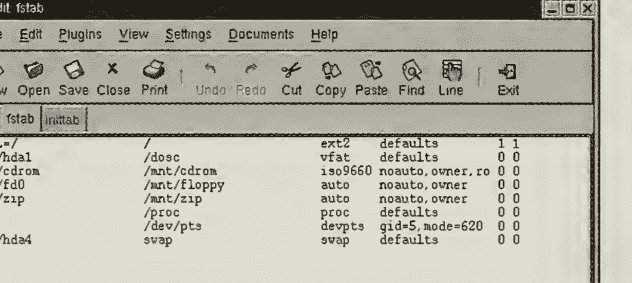

**图 10-1**

使用 `gEdit` 编辑多个文本文件

在这种情况下，编辑器打开了三个文件进行编辑——`hosts`、`fstab` 和 `instab`（全部来自 `/etc` 目录）。文件名以标签页的形式出现在编辑器窗口工具栏下方。你可以通过点击带有文件名的标签页在文件之间切换。

其余文本编辑步骤是直观的。要输入新文本，点击定位光标位置并开始输入。你可以选择文本，然后使用编辑区域上方工具栏上的按钮进行复制、剪切和粘贴。

从 `KDE` 桌面，你可以通过选择“K-Text Editor”来启动 `KEdit`（`KDE` 文本编辑器）。要打开文本文件，从菜单选择“文件 (File)>打开 (Open)”。会出现一个对话框。在此对话框中，你可以进入相应的目录，选择要打开的文件并点击“确定 (OK)”按钮。`KDE` 文本编辑器将打开 `/etc/fstab` 文件并在窗口中显示其内容。

## 使用 ed 和 vi 进行文本编辑

所有 Linux 系统都带有两个文本模式编辑器：

# 会话 10—Linux 文本编辑器

125

- `ed`，一个行行的文本编辑器
- `vi`，一个全屏文本编辑器，支持名为 `ex` 的较早编辑器的命令集

尽管图形文本编辑器易于使用，但 `ed` 和 `vi` 可能比其他（更多图形化的）文本编辑器更晦涩。你应该学习 `ed` 和 `vi` 的基础编辑命令，因为有时这两个编辑器可能是唯一可用的编辑器。例如，当你遇到系统问题且 Linux 拒绝从硬盘启动时，你可能必须从软盘启动。在这种情况下，你必须使用 `ed` 编辑器编辑系统文件，因为该编辑器足够小，可以放入软盘中。正如接下来的两个章节所示，学习 `ed` 和 `vi` 的基础编辑命令并不困难。

## 使用 ed

`ed` 编辑器通过缓冲区（`buffer`）工作——这是一个内存存储区域，实际文本存储在其中，直到你显式地将文本存储到文件中。通常，当你启动 Linux 的精简版本（例如，从启动软盘）且系统不支持全屏模式时，你必须使用 `ed`。在所有其他情况下，你可以使用可以在文本全屏下运行的 `vi`。

如你在以下使用 `ed` 编辑器的示例所示，你工作在命令模式或文本输入模式中：

- 命令模式是你默认进入的模式。在这种模式下，你输入的任何内容都会被解释为命令。`ed` 编辑器有一种简单的命令，每个命令由一个或多个字符组成。
- 文本输入模式允许你向缓冲区输入文本。你可以通过命令 `a`（追加）、`c`（更改）或 `i`（插入）进入输入模式。在输入文本行后，可以通过在空行上输入一个点 (`.`) 来退出输入模式。

要练习编辑文件，请使用以下命令将 `/etc/fstab` 文件复制到你的家目录：

```
cd
cp /etc/fstab .
```

现在你的家目录中应该有一个名为 `fstab` 的文件。输入以下命令开始编辑该文件：

```
ed -p: fstab
```

# 126 星期六上午

你会看到如下结果：

`608`

此示例使用 `-p` 选项将提示符设置为冒号 (`:`)，并打开 `fstab` 文件（在当前目录，应该是你的家目录）进行编辑。`ed` 编辑器打开文件，报告文件中的字符数 (`608`)，显示提示符 (`:`) 并等待命令。

在用 `ed` 编辑时，使用 `-p` 选项开启提示符可能对你有帮助。如果没有提示符，很难判断 `ed` 是处于输入模式还是命令模式。


使用`ed`打开文件编辑后，当前行是文件的最后一行。要查看当前行号（`ed`应用更改的行），使用`=`命令：

```
:=
```

要看到如下结果：

```
8
```

此输出告诉你`fstab`文件有8行。（你的系统`/etc/fstab`文件可能有不同的行数，在这种情况下你可以使用`l,$p`命令查看行）：

```
l,$p
```

```
/dev/cdrom            /dev/cdrom      auto       ro       0

/dev/swap             /               none       swap       0

/dev/sda1             /               ext4    defaults  rw,errors=remount-ro,commit=60,noatime 0 1

/dev/sda2             /               ext4    defaults  rw,errors=remount-ro,commit=60,noatime 0 1

/dev/sda3             /               ext4    defaults  rw,errors=remount-ro,commit=60,noatime 0 1

/dev/sda4             /               ext4    defaults  rw,errors=remount-ro,commit=60,noatime 0 1

/dev/sda5             /               ext4    defaults  rw,errors=remount-ro,commit=60,noatime 0 1

/dev/sda6             /               ext4    defaults  rw,errors=remount-ro,commit=60,noatime 0 1

/dev/sda7             /               ext4    defaults  rw,errors=remount-ro,commit=60,noatime 0 1

/dev/sda8             /               ext4    defaults  rw,errors=remount-ro,commit=60,noatime 0 1

/dev/sda9             /               ext4    defaults  rw,errors=remount-ro,commit=60,noatime 0 1

/dev/sda10            /               ext4    defaults  rw,errors=remount-ro,commit=60,noatime 0 1

/dev/sda11            /               ext4    defaults  rw,errors=remount-ro,commit=60,noatime 0 1

/dev/sda12            /               ext4    defaults  rw,errors=remount-ro,commit=60,noatime 0 1

/dev/sda13            /               ext4    defaults  rw,errors=remount-ro,commit=60,noatime 0 1

/dev/sda14            /               ext4    defaults  rw,errors=remount-ro,commit=60,noatime 0 1

/dev/sda15            /               ext4    defaults  rw,errors=remount-ro,commit=60,noatime 0 1

/dev/sda16            /               ext4    defaults  rw,errors=remount-ro,commit=60,noatime 0 1

/dev/sda17            /               ext4    defaults  rw,errors=remount-ro,commit=60,noatime 0 1

/dev/sda18            /               ext4    defaults  rw,errors=remount-ro,commit=60,noatime 0 1

/dev/sda19            /               ext4    defaults  rw,errors=remount-ro,commit=60,noatime 0 1

/dev/sda20            /               ext4    defaults  rw,errors=remount-ro,commit=60,noatime 0 1

/dev/sda21            /               ext4    defaults  rw,errors=remount-ro,commit=60,noatime 0 1

/dev/sda22            /               ext4    defaults  rw,errors=remount-ro,commit=60,noatime 0 1

/dev/sda23            /               ext4    defaults  rw,errors=remount-ro,commit=60,noatime 0 1

/dev/sda24            /               ext4    defaults  rw,errors=remount-ro,commit=60,noatime 0 1

/dev/sda25            /               ext4    defaults  rw,errors=remount-ro,commit=60,noatime 0 1

/dev/sda26            /               ext4    defaults  rw,errors=remount-ro,commit=60,noatime 0 1

/dev/sda27            /               ext4    defaults  rw,errors=remount-ro,commit=60,noatime 0 1

/dev/sda28            /               ext4    defaults  rw,errors=remount-ro,commit=60,noatime 0 1

/dev/sda29            /               ext4    defaults  rw,errors=remount-ro,commit=60,noatime 0 1

/dev/sda30            /               ext4    defaults  rw,errors=remount-ro,commit=60,noatime 0 1

/dev/sda31            /               ext4    defaults  rw,errors=remount-ro,commit=60,noatime 0 1

/dev/sda32            /               ext4    defaults  rw,errors=remount-ro,commit=60,noatime 0 1

/dev/sda33            /               ext4    defaults  rw,errors=remount-ro,commit=60,noatime 0 1

/dev/sda34            /               ext4    defaults  rw,errors=remount-ro,commit=60,noatime 0 1

/dev/sda35            /               ext4    defaults  rw,errors=remount-ro,commit=60,noatime 0 1

/dev/sda36            /               ext4    defaults  rw,errors=remount-ro,commit=60,noatime 0 1
```


```
/dev/sda37            /               ext4    defaults  rw,errors=remount-ro,commit=60,noatime 0 1

/dev/sda38            /               ext4    defaults  rw,errors=remount-ro,commit=60,noatime 0 1

/dev/sda39            /               ext4    defaults  rw,errors=remount-ro,commit=60,noatime 0 1

/dev/sda40            /               ext4    defaults  rw,errors=remount-ro,commit=60,noatime 0 1

/dev/sda41            /               ext4    defaults  rw,errors=remount-ro,commit=60,noatime 0 1

/dev/sda42            /               ext4    defaults  rw,errors=remount-ro,commit=60,noatime 0 1

/dev/sda43            /               ext4    defaults  rw,errors=remount-ro,commit=60,noatime 0 1

/dev/sda44            /               ext4    defaults  rw,errors=remount-ro,commit=60,noatime 0 1

/dev/sda45            /               ext4    defaults  rw,errors=remount-ro,commit=60,noatime 0 1

/dev/sda46            /               ext4    defaults  rw,errors=remount-ro,commit=60,noatime 0 1

/dev/sda47            /               ext4    defaults  rw,errors=remount-ro,commit=60,noatime 0 1

/dev/sda48            /               ext4    defaults  rw,errors=remount-ro,commit=60,noatime 0 1

/dev/sda49            /               ext4    defaults  rw,errors=remount-ro,commit=60,noatime 0 1

/dev/sda50            /               ext4    defaults  rw,errors=remount-ro,commit=60,noatime 0 1

/dev/sda51            /               ext4    defaults  rw,errors=remount-ro,commit=60,noatime 0 1

/dev/sda52            /               ext4    defaults  rw,errors=remount-ro,commit=60,noatime 0 1

/dev/sda53            /               ext4    defaults  rw,errors=remount-ro,commit=60,noatime 0 1

/dev/sda54            /               ext4    defaults  rw,errors=remount-ro,commit=60,noatime 0 1

/dev/sda55            /               ext4    defaults  rw,errors=remount-ro,commit=60,noatime 0 1

/dev/sda56            /               ext4    defaults  rw,errors=remount-ro,commit=60,noatime 0 1

/dev/sda57            /               ext4    defaults  rw,errors=remount-ro,commit=60,noatime 0 1

/dev/sda58            /               ext4    defaults  rw,errors=remount-ro,commit=60,noatime 0 1

/dev/sda59            /               ext4    defaults  rw,errors=remount-ro,commit=60,noatime 0 1

/dev/sda60            /               ext4    defaults  rw,errors=remount-ro,commit=60,noatime 0 1
```

# 会话 10—Linux 文本编辑器

150

如果你想跳转到特定行，请如下输入行号：


```
:
/sda/51            /               ext4    defaults  ,,errors=rem
-ro,commit=60,noatime 0 1
/dev/sda52            /               ext4    defaults  rw,errors=remount-ro,commit=60,noatime 0 1
/dev/sda53            /               ext4    defaults  rw,errors=remount-ro,commit=60,noatime 0 1
/dev/sda54            /               ext4    defaults  rw,errors=remount-ro,commit=60,noatime 0 1
/dev/sda55            /               ext4    defaults  rw,errors=remount-ro,commit=60,noatime 0 1
/dev/sda56            /               ext4    defaults  rw,errors=remount-ro,commit=60,noatime 0 1
/dev/sda57            /               ext4    defaults  rw,errors=remount-ro,commit=60,noatime 0 1
/dev/sda58            /               ext4    defaults  rw,errors=remount-ro,commit=60,noatime 0 1
/dev/sda59            /               ext4    defaults  rw,errors=remount-ro,commit=60,noatime 0 1
/dev/sda60            /               ext4    defaults  rw,errors=remount-ro,commit=60,noatime 0 1
```

# 第10节—Linux 文本编辑器

## 编辑器命令参考

| 命令 | 含义 |
| --- | --- |
| `n` | 跳转到第 `n` 行 |
| `newline` | 显示下一行并将该行设为当前行 |
| `q` | 退出编辑器 |
| `Q` | 不保存更改直接退出编辑器 |
| `r file` | 在当前行之后读取并插入文件内容 |
| `s/old/new/` | 将旧字符串替换为 `new` |
| `W file` | 将缓冲区内容追加到指定文件的末尾 |
| `w file` | 将缓冲区保存到指定文件中（如果未指定文件名，则保存到默认文件——即你正在编辑的文件） |

## vi

该编辑器是一个全屏编辑器，允许你一次查看文件的几行内容。大多数 UNIX 系统（包括 Linux）都预装了 `vi`。因此，如果你学习了 `vi` 的基本功能，你就可以在几乎任何 UNIX 系统上编辑文本文件。

与该编辑器一样，`vi` 是配合缓冲区（buffer）工作的。当 `vi` 编辑文件时，它会将文件读取到缓冲区（一个内存块）中，并允许你更改缓冲区中的文本。`vi` 在编辑过程中还会使用临时文件，但在使用特定命令保存更改之前，原始文件不会被修改。

在开始使用全屏文本编辑器之前，你必须将 `TERM` 环境变量设置为终端类型（如 `vt100` 或 `xterm`）。例如，通过 `export TERM=vt100` 将终端类型设置为 `VT100`。`vi` 编辑器使用终端类型来控制全屏模式下的终端。

当你运行 `X` 以及如 `GNOME` 或 `KDE` 等图形用户界面时，你可以在终端窗口中使用 `vi`。终端窗口的终端类型是 `xterm`。（要验证这一点，请在命令提示符处输入 `echo $TERM`。）当启动终端窗口时，它会自动将 `TERM` 环境变量设置为 `xterm`。因此，你应该能够在 `xterm` 窗口中使用 `vi`，而无需显式设置 `TERM` 变量。

要启动编辑器，使用 `vi name` 后跟一个可选的文件名。你还可以提供文件名之外的其他参数。但是，如果 `vi` 仅以文件名作为唯一参数启动，如下所示：

```bash
vi /etc/hosts
```


另一种启动 `vi` 的常用方法是在启动时直接跳转到特定的行号。例如，要从 `/etc/X11/XFB6Config` 文件的第 296 行开始编辑，请使用此命令：

```bash
vi +296 /etc/X11/XFB6Config
```


# vi 编辑器基础操作指南

## 启动 vi
当你在编译器报告特定行号错误后编辑源文件时，这种启动 vi 的方式非常有用。

当你用 vi 编辑文件时，编辑器会将文件加载到缓冲区，在全屏窗口中显示文件的前几行并将光标置于第一行。例如，当你在终端窗口输入命令 `vi /etc/fstab` 时，你会得到一个全屏文本窗口。

最后一行显示有关文件的信息，包括行数和字符数。稍后，该区域将作为命令区域。其余行显示文件内容。如果文件的行数少于窗口，`vi` 会在第一列用波浪线（`~`）显示空行。

当前行由光标标记，光标显示为一个小的黑色矩形。光标出现在字符上方。在 `vi` 中，你处于三种模式之中：

- **可视模式（Visual mode）**是你的默认模式。在此模式下，你输入的任何内容都会被解释为适用于包含光标行的行的命令。`vi` 命令与 `ed` 命令相似。
- **命令模式（Command mode）**允许你读取或写入文件、设置 `vi` 选项并退出。所有冒号命令都以冒号（`:`）开头。当你输入冒号时，`vi` 将光标置于最后一行并允许你输入命令。命令在你按下回车（`Enter`）时生效。
- **输入模式（Input mode）**允许你向缓冲区输入文本。你可以通过命令 `a`（在光标后插入）、`A`（在行尾插入）或 `i`（在光标前插入）进入输入模式。在输入文本行后，你必须按 `Esc` 退出输入模式并重新进入可视命令模式。

所有这些模式的一个共同问题是你无法轻易判断 `vi` 当前的模式。当你正在打字却发现 `vi` 并不在输入模式时，会令人沮丧。相反的情况也经常发生——你可能在想输入命令时正在输入。如果你想确保 `vi` 处于命令模式，请按几次 `Esc`。（多次按 `Esc` 也没有处。）

> 若要在 `vi` 中查看在线帮助，请在命令模式下输入 `:help`。

输入 `:q` 退出帮助屏幕并返回正在编辑的文件。


## 光标移动
`vi` 编辑器最初将光标置在第一个字符上。你需要学习的内容之一是移动光标。尝试以下命令。只需输入字母，`vi` 就会做出响应。

- `j` 将光标向下移动一行
- `k` 将光标向上移动一行
- `h` 将光标向左移动一个字符
- `l` 将光标向右移动一个字符
- `w` 将光标向前移动一个单词
- `b` 将光标向后移动一个单词
- `Ctrl-d` 向下滚动半屏幕
- `Ctrl+u` 向上滚动半屏幕

幸运的是，你还可以通过方向键移动光标。使用方向键移动光标，如果你不需要记住 `hkll` 的含义。


## 行定位与搜索
你可以随时跳转到特定行号。例如，跳转到第 1 行，输入：

```bash
:1
```

当你输入冒号时，`vi` 在最后一行显示字符串。要在 `/etc/fstab` 中查找字符串 `cdrom`，首先输入 `/cdrom`。`vi` 编辑器显示该字符串所在的位置。

```bash
/cdrom
```

## 编辑与保存
要删除光标所在的行，输入 `dd`。`vi` 编辑器删除该行并将下一行设为当前行。

要在光标前输入文本，输入 `i`。`vi` 编辑器切换到输入模式。现在你可以输入文本。完成输入后，按 `Esc` 返回可视命令模式。

当你完成文件编辑后，可以使用 `:w` 命令保存文件的更改。要在不保存更改的情况下退出编辑器，使用 `:q` 命令。如果你想保存更改并退出，可以输入 `:wq` 同时完成这两个操作。`vi` 编辑器保存更改并退出。你也可以通过按 `ZZ` 保存更改并退出编辑器。

## 常用命令示例
除了示例会话中所示的命令，`vi` 还接受大量命令。表 10-2 列出了常用的 `vi` 命令。要尝试这些命令，将文件 `/etc/X11/XF86Config` 复制到你的主目录，并使用以下命令用 `vi` 编辑该文件：

```bash
cd
cp /etc/X11/XF86Config .
vi XF86Config
```


编辑文件时，尝试表 10-2 中的命令。由于良好的技能在所有 UNIX 系统中很有用，你应该花几分钟熟悉表 10-2 中的一些命令。

## 表 10-2 常用 `vi` 命令

| 命令 | 含义 |
| :--- | :--- |
| `i` | 在光标后插入文本 |
| `a` | 在行尾插入文本 |
| `A` | 在行首插入文本 |
| `I` | 在光标前插入文本 |
| `d$` | 删除到当前行的末尾 |
| `D` | 删除当前行 |
| `dd` | 删除当前行 |
| `dw` | 从光标删除到下一个单词末尾 |
| `x` | 删除光标所在的字符 |
| `C` | 更改到当前行的末尾 |
| `cc` | 修改当前行 |
| `J` | 将当前行与下一行合并 |
| `r x` | 将光标下的字符替换为 `x` (`x` 是任意字符) |
| `h` | 向左移动一个字符 |
| `j` | 向下移动一行 |
| `k` | 向上移动一行 |
| `l` | 向右移动一个字符 |
| `w` | 到下一个单词的开头 |
| `Ctrl-d` | 向前滚动半屏 |
| `Ctrl-u` | 向后滚动半屏 |
| `Ctrl-l` | 重绘屏幕 |
| `P` | 将复制的行放在当前行上方 |
| `p` | 将复制的行放在当前行下方 |
| `yy` | 将当前行复制（yank）到无名缓冲区 |
| `:! command` | 执行 shell 命令 |
| `:q` | 退出编辑器 |
| `:q!` | 不保存更改退出 |
| `:r filename` | 读取文件并插入到当前行之后 |
| `:w filename` | 将缓冲区写入文件 |
| `:wq` | 保存更改并退出 |
| `/string` | 向前搜索字符串 |
| `?string` | 向后搜索字符串 |
| `U` | 撤销上一个命令 |
| `Esc` | 退出输入模式并进入可视命令模式 |
| `U` | 撤销对当前行的最近更改 |


# 第 10 章：Linux 文本编辑器

### 复习

本节向你展示了如何使用 `GNOME` 和 `KDE` 中的图形文本编辑器来编辑文件。图形文本编辑器使用直观，但有时你可能需要在没有图形登录的情况下编辑文本文件。对于这些情况，你练习了使用文本模式编辑器：`ed` 和 `vi` 来编辑文本文件。

### 自测

1. 如何启动 `GNOME` 文本编辑器？（参见“使用 GUI 文本编辑器进行文本编辑”）
2. 使用 `ed` 编辑器编辑时，如何查看文件的所有行？（参见“使用 ed”）
3. 使用 `ed` 编辑器编辑文件时，使用什么命令来定位包含字符串 `monitor` 的行？（参见“使用 ed”）
4. `vi` 编辑器的三种模式是什么？（参见“使用 vi”）
5. 如何在不保存更改的情况下退出 `vi` 编辑器？（参见“使用 vi”）

# 部分习题

## 第二部分

### 周六上午

1. 简述 X 客户端/服务器架构。X 服务器的作用是什么？
2. Linux 中用于配置 X 服务器的配置文件是什么？如何创建一个新的 X 配置文件？
3. 假设你的系统设置了图形登录，但 X 似乎没有正常启动。你会采取哪些步骤来恢复这种状况？
4. 为了能够成功打印，打印机必须理解操作系统发送给它的数据。数据是如何发送到打印机以便其按预期打印的？最常见的打印语言有哪些？
5. 什么是阶梯（stair-stepping）？如何修正？
6. 什么是 Linux 文件系统？文件系统的部分可以存储在不同的硬盘或不同的分区上吗？
7. 使用什么 Linux 命令将当前目录更改到主目录，然后列出所有文件的详细信息（包括以点开头的文件）？
8. 使用什么 Linux 命令来查找 `/usr/doc` 目录下所有以 `README` 开头的文件？
9. 如何在一行中输入多个 Linux 命令？多行继续命令的语法是什么？
10. 展示一个示例，使用一个命令的输出作为另一个命令的输入。
11. 什么是“I/O 重定向”功能？
12. 什么是别名（alias）？如何定义别名？如何获取所有当前定义的别名列表？定义别名 `docdir` 将目录更改到 `/home/httpd/html`。如何取消 `docdir` 别名？
13. 假设系统的日期时间是错误的。显示你使用的命令，将日期时间设置为 2001 年 12 月 31 日晚上 10:30。
14. 显示你使用的 Linux 命令，查找所有名称中包含 `gnome` 的进程。
15. 假设你想杀死 `gpm` 进程。解释你执行此项任务所遵循的步骤。
16. 假设你想将一个 4MB 的文件分成四个等份，以便将其复制到四张软磁盘上。你使用什么命令执行此任务？如何重新合并这些部分？
17. 为什么学习在 Linux 中编辑文本文件很重要？当你从文本控制台工作时使用什么文本编辑器？
18. 假设你正在使用 `ed` 编辑器编辑 `/etc/inittab` 文件。显示使用冒号（`:`）作为命令提示符启动编辑会话的命令。解释如何在第 16 行之前输入文本，然后保存并退出。
19. 解释如何使用 `vi` 编辑器编辑 `/etc/inittab` 文件。按下哪些键跳转到第 16 行并输入新行？如何保存文件并退出？
20. 如何在 `vi` 中剪切一行文本？使用什么命令将剪切的文本粘贴到当前行下方？

# 第 11 章：配置调制解调器

## 表 11-1 串口的设备名称

| COM 端口 | 设备名称 | IRQ | I/O 地址 |
| :--- | :--- | :--- | :--- |
| COM1 | `/dev/tty0` | 4 | `0x3f8` |
| COM2 | `/dev/tty1` | 3 | `0x2f8` |
| COM3 | `/dev/tty2` | 4 | `0x3e8` |
| COM4 | `/dev/tty3` | 3 | `0x2e8` |

如果你从本书的附带 CD-ROM 中安装了 `Red Linux`，所有这些设备应该已经存在于你的系统中。其他发行版也会安装这些设备。如果你检查 `/dev` 目录，你应该能找到 `/dev/ttyS*` 设备，其中 `*` 是 0, 1, 2 和 3。在终端窗口中，输入 `ls -1 /dev/ttyS*` 来查看这些设备文件的列表。

## 检查 Linux 是否检测到串口设备

当你安装 Linux 时，系统会自动为你创建必要的 Linux 串口设备。你应该拥有用于通过调制解调器拨入出的 `/dev/ttyS*` 设备。

要验证 Linux 是否正确检测到串口，请使用 `dmesg` 检查启动消息：

```bash
dmesg | grep ttyS*
```

如果你看到如下消息，说明 Linux 在你的 PC 中检测到了串口：
`ttyS1 at 0x2f8 (irq = 3) is a 1650A`

在这种情况下，该消息表示 Linux 检测到了第二个串口 (COM2)。它显示了 I/O 地址 (`0x2F8`) 和 IRQ (3)。消息的最后部分 —`1650A`— 指的是通用异步收发器 (UART) 芯片的标识码，它是所有串口通信硬件的核心。UART 将每个字节转换为 0 和 1 的流，并在需要时转换回字节。

启动消息也存储在 `/var/log/messages` 文件。因此，你可以使用 `grep` 命令在 `/var/log/messages` 文件中搜索串口名称，如下：

```bash
grep ttyS /var/log/messages
```


你也可以使用 `setserial` 命令检查串口。输入以下命令查看有关串口的详细信息：

```bash
setserial -dev/ttyS*
```

出现问题的明显迹象是 `setserial` 给出的消息显示 UART 为未知（如下例所示）：

```
/dev/ttyS0, UART: unknown, Port: 0x3f8, IRQ: 4
```


如果`UART`显示如上，则`Linux`未检测到该串口。


`Red Hat Linux`未检测到串口通常是因为你的`BIOS`设置为等待即插即用 (`PnP`) 操作系统。请重启你的`PC`。

### 使用 Minicom 拨出

在完成调制解调器的物理安装并验证必要的`Linux`设备文件存在后，你可以尝试通过调制解调器拨出。

最好的方法是使用本书`CD-ROM`附带的`Red Hat Linux`发行版中的`Minicom`串口通信程序，该程序安装在`/usr/bin`目录下。`Minicom`程序是一个具有基于文本界面的串口通信程序，可以模拟`VT102`终端。`Minicom`类似于其他通信软件，如`Procomm`或`Crosstalk`（你可能在`MS-DOS`或`Windows`下使用过它们）。`Minicom`也包含在其他`Linux`发行版中。检查你版本的文档查看是否包含。

# 以 root 用户运行 Minicom

要运行`Minicom`，在终端窗口的`shell`提示符或虚拟台中输入`minicom`。如果你以普通用户（而不是`root`）运行`Minicom`，它将显示以下错误消息并退出（除非系统管理员已允许普通用户使用`Minicom`）：

```
minicom: there is no global configuration file /etc/minirc.dfl

Ask your sysadm to create one (with minicom -s).
```

以`root`身份登录，然后输入

```
minicom -s
```

你可能需要输入完整路径：`/sbin/minicom`。


`Minicom`启动并显示一个对话框（见图 11-1），其中包含设置菜单，允许你配置`Minicom`的各个方面，包括串口、调制解调器和拨号命令。要输入调制解调器初始化命令，使用箭头突出显示`Modem and dialing`项（如图 11-1 所示）。

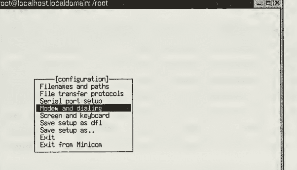

**11-1 Minicom 的设置菜单**

在突出显示`modem and dialing`项后，按`Enter`。`Minicom`显示另一个菜单（见图 11-2），列出了你可以更改的设置列表。`Minicom`将光标置于第一行，如图 11-2 所示。按`A`更改调制解调器初始化字符串。


**（模式和拨号参数）**

```
A- Init string（初始化字符串）...... "ST"
B- Reset string（重置字符串）...... "ATZ"
C- Dialing prefix（拨号前缀）...... "ATMF"
D- Dialing suffix（拨号后缀）...... "ATTP"
E- Dialing suffix（拨号后缀）...... "ATV1"
G- Dialing suffix（拨号后缀）...... "AT10M"
H- Dialing suffix（拨号后缀）...... "AT8T"
I- Correct string（正确字符串）...... "ERROR"
J- No connect strings（无连接字符串）.... BUSY"
K- Max-range string（最大范围字符串）.... "ATHT"
M- Dial time（时间）.......... 45
N- No delay（无延迟）...... 2
O- Number of tries（次数）...... 50
P- drop time (out）（超时时间）..1
```

**11-2 在 Minicom 中设置调制解调器和拨号参数**

你可以使用退格键编辑该行，并输入初始化调制解调器的`AT`命令。例如，使用以下命令初始化调制解调器：

```
ATF
```

输入调制解调器初始化字符串后，按`Enter`返回顶级菜单。


由此，`AT`命令是你用来控制调制解调器并执行任务的命令，例如拨号、开启或调制解调器的扬声器以及设置调制解调器接听。这些命令以两个字符开头：`AT`（注意）。当通信软件处于原始状态并发送你输入的内容时，可以使用`AT`命令。

如果没有更改，使用上下箭头标记`Save as def`（保存为默认）的项目，然后按`Enter`。`Minicom`将设置保存在`/etc/minirc.dfl`文件中——这是`Minicom`的默认文件。之后，你可以从`Minicom`选择`Exit`退出。

# 普通用户运行 Minicom

在任何用户运行`Minicom`之前，你需要执行以下操作：

- 使用文本编辑器打开`/etc/minicom.users`文件，确认其中有一行带有`ALL`字。（这允许所有用户访问`Minicom`的默认配置文件）。如果没有，添加一个带有`ALL`的行。
- 假设你想让所有用户使用调制解调器拨出，任何连接到调制解调器的串口都必须允许用户读写权限。例如，如果调制解调器在`COM1` (`/dev/ttyS0`)，输入`chmod o+w /dev/ttyS0`给所有人写权限。
- 在`/dev/modem`与连接的串口之间建立链接。如果调制解调器在`COM1` (`/dev/ttyS0`)，输入以下命令：

```
ln -s /dev/ttyS0 /modem
```


之后，你可以用普通用户运行 `Minicom`。当 `Minicom` 运行时，它会重置调制解调器。图 11-3 显示了在终端窗口运行 `Minicom` 的结果。


图 1-3  
终端窗口中的初始 `Minicom` 屏幕

按 `Ctrl+A` 获取 `Minicom` 控制。如果你按 `Z`，将以文本窗口的形式出现帮助屏幕（如图 11-4 所示）。


| Minicom | Minicom 摘要 |
|--- |--- |
| OPT | 通过 `CTRL-A` 键调用命令 |
| Comp | 其他功能 |
| Press | 主要功能 |
| ST | 列出目录, .B run(ht)...E Screen...E |
| Send files, .B 备份文件...E | 编辑 `Minicom`... |
| Parameters, .B 添加行...E | 挂起 min... |
| Send break, .B 初始化...M | 等待重置... |
| Terminal setup, .B 退出 | 不重置退出... |
| Line on/off, .B 本回显，开启/关闭 | 帮助屏幕...B |
| | 向上滚动...B |


图 11-4  
`Minicom` 帮助屏幕

在屏幕中，你可以获取有关其他 `Minicom` 命令的信息。从屏幕上按 `Enter` 返回在线模式。在在线模式下，你可以使用调制解调器的 `AT` 命令拨出。特别是，你可以使用 `ATDT` 命令拨打另一个调制解调器的电话（例如，你的互联网服务提供商的计算机或办公室的系统），如图 11-5 所示。一旦获得提示符，你就可以像常一样使用它和远程系统。


```
Welcome to minicom 1.23
OFFLINE: 历史记录, 键映射, 搜索历史记录
Compiled for Jan 2000 02:22.
按 CTRL-A Z 获取特殊键帮助
AT ST=48 S50 LI1 V1 8x E1 0
QT
TART 30212025
CONNECT 26800/ANSI/V34/LAPM/V42BIS
past-at
Welcome to Intermedia Communications
如有任何困难，请邮件至 comps@digex.net
或查看在线帮助 http://www.access.digex.net/~comps

用户访问验证
access login:
```

当你退出其他系统并想退出 `Minicom` 时，按 `Ctrl-A`，然后输入 `X` 退出程序。在 `Minicom` 提示符处再次按 `Enter`。

# 第 11 节—配置调制调器

## 复习

在本节开始时，你学习了 Linux 中串口端口的设备名称。你使用了 `Minicom` 串口通信程序通过调制调器拨号。在拨号过程中，你学习了几个用于控制调制调器的 `AT` 命令。

## 自测

- 1. 第二个串口端口 (`COM2`) 的设备名称是什么？（参见“学习串口设备名称”。）
- 2. 你如何检查 Linux 是否检测到你 PC 中的任何串口端口？（参见“检查 Linux 是否检测到串口设备”。）
- 3. 你可以使用什么程序通过调制调器拨号上网？（参见“使用 `Minicom` 拨号”。）
- 4. 你使用哪种 `AT` 命令让调制调器拨打电话号码？（参见“作为普通用户运行 `Minicom`”。）
- 5. 为了在 `/dev/modem` 与连接到调制调器的串口设备之间建立链接，你需要做什么？（参见“作为普通用户运行 `Minicom`”。）


# 连接互联网

## 节检查清单

- 学习拨号网络的基础知识
- 使用 `PPP` 连接互联网
- 使用 IP 伪装（IP masquerading）共享互联网连接

安装 Linux 后，你可能希望将你的 Linux PC（可能还有自己的局域网）连接到互联网。对于小型办公室或家庭办公室连接互联网，你有以下几种流行的方案：数字用户线路 (DSL)、电缆调制调器和拨号网络。DSL 和电缆调制调器本质本质涉及将特殊的调制调器连接到 Linux 系统上的以太网卡。在这些情况下，设置步骤与第 14 节中讨论的相同。

剩余 30 分钟

本节侧重点于拨号网络，这涉及从你的 Linux PC 到 ISP 系统建立 `PPP` 连接。你还学习了使用 IP 伪装将 Linux 系统的互联网连接与局域网上的其他系统共享。

# 拨号网络基础知识

拨号网络是指 PC 通过拨号调制调器连接到远程网络（如互联网）。在这种情况下，最大数据传输速率为 56Kbps。拨号网络与旧的串口通信之间存在显著差异。两种方法都使用调制调器拨入另一台计算机并建立通信路径，但串口通信软件（如第 11 节中的 `Minicom`）让你的计算机像连接到远程计算机的终端。串口通信软件专门使用拨号连接。例如，你不能运行另一个通信软件副本并使用同一个调制调器连接。

在拨号网络中，你在 PC 上以及与 PC 建立拨号连接的远程系统上运行 `TCP/IP` 或其他网络协议软件。通信路径仅提供物理数据传输网络协议交换数据包。你可以同时使用任意数量的网络应用程序通过单一拨号连接进行通信。通过拨号网络，你的 PC 真正变成了远程计算机所属网络的一部分。（如果远程计算机不在网络上，拨号网络将创建一个由远程计算机和你的 PC 组成的网络。）因此，你可以同时运行任意的网络应用程序（从 Web 浏览器到 `TELNET` 会话），所有应用程序都共享拨号连接的物理数据传输能力。

拨号网络涉及通过拨号连接进行 `TCP/IP` 数据传输。类似于通过以太网进行 `TCP/IP` 网络，通过拨号链路进行 `TCP/IP` 网络只需指定协议——即在通信链路上封装网络数据包的约定。对于通过点点 (SLIP) 串口通信链路进行 `TCP/IP` 网络连接，有两种流行的协议：

- 串口互联网协议 (SLIP) 是一种简单的协议，规定了如何在串口线上对 `IP` 数据包进行帧处理。
- 点点协议 (PPP) 是一种更高级的协议，用于在任何点点链路（包括拨号串口链路）上建立 `TCP/IP` 连接。

`PPP` 是拨号连接上 `TCP/IP` 网络最流行的方法，并且在各方面已取代了 SLIP。因此，在下一节中我将向你展示如何使用 `PPP` 建立到远程系统的网络连接。

# 第 12 节—连接互联网

## 使用 PPP 连接互联网

许多互联网服务提供商 (ISP) 通过其维护的一个或多个系统提供 `PPP` 接入互联网。如果你注册了此类服务，ISP 应该为你提供与远程系统建立 `PPP` 连接所需的信息。通常，这些信息包括以下内容：

- 连接到远程系统的电话号码
- 登录远程系统时必须使用的用户名和密码
- ISP 域名服务器 (DNS) 的 `IP` 地址。通常，ISP 会给你两个地址——一个主 DNS 和一个备用 DNS 地址。
- 你的连接侧的 `IP` 地址。（此 `IP` 地址与你 PC 的 `PPP` 接口——即 `PPP` 接口关联。）

大多数 ISP 动态提供此 `IP` 地址。

在设置连接之前，你必须已安装内部或外部调制调器。你可以像第 11 节描述的那样使用 `Minicom` 拨打 ISP 的电话并确保连接建立。

要使用 Red Hat 的图形界面设置 `PPP`，从 GNOME 桌面进入 菜单 (`Menu`) > 程序 (`Programs`) > 拨号配置 (`Dialup Configuration`)。拨号配置工具会显示新建连接对话框。点击下一步 (`Next`)。对话框将引导你完成步骤。拨号配置工具将配置保存在 `/etc/sysconfig/network-script/ifcfg-ppp0` 中。


# 152 周六下午

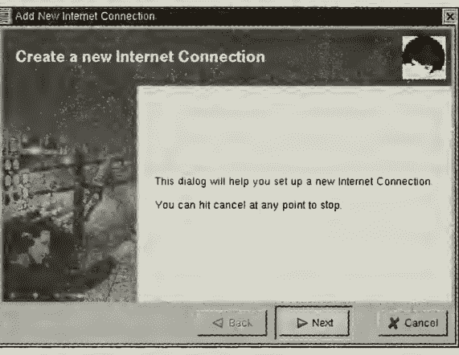

图 12-1  
使用 Red Hat 的拨号配置创建新的互联网连接

要建立 `PPP` 连接，请从 GNOME 桌面选择 菜单 (`Menu`) > 程序 (`Programs`) > 互联网 (`Internet`)。会出现一个对话框，其中列出了你可以用于建立连接的接口列表。选择你用拨号配置定义的接口，并点击确定 (`OK`) 按钮开始连接。

要使用 KDE GUI（Caldera 和 Suse 发行版的默认）设置 `PPP`，点击 K 图标，然后选择互联网 (`Internet`) > KPPP。在图 12-2 所示的对话框中，选择设置 (`Setup`) 打开 KPPP 配置对话框。

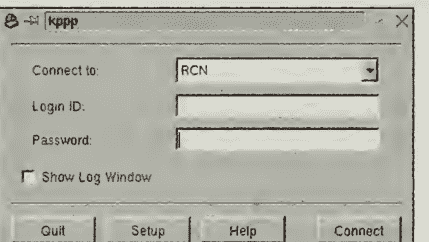

图 12-2  
你可以在 KPPP 对话框中选择账户并进行配置。

让我们通过点击新建 (`New`) 按钮开始设置新账户，打开图 12-4 所示的新建账户对话框。

# 第 12 节—连接互联网

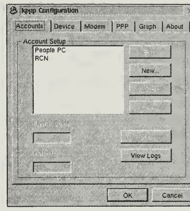

图 12-3  
你可以在 KPPP 配置对话框中配置所有 KPPP 选项

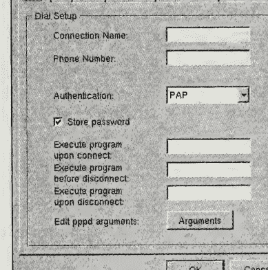

图 12-4  
在新建账户对话框中输入你的 ISP 账户信息。  
务必填写以下字段：

- **字体 连接名称** — 为此连接输入一个名称，例如 ISP 的名称。
- **电话号码** — 输入拨打以连接 ISP 的号码。

**身份验证** — 在此下拉列表中，选择您的 ISP（互联网服务提供商）使用的安全类型。请咨询您的 ISP 获取此信息。（大多数 ISP 使用 PAP。）

**连接时执行程序** — 输入程序（如 Web 浏览器）命令，该程序将在连接建立后启动。

**断开连接时执行程序** — 输入在断开连接后启动的程序命令。

**编辑 `pppd` 参数** — 点击“参数（Arguments）”按钮来更改 `pppd` 参数。这些参数通常不需要更改。

在 IP 选项卡上，您可以配置静态或动态 IP 地址。默认是动态（Dynamic），通常不需要更改。

DNS 选项卡定义了连接建立后的域名解析。您需要输入 ISP 的域名和名称服务器的 IP 地址。

网关（Gateway）选项卡定义了通往外部网络的路由。默认使用静态网关，通常需要更改此设置。

最后两个选项卡“登录脚本（Login Script）”和“计数（Accounting）”不需要更改，您可以点击 OK 返回到 KPPP 配置对话框。

接下来，您需要点击“设备（Device）”选项卡并选择正确的端口来配置调制调器。（参见图 12-5。）参考“会话 11”查看相应的设备关系。为调制调器输入正确的设备后，点击 OK 返回主窗口。要进行连接，选择刚创建的连接名称，输入相应的 ID 和密码，并点击连接。


**图 12-5** 您可以在 KPPP 配置对话框的设备选项卡上输入调制调器的设备名称。

会话 12 — 连接到

## 验证 PPP 连接已建立

连接后，可以通过输入 `/sbin/ifconfig` 命令来验证 `PPP` 连接已建立，显示如下：

```
```


# 第 13 节

## 验证网络设备配置

### `eth0`

```
Link encap:Ethernet Haddr:02:60:bc:8e:c6:a9
inet addr:192.168.1.200 Broadcast:192.168.1.255 Mask:255.255.255.0
UP BROADCAST MULTICAST MTU:1500 Metric:1
rx packets:4363 errors:0 overhead:0
tx packets:2111 errors:0 overhead:0 carrier:0
collisions:0 txqueen:100
```

### `lo`

```
Link encap:Loopback
inet addr:127.0.0.1 Mask:255.0.0.0
UP LOOPBACK MULTICAST MTU:3924 Metric:1
rx packets:550 errors:0 overhead:0 frame:0
tx packets:50 errors:0 overhead:0 carrier:0
collisions:0 txqueen:0
```

### `ppp0`

```
Link encap:Point-to-Point Protocol
inet addr:209.100.18.220 t:209.100.18.4 Mask:255.255.255
UP POINT NOARP MULTICAST MTU:1500 Metric:1
rx packets:132 errors:2 overhead:0 frame:2
tx packets:146 errors:0 overhead:0 carrier:0
collisions:0 txqueen:10
```

在输出中找到列出的 `ppp0` 设备。`ifconfig` 输出还显示了 PPP 连接的本地和远程地址。此输出确认 PPP 设备已启动并运行。

## 验证路由表设置正确

要验证路由表设置正确，输入不带任何参数的 `/sbin/route` 命令查看后续：

| 内核 IP 路由表 | | Genmask | Flags | Metric | Ref | Use | Interface |
|---|---|---|---|---|---|---|---|
| 209.100.18.4 | | 255.255.255.255 | U | 0 | 0 | 0 | `ppp0` |
| 192.168.1.200 | * | 255.255.255.255 | UH | 0 | 0 | 0 | `eth0` |
| 192.168.1.0 | * | 255.255.255.255 | U | 0 | 0 | 0 | `ethn0` |
| 127.0.0.0 | | 255.0.0.0 | U | 0 | 0 | 0 | `lo` |
| default | | 209.100.18.4 | UG | 0 | 0 | 0 | `ppp0` |

在输出表中，第一行显示了通往 PPP 连接端的路由，其应设置为 `ppp0` 设备。默认路由应设置好，将 PPP 连接端作为您系统的网关（如路由表的最后一行）。

## 验证互联网连接

在检查配置（使用 `ifconfig`）和路由表（使用 `route`）后，验证是否已到达互联网。如果需要连接，请尝试 `ping`。以下示例显示了您尝试时看到的内容：

```
PING 209.100.18.4 (209.100.18.4): 56-byte data packets
64 bytes from 209.100.18.4: icmp_seq=1 ttl=64 time=12.2 ms
64 bytes from 209.100.18.4: icmp_seq=2 ttl=64 time=11.9 ms
64 bytes from 209.100.18.4: icmp_seq=3 ttl=64 time=12.5 ms
64 bytes from 209.100.18.4: icmp_seq=4 ttl=64 time=12.1 ms
64 bytes from 209.100.18.4: icmp_seq=5 ttl=64 time=12.3 ms
--- 209.100.18.4 ping statistics ---
5 packets transmitted, 5 received, 0% packet loss
rtt min/avg/max/mdev = 11.9/12.2/12.5/0 ms
```

### 关闭 PPP 连接

您也可以通过命令开启或关闭 PPP 连接。在配置 `ppp0` 后，输入以下命令启动：

```
/sbin/ifup ppp0
```


当不再需要 PPP 连接时，以 `root` 身份登录并输入以下：

- 1. 确保内核（核心操作系统）支持防火墙链。对于您从随附光盘安装的 Red Hat 版本，这通常是需要的。其他 Linux 发行版也支持。如果 `/proc/net/ip_fwchains` 文件存在，则 Linux 内核支持防火墙链。（通过 `ls /proc/net/ip_fwchains` 验证文件是否存在。）
- 2. 确保 Linux PC 拥有互联网连接和局域网连接。通常，Linux PC 拥有两个接口：以太网卡和拨号 PPP 连接。
- 3. 确保局域网内的所有系统都将 Linux PC 作为 TCP/IP 网络的网关。使用相同的 ISP 提供的 DNS 地址。

## 使用 IP 伪装共享互联网连接

Linux 拥有名为 IP 伪装的功能，它可以让使用私有 IP 地址的以太网路连接互联网。这是通过一个具有官方 IP 的 Linux PC 实现的。该 PC 可能通过拨号 PPP 或其他连接（如 DSL 或调制解调器）连接到互联网。

启用 IP 伪装后，您的 PC 将作为局域网内其他系统的代表。作为路由器，Linux PC 被指定为以太网的网关。然而，伪装涉及到在局域网和互联网之间往返 IP 数据包。

当 Linux PC 伪装局域网内的其他系统时，它会修改数据包，使其看起来源自 Linux PC。当收到这些输出数据包的响应时，Linux PC 执行反向操作——它修改数据包，使其看起来直接来自互联网发送数据包的系统。结果是，尽管以太网使用的是非唯一的私有 IP 地址。

要启用并使用 IP 伪装，请执行以下步骤：

4. 输入以下命令在内核中启用 IP 转发：

   ```
   echo "1" > /proc/sys/net/ipv4/ip_forward
   ```

   这是必要的，因为 IP 转发默认是禁用的。为了确保在重启系统时启用 IP 转发，请将此命令放在 `/etc/rc.d/rc.local` 文件中。在 Linux 中，你可以通过将 `/etc/sysconfig/network` 文件中的行 `FORWARD_IPV4=false` 改为 `FORWARD_IPV4=true` 来实现相同的结果。

5. 运行 `/sbin/ipchains` – IPCHAINS 防火墙管理程序 – 设置为你的局域网（LAN）开启 IP 伪装（masquerading）。例如，要通过 Linux PC 的 `ppp0` 网络接口对局域网进行伪装，可以使用以下命令：

   - `/sbin/ipchains -P DENY`
   - `/sbin/ipchains -A forward -i ppp0 -j MASQ`

   如果你想在启动时设置 IP 伪装，应将这些命令存放在 `/etc/rc.d/rc.local` 文件中。请务必查看 `ipchains` 的所有页面以学习如何保护你的系统。


> 你可能会发现 IP 伪装是为小型局域网（例如家里或办公室的局域网）提供互联网访问的一种方便方法。在家里，我使用 IP 伪装通过 Linux 系统将以太网连接到互联网。Linux PC 有一个用于局域网连接的网卡和一个通过 ISP 连接互联网的调制解调器。（我有来自 ISP 的有效 IP 地址。）通过 Linux PC 上的 IP 伪装，你家里或小企业的每个人都可以通过局域网内的其他 PC 访问互联网。

完成！

### 复习

本节介绍了拨号上网 – 即通过拨号调制解调器在你的 Linux PC 和互联网之间建立网络连接。你学习了如何使用 Red Hat 拨号连接工具设置 PPP 连接。最后，本节向你展示了如何使用 `IPCHAINS` 防火墙管理程序的 IP 伪装功能共享单个互联网连接。

### 自测

- 1. 什么是拨号上网和 PPP？（参见“学习拨号上网基础”）
- 2. ISP 通常为你提供哪些信息以便你设置拨号 PPP 连接？（参见“使用 PPP 连接到互联网”。）
- 3. 你使用什么工具设置 PPP 连接？（参见“使用 PPP 连接到互联网”。）
- 4. 你输入什么命令来开启和关闭 PPP 连接？（参见“开启或关闭 PPP 连接”。）
- 5. 什么是 IP 伪装？（参见“使用 IP 伪装共享互联网连接”）


# 设置互联网服务

### 章节清单

- 理解互联网服务
- 使用电子邮件服务器
- 设置 Apache Web 服务器
- 设置 FTP 服务器

剩余 30 分钟

你将在第 29 节学习如何保护你的 Linux 系统。

## 理解互联网服务

“互联网服务”一术是指一系列采用客户端/服务器架构来执行特定任务的网络应用程序。（在客户端/服务器架构中，有两个独立的程序 – 一个提供信息的服务器和一个或多个请求信息的客户端 – 实现了一种服务。）

许多服务专门设计用于将信息从一个系统传递到另一个系统。信息可以是邮件消息、新闻项目或数据文件的形式。作为用户，你可以从典型的主机上访问这些常用的互联网服务：

- 电子邮件 (e-mail)。从互联网主机，你可以使用如 `president@whitehouse.gov` 之类的地址向互联网上的任何其他用户发送电子邮件。
- 世界维网 (Web)。你可以使用 Web 浏览器通过统一资源定位符 (URL) 地址（如 `http://www.whitehouse.gov`）下载并查看网页。网页通常使用超文本标记语言 (HTML) 编写。
- 新闻组 (Newsgroups)。你可以使用如 `comp.linux.networking` 或 `comp.os.linux.setup` 等名称阅读新闻组并在新闻组发布新闻项目。
- 信息检索。你可以使用 Web 浏览器等工具搜索信息。还可以通过文件传输协议 (FTP) 下载文件。相反，其他系统上的用户也可以从你的系统下载文件 – 通常通过称为匿名 FTP 的功能。
- 远程访问。你可以使用 `TELNET` 登录互联网上的另一台计算机（远程计算机），前提是你有访问该计算机所需的用户名和密码。

所有互联网服务都依赖于客户端和服务器软件。例如，电子邮件服务器负责将邮件从一个系统传输到另一个系统，而你使用电子邮件客户端软件读取邮件。同样，你使用 Web 客户端从 Web 服务器下载和查看 Web。

实现服务的客户端和服务器采用 `TCP/IP` 协议进行通信。你已经熟悉了标识 `TCP/IP` 网络中主机的 `IP` 地址。仅凭 `IP` 地址无法充分区分运行在同一系统上的许多服务。端口号的概念被用于区分它们。

## 设置互联网服务

仅凭 `IP` 地址无法充分区分运行在同一系统上的许多服务。端口号的概念被用于区分它们。端口号范围从 0 到 65535。端口 0 到 1023 是已知端口。1024 到 49151 是注册端口。49152 到 65535 是动态端口。

下表显示了一些常用端口号：

| 服务 | 端口号 | 协议 |
| :--- | :--- | :--- |
| `FTP` | 20, 21 | `TCP` |
| `SSH` | 22 | `TCP` |
| `Telnet` | 23 | `TCP` |
| `SMTP` | 25 | `TCP` |
| `DNS` | 53 | `TCP/UDP` |
| `HTTP` | 80 | `TCP` |
| `POP3` | 110 | `TCP` |
| `NNTP` | 119 | `TCP` |
| `HTTPS` | 443 | `TCP` |
| `IMAP` | 143 | `TCP` |
| `POP3S` | 995 | `TCP` |
| `IMAPS` | 993 | `TCP` |

端口号取决于所使用的服务。例如，电子邮件服务器负责将邮件从一个系统传输到另一个系统，而你使用电子邮件客户端软件读取邮件。同样，你使用 Web 客户端从 Web 服务器下载和查看 Web。

### 第 13 节—设置互联网服务

识别接收者所需的标识信息是接收者系统的完全限定域名名（`FQDN`）。因此，如果 John Doe 的系统命名为 `someplace.net`，那么他的完整电子邮件地址就是 `jdoe@someplace.net`。有了该地址，互联网上的任何人都可以向 John Doe 发送邮件。

要在你的 Linux PC 上设置并使用电子邮件，你需要两种类型的邮件软件：

- 邮件用户代理（Mail-user agent）软件：允许你读取邮件消息、编写回复以及撰写新消息。通常，邮件用户代理使用 `POP3` 或 `IMAP4` 协议从邮件服务器检索消息。`POP3` 是第 3 版邮局协议，`IMAP4` 是第 4 版互联网消息访问协议。本书附的 Red Hat CD-ROM 包含了如 `pine` 和 `elm` 等流行的邮件用户代理。
- 邮件传输代理（Mail-transport agent）软件：实际上负责启动和接收邮件消息。用于邮件传输的传输取决于底层网络。在 `TCP/IP` 网络中，邮件传输代理使用简单邮件传输协议（`SMTP`）传递邮件。本书附的 Red Hat CD-ROM 包含了 `sendmail`，这是一种用于 `TCP/IP` 网络的强大且流行的邮件传输代理。

大多数邮件传输代理作为守护进程（daemons）运行——只要你的系统运行，这些进程就会一直运行。因为你或系统上的其他人可以随时发送邮件，因此传输代理必须将邮件递送到目的地。邮件用户代理只在用户想要检查邮件时运行。

> 通常，邮件传输代理在系统启动后启动。Linux 的系统启动文件被设置为：当 Linux 系统处于多用户模式时，`sendmail` 邮件传输代理启动。shell 脚本文件 `/etc/rc.d/sendmail` 启动了 `sendmail`。

由于系统已经启动以便在开机时启动 `sendmail`，你所做的就是使用合适的 `sendmail` 配置文件让你的 Linux 系统运行起电子邮件功能。

在 `sendmail` 邮件传输代理被正确配置之前，你无法发送或接收电子邮件。`sendmail` 传输代理被誉为一个复杂且完整的邮件投递系统。如果你快速查看 `sendmail` 的配置文件 `/etc/sendmail.cf`，你会发现 `sendmail` 确实很复杂。幸运的是，你不需要成为 `sendmail` 配置文件的专家。你只需要本书附 CD-ROM 提供的预定义配置文件即可。获取 `Sendmail` 信息的良好来源是 `Sendmail` 网站 `www.sendmail.org`。该网站包含了最新版本的 `Sendmail` 以及关于安全补丁和错误修复的信息。

``

# 166

# 周六下午

如果你在 Linux 安装期间安装了 `Mail/WWW/News Tools` 组件（参见第 3 节），你的系统应该已经有一个工作的 `sendmail` 配置文件——`/etc/sendmail.cf`。默认文件假设存在互联网连接和域名服务器。只要你拥有互联网连接，一旦将 Linux PC 连接到互联网，你就应该能够从它发送和接收电子邮件。然后，你可以使用 `elm` 或 `pine` 等邮件用户代理来撰写和发送邮件。

## 设置 Apache Web 服务器

你可能已经知道使用 Web 的感觉了，但你可能不知道如何设置 Web 服务器，以便你也能通过 Web 页面向世界提供信息。要成为 Web 上的信息提供者，你必须在连接互联网的 Linux PC 上运行 Web 服务器。

Web 服务器通过 `HTTP` 提供信息。Web 服务器也被称为 `HTTP` 守护进程（因为持续运行的进程在 UNIX 中被称为守护进程）或简称 `HTTPD`。Web 服务器程序通常是 `httpd`。

在免费可用的 Web 服务器中，Apache Web 服务器是最流行的。Apache 在互联网上是免费的，并随本书附的 CD-ROM 中的 Red Hat Linux 提供。

当你从本书附的 CD-ROM 安装 Red Hat Linux 时，你还有安装 Apache Web 服务器的选项。如果你在 Linux 安装期间安装了 `Mail/WWW/News Tools` 包，Linux 会在系统启动期间自动启动 Apache Web 服务器。其他发行版（如 Caldera 和 SuSE）在安装过程中提供了安装 Apache Web 服务器及相关工具的选项。如果你选择安装 Web 服务器及相关工具，Web 服务器将在系统启动时自动启动。

执行以下步骤验证 Apache Web 服务器是否已在你的系统上安装并运行：

1. 输入以下命令检查是否安装了 Apache Web 服务器：
   ```
   rpm -q apache
   ```
   输出将显示类似如下的 `apache` 包名，这表示你的系统中已安装了 Apache 软件。

2. 输入以下命令检查 `httpd` 进程（Apache Web 服务器程序的名称为 `httpd`）是否正在运行：
   ```
   ps ax | grep httpd
   ```

``

20 分钟。

剩余

输出应该显示多个 `httpd` 进程。运行多个 Web 服务器进程是常见的——一个父进程和几个子进程——这样通过将每个请求分配给一个 `httpd` 进程，高效高效处理多个 `HTTP` 请求。

- 使用 Linux 系统上的 `telnet` 程序，并采用 `telnet HEAD` 命令如下所示查询 Web 服务器：
  ```
  telnet localhost
  ```
  尝试连接 `127.0.0.1`...
  已连接到 `localhost`。
  转义字符是 `'^'`。


# 第 13 节—设置互联网服务

HEAD / HTTP/1.0

按回车输入空行

HTTP/1.1 200 OK

Date: Sat, 19 Aug 2000 23:57:14 GMT

Server: Apache/1.32 (Red Hat/Linux)

Last-Modified: Mon, 07 Aug 2000 10:21:07 GMT

ETag: "328feb4a38d93"

Accept-Ranges: bytes

Content-Length: 2890

Connection: close

Content-Type: text/html

主主机关闭连接。

如果你收到上述响应，说明你的系统已正确安装并设置 Web 服务器。你应该看到主页。

Apache Web 服务器设置为从 `/var/www/html` 服务 HTML 文档。因此，你应该将你的 Web 页面放置在 `/var/www/html` 目录下。特别是编辑 `/var/www/html/index.html` 文件。

除了 HTML 文件，Apache Web 服务器支持通用网关接口（CGI）程序——Web 服务器可以通过它可以访问文件和其他数据库。你应该将任何 CGI 程序放置在 `/var/www/cgi-bin` 中。

注意以下关于 Apache Web 服务器的信息：

-   Apache Web 服务器配置文件位于 `/etc/httpd/conf`。有三个配置文件：`access.conf`、`httpd.conf` 和 `srm.conf`。这些配置文件控制服务器运行哪些文档以及谁可以访问这些文档。
-   `/var/log/httpd` 目录是 Web 服务器日志文件（访问日志和错误日志）所在的位置。
-   `/etc/rc.d/init.d/httpd` 脚本在 Linux 启动时启动 `httpd` 进程。

### 设置 FTP 服务器

除了电子邮件和 Web，匿名 FTP 是互联网主机上的一个常用服务。你可能熟悉 FTP，你可以用它在互联网上的系统之间传输文件。当你使用 FTP 向或从远程系统传输文件时，必须先登录远程系统才能使用 FTP。

如果你从本书附的 CD-ROM 安装 Red Linux，你的系统应该已经设置了匿名 FTP，并且 FTP 服务器已配置为在需要时运行。默认设置还采用了必要的安全措施。其他 Linux 发行版通常会在安装期间默认配置匿名 FTP。

匿名 FTP 指的是用户名匿名，任何人都可以用 FTP 从一个系统传输文件。匿名 FTP 是互联网上共享文件的一种常用方式。许多企业使用匿名 FTP 来支持其客户。

如果你曾从各种互联网网站使用匿名 FTP 下载文件，你已经知道该服务的便利性。匿名 FTP 允许你访问互联网上任何人都可以访问的信息。即使你没有显式地使用过匿名 FTP，你的浏览器通常也会使用匿名 FTP 来下载文件。（你只需点击链接；浏览器会完成其余的工作。）

要查看匿名 FTP 的运行情况，你可以使用 FTP 客户端访问你的系统。当我从局域网上的另一台 PC 访问我的系统时（我的输入以粗体显示），会出现示例会话：

```
ftp lnbp200
Connected to lnbp200
220 lnbp200.insoft.com FTP server (Version wu-2.6.0(1)) Fri Feb 4 23:37:48 EST 2000) ready.
220 lnbp200 FTP server (Version wu-2.6.1(1)) Wed Aug 9 05:54:50 EOT 2000) ready.
Name (lnbp200): anonymous
331 Guest login ok, send your complete e-mail address as password.
230 Guest login ok, accept restrictions apply.
Remote system mode to transfer files.
ftp> bye
221-You have transferred 0 bytes in 0 files.
221-Total traffic for this session was 299 bytes in 0 transfers.
221-Thank you for using the FTP service on lnbp200.
221 Goodbye.
```

当你成功登录匿名 FTP 时，你访问的是一个名为 `ftp` 的用户主目录（默认目录为 `/var/ftp`）。你应该将公共可访问的文件存放在 `/var/ftp/pub` 目录下。

### 复习

本节向你介绍了互联网服务。你学习了如何使用邮件服务器（`sendmail`）与互联网上的其他系统交换电子邮件。你还检查了 Apache Web 服务器的设置，以及将 HTML 文档放在哪里，以及应该去哪里查找日志文件。最后，你探索了如何在你的 Linux 系统上设置 FTP。

# 自测题

- 1. 哪一个配置文件存储了互联网服务与端口号之间的关联？（参见“理解互联网服务”）
- 2. 什么是邮件传输代理？（参见“使用邮件服务器”）
- 3. Apache Web 服务器从哪个目录提供 Web 页面（HTML 文件）？（参见“设置 Apache Web 服务器”）
- 4. Web 服务器的配置文件存储在何处？（参见“设置 Apache Web 服务器”）
- 5. 你应该在哪个目录中放置你想让其他人通过匿名 FTP 下载的文件？（参见“设置 FTP 服务器”）

# 课程内容


# Linux 中的网络

# 课节清单

- 设置以太网局域网 (LAN)
- 在 Linux 中配置 TCP/IP 网络
- 在 Linux 中使用 TCP/IP 诊断命令
- 检查 TCP/IP 网络配置文件

Linux 包含了大量的内置网络功能。特别是，Linux 支持通过多个物理接口（如以太网卡、串口端口和并行端口）运行 `TCP/IP`（传输控制协议/网协议）网络。`TCP/IP` 是一套用于互联网信息交换的网络协议族。你不需要了解 `TCP/IP` 的细节即可在你的 Linux 系统上设置和使用 `TCP/IP` 网络。你通常使用以太网网络作为你的局域网 (LAN)。通过串口运行 `TCP/IP` 网络允许你通过拨号器拨号连接到其他网络。

本节重点关注以太网局域网。你将学习设置、配置和监控以太网 `TCP/IP` 网络。你学的大部分内容也适用于通过拨号调制器的 `TCP/IP` 网络，这在第 12 节中涵盖。

剩余 30 分钟

# 设置以太网局域网

以太网是在连接到单个电缆的两个或多个计算机之间移动数据包的标准方法。要建立以太网局域网，每台 PC 都需要一个以太网卡。Linux 支持多种 PC 以太网卡。

以太网是物理数据传输机制的良好选择，因为它是一种经过验证的低成本技术，提供了良好的数据传输率——通常为每秒 1000 万位（10 Mbps），尽管现在已有 100 Mbps 甚至千兆以太网。

在以太网局域网中，计算机通过电缆连接到网络。现在有两种流行的以太网线类型。第一种方案是细缆（ThinNet），也称为 `Base2` 或 `10Base2`，它使用纤细、灵活的同轴电缆。更近期且流行的替代方案是基于非屏蔽绞线 (UTP) 的以太网，被称为 `10BaseT`。

要设置 `10BaseT` 以太网，你需要一个以太网集线器——一个带有 `RJ-45` 接口的硬件盒。你通过从每台 PC 的以太网卡连接双绞线（通常是五类线 `Cat5` 电缆）到该集线器来构建网络。现在，你可以花大约 50 美元（美国）买到一个 8 口 `10BaseT` 集线器。图 14-1 显示了你可以在小型办公室或家里设置的典型小型 `10BaseT` 以太网局域网。

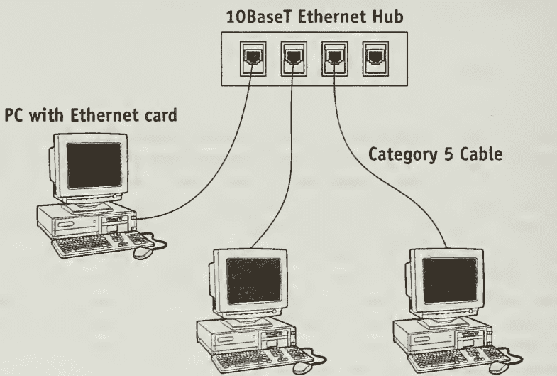

图 14-1 显示了你可以在小型办公室或家里设置的典型小型 `10BaseT` 以太网局域网。

细缆不需要集线器，这使得它来说很有吸引力。你可以将细缆从一台 PC 串联到另一台 PC，如图 14-2 所示。


*注：此处的图片说明与上文重复，已按要求保留并翻译。*

细缆不需要集线器，这使得它对办公室来说很有吸引力。你可以将细缆从一台 PC 串联到另一台 PC，如图 14-2 所示。


*注：此处的图片说明与上文重复。*

如果你正在运行 `10BaseT` LAN，可以使用特殊的电缆（称为交叉线）将计算机的以太网卡连接起来。这种方案对于两台计算机可行，但对于超过两台计算机的网络，这种方法并不切实际。

当你使用本书的附带光盘在连接到以太网局域网的 PC 上运行红帽 Linux 时，安装程序应该为网卡安装相应的驱动。否则，你可以按照第 4 节介绍的专家模式安装 Linux。


安装完成后，Linux 每次启动时都会加载以太网驱动程序。要验证以太网驱动程序已加载，请如下使用 `dmesg` 命令：

```
dmesg | grep eth0
```

该命令搜索启动消息中包含 `eth0` 字符串的行。（正如本节讨论，`eth0` 是 Linux 系统中第一个以太网卡的设备名称）。在我的 PC 上，我安装了一个 3Com3503 以太网卡。当我输入 `dmesg | grep eth0` 时，得到了如下输出：

```
eth0: 3c503 at i/o 0x300, node 02 60 8c 8c c6 a9, using Internal* xsvr
eth0: 3c503-P10, 16K8 RAM, using programmed I/O (REJUMPER FOR SHARED MEMORY).
```

你应该看到类似的内容，显示以太网卡的名称和其他相关参数。如果 `dmesg` 命令没有显示任何以太网设备，请输入 `grep eth0 /var/log/messages` 在存储在 `/var/log/messages` 文件中的启动消息中查找 `eth0` 设备名称。

### 配置 TCP/IP 网络

和 Linux 中的几乎所有其他操作一样，TCP/IP 设置涉及准备许多配置文件（可以使用任何编辑器编辑的文本文件）。这些配置文件位于 `/etc` 目录及其子目录中。大多数 Linux 发行版都包含一个网络配置工具，你可以用它配置网络。首先，请参考你特定发行版的文档或帮助文件。首先，你需要学习如何引用网络设备。

## 第 14 节—Linux 网络

### 学习网络设备名称

对于大多数设备，Linux 使用 `/dev` 目录下的文件。然而，网络设备具有在内核内部定义的名称；`/dev` 目录中不存在这些设备的文件（或者，确切地说，在任何目录中都不存在这些文件）。以下是 Linux 中常见的网络设备名称：

- `lo`—回环设备。该设备能够高效地处理从你的系统发送到自身的网络包（当）。

- `eth0`—第一块以太网卡。如果你有多个以太网卡，它们将获得 `eth1`、`eth2` 等设备名称。

- `ppp0`—第一个配置为与另一台计算机建立点对点链路的串口，使用点对点协议（PPP）。如果你配置了更多用于 PPP 网络组网的串口，它们将分别分配为 `ppp1`、`ppp2` 等设备名称。

- `slip0`—第一个配置为串行链路接口协议（SLIP）网络组网的串口。SLIP 建立了一个通到 TCP/IP 网络的点对点链路。如果你使用第二个串口用于 SLIP，它将获得设备名称 `slip1`。

> 无论你的网络如何，你都有一个回环设备 (`lo`)。它将数据从一个进程传递到另一个进程，而无需通过网络。事实上，只要通信的进程在同一个系统上，回环设备允许网络应用程序工作。


如果你想查看系统上安装的网络设备名称，请登录 `root`，并使用以下命令：

```
cat /proc/net/dev
```

该命令显示当前安装的网络设备名称，以及特定设备发送和接收数据包数量的统计信息。

### 运行 Red Hat 网络配置工具

在安装 Red Hat 期间设置 TCP/IP 网络时，安装程序会根据你提供的信息准备所有适当的配置文件。然而，Red Hat Linux 自带了名为 `netcfg` 的图形化网络配置工具，可以使用它来添加新的网络接口或修改如名称服务器和主机名等信息。其他发行版也有网络配置工具。请参考你所在发行版的文档来学习如何使用这些工具。

要启动网络配置工具，请以 `root` 登录，并在终端窗口输入 `netcfg` 来启动该程序。网络配置工具会显示一个对话框，如图 14-3 所示。

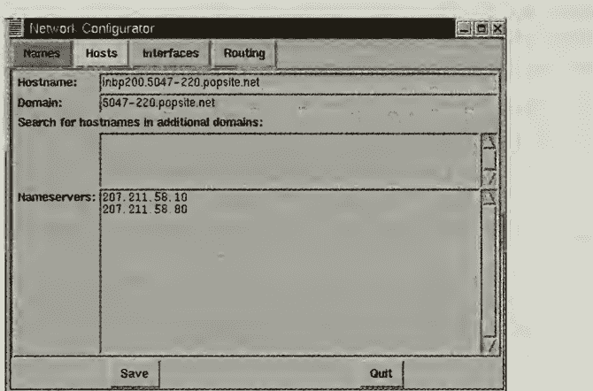

图 14-3 使用 `netcfg` 网络配置工具的 TCP/IP 网络

你可以通过对话框顶部的四个按钮配置网络的各个方面。点击每个按钮可以探索你可以添加或编辑的项目。具体来说，这些按钮允许你执行以下操作：

- `Names`（名称）。允许你输入系统的主名以及名称服务器的 IP 地址。名称服务器地址存储在 `/etc/resolv.conf` 文件中。主机名存储在 `/etc/sysconfig/network` 文件中。

- `Hosts`（主机）。显示 `/etc/hosts` 文件的当前内容并允许你添加、删除或编辑项目。该文件包含每个主机的主名和对应的 IP 地址。

- `Interfaces`（接口）。允许你添加新的网络接口、指定接口的 IP 地址并激活接口。这些信息存储在 `/etc/sysconfig` 目录下的各种文件中。

- `Routing`（路由）。允许你添加静态路由（每条路由都列出了到达指定网络所需的使用的网关）。

要配置网络接口，你需要为每个接口分配 IP 地址。如果你运行的是私有网络，可以使用 `192.168.0.0` 到 `192.168.255.255` 范围内的 IP 地址。（私有网络还有其他地址范围，但这个范围应满足大多数需求。）例如，使用 `192.168.1.0` 地址用于小型私有网络。

### TCP/IP 诊断命令

假设网络已配置，你可以检查网络是否已启动以及已为 TCP/IP 网络正确配置。当然，你可以使用 TELNET 或 FTP 等网络应用程序，但 Linux 还包含许多帮助你监控和诊断问题的实用程序。

### 检查接口

输入 `/sbin/ifconfig` 命令查看当前配置的接口。`ifconfig` 命令在启动期间还会配置网络接口（将 IP 地址与网络设备关联）。然而，如果你在不带任何命令行参数的情况下运行 `ifconfig`，该命令将显示当前的网络接口。以下是典型调用 `ifconfig` 的结果：

```
eth0
encap:Ethernet hwaddr:192.168.1.200 Broadcast:192.168.1.255 Mask:255.255.255 UP BROADCAST MULTICAST MTU:1500 Metric:1 RX packets:300 errors:dropped:0 frame:0 TX packets:300 errors:dropped:0 collisions:0 txuelen:100 Interrupt:5

lo
encap:Loopback addr:127.0.0.1 Mask:255.255.255 UP LOOPBACK RUNNING MTU:1524 Metric:1 RX packets:54 errors:dropped:0 frame:0 TX packets:54 errors:dropped:0 collisions:0 txuelen:0
```

此输出显示了回环接口 (`lo`) 和以太网接口 (`eth0`)。对于回环接口，显示其接收了 54 个数据包；对于以太网接口，显示发送了 300 个数据包。

`ifconfig` 也会显示 IP 地址、掩码、状态（`UP`）、广播、多播支持、最大传输单元（`MTU`）和指标（`Metric`），以及接收/发送的数据包、错误、丢弃、帧和冲突等统计信息。

### 检查表


假设网络已配置，你可以检查网络是否已启动以及已为 TCP/IP 网络正确配置。当然，你可以使用 TELNET 或 FTP 等网络应用程序，但 Linux 还包含许多帮助你监控和诊断问题的实用程序。

### 检查接口

输入`/sbin/ifconfig`命令查看当前配置的接口。`ifconfig`命令在启动期间还会配置网络接口（将 IP 地址与网络设备关联）。然而，如果你在不带任何命令行参数的情况下运行`ifconfig`，该命令将显示当前的网络接口。以下是典型调用`ifconfig`的结果：

```
eth0
encap:Ethernet hwaddr:192.168.1.200 Broadcast:192.168.1.255 Mask:255.255.255 UP BROADCAST MULTICAST MTU:1500 Metric:1 RX packets:300 errors:dropped:0 frame:0 TX packets:300 errors:dropped:0 collisions:0 txuelen:100 Interrupt:5

lo
encap:Loopback addr:127.0.0.1 Mask:255.255.255 UP LOOPBACK RUNNING MTU:1524 Metric:1 RX packets:54 errors:dropped:0 frame:0 TX packets:54 errors:dropped:0 collisions:0 txuelen:0
```

此输出显示了回环接口(`lo`)和以太网接口(`eth0`)。对于回环接口，显示其接收了 54 个数据包；对于以太网接口，显示发送了 300 个数据包。

`ifconfig`也会显示 IP 地址、掩码、状态（`UP`）、广播、多播支持、最大传输单元（`MTU`）和指标（`Metric`），以及接收/发送的数据包、错误、丢弃、帧和冲突等统计信息。

### 检查路由表

假设网络已配置，你可以检查网络是否已启动以及已为 TCP/IP 网络正确配置。当然，你可以使用 TELNET 或 FTP 等网络应用程序，但 Linux 还包含许多帮助你监控和诊断问题的实用程序。

使用`route -n`命令可以查看路由表。该命令显示路由表。以下是`route -n`的典型输出示例：

```
Destination     Gateway         Flags    Ref    I Metric Use  Interface
0.0.0.0         192.168.1.1     UG        0 0   100 eth0
192.168.1.0    0.0.0.0         US        0 0     0 eth0
127.0.0.1      0.0.0.0         U         0 0     0 lo
```

此输出显示了默认路由（`0.0.0.0`）通过网关`192.168.1.1`路由。`192.168.1.0`是本地网络段，`127.0.0.1`是回环地址。

你可以使用`route add`命令添加新路由。例如，使用`route add -net 10.0.0.0 netmask 255.255.255.0 gw 192.168.1.1`添加一条到`10.0.0.0`网络的路由。

使用`route del`命令删除路由。例如，使用`route del -net 10.0.0.0`删除之前的路由。

### TCP/IP 诊断命令

假设网络已配置，你可以检查网络是否已启动以及已为 TCP/IP 网络正确配置。当然，你可以使用 TELNET 或 FTP 等网络应用程序，但 Linux 还包含许多帮助你监控和诊断问题的实用程序。

### 检查接口

输入`/sbin/ifconfig`命令查看当前配置的接口。`ifconfig`命令在启动期间还会配置网络接口（将 IP 地址与网络设备关联）。然而，如果你在不带任何命令行参数的情况下运行`ifconfig`，该命令将显示当前的网络接口。以下是典型调用`ifconfig`的结果：

```
eth0
encap:Ethernet hwaddr:192.168.1.200 Broadcast:192.168.1.255 Mask:255.255.255 UP BROADCAST MULTICAST MTU:1500 Metric:1 RX packets:300 errors:dropped:0 frame:0 TX packets:300 errors:dropped:0 collisions:0 txuelen:100 Interrupt:5

lo
encap:Loopback addr:127.0.0.1 Mask:255.255.255 UP LOOPBACK RUNNING MTU:1524 Metric:1 RX packets:54 errors:dropped:0 frame:0 TX packets:54 errors:dropped:0 collisions:0 txuelen:0
```

此输出显示了回环接口(`lo`)和以太网接口(`eth0`)。对于回环接口，显示其接收了 54 个数据包；对于以太网接口，显示发送了 300 个数据包。

`ifconfig`也会显示 IP 地址、掩码、状态（`UP`）、广播、多播支持、最大传输单元（`MTU`）和指标（`Metric`），以及接收/发送的数据包、错误、丢弃、帧和冲突等统计信息。

### 检查路由表

假设网络已配置，你可以检查网络是否已启动以及已为 TCP/IP 网络正确配置。当然，你可以使用 TELNET 或 FTP 等网络应用程序，但 Linux 还包含许多帮助你监控和诊断问题的实用程序。

使用`route -n`命令可以查看路由表。该命令显示路由表。以下是`route -n`的典型输出示例：

```
Destination     Gateway         Flags    Ref    I Metric Use  Interface
0.0.0.0         192.168.1.1     UG        0 0   100 eth0
192.168.1.0    0.0.0.0         US        0 0     0 eth0
127.0.0.1      0.0.0.0         U         0 0     0 lo
```

此输出显示了默认路由（`0.0.0.0`）通过网关`192.168.1.1`路由。`192.168.1.0`是本地网络段，`127.0.0.1`是回环地址。

你可以使用`route add`命令添加新路由。例如，使用`route add -net 10.0.0.0 netmask 255.255.255.0 gw 192.168.1.1`添加一条到`10.0.0.0`网络的路由。

使用`route del`命令删除路由。例如，使用`route del -net 10.0.0.0`删除之前的路由。

### TCP/IP 诊断命令

假设网络已配置，你可以检查网络是否已启动以及已为 TCP/IP 网络正确配置。当然，你可以使用 TELNET 或 FTP 等网络应用程序，但 Linux 还包含许多帮助你监控和诊断问题的实用程序。

### 检查接口

输入`/sbin/ifconfig`命令查看当前配置的接口。`ifconfig`命令在启动期间还会配置网络接口（将 IP 地址与网络设备关联）。然而，如果你在不带任何命令行参数的情况下运行`ifconfig`，该命令将显示当前的网络接口。以下是典型调用`ifconfig`的结果：

```
eth0
encap:Ethernet hwaddr:192.168.1.200 Broadcast:192.168.1.255 Mask:255.255.255 UP BROADCAST MULTICAST MTU:1500 Metric:1 RX packets:300 errors:dropped:0 frame:0 TX packets:300 errors:dropped:0 collisions:0 txuelen:100 Interrupt:5

lo
encap:Loopback addr:127.0.0.1 Mask:255.255.255 UP LOOPBACK RUNNING MTU:1524 Metric:1 RX packets:54 errors:dropped:0 frame:0 TX packets:54 errors:dropped:0 collisions:0 txuelen:0
```

此输出显示了回环接口(`lo`)和以太网接口(`eth0`)。对于回环接口，显示其接收了 54 个数据包；对于以太网接口，显示发送了 300 个数据包。

`ifconfig`也会显示 IP 地址、掩码、状态（`UP`）、广播、多播支持、最大传输单元（`MTU`）和指标（`Metric`），以及接收/发送的数据包、错误、丢弃、帧和冲突等统计信息。

### 检查路由


# 第 14 节—Linux 网络

## 学习网络设备名称

对于大多数设备，Linux 使用 `/dev` 目录下的文件。然而，网络设备具有在内核内部定义的名称；`/dev` 目录中不存在这些设备的文件（或者，确切地说，在任何目录中都不存在这些文件）。以下是 Linux 中常见的网络设备名称：

- `lo` — 回环设备。该设备能够高效地处理从你的系统发送到自身的网络包。
- `eth0` — 第一块以太网卡。如果你有多个以太网卡，它们将获得 `eth1`、`eth2` 等设备名称。
- `ppp0` — 第一个配置为与另一台计算机建立点对点链路的串口，使用点对点协议（`PPP`）。如果你配置了更多用于 `PPP` 网络组网的串口，它们将分别分配为 `ppp1`、`ppp2` 等设备名称。
- `s10` — 第一个配置为串行链路接口协议（`SLIP`）网络组网的串口。`SLIP` 建立了一个通到 `TCP/IP` 网络的点对点链路。如果你使用第二个串口用于 `SLIP`，它将获得设备名称 `s11`。

> 无论你的网络如何，你都有一个回环设备 (`lo`)。它将数据从一个进程传递到另一个进程，而无需通过网络。事实上，只要通信的进程在同一个系统上，回环设备允许网络应用程序工作。


如果你想查看系统上安装的网络设备名称，请登录 `root`，并使用以下命令：

```
cat /proc/net/dev
```

该命令显示当前安装的网络设备名称，以及特定设备发送和接收数据包数量的统计信息。

## 运行 Red Hat 网络配置工具

在安装 `Red Hat` 期间设置 `TCP/IP` 网络时，安装程序会根据你提供的信息准备所有适当的配置文件。然而，`Red Hat Linux` 自带了名为 `netcfg` 的图形化网络配置工具，可以使用它来添加新的网络接口或修改如名称服务器和主机名等信息。其他发行版也有网络配置工具。请参考你所在发行版的文档来学习如何使用这些工具。

要启动网络配置工具，请以 `root` 登录，并在终端窗口输入 `netcfg` 来启动该程序。网络配置工具会显示一个对话框，如图 14-3 所示。


图 14-3 使用 `netcfg` 网络配置工具的 `TCP/IP` 网络

你可以通过对话框顶部的四个按钮配置网络的各个方面。点击每个按钮可以探索你可以添加或编辑的项目。具体来说，这些按钮允许你执行以下操作：

- `Names`（名称）。允许你输入系统的主名以及名称服务器的 `IP` 地址。名称服务器地址存储在 `/etc/resolv.conf` 文件中。主机名存储在 `/etc/sysconfig/network` 文件中。
- `Hosts`（主机）。显示 `/etc/hosts` 文件的当前内容并允许你添加、删除或编辑项目。该文件包含每个主机的主名和对应的 `IP` 地址。
- `Interfaces`（接口）。允许你添加新的网络接口、指定接口的 `IP` 地址并激活接口。这些信息存储在 `/etc/sysconfig` 目录下的各种文件中。
- `Routing`（路由）。允许你添加静态路由（每条路由都列出了到达指定网络所需的使用的网关）。

要配置网络接口，你需要为每个接口分配 `IP` 地址。如果你运行的是私有网络，可以使用 `192.168.0.0` 到 `192.168.255.255` 范围内的 `IP` 地址。（私有网络还有其他地址范围，但这个范围应满足大多数需求。）例如，使用 `192.168.1.0` 地址用于小型私有网络。

## TCP/IP 诊断命令

假设网络已配置，你可以检查网络是否已启动以及已为 `TCP/IP` 网络正确配置。当然，你可以使用 `TELNET` 或 `FTP` 等网络应用程序，但 `Linux` 还包含许多帮助你监控和诊断问题的实用程序。

### 检查接口

输入 `/sbin/ifconfig` 命令查看当前配置的接口。`ifconfig` 命令在启动期间还会配置网络接口（将 `IP` 地址与网络设备关联）。然而，如果你在不带任何命令行参数的情况下运行 `ifconfig`，该命令将显示当前的网络接口。以下是典型调用 `ifconfig` 的结果：

```
eth0
encap:Ethernet hwaddr:192.168.1.200 Broadcast:192.168.1.255 Mask:255.255.255 UP BROADCAST MULTICAST MTU:1500 Metric:1 RX packets:300 errors:dropped:0 frame:0 TX packets:300 errors:dropped:0 collisions:0 txuelen:100 Interrupt:5

lo
encap:Loopback addr:127.0.0.1 Mask:255.255.255 UP LOOPBACK RUNNING MTU:1524 Metric:1 RX packets:54 errors:dropped:0 frame:0 TX packets:54 errors:dropped:0 collisions:0 txuelen:0
```

此输出显示了回环接口 (`lo`) 和以太网接口 (`eth0`)。对于回环接口，显示其接收了 54 个数据包；对于以太网接口，显示发送了 300 个数据包。

以下是我系统中的 `/etc/hosts` 文件，显示了局域网（`LAN`）上其他主机的 `IP` 地址和名称：

```
127.0.0.1       localhost        localhost.localdomain
# Other hosts on the LAN
192.168.1.100   lnbp486
192.168.1.50    lnbp133
192.168.1.200   lnbp200
192.168.1.233   lnbp233
192.168.1.40    lnbp400
192.168.1.60    lnbp600
192.168.1.25   mac             lnbmac
192.168.1.1     lnbp75
```

如示例所示，文件中的每一行都以 `IP` 地址开头，随后是该 `IP` 地址对应的主机名。你可以为一个 `IP` 地址设置多个主机名。

### /etc/networks

`/etc/networks` 配置文件是另一个文本文件，包含了网络名称和 `IP` 地址。这些网络名称通常用于路由命令（`/sbin/route`），以便通过名称而非 `IP` 地址来指定网络。

> 如果你的 `Linux` 电脑上没有 `/etc/networks` 文件，请不要惊慌。你的 `TCP/IP` 网络在没有此文件的情况下也能正常工作。事实上，`Red Hat` 的安装程序并不会创建 `/etc/networks` 文件。

### /etc/host.conf

`/etc/host.conf` 配置文件指定 `Linux` 如何获取与主机名相对应的 `IP` 地址。输入 `cat /etc/host.conf` 查看该文件的内容。通常，此文件包含以下行：

```
order hosts, bind
multi on
```


`/etc/host.conf` 文件中的条目告诉解析器库使用哪些服务以及按什么顺序解析名称。

## 第 14 节—Linux 网络

`order` 选项表示服务的顺序。示例条目指定解析器库应首先查询 `/etc/hosts` 文件，然后检查名称服务器来解析名称。名称服务器列在 `/etc/resolv.conf` 文件中，接下来将检查该文件。

> `multi` 选项指定 `/etc/hosts` 文件中列的主机可以有多个 IP 地址。具有多个 IP 地址的主机被称为“多宿主”（multihomed），因为多个 IP 地址的存在意味着主机具有多个网络接口（换句话说，该主机同时“存在”于多个网络中）。

### `/etc/resolv.conf`

`/etc/resolv.conf` 配置文件是解析器使用的另一个文本文件——解析器是一个确定主机名 IP 地址的库。输入 `/etc/resolv.conf` 查看该文件的内容。以下是一个 `/etc/resolv.conf` 示例：

```
search xyz.com
nameserver 164.109.1.3
nameserver 164.109.1.23
```

`search` 行指定了搜索主机名的系统名称。`nameserver` 提供你域名名称服务器的 IP 地址。如果你有多个名称服务器，应该将它们分行列出。它们按照在文件中出现的顺序进行查询。通常，你在 `/etc/resolv.conf` 文件中列出互联网服务商提供的名称服务器。

如果你的网络没有名称服务器，可以安全地忽略此文件。TCP/IP 仍然可以工作，尽管你只能引用 `/etc/hosts` 文件列出的主机。

### `/etc/hosts.allow`

此文件指定哪些主机允许使用运行在你系统上的上的互联网服务（如 TELNET 和 FTP）。启动互联网服务的程序在启动之前会查询 `/etc/hosts.allow` 文件。只有当 `hosts.allow` 文件中的条目意味着请求主机可以使用这些服务时，它才会启动服务。

`/etc/hosts.allow` 中的条目采用 `服务器:IP地址` 格式，其中 `服务器` 指提供特定互联网服务的程序名称，`IP地址` 指定允许使用该服务的主机。例如，如果你想让局域网（地址为 192.168.1.0）中的所有主机访问 FTP 服务（由 `in.ftpd` 程序提供），请在 `/etc/hosts.allow` 文件中添加以下行：

```
in.ftpd:192.168.1.1.
```

如果你想让所有主机访问所有服务，可以使用 `ALL` 关键字并重写该行如下：

```
ALL:192.168.1.
```

最后，要向所有主机开放互联网服务，你可以将 IP 地址替换为 `ALL`，如下：

```
ALL:ALL
```

你也可以主机名代替 IP 地址。

> 安全专家不建议允许所有主机访问系统上的所有服务。为了获得更安全的系统，你应该拒绝所有主机的访问，然后允许访问你的系统。这意味着你应该在 `/etc/hosts.allow` 中显式列出可以访问你系统的主机。然后使用 `/etc/hosts.deny` 文件（你将在下一节中检查）拒绝所有其他主机访问你的系统。


### `/etc/hosts.deny`

这是 `/etc/hosts.allow` 的相反——`hosts.allow` 指定哪些主机可以访问你系统上的互联网服务（如 TELNET 和 FTP），而 `hosts.deny` 文件则识别必须被拒绝服务的主机。如果启动互联网服务的程序在 `/etc/hosts.allow` 文件中没有找到适用于请求主机的规则，它将查询 `/etc/hosts.deny` 文件。如果在 `hosts.deny` 文件中找到适用于该主机的规则，程序将拒绝服务。

`/etc/hosts.deny` 文件中的条目格式与 `/etc/hosts.allow` 文件中的相同。它们采用 `服务器:IP地址` 格式，其中 `服务器` 指提供特定互联网服务的程序名称，`IP地址` 指定允许使用该服务的主机。

## 第 14 节—Linux 网络

假设你已经在 `/etc/hosts.allow` 文件中设置了条目以允许访问特定主机，你可以在 `/etc/hosts.deny` 中放置以下行以拒绝所有其他主机：

```
ALL:ALL
```

## 第 15 节—设置工作组服务器

点击“添加（Add）”按钮。这将打开“一个导出系统”对话框，在其中你可以指定导出文件系统的详细信息。你使用完整路径来指定文件系统，如图 15-2 所示。

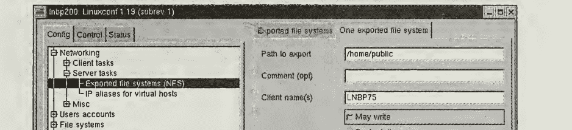

图 15-2

在 Linux 中输入导出文件系统的相关信息

在此对话框中，你还应该输入可能挂载此导出文件系统的客户端系统名称。在图 15-2 所示的示例中，`/home/public` 目录由服务器导出，节点 `LNBP75` 可以挂载该文件系统进行读写操作。输入信息后，点击“接受（Accept）”按钮。`Linuxconf` 回到图 15-1 所示的对话框，其中显示导出文件系统的摘要信息。然后你可以点击“退出（Quit）”按钮完成导出文件系统的定义。

通过本节的操作，`Linuxconf` 在 `/etc/exports` 文件中添加了以下条目：

```
/home/public LNBP75(rw)
```

要验证 `/etc/exports` 文件中是否列出了导出目录，请在终端窗口中输入 `/etc/exports`。你也可以直接编辑 `/etc/exports` 文件。有关此文件的更多信息，请在终端窗口中输入 `man exports`。

现在你应该启动 NFS 服务器。要做到这一点，点击 `Linuxconf`“控制（Control）”选项卡上的“控制（Control）”按钮。会出现控制面板对话框。点击对话框中的“服务活动（Control service activity）”按钮。`Linuxconf` 显示服务控制对话框，其中列出了所有服务及其状态，如图 15-3 所示。

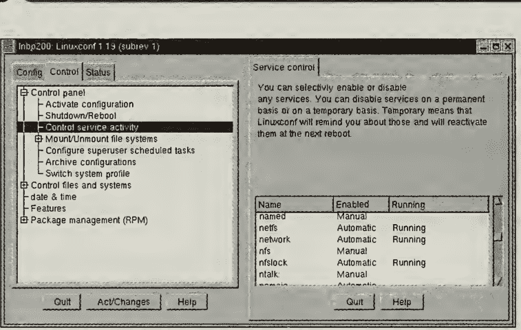

图 15-3

在 `Linuxconf` 的服务控制对话框中查看服务及其状态

每行有三个字段：一个提供服务的名称，另一个指示它是自动运行还是手动运行，最后一个揭示了它是否已经在运行。向下滚动列表，找到名为 `nfs` 的条目——即 NFS 服务。在这种情况下，NFS 服务尚未运行。点击该条目。这会导致 `Linuxconf` 显示服务 `nfs` 选项卡，如图 15-4 所示。

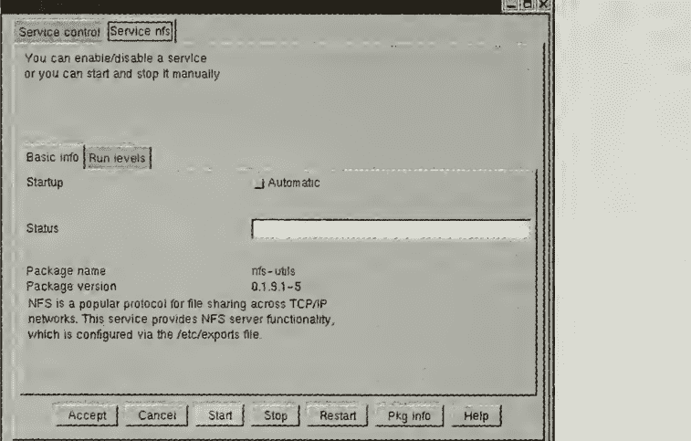

图 15-4

通过 `Linuxconf` 的服务 `nfs` 选项卡启动 NFS 服务

此选项卡上的按钮允许你启动、停止或重启服务。在这种情况下，点击“启动（Start）”按钮来启动 NFS 服务。然后点击“接受（Accept）”返回上一个对话框（图 15-3）。现在，服务控制对话框应显示 `nfs` 条目的状态为“正在运行（Running）”。点击“退出（Quit）”退出此对话框。

> 如果你对 `/etc/exports` 文件中列出的导出文件系统进行了任何更改，请记住重启 NFS 服务。点击图 15-4 所示对话框中的“重启（Restart）”按钮。

如果你更倾向于使用命令启动 NFS 服务，请以 `root` 身份登录并在终端窗口中输入以下命令：

```
/etc/rc.d/init.nfs start
```

此命令在 Linux 系统上启动 `nfsd` 服务器程序。现在你可以尝试从客户端系统挂载导出的文件系统。

## 挂载 NFS 文件系统

你可以使用客户端上的 `Linuxconf` 来挂载导出的 NFS 文件系统。然而，执行此操作最简单的方法是以 `root` 身份登录并使用 `mount` 命令。例如，从 `1npb200` 系统挂载 `/home/public` 文件系统，请在客户端上执行：


## 挂载 NFS 文件系统

你可以使用客户端上的 `Linuxconf` 来挂载导出的 NFS 文件系统。然而，执行此操作最简单的方法是以 `root` 身份登录并使用 `mount` 命令。例如，从 `1npb200` 系统挂载 `/home/public` 文件系统，请在客户端上执行：

# 周六下午

第 9 节涵盖了文本编辑器。

`Samba` 软件附带了一个你可以编辑的配置文件以开始工作。要准备配置文件，请以 `root` 身份登录并使用你喜欢的文本编辑器编辑 `/etc/samba/smb.conf` 文件。这里是一个没有任何注释的示例配置文件：

```
[global]
netbios name = LNBPP200
workgroup = LNB SOFTWARE
server string = LNB Software-Red Linux-Samba Server
hosts allow = 192.168.1.127
guest account = neba
log file = /var/log/samba/log.%m
```

```
# 日文件最大为 50KB
max log size = 50
```

```
security = user
smb passwd file = /etc/samba/smbpasswd
```

```
# 保持下一个选项不变 - 它们是为了性能考虑
socket options = TCP_NODELAY SO_RCVBUF=8192 SO_SNDBUF=8192
```

```
remote browse sync = 192.168.1.255
remote announce = 192.168.1.255/LNB software
local master = yes
os level = 33
```

```
name resolve order = lmhosts bcast
dns proxy = no
unix password sync = no
```

```
[homes]
comment = Home Directories
browseable = no
writable = yes
```

## 第 15 节——设置工作组服务器

```
[printers]
comment = All Printers
path = /var/spool/samba
browseable = no
guest ok = no
writable = no
printable = yes
```

```
[tmp]
comment = Temporary file space
path = /tmp
read only = no
public = yes
```

```
[public]
comment = Public Stuff
path = /home/samba
browseable = yes
public = yes
guest ok = yes
writable = no
printable = no
available = yes
guest only = no
user = naba
only user = yes
```

将用户名从 `naba` 修改为你的用户名，并将服务器名称修改为你的服务器名称。此外，确保配置文件中提到的所有目录都存在。例如，使用命令 `mkdir /home/samba` 创建 `/home/samba` 目录。

编辑 `Samba` 配置文件后，向 `Samba` 密码文件中添加两个用户。首先，添加你的用户名。以下是我添加自己的方式：

为 `naba` 输入密码：

```
New SMB password: 输入密码
Retype new SMB password: 再次输入密码
Added user naba.
```


# 194 周六下午

接下来，使用 `smbdadder root:root` 命令添加 `root` 用户，然后提供密码。（这不会更改你 Linux 系统 `root` 用户的密码。）

在对 `/etc/samba/smb.conf` 文件进行更改后，输入 `testparam` 来验证文件是否正确。`testparam` 命令会检查 `/etc/samba/smb.conf` 文件并报告文件是否正常。之后，使用以下命令重启 `Samba` 服务：

```
/etc/rc.d/init.d/smbd restart
Shutting down SMB services: [ OK ]
Shutting down NMB services: [ OK ]
Starting SMB services: [ OK ]
Starting NMB services: [ OK ]
```

## 使用 SWAT

从 2.0 版本开始，`Samba` 包含一个名为 `Samba` Web 管理工具（`SWAT`）的实用。该工具让设置 `Samba` 变得非常简单。`SWAT` 允许你使用 Web 浏览器作为 `/etc/smb.conf` 的界面对该文件进行必要的修改。安装期间会创建一个 `smb.conf` 示例文件供参考。重命名此文件是一个好主意，因为你将使用 `SWAT` 创建一个新的 `smb.conf` 文件，而它会覆盖原始文件。

在使用 `SWAT` 之前，你需要更改两个文件来启用它。第一个文件是 `/etc/services`。该文件是互联网服务及其端口号和协议的列表。你需要在 `/etc/services` 中添加以下行：

- `Swat 901/tcp`

接下来，你需要在 `/etc/inetd.conf` 中添加一行。`inetd` 在系统启动时运行，并监听对特定端口的连接。`inetd.conf` 文件列出了当 `inetd` 守护进程检测到某个端口请求时应该运行的程序。你需要添加以下行：

```
swat      stream  tcp     nowait.400      root /usr/sbin/swat swat
```

如果你对这一行的更多细节感兴趣，请参阅 `inetd` 页面。


## 第 15 节——设置工作组服务器

最后，你需要重启 `inetd` 守护进程，以便读取你对 `inetd.conf` 所做的更改。执行此操作，请在命令行提示符输入：

`killall -HUP inetd`


现在你可以启动 Web 浏览器并准备运行 `SWAT`。由于大多数发行版都包含 `Netscape`，你可以使用此浏览器启动 `SWAT`。在地址框中输入`localhost:901`。这将打开作为 `/etc/smb.conf` 界面的浏览器，并对该文件进行必要的修改。安装期间的 `smb.conf` 示例文件可以作为参考。重命名此文件是一个好主意，因为你将使用 `SWAT` 创建一个新的 `smb.conf` 文件，而它会覆盖原始文件。

在使用 `SWAT` 之前，你需要更改两个文件来启用它。第一个文件是 `/etc/services`。该文件是互联网服务及其端口号和协议的列表。你需要在 `/etc/services` 中添加以下行：

- `- Swat 901/tcp`

接下来，你需要在 `/etc/inetd.conf` 中添加一行。`inetd` 在系统启动时运行，并监听对特定端口的连接。`inetd.conf` 文件列出了当 `inetd` 守护进程检测到对某个端口请求时应该运行的程序。你需要添加以下行：

```
swat      stream  tcp     nowait.400      root /usr/sbin/swat swat
```

如果你对这一行的更多细节感兴趣，请参阅 `inetd` 页面。


## 第 15 节——设置工作组服务器

最后，你需要重启 `inetd` 守护进程，以便读取你对 `inetd.conf` 所做的更改。执行此操作，请在命令行提示符输入：

`killall -HUP inetd`

现在你可以启动 Web 浏览器并准备运行 `SWAT`。由于大多数发行版都包含 `Netscape`，你可以使用此浏览器启动 `SWAT`。在地址框中输入`localhost:901`。这将打开作为 `/etc/smb.conf` 界面的浏览器，并对该文件进行必要的修改。安装期间的 `smb.conf` 示例文件可以作为参考。重命名此文件是一个好主意，因为你将使用 `SWAT` 创建一个新的 `smb.conf` 文件，而它会覆盖原始文件。

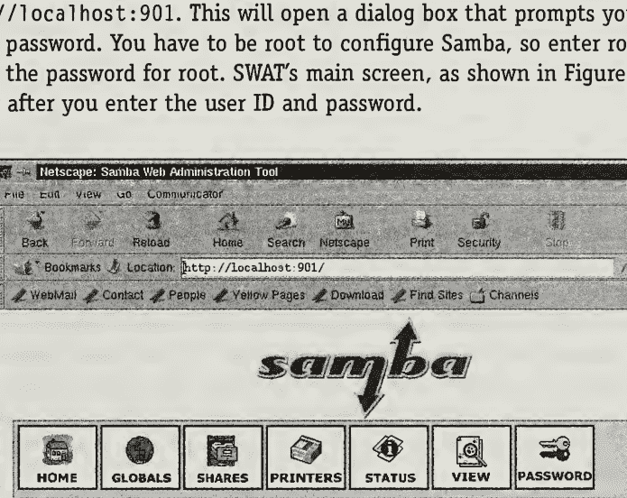

欢迎来到 `SWAT`！请使用以下按钮之一进行配置：

- 文档 (Documentation)
- 域 (Domain)
    - 旧域 (old)
    - smbd - Samba 守护
    - 管理员 (Administrators)
    - sambd - Samba
    - SWAT - Web 配置
    - smpasswd - 管理 Samba 密码

图 15-5 输入登录信息后出现的 `SWAT` 界面

你可以点击 `Globals` 图标开始配置 `globals`。

# 196 周六下午

## globals

`globals` 页面分为六部分：

- 基础选项 (Base Options)
- 安全选项 (Security Options)
- 日志选项 (Logging Options)
- 调优选项 (Tuning Options)
- Windows 选项 (Windows Options)
- 共享选项 (Shares Options)

创建 `smb.conf` 后，你可以运行名为 `testparam` 的工具来检查文件错误。在命令行提示符输入 `testparam`，如果一切正常，将看到正在处理 `smb.conf` 的部分并显示 `OK` 状态。如果你收到错误消息，返回文件进行修正。

修改 `smb.conf` 文件后，需要重启 Samba 服务，或者在它们未运行时启动它们。这可以通过点击状态图标通过 `SWAT` 完成。服务器状态页面显示 `smbd` 和 `nmbd`，它们是 Samba 守护进程。可以通过点击相应的按钮启动或重启这两个守护进程。

### 访问 Samba 服务器

现在你可以尝试从局域网上的一个 Windows 系统访问 Linux 系统上的 Samba 服务器。双击 Windows 桌面上的“网络”图标。这将打开“网络”窗口（见 15-6），显示局域网内的所有其他 Windows 系统。

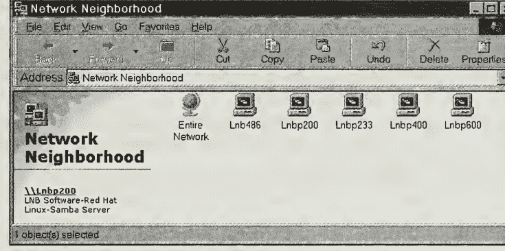

图 15-6 网络中的 Linux Samba 服务器

点击 Linux Samba 服务器图标查看其服务器字符串。从图 15-6 左下角的注释可以看出，`Lnp200` 实际上是一个 Linux 系统。

如果你在 Windows 的网络中没有看到 Linux Samba 服务器，选择开始 -> 查找计算机；然后输入 Linux 系统的主机名（见图 15-7），并点击立即查找按钮。该 Linux Samba 服务器将出现在屏幕上。

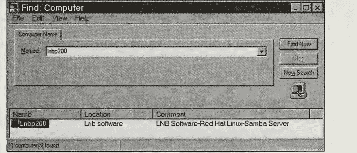

图 15-7 从 Windows 搜索 Linux Samba 服务器

# 198 周六下午

一旦你看到 Linux Samba 服务器，就可以通过双击图标来打开它。这应该显示 Linux Samba 服务器中每个共享目录的文件夹。（对于之前显示的示例 `/etc/samba/smb.conf` 文件，你会看到两个目录：`smb` 和 `public`）。然后你可以打开这些文件夹以进一步探索目录的内容。

## 使用 smclient 访问 Windows 资源

你可以使用 `smclient` 程序访问局域网（LAN）上 Windows 系统的共享目录和打印机，并检查你的 Linux Samba 服务器是否运行正常。检查状态的一种快速方法是使用 `smclient -L` 命令查看你 Linux 服务器自身的服务器列表。

如果你在局域网上有其他 Windows 服务器，你可以使用 `smclient` 程序查看它们的服务。以下是我用来查看运行 Windows 95 的 48 号 PC 服务的 `smclient` 命令：

```
smclient -L Lnb486
```

你还可以使用 `smclient` 访问 Windows 服务器上的磁盘，并将文件发送到 Windows 打印机上。`smclient` 程序类似于 `ftp`——你连接到 Windows 服务器，然后使用命令交换文件并将文件发送到打印机。

下面的示例展示了我如何使用 `smclient` 访问我的 Windows 98 PC 上的磁盘并查看其目录（我在终端窗口中使用命令 `smclient //lnbp400/c naba`）：

```
added interface ip=192.168.1.200 count=192.168.1.255 nmask=255.255.255.0
Got a positive name query response from 192.168.1.40 (192.168.1.40)
> dir a*
ATI                D 0 Fri Apr 16 21:08:1999
Acrobat3           D 0 Sat Apr 17 15:14:1999
autoexec.nav       D 230 Sat Apr 17 14:26:1999
AUTOEXEC.BAT      A 321 Mon Mar 3 17:46:54 2000
AUTOEXEC.BAK      A 272 Sun Aug 18 09:53:04 1999
ASD.106            HR 562 Tue Feb 29 18:28:06 2000
ashley             D 0 Thu Nov 18 21:11:18 1999
64322 blocks of size 131072. 47399 blocks available
smb: > quit
```


在 `smclient:` 提示符处输入 `help` 即可查看 `smclient` 命令列表。为了熟悉 `smclient`，你可能想尝试其中的一些命令。注意，`smclient` 命令与 MS-DOS 命令相似。

## 第 15 节——设置工作组服务器

### 复习

本节向你展示了如何使用 NFS 在红帽 Linux 系统与其他 Linux 或 UNIX 系统之间共享文件。然后，你学习了如何使用 Samba 软件包将你的 Linux 系统配置为 Windows 服务器。

### 自测

- 1. 通过 NFS 共享文件的基本步骤分什么？（参见“使用 NFS 共享文件”）。
- 2. 如何使用 NFS 导出文件系统？（参见“使用 NFS 导出文件系统”）。
- 3. 如何检查你的系统中是否安装了 Samba？（参见“检查是否已安装 Samba 以及安装 Samba”）。
- 4. 如何配置你的 Linux 系统提供 Windows 文件共享服务？（参见“配置 Samba”）。


- 5. 如何从你的 Linux 系统访问 Windows 资源？（参见“使用 `smbclient` 访问 Windows 资源”）。

## 课程内容


## 第 16 节访问 Windows 和 DOS 文件

### 节检查清单

- 从 Linux 挂载并访问 DOS/Windows 分区
- 从 Linux 挂载并访问 DOS/Windows 软盘
- 使用 `mtools` 工具访问和使用 DOS 软盘

通常情况下，你是在一台之前安装了 Windows 的 PC 上安装 Linux 的。如果你经常同时使用 Windows 和 Linux，你可能想从 Linux 访问 DOS/Windows 文件。本节向你展示了如何操作，以及如何挂载和访问 DOS/Windows 软盘。你还学习了一个名为 `mtools` 的软件包，它允许你在本地软盘上直接访问和使用 DOS/Windows 文件。

### 挂载和访问 DOS/Windows 文件系统

Linux 内置了对 MS-DOS 文件的支持。Linux 有一个单一的文件系统，从根目录开始，并用单斜杠（`/`）表示。即使你有独立的硬盘（或硬盘分区），这些硬盘的内容也会在逻辑上显示在 Linux 文件系统中。正如第 9 节所讨论过的，挂载（Mounting）是你执行的操作，目的是让物理存储设备（硬盘分区或光驱驱动器）成为 Linux 文件系统的一部分。

### 在安装期间监控 DOS/Windows 文件系统

在安装过程中，红帽安装程序会运行 `mount` 程序。该程序通过检查硬盘分区表来查找任何 DOS/Windows 分区。通过 `mount` 程序，你可以指定想要挂载任何 DOS 分区的位置（挂载使 DOS 目录成为 Linux 文件系统的一部分）。例如，你可以将第一个 DOS 分区挂载为 `/dos`，第二个挂载为 `/dos`，以此类推（你可以为这些点命名任何名称）。如果你指定了这些挂载点，`mount` 会执行必要的步骤，以确保每次启动 Linux 时都会自动挂载 DOS 分区。

要查看你的 DOS/Windows 硬盘分区是否自动挂载，请遵循以下步骤：

1. 使用 `grep` 命令在 `/etc/fstab` 文件中查找 `vfat` 字符串。在我其中一台 PC 上输入 `grep vfat /etc/fstab` 并记录结果：
   ```
   /dev/hda1 /dos vfat defaults 0 0
   ```
2. 如果输出显示一行或多行包含 `vfat` 的，则说明你的 Linux 系统会自动挂载 DOS 分区。如果输出显示了匹配的行，且其第一个字段是分区名称 `/dev/hda1`（第一个 IDE 磁盘上的第一个分区）；第二个字段 `/dos` 显示了该分区的挂载位置。
3. 如果 `grep` 命令没有显示任何包含 `vfat` 的行，则说明 DOS 分区没有自动挂载。注意，如果在 `/etc/fstab` 中显示了字符串 `vfat`，那么 DOS/Windows 分区就会自动挂载。

执行上述操作通常需要 `root` 用户权限。


另一种查看已挂载设备的快速方法是在 shell 提示符处输入 `mount`（不带任何参数）。以下是我的系统上 `mount` 命令的输出：

```
/dev/hda3 / type ext2 (rw)
none /proc type proc (rw)
/dev/hd1 /dos type vfat (rw)
none /pts type devpts (rw)
```

如果你在输出中看到 `vfat`，这些行表示挂载在 Linux 的 MS-DOS 文件系统。在这种情况下，DOS 分区挂载在 Linux 目录 `/dos`。

即使你的硬盘上没有 DOS/Windows 分区，你也应该学习如何从 Linux 访问 DOS/Windows 软盘，因为你可能需要访问 DOS 软盘。理解挂载的概念是使用 DOS 文件系统的关键。


### mount 命令挂载 DOS/Windows 文件系统

正如第 9 节所讨论的，你可以使用 `mount` 命令手动将设备挂载到 Linux 文件系统的指定目录。该目录被称为挂载点（mount point）。你可以使用任何目录作为挂载点。然而，如果你将设备挂载到一个包含文件的目录，你将失去访问该目录下文件的能力，直到你使用 `umount` 命令卸载设备。此外，始终使用空目录（例如 `/mnt/cdrom`）作为挂载点。

如果你的 DOS/Windows 分区是 IDE 驱动器的第一个分区，并且你想将其挂载到 `/dos`，请使用以下 mount 命令：

```
mount -t vfat /dev/hd1 /dos
```

`mount` 命令的 `-t vfat` 部分指定你要挂载的 `/dev/hd1` 设备是 MS-DOS 文件系统。Linux 内置了对 MS-DOS 文件的支持。图 16-1 显示了此 mount 命令的效果。

图 16-1 还显示了你的 DOS 分区目录是如何映射到 Linux 文件系统的。一旦 DOS 下的 `C:\DOS` 目录变成了 Linux 下的 `/dos/dos`。同样，`C:\WINDOWS` 现在是 `/dos/windows`。你可能看到了这种规律。要将 DOS 文件名转换为 Linux 文件名（针对这种情况，当你将 DOS 分区挂载到 `/dos` 时），请执行以下步骤：

1. 将 DOS 名称转换为小写。
2. 将 `C:\` 更改为 `/dos/`。
3. 将所有反斜杠（`\`）更改为斜杠（`/`）。

204

周六下午

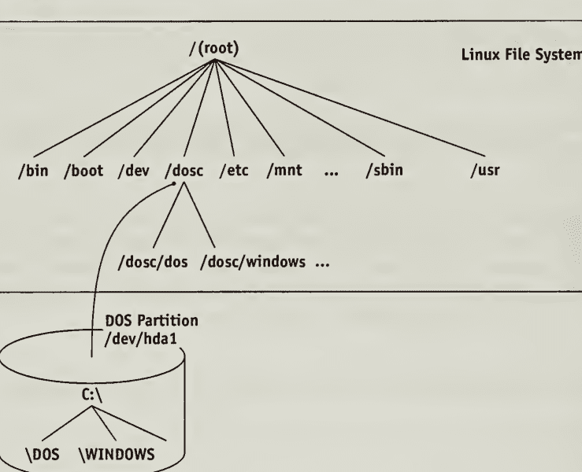

图 16-1 在 `/dos` 上挂载 DOS/Windows 分区

### 挂载和访问 DOS/Windows 软盘

就像你可以在 Linux 下挂载 DOS/Windows 硬盘分区一样，你也可以挂载 DOS/Windows 软盘。通常，你必须以 `root` 身份登录才能挂载软盘，你可以按照本会话后部分所示的步骤设置你的系统，以便任何用户都能挂载 DOS/Windows 软盘。你还需要知道软驱器的设备名称。默认情况下，Linux 定义了两个通用的软盘设备名称：

- `/dev/fd0`，代表 `A:` 盘（第一个软驱器）
- `/dev/fd1`，代表 `B:` 盘（第二个软驱器，如果你有一个的话）

至于挂载点，名为 `/mnt/floppy` 的现有目录专门为这种临时挂载操作而设计的。因此，你可以使用以下命令将 DOS 软盘挂载到 `/mnt/floppy` 目录：

```
mount -vfat /dev/fd0 /mnt/floppy
```

剩余 20 分钟

### 第 16 会话——访问 Windows 和 DOS 文件

软盘挂载后，你可以使用 Linux 的复制命令 `cp` 在软盘与其之间复制文件。要将文件 `gnome1.pcx` 从当前目录复制到软盘，请输入以下内容：

```
cp gnome1.pcx /mnt/floppy
```

同样，要查看软盘的内容，请输入以下内容：

```
ls /mnt/floppy
```

当你想从驱动器中移除软盘时，首先要卸载软盘驱动器。这消除了软盘文件系统与 Linux 文件系统上的挂载点之间的关联。使用 `mount` 命令挂载设备，如下：

```
umount /dev/fd0
```

你可以设置你的 Linux 系统，让任何用户都能挂载 DOS 软盘。你只需要以 `root` 身份登录并在 `/etc/fstab` 文件中添加一行即可。例如，为了允许用户在 `/a` 目录的 `A:` 盘上挂载 DOS 软盘，请执行这些步骤：

1. 以 `root` 身份登录。
2. 使用以下命令创建 `/a` 目录：
   ```
   mkdir /a
   ```
3. 使用文本编辑器（如 `vi` 或 `Emacs`）编辑 `/etc/fstab` 文件，并插入以下代码。保存文件并退出编辑器。
   ```
   /dev/fd0 /a vfat noauto,user 0 0
   ```
   在该行代码中，`user` 选项（出现在 `noauto` 旁边）允许所有用户挂载 DOS 软盘。该行的第一个字段是设备名称（`/dev/fd0`），第二个字段是挂载目录（`/a`），第三个字段显示文件系统类型（`vfat`）。
4. 注销并以普通（非 `root`）用户登录。
5. 为了测试你是否可以在没有 `root` 身份的情况下挂载 DOS 软盘，请向 `A:` 盘插入一张 DOS 软盘，并输入以下命令：
   ```
   mount /a
   ```
   注意你将挂载目录作为命令的参数。挂载操作应该成功，当你输入命令 `ls /a` 时，你应该能看到 DOS 软盘的列表。
6. 要卸载 DOS 软盘，输入 `umount /a`。


### 使用 mtools 访问 DOS/Windows 软盘

现在，你已经学会了一种访问 MS-DOS 文件系统的方法：使用 `mount` 命令挂载 DOS 硬盘或软盘；然后使用常规 Linux 命令，如 `ls` 和 `cp`。这种挂载 DOS 文件系统的方法对于硬盘来说是可行的。Linux 启动时会自动挂载 DOS 分区，你可以随时访问硬盘驱动器上的 DOS 目录。

然而，如果你想快速查看 DOS 软盘的目录列表，可能会发现挂载很繁琐。这时 `mtools` 包就派上用场了。`mtools` 包是一个实现了大多数常用 DOS 命令的工具集。这些命令与 DOS 中的命令名称相同，只需在每个命令前加上 `m` 前缀即可。因此，`mdir` 获取目录列表，`mcopy` 复制文件。`mtools` 最棒的部分是，你不需要挂载软盘就可以使用 `mtools` 命令。

> `mtools` 命令从物理设备（软盘）读取和写入，你必须以 `root` 身份执行这些命令。如果你想让其他用户访问 `mtools` 命令，你必须修改软盘设备的权限设置。使用以下命令允许其他用户读写第一个软盘驱动器：

```
chmod +rw /dev/fd0
```

# 验证 mtools 是否已安装

`mtools` 包随书中附带的 CD-ROM 中的 Red Hat Linux 发行版。当你安装 Red Hat Linux 时，`mtools` 作为基础 Linux 的一部分自动安装。`mtools` 可执行文件位于 `/usr/bin` 目录中。要查看你是否安装了 `mtools`，在 shell 提示符中输入 `ls /usr/bin/mdir`。`ls` 命令显示该文件存在，`mtools` 应该存在。

```
rpm -q mtools
```

如果已安装 `mtools`，输入以下内容：

# 第 16 会话——访问 Windows 和 DOS 文件 230

软盘挂载后，你可以使用 Linux 的复制命令 (`cp`) 在软盘与其之间复制文件。要将文件 `gnome1.pcx` 从当前目录复制到软盘，请输入以下内容：

```
cp gnome1.pcx /mnt/floppy
```

同样，要查看软盘的内容，请输入以下内容：

```
ls /mnt/floppy
```

当你想从驱动器中移除软盘时，首先要卸载软盘驱动器。这消除了软盘文件系统与 Linux 文件系统上的挂载点之间的关联。使用 `mount` 命令挂载设备，如下：

```
umount /dev/fd0
```

你可以设置你的 Linux 系统，让任何用户都能挂载 DOS 软盘。你只需要以 `root` 身份登录并在 `/etc/fstab` 文件中添加一行即可。例如，为了允许用户在 `/a` 目录的 `A:` 盘上挂载 DOS 软盘，请执行这些步骤：

1. 以 `root` 身份登录。
2. 使用以下命令创建 `/a` 目录：
   `mkdir /a`
3. 使用文本编辑器（如 `vi` 或 `Emacs`）编辑 `/etc/fstab` 文件，并插入以下代码。保存文件并退出编辑器。
   `/dev/fd0 /a vfat noauto,user 0 0`
   在该行代码中，`user` 选项（出现在 `noauto` 旁边）允许所有用户挂载 DOS 软盘。该行的第一个字段是设备名称 (`/dev/fd0`)，第二个字段是挂载目录 (`/a`)，第三个字段显示文件系统类型 (`vfat`)。
4. 注销并以普通（非 `root`）用户登录。
5. 为了测试你是否可以在没有 `root` 身份的情况下挂载 DOS 软盘，请向 `A:` 盘插入一张 DOS 软盘，并输入以下命令：
   ```
   mount /a
   ```
   注意你将挂载目录作为命令的参数。挂载操作应该成功，当你输入命令 `ls /a` 时，你应该能看到 DOS 软盘的列表。
6. 要卸载 DOS 软盘，输入 `umount /a`。

### 理解 mtools

`mtools` 包是一个实现了大多数常用 DOS 命令的工具集。这些命令与 DOS 中的命令名称相同，只需在每个命令前加上 `m` 前缀即可。因此，`mdir` 获取目录列表，`mcopy` 复制文件。`mtools` 最棒的部分是，你不需要挂载软盘就可以使用 `mtools` 命令。

> `mtools` 命令从物理设备（软盘）读取和写入，你必须以 `root` 身份执行这些命令。如果你想让其他用户访问 `mtools` 命令，你必须修改软盘设备的权限设置。使用以下命令允许其他用户读写第一个软盘驱动器：

```
chmod +rw /dev/fd0
```

# 验证 mtools 是否已安装

`mtools` 包随书中附带的 CD-ROM 中的 Red Hat Linux 发行版。当你安装 Red Hat Linux 时，`mtools` 作为基础 Linux 的一部分自动安装。`mtools` 可执行文件位于 `/usr/bin` 目录中。要查看你是否安装了 `mtools`，在 shell 提示符中输入 `ls /usr/bin/mdir`。`ls` 命令显示该文件存在，`mtools` 应该存在。

```
rpm -q mtools
```

如果已安装 `mtools`，输入以下内容：

# 表 16-1 常用 mtools 命令

| `mtools` Utility | MS-DOS 命令 (If Any) | Action |
|---|---|---|
| `Mattrib` | `ATTRIB` | 修改 DOS 文件属性 |


# 表 16-1 `mtools` 命令

| `mtools` 工具 | MS-DOS 命令（如有） | 操作 |
|---|---|---|
| `Mcd` | `CD` | 切换目录 |
| `Mcopy` | `COPY` | 在 DOS 和 Linux 之间复制文件 |
| `Mdel` | `DEL` | 删除 DOS 文件 |
| `Mdeltree` | `DELTREE` | 递归删除 DOS 目录 |
| `Mdir` | `DIR` | 显示 DOS 目录 |
| `Mformat` | `FORMAT` | 在低格式化软盘上放置 DOS 文件系统 |
| `Mlabel` | `LABEL` | 初始化卷标 |
| `Mmd` | `MD` | 创建 DOS 目录 |
| `Mmove` | N/A | 移动或重命名 DOS 文件 |
| `Mrd` | `RD` 或 `RMDIR` | 删除 DOS 目录 |
| `Mren` | `REN` | 重命名 DOS 文件 |
| `Mtype` | `TYPE` | 显示 DOS 文件的内容 |
| `Xcopy` | `XCOPY` | 递归复制 DOS 目录 |

### 格式化 DOS/Windows 软盘

假设你想在 MS-DOS/Windows 软盘上复制文件。如果你已经有一个格式化的 MS-DOS/Windows 软盘，你可以只需挂载该软盘并使用 Linux `cp` 命令复制文件到软盘。如果你没有格式化的 DOS 软盘呢？`mtools` 包提供了 `mformat` 工具，它可以格式化用于 DOS 的软盘。与单步格式化的 DOS 格式不同，`mformat` 命令要求你遵循两个步骤：

1. 使用 `fdformat` Linux 低级格式化软盘。`fdformat` 命令期望软盘设备名称作为参数；设备名称包含了格式化软盘所需的所有参数。要格式化系统 `A:` 盘中的 3.5 英寸高密度软盘，输入 `fdformat /dev/fdH01440`。

2. 使用 `mformat` 命令在低级格式化的软盘上放置 MS-DOS 文件系统。如果软盘在 `A:` 盘中，输入以下命令：

```
mformat a:
```

### 复习

本节向你展示了如何从 Linux 访问和挂载 DOS/Windows 文件系统，以及如何使用 `mount` 命令挂载 DOS/Windows 文件系统。你还学习了使用 `mtools` 实用程序直接从 Red Hat Linux 格式化和访问 DOS/Windows 软磁盘，无需先挂载软磁盘。

### 自测

1. 如何检查你的 Linux 系统是否已设置为自动挂载任何 DOS 分区？（参见“挂载和访问 DOS/Windows 文件系统”。）
2. 使用什么 `mount` 命令将设备名称为 `/dev/hd1` 的 DOS 分区挂载到挂载点 `/dosc`？（参见“使用 `mount` 命令挂载 DOS/Windows 文件系统”。）
3. 什么是 `mtools`？（参见“使用 `mtools` 访问和使用 DOS/Windows 软磁盘”。）
4. `mtools` 有哪些常用命令？（参见“理解 `mtools` 命令”。）
5. 如何在 Linux 中格式化 DOS/Windows 软磁盘？（参见“格式化 DOS/Windows 软磁盘”。）

# 第三部分

# 周六下午

1. 串口 `COM1` 和 `COM2` 的 Linux 设备名称是什么？`COM1` 的 `IRQ` 和 `I/O` 端口地址分别是什么？
2. 描述如何使用 `Minicom` 程序拨打远程系统。在作为普通用户运行 `Minicom` 之前你必须做什么？
3. 你可以使用哪些命令来判断 Linux 是否检测到了 PC 中的串口？
4. 什么是以太网？连接到以太网局域网需要什么外设？`10Base2` 和 `10BaseT` 代表什么？你如何确定你的 Linux 系统是否加载了以太网驱动程序？
5. Linux 中有哪些 TCP/IP 网络诊断命令？你使用哪个命令检查网络接口是否已运行？如何检查你的 Linux 系统是否有通往另一个系统的网络路径？
6. 列出 Linux 中的几个 TCP/IP 配置文件。哪个文件包含名称服务器的 IP 地址？
7. 典型的家庭办公或小型办公室用户如何将 Linux 系统连接到互联网？拨号上网与 DSL 或电缆调制解调器相比。
8. 拨号上网与使用 `Minicom` 等串口通信程序拨出有何不同？
9. 什么是 PPP？在用 PPP 设置拨号上网之前，你需要从互联网服务提供商处获得哪些信息？在 Linux 系统上运行哪些程序来建立 PPP 连接？

# 第三部分——周六下午部分复习

10. 解释如何通过你的 Linux 系统与局域网内的其他系统共享单个互联网连接。你必须使用什么软件来完成此任务？
11. 常见的互联网服务有哪些？什么是端口？哪个配置文件包含有关服务和相应端口号的信息？
12. 提供电子邮件服务需要哪类型的软件？传输电子邮件的常用 TCP/IP 协议是什么？
13. Apache Web 服务器的配置文件和日志文件默认位于何处？列出在 Linux 系统启动时启动 Apache Web 服务器的脚本。
14. 什么是匿名 FTP？描述通过匿名 FTP 下载文件的步骤。你应该将文件放在 Linux 系统的哪个目录中，以便通过匿名 FTP 进行下载？
15. 如何使用网络文件系统 (NFS) 建立文件服务器？概述如何设置服务器，以及在客户端上需要做什么来访问服务器的文件系统。
16. 如何使用 `Samba` 软件将你的 Linux 系统设置为 Windows 服务器？如何检查 `Samba` 是否已安装？`Samba` 的配置文件是什么？显示允许你重启 `Samba` 软件的命令。
17. 假设你的 Linux 系统位于一个包含运行 Windows 的 PC 的局域网中，且你的 Linux 系统已安装并运行 `Samba`。从 Linux 系统，如何访问 Windows 服务器中的文件？
18. 假设 `/dev/hda2` 硬盘分区具有 DOS 文件系统，并且你想在 Linux 上的挂载点 `/mnt/dos` 挂载该文件系统。显示执行此任务的命令。如何确保 Linux 在每次系统启动时都自动挂载 `/dev/hda2` 分区？
19. 你可以用 `mtools` 软件包做什么？如何检查系统是否安装了 `mtools`？`mtools` 的配置文件是什么？
20. 列出几个 `mtools` 命令。这些命令是模仿什么命名的？如何将 DOS 软磁盘上所有 `.doc` 扩展的文件复制到硬盘上的当前目录（假设你在输入执行任务的命令时已在该目录中）？

# 第四部分

# 周六晚上


# 第 17 节

## 自定义 GNOME 和 KDE 桌面

### 章节清单

- 自定义 GNOME
- 更改默认

要尝试自定义 GNOME 桌面，请从图形界面登录。假设 GNOME 是你的默认环境，因为你安装 Red Hat Linux 时获得的就是它。在本节晚些时候，你将学习如何切换桌面反之亦然。

> 如果 GNOME 不是你的默认桌面，只需在登录窗口选择 GNOME，并输入用户名和密码。

你可以通过一个名为 GNOME Control Center 的图形应用程序配置 GNOME 桌面的大部分方面——外观和行为。要启动 Control Center，选择主菜单➜程序➜GNOME Control Center，或者点击 GNOME 面板上的提示工具。

GNOME Control Center 的窗口垂直分为两个部分——左侧的窄区域和右侧较大的工作区。左侧显示了所有配置项（也称为配置单元）的树菜单。顶级菜单项组织在几个类别中，例如桌面和多媒体。你可以点击类别查看其子类别。要配置项，在树菜单中找到该项并点击它。所选配置单元的用户界面将出现在右侧工作区中。

### 更改背景

要尝试简单的自定义，从树菜单中选择桌面➜背景。GNOME Control Center 运行背景属性配置单元，该单元在工作区中显示一个窗口（如图 17-1 所示）。


如图所示，此窗口与 `Windows 95/98/NT` 中的显示属性框相似。它允许你选择单色背景或壁纸（背景图像）。你可以选择单色背景或颜色渐变，背景从一种颜色变为另一种颜色。渐变可以从垂直方向（从上到下）或水平方向（从左到右）开始。

尽管点击渐变按钮看看发生了什么。你可以在对话框中的显示器图像中预览更改。

# 第 17 节——自定义 GNOME 和 KDE 桌面

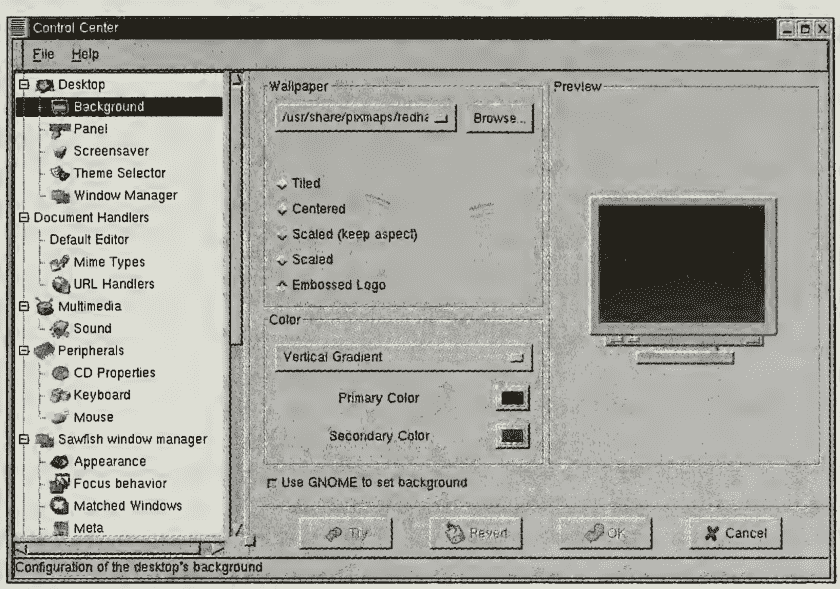

图 17-1

使用 `GNOME` 控制中心自定义 `GNOME` 桌面背景

要为主色（`Primary Color`）或次色（`Secondary Color`）选择新颜色（见图 17-1），点击显示颜色按钮（主色或次色）。这将打开颜色选择对话框，您可以在从中挑选颜色。

如果您想使用图像作为壁纸，请点击对话框中壁纸部分的“浏览（`Browse`）”按钮。壁纸选择对话框将显示 `/usr/share/pixmaps/redhat` 目录的内容——您可以在那里找到一些图像进行选择。您也可以尝试 `/usr/share/pixmaps/backgrounds/space` 目录以获取更多背景。例如，尝试 `/usr/share/pixmaps/backgrounds/space` 目录，那里有一系列从太空看到的地球的图像。您可以选择任何 `JPEG` 或 `PNG` 格式的图像文件作为壁纸。

要在桌面上尝试这些更改，请点击“尝试（`Try`）”按钮。您可以通过点击“还原（`Revert`）”按钮恢复原始设置。完成更改后，点击“确定（`OK`）”按钮关闭对话框并应用更改。

### 选择主题

另一个更令人兴奋的自定义是为用户界面选择新主题。主题是指所有用户界面组件（如按钮、复选框、滚动条等）的外观和行为（外观）的一致集合。要尝试一些新主题，请从树形菜单中选择“桌面（`Desktop`）⇨ 主题选择器（`Theme Selector`）”。在主题选择器对话框中，您可以尝试不同的主题并选择其中一个。当您在预览区域看到它的外观时，例如，从可用主题列表中选择 `MockMack` 主题，然后点击“尝试（`Try`）”按钮。这使得 `GNOME` 桌面（包括控制中心窗口）的外观和感觉类似于苹果 `Mac`（`Macintosh`）。

如果您喜欢某个主题，点击“确定（`OK`）”按钮以使用该主题。否则，点击“还原（`Revert`）”按钮返回默认主题。

### 自定义窗口管理器

`GNOME` 不依赖于任何特定的窗口管理器。默认窗口管理器名为 `Sawfish`，但如果您需要，可以选择其他窗口管理器。要选择窗口管理器，请从控制中心的树形菜单中选择“桌面（`Desktop`）⇨ 窗口管理器（`Window Manager`）”。您将看到系统上可用的窗口管理器列表，如图 17-2 所示。

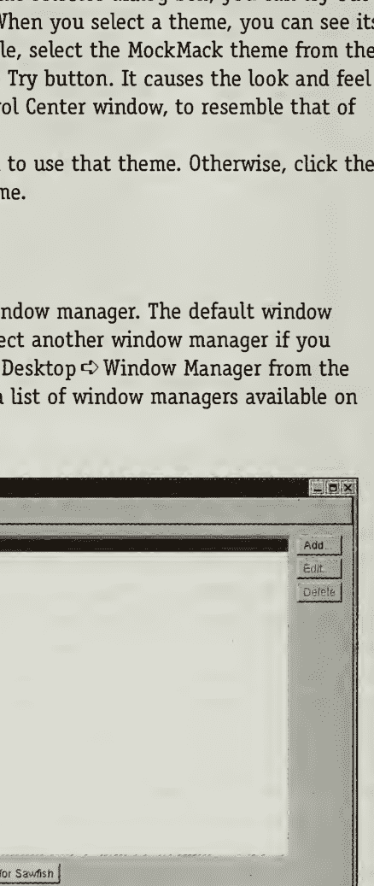

图 17-2

选择或自定义窗口管理器

在这种情况下，列表显示了两个窗口管理器：`Sawfish` 和 `twm`。括号中的注释显示 `Sawfish` 是当前窗口管理器。如果您愿意，可以通过选择该管理器并点击“尝试（`Try`）”按钮来尝试它。稍后，点击“还原（`Revert`）”返回 `Sawfish` 窗口管理器。

与任何窗口管理器一样，`Sawfish` 在窗口周围添加了标题栏、框架和其他装饰，用户可以通过点击并拖动这些部分来更改窗口的位置或大小。（想一下；如果没有框架和标题栏，您将无法移动或调整窗口大小。）

`Sawfish` 包含一个用于更改窗口框架和标题栏外观的配置工具。您可以通过点击标记为“运行 `Sawfish` 配置工具（`Run Configuration Tool for Sawfish`）”的按钮来激活配置工具（见图 17-2）。这将打开 `Sawfish` 配置器，它提供了一个配置选项树。通过此菜单，`Sawfish` 配置器允许您更改 `Sawfish` 窗口管理器装饰窗口的方式、添加视觉效果和声音，以及它对鼠标点击和按键的响应行为。您可以尝试 `Sawfish` 配置器中的某些项目。

### 更改默认桌面

`GNOME` 和 `KDE` 都是强大的图形化桌面环境。`Red Hat Linux` 自带了这些 `GUI`，但您获得的默认桌面是 `GNOME`。在图形登录界面登录之前，您始终可以从登录窗口的“会话（`Session`）”菜单中选择特定的桌面。然而，`Red Hat` 还包含一个桌面切换器工具，允许您将默认桌面从 `GNOME` 切换到 `KDE` 反之亦然。要从 `GNOME` 切换到 `KDE`，请遵循以下步骤：

1. 从您的 `GNOME` 桌面，选择“主菜单（`Main Menu`）程序（`Programs`） 桌面切换工具（`Desktop Switching Tool`）”。出现桌面切换器对话框。
2. 在新对话框中，点击 `KDE` 单选按钮进行选择。然后点击“确定（`OK`）”按钮。出现另一个对话框。
3. 新对话框中的消息告诉您桌面配置已更改，但您必须重启 `X`。点击“确定（`OK`）”按钮关闭对话框。

虽然步骤 3 中的消息说明您必须重启 `X`，但您只需要注销会话并重新登录即可。要注销，选择“主菜单（`Main Menu`）注销（`Log out`）”。当您再次登录时，您将获得 `KDE` 桌面。


要将默认桌面从 `KDE` 切换到 `GNOME`，请以 `root` 身份登录，并选择 `K` `Red Hat` 桌面切换工具。要将默认桌面从 `KDE` 切换到 `GNOME`，以 `root` 身份登录并选择...

### 自定义桌面

现在您已经知道如何更改桌面，应该尝试一些这些自定义功能。像 `GNOME` 一样，`KDE` 也包含一个图形化应用程序，被称为“控制中心（`Control Center`）”。要启动 `KDE` 控制中心，选择... 当控制中心启动时，它左侧显示一个树形菜单，右侧显示一些系统信息。树形菜单分为类别：文件浏览（`File Browsing`）、外观（`Look & Feel`）、网络（`Network`）、帮助（`Help`）、外设（`Peripherals`）、个性化（`Personalization`）、电源（`Power`）、声音（`Sound`）、系统（`System`）和网页浏览。点击项目左侧的加号查看该项目的子类别。

### 更改背景

要自定义桌面背景，在树形菜单中选择“外观（`Look & Feel`）背景（`Background`）”。背景显示（见图 17-3），带有自定义桌面的选项。对于单色或双色背景或壁纸（作为背景的图像）。例如，如果您想使用壁纸作为背景，请点击“浏览（`Browse`）”按钮。这将打开一个显示 `/wallpapers` 目录下 `JPEG` 文件的对话框。您可以选择这些图像之一并点击确定。然后点击 `KDE` 控制中心中的“应用（`Apply`）”按钮将壁纸应用到桌面。如果您喜欢该外观，点击“确定（`OK`）”。否则，点击“默认（`Default`）”，然后再次点击“应用（`Apply`）”以还原原始背景。

# 第 17 节——自定义 GNOME 和 KDE 桌面

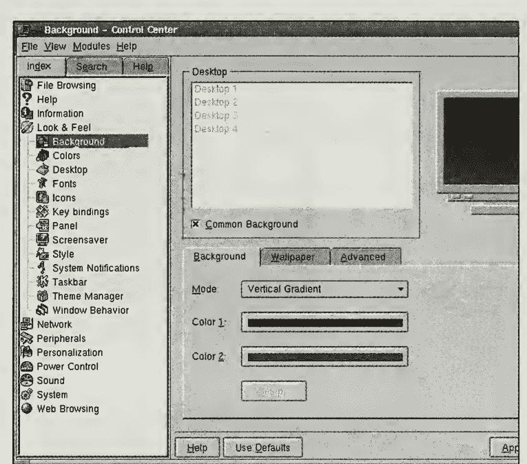

图 17-3

使用 `KDE` 控制中心自定义桌面背景

正如从“外观（`Look & Feel`）”类中的菜单（图 17-3）所示，您可以自定义背景的多个方面，从边界和颜色到菜单语言。我在这里不会介绍所有项目，但您应该尝试这些自定义功能。例如，您可以选择“主题管理器（`Theme Manager`）”来尝试类似于 `GNOME` 控制中心提供的几个主题。图 17-4 显示了选择和预览一个的结果。

### 选择颜色方案

如果您想为桌面颜色选择颜色方案，在 `KDE` 控制中心的树形菜单中选择“外观（`Look & Feel`）颜色（`Colors`）”。然后会出现颜色选项卡。当您滚动颜色方案列表并选择一个进行预览时。当您选择颜色方案时，标签上的预览区域将显示该方案的效果。要将颜色方案应用到桌面，点击“应用（`Apply`）”按钮。如果您不喜欢该方案，点击“默认（`Default`）”，然后再次点击“应用（`Apply`）”以还原默认方案。

# 222 周六晚上

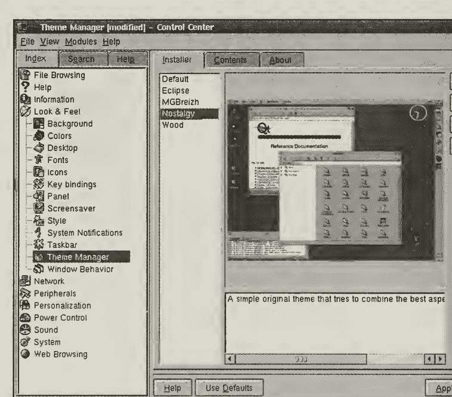

图 17-4

在 `KDE` 控制中心中选择和预览主题

## 执行其他任务

除了桌面自定义之外，`KDE` 控制中心中的“信息”项目还允许你执行更多任务，例如将声音与事件（如打开或关闭窗口）关联、定义键盘快捷键以及查看你的系统信息。你应该利用本节的剩余时间来探索 `KDE` 控制中心树形菜单中的其他项目。

### 回顾

本节向你展示了如何自定义 `GNOME` 图形桌面的外观（外观）和行为（感觉）。你使用了 `GNOME` 控制中心来更改桌面外观和感觉的各个方面。你学习了如何将默认桌面从 `GNOME` 改为 `KDE` 图形桌面，反之亦然。最后，你还使用 `KDE` 控制中心来自定义 `KDE` 的外观和感觉。

# 第 17 节——自定义 GNOME 和 KDE 桌面

### 自测

1. 你使用什么图形化应用程序来自定义 `GNOME` 桌面？（参见“自定义 `GNOME` 桌面”。）
2. 你如何自定义 `Sawfish` 窗口管理器？（参见“自定义窗口管理器”。）


- 3. 你如何将默认桌面从 `GNOME` 更改为 `KDE` 反之亦然？（参见“更改默认桌面”。）

- 4. 你使用什么工具来自定义 `KDE` 桌面？（参见“自定义 `KDE` 桌面”。）

- 5. 你如何为 `KDE` 桌面选择配色方案？（参见“自定义 `KDE` 桌面”。）

# 章节


# 屏幕保护程序和玩游戏

### 章节检查清单

- 激活屏幕保护程序

- 在 `GNOME` 中玩游戏

- 在 `KDE` 中玩游戏

现在你已经了解了如何自定义 `GNOME` 和 `KDE` 图形桌面，以及如何在它们之间切换，你可以转向有趣的环节了。Linux 下的 `GNOME` 和 `KDE` 桌面都带有很多许多游戏和屏幕保护程序。在本节中，你将学习如何设置和激活屏幕保护程序，并探索一些游戏。

剩余 30 分钟

> 注意：假设你的系统中已经安装了游戏，前提是在第 3 节中从本书附带的光盘中安装 Red Hat Linux 时选择了“游戏”软件包组。如果你没有安装“游戏”软件包组，请进入第 23 节并按照指令安装软件包。

### 激活屏幕保护程序

默认情况下，你的 Linux 系统使用随机选择的屏幕保护程序。每当你停止一段时间（通常是 20 分钟）时，屏幕保护程序就会启动。屏幕保护程序还可以作为锁屏程序——你必须输入密码才能返回图形桌面。

### 在 `GNOME` 中设置屏幕保护程序

要从 `GNOME` 桌面选择并尝试屏幕保护程序，点击 `GNOME` 面板上的工具箱图标启动 `GNOME` 控制中心。然后，从控制中心的树形菜单中选择“桌面”。控制中心的工作区中会出现一个对话框，你可以在其中选择屏幕保护程序。对话框右上角的预览窗口显示了所选屏幕保护程序的样子，如图 18-1 所示。

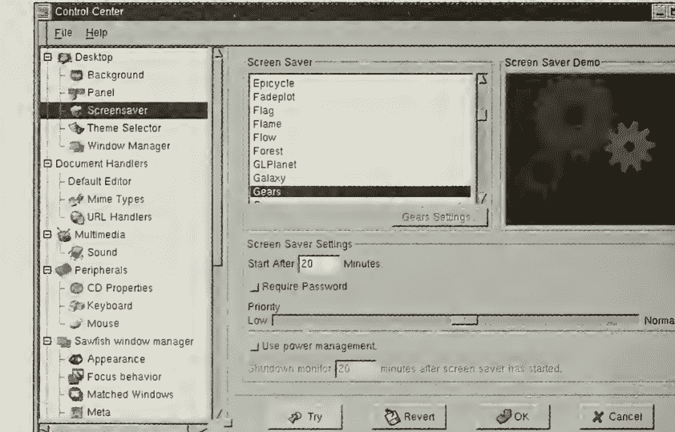

图 18-1

在 `GNOME` 控制中心中选择和预览屏幕保护程序

从图 18-1 所示的对话框中，你还可以选择其他几个屏幕保护程序设置。例如，你可以设置空闲几分钟后进入屏幕保护程序。如果勾选“密码”框，屏幕保护程序会锁定屏幕，你必须输入密码才能返回图形桌面。

### 在 `KDE` 中设置屏幕保护程序

要从 `KDE` 桌面选择并尝试屏幕保护程序，点击 `KDE` 面板上的工具箱图标启动 `KDE` 控制中心。然后，从控制中心的树形菜单中选择“桌面”。控制中心的工作区中会出现一个对话框，你可以在其中选择屏幕保护程序。对话框右上角的预览窗口显示了所选屏幕保护程序的样子。

从图所示的对话框中，你还可以选择其他几个屏幕保护程序设置。例如，你可以设置空闲几分钟后进入屏幕保护程序。如果勾选“密码”框，屏幕保护程序会锁定屏幕，你必须输入密码才能返回图形桌面。


# 第 18 节——屏幕保护程序与玩游戏

## 222 周六晚上


图 18-2
在 KDE 控制中心中选择和预览屏幕保护程序

### 在 GNOME 中玩游戏

接下来，尝试一些随 Red Linux 来的游戏。许多游戏也随 Caldera 和 SuSE 发行版一起。你可以从 GNOME 或 KDE 桌面访问这些游戏。首先，从 GNOME 开始。

选择主菜单 ↩ 程序 ↩ 游戏查看菜单。图 18-3 显示了典型的 GNOME 菜单。正如你所见，GNOME 桌面提供了多种游戏。

除了这些游戏，你还可以从 GNOME 桌面玩 KDE 游戏。

### 卡牌游戏

如果你喜欢 `FreeCell` 或纸牌，你会喜欢 `Aisleiot` 游戏。`Aisleiot` 是一个可以玩 30 种不同牌类的程序，其中包括著名的 `FreeCell` 和梅花牌。

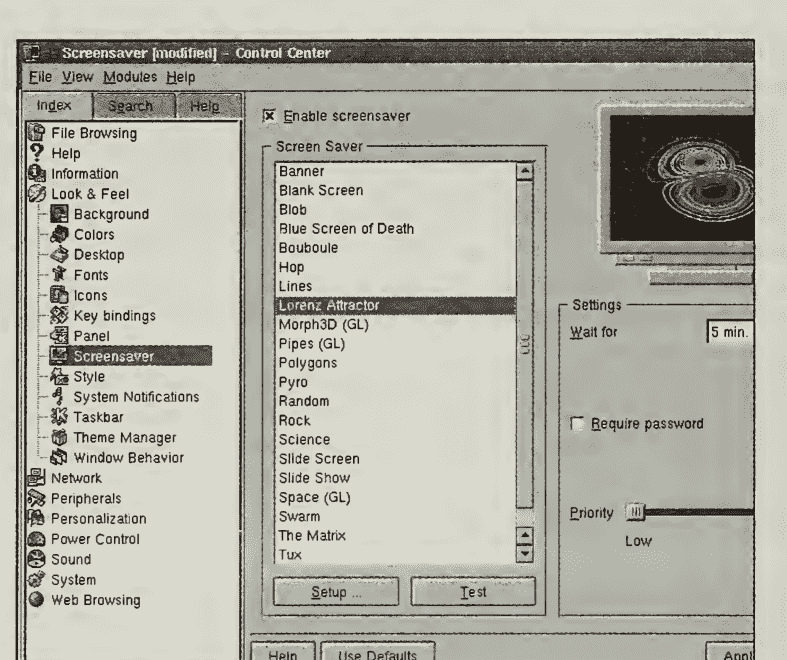

图 18-3
GNOME 中的游戏

要启动 `Aisleiot`，选择主菜单 ↩ 程序 ↩ `Aisleiot`。默认游戏是梅花牌，这是你启动 `Aisleiot` 时得到的程序。

如果你想在 `Aisleiot` 中玩不同的牌类，从菜单中选择游戏 ↩ 新游戏。`Aisleiot` 显示了牌类列表。如果你需要帮助，选择帮助 ↩ `Aisleiot`。这会在 GNOME 帮助浏览器中打开 `Aisleiot` 的帮助页面。

GNOME 自带一个独立的 `FreeCell` 游戏。你可以通过选择主菜单 ↩ 程序 ↩ 游戏 ↩ `FreeCell` 来玩它。在主窗口出现后，点击工具栏上的新建按钮开始一个新游戏。现在你可以玩这个游戏了。

### 矮人游戏

`Gnome-Stones` 是一款你到处跑动收集钻石并避免被石头压的游戏。选择主菜单 ↩ 程序 ↩ 游戏 ↩ `Gnome-Stones` 游戏。你可以选择设置 ↩ 偏好来选择你想探索的洞穴类型。然后选择游戏 ↩ 新游戏开始游戏。使用箭头键移动小人物并收集钻石。

### GNOME 麻将棋

主菜单 ⬞ 程序 ⬞ 点击麻将棋（`Mahjongg`）开始 GNOME 麻将棋游戏。在这个版本的麻将棋中，你的目标是找到并点击匹配的牌子对，这些牌子将从游戏板上被移除。

如果你在匹配牌子时遇到困难，请点击工具栏上的“提示”（`Hint`）按钮。游戏程序将会在短时间内闪烁匹配的牌子。你可以逐一个点击这些牌子。当然，游戏的意义在于你自己弄出应该移除哪些牌子，所以你应该谨慎地使用“提示”按钮。

### 象棋游戏

主菜单 ⬞ 程序 ⬞ 游戏 ⬞ 点击象棋（`Chess`）开始下象棋游戏。默认情况下，电脑执黑方，你执白方。你先走。要进行移动，点击并拖动白色棋子到它的新位置。象棋程序会检查你的移动并阻止你进行任何非法移动。

一旦你移动，电脑就会对你的移动做出响应。最初，电脑的响应很快，但随着游戏的进行，移动所需的时间会变长。计时器会记录当前轮到玩家所需的时间。

### 在 KDE 中玩游戏

尝试 KDE 桌面上可选的游戏，在选择 KDE 为当前桌面后登录。（记得在登录窗口中选择会话（`Session`）⬞ KDE）。从 KDE 桌面，选择 ⬞ 游戏（`Games`）查看可用游戏菜单。图 18-4 显示了 KDE 中典型的游戏菜单。

> KDE 包含了自己的版本的麻将棋，它与在本节之前介绍的 GNOME 版麻将棋相似。


图 18-4
KDE 中的游戏菜单

现在你已经知道在哪里找到以及如何开始 GNOME 游戏了，你可以从容地尝试它们。在本节的剩余部分中，你可以玩几个 KDE 游戏。

# 扫雷

扫雷是一项你可能在 PC 上玩过的流行游戏（因为它随微软 Windows 附带）。在扫雷中，你的目标是在一个由网格排列的方格表示的区域中找到所有地雷。你应该揭开不包含地雷的方格，并标记所有包含地雷的方格。

要运行 KDE 版本的扫雷，选择 `K Games` > `Minesweeper`。要玩游戏，点击方格来清除它们。当你开启一个没有相邻地雷的方格时，扫雷会清除所有同样不接触地雷方格的相邻方格。方格上的数字告诉你相邻方格中有多少地雷。要标记你怀疑有地雷的方格，在方格上点击鼠标右键。当你通过右键标记方格时，会出现一个红色旗帜。

> GNOME 的游戏菜单也包含一个扫雷游戏——它被称为 `GNOME Mines`。

# 接龙（Patience）

`Patience` 是另一种纸牌类游戏，类似于 GNOME 的 `AisleRiot`。在 `Patience` 中，你可以玩几种纸牌游戏，例如 `Klondike` 和 `FreeCell`。要运行 `Patience`，选择 `K` ↔ `Games` ⊟ `Patience`。默认情况下，`Patience` 会启动一个 `Klondike` 纸牌游戏。要玩另一种纸牌游戏，选择 `Game` ↔ `Choose New Game`，并从生成的菜单中选择游戏。

# 四色（Shisen-Sho）

`Shisen-Sho` 是一种类似麻将的游戏。要开始游戏，选择 `K` ↔ `Games` ⊟ `Shisen-Sho`。要玩游戏，选择匹配的牌子，你必须通过水平或垂直线连接它们，而不交叉其他牌子。


### 复习

在本节中，你学习了如何在 GNOME 和 KDE 桌面中选择、配置和预览屏幕保护程序。然后你探索了 GNOME 桌面中的一些游戏。最后，你花了一些时间尝试了 KDE 中的几个游戏。

### 自测

- 你 如何在 GNOME 中选择并尝试屏幕保护程序？（参见“在 GNOME 中设置屏幕保护程序”。）
- 你 如何在 KDE 中配置屏幕保护程序？（参见“在 KDE 中设置屏幕保护程序”。）
- 你 如何让 GNOME 保护程序锁定屏幕？（参见“在 GNOME 中设置屏幕保护程序”。）
- 你 如何访问并启动 GNOME 中的可用游戏？（参见“在 GNOME 中玩游戏”。）
- KDE 中哪些游戏，你是如何启动它们的？（参见“在 KDE 中玩游戏”）

# 第 19 节 多媒体应用

# 节后清单

- 配置声卡
- 播放音频 CD
- 与图形交互

Linux 自带许多多媒体应用。配置声卡、播放音频 CD、与图形交互。在本节中，你可以配置声卡并使用多媒体应用。在配置声卡后，你可以开始播放音频 CD。现在你需要配置声卡来播放音频 CD。


# 配置声卡

要了解更多关于 CDDB 的信息，请访问 `http://www.cddb.com/faq.html` 阅读 CDDB 的常见问题。

> 注意
>
> 如果你想以普通用户登录并在 CD-ROM 驱动器上播放音频 CD，你应该先以 root 身份登录，并对 CD-ROM 设备设置权限，以便所有人都能读取该 CD-ROM 设备。你必须为实际的 CD-ROM 设备设置权限，而不是通用的 `/dev/cdrom` 设备。要设置权限，请遵循以下步骤：

- 以 root 身份登录。如果你已经登录，请输入 `su` 命令，并输入超级用户密码以获取 root 身份。
- 使用如下 `chmod` 命令使所有用户都具有读取 CD-ROM 权限：

```bash
chmod 644 /dev/sr0
```


```
chmod o+r /dev/cdrom
```

现在，任何可以访问你 Linux PC 的用户都可以播放音频 CD 并访问 CD-ROM 驱动器。

> **注意**
>
> 如果你使用 KDE 作为桌面，可以在 KDE 中找到类似的音频 CD 播放器。通过选择“Multimedia -> KDE CD Player”来启动 KDE CD 播放器。然后你可以选择播放音频 CD 中的某条轨道。

### 处理图形与图像

此类类别中的应用程序允许你准备、查看、修改和打印图形及图像。在本次课程的剩余时间内，你将尝试几个图形和图像处理应用程序。

### GIMP

GIMP（GNU 图像处理程序）是由 `Peter Mattis` 和 `Spencer Kimball` 编写的图像处理程序，并在 GNU 公共通用许可证（GPL）发布。如果你在从本书附带的 CD-ROM 安装 Red Hat Linux 时选择了“图形处理（Graphics Manipulation）”包，你就会安装它。

要尝试 GIMP，请从 GNOME 桌面选择“Main Menu -> Graphics -> The GIMP”（从 KDE 桌面选择“Graphics -> the GIMP”）。

## 第 19 节——多媒体应用程序

GIMP 启动并显示一个包含如何完成个人安装信息的窗口。该消息通知你，个人安装涉及在主目录下创建一个名为 `.gimp-1.1` 的目录，并在该目录放置若干文件。此目录本质上存储了你可能对 GIMP 进行的用户偏好更改。继续点击窗口底部的“Continue”按钮。GIMP 会创建必要的目录，将一些文件复制到这些目录，并引导你通过一系列对话框完成安装。

安装完成后，点击“Continue”按钮。从现在起，你将不再看到这两个安装窗口；你只有在第一次运行 GIMP 时才需要处理它们。

随后，GIMP 会加载任何插件——增强其功能的外部模块。启动窗口会在每个插件加载时显示关于该插件的消息。启动完成后，GIMP 在窗口中显示“今日提示（tip of the day）”。你可以浏览这些提示，然后点击“Close”按钮关闭提示窗口。在显示提示窗口的同时，GIMP 会显示工具箱（如图 19-2 所示）。

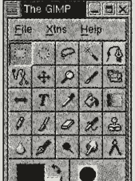

图 19-2
GIMP 工具箱

工具箱在菜单栏上有三个菜单：File（文件）、Xtns（扩展）和 Help（帮助）。File 菜单包括创建新图像、打开现有图像和退出 GIMP 的选项。Xtns 菜单允许你访问 GIMP 的许多扩展。Xtns 的具体内容取决于你的系统中安装了哪些扩展。Help 菜单允许你获取帮助。

要在 GIMP 中打开图像文件，选择“File -> Open”。这将弹出“Load Image（加载图像）”对话框，允许你选择图像文件。你可以更改目录并选择想要打开的图像文件。GIMP 可以读取大多数常见的图像格式，如 GIF、JPEG、TIFF、PCX、BMP、PNG 和 PostScript。选择文件并点击“OK”按钮后，GIMP 将图像加载到新窗口中。图 19-3 显示了 GIMP 打开的图像。

第四部分——周六晚上
第 19 节


# 图 19-3
使用 GIMP 显示图像

图 19-2 中的工具箱还有许多按钮，每个按钮都有一个图标，代表你用于编辑图像和应用特殊效果的工具。通过将鼠标指针悬停在每个工具按钮上，你可以获取弹出式帮助。你可以通过点击工具按钮来选择工具；然后你可以在图像上应用该工具的效果。

为了方便起见，当你对图像点击右键鼠标时，GIMP 会显示弹出菜单。弹出菜单包含了工具箱中 File 和 Xtns 菜单的大多数选项。你还可以选择一些额外选项，例如打印或邮件发送图像。然后你可以从这些弹出菜单中选择特定操作。

使用 GIMP 不仅可以加载和查看图像，但你必须花一些时间学习它的所有功能。要了解更多关于 GIMP 的信息，选择“Xtns -> Browser -> GIMP.ORG -> Documentation”。这将打开文档浏览器。

### Ghostscript

Ghostscript 是用于查看和打印 PostScript 文档的解释器。Ghostscript 的核心是 PostScript 语言几乎完整的实现。它根据 GNU GPL 分发。Ghostscript 是处理 PostScript 文件的命令行工具。

要运行 Ghostscript，在终端窗口输入 `gs`。该命令会产生窗口。窗口分为三个部分：

- 顶部有五个按钮，前六个是菜单按钮；点击其中任何一个都会出现菜单。
- 侧边有更多按钮、信息文本框和滚动条。
- 占据窗口大部分的区域是工作区域。

要在 Ghostview 中加载并查看 PostScript 文档，选择“File Open”或点击窗口左侧的“Open”按钮。此会导致 Ghostview 显示文件选择对话框。使用此对话框选择 PostScript 文件。你可以选择 Ghostscript 自带的 PostScript 文件。例如，选择 `/usr/share/ghostscript/5.50/examples` 下的 `tiger.ps` 文件。

> 如果你的系统版本高于 5.50，请用新的版本号替换 5.50。

点击对话对话框中的“Open”按钮打开选定文件。Ghostview 打开选定文件，处理内容并在窗口中显示输出（如图 19-4 所示）。


图 19-4
Ghostscript 显示文件

在这种情况下，输出是一个图片。显示输出后，Ghostscript 会产生以下消息：

```
showpage, press <return> to continue
```


### Ghostview

`Ghostview` 是 `Ghostscript` 解释器基于 `X` 的图形前端。`Ghostview` 非常适用于查看和打印 `PostScript` 文档。对于长文档，你甚至可以打印选定的页面。你还可以以不同的放大倍数查看文档（缩缩小）。

要运行 `Ghostview`，在终端窗口输入 `ghostview`。该命令会产生 `Ghostview` 窗口。窗口分为三个部分：

- 顶部有五个按钮，前六个是菜单按钮；点击其中任何一个都会出现菜单。
- 侧边有更多按钮、信息文本框和滚动条。
- 占据窗口大部分的区域是工作区域，`Ghostview` 在此处显示 `PostScript` 文档。


图 19-5
`Ghostview` 界面

# 第 19 节—多媒体应用


图 19-5
`Ghostview` 显示的 `PostScript` 文件

当你将鼠标移动到图像上时，`Ghostview` 会在窗口左上角的按钮中显示鼠标指针的坐标。

`Ghostview` 适用于查看 `PostScript` 格式的文档（文件名通常具有 `.ps` 扩展名）。例如，你可以使用 `Ghostview` 查看 `CVS` 程序的文档，这些文档包含在 `/usr/share/doc/cvs*` 目录下的几个 `PostScript` 文件。在 `Ghostview` 中查看此类文档时，请使用放大按钮——图 19-5 中标记为 `1000` 的按钮。如果你点击该按钮并按住鼠标，会出现一个带有从 `0.1` 到 `10.0` 等放大倍数的菜单。你可能需要选择 `2.000` 或更大的放大倍数使文档在屏幕上清晰。

完成！

### 复习

本节向你展示了如何配置声卡以及如何使用几个 `CD` 播放器应用程序在 `Linux` 系统上播放音频 `CD`。你还熟悉了几个用于处理各种格式图像应用程序——`GIMP`、`Xpaint`、`Ghostscript` 和 `Ghostview`。

### 自测

1. 你如何利用 `/usr/sbin/sndconfig` 实用程序为 `Red Hat Linux` 配置声卡？（参阅“配置声卡”。）
2. 你必须执行哪些步骤才能让任何用户都能在 `CD-ROM` 驱动器上播放音频 `CD`？（参阅“播放音频 `CD`”。）
3. 什么是“`GIMP`”？你用它做什么？（参阅“`GIMP`”。）
4. 你如何使用 `Ghostscript` 查看 `PostScript` 文件？（参阅“`Ghostscript`”。）
5. `Ghostview` 与 `Ghostscript` 之间有什么关系？（参阅“`Ghostview`”。）

# 章节

# GNOME 和 KDE 办公工具

### 章节清单

- 使用 `Gnumeric` 电子表格
- 使用日历
- 使用计算器
- 使用拼写检查器
- 学习商用办公应用程序

本节的重点是办公应用程序——你日常工作所需的程序。本书的附带 `CD-ROM` 包含了我在本节中讨论的所有 `Red Hat Linux` 办公工具：日历、计算器和拼写检查器。这些工具也包含在 `Caldera` 和 `SuSe` 发行版中。我还向你介绍了几种未包含在附带 `CD-ROM` 中的 `Linux` 知名商用办公应用程序。

# 使用 Gnumeric 电子表格

`GNOME` 桌面自带 `Gnumeric` —— 这是一个基于 `X` 的图形化电子表格程序。要尝试 `Gnumeric`，请从 `GNOME` 面板选择主菜单 ⮕ 应用程序 ⮕ `Gnumeric` 电子表格。`Gnumeric` 程序显示其主窗口，看起来类似于基于 `Windows` 的电子表格（如 `Microsoft Excel`）。（事实上，`Gnumeric` 可以读和写 `Excel 95` 电子表格文件。）

你使用 `Gnumeric` 的方式就像使用 `Microsoft Excel`。你可以在单元格中输入内容、使用公式并格式化单元格（指定值的类型和小数点后的位数）。

你可能想在电子表格中输入数据。使用你通常在 `Microsoft Excel` 中使用的公式。例如，使用 `SUM(D2:D6)` 公式相加单元格 `D2` 到 `D6` 的内容。要设置单元格 `D2` 的输入类型与 `A2` 和 `C2` 一致，输入相应的类型。要了解更多关于 `Gnumeric` 中的函数，请从菜单选择 `帮助 <- Gnumeric 函数引用`。这会打开包含 `Gnumeric` 函数信息的 `GNOME` 帮助。你可以浏览函数列表并点击其中一个以阅读更多关于该函数的详细信息。

当你完成电子表格的准备工作后，选择 `文件 <- 另存为`。弹出一个对话框，你可以在其中选择目录位置和文件名。`Gnumeric` 可以以多种格式保存文件：`XML`（扩展标记语言）、`Excel 95`、简单文本文件以及 `Adobe` 可携文档格式 (`PDF`)。除非保存为 `XML` 或 `Excel 95` 文件，否则你无法将文件读回 `Gnumeric`。`Gnumeric` 的默认文件格式是 `XML`，这是一种基于文本的格式。然而，`Gnumeric` 使用 `GNU Zip (.gz)` 压缩程序压缩生成的 `XML` 文件。它为压缩格式的文件分配 `.gnumeric` 扩展名。将电子表格保存到 `Windows` 系统，并尝试使用 `Microsoft Excel` 打开。注意，在翻译过程中文件会丢失某些文本样式（如加粗和对齐），但当你以 `Excel 95` 格式保存电子表格时，基本元素（数字和公式）将保持完整。

> `KDE` 没有自带电子表格程序，但你可以通过在 `KDE` 桌面选择 `K <- 程序 <- Gnumeric` 来运行 `Gnumeric`。


# 使用日历

附带 `CD-ROM` 包含几个日历程序。`GNOME` 桌面自带日历程序。此外，当你按照第 1 节概述的步骤安装 `X Window` 系统时，也会安装基于 `X` 的日历程序。你可以从 `GNOME` 面板启动这两个日历。

# 第 20 节—GNOME 和 KDE 办公工具

# 日历

要启动程序，请从 `GNOME` 面板选择主菜单 ⮕ 应用程序 ⮕ 日历。程序显示其主窗口，看起来类似于基于 `Windows` 的电子表格。（事实上，`Gnumeric` 可以读和写 `Excel 95` 电子表格文件。）

# 第 20课——GNOME 和 KDE 办公工具


图 20-2
`GNOME` 计算器

# KDE 计算器

`KDE` 还包含一个科学计算器，它的功能比 `xcalc` 和 `GNOME` 计算器更多。例如，它可以在十六进制、十进制和二进制格式下进行计算。从 `KDE` 桌面，你可以通过选择 ┟ 工具 ┟ 计算器来启动 `KDE` 计算器（或从 `GNOME` 面板中选择主菜单 ┟ `KDE` 菜单 ┟ 工具 ┟ 计算器）。

# 使用拼写检查器

`aspell` 实用是一个交互式拼写检查器。当你从书中附带的 `CD-ROM` 安装红帽 `Linux` 时，你有机会安装 `ispell`。

使用 `aspell` 非常简单。你用它来检查文本文件中单词的拼写。这样做只需输入 `aspell check filename`。要尝试使用 `aspell`，输入一些笔记，并将其保存到名为 `notes.txt` 的文本文件中。在终端窗口中输入以下命令对该文件运行拼写检查：

```bash
aspell check notes.txt
```


`aspell` 运行后，它会扫描名为 `notes.txt` 的文件直到找到拼写错误的单词（任何未出现在 `aspell` 字典中的单词）。如下输出所示，`aspell` 会显示带有拼写错误单词（concensus）的句子，并用一对星号将该单词括起来突出显示。

这条备注描述了 8 月 16 日会议上达成的 `consensus`（共识）。

```text
+ 1) consensus
2) con census
3) con-census
4) condenses
5) concerns
i) Ignore
r) Replace
a) Add
?
6) consensus's
7) consensuses
8) consciences
9) condensers
0) consensual
I) Ignore all
R) Replace all
X) Exit
```

在该句子的下方，`aspell` 列出了可能的纠正方案，从 1 开始顺序编号。在这种情况下，该工具将 `consensus` —— 正确的选择 —— 列为 `consensus` 的第一个纠正。列表还包含了一些用字母标记的项目，该字母代表特定的操作，例如忽略该拼写错误或在文件的其余部分接受目标单词。

在选项列表的末尾，`aspell` 显示一个问号，表示你需要从显示的选项中选择一个。要选择选项，按下 `aspell` 输出列表中显示的任意数字或字母，以指示你想让 `aspell` 执行什么。

> 若要阅读 `aspell` 手册，请启动网络浏览器并选择文件 -> 打开页面；在“打开页面”对话框中点击“选择”按钮。进入 `/usr/share/doc` 目录，找到以 `aspell` 开头的目录（完整名称取决于 `aspell` 版本号）。从该目录下的 `man_html` 目录中打开 `1_Introduction.html` 文件。

# 商业可用办公应用程序

大多数企业都需要办公应用程序：文字处理器、电子表格等。起初，Linux 在这领域缺乏应用；但现在，Linux 用户可以选择多种商业办公生产力应用，例如适用于 Linux 的 WordPerfect Office 2000 (http://linux.corel.com/)、Appware Office (http://www.vistasource.com/) 和 StarOffice (http://www.sun.com/staroffice/)。这些产品确实需要付费，但费用通常低于 Windows 上领先的办公套件 Microsoft Office。（Microsoft Office 是多个应用程序的集合：用于文字处理的 Microsoft Word；用于电子表格的 Microsoft Excel；用于演示图形的 Microsoft PowerPoint；用于数据库的 Microsoft Access，等等。）

本书附的 CD-ROM 不包含这些适用于 Linux 的商业应用程序，但接下来的几节将简要介绍这些应用程序。在阅读这些描述时，你可以访问每个供应商的网站查看产品。

# 第四部分

# 周六晚上

- 1. 描述 GNOME 桌面的外观和感受如何与 Windows 95/98/NT 相似。
- 2. 你如何自定义 GNOME 桌面的外观和感受？列举一些你可以自定义的特性。
- 3. 什么是 Sawfish？它在 GNOME 中起什么作用？你如何配置 Sawfish？
- 4. 解释如何将你的默认桌面从 GNOME 更改为 KDE 反之亦然。
- 5. 描述你如何自定义 KDE 桌面的外观和感受。
- 6. 描述如何为 GNOME 桌面选择和配置屏幕保护程序。
- 7. “锁定屏幕”意味着什么？在 GNOME 中如何锁定屏幕？
- 8. 你如何在 KDE 中选择和配置屏幕保护程序？
- 9. GNOME 中提供哪些游戏？AisleRiot 是什么种游戏？
- 10. 列出随 KDE 桌面一起的游戏名称。
- 11. 描述你如何在 Linux 中配置声卡。
- 12. 你可以使用哪些 CD 播放器应用程序在 Linux 中播放音频 CD？你必须做什么才能作为普通用户播放音频 CD？
- 13. GNOME CD 播放器显示音频 CD 的标题和歌曲列表。CD 播放器是如何找到这些信息的？

# 第四部分—周六晚上回顾

- 14. 列出两个随 Linux 自带的图像处理程序。你用这些程序可以做什么？
- 15. 假设你有一个 PostScript 文档。你使用哪个应用程序在你的 Linux 系统上查看该文档？
- 16. 这本书的 Red Hat Linux 光盘上有哪些办公工具？是否包含了一个完整的办公生产力套件？
- 17. 随 GNOME 桌面一起的电子表格应用程序名称是什么？该应用程序的默认文件格式是什么？你能与 Microsoft Excel 交换文件吗？
- 18. 显示你输入以检查名为 `report.txt` 的文本文件拼写错误的命令行。
- 19. 列出几个适用于 Linux 的商业办公应用套件——字文字处理器、电子表格、演示文稿软件和数据库。你如何找到有关这些商业应用的更多信息？
- 20. 哪一个办公应用套件是跨平台解决方案——它可以在许多不同的操作系统上运行？提到该办公应用套件的主要组件。

# 周日

# 第五部分–周日上午

第 21 节
理解 Linux 如何启动

第 22 节
从源文件构建软件包

第 23 节
安装软件包

第 24 节
构建新内核

第 25 节
在 Linux 中调度作业

第 26 节
备份和恢复文件

# 第六部分–周日下午

第 27 节
执行基础系统管理任务

第 28 节
监控系统性能

第 29 节
维护系统安全

第 30 节
从可用资源获取帮助

# 第五部分
# 周日上午

- 第 21 节：
  理解 Linux 如何启动
- 第 22 节：
  从源文件构建软件包
- 第 23 节：
  安装软件包
- 第 24 节：
  构建新内核
- 第 25 节：
  在 Linux 中调度作业
- 第 26 节：
  备份和恢复文件


# 章节


# 理解 Linux 如何启动

### 章节清单

- 理解 `init` 进程
- 理解 Linux 启动脚本

剩余 30 分钟

学习 Linux 启动时进程的顺序是非常重要的。你可以利用这些知识启动和停止服务，例如 Web 服务器和网络文件系统 (`NFS`)。本节将为你提供 Red Hat、Caldera 和 SuSe Linux 发行版如何启动和启动初始进程的概述。你还将熟悉启动各种服务的 shell 脚本。

# 理解 init 进程

当 Linux 启动时，它从硬盘加载并运行核心操作系统程序，称为内核 (`kernel`)。然而，核心操作系统的设计是为了运行其他程序。一个名为 `init` 的进程启动了你 Linux 系统上的初始进程集。

# 周日上午

要查看当前系统上运行的进程，输入命令 `ps ax | more`。输出的第一列标题为 `PID`，该列显示每个进程的数字。`PID` 代表进程 ID（进程标识符），它是 Linux 内核分配的一个顺序数。在进程列表的开头，你会注意到一个 ID (`PID`) 为 1 的进程：

| PID | TTY | STAT | TIME | COMMAND |
|---|---|---|---|---|
| 1 | ? | S | 0:05 | `init` [5] |

如你所示，`init` 是一个进程，它的 `PID`（进程号）始终为 1。此外，`init` 启动了你 Linux 系统中的所有进程。这就是为什么 `init` 被称为所有进程之母。`init` 进程依赖于：

- 运行级别 (`run level`)，指定了一种系统配置，其中只存在一组选定的进程。
- `/etc/initab` 文件的内容，指定了启动各种服务的 shell 脚本。

当 Linux 启动时，它从硬盘加载并运行核心操作系统程序，称为内核 (`kernel`)。然而，核心操作系统的设计是为了运行其他进程。一个名为 `init` 的进程启动了你 Linux 系统上的初始进程集。

# 第 21 节—理解 Linux 启动过程

这些字段具有以下含义：

- `id` 字段是一个唯一的、单或双字符标识符。`init` 进程在内部使用此字段。你可以使用任何你标识符，只要不在多行中使用同一个相同的标识符即可。例如，`si`、`x` 和 `1` 都是有效的标识符。
- `runlevels` 字段是由零或多个字符组成的序列，每个字符表示一个运行级别（`run level`）。例如，标识符为 `1` 的行适用于运行级别 1 到 5，因此该条目的 `runlevels` 字段为 `12345`。如果 `action` 字段设置为 `sysinit`、`boot` 或 `bootwait`，则忽略此字段。
- `action` 字段告诉 `init` 进程对特定条目执行什么操作。例如，如果该字段为 `initdefault`，它将 `runlevels` 字段解释为默认运行级别。如果该字段设置为 `wait`，`init` 会启动 `process` 字段指定的进程并等待该进程退出。
- `process` 字段指定必须启动的操作。当然，`action` 字段的某些设置不需要 `process` 字段。（例如，当 `action` 设置为 `initdefault` 时，不需要 `process` 字段。）

## 表 21-1
`/etc/inittab` 中的有效操作

| 操作 (Action) | 说明 (Description) |
| :--- | :--- |
| `Respawn` | 每当进程终止时重启该进程。 |
| `Wait` | 在指定的运行级别重启一次进程；`init` 等待该进程退出。 |
| `Once` | 在指定的运行级别执行一次进程。 |
| `Boot` | 在系统启动时执行进程，无论运行级别如何（忽略 `runlevels` 字段）。 |
| `Bootwait` | 在系统启动时执行进程；`init` 等待进程退出（忽略 `runlevels` 字段）。 |
| `Off` | 此操作不执行任何操作。 |
| `Ondemand` | 在指定的运行级别执行进程，该级别必须是 `a`、`b` 或 `c`。 |

## 表 21-1（续表）

| 操作 (Action) | 说明 (Description) |
| :--- | :--- |
| `Initdefault` | 启动后，在此运行级别启动系统。此操作忽略 `process` 字段。 |
| `Sysinit` | 在系统启动时，在任何 `boot` 或 `bootwait` 操作项之前执行进程（忽略 `runlevels` 字段）。 |
| `Powerwait` | 当 `init` 接收到 `SIGPWR` 信号指示电源出现问题时，执行进程。然后 `init` 等待进程退出。 |
| `Powerfail` | 与 `powerwait` 类似，但 `init` 不等待进程退出。 |
| `Powerokwait` | 当 `init` 接收到 `SIGPWR` 信号且 `/etc/powerstatus` 文件包含 `OK` 字样（表示电源正常）时执行进程。 |
| `Ctrlldelt` | 当 `init` 接收到 `SIGINT` 信号时执行进程，该信号会在按下 `Ctrl+Alt+Del` 时产生。通常 `process` 字段应指定 `/sbin/shutdown` 命令和 `-r` 以重启 PC。 |
| `Kbdrequest` | 当 `init` 接收到键盘驱动程序的信号表示按了特殊键组合时执行进程。该按键组合应映射到 `keymap` 文件中的 `KeyboardSignal`。 |

`process` 字段通常以 shell 脚本的形式指定，该脚本反过来可以启动多个进程。例如，`15` 条目指定如下：

```
15:5:wait:/etc/rc.d/rc 5
```

该条目指定 `init` 应该执行文件 `/etc/rc.d/rc`，并以 `5` 作为参数。如果你查看 `/etc/rc.d/rc` 文件，会发现它是一个 shell 脚本文件。你可以研究 `/etc/rc.d/rc` 文件，查看它如何为运行级别 1 到 5 启动各种进程。

回到图形登录界面，`/etc/inittab` 文件的最后一行如下，启动了图形登录过程。


`x:5:respawn:/etc/X11/prefd -nodaemon`

此命令运行`/etc/X11/prefd`，它是指向特定显示管理器的符号链接。对于 GNOME 图形桌面（Red Hat Linux 的默认设置），`/etc/X11/prefd`是指向`/usr/bin/gdm`的符号链接——即 GNOME 显示管理器。如果你使用 KDE 作为默认桌面（Caldera 和 SuSE 发行版的默认设置），`/etc/X11/prefd`是指向`/usr/bin/kdm`的符号链接——即 KDE 显示管理器。这意味着无论你选择哪种 GUI，`init`都会在运行级别 5 启动显示管理器。显示管理器反过来显示图形登录框并允许你登录系统。

如果你在 Linux 安装期间（第 1 到第 3 节介绍）没有启用图形登录界面，可以通过编辑`/etc/inittab`文件来启用。找到包含`initdefault`的行，并确保其内容如下（两列之间的运行级别应该是 5）：

```
id:5:initdefault:
```


在编辑`/etc/inittab`文件之前，你应该知道此文件中的任何错误可能导致 Linux 无法启动到可以登录的程度。如果你无法登录，就无法使用系统。正如我接下来将解释的，在实际更改`/etc/inittab`文件中的默认运行级别之前，你可以尝试使用`init`命令尝试特定的运行级别。

## 使用 init 命令尝试新的运行级别

要运行新级别，不需要更改`/etc/inittab`文件中的默认运行级别。如果你以`root`身份登录，可以使用`init`命令更改运行级别（以及随之在 Linux 中运行的一组进程）。`init`命令的格式为：

```
init runlevel
```

在这里，`runlevel`必须是你想要的运行级别字符。例如，要将系统置于单用户模式，输入：

```
init 1
```

因此，如果你想尝试运行级别 5（假设你的系统尚未设置图形登录界面）而又不更改`/etc/inittab`文件，在 shell 提示符处输入：

```
init 5
```

系统应该结束所有当前进程并进入运行级别 5。默认情况下，`init`命令会在停止所有进程并启动运行级别 5 的新进程之前等待 20 秒。立即切换到运行级别 5，输入命令`init -t 5`。`-t`之后的数字表示`init`在切换级别之前等待的秒数。你也可以使用`telinit`命令，`init`的符号链接。如果你对`/etc/inittab`文件进行了更改并想重新加载配置，请使用`telinit`。

## 理解 Linux 启动

`init`在启动时运行许多脚本。注意`/etc/inittab`文件开头的几行：

- System initialization.
- `si::sysinit:/etc/rc.d/rc.sysinit`

正如第一行的注释所示，第二行导致`init`运行`/etc/rc.d/rc.sysinit`——Red Hat 启动脚本。`rc.sysinit`脚本执行许多任务，如挂载系统、设置时钟、配置键盘布局、启动网络以及加载许多驱动模块。`rc.sysinit`脚本通过调用其他脚本和读取`config`目录下的文件执行这些初始化任务。

在执行`/etc/rc.d/rc.sysinit`后，`init`进程带运行级别参数运行`/etc/rc.d/rc`。例如，对于运行级别 5，`/etc/inittab`中的下一行指定了`init`要执行：

```
15:5:wait:/etc/rc.d/rc 5
```

这表示`init`执行命令`/etc/rc.d/rc 5`并等待该命令完成。`/etc/rc.d/rc`脚本相当复杂。它的工作原理如下：它切换到与运行级别对应的目录。例如，切换到运行级别 5，脚本切换到`/etc/rc.d/rc5`。在与运行级别对应的目录中，它寻找所有以 `K` 开头的文件并带参数执行。这杀掉了运行中的进程。然后它找到所有以 `S` 开头的文件并带参数执行。这是指定运行级别所需的进程。要查看级别 5 发生了什么，输入以下命令：

```
ls /etc/rc.d/rc5
```

此命令提供了以下输出：

```
total 0
lrwxr-xr-x root root 15 Aug 16:24 K0ppoe ../init/ppoe
lrwxr-xr-x root root 14 Aug 16:08 K0innd ../init/innd
lrwxr-xr-x root root 13 Aug 19:22 K0nfs ../init/nfs
lrwxr-xr-x root root 16 Aug 16:24 K0rstart ../init/rstart
lrwxr-xr-x root root 17 Aug 16:14 K60rund ../init/usersd
lrwxr-xr-x root root 16 Aug 16:24 K61rwald ../init/rwald
lrwxr-xr-x root root 15 Aug 16:24 K65rhod ../init/rhod
lrwxr-xr-x root root 19 Aug 16:34 K63passwd ../init/passwd
lrwxr-xr-x root root 13 Aug 16:34 K35mb ../init/sm
lrwxr-xr-x root root 18 Aug 16:15 K54sparwitch ../init/sparwitch
lrwxr-xr-x root root 15 Aug 16:14 K51named ../init/named
lrwxr-xr-x root root 16 Aug 16:31 K50snmpd ../init/snmpd
lrwxr-xr-x root root 18 Aug 16:17 K60mars-new ../init/mars-new
lrwxr-xr-x root root 16 Aug 16:34 K64yserv ../init/yserv
lrwxr-xr-x root root 15 Aug 16:14 K50kudzu ../init/kudzu
lrwxr-xr-x root root 18 Aug 16:14 S11chains ../init/chains
lrwxr-xr-x root root 17 Aug 16:15 S10network ../init/network
lrwxr-xr-x root root 16 Aug 16:56 S12syslog ../init/syslog
lrwxr-xr-x root root 14 Aug 16:21 S13portmap ../init/portmap
lrwxr-xr-x root root 16 Aug 16:19 S14fslock ../init/fslock
lrwxr-xr-x root root 14 Aug 16:14 S15xdmap ../init/xdmap
```

如输出所示，所有以 `K` 和 `S` 开头的文件都是指向`/etc/rc.d`和`/etc/rc.d/init.d`目录中脚本的符号链接。事实上，`/etc/rc.d`脚本按照它们在目录列表中出现的顺序执行这些文件。

> 注意，目录列表中的最后一个文件是指向`rc.local`脚本的符号链接。这意味着`/etc/rc.d`会在所有其他脚本之后执行。你可以在 Linux 系统启动时，在该脚本中放置任何想要执行的命令。


大多数启动脚本位于`/etc/rc.d/init.d`目录。你可以手动调用该目录中的脚本来启动、停止或重启特定的进程。例如，要停止 Web 服务器，你输入以下命令：

```
/etc/rc.d/init.d/httpd stop
```

接后的响应显示：

```
Shuting down http: [ OK ]
```


你可以通过熟悉 `/etc/rc.d/init.d` 目录中的脚本来提高你的系统管理技能。要查看列表，请输入 `ls /etc/rc.d/init.d` 命令：

| anacron | halt | keytable | netfs | sendmail | ybind |
| :--- | :--- | :--- | :--- | :--- | :--- |
| apmd | http | killall | network | random | single |
| apache | indent | kudzu | nfs | rawdevices | smb |
| atd | linux | nfslock | rstat | snmpd | ypserv |
| crond | ipchains | pcmia | rersud | syslog | |
| functions | isdn | mars-we | portmap | rwald | xfs |
| gpm | kcodecrate | named | postgres | rhod | inetd |

脚本名称可以让你了解关于该脚本可以启动和停止什么服务器的线索。事实上，`nfs` 脚本启动并停止 NFS（网络文件系统）服务所需的进程。在你有空时，可以研究其中一些脚本，看看每个脚本的作用。你不需要理解所有的 shell 编程；注释应该能帮助你了解每个脚本的目的。


### 复习

本节概述了 `init` 进程如何启动初始进程集。你学习了控制 `init` 行为的 `/etc/initab` 文件。你还学习了位于 `/etc/rc.d` 及其子目录下的 Red Hat Linux 启动脚本。

### 自测

- 1. 为什么 `init` 被称为“进程之母”？（参见“理解 init 进程”。）
- 2. 如何确定你 Linux 系统的当前运行级别（run level）？（参见“理解 init 进程”。）
- 3. 你可以做什么让你的 Linux 系统在重启时运行在运行级别 3？（参见“检查 /etc/initab 文件”。）
- 4. 你如何找出 `init` 为运行级别 5 执行哪些脚本？（参见“理解 Red Hat 启动脚本”。）
- 5. 你在哪个脚本中放置希望每次 Linux 系统启动时都执行的命令？（参见“理解 Red Hat Linux 启动脚本”。）

# 课程内容


## 从源文件构建软件包

### 课程清单

- 下载并解压软件
- 从源码构建并安装软件

在第 23 节，你将学习如何安装以 Red Hat 包管理器（RPM）格式分发的软件包。所有主要的 Linux 发行版（如 `Caldera Open Linux` 和 `SuSE`）都使用这种格式。`RPM` 文件封装了安装软件包所需的——所有的可执行二进制文件和配置文件。然而，许多开源软件包以源码形式发行，不包含可执行二进制文件。在使用此类软件之前，你必须构建可执行二进制文件；然后你需要按照某些指令安装软件包。本节将向你展示如何下载和解压源码。然后向你展示如何从源文件构建软件包并安装它们。

剩余 30 分钟

## 下载和解压软件

开源通常以压缩 `tar` 归档的形式分发。你将在第 26 节中学到，`tar` 程序创建这些归档，而 `gzip` 程序对它们进行压缩。分发形式是一个具有 `.tar.gz` 或 `.tar.Z` 扩展名的单一大文件——通常称为压缩 `tarball`。如果你需要该软件，必须下载压缩的 `tarball` 并将其解压。

使用匿名 `FTP` 或 Web 浏览器下载压缩的 `tar` 文件。通常，这对你来说并不比点击链接并将文件保存到系统中的适当目录多费精力。

若要尝试下载和构建软件包，你可以在 `X Multimedia System (XMMS)` 上练习——这是一个用于播放 `MP3` 和其他多媒体文件的图形 `X` 应用程序。在第 3 节进行 Red Hat Linux 安装期间，如果你选择了“多媒体支持”组，`XMMS` 就会安装在你的系统中。然而，有... [等待，OCR 文本在此处中断或重复，根据根据提供的文本流进行处理]

此命令的输出向你显示归包的内容，并让你了解解压归包后创建的目录。在这种情况下，当前目录下会创建一个名为 `xmms-1.0.1` 的目录（在我的例子中，该目录是 `/usr/local/`）。通过列表，你还可以了解到用于编写该软件包的编程语言。如果你看到 `.c` 和 `.h` 文件，这意味着源代码是使用 `C` 编程语言编写的，这种语言被用于许多开源软件包。

## 解压软件

要提取（或解压）`tar` 归包的内容，请输入以下命令：

```
tar xvf xmms.*.gz
```

你再次看到长长文件列表，这些文件正从归包中提取并复制到你硬盘上相应的目录中。现在，你已经准备好构建软件了。

## 从源码构建软件并安装

解压压缩 `tar` 归包后，所有的源代码都在一个目录中，该目录的名字通常是软件包的名称加上版本号后缀。例如，`XMMS 1.0.1` 版本的源码被提取在 `xmms-1.0.1` 目录中。要开始构建软件的过程，使用此命令切换目录：

```
xmms*
```

> 你不需要输入整个名称。`shell` 可以扩展目录名并将其更改为 `xmms-1.0.1` 目录。


几乎所有的软件软件包都带有某种形式的 `README` 或 `INSTALL` 文件——这些文本文件包含了关于如何构建和安装软件包的指令。`XMMS` 也不例外；它附带了一个 `README` 文件，你可以通过输入 `more README` 来阅读它。还有一个 `INSTALL` 文件，其中包含了构建和安装 `XMMS` 的指令。

## 第 22 节——从源码构建软件软件包

大多数开源软件包（包括 `XMMS`）还附带有一个名为 `COPYING` 的文件。该文件包含了 `GNU` 通用公共许可许可证（`GPL`）的全文，它详细说明了你可以使用和分发该软件的条件。如果不熟悉 `GNU GPL`，你应该阅读此文件，并将许可展示给你的法律顾问，以对其对你业务的适用性进行全面的解释和评估。

对于 `XMMS` 软件包，`README` 文件列出了一些先决条件——例如你需要的库——然后告诉你应该运行哪些命令来构建和安装软件包。在 `XMMS` 的情况下，指令引导你使用以下命令：

1. `./configure` 运行一个 `shell` 脚本检查你的系统配置并创建一个 `Makefile`，`make` 命令使用该文件来构建和安装软件包。`configure` `shell` 脚本猜测依赖变量并创建一个包含构建和安装软件所需的命令的 `Makefile`。
2. 输入 `make` 构建软件。这一步编译所有子目录中的源代码。
3. 输入 `make` 安装软件。这一步将库和可执行二进制文件复制到系统中的相应目录。

尽管这些步骤专门针对 `XMMS`，但大多数其他软件包也遵循这一程序：`configure`、`make` 和 `install`。

通常情况下，你只需要输入构建软件的命令而无需做其他；但你必须在系统中安装开发工具。这意味着在安装 Linux 时必须安装 `Development` 软件包。因为 `XMMS` 是一个 `X` 应用，你还必须安装 `X Window System` 软件包来构建和运行 `XMMS`。

## 构建软件

要开始构建 `XMMS`，请输入以下命令运行 `configure` 脚本（在 `xmms-1.0.1` 目录下）：

```
./configure
```

`configure` 脚本开始运行，并在检查你系统的各种特性时打印大量信息，从 `C` 编译器的存在到构建 `XMMS` 所需各种库。最后，`configure` 脚本创建一个你可以用于构建软件的 `Makefile`。

> 如果 `configure` 脚本显示错误信息并失败，请阅读 `INSTALL` 和 `README` 文件以寻找任何解决问题的线索。你可能通过通过命令行参数向 `configure` 脚本提供信息来绕过该问题。

`configure` 脚本完成后，输入以下命令构建软件：

```
make
```

此命令运行 `GNU` 工具（需要 10 到 15 分钟完成），该工具读取 `Makefile` 并根据 `Makefile` 中指定的信息开始编译源文件。`make` 命令遍历源码目录，编译源代码，并创建运行 `XMMS` 所需的可执行文件和库。在每个文件被编译时，你会看到大量信息滚动屏幕。这些信息显示了用于编译和链接文件所使用的命令。

## 安装软件

在 `make` 命令完成后，你可以使用以下命令安装 `XMMS` 软件：

```
make install
```


此命令运行`GNU make`，但`install`参数指示`GNU make`执行`Makefile`中的一组特定命令。这些指令本质上是搜索子目录并将各种文件复制到它们的最终位置。例如，二进制可执行文件`xmms`、`gnomems`、`wxmms`和`xmms-config`被复制到`/usr/bin`目录。

## 运行软件

现在你已经安装了`xmms`，尝试在GNOME或KDE桌面窗口中输入`xmms`来运行它。从`XMMS`窗口，你可以打开一个`MP3`文件并播放。注意，你的PC必须有声卡，并且你必须对其进行正确配置。（第19节讨论了声卡配置）。图22-1显示了`XMMS`播放`MP3`音段的典型视图。

## 第 22 节——从源码构建软件软件包

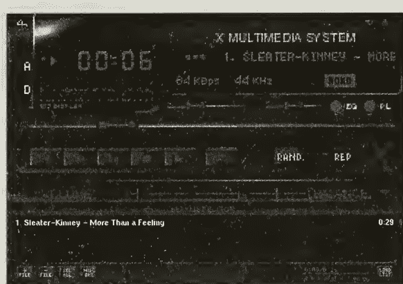

图22-1 使用`XMMS`播放`MP3`音乐

**构建概述**

现在你已经了解如何下载、构建和安装典型软件包。以下是步骤概述：

1. 从匿名`FTP`或网站下载通常为`.tar.gz`格式的源码。
2. 使用`tar xvf`命令解压文件。
3. 使用如下命令切换到软件所在的子目录。
4. 阅读任何`README`或`INSTALL`文件以了解必须遵循的特定指令。
5. 构建的细节可能有所不同，但通常执行以下
6. 阅读软件附带的任何其他文档以确定是否需要进一步配置。

**回顾**

本节向你展示了如何下载和解压开源软件。以`XMMS`为例，你学习了构建和安装。

**自测**

1. 什么是压缩`tar`包？
2. 使用什么命令解压压缩`tar`包？
3. 哪些典型文件提供了构建软件的信息？
4. 通常包含`GNU`通用公共许可许可证全文的文件名称是什么？
5. 安装`XMMS`软件包需要输入哪三个命令？

**课程章节清单**

- 使用`Gnome` `RPM`安装和移除软件包
- 使用`RPM`命令安装和移除软件包

**扩展**

作为`Linux`系统的管理员，你应该知道如何安装和移除以`Red Hat Package Manager` (`RPM`) 文件形式分发的软件包。红帽的一项重大创新是红帽软件包管理器 (`RPM`) —— 一种将软件所需的所有文件封装在一个文件中的系统（称为`RPM`文件，或简称`RPM`）。大多数`Linux`发行版都是大量`RPM`的形式存在的。如果你从随附的光盘安装红帽`Linux`，所有的`RPM`文件（软件包）位于`/mnt/cdrom/RedHat/RPM`目录（假设你已将光盘挂载到`/mnt/cdrom`目录）。

`Gnome` `RPM`是一个用于安装和卸载`RPM`的图形化实用程序。你通过`Gnome` `RPM`执行的操作与在命令行中使用`rpm`命令可以执行的操作相似。你将在本节稍后部分学习`rpm`命令。

要启动`Gnome` `RPM`，请以`root`登录；然后选择“主菜单”中的“程序”。图23-1显示了`Gnome` `RPM`的初始窗口。`Gnome` `RPM`具有标准的`Gnome`界面，带有菜单和工具栏。工具栏包含常用`RPM`操作的按钮：安装新软件包、查询软件包或卸载软件包。窗口左侧的树形菜单按包组的层级结构显示了当前已安装的软件包（一个包组包含多个软件包或`RPM`）。你可以点击加号来查看层级结构。`Gnome` `RPM`在树形菜单右侧区域显示所有软件包。例如，图23-1显示了名为`Desktops`的包组中的软件包，该组包含了构成`GNOME`和`KDE`桌面的软件包。

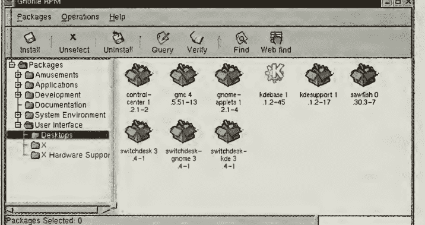

图23-1 `Gnome` `RPM`显示`Desktop`包组的内容

你通常选择一个或多个软件包，然后执行任务，如卸载软件包、查询软件包（查看其安装时间及其包含的文件）或验证软件包（检查是否有文件未被更改）。要执行这些操作，请打开包组，并通过点击软件包图标来选择软件包。然后点击“卸载”、“查询”或“验证”按钮以启动操作。这些操作中的每一个操作都会在`Gnome` `RPM`中弹出一个窗口，显示相关信息并提供供你启动后续操作的按钮。例如，当你查询一个软件包时，`Gnome` `RPM`会在一个窗口中显示该软件包的信息。

# 第 23 节——安装软件包

从信息中，你可以看到软件包的安装时间、编译时间、以字节为单位的大小、软件包的简要描述以及哪些文件构成了软件包（包括每个文件的完整路径）。甚至还有一个`URL`可以在那里找到更多关于该软件包的信息。`Gnome` `RPM`显示的`URL`可以点击，以便在Web浏览器中查看。通过浏览查询结果中的信息，你可以了解很多关于软件包。

要卸载或删除软件包，请从`Gnome` `RPM`窗口中选择软件包，并点击工具栏上的“卸载”按钮（见图23-1）。`Gnome` `RPM`显示出一个对话框，确认你是否真的要删除软件包。点击“是”按钮删除软件包。

要从这些伴随`CD-ROM`中的任何一个安装新软件包，请挂载`CD-ROM`（输入`mount /mnt/cdrom`），并点击`Gnome` `RPM`工具栏上的“安装”按钮。会出现一个空白的安装对话框。点击安装对话框上的“添加”按钮。`Gnome` `RPM`将显示`/mnt/cdrom/RedHat/RPM`目录的内容，所有的`RPM`文件（软件包）都位于其中，如图23-2所示。

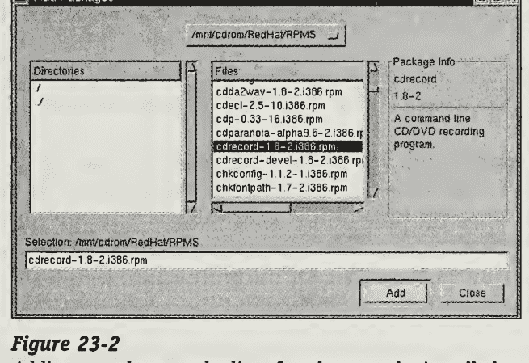

图23-2 将软件包添加到待安装软件包列表

从“添加软件包”对话框中，你可以逐个选择软件包，并点击“添加”按钮将这些软件包添加到待安装软件包列表中。每当你点击“添加”按钮时，选中的软件包就会被添加到安装对话框的列表中。选择软件包时，点击“关闭”即可关闭“添加软件包”对话框。选中的软件包出现在安装对话框中。

要完成所选软件包的安装，请点击安装对话框中的“安装”按钮。`Gnome` `RPM`安装软件包并显示它遇到的任何错误。例如，如果软件包已安装，`Gnome` `RPM`会显示一条这样的消息。

`Gnome` `RPM`是一个用于`Linux`安装、删除和升级各种软件软件包的方便实用程序。如果你想了解更多关于`Gnome` `RPM`的信息，请从`Gnome` `RPM`的“帮助”菜单中选择相应的项目来阅读在线帮助文本。

# 使用 rpm 命令安装和删除软件包

当你从伴随`CD-ROM`使用`Red Hat` `Linux`或安装其他发行版时，安装过程会使用`rpm`命令来解包软件包（`RPM`文件）并将内容复制到磁盘上的相应位置。

尽管你不需要理解`RPM`文件的内部结构，但你应该知道如何处理`RPM`文件。具体来说，你可能想对`RPM`执行以下一个或多个任务：

- 查找系统中安装的`RPM`的版本号和其他信息。
- 从`RPM`安装新的软件软件包。例如，你可以安装一个在初始安装期间漏掉的软件包。特别是，在重新构建内核之前，你必须安装`Linux`内核的源文件。
- （卸载）你从`RPM`安装的不再需要的软件。如果你发现从未使用过某个软件包，可以卸载它以释放磁盘空间。
- 用新版本升级旧版本的`RPM`。你可以在从`Red Hat`下载软件包的新版本后进行升级。
- 验证`RPM`是否工作正常。你可以验证所有必要文件是否在正确的位置。

你可以通过使用`rpm`命令的不同选项执行所有这些任务。接下来的几节将简要介绍`rpm`命令。

> 如果你忘记了`rpm`选项，执行以下命令查看选项列表：
>
> ```bash
> rpm --help
> ```

## rpm 选项

### 理解 RPM 文件名

`RPM`文件具有特定的结构。按照习惯，文件名以`.rpm`结尾。要理解文件名的不同部分，请考虑以下：

| 部分 | 示例 |
| :--- | :--- |
| 包名 | `Free86` |
| 版本号 | `4.0.1` |
| 发布号 | `0.43` |
| 架构 | `i386` |

通常，包名足以让你推测软件包的内容。版本号与软件包的当前版本相同（即使它是以其他形式分发的）。`Red Hat`分配发布号来跟踪更改。对于要在带有`Intel`处理器的PC上安装的`RPM`，架构应该是`i386`。

### 查询 RPM

在安装软件包时，`rpm`命令会构建已安装`RPM`的数据库。你可以使用`rpm -q`命令查询此数据库以查找系统中安装的软件包的信息，例如查找系统中安装的`Linux`内核的版本号，输入`rpm -q kernel`：

```bash
kernel-2.216-21
```

响应是内核的`RPM`名称（执行内核而非源文件）。名称与`RPM`文件名的最后部分相同。在这种情况下，`RPM`版本部分告诉你内核是`2.2.16`。

你可以通过输入以下命令查看所有已安装`RPM`的列表：

```bash
rpm -qa | more
```

如果你想搜索特定的软件包，可以将`rpm -qa`的输出传递给`grep`命令。例如，要查看所有名称包含`kernel`的软件包，输入：

```bash
rpm -qa | grep kernel
```


（注意：实际输出将根据你安装的系统而异。）

你可以通过使用 `rpm -q` 命令查询更多版本号的信息。通过添加单字母选项，你可以获取有关软件包的其他有用信息。例如，尝试以下命令：

```bash
rpm -ql kernel
```

# 第 23 节—安装软件包

查看内核包中的文件。

```
/boot/System.map-2.2.16-21
/boot/module-info-2.2.16-21
/boot/vmlin-2.2.16-21
/boot/vmlinuz-2.2.16-21
/lib/modules
/lib/modules/2.2.16-21
/lib/modules/2.2.16-21/.rkmvtag
/lib/modules/2.2.16-21/block
```

（列表其余部分已删除）

以下是你可以使用的 `rpm -q` 命令的有用形式，用于查询软件包的信息。（要使用任何这些 `rpm -q` 命令：）

- `rpm -qa` 列出所有已安装的 RPM 包。
- `rpm -qc` 列出软件包中所有的配置文件。
- `rpm -qd` 列出软件包中所有的文档文件。这些通常是在线帮助手册页（也称为 `man` pages）。
- `rpm -qi` 显示软件包的详细信息：版本号、大小、安装日期和简短描述。
- `rpm -ql` 列出软件包中所有的文件。对于某些软件包，这可能是一个很列表。
- `rpm -qs` 列出软件包中所有文件的状态。

## 安装 RPM

要安装一个 RPM，你必须使用 `rpm -i` 命令。你必须提供 RPM 文件的名称作为参数。一个典型的示例是从本图书的配套 CD-ROM 中安装 RPM，该光盘包含了 `Red Hat Linux` RPM。像往常一样，你必须先挂载 CD-ROM，然后切换到 RPM 所在的目录。然后使用 `rpm -i` 命令安装 RPM，后面跟上 RPM 的名称。

例如，为了从我的 CD-ROM 安装 `kernel-source` RPM（包含 Linux 操作系统的源文件），我输入了以下命令：

```
mount /mnt/cdrom
cd /mnt/cdrom/RedHat/RPMS
rpm -i kernel-source*
```


## 周日早上

你不需要输入完整的 RPM 文件名——你可以使用名称开头的几个字符，后跟一个星号。确保你输入的名称足够长能够唯一标识该 RPM 文件。

如果你尝试安装一个已经安装的 RPM，`rpm` 命令会显示错误信息。例如，当我通过输入 `rpm -i emacs-20` 在你的系统上安装 `Emacs` 编辑器时，发生了以下情况：

```
package emacs-20.7-13 is already installed
```

如果存在错误，要强制 `rpm` 命令安装软件包，只需如下所示在 `rpm` 命令中添加 `--force` 即可：

```
rpm -i --force emacs-20*
```

## 移除 RPM

当你意识到不再需要某个软件时，可以移除——卸载一个软件包。例如，如果你安装了 `X Window System` 开发包但你不再对编写 X 应用程序感兴趣，你可以使用 `rpm -e` 命令轻松地移除该软件包。

在移除软件包之前，你需要该软件包的名称。找到名称的一种好方法是使用 `rpm -qa` 配合 `grep` 来搜索适当的 RPM 文件。例如，你可以输入此命令：

```
rpm -qa | grep XFree
```

以定位 `X Window System` 开发 RPM。

```
Free86-7dpi-fonts-4.0.1-0.43
Free86-twm-4.0.1-0.43
Free86-libs-4.0.1-0.43
Free86-xfs-4.0.1-0.43
Free86-kernel-4.0.1-0.43
Free86-devel-4.0.1-0.43
Free86-tools-4.0.1-0.43
Free86-xdm-4.0.1-0.43
Free86-SVGA-4.0.1.0.43
```

# 第 23 节—安装软件包

要查询软件包的信息，你可以使用 `rpm -q` 命令的有用形式（如下）。

查看内核包中的文件。

```
/boot/System.map-2.2.16-21
/boot/module-info-2.2.16-21
/boot/vmlin-2.2.16-21
/boot/vmlinuz-2.2.16-21
/lib/modules
/lib/modules/2.2.16-21
/lib/modules/2.2.16-21/.rkmvtag
/lib/modules/2.2.16-21/block
```

（列表其余部分已删除）

以下是你可以使用的 `rpm -q` 命令的有用形式，用于查询软件包的信息。（要使用任何这些 `rpm -q` 命令：）

- `rpm -qa` 列出所有已安装的 RPM 包。
- `rpm -qc` 列出软件包中所有的配置文件。
- `rpm -qd` 列出软件包中所有的文档文件。这些通常是在线帮助手册页（也称为 `man` pages）。
- `rpm -qi` 显示软件包的详细信息：版本号、大小、安装日期和简短描述。
- `rpm -ql` 列出软件包中所有的文件。对于某些软件包，这可能是一个很列表。
- `rpm -qs` 列出软件包中所有文件的状态。

## 安装 RPM

要安装一个 RPM，你必须使用 `rpm -i` 命令。你必须提供 RPM 文件的名称作为参数。一个典型的示例是从本图书的配套 CD-ROM 中安装 RPM，该光盘包含了 `Red Hat Linux` RPM。像往常一样，你必须先挂载 CD-ROM，然后切换到 RPM 所在的目录。然后使用 `rpm -i` 命令安装 RPM，后面跟上 RPM 的名称。

例如，为了从我的 CD-ROM 安装 `kernel-source` RPM（包含 Linux 操作系统的源文件），我输入了以下命令：

```
mount /mnt/cdrom
cd /mnt/cdrom/RedHat/RPMS
rpm -i kernel-source*
```


## 周日早上

你不需要输入完整的 RPM 文件名——你可以使用名称开头的几个字符，后跟一个星号。确保你输入的名称足够长能够唯一标识该 RPM 文件。

如果你尝试安装一个已经安装的 RPM，`rpm` 命令会显示错误信息。例如，当我通过输入 `rpm -i emacs-20` 在你的系统上安装 `Emacs` 编辑器时，发生了以下情况：

```
package emacs-20.7-13 is already installed
```

如果存在错误，要强制 `rpm` 命令安装软件包，只需如下所示在 `rpm` 命令中添加 `--force` 即可：

```
rpm -i --force emacs-20*
```

## 移除 RPM

当你意识到不再需要某个软件时，可以移除——卸载一个软件包。例如，如果你安装了 `X Window System` 开发包但你不再对编写 X 应用程序感兴趣，你可以使用 `rpm -e` 命令轻松地移除该软件包。

在移除软件包之前，你需要该软件包的名称。找到名称的一种好方法是使用 `rpm -qa` 配合 `grep` 来搜索适当的 RPM 文件。例如，你可以输入此命令：

```
rpm -qa | grep XFree
```

以定位 `X Window System` 开发 RPM。

```
Free86-7dpi-fonts-4.0.1-0.43
Free86-twm-4.0.1-0.43
Free86-libs-4.0.1-0.43
Free86-xfs-4.0.1-0.43
Free86-kernel-4.0.1-0.43
Free86-devel-4.0.1-0.43
Free86-tools-4.0.1-0.43
Free86-xdm-4.0.1-0.43
Free86-SVGA-4.0.1.0.43
```

# 第 23 节—安装软件包

要查询软件包的信息，你可以使用 `rpm -q` 命令的有用形式（如下）。

查看内核包中的文件。

```
/boot/System.map-2.2.16-21
/boot/module-info-2.2.16-21
/boot/vmlin-2.2.16-21
/boot/vmlinuz-2.2.16-21
/lib/modules
/lib/modules/2.2.16-21
/lib/modules/2.2.16-21/.rkmvtag
/lib/modules/2.2.16-21/block
```

（列表其余部分已删除）

以下是你可以使用的 `rpm -q` 命令的有用形式，用于查询软件包的信息。（要使用任何这些 `rpm -q` 命令：）

- `rpm -qa` 列出所有已安装的 RPM 包。
- `rpm -qc` 列出软件包中所有的配置文件。
- `rpm -qd` 列出软件包中所有的文档文件。这些通常是在线帮助手册页（也称为 `man` pages）。
- `rpm -qi` 显示软件包的详细信息：版本号、大小、安装日期和简短描述。
- `rpm -ql` 列出软件包中所有的文件。对于某些软件包，这可能是一个很列表。
- `rpm -qs` 列出软件包中所有文件的状态。

## 安装 RPM

要安装一个 RPM，你必须使用 `rpm -i` 命令。你必须提供 RPM 文件的名称作为参数。一个典型的示例是从本图书的配套 CD-ROM 中安装 RPM，该光盘包含了 `Red Hat Linux` RPM。像往常一样，你必须先挂载 CD-ROM，然后切换到 RPM 所在的目录。然后使用 `rpm -i` 命令安装 RPM，后面跟上 RPM 的名称。

例如，为了从我的 CD-ROM 安装 `kernel-source` RPM（包含 Linux 操作系统的源文件），我输入了以下命令：

```
mount /mnt/cdrom
cd /mnt/cdrom/RedHat/RPMS
rpm -i kernel-source*
```


## 周日早上

你不需要输入完整的 RPM 文件名——你可以使用名称开头的几个字符，后跟一个星号。确保你输入的名称足够长能够唯一标识该 RPM 文件。

如果你尝试安装一个已经安装的 RPM，`rpm` 命令会显示错误信息。例如，当我通过输入 `rpm -i emacs-20` 在你的系统上安装 `Emacs` 编辑器时，发生了以下情况：

```
package emacs-20.7-13 is already installed
```

如果存在错误，要强制 `rpm` 命令安装软件包，只需如下所示在 `rpm` 命令中添加 `--force` 即可：

```
rpm -i --force emacs-20*
```

## 移除 RPM

当你意识到不再需要某个软件时，可以移除——卸载一个软件包。例如，如果你安装了 `X Window System` 开发包但你不再对编写 X 应用程序感兴趣，你可以使用 `rpm -e` 命令轻松地移除该软件包。

在移除软件包之前，你需要该软件包的名称。找到名称的一种好方法是使用 `rpm -qa` 配合 `grep` 来搜索适当的 RPM 文件。例如，你可以输入此命令：

```
rpm -qa | grep XFree
```

以定位 `X Window System` 开发 RPM。

```
Free86-7dpi-fonts-4.0.1-0.43
Free86-twm-4.0.1-0.43
Free86-libs-4.0.1-0.43
Free86-xfs-4.0.1-0.43
Free86-kernel-4.0.1-0.43
Free86-devel-4.0.1-0.43
Free86-tools-4.0.1-0.43
Free86-xdm-4.0.1-0.43
Free86-SVGA-4.0.1.0.43
```


以下是你可以使用的 `rpm -q` 命令的有用形式，用于查询软件包的信息。（要使用任何这些 `rpm -q` 命令：）

- `rpm -qa` 列出所有已安装的 RPM 包。
- `rpm -qc` 列出软件包中所有的配置文件。
- `rpm -qd` 列出软件包中所有的文档文件。这些通常是在线帮助手册页（也称为 man pages）。
- `rpm -qi` 显示软件包的详细信息：版本号、大小、安装日期和简短描述。
- `rpm -ql` 列出软件包中所有的文件。对于某些软件包，这可能是一个很列表。
- `rpm -qs` 列出软件包中所有文件的状态。

## 安装 RPM

要安装一个 RPM，你必须使用 `rpm -i` 命令。你必须提供 RPM 文件的名称作为参数。一个典型的示例是从本图书的配套 CD-ROM 中安装 RPM，该光盘包含了 Red Hat Linux RPM。像往常一样，你必须先挂载 CD-ROM，然后切换到 RPM 所在的目录。然后使用 `rpm -i` 命令安装 RPM，后面跟上 RPM 的名称。

例如，为了从我的 CD-ROM 安装 `kernel-source` RPM（包含 Linux 操作系统的源文件），我输入了以下命令：

```
mount /mnt/cdrom
cd /mnt/cdrom/RedHat/RPMS
rpm -i kernel-source*
```


你不需要输入完整的 RPM 文件名——你可以使用名称开头的几个字符，后跟一个星号。确保你输入的名称足够长能够唯一标识该 RPM 文件。

如果你尝试安装一个已经安装的 RPM，`rpm` 命令会显示错误信息。例如，当我通过输入 `rpm -i emacs-20` 在你的系统上安装 Emacs 编辑器时，发生了以下情况：

```
package emacs-20.7-13 is already installed
```

如果存在错误，要强制 `rpm` 命令安装软件包，只需如下所示在 `rpm` 命令中添加 `--force` 即可：

```
rpm -i --force emacs-20*
```

## 移除 RPM

当你意识到不再需要某个软件时，可以移除——卸载一个软件包。例如，如果你安装了 X Window System 开发包但你不再对编写 X 应用程序感兴趣，你可以使用 `rpm -e` 命令轻松地移除该软件包。

在移除软件包之前，你需要该软件包的名称。找到名称的一种好方法是使用 `rpm -qa` 配合 `grep` 来搜索适当的 RPM 文件。例如，你可以输入此命令：

```
rpm -qa | grep XFree
```

以定位 X Window System 开发 RPM。

```
Free86-7dpi-fonts-4.0.1-0.43
Free86-twm-4.0.1-0.43
Free86-libs-4.0.1-0.43
Free86-xfs-4.0.1-0.43
Free86-kernel-4.0.1-0.43
Free86-devel-4.0.1-0.43
Free86-tools-4.0.1-0.43
Free86-xdm-4.0.1-0.43
Free86-SVGA-4.0.1.0.43
```

## 第 23 节—安装软件包

要查询软件包的信息，你可以使用 `rpm -q` 命令的有用形式（如下）。

查看内核包中的文件。

```
/boot/System.map-2.2.16-21
/boot/module-info-2.2.16-21
/boot/vmlin-2.2.16-21
/boot/vmlinuz-2.2.16-21
/lib/modules
/lib/modules/2.2.16-21
/lib/modules/2.2.16-21/.rkmvtag
/lib/modules/2.2.16-21/block
```


（列表其余部分已删除）

以下是你可以使用的 `rpm -q` 命令的有用形式，用于查询软件包的信息。（要使用任何这些 `rpm -q` 命令：）

- `rpm -qa` 列出所有已安装的 RPM 包。
- `rpm -qc` 列出软件包中所有的配置文件。
- `rpm -qd` 列出软件包中所有的文档文件。这些通常是在线帮助手册页（也称为 man pages）。
- `rpm -qi` 显示软件包的详细信息：版本号、大小、安装日期和简短描述。
- `rpm -ql` 列出软件包中所有的文件。对于某些软件包，这可能是一个很列表。
- `rpm -qs` 列出软件包中所有文件的状态。

### 安装 RPM

要安装一个 RPM，你必须使用 `rpm -i` 命令。你必须提供 RPM 文件的名称作为参数。一个典型的示例是从本图书的配套 CD-ROM 中安装 RPM，该光盘包含了 Red Hat Linux RPM。像往常一样，你必须先挂载 CD-ROM，然后切换到 RPM 所在的目录。然后使用 `rpm -i` 命令安装 RPM，后面跟上 RPM 的名称。

例如，为了从我的 CD-ROM 安装 `kernel-source` RPM（包含 Linux 操作系统的源文件），我输入了以下命令：

```bash
mount /mnt/cdrom

cd /mnt/cdrom/RedHat/RPMS

rpm -i kernel-source*
```


### 周日早上

你不需要输入完整的 RPM 文件名——你可以使用名称开头的几个字符，后跟一个星号。确保你输入的名称足够长能够唯一标识该 RPM 文件。

如果你尝试安装一个已经安装的 RPM，`rpm` 命令会显示错误信息。例如，当我通过输入 `rpm -i emacs-20` 在你的系统上安装 Emacs 编辑器时，发生了以下情况：

```bash
package emacs-20.7-13 is already installed
```

如果存在错误，要强制 `rpm` 命令安装软件包，只需如下所示在 `rpm` 命令中添加 `--force` 即可：

```bash
rpm -i --force emacs-20*
```

### 移除 RPM

当你意识到不再需要某个软件时，可以移除——卸载一个软件包。例如，如果你安装了 X Window System 开发包但你不再对编写 X 应用程序感兴趣，你可以使用 `rpm -e` 命令轻松地移除该软件包。

在移除软件包之前，你需要该软件包的名称。找到名称的一种好方法是使用 `rpm -qa` 配合 `grep` 来搜索适当的 RPM 文件。例如，你可以输入此命令：

```bash
rpm -qa | grep XFree
```

以定位 X Window System 开发 RPM。

```text
Free86-7dpi-fonts-4.0.1-0.43
Free86-twm-4.0.1-0.43
Free86-libs-4.0.1-0.43
Free86-xfs-4.0.1-0.43
Free86-kernel-4.0.1-0.43
Free86-devel-4.0.1-0.43
Free86-tools-4.0.1-0.43
Free86-xdm-4.0.1-0.43
Free86-SVGA-4.0.1.0.43
```

### 升级 RPM

当你使用 `rpm -U` 升级软件包，你必须提供新 RPM 的文件名。例如，假设我安装了 72 版本的 Netscape Communicator，我想升级到 74。从 Red Hat 的 FTP 服务器（`ftp://ftp.redhat.com/pub/updates/`）或列出的镜像站点 `http://www.redhat.com/` 下载 RPM 文件。

`rpm` 会先移除旧版本的软件包并安装新版本。

### 第 23 节—安装软件包

以下是你可以使用的 `rpm -q` 命令的有用形式，用于查询软件包的信息。（要使用任何这些 `rpm -q` 命令：）

- `rpm -qa` 列出所有已安装的 RPM 包。
- `rpm -qc` 列出软件包中所有的配置文件。
- `rpm -qd` 列出软件包中所有的文档文件。这些通常是在线帮助手册页（也称为 man pages）。
- `rpm -qi` 显示软件包的详细信息：版本号、大小、安装日期和简短描述。
- `rpm -ql` 列出软件包中所有的文件。对于某些软件包，这可能是一个很列表。
- `rpm -qs` 列出软件包中所有文件的状态。

### 安装 RPM

要安装一个 RPM，你必须使用 `rpm -i` 命令。你必须提供 RPM 文件的名称作为参数。一个典型的示例是从本图书的配套 CD-ROM 中安装 RPM，该光盘包含了 Red Hat Linux RPM。像往常一样，你必须先挂载 CD-ROM，然后切换到 RPM 所在的目录。然后使用 `rpm -i` 命令安装 RPM，后面跟上 RPM 的名称。

例如，为了从我的 CD-ROM 安装 `kernel-source` RPM（包含 Linux 操作系统的源文件），我输入了以下命令：

```bash
mount /mnt/cdrom

cd /mnt/cdrom/RedHat/RPMS

rpm -i kernel-source*
```


### 周日早上

你不需要输入完整的 RPM 文件名——你可以使用名称开头的几个字符，后跟一个星号。确保你输入的名称足够长能够唯一标识该 RPM 文件。

如果你尝试安装一个已经安装的 RPM，`rpm` 命令会显示错误信息。例如，当我通过输入 `rpm -i emacs-20` 在你的系统上安装 Emacs 编辑器时，发生了以下情况：

```bash
package emacs-20.7-13 is already installed
```

如果存在错误，要强制 `rpm` 命令安装软件包，只需如下所示在 `rpm` 命令中添加 `--force` 即可：

```bash
rpm -i --force emacs-20*
```


`rpm -i --force emacs-20*`

## 移除 RPM

当你意识到不再需要某个软件时，可以移除——卸载一个软件包。例如，如果你安装了 X Window System 开发包但你不再对编写 X 应用程序感兴趣，你可以使用 `rpm -e` 命令轻松地移除该软件包。

在移除软件包之前，你需要该软件包的名称。找到名称的一种好方法是使用 `rpm -qa` 配合 `grep` 来搜索适当的 RPM 文件。例如，你可以输入此命令：

```
rpm -qa | grep XFree
```

以定位 X Window System 开发 RPM。

```
Free86-7dpi-fonts-4.0.1-0.43
Free86-twm-4.0.1-0.43
Free86-libs-4.0.1-0.43
Free86-xfs-4.0.1-0.43
Free86-kernel-4.0.1-0.43
Free86-devel-4.0.1-0.43
Free86-tools-4.0.1-0.43
Free86-xdm-4.0.1-0.43
Free86-SVGA-4.0.1.0.43
```

## 升级 RPM

当你使用 `rpm -U` 升级软件包，你必须提供新 RPM 的文件名。例如，假设我安装了 72 版本的 Netscape Communicator，我想升级到 74。从 Red Hat 的 FTP 服务器（`ftp://ftp.redhat.com/pub/updates/`）或列出的镜像站点 `http://www.redhat.com/` 下载 RPM 文件。

`rpm` 会先移除旧版本的软件包并安装新版本。

## 验证 RPM

你可能不会经常这样做，但如果你怀疑某个软件包没有正确安装，使用 `rpm -V` 命令来验证它。例如，要验证内核，输入以下命令：

```
rpm -V kernel
```

此命令导致 `rpm` 将每个文件的大小和其他属性与原始文件进行比较。如果所有验证都通过，`rpm -V` 命令不会打印任何内容。如果它检测到任何差异，你会看到一个差异报告。例如，我修改了 Apache Web 服务器的配置文件。当我验证 `apache` 时，看到的是：

```
S....T c /etc/httpd/conf/httpd.conf
```


每行由三部分组成：

- 行开头有八字符；每个字符表示差异的类型。例如，`S` 表示大小不同，`T` 表示修改时间不同。点表示属性与原始文件匹配。
- 对于配置文件，接下来会出现 `c`；否则此字段为空，因此你可以判断一个文件是否为配置文件。
- 行的最后部分是文件的完整路径。从这部分你可以知道文件的确切位置。

# 安装源码并重新编译内核

重新编译内核指的是为 Linux 核心操作系统创建一个新的二进制文件。该二进制文件在 Linux 启动时运行。出于各种原因，你可能需要重新编译内核：

- 在你应用了更新操作系统源文件的内核补丁后，你必须重新编译内核并重启系统以使用新内核。
- 在初始安装 Linux 之后，你可能想要创建一个新内核，该内核仅包含对你系统上安装的硬件的支持。特别是，如果你有一个 SCSI 驱动程序，伴身 CD-ROM 光中的内核包含 SCSI 驱动程序作为外部模块，你必须在启动时加载它。
- 如果你的系统具有仅提供实验性支持的硬件，你必须重新编译内核以将该支持包含在操作系统中。

> 在重新编译内核之前，请确保你已经准备了安装 Red Hat Linux 时准备的应急启动软盘（在第 3 节中介绍过）。如果你安装了不同的 Linux 发行版，请确保你拥有一个适当的启动磁盘。如果重新编译内核后系统无法启动，你可以使用应急启动软盘启动系统并重复内核的重新编译过程。

> 在没有确保拥有应急启动软盘的情况下，切勿重新编译并安装新内核。如果你在 Linux 安装期间没有创建启动软盘，请使用 `/sbin/mkbootdisk` 命令了解该命令的语法。

重新编译内核涉及以下阶段：

- 安装内核源文件
- 配置内核
- 编译内核
- 构建并安装模块（如果有）
- 安装内核并设置 LILO

后续章节将描述内核编译的阶段。

# 第 24 节——构建新内核

## 安装内核源文件

要重新编译 Linux 内核，你需要内核源文件。在大多数情况下，内核源文件并没有安装。如果你是从本书附带的配套 CD-ROM 安装的 Linux，可以使用以下步骤在你的系统上安装内核源码包：

- 以 root 身份登录，并将 Red Hat Linux CD-ROM 插入 CD-ROM 驱动器。
- 使用命令将 CD-ROM 驱动器挂载到文件系统中的一个目录：
  ```
  mount /mnt/cdrom
  ```
- 切换到 CD-ROM 上的 `RedHat/RPMS`，并使用以下命令安装内核源文件：
  ```
  cd /mnt/cdrom/RedHat/RPMS
  rpm -ivh kernel-*
  ```

`rpm` 命令通过显示一系列哈希标记（`#`）来指示进度。
`kernel-source`

```
################################################
```

RPM 完成内核源码包的安装后，必要的源文件将出现在 `/usr/src/linux` 目录。

## 创建单体内核与模块化内核

在开始配置内核之前，你需要了解在 Linux 中支持各种硬件设备所需的设备驱动程序的两种选择：

- 内置支持（In-support）。你可以将系统上所有硬件的驱动程序链接到内核中。正如你所想象的，随着设备驱动程序代码被纳入内核，内核的大小会增大。链接了所有必要支持代码的内核被称为单体内核（monolithic kernel）。
- 使用模块（Use modules）。你可以以模块的形式创建必要的设备驱动程序。模块是内核在启动运行后可以加载的块块。你通常使用模块来为设备添加支持，而无需为每个新设备重新编译内核。模块并不非得是设备驱动程序；你可以使用它们为内核添加新功能。使用模块的内核被称为模块化内核（modular kernel）。

你并不非要创建一个完全单体或完全模块化的内核。事实上，将某些支持直接链接到内核中是常见做法。相反，你可以将不常用的设备驱动程序构建为模块形式。所有主流发行版都分发一个通用内核以及大量模块，以支持许多类型的硬件。然后，安装程序会配置系统，仅加载支持用户系统上安装的硬件所需的模块。

当你为你的硬件配置创建自定义内核时，你可以配置系统以仅加载支持用户系统上安装的硬件所需的模块。

`img/44aa2bd6846782b632c764b03575bc315_png`

# 配置内核

重新编译内核的第一个阶段是配置内核。在开始配置内核之前：

- 以 root 身份登录，并将 Red Hat Linux CD-ROM 插入 CD-ROM 驱动器。
- 使用命令将 CD-ROM 驱动器挂载到文件系统中的一个目录：
  ```
  mount /mnt/cdrom
  ```
- 切换到 CD-ROM 上的 `RedHat/RPMS`，并使用以下命令安装内核源文件：
  ```
  cd /mnt/cdrom/RedHat/RPMS
  rpm -ivh kernel-*
  ```

# 第 24 ——构建新内核

在配置内核时，不要通过对配置选项回答“Yes”将过多的功能链接进内核。内核的文件可能会过大，无法适应 PC 启动时可使用的 640KB 内存限制。这 640KB 的限制存在是因为 Intel x86 处理器以所谓的“实模式”（real mode）启动，并且只能使用 1MB 的内存（其中 640KB 可供程序使用）。这个限制是旧 MS-DOS 时代的遗留，仅适用于 Linux 内核在 PC 启动时的初始加载。如果内核文件过大，命令行将显示如下错误信息：

```
System is too big. Try using bimage or modules.
```

如果你遇到“System too big”错误，请输入 `make bimage` 来使用不同类型的压缩内核，它可能符合内存限制。否则，请再次运行 `make config`，并通过对这些配置问题回答“No”来消除不必要的功能。对于你确实需要或想要尝试的其他功能，输入 `m` 来创建模块（modules）。虽然内核在启动时受到限制，但在启动过程完成后，内核可以根据需要加载许多模块。

在构建内核时，你会看到屏幕上出现很多信息。完成后，一个名为 `Image` 的压缩文件格式的新内核将出现在 `/usr/src/linux/arch/i386/boot` 目录下。

要使用新内核，你必须将内核以特定的名称复制到 `boot` 目录下，并编辑 `/etc/lilo.conf` 文件来设置 LILO（Linux 加载器）。你将在本节稍后的“安装新内核和其他所需文件”部分中学习这些步骤。然而，在继续安装内核之前，你必须构建并安装模块。

# 构建并安装模块

如果你在内核配置期间选择了任何模块，则你必须构建并安装它们。请执行以下步骤：

- 输入构建模块的命令：
  ```
  cd /usr/src/linux
  make modules
  ```

- 目录中当前的模块集以你系统运行的 Linux 内核版本命名。例如，如果你的系统运行内核版本为 2.4.0，则模块位于以下目录：
  `/lib/modules/2.4.0`

将模块目录移动到新位置，如下所示：

```
mv /lib/modules/2.4.0 /lib/modules/2.4.0-old
```

- 使用以下命令安装新模块：
  ```
  make modules_install
  ```

现在你安装了内核并使其可以使用 LILO 启动。

# 安装新内核并设置 LILO

Linux 使用 LILO 从磁盘加载新构建的 Linux 内核。你必须配置并安装 LILO 以使用该内核。配置文件 `/etc/lilo.conf` 列出了 LILO 运行的内核二进制文件。你可以通过打入以下命令来检查 LILO 配置文件的内容：

```
/etc/lilo.conf
```

当我在一个带有 SCSI 适配器的系统上尝试此命令时，看到的是：

```
boot=/dev/hda
map=/boot/map
install=/boot/boot.b
prompt
timeout=50
image=/boot/vmlinux-2.4.0
label=linux
root=/dev/hda3
initrd=/boot/initrd-2.4.0.img
read-only
other=/dev/hda1
label=dos
table=/dev/sda
```


关于 LILO 配置文件的注意点如下：

- 最后三行用于从 DOS 分区启动。（该分区上安装了 Microsoft Windows。）


- 以 `image=/vmlinuz-2.4.0` 开头的五行定义了 LILO 可以启动的特定内核文件。你可以通过向配置文件添加类似的章节来让 LILO 启动另一个内核。

- `image=/vmlinuz-2.4.0` 识别 LILO 加载的内核。在这种情况下，内核文件是 `vmlinuz-2.4.0`，你可以在 `/boot` 目录下找到它。

- `label=linux` 给内核命名。在这种情况下，你在启动提示符 `prompt` 中输入 `linux` 来让 LILO 启动这个特定的内核。

- `root=/dev/hda3` 指定了根文件系统所在的磁盘分区。这在你的系统上可能不同。

- `initrd=/boot/initrd-2.4.0.img` 指定了一个包含初始 RAM 磁盘镜像的文件，该镜像在磁盘可用之前作为文件系统使用。只有当你的系统具有 SCSI 适配器并使用内核 SCSI 驱动程序时，你才会看到 `initrd` 行。在这种情况下，内核使用 SCSI 驱动模块并开始使用 SCSI 硬盘。如果你创建一个内置了 SCSI 适配器支持的内核，则不需要 `initrd` 行。RAM 磁盘——用作磁盘的内存块——用于启动。

在具有 MS-DOS 分区的系统中，LILO 配置文件可以包含另一个章节，列出该分区上操作系统（可能是 Windows 95、98 或 2000）的细节。

要配置 LILO 启动另一个内核（你刚刚构建的那个），请遵循以下步骤：

- 将新内核二进制文件复制到 `/boot` 目录。新压缩的内核文件位于 `/usr/src/linux/arch/i386/boot` 目录。我简单地将其复制到 `/boot` 目录并保持相同名称：

```
cp /usr/src/linux/arch/i386/boot/Image /boot
```

- 当你通过 `make Image` 构建内核时，文件名是 `Image`。如果你通过使用 `make bimage` 命令构建内核是因为内核过大，则文件名是 `bImage`。只要你在 `/etc/lilo.conf` 文件中引用相同的文件名，你可以使用任何文件名。


> **Tip** 如果系统挂起（看起来什么都没有发生——屏幕上没有输出，也没有磁盘活动），你可能在内核重建期间跳过了某个步骤。你可以关闭 PC 并重启。这次，在 LILO 启动提示符输入 `linux`（旧内核的名称）。

# 重启系统

在完成配置和安装 LILO 后，你返回 Linux 提示符。当你仍以 `root` 身份登录时，输入以下命令重启：

```
reboot
```

# 第 24 章 ——构建新内核

当你启动 LILO 启动提示符时，输入你在 `/etc/lilo.conf` 文件中为新内核指定的名称。如果你已将新内核作为配置文件的第一项，则无需输入任何内容。

系统重启后，你应该看到熟悉的登录界面。要证明你正在运行新内核，以用户身份登录，打开终端并输入 `uname -srv`。此命令显示内核版本以及构建内核的日期和时间。如果你升级了内核源码，你应该看到新内核的版本号。如果你为同一个旧内核重建了内核，日期和时间应与你重建的时间匹配。这就是系统正在运行新内核的证明。

> **Tip** 如果你无法启动旧版本的 Linux，请使用应急磁盘（包含早期的工作的 Linux 版本）来启动系统。

### 复习

在本节中，你学习了安装内核源文件并使用 `make xconfig` 命令配置内核。然后，你学习了用于启动新内核和新驱动模块的命令。你还学习了安装新内核的步骤，以便启动系统并开始使用新构建的内核。

# 自测题

- “重建内核”是什么意思？重建内核的关键阶段有哪些？（参见“安装源文件并重建内核”。）
- 配置内核的三种方法是哪三种？（参见“配置内核”。）
- 你输入什么命令行来构建内核？（参见“构建内核和模块”。）
- 你是如何构建并安装模块的？（参见“构建和安装模块”。）
- 你如何安装新内核？（参见“安装新内核并设置 LILO”。）


### 课程

# 在 Linux 中调度作业

# 课程检查清单

- 调度一次性作业
- 调度周期性作业

剩余 30 分钟

作为系统管理员，你可能需要定期自动运行某些程序，或者在未来的指定时间执行一个或多个命令。你的 Linux 系统包含了一些功能，允许你调度作业在任何未来的未来日期或时间运行。你可以设置系统定期执行某项任务或在未来的任何日期仅执行一次。以下是你可以通过在 Linux 系统上调度作业来完成的一些典型任务：

- 在半夜备份文件。
- 在系统不忙的清晨下载大文件。
- 给自己发送消息，作为会议提醒。
- 定期分析系统日志并查找任何异常活动。

你可以通过 `at` 命令一次性地执行这些任务，或者通过 Linux 的 `crontab` 功能周期性地执行这些任务。本节将向你介绍这些作业调度功能。

# 调度一次性作业

你可以使用 `at` 命令来调度一个或多个命令的执行。
`at` 守护进程——一个旨在处理使用 `at` 提交的作业的程序——会在指定时间执行命令并将输出邮件给你。以下配置文件控制哪些用户可以使用 `at` 命令调度任务：

- `/etc/at.allow` 包含允许使用 `at` 命令提交作业的用户名。
- `/etc/at.deny` 包含不允许使用 `at` 命令提交作业的用户名。

如果这些文件不存在或者存在一个空的 `/etc/at.deny` 文件，任何用户都可以使用 `at` 命令提交作业。Linux 的默认是一个空的 `/etc/at.deny` 文件，因此任何人都可以 `at` 命令。如果你不想让用户使用它，只需在 `/etc/at.deny` 文件中列出用户名即可。

# 提交一次性作业

为了调度执行一次性性作业，请遵循以下步骤：

1. 运行 `at` 命令，并带有你希望执行命令的日期或时间。当你按下回车键时，会出现如下 `at>` 提示符：

```
at 21:30

at>
```

这是指定你想要执行一个或多个命令的时间的最简单方法——只需以 24 小时格式指定时间即可。在这种情况下，你想要在今晚 9:30（如果已经过了今晚 9:30，则为明天）执行命令。然而，你可以用许多不同的方式执行时间（示例见表 25-1）。

2. 在 `at>` 提示符下，像在 shell 提示符中输入一样输入你想要执行的命令。在每个命令后按回车键，并继续输入下一个命令。当你完成输入想要执行的命令后，按 `Ctrl+D` 结束此步骤。这里有一个显示单个命令的示例：

```
at ps

at <EOT>

warning: commands will be executed using /bin/sh

job 2 at 2000-05-15 21:30
```


# 课程 25：在 Linux 中调度作业

在你按下 `Ctrl+D` 后，`at` 命令会响应作业编号以及作业执行的日期和时间。

## 表 25-1
使用 `at` 命令指定执行时间

| 命令 | 作业运行时间 |
| --- | --- |
| `at now` | 立即 |
| `at now + 15 minutes` | 当前时间 15 分钟后 |
| `at now + 4 hours` | 当前时间 4 小时后 |
| `at now + 7 days` | 当前时间 7 天后 |
| `at noon` | 今天中午任何时候（如果已经过了中午，则为明天） |
| `at now next hour` | 现在起整整 60 分钟 |
| `at now next day` | 明天同一下午 |
| `at 17:00 tomorrow` | 明天下午 5:00 |
| `at 4:45pm` | 今天下午 4:45（如果已经过了下午 4:45，则为明天） |
| `at 3:00 Aug 16, 00` | 2000 年 8 月 16 日凌晨 3:00 |

## 验证已调度的一次性作业

要验证作业已调度，请输入以下命令：

- `/etc/at.allow` 包含允许使用 `at` 命令提交作业的用户名。
- `/etc/at.deny` 包含不允许使用 `at` 命令提交作业的用户名。

如果这些文件不存在或者存在一个空的 `/etc/at.deny` 文件，任何用户都可以使用 `at` 命令提交作业。Linux 的默认是一个空的 `/etc/at.deny` 文件，因此任何人都可以使用 `at` 命令。如果你不想让用户使用它，只需在 `/etc/at.deny` 文件中列出用户名即可。

为了调度执行一次性作业，请遵循以下步骤：

1. 运行 `at` 命令，并带有你希望执行命令的日期或时间。当你按下回车键时，会出现如下 `at>` 提示符：

```
at 21:30

at>
```

这是指定你想要执行一个或多个命令的时间的最简单方法——只需以 24 小时格式指定时间即可。在这种情况下，你想要在今晚 9:30（如果已经过了今晚 9:30，则为明天）执行命令。然而，你可以用许多不同的方式指定时间（示例见表 25-1）。

2. 在 `at>` 提示符下，像在 shell 提示符中输入一样输入你想要执行的命令。在每个命令后按回车键，并继续输入下一个命令。当你完成输入想要执行的命令后，按 `Ctrl+D` 结束此步骤。这里有一个显示单个命令的示例：

```
at ps

at <EOT>

warning: commands will be executed using /bin/sh

job 2 at 2000-05-15 21:30
```

## 取消一次性作业

如果你想取消一个作业，使用 `atrm` 配合其编号：

```
atrm 3
```

## 调度周期性作业

虽然 `at` 命令适用于在特定时间运行命令，但并不用于定期执行程序。你必须使用 `crontab` 来调度周期性作业。`cron` 守护进程——每分钟检查一次作业信息——执行此类作业，这些被称为 cron 作业。

## 提交 cron 作业

要提交 cron 作业，请执行以下步骤：

1. 准备一个 shell 脚本（或任何语言的可执行程序），可以完成你想执行的周期性任务。如果你想定期执行现有程序，可以跳过此步骤。
2. 准备一个文本文件，包含你希望 shell 脚本（第 1 步）执行的时间。这是你通过 `crontab` 提交的文件。你可以使用标准格式提交多个周期性作业，至少包含六个字段——前五个是作业运行的时间，第六个及后续字段构成要运行的命令。例如，此行将在每天凌晨 5 分执行用户家目录下的 `myfile` shell 脚本。

```
5 0 * * * $HOME/myjob
```

3. 使用以下命令将信息提交到 crontab：

```
crontab jobinfo
```

## 验证 cron 作业已调度

要验证作业确实已调度，输入以下命令：

```
crontab -l
```

```
# 不要编辑此文件 - 请编辑主文件并重新安装。
# (jobinfo 安装于 2000年5月16日 周二 20:44:23)
# (Cron 版本) --$id: cronab.c.v 2.13 1994/01/17 02:30:27 vixie $)
SHELL=*/bin/sh
5 0 * * * $HOME/myjob
```

要删除 cron 任务，请输入 `crontab -r`。

## 表 25-2
在 crontab 文件中指定执行时间

| 字段编号 | 字段含义 | 可接受的取值范围 |
|---|---|---|
| 1 | 分钟 | 0-59 |
| 2 | 小时 | 0-23 |
| 3 | 日 | 0-31 |
| 4 | 月份 | 1-12 (1代表一月，2代表二月，以此类推) 或使用首字母表示月份名称 (Jan, Feb, Mar, Apr, May, Jun, Jul, Sep, Oct, Nov, Dec) |
| 5 | 星期 | 0-6 (0代表周日，1代表周一，以此类推) 或星期的三字母缩写 (Sun, Mon, Tue, Thu, Fri, Sat) |

> 字段中的星号 (`*`) 代表该字段的所有可能值。例如，如果第三个字段出现星号，则该任务每天都会执行。

## 为任意用户设置 cron 任务

如果你以 root 身份登录，你也可以为任何用户设置、检查和删除 cron 任务。要为某个用户设置 cron 任务，请使用此命令：

```
crontab -u username filename
```

在这里，`username` 是你为之安装 cron 任务的用户名，`filename` 是包含任务信息的文件名。使用以下 crontab 命令查看用户的 cron 任务：

```
crontab -u username -l
```

## 第 25 节——在 Linux 中调度作业

要删除 cron 任务，请使用以下命令：

```
crontab -u username -r
```

`cron` 守护进程还会执行系统级 cron 文件 `/etc/crontab` 中列出的 cron 任务。以下是 Linux 中默认的 `/etc/crontab` 文件（输入 `cat /etc/crontab` 查看文件）：

```
SHELL=/bin/bash

PATH=/sbin:/bin:/usr/sbin:/usr/bin

MAILTO=

HOME=/
```


## `run-parts`

```
01 * * * root run-parts /etc/cron.hourly
02 4 * * root run-parts /etc/cron.daily
22 4 * * root run-parts /etc/cron.weekly
42 4 1 * * root run-parts /etc/cron.monthly
```

前四行为文件中列出的作业设置了环境变量。`MAILTO` 环境变量指定了接收包含该文件中 cron 任务输出输出的邮件消息的用户。

以 `#` 开头的行是注释行。最后四行在不同的时间执行 `run-parts` 脚本（位于 `/usr/bin` 目录），并将特定目录名称作为参数。`run-parts /etc/cron.hourly`、`/etc/cron.daily`、`/etc/cron.weekly` 和 `/etc/cron.monthly` 的每一个参数都是目录。从本质上说，`run-parts` 执行你作为参数提供的目录中的所有脚本。以下是这些目录的内容：

| 目录名称 | 内容 |
|---|---|
| `/etc/cron.hourly` | 每小时执行一次的脚本 |
| `/etc/cron.daily` | 每天凌晨 4:02 执行的脚本 |
| `/etc/cron.weekly` | 每周日凌晨 4:22 执行的脚本 |
| `/etc/cron.monthly` | 每月1号凌晨 4:42 执行的脚本 |
| `/etc/cron.allow` | 包含允许运行 cron 任务的用户名的的文件 |
| `/etc/cron.deny` | 包含不允许运行 cron 任务的用户名的文件 |

你必须查看这些目录中的脚本来了解在性性间隔执行的内容。例如，`/etc/cron.daily` 包含以下脚本：

| 脚本名称 | 描述 |
|---|---|
| `logrotate` | 自动轮转、压缩并发送日志文件（基于 `/etc/logrotate.conf` 文件中的配置信息） |
| `tmpwatch` | 从 `/tmp` 和 `/var/tmp` 等临时目录删除旧文件 |
| `tetex.cron` | 删除旧文件（名为 TeX 的排版程序使用的脚本） |
| `updatedb.cron` | 更新 `locate` 命令查询的文件名数据库（例如，通过 `locate updatedb`。这会显示所有文件名中包含 `updatedb` 的文件） |


### 复习

本节向你展示了如何在未来执行命令以及提交周期性任务。你学习了如何使用命令在未来的某个时间点执行一个或多个命令并将输出通过邮件发送给你。接下来，你使用了 `crontab` 设置了周期性作业——cron 任务——这些任务按周期性间隔执行并将输出通过邮件发送给你。

### 自测

1. 本节向你展示了如何在未来执行命令以及提交周期性任务。你学习了如何使用命令在未来的某个时间点执行一个或多个命令并将输出通过邮件发送给你。接下来，你使用了 `crontab` 设置了周期性作业——cron 任务——这些任务按周期性间隔执行并将输出通过邮件发送给你。

2. 如果你以 `root` 身份登录，你也可以为任何用户设置、检查和删除 cron 任务。要为某个用户设置 cron 任务，请使用此命令：`crontab -u username filename`。在这里，`username` 是你为之安装 cron 任务的用户名，`filename` 是包含任务信息的文件名。使用以下 `crontab` 命令查看用户的 cron 任务：`crontab -u username -l`。

3. 要删除 cron 任务，请使用以下命令：`crontab -u username -r`。cron 守护进程还会执行系统级 cron 文件 `/etc/crontab` 中列出的 cron 任务。以下是 Linux 中默认的 `/etc/crontab` 文件（输入 `cat /etc/crontab` 查看文件）。

4. 前四行为文件中列出的作业设置了环境变量。`MAILTO` 环境变量指定了接收包含该文件中 cron 任务输出邮件消息的用户。以 `#` 开头的行是注释行。最后四行在不同的时间执行 `run-parts` 脚本（位于 `/usr/bin` 目录），并将特定目录名称作为参数。`run-parts /etc/cron.hourly`、`/etc/cron.daily`、`/etc/cron.weekly` 和 `/etc/cron.monthly` 的每一个参数都是目录。从本质上说，`run-parts` 执行你作为参数提供的目录中的所有脚本。

5. 查看用户的 cron 任务的命令是什么？

## 第 26 节——备份与恢复文件

| 备份设备 | Linux 设备名称 |
|---|---|
| 软盘 | `/dev/fd0` |
| IDE Zip 驱动器 | `/dev/hdc4` 或 `/dev/hdd4` |
| SCSI Zip 驱动器 | `/dev/sda`（假设它是第一个 SCSI 驱动器）；否则，设备名称取决于 SCSI ID |
| SCSI 磁带驱动器 | `/dev/st0` 或 `/dev/nst0`（`n` 前缀表示在文件复制到磁带后磁带不会回到开头） |

## Linux 商业备份工具

虽然你可以使用 `tar` 管理备份，但许多商业备份工具带有图形化用户界面和其他功能，可以简化备份过程。以下是一些著名的 Linux 备份工具：

- BRU（来自 EST 的一种备份与恢复工具，参见 http://www.estinc.com/）
- LONE-TAR（来自 Lone Star Software Corporation 的备份软件包，参见 http://www.cactus.com/）
- Arkeia（来自 Knox Software 的用于异构网络的备份与恢复软件，参见 http://www.knox-software.com/）
- CTAR（来自 UniTrends Software Corporation 的用于 UNIX 系统的备份与恢复软件，参见 http://www.unitrends.com/）

虽然本节重点是使用 Linux 自带的磁带归档程序 (`tar`) 进行备份和恢复，但其他其他可用的 Linux 备份工具。我在侧边栏中突出了一些著名的商业工具。

## 使用磁带归档程序备份和恢复文件

你可以使用磁带归档程序（`tar` 命令）将文件归档到软盘或磁带等设备。`tar` 程序创建一个包含其他目录和文件的归档文件，并（可选地）对归档进行压缩以实现高效存储。


然后将归档文件写入指定的设备或另一个文件。事实上，许多软件包是以压缩 tar 包的形式分发的。`tar` 程序的命令语法如下：

```
tar options destination source
```

通常用一系列单字母指定选项；每个字母都指定 `tar` 应该执行的操作。备份设备的设备名称是 `destination`，而 `source` 是要备份的文件或目录名称列表。

## 备份和恢复单个卷归档

假设你想在软盘上备份 `/etc/X11` 目录的内容。以 `root` 身份登录，将磁盘放入软盘驱动器，并输入以下命令：

```
tar zcvf /dev/fd0 /etc/X11
```

当每个文件被复制到软盘上的归档文件中时，`tar` 程序会显示文件名列表。在这种情况下，选项是 `zcvf`，目标是 `/dev/fd0`（软盘），源是 `/etc/X11` 目录（这意味着其所有的子目录及其内容）。你可以使用类似的命令将文件备份到磁带上。只需将 `/dev/fd0` 替换为磁带设备——例如用于 SCSI 磁带驱动器的 `/dev/st0` 即可。

这里定义了一些常用的 `tar` 选项：

| 选项 | 定义 |
|---|---|
| `Z` | 使用 `gzip` 压缩 tar 归档 |
| `C` | 创建一个新的归档文件 |
| `V` | 显示详细信息 |
| `X` | 从归档中提取文件 |
| `T` | 列出归档的内容 |
| `M` | 指定多卷归档（参见本节稍后介绍的备份和恢复多卷归档”） |
| `F` | 指定归档文件或设备的名称 |

要查看你在软盘上创建的 tar 归档的内容，请输入以下命令：

```
tar zvtf /dev/fd0
```


## 第 26 节——备份与恢复文件

你应该能看到文件名列表（每个文件名都以 `/etc/X11` 开头），指示了备份的内容。在这个 `tar` 命令中，`t` 选项列出了 `tar` 归档的内容。

要学习如何从 `tar` 备份中提取文件，请在以 root 登录时尝试以下步骤：

1. 输入命令更改目录到 `/tmp`：
   ```
   cd /tmp
   ```
   这是你从 `tar` 备份中提取文件的地方。

2. 输入以下命令：
   ```
   tar xvzf /dev/fd0
   ```
   此命令使用 `x` 选项从存储在 `/dev/fd0`（软盘）上的归档中提取文件。

如果你检查 `/tmp` 目录的内容，会发现 `tar` 命令在 `/tmp` 中创建了一个 `/etc/X11` 目录树，并将 `tar` 归档中的所有文件恢复到该目录。`tar` 命令会剥离文件名开头的斜杠 `/`，并在当前目录中恢复文件。如果你想从软盘上的归档中恢复 `/etc/X11` 文件，请使用以下命令：

```
tar xvzf /dev/fd0 /
```

命令末尾的 `/` 表示你想要恢复备份文件的目录。

如你所示，`tar` 命令允许你创建、查看和恢复归档。你可以将归档存储在文件中，或存储任何你通过设备名称指定的设备中。

## 备份和恢复多卷归档

有时单个存储介质的容量小于存储归档所需的总存储空间。在这种情况下，你可以使用 `M` 选项进行多卷归档——这意味着归档可以跨越多个磁带或软盘。

> 你不能创建压缩的多卷归档。这意味着你不能使用 `x` 选项。


## 周日早晨

要查看多卷归档如何工作，以 root 身份登录，将磁盘放入软盘驱动器，并输入以下 `tar` 命令：

```
tar cvfM /dev/fd0 /usr/doc/ghostscript*
```

注意选项字母中的 `M`，它告诉 `tar` 创建一个多卷归档。当第一张软盘满时，`tar` 命令会提示你准备第二个软盘。当你看到以下提示时，取出第一张软盘并插入另一张：

`Prepare volume #2 for /dev/fd0 and hit return:`

当你按下回车键时，`tar` 程序将继续处理第二个软盘。在这个例子中，你只需要两个软盘就可以存储归档。对于较大的归档，如果需要更多软盘，`tar` 程序会继续提示提示。

要恢复此多卷归档，输入 `cd /tmp` 切换目录到 `/tmp`，然后：

```
tar xfM /dev/fd0
```

`tar` 程序会根据需要提示你放入软盘。

> 使用 `-s` 命令来确定归档一个目录所需的存储空间。例如，输入 `du -s /etc` 来获取 `/etc` 目录的总大小（单位为 KB）：
> `8040 /etc`
>
> 结果显示 `/etc` 目录至少需要 4,528K 空间进行备份。如果你计划在多个高密度软盘上备份，你需要大约 $8,040/1,200 = 6$ 张软盘。

## 在磁带上备份

虽然在磁带上备份只需在 `tar` 命令中使用正确的设备名称一样简单，但你需要了解磁带设备的一些细差别才能良好地使用它。当你使用 `tar` 备份到名为 `/dev/st0` 的设备（第一个 SCSI 磁带驱动器）时，磁带设备在 `tar` 程序完成复制后会自动将磁带回带。


## 第 26 节——备份与恢复文件

如果你的磁带可以存储几个 GB 的数据，你可能想在同一个磁带上一个接一个写入多个归档（否则磁带的大部分将是空的）。为了这样做，你不希望磁带设备回带。为了帮助你，某些磁带设备是不回带的。不回带磁带被称为 `/dev/nst0`。如果你想一个接一个写入，请使用此名称。

在每个归档之后，不回带磁带会写入一个文件结束（EOF）标记来区分不同的归档。你可以使用 `mt` 命令控制磁带。本质上，它从一个标记移动到另一个标记或回带。例如，当你使用 `/dev/nst0` 设备在磁带上完成多个归档写入后，可以使用以下命令回带磁带：

```
mt -f /dev/nst0 rewind
```

之后，你需要移动到 EOF 标记：

```
mt -f /dev/nst0 fsf 1
```

这会将磁带置在下一个归档的开头。你现在可以使用 `tar xvf` 命令读取该归档。

> 如果你在磁带上保存了多个归档，你必须自己跟踪这些归档。


## 执行增量备份

假设你已经使用 `tar` 命令在磁带上备份了系统硬盘。由于这种备份可能花费相当的时间，你不想每天都重复此任务。此外，白天可能只有少数文件发生了变化。你可以使用 `find` 命令列出过去 24 小时内发生变化的文件，如下：

```
find -mtime -1 -type f -print
```

# 316 周日早晨

此命令列出在一天内发生变化的文件列表。`-mtime -1` 选项意味着你想要在过去一天内修改过的文件。现在，你可以将 `find` 命令与 `tar` 命令结合使用，仅备份在过去一天内发生变化的文件，如下：

```bash
tar cvf /dev/st0 `find / -mtime -1 -type f -print`
```

当你在反引号之间放置逗号时，shell 会执行该命令并将输出放置在命令行的该位置。结果是 `tar` 程序仅在归档中保存已更改的文件。因此，你获得了一个增量备份，包含了自前一天以来发生变化的文件。

# 执行自动化全量和增量备份

在第 25 节中，你学习了如何使用 `crontab` 设置名为 `cron` 的周期任务——即 Linux 系统按固定间隔执行的任务。备份系统是使用 `crontab` 功能的一个良好方法。假设你的备份策略如下：

- 每周日凌晨 1:15，你将整个磁盘备份到磁带上。
- 在周的其他时间（周一至周六），你于凌晨 3:10 执行增量备份，仅保存过去 24 小时内变化的文件。

要设置此自动化备份计划，请以 root 身份登录，并在名为 `backups` 的文件中输入以下行。（此示例假设你使用 SCSI 磁带驱动器）。

```bash
15 1 * * 0 tar zcvf /dev/st0 /

10 3 * * 1-6 tar zcvf /dev/st0 `find / -mtime -1 -type f -print`
```

接下来，使用以下 `crontab` 命令提交此任务计划：

```bash
crontab backups
```


现在你已经准备好进行自动化备份。你只需要每天向磁带驱动器放入一条新磁带。你还应该对每条磁带进行适当的标记。

``

完成！

# 第 26 节——文件的备份与恢复

### 复习

在本节中，你学习了备份文件的重要性。本节强调了根据你的需求以及对硬盘故障导致业务中断风险的容忍程度来选择备份策略和备份介质。你还学习了使用磁带归档工具 — `tar` 来备份和恢复文件。最后，本节向你展示了如何执行增量磁带备份，以及如何为自动化全量和增量磁带备份设置 `cron` 任务。

### 自测

1. 你如何决定备份什么以及备份的频率？（参见“选择备份策略和存储介质”。）
2. Linux 有哪些商业备份工具？（参见侧边栏“Linux 商业备份工具”。）
3. 如果文件的总大小超过了单个备份介质的容量，你如何使用 `tar` 程序备份文件？（参见“备份和恢复多卷归档”。）
4. 你使用哪些命令仅备份前一天发生变化的文件？（参见“执行增量备份”。）
5. 你如何将备份文件到磁带的任务自动化？（参见“执行自动化全量和增量备份”。）

# 第五部分

# 周日早晨

1. 什么具体决定了 `init` 进程在启动时启动哪些进程？
2. 通过查看 `/etc/inittab` 文件，你如何确定系统的默认运行级别？
3. 运行了哪些启动脚本？
4. 为什么学习如何从源文件构建软件是重要的？
5. 开源软件包分发时，文件的典型格式是什么？你如何下载并解压此类分发包？
6. 简要概述你在 Linux 系统上下载、解压、构建和安装典型的开源软件软件包时遵循的步骤。
7. 什么是 `RPM`？你如何判断特定的 `RPM` 是否已安装在系统上？
8. 列出从本书附带 `CD-ROM` 中安装 `RPM` 的两种方法。对于命令行工具，请显示一个示例命令行。
9. 解释你如何解读此书附带 `CD-ROM` 上 `RPM` 的文件名。
10. 为什么你可能想要重新构建内核？
11. 你如何描述重建内核的步骤？
12. 举例说明你可能想要重新构建内核的原因。
13. 你重建内核遵循了哪些步骤？
14. 你使用哪些设施设置周期性任务？
15. 你如何设置周期性任务？
16. 你使用什么设置周期性任务？
17. 哪些是备份介质？
18. 你可以使用什么工具来备份文件？
19. 你用什么来备份文件？
20. 为什么要备份文件？

假设你的备份策略如下：

- 每周日凌晨 `1:15`，你将整个磁盘备份到磁带上。
- 在周的其他时间（周一至周六），你于凌晨 `3:10` 执行增量备份，仅保存过去 `24` 小时内变化的文件。

要设置此自动化备份计划，请以 `root` 身份登录，并在名为 `backups` 的文件中输入以下行。（此示例假设你使用 SCSI 磁带驱动器）

```bash
15 1 * * 0 tar zcvf /dev/st0 /
10 3 * * 1-6 tar zcvf /dev/st0 `find / -mtime -1 -type f -print`
```

接下来，使用以下 `crontab` 命令提交此任务计划：

```bash
crontab backups
```


现在你已经准备好进行自动化备份。你只需要每天向磁带驱动器放入一条新磁带。你还应该对每条磁带进行适当的标记。

# 第五部分

1. 什么具体决定了 `init` 进程在启动时启动哪些进程？
2. 通过查看 `/etc/initab` 文件，你如何确定系统的默认运行级别？
3. 运行了哪些启动脚本？
4. 为什么学习如何从源文件构建软件是重要的？
5. 开源软件包分发时，文件的典型格式是什么？你如何下载并解压此类分发包？
6. 简要概述你在 Linux 系统上下载、解压、构建和安装典型的开源软件软件包时遵循的步骤。
7. 什么是 `RPM`？你如何判断特定的 `RPM` 是否已安装在系统上？
8. 列出从本书附带 CD-ROM 中安装 `RPM` 的两种方法。对于命令行工具，请显示一个示例命令行。
9. 解释你如何解读此书附带 CD-ROM 上 `RPM` 的文件名。
10. 为什么你可能想要重新构建内核？
11. 你如何描述重建内核的步骤？
12. 举例说明你可能想要重新构建内核的原因。
13. 你重建内核遵循了哪些步骤？
14. 你使用哪些设施设置周期性任务？
15. 你如何设置周期性任务？
16. 你使用什么设置周期性任务？
17. 哪些是备份介质？
18. 你可以使用什么工具来备份文件？
19. 你用什么来备份文件？
20. 为什么要备份文件？

# 第六部分

# 周日早晨

第 27 节 执行基础管理

第 28 节 监控系统

第 29 节 维护系统

第 30 节 从资源获取帮助

# 章节


# 章节


# 执行基础管理任务

## 清单

- 理解 Linux 和网络管理
- 使用 `Linuxconf` 添加账户
- 探索其他任务


# 理解系统和网络管理

系统管理指的是为了保持计算机运行而必须执行的任务。现在几乎所有计算机都已联网，还需要一组任务来维护网络。这些任务统称为网络管理。拥有许多计算机的站点通常会有全职系统管理员负责所有的系统和网络任务。如果你在家庭 PC 或小公司的系统上运行 Linux，你可能兼任系统和网络管理员的职责。

正如以下系统和网络管理任务的描述所示，你可以通过 `Linuxconf` 执行这些任务——这是一个 X 应用程序，它允许你无需编辑配置文件或输入复杂的命令即可执行大多数系统和网络任务。然而，如果你需要，Linux 也允许你手动编辑配置文件。在概述系统和网络管理之后，你将学习使用 `Linuxconf`。

# 系统管理任务

作为系统管理员，你的典型任务（可以使用 `Linuxconf` 完成）包括：

- 安装、配置和升级操作系统以及各种用户。你在之前的节中学习了如何安装 Red Hat。
- 添加和删除用户。在本节中，你学习使用 Red Hat 的图形化 `Linuxconf` 工具添加新用户账户。如果用户忘记密码，你也可以使用 `Linuxconf` 修改密码。
- 安装新软件。对于典型的 Linux 软件（你获取的是源码形式），此任务涉及使用工具如 `gunzip`（解压软件）和 `tar`（构建可执行程序）。对于 Red Hat 以 Red Hat 包管理器（`RPM`）文件分发的软件，你将使用 `rpm` 命令安装软件。

第 23 节向你展示如何安装 `RPM` 包。在第 22 节中，你学习了使用 `tar` 和 `make` 等工具来构建软件软件包。


# 第 27 节——执行基础系统管理任务 323

在第 26 节中，你学习了如何备份和恢复文件。

- 文件系统的挂载与卸载。例如，当你想访问 CD-ROM 上的文件时，必须将该 CD-ROM 的文件系统挂载到 Linux 文件系统的某个目录上。你必须使用 `mount` 命令来完成此任务。你也可以使用 `Linuxconf` 来挂载文件系统。（本节稍后会显示一个示例。）

挂载操作将在第 9 节中介绍。

- 监控系统性能。你必须使用一些工具，例如 `top`（查看处理器花费了大部分时间的地方）和 `free`（查看系统中空闲和已用内存量）。

在第 28 节中学习使用实用工具监控系统性能。

- 启动和关闭系统。虽然启动系统通常只涉及为 PC 通电，但当你想要关闭 Linux 系统时，你必须小心。在关闭 PC 电源开关之前，你应该使用 `shutdown` 命令停止所有程序。如果你的系统设置了图形化登录界面，你可以通过选择屏幕上的菜单项来执行关机操作。

## 网络管理任务

以下是你可以使用 `Linuxconf` 执行的典型网络管理任务：

- 维护网络配置文件。在 Linux（以及其他 UNIX 系统）中，TCP/IP 网络是通过几个文本文件进行配置的，你可能需要编辑这些文件以使网络工作。`Linuxconf` 允许你配置网络。


# 周日下午

你将在第 14 节学习 TCP/IP 配置

- 设置 PPP 和 SLIP。你可以使用 `Linuxconf` 设置 PPP 和 SLIP 连接。

你将在第 12 节中学习 PPP 和 SLIP。

- 监控网络状态。你必须使用如 `netstat`（查看活动网络连接的信息）、`/sbin/ifconfig`（检查各种网络接口的状态）和 `ping`（确保连接正常）等工具。

第 14 节将向你介绍监控网络状态所需的工具。

## 使用 Linuxconf 添加用户账户

当你安装 Red Hat Linux 时，安装步骤之一会提供设置 root 之外的用户账户的机会。如果你在安装期间没有添加其他用户账户，可以现在这样做。如果你想让其他用户访问并使用系统，则也必须执行这一步。

> 除了 `root` 之外，创建其他用户账户是一个好主意。即使你是系统的唯一用户，以特权用户身份登录也是良好的做法；这样，你就不会无意中损坏任何重要的系统文件。需要时，你可以以 `root` 身份登录并执行任何系统管理任务。

从 Red Hat Linux 的 GNOME 主菜单中启动 `Linuxconf`，请选择主菜单（脚注）。`Linuxconf` 窗口显示三个标签页：`Config`（配置）、`Control`（控制）和 `Status`（状态）（见图 27-1）。每个标签都包含你可以使用执行各种 `Linuxconf` 任务的按钮。当你点击标签中的特定按钮时，会出现带有更多标签和按钮的窗口，其中包含进一步的选项。

# 第 27 节——执行基础系统管理任务

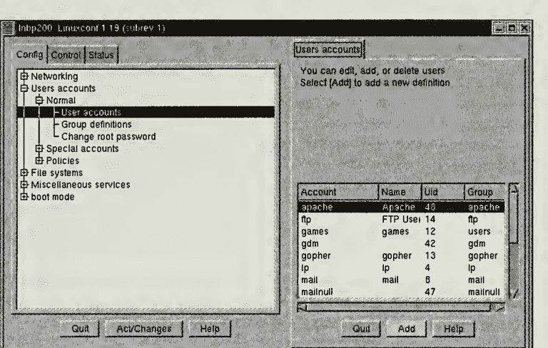

# 图 27-1

初始 `Linuxconf` 窗口

要将我自己添加为新用户，我遵循以下步骤：

1. 点击 `User accounts`（用户账户）按钮，然后点击 `Normal`（普通）标签页显示的 `User accounts` 按钮。这会导致 `Linuxconf` 显示 `Users Accounts`（用户账户）对话框，如图 27-2 所示。

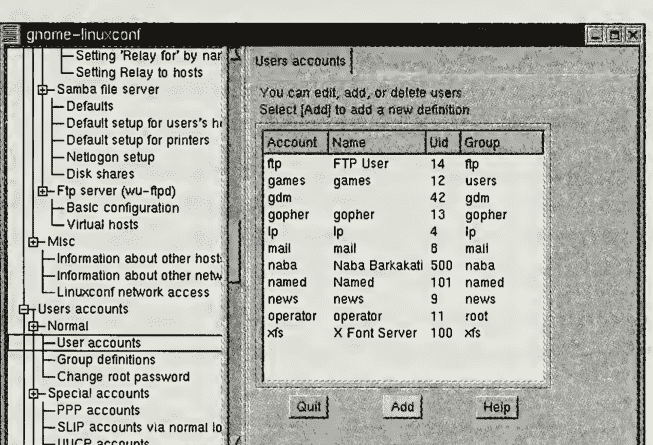

# 图 27-2

`Linuxconf` 中的 `Users Accounts` 对话框

2. 点击图 27-2 所示 `Users Accounts` 对话框中的 `Add` 按钮。这将弹出用户账户创建对话框。
3. 填写所需信息。特别是输入登录名称和主目录。对于我的账户，我使用主目录 `/home/naba/`。你可以为你的账户使用类似的主目录。填写所有字段后，我点击 `Accept`（接受）按钮。如果 `/home/naba` 目录不存在，`Linuxconf` 将创建该目录。
4. `Linuxconf` 工具显示 `Changing password`（更改密码）对话框，我在其中为新账户输入密码并点击 `Accept` 按钮。该工具随后要求我重新输入密码以确认。注意，如果密码是字典中可用单词的组合，`Linuxconf` 将拒绝你的密码。输入密码后，点击 `Users Accounts` 对话框中的 `Quit`（退出）按钮。
5. 要退出 `Linuxconf`，点击主窗口中的 `Quit` 按钮。`Linuxconf` 工具显示 `Status of System`（系统状态）对话框，询问你是否要激活更改。点击 `Activate Changes`（激活更改）按钮完成任务并退出 `Linuxconf`。

## 探索 Linuxconf 执行的其他任务

在这里，你探索 `Linuxconf` 可以执行的各种任务的标签和按钮。然而，本节对 `Linuxconf` 的涵盖远未完全。要彻底涵盖 `Linuxconf` 的功能并解释它可以执行的每项任务，还需要更多页面。

> `Linuxconf` 在 Web 上有自己的主页：http://www.solucconf.qc.ca/linuxconf/。访问主页了解有关 `Linuxconf` 的最新新闻并阅读在线文档。


`Linuxconf` 在主 `Linuxconf` 窗口中包含一个 `Help`（帮助）按钮。此 `Help` 按钮提供了 `Linuxconf` 的概述。点击 `Help` 按钮时，会出现 `Help` 窗口。

大多数 `Linuxconf` 窗口也包含 `Help` 按钮，提供与你正在执行的任务相关的上下文相关信息（例如，帮助——图 27-2）。按下 `Next Help` 按钮可以阅读有关当前任务的帮助信息。在某些情况下，`Linuxconf` 可能会显示该项目的帮助文件尚未编写。

# 第 28 节

# 监控系统性能

### 章节清单

- 使用 `top` 工具
- 使用 GNOME 系统监视器
- 使用 `vmstat` 工具
- 使用 `hdparm` 程序和其他检查磁盘性能和使用情况
- 探索 `/proc` 文件系统

一项关键的系统管理任务是跟踪 Linux 系统的性能。通过收集如中央处理器（CPU）使用率、物理内存使用率、虚拟内存（交换空间）使用率以及硬盘使用情况等信息，你可以监控 Linux 系统的整体性能。Linux 提供了许多用于监控一个或多个此类性能参数的工具。本节向你介绍这些工具，并向你展示如何理解这些工具。

## 使用 CPU 进程

要查看 CPU 进程——即占用大部分 CPU 时间的进程——你可以使用 `top` 程序。要启动该程序，请从 GNOME 桌面选择主菜单 ⇨ 程序 ⇨ 实用程序 ⇨ Top，或者在终端窗口（控制台）中输入。该程序会显示一个进程列表，按 CPU 使用率从高到低排序排列，并包含内存和交换空间使用等其他信息。图 28-1 显示了该程序的典型输出。


图 28-1
查看顶部 CPU 进程

`top` 工具每五秒更新一次显示。你可以让它在窗口中持续运行，以便监控 Linux 系统的状态。按 `Ctrl+C` 或关闭终端窗口即可退出。

输出屏幕的前五行提供了系统的摘要信息。以下是这五行显示的内容：

1. 第一行显示当前时间、登录的用户数以及三个负载平均值（过去 1、5 和 15 分钟内准备好运行的进程平均数）。
2. 第二行显示进程总数以及这些进程的状态。
3. 第三行显示 CPU 使用率——进程占用 CPU 时间的百分比、系统（内核）进程使用的百分比以及 CPU 空闲的百分比。
4. 第四行显示物理内存的使用情况——内存总量、已用内存、空闲内存、共享内存以及分配给缓冲区（例如用于从磁盘读取）的内存。
5. 第五行显示虚拟内存（或交换空间）的使用情况——交换空间总量、已用量、空闲以及缓存量。

在 `top` 的输出屏幕中（图 28-1），摘要信息下方的表格列出了当前进程，按 CPU 使用率从高到低排序。在终端窗口中输入 `man top` 可以学习表格显示中列标题的含义。

如果某个进程的 `RSS` 字段远小于 `SIZE` 字段，说明该进程使用的物理内存相对于其需求过少。这会导致进程在运行时发生大量的内存交换（swapping）。你可以使用 `vmstat` 工具（你将在本节中尝试使用）来了解系统是如何交换内存的。


## 使用 GNOME 系统监器

与文本模式工具一样，GNOME 系统监器工具也能让你根据当前运行的进程数量、内存使用情况和系统可用磁盘空间查看系统负载。要运行该工具，请选择主菜单 -> 程序 -> 系统 -> 系统监器。你也可以在窗口中输入 `gnome top` 来启动该工具。该工具启动并在主窗口的“进程”（`Processes`）选项卡中显示输出，如图 28-2 所示。

此输出代表了你在文本模式控制台或终端窗口中输入时看到的内容。事实上，`top` 工具在输出中使用的列标题也是这些。作为文本模式工具，显示会不断更新以反映系统的当前状态。你可以按 CPU 使用率从高到低的顺序看到当前进程。

GNOME 系统监器窗口有两个标签，分别显示内存使用情况和文件系统的可用空间。要查看这些信息，请点击相应的标签。例如，要查看进程如何使用内存，请点击“内存使用”（`Memory Usage`）标签。

窗口底部显示 CPU 使用率摘要、系统运行时间（系统已运行多久）以及负载平均值（过去 1、5 和 15 分钟内准备好运行的进程平均数）。


## 332 周日下午


图 28-2
在 GNOME 系统监器中查看进程

负载平均值反映了系统的繁忙程度。除了 `top` 和 GNOME 系统监器程序外，你还可以通过 `uptime` 命令获取负载平均值，如下：

```
11:40am up 2 days, 57 min, 3 users, load average: 0.13, 0.23, 0.27
```

输出显示了当前时间、运行时长、用户数以及三个负载平均值。负载平均值大于 1 意味着有许多进程正在竞争 CPU 时间。此时你可以查看顶部 CPU 进程，并尝试逐一个运行进程（而不是同时运行所有）。

## 使用 vmstat 工具

使用 `vmstat` 工具时，你可以获取系统整体使用的摘要信息。要查看以 5 秒为间隔的平均系统使用情况，请输入以下命令（第二个参数表示 `vmstat` 应该输出的总行数）：

```


## 第 28 节—监控系统性能

`vmstat 5`

```
vmstat 5
```

表格输出被分为六类信息，如输出第一行的字段所示。第二行显示了这六类对应的类别。

| 字段 | 描述 |
| :--- | :--- |
| `Procs` | 进程数 |
| `Memory` | 内存量 |
| `Swap` | 交换量 |
| `Io` | 输入/输出 |
| `System` | 关于系统 |
| `Cpu` | `CPU` 时间百分比 |

### 磁盘空间使用示例

- 4.0k `/var/log/vbox`
- 20k `/var/log/samba`
- 4.0k `/var/log/sa`
- 576k `/var/log`

`du` 命令显示每个目录占用的磁盘空间，最后一行显示该目录使用的总磁盘空间。如果你只想查看目录占用的总空间，请使用 `-s` 选项输入命令。例如，输入 `du -sh /home` 将得到类似下方的输出：

- 16M `/home`

### 探索 `/proc` 文件系统

你可以通过查阅名为 `/proc`（也称为进程文件系统）的特殊文件系统的内容，来学习关于你的 `Linux` 系统的许多知识。它可以帮助你监控关于系统的各种信息。事实上，你甚至可以通过 `/proc` 文件系统更改内核参数，从而修改你系统的行为。

`/proc` 文件系统并不是磁盘上的真实目录，而是内存中的数据结构集合（由 `Linux` 内核管理），它在用户面前表现为一组目录和文件。

你可以像访问其他目录一样访问并导航于 `/proc` 文件系统，但你必须知道各种文件的命名才能解释这些信息。通常，你可以使用 `cat` 或 `more` 命令查看 `/proc` 中文件的内容；这些文件的内容提供了有关系统某些方面的信息。

与任何目录一样，你可能想从查看 `/proc` 的详细列表开始。要这样做，请使用 `ls -l /proc`。在输出中，第一组目录（以行首字母 `d` 开头）是正在在你系统上运行的进程。每个目录对应一个进程，以进程 ID（一个数字）作为其名称。

你还应该注意到列表中有一个名为 `/proc/kcore` 的大文件；该文件代表你系统的整个物理内存。没有物理文件占用你硬盘上的该空间，因此请不要尝试删除该文件来回收磁盘空间。


`/proc` 中的 `/proc/cpuinfo` 文件列出了你系统的关键特性，例如处理器类型和浮点处理器信息。你可以通过输入 `cat /proc/cpuinfo` 来查看处理器信息。例如，以下是我在我的系统上输入此命令时看到的内容：

```
processor : 0
vendor_id : GenuineIntel
cpu family : 5
model : 4
 name : Pentium MMX
stepping : 3
cpu MHz : 199.616468
div_bug : no
hlt_bug : no
sep_bug : no
f00f_bug : yes
fpu : yes
fpu_exception : yes
cpuid level : 1
wp : yes
flags : fpu vme de pse mscr mxe cx8 mm
bogomips : 398.13
```


此输出来自一个 200MHz 的 `Pentium MMX` 系统。该列表显示了处理器的许多有趣特性。注意以 `fdiv_bug` 开头的行。还记得臭名昭著的 `Pentium` 浮点除法错误吗？该错误存在于名为 `fdiv`（用于浮点除法）的指令中。因此，`fdiv_bug` 行指示特定的 `Pentium` 是否存在该错误（幸运的是，我的系统处理器没有）。

`/proc/cpuinfo` 文件的最后一行显示了处理器的 `BogoMips`，这是由 `Linux` 内核在启动时计算的。`BogoMips` 是 `Linux` 内部用于校准时间延迟循环的东西。

表 28-2 总结了 `/proc` 文件系统中的一些文件，你可以从中获取有关你 `Linux` 系统的信息。你可以在你的系统上查看其中一些文件以了解它们的内容。

表 28-2 中显示的所有文件并不都在你的系统中。`/proc` 文件系统的内容取决于内核配置和已加载的驱动模块（而这些模块又取决于你 `PC` 的硬件配置）。


## 第 28 节—监控系统性能

### 表 28-2：`/proc` 中的一些文件和目录

| 文件名 | 内容 |
| :--- | :--- |
| `/proc/apm` | 关于高级电源管理 (`APM`) 的信息 |
| `/proc/bus` | 包含每种总线类型（如 `PCI`）特定信息的目录 |
| `/proc/cmdline` | 启动 `Linux` 内核使用的命令行（例如，`auto BOOT_IMAGE=linux ro root=303`） |
| `/proc/cpuinfo` | 关于 `CPU`（微处理器）的信息 |
| `/proc/devices` | 系统中可用的块设备和字符设备 |
| `/proc/dma` | 正在使用的 `DMA`（直接内存访问）通道的信息 |
| `/proc/filesystems` | 支持的文件系统列表 |
| `/proc/ide` | 关于 `IDE` 的信息 |
| `/proc/interrupts` | 关于中断请求 (`IRQ`) 编号及其如何使用它们的信息 |
| `/proc/ioports` | 关于输入输出 (`I/O`) 端口的信息 |
| `/proc/kcore` | 物理内存映像 |
| `/proc/msgs` | 内核消息 |
| `/proc/loadavg` | 最近 1、5、15 分钟的平均负载 |
| `/proc/locks` | 内核锁 |
| `/proc/meminfo` | 关于内存和交换空间的信息 |
| `/proc/misc` | 杂项信息 |
| `/proc/modules` | 已加载模块列表 |
| `/proc/net` | 网络信息 |
| `/proc/mounts` | 挂载的文件系统 |
| `/proc/partitions` | 分区 |
| `/proc/rtc` | 关于实时时钟 |
| `/proc/scsi` | 关于 `SCSI` 设备 |
| `/proc/stat` | 统计信息 |
| `/proc/swaps` | 交换空间 |
| `/proc/sys` | 内核参数（这是调整系统的方法） |
| `/proc/version` | 内核版本 |
| `/proc/uptime` | 系统运行时间 |

| 表 28-2（续） | 文件名 | 内容 |
| :--- | :--- |
| `/proc/net` | 网络信息 |
| `/proc/mounts` | 挂载的文件系统 |
| `/proc/partitions` | 分区 |
| `/proc/pci` | 关于 `PCI` 设备 |
| `/proc/rtc` | 关于实时时钟 |
| `/proc/scsi` | 关于 `SCSI` 设备 |
| `/proc/sound` | 关于音频驱动 |
| `/proc/stat` | 统计信息 |
| `/proc/swaps` | 关于交换空间 |
| `/proc/sys` | 内核参数（这是调整系统的方法） |
| `/proc/version` | 系统版本 |

### 复习

本节向你展示了如何关注你的 `Linux` 系统。你学会了使用 `top`、`GNOME Monitor`、`vmstat` 和 `uptime`。你还学习了检查可用磁盘空间的命令。最后，你探索了包含大量信息的 `/proc` 文件系统。


### 自测

1. `top` 工具的作用是什么？
2. 如何启动 `GNOME Monitor`？
3. `vmstat` 工具提供什么信息？
4. 运行什么程序可以检查从硬盘读取数据的速度？
5. 使用什么命令从 `/proc` 文件系统查看中断请求 (`IRQ`)？

### 课程


## 维护系统安全

### 课程清单

- 建立安全策略
- 保护系统
- 监控系统安全

作为系统管理员，你必须担心你 `Linux` 系统的安全性。对于独立系统或在孤立局域网 (`LAN`) 中使用的系统，你必须确保用户不会有意无意地修改、删除或破坏系统文件。如果你的 `Linux` 系统连接到互联网，你还需要保护系统免受未经授权的访问。入侵者（黑客）通常伪装成用户、窃取或破坏信息，甚至拒绝你自己的系统（拒绝服务）。本节简要介绍了保护 `Linux` 系统的一些关键方面。正如你所看到的，`Linux` 已经有了你维护系统安全的工具。

> 要想了解更多关于 `Linux` 安全的知识，请参考 `Linux Security HOWTO`：`http://metalab.unc.edu/pub/linux/docs/HOWTO/Security-HOWTO`。另一个很好的资源是《`Linux`管理员安全指南》，你可以在线阅读：`http://www.securityportal.com/lasg/`


# 建立安全策略

保护 `Linux` 系统的第一步是制定安全策略。安全策略是你的指南（或规则），规定了你允许用户（以及通过互联网的访问者）在 `Linux` 系统上执行哪些操作。安全级别取决于你如何使用 `Linux` 系统，以及如果有人未经授权访问你的系统，将面临多大的风险。

如果你是任何类型机构的 `Linux` 系统的系统管理员，你可能希望在制定安全策略时让管理层和用户也参与进来。显然，你不能制定一个让用户无法在系统中工作的严苛策略。另一方面，如果你正在创建或使用该机构的数据，你就必须制定一个旨在保护数据不泄露给外部人员的策略。换句话说，安全策略应该在用户需求与保护系统的需求之间取得平衡。

对于独立的 `Linux` 系统或偶尔连接到互联网的家庭系统，安全策略可以仅仅列出你想要在系统上运行的互联网服务以及你计划在系统中设置的用户账户。对于任何任何规模较大的机构，你可能在连接到互联网的局域网上有一个或多个 `Linux` 系统——最好有一个防火墙（一种控制局域网与互联网之间网络协议 (`IP`) 数据包流的设备）。在这种情况下，安全策略通常涉及以下领域：

- **身份验证**：谁可以访问系统？密码的最小长度和复杂度是多少？必须多久更改一次密码？用户空闲多久后会被自动注销？
- **授权**：不同类的的用户在系统上可以做什么？谁可以拥有 `root` 密码？
- **数据保护**：哪些数据必须被保护？谁有权访问数据？
- **互联网访问**：对用户（来自局域网）访问互联网有哪些限制？用户访问哪些互联网服务（如 `Web`、互联网即时聊天 `IRC` 等）？是否有网络防火墙？
- **互联网服务**：每个 `Linux` 系统允许哪些互联网服务？是否有文件服务器？邮件服务器？`Web` 服务器？每种类型的服务器上运行哪些服务？作为桌面工作站的 `Linux` 系统上运行哪些服务（如果有）？

# 第 29 节——维护系统安全

- **安全审计**：谁来测试安全性是否足够？多久测试一次安全性？在安全测试中发现的问题如何处理？
- **职责**：谁负责维护安全性？谁监控日志文件和审计跟踪以发现未经授权访问的迹象？如果发生安全泄露，必须通知谁？

本节的其余部分将向你展示增强和维护 `Linux` 系统安全的一些方法。

# 保护系统

一旦定义了安全策略，你就可以根据该策略来保护系统。具体步骤取决于你想对系统做什么——系统是服务器还是工作站，以及必须有多少用户能够访问该系统。保护系统和维护安全的通用步骤如下：

- 在安装 `Linux` 时，仅选择你系统需要的组。不要安装不必要的软件。例如，如果你的系统是工作站，你就不需要安装大多数服务器（`Web` 服务器、新闻服务器等）。
- 创建用户账户，并确保所有密码都是密码破解程序无法“猜到”的强密码。正如你很快将学到的，`Linux` 包含了你执行强密码所需的工具。
- 在系统上仅启用你需要的互联网服务。特别，不要启用配置不当的服务。在本节稍后的部分，你将学习如何启用和禁用互联网服务。
- 定期检查各种日志文件，寻找被入侵或尝试入侵的迹象。这些日志文件位于你系统的 `/var/log` 目录中。
- 一旦发布修复程序，通过定期访问你发行版的网站并安装更新来获取安全新闻。

# 保护密码

从历史上看，`UNIX` 密码存储在 `/etc/passwd` 文件中，任何用户都可以读取。例如，一个典型的 `root` 用户的旧式 `/etc/passwd` 文件条目如下：


`root:t627NWDK1K8Su:0:0:root:/bin/bash`

字段由冒号 (:) 分隔，第二个字段包含加密形式的密码。为了检查密码是否有效，登录程序会对用户输入的明文密码进行加密，并将密码与 `/etc/passwd` 文件的内容进行比较。如果匹配，则允许用户登录。（注：此处原文中存在大量重复的 OCR 错误，翻译时已去重并修正逻辑）。

# 周日下午

MD5 相比于旧式密码加密的另一个优势是，旧密码长度限制为最多八个字符；而新密码（使用 MD5 加密）可以更长。即使 `/etc/shadow` 文件落入他人之手，更长的密码也更难被破解。

`/etc/shadow` 文件中使用 MD5 加密的一个线索是加密密码长度的增加，以及 `$1` 长度的增加，如下例示例条目的第二个字段所示：

```
root:$AAAAN$ynEU5hbZlbpy9cgGof1bf0t0:11077:99997:-1:134540356
```

可插认证模块（PAM）在 Linux 系统上提供了一种灵活的用户身份验证方法。通过配置文件中的设置，你可以即时更改身份验证方法，而无需修改验证用户身份的登录和密码等程序。

Linux 广泛使用 MD5，配置文件位于你系统的 `/etc/pam.d` 目录中。请检查你系统中该目录的内容。

## 保护网络服务安全

对于连接互联网的 Linux 系统（甚至是位于 TCP/IP 局域网的系统），一个重大的威胁是有人可能利用许多网络服务之一来访问你的系统。每项服务——如邮件、Web 或 FTP——都需要运行一个服务器程序来响应通过 TCP/IP 网络发送的客户端请求。其中某些服务器程序存在漏洞，可能允许攻击者进入你的系统——甚至可能拥有 `root` 权限。幸运的是，Linux 自带了一些你可以使用的设施来使网络服务更加安全。

潜在的入侵者可以使用端口扫描工具——通过在某个端口建立 TCP/IP 连接并寻找响应——来检查你的系统上运行着哪些网络服务器。入侵者可能会利用一个或多个服务的任何已知漏洞来获取你系统的访问权限。

## Linuxconf, COAS, YaSt2

为了避免系统出现不必要的入口，请确保只运行你需要的网络服务。你可以使用 Red Hat 的 Linuxconf、Caldera 的 COAS 以及 SuSE 的 YaSt2 来启用或禁用服务，这些都是图形化的系统管理实用程序。如果你从附带的光盘安装了 Red Hat，可以按照以下步骤使用 Linuxconf。以 `root` 身份登录，并在 GNOME 桌面上选择 Main Menu > System > Linuxconf。然后点击 Control 选项卡上的 Control Panel 按钮。在下一个对话框中，点击标记为 Control service activity。这将显示一个包含当前服务状态的列表。使用 COAS 或 YaST2 控制服务，请在打开配置实用程序后选择服务。

要控制某个服务，请点击服务的名称。例如，要控制 Web 服务器，点击 `httpd`。这会导致 Linuxconf 显示 Service httpd 对话框，你可以控制 Web 服务器。

如果你不想让 Web 服务器在启动时自动启动，请点击 Automatic 按钮将其关闭。要立即停止 Web 服务器，请点击 Stop。

## xinetd 服务器

除了 Web 服务器 (`httpd`)、邮件服务器 (`sendmail`) 和域名服务器 (`named`) 等独立服务器外，你还需要单独配置另一个服务器。另一个服务器 `xinetd`（互联网服务器守护）负责启动许多其他网络服务，如 FTP、TELNET 等。这里简要介绍一下 `xinetd` 服务器的安全方面。

`xinetd` 服务器在启动时会读取名为 `/etc/xinetd.conf` 的配置文件。随后，它会引用存储在 `/etc/xinetd.d` 目录中的配置文件告诉 `xinetd` 哪些端口需要监听，以及为每个端口提供哪些服务。你可以浏览你系统 `/etc/xinetd.d` 目录下的文件，以找到 `xinetd` 设置用于运行的服务类型。其中某些服务提供了入侵者可能用于破解你系统的信息。你应该通过在相应服务的配置文件中放置 `disable = yes` 来关闭这些服务。要了解更多关于 `xinetd` 配置文件的信息，请在终端窗口提示符处输入 `man xinetd.conf`。

根据你对系统的需求，你可能想要禁用所有的 `ftp` 和 `telnet` 服务。在修改 `xinetd` 配置文件后，你必须通过输入以下命令重启 `xinetd` 服务：

```
/rc/init.d/xinetd restart
```

此命令会显示以下消息：

```
Stopping xinetd: [ OK ]
Starting xinetd: [ OK ]
```

`xinetd` 的另一个安全特性是使用 TCP wrapper 设施来启动各种服务。TCP wrapper 为网络服务提供了访问控制设施。TCP wrapper 可以启动 FTP 和 TELNET 等其他服务；但在启动服务之前，它会查询 `/etc/hosts.allow` 文件，查看请求服务的主机是否允许使用该服务。如果 `/etc/hosts.allow` 中没有关于该服务的记录，TCP wrapper 将检查 `/etc/hosts.deny` 文件查看是否应该拒绝该服务。如果两个文件都存在，TCP wrapper 将检查 `/etc/hosts.deny` 文件查看是否应该拒绝服务。如果两个文件都是空的，TCP wrapper 默认允许访问。

你可以使用 `/etc/hosts.allow` 和 `/etc/hosts.deny` 文件来控制访问。例如，要允许特定主机，可以在 `/etc/hosts.allow` 中添加一行：

```
192.168.1.100: ALL
```

要拒绝所有主机，可以在 `/etc/hosts.deny` 中添加一行：

```
ALL: ALL
```

## 监控系统安全

许多系统应用程序（包括某些服务器）都使用 `syslog` 功能写入日志信息。在 Linux 系统上，日志文件位于 `/var/log` 目录。确保只有 `root` 用户可以读写这些文件。你应该定期监控日志文件：

- `/var/log/messages` 包含各种日志。
- `/var/log/secure` 包含 `telnet` 和 `ftpd` 等报告。
- `/var/log/maillog` 包含 `sendmail` 的报告。
- `/var/log/xferlog` 包含 FTP 传输。

遗憾的是，没有易于查看这些日志文件的工具。最好的方法是浏览它们。你可以通过输入 `vi /var/log/messages` 以只读模式打开日志文件，这可以防止意外覆盖日志文件。在编辑器中，你可以搜索感兴趣的日期并从中开始浏览。

由于许多潜在入侵者使用端口扫描工具尝试对你系统的已知端口建立 TCP/IP 连接，你应该寻找指示来自未知主机（由名称或 IP 地址指示）的连接的消息。对于此类接入的网络访问，你应该浏览 `/var/log/secure` 文件。例如，当我连接到我的 Linux 系统时，`/var/log/secure` 文件中的一行：

```
Aug 16 20:18:19 nlb200 xinetd[511]: START: ftp pid=23824 from=192.168.1.40
```

`ftp` 单词旁边出现了 `pid=23824`。这是 FTP 服务器启动时的进程 ID。你可以使用这个数字查看 `/var/log/messages` 文件中对应的消息，以查看此尝试是否成功。以下是我检查此操作的示例：

```
grep "[23824]" messages
```

输出结果告诉我用户 `naba` 成功登录，并在稍后清理了 FTP 会话。

```
Aug 16 20:30:01 nlb200 ftp[23824]: FTP LOGIN FROM nlb200 [192.168.1.40], naba
Aug 16 20:30:22 nlb200 ftp[23824]: FTP session closed
```


同样，你应该分析在这些日志文件中发现的任何可疑消息。这些好奇的外部人员试图访问你系统的尝试之多可能会让你感到惊讶。

## 安全新闻与更新

关注最新的安全警报，你可能希望每天访问以下一个或多个站点：

- CERT 协调中心，地址为：`http://www.cert.org/`
- 计算机事件建议能力 (CIAC)，地址为：`http://www.ciac.org/`
- 国家基础设施保护中心，地址为：`http://www.nipc.gov/`

如果你有访问互联网新闻组的权限，可以定期浏览以下新闻组：

- `comp.security.announce`：一个受管理的新闻组，包含来自 `CERT` 安全的公告。
- `comp.security.unix`：一个包含 `UNIX` 安全问题讨论的新闻组，包括与 `Linux` 相关的项目。

如果你倾向于通过电子邮件接收安全更新，也可以注册或订阅各种邮件列表。

- `FOCUS-LINUX`：填写 `http://www.securityfocus.com/focus/linux/list/subscribe.html` 中的表单，以订阅此关注 `Linux` 安全问题的邮件列表。
- `Cert Advisory` 邮件列表：向 `cert-advisory-request@cert.org` 发送电子邮件，主题行写上 `SUBSCRIBE myname@mysisp.com`。（请将 `myname@mysisp.com` 替换为你的电子邮件地址。）

最后，你应该检查你所用发行版的网站，以获取可能修复任何已知安全问题的更新。


### 复习

本节向你介绍了 `Linux` 系统的安全。你学习了为中大型组织建立安全策略的重要性。接下来，本节展示了如何保护你 `Linux` 系统上的两个关键元素——密码和网络服务。最后，我通过讨论了如何检查日志文件以寻找入侵尝试的迹象，以及如何跟进任何最新的安全新闻。由于本节无法涵盖许多安全主题，我为你提供了一些额外的在线资源，你可以从那里学习更多关于保护你 `Linux` 系统的知识。

### 自测

- 1. 为什么要建立安全策略？（参见“建立安全策略”。）
- 2. 什么是影子密码？（参见“影子密码”。）
- 3. `MD5` 指的是什么？（参见“可插身份模块”。）
- 4. 为什么要保护互联网服务？（参见“保护互联网服务”。）
- 5. 你应该定期检查哪些日志文件以寻找入侵尝试的迹象？（参见“监控系统安全”。）

### 课程


## 从可用资源获取帮助

### 课程清单

- 使用帮助查看器
- 使用命令
- 查找在线 `HOWTO` 文件
- 访问其他 `Linux` 资源


剩余 30 分钟

现在你已经学习了许多 `Linux` 知识，但由于时间限制，这本书还有很多内容无法涵盖。为了确保你在需要时能找到帮助，本周末的最后一节将向你介绍各种 `Linux` 资源，如果你在特定主题上遇到问题，这些资源可以提供更多信息。某些帮助直接就在你的系统上可用，但你可以在互联网上找到更多资源。

## 使用帮助查看器

`GNOME` 和 `KDE` 桌面都带有帮助查看器——`Gnome Help Browser` 和 `KDE Help`——用于查看在线帮助信息。你将在本节中尝试这两个帮助查看器。

## GNOME 帮助浏览器

从 `GNOME` 桌面，选择主菜单中的帮助系统，或点击 `GNOME` 面板上的问号图标来启动 `Gnome Help Browser`。`Gnome Help Browser` 提供了一个类似于网络浏览器的图形界面，通过该界面你可以访问 `Linux` 系统和互联网上各种形式的文档。`Gnome Help Browser` 的首页将帮助信息组织为几个类别：

- `GNOME User’s Guide`（GNOME 用户指南）是一个指向如何使用 `GNOME` 桌面的信息的超链接。
- `GNOME Documents`（GNOME 文档）是一个链接，提供某些 `GNOME` 和游戏文档的访问。
- `Man Pages`（手册页）链接指向在线手册页（简称为 `man pages`）。
- `Info Pages`（信息页）链接指向 `GNU` 实用程序（主要是软件开发工具）的在线文档。

通常，你会在 `man` 页中查找帮助。要查看可用 `man` 页的目录，点击 `Man Pages` 链接。目录按类别以及每个类别内的字母顺序组织。你可以通过点击页面开头类别列表中的链接跳转到某个类别。例如，点击 `Administration`（管理）将带你进入系统管理命令。然后你可以在该类别向下滚动，并点击你想要获取更多帮助的命令。你应该探索 `man` 页的目录并查看你感兴趣的其他 `man` 页。

你也可以通过点击发行版链接访问你所在发行版的网站。

## KDE Help

从 `KDE` 桌面，你可以通过选择 `KDE Help` 或点击图标来启动 `KDE Help`。该应用程序具有类似浏览器的界面，通过该界面你可以帮助信息。当它启动时，`KDE Help` 显示若干组织成类别的链接。有关于了解 `KDE` 项目的链接。

## 从可用资源获取帮助

为了充分利用 `KDE`，第三组链接提供了 `man` 页和 `info` 页的访问，就像 `Gnome Help Browser` 一样。第三组链接之一允许你使用一个或多个关键词搜索在线帮助。

要查找手册页，点击 `System page`（系统页）链接。这会带你进入目录了 `User Commands`（用户命令）、`File Formats`（文件格式）和 `System Administration`（系统管理）等章节。点击章节标题查看该章节的项目列表。然后你可以点击特定项目阅读手册页。例如，为了了解更多关于 `xinetd` 配置文件的信息，选择 `xinetd.conf`。`KDE` 然后显示手册页。

你也可以直接从 `KDE` 桌面访问你发行版的网站。

## 使用 Linux 命令获取帮助

虽然通过图形界面浏览帮助很方便，但在终端窗口输入 `Linux` 命令时，你经常需要帮助。

另一个你应该知道的技巧是，大多数 `Linux` 命令都有一个帮助选项。通常，如果你通过 `--help` 选项调用命令，该命令会打印帮助信息。这些信息至少包含命令接受的命令行。通常，帮助信息可能超过一个屏幕，因此你应该将输出通过管道传递给 `more`，如下所示：

```
--help | more
```

## man 命令

假设你模糊地记得某个命令的名字，但不记得应该输入的精确语法。这种情况正是 `man` 命令派上用场的时候。通过 `man` 命令，你可以查看 `Linux` 命令的手册页，然后正确使用该命令。

你必须记住这个命令来查找在线帮助。例如，要查看 `modprobe` 命令的手册页，请在终端窗口输入以下命令：

```
man modprobe
```

## 周日下午

该命令将逐页显示帮助信息页。按空格键移动到下一页。按 `b` 向后移动一页。若要在 `man` 页（帮助手册）中查找特定单词，按正斜杠 `/`，输入单词并按回车。例如，搜索单词 `"debug"` 需输入 `/debug` 并按回车。读完 `man` 页后，按 `q` 返回到 `Linux` 命令行提示符。

## whatis 命令

如果你不想阅读整个 `man` 页，可以使用 `whatis` 来阅读命令的在线摘要。例如，这里是如何使用 `whatis` 查看 `modprobe` 命令的简要描述：

```
whatis modprobe
```

在接后的输出中，数字 (8) 表示 `modprobe` 命令所列出的 `man` 页章节。

(8) - 可载模块模块的高级处理

你应该尝试使用 `whatis` 命令来查看其他命令的单行描述。
你可以使用 `shell` 的通配符功能和 `whatis` 命令来探索各种系统目录中的文件，如 `/bin`、`/sbin`、`/usr/bin` 等。只需切换到感兴趣的目录，并输入 `whatis *` 即可查看该目录下程序的单行描述。（`whatis` 显示显示可用信息的程序。）你可以通过输入以下命令来探索 `/sbin` 目录：

```
cd /sbin; whatis * | more
```


## `whatis` 命令

如你所见，以下输出是当前目录下所有程序的字母顺序列表，以及可用的单行描述。

- `arp (7)` - Linux ARP 内核模块
- `arp (8)` - 操作系统 ARP 缓存
- `askrun`: 无适当的内容
- `badblocks (8)` - 搜索设备的坏块
- `cardctl (8)` - PCIA 卡控制工具
- `cdrmag (8)` - PCIA 设备管理器
... 剩余的输出内容未显示...

如果某个程序没有可用信息，`whatis` 命令将显示一条 "nothing appropriate"（无适当的内容）的消息。

## `apropos` 命令

当你知道命令名称时，`man` 和 `whatis` 命令非常有用。如果你不知道命令的确切名称，可以使用 `apropos` 命令通过关键词（即使是单词的一部分）来搜索命令。例如，如果你记得命令中包含 `probe` 单词，可以输入以下 `apropos` 命令进行搜索：

```
apropos probe
```

在这种情况下，以下搜索结果显示了三个候选命令，并附有简要描述。你可以选择执行你所需操作的命令。

- `modprobe (8)` 可载模块的高级处理
- `pnprobe (8)` 扫描 Isa 以查找 PNP 声卡
- `SuperProbe (ix)` 探测并识别已安装的视频硬件

> `apropos` 会显示长长的命令列表，滚动速度快到无法阅读，你可以输入 `apropos 关键词 | more` 来一次显示屏幕输出。

## 查看在线 HOWTO 文件

你可以参考的另一种在线文档形式是 HOWTO 文件列表，你可以通过 Netscape Communicator 中打开 URL `http://www.redhat.com/mirrors/LDP/` 来访问该列表。该 URL 中的 `LDP` 指的是 Linux 文档项目（Linux Documentation Project），在该网页上，你可以找到常见问题（FAQs）和 HOWTO 的链接。你可以点击 HOWTO 链接并下载（或阅读）多种格式的 HOWTO 文档，包括文本格式和 HTML 格式。例如，如果你点击查看文本格式的 HOWTO，网页浏览器将显示超过 170 个文件的 HOWTO 列表（图 30-1）。

每个 HOWTO 文件都包含关于 Linux 某些领域的信息，例如如何在 Linux 中配置硬件或如何创建启动盘。要查看这些 HOWTO 文件中的任何一个，点击名称，网页浏览器将加载全文。例如，图 30-2 显示了点击 `CD-Writing`（CD 刻录）HOWTO 的结果，它解释了如何使用安装在 Linux 系统中的刻刻光（CD-R）设备刻录 CD。


### 图 30-1
通过 GNOME 桌面面的 LDP 图标访问的 HOWTO 文件部分列表

你应该浏览 HOWTO 文件列表（图 30-1）并查看一个或多个你感兴趣的内容。

> **提示** 在 HOWTO 文件列表的末尾，你会看到一个名为 `mini` 的文件夹。点击该链接查看 mini-HOWTO 列表，它们涵盖了更多更具体的的话题。


## 第 30 节——从可用资源获取帮助


### 图 30-2
浏览 CD-Writing HOWTO 文件的文本版本

## 访问其他 Linux 资源

除了我描述的在线帮助，其他几个资源可以提供更多关于特定主题。资源位于互联网；那里你可以获取有关 Linux 的最新信息。本节的其余部分将为你介绍这些 Linux 资源。我没有提供长长的 URL 列表，而是展示了几个你可以作为搜索起点的关键网站。

## 网页

如果你浏览互联网，可能会注意到不少提供 Linux 相关信息的网页。一个很好的起点是以下 Linux 文档项目（该 URL 中的 `LDP` 指的是 Linux 文档项目，在该网页上你可以找到常见问题（FAQs）和 HOWTO 的链接）。你可以点击 HOWTO 链接并下载（或阅读）多种格式的 HOWTO 文档，包括文本格式和 HTML 格式。例如，如果你点击查看文本格式的 HOWTO，网页浏览器将显示一个超过 170 个文件的 HOWTO 列表（见图 30-1）。

你可以使用 Netscape Communicator 阅读新闻组。对于新闻组，使用格式为 `news://newserver/newsgroup` 的 URL，其中 `newserver` 是你的互联网提供商提供的域名，`newsgroup` 是你想阅读的新闻组名称。例如，假设你的新闻服务器是 `myisp.com`，你可以在浏览器的位置栏输入以下 URL 来浏览 `comp.os.setup` 新闻组：

要了解 Linux 信息可以访问以下 URL：

```
http://www.linux.org/
```

对于 Red Hat 特定问题，访问 Red Hat 的网站：

```
http://www.redhat.com/
```

对于 Caldera 特定问题，访问 Caldera 的：

```
http://www.calderasystems.com/
```

对于 SuSe 特定问题，访问 SuSe：

```
http://www.suse.com/
```


这些网站提供了诸如更新、硬件兼容性列表和安装指南等信息。

## 网络新闻组

为了跟进 `Linux` 动态，你需要访问以下新闻组：

| 新闻组 | 提供的内容 |
| :--- | :--- |
| `comp.os.linux.admin` | 关于系统管理 |
| `comp.os.linux.advocacy` | 关于推广 `Linux` 的讨论 |
| `comp.os.linux.announce` | 关于 `Linux` 的公告（这是一个审核新闻组，你必须向管理员发邮件） |
| `comp.os.linux.answers` | 关于 `Linux` 的问题与解答 |
| `comp.os.linux.development` | `Linux` 开发 |
| `comp.os.linux.development.apps` | 应用开发 |
| `comp.os.linux.development.system` | 操作系统开发 |
| `comp.os.linux.hardware` | 关于硬件的讨论 |
| `comp.os.linux.help` | 关于 `Linux` 各方面的帮助 |
| `comp.os.linux.misc` | `Linux` 的杂杂话题 |
| `comp.os.linux.networking` | `Linux` 下的网络 |
| `comp.os.linux.setup` | `Linux` 设置与安装 |
| `comp.os.linux.x` | 关于 `Linux` 下 `X` 系统的讨论 |

你也可以使用 `Deja.com` 的搜索页面 `http://www.dejanews.com/home_ps.shtml` 来搜索 `comp.os.linux.setup` 新闻组中的特定项目。

## 存档站点

你可以从全球几个 `FTP` 站点下载 `Linux` 发行版。除了 `Linux` 发行版本身，这些站点还包含许多在 `Linux` 下运行的软件包。

获取最新的 `Linux` `FTP` 站点列表，请访问以下网站：`http://www.linux.org/dist`

## 第 30 节——从可用资源获取帮助

### 复习

本节向你展示了如何在 `Linux` 的各个方面获取帮助。你学会了使用 `Gnome` 帮助浏览器（`Gnome Help Browser`）和 `xman` 手页查看器。你还学会了几个非常有用的命令，如 `man`、`whatis` 和 `apropos`。最后，你熟悉了许多基于互联网的 `Linux` 资源，如 `Web` 页面、`FTP` 存档和两本流行的 `Linux` 杂志。

### 自测

- 1. 你可以使用 `Gnome` 浏览器查看哪些类型的帮助信息？（参见“使用帮助查看器”。）
- 2. 什么是 `xman`？你可以用它做什么？（参见“使用帮助查看器”。）
- 3. 如何查看命令的简要描述？（参见“使用 `Linux` 命令获取帮助”。）
- 4. 你如何访问 `HOWTO` 文件？（参见“查找在线 `HOWTO` 文件”。）
- 5. `Linux` 有哪些新闻新闻组？（参见“互联网新闻组”。）

# 第 6 部分

## 周日下午

- 1. 什么是 `Linuxconf`？你如何从 `GNOME` 桌面启动它？列举一些使用 `Linuxconf` 可以执行的任务。
- 2. 使用 `Linuxconf` 添加新用户账户时，你需要提供哪些信息？
- 3. `Linuxconf` 会检查密码是否为容易猜到的单词吗？
- 4. 你观察哪些信息来监控你的 `Linux` 系统的性能？
- 5. `Linux` 中提供了哪些工具来监控系统性能？
- 6. `top` 工具的目的是什么？
- 7. 什么是“平均负载（`load average`）”？
- 8. 显示 10 秒平均值并打印共 5 行输出的 `vmstat` 命令行。`vmstat` 输出的第一行显示了什么？
- 9. `/proc` 文件系统是什么？它的目的是什么？
- 10. 安全策略的作用是什么？
- 11. 安全策略中涵盖了哪些领域？
- 12. 保护系统和维护的通用步骤有哪些？
- 13. 在 `Linux` 中使密码更安全的安全的两种方法是什么？
- 14. 显示你作为 `root` 身份输入的命令，以确保用户 `mary` 在 30 天后被提示更改密码。
- 15. 解释 `TCP wrapper` 程序如何为 `xinetd` 启动互联网服务提供访问控制功能。
- 16. 你可以在 `Linux` 的图形桌面上访问哪两个帮助查看器？通过这些帮助查看器程序你可以查看什么？
- 17. 显示你用于读取 `tr` 命令单行描述的命令。你输入什么命令来查看 `tr` 命令的手册页？
- 18. 你可以使用什么命令通过关键词搜索其他命令？
- 19. 什么是 `HOWTO` 文件？假设你的系统已连接到互联网，你如何从 `GNOME` 桌面访问它们？
- 20. 你可以使用哪些在线和纸质资源来查找有关 `Linux` 的特定信息？

# 附录

## 部分复习答案

本附录包含了本“周末速成课程”中每个部分末尾复习问题的答案。将这些内容视为微测试，旨在帮助你准备最后的考试——`CD` 上的技能评估测试。

## 周五晚上复习

- 1. 我可以从那里收到的任何说明书中找到关于 `PC` 硬件的信息。如果 `PC` 目前正在运行 `Windows 95/98`，我可以通过双击控制面板中的“系统”图标，然后点击“设备管理器”选项卡来收集部分信息。从那里，我可以查看安装在 `PC` 中的特定设备的信息。
- 2. 红帽磁盘允许我启动一个初始版本的 `Linux`，红帽安装程序在该版本下运行。要创建启动盘，我将软盘插入 `A` 驱动器，打开 `MS-DOS` 窗口，并运行 `CD-ROM` 中 `\dosutils` 目录下的 `write.exe` 程序。当提示输入启动镜像名称时，我指定 `\images\boot.img` 文件并按回车。
- 3. 通常，新 `PC` 的硬盘有一个 `Windows 95/98` 使用的单一分区。如果我决定在 `PC` 上保留 `Windows`，我必须对硬盘进行分区以为 `Linux` 文件系统腾出空间。我可以通过两种方式对硬盘进行分区：备份所有内容并使用 `FDISK` 命令进行破坏性的重新分区，或者使用 `FIPS` 程序以非破坏性的方式为新分区留出空间。我使用 `FIPS` 程序，因为这比破坏性重新分区更简单。我还可以使用像 `PartitionMagic` 这样的工具非破坏性地为 `Linux` 创建新分区。
- 4. 红帽安装程序提供了四种安装类型：服务器、`Gnome` 工作站、`KDE` 工作站和自定义。如果我选择服务器类，安装程序将删除所有现有磁盘分区，包括任何现有的 `Windows` 分区。然后它创建一个固定大小的交换分区、一个用于内核的小型 `/boot` 分区、一个较大的根分区、两个用于 `/usr` 和 `/home` 文件系统的更大的分区，以及另一个用于 `/var` 分系统的分区。总而言之，服务器类安装大约需要 `1.6GB` 的磁盘空间。
- 5. `IDE` 磁盘设备是 `/dev/sda`、`/dev/hdb`、`/dev/hdc` 和 `/dev/hdd`。`SCSI` 磁盘设备同样是 `/dev/sda`、`/dev/hdb`、`/dev/hdc` 和 `/dev/hdd`（注：原文此处描述可能有误，通常 `SCSI` 为 `sdb` 等）。原文为 `/dev/sda`、`/dev/hdb`、`/dev/hdc` 和 `/dev/hdd`。`SCSI` 磁盘设备是 `/dev/sda`、`/dev/hdb`、`/dev/hdc` 和 `/dev/hdd`。
- 6. `Linux` 使用交换空间作为虚拟内存。当内核耗尽内存时，可以将数据交换到磁盘。我为此预留至少 `32MB` 的 `RAM`。
- 7. 在 `LILO` 中，我必须指定磁盘挂载点。
- 8. 在安装期间挂载分区，我为分区分配 `Linux` 名称。
- 9. 在用户配置屏幕上，我选择 `/dev/hda`、`/dev/hdb`、`/dev/hdc` 和 `/dev/hdd`。
- 10. 使用红帽 `Linux` 添加一个或多个用户。要添加用户，我在账户屏幕上输入信息。
- 11. 软件包组是多个软件包的集合。我可以通过列表下方的“选择单个软件包”项目来选择包。

## 部分答案

- 12. 在网络配置屏幕上，我点击 `DHCP`。
- 13. 我可以在地图上点击我的地理位置或选择 `UTC` 偏移。在 `UTC` 偏移选项卡上，我可以启用夏令时。
- 14. 为了启动文本模式安装，当我从磁盘启动 `PC` 后，在 `boot:` 提示符处输入 `text`。如果 `X` 系统无法启动且没有图形界面，我可以使用文本模式。
- 15. 如果红帽安装程序检测不到 `PC` 中的 `SCSI` 控制器或网卡，我必须使用专家模式。通过在启动磁盘后出现的初始文本界面 `boot:` 提示符处输入 `expert` 来启动专家模式。
- 16. `SCSI` 适配器或网卡的典型参数是我指定的中断请求 (`IRQ`) 数和 `I/O` 端口地址。我可能还需要指定 `SCSI` 适配器的 `SCSI ID`。例如，对于适配器卡，我可能会指定选项 `aha152x030,11,7`。
- 17. 我登录控制台并运行 `Xconfig` 工具创建一个新的 `X` 配置文件；然后重启系统。
- 18. 水平同步频率是显示器显示水平扫描线的次数，通常以千赫兹 (`kHz`) 为单位。垂直刷新率指定显示器显示整个屏幕的次数。我可以在显示器的说明书中找到这些参数的值。
- 19. 我输入 `dmesg | grep par` 并寻找输出中任何关于并行端口的信息。
- 20. 使用红帽打印系统管理器，我可以设置五种打印机：本地、远程 `Unix`、`SMB/Windows 95/NT`、网络或 `TCP/IP`。为了配置我的 `Linux` 系统打印到 `Windows` 打印机，我选择 `SMB/Windows 95/NT` 打印机类型。

## 周六早上复习答案

- 1. `X` 服务器运行在具有位图显示器、键盘和鼠标的计算机上的进程（计算机程序）。`X` 客户端是需要显示图形输出的应用程序，它们通过与 `X server` 通信来实现。`X server` 控制显示器、键盘和鼠标。`X server` 响应 `X client` 发的命令，这些命令打开窗口并在窗口内绘图。
- 2. `X` 配置文件为 `/etc/X11/XF86Config`。使用 `xf86config` 程序创建新的 `X` 配置。
- 3. 如果 `X` 屏幕部分工作，我按 `Ctrl+Shift+F1` 切换到文本控制台并在文本提示符处以 `root` 身份登录。然后运行 `xf86config` 创建一个新的 `X` 配置文件。之后，我按 `Ctrl+Alt+F7` 回到图形登录界面，并按 `Ctrl+Alt+X` 杀死 `X server` 以强制其使用新配置文件重启。
- 4. 数据首先被发送到打印队列，这是一个在作业发送到打印机之前保存它们的区域。当打印作业发送到打印机时，它会通过一个过滤器程序将其转换为打印机能理解的语言。常见的打印机语言有 `ASCII`、`Postscript`、`PCL3`、`PCL 4` 和 `PCL 5`。
- 5. 阶梯现象（`Stair-stepping`）是一种打印输出问题，其特征是文本行跨页面并分布在不同的行上，类似于楼梯。要纠正这个问题，请在 `Printconf` 程序中选择正确的阶梯选项。
- 6. `Linux` 文件系统提供了系统中所有存储单元的统一模型。文件系统有一个根目录，用正斜杠（`/`）表示。然后是文件和目录的层级结构。文件系统的部分可能存在于不同的驱动器或硬盘的不同分区上。
- 7. 我输入 `cd` 并按回车键切换到我的主目录。我输入 `ls -la` 查看所有文件的详细信息。
- 8. 我输入 `find /usr/doc -name "README*"` 来定位 `/usr/doc` 目录下所有以 `README` 开头的文件。
- 9. 我用分号 `;` 分隔命令；例如，`cd /usr/doc; ls -la`。若要在多行中继续命令，我在每行末尾输入反斜杠（`\`）并按回车。
- 10. 命令 `ls -1 /usr/doc |` 提供了一个将一个命令的输出作为另一个命令的输入的示例。
- 11. `Shell` 的 `I/O` 重定向功能允许我将输出重定向到文件，或将标准输入重定向自文件。

# 部分复习答案

- 12. 别名（`alias`）是命令的替代名称。要查看当前别名列表，我输入 `alias`。我通过命令 `alias docdir='cd /home/httpd/html'` 定义别名 `docdir`，并使用命令 `unalias docdir` 取消定义。
- 13. 要将日期设置为 2001 年 12 月 31 日，我在命令行输入 `date -s 123122302001`。
- 14. 要找到所有名称中包含 `gnome` 的进程，我在命令行输入 `ps ax | grep gnome`。
- 15. 我命令行输入 `ps ax | grep gpm` 来查找 `gpm` 进程的进程 ID。我输入 `kill -9 [process ID]`。
- 16. 我首先输入 `split -b 1024k filename part.aa`、`part.ab`、`part.ac` 和 `part.ad`。我将它们拷贝到四块磁盘上，每块一个。稍后，我使用以下命令合并文件：

```


17. 学习在 Linux 中编辑文件是非常重要的，因为许多系统配置文件恰好是文本文件。我在控制台上使用 `vi` 编辑器。

18. 我输入：

```bash
-p: /etc/inittab
```

要在第 16 行前输入文本，我首先输入 `16` 并按回车。然后我输入 `i` 并按回车。我输入文本行，然后输入 `wq` 保存文件并退出。

19. 我输入 `vi /etc/inittab` 开始编辑文件。然后我输入 `:16` 到第 16 行。我按下并开始输入该行。在我按回车结束该行后，我输入 `:wq` 保存文件并退出。

20. 要剪切一行，我输入 `dd`。要粘贴该行，我输入 `p`。

## 周六下午复习答案

1. COM1 的 Linux 设备名称为 `/dev/ttyS0`，COM2 的设备名称为 `/dev/tty1`。COM1 使用 IRQ 4 和 I/O 端口 `0x3f8`，而 COM2 使用 IRQ 3 和 I/O 端口 `0x2f8`。

## 附录 A

2. 我在终端窗口中输入 `minicom` 来启动 Minicom 程序。然后我输入调制解器拨号命令 `ADDT` 加上要通过 Minicom 拨出的电话。为了作为普通用户运行 Minicom，我必须以 root 身份登录，并假设调制解器在 COM1 上，输入 `chmod +rw /dev/tty0` 赋予所有人该设备的写权限。

3. 我输入 `dmesg | grep ttyS* | grep ttyS /var/log/messages` 并在命令输出中寻找串口设备名称 `ttyS0` 或 `ttyS1`。

4. 以太网是连接到单根电缆的两个或多个计算机之间移动数据包的标准方法。你需要以太网卡和电缆来连接到以太网局域网。10Base2 指使用纤细灵活的同轴电缆作为数据传输介质是以太网。10BaseT 是通过类似于普通电话线的非屏蔽双绞线的以太网。检查我的 Linux 系统是否加载了以太网驱动程序，输入 `dmesg | grep eth0` 并查找我 PC 中关于以太网卡的消息。

5. 常见的 TCP/IP 诊断命令有 `/sbin/ifconfig`、`/sbin/route` 和 `netstat`。我使用 `/sbin/ifconfig` 命令查看网络接口是否运行。我使用 `ping` 检查我的 Linux 系统是否有到另一个主机的网络路径。

6. 一 TCP/IP 配置文件是 `/etc/hosts`、`/etc/hosts.conf`、`/etc/resolv.conf`、`/etc/hosts.allow` 和 `/etc/hosts.deny`。`/etc/resolv.conf` 文件包含名称服务器的 IP 地址。

7. 家庭或小型办公室使用拨号 PPP 连接到互联网。DSL 或电调制解器提供了始终连接，其数据传输速率远高于拨号上网。正如名称所示，拨号上网需要我通过我想要连接的调制解器拨出。

8. 拨号上网让我的 PC 连接到互联网，任何应用程序（包括 浏览器）都可以通过拨号链路进行通信。PPP 代表点点协议（Point-to-Point Protocol），它是在两个进程之间建立 TCP/IP 通信的协议。要建立 PPP 连接，需要用户名、密码以及域名服务器（DNS）的 IP 地址。在我的系统中，我使用 `pppd` 和 `chat` 来建立连接。

## 部分复习答案

10. 我可以使用 Linux 的 IP 伪装（masquerading）功能与局域网内的其他人共享单个互联网连接。我使用 `ipchains` 软件（`/sbin/ipchains`）来设置伪装。

11. TELNET、FTP、电子邮件和万维网是一些互联网服务。端口是 1 到 65535 之间的数字，唯一标识 TCP/IP 链路的端点。`/etc/services` 文件包含服务的信息。

12. 为了提供电子邮件，我需要邮件传输代理和邮件用户代理。简单邮件传输协议（SMTP）是用于系统间传输电子邮件的 TCP/IP 协议。

13. Apache 服务器配置文件位于 `/etc/httpd/conf` 目录。`/var/log/httpd` 目录是 Apache 服务器日志文件（访问和错误日志）所在地。`/etc/rc.d/init.httpd` 脚本在 Linux 系统启动时启动 `httpd` 进程。

14. 当我使用 FTP 与远程系统传输文件时，必须先登录远程系统。使用匿名 FTP 时，我使用用户名匿名，任何人都可以通过 FTP 从系统传输文件。在我的系统中，我在 `/home/ftp/pub` 目录下放置其他用户可以使用匿名 FTP 下载的文件。

15. 为了设置网络文件系统（NFS）文件服务器，我首先通过在 `/etc/exports` 文件中列出导出一个或多个目录。然后我使用 Linuxconf 启动 NFS 服务器。在每个客户端系统上，我使用 `mount` 命令挂载 NFS 服务器。

18. 下命令将 `/dev/hda2` 文件系统挂载到挂载点 `/mnt/dos`：

```
mount -t vfat /dev/hda2 /mnt/dos
```

Linux 每次系统启动时会自动挂载 `/dev/hda2`，我向 `/etc/fstab` 文件添加了以下行内容：

```
/dev/hda2 /mnt/dos vfat defaults 0 0
```

19. 通过 mtools 软件包，我可以使用常用的 DOS 命令来访问 DOS 软盘和 DOS 文件系统。我输入 `rpm -q mtools` 来检查系统中是否安装了 mtools。mtools 的配置文件是 `/etc/mtools.conf`。

20. 以下是 mtools 命令：`mdir`、`mcd`、`mcopy`、`mformat` 和 `mdel`。这些命令是模仿 MS-DOS 命令设计的。以下命令将 DOS 软盘中所有具有 `.doc` 扩展的文件复制到硬盘上的当前目录：

```
mcopy "a:*.doc" .
```


# 周六晚间复答案

1. 与 `Windows 95/98/NT` 一样，`GNOME` 桌面窗口底部有一个状态栏，并有一个类似于 `Windows` 开始按钮的主菜单按钮。此外，我可以像在 `Windows 95/98/NT` 中那样，在桌面上放置文件和图标。

2. 我通过 `GNOME` 控制中心（`GNOME Control Center`）来自定义 `GNOME` 桌面的外观和感受。我可以自定义背景、窗口管理器，或者为用户界面选择用户。

3. `Sawfish` 是一个窗口管理器。它是 `GNOME` 的默认窗口管理器。要配置 `Sawfish`，我在 `GNOME` 控制中心菜单中选择“桌面窗口管理器”（`Desktop Window Manager`）。

4. 要将默认桌面从 `GNOME` 切换到 `KDE`，我选择主菜单中的“桌面切换工具”（`Desktop Switching Tool`），然后选择 `KDE` 作为桌面。在 `KDE` 中，我也可以使用相同的切换工具将默认桌面切换回 `GNOME`。

5. 我使用 `KDE` 控制中心来自定义 `KDE` 桌面的各个方面。

# 练习答案

6. 要从 `GNOME` 桌面选择并尝试屏幕保护程序，我通过点击 `GNOME` 面板上的工具箱图标启动 `GNOME` 控制中心，并在控制中心的树状菜单中选择“桌面”（`Desktop`）->“屏幕保护程序”（`Screensaver`）。

7. “锁定屏幕”意味着在输入密码之前，屏幕保护程序不会关闭。在 `GNOME` 中配置屏幕保护程序时，我勾选“需要密码”（`Require Password`）复选框并启用它。然后屏幕保护程序就会锁定屏幕。

8. 我选择 -> `KDE` 控制中心。然后我在 `KDE` 控制中心的树状菜单中选择“桌面”（`Desktop`）->“屏幕保护程序”（`Screensaver`）。从那里我可以选择并配置屏幕保护程序。

9. `AisleRiot`、`Gnome-Stones` 和 `GNOME` 麻麻将是 `GNOME` 中的游戏。`AisleRiot` 是一个纸牌游戏程序，可以玩 30 种不同的纸牌游戏，包括接龙（`Freecell`）和纸牌牌（`Klondike`）等著名游戏。

10. 扫雷（`Minesweeper`）、纸牌（`Patience`）和四棋（`Shisen-Sho`）是 `GNOME` 中的游戏。

11. 我通过 `Ctrl+Alt+F1` 切换到文本模式控制台。然后登录 `root` 并输入 `/usr/sbin/sdconfig` 来启动声音配置程序。然后我按照程序的提示配置声卡。

12. 要播放音频 CD，我可以使用 `playcd` 或 `GNOME` 或 `KDE` 中的 CD 播放器。为了允许普通用户播放音频 CD，我登录 `root` 并输入 `chmod o+r /dev/cdrom`。

13. `GNOME` CD 播放器从 `CDDB` 获取歌曲——这是一个互联网上的 CD 数据库。假设有活跃的网络连接，`GNOME` CD 播放器会从 CD 数据库下载信息。

14. `GIMP` 和 `Pix` 是 `Red Linux` 自带的两个图像处理程序。`GIMP` 是用于查看图像以及执行照片修复、图像合成和图像创建任务的程序。`Pixpaint` 是模仿 `MacPaint` 的位图绘画程序。

15. 我使用 `Ghostview` 查看 `PostScript` 文档。

16. 电子表格、拼写检查器、日历和计算器是本书 `Red Hat Linux` CD-ROM 中的一些办公实用程序。CD-ROM 不包含任何完整的办公效率套件。

17. 电子表格应用程序的名为 `Gnumeric`。`Gnumeric` 的默认文件格式是 `XML`（可扩展标记语言）。`Gnumeric` 可以与 `Microsoft Excel` 交换文件。

# 附录 A

18. `ispell report.txt`

19. `Linux` 版 `WordPerfect 2000`、`Linux` 版 `Applicware Office` 和 `StarOffice` 是 `Linux` 的商业办公套件。可以通过访问它们的网站了解更多关于这些商业应用程序。

20. `StarOffice` 是一个跨平台解决方案。它包含了用于文字处理的 `StarOffice Writer`、用于电子表格的 `StarOffice Calc`、用于演示的 `StarOffice Impress` 以及用于数据库的 `StarOffice Base`。

# 周日晨复答案

1. 启动时的 `init` 进程取决于运行级别、`/etc/initab` 文件的内容以及许多 shell 脚本（位于 `/etc/rc.d` 目录及其子目录中）。

2. 我寻找第三字段中包含 `initdefault` 关键字的行（字段之间用冒号分隔）。该行的第二个字段指定了我们系统的默认运行级别。

3. `init` 进程根据运行级别顺序运行 `/etc/rc.d` 脚本。

4. 许多开源软件包以源码的形式分发。

5. 开源软件通常以压缩包（也称为 `tarballs`）的形式分发。

6. 下载 `tar` 包后，我寻找带有 `README` 或 `INSTALL` 字样的文件以获取如何构建的说明。

7. `RPM` 指红帽软件包管理器（`Red Hat Package Manager`），这是一个用于打包必要文件的系统。

# 练习答案

要检查系统是否安装了某个软件包，我输入命令 `rpm -q package_name`，其中 `package_name` 是 `RPM` 的名称。例如，检查是否安装了 `samba`，我输入 `rpm -q samba`。

8. 我使用图形界面程序或 `rpm` 命令行工具安装 `RPM`。要使用命令行工具安装 `RPM`，我切换目录到 `RPM` 目录（通常为 `/mnt/cdrom/RedHat/RPM`）并输入 `rpm -i filename`，其中 `filename` 是 `RPM` 的名称。

9. 一个典型的 `RPM` 格式为 `Free86-3.3.6-20.i386.rpm`。到第一个横线之前的内容都是 `RPM` 名称（`Free86`）；两个横线之间的数字构成了版本号（`3.3.6`）；下一个数字是 `RedHat` 的发布版本（`20`）；下一个扩展名（`i386`）表示这是一个 `RPM` 文件。

10. 在对内核进行补丁处理、直接在内核中添加 `SCSI` 支持或为某些实验性硬件添加支持后，可能会重新编译 `Linux` 内核。

11. 我登录 `root` 并使用命令 `/mnt/cdrom/RedHat/RPM` 挂载 CD-ROM，然后输入以下命令：

```
cd rpm -ivh kernel-source*
```

12. 为了重新编译内核，必须配置内核、内核、制作模块并安装内核和其他几个文件。

13. 我可能想在晚上备份文件、晚上下载大文件，或者在未来的某个时间给自己发送邮件提醒。我可以使用命令提交要执行的命令。我可以使用 `crontab` 功能按间隔自动运行程序。

14. 关于调度单个任务的示例，假设我想在晚上 23:35 执行 `/usr/local/bin/ppp-off` 脚本；我登录 `root` 并输入以下命令：

```
at 23:35

/usr/local/bin/ppp-off
```

（按下 `Ctrl+D`）

15. 我首先创建一个包含我要定期执行的命令的 shell 脚本。准备一个包含我想要执行该 shell 脚本的时间信息的文本文件。然后通过 `crontab` 命令提交此文件。

# 附录 A

16. 我创建 `/etc/at.allow` 文件，其中包含允许提交一次任务的用户名。对于周期性任务，我创建 `/etc/cron.allow` 文件，其中包含允许使用 `crontab` 命令提交周期性任务的用户名。

17. 软磁盘、`SCSI Zip` 磁盘和 `SCSI` 磁带是我用来备份文件的某些介质。软磁盘驱动器的设备名称为 `/dev/fd0`，`SCSI Zip` 驱动器为 `/dev/sda`（假设它是第一个驱动器），`SCSI` 磁带驱动器为 `/dev/st0`。

18. 我可以使用 `tar` 工具备份文件和目录。要备份 `SCSI` 磁带驱动器上的整个文件系统，我输入：

```
tar cvf /dev/st0 /
```

19. 为了将 `/home/share` 目录下的几个大文件备份到多块软磁盘上，我使用以下命令：

```
tar cvm /dev/fd0 /home/share
```

20. 为了在单个磁带上存储多个归包，我使用非回绕磁带设备，并使用如 `tar cvf /dev/nst0 /home` 的命令，然后使用类似的 `tar` 命令逐一个创建一个归包。我可以使用以下命令回绕磁带：

```
mt -f /dev/nst0 rewind
```

我可以使用以下命令跳过一个归包：

```
mt -f /dev/nst0 fsf 1
```


# 周日下午回顾答案

1. `Linuxconf` 是一个 X Windows 界面，我可以用它执行许多系统管理任务，如添加用户账户、挂载 CD-ROM 驱动器和配置拨号 PPP 连接。要启动 `Linuxconf`，我在 GNOME 桌面上选择主菜单 (Main Menu) ⮕ `Linuxconf`。
2. 我输入登录名、用户主目录和密码。
3. `Linuxconf` 会检查密码是否包含容易猜到的词汇。
4. 我查找 CPU 使用率、物理内存使用率、交换空间使用率以及硬盘使用率等信息，以监控系统性能。

# 部分练习答案

5. Linux 包含了 GNOME 系统监视器、`top` 和 `vmstat` 等工具来监控系统性能。
6. `top` 工具用于查看系统性能的图形化表示。
7. “平均负载”(load average)是指过去几分钟内准备好运行的进程平均数。通常，系统监视器监控过去 1、5和15 分钟的平均负载。
8. `vmstat 10` 命令行显示 10 秒的平均值并打印共 5 行输出。`vmstat` 的第一行输出显示自上次重启以来的平均值。
9. `/proc` 文件系统不是磁盘上的真实目录，而是数据结构的集合。Linux 内核管理这些数据结构，它们在用户看来表现为一组目录和文件。`/proc` 的目的是允许用户访问有关 Linux 内核和当前在系统上运行进程的信息。
10. 安全策略提供了我可以应用以保护系统安全的规则。
11. 安全策略应涵盖以下领域：用户如何进行身份验证；用户可以做什么；哪些数据必须受到保护；允许运行哪些 Internet 服务；以及谁负责维护和审计安全。
12. 通用步骤是安装我需要的所有包、创建强密码的用户账户、仅启用必要的 Internet 服务，并定期检查日志文件以寻找入侵尝试的迹象。我还应该关注安全新闻并安装 Red Hat 的更新。
13. 影子密码 (Shadow passwords) 和 MD5加密是 Linux 中密码更安全的两种方式。
14. 要让用户在30天后提示更改密码，在以 root 登录时输入 `chage -M 30`。
15. `xinetd` 使用 TCP wrapper 程序启动 Internet 服务。如指定，`xinetd` 启动 Internet 服务，我使用非回绕磁带设备，并使用如 `tar cvf /dev/nst0 /home` 的命令，然后使用类似的 `tar` 命令逐一个创建一个归包。我可以使用以下命令回绕磁带：`mt -f /dev/nst0 rewind`。我可以使用以下命令跳过一个归包：`mt -f /dev/nst0 fsf 1`。
16. GNOME Help 和 KDE Help 是两个我用来查看 Linux 帮助信息的工具。
17. 我输入 `man tar` 查看命令的描述。
18. 我可以使用 `apropos` 命令通过关键词搜索其他命令。
19. 每个 HOWTO 文件包含关于 Linux 的信息。
20. 我可以访问 Linux 网站如 `http://www.linux.org/`。我可以订阅 Linux Journal 和 Linux Magazine 以保持 Linux 动态。

# 附录

## 光盘里有什么？

随书的光盘包含 Red Hat Linux 7.1。它们还包含 Linux 周日回顾测试。以下部分简要解释 `tar` 命令查看。

## Red Hat Linux 7.1

光盘包含 Red Hat Linux 7.1 的二进制文件，以及 Linux 2.4.0 内核，这是本书编写（2001 年冬季）最新的 Linux 内核版本。除了 Linux 内核，Red Hat Linux 还包含了大量的 Linux 软件包。以下是 Red Hat Linux 7.1 光盘上的重要软件包：

* 带有主流 PC 硬件驱动模块的 Linux 内核 2.4.0，包括 IDE/ESI、PCI 设备、某些 USB 设备和 CD-ROM 驱动器
* 用于设置设备（如键盘和鼠标）和服务的完整工具集
* 基于 XFree86 软件包的 GNOME 和 KDE 图形界面
* 用于 Internet、局域网和内部网的完整 TCP/IP 网络
* 使用 PPP 或拨号串口程序将 PC 连接到 Internet 服务商的工具
* 完整的 Internet 应用包，包括电子邮件 (send-mail, elm, pine, mailx)、新闻 (inn, tin, trn)、网络即时聊天 (ircii)、TELNET、FTP 和 NFS
* Apache Web 服务器 1.3.12（将你的 PC 变为 Web 服务器）和 Netscape Communicator 4.74（用于浏览网络）
* 用于 Microsoft Windows 连接的 Samba 2.0.7 管理器
* 多种文本编辑器 (GNU Emacs 20.7, vim)
* 图形和图像处理软件，如 The GIMP、XPoint、Ghostscript、Ghostview 和 ImageMagick
* 编程语言（GNU C 和 C++ 2.96, Perl 5.6.0, Tcl/Tk 8.3.1, Python 1.5.2, GNU AWK 3.0.5）和软件开发工具（GNU Debugger 5.0, CVS 1.10.8, GNU Bison 1.28, flex）
* 完整的标准工具集
* 如象棋、麻将、扫雷和纸牌牌等游戏

## Linux 周日回顾测试

光盘包含 60 道单选题及答案，按主题分类，用于评估你所学的内容。

# 索引

* 参数（命令行选项）, 102–103
* Arkela (Knox Software) 实用程序, 311
* 星号 (*)
  * 用于可执行文件，96, 97
  * 用于匹配任意数量的字符，104–106
* `at`, 144, 162–302
  * 用于工业架构 (ISA) 总线的 `at` 总线
  * 用于链接文件的 `at` 符号 ($)，96
  * `at`, 303
* `atrm`, 304
* 音频 CD, 215–236
* 审计，安全, 343
* 身份验证, 37–39, 342–346
* 授权, 342
* `AUTOEXEC.BAT`, 312
* 自动备份, 316
* 自动分区, 255

## B

* 后台命令, 109–110
* 桌面背景, 216–217–220
* 后备份并恢复文件, 309–317
  * 同时也调度作业
  * Arkela (Knox Software) 实用程序, 311
  * BRU (EST) 实用程序, 311
  * 商业实用程序, 311
  * `cronab`, 316
  * `find`, 316
  * 增量备份, 311–316
  * LINE-TAR (Star Software 实用程序), 311
  * 媒体, 310–317
  * 多线程, 314–315
  * 磁带回卷设备, 314–315
  * 单值, 312–313
  * 策略, 309–311
  * 磁带归档程序, 311–316
* 反斜杠 ($) 和回车换行，103–105
* `bash` 壳, 101–110
* `/bin`, 102
* 別名, 108–109, 112
* 用于后台命令的安培符 (&), 109
* 后台命令, 109–111
* 反斜杠 ($) 和回车换行，103
* `cat`, 103–113
* 合并命令, 103–104
* 命令格式, 102
* 命令历史记录, 106–107
* 命令行, 102
* 命令行选项（参数）, 102–103
* 补全命令, 105
* 多行继续命令, 103–104
* 错误信息, 104
* 用于重复命令的感叹号 (!),107
* GNU 命令行选项, 103
* 用于重定向的大于号 ($),104
* `grep`, 102, 113
* 历史, 106
* 用于重定向的输入/输出 (i/o), 104
* 用于重定向的小于号 ($), 104
* 回调命令, 107
* 重定向命令和输出, 104
* 重复命令, 107
* 保存命令的输出,
* 用于连接命令的分号 (;), , 103
* 命令中的空格, 102
* 标准输入/输出, 104
* `stdernr` (标准错误), 104
* `stolin` (标准输入), 104
* 停止命令 (`Ctrl+Z`), 110
* 切换虚拟控制台 (`Ctrl+Alt+F2`), 110
* 命令中的制表符, 102
* 用于连接命令的垂直 (v) 或管道, 104
* 虚拟控制台 (`Ctrl+Alt+F2`), 110
* 通配符命令, 105–106
* 基础输入输出系统 (BIOS), 9, 10, 12
* 二进制, 271
* BIOS. 因为基础输入输出系统
  * 映射显示器, Window, 67–68
* BNC T型连接器, 173
* 磁盘
  * 配置 Linux, 以及 32–33, 43
  * 创建, 12–13
  * 内核构建, 290, 299
  * 使用开始安装, 18–19
  * 提示, 33
  * 启动行, 257–267
* `/etc/init.d`, 258–259
* `/etc/rc.d/`, 24–67
* `/etc/xpre.md`, 263
  * 启动管理器启动, 263
* `init` (所有进程), 257–264
* 内核, 257
  * 运行级别和 `init`, 258–264
  * 壳脚本和 `init`, 258
  * 启动命令, 264–267
  * 尝试新的运行级别, 263–264
* 引导加载程序。参见 Linux
* 用于匹配单个字符的方括号 ([]) ,105, 106
* 浏览器, 126
* BRU (EST) 实用程序, 311
* 缓冲区, 125, 129
* 编译软件包。参见软件
* 构建内核, 294–295
* 总线支持, 7
  * 通用网关 (CGI), 168
  * 通信。参见拨号网络；配置；网络文件系统 (NFS)；带 Samba 的服务器
  * 紧读光内存 (CD-ROM), 10–11

## C

* 线缆, 140, 172
* 计算器, 245–247
* Caldera, 82–244, 234, 360
* 日历命令, 116–117
* 取消的任务, 304
* 硬盘容量, 9
* 游戏, GNOME, 228–229
* `cat`, 103, 113
* `cd`, 94–95
* cd 数据库 (CDB) 在网上, 235–26
* CD 播放器, 235–236
* 安装 CD-ROM, 192
* CDE. 数据库, 70
* 中央处理器 (CPU), 7, 330–332
* 协调中心, 150
* CGI. 通用网关,
  * 更改目录, 94–99
  * 文件权限, 97, 112
  * 文件所有者, 114
  * 象棋游戏, GNOME, 230
* 子进程, 112
* 压缩包, 270
* `comp.security.announce`, 350
* `comp.security.unix` (CIAC), 350
* `CONFIG.SYS`, 12
* 配置, TCP/IP, 179–183
* 配置脚本, 273–274, 275
* 配置内核, 292–294
* 配置 Red Hat Linux, 31–44
* 配置 Window, 68–76
* 配置启动, 32–43
* 完成提示, 33
* 完成安装, 41–43
* 协调世界时 (UTC), 36–37
* 自定义配置, 52
* 动态主机配置 (DHCP), 35
* 防火墙配置, 36
* 格林威治时间 (GMT), 37
* 水平同步频率, 42–50
* 互联网协议 (IP) 选择, 35
* 网络文件系统 (NFS), 186, 187
* 软件包组选择, 39–41
* 密码设置和验证, 37–39
* 私有 LAN, 35
* Red Hat 包管理器 (RPM), 39
* 影子密码, 39–344
* 超用户 (root), 37–38

* 配置 Red Hat Linux (连续) 时间, 36–37
* 传输控制协议/网协议 (TCP/IP) 配置, 34, 35
* 用户账户添加, 37, 38
* 显示器的垂直同步（刷新）率, 42, 49, 50
* 显卡, 41
* Windows 95/98/2000, 以及, 32
* X Window (XFree) 配置, 41–42
* 连接速度设置, 156
* 多行继续命令, 103–104
* 控制中心：桌面, 59, 216–222
* Linuxconf 的控制选项, 324, 327
* 协调世界时 (UTC), 36–37
* `COPY`, 27
* 拷贝命令, 93, 112
* 核心操作系统。参见内核 (新)
* Coral, 249
* `cpd`, 98, 112
* CPU, 中央处理器破解, 341
* 创建
  * 新目录, 99
  * 新文件, 93, 99
  * 分区, 25–29
* `Crbat` 热启动, 12–13
* CTAR (Unitrends 软件公司) 稳定性, 31
* 当前目录, 94, 95
* 自定义配置屏幕, 42
* 自定义安装, 22, 39
* 自定义桌面, 215–220, 215–222
* 守护进程, 156
* 链链 Think 平板, 123
* 数据保护, 342
* 数据传输率, 150, 172
* 日期时间命令, 115–117
* 死键选项, 20
* 默认桌面, 219–220
* 默认网关, 178
* 删除文件, 93, 98, 108–113
* 桌面切换器, 219–220
* 桌面。参见 *GNU 网络对象模型环境 (GOME)*: X Window (Free86)
* 串口设备检测, 141–142
* 设备
  * 内核构建和支持, 292–293
  * 名称，网络, 175
  * 名称，磁盘分区, 23
* `dt`, 120, 334
* DHCP。参见动态主机配置
* 诊断命令, TCP/IP, 177–179
* 使用 Minicom 拨号, 142
* 配置工具, 151–152
* 拨号访问, 149–159。参见网上；配置；网络
* 配置 Linux 以及 34
* 连接速度设置, 156
* 数据传输率, 150
* 定义, 150
* 配置, 101–152
* 断开点对点 (PPP) 连接, 157
* 域名服务器 (DNS), 154
* 回显, 158
* GNU 对象模型
* 互联网控制消息协议 (ICMP), 156
* 互联网服务提供商 (ISP) 提供的信息, 151
* IP 地址, 151, 154
* IP 伪装, 157
* `ipchains`, 158
* 桌面环境 (KDE) 设置点对点 (PPP) 连接, 152–154
* `KPPP` 设置点对点 (PPP) 连接, 152–156
* 点对点协议 (PPP), 150–157
* 路由, 155
* 路由表验证, 155
* 串行线路协议 (SLIP), 150
* 共享互联网连接, 157–158
* 传输控制协议/网协议 (TCP/IP) 网络, 150
* 验证点对点 (PPP) 连接, 155–156
* Red Hat Linux 直接端口打印机, 80
* 目录。参见文件和目录结构
* `def`, 89–91
* 命令行 Linux 命令导航, 94–95
* 空间使用, 120, 334
* `tree`, 24
* 磁盘。参见分区硬盘分区
* 命名, 23
* 性能和使用, 334–335
* 空间使用, 120–121, 334

## 索引

### 387

* Disk Druid 实用程序，22, 25–29
* 显示管理器启动, 263
* 显示文件内容, 103, 113
* `dmemo`, 74
* DNS. 参见域名服务器 (Domain Name Servers)
* GNOME 文档, 354
* 域名服务器 (DNS), 151, 154
* 用于启动 Linux 的 DOS, 10, 12
* DOS/Windows 连接包, 190
* DOS/Windows 文件访问, 201–210
* `/etc/mtcs.conf`, 207
* `/usr/bin`, 206
* 文件名转换, 203
* 文件系统，挂载与访问, 201–204
* 软磁盘，挂载与访问， 204–209
* 软磁盘挂载, 209
* 格式
  * 母针连接器, 140
* 文件和目录结构, 89–100. 另参见 DOS/Windows 文件访问；网络文件系统 (NFS)
* 绝对路径, 94
* 用于可执行文件的星号 (*), 96, 97
* 用于链接文件的 @ 符号 (@), 96
* `cd`, 94–95
* 切换目录, 94–95, 112
* 修改文件权限, 97, 112
* `chmod`, 97, 112
* 复制, 93, 98
* `cp`, 98, 112
* 创建新, 93, 99, 113
* 当前目录, 94, 95
* 删除, 98, 108–109
* 目录定义, 98
* 使用 Linux 命令导航目录, 94–95
* 双点 (.), 用于表示上级目录, 95
* 文件系统定义, 89–91
* 文件所有权转换, 203
* 文件名, 90
* `find`, 99–100
* GNU 网络对象模型环境 (GNOME) 文件管理器, 91–93
* 目录, 94, 95
* K 桌面环境 (KDE) 文件管理器, 58
* 对应的 Linux 命令, 94, 100–112, 113
* `echo`, 158
* `ed` 文本编辑器（行）, 125–129
* EISA. 参见扩展扩展标准架构 (Extended Standard Architecture)
* 电子邮件 (e-mail), 162, 163, 144–166, 350
* 加密, 34–56
* 环境变量, 113
* 错误消息, 104
* `ERRORS`, 17–18
* `eth0` 以太网卡, 147
* 以太网 (Ethernet), 172–174, 175
* 用于重复命令的感叹号 (!), 107
* 专家级安装, 46–47
* 使用 NFS 导出文件, 186–189
* 扩展行业标准架构 (EISA) 总线, 7
* 提取软件, 272, 275

### 388

# 索引

* 文件传输协议 (FTP), 162, 163, 168-169, 262
* 其中的游戏, 228-230
* `ffind`, 99-100, 113, 315-316
* GNOME 扫雷, 231
* FIPS. 第一非描述性交互式分区
* Gnome-石头子游戏, 229
* 防火墙, 96, 348
* `Gnumeric` 电子表格, 243-244
* 第一非描述性交互式分割 (FPS) 实用, 16-18
* 渐变背景, 216-217
* 启动修复项, 81-82
* 软磁盘, 10, 209
* 帮助浏览器, 354
* `FOCUS-LINUX`, 350
* 格式化
* Ical 程序, 244-245
* 软磁盘, 209
* 使用磁盘 RAID 分区, 28-29
* 图标, 92
* GNOME 纸牌龙游戏, 229
* FTP: 文件传输协议
* 全屏 (vi 编辑器), 125, 129-134
* 背景图片, 217
* 信息页 (Info Pages), 354
* 游戏, 228-232
* GDI (Windows 引擎) 打印机, 217
* gBit (GOME 引擎 标题), 123-124
* GOME/GOME RPM 安装, 279
* 启动器小组件, 56
* 获取, 271
* `Ghostscript`, 78-240
* `Ghostview`, 240-241
* 麻将游戏, 230
* GIMP. 参见 GOME 图像处理程序
* 全局, 195-196
* GMT. 参见 GOME 网络对象模型环境
* 主菜单, 56
* 手页 (Man Pages), 354
* 电影文件, 93
* GOME 通用公共许可证 (GPL), 273
* GOME 图像处理程序 (GIMP), 238-239
* GOME 网络对象模型环境 (GOME); 参见 X 窗口 (XFree8)
* 面板, 56
* 点对点 (PPP) 连接, 152
* 电源管理功能, 227
* 预览更改, 217
* 角色, 229
* 背景自定义定制, 216-217
* 计算器, 246-247
* 日历, 244-246
* 纸牌游戏, 228-229
* RPM 查询, 278-279
* 红帽软件包管理器 (RPM), 277-280
* 重命名文件, 93
* CD 播放器应用程序, 235-236
* 象棋游戏, 230
* 命令行, 103
* 中心控制, 212-226
* 复制文件, 93
* 创建新文件, 93
* 定制, 215-220
* 默认桌面更改, 219-220
* 删除文件, 93
* 文档, 354
* 重写设置, 217, 218, 219
* `fishish` 窗口管理器, 219
* 屏幕保护程序, 226-227
* 文件管理器, 91
* 查找文件, 93
* GNOME 纸牌龙游戏, 229
* 系统监器, 331-332
* 文本编辑器 (Gedit), 123-124
* 界面主题, 217-218
* 标题栏自定义, 219
* 故障排除, 52, 53, 54-56
* `twin` 窗口管理器, 219
* 卸载 GOME RPM, 278, 279
* 用户指南, 354
* 验证 GOME RPM, 278
* 查看, 92
* 背景壁纸, 216
* 窗口管理器, 218, 243-244
* GNOME 电子表格, 243-244
* GPL. 通用公共许可证
* 渐变背景, GNOME, 216-217
* 登录选项 (`Ctrl+Alt`), 72, 73
* 用户界面 (GUI). 参见 GNU 对象模型环境 (GOME); K 桌面环境 (KDE); X 窗口 (XFree8)
* 图像管理, 236-241
* 用于重定向的大于 (*), 104
* 格林威治时间 (GMT), 36-37

### 389

# 索引

* `grep`, 102, 106, 113
* GUI (图形用户界面). 参见 GNU 对象模型环境 (GOME); K 桌面环境 (KDE); X 窗口 (XFree8)
* 视频芯片组, 84
* Windows 95/98/2000, 6, 10
* 帮助资源, 353-363
* 帮助器, 353-355
* HOWTO (文件), 357-359
* 安装消息, 19, 20
* Linux 命令, 355-357
* `man`, 355-356
* 新闻组, Internet, 361
* 在线文件, 357-359
* 网页, 360
* 硬盘, 9, 硬件, 9-13
* `AUTOEXEC.BAT`, 12
* 基础输入输出系统 (BIOS), 9, 10
* 硬盘容量, 9
* 只读介质 (CD-ROM), 驱动器, 10-11
* 目录, 94, 95
* 频率, 49-50, 70
* `CONFIG.SYS`, 12
* 用于启动 Linux 的 DOS, 10, 23
* 以太网卡连接, 11
* 扩展标准架构 (ISA) 总线, 7
* 软磁盘驱动器, 10
* 硬盘, 硬件, 61
* 行业标准架构 (ISA) 总线, 7
* 网络连接, 11
* 预订, 6-7
* 局域网 (LAN) 支持, 11
* 随机存取内存 (RAM), 7-8, 25-25
* 连通性, 156, 178-179
* HTML. 超文本标记语言
* 用于以太网, 172-173
* 超文本标记语言 (HTML), 162, 163, 168
* 超文本传输协议 (HTTP), 163
* 超文本传输协议 (HTTPTP), 169
* 微通道架构 (MCA), 7
* 网卡支持, 11
* 性能和内存, 8
* 外围组件接口 (PCI) 总线, 7
* 点对点 (PPP) 支持, 11
* 处理器 (中央处理), 7, 330-332
* I/O. 输入输出端口, 47, 48
* 程序, 244-245
* 小型计算机接口 (SCSI) 控制器, 9, 46-48
* 对称多处理 (SMP) 内核, 7
* VESA 本地总线, 7
* 视频卡, 6, 8
* 桌面图像, 217, 220
* 内存块, 315-316
* 间接, 194-195
* 执行任务, KDE, 222, 257-264
* 输入输出 (I/O) 重定向, 104
* 文件, 272, 274, 275

### 390

# 索引

* 安装 Gnome RPM, 279
* Internet 服务, 291-292
* 内核源文件, 202-203
* 新内核, 296-298
* Samba, 190-191
* 软件, 274, 275
* 安装. Linux 启动: 硬件, 存储；硬盘分区；打印机；启动；编辑器；接口, TCP/IP, 177-178
* 安装软件包. 参见 红帽软件包管理器 (RPM)
* 内部模型, 140
* 国际电信联盟 (ITU), 访问, 安全, 342
* 通信: 服务; 调制解调器 配置; 安全
* Internet 控制协议 (ICMP), 156, 178
* Internet 消息协议版本 4 (IMAP), 165
* Internet 协议 (IP) 地址, 151, 154, 162, 177
* 安装选择, 35
* 伪装, 157-158
* Internet 服务提供商 (ISPs), 165
* Internet 服务, 161-170
* `/etc/httpd.conf`, 168
* `/etc/services`, 164
* `/var/ftp`, 130
* `/var/log/httpd`, 168
* `/var/www/html`, 161
* 匿名文件传输协议 (FTP), 162, 168-169
* 客户端, 162
* 通用网关接口 (CGI) 程序, 168
* 守护进程, 165
* 定义, 164
* 电子电子邮件 (e), 162, 163, 164-166, 350
* 文件传输协议 (FTP), 162, 168-169
* 超文本标记语言 (HTML), 162, 163, 168
* 超文本传输协议 (HTTP), 163
* 超文本传输协议 (HTTPTP), 169
* 取回, 162, 163
* 安装, 164
* Internet 消息访问协议版本 4 (IMAP), 165
* IP 地址, 162
* 邮件传输代理软件, 165
* 邮件用户代理软件, 165, 166
* Web/WWW/新闻工具, 164, 166
* 网络文件系统 (NFS), 163
* 网络新闻传输协议 (NNTP), 163
* 新闻组, 162, 330
* 端口号, 162-164
* 邮局协议版本 3 (POP3), 165
* 用于安装的红帽软件包管理器 (RPM), 164
* 远程访问, 162, 163
* 远程过程调用 (RPC), 163
* 安全, 342, 346-348
* `sendmail`, 165
* 服务器, 162
* 简单邮件传输协议 (SMTP), 163
* `TELNET`, 162, 163
* 统一资源定位符 (URL), 162
* Web 服务器设置, 168
* 世界万维网, 162
* 中断请求 (IRQ), 48, 140
* 内网, 165
* 硬件存储, 6-7
* IP: 网协议 (Internet Protocol)
* `ipchains`, 158
* IRQ. 中断请求
* ISA. 服务行业架构
* ISPs. 参见 Internet 服务提供商
* ITU. 国际电信联盟

## J

任务调度. 参见调度任务

## K
桌面环境 (KDE). 参见 X
* 窗口 (XFramebuffer), 58
* 背景自定义定制, 220-221
* 计算器, 247
* `ncallars`, 244-245
* CD 播放器, 236
* 颜色自定义, 220, 221
* 控制中心, 59, 220
* 定制, 220-222
* 默认更改, 220
* 桌面切换器, 220

# 索引

## 391

* 背景图像，220
* 信息页 (Info Pages)，355
* 执行任务的信息项，222
* 麻将游戏，230
* 手册页 (Man Pages),355
* 扫雷机器人游戏，231
* 在线帮助，58
* 面板 (`panel`),57
* 纸牌游戏 (`Patience` game),232
* 点对点 (PPP) 链接，152-154
* 预览更改，222
* 恢复原始设置，220, 221
* 屏幕保护程序，227-228
* 四线消除游戏 (`Shisen-Some` game)，日期
* 任务执行，222
* 终端模拟，59
* 文本编辑器 (`KEdit`),124
* 主题自定义，220
* 故障排除，56-59
* 虚拟桌面，59
* 背景壁纸，220
* KDE。参见桌面环境
* 内核 (KDE 文本编辑器)，124
* 内核编译，299-300
* root 和，290
* 模块的编译与安装，295-296
* 编译内核，294-295
* 配置内核，294-295
* 定义，257
* 设备代理，292-293
* 挂掉的系统，299
* 安装内核源文件，291-292
* 支持中的链接，291-292
* Linux 加载器 (LILO) 设置，296-298
* `make binary`,295
* `make clean`,294
* `make config`,293
* `make dep`,294
* `make config`,292, 293
* `make modules`,295-296
* `make xconfig`,292, 293
* `make image`,294-295
* 内存限制，268
* 模块化内核，291-292
* 单体内核，291-292
* 实模式和，295
* 原因，290
* 重启系统，298
* 重新编译内核，290
* 系统过大错误，295
* 使用模块，291-292
* `Kimball`, `Spencer`,236
* 设置点对点 (PPP) 链接的 KPPF，152-154


* 局域网 (LAN)，参见局域网
* 语言选择，20, 36
* 启动器小组件，GNOME，56
* LDP。参见 Linux 文档项目
* 用于重定向的链接符号 (+)104
* LILO。Linux 加载器
* 代码行文件，117-118
* 行导向型（文本编辑器），125-129
* 现代端口与串口之间的链接，145
* 支持中的链接，291-292
* Linux 管理员指南，341
* Linux 命令，111-112
* `adduser`,114
* `alias` (别名)，108-109, 112
* `cal`,116, 175
* `cd`,94-95, 112
* `chmod`,97, 112
* `chow`,112
* `cp`,98, 106, 113
* 日期时间命令，115-117
* `df`,120, 334
* `duo`,121, 324-335
* 文件和目录，94-100, 112-123
* 119-121
* `find`,99-100, 113-315-316
* `grep`,102, 106, 117
* 帮助，355-357
* `ls`,95-97, 112
* `man`,222, 352-356
* `kdir`,99, 113
* `more`,98-99, 105, 113
* `mount`,118-120, 182-204
* `mv`,98, 113
* `passwd`,114
* `printenv`,113
* 进程标识 (PID),115
* 进程管理，114-115
* 处理文件命令，113-119
* `ps`,114, 115
* `pwd`,94, 113
* `rm`,98, 108-109, 113
* `rmdir`,113
* `sort`,116
* `split`,118-119
* `su`,114
* `unmount` (卸载)，120
* 用户管理命令，114
* `wc`,117-118
* 内核参数，33
* 硬件支持，10
* 安装，20, 21
* X Window，60-79
* 杀死 (`Ctrl+Alt+Backspace`)，Windows，72

## 392
# 索引

* Linux 文档项目 (LDP)，357, 360
* Linux 加载器的主引导记录 (MBR)，33
* Linux FTP 站点，362, 362
* `Mattis`, `Peter`,236
* 主引导记录 (MBR)。参见主引导记录
* MCA。参见多通道架构
* 内核安装，32-34
* 消息对话，345-364
* 内核编译，296-298
* 备份媒体，310-311
* 故障排除，51-52
* 它和编译内核，295
* Linux 杂志，362
* Linux HOWTO，341
* 消息描述，38-39
* 列出命令，95-97, 112
* 多通道架构 (MCA) 总线，7
* 加载设备，192
* Microsoft Office，249
* 加载平均值，320, 331, 332
* 扫雷机器人游戏，KDE，231
* 局域网 (LAN)。参见拨号上网
* Minicom 组，39
* 调制解调器配置，139-147
* 本地打印机，80
* 配置，34-36
* `/dev`,144
* `/etc/ircd.conf`,144
* `/var/log/messages`,141
* 日志监控，343, 349-350
* 内核，142
* 53-54
* 联网：拨号上网
* 网络文件系统 (NFS)；全球；安全性：Windows
* 带 Samba 服务器
* 配置，34-36
* 硬件支持，11
* 输入/输出系统 (BIOS) 和，53-54
* 检测接口，141-142
* 是，95-97, 112
* 母头连接器，140
* 内部介质，140
* 麻将游戏，230
* 邮件，304
* 中断请求 (IRQ) 数字，140
* 邮件用户软件，165
* 调制解调器与串口之间的链接，145
* 连接器，142-146
* Mail/WWW/News 工具包，164, 166
* 主菜单，GNOME，56
* 输出，140
* `make`,274, 275
* 连接，140
* 宾果游戏，295
* 清理，294
* 配置，292-293
* `dej`,294
* `menconf`,292, 293
* 模块，295-296
* `xconfig`,22, 292-293
* `zimage`,294-295
* `man`,22, 112, 355-356
* `intab`,260
* 手册页，354, 355
* 65, 70
* 手动分区，25
* X Window，701

## 393
# 索引

* 监控性能，329-339
* 监控安全性，348-350
* 单体内核，291-292
* `more`,98-99, 105, 113
* 进程之母 (`init`)，257-264
* `mount`,119-120, 189, 202-204
* 挂载点，24
* 挂载设备，119-120
* DOS/Windows 文件，201-205
* 设备上的文件系统，24
* 网络文件系统 (NFS)，189
* 导出文件，186-189
* 互联网服务，163
* `mount`，189
* 挂载，189
* 用于启动的 `fs` 标签，188
* 启动，189
* 服务控制对话框，187-189
* 共享文件，185-189
* 启动，187-189
* 停止，189
* 验证，187, 188-189
* 网络邻域，196-197
* 网络传输协议 (TCP/IP)，163
* 联网，171-183，另请参见拨号上网
* 联网：传输控制协议/网际协议
* BNC 转接器，173
* 以太网电缆，172
* 细网电缆链链，173
* 数据传输率，172
* `dmesg`,174
* 鼠标
* 硬件输出，130
* 安装，20, 21-22
* X Window，69
* 移动命令，93, 183
* MS-DOS，2
* 工具，206-209
* 多媒体应用，233-242
* Audio CD，219-235
* caldera，234
* 互联网上的数据库 (CODB)，235-236
* 工具，234
* `Ghostscript`,238-240
* `Ghostscript`，240-241
* GNU 图像管理 (GIMP)，236-338
* 图形和图像处理，334-336
* PostScript 文件，238-241
* `sndconf`,235, 333-335
* 音频配置，121
* SuSe，234
* 后缀，235
* 备份与恢复，313-314
* `mv`,98, 113
* 以太网设置，172-174
* 以太网集线器，172
* 局域网 (LAN)，171
* 细网 (10Base2) 电缆，172, 173
* 非屏蔽双绞线 (10Base2) 电缆，172, 174
* 验证设置，174
* 新安装，22
* 警报，343, 350
* 组，157
* 网络帮助，361-362
* 互联网服务，162, 163, 350
* 用于启动的 `fs` 标签，188
* 网络文件系统 (NFS)
* `ntp`,190
* NTP。参见网络传输协议
* 命名磁盘和设备，23
* 国家基础设施中心，350
* `netcfg`，175-176
* 网络管理，321, 323-244
* 网卡，11, 46-47
* NetWare 打印机 (NCP)，80
* 网络基础输入输出系统，190
* 网络配置，34-36
* 网络文件系统 (NFS)，185-189
* `/etc/exports`,186, 187, 189
* 客户端系统和，186
* 工具，243-251
* Source (Vista.)，249-250
* 日历，244-245
* 商业可用，248-250
* 本地程序，249
* Microsoft Office，249
* 拼写检查，247-248
* 电子表格，244-247
* Linux 版 WordPerfect2000 (内核)，249
* `xcalc`,249
* 单次任务，302-304
* 在线手册，357-359
* 操作系统，33-34
* Minicom 的普通用户，145-146

## 394
# 索引

* 接收计划任务输出，304, 307
* `df`,120, 334
* 磁盘性能与使用，334-335
* `du`,120-121, 334-335
* GNOME 系统监视器，331-332
* `dbgame`,334
* 加载平均值，330, 331, 332
* 内存和，331
* 内存使用，331
* 系统整体使用，332-334
* `top`,330-331
* `uptime`,332
* 虚拟内存 (空间)，24-251
* 访问，332
* 系统整体设备，332-334
* 更改文件，112

## P
* 软件包组目录 (Package Group Directory)，39-41
* PAM，可插认证模块
* 桌面面板，55-59
* 并口，77-80
* 使用 Minicom 设置参数，143-144
* 父目录，95
* 硬盘分区，15-30。另请参见启动
* 接口组件 (PCI)
* 文件权限，93-96
* 像素元素 (pixels)，8
* PID。种子进程标识
* `ping`,176-179
* 用于连接命令的管道，104
* 即插即用 (PnP) 和调制解调器，142
* PnP。即插即用
* 可插认证模块 (PAM)，346
* 点对点 (PTP)
* 拨号网络，150-157
* 用于 GNU 网络对象模型 (GNOME)：152
* `/dev`,23
* ADOS 子目录，17
* 自动分区，25
* 启动前备份，16
* 创建设备，25-29
* 设备名称，23
* 目录树，24
* 磁盘工具，22-25
* 磁盘命名，23
* DOS 和，18
* DOS 分区准备，27-28
* OS/Windows 文件，201-204
* 错误.TXT，17
* 非破坏性分区
* 磁盘冗余阵列 (IPS) 工具，24
* 磁盘 磁盘设备，25
* 手动分区，24
* 随机访问内存 (RAM)，和，24-25
* 挂载，24
* 挂载文件系统，24
* 磁盘组，23
* 分区名，23
* 交换分区，24-25
* 虚拟内存，24-25
* 95/1998/2000
* 分区Map (PowerQuest)，16
* 硬件支持，11
* KDE 桌面环境 (KDE)，152-154
* 安全性策略，342-343
* PP3。一组 Office 版本3
* 端口号，162-164
* 端口扫描，336
* PostScript 版本 3 (OPOS)，165
* PostScript，238-241
* GNOME 电源管理，227
* 密码，8
* `passwd`,114
* 密码
* 更改，116
* 文件，73
* 安全，和 344-355
* 设置，37-39
* 影子密码，394-350
* 路径，90-91
* 纸牌游戏，KDE，232
* 串口接口组件 (PCI)
* 性能监控，329-339
* 进程，系统，338, 7, 330-332
* CPU 进程，
* PP. 点对点，157
* 视图选择，217, 222
* `printenv`,113
* 打印机安装，77-88
* Caldean, 开源 Linux，82-84
* 直连端口用于红帽，80
* 文件文本样式设备，81
* GDI (Windows) 打印机，78
* `Ghostscript`，72
* 本地打印机，81
* 并口，77-78, 80
* PostScript，79
* 打印过滤器，78
* 打印队列，78
* 打印喷射，78

# 索引

## 395

* 打印机部分，196
* 私有局域网 (LAN), 35
* 进程标识 (PID), 115
* 进程管理, 114–115
* 进程配置文件, 113, 117–119
* 处理器（中央处理器）, 7, 330–332
* `ps`, 114, 115
* `pswd`, 94, 113
* `RESTORB.EXE`, 18
* 恢复原始桌面, 217, 218, 219, 220, 221
* 倒带带设备, 314–315
* `rm`, 98, 108–109, 113
* `rmdir`, 113
* 根目录 ( / ), 90, 91
* 根用户：超级用户 (root)
* 路由, 155, 178
* 路由表验证, 155, 178
* RPC. 见 过程调用 (Procedure Call)
* RPM. 见 红帽包管理器 (Red Hot Package Manager)
* `RPM`, 190–192, 280–286
* `RSA, Inc.`, 38
* 运行级别和初始化, 258, 263–264
* Gnome 查询 (`RPM`), 278–279
* 查询红帽包管理器 (`RPMs`), 278–282, 283
* 用于匹配字符的问号 (? ), 105, 106

# R

* `RAM`. 见 随机访问存储器 (memory, random-access)
* `WRITE. Ext.`, 12, 13
* `README` 文件, 272, 273, 274, 275
* 实模式和内核, 295
* 重启系统, 298–299
* 重新编译内核, 290
* 回想命令, 107
* 循环任务, 304–307
* 红帽包管理器 (RPM), 277–282. 另见- Linux 软件包构建与配置。此外，39, 41
* 已定义, 277
* 文件名, 281–282
* Gnome (`RPM`), 273, 284
* 安装 `RPMs`, 279, 282–283
* 互联网服务, 164
* 查询 `RPMs`, 278, 282–283
* 移除 `RPMs`, 278, 284–285, 280–286
* 升级 `RPMs`, 278, 286
* 验证 `RPMs`, 278, 286
* 红帽网站, 7, 16
* 红帽网络配置工具, 175–176
* 重定向命令输入和输出, 104
* 相对目录名, 95
* 远程访问, 162, 163
* 远程过程调用 (RPC), 163
* 远程 Unix (ipc) 队列, 80
* 移除红帽包管理器 (`RPMs`), 279, 284–285
* 重命名文件, 93, 98
* 重复命令, 107
* 安全责任, 343
* 开始
* 网络文件系统 (NFS), 189
* Samba, 194, 216
* 恢复文件. 见 备份与恢复文件
* 用于串行接口协议 (SIP) 的 `s10` 第一个串口, 175
* Samba 管理工具 (`SWAT`), 194–196
* 从命令保存输出, 104
* `Sawfish` 窗口管理器, 219
* 搜索任务, 301–308. 另见 备份与恢复文件
* `/etc/at`, 302
* `/etc/cron`, 304–308
* `/etc/rc.d`, 37
* `atq`, 303
* `atrm`, 304
* 取消, 304, 307
* `cronjob`, 304–308
* 邮件, 304
* 单个任务, 302–304
* 输出, 接收, 304
* 循环任务, 304–308
* 执行的任务, 301
* 执行时间, 303, 306
* 验证, 305, 306
* 屏幕保护程序, 226–228
* SCSI. 见 小型小型系统接口 (Small System Interface)
* 搜索命令, 102
* 安全, 341–351
* `/etc/passwd`, 333–344
* `/etc/rc.d`, 37
* `/etc/shadow`, 344–345, 346
* `/var/`, 303, 349
* 审计, 343
* 身份验证, 37–39, 342–346
* 授权, 342
* COAS 用于, 346, 347
* 破解者, 341
* 数据保护, 342
* 加密, 345–346

# 396

# 索引

* 安全（续）
* 防火墙, 36, 342
* 访问互联网, 342
* Internet服务, 342, 343, 346–348
* Linux-conf, 346–347
* 日志文件监控, 342, 249–350
* 登录程序, 346
* MD5 消息摘要算法, 345–346
* 监控, 348–350
* 新闻警报, 343, 35
* 密码, 37–349
* 可插身份模块 (PAM), 346
* 用于, 342–343
* 端口扫描工具, 346
* 责任, 343
* 影子密码, 349
* 软件安装, 343
* 步骤, 346
* TCF wrapper, 347–348
* 更新, 343, 350
* 用户账户, 343
* `smprint`, 190
* `smbatus`, 190
* SMP. 见 对称多处理
* SMTP. 见 简单邮件传输协议
* `sndconfig`, 234–235
* 软件安装与安全, 343
* 软件包构建, 269–276. 另见 红帽包管理器 (RPM)
* 匿名文件传输协议 (FTF), 271
* 二进制, 271
* 压缩 tar 包, 270
* 配置脚本, 273–274
* `COPYING`, 273
* 下载软件, 269–272
* 软件, 272, 275
* 提取, 272, 273
* GNU 通用许可许可证 (GPL), 271
* `INSTALL` 文件, 272, 274
* 安装软件, 274, 275
* `make`, 274, 275
* `make install`, 272, 274, 275
* `README`, 272, 274, 275
* 运行软件, 274–275
* 源文件, 272–275
* 步骤概述, 271
* `tar`, 269–271
* 堆叠软件, 272, 275
* 排序, 218
* 排序文件, 93, 118
* 声卡, 223–233
* 用于构建的源文件, 272–274
* 命令中的空格, 102
* Specialist Consultants (SSC) Inc., 360
* 销售检查器, 247–248
* `split`, 118–119
* 表格, 243–244
* 开始编辑输入/输出, 81–82
* 开始安装, 18–22. 另见 配置红帽 Linux；硬盘驱动启动, 18–19
* 用于的 CD-ROM, 19
* COM（串口）端口, 224–140, 175
* 自定义安装, 22, 39
* 图形化帮助消息, 206
* 用于定制的硬件, 19
* 帮助消息, 200
* 键盘选择, 20, 21
* 语言选择, 20, 36
* 鼠标配置, 20, 21–22
* 新安装, 22
* 命令行手册, 22, 112
* 服务器安装, 22, 39
* 网络服务器, 347
* 分号连接, 103
* 串口 (COM) 端口, 22, 140, 175
* 串口通信拨号, -net
* 组化, 150
* 串行线路互联网协议 (SLIP), 150
* 服务器安装, 22, 39
* 服务器消息块 (SMB), 190
* 服务拨号, NFS, 187–189
* 设置者, 142
* 影子密码, 339, 344–345
* 与 NFS 共享文件, 182–189
* 共享连接, 157–158
* shell 脚本和, 258
* 关机代码, 232
* 关, 53–54
* 简单邮件传输协议 (SMTP), 163
* 单个查询, 95
* 卷备份与恢复, 312–313
* SLIP. 服务器串行互联网协议 小型系统接口 (SCSI) 控制器, 10, 46–47
* SMB. 服务器消息块 Windows 95/NT, 20
* 添加用户, 190
* `smbclient`, 190
* `smbd`, 190
* `smb-passwd`, 190

# 420

# 索引

## 397

* 定制安装, 19
* 传输控制协议/网协议 (TCP/IP) 网络配置, 19
* 升级安装, 22
* Windows 95/98/2000, 18–19
* 工作站安装, 22, 39
* X 窗口 (FreeX) 和, 19
* 开始网络文件系统 (NFS), 187–188
* 开始 Samba 管理工具 (SWAT)
* 开始脚本, 264–267
* `startx` 代码, 72
* linuxconf 状态, 324
* `nstrider`, 106
* `stdin`, 104
* `dout`, 104
* 停止命令 (`Ctrl+C, 210`)
* 停止网络文件系统 (NFS), 189
* 备份策略, 309–311
* `su`, 114
* 用户命令主, 114
* 用户超级 (`root`)
* TCP/IP. 见 传输控制协议/网
* TCP wrapper, 347–348
* `telint`, 264
* `TELMET`, 162, 163
* 10Base2 (`ThinNet`) 线缆, 172, 173
* 10BaseT (屏蔽双对), 线缆, 172, 174
* TEEM 环境和文本编辑器, 129
* 终端仿真, KDE, 59
* 测试程序, 190, 194
* 文本编辑器, 123–124
* 缓冲区, 125
* vi 冒号命令模式, 130
* vi 命令模式, 125
* `ed` 文本编辑器（面向的）, 125–129
* 全屏 (`vi` 编辑器), 121–124
* GNOME 文本编辑器 (`Gedit`), 123–124
* 图形用户界面 (GUI), 123–124
* `ed` 文本编辑器 (`Gedit`), 124
* 命令行面向 (`vi` 编辑器), 125
* `TERM` 环境和, 129
* vi 插入模式, 130
* vi 插入模式, 125
* vi 可视模式, 130
* 文本模式, 146
* 文本页 (`Ctrl+Alt+F1`), X, 73
* dehtpinks 类型, 218–220
* ThinNet (`10Base2`) 线缆, 173
* 主目录标题 (–), 95
* 安装时间, 19
* 执行时间, 计划任务, 303, 306
* 时区选择, 36–37
* 登录, 51
* 密码设置, 37–38, 39
* Su- Base, 84–236
* 空间交换, 242–251
* SWAT. 见 Samba Web 管理工具
* 切换屏幕模式 (`Ctrl+Alt+Keypad`)
* 键, Windows, 73–74
* 切换虚拟控制 (`Ctrl+Alt+F2`), 110
* 对称多处理 (SMP), 7
* 特定任务\321. 另见
* linuxconf 配置, 324, 327
* linuxconf 控制, 324
* linuxconf 用于, 324, 323–324
* 网络管理, 322–323
* linuxconf 状态, 324
* 任务, 321, 321
* 用户账户，添加, 114, 193–194, 324–325
* 系统监控, GNOME, 331–332
* 系统空间错误, 295
* 传输控制协议/网协议 (TCP/IP), 174–183
* `/dev`, 175
* `/etc/hosts.conf`, 181
* `/etc/hosts`, 179–181, 182–183
* `/etc/networks`, 180
* `/etc/resolv.conf`, 181

## 398
# 索引

### 传输控制协议/网际协议 (TCP/IP) (续)
* 回环设备, 175
* `netcfg` 工具, 175
* 网络配置, 19, 150
* `ping`, 178-179
* 用于点点协议 (PPPo) 的 ppo 串口, 175
* 红帽 (Red Hat) 网络配置, 170-176
* `route`, 178
* 路由表, 176
* 用于线路行网协议 (SLIP) 的 s10 串口, 175
* 验证, 177-179
* 故障排除, 45-60
* 显卡顺时针设置, 50
* 专家模式解释, 46-47
* GNU 网络对象模型 (GNOME), 52, 53-54
* 图形用户界面 (GUI), 51, 52-54
* 显示器水平同步频率, 42, 49-50
* I/O端口地址, 47, 48
* 中断请求 (IRQ), 47, 48

### K
* 桌面环境 (KDE), 56-59
* Linux 加载器 (LILO), 51-52
* 注销, 51-53
* 显示器, 49-50
* 未检测网卡, 46-47
* 启动分区, 53
* 关, 53-54
* 计算机管理接口 (SCSI) 控制, 10, 46-48
* 超用户 (`root`) 日志, 53
* 文本模式解释, 46
* 显示器垂直同步（刷新）率, 42, 49, 50
* 显卡, 45-50
* 视频缓冲区, 48
* 虚拟控制台 (`Ctrl+Alt+F6`), 46
* X Window (`XFree`) 88
* 尝试新规则, 263-264
* GNOME 双窗口管理器, 219
* 更新安全, 343, 350
* 升级安装, 22
* 升级红帽软件包管理器 (`RPMs`), 285
* 时间, 272
* URL. 使用统一资源定位符
* 使用模块, 291-292
* 用户账户
  * 添加, 37, 38, 114, 193-194, 324-325
  * 管理命令, 114
  * 调度作业，控制, 306-307
  * 安全, 343
* GNOME 用户指南, 354
* UTC. 协调世界时时
* UTP. 非屏蔽双绞线

### V
* Gnome RPM 验证, 278
* 以太网设置, 174
* 网络文件系统 (NFS), 178-189
* 点点协议 (`PPP`) 连接, 155-156
* 红帽软件包管理器 (`RPMs`), 278
* 重启, 103, 305-306
* 传输控制协议/网际协议 (TCP/IP), 177-179
* Windows 服务器安装, 190, 196
* 用于连接命令的虚拟行, 104
* 显示器垂直同步（刷新）率, 42, 49, 50
* VESA 视频总线, 7
* vi 编辑器 (全屏), 125, 129-134
* 芯片组, 48
* 内存, X, 71
* 显示器, X, 67-68
* 显卡
  * 硬件支持, 6
  * 安装, 41
  * 故障排除, 49-50
  * Windows X, 68, 71-72
  * 查看命令, 98-99, 105
  * 虚拟控制台 (`Ctrl+Alt+F6`), 46
  * 虚拟控制台切换
  * 虚拟内存 (交换页), 24-25, 331
  * vi 编辑器的命令, 130
* VI-线. 使用 VESA 线, 332-334

### U
* UART. 使用通用收发器, 115
* 别名命令, 114
* 统一资源定位符 (URL), 162
* 卸载 Gnome RPM, 278, 79
* 通用收发器 (`UART`), 141, 142
* 卸载, 120
* 卸载设备, 120
* 解包软件, 272, 275
* 非屏蔽双绞线 (`UTP`) 线, 172, 174

### W
* 桌面壁纸, 216, 217, 220
* `wc`, 117-118
* Web 帮助, 360
* Web 服务器设置, 166-168
* 欢迎消息, 19, 22
* 通配符字符, 105-106
* 窗口管理器, GNOME, 218–219
* 是什么, 356
* Windows 95/99/2000, 见 DOS/Windows
* 文件访问
  * 硬件支持, 9
  * Linux 和, 19-32, 33
  * 分区, 16
  * Samba 服务器, 189-198
  * `/etc/samba/smb.conf`, 190, 191-194
  * 访问 Samba, 196-197
  * 访问 Windows 资源, 198
  * 检查 Samba 是否安装, 190-191
  * 调试 Samba, 191-194
  * DOS/Windows 连接包, 190
  * 全局部分, 195-197
  * `inetd` 守护进程, 194-195
  * 安装 Samba, 190-191
  * 网络基本输入/输出系统 (`NetBIOS`), 190
  * 网络邻域, 196-197
  * `printd`, 196
  * 重启, 194
  * `rmpd`, 190-191
  * Samba 管理工具 (`SWAT`), 194-196
  * 消息块 (`SMB`), 190
  * 共享参数包, 196
  * `smbaduser`, 190
  * `smbclient`, 190, 198
  * `smbd`, 190
  * `smbpasswd`, 190
  * `smbprint`, 190
  * `smbstatus`, 190
  * Samba 管理工具 (`SWAT`), 195
  * `testpass`, 190, 194, 196
  * 用户，添加, 193-194
  * 验证安装, 190, 194, 196
* `wmodems`, 140
* Windows (`GDI`) 打印机, 78
* Linux 版 `WordPerfect` 2000, 249
* 工作组服务器设置, 见网络文件系统 (`NFS`)
* 工作站安装, 22, 39
* Wide Web, 162
* X 客户端
  * 键盘配置, 69-70
  * 杀死 (`Ctrl+Alt+Backspace`), 72-73
  * 显示器配置, 70-71
  * 鼠标配置, 69
  * 运行, 72-75
  * 启动脚本, 57
  * , 72
  * 屏幕切换模式 (`Ctrl+Alt+Key`), 72-74
  * 文本模式登录 (`Ctrl+Alt+F1`), 73
  * 故障排除, 46, 47-50
  * 显示器垂直同步（刷新）率, 70
  * 显卡, 68, 69-72
  * 视频内存, 71
  * 视频显示器, 67-68
* X 服务器, 68-73
* `xcalc` 计算器, 246
* `xf8config`, 68-72
* `xineted` 服务器和安全, 347-348
* `xplay` 程序, 235, 234, 347
* 另一个设置工具 (`YaST`), 84-86

### 快速上手

其他可用：

* Access®2000 Programming，Carl N. Pratt, Franklin Beaton, Lawrence S., Diana Reid, Phu Phan 著, 416
* Active Server，Eric Smith 著, 450
* C++ Crash Course，Stephen Davis 著, 522
* C# Crash Course，Greg Perry 著, 480
* HTML Crash Course，Matthew White 著, 432
* Java Crash Course，Andrew Hunt 著, 408
* JSP Crash Course，Jeremy Kameller 著, 393
* Linux Crash Course，Naba Bakati 著, 332
* Javascript Crash Course，Julian White 著, 408
* Python Crash Course，Eric Smith 著, 450
* Ruby Crash Course，Steven Drob 著, 408
* SQL Crash Course，Andrew Hunt 著, 522
* Web Crash Course，Matthew White 著, 117

## 5. 有限质保。

(a) HMI 保证软件和软件介质在正常使用下在材料和工艺上没有缺陷，质保期为自购买本书日起六十（60）天。如果 HMI 在质保期内收到材料或工艺缺陷的通知，HMI 将更换缺陷的软件介质。

(b) HMI 和本书作者免除对该软件的所有其他明示或暗示的保证，包括但不限于对适销性和特定用途适用性的暗示保证，这些保证均适用于软件、程序、其中包含的源代码和/或本书书中描述的技术。HMI 不保证软件中所包含的功能将满足您的需求，也不保证软件的运行将没有错误。

(c) 本质保赋予了您特定的法律权利，您可能还有因司法管辖区而异的其他权利。

## 6. 救济。

(a) HMI 的责任和您对材料和工艺缺陷的唯一救济应仅限于更换软件介质，您可以连同收据复印向以下地址寄回 HMI：Software Media Fulfillment Department, Attn.: Weekend Crash Course™ Hungry Minds, Inc., 10475 Crosspoint Blvd., Indianapolis, IN 46256，电话 1-800-672-2974。请留出四周交付时间。如果软件介质的故障由于事故、滥用或误用导致，则本有限质保有效。任何更换的软件介质质保期为原质保期的剩余期限，或 (30) 天，以较者为准。

(b) 在任何情况下，HMI 或作者均对应因使用或无法使用本书或软件而产生的任何损害（包括但不限于因业务利润损失、业务中断、业务信息丢失或任何其他后果（损失））不承担责任，即使 HMI 已被告知此类损害的可能性。

## 7. 美国政府限制权利。为美国、其机构和/或工具（“美国政府”）或代表美国政府利益使用、出版、披露软件，受限于 `DFARS 2252-7017`《技术数据和计算机软件权利》第 (c)(1)(ii) 段所述的限制，或 `FAR 52-229`《商业计算机软件 - 受限制权利》中第 (c) (1) 和 (2) 小节所述的限制，以及 NASA FAR 补充中适用的类似类别。

## 8. 通用。本协议构成了双方的完整理解，并取代了他们之间之前的所有口头或书面协议，除非经双方签署并特别引用本协议的书面文件否则不得对其进行修改或修订。如果本协议中的任何可能包含本协议条款的其他文件被任何法院判定为无效、非法或不可执行，则本协议应具有优先权，所有其他条款应保持完全有效。

* Wei

# GNU 通用公共许可证

版本 2，1991年
版权 © 1989, 1991 Free Software Foundation, Inc.
59 Temple Place, Suite 330, Boston, MA 02111-1307, USA
均允许复制和分发本许可证文档的逐字副本，但不允许对其进行更改。

# 前言

大多数软件的许可证旨在剥夺您分享和更改它的自由。相比之下，GNU 通用公共许可证旨在保证您分享和更改自由软件的自由——确保软件对所有用户都是自由的。本通用公共许可证适用于所有自由软件基金会的软件，以及任何其他作者承诺使用它的其他程序。（另一些自由基金会的软件由 GNU 库通用许可证涵盖。）您也可以将其应用于您的程序。

当我们谈论自由软件时，我们指的是自由，而不是价格。我们的通用公共许可证旨在确保您有自由分发自由软件副本（如果您愿意，可以为此收费），确保您能获得源代码或在想要时获得，您可以在新的自由程序中更改软件或其部分；并且您可以做那些您可以做的事情。

为了保护您的权利，我们需要制定限制条件，禁止任何人向您剥夺这些权利或要求您放弃这些权利。如果您分发软件副本或对其进行修改，这些限制将转化为您明确承担的责任。

例如，如果您分发程序副本（无论是免费还是收费），您必须向接收者提供您拥有的所有权利。您还必须确保他们也能接收或获得源代码。并且必须向他们展示这些条款，以便他们知道自己的权利。

此外，为了保护每位作者以及我们，我们希望确保每个人都理解此自由软件没有任何保证。如果软件被他人继续修改，我们希望接收者知道他们得到的不是原始版本，这样他人引入的任何问题都不会影响原作者的声誉。

最后，任何自由程序都受到不断变化的软件的威胁。我们希望避免自由程序的分发者分别获得专利许可，从而实际上使程序变为专有。为了防止这一点，我们已经明确，任何专利必须许可供所有人的自由使用，或者完全不予许可。

关于复制、分发和修改的精确条款和条件如下。

## 0. 本许可证适用于任何程序或其他工作，该工作包含由版权所有者发布的声明，说明其可以根据本通用公共许可证的条款分发。下文的“程序”是指任何此类程序或工作，“基于程序的作品”是指包含程序或其部分（无论是逐字还是经过修改和/或翻译成另一种语言）的作品（此处翻译包含在“修改”术语内）。每个接收者均被称为“您”。

除复制和修改以外的活动不受本许可证涵盖；它们超出了范围。运行程序是限制的，运行程序的输出仅在其内容构成基于程序的作品时才受本许可证涵盖。这取决于程序的功能。

* 1. 您可以以任何媒介复制并分发程序源代码副本，前提是您在每个副本上有意识地发布适当的版权声明和免责声明；保留所有引用本许可证和无任何保证的通知；并向程序的其他接收者提供本许可证副本。

您可以在转让副本时收取费用，并可以选择收取费用以提供保修。

* 2. 您可以修改您的程序副本或程序的任何部分，从而形成基于程序的作品，并根据第 1 条复制和分发此类修改或作品，前提是您满足以下所有条件：

    * a) 您必须修改文件，并在其中包含显著通知说明您更改了这些文件以及更改日期。
    * b) 对于您分发或出版的整体或部分包含程序或其部分的作品，您必须说明该作品根据本许可证对所有第三方免费许可。
    * c) 如果程序在运行时通常以交互式方式读取命令，则您必须使其在最普通的方式进行此类交互式使用运行时，打印或显示一个包含适当版权声明和关于无保证的通知（或者，说明您提供保修）并告知用户可以重新分发

在这些条件下运行程序，并告知用户如何查看本许可证的副本。（例外：如果程序本身是交互式的，但通常不打印此类公告，则你基于该程序的工作不要求打印公告。）

这些要求适用于整个修改后的作品。如果作品中包含可识别的并非源自程序的部分，且这些部分可以被合理地被认为是独立且分离的作品，那么当你将这些部分作为独立作品分发时，本许可证及其条款不适用于这些部分。当你将这些部分作为基于程序的作品的整体进行分发时，整个整体的分发必须遵守本许可证的条款，本许可证对其他许可的许可扩展到整个整体，从而扩展到你所编写的每一个部分。

因此，本节的意图并不是主张权利或质疑你对完全由你编写的作品的权利；其意图是行使控制基于程序的衍生作品或集体作品分发的权利。

此外，在存储或发行介质上将不基于该程序的其他作品（或基于该程序的作品）聚合在一起，不会使其他作品进入本许可证的范畴。

* 3. 你可以根据上述第 1 条和第 2 条的条款，以目标代码或可执行形式复制并分发程序（或根据第 2 条基于它的作品），前提是你满足以下条件之一：

* a) 附带相应的机器可读源代码，且必须根据上述第 1 条和第 2 条的条款，在通常用于软件交换的介质上分发；或者；
* b) 附带一份至少有效期三年的书面报价，允许向任何第三方以不超过你执行此类分发成本的费用，提供相应源代码的完整机器可读副本，该副本应根据上述第 1 条和第 2 条的条款，在通常用于软件交换的介质上分发；或者；
* c) 附带你收到的作为分发相应源代码提议的信。（这种替代方案仅适用于非商业分发，且仅在你根据第 b 条以目标代码或可执行形式接收程序并附带此类信息时才允许）。

作品的源代码意味着对对其进行修改的优选形式。对于可执行作品，完整的源代码意味着它所包含的所有模块，加上任何相关的接口定义文件，以及用于编译和安装可执行文件的脚本。然而，作为一个特殊例外，分发的源代码不需要包含通常与运行该可执行文件的操作系统的主要组件（编译器、内核等）以（源代码或二进制形式）分发的任何内容，除非该组件本身随可执行文件一起。

如果通过提供指定地点访问副本来分发可执行代码或目标代码，则提供从相同地点访问源代码的等效访问作为源代码的分发，即使第三方并不强制要求与目标代码一起复制源代码。

* 4. 你不可以复制、修改、分发或分发程序，除非本许可证另有明确规定。任何其他尝试复制、修改、分发或分发程序的尝试都是无效的，并将自动终止你在本许可证下的权利。然而，根据本许可证从你处获得副本的各方，只要这些副本继续保持完全符合规定，其许可就不会终止。

* 5. 你没有义务接受本许可证，因为你没有签署它。然而，没有任何规定允许你修改或分发程序或其衍生作品。如果你不接受本许可证，这些行为是受法律禁止的。因此，通过修改或分发程序（或任何基于程序的作品），你表示你接受本许可证进行这样做，以及所有关于复制、分发或修改程序或基于程序的作品的条款和条件。

* 6. 每当你重新分发程序（或任何基于程序的作品）时，接收方自动从原许可者处获得许可，根据这些条款和条件复制、分发或修改程序。你不可以对接收方行使本文授予的权利施加任何进一步限制。你不负责确保第三方对本许可证的遵守情况。

* 7. 如果由于法院判决、专利侵权指控或任何其他原因（不限于专利问题），对你施加了（无论是通过法院命令、协议或其他方式）与本许可证条件冲突的条件，这些条件并不能免除遵守本许可证的条件。如果你无法通过这种分发来同时满足你在本许可证下的义务和任何其他相关义务，作为结果，你可能无法分发该程序。例如，如果专利许可不允许所有通过你直接或间接接收副本的人免版税地分发程序，那么你能够满足这两者以及本许可证的唯一方法就是完全放弃分发程序。

如果本节的任何部分在任何特定情况下被认为无效或不可执行，该节的其余部分旨在适用且该节在其他情况下旨在适用。

本节的目的不是诱导你侵犯任何专利或其他财产权利主张，或质疑此类主张的有效性；本节的唯一目的是保护自由软件分发系统的完整性，该系统是通过公共许可实践实施的。许多人依靠该系统一致的应用，对通过该系统分发的广泛软件做出了慷慨贡献；由作者/捐赠者决定是否愿意通过任何其他系统分发软件，被许可人不能施加这种选择。

本节旨在彻底阐明被认为是本许可证其余部分的后果。

* 8. 如果程序的分发和/或使用在某些国家受到专利或受版权保护的限制，则将程序置于本许可证下的原始版权持有者可以增加排除这些国家的地理限制。在这种情况下，本许可证将该限制写入正文。

## 无保证

* 11. 由于程序是免费许可的，在适用法律范围内不对程序提供任何保证。除非另有书面说明，版权持有者和/或其他方按“现状”提供程序，不提供任何形式的明示或暗示保证，包括但不限于对可销性和适用于特定用途的暗示保证。对程序质量和性能的全部风险由你承担。如果程序证明有缺陷，你将承担所有必要的维修、修理或纠正的费用。

* 12. 在任何情况下，除非适用法律要求或经书面同意，任何版权所有者或根据上述许可修改和/或重新分发程序的任何，均不对您产生的损害承担责任，包括由于使用或无法使用程序而引起的任何一般、特殊、间接或后果性损害（包括但不限于数据丢失、数据不准确、您或第三方遭受的损失，或程序无法与其他程序共同运行），即使该所有者或其他方已被告知发生此类损害的可能性。

# 条款与条件结束

# CD-ROM 安装说明

本书附的 CD-ROM 包含 Red Hat Linux 7.1。这些 CD-ROM 包含了带有 Linux 2.4.0 内核的所有 Red Hat Linux 7.1 二进制文件。安装 Red Hat Linux 是一项大工程——在本文提供的空间内无法进行充分描述。有关完整说明，请参阅第 1、2 和 3 节。

本书附的 CD-ROM 包含 Red Hat Linux 7.1。这些 CD-ROM 包含了带有 Linux 2.4.0 内核的所有 Red Hat Linux 7.1 二进制文件。Red Hat Linux 是一项大工程——在本文提供的空间内无法进行充分描述。有关完整说明，请参阅第 1、2 和 3 节。

书中包含一份由 Red Hat, Inc. 提供的 Red Hat Linux发行版，您可以根据随附软件许可协议对其使用。您可以从 Red Hat 购买官方 Red Hat Linux，它包含了官方 Red Hat Linux 发行版、Red Hat 文档，并可能包含官方 Red Hat Linux 技术支持。您也可以从 Red Hat 购买技术支持。您可以通过公司网站（`www.redhat.com`）或其免费热线 `1.888.REDHAT1` 从 Red Hat 购买官方 Red Hat Linux 和技术支持。

# 在周末内快速上手 Linux！

2 张 CD-ROM 包含：

`RED HAT® LINUX` 7.1
发行版，
特点包括：

* GNOME 和 KDE
* 网络工具
* 互联网应用程序
* GIMP 及其他图形软件
* Emacs 及其他文本编辑器
* 以及更多内容

评估测试软件

大日子在周一。那是你展示自己对 Linux 认知水平的日子。问题是，你并没有真正跟上进度。也许你已经很久没有接触 Linux 了。或者你可能只是喜欢挑战。无论如何，我们都为你准备了解决方案——Linux 周末速成班。在周五和周日下午打开本书，在完成 30 节快速、专注课程后，你将能够直接上手并让 Linux 发挥作用。就是如此。

# 课程安排

**周五**
晚上：4 节，共 2 小时
* 学习安装 Linux
* 硬盘分区
* 安装 Linux
* 首次运行 Linux

**周六**
上午：6 节，共 3 小时
* 配置 X Window 系统
* 安装打印机
* Linux 文件和目录结构
* 命令行 Shell
* Linux 命令
* Linux 文本编辑器

下午：6 节，共 3 小时
* 配置调制解器
* 连接互联网
* 设置输入服务
* Linux 网络设置
* 设置工作组服务器
* 访问 Windows 和 DOS 文件

晚上：4 节，共 2 小时
* 自定义 GNOME 和 KDE 桌面
* 屏幕保护与玩游戏
* 多媒体应用
* GNOME 和 KDE 办公工具

**周日**
上午：6 节，共 3 小时
* 理解 Linux 工作原理
* 从源文件构建软件包
* 安装软件包
* 构建新内核
* 在 Linux 中调度任务
* 文件的备份与恢复

下午：4 节，共 2 小时
* 执行系统管理任务
* 监控系统性能
* 维护系统安全
* 从可用资源中获取帮助

系统要求：
兼容 Intel 486 或更高版本，配有 PC 硬盘、CD-ROM 驱动器和 3½ 英寸软盘。
详情及完整系统要求请参阅“关于 CD-ROM”附录。

类别：
Linux

更多关于
Hungry Minds, to go
`www.hungryminds.com`
$24.99 美元
$37.99 加元
£19.99 英镑（含税）

`ISBN 0-7645-3593-5`
`85555-07680`
`780764535932`


