# Linux xSeries 与 FAStT：核心指南


Bertrand Dufrasne

Jonathan Wright


编写本红书的团队 ................................................................................................................................ xiii

成为出版作者 .......................................................................................................................................................... xiv

- 5-3 `Shell` 密码提示 . . . 59

- 5-19 数组与逻辑驱动 . . . 70

## 前言

在 `Linux` 流行之前，`IBM®` 就已经致力于 `Linux` 了。这种对 `Linux` 潜力的早期采用，解释了为什么如今 `IBM` 提供最广泛的平台和产品用于部署 `Linux` 解决方案，以及相应的支持和业务。

`IBM TotalStorage®` 产品以其高质量和可靠性著称，并与 `Linux` 配合良好。作为设计良好的基于 `Linux` 的业务基础设施的一部分，它们可以帮助您降低成本、整合基础设施，并为适应新的按需需求的世界做好准备。

本 `IBM Redbook` 介绍了与 `IBM @and TotalStorage` 产品结合使用的的 `Linux` 高级信息，证明了这些解决方案可以共同部署以提供企业级解决方案。特别是，本书研究了结合 `xSeries®` 服务器和 `IBM TotalStorage/FASTIT` 磁盘产品的 `Linux`。

本红书的介绍是为计划使用 `IBM xServers` 和 `FaSTIT` 产品规划基于 `Linux` 解决方案的业务、合作伙伴和客户提供的起点。

书中包含的大部分信息是《`Linux Handbook`》（`SG24-7000`）和《使用 `IBM` 磁盘存储实现 `Linux`》（`SG24-6262-01`）材料的汇编。我们鼓励读者参考这些红书以获取更完整的信息或实施细节。

## 编写本红书的团队

本红书由来自全球的国际技术支持组织（`International Technical Support Organization`）圣何塞中心的专家团队共同制作。

`Bertrand Duranse` 是国际技术支持组织圣何塞中心的认证咨询 `I/T` 专家和磁盘系统项目负责人。他在 `IBM` 的 `IT` 市场工作了 21 年。在加入 `ITSO` 之前，他曾在美国 `IBM` 全球服务部门担任 `IT` 架构师。他拥有电气工程学学位。

`Jonathan Wright` 是新西兰的一的技术专家。他在 `英特尔` 服务器和存储领域拥有 10 年经验。他的专业领域包括 `xSeries` 硬件、`Linux`、聚类和 `FaSTIT` 存储。

感谢以下人员对项目的贡献：

`Cristina Zabeu`

`IBM` `Linux` 解决方案市场负责人

`Mary T. Morris`

`IBM` 全球 `Linux` 销售负责人

`Nick Harris`, `Ralph Cooley`, `Cameron Hunt`, `Randy Kusecke`, `Dan Lance`, `Tomomi Takada`, `Bob Waite`, `Dirk Webbereler`, `Alexander Zaretsky`，《`Linux Handbook`》（`SG24-7000`）的原始作者。

`Ronald Annus`, `James Goodman`, `Paul McWatt`, `Arwed Tschoeke`，《使用 `IBM` 磁盘存储实现 `Linux`》（`SG24-6261-01`）的原始作者。

## 成为出版作者

加入我们为期二至六周的驻留计划！帮助 `IBM Redbook` 处理特定的产品或解决方案，同时获得前端技术的实践经验。与 `IBM` 技术专业人员、业务合作伙伴和客户合作。您的努力将增加产品的认可度和市场吸引力。

作为奖励，可以通过以下网址了解更多关于驻留计划的信息、浏览驻留索引并在线申请：

```
```

## 意见

您的意见对我们非常重要！我们希望我们的 `Redbooks` 能尽可能提供帮助。请通过以下方式之一提交对其他 `Redbooks` 的意见：

- 使用在线表单：`ibm.com/redbooks`

- 将意见发送至：`redbook@ibm.com`

- 邮寄意见至：

`IBM Corporation`, `International Technical Support Organization`

## Linux 简介

`Linux` 是一种类 `UNIX` 操作系统。它是来自芬兰赫尔辛基的托瓦瓦兹（`Lin Torvalds`）在 1991 年最初的作品。他编写了第一个内核，这是运行计算机硬件的底层程序。由于 `Linux` 源代码免费可用，许多公司开发了不同的 `Linux` 发行版。发行版是一个完整的系统。关键组件是 `Linux` 内核。根据预期用途，还可以包含其他实用程序、和服务各种应用程序。目前没有标准的发行版。`IBM` 早期就发现了 `Linux` 的价值：

- 投资 `Linux` 相关的产品开发

- 与关键分销商建立联盟

- 为开源社区做出贡献

- 积极支持该平台

本章提供了 `Linux` 的简要介绍，以及关于其起源与开源关系的历史视角。本章继续对 `Linux` 操作系统及其组件进行高级描述、`Linux` 在 `IT` 世界中的地位以及 `Linux` 发行版。`IBM` 认为这项投资将使其客户继续为 `IT` 基础设施和电子业务利用 `Linux` 时受益。

## Linux 的基础

我们知道 `Linux` 是一个类 `UNIX` 操作系统，让我们从 `Linux` 操作系统的开发的简概述开始，了解其演变的背景。

## 通用许可证

1969 年，`AT&T` 的员工开始开发一种名为 `UNIX` 的操作系统（`OS`）。这种开发的重大新奇之处在于该 `OS` 是可移植的。在当时，对 `UNIX` 感兴趣的学术变体变成了伯克利发行版（`BSD`）。虚拟内存和网络被加入其中。这些进展允许全球贡献者进行大型协作。随后，`AT&T` 与加州大学就源代码的访问和分发发生了诉讼。知识产权的限制促使麻省理工学院人工智能实验室的一名研究人员编写了一种可移植的操作系统，以防止其最终被知识产权索索。

新的操作系统是为了 `GNU`，一种用于“`GNU` 的 `Unix`”的递归算法。这项工作根据通用许可证（`GPL`）受左 保护，该许可证规定所有运行或源自 `GNU` 的程序必须免费发布源代码，放弃控制权但保留所有权。这是自由（意义上的自由）软件，与公共领域的软件形成对比。到此时，太阳、惠尔公司和 `IBM` 等供应商提供了许多源自 `AT&T UNIX` 的商业产品，这些产品在企业客户中日益受欢迎。`GNU` 项目使得编辑器、编译器和文件实用程序等列表变得可以在任何平台上进行编译和执行，标准化并改进了供应商提供的产品。1990 年左右，程序员已经拥有了几乎完整的 `GNU` 环境，除了内核。`GNU` 内核将基于微内核架构以提高可移植性。

与此同时，一个小型类 `UNIX` 操作骨架被发布作为教学工具。在这里，托瓦瓦兹决定创建一个功能优于 `Minix` 的类 `UNIX` 操作系统，运行在可用的个人计算机上。他的同事 `Lars Wirzenius` 根据 `GPL` 将他们的源代码发布到互联网公开，`Linux` 诞生了。

`Linux` 是没有实用工具的内核，`GNU` 是缺少完成内核的操作环境，而不受限制的非内核 `BSD` 部分可以完善这一图景。总之，这些组件是使用安装和维护工具构建的，并包含：

¹ `Ken Thompson`, `Dennis Ritchie`, and `J.F. Ossanna`

¹ `Thompson`, `Dennis Ritchie`, and `J.F. Ossanna`

² `Years of Berkeley UNIX: From AT&T-Owned to freely Redistributable`, `Marshall Kirk McKusick`, in `Open Sources: From the Open Source Revolution`, `O'Reilly`, 1999 `1-66592-562-3`

³ `Dr. Andrew S. Tannerbaum`, `Universiteit Amsterdam`, `The Netherlands`

2 `Linux` with `xServers` and `FASSIT` - `Essentials`

由分发版提供；最早引起关注的是 1993 年的 `Slackware`，随后是其他发行版，这使得 `GNU/Linux`（或从那以后人们所简称为 `Linux`）组合变得触手可及。在短短几年内，一个全球性的 `Linux` 社区已经发展起来，由被这种“免费”操作系统的可靠性和灵活性所吸引的程序员和用户组成。

随着 `GNU/Linux` 商业化采用的增加，“开源”一词开始取代“自由软件”一词。事实上，两者之间存在区别，这种区别关系到该领域商业企业的存亡。

## 1.3 开源


Linux 是在`GNU`环境下开发的，`GNU`阐述了一种定义“自由代码”或用户使用代码的权利的哲学，而不是定义他们不能做什么（而专有软件正是这样做）。该许可允许用户修改、分发和扩展受其许可保护的自由代码，只要他们允许接收分发代码的人也进行同样的操作即可。

通用公共许可证（`GPL`）在`GNU`网页上推广自由代码。它为开发者提供了保护，并防止用户在修改代码后声称对代码拥有专有所有权。这并不意味着代码不能出售。根据`GNU`网站，“自由软件”允许用户运行、复制、分发、研究、更改和改进软件。它还必须适用于商业用途。

标准使得异构软件和系统之间的通信成为可能。开源被视为这一过程的体现，而过程本身是互联网络发展的必要性或扩展。当需要新的软件或硬件支持，或者发现并报告缺陷时，需要它们的用户（或原作者）可以快速完成软件的创建或修复，而无需经过设计评审、成本分析或其他中心化开发结构的强加。这正是开源使得这一切成为可能。

`IBM`已经认可了这个社区的效率，并看到了快速、创新地开发稳健稳定代码的益处，以为电子商务应用程序提供支持。作为`Linux`演进式开发的结果，代码片段位于各种网络网站上。如果没有某些集成，要安装和更新产品、跟踪模块依赖以及获取硬件驱动程序将变得困难。分发版在此处提供了连贯的软件包，满足了可用服务器或桌面所需的功能。通常，不同分发版的产品包含许多相同内容，但可能某些你可能需要的特定特性或功能是某个特定分发版无法提供的。

## 1.4 Linux：操作系统

`Linux`是一个功能完整的操作系统，类似于`UNIX`系统。它拥有企业级`UNIX`系统所有的标准功能。通过`shell`（外壳）实现了命令结构的管理。我们提到了`Linux`可用的许多高级`shell`中的两种：`Bourne Again Shell` (`bash`) 和`tsch shell`。两者都支持一种完整的基于`shell`的编程语言，你可以用它来创建脚本。

`Linux`有四个基本组件：

- 内核（`Kernel`）：提供程序和硬件设备管理（如磁盘和打印机）
- 外壳（`Shell`）：从用户处接收命令，并通过标准用户界面将这些命令发送到内核执行
- 文件结构：文件被组织在磁盘硬件的目录中。每个目录可以包含任意数量的子目录，每个子目录持有文件。这种结构与`PC`操作系统的结构相似。
- 工具（`Utilities`）

在某些解决方案中（通常是集群），`Linux`服务器不需要传统的`PC BIOS`。硬件由`Linux`直接控制。这提供了惊人的启动速度（三秒是目前的记录）。

`Linux`具有与大型`UNIX`服务器相同的多用户和多任务处理能力。它提供了你在`UNIX`系统上找到的同级别的系统管理。用户可以并发运行多个程序。你可以为不同的用户创建用户账户，并定义他们对文件和系统组件的访问权限。新设备的安装、网络连接和控制也是`Linux`操作系统的标准功能。

作为一种开发环境，`Linux`拥有一套强大的开发工具，用于创建工业级应用程序。开发工具包括`GNU C`编译器（`GCC`）。

`Linux`结构提供了程序员访问计算机硬件及其所连接网络的能力。这是通过提供硬件抽象层实现的，程序可以通过标准的应用程序编程接口（`API`）利用硬件特性。

`Linux`程序可以被移植到其他版本的`UNIX`系统。`Linux`可以使用`ANSI C`，并结合几种可移植图形用户界面（`GUI`）工具包中的之一。这些程序可以同时为`UNIX`系统和`Windows`服务器编写。

## 1.5 Linux 处于什么位置

`Linux`的采用是一个快速且不断变化的过程。确定`Linux`处于现代`IT`世界的什么位置可能很困难。`Linux`在几乎每个领域都发挥着作用，并且正在传统操作系统长期统治的领域大展拳脚。

### 1.5.1 与其他操作系统协作

`Linux`不仅作为特定计算机系统上的单一操作系统。它还经常用于在较大的非`Intel`架构系统上填充虚拟分区，例如`IBM @server`、`iServer`、`pServer` 和`zServer`。虚拟或逻辑分区提供了：

- 服务器整合：拥有`Linux`或`UNIX`服务器的组织可以通过将这些服务器整合到现有`IBM`服务器平台上的虚拟分区中，节省硬件和人员成本。
- 高可用性：多个虚拟分区可以提供某种程度的可用性和应用程序的负载均衡，同时保留了整合硬件的管理优势。
- 基础设施：`Linux`虚拟分区可以为共享相同虚拟网络的其他分区提供安全和基础设施服务。

### 1.5.2 基础设施

`Linux`通过提供关键的基础服务进入主流市场。

### Web 服务

`Linux`和`Apache`的结合为客户提供了一个极具吸引力的包。它为`Web`服务器提供了低成本、高效的解决方案，超过 30% 的全球网站运行在这一组合上。现在的需求正转向高容量网站，即用户可以与之交互且支持高事务处理率的网站。

### 文件和打印服务

`Linux`实现的基础之一是提供廉价的设施，如文件和打印服务。`Linux`在基础设施的这一部分提供了快速的投资回报（`ROI`）。管理能力和低成本使得这一解决方案易于合理化。此外，这是一个重要的环境，但它通常不具有业务应用程序那样的运行重要性。对于企业来说，这是一个测试该技术的相对安全的地方。

### 域名服务器 (`DNS`) 和 `DHCP`

作为`UNIX`的克隆，`Linux`在托管互联网名称守护进程（`BIND`）名称服务器和动态主机配置协议（`DHCP`）服务方面得到了良好证明。

### 路由器

`Linux`能够使用廉价的商品硬件进行高级路由。此外，一些路由器厂商选择了`Linux`作为它们的嵌入式操作系统。

### 防火墙和入侵检测服务 (`IDS`)

`Linux`一直是防火墙和`IDS`服务流行的供应商。由于高级的配置和自定义选项以及较小的内存占用，`Linux`是许多想要开发专有解决方案组织的理想选择。

## 1 Linux 发行版

`Linux`由各种分发版提供多种配置。`Linux`支持者对某一个发行版有强烈的偏好。例如，`Red Hat`、`SuSE`、`Mandrake` 和`Debian`的发行版目前均可用，并在包管理、安装、开发环境和各种工具的易用性方面各具优势。

本书书中重点介绍了两个`Linux`发行版。`IBM`不偏爱任何特定的`Linux`，而是推动`Linux`的整体标准化。

## 1.6 Red Hat Enterprise Linux

- `Red Hat Enterprise Linux AS`：曾称为`Red Hat Linux Server`，是`Red Hat`的核心操作系统和基础设施`Linux`解决方案，支持最多 8 个`CPU`和 16 GB 内存，并获得美国国防信息系统局（`DISA`）认证符合通用操作环境（`COE`）。它具有高可用集群和`I/O`负载均衡功能、支持异步`I/O`、符合`Linux`标准基础接口、改进了`SMP`集成以及减少了`I/O`内存拷贝开销。
- `Red Hat Linux ES`：提供特别适用于中规模部门应用的内核操作系统和网络基础设施。
- `Red Hat Linux WS`：`Enterprise Linux ES`或`AS`的桌面/客户端对应版本。

`Red Hat`为企业级发行版提供支持和维护服务。

有关`Red Hat`的更多信息，请访问：

```
http://www.redhat.com
```

## 1.6.2 SuSE Linux Enterprise Edition（SuSE Linux 企业版）

`SuSE`成立于 1992 年，总部位于德国纽伦堡，是欧洲使用最广泛的发行版。最新版本拥有新的图形化安装工具以简化安装过程。高级功能包括针对 3D 图形芯片的硬件加速和日志文件系统。`SuSE`还为新型高端显卡开发并支持一系列`X Server`。安装程序提供德语、英语、意大利语和法语版本。`SuSE Linux`与大量工具和应用程序连接。

`SuSE`适用于商业领域。这些包括`SuSE Linux Enterprise Server` (`SLES`)适用于`zSeries`、`xSeries`、`pSeries` 和`iSeries`的服务器；以及支持`Alpha`、`PowerPC` 和`Intel`平台的版本。

`SLES`是一个`Linux`软件包发行版（版本为 1.6.3，“`UnifiedLinux`”），旨在服务器应用程序。

有关`SuSE Linux`的更多信息，请访问：

```
http://www.suse.com
```

### 1.6.3 UnitedLinux

`UnitedLinux`是于 2002 年 5 月成立的联盟，旨在整合多个发行版的开发工作。

其愿景非常简单：合作伙伴将来自领先发行版的最优操作系统技术整合到一个健壮的单一代码库系统中。2003 年 1 月，`IBM`以技术合作伙伴身份加入了`UnitedLinux`。

以下`UnitedLinux`联盟成员拥有相同的`UnitedLinux`发行版：

- `SuSE Enterprise Server 8` (`SLES 8`)
- `Turbinux Enterprise Server 8` (`TLES 8`)
- `Connectiva Linux Enterprise Edition Powered by Linux`


## 发行版与支持

所有公司都为 `Intel`（`xSeries`）、`iSeries`、`pSeries` 和 `zSeries` 提供发行版。`Turbinux` 和 `Connectiva` 回收了 `SuSE` 发行版。`Turbinux` 主要在亚洲地区销售，`Connectiva` 主要在拉丁美洲市场销售。`Turbinux` 和 `Connectiva` 将在 `SuSE` 发布后 30 天内为其客户提供错误修复。`SuSE` 是 `Linux` 领先开发者。

该发行版的关键元素包括 `POSIX` 异步 `I/O`（`AIO`）、提供高带宽、低开销 `SCSI` `I/O` 的原始 `I/O` 增强，以及直接从用户空间缓冲区和执行 `I/O` 的设备移动数据的直接 `I/O`，从而避免昂贵的拷贝操作并跳过操作系统的页面缓存。

其他关注的功能包括：

- **超线程（`Hyper-Threading`）**：使多线程服务器应用程序能够在每个服务器处理器内并行执行线程。
- **大内存支持**：利用 `Intel` 物理地址扩展支持高达 64 GB 的物理内存以及每个进程完整的 4 GB 虚拟寻址空间。
- **互联网协议第 6 版（`IPv6`）**：由 `IETF` 设计用于取代当前版本互联网协议的下一代协议。
- **`LDAPv3`**：最新的目录服务协议，用于更好的用户库管理，以及邮件服务器和验证服务器的应用集成。

## IBM 与 Linux

本章讨论了 `IBM` 对 `Linux` 和开源社区的承诺，并回顾了可用的 `IBM` 服务，帮助 `Linux` 客户从基于 `Linux` 的 `IBM` 解决方案中获得最大优势。它展示了 `Linux` 如今所获得的巨大认可和承诺。

此处描述的资源为获取更详细的信息提供了一个良好的、整合的起点。我们建议您阅读并学习这些资源，以帮助您跟上 `Linux` 的承诺和新服务，这些服务仍在快速增长。

本章中的信息在本书编写时是正确的。然而，由于每个产品生命周期的正常变化，某些信息可能会发生。对于 `Linux` 以外的产品也是如此。这意味着即使某个产品在本章中看起来受到支持，`IBM` 也可能不支持它。因此，我们鼓励您在从本章收集信息时，调查服务终止日期、产品下架和其他支持限制等主题。

> **重要：** 此处描述的服务仅针对 `IBM` 客户，在某些特定国家或地区可能不可。请联系当地的 `IBM` 全球服务（`IGS`）代表获取详细信息。

### 2.1 IBM 对 Linux 的承诺

`IBM` 参与 `Linux` 的历史如此久远，超出了本书的涵盖范围。`IBM` 并不是 `Linux` 的发行商。`IBM` 是 `Linux` 的贡献者、运行 `Linux` 的服务器供应商，以及选择使用 `Linux` 的客户的支持提供者。`IBM` 对 `Linux` 的承诺通过过去几年中的许多亮点可以得到最好的说明：

- 早在 1999 年 3 月，`IBM` 就宣布了对 `Linux` 的关键联盟、产品和全球支持，包括 `SuSE` `Holding` `AG`（他们与发行商 `Connectiva` `S.A.` 一起创立了 `United` `Linux`）和 `Red` `Hat` `Software` `Inc.`。

- `Linux` 于 2000 年 5 月在 `S3908` 服务器上首次亮相，不久后由一家大型 `ISP` 为服务器整合进行了商业化部署。6 月份，`SuSE` 宣布了用于 `R6500` 的 `Linux`。

- 2001 年，`IBM` 在 `LinuxWorld` 上因运行 `zSeries` 和 `iSystems` 获得荣誉，完成了 `Linux` 跨整个 `eServer` 产品线的可用性。作为补充，还宣布了适用于 `Linux` 服务器的广泛存储选项，包括企业级服务器（`ESS`）和光纤阵存储系统（`FAS`）。

- 2002 年，`IBM` 通过各种倡议和服务器新功能加强了对 `Linux` 的承诺。

- 2003 年，`IBM` 继续扩大其 `Linux` 产品组合，为开源社区带来新功能，并增强了整个产品线的可扩展性。

#### 2.1.1 Linux 技术中心

`Linux` 技术中心（`LTC`）的使命是直接与社区合作，它拥有行业最全面的 `Linux` 开发团队之一。全球范围内拥有 250 多人的团队，这些中心位于阿德莱德、奥斯汀、比弗弗顿、北京、贝塞达、博林根、博尔德、剑桥、堪培拉、芝加哥、埃德伍德霍沃斯、赫利、山洛里、纽约、波特兰、普肯基州、拉利、罗彻斯特、旧金山、索默斯、厄巴纳坎槟、大和和约克镇。

可以在网上找到 `Linux` 技术中心：

```
http://www.ibm.com/linux/ltc
```

## IBM JFS 到 Linux

`IBM` 的日志文件系统（`JFS`）目前用于 `IBM` 企业级服务器，专为事务型、高性能、高吞吐量的服务器环境设计，是运行内部网和其他高性能文件系统的关键。`IBM` 正将这项技术贡献给 `Linux` 社区，希望其部分或全部能为 `Linux` 操作系统带来最佳的日志功能。

`JFS` 是一种为 `IBM` 服务器开发的基于日志的类型级文件系统。它是一个可扩展且健壮的文件系统，并在系统崩溃时提供快速的文件重启。

关于 `Linux` 版 `JFS` 的更多信息可以查阅：

```
http://www-124.ibm.com/jfs
```

## EVMS

`LTC` 正在以企业级卷管理系统（`EVMS`）的形式研究卷管理技术，其努力成果旨在为内核提供更多的卷管理能力和互操作性。

有关 `EVMS` 的信息，请参考：

```
http://evms.sourceforge.net/
```

## 2.2 Linux 服务和应用解决方案

尽管普遍认为 `Linux` 可用的企业级应用程序有限，但 `IBM` 全球解决方案目录中的特色 `Linux` 应用已增长到 2900 多个。`IBM` 在全球设有十个支持中心，并不断增强其产品组合。

有关 `Linux` 应用解决方案的深度信息，请参考《`Linux` 手册 - `IBM` `Linux` 解决方案和资源指南》，`SG24-7000-00`。

### 2.2.1 IBM 服务

`IBM` 的主要重点是创建、开发和制造行业最先进的信息技术。这包括计算机系统、软件、网络系统、存储设备和微电子。

`IBM` 全球服务（`Global` `Services`）将这些先进技术转化为客户的业务价值，并帮助信息技术（`IT`）易于获取和管理。要了解更多关于 `IBM` 全球服务的信息，请访问：

```
http://www.ibm.com/services/
```

### 2.2.2 IBM 全球服务

`IBM` 通过成本效益、选择和竞争优势，帮助客户优化 `Linux` 服务的业务价值。`IBM` 拥有丰富的 `Linux` 顾问和架构师，他们参与了全球数千个开源项目。借此，`IBM` 可以帮助各行业的客户增强其 `Linux` 部署的弹性、扩展性、稳定性和安全性。

`IBM` 全球服务是 `IBM` 最大的部门，在 164 个国家拥有超过 140,000 名员工。它被广泛认为是全球最大的服务公司。

### 2.2.3 IBM 支持热线

`IBM` 通过互联网和 7x24 语音支持为 `Linux` 提供“企业级”支持。这种支持涵盖了从回答问题到识别问题的范围，一切围绕客户的需求。

最近的分析师显示，在与 `Linux` 实施相关的最重要问题中，支持是供应商和供应商选择的重要考虑因素。`IBM` 作为标准服务为 `Linux` 提供世界级的支持，并提供多种选项，包括根据客户当前 `IT` 员工的技能和经验定制化支持的能力。

支持热线（`Support` `Line`）是 `IBM` 为电子基础设施软件提供的服务。这是一项成熟且经过验证的服务，涵盖了 `IBM` 和非 `IBM` 产品。支持热线提供：

- 在全球范围内支持 `IBM` 和非 `IBM` 操作系统的多年经验
- 全球支持结构
- 正确的工具
- 正确的人员
- 正确的联盟

#### IBM 运营支持服务：Linux 支持热线

此服务提供远程 `Linux` 技术援助，以解答使用、安装和技术问题，解决产品兼容性和互操作性问题，并隔离和诊断问题。`IBM` 工程师 24 小时在线提供缺陷支持（修复）。

支持热线为 `IBM` `@server` 平台和 `Intel`/`AMD` `OEM` 硬件提供一致的跨平台 `Linux` 支持。通过此服务，客户可以通过电话和电子方式联系 `IBM` 服务专家。

#### IBM 运营支持服务：Linux 集群支持热线

此付费服务提供远程集群技术援助，以解答使用、安装和技术问题，解决产品兼容性和互操作性问题，并隔离和诊断 `Linux` 集群问题。它提供开源和 `OEM` 的专业 `Linux` 集群支持。它为您的 `Linux` 环境提供远程问题识别和技术支持。该服务通过提供 `Linux` 环境的全面知识，补充了您的内部技能。

#### IBM 运营支持服务：高级支持

`IBM` 高级支持提供了 `IBM` 提供的最高级别远程支持。客户可获得 365 天、7x24 小时的覆盖。该服务旨在满足您对连续、业务关键型 `Linux` 系统运行的独特需求。

#### IBM 运营支持服务：自定义 Linux 支持

`IBM` 提供创建修改版 `Linux` 的远程 `Linux` 支持。如果您在整个企业或集群中实施此集群发行版，该服务将提供全面的远程支持。利用 `IBM` 对 `Linux` 的知识，`IBM` 帮助您解决在创建自己的发行版时可能出现的严重缺陷。我们帮助您理解必要的相互依赖包和所需的模块。

`IBM` 有能力在全球多个地点提供支持团队。它在多个地点配备了人才以创建变更团队（`Change` `team`）。`IBM` 可以利用全球 20 多个地点 `Linux` 技术中心 200 多名成员的技能。

您可以通过以下地址了解更多关于支持热线的信息：


`http://www.ibm.com/services/its/us/supportline.html`

### 2.2.4 Linux 咨询

市场对`Linux`的认可正在快速推进。它在很短的时间内获得了信誉，并广泛部署用于`Web`服务器以及科学和计算集群。现在，它正被移植到关键任务领域，如工作负载整合、零售销售终端（`POS`）和财务自动化。

随着`Linux`继续进入这些关键业务和行业领域，`IBM`致力于提供与企业计算环境相同水平的常规支持。`IBM`的`Linux`服务方案涵盖了软件组产品，如`Sphere®`、数据管理(`DB`)、`Lotus`和`Tivoli`。`IBM`还提供服务，帮助客户将应用程序迁移到运行`Linux`的各种`IBM`和非`IBM`平台。

`IBM`全球服务提供了行业最全面的`Linux`咨询和支持组合之一，从规划和设计到实施和技术支持。`IGS`还提供全系列的`Linux`服务，并从2001年2月起一直如此。全球范围内有300多名精通`Linux`的`IBM`顾问可以帮助客户设计、构建和增强他们的`Linux`解决方案。

有关`IBM`的服务和对`Linux`的支持信息，请参考以下`Linux`服务和支持网站：

`http://www.ibm.com/services/its/us`

## 2.3 `IBM`服务和软件

`IBM`正在推出服务，帮助客户快速部署和优化基于`Linux`的电子业务环境。`IBM`的`Linux`服务涵盖软件组产品，如`Sphere®`、数据管理(`DB`)、`Lotus`和`Tivoli`。`IBM`还在提供服务，帮助客户将应用程序迁移到运行`Linux`的各种`IBM`和非`IBM`平台。

### 2.3.1 `WebSphere`

许多客户需要`WebSphere`作为其遗留应用程序的前端。客户需要通过浏览器接口访问遗留应用程序（例如`CICS`），为用户（内部或外部）提供对现有应用程序的`Web`访问。他们还希望不需要长开发周期且支持开放标准集成基础设施的解决方案。客户希望利用事务应用程序、数据库资产以及在硬件平台上的现有投资，这些对于运行新应用程序具有优势。

对于任何拥有集成`Linux`功能(`IFL`)的`IBM`主机客户，`WebSphere on Linux`都是理想选择。具备`IFL`的系统包括`962 G`系列（`G5`和`G6`）、`Multipower® 3000`、`z200`系列和`z900`系列。

`IBM`为`WebSphere`提供多种服务，从迁移到所有`WebSphere`产品的培训。关于`WebSphere`服务，请参阅：

`http://www.ibm.com/software/websphere`

关于`WebSphere`培训的更多信息，请参阅：

`http://www.ibm.com/wssd/education/`

`IBM`还为各种`WebSphere`产品适配`Linux`环境。表 2-1 列出了可以在此处查找`Linux`上运行的`WebSphere`产品支持的信息。

| `WebSphere`产品 | 产品详情 | 支持 |
| --- | --- | --- |
| `WebSphere Application Server` | 适用于`zSeries`的高级版 4.0 | `http://www.ibm.lk.com/cji-bin/master?x=K3AkRDS0b5usfrUsgNN32de&quest=announcements&params=h5F201i2d366&fNr=div1` |
| `WebSphere Edge Server` | 适用于`Linux`多平台的 V2.0 | `http://www.ibm.com/software/websvers/edgeserver/support.html` |
| `WebSphere Commerce Suite` | 适用于`Intel`和`zSeries Linux`的商业版 | `http://www.ibm.com/software/websvers/wc_be/support.html` |
| 适用于`Intel Linux`的`WCS`专业版 | | `http://www.ibm.com/software/websvers/wc_pe/support.html` |
| `WebSphere Personalization` | 适用于`zSeries Linux`的 4.0 版 | `http://www.ibm.com/websvers/personalization/support.html` |
| `WebSphere MQ` (原 `MQ`) | 适用于`Intel`和`zSeries Linux`的 V 5.2 | `http://www.ibm.com/software/ts/mqseries/support/index.html` |

表 2-1 `Linux` `WebSphere`产品服务矩阵

`Linux`与`xSeries`和`fastiT` - 基础版

| `WebSphere`产品 | 产品详情 | 支持 |
| --- | --- | --- |
| `WebSphere Portal` | 适用于`Linux Red Hat`或`SuSE 7.1`的`WebSphere Portal 4.1` | `http://www.ibm.com/software/websphere/portal/support.html` |
| `WebSphere Studio Application Developer` | 适用于`Intel`上的`Red Hat/SuSE 7.1`或更高版本的`WSAD 4.0` | `http://www.ibm.com/software/adstudiodev/` |
| `WebSphere Transcoding Publisher` | 适用于`Intel`上的`Red Hat Linux V7.1`或`SuSE 6.4` | `http://www.ibm.com/software/websphere/transcoding/support.html` |

### 2.3.2 `DB2 for Linux`

`DB2 for Linux` 8.1 版本现已发布。您可以在`IBM DB2 for Linux`网站上了解有关此版本的更多信息：

`http://www.ibm.com/software/db2/linux/validate/`

`IBM`提供以下与`DB2 for Linux`相关的服务：

- `DB2`远程安装：该服务支持运行在逻辑分区(`LPAR`)、客户系统(`VM`)或独立`Linux`上的`DB2 Linux`。更多信息请访问：
  `http://www.ibm.com/services/its/us/drkm12.html`
- `IBM`还可以帮助客户迁移到`DB2 for Linux`。可以在`Web`上了解各种选项和有用信息：
  `http://www.ibm.com/software/data/db2/migration/`
- `DB2 for Linux`支持：如需技术支持、产品信息以及所有其他`DB2 for Linux`相关的服务，请访问：
  `http://www.ibm.com/software/data/db/support.html`

有关`DB2`咨询服务和其他服务的信息，请参阅：

`http://www.ibm.com/services/`

### 2.3.3 `Tivoli`

客户在`Tivoli`管理的环境中对`Linux`系统的使用日益增加，扩展了`IBM`对扩展`Linux`服务和`Tivoli`产品的承诺。

`IBM`宣布自2002年夏季以来，其安全软件和`Web`产品已实现`Tivoli Linux`启用（enable）。更多信息请访问：

`http://www.ibm.com/software/tivoli/solutions/linux/`

`Linux`启用还扩展到了`Tivoli Storage Management`、配置、操作、性能和可用性产品。有关当前支持`Linux`的`Tivoli`产品的详情，请参阅：

`http://www.ibm.com/software/tivoli/`

您可以在`Tivoli`服务网站访问受`Tivoli`支持的产品的服务，包括咨询、培训和认证：

`http://www.ibm.com/software/tivoli/services/`

`Tivoli`的客户支持非常详尽且。某些某些仅对注册用户开放。您可以在`Web`上找到`Tivoli`客户支持：

`http://www.ibm.com/software/sysmgmt/products/support/`

## `Tivoli`的产品支持矩阵

第 18 页的表 2-2 和表 2-9 描述了`Tivoli`各个领域对`Linux`的产品支持矩阵。

## `IBM Tivoli Security Management`

表 2-2 列出了`Tivoli Security Management`（安全管理）的属性详情。

| 产品 | 产品详情 |
| --- | --- |


| 适用于电子商务的 Tivoli Access Manager | 适用于 zSeries SuSE SLES7 的 Tivoli Access Manager |

## IBM Tivoli Storage Management

表 2-3 列出了 Tivoli Storage Management（存储管理）的属性详情。

表 2-3 IBM Tivoli Storage Management Linux 产品矩阵

| 产品 | 产品详情 |
|---|---|
| Tivoli Storage Manager | 适用于 x86 平台上的 Linux 的 TSM 5.15 Server |
| | 适用于 Red Hat 7.1 和 7.2 x86 的 TSM 5.15 Clients |
| | 适用于 SuSE 7.1, 7.2 和 7.3 x86 的 TSM 5.15 Clients |

## IBM Tivoli 配置与操作

表 2-4 列出了 Tivoli 配置与操作的详情。

表 2-4 IBM Tivoli 配置产品矩阵

| 产品 | 产品详情 |
|---|---|
| Tivoli Configuration Manager | 适用于 SuSE 7.2 的 TCM Server |
| | 适用于 zSeries 的 TCM Server |
| | 适用于 Red Hat 的 TCM Server |
| | 适用于 Red Hat 7.0 7.1 的 TCM 网关 |
| | 适用于 SuSE 7.1 和 7.2 的 TCM 终端 |
| | 适用于 SuSE 7.0 的 TCM 终端 |

## IBM Tivoli Workload Scheduler

表 2-5 列出了 Tivoli Workload Scheduler 的详情。

表 2-5 Tivoli Workload Scheduler 产品矩阵

| 产品 | 产品详情 |
|---|---|
| Tivoli Workload Scheduler | 适用于 x86 的 Linux 的 TWS 8.1 Console |
| | 适用于 Red Hat 7.1 的 TWS 8.1 Connector |

## IBM Tivoli Performance and Availability

IBM Tivoli Performance and Availability Linux 产品包含：

- IBM Tivoli Monitoring
- IBM Tivoli Enterprise Console
- IBM Tivoli NetView
- IBM Tivoli Service Advisor

每个产品的详情见下表。表 2-6 列出了 Tivoli Monitoring 的详情。

表 2-6 IBM Tivoli Performance and Availability 产品矩阵

| 产品 | 产品详情 |
|---|---|
| IBM Tivoli | 适用于 Red Hat 7.0 和 7.1 的 Server、网关和终端 |
| | 适用于 Turbo Linux 6.1 和 6.5 的 Server、网关和终端 |
| | 适用于 SuSE Linux 7.1 和 7.2 的 Server、网关和终端 |

IBM 的 Tivoli Enterprise Console 包含以下组件：

- Event Server
- Gateway
- Endpoint Adapter
- UI Server
- Event Console

表 2-7 概述了 Linux 下 Tivoli Enterprise Console 组件的支持情况。

表 2-7 Tivoli Enterprise Console 产品矩阵

| 平台 | Event Server | Gateway | Endpoint Adapters | UI Server | Event Console |
|---|---|---|---|---|---|
| Red Hat Linux 7.1 和 7.2 (Intel) | 是 | 是 | 适用于 zSeries | 是 | 是 |
| SuSE Linux 7.0 和 7.1 (Intel) | 是 | 是 | 适用于 Red Hat | 是 | 是 |
| Turbo Linux 7.0 (Intel) | 是 | 是 | 适用于 zSE | | | |

表 2-8 列出了 IBM Tivoli NetView 的详情。

表 2-8 IBM Tivoli NetView 产品矩阵

| 产品 | 产品详情 |
|---|---|
| Tivoli NetView | 适用于 Red Hat 或 SuSE 7.1 的 Linux 的 Tivoli NetView 7.1.2 |

表 2-9 列出了 IBM Tivoli Service Advisor 的详情。

表 2-9 IBM Tivoli Service Level Advisor Linux 产品矩阵

| 产品 | 产品详情 |
|---|---|
| Tivoli Service Level Advisor | 适用于 Intel 上 Red Hat 或 SuSE 7.1 的 Linux Service Advisor SLM 组件 |
| | 适用于 Intel 上 Red Hat 或 SuSE 7.1 的 Linux Service Advisor 报告服务器 |

为了支持和增强您的 Notes® 和 Domino 环境，Lotus 提供全系列的专业服务，包括咨询、教育和客户支持。更多信息请访问 IBM Lotus 网站：

`http://www.lotus.com/lotus/products.nsf`

表 2-10 概述了 Lotus 家族服务和 Linux 支持矩阵。

| 产品 | 产品详情 | 服务与支持 |
|---|---|---|
| Lotus Domino | 适用于 Intel 上 Red Hat Linux, 7.2 或 SuSE Linux, 8.0 的 Lotus Domino V6 | `http://www.ibm.com/products/rnext.nsf/083769A790C5B228526C40005EF2A7Op&cw=dominoserv` |

IBM 还为有兴趣了解更多 Linux 并将其作为其电子商务关键运营环境的客户提供学习服务（Learning Services）。IBM 的 Linux 教育和培训服务提供完整的课程，并帮助制定个人教育计划。有关 IBM Linux 学习服务和 Linux 培训的详情，您可以访问：

`http://www.ibm.com/services/learning/us/catalog/`

针对 zSeries 的 IBM Linux 托管主机（IBM Managed Hosting for Linux）旨在提供按需的高成本效益托管容量。如果您是按需业务领域的新手，可以在 Web 上找到更多信息：

`http://www.ibm.com/services/ondemand/thinking.html`

通过托管主机 - Linux 虚拟服务，客户可以利用托管服务器容量，而无需预先购买硬件的费用。不再是于企业目前依赖的物理 Web 服务器和应用服务器，而是利用运行 Linux 的 zSeries 虚拟服务器。这意味着在构建 IT 企业级架构的同时，极大地简化了可用性和可靠性。

如果您对了解此服务感兴趣，请参阅：

`http://www.ibm.com/e-business/hosting/mgdhosting/linux.html`

- `Chipkill™` 内存
- 内存镜像
- 热插拔/热切换内存
- 533 MHz 前端总线 (`FSB`)
- `XceL4` 服务器加速器缓存
- 实时诊断

下一节将对上述 X 架构功能进行简要描述。请参阅第 57 页附录 A，“存储管理器与 Linux”。

## 3.3 xSeries 刀片服务器：BladeCenter

刀片服务器是一项相对新的技术，由于其模块化设计受到了行业关注。这种设计通过更有效地利用贵的空间来降低成本，并通过其简化的管理帮助加速部署、重新定位、更新和排错数百个刀片服务器等任务。使用 `IBM Director` 系统管理工具，通过一个通用控制台远程完成这些操作。此外，刀片服务器通过双倍当前的秩密度提供了更高的性能。通过整合资源和共享关键组件，不仅可以降低成本，还能提高可用性。`BladeCenter` 非常适合高性能计算集群和大型农场。有关更多细节，请参阅以下红皮书：`The Cutting Edge: The IBM eServer BladeCenter, REDP5381`，以及红书：`IBM @server BladeCenter, Linux, and Open Source, SG24-7034-00`。

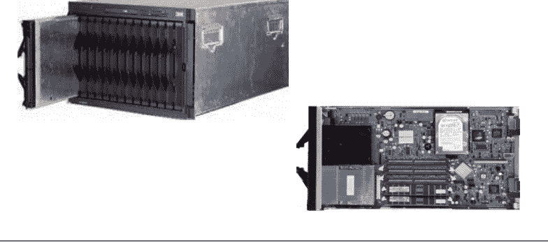


## 3.2 Linux 与 X 架构的功能

表 3-1 显示了 X 架构提供的一些功能，IBM 为这些功能开发了支持 Linux 环境的驱动程序。

表 3-1 IBM 支持原生 Linux

| 功能 | Linux 支持 |
| :--- | :--- |
| 活跃 PCI（热插拔和热切换） | IBM 提供的 Linux 驱动程序 |
| 冗余网卡 (`NIC`) | IBM 提供的 Linux 驱动程序 |
| 高级系统管理处理器 | IBM 提供的 Linux 驱动程序 |
| `IBM Director 4.1` | IBM 支持原生 Linux |
| 存储区域网络 (`SAN`) | IBM 提供的 Linux 驱动程序 |

### 3.2.1 带有 Linux 的企业 X 架构

通过对 Microsoft 和 Linux 操作系统的支持，扩展了 `xSeries` 应用灵活性。硬件针对最新的行业平台进行了优化。这使得客户能够从广泛的应用组合中进行选择，以最符合其业务需求。为了进一步增强灵活性，其物理分区和通用设计平台有助于从 32 位向 64 位高性能计算的过渡。

新工具使得系统管理比以往任何时候都更加简单。通过自诊断和自愈合技术（如 `Active PCI-X` 和第三代 `Chipkill` 内存），系统设计为保持持续运行。`xSeries` 服务器为需要快速、方便且低成本扩展的系统提供了高可用性和卓越的性能。表 3-2 显示了企业 X 架构可用的 Linux 支持。

表 3-2 企业 X 架构的 Linux 支持

| 功能 | Linux 对应关系 |
| :--- | :--- |
| `XpOnDemand` 可扩展性 | `Red Hat AS2.1`, `SuSE8.0` |
| 远程 I/O | `内核-2.4.9-31` 或更高版本 |

表 5-3 Linux X 架构技术实现了以下能力：

- `XpOnDemand`
- 系统分区
- `PCI-X I/O` 子系统：`Active PCI-X`
- 远程 I/O
- 活跃内存
  - 256 GB 内存容量
  - 高速 (DDR) 内存
  - 内存：`ProteXion`
  - `Chipkill` 内存
  - 内存镜像
  - 热插拔/热切换内存
- 533 MHz 前端总线 (FSB)
- `XceL4` 服务器加速器缓存
- 实时诊断

下一节将对上述 X 架构功能进行简要描述。请参阅第 57 页附录 A，“存储管理器与 Linux”。

## 3.3 xSeries 刀片服务器：BladeCenter

刀片服务器是一项相对新的技术，由于其模块化设计受到了行业关注。这种设计通过更有效地利用贵的空间来降低成本，并通过其简化的管理帮助加速部署、重新定位、更新和排错数百个刀片服务器等任务。使用 `IBM Director` 系统管理工具，通过一个通用控制台远程完成这些操作。此外，刀片服务器通过双倍当前的秩密度提供了更高的性能。通过整合资源和共享关键组件，不仅可以降低成本，还能提高可用性。`BladeCenter` 非常适合高性能计算集群和大型农场。有关更多细节，请参阅以下红皮书：`The Cutting Edge: The IBM eServer BladeCenter, REDP5381`，以及红书：`IBM @server BladeCenter, Linux, and Open Source, SG24-7034-00`。


图 3-2 `IBM BladeCenter Linux` 和 `SuSE Linux Enterprise Server` 提供企业级功能

`Red Hat Enterprise` 和 `SuSE Linux Enterprise Server` 都提供了企业级功能，使基于 `Linux` 的解决方案能够部署在广泛的企业 `IT` 环境中。

在 `xSeries` 页面上，你将找到最新的驱动程序和固件发布，以及有关安装的文档。

## 3.4 `Linux` 集群

在最简单的形式下，集群由两台协同工作的计算机组成。为了提高可用性，并增加可靠的可靠性。是刀片服务器的。对于更多信息，请访问网站：

```
www.ibm.com/xseries/clustering
```

### 3.4.1 不同类型的集群

如所述，集群可能以多种形式存在。最常见的集群类型有：

- 高可用性 (`HA`)
- 高性能计算 (`HPC`)
- 水平扩展 (`HS`)

高性能集群通常由大量计算机组成。高性能集群的设计是一项极具挑战性的过程，需要对各项项目进行仔细检查，例如大量计算机的安装、维护和管理；对同一文件系统的并行、并发和高性能访问的需求；以及节点之间为了协调必须并行执行的工作进程间通信（inter-process communication）。

其目标是通过对大量离散的计算机进行管理、操作和协调，提供单机系统的映像。

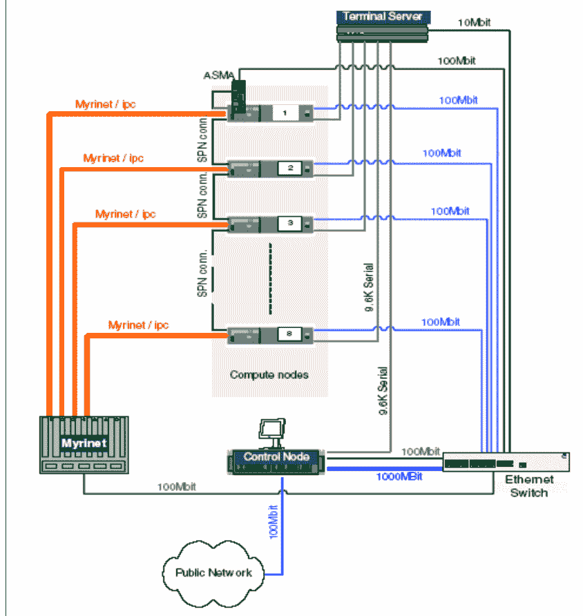

图 3-4 通用高性能集群

## 水平扩展

水平扩展集群被用于为一组资源提供单一接口，这些资源的大小可以随时间推移任意增长（或收缩）。这种模式最常见的例子是 `Web` 服务器群。在此示例中，提供了一个单一接口（`URL`），但通过该接口进入的请求可以分配到大量的服务器上，从而提供更高的容量，并通负载均衡等功能管理终端用户体验。

当然，这种集群提供了显著的冗余。如果大型服务器群中的某一台服务器发生故障，对用户来说可能是透明的。因此，这种模型也具有高可用性集群的许多属性。同样，由于工作在许多节点之间共享，它也是高性能计算的一种形式。

### 3.4.2 `Linux` 集群

`Linux` 集群（在 `Intel` 处理器上）在学术界已非常流行。它们为计算机科学问题（如并行编程、并行工具开发和分布式系统管理）提供了一个廉价的平台。同时，基于 `Intel` 处理器的 `Linux` 集群开始在政府和工业研究机构中出现，最初作为概念验证系统，现在已作为科学应用的生产环境机器。

`Linux` 集群代表了更好的性效益机会，它利用了熟悉的架构和编程模型。使用经济高效的软件（如 `Linux`）以及在基于 `Intel` 的硬件上运行基于 `Linux` 的程序（这些硬件（如 `IBM xSeries` 的机架式服务器），使得实现集群的总体成本远低于过去。因此，许多企业开始在以前认为成本不合理的环境中使用此类集群。

### 3.4.3 集成 `Linux` 集群：`IBM eServer cluster 1350`

`Cluster 1350` 是一项集成化产品。它的设计旨在使其易于配置，并帮助企业快速部署应用程序。通过减少重组、集成、测试和调优 `Linux` 集群所需的时间和资源，`Cluster 1350` 可以帮助组织缩短生产时间。

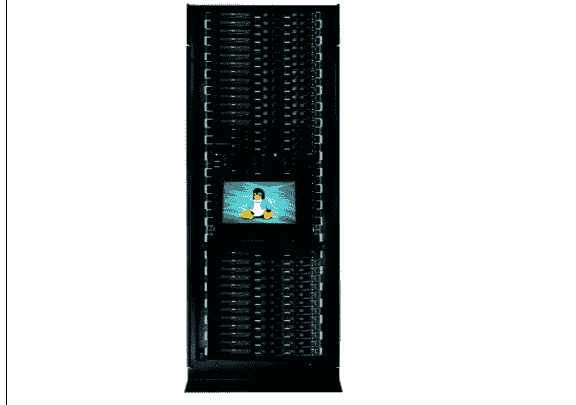

`IBM` 为 `Cluster 1350` 提供安装支持。如果需要更高水平的支持，可选的 `Linux` 集群支持线路（`Support Line for Linux Clusters`）由理解整个集群而非单个组件的专家组成。`IBM` 可以提供项目管理支持，以协调交付和安装的所有方面，包括硬件和软件设置服务。

## 高性能集群管理

`IBM` 为 `Linux` 提供了集群系统管理软件（`CSM`），这是一种高级的集群管理软件，允许从单一控制点管理集群。这简化了集群的管理，使其能够轻松扩展，并帮助系统管理员提高效率。`CSM` 基础设施监控硬件和软件事件，在适当的情况下触发自动恢复操作。通过为集群提供单一控制点，`CSM` 可以极大地简化整个系统管理，为高效益的服务器整合解决方案提供可行方法。

## 高级服务器技术

`Cluster 1350` 基于 `IBM` 的 `X-Architecture™` 技术，该技术整合了 `IBM zSeries™ 900` 服务器的一些可用性功能。而且，这些行业标准的基于处理器的服务器旨在以非常有吸引力的价格提供企业级的动力、可扩展性、控制能力和服务。

`Cluster 1350` 显著减少了每个系统中的节点数量，在降低成本的同时加速升级。此外，集成系统管理处理器使 `CSM` 能够远程管理系统节点，以增强服务器生产力。系统管理员可以指定监控哪些节点，以及在发生内存、处理器、硬盘、风扇或电源问题时采取什么操作。

`Cluster 1350` 的标准配置包括一个管理节点、多达 512 个集群节点以及最多 32 个提供共享文件存储的可选存储节点。大型非标准配置可通过特殊投标获得。每个 `Cluster 1350` 包含一个用于安全内部通信的管理以太网 `VLAN`、一个用于应用程序内部通信的集群以太网 `VLAN`，以及一个终端服务器网络。集群配备一台 10/100 Mbps 以太网交换机用于管理 `VLAN`，并在集群 `VLAN` 上可选 10/100 Mbps 以太网交换机、千兆以太网交换机或 `Myrinet-200` 交换机。

## 3.5 整合

工作负载整合有四种（也称为服务器整合）。每种类型在以下领域提供显著收益：

- 由于集中管理降低了管理成本
- 这种架构和编程模型提供了更好的管理
- 可扩展性
- 安全

整合的四种类型包括：

- 将分散企业各处的系统整合到集中的位置
- 将许多系统整合到较少的服务器
- 数据整合
- 应用程序整合

### 3.5.1 将分散企业各处的系统整合到集中的位置

对于这种类型的整合，`xSeries` 和 `Linux` 结合提供了以下优势（针对单一环境）：

- 减少地面空间：`xSeries` 提供了链式技术。
- `IBM Director`：它包含一个名为 `Updatepress` 的功能，允许进行系统镜像和更新。
- 工作负载管理解决方案：它们将高负载的系统重新调度到轻负载的系统。
- 通过系统内部的冗余实现可用性：在整合环境中，我们可以为电源等配置冗余。现在，在整合环境中，我们可以处理来自可能需要离线的系统的工作。

### 3.5.2 将系统整合到较少的服务器

- `Model 440` 通过其“按需付费”（`Pay as Grow`）提供了极有价值的主张。此功能允许您根据整合的第一阶段购买计算资源，并随着整合的发展增加额外的计算能力。
- `Model 440` 的远程 I/O 功能允许您在整合变化时增加系统的 I/O 容量而无需淘汰基础。
- 虚拟或物理分区：`xSeries` 允许您创建具有独立 I/O 的虚拟分区。此外，`VMware` 提供了虚拟机。在两种分区配置下，都可以在分区之间进行故障切换。
- 这种环境需要更少的管理员。
- 这种环境提供了资源分配、计费和服务协议。
- `VMware` 和虚拟机：在实施服务器整合时，`VMware` 提供了许多关键收益。这些收益包括：
  - 在分区中运行 `Windows` 和 `Linux` 应用，并在另一个分区中运行 `Linux` 应用。`VMware` 支持 `SUSE` 和 `Red Hat` 作为 `Linux` 操作系统。
  - 根据需要动态更改分区的能力。您可以在几分钟内添加新分区或为其分配专用 I/O 资源。
  - 您可以设置分区并对其进行定制以满足特定的工作负载需求。例如，您可以设置两个 `Web` 服务分区、一个打印服务分区和两个邮件分区。邮件和 `Web` 服务分区可能具有关键任务需求，因此您可以将第二个分区设置为备份分区，当一个分区出现容量问题时可以切换工作负载。打印服务分区分配的 I/O 容量可能小于邮件分区。这使得针对您的特定工作负载进行定制非常灵活。

### 3.5.3 数据整合

`xSeries` 和 `Linux` 为该领域带来的关键差异化和优势包括：

- `(SAN)` 和共享存储环境：通过系统区域网络创建高可用数据配置的能力
- 数据镜像以确保发生磁盘故障时数据的可用性。通过集中的安全策略提高安全性，而不是使用分散在企业各处的碎片化数据。
- 所需的数据库管理员更少

### 3.5.4 应用整合

`xSeries` 和 `Linux` 共同为该领域带来的关键差异化和优势包括上述内容，以及以下几点：

- 通过在单一系统上整合应用使用，而非跨企业使用多个系统，从而降低应用许可成本
- 能够更好地管理由于操作系统或应用层级变化而引起的新应用迁移计划
- 通过在系统之间负载均衡多个应用需求，降低对计算能力的需求

# 4

# `IBM TotalStorage` 和 `FASiT`

本章将首先回顾 `IBM TotalStorage` 产品的主要功能、优势及其对 `Linux` 解决方案的支持。

本章将概述 `IBM TotalStorage FASiT` 存储服务器系列产品，包括对某些存储管理器（`Storage Manager`）高级功能的描述。


整个系列在红皮书《The IBM TotalStorage Solutions Handbook, SG24-5250》中都有详细讨论。关于 IBM TotalStorage 产品、软件和解决方案（包括对 Linux 支持）的更多细节，可以在以下网站找到：

```
http://www.storage.ibm.com
http://www.storage.ibm.com/linux
```

## 4.1 IBM TotalStorage

无论运行在何种硬件基础设施上，所有 Linux 服务器都要求支持 Linux 的存储功能。我们可以观察到，Linux 正在从支持 Web 服务、网络、文件和打印操作等基础设施工作负载，转向数据中心核心的关键应用程序；这对存储基础设施在提供卓越的可靠性、可扩展性和性能提出了更严苛的要求。对于 IBM 的产品组合来说，这些并非新需求，我们的组合目前已提供全面的 Linux 支持，并承诺通过我们的新产品和解决方案进一步加强这种支持。

IBM 继续在所有服务器平台上支持 Linux，并在基于适用于异构平台的开放标准、存储织网络方面领先行业。

IBM 是交付世界级磁盘和磁带系统、存储管理软件、服务和集成解决方案的领导者，并包含以下特性：

*   高可扩展性存储 - 允许管理员轻松管理并快速响应业务需求，且部署和配置简便
*   高可用性和容错存储 - 使用 `RAID` 和集群等技术提供持续且可靠的数据访问
*   改进数据管理 - 帮助管理员更好地控制其数据的安全和增长
*   提高存储利用率 - 通过集中管理的存储池分配存储
*   降低管理成本 - 通过 IBM 存储管理工具，无需增加人员即可管理额外的存储，并具备更快解决问题的能力
*   平台独立性 - 允许数据共享并可能简化备份程序
*   集中管理 - 允许管理员快速响应变化的业务需求，且部署和配置简便
*   降低管理成本 - 通过 IBM 存储管理工具，无需增加人员即可管理额外的存储，并具备更快解决问题的能力

### 4.1.1 价值主张

IBM 提供了一套全面的 Linux 策略，包括硬件、软件和管理工具等元素，为 IT 工作负载提供完整的基础设施。

Linux 上的 IBM 存储提供了磁盘（高端和中端）、磁带、网络存储与主流 Linux 发行版之间的预测试组合，以及清晰的 Linux 部署策略。

Linux 上的 IBM 存储还提供了与 IBM `@server` 及软件的对齐，以提供最合适的组合来满足各种客户需求，并充分利用 Linux 实现的开源和异构环境的优势。

## 表 4-1 适用于 Linux 的 IBM 存储总结

| IBM 存储 | 功能 | 意义 |
|---|---|---|
| 基于开放标准构建，展示了 IBM 在所有产品中支持 Linux 的意图。 | 允许 IBM 为 Linux 环境带来全系列产品 | 在为需求选择最合适的存储时有多种选择，同时限制对专有基础设施的投资 |
| 经过预测试、文档化和支持的 Linux 存储配置 - 磁盘、磁带和网络存储。 | 以卓越的可靠性和支持加速 IT 基础设施的实施。 | 在为 IT 需求选择存储时消除“猜测” |
| 多种 Linux 发行版及附件。 | 保护对 IT 基础设施的投资 | 可自由选择您偏好的 Linux 发行版 |

IBM TotalStorage 的主要优势在于其能够在 Linux 环境中提供完整的解决方案。IBM 对支持的承诺也比竞争对手更稳健，涵盖了我们的 IBM `eServer` 软件和存储产品。Linux 是 IBM 核心开发的一部分，对所有更新功能的 Linux 支持正在不断增长。

关于 Linux 的某些局限性及解决方法，请参考第 75 页附录 B“FASTiT”。

## 4.2 IBM TotalStorage Proven™

IBM 推出了 TotalStorage Proven 以帮助客户识别经过互操作预测试的存储解决方案和配置。该计划旨在减轻 IBM 合作伙伴、独立软件供应商 (`ISV`) 以及其他存储解决方案供应商在独立互操作性测试方面的负担。

IBM TotalStorage Proven 建立在 IBM 现有的广泛互操作性基础上，开发并交付与第三方产品协同工作的产品和解决方案。在 Storage Proven 计划下，IBM 将继续与硬件供应商、`ISV` 和软件开发者合作，在 IBM 广泛的存储产品线上测试他们的产品。

持续的收益包括：

*   预期的客户价值：
    *   通过投资已验证的解决方案降低风险
    *   较低的集成成本
    *   更快的解决方案部署

有关 TotalStorage Proven 的更多信息可以查阅：

```
http://www.ibm.com/totalstorage/proven
```

您可以在此处找到已在 Linux 环境下使用 IBM 存储测试过产品的公司更新列表：

```
http://www.ibm.com/totalstorage/proven
```

## 4.3 IBM TotalStorage FASTT 产品

图 4-1 显示了构成 IBM TotalStorage FASTT 系列的不同产品的演变。

任何型号都可以连接到运行特定版本 `Red Hat` 和 `SuSE` Linux 的 `xSeries` 服务器上。

![image_link]

图 4-1 FASTIT 服务器的演变

> 注意：IBM TotalStorage `FAS 500` 存储服务器已停止销售，仅作为对比包含。

### 4.3.1 IBM TotalStorage FASTIT200

`FASIT200` 专为需要外部存储解决方案的工作负载和部门服务器设计。单控制器型号提供了一种成本效益的解决方案，而 `FASIT200` 高可用 (`HA`) 模型具有具有双活动控制器的冗余配置。

![image_link]

图 4-2 IBM TotalStorage FASTT200 存储服务器

#### 产品亮点

*   为工作组和部门服务器提供廉价的 `RAID` 存储解决方案
*   完全集成光纤技术，从主机连接到磁盘驱动器
*   通过冗余、热插拔组件确保高可用性
*   高可用模型支持通过双活动 `RAID` 控制器实现透明故障转移
*   提供 `RAID` 级别 `0`, `1`, `3`, `5` 和 `10` 的多种数据保护选项

### 4.3.2 IBM TotalStorage FAS T500 存储服务器

`FAS T500` 存储服务器是那些追求极致中端存储整合以及多平台或异构平台数据共享的用户的首选服务器。`FAS T500` 通过许多高级功能和特性支持对海量数据的快速通用访问，使其成为业务关键应用的骨干。

> 注意：IBM TotalStorage `FAS T500` 存储服务器已停止销售。

![image_link]

图 4-3 IBM TotalStorage FAS T500 存储服务器

*   贯穿 `FASIT` 系列存储系统的投资保护
*   对 IBM `AIX R®`、`Microsoft ® Windows® 2000`、`Windows NT³`、`Sun Solaris`、`HP-UX`、`Red Hat` 和 `SuSE` Linux 的异构支持
*   Linux 通过 `18.2GB`、`36.4GB`、`73.4GB` 和 `146.8GB` 驱动器的灵活组合，容量扩展至 `32` 太字节 (`TB`)
*   支持高级复制服务和远程镜像的软件升级

### 4.3.3 IBM TotalStorage FASIT600 存储服务器

`FASIT600` 是 `FASIT` 产品系列的最新新增成员。`FASIT600` 是一款入门级、高度扩展的 `2 Gb` 光纤通道存储服务器，为 UNIX 和 Intel 工作负载提供同类最佳的卓越性能。

IBM `TotalIT600` 存储服务器设计为一种具有成本效益且可扩展的存储服务器，用于整合和集群应用。其模块化架构可以通过提供入门配置来支持按需业务模式，并可随需求增加而轻松增长。该服务器最大容量超过 `6 TB`，非常适合将直连存储整合到集中管理、共享或 `SAN` 环境中。

`FAST600 Turbo` 是一款中级存储服务器，可扩展到 `16 TB` 以上，为中型客户提供存储整合便利。它利用最新的存储网络技术提供端到端的 `2 Gbps` 光纤通道解决方案。作为 IBM `FAST` 家族的一员，带有 `Turbo` 的 `600` 型号使用相同的通用存储管理软件和高性能硬件设计，为客户提供了在高端型号中的企业级功能，但成本低得多。

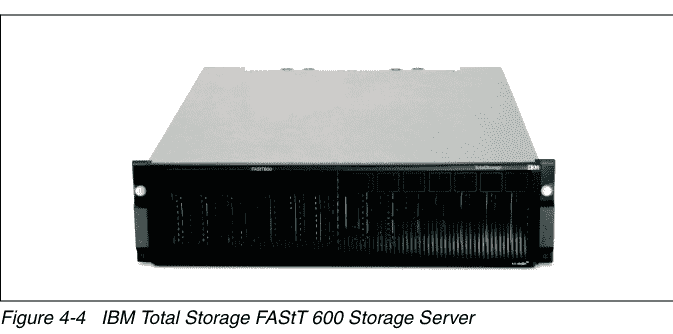

#### FASIT 600 产品亮点

*   提供 `2Gb` 光纤通道主机端口，以经济的方式为直连的 `UNIX ®` 和基于 `Intel ®` 处理器的集群服务器提供多路故障转移
*   支持多达 `48` 块硬盘，容量超过 `8` 太字节
*   包含 `Microsoft ® Windows® 2000` 的故障转移驱动程序，并可选支持 `AIX®`、`Sun TM Solaris™`、`HP-UX` 以及其他基于处理器的平台，包括 `Novell Netware` 和 Linux 操作系统
*   设计用于提供高达 `400 MB/sec` 的性能


- 促进存储区域网络 (SAN)、网络附属存储 (NAS) 和直连环境中的存储整合
- 包含 `FASTT` 存储管理器，帮助集中管理所有 `FASTT` 存储子系统

### `FASTT600 Turbo` 亮点

- 使用随 `Turbo` 发布的新型 `Storage Manager v8.4`，性能提升 `70%`
- 比基础版 `FASTT600` 具有更高的扩展性，可扩展至 `16.4 TB`
- 缓存从基础版 `FASTT600` 的每个控制器 `256 MB` 增加到 `Turbo` 的每个控制器 `1 GB`
- 具有自动功能，例如动态卷扩展和动态容量添加，允许在不停止操作的情况下将未使用的存储上线；以及 `FASTT` 服务警报，该功能能够在发生问题时自动通知 `IBM`
- 基础版 `FASTT600` 的主机接口为 `2 Gb`，`Turbo` 自动感应并连接到 `1 Gb` 或 `2 Gb`
- 支持多达 `64` 个存储分区

### 4.3.4 `IBM TotalStorage FASTT700` 存储服务器

`IBM FASTT700` 存储服务器通过 `2 Gbps` 光纤通道技术提供卓越性能。`FAST700` 设计旨在通过高级功能和灵活特性提供投资保护。其可从 `36 GB` 扩展到 `32 TB`，以支持电子业务应用不断增长的存储需求。`FASTT700` 提供高级复制服务以支持业务连续性。`FAST700` 是任何寻求无边界性能的企业的实效存储服务器。

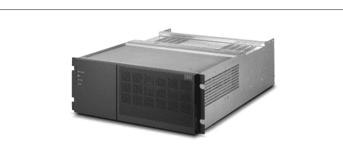

### `FASTT700` 产品亮点

- 通过冗余组件、多个 `RAID` 级别、`LUN` 掩码和增强管理选项实现数据保护
- `SAN`、`NAS` 和直连环境的存储整合
- 贯穿 `FASTT` 系列存储的投资保护
- 支持 `IBM AIX`®、`Microsoft`® `Windows`® `2000`、`Windows NT`®、`Novell Network`®、`Sun Solaris`、`HP-UX`、`Red Hat Linux`、`SuSE Linux`
- 通过 `36.4 GB`、`73.4 GB` 和 `146.8 GB` `10,000 rpm` 驱动器以及 `18.2 GB`、`36.4 GB` 和 `73.4 GB` `15,000 rpm` 驱动器 (`2 Gbps FC`) 的灵活组合，扩展至 `32.8 TB`

## 4.3.5 `IBM TotalStorage FAS T900` 存储服务器

`IBM FASIT900` 存储服务器为计算密集型环境中的需求应用程序提供了磁盘性能的突破和卓越的可靠性。`FASIT900` 设计旨在通过高级功能和灵活特性提供投资保护。为当今的需求业务设计，`FASIT900` 可轻松从 `36 GB` 扩展到 `32 TB` 以上，以支持增长的存储需求。`FASIT` 提供高级复制服务以支持业务连续性和灾难恢复。`FASIT900` 是任何寻求无边界性能的企业的实效存储服务器。

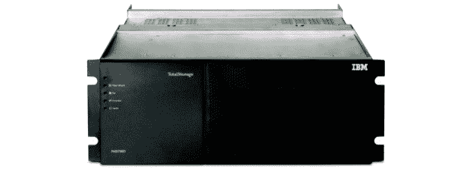

图 4- `IBM TotalStorage FASIT900` 存储

### `FASIT 900` 产品亮点

- 通过冗余组件、多个 `RAID` 级别、`LUN` 掩码和增强管理选项实现数据保护
- `SAN`、`NAS` 和直连环境的存储整合
- 贯穿 `FASTT` 系列的投资保护
- 支持 `IBM AIX`®、`Microsoft`® `Windows`® `2000`、`Windows NT`®、`Novell Network`®、`Sun Solaris`、`HP-UX`、`Red Hat Linux`、`SuSE Linux`
- 通过 `36.4 GB`、`73.4 GB` 和 `146.8 GB` `10,000 rpm` 驱动器的灵活组合，扩展至 `32.8 TB`

### `FASIT6` 扩展机

随着您的存储需求增长，您可以通过添加 `EXP500` 或 `EXP700` 轻松扩展存储

### `EXP500` 扩展单元亮点

高速、可扩展的 `FASIT` 解决方案准备处理各种存储区域网络 (SAN) 应用。这些产品支持双环主机和光到光技术。关键组件包括：

- 完全冗余单元包含热插拔电源、风扇
- 支持高速光纤硬盘 (HDD)
- 冗余组件、10 盘位

`Netinity FASIT` 解决方案为企业带来了光到光的先进 `SAN` 解决方案。标准双环 `FASIT` 存储管理器管理八个分区。功能包括：

- 通过多个主机实现灵活存储配置
- 支持镜像、冗余环以及磁盘和磁带
- 高可用性技术提供冗余、热插组件和用户更换部件 (CRU)
- 高性能 - 允许 `100 MB/sec`
- 支持 `RAID` 级别 `0`、`1`、`3` 和 `5`
- 数据存储距离可达 `10` 公里 - 为灾难性事件提供额外保护
- 支持带有 `GBIC` 和光缆的长短波光纤环境

### `EXP700` 扩展单元亮点

`IBM TotalStorage FASIT EXP700` 扩展单元通过一个 `14` 位、`2 Gbps`、机架式的光纤硬盘箱扩展了高度可扩展、高性能的 `FASIT` 家族。与 `FASIT700`、`FASIT500` 和 `FASIT200` 存储服务器配合使用，新型 `EXP700` 设计为每个单元提供超过 `1 TB` 的磁盘存储量支持。

`EXP700` 扩展单元支持四种新型薄型、双环、热插拔磁盘模块：

- 新的 `2 GB` 光纤通道模块也可用于 `FASIT EXP500` 存储扩展单元 (`3560-1RU/1RX`)，以及以 `1 Gb` 运行的 `FASIT200` 存储服务器 (`3542`)。

提供了一种全新的 `PCI/X13MHz`、`2 Gbps` 光纤通道主机适配器，用于将 `FASIT` 存储服务器连接到 `IBM eServer` 系列和其他基于 `Intel` 的服务器。`IBM TotalStorage FASIT FC2-133` 主机适配器是一款 `64` 位低配置适配器，支持在点对点光纤通道仲裁环 (`AL`)-`2` 和交换机拓扑上运行光纤通道 `SCSI` 和 `IP` 协议的 `1 Gbps` 或 `2 Gbps` 自动感应。

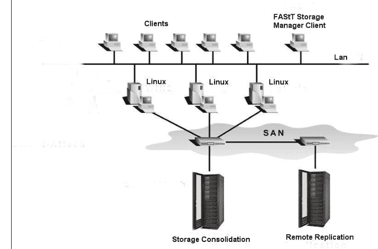

## 4.4 高级功能

高级功能是 `IBM TotalStorage FASIT` 存储服务器的高功能，必须单独购买。这些额外功能包括：

- 存储分区
- `FlashCopy`®
- 远程卷镜像 (Remote Volume Mirroring)
- 卷拷贝 (VolumeCopy)

> 注意：高级功能是 `IBM TotalStorage FASIT` 存储服务器固件的功能，可以在连接的 `Linux` 主机上使用，方式与运行任何支持的主机操作系统的主机相同。

### 4.4.1 存储分区简介

存储分区为 `FASIT` 存储服务器增加了高度的灵活性。它允许您连接数量多的主机系统，无论是独立模式还是集群模式。

连接到 `FASIT` 存储服务器的基于 `Intel` 的主机系统通常运行存储处理能力有限的操作系统。这些操作系统大多数只能将存储视为本地连接到主机系统。除非使用第三方文件共享软件，否则两个或多个独立主机系统或集群无法访问同一个存储空间，否则会导致灾难性的结果。这与存储区域网络（`SAN`）的理念相冲突，在 `SAN` 中存储应该是许多主机系统全局可用的。

如果没有存储分区，配置在 `FASIT` 存储服务器上的逻辑驱动器只能被单个主机系统或单个集群访问。这无疑会导致存储硬件的低效利用。

另一方面，存储分区允许您创建包含主机及其主机总线适配器（`HBA`）以及逻辑驱动器的集合。我们称这些集合为存储分区。现在主机只能访问其分配的逻辑驱动器，就像这些逻辑驱动器本地连接到它们一样。您可以使用流行的 `Intel` 平台操作系统将多个主机或集群连接到同一个 `FASIT` 存储服务器。存储分区将 `SAN` 的全局可用存储理念应用于具有本地思维的操作系统。

一个存储分区包含几个元素：

- 逻辑驱动器映射
- 主机或组
- 主机端口

主机组是允许访问同一个逻辑驱动器的主机集合，例如两个系统。

主机是可包含在主机组中的单个系统。

主机端口是主机系统中主机总线适配器的 `FC` 端口。主机端口通过其全球标识符（`WWN`）识别。单个主机可以包含多个端口。如果您以冗余方式连接服务器（强烈建议），每个服务器需要两个主机总线适配器。也就是说，在同一个主机系统内需要两个端口。

`FASIT` 存储服务器仅通过 `WWN` 进行通信。存储子系统不知道哪些主机适配器在同一服务器中或在具有特定关系（如集群）的服务器中。主机组、主机及其主机端口实际上反映了您的 `SAN` 物理连接的逻辑视图以及服务器之间的逻辑连接（例如集群）。

在之前定义的本地设置中，映射是将逻辑驱动器分配给特定主机组或主机的特定赋值。

存储分区是所有这些组件的组合。它确保即使连接了多个主机或集群，也能正确访问逻辑驱动器。

通过 `FASIT` 存储管理器，您拥有 `FASIT` 存储服务器支持多达 `64` 个存储分区的能力。特定 `FASIT` 型号的最大存储分区数量请参见图 4-2。

表 4-2 当前支持的最大存储分区

| `FASIT` 型号 | 支持的分区数量 |
|---|---|
| `FASIT 200` | `16` |


| FASIT 600 | 1, 4 或 8 - Turbo 版本为 64 |

| FASIT 700 | 64 |

| FASIT 900 | 64 |

> 注意：在某些 `FASIT` 型号上，分区数量还取决于购买的（功能）许可证。

## 4.4.2 FlashCopy 简介

`FlashCopy` 逻辑驱动器是逻辑驱动器的点映像。它是完整物理拷贝的逻辑等效物，但您创建它的比物理拷贝快得多，所需的磁盘空间也更少。在此版本的存储管理软件中，作为 `FlashCopy` 的逻辑驱动器（称为基础逻辑驱动器）必须是存储子系统中的标准逻辑驱动器。通常，您创建 `FlashCopy` 是为了让应用程序（例如备份应用程序）访问 `FlashCopy` 并读取数据，而基础逻辑驱动器保持在线且用户可用。当备份完成后，`FlashCopy` 逻辑驱动器就不再需要。

您还可以为基础逻辑驱动器创建多个 `FlashCopy` 并向这些 `FlashCopy` 逻辑驱动器写入数据以进行测试和分析。例如，在升级数据库管理系统之前，可以使用 `FlashCopy` 逻辑驱动器测试不同的配置。然后可以使用存储管理软件提供的性能数据帮助决定如何配置数据库系统。

当您执行 `FlashCopy` 时，控制器会挂起对基础逻辑驱动器的 `I/O` 几秒钟，同时创建一个名为 `FlashCopy` 库逻辑驱动器的物理驱动器，用于存储 `FlashCopy` 元数据写时拷贝（copy-on-write）数据。当控制器完成 `FlashCopy` 库逻辑驱动器的创建后，基础逻辑驱动器的 `I/O` 写入继续。然而，在修改基础逻辑驱动器上的数据块之前，会发生写时拷贝，将内容复制到 `FlashCopy` 库中保存。由于 `FlashCopy` 库逻辑驱动器在该驱动器中存储原始数据的副本而无需再次进行写时拷贝，而且由于物理存储在 `FlashCopy` 库逻辑驱动器中的唯一数据块是自 `FlashCopy` 时间以来更改的内容，因此 `FlashCopy` 技术使用的磁盘空间比完整拷贝少。

当您执行 `FlashCopy` 时，会指定创建 `FlashCopy` 库逻辑驱动器的位置、容量和其他参数。当您不再需要 `FlashCopy` 时可以禁用它，例如备份完成后。然后下次执行备份时可以重建 `FlashCopy` 并重用同一个 `FlashCopy` 库逻辑驱动器。使用禁用 `FlashCopy` 和重建 `FlashCopy` 下拉菜单提供了创建新 `FlashCopy` 逻辑驱动器的快捷方式，因为不需要创建新的 `FlashCopy` 库逻辑驱动器。

### 基础卷 库卷数据

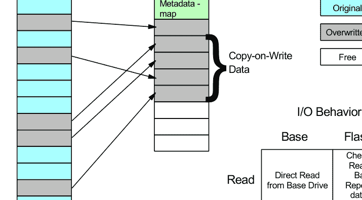

图 4-8 `FlashCopy` 写架构

您还可以删除 `FlashCopy` 逻辑驱动器，这将同时删除关联的 `FlashCopy` 库逻辑驱动器。当您的 `FlashCopy` 库容量接近用户指定的阈值（完整容量的百分比，默认为 50%）时，存储管理软件会提供警告消息。当此情况发生时，可以使用存储管理软件从空容量扩展您的 `FlashCopy` 库逻辑驱动器。如果阵列容量不足，可以向阵列添加未配置容量以扩展 `FlashCopy` 库逻辑驱动器。

> 注意：`FlashCopy` 是高级功能。请联系您的 IBM 经销商或 IBM 营销代表获取更多信息。

## 4.4.3 远程镜像简介

远程镜像选项是随 `IBM FASIT Storage Manager` 8.2 或更高版本软件提供的高级功能，通过购买高级功能密钥启用。远程镜像用于跨距离存储子系统的在线实时复制。当一个存储子系统发生灾难或不可恢复的错误时，远程镜像选项允许您提升第二个存储子系统以接管正常的输入输出（`I/O`）操作（图 4-9）。

`# 网络`
`# SAN`
`# 存储阵列`
`# FC Fabric`

`V1, V2, V3m, V1m, V2m, V3`

主数据中心

备份数据中心

图 4-9 远程卷镜像

镜像关系是以卷为单位的：

- 使用 `Storage Manager` 关联两个卷（主卷和从卷）
- 数据在后台复制到从卷

镜像是同步的。在 `I/O` 完成之前，必须在两个卷上都完成写入。

至少需要两个阵列。一个存储系统可以将主卷镜像到其他阵列，并持有来自多个阵列的从卷。

参与远程镜像配置的存储子系统最大为两个。这两个存储子系统被称为主/从存储子系统，或本地/远程镜像子系统。这些名称可以交叉使用以描述远程镜像设置或配置。这些名称并不代表存储子系统的位置，或存储子系统在远程镜像关系中的角色。

> 注意：远程镜像是一项高级功能。请联系您的 IBM 代理销商或 IBM 营销代表获取更多信息。

## 4.4.4 VolumeCopy 简介

`VolumeCopy` 高级功能适用于 `Storage Manager` v8.4，用于将数据从单个存储子系统中的一个逻辑驱动（源逻辑驱动）复制到另一个逻辑驱动（目标逻辑驱动）。

此功能可用于将使用小容量驱动器的阵列数据到使用大容量驱动器的阵列，备份数据，或将 `FlashCopy` 逻辑驱动还原到基础逻辑驱动。此高级功能包含一个辅助创建逻辑驱动副本的创建向导（`Create Copy Wizard`），以及一个用于监控创建后逻辑驱动副本的复制管理器（`Copy Manager`）。

48 Linux 与 xSeries 和 FASIT 基础

`VolumeCopy` 高级功能的一些优势和用途：

### 迁移

随着您对逻辑驱动存储的需求，可以使用 `VolumeCopy` 高级功能将数据复制到同一存储子系统中利用更大容量磁盘驱动器的阵列卷中。这提供了将数据移动到更大驱动器（例如从 73 GB 变为 146 GB）、更改为数据传输率更高的驱动器（例如从 1 Gb/s 变为 2 Gb/s）或使用新技术的驱动器以获得更高性能的机会。

### 数据备份

`VolumeCopy` 高级功能允许您通过将数据从同一存储子系统中的一个逻辑驱动复制到另一个逻辑驱动来创建逻辑驱动的备份。目标逻辑驱动可以作为该逻辑驱动的备份、系统测试，或备份到另一个设备（如磁带机）。

### 将 FlashCopy 逻辑驱动还原到基础逻辑驱动

如果您需要从关联的 `FlashCopy` 逻辑驱动还原基础逻辑驱动，可以使用 `VolumeCopy` 高级功能将数据从 `FlashCopy` 逻辑驱动复制到基础逻辑驱动。您可以在 `FlashCopy` 逻辑驱动上创建数据的逻辑驱动，然后将数据复制到基础逻辑驱动。

## 4.5 将 FASIT 连接到 xSeries Linux 主机

在规划安装时，请务仔细考虑所有系统要求。

在实施之前，必须验证所有固件和 `BIOS` 版本，并在必要进行更新。获取最新信息和下载，请访问以下网站：

`http://www.pc.ibm.com/support/`

在 `xSeries` 页面上，您将找到最新的驱动程序和固件发布，以及关于特定型号安装的文档。

请记住通过以下地址检查系统的兼容性：

`http://www.storage.ibm.com/proven/index.html`

> 注意：有关如何安装 `IBM Linux` 并为 `xSeries` 系统配置 `FASIT` 的逐步说明，请参阅 `IBM Redbook`：《Implementing Linux with IBM Disk Storage, SG24-6261-01》第 5 章。

### 4.5.1 硬件要求

`xSeries` 目前运行从单处理器到 16 路处理器的系统。内存范围范围从 128 MB 到 64 GB 不等。需求取决于工作负载：例如，大型数据库非常适合具有大量内存和 `CPU` 能力的系统，而 `Web` 服务器则需要更多的网络资源。`IBM xSeries` 系统提供了许多可用且支持的选项。您可以在以下网站查看最新列表：

`http://www.pc.ibm.com/us/compat/index.html`

`Red Hat` 和 `Fuse` 分别在其 `Linux` 发行版中提供了经过测试和支持的硬件列表：

`http://hardware.redhat.com/hcl` 或

`http://www.suse.com/us/business/certifications/certified_hardware`

连接外部存储将需要一个主机总线适配器（`HBA`）。您可以访问以下地址查找支持的适配器列表：

`http://www.storage.ibm.com`

选择您的存储类型后，查找互操作性矩阵（interoperability matrix）。

### 4.5.2 软件要求

以下是用于使用 `xSeries` 和 `BladeCenter` 配置光纤存储的软件列表。

- `Red Hat Enterprise Linux`（如果设置高可用集群则使用 `AS` 版本），或 `SuSE Linux Enterprise Server 8 (SLES8)`
- `IBM FASIT` 主机总线适配器驱动程序

连接到 `FASIT`，您需要：

- `Storage Manager`
- `IBM FASIT Management Suite for Java (MSJ)`

这些内容在第 51 页第 5 章“IBM FASIT 管理软件”中描述。

### 4.5.3 连接要求


系统管理和光纤存储配置需要网络交换机。服务器可以通过光纤或集线器连接到存储设备。所有连接都必须规划并设置。该主题超出了本书的范围，我们假设您熟悉 `SAN`。欲了解介绍请参阅 `SG24-547`。

## 5 管理软件

本章描述了管理 `FASIT` 所需软件：

- `Storage Manager`
- `IBM FASIT Management Suite for Java (MSJ)`
- `IBM FASIT`

### 5.1.2 `IBM Management Suite Java`

如果您有多个路径，此驱动程序可以提供故障转移能力，但必须对路径进行配置。当使用两个适配器时，需要向操作系统隐藏一个路径。然而，通过管理工具，可以选择 `LUN`。还包括静态负载均衡功能，它通过多个路径分发 `LUN` 的访问。

作为一个新插入的设备，即使插入在与移除的设备相同的槽位，驱动程序也只是将其添加到数据库。

`FASIT MSJ` 提供了从驱动程序数据库中删除移除设备数据的功能，并将插入的设备分配到与其替换的设备相同的配置。

部分功能包括：

- 及时且准确地检测 `I/O` 故障
- 适配器的本地和远程管理
- 具有故障转移能力的设备/端口配置 (`Linux`)
- 性能统计
- 网络环境中的中心点
- 诊断和实用程序

`IBM FASIT` 主总线适配器（`2200` 及以上）支持全双工模式并启用环回能力。

`IBM FASIT MSJ` 支持以下 `HBA`（表 5-2）。

| `FASIT` 适配器 | `Qlogic` 适配器 | `IBM` 功能代码 | `IBM` 选项 `P/N` |
|---|---|---|---|
| `FASIT` 主适配器 | `QLA2200/66-IBM-SP` | `FC2102` | `00N6881` |
| `FASIT FC2` | `QLA2310-IBM-SP` | `FC2130` | `19K124` |
| `FASIT FC2-133` | `QLA2340-IBM-SP` | `FC2104` | `24P0960` |
| `FASIT FC2-133` 双端口 | `QLA2342-IBM-SP` | | `24P8053` |

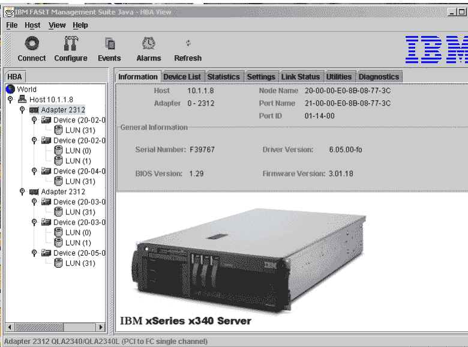

图 5-2 来自 `IBM FAST` 主管理套件的典型视图

### 5.1.3 `SANnavigator` 诊断与管理软件

`SANnavigator` 管理软件为 `SAN` 提供简单、集化的管理和诊断，并可快速访问所有设备配置应用程序。`SANnavigator` 以试用版提供，运行 30 天。如果您需要使用，可以通过发送电子邮件至 `IBMcustomer@navigator.com` 购买该产品。

它提供了直观的界面和点点击功能。通过对整个 `SAN` 进行图形化显示，所有级别的管理员都可以轻松管理他们的网络。

通过 `SANnavigator`，您可以监控 `SAN` 的健康状况，并识别可能影响 `SAN` 性能和可用性的潜在问题。

结合现有的问题确定图（`PDM`），`SANnavigator` 极大地促进了您的 `SAN` 的问题隔离和修复。

部分功能包括：

- 带有拓扑显示的直观 `GUI`
- 带外和带内管理（需要 `API` 库）
- 快速识别每个设备的端口连接
- 启动应用程序和工具，例如 `IBM FASIT Storage Manager` 和 `IBM FASIT MSJ` 诊断工具
- 事件日志
- 能够轻松导出 `SAN` 文件，以便将其导入到远程 `SANnavigator` 系统中进行显示和分析

### 5.1.4 `FASIT Service Alert`，`FASIT` 存储服务器的支持选项

`FASIT Service Alert` 适用于所有现有和新的 `FASIT` 存储服务器客户。`FASIT Service Alert`（以下简称 `Service Alert`）允许 `IBM TotalFASIT Storage Manager` 监控系统健康并在发生问题时自动通知 `IBM` 支持中心。`Service Alert` 会向 `IBM` 叫叫中心发送电子邮件，识别您的系统和位置详情（如您的电话号码）。`IBM` 支持中心分析电子邮件警报的内容并联系您以开始问题确定。该服务在全球范围内提供。

有关 `FASIT Service Alert` 的更多信息，请访问：

`http://w3-1.ibm.com/sales/systems/ibmsm.msf/documents/fastservalert`


## `Storage Manager` 和 `Linux`

在本附录中，我们为 `Linux` 环境下的 `FASIT Storage Manager` 提供了额外的细节和使用信息。

## A.1 `Storage Manager` 概念

`FASIT` 存储系统的管理需要 `FASIT Storage Manager` 实例。由于 `FASIT Storage Manager` 是一个基于 `Java` 的应用程序，任何合适的管理站都可以通过两种方式之一与 `FASIT` 存储系统通信：

### 带内 (`In-band`)

`Storage Manager` 通过物理或环回网络连接与代理进程通信。代理进程运行在一个或多个通过光纤连接到 `FASIT` 存储系统的系统上。代理进程通过特殊接口（`ACCESS LUX`）通过光纤与控制器通信。这种方法也称为间接控制，因为不需要额外的代理进程即可连接到 `FASIT` 控制器的端口。

### 带外 (`Out-of-band`)

`Storage Manager` 通过物理网络连接到 `FASIT` 控制器。不使用 `ACCESS LUX`。这种方法也称为直接控制，因为不需要额外的代理进程，且通信不通过光纤进行。默认设置为 `192.168.28.101` 和 `192.168.28.102`。`Linux` 与 `FASIT` 通信，如果这些 `IP` 不符合您的网络，则需要更改。

### A.1.1 在 `FASIT` 控制器上设置 `IP` 和掩码

在服务器的串口端口和 `FASIT` 的 `A` 口之间连接串口调制解调器。这允许配置控制器 `A`。在 `Linux` 下使用 `minicom` 或 `HyperTerminal` 等终端程序：

- 串口设备 (`dev/ttyS1`)
- 速率 (`9600`)
- 数据/校验/停止位 (`8N`)
- 硬件流控 (无)
- 软件流控 (无)

如果使用 `minicom`，按 `Ctrl-A` 发中断。如果使用 `HyperTerminal`，每5秒按一次 `Break`，直到 `ASCII` 字符变得可读。按 `Escape` 进入 `FASIT` `shell`。默认值为无限（见图 5-3）。

```
minimoc-desktop
File Edit Go
Welcome to minimoc 2.0.0

OPTIONS: History Buffer, Macros, Search Buffer
编译于 2002年6月23日，16:20。

按 CTRL-A 查看特殊键
在5秒内按 <ESC> 进入 SHELL，按 <BREAK> 设置波特率

######
LSI Logic 系列4 RAID 控制器
Copyright 2002, LSI Logic Inc.
磁盘控制器
序列号: IT142511
网络名称: blade0
######
```

输入密码访问 `shell`：

```
CTRL-A for help 9600 | minimoc 2.0 | VT102 | Online 00:00
```

图 5-3 `shell` 密码提示

使用 `netcfgShow` 查看当前设置（见图 5-4）。

```
root@desktop ~
File Edit Go Help
> netcfgShow
==== NETWORK CONFIGURATION: ALL INTERFACES ===
网络初始化标志：0
网络管理超时：30
客户端支持： 
==== NETWORK CONFIGURATION :=
接口名称：du0
我的 MAC 地址：00:a0:b0:bf:7e
我的主机名：blade0
我的 IP 地址：192.168.1.26
服务器：server
服务器 IP 地址：10.4.1
网关 IP 地址：10.4.1
子网掩码：255.255.255.0
用户名：
用户密码：guest
NFS 根路径：
NFS 组 ID：0
NFS 用户 ID：0
```

```
CTRL-A for help 9600 | minimoc.2 | Online 00:02
```

图 5-4 `netcfg` 界面

使用 `netcfgShow` 修改设置。仅更改我的 `IP` 地址和子网掩码。按回车跳过其他设置。

**重要：** 除非 `IBM` 二级技术支持建议，否则不要更改其他设置。任何其他更改将使 `FASIT` 处于不支持的配置中。

完成后输入 `sysreboot` 重启控制器刀片。等待重启完成，通过将调制线连接到 `B` 口并重新连接终端软件，对控制器 `B` 重复整个过程。

### A.1.2 `Linux` 是否有 `Storage manager` 代理？


`FASIT Storage Manager`软件并不包含所有操作系统的代理进程。例如，没有在 Linux 下运行的代理。如果有一个主机通过光纤连接到 `FASIT` 并运行 `Storage Manager` 代理，则 Linux 系统可以运行 `Storage Manager` 客户端并通过带内控制管理 `FASIT` 系统。在这种情况下，Linux 系统上的 `Storage Manager` 客户端将与非 Linux 系统上的代理通信。然而，如果连接到 `FASIT` 存储系统的所有主机都是 Linux 主机，或者没有可作为管理代理候选的可用代理软件连接主机，则必须使用带外控制。

对于此讨论，我们假设环境是纯 Linux 的，并将使用带外控制管理 `FASIT`。

### A.1.3 Linux 是否有 RDAC 驱动？

在编写本文时，冗余磁盘阵列控制器 (`RDAC`) 适用于 Linux。这意味着使用 `FASIT` 存储的 Linux 主机，其卷传输由 `FASIT` 自身管理。多路复用使用主总线适配器 (`HBA`) 的相应驱动程序以及名为 `FASIT MSI` 的额外软件，该软件用于管理与适配器的路径。`FASIT MSI` 在附录 B，“Java FASIT 管理套件”第 75 页中有描述。

From here, navigate to Disk Storage Systems², then `FASIT Storage Server` and then select your `FASIT` model; use the pull-down menu to select Downloads, then select `FASIT Storage Managers` as appropriate for your version.

Read and accept the terms and conditions, and you now see a selection of both software and documentation. Please obtain and read the documentation entitled “`IBM TotalFASIT Storage Manager` Version X.Y installation and Support Guide for Linux” (where X corresponds to your version number); use your browser’s “back” button and select LINUX operating system; this action takes you to the download page for the code and the `README` file. Please look at the `README` file before installing, as it contains the latest information for the code.

The package is rather large (over 30 MB) and requires another 70 MB to install, including the Java Environment, storing the rim files, and the installed code. Also, note that the `Storage Manager` GUI requires the X window system running on the management workstation.

When you have to root to install the client. Site administrators may make their decisions regarding access control to the `Storage Manager`. The `FASIT` itself can be protected by password from changes to the Storage configuration inaccessible of access to the `Storage Manager` client.

First, uninstall any previous version of `Storage Manager` before installing the new version. To check for installations, query the packages that are installed and select only those containing the letters "SM” with the following command:

```
rpm --query --all grep SM
```

Use the output to remove any previous version of the `Storage Manager` software by name. For example:

```
rpm --uninstall Runtime-XX.YY.ZZ-1
```

When you have obtained the latest version of `Storage Manager`, extract the contents of the zipped file:

```
tar xzv *.tgz
```

The required rpm files for installation are extracted into `./Linux/SMXclientcode` where X-Storage Manager version.

```
rpm --install --verify SMClient-<version>.rpm
rpm --install --verify SMClient-LINUX-<version>.rpm
rpm --install --verify SMUtil-<version>.rpm
```

The `Storage Manager` components should be installed in `/opt/IBM/FASIT`, with the client and command install, `SMClient`, in `/opt/IBM/FASIT/client` directory.

### A.2.2 Launching Storage Manager and connecting to the FASIT

To launch `Storage Manager`, open a terminal window and type `SmClient`⁴. Alternatively, you can launch `Storage Manager` from the graphical interface menus: Check the Gnome or KDE icon -> Programs -> Utilities -> `IBM FASIT Storage Manager`.

- ² Navigation details may change from time to time, these instructions were correct as of April 2003

- ³ We use the long names for clarity. Experienced users will know of versions of the options. Please see the documentation (man `rpm`) for more information

- ⁴ You may need to add the directory to your path. Otherwise, use the full path to `SMClient`

Appendix A. `Storage Manager` and Linux 6

The screen shown in Figure appears, asking if you wish to Automatically Discover the storage. This method will not find direct-attached storage controllers. Close this screen with the Enterprise Management Window (Figure 5-6).

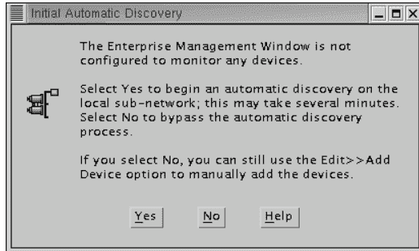

Figure 5-5 Automatic Discovery screen

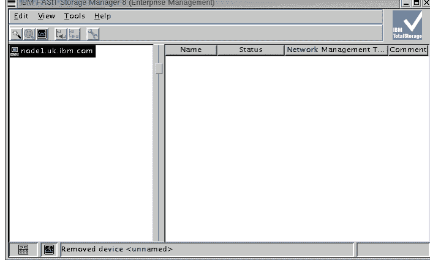

Figure 5-6 Storage Manager Enterprise Management window


Select `Edit -> Add Device` from the menu. On the next screen, enter a `Hostname` or `IP Address` for each controller blade in the FASIT (Figure 5-7).

Enter a `Hostname` or `IP Address` you set on the FASTt and click `Add`. Repeat the process for the second controller blade.

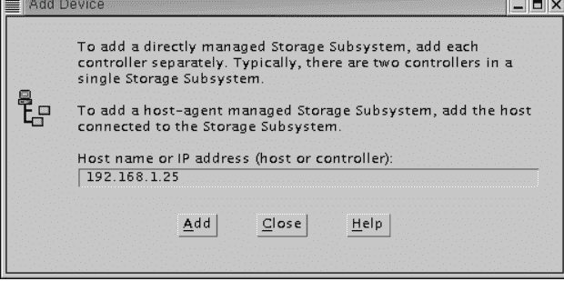

Figure 5-7 Add Device screen

Highlight `Storage Subsystem <unnamed>` and select `Tools -> Manage Device.`.

If there was no configuration previously on the storage, you should see a `Subsystem Management` screen similar to Figure 5-8.


Figure 5-8 Subsystem Management window

### A.3 Updating the FASTT firmware

Obtain the latest firmware and NVRAM for the FASTT controller as described in A.2.1, “Install of the FASTT Storage client” on page 60. Unzip the file to a temporary folder:

`unzip *`

This extracts the firmware and NVRAM files for all of the current models of FASIT to the following folders:

```
../CONTROLLER CODE/FIRMWARE/<controller model>
../CONTROLLER CODE/NVRAM/<controller model>
```

Appendix A. Storage Manager and Linux 6

**Note:** You must first update the firmware and then the NVSRAM.

To update the controller firmware select `Storage Subsystem -> Download -> Firmware`. The screen shown in Figure 5-9 displays. Enter the location of the update file and click `OK` (Figure 5-9).

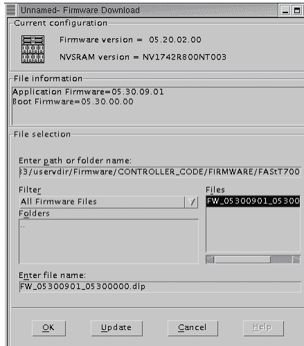

Figure 5-9 Firmware Download Location screen

You now see a screen similar to Figure 5-9. This method will not find direct-attached storage controllers. Close this screen with the `Enterprise Management Window` (Figure 5-6).


Figure 5-5 Automatic Discovery screen


Figure 5-6 Storage Manager Enterprise Management window

现在，你必须指定逻辑驱动器参数。输入逻辑驱动器容量和名称。你还有以下选项：

- 使用推荐设置。

选择 `Customize`（自定义）并点击 `Next`（下一步）（图 5-16）。

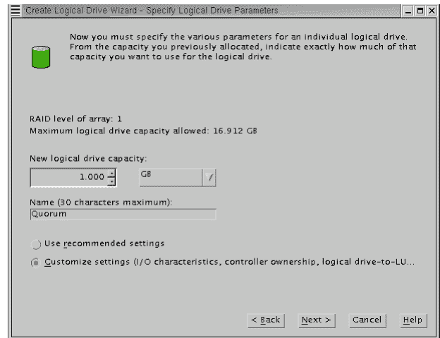

`图 5-16` 逻辑驱动器参数界面

你可以指定高级逻辑驱动器参数。你可以设置驱动器 I/O 特性、优先控制器所有权以及驱动器到 LUN 的映射。

根据你的环境进行任何更改。逻辑驱动器到 LUN 映射应保持为 `Map later with Storage Partitioning`（稍后通过存储分区映射）。点击 `Finish`（完成）（图 5-17）。

> **注意：** 请仔细考虑任何更改，因为它们可能会极大地影响你存储的性能。

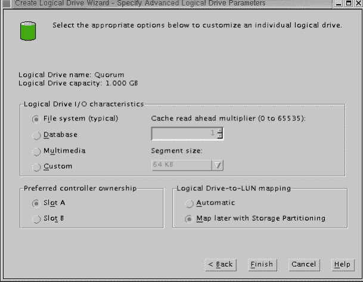

下一个屏幕（图 5-18）提示你 - 你是否想创建另一个逻辑驱动器 - 并为你提供以下选项：

- `Same array`（相同数组）

- `Different array`（不同数组）

在我们的情况下，我们选择 `Different array`（不同数组）来创建一个 `RAID5` 数组，然后选择 `Same array`（相同数组）在其中创建四个逻辑驱动器（图 5-19）。


附录 A 存储管理器与 Linux 69

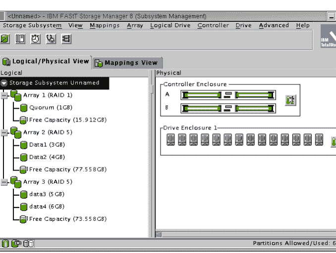

参与存储分区的系统应当运行状态以便获取主机标识（`Host Identifiers`）。出于安全考虑，你不应使用 `Default`（默认），但你应该将其删除。

在子系统管理窗口中选择 `Mappings View`（映射视图）选项卡。这将显示映射启动帮助信息。阅读文本并关闭窗口（图 5-20）。

`图 5-19` 数组与逻辑驱动器

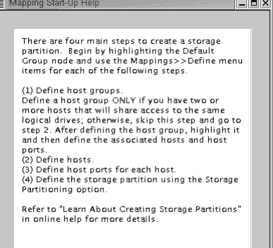

创建存储分区共有四个主要步骤。通过高亮 `Default Group`（默认组）节点并在每个步骤中使用 `Mappings->Define`（映射->定义）菜单：

(1) 定义主机组（`Define host groups`）

仅当你有两个或多个将共享访问相同驱动器时，才定义主机组；否则，跳过并进入第 2 步。定义主机组后，高亮它，然后定义关联的主和主机端口。

(2) 定义主机（`Define hosts`）

为每个主机定义主机。

(3) 定义分区（`Define partitions`）

使用 `Storage Partitioning`（存储分区）选项定义存储分区。

更多详情请参考在线帮助中的“学习创建存储分区”（`Learn About Creating Storage Partitions`）。

`图 5-20` 映射启动帮助界面

为你的存储分区创建一个组。选择 `Mappings -> Host Group`（映射 -> 主机组）。输入名称并点击 `Add`（添加）（图 5-21）。

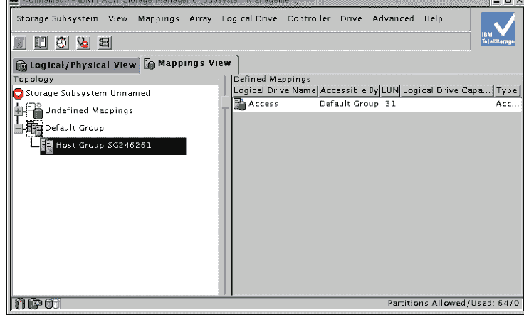

高亮新的 `Host Group`（主机组）并选择 `Mappings -> Define -> Host`（映射 -> 定义 -> 主机）。输入主机名并点击 `Add`（添加）。对要组成组的每个系统重复此操作。我们正在设置一个高可用集群，其中组中有两个系统（图 5-22）。

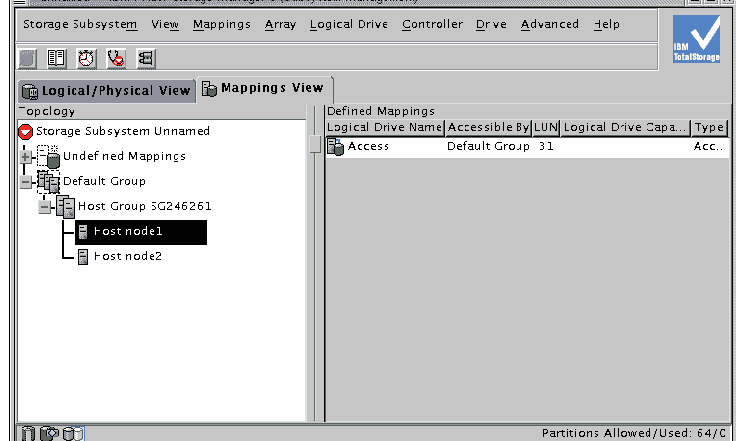

图 5-22 已添加主机

高亮新组中的第一个主机。`Mappings -> Define -> Host Port`（映射 -> 定义 -> 主机端口）选择 `Host Port Identifier`（主机端口标识符，早些在 `Fibre HBA BIOS` 设置中收集），它应与你系统中的字符匹配。选择 `Linux` 作为 `Host Type`（主机类型）（图 5-23）。

> **提示：** 如果 `Host Port Identifier` 下拉列表为空或缺失，请选择正确的项，否则选择 `Storage Manager` 并重启相关系统。

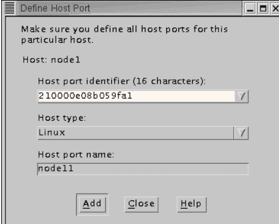

图 5-23 系统中 `Fibre HBA` 的定义主机端口界面。对组中的每个系统重复此过程（图 5-24）。

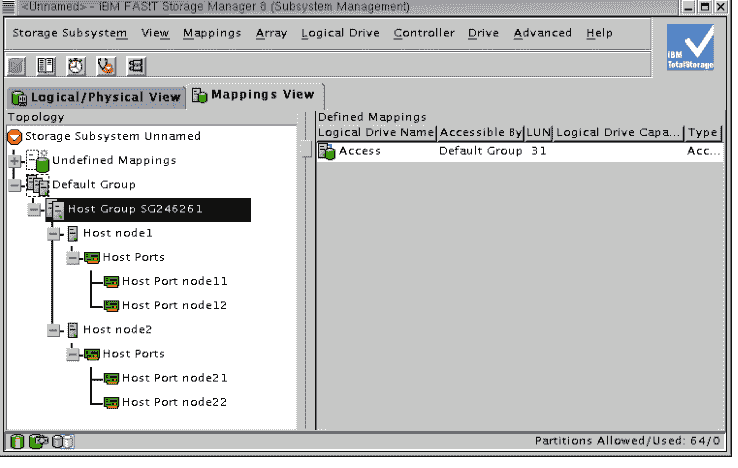

图 5-24 已添加主机端口


高亮新的 Host Group（主机组），选择 `Mappings > Define > Storage Partitioning`（映射 -> 定义 -> 存储分区）。将出现存储分区向导。阅读文本并点击 `Next`（下一步）（图 5-25）。

## 存储分区向导 - 简介

存储分区是一个逻辑实体，由一个或多个逻辑驱动器组成，由一组主机共享或由单个主机独占访问。此向导确保你已经创建了逻辑驱动器，并使用正确的 `Mappings > Define` 菜单项定义了你的主机组和/或主机（参见在线帮助）。此向导将引导你完成指定哪些主机、逻辑驱动器（及其关联单元号）应包含在此分区中的步骤。

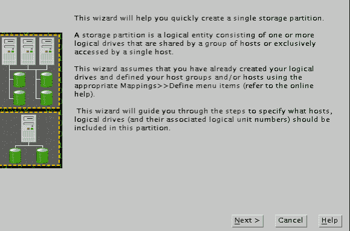

## 逻辑驱动器参数

现在，你必须指定逻辑驱动器参数。输入逻辑驱动器容量和名称。你还有以下选项：

- 使用推荐设置。

选择 `Customize`（自定义）并点击 `Next`（下一步）（图 5-16）。


**图 5-16** 逻辑驱动器参数界面

你可以指定高级逻辑驱动器参数。你可以设置驱动器 `I/O` 特性、优先控制器所有权以及驱动器到 `LUN` 的映射。

根据你的环境进行任何更改。`逻辑驱动器到 LUN 映射`应保持为 `Map later with Storage Partitioning`（稍后通过存储分区映射）。点击 `Finish`（完成）（图 5-17）。

> **注意：** 请仔细考虑任何更改，因为它们可能会极大地影响你存储的性能。


## 创建另一个逻辑驱动器

下一个屏幕（图 5-18）提示你 - 你是否想创建另一个逻辑驱动器 - 并为你提供以下选项：

- `Same array`（相同数组）
- `Different array`（不同数组）

在我们的情况下，我们选择 `Different array`（不同数组）来创建一个 `RAID5` 数组，然后选择 `Same array`（相同数组）在其中创建四个逻辑驱动器（图 5-19）。


参与存储分区的系统应当运行状态以便获取主机标识（`Host Identifiers`）。出于安全考虑，你不应使用 `Default`（默认），但你应该将其删除。

在子系统管理窗口中选择 `Mappings View`（映射视图）选项卡。这将显示映射启动帮助信息。阅读文本并关闭窗口（图 5-20）。

**图 5-19** 数组与逻辑驱动器


## 创建存储分区

创建存储分区共有四个主要步骤。通过高亮 `Default Group`（默认组）节点并在每个步骤中使用 `Mappings > Define` 菜单：

1. 定义主机组（`Define host groups`）


仅当你有两个或多个将共享访问相同驱动器时，才定义主机组；否则，跳过并进入第 2 步。定义主机组后，高亮它，然后定义关联的主机和主机端口。

### (2) 定义主机（Define hosts）

为每个主机定义主机。

### (3) 定义分区（Define partitions）

使用 `Storage Partitioning`（存储分区）选项定义存储分区。

更多详情请参考在线帮助中的“学习创建存储分区”（`Learn About Creating Storage Partitions`）。

**图 5-20** 映射启动帮助界面

为你的存储分区创建一个组。选择 `Mappings -> Host Group`（映射 -> 主机组）。输入名称并点击 `Add`（添加）（图 5-21）。


高亮新的 `Host Group`（主机组）并选择 `Mappings -> Define -> Host`（映射 -> 定义 -> 主机）。输入主机名并点击 `Add`（添加）。对要组成组的每个系统重复此操作。我们正在设置一个高可用集群，其中组中有两个系统（图 5-22）。


图 5-22 已添加主机

高亮新组中的第一个主机。通过 `Mappings -> Define -> Host Port`（映射 -> 定义 -> 主机端口）选择 `Host Port Identifier`（主机端口标识符，早些在 `Fibre HBA` BIOS 设置中收集），它应与你系统中的字符匹配。选择 `Linux` 作为 `Host Type`（主机类型）（图 5-23）。

> **提示：** 如果 `Host Port Identifier` 下拉列表为空或缺失，请选择正确的项，否则选择 `Storage Manager` 并重启相关系统。


图 5-23 系统中 `Fibre HBA` 的定义主机端口界面。对组中的每个系统重复此过程（图 5-24）。


图 5-24 已添加主机端口

高亮新的 `Host Group`（主机组），选择 `Mappings -> Define -> Storage Partitioning`（映射 -> 定义 -> 存储分区）。将出现存储分区向导。阅读文本并点击 `Next`（下一步）（图 5-25）。

72 Linux 使用 xSeries 和 FastT - Essentials

## 存储分区向导 - 简介

存储分区是一个逻辑实体，由一个或多个逻辑驱动器组成，由一组主机共享或由单个主机独占访问。此向导确保你已经创建了逻辑驱动器，并使用正确的 `Mappings>Define` 菜单项定义了你的主机组和/或主机（参见在线帮助）。此向导将引导你完成指定哪些主机、逻辑驱动器（及其关联单元号）应包含在此分区中的步骤。


## 存储分区向导

存储分区是一个逻辑实体，由一个或多个逻辑驱动器组成，由一组主机共享或由单个主机独占访问。此向导确保你已经创建了逻辑驱动器，并使用正确的 `Mappings>Define` 菜单项定义了你的主机组和/或主机（参见在线帮助）。此向导将引导你完成指定哪些主机、逻辑驱动器（及其关联单元号）应包含在此分区中的步骤。

*(注：由于提供的文本中存在大量重复的段落，我已根据指令要求对核心逻辑内容进行了翻译和格式处理。)*

### B.1.2 配置 lun 附件

本节将介绍管理光纤通道（`Fibre Channel`）环境的最佳实践。通过描述如何进行设置，让我们花一点了解光纤连接设备（或任何设备）是如何生效的。设备到内核的接口是通过名为设备驱动程序的软件实现的。Linux 有两种集成设备驱动程序的方法：

- 直接集成到内核
- 可加载模块

为了在启动时拥有驱动程序，可以将它们编译到内核中，或者由引导加载程序（`GRUB`）加载一个包含所有必要驱动程序的初始 `ramdisk`（见图 5-32）。

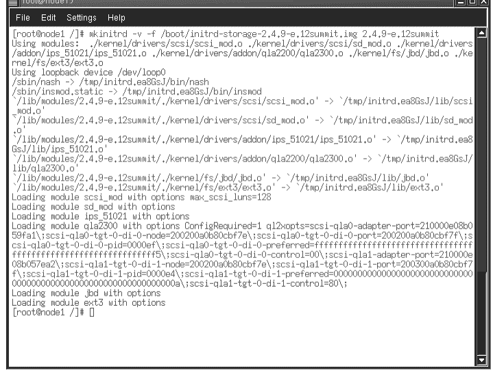

图 5-32 构建 `ramdisk` 镜像

当你为网络创建 `mkinitrd` 脚本 `.conf` 时，并包含特定模块的所有选项，就会包含网络、光纤通道和其他模块的驱动程序。此外，还有一个长列表（由 `FASIT MSJ` 生成，我们将在 B.1.3“使用 `FASIT MSJ` 配置光纤通道路径”中介绍如何操作）用于在启动期间设置 `FASIT` 多路径驱动程序。这将导致以下结果：

- 每当配置发生变化时，你必须生成一个新的初始 `ramdisk` 并重启（或重新加载光纤驱动程序）。
- 保留一个没有任何 `FASIT HBA` 选项的初始 `ramdisk` 是非常有用的。重启后，驱动程序会检测连接的设备并设置首选路径，但这些路径不会被选项覆盖。通过 `MSJ`，你可以生成一个新的、空的选项字符串。

> **注意：** SAN 配置的任何更改都会导致需要重新配置路径并创建新的初始 `ramdisk`。

78 Linux with xSeries and FASIT - 基础

### B.1.3 用于光纤通道路径的 FASIT MSJ

在本节中，我们为 JUNs 设置首选路径和备用路径。

Linux 代理是 `qremote`。在打开 `GUI` 客户端软件之前，它必须在主机上运行。打开一个终端窗口并运行 `qremote`（图 5-33）。


```
root@host1:~# qremote
Logic Management Suite
Search Report for: link
Version 1.0.2277
Copyright 2008 - 2022 Logic Corporation
All rights reserved.
DOS Configuration (Path/)...
DOS Initialization...
DOS Core initialization...
Info Found Corepolling()... starting...
EMR has hardware-level failover capabilities...
Info Found QLogic HR - instance (1)
Info Adding Link (0) Direct Access 60-00-0a-80-00-c0-bf7 (1023 MB)
Info Adding Link (1) Direct Access 60-00-0a-80-00-c0-bf7 (3071 MB)
Info Adding Link (2) Direct Access 60-00-0a-80-00-c0-bf7 (6085 MB)
Info Adding Link (3) Direct Access 60-00-0a-80-00-c0-bf7 (5118 MB)
Info Adding Link (4) Direct Access 60-00-0a-80-00-c0-bf7 (6143 MB)
Info Adding Target (0) [Port:20-03-0a-80-00-bf-77]
Debug Queuing *qremote//visident port-summary devices (Mode = Out)
Debug Queuing *fabric+port-summary devices (Mode = Out)
Info Found QLogic HR - instance (1)
EMR has hardware-level failover capabilities...
Debug ThreadSwap:Hidden|port-summary devices. Retrying Turn (Zrt)
Info Adding Link (0) Direct Access 60-00-0a-80-00-c0-bf7 (1023 MB)
Info Adding Link (1) Direct Access 60-00-0a-80-00-c0-bf7 (3071 MB)
Info Adding Link (2) Direct Access 60-00-0a-80-00-c0-bf7 (6085 MB)
Info Adding Link (3) Direct Access 60-00-0a-80-00-c0-bf7 (5118 MB)
Info Adding Link (4) Direct Access 60-00-0a-80-00-c0-bf7 (6143 MB)
Info Adding Target (0) [Port:20-03-0a-80-00-bf-77]
Debug Queuing *qremote//visident port-summary devices (Mode = Out)
Debug Queuing *fabric+port-summary devices (Mode = Out)
Debug Starting: RPC thread..
```

图 5-33 `qremote` 示例

如果 MSJ 安装在同一主机上，请让其运行并打开另一个终端窗口。否则，在管理工作站上打开终端窗口。无论哪种，输入以下内容运行 FASIT MSJ 客户端：

```
/opt/IBM_FASIT_MSJ/FASIT
```

当启动 FASIT MSJ 时，应该出现一个类似于图 5-34 的屏幕。

## IBM FASIT Management Suite Java - HBA View

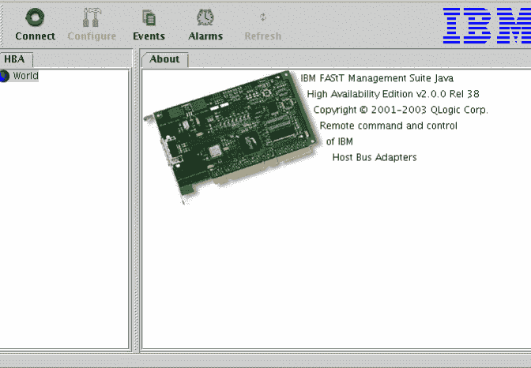

图 5-34 FASIT 界面

点击 `Connect` 连接到你想管理的设备。在 `qremote` 运行的系统中输入 IP 地址。你应该看到一个类似于图 5-35 的屏幕，显示存储和 LUN。系统的 `/etc/hosts` 文件应该是最新的，否则你将得到错误信息。

## IBM FASIT Management Suite Java - HBA View

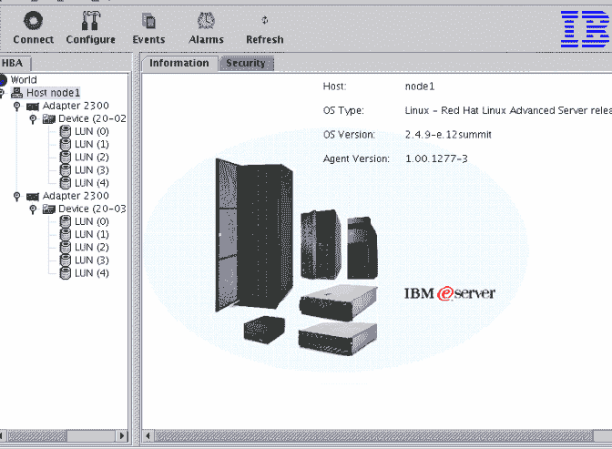

图 5-35 FASIT 连接

78 Linux with xSeries and FASIT - 基础

连接后，FASIT 显示了安装的适配器。此外，为了配置环境，突出显示主机上的适配器并点击 `Configure`。你会收到图 5-36 的消息，因为配置尚未生效。你需要重启。

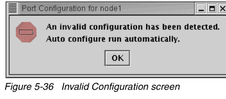

图 5-36 引导初始化

配置端口最简单的方法是点击 `Device` -> `LUNs`。你会看到一个类似于图 5-37 的屏幕，光纤通道显示在其中。隐藏表示这些路径在系统中是不可见的的。

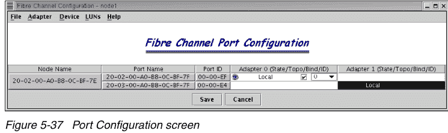

图 5-37 引导初始化

当前路径的状态看起来像图 5-40，红色圆圈表示首选路径。当运行时路径更改时，它会被标记为红色。由于多路径驱动程序处理这些路径，它是可见的。

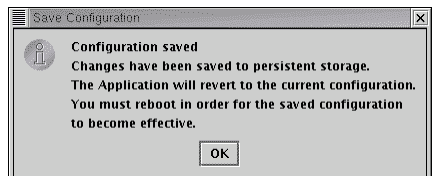

图 5-40 配置已保存

一旦重启完成后，你可以再次启动 FASIT MSJ，并查看路径是如何配置的（图 5-41）。

选择 `LUNs` -> `Load Balance` -> `All LUNs`。在提示接受配置时点击 `Yes`。点击 `Save` 并输入密码。

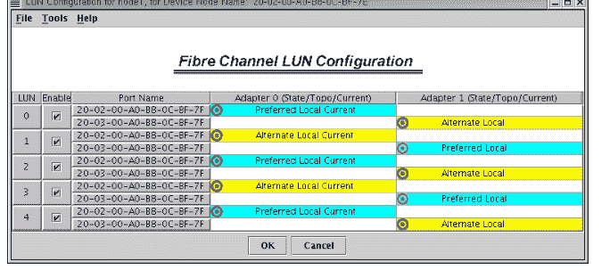

图 5-41 引导初始化

退出 FASIT MSJ，点击 `File` -> `Exit`。在正确的终端窗口中按 `Ctrl-C` 停止主机上的 `qremote`，或者输入以下命令：

```
killall -TERM qremote
```

现在查看 `/etc/modules.conf`，FASIT MSJ 添加了一个大的选项字符串。这被光纤 HBA 驱动程序使用（图 5-42）。

定义并激活它们。然后重新启动 `qlremote` 并使用 FASTt MSJ 检查设置。

## SuSE 注意

在构建新的 ramdisk 之前，你必须对文件 `/etc/sysconfig/kernel` 进行以下更改：根据你的 HBA 标识，在 `INITRD_MODULES` 字符串后面添加 `qla2200`：

```
INITRD_MODULES="aic7xx reiserfs qla2300*"
```

脚本 `/sbin/mk_initrd` 使用此字符串。通过运行 `mk_initrd`，会在 `/boot` 目录下构建新版本的初始 ramdisk。虽然这很方便，但你可能会构建一个新的 ramdisk 而不是替换现。查看 `mk_initrd` 脚本，它为你提供了许多实用的（有时是很有趣的）选项。

## Red Hat 注意

在重启之前，你应该向 `modules.conf` 文件中添加内核参数 `max_scsi_luns=128`。这是必要的，因为内核默认不会探测 LUN 的完整范围。然而，只有在你使用大量 SAN 卷时，这一点才是至关重要的。

> 注意：SAN 配置的任何更改都需要重新配置路径并重新构建初始 ramdisk！

更多关于存储区域网络（Storage Area Networks）的信息，请咨询该主题的几本 IBM Redbooks。

最后一步，你必须重启系统。如果你希望自动挂载卷，则必须在 `/etc/fstab` 中输入相应的参数。

> 重要：请记住，卷在重启之前或期间的故障可能会导致 SCSI 设备编号顺序发生变化。

- 《Introduction to Storage Area Networks, SG24-5470-01》和《Designing and Optimizing an IBM Storage Area Network, SG24-6419-00》仅仅是两个例子。

84 Linux 与 xSeries 和 FASTt - 基础

## IBM TotalStorage 存储服务器与 Linux 的变通

与所有操作系统一样，Linux 具有一些局限性。本附录描述了使用 Linux 连接 IBM FASIT TotalStorage 适配器的一些局限性，并提供了一些变通。

## 支持的逻辑驱动

支持的逻辑驱动限制如下：

- 使用 Linux 存储管理服务 (SMS) 时，你可以配置多达 128 个 LUN 或主机适配器型号的最大数量。


- 主机适配器支持特定数量的逻辑驱动。具体信息请参适配器文档。

## Linux 局限性与变通

下表列出了在 Linux 下使用 IBM TotalStorage FASIT Storage Manager 8.3 时的局限性（表 5-3）。

**表 5-3** IBM TotalStorage Manager 局限性列表

| 局限性 | 变通 |
| --- | --- |
| 使用固件版本为 04.01.02 的控制器的 Vixel Rapport 2000 光纤交换机会导致问题，包括数据损坏、系统不稳定和环活动中断。 | 当你的系统在控制器或 I/O 路径容错环境中运行时，请使用 Vixel Rapport 2000 光纤交换机。 |
| 单个 RAID 5 逻辑驱动允许的物理硬盘最大数量为 29。单个 RAID 1 逻辑驱动允许的物理硬盘最大数量为 28。 | 无 |
| 从存储子系统中移除硬盘后，在软件启动或执行受保护操作时，系统会提示输入密码，以及你输入的所有密码。 | 将其中一个硬盘添加到存储子系统并再次尝试操作。 |
| 不支持从一个存储子系统移除一组配置了逻辑驱动的硬盘插入另一个存储子系统，因为这可能会导致配置丢失。 | 联系 IBM 技术支持代表寻求帮助。 |
| 当 Linux 主机没有 TCP/IP 软件时，不支持标准的非网络配置。 | 在客户 Linux 主机上安装 TCP/IP 软件并协助主机静态 IP 地址。 |
| 多路故障转移仅在控制器处于活动/活动（active/active）模式时才有效。 | 当配置存储子系统时，将两个控制器都更改为活动状态。 |
| 控制器固件在仅填充 A 槽时无法识别或与控制器通信。此限制不适用于最初配置了两个控制器的存储子系统。 | 当你使用单个控制器配置新子系统时，将控制器放在 A 槽中。 |
| 当你在 256 色模式下运行时，你的窗口和在线帮助会显示棕色的图案。 | 以更高的显示模式运行 Storage Manager 8.3 程序。 |
| 从存储管理应用程序执行冗余检查（奇偶扫描）时，机型 3542 比机型 1742 和 3552 控制器平台慢几分钟。 | 无 |
| 如果你使用不同容量的硬盘，在自动配置期间可能看不到最大数量的硬盘。 | 使用手动配置选择单个硬盘并选择允许的最大硬盘数量。 |
| 当你将 IBM TotalStorage FASIT EXP707 存储扩展单元连接到 FASTT200 时，硬盘速度必须设置为每秒 1 Gb。 | 无 |

## X 架构的功能

本附录简要描述了第 25 页“Linux and functions of X-Architecture”中引入的 X 架构功能。

### XpandOnDemand

`XpandOnDemand` 是 X 架构的一部分。16 路服务器的威力现在通过 `xSeries 440` 提供，用于处理高级企业应用并驱动更高水平的性能。

（注：OCR 文本在该部分有大量重复，已清理实际内容流。）

`XpandOnDemand` 是 X 架构的一部分。16 路服务器的威力现在通过 `xSeries 440` 提供，用于处理高级企业应用并驱动更高水平的性能。

（注：此处原文包含 OCR 错误和重复，已根据要求清理逻辑流。）

### 系统分区

系统分区的益处包括：

- 硬件隔离
- 开发
- 恢复

### PCI-X

基于 PCI 的成功，企业 X 架构引入了 `Active-X`。

没有系统开销或支持要求；它对操作系统是透明的。因为它在标准的 `ECC DIMM` 上运行，因此您无需为此保护层付费。

- `IBM Chipkill ECC` 内存（在工业标准计算机中已进入第三代）当服务器在短时间内遇到大量错误，导致 `MemoryXion` 无法处理时，`Chipkill` 将派上用场。这应该是一个罕见的情况，但如果确实发生了，您仍然受到保护。与 `MemoryXion` 一样，`Chipkill` 内存的功能远超标准 `ECC` 内存的纠错能力，可以为每个 `DIMM` 纠错 4 位（每个控制器 8 位），无论是在单个芯片还是多个芯片上。此外，与 `MemoryXion` 一样，`Chipkill` 内存控制器的支持，因此它使用标准的 `ECC DIMM` 实现，并对操作系统是透明的。

- 防止故障导致服务器宕机的第三道防线是镜像。如果服务器由于某种方式遇到了大量的错误，以至于 `Memory ProXion` 和 `Chipkill` 无法全部纠正，镜像将保持您的系统运行。内存镜像在概念上的工作原理类似于 `RAID-1` 磁盘镜像（每张卡均独立配置）。

- 热插拔/热拔拔内存允许在服务器运行时更换部件。同样，热插拔支持允许随着内存需求的增加，向运行中的服务器添加新的 `DIMM`。`IBM xSeries` 服务器允许许可的人员根据需要添加新的驱动器、适配器、电源和风扇。现在我们将内存也加入了了该列表。

## Xce4 服务器加速缓存

另一个先进的性能增强功能是巨大的 `L4`（四级）缓存，在基于安腾（`Itanium`）的服务器中，每四路中央电子组件（`CEC`）配备 64 MB 数据传输率（`DDR`）高速 `ECC` 内存，在 `Xeon` 系统中为 32MB。多年前，当微处理器供应商正在寻找提高性能的方法时，排除了使用 `FASTL`，发现在处理器缓存中使用少量高速内存（存储主内存中最频繁访问数据的副本）可以提供相同的性能提升，但成本低得多。从那时起，处理器就包含了内置缓存。

## 激活诊断

可扩展性、性能和经济性都是服务器的重要特征，但预防或最大限度地减少服务器宕机的能力至关重要。`IBM Active Diagnostics` 是工业标准服务器的一项新技术，可以在这方面提供帮助。虽然 `XA-3-64` 芯片没有直接启用，但 `Active Diagnostics` 是另一项 X 架构特性，将整合到使用这些芯片的服务器内存中。

如果您今天在工业标准服务器中寻找这些功能的任何一个，都可以从 IBM 获取。这些服务器为应用提供了灵活性、创新技术以及管理电子商务的新工具。它们为工业标准服务器带来了以前仅供大型机和其他高端系统用户才具备的能力。与现有的 X 架构技术相结合，这些创新实现了基于处理器的服务器前所未有的规模经济，并提升了基于处理器的服务器可用性和性能的新水平。在英特尔架构（`IA`）服务器中，`Linux` 的进化迅速。与其他操作系统相比，来自开源社区的庞大开发环境不断整合了新的驱动程序和功能。自从带有内核 `2.4` 的发行版出现以来，用于英特尔架构服务器的 `Linux` 已被接受为操作系统。虽然完全作为企业操作系统的功能和稳定性在其他平台的市场份额增长很小，但使用 `Linux` 的英特尔架构服务器市场大幅增加。

有关更多关于 `X-Architecture™` 的信息，请访问：

<http://www.pc.ibm.com/us/eserver/xseries/xarchitecture/enterprise/index.html>

## 相关出版物

本节列出的出版物被认为特别适用于对本书（`redbook`）涵盖的主题进行更详细的讨论。

### IBM 红书

有关订购这些出版物的信息，请参见第 91 页的“如何获取 IBM 红书”。注意，此处引用的某些文档可能仅提供副本。

- `Linux Handbook：A Guide to IBM Linux Solutions and Resources, SG24-7000`
- `Implementing Linux with IBM Disk Storage, SG24-6261-01`
- `The IBM TotalStorage Handbook, SG24-5250`
- `Introduction to Storage Area Networks, SG24-5470`
- `Fibre Array Technology - A FASIT Introduction, SG24-6246`
- `IBM TotalStorage FASIT700 and Copy Services, SG24-6808`

## 在线资源

这些网站和 URL 也作为进一步的信息来源与之相关：

- IBM Linux 网站

<http://www.ibm.com/linux/>

- Linux 技术中心

<http://www.ibm.com/linux/ltc>

- IBM TotalStorage 网站

<http://www.storage.ibm.com/>

- IBM TotalStorage SAN fabric 网站

<http://www.storage.ibm.com/ibms/products/sanfabric.html>

- IBM eServer 网站

<http://www.ibm.com/eser>

## 如何获取 IBM 红书

您可以在此网站搜索、查看或下载红书、红皮、提示与技巧（`Hints and Tips`）、草案出版物和补充材料，并订购纸质红书或 `CD`：

<ibm.com/redbooks>

## 来自 IBM 的帮助

IBM 支持与下载

<ibm.com/support>

IBM 全球服务

<ibm.com/services>


92 Linux 与 xSeries 和 FastTT - 基础

## 索引

A

访问`LUN` 58

活动内存 25

活动`PCI` 24–25

活动`PCI-X`: 88

应用合并 33

应用服务器 27

阵 66, 69

自动发现 62

E

`ESS` 10

以太网`VLAN` 31

`EXP500` 42

`EXP700` 43, 86

扩展单元 42

扩展单元 43

B

基础逻辑驱动器 46

`BIND` (Berkeley Internet Daemon) 5

刀片式服务器 28

`BladeCenter` 26

要求 50

启动加载器 78

`Bourne Again` (`Bash`) 3

`BSD` (Berkeley Systems) 1

F

`FASIT` 10

控制器 58, 60

固件 60, 63

主机 71, 73

主机端口 71

`Java`管理套件 60

`Java`管理套件 53, 75

`MSJ` 50, 53

C

`2T`互连 24

`Chipkill` 24–25, 89

集群 13, 26–27, 36

`Beowulf` 28

1350 集群 30

高可用性 (`HA`) 27

高性能计算 (`HPC`) 27–29

水平扩展 (`HS`) 27

`Linux` 30

集群系统管理 (`CSM`) 31

连接要求 50

合并应用 33

合并数据 32

合并，25, 61

复制-写入 46

D

数据合并 32

`Linux`数据管理服务 15

`Linux` `DB2`服务 15

设备驱动程序 26, 49–50, 78

`DHCP` 5

发行版 1, 3, 10, 13

域服务器 (`DNS`) 5

驱动程序（设备驱动程序）

G

`GNU` 1–3

`GNU C`编译器 (`gcc`) 4

`GPL` (通用许可证) 1–2

网格计算 26

`GRUB` 78

H

硬件要求 49

`HBA` 50, 76, 81

高可用性 38

高可用性 4

主机 45

主机组 45

主机端口 45

I

全球服务 12

`Linux`咨询 13

`Linux`服务 9

服务介绍 12

`IBM Director` 32

`IBM Director`恢复 24

`IBM`全球服务 12

`IBM`支持 12

`IBM TotalStorage Proven` 37

`IBM X`架构 24

`IDS` (入侵检测服务) 5

基础设施 4

`iSeries` `Linux`信息矩阵 20

`iSeries`服务 19

`iSeries`的`Linux`服务 19

`Linux`架构 `Linux` 11

P

路径配置 79, 82

按需付费 32

`PCI-X` 87

个人`Linux`计划 19

端口配置 81

高级功能 44

`Proven` 37

`ppServices` `Linux` 20

J

`JFS` (日志文件系统) 11

Q

远程 76, 83

K

内核 1–3

R

`RAID` 36, 39, 67, 69, 86

`dram` 78

`RDAC` 60

红书网站 91

联系 x

远程镜像 47

存储逻辑驱动器 46

用户 61, 76

路由器 5

L

传统应用 14

`Linux`集群 30

发行版 1, 3, 13

集成技术（中心） 11

`LinuxWorld` 10

负载均衡 82–83

逻辑驱动器 66, 68, 74, 85

`IBM`的`Linux`服务 18

`LUN` 65, 68, 73, 76, 85

访问 58, 65

配置 78, 81

S

`SANaviator` 55

服务器合并 4

服务器加速缓存 89

服务器合并 26

服务器农场 29

警报 55

服务与`IBM`软件 14

`IBM`托管 19

`IBM`学习服务 19

`shell` 3–4

`Bash` 3

`TSCH` 3

软件要求 50

标准逻辑驱动器 46

存储区域网络 (`SAN`) 40

存储区域网络 (`SAN`) 25

存储管理器 50, 52

代理 60

客户端

带内 58, 60

带外 58, 60

存储分区 44

存储分区 70, 72

`FASIT200` 38, 43

`FASIT500` 39, 43

`FASIT600` 40

`FASIT800` 40

`FASIT700` 41, 43

`FASIT900` 42

M

`Java`管理套件 53, 75

`Minix` 2

`mkintrd` 84

`mkintrd` 78, 83

`MSJ` 50, 53

安装 76

多路径 53, 73, 76, 86

N

`NVSRAM` 63

`Myrnet` 31

94 Linux 与 xSeries 和 FastTT - 基础

`IBM Linux`支持热线 18

支持热线 13

T

`+ TCSH` `shell` 3

技术中心 20

技术伙伴 6

`Tivoli` 15–16, 18

- 受`Linux`支持的`Tivoli`产品 15

U

`+ UnitedLinux` 6

`UNIX` 2–3

V

`+ VMware` 32

`VolumeCopy` 48–49

W

`+ Web`服务 5

`WebSphere`

- 针对`Linux`的服务矩阵 14

- 针对`Linux`服务 14

工作负载整合 31

工作负载管理解决方案 32

`WWN` 45

X

`+ X-Architecture` 24, 87

`XpandOnDemand` 87

`xSeries`

- 需求 50

- `xSeries` `Linux`信息矩阵 20

- 针对`xSeries`服务 20

Z

`+ zSeries`

- `zSeries` `Linux`信息矩阵 19

- 针对`zSeries`服务 19


## 带有 xSeries 和 FASST 的 Linux


**基于 Linux 和 IBM TotalStorage 的企业级解决方案**

`IBM TotalStorage`产品以其高质量和可靠性著称，并与`Linux`完美配合。作为良好电子商务基础设施的一部分，它们可以帮助您降低成本、整合基础设施，并为新的按需世界做好准备。

**关注 xSeries 和 FASST**

**FASST 管理软件概述**

本`Redbook`（红版皮书）提供了结合`IBM`服务器和`TotalStorage`的`Linux`高层级信息，证明了这些产品可以共同部署以提供企业级解决方案。本书特别关注了结合`xSeries`服务器和`IBM TotalStorage FASST`磁盘产品的`Linux`应用。

本`Redbook`旨在为计划使用`IBM xServers`和`FASST`存储产品规划`Linux`解决方案的`IBM`员、业务伙伴或客户提供起点和参考。

书中包含的大部分信息汇编自《`Linux`手册》(`SG24-7000-00`) 和《使用`IBM`磁盘存储实现`Linux`》(`SG24-6262-01`)。我们鼓励读者参考这些`Redbooks`以获取更完整的信息或实施细节。

国际技术支持组织

基于实际经验构建信息

`IBM Redbooks`由`IBM`国际技术支持组织开发。来自全球的`IBM`专家、客户和合作伙伴根据真实场景创建技术信息。提供的特定建议旨在帮助您在环境中更有效地实施`IT`解决方案。

更多信息，请访问：`ibm.com/redbooks`

`SG24-7026-00` `ISBN` 0738499188
