# zSeries 和 ESS Linux：精要

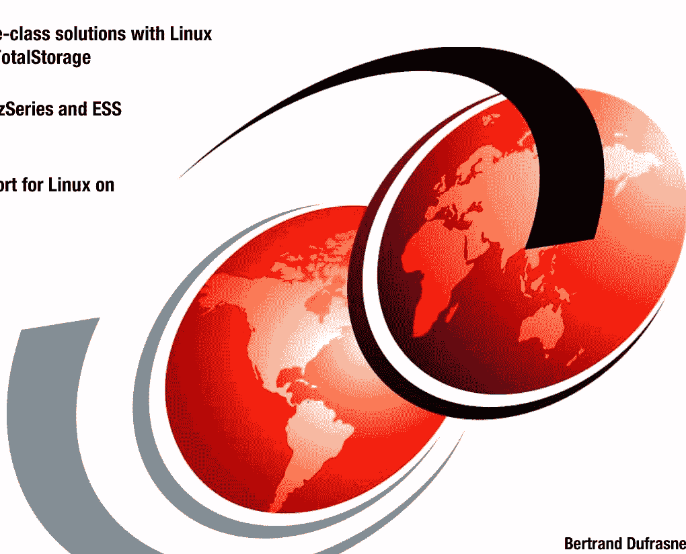


**注意：** 在使用本信息及其支持的产品之前，请阅读第 ix 页的“声明”中的信息。

## 图表

- 3-1 `IBM eServer zSeries` ........................................ 24
- 3-2 在 `LPAR` 中或作为 `z/VM` 客户机运行 `zSeries` 上的 `Linux` ............... 25
- 3-3 `IFL` 与 `LPAR` 之间的关系 .............................. 26
- 3-4 在 `z/VM` 下运行 `z/OS` 和 `Linux` 的 `zSeries` 的 `CP` 配置。 ........ 26
- 3-5 `z/VM` 虚拟化 .............................................. 28
- 3-6 盒中服务器场............................................. 30
- 3-7 水平服务器增长 ........................................ 30
- 3-8 `Samba` 文件/打印场景 - 分布式解决方案 .................... 32
- 3-9 `Samba` 文件/打印场景 - `zSeries` 解决方案........................ 33
- 4-1 `IBM` 的 `Seascape®` 架构 - `ESS Model 800` ........................ 38
- 4-2 `ESS Model 800` 主要组件 ................................... 39
- 4-3 用于存储整合的 `IBM TotalStorage Enterprise Storage Server` ...... 40
- 4-4 `Enterprise Storage Server Model 800` ............................... 41
- 4-5 灾难恢复和可用性 ............................... 42
- 4-6 存储区域网络 (`SAN`) ...................................... 44
- 4-7 `ESS` 欢迎屏幕.............................................. 45
- 5-1 典型的 `zSeries` 存储连接概念......................... 48
- 5-2 `SCSI` 地址 ................................................ 50
- 5-3 全球唯一名称 ............................................... 50
- 5-4 `DASD` 地址方案......................................... 51
- 5-5 `DASD` 访问转换 `FICON` 与 `FCP` ............................ 52
- 5-6 存储分配面板 ....................................... 54
- 5-7 开放系统存储面板 ..................................... 54
- 5-8 修改主机系统面板 - 添加 `zSeries` 上的 `Linux` 主机........ 55
- 5-9 配置主机适配器端口面板.............................. 56
- 5-10 固定块存储面板..................................... 57
- 5-11 添加卷（面板 1/2） .................................... 58
- 5-12 添加卷（面板 2/2） .................................... 58
- 6-1 用于 `zSeries` 的 `ESS Copy Services` .................................. 62
- 6-2 同步卷复制 `PPRC` ................................... 63
- 6-3 `PPRC` 卷状态 - 同步操作模式 .............. 65
- 6-4 `PPRC-XD` 操作.............................................. 66
- 6-5 双工挂起 `XD` 卷状态 ................................ 67
- 6-6 `PPRC-XD` 基本操作....................................... 68
- 6-7 `FlashCopy` 时间点复制 .................................. 70
- 6-8 增量 `FlashCopy` ........................................ 71
- 6-9 `ESS` 欢迎屏幕 ............................................ 72
- 6-10 `ESS Copy Services Web` 用户界面主菜单.................. 72
- 6-11 卷面板................................................ 73
- 6-12 逻辑子系统面板...................................... 74
- 6-13 路径输入面板............................................. 75
- 6-14 任务面板 .................................................. 76

## 表格

- 2-1 `WebSphere for Linux` 产品服务矩阵 .................... 14
- 2-2 `IBM Tivoli Security Management for Linux` 产品矩阵 .................... 16
- 2-3 `IBM Tivoli Storage Management for Linux` 产品矩阵 .................... 16
- 2-4 `IBM Tivoli Configuration Manager for Linux` 产品矩阵 .................... 16
- 2-5 `Tivoli Workload Scheduler for Linux` 产品矩阵 .................... 16
- 2-6 `IBM Tivoli Performance and Availability for Linux` 产品矩阵 .................... 17
- 2-7 `Tivoli Enterprise Console for Linux` 产品矩阵 .................... 17
- 2-8 `IBM Tivoli NetView for Linux` 产品矩阵 .................... 17
- 2-9 `IBM Tivoli Service Level Advisor for Linux` 产品矩阵 .................... 18
- 2-10 `Lotus for Linux` 支持矩阵 .................... 18
- 2-11 `zSeries Linux` 信息矩阵 .................... 19
- 2-12 `iSeries Linux` 信息矩阵 .................... 20
- 2-13 `xSeries Linux` 信息矩阵 .................... 20
- 2-14 各 `Linux` 平台的 `IBM` 网站矩阵 .................... 21
- 4-1 `IBM Storage for Linux` 摘要 .................... 37
- 6-1 在 `zSeries` 上管理 `Linux` 的 `PPRC`、`PPRC-XD` 和 `FlashCopy` .................... 77

其他公司、产品和服务名称可能是他人的商标或服务标记。

## 前言

`IBM®` 在 `Linux` 变得流行之前很久就已致力于 `Linux`。这种对 `Linux` 潜力的早期采用解释了为什么今天 `IBM` 为在 `Linux` 上部署解决方案提供最广泛的平台和产品，以及支持和服务。


IBM TotalStorage® 产品以其高质量和可靠性而闻名，与 Linux 配合良好。作为一个设计良好的基于 Linux 的电子商务基础设施的一部分，它们可以帮助您降低成本、整合基础设施，并使您为新的按需世界做好准备。

本 IBM 红皮书介绍了 Linux 与 IBM @server 和 TotalStorage 产品结合的高层信息，证明这些产品可以一起部署以提供企业级解决方案。特别是本书研究了 Linux 与 zSeries® 服务器以及 IBM TotalStorage Enterprise Storage Server® (ESS) 磁盘产品。书中描述了在将 ESS 连接到运行 Linux 的 zSeries 主机时现在可用的 Fibre Channel Protocol (FCP) 支持。最后一章描述了在 zSeries 上为 Linux 提供的 ESS 复制服务。

本红皮书旨在作为 IBM 代表以及正在规划使用 IBM zServers 和 ESS 存储产品的基于 Linux 解决方案的业务合作伙伴或客户的起点和参考。

本书中包含的大部分信息是从《Linux Handbook》`SG24-7000` 和《Implementing Linux with IBM Disk Storage》`SG24-6262-01` 中汇编的材料。我们鼓励读者参考这些红皮书以获取更完整的信息或实施细节。

### 编写本红皮书的团队

本红皮书由在国际技术支持组织圣何塞中心工作的来自世界各地的专家团队制作。

`Bertrand Dufrasne` 是国际技术支持组织圣何塞中心的认证咨询 I/T 专家和磁盘存储系统项目负责人。他在 IBM 工作了 21 年，涉及多个 IT 领域。在加入 `ITSO` 之前，他在美国 IBM 全球服务担任 IT 架构师。他拥有电气工程学位。

`Don Skilton` 是 IBM 全球服务澳大利亚的存储系统专家。他拥有数学学位，并于 1985 年加入 IBM 澳大利亚。他在过去 15 年里一直从事大型机存储软件和硬件工作。近年来专业领域包括 Tivoli® Storage Manager（尤其是针对 zSeries 上的 Linux 客户端）、存储管理流程工程、第三方磁带管理系统转换为 IBM 的 `DFRMM` 以及数据中心搬迁。

`Jonathan Wright` 是新西兰的技术专家。他在英特尔服务器和存储领域拥有 10 年经验。他的专业领域包括 xSeries® 硬件、Linux、集群和 FAST Storage。

感谢以下人员对本项目做出的贡献：

- `Cristina Zabeu`
  - IBM Linux 和存储解决方案市场负责人

- `Mary T. Morris`
  - IBM 全球 Linux 销售主管

- `Nick Harris`, `Ralph Cooley`, `Cameron Hunt`, `Randy Kuseke`, `Dan Lacine`, `Tomomi Takada`, `Bob Waite`, `Dirk Webbeler`, `Alexander Zaretsky`
  - 《Linux 手册：IBM Linux 解决方案与资源指南》，`SG24-7000` 的原作者。

- `Ronald Annuss`, `James Goodwin`, `Paul McWatt`, `Arwed Tschoke`
  - 《使用 IBM 磁盘存储实现 Linux》IBM 红皮书，`SG24-6261-01` 的原作者。

- `Mark S. Fleming`
- `David Fosmire`
  - IBM SSG Tucson
- `Gustavo Castets`
- `Maritza M. Dubec`
  - 国际技术支持组织，圣何塞中心

## 成为出版作者

加入我们为期两到六周的驻地项目！帮助撰写涉及特定产品或解决方案的 IBM Redbook，同时获得领先技术的实践经验。您将与 IBM 技术专业人员、业务合作伙伴和/或客户团队合作。

您的努力将有助于提高产品接受度和客户满意度。额外好处是，您将在 IBM 开发实验室建立人脉网络，并提高生产力和市场竞争力。

了解有关驻地项目的更多信息，浏览驻地索引，并在以下网址在线申请：

`ibm.com/redbooks/residencies.html`

## 欢迎评论

您的意见对我们非常重要！

我们希望我们的 Redbooks™ 尽可能有用。请通过以下任一方式发送您对本或其他 Redbooks 的意见：

- 使用以下网址找到的在线“联系我们”审阅红皮书表单：
  - `ibm.com/redbooks`

- 通过互联网邮件将您的意见发送至：
  - `redbook@us.ibm.com`

- 将您的意见邮寄至：
  - `IBM Corporation, International Technical Support Organization`
  - `Dept. QXXE Building 80-E2`
  - `650 Harry Road`
  - `San Jose, California 95120-6099`


## Linux 简介

Linux 是一种类 UNIX 的开源操作系统。它由芬兰赫尔辛基的 Linus Torvalds 于 1991 年原创。他编写了第一个内核，即与计算机硬件交互并运行的基础程序。

由于 Linux 源代码可自由获取，多家公司开发了不同的 Linux 发行版。发行版是一个完整系统。关键组件是 Linux 内核。根据发行版和预期用途，还可以包含其他实用程序、服务和各种应用程序。没有标准发行版。每个可用的发行版都有其独特的优势。

IBM 很早就认识到 Linux 的价值：

- 投资 Linux 相关产品开发
- 与主要 Linux 分销商结成联盟
- 为开源社区做出贡献
- 大力支持该平台

IBM 相信，随着客户继续利用 Linux 构建其 IT 基础设施和电子商务，这一投资将使客户受益。

本章简要介绍 Linux，并从历史角度阐述其起源以及与开源和 GNU 通用公共许可证的关系。本章随后将从高层次描述 Linux 操作系统及其组件、Linux 在 IT 世界中的定位以及 Linux 发行版。

### 1.1 Linux 的基础

我们知道 Linux 指的是类 UNIX 的操作系统，因此让我们先简要回顾一下可移植操作系统的开发和开源的发展，以便了解 Linux 演进的背景。

### 1.2 GNU 通用公共许可证

1969 年，几名 `AT&T Bell Labs` 员工¹ 开始着手开发一个名为 UNIX 的操作系统（OS）。其开发的一个重要创新在于该操作系统可在硬件平台之间移植。

当时，出于各种法律原因，`AT&T` 允许学术界免费访问 UNIX 源代码，而对商业或政府访问收取超过 20,000 美元（按 1976 年美元计算！）的费用。随后，`AT&T` 停止在大学教材中出版源代码，因为这会泄露 `Bell Labs` 的专有代码。协作编程时代已经到来。

在美国，备受关注的 UNIX 学术变体成为伯克利系统发行版（BSD）²，其中增加了虚拟内存和网络功能。这些进步使得全球分散的贡献者能够进行大规模协作项目。随后，`AT&T`、加州大学董事会和其他各方就操作系统源代码的访问和分发问题发生了诉讼。代码知识产权的此类限制促使麻省理工学院人工智能实验室的一名研究人员编写一个既可移植又能以防止其最终受知识产权主张限制的方式许可的操作系统。

新操作系统将被命名为 GNU，是“Gnu’s Not UNIX”的递归缩写。这项工作将采用“copyleft”而非版权保护的方式，在 GNU 通用公共许可证（GPL）下许可，该许可证规定所有在 GNU 下运行或源自 GNU 的程序必须自由发布其源代码，放弃控制权同时保留所有权。这是自由（指自由）软件的诞生，与公有领域软件形成对比。此时，Sun、Hewlett-Packard 和 IBM 等厂商已拥有基于许可的 `AT&T UNIX` 的专有商业产品，并在企业客户中日益流行。GNU 的萌芽开发工作始于以源代码形式提供编辑器、编译器和文件实用程序等工具，可在任何平台上编译和执行，从而标准化并改进了商业厂商提供的工具。1990 年左右，程序员已为 GNU 贡献了几乎完整的运行环境，唯一例外是内核。GNU 内核将基于微内核架构，以提高可移植性。

与此同时，一种名为 Minix³ 的小型类 UNIX 操作系统骨架被发表在教材中用作教学工具。Linus Torvalds 正是在这里进入故事。他决定编写一个类 UNIX 操作系统，其功能比 Minix 更强大，可在现成个人计算机上运行。他与同事 Lars Wirzenius 在互联网上以 GPL 许可发布其源代码供公众评论，Linux 就此诞生。

Linux 是一个没有实用程序的内核，GNU 是一个缺少完整内核的运行环境，而不受限制的非内核 BSD 组件可用于完善整体。很快，这些组件与安装和维护工具结合起来，由分销商提供；其中最值得注意的首个是 1993 年的 Slackware，随后还有许多其他发行版，使得 GNU/Linux（或自此被称为 Linux）的组合得以广泛使用。仅在几年之内，一个全球性的 Linux 社区就发展起来，由被这种“自由”操作系统的可靠性和灵活性所吸引的程序员和用户组成。


随着 GNU/Linux 的商业采用日益增长，“开源”一词开始取代“自由软件”一词。事实上两者存在差异，这关系到该领域商业企业的命运。

¹ Ken Thompson、Dennis Ritchie 和 J.F. Ossanna

² 《伯克利 UNIX 二十年：从 AT&T 所有到自由再分发》，Marshall Kirk McKusick，载于《Open Sources: Voices from the Open Source Revolution》，O’Reilly，1999 1-56592-582-3

³ Dr Andrew S. Tannenbaum，荷兰阿姆斯特丹自由大学

### 1.3 开源

`Linux` 在 `GNU` 下开发，`GNU` 阐述了一种哲学，定义“自由代码”或用户使用代码的权利，而非定义用户不能做什么，后者是专有软件的情况。该许可证允许用户修改、分发甚至出售受其许可覆盖的代码，只要他们允许接收代码的人做同样的事情即可。

`GNU` 通用公共许可证在 `GNU` 网页上推广自由代码。它还为开发者提供保护，防止用户修改代码后主张对代码的所有权。这并不意味着代码不能出售。根据 `GNU` 网站，“自由软件”允许用户运行、复制、分发、研究、更改和改进软件。它也必须可用于商业用途。

标准使异构软件和系统之间能够通信。开源可以被视为这一过程的体现，而该过程本身则是扩展互联网络开发的必要条件。当需要新的软件或硬件支持，或发现并报告缺陷时，需要更改的用户（或原始作者）可以迅速完成软件的创建或修正，无需设计审查、成本分析或集中开发结构的其他限制。这得益于开源代码。

`IBM` 认识到该社区的有效性，并看到了快速创新开发稳健稳定代码以提供电子商务应用使能层的益处。由于 `Linux` 的演进式开发，代码片段分布在各个网站上。如果没有一定的整合，安装和升级产品、跟踪模块依赖关系以及获取硬件驱动程序都很困难。发行版提供在同一位置的连贯软件包，提供可用服务器或桌面所需的各种功能。一般来说，不同分销商的产品有很多共同点，但您可能需要的特定功能或功能可能在某个分销商处不可用。

### 1.4 Linux：操作系统

`Linux` 是一个功能齐全的操作系统，类似于 `UNIX` 系统。它具有企业级 `UNIX` 系统的所有标准功能。命令结构的管理通过 `shell` 实现。我们提及 `Linux` 可用的众多高级 `shell` 中的两个，即 `Bourne Again Shell`（`bash`）和 `tcsh` `shell`。两者都支持完整的基于 `shell` 的编程语言，可用于创建 `shell` 脚本。

`Linux` 有四个基本组件：

- 内核：提供程序和硬件设备管理（如磁盘和打印机）
- `Shell`：接收用户命令并通过标准用户界面将这些命令发送给内核执行。
- 文件结构：文件与磁盘硬件一起组织在目录中。每个目录可包含任意数量的子目录，每个子目录包含文件。这与 `PC` 操作系统文件结构类似。
- 实用工具

在某些解决方案中，通常在集群环境中，`Linux` 服务器不需要传统的 `PC` 硬件 `BIOS`。硬件由 `Linux` 直接控制。这提供了惊人的启动时间（目前记录为三秒）。

`Linux` 具有与大型 `UNIX` 服务器相同的多用户和多任务处理能力。它提供了与标准 `UNIX` 系统相同的系统管理级别。用户可以同时运行多个程序。可以为不同用户创建用户账户并定义他们对文件和系统组件的访问权限。安装新设备以及网络连接和控制也是 `Linux` 操作系统中的标准功能。

作为开发环境，`Linux` 拥有强大的开发工具集，用于创建工业级应用程序。开发工具集包括 `GNU C 编译器`。

`Linux` 结构为程序员提供了访问计算机硬件以及其所连接网络的能力。这是通过提供 `硬件抽象层` 实现的，程序可以通过标准应用程序编程接口（`API`）利用硬件功能。

`Linux` 程序可以移植到其他版本的 `UNIX` 系统。`Linux` 可以使用 `ANSI C`，结合其中一种可移植的图形用户界面（`GUI`）工具包。这些程序可为 `UNIX` 系统和 `Windows` 服务器编写。

### 1.5 Linux 的定位

`Linux` 的采用是一个迅速且不断变化的过程。很难确定 `Linux` 在现代 `IT` 世界中的定位。`Linux` 在几乎每个领域都发挥作用，并且正在迅速进入传统操作系统长期主导的领域。

#### 1.5.1 与其他操作系统协同工作

`Linux` 不仅用作特定计算机系统的单一操作系统。它还经常用于在更大、非基于 `Intel` 的系统上填充虚拟分区，例如 `IBM eServer`、`iSeries™`、`pSeries™` 和 `zSeries` 服务器。虚拟或逻辑分区提供：

- 服务器整合：拥有现有 `Linux` 或 `UNIX` 服务器的组织可以通过将这些服务器整合到现有的 `IBM eServer` 平台上的虚拟分区中，节省硬件和人员成本。
- 高可用性：多个虚拟分区可以在保留整合硬件的管理优势的同时，提供可用性和基于应用的负载均衡。
- 基础设施：`Linux` 虚拟分区可以为共享同一虚拟网络的其他分区提供安全和基础设施服务。

#### 1.5.2 基础设施

`Linux` 通过提供关键基础设施服务进入主流市场。

### Web 服务

`Linux` 与 `Apache` 的结合为客户提供了有吸引力的方案。它为 Web 服务器提供低成本、灵活的解决方案，全球超过 30% 的网站运行此组合。需求现正转向高容量网站，用户可以与之交互并支持高交易率。

### 文件和打印服务

`Linux` 实施的基础之一是提供廉价设施，如文件和打印服务。`Linux` 在基础设施领域的这一部分提供了快速的投资回报率（`ROI`）。管理能力和低成本使其成为易于证明的解决方案。此外，这是一个重要的环境，但通常不具有业务应用的运营重要性。这是企业测试新技术的相对安全场所。

### 域名服务器（DNS）和 DHCP

作为 `UNIX` 克隆，`Linux` 在托管 `Berkeley Internet Name Daemon`（`BIND`）名称服务器和动态主机配置协议（`DHCP`）服务方面已被充分证明。

### 路由器

`Linux` 能够使用廉价的通用硬件进行高级路由。此外，一些路由器厂商已选择 `Linux` 作为其嵌入式操作系统。

### 防火墙和入侵检测服务（IDS）

`Linux` 一直是防火墙和 `IDS` 服务的热门提供者。由于先进的配置和定制选项，以及较小的内存占用，`Linux` 已成为许多希望避免专有解决方案的组织的理想选择。

### 1.6 Linux 发行版

`Linux` 由各种发行商提供多种配置。`Linux` 倡导者对一种发行版优于另一种发行版有强烈偏好。例如，`Red Hat`、`SuSE`、`Mandrake` 和 `Debian` 的发行版目前均已提供，并在软件包管理、安装、开发环境以及各种工具的易用性方面各有优势。

本书仅重点介绍两个 `Linux` 发行商。`IBM` 不偏爱任何特定的 `Linux` 发行版，而是推动 `Linux` 的标准化。

#### 1.6.1 Red Hat 企业版 Linux

- `Red Hat Enterprise Linux AS`：前身为 `Red Hat Linux Advanced Server`，它是 `Red Hat` 提供的核心操作系统和基础设施企业级 `Linux` 解决方案，支持最多 8 个 `CPU` 和 16 GB 主内存，并经美国国防信息系统局（`DISA`）认证为符合通用操作系统环境（`COE`）。它具有高可用性集群和 `IP` 负载均衡功能、异步 I/O 支持、`Linux` 标准库接口一致性、改进的 `SMP` 集成以及降低的 I/O 内存复制开销。
- `Red Hat Enterprise Linux ES`：提供专为中型、部门级应用量身定制核心操作系统和网络基础设施。
- `Red Hat Enterprise Linux WS`：`Enterprise Linux ES` 或 `AS` 的桌面/客户端对应版本。

`Red Hat` 为其企业发行版提供支持和维护服务。

有关 `Red Hat Linux` 的更多信息，请访问：

`http://www.redhat.com`

#### 1.6.2 SuSE Linux 企业版

成立于 1992 年，`SuSE Linux` 总部位于德国纽伦堡，是欧洲使用最广泛的发行版。最新版本具有新的图形安装工具以简化安装。高级功能包括 3D 图形芯片的硬件加速和日志文件系统。`SuSE` 还为更新的高端显卡开发和支持一系列 `X` 服务器。安装程序提供德语、英语、意大利语和法语。`SuSE Linux` 附带大量实用工具和应用程序。

`SuSE` 提供商业版本。这些包括 `SuSE Linux Enterprise Server`（`SLES`）；面向 `zSeries`、`xSeries`、`pSeries` 和 `iSeries` 的服务器；以及支持 `Alpha`、`PowerPC®` 和 `Intel` 平台的版本。

`SLES` 是 `United Linux`（见 1.6.3 节“UnitedLinux”）的软件包发行版，专为服务器应用设计。

有关 `SuSE Linux` 的更多信息，请访问：

`http://www.suse.com`

#### 1.6.3 UnitedLinux

`UnitedLinux` 是于 2002 年 5 月成立的联盟，旨在整合多个发行商的开发工作。


愿景很简单：合作伙伴将领先发行商的顶级服务器操作系统技术结合成一个稳健的、基于单一代码的系统。2003 年 1 月，`IBM` 加入 `UnitedLinux` 成为技术合作伙伴。

以下 `United Linux` 联盟成员具有相同的 `United Linux` 发行版：

- `SuSE Linux Enterprise Server 8 (SLES 8)`

- `Turbolinux Enterprise Server 8 (TLES 8)`

- `Conectiva Linux Enterprise Edition Powered by United Linux`

三家公司均提供面向 `Intel`（`xSeries`）、`iSeries`、`pSeries` 和 `zSeries` 的发行版。`Turbolinux` 和 `Conectiva` 转售 `SuSE` 发行版。`Turbolinux` 主要面向亚太地区市场，而 `Conectiva` 主要面向拉丁美洲市场。`Turbolinux` 和 `Conectiva` 将在 `SuSE` 发布后 30 天内向客户提供错误修复。`SuSE` 是 `UnitedLinux` 的主要开发商。

`UnitedLinux` 发行版的关键要素包括 `POSIX` 标准异步 `I/O`（`AIO`）、提供高带宽、低开销 `SCSI` 磁盘 `I/O` 的原始 `I/O` 增强功能，以及直接 `I/O`，它将数据直接在用户空间缓冲区与执行 `I/O` 的设备之间移动，避免昂贵的复制操作，并绕过操作系统的页面缓存。

其他重点功能包括超线程技术（`Hyper-Threading`），使多线程服务器软件应用程序能够在每个单独的服务器处理器内并行执行线程；大内存支持，利用英特尔物理地址扩展（`Intel Physical Address Extension`）支持多达 64 GB 的物理 RAM 以及每个进程完整的 4 GB 虚拟寻址空间；互联网协议第 6 版（`IPv6`），由 `IETF` 设计的下一代协议，用于取代当前版本的互联网协议；以及 `LDAPv3`，即最新可用的目录服务协议，用于更好地进行用户基础管理，以及邮件服务器和身份验证服务器的应用程序集成。


## `IBM` 与 `Linux`

本章讨论了 `IBM` 对 `Linux` 和开源社区的承诺，并回顾了可用的 `IBM` 服务，这些服务帮助 `Linux` 客户最大程度地利用由 `Linux` 驱动的 `IBM eServer` 解决方案的优势。它展示了 `Linux` 今日所获得的巨大认可和承诺。

这里介绍的资源为更详细的信息提供了良好的、集中的起点。我们建议您阅读并了解这些资源，以帮助您跟上 `Linux` 的承诺和不断快速增长的新服务。

本章中的信息在本书撰写时是正确的。然而，部分信息可能会因各产品生命周期中的正常变化而改变。这对 `Linux` 以外的产品同样适用。这意味着 `IBM` 可能不支持某一特定产品，即使它在本章中似乎是受支持的。因此，我们鼓励您在查阅本章信息时，同时调查诸如服务终止日期、产品撤回以及其他支持限制等主题。

`重要：` 这里介绍的服务仅面向 `IBM` 客户，且可能在某些特定国家或地区不可用。请联系您当地的 `IBM` 全球服务（`IGS`）代表了解详情。

### 2.1 `IBM` 对 `Linux` 的承诺

`IBM` 参与 `Linux` 的历史之庞大，已超出本工作的范围。`IBM` 不是 `Linux` 的分销商。`IBM` 是 `Linux` 的贡献者、运行 `Linux` 的服务器供应商，以及为选择使用 `Linux` 的客户提供支持的提供商。`IBM` 对 `Linux` 的承诺可通过过去几年中的众多显著亮点得到最好地说明：

- 早在 1999 年 3 月，`IBM` 就宣布了关键的联盟、产品和对 `Linux` 的全球支持，其中包括诸如 `SuSE Holding AG` 等分销商（其后与分销商 `Conectiva S.A.` 一起共同创立了 `United Linux`），以及 `Red Hat Software Inc`。`IBM ThinkPad 600` 成为 `Red Hat` 列出的首款受支持硬件笔记本电脑。

- `Linux` 于 2000 年 5 月在 `S/390®` 服务器上正式亮相，其后不久由一家主要 `ISP` 进行了服务器整合的商业部署。6 月，`SuSE` 宣布了面向 `RS6000` 的 `Enterprise Linux`。

- 2001 年，`IBM` 在 `LinuxWorld` 上凭借运行 `Linux` 的 `zSeries` 和 `iSeries` 系统赢得最高荣誉，完成了 `Linux` 在整个 `eServer™` 产品线中的可用性。补充这一点的还有对 `Linux` 服务器的广泛存储选项的宣布，包括企业存储服务器（`ESS`）和光纤阵列存储系统（`FAStT`）外部存储阵列。`IBM` 的 `Linux` 超级计算机系统已部署于研究领域以及石油和天然气勘探，并推出了面向电子商务的预包装 `Linux` 集群。

- 2002 年，持续强调中小企业、服务器整合、零售、网络基础设施、广告、电信和生命科学的稳健计算，加强了 `IBM` 在所有市场细分中作为最致力于 `Linux` 的参与者的地位。截至 2002 年 12 月，`IBM` 已推出 `eServer p630`，这是首款专为 `Linux` 支持而设计的 `pSeries` 系统。内部而言，`IBM` 开始将其自身关键业务服务迁移到 `Linux`，展示了对 `Linux` 电子商务解决方案的无可争议的承诺和已证实的扩展性。

- 2003 年，`IBM` 定期宣布新的 `Linux` 硬件、将更多现有软件移植到 `Linux`，以及新的 `Linux` 服务和支持选项。

### `IBM` 支持 `Linux` 的行业领导力

`IBM` 在 `Linux` 社区投入超过 10 亿美元。`IBM` 拥有 `Linux` 技术中心、`IBM` 研究院和开源开发实验室，以及 `IBM` 全球服务咨询与支持，它们都为 `Linux` 和开源社区做出贡献。

`IBM` 全产品线的 `Linux` 支持正在增长，并支持 `TotalStorage` 磁盘和磁带。`IBM` 还支持诸如 `DB2®`、`Websphere`、`Lotus® Domino™`、`MQSeries®`、`Tivoli Storage Manager` 等中间件解决方案，并继续与众多领先的 `Linux` 分销商密切合作。

### 全球 `IBM Linux` 承诺

在欧洲和亚太市场各投入 2 亿美元的 `Linux` 计划，包括创建 `Linux` 解决方案移植中心。这些中心遍布世界各地，包括法国的巴黎和蒙彼利埃；英国的格里诺克和赫斯利；德国的博布林根；波兰的华沙；匈牙利的布达佩斯；亚太地区的东京、上海、北京、台北、首尔和班加罗尔；以及美国的加州圣马特奥、芝加哥和马萨诸塞州沃尔瑟姆。

这些中心允许客户和关键 `ISV` 将其应用程序迁移到 `Linux`。`IBM` 支持在所有 `IBM` 服务器上的应用程序开发。

#### 2.1.1 `IBM Linux` 技术中心

`IBM Linux` 技术中心（`LTC`）的使命是与 `Linux` 开发社区直接合作，怀着让 `Linux` 成功的共同愿景，拥有业界最全面的 `Linux` 开发团队之一。他们是开源 `Linux` 社区的经过验证、被接受的一部分，成功地将企业功能引入 `Linux`。通过这样做，他们为社区提供 `Linux` 技术专业知识。

`LTC` 拥有 250 多人的团队，其中一小部分社区分布在世界各地的多个中心。这些中心位于阿德莱德、奥斯汀、班加罗尔、比弗顿、北京、贝塞斯达、博布林根、波士顿、博尔德、剑桥、堪培拉、芝加哥、恩迪科特、霍桑、赫斯利、柯克兰、芒特劳雷尔、纽约市、波特兰、波基普西、罗利、罗切斯特、旧金山、索默斯、厄巴纳-香槟、山本和约克敦。

`Linux` 技术中心可在网页上找到：

```
http://www.ibm.com/linux/ltc
```

### `IBM` 将 `JFS` 贡献给 `Linux` 存储

`IBM` 的日志文件系统（`JFS`）技术目前用于 `IBM` 企业服务器，专为高吞吐量服务器环境设计，是运行内联网和其他高性能电子商务文件服务器的关键。`IBM` 将该技术贡献给 `Linux` 开源社区，希望其全部或部分能够有助于将最佳的日志功能带入 `Linux` 操作系统。

`JFS` 是一种基于日志的字节级文件系统，专为面向事务的高性能、高吞吐量服务器环境而开发，是运行内联网和其他高性能电子商务文件服务器的关键。`JFS` 是一种可扩展且稳健的文件系统，并在系统崩溃时提供快速的文件系统重启。

`JFS` 目前已随许多 `Linux` 发行版一起发布，包括 `Red Hat` 和 `SuSE Linux`。

有关 `Linux` 版 `JFS` 的更多信息可在以下网址找到：

```
http://www-124.ibm.com/jfs/
```

### `EVMS`

`LTC` 还在以企业卷管理系统的形式开展卷管理技术工作，其成果旨在为内核提供更多卷管理能力和互操作性。

有关 `EVMS` 的信息，请参考：

```
http://evms.sourceforge.net/
```

### 2.2 `Linux` 服务和应用解决方案

尽管普遍认为 `Linux` 可用的企业级应用程序数量有限，但 `IBM` 全球解决方案目录中介绍的 `Linux` 应用程序已增长至超过 2,900 个。`IBM` 在全球拥有十个移植中心，并持续增强该产品组合。


有关 Linux 应用解决方案的更深入信息，请参考《Linux Handbook - A Guide to IBM Linux Solutions and Resources》，`SG24-7000-00`。

#### 2.2.1 IBM 服务

IBM 的主要重点在于创建、开发和制造业界最先进的信息技术。这包括计算机系统、软件、网络系统、存储设备和微电子。

IBM 全球服务将这些先进技术转化为客户的业务价值，并帮助使信息技术（IT）易于获取和管理。欲了解更多关于 IBM 全球服务的信息，请参阅：

`http://www.ibm.com/services/`

#### 2.2.2 IBM 全球服务

IBM 帮助客户通过成本效益、选择和竞争优势优化基于 Linux 的解决方案的业务价值。IBM 拥有经验丰富的 Linux 顾问和架构师，参与全球数千个开源项目。有了这些，IBM 可以帮助各行业客户通过其 Linux 部署增强弹性、可扩展性、稳定性和安全性。

IBM 全球服务是 IBM 的最大部门，在 164 个国家或地区拥有超过 140,000 名员工。它被广泛认为是世界上最大的服务公司。

#### 2.2.3 IBM 支持热线

IBM 通过互联网为 Linux 提供“企业级”支持，并提供 24 小时全天、7 天全周的语音支持。此支持范围从回答使用问题到识别问题，全部围绕客户需求展开。

最近的分析师研究表明，在与 Linux 实施相关的最重要的关注点中，支持是解决方案和供应商选择的重要考虑因素。IBM 将世界级 Linux 支持作为标准产品提供，包含多个选项，包括根据客户当前 IT 员工的技能和经验定制支持的能力。

`Support Line` 是 IBM 对 `e-infrastructure` 软件的支持产品。它是一个经过验证的全球性成熟服务，涵盖 IBM 和非 IBM 软件产品。`Support Line` 提供：

- 在 IBM 和非 IBM 操作系统的全球支持方面的多年经验
- 全球支持结构
- 正确的工具
- 正确的人员
- 正确的联盟

### IBM 运营支持服务：面向 Linux 的 Support Line

此付费服务提供远程 Linux 技术协助，以回答使用、安装和技术问题，解决产品兼容性和互操作性问题，并隔离和诊断问题。IBM Linux 工程师全天 24 小时提供缺陷支持（修复）。

`Support Line` 为 IBM `eServer` 平台和 `Intel/AMD` `OEM` 硬件提供一致的跨平台 Linux 支持。通过此服务，客户可获得电话访问和电子访问 IBM 服务专家。

### IBM 运营支持服务：面向 Linux 集群的 Support Line

此付费服务提供远程 Linux 集群技术协助，以回答使用、安装和技术问题，解决产品兼容性和互操作性问题，并隔离和诊断 Linux 集群问题。它提供与开源和 `OEM` 相关的专业 Linux 集群支持。它为您的 Linux 集群环境提供远程问题识别和技术支持。此服务通过提供对 Linux 集群环境的全面知识来补充您内部的技能。

### IBM 运营支持服务：高级支持

IBM 的高级支持通过 IBM 提供最高级别的远程支持。客户可获得 `24x7` 全年 365 天的覆盖。此服务旨在满足客户对持续、业务关键型 Linux 系统运行的独特需求。

### IBM 运营支持服务：定制 Linux 支持

IBM 提供远程 Linux 工程支持用于创建 Linux 的修改版本。此服务在您在整个企业或客户群中实施此定制发行版后提供全远程支持。通过利用 IBM 广泛的 Linux 知识行业，IBM 帮助您避免在创建自己的发行版时可能出现的严重陷阱。我们帮助您了解必要的相互依赖包和所需模块。

IBM 拥有在多个全球地点交付支持团队的关键规模。它已在多个地点使用其最好的人才创建了 `Change` 团队。IBM 可以利用遍布全球 20 多个地点的 Linux 技术中心超过 200 名关键成员的技能。

您可以在以下位置了解更多关于 `Support Line` 的信息：

`http://www.ibm.com/services/its/us/supportline.html`

#### 2.2.4 Linux 咨询

市场对 Linux 的接受度正在迅速推进。它已获得信誉，并在相对较短的时间内被广泛部署用于 Web 服务和科学及技术计算集群。它现在也被移植到关键任务领域，例如工作负载整合、零售销售点和金融分支自动化。

随着 Linux 继续进入这些关键业务和行业领域，IBM 致力于提供与企业计算环境通常相关的同等支持水平。IBM 的 Linux 服务产品旨在帮助 Linux 客户实现更好的灵活性和成本效益比。

IBM 全球服务提供业界最全面的 Linux 咨询和支持产品组合之一，从规划和设计到实施和技术支持。`IGS` 还自 2001 年 2 月起提供完整的 Linux 服务组合。全球有超过 300 名精通 Linux 的 IBM 顾问可帮助客户设计、构建和增强其 Linux 解决方案。

有关 IBM 对 Linux 的服务和支持的信息，请参阅以下 IBM Linux 服务和支持网站：

`http://www.ibm.com/services/its/us`

### 2.3 IBM 服务和软件

IBM 正在推出服务，以帮助客户快速部署和优化基于 Linux 的电子商务环境。IBM 针对 Linux 的服务涵盖 `Software Group` 产品，如 `WebSphere`、数据管理（`DB2`）、`Lotus` 和 `Tivoli`。IBM 还提供迁移服务，以帮助客户将应用程序移植到运行 Linux 的各种 IBM 和非 IBM 平台。

#### 2.3.1 WebSphere

许多客户需要 `WebSphere` 作为其遗留应用程序的前端。客户需要通过浏览器界面访问遗留应用程序（例如 `CICS`），以便为用户（内部或外部）提供对多个现有应用程序的 Web 启用访问。他们还希望解决方案不需要长时间的开发周期，并支持符合开放标准的一体化基础设施。客户希望利用现有的事务应用程序、数据库资产以及在具有卓越可扩展性特征的硬件平台上的现有投资，以运行其新应用程序。

任何具有集成 Linux 功能（`IFL`）的 IBM 大型机客户都非常适合 `WebSphere for Linux`。`IFL` 兼容系统为 `9672 G 系列`（`G5` 和 `G6`）、`Multiprise` `3000`、`zSeries 800` 和 `zSeries 900` 型号。

IBM 为 `WebSphere` 提供多种服务，从迁移到所有 `WebSphere` 产品中的特定培训。对于 `WebSphere` 软件服务，请参阅：

`http://www.ibm.com/software/ad/vaws-services/websphere.html`

有关 `WebSphere` 培训和技术使能的更多信息，请参阅：

`http://www.software.ibm.com/wsdd/education/enablement/`

IBM 还为适应 Linux 环境的各种 `WebSphere` 产品提供支持。表 2-1 列出了您可以找到运行在 Linux 上的 `WebSphere` 产品支持的参考。

### 表 2-1 WebSphere for Linux 产品服务矩阵

| WebSphere 产品 | 产品详情 | 支持 |
|---|---|---|
| WebSphere 应用服务器 | `Linux on zSeries` 的 `Advanced Edition 4.0` | `http://www.ibm1ink.ibm.com/cgi-bin/master?xh=a3KRKds8D5usfr1USenGnN9332&request=announcements&parms=H%5f201%2d366&xfr=N#div19` |
| WebSphere Edge Server | `IBM WebSphere Edge Server V2.0 for Linux` 多平台 | `http://www.ibm.com/software/webservers/edgeserver/support.html` |
| WebSphere Commerce Suite | `WCS Business Edition for Linux Intel` 和 `Linux on the zSeries` | `http://www.ibm.com/software/webservers/commerce/wc_be/support.html` |
| WebSphere Commerce Suite | `WCS Professional Edition for Linux Intel` | `http://www.ibm.com/software/webservers/commerce/wc_pe/support.html` |
| WebSphere Personalization | `WebSphere Personalization 4.0 for Linux on the zSeries` | `http://www.ibm.com/software/webservers/personalization/support.html` |


| WebSphere MQ（以前称为 `MQ Series`） | `MQ V 5.2` for `Linux` on `Intel` and `zSeries` | [http://www.ibm.com/software/ts/mqseries/support/index.html](http://www.ibm.com/software/ts/mqseries/support/index.html) |

| WebSphere 产品 | 产品详情 | 支持 |

|---|---|---|

| WebSphere Portal | WebSphere Portal 4.1 for `Linux` `Intel` `Red Hat` 或 `SuSE` 7.1 | [http://www.ibm.com/software/webservers/portal/support.html](http://www.ibm.com/software/webservers/portal/support.html) |

| WebSphere Studio Application Developer | WSAD V4.0 for `Red Hat`/`SuSE` 7.1 或更高版本 on `Intel` | [http://www.ibm.com/software/ad/studioappdev/support/](http://www.ibm.com/software/ad/studioappdev/support/) |

| WebSphere Transcoding Publisher | `Red Hat Linux` V7.1 或 `SuSE` 6.4 on `Intel` | [http://www.ibm.com/software/webservers/transcoding/support.html](http://www.ibm.com/software/webservers/transcoding/support.html)

#### 2.3.2 DB2 for Linux

`DB2 for Linux` Beta 版本 8.1 现已提供。您可以在以下 IBM `DB2 for Linux` 网站了解有关此版本的更多信息：

[http://www.ibm.com/software/data/db2/linux/validate/](http://www.ibm.com/software/data/db2/linux/validate/)

IBM 提供以下与 `DB2 for Linux` 相关的服务：

- **`Remote DB2 Installation`**: 此服务适用于在逻辑分区 (`LPAR`)、客户机系统 (`VM`) 或独立 `Linux` 下运行的 `DB2 for Linux`。有关更多信息，请参阅：

  [http://www.ibm.com/services/its/us/drmklm12.html](http://www.ibm.com/services/its/us/drmklm12.html)

  IBM 还可以帮助客户迁移到 `DB2 for Linux`。您可以在网上了解各种选项和有用的信息，网址为：

  [http://www.ibm.com/software/data/db2/migration/](http://www.ibm.com/software/data/db2/migration/)

- **`DB2 for Linux support`**: 如需技术支持、产品信息以及所有其他与 `DB2 for Linux` 支持相关的问题，请访问：

  [http://www.ibm.com/software/data/db2/udb/support.html](http://www.ibm.com/software/data/db2/udb/support.html)

  有关 `DB2` 咨询服务和其他服务的信息，请参阅：

  [http://www.ibm.com/services/](http://www.ibm.com/services/)

#### 2.3.3 Tivoli

客户在其 `Tivoli` 管理环境中日益增长的 `Linux` 系统使用，扩展了 IBM 将 `Linux` 服务和支持扩展到 `Tivoli` 产品的承诺。

IBM 自 2002 年夏季起宣布为其安全软件和 `Web` 管理产品提供 `Tivoli Linux` 支持。有关更多信息，请参阅：

[http://www.ibm.com/software/tivoli/solutions/linux/](http://www.ibm.com/software/tivoli/solutions/linux/)

`Linux` 支持还扩展到 `Tivoli` 存储管理、配置、操作、性能和可用性产品。有关当前受 `Linux` 支持的 `Tivoli` 产品的详细信息，请参阅：

[http://www.ibm.com/software/tivoli/](http://www.ibm.com/software/tivoli/)

您可以在 `Tivoli` 服务网站上访问针对受 `Linux` 支持的 `Tivoli` 产品的服务，其中包括咨询、培训和认证，网址为：

[http://www.ibm.com/software/tivoli/services/](http://www.ibm.com/software/tivoli/services/)

`Tivoli` 的客户支持非常广泛且完整。某些服务仅对注册用户提供。您可以在网上找到 `Tivoli` 客户支持，网址为：

### Tivoli 产品支持矩阵

第 18 页的表 2-2 至表 2-9 描述了 `Tivoli` 各领域的 `Linux Tivoli` 产品支持矩阵。

### IBM Tivoli 安全管理

表 2-2 列出了 `Tivoli` 安全管理的产品详情。

`表 2-2 IBM Tivoli Security Management for Linux 产品矩阵`

| 产品 | 产品详情 |

|---|---|

| Tivoli Access Manager for e-business | Tivoli Access Manager for `SuSE SLES7` for `zSeries` |

### IBM Tivoli 存储管理

表 2-3 列出了 `Tivoli` 存储管理的产品详情。

`表 2-3 IBM Tivoli Storage Management for Linux 产品矩阵`

| 产品 | 产品详情 |

|---|---|

| Tivoli Storage Manager | `TSM 5.15` Server for `Linux` on the x86 Platform |

|  | `TSM 5.15` Clients for `Red Hat 7.1` and `7.2` x86 |

|  | `TSM 5.15` Clients for `SuSE 7.1`, `7.2` and `7.3` x86 |

### IBM Tivoli 配置和操作

表 2-4 列出了 `Tivoli` 配置和操作的 `product` 详情。

`表 2-4 IBM Tivoli Configuration Manager for Linux 产品矩阵`

| 产品 | 产品详情 |

|---|---|

| IBM Tivoli Configuration Manager | `TCM Server` for `SuSE 7.2` on x86 |

|  | `TCM Server` for `Red Hat` on `zSeries` |

|  | `TCM Gateway` for `SuSE 7.2` on x86 |

|  | `TCM Gateway` for `SuSE 7.0` and `Red Hat` on `zSeries` |

|  | `TCM Web Gateway` for `Red Hat 7.1` on x86 |

|  | `TCM Endpoint` on `Red Hat 7.1`, `7.2` and `SuSE 7.2` on x86 |

|  | `TCM Endpoint` on `Red Hat` and `SuSE 7.0` on `zSeries` |

### IBM Tivoli 工作负载调度器

表 2-5 列出了 `Tivoli` 工作负载调度器的产品详情。

`表 2-5 Tivoli Workload Scheduler for Linux 产品矩阵`

| 产品 | 产品详情 |

|---|---|

| IBM Tivoli Workload Scheduler | `TWS V8.1 Job Scheduler Console` on `Red Hat 7.1` for x86\* |

|  | `TWS V8.1 Job Scheduler Connector` on `Red Hat 7.1` for x86 |

### IBM Tivoli 性能和可用性管理产品

IBM `Tivoli` 性能和可用性管理产品 for `Linux` 包括：

- IBM Tivoli Monitoring

- IBM Tivoli Enterprise™ Console

- IBM Tivoli NetView®

- IBM Tivoli Service Level Advisor

各产品的详细信息在以下表格中提供。表 2-6 列出了 `Tivoli Monitoring` 的产品详情。

`表 2-6 IBM Tivoli Performance and Availability for Linux 产品矩阵`

| 产品 | 产品详情 |

|---|---|

| IBM Tivoli Monitoring | `IBM Tivoli Monitoring Server, Gateway and Endpoint` for `Red Hat 7.0` and `7.1` on `Intel` |

|  | `IBM Tivoli Monitoring Server, Gateway and Endpoint` for `Turbo Linux 6.1` and `6.5` on `Intel` |

|  | `IBM Tivoli Monitoring Server, Gateway and Endpoint` for `SuSE Linux 7.1` and `7.2` on `Intel` |

IBM 的 `Tivoli Enterprise Console®` 包括以下组件：

- `Event Server`

- `Gateway`

- `Endpoint Adapter`

- `UI Server`

- `Event Console`

表 2-7 概述了 `Linux` 上每个 `Tivoli Enterprise Console` 组件的支持可用性。


表 2-7 Tivoli Enterprise Console for Linux 产品矩阵

| 平台支持版本 | 事件服务器 | 网关 | 终端适配器 | UI 服务器 | 事件控制台 |
|---|---|---|---|---|---|
| Red Hat Linux for Intel 7.1 and 7.2 | Event Server | Gateway | Endpoint Adapters | UI Server | Event Console |
| SuSE Linux for Intel 7.0 and 7.1 | Event Server | Gateway | Endpoint Adapters | UI Server | Event Console |
| Turbo Linux for Intel 7.0 | Event Server | Gateway | Endpoint Adapters | UI Server | Event Console |

表 2-8 列出了 IBM Tivoli NetView 的产品详情。

表 2-8 IBM Tivoli NetView for Linux 产品矩阵

| 产品 | 产品详情 |
|---|---|
| Tivoli NetView | Tivoli NetView 7.1.2 for Red Hat or SuSE 7.1 on Intel |

表 2-9 列出了 IBM Tivoli Service Level Advisor 的产品详情。

表 2-9 IBM Tivoli Service Level Advisor for Linux 产品矩阵

| 产品 | 产品详情 |
|---|---|
| Tivoli Service Level Advisor | Service Level Advisor SLM component for Linux Red Hat or SuSE 7.1 on Intel |
|  | Service Level Advisor Reports Server for Linux Red Hat or SuSE 7.1 on Intel |

## 2.3.4 Lotus

为了支持和增强您的 Notes® 和 Domino 环境，Lotus 提供全方位的专业服务，包括咨询、教育和客户支持。有关更多信息，请参阅 IBM 的 Lotus 软件网站：

`http://www.lotus.com/lotus/products.nsf/fa_prohomepage`

表 2-10 概述了 Linux 的 Lotus Family 服务和支持矩阵。

表 2-10 Lotus for Linux 支持矩阵

| 产品 | 产品详情 | 服务和支持 |
|---|---|---|
| Lotus Notes® Domino | Lotus Notes Domino V 6 Red Hat Linux, Version 7.2 或 SuSE Linux, Version 8.0 on Intel | `http://www.lotus.com/products/rnext.nsf/873769A79D9C5B2285256A0800720B96/478B755CB7C8CB9C85256C400005EF2A?OpenDocument&cwesite=domfamserv` |

### 2.4 平台服务

`xSeries`、`zSeries`、`iSeries` 和 `pSeries` 平台目前将 Linux 作为操作系统使用，与市场上存在的其他操作系统一起。正如 Linux 需要基于软件的服务一样，也需要一个扎实且仍在发展的基于平台的服务和支持结构。

`IBM Linux 支持热线`提供运营支持服务和高级远程技术支持服务。有关更多信息，请参阅：

`http://www-1.ibm.com/services/its/us/supportline.html`

`IBM` 为运行在 `xSeries`、`zSeries`、`iSeries` 和 `pSeries` 平台上的 Linux 操作系统主要发行版以及在 Linux 环境中运行的一些非 `IBM` 应用程序提供技术支持。`IBM` 帮助回答操作方法问题，进行问题源确定，并提供解决方案机制。此外，通过利用与 Linux 操作系统主要分销商的合作伙伴关系，`IBM` 为 Linux 操作系统提供缺陷级别支持。远程协助可通过免付费电话或电子访问提供，具体取决于国家或地区。

`IBM` 通过其 Linux 门户为所有当前受支持的 `xSeries`（包括 `BladeCenter`™）、`zSeries`、`iSeries` 和 `pSeries` 平台提供不同程度的种类和复杂性的服务。有关更多信息请参阅：

`http://www.ibm.com/linux/`

随着 Linux 的不断发展，`IBM` 致力于增强现有服务或提供新服务的承诺也将持续。

`IBM` 还为有兴趣了解更多 Linux 信息并将其作为电子商务关键运行环境的客户提供学习服务。`IBM` 的 Linux 教育和培训服务提供完整的课程体系，并帮助制定个人 Linux 教育计划。有关 `IBM` Linux 学习服务和 Linux 培训的详细信息，您可以访问：

`http://www.ibm.com/services/learning/us/catalog/linux/`

#### 2.4.1 zSeries 服务

`IBM Managed Hosting for Linux on the zSeries` 服务旨在按需提供具有成本效益的托管服务器容量。如果您是 `e-business on demand`™ 的新手，可以在网页上了解更多信息：

`http://www.ibm.com/services/ondemand/thinking.html`

借助 `IBM Managed Hosting - Linux 虚拟服务`，客户可以在不承担购买物理硬件的前期费用的情况下使用托管服务器容量。企业目前依赖的物理 Web、数据库和应用服务器可以改用在 `zSeries` 上运行 Linux 的虚拟服务器。这意味着可用性和可靠性得到提升，同时 IT 基础设施大大简化。

如果您有兴趣了解有关此服务的更多信息，请参阅：

`http://www.ibm.com/services/e-business/hosting/mgdhosting/linux.html`

表 2-11 列出了有关 `zSeries` 服务器可用服务的基于平台信息的各种资源。

表 2-11 zSeries Linux 信息矩阵

| 信息 | 网页位置 |
|---|---|
| 适用于 zSeries 的 Linux 应用 | `http://www.ibm.com/servers/eserver/zseries/solutions/s390da/linuxisv.html` |
| 适用于 zSeries 的 Linux 操作系统下载 | `http://www.ibm.com/servers/eserver/zseries/os/linux/dist.html` |
| 适用于 zSeries 的 Linux 开发工具 | `http://www.ibm.com/servers/eserver/zseries/os/linux/ldt/` |
| 适用于 zSeries 的 Linux 库 | `http://www.ibm.com/servers/eserver/zseries/os/linux/press.html` |
| 适用于 zSeries 的 Linux 教育 | `http://www.ibm.com/servers/eserver/zseries/os/linux/ed.html` |

#### 2.4.2 iSeries 服务

`IBM` 为有兴趣在 `iSeries` 服务器上整合其服务器的客户提供多种服务。要了解有关这些服务的更多信息，请参阅：

`http://www.ibm.com/servers/eserver/iseries/linux/advs.html`

表 2-12 列出了有关 `iSeries` 服务器可用服务的基于平台信息的各种参考。

表 2-12 iSeries Linux 信息矩阵

| 信息 | 网页位置 |
|---|---|
| 适用于 iSeries 的 Linux 应用 | `http://www.ibm.com/servers/eserver/iseries/linux/apps.html` |
| 适用于 iSeries 的 Linux 教育 | `http://www.ibm.com/servers/eserver/iseries/linux/educ.html` |
| 适用于 iSeries 的 Linux 规划 | `http://www.ibm.com/servers/eserver/iseries/linux/plan.html` |
| 适用于 iSeries 的开发人员资源 | `http://www.ibm.com/servers/eserver/iseries/linux/resc.html` |
| 适用于 iSeries 的 Linux 参考库 | `http://www.ibm.com/servers/eserver/iseries/linux/library.html` |


#### 2.4.3 pSeries 服务

`pSeries` 服务器为快速 64 位原生 `Linux` 服务器提供了可靠的基础。

`IBM` 为新推出的 `pSeries 630 6C4` 和 `630 6E4 Linux` 就绪 `express` 配置提供硬件和软件支持服务，这些配置现已上市。

有关这些型号的信息，请参阅：

`http://www.ibm.com/content/home/store_IBMPublicUSA/en_US/eServer/pSeries/entry/6306C4.html`

`http://www.ibm.com/content/home/store_IBMPublicUSA/en_US/eServer/pSeries/entry/6306E4.html`

随着客户对在该平台上将 `Linux` 用作其原生操作系统的兴趣日益增长，`IBM` 将为 `pSeries` 的 `Linux` 提供更多服务。

有关更多信息，请访问 `IBM Linux for pSeries` 网站：

`http://www.ibm.com/servers/eserver/pseries/linux/index.html`

#### 2.4.4 xSeries 服务

`IBM` 通过 `xSeries Linux` 启用功能以具有吸引力的价格提供企业级可扩展性和可用性。`IBM` 的 `Linux` 与 `xSeries` 的结合已被证明是成功的。许多资源和信息可供有兴趣在 `xSeries` 上使用 `Linux` 作为满足其需求的关键环境的用户使用。

表 2-13 列出了提供有关 `xSeries` 服务器可用服务的基于平台信息的各种参考。

表 2-13 `xSeries Linux` 信息矩阵

| 信息 | 网页位置 |
|---|---|
| 适用于 `xSeries` 的 `Linux` 信息 | `http://www.pc.ibm.com/us/eserver/xseries/index.html` |
| `eServer Blades Center` | `http://www.ibm.com/servers/eserver/blades/` |
| `xSeries` 上的 `Linux` 集群 | `http://www.ibm.com/servers/eserver/clusters/` |
| 适用于 `xSeries` 的 `Linux ISV` 资源 | `http://www.ibm.com/developerworks/offers/linux-speed-start/isv.html` |

#### 2.4.5 统一平台矩阵

有关 `IBM` 所有 `IBM eServer` 服务的 `IBM Linux` 的更多有价值信息，以及最新信息、更新、新服务等，请参阅表 2-14 中列出的每个平台的 `IBM Linux` 专用网站。

表 2-14 每个 `Linux` 平台的 `IBM` 网站矩阵

| 平台 | 网页位置 |
|---|---|
| `zSeries` | `http://www.ibm.com/servers/eserver/zseries/os/linux/index.html` |
| `iSeries` | `http://www.ibm.com/servers/eserver/iseries/linux/index.html` |
| `xSeries` | `http://www.ibm.com/servers/eserver/xseries/linux/index.html` |
| `pSeries` | `http://www.ibm.com/servers/eserver/pseries/linux/index.html` |

## zSeries 和 Linux

本章简要概述了 `IBM eServer zSeries`，重点介绍如何在 `zSeries` 架构上运行 `Linux`。

由于 `Linux` 可以作为 `z/VM` 客户机在 `zSeries` 上运行，本章包含有关 `z/VM` 的背景信息，以便读者了解在这种情况下其 `Linux` 安装将继承的功能和特性。

最后，本章讨论了在 `zSeries` 上扩展和整合 `Linux` 解决方案的场景。

### 3.1 引言

`IBM eServer zSeries` 是 `S/390` 系列的继任者，也是 `IBM` 用于电子商务交易工作负载的首选服务器。`zSeries` 在运行具有无与伦比的可靠性和可用性的商业应用方面有着悠久的历史。1999 年 `Linux` 被移植到 `S/390`，并在 2000 年初发布。此后，添加了许多新特性和设备支持，越来越多的客户使用 `Linux for S/390` 和 `zSeries` 用于运行新工作负载或整合服务器。`Linux for zSeries` 受支持于所有 `zSeries` 机器，以及前身 `S/390` 型号 `G5`、`G6` 和 `MP3000`。这些在图 3-1 中显示。

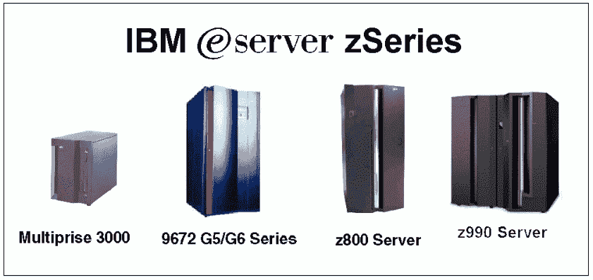

图 3-1 `IBM eServer zSeries`

#### 3.1.1 在 zSeries 上运行 Linux 的方式

在 `zSeries` 上运行 `Linux` 有三种方式，分别是：

- 基本或原生模式

  `Linux` 使用整台机器，而没有任何其他操作系统。在基本模式下，您可以在 `zSeries` 的“裸机”上使用单个 `Linux` 映像。

- 逻辑分区或 `LPAR`

  您可以将 `zSeries` 硬件逻辑划分为最多 15 个独立的 `LPAR`。例如，单个 `zSeries` 可以在一个分区中托管 `z/OS` 应用，在另一个分区中托管 `VM`，并在其他分区中托管 `Linux` 应用。

- `z/VM`

  客户可以使用 `z/VM` 作为 `hypervisor` 将 `Linux` 作为虚拟机运行。`z/VM` 提供 `CPU` 处理器、输入/输出（`I/O`）子系统和内存的虚拟化。运行 `z/VM` 的客户可以在单个 `zSeries` 上运行数百个 `Linux` 系统。例如，使用 `z/VM`，客户可以为每个应用开发人员提供完整的 `Linux` 服务器环境，并在同一 `zSeries` 服务器上托管生产系统。

关于如何在 `zSeries` 上运行 `Linux` 的决策通常基于预期的工作负载：

- 很少（如果有的话）工作负载需要在基本模式下运行 `Linux`。

- `Linux` 工作负载的资源需求较大（如内存占用和处理能力）可能最适合在 `LPAR` 中运行。这在特别如此，如果 `Linux` 系统将在长时间内处于峰值负载运行，因此资源共享的机会有限。当只需要少量映像时，使用 `LPAR` 也可能是合适的，因为在这种情况下，`z/VM` 的额外资源和支持需求可能不合理。

- 将 `Linux` 作为 `z/VM` 客户机运行可提供最大灵活性。运行在 `z/VM` 下的 `Linux` 客户机数量可根据工作负载需求进行调整。唯一限制并发运行实例数量的是硬件资源。大多数客户选择此选项以最大化其投资。

最后两种选项在图 3-2 中有所描述。请注意，该图仅供说明，在实际生产环境中，您还应期望有一个运行 `z/OS` 的 `LPAR`，如第 26 页图 3-4 所示。

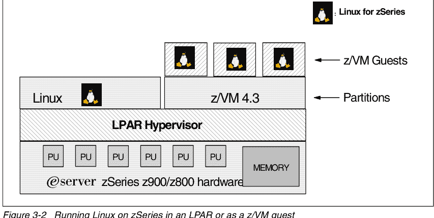

#### 3.1.2 S/390 和 zSeries 架构

`zSeries` 和 `S/390` 架构的核心是多芯片模块（`MCM`），其包含多达 20 个处理单元（`PU`）。这些通常被称为中央处理单元（`CPU`）或引擎。

所有 `PU` 都是相同的，但可以在系统中承担不同的角色。每个 `PU` 可以是以下之一：

- 中央处理器（`CP`）`PU`：由操作系统用于执行客户工作

- 系统辅助处理器（`SAP`）`PU`：这是一个运行通道子系统授权内部代码以控制 `I/O` 操作的 `PU`。

- `Linux` 集成设施（`IFL`）`PU`：`IFL` 引擎仅限于运行 `Linux` 或 `z/VM`。

- 集成耦合设施（`ICF`）`PU`：该引擎用于运行耦合设施功能，供 `Parallel Sysplex` 使用。

### IFL 引擎

`IFL` 是为 `Linux` 或 `VM` 下的 `Linux` 保留的处理器。其意义在于它不能用于运行其他操作系统，并且其存在不会反映在系统型号、`MIPS` 评级或其他功率评级中。这些功率评级方法对软件成本有重大影响。添加 `IFL` 不会影响这些成本，允许在不影响其他软件成本的情况下使用 `Linux`。

第 26 页图 3-3 显示了 `IFL` 如何分配给逻辑分区（`LPAR`）。

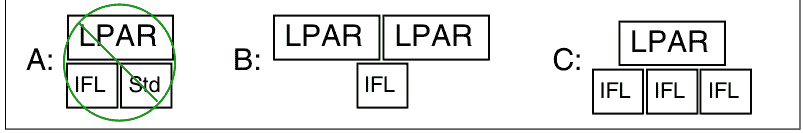

图 3-3 `IFL` 与 `LPAR` 之间的关系

注：`IFL` 必须专用于运行 `Linux` 或 `z/VM` 的 `LPAR`。它们可以由多个 `LPAR` 共享，前提是这些 `LPAR` 运行 `Linux` 或 `z/VM`。此外，`LPAR` 不能同时包含 `IFL` 或 `CP` 的混合。

图 3-4 为运行 `z/VM` 下 `Linux` 及其他工作负载的 `zSeries` 服务器的 `CP` 配置提供了一个示例。

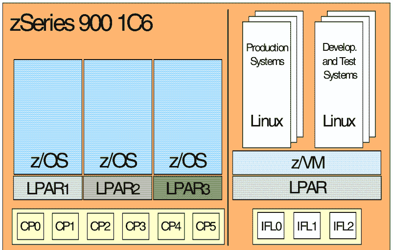


图 3-4 运行`z/OS`和`z/VM`下`Linux`的`zSeries`的`CP`配置。

#### 3.1.3 进一步信息

以下是一些有用的附加信息链接。

`Linux` for `IBM eServer zSeries`：

`http://www.ibm.com/servers/eserver/zseries/os/linux`

`Linux` on `zSeries` 的讨论组可在以下位置找到：

`http://www2.marist.edu/htbin/wlvindex?linux-390`

`Linux/390`项目的官方主页旨在提供`Linux/390`信息和软件的集中来源，可在以下位置找到：

`http://www.linuxvm.org`

`zSeries`大型机服务器：

`http://www.ibm.com/servers/eserver/zseries`

### 3.2 `z/VM`背景

您可以在`z/VM`下运行数十到数百个虚拟`Linux`系统，并且当`Linux`作为`z/VM`客户机运行时，您将继承`z/VM`的所有功能。本节重点介绍其中一些功能。

虚拟机（`VM`）技术是在 20 世纪 60 年代中期随`IBM System/360™`原始大型机引入的。当时，`VM`使`S/360`系统用户能够在单台大型机上运行多个操作系统的副本。能够运行多个操作系统使得可以在同一大型机系统上迁移到新版本和发行版。用户可以在旧软件级别上运行生产工作负载，同时进行将环境迁移到新操作系统的所需工作。

在 30 多年的时间里，`IBM`在硬件、架构和微代码以及`VM`产品本身方面进行了投资，以增强随每代大型机产品线提供的虚拟化技术。这种“整体系统”投资是`IBM eServer zSeries`服务器系列提供业界领先虚拟化技术的原因。

`z/VM`中发现的虚拟化技术是独特的。一些“虚拟服务器”解决方案包括在单个操作系统上运行多个应用程序，使用虚拟存储技术来满足内存需求。另一方面，`z/VM`使用其可用的实际资源（处理器、内存、`I/O`、网络等）创建虚拟机，每个虚拟机都能够运行支持`zSeries`架构（包括`Linux`）的任何操作系统的独立副本。在虚拟机中运行的操作系统就像在真实硬件上执行一样。硬件架构和设施由`z/VM`以这样的方式呈现给“客户机”系统（即被虚拟化），使得客户机操作系统认为它正在使用真实系统，而不是虚拟系统。图 3-5 显示了一个包含多个虚拟机的示例，包括三台`Linux`机器和一台`z/OS`。物理硬件对客户机不可见 - 相反，每个客户机看到的是`z/VM`提供的虚拟机。

`z/VM`甚至能够创建功能上比“真实”环境更丰富的虚拟机环境。示例包括：

- 使用内存中数据技术透明地增强客户机系统性能

- 模拟在真实大型机系统中不存在的设备网络设施

- 在多个客户机系统之间共享单个内核副本

``

图 3-5 `z/VM`虚拟化

#### 3.2.1 使用`z/VM`的虚拟网络

虚拟网络使用`z/VM`虚拟化在无需真实硬件的情况下提供客户机之间的连接。虚拟网络使`z/VM` `Linux`客户机之间能够进行快速且经济高效的`TCP/IP`通信。请注意，`z/VM`虚拟网络中的连接仅限于在单个`z/VM`映像中运行的客户机。虚拟网络不能用于`LPAR`间通信。`Linux`客户机可用的虚拟网络有三种类型：

- **`用户间通信车辆（IUCV）`**：使用`IUCV`可以在`Linux`客户机之间建立点对点`TCP/IP`连接。`S/390`和`zSeries`的`Linux`内核包含`IUCV`驱动程序，允许您连接两个`Linux`虚拟机。`Linux`将`IUCV`连接视为任何其他`TCP/IP`网络连接。

- **`虚拟通道到通道（vCTC）`**：`vCTC`网络在无需实际通道分配的情况下提供客户机之间的点对点连接。`z/VM`提供了定义虚拟通道到通道适配器的功能，以便用户可以使用`CTCA`协议连接虚拟机。在`z/VM`上，这对于将`Linux`虚拟机连接到不支持`IUCV`的其他虚拟机（如`z/OS`）很有用。虚拟`vCTC`网络也可以连接`Linux`虚拟机。

- **`VM客户机LAN`**：`IUCV`和`vCTC`支持点对点连接。如果您计划将服务器映像连接到大量虚拟机，这可能会很麻烦。`z/VM 4.2`引入了名为“`Guest LAN`”支持的新功能。运行`z/VM`的服务器映像使用`Hipersocket`协议连接到`Guest LAN`。对`Linux`服务器或任何支持真实`HiperSockets™`的软件来说，虚拟`Hipersockets`看起来就像真的一样。在`z/VM`环境中可以定义的虚拟`Hipersockets`连接数量没有限制，并且可以定义的`Guest LAN`数量也没有预定义限制。

#### 3.2.2 内置于`z/VM`的系统管理功能

`z/VM`中内置了许多系统管理功能。我们仅描述其中几个。

希望对其“真实”独立服务器群进行指挥和控制的客户通常必须购买额外的服务器来运行指挥和控制软件产品，有时还需要在每个受管理的服务器映像上安装客户端代码。这在软件许可费（服务器和客户端代码）以及服务器的额外硬件和网络费用方面可能变得昂贵，更不用说增加的复杂性了。`z/VM`在产品中内置了大量指挥和控制功能。

资源利用控制包括能够以高度精细的粒度按映像分配处理器容量。添加更多资源（如内存、磁盘空间和内存中数据支持）可以快速轻松地完成，尽管有时需要根据添加的资源重新启动受影响的`Linux`映像。

`VM`提供诸如`REXX`、可编程操作员（`PROP`）和管道等工具来构建自动化例程，以帮助最大限度地减少管理服务器群所需的手动干预。例如，您可以捕获来自`Linux`服务器的控制台流量，并根据控制台数据以编程方式执行系统操作。

### 3.3 整合和可扩展性

在本节中，我们解释了当您需要扩展解决方案的容量（可扩展性）或更有效地利用不同的服务器资源（整合）时，`z/VM`提供的优势。

#### 3.3.1 可扩展性

`zSeries`平台长期以来因其能够扩展以支持多样化工作负载的整合而受到认可。处理器和磁盘（如企业存储服务器）可以逐步升级以满足不断增长的需求。升级后，`zSeries`服务器可以通过两种方式扩展或增长其`Linux`工作负载。

垂直增长 - 当向现有`Linux`映像添加更多系统资源时。例如，可以为`Linux`虚拟机提供更多处理器容量、更多虚拟内存、更多`I/O`设备或更多虚拟网络带宽。

水平增长 - 当添加额外的`Linux`系统（通常是`z/VM`客户机）时。这在图 3-7 中有所说明。

#### 3.3.2 整合

将真实的分布式服务器整合到`zSeries`平台上，特别是作为`z/VM`下的客户机（如第 30 页图 3-6 所示），可以提供许多优势。`z/VM`上的虚拟服务器共享总系统资源，如内存和处理器容量，从而优化资源利用率。磁盘空间也可以在`z/VM`客户机之间共享，特别是只读文件（如应用程序代码和操作系统软件）可以放在一个磁盘上并使所有虚拟`Linux`服务器都可以访问，从而最大限度地减少维护工作量和软件成本。`z/VM`还提供虚拟网络和内置系统管理功能，如 3.2“`z/VM`背景”第 27 页所述。

负载轻到中等的且峰值不同步的服务器是整合到运行`Linux`的`zSeries`服务器上的良好候选对象。

``

图 3-6 机箱中的服务器群

一些关键应用通常以三层模式部署；数据库层、应用层和表示层。在混合`z/OS`和`Linux` for `zSeries`环境中，数据库服务器驻留在`z/OS`映像上，而应用服务器则运行在`Linux` for `zSeries`实例上。两者位于同一硬件上，使客户能够在仍满足解决方案所需的性能要求的同时，移除一层硬件和维护工作。此外，由于应用和数据库现在托管在同一系统上，它们之间的真实网络可以被`zSeries`的网络功能（如`Hipersockets`）所取代。

当服务器已整合到`zSeries`服务器上时，特别是作为`z/VM`客户机运行时，服务器群的水平扩展可以通过简单地添加另一个`Linux`虚拟机来实现，最短时间（通常为几分钟），且无需额外的硬件或场地。这在图 3-7 中显示。此外，您仍然能够保持分布式环境范式“一个服务器一个应用”。

``

图 3-7 服务器群的水平增长

上述讨论的许多特性和优势在“使用`Samba`的典型文件/打印服务场景”第 31 页中有所说明，其中我们概述了将使用`Samba`应用的多个分布式文件/打印服务器整合到`z/VM`下的多个`Linux`客户机中的场景。

#### 3.3.3 一些示例和进一步信息

运行`z/VM`下多个虚拟`Linux`系统的一些客户经验可在以下网址找到：

`http://www.ibm.com/servers/eserver/zseries/news/pressreleases/2002`

`http://www.ibm.com/servers/eserver/zseries/os/linux/stories.html`


一些最近的 IBM 白皮书详细介绍了在 `z/VM` 下运行多个虚拟 Linux 系统以及使用 IBM TotalStorage Enterprise Storage Server 的经验，可在以下网站找到：

`http://www.vm.ibm.com/linux`

`http://www.ibm.com/servers/eserver/zseries/library/whitepapers`

另请参阅 Redpaper《使用 Linux for zSeries 进行服务器整合》，`REDP0222`，以及网站：

`http://www.ibm.com/server/eservers/zseries/os/linux/consolidate.html`

有关 `z/VM` 和 Linux 资源的 IBM 门户可在以下网址找到：

`http://www.vm.ibm.com/linux`

### 3.4 Linux 应用解决方案

`zSeries` 的 Linux 发行版包含诸如 `Apache`、`Samba`、`IMAP`、`OpenLDAP`、`Perl`、`Sendmail MTA`、`Squid` 和 `PostgreSQL` 等知名开源应用。Linux 应用来源于多个领域。开源应用可从互联网下载。应用也可以为 `zSeries` 开发。`Linux for zSeries` 发行版提供编译器。

解决方案提供商已为 `zSeries` 服务器上的 Linux 宣布产品。这些包括基础设施应用、业务线应用和 Web 启用应用。已有超过 200 个来自超过 120 家厂商的应用可用于 `Linux on zSeries`。详细产品列表请参见：

`http://www.ibm.com/servers/eserver/zseries/solutions/s390da/linuxproduct.html`

## 使用 Samba 的典型文件/打印服务场景

我们概述了将分布式文件/打印服务器整合到 `zSeries` 上的典型情况。其他场景在 Linux Handbook，`SG24-7000` 中讨论。

本场景描述了使用 `Samba` 文件打印应用提供文件/打印服务的情况。`Samba` 是高质量的开源代码，已集成到大多数 Linux 发行版中。文件/打印服务对处理器计算资源的需求不大。然而，它会考验解决方案的 I/O 能力，因为用户上传/下载文件或将其路由到打印机。服务器花费大量时间等待用户请求打印或文件服务。

分布式解决方案由 150 台 Intel 双路 1000 MHz 服务器组成，如图 3-8 所示。请注意，服务器连接到需要硬件的物理网络。还请注意，每台服务器都运行单独的操作系统和应用代码副本——在这种情况下，这 150 台服务器各自重复。每台服务器都需要磁盘空间，如果服务器需要额外的磁盘存储，替代方案是购买额外的整个磁盘卷并安装，或购买更高容量的磁盘，将所需的软件和数据移动到其上并安装。

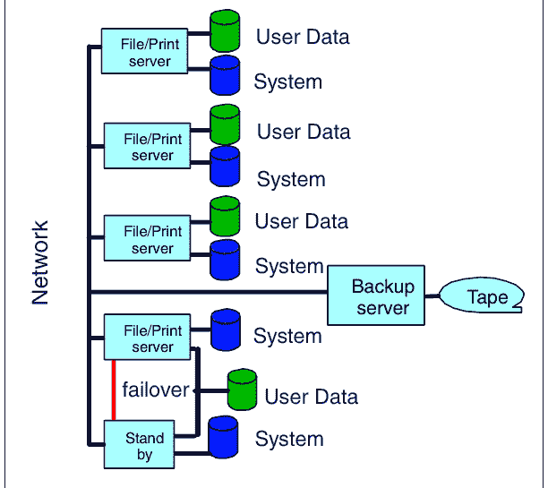

图 3-8 Samba 文件/打印场景 - 分布式解决方案

必须对每台服务器单独进行维护。需要某种类型的操作员自动化来监控 150 个独立系统，并在必要时响应回复。备份由专用备份服务器完成，该服务器与每个系统上的客户端代码通信。

本场景的 `zSeries` 解决方案如图 3-9 所示。请注意，服务器间通信在机器内部进行，这使得 Linux 实例能够以内存速度通信，而非物理网络速度及其通常的延迟。此外，除了改善服务器间通信外，还避免了大部分外部网络硬件和软件的成本。

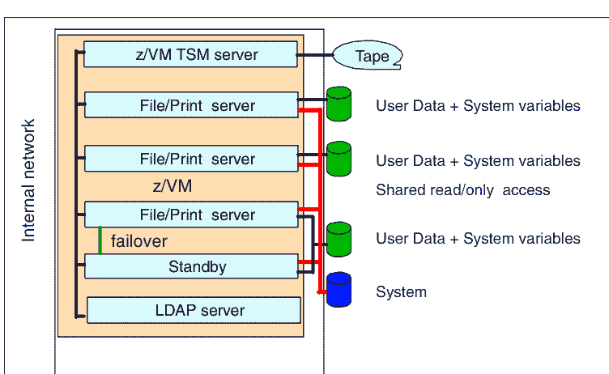

图 3-9 Samba 文件/打印场景 - zSeries 解决方案

操作系统和应用代码的磁盘存储由全部 150 个虚拟服务器共享，而在分布式情况下必须重复。共享代码提供了控制磁盘存储成本和易于维护的优势。由于代码只有一个副本，只需在一个地方进行维护，从而节省了系统管理软件和操作的成本。

`z/VM` 可以帮助您在服务器之间共享可用磁盘空间。在分布式模型中，增加磁盘空间意味着您需要购买新磁盘。如果某些服务器上有空闲磁盘空间，则无法将其移动到需要增加磁盘存储的服务器。在 `zSeries` 解决方案中，`z/VM` 允许您将磁盘划分为可轻松分配给需要额外磁盘空间的服务器的微型磁盘。

与分布式情况一样，运行中的 150 台服务器会发出必须被监控的消息，并在某些情况下做出响应。`z/VM` 中的 `PROP` 功能正是为此目的而设计的，避免了执行该任务所需的额外软件成本。备份由 `Tivoli Storage Manager (TSM)` 执行。`TSM` 服务器安装在 `z/VM` 上（如图所示），或安装在 Linux 虚拟实例中（随 `TSM` 版本 5.2 提供）。`TSM` 客户端安装在每个 Linux 客户机上。

## IBM TotalStorage 和 ESS

本章首先概述 IBM TotalStorage 提供的 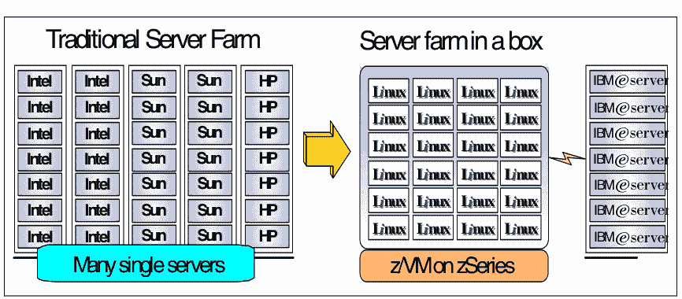

图 3-6 机箱中的服务器群

一些关键应用通常以三层模式部署；数据库层、应用层和表示层。在混合 `z/OS` 和 Linux for `zSeries` 环境中，数据库服务器驻留在 `z/OS` 映像上，而应用服务器则运行在 Linux for `zSeries` 实例上。两者位于同一硬件上，使客户能够在仍满足解决方案所需的性能要求的同时，移除一层硬件和维护工作。此外，由于应用和数据库现在托管在同一系统上，它们之间的真实网络可以被 `zSeries` 的网络功能（如 `Hipersockets`）所取代。

当服务器已整合到 `zSeries` 服务器上时，特别是作为 `z/VM` 客户机运行时，服务器群的水平扩展可以通过简单地添加另一个 Linux 虚拟机来实现，最短时间（通常为几分钟），且无需额外的硬件或场地。这在图 3-7 中显示。此外，您仍然能够保持分布式环境范式“一个服务器一个应用”。

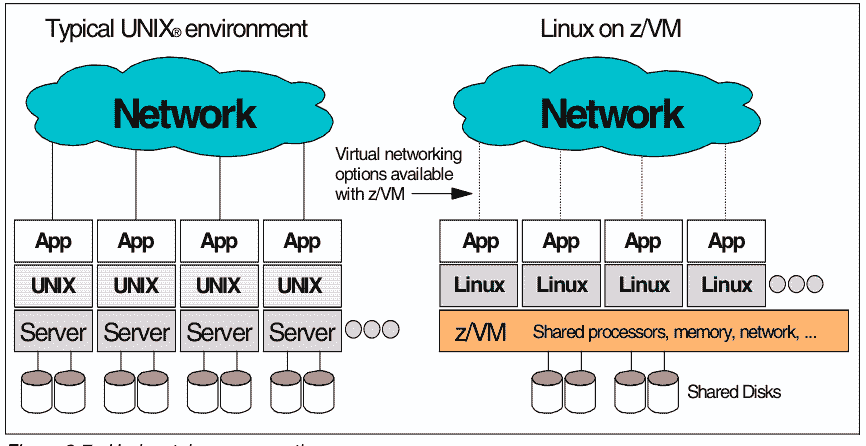

图 3-7 服务器群的水平增长

上述讨论的许多特性和优势在“使用 Samba 的典型文件/打印服务场景”第 31 页中有所说明，其中我们概述了将使用 `Samba` 应用的多个分布式文件/打印服务器整合到 `z/VM` 下的多个 Linux 客户机中的场景。

#### 3.3.3 一些示例和进一步信息

运行 `z/VM` 下多个虚拟 Linux 系统的一些客户经验可在以下网址找到：

`http://www.ibm.com/servers/eserver/zseries/news/pressreleases/2002`

`http://www.ibm.com/servers/eserver/zseries/os/linux/stories.html`

一些最近的 IBM 白皮书详细介绍了在 `z/VM` 下运行多个虚拟 Linux 系统以及使用 IBM TotalStorage Enterprise Storage Server 的经验，可在以下网站找到：

`http://www.vm.ibm.com/linux`

`http://www.ibm.com/servers/eserver/zseries/library/whitepapers`

另请参阅 Redpaper《使用 Linux for zSeries 进行服务器整合》，`REDP0222`，以及网站：

`http://www.ibm.com/server/eservers/zseries/os/linux/consolidate.html`

有关 `z/VM` 和 Linux 资源的 IBM 门户可在以下网址找到：

`http://www.vm.ibm.com/linux`

### 3.4 Linux 应用解决方案

`zSeries` 的 Linux 发行版包含诸如 `Apache`、`Samba`、`IMAP`、`OpenLDAP`、`Perl`、`Sendmail MTA`、`Squid` 和 `PostgreSQL` 等知名开源应用。Linux 应用来源于多个领域。开源应用可从互联网下载。应用也可以为 `zSeries` 开发。`Linux for zSeries` 发行版提供编译器。

解决方案提供商已为 `zSeries` 服务器上的 Linux 宣布产品。这些包括基础设施应用、业务线应用和 Web 启用应用。已有超过 200 个来自超过 120 家厂商的应用可用于 `Linux on zSeries`。详细产品列表请参见：

`http://www.ibm.com/servers/eserver/zseries/solutions/s390da/linuxproduct.html`

## 使用 Samba 的典型文件/打印服务场景

我们概述了将分布式文件/打印服务器整合到 `zSeries` 上的典型情况。其他场景在 Linux Handbook，`SG24-7000` 中讨论。


本场景描述了使用 Samba 文件打印应用提供文件/打印服务的情况。Samba 是高质量的开源代码，已集成到大多数 Linux 发行版中。文件/打印服务对处理器计算资源的需求不大。然而，它会考验解决方案的 `I/O` 能力，因为用户上传/下载文件或将其路由到打印机。服务器花费大量时间等待用户请求打印或文件服务。

分布式解决方案由 150 台 Intel 双路 1000 MHz 服务器组成，如图 3-8 所示。请注意，服务器连接到需要硬件的物理网络。还请注意，每台服务器都运行单独的操作系统和应用代码副本——在这种情况下，这 150 台服务器各自重复。每台服务器都需要磁盘空间，如果服务器需要额外的磁盘存储，替代方案是购买额外的整个磁盘卷并安装，或购买更高容量的磁盘，将所需的软件和数据移动到其上并安装。


图 3-8 Samba 文件/打印场景 - 分布式解决方案

必须对每台服务器单独进行维护。需要某种类型的操作员自动化来监控 150 个独立系统，并在必要时响应回复。备份由专用备份服务器完成，该服务器与每个系统上的客户端代码通信。

本场景的 zSeries 解决方案如图 3-9 所示。请注意，服务器间通信在机器内部进行，这使得 Linux 实例能够以内存速度通信，而非物理网络速度及其通常的延迟。此外，除了改善服务器间通信外，还避免了大部分外部网络硬件和软件的成本。


图 3-9 Samba 文件/打印场景 - zSeries 解决方案

操作系统和应用代码的磁盘存储由全部 150 个虚拟服务器共享，而在分布式情况下必须重复。共享代码提供了控制磁盘存储成本和易于维护的优势。由于代码只有一个副本，只需在一个地方进行维护，从而节省了系统管理软件和操作的成本。

z/VM 可以帮助您在服务器之间共享可用磁盘空间。在分布式模型中，增加磁盘空间意味着您需要购买新磁盘。如果某些服务器上有空闲磁盘空间，则无法将其移动到需要增加磁盘存储的服务器。在 zSeries 解决方案中，z/VM 允许您将磁盘划分为可轻松分配给需要额外磁盘空间的服务器的微型磁盘。

与分布式情况一样，运行中的 150 台服务器会发出必须被监控的消息，并在某些情况下做出响应。z/VM 中的 `PROP` 功能正是为此目的而设计的，避免了执行该任务所需的额外软件成本。备份由 `Tivoli Storage Manager` (`TSM`) 执行。`TSM` 服务器安装在 z/VM 上（如图所示），或安装在 Linux 虚拟实例中（随 `TSM` 版本 5.2 提供）。`TSM` 客户端安装在每个 Linux 客户机上。

### IBM TotalStorage 和 ESS

本章首先概述 IBM TotalStorage 提供的


图 3-6 机箱中的服务器群

一些关键应用通常以三层模式部署；数据库层、应用层和表示层。在混合 z/OS 和 Linux for zSeries 环境中，数据库服务器驻留在 z/OS 映像上，而应用服务器则运行在 Linux for zSeries 实例上。两者位于同一硬件上，使客户能够在仍满足解决方案所需的性能要求的同时，移除一层硬件和维护工作。此外，由于应用和数据库现在托管在同一系统上，它们之间的真实网络可以被 zSeries 的网络功能（如 `Hipersockets`）所取代。

当服务器已整合到 zSeries 服务器上时，特别是作为 z/VM 客户机运行时，服务器群的水平扩展可以通过简单地添加另一个 Linux 虚拟机来实现，最短时间（通常为几分钟），且无需额外的硬件或场地。这在图 3-7 中显示。此外，您仍然能够保持分布式环境范式“一个服务器一个应用”。


图 3-7 服务器群的水平增长

上述讨论的许多特性和优势在“使用 Samba 的典型文件/打印服务场景”第 31 页中有所说明，其中我们概述了将使用 Samba 应用的多个分布式文件/打印服务器整合到 z/VM 下的多个 Linux 客户机中的场景。

#### 3.3.3 一些示例和进一步信息

运行 z/VM 下多个虚拟 Linux 系统的一些客户经验可在以下网址找到：

<http://www.ibm.com/servers/eserver/zseries/news/pressreleases/2002>

<http://www.ibm.com/servers/eserver/zseries/os/linux/stories.html>

一些最近的 IBM 白皮书详细介绍了在 z/VM 下运行多个虚拟 Linux 系统以及使用 IBM TotalStorage Enterprise Storage Server 的经验，可在以下网站找到：

<http://www.vm.ibm.com/linux>

<http://www.ibm.com/servers/eserver/zseries/library/whitepapers>

另请参阅 Redpaper《使用 Linux for zSeries 进行服务器整合》，`REDP0222`，以及网站：

<http://www.ibm.com/server/eservers/zseries/os/linux/consolidate.html>

有关 z/VM 和 Linux 资源的 IBM 门户可在以下网址找到：

<http://www.vm.ibm.com/linux>

### 3.4 Linux 应用解决方案

zSeries 的 Linux 发行版包含诸如 `Apache`、`Samba`、`IMAP`、`OpenLDAP`、`Perl`、`Sendmail` `MTA`、`Squid` 和 `PostgreSQL` 等知名开源应用。Linux 应用来源于多个领域。开源应用可从互联网下载。应用也可以为 zSeries 开发。Linux for zSeries 发行版提供编译器。

解决方案提供商已为 zSeries 服务器上的 Linux 宣布产品。这些包括基础设施应用、业务线应用和 Web 启用应用。已有超过 200 个来自超过 120 家厂商的应用可用于 Linux on zSeries。详细产品列表请参见：

<http://www.ibm.com/servers/eserver/zseries/solutions/s390da/linuxproduct.html>

### 使用 Samba 的典型文件/打印服务场景

我们概述了将分布式文件/打印服务器整合到 zSeries 上的典型情况。其他场景在 Linux Handbook，`SG24-7000` 中讨论。

本场景描述了使用 Samba 文件打印应用提供文件/打印服务的情况。Samba 是高质量的开源代码，已集成到大多数 Linux 发行版中。文件/打印服务对处理器计算资源的需求不大。然而，它会考验解决方案的 `I/O` 能力，因为用户上传/下载文件或将其路由到打印机。服务器花费大量时间等待用户请求打印或文件服务。

分布式解决方案由 150 台 Intel 双路 1000 MHz 服务器组成，如图 3-8 所示。请注意，服务器连接到需要硬件的物理网络。还请注意，每台服务器都运行单独的操作系统和应用代码副本——在这种情况下，这 150 台服务器各自重复。每台服务器都需要磁盘空间，如果服务器需要额外的磁盘存储，替代方案是购买额外的整个磁盘卷并安装，或购买更高容量的磁盘，将所需的软件和数据移动到其上并安装。


图 3-8 Samba 文件/打印场景 - 分布式解决方案

必须对每台服务器单独进行维护。需要某种类型的操作员自动化来监控 150 个独立系统，并在必要时响应回复。备份由专用备份服务器完成，该服务器与每个系统上的客户端代码通信。

本场景的 zSeries 解决方案如图 3-9 所示。请注意，服务器间通信在机器内部进行，这使得 Linux 实例能够以内存速度通信，而非物理网络速度及其通常的延迟。此外，除了改善服务器间通信外，还避免了大部分外部网络硬件和软件的成本。


图 3-9 Samba 文件/打印场景 - zSeries 解决方案

操作系统和应用代码的磁盘存储由全部 150 个虚拟服务器共享，而在分布式情况下必须重复。共享代码提供了控制磁盘存储成本和易于维护的优势。由于代码只有一个副本，只需在一个地方进行维护，从而节省了系统管理软件和操作的成本。

z/VM 可以帮助您在服务器之间共享可用磁盘空间。在分布式模型中，增加磁盘空间意味着您需要购买新磁盘。如果某些服务器上有空闲磁盘空间，则无法将其移动到需要增加磁盘存储的服务器。在 zSeries 解决方案中，z/VM 允许您将磁盘划分为可轻松分配给需要额外磁盘空间的服务器的微型磁盘。


与分布式情况一样，运行中的 `150` 台服务器会发出必须被监控的消息，并在某些情况下做出响应。`z/VM` 中的 `PROP` 功能正是为此目的而设计的，避免了执行该任务所需的额外软件成本。备份由 `Tivoli Storage Manager` (`TSM`) 执行。`TSM` 服务器安装在 `z/VM` 上（如图所示），或安装在 `Linux` 虚拟实例中（随 `TSM` 版本 `5.2` 提供）。`TSM` 客户端安装在每个 `Linux` 客户机上。

## IBM TotalStorage 和 ESS

本章首先概述 `IBM TotalStorage` 提供的


图 3-6 机箱中的服务器群

一些关键应用通常以三层模式部署；数据库层、应用层和表示层。在混合 `z/OS` 和 `Linux for zSeries` 环境中，数据库服务器驻留在 `z/OS` 映像上，而应用服务器运行在 `Linux for zSeries` 实例上。两者位于同一硬件上，使客户能在仍满足性能要求的同时移除一层硬件和维护工作。此外，应用和数据库托管在同一系统上后，它们之间的真实网络可被 `zSeries` 的网络功能如 `Hipersockets` 取代。

当服务器已整合到 `zSeries` 服务器上，特别是作为 `z/VM` 客户机运行时，服务器群的水平扩展可通过简单添加另一个 `Linux` 虚拟机实现，耗时最短通常为数分钟，且无需额外硬件或场地。这在图 3-7 中显示。此外，仍可保持分布式环境范式“一个服务器一个应用”。


图 3-7 服务器群的水平增长

上述特性和优势在“使用 `Samba` 的典型文件/打印服务场景”第 31 页中有所说明，其中概述了将使用 `Samba` 应用的多个分布式文件/打印服务器整合到 `z/VM` 下多个 `Linux` 客户机的场景。

#### 3.3.3 一些示例和进一步信息

运行 `z/VM` 下多个虚拟 `Linux` 系统的一些客户经验可在以下网址找到：

`http://www.ibm.com/servers/eserver/zseries/news/pressreleases/2002`

`http://www.ibm.com/servers/eserver/zseries/os/linux/stories.html`

一些最近的 `IBM` 白皮书详细介绍了在 `z/VM` 下运行多个虚拟 `Linux` 系统以及使用 `IBM TotalStorage Enterprise Storage Server` 的经验，可在以下网站找到：

`http://www.vm.ibm.com/linux`

`http://www.ibm.com/servers/eserver/zseries/library/whitepapers`

另请参阅 Redpaper《使用 `Linux for zSeries` 进行服务器整合》，`REDP0222`，以及网站：

`http://www.ibm.com/server/eservers/zseries/os/linux/consolidate.html`

有关 `z/VM` 和 `Linux` 资源的 `IBM` 门户可在以下网址找到：

`http://www.vm.ibm.com/linux`

### 3.4 Linux 应用解决方案

`zSeries` 的 `Linux` 发行版包含诸如 `Apache`、`Samba`、`IMAP`、`OpenLDAP`、`Perl`、`Sendmail MTA`、`Squid` 和 `PostgreSQL` 等知名开源应用。`Linux` 应用来源于多个领域。开源应用可从互联网下载。应用也可以为 `zSeries` 开发。`Linux for zSeries` 发行版提供编译器。

解决方案提供商已为 `zSeries` 服务器上的 `Linux` 宣布产品。这些包括基础设施应用、业务线应用和 `Web` 启用应用。已有超过 `200` 个来自超过 `120` 家厂商的应用可用于 `Linux on zSeries`。详细产品列表请参见：

`http://www.ibm.com/servers/eserver/zseries/solutions/s390da/linuxproduct.html`

## 使用 Samba 的典型文件/打印服务场景

我们概述了将分布式文件/打印服务器整合到 `zSeries` 上的典型情况。其他场景在 `Linux Handbook`，`SG24-7000` 中讨论。

本场景描述了使用 `Samba` 文件打印应用提供文件/打印服务的情况。`Samba` 是高质量的开源代码，已集成到大多数 `Linux` 发行版中。文件/打印服务对处理器计算资源的需求不大。然而，它会考验解决方案的 `I/O` 能力，因为用户上传/下载文件或将其路由到打印机。服务器花费大量时间等待用户请求打印或文件服务。

分布式解决方案由 `150` 台 `Intel` 双路 `1000 MHz` 服务器组成，如图 3-8 所示。请注意，服务器连接到需要硬件的物理网络。还请注意，每台服务器都运行单独的操作系统和应用代码副本——在这种情况下，这 `150` 台服务器各自重复。每台服务器都需要磁盘空间，如果服务器需要额外的磁盘存储，替代方案是购买额外的整个磁盘卷并安装，或购买更高容量的磁盘，将所需的软件和数据移动到其上并安装。


图 3-8 Samba 文件/打印场景 - 分布式解决方案

必须对每台服务器单独进行维护。需要某种类型的操作员自动化来监控 `150` 个独立系统，并在必要时响应回复。备份由专用备份服务器完成，该服务器与每个系统上的客户端代码通信。

本场景的 `zSeries` 解决方案如图 3-9 所示。请注意，服务器间通信在机器内部进行，这使得 `Linux` 实例能够以内存速度通信，而非物理网络速度及其通常的延迟。此外，除了改善服务器间通信外，还避免了大部分外部网络硬件和软件的成本。


图 3-9 Samba 文件/打印场景 - zSeries 解决方案

操作系统和应用代码的磁盘存储由全部 `150` 个虚拟服务器共享，而在分布式情况下必须重复。共享代码提供了控制磁盘存储成本和易于维护的优势。由于代码只有一个副本，只需在一个地方进行维护，从而节省了系统管理软件和操作的成本。

`z/VM` 可以帮助您在服务器之间共享可用磁盘空间。在分布式模型中，增加磁盘空间意味着您需要购买新磁盘。如果某些服务器上有空闲磁盘空间，则无法将其移动到需要增加磁盘存储的服务器。在 `zSeries` 解决方案中，`z/VM` 允许您将磁盘划分为可轻松分配给需要额外磁盘空间的服务器的微型磁盘。

与分布式情况一样，运行中的 `150` 台服务器会发出必须被监控的消息，并在某些情况下做出响应。`z/VM` 中的 `PROP` 功能正是为此目的而设计的，避免了执行该任务所需的额外软件成本。备份由 `Tivoli Storage Manager` (`TSM`) 执行。`TSM` 服务器安装在 `z/VM` 上（如图所示），或安装在 `Linux` 虚拟实例中（随 `TSM` 版本 `5.2` 提供）。`TSM` 客户端安装在每个 `Linux` 客户机上。

## IBM TotalStorage 和 ESS

本章首先概述 `IBM TotalStorage` 提供的


图 3-6 机箱中的服务器群

一些关键应用通常以三层模式部署；数据库层、应用层和表示层。在混合 `z/OS` 和 `Linux for zSeries` 环境中，数据库服务器驻留在 `z/OS` 映像上，而应用服务器运行在 `Linux for zSeries` 实例上。两者位于同一硬件上，使客户能在仍满足性能要求的同时移除一层硬件和维护工作。此外，应用和数据库托管在同一系统上后，它们之间的真实网络可被 `zSeries` 的网络功能如 `Hipersockets` 取代。

当服务器已整合到 `zSeries` 服务器上，特别是作为 `z/VM` 客户机运行时，服务器群的水平扩展可通过简单添加另一个 `Linux` 虚拟机实现，耗时最短通常为数分钟，且无需额外硬件或场地。这在图 3-7 中显示。此外，仍可保持分布式环境范式“一个服务器一个应用”。


图 3-7 服务器群的水平增长

上述特性和优势在“使用 `Samba` 的典型文件/打印服务场景”第 31 页中有所说明，其中概述了将使用 `Samba` 应用的多个分布式文件/打印服务器整合到 `z/VM` 下多个 `Linux` 客户机的场景。

#### 3.3.3 一些示例和进一步信息

运行 `z/VM` 下多个虚拟 `Linux` 系统的一些客户经验可在以下网址找到：

`http://www.ibm.com/servers/eserver/zseries/news/pressreleases/2002`


`http://www.ibm.com/servers/eserver/zseries/os/linux/stories.html`

一些最近的 `IBM` 白皮书详细介绍了在 `z/VM` 下运行多个虚拟 `Linux` 系统以及使用 `IBM TotalStorage Enterprise Storage Server` 的经验，可在以下网站找到：

`http://www.vm.ibm.com/linux`

`http://www.ibm.com/servers/eserver/zseries/library/whitepapers`

另请参阅 Redpaper《使用 `Linux` for `zSeries` 进行服务器整合》，`REDP0222`，以及网站：

`http://www.ibm.com/server/eservers/zseries/os/linux/consolidate.html`

有关 `z/VM` 和 `Linux` 资源的 `IBM` 门户可在以下网址找到：

`http://www.vm.ibm.com/linux`

### 3.4 Linux 应用解决方案

`zSeries` 的 `Linux` 发行版包含 `Apache`、`Samba`、`IMAP`、`OpenLDAP`、`Perl`、`Sendmail` MTA、`Squid` 和 `PostgreSQL` 等知名开源应用。`Linux` 应用来源于多个领域。开源应用可从互联网下载。应用也可为 `zSeries` 开发。`Linux` for `zSeries` 发行版提供编译器。

解决方案提供商已为 `zSeries` 服务器上的 `Linux` 宣布产品，包括基础设施应用、业务线应用和 Web 启用应用。已有超过 200 个来自超过 120 家厂商的应用可用于 `Linux` on `zSeries`。详细产品列表请参见：

`http://www.ibm.com/servers/eserver/zseries/solutions/s390da/linuxproduct.html`

## 使用 Samba 的典型文件/打印服务场景

我们概述了将分布式文件/打印服务器整合到 `zSeries` 上的典型情况。其他场景在 `Linux` Handbook，`SG24-7000` 中讨论。

本场景描述使用 `Samba` 文件打印应用提供文件/打印服务。`Samba` 是高质量开源代码，已集成到大多数 `Linux` 发行版中。文件/打印服务对处理器计算资源需求不大，但会考验解决方案的 I/O 能力，因为用户上传/下载文件或将其路由到打印机。服务器花费大量时间等待用户请求打印或文件服务。

分布式解决方案由 150 台 `Intel` 双路 1000 MHz 服务器组成，如图 3-8 所示。请注意服务器连接到需要硬件的物理网络。还请注意每台服务器都运行单独的操作系统和应用代码副本——在此案例中 150 台服务器各自重复。每台服务器需要磁盘空间，若需额外磁盘存储，替代方案是购买额外整个磁盘卷并安装，或购买更高容量磁盘并迁移所需软件和数据后安装。


图 3-8 `Samba` 文件/打印场景 - 分布式解决方案

必须对每台服务器单独维护。需要某种操作员自动化来监控 150 个独立系统并在必要时响应。备份由专用备份服务器完成，该服务器与每个系统上的客户端代码通信。

本场景的 `zSeries` 解决方案如图 3-9 所示。请注意服务器间通信在机器内部进行，使 `Linux` 实例能以内存速度通信，而非物理网络速度及其通常的延迟。此外，除改善服务器间通信外，还避免了大部分外部网络硬件和软件成本。


图 3-9 `Samba` 文件/打印场景 - `zSeries` 解决方案

操作系统和应用代码的磁盘存储由全部 150 个虚拟服务器共享，而分布式情况下必须重复。共享代码提供控制磁盘存储成本和易于维护的优势。由于代码只有一个副本，只需在一个地方维护，从而节省系统管理软件和操作成本。

`z/VM` 可帮助在服务器间共享可用磁盘空间。在分布式模型中，增加磁盘空间意味着需购买新磁盘。若某些服务器有空闲磁盘空间，也无法移动到需要增加磁盘存储的服务器。在 `zSeries` 解决方案中，`z/VM` 允许将磁盘划分为可轻松分配给需要额外磁盘空间的服务器的微型磁盘。

与分布式情况一样，运行中的 150 台服务器会发出必须被监控的消息，并在某些情况下做出响应。`z/VM` 中的 `PROP` 功能正是为此目的设计，避免了执行该任务所需的额外软件成本。备份由 `Tivoli Storage Manager (TSM)` 执行。`TSM` 服务器安装在 `z/VM` 上如图所示，或安装在 `Linux` 虚拟实例中，随 `TSM` 版本 5.2 提供。`TSM` 客户端安装在每个 `Linux` 客户机上。

## IBM TotalStorage 和 ESS

本章首先概述 `IBM TotalStorage` 提供的


图 3-6 机箱中的服务器群

一些关键应用通常以三层模式部署；数据库层、应用层和表示层。在混合 `z/OS` 和 `Linux` for `zSeries` 环境中，数据库服务器驻留在 `z/OS` 映像上，而应用服务器运行在 `Linux` for `zSeries` 实例上。两者位于同一硬件上，使客户可在仍满足性能要求的同时移除一层硬件和维护工作。此外，应用和数据库托管在同一系统上后，它们之间的真实网络可被 `zSeries` 的网络功能如 `Hipersockets` 取代。

当服务器已整合到 `zSeries` 服务器上，特别是作为 `z/VM` 客户机运行时，服务器群的水平扩展可通过简单添加另一个 `Linux` 虚拟机实现，耗时最短通常为数分钟，且无需额外硬件或场地。这在图 3-7 中显示。此外，仍可保持分布式环境范式“一个服务器一个应用”。


图 3-7 服务器群的水平增长

上述特性和优势在“使用 `Samba` 的典型文件/打印服务场景”第 31 页中有所说明，其中概述了将使用 `Samba` 应用的多个分布式文件/打印服务器整合到 `z/VM` 下多个 `Linux` 客户机的场景。

#### 3.3.3 一些示例和进一步信息

运行 `z/VM` 下多个虚拟 `Linux` 系统的一些客户经验可在以下网址找到：

`http://www.ibm.com/servers/eserver/zseries/news/pressreleases/2002`

`http://www.ibm.com/servers/eserver/zseries/os/linux/stories.html`

一些最近的 `IBM` 白皮书详细介绍了在 `z/VM` 下运行多个虚拟 `Linux` 系统以及使用 `IBM TotalStorage Enterprise Storage Server` 的经验，可在以下网站找到：

`http://www.vm.ibm.com/linux`

`http://www.ibm.com/servers/eserver/zseries/library/whitepapers`

另请参阅 Redpaper《使用 `Linux` for `zSeries` 进行服务器整合》，`REDP0222`，以及网站：

`http://www.ibm.com/server/eservers/zseries/os/linux/consolidate.html`

有关 `z/VM` 和 `Linux` 资源的 `IBM` 门户可在以下网址找到：

`http://www.vm.ibm.com/linux`

### 3.4 Linux 应用解决方案

`zSeries` 的 `Linux` 发行版包含 `Apache`、`Samba`、`IMAP`、`OpenLDAP`、`Perl`、`Sendmail` MTA、`Squid` 和 `PostgreSQL` 等知名开源应用。`Linux` 应用来源于多个领域。开源应用可从互联网下载。应用也可为 `zSeries` 开发。`Linux` for `zSeries` 发行版提供编译器。

解决方案提供商已为 `zSeries` 服务器上的 `Linux` 宣布产品，包括基础设施应用、业务线应用和 Web 启用应用。已有超过 200 个来自超过 120 家厂商的应用可用于 `Linux` on `zSeries`。详细产品列表请参见：

`http://www.ibm.com/servers/eserver/zseries/solutions/s390da/linuxproduct.html`

## 使用 Samba 的典型文件/打印服务场景

我们概述了将分布式文件/打印服务器整合到 `zSeries` 上的典型情况。其他场景在 `Linux` Handbook，`SG24-7000` 中讨论。

本场景描述使用 `Samba` 文件打印应用提供文件/打印服务。`Samba` 是高质量开源代码，已集成到大多数 `Linux` 发行版中。文件/打印服务对处理器计算资源需求不大，但会考验解决方案的 I/O 能力，因为用户上传/下载文件或将其路由到打印机。服务器花费大量时间等待用户请求打印或文件服务。


分布式解决方案由 `150` 台 `Intel` 双路 `1000 MHz` 服务器组成，如图 3-8 所示。请注意服务器连接到需要硬件的物理网络。还请注意每台服务器都运行单独的操作系统和应用代码副本——在此案例中 `150` 台服务器各自重复。每台服务器需要磁盘空间，若需额外磁盘存储，替代方案是购买额外整个磁盘卷并安装，或购买更高容量磁盘并迁移所需软件和数据后安装。

``

图 3-8 `Samba` 文件/打印场景 - 分布式解决方案

必须对每台服务器单独维护。需要某种操作员自动化来监控 `150` 个独立系统并在必要时响应。备份由专用备份服务器完成，该服务器与每个系统上的客户端代码通信。

本场景的 `zSeries` 解决方案如图 3-9 所示。请注意服务器间通信在机器内部进行，使 `Linux` 实例能以内存速度通信，而非物理网络速度及其通常的延迟。此外，除改善服务器间通信外，还避免了大部分外部网络硬件和软件成本。

``

图 3-9 `Samba` 文件/打印场景 - `zSeries` 解决方案

操作系统和应用代码的磁盘存储由全部 `150` 个虚拟服务器共享，而分布式情况下必须重复。共享代码提供控制磁盘存储成本和易于维护的优势。由于代码只有一个副本，只需在一个地方维护，从而节省系统管理软件和操作成本。

`z/VM` 可帮助在服务器间共享可用磁盘空间。在分布式模型中，增加磁盘空间意味着需购买新磁盘。若某些服务器有空闲磁盘空间，也无法移动到需要增加磁盘存储的服务器。在 `zSeries` 解决方案中，`z/VM` 允许将磁盘划分为可轻松分配给需要额外磁盘空间的服务器的微型磁盘。

与分布式情况一样，运行中的 `150` 台服务器会发出必须被监控的消息，并在某些情况下做出响应。`z/VM` 中的 `PROP` 功能正是为此目的设计，避免了执行该任务所需的额外软件成本。备份由 `Tivoli Storage Manager (TSM)` 执行。`TSM` 服务器安装在 `z/VM` 上如图所示，或安装在 `Linux` 虚拟实例中，随 `TSM` 版本 `5.2` 提供。`TSM` 客户端安装在每个 `Linux` 客户机上。

## `IBM TotalStorage` 和 `ESS`

本章首先对 `IBM TotalStorage` 方案的主要功能和优势以及其对 `Linux` 解决方案的支持进行概述。

本章随后对 `IBM TotalStorage Enterprise Storage Server`，即 `ESS`，进行更具体的描述。

整个产品系列在红皮书 *The IBM TotalStorage Solutions Handbook*，`SG24-5250` 中讨论。有关 `IBM TotalStorage` 产品、软件和解决方案的进一步细节，包括 `Linux` 支持，可在以下网站找到：

`http://www.storage.ibm.com`

`http://www.storage.ibm.com/linux`

### 4.1 `IBM TotalStorage`

`Linux` 启用存储是运行 `Linux` 的所有服务器的要求，无论其依赖的硬件基础设施如何。随着 `Linux` 从支持 `Web` 服务、网络、文件和打印操作等基础设施工作负载，转向数据中心核心的任务关键型应用，对存储基础设施交付卓越的可靠性、可扩展性、安全性和性能提出了更严格的要求。这些并不是 `IBM` 存储产品组合的新要求，该组合目前已全面支持 `Linux`，并致力于通过新产品和解决方案使其更加强大。

`IBM` 在所有服务器平台上继续支持 `Linux`，并在基于开放行业标准的异构平台存储网络方面引领行业。

`IBM` 是交付世界级磁盘和磁带系统、存储管理软件、服务和集成解决方案的领导者，并包含以下内容：

- `Highly scalable storage` - Enables administrators to manage growth and quickly respond to changing business needs, with ease of deployment and configuration

- `High availability and fault-tolerant storage` - Provides continuous and reliable access to data using technologies like `RAID` and clustering

- `Improved data management` - Helps administrators better control the security and growth of their data

- `Increased storage utilization` - Allocates storage through a centrally managed pool of storage

- `Reduced administrative costs` - Manage additional storage without having to add staff and, with `IBM` storage management tools, the ability to perform quicker problem resolution

- `Platform independence` - Enables sharing of data and possibility of simplification of backup procedures

- `Centrally managed` - Enables administrators to quickly respond to changing business needs, with ease of deployment and configuration

- `Reduced administrative costs` - Manage additional storage without having to add staff, and with `IBM` storage management tools, the ability to perform quicker problem resolution

#### 4.1.1 Value proposition

`IBM` 提供全面的 `Linux` 战略，包括硬件、软件和管理工具等所有要素，为主要 `IT` 工作负载提供完整的基础设施。

`IBM` 在 `Linux` 上的存储提供磁盘、高端和中端、磁带和网络存储以及主要 `Linux` 发行版的预测试组合，并提供在存储中部署 `Linux` 的明确战略。

`IBM` 在 `Linux` 上的存储还提供与 `IBM @server` 和软件的对齐，以提供最合适的组合来满足各种客户需求，充分利用 `Linux` 带来的开源和异构环境的优势。

表 4-1 `IBM Storage for Linux` 汇总

| `IBM Storage for Linux` | 其作用 | 其含义 |
|---|---|---|
| 基于开放标准，体现 `IBM` 打算在其所有产品上支持 `Linux`。 | 使 `IBM` 能够将全系列产品引入 `Linux` 环境 | 在选择最适合您需求的存储时提供多种选择，同时限制对专有基础设施的投资 |
| 预先测试、文档化并受支持的 `Linux` 存储配置 - 磁盘、磁带和网络存储。 | 加快 `IT` 基础设施的实施，提供卓越的可靠性和支持。 | 在为您的 `IT` 需求选择存储时消除“猜测” |
| `Linux` 发行版和存储连接方式的多样化选择。 | 保护 `IT` 基础设施投资 | 可自由选择您偏好的 `Linux` 发行版 |

`IBM TotalStorage` 的主要优势在于其能够在 `Linux` 环境中提供完整的存储解决方案。`IBM` 的支持声明也比竞争对手更为稳健，涵盖我们的 `IBM eServer`、软件和存储产品。`Linux` 是 `IBM` 存储核心开发的一部分，且对我们高级功能的 `Linux` 支持正在增长。

### 4.2 `IBM TotalStorage Proven™`

`IBM` 已推出 `TotalStorage Proven` 计划，帮助客户识别已预先测试互操作性的存储解决方案和配置。该计划还旨在减轻 `IBM` 业务合作伙伴、独立软件供应商 (`ISV`) 以及其他存储解决方案提供商在独立互操作性测试方面的负担。

`IBM TotalStorage Proven` 计划建立在 `IBM` 已有的广泛互操作性工作之上，以开发和交付与第三方产品协同工作的产品和解决方案。在 `Storage Proven` 计划下，`IBM` 将继续与硬件供应商、`ISV` 和解决方案开发人员合作，在 `IBM` 庞大的存储产品系列上测试其产品。

持续的益处包括：

- 预期客户价值：

  - 通过投资经过验证的解决方案降低风险

  - 降低集成成本

  - 更快的解决方案部署

有关 `storage proven` 的更多信息可在以下网址找到：

`http://www.ibm.com/totalstorage/proven`

您可以在以下网址找到在 `Linux` 环境中已测试其产品与 `IBM` 存储兼容的公司的最新列表：


http://www.ibm.com/totalstorage/proven/solutions.htm

### 4.3 企业存储服务器

本节介绍 `Enterprise Storage Server` 并讨论其提供的优势。这里讨论的功能并非 `Linux` 特有，但在 `Linux` 环境中大多仍然可用。

有关更详细的信息，请参阅红皮书 `IBM TotalStorage 企业存储服务器 Model 800`，`SG24-6424`。

#### 4.3.1 ESS 概述

图 4-1 总结了 `ESS` 架构和功能。

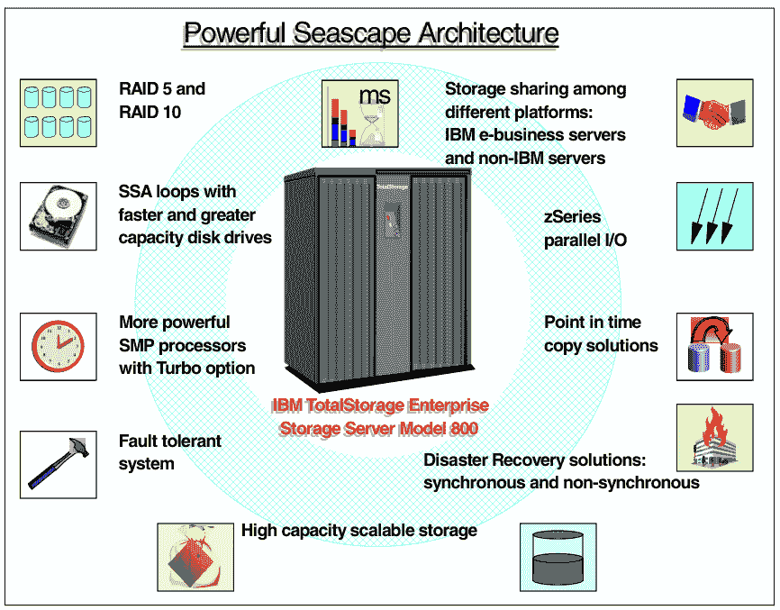

图 4-1 IBM 的 Seascape® 架构 - `ESS Model 800`

`ESS` 是 IBM 使用 IBM Seascape 架构开发的最强大的磁盘存储服务器。`ESS` 为所有 IBM eServer 系列以及非 IBM（即基于 `Intel` 和基于 `UNIX`）的服务器系列提供无与伦比的功能。在所有这些环境中，`ESS` 具有独特的能力，能够满足计算业务可能要求的性能、容量和数据可用性的最苛刻要求。

Seascape 架构是 IBM 存储产品开发的关键。Seascape 使 IBM 能够整合来自 IBM 和整个行业的最佳技术，生产出灵活且可升级的存储解决方案。这种 Seascape 架构设计使 `ESS` 能够从最初的 E 型号发展到后来的 F 型号，再到最近的 800 型号，每一代都具有更新、更强大的硬件和功能增强。`Server` 是 `ESS` 产品名称的一部分，因为 Seascape 架构战略中最重要的方面之一是在存储系统中使用服务器技术。将实际的服务器计算机（`SMP`）集成到 `ESS` 中有助于减少对昂贵定制组件的需求，并通过使用经过验证的服务器和操作系统技术提高可靠性。

图 4-2 中的图表描绘了 `ESS Model 800` 及其所有主要组件。机架顶部是磁盘驱动器模块（`DDM`），其正下方是容纳集群对称多处理器（`SMP`）的处理器抽屉。处理器抽屉下方是容纳连接 `SSA` 环路的 `SSA` 设备适配器的 I/O 抽屉。I/O 抽屉下方是容纳主机适配器的主机适配器舱位。机架底部是交流电源和电池。

在两个 `DDM` 框架之间是一个操作面板，包括紧急电源开关、本地电源开关、电源指示灯以及消息/错误指示灯。

对于更大配置，`ESS` 基座机箱连接到一个与基座 `ESS` 尺寸相同的扩展机箱机架，并放置在 `ESS` 基座框架旁边。

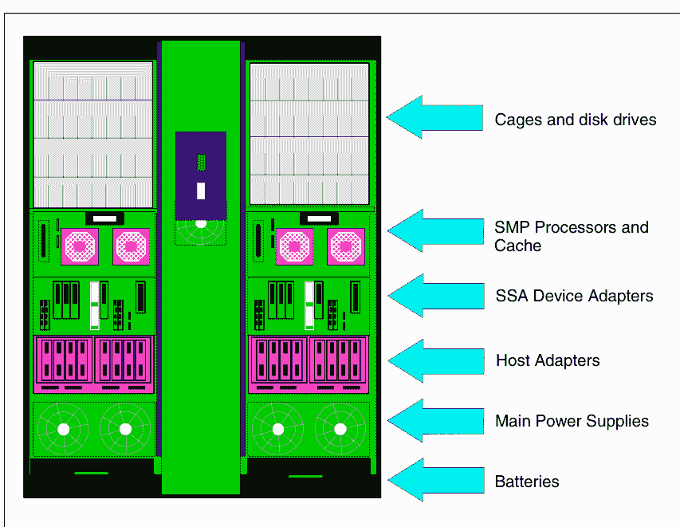

图 4-2 `ESS Model 800` 主要组件

#### 4.3.2 ESS 功能和优势

`ESS` 在 1999 年首次推出时为存储服务器树立了新标准，此后已发展成为第三代 `ESS Model 800`。IBM TotalStorage 企业存储服务器 `Model 800` 引入了重要变化，极大地提高了 `ESS` 的整体价值，并为战略性存储区域网络（`SAN`）计划提供了坚实基础。

### 存储整合

`ESS` 的连接多样性和大容量使来自不同平台的数据能够整合到单个高性能、高可用性设备上。存储整合可以是服务器整合的第一步，减少您需要管理的设备数量，并允许您在需要时灵活添加或分配容量。IBM TotalStorage 企业存储服务器支持所有主要操作系统平台，从完整的 IBM eServer 系列电子商务服务器和 IBM NUMA-Q®，到非 IBM 基于 `Intel` 的服务器，以及不同的 `UNIX` 变体，包括 `Linux`，如图 4-3 所示。

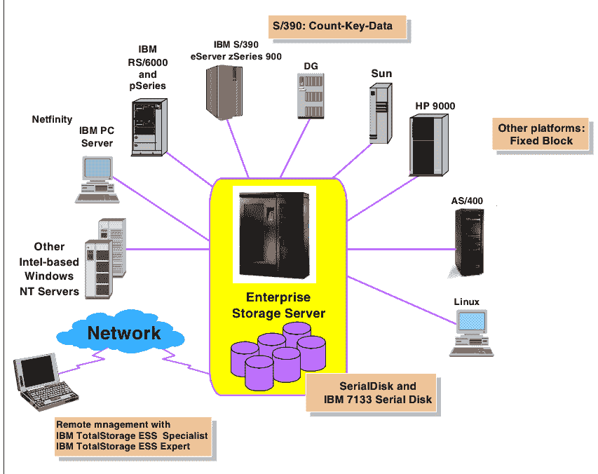

图 4-3 用于存储整合的 IBM TotalStorage 企业存储服务器

总容量高达 55 TB，并具有多样化的主机连接能力，`SCSI`、`ESCON®` 和 `Fibre Channel/FICON™`（`ESS Model 800`）在整合当今必须处理的异构服务器平台的存储需求的同时提供卓越性能。

### 性能

`ESS Model 800` 性能增强的关键特性如下：

- 配备 `SMP` 处理器可选 Turbo 功能的 `ESS Model 800` 能够提供其前身 `Model F20` 2.5 倍的吞吐量。

- 64 GB 缓存支持更大规模的系统配置并提高命中率，从而降低响应时间。

- 双倍内部带宽为数字媒体、商业智能、数据仓库和生命科学应用提供高顺序吞吐量。

- 更大的 2 GB 非易失性存储（`NVS`），带宽翻倍，可实现写入密集型应用的更大可扩展性。

- 第三代硬件，例如更强大的 `SSA` 设备适配器，可为重要数据库应用提供高达 40% 的响应时间改善

- 2 GB `Fibre Channel/FICON` 主机适配器为开放系统和 `zSeries` 提供双倍的持续性能和即时吞吐量

- 与配置为 `RAID 5` 的相同物理容量相比，`RAID 10` 可为选定的数据库工作负载提供高达 75% 的更高吞吐量。虽然大多数典型工作负载在 `RAID 5` 下会获得出色的响应时间，但某些不利于缓存的应用以及具有高随机写入内容的某些应用可以从 `RAID 10` 提供的性能中受益。

- 15,000 rpm 驱动器与 10,000 rpm 驱动器相比可提供高达 80% 的更高吞吐量和 40% 的响应时间改善。这使得工作负载能够达到显著更高的访问密度，同时获得改善的响应时间。

图 4-4 总结了上述提到的许多 `ESS` 功能。

### IBM TotalStorage 企业存储服务器 Model 800

- 第三代智能存储服务器

- 两个活动集群处理器，具有

  - 更快的对称多处理器（`SMP`）

  - 可选 Turbo 功能

- 8、16、24、32 或 64 GB 缓存选项

- 2 GB 非易失性存储（`NVS`）

- 8 x 160 MBps `SSA` 环路

- 18.2 / 36.4 / 72.8 GB 容量磁盘选项

  - 磁盘容量混用

- 10,000 rpm 和 15,000 rpm 磁盘选项

  - 10,000 rpm 18.2 / 36.4 / 72.8 GB 磁盘

  - 15,000 rpm 18.2 / 36.4 GB 磁盘

- 物理容量高达 55 TB

- 最多 16 个 `Fibre Channel/FICON` 端口

- 最多 32 个 `ESCON` 端口

- 最多 32 个 `SCSI` 端口

- 连接到存储区域网络

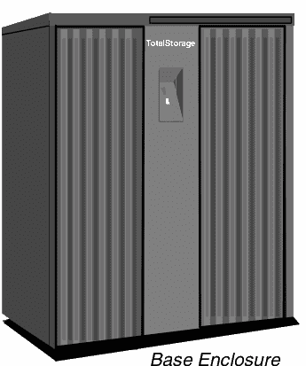

图 4-4 企业存储服务器 `Model 800`

### 高效缓存管理和强大的后端

`ESS` 设计用于在混合不同工作负载需求时为不同类型的工作负载提供最高性能。例如，`zSeries` 服务器和开放系统对存储子系统施加非常不同的工作负载需求。像 `zSeries` 这样的服务器通常具有非常利于缓存的 I/O 配置文件，并利用缓存效率。另一方面，开放系统服务器执行 I/O 可能非常不利于缓存，因为大多数命中在主机服务器缓冲区中解决。对于 `zSeries` 类型的工作负载，`ESS` 具有大缓存（最高 64 GB）的选项，最重要的是它具有高效的缓存算法。对于不利于缓存的工作负载，`ESS` 具有强大的后端，`SSA` 高性能磁盘适配器为不断发展的高速硬盘提供高 I/O 并行性和吞吐量。

## 数据保护和远程复制功能

图 4-5 说明了 `ESS` 的灾难恢复和可用性功能。

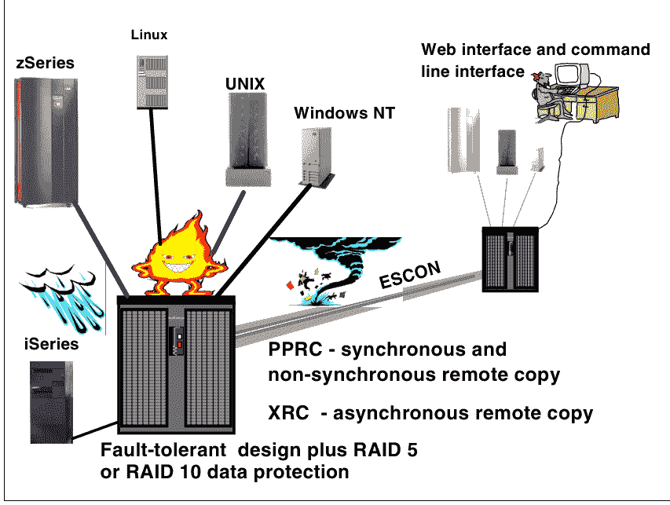

图 4-5 灾难恢复和可用性

IBM TotalStorage `Enterprise Storage Server Model 800` 的许多设计特性和高级功能有助于以有效的方式保护数据。

### 容错设计和并发维护

`ESS` 采用容错硬件设计，其中主要硬件元素（如磁盘驱动器、数据路径、逻辑组件、电源和缓存）都是冗余的。例如，集群 1 的 `NVS` 位于集群 2 中，而集群 2 的 `NVS` 位于集群 1 中，这样在集群发生故障时，故障集群的写入数据将被保存在另一集群的 `NVS` 中。此外，`ESS` 具有内置的呼叫回家功能，用于响应 IBM 支持中心的响应以及定期主动验证 `ESS` 运行状态。`ESS Model 800` 的架构允许几乎所有维护操作，例如维修、代码升级和容量升级，都可以在 `ESS` 在线运行的同时进行。对 `ESS` 配置的更改，例如定义逻辑磁盘卷并将其分配给主机，可以由客户随时动态完成。

### RAID 5 或 RAID 10 数据保护

使用 `ESS Model 800`，现在除了 `RAID 5` 排列之外，还可以选择将磁盘阵列配置为 `RAID 10` 布局（镜像加条带），这在选择用于保护用户数据的冗余技术时提供了更大的灵活性。`RAID 5` 由六个或七个用于用户数据的磁盘加上一个奇偶校验磁盘组成。`RAID 10` 由一组用于用户数据的磁盘及其镜像磁盘对应物组成。

### 远程复制


ESS Model 800 支持两种类型的远程复制，即点对点远程复制（PPRC）和扩展远程复制（XRC）。`PPRC` 是一种基于硬件的解决方案，用于将主站点（应用程序站点）的逻辑卷镜像到从站点的卷（恢复站点），使用同步或非同步过程。`PPRC` 是面向开放系统服务器（如 `xSeries`）以及 `zSeries` 服务器的远程复制解决方案。最近宣布了 `PPRC V2`，它提供了级联功能。`PPRC` 在 6.2 节“点对点远程复制（`PPRC`）”第 63 页中有更详细的讨论。

注意：`XRC` 仅适用于 `z/OS` 和 `OS/390` 环境，不适用于 `Linux on zSeries` 或开放系统。

### 时间点复制功能

用户仍需要进行备份以保护数据免受逻辑错误和灾难的影响。对于所有环境，传统上备份用户数据需要相当长的时间。通常，由于其持续时间以及对正常操作的后果影响，备份是在非主要班次之外进行的。数据库必须关闭以创建一致性和数据完整性，并且在线系统通常会关闭。

使用 `ESS Model 800`，使用 `FlashCopy` 功能时，备份时间已减少到最短时间。`FlashCopy` 创建数据的即时时间点副本，并使能够立即访问源卷和目标卷，从而允许应用程序以最小的干扰恢复。最近宣布了 `FlashCopy V2`，它提供了多重关系和增量 `FlashCopy` 功能。`FlashCopy` 在 6.4 节“`FlashCopy`”第 68 页中有更详细的讨论。

注意：`IBM TotalStorage Enterprise Storage Server Model 800` 还提供一种称为 `Concurrent Copy` 的时间点复制功能，但该功能仅适用于 `z/OS` 和 `OS/390` 操作系统，不适用于 `Linux`。

### 按需备用容量

为了使 `ESS Model 800` 更具可扩展性，并更能够适应动态和不可预测的工作负载需求，已宣布了按需备用容量功能。当您的存储需求增加时，您可以在没有任何 `IBM` 干预的情况下激活额外容量，并且不会对您的工作造成任何中断。当备用容量被激活时，`ESS` 会自动报告容量使用量的增加。按需容量有助于控制成本，同时避免在无法准确预测容量增长时间时可能导致的获取存储延迟。

### 存储区域网络 (SAN)

`SAN` 策略是如第 44 页图 4-6 所示将任何服务器连接到任何存储。随着 `SAN` 迁移到 2 Gb 技术，存储子系统必须利用这种更强大的带宽。跟上 `SAN` 技术的演变，`Enterprise Storage Server Model 800` 正在引入新的 2 Gb 光纤通道/`FICON` 主机适配器，用于原生服务器连接和 `SAN` 集成。这些新的 2 Gb 光纤通道/`FICON` 主机适配器将 `F` 型号可用先前适配器的带宽和瞬时数据速率加倍，每个适配器有一个端口，具有 `LC` 连接器，可通过长波或短波光纤链路进行全双工数据传输。这些适配器支持 `SCSI-FCP`（光纤通道协议）和 `FICON` 上层协议。每个光纤通道端口可以由多个异构主机和 `HBA` 共享，可能减少所需的端口数量。包括 `LUN` 屏蔽以支持 `SAN` 安全。

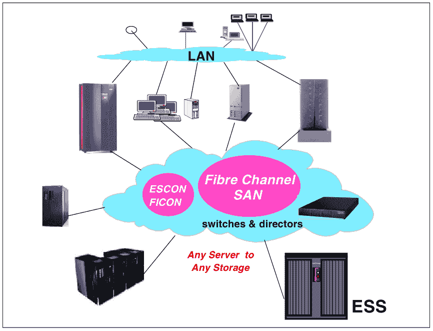

图 4-6 存储区域网络 (`SAN`)

广泛的连接能力使 `ESS` 在规划 `SAN` 解决方案时成为无可争议的选择。有关 `ESS` 结构支持的完整列表，请参阅：

`http://www.storage.ibm.com/disk/ess/supserver.htm`

有关 `IBM TotalStorage SAN` 产品描述，请参阅：

`http://www.storage.ibm.com/ibmsan/products/sanfabric.html`

#### 4.3.3 ESS 专家

`TotalStorage Enterprise Storage Server` 包括 `ESS Specialist`，这是一个基于 Web 的界面，位于 `ESS` 内部，允许存储管理员从 `ESS` 主控制台或从远程工作站使用 Web 浏览器监控和管理存储。`ESS Specialist` 界面是一组 `Java` 小程序，这些程序由浏览器动态加载，并在浏览器内执行。当您请求对 `ESS` 配置进行更改时，`Java` 小程序会与 `ESS` 集群上运行的微代码通信以检索当前配置数据，提交请求的配置更改并显示请求的结果。有关详细信息，请参阅 `IBM TotalStorage Enterprise Storage Server Web Interface User's Guide SC26-7448`。

当您打开 Web 浏览器并登录到您的 `ESS Specialist` 时，您会看到欢迎屏幕，如图 4-7 所示。

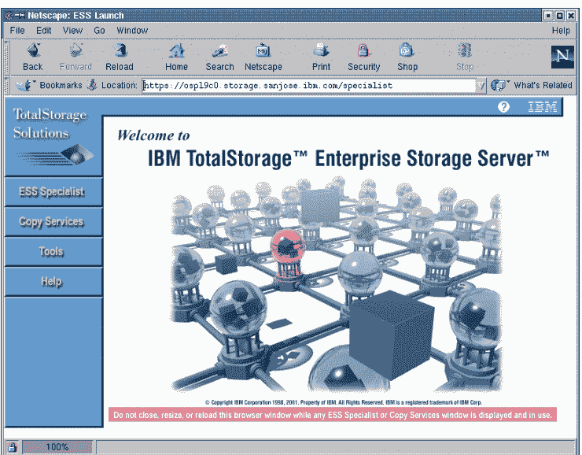

图 4-7 `ESS` 欢迎屏幕

注意左侧的两个按钮：

- `ESS Specialist` 按钮显示 `ESS Specialist` 主屏幕，您可以在此设置和查看 `ESS` 中的存储分割（我们将在第 5 章“用于 `Linux` 的 `zSeries FCP`”第 47 页中使用此功能）。

- `Copy Services` 按钮通向 `ESS Copy Services` 主屏幕，您可以在此调用和管理 `ESS` 上可用的各种 `Copy Services` 功能（我们将在第 6 章“`ESS Copy Services` 和 `Linux`”第 61 页中使用此功能）。

## 用于 Linux 的 zSeries FCP

本章详细介绍将 `ESS` 连接到运行 `Linux` 的 `zSeries` 服务器的 `Fibre Channel Protocol`（`FCP`）支持。

请注意，仍然可以使用传统的 `ESCON` 和 `FICON` 通道将 `Enterprise Storage Server` 连接到 `Linux on zSeries`。这实际上是 `Linux for zSeries` 于 2000 年初推出时唯一支持的方法。`Enterprise Storage Server` 可以配置为 `CKD` 磁盘，并且通常所有当前型号的 `Enterprise Storage Server` 都与所有当前型号的 `zSeries` 以及所有当前级别的 `z/VM` 和 `Linux for zSeries` 互操作，使用 `ESCON` 或 `FICON` 通道。有关具体细节，请参阅位于以下位置的 `ESS Interoperability Matrix and Host Systems Attachment Guide`，`SC267446`：

`http://www.storage.ibm.com/disk/ess/supserver.htm`

### 5.1 zSeries 与 FCP

2003 年 2 月，`zSeries` 增加了对 `Fibre Channel` 连接设备的支持。（此支持仅适用于 `zSeries` 上的 `Linux`，不适用于 `z/OS` 或 `z/VM`。）使用这种新的 `zSeries Fibre Channel` 协议（`FCP`），`zSeries` 上的 `Linux` 可以访问标准 `SCSI` 存储设备以及 `SAN` 中的分布式存储。这使客户能够在将分布式服务器整合到 `zSeries` 的同时保留其对 `FCP/SCSI` 存储设备的现有投资。支持使用 `FCP` 连接到 `zSeries` 系统的设备的完整列表可在以下位置找到：

`http://www-1.ibm.com/servers/eserver/zseries/connectivity/#fcp`

`http://www-1.ibm.com/servers/eserver/zseries/connectivity/fcp.html`

企业存储服务器已成功使用 `FCP` 连接到 `zSeries` 上的 `Linux`，并在第 5.2 节“使用 `FCP` 将 `ESS` 连接到 `zSeries` 上的 `Linux`”第 52 页中进行了讨论。本节简要概述了传统的 `zSeries I/O` 架构与 `zSeries Fibre Channel` 之间的区别。此概述基于红皮书《使用 `IBM` 磁盘存储实现 `Linux`》，`SG24-6261-01`。更多详细信息可在前述红皮书中找到，也可在红皮书《开始使用 `zSeries Fibre Channel` 协议》，`REDP0205`，以及红皮书《`IBM eServer zSeries` 连接手册》，`SG24-5444` 中找到。

#### 5.1.1 zSeries 特定存储连接

`z/Architecture` 的 `I/O` 组件基于通道、控制单元和设备。通道在服务器与所附控制单元之间提供明确定义的接口。最初在并行铜介质上实现，今天的通道如 `ESCON` 和 `FICON` 使用光纤串行电缆。此外，并行通道是多点下挂接口，而 `ESCON` 和 `FICON` 都是如图 5-1 所示的交换式点对点连接。

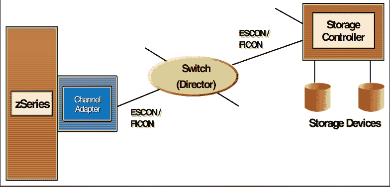

图 5-1 典型的 `zSeries` 存储连接概念


ESCON 通道使用独特的物理接口和传输协议。另一方面，`FICON`基于行业标准的`Fibre Channel`低层协议。在这两种情况下，软件使用的高层 I/O 协议都基于由通道指令字（`CCW`）组成的通道程序，并且是遵循`z/Architecture`或其前身（如`ESA/390`架构）的大型机的特有协议。对于磁盘存储的访问，使用由`CKD`协议定义的一组特定的`CCW`。该协议不仅描述了通过通道交换的命令和响应，还描述了数据在磁盘存储介质上记录的格式。对于磁带，存在类似的基于`CCW`的命令协议，但对于`DVD`或扫描仪等介质没有关联的访问协议，因为必要的软件驱动程序和控制单元从未提供。

### zSeries 与存储设备寻址

在`z/Architecture`中，软件使用设备号寻址存储设备，该设备号唯一标识设备。设备号由`IOCDS`设置，是一个任意的 16 位数字，以四个十六进制数字表示。它非正式地称为地址。设备号由`IOCDS`映射到设备的一个或多个物理路径。此物理路径通常由以下硬件地址四元组描述：

- 通道路径标识符（`CHPID`）：标识提供到设备的路径的通道
- 物理链路地址：标识通过交换机或控制器的路由
- 控制单元地址：指定控制单元
- 单元地址：标识设备

请参阅第 51 页图 5-4 的左侧。

通常设备有多个物理路径，例如以实现冗余。虽然这些路径使用不同的地址四元组指定，但软件仍使用单个设备号寻址设备，与为特定 I/O 选择的路径无关。

#### 5.1.2 分布式存储连接

传统上，分布式环境中的存储控制器通过并行`SCSI`电缆连接，这仅允许服务器与控制器之间有非常有限的距离。`SCSI`标准使用基于控制块的命令和状态协议。今天，`SCSI`协议的物理层与命令/状态层之间有明确的区分。

### FCP 优势

基于更高层的`SCSI`命令/状态协议，定义了一个名为`FCP`的新标准，全称为`SCSI`的`Fibre Channel`协议。`FCP`在底层`Fibre Channel`传输协议之上使用`SCSI`命令/状态协议。由于光纤`Fibre Channel`连接在速度、距离和可靠性方面的优越性，通过`FCP`的存储连接在当今分布式世界中具有最高的增长率。

### FCP 存储寻址

传统的`SCSI`设备具有简单的寻址方案。最初，设备地址，即目标地址，只是一个在 0-7 范围内的数字（在较新的`SCSI`架构中扩展到 0-15），地址 7 通常保留给主机适配器。如图 5-2 所示，`SCSI`还支持逻辑单元号（`LUN`）的定义，其中每个`LUN`代表目标（或控制器）的分区，例如磁盘驱动器。

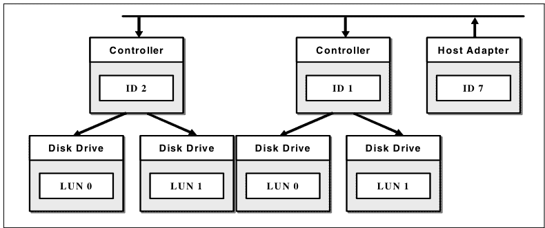

图 5-2 `SCSI`寻址

对于`FCP`，开发了一种基于全球名称（`WWN`）的新寻址方案。每个节点和节点上的每个端口（如`FCP`端口）都被分配一个`WWN`，分别称为全球节点名称（`WWNN`）和全球端口名称（`WWPN`）。此外，节点内的可寻址单元（如磁盘驱动器）被分配一个`LUN`名称。这在图 5-3 中有所说明。

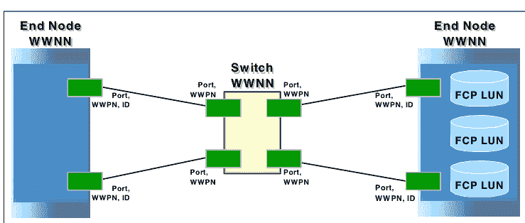

图 5-3 全球名称

#### 5.1.3 zSeries 特定与分布式存储控制器

目前可用于`zSeries`的`Fibre Channel`接口存储控制器有两种类型：

- 支持基于`CCW`架构的`z/Architecture`特定`FICON`接口的控制器，具有用于磁盘存储的`CKD`命令集以及用于磁带的类似命令集。
- 支持基于`SCSI`的`FCP`协议的控制器，具有特定于设备类型的`SCSI`命令集，如磁盘或磁带。

这两种类型的控制器通常基于相同的硬件构建块。它们各自的特性由处理主机接口的不同固件实现。例如，`ESS`上的`Fibre Channel/FCP`主机适配器可以配置为`FICON`或`FCP`协议。`DASD`寻址或设备映射的处理方式如图 5-4 所示，该图总结了前面的讨论。

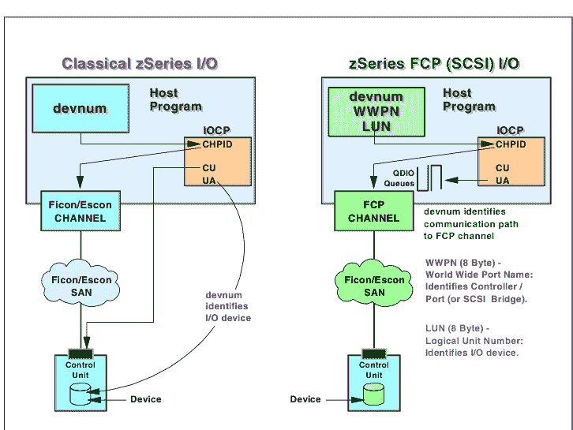

图 5-4 `DASD`寻址方案

### zSeries 与存储：总结

综上所述，经典的`zSeries`操作系统如`z/OS`和`z/VM`仅设计用于支持由`z/Architecture`定义的协议的存储控制器。随着`zSeries`上`Linux`的出现情况发生了变化，因为其存储 I/O 组件面向`SCSI`协议。由于`zSeries`服务器系统缺乏访问基于`SCSI`的存储设备的能力，因此有必要为`zSeries`上的`Linux`添加特定支持，使其能够在基于`CCW`的`zSeries` I/O 环境中运行。

然而，`zSeries`上`Linux`中的这一额外层是`zSeries`独有的，不允许其利用依赖于`SCSI`连接的存储子系统和应用程序。因此，`zSeries`系统中添加了`FCP`连接功能，允许连接基于`SCSI`的存储控制器，并使`zSeries`上的`Linux`能够以`Linux`标准方式访问这些控制器。图 5-5 显示了两种访问方法之间格式转换的差异。通过将请求转换为`CKD`格式来访问块设备层中的块设备所产生的开销已被消除。

## DASD 访问转换

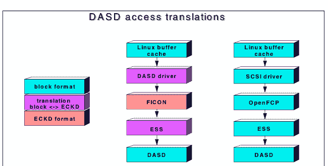

Figure 5-5 `DASD`访问转换`FICON`与`FCP`

## 支持的设备

使用`FCP`连接到`zSeries`系统的设备完整列表可在以下位置找到：

`http://www-1.ibm.com/servers/eserver/zseries/connectivity/#fcp`

`http://www-1.ibm.com/servers/eserver/zseries/connectivity/fcp.html`

有关`Linux` on `zSeries`的`FCP`通道支持以及`z/VM`的适当支持的当前信息，可通过选择以下位置的 June 2003 stream 找到：

`http://www10.software.ibm.com/developerworks/opensource/linux390/index.shtml`

### 5.2 使用 FCP 将 ESS 连接到 Linux on zSeries

`ESS Model 800`已成功通过`FCP`连接到`Linux` on `zSeries`，结果描述在红皮书`Implementing Linux with IBM disk Storage, SG24-6261`中。客户在早期支持计划期间通过`FCP`将`ESS Model F20`连接到`Linux` on `zSeries`的经验可在以下位置找到：

`http://www-1.ibm.com/servers/eserver/zseries/connectivity/ficon_resources.html`

一些`ESS Model F20`通过`FCP`连接到`Linux` on `zSeries`的通道性能测量位于：

`http://oss.software.ibm.com/linux390/perf_hints_tips.shtml`

有关`Enterprise Storage Server`和`Linux` on `zSeries`以及`FCP`通道的支持配置的完整详细信息，请参阅位于以下位置的`ESS Interoperability Matrix`和`ESS Host Systems Attachment Guide, SC26-7446`：

`http://www.storage.ibm.com/disk/ess/supserver.htm`

请注意，`Enterprise Storage Server`通过`Fibre Channel`连接到开放系统主机已有几年历史，尽管它最近才可用于`zSeries`主机。详情请参阅红皮书`Implementing Fibre Channel Attachment on the ESS, SG24-6113,`和`IBM TotalStorage Enterprise Storage Server Model 800, SG24-6424,`以及位于以下位置的白皮书`Enterprise Storage Server Fibre Channel Attachment`：

#### 5.2.1 硬件和软件要求

`zSeries FCP`功能所需的硬件和软件特性在`Redpaper Getting Started with zSeries Fibre Channel Protocol, REDP0205`中描述。我们在此提供概述。

`zSeries FCP`通道需要`FICON`卡（功能`2315`或`2318`），或`FICON Express`卡（功能`2319`或`2320`）。加载到`FICON/FICON Express`卡中的固件类型，将其转变为`FCP`通道或`FICON`通道，由`IOCP`（`CHPID`语句）中该特定通道的通道类型定义控制。因此，通过在`IOCP`中定义`FCP`类型通道，可以配置的`FICON`类型通道总数会相应减少。


支持`FCP`所需的`Linux for zSeries`发行版是`SLES8`。`FCP`和`SCSI`控制器和设备可以通过适当的`I/O`驱动程序由`Linux for zSeries`访问。`Linux`可以在逻辑分区中原生运行，或作为`z/VM`下的客户操作系统运行。

> 注意：需要`z/VM Version 4, Release 3`来支持`Linux`客户机的`FCP`。然而，`z/VM`本身不支持`FCP`设备，它仅在将`FCP`传递给客户系统方面支持`FCP`。

`Linux on zSeries`无法从`FCP`连接的磁盘启动（或`Initial Program Load (IPL)`）。因此，需要一定量的`CKD`磁盘来保存`Linux on zSeries`的操作系统。

### 5.2.2 实现概述

如前所述，红皮书`Implementing Linux with IBM Disk Storage`, `SG24-6261-01`描述了在`zSeries`上（既作为`z/VM`客户机，也在`LPAR`中原生运行）实现`SuSE Linux`（`SLES8`）以及将`ESS Model 800`通过`FCP`连接到这些系统的实现。我们将简要概述该实现中涉及的`ESS Specialist`活动；有关具体硬件/软件使用、执行`SuSE`安装的步骤、`Linux`主机设置任务等进一步详细信息，请参阅红皮书。该实现中的`ESS Specialist`活动涉及使用`ESS Specialist`定义`Linux on zSeries`主机、配置`ESS`主机适配器、配置`RAID`阵列和分配存储。

## ESS Specialist

我们已在4.3.3，“`ESS Specialist`” 第 44 页介绍过`ESS Specialist`。使用您的`Web`浏览器，您首先显示第 45 页图 4-7 所示的欢迎屏幕，然后单击`ESS Specialist`按钮显示`ESS Specialist`主屏幕。从那里单击`Storage Allocation`按钮即可设置和查看`ESS`中的存储分割，如图 5-6 所示。

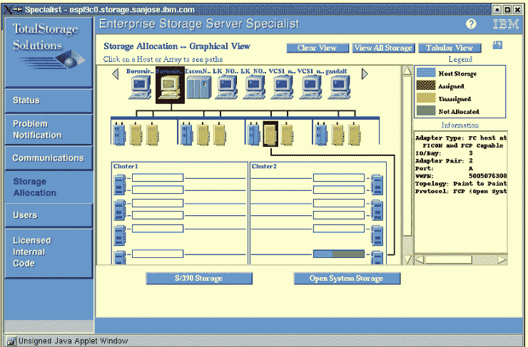

Figure 5-6 存储分配面板

由于我们将`Fibre Channel`磁盘（固定块`FB`格式）连接到`Linux on zSeries`，因此我们这次选择了`Open Systems Storage`按钮，然后显示图 5-7 所示的面板。

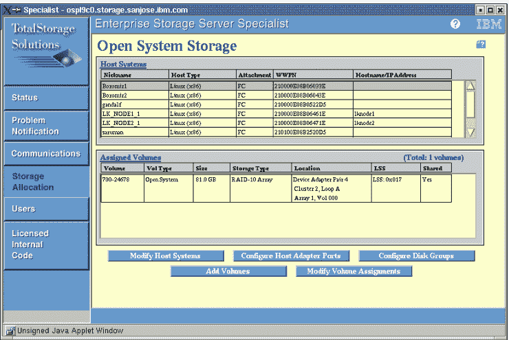

Figure 5-7 开放系统存储面板

然后我们通过单击`Open Systems Storage`面板底部的相应按钮执行下面描述的配置操作。

## 将 Linux on zSeries 主机定义到 ESS

与访问`ESS`中`CKD`磁盘的主机不同，访问`FB`格式磁盘的主机必须定义到`ESS`。为了定义我们的`Linux on zSeries`主机，我们单击了`Open System Storage`面板的`Modify Host Systems`按钮，显示图 5-8 所示的面板。这里需要完成的字段有：

- `Nickname` - 最长 29 个字符的唯一标识符
- `Host type` - 我们为任何`Linux on zSeries`实例（无论是`LPAR`还是在`z/VM`下运行）选择了`Linux (zSeries)`
- `Host Attachment` - 由于我们以`FB`格式配置存储，`Linux`主机可用的唯一选项是`Fibre Channel`连接，这就是我们选择的内容。
- `Hostname/IP Address`
- `World-Wide Port-Name` - 您`zSeries`上`FCP`端口的`WWPN`
- `Fibre-channel ports` - 选择`Linux on zSeries`主机应用于访问`ESS`的`ESS`上的`FC`端口（或端口）。

填写完整信息后单击`Add`，然后单击`Perform Configuration Update`。您将被返回到`Open Systems Storage`面板。

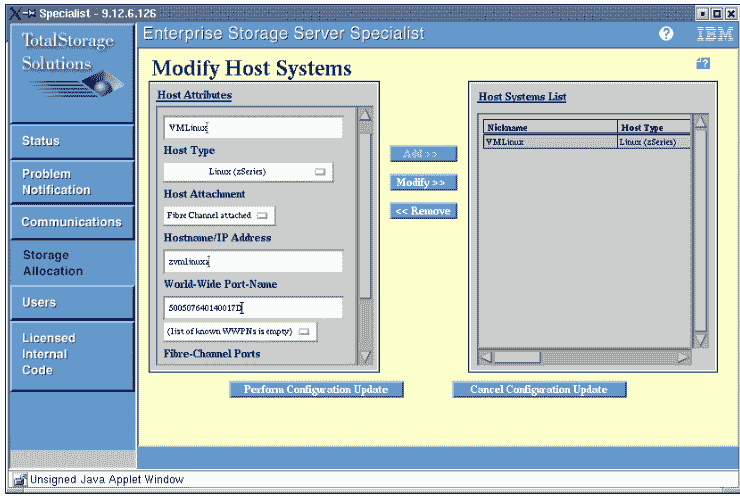

Figure 5-8 修改主机系统面板 - 添加 Linux on zSeries 主机

## 配置 ESS 主机适配器

`ESS`上的`Fibre Channel`适配器具有单个端口。`Linux on zSeries`主机将用于访问`ESS`的每个`FC`端口（或适配器）都需要进行配置。为此，请在`Open System Storage`面板上选择`Configure Host Adapter Ports`按钮，然后单击要配置的`Fibre Channel`适配器的图标。图 5-9 显示了完成此操作后启用的字段示例。请检查`Fibre Channel Topology`的值为`Point to Point (Switched Fabric)`，因为这是`Linux on zSeries`环境唯一支持的环境。对`Linux`主机将用于访问`ESS`的每个`Fibre Channel`适配器重复此操作，然后单击`Perform Configuration Update`。您将被返回到`Open Systems Storage`面板。

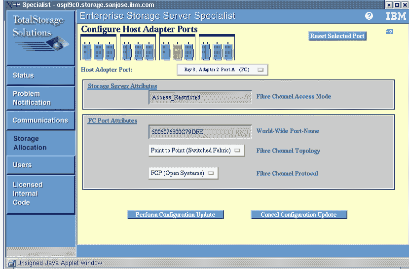

Figure 5-9 配置主机适配器端口面板

## 配置 RAID 阵列

在定义和分配给我们的`Linux`主机的任何逻辑卷之前，必须使用固定块的磁道格式格式化`ESS`上的部分可用磁盘空间，并选择`RAID5`或`RAID10`的存储类型。

在`Open System Storage`面板上选择按钮`Configure Disk Groups`将带我们进入图 5-10 所示的`Fixed Block Storage`面板。

从`Available Storage`表中，选择一个磁盘组并选择`RAID-5`或`RAID-10`的存储类型。您将在表中看到条目出现在`Modification`列中。根据需要重复此步骤，然后单击`Perform Configuration Update`以应用更改。

您将被返回到`Open Systems Storage`面板。

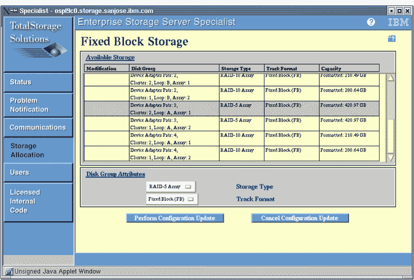

Figure 5-10 固定块存储面板

## 为 Linux 分配存储

为了创建供`Linux on zSeries`主机使用的固定块格式卷（`LUNs`），我们单击了`Open Systems Storage`面板上的`Add Volumes`。

这将导致显示图 5-11 所示的面板。

从此面板我们选择了要使用的`Linux`主机和`FC`端口，从而突出显示它们之间的连接。然后单击`Next`。会出现第二个屏幕（图 5-12），您可以在其中从可用阵列中选择并添加不同大小的卷。

要添加卷，请选择阵列、卷的所需大小以及此类卷的数量，然后单击`Add`。单击`Perform Configuration Update`，卷将被创建。

请注意，消息窗口会通知您卷的实际格式化正在后台执行（此格式化可能需要一些时间）。您必须等待格式化完成后再访问新卷。

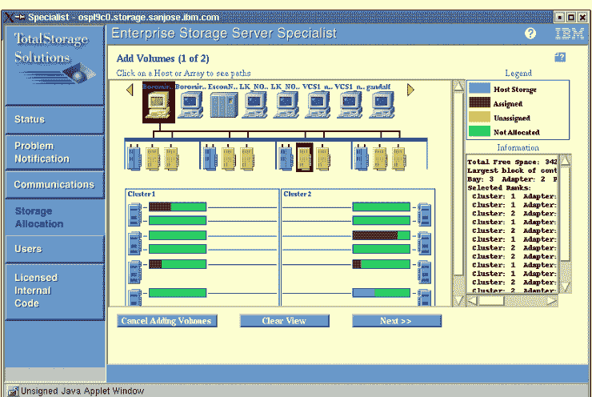

图 5-11 添加卷（第 1 面板，共 2 面板）

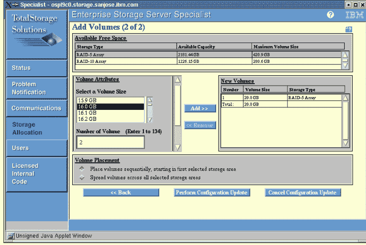

图 5-12 添加卷（第 2 面板，共 2 面板）

请注意，虽然`LUN`必须最初定义到特定的主机和端口，但随后可以将卷添加到额外的端口。这是通过在`Open Systems Storage`面板上单击`Modify Volume Assignments`按钮即可执行的操作之一。之后，卷可被配置到卷已添加到的任何端口的任何主机访问。当卷通过`Fibre Channel`端口定义给主机时，它会在为该主机定义的全部`ESS` `Fibre Channel`端口上可见。

本章介绍的许多面板和流程的进一步细节可在`IBM TotalStorage Enterprise Storage Server：在您的环境中实施 ESS`，`SG24-5420`中找到。

## ESS 复制服务和 Linux

本章提供了`IBM TotalStorage Enterprise Storage Server`可用的`Copy Services`功能概述，特别针对`zSeries`上的`Linux`。有关这些功能的完整详细信息，读者应参考红皮书`使用 IBM eServer zSeries 实施 ESS Copy Services`，`SG24-5680`，以及`在开放环境中实施 Copy Services`，`SG24-5757`。

### 6.1 引言


# Enterprise Storage Server Copy Services

`Enterprise Storage Server Copy Services` 是企业级功能，可为您提供领先的解决方案，以满足灾难恢复、数据迁移和数据复制的需求。构成 `ESS Copy Services` 套件的产品集包括：

- 点对点远程复制（同步 `PPRC`）
- 点对点远程复制扩展距离（非同步 `PPRC-XD`）
- `FlashCopy`
- 扩展远程复制（`XRC`）
- 并发复制（`CC`）

> **注意：** `ESS Copy Services` 中的两种服务，`Extended Remote Copy` 和 `Concurrent Copy`，仅适用于 `z/OS` 和 `OS/390` 操作系统，且不可用于 `zSeries` 上的 `Linux`。本书对这些复制功能提供的细节很少。

`FlashCopy` 和点对点远程复制（同步 `PPRC` 和非同步 `PPRC-XD` 均可）是 `Enterprise Storage Server` 的基于硬件的功能，可与开放服务器（基于 `UNIX` 和 `Intel`）以及 `zSeries` 和 `iSeries` 服务器一起使用。图 6-1 说明了这些 `ESS Copy Services`。

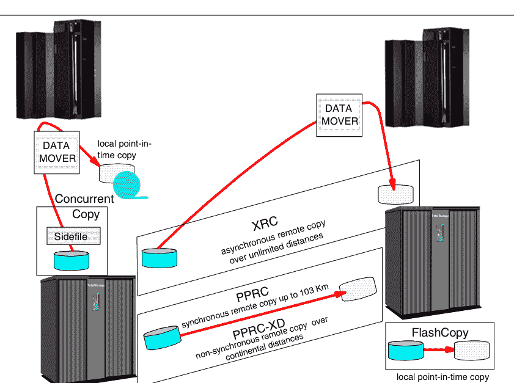

图 6-1 面向 `zSeries` 的 `ESS Copy Services`

使用 `ESS`，我们具有复制数据的功能，既可以本地复制（即在同一现场 `ESS` 内部），也可以远程复制（即将数据复制到单独的远程站点 `ESS`）。

属于 *Remote Copy* 类别的 `ESS` 复制功能有：

- 扩展远程复制（`XRC`）
- 点对点远程复制（`PPRC`）
- 点对点远程复制扩展距离（`PPRC-XD`）

属于 *本地复制* 类别的 `ESS` 复制功能有：

- `FlashCopy`
- 并发复制

`ESS Copy Services` 复制功能也可以归类为 *动态* 或 *时间点*。动态复制功能会随着应用程序对主数据源的更改不断更新副本。时间点复制功能提供原始数据在特定时间点的即时副本或视图。例如，上面列出的 `Remote Copy` 功能全部为 *动态*，而上面提到的本地复制功能均为 *时间点*。

## 6.2 点对点远程复制（`PPRC`）

点对点远程复制（`PPRC`）是一种同步远程数据镜像技术，主要作为业务连续性解决方案的一部分，用于防止磁盘子系统丢失或整个站点故障。它还用于远程迁移数据和应用程序工作负载，以及异地备份。它是一种实时复制技术，可将 *主* 卷集（由应用程序使用）同步镜像到 *次* 卷集（参见图 6-2）。通常，次要卷位于距离应用程序站点一定距离的远程位置的不同 `ESS` 上。镜像在逻辑卷级别完成。

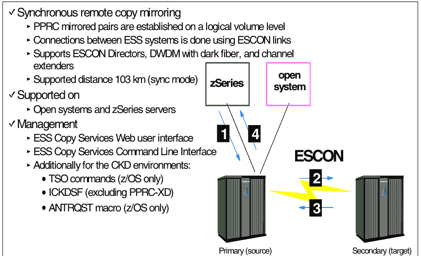

图 6-2 同步卷复制 `PPRC`

`PPRC` 是一种硬件解决方案，因此与应用程序无关，相关的硬件功能需要在本地和远程 `ESS` 上均可用。由于复制功能发生在存储子系统级别，因此应用程序无需知道其存在。`PPRC` 通过确保只有在主 `ESS` 收到次要副本已成功更新的确认后，主卷更新才会成功完成，从而保证次要副本是最新的。

更新记录时的顺序如下（参见图 6-2）：

1. 写入主卷（写入主 `ESS` 缓存和非易失性存储 `NVS`）。应用程序将数据写入应用程序站点 `ESS` 上的主卷，并发生缓存命中。
2. 写入次卷（写入次 `ESS` 缓存和 `NVS`）。应用程序站点 `ESS` 然后启动 `I/O` 通道程序到恢复站点 `ESS`，将更新的数据传输到恢复站点缓存和 `NVS`。
3. 在次卷上发出写入完成信号。当更新的数据位于其缓存和 `NVS` 中时，恢复站点 `ESS` 向应用程序站点 `ESS` 发出写入完成信号。
4. 报告 `I/O` 完成。当应用程序站点 `ESS`（主 `ESS`）收到恢复站点 `ESS` 的写入完成信号时，它向应用程序系统返回 `I/O` 完成状态。

从缓存到应用程序 `ESS` 和恢复站点 `ESS` 后端磁盘驱动器的 `destage` 异步执行。`PPRC` 的同步技术可确保与应用程序相关的写入会以相同的顺序应用于次要卷，从而在每个时刻提供应用程序一致性。`PPRC` 具有可调整的参数（`CRIT` 和一致性组），用于标识在更新次要副本时出现错误或延迟时应采取的操作。

从 `PPRC` 角度来看，`ESS` 内的卷可以处于以下状态之一（参见图 6-3）：

- `Simplex`：卷的初始状态。主卷和次卷之间尚未建立 `PPRC` 卷对关系。
- `Pending`：已定义 `PPRC` 卷对关系的初始状态，此时主卷到次卷的初始复制正在进行。此状态也出现在 `PPRC` 卷对在暂停后重新同步时出现。在等待期间，卷对不同步，`PPRC` 正在将磁道从主卷复制到次卷。
- `Duplex`：`PPRC` 完全完成将主卷复制到次卷后，`PPRC` 卷对的状态。此时卷对同步，所有对主卷的写入更新都会同步应用于次卷。
- `Suspended`：在 `PPRC` 对的此状态下，对主卷的写入不会镜像到次卷。次卷变得不同步。在此期间，`PPRC` 保留主卷中已更改磁道的位图记录。稍后，卷对可以重新同步，然后仅复制已更新的磁道。例如，当主 `ESS` 无法完成对恢复 `ESS` 的写操作时，`PPRC` 卷对会自动进入暂停状态。
- `Duplex pending-XD`：当卷对以非同步 `PPRC-XD` 关系建立时会出现此状态。此 `PPRC` 卷状态在 6.3 “`PPRC` 扩展距离（`PPRC-XD`）”第 65 页中进行了解释。

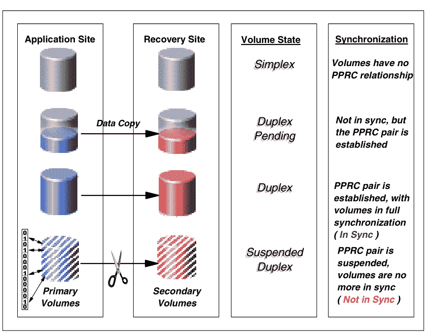

图 6-3 `PPRC` 卷状态 - 同步操作模式

### 复制 `PPRC` 次要卷

`PPRC` 次要卷可以是 `FlashCopy` 主卷。这使您例如可以在其暂停时生成镜像卷的一致时间点三级副本。使用 `PPRC V2`，您可以执行异步级联 `PPRC`，其中（同步）`PPRC` 次要卷可同时充当到远程站点的 `PPRC-XD` 关系的 `PPRC` 主卷。这提供了三站点 `PPRC` 配置的能力。

## 6.3 `PPRC` 扩展距离（`PPRC-XD`）

点对点远程复制扩展距离（`PPRC-XD`）是面向开放系统和 `zSeries` 服务器的非同步长距离复制选项。`PPRC-XD` 可以在远超同步 `PPRC` 支持的最大 103 公里距离的距离上运行。它是优秀的解决方案，适用于：

- 数据复制
- 数据迁移
- 异地备份
- 传输数据库日志
- 基于定期时间点数据副本的应用程序恢复解决方案

在 `PPRC-XD` 中，主卷更新在应用程序运行时以非同步操作镜像到次卷。由于更新的非同步传输，主站的写操作（从而应用程序的响应时间）不受任何传输延迟的影响。当 `PPRC-XD` 启动时，为每个主卷构建位图以记录已更新的主卷磁道。复制的第一阶段是对主卷磁道进行顺序复制，这些磁道以批量的方式发送到辅助卷。当所有磁道都已复制完成后，初始复制完成，然后 `PPRC-XD` 开始定期遍历位图，查找任何已更新的磁道，并将它们以更新批量的形式发送到辅助卷。这是一种面向吞吐量、非常高效的非同步镜像方式。

图 6-4 显示了 `PPRC-XD` 操作的简化序列，说明了其非同步特性。以下是操作的序列：

1. 主机向主卷写入数据（写入主 `ESS` 缓存和 `NVS`）。`Channel End` 返回给主机。
2. 主卷位图被更新以反映更新，以便稍后传输到辅助 `ESS`。`ESS` 向主机返回 `Device End`，因此对于应用程序而言 `I/O` 操作已完成
3. 主 `ESS` 将更新镜像到辅助 `ESS` 卷上。更新被分组为批量以实现高效传输。
4. 当更新已安全存储在辅助 `ESS` 缓存和 `NVS` 中时，辅助 `ESS` 向主 `ESS` 返回写入完成。主卷位图被更新以显示主更新已安全存储在辅助 `ESS` 缓存和 `NVS` 中。

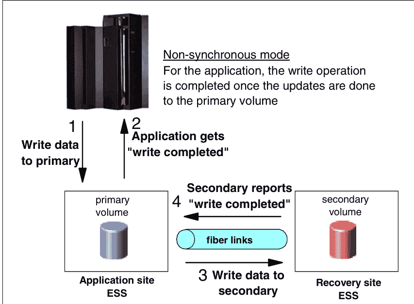

图 6-4 `PPRC-XD` 操作

使用 `PPRC-XD`，`PPRC` 传统卷状态（参见图 6-3）增加了一个状态。新增的状态是 `duplex-pending XD` 状态（参见图 6-5）。在此 `duplex-pending XD` 状态下，`PPRC` 对主卷更新进行非同步镜像到辅助站点。`PPRC-XD` 将定期遍历每个卷的位图以查找已更新的磁道，并将它们放入一批中复制到辅助端。配对将保持此状态，直到发出进入同步模式（`duplex` 状态）的命令，或发出挂起配对（`suspended` 状态）的命令，或发出删除 `PPRC-XD` 配对（`simplex` 状态）的命令。

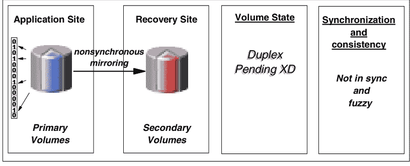

图 6-5 `Duplex-pending XD` 卷状态

## Catch-up operation (`go-to-synch`)


## PPRC-XD 追赶转换
PPRC-XD catch-up 是 `PPRC-XD` 配对从其正常的非同步状态转换到完全同步状态时发生的转换的名称。在此转换结束时，主卷和辅助卷完全同步。追赶转换可以通过命令 `PPRC` 执行 `go-to-SYNC` 来完成，因此卷配对离开 `duplex-pending XD` 状态并达到 `duplex` 状态。从这一刻起，如果配对未立即挂起，主写入更新将同步传输到恢复站点。追赶转换也可以通过暂时使应用程序对主卷的写入静默，并等待 `PPRC-XD` 完成同步来实现。

当通过命令 `PPRC` 执行 `go-to-SYNC` 进行追赶操作时，如果被镜像的卷相隔很远，超过 100 公里，您可能不希望发生任何同步复制操作。为此有一个复制选项，允许您在同步建立后立即要求 `PPRC` 挂起配对。图 6-6 显示了 `PPRC-XD` 的基本操作。

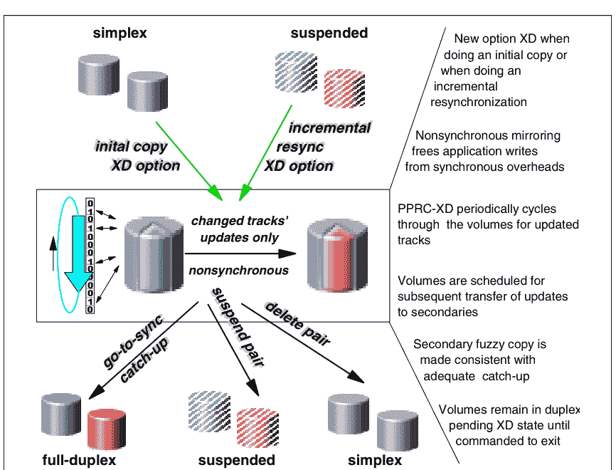

图 6-6 PPRC-XD 基本操作

## Data consistency
当卷配对处于 `duplex-pending XD` 状态时，应用程序对主卷的写入会非同步复制到辅助卷。这意味着辅助卷保留的是数据的模糊副本。依赖于应用程序的写入不能保证以与主卷写入相同的顺序应用于辅助卷。此外，在任何时候都会有一部分应用程序更新的数据未反映在辅助卷上；这些数据对应于自上次卷位图扫描以来已更新的磁道。追赶转换将使配对恢复同步，要么将其设置为 `duplex`，要么停止对主卷的写入更新。达到 `duplex` 状态后，配对可以暂时挂起以对辅助卷进行快闪，然后再恢复配对之间的 `PPRC-XD` 关系。`FlashCopy` 将是一个三级一致的点-in-time 副本。或者，如果是数据库应用程序并且归档日志正在被镜像，那么一旦配对追赶完成并被挂起，日志就可以应用于影子数据库。

### 6.4 FlashCopy
如今，数据处理中心越来越多地要求应用程序每天 24 小时、每周 7 天可用，且数据备份或复制时的应用程序停机时间最少。`FlashCopy` 允许用户实现此类解决方案。

`FlashCopy` 提供数据的即时点-in-time 副本，也称为 `T0` 副本。`FlashCopy` 使使用源副本或目标副本的应用程序几乎可以立即获得访问权限。建立 `FlashCopy` 关系仅需要对应用程序进行最小程度的中断

然后由 `IBM TotalStorage Enterprise Storage Server` 在后台创建副本，对其他 `ESS` 活动的影响最小。`FlashCopy` 可与 `PPRC` 创建的本地或远程数据副本结合使用。

请注意，最近已宣布 `FlashCopy` 的新版本（`FlashCopy V2`），它消除了 `FlashCopy V1` 的一些限制，并增加了一些新功能。以下对 `FlashCopy` 的简要概述在很大程度上以 `FlashCopy V1` 为表述，目的在于简化，但我们将特别指出 `FlashCopy V2` 可用的额外 `FlashCopy` 功能。有关 `FlashCopy V2` 的更多详细信息可在红皮书*《使用 IBM eServer zSeries 实现 ESS 复制服务，SG24-5680》*中找到。

`FlashCopy` 在逻辑卷级别（`FlashCopy V2` 可在卷范围甚至数据集级别调用）。它具有以下限制：

- 源卷和目标卷必须具有相同的磁道格式。
- 目标卷必须至少与源卷一样大。
- 源卷和目标卷必须在同一 `ESS` 逻辑子系统（`LSS`）内。使用 `FlashCopy V2`，此条件放宽，因此源卷和目标卷只需在同一 `ESS` 内即可。
- 源卷和目标卷一次只能参与一个 `FlashCopy` 关系。使用 `FlashCopy V2`，一个卷可以具有多个 `FlashCopy` 关系。

当调用 `FlashCopy` 时，`ESS` 在目标卷和源卷之间建立 `FlashCopy` 关系。此关系从您启动 `FlashCopy` 操作时开始存在，直到 `ESS` 将源卷的所有数据复制到目标卷为止。您可以选择请求 `FlashCopy` 不执行后台复制（`NOCOPY` 选项），在这种情况下，必须明确撤回该关系才能终止它。

在 `FlashCopy` 关系的*建立*阶段，会为该关系创建位图。此位图由 `ESS` 微码用于将源卷和目标卷映射为 `FlashCopy` 请求时（`T0` 副本）的状态，以及管理对源卷和目标卷的后续读取和更新。一旦关系建立，两个卷即可供应用程序使用，并且可选的物理复制阶段开始。（请注意，无需停止应用程序即可启动 `FlashCopy`。但是，您需要考虑只有物理磁盘上的数据会被复制，而应用程序缓冲区中的数据不会被复制。因此，您可能需要在建立 `FlashCopy` 关系时使应用程序静默。）

## FlashCopy background copy mode (default)
后台复制模式会导致源卷中的所有磁道被物理复制到目标卷。后台复制任务在 `ESS` 上的优先级低于正常 I/O，从而确保对正常应用程序 I/O 处理的影响最小。使用位图，`ESS` 跟踪已从源复制到目标的数据，并管理两个副本的完整性。如果应用程序想要读取目标上尚未复制的一些数据，则数据将从源读取；否则，读取将从目标卷满足。在更新源卷上尚未复制的磁道之前，`ESS` 会按需复制该磁道到目标卷，从而保留 `T0` 副本。对目标卷上该磁道的后续读取将从目标卷满足，并且对源卷上该磁道的后续更新将被 `FlashCopy` 忽略，从而保留 `T0` 副本。在更新目标卷上尚未复制的磁道之前，`ESS` 将执行该磁道的按需复制到目标卷。经过一段时间后，所有磁道都将被复制到目标卷，并且 `FlashCopy` 关系将自动结束。图 6-7 说明了请求后台复制时 `FlashCopy` 的工作原理。

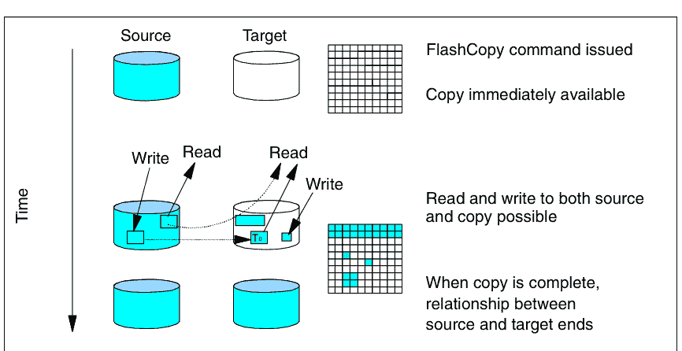

图 6-7 FlashCopy 点-in-time 复制

## FlashCopy 无后台复制模式 (NOCOPY)
`NOCOPY` 选项会导致 `FlashCopy` 关系在未启动后台复制的情况下建立——只有被更新的源磁道才会被复制到目标。这在您只需要短时间使用副本时可能很有用，例如备份到磁带。在此关系存在期间，在源卷上更新磁道之前，`ESS` 会按需将该磁道复制到目标卷，从而保留 `T0` 副本。同样，在更新目标卷上的磁道之前，`ESS` 会执行该磁道的按需复制到目标卷。在此无后台复制模式下建立的 `FlashCopy` 关系将保持活动状态，直到发生以下情况之一：

- 发出 `FlashCopy withdraw` 以移除该关系。
- 所有源设备磁道都已因被更新而复制到目标设备上。
- 所有目标设备磁道都已被用户应用程序更新。

## 增量 FlashCopy
`FlashCopy V2` 引入了一种称为增量 `FlashCopy` 的新功能，可提供刷新 `FlashCopy` 关系的能力。通过增量 `FlashCopy`，源与目标之间的初始 `FlashCopy` 关系得以保持。当随后发起 `FlashCopy` 建立时，只复制将目标更新到源新建立的点-in-time 所需的数据。增量 `FlashCopy` 有助于在源或目标上只有一小部分数据发生变化时减少后台复制完成时间。图 6-8 简要概述了增量 `FlashCopy` 的工作原理。

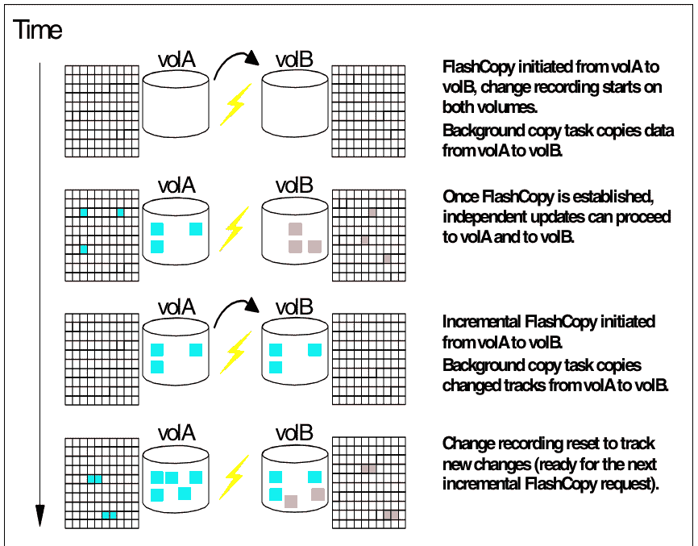

图 6-8 增量 FlashCopy

当为大量卷建立 `FlashCopy` 时，第一和最后一次建立之间存在有限的时间，因此副本可能无法在一致的点-in-time 创建。`FlashCopy V2` 引入了一致性组功能，可用于在多个卷上创建一致的点-in-time 副本。

### 6.5 ESS Copy Services Web 用户界面
运行在 `ESS` 中的 `ESS Copy Services` 提供了一个 Web 界面，可用于调用和管理 `ESS` 复制功能。首先，必须将一个 `ESS` 定义为 `ESS Copy Services` 服务器 (`CSS`)，它将保存所有 `ESS Copy Services` 相关信息。可选地，可以定义第二个 `ESS` 作为备份 `ESS Copy Services` 服务器。建议在远程（恢复）站点定义 Copy Services 服务器，并在主（应用）站点定义备份 `CSS`。`ESS` 中 `CSS` 的设置由 `IBM` 服务支持代表完成。

要访问 Copy Services Web 用户界面 (`WUI`)，您首先打开 `ESS` 欢迎屏幕，该屏幕在 4.3.3 “ESS Specialist” 第 44 页中已讨论过，并显示在图 6-9 中。

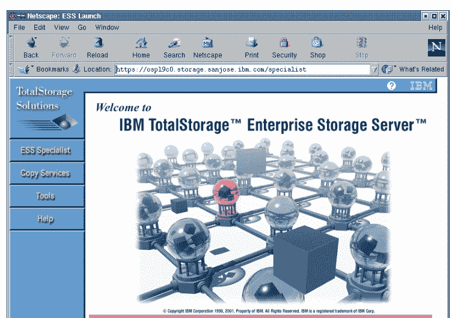

图 6-9 ESS 欢迎屏幕

然后您选择 Copy Services，这将使您的浏览器连接到指定为 Copy Services 服务器的 `ESS`。`ESS Copy Services` Web 用户界面的主菜单将被显示（参见图 6-10）。

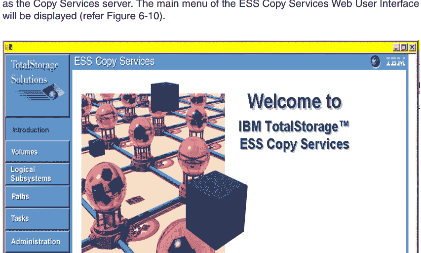

图 6-10 ESS Copy Services Web 用户界面主菜单


从 `Copy Services` 主菜单，您可以通过选择左侧的按钮之一来访问所有 `ESS Copy Services` 面板。我们将简要查看其中每一个。有关进一步详细信息，请参阅 `IBM TotalStorage 企业存储服务器 Web 接口用户指南`，SC26-7448，以及 `使用 IBM eServer zSeries 实现 ESS Copy Services`，SG24-5680。

### `Volumes` 面板

`Volumes` 面板显示在图 6-11 中。从此面板您可以：

- 接收 `ESS` 中逻辑子系统 (LSS) 中定义的卷的信息和状态
- 为 `PPRC` 或 `FlashCopy` 任务选择源卷和目标卷
- 将卷显示的输出过滤到所选范围
- 根据其唯一卷 ID 搜索特定卷
- 建立、终止和挂起 `PPRC` 复制对并选择性地保存任务
- 建立和撤回 `FlashCopy` 对并选择性地保存任务
- 进入 `PPRC` 和 `FlashCopy` 的多选模式

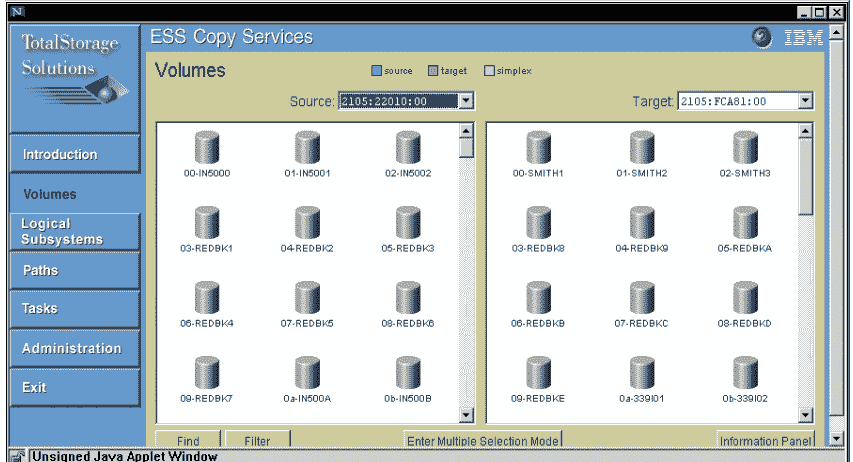

图 6-11 `Volumes` 面板

### `Logical Subsystems` 面板

`Logical Subsystems` 面板显示在图 6-12 中。此面板显示 `ESS` 存储网络中的 `ESS` 及其逻辑子系统；存储网络包括所有配置为使用同一 `ESS Copy Services` 服务器的 `ESS`。从 `Logical Subsystems` 面板您可以：

- 查看存储网络中的所有 `ESS`
- 查看存储网络中的所有逻辑子系统 (LSS)
- 获取有关逻辑子系统及其状态的信息
- 查看和修改逻辑子系统的复制属性
- 过滤所选范围的输出
- 根据其唯一地址搜索特定逻辑子系统
- 建立、终止和挂起 `PPRC` 复制对，并选择性地保存任务
- 对一致性组执行操作

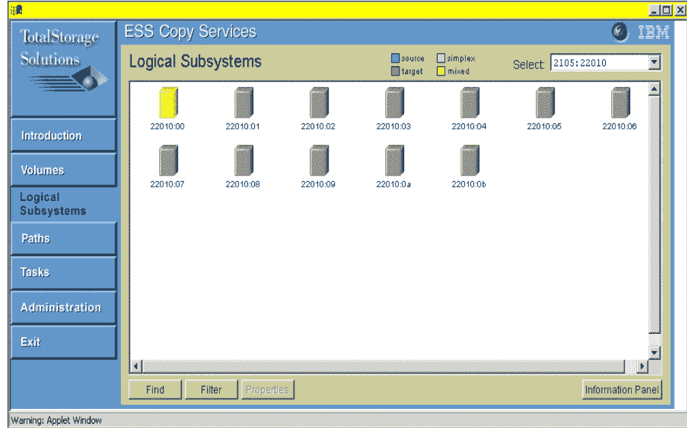

图 6-12 逻辑子系统面板

### `Paths` 面板

路径用于在主和次 `PPRC` 对之间发送数据。物理路径由两个 `ESS` 之间的 `ESCON` 连接组成，而逻辑路径描述了 `PPRC` 源和目标的连接。请注意，在创建 `PPRC` 复制对关系之前，您必须使用 `Paths` 面板在源和目标 LSS 之间建立逻辑路径。`Paths` 面板显示在图 6-13 中。从此面板您可以：

- 建立 `PPRC` 路径
- 移除 `PPRC` 路径
- 创建 `PPRC` 一致性组
- 查看有关路径的信息

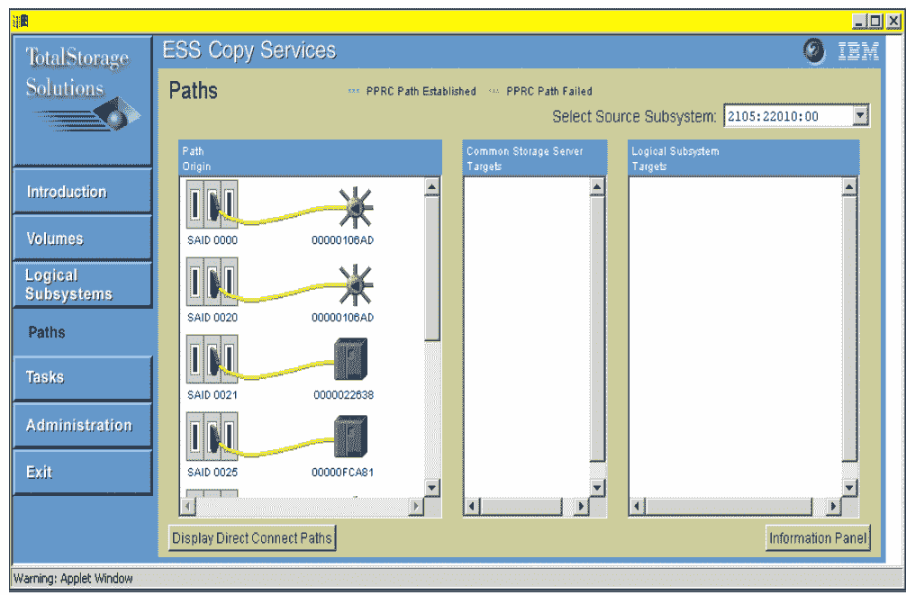

图 6-13 `Paths` 输入面板

### `Tasks` 面板

通过使用 `Volumes`、`Logical Subsystems` 和 `Paths` 面板，您可以在任务中保存任何数据复制操作的设置。任务可以是任何类型的 `FlashCopy`、`PPRC` 和路径操作。使用 `Tasks` 面板您可以运行和修改已保存的任务。您还可以将多个任务组合成一个任务组。如果需要同时建立来自不同 LSS 的多个 `FlashCopy` 对以进行备份，则可能出现这种情况。然后可以通过选择任务组并运行它来运行该任务组。`Tasks` 面板显示在图 6-14 中。

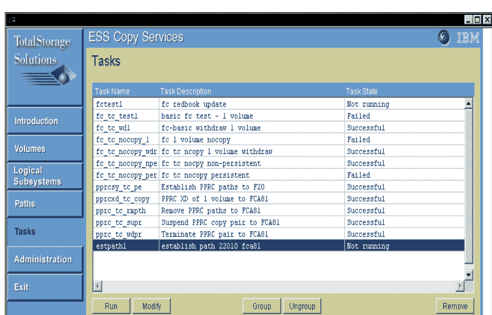

图 6-14 `Tasks` 面板

### 6.6 `Copy Services` 命令行界面

使用 `ESS Copy Services` 命令行界面 (CLI)，所选开放系统服务器的用户能够从主机命令行与 `ESS Copy Services` 服务器通信以管理 `PPRC` 和 `FlashCopy`。例如，您使用 Web 用户界面保存的任何任务都可以通过主机上的命令（如 `rsExecute Task`）调用。`CLI` 是一个基于 Java 的应用程序，运行在主机服务器上。主机系统不一定需要连接到分配给 `ESS` 的主机适配器端口之一的存储。唯一的要求是您想要调用命令的主机通过网络连接到定义为主要的 `ESS Copy Services` 服务器的 `ESS`。有关 `ESS Copy Services` 命令行界面的详细信息可在 `IBM TotalStorage 企业存储服务器命令行界面用户指南`，SC26-7494 中找到。有关哪些开放系统服务器支持 `CLI` 的详细信息可在以下网站的“`ESS` 互操作性矩阵”中找到。受支持的服务器包括 Red Hat Linux 和 SuSE Linux。

<http://www.storage.ibm.com/disk/ess/supserver.htm>

### 6.7 Linux on zSeries 上的 `ESS Copy Services`

对于不同的操作系统环境，有几种方法可以调用和管理各种 `ESS Copy Services` 功能。对于 `PPRC` 和 `FlashCopy`，最常用的是 `Copy Services Web 用户界面` (WUI) 和 `Copy Services 命令行界面` (CLI)。唯一的例外是 `z/OS` 环境，其中 TSO 命令提供了方便的管理机制。

表 6-1 总结了在 Linux on zSeries 上调用和管理 `PPRC`、`PPRC-XD` 和 `FlashCopy` 的可用设施。表中所列项目的进一步详细信息如下：

- WUI：Web 用户界面（参见 6.5，“`ESS Copy Services Web 用户界面`” 第 71 页）
- CLI：命令行界面（参见 6.6，“`Copy Services 命令行界面`” 第 76 页）。请注意，`CLI` 在连接到 `ESS` 的受支持开放系统服务器上运行，而不是在 Linux for zSeries 服务器本身上运行。
- VM ICKDSF：在 VM 环境中，一些 `PPRC` 功能可使用 `ICKDSF` 实用程序执行。有关完整详细信息请参见 `使用 IBM eServer zSeries 实现 ESS Copy Services`，SG24-5680。
- VM CP `flashcopy`：在 VM 环境中，`FlashCopy` 使用 CP 命令 `flashcopy` 支持。有关完整详细信息请参见 `使用 IBM eServer zSeries 实现 ESS Copy Services`，SG24-5680。

表 6-1 在 Linux for zSeries 上管理 `PPRC`、`PPRC-XD` 和 `FlashCopy`

|  | Linux 在 LPAR 中运行 | Linux 在 VM 下运行 |
|---|---|---|
| **通过 `ESCON`/`FICON` 连接 `ESS`** | WUI 和 CLI<br>（仅 SuSE SLES 8） | WUI 和 CLI<br>VM `ICKDSF`（用于 `PPRC`）<br>VM CP `flashcopy`（用于 `FlashCopy`） |
| **通过 `FCP` 连接 `ESS`** | WUI 和 CLI<br>（仅 SuSE SLES 8） | 未正式支持 |

理论上，WUI 和 CLI 可用于为任何 Linux on zSeries 系统调用和管理 `ESS Copy Services` 功能，而不论连接类型（`ESCON`/`FICON` 或 `FCP`）如何，也不论 Linux 是作为 VM 客户机运行还是原生在 LPAR 中运行。这是因为 WUI 和 CLI 直接与 `ESS` 接口，而不参考主机操作系统环境。然而，IBM 仅根据表 6-1 中的详细信息测试了这些功能（并且仅为这些功能提供官方支持）。

请注意，如果 Linux for zSeries 卷为 CKD（通过 `ESCON` 或 `FICON` 连接），并且它们通过 HCD 定义给 `z/OS` 系统，则可以使用 `z/OS` 系统为这些卷调用和管理复制服务功能。（有关 `z/OS` 管理复制服务的设施的详细信息，请参见 `使用 IBM eServer zSeries 实现 ESS Copy Services` SG24-5680。）显然，这种方法会引入操作复杂性，特别是对于 `z/OS` 系统，尤其是对于需要定期执行的功能。对于这种方法，最好使用 Linux on S/390 兼容磁盘布局 (CDL) 格式化 Linux 卷。

## 相关出版物

本节列出的出版物被认为特别适合更详细地讨论本红皮书涵盖的主题。

### IBM 红皮书

有关订购这些出版物的信息，请参阅第 80 页的“如何获取 IBM 红皮书”。请注意，此处引用的某些文档可能仅提供软拷贝：

- `Linux 手册：IBM Linux 解决方案与资源指南`, SG24-7000
- `使用 IBM 磁盘存储实现 Linux`, SG24-6261-01
- `IBM TotalStorage 企业存储服务器 Model 800`, SG24-6424
- `IBM TotalStorage 企业存储服务器：使用 IBM eServer zSeries 实现 ESS 复制服务`, SG24-5680-01
- `IBM TotalStorage 企业存储服务器：在您的环境中实施 ESS`, SG24-5420


- `IBM TotalStorage 企业存储服务器 Web 界面用户指南`, `SC26-7346`
- `适用于 S/390 的 Linux`, `SG24-4987`
- `适用于 IBM zSeries 和 S/390 的 Linux：发行版`, `SG24-6264`
- `在 IBM zSeries 和 S/390 上运行 Linux：大规模 Linux 部署`, `SG24-6824`

### 其他出版物

这些出版物也可作为进一步的信息来源：

- `IBM TotalStorage 企业存储服务器 Web 界面用户指南`, `SC26-7448`
- `ESS 互操作性矩阵和主机系统连接指南`, `SC26-7446`
- `IBM TotalStorage 企业存储服务器命令行界面用户指南`, `SC26-7494`

### 在线资源

这些网站和网址也可作为进一步的信息来源：

- `IBM Linux 网站`：
  `http://www.ibm.com/linux/`
- `Linux 技术中心`：
  `http://www.ibm.com/linux/ltc`
- `IBM TotalStorage 网站`：
  `http://www.storage.ibm.com/`
- `IBM TotalStorage SAN 结构网站`：
  `http://www.storage.ibm.com/ibmsan/products/sanfabric.html`
- `IBM eServer 网站`：
  `http://www.ibm.com/eserver`

## 如何获取 IBM 红皮书

您可以在此网站搜索、查看或下载 `Redbooks`、`Redpapers`、`Hints and Tips`、草案出版物和附加材料，以及订购红皮书印刷版或 `CD-ROM`：

`ibm.com/redbooks`

## IBM 帮助

`IBM 支持和下载`

`ibm.com/support`

`IBM 全球服务`

`ibm.com/services`

## 索引

`A`

`寻址`
  `存储 49–50`

`应用程序 31`

`B`

`后台复制模式 69`
`BIND（伯克利互联网名称守护进程）5`
`Bourne Again Shell（Bash）3`
`BSD（伯克利系统发行版）2`

`C`

`缓存 41`
`级联 PPRC 65`
`CCW 48, 50–51`
`通道 48`
`CHPID（通道路径标识符）49, 53`
`CKD 48, 51, 53, 55`
`集群 13, 36`
`命令行界面（CLI）77`
`并发复制 43`
`一致性组 71`
`整合 29, 40`
  `存储 40`
`控制单元 49`
`复制功能 42, 63`
  `动态 63`
  `即时 63`
`复制服务 45, 61–62, 71`
  `并发复制 43`
  `扩展远程复制 43`
  `FlashCopy 43, 68`
  `点对点远程复制 43, 63`
  `点对点远程复制扩展距离 65`

`D`

`数据管理`
  `适用于 Linux 的服务 15`
`DB2`
  `适用于 Linux 的迁移服务 15`
    `适用于 Linux 的支持 15`
`DDM（磁盘驱动模块）39`
`设备号 49`
`DHCP 5`
`发行版 1, 3, 10, 13`
`域名服务器（DNS）5`
`抽屉 39`
`动态 63`

`E`

`机箱 39`
`ESCON 40, 48`
`ESS 10, 38`
  `专家 44, 53`
`扩展远程复制 43`

`F`

`FAStT 10`
`FB（固定块）54`
`FCP 48–50, 52`
`光纤通道协议。参见 FCP`
`FICON 40–41, 48, 53`
`文件和打印服务 5`
`文件结构 4`
`防火墙 5`
`FlashCopy 43, 68`
  `增量 70`

`G`

`GNU 1–3`
`GNU C 编译器（gcc）4`
`GPL（通用公共许可证）1–2`
`访客 25, 27, 29`
`访客局域网 28`

`H`

`高可用性 4`
`Hipersocket 28, 30`
`主机适配器 55`
`主机类型 55`

`I`

`IBM`
  `全球服务 12`
  `Linux 咨询 13`
  `适用于 Linux 的服务 9`
  `服务介绍 12`
`IBM 全球服务 12`
`IBM 支持热线 12`
`IBM TotalStorage`
  `Proven 37`
`ICKDSF 77`
`IDS（入侵检测服务）5`
`IFL。参见 Linux 集成设施`
`基础设施 4`
`Linux 集成设施 25`
`IOCP 53`
`iSeries`
  `iSeries Linux 信息矩阵 20`
  `iSeries 适用于 Linux 的服务 19`
  `适用于 iSeries 的 Linux 服务 19`
`IUCV（用户间通信车辆）28`

`J`

`JFS（日志文件系统）11`

`K`

`内核 1–3, 27`

`L`

`遗留应用程序 14`
`Linux`
  `应用程序 31`
  `集群 13`
  `发行版 1, 3, 13`
  `访客 25`
  `集成功能 14`
  `网站平台矩阵 21`
`Linux 技术中心（LTC）11`
`LinuxWorld 10`
`逻辑子系统 73`
`Lotus`
  `IBM 针对 Lotus 的 Linux 服务 18`
`LPAR 24, 53`
`LUN 49–50, 57`

`M`

`Minix 2`
`镜像 63`

`N`

`NVS 64`

`O`

`按需`
  `容量 43`
`开源 1, 3, 11`

`P`

`路径 74`
`点对点远程复制 43, 63`
`点对点远程复制扩展距离 65`
`个人 Linux 教育计划 19`
`即时 63`
`即时复制 70`
`PPRC`
  `路径 74`
`PPRC 扩展距离 64`
`PPRC。参见点对点远程复制`
`PPRC-XD。参见 PPRC 扩展距离`
`PROP 33`
`Proven 37`
`pSeries`
  `适用于 pSeries 的 Linux 产品 20`

`R`

`RAID 36, 41–42, 56`
`Redbooks 网站 80`
  `联系我们 xii`
`路由器 5`

`S`

`Samba 31`
`SAN（存储区域网络）43`
`可扩展性 29`
`SCSI 49`
`Seascape 38`
`服务器`
  `整合 4, 40`
`服务`
  `与 IBM 软件 14`
  `IBM 管理托管 19`
  `IBM 的 Linux 学习服务 19`
`shell 3–4`
  `Bash 3`
  `TCSH 3`
`SSA 39, 41`
  `环路 39`
`存储整合 40`
`支持`
  `IBM 的 Linux 支持热线 18`
`支持热线 13`
`系统管理 29`

`T`

`TCSH shell 3`
`技术中心 10`
`技术合作伙伴 6`
`Tivoli 15–16, 18, 33`
  `Linux 支持的 Tivoli 产品 15`

`U`

`UnitedLinux 6`
`UNIX 2–3`

`V`

`vCTC（虚拟通道到通道）28`
`虚拟机 27`
`虚拟网络 28`
`VM。参见虚拟机`
`卷 57, 63`
  `主 64, 68`
  `次 64, 68`
  `源 69`
  `目标 69`

`W`

`Web 服务 5`
`WebSphere`
  `适用于 Linux 的产品服务矩阵 14`
  `适用于 Linux 的服务 14`
`全球名称。参见 WWN`
`全球节点名称。参见 WWNN`
`全球端口名称。参见 WWPN`
`WWN 50`
`WWNN 50`

`X`

`xSeries`
`xSeries Linux 信息矩阵 20`
`xSeries 适用于 Linux 的服务 20`

`Z`

`z/VM 24, 26–27`
`访客 27, 29`
`zSeries`
`zSeries Linux 信息矩阵 19`
`zSeries 适用于 Linux 的服务 19`

`(0.1" 脊)`

`0.1" <-> 0.169"`

`53->89 页`

## Linux with zSeries and ESS：精要


- 使用 `Linux` 和 `IBM TotalStorage` 的企业级解决方案
- 专注于 `zSeries` 和 `ESS`
- `Linux on zSeries` 的 `FCP` 支持

本 IBM 红皮书介绍了 `Linux` 与 `IBM eServer` 和 `TotalStorage` 产品结合的高层信息，证明这些产品可以一起部署以提供企业级解决方案。

特别是，本红皮书研究了 `Linux` 与 `zSeries` 服务器以及 `IBM TotalStorage 企业存储服务器（ESS）` 磁盘产品一起使用。书中描述了在将 `ESS` 连接到运行 `Linux` 的 `zSeries` 主机时现在可用的光纤通道协议（`FCP`）支持。最后一章描述了适用于 `zSeries` 上 `Linux` 的 `ESS` 复制服务。

本书旨在作为 `IBM` 代表、业务合作伙伴或计划使用 `IBM zServers` 和 `ESS` 存储产品构建基于 `Linux` 的解决方案的客户的起点和参考。


本书包含的大部分信息是从《Linux 手册》`SG24-7000` 和《使用 IBM 磁盘存储实现 Linux》`SG24-6262-01` 编译而来的。我们鼓励读者参考这些 IBM 红皮书以获取更完整的信息或实施细节。

## 国际技术支持组织

## 基于实践经验构建技术信息

IBM 红皮书由 IBM 国际技术支持组织开发。来自世界各地的 IBM、客户和合作伙伴的专家基于现实场景创建及时的技术信息。提供了具体建议，以帮助您更有效地在环境中实施 IT 解决方案。

有关更多信息：

`ibm.com/redbooks`
