# Linux：Linux 平台视觉蓝图（视觉化阅读，学得更多）


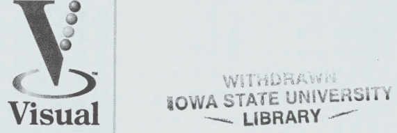

# 红帽 (Red Hat)

# Netscape

maranGraphics 是一家位于加拿大多伦多附近的家族企业。


在 `maranGraphics`，我们相信制作出色的计算机书籍——一次只打磨一本。

每一本 `maranGraphics` 的书书都使用了我们在过去 23 年里不断开发的获奖级交流流程。通过这一流程，我们组织截图和文本的方式，让您能够轻松地学习新概念和任务。

我们花费数小时来决定执行每个任务的最佳方法，这样您就不必费心了！

我们清晰、易于遵循的截图和说明将引导您从头到尾完成每一项任务。

感谢您购买我们认为是市面上能买到的最好的计算机书籍。我们希望您在使用这本书时的乐趣，就像我们创作它时的心情一样！

诚挚地，

# 制作人员名单

作者：

Michael Bellomo

画面美术：

Jimmy Tam

策划编辑：

Martine Edwards

截图授权：

Jennifer Amaral

项目编辑：

Kathleen McFadden

索引员：

Richard Evans

助理项目协调：

Lindsay Sandman

高级副总裁兼出版经理，idG Books 技术出版集团：

Richard Swadley

技术编辑：

James Marchetti

出版总监，idG Books 技术出版集团：

Barry Pruett

项目经理：

Judy Maran

编辑支持，idG Books 技术出版集团：

Martine Edwards

编辑：

Raquel Scott

Teri Lynn Pinsent

Lee Lee

Roderick Anatalio

排版设计：

Sean Johannes

Ted Sheppard

Treena Lees

Lindsay Sandman

Sandy Rodrigues

封面插画：

Russ Marini

后期制作：

Robert Maran

# 致谢

本书送给 Vincent J. Andrew，感谢他丰富的思想、对细节坚持不懈的追求，以及他对宇宙的独特见解。我还想感谢 Martine Edwards，她是一位不知疲倦的专业人士、卓越的编辑，以及一位在合作中非常奇妙的人。

感谢 Judy Maran 和 maranGraphics，让我们所有人 的这段旅程成为可能！

—Michael Bellomo—

- 使用图形界面 (GUI) 登录 Linux ............................................10
- 在无图形界面的情况下关闭 Linux ................................16
- 在 Gnome 帮助浏览器中使用 man 页面 ...................36
- 设置键盘和鼠标属性............................................................... 165
- 选择桌面主题........................................................................ 170
- 使用 LinuxConf 列出文件系统....................................... 178
- 在 Linux 终端中确定分配和可用交换空间.................................. 182
- 配置 DOS 软盘........................................................................ 188
- 在 Linux 终端中挂载软盘.................................. 190
- 从软盘读取内容.................................................................. 192
- 打印文档 .................................................................................................260
- 使用 rcp 复制文件 ................................................................268
- 打开 Linux 打印系统管理器 .................................272

# 认识 Linux 操作系统

Linux 是由 Torvalds 在 1991 年在赫尔辛基创建的操作系统，以其稳定性和速度而闻名。它是 UNIX 的分支，能够处理网络、共享文件系统以及电子邮件。为了方便用户，Linux 适应了 GUI，即图形用户界面。此外，Linux 是一个开源操作系统，意味着用户可以修改代码。

Linux Torvalds 决定让代码免费可用。这就是为什么 Linux 被称为“免费发行”的操作系统。

# 在 Linux 中使用 GUI

Linux 来源于几个不同的公司，如 Red Hat 和 Caldera。本书包含的 Red Hat Linux 6.2 包含了技术支持和在线文档。随着 Linux 变得越来越流行，它采用了 GUI 来执行任务。Linux 最流行的两种 GUI 是 K Desktop（或 KDE）和 GNOME（读作 Goo-NOME）。所有最新 Linux 版本的共同开发都是 GUI。简而言之，GUI 是用户打开计算机时看到的桌面。桌面上的用户程序和小文件被称为图标，用户可以通过点击它们来访问。

## 引言

### Linux 与 Windows

传统上，Linux 的主要优势是它便宜得多。事实仍然如此，例如，你可以从网上许多地方免费下载整个 Linux 操作系统。此外，Linux 比 Windows 更灵活，因为源代码是开放的，这意味着用户可以修改：

- Linux 可以运行在老旧机器上
- 对于大规模服务器架构，Linux 及其 UNIX 比微软操作系统更可靠
- 因此，如果你想开发自己的脚本来自动化管理任务，你可以这样做。如果你的脚本非常高效，你的创作可能会在未来的 Linux 版本中被永青。

### 在没有 GNOME GUI 的情况下使用此书

如果你继承了一个没有使用桌面环境的旧版本 Linux，此这本书对你来说仍然具有巨大的价值。虽然在 Linux 中，某些任务通过桌面更易于实现，但某些任务仍然需要了解终端窗口和文本编辑器（例如 `vi` 编辑器）。

你可能也正在使用一个带有 GUI 的 Linux 版本，但它不是 GNOME。例如，Mandrake 发行版的 Linux 默认使用 KDE 桌面。同样，此书对你将有所帮助。基于窗口和桌面的环境的基本概念对于所有类型的 GUI 都是通用的。例如，KDE 和 GNOME 都允许你以相同的方式在桌面上打开、关闭和调整窗口大小。

在 Linux 中，你还可以为用户账户分配多个组。无论是检查、删除还是合并组，Linux 都允许你从组列表中添加和删除用户，而无需担心冗余的条目。

Linux 是一个开放的操作系统，因为它很容易与其他机器建立连接。管理员和用户均可以使用整套命令来进行网络操作，例如使用 `rcp` 或 `ftp` 复制文件。Linux 用户还可以选择通过 `telnet` 或 `login` 实用程序连接到其他机器并进行远程操作。

| Linux 的开放性允许通过网络文件系统（NFS）工具在机器之间高效共享文件和程序。例如，与其在每台机器上都放置程序的副本，不如将程序放在网络文件系统中，任何机器都可以挂载该文件系统并从该中心位置运行程序。 | Linux 在共享硬件方面也表现出色。如果你在一台慢速机器上，可以远程运行程序，利用网络上更快的机器。这种分流网络任务的能力让 Linux 在远程网络打印机上打印文档时成为一个自然选择。 |
| --------------------------------------------------------------------------------------------------------------------------------------------------------------------------------------------------------------- | ------------------------------------------------------------------------------------------------------------------------------------------------------------- |
| 根据你运行的 Linux 版本，你可以从两个或多个不同的电子邮件程序中选择。基于终端的邮件程序中最流行的是 `pine`。Pine 在没有 GUI 的情况下工作，这使其在处理大型文档时极其快速且稳定。 | Linux 邮件另一个主要参与者是 Netscape Messenger。Netscape Messenger 包含在 Netscape Communicator Web 软件包中。Communicator 还包括流行的网页浏览器 Netscape Navigator。你会发现使用一个既能处理电子邮件又能处理 Web 浏览的程序非常有吸引力。 |


| 因为 Linux 是开放用于共享数据的，可能会出现安全问题。Linux 中的大多数安全措施无非是常识，涉及定期更改密码和保护管理员账户。 | |

| 在熟悉了终端环境以及它与 GUI 桌面的关系后，你将发现 Linux 易于管理。事实上，Linux 的维护比微软更简单，因为 Linux 软件崩溃的频率较低。 | 本书涵盖了基础的故障排除技巧。通过使用你在书中学的工具，你会发现自己很快就能独立排除问题了。 |

与微软 Windows 一样，Linux GNOME 桌面使用图标和工具栏显示信息，允许你通过点击鼠标访问程序。你屏幕上的精确图标取决于你设置了哪些实用程序，但你的桌面看起来应该与以下图类似。

允许你查看主目录下的所有文件夹和文件。

如果你运行 `Red Hat Linux`，将连接到 `Red Hat Web`。如果你没有运行 `Red Hat`，这些图标将不可用。

连接你到 `Red Hat` 网页，你可以在那里搜索 Linux 问题的文档答案。如果你没有运行 `Red Hat`，此图标将不可用。

释放更多屏幕空间。再次点击将面板恢复到原始位置。

在 `GNOME` 桌面环境中运行的程序完整列表。

在 `GNOME` 桌面环境中运行的程序完整列表。

在 `GNOME` 桌面环境中运行的程序完整列表。

## 任务栏 (Dock)

在 `GNOME` 桌面环境中运行的程序完整列表。

## 社区性设置 (Community Settings)

在 `GNOME` 桌面环境中运行的程序完整列表。

## 合作伙伴性设置 (Partner Settings)

在 `GNOME` 桌面环境中运行的程序完整列表。

## 供应商性设置 (Vendor Settings)

在 `GNOME` 桌面环境中运行的程序完整列表。

## 竞争对手设置 (Competitor Settings)

在 `GNOME` 桌面环境中运行的程序完整列表。

## 行业设置 (Industry Settings)

在 `GNOME` 桌面环境中运行的程序完整列表。

## 全球化设置 (Global Settings)

在 `GNOME` 桌面环境中运行的程序完整列表。

## 本地化设置 (Localization Settings)

在 `GNOME` 桌面环境中运行的程序完整列表。

## 区域设置 (Regional Settings)

在 `GNOME` 桌面环境中运行的程序完整列表。

## 语言设置 (Language Settings)

在 `GNOME` 桌面环境中运行的程序完整列表。

## 政策设置 (Policy Settings)

在 `GNOME` 桌面环境中运行的程序完整列表。

## 监管设置 (Regulatory Settings)

在 `GNOME` 桌面环境中运行的程序完整列表。

## 标准设置 (Standardization Settings)

在 `GNOME` 桌面环境中运行的程序完整列表。

## 风险设置 (Risk Management Settings)

在 `GNOME` 桌面环境中运行的程序完整列表。

## 机会设置 (Opportunity Settings)

在 `GNOME` 桌面环境中运行的程序完整列表。

## 威胁设置 (Threat Settings)

在 `GNOME` 桌面环境中运行的程序完整列表。

## 挑战设置 (Challenge Settings)

在 `GNOME` 桌面环境中运行的程序完整列表。

## 解决方案设置 (Solution Settings)

在 `GNOME` 桌面环境中运行的程序完整列表。

## 愿景设置 (Vision Settings)

在 `GNOME` 桌面环境中运行的程序完整列表。

## 使命设置 (Mission Settings)

在 `GNOME` 桌面环境中运行的程序完整列表。

## 核心价值观设置 (Core Values Settings)

在 `GNOME` 桌面环境中运行的程序完整列表。

## 执行力设置 (Execution Settings)

在 `GNOME` 桌面环境中运行的程序完整列表。

## 结果设置 (Results Settings)

在 `GNOME` 桌面环境中运行的程序完整列表。

## 反馈设置 (Feedback Settings)

在 `GNOME` 桌面环境中运行的程序完整列表。

## 学习设置 (Learning Settings)

在 `GNOME` 桌面环境中运行的程序完整列表。

## 进化设置 (Evolution Settings)

在 `GNOME` 桌面环境中运行的程序完整列表。

## 变革设置 (Transformation Settings)

在 `GNOME` 桌面环境中运行的程序完整列表。

## 未来设置 (Future Settings)

在 `GNOME` 桌面环境中运行的程序完整列表。

## 历史设置 (History Settings)

在 `GNOME` 桌面环境中运行的程序完整列表。

## 遗产设置 (Legacy Settings)

在 `GNOME` 桌面环境中运行的程序完整列表。

## 创新设置 (Innovation Settings)

在 `GNOME` 桌面环境中运行的程序完整列表。

## 协作设置 (Collaboration Settings)

在 `GNOME` 桌面环境中运行的程序完整列表。

## 赋能设置 (Empowerment Settings)

在 `GNOME` 桌面环境中运行的程序完整列表。

## 领导力设置 (Leadership Settings)

在 `GNOME` 桌面环境中运行的程序完整列表。

## 韧性设置 (Resilience Settings)

在 `GNOME` 桌面环境中运行的程序完整列表。

## 敏捷性设置 (Agility Settings)

在 `GNOME` 桌面环境中运行的程序完整列表。

## 速度性设置 (Speed Settings)

在 `GNOME` 桌面环境中运行的程序完整列表。

## 质量性设置 (Quality Settings)

在 `GNOME` 桌面环境中运行的程序完整列表。

## 价值性设置 (Value Settings)

在 `GNOME` 桌面环境中运行的程序完整列表。

## 意义性设置 (Meaning Settings)

在 `GNOME` 桌面环境中运行的程序完整列表。

## 影响性设置 (Impact Settings)

在 `GNOME` 桌面环境中运行的程序完整列表。

## 卓越性设置 (Excellence Settings)

在 `GNOME` 桌面环境中运行的程序完整列表。

## 完美性设置 (Perfection Settings)

在 `GNOME` 桌面环境中运行的程序完整列表。

## 终极设置 (Ultimate Settings)

在 `GNOME` 桌面环境中运行的程序完整列表。

## 了解 LINUX 桌面环境

## 额外内容

当你的 Linux 系统在重启机器时显示错误信息时该怎么办。

如何避免在输入密码时出现常见错误。

操作系统会自动修复由不正常关机（如突然断电）引起的错误。如果你遇到了 Linux 无法修复的严重错误，请使用你在安装期间制作的 Linux 重启磁盘来重启机器。

用户经常报告说，即使他们输入了正确的密码，Linux 也会返回“`Password Incorrect`”（密码错误）的错误信息。如果你遇到此错误，请务必检查 `Caps Lock`（大写锁定）。因为 Linux 对大小写敏感，大写锁定可能会干扰你的登录尝试。

如何防止重启机器时出现错误信息。

Linux 无法自动修复的大多数错误都是由文件损坏引起的。在 Linux 中文件损坏最常见的方法是操作系统非正常关机。为了防止这种情况的发生，请务必正确地注销你的机器，这在本章的“关闭 Linux”章节中会有详细介绍。

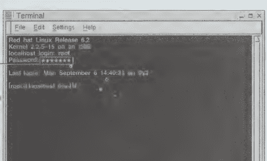

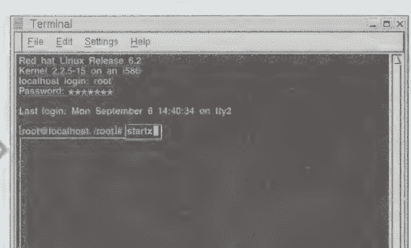

- 3 在提示符处输入你的密码。

- 4 按 `Enter`（回车键）。

- 5 如果你想使用 `GNOME` 桌面，请在命令提示符处输入 `start`。

- 6 按 `Enter`（回车键）。

- 你的密码将显示为星号或空白字符。

- 如果你正确输入了用户名和密码，会出现命令提示符。你将以管理员账户 `root` 的身份登录。

- `GNOME` 启动并带你进入桌面。

## 使用 GUI 登录 LINUX

如果你的 Linux 版本带有图形用户界面（如 `KDE` 或 `GNOME`），你看到的将不仅仅是一个要求登录的简单空白屏幕。带有 `GNOME` 或 `KDE` 的 Linux 版本（如红帽 `Red Hat Linux` 6.2）在切换机器时会自动启动，并弹出一个带有输入用户账号和密码字段的对话框。

在 GUI 登录界面登录时，请记住使用 `Tab` 键和鼠标移动到下一个字段，而不是按 `Enter` 键。在某些 Linux 安装中，按 `Enter` 键不会将光标从输入账号的字段移动到输入密码的下一个屏幕。

在对磁盘驱动器和软件内核执行标准系统检查后，Linux 版本将弹出登录界面。登录界面具有彩色背景。


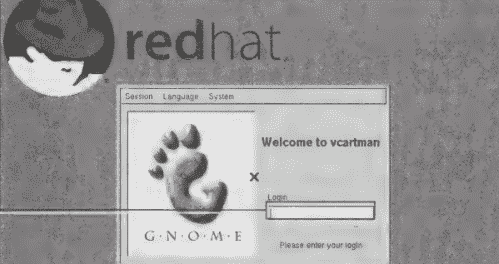

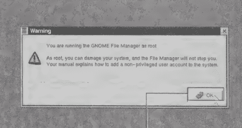

- 在 `Login`（登录）字段中输入你的账号。
- 按 `Tab` 键显示 `Password`（密码）字段并输入密码。
  字符可能不会显示在屏幕上。
- 按 `Enter`（回车键）。

一旦 Linux 验证了你的账号和密码，GNOME 桌面环境就会自动启动。

- 以 `root` 身份登录时，GNOME 会显示关于登录管理员账户的警告。
- 点击 `OK` 按钮跳过此警告。

## 了解 Linux 桌面环境

## 额外内容

### 如果 Linux 不显示 GUI 风格的登录界面该怎么办

如果你使用的是 `Red Hat Linux 6.1` 或更高版本的 Linux 且没有获得 GUI 风格的登录界面，那么你的 Linux 安装可能出了问题。当 Linux 重启时，重启是 Linux 执行的错误检查。如果你的系统报告了任何与 GNOME 环境或 GNOME 运行的 `X Server` 相关的严重错误，请重新安装系统。

### 为什么 Linux 包含登录 root 账户的警告

实际上，Linux 通常不会给出登录 `root` 账户的警告。如果你遇到了 GNOME 环境或 GNOME 运行的 `X Server` 的任何严重错误，请重新安装系统。

实际上，以 `root` 身份登录时，用户在复制、移动或删除文件时必须小心。


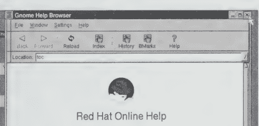

# 了解 Linux 桌面环境

## 帮助

如果你有一个 `Red Hat Linux 6.1` 或更高版本的 Linux 且没有获得 GUI 风格的登录界面，那么你的 Linux 安装可能出了问题。当 Linux 重启时，重启是 Linux 执行的错误检查。如果你的系统报告了任何与 GNOME 环境或 GNOME 运行的 `X Server` 相关的严重错误，请重新安装系统。

实际上，Linux 通常不会给出登录 `root` 账户的警告。以 `root` 身份登录时，用户在复制、移动或删除文件时必须小心。

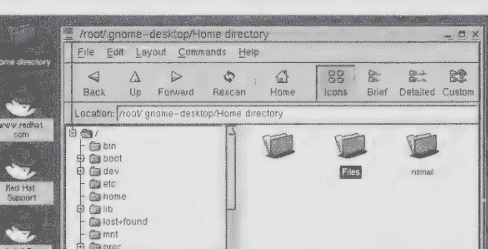


红帽 Linux 指南

红帽 Linux 入门指南 | 红帽 Linux 安装指南

- GNOME 桌面显示帮助。
- 注意：`Save Current Setup`（保存当前设置）选项允许你保存当前的设置。
- 一旦 Linux 验证了你的账号和密码，GNOME 桌面环境就会自动启动。
- 以 `root` 身份登录时，GNOME 会显示关于登录管理员账户的警告。
- 点击 `OK` 按钮跳过此警告。

## 按钮和下拉菜单

在 GNOME 环境中，当你点击下拉菜单时，你会看到选项。

下拉菜单被广泛使用。当你点击某个按钮时，它会高亮。

当你将鼠标悬停在按钮上时，它会高亮。

当你点击下拉菜单时，会出现一个列表。

当你从下拉菜单中选择选项时，下拉菜单会显示。

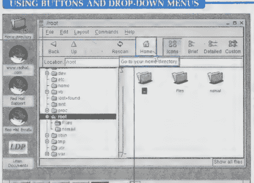

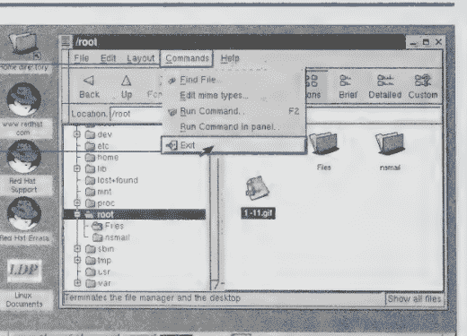

- 1. 在打开的 `Home` 窗口中，将鼠标指针移动到顶部的 `Home` 按钮。
- 2. 弹出窗口会告诉你该按钮的功能。并不是所有按钮都有弹出窗口，但那些按钮是有用的。
- 3. 点击菜单上的 `Commands`（命令）。
- 4. 命令高亮，表示鼠标指针已选中。
- 5. 下拉菜单出现了多个选项。
- 6. 点击 `Exit`（退出）命令退出 `Home` 目录。
- 2. 点击 `Home` 按钮选择 `Home` 目录。
- 7. `Home` 目录关闭。

## 注销 Linux

注销 Linux 有两个作用。首先，注销 Linux 可以有效地关闭你所有正在工作的会话——防止他人使用你的账户更改或损坏系统。其次，离开 Linux 环境可以为其他登录的用户释放更多资源，让他们编辑、更改任何内容或创建文件。关闭系统与关闭电源的效果相同。虽然这可以节省一些电力，但也迫使你通过启动过程回到 Linux。

记住，注销 Linux 不等同于关闭系统。当你注销 Linux 时，操作系统仍在运行，只是你不在桌面上了。

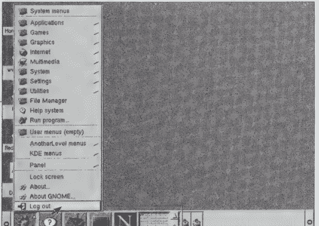

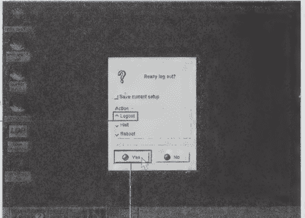

- 1. 点击主菜单应用程序。
- 2. 点击 `Log Out`（注销）命令。
  - 应用程序和选项的主菜单出现。
  - 弹出注销对话框，询问是否真的要注销。
- 3. 点击 `Logout` 选项左侧的小菱形按钮。
- 4. 点击 `Yes`（是）进行注销。

# Linux

## 通过图形界面 (GUI) 关闭 Linux

如果你在多个人可以通过网络访问的环境中运行 Linux，则应仅在需要进行系统维护、防止断电或升级硬件时才关闭 Linux。大多数升级和系统维护都是计划内的停机，这意味着你应该提前计划关闭 Linux 以执行这些任务。

理想情况下，请在关机前几天通知相关人员，特别是如果关机时间超过一小时或在关机后需要进行系统测试。你还应该在关机当天通知他们，因为用户经常以忘记待处理的关机而闻名。

为了尽可能地减少干扰，请提前通知用户 Linux 服务器将关闭，他们的工作可能会受到影响。

## 通过图形界面 (GUI) 关闭 Linux

| 系统菜单 |
| :--- |
| `Applications` (应用) |
| `Games` (游戏) |
| `Graphics` (图形) |
| `Internet` (互联网) |
| `Multimedia` (多媒体) |
| `System` (系统) |
| `Settings` (设置) |
| `Utilities` (实用) |
| `File Manager` (文件管理器) |
| `Help system` (帮助系统) |
| `Run program` (运行程序) |
| `User menus` (用户菜单，空) |
| `Other, level menus` (其他层级菜单) |
| `KDE menu` (KDE 菜单) |
| `Panel` (面板) |
| `Lock screen` (锁屏) |
| `About` (关于) |
| `About GNOME` (关于 GNOME) |
| `Log out` (注销) |

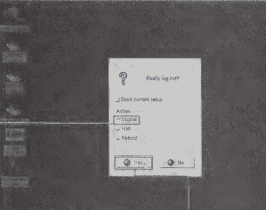

## 退出主菜单

- 点击菜单应用程序按钮。
- 显示应用程序和选项的下拉列表。

### 点击注销

- 显示注销对话框，询问你是否确定注销。
- 点击注销选项左侧的小菱形按钮。
- 始终检查选择了哪种登录选项。如果你按了机器电源按钮，选择“停止 (`Halt`)”或“重启 (`Reboot`)”将产生相同的结果，并给其他用户带来不便。
- 你返回到了登录屏幕。要完成关机，请遵循“退出登录框”中详细说明的步骤。

# 了解 Linux 桌面环境

## 额外

#### 何时使用停止 (Halt) 命令和重启 (Reboot) 命令

因为重启（`Reboot`）不会关闭系统电源，当你想要测试对 Linux 系统所做的更改时，请使用重启。停止（`Halt`）实际上会关闭系统电源，因此当你打算接触机器内部的硬件时，最好停止 Unix。注意，为了防止触电，你应该停止 Linux 系统并将机器从墙上插座上拔掉电源。

#### 如果你有一台未联网的单一 Linux 机器，在断电期间该怎么办

由于断电无法执行标准关机，只需按下电源开关关闭机器。虽然这没有帮助恢复数据或恢复你的机器，但它可以防止在电力恢复时保险丝烧毁，特别是当你家用插座上连接了大量电器时。

#### 如果你的网络在断电期间意外关闭该怎么办

关闭网络上的所有 Linux 机器。由于断电无法执行标准关机，只需直接按下每台机器的电源开关。这很重要，因为可以防止电力恢复时烧毁保险丝。电力恢复后，在合适的时间开启你的 Linux 机器，使用电量缓慢回到之前的水平。

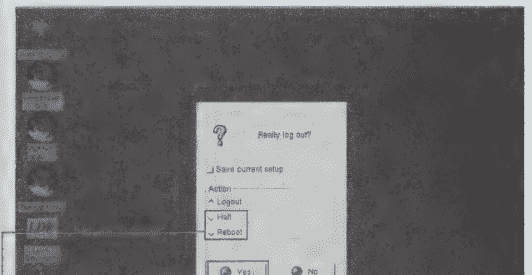

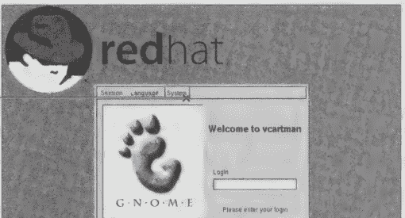

## 退出登录框

- 点击停止（`Halt`）或重启（`Reboot`）选项左侧的小菱形按钮以选择其中一个选项。
- 点击是（`Yes`）。
  - 如果返回到了登录屏幕。要完成关机，请遵循“退出登录框”中详细说明的步骤。

## 退出登录框

- 点击系统 (`System`)。
- 系统下拉菜单。


## 2 选择一个选项——重启 (Reboot) 或停止 (Halt)。

如果你选择重启，系统将关闭、重启并返回此屏幕。如果你选择停止，屏幕将变黑，你可以安全地关闭电脑电源。

## 不通过图形界面 (GUI) 关闭 LINUX

为了尽可能地减少干扰，请提前通知用户 `Linux` 服务器将关闭，他们的工作可能会受到影响。即使你的 `Linux` 版本带有 `GUI`，在对多用户网络进行维护时，也考虑使用此方法关闭系统。与基于 `GUI` 的注销对话框不同，`Linux` 命令行提供了几个可以帮助进行最终用户通知的工具。

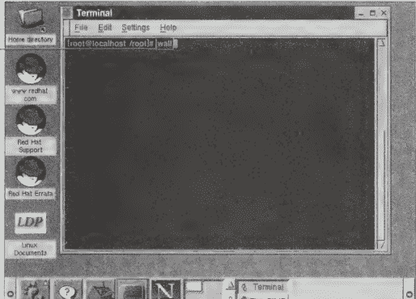
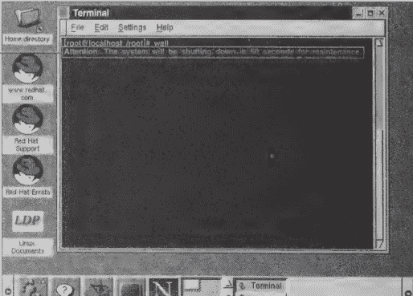

- 打开 `Linux` 终端窗口。
- `wall` 命令允许你向所有用户发送关机最后警告。
- 向所有用户发送关机最后警告。
- 按 `Ctrl+D` 结束消息。


### 应用

为了尽可能地减少干扰，请提前通知用户 `Linux` 服务器将关闭，他们的工作可能会受到影响。即使你的 `Linux` 版本带有 `GUI`，在对多用户网络进行维护时，也考虑使用此方法关闭系统。与基于 `GUI` 的注销对话框不同，`Linux` 命令行提供了几个可以帮助进行最终用户通知的工具。

设置 `shutdown` 命令的延迟时间为两、五或十分钟。默认情况下，`shutdown` 的单位是秒。

例如，如果你想在两分钟后关机，在提示符输入：

```
shutdown -t 120
```

在五分钟后关机，在提示符输入：

```
shutdown -t 300
```

在十分钟后关机，在提示符输入：

```
shutdown -t 600
```

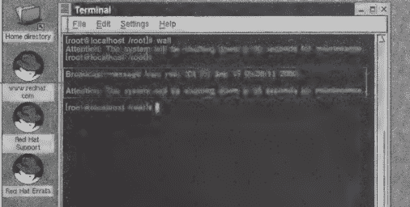
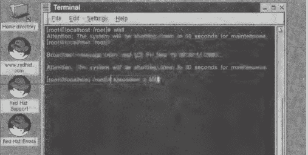

- 4 显示广播消息。
- 5 返回到提示符。
- 6 在提示符输入 `shutdown -t 60`。
- 7 按回车。`shutdown` 工具将在等待 60 秒后自动启动关机程序。`shutdown` 是另一个允许你指定系统停止前等待多的工具。

## GNOME 窗口与终端

你在 `GNOME` 桌面环境中打开窗口是为了显示程序或提供一个不同的编辑区域。程序窗口根据你打开的程序具有不同的下拉菜单和按钮。相反，通过点击文件夹打开的窗口具有相同的界面。

窗口在 `GNOME` 桌面环境中显示文件或运行程序。相反，终端允许你进入界面下方直接操作 `Linux`。

终端技术上被视为窗口，因为你可以在范围内执行某些任务。但我坚持使用终端一词以免混淆，因为终端的功能与窗口大不同。

## GNOME 窗口与终端

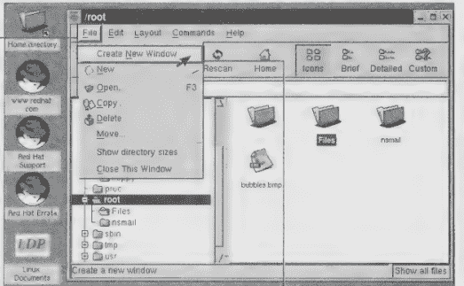

| 文件 (File) | 编辑 (Edit) | 布局 (Layout) | 命令 (Commands) | 帮助 (Help) |
|---|---|---|---|---|
| 主页 (Home) | 重新扫描 (Rescan) | 主页 (Home) | 简要 (Brief) | 详细 (Detailed) |
| 新窗口 (New Window) | | | | |
| 打开 (Open) | | | | |
| 删除 (Delete) | | | | |
| 移动... (Move...) | | | | |
| 显示目录大小 (Show directory sizes) | | | | |
| 创建新窗口 (Create New Window) | | | | |

- 应用 (Applications) | 游戏 (Games) | 日历 (Calendar) | `glob` | 互联网 (Internet) | 多媒体 (Multimedia) | 记事本 (`Gnomepad`) | 系统 (System) | 时间管理器 (Time Manager) | 帮助系统 (Help system) | 运行程序 (Run program) | 用户菜单（空） (User menus) | 切换窗口 (Switching windows) | `KDE` 菜单 (`KDE` menus) | 面板 (Panel) | 锁屏 (Lock screen) | 关于 `GNOME` (About `GNOME`) | 注销 (Log out)

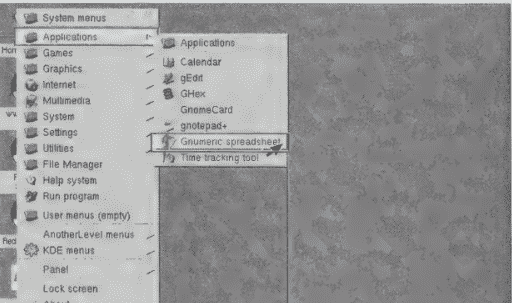

## 打开新窗口

- 1 点击你的主目录窗口工具栏上的“文件 (File)”命令。
- 2 创建“新窗口 (New Window)”选项以打开新窗口。

## 打开 Linux 应用程序

- 1 点击屏幕左下角的菜单应用程序按钮。
- 2 将指针移动到“应用 (Applications)”。

显示子菜单。

- 3 选择一个应用程序。

应用程序窗口出现。

## 了解 LINUX 桌面环境

## 实际应用

判断菜单是否包含子菜单。

当你调用菜单时（例如点击“主菜单应用程序”按钮），任何带有子菜单的选项在菜单条目的右侧都有一个向右的小箭头。将鼠标指针悬停在此类菜单项上，子菜单会自动出现。

直接在 `GNOME` 桌面上创建“终端模拟器”按钮。

首先点击工具栏上的“终端模拟器”按钮。然后，将该拖拖到 `GNOME` 桌面的空白区域。当你释放鼠标按钮时，`GNOME` 会将按钮复制到该位置。

从“主菜单应用程序”按钮将程序图标复制到 `GNOME` 桌面。

移动鼠标指针以选择图标。将选中的图标拖动到 `GNOME` 桌面的空白区域。当你释放鼠标按钮时，`GNOME` 会将图标复制到该位置。

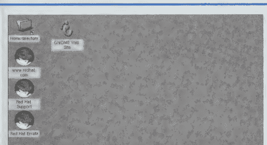
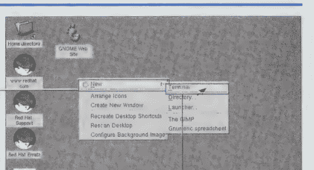

## 打开 LINUX 终端

- 点击“终端模拟器”按钮。
- 出现一个 `Linux` 终端。

## 从桌面打开

- 右键点击桌面的任何空白区域，作为打开终端的另一种方式。
- 出现一个子菜单。
- 点击“终端”。
- 此操作将打开终端窗口并关闭菜单。
- 将鼠标指针移动到“新建”。

# LINUX

## 调整窗口大小

你可能出于多种原因想要调整桌面上窗口的尺寸。如果你在桌面上打开了多个窗口，你可能需要调整每个窗口的大小，以便更方便地工作。你可能想缩小一个窗口，以便到达桌面的部分区域。

在某些区域显示更多空间。最常见的是，你可以将 `GNOME` 中的“主目录”拆分为两个框架，左侧框架显示文件系统，右框架显示当前目录下的文件。如果你想更清楚地查看文件内容或文件系统，可以牺牲一个区域来扩大另一个区域。

桌面窗口还允许你调整窗口框架或窗口内部划分的大小

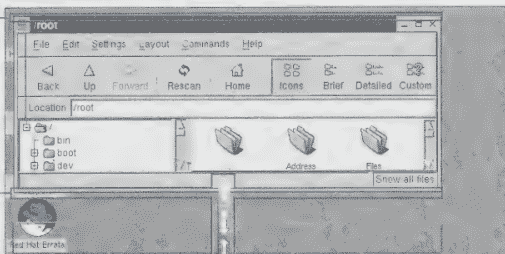
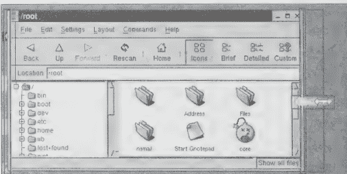

## 调整窗口大小

### 调整高度

### 调整宽度

- 拖动窗口的下边界使窗口变得更高或更短。
- 注意，当将鼠标指针放在正确的位置时，指针图标会从对角线变为上下箭头。
- 拖动窗口的左边界或右边界来重新调整窗口的宽度。
- 注意，当将鼠标指针放在正确的位置时，指针图标会从对角线变为左右箭头。
- 释放鼠标按钮，窗口将调整大小。
- 释放鼠标按钮，窗口将调整大小。

20

## 了解 LINUX 桌面环境

## 实际应用

在你增大、减小或重塑桌面上的窗口时，防止窗口意外。

当你无法看到所有内容时，在窗口中查看文件。

为了防止重叠并防止小窗口消失在大窗口后面，在拖动窗口边界时请注意黑色轮廓。该轮廓可以让你在释放鼠标按钮时，准确判断窗口将将拟合的位置。

使用每个窗口框架内部的滚动条。如果有更多文件或文件系统超出屏幕，滚动条会自动出现。拖动滚动条可以在框架内移动。


当窗口边缘在屏幕外时，调整窗口大小。

当你可以抓取所需的边界时，移动整个窗口。此主题将在本章的“移动和切换窗口”部分进行介绍。

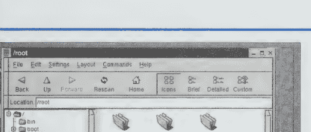

## 调整边界

- 拖动窗口任意角落的边界可以使窗口变大或变小。
- 注意，当你将鼠标指针放在正确的位置时，指针图标会从对角线指针变为更宽的对角线指针。
- 释放按钮，窗口将调整大小。

## 调整内部划分线

- 注意，当你将鼠标指针放在正确的位置时，指针图标会从对角线指针变为交叉图标。
- 将鼠标指针悬停在框架之间的小灰色方块上，以调整窗口内部划分线的大小。它通常位于两个框架之间滚动条的右侧。
- 释放按钮，窗口的内部框架将调整大小。

## 最大化、最小化和关闭窗口


# 了解 Linux 桌面环境

无论你处理的是桌面窗口、程序窗口还是 Linux 终端，每种类型的三个常用按钮具有相同的功能。这些按钮位于每个窗口的右上角，允许你最大化、最小化或关闭窗口或终端。

另一方面，如果你需要桌面上有更多空间，最小化窗口是一个方便的方法，可以让窗口让位，而不必关闭程序或终端。关闭窗口是终止其运行程序的简单方法。关闭窗口时请注意这会关闭程序或终端。

你可能想最大化窗口以尽可能看到内容。

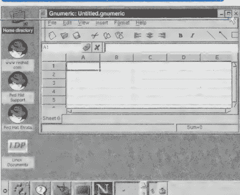

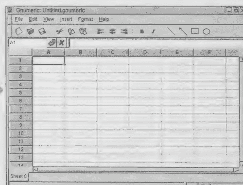

## 最大化、最小化和关闭窗口

- 将鼠标指针悬停在最大化按钮上并点击以最大化窗口。
- 最大化按钮是三个按钮中的第二个。该按钮图标是一个带横线的小正方形。
- 最大化窗口占据整个屏幕。注意：最大化窗口可以给你更多空间，但不会增加字体。

### 将窗口恢复到原有大小

如果你已经最大化了窗口，再次点击最小化按钮将其恢复到原始大小。当你最小化窗口时，它会在底部的 `GNOME` 栏创建一个图标。点击该图标可以恢复窗口。

当窗口对关闭按钮没有响应时，使用关闭按钮强制关闭。如果发生这种情况，请右键点击关闭按钮强制退出程序。因此，关闭按钮被称为杀死按钮。

在不最小化或最大化的情况下，一旦你恢复了窗口，只需根据本章“调整窗口大小”部分的说明进行调整。

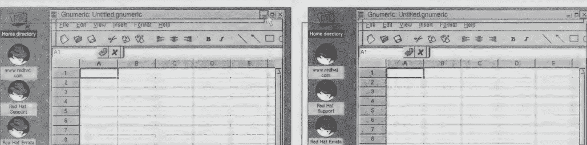

### 最小化窗口

- 将鼠标指针悬停在最小化按钮上并点击以最小化窗口。
- 最小化按钮是三个按钮中的第一个。该按钮图标是底部的一个横线。

### 关闭窗口

- 将鼠标悬停在关闭按钮上并点击以关闭窗口。
- 关闭按钮是三个按钮中的第三个，其图标是一个 `X`。

## 移动和切换窗口

当你打开了多个窗口时，了解如何移动窗口以防止重叠是非常有用的。了解如何在窗口之间切换也有助于你在桌面的任务之间跳转。这让你工作得更高效。

时间。非活动窗口并不等同于关闭窗口。未激活的窗口程序仍在运行，命令行提示符仍然可用。

此任务向你展示如何移动窗口以便在桌面的多个位置进行操作。另请参见本章前面的“调整窗口大小”部分。

当你处理多个窗口时，请注意在任何时刻只有一个窗口是激活的。

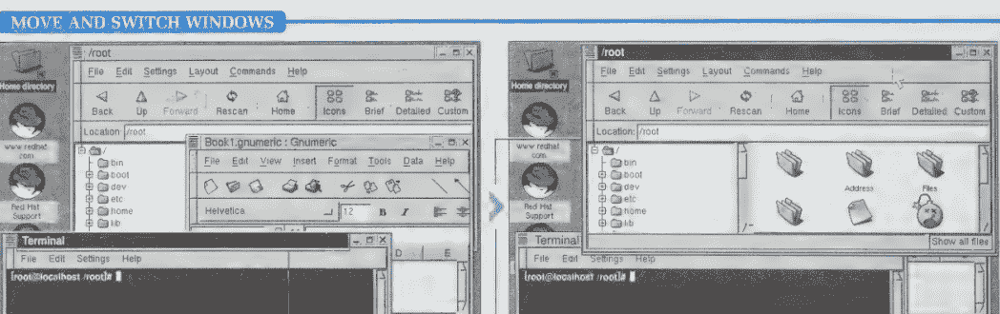

- 在有多个窗口的屏幕上，任何时间只有一个窗口可以是激活的。在这里的三个窗口中，终端窗口是激活的。激活窗口始终处于最前端。
- 激活窗口具有深色的标题栏，这是窗口工具栏的最顶部部分。
- 点击窗口以使其激活。激活另一个窗口会将将其带到前景，它可能会遮挡其他窗口。使主目录窗口会隐藏 `Gnumeric` 应用程序。

## 了解桌面环境

### 额外说明

学习在桌面上防止窗口重叠的其他方法。

下一节“将窗口转换为图标和标题栏”将解释除了调整窗口大小和在桌面移动窗口之外的其他防止窗口重叠方法。

找到完全隐藏在另一个较大窗口后面的窗口。

让较大的窗口处于激活状态，然后将其最小化。这时你可以点击并拖动之前隐藏的较小窗口到桌面的一个区域，使其不再被大窗口遮挡。

注意性能下降。

从理论上讲，打开的窗口数量没有最大限制。但在实践中，同时打开过多的窗口会导致旧设备稍微变慢。具体数量取决于硬件，因机器而异。一台运行 8 或 10 个窗口的 `x86` 机器可以打开最多 50 个窗口而不影响性能。

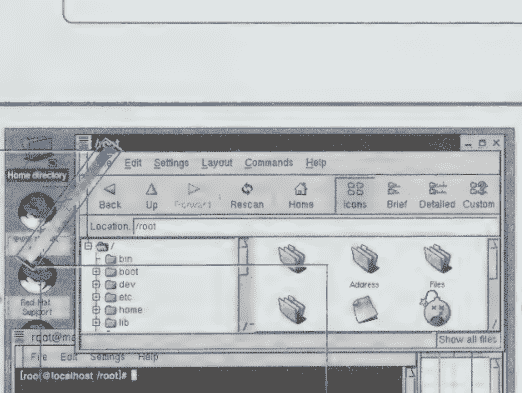

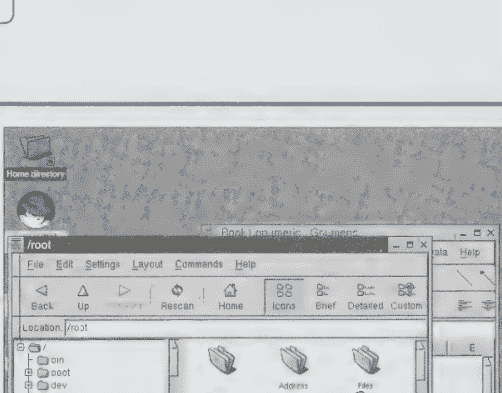

- 将鼠标指针悬停在窗口的标题栏上。
- 当指针处于正确位置时，对角指针会变成一个像指南针的四点图标。
- 将窗口拖动到你想要的位置并释放鼠标按钮。

注意：结合移动和调整窗口大小可以避免重叠问题。

### 将窗口转换为图标和标题栏

通过将窗口转换为 `GNOME` 工具栏上的图标，或将窗口缩小到其标题栏的大小，你可以在保持多个窗口打开的同时增加桌面空间。

将窗口图标化仅仅是为了节省桌面空间并方便取回的另一种最小化过程。将窗口缩小到标题栏就像卷起窗帘一样。

当你想要恢复窗口时，可以再次将其向下拉回。

缩小和恢复窗口不会影响窗口中的信息或应用程序。例如，如果你在图标化的窗口中运行文字处理程序，该程序将继续运行，直到你实际上关闭窗口。文本内容不会因为窗口形状或状态的改变而改变或重新格式化。


#### 创建图标

- 点击窗口左上角的选项框。
- 从下拉菜单中选择“图标化”（`Iconify`）。
- 窗口将变为屏幕底部 `GNOME` 工具栏上的一个图标。
- 点击图标恢复窗口。

#### 创建标题栏

- 点击窗口使其处于激活状态。
- 将鼠标指针悬停在窗口的标题栏上。
- 双击左鼠标按钮将窗口转换为标题栏。
- 缩小每个标题栏后，你可以轻松地找到想要打开或关闭的窗口。标题栏留在屏幕上窗口的位置。

注意：再次双击标题栏恢复窗口。

## 实际应用

| 识别窗口后关闭窗口。 | 将窗口转换为标题栏后关闭窗口。 |
|---|---|
| 在 `GNOME` 桌面上识别窗口后，通过点击 `GNOME` 工具栏上的图标来恢复窗口。点击窗口右上角的“关闭”按钮将其关闭。 | 同样，标题栏上仍有“最小化”、“最大化”和“关闭”按钮，就像普通窗口一样。要关闭它，点击标题栏上的“关闭”按钮，窗口将永久关闭。 |
| 将窗口转换为标题栏后进一步最小化窗口。 | |
| 标题栏上仍有最小化、最大化和关闭按钮，就像普通窗口一样。将窗口转换为标题栏后，你可以点击最小化按钮或识别它将其完全从 `GNOME` 桌面上移除。 | |


## 在窗口之间移动和复制文件

你可能想使用 `GNOME` 桌面环境在不同区域移动或复制文件。通常，与其将文件复制到多个位置，不如使用 Linux 系统将文件放置在所有用户都可以访问的公共目录，而无需浏览不同的目录来找到放置文件的位置。

在这个示例中，你想将一个名为 `testcut` 的文件从 `/root` 目录移动到 `/tmp` 目录，以便更多人查看。从 root 账户的 Home 目录开始。方便的是，这个目录通常标记为 Home directory。

虽然你可以用一个窗口移动和复制，但如果打开两个窗口会容易得多。两个窗口允许你轻松地从一个区域移动文件到另一个区域。

| 文件 | 编辑 | 布局 | 命令 | 帮助 | | | | |
|---|---|---|---|---|---|---|---|---|
| 上一个 | 向上 | 扫描 | Home | 图标 | 详细 | 自定义 | | |
| 位置 | `root/home-desktop/` | | | | | | | |


| 文件 | 编辑 | 布局 | 命令 | 帮助 | | | | |
|---|---|---|---|---|---|---|---|---|
| 上一个 | 向上 | 扫描 | Home | 图标 | 详细 | 自定义 | | |
| 位置 | `root/home-desktop/home` | | | | | | | |


| 文件 | 编辑 | 布局 | 命令 | 帮助 | | | | |
|---|---|---|---|---|---|---|---|---|
| 上一个 | 向上 | 扫描 | Home | 图标 | 详细 | 自定义 | | |
| 位置 | | | | | | | | |


| 文件 | 编辑 | 布局 | 命令 | 帮助 | | | | |
|---|---|---|---|---|---|---|---|---|
| 上一个 | 向上 | 扫描 | Home | 图标 | 详细 | 自定义 | | |
| 位置 | | | | | | | | |


- 点击 Home directory 按钮。
- 测试文件以图标形式出现在右框中。


3. 点击“文件”然后“创建新窗口”，在 `root Home` 目录下打开另一个窗口。
4. 将该窗口移动到第一个下方。
5. 点击左窗格中的 `tmp` 目录进行选择。右侧框显示 `tmp` 目录中的当前文件。
6. 右点击 `testcut` 文件。
7. 点击出现的下拉菜单中的“移动”。
8. 弹出移动对话框。

# 了解 Linux 桌面环境

## 实际应用

在 `GNOME` 桌面上的两个窗口之间以另一种方式移动文件。

在窗口之间拖拽文件与使用本文描述的下拉菜单几乎一样好。虽然拖拽更快更简单，但它没有提供移动对话框中的“高级选项”。

复制 `testcut` 文件而不是移动它。

当你右键点击 `testcut` 时，菜单中的选项之一是“复制”。选择它将文件的副本放置在第二个窗口中。

使用移动对话框中的“高级选项”。

如果你点击移动框中的“高级选项”，你的文件将保留其链接。符号链接是特殊文件，允许名为二进制二进制的系统程序指定它们想要查找的位置。保留这些链接是确保二进制文件在你执行它们时正常运行的良好方法。

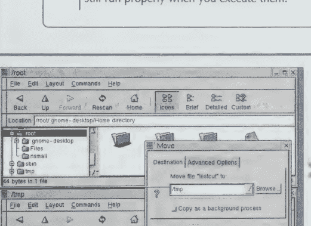


如果移动字段中还没有，请在其中输入 `/tmp`。

`/tmp` 应该已经可见——这是打开两个窗口的好处之一。`GNOME` 已经假设了你想复制文件的窗口。

- 点击确定。

结果立刻可见。`Testcut` 从 `Home` 目录右框中移除并放置在 `/tmp` 区域。

## 窗口打开时滑动

`Enlightenment` 窗口管理器是 `GNOME` 桌面环境中的一个窗口管理实用。`Enlightenment` 主要在后台工作，确保你的窗口图标和文件夹清晰且有序。通过 `Enlightenment`，你可以更改 `GNOME` 中显示的窗口、桌面环境和系统键盘的外观。

在你学习移动和更改 `GNOME` 环境中的项目时，现在就可以进行 `GNOME` 自定义。

通常，点击图标或终端模拟器按钮时，创建的窗口会出现在桌面上。这对眼睛来说太刺眼了，或者如果你只想对桌面尝试不同的效果，请设置 `Enlightenment` 窗口管理器让你的窗口滑动。

我在第 7 章中更深入地探讨自定义选项。不过，你可以感受一下


1. 点击 `GNOME` 工具栏上的 `GNOME` 配置按钮。
2. `GNOME` 控制中心出现。
3. 点击“窗口管理器”。它在桌面设置下。
4. 如果尚未高亮 `Enlightenment`，点击将其高亮。
   - 在右框中，你可以看到运行在 `GNOME` 上的管理器列表。默认是 `Enlightenment`。
5. 点击下面的“运行 `Enlightenment` 配置工具”按钮。
6. 这将激活 `Enlightenment` 配置编辑器。

# 了解 Linux 桌面环境

## 应用设置

预览效果。

在“`Enlightenment` 配置编辑器”窗口中点击应用应用后，不要关闭编辑器窗口。相反，打开另一个窗口或终端，查看对象的显示或行为发生了什么变化。

为因高级窗口效果而变慢的旧设备添加内存。

如果你有一台在使用高级窗口效果时运行明显变慢的旧设备，请考虑在计算机系统中安装更多的随机访问存储器（内存）。你可以购买内存 并在当地电脑商店进行安装，费用极低。

## 确定你的推荐设置。

由于可用设置非常多样，没有通用的建议。然而，请记住，某些高级效果（如窗口滑动行为）可能会降低运行 `x86` 或 `x486` 芯片的旧低性能机器的速度。

## 恢复原始系统设置。

在“基本选项”下，点击屏幕中间部分的“将所有设置重置为默认值并退出”按钮即可恢复默认设置。

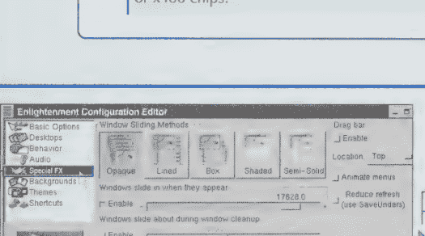

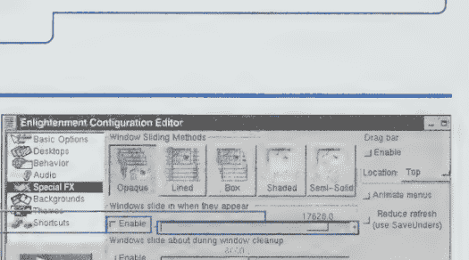


`Enlightenment` 配置编辑器在左上角的框架中列出了它的选项。

注意：稍后回来探索 `Enlightenment` 中提供的其他选项，例如“快捷键”和“行为”设置。

将滑条向左移动以增加速度，向右移动以减小速度。

5. 点击特殊特效。
6. 在屏幕中央，你看到以下内容：窗口在出现时滑动。
7. 拖动按钮右侧的滑块设置滑动速度。
8. 点击 `OK` 确认窗口。

## 在 GNOME 中获取帮助

在 `GNOME` 桌面中，你有几种方法可以找到关于 Linux 或 `GUI` 配置的文档。桌面图标指向在线文档。当你点击这些图标时，`Netscape` 会自动启动，带你登录全球网并显示包含请求信息的页面。

如果你不想等待连接，或者无法访问 Linux 网络之外的世界，本地机器也有出色的文档。`Gnome` 帮助浏览器是一个基于 `GUI` 的文档系统，采用 Web 风格的界面工作。

`Gnome` 帮助浏览器包含超链接，可以可以带你进入 Red Hat 文档或 `GNOME` 桌面文档。超链接是一行文本，点击它即可带你进入所描述的文档。

`Gnome` 帮助浏览器特别有用，因为它涵盖了 `GNOME` 特有和 Red Hat 特有的主题。无论你需要查找如何配置一个晦涩的 `GNOME` 工具，还是想在终端中查找 Red Hat Linux 命令的语法，帮助浏览器都可能有你需要的资料。

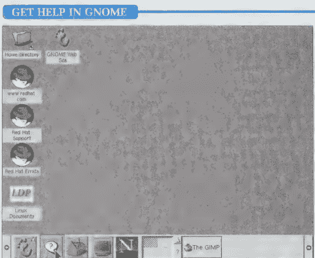

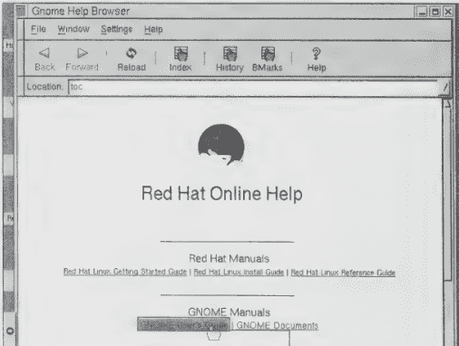

1. 点击帮助浏览器按钮打开 `Gnome` 帮助浏览器。
2. 出现 `Gnome` 帮助屏幕。虽然屏幕上显示的是“Red Hat Online Help”，但窗口本身被标记为“`Gnome` Help Browser”。
3. 点击“`GNOME` 用户指南”超链接进入 `GNOME` 用户指南。

### 应用

识别超链接。

当你将鼠标指针悬停在超链接上时，链接会明显变暗。此外，指针会变成一个小手，你应该看到下划线。

查找 Red Hat Linux 以外的主题帮助。

`Gnome` 帮助浏览器不包含任何特定于 Red Hat 版本的 Linux 主题。这是因为 `GNOME` 是一个日益受欢迎的桌面 `GUI`，因此它包含了适用于所有 Linux 变体的主题。然而，点击“Red Hat 手册”下的任何超链接，你将被带到仅适用于你当前 Red Hat 版本的主题。

通过超链接翻阅 `GNOME` 用户指南。

除了 `Gnome` 帮助浏览器页面上的按钮外，`GNOME` 用户指南页面还通过文档翻阅内容。有三个用于翻阅的超链接。点击“`Previous`”（上页），你将返回上次访问的章节。点击“`Next`”（下一页）移动到指南中的下一章节。点击“`Home`”（首页）返回 `GNOME` 的主屏幕。

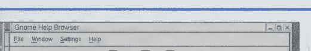

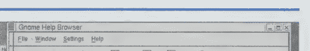

## GNOME 用户指南

`GNOME` 用户指南文档团队


## GNOME 简介

- 目录
- 什么是 `GNOME`
- 关于本指南
- `GNOME` 概览
- 窗口管理器与 `GNOME`
- 关于窗口管理器
- 使用面板
- Myriad 与人们
- 将应用程序添加到面板

### 什么是 GNOME

`GNOME` 是一种用户友好的桌面环境，让用户能够轻松使用和配置设置。它包含一个面板、一组应用程序和一组便于用户协作和运行的约定。用户应该觉得在这个强大的图形驱动环境中使用很自自在。`GNOME` 是完全开源的，由全球数百名程序员开发。如果你想了解更多，`GNOME` 用户指南是关于环境的最特定文档区域。每段带下划线的文本都是指向更多信息的链接。

- 将鼠标指针悬停在任何你想学习的主题上。
- 点击链接进入包含该主题信息的屏幕。
- 屏幕上显示关于该主题的更多详细信息。

## 导航 GNOME 帮助浏览器

`Gnome` 帮助浏览器的布局是为了让查找任务变得更加直观。像 Linux `GNOME` 环境中的许多窗口一样，`Gnome` 帮助浏览器设置为 Web 浏览器。Web 浏览器允许你在全球网上不同页面之间移动。`Gnome` 帮助浏览器的设计者也希望用户可以在程序内的页面之间跳转。像 `Netscape` Web 浏览器一样，你可以在 `Gnome` 帮助浏览器中搜索信息时点击按钮进行后退和前进。这些按钮位于窗口的顶部。


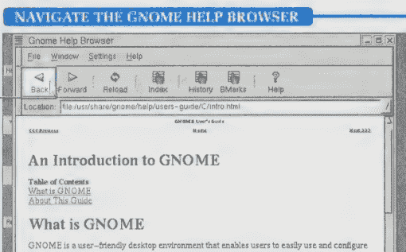

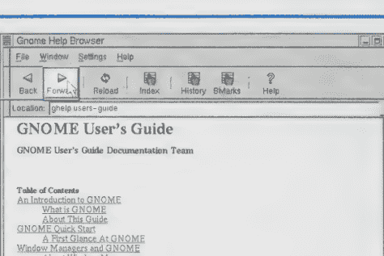

GNOME 包含一个面板（一个可以放置图标的桌面）、一组应用程序和一组便于用户协作和通信的控件。你应该觉得在这个强大的图形驱动环境中使用很自自在。GNOME 是完全开源的，由全球数百名程序员开发。如果你想了解更多

- 1 点击 `Gnome` 帮助工具栏上的后退按钮返回。

- 2 点击 `Gnome` 帮助工具栏上的前进按钮前进。

# 了解 Linux 桌面环境

## 额外

了解 `Gnome` 用户指南的组织结构。

`Gnome` 用户指南根据创建者认为初学者最重要的主题进行逻辑组织。指南从 GNOME 的快速介绍和简要历史开始，接着是 GNOME 快速入门，然后是关于功能特性的更多信息。

书签页面。

如果你认为可能会再次访问某个区域，请点击文件并添加书签。将来，可以通过点击工具栏上的按钮并选择页面来返回书签页面。

## 使用重新加载按钮

`Gnome` 帮助浏览器复制了 Web 浏览器的功能，包括刷新屏幕的能力。如果你需要的信息在屏幕上显示不正确或被截断，可以点击此按钮重新加载屏幕以正常查看。

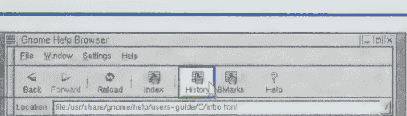

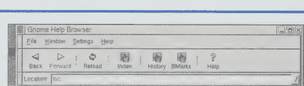

`Gnome` 帮助历史

| URL | 日期 | 计数 |
|---|---|---|
| `/usr/share/gnome/help/users-guide/intro.html` | 2000年7月20日 08:07 | 8 |
| `gnome-users-guide` | | 2000年7月20日 08:07 | 10 |
| `loc-guide` | | 2000年7月20日 08:07 | 3 |
| `/usr/share/gnome/help/users-guide/intro.html` | 2000年7月20日 06:37 | 4 |
| URL | 日期 | 计数 |
|---|---|---|
| `/usr/share/gnome/help/users-guide/intro.html` | 2000年7月20日 08:07 | 8 |
| `gnome-users-guide` | | 2000年7月20日 08:07 | 10 |
| `loc-guide` | | 2000年7月20日 08:07 | 3 |
| `/usr/share/gnome/help/users-guide/intro.html` | 2000年7月20日 06:37 | 4 |

一个索引（可以放置数据和应用程序的地方）、一组标准帮助主题和一组便于用户操作和应对的注释。新的操作系统环境应该会觉得 GNOME 提供的图形驱动环境时很自自在。

GNOME 手册

GNOME 用户指南 | GNOME 文档

- 3 点击历史按钮查看你访问过的页面。

- 出现 `Gnome` 帮助历史屏幕。

- 4 点击 `Gnome` 帮助历史屏幕中的任何地方使其激活。如果你使用的是黑白显示器，屏幕边框会变成蓝色或灰色。

- 5 点击 `Gnome` 帮助历史屏幕列出的任何页面直接跳转到该页面。

- 6 跳跃到新页面后，点击 `Gnome` 帮助历史屏幕右上角的关闭按钮将其移除。


# 在 GNOME 帮助浏览器中使用帮助页 (man pages)

最广泛且通用的帮助主题和通用 Linux 信息来源是帮助页（`man pages`）。`man pages` 是 `manual` 的缩写，这些页面提供了高度技术的信息。对于刚开始学习 Linux 的学者来说，帮助页可能没有那么有用，但如果你想学习给定命令或工具的所有可能排列组合，它们将非常有帮助。

帮助页的出现早于 GNOME，帮助页中的大部分信息指的是不在 GNOME 环境下运行的命令或工具。相反，帮助页包含了关于在 GNOME 终端中运行的命令的信息。

如果你仍在学习 GNOME 环境，帮助页还有另一个局限性。因为

你也可以通过点击“索引”（`Index`）按钮并在索引页面上找到“帮助页”（`Man Pages`）超链接，从 `Gnome` 帮助浏览器访问帮助页。


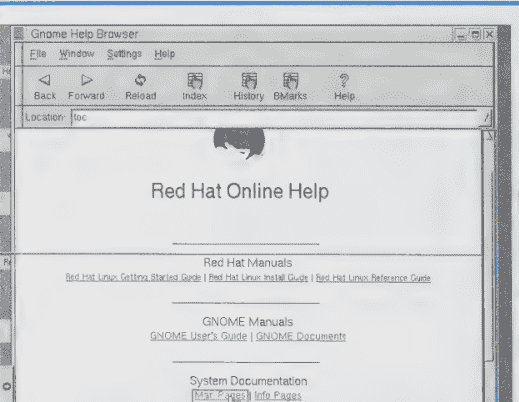

- 1 点击“帮助浏览器”按钮打开 `Gnome` 帮助浏览器。

- 2 出现 `Gnome` 帮助浏览器界面。

- 3 点击窗口右侧的垂直滚动条，向下滚动到“帮助页”超链接。

点击窗口右侧的垂直滚动条，向下滚动到“帮助页”超链接。

# 了解 Linux 桌面环境

## 额外

使用 `Gnome` 帮助浏览器查找帮助。

点击带有问号图标的工具栏按钮。显示解释了 `Gnome` 帮助浏览器中一些较为晦涩的部分。或者，你可以点击屏幕顶部的“帮助”（`Help`）下拉菜单。你将从下拉菜单中选择多个帮助主题，包括介绍、命令行选项、菜单、工具栏、`URL` 输入框、书签、历史记录和关于（`Gnome` 帮助浏览器）。

查找其他帮助来源。

记住，`Gnome` 帮助浏览器只是 Linux 帮助文档的一部分。如果你正在使用红帽 Linux，桌面上的图标（如“Linux 文档” `Linux Documents` 和“红帽支持” `Red Hat Support`）将引导你进入万维网，可以在那里浏览更多技术文档。否则，你可以使用 `Netscape` 浏览器访问制作你所使用的特定版本 Linux 的公司的网站，例如 `Slackware`、`TurboLinux` 或 `Caldera`。

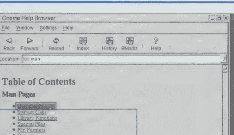

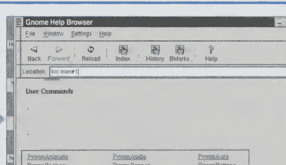

## 目录

### 帮助页

- 浏览

- 用户指南

- 库函数

- 文件格式

- `Manual-pages`

- 配置

- 权限

### 用户命令

| `PromAssign` | `PromAide` | `PromArgs` |
|---|---|---|
| `PromBack` | `PromOwner` | `PromMenu` |
| `PromCommand` | `PromCmd` | `PromCasle` |
| `PromCaseCpl` | `PromCpp` | `PromDebug` |
| `PromiconBox` | `PromiconMap` | `PromIent` |
| `PromM4` | `PromSearch` | `PromKazarg` |
| `Promscroll` | `PromTalk` | `PromTaisBar` |

4 将你的鼠标指针悬停在任何你想了解更多信息的主题上。超链接将跳转。

5 点击超链接，进入一个包含该主题列出的信息的屏幕。

你点击的主题下的子主题将显示在屏幕上。

6 点击这些子主题中的任一个以查看帮助页中的详细信息。

注意，帮助页往往包含极其丰富的细节。请仔细阅读页面以及每个命令的所有命令选项。

屏幕之间的额外导航在先前的任务“导航 GNOME 帮助浏览器”中已说明。

# 登录 root 用户账户

作为 Linux 系统上的 `root` 用户，你可以编辑任何文件并更改任何权限。`root` 用户是对 Linux 系统上所有账户和文件拥有单方面权限的管理账户。

你有两种方式进入 `root` 账户。首先，你可以使用 `root` 代替另一个用户名进行典型的登录。你也可以通过 `su` 命令变为 `root`。`su` 命令代表 `switch`，主要供管理员切换到 `root` 账户以处理任务。

任何 Linux 系统只包含一个 `root` 账户，但必要时可以授予其他账户 `root` 权限。出于安全考虑，应谨慎授予 `root` 权限。

## 以 root 用户身份登录

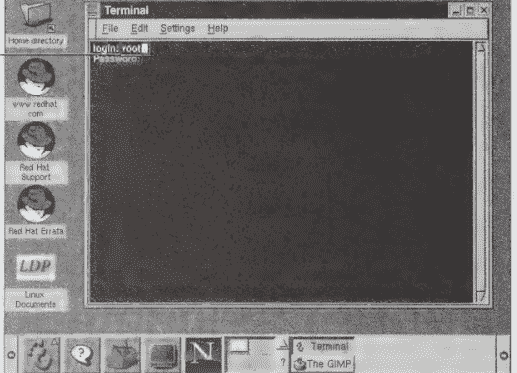

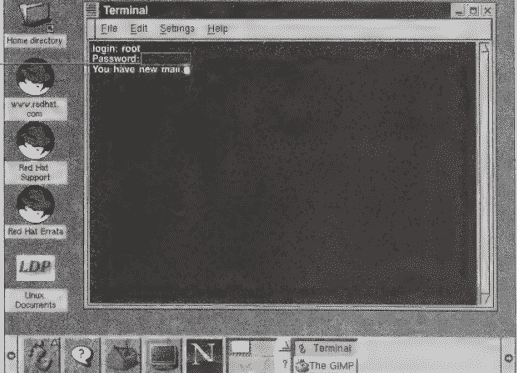

## 登录 root

- 1 在提示符处输入 `root` 或具有 `root` 权限的用户账户名。

- 2 输入你的密码。

- 3 按回车。如果密码正确，你已以 `root` 身份登录。

你的密码通常不会显示。但在某些 Linux 版本中，你的密码可能会用一系列星号表示。

# 设置 Linux 用户账户和组

## 应用

验证你的当前用户登录。

如果你的 Linux 版本在命令提示符处没有显示当前用户账户，输入 `whoami` 并按回车。`whoami` 命令会显示你的用户账户。在大多数 Linux 系统上，当你以 `root` 身份登录时，提示符为井号：`#`

防止用户读取所有人可读可写的文件。

`root` 有权禁用或删除整个用户账户。如果用户文件的权限被严格设置为仅用户读写，`root` 可以阻止访问。


记住 `root` 是 Linux 中的管理账户。由于该账户必须访问任何文件来管理机器，用户设置的权限无法阻止 `root` 查看或编辑文件。

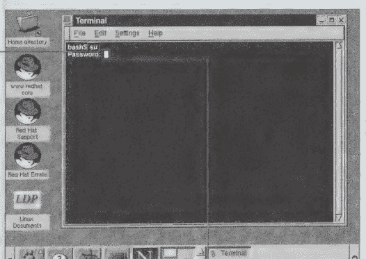

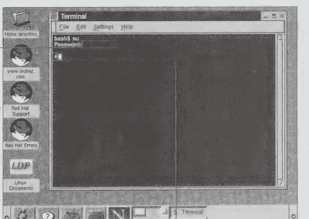

## 使用 `su` 切换到 `root`

- 变为 `root` 的另一种方法是从用户账户切换。1 在提示符处输入 `su`。
- 出现密码提示，就像第一次登录一样。2 输入 `root` 的密码。
- 3 按回车。
- 在某些 Linux 版本中，你的命令提示符变为井号—`#`，表示你是 `root`。

## 使用 GNOME `LinuxConf` 工具

`LinuxConf` 是你在 GNOME GUI 系统中执行管理工作的主要工具。你使用 `LinuxConf` 创建账户、编辑系统信息、设置电子邮件别名并执行其他功能。如果你来自 Windows 世界，这个工具相当于 Windows 服务器上提供的各种管理工具的结合。

你可以在 `LinuxConf` 中查看创建和选择的设置，只有 `root` 管理账户才能在此管理工具中做出永久更改。

虽然 `LinuxConf` 工具很有用，但最初对许多新管理员来说可能会困惑。在直接进入用户和组管理之前，我将概述如何导航和使用 `LinuxConf` 工具的基础知识。

`LinuxConf` 代表正如你可能猜的那样——Linux 配置（Configuration）。尽管系统上的其他用户

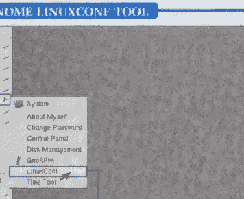


### 打开 `LinuxConf`

- 1 点击主菜单应用程序。2 将鼠标指针指向系统（System）。
- 3 将指针指向 `LinuxConf`。
- 4 点击 `LinuxConf`。
- 出现 GNOME-Linux 窗口。`LinuxConf` 在左帧中显示基于 GNOME 的功能。
- `LinuxConf` 在右帧中显示你的控制面板功能。

# 设置 Linux 用户账户和组

### 应用

在左帧中找到“日期和时间”。

一直滚动到底查看你可以编辑的最后两个条目——日期和时间以及功能设置。

收起列表以便于访问。

你可以通过点击左帧中某些 `LinuxConf` 功能（如网络或服务器任务）左侧的 “+ 和方框来收起功能列表。点击方框使 “+ 号出现，展开功能并隐藏其所有可配置设置。再次点击方框使符号出现恢复列表。


| 字段 | 值 |
|---|---|
| 小时 | 11 |
| 秒 | 50 |
| 年份 | 1999 |
| 月份 | 10 |
| 日 | 25 |

- 5 点击位于 GNOME-Linux 窗口左右帧之间的滚动条，查看编辑功能列表。
- 6 握住鼠标键并缓慢向下拖动滚动条。
- 将可以编辑的功能分开。

## 编辑日期和时间

- 1 点击左帧中的“日期和时间”条目。

右帧显示工作站日期和时间控制面板。

继续

# LINUX

## 使用 GNOME LINCONF 工具（续）

你可以通过 `LinuxConf` 工具中的各个功能面板，更改并配置给定功能的每个独立元素。当你点击左侧框架中的对象（例如日期和时间、功能、或基本主机信息）时，面板会出现在右侧框架中。

GNOME-Linuxconf 窗口右侧框架中显示的对象被称为面板（panels），而不是终端或窗口，因为它们没有滚动条，也不会在 `LinuxConf` 之外独立移动。你无法通过点击面板来调整其大小，或将其拖到屏幕的其它部分。

此外，每个面板的左上角都有一个标签，既作为标签也是占位符。如果你打开了多个面板，可以通过点击标签来快速将其中一个带到面板[前台]。


| 工作日期与时间 | 功能 |
|---|---|
| 填写此表单以指示工作负载如何获取日期和时区 | 此屏幕定义了 `linuxconf` 的某些行为 |
| 通用格式(GMT) | 键盘映射 |
| 从服务器获取(y) | 自动语言检测 |
| 时间语言 vs vs vs | 我可能使用 GUI 模型 |
| 秒 Hn 超时 vs | 表格触发器 |
| 日期 Hn 实体参数 | |

- 在“小时”字段输入 12，在“分钟”字段输入 00，在“秒”字段输入 00 来更改时间。
- 点击“接受 (Accept)”接受你的更改，或点击“取消 (Cancel)”移除更改。
- 做出选择后面板将关闭。

## 拥有多个面板

- 点击“日期与时间”。
- 点击“功能”。
- 右侧框架中出现两个面板。

## 设置 LINUX 用户帐户和组

## 实施

在面板之间查找并移动。

当你有六个或七个面板时，右侧框架无法显示所有面板，因此 `LinuxConf` 在右上角显示一对箭头按钮。点击箭头可以在面板列表中来回移动。然而，使用此功能可能会导致困惑，因此在打开另一个面板之前请先关闭一个面板。

点击“退出 (Quit)”按钮不保存并退出。

如果你在最后一个 `LinuxConf` 面板上点击“退出”，`LinuxConf` 将无提示退出。你所有的更改都将被丢弃且不生效。


| 工作站日期与时间 | 功能 |
|---|---|
| 填写此列表以指示工作站如何获取日期和时间 | 关机/重启 |
| 控制服务活动 | |
| 控制本地目录 | |
| 控制网络系统 | |
| 挂载其他 NTFS 文件系统 | |
| 存档备份 | |
| 配置新增 | |
| 配置 PPP/PPPoA 连接 | |
| 配置其他文件 | |
| 配置所有配置 | |
| 配置权限和安全 | |
| 配置模块 | |
| 覆盖 Linux 新 | |
| 创建新增 | |
| 启动消息 | |
| `LinuxConf` 日志 | |
| 站点链接 功能 | |
| 存储在 COMS (通用时间) 中 | |
| 小时 | |
| 分钟 50 | |
| 秒 09 | |
| 年份 1999 | |
| 月份 10 | |
| 日期 20 | |

要切换两个面板，请点击每个面板顶部的标签。

3 点击“工作站日期 &”标签。

工作站日期与时间面板出现在前台。

当面板处于前台时，它是激活状态。

## 离开 LINCONF

1 点击窗口右上角的“退出 (Quit)”按钮或“关闭 (Close)”按钮离开 `LinuxConf`。

如果你进行了任何更改，将出现系统状态面板。

2 点击适当的按钮。

如果点击“激活 (Activate)”更改，你会将更改应用到系统并离开 `LinuxConf`。

## 列出用户帐户

你可以使用 `LinuxConf` 轻松地查看系统上的整个用户帐户列表。`LinuxConf` 让你能够以友好的图形模式按字母顺序查看帐户列表。当你列出帐户时，你会看到 Linux 系统中创建的每一个帐户——而不仅仅是当前登录的用户帐户。请注意，用户帐户可能关联了人员，也可能未关联。

例如，你可能会在 `xfs` 组中看到用户帐户 `xfs`，但 `xfs` 仅仅是系统在访问 X 字体服务器时使用的虚拟帐户（每当操作系统需要执行自动化任务来完成工作时）。你将找不到登录 `xfs` 的用户。


| 姓名 | Uid | 组 |
| --- | --- | --- |
| `fs` | FTP 用户 | 14 |
| `lfs` | 游戏 | 12 | `users` |
| `gopher` | | 13 | `gopher` |
| `mail` | | 8 | `mail` |
| `operator` | | 9 | X Font Server 92 |

- 打开 `LinuxConf`。
- 滚动到“用户 (Users)帐户”。
- 用户帐户面板出现在右侧框架中。
- 显示 GNOME-Linuxconf 窗口。
- 点击名称查看用户帐户的详情。

## 设置 LINUX 用户帐户

## 实施

在“名称 (name)”字段中包含信息。

设置用户帐户时不需要在“全名 (Full name)”字段中输入名称，但包含它是个好主意，因为提供了更多关于用户的信息。此外，某些电子邮件程序会在邮件中显示“全名”字段中的名称，从存储的帐户信息中提取。

通过滚动查找用户。

遗憾的是，`LinuxConf` 的帐户面板不如 Windows 的灵活，因此你无法通过 ID 或名称而不是帐户来列出用户。要查找用户，请滚动列表找到该项。

添加用户名称。

点击用户帐户名称在“全名”字段中输入用户名称查看帐户详情。


面板显示信息。

### 增加列宽

1. 点击每个面板顶部的标签。
2. 向右拖动线条。
3. 点击分割线。


### 添加帐户

要切换两个面板，点击每个面板顶部的标签。

3. 点击“工作站日期 &”标签。

工作站日期与时间面板出现在前台。

当面板处于前台时，它是激活状态。

### 离开 `LINCONF`

1. 点击窗口右上角的“退出 (`Quit`)”按钮离开 `LinuxConf`。

如果你进行了任何更改，将出现系统状态面板。

2. 点击适当的按钮。

如果点击“激活 (`Activate`)”你会将更改应用到系统并离开 `LinuxConf`。

### 列出用户帐户

你可以使用 `LinuxConf` 轻松地查看系统上的整个用户帐户列表。`LinuxConf` 让你以友好的图形模式按字母顺序查看帐户列表。当你列出帐户时，你会看到 `Linux` 系统中创建的每一个帐户——不仅仅是当前登录的用户帐户。请注意，用户帐户可能关联了人员，也可能未关联。

例如，你可能会在 `xfs` 组中看到用户帐户 `xfs`，但 `xfs` 仅仅是系统在访问 X 字体服务器时使用的虚拟帐户。每当操作系统需要执行自动化任务来完成工作时。你将找不到登录 `xfs` 的用户。


| 姓名 | `Uid` | 组 |
|---|---|---|
| `fs` | 14 | `FTP` 用户 |
| `lfs` | 12 | `users` / `游戏` |
| `gopher` | 13 | `gopher` |
| `mail` | 8 | `mail` |
| `operator` | 9 | `X Font Server` / `92` |

- 打开 `LinuxConf`。
- 滚动到“用户 (`Users`) 帐户”。
- 用户帐户面板出现在右侧框架中。
- 显示 `GNOME-Linuxconf` 窗口。
- 点击名称查看用户帐户的详情。

## 设置 `LINUX` 用户帐户

### 实施

在“名称 (`name`)”字段中包含信息。

设置用户帐户时不需要在“全名 (`Full name`)”字段中输入名称，但包含它是个好主意，因为提供了更多关于用户的信息。此外，某些电子邮件程序会在邮件中显示“全名”字段中的名称，从存储的帐户信息中提取。

通过滚动查找用户。

遗憾的是，`LinuxConf` 的帐户面板不如 `Windows` 的灵活，因此你无法通过 `ID` 或名称而不是帐户来列出用户。要查找用户，请滚动字母列表找到该项。

添加用户名称。

点击用户帐户名称查看帐户详情。在“全名”字段中输入用户名称。


面板显示信息。

### 增加列宽

1. 点击每个面板顶部的标签。
2. 向右拖动线条。
3. 点击分割线。


### 添加帐户

要切换两个面板，点击每个面板顶部的标签。

3. 点击“工作站日期 &”标签。

工作站日期与时间面板出现在前台。

当面板处于前台时，它是激活状态。

# 添加用户账户（续）

在 `Linux` 中添加账户密码时，你有一个内置的保护机制可以防止输入错误。每当你添加一个新用户时，系统都会提示你输入两次密码。虽然你在第一次输入密码时可能会出现拼写错误，但不太可能在第二次时犯同样的错误。

系统。由于大多数 `Linux` 用户倾向于在你设置好他们的账户后设置自己的密码，因此通常最好的方法是为用户分配一个你记得住的密码。确保他们出于安全考虑立即更改更改密码。当然，如果你需要更高的安全性，可以使用随机密码生成器或自制算法来生成新密码。

你提供给每个用户的密码取决于你在系统上使用的命名规范。

# 添加用户账户

| `GNOME-Linuxconf` | 用户账户创建 | |
| :--- | :--- | :--- |
| 用户账户 | 你必须至少指定名称和名字 | |
| - 用户账户 | | |
| - `Shell` 账户 | | |
| - 更改 `root` 密码 | 基础信息：`parity` 邮件别名 权限 | |
| - 更改 `root` 密码 | 账户包含在 | |
| - `PPP` 账户 | 登录名称 | | |
| - `UCCP` 账户 | 全名 | | |
| - 虚拟 `POP` 账户（邮件） | 组组 | | |
| - 虚拟 `POP` 账户（邮件） | | | |
| - 用户别名 | 主目录 | `/home/kiko` |
| - 用户别名 | `用户 ID (uid)` | `/bin/bash 501` |
| 策略 | | |
| - 密码与账户策略 | | |
| - 可用的 `shells` | | |
| - 可用的 `SLP` 方法 | | |
| - 当日信息 | | |
| 系统 | | |
| 访问本地磁盘驱动器 | | |
| 访问远程卷 | | |
| 配置交换文件和分区 | | |
| `GNOME-Linuxconf` | 更改密码 | | |
| :--- | :--- | :--- | :--- |
| 用户账户 | 为用户 `kiko` 更改密码 | | |
| - 用户账户 | | | |
| - `Shell` 账户 | | | |
| - 更改 `root` 密码 | 接受 取消 帮助 |
| - 更改 `root` 密码 | 新 `UNIX` 密码 | |
| - `PPP` 账户 | | | |
| - `UCCP` 账户 | | | |
| - 虚拟 `POP` 账户（邮件） | | | |
| - 虚拟 `POP` 账户（邮件） | | | |
| 用户别名 | | | |
| - 用户别名 | | | |
| 策略 | | | |
| - 密码与账户策略 | | | |
| - 可用的 `shells` | | | |
| - 可用的 `SLP` 方法 | | | |
| 当日信息 | | | |
| 系统 | | | |
| 访问本地磁盘驱动器 | | | |
| 访问远程卷 | | | |
| 配置交换文件和分区 | | | |

- 10 点击接受。
- 出现更改面板。
- 12 点击接受。
- 11 在“新 `UNIX` 密码”字段中输入 `kiko` 的密码。

# 设置 `Linux` 用户账户和组

应用。

填入 (`opt`) 字段，或者不填入。

`Opt` 代表可选（`optional`）。你可以在这些字段中添加列表，但它们不是强制要求的。如果你留空这些字段，用户账户也可以正常运行。

为你的用户选择一个组。

在许多系统中，大多数用户可以分配到同一个组，但大公司可能会为特定类别的员工设置不同的组，例如人力资源、工程和销售。然而，需要记住的重要点是，`root` 组授予了管理权限。这提供了在安全系统中是不允许的权限。

花时间在文本字段中输入可选信息。

最好在你现有的用户账户创建面板的文本字段中添加可选信息。例如，在“全名”字段中输入用户的真实姓名有助于你记住是谁拥有该账户。


| 账户 | 用户 | `UID` | 组 |
|---|---|---|---|
| `root` | `root` | 0 | `root` |
| `guest` | `guest` | 500 | `nobody` |
| `mail` | `mail` | 42 | `mail` |
| `bin` | `bin` | 101 | `bin` |
| `user` | `user` | 9 | `mail` |
| `operator` | `operator` | 19 | `root` |

在“重输 `UNIX` 密码”字段中重新输入密码。

显示新账户的用户账户面板。

出于隐私考虑，密码仅以星号形式显示。

完成后点击接受。

# `LINUX`

## 编辑用户账户

你可以在 `LinuxConf` 用户账户屏幕上编辑账户信息。根据你的系统允许的权限程度，用户可能能够更改自己的密码和其他相关信息。然而，如果你想将所有管理功能都保留在控制范围内，你可以指定 `root` 为更改的唯一联系点。请注意，如果你选择此选项，你可能会很快被琐碎的行政工作所淹没。


例如，假设在某个工作日，需要将一个新用户添加到 `games` 组。此外，该用户的姓名发生了变化，因此你需要更改账户名。另一个用户需要更改邮件别名，而第四个人想将密码更改为某个模糊的密码。如果你必须为大型用户社区不断执行这些任务，你将花费太多时间在管理用户账户上。

## 编辑用户账户


### 将用户添加到组

1. 打开 `LinuxConf`。
2. 出现 `Linuxconf` 窗口。
3. 点击用户账户。
4. 点击用户账户。
5. 出现信息面板。
6. 点击组字段。
7. 输入 `games` 将 `kiko` 添加到此组。
8. 点击接受。
9.


# 设置 Linux 用户账户和组

为用户账户遵循一致的命名规范。

第一个规则是避免重复。第二个规则是在系统上保持一致的命名规范。例如，一种常见的方案是使用名字首字母和姓氏，或者使用通用名称如 `root` 等。如果你有一个一致的方案，识别系统上的用户将变得更容易。例如，如果你向 `jsmith` 请求更改密码，你可能知道这属于谁以及他的需求是什么。


## 创建邮件别名

### 更改用户名和登录名

1. 点击邮件别名或邮件设置标签。

   注意：标签的名称取决于你电脑上的 `Linux` 版本。

2. 为别名输入 `kara`。
3. 点击全名并输入 `Iko-Smith` 作为姓。
4. 点击基础信息标签。
5. 点击重定向邮件到字段并输入 `kiko`。
6. 点击登录名字段并添加一个 `s` 后缀。
7. 接受。


# LINUX

## 编辑器用户账户（续）

在 `LinuxConf` 中，你可以轻松地更改用户密码。就像你最初创建账户一样，你拥有一个内置的安全保护机制，防止你输入带有拼写错误的密码。然而，更改用户账户与创建账户的一个关键区别是，用户也可以随时更改自己的密码，除非你更改系统权限以防止他们这样做。`Root` 是唯一可以在创建时为用户设置密码的账户。

由于用户可以随地设置密码，你只需要在特殊情况下编辑他们的密码。最常见的情况是当你遇到安全问题时，例如有人正通过特定的用户账户对你的系统进行攻击或非法访问。如果该用户正在休假或不在，则由你来完成密码更改。

## 编辑器用户账户


### 更改密码

1. 点击一个用户。
2. 用户信息面板出现。
3. 点击 `Passwd`（密码）。
4. 出现更改密码面板。
5. 在 `New UNIX`（新 UNIX）字段中输入新密码。
6. 新密码将以星号形式显示。
7. 点击 `Accept`（接受）。
8. 再次输入密码。
9. 点击 `Accept`（接受）。

### 应用

授予用户在 `LinuxConf` 中进行更改的系统访问权限。

当你点击 `LinuxConf` 中的用户账户名称时，最右侧的标签页之一是 `Privileges`（权限）。访问权限列表位于那里，你可以赋予用户在 `LinuxConf` 中执行任务的权限。

注意那些与系统账户名称相同的用户名。

不要允许用户将用户名更改为与系统账户相同的。例如，如果一个用户将姓名更改为 `mail`，你必须立即将其改为其他名称。重复的用户名和系统账户名可能会导致 `Linux` 和管理员出现严重问题。用户账户名必须是唯一的，`LinuxConf` 有内置的安全保护机制帮助防止重复。


# 删除用户账户

在 `LinuxConf` 中删除账户像创建和编辑账户一样简单。在 `LinuxConf` 中，你可以轻松决定想要什么级别的账户删除。你可以完全删除账户、归档用户的主目录（`Home Directory`）和邮箱，或者简单地将禁用的账户留在原处。

你应该出于基本安全考虑删除账户。

另一方面，你不希望将删除账户作为万能药方。例如，如果一个用户要去休长假但之后会回来，或者某个用户正在引起严重问题，你的最佳选择是删除用户账户，而不是禁用它。

你应该在特定情况下删除用户账户。如果员工离开公司或学生大学毕业，那么你

### 删除用户账户

| 账户 | FTP 用户 | Uid | 组 |
|---|---|---|---|
| - 用户账户 | games | 14 | fpr |
| - 更改密码 | | 42 | gam |
| - 更改 root 密码 | gopher | | |
| - 特殊账户 | kiko | 500 | kiko |
| - 通过普通方式的 SLP 账户 | | | |
| - DL 账户（只读） | | mail | mail |
| - POP 账户（只读） | | | next |
| - 邮箱账户 | operator | 11 | next |
| - 虚拟域用户 | | | |
| - 密码与账户策略 | | | |
| - 可用账户表 | | | |
| - 可用 SLP shell | | | |
| | | | |
|---|---|---|---|
| - 杂项 | | | |
| - 关于其他主机的信息 | | | |
| - 关于其他网络的信息 | | | |
| - 网络访问 | | | |
| - 用户账户 | | | |
| - 用户账户 | | | |
| - 更改 root 密码 | | | |
| - 特殊账户 | | | |
| - 通过普通方式的 SLP 账户 | | | |
| - DL 账户（只读） | | | |
| - POP 账户（只读） | | | |
| - 邮箱账户 | | | |
| - 虚拟域用户 | | | |
| - 密码与账户策略 | | | |
| - 可用账户表 | | | |
| - 可用 SLP shell | | | |
| | | | |
|---|---|---|---|
| 你必须至少指定名称和全名 | | | |
| 基础信息： | Mail aliases | Privileges | | |
| 账户已启用 | kiko | | |
| 登录名 | kiko | | |
| 全名 | kiko | | |
| 补充组 | | | |
| 主目录 | /home/kiko | | |
| 用户 ID | doc | | |

1. 打开 `LinuxConf`。
2. 出现 `GNOME-Linuxconf` 窗口。
3. 滚动到 `Users accounts`（用户账户）。
4. 点击 `Normal`（普通）标题下的 `User accounts`。
5. 账户面板出现在右框。
6. 点击用户账户 `kiko`。
7. 在用户信息面板中，点击 `Del`（删除）。

# 设置 LINUX 用户账户和组

### 应用

选择 `archive`（归档）选项以保留数据并节省空间。

选择 `leave-in-place`（留在原处）选项以便稍后查看。

归档是 `LinuxConf` 采取的默认操作，因为你可以轻松撤销。如果用户的邮箱和主目录包含你需要保留的信息，但如果你想减小体积以节省空间并防止他人查看，你应该保留此默认。

如果你确定用户拥有应该公开的文件，或者你想在删除之前查看主目录中的内容，这是你的最佳选择。

选择 `delete`（删除）选项以移除数据并释放更多空间。

每当你想完全删除账户并释放硬盘上的最大空间时，使用此选项。


- `GNOME Linux`
- 其它任务
- 杂项关于其他主机的信息
- 关于其他网络的信息
- 网络访问
- 用户账户
- 用户账户
- 组定义
- 特殊账户
- 通过普通方式的 `SLP` 账户
- `DHCP`
- `POP` 账户（只读）
- `POP` 账户（只读）
- 邮箱账户
- 虚拟域别名
- 密码与账户策略
- 可用 `PPTP` 链
- 可用 `SLP shell`
- 每日信息
- `GNOME Linux`
- 其它任务
- 杂项关于其他主机的信息
- 关于其他网络的信息
- 网络访问
- 用户账户
- 用户账户
- 更改 `root` 密码
- 特殊账户
- 通过普通方式的 `SLP` 账户
- `DHCP`
- `POP` 账户（只读）
- `POP` 账户（只读）
- 邮箱账户
- 虚拟域别名
- 密码与账户策略


- 可用 `PPTP` 链
- 可用 `SLP` shell
- 每日信息

你正在删除一个账户。

主目录和邮箱将无法使用

- 归档账户数据
- 删除账户数据
- 将账户留在原处

你可以添加、删除或留下

选择 `[Add]`（添加）添加新定义

| 账户名称 | 大小 | 组 |
|---|---|---|
| `james` | 14 | |
| `games` | 42 | |
| `gopher` | | |
| `mail` | | |
| `news` | 5 | |
| `operator` | | |
| `root` | | |
| `root` `Server` | 100 | |


# 更改 ROOT 密码

`LINUXCONF`

你可以使用该工具更改管理员账户 `root` 的密码。在 `LinuxConf` 工具中执行此任务的更改密码面板是在 `GNOME` 桌面的图形环境中工作。更改 `root` 密码可以提高你 `Linux` 系统的安全性。

定期更改账户密码。如果有人不小心看到密码或能够破解它，该人员将获得管理员权限。

任何拥有密码的人都可以删除系统上的任何文件，更改重要的网络设置或导致整台机器崩溃。如果你怀疑有人可能猜中或破解了你的 `root` 账户密码，立即更改以防止此类问题的发生。

你应该鼓励所有用户定期更新密码。然而，更改 `root` 密码是双重重要的。


- 1. 打开 `LinuxConf`。
- 出现 `GNOME-Linuxconf` 窗口。
- 2. 滚动到 `Users accounts`（用户账户）。
- 3. 点击 `Normal`（普通）标题下的 `root password`。
- 4. 在 `Password` 字段中输入当前密码。
    - 注意密码以一系列星号的形式显示。
- 5. 点击 `Accept`（接受）。

更改密码出现。

# 设置 LINUX 用户账户和组

## 实际操作

确定更改 `root` 密码的频率。

选择一个良好的密码。

你更改 `root` 密码的频率取决于你维护系统所需的安全级别。如果你是这台机器的唯一用户，并且没有登录互联网或在计算机上存储重要文件，那么你可能永远不需要更改密码。另一方面，如果你在一个进行重要且敏感研究的计算机实验室工作，请考虑每三个月更改一次。

选择一个长度至少六个字符的密码。避开你的名字、生日、电话号码或人们与你相关联的字典单词。最好将数字和字母混合，形成一个只有你才能理解和记住的密码。最后，请记住 `Linux` 是一个区分大小的操作系统。在第一个字符以外的任何地方使用大写字母都会增加猜测或破解你密码的难度。


6. 在“`New UNIX password`”字段中输入新密码。
7. 点击 `Accept`（接受）。
8. 在“`Retype new UNIX password`”字段中重新输入密码以确认。
9. 完成后点击 `Accept`（接受）。

# 在 LINUX 终端中添加用户账户

你也可以在不使用 `LinuxConf` 实用工具的情况下添加新用户账户，在没有 `LinuxConf` 实用工具的情况下执行账户创建任务是一项实用的技能。虽然使用 `LinuxConf` 稍微简单一些，特别是如果你熟悉 `Windows` 环境，但你可以在 `Linux` 终端中执行相同的任务，并通常可以在此过程中节省一些时间。

环境和 `Linux` 终端。你可以在终端中完成所有工作，并节省自己鼠标操作和击键的劳动。

添加新用户账户的 `Linux` 命令是 `useradd`。`useradd` 命令在账户设置上的默认设置与 `LinuxConf` 相同，例如在 `bash` 中启动新账户。如果你想更改任何默认设置，最简单的方法是在终端中使用 `useradd` 创建用户账户，稍后用 `LinuxConf` 编辑该账户。

例如，如果你在 `Linux` 终端窗口中工作，你不需要在 `GNOME GUI` 和 `Linux` 终端之间切换。


## 在 LINUX 终端中创建用户账户

- 你必须以 `root` 身份登录才能添加用户。
- 点击 `Terminal Emulator`（终端模拟器）按钮打开终端窗口。
- `Linux` 终端窗口出现。
- 输入 `useradd ragnar`。
- 按回车。

## 设置密码

- 输入 `passwd ragnar`。
- 按回车。
- 输入用户的密码。

注意：出于安全考虑，密码不会显示在屏幕上。

- 按回车。

# 设置 LINUX 用户账户和组

## 实际操作

确定用户账户的默认值。

打开 `LinuxConf`，向下滚动到 `Users accounts`（用户账户），并点击 `Normal`（普通）标题下的 `User accounts`。点击列表上的用户账户以一览所有信息。

在不启动 `LinuxConf` 实用工具的情况下测试账户创建。

如果你想在 `Linux` 终端中测试账户创建，查看 `Linux` 在创建新用户时自动编辑的文件之一。使用编辑器查看 `/etc/passwd` 文件。此文件列出了所有用户账户，就像 `LinuxConf` 一样。虽然输出看起来比 `LinuxConf` 更晦奥，但如果你看到你的用户账户在列表中，说明它已经创建并供用户使用。


5. 在提示符处再次输入密码。
6. 按回车。

### 测试账户

1. 在命令行输入 `su ragnar` 以登录到 `ragnar` 账户。
2. 按回车。
3. `Linux` 以该用户的身份登录你。

# 在 LINUX 终端中编辑用户账户

你可以在 `Linux` 终端中修改用户账户，也可以在 `GNOME` 界面中修改，但与在 `GNOME` 中操作相比，在 `Linux` 终端中编辑用户账户有几个优势。

例如，如果你已经在终端窗口中工作，你就不需要在 `Linux` 终端和 `GUI` 系统之间来回切换。另一个优势是，当你精通在终端中编辑账户时，你的 `Linux` 技能更具可迁移性。这意味着如果你在一个没有基于 `GUI` 的 `LinuxConf` 工具的略有不同的 `Linux` 系统上工作，你仍然可以成功地完成工作。

`Linux` 专家需要知道如何在 `GUI` 和 `Linux` 终端中执行任务。要在终端中编辑账户，你使用 `vi` 编辑器。有关使用 `vi` 编辑器的更多信息，请参阅第 9 章。


- 你必须以 `root` 身份登录才能编辑用户账户。
- 1. 点击终端模拟按钮。
- `Linux` 终端窗口打开。
- 2. 输入 `vi /etc/passwd`。注意：`passwd` 文件是一个关键文件。如果它在编辑过程中损坏，系统上的每个用户都可能受到影响，包括 `root`。
- 3. 按回车。
- 你现在处于 `vi` 编辑器中。屏幕显示 `passwd` 文件的内容。
- 4. 将光标移动到最后一行，以便你可以编辑用户账户 `ragnar`。

# 设置 LINUX 用户账户和组

## 实际操作

在保存并退出 `/etc/passwd` 文件时输入一个 `!`。

在保存编辑过的 `passwd` 或组文件时，包含一个感叹号——`!`，称为 bang 符号（`bang sign`）。这两个文件都需要感叹号作为额外的安全功能，这样即使是 `root` 账户也不会意外编辑此文件。

在终端中遵循标准的账户命名规范。

无论你如何创建账户，相同的规则都适用于所有账户。每个账户必须有一个唯一的名称。

纠正 `passwd` 文件中的拼写错误。

如果你无法轻松纠正错误，请不保存退出并重试。要不保存退出，输入冒号 `:`，后跟 `q!`


```
root:x:0:0:root:/root:/bin/bash
bin:x:1:1:bin:/bin:/usr/sbin/nologin
daemon:x:2:2:daemon:/root:/usr/sbin/nologin
sys:x:3:3:sys:/dev:/bin/sync
sync:x:4:65534:sync:/bin:/bin/sync
games:x:5:60:games:/usr/games:/usr/sbin/nologin
man:x:6:12:man:/var/cache/man:/usr/sbin/nologin
adm:x:7:7:adm:/bin/sync
proxy:x:8:8:proxy:/root:/usr/sbin/nologin
cron:x:9:9:cron:/root:/usr/sbin/nologin
lp:x:10:10:lp:/var:/usr/sbin/nologin
mail:x:11:13:mail:/var/mail:/usr/sbin/nologin
news:x:12:14:news:/var/news:/usr/sbin/nologin
uuc:x:38:38:uuc:/var/uuc:/usr/sbin/nologin
data:x:34:34:data:/root:/usr/sbin/nologin
backup:x:35:35:backup:/var/backups:/usr/sbin/nologin
list:x:38:38:list:/root:/usr/sbin/nologin
irc:x:39:39:irc:/var/run/ircd:/usr/sbin/nologin
gnats:x:40:41:gnats:/var/lib/gnats:/usr/sbin/nologin
irc:x:41:42:irc:/var:/usr/sbin/nologin
list:x:42:43:list:/root:/usr/sbin/nologin
www:x:43:43:www:/var/www:/usr/sbin/nologin
backup:x:44:44:backup:/var/backups:/usr/sbin/nologin
irc-data:x:45:46:irc-data:/var/run/ircd:/usr/sbin/nologin
irc-games:x:46:47:irc-games:/var/run/ircd:/usr/sbin/nologin
nobody:x:65:65534:nobody:/non:/usr/sbin/nologin
system:x:99:99:system:/root:/bin/bash
ubuntu:x:1000:1000:ubuntu:/home/ubuntu:/bin/bash
```

## 在 Linux 终端中删除和禁用账户

了解如何删除和禁用用户账户是维护 Linux 系统安全性的关键方面。由于你可能需要立即采取行动禁用干扰系统运行的账户，因此无论你是在 Linux 终端中还是在 `LinuxConf` 中，都可以禁用账户。

你需要了解如何使用 Linux 终端的另一个原因是为了在系统损坏时处理安全问题。如果 `GNOME` 无法正常启动或因系统崩溃而损坏，而你又遭遇了安全漏洞，那么你无法等待 `GNOME` 恢复。

要完成这些任务，你需要使用编辑器。使用 `vi`，可以通过在 `/etc/passwd` 中用户的密码字段中放置一个星号（`*`）来禁用账户。关于 `vi` 文本编辑器的详细说明，请阅第 9 章。


### 在 Linux 终端中删除和禁用账户

| 终端 | 文件编辑设置 帮助 |
| --- | --- |
| `home-directory` | `root:x:0:0:/root:/bash`<br>`root:x:0:0:/root:/bash`<br>`demon:x:1:1:/bin:/bin/sync`<br>`bin:x:2:2:/bin:/bin/sync`<br>`sys:x:3:3:/bin:/bin/sync`<br>`sync:x:4:65534:/dev:/bin/sync`<br>`games:x:5:65534:/dev:/bin/games`<br>`man:x:6:12:/usr/share/man:/usr/bin/man`<br>`plp:x:7:7:/var/spool/lpd:/sbin/lpd`<br>`lnt:x:8:8:/root:/bin/nl`<br>`mail:x:9:9:/var/mail:/bin/mailmail`<br>`news:x:11:11:/var/spool/news:/usr/sbin/news`<br>`operator:x:40:30:/root:/bin/vi`<br>`uuc:x:38:38:/var/uuc:/usr/bin/uuc`<br>`data:x:83:83:/var:/bin/false`<br>`list:x:87:87:/var/nlog:/usr/sbin/nologin`<br>`lp:x:99:65534:/var/lib//nonexistent:/usr/sbin/nologin`<br>`user:x:1000:1000:/home/user:/usr/bin/bash` |


## 打开 passwd 文件

## 删除账户

- 你必须以 `root` 身份登录才能删除或禁用用户账户。
- 将光标移动到包含账户名 `ragnar` 的行上。
- 点击终端仿真器。
- 输入 `dd` 以删除整行。
- 一个 Linux 窗口打开了。

> **注意**：`passwd` 文件是一个关键文件。如果它在编辑过程中损坏，系统上的所有用户（包括 `root`）都会受到影响。

- 按回车键。
- `vi` 屏幕显示 `passwd` 文件的内容。

## 设置 Linux 用户账户和组

### 应用

### 重新激活账户

要重新激活账户，在 `vi` 编辑器中打开 `/etc/passwd` 文件。将光标移动到密码字段并删除星号。不要在该位置输入任何内容。在 `vi` 编辑器中退出并保存你的更改。立即让用户登录并输入新密码。

不要在 `/etc/passwd` 文件中输入新密码。Linux 存储密码不是作为字母表字符，而是代码。`passwd` 命令是 Linux 将你的密码正确翻译成该代码的唯一方法。移除密码字段中的星号会留下相邻的冒号。对于 Linux 来说，这意味着该字段是空的，因此不需要密码即可登录你的系统。这是一个巨大的危险。


### 禁用账户

- 将光标移动到 `kiko` 账户行的第二个字段。
- `/etc/passwd` 文件中的字段由列分隔。
- 删除该字段中的 `x`。
- 在其位置插入一个星号。

> **注意**：所有账户的密码字段都包含 `x`。

- 按 `i` 切换到插入模式。


## 列出用户组

你可以使用 `LinuxConf` 查看系统上用户组的列表。用户组是用户账户的逻辑集合。作为用户，你属于一个共享文件权限、邮件别名并可能共享同一部分硬盘数据的账户组。`LinuxConf` 允许你在图形模式下按字母顺序查看这些组信息。

另外注意，当 Linux 列出所有组时，不仅仅是包含用户的组。`LinuxConf` 显示所有组，其中某些组可能没有关联的用户。例如，假设你有一个名为 `games` 的用户组，但组内没有用户。组内没有用户并不意味着该组消失了。它仅仅是一个空的逻辑容器，你可以将用户放入其中。


- 打开 `LinuxConf`。
- 出现 `GNOME-Linux` 窗口。
- 滚动到用户账户。
- 点击 `Normal` 标题下的组定义。
- 用户组面板出现在右侧。
- 第一列中 `console` 和 `daemon` 组名的最后两个字母被截断了。

## 设置 Linux 用户账户和组

### 应用

### 通过滚动查找组

避免用用户命名组。

`LinuxConf` 的用户组面板不像 Windows 那样灵活，因此你无法按组 ID 列出组。按字母顺序滚动列表查找组。


Linux 不阻止你用用户命名组，但这不是好习惯。这会导致过多的困惑。理解`daemon`等组的起源。

Linux 在安装时会自动创建`root`、`admin`和`lp`等组用于运行系统进程和维护程序，例如磁盘碎片和打印作业。


- 拖动分离组组字段和 ID 字段的线向右移动。
- 设置边界后释放鼠标。
- 其他字段向右移动以留出更多空间。
- 交叉线标记新边界。
- 点击组名。
- 组规格面板出现，显示用户组的详细信息。

# 添加用户组

如果你在一个拥有多个用户账户的网络上工作，你需要了解如何添加用户组。

创建新的用户组有助于保持你的组织有序。通常情况下，`root`账户按部门名称组织组，例如会计、市场和研究。

作为 Linux 配置工具的大部分功能之一，`root`账户可以添加新的用户组。创建组后，你可以根据需要添加或删除成员。

用户和用户组之间没有固定的比例。因为用户账户仅为用户登录 Linux 系统提供方法，单个用户可以属于一个或多个用户组。同样，一个组可以有两个用户、一百万个用户或者一个用户——该逻辑分组仍然存在并正常工作。

- 按两次`Tab`键跳转到备用成员（`opt`）字段。
- 输入`kiko`。

Linux 为组 ID 字段分配一个唯一的数字。

- 输入`accounting`。

# 设置 Linux 用户账户和组

## 额外说明

`root`账户出现在多个不同的组中。

“用户组”面板显示`root`账户属于多个不同的组，例如`disk`、`adm`和`bin`。这些组专门与管理功能相关，因此`root`出现在这些组中。

某些组没有用户。

按照原则，除非你确定该组是你创建的，否则你不应该删除带有有成员的组。拥有额外的组不会影响 Linux 运行的任何方面，而且你可能会删除一个对系统很重要的组并导致一些严重的问题。例如，删除控制打印功能的`lp`组可能会导致你无法打印。


你可以在主基目录中输入一个路径，将计费信息放置在默认位置之外。

点击“接受（Accept）”。

你返回用户组列表。

列表顶部是`accounting`，其列出了计费组中的用户列表——在这种情况下，是`kiko`。

- 点击“目录（Directories）”选项卡。

## 编辑用户组

除了列出和创建用户组外，你还可以在 LinuxConf 中编辑用户组信息。在 Linux 中编辑用户组信息比编辑用户账户信息简单，选项也更少。此外，你不需要经常更改基本组信息，除非你的组织非常大并且正在发生重大变化。

如果你的公司或大学撤除了或更改了部门名称，你可能需要更改或删除组名。

如果你的公司正在重组部门，你可能需要更改组的组标识符（GID）。如果你的组织增加、减少或转调了人员，你必须编辑组本身的成员关系。LinuxConf 让这些任务都变得易于完成。

你大多数的组管理任务涉及细小更改。例如，


- 1 打开 LinuxConf。
- 2 显示 GNOME-Linuxconf 窗口。
- 3 滚动到“用户账户（Users accounts）”。
- 4 点击“常规（Normal）”标题下的“组定义（Group definitions）”。
- 5 右侧框架中出现“用户组”面板。
- 6 点击`accounting`。
- 7 显示“组规格（Group specification）”面板。
- 8 在“组名（Group name）”字段中点击并删除条目。
- 9 删除`501`。
- 10 输入`555`。
- 11 输入`accounting-sf`。
- 12 按`Tab`键移动到“组 ID（Group ID）”字段。

# 设置 Linux 用户账户和组

### 应用

组管理任务限制给`root`。

更改、添加或删除成员关系是只有`root`账户应该处理的管理性角色。赋予普通用户访问组规格的权限可能会导致问题。

必要时将`root`添加到组中。

`root`账户出现在特定组中并不会赋予该组成员管理权限。但是，你应该将其他账户排除在`root`组之外。

## 根据需要从组中添加或删除用户。

根据你组织的需求和结构，你可能需要向特定组之外添加用户。例如，如果你仅允许`accounting`组成员访问`account-data`文件，那么组织其他部分可能需要计费的人员无法访问它，因为他们不在`accounting`组中。你可以将这些人加入`accounting`组以便他们获得权限。


- 10 按`Tab`键移动到“成员（members opt）”字段。
- 11 删除`kiko`。
- 12 输入`root`。
- 13 点击“接受（Accept）”。
- 当你返回用户组面板时，更改将会显示。

# 删除用户组

在 LinuxConf 的用户组中删除组与创建和编辑用户组一样简单。然而，你应该只在特定情况下删除用户组。

例如，假设你一家在旧金山和洛杉矶都有两个账户的公司工作。但因为洛杉矶的分支即将关闭，你想将`accounting-sf`和`accounting-la`合并为单一的组`accountants`，因此在创建新组后删除现有的两个组。

另一方面，你不想无差别地删除组。例如，不要因为完成了他们的任务并继续其他工作就删除`consultants`组。你可能再次需要这个组。一个良好的原则是，当你有三个或四个没有用户账户的组时，删除它们。这可以防止你的`/etc/groups`文件变得杂乱。


## GNOME 用户组

- 1 打开 Linux-Conf。
- 2 显示 GNOME-Linuxconf 窗口。
- 3 滚动到“用户账户（Users accounts）”。
- 4 点击“常规（Normal）”标题下的“组定义（Group definitions）”。
- 5 右侧框架中出现“用户组”面板。
- 6 点击`accounting-sf`。
- 7 点击“删除（Delete）”。

# 设置 Linux 用户账户和组

### 应用

理解组和用户账户之间的区别。

用户组的功能与用户账户不同。用户组不包含实际数据，因此你无法将账户放入其中。

如果你想更改组 ID 或成员，通过`groupadd`创建组然后再进行编辑会更好。将这些任务分开也是个好主意，因为可以减少犯错误的概率。

添加新组的 Linux 命令是`groupadd`。`groupadd`命令拉


# 在 Linux 终端添加用户组

除了列出和创建用户组，你还可以在 LinuxConf 中编辑用户组信息。在 Linux 中编辑用户组信息比编辑用户账户信息简单，选项也更少。此外，你不需要经常更改基本组信息，除非你的组织非常大并且正在发生重大变化。

如果你的公司或大学撤除了或更改了部门名称，你可能需要更改或删除组名。

如果你的公司正在重组部门，你可能需要更改组的组标识符（GID）。如果你的组织增加、减少或转调了人员，你必须编辑组本身的成员关系。LinuxConf 让这些任务都变得易于完成。

如果你在终端中工作，就不需要在 GNOME GUI 和终端之间切换。保持在终端中可以节省鼠标操作和键盘劳动。

- 你必须以`root`身份登录才能创建用户组。
- 点击终端仿真按钮打开终端窗口。
- 输入`groupadd sample`添加一个名为`sample`的组。
- 按回车。

## 删除组

如果你想删除一个组，必须先从将其移除所有账户。如果组不为空，则无法删除。

如果你不小心删除了组，可以重新创建它。

在不删除的情况下最接近删除的方法是使其变为空。


出现确认删除面板。

点击“是（Yes）”确认你想删除该组。

`accounting-sf`组已删除。

## 向组添加成员


根据你组织的需求和结构，你可能需要向特定组之外添加用户。例如，如果你仅允许`accounting`组成员访问`account-data`文件，那么组织其他部分可能需要计费的人员无法访问它，因为他们不在`accounting`组中。你可以将这些人加入`accounting`组以便他们获得权限。

# 在 Linux 终端中编辑用户组

学习在 Linux 终端以及`LinuxConf`中编辑用户组，因为你可能已经在终端窗口中工作，并且需要执行一些与组相关的管理任务，这样你就不需要从 Linux 终端和 GUI（图形用户界面）系统之间来回切换额外步骤。

这意味着你的技能将具有可迁移性。如果你移动到不同的 Linux 系统，基于 GUI 的`LinuxConf`可能不可用。

总的来说，一个真正的 Linux 管理员应该知道如何同时使用 GUI 和终端。请参考第 9 章对`vi`编辑器的深度解释，以补充这些关于如何编辑组的说明。

在`LinuxConf`工具之外学习编辑组的额外益处是：


- 你必须以`root`身份登录才能编辑用户组。
- 打开 Linux 终端。
- 输入`cd /etc`。
- 按回车键。
- 输入`vi group`。
- 按回车键。
- 组示例显示在最后一行。
- 将光标移动到最后行的开头。
- 按两次`7`来删除`sa`。

# 设置 Linux 用户账户和组

## 实践操作

不要删除系统组。

尽管你不在`tty`、`ftp`和`nobody`等组中看到任何用户，你也永远不要删除这些组。Linux 在安装期间自动创建了所有这些组。虽然它们可能没有列出成员，但它们的功能与`/etc/passwd`文件中的系统账户相同——它们帮助你的 Linux 系统执行例行的、自动化系统维护。

不要通过赋予它们相同的组标识符（`GID`）来合并组。

虽然通过简单地赋予相同的组标识符来合并两个组似乎是一个好主意，但这并不是良好的做法。给两个组分配相同的`GID`会欺骗 Linux 系统，使其认为这些组是同一个。相反，你可能会误操作系统，导致它忽略两个组中列出的用户。


- 按`8` `i`切换到插入模式。
- 输入`si`将`sample`改为`simple`。
- 将光标移动到`simple`行末尾。
- 按`a`插入文本。
- 在此处使用`a`而不是`i`来向此行末尾追加文本。
- 在行尾输入`mbellomo at`。

行中的冒号是字段分隔符。

## 在 Linux 终端中编辑用户组（续）

在 Linux 终端中编辑用户组之前，你需要了解某些约定。使用`vi`编辑器与在`LinuxConf`工具的文本字段中输入字略有不同。例如，在`vi`编辑器中，你必须确保用逗号分隔`/etc/group`文件中的多个用户。

重要的是，你必须确保两个名称与逗号之间、以及逗号之间没有空格。虽然在`notepad+`或`WordPerfect`文档中格式正确的文本可能读为`kiko, mbellomo`，但在`/etc/group`文件中，这两个用户应输入为`kiko,mbellomo`。Linux 不将组中的空格解释为字符。因此，当你插入空格时，Linux 假设用户列表在那个点结束。

# 在 Linux 终端中编辑用户组


- 输入逗号和用户账户`kiko`。
- 该短语的正确格式是`mbellomo,kiko`。
- 按`Esc`返回命令模式。
- 将光标移动到`games`组行。
- 将光标置在`mbellomo`中的`m`上。

# 设置 Linux 用户账户和组

## 实践操作

使用逗号而不是冒号来分隔组中的多个用户。

Linux 将`/etc/groups`文件中的冒号解释为字段分隔符，而逗号告诉 Linux 逗号后面的文本是列表的一部分。如果你用冒号分隔用户，Linux 将认为应该忽略冒号后的任何内容，因为它们不属于同一个列表或字段。

清理`/etc/groups`文件。

如果你删除了用户账户但忘记从组文件中移除该账户，这不会对你的系统产生负面影响。然而，你应该花时间定期清理`/etc/groups`文件，以免其被失效的用户账户变得过于拥挤。


```text
root:x:0:0:root:/root:/bin/bash
demon:x:1:1:daemon:/bin:/usr/sbin/nologin
bin:x:2:2:bin:/bin:/usr/sbin/nologin
sys:x:3:3:sys:/dev:/usr/sbin/nologin
sync:x:4:65534:sync:/bin:/bin/sync
man:x:5:5:man:/var/cache:/usr/sbin/nologin
lp:x:6:6:lp:/var:/usr/sbin/nologin
mail:x:7:7:mail:/var/spool:/usr/sbin/nologin
u:x:8:8:u:/var/ucp:/usr/sbin/nologin
games:x:9:9:games:/usr/games:/usr/sbin/nologin
sync:x:10:10:sync:/bin:/bin/sync
gpd:x:11:11:gpd:/var/spool/gpd:/usr/sbin/nologin
uuc:x:12:12:uuc:/var/ucuc:/usr/sbin/nologin
list:x:38:38:list:/var/list:/usr/sbin/nin
irc:x:14:14:irc:/var/run:/usr/sbin/nologin
news:x:15:15:news:/var/news:/usr/sbin/nologin
www:x:16:16:www:/var/www:/usr/sbin/nologin
proxy:x:13:13:proxy:/bin:/usr/sbin/nologin
backup:x:34:34:backup:/var/backups:/usr/sbin/nologin
list:x:39:39:list:/var/list:/usr/sbin/nologin
data:x:27:27:data:/root:/usr/sbin/nologin
www-data:x:33:33:www-data:/var/www:/usr/sbin/nologin
irc:x:84:84:irc:/var/run:/usr/sbin/nologin
gnub:x:54:54:gnub:/var:/usr/sbin/nologin
games:x:62:62:games:/usr/games:/usr/sbin/nologin
gnp:x:53:53:gnp:/var/spool/gnp:/usr/sbin/nologin
users:x:100:100:users:/home:/usr/sbin/nologin
get:x:113:113:get:/root:/usr/sbin/nologin
ppod:x:125:125:ppod:/var:/usr/sbin/nologin
ost:x:131:131:ost:/nonexistent:/usr/sbin/nologin
sample:x:137:137:sample:/home/mbello/bash
```

- 按`x`直到删除整个单词。
- 删除`mbell`和`r`之间的冒号，但不要删除字段分隔符冒号。
- 输入冒号`:`。
- 冒号出现在屏幕底部。
- 输入`wq!`保存并退出。
- 按回车键。
- `w`命令写入或保存你的更改并退出`vi`。

## 在 Linux 终端中删除用户组

你需要在 Linux 终端以及`LinuxConf`中知道如何删除组。在终端操作`/etc/group`文件与在`LinuxConf`工具的文本字段中输入略有不同。在终端执行删除任务比在 GUI 快，因为几次键入取代了多次鼠标点击和窗口打开。

当系统出现故障、`GNOME`桌面无法正常工作或`LinuxConf`不允许编辑组时，了解如何在终端中工作是一个优势。了解 Linux 终端操作在需要修复组文件时也有用。

要完成这些任务，你需要使用`vi`编辑器。请参考第 9 章对`vi`编辑器的深度解释。


- 你必须以`root`身份登录才能删除用户组。

- 输入`vi /etc/group`。

- 按回车键。

- 将光标移动到包含`simple`组名的行。

- 点击终端模拟按钮打开`Linux`终端。

# 设置`LINUX`用户账户和组

## 实践

小心处理`groups`文件。

如果你不小心删除了整个`groups`文件，你所有的用户都将没有任何组。虽然这种情况不会立即导致你的系统崩溃，但随着系统的持续运行，问题会迅速出现。如果没有组，任何通过组所有权和访问权限定义的共享文件可能都无法访问。请立即使用备份副本恢复此文件。

为`/etc/groups`文件备份。

如果你不小心删除了整个`groups`文件，你会非常庆幸自己有一份备份副本。如果你没有采取这一预防措施，请检查本地是否存在任何副本。如果你的组不是至关重要的，至少通过参考不同网络上的机器，并在`vi`编辑器中创建一个新的组文件来恢复系统组（如`root`、`lp`等等等）。最坏的情况是你必须重新安装`Linux`。如果必须采取这种极端措施，请务必备份所有文件。


- 输入`dd`删除整行。

- 行消失了。

- 保存并退出文件，输入冒号：

- 屏幕底部出现一个冒号。

- 输入`wq!`。

- 按回车。

- `wq`命令写入（或保存）你的更改并退出`vi`。

## 探索`GNOME`文件管理器

你大部分时间都将花在`Linux`中于文件结构之间移动，无论你是在`GNOME`桌面环境中还是在`Linux`终端中。

`GNOME`自带一个文件管理器，这是一个分为两个框架的特殊窗口。左侧框架为你提供了目录的树形结构可视化，或称为“树状视图”。如果你来自`Microsoft NT`世界，这看起来就像`Windows NT`资源资源器的视图。

你将在本章的稍后部分学习`Linux`文件系统的基本架构。你应该熟悉基于`GUI`的文件管理系统的各个。

## 探索`GNOME`文件管理器


# 打开`GNOME`文件管理器

- 或者，你可以双击桌面左上角的“主”目录图标。

- 文件管理器顶部的工具栏上有按钮，类似于`Web`浏览器的按钮。

- `Icons`、`Brief`、`Detailed`和`Custom`按钮旨在更改右侧（即显示）框架。

- 此显示视图显示了三个目录（就像半打开的文件夹）以及三个独立的文件。

- 1 点击“主菜单应用程序”按钮。

- 2 在弹出菜单中点击“文件管理器”。

# 在`GNOME`中使用`Linux`文件系统

## 实践

使用来自“属性”窗口的其他信息。

该窗口中一个很有用的信息是文件类型。如果你在打开文件时遇到困难，此字段可能为你提供线索，告诉你应该使用文字处理程序还是图形程序来打开它。

理解“属性”窗口中“Last Accessed”字段的功能。

用户的一个常见抱怨是，文件“最后访问”显示的日期与用户登录的日期不符。这是由于对文件用途的误解。“最后访问”字段并不记录最后尝试打开或编辑文件的人员身份。如果其他人使用了你的机器，或者你处于网络环境中，根据你赋予该文件的权限，任何人都可能打开或编辑过你的文件。


# 显示文件的属性

- 2 点击“属性”。

  文件的属性窗口出现，显示关于文件的统计信息。

- 3 点击“确定”返回文件管理器窗口。

# 探索`GNOME`文件管理器（继续）

`GNOME`文件管理器还可以在文件管理器窗口中以不同的方式显示文件。其功能与`Windows`中提供的显示选项相似，文件管理器可以以图标或文本列表的形式显示文件。

在目录中，你必须使用窗口滚动条来查看所有文件。

在文件管理器窗口中以图标显示文件是最符合美学的，但这些图标会占据窗口中大量的空间，特别是如果你在目录中有五个或六个项目。

相比之下，以简单的文本格式列出文件更高效。你可以让文件管理器仅显示项目名称列表，或者你可以要求`GNOME`列出带有更多详细信息的文件，例如文件大小。

## 探索`GNOME`文件管理器


# 查看文件详情

- 1 点击“详细”按钮。

右侧面板中会出现你文件的详细视图，其特点是文件名、大小和创建时间（或`MTime`）。

- 目录列在前面，任何文件都列在后面，无论你选择什么排序顺序。

# 在`GNOME`中使用`Linux`文件系统

## 实践

为文件管理器选择一种显示样式。

没有特定的样式要求。取决于你的需求。“图标”样式最友好，但当你有大量文件时，“简要”和“详细”列表更高效。

理解文件管理器窗口中核心文件（`core`）的意义。

为了以后参考，你应该知道任何核心文件都是程序崩溃或非正常关闭时写入文件中的关于程序故障的大量信息。如果你经常看到核心文件，说明你的`Linux`机器可能出了问题。

查看无法完全适应框架视图的文件。

`GNOME`文件管理器足够智能，当文件数量超过可视空间时放置滚动条。


- 按名称、大小或`MTime`更改文件的顺序。

- 名称按字母顺序列表。

- 大小按大小列表。

- `MTime`按创建时间顺序列表。

# 在`GNOME`中浏览`Linux`文件系统

一旦你理解了目录是按树形结构组织的，就可以通过`GNOME`浏览`Linux`文件系统。

- 1 使用框架中的滚动条浏览文件系统。

- 2 点击一个目录。

框架中的树形视图是关闭的，用`+`表示。

因为树是关闭的，子目录列在右侧框架中。

- 3 点击目录名称旁的符号。

- 树打开了。

文件系统的绝对起点被恰切地称为根目录，符号为斜杠`/`。当你显示根目录时，你会看到所有主要目录（如`/etc`、`/var`和`/usr`）作为根目录的子目录列出。


## 导航文件系统

- 4 点击文件管理器工具栏左上角的后退按钮。

- 你返回上一个目录。

- 5 点击文件管理器工具栏上的“向上”按钮。

- 你向上移动一个目录级。

## 在`LINUX GNOME`环境中切换目录

切换目录和文件是你在`Linux`中执行的一项常见任务。`Linux`桌面环境与`Windows 95`或`98`相似，且易于使用。你可以使用工具栏上的浏览器按钮来切换目录。然而，某些元素（例如`.`目录图标）是`Linux GNOME`桌面环境特有的。

在此过程中，你可能会发现一两个使用`GNOME`文件管理器跟踪你所处位置的小技巧，这让你能够随时跳回起点，而不会在文件系统中迷路。

在示例中，你再次从`root`账户开始，起点是`/root`目录。与其直接跳转到`/`目录，你可以浏览你的一些个人子目录。


## 在`LINUX GNOME`环境中切换目录

- 右键点击“Files”图标。

- 点击下拉菜单。

- 双击`GIFS`图标。

## 实际操作

使用“Location”文本框来切换目录。

除了显示与标题栏相同的信息外，“Location”文本框还让你通过在文本框中输入目标并按回车键在`Linux`中切换目录。然而，这是`Linux`终端环境中的常用操作，因此如果你需要这样做，为了省力，直接使用鼠标吧。

将你的所有目录切换为不同的视图样式，例如“Detailed”。

`GNOME`系统会自动认为，当你切换图标时，你希望这种更改在全局保持一致。当你将显示方式从“Icons”切换到“Brief”后，从那时起打开的所有目录列表都将保持一致。

了解为什么在“向上”按钮的情况下存在`.`目录。

`.`目录是`Linux`前`GUI`时代的遗留。当你开始使用`Linux`终端时，你会再次看到`.`符号。


- `GIF`子目录包含大量`gif`或图形文件。

- 使用滚动条查看屏幕外的文件。

- 点击“Home”按钮。


- 一步到位返回到你的主目录。

- 标题栏和“位置”框都会显示你当前的位置。

# Linux

## 过滤和查找文件

在 Linux 桌面上，你可以通过多种方式列出文件。你不仅可以按名称、大小或创建时间列出它们，还可以以不同的方式过滤这些文件。

当特定类型的文件（如图形文件）埋在长长的文本文件列表中时。

此外，如果你倾向于按名称而非类型搜索文件，GNOME 为你提供了“查找”（Find）命令。该命令忽略文件类型，专注于你如何为你要搜索的文件命名。

过滤允许你查看其他情况下可能难以找到的文件。当你尝试查找以下内容时，过滤将最有帮助：


## 执行文件过滤搜索

- 1 点击“布局”（Layout）。
  - 出现“布局”下拉菜单。
- 2 点击“过滤视图”（Filter View）命令。
  - 出现“设置过滤器”（Set Filter）对话框。
- 3 点击“显示所有文件”（Show all files）文本字段。
- 4 按退格键删除文本。
  - 带有你指定的扩展名的文件将显示在右侧框架中。
- 5 在字段中输入文件扩展名，例如 `*.*`
- 6 点击确定。

# 在 GNOME 中操作 Linux 文件系统

## 实际操作

### 切回非过滤视图

点击“布局”并再次选择“过滤视图”。点击文本框右侧的向下箭头。会出现一个下拉菜单，列出了你可以使用的过滤器类型。使用“显示所有过滤器”（Show all filters）返回默认视图，这将让你看到系统上的所有文件。

### 对特定文件进行全系统搜索

当你从“命令”（Commands）菜单打开“查找文件”（Find File）命令时，在“开始于”（Start at）字段中输入 `/`。由于没有比根目录更高级的目录，你正在搜索整个文件系统。但请注意：此过程可能会减慢旧系统，因此不要在工作高峰期通过网络进行全系统搜索。


### 执行查找搜索

1. 点击“命令”。
   - 出现“命令”下拉菜单。
2. 点击“查找文件”命令。
3. 出现“查找文件”对话框。
4. 在“开始”（Start）文本框中输入你想要开始搜索的目录名称或符号。
   - “查找文件”将从该目录开始，并搜索其下的所有子目录。默认情况下，起点是你的当前目录，用单个点号 `.` 表示。
5. 在“文件名”（Filename）字段中输入你想要搜索的文件名。
6. 点击确定。

## 显示隐藏文件

你可以指定 GNOME 文件管理器显示通常被隐藏的文件。“偏好”（Preferences）命令允许你查看它们。

文件被隐藏有几个原因。篡改这些文件可能会对你的 Linux 安装造成损坏。许多程序编写隐藏文件是为了防止工作丢失。


1. 点击“设置”（Settings）。
   - 出现下拉菜单。
2. 点击“偏好”。
   - 打开偏好设置工具。
3. 点击“隐藏文件”按钮。
   - 默认情况下，隐藏文件按钮未按下。

## 实际应用

### 使用隐藏文件选项

勾选“隐藏文件”选项会显示某些被隐藏的文件。

### 出于隐私原因隐藏文件

如果你在文件名开头添加点——将 `mysecret.txt` 更改为 `.mysecret.txt`——该文件就会隐藏。然而，除非你设置文件权限仅允许你的账户读取，否则你的隐私无法得到良好保护。


- 点击“隐藏文件”按钮。
- 点击确定进行更改。
- 在显示这么多文件后，根目录看起来大不相同。

**注意**：在 Linux 中，所有以点开头的文件（如 `.bashrc` 和 `.login`）都是自动隐藏的。

### 将文件保存到默认目录以外的其他位置

如果您想将文件保存到不同的位置，请双击“另存为”对话框左侧“目录”框架中列出的目标目录。一旦指定了要保存文件的目录，点击确定按钮。

### 使用快捷键多次保存同一份文档

如果您通过以相同名称保存文件来保留所做的更改，只需点击 `gnotepad+` 工具栏上像软磁盘的“保存”图标。

### 使用不同的文件名多次保存同一份文档

每次保存文件时，请使用“另存为”输入不同的文件名——否则保存将覆盖您的原始文件。


- 点击“文件”。
  - 出现下拉菜单。
- 点击“另存为”。
  - 出现“另存为”对话框。
- 在“选择”文本框中输入文件名。
- 点击“确定”保存此文件。

# 创建新目录

在 Linux GNOME 环境中创建新目录，对于想保持桌面和主目录整洁的用户来说尤为重要。理想情况下，您应该按类别或功能创建目录。例如，您可以将目录标记为“工作”、“信件”、“游戏”或“贷款”。

驱动器空间会耗尽，而且它们存放的不仅仅是纸张。如果您需要，可以将源代码、图形和二进制文件放置在目录中。

您可以使用两种方法在 GNOME 桌面环境中创建目录：“新建”命令或“另存为”命令。无论您使用哪种方法，创建文件目录的方式是相同的。

目录充当桌面上的虚拟文件柜。与现实中的文件柜不同，Linux 目录所能材料数量没有限制，直到您的...


1. 点击“文件”。
2. 点击“新建”。
3. 点击“目录”。
   - 出现“创建新目录”对话框。
4. 点击文本框并输入您想要创建的目录名称。
5. 点击“确定”。

# 在 GNOME 中操作 Linux 文件系统

## 额外知识

### 理解文件夹（folder）和目录（directory）之间的区别

从技术上讲，它们没有区别，传统上，文件夹是由图标表示的目录。在 Linux 的命令行世界中没有文件夹，只有目录。为了遵循这一习惯并避免混淆，本书将所有此类称为“目录”。

### 在文件管理器中显示您刚刚创建的目录

如果您在文件管理器中没有看到新目录，请点击文件管理器工具栏上的“重新扫描”按钮。该按钮大约位于窗口中心。

### 可以为目录命名与文件名一样长的名称

GNOME 对目录名称没有字符字符限制，因此您可以为目录命名任何名称。然而，由于文件管理器窗口可用空间有限，您的目录名称可能会截断或推到另一行。


主目录中出现一个新的目录图标。

## 使用“另存为”命令创建目录

1. 点击“文件”。
2. 点击“另存为”。
   - 点击“另存为”对话框左上角的“创建目录”按钮。
   - 打开“创建目录”。

* 星号

# 复制和移动文件或目录

当您复制文件时，您会在新位置创建一个该文件的完全副本。当您移动文件时，您会在新位置创建一个文件的副本，但删除原始位置的原始副本。

复制和移动文件是 Linux 中最重要的操作之一。通过学习如何正确移动或复制文件，您可以让文件更容易备份给其他用户，并可以为重要文件制作备份，以防系统崩溃时发生灾难。

复制目录时的一个重要概念是递归。递归复制目录意味着复制该目录及其内部的所有文件。当您使用点击并拖动的方法复制目录时，目录会自动递归复制。

在此示例中，您可以将文件从 `/root` 目录移动到 `Files` 目录。


## 通过拖动到图标移动文件

1. 在主目录窗口中点击您想要移动的文件。
2. 将文件拖动到 `Files` 目录图标。

**注意**：当移动文件时，鼠标指针会变成一张折叠的纸。在释放鼠标之前，请确保将这张折叠的纸直接移动到目标目录。


# 在 GNOME 中操作 Linux 文件系统

## 实际应用

当您移动文件时，鼠标指针会变成一张折叠的纸。在释放鼠标之前，请确保将这张折叠的纸直接移动到目标目录。

1. 在主目录窗口中点击您想要移动的文件。
2. 将文件拖动到 `Files` 目录图标。

# Linux

## 复制和移动多个文件

GNOME 环境还允许你一次性复制或移动多个文件。你不需要多次通过复制对话框，也不需要为了逐个拖拽文件而不断来回移动鼠标，你可以一次性复制或移动一整块文件。


同时复制或移动的文件数量没有限制。一次性复制大量文件时面临的唯一风险是减慢机器运行速度，或者在传输完成之前填满复制/移动目标位置。这两种情况都不会损坏你的机器，但会阻止你完成任务。

在示例中，你将文件复制到主目录（Home directory）。

## 复制和移动多个文件


## 使用拖放方法复制或移动

- 1. 在右侧帧中点击，并将指针移动到所有想要复制的图标上。
- 2. 松开鼠标按钮。
- 3. 点击高亮显示的图标之一。
- 4. 将指针拖到主目录。
    - 如果你已经在拖动区域覆盖了所有图标，图标将显示高亮状态。
    - 因为图标在拖动区域内，所有文件将随你点击的图标一起移动。
- 5. 松开鼠标按钮允许文件移动。
    - 在你选择的区域周围会出现一条虚线。

## 在 GNOME 中操作 Linux 文件系统

### 应用

对于多文件复制操作，选择递归选项。

将文件或目录复制到软磁盘。

与单文件复制操作一样，只有当你使用右键菜单方法时，才需要为多个复制选择递归选项。在“高级选项”（Advanced Options）选项卡中，选择“递归复制子目录”。

如果驱动器中有软磁盘且软磁盘已挂载，你就可以将文件复制到那里。

如果你的右侧帧处于简要（Brief）或详细（Detailed）模式，可以复制多个文件。

点击文件管理器工具栏上的“图标”（Icons）按钮。当文件以图标形式显示时，你可以使用拖放方法一次传输多个文件。


## 使用菜单方法复制或移动

- 1. 在右侧帧中点击并拖动以选择想要复制或移动的文件。
- 2. 右键点击高亮显示的文件之一。
- 3. 出现下拉菜单。
- 4. 从下拉菜单中点击“复制”（Copy）或“移动”（Move）。
- 5. 点击文本框上方的文字，双击检查是否已选择所有文件。
- 6. 输入你想要移动或复制文件的目录名称。
- 7. 点击“确定”（OK）。

## 重命名文件和目录

你可以重命名 GNOME 桌面上的任何类型的文件或目录。通过更改文件或目录的名称，你可以让图标更易识别，从而更有效地组织主目录的内容。例如，将 `letter1` 和 `letter2` 等文件重命名为 `letter-mom` 和 `letter-boss`，有助于你在不实际打开文件的情况下回想起文件内容。

在有限的空间内，有效地在视觉上截断，避免阻挡其他图标的视图。

当你尝试给文件或目录命名与另一个文件相同的名称时，Linux 会自动警告。然而，只有当识别出的名称文件位于同一目录时，才会发出警告。为了避免问题，请确保环境中的每个文件都有唯一的标识。

在 Linux-GNOME 环境中，给文件命名的长度没有限制。然而，GNOME 会将长文件名折叠


### 重命名文件和目录

- 1. 右键点击你想要重命名的文件。
- 2. 点击“属性”（Properties）。
- 3. 点击“名称”（Name）字段使其高亮。
- 4. 使用退格键（Backspace）删除原始文件名。
- 5. 输入新的文件名。
- 6. 点击“确定”（OK）。
    - 出现下拉菜单。

## 重命名文件

## 在 GNOME 中操作 Linux 文件系统

## 额外说明

在文件名中使用空格、连字符、冒号或斜杠。

GNOME 不会阻止你在文件名中使用任何特定字符。然而，在处理文件时，使用斜杠或冒号命名文件可能会引起困惑，特别是在 Linux 终端窗口中。

更改文件的扩展名。

你可以更改文件的扩展名，但文件很可能会变得无法使用。例如，将图形文件 `bubbles.bmp` 改为 `bubbles.txt` 不会创建一个文档。如果你在文字处理器中打开重命名后的文件，它看起来可能像是一堆未定义的字符。

## 重命名目录

重命名目录不会影响目录内部的文件。但是，请注意重命名 Linux 机器上预装的目录。某些程序可能会查找这些目录名称，以便知道如何运行或将日志文件存储在哪里。


### 重命名文件的另一种方式

- 1. 点击你想要重命名的文件。
- 2. 点击“属性”（Properties）。
- 3. 点击“名称”（Name）字段使其高亮。
- 4. 使用退格键（Backspace）删除原始文件名。
- 5. 输入新的文件名。
- 6. 点击“确定”（OK）。
    - 出现下拉菜单。

## 删除文件和目录

你应该养成删除不再需要或使用的文件和目录的习惯。这里没有回收站（Trash）：一旦你删除文件，它就消失了。

Linux 在删除目录时也提供了另一种安全措施。如果目录内有文件，GNOME 会询问你是否确定。


- 1. 右键点击你想删除的目录。
- 2. 在下拉菜单中点击“删除”（Delete）。
- 3. 出现警告对话框。
- 4. 点击“否”（No）。
- 5. 点击“是”（Yes）继续。

## 在 GNOME 中操作 Linux 文件系统

### 应用

在删除进行时更改主意。

如果你正在删除文件，无法更改主意——它已经消失了。但是，如果你正在删除目录且删除进度显示过程尚未完成，你可以点击“取消”（Cancel）按钮。此操作将阻止目录中剩余文件被删除。

### 一次删除多个文件

使用“复制和移动文件或目录”部分描述的点击拖拽技术。当你实际上尝试删除文件时，仍然会弹出警告。

理解为什么无法删除某些文件。

当你以 `root` 账户登录时，对任何文件拥有完全的管理员权限。当你以普通用户登录时，只能删除主目录中属于自己的文本或图形文件。

# 启动应用程序

在 GNOME 桌面环境中，可以通过多种方式启动程序。与 Microsoft Windows 一样，GNOME 桌面将大多数 Linux 应用程序组织在点击工具栏按钮时弹出的菜单中。例如，点击“主菜单应用程序”按钮会列出一个程序列表，大多数程序位于“应用程序”和“系统”子菜单下。某些应用程序（如帮助文档和 `Netscape` 浏览器）也可以直接在 GNOME 工具栏上访问。

在 GNOME 中，您可以双击桌面或打开的用户目录中的图标，也可以点击 GNOME 面板上的图标——所有这些操作都可以打开选定的应用程序。如果您的应用程序在 GNOME 面板上没有图标，您可以自行为面板添加图标。

| 系统菜单 | 系统菜单 |


| 应用程序 | 应用程序 |
| 游戏 | 游戏 |
| 图形 | 图形 |
| 互联网 | 互联网 |
| 日历 | `gedit` |
| 多媒体 | `GnomeCard` |
| 软件 | `notepad` |
| 设置 | 截图 |
| 工具 | 工具 |
| 开发 | 开发 |
| 文件管理器 | 文件管理器 |
| 帮助系统 | 帮助系统 |
| 用于程序 | 用于程序 |
| 用户菜单（空） | 用户菜单（空） |
| 其他层级菜单 | 其他层级菜单 |
| 面板 | 面板 |
| 锁屏 | 锁屏 |
| 关于 | 关于 |
| 关于 GNOME... | 关于 GNOME... |
| 注销 | 注销 |


# 从主菜单打开应用程序

1. 点击“主菜单应用程序”按钮显示菜单。
2. 将鼠标指针移动到“应用程序”。
3. 点击`Gnumeric`电子表格以打开它。

# 向您的面板添加图标

1. 点击“主菜单应用程序”按钮显示菜单。
2. 将鼠标指针移动到您想要添加到面板的应用程序上。

# 在 GNOME 中处理 Linux 文件系统

## 实践

学习程序与脚本之间的区别。

在 Linux 中进行多任务处理。

程序是随 Linux 或 GNOME 构建、编码并销售的产品，通常用于个人生产力，例如文字处理应用程序。脚本是组合在 Linux 文件中的一系列 Linux 或 UNIX 命令，通过赋予其执行权限使其变为可执行文件。与程序不同，脚本通常用于系统维护，例如检查磁盘问题。

在 Linux 环境中您可以同时运行的程序数量取决于您的 Linux 机器性能有多强大。如果您正在运行如 Linux 版 WordPerfect 和 Netscape 这样的大型程序，请不要同时运行超过二或三个，否则您的系统将明显变慢。

在 Linux 中运行另一个程序时启动一个程序。

如果您在一个程序运行时可以访问桌面或 GNOME 工具栏，您就可以启动另一个程序。


右键点击您添加的应用程序。

在下拉菜单中点击“添加到此面板”（将此启动器添加到面板）。

应用程序的图标将添加到您的面板中。只需点击该图标即可启动程序。

# 关闭应用程序

完成后关闭程序有助于释放系统资源，供他人使用。关闭程序还可以降低对系统和您自己的文件的安全风险。对于恶作剧的人或黑客来说，没有任何诱惑比一个可以访问用户私有文件的打开终端更让他们无法抵拒了。

停止程序被称为“杀死”（killing）程序。“杀死”一词是指向正在运行的程序发送信号，并命令其以有序的方式过期或死亡的过程。

有时程序会拒绝死亡，因此您还需要了解一些技巧来杀死它。虽然`kill`是您可以在 Linux 终端中使用的字面命令，但 GNOME 为您提供了其他关闭程序使其死亡的技术。

在 Linux 中启动或打开程序被称为“执行”程序；停止一个


# 退出应用程序

1. 点击工具栏上的“文件”。
2. 将鼠标指针移动到“退出”并点击。

注意：点击菜单上的“关闭”（Close）与“退出”（Exit）的效果不同。“关闭”会关闭您正在工作的文档（在此情况下是电子表格），但会让程序继续运行并占用系统资源。

# 退出应用程序的另一种方法

1. 点击窗口右上角的“关闭”按钮以关闭窗口和程序。

# 补充

从桌面上删除程序图标不会删除二进制文件本身。如果您想删除该程序，请在文件管理器中找到它并移除。

程序无法关闭的原因是文件损坏。不当关机、电压浪涌和计算机病毒都会损坏文件。为了防止您的程序损坏，您可以采取两件事来保持程序运行顺。首先，永远不要通过关闭电源关闭计算机。始终遵循正确的程序注销或关机。其次，通过购买浪涌保护器保护您的机器不受电压浪涌影响。

如果注销未能关闭程序，您可能需要重启机器。请参考第 2 章中的关机说明以安全地执行此操作。


# 删除应用程序图标

1. 出现一个对话框。
2. 如果您无法关闭程序，请注销 Linux 系统。只有在程序拒绝关闭时，您才通过注销来关闭程序。
3. 右键点击要删除图标。
4. 点击下拉菜单。
5. 如果您想删除图标，请点击“是”。

# 设置文件权限

在 Linux 中，所有文件都有三种权限：可读、可写和可执行。设置权限对于个人隐私和系统安全都很重要。在 Linux 系统中，管理员可以忽略这些权限。

1. 右键点击文件。
2. 点击下拉菜单上的“属性”。
3. 三列表示三种权限类型：读、写、执行。
4. 权限对话框包含一个权限网格。
5. 三行表示用户设置：文件所有者的用户、用户组以及网络上的其他人（由“其他”指示）。

# 补充

## 为什么您对具有读取权限的文件无法保存更改

## 为什么文件可以同时是可读、可写和可执行

这是一个常见的权限问题。读取权限允许您对文件进行所有更改——但您无法保存更改！要保存，您必须拥有该文件的权限。

这些权限之间并不冲突。您可以同时让文件可读、可写并可执行。

## 为什么您具有写入权限的 Linux 脚本无法运行

另一个常见问题是编写者忘记使脚本可执行。如果脚本是可写的但不可执行，用户可以随如何更改它，但 Linux 将无法启动它。

6. 将鼠标移动到组行的第二个按钮上并点击，使组中的每个人都可写该文件。
7. 对“其他”行的第二个按钮重复此操作，使网络上的每个人都可写该文件。
8. 点击“确定”。

# 设置文件的用户和组所有权

除非文件对整个网络开放，否则文件权限基于当前所有者的用户账户和组组成情况。用户账户是文件的实际所有者。组仅仅是将用户组合成逻辑类别，以便于管理。例如，管理员可以将用户分为工程组、会计组或人力资源组。

某些文件是某个组的共同关注点，但对其他组不是。对于会计组来说，通常应该可以使用最新的费用报表。对于人力资源部门，更新的人员或转调记录副本应供该组的所有成员访问，但其他组将无法访问这些文件。工程组的成员应该拥有所有与研发相关的文件。

在以下情况下，让某个文件由特定组所有并允许访问是非常为理想的：


1. 右键点击文件。
2. 点击“属性”（Properties）。
3. 点击“权限”（Permissions）选项卡。
4. 点击“所有者”（Owner）字段以激活它。
5. 使用退格键删除当前用户名，并输入文件新所有者的名称。
6. 点击一个组以选择它。选中的组将出现在权限对话框的“组”（Group）字段中。
7. 点击“确定”（OK）。

注意：记住，你必须以`root`账户登录才能更改所有权。普通用户账户无法更改文件的所有权。


# 在 GNOME 中处理 Linux 文件系统

## 实际应用

| 更改文件的组所有权但不更改文件所有者的的情况。 | 另一个设置是如何工作的。 |
| :--- | :--- |
| 如果你将权限设置为所有人可读（通过选择“其他”/Other），但没有让用户组可读（通过选择“组”/Group），包括用户所在组在内的所有人都可以读取该文件。当人们在组织中职位变动时，更改文件的实际所有者很有用。一个人可能会从一个组移动到另一个组，同事需要访问该新人的文件。 | 另一个设置意味着网络上的所有人。“组”设置是 Linux 网络上总用户数的子集。 |
| 为什么你以 `root` 账户登录时可以更改文件所有权。 | |
| 作为一种安全措施，只有系统管理员可以更改文件所有权。如果你没有以 `root` 身份登录，你需要注销然后以 `root` 账户登录，或使用`sudo`命令切换到 `root` 账户来更改文件权限。 | |


# 打开 Linux 终端窗口


某些程序和 Linux 命令无法在 GNOME 桌面环境中运行，因为它们较旧，或者根本就不是设计为与图形用户界面配合。然而，你可以在 GNOME 桌面中打开 Linux 终端窗口，以处理仅在桌面环境之外运行的程序。

在 GNOME 中打开 Linux 终端有三种不同的方法。首先，你可以通过右键点击桌面打开 Linux 终端。其次，你可以点击屏幕底部 GNOME 工具栏上的“终端仿真”（Terminal Emulation）按钮。最后，你可以从主菜单应用程序弹出菜单打开 Linux 终端。

这三种方法都会打开终端窗口。只需选择对你来说最方便使用的方法。


# 从工具栏打开终端

- 点击 `GNOME` 工具栏上的“终端仿真”按钮。

- 终端窗口出现。窗口边框是蓝色的——如果你使用的是单色显示器，则为深色——表示该窗口处于激活状态。

## 实际应用

在 `GNOME` 桌面上创建多个终端窗口。

要创建多个终端窗口，你可以多次点击“终端仿真”按钮——每个你想要的终端窗口点击一次。如果你已经打开了一个终端，点击“文件”（`File`）然后点击“终端”（`Terminal`）来打开一个新的终端。

查找更多关于在 `GNOME` 桌面上处理终端窗口的信息。

点击终端窗口工具栏上的“帮助”（`Help`）。在下拉菜单中点击“`GNOME` 终端用户指南”。

# 理解灰色边框窗口

当终端窗口的边框变为灰色时，意味着你的窗口处于后台。`GNOME` 以这种方式调整窗口顺序，以提供更整洁的桌面环境。无论你在这个窗口中运行什么程序，都不会受到被移动到后台的影响。


# 从工具栏打开终端

- 点击 `GNOME` 工具栏上的“终端仿真”按钮。

- 终端窗口出现。窗口边框是蓝色的——如果你使用的是单色显示器，则为深色——表示该窗口处于激活状态。

## 实际应用

在 `GNOME` 桌面上创建多个终端窗口。

要创建多个终端窗口，你可以多次点击“终端仿真”按钮——每个你想要的终端窗口点击一次。如果你已经打开了一个终端，点击“文件”（`File`）然后点击“终端”（`Terminal`）来打开一个新的终端。

查找更多关于在 `GNOME` 桌面上处理终端窗口的信息。

点击终端窗口工具栏上的“帮助”（`Help`）。在下拉菜单中点击“`GNOME` 终端用户指南”。

# 理解灰色边框窗口

当终端窗口的边框变为灰色时，意味着你的窗口处于后台。`GNOME` 以这种方式调整窗口顺序，以提供更整洁的桌面环境。无论你在这个窗口中运行什么程序，都不会受到被移动到后台的影响。

# 从主菜单打开终端

- 点击主菜单应用程序按钮。

- 弹出菜单。

- 点击“实用工具”（`Utilities`）。

- 弹出子菜单。

- 点击“`GNOME` 终端”。

- 终端窗口出现。

- 窗口边框变为蓝色表示窗口已激活。

- 点击窗口中的任何地方。

# 更改你的终端字体

你可以将终端显示的颜色更改为显示器支持的任何颜色。虽然终端不像 `GNOME` 桌面那样基于图形界面，但更改颜色会影响终端显示的两个主要区域。首先，它影响终端显示的字体颜色。其次，更改终端的背景颜色会影响识别终端窗口字体的难易程度。

颜色是在颜色选择器屏幕上的调色板设置的，圆形标记指示当前选择的终端颜色。如果你想要更多红色，将标记拖到调色轮的上部，那里是各种红色调。越靠近圆心，颜色越亮。

# 记住你的字体设置

在 `GNOME` 中更改字体后，终端窗口会反映这些更改，直到你再次更改。

选择字体大小。

如果你的光线不好或离屏幕太远，将字体设置为 14。但除非你使用的是 17 英寸显示器，否则你可能会发现字体超出屏幕边缘。

选择字体。

选择字体很大程度上取决于个人喜。然而，如果你纯出于实用考虑，请避免过于拥挤或花哨的样式。这些样式长时间会导致眼睛疲劳。


- 点击字体列表中的以更改字体。

- 点击尺寸列表中的字号。

- 点击“确定”。

- 点击字体列表中的样式。

- 出现 `gnome-terminal` 对话框。

- 点击“确定”。

- 终端窗口显示新字体。

## 实际应用

- 打开终端窗口。

- 点击“设置”（`Settings`）。

- 出现下拉菜单。

- 点击“偏好设置”（`Preferences`）。

- 出现 `gnome-terminal` 对话框。

- 默认显示“常规”（`General`）选项卡。

- 点击字体设置右侧的按钮。

# 在 Linux 终端中工作

### 应用

让你的新颜色变得通用。

你对设置进行的所有更改将自动应用到你打开的所有终端中。一旦你更改了这些设置，你机器上所有的终端窗口将看起来一模一样，直到你再次更改设置为止。

选择互补的屏幕颜色。

显而易见，你不希望选择一个与字体颜色相同的背景色（例如在黑色上）。我个人喜欢在黑色背景上使用柔金色或蓝色字体，我发现这可以减轻眼睛疲劳。其他人更倾向于高对比度颜色，以便获得更清晰的图像。

将颜色应用于整个网络。

终端的颜色选择仅针对特定机器。如果你想更改整个网络的默认设置，你必须一台机器地进行。


- 5 点击“颜色”（`Colors`）或“前景/背景颜色”（`Fore/Background Color`）下拉菜单按钮。

注意：按钮的名称取决于你电脑上的 Linux 版本。

- 6 点击“自定义颜色”（`Custom colors`）。

- 7 点击“前景颜色”（`Foreground color`）区域来设置字体颜色。

- 8 点击“背景颜色”（`Background color`）区域来设置字体显示的背景色。

默认情况下，由于大多数文本是白色的，因此背景是黑色的。

- 9 拖动色轮上的圆形标记来调整颜色。

- 10 点击“确定”（`OK`）应用更改。

将打开“选择颜色”（`Pick a color`）窗口。

使用右侧的颜色滑块调整颜色。

- 11 点击“确定”（`OK`）。

你的 `gnome-terminal` 对话框出现。

- 12 你的 Linux 终端反映了更改。

# 列出文件

你可以使用 `ls` 或 `list` 命令配合不同的命令选项来查找有关文件的特定信息。命令选项（有时简单称为选项 `option` 或标志 `flag`）是附加在 Linux 命令后的数字或字母，通常用空格和破折号隔开。例如，带有适当命令选项以单列列出文件的 `ls` 命令是 `ls -1`。

信息显示对应为了适应其他窗口或终端而缩短或变窄的窗口，这让你在 Linux 中工作得更高效，特别是当你使用较小显示器时。

对于后续示例，你在 `/root` 目录下以 root 账户身份运行。

`-l` 告诉 Linux 按特定模式显示信息。定制你的……


# 按行列出文件

- 文件按照 `ASCII` 字母表排序顺序列出，而不是字母表顺序。也就是说，文件先按大写字母 A–Z 顺序列出，然后按小写字母 a–z 顺序列出。

- 在命令提示符输入 `ls` 查看你的文件列表。

- 按回车键。

# 按列列出文件

- 输入 `ls -1`。

注意：此命令选项是数字 `1`。

- 按回车键。

### 应用

选择一种列表方法。

按列列出文件（例如使用命令 `ls -l`）在屏幕空间有限时非常有帮助。例如，如果你在 `GNOME` 桌面上打开了许多窗口和终端，你可能需要重新调整终端的大小才能看到按行显示的文件列表。如果你在窄的终端中工作，以列格式显示文件会使列表更易读。

判断文件是否能放入磁盘盘。

单个数据块占用 1 千字节（kilobyte），典型的磁盘可持有 1,400 千字节的信息，即 1.4 兆字节（MB）。带上大小信息列出文件可以帮助你判断它们是否能放入磁盘盘。


# 列出文件和大小

- 1 输入 `ls -s`。

- 2 按回车键。

- 文件以块大小的形式出现。一个块是 1,024 字节，或 1 千字节。

尽管文件仍然按照相同的 `ASCII` 顺序列出，但很容易看出核心文件最大。

# 按大小列出文件

- 1 输入 `ls -S`。务必使用大写的 `S`。

- 2 按回车键。


核心文件排在第一，因为它是最大的。但是，你无法看出文件有多大。

继续

## 列出文件（续）

你可以使用命令选项在 Linux 终端中显示更多关于文件的信息。例如，带有适当命令列出详细文件的 `ls` 命令是 `ls -l`。

在长列表显示中常用的命令选项是 `-a`，它告诉 Linux 显示隐藏文件。

Linux 命令选项使用某些单词的缩写作为字母。在 `ls -l` 中，字母 `-l` 代表长列表（long）或详细列表（detailed listing）。

只要命令选项不冲突，你就可以它们堆叠在一起。例如，命令选项 `-l` 和 `-a` 一起使用非常有用，因为你可以看到所有文件的详细信息。

显示文件的特定详细信息可以帮助你找到特定大小或特定日期创建的文件。


## 列出文件


## 列出详细文件信息

## 按回车键。

- 输入 `ls -l` 获取详细列表。
- 输入 `ls -a` 列出目录中的所有文件，包括隐藏文件。

Linux 中的隐藏文件以文件名前加点的形式出现，如 `.gnome` 或 `.bashrc`。这些文件通常被隐藏，以防止意外篡改。注意：此命令选项是字母 `-a`。

- 按回车键。

### 额外

目录中的所有隐藏文件使用 `ls` 命令和 `-a` 选项显示。`-a` 命令代表全部（all）并列出所有内容。如果你正在搜索一个文件……


Linux 使用 24 小时制（military time）……

## 按修改时间列出文件，倒序排列

## 列出当前目录之外的文件

- 输入 `ls -ltr`
- 按回车键。

- 输入 `ls /var` 列出 `/var` 目录下的文件。
- 按回车键。

# 在 LINUX 终端中工作

### 应用

- 堆叠任意数量的选项。

理论上

- 按最后修改时间列出文件。在安全相关的情况下，当你试图查找谁不当地编辑了文件时，这非常有用。
- 在不浪费空间的情况下块列出文件大小。
- 按列列出文件（例如使用命令 `ls -l`）在屏幕空间有限时非常有帮助。例如，如果你在 GNOME 桌面上打开了许多窗口和终端，你可能需要重新调整终端的大小才能看到按行显示的文件列表。如果你在窄的终端中工作，以列格式显示文件会使列表更易读。

## 在 LINUX 终端中切换目录

在 Linux 文件结构中穿梭，在终端窗口中操作时与在 GNOME 系统中操作同样重要。如果你使用基于 GUI 的界面，你需要在练习在终端中移动，因为在终端里你没有图标和文件夹的视觉提示。如果你是一名管理员，学习这一点将是非常值得的，因为你每天都会多次执行此任务。

要在 Linux 终端中切换目录，请使用 `cd` 命令，它代表“change directory”（更改目录）。大多数 Linux 命令对大小写极其敏感，`cd` 命令也不例外。如果你想进入 `Files` 目录，但在命令行提示符后输入 `cd` 命令后输入的是 `files`，你将无法到达任何地方，或者进入错误的位置。


- 打开终端窗口。
- 在命令行提示符处输入 `cd Files` 以切换到 `/root` Home 目录下的 `Files` 子目录。
- 按回车键。
- 注意：`Files` 子目录仅用于说明演示，并不是 Linux 的默认目录。

用户名保持不变，因为你仍然以 `root` 身份登录，但新位置是 `Files`。完整路径名 `/root/Files` 不会显示出来。

## 使用 LINUX 终端

### 练习一下

用另一种方式从当前位置向上移动一个目录。

另一种从当前位置向上移动一个目录的方法是在 `cd` 命令后添加一个连字符 `-`。如果你在 `/var/yp` 目录并想移动到 `/var` 目录，请在命令行提示符输入以下内容：

```
# cd -
```

按回车键。

输入 `pwd` 检查你的新位置。`pwd` 命令显示你当前的位置：

```
# pwd
/var
#
```

这种方法适用于 Red Hat 和 Debian，但在其他版本的 Linux 上可能无效。


### 返回你的主目录

- 输入 `cd ..`。
- 在 `cd` 命令后使用两个点 `..` 可以从你的当前位置向上移动一个目录。
- 按回车键。
- 这将你从 `/root/Files` 向上移动一级到 `root`。

### 移动到不同的目录

- 输入 `cd /var` 移动到 `var` 目录。

注意：在 Linux 中，你必须在目录名前加上斜杠 `/` 移动到新目录。

- 按回车键。
- 命令行提示符发生变化，表示你现在处于 `/var` 目录。

## 在 LINUX 终端中切换目录（续）

Linux 终端中的更改目录命令 `cd` 让你比在 GNOME 桌面环境中更快地在目录之间移动。

这是因为在 Linux 终端中，你可以在单行命令中指定跨越多个目录。相比之下，在 GNOME 桌面中，你可能需要点击每个目录图标，等待一两秒让目录窗口打开，然后重复此过程直到到达目的地。此外，在 Linux 终端中，当你到达目的地并完成任务后，只需通过一个 `cd` 命令即可轻松返回主目录。


由于你可以在终端中移动得非常快，请务必使用`pwd`命令，它会告诉你确切的位置——当你不断在目录间跳跃时，这真的非常有帮助。

## 在 LINUX 终端中切换目录


### 使用一个命令跨越多个目录

- 输入`cd /etc/sound/events`从`/var`目录移动到`/etc`下的子目录。
- 终端显示你的位置为`events`，但你实际上位于文件系统的深处。
- 按回车键。
- 终端显示你的实际位置，即`/etc/sound/events`。
- 输入`pwd`查看你确切的位置。

## 使用 LINUX 终端

### 练习一下

确定当前目录下的子目录。

理解使用终端的优势。

输入`ls -l`并按回车键。最左侧位置为`d`的任何文件都是目录，而不是文件。

尽管有此局限性，你在终端中移动得更快，因为你只需要输入一个命令就可以跳转五个或六个目录。此外，终端让你更容易获取某些类型的信息，例如文件权限。

区分目录和文件。

在终端中，如果不列出文件，没有办法区分目录和文件。这是 GUI 系统的优势——一眼一眼你就能看出哪些是文件，哪些是目录。在终端的纯 Linux 环境中，你没有这种奢侈，可能不得不依靠记忆。


### 返回你的主目录

- 输入`cd ~`
- 按回车键。
- 终端显示你已回到`/root`。

## 重命名文件和目录

你可以在 Linux 终端中用`mv`命令重命名任何类型的文件或目录。`mv`命令在 Linux 中实际上是“move”（移动）命令，但因为方便，它主要用于重命名文件和目录。以一致的模式重命名文件（也称为命名规范）有助于组织你的目录。你可以通过一致且具有描述性的文件名轻松地组织主目录（或任何系统目录）的内容。你可以通过将工作文件重命名为`meetings`或`stuff`来对其进行排序。你可以根据主题内容和日期为类笔记命名来组织它们。这种组织的关键在于保持一致性。例如，如果你在主目录中有一套完整的学校或办公室报告。


### 重命名目录

注意：目录名、文件名和内容仅用于说明演示，不包含你的 Linux 安装中。

- 输入`mv school_draft school_final`来重命名文件`school_draft`。
- 输入`mv Projects Work`将目录`Projects`重命名为`Work`。
- 按回车键。
- 按回车键。
- 输入`ls`。
- 输入`ls`。
- 按回车键查看结果。
- 按回车键查看结果。

### 补充

使用空格、连字符、冒号或斜杠命名文件或目录。

更改文件扩展。

包含斜杠、冒号或空格的文件名和目录名可能会引起混淆，尤其是你在终端窗口工作时。避免重命名包含任何这些符号的文件。你可以使用`mv`命令如下更改文件扩展名：`mv bubbles.bmp bubbles.txt`。然而，如果你更改了扩展名，文件很可能无法使用，因此最好不要这样做。

重命名目录和文件。

重命名目录影响内部的文件，因此你无法同时重命名目录和文件。


### 重命名远程文件或目录

### 同时重命名并移动目录

- 输入`ls /var`在`var`目录中找到`Artists_2`。
- 输入`mv /var/Artists_2 Watercolor`重命名文件。
- 按回车键。
- 输入`ls /var`查看结果。
- 按回车键。
- 输入`mv Projects/var Oil`将`Projects`移出根目录并重命名。
- 输入`ls -l /var`检查结果。
- 按回车键。

你必须指定目录路径。

## 删除文件和目录

在 Linux 终端中，你使用`rm`命令删除文件，使用`rmdir`命令删除目录。当你删除文件或目录时，Linux 会询问你是否确定删除。务必注意这里，因为一旦你回答是，就无法返回或恢复文件，除非你做了备份并存储在其他地方。

你在 Linux 中使用`rm`命令的`-r`选项删除整个目录。Linux 在删除目录时提供了额外的保护。如果目录内部有文件，GNOME 会询问你是否也删除内部所有的文件。如果你想保留目录内的任何文件，请将它们移动或拷贝到其他地方。

## 删除文件和目录


### 删除文件

- 输入`rm core`。
- 按回车键。
- Linux 询问你是否删除该文件，给了你最后一次撤回决定的机会。
- 输入`Y`删除。
- 按回车键。
- 输入`ls`查看结果。
- 按回车键。

### 避免目录删除错误

输入`rm Sculptor`会得到一个错误信息，因为这不是删除目录的正确方法。

# 在 LINUX 终端中工作

## 练习

请务必按下`Y`。

当 Linux 询问你是否要删除文件时，如果你仅仅按下回车键，文件将不会被删除。默认情况下，Linux 会采取谨慎态度。你必须采取按下小写`Y`键这一肯定步骤，Linux 才能完成任务。

不要动隐藏文件。

作为一般原则，你不应该删除任何隐藏文件——即那些在你没有通过 Linux 终端中的`ls -a`命令或在 GNOME 中使用“显示文件”首选项发现它们之前不会显示的文件。这些文件的隐藏是有的——这样人们无法对其进行篡改。


# 使用 RMDIR 命令删除目录

- 输入`rmdir Artists`来删除`Artists`目录。
- 按回车键。
- 输入`ls`。
- 按回车键。

注意：这种方法虽然快速，但不会像`rm -r`方法那样给你警告信息。

# 使用 RM 命令删除目录

- 输入`rm -r Sculptor`。
- 按回车键。

# 删除文件和目录（续）

当你需要删除文件或目录时，可以利用 Linux 文件系统的灵活性。就像终端允许你远程列出文件或目录一样，你也可以在不需要实际切换目录的情况下删除文件或目录。

这种优势专门适用于在 Linux 终端中工作。在 GNOME 桌面环境中远程删除文件要困难得多。

在终端中删除文件和目录的另一个优势是内置的保护机制，这有助于防止意外或临时起意的删除。当你删除一个文件时，Linux 会发布一条警告消息询问你是否继续。当你删除整个目录时，如果你确实想继续删除所选目录的内容，Linux 实际上会执行两次。


- 你收到两个警告中的第一个。第一个询问你是否要进入目录。这是 Linux 询问你是否确定要删除目录内部的文件的方式。
- 如果你确定要删除所有文件，按`Y`。
- 按回车键。
- 第二个警告询问你是否要移除此目录。

这两个问题的默认都是 No，因为在 Linux 中是不可挽回的。不存在垃圾桶或回收站可以让你从中找回误删的文件。

- 按`Y`。
- 按回车键执行命令。
- 输入`ls`检查结果。
- 按回车键。

# 在 LINUX 终端中工作

## 练习

一旦删除开始，你没有多少余余地可以改变主意。如果你正在删除一个需要几分钟才能移除的文件或目录，可以通过按下`Ctrl+C`来杀死删除进程。但注意，你只能保存删除函数尚未删除的内容，这意味着被截断的文件很可能是无法使用的。


## 了解 `rm` 命令的限制

当你以 `root` 账户登录时，你对任何文件都拥有完全的管理员权限。当你以普通用户身份登录时，你只能删除允许删除的文件，例如你 `Home` 目录下的自己的文本或图形。

### 同时删除多个文件

你可以使用星号作为通配符。例如，`rm *` 会删除所有以 `*` 结尾的文件。我强烈建议不要使用这种删除方法。删除系统关键文件可能导致灾难，风险太高。


## 删除远程文件

1. 输入 `rm /var/file` 来删除 `/var` 目录下的文件。
2. 按回车键。
3. 对任何警告回答 `Y`。
4. 输入 `ls /var` 检查结果。
5. 按回车键。
6. 输入 `rm -r /var` 在不切换目录的情况下删除 `/var` 目录。
7. 按回车键。
8. 对任何警告回答 `Y`。
9. 输入 `ls /var` 检查结果。
10. 按回车键。

## 确定你的登录身份

在编辑文件或执行可能影响整个系统的命令之前，你首先需要确定你是如何登录系统的。这个说法听起来很荒谬，但它涉及到一个重要问题。

在某些 `Linux` 系统中，提示符显示为 `$` 符号。当你以 `root` 账户登录时，你对任何文件拥有完全的管理员权限。当你以普通用户身份登录时，你只能删除允许删除的文件，例如你 `Home` 目录下的自己的文本或图形。

## 检查提示符

1. 你收到两个警告中的第一个。第一个询问你是否要进入目录。这是 `Linux` 询问你是否确定要删除目录内部的文件的方式。
2. 如果你确定要删除所有文件，按 `Y`。
3. 按回车键。
4. 第二个警告询问你是否要移除此目录。这两个问题的默认都是 `No`，因为在 `Linux` 中是不可挽回的。不存在垃圾桶或回收桶可以让你从中找回误删的文件。
5. 按 `Y`。
6. 按回车键执行命令。
7. 输入 `ls` 检查结果。
8. 按回车键。

## 在终端中执行基础命令并执行任务

### 应用

使用 `su` 访问账户，即使该账户当前正在使用。

在 `Linux` 中，无论账户所有者是否登录，你都可以 `su` 进入该账户。因为 `Linux` 设计是一个完全开放的系统，它允许同一个用户账户多次并发登录。

你可以根据需要反复运行 `su`。

在一个会话中，使用 `su` 命令的次数没有限制，但如果你在单登录会话期间执行多次 `su` 操作，可能会有降低机器速度的风险


## 切换账户并启用设置

1. 输入 `su -l klarkk` 切换到一个启用所有设置的新用户账户。
2. 按回车。
3. 输入 `klark` 的密码并按回车。
4. 这应该确保你进入 `klark` 的账户和账户环境。
5. 如果没有提示，输入 `whoami` 并按回车以检查你的身份。

## 在 Linux 终端中查找文件

你可以使用 `find` 命令定位错错或似乎消失的文件。`find` 命令在系统的给定区域内搜索缺失的文件。


`find` 命令是自动递归的，这意味着它会搜索给定搜索点下的所有子目录。例如，如果你指定 `/var` 为搜索起点，`find` 会搜索 `/var`、`/var/subdirectory`、`/var/sub/subdirectory` 等。

如果你大致知道文件的位置，请从该目录开始搜索。但如果文件在 `/etc` 目录树中，你将无法在 `/var` 下找到它。如果你想确保找到该文件，可以从根目录 `/` 开始搜索。如果你不确定文件名，可以在搜索参数中包含通配符——星号 `*`。

你使用以下格式执行查找：

```
find <search point> <command option> <filename>
```


# 在主目录下查找文件

- 输入 `find .`，后面跟一个空格、一个点再跟一个空格。
- 因为你正在当前目录中搜索，所以你用前后带空格的单个点来表示。

# 在远程目录查找文件

- 输入 `find /var -name michaelangelo` 来查找 `/var` 目录下的 `michaelangelo` 文件。
- 在此示例中，你使用 `/var` 作为搜索起点。
- 输入 `-name testcut.`。

注意：目录名、文件名和内容仅用于说明，不是你 Linux 安装中的默认内容。

- 按回车。
- 结果显示文件 `testcut` 存在本地 `/testcut` 目录。
- 按回车。
- Linux 在 `/var/Sculptor` 下找到此文件。`Sculptor` 是 `/var` 的子目录。

### 应用

# 通过其他方法搜索文件

Linux 除了名称外，还可以通过其他方式搜索文件。其他方法还包括按块或字节大小搜索、按创建时间搜索以及按用户标识符搜索。然而，这些其他方法大多数都很笨拙，这就是为什么通过文件名搜索是最常用的选项。

# 在文件名开头使用通配符字符

你可以在文件名末尾之外的其他位置使用通配符。例如，如果你的机器上有此类命名的文件，搜索 `*ichaelangelo` 将找到名为 `michaelangelo`、`michaelangelo` 和 `xichaelangelo` 的文件。

# 使用星号代替一个或多个字符

星号 `*` 是通配符，字面上它代表一个或多个字符。因此，当你搜索名为 `michael*`、`michaelb*` 或 `michaelangelo*` 的文件时，你可以找到：


# 使用通配符查找文件

- 按回车。

# 在远程搜索中使用通配符查找文件

- 按回车。
- 输入 `find /root -name 'test*'` 搜索主目录中任何以 `test` 开头的文件。
- Linux 在本地目录找到该文件，以及 `/root/Temp` 子目录下的文件 `test_final`、`testttor` 和 `test4you`。
- 输入 `find /var/Sculptor -name 'michael*'`
- Linux 在 `/var/Sculptor` 下返回 `michaelangelo`。

# Linux

# 在 Linux 终端中查找文件（继续）

如果你不知道文件名，你仍然有搜索选项。Linux 并不要求你通过文件名搜索。

例如，Linux 要求你通过文件名搜索。

## 实际应用

修复一个断开的管道（broken pipe）。

确保你没有无意中尝试连接一个命令和一个文件。如果你正在使用两个命令，请确保其中一个不是像 `vi` 这样的创建文件的命令。确保两个命令都运行正常。

使用空格或不。

你可以输入 `ls | cat` 或 `ls|cat`——两者均可。使用空格会让命令更易读。

从断开的管道中查找数据。

“broken pipe”（管道断开）一词提供了一个很好的视觉形象，但略带误导性。Broken pipe 错误意味着数据没有被发送到任何地方。当系统显示此错误时，你不会丢失任何数据。


同样，你不能使用管道将数据输入到 `vi` 编辑器中，如此示例中的命令行所示：`cat getysburg_final | vi`。

当 Linux 无法在命令之间传输数据时，会显示 Broken pipe 错误消息。

在这个示例中，用户尝试使用管道将数据从 `cat` 显示传输到 `vi` 文件中。由于 `cat` 所做的仅仅是将数据以列的形式发送到屏幕而不是文件，系统便给出了错误信息。

## 使用 grep 命令

你可以使用 `grep` 命令及其选项在文件内搜索文本、数字或表达式。虽然 `find` 用于搜索任何类型的文件或目录，但 `grep` 为你提供了一种查看这些文件内部内容的方法。

在长文本文件中定位一个短语或字符模式。你还会发现，将 `grep` 与 `ps` 以及 shell 工具结合起来使用，会创建 Linux 中最有实用的组合之一。这是因为该工具允许你向 `grep` 传递大量信息。

`grep` 一词代表 *get regular expression*（获取正则表达式），这是对该命令所执行功能的通用描述。使用 `grep` 查找模式或单词是这种此最简单、最方便的方法。

`grep` 的命令格式为

```
grep <searched for pattern> <file to be searched>
```


## 搜索特定的文本短语

- 输入 `grep continent getysburg_final`。
- 按回车键。
- Linux 显示搜索结果，即文件的最后一行。
- `grep` 命令会查找任何多次出现的模式。在这个示例中，如果该单词出现一次以上，`grep` 将显示所有出现的地方。
- 输入 `grep o getysburg_final` 来查找任何包含字母 `o` 的单词。
- 按回车键。
- Linux 列出了每个带有包含字母 `o` 单词的行，包括单词 `out` 和 `score`。

## 在终端中执行基本命令并执行任务

## 实际应用

统计模式在文件中出现的次数。

你可以使用 `grep` 的 `-c` 选项来统计文本模式在文件中出现的次数。例如，要统计 `getysburg_final` 文件中以字母 `A` 开头的行数，请输入 `grep -c A <filename>`。

通过排除文本模式执行搜索。

你可以使用 `grep` 的 `-v` 选项来指示 `grep` 搜索排除你在命令行上列出的任何内容的模式。此命令选项通常与 `-c` 选项配合使用，用于统计文本模式在文件中出现的次数。例如，统计 `getysburg_final` 文件中不以字母 `A` 开头的行数，请输入 `grep -vc A <filename>`。


- 输入 `grep -f getysburg_final`。
- Linux 显示包含 `foreatheers` 和 `forth` 单词的行。
- 若要不区分大小写进行搜索，使用 `grep` 的 `-i` 命令选项。
- 输入 `grep -i f getysburg_final`。
- 按回车键。
- Linux 显示所有包含字母 `f` 的行，包括大写和小写。

## 使用 ps 命令

你可以使用 `ps`（进程搜索命令）来搜索你系统上正在运行的进程。通过这个重要功能，你可以确定程序是否正在运行、是谁在运行它、进程已运行多久以及它是否已经崩溃。

通过 `-f` 选项，你可以确定给定进程的进程 ID 数字或 `PID`。在某些 Linux 版本中，你可能需要添加 `-l`（长列表）命令选项来查看 `PID` 号。

命令选项为你提供了更多控制。例如，为了更完整地查看你正在运行的内容，你可以使用 `-e`、`-f`（完整列表）选项。在 `ps -ef` 输出中，`PID` 位于左侧的第二列。对于进程搜索

```
ps <options>
```

## 使用 ps 命令


## 执行基础搜索


- 进程搜索结果显示，你正在运行。
- 若要不区分大小写搜索，使用 `grep` 的 `-i` 命令选项。
- 输入 `grep -f getysburg_final`。
- 按回车键。
- `Linux` 显示所有包含字母 `f` 的行，包括大写和小写。

## 实际应用

修复一个断开的管道。

确保你没有无意中尝试连接一个命令和一个文件。如果你正在使用两个命令，请确保其中一个不是如 `vi` 这样的创建文件的命令。确保两个命令都运行正常。

你可以输入 `ls | cat` 或 `ls|cat` ——两者均可。使用空格会让命令更易读。

“broken pipe”（管道断开）一词提供了一个很好的视觉形象，但略带误导性。`Broken pipe` 错误意味着数据没有被发送到任何地方。当系统显示此错误时，你不会丢失任何数据。


同样，你不能使用管道将数据输入到 `vi` 编辑器中，如此示例中的命令行所示：`cat getysburg_final | vi`。

当 `Linux` 无法在命令之间传输数据时，会显示 `Broken pipe` 错误消息。

在这个示例中，用户尝试使用管道将数据从 `cat` 显示传输到 `vi` 文件中。由于 `cat` 所做的仅仅是将数据以列的形式发送到屏幕而不是文件，系统便给出了错误信息。

## 使用 grep 命令

你可以使用 `grep` 命令及其选项在文件内搜索文本、数字或表达式。虽然 `find` 用于搜索任何类型的文件或目录，但 `grep` 为你提供了一种查看这些文件内部内容的方法。

在长文本文件中定位一个短语或字符模式。你还会发现，将 `grep` 与 `ps` 以及 `shell` 工具结合起来使用，会创建 `Linux` 中最有实用的组合之一。这是因为该工具允许你向 `grep` 传递大量信息。

`grep` 一词代表 *get regular expression*（获取正则表达式），这是对该命令所执行功能的通用描述。使用 `grep` 查找模式或单词是这种此最简单、最方便的方法。

`grep` 的命令格式为

```
grep <searched for pattern> <file to be searched>
```


## 搜索特定的文本短语

- 1. 输入 `grep continent getysburg_final`。
- 2. 按回车键。
- 3. `Linux` 显示搜索结果，即文件的最后一行。
- `grep` 命令会查找任何多次出现的模式。在这个示例中，如果该单词出现一次以上，`grep` 将显示所有出现的地方。
- 4. 输入 `grep o getysburg_final` 来查找任何包含字母 `o` 的单词。
- 5. 按回车键。
- 6. `Linux` 列出了每个带有包含字母 `o` 单词的行，包括单词 `out` 和 `score`。

## 在终端中执行基本命令并执行任务

## 实际应用

统计模式在文件中出现的次数。

你可以使用 `grep` 的 `-c` 选项来统计文本模式在文件中出现的次数。例如，要统计 `getysburg_final` 文件中以字母 `A` 开头的行数，请输入 `grep -c A getysburg_final`。

通过排除文本模式执行搜索。

你可以使用 `grep` 的 `-v` 选项来指示 `grep` 搜索排除你在命令行上列出的任何内容的模式。此命令选项通常与 `-c` 选项配合使用，用于统计文本模式在文件中出现的次数。例如，统计 `getysburg_final` 文件中不以字母 `A` 开头的行数，请输入 `grep -vc A getysburg_final`。


- 7. 输入 `grep -i f getysburg_final`。
- `Linux` 显示包含 `foreatheers` 和 `forth` 单词的行。
- 若要不区分大小写进行搜索，使用 `grep` 的 `-i` 命令选项。
- 8. 输入 `grep -i f getysburg_final`。
- 9. 按回车键。
- `Linux` 显示所有包含字母 `f` 的行，包括大写和小写。

## 使用 ps 命令

你可以使用 `ps`（进程搜索命令）来搜索你系统上正在运行的进程。通过这个重要功能，你可以确定程序是否正在运行、是谁在运行它、进程已运行多久以及它是否已经崩溃。

通过 `-f` 选项，你可以确定给定进程的进程 ID 数字或 `PID`。在某些 `Linux` 版本中，你可能需要添加 `-l`（长列表）命令选项来查看 `PID` 号。

命令选项为你提供了更多控制。例如，为了更完整地查看你正在运行的内容，你可以使用 `-e, -f`（完整列表）选项。在 `ps -ef` 输出中，`PID` 位于左侧的第二列。对于进程搜索

```
ps <options>
```


## 搜索特定的文本短语

- 1 输入 `grep continent getysburg_final`。
- 2 按回车键。
- 3 `Linux` 显示搜索结果，即文件的最后一行。
- `grep` 命令会查找任何多次出现的模式。在这个示例中，如果该单词出现一次以上，`grep` 将显示所有出现的地方。
- 4 输入 `grep getysburg_final` 来查找任何包含字母 `o` 的单词。
- 5 按回车键。
- 6 `Linux` 列出了每个带有包含字母 `o` 单词的行，包括单词 `out` 和 `score`。

## 在终端中执行基本命令并执行任务

## 实际应用

### 统计模式在文件中出现的次数

你可以使用 `grep` 的 `-c` 选项来统计文本模式在文件中出现的次数。例如，要统计 `getysburg_final` 文件中以字母 `A` 开头的行数，请输入 `grep -c A <filename>`。

### 通过排除文本模式执行搜索

你可以使用 `grep` 的 `-v` 选项来指示 `grep` 搜索排除你在命令行上列出的任何内容的模式。此命令选项通常与 `-c` 选项配合使用，用于统计文本模式在文件中出现的次数。例如，统计 `getysburg_final` 文件中不以字母 `A` 开头的行数，请输入 `grep -vc A <filename>`。


- 5 `grep -f getysburg_final`。
- `Linux` 显示包含 `foreatheers` 和 `forth` 单词的行。
- 若要不区分大小写进行搜索，使用 `grep` 的 `-i` 命令选项。
- 7 输入 `grep -f getysburg_final`。
- 6 按回车键。
- `Linux` 显示所有包含字母 `f` 的行，包括大写和小写。

## 使用 ps 命令

你可以使用 `ps`（进程搜索命令）来搜索你系统上正在运行的进程。通过这个重要功能，你可以确定程序是否正在运行、是谁在运行它、进程已运行多久以及它是否已经崩溃。

通过 `-f` 选项，你可以确定给定进程的进程 ID 数字或 `PID`。在某些 `Linux` 版本中，你可能需要添加 `-l`（长列表）命令选项来查看 `PID` 号。

命令选项为你提供了更多控制。例如，为了更完整地查看你正在运行的内容，你可以使用 `-e, -f`（完整列表）选项。在 `ps -ef` 输出中，`PID` 位于左侧的第二列。对于进程搜索

```
ps <options>
```

## 使用 ps 命令


## 执行基础搜索

- 进程搜索结果显示，你正在运行。
- 若要不区分大小写搜索，使用 `grep` 的 `-i` 命令选项。
- 输入 `grep -f getysburg_final`。
- 按回车键。
- `Linux` 显示所有包含字母 `f` 的行，包括大写和小写。

## 实际应用

### 修复一个断开的管道

确保你没有无意中尝试连接一个命令和一个文件。如果你正在使用两个命令，请确保其中一个不是如 `vi` 这样的创建文件的命令。确保两个命令都运行正常。

### 使用空格或不

你可以输入 `ls | cat` 或 `ls|cat` ——两者均可。使用空格会让命令更易读。

### 从断开的管道中查找数据

“`broken pipe`”（管道断开）一词提供了一个很好的视觉形象，但略带误导性。`Broken pipe` 错误意味着数据没有被发送到任何地方。当系统显示此错误时，你不会丢失任何数据。


同样，你不能使用管道将数据输入到 `vi` 编辑器中，如此示例中的命令行所示：`cat getysburg_final | vi`。

当 `Linux` 无法在命令之间传输数据时，会显示 `Broken pipe` 错误消息。

在这个示例中，用户尝试使用管道将数据从 `cat` 显示传输到 `vi` 文件中。由于 `cat` 所做的仅仅是将数据以列的形式发送到屏幕而不是文件，系统便给出了错误信息。

## 使用 grep 命令

你可以使用 `grep` 命令及其选项在文件内搜索文本、数字或表达式。虽然 `find` 用于搜索任何类型的文件或目录，但 `grep` 为你提供了一种查看这些文件内部内容的方法。

在长文本文件中定位一个短语或字符模式。你还会发现，将 `grep` 与 `ps` 以及 `shell` 工具结合起来使用，会创建 `Linux` 中最有实用的组合之一。这是因为该工具允许你向 `grep` 传递大量信息。

`grep` 一词代表 *get regular expression*（获取正则表达式），这是对该命令所执行功能的通用描述。使用 `grep` 查找模式或单词是这种此最简单、最方便的方法。

`grep` 的命令格式为

```
grep <searched for pattern> <file to be searched>
```


## 搜索特定的文本短语

- 1 输入 `grep continent getysburg_final`。
- 2 按回车键。
- 3 `Linux` 显示搜索结果，即文件的最后一行。
- `grep` 命令会查找任何多次出现的模式。在这个示例中，如果该单词出现一次以上，`grep` 将显示所有出现的地方。
- 4 输入 `grep getysburg_final` 来查找任何包含字母 `o` 的单词。
- 5 按回车键。
- 6 `Linux` 列出了每个带有包含字母 `o` 单词的行，包括单词 `out` 和 `score`。

## 在终端中执行基本命令并执行任务

## 实际应用

### 统计模式在文件中出现的次数

你可以使用 `grep` 的 `-c` 选项来统计文本模式在文件中出现的次数。例如，要统计 `getysburg_final` 文件中以字母 `A` 开头的行数，请输入 `grep -c A <filename>`。

### 通过排除文本模式执行搜索

你可以使用 `grep` 的 `-v` 选项来指示 `grep` 搜索排除你在命令行上列出的任何内容的模式。此命令选项通常与 `-c` 选项配合使用，用于统计文本模式在文件中出现的次数。例如，统计 `getysburg_final` 文件中不以字母 `A` 开头的行数，请输入 `grep -vc A <filename>`。


- 5 `grep -f getysburg_final`。
- `Linux` 显示包含 `foreatheers` 和 `forth` 单词的行。
- 若要不区分大小写进行搜索，使用 `grep` 的 `-i` 命令选项。
- 7 输入 `grep -f getysburg_final`。
- 6 按回车键。
- `Linux` 显示所有包含字母 `f` 的行，包括大写和小写。

## 使用 ps 命令

你可以使用 `ps`（进程搜索命令）来搜索你系统上正在运行的进程。通过这个重要功能，你可以确定程序是否正在运行、是谁在运行它、进程已运行多久以及它是否已经崩溃。

通过 `-f` 选项，你可以确定给定进程的进程 ID 数字或 `PID`。在某些 `Linux` 版本中，你可能需要添加 `-l`（长列表）命令选项来查看 `PID` 号。

命令选项为你提供了更多控制。例如，为了更完整地查看你正在运行的内容，你可以使用 `-e, -f`（完整列表）选项。在 `ps -ef` 输出中，`PID` 位于左侧的第二列。对于进程搜索

```
ps <options>
```

## 使用 ps 命令


## 执行基础搜索

- 进程搜索结果显示，你正在运行。
- 若要不区分大小写搜索，使用 `grep` 的 `-i` 命令选项。
- 输入 `grep -f getysburg_final`。
- 按回车键。
- `Linux` 显示所有包含字母 `f` 的行，包括大写和小写。

## 额外说明

你只能使用 `PID`（进程 ID）来杀死进程。

`kill` 命令仅通过进程标识符工作。你不能通过进程名称来杀死进程。由于一个进程可能存在多个实例，如果你通过名称杀死进程，你也会杀死正在正常运行且当前正在使用的进程。


同样，你不能使用用户名来杀死进程。默认情况下，Linux 运行若干后台进程（例如 `GNOME`），这些进程对于你在操作系统中执行工作是必要的。如果你能够通过用户名杀死进程，你将杀死该用户运行的所有程序并终止该用户的 Linux 会话。

如果向一个未运行的进程发送 `kill` 命令，不会发生任何事情。

`kill` 命令针对特定的 PID。如果带有该 PID 的程序在你发送 `kill` 之前恰好关闭且不再运行，则信号将产生没有影响。


## 使用一条 kill 命令杀死多个进程

- 此命令杀掉了四个正在运行的 `vi` 进程，但忽略了 2779。
- 1 输入 `kill 2775 2776 2777`
- 3 输入 `ps -ef | grep vi` 来检查结果。
- 屏幕显示剩余的一个 `vi` 进程，编号为 2779。
- 2 按回车。
- 4 按回车。
- 5 按回车。

## 停止对 kill 无响应的程序

进程有时不会对 `kill` 命令做出响应，但你可以使用命令选项来强制杀死。当进程挂起（hung）时，它们无法响应，这意味着它们拒绝关闭。拒绝关闭通常发生在运行着数十个不同进程的繁忙机器上，此时 CPU 时间可能非常有限，导致进程无法完成其退出周期。

你仍然使用 `kill` 命令，但要配合一个特殊的命令选项：`-9`。`kill -9` 命令等于 Microsoft Windows 世界中的“强制退出”。无论程序处于什么位置——正在执行命令中还是接近完成——程序都会立即终止。发生这种情况时，Linux 可能会产生核心文件（core file）。如果是这样，删除该文件。


### 强制杀死 vi 进程

- 1 输入 `ps -ef | grep vi`。
- 2 按回车。
- 3 输入 `kill 2779`。
- 4 按回车。
- 5 输入 `ps -ef | grep vi` 检查结果。
- 6 按回车。
- 显示进程仍在运行。
- 7 输入 `kill -9 2779`。
- 8 按回车。
- 9 输入 `ps -ef | grep vi` 检查结果。
- 10 按回车。
- 显示进程已消失。

## 在终端中执行基础命令并完成任务

### 实际运用

**谨慎使用 `kill -9`。**

虽然对使用 `kill -9` 的频率没有限制，但你很少这样做。当你对对系统至关重要的程序（如打印任务）使用此命令时，其他程序（例如 Linux 打印队列）可能会崩溃。

**知道去哪里查找核心文件。**

核心文件生成在你启动程序的目录中。出于某种原因，一个良好的习惯始终在特定目录中启动程序，这样你就可以可靠地检查核心文件是否存在。

**理解什么是核心文件。**

核心文件是程序被停止时正在处理的所有数据的转储（dump）。核心文件通常很大，因此你应该尽快清理它们，否则可能会面临磁盘空间耗尽的风险。


```
Terminal
File Edit Settings
direct
root mood is -
drwxr-xr-x 3 root 1024 Oct 24 22
drwxr-xr-x 2 root 1024 Oct 24 16
drwxr-xr-x 1 root 1024 Oct 24 24
drwxr-xr-x 1 root 1024 Oct 24 24
drwxr-xr-x 1 root 452677 Sep 30 18
drwxr-xr-x 1 root 1024 Sep 30 19
drwxr-xr-x 1 root 1024 Oct 30 16
drwxr-xr-x 1 root 1024 Sep 34 25
```


```
Terminal
File Edit Settings Help
direct
root mood is -
drwxr-xr-x 3 root 1024 Oct 24 22
drwxr-xr-x 2 root 1024 Oct 24 16
drwxr-xr-x 1 root 1024 Oct 24 24
drwxr-xr-x 1 root 1024 Oct 24 24
drwxr-xr-x 1 root 452677 Sep 30 18
drwxr-xr-x 1 root 1024 Sep 30 19
drwxr-xr-x 1 root 1024 Oct 30 16
drwxr-xr-x 1 root 1024 Sep 34 25
```

- 在执行 `kill -9` 后，检查 Linux 在强制杀死程序时是否产生了核心文件。
- 2 按回车寻找核心文件。
- 显示项是核心文件。

### 删除核心文件

- 1 输入 `rm core`。
- 2 按回车。
- 3 输入 `y` 确认删除。
- 4 输入 `ls`。
- 5 按回车确保核心文件已删除。
- 6 输入 `ls`。

## 使用符号重定向输出

你可以使用箭头符号（即小于和大于号）在 Linux 操作系统中将程序、二进制文件或脚本的输出重定向到需要空间远程位置。重定向命令是大于号（`>`）。箭头的方向指示信息流的方向。将输出重定向到文件是 Linux 中最有用的工具之一，允许你轻松隔离并读取程序的输出。如果你系统的某个区域空间不足，你可以正常地重定向格式到：

```
<program> > <output file>
```


### 重定向 ls 命令的输出

- 1 在提示符输入 `ls > log`。
- 2 输入 `cat log` 检查命令输出是否已写入 `log` 文件。
- 3 按回车。
- 4 除了使用 `>` 从左到右重定向输出，你还可以使用 `<` 从右到左重定向。
- 5 按回车。
- 6 Linux 显示 `log` 的内容。
- 7 创建了 `log` 文件，命令输出在 `log` 文件中。
- 8 `log` 的内容显示——命令的输出。
- 9 输入 `cat < log` 反反方向重定向。

## 在终端中执行基础命令并完成任务

### 实际运用

**谨慎使用 `kill -9`。**

**小心你的重定向操作。** 如果不小心用 `>` 将信息重定向到包含数据的文件，你将丢失文件中的原始数据。Linux 会用你发送的新信息覆盖文件中已有的数据。重定向命令与删除命令 `rm` 不同，没有提供任何保护机制或要求你完成任务的消息。出于某种原因，永远不要匆忙重定向任务。

**确保你对文件有写入权限。**

如果你对文件没有写入权限，就无法向其重定向信息。如果你没有写入权限，并不是禁止你对文件使用文本编辑器，但你无法以任何方式对其进行编辑。如果你尝试将信息重定向到缺少写入权限的文件，Linux 不会执行该任务。


### 同时使用两个重定向符号

- 1 输入 `cat < getsburg_final > draft`。
- 2 按回车。

此操作同时提取 `getsburg_final` 的内容并将其写入名为 `draft` 的新文件。

如果你 `cat` 新文件 `draft`，就能看到传输的 `getsburg_final` 内容。信息通过 `cat` 命令显示在屏幕上。

### 将文件输出重定向到远程位置

- 1 输入 `ls > /var/sculpt/michaelangelo`。
- 2 按回车。

此操作将输出重定向到文件 `/var/sculpt/michaelangelo`。

- 3 输入 `cat /var/sculpt/michaelangelo`。
- 4 按回车。
- 查看结果。

### 使用箭头符号重定向输出（继续）

你可以使用重定向命令的变体来确保你传输的文本或信息不会覆盖文件中保存的内容。`>>` 和 `<<` 命令与 `>` 和 `<` 不同，是将输出追加到文件中而不是覆盖现有数据。

例如，如果你想将文件 `chem1`、`chem2` 和 `chem3` 的信息重定向到一个大文件，你可以使用重定向命令将这三个文件的内容追加到一个命名为 `chemistry-notes` 的文件中。然而，如果磁盘空间不足，创建包含重定向命令输出的大文件可能会很快填满你的硬盘。


### 使用箭头符号重定向输出


- 1 输入 `cat getsburg_final >> log`。

- 2 按回车。

- 3 输入 `cat log`。

- 4 按回车查看结果。

# 在不删除的情况下清理文件

- 1 输入 `cat > draft`。

- 2 按回车。

- 3 按 `Ctrl + D`。

- 4 输入 `cat draft` 检查文件内容。

在此命令中，由于你没有告诉 `cat` 显示文件的内容，它将显示一个空白屏幕。

由于你正在指示 Linux 将此空白屏幕写入文件，Linux 将用空白屏幕替换该文件。

文件是空的，Linux 不显示任何输出。

# 在终端中执行基础命令和完成任务

## 实际应用

在 `ps` 命令中使用管道代替重定向命令。

当你使用重定向时，你将输出数据传输到文件，或从文件传输到命令。管道命令（pipe command）的设计初衷是将上一个命令的输出作为另一个命令的输入。你完全可以将 `ps` 命令的输出重定向到一个文件，然后读取该文件，但这个过程非常繁琐。你无法使用重定向将 `ps` 的输出直接传递给 `grep` 命令。相反，你必须对刚刚重定向输出的文件使用单独的 `grep` 命令。

从多个文件重定向输出。

在重定向命令中，你可以包含的文件数量没有限制。例如，你可以使用类似于 `cat a b c d e >> <recipient file>` 的命令将五个文件的输出重定向到一个文件中。然而，这种做法很少见；这更多是为了复制文件而不是重定向其内容。


# 远程追加文件

- 1 输入 `cat gettysburg_final ~/var/Sculptor/michaelangelo`。

- 该命令将 `gettysburg_final` 的内容追加到 `/var/Sculptor/michaelangelo`。

- 2 按回车。

- 3 输入 `cat /var/Sculptor/michaelangelo` 来检查结果。

- 4 按回车。

# 使用重定向将多个文件的文本重定向到一个文件

- 1 输入 `cat draft1 draft2 >> myfile`。

- 该命令将第一个和第二个文件名中的文本追加到接收重定向文本的第三个文件中。

- 文本被重定向，你返回到了命令提示符。

# 使用帮助页（MAN PAGES）

可以通过每台 Linux 机器上提供的帮助页，找到大多数 Linux 系统管理问题的答案，并获取你需要了解的主题信息。`man` 是 `manual` 的缩写，帮助页列出了所有从早期版本的 Linux 和 UNIX 操作系统继承下来的 Linux 命令。帮助页列出了每个命令的功能，并提供了你运行每个命令时可以使用的的所有可用选项。

尽管编写方式非常技术化，但如果你试图确定在使用特定工具时使用什么命令选项，帮助页是一个极具价值的信息源。

虽然帮助页涵盖了你在 Linux 终端窗口中使用 90% 的功能，但它们没有涵盖后期基于 GUI 的工具（如 GNOME）。有关 GNOME 选项和命令的信息，请参见第 2 章和第 4 章。


# 使用帮助页

## 查找关于 `ps` 命令的信息

- 1 在命令提示符输入 `man ps`。

- 2 按回车。当 `man` 在其页面中搜索 `ps` 时，会出现一条格式化消息。

- 适当的帮助页显示在 `vi` 编辑器窗口中。

- 尽管你不能编辑帮助页，但你可以滚动并搜索条目。

## 在终端中执行基础命令和完成任务

### 实际应用

## 更新你的帮助页。

帮助页包含在所有版本的 UNIX 和 Linux 中。然而，取决于你使用的 Linux 版本，你的版本可能是过时的。旧的帮助页可能不包含一些较新的命令。你可以咨询你版本的 Linux 供应商，以确定你是否可以在帮助页中下载最新的命令。

## 解密帮助页。

大多数帮助页与其说是技术性强，不如说是冗长。如果你不理解某个页，将其打印出来以便阅读。另一个选项是在互联网上搜索对你来说太晦涩的页面的说明。用户组发布了大量的可以帮助你的帮助页。

## 无论你如何登录都能访问 `man`。

帮助页对所有用户（`root` 及其他）都可用。通常，`root` 账户发现帮助页最有帮助，因为普通用户对 Linux 的深入程度没有 `root` 深。作为管理员，随着你学习更多并进行更复杂的工作，你将经常依赖帮助页中的信息。


- 3 输入 `q` 退出。

# 设置键盘和鼠标属性

你还可以在 GNOME 桌面中设置键盘和鼠标属性，以响应你的需求和自然反射。

根据需要设置键盘和鼠标在需要时重复按键或点击，可以节省你一天中的许多沮败感。如果没有这个功能，你可能会发现自己不断地敲击空格键或回车键来向大型文档添加行或空格，这会让你感到疲劳，并可能过早损坏你的键盘。

在 GNOME 中，鼠标指针在屏幕上移动的速度是高度自定义的。有些人喜欢手腕一抖，鼠标指针就跨越整个桌面；另一些人（如图形艺术家）则倾向于对每次鼠标移动拥有更多的控制力和准确性。你甚至可以将关重要的鼠标设置为为左手型或右手型。


## 设置键盘和鼠标属性

- 1 点击 GNOME 配置按钮打开控制中心。

- 2 点击“外设”（Peripherals）标题下的“键盘”（`keyboard`）。

- 3 拖动滑块来调整重复率。

- 此设置控制当你按住按键时，按键持续持续。

- 4 拖动滑块来调整键盘点击。

- 此设置控制按键点击的响度。

- 5 点击“确定”。

## 设置鼠标属性

- 4 点击设置鼠标为左手或右手型使用。

- 2 在“外设”（Peripherals）标题下选择“鼠标”（`Mouse`）。

- 3 拖动滑块来调整加速和阈值设置。

- 5 点击“确定”。

# 自定义你的屏幕保护程序

屏幕保护程序是当你的电脑闲置指定时间后自动启动的程序。根据你的配置方式，屏幕保护程序有多种用途。它们可以延长显示器的寿命，减少你不使用电脑时的用电，甚至可以防止他人查看或损害你的用户账户价值。

电脑屏幕上的图像由荧光点组成，这些点在被电子撞击时会发光。如果图像长时间不改变，图像可能会真的“烧”在屏幕上，模糊正在显示的任何图像。屏幕保护程序的设计是通过防止这种烧屏来延长显示器的寿命。通过显示不断变化的图案，图像无法永久地刻在屏幕上。

屏幕保护程序的主要目的是防止烧屏。


## 检查默认屏幕保护程序

## 更改屏幕保护程序

- 1 点击 GNOME 配置按钮。

- 1 拖动滚动条查看屏幕保护程序列表。

- 2 点击“桌面”（Desktop）标题下的“屏幕保护程序”（Screensaver）。

- 随你的 Linux 安装自带的保护程序列在屏幕保护程序窗口中。

- 默认设置通常是“随机保护程序”（Random Screensaver）。

- 3 点击列表上的一个名称查看预览。

- “屏幕演示”（Screen Demo）窗口显示屏幕保护程序的样子。

点击“循环设置”（Epicycle Settings）按钮来调整此特定屏幕保护程序的设置。

### 应用

避免屏幕保护程序的视觉干扰。

如果屏幕保护程序的动作和颜色对你来说太分心，你可以在屏幕保护程序选择窗口中选择“无保护程序”（No Screensaver）。当你的电脑闲置达到指定的设置时间时，屏幕将直接变白。

了解是谁制作了这些屏幕保护程序。

Linux 屏幕保护程序像大多数 Linux 工具一样，是由程序员制作的，他们只是觉得需要一个新的屏幕保护程序工具。有时，Linux 开发者甚至会在互联网上公开他们的新作品。

# 从各种屏幕保护程序中选择。

标准的 Linux 安装（例如此书中包含的 Red Hat 6.2 版本）通常带有几种不同的屏幕保护程序。即使是最基础的 Linux 安装也带有六或七种通用的屏幕保护程序。


| 设置 | | |


# 屏幕保护程序设置

| 属性 | 说明 |
| --- | --- |
| 列数 | 100 |
| 颜色 | （可选） |
| 运动速度 | （可选） |
| 产生的时间间隔 | （可选） |
| 秒数 | （可选） |

作者 James Youngman (`jay@gnu.org`)。`Epicle` 绘制了铅笔画出的路径，绕着圆移动，等等。

*   `Epicle` 保护程序的对话框出现。
*   拖动滑块来更改颜色、速度和持续时间。

**注意**：可用的保护程序可能取决于你电脑上的 `Linux` 版本。

5.  点击“预览”按钮查看屏幕保护程序在你的屏幕上的样子。

**注意**：某些屏幕保护程序可能不显示预览。

6.  点击“确定”返回控制中心窗口。
7.  点击“几分钟后”（`Start After minutes`）框来调整启动屏幕保护程序的时间。
8.  使用退格键删除默认设置并输入不同的类型。

# 自定义你的屏幕保护程序（续）

你可以为屏幕保护程序指定额外选项，以控制对电脑的访问并减少电脑使用的电量。

当你配置屏幕保护程序时，你可以设置电脑需要密码。这样，如果你离开电脑无人管，且屏幕保护程序如常启动，你必须输入账户名和密码才能继续工作。你的密码保护降低了他人未经许可查看你账户信息的机会。

电源管理会在指定时间后关闭屏幕保护程序并完全黑屏你的屏幕。此选项减少了你不使用电脑时的用电。

`![](img/2fa10bfc913512051e0929ab24933fc6_181_0.png`

# 设置密码保护

1.  点击“密码”按钮。

每当屏幕保护程序启动时，你必须输入密码才能重新访问系统。

# 设置电源管理

1.  点击“管理”按钮。
2.  点击“关机”（`Shutdown`）框。

使用退格键删除默认设置并输入不同的数字。

``

## 更改字体

1.  点击“使用自定义字体”按钮。
2.  点击“使用自定义字体”下方的栏来选择新的自定义字体。
3.  点击选择“字体”、“字体样式”和“大小”字段中的设置。
4.  点击“确定”接受新设置。
    *   预览窗口中的字体将从默认切换到自定义字体设置。

# Linux

## 配置 GNOME 多媒体和外设属性

你希望充分利用 `Linux` 系统的功能，包括声音。虽然 `Linux` 的设计并不是作为高保真音频系统，但你可以轻松配置用于警报和通知的系统声音。例如，红帽 `Linux`（`Red Hat Linux`）可以识别 99% 以上的品牌声卡。此外，`Linux` 可以与任何连接到电脑音频接口的扬声器配合。

设置键盘蜂铃的一个很好的理由是让 `Linux` 提醒你可能出现的问题。键盘蜂铃是一种声音事件，例如，当你不小心将某物留在键盘上导致某个按键被异常长时间按下时。同样，声音事件对于通知 `Linux` 已完成某任务或发现错误非常有用。

## 配置 GNOME 多媒体和外设属性

``

``

### 设置键盘蜂铃

*   键盘蜂铃是发生错误时发出的哔哔声。
*   点击“`GNOME` 配置”按钮打开控制中心。
*   点击“多媒体”标题下的“键盘蜂铃”。
*   拖动音量、音调和持续滑块来设置蜂铃音调。
*   点击按钮测试你的设置。
*   点击“确定”。

### 设置声音

*   点击“`GNOME` 配置”按钮。
*   点击“多媒体”标题下的“声音”。
*   点击“`GNOME` 支持”或“启用声音服务器启动”。

**注意**：按钮名称取决于你正在使用的 `Linux` 版本。

*   `GNOME` 会自动选择合适的驱动程序与你的声音配合。

172

## 自定义你的桌面环境

### 应用

### 导入新声音

你可以通过将文件保存到软磁盘上并将其导入默认声音目录，从其他电脑导入声音。默认情况下，`Linux` 在 `/usr/share/sounds/panel` 中寻找声音。

### 当 Linux 不识别你的声卡时让声音工作

你可能需要为非标准声卡准备不同的驱动程序。检查制作你所 `Linux` 版本的公司网站以获取可用解决方案列表并访问。例如，如果你正在运行红帽 `Linux`，请访问 `www.redhat.com`。

### 在 Linux 上播放 MP3 文件

默认情况下你无法在 `Linux` 上播放 `MP3` 文件。但是，你可以从网上下载可以播放 `MP3` 的免费文件。查看 `www.opensound.com` 或任何带有运行 `MP3` `UNIX` 程序的 `MP3` 网站。如果它能在 `UNIX` 上运行，那么它极可能在 `Linux` 上运行。

``

### 听特定声音

1.  点击“声音事件”选项卡。
2.  点击“事件”列中的一个事件使其高亮。
    *   声音按类别列出，事件与“要播放的文件”列列出的声音相关。
3.  点击“要播放的文件”列中的声音。
4.  点击“播放”按钮。
5.  点击“声音事件”对话框右下角的“浏览”按钮。
    *   声音文件的默认目录列在窗口上方的栏中。
6.  点击文件列表上的新声音。
    *   出现“选择声音”字段对话框。
    *   选择出现在窗口下方的字段中。
7.  点击“确定”将你选择的事件应用到窗口。

### 设置 GNOME MIME 类型和默认编辑器

`MIME`（即多用途互联网邮件扩展）类型控制你的 `Linux` 机器如何处理每类型的文件。`GNOME` 通过其扩展名对大多数文件进行分类。`GNOME` 将以 `.txt` 结尾的文件视为文本文件，并自动选择文字处理器显示它。相比之下，`GNOME` 将以 `.bin` 结尾的文件视为二进制文件，并在被选中时尝试执行。

你应该熟悉设置工具，以防你必须为 `GNOME` 处理添加新的文件扩展名，例如 `MP3` 声音文件。

你还应该熟悉 `GNOME` 的编辑器选择。当你在 `Linux` 终端（`Terminal`）中打开文件时，`GNOME` 会决定默认编辑器。了解你还有哪些其他可用编辑器也有帮助。

虽然你不会经常配置 `MIME` 设置，但你应该

``

### 设置 MIME 属性

4.  点击一个 `MIME` 类型来选择它。
5.  出现“添加 `MIME` 类型”对话框。
6.  在前两个打开的字段中输入 `MIME` 类型及其关联的扩展名。
1.  点击“`GNOME` 配置”按钮打开控制中心。
2.  点击“`MIME` 类型”。
3.  使用滚动条查看不同的 `MIME` 类型。
7.  点击“确定”。

## 自定义你的桌面环境

## 额外

### 添加新的 MIME 类型

你几乎不需要添加新的 `MIME` 类型。除了 `MP3` 文件可能外，你不必添加新的 `MIME` 类型。

### 在 vi 和 emacs 编辑器之间选择


`vi` 和 `emacs` 编辑器在 Linux/UNIX 世界应用最广泛。它们不仅用于创建文档，还用于创建脚本。`Emacs` 在一些新版本中已被淘汰，但你可以在所有 Linux 系统上找到 `vi`。

### 选择默认编辑器

最好的选择是坚持 `vi` 或 `emacs`。


### 设置默认编辑器

- 1. 点击“GNOME 配置”按钮。
- 2. 点击“编辑属性”或“默认编辑器”。

注意：选项名称取决于 Linux 版本。

- 3. 点击“在终端运行”，使 `Gnome` 编辑器字段中列出的编辑器成为终端默认。
- 4. 点击“确定”。

### 默认编辑器

- 1. 点击 `Gnome` 编辑器字段右侧的箭头。
- 显示额外的编辑器。
- 2. 点击其中一个编辑器以选择新的默认值。
- 3. 点击“确定”。

## 共享文件和目录

你可以在 Linux 中共享文件和目录，以便系统中的某些或所有人可以轻松访问数据。Linux 操作系统中的一切——图形对象、目录和文本——都是文件。

当你执行基本管理或用户任务时，你会经常处理文件和文件系统。你的工作是 Linux 环境下文件系统的管理、分配和挂载。你最基本的任务之一是更改文件和目录的权限。

当你共享文件时，所属组的成员可以读取和写入。当你共享目录时，所有成员都可以进入、读取和写入。通过授予写入权限你也授予了删除权限。虽然删除不是一个特定的权利，但它是具有权限的用户的一种功能。


### 组共享文件

- 1. 双击桌面上的“主目录”图标打开你的主目录。

注意：目录名称和文件名仅用于说明目的，不是你 Linux 安装中的默认内容。

出现“属性”对话框。

- 2. 右键点击 `bubbles.bmp` 文件。
- 3. 在弹出菜单上点击“属性”。
- 4. 点击“权限”选项卡。

### 应用

检查你的更改。

将目录设置为可执行。

打开 Linux 终端并 `cd` 到目录。输入 `-l` 来查看文件的完整列表和相关权限。

虽然目录不是脚本或二进制文件，但它们是 Linux 中的特殊文件。当你执行目录时，你会进入其结构以便查看内容。如果目录没有被标记为可执行，你无法打开它。

将文件设置为可执行。

# LINUX 文件系统列表

`linux` 为你提供了一个管理文件系统的有用工具。你的文件系统是 Linux 硬盘上专门分配用于交换的部分，提供额外的处理能力，而不是存储。交换区域也是 `/tmp` 目录写入的地方，当有许多用户和多个进程占用大量内存时，系统可能会开始使用交换空间。

虽然独立系统可能永远不需要交换空间，但大多数网络系统在 Linux 安装期间都应该有一个交换分区，但现在，你可以查看你有多少交换空间以及是否需要分配更多。当你的电脑在运行多个进程的压力下时，使用交换空间来获得一些性能。当你的系统被密集使用时，


1. 点击主菜单应用程序按钮。
2. 将鼠标指针指向“工具”。
3. 点击系统信息。系统信息屏幕出现。
4. 点击详细信息。


# 查看你的文件系统

1. 点击主菜单应用程序按钮。
2. 将鼠标指针指向“系统”。
3. 点击交换信息。主交换窗口出现。
4. 点击位于交换窗口左右框架之间的垂直滚动条。

# 应用它

检查你的 Linux 安装交换信息。

交换信息工具并不是 `Red Hat` 安装特有的，但在任何使用 `GNOME` 环境的 Linux 安装中都可以。这包括 `Red Hat` 和 `Debian` 的最新版本。然而，对于旧版本的安装，你可能没有交换信息。

在终端中查看文件系统。

如果你位于 Linux 终端而不是 GUI 界面，请使用 `mount` 命令查看所有当前可用的文件系统。例如，如果你在列表中没有看到 `/dev/fd0`，说明你无法访问软驱驱动器。

- `GNOME-Linux交换`
- `文件系统`
- `访问硬盘`
- `访问设备`
- `配置交换文件和分区`
- `设置默认`
- `检查某些文件权限`
- `微内核服务`
- `安装系统服务`
- `挂载点`
- `轻量`
- `LILO 默认值（启动到）`
- `LILO 配置`
- `LILO OS 配置`
- `默认配置`
- `你编译的 shell`
- `模式`
- `默认启动模式`
- `控制`
- `控制面板`
- `激活配置`
- `控制服务活动`
- `挂载/卸载文件系统`

| 源 | 挂载点 | 文件类型 | 大小 | 分区类型 | 状态 |
|---|---|---|---|---|---|
| `/dev/sda1` | | `ext2` | 768M | Linux (bsd) | 已挂载 |
| `/dev/sda2` | `/home` | `ext2` | 256M | Linux (bsd) | 已挂载 |
| `/dev/sda3` | `/var` | `ext2` | 768M | Linux (bsd) | |
| `/dev/sdc1` | `/root` | `ext4` | 366M | | |
| `/dev/sdb1` | | | | | |

5. 缓慢拖动滚动条向底部。
6. 点击文件系统下的“本地硬盘”。右侧框架详细列出了可用的文件系统。

# 确定分配和空闲交换空间

系统信息工具让你确定你有多少交换空间以及你需要多少。交换空间是硬盘上专门分配用于交换的部分，提供额外的处理能力，而不是存储。交换区域也是 `/tmp` 目录写入的地方，当许多用户和多个进程占用大量内存时，系统可能会开始使用交换空间。

虽然独立系统可能永远不需要交换空间，但大多数网络系统在 Linux 安装期间都应该有一个交换分区，但现在，你可以查看你有多少交换空间以及是否需要分配更多。你的电脑在运行多个进程的压力下，使用交换空间来获得一些性能。当你的系统被密集使用时，


1. 点击主菜单应用程序按钮。
2. 将鼠标指针指向“工具”。
3. 点击系统信息。系统信息屏幕出现。
4. 点击详细信息。


### 应用

检查你的 Linux 安装交换信息。

交换信息工具并不是 `Red Hat` 安装特有的，但在任何使用 `GNOME` 环境的 Linux 安装中都可以。这包括 `Red Hat` 和 `Debian` 的最新版本。然而，对于旧版本的安装，你可能没有交换信息。

如果你的系统正在进入交换空间，这会导致系统运行变慢。如果你的系统频繁使用交换空间，考虑增加更多的物理内存（`RAM`）。


# 详细信息

| 挂载点 | 设备 `/dev/sda1` | 文件类型：`ext2` |
|---|---|---|
| 743 MB, 872 MB 空闲, 710 MB 已使用, 197104 节点, 190064 节点空闲 | 5% 满 | |

| 磁盘信息 | 内存信息 | CPU 信息 |
|---|---|---|
| 总内存 | 128092 | |
| 已用内存 | 90576 | |
| 空闲内存 | 37516 | |
| 共享内存 | 54672 | |
| 缓存 | 53864 | |
| 交换 | | |
| 总交换空间 | 0 | |
| 已用交换空间 | 0 | |
| 空闲交换空间 | 0 | |

| 挂载点 | 设备 `/dev/sda2` | 文件类型：`ext2` |
|---|---|---|
| 250 MB, 234 MB 空闲, 247 MB 已使用, 65264 节点, 65101 节点空闲 | 5% 满 | |
| 交换使用率 70%。该文件系统没有信息。 | | |


详细信息屏幕出现。

点击内存信息选项卡。

内存信息面板切换到前台。

你可以在两个位置查看交换信息。

## 驱动器与磁盘操作

### 应用

在 Linux 机器上运行 `free` 命令，但在 UNIX 机器上不行。

确保默认安装了交换空间（`swap space`）。

UNIX 虽然是 Linux 的近亲属，但它们并非 100% 相同。例如，如果你想确定 `Solaris` 上的交换空间，请使用 `swap -l` 命令而不是 `free`。然而，你可以在任何种类的 Linux 上使用 `free`。


## 交换空间配置
当你安装或重新安装 Linux 操作系统时，选择自动安装选项将为你所有的文件系统分配空间，包括一个用于交换的分区。在某些版本的 Linux 中，你在这方面没有太多余地。大多数 Linux 安装程序在安装时会自动分配至少 150MB 的交换空间。

如果你的磁盘空间不足，请增大交换分区的尺寸。

交换空间不能凭空产生，因此你必须添加一个空间更大的新硬盘。幸运的是，现在的硬盘非常廉价。如果你不知道如何安装新硬盘，或者对尝试这样做感到顾虑，你当地的电脑商店可以为你安装硬盘，通常只需收取少量的费用。


**以字节为单位查看内存和交换空间**
*   1. 输入 `free -b` 以字节显示总量。
*   2. 输入 `free -m` 以兆字节为显示总量。

## 配置 Linux 软驱
你通常需要在新的 Linux 机器上配置软驱，你有两个选择，取决于你计划如何使用你的机器。你可以配置软驱器仅处理 Linux 磁盘，也可以配置驱动器同时处理 Linux 和 PC 磁盘。

你的软驱器读取什么类型的磁盘取决于你为软盘驱动器设置的文件系统类型。只有另一个 Linux 系统——或者运行 UNIX 变体（如 Solaris 或 Irix）的系统才能读取配置为 `ext2` 文件系统的软驱。

为了灵活性，最佳选择是配置驱动器同时处理 Linux 和 PC 磁盘。但如果你只需要在 Linux 机器之间存储和传输数据，那么 `ext2` 配置正是你需要的。


- 系统菜单
  - 应用程序
  - 游戏
  - 互联网
  - 多媒体
  - 用户
  - 设置
  - 文件管理器
  - 帮助系统
  - 运行程序
  - 另一个层级菜单
  - KDE 菜单
  - 面板
  - 最后屏幕
  - 关于 GNOME...
  - 注销
- 系统
  - 关于我
  - 修改密码
  - 控制面板
  - 磁盘管理
  - GrubPM
  - 树状测试
- GNOME-conf
  - 本地磁盘
  - 访问规则
  - 配置你的磁盘和分区
  - 检查权限
  - 设置快速默认值
  - 其他服务
  - 启动模式
  - LVM 原生服务
  - LVM 详情（Linux 绑定到）
  - LVM 其他操作系统配置
  - 新内核
  - 你编译的内容
  - 默认启动模式
  - 复制
  - 激活配置
  - 启动/关闭
  - 挂载/卸载文件系统

| 来源 | 挂载点 | 类型 | 分区大小 | 状态 |
|---|---|---|---|---|
| `/dev/sdb1` | | `ext2` | 768M (Linux) | 已挂载 |
| `/dev/sdb2` | `/tmp` | `ext2` | 231M (Linux) | 已挂载 |
| `/dev/sdb3` | `/home` | `ext2` | 768M (Linux) | 已挂载 |
| `/dev/sdb4` | `/var` | `ext2` | 256M (Linux) | 已挂载 |

- 1. 在驱动器中插入软盘，然后点击“主应用程序”。
- 2. 将鼠标指针移动到“系统”。
- 3. 点击 GOMEConf。
- 4. 滚动到“文件系统”。
- 5. 点击“访问本地磁盘”。
- 6. 本地卷面板打开。
- 7. 点击 `/dev/fd0`，即软驱的指定的系统。

### 驱动器与磁盘操作
#### 应用
如果可能，请使用 `ext2` 配置。将软驱配置为 `ext2` 以便处理 Linux 磁盘有两个主要优势。首先，由于文件系统的设计，配置为 `ext2` 的软盘可以存储更多数据。其次，配置为仅处理 Linux 磁盘的软驱再次获得了轻微的速度提升。

软驱器配置不是永久的。如果你想重新配置驱动器以同样处理 PC 兼容磁盘，请参考本章的“配置软驱”章节。


- “卷（Volume）”选项卡默认不显示，点击它。
- 点击“类型（Type）”字段右侧的箭头。
- 点击下拉菜单中的 `ext2`，将其配置为处理 Linux 磁盘。

### 配置 Linux 软驱（继续）
GOMEConf 工具提供了软驱的额外设置。你可以通过“选项（Options）”面板选择是否在启动时挂载软驱。“用户挂载（User mountable）”选项允许其他用户挂载软驱，而不是将该能力限制为仅 root 账户。“只读（Read Only）”选项确保你不会无意中在软驱上写入数据。

- “卷（Volume）”选项卡默认不显示，点击它。
- 点击“类型（Type）”字段右侧的箭头。
- 点击下拉菜单中的 `ext2`，将其配置为处理 Linux 磁盘。

## 配置 DOS 软驱器
如前节所述，你的 Linux 机器软驱器的第二种选择是将其配置为同时读取 Linux 和 PC 磁盘。你不再选择 ext2 文件系统，而是选择 msdos 文件系统。msdos 文件系统的主要优势是它允许你轻松地在 Linux 和 PC 之间传输副本。

Windows 也是这样，这就是为什么 msdos 软驱器适用于读取和存储在可以在 PC 和 Linux 机器上共同读取的磁盘上的信息。你可以格式化磁盘以处理 msdos 文件系统，也可以在商店购买预格式化的软盘；它们已经格式化好供使用 msdos 文件系统。

Microsoft DOS（或磁盘操作系统）是微软的前身和基础。


- 1. 点击“主菜单应用程序”。
- 2. 将鼠标指针移动到“系统”（System）。
- 3. 点击 LinuxConf。
- GNOME-Linuxconf 窗口出现。
- 4. 向下滚动到“文件系统”（File systems）。
- 5. 点击“访问本地驱动器”（Access local drive）。
- 本地卷面板打开。
- 6. 点击文件系统 `/dev/fd0`。

## 将 Zip 驱动器连接到你的 Linux 机器
如果你运行较旧版本的 Linux（例如 1997 年之前的版本），你的 Linux 机器可能没有与 Zip 驱动器接口的正确驱动程序。不过，你可以在 http://www.linuxdoc.com/HOWTO/mini/ZIP-Drive 找到如何将 Zip 驱动器连接到你机器的说明。

## 从桌面挂载软驱器
在下一节中，你将学习如何在终端中挂载软驱器。如果你在 Red Hat Linux 中使用基于 GUI 的桌面（如 GNOME），可以通过鼠标挂载软驱器。软驱器由桌面上显示软盘的图标表示。将软盘插入驱动器并双击图标以挂载你的磁盘。

### 应用


## 卷规范
- “基本”（Base）选项默认不显示，点击它。
- 点击“类型”（Type）字段右侧的向下箭头。
- 点击“接受”（Accept）以接受你的更改。

## 从 LINUX 终端挂载软驱器
在你将驱动器配置为仅限 Linux 运行或 PC 兼容驱动器运行后，你需要挂载该驱动器才能使用它。虽然你可以使用 Linux GNOME 工具（如基于 GUI 的磁盘管理器）轻松地执行此操作，但你也可以从 Linux 终端挂载驱动器。

如果你已经在终端中操作了。此外，许多旧版本的 Linux 是没有 GUI 的；如果你恰好在这种系统上工作，你需要知道如何挂载驱动器。

要在 Linux 终端中挂载软驱器，你使用 `mount` 命令。该命令适用于所有 UNIX 和 Linux 系统。

如果你正在这样做，知道如何从 Linux 终端挂载驱动器可以节省你的时间。

### 从 LINUX 终端挂载软驱器


- 1. 点击“终端仿真”按钮打开 Linux 终端。
- 2. 在命令提示符处输入 `mount`。
- 3. 将软盘插入你的磁盘驱动器。
- 4. 在命令提示符处输入 `mount /dev/fd0`。
- 5. 按回车键。

### 应用

## 处理拒绝挂载的驱动器
如果你在挂载软盘后无法访问，请确保磁盘已正确插入驱动器中，并且驱动器没有发出异常响声——例如咔哒声或高频嗡嗡声——这可能意味着驱动器已损坏或即将故障。如果驱动器和磁盘看起来功能正常，请尝试从 Linux 终端挂载驱动器以绕过 GUI。

## 在移除磁盘之前卸载驱动器


与 Microsoft Windows 中可以直接弹出磁盘不同，在 Linux 中，你移除磁盘之前总是需要卸载软驱。在 Linux 终端中，输入 `umount /mnt/floppy` 并按回车键。如果你不卸载磁盘，会混淆操作系统，并可能影响它以后识别并挂载磁盘的能力。


- 6 输入 `mount`。
- 7 按回车键。
- 你现在应该可以在挂载系统中看到 `/dev/fd0`。
- 如果你在读取 PC 磁盘时遇到问题，检查 `/dev/fd0` 的文件系统配置。
- 如果文件系统是 `ext2`，你可以使用 `vi` 编辑器将其更改为 `msdos`。
- 8 输入 `vi /etc/fstab`。
- 9 按回车键。

此命令显示 `/etc/fstab` 的内容。

注意：如果文件系统是 `ext2`，你可以使用 `vi` 编辑器将其更改为 `msdos`。

# 从软盘读取

一旦软盘挂载，你就可以从其读取文件。要读取文件，将磁盘插入驱动器，挂载它，然后在文件管理器中导航到磁盘并打开文件。

- 1 点击“终端”按钮打开 Linux 终端。
- 2 在命令提示符处输入 `mount`。
- 3 将软盘插入你的磁盘驱动器。
- 4 在命令提示符处输入 `mount /dev/fd0`。
- 5 按回车键。
- 6 输入 `mount`。
- 7 按回车键。
- 你现在应该可以在挂载系统中看到 `/dev/fd0`。
- 如果你在读取 PC 磁盘时遇到问题，检查 `/dev/fd0` 的文件系统配置。
- 如果文件系统是 `ext2`，你可以使用 `vi` 编辑器将其更改为 `msdos`。
- 8 输入 `vi /etc/fstab`。
- 9 按回车键。

# 操作驱动器和磁盘

### 应用

由于你经常需要备份或在机器之间传输数据，你需要知道如何将文件复制到软盘。只要你不需要保存超过一个兆字节的数据，软盘提供了一种简单高效的备份方法。当你开始使用软盘时，是时候投资磁带驱动器了。

你可以单击一次选择一个文件进行复制。如果你想一次性选择一组文件，并且它们位于同一个目录下，只需将鼠标滑过想要复制整组文件即可。你可以通过高亮显示来判断哪些文件被选中。选中文件后，你就可以将它们复制到软盘。

# 将文件复制到软盘

- 1 双击桌面上的“主目录”图标。
- 2 右键点击 `bubbles.bmp` 文件。
- 3 点击弹出式菜单上的“复制”。

注意：目录名称和文件名仅用于示例，不包含在你的 Linux 默认安装中。

- “复制”对话框出现。
- 默认情况下，你的主目录将显示为复制目标。

## 驱动器和磁盘操作

## 实践

如有必要，访问 Linux 临时存储区域。

如果你不确定某个文件的最佳存储位置，可以将其移动到 `/tmp/` 目录，该目录代表“临时”（temporary）。此目录是存放你可能想要删除或移动的文件的存放区域。

在结束 Linux 会话之前，请将重要文件移出 `/tmp/`。

`/tmp` 目录具有由其名称命名的独特特征。该目录中的文件仅临时存储在其中；当关闭并重启计算机时，它们会被自动删除。请尽快将重要文件从 `/tmp/` 目录移出。


- 4 点击复制位置字段右侧的向下箭头。
- 5 点击 `/mnt/floppy` 将文件复制到软磁盘。
- Linux 会存储你最后使用的几次复制位置，并在下拉菜单中显示它们。
- 6 点击确定。

### 使用浏览按钮更改复制位置

- 1 点击复制位置字段右侧的“浏览”按钮。

## 将文件复制到软磁盘

（续上）

你可以将文件复制到 Linux 文件系统中的任何位置。如果你知道想要复制的目录名称，可以在“复制”对话框的文本字段中输入。如果你不记得目录名称，可以通过“复制”对话框上的“浏览”按钮遍历文件系统。

导航到 Linux 机器上的每个目录，以确定你想保存文件的位置。但是，“查找目标文件夹”对话框不会显示每个目录的剩余空间。如果你计划复制的文件大于可用空间，则复制过程无法完成。

点击“浏览”按钮会弹出“查找目标文件夹”对话框，你可以在其中：


- 出现“查找目标文件夹”对话框。
- 2 双击左侧框架中的目录树进行导航。
- 3 双击左侧框架中的 `/mnt/` 以选择软磁盘驱动器。
- 4 双击 `/floppy/`。

## 实践

以 Linux 机器支持的格式保存 Word 或 WordPerfect 文档。

Microsoft Word 和 WordPerfect 等文字处理程序在创建和保存文档时会插入隐藏的格式数据。Linux notepad+ 等文本编辑器通常会将这些内容转换为乱码。请将需要从一个程序和平台传输到另一个平台的文档保存为文本格式。关于 gnotepad+ 信息请参阅第 10 章。

在 PC 版 Word 或 WordPerfect 文档中添加图形，而不是复制图形。

除非保存为纯文本，否则 PC 版文字处理器在处理 Linux 创建的文档时会有困难，你应该将文档传输到 Microsoft Word 或 WordPerfect 后再添加图形。如果你使用支持多种不同格式的 WordPerfect Linux 等程序，将具有更大的灵活性。此外，Sun Microsystems 免费提供 StarOffice，它也支持许多种格式。


- 如果你的软磁盘已插入驱动器并正确挂载，磁盘内容将显示在右侧框架中。
- 点击确定以选择此复制位置。
- 弹出“复制”对话框，复制位置字段中显示已选目标位置。
- 点击确定开始将文件复制到磁盘。

### 格式化软磁盘

在使用之前必须格式化软磁盘，格式化会为数据复制和存储做好磁盘准备。一个节省时间的方法是购买预格式化的软磁盘。考虑到时间的价值，每张磁盘多出的费用似乎是让制造商处理这一选择的合理价格。

如果你使用的是 Macintosh 格式化的磁盘，在使用时必须考虑这一点。同样，如果你使用未格式化的软磁盘，或者你的 Linux 软磁盘驱动器配置为 `ext2` 文件系统，你必须自己准备它们。

只要你使用的是 `mdos` 配置的软磁盘驱动器，为 PC 格式化的磁盘对于你的 Linux 机器来说已经正确格式化。

如果你格式化已经使用过的磁盘，该过程将擦除磁盘上的所有数据。除非刚从盒中取出磁盘，否则在格式化之前请检查磁盘内容。


### 格式化软磁盘

- 1 点击主菜单应用程序按钮。
- 2 将鼠标指针移动到“系统”。
- 3 点击“磁盘管理”。
- 4 出现“用户挂载工具”对话框。
- 5 在驱动器中插入软磁盘。
- 6 如果 `/mnt/floppy` 已挂载，右侧按钮显示为“卸载”。


### 其它内容

当计算机无法识别软磁盘时该怎么办。

当你的 Linux 拒绝读取磁盘该怎么办。

当计算机无法识别软磁盘时该怎么办。

当你的 Linux 拒绝读取磁盘该怎么办。


### 配置 CD-ROM 驱动器

你可能需要配置 CD-ROM 以便接受 CD 媒体。


- 1 点击主应用程序按钮。
- 2 将鼠标指针移动到“系统”。
- 3 点击 “LinuxConf”。
- 4 出现 GNOME 窗口。
- 5 滚动到“文件系统”。
- 6 访问本地驱动器。
- 7 打开卷卷面板。
- 8 创建文件系统 `/dev/cdrom`。

## 驱动器和磁盘操作

## 实践

为你的 CD-ROM 驱动器保持 `iso9660` 设置。

另一个能让 CD-ROM 正常运行的选择是 `hpfis`（或高性能文件系统），它偶尔用于 Linux 和 UNIX 系统上的安装程序。然而，不推荐这种设置，因为它不能让你的 CD-ROM 读取 PC 格式的 CD。由于过去 10 年的 CD-ROM 标准，99% 的磁盘在 `iso` 格式下运行正常。选择不同的系统会显著增加遇到问题的概率。


读取 Macintosh 格式化的 CD-ROM。

由于 `iso9660` 设置是行业标准，你可以读取 Macintosh 格式的 CD-ROM。但由于 Macintosh 文件系统与 Linux 不同，你无法从 CD-ROM 复制文件或从 CD-ROM 运行任何程序。

# 配置 CD-ROM 驱动器（继续）

为了减轻您的工作量，您希望配置 CD-ROM 驱动器，以便用户每天都能对其管理。

默认情况下，您添加的任何 CD-ROM 驱动器都设置为启用用户挂载，尽管始终值得再次检查以确保其设置正确。

允许用户挂载自己的 CD-ROM 驱动器可以让他们对自己的机器拥有独立控制权，并让他们使用 CD-ROM 访问日常工作中需要的 Linux 实用或图形文件。只要用户没有 `root` 权限，您就不必担心从 CD-ROM 安装可能影响系统运行的文件。

# 配置 CD-ROM

| GOME-Linuxconf | | 本地卷 | 卷规格 |
|---|---|---|---|
| - 访问本地驱动器 | | 您必须在此工作站的目录结构中输入卷的规格或您想要挂载它的位置（挂载点） | |
| - 访问本地驱动器 | | | |
| - 配置交换文件和分区 | | | |
| - 检查文件权限 | | | |
| - 挂载点 | | | |
| - 安装系统服务 | | | |
| - 模式 | | 基础选项 选项 Mntools | |
| - LILO | | 选项只读 | |
| - LILO 默认读取 | | - 用户可挂载 | |
| - LILO 配置 | | - 启动时不挂载 | |
| - LILO 其他配置 | | - 无可执行的程序 | |
| - 默认配置 | | - 系统文件服务支持 | |
| - 内内核 | | - 不允许控制程序 | |
| - 默认启动模式 | | - 组启用 | |
| - 控制 | | Dump 频率 | |
| - 控制面板 | | Fck 优先级 | |
| - 激活 | | | |
| - Shadow/ | | | |
| - 控制服务活动 | | | |
| - 控制已配置的系统 | | | |
| - 控制已配置的本地 | | | |
| - 控制其他设备. | | 接受 取消 删除 Mntools 帮助 帮助 | |

如果挂载点字段为空，请输入 `/mnt/cdrom`。

1. 点击 `Options`（选项）选项卡。

   选项面板移到前台。
2. 如果按钮未按下，点击 `User mountable`（用户可挂载）。

# 操作驱动器和磁盘


# 移除 CD 时卸载 CD-ROM 驱动器。

# 排除 CD 异噪音。

与 Microsoft Windows 可以随时弹出 CD 不同，在 Linux 中，在移除 CD 之前始终需要卸载 CD-ROM 驱动器。在 Linux 终端中，输入 `/mnt/cdrom` 并按回车。如果您不卸载 CD，就会干扰操作系统，并影响它之后识别挂载 CD 的能力。

在大多数系统中，CD 拒绝挂载且 CD-ROM 旋转时伴有尖锐的哨声，是因为不平衡。大多数情况下，不平衡的原因是您反过来将 CD 放入驱动器。弹出 CD-ROM，将其翻过来，然后放回驱动器。如果 CD 放置正确，则可能是您的 CD-ROM 驱动器出现故障。

| GOME-Diskconf | 本地卷 | 卷规格 |
|---|---|---|
| 文件系统 | | 您输入卷分区的规格以及在工作站目录结构中的位置（挂载点） |
| 访问本地驱动器 | | |
| 访问远程卷 | | |
| 配置交换文件和分区 | | |
| 设置标签 | | |
| 检查文件权限 | | |
| 元数据 | | |
| 初始系统服务 | | |
| LILO (逻辑引导加载程序) | | |

| GOME-Diskconf | 本地卷 |
|---|---|
| 文件系统 | 您可以添加、编辑或删除挂载。选择 [Add]（添加）添加新定义 |
| 访问本地驱动器 | |
| 访问远程卷 | |
| 配置交换文件和分区 | |
| 设置标签 | |
| 检查文件权限 | |
| 元数据 | |
| 初始系统服务 | |
| LILO (逻辑引导加载程序) | |

| 选项（Options） | 选项（Dis options） |
|---|---|
| 只读（Read only） | |
| 启动时挂载（Mount at boot） | |
| 无特殊（No special） | |
| 用户配额（User quotas） | |
| 组启用（Group enabled） | |

| 源（Source） | 挂载点（Mount point） | 类型（Type） |
|---|---|---|
| `/dev/sda1` | | `ext2` 258MB |
| `/dev/sda2` | | `ext2` 768MB |
| `/dev/sda3` | | `ext2` 768MB |
| `/dev/sdb1` | | `swap` 256MB |
| `/dev/sdb2` | | `ext2` 768MB |
| `/dev/sdb3` | | `ext2` 258MB |
| | | |
| | | |
| 退出（Quit） | | |
| 接受（Accept） | | |

如果挂载点字段为空，请输入 `/mnt/cdrom`。

1. 点击 `Options`（选项）选项卡。

   选项面板移到前台。
2. 如果按钮未按下，点击 `User mountable`（用户可挂载）。

# 挂载 CD-ROM

如果您配置了 CD-ROM 驱动器，可以挂载它以访问文件。要挂载 CD-ROM，请使用用户挂载工具（User Mount Tool）。

挂载 CD-ROM 的过程与挂载磁盘类似。首先，将 CD-ROM 插入驱动器。然后打开用户挂载工具。在设备列表中找到 CD-ROM 驱动器并点击 `Mount`（挂载）按钮。

一旦挂载了 CD-ROM，您可以使用文件管理器访问其文件。要卸载 CD-ROM，请点击用户挂载工具中的 `Unmount`（卸载）按钮。


1. 将 CD-ROM 放入驱动器。
2. 点击主菜单（Main Menu）按钮。
3. 将鼠标指针移动到系统（System）。
4. 点击磁盘管理（Disk Management）。
5. 点击 `/dev/cdrom` 右侧的 `Mount`（挂载）。
6. 按钮变为 `Unmount`（卸载）。
7. 用户可以访问 CD-ROM 驱动器和 CD 的内容。
8. 点击 `Exit`（退出）关闭用户挂载工具对话框。

# 在 Linux 终端中挂载 CD-ROM 驱动器

你可以在 Linux 终端中挂载 CD-ROM 驱动器。虽然在终端中挂载 CD-ROM 驱动器的过程没有 GNOME 桌面那么快捷，但如果你在终端中打开 `vi` 编辑器，你额外的收益是可以查看系统能够挂载的所有文件系统。

只要 `/dev/cdrom` 文件系统被设置为 `iso9660`，你的 CD-ROM 就能正常工作。

你在终端中通过 `mount` 命令执行挂载功能，就像挂载软磁盘驱动器一样。该命令是 UNIX 和 Linux 中最基本的命令之一，并适用于所有系统。

使用 `/etc/fstab` 命令显示你的文件系统表 `fstab` 的内容。


1. 点击终端仿真器打开 Linux 终端。
2. 在命令提示符输入 `mount` 以查看挂载了哪些系统。
3. 按回车。

你会看到所有主要的系统，但没有 `/mnt/cdrom`，即你的 CD-ROM 驱动器。

4. 将一张 CD-ROM 插入 CD 驱动器。
5. 在命令提示符输入 `mount /dev/cdrom`。
6. 按回车。

# 驱动器与磁盘的操作

### 应用

排查 CD-ROM 驱动器的问题。


如果你运行的 `Linux` 版本已超过三四年，或者你正在使用 `Red Hat`、`Caldera` 或 `Slackware` 之外较冷门的 `Linux` 衍生，你的系统可能需要不同的设置来读取 `CD-ROM` 驱动器。请咨询随系统附带的文档或访问你的 `Linux` 网站获取说明。

不要编辑`/etc/fstab`文件。

不小心编辑`/etc/fstab`文件是一个严重的问题。立即切换到命令模式并输入`:q`退出，不要保存退出`vi`编辑器。


## LDP


- 7 输入`mount`。
- 8 按回车。
- 9 你现在应该能在挂载的系统列表中看到`/mnt/cdrom`。
- 9 在命令提示符下输入`vi /etc/fstab`。
- 10 按回车。

此命令显示你的文件系统内容以及`/dev/cdrom`是如何配置。

# 从 CD-ROM 读取并复制文件

你可以轻松通过`Linux GNOME`界面查看和复制`CD`上的信息。然而，与软磁盘一样，`CD-ROM`的挂载点并不等于文件的所在地。

此外，当你将文件从`CD-ROM`移动到本地硬盘，或者将硬盘上一个位置的文件复制到另一个位置时，应该始终准备好更长的复制时间。原因之一可能是驱动器速度慢。但更常见的原因是你正在从`CD-ROM`复制大文件，甚至是整个应用程序。

`CD`的挂载点文件系统位置是`/dev/cdrom`。但当你搜索可读文件时，你会在`/mnt/cdrom`中找到它们。因此，当你在`Linux`终端中执行`mount`命令确定是否挂载时，使用的是`/dev/cdrom`而不是`/mnt/cdrom`。


## 查看文件

- 1 右键点击桌面上的`Home`（主）目录。
- 2 在弹出菜单中点击`Open`（打开）。
- 3 你的主目录出现了。
- 4 在左侧框中查找目录树中的`mnt`。
- 5 `mnt`下的目录分配给`CD-ROM`驱动器或软磁盘等设备。

# 驱动器与磁盘的操作

### 应用

排查缺失`cdrom`目录的问题。

如果在`/mnt`下没有看到`cdrom`目录，则该目录可能被无意删除或安装不当。你需要创建一个`cdrom`目录来读取或从`CD-ROM`复制文件。请参考第 4 章了解如何创建目录。另一种可能是`CD`没有正确挂载。在`Linux`终端输入`umount /mnt/cdrom`然后输入`mount /mnt/cdrom`重新挂载。在再次挂载之前，确保`CD`已经在驱动器中。

不要将某些`CD-ROM`文件复制到`Linux`机器。

如果你从`CD-ROM`将某些文件复制到硬盘，可能会干扰`Linux`机器。例如，不要将多个`Linux`系统安装到硬盘。


- 右侧框通常显示三个文件夹。一个标记为`cdrom`，另一个标记为`floppy`。第三个文件夹没有文字，只有符号表示它是指向上方目录的链接。双击此文件夹会在文件系统中向上移动一级，在这种情况下从`/mnt`变为`/`。
- 在目录树中点击`cdrom`，`Linux`会以图形方式显示文件。
- 插入`CD`驱动器并挂载。

# 从 CD-ROM 读取并复制文件

你可以像从桌面其他地方复制一样从`CD-ROM`复制文件。使用鼠标可以将项目拖到桌面的不同位置或目录图标。要复制`CD-ROM`文件，你通常需要输入长字符串来指定隐藏在子目录中的某些文件的路径。例如，完成一系列拖动动作比多次输入`/mnt/cdrom/linux/`要快。`GNOME`方法比在`Linux`终端复制`CD-ROM`文件更高效。当你使用`Linux`终端时——


## 通过拖拽复制文件

- 1 点击`CD-ROM`上的一个文件。
- 2 将文件拖到你的桌面。
- 3 你的指针看起来像一张纸。
- 4 复制的文件出现在桌面上。

## 通过右键点击复制文件

- 1 右键点击`CD`上的文件。
- 2 在下拉菜单中点击`Copy`（复制）。

# 驱动器与磁盘的操作

### 应用

理解复制速度限制。并不是所有的`CD-ROM`驱动器都是同等的。如果你有一个老式的双速驱动器，复制过程会比使用更新更快的驱动器耗长。通常，如果你有`10`倍或`20`倍速或更高的`CD-ROM`驱动器，将获得最佳的速度提升。

排查新`CD-ROM`驱动器的速度问题。如果你在慢机器上安装新的快速`CD-ROM`驱动器，你只是将瓶颈从一个区域转移到了另一个区域。如果你的机器具有旧总线或`RAM`较小，你可能是内存限制。另一方面，如果你有一台快速机器和一个慢`CD-ROM`驱动器，你就是驱动器限制。


- 出现复制对话框。
- 默认情况下，当前目录作为复制位置。
- 3 点击文本框并删除位置`/mnt/cdrom`。
- 4 输入将复制位置更改为你的主目录。
- 5 点击`OK`开始从`CD`复制文件。

# 弹出软磁盘和 CD-ROM

虽然`Linux`中的软磁盘和`CD-ROM`弹出过程比`Windows PC`上简单的弹出/插入功能更复杂，但`GNOME`系统通过将这些功能放在工具——磁盘管理器上，使过程变得简单。

然而，通过将所需功能放在按钮标签上，`Linux`让你更容易卸载想要退出的磁盘。

在非标准`Windows PC`上使用软磁盘和光盘时，你必须记住：在`Linux`中，在弹出按钮之前必须卸载软磁盘或`CD`。

如果你在非图形安装或`UNIX`系统上工作，还需要知道如何通过`Linux`终端弹出`CD`。在`Linux`终端中，在命令提示符输入`eject`并按回车。如果`CD-ROM`没有弹出，在命令提示符输入`eject -r`并按回车。


## 弹出软磁盘

- 1 点击主菜单应用程序按钮。
- 2 移动鼠标指针到`System`（系统）。

用户工具对话框出现。

- 4 点击`/mnt/floppy`旁边的`Unmount`（卸载）。
- 如果`/mnt/floppy`已挂载，其右侧的按钮将显示`Unmount`。
- 3 `Disk Management`（磁盘管理）。

## 额外信息

当驱动器拒绝卸载时，如何取回你的软磁盘。

在继续之前，请立即备份任何未保存的工作。重启系统查看问题是否仍然存在。即使你仍然遇到问题，你也应该能够通过`PC`版`Linux`机器上的弹出按钮弹出软磁盘。如果你在`Mac`上运行`Linux`，你需要一个回形针或细笔来强制弹出软磁盘。

当`CD-ROM`驱动器拒绝打开时，如何取回`CD-ROM`。

在继续之前，请立即备份任何未保存的工作。以正常方式关闭`Linux`并重启机器。在启动期间，你应该可以通过弹出按钮弹出`CD`。


- `Linux`卸载了软磁盘驱动器。
- 按钮变为“挂载”（`Mount`）。
- 你安全地从驱动器取出软磁盘。

## 弹出 CD-ROM

- 点击`/mnt/cdrom`旁边的“卸载”（`Unmount`）。
- `Linux`卸载了`CD-ROM`驱动器。
- 按钮变为“挂载”（`Mount`）。
- 你安全地从驱动器取出`CD`。

## 验证可用磁盘空间

在安装或升级程序之前，你必须先确定计算机硬盘分区上的可用空间。你不希望安装在途中因为空间不足而冻。

增长太快并开始填充驱动器。`100%`满的磁盘几乎会导致运行变慢和崩溃。


你可以使用基于 GUI 的工具确定可用空间。最有用的工具是位于“工具”（`Utilities`）菜单下的“系统信息”（`System Info`）。

通常情况下，请保留分区总大小约 `10%` 的空空间。如果某个进程增长过快，这个区域可以为你提供一些余地。

| 系统菜单 | 系统信息 |
| --- | --- |
| 应用程序 | `GNOME`: `GNU` 网络对象模型环境 |
| 游戏 | `GNOME` 贡献者： |
| 图形 | `Jeremy Wise` |
| 互联网 | 详细信息 |
| 多媒体 | 将信息保存到文件... |
| 系统 | 电子邮件信息 |
| 设置 | |
| 工具 | |
| 文件管理器 | 颜色浏览器 |
| 帮助系统 | 颜色主题 |
| 运行程序 | 字体选择器 |
| 用户应用（许多个） | `GNOME DiskFire` |
| 账户级别 | `GNOME` 桌面顶部 |
| `KDE` 菜单 | `GNOME` 终端 |
| 窗口 | 常规主题 |
| 锁屏 | 条纹图案 |
| 关于 | 系统信息 |
| `Abriz-GNOME` | 绑定文件查看器 |
| 注销 | 用户登录 |
| | 类别：你的系统 |
| | |
| 操作系统: `Red Hat Linux` | |
| 发行版版本: `Red Hat Linux 6.2 (CentOS)` | |
| 内核版本: `2.6.9-70:53:41 EST 1000` | |
| 操作系统版本: `2.2.14-50` | `566` |
| 主机名: `localhost.localdomain` | |
| `X` 显示名称: `0` | |
| 系统状态: `7.42pm` 已运行 `7.1`, 用户平均负载: `0.00`, `0.00`, `0.00` | |

## 使用系统信息检查剩余空间

1. 点击主菜单按钮。
2. 将鼠标指针移动到“工具”。
3. 点击“系统信息”。
4. 出现“系统信息”屏幕。
5. 点击“详细信息”。

## 处理驱动器和磁盘

### 应用方法

**注意失控进程。** 硬盘迅速填满的常见原因是向硬盘写入日志文件的失控进程。一旦驱动器填满且没有空间在日志文件中保存更多信息，计算机上的所有工作都将停止，迫使你重启机器。有时，重启似乎没有帮助，因为重启后日志文件仍然在那里。尽快删除该文件至关重要。

**监控磁盘空间可用性。** 即使你的用户数量稳定且系统没有问题，你仍然需要监控磁盘空间可用性。仅仅因为没有新用户并不意味着你不会使用更多空间。当人们在系统上工作时，他们会将文件保存到硬盘上。尽管这个过程是渐进且缓慢的，但由于他们在操作时会产生某种日志，如果你不控制日志功能以将文件保持在特定大小之下，它们会不断增长并最终填充驱动器或分区。


| 挂载点 `/` 设备: `/dev/sda` | 文件系统类型: `ext2` |
| --- | --- |
| `743` 兆字节, `670` 空 (`77` 超用户), `197104` 节点, `185857` 空 | |
| `9%` 满 | |

| 挂载点 `/` 设备: `/dev/sda` | 文件系统类型: `ext2` |
| --- | --- |
| `743` 兆字节, `670` 空 (`77` 超用户), `197104` 节点, `185857` 空 | |
| `9%` 满 | |

| 磁盘信息 | 内存信息 |
| --- | --- |
| | |
| `722` 兆字节, `0` 空 (`199` 超用户), `6024` 节点 | |
| 挂载点 `/` 设备: `/dev/sdb` | 文件系统类型: `ext4` |
| `743` 兆字节, `135` 空 (`240` 超用户), `19104` 节点 | |
| `81%` 满 | |
| 挂载点 `/` 设备: `/dev/sdc` | 文件系统类型: `ext2` |
| `250` 兆字节, `0` 空 (`217` 超用户), `6598` 节点 | |
| `9%` 满 | |

*   `Linux` 卸载了软磁盘驱动器。
*   按钮变为“挂载”。
*   你安全地从驱动器取出软磁盘。
*   点击 `/mnt/cdrom` 旁边的“卸载”。
*   `Linux` 卸载了 `CD-ROM` 驱动器。
*   按钮变为“挂载”。
*   你安全地从驱动器取出 `CD`。

1.  点击主菜单按钮。
2.  将鼠标指针移动到“工具”。
3.  点击“系统信息”。
4.  出现“系统信息”屏幕。
5.  点击“详细信息”。

在继续之前，请立即备份任何未保存的工作。重启系统查看问题是否仍然存在。即使你仍然遇到问题，你也应该能够通过 `PC` 版 `Linux` 机器上的弹出按钮弹出软磁盘。如果你在 `Mac` 上运行 `Linux`，你需要一个回形针或细笔来强制弹出软磁盘。

当 `CD-ROM` 驱动器拒绝打开时，如何取回 `CD-ROM`。

在继续之前，请立即备份任何未保存的工作。以正常方式关闭 `Linux` 并重启机器。在启动期间，你应该可以通过弹出按钮弹出 `CD`。

**验证可用磁盘空间**

在安装或升级程序之前，你必须先确定计算机硬盘分区上的可用空间。你不希望安装在途中因为空间不足而冻住。

**增长太快并开始填充驱动器。** `100%` 满的磁盘几乎会导致运行变慢和崩溃。

你可以使用基于 GUI 的工具确定可用空间。最有用的工具是位于“工具”菜单下的“系统信息”。

通常情况下，请保留分区总大小约 `10%` 的空空间。如果某个进程增长过快，这个区域可以为你提供一些余地。

## 实际应用

**仅可通过 `Linux` 终端访问 `vi` 编辑器。**

**无法从 `GNOME` 桌面访问 `vi` 编辑器。** 因为 `vi` 不是一个基于图形界面的程序，它无法在 `GNOME` 环境中运行。

**理解使用 `vi` 编辑器创建的文件与使用 `touch` 命令创建的文件之间的区别。**

无论你是使用 `vi` 编辑器还是其他方法创建文件，结果都是相同的——一个空白的文本文件。然而，当你使用 `vi` 创建文件时，系统会自动启动 `vi` 编辑器。你在 `vi` 中输入的任何内容都可以保存到你刚刚创建的新文件中。`Touch` 是一个创建一个空文件的简单命令；它不是一个完整的文本编辑器。当然，如果你使用 `touch` 命令创建了文件，你以后随时可以在 `vi` 中对其进行编辑。


# 创建新文件

按回车键。

注意：你预先选择了文件名，并在退出程序时直接保存即可。

*   输入 `vi mynovel` 来创建文件 `mynovel`。
*   显示标准的空白屏幕。
*   文件名出现在屏幕底部。

# 启动 vi 编辑器（续）

你也可以用 `vi` 编辑器编辑现有文件。与 `Microsoft Word` 不同，`vi` 编辑器没有“打开文件”按钮。要编辑现有文件，你必须在启动时指定文件名。

然而，`vi` 还具有一个额外的优势，这是 `Windows` 或 `GNOME` 环境下的图形化文本编辑器不具备的。无论你在 `Linux` 环境的哪个位置，都可以在任何地方打开文件进行编辑。相比之下，在 `Microsoft Word` 中，你可能需要浏览几个目录才能找到想要的文件。

一旦你指定了想要编辑的文件，你将直接进入 `vi` 编辑器界面。因为你在打开 `vi` 编辑器的同时打开了文件，这类似于在 `Windows` 环境下双击文本文件。


# 启动 vi 编辑器

# 打开现有文件

*   输入 `vi getysburg_final` 来打开并编辑文件。

注意：目录名、文件名和内容仅用于说明，并非你 `Linux` 安装中包含的默认内容。

*   按回车键。
*   屏幕出现 `getysburg_final` 文档的内容并准备好进行编辑。

## 额外

**了解为什么 `vi` 缺少工具栏或任何显示。**

尽管 `vi` 是一个文本处理程序，但它是最古老的程序之一，甚至早于 `Linux` 本身。它最初是一个 `UNIX` 工具和扩展，开发于 `UNIX` 机器不使用显示器而使用电打字机（teletype）的时代。为了节省纸张，`UNIX`——以及 `Linux` 和 `vi`——的消息非常冗长。

**理解 `vi` 中的文件名限制。** 由于 `vi` 创建文件类似于 `touch` 或 `mkdir`，因此避免使用 `,` `.` `_` 或 `/` 等字符命名文件非常重要。你不希望在文件名中包含斜杠，因为 `Linux` 经常用斜杠列出目录，如 `/etc`、`/usr` 等。最后，确保为你的文件选择一个唯一的名称。


## 编辑另一个目录中的文件

- 输入 `vi /var/Sculptor/michaelangelo` 来打开并编辑文件。
- 按回车键。
- 你可以看到内容，以及屏幕底部的文件名及其完整路径。

## 在 `vi` 中使用命令模式和插入模式

你在 `vi` 编辑器中工作时会在两种模式之间切换。一种是命令模式（Command mode），允许你在文档内移动、更改格式、删除文本、退出或保存文档。然而，在命令模式下你无法添加文本。

默认情况下，你在 `vi` 中始终处于命令模式，但有几种方法可以进入插入模式（Insert mode）。不过只有一种选项可以让你切换回命令模式：按下 `Esc` 键（也称为 `Escape`）。在大多数键盘上，`Esc` 键位于左上角，与其他键行隔离开。

插入模式的工作方式相反。当你处于插入模式时，你无法执行 `vi` 中的任何高级功能，但你可以输入文本。

## 在命令模式下工作


### 基本操作

- 输入 `vi log` 启动 `vi` 编辑器并打开 `log` 文件。
- 按回车键。
- `vi` 屏幕显示 `log` 的内容。

### 实际应用

你在 `vi` 编辑器中工作时会在两种模式之间切换。一种是命令模式，允许你在文档内移动、更改格式、删除文本、退出或保存文档。然而，在命令模式下你无法添加文本。

默认情况下，你在 `vi` 中始终处于命令模式，但有几种方法可以进入插入模式。不过只有一种选项可以让你切换回命令模式：按下 `Esc` 键（也称为 `Escape`）。在大多数键盘上，`Esc` 键位于左上角，与其他键行隔离开。

插入模式的工作方式相反。当你处于插入模式时，你无法执行 `vi` 中的任何高级功能，但你可以输入文本。

## 编辑与插入操作


- 3. 按 `a`。不要按 `Shift` 键。
- 屏幕底部出现 `-- INSERT`（插入）。
- 4. 按连字符键在单词 `forefathers` 中插入一个连字符，使其变成 `fore-fathers`。
- 5. 按 `Esc` 返回命令模式。

## 删除文本

你可以通过多种方式从 `vi` 文档中删除文本。你可以删除单个字符、整行文本，甚至是整行和硬回车符。你甚至可以删除文档中的字符并同时将其替换为不同的字符。

在 `vi` 编辑器中编辑文本时，知道使用哪种方法可以节省大量的输入。如果你是 `vi` 编辑器的新手，你会频繁使用这些命令，因为在开始很容易混淆命令模式和插入模式。

你只能在命令模式下执行删除命令。养成在删除文本前按 `Esc` 的习惯，以确保你处于命令模式。

### 删除光标前的文本


- 3. 使用方向键将光标移动到 `seventeen` 中的 `t` 上。你现在处于命令模式。
- 4. 按四次 `x`——每个字母一次——来删除 `teen`。
- 不要按 `Shift` 或回车键。
- 1. 输入 `vi draft`。
- 2. 按回车。

#### 实际应用

- 无需多次按 `x` 即可删除整个单词。要删除整个单词，将光标移动到该单词上并按 `Esc` 进入命令模式。输入 `dw` 删除光标所在位置单词。
- 对其他命令使用重复操作功能。重复功能适用于所有操作。当你在 `vi` 中指定重复（`repeat`）时，编辑器会重复你上一次的操作，无论该操作是否涉及删除文本。
- 删除光标前文本的另一种方法是将光标移动到单词的一部分，然后按 `Esc` 进入命令模式。输入 `dl` 删除光标所在位置的字母。每当你输入 `dl`，就会删除一个字母。如果你很难记得 `x` 代表删除字母，那么这种替代方法很有帮助。

### 删除光标后的文本


- 1. 使用方向键将光标移动到 `fore-fathers` 中的第二个 `f`。你现在处于命令模式。
- 2. 按 `Shift+X` 删除连字符。

注意：使用大写的 `X` 可以让你删除光标正左侧的字符。

### 删除大量文本与替换

你也可以在编辑器中删除大量文本，一次多行。只需几次按键，你在 `vi` 中删除文本的速度比在 `Windows` 或 `GNOME` 环境下更快。对于大多数编辑工作，在键盘上使用命令键比使用鼠标拖动更快。

- 使用 `dd` 可以删除一行文本及其对应的硬回车符。
- 最后，你可以在命令模式下使用字母 `R` 将旧文本替换为新内容。
- 要删除单行，进入命令模式并输入大写的 `D`。

在屏幕底部，`vi` 会通知你正在执行替换功能。这是另一种提示你正处于插入模式的方式。

### 删除一行文本


- 1. 按 `Shift+D`。
- 因为不在行的开头或结尾，右侧的文本会被删除。
- 2. 输入 `dd` 删除该行和回车符。

## 字体限制

### 实际应用

- 你无法在 `vi` 中更改字体。遗憾的是，`vi` 并没有提供更改字体的能力，因为它并不是为了进行任何格式化而设计的。记住，`vi` 的设计目的是使用 `C` 语言为 `UNIX` 编写代码程序，以及编写文本和脚本，而这些内容完全不遵守或使用字体。
- 你同样无法更改字体大小。字体大小或样式的任何更改都会让操作系统和 `C` 编译器感到困惑，因此 `vi` 中不提供这种效果。当然，为了帮助你打字并防止长时间用眼疲劳，你可以更改终端窗口中显示的字体大小，但打印出来的文字不会变大。
- 你可以使用不同的字体，但在 `vi` 中不行。如果你想用花哨的字体给朋友写信，请使用一种基于 `GUI` 的 `Linux` 文字处理器或文本编辑器，例如 `WordPerfect` 或 `gnotopad+`。


删除字符。

如果你不小心删除了文档中的一个字符，可以撤销。按 `Esc` 确保你处于命令模式并按 `u`。

撤销整行。

如果你不小心删除了整行，可以撤销。按 `Esc` 确保你处于命令模式并按 `u`。

# 使用 VI 编辑器

## 运用

一次性跳转将光标移动到屏幕中间。

按下 `Shift+M` 直接跳转到屏幕的中心行。

按屏移动。

对于较长的文档，按屏幕长度移动是有帮助的，因为在 `vi` 中没有滚动条。要向前移动一屏，按 `Ctrl+F`。向后移动一屏，按 `Ctrl+B`。

按文档中的段落移动。

你可以使用法语大括号 `{` 移动到下一个段落的开头。如果你想向后移动——回到光标所在段落之前的开头——请使用相反的法语大括号 `}`。


# 按行移动

- 1 在指定移动行数的第一步，输入一个冒号 (`:`)。

`vi` 不会在文中显示该冒号。

- 2 输入 `4`。

- 3 按回车键。

- 光标移动到第四行。

- 屏幕底部可见的冒号和行号对文档没有影响。你仍然处于命令模式（Command mode）。

# Linux

# 在 VI 中搜索单词

你可以在 `vi` 中进行单词搜索。

与 `Linux` 中的所有搜索一样，`vi` 的搜索是灵活的，因为你实际上是在寻找文档中的文本模式。如果你在处理长文档或多页复杂的代码，这会特别有用。

如果你想要的模式在文档的前半部分，你可以指定 `vi` 搜索光标上方的所有文本。

默认情况下，`vi` 从光标处向下搜索，从光标右侧开始一直到文档末尾。

如果你正在处理一份特别长的文档，你还可以利用 `vi` 提供的不同搜索方向。例如，如果你正处于一个 100 页文档的中间，并且确定你想要的模式在前半部分，你可以指定 `vi` 搜索光标上方的所有文本。

再次，请确保在使用这些命令之前通过按下 `Esc` 键确保你处于命令模式。


# 在 VI 中搜索单词（操作示例）

- 1 输入 `vi /etc/termcap`。

- 2 按回车键。

屏幕出现，显示 `termcap` 的内容。

- 3 输入一个斜杠 (`/`) 来启动搜索。

- 4 输入 `This`。

- 5 按回车键。

## 运用

以正确的大小输入搜索词。

默认情况下，`vi` 中的所有搜索都是区分大小写的，因为 `vi` 的设计目的不是为了搜索字母，而是为了搜索文本模式。对于 `vi` 来说，文本模式 `This`、`this` 和 `thIS` 是完全不同的。

将搜索限制在文档的一行内。

要搜索单行，按下 `F` 从光标所在位置向前搜索，按下 `Shift+F` 从当前位置向后搜索。

## 在执行命令搜索时切换搜索方向

如果你在文档中向前搜索 `termcap`，可以通过按下 `Shift+N` 反转方向。该命令会重复搜索，但方向相反——


- 光标跳跳到该单词第一次出现的地方。

- 按 `n`。

- 小写的 `n` 搜索单词 "This" 的下一次出现。继续按 `n` 直到搜索完成。

- 输入 `termcap`。

- 按回车键开始搜索。

- 在其他版本的 `Linux` 上，你可能可以通过输入问号 `?` 键来向后搜索。

# 剪切、复制和粘贴文本

你可以使用 `vi` 编辑器中的剪切命令剪切文本行并粘贴到文档的不同部分。当你剪切文本时，它会像被删除了一样消失。实际上，文本存储在文本缓冲区（text buffer）中，这在屏幕上是不可见的。

当你将文本粘贴回文档时，缓冲区就会释放，可以执行第二次剪切和粘贴任务。

当你复制文本时，仍然使用粘贴命令来放置文本。然而，当你执行复制时，你使用的是一个命名奇特的 `UNIX` 命令：`yank`。

当你将文本粘贴回文档时，粘贴的位置取决于光标的位置。请确保将光标移动到你想要放置文本的精确位置。


- 1 输入 `:vi getysburg_final`。

- 2 按回车键。

屏幕出现，显示 `getysburg_final` 的内容。

- 3 输入一个斜杠 (`/`) 来启动搜索。

- 4 输入 `This`。

- 5 按回车键。


# 使用 VI 编辑器

## 在 VI 中搜索单词

你可以在 `vi` 中进行单词搜索。

与 `Linux` 中的所有搜索一样，`vi` 的搜索是灵活的，因为你实际上是在寻找文档中的文本模式。如果你在处理长文档或多页复杂的代码，这会特别有用。

如果你想要的模式在文档的前半部分，你可以指定 `vi` 搜索光标上方的所有文本。

默认情况下，`vi` 从光标处向下搜索，从光标右侧开始一直到文档末尾。

如果你正在处理一份特别长的文档，你还可以利用 `vi` 提供的不同搜索方向。例如，如果你正处于一个 100 页文档的中间，并且确定你想要的模式在前半部分，你可以指定 `vi` 搜索光标上方的所有文本。

再次，请确保在使用这些命令之前通过按下 `Esc` 键确保你处于命令模式。


1. 输入 `vi /etc/termcap`。
2. 按回车键。

   屏幕出现，显示 `termcap` 的内容。
3. 输入一个斜杠 (`/`) 来启动搜索。
4. 输入 `This`。
5. 按回车键。

### 搜索运用

- **大小写敏感**：默认情况下，`vi` 中的所有搜索都是区分大小写的，因为 `vi` 的设计目的不是为了搜索字母，而是为了搜索文本模式。对于 `vi` 来说，文本模式 `This`、`this` 和 `thIS` 是完全不同的。
- **单行搜索**：要搜索单行，按下 `F` 从光标所在位置向前搜索，按下 `Shift+F` 从当前位置向后搜索。
- **切换方向**：如果你在文档中向前搜索 `termcap`，可以通过按下 `Shift+N` 反转方向。该命令会重复搜索，但方向相反。


- 光标跳到该单词第一次出现的地方。
- 按 `n`。
- 小写的 `n` 搜索单词 "This" 的下一次出现。继续按 `n` 直到搜索完成。
- 输入 `termcap`。
- 按回车键开始搜索。
- 在其他版本的 `Linux` 上，你可能通过输入问号 `?` 键来向后搜索。

## 剪切、复制和粘贴文本

你可以使用 `vi` 编辑器中的剪切命令剪切文本行并粘贴到文档的不同部分。当你剪切文本时，它会像被删除了一样消失。实际上，文本存储在文本缓冲区中，这在屏幕上是不可见的。

当你将文本粘贴回文档时，缓冲区就会释放，可以执行第二次剪切和粘贴任务。

当你复制文本时，仍然使用粘贴命令来放置文本。然而，当你执行复制时，你使用的是一个命名奇特的 `UNIX` 命令：`yank`。

当你将文本粘贴回文档时，粘贴的位置取决于光标的位置。请确保将光标移动到你想要放置文本的精确位置。


1. 输入 `:vi getysburg_final`。
2. 按回车键。

   屏幕出现，显示 `getysburg_final` 的内容。
3. 输入一个斜杠 (`/`) 来启动搜索。
4. 输入 `This`。
5. 按回车键。

## 按行移动

1. 在指定移动行数的第一步，输入一个冒号 (`:`)。

   `vi` 编辑器不会在文中显示该冒号。
2. 输入 4。
3. 按回车键。
4. 光标移动到第四行。
5. 屏幕底部可见的冒号和行号对文档没有影响。你仍然处于命令模式。

## 运用

### 一次性跳转

将光标移动到屏幕中间。

按下 `Shift+M` 直接跳转到屏幕的中心行。

### 按屏移动

对于较长的文档，按屏幕长度移动是有帮助的，因为在 `vi` 中没有滚动条。要向前移动一屏，按 `Ctrl+F`。向后移动一屏，按 `Ctrl+B`。

### 按文档中的段落移动

你可以使用法语大括号 `{` 移动到下一个段落的开头。如果你想向后移动——回到光标所在段落之前的开头——请使用相反的法语大括号 `}`。


# 按行移动

1. 在指定移动行数的第一步，输入一个冒号（`:`）。

   `vi`编辑器不会在文中显示该冒号。

2. 输入`4`。
3. 按回车键。
4. 光标移动到第四行。
5. 屏幕底部可见的冒号和行号对文档没有影响。你仍然处于命令模式。

# Linux

# 在 VI 中搜索单词

你可以在`vi`中进行单词搜索。

与`Linux`中的所有搜索一样，`vi`的搜索是灵活的，因为你实际上是在寻找文档中的文本模式。如果你在处理长文档或多页复杂的代码，这会特别有用。

如果你想要的模式在文档的前半部分，你可以指定`vi`搜索光标上方的所有文本。

默认情况下，`vi`从光标处向下搜索，从光标右侧开始一直到文档末尾。

如果你正在处理一份特别长的文档，你还可以利用`vi`提供的不同搜索方向。例如，如果你正处于一个`100`页文档的中间，并且确定你想要的模式在前半部分，你可以指定`vi`搜索光标上方的所有文本。

再次，请确保在使用这些命令之前通过按下`Esc`键确保你处于命令模式。


# 在 VI 中搜索单词

1. 输入`vi /etc/termcap`。
2. 按回车键。

屏幕出现，显示`termcap`的内容。

3. 输入一个斜杠（`/`）来启动搜索。
4. 输入`This`。
5. 按回车键。

## 运用

以正确的大小输入搜索词。

默认情况下，`vi`中的所有搜索都是区分大小写的，因为`vi`的设计目的不是为了搜索字母，而是为了搜索文本模式。对于`vi`来说，文本模式`This`、`this`和`thIS`是完全不同的。

将搜索限制在文档的一行内。

要搜索单行，按下`F`从光标所在位置向前搜索，按下`Shift+F`从当前位置向后搜索。

## 在执行命令搜索时切换搜索方向

如果你在文档中向前搜索`termcap`，可以通过按下`Shift+N`反转方向。该命令会重复搜索，但方向相反——


- 光标跳到该单词第一次出现的地方。
- 按`n`。
- 小写的`n`搜索单词"This"的下一次出现。继续按`n`直到搜索完成。
- 输入`termcap`。
- 按回车键开始搜索。
- 在其他版本的`Linux`上，你可能通过输入问号`?`键来向后搜索。

# 剪切、复制和粘贴文本

你可以使用`vi`编辑器中的剪切命令剪切文本行并粘贴到文档的不同部分。当你剪切文本时，它会像被删除了一样消失。实际上，文本存储在文本缓冲区中，这在屏幕上是不可见的。

当你将文本粘贴回文档时，缓冲区就会释放，可以执行第二次剪切和粘贴任务。

当你复制文本时，仍然使用粘贴命令来放置文本。然而，当你执行复制时，你使用的是一个命名奇特的`UNIX`命令：`yank`。

当你将文本粘贴回文档时，粘贴的位置取决于光标的位置。请确保将光标移动到你想要放置文本的精确位置。


1. 输入`:vi getysburg_final`。
2. 按回车键。

屏幕出现，显示`getysburg_final`的内容。

3. 输入一个斜杠（`/`）来启动搜索。
4. 输入`This`。
5. 按回车键。

# 使用 VI 编辑器

## 运用

一次性跳转将光标移动到屏幕中间。

按下`Shift+M`直接跳转到屏幕的中心行。

按屏移动。

对于较长的文档，按屏幕长度移动是有帮助的，因为在`vi`中没有滚动条。要向前移动一屏，按`Ctrl+F`。向后移动一屏，按`Ctrl+B`。

按文档中的段落移动。

你可以使用法语大括号`{`移动到下一个段落的开头。如果你想向后移动——回到光标所在段落之前的开头——请使用相反的法语大括号`}`。


（注：提供的 OCR 内容有大量重复。上述内容已根据提供的唯一内容进行清理和合并，删除了后续重复出现的章节及重复的`Linux`、`在 VI 中搜索单词`、`剪切、复制和粘贴文本`及其子内容。）


# 高级文档工程排版：Vim 与 Gnotepad+ 操作指南

## 1. 基础操作与概念

当你复制文本时，仍然使用粘贴命令来放置文本。然而，当你执行复制时，你使用的是一个命名奇特的 UNIX 命令：`yank`。

当你将文本粘贴回文档时，粘贴的位置取决于光标的位置。请确保将光标移动到你想要放置文本的精确位置。

``
``

- 1 输入 `:vi getysburg_final`。
- 2 按 `Enter` 键。
  屏幕出现，显示 `getysburg_final` 的内容。
- 3 输入一个斜杠（`/`）来启动搜索。
- 4 输入 `This`。
- 5 按 `Enter` 键。

### 额外说明

你不会收到保存更改的提示。

`vi` 编辑器的最初设计者们决定不让程序询问你是否想要保存更改。相反，`vi` 会通知你已经做了一些更改。它将是否保存的决定权完全交到你手中，这遵循了 `Linux` 尽可能灵活的哲学。

你不能通过输入 `:we`（其中 `w` 代表写入，`e` 代表退出）来保存并退出。

`vi` 编辑器像许多 `Linux` 应用一样，对它接受的命令非常挑剔。`w` 命令通常意味着移动到单词末尾，而当你想要写入文件来保存它时，这没有意义。`vi` 想要退出时唯一接受的方法是 `:wq`。

``
``

- 4 按 `w`（`write`）以保存文件。
- 5 按 `Enter` 完成保存过程。
- 6 输入冒号 `:`。
- 7 按 `q`。
- 8 按 `Enter` 返回命令提示符。

`w` 出现在冒号旁边。

## 2. 保存并退出 vi（续）

你可能会在极少数发现，`vi` 编辑器无法将你编辑或添加的更改保存到 `Linux` 系统文件中。这种安全机制被内置在某些敏感文件中，例如 `/etc/passwd`。

如果你习惯性地输入 `:wq` 退出，可能会导致用户（或你本人）失去重新进入机器的能力。

这种机制与防止你写入文件的权限不同。它是一种特殊的设置，旨在确保你确实想要保存更改。例如，如果你不小心更改了密码文件并想在此处保存并退出，你需要使用感叹号符号——感叹号 `!` 来强制执行保存命令。你也可以使用此命令强制 `vi` 在不保存你所做更改的情况下退出文件。

### 保存并退出

``
``

**同时保存并退出**

- 3 输入 `wq`。

**强制保存**

- 4 按 `Enter`。
- 1 输入冒号 `:`。
- 1 打开日志文件。
- `:wq` 命令保存你的文件并退出 `vi`。
- 2 输入冒号 `:`。
- 2 输入 `w!`。
- 3 感叹号 `!` 在 `Linux` 中被称为 `bang`，它会强制执行命令。

## 3. 应用它

调用 `Linux` 中的感叹号 `bang`。

关于为什么感叹号被称为 `bang` 的简单回答是它是传统用法。此外，`bang` 比 `exclamation point` 更容易说，并且有助于防止混淆。同样，`Linux` 对井符号 `#` 也有另一个名称。它被称为哈希标记（`hash mark`），用于与英镑符号（`pound`）区分开来。如果在文本中使用前者，会引起无尽的混淆。

**正确排序命令**

如果你输入 `:q` 而不是 `:wq`，你是在指示 `Linux` 先退出再保存。因为这个顺序没有任何意义，`vi` 会抱怨这是它不识别的命令，迫使你重新正确输入 `:wq`。

**理解强制保存的限制**

即使你使用强制写入，可能无法保存文件更改的原因有两个。首先，即使是强制写入也无法对没有写入权限的文件生效。其次，你可能不是文件的所有者。

``
``

## 4. 不保存直接退出

- 1 打开日志并移动到最后一个单词。
- 2 使用 `i` 或 `a` 插入命令添加一个字母。
- 3 按 `Esc`。
- 4 输入 `:q` 并按 `Enter`。
- 5 `vi` 不让你退出。
- 5 输入冒号 `:`。
- 6 输入 `:q!` 并按 `Enter`。

现在 `vi` 允许你退出并返回到命令提示符。

## 5. 在 Linux 中启动和退出 gnotepad+

`gnotepad+` 是一个带有 `GNOME` 桌面环境的文字处理程序。`Gnotepad+` 并没有 `Microsoft Word` 的所有选项，但在某些方面与 `Windows` 上的 `Word` 类似，可以生成适用于办公备忘录的文档。

在你的 `Linux`（或任何计算机）上进行文字处理就像在打字机上写作。然而，你可以编辑多个文档、撤销错误并剪切或粘贴文本段——这些是打字机无法实现的特征。

大多数文字处理器一样，一旦完成文档，你有多种方法退出 `gnotepad+`。由于 `gnotepad+` 基于 `GNOME` 桌面工作，你可以使用菜单命令、关闭按钮或工具栏上的图标来关闭 `gnotepad+`。

``
``

- 1 点击 `文件`。
- 2 点击 `保存`。
- 3 点击 `退出`。
- 1 打开菜单。
- 2 点击 `保存`。
- 3 点击 `退出`。
- 1 点击 `文件`。
- 2 点击 `保存`。
- 3 点击 `退出`。
- 1 点击 `文件`。
- 2 点击 `保存`。
- 3 点击 `退出`。

## 6. 创建并保存文档

## 7. 打开现有文档

当你想要对文档进行添加、删除或重新措述时，可以在 `gnotepad+` 中打开现有文档进行编辑。要打开文档，你必须知道它的位置。例如，如果你计划打开并编辑仅存在于软盘上的文档，你必须在 `/mnt/floppy` 搜索文件之前挂载该软盘。

主目录（`Home Directory`）用于存储你的文本文件。此外，如果你计划定期编辑某个文件，应该考虑将该文件从软盘直接复制到硬盘。这可以避免软磁盘访问速度慢的问题，并让你更快开始工作。

由于寻找文件非常不便，最好建立一个工作区域，通常是你的主目录。

``

### 打开文档

- 点击工具栏上的“打开文件”按钮。
- 弹出“打开文件”对话框。你可以在左侧框架中导航到不同的目录。
- 双击右侧框架中的一个文档即可打开它。

## 8. 使用 GNOTEPAD+ 进行文字处理

### 实际应用

**使用下拉菜单打开文档**

点击“文件”，然后点击“打开”，显示“打开文件”对话框。点击你想要编辑的文件。

**打开最近编辑或创建的文档**

如果你经常在同一位置保存文件，并且最近处理过它，请点击“文件”和“打开”。“打开”命令有一个弹出的菜单，列出了你最近编辑的四个或五个文件。点击文件即可进行选择。

**查找未列在“打开文件”对话框中的文档**

你可能将文档保在了其他地方，或者你可能在一个新的位置打开了“打开文件”对话框。如有必要，请使用左侧框架导航到不同的目录。

``
``

注意：当 `letter` 文档打开时，旧的文档 `gnew` 不会被覆盖或隐藏。相反，它会移动到后台，并通过标签页进行访问。

- 点击 `gnew` 标签页将 `gnew` 移到前景。
- `Gnew` 移动到前景，`letter` 移动到后台。
- 虽然对打开文档的数量没有限制，但当你同时打开超过六个窗口时，很容易感到困惑。
- 注意

## 9. LINUX 系统

### 插入和删除文本

你可以在任何文字处理文档中插入文本并按需删除。`Gnotepad+` 为你提供的选择比 `Linux` 中的文本编辑器更多，而且它不需要你记住自己正处于命令模式还是插入模式。

如果你想添加或删除大块文本，插入和删除并不是你想使用的命令。请参阅本章的下一节“移动和复制文本”。

`Gnotepad+` 关于文本插入和删除的特定约定。你可使用的两个删除选项——`Delete` 键和 `Backspace` 键——区别在于操作的位置。一个影响光标右侧的文本，另一个影响光标左侧的文本。此外，没有其他文本处理器包含自动换行的符号标记。

``
``

### 插入文本

- 添加一个空格。
- 将鼠标指针移动到单词开头，点击以插入光标，然后输入你想添加的文本。


## 使用方向键移动光标
- 使用方向键移动光标，直到它位于两个框之间。

## 删除文本
- 按住 `Delete` 键，直到右侧的光标消失。
- 按住 `Backspace` 键，直到你输入的单词消失。
- 虽然光标没有移动，但右侧的文本会被删除。

**注意**：光标向左移动，并在移动时删除文本。
- 包含这两个单词的行是空的。

## 使用 GNOTEPAD+ 进行文字处理

### 实际应用
#### 删除整行文本
与 `vi` 编辑器不同，`notepad+` 没有删除整行的命令。然而，如果你拖动鼠标选择一行，按下 `Delete` 或 `Backspace` 键将删除整整行。

#### 删除文档中的所有文本
点击“编辑”，然后点击“全选”来高亮整个文档。按下 `Delete` 或 `Backspace` 键移除所有已高亮的文本。

#### 使用鼠标选择单词
除了拖动之外，将光标点击在单词边界内，然后再次点击一次即可高亮整个单词。按下 `Backspace` 或 `Delete` 键可移除高亮的单词。


#### 添加换行文本
包含这两个单词的行是空的。
- 1. 将光标移动到...开头。
- 2. 输入单词。

#### 换行文本
包含这两个单词的行是空的。
- 1. 点击光标到...的开头。
- 2. 输入单词。

## 移动和复制文本
你可以使用剪切、复制和粘贴命令来移动文本。和其他文本处理器一样，剪贴板对于移动文本非常有用。


### 移动文本
- 使用鼠标或方向键将光标置于新位置。
- 点击工具栏上的粘贴图标。
- 高亮选中的文本。

### 复制文本
- 通过高亮此文本并点击“编辑”下拉菜单上的“复制”来复制此文本。
- 将光标移动到新位置并点击“编辑”菜单上的“粘贴”来粘贴此文本。

## 使用 GNOTEPAD+ 进行文字处理

### 实际应用
- 高亮一行文本。
- 点击工具栏上的剪切按钮从文档中剪切该行。
- 点击“编辑”菜单上的“撤销”。

## 撤销和重做更改
你可以通过使用“撤销”和“重做”菜单命令来恢复或替换对 `gnotepad+` 文档进行的更改。撤销和重做命令用法简单，如果你犯了可能会删除大量文本的严重错误，它们非常重要。

`gnotepad+` 中的撤销和重做命令足够先进，可以像主流文字处理器一样提供多级撤销和重做。你甚至可以撤销几个击键或命令之前的操作。

如果你不记得具体的事件顺序，可以使用“撤销所有”和“重做所有”菜单命令。你所做的更改都会被撤销，你可以重新寻找文档的旧版本。当然，你应该定期保存文档以防止此类问题。


### 使用撤销命令
- 高亮一行文本。
- 点击工具栏上的剪切按钮从文档中剪切该行。
- 点击“编辑”菜单上的“撤销”。点击一次命令可撤销上一次操作。
- 你需要为每个想要撤销的操作选择相应的命令。

## 使用 GNOTEPAD+ 进行文字处理

### 实际应用
使用撤销和重做工具栏。
撤销和重做都以带有曲箭头的工具栏按钮形式出现。要区分哪个是哪一个，请将鼠标指针悬停在按钮上查看弹出式描述。另一个容易记忆的方法是，当你打字时，光标（等一下，文本）从左向右跨越屏幕移动。撤销箭头指向逆时针方向，以遵循文本流，就像在回退输入的事件一样。

使用“全部撤销”（`Undo All`）和“全部重做”（`Redo All`），而不是关闭并重新打开文档。
要丢弃所有更改并返回原始文档，你可以不保存关闭文件然后重新打开文档。但这些是额外的步骤，而且 `gnotepad+` 会通过询问你是否要保存更改来耽误你。是的，你没有办法撤销错误。“全部撤销”可以让你跳过这些额外步骤，并避免用你不想保留的更改覆盖原始文档。


如果你对刚刚进行的更改改变了主意，点击“编辑”菜单上的“重做”（`Redo`）。
对于你想要重做的每个操作，你需要选择一次命令。

没有工具栏按钮或 `Ctrl` 键可以激活这两个菜单命令。
- 点击一次命令可撤销上一次操作。
- 点击“编辑”。
- 点击“全部撤销”或“全部重做”。

# 在文档中查找并替换文本
在 `notepad+` 中，你有一系列广泛的工具用于查找和替换文本。根据你是想简单搜索特定的文本模式还是进行大规模编辑，可以相应选择不同的选项。

“查找”（`Find`）菜单命令在处理长且密集的段落时效果非常好，在这些段落中很难挑出你要找的内容。

如果你想编辑特定的段落或找到难以定位的长文档，查找相关的菜单命令非常有用。

替换命令，特别是“全部替换”（`Replace All`），是对文档进行多次相同更改最有效的方法。你不需要选择每个实例进行更改，只需点击一下鼠标即可为你完成所有工作。

# 在文档中查找并替换文本


## 使用查找命令
- 1. 点击“编辑”菜单。
- 2. 出现“查找”对话框。
- 3. 在“查找内容”框中输入某些文本之前，“查找”按钮将显示为灰色。
- 4. 点击“查找”。
- 5. 在“查找内容”框中输入你想查找的文本。

## 再次使用查找命令
- 1. 点击“编辑”菜单上的“再次查找”（`Find Again`）。
- 2. “再次查找”会搜索文本的下一次出现，直到不再找到为止。当没有更多匹配项时，会有一个框通知你。
- 3. 你将被带到文档中该文本第一次出现的位置。

### 实际应用
在文档中查找特定的但常见的文本，如“`the`”。
如果你在一个可能包含几十个“`the`”模式的文档中搜索特定的“`the`”，你需要更具体一些。`notepad+` 中的“查找”菜单命令可以搜索短语的长度。所以，如果你真的指的是句子“`The morning was passing,`”，你可以将整个短语输入到文本框中，并绕过路径上的所有其他“`the`”模式。

在系列文档中搜索文本。
虽然 `gnotepad+` 没有像 `Linux` 的 `grep` 命令那样的多文档文本搜索器，但有一种替代方案。在 `notepad+` 中打开所有你想搜索的文档。你可以点击标签在各个文档之间切换。在每份文档上执行“查找”。


## 使用替换命令
- 1. 点击“编辑”菜单上的“替换”（`Replace`）。
- 2. 出现“查找和替换文本”对话框。
- 3. 在“查找内容”框中输入一个模式，在“替换为”框中输入一个。
- 4. 点击“替换”。
- 此操作将“查找内容”框中第一个出现的文本替换为“替换为”框的内容。
- 5. 点击“全部替换”。
- 此操作将替换整个文档并替换所有匹配搜索文本的文本。

**注意**

# Linux

# 打印文档
你可以在工作期间任何时候从 `notepad+` 将你的工作副本发送到打印设备（如激光打印机或喷墨绘图仪）。你不需要保存文档即可打印。但在更复杂的文字处理程序中，你无法为 `gnotepad+` 选择默认打印机。相反，当你第一次打印文档时，必须指定打印机的名称。

新打印机名称。更改打印机是一种不常见的情况，但对于更改你打印作业的顺序，这可能是必要的。

此外，`notepad+` 以横向模式（水平模式）打印文档的能力非常有限。`Gnotepad+` 的打印本质上限于信函、备忘录和其他基础文档。

从以后，每当你更改打印机时，你必须输入


# 实际应用
在文档中查找特定的但常见的文本，如“`the`”。
如果你在一个可能包含几十个“`the`”模式的文档中搜索特定的“`the`”，你需要更具体一些。`notepad+` 中的“查找”菜单命令可以搜索短语的长度。所以，如果你真的指的是句子“`The morning was passing,`”，你可以将整个短语输入到文本框中，并绕过路径上的所有其他“`the`”模式。

在系列文档中搜索文本。


虽然 `gnotepad+` 没有像 `Linux` 的 `grep` 命令那样的多文档文本搜索器，但有一种替代方案。在 `notepad+` 中打开所有你想搜索的文档。你可以点击标签在各个文档之间切换。在每份文档上执行“查找”。

# 使用打印命令

- 点击 打印文件。

- 出现“打印”对话框。

# 打印文件

- 点击工具栏上的“打印文件”。

- 出现“打印”对话框。

## 实际应用

以横向模式打印文档。

在 `GNOME` 中，你的最佳选择是使用 `GIMP` 或 `Electric Eyes` 等程序并将文档导出为图片，这样你对打印方向就有更多控制。

# 设置设置

- 1 点击“选项”。

- 2 点击菜单中的“偏好”。

- 出现带有选项卡的“偏好”对话框。

# 自动保存

自动保存的理想设置取决于个人喜好，但不要设置你的电脑每分钟自动保存一次；这会消耗系统资源。然而，至少每小时自动保存一次文档，以防止由于随机断电导致的损失。

# 在 GNOTEPAD+ 中设置偏好

你可以通过“偏好”菜单更改 `gnotepad+` 的属性。通过“偏好”，可以自定义主要属性：字体、大小和外观。

## 在 GNOTEPAD+ 中设置偏好

（续）

你可以在 `notepad+` 对话框的“字体/颜色”（`Fonts/Colors`）选项卡中更改 `notepad+` 文档的默认字体。同样，你可以使用“偏好”（`Preferences`）来更改屏幕上显示的前景或背景颜色。

在 `notepad+` 文档的文本中，你可能希望增大字体。

同样，如果你在 `notepad+` 程序中大量工作，你使用的字体和字体大小非常重要。决定你是想使用带有小字母的字体（如 `Courier`），还是带有弯曲、复杂字母的字体（如 `Gothic`）。切换到更清晰的字体如 `Times` 或将 `Courier` 从 12 号增大到 14 号可以防止眼睛疲劳。

无论你选择什么字体，都应该反映你的个人偏好。例如，如果你有一个深色屏幕，或者你觉得阅读时很费力，


## 设置偏好和字体/颜色

- 点击“字体/颜色”选项卡。

- 对话框内的小窗口显示了文本输出的当前设置。

- 左侧列出的每个选择（字体选择、文本前景等）都有其：

- 一个浮起的按钮区域。

- 点击“字体选择”。

- 将你的指针悬停在每个选择上。

## 使用 GNOTEPAD+ 处理文字

### 应用方法

从工具栏打开 `notepad+` 偏好对话框。

设置 `notepad+` 文档设置的字体类型和大小。

另一种打开偏好对话框的方法是点击工具栏上的“列表”（`Checklist`）按钮。该按钮是右侧第二个。

激光或喷墨打印机可以处理所有的 `notepad+` 字体。但为了眼睛舒适，12 点的 `Courier` 或 `Times` 字体似乎最好。

更改工具栏的外观。

在偏好对话框的“外观”（`Appearance`）选项卡下，你只能从三种类型的工具栏中进行选择，但你也可以更改外观。默认是只显示图标；或者，你可以设置为只显示文本。如果空间不是问题，你可以同时显示文本和图标来帮助你记住按钮的功能。


偏好窗口位于对话框的底部。

选择对话框出现。

- 在每个窗口中点击你想要选择的特定字体、样式和大小。

- 点击 `OK` 保存更改。

- 返回偏好对话框。

- 点击偏好对话框以确保系统接受你的更改。

## 使用抽离菜单（TEAR-OFF MENUS）

如果你屏幕空间不足，可能想要使用 `GNOME` 环境中许多程序中的一个奇特功能。该功能是抽离菜单，你可以根据需要将其移动到屏幕的不同部分。

你可以通过拖动将菜单移动到屏幕上的位置。如果你的工作需要频繁从某个菜单中选择，保持抽离菜单留在屏幕上是非常方便的，因为你不需要每次都点击工具栏上的“文件”、“编辑”或其他命令来下拉菜单。这让你无需不断点击菜单即可选择选项。

抽离菜单在下拉模式下有一条虚线。一旦你点击它，菜单就会从 `notepad+` 工具栏上分离并留在屏幕上。


## 抽离菜单

抽离菜单通过其虚线指示。

一旦点击抽离菜单，菜单就会从工具栏上分离。

你仍然可以从菜单执行命令。

## 使用 GNOTEPAD+ 处理文字

### 应用方法

找到丢失的抽离菜单。

你不会丢失抽离菜单的。如果你看不到它了，它掉到了另一个应用程序窗口后面。如果你一个接一个地最小化程序窗口，它就会回到前台。

另一种关闭抽离菜单的方法。

如果你无法点击菜单右上角的“关闭”按钮，可以点击菜单左上角的向左箭头来使抽离菜单消失。

找到关闭抽离菜单会发生什么。

抽离菜单仅仅是你可用命令的图形化表示。当你点击“关闭”按钮时，菜单恢复为下拉菜单。


执先生：

请将我未来的通信地址更新为：

Michael Bellomio

23 Haverter Way

East Dallas, CA 98765

678 India Place

East Dakota, GA 98765-432

Michael Bellomio

- 1. 点击抽离菜单的蓝色框区域。

- 2. 将菜单拖到新位置。

- 3. 要关闭抽离菜单，点击“关闭”按钮。

# LINUX

### 使用 RCP 复制文件

你可以使用 `rcp`（代表远程复制，`remote copy`）在局域网内的 `Linux` 或 `UNIX` 之间拷贝文件和目录。`rcp` 的优点是它在传输中等大小的文件时可能是最快的。

当你准备好执行 `rcp` 时，请确保你处于文件所在的目录。`rcp` 命令与其说是一个独立的程序，倒不如说是 `cp` 的扩展。

然而，当你递归复制目录时，必须使用 `-r` 选项。这背后的原理是不使用它无法复制目录。


### 复制文件

- 1. 点击终端打开终端。

- 2. 在提示符输入 `rcp gnew:localhost /etc/`。

- 3. 按回车。

### 应用方法

无需密码从远程机器拷贝文件。

`rcp` 不向你请求密码验证。当你登录到远程机器时，可以随意使用 `rcp`。

### 递归复制目录

- 1. 在提示符输入 `cd ..`。

- 2. 这让你移动到上级目录。

- 3. 在提示符输入 `rcp -r Gnew2:localhost /etc/`。

- 4. 按回车。

理解为什么你可能无法从一台机器拷贝到另一台。

由于 `rcp` 命令简单，通常不会出问题。如果你不允许拷贝文件，很可能是权限问题。确保对目标文件和目录有写权限。

处理 `rcp` 拒绝消息。

如果你遇到网络问题，会收到 `rcp` 拒绝消息。按 `Ctrl+C` 停止拷贝，注销远程机器并尝试重新登录。

- 5. 输入 `man rcp`。

系统参考

`rcp` - 远程文件复制

`RCP(1)`

`SYPSIS`

`rcp [options] [host1]file1 [...file1...] [[host2]file2 [...file2]]`

`DESCRIPTION`

`rcp` 在机器之间复制文件。每个文件或目录由文件名（不包含任何 `*` 或 `?` 字符）指定

> `-p` 选项允许 `rcp` 保留（复制）文件的属性。默认情况下，模式和所有者设置为执行 `rcp` 的用户。如果在目标主机上使用了 `vanish(2)`，文件可能会修改。

- 6. 在提示符输入 `man rcp` 以查找你可以与 `rcp` 使用的其他选项。

- - 屏幕显示了关于 `rcp` 选项的一系列手册页的第一页。

- 5. 输入 `ls /etc/root_storage/Gnew2`。

- 7. 按回车。

268

```
[root@localhost ~] rcp /etc/root_storage/gnew2
gnew2 created
[root@localhost ~]$
```

# 使用 FTP 复制文件

到目前为止，你已经学习了在 `Linux` 机器之间复制文件的方法，你也可以使用 `ftp` 函数将文件从 `Linux` 机器复制到 `PC`。`ftp` 函数还允许你在网络连接的 `Linux` 机器之间复制文件。


文件传输协议（简称`FTP`）由于其稳定性、速度以及与非`UNIX`机器通信的能力，已成为文件传输的新标准。你也可以使用`rcp`命令复制文件，但当文件大小超过`250MB`，或者文件是用于运行应用程序的二进制代码（例如`Netscape`浏览器）时，`ftp`是机器间传输文件的一种更稳定的方法。

`FTP`更像是一个完整的程序而不是单一的命令。激活它会弹出一个带有特殊`ftp`命令的命令行提示符，这些命令允许你列出文件、更改目录以及在计算机之间上传/下载文件。本示例显示了如何连接到名为`ftp.idg.org`的网络文件服务器。


## 连接到服务器

1. 在命令行提示符处输入`ftp.idg.org`。
2. 按回车键。提示符要求你输入用户名。
3. 输入你的用户账户名。
4. 按回车键。
5. 在提示符处输入服务器密码。
6. 按回车键。你的用户名和密码可能不会显示。`ftp`提示符将显示。

## 补充

`get`和`put`等于网络术语中的`upload`（上传）和`download`（下载）。

根据原则，`get`等同于下载，`put`等于上传。传统上，网络图显示大多数数据消费者（也称为客户端机器）位于服务器下方。因此，你`get`一个文件并将其拉到客户端机器，或从客户端机器`put`一个文件到服务器上。

如何登录到安全的`FTP`服务器。

要使用安全的`FTP`服务器，你必须拥有服务器识别的用户用户名和密码。然而，许多服务器允许你使用用户账户名登录。

为什么你可能无法复制文件到`FTP`服务器？

你复制到`FTP`服务器的能力取决于权限。除非你拥有`FTP`服务器上目标目录的写权限（这在安全服务器上很罕见），否则你不允许向服务器`put`或上传文件。


## 从 FTP 服务器复制文件

1. 在`ftp`命令行提示符处输入`get redhat.txt`。
2. 按回车键。文件将从服务器下载到你的计算机上。
3. 下载完成后，命令行提示符将返回。

## 向 FTP 服务器复制文件

1. 在`ftp`命令行提示符处输入`put myfile`。
2. 此命令将`myfile`存到服务器上。

# 打开 LINUX 打印系统管理器

由于办公室、大学或实验室的打印量远超任何其他类型的请求，你只需要知道如何在`Linux`中添加和配置打印机。除了实际启动`Linux`操作系统之外，有效管理你的打印机和系统管理器是运行`Linux`网络中最重要的任务。

打印机是在纸张上打孔、喷射或烧制墨水的外部硬件设备。虽然打印机通常按其打印方法命名——喷墨式、点打字机——但打印机类型对管理员来说并不重要。管理员关心的是打印机的位置（是本地还是远程），以及它们设计使用的操作系统类型，例如`NetWare`、`Linux`或`Microsoft Windows`。

为了处理所有类型的打印机，你使用打印系统管理器，它是`GNOME`图形界面的一部分。

| 系统菜单 | 使用菜单 (帮助) |
| :--- | :--- |
| 应用程序 | Android metas |
| 游戏 | KDE menus |
| 图形 | 面板 |
| 互联网 | 锁定屏幕 |
| 多媒体 | 关于 GNOME, |
| 设置 | 注销 |
| 工具 | 系统 |
| 文件管理器 | 关于我 |
| 帮助系统 | 更改密码 |
| 运行程序 | 控制面板 |
| | 磁盘管理 |
| | GnoRMP |
| | LinuxConf |
| | 时间工具 |


## 打开打印系统管理器

1. 点击主应用程序。
2. 将你的鼠标指针移动到系统。
3. 点击子菜单上的控制面板。
4. 控制面板出现。
5. 将你的鼠标指针移动到第三个按钮，带有打印机图片的按钮。
6. 如果你将鼠标悬停在按钮上，将显示工具名称。
7. 点击该按钮启动打印系统管理器。

### 应用

修复控制面板上的标题栏。

如果你的控制面板标记为`...`或其他奇怪的名字，是因为`Linux`正在自动压缩以节省空间。你可以通过拖动窗口边界来拉控制面板。当你拖动时，将显示完整名称。

更改控制面板的方向。

你的控制面板标签被压缩的另一个原因是`Linux`正在垂直显示。在打开控制面板方向后，点击“文件”，然后点击“更改方向”。`Linux`将垂直显示改为水平显示。此设置一直有效直到你更改它。


显示打印系统管理器（打印配置工具）。

点击窗口的任何地方即可激活工具。

## 另一种方式打开打印系统管理器

1. 你可以通过不同的下拉菜单打开打印系统管理器。
2. 点击主应用程序按钮。
3. 将你的鼠标指针移动到其他菜单。
4. 将鼠标移动到子菜单上的管理。
5. 点击下一个子菜单上的打印工具。

## 添加本地打印机

你可以通过将文档发送到本地打印机来最大化打印任务的速度。本地打印机是你直接连接到特定机器的打印机。虽然`本地`意味着打印机只处理与其连接的计算机生成的任务，事实并非如此。本地打印机也可以网络化并接收来自网络各个机器的打印任务。

然而，如果你在家里独立系统上运行`Linux`，你一定会与本地打印机打交道。因为你没有网络——除了可能连接的一两台机器——打印系统全都是本地的。最常用本地打印机的人是那些位于少数用户的小型单一办公室网络中的。


1. 打开控制面板。
2. 点击打印配置按钮打开系统管理器。
3. 点击添加。
4. `GNOME`显示一个询问你想添加的打印机的对话框。
5. 默认设置是添加本地打印机。
6. 点击确定。

### 应用

## 排除自动检测故障。

如果`Linux`未自动检测到打印机，请尝试这些排除建议：

1. 检查打印机电缆。一端可能松了。
2. 如果无效，重启计算机。
3. 如果没有列出打印机，尝试更换打印机电缆。重启并重试。
4. 最后，在另一台机器上检查打印机以隔离问题。你可能有一台`100%`的`Linux`机器，但打印机出现了故障。

## 理解自动检测屏幕。

即使`Linux`没有显示自动检测屏幕，很有可能你的安装没有出现任何问题；因为`Linux`不自动检测打印机并不意味着出了问题。此外，你可能正在使用通过机器串口口而不是并行口连接的串口打印机，或者你可能在使用`Sparc`或`Alpha`架构。


显示信息屏幕。

1. 点击确定。
2. 在弹出的编辑本地打印机条目对话框中点击确定。

新打印机列在打印系统管理器窗口中。

# LINUX

## 删除打印机

如果打印机坏了，或者你更换了它或将其移动到了另一个网络，你需要知道如何从列表中删除它。否则，人们可能会认为它是一个可用的打印机并向它发送打印作业。此外，某些通过在网络上平衡打印作业来积极工作的高级文字处理器也可能向它发送打印作业。

即使打印机只是处于维护状态，在不接受作业期间，部分打印流量将会积压。因此，一旦打印机被安排临时或永久停机，请尽快将其从打印系统管理器（`Print System Manager`）中删除。在`Linux`中，这可能是一项简单任务。

### 删除打印机（续上）


1. 打开控制面板。
2. 点击“打印机配置”按钮打开打印系统管理器。
3. 找到你想删除的打印机。
4. 点击“删除”。
5. 如果你忘记选择打印机，错误屏幕会提醒你。
6. 点击“确定”返回打印系统管理器。

## 复制并打印文件

## 实践


理解 `printcap` 的功能。

忘记在已删除的打印机上排队的打印作业。

如果你确定要删除打印机，不要被 Linux 消息中对 `printcap` 文件的引用所困扰。`printcap` 是一个 Linux 文件，其作用与打印系统管理器相同。实际上，打印系统管理器是一个图形化前端，让你能够编辑文件而无需使用 `vi` 编辑器。

当你通过控制面板删除打印机时，它的打印队列也会被删除。存储在该存储队列中的所有打印作业都将被永久删除。如果你从物理上移除打印机，打印作业将仍留在队列中。

留意你的系统日志。

Linux 在处理堆积在损坏或不存在的打印机上的打印作业方面很奇特。大多数情况下，Linux 会自动删除这些作业。然而，有时系统不会删除它们或将它们重新分配给另一台机器。如果你的系统日志显示磁盘空间无明显原因地丢失，请检查你的打印队列以确保没有内容正在积压。

## 复制并打印文件（续上）


- 6 点击选择你想删除的打印机。
- 7 点击“删除”按钮继续。
- 8 如果你确定要删除此打印打印机，点击“继续”。
- 你选择的打印机将高亮显示。
- 默认选择是“取消”。
- 打印机将从打印系统管理器中移除。

## 编辑并测试打印机

一旦成功添加了打印机，你需要在打印系统管理器中编辑其配置并打印测试页以使其工作。

同样，如果你运行的是具有特殊功能的特定品牌打印机，为了确保你正在运行可以利用这些功能的打印机驱动程序，请通过打印系统管理器工具编辑打印机配置。最后，务必使用“测试页”功能测试计算机与打印机之间的连接。

你可以修改打印机配置以最大限度地利用磁盘空间，或利用你特定打印机上的特殊选项（例如增加分辨率）。例如，如果你的磁盘空间不足，可以限制打印暂存（`print spool`）或队列的大小，该队列位于打印服务器存储等待打印文档的硬盘上。


## 编辑打印机

- 1 打开控制面板。
- 2 点击“打印机配置”按钮打开打印系统管理器。
- 3 点击你想编辑的打印机。
- 4 点击打印系统管理器上的“编辑”按钮。
- 编辑对话框出现。
- 你想将打印暂存的磁盘空间限制在 250KB 以内。
- 点击“限制为KB（`Limit in Kb`）”旁边的字段。
- 默认情况下，限制为零，但这意味着没有限制。
- 6 输入 250。
- 如果你不想编辑其他内容或编辑“远程主机（`Remote Host`）”字段，可以点击“确定”。

## 决定暂存的位置

打印暂存默认存储在 `/var` 目录。如果 `/var` 所在的磁盘分区快满了，你可以将打印暂存移动到 `/tmp/`。这样做的好处是 Linux 每次重启时都会自动清空 `/tmp/`。缺点是如果重启，作业将会丢失。

## 修改暂存位置

如果你从物理上移除打印机，打印作业将仍留在队列中。留意你的系统日志。如果你的系统日志显示磁盘空间无明显原因地丢失，请检查你的打印队列以确保没有内容正在积压。


## 编辑远程主机

- 1 点击编辑框上的“远程主机（`Remote Host`）”字段。
- 输入新名称。

## 切换打印机配置

- 1 点击编辑框上的“选择（`Select`）”按钮。

出现配置屏幕。

## 编辑并测试打印机（续上）

配置屏幕列出了许多类型的打印机。你可以选择纸张大小，从法律（`legal`）到信纸（`letter`）。记住，分辨率越高，打印作业所需的时间越长，消耗的墨水越多。


- 2 移动打印机类型（`Printer Type`）右侧的滚动条。
- 3 点击你想要的选择。
- 4 点击“纸张尺寸（`Paper Size`）”字段。
- 5 点击“确定”。
- 6 点击“确定”。
- 7 点击“确定”。

# 在 GNOME 中设置 PPP 连接

要连接互联网，你必须在互联网服务提供商（`ISP`）处设置账户，然后在你的计算机上设置 `PPP` 连接。你可以通过 `GNOME` `LinuxConf` 管理工具完成此功能。你的 `ISP` 可能会将你的服务协议称为 `PPP` 账户。该术语的简短意思是：你的账户通过 `PPP` 连接连接到 `ISP` 服务，并从那里通过 `PPP` 连接访问网站。

`TCP/IP` 协议族。由于其高标准的可靠性和速度，如今超过 90% 的互联网及其他网络连接都是基于 `TCP/IP` 协议的。

要启动 `LinuxConf` 工具，请点击屏幕底部 `GNOME` 工具栏上的“主菜单应用程序”，然后在子菜单中点击 `LinuxConf`。

`PPP` 的缩写代表点对点协议（point-to-point protocol），它是以下内容的成员：


- 1 在 `LinuxConf` 界面的左帧中点击 `PPP/SLIP/PLIP`。
- 2 点击 `Add`（添加）。
- 3 右帧中会出现配置面板。
- 3 点击 `PPP` 旁边的菱形按钮。
- 4 点击 `Accept`（接受）。

# 设置 Netscape 用于网页浏览和电子邮件

## 实施

在创建 `PPP` 连接之前，请先从你的 `ISP` 处获取以下信息：

- 你用于连接到 `ISP` 的电话号码。
- 默认域名。这是你的计算机在登录过程中尝试的第一个域名连接。
- 主 `DNS`，也称为 `namesake 1` 或主 `DNS` 服务器。这组由四位数的数字是你 `ISP` 计算机的地址。你的计算机使用此数字连接到你的 `ISP`。
- 次要 `DNS`，也称为 `namesake 2` 或次要 `DNS` 服务器。大多数（但不是所有）`ISP` 还会给你第二个数字，作为备用服务器，如果主服务器没有响应，你的计算机可以尝试该服务器。
- 身份验证方法。这几乎总是 `PAP`，即密码身份验证协议。
- 用户名和密码。在打开账户时建立你的用户名和密码。
- 你的电子邮件地址格式应为 `user@domain.name`。例如，完整的电子邮件地址为 `user@ISP.com`。


- 5 在相应的字段中输入由你的 `ISP` 提供的电话号码、登录名和密码。
- 6 点击 `Accept`（接受）。从左帧显示的可配置项目列表顶部选择服务器规格。
- 8 在域名名称文本框中输入你的 `ISP` 类型，在 `namesake 1` 服务器框中输入地址，在 `namesake 2` 服务器框中输入其名称——如果有的话。
- 你返回到 `LinuxConf` 主界面。
- 出现 `Resolver`（解析器）配置屏幕。
- 9 点击 `Accept`（接受）。
- `Resolver` 屏幕关闭并让你回到 `LinuxConf`。


# 使用拨号配置工具设置你的连接

红帽 Linux 的最新版本中存在另一种连接到 `ISP` 的方法。这种新的、用户友好的工具是拨号配置工具（`Dialup Configuration Tool`），它从红帽 Linux 6.2 及更高版本开始标准配置，并指示调制解调器拨打你提供的电话号码。

如果你也从 `LinuxConf` 工具配置了连接，你的网络浏览器将首先查看拨号配置工具提供的设置。如果这些设置不可或不准确，你的浏览器将查看 `LinuxConf` 中的连接信息。

拨号配置工具设置你到 `ISP` 的实际连接。当你启动 `Netscape` 浏览器时，它会自动读取你在拨号配置工具中输入的参数。


# 配置你的 ISP 连接

- 1 点击主菜单应用程序按钮。
- 2 将你的鼠标指针移动到 `Internet`（互联网）。
- 3 点击 `Dialup Configuration Tool`（拨号配置工具）。


## 拨号配置

- 4 拨号配置工具的 `Internet Connections`（互联网连接）出现在你的桌面上。
- 4 点击 `Add`（添加）以配置新连接。

# 设置 `Netscape` 用于网页浏览和电子邮件

## 12

### 实施

纠正拨号配置工具不准确的信息。

拨号配置工具的配置过程与 `Windows` 中的向导程序非常相似。如果你输入信息错误，只需点击拨号配置工具屏幕上的 `Back`（后退）按钮即可溯回你需要修正的信息。点击你需要修正的文本字段并输入适当的信息。

其他程序也会使用拨号配置工具中的设置。

这些程序包括旧的 `Linux` 电子邮件程序，如 `Elm` 和 `Mutt`。其他使用这些信息的程序还包括 `Lynx`、`Minicom`、`Telnet` 以及几种不同类型的 `FTP`（文件传输协议）工具。


- 出现 `Add New`（新建）屏幕。
- 在过程中，你输入你的电话号码、登录名和密码。
- 完成后，你返回到 `LinuxConf`。
- 点击 `Close`（关闭）退出工具。

# 启动 `Netscape` 浏览器

`Netscape` 现在带有大多数 `Linux` 版本，它可以访问 `Web` 上的海量信息和娱乐。

# 从主菜单应用程序启动 `Netscape`

- 点击菜单按钮。
- `Internet`。
- 点击子菜单上的 `Netscape`。
- 如果你是第一次启动 `Netscape`，会显示 `Netscape` 许可协议。
- 仔细阅读协议。
- 如果你不 `Accept`（接受），将返回桌面。


# 设置 `Netscape` 用于网页浏览和电子邮件

## 实施

从终端窗口启动 `Netscape`。

你也可以从 `GNOME` 桌面的终端窗口启动 `Netscape`。打开终端窗口，在命令提示符处输入 `netscape` 并按回车。几秒钟后，`Netscape` 窗口出现在桌面上。通过点击 `Netscape` 窗口中的 `Close`（关闭）按钮关闭 `Netscape`。

在不关闭终端窗口的情况下停止 `Netscape`。

如果你想停止 `Netscape` 但仍想在终端窗口操作，请按 `Ctrl+C`。此组合键会停止窗口中任何运行的进程。两三秒后，`Netscape` 关闭并返回命令提示符。


# 通过 `Netscape` 按钮启动

# 使用桌面图标连接互联网

- 1 点击 `GNOME` 工具栏上的 `Netscape` 按钮。
- 如果运行的是 `Red Hat`，标记为 `Red Hat Support` 和 `Red Hat Errors` 的桌面图标将启动你的 `Web` 连接并带你访问 `www.redhat.com` 网站。
- 1 右点击其中一个图标。
- 2 点击弹出菜单上的 `Open`（打开）。

# 使用 `Netscape` 浏览网页

`Web` 浏览器为您提供了在 `Web` 上查找信息所需的所有工具。浏览器是您连接到互联网时使用的图形界面。浏览器允许您导航到万维网上的任何站点，搜索任何类型的信息，甚至可以收藏您喜爱的站点，这样只需点击一下即可返回。

此外，当您浏览或冲浪网站时，您的 `Netscape` `Web` 浏览器会保存缓存，即您访问过的站点列表。您可以点击“后退”和“前进”按钮移动到列表中的不同位置，从而避免了每次访问都要书签或反复输入其 `URL`（统一资源定位符）的麻烦。像 `GNOME` 控制面板一样，`Netscape` 非常用户友好，因此按钮上的图标指示了它们的功能。


# 使用 `Netscape` 浏览网页

为了充分利用您的 `Red Hat Linux` 操作系统，我们建议经常访问 `Web` 站点、帮助页面，并订阅 `Linux` 资源目录、软件更新长列表以及关于 `Linux` 社区的信息。

# 感谢安装 `Red Hat Linux`！

为了充分利用您的 `Red Hat Linux` 操作系统，我们建议经常访问 `Web` 站点、帮助页面，并订阅 `Linux` 资源目录、软件更新长列表以及关于 `Linux` 社区的信息。


# 查看页面

- 如果您通过桌面上的任一个 `Red Hat` 图标之一访问 `Web`，`Netscape` 将显示主页。
- “位置”（`Location`）字段显示您在 `Web` 上的当前位置，即您正在查看的网页的 `URL`。
- 1 双击“位置”字段，使内容高亮显示。
- 2 输入新的 `URL`，例如 `yahoo.com`。
- 3 按回车键。
- 4 您的浏览器将显示 `Yahoo` 主页。
- 在此说明中继续使用 `Red Hat`，`Netscape` 窗口上方的主工具栏显示了基本的浏览功能。
- “后退”和“前进”按钮允许您在会话期间访问的多个 `Web` 站点之间切换。

# 设置 `Netscape` 用于网页浏览和电子邮件

## 实施

使用 `Netscape` 预加载的书签。

书签实用程序预加载了 `Netscape` 公司认为您会觉得的站点。要使用这些预加载的书签，请启动 `Netscape`，然后点击“书签”（`Bookmarks`）下拉菜单，选择任意项以查看选项列表或子菜单。通过点击某项来做出选择。`Netscape` 将带您进入该 `Web` 站点。

使用 `Netscape` 的快速链接。

`Netscape` 还在工具栏中嵌入了各种实用的 `Web` 站点。点击这些按钮访问 `Netscape` 下载页面，可以在那里找到最新的浏览器升级和插件、可搜索的黄页目录以及其他工具。


# 感谢安装 `Red Hat Linux`！

为了充分利用您的 `Red Hat Linux` 操作系统，我们建议经常访问 `Web` 站点、帮助页面，并订阅 `Linux` 资源目录、软件更新长列表以及关于 `Linux` 社区的信息。

# `redhat.`

# 您正在安装 `Red Hat Linux`！

为了充分利用您的 `Red Hat Linux` 操作系统，我们建议经常访问 `Web` 站点、帮助页面，并订阅 `Linux` 资源目录、软件更新长列表以及关于 `Linux` 社区的信息。

# `redhat.`

- 如果站点下载因网络故障或或其他数据传输故障而中断，红色按钮将很有用。

# 书签站点

- 如果您遇到想要访问的站点，可以将其收藏。
- 点击“书签”（`Bookmarks`）。
- 下次您点击“书签”按钮时，可以选择该站点并直接跳转到那里。

# 设置 `Netscape` 发送电子邮件

您可以配置 `Netscape` 处理电子邮箱（或 `e-mail`）。尽管 `Netscape` 的电子邮件程序不如 `Linux` 自带的某些基于 `UNIX` 的电子邮件程序（称为 `POP` 服务器）高效，但许多人发现图形界面更容易使用。

在邮件配置区域，您还可以指定在邮件中使用的身份。`Netscape` 不允许您匿名发送电子邮件，但您可以选择显示在邮件头中的名称。要发送和接收电子邮件，您必须设置您的 `Web` 浏览器连接到专门处理电子邮件的机器，通常称为邮件服务器（`mail server`）。这种服务器


| 类别 | 邮件与新闻组 (`Mail & Newsgroups`) | 身份 (`Identity`) |
| :--- | :--- | :--- |
| 选项 (`Preferences`) | | 姓名、电子邮件地址和签名文件 |
| `Netscape` | | 发送邮件前需要以下信息。如果您没有身份，应联系系统管理员或互联网服务供应商。 |
| 邮件与新闻组 | | 姓名：电子邮件地址：回复地址（如果与邮件地址不同） |
| 邮件服务 (`Mail Services`) | | 组织 |
| 新闻组服务 (`Newsgroup Services`) | | 签名文件 |
| 地址 (`Addressing`) | | 选择 |
| 格式 (`Formatting`) | | |
| 副本与文件夹 (`Copies and Folders`) | | |
| 磁盘空间 (`Disk Space`) | | |


| 计算机 (Computer) | | |

| 高级 (Advanced) | | |

# 指定电子邮件身份

例如，如果您是本地主机管理员，您的电子邮件和回执地址将是 `root@localhost`。

- 1 打开 `Netscape`。
- 2 点击菜单栏上的“选项”（`Preferences`）。
- 3 点击“选项”下拉菜单。
- 4 点击“邮件与新闻组”（`Mail & Newsgroups`）。
- 5 点击“身份”（`Identity`）为您的账户设置身份。
- 6 使用标准的电子邮件格式。任何非 `name@server.com` 的格式都会导致 `Netscape` 在您的邮件中添加虚拟名片。
- 7 点击“编辑”（`Edit`）。

# 设置 `NETSCAPE` 用于网页浏览和电子邮件

## 实施

当您发送电子邮件时，您的姓名和电子邮件地址都显示在邮件头中。虽然在“身份”屏幕上您必须遵循严格的 `name@server.com` 格式，但您可以将姓名更改为任何内容。打开 `Netscape`。选择“选项”，然后点击“邮件与新闻组”。点击“身份”，然后点击“您的”字段。注意拼写错误；此应用程序没有拼写检查工具。

探索 `Netscape` 选项。`Netscape` 允许指定许多电子邮件参数，涵盖从邮件显示字体到保存副本到文件夹的所有内容。在 `Netscape` 选项对话框中访问这些选项。点击栏上的“编辑”，然后从下拉菜单中选择“选项”。

- `Netscape` 显示“新卡片”（`New Card`）对话框。

点击每个字段输入相关信息。

- 点击“`OK`”返回 `Netscape` 选项对话框。

注意：`OK` 按钮位于新卡片对话框的底部。


# 指定邮件服务器

- 点击“邮件服务器”（`Mail Servers`）。

如果在“入站邮件服务器”字段中没有列出入站邮件服务器，请点击添加。

- 输入您的邮件服务器机器名称。

按回车键返回选项对话框。

# 设置 `NETSCAPE` 接收电子邮件和新闻

您可以使用 `Netscape` 选项对话框更改 `Netscape` 浏览器存储电子邮件和新闻组消息的目录位置。默认情况下，`Netscape` 将电子邮件消息存储在 `/root/nsmail` 目录或图形附件。默认设置将入站消息限制为 `50 KB`。但是，如果您想接收大邮件——例如，如果您的朋友经常通过电子邮件给您发送音乐或特效文件——您可以将此限制提高到所需的任何级别。如果空间不足，您可以缩小此限制以防止填满硬盘。

您的 `Netscape` 电子邮件应用程序带有内置保护措施，防止您的硬盘被长邮件或大型声音文件填满。


| 类别 | 邮件与新闻组 (`Mail & Newsgroups`) | 阅读新闻组的服务器 |
| :--- | :--- | :--- |
| 选项 (`Preferences`) | `Netscape`: 文件浏览器 | |
| 邮件与新闻组 | | 服务器 |
| 邮件服务器 | 新闻组服务器 | |
| 过滤器 (`Filter`) | | 添加 |
| `/root/nsmail/` | | 删除 |
| 目录 (`Directories`) | | |
| 类 (`Class`) | 收件箱 | |
| 工艺 (`Craft`) | `Deplantes` | |
| 字体 (`Font`) | 未发送邮件 | |
| 显示 (`Display`) | | |
| 高级 (`Advanced`) | | 设置为默认： |
| 操作 (`Action`) | | |
| `/root/nsmail/` | 过滤器 | 取消 |


# 指定 `NETSCAPE` 存储电子邮件的位置

- 1 打开 `Netscape` 选项对话框。
- 2 在左侧框架中点击“邮件与新闻组”。
- 3 点击“邮件服务器”。
- 4 如果您想更改存储电子邮件的目录，点击邮件服务器对话框上的“选择”按钮。
- 5 `Netscape` 打开文件浏览器对话框。
- 6 点击右侧框架中的位置或选择字段中的位置。
- 点击“`OK`”返回 `Netscape` 选项对话框。

# 选择新闻服务器

- 1 点击“新闻组服务器”（`Newsgroups Servers`）。
- 2 如果在“新闻组服务器”字段中没有指定的入站新闻服务器，请点击添加。
- 3 您的新闻服务器类型。
- 4 按回车键返回选项对话框。

# 设置 `NETSCAPE` 用于网页浏览和电子邮件

### 应用

了解当磁盘空间耗尽时，收到的邮件会发生什么情况。

确保大邮件不会占用过多的磁盘空间。

入站邮件存储在您的硬盘驱动上，直到您删除它们为止。然而，如果磁盘空间不足以存储入站邮件，您的系统就会遇到困难。每当空间耗尽时，不仅会导致运行变慢；如果没有足够的磁盘空间来接收新邮件，这些邮件通常将作为不可接受邮件退回给发送者。

如果您的磁盘空间空间不足，可以确保 `Netscape` 不存储超过特定长度（如 `10K` 或 `50K`）的消息。打开 `Netscape`。点击“编辑”（`Edit`）下拉菜单上的“偏选项”（`Preferences`），然后点击“邮件与新闻组”（`Mail & Newsgroups`）。接下来，点击“磁盘空间”（`Disk Space`），并在“不本地存储大于……的消息”（`Do not store messages locally that are larger than`）中输入您想要的最大大小。


# 设置 `NETSCAPE` 存储电子邮件地址

- `Netscape` 为您提供了在地址簿中存储电子邮件的选项。
- 您需要确保 `Netscape` 可以访问您存储的地址。

点击 `Netscape` 偏选项（`Preferences`）对话框左侧框架中的“添加”（`Addition`）。

- 勾选框以确保默认设置“地址簿”（`Address books`）已被选中。

# 设置 `NETSCAPE` 如何处理转发的消息

- `Netscape` 允许您指定如何转发消息。
- 点击 `Netscape` 偏选项（`Preferences`）对话框左侧框架中的“消息”（`Messages`）。
- 点击“附件”（`As attachment`）右侧的箭头并从菜单中选择您的选项。
- 如果您选择“引用”（`Quoted`）或“内联”（`Inline`），您转发的任何消息将显示在邮件正文中，而不是作为附件。“内联”会显示邮件进入您信箱时的原始状态，而“引用”则对其进行缩进。
- 按回车键（`Enter`）退出此屏幕。

# 在 `NETSCAPE` 中发送和接收电子邮件

一旦设置好浏览器处理电子邮件，您就可以在网上收发朋友的消息了。现在您可以准备好享受电子通信这一愉快消遣时光了。在 `Netscape Messenger` 工具中接收邮件是一项简单的任务，只需点击几次鼠标。

`Netscape` 不会每 `10` 到 `15` 分钟从邮件服务器拉取邮件。相反，您必须点击工具栏上的按钮来获取消息。这种方法的缺点是，在您检查邮件队列之前，无法接收消息——而某些消息可能是紧急的。

与电子邮件程序不同，`Linux` 上的 `Netscape` 不主动检查您的邮件。为了节省 `CPU` 周期并减少您的烦扰程度，


# 在 `NETSCAPE` 中检查邮件

1. 点击 `Netscape` 菜单栏上的“通讯器”（`Communicator`）。
2. 点击“消息者”（`Messenger`）。

打开 `Netscape` 邮件与新闻组窗口。

3. 点击“获取消息”（`Get Msg`）按钮接收电子邮件。

自您上次检查以来，发送给您的任何邮件都将从邮件服务器下载到您的硬盘。

- 第一次使用此服务时，系统可能会要求您输入密码。

# 设置 `NETSCAPE` 用于网页浏览和电子邮件

### 应用

在电子邮件中附加图片或文件。

点击收件人电子邮件地址输入框下方、左侧的回针形图标。回针图标右侧会出现一个空白字段。在此字段上点击右键，并从下拉菜单中选择“附加文件”（`Attach File`）。`Netscape` 将您带到一个导航屏幕，您可以在那里通过点击来选择要附加的文件。当您点击“发送”（`Send`）按钮时，`Netscape` 将发送您的消息和您附件的文件。

附加大图片或文件。

您在邮件消息中附加的单个文件大小没有限制。然而，即使是超过 `5MB` 的单条消息，也会在传输期间显著减慢机器速度。考虑对大文件使用压缩工具以加速传输。

附加多张图片或文件。


虽然在邮件消息中可以附加的图像或其他类型的文件数量没有限制，但长度大于 5MB 的消息将减慢大多数 Linux 系统，直到 Netscape 完成传输。


# 在 NETSCAPE 中发送消息

1. 点击“新消息”（New Msg）按钮撰写消息。
2. 出现“撰写”（Compose）屏幕。
3. 在“收件人”（To）字段点击并输入目标地址。
4. 在“主题”（Subject）字段点击并为消息输入标题。
5. 在空白窗口中点击并输入您的消息。
6. 点击“发送”（Send）按钮。

# 打开 PINE

Pine 是一个在终端中运行的电子邮件程序名称。您可以像使用图形界面电子邮件程序一样编写电子邮件。Pine 的优势是比 Netscape 快得多。缺点是新的 Linux 用户在开始编辑文本可能会感到困惑，因为它不使用与 `vi` 编辑器相同的命令或按。相反，Pine 使用类似于文字处理应用程序的按键。


1. 打开终端。
2. 在提示符输入`pine`。
3. 按回车。
4. 按 E 退出欢迎界面。

# 在 LINUX 终端中发送和接收电子邮件

## 在 PINE 中编写电子邮件

您可以在 Pine 中编写电子邮件，就像使用任何图形界面电子邮件程序一样。“撰写消息”（Compose Message）屏幕会出现。

1. 在提示符输入`pine`。
2. 按回车。
3. 按回车。
4. 在“收件人”（To）字段中输入目标电子邮件地址。
5. 按三次回车键。
6. 输入邮件的主题。
7. 按回车键。
8. 在正文中输入您的消息。
9. 按`Ctrl+X`发送消息。

| 选项 | 说明 |
| :--- | :--- |
| `HELP` | 使用 Pine |
| `COMPOSE MESSAGE` | 在当前文件夹撰写并发送消息 |
| `MESSAGE INDEX` | 选择文件夹查看 |
| `FOLDER LIST` | 更新地址簿 |
| `SETUP` | 配置 `pine` 选项 |
| `QUIT` | 退出 `pine` 程序 |


# LINUX

## 在 PINE 中接收电子邮件

在运行`pine`程序时，你可以在自己选择的位置接收并存储邮件。你还可以删除不再想要或需要的电子邮件，这给了你一个重新改变删除主意的机会。

在没有实际退出程序之前，`pine`不会移除你已选择删除的邮件。即使在那个时候，应用程序也会请求确认。

Pine 有自己的一套接收和删除电子邮件的约定。Pine 配合一个名为`beep`的通知程序工作，每当邮件进入时，它都会发出嘟声。你还会在屏幕底部看到一条消息，提示邮件已到达。在删除邮件方面，

然而，在 Windows 中使用回收站选项，一旦你确认删除消息，它将无法撤回。如果你收到大量重要邮件，在确认要删除之前双重检查已删除的内容是值得的。

## 在 PINE 中接收电子邮件


## 接收电子邮件

1. 在命令提示符输入`pine`。
2. 按`Enter`。
3. 如果收到任何电子邮件消息，屏幕上会提示。

- 默认情况下，选择栏高亮文件夹列表。
- 按`Enter`或字母 L 进入文件夹屏幕。
- 使用方向键查看`INBOX`（收件箱）。
- 你最常用的两个文件夹是`INBOX`和`sent`（已发送）。`sent`文件夹存储你发送的所有邮件副本。

## 应用它

查看屏幕底部的其他选项。

仅按时间顺序查看消息

由于`pine`不是基于 GUI（图形用户界面）的程序，它没有下拉菜单。设计者在底部包含了一些命令。按 O 显示这些命令。命令不需要显示在屏幕上供你使用。与较新的基于 GUI 的邮件程序不同，你无法按用户名、优先级或反时间顺序来组织消息。Pine 在`inbox`和所有文件夹中显示消息——严格按照发送者机器发送邮件的时间排序。如果你收到过期的邮件，意味着邮件在你的邮件服务器和发送者之间存在延迟。


- 你的消息按时间顺序列出。
- 未读消息前缀为`N`（新）；消息没有任何前缀。
- 使用方向键高亮消息。
- 按`Enter`显示它。
- 按 I 返回`INBOX`或按 R 返回消息。
- 在你操作后，消息前的`N`会替换为`A`（已回答）。

## 在 PINE 中删除电子邮件

你可以通过单键在`pine`邮件程序中删除电子邮件消息。根据你每天收到的邮件数量，你应该在阅读后考虑删除大部分消息。当然，这条规则的例外是消息包含你可能需要保留的重要信息。

读完后删除电子邮件是在开始使用 Linux 操作系统及其`pine`邮件工具时应该养成的好习惯。保留几十条不需要的消息会杂乱你的屏幕，你可能需要向下滚动这些消息才能找到新的更重要的消息。此外，存储不重要的消息浪费了磁盘空间。只有在消息被实际删除（即退出邮件程序时），磁盘空间才会被释放。


## 删除消息

1. 高亮一条消息。
2. 按 D 标记为删除。
3. 高亮一条消息。
4. 按 D 标记为删除。
5. 高亮该消息。
6. 按 U 撤销删除。

## 在 PINE 中保存电子邮件

默认情况下，选择栏高亮文件夹列表。

- 按`Enter`或字母 L 进入文件夹屏幕。
- 使用方向键查看`INBOX`中的邮件。
- 你最常用的两个文件夹是`INBOX`和`sent`。`sent`文件夹存储你发送的所有邮件。

## 在 PINE 中保存电子邮件

读完后删除电子邮件是在开始使用 Linux 操作系统及其`pine`邮件工具时应该养成的好习惯。保留几十条不需要的消息会杂乱你的屏幕，你可能需要向下滚动这些消息才能找到新的更重要的消息。此外，存储不重要的消息浪费了磁盘空间。只有在消息被实际删除（即退出邮件程序时），磁盘空间才会被释放。

读完后删除电子邮件是在开始使用 Linux 操作系统及其`pine`邮件工具时应该养成的好习惯。保留几十条不需要的消息会杂乱你的屏幕，你可能需要向下滚动这些消息才能找到新的更重要的消息。此外，存储不重要的消息浪费了磁盘空间。只有在消息被实际删除（即退出邮件程序时），磁盘空间才会被释放。

读完后删除电子邮件是在开始使用 Linux 操作系统及其`pine`邮件工具时应该养成的好习惯。保留几十条不需要的消息会杂乱你的屏幕，你可能需要向下滚动这些消息才能找到新的更重要的消息。此外，存储不重要的消息浪费了磁盘空间。只有在消息被实际删除（即退出邮件程序时），磁盘空间才会被释放。


## 读完后删除电子邮件

读完后删除电子邮件是在开始使用 `Linux` 操作系统及其 `pine` 邮件工具时应该养成的好习惯。保留几十条不需要的消息会杂乱你的屏幕，你可能需要向下滚动这些消息才能找到新的更重要的消息。此外，存储不重要的消息浪费了磁盘空间。只有在消息被实际删除（即退出邮件程序时），磁盘空间才会被释放。

## 退出 pine

`Pine` 在没有实际退出程序之前，不会移除你已选择删除的邮件。即使在那个时候，应用程序也会请求确认。

`Pine` 有自己的一套接收和删除电子邮件的约定。`Pine` 配合一个名为 `beep` 的通知程序工作，每当邮件进入时，它都会发出嘟声。你还会在屏幕底部看到一条消息，提示邮件已到达。在删除邮件方面，

然而，在 `Windows` 中使用回收站选项，一旦你确认删除消息，它将无法撤回。如果你收到大量重要邮件，在确认要删除之前双重检查已删除的内容是值得的。

## 在 PINE 中接收电子邮件


## 接收电子邮件

1. 在命令提示符输入 `pine`。
2. 按 `Enter`。
3. 如果收到任何电子邮件消息，屏幕上会提示。

- 默认情况下，选择栏高亮文件夹列表。
- 按 `Enter` 或字母 `L` 进入文件夹屏幕。
- 使用方向键查看 `INBOX` 中的邮件。
- 你最常用的两个文件夹是 `INBOX` 和 `sent`。`sent` 文件夹存储你发送的所有邮件。

## 应用它

查看屏幕底部的其他选项。

### 仅按时间顺序查看消息

由于 `pine` 不是基于 `GUI` 的程序，它没有下拉菜单。设计者在底部包含了一些命令。按 `O` 显示这些命令。命令不需要显示在屏幕上供你使用。与较新的基于 `GUI` 的邮件程序不同，你无法按用户名、优先级或反时间顺序来组织消息。`Pine` 在 `inbox` 和所有文件夹中显示消息——严格按照发送者机器发送邮件的时间排序。如果你收到过期的邮件，意味着邮件在你的邮件服务器和发送者之间存在延迟。


- 你的消息按时间顺序列出。
- 未读消息前缀为 `N`（新）；消息没有任何前缀。
- 使用方向键高亮消息。
- 按 `Enter` 显示它。
- 按 `I` 返回 `INBOX` 或按 `R` 返回消息。
- 在你操作后，消息前的 `N` 会替换为 `A`（已回答）。

## 在 PINE 中删除电子邮件

你可以通过单键在 `pine` 邮件程序中删除电子邮件消息。根据你每天收到的邮件数量，你应该在阅读后考虑删除大部分消息。当然，这条规则的例外是消息包含你可能需要保留的重要信息。

读完后删除电子邮件是在开始使用 `Linux` 操作系统及其 `pine` 邮件工具时应该养成的好习惯。保留几十条不需要的消息会杂乱你的屏幕，你可能需要向下滚动这些消息才能找到新的更重要的消息。此外，存储不重要的消息浪费了磁盘空间。只有在消息被实际删除（即退出邮件程序时），磁盘空间才会被释放。


## 删除消息

1. 高亮一条消息。
2. 按 `D` 标记为删除。
3. 高亮该消息。
4. 按 `U` 撤销删除。

## 在 PINE 中保存电子邮件

默认情况下，选择栏高亮文件夹列表。

- 按 `Enter` 或字母 `L` 进入文件夹屏幕。
- 使用方向键查看 `INBOX` 中的邮件。
- 你最常用的两个文件夹是 `INBOX` 和 `sent`。`sent` 文件夹存储你发送的所有邮件。

# 附录 A

# `RED HAT LINUX` 6.2 安装过程

你可以直接在专门用于 `Linux` 的电脑上安装红帽 `Linux`，也可以在安装了其他操作系统（如 `NetWare` 或 `Microsoft Windows`）的电脑上安装 `Linux`，并创建一个双启动机器。当你启动双启动机器时，可以选择你想要的操作系统。然而，通过在只运行 `Linux` 的电脑上安装红帽 `Linux` 来设置单启动机器要简单得多。

请确保你有足够的空间进行安装。对于 `Red Hat Linux` 6.2，这大约需要 `850MB`。然后通过将你的 `Linux` `CD-ROM` 插入驱动器来开始安装。

在安装过程中，使用方向键向上或向下移动高亮的选择条，使用 `Tab` 键在字段之间移动，并使用鼠标进行选择并在不同的屏幕之间向前或后移动。

在开始安装过程之前，请务必检查系统和 `CD-ROM` 的文档。

# `RED HAT LINUX` 6.2 安装过程


- 开启你的电脑。
- 立即将 `Red Hat Linux` 6.2 `CD-ROM` 插入 `CD-ROM` 驱动器。
- 按 `Enter` 键选择以用户友图形模式安装 `Linux`。
- 出现语言选择屏幕。
- 点击你想在 `Linux` 安装中使用的语言。

# 执行操作

# 在开始之前，请关闭 `Windows`。

简单地在 `Windows` 桌面面上打开一个 `MS-DOS` 窗口并不是启动安装过程的推荐方法。在另一个正在运行的操作系统之上安装新的操作系统几乎总是会导致系统崩溃。

# 排除 `CD-ROM` 故障。

某些旧款机器无法从光盘（`CD`）引导启动，或者你可能需要进入 `BIOS` 配置来启用此功能。尝试在驱动器中有 `CD-ROM` 的情况下启动机器。在较新的机器上，默认情况下机器会查找 `CD-ROM` 来启动，从而启动安装程序。


| 在线帮助 | 键盘配置 | | 在线帮助 | 鼠标配置 |
| :--- | :--- | :--- | :--- | :--- |
| 键盘配置 | 模型 | | 鼠标配置 | `-PS GlidePoint (PS/2)` |
| 你使用的是什么种键盘？ | `Dell TTY61-key PC` | 你使用的是什么种鼠标？ | `ASCH` |
| | `Everest SiPhone` | | `- Generic Mouse (PS/2)` |


| 如果你找不到完全匹配的 | `Generic 102-key` (Intl PC) | 你有 PS/2 或 USB 鼠标吗？ | - Button Mouse (serial) |
| :--- | :--- | :--- | :--- |
| 最接近的（通用匹配） | `Generic 104-key` (Intl PC) | (如果你通过 USB 端口连接鼠标) | - Button Mouse (USB) |
| | 然后选择布局 | | 且，如果你有 PS/2 或 USB 矩形鼠标，它是一个鼠标。 | - `Generic` |
| | (例如，美国英语) | `U.S. English` | - `Microsoft Thinking Mouse` | - `Logitech` |
| | `U.S. English-OS9999-` | `United Kingdom` | 尝试在右侧第一个框中寻找完全匹配项。如果没有完全匹配 | `Microsoft` |
| | | | `Device` | |
| | 死键 | `tty50` (COM1) 在 DOS 下 | | |
| | 启用死键 | | `tty51/tty52` (COM2) 在 DOS 下 | |
| | 在此处测试你的选择 | `tty53/tty54` (COM3) 在 DOS 下 | | |
| | | | 模拟 3 按钮 | |


- 出现配置屏幕。

- 点击你的键盘布局。默认选择了 `U.S. with/OS9995-3` 模型。

- 点击 `Next` 继续。

- 点击你使用的键盘型号。

- 出现鼠标配置屏幕。

- 如果你选择串口鼠标，点击你的鼠标使用的端口。默认选择了 `tty50` 端口，这是串口鼠标的正确选择。

- 点击你使用的鼠标类型。

- 点击 `Next` 继续。


# 附录 A

# RED HAT LINUX 6.2 安装过程（续）

在红帽安装显示图形欢迎屏幕后，你可以选择想要执行的种类的安装。

`Red Hat Linux 6.2` 提供了两种安装类型：常规安装和升级。如果你从未在电脑上运行过红帽，或者如果你想完全覆盖电脑上的旧版本，请保持 `Install`（安装）的默认设置。只有在你运行红帽 `6.0` 或 `6.1` 时，才选择 `Upgrade`（升级）。注意，选择 `Upgrade` 将不会覆盖你机器上的任何现有文件，而 `Install` 通常会覆盖你现有的文件。请务必备份你想要保存的文件。

由于这些每个区域都很重要，最好不要跳过此阶段，并计划完成工作。为了让你的用户在安装完成后尽快开始运行，你应该根据需要创建尽可能多的用户账户。选择正确的时区允许你的机器在非工作时间段（例如午夜后）执行自动化任务。输入尽可能多的可用用户账户不那么关键，但在这一阶段非常容易做到。

（注：原文中存在多段重复的段落，根据指令“不要重复输出原文”，此处仅保留核心逻辑翻译）

## 实施

## 修正或更新时区。

如果您在安装过程中选择了错误的时区，或者移动到了不同的时区，可以使用 `GNOME` Linux 的“日期与时间”功能来更改此信息。然而，您不需要手动更新系统时间来处理标准更改（例如切换到夏令时）。Linux 会自动为您处理这些任务。

## 更新用户账户信息。

如果您在完成安装过程还需要添加更多用户账户，或者用户需要更改其信息，请参阅第 3 章，关于添加、删除和编辑用户账户信息的详细说明。


如果您想创建一个用户账户，点击“账户名称”字段并输入用户的账户名称。

- 23 填写剩余的文本字段以完成此用户账户的设置。

- 24 点击“添加”按钮将此用户添加到系统。

新用户将出现在“账户配置”屏幕底部的白色大区域。

- 25 一旦您添加了所有账户，点击“下一步”继续。

## 附录 A

红帽 Linux 6.2 安装过程（续）

在安装期间，您还会选择系统中所使用的显示器和显卡。在当前版本的红帽 Linux 中，此过程要简单得多，因为安装程序会探测您的系统，并根据您的硬件提供最佳或精确匹配的默认选项。当您正在安装系统时，它会检查并测试系统上的视频组件，以确定向硬件发送图像的最优方式。视频组件可以是计算机自带的标准显卡，也可以是您为 3D 游戏而安装的图形显卡。

根据 Linux 在探测中发现的显示器，您将为垂直和水平同步提供了一对设置。本质上，这些设置是影响投影到屏幕上的光束投影的垂直和水平同步的设置。它们会影响您的分辨率并提高清晰度。最好接受默认设置。如有必要，您可以稍后调整这些设置。


| 显示器配置 | 在线帮助 |
| :--- | :--- |
| `X` 配置 | `X` 配置 |
| 安装程序将检测您的显示器并显示它 | 尽管安装程序确定了最佳显卡，您仍然可以选择其他显卡。 |
| 无法检测到显示器的最佳显示设置，请选择与此计算机显示器匹配最佳设置的显示器。 | 一旦您选择了显卡，将显示显示的 `RAM` 数量。 |
| 如果在同步范围内找到值，您可以输入显示器的同步范围。 | 重新进行视频配置后，您可以测试您的设置。您还可以选择： |
| ? 隐藏帮助 | ? 隐藏帮助 |
| - `通用显示器` | |
| - `Compacone` | 配置 |
| - `控制台` | |
| - `数字` | |
| - `BIZO` | `Diamond Matrix 3D 2000` |
| - `ELSA` | |
| - `通用` | `Diamond Monitor Fusion` |
| - `Gateway` | `Diamond Matrix Stealth 3D 2000 PRO` |
| - | `Diamond Speedster 3D 2000 PRO` |
| 垂直同步 | `Diamond Speedster 24D` |
| - `LCD` 面板 `1024x768` | `Diamond Speedster 24X` (未完全支持) |
| - `LCD` 面板 `800x600` | |
| - `通用` | |
| - `高分辨率` | |
| - `匹配` | |
| | 上一步 | 下一步 |

- 26 点击您想要使用的显示器或接受默认值。

27 点击“下一步”继续。

- Linux 会自动检测您正在使用的显示器。如果是这样，Linux 会高亮默认的“`通用显示器`”。

28 点击您想要使用的显卡或接受默认值。

- 29 点击“帮助配置”，让您的登录比空白屏幕和登录提示更友好。

30 点击“下一步”继续。

31 点击“下一步”开始安装。

## 实施

选择图形登录选项。

与标准的文本登录相比，选择图形登录有两个主要优势。首先，大多数人习惯于类似于 `Windows` 的图形界面登录，而不是近乎空白的屏幕。其次，如果您计划使用图形桌面，图形登录可以避免您需要输入额外的命令并等待桌面加载。

如果不选择图形登录，请访问 `GNOME` 桌面。如果您决定不使用图形登录，只需像往一样登录计算机。一旦 Linux 识别出您的用户账户和密码，它将显示命令提示符。在提示符处输入并按回车。在大多数机器上，`GNOME` 桌面将在五秒内加载，在较旧、较慢的机器上时间更长。


# 安装软件包

包：`pam-0`

大小：`878` `K`

摘要：为应用程序提供身份验证的安全工具。

我们已经收集了在您的计算机上安装红帽 Linux 所需的所有信息。查看所有内容，取决于需要安装的内容。如果您有红帽 Linux 盒装版，熟悉《红帽 Linux 参考指南将是一个好主意。

| 状态 | 软件包 | 时间 |
| :--- | :--- | :--- |
| 总计 | `414` | `905` `M` |
| 完成 | `44` | `71` `M` |
| 剩余 | `370` | `534` `M` |
| | | `0:59:14` |
| | | `0:14:44` |
| | | `0:45:09` |

恭喜，安装已完成。

按下 `重启`，并确保重启您的系统以启动 Linux，否则您的系统不会重启。有关如何重启红帽 Linux 的信息，请参阅在线文章 `http://www.redhat.com`。安装和使用您的红帽 Linux 系统包含在红帽手册中。

出现“软件包”屏幕。

- 您可以在水平进度条上查看安装进度。

- 然而，此界面最有用的部分是右侧的“时间”列。“剩余”行显示的时间告诉您安装需要多久。

- 在安装完成后，Linux 为您提供了了创建启动盘的机会。请按照屏幕上的说明创建磁盘。

- 出现一条消息，告诉您安装已完成。

- 计算机将重启，移除安装程序。

# 附录 B

## 创建 LINUX 启动盘


在安装期间，您还会选择系统中的显示器和显卡。在当前版本的红帽 Linux 中，此过程要简单得多，因为安装程序会探测您的系统，并根据您的硬件提供最佳或精确匹配的默认选项。当您正在安装系统时，它会检查并测试系统上的视频组件，以确定向硬件发送图像的最优方式。视频组件可以是计算机自带的标准显卡，也可以是您为 3D 游戏而安装的图形显卡。

根据 Linux 在探测中发现的显示器，您将为垂直和水平同步提供了一对设置。本质上，这些设置是影响投影到屏幕上的光束投影的垂直和水平同步的设置。它们会影响您的分辨率并提高清晰度。最好接受默认设置。如有必要，您可以稍后调整这些设置。


### 显示器配置

| 在线帮助 |
| :--- |
| 尽管安装程序确定了最佳显卡，您仍然可以选择其他显卡。 |
| 一旦您选择了显卡，将显示显示的 RAM 数量。 |
| 如果在同步范围内找到值，您可以输入显示器的同步范围。 |
| 重新进行视频配置后，您可以测试您的设置。 |

| X 配置选项 | 说明 |
| :--- | :--- |
| 安装程序将检测您的显示器并显示它 | 无法检测到显示器的最佳显示设置，请选择与此计算机显示器匹配最佳设置的显示器。 |
| ? 隐藏帮助 | - 通用显示器<br>- Compacone<br>- 控制台<br>- 数字<br>- BIZO<br>- ELSA<br>- 通用<br>- Gateway |
| 垂直同步 | Diamond Matrix 3D 2000<br>Diamond Monitor Fusion<br>Diamond Matrix Stealth 3D 2000 PRO<br>Diamond Speedster 3D 2000 PRO<br>Diamond Speedster 24D<br>Diamond Speedster 24X (未完全支持)<br>LCD 面板 1024x768<br>LCD 面板 800x600<br>通用<br>高分辨率<br>匹配 |

| 导航按钮 |
| :--- |
| 上一步 下一步 |

26 点击您想要使用的显示器或接受默认值。
27 点击“下一步”继续。
- Linux 会自动检测您正在使用的显示器。如果是这样，Linux 会高亮默认的“通用显示器”。
28 点击您想要使用的显卡或接受默认值。
29 点击“帮助配置”，让您的登录比空白屏幕和登录提示更友好。
30 点击“下一步”继续。
31 点击“下一步”开始安装。

## 实施

选择图形登录选项。

与标准的文本登录相比，选择图形登录有两个主要优势。首先，大多数人习惯于类似于 Windows 的图形界面登录，而不是近乎空白的屏幕。其次，如果您计划使用图形桌面，图形登录可以避免您需要输入额外的命令并等待桌面加载。

如果不选择图形登录，请访问 GNOME 桌面。如果您决定不使用图形登录，只需像以往一样登录计算机。一旦 Linux 识别出您的用户账户和密码，它将显示命令提示符。在提示符处输入 `gnome` 并按回车。在大多数机器上，GNOME 桌面将在五秒内加载，在较旧、较慢的机器上时间更长。


# 安装软件包

包：`pam-0`

大小：878 K

摘要：为应用程序提供身份验证的安全工具。

我们已经收集了在您的计算机上安装红帽 Linux 所需的所有信息。查看所有内容，取决于需要安装的内容。如果您有红帽 Linux 盒装版，熟悉《红帽 Linux 参考指南》将是一个好主意。

| 状态 | 软件包 | 时间 |
| :--- | :--- | :--- |
| 总计 | 414 | 0:59:14 |
| 完成 | 44 | 0:14:44 |
| 剩余 | 370 | 0:45:09 |

恭喜，安装已完成。

按下重启，并确保重启您的系统以启动 Linux，否则您的系统不会重启。有关如何重启红帽 Linux 的信息，请参阅在线文章 `http://www.redhat.com`。安装和使用您的红帽 Linux 系统包含在红帽手册中。

出现“软件包”屏幕。
- 您可以在水平进度条上查看安装进度。
- 然而，此界面最有用的部分是右侧的“时间”列。“剩余”行显示的时间告诉您安装需要多久。
- 在安装完成后，Linux 为您提供了了创建启动盘的机会。请按照屏幕上的说明创建磁盘。
- 出现一条消息，告诉您安装已完成。
- 计算机将重启，移除安装程序。

# 附录 B

## 创建 LINUX 启动盘

在安装 Linux 时，您可以为您的系统创建一个启动盘。尽管 Linux 是市场上最稳定可靠的操作系统之一，但可能会发生某些情况导致系统崩溃并拒绝启动。例如，突然断电或周围的电涌会导致系统严重锁死。

如果您的硬盘之一出现故障，您可能会遇到此类问题。在这种情况下，再次启动系统对于挽救尽可能的文件至关重要。只有在可用启动盘的情况下，才能执行此操作。

您可以为您的系统创建一个启动盘。

### 实施


1. 将软盘插入软驱器。
2. 点击“终端仿真”按钮打开 Linux 终端。
3. 在提示符处输入 `cd /lib/modules` 切换目录。
4. 按回车。
5. 输入 `ls -is`。
6. 按回车。
   - 您正在运行的 Linux 版本内核号将会出现。您在创建启动盘的命令需要此数字。
7. 在提示符处输入 `mkbootdisk -device=/dev/fd 2.2.14-5.0`。
   - 如果此命令无法正常工作，在提示符处输入以下内容：`/sbin/mkbootdisk -device=/dev/fd 2.2.14-5.0`。
8. 按回车。
9. 按回车确认。

复制完成后，命令提示符将返回。

将您的磁盘标记为“应急启动盘”。

现在创建启动盘。安装 Linux 时，您应该被提示创建启动盘。如果有机会，请始终选择“是”。如果您还没有应急启动盘，请创建一个。

使用不同发行版的 Linux 使用您的启动盘。

您可以尝试使用应急启动盘运行不同发行版的 Linux 机器。只要两个 Linux 版本不是太相似，这可能是可能的。这种尝试不会以任何方式损坏您当前的 Linux 安装。

## 创建 LINUX 恢复盘

你可以创建一个恢复盘，以便在系统崩溃时恢复系统。只要你崩溃或故障的系统仍然可以启动，你就可以使用恢复启动盘来启动并修复系统。启动盘和恢复盘的区别在于，恢复盘还包含自动运行以恢复受损操作系统的进程。

并且可以相对容易地修复和维修机器上的整个文件系统和磁盘。恢复盘上存储了从安装 CD-ROM 复制的程序和系统诊断工具。当你激活并使用磁盘上的工具时，这些工具将自动完成恢复和修复任务，或者至多在用户菜单中向你发出少量提示。你应该在你的实验室、办公室或设备房里随时准备一个恢复盘和一个启动盘。

有时，你可能无法从图形界面（`GUI`）甚至从终端找到问题的根源。在这种情况下，你需要使用恢复盘启动机器，它可以扫描

### 实施

| 用户挂载工具 |
| :--- |
| | 目录 | 设备 | 类型 | 卸载 | 格式化 |
| --- | :--- | :--- | :--- | :--- |
| | `/dev/sdb` | 无 | `devpts` | 卸载 | 格式化 |
| | `/proc` |  | `proc` | 卸载 | 格式化 |
| | `/mnt/cdrom` | `/dev/cdrom` | `iso9660` | 挂载 | |
| | `/mnt/floppy` | `/dev/fd0` | `msdos` | 挂载 | 格式化 |
| | `/var` | `/dev/sda7` | `ext2` | 卸载 | 格式化 |
| | `/usr` | `/dev/sda6` | `ext2` | 卸载 | 格式化 |
| | `/tmp` | `/dev/sda1` | `ext2` | 卸载 | 格式化 |
| | `/home` | `/dev/sda5` | `ext3` | 卸载 | 格式化 |


## 分区挂载

| 挂载点 | 设备 | 文件系统 | 操作 | 备注 |
| :--- | :--- | :--- | :--- | :--- |
| `/mnt/cdrom` | `/dev/cdrom_iso9660` | ISO9660 | 挂载 | |
| `/mnt/floppy` | `/dev/fd0` | msdos | 挂载 | 格式化 |
| `/var` | `/dev/sda7` | ext2 | 卸载 | 格式化 |
| `/usr` | `/dev/sda6` | ext2 | 卸载 | 格式化 |
| `/tmp` | `/dev/sda1` | ext2 | 卸载 | 格式化 |
| `/home` | `/dev/sda5` | ext3 | 卸载 | 格式化 |


- 将软磁盘插入软驱驱动器并使用 `Disk Manager` 挂载它。
- 点击 `/mnt/floppy` 文件系统来挂载磁盘。
- 将安装 CD 插入 CD-ROM 驱动器并使用 `Disk Manager` 挂载它。
- 点击 `/mnt/cdrom` 文件系统来挂载 CD-ROM。
- 点击 `Exit`（退出）。

## 创建启动盘和恢复盘

现在创建一个恢复盘。

尽快创建一个恢复盘。当你安装 `Linux` 时，系统会提示你创建一个恢复盘。然而，这是一个极其重要的工具，请保留恢复盘以备应急维护。如果 `rescue.img` 不在安装 CD-ROM 上，那么你的 `Linux` 版本使用了不同的恢复盘创建方法。请参考供应商的文档。

不要依赖在你的 `Linux` 机器上使用 UNIX 恢复盘。UNIX 与 `Linux` 密切相关，但在启动过程和应用程序方面与大多数 `Linux` 版本更多差异。如果你尝试使用 UNIX 恢复机制来启动系统，可能不会成功，但不太可能会加剧损坏。


- 点击 `Terminal`（终端）按钮打开 `Linux` 终端。
- 在提示符下输入 `cd /mnt/cdrom/images` 切换目录。
- 按 `Enter`（回车）。
- 输入 `ls` 列出目录内容，以确保该目录下存在 `rescue.img` 文件。
- 在命令提示符下输入 `dd if=rescue.img of=/dev/fd0`
- 按 `Enter`（回车）。这会将 `rescue.img` 复制到软磁盘。

315

## 附录 C

### CD-ROM 中有什么

书中包含的 CD-ROM 磁盘包含了用于 `Red Hat Linux` 的有用文件和程序。在 CD-ROM 1 上，你将找到 `Red Hat Linux` 6.2 版的完整发行版。在 CD-ROM 2 上，你将找到这本书的电子版。

在安装磁盘上的任何程序之前，请确保计算机上没有安装该程序的更高版本。有关相同程序的不同版本的信息，请联系程序制造商。

### 系统要求

你的计算机应配备以下硬件以使用 CD-ROM 磁盘的内容：

- `Intel 386` 兼容或更高的处理器（`Pentium`, `Celeron`, `Xeon`, `K6`, `K7` 等）。
- 至少 `16MB` RAM。
- 至少 `120MB` 硬盘空间。
- 双倍速 (`2x`) 或更快的 CD-ROM 驱动器。
- 能够显示至少 `256` 色或灰度的显示器。
- 速度至少为 `14,400` 的调制解调器。

### 安装说明

`Linux` 平台视觉蓝图 CD-ROM 1 磁盘包含 `Red Hat Linux` 6.2 版的完整发行版。CD-ROM 2 包含发行版的源代码。

使用 `Linux` 的重要信息：`Linux` 支持许多兼容 `IBM PC`，但某些 `PC` 和组件不受支持。`Linux` 操作系统及其应用程序是全球用户社区协作的项目。`IDG Books World, Inc.` 不提供额外的安装支持或技术

### 书籍电子版

CD-ROM 包含一个你可以查看和搜索的书籍电子版。文件为 `PDF` 格式，你可以使用 UNIX 下的 `Xpdf` 程序或 Windows 下的 `Acrobat` 进行查看。你可以在 `www.aip.org/ojs/xpdf.html` 网站获取 `Xpdf` 插件。你可以使用书中提供的超链接访问书中的网页和互联网参考。

本书的附录 A 描述了 `Linux` 的安装过程。

### 有限质保

`IDG` 保证自购买本书之日起 (60) 天内，正常使用情况下软件和介质没有材料或工艺缺陷。如果 `IDG` 在保修期内收到材料或工艺缺陷的通知，`IDG` 将更换缺陷的软件介质。

316

`IDG` 和书籍作者否认其他明示或隐含的保证，包括但不限于对适用性和针对特定用途的隐含保证，对于软件、程序、其中包含的源代码和/或书中描述的技术，`IDG` 不保证软件中包含的功能将满足你的需求，也不保证软件的运行将无错误。

### Linux：Linux 平台视觉蓝图

当你尝试安装或使用 CD-ROM 磁盘上的程序遇到错误时，请尝试以下一种或多种方法，然后再次尝试安装或运行软件：

- 关闭所有运行中的程序。
- 重启你的计算机。
- 关闭任何杀毒软件。
- 为你的计算机添加更多 RAM。

此有限质保赋予你特定的法律权利，你可能还拥有根据司法管辖区不同的其他权利。

如果你的磁盘有缺陷，请将其退给 `IDG Books Worldwide Inc.`，将安排更换。

我们已尝试编译在大多数符合系统要求的计算机上运行的程序。然而，你的计算机可能不同，某些程序由于某些原因无法正常工作。

最可能的问题是你没有足够的内存（RAM）运行所需的程序，或者你运行的其它程序正在影响程序的安装或运行。

# 使用书籍电子版

您可以使用随书附的 CD-ROM 2 在屏幕上查看《Linux：Linux 平台的视觉化蓝图》。CD-ROM 还允许您在书籍章节内容中搜索特定的单词或短语。CD-ROM 光盘还提供了方便您在旅行时随身携带书籍的便利性。

`Xpdf` 允许您查看便携文档格式（`PDF`）文件，该文件可以在屏幕上以与打印版完全相同的格式显示书籍和杂志。要使用 `Xpdf` 查看书籍内容，请显示 CD-ROM 2 的内容。双击 `Book PDF` 文件夹显示该文件夹的内容。在出现的窗口中，双击您想要查看的书籍章节图标。

在可以在 CD-ROM 光盘上查看书籍之前，必须在计算机上安装 `Xpdf` 程序。此程序可能已经已安装在您的计算机上。


## 翻页

点击以下选项之一来翻阅章节页面：

- 首页
- 上一页
- 下一页
- 末尾页

## 放大

点击此区域显示放大设置列表。您可以点击 `页面` 或 `适应宽度` 在窗口中显示整个页面。

318

## 额外

如果计算机上尚未安装 `Xpdf` 程序，您可以从 `www.aip.org/ojs/xpdf.html` 网站获取该程序。`Xpdf` 是一个非常有用的程序，允许您查看 `PDF` 文件。网上有许多以 `PDF` 格式保存的文件。请寻找具有 `.pdf` 扩展的文件。

通过将 `.pdf` 文件复制到自己的计算机上，可以让搜索书籍变得更加方便。显示 CD-ROM 光盘的内容，然后将 `Book PDF` 文件夹从 CD-ROM 光盘复制到您的硬盘。这将让您能够随时访问书籍内容。


## 查找文本

- 点击 `[...]` 搜索该区域的文本。
- 显示 `xpdf: Find`（查找）对话框。
- 点击此区域并输入您想要查找的文本。
- 点击 `Find`（查找）开始搜索。
- 文本的第一个实例将被高亮。
- 重复步骤以查找文本的下一个实例。

# GNU 通用公共许可证

## 序言

大多数软件的许可证旨在剥夺您共享和更改它的自由。相比之下，`GNU` 通用公共许可证旨在保证您共享和更改自由软件的自由——其他通用公共许可证适用于自由软件基金会（`Free Software Foundation`）的大多数软件以及任何其他作者承诺使用的程序。某些自由软件基金会的软件由 `GNU` 库通用许可证（`GNU Library General License`）涵盖。您也可以将其应用于您的程序。

此外，为了保护每个作者以及我们自己，我们希望确保每个人都理解，该自由软件没有任何担保。如果软件被他人修改并传递，我们希望接收者知道他们没有原始版本，这样他人引入的任何问题都不会影响原作者的声誉。

最后，任何自由程序都受到软件专利的持续威胁。我们希望避免自由程序的再分发者单独获得专利许可，从而使程序专有化。为了防止这一点，我们已经明确，任何专利必须许可供所有人免费使用，或者完全不许可。


当我们谈论自由软件时，我们指的是自由，而不是价格。我们的通用公共许可证旨在确保您有自由分发自由软件副本（如果您愿意，可以收取费用），确保您可以收到源代码或在想要时获得它，确保您可以更改软件或在新程序中使用它的部分；确保您可以做这些事情。

关于复制、分发和修改的精确条款和条件如下。

## 复制、分发和修改的条款和条件

为了保护您的权利，我们需要限制，禁止任何人剥夺您的权利或要求您放弃权利。如果您分发软件副本或对对其进行修改，这些限制将转化为您承担的某些责任。

本许可证适用于任何包含版权持有者声明的程序或其他作品，声明其可能根据本通用公共许可证的条款进行分发。“程序”或基于“程序”的“作品”是指该程序或版权法下的任何衍生作品：即包含该程序或其部分的作品，无论是逐字包含的还是经过修改和/或翻译成另一种语言的。（此后，“修改”一词包含翻译在内，且不加限制。）每位被许可者被统称为“您”。

例如，如果您分发此类程序的副本（无论是免费还是付费），您必须向接收者提供您所拥的所有权利。

## LINUX：Linux 平台

1. 您可以在任何媒介上复制并分发程序的逐字副本，无论是否收费，前提是您必须每个程序副本保留所有的版权声明、此条件列表以及以下文本。

## 附录 C

作品的源代码是对其进行修改的首选形式。对于可执行作品，完整的源代码意味着其所包含的所有模块的源代码，加上任何相关的接口定义文件、用于控制和安装可执行程序的脚本。作为一个特殊例外，所分发的源代码不包括通常与运行可执行程序的操作系统主要组件（编译器、内核等）一起分发（以源文件或二进制文件形式）的任何内容，除非该组件与可执行程序一同分发。

根据这些条款和条件分发或修改程序。您不得对接收者行使本许可授予的权利施加任何进一步的限制。您不负责强制第三方遵守本许可协议。

如果通过提供从指定位置进行复制的访问权限来分发可执行代码或对象代码，则提供从相同位置复制源代码的等效访问即被视为分发源代码，尽管第三方并不强制要求与对象代码一起复制源代码。

7. 如果由于法院判决、专利侵权指控或任何其他原因（不限于专利），对您施加了（通过法院命令、协议或其他方式）与本许可条件冲突的条件，这些条件并不能免除履行本许可的条件。如果您无法以此分发以满足您在本许可下的义务以及任何其他相关义务，那么结果您可能完全无法分发该程序。例如，如果某项专利不允许所有直接或通过您接收副本的人免特许费分发该程序，那么您同时满足两者和本许可的唯一方法就是完全放弃该程序。

4. 除本许可明确规定的情况外，您不得复制、修改、分许可或分发程序。任何其他尝试复制、修改、分许可或分发程序的尝试都是无效的，并将自动终止您在本许可下的权利。然而，已获得副本或根据本许可获得权利的方，只要其仍保持完全符合规定，其许可就不会被终止。

如果本节的任何部分在特定情况下被认为无效或不可执行，则该节的其余部分应适用，且该节在其他情况下应适用。

本节的目的并非诱导您侵犯任何专利或其他产权，或测试任何此类主张的有效性；本节的唯一目的是保护软件分发系统的完整性，该系统是通过公共许可实践实施的。许多人基于对该系统的一致应用，对该系统分发的各种软件做出了慷慨贡献；作者/捐赠者决定其是否愿意通过任何其他系统分发软件，被许可者不能施加

5. 您不要求接受本许可，因为您没有签署它。然而，无论其他什么授予了修改或分发程序或其衍生作品的，如果您不接受本许可，这些行为在法律上是被禁止的。通过修改或分发程序（或基于程序的任何作品），您表示接受本许可执行此类操作，以及其关于复制、分发或修改程序或基于它的作品的所有条款和条件。

本节旨在彻底阐明认为是本许可结果的后果。

6. 每当您重新分发程序（或基于该程序的任何作品）时，接收者自动获得来自原始许可者的一项许可，允许其复制，

## LINUX：Linux 平台的视觉蓝图

8. 如果程序的分发和/或使用在某些国家受到专利或版权保护接口的限制，将程序置于本许可之下的原始版权持有者可以增加明确的分发限制以排除这些国家，从而仅允许在未被排除的国家内或这些国家之间进行分发。在这种情况下，本许可包含了该限制，如同写在本许可的正文中一样。

法律。除非书面另有说明，版权持有者和/或其他第三方按“原样”提供程序，不提供任何形式（无论是明确还是暗示）的保证，包括但不限于对适销性和特定用途适用性的保证。有关程序数量和性能的所有风险均由您承担。如果程序证明有缺陷，您将承担所有必要的维修、修理和纠正费用。

9. 自由软件基金可能会随时发布通用公共许可的修订和/或新版本。这些新版本将与当前版本相似，但在细节上可能会不同，以解决新的问题或关注。

12. 在任何情况下，除非适用法律要求或通过书面同意，任何版权持有者和/或其他方在根据上述许可修改和/或重新分发程序时，均不对您的损害（包括因使用或无法使用程序而引起的任何一般附带或后果性损害负责，包括但不限于数据丢失、数据变得不准确、您或第三方遭受的损失，或程序无法与任何其他程序运行），即使此类持有者或其他方已被告知发生此类损害的可能性。

每个版本都有一个不同的版本号。如果程序指定了适用于它的本许可版本以及“任何后续版本”，您可以选择遵循该版本或自由软件基金发布的任何后续版本的条款和条件。如果程序没有指定本许可的版本号，您可以选择自由软件基金曾经发布过的任何版本。

10. 如果您希望将程序的某些整合到分发条件不同的其他自由程序中，请写信作者寻求许可。对于由自由软件基金拥有版权的软件，请写信给自由软件基金；我们有时会对此破例。我们的决定将以维护自由状态和促进软件广泛传播这两个目标为指导。

结束条款和条件

不保证

因为该程序是免费许可的

## 索引

## 特殊字符

- 目录, 87
- `*` (星号), 通配符, 135
- `!` (感叹号) 命令, 245

退出 `vi` 编辑器

- `|` (管道) 命令, 150-159
- `<<` (重定向), 156-157

## C

- `+` 附加 (`append`) 命令, 226-227

访问权限, 85

“已启用”按钮, 47

账户。见 `root`

角括号。见重定向

应用程序。见

关闭, 109

损坏, 109

颜色

`GNOME` 桌面

在黑白显示器上, 163-164, 170

选择, 162-163

主题, 170-211

`gnotepad+`, 262-265

`Linux` Terminal, 118-119

命令解释器, `LinuxConf` tool, 47

命令模式, 222-223

命令选项

定义, 120

帮助, 125

堆叠, 125

命令，`Linux`

- `!` (感叹号), 244-245
- `|` (管道), 144-159
- `<<` (重定向), 156-157
- `<>` (重定向), 156-157

## B

- `+` 背景颜色, `GNOME` 桌面, 162-163

背景纸, 164

备份文件，在 `GNOME` 文件管理器中显示, 91

- `!` (感叹号) 命令

定义, 245

退出 `vi` 编辑器, 244-245

- `!` 感叹号 (`!`), 61

基础进程搜索，性能, 148-149

位 `bf` 程序, 298

炸弹图标, 83

书签，`Netscape`, 289

启动磁盘，创建, 312-313

浏览 `Web`, 288-289

- `+` `CD-RW` 设备, 205

剪贴板，删除文本, 255

## D

- `+` `CD-RW` 设备, 205

电缆, 205

`CD-ROM` 驱动器

`CD-RW` 设备, 205

配置, 200-203

复制限制, 211

复制自, 208-211

弹出 `CD`, 212-213

`iso960` 设置, 201

列出文件，在在, 208-209

挂载, 204-207

读取自, 208-211

所需文件系统, 201

故障排除

电缆问题, 205

`CD-ROM` 缺失, 209

速度问题, 211

系统设置, 207

托盘无法打开, 213

鸣鸣声, 203

卸载, 203

## `LINUX`:

`Linux` 平台的视觉蓝图

- `a` (追加), 226-227
- `cd` (切换目录), 128-129
- `find` (查找), 140-143
- `free` (释放), 183
- `stab` (锁定), 206
- `get` (获取), 271
- `grep` (获取正则表达式), 146-147, 151
- 帮助。`GNOME` 帮助索引；多页
- `id` (用户标识), 136-137
- `kill` (杀死), 152-153
- `ls` (列出), 120-125
- `mv` (移动), 130-131
- `ps` (进程搜索), 148-151
- `put` (放置), 271
- `quit` (退出), 242
- `rcp` (远程复制), 268-269
- `rm` (删除文件), 132-135
- `rmdir` (删除目录), 132-135
- `su` (切换用户), 38, 39-139
- `touch` (触摸), 219
- `useradd` (添加用户), 58-559
- `whoami` (我是谁), 136-137
- `sck`, 228-240
- 命令，菜单
- 剪切 (`Cut`), 238-241
- 停止 (`Halt`), 15
- 新建 (`New`), 94-95


- 粘贴 (`Paste`), 238-241
- 偏好 (`Preferences`), 90
- 重启 (`Reboot`), 15
- 另存为 (`Save As`), 94-95
- 理解 `Linux`。参见 `LinuxConf`
- 复制目录。参见 目录, 复制
- 复制文件。参见 文件, 复制
- `gnomepad+`, 254-255
- `vi` 编辑器, 238-241
- 文件, 92-239
- `Linux` 恢复盘, 314-315
- 分区, 308-309
- 终端仿真按钮, 6, 19
- 用户账户, 46-49, 58-59
- 用户组, 66-67, 72-73
- 剪切命令, 238-241
- 剪切与粘贴
- `GNOME` 桌面, 241
- `gnomepad+`, 254-255
- `vi` 编辑器, 238-241
- 使用鼠标, 241

## D

- 日期 (`date`), 41-42
- 默认编辑器, 设置, 174-175
- `"Delete..from=printcap"` 消息, 277
- 删除
- 核心文件, 155
- 目录, 104-105, 132-135
- 电子邮件消息, 300, 303
- `/etc/groups` 文件, 79
- 文件。参见 文件, 删除
- 隐藏文件, 133
- 分区, 307
- 打印机, 276-277
- 程序图标，在 `GNOME` 桌面上, 109
- 系统工具, 75
- `gnomepad+`, 252-253
- `vi` 编辑器, 228-239
- 用户账户, 54-55, 62
- 用户组, 70-71, 78-79
- 组中的用户, 69
- 桌面，参见 `GNOME` 桌面
- 复制
- 在远程计算机之间, 268-269
- 递归地, 99
- 创建, 94-95
- 删除, 104-105, 132-135
- 与文件区分, 129
- 为可执行, 177
- 穿过多个移动, 128-129
- 移动到不同的, 126-127
- 向上移动一级, 127
- 重命名, 102-103, 130-131
- 返回到主目录, 127, 129
- 共享, 176-177
- 子目录，确定, 129
- 定义, 155
- 删除, 155
- 在文件管理器中显示, 83
- 查找, 155
- 启动盘, 312-313
- 目录, 94-95
- 文档
- `gnomepad+`, 248-249
- `vi` 编辑器, 218


# 索引

- `Disk Free` 工具 217
- 磁盘空间，检查
- `Disk Free` 工具, 217
- 系统信息工具, 214-216
- 文档
- 使用 `vi` 编辑器创建, 218
- 在字处理器之间交换, 197
- 在 `gnotepad+` 中
  - 创建, 248-249
  - 查找, 251
  - 最近使用列表, 263
  - 打印, 250-251
  - 打印, 260-261
  - 保存, 248-249
  - 传输到另一台机器, 247
  - 传输到另一个程序, 249
  - 图形, 197
  - 打印, 272-273
  - 保存为文本, 197
- `DOS` 软盘器，配置, 188-189
- 下载文件, 270-271
- 下拉菜单，`GNOME` 桌面, 12
- 编辑器。另见 `emacs` 编辑器；`vi` 编辑器
- 选择默认, 174-175
- 电源，参见 功率
- `emacs` 编辑器，对比 `vi`, 175
- 电子邮件，配置。参见 `LinuxConf`
- 电子邮件程序。另另 `Netscape`；邮件
- 概述, 5
- `Enlightenment` 窗口管理器, 30-31
- `/etc/fstab` 文件，编辑, 207
- `/etc/groups`
  - 备份, 79
  - 清理, 77
  - 删除, 79
- 感叹号 (`!`) 参见 符号
- 文件扩展名
  - 添加到 `MIME` 类型, 174
  - 更改, 103, 131
  - 通过...区分文件, 174
- 文件管理器。另见 `GNOME` 文件管理器
- 文件所有权, 112-113
- 文件属性，显示, 81
  - 属性窗口, 81
- 文件系统，显示, 206
- 文件系统, 178-179
- 文件传输协议 (`FTP`), 270-271
- 文件类型，检查, 81
  - 长度, 102
  - 特殊字符, 103, 131
  - 追加到, 158-159
  - 在 `GNOME` 窗口之间, 28-29
  - 在远程计算机之间, 268-271
  - 目标列表, 99
  - 到软盘磁盘, 97, 194-197
  - 多个, 100-101
  - 递归地, 99
  - 权限, 269
  - 符号链接, 29
  - 故障排除, 267, 271
  - 使用 `FTP`, 270-271
  - 使用 `rcp` 命令, 268-269
- 文本中的出现次数, 146-147
- 的, 92-93
  - 最后访问日期, 81
  - 删除, 105, 135
  - 限制删除, 104-105
  - 隐藏文件, 133
  - 远程地, 134-135
  - 多个, 105, 135
  - 单个文件, 104-105
  - 使用 `GNOME` 桌面, 104-105
  - 通配符, 135
  - 清空, 158
- 查找, 88-89
  - 在主目录, 140
  - 在远程目录, 140-141
- 列表
  - 选择列表方法, 121
  - 详细列表, 82, 122-123
  - 在 `LinuxConf` 中, 178-179
  - 隐藏文件, 122-123
  - 当前目录之外, 124
  - 远程列表, 124
  - 逆序, 124
  - 按大小, 121
  - 按时间, 123-125
- 移动
  - 驱动器未识别, 99
  - 异常声音, 191
  - 无法读取, 199
- 软盘驱动
  - 在 `GNOME` 窗口之间, 28-29
  - 浏览目标, 98
  - 确定软磁盘上的空间, 97, 121
  - 拖拽, 96-100
  - 留在之后, 97
  - 到软盘磁盘, 97, 101
  - 菜单方法, 98, 101
  - 多个, 100-101
  - 右键点击, 98
  - 符号链接, 29
  - 配置
    - 对于 `DOS`, 188-189
    - 对于 `Linux`, 184-186
    - `/mnt/floppy` 目录, 187
    - 挂载, 189-191
    - 读取, 192-193
    - 只读账户, 186
    - 异常声音来自, 191
    - 卸载, 191
    - 可挂载选项, 187
    - 重命名时, 131
- 重命名, 102-103, 131
- 保存
  - 文件夹对比 目录, 95
  - 字体设置, 116-117
  - 到不同的目录, 93
  - 在多个名称下, 93
  - 搜索内容, 146-147
  - 共享, 176-177
  - `GNOME` 桌面, 170-171
  - 上传, 270-271
- 擦文件, 88-89
- 再次命令, `gnotepad+`, 258
- 命令, 140-143
  - 杀死 `vi` 进程, 154-155
  - 冻结进程。参见 停止
  - 锁定, 206
- `FTP` (文件传输协议), 270-271
- 命令, `gnotepad+`, 258
- 核心文件, 155
- 文档，在 `gnotepad+`, 251
- `LinuxConf`, 179
- 进程。参见 查找
  - 具有 `root` 权限的用户, 123
- 日期菜单，`gnotepad+`, 266-267
- `get` 命令, 271
- 应用程序，打开, 18
- `CD-ROM` 驱动器
  - 复制限制, 209
  - 来源, 208-212
  - 弹出 `CD`, 212-213
- 剪切和粘贴命令, 241
  - 使用鼠标剪切和粘贴, 241
- 复制文件到, 97, 101, 194-197
- 确定上面的空间, 97, 121
- 在上面编辑的文件, 250

# 索引

- 软磁盘，弹出, 212-213
- 插图, 6
- 程序图标
  - 主题, 170-171
  - 复制, 19
  - 删除, 109
- 发音, 2
- 终端仿真按钮，创建, 19
- 终端窗口，打开, 19
- `GNOME` 桌面自定义
  - 背景颜色, 162-163
  - 在黑白显示器上, 163, 170
  - 选择, 162-163
- 最大化, 22-23
- 最大打开数量, 25
- 最小化, 22-23
- 移动, 24-25
- 移动文件移入, 28-29
- 性能, 25, 31
- 防止重叠, 21, 25
- `RAM` 要求, 31
- 调整大小, 20-21
- 恢复, 23
- 恢复系统设置, 31
- 滚动, 21
- 侧边, 30-31
- 作为标题栏, 26-27
- `GNOME` 文件管理器
- `..` 目录, 87


- 访问权限, 85
- 备份文件
- 炸弹图标, 83
- 更改目录, 86-87
- 核心文件, 155
- 最后访问日期, 81
- 定义, 80
- 目录
- 键盘铃, 172
- 键盘属性, 165
- `MIME` 类型, 174-175
- 鼠标属性, 165
- 多媒体, 172-173
- 屏幕保护程序自定义, 166-167
- 默认, 166
- 密码, 168
- 功率管理, 168-169
- 目的, 166
- 后缀, 167
- 关, 167, 169
- 声卡要求, 173
- 异常声音
- 复制, 96-99
- 递归地, 99
- 创建, 94-95
- 删除, 104-105
- 移动, 96-99
- 重命名, 102-103
- 与文件夹对比, 95
- 警报, 172
- 导入, 173
- 听, 173
- `MP3` 文件, 173
- 文本编辑器，选择默认, 174-175
- 壁纸, 163-164
- 目录视图，更改, 83, 87
- 文件详细信息，显示, 82
- 文件扩展名，更改, 103
- 文件属性，显示, 81
- 文件属性窗口, 81
- 文件搜索, 88-89
- 文件类型，检查, 81
- 文件名

`GNOME` 桌面窗口

- 关闭按钮不起工作, 23
- 关闭, 22-27
- 复制文件移入, 28-29
- 自定义, 30-31
- 被其他窗口遮挡, 25
- 作为图标, 26-27
- 激活, 24-25
- 长度, 102
- 特殊字符在, 103

文件

- 创建, 92-93
- 删除, 104-105, 132-135
- 重复名称, 102
- 重命名, 102-103

# LINUX：你的 Linux 平台视觉蓝图

- 文件，复制，目标位置列表, 99
- 拷贝到软磁盘, 97, 101
- 多个, 100-101
- 递归地, 99
- 文件，过滤, 88-89
- 文件，移动，寻找目标, 98
- 确定软磁盘空间, 97
- 通过拖拽, 96-97, 100
- 文件在...操作后不会保留, 97
- 拷贝到软磁盘, 97, 101
- 菜单方法, 98-101
- 多个, 100-101
- 通过右键点击, 98-99
- 文件，保存
  - 存到不同的目录, 93
  - 以多个名称保存, 93
- 文件夹 vs. 目录, 95
- 隐藏文件, 90-91
- 主主目录 (`Home Directory`), 85
- 图标显示, 82-83
- 插图, 80
- `Linux` 文件系统，浏览, 84-87
- 长文件名, 95, 102
- 导航, 84-87
- 新命令 (`New`), 94-95
- 打开, 80
- 偏好设置 (`Preferences`), 90
- 刷新视图, 95
- 根目录 (`root directory`), 84
- 另存为命令 (`Save As`), 94-95
- 滚动条, 83
- 文本列表显示, 82-83
- `/tmp` 目录, 85
- 树形结构, 80

`GNOME` `LinuxConf`。参见 `LinuxConf`

`gedpad+`

- 自动保存间隔, 263
- 关闭, 246-247
- 颜色, 262-265
- 复制文本, 254-255
- 剪切、复制和粘贴命令, 254-255
- 删除文本, 252-253
- 文档
  - 创建, 248-249
  - 查找, 251
  - 最近使用列表, 263
  - 打开, 250-251
  - 打印, 260-261
  - 保存, 248-249
  - 传输到另一台机器, 247
  - 传输到软磁盘, 250
- 编辑文件, 250
  - 文件保存限制, 247
- 再次查找命令 (`Find Again`), 258
- 查找命令 (`Find`), 258
- 浮动菜单, 266-267
- 字体, 262-265
- 插入文本, 252
- 菜单, 266-267
- 移动文本, 254-255
- 偏好设置，设置, 262-265
- 不保存退出, 257
- 正在更改, 256-257
- 替换 (`Replace`), 259
- 重用剪贴板文本, 255
- 保存 vs. 另存为, 249
- 搜索并释放 (`search and release`), 258-259
- 用鼠标选择文本, 253
- 开始, 246
- 标签页设置, 262-265
- 拆卸菜单 (`tear-off menus`), 266-267
- 工具栏，自定义, 262-265
- 撤销更改, 256-257
- 窗口高度, 262-265
- 文本换行, 253

`GNOME` 帮助索引

- 定义, 32
- 帮助浏览器, 34-35
- 帮助位置, 37
- 过的页面历史, 253
- 超链接, 33
- 帮助页 (`man pages`), 36-37
- 打开, 32
- 重新加载帮助, 35
- 来源, 33
- 比 `Red Hat Linux`, 33

图形用户界面 (`GUI`)。参见 `GNOME` 桌面

- 定义, 2
- `grep` (正则表达式) 命令, 146-147, 151

图形用户界面 (`GUI`)。参见 `GNOME` 桌面；`LinuxConf`

- 定义, 2

# 索引

`H`

- 停止 (`Halt`), 15
- 硬盘自动检测, 275
- 共享, 5
- 帮助。参见 `GNOME` 帮助索引；
  - 命令选项 (`for`), 125
  - 帮助页 (`man pages`), 161
  - 打印机 (`for printers`), 281
  - 帮助浏览器, 34-35
- 隐藏
  - 自动检测,
  - 删除, 133
  - 显示, 90-91
  - 列出, 122-123
- 主目录 (`Home Directory`), 85
- 挂起进程 (`hung processes`)。参见进程,
- 超链接, `GNOME` 帮助索引, 33

`I`

- 图标显示, `GNOME` 文件管理器, 82-83
  - 添加到 `GNOME` 桌面, 19, 107
  - 从 `GNOME` 桌面删除, 109
  - 减少到, 26-27
- `id` 命令, 136-137
- 定义, 222-223
- 安装 `Red Hat Linux`。参见安装
- 互联网服务供应商 (`ISPs`)，连接到, 284-285
- 互联网服务供应商 (`ISPs`)，连接到, 284-285
  - 电子邮件客户端
    - 检查, 294
  - 电子邮件名称, 291
  - 邮件附件, 293
  - 邮件和磁盘空间, 293
  - `POP` (邮局协议) 服务器, 290
  - 选择新服务器, 292
  - 发送邮件, 295
  - 存储邮件, 292
  - 签签, 289
  - 浏览网页, 288-289
  - 启动, 286-287
  - 快速链接, 289
  - `PPP` 连接，设置, 282-283
  - `iso9660`, 201
  - 互联网服务供应商 (`ISPs`)，连接到, 284-285

`K`

- 键盘，启用, 172
- 键盘属性，设置, 165
- `kill` 命令, 152-153

`L`

- `Linux` 启动磁盘。参见启动磁盘
- `Linux`文档, 37
- `Linux` 文件系统，浏览, 84-87
- `Linux` 恢复磁盘, 314-315
- `Linux` 终端
  - 大小写敏感, 126
  - 颜色, 118-119
  - 定义, 7
  - 删除, 132
  - 与文件区分, 129
  - 移动到目录, 126-127
  - 穿过多个, 128-129
  - 向上移动, 127
  - 重命名, 130-131
  - 返回主目录, 127, 129
  - 子目录，确定, 129
  - 文件扩展名，更改, 131
  - 文件系统表，显示, 206
  - 文件系统，列出, 179
  - 文件名规范, 131
  - 附加到, 158-159
  - 统计文本中的多次出现, 146-147
  - 与目录区分, 129
  - 清空, 158
  - 移动, 131
  - 重命名, 130-131
  - 搜索内容, 146-147

# LINUX：你的 Linux 平台视觉蓝图

- 文件，删除
  - 取消删除, 135
  - 确认删除, 133
  - 隐藏文件, 133
  - 远程, 134-135
  - 一次多个, 135
  - 单个文件, 132
  - 使用通配符, 153
  - 双向, 157
  - 多个输出文件, 159
  - 需要权限, 157
  - 远程位置, 157, 159
  - 开始, 114-115
- 交换分区空间 (`swap space`)


# 索引

## 检查
- 磁盘空间, 182-183

## 增大、缩小
- 大小, 183

## 自动安装
- 183

## 系统用户组
- 删除, 75

## 文件，查找
- 按日期, 141
- 在主目录中, 140
- 通过网络, 143
- 在远程目录中, 140-141
- 范围, 143
- 按大小, 141
- 按用户 ID, 142-143
- 使用通配符, 141

## 用户帐户
- 创建, 58-59
- 当前登录，确定, 136-137
- 删除, 62-63
- 默认值, 59
- 禁用, 62-63
- 编辑, 60-61
- 命名规范, 61
- 密码文件，修正错误, 61
- 更改密码, 63
- 密码设置, 58-59
- 重新激活, 63
- `root` 权限，查找, 137
- 注销登录, 138-139
- 测试，创建后, 59

## 文件，列出
- 列表方法, 121-123
- 详细列出, 122-123
- 隐藏文件, 122-123
- 当前目录之外, 124
- 远程目录, 124
- 倒序, 124
- 大小, 121, 123
- 按时间, 123-153

## 软磁盘
- 挂载, 189-191
- 卸载, 191

## 字体设置
- 116-117

## 帮助
- 153

## 登录帐户
- 确定, 136-137

## 帮助页 (`man pages`)
- 160-161

## GNOME 桌面
- 从 GNOME 桌面打开, 19

## 基础搜索
- 148-149

## PID
- 151

## root 帐户
- 149

## 文本模式
- 151

## 用户帐户
- 150

## kill 命令
- 152-153

## 不起作用
- 154

## 重定向输出
- 命令之间, 144-159
- 需要权限, 156-157
- 重定向输出，到文件
- 重定向命令, 158-159
- 重定向命令, 156-157
- 附加数据, 158-159

## 用户组
- 创建, 72-73
- 默认值, 73
- 删除, 78-79
- 编辑, 74-77
- `/etc/groups` 文件，备份, 79
- `/etc/groups` 文件，清理, 77
- `/etc/groups` 文件，删除, 79
- 合并, 75
- 分离用户, 77
- 测试器, 73

## Linux 终端-边框
- 115

## 插图
- 7

## 打开多个
- 115

## LinuxConf
- 参见 GNOME 桌面

## “帐户已启用”按钮
- 47

## 大小写敏感
- 43

## 线缆问题
- 205

## CD-RW 驱动器
- 配置, 200-201

## iso9660 设置
- 203

## 视觉化
- 挂载, 204-205
- 卸载, 203

## 尖锐噪音
- 203

## 命令解释器
- 47

## 日期和时间，编辑
- 41-42

## 定义
- 40

## 磁盘空间工具 (`Disk Free`)
- 检查磁盘空间, 217

## 系统信息工具
- 退出, 43

## 文件系统
- 178-199

## 在你的系统中查找
- 179

## 拷贝文件到
- 194-197

## 格式化
- 198-199

## 在...列出文件
- 192-193

## 挂载点
- 192-193

## 挂载状态，确定
- 192-193

## 读取
- 192-193

## 软磁盘驱动器
- `/mnt/floppy_drives`
- 挂载, 189

## 只读访问
- 186

## 用户可挂载选项
- 167

## 软磁盘驱动器，配置
- 针对 DOS, 188-198
- 针对 Linux, 184-186

## 可选字段
- 49

## 面板
- 42-43

## 调整列宽
- 45

## 调整帧大小
- 41

## 开始
- 40

## 交换分区空间，检查
- 180-181

## 系统信息工具
- 检查磁盘空间, 214-216

## 检查交换分区
- 180-181

## 邮件发送结果
- 217

## 保存结果
- 215

## 磁盘空间工具对比
- 217

## 临时文件存储
- 195

## /tmp 目录
- 195

## 用户帐户
- 分配到组, 49, 50
- 创建, 45-49
- 禁用, 54, 57
- 编辑, 50-53
- 授予系统访问, 53
- 列出, 44-45
- 登录名, 51 / 邮件别名, 51
- 更改密码, 52-53
- 密码设置, 48
- 用户名更改, 51 / 用户名重复系统名, 53

## 用户组
- 将 `root` 帐户分配到组, 49, 50
- 自动创建, 65
- 创建, 66-67
- 删除用户, 69
- 禁用, 71
- 编辑, 68-69
- 限制管理, 69
- 列出, 64-65
- 命名规范, 51, 65
- 删除, 71

# Linux：

Linux 平台的视觉蓝图

## 帮助
- 161
- 来自 Linux 终端, 161
- 更新, 161

## 电子邮件名称
- 291

## 转发的消息
- 293

## 消息附件
- 295

## 消息与磁盘空间
- 293

## POP（邮局协议协议）服务器
- 290

## 选择新闻服务器
- 292

## 发送消息
- 295

## 存储消息
- 292

## us

## 下拉
- 12

## GNOME 桌面

## 下拉菜单
- 12

## 子菜单
- 19

## gnotepad=

## 作为 Web 浏览器

### 书签
- 289

### 浏览 Web
- 288-289

### 启动
- 286-287

### 快速链接
- 289

## 浮动菜单
- 266-267

## 移动菜单
- 226-267

## 可拆卸菜单
- 266-267

## 从此处启动应用程序
- 18, 106-107

## 使用其移动文件
- 98-101

## NetWare 控制协议 (`NCP`)
- 281

## 网络组件，设置
- 311

## 概述
- 4

## 资源共享
- 5

## 交换空间
- 181

## ME 类型，设置
- 174-175

## ftlo 目录
- 187

## nitors

## 黑白和彩色
- 163-164, 170

## 屏幕老化
- 166

## 烧屏现象

## 水平同步
- 315

## 新命令
- 94-95

## 从 Linux 终端卸载软驱器
- 190-191

## ise

## 剪切和粘贴

## 安装期间检测
- 305

## 属性，设置
- 165

## notepad+, 选择文本
- 253

# O

## 开源代码
- 2

## 选项，命令。查看命令选项

## 所有权
- 112-113

# P

## 面板，`LinuxConf` 工具
- 42-43

## 密码文件，控制输入错误
- 61

## 密码

## ving 文件。查看，移动

## 3 个文件，播放
- 173

## 媒体，GNOME 桌面
- 172-173

## 任务
- 107

## (`move`) 命令
- 130-131

## 绕过

## 复制文件
- 269

## 更改
- 52-53, 63

## 登录时错误
- 9

## 屏幕保护程序
- 168

## 设置
- 48, 58-59, 308-309

## 粘贴命令
- 238-241

## 权限，文件。另见访问权限

## 从 `root` 账户绕过
- 39

## 显示
- 177

## 自己的
- 112-113

## 设置
- 110-111

## 种类
- 110-111

## me，通过其搜索过程
- 150

## 命名约定。另见大小写敏感

## 电子邮件名称
- 291

## 文件名限制
- 221

## 文件名
- 长度, 102
- 空格和特殊字符, 103, 131
- 用户账户, 51
- 用户组, 65

## pine mail

### `biff` 程序
- 298

### 编写消息
- 297

### 删除消息
- 300, 303

### 退出
- 302

### 邮件投送器
- 301

## CP (NetWare 控制协议)
- 281

## etscape

### 作为电子邮件客户端

#### 检查消息
- 294

#### 配置
- 290-293

# 索引

## 最大存储消息
- 303

## 消息通知
- 298

## 打开
- 296

## 整理消息
- 301

## 接收消息
- 298

## 保存消息
- 301

## 排序消息
- 299

## `pipe (1)` 命令
- 144-145, 15

## 管道输出，查看重定向输出

## POP（邮局协议协议）服务器
- 290

## Postscript 打印机
- 221

## 电源

### 停电
- 15

### 防止触电
- 15

### 离开
- 15

## 电源管理与屏幕保护程序
- 168-169

## PP 连接，设置
- 222-283

## 偏好命令
- 90

## 打印队列唤醒
- 277

## 打印池程序


## 打印机
- 为其选择目录, 279
- 大小管理, 279
- 打印系统管理器, 272-273
- 打印驱动程序, 280
- 本地添加, 274-275
- `ASCI` 系统, 281
- 配置, 278-281
- 删除, 276-277
- 编辑, 276-281
- 帮助, 281
- `NCP` (`NetWare` 控制协议), 281
- `Postscript` 系统, 281
- `Samba`, 281
- `SMB` (服务器消息块), 281
- 测试, 278-281
- 打印文档
    - 在 `notepad+` 中, 260-261
    - 使用打印系统管理器, 272-273
- 问题解决。查看故障排除

## 进程
- 通过其查找
    - `+` 基础搜索, 148-149
    - 名称, 150
    - `root` 账户, 49
    - 文本模式, 151
    - 用户账户, 150
- 失控的, 215
- 停止 `kill` 命令, 152-153
- 当 `kill` 不起作用时, 154-155
- 程序。另 `vs` 脚本, 107
- `ps` (进程) 命令, 148-151
- `put` 命令, 271

# Q
- 快速链接, `Netscape`, 289
- `quit` 命令, 242

# R
- `GNOME` 窗口的 `RAM` 要求, 31
- `rcp` 遭拒绝消息, 269
- `rc` (远程复制) 命令, 268-269
- 从软驱读取, 192-193
- 重启命令, 155
- `Red Hat` 公司, 2
- `Red Linux`, 帮助。另 `GNOME` 索引
- `Red Hat Linux`, 安装
    - `CD-ROM` 问题, 305
    - 启动盘, 创建, 312-313
    - 鼠标类型, 检测, 305
    - 操作系统分区, 确定, 307
    - `root` 密码, 选择, 308-309
    - 关闭 `Windows`, 305
    - 时区, 选择, 308-309
- 引导输出
- 在 `between` 命令, 144-145
- `>>>` (重定向) 命令, 158-159
- `<>` (重定向) 命令, 156-157
    - 在两个方向上, 157
    - 多重输出, 159
    - 在远程位置, 157
    - 需要的权限, 156-157
- `pipe` (1) 命令, 144-155
- `<<<` (重定向) 命令, 156-157
- `<<` (重定向) 命令, `notepad+`, 256-257
    - 重做更改, 256-257
    - 删除核心文件, 155

# `LINUX`：`Linux` 平台的视觉蓝图
- 崩溃后的恢复。另 启动盘
- 目录, 102-103
- 文件, 102-103, 130-31
- 删除目录命令, 132-135
- 安全
    - `SMB` (服务器消息块) 打印机, 281
    - `Shift` 键, `vi` 编辑器, 225
    - 关闭机。另 登录出
    - 不活跃的显示器, 169
    - 通知用户, 14, 16
        - 通过 `GUI`, 14-15
        - 无 `GUI`, 15-17
    - 账户分配到组, 6
    - 用户组管理, 69
    - 拥有的进程, 搜索, 19
    - 密码, 选择, 308-309
    - 权限, 查找用户与, 137
- 声音
    - 警报, 172-173
    - 导入, 173
    - 监听, 173
    - `MP3` 文件打印机, 281
- `As` 命令, 94-95
- `su` (切换) 命令, 38-39
- 子目录, 确定, 129
- 子菜单, `GNOME` 桌面, 10
- 替换命令, `vi` 编辑器, 232-233
    - 在 `notepad+` 中
        - 搜索 `Web`。另 浏览 `Web`
        - 文件保存限制, 247
        - 不保存退出, 257
        - 保存更改, 248-249
- 作为文本的, 197
    - 不保存退出, 245
    - 保存更改, 242-245
- 电子邮件消息, 301
- 为文件分配内存, 181
    - 分配, 181
    - 检查, 180-183
    - 增加大小, 183
    - 自动安装, 183
    - 网络上, 181
- 到不同的目录, 93
    - 多个名称, 93
- 系统信息工具, 216
- 符号链接, 移动和复制文件, 29
- 系统管理。另 `LinuxConf`; `root` 账户
    - 系统链接直到
    - 自定义保护程序, 166-167
        - 默认, 选择, 166
        - 密码, 168
        - 电源管理, 168-169
        - 目的, 166
        - 供应商, 167
        - 关闭, 167, 169
- 检查磁盘空间, 214-216
- 检查交换空间, 180-181
- 电子邮件结果, 217
- 保存结果, 216
- 磁盘空闲工具, 217

# TS
- 故障排除, 111
- `vs.` 程序, 107
- 栏, 83
- `ch` 和替换 `notepad+`, 258-259
- `vi` 编辑器, 232-233

# T
- 可拆卸菜单, 266-267
- 技术支持。另 故障排除
- 临时文件存储, 195
- 终端仿真按钮, 创建, 19
- 终端窗口。查看 `Linux` 终端
- 文本缓冲区, `vi` 编辑器, 238

# 索引
- 文本编辑器。另 `emacs` 编辑器; `vi` 编辑器
- 选择默认, 174-175
- 文本模式, 搜索，使用 `ps` 和 `grep`, 251
- `+` 24 小时钟, 15
    - 编辑, 41-42
    - 时区, 选择, 308-309
    - `/tmp` 目录, 85
    - 树结构, `GNOME`, 80
- 故障排除
    - `+` `CD-ROM` 驱动器
        - 电缆问题, 20
        - 软盘, 19
        - 错误密码, 9
        - 登录 `root` 账户, 11
        - 移动的文件未保留, 9
        - 概述, 5
        - 打印队列排队, 277
        - `rcp` 遭拒绝消息, 269
    - `+` `Red Hat` `Linux`
        - `CD-ROM` 问题, 305
        - 失控进程, 215
        - 脚本不运行, 111
        - 无法删除文件, 105
        - 无法保存文件, 111
    - `+` `CD-ROM`, `Red Hat`
        - 关闭按钮无效, 23
        - 远程复制文件, 269
        - 使用 `FTP` 复制文件, 271
        - 使用 `rcp` 复制文件, 269
    - `+` 禁用的用户账户, 47, 54
        - 重启时的错误消息, 9
    - 不识别, 19
    - 奇怪的声音, 19
    - 无法读取, 219
    - 无法卸载, 23
- `GUI` 不出现, 9
- 撤销更改, `gnotepad+`, 256-257
- 上传文件, 270-271
- 用户账户
    - 分配到组, 49, 50, 6
    - 将 `root` 账户分配给, 67
    - 自动创建, 65
    - 创建, 66-67, 72-73
        - 默认, 确定, 73
    - 删除, 70-71, 78-79
        - 从删除删除, 69
    - 禁用, 47, 54, 62-63
    - 编辑, 50-53, 60-61
        - 授予系统访问, 53
        - 列出, 44-45
        - 登录名, 51
        - 邮件别名, 51
        - 命名约定, 51, 61
        - 概述, 4
        - 拥有的进程, 搜索特定的, 150
        - 密码文件, 控制输入错误, 661
    - 命名规范, 51, 65
        - 相同的 `GID`, 75
        - 分离多个用户, 77
        - 创建后测试, 73
        - 删除, 71
        - 与用户账户, 71
        - 无用户, 67
        - `add` 命令, 58-59
    - `Shift` 键, 225
    - 开始, 218-219
- 替换文本, 232-233
    - 替换命令, 232-233
    - 缓冲区, 238
    - 无法保存更改, 244
    - 撤销文本删除, 231
    - 撤销文本替换, 233
    - 与 `emacs`, 175
    - 与 `touch` 命令, 219
- 修改, 51
- 重复系统名称, 53
- `net` 工具, 284-285

# W
- 桌面纸, 163-164
- `Web` 浏览器, `Netscape`
    - 书签, 289
- 浏览 `Web`, 288-289
    - 启动, 286-287
    - 快速链接, 289
- `whoami` 命令, 39, 136-137
- 通配符
    - `*` (星号), 通配符, 135
        - 删除文件, 135
        - 查找文件, 141
- 窗口, `GNOME` 桌面。参见 `GNOME` 桌面窗口
- 文字处理。参见 `documents`: `gnote+`
    - 交换文档, 197
    - 文档中的图形, 197
- `!` (`bang`) 命令, 244-245
- `a` (`append`) 命令, 226-227
    - 结束文本, 226-227
    - `Caps Lock` 键, 225
    - 大小写敏感, 237
    - 命令模式, 222-223
    - 复制文本, 238-241
    - 剪切、复制和粘贴, 238-241
    - 删除文本, 228-231, 238-239
    - 文档，创建, 218


- 输入文本, 222-227

- 文件名限制, 221

- 文件

    - 创建, 219

    - 打开, 220-221

- 字体, 227

- 强制退出, 242

- 插入模式

    - 定义, 222-223

    - 切换到, 223, 225

    - 通过...移动

        - 行, 235

        - 段落, 235

        - 屏幕, 235

        - 单词, 234

- 打开文件, 220-221

- 命令顺序, 245

- 提示保存更改, 243-245

- 不保存退出, 245

- 保存更改, 242-245

- 查找与替换, 232-233

- 查找单词, 236-237

# Y

- `yank` 命令, 238-240

# Z

- `Zip` 驱动器，配置, 189

# 了解更多，学习更多

# 新系列！

学习复杂计算机主题的可视化替代方案。

适合视觉学习型的经验丰富的计算机用户、开发者、网络专业人士。


# Extra

> “`Apply It`”和“`Extra`”提供了现用代码和实用的技巧。

# Apply It

| 标题 | ISBN | 价格 |
| --- | --- | --- |
| `Active Server Pages 3.0: 开发交互式 Web 网站的视觉蓝图` | `0-7645-3472-6` | $24.99 |
| `HTML: 设计有效 Web 页的视觉蓝图` | `0-7645-3471-8` | $24.99 |
| `JavaScript: 构建动态 Web 页的视觉蓝图` | `0-7645-7395-5` | $24.99 |
| `Linux®: Linux 平台的视觉蓝图` | `0-7645-3481-5` | $24.99 |
| `Perl: 构建 Perl 脚本的视觉蓝图` | `0-7645-3478-5` | $24.99 |
| `Unix®: Unix 宇宙的视觉蓝图` | `0-7645-3480-7` | $24.99 |
| `XML: 构建专家级 Web 页的视觉蓝图` | `0-7645-3477-7` | $24.99 |

# 全球印刷超过 1000 万册视觉书籍*

# 使用这两本色彩 `Visual™` 指南

# 完全视觉参考

# `MASTER VISUALLY`


> “`Master IT`”技巧为需要合一教程的视觉学习者提供了更深层次的技术信息。

| 标题 | ISBN | 价格 |
| --- | --- | --- |
| `Active Directory VISUALLY` | `0-7645-3245-4` | $34.99 |
| `Master Access 2000 VISUALLY` | `0-7645-3448-4` | $39.99 |
| `Master Microsoft Office 2000 VISUALLY` | `0-7645-6050-6` | $39.99 |
| `Master Microsoft Word 2000 VISUALLY` | `0-7645-6048-8` | $39.99 |
| `Master Office 97 VISUALLY` | `0-7645-6036-0` | $39.99 |
| `Master Photoshop 5.5 VISUALLY` | `0-7645-6045-X` | $39.99 |
| `Master Red Hat VISUALLY` | `0-7645-3436-X` | $34.99 |
| `Master VISUALLY HTML 4 & XHTML™` | `0-7645-3458-4` | $34.99 |
| `Master VISUALLY™ Windows 2000 Server` | `0-7645-3426-2` | $34.99 |
| `Master VISUALLY™ Windows Millennium Edition` | `0-7645-3496-3` | $34.99 |
| `Master Windows 95 VISUALLY` | `0-7645-6027-4` | $39.99 |
| `Master Windows 98 VISUALLY` | `0-7645-6034-6` | $39.99 |
| `Master Windows 2000 Professional VISUALLY` | `0-7645-3421-1` | $39.99 |

`Visual™` 系列在售书处都有，或拨打 `1-800-762-2974`。美国境外请拨打 `317-572-3993`。

# 订单表

## 贸易与个人订单

电话：`(800) 762-2574` 或 `(317) 572-3993`

（中部时间，上午 8 点至下午 6 点）

传真：`(800) 550-2747` 或 `(317) 572-4002`

## 教育订单与折扣

电话：`(800) 434-2088`

（中部时间，上午 8:30 至下午 5 点）

传真：`(317) 572-4005`

## `3D VISUAL` 系列企业订单

电话：`(800) 499-9616`

（东部时间，上午 8 点至下午 5 点）

传真：`(905) 890-9434`

| 数量 | ISBN | 标题 | 价格 |
| --- | --- | --- | --- |
| | | | |
| | | | |
| | | | |
| | | | |
| | | | |
| | | | |
| | | | |
| | | | |
| | | | |
| | | | |
| | | | |
| | | | |
| | | | |
| | | | |
| | | | |
| | | | |
| | | | |
| | | | |
| | | | |
| | | | |
| | | | |

| 描述 | 第一本书 | 每额外一本书 | 总计 |
| --- | --- | --- | --- |
| 国内 | 普通邮政 | $4.50 | $1.50 | $ |
| | 两日空运 | $8.50 | $2.50 | $ |
| | 隔夜 | $18.00 | $3.00 | $ |
| 国际 | 陆路 | $8.00 | $8.00 | $ |
| | 航空邮件 | $16.00 | $16.00 | $ |
| | `DHL` 空运 | $17.00 | $17.00 | $ |

运费与手续费小计

加州居民加适用销售税

印第安纳纳州和马里兰州居民加 `5%` 销售税

伊利诺州居民加 `6.25%` 销售税

罗德岛州居民加 `7%` 销售税

德克萨斯州居民加 `8.25%` 销售税

送至：

姓名

地址

公司

城市/州/邮编

白天电话

总计

付款方式：[] 支给 `IDG Books`（仅限美国订单）

[] `Visa` [] `Mastercard` [] 美国运通

卡号 `__________` 有效期 `__________` 签名


