# Linux 入门指南

## 软件致谢

本书使用屡获殊殊的 Corel® 出版和图形软件设计并创建。使用 WordPerfect® 和 Corel VENTURA™ 制作了本书，插图使用 CoreDRAW® 和 Corel PHOTO-PAINT® 创建。

## 第1章 欢迎使用 Corel LINUX

- Corel LINUX 用户指南的目的是什么？
- 什么是 Linux 和 Corel LINUX？
- Corel LINUX 包含哪些内容
- 学习如何使用 Corel LINUX
- 学习 Corel LINUX 的其他来源
- 关于 Corel 公司
- 2000 年与 Corel 公司

## 第2章 Corel LINUX 支持与服务

- 万维网上的技术支持
- 其他 Corel LINUX 支持选项
- 电话技术支持选项
- 专业服务
- 客户服务

## 第3章 安装 Corel LINUX

- 向您的计算机安装 Corel LINUX
- 启动并登录 Corel LINUX

## 第4章 使用 Corel LINUX 桌面

- 启动应用程序
- 访问应用程序
- 访问虚拟桌面
- 在桌面上显示应用程序
- 保护您的工作

## 第5章 定制 Corel LINUX 设置

- 定制桌面
- 处理文本
- 访问

## 第6章 管理 Corel LINUX 系统


## 第7章 安装、更新和删除应用程序

- 安装
- 更新
- 删除

## 第8章 在 Corel LINUX 中管理文件

- 处理文件
- 访问
- 访问
- 访问
- 访问

## 第9章 连接到互联网

- 使用
- 使用
- 访问

## 第10章 处理文本


- 启动 . . . . . . . . . . . . . . . . . . . . . . . . . . . . . . . 193
- . . . . . . . . . . . . . . . . . . . . . . . . . . . . . . . . 194
- . . . . . . . . . . . . . . . . . . . . . . . . . . . . . . . . 198
- . . . . . . . . . . . . . . . . . . . . . . . . . . . . . . . . 199
- . . . . . . . . . . . . . . . . . . . . . . . . . . . . . . . . 200
- . . . . . . . . . . . . . . . . . . . . . . . . . . . . . . . . 203

## 第11章 处理图形 . . . . . . . . . . . . . . . . 211
- 处理 . . . . . . . . . . . . . . . . . . . . . . . . . . . . . . . 211
- 打开 . . . . . . . . . . . . . . . . . . . . . . . . . . . . . . . 112
- 打印 . . . . . . . . . . . . . . . . . . . . . . . . . . . . . . . 213
- 关闭 . . . . . . . . . . . . . . . . . . . . . . . . . . . . . . . 216
- 定制 . . . . . . . . . . . . . . . . . . . . . . . . . . . . . . . 217
- 转换 . . . . . . . . . . . . . . . . . . . . . . . . . . . . . . . 219
- 设置 . . . . . . . . . . . . . . . . . . . . . . . . . . . . . . . . 222

## 第12章 使用 Corel LINUX 工具 . . . . . . . | 239
- 使用 . . . . . . . . . . . . . . . . . . . . . . . . . . . . . . . 240
- 使用 . . . . . . . . . . . . . . . . . . . . . . . . . . . . . . . 245
- 使用 . . . . . . . . . . . . . . . . . . . . . . . . . . . . . . . 248
- 格式化 . . . . . . . . . . . . . . . . . . . . . . . . . . . . . . . 251
- 使用 . . . . . . . . . . . . . . . . . . . . . . . . . . . . . . . 253
- 发送 . . . . . . . . . . . . . . . . . . . . . . . . . . . . . . . 259

# 第 13 章 使用多媒体应用 ........................................................ 261
使用 CD 播放器 .................................................................................... . . . . . . . . . . . . 261
使用 CDDB 和 SMTP 设置 ................................................................. . . . . . . . . . 264
自定义 CD 播放器 ............................................................................................ . . . . 268
使用 MIDI/卡拉OK播放器 ....................................................................................... . 270

# 第 14 章在 Corel LINUX 中管理打印和字体 ................................................... 279
设置打印机 ................................................................................................... . . . 279
管理打印作业 ................................................................................................... . 281
自定义打印机属性 ............................................................................ . 283
管理字体 ..................................................................................................... . . 286

# 第 15 章 使用控制台（Console）实用程序 ................................................ 289
使用控制台 ................................................................................................... . 290
使用 Shell（外） ............................................................................................... . 293
理解 Linux 命令 ....................................................................... . 294
使用 bash ............................................................................................................ . . 296
浏览文件系统 ................................................................................... . 303
使用命令行执行文件操作 ................................................................... . 308
使用 Midnight Commander ....................................................................... . 316
探索 Midnight Commander 界面 ................................................... . 317
使用 Midnight Commander 执行文件操作 ........................................ . 322

# 第 16 章 配置网络连接 ................................................... 327
使用调制解调器连接网络 ........................................................ . 328
设置拨号账户 ...................................................................... . 328
使用拨号上网（Dial-Up）连接网络 ....................................................... 338
配置调制解调器 ................................................................................... . . 340
配置拨号偏好 ................................................................... . 347


连接 Microsoft Windows 计算机 ................................................... . 349

设置以太网连接 ................................................................... . 352

使用 Corel LINUX 设置服务器 ........................................................ . 355

## 欢迎使用 Corel LINUX

感谢您选择 Corel 公司的 Corel LINUX® 作为您的操作系统。Corel LINUX 是一个强大且易于使用的窗口环境，利用了 Linux 最新的增强功能。无论是用于台式电脑还是笔记本电脑，Corel LINUX 都易于安装、学习和使用。

如果您熟悉窗口化图形用户环境，您将无需花费时间重新学习如何工作。如果您在 Microsoft Windows 或 Macintosh 平台上与其他用户一起工作，事实上，Corel LINUX 允许您与他们交换文件和数据。Corel LINUX 可以与 Microsoft Windows 以及其他操作系统在同一台计算机上共存。

通过 Corel LINUX，您可以提高工作效率、使用互联网并根据您的特定需求配置安装，同时知道您正在使用的是目前可用的最安全、灵活、强大且稳定的操作系统之一。

请花几分钟时间查看本节其余部分——它提供了有关您如何学习最大化 Corel LINUX 能力的信息。

## Corel LINUX 用户指南目的是目的是？

《Corel LINUX 用户指南》可以帮助您快速上手 Corel LINUX。它解释了 Corel LINUX 的功能以及相关应用程序，提供了安装 Corel LINUX 和执行最常见任务的逐步说明，描述了 Corel LINUX 的工具和功能，并概述了 Corel 的支持和服务政策。由于单本书无法作为 Corel LINUX 中每个应用程序的详尽参考，此用户指南旨在作为 Corel LINUX 在线帮助的辅助。

`Corel LINUX 用户指南` 旨在面向新手和有经验的电脑用户。如果您是计算机和操作系统的新手，可以使用本用户指南作为您学习的基础。如果您熟悉其他操作系统（如 Microsoft Windows 或 Macintosh），可以使用本指南了解适用于您可使用的工具以及如何使用它们。如果您是经验丰富的 Linux 用户，可以使用本用户指南了解 Corel LINUX 为您提供的功能。

### 本用户指南中包含什么内容？

本用户指南分为 16 章。第一章（您目前正在阅读的内容）介绍了 Corel LINUX，并包含了关于 Linux、文档规范以及使用 Corel LINUX 进行学习的信息。

您可以在接下来的 15 章中找到以下内容：

- 第 2 章 — Corel LINUX 支持与服务
- 第 3 章 — 安装 Corel LINUX
- 第 4 章 — 使用 Corel LINUX 桌面
- 第 5 章 — 自定义 Corel LINUX 设置
- 第 6 章 — 管理 Corel LINUX 系统
- 第 7 章 — 安装、更新和删除应用程序
- 第 8 章 — 在 Corel LINUX 中管理文件
- 第 9 章 — 连接互联网
- 第 10 章 — 处理文本
- 第 11 章 — 处理图形
- 第 12 章 — 使用 Corel LINUX 实用程序
- 第 13 章 — 使用多媒体应用
- 第 14 章 — 在 Corel LINUX 中管理打印和字体
- 第 15 章 — 使用自己的工具
- 第 16 章 — 配置网络连接

### 本用户指南不包含什么？

传统上，Linux 系统被用作网络文件、打印和数据库服务器，或作为互联网环境下的 Web、FTP 和电子邮件服务器。Linux 服务器提供了易于实现的安全性和性能。本指南不涵盖 Corel LINUX 服务器功能。您可以查阅《Corel LINUX 服务器管理员指南》或 Corel LINUX 服务器在线帮助获取更多有关使用 Corel LINUX 服务器功能的信息。

Corel LINUX 用户指南和 Corel LINUX 在线帮助不提供 Linux 命令参考。Linux 命令用于控制台或登录 Shell；即非窗口环境或终端模式。有关 Linux 命令的更多信息，请参见第 289 页的“使用控制台”。

### 您需要了解

本用户指南假设您了解电脑的基础知识。它假设您知道如何使用鼠标（或其他指向设备）指向、点击和拖拽，以及使用键盘。

### 文档规范

在开始使用 Corel LINUX 用户指南和在线帮助之前，理解文档规范非常重要。通过回顾这些规范，您能够更有效地使用文档。

以下是与使用鼠标相关的规范。

| 当您看到此... | 执行此操作... |
|---|---|
| 点击 | 按主鼠标按钮（通常是左键）。 |
| 双击 | 快速按下两次主鼠标按钮。 |
| 右键点击 | 按下次要鼠标按钮（通常是右键）。 |
| 点击 文件，新建 | 点击文件菜单，然后点击菜单中的新建。 |
| 点击 应用程序启动，查找，计算机 | 点击应用程序启动，点击查找，然后点击子菜单中的计算机。 |
| 启用 [Y] 复选框 | 点击 [Y] 复选框以在框内打钩或输入“X”。 |
| 禁用 [Y] 复选框 | 点击 [Y] 复选框以取消勾选或移除“X”。 |

选择文本

点击并拖动以高亮文本。

右键点击，并点击粘贴

点击鼠标右键，并在出现的子菜单中点击“粘贴”命令。

以下约定与键盘操作有关。

| 当你看到此内容时... | 执行此操作... |
| :--- | :--- |
| `ENTER` | 按下键盘上的 Enter 键。 |
| `CTRL + SHIFT` | 同时按下 键和 Shift 键。 |

以下约定用于用户指南和在线帮助。

| 当你看到此内容时... | 这是... |
| :--- | :--- |
| 此字体 | 你使用键盘输入的文本，或来自脚本或编程语言的代码示例 |
| 此字体 | 文件或目录引用 |

- 在 Core LINUX 中，通常有多种方法完成任务。例如，你可以点击菜单选项、点击工具栏按钮、点击菜单项、或右键点击子菜单项。通常，用户指南和在线帮助使用菜单选项来描述任务。

## Core LINUX 用户界面一致性

由于 Core LINUX 是可定制的，您可能会发现 Core LINUX 用户指南或在线帮助中的图片插图与您的 Core LINUX 实现之间存在差异。

### 我们希望您提供文档反馈

如果您对 Corel LINUX 文档有任何意见或建议，可以电子邮件发送至 corelinuxdocs@corelin.com，或邮寄至下方地址。遗憾的是，我们可能无法逐一回复您的信息。如需联系 Core客户服务获取技术或客户支持，请参第 13 页的“Core LINUX 支持与服务”。

## 什么是 Linux 和 Corel LINUX？

本节将介绍 Linux 和 Corel LINUX 演变历史。

Linux（读音为 LIH-nucks）是一种类 UNIX 操作系统。Linux 可以在互联网上免费下载，且源代码对开发者开放。从技术上讲，“Linux”指的是内核或核心操作系统，但它已被描述整个操作系统和应用程序的使用。Linux 努力遵循 POSIX 标准（一组定义 UNIX 的标准），以与其他类 UNIX 系统兼容。

### Linux 的发展

20 世纪80 年代，荷兰计算机科学教授、操作系统设计专家安德鲁·塔能鲍（Andrew Tanenbaum）编写了 MINIX，帮助他的学生学习 UNIX 的复杂性。1991 年春天，赫尔辛基大学的学生 Linux 托瓦尔德斯（Linux Torvalds）开始尝试增加 MINIX 功能的方法。Torvalds 的实验变成了 Linux 内核。他将源代码置于公共领域，以便全球开发者可以查看、修改并在他的初始开发基础上进行扩展。Torvalds 成为开发者进行更改、增强和添加额外驱动程序的联系人。同时，Torvalds 正在添加核心功能。

全球性的协作产生了 Linux 内核 1.0 版本，该版本于 1994 年发布。自发布以来，还发布了 2.0 版本和 2.2 版本。Linux 内核的独特之处在于它是开源软件，这意味着源代码任何人可见，因此开发者可以找到并向 Torvalds 提交补丁。结果是，Linux 内核自开发以来变得极其健壮，通常被认为比许多商业操作系统更健壮。开发者使用 Linux 内核周围的工具和库来编写应用程序。许多 Linux 用户和软件开发者拥有 Linux 发行版，其中包含了软件开发所需的若干工具，以及用户和服务器应用程序。Linux 发行版价格低廉或免费，通常可以在万维网或 CD-ROM 上获取。由于 Linux 根据 GNU 通用公共许可证 (`GPL`) 授权，通常会提供或以某种方式提供完整的源代码。

## Corel LUX 贡献者


Corel LINUX 由 Debian 发行版以及一组来自 GNU 的免费工具和程序支持。Debian 是 Linux 发行版的领导者，由全球 500 多名志愿者开发者制作。这些开发者中的大多数从未谋面，而是通过互联网进行电子交流。Debian 是公共利益软件协会（Software In The Public Interest, Inc.）的主要支持者，这是一个致力于传播自由软件（或开源软件）的非营利组织。

自由软件基金会（FSF）提供的 GNU 工具和程序提供了 Corel LINUX 的核心功能。FSF 致力于通过在所有计算领域促进自由软件的发展和使用，消除对计算机程序复制、重新发布、理解和修改的限制。

Corel LINUX 的图形用户界面（或桌面）基于 K 桌面环境（或 KDE）。KDE 也是自由软件，为 Linux 提供了最先进、稳定且完整的桌面环境之一。KDE 的开发也是通过互联网进行的。除了 Linux 外，KDE 还可以运行在 Solaris、FreeBSD、IRIX 和 HP-UX 系统上。

有关对 Corel LINUX 发展至关重要的组织的更多信息，请参阅网页：
- http://www.debian.org/
- http://www.gnu.org/
- http://www.fsf.org/
- http://www.kde.org/

### 什么是 Corel LINUX 操作系统？

Corel LINUX 操作系统基于全球软件开发者的工作。Corel 整合了他们的工作，并根据用户需求修改了发行版、应用程序和图形用户界面。修改、改进和更新已提交给开源社区。Corel LINUX 还包含专利应用程序和工具，例如 Corel
- Corel LINUX 是 Debian 发行版的子集。Debian 包含了许多 Corel LINUX 用户需要的应用程序。未包含在 Corel LINUX 中的应用程序仍可以在万维网上获得，但不受 Corel 支持。您可以使用 Corel Update 安装应用程序。

### Corel LINUX 包含哪些内容？

本节描述了 Corel LINUX 中包含的一些应用程序和工具。并非所有的 Corel LINUX 版本都包含本节所述的应用程序。您可以在用户指南的其他章节中找到有关这些应用程序的更多信息。

### 安装向

安装 Linux 对于没有经验的计算机和 Linux 用户来说是一项耗时且困难的任务。安装向使用对话框引导您完成设置操作系统的安装、配置和分区阶段。每个对话框都包含有关过程和可用选项的信息，并提供引导您进入安装下一步的说明。

### Corel Update

Corel Update 可以安装、更新和删除 Corel LINUX 操作系统及其组件、Corel 应用程序（如 WordPerfect®）以及第三方应用程序（如 Lynx 或 Netscape Communicator）。在使用 Corel Update 安装新版本或更新版本之前，您需要网络或互联网连接或包含应用程序的 CD-ROM。

### Corel 文件管理器

Corel 文件管理器提供了一种管理目录和文件的图形化方法。Corel 文件管理器让您显示并导航文件系统的内容，并对网络上的本地和远程文件系统中的目录和文件执行操作。您可以使用浏览器按钮浏览目录和文件，这些按钮允许您在文件层次结构中向前、向后和向上移动，或者你可以输入文件路径名称导航到文件。您还可以浏览万维网并访问 FTP 站点。

Linux 版 Corel WordPerfect 8 是一款文字处理应用程序，可让您创建专业的文档，例如新闻稿、文章、报告、书籍、建议书、法律诉状和手册。使用 Linux 版 Core WordPerfect 8，向任何文档中添加图形、图表和表格变得轻而易举。Linux 版 Core WordPerfect 8 继续支持显示代码（reveal codes），这让您能够控制文档的每一个元素。Linux 版 Core WordPerfect 8 还具有增强的 Internet 功能，让您创建文档并将其发布到纸质、电子媒体和万维网。

开发 Core LINUX 时所使用的开源软件已包含在封装版本中。通过使用开源软件，您可以对底层 Corel LINUX 编程代码进行自己的修改。

## 第三方应用程序

本节列出了可能包含您的 Corel LINUX 软件包中的某些第三方应用程序：
- **Adobe Acrobat Reader** — Acrobat Reader 允许您跨多个平台查看、导航和打印 PDF（便携文档格式）文件。Adobe Acrobat 经常用作万维网上的文档格式。
- **Netscape Communicator** — 您可以使用 Netscape Communicator 定位和查看网页，从远程计算机下载文件，并发送和接收电子邮件。有关这些功能的更多信息，请参阅 Netscape Communicator 在线帮助。
- Netscape Communicator 用户可以付费获取支持和文档。欲了解更多信息，请通过 http://www.netscape.com 联系 Netscape。

## 学习如何使用 Corel LINUX

Corel LINUX 包含了在线和纸质文档，帮助您高效地学习和使用应用程序。

### 在线帮助

在线帮助让您能够快速检索所需的所有信息，然后回到工作中。帮助显示在 HTML（或 Web 浏览器）窗口中。您可以通过目录、索引或全文搜索选项浏览帮助内容。您还可以从在线帮助中打印特定主题。

本书解释了 Corel LINUX 及其相关应用程序的功能，并为安装和使用 Corel LINUX 提供了逐步说明。

本书介绍了 Corel LINUX 的服务器功能。Corel LINUX 可以作为网络上的文件、打印和数据库服务器，也可以作为 Internet 环境下的 Web、FTP 和电子邮件服务器。并非所有版本的 Corel LINUX 都包含此指南。如果您的 Corel LINUX 版本不包含此指南，可以从 Corel 客户服务购买，请参阅第 16 页的“客户服务”。
- 点击“应用程序启动器”、“帮助”、“Corel LINUX 帮助”。
- 在 Corel LINUX 应用程序中，点击“帮助”，并选择相应的项目。
- 点击“应用程序启动器”、“帮助”、“Corel LINUX 服务器管理员辅助帮助”。

## 学习 Corel LINUX 的其他来源

学习使用 Corel LINUX 应用程序的其他来源包括以下：
欲获取有关如何充分利用 Corel LINUX 优势的深度信息，请访问万维网上的 Corel LINUX 用户社区网站：http://linux.corel.com。该网站专为新用户和专家用户设计，是一个全面的免费资源，涵盖了每月功能、技巧与妙用、教程等内容。

## Corel eStore™

如果您想了解如何充分利用 Corel LINUX，请访问万维网上的 Corel eStore：http://www.corel.com/estore。该在线购物论坛提供了书籍、教程和培训视频的列表。

## Corel 培训合作伙伴

Corel 培训合作伙伴提供课程，教授您如何充分利用 Corel LINUX。Corel 批准课程供应商是独立组织，提供 Corel LINUX 产品的培训课程。Corel 培训合作伙伴必须使用 Corel 批准课程供应商的课程，这确保了参与者获得高质量的培训和学习材料。如果您正在所在的城市寻找最近的 Corel 培训合作伙伴、想获得 Corel LINUX 的 Corel 认证，或者希望您的机构被批准为 Corel 培训合作伙伴，请访问我们的网站：http://www.corel.com/learning/training/index.htm。

## 第三方手册和杂志

Corel LINUX 应用程序的第三方手册可以在当地的电脑店或书店购买。您也可以在计算机杂志中找到 Corel LINUX 应用程序特定任务的示例。

## 关于 Corel 公司

Corel 公司是国际公认的屡奖图形和业务生产力应用程序开发商。市场领先产品的发展（如 CorelDRAW 图形应用系列和 Corel LINUX 业务工具包）不断演进，以满足企业、零售和学术市场的需求。Corel 致力于价值、兼容性和开放标准，为 Linux、Microsoft Windows、Macintosh、Unix 和 Java 开发产品。Corel 普通股在纳斯达克股票市场交易，代码为 CORL；在多伦多证券交易所交易，代码为 COR。欲了解更多信息请访问 Corel 网站：http://www.corel.com。

## 发送您对 Corel LINUX 的反馈

如果您对 Corel LINUX 有任何意见，可以可以通过电子邮件发送至 corellinux@corel.ca，或邮寄至以下地址。
Corel 公司
1600 Carling Avenue
Ottawa, Ontario
#发送您对 Corel LINUX 的反馈

如果您对 Corel LINUX 有任何意见，可以通过电子邮件发送至 corellinux@corel.ca，或邮寄至以下地址。
Corel LINUX 产品经理


Corel 公司

Ottawa, Ontario

# Core Core000 的反馈

Corel LINUX 问题为了对于 Corel LINUX 的产品不断不断演。。满足l满足 满足满足企业市场，，，。 000000000 问题。对于 Corel LINUX 的功能，000 ，0 000000000000000。。。关于 Corel LINUX 2000 问题的，，，请 Corel 0000.0l。。0000000000000。。关于 Corel LINUX 2000 问题的最新信息，请访问 Corel 网站：http://www.corel.com。

Corel LINUX 由 Corel 服务团队支持，易于访问且方便。

如果您对 Corel LINUX 的功能有疑问，请查阅 Corel LINUX 用户指南。

Corel 的万维网地址为 http://linux.corel。

可以从 Corel 网站访问的 Corel 支持论坛供用户交流信息、技巧和技术。该论坛位于 http://linux.corel.com/interact_newsgroups.htm。

## Corel 知识库

Corel 知识库是一个搜索数据库，您可以从中阅读、打印或下载包含许多 Corel 问题的文档。Corel 知识库位于 http://kb.core.com。

您可以向 Corel 技术支持发送电子邮件您的技术支持问题和问题。此服务适用于美国和加拿大的英语版本产品用户。Corel 承诺在一天内回复电子邮件支持。然而，万维网相关的延迟可能会导致及时回复。对于所有关键支持问题，请电话联系 Corel 技术支持。

您可以通过 http://www.corel.com/ 访问电子邮件支持。

## 其他 Corel LINUX 支持选项

Corel 提供了以下技术支持选项，大部分选项每天 24 小时、365 天可用。这些服务对于不想付费获取支持或在 Corel 工作时间之外遇到问题的用户非常有用。

交互式语音应网络提供有关 Corel 产品问题的答案，并每天 24 小时、365 天可用。它定期更新最新的信息、技巧和技巧。您还可以要求 IVAN 将解决方案传真给您。除了通话费用外，此服务不收取费用。要使用此服务，请拨打

技术支持维护的自动传真系统，其中包含有关常见问题、技巧和技巧的最新编号文档。该服务每天 24 小时、365 天可用。要使用此服务，请拨打

Corel LINUX 用户可以使用免费和付费的电话技术支持选项。有关为您和您的组织提供的三个级别支持的完整信息（包括电话号码），可以在 Corel LINUX 在线帮助中找到。

### 通用服务 (General Service)

通用服务旨在满足 Corel LINUX 用户的技术支持需求。此服务帮助用户解决基础安装和配置问题。

### 开发者服务 (Developer Service)

开发者服务是针对需要高级帮助用户的付费服务。可以按分钟或按事件购买开发者服务。

### 高级服务 (Premium Service)

高级服务是 Corel 最高级别的支持。这项付费服务专希望与 Corel 建立直接关系的组织，以及聘用了专职支持人员或具有集中化技术管理的组织。

在您拨打 Corel 技术支持之前，请准备好以下信息，以协助技术支持人员为您提供帮助：

- 问题的简要描述，包括收到的任何错误信息的准确文本以及重现问题所需的步骤
- 您正在使用的计算机类型、显示器、指针设备（例如鼠标或手板）以及显卡（显示适配器）
- 您正在使用的 Corel LINUX 版本号

每次拨打 Corel 技术支持时，您必须提供您的个人识别码 (PIN) 或序列号（在 Corel LINUX 产品真实性卡上）。如果您在安装后注册 Corel LINUX，您将在拨打 Corel 客户服务时获得 PIN。有关注册的更多信息，请参阅第 30 页的“注册 Corel LINUX”。

1. 点击应用程序启动 (Application Starter)、帮助 (Help)、Corel LINUX 帮助。
2. 点击内容 (Contents)、Corel LINUX 支持与服务。

### 显示 Corel LINUX 版本号

1. 点击应用程序启动 (Application Starter)、应用程序 (Applications)、系统 (System)、Corel Update。
2. 点击当前软件配置 (Current Software Profile) 选项卡。
3. 点击 Corel Desktop 旁图标，直到显示减号 (-)。

Corel 专业服务由经验丰富的专家组成，他们准备好通过以下方式帮助您实施完整的技术解决方案并实现 IT 目标：

- 选择并部署新技术，而不会产生意外的培训、支持和管理成本
- 延长旧硬件和软件的寿命，使您的 IT 投资回报率最大化

Corel 专业服务提供一系列服务，包括：

- 规划与设计
- 开发
- 部署
- 支持

您可以根据项目范围和贵组织资源的可用性，选择聘用部分或全部 Corel 专业服务。有关 Corel 专业服务的更多信息，请访问网上的 http://linux.corel.com/support/professional。如果您希望来自北美 Corel 专业服务团队的代表与您联系，请发送电子邮件至 proservices@corel.com。在北美以外地区，您可以通过电子邮件 dub-ps@corel.ie 或拨打电话 353-1-702580（都柏林）联系 Corel 专业服务。

Corel 客户服务可以迅速准确地为您提供有关 Corel 产品功能、规格、可用性和服务的信息。您可以通过以下途径获取客户服务支持。

您可以通过万维网 http://linux.corel.com/support 获取通用客户服务和产品信息。

您可以通过邮件、传真和电子邮件向 Corel 客户服务代表发送特定的客户服务问题。

您也可以致电 Corel 客户服务中心咨询问题。

在北美，您可以通过拨打免费热线 1-800-772-6735 联系 Corel 客户服务。营业时间为东部时间周一至周五上午 9:00 至晚上 9:00，周六上午 10:00 至下午 7:00。

居住在北美以外的 Corel 可以通过拨打特惠电话 353-1-706-3916 联系爱尔兰都柏林的 Corel 客户服务，或者拨打当地授权的 Corel 客户服务合作伙伴。

1. 点击应用程序启动 (Application Starter)、帮助 (Help)、Corel LINUX 帮助。


Install Express 让安装 Corel LINUX 变得简单。对于没有经验的计算机和 Linux 用户来说，以前安装 Linux是一项耗时且困难的任务。Install Express 是一个使用图形对话框引导您完成 Corel LINUX 安装和配置的向导。每个对话框提供有关程序和可用选项的信息，并给出下一步的指示。

## 安装选项

Install Express 让您可以控制 Corel LINUX 的安装。让 Install Express 为您选择默认选项并安装最常用的应用程序、实用程序和文件。这是大多数用户的推荐安装类型。您也可以通过指定要安装的组件及其安装位置来控制 Corel LINUX 的安装。在安装 Corel LINUX 后，您可以添加和删除组件。

Corel LINUX 有 4 种典型的安装场景：

- Corel LINUX 替换另一个操作系统——例如，可以用 Corel LINUX 替换另一个 Linux 操作系统或 Microsoft Windows 操作系统。
- Corel LINUX 安装在没有操作系统的计算机上——例如，您有一台新计算机，或者更换了硬盘但没有安装操作系统。
- Corel LINUX 与另一个操作系统共存——例如，您可以在同一台计算机上使用 Corel LINUX 和 Microsoft Windows。
- Corel LINUX 与 MS-DOS 或 Windows 位于同一磁盘空间——此安装允许您在运行 MS-DOS、Windows 3.1x、Windows 95 或 Windows 98 的计算机上从 MS-DOS 模式启动 Corel LINUX。

在安装 Corel LINUX 之前，请审阅文档中的本节信息。通过审阅本节，您可以更好地准备应对安装决策和问题。

请确保您的计算机满足安装 Corel LINUX 的要求：

- Pentium 处理器或更高版本
- 16 MB 内存（建议 32 MB 内存或更高）
- 硬盘上有足够的未分配空间。所需的空间取决于您选择的安装选项和软件包。例如，标准桌面安装至少需要 200 MB 的空闲空间或未分配给现有分区的空间。
- 光驱驱动器（最好是启动的）
- 3.5 英软盘驱动器（如果您的光驱驱动器不支持启动则需要）
- PCI 接口 VGA 或 Super VGA 显卡 (2 MB)


### 硬件要求

- VGA 或更高分辨率的显示器
- 鼠标或其他指针设备
- 键盘

某些功能具有额外的硬件要求：

- 如果您的 CD-ROM 无法启动，可能需要一张 3.5 英寸高密度软盘（1.44 MB）
- 如需网络访问，需要一张网卡
- 如需拨号上网，需要一个 14.4 bps 或更高的调制解调器以及互联网服务供应商
- 如需音频，需要一张声卡和扬声器或耳机

### 双系统共存与分区

如果您计划在同一台计算机上让 Corel LINUX 与另一个操作系统共存，请审阅本节。

如果 Corel LINUX 要与同一台计算机上的另一个操作系统共存，则它必须安装在与另一个操作系统使用的硬盘空间完全分开的硬盘空间上。被划分为孤立区域的硬盘被称为分区。已分区的硬盘行为就像单独的硬盘一样，其中一个分区上的操作系统通常无法识别另一个分区。大多数计算机默认使用一个分区。

如果您在没有现有操作系统的计算机上安装 Corel LINUX，除非您计划在未来安装额外的操作系统，否则您可能不想对硬盘进行分区。

如果您计划让 Corel LINUX 与另一个操作系统共存，Install Express 将为您提供两个磁盘分区选项。第一个选项允许 Corel LINUX 接管现有的硬盘空间和交换分区。Linux 分区的文件系统是 `ext2`。第二个选项允许您在硬盘上删除并创建分区。在使用此选项之前，您应该将重要数据备份到其他介质上。此选项不允许您编辑分区大小。

有多个第三方和开源应用程序允许您对现有的硬盘空间进行分区。此类工具未包含在 Corel LINUX 中。

### 硬件检测

Corel LINUX 在安装时会检测计算机上的硬件。当检测到硬件组件时，Corel LINUX 会自动安装该组件的 Linux 驱动程序。如果特定组件没有 Linux 驱动，例如新的视频显卡或声卡，Corel LINUX 将安装合适的驱动程序。

如果您安装了新硬件，Corel LINUX 将在下次启动计算机时识别它。

- 在某些情况下，Corel LINUX 可能无法识别非 PCI 标准的硬件。
- Corel LINUX 支持的硬件最新列表，请访问 `http://linux.corel.com`。

### 理解 Corel LINUX 安装步骤

| 当您点击... | Install Express... |
| :--- | :--- |
| 下一步 `Next` | 引导您进入下一个安装步骤 |
| 上一步 `Back` | 引导您进入上一个安装步骤 |
| 确定 `OK` | 接受您指定的安装设置 |
| 取消 `Cancel` | 取消您指定的安装设置 |

### 向计算机安装 Corel LINUX

Install Express 让您可以控制 Corel LINUX 安装过程。您可以让 Express 为您选择默认选项并安装常用的应用程序、实用程序和文件。这是大多数用户的推荐安装类型。您也可以通过指定要安装的组件及其安装位置来控制您的 Corel LINUX 安装。此安装类型允许您安装未包含在默认安装中的特殊组件，或节省硬盘空间。

Install Express 还允许您针对不同的计算机设置控制 Corel LINUX 安装。本节描述了以下场景：

- 在没有操作系统或另一个 Linux 系统的计算机上安装 Corel LINUX
- 用 Corel LINUX 替换 Microsoft Windows 操作系统
- 在 DOS/Windows 分区上安装 Corel LINUX
- 安装 Corel LINUX 以与其他操作系统共存

某些版本的 Corel LINUX 包含 Corel LINUX 安装可启动软盘。如果您的 CD-ROM 驱动器无法启动，则使用此软盘。如果您需要此软盘，可以使用 3.5 英寸高密度软盘创建。此可启动磁盘可以使用 Microsoft Windows 或 Linux 操作系统创建。

### 卸载 Corel LINUX

如果您想从计算机中删除操作系统及其所有组件，则需要重新格式化硬盘。

- 在安装 Corel LINUX 之前，请从包括软盘、光盘和磁带在内的驱动器中移除所有移动介质。

### 将 Corel LINUX 作为操作系统安装

Corel LINUX 安装到没有操作系统的计算机上。由于各种原因，您的计算机可能没有操作系统。例如，您可能有一台没有操作系统的新计算机，您可能更换了计算机的硬盘，或者您的计算机可能发生了严重的崩溃。

Install Express 还可以将当前的 Linux 操作系统替换为 Corel LINUX。由于此过程会重新格式化计算机硬盘，在执行此操作之前，您应该将任何想要保留的文件备份到软盘、便携式硬盘、网络或其他存储介质。格式化硬盘会删除硬盘上的所有文件。

1. 将 Corel LINUX 安装 CD-ROM 插入 CD-ROM 驱动器。
2. 关闭并重启您的计算机。

如果您的计算机在重启时没有显示安装对话框，说明您的计算机没有可启动 CD-ROM。这意味着您必须使用 3.5 英寸高密度软盘 `1.44 MB` 作为安装过程中的启动磁盘。这是 Corel LINUX 安装可启动软盘。如果您有此软盘，请插入并重启计算机。如果您没有此软盘，则需要创建一个可启动磁盘。创建完成后，将其插入并重启计算机。完成这些步骤后，继续此操作。有关如何创建 Linux 启动磁盘的更多信息，请参阅第 28 页的“创建 Linux 启动磁盘”。

3. 在 Install Express 对话框中输入用户名。选择用户名的常用版本是使用您的名字，加上姓的首字母。例如，John Doe 的用户名可以是 `johnd`。用户名区分大小写，应以小字母开头，可以包含数字，但不能超过 16 个字符。某些词是保留的，不能作为用户名。如果您选择保留字，例如 Linux 命令，将收到警告。

4. 启用以下按钮之一：
   - 安装标准桌面 —— 安装常用的应用程序、实用程序和文件。如果您不确定要安装哪些 Corel LINUX 组件，请使用此选项。此后您可以添加和删除组件。这是大多数用户的推荐选项。
   - 显示高级安装选项 —— 允许您选择要安装的 Corel LINUX 组件。此选项让您可以控制安装过程。如果您需要安装默认安装中未包含的特殊组件，请选择此选项。更多信息请参见本过程随后的表格。如果您选择了此选项，请选择随后的安装选项，然后继续此过程的第 5 步。

5. 启用接管 `Take Over` 按钮以删除硬盘上的所有文件。
6. 如果您的计算机有多个硬盘，将提示您选择要安装的硬盘。在这种情况下，您选择的硬盘将被擦。所有其他硬盘将保留当前文件并在 Corel LINUX 中可用。
7. 准备好开始安装时，点击安装 `Install` 按钮。

| 高级安装选项 | 解释 |
| :--- | :--- |
| 标准桌面 `Standard Desktop` | 选择此选项等于选择“安装标准桌面”。这是大多数用户的推荐选项。 |
| 桌面增强 `Desktop Plus` | 此选项提供了标准桌面选项中的所有项目，外开发工具、编辑器和编译器组件。 |
| 服务器 `Server` | 此选项为多种服务器提供了桌面增强选项的所有项目，包括 Web、FTP、电子邮件和打印服务器。 |
| 自定义 `Custom` | 此选项允许您选择安装哪些 Core LINUX 组件，并对安装过程提供最大的控制。如果您需要安装其他安装选项未包含的特殊组件，或者想安装更少的组件，请选择此选项。 |

Install Express 可以将 Microsoft Windows 操作系统替换为 Core LINUX。由于此过程会重新格式化计算机硬盘，因此在执行此操作之前，您应该将想要保留的所有文件备份到软磁盘、便携式磁盘驱动、网络或其他存储介质中。格式化硬盘会删除硬盘上的所有文件。

- 1 将 Core LINUX 安装 CD-ROM 插入 CD-ROM 驱动器。如果没有显示 Install Express 对话框，点击 Windows 任务栏上的“开始”按钮，然后点击“运行”。在打开框中输入 `D:AUTHORUN.EXE`，其中 `D` 对应 CD-ROM 驱动器。
- 2 读取 Install Express 对话页面，点击“下一步”按钮。
- 3 启用 CD-ROM 按钮，点击“下一步”按钮。
- 4 读取 Install Express 对话页面，点击“重启”按钮。

如果您的计算机在 Windows 模式下重启，说明您的计算机没有可启动的 CD-ROM。这意味着您必须在安装过程中使用 3.5 英寸高密度软磁盘 `1.44 MB` 作为启动盘。某些版本的 Core LINUX 包含了 Core LINUX 安装可启动软磁盘。如果您有此软磁盘，请插入它并重启计算机。如果您没有此软磁盘，则需要创建一个启动盘。创建磁盘后，将其留留在磁盘驱动器中并重启计算机。完成这些步骤后，继续后续操作。有关如何为 Windows 创建启动盘的更多信息，请参阅第 28 页的“为 Core LINUX 创建启动盘”。


选择用户名的常用约定是使用您的名字，后跟姓的首字母。例如，John Doe 的用户名可以是 `johnd`。用户名区分大小写，应以小写字母开头，可以包含数字，长度不能超过 16 个字符。某些词是被保留的，不能作为用户名。如果您选择保留字（如 Linux 命令）作为用户名，系统会发出警告。

### 6 启用以下按钮之一：

- 安装标准桌面 (Install Standard Desktop) — 安装最常用的应用程序、实用程序和文件。如果您不确定安装哪些 Corel LINUX 组件，请使用此项。您可以之后添加或删除组件。这是大多数用户的推荐选项。
- 显示高级安装选项 (Show Advanced Install Options) — 允许您选择安装哪些 Corel LINUX 组件。此选项让您对安装过程最大的最多。如果您需要安装标准安装中未包含的特殊组件，请选择此选项。更多信息请参阅下表。如果您选择此选项，请选择随后的安装选项，然后继续执行此过程的第 7 步。

### 8 如果您的计算机有多个硬盘，系统会提示您选择安装到哪个硬盘。在这种情况下，您选择的硬盘将被擦除。所有其他硬盘将保留其当前文件并在 Corel LINUX 中可用。

| 高级安装选项 | 解释 |
| :--- | :--- |
| 标准桌面 (Standard Desktop) | 选择此选项等于选择“安装标准桌面”。这是大多数用户的推荐选项。 |
| 桌面增强 (Desktop Plus) | 此选项提供了标准桌面选项中的所有项目，外开发工具、编辑器和编译器组件。 |
| 服务器 (Server) | 此选项为多种服务器提供了桌面增强选项的所有项目，包括 Web、FTP、电子邮件和打印服务器。 |
| 自定义 (Custom) | 此选项允许您选择安装哪些 Corel LINUX 组件，并对安装过程提供最大的控制。如果您需要安装其他安装选项未包含的特殊组件，或者想安装更少的组件，请选择此选项。 |

您可以将 Corel LINUX 安装到现有的 DOS/Windows 分区。此安装选项允许在运行 MS-DOS 6、Microsoft Windows 3.1x、Windows 95 或 Windows 98 的计算机上从 MS-DOS 模式启动 Corel LINUX。Windows 不不支持 MS-DOS。

将 Corel LINUX 安装到 DOS/Windows 分区需要在计算机的某个硬盘上留出安装空间。如果您不确定是否使用 Linux 操作系统，这是一个很好的安装选择，因为它让您在决定格式化硬盘创建分区或删除现有操作系统之前尝试使用 Corel LINUX。有关磁盘分区的更多信息，请参阅第 21 页的“理解 Install Express 和磁盘分区”。

Windows 文件系统必须是 FAT 16、FAT 32 或 VFAT 才能使用此安装过程。更多信息请查阅您的 Windows 文档。

- 1 按照第 25 页“用 Corel LINUX 替换 Microsoft Windows”程序中的步骤 1 到 6 操作。
- 2 启用“安装到 DOS/Windows 分区 (Install In DOS/Windows Partition)”按钮，点击“下一步”按钮。
- 3 从“设备”列表中选择安装 Corel LINUX 的驱动器，并在“分区大小”框中输入分区大小。
- 4 准备好开始安装时点击“安装”按钮。不建议在点击“安装”按钮之前禁用“格式化期间扫描坏块 (Enable The Scan Bad Block During Format)”选项。该选项会在安装前扫描硬盘错误，并会延长安装 Corel LINUX 所需的时间。

- 1 点击“开始”按钮，点击“关机”。
- 2 在“关机”对话框中，启用“重新计算机”，点击“确定”。
- 3 当看到“启动 95/98”时，按 F4。
- 4 点击“安全模式，命令提示符”，并按 Enter 键。
- 5 在命令行提示符处，进入安装 Corel LINUX 的文件夹。通常，Corel LINUX 安装在 `C:\CDL` 文件夹。要进入该文件夹，输入 `C:\` 并 Enter，然后输入 `cd CDL` 并 Enter。
- 6 输入 `StartCDL.BAT`。

Corel LINUX 可以在同一计算机上与多个操作系统共存。要让 Corel LINUX 与其他系统共存，硬盘必须分区，且至少有一个分区供 Corel LINUX 使用。“理解 Install Express 和磁盘分区”见第 21 页。以下程序基于 Corel LINUX 与 Microsoft Windows 共存，适用于经验用户。

- 1 按照第 25 页“用 Corel LINUX 替换 Microsoft Windows”程序中的步骤 1 到 6 操作。
- 2 启用以下按钮之一：
  - 使用空闲磁盘空间 (Use Free Disk Space) — 此选项需要在分区硬盘上有未分配的磁盘空间。在安装 Corel LINUX 之前，Install Express 将此空间格式化为 Linux 分区和交换文件分区。Linux 分区的文件系统格式为 `ext2`。
  - 编辑分区表 (Edit Partition Table) — 此选项允许您在硬盘上删除和创建分区。在使用此选项之前，您应该将重要数据备份到其他介质。此选项不允许您编辑分区大小。
- 3 点击“下一步”，按照 Install Express 中的安装说明操作。
- 有关在多操作系统计算机上启动 Corel LINUX 的信息，请参阅第 31 页的“启动 Corel LINUX 和其他操作系统”。

某些版本的 Corel LINUX 包含 Corel LINUX 安装（启动型）软盘。如果您需要此软盘，可以使用一张 3.5 英寸高密度软盘进行创建。此启动盘可以使用 Windows 95、Windows 98、Windows NT 或 Linux 操作系统创建。

在 Windows NT 中，您可能可以重新配置计算机以使 CD-ROM 能够启动。

- 将软盘标记为“Corel LINUX boot”，并将其插入软盘驱动器中。
- 此磁盘的内容将被擦除。
- 将 Corel LINUX 安装 CD-ROM 插入 CD-ROM 驱动器。确保 Windows 已经启动。
- 双击“我的电脑”图标。
- 右键点击 CD-ROM 驱动器并点击“打开”。
- 双击“工具”文件夹。
- 双击 `BOOTFLOPBAT` 文件并按照说明操作。
- 在 Windows NT 中，点击“开始”、“设置”、“控制面板”。
- 双击“设备”。
- 从设备列表框选择 Cdrom。
- 点击“启动”按钮。
- 启用“启动”按钮，并点击“确定”。
- 上述过程可能不受所有的 CD-ROM 硬件。
- 除了在 Windows NT 中更改 CD-ROM 设置外，您可能还需要更改计算机 BIOS 设置中的设置。有关更多信息，请参阅您的计算机用户手册。
- 将软盘标记为“Corel LINUX boot”，并将其插入软盘驱动器中。
- 此磁盘的内容将被擦除。
- 2 将 Core LINUX 安装 CD-ROM 插入 CD-ROM 驱动器，并以 `root` 身份登录 Linux。
- 3 在 shell 环境中输入以下命令挂载 CD-ROM：

```
mount -t iso9660 /dev/cdrom /mnt/cdrom
```

- 4 在 shell 环境中输入以下命令：

```
diff if=/mnt/cdrom/boot/boot1440.img of=/dev/fd0
```

如果您购买并安装了 Core LINUX，可以向 Corel 注册您的 Core LINUX 。通过注册，您可以收到有关更新、服务补丁和升级的最新信息。注册后，您还可以获得 Corel 的优质技术支持。

要进行注册，您需要 Core LINUX 产品真伪卡片上的序列号。您可以访问 Corel 网站并在以下地址填写注册表单

安装 Core LINUX 后，您可以登录计算机并开始使用您的新操作系统。通过登录，您识别了自己的身份为 Core LINUX 用户。根据您的用户名，Core LINUX 会为您授予计算机选项和权限，记住您的个人设置，并保护您的信息和数据。

您可以使用安装期间创建的用户名登录，也可以使用 `root` 账户登录。Linux 中的 root 账户用于系统管理，并在安装期间自动创建。通过 root 用户（系统管理员）身份登录计算机，您拥有无限权限；您可以添加和删除用户账户、更改用户权限并配置 Core LINUX。为了安全起见，您在第一次作为 root 用户登录时，应为 root 账户设置密码。有关使用 root 账户的更多信息，请参阅第 101 页的“管理 Core LINUX 系统”。


Core LINUX 是一个多用户操作系统。这意味着多个用户可以同时从远程终端登录同一台计算机。通过多用户系统，您还可以为每个登录到计算机的用户设置个性化设置。例如，在家庭情况下，父母可以使用一套与孩子账户不同的设置。孩子可以有一套不同的应用程序、一个不同的屏幕背景，并被限制访问某些文件。有关创建其他用户账户的更多信息，请参阅第 101 页的“管理 Core LINUX 系统”。

Core LINUX 还包含不同的操作模式，以帮助您排排除可能遇到的系统问题。

安装 Express 会为计算机的启动过程添加一个菜单。该菜单程序位于 Core LINUX 之外，让您在安装了多个操作系统时选择您想要启动的操作系统。菜单还显示了启动 Core LINUX 的其他选项。有关这些选项的更多信息，请参阅第 34 页的“登录 Core LINUX 并使用特殊设置”。

- 1 启动您的计算机。
- 2 一旦 Core LINUX 启动界面和菜单显示，执行以下操作之一：
  - 按下 1
  - 按下回车
- 1 启动您的计算机。
- 2 一旦 Core LINUX 启动界面和菜单显示，执行以下操作之一：
  - 按下菜单中与您想要使用的操作系统对应的数字键。
  - 按下向上箭头或向下箭头在菜单中选择您想要使用的操作系统，然后按下回车。

您可以使用安装期间指定的用户名或使用 root 账户登录 Core LINUX。Linux 中的 root 账户用于系统管理，并在安装期间自动创建。通过 root 用户（系统管理员）身份登录计算机，您拥有无限权限；您可以添加和删除用户账户、更改用户权限并配置 Core LINUX。为了安全起见，您在第一次作为 root 用户登录时，应为 root 账户设置密码。有关使用 root 账户的更多信息，请参阅第 101 页的“管理 Core LINUX 系统”。（注：原文此处存在重复和碎片化内容，已根据逻辑整合翻译）。

- 3. 点击确定。

注销后，您可以以另一个用户的身份登录。

- 1. 按照上一步程序中的所有步骤操作并点击关闭按钮。
- 2. 执行以下操作之一：
  * 点击关闭并点击确定。
  * 点击关闭并重启，然后点击确定。

启动菜单除了允许您直接登录 Corel LINUX 或其他操作系统外，还提供了其他选项。您可以使用这些启动选项直接进入登录外壳（命令行模式），而不是 Corel LINUX 图形用户界面或桌面。通常，这些选项用于对 Linux 操作系统或配置进行故障排除。

### 使用特殊设置启动 Corel LINUX 或 Linux

- 1. 启动电脑。
- 2. 当 Corel LINUX 启动屏幕和菜单显示时，执行以下操作之一：
  * 按下菜单中您想要使用的设置对应的数字键。
  * 按向上箭头或向下箭头选择设置，然后按回车键。

有可用选项如下：

* Linux - VGA Mode — 在 16 色 VGA 屏幕设置下启动 Corel LINUX。如果您遇到显示问题，请使用此选项。
* Linux - Console — 让您启动登录外壳（命令行模式）。如果您不小心损坏了操作系统且无法登录 Corel LINUX，可以使用此选项。登录功能让您可以在不依赖操作系统安装设置的情况下登录运行正常的操作系统。
* Linux - Debug — 允许您查看 Linux 内核消息
* Linux - Expert — 仅供经验丰富的 Linux 用户使用，提供手动版本菜单的访问

如果 Corel LINUX 的其他故障排除选项均失败，可以使用紧急外壳（Emergency shell）。紧急外壳提供了配置 Corel LINUX 的诊断工具。只有经验丰富的用户才应该使用紧急外壳。

#### 访问紧急外壳

- 1. 将 Corel LINUX 安装光插入光驱。
- 2. 关闭并重启电脑。
- 3. 当 Install Express 对话框出现时，按住 SHIFT 键直到菜单出现。

如果您的电脑重启后没有显示可启动的光盘，这意味着您必须在安装过程中使用一张 3.5 英寸高密度软盘（1.44 MB）作为启动盘。某些版本的 Corel LINUX 包含 Corel LINUX 安装（可启动）软盘。如果您有此软盘，请插入它并重启电脑。如果您没有此软盘，则需要创建一个启动盘。创建好磁盘后，将其留在您的磁盘驱动器中并重启电脑。完成这些步骤后，继续后续操作。有关为 Linux 创建可启动盘的更多信息，请参阅第 29 页的“为 Corel LINUX 创建启动盘”。

- 4. 按向上箭头或向下箭头并选择以下内容之一：
  * Corel LINUX — 启动 Corel LINUX
  * Rescue Console — 在控制台窗口中运行 Level 1
  * Emergency Shell — 为专家用户调用 KISS Shell
- 5. 按回车键。

## 使用 Corel LINUX 桌面

当您登录 Corel LINUX 时，桌面会自动显示在您的屏幕上。桌面提供了您的工作空间。您可以使用多个桌面来扩展您的工作空间。例如，与其在一个桌面上同时使用许多应用程序而导致其变得混乱，您可以使用一个桌面用于写作或编程，另一个桌面用于阅读和撰写电子邮件，另一个桌面用于阅读帮助文件。桌面是虚拟的，因为它们允许您将桌面工作空间扩展到电脑屏幕直接可见区域之外。

桌面包含两个主要组件：面板（Panel）和桌面窗口（Desktop Window）。面板帮助您组织和管理工作空间。使用面板可以：
* 启动应用程序
* 访问已打开的应用程序
* 访问虚拟桌面

您可以通过更改面板在桌面上的位置来自定义面板。有关自定义面板的信息，请参阅第 78 页的“自定义面板”。

桌面窗口让您显示和使用应用程序。当您启动一个应用程序时，桌面窗口会在应用程序窗口中显示该程序。

您还可以在桌面窗口上放置桌面快捷方式。桌面快捷方式是让您快速打开电脑上的文件夹和应用程序的图标。默认情况下，Corel LINUX 提供了文件夹的快捷图标，如垃圾箱、您的主目录和打印。有关创建桌面快捷方式的信息，请参阅第 85 页的“在桌面上创建快捷方式”。

下面的插图显示了包含内容的 Corel LINUX ：
1) 桌面快捷方式
2) 面板，以及
3) 桌面窗口。

Corel LINUX 是多用户系统。这意味着当您离开电脑时，另一个用户可以注销您的桌面会话或访问您的工作。某些功能允许您在不在电脑前保护您的工作。

您可以通过两种方式启动应用程序：使用应用程序启动菜单，或自动启动（Autostart）。

面板上的应用程序启动按钮可打开应用程序启动菜单。此菜单允许您启动位于“应用程序”子菜单或“快速启动”菜单中的应用程序。

此插图显示了应用程序启动菜单、应用程序子菜单和快速启动菜单。

自动启动允许您在每次登录桌面时自动打开应用程序。例如，如果您在第一次登录桌面时总是阅读电子邮件，可以设置自动启动在启动时自动启动您的电子邮件程序。

### 使用应用程序启动菜单启动应用程序

快速启动菜单位于应用程序启动菜单的顶部。快速启动跟踪您在桌面上使用的应用程序，并根据您使用的频率或最近时间列出它们。例如，您可以设置快速启动列出五个最常用的应用程序。有关自定义快速启动菜单的信息，请参阅第 73 页的“自定义快速启动菜单”。

### 使用“应用程序”子菜单启动应用程序

2. 点击一个子菜单，并选择一个应用程序。

### 使用快速启动启动应用程序

* 点击应用程序启动，并选择您想要启动的应用程序。
* 您可以通过点击面板上相应的应用程序按钮来启动某些应用程序，例如文本编辑器或在线帮助。默认情况下，Corel LINUX 提供四个应用程序按钮。有关应用程序按钮的信息，请参阅第 78 页的“自定义面板”。
* 您还可以通过应用程序快捷方式从桌面窗口启动应用程序。有关创建应用程序快捷方式的信息，请请参阅第 85 页的“在桌面上创建快捷方式”。

### 使用自动启动启动应用程序

您可以使用自动启动在每次登录时启动特定的应用程序。自动启动程序位于您主目录下的 Autostart 文件夹中。

使用文件管理器，您必须将想要自动启动的应用程序复制到 Autostart 文件夹中。复制应用程序会在 Autostart 文件夹中创建应用程序链接。Autostart 文件夹中的应用程序在下次登录 Core LINUX 桌面时会自动启动。有关使用文件管理器复制文件的信息，请参阅第 146 页的“移动和复制目录及文件”。

可以通过从 Autostart 文件夹中删除应用程序来停止应用程序自动启动。

#### 使用自动启动启动应用程序

- 1. 点击应用程序启动，自动启动。
- 3. 在文件管理器中找到您想要自动启动的应用程序。
- 4. 将应用程序拖入 Autostart 文件夹。

#### 停止应用程序自动启动

- 1. 点击应用程序启动，自动启动。
- 2. 右键点击您想要删除的应用程序，并点击“移动到垃圾箱”。

> 将应用程序移动到垃圾箱会删除该应用程序的链接，但不会从您的电脑上删除该应用程序。


## 访问打开的应用程序


你可以在桌面上同时打开多个应用程序。你可以通过任务栏访问打开的应用程序并在它们之间切换。默认情况下，任务栏位于面板（Panel）上，但你可以将任务栏移动到桌面的其他位置。有关移动任务栏的信息，请参阅第 80 页的“自定义任务栏”。

任务栏列出了当前桌面上已打开的应用程序。当你打开一个应用程序时，任务栏上会出现一个包含该程序名称的按钮。当该应用程序是桌面上的活动应用程序窗口时，该按钮将显示为按下并带有阴影状态。关于应用程序窗口的信息，请参阅第 44 页的“在桌面上显示应用程序”。

下面的插显示了面板上的任务栏，并指示了哪些应用程序是打开的。核心文件管理器按钮显示为按下并带有阴影，因为它是桌面上的活动应用程序窗口。

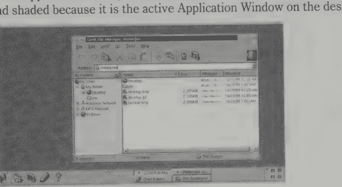

任务栏让你能够访问打开的应用程序。

你也可以从当前桌面访问其他虚拟桌面上打开的应用程序。

## 访问和切换打开的应用程序

打开的应用程序以“应用程序窗口”的形式显示在桌面上。你可以在桌面上显示多个应用程序窗口。使用任务栏上的按钮来访问和切换当前桌面上打开的应用程序。当你点击应用程序按钮时，该应用程序将成为活动应用程序窗口。关于应用程序窗口的信息，请参阅第 44 页的“在桌面上显示应用程序”。

默认情况下，任务栏仅显示当前桌面的打开的应用程序。你也可以访问另一个虚拟桌面上打开的应用程序。

### 访问当前桌面上的打开的应用程序

- 右键点击任务栏，点击“显示任务，当前桌面” (`Show Task, In Current Desktop`)。
- 点击任务栏上你想访问的应用程序按钮。

### 访问另一个虚拟桌面上打开的应用程序

- 右键点击任务栏，点击“显示任务，所有任务” (`Show Task, All Tasks`)。
- 点击你想访问的应用程序按钮。

Corel LINUX 会自动切换到显示该应用程序的虚拟桌面。

### 在打开的应用程序之间切换

- 点击任务栏上你想切换到的应用程序的按钮。
- 你也可以通过按 `ALT + TAB` 在当前桌面的打开的应用程序之间切换。


## 访问虚拟桌面

Corel LINUX 允许使用多个桌面。桌面是虚拟的，因为它们将桌面工作空间扩展到了计算机屏幕上直接可见的区域之外。虚拟桌面通过让你为不同的任务使用不同的桌面，帮助你组织工作并进行多任务处理。例如，你可以使用一个虚拟桌面用于写作或编程，另一个用于阅读和编写电子邮件，另一个用于阅读帮助文件。

显示在屏幕上的桌面是当前桌面。从当前桌面，你可以访问其他七个虚拟桌面。默认情况下，Corel LINUX 允许访问四个虚拟桌面，但你可以通过自定义桌面设置更改此数字。有关自定义虚拟桌面的信息，请参阅第 83 页的“自定义虚拟桌面和边界”。

位于面板上的虚拟桌面管理器可以让你组织虚拟桌面。使用虚拟桌面管理器查看所有活跃的虚拟桌面、在虚拟桌面之间切换，并在虚拟桌面之间移动应用程序。

此插图显示了面板上的虚拟桌面管理器，以及每个桌面的虚拟桌面按钮。

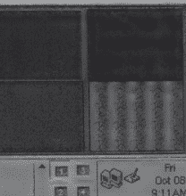

你可以刷新桌面以显示对桌面设置所做的更改。

## 查看和切换虚拟桌面

虚拟桌面管理器窗口让你查看所有活跃的虚拟桌面。你也可以在虚拟桌面之间进行切换。

查看所有虚拟桌面
- 点击面板上的虚拟桌面管理器飞出菜单（flyout）。

在虚拟桌面之间切换
- 在面板上，点击你想切换到的目标桌面的虚拟桌面按钮。

你可以通过按 `CTRL + TAB` 在虚拟桌面之间切换。

## 在虚拟桌面之间移动应用程序

你可以使用虚拟桌面管理器在虚拟桌面之间移动应用程序。确保你想要移动的应用程序在虚拟桌面窗口中打开。你也可以使用任务栏按钮将应用程序移动到不同的虚拟桌面。

你可以使用应用程序窗口让应用程序在所有虚拟桌面上都可用。如果你需要一直访问特定应用程序，这将非常有用。应用程序窗口包含一个名为“图钉按钮”（Sticky button）的图钉图标，位于标题栏上，它可以让你将应用程序放置在所有虚拟桌面上。

### 使用虚拟桌面管理器移动应用程序

- 1 点击虚拟桌面管理器飞出菜单。
- 2 将应用程序窗口从相应的虚拟桌面拖动到另一个桌面。

### 使用任务栏移动应用程序

- 1 右键点击你想移动的应用程序的任务栏按钮。
- 2 点击“移动到桌面” (`To Desktop`)，并选择你想将应用程序移动到的虚拟桌面。

### 将应用程序放置在所有虚拟桌面上

- 点击应用程序窗口标题栏上的图钉按钮。
- 再次点击图钉按钮可将该应用程序从所有虚拟桌面（除当前桌面外）中移除。

## 刷新 Corel LINUX 桌面

如果你做的更改没有立即显示，可以刷新桌面。例如，如果你对应用程序属性进行了更改，刷新桌面可以让你看到这些更改。

### 刷新桌面

- 右键点击桌面，点击“刷新桌面” (`Refresh Desktop`)。

## 在桌面上显示应用程序

当你启动一个应用程序时，桌面会通过应用程序窗口显示该程序。你可以在桌面上同时显示多个应用程序窗口。你正在工作的应用程序窗口是活动窗口。每个应用程序窗口顶部都有一个标题栏。当窗口处于状态时，标题栏会高亮显示。

LINUX 使用“平整”（Unclutter）和“层叠”（Cascade）命令帮助你组织桌面上的应用程序窗口显示方式。

你可以调整应用程序窗口。当你未使用特定的应用程序时，可以最小化它们以增加可用工作空间。你可以自定义窗口设置，使所有窗口具有相同的大小和位置。有关自定义窗口的信息，请参阅第 63 页的“自定义窗口”。

当你完成程序后，可以关闭应用程序窗口。

### 组织应用程序

你可以使用“平整”（Unclutter）和“层叠”（Cascade）命令来组织桌面上的应用程序窗口显示方式。“平整”命令分离应用程序窗口，以最大化显示每个应用程序的空间。例如，如果一个应用程序窗口隐藏在另一个后面，“平整”会将窗口分离，使用户可以访问隐藏的窗口。

层叠命令从活动窗口开始顺序排列应用程序窗口。

### 组织应用程序

- 右键点击桌面窗口，选择以下选项之一：
  - 平整 — 分离所有打开的窗口
  - 层叠 — 按顺序排列窗口

## 调整应用程序的大小和移动

你可以通过拖动或使用调整大小命令更改窗口大小。你也可以为所有窗口设置标准大小。有关为所有窗口设置标准大小的信息，请参阅第 63 页的“自定义窗口”。

在不使用应用程序时最小化它们，以增加桌面上的可用工作空间。你可以最小化一个窗口，也可以最小化除你想使用的窗口以外的所有窗口。

你还可以将应用程序窗口移动到桌面的不同区域。

### 通过拖动调整应用程序大小

- 1 将指针沿应用程序边界或角移动，直到光标变成带有横线的箭头。
- 2 拖动边界到正确的大小。

### 使用调整大小命令调整应用程序大小

- 1 右键点击要调整大小的应用程序标题栏，点击“调整大小” (`Resize`)。
- 2 移动指针调整窗口大小，并点击桌面。

锁定电脑屏幕可以确保在你离开电脑时没有人可以访问你的电脑。当你锁定屏幕时，Corel LINUX 会阻止对桌面的访问。你必须输入 Corel LINUX 密码来解锁屏幕并重新获得桌面的访问。

## 锁定屏幕

- 右键点击桌面，然后点击“锁定屏幕”。

## 解锁屏幕

- 在密码框中输入你的登录密码，然后按回车键（`ENTER`）。

如果屏幕是黑色的，按任意键或移动鼠标以显示 Corel LINUX 登录对话框。

## 更改用户密码

你可以更改登录 Corel LINUX 系统所需的密码。

### 更改用户密码

1. 点击应用程序启动器（`Application Starter`）、控制中心（`Control Center`）、密码（`Password`）。
2. 从域（`Domain`）列表框选择你想要更改密码的域。
3. 在旧密码（`Old Password`）框中输入旧密码。
4. 在新密码（`New Password`）框中输入新密码。
5. 在再次输入密码（`Re-type Password`）框中再次输入新密码。
- 勾选同步（`Synchronization`）复选框以更改所有域的密码。

## 自定义 Corel LINUX 设置

Corel LINUX 让你个性化桌面环境的外观和感受。背景颜色、壁纸、超链接和窗口配色方案、字体类型以及屏幕保护程序都是自定义的。主题管理器（`Theme Manager`）允许你将通用设计主题应用到桌面。你可以选择在对桌面执行操作时 Corel LINUX 播放的声音。更改窗口标题栏上的按钮、颜色和文本字体可以让窗口具有个性化的外观。你还可以更改桌面其他区域的字体外观。自定义窗口的大小和放置选项可以帮助你最大化桌面上的工作空间。

应用程序启动器菜单、快速启动菜单和面板（Panel）是你用于访问大多数实用程序和应用程序的桌面部分。自定义这些菜单上出现的项目可以快速访问你最频繁使用的目录和应用程序。面板上显示日期和时间；你可以重置日期时间并更改时区设置。


虚拟桌面管理器（Virtual Desktop Manager）也出现在面板上。你可以更改使用的虚拟桌面数量，并为每个虚拟桌面重命名。你可以自定义边界行为或为桌面设置魔术边界。在桌面上放置快捷图标可以快速访问目录和文件。你可以创建或删除快捷图标，并更改它们在桌面上的尺寸、字体、颜色和间距。

你可以自定义的键盘和鼠标设置包括按钮行为、快捷键和国际键盘语言映射。你可以更改鼠标左、右键的操作，更改默认快捷键或创建新快捷键，并从键盘和桌面的各种语言设置进行选择。`Corel LINUX`提供了多种不同的语言供你应用于桌面，以便菜单项以所选语言显示。它还提供了不同的国际键盘语言映射供你选择。如果你想输入英语以外的语言，国际键盘语言映射非常有用。设置键盘语言映射会将特殊字符分配给键盘按键，对应你设置的语言中的字母。

## 自定义桌面设置

`Corel LINUX`让你自定义桌面的显示和行为。控制中心允许你创建多五个虚拟桌面。你可以通过更改每个桌面的颜色、字体、字体和快捷图标来自定义桌面。

你可以为桌面设置背景颜色或壁纸，也可以选择预设或旋转的颜色和壁纸图案作为背景。通用背景（Common Backgrounds）功能允许你为所有虚拟桌面设置一种颜色、两种混合颜色或壁纸背景。你可以指定`Corel LINUX`用于维护背景的划分空间（内存）。背景配色方案将匹配的颜色应用于窗口的所有部分，例如活动标题栏、文本和标题文本。`Corel LINUX`提供了预设配色方案供你选择，也可以通过从系统或自定义颜色菜单中选择特定颜色来自定义配色方案。

你可以使用中心的显示对话框自定义桌面不同部分的颜色。

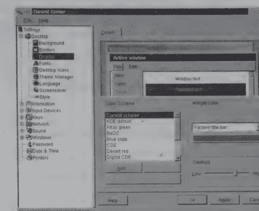

你可以从多个预装的屏幕保护程序应用于桌面。你可以自定义屏幕保护程序出现的颜色，并更改屏幕保护程序在屏幕上移动的速度。测试屏幕保护程序可以让你在应用之前查看其外观。屏幕上的角热点让你快速启动屏幕保护程序或密码保护功能。当启用热点时，将光标移动到指定的“热”角将启动屏幕保护程序或密码保护。

主题管理器允许你将主题应用到桌面，根据通用设计样式协调桌面区域的颜色和字体。主题根据设计样式自定义背景或壁纸、声音、图标、窗口边界和标题栏。你可以从预设主题中选择，或从另一个文件应用主题。

### 设置背景

你可以自定义虚拟桌面的背景颜色。你可以选择一种颜色、两种颜色进行混合或排列。你可以从系统颜色调色板中选择颜色。

#### 将背景设置为双颜色

1. 遵循上一个步骤的第 1 和第 2 步。
2. 启用双颜色（Two Color）按钮。
3. 从系统颜色（System Colors）中选择一种颜色。
   - 从上到下混合颜色（Blend Colors Top To Bottom）——从屏幕顶部到底部混合颜色。
   - 从右到左混合颜色（Blend Colors Right To Left）——从屏幕右侧到左侧混合颜色。
   - 使用图案（Use Pattern）——允许你从图案列表中选择图案。


#### 将背景设置为一种颜色

1. 按照“将背景设置为一种颜色”步骤执行第 1 到 4 步。
2. 从系统颜色中选择。
3. 点击颜色。

### 选择壁纸布局样式

- 1 按照“选择预装壁纸”程序中的步骤 1 和 2 进行操作。
- 2 从“布局（Arrangement）”列表框中选择一种样式。

### 启用随机壁纸序列

- 1 按照上一个程序中的步骤 1 和 2 进行操作。
- 2 启用“随机（Random)”复选框。

### 向随机壁纸序列添加文件

- 1 按照“选择壁纸”程序中的步骤 1 和 2 进行操作。
- 2 点击“设置（Setup)”按钮。
- 3 点击“添加（Add)”按钮。
- 4 选择一个壁纸文件添加到随机壁纸序列。
- 5 点击 OK，然后再次点击 OK。
- 6 启用“随机（Random)”复选框。

### 设置随机壁纸序列的定时延迟

- 1 按照“启用随机壁纸序列”程序中的步骤 1 和 2 进行操作。
- 2 点击“设置（Setup)”按钮。
- 3 在“延迟时间（秒）（Timer Delay In Seconds）”框中输入数字。

### 按设定顺序循环壁纸序列

- 1 按照“选择预装壁纸”程序中的步骤 1 和 2 进行操作。
- 2 从“布局（Arrangement）”列表框中选择一种样式。
- 3 启用“随机（Random)”复选框。
- 4 点击“设置（Setup)”按钮。
- 5 启用“顺序（In Order）”复选框。

可以通过启用“从目录选择文件（Pick Files From Directory）”复选框，然后点击“浏览（Browse）”按钮打开文件管理器或其他来源选择壁纸文件。

可以通过右键点击面板上的“显示设置（Display Settings）”按钮，然后点击“显示设置”或“背景设置（Background Settings）”来设置背景颜色。

## 为桌面选择配色

您可以为桌面选择一种配色。您可以选择预设配色，也可以通过为单个窗口项目（小部件）选择颜色来创建配色，例如非激活的标题栏、激活的标题文本或窗口背景。您可以从“系统颜色（System Colors）”或“自定义颜色（Custom Colors）”菜单中选择颜色。您还可以调整方案的色彩对比度。

### 选择配色

- 点击应用程序启动器（Application Starter），控制中心（Control Center）。
- 双击桌面（Desktop），并点击“显示（Display）”。
- 从“配色（Color Scheme）”列表框中选择一种配色。

### 自定义配色

- 按照上一个程序中的所有步骤操作。
- 点击“添加（Add）”按钮，并在框中为新配色命名。
- 从“小部件颜色（Widget Color）”列表框中选择一个窗口项目。
- 点击“小部件颜色”列表框下方的彩色按钮。
- 通过点击“系统颜色”中的彩色方块来选择一种颜色。
- 点击“保存更改（Save Changes）”按钮。

### 选择自定义颜色

- 按照“选择配色”程序中的步骤 1 到 3 操作。
- 从“自定义颜色（Custom Colors）”中选择一个空框。
- 点击调色板（Color Palette）上的一个颜色区域。
- 点击“添加到自定义颜色（Add To Custom Colors）”按钮。

### 更改色彩对比度

- 1 按照“选择配色”程序中的所有步骤操作。
- 2 向左移动对比度（Contrast）滑块以降低对比度，向右移动以增加对比度。
- 您可以通过右键点击面板上的“显示设置（Display Settings）”按钮，点击“显示设置”，然后点击“颜色（Colors）”选项卡来设置背景颜色。

## 选择屏幕保护

您可以为桌面选择屏幕保护。屏幕将在预览屏幕显示。每个屏幕保护都有不同的设置选项。例如，某些屏幕保护允许您自定义屏幕保护中出现的颜色；另一些允许您更改屏幕保护图像在屏幕上移动的速度。您可以测试屏幕保护以查看其效果。

### 选择屏幕保护

- 1 点击应用程序启动器（Application Starter），控制中心（Control Center）。
- 2 双击桌面（Desktop），并点击“屏幕保护（Screen Saver）”。
- 3 从“屏幕保护（Screen Saver）”列表框中选择一种屏幕保护。

### 修改屏幕保护设置

- 1 按照上一个程序中的步骤 1 到 3 操作。
- 2 点击“设置（Setup）”按钮。
- 3 更改以下任一设置：
  - 颜色（Color）
  - 速度（Speed）

### 测试屏幕保护

- 1 按照“选择屏幕保护”程序中的步骤 1 到 3 操作。
- 2 点击“测试（Test）”按钮。
- 您可以通过右键点击面板上的“显示设置（Display Settings）”按钮，点击“显示设置”，然后点击“屏幕保护（Screensaver）”选项卡来设置背景颜色。

## 自定义屏幕保护设置

您可以自定义屏幕保护的设置。您可以更改屏幕保护的延迟时间和密码。如果您为屏幕保护设置了密码，`Corel LINUX`会提示您输入登录密码以停止屏幕保护并返回桌面。您还可以设置屏幕保护相对于系统上运行的其他进程的优先级。例如，如果计算机内存仅足够运行其中之一，则为屏幕保护设置高优先级将导致屏幕保护被激活，而不是低优先级的进程。有关运行进程的更多信息，请参阅第 124 页的“监控系统进程和性能”。

### 设置屏幕保护延迟时间

- 1 点击应用程序启动器（Application Starter），控制中心（Control Center）。
- 2 双击桌面（Desktop），并点击“屏幕保护（Screen Saver）”。
- 3 在“等待（Wait For）”旋转框中输入屏幕保护启动前的延迟时间。

### 设置屏幕保护密码

- 1 按照上一个程序中的步骤 1 和 2 操作。
- 2 启用“需要密码（Require Password）”复选框。

### 设置屏幕保护优先级级别

- 1 按照“设置屏幕保护延迟时间”程序中的步骤 1 和 2 操作。


- 2 向左移动“优先级（Priority）”滑块设置更高优先级，或向右移动设置较低优先级。

- 您可以通过右键点击面板上的“显示设置（Display Settings）”按钮，点击“显示设置”，然后点击“屏幕保护（Screensaver）”选项卡来设置背景颜色。

# 设置角热点

您可以在屏幕角落启用热点快捷键，轻松激活屏幕保护或锁定屏幕。将光标置于热点之一即可启动屏幕保护。您还可以设置热点来锁定屏幕，并单独设置四个热点。您也可以禁用角热点。

## 启用屏幕保护角热点

- 1 点击应用程序启动器（Application Starter），控制中心（Control Center）。
- 2 双击桌面（Desktop），并点击“屏幕保护（Screen Saver）”。
- 3 右键点击预览显示器（Preview Monitor）显示中的一个角。
- 4 点击“保存屏幕（Save Screen）”。

## 启用锁定屏幕角热点

- 1 按照上一个程序中的步骤 1 到 3 操作。
- 2 点击“锁定屏幕（Lock Screen）”。

## 禁用角热点

- 1 按照“启用屏幕保护角热点”程序中的步骤 1 到 3 操作。
- 2 点击“忽略（Ignore）”。

- 您可以通过右键点击面板上的“显示设置（Display Settings）”按钮，点击“显示设置”，然后点击“屏幕保护（Screensaver）”选项卡来设置背景颜色。


### 选择桌面主题

应用主题可以自定义外观。设置主题会更改颜色、壁纸、声音、窗口框、标题栏和窗口布局。Corel LINUX 在主题管理器中提供了多个预设桌面主题供您使用。您可以预览主题以查看外观并将其应用于桌面。在应用桌面主题时，您可以选择要自定义的元素。您可以从其他文件源将互联网下载的主题添加到主题管理器。您还可以删除主题。

#### 预览预装桌面主题

- 1 点击应用程序启动器（Application Starter），控制中心（Control Center）。
- 2 双击桌面（Desktop），然后点击“主题管理器（Theme Manager）”。
- 3 在“安装（Installer）”选项卡上，点击左侧列表中的主题名称。

主题预览出现在列表右侧，显示您的桌面效果。

#### 自定义预装桌面主题

- 1 按照上一个程序的步骤 1 到 3 操作。
- 2 点击“内容（Contents）”选项卡。
- 3 取消列表中任何您不想在桌面上更改的元素的复选框。

当您应用桌面主题时，所有元素（如颜色、壁纸、面板、图标、窗口框）将根据您选择的主题进行更改。当在内容选项卡上禁用元素时，该元素将保留默认桌面设置。

#### 应用桌面主题

- 1 按照“预览预装桌面主题”程序中的步骤 1 到 3 操作。
- 2 点击“应用（Apply）”。

# 删除桌面主题

- 1 按照“预览预装桌面主题”程序中的步骤 1 到 3 操作。
- 2 点击“删除（Remove）”。

# 向主题管理器添加桌面主题

- 1 点击应用程序启动器（Application Starter），控制中心（Control Center）。
- 2 双击桌面（Desktop），然后点击“主题管理器（Theme Manager）”。
- 3 点击“添加（Add）”。
- 4 导航到文件系统中桌面主题文件的位置，点击 OK。

主题必须具有 `.tar.gz` 或 `.gz` 扩展名。这些扩展名表示该文件是压缩或加密过的。有关压缩文件的更多信息，请参阅第 240 页的“使用存档管理器”。

### 设置桌面样式

你可以在桌面上设置 Windows 95 和 Macintosh OS 样式。你可以让小部件以 Windows 95 的样式绘制。你还可以按照 Macintosh OS 样式将菜单栏放在屏幕顶部。你的字体和颜色设置可以应用于第三方应用程序的窗口。

#### 以 Windows 95 样式绘制小部件

- 1. 点击应用程序启动（Application Starter），控制中心（Control Center）。
- 2. 双击桌面（Desktop），点击样式（Style）。
- 3. 启用“以 Windows 95 样式绘制小部件”（Draw Widgets In The Style Of Windows 95）按钮。

#### 以 Macintosh OS 样式将菜单栏放在屏幕顶部

- 1. 按照上一个步骤的步骤 1 和 2 进行操作。
- 2. 启用“以 MacOS 样式将菜单栏放在屏幕顶部”（Menu bar On Top Of The Screen In The Style Of MacOS）按钮。

#### 为非核心 LINUX 应用字体和颜色

- 1. 按照“以 Windows 95 样式绘制小部件”步骤的步骤 1 和 2 进行操作。
- 2. 启用“为非 KDE 应用应用字体和颜色”（Apply Fonts And Colors To Non-KDE Apps）按钮。

## 设置桌面声音

你可以设置在桌面执行示例操作时播放的声音。例如，你可以设置在切换到桌面 4、打开窗口或取消固定窗口时发出蜂鸣声。有多种不同的系统声音供你选择应用于桌面操作。在将声音应用于桌面设置之前，你可以对这些声音进行测试。你可以设置播放声音的音量、音调和持续时间。更改音量会让声音变大或变小。更改音调会让声音变高或变低。更改持续时间会让声音播放的时间延长或延长。

### 启用系统声音

- 1. 点击应用程序启动（Application Starter），控制面板（Control Panel）。
- 2. 双击声音（Sound），点击系统声音（System Sounds）。
- 3. 勾选“启用系统声音”（Enable System Sounds）复选框。

### 将系统声音应用于桌面操作

- 1. 点击应用程序启动（Application Starter），控制面板（Control Panel）。
- 2. 双击声音（Sound），点击系统声音（System Sounds）。
- 3. 从“事件”（Events）列表中，选择你想要应用声音的桌面操作。
- 4. 从“声音”（Sounds）列表中，选择你想要在执行桌面操作时播放的声音。

### 测试系统声音

- 1. 按照上一个步骤的步骤 1 到 4 进行操作。
- 2. 点击“测试”（Test）按钮。

### 设置系统声音的音量、音调和持续时间

- 1. 点击应用程序启动（Application Starter），控制面板（Control Panel）。
- 2. 双击声音（Sound），点击提示音（Bell）。
- 3. 移动音量（Volume）滑块、音调（Pitch）滑块和持续时间（Duration）滑块增加或减少声音的音量、音调和持续时间。

> 你必须在系统中安装声卡才能听到桌面声音。

## 使用字体

字体是包含字体类型和大小的字符集。字体指的是字符集的样式，例如 Helvetica、Courier 和 Times Roman。大多数字体可以使用粗体*斜体*、粗斜体或标准粗细进行修改。

Corel LINUX 桌面为桌面的不同区域应用不同的字体。例如，应用程序窗口标题栏的标准字体文本是 Helvetica。你可以选择在桌面不同区域显示哪些字体。

Corel LINUX 应用可用的字体列在“字体管理器”（Font Manager）中。字体管理器与控制中心中的“字体”（Font）对话框配合工作。字体管理器中所有字体在字体对话框中均可用，并可用于桌面或桌面应用程序。你可以自定义字体管理器中的字体列表，使得只有你选择的字体出现在字体对话框和其他桌面应用程序中。有关字体管理器的更多信息，请参阅第 286 页的“管理字体”。

## 更改桌面字体

Corel LINUX 为桌面的不同区域应用不同的字体。例如，当你选择字体时，可以选择字体类型、字体大小和样式属性（如粗体和斜体）。

### 更改字体类型

- 1. 点击应用程序启动（Application Starter），控制中心（Control Center）。
- 2. 双击桌面（Desktop），点击字体（Fonts）。
- 3. 从列表中选择以下桌面文本区域之一：
  - 通用字体（General Font）
  - 固定字体（Fixed Font）
  - 窗口标题字体（Window Title Font）
  - 面板时字体（Panel Clock Font）
- 4. 从“字体类型”（Typeface）中选择一种字体。

### 更改字体大小

- 1. 按照上一个步骤的步骤 1 和 2 进行操作。
- 2. 在“大小”（Size）框中，点击加 (+) 增大大小或点击减 (-) 缩小大小。

### 更改字体样式

- 1. 按照上一个步骤的步骤 1 和 2 进行操作。
- 2. 在“样式”（Style）选项卡中，从以下进行选择：
  - 粗体（Bold）
  - 斜体（Italics）

## 自定义 Corel LINUX

你可以指定标题栏的外观。你可以选择出现在标题栏中的字体，并可以使用位图（pixmaps）和渲染自定义窗口标题栏的背景颜色。位图包含用于装饰窗口标题栏的图形或颜色。


你可以通过移动菜单栏和工具栏来自定义应用程序窗口的外观。菜单栏工具栏位于应用程序窗口顶部。工具栏通常位于菜单栏下方，尽管某些窗口没有工具栏。菜单栏通过下拉菜单提供应用程序窗口内所有命令的访问。工具栏为最常用的菜单选项提供了快捷图标。菜单栏和工具栏上的手柄允许你将栏移动到应用程序窗口或桌面的不同区域。

## 切换窗口和虚拟桌面

你可以设置一个按键在虚拟桌面之间切换。在启用该按键后，按下 `CTRL + TAB` 可切换虚拟桌面。你可以设置一个按键在当前桌面的活动窗口之间切换。设置此按键后，`ALT + TAB` 可切换活动窗口。

### 设置切换虚拟桌面的按键

1. 点击 `应用程序启动`（Application Starter），`控制中心`（Control Center）。
2. 点击 `窗口`（Windows），`高级`（Advanced）。
3. 启用禁用“`Ctrl-Tab Walks Through Desktops`”按钮。

### 设置切换活动窗口的按键

1. 按照上一个步骤的步骤 1 和 2 进行操作。
2. 启用禁用“`Alt-Tab Is Limited To Current Desktop`”。

## 设置窗口过滤器

你可以更改过滤器的默认设置，并根据标题或类将其应用于窗口。具有定义标题或类的窗口将显示指定的过滤器属性。从特定的窗口标题或类中移除窗口过滤器将从所有具有标题或类的窗口中移除该显示属性。

3 从“窗口将”（Windows Will）列表中选择以下任一窗口过滤器属性：
- 具有微型装饰
- 无装饰
- 从不获取焦点
- 启动时为置顶
- 排除在会话管理之外
4 在“标题”（Titles）框中输入窗口标题。
5 点击加号按钮 `+`。

## 根据窗口类设置窗口过滤器

1. 按照上一个程序的步骤 1 和 2 进操作。
2. 从“窗口将”（Windows Will）列表中选择您想要的窗口过滤器属性。
3. 在“类”（Classes）框中输入窗口类的名称。
4. 点击加号按钮 `+`。

## 移除窗口过滤器属性

1. 按照“根据窗口标题设置窗口过滤器”程序的步骤 1 和 2 进操作。
2. 从“窗口将”（Windows Will）列表中选择一个窗口过滤器属性。
3. 从“标题”（Titles）或“类”（Classes）列表中，双击您想要移除过滤器属性的窗口标题或类。
4. 点击减号按钮 `-` 从过滤器列表中移除该标题或类。

## 设置窗口大小属性

您可以设置窗口的调整大小和显示属性。您可以设置窗口在最大化或最小化时调整大小的速度。

### 设置窗口大小属性

1. 点击 `应用程序启动器`（Application Starter），`窗口`（Windows）。
2. 点击 `属性`（Properties）。
3. 启用以下 Windows 选项之一：
   - 默认仅垂直最大化 — 点击最大化按钮时，它仅在垂直方向扩展到屏幕全高。
   - 在移动窗口中显示内容 — 您在桌面上拖动窗口时，窗口内容似乎随着窗口移动。如果没有选择此选项，窗口框会移动，但内容保持不动，直到您在桌面上释放窗口。
   - 在调整大小的窗口中显示内容 — 您通过拖动角调整窗口大小时，窗口内容似乎随窗口一起调整大小。如果未选择此选项，窗口看起来在调整大小，但在您完成窗口调整大小之前，内容不会改变。

## 设置窗口调整大小速度

1. 按照上一个程序的步骤 1 和 2 操作。

移动“调整大小动画”（Resize Animation）滑块以设置调整速度。向左移动以减慢或取消动画，向右移动以加快动画。

## 设置窗口放置选项

您可以自定义窗口在桌面上的放置位置。您可以选择交互式放置设置允许的重叠程度，以便切换到手动模式。重叠程度以桌面空间的百分比显示。

### 设置窗口放置

1. 点击 `应用程序启动器`（Application Starter），`窗口`（Windows）。
2. 点击 `属性`（Properties）。
3. 从“放置策略”（Placement Policy）列表中选择以下窗口放置样式之一：
   - 智能（Smart） — 将新窗口放置在桌面最大的空白区域。
   - 级叠（Cascade） — 将新窗口放置在之前打开的窗口之上，使每个窗口的标题栏可见。
   - 随机（Random） — 在桌面上随机放置窗口。
   - 手动（Manual） — 在光标位置打开新窗口。窗口随光标移动，直到您点击。
   - 交互式（Interactive） — 将窗口放置在桌面的空白区域；如果没有可用区域，您必须手动放置窗口。

## 为交互式窗口放置选项设置允许的重叠

1. 按照上一个程序的步骤 1 和 2 操作。

点击“允许重叠”（Allowed Overlap）框旁的加号 `+` 或减号 `-` 按钮，增加或减少允许窗口重叠的桌面空间百分比。
- 您只能为交互式放置选项设置允许的重叠量。

## 设置窗口焦点选项

您可以自定义窗口焦点选项。焦点窗口是活动窗口。
“自动置顶”（auto raise）选项会自动将活动窗口置于其他窗口之前。您可以为焦点选项设置自动置顶延迟，“点击聚焦”（Click To Focus）除外。当您将光标置于活动窗口内部时，窗口将在指定的延迟后变为活动状态。
您可以设置点击置顶（click raise）选项，以便在未选择“点击聚焦”选项的情况下激活窗口。在窗口内右键点击鼠标可激活该窗口。

### 设置窗口焦点

1. 点击 `应用程序启动器`（Application Starter），`窗口`（Windows）。
2. 点击 `属性`（Properties）。
3. 从“焦点策略”（Focus Policy）列表中选择以下焦点样式之一。
   - 点击聚焦（Click To Focus） — 允许通过在窗口内点击鼠标来激活窗口。
   - 焦点跟随鼠标（Focus Follows Mouse） — 允许您将光标置于窗口内而无需点击即可激活。
   - 经典焦点跟随鼠标（Classic Focus Follows Mouse） — 允许您将光标置于窗口内激活窗口。当光标离开窗口时，活动窗口变为非活动。
   - 经典松散焦点（Classic Sloppy Focus） — 允许您将光标置于窗口内激活窗口。在光标进入另一个窗口之前，活动窗口保持活动。

### 设置自动置顶选项

1. 按照上一个程序的所有步骤操作。
2. 启用 `自动置顶`（Auto Raise）按钮。

### 设置焦点延迟

1. 按照“设置窗口焦点”程序的所有步骤操作。
2. 将延迟（Delay）滑块向右移动以增加焦点延迟时间，或向左移动以减少延迟。

### 设置点击置顶选项

1. 按照“设置窗口焦点”程序的所有步骤操作。
2. 启用“点击置顶”（Click To Raise）按钮。


- 当选择“点击聚焦”选项时，无法使用“点击置顶”和“自动置顶”选项。
- 您必须启用“自动置顶”选项才能设置焦点延迟时间。

## 设置标题栏偏好

您可以让标题栏居中或向右对齐。您可以自定义过长标题的位置。您可以定义窗口的动作。

### 设置对齐

1. 点击 `应用程序启动器`（Application Starter），`窗口`（Windows）。
2. 点击 `属性`（Properties）。
3. 从“对齐”（Alignment）列表中选择以下动作之一。

### 设置阴影

1. 按照上一个程序的步骤 1 和 2 操作。

启用以下 Windows 选项之一：
- 垂直阴影（Shaded Vertically）
- 水阴影（Shaded Horizontally）

### 设置像素图（pixmap）

1. 点击 `应用程序启动器`（Application Starter），`窗口`（Windows）。
2. 点击 `属性`（Properties）。
3. 启用以下 Windows 选项之一：
   - 纯色（Plain）
   - 像素图（Pixmap）


当启用像素图（Pixmap）时，标题栏变为活动。有关设置像素图的信息，请参见第 70 页的“使用标题栏像素图”。

### 设置动画

1. 按照上一个程序的步骤 1 和 2 操作。

将“标题动画”（Title Animation）滑块向左移动以增加动画速度，或向右移动以降低速度。

### 设置动作

1. 按照“设置对齐”程序的步骤 1 和 2 操作。

从“动作”（Action）列表中选择以下动作之一：
- 最大化（Maximize）
- 最小化（Iconify）
- 置顶（Sticky）
- 关闭（Close）
- 菜单（Menu）

## 自定义标题栏按钮

您可以自定义显示在标题栏上的按钮位置。

### 自定义标题栏按钮

1. 点击 `应用程序启动器`（Application Starter），`窗口`（Windows）。
2. 点击 `属性`（Properties）。
3. 为以下任一按钮启用右、左侧或关闭按钮：
   - 最小化（Minimize） — 将窗口显示为任务栏上的按钮。


- 最大化（Maximize） — 将窗口扩展到全屏。

## 自定义 Linux 设置

- 置顶（Sticky） — 在所有虚拟桌面上显示窗口。
- 关闭（Close） — 关闭窗口。
- 菜单（Menu） — 显示窗口控制选项菜单，包括移动、调整大小、最小化、置顶、最大化、重命名和关闭。

底部、左、右。你可以将工具栏放置在窗口的任何位置、桌面上，或将其隐藏。

此图显示了以下内容：

1) 标题栏
2) 菜单栏
3) 工具栏
4) 菜单栏和工具栏手柄

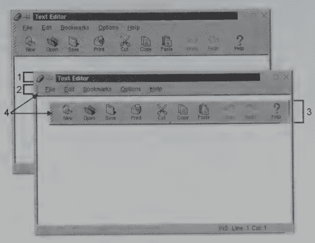

# 移动工具栏或菜单栏

1. 右键点击工具栏手柄。
2. 点击以下按钮之一：
   - 左侧（Left）将工具栏放置在窗口左侧
   - 顶部（Top）将工具栏放置在窗口顶部
   - 右侧（Right）将工具栏放置在窗口右侧
   - 底部（Bottom）将工具栏放置在窗口底部
   - （取消）浮动（Un)Float）让你将工具栏移动到屏幕或桌面的任何位置

你只能将菜单栏移动到顶部、底部或让其浮动。

你也可以将工具栏和菜单栏拖到屏幕或桌面的任何位置。

# 显示工具栏

- 点击菜单栏或工具栏手柄来显示或隐藏它们。

自定义 Corel LINUX 设置 71

# 自定义应用程序启动（Application Starter）菜单

应用程序启动菜单列出了应用程序、文件和目录。你可以通过添加和删除应用程序、文件、目录以及提示（ToolTips）来自定义应用程序启动菜单。提示提供了有关面板和桌面上图标及按钮的信息。当你将鼠标指针悬停在按钮或图标上时，提示会在弹出框中显示。

快速启动（Quick Start）菜单和磁盘导航器（Disk Navigator）是你可以添加到应用程序启动菜单的两个子菜单。快速启动菜单让你快速访问最近使用或频繁使用的应用程序。

磁盘导航器菜单位于应用程序启动菜单下方，提供了文件系统的层次视图。磁盘导航器菜单包含三个部分：共享（Shared）部分显示所有用户共用的文件、根目录和光驱驱。个人（Personal）部分显示用户特定的文件和文件夹，例如主目录和桌面。最近（Recent）部分显示你访问过的文件和文件夹，例如文本文档和应用程序。磁盘导航器的共享、个人和最近部分允许你通过向其中添加或删除应用程序或目录来自定义这些部分。在自定义共享和个人部分时，相应的目录会在 Core 文件管理器（Core File Manager）中自动打开，以便向这些部分添加或删除目录和文件。有关在 Core 文件管理器中移动目录和文件的信息，请参见第 146 页的“移动和复制目录及文件”。有关使用 Core 文件器的信息，请参见第 136 页的“在 Core 文件管理器中处理文件”。

- 此图显示了应用程序启动菜单的以下区域：
  1) 快速启动菜单
  2) 应用程序启动菜单
  3) 磁盘导航器

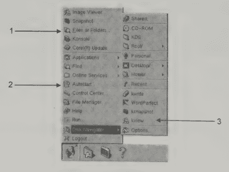

# 自定义应用程序启动菜单

应用程序启动菜单提供了文件、目录和应用程序列表。你可以自定义应用程序启动菜单以显示磁盘导航器，它会显示你选择的共享、个人和最近使用的目录及应用程序。你可以自定义应用程序启动菜单，将目录列在应用程序之前。你还可以从应用程序启动菜单中显示或移除提示。

## 在应用程序启动菜单上显示磁盘导航器

1. 右键点击面板，并点击配置（Configure）。
2. 点击菜单（Menu）选项卡。
3. 启用显示磁盘导航器（Show Disk Navigator）复选框。

## 在应用程序文件之前列出目录和目录菜单

1. 按照上一个程序的步骤 1 和 2 操作。
2. 启用文件夹优先（Menu Folders First）复选框。

## 显示应用程序启动菜单提示

1. 右键点击面板，并点击配置（Configure）。
2. 点击选项（Options）选项卡。
3. 在菜单提示（Menu Tooltips）部分，启用显示菜单提示（Show Menu Tooltips）复选框。
4. 移动延迟（Delay）块块设置提示延迟。将滑动块向左移动缩短延迟时间，向右移动增加延迟时间。

## 移除应用程序启动菜单提示

1. 按照“显示应用程序启动菜单提示”程序的步骤 1 和 2 操作。
2. 在菜单提示部分禁用显示菜单提示（Show Menu Tooltips）复选框。

# 自定义快速启动菜单

快速启动菜单位于应用程序启动菜单的顶部。你可以自定义快速启动菜单以显示你最近或最频繁使用的应用程序。你还可以设置出现在应用程序启动菜单中的快速启动应用程序的最大数量。

## 显示最近使用的应用程序

1. 右键点击面板，并点击配置（Configure）。
2. 点击菜单（Menu）选项卡。
3. 在快速启动包含（Quick Start Contains）部分，启用最近使用项（Most Recently Used Items）按钮。

## 在快速启动中显示最频繁使用的应用程序

1. 按照上一个程序的步骤 1 和 2 操作。
2. 在快速启动包含（Quick Start Contains）部分，启用频繁使用项（Most Frequently Used Items）按钮。

## 设置快速启动应用程序的最大数量

1. 按照“显示最近使用的应用程序”程序的步骤 1 和 2 操作。
2. 在快速启动项最大数量（Maximum Number Of Quick Start Entries）框中输入数字。


# 自定义磁盘导航器

磁盘导航器的共享、个人和最近部分允许你通过向其中添加或删除应用程序或目录来自定义这些部分。在自定义共享和个人部分时，相应的目录会在 Core 文件管理器中自动打开，以便向这些部分添加或删除目录和文件。

3 执行以下操作之一：
- 启用“显示最近区域”（Show Recent Section）复选框 — 显示最近区域
- 禁用“显示最近区域”（Show Recent Section）复选框 — 隐藏最近区域

## 在磁盘导航器菜单中显示或隐藏点文件

1. 右键点击面板，并点击配置。
2. 点击磁盘导航器菜单（Disk Navigator Menu）标签。
3. 执行以下操作之一：
   - 启用“显示点文件”（Show Dot Files）复选框 — 显示点文件
   - 禁用“显示点文件”（Show Dot Files）复选框 — 隐藏点文件

## 显示或隐藏选项选择

1. 右键点击面板，并点击配置。
2. 点击磁盘导航（Disk Navigator）标签。
3. 启用或禁用“显示选项”（Show Option Entry）复选框。

## 自定义面板

你可以通过移动或调整面板的大小来自定义面板的位置。你可以将面板移动到屏幕的顶部、左侧、底部或右侧。面板可以调整为微、正常或大。

你可以隐藏面板并为面板设置动画，使其在隐藏时滑出。你可以使用自动隐藏（Auto Hide）功能自动隐藏面板。自动隐藏会隐藏面板，直到你指向面板最后位于所在的屏幕边缘。

Corel Linux 允许你自定义面板上的应用程序按钮。应用程序按钮是出现在面板上的图标。当你点击应用程序按钮时，它会启动该应用程序。你可以移动或删除应用程序按钮，并更改随附按钮的图标和工具提示（ToolTips）。

任务栏显示在桌面上运行的应用程序。点击任务栏上的文件图标将显示桌面上的窗口；最小化窗口将使窗口从桌面上消失，但它仍然打开状态并可以通过任务栏访问。任务栏默认停靠在面板上，但你可以移动它使其显示在屏幕的顶部、底部或左上区域。你还可以隐藏任务栏或调整其大小。

时间显示位于面板右侧的停站（Docking Station）中。你可以以三种格式显示时间：AM/PM 格式（基于 12 小时循环计算时间）、互联网时间（Internet beats，标准网络时间）或 24 小时格式（基于 24 小时循环计算时间）。你还可以更改日期、时间和时区。

## 自定义面板

你可以在桌面上移动面板，也可以调整面板的大小。

### 在桌面上移动面板

1. 右键点击面板，并点击配置。
2. 点击面板（Panel）标签。
3. 在位置（Location）部分，启用以下按钮之一：
   * 顶部
   * 左侧
   * 底部
   * 右侧

你也可以将面板拖动到桌面的某一侧。

### 调整面板大小

1. 右键点击面板，并点击配置。
2. 点击面板（Panel）标签。
3. 在样式（Style）部分，启用以下按钮之一：
   * 微
   * 正常
   * 大

## 显示和隐藏面板

你可以隐藏面板，为应用程序和其他窗口在桌面留留更多空间。如果你启用了自动隐藏功能，面板将自动隐藏。你可以为面板设置动画，使其在隐藏时滑出。

### 隐藏或显示面板

- 点击位于应用程序启动器（Application Starter）按钮旁边的面板弹出菜单。

### 使用自动隐藏隐藏面板

1. 右键点击面板，并点击配置。
2. 点击选项（Options）标签。
3. 启用“自动隐藏面板”（Auto Hide Panel）复选框。
4. 移动延迟滑块以设置显示/隐藏时间延迟的速度。
5. 移动速度滑块以设置显示/隐藏速度。


## 当启用自动隐藏时显示面板
- 将光标置于屏幕的顶部、底部或侧面，即面板显示时所在。

## 当启用自动隐藏时隐藏面板
- 将光标移开面板。

## 设置面板显示和隐藏动画
1. 右键点击面板，并点击配置。
2. 点击选项（Options）标签。
3. 启用“动画显示/隐藏”（Animate Show/Hide）按钮。
4. 移动速度滑块以设置动画速度。将滑块向左移动降低速度，向右移动增加速度。

## 自定义面板上的应用程序按钮
你可以自定义面板上的应用程序按钮。你可以移动面板上的应用程序按钮或将其从面板中移除。你还可以更改应用程序按钮上显示的工具提示和图标。只有 root 用户可以更改任务栏上的应用程序按钮。

### 移动应用程序按钮
1. 右键点击应用程序按钮，并点击移动（Move）。
2. 将应用程序按钮移动到面板上的新位置，并点击面板。

### 移除应用程序按钮
- 右键点击应用程序按钮，并点击移除（Remove）。

### 更改应用程序按钮上的图标
1. 右键点击应用程序按钮，并点击属性（Properties）。
2. 点击执行（Execute）标签，并点击图标（Icon）按钮。
3. 从选择图标（Select Icon）列表框中选择文件夹，并点击新图标。
- 在选择新图标时，你可以在过滤器（Filter）框中指定文件类型。

### 更改应用程序按钮的工具提示（ToolTip）
1. 右键点击应用程序按钮，并点击属性（Properties）。
2. 点击应用程序（Application）标签。
3. 在注释（Comment）框中输入工具提示文本。

## 自定义任务栏
Corel LINUX 允许你自定义任务栏。你可以更改任务栏在桌面上的位置。当你将光标移动到屏幕边缘时，任务栏会出现。你还可以更改它停靠在面板上时的的大小。

### 更改任务栏位置
1. 右键点击任务栏，并点击配置。
2. 点击面板（Panel）标签。
3. 启用以下按钮之一：
   * 隐藏
   * 顶部
   * 底部

### 使用自动隐藏隐藏任务栏
1. 右键点击任务栏，并点击配置。
2. 点击选项（Options）标签。
3. 启用“自动隐藏任务栏”（Auto Hide Taskbar）复选框。
4. 移动延迟滑块以设置显示/隐藏时间延迟。
5. 移动速度滑块以设置显示/隐藏速度。

### 当任务栏停靠在面板上时调整大小
1. 将光标置于任务栏边界。
2. 拖动边界向左或右。

## 在面板上显示时间
面板以三种格式显示时间：
- AM/PM 格式
- 互联网时间
- 24 小时格式

### 以 AM/PM 格式显示时间
1. 右键点击面板，并点击配置。
2. 点击选项（Options）标签。
3. 启用“显示 AM/PM 时间”（Clock Shows Time AM/PM）按钮。

### 以互联网时间显示时间
1. 右键点击面板，并点击配置。
2. 点击选项（Options）标签。
3. 启用“显示互联网时间”（Clock Shows Time Internet beats）按钮。

### 以 24 小时格式显示时间
1. 右键点击面板，并点击配置。
2. 点击选项（Options）标签。
3. 启用“显示 24 小时时间”（Show Time 24-hour）按钮。

## 更改日期和时间设置
你可以更改日期、时间和时区。

### 更改时间
1. 点击应用程序启动器（Application Starter），控制中心（Control Center）。
2. 点击日期与时间（Date & Time），并点击日期/时间（Date/Time）标签。
3. 将光标置于小时、分钟或秒数字框下方。
4. 点击加号（+）或减号（-）按钮更改小时、分钟或秒。
> 如果你没有点击“确定”或“应用”，点击“现在”（Now）按钮可以将时间重置为最新设置。

### 更改日期
1. 遵循“更改时间”步骤中的前两个步骤。
2. 从日历上方列表框中选择月份。
3. 从日历上方的数字框中选择年份。
4. 点击日历中的某个日期。
> 如果你没有点击“确定”或“应用”，点击“今天”（Today）按钮可以将日期重置为最新设置。

### 更改时区
1. 遵循“更改时间”步骤中的前两个步骤。
2. 点击时区（Time Zone）标签。
3. 从列表框中选择一个时区。
> 你必须以 root 用户身份登录才能更改日期时间和设置。

# 自定义虚拟桌面和边界
你可以更改虚拟桌面的数量。你最多可以使用八个虚拟桌面；你所设置的虚拟桌面将以编号图标的形式显示在面板（Panel）上。你可以重命名虚拟桌面，并为所有桌面应用相同的背景或壁纸。
你可以自定义桌面边界和窗口边界的行为。活动边界（Active Borders）允许你通过将光光标移动到屏幕边缘来切换虚拟桌面。魔力边界（Magic Borders）允许你控制窗口如何吸附到其他窗口和屏幕边缘。自定义活动边界和魔力边界会将设置应用于所有虚拟桌面的窗口和边界。

## 自定义虚拟桌面
你可以使用面板自定义虚拟桌面。Corel LINUX 允许你将虚拟桌面的数量更改为最多八。你还可以为每个虚拟桌面命名。你可以为所有虚拟桌面应用相同的背景。

### 更改虚拟桌面的数量
1. 右键点击面板，并点击“配置”（Configure）。
2. 点击“桌面”（Desktops）选项卡。
3. 从“可见列表”（Visible List）框选择一个数字。

### 为虚拟桌面命名
1. 按照上一个操作的步骤 1 和 2 执行。
2. 在相应的数字框中输入虚拟桌面名称。

### 为所有虚拟桌面设置相同的背景
1. 点击应用程序启动器（Application Starter），控制面板（Control Panel）。
2. 双击“桌面”（Desktop），然后点击“背景”（Background）。
3. 勾选桌面框下方的常用背景”（Common Background）复选框。

## 自定义活动桌面边界
活动桌面边界功能允许通过将光标移动到屏幕边缘切换到另一个虚拟桌面。你可以自定义此功能，让光标在每次切换后返回屏幕中心。你还可以设置光标在切换桌面之前必须留在边缘的时间。

### 启用活动桌面边界
1. 点击应用程序启动器（Application Starter），控制中心（Control Center）。
2. 双击“桌面”（Desktop），并点击“边界”（Borders）。
3. 勾选“启用活动桌面边界”（Enable Active Desktop Borders）复选框。

### 在切换桌面后让光标居中
1. 按照上一个操作的步骤 1 到 3 执行。
2. 勾选“切换后将指针移向中心”（Move Pointer Towards Center After Switch）复选框。

### 设置桌面切换延迟
1. 按照“启用活动桌面边界”操作的步骤 1 到 3 执行。
2. 向左移动“桌面切换延迟”（Desktop Switch Delay）滑块以减少延迟时间，向右移动以增加延迟时间。

## 设置魔力边界
魔力边界功能允许你在窗口边缘或屏幕边缘周围设置吸附区域。边界吸附区域由屏幕边缘周围指定数量的像素组成。吸附区域以像素为单位。窗口吸附区域由窗口边缘周围指定数量的像素组成。将一个窗口移动到另一个窗口的吸附区域时，窗口会自动吸附并并排对齐。将窗口移动到边界吸附区域会自动使窗口边缘与屏幕边缘对齐。

### 设置边界吸附区域
1. 点击应用程序启动器（Application Starter），控制中心（Control Center）。
2. 双击“桌面”（Desktop），并点击“边界”（Borders）。
3. 向左移动“边界吸附区域”（Border Snap Zone）滑块以减少吸附区域宽度，向右移动以增加吸附区域。

### 设置窗口吸附区域
按照上一个操作的步骤 1 和 2 执行。
向左移动“窗口吸附区域”（Window Snap Zone）滑块以减少吸附区域，向右移动以增加吸附区域。

## 自定义桌面快捷图标
显示在桌面上的图标是应用程序和目录的快捷方式。快捷方式允许你从桌面打开目录、打开文件并启动应用程序。当你安装 Corel LINUX 时，安装程序会在桌面上放置链接到以下目录和应用程序的图标（某些版本的 Corel LINUX 可能包含其他图标）：
- 垃圾桶（Trash）（目录）
- 我的主页（My Home）（目录）
- 打印机（Printer）（应用程序）
- CD-ROM（目录）
- 软磁盘（Floppy）（目录）
你可以向桌面添加快捷图标，也可以将其删除。你可以更改代表快捷方式的图标。你可以在桌面上移动快捷图标，或设置图标之间的间距。你可以自定义快捷图标的背景颜色文本颜色。
你可以使用 Corel 文件管理器（Corel File Manager）通过复制、移动或链接文件、目录或应用程序到桌面来添加快捷图标。有关如何从 Corel 文件管理器创建桌面快捷方式的信息，请参见第 153 页的“创建指向目录或文件的桌面链接”或第 154 页的“创建应用程序的快捷方式”。

## 在桌面上创建快捷方式


你可以在桌面放置应用程序的快捷方式。你可以从桌面或从应用程序创建快捷方式。

### 从桌面创建快捷方式

- 1. 右键点击桌面。
- 2. 选择“新建”（New），并点击“昵称”（Nickname）。
- 3. 在“昵称”（Nickname）框中为应用程序输入昵称。
- 4. 在“目标”（Target）框中输入你为该昵称创建路径和文件名。
- 如果不知道文件名，可以点击“浏览”（Browse）按钮。

### 从应用程序创建快捷方式

- 1. 打开想要创建快捷方式的应用程序。
- 2. 右键点击标题栏（Title Bar）。
- 3. 点击“创建昵称”（Create A Nickname）。
- 4. 在“昵称”（Nickname）框中为应用程序输入昵称。
- 属性（Properties）对话框适用于高级用户。不建议你更改属性对话框中的设置。
- 执行（execute）选项卡在属性对话框中可能不可。例如。

### 更改代表快捷方式的图标

- 1. 按照上一个操作的步骤 1 到 3 执行。
- 2. 勾选“切换后将指针移向中心”（Move Pointer Towards Center After Switch）复选框。
- 属性（Properties）对话框适用于高级用户。不建议你更改属性对话框中的设置。
- 执行（execute）选项卡在属性对话框中可能可用。例如。

### 更改图标

- 1. 右键点击桌面。
- 2. 点击属性（Properties）。
- 3. 点击“执行”（Execute）选项卡。
- 4. 更改图标。

### 从桌面移除快捷图标

- 1. 将图标拖到垃圾桶（Trash）。

### 从桌面移除图标

- 1. 右键点击桌面。
- 2. 选择“删除”（Delete）。

### 自定义图标文本颜色

- 1. 将图标拖到垃圾桶（Trash）。

有关使用垃圾桶的更多信息，请参见第 145 页的“将文件移动到垃圾桶”。

### 图标之间的间距

你可以更改图标之间的垂直和水平间距。

#### 设置水平间距

- 1. 点击应用程序启动器（Application Starter），控制中心（Control Center）。
- 2. 双击“桌面”（Desktop），并点击“桌面图标”（Desktop Icons）。
- 3. 在“水平网格间距”（Horizontal Grid Spacing）滑块中指定水平空间。

#### 设置垂直间距

- 1. 按照上一个操作的步骤 1 和 2 执行。
- 2. 在“垂直网格间距”（Vertical Grid Spacing）滑块中指定垂直空间。
- 你必须重启电脑才能应用间距更改。

鼠标键可以根据光标指向窗口的任意位置执行不同的操作。你可以使用每个鼠标键来选择点击点击时窗口要执行的操作。例如，你可以设置鼠标操作，使得当右键点击窗口的标题栏或框架时，窗口将置于后层，位于其他窗口之后；或者，当左键点击非活动窗口的内部区域时，该窗口被激活并置于顶层。可用的操作包括置顶、置底、操作菜单、切换置顶和置底、传递点击、移动、调整大小和无。你可以将任何操作应用于右键或左键，以及窗口的不同部分。

鼠标加速是指当你移动鼠标时光标移动的速度。鼠标加速值会使光标移动得较慢。鼠标加速阈值是光标在发生加速移动之前必须移动的像素距离。阈值越低，光标对鼠标移动的响应越快。例如，高加速值配合低阈值，意味着微小的鼠标移动就能让光标快速地移动很远距离。高阈值配合低加速值则需要较大的鼠标移动才能移动光标。

你可以更改鼠标的按钮映射，使左键执行右键操作，右键执行左键操作。

## 自定义键盘设置

你可以开启或关闭键盘重复。你还可以调整按下按键时产生的反馈音量。

### 设置键盘重复

- 点击应用程序启动器（Application Starter），控制中心（Control Center）。
- 点击输入设备（Input Devices），键盘（Keyboard）。
- 在键盘重复框中，启用以下按钮之一：
  - — On 允许你在按住按键时重复输入字符
  - 关闭 — Off 允许你在按住按键时仅输入一次字符

### 设置键点击反馈音量

- 按照上一步程序的步骤 1 和 2 进行操作。
- 向左移动键点击音量滑块以减小，向右移动以增大。

## 为非 Corel LINUX 应用程序设置右键控制

某些非 Corel LINUX 应用程序需要对右键应用自定义设置。你可以让非 Corel LINUX 应用程序在需要时使用它们自己的右键设置。你也可以设置鼠标设置，使右键保持其 Corel LINUX 设置。

### 让非 Corel LINUX 应用程序使用右键

1. 点击应用程序启动器，控制中心。
2. 双击窗口（Windows），然后点击高级（Advanced）。
3. 点击捕获右键（Grab The Right Mouse Button）以取消勾选。

### 让 Corel LINUX 使用右键

1. 按照上一步程序的步骤 1 和 2 进行操作。
2. 点击捕获右键（Grab The Right Mouse Button）以勾选。


- 默认选中捕获右键。

## 配置鼠标操作设置

你可以指定每个鼠标键在点击窗口部分时执行的操作。你可以设置左键、中键或右键，在点击以下区域之一时执行特定操作：

- 激活窗口的标题栏和框架
- 非活动窗口的标题栏或框架
- 非活动窗口的内部区域

你可以将以下操作应用于窗口区域的任何一个鼠标键：

- 置顶 — raise — 允许你点击窗口使其位于桌面上已打开的任何窗口之前
- 置底 — lower — 允许你点击窗口使其位于桌面上已打开的任何窗口之后
- 激活 — activate — 如果窗口是非活动状态，允许你点击窗口将其激活
- 操作菜单 — operations menu — 允许显示窗口操作菜单，包括移动、调整大小、最小化、最大化、置顶（sticky）和关闭
- 切换置顶和置底 — toggle raise and lower — 允许你点击窗口使其位于其他打开窗口之前；再次点击使其位于其他打开窗口之后

你可以配置鼠标操作设置，以使得在按住 ALT 键的同时点击鼠标键执行指定的操作。你可以设置在激活或非活动窗口上使用 ALT 键点击鼠标键时，执行置顶、置底、激活或切换置顶和置底操作。你还可以使用 ALT + 鼠标键组合来调整窗口大小。

### 设置点击激活窗口标题栏和框架的鼠标操作

1. 点击应用程序启动器，控制中心。
2. 点击窗口，鼠标。
3. 在“标题栏和框架：活动区域（Title Bar And Frame: Active area）”的左键列表框中选择一个操作。
4. 在中键列表框中选择一个操作。
5. 在右键列表框中选择一个操作。

### 设置点击非活动窗口标题栏和框架的鼠标操作

1. 按照上一步程序的步骤 1 和 2 进行操作。
2. 在“标题栏和框架：非活动区域（Title Bar And Frame: Inactive area）”的左键列表框中选择一个操作。
3. 在中键列表框中选择一个操作。
4. 在右键列表框中选择一个操作。

### 设置非活动内部窗口的鼠标操作

1. 按照“设置点击激活窗口标题栏和框架的鼠标操作”程序的步骤 1 和 2 进行操作。
2. 在“非活动内部区域（Inactive Inner area）”的左键列表框中选择一个操作。
3. 在中键列表框中选择一个操作。
4. 在右键列表框中选择一个操作。

### 设置非活动内部窗口、标题栏和框架的鼠标操作

- 按照“设置点击激活窗口标题栏和框架的鼠标操作”程序的步骤 1 和 2 进行操作。
- 在“非活动内部区域（Inactive Inner area）”的左键列表框中选择一个操作。
- 在中键列表框中选择一个操作。
- 在右键列表框中选择一个操作。

## 自定义鼠标设置

你可以自定义鼠标设置。你可以更改鼠标加速使光标移动得更快，也可以更改鼠标加速阈值使光标响应更快或更慢。你还可以更改鼠标按钮映射。例如，你可以将右手模式切换为左手模式。鼠标按钮设置默认为右手模式。

### 设置鼠标加速

- 点击应用程序启动器，控制中心。
- 点击输入设备，鼠标。
- 向左移动加速（Acceleration）滑块以减慢鼠标加速，向右移动以加快鼠标加速。

### 设置鼠标加速阈值

- 按照上一步程序的步骤 1 和 2 进行操作。
- 向左移动阈值（Threshold）滑块以设置低加速阈值，向右移动以设置高加速阈值。

### 设置鼠标按钮映射

- 按照“设置鼠标加速”程序的步骤 1 和 2 进行操作。
- 在按钮映射（Button Mapping）框中启用左手（Left Handed）或右手（Right Handed）。

## 自定义键盘快捷键

Core LINUX 提供了快捷键。快捷键是执行指定操作的预设按键或组合键。例如，你可以使用快捷键来执行命令，而不是使用鼠标从菜单中选择。快捷键有两种类型：

- 全局 — Global — 适用于操作系统功能，如执行命令、切换虚拟桌面或控制窗口


- 标准 — Standard — 适用于应用程序内的命令，如剪切、粘贴、打印、保存和撤销

你可以删除快捷键并恢复默认快捷键设置。

### 自定义全局快捷键

你可以为你最常用的全局快捷键创建自定义的快捷键方案。你也可以修改已创建的快捷键方案，或更改 Core LINUX 默认快捷键方案。在控制中心的键盘窗口中，操作显示在操作列表中，快捷键显示在当前快捷键列表中。你可以更改预设执行快捷键的控制键组合（`SHIFT`, `CTRL`, `ALT`）。你还可以删除全局键盘快捷键和快捷键方案。

### 添加全局快捷键方案

1. 点击应用程序启动器，控制中心。
2. 点击键盘，全局。
3. 点击添加（`Add`）。
4. 为快捷键方案输入名称。

--可以通过遵循“更改默认全局快捷键”程序的所有步骤，更改你创建的全局快捷键方案的快捷键。

# 修改默认全局快捷键

1. 按照上一个步骤的第 1 和第 2 步操作。
2. 从“键方案”列表中选择一种键位方案。
3. 从“动作”列表中选择一个动作。
4. 启用“自定义键”按钮。
5. 启用或禁用 `SHIFT`、`CTRL`、`ALT` 按钮。
6. 点击“保存更改”。

“当前键”列表中显示的快捷键组合将随之更改。

- 若要恢复默认快捷键设置，请在全局快捷键窗口中为所选动作启用“默认键”按钮。

# 删除全局键位方案

1. 按照“添加全局快捷键方案”步骤的第 1 和第 2 步。
2. 从“键方案”列表中选择一种键位方案。
3. 点击“删除”。

# 删除全局快捷键方案

1. 按照“添加全局快捷键方案”步骤的第 1 和第 2 步。
2. 从“动作”列表中选择一个动作。
3. 启用“无键”按钮。
4. 点击“保存更改”。

# 自定义标准快捷键

你可以为你最常用的标准快捷键创建快捷键。你也可以修改已创建的键位方案或默认键方案中的快捷键。在控制中心的“键”窗口中，你可以定义在“动作”列表中可以的动作，以及在“当前键”列表中显示的快捷键。你可以更改执行快捷键时所按的控制键（`SHIFT`、`CTRL` 和 `ALT`）组合。你还可以删除键盘快捷键和键位方案。

- 动作的命令键（例如 `F2` 或 `F3`）无法更改。

只有控制键可以自定义。

# 添加标准快捷键方案

1. 点击应用程序启动器，控制中心。
2. 点击“键”，“标准键”。
3. 点击“添加”。
4. 在对话框中为新键方案输入名称。

- 若要更改新键方案的快捷键，请遵循“修改默认标准快捷键”步骤中的所有操作操作。

# 修改默认标准快捷键

1. 按照上一个步骤的第 1 和第 2 步。
2. 从“键方案”列表中选择一种键位方案。
3. 从“动作”列表中选择一个动作。
4. 启用“自定义键”按钮。
5. 启用或禁用 `SHIFT`、`CTRL` 和 `ALT` 按钮。

“当前键”列表中显示的按键将随之更改。

6. 点击“保存更改”。

- 若要恢复默认快捷键设置，请在全局快捷键窗口中为所选动作启用“默认键”按钮。

# 删除标准快捷键

1. 按照“添加标准快捷键方案”步骤的第 1 和第 2 步。
2. 从“动作”列表中选择一个动作。
3. 启用“无键”按钮。
4. 点击“保存更改”。

# 删除标准键方案

1. 按照“添加标准键方案”步骤的第 1 和第 2 步。
2. 从“键方案”列表中选择一种键位方案。
3. 点击“删除”。

# 自定义桌面和键盘语言

你可以更改桌面窗口和菜单上显示的语言，并自定义国际键盘语言映射。你可以自定义桌面图标和窗口上文本显示的语言。更改桌面语言后，应用程序启动器菜单、面板以及大多数 Corel LINUX 工具的菜单将以你设置的语言显示。你可以最多设置三种语言。桌面无法以第一种语言呈现信息，它会尝试以第二种语言，然后是第三种语言呈现。

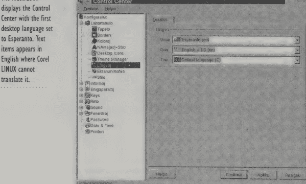

国际键盘语言映射的每个键关联的字符与英语键盘键分配的字符不同。例如，当你将法语键盘映射应用到英语键盘时，按下 A 键会输入字母 Q。使用非拉丁字符（如俄语或芬兰语）的语言映射会将这些特殊字符分配给按键。你可以定义允许在键盘映射之间切换的按键。每个语言映射的每个键最多关联四个字符。你可以通过仅按键以及 `SHIFT +` 字符键（如键盘映射所示）访问按键的前两个字符。另外两个字符是备用字符，你可以通过定义的备用切换键来访问。

你可以设置国际键盘选项，定义窗口打开时使用哪种语言映射。“全局”选项将定义的语言映射应用于所有窗口。“窗口”选项将将语言映射应用于每个活动窗口。“类”选项将将语言映射应用于一类窗口。例如，使用“类”选项，如果你在文本编辑器中切换到俄语键盘映射，打开的每个文本编辑器窗口也将使用俄语键盘映射。切换键是你指定的按键或按键组合，用于让你在国际键盘映射之间切换。

# 为桌面选择语言

你可以设置最多三种语言显示在桌面和菜单中。Core LINUX 以设置的第一种语言显示桌面文本，除非该项在操作系统代码中未翻译。你设置的第二和第三种语言作为备份；如果第一种语言无翻译，则以第二或第三种语言显示桌面文本。

# 为桌面选择语言

- 点击应用程序启动器，控制中心。
- 双击“桌面”，点击“语言”。
- 启用“启用自定义语言选择”复选框。
- 从以下每个框中选择语言：

  - 第一个列表框
  - 第二个列表框
  - 第三个列表框


你必须注销 Core LINUX 并重启桌面才能生效。

# 配置键盘映射

你可以添加国际键盘映射，让你使用非英语字母的语言。你可以从可用语言列表中添加多个键盘映射。你可以设置国际键盘选项，定义窗口打开时使用哪种语言映射。你还可以删除国际键盘映射。你可以设置启动 Core LINUX 会话时启动设置窗口及其显示位置。

# 添加国际键盘映射

1. 点击应用程序启动器，控制中心。
2. 点击输入设备，“国际键盘”。
3. 点击“常规”选项卡并点击“添加”。
4. 从可用键盘映射列表中选择语言。

# 删除国际键盘映射

1. 按照上一个步骤的第 1 和第 2 步。
2. 从映射列表中选择要删除的语言。
3. 点击“删除”。

# 设置键盘映射的启动属性

1. 按照“添加键盘映射”步骤的第 1 和第 2 步。
2. 点击“启动”选项卡下的以下复选框：

   * 启动 — 每次 Core LINUX 会话
   * 固定 — 从面板上的图标访问国际键盘设置
3. 从“位置”列表框中选择你希望国际键盘窗口显示在桌面的位置。


只有当你禁用“启动”选项卡上的“固定”复选框时，“位置”列表可用。

# 切换国际键盘映射

你可以通过定义切换键在活动窗口中切换到不同的国际键盘映射。你可以定义按键或按键组合作为替代（Alt）切换键。按下 Alt 切换键可以访问当前国际键盘映射的替代字符。你还可以使用定义的切换键从任何活动窗口访问国际键盘映射设置。

# 设置键盘切换键

1. 点击应用程序启动器，控制中心。
2. 点击输入设备，“国际键盘”。
3. 从切换列表框中选择切换快捷键。

# 设置键盘 Alt 切换键

1. 按照上一个步骤的第 1 和第 2 步。
2. 点击输入设备，“国际键盘”。
3. 从切换列表框中选择 Alt 快捷键。

# 设置切换键以从活动窗口访问国际键盘映射

1. 按照“设置键盘切换键”步骤的第 1 和第 2 步。
2. 点击“高级”按钮。
3. 启用“世界菜单”复选框。


# 管理 Corel LINUX 系统 6

**Corel LINUX 与系统管理员的角色**

系统管理员在 Linux 中被称为 root 用户，负责维护系统和管理用户。root 账户在安装 Corel LINUX 期间自动创建。通过以 root 用户或系统管理员的身份登录计算机，你将拥有无限权限；你可以添加和删除用户账户、更改用户权限、访问所有文件并配置 Corel LINUX。作为 root 用户，你对操作系统可以执行的功能没有任何限制。但在以 root 用户登录时，你也可能会无意中损坏系统。关于使用 root 账户的更多信息，请参阅第 103 页的“使用 root 账户”。

Corel LINUX 系统管理工具，允许 root 用户创建、配置和删除用户及组帐户，更改文件和目录的权限和所有权，查看系统日志文件和设备信息。

用户管理器（User Manager）允许你添加和删除用户帐户或组，从组中添加或删除用户，更改用户密码并编辑账户配置信息。事件查看器（Event Viewer）查看描述系统设施活动（如守护进程、打印机、内核或打印设施）的日志文件。你可以自定义过滤器来显示设施和消息优先级。你还可以保存和清除日志文件。控制中心（Control Center）允许你查看系统设备信息。此功能是只读的，但提供了 DMA 通道、中断、IO 端口、内存、分区和 Samba 状态等设备的状态信息。


Corel LINUX 是一种多功能操作系统，可用于网络、多用户和独立系统。尽管这些系统的目的和功能不同，但它们都需要一个充当系统管理员的用户。该系统管理员负责监督和管理系统，以确保其运行良好高效。

## 独立系统

你可以将 Corel LINUX 作为独立计算机的操作系统。独立计算机未连接到网络，仅由一个用户访问，该用户必须同时兼任系统管理员。当以 `root` 用户登录时，你可以执行一些系统管理任务，例如从系统中安装、更新和删除应用程序。因为在以 `root` 用户登录时可能会无意中损坏系统，因此设置一个普通用户账户是非常重要的，以便在你完成系统管理功能后可以使用该账户。

## 多用户系统

多用户系统是指多个用户可以访问同一台独立计算机的系统。每个用户都有单独的用户账户，因此某些文件或目录对某些用户禁用的。例如，家庭计算机可以设置为多用户系统。成人可以对计算机拥有无限访问权限，包括访问工作相关的文件和应用程序。另一方面，儿童对家庭计算机的访问可能会受到限制。儿童可能只被允许访问某些应用程序，或访问有限数量的文件或目录。

## 网络系统

你可以将 Corel LINUX 作为网络操作系统。网络是由两个或多台连接在一起的计算机组成的。系统管理员负责维护和监控系统的各个方面，包括硬件、连接、应用程序和用户。网络系统管理员还负责添加和删除用户、删除文件和目录、控制文件和目录的权限，确保系统尽可能高效地运行。由于网络可能有许多用户，因此系统安全非常重要。

系统管理员负责文件、目录、应用程序和用户账户系统的安全。

## 使用 root 账户

通常，`root` 账户属于系统管理员。`root` 账户有时也称为超级用户（`super user`）。作为 `root` 用户，你可以读取、修改或删除系统上的任何文件，并更改任何文件或目录的权限和所有权。

使用 `root` 账户登录系统可以让你拥有其他用户没有的系统权限。`root` 账户没有安全限制，因此你可能会无意中做出对操作系统及其用户产生严重影响的。你可以在完成任务后立即注销 `root` 账户来降低损坏系统的风险。

使用 `root` 账户，你可以：
- 管理系统用户和组
- 设置文件和目录的权限和所有权
- 查看系统信息
- 从系统中安装、更新和删除应用程序
- 终止所有系统进程

即使你是系统上的唯一用户，也应该设置一个不同的账户，在不执行管理功能时使用。仅在需要执行系统管理职责时登录 `root` 账户。

## 访问 root 账户

作为普通用户，如果你需要执行系统管理功能，可以登录 `root` 账户。你必须知道 `root` 用户账户密码。仅在执行系统管理功能时访问 `root` 账户，并在完成后立即注销。

## 登录 root 账户

1. 启动 Corel LINUX。
2. 从用户名列表中选择 `root` (`Administrator`)，点击登录按钮。
3. 在密码框中输入 `root` 账户密码，并点击登录。
- 为了保护你的密码，输入时将以星号（***）显示。
- 用户 ID 和密码区分大小写。

## 注销 root 账户

1. 保存任何打开的文件。
2. 点击注销。
3. 点击确定。
- 如果你没有保存文件，系统将提示你保存。

## 管理系统用户和组

系统管理员或 `root` 用户负责管理系统和组。Corel LINUX 是一个多用户操作系统。多个用户可以同时登录同一台计算机。为了跟踪多个用户，你可以为每个用户创建一个具有唯一标识符和密码的用户账户。

## 管理用户

用户管理器允许 `root` 用户向系统添加用户账户，并自定义每个用户的账户信息和个人信息。你可以从系统中删除用户。你可以为账户指定过期日期，以便用户能够临时访问系统。你还可以为密码指定过期日期作为一种安全措施，要求用户更改密码。你可以设置用户管理器警告用户密码过期。

## 管理组

作为 `root` 用户，你还可以创建用户组。组是一种用于分配文件权限的用户分类。每个组都关联有特定的文件访问权限，因此分配给组的用户将自动获得与该组相关的权限。有关设置权限的更多信息，请参阅第 113 页的“设置权限和所有权”。

你可以将用户分配到多个组。例如，属于“`Mail`”组的用户也可以属于“`Games`”组。该用户可以访问 Mail 和 Games 文件。

## 管理系统用户

作为 `root` 用户，你可以创建用户账户。你可以更改用户的密码，并设置密码过期日期。在创建用户账户后，你可以指定它是立即激活，还是将用户账户活动延迟到指定日期。你可以让账户在有限期间有效，以便使用户仅临时访问系统。

## 添加用户账户

作为 `root` 用户，你可以向系统添加用户账户。你可以设置账户的用户登录名、登录 shell 和主目录位置。用户 ID 由系统自动生成，默认情况下，Corel LINUX 为你创建的所有用户账户创建一个主组。有关用户组的信息，请参阅第 111 页的“管理用户组”。

## 添加用户账户

- 1 点击应用程序启动器、应用程序、系统、用户管理器。
- 2 点击“添加用户”按钮。
- 3 点击“用户信息”选项卡。
- 4 在“用户登录名”框中输入用户登录名。
- 5 从“登录 Shell”列表选择框中选择一个登录 shell。
- 6 在“主目录”框中输入一个主目录路径。
- 7 点击“设置密码”按钮。
- 8 在“输入密码”对话框中，执行以下操作：
  * 在“密码”框中输入密码
  * 在“再次输入密码”框中重新输入一遍密码

作为 `root` 用户，你可以为用户账户添加个人信息，包括姓名、电话号码和邮寄地址。有关添加个人信息的更多信息，请参阅第 110 页的“向用户账户添加个人信息”。

`root` 用户是唯一可以添加用户账户的用户。有关使用 `root` 账户的信息，请参阅第 103 页的“使用 `root` 账户”。

## 配置用户账户密码

作为 `root` 用户，你可以更改用户的密码。你可以指定该用户是否可以更改账户密码。你还可以指定是否需要更改密码，并提醒用户出于安全考虑账户密码将过期。

## 更改用户密码

- 1 点击应用程序启动器、应用程序、系统、用户管理器。
- 2 从“用户登录”列表中，选择你想要设置密码的用户。
- 3 点击“编辑用户”按钮。
- 4 点击“设置密码”按钮。
- 5 在“输入密码”对话框中，在“密码”框中输入密码。
- 6 在“再次输入密码”框中再次输入密码以确认。

如果 `root` 用户授予了权限，用户可以更改自己的用户账户密码。

## 允许用户更改密码

- 1 按照上一个过程的第 1 到 3 步操作。
- 2 点击“扩展”选项卡。
- 3 启用“允许更改”按钮。
- 4 在框中输入日期，以指定用户可以更改密码的日期。

## 设置用户密码过期日期

- 1 点击应用程序启动器、应用程序、系统、用户管理器。
- 2 从“用户登录”列表中，选择你想要设置密码过期期的用户账户。
- 3 点击“编辑用户”按钮。
- 4 点击“扩展”选项卡。
- 5 启用“必须更改”按钮。
- 6 在框中输入日期，以指定用户必须更改密码的日期。

## 提醒用户密码过期日期

- 1 按照上一个过程的第 1 到 4 步操作。
- 2 启用“将在某日期提醒用户过期”按钮。
- 3 在框中输入日期，以指定向用户提醒密码过期的日期。

`root` 用户是唯一可以配置用户账户密码的用户。有关使用 `root` 账户的信息，请参阅第 103 页的“使用 `root` 账户”。

## 作为普通用户更改账户密码

作为普通用户，如果 `root` 用户授予了权限，你可以更改你的用户账户密码。有关授予普通用户更改账户密码的权限的信息，请参阅第 106 页的“配置用户账户密码”。

## 作为普通用户更改密码

- 1 点击应用程序启动器、控制中心。
- 2 点击“密码”。
- 3 在“旧密码”框中输入你的当前密码。
- 4 在“新密码”框中输入新密码。
- 5 在“再次输入密码”框中重新输入密码。

## 在控制台中作为普通用户更改密码

- 1 点击应用程序启动器、应用程序、实用程序、控制台。
- 2 在提示符处输入 `passwd`。
- 3 在“旧密码”提示符处，输入你的当前密码并按回。
- 4 在“新密码”提示符处，输入一个新密码并按回。
- 5 在“再次输入密码”提示符处，重新输入你的新密码并按回。


- 密码必须包含至少五个字符，但不超过八个字符。它们可以包含字母、数字和标点符号。一个安全的密码应该包含这些字符的组合。密码区分大小写。

## 设置用户账户活动

作为 `root` 用户，你可以指定用户账户激活的日期。你可以让用户账户在创建时激活，也可以指定账户在某日期之后激活。

## 让用户账户在创建时激活

- 1 点击应用程序启动器、应用程序、系统、用户管理器。
- 2 从“用户登录”列表中，选择你想要设置账户活动日的用户账户。
- 3 点击“编辑用户”按钮。
- 4 点击“扩展”选项卡。
- 5 启用“从创建之日起激活”按钮。

## 延迟用户账户活动

- 1 按照上一个过程的第 1 到 4 步操作。
- 2 启用“从某日期起禁用”按钮。
- 3 在框中输入日期，以指定用户账户激活的日期。


`root` 用户是唯一可以设置用户账户活动的用户。有关使用 `root` 账户的信息，请参阅第 103 页的“使用 `root` 账户”。

# 用户账户管理

## 设置用户账户过期日期

作为 `root` 用户，你可以为你创建的用户账户设置过期日期。你还可以指定用户账户不会过期。

### 操作步骤

1. 点击应用程序启动器、应用程序、系统、用户管理器。
2. 从“用户登录”列表中，选择你想要设置账户活动日的用户账户。
3. 点击“编辑用户”按钮。
4. 点击“扩展”选项卡。
5. 启用“账户于于”按钮。
6. 在框中输入日期，以指定账户过期的日期。

## 指定用户账户不会过期

1. 按照上一个过程的第 1 到 4 步操作。
2. 启用“账户永不过期”按钮。

`root` 用户是唯一可以设置用户账户过期日期的用户。有关使用 `root` 账户的信息，请参阅第 103 页的“使用 `root` 账户”。

## 向用户账户添加个人信息

作为 `root` 用户，你可以编辑用户账户配置。你可以添加个人信息，例如用户的姓名、邮寄地址和电话号码。

### 操作步骤

1. 点击应用程序启动器、应用程序、系统、用户管理器。
2. 从“用户登录”列表中，选择你想要编辑的用户。
3. 点击“编辑用户”按钮。
4. 点击“用户”选项卡。
5. 在“编辑用户”对话框的“个人”部分，在以下框中输入信息：
   * 全名 — 指定用户的姓名
   * 电话 1 — 指定用户的电话号码
   * 电话 2 — 指定用户的电话号码
   * 邮寄地址 — 指定用户的邮寄地址

## 删除用户

作为 `root` 用户，你可以从系统中删除用户。用户的主目录及其包含的所有文件将被删除。删除用户将从其所属的所有组中移除。更多信息请参阅第 111 页的“管理用户组”。

### 操作步骤

1. 点击应用程序启动器、应用程序、系统、用户管理器。
2. 从“用户登录”列表中，选择你想要删除的用户。
3. 点击“删除用户”按钮。
4. 点击“是”。
5. 点击“是”删除用户的主目录及其所有文件。
6. 点击“保存”按钮。

`root` 用户是唯一可以从系统中删除用户的用户。有关使用 `root` 账户的信息，请参阅第 103 页的“使用 `root` 账户”。

# 用户组管理

用户组为 `root` 用户提供了一种通过分类用户并根据分类分配文件和目录权限来管理系统的方法。每个组都有特定的文件和目录权限。分配给组的用户将自动获得与该组相关的权限。

作为 `root` 用户，你可以：
- 创建用户组
- 将用户添加到组
- 从组中移除用户
- 删除用户组

## 创建用户组

作为 `root` 用户，你可以创建具有指定文件访问权限的用户组。你可以为创建的组指定名称，组 ID 是系统生成的。

### 操作步骤

1. 点击 Corel应用程序启动器、应用程序、系统、用户管理器。
2. 点击“组”选项卡。
3. 点击“添加组”按钮。
4. 在“组名”框中输入组名称。
5. 点击“确定”。
6. 点击“保存”按钮。

- 组 ID 必须是唯一的。
- `root` 用户是唯一可以创建用户组的用户。

## 从组中添加和删除用户

作为 `root` 用户，你可以从组中添加或删除用户。从组中删除用户并不会从系统中删除该用户。

### 将用户添加到组

- 点击应用程序启动器（Application Starter）、应用程序（Applications）、系统（System）、用户管理器（User Manager）。
- 点击组（Groups）选项卡。
- 从组名（Group Name）列表中选择一个组。
- 点击编辑组（Edit Group）按钮。
- 从可用用户（Available Users）列表框中选择一个要添加到该组的用户。
- 点击右箭头（>>）按钮。
- 点击确定（OK）。
- 点击保存（Save）按钮。

### 从组中删除用户

- 按照上一个操作的步骤 1 到 4 执行。
- 从所属组（Members Of The Group）列表框中选择一个要从组中删除的用户。
- 点击左箭头（<）按钮。
- 点击确定（OK）。
- 点击保存（Save）按钮。

> `root` 用户是唯一可以从组中添加和删除用户的用户。有关使用 `root` 账户的信息，请参阅第 103 页上的“使用 `root` 账户”。

## 删除组

作为 `root` 用户，你可以从系统中删除一个组。当你删除一个组时，该组中的用户仍留在系统中，除非你删除了这些个人用户账户。你不能移除现有用户的主组。你必须在删除组之前先移除用户。有关从组中删除用户的信息，请参阅第 112 页上的“从组中添加和删除用户”。

### 操作步骤

1. 点击应用程序启动器（Application Starter）、应用程序（Applications）、系统（System）、用户管理器（User Manager）。
2. 点击组（Groups）选项卡。
3. 从组名（Group Name）列表中选择你想删除的组。
4. 点击删除组（Delete Group）按钮。
5. 点击确定（OK）。
6. 点击保存（Save）按钮。

> `root` 用户是唯一可以从系统中删除组的用户。有关使用 `root` 账户的信息，请参阅第 103 页上的“使用 `root` 账户”。

# 权限和所有权设置

系统管理员或 `root` 用户负责管理系统。你可以为系统上的每个用户账户、目录和文件分配权限和所有权。分配用户访问权限和所有权是一种安全措施，以确保尽管许多用户可以访问系统，但某些用户不允许查看或更改特定的文件或目录。

## 权限

作为 `root` 用户，你可以为用户和组分配文件和目录权限。对于文件，你可以分配读取、写入和执行权限。对于目录，你可以显示条目、写入条目搜索权限。`root` 用户可以创建具有特定文件权限的用户。分配给组的用户将自动获得与该组相关的权限。例如，一个名为“Mail”（邮件）的组可以被分配对邮件工具和管理程序相关文件的读取和写入访问权限。属于“Mail”组的用户对邮件相关的目录和文件具有读取和写入权限。

## 所有权

每个文件和目录都有一个分配的所有者。通常情况下，所有者是创建该文件或目录的用户。文件和目录所有者可以设置权限。但是，作为 `root` 用户，你可以更改文件和目录的所有权，以防止所有者进一步访问它们或更改权限。

## 设置文件权限

创建文件的用户有权对文件进行读取和更改（如果是可执行文件，则可以作为命令运行）。但是，作为 `root` 用户，你可以更改用户或组是否有权限读取、写入更改或执行文件。你还可以将文件权限授予既不是所有者也不是已授予权限组成员的用户。

### 为所有者设置文件权限

1. 找到你想设置权限的文件。
2. 右键点击文件，并点击属性（Properties）。
3. 点击权限（Permissions）选项卡。
4. 在用户（User）部分，启用以下任何一个复选框：
   - Read（读取）——允许所有者检查文件内容
   - Write（写入）——允许所有者更改文件
   - Exec（执行）——允许所有者作为命令运行文件

### 为组设置文件权限

1. 按照上一个操作的步骤 1 到 3 执行。
2. 在组（Group）部分，启用以下任何一个复选框：
   - Read（读取）——允许组员检查文件内容
   - Write（写入）——允许组员更改文件
   - Exec（执行）——允许组员作为命令运行文件

### 为其他用户设置文件权限

1. 按照“为所有者设置文件权限”操作的步骤 1 到 3 执行。
2. 在其他（Others）部分，启用以下任何一个复选框：
   - Read（读取）——允许其他人检查文件内容
   - Write（写入）——允许其他人更改文件
   - Exec（执行）——允许其他人作为命令运行文件

## 设置目录权限

创建目录的用户有权读取、写入更改和搜索目录。作为 `root` 用户，你可以更改用户或组是否有权限读取、写入更改或搜索目录。你还可以将文件权限授予既不是所有者也不是已授予权限组成员的用户。

### 为所有者设置目录权限

1. 找到你想设置权限的目录。
2. 右键点击目录，并点击属性（Properties）。
3. 点击权限（Permissions）选项卡。
4. 在用户（User）部分，启用以下任何一个复选框：
   - Show Entries（显示条目）——允许所有者列出目录内容
   - Write Entries（写入条目）——允许所有者在目录中添加或删除文件
   - Search（搜索）——允许所有者访问目录中的文件

### 为组设置目录权限

1. 按照上一个操作的步骤 1 到 3 执行。
2. 在组（Group）部分，启用以下任何一个复选框：
   - Show Entries（显示条目）——允许组员列出目录内容
   - Write Entries（写入条目）——允许组员在目录中添加或删除文件
   - Search（搜索）——允许组员访问目录中的文件

### 为其他用户设置目录权限

1. 按照“为所有者设置目录权限”操作的步骤 1 到 3 执行。
2. 在其他（Others）部分，启用以下任何一个复选框：
   - Show Entries（显示条目）——允许其他人列出目录内容


- `Write Entries`（写入条目）——允许其他人在目录中添加或删除文件
- `Search`（搜索）——允许其他人访问目录中的文件

## 更改文件所有权

默认情况下，所有者是创建该文件的用户。作为 `root` 用户，你可以更改文件的所有权。

### 操作步骤

1. 找到你想设置所有权的文件。
2. 右键点击文件，并点击属性（`Properties`）。
3. 点击权限（`Permissions`）选项卡。
4. 在所有（Ownership）部分，从所有者框中选择所有者。
5. 从组框中选择组。

## 更改目录所有权

默认情况下，目录所有者是创建该目录的用户。作为 `root` 用户，你可以更改目录的所有权。

### 操作步骤

1. 找到你想设置所有权的目录。
2. 右键点击目录，并点击属性（`Properties`）。
3. 点击权限（`Permissions`）选项卡。
4. 在所有权（Ownership）部分，从所有者框中选择所有者。
5. 从组框中选择组。

## 查看系统信息

你可以查看操作系统信息。事件查看器显示日志文件列表，这些记录了系统活动，例如守护进程、内核或打印机设施。

你可以通过设置过滤器来指定你想查看的日志文件。事件查看器根据你的过滤器的规格生成列表。你可以查看以下设施的日志文件：授权（Authorization）、定时任务（Crontab）、守护进程（Daemon）、内核（Kernel）、打印机（Printer）、邮件（Mail）、新闻（News）、日志（Syslog）、UUCP 和 PPP。你可以刷新列表以访问最新的日志。你可以指定日志日期以允许事件查看器在事件发生在指定日期之后进行覆盖。例如，如果你将日志日期设置为 20 天，那么 20 天或更早的内核设施警告消息将被新的警告消息所覆盖。关闭覆盖日志日期将防止日志文件被覆盖。

你可以访问有关可用系统设备的只读信息；这些信息存储在 `/proc/devices` 目录目录。

## 创建日志查看过滤器

你可以创建过滤器来指定你想查看的日志文件。你还可以设置想查看的日志文件的优先级。你可以自定义过滤器或启用默认过滤器。默认日志过滤器显示所有优先级为警告、错误、严重、警报和紧急的消息。

## 创建日志视图过滤器

1. 点击应用程序启动器（Application Starter）、应用程序（Applications）、系统（System）、事件查看器（Event Viewer）。
2. 点击筛选选择（Filter Select）按钮。
3. 点击以下按钮之一：
   * 全选 — 启用所有选框
   * 清除 — 禁用所有选框
   * 默认 — 启用默认过滤器
- 普通用户和 `root` 用户都可以创建日志视图过滤器。
- 您可以点击设施（Facility）行头来启用该设施的所有消息按钮。
- 您可以点击优先级（Priority）列头来启用该优先级的所有消息按钮。
- 您可以在过滤器管理器（Filter Manager）对话框中手动启用想要查看日志信息的每个选框。

## 修改日志文件查看选项

无论是作为 `root` 用户还是普通用户，您都可以更改日志文件列表中列顺序。

### 更改日志视图列表列顺序

1. 点击应用程序启动器（Application Starter）、应用程序（Applications）、系统（System）、事件查看器（Event Viewer）。
2. 将列表头拖动到新位置。

## 排序日志文件列表

作为 `root` 用户，您可以根据优先级、日期、源、消息或设施对日志文件列表消息进行排序。您可以按降序或升序对消息。默认情况下，消息按升序排序。

### 按降序排序日志文件消息

1. 点击应用程序启动器（Application Starter）、应用程序（Applications）、系统（System）、事件查看器（Event Viewer）。
2. 点击以下列表头之一：
   * `Priority`（优先级） — 按紧急程度排序文件
   * `Date`（日期） — 按时间顺序排序文件
   * `Source`（源） — 按字母顺序排序
   * `Message`（消息） — 按字母顺序排序文件
   * `Facility`（设施） — 按字母顺序排序文件

### 按升序排序日志文件列表消息

1. 点击应用程序启动器（Application Starter）、应用程序（Applications）、系统（System）、事件查看器（Event Viewer）。
2. 点击列表头进行排序。

## 刷新日志文件列表

作为 `root` 用户，您可以刷新日志文件列表以更新日志文件列表。

### 操作步骤

1. 点击应用程序启动器（Application Starter）、应用程序（Applications）、系统（System）、事件查看器（Event Viewer）。
2. 点击刷新（Refresh）按钮。

## 清除日志文件

作为 `root` 用户，您可以清除日志文件列表以从系统中删除所有日志文件。使用事件查看器清除日志文件将从系统和视图列表中删除该文件。

### 操作步骤

1. 点击应用程序启动器（Application Starter）、应用程序（Applications）、系统（System）、事件查看器（Event Viewer）。
2. 点击清除所有日志文件（Clear All Log Files）按钮。
3. 在清除所有日志文件的对话框中，点击“是”（Yes）。


- 以 `root` 用户登录的普通用户也可以清除日志文件。
- 为了防止日志文件从系统中永久清除，您可以将其保存。有关保存日志文件的信息，请参阅第 118 页的“保存日志文件”。

## 保存日志文件

作为 `root` 用户，您可以在本地或系统目录中保存日志文件。保存日志文件可以确保在 `root` 用户清除日志文件时，该文件不会被清除。关于清除日志文件的信息，请参阅第 118 页的“清除日志文件”。

### 操作步骤

1. 点击应用程序启动器（Application Starter）、应用程序（Applications）、系统（System）、事件查看器（Event Viewer）。
2. 从日志文件列表（Log File list）选择一个日志文件。
3. 点击保存过滤后的日志文件（Save Filtered Log File）按钮。
4. 从查看（Look In）列表框中选择目录位置。
5. 双击您要保存文件的文件夹。
6. 在文件名（File Name）框中输入文件名。
- 普通用户也可以在他们的家目录或具有写入权限的目录中保存日志文件。有关设置目录权限的信息，请参阅第 114 页的“设置目录权限”。

## 设置并防止日志覆盖

作为 `root` 用户，您可以在事件查看器中设置日志日期，以仅显示日志文件列表中最近发生的事件。您可以设置永不覆盖的日志日期；当事件再次发生时，所有事件实例都将显示在日志文件列表中。

### 设置日志覆盖日期

1. 点击应用程序启动器（Application Starter）、应用程序（Applications）、系统（System）、事件查看器（Event Viewer）。
2. 点击选项（Options）、日志日期（Log Dates）。
3. 启用覆盖旧于事件（Overwrite Events Older Than）按钮。
4. 在数字（Number）框中输入一个数字，指定在该天数后，日志事件将被最新事件覆盖。

### 防止日志覆盖

1. 遵循上一个过程的步骤 1 和 2。
2. 启用不覆盖事件（Do Not Overwrite Events）按钮。
- 可以以 `root` 用户登录的普通用户也可以设置覆盖日期。

## 查看设备信息

作为 `root` 用户，您可以查看系统内部设备的当前信息。例如，您可以查看中断、端口、分区和内存的信息。设备信息是只读的。

### 操作步骤

1. 点击应用程序启动器（Application Starter）、控制中心（Control Center）。
2. 点击信息（Information）。
3. 点击以下任意项查看信息：
   * 设备（Devices）
   * DMA 通道（DMA Channels）
   * 中断（Interrupts）
   * IO 端口（IO Ports）
   * 内存（Memory）
   * 分区（Partitions）
   * PCI
   * 处理器（Processor）
   * SCSI
   * Samba 状态（Samba Status）
   * 声音（Sound）
   * X-Server

## 编辑 MIME 类型

MIME 类型将文件扩展名与应用程序关联，以便 Corel LINUX 为特定文件启动正确的应用程序。例如，MIME 类型 Gzip 将归档管理器（Archive Administrator）应用程序与具有 `.gz` 或 `.tgz` 扩展名的文件关联。当您点击 `*.gz` 或 `*.tgz` 时，Corel LINUX 会启动正确的应用程序。

2 点击“更改图标”按钮。
3 从“更改图标”对话框中选择一个图标，并点击“确定”。

# 删除 MIME 类型


你可以从系统中删除 MIME 类型。

# 如何删除 MIME 类型

1. 点击应用程序启动器、应用程序、系统、MIME 编辑器。
2. 从“树状视图”选项卡或“摘要”选项卡中选择一个 MIME 类型。
3. 点击“删除关联”按钮。
4. 点击以下其中之一：
   * 确定 — 确认删除
   * 取消 — 取消删除

# 修改 MIME 类型属性

你可以编辑 MIME 类型的属性。你可以更改描述、MIME 类型包含的文件扩展名、与文件扩展名关联的应用程序或与 MIME 类型关联的图标。

## 如何更改 MIME 类型描述

1. 点击应用程序启动器、应用程序、系统、MIME 编辑器。
2. 从树状视图列表列表或“摘要”选项卡中，点击你想要编辑的 MIME 类型。
3. 在“属性”部分的“MIME 类型描述”框中输入新描述。

## 如何更改文件扩展名

1. 遵循上一个操作的步骤 1 和 2。
2. 在“文件名模式”框中添加文件扩展名，或从“文件名模式”框中删除文件扩展名。

## 如何更改与 MIME 类型关联的应用程序

1. 遵循“更改 MIME 类型描述”操作的步骤 1 和 2。
2. 从“关联应用程序”列表框中选择一个应用程序。

## 如何更改与 MIME 类型关联的图标

1. 遵循“更改 MIME 类型描述”操作的步骤 1 和 2。
2. 点击“更改图标”按钮。
3. 从“更改图标”对话框中选择一个图标，并点击“确定”。

# 监控系统进程和性能

你可以访问在操作系统上运行的所有进程的信息。任务查看显示了进程列表，其中包含每个进程的信息，包括其唯一 ID 编号、调用它的用户、运行时间以及使用的内存量。你可以按信息字段对进程进行排序，或对进程进行过滤，以便只显示你感兴趣的进程。

任务查看允许你终止系统进程，但除非以 root 用户身份登录，否则你只能终止你自己的进程。root 用户可以终止任何系统进程。

任务查看还显示有关操作系统整体性能的信息。CPU 负载表显示处理器的整体负载。内存使用性能表显示操作系统使用的总内存，并提供程序、缓冲区、缓存和交换内存使用情况的细分。

你还可以使用进程管理器来监控和管理 Core LINUX 计算机上的所有进程。有关进程管理器的更多信息，请参阅《Core LINUX 服务器管理员指南》或 Core LINUX 服务器管理员在线帮助。

## 显示系统进程

你可以查看在操作系统上运行的所有进程的列表。任务查看为你提供有关每个进程的信息，包括 ID 编号、进程计算的时间以及进程使用的内存量。你可以以列表或树形格式显示系统进程。树形格式显示了进程之间的关系。

### 如何显示系统进程

1. 点击应用程序启动器、应用程序、系统、任务查看器。
2. 点击“进程列表”选项卡。
3. 点击以下任何一列：
   - 名称 — 显示启动进程的可执行文件名称
   - PID — 显示唯一的进程 ID
   - 用户 ID — 显示启动进程的用户名
   - CPU — 显示进程的负载（百分比）
   - 时间 — 显示进程计算的总时间
   - Nice — 显示进程的调度优先级
   - 状态 — 显示进程的状态
   - 内存 — 显示进程使用的总内存量（KB），包括共享内存
   - 驻留 — 显示进程使用的物理内存量（KB）
   - 共享 — 显示进程与其他进程共享的内存（KB）
   - 命令行 — 显示调用进程的命令

### 如何以树形格式显示系统进程

1. 遵循上一个操作的步骤 1 到 3。
2. 启用“显示树形”复选框。

## 排序系统进程

当系统进程以列表或树形格式显示时，你可以对它们进行排序。

### 如何排序系统进程

1. 点击应用程序启动器、应用程序、系统、任务查看器。
2. 点击“进程列表”选项卡。
3. 点击以下任何列进行排序：
   - 名称 — 按字母顺序排序进程
   - PID — 按升序排序进程
   - 用户 ID — 按字母顺序排序进程
   - CPU — 按升序排序进程
   - 时间 — 按升序排序进程
   - Nice — 按升序排序进程
   - 状态 — 按字母顺序排序进程
   - 内存 — 按升序排序进程
   - 驻留 — 按升序排序进程
   - 共享 — 按升序排序进程
   - 命令行 — 按命令行按字母顺序排序进程

## 过滤系统进程

你可以减少系统进程列表中显示的进程数量。你可以通过显示所有系统进程、用户进程或你自己的进程来过滤系统进程。

### 如何过滤进程

1. 点击应用程序启动器、应用程序、系统、任务查看器。
2. 点击“进程列表”选项卡。
3. 从“进程列表”框中选择以下内容之一：
   * 所有进程 — 显示操作系统上运行的所有进程
   * 系统进程 — 显示系统进程
   * 用户进程 — 显示你正在使用的进程
   * 自己的进程 — 显示你拥有的进程

## 刷新进程列表

你可以刷新进程列表，以便显示新进程并从列表中移除不再运行的进程。你可以手动或以不同的速率自动刷新进程列表。

### 如何手动刷新进程列表

1. 点击应用程序启动器、应用程序、系统、任务查看器。
2. 点击“进程列表”选项卡。
3. 点击“刷新速率”，手动刷新。
4. 点击“刷新”按钮。

### 如何自动刷新进程列表

1. 遵循上一个操作的步骤 1 和 2。
2. 点击“刷新速率”，并点击以下之一：
   - 慢刷新
   - 中速刷新
   - 快速刷新

## 停止进程

你可以终止进程列表中的任何系统进程。作为普通用户，你只能终止属于你的进程。然而，作为 root 用户，你可以杀死任何系统进程。有关使用 root 账户的信息，请参见第 103 页的“使用 root 账户”。

### 如何停止进程

1. 点击应用程序启动器、应用程序、系统、任务查看器。
2. 点击“进程列表”选项卡。
3. 点击你想杀死的进程。
4. 点击“杀死任务”按钮。

## 监控系统性能

通过任务查看，你可以监控操作系统的整体性能。CPU 负载性能表显示处理器的整体负载。内存使用性能表显示操作系统使用的总内存，并提供程序、缓冲区、缓存和交换内存使用情况的细分。

### 如何监控 CPU 负载性能

1. 点击应用程序启动器、应用程序、系统、任务查看器。
2. 点击“性能表”选项卡。

### 如何监控内存使用性能

1. 点击应用程序启动器、应用程序、系统、任务查看器。
2. 点击“性能表”选项卡。

# 安装、更新和删除应用程序

Corel LINUX 提供了一个实用程序，允许您安装、更新和删除 Corel LINUX 操作系统及其第三方组件，包括如 WordPerfect 等 Corel 应用程序，以及如 Lynx 或 Netscape Communicator 等第三方应用程序。在可以使用 Corel® Update 安装新版本或更新版本的应用程序之前，您需要一个网络或 Internet 连接，或者一个包含应用程序的 CD-ROM。

Corel Update 会识别 Linux 操作系统中可用更新的应用程序和组件，以便您可以安装更此版本。由于 Corel LINUX 应用程序和操作系统是开源的，更新会频繁发生；当添加新功能、修复错误或实现更可靠的代码时，就会提供新版本。您还可以使用 Corel Update 移除您不再需要的应用程序。您可以随时重新安装已删除的应用程序。

您可以使用 Corel Update 安装更高版本的内核。内核是 Linux 操作系统的核心，它包含了运行计算机并提供必要的基本服务的代码。新版本的内核可以从 Corel FTP 站点获取。

如果您想从系统中安装、更新或删除应用程序，则必须拥有 root 权限。关于使用 root 账户的信息，请参阅第 103 页的“使用 root 账户”。

- `Corel Update` 是应用程序 `Get` (`apt-get`) 和 `Dselect` (`dpkg`) 命令的图形用户界面。
- 关于网络连接的信息，请联系您的系统管理员。关于 Internet 连接的信息，请联系您的 Internet 服务提供商。
- 默认情况下，`Corel Update` 配置为访问 Corel FTP 站点。

## 安装应用程序

Corel LINUX 允许向系统安装应用程序。在安装之前，您必须选择一个文件源。文件源是获取应用程序的位置。可以使用以下任何文件源安装应用程序：

| 文件源 | 描述 |
| :--- | :--- |
| CD-ROM | 包含 Debian 应用程序或应用程序升级的光盘 |
| 发行站点 | 指向 Corel/Debian FTP 站点的路径。 |
| 自定义路径 | 链接到包含 Debian 应用程序或应用程序升级的 FTP 或 HTTP 站路径。您可以编辑自定义路径或添加新路径。 |

- 在使用发行站点和自定义路径文件源安装或更新应用程序之前，您必须拥有网络或 Internet 连接。
- 向系统安装应用程序必须拥有 root 权限。关于使用 root 账户的信息，请参阅第 103 页的“使用 root 账户”。
- 默认情况下，`Corel Update` 配置为访问 Corel FTP 站点。

## 选择和编辑文件源


在安装应用程序之前，您必须指定一个文件源。文件源是获取应用程序的位置。您可以从三个文件源中选择：`CD-ROM`、`Distribution site`或指向源的自定义路径。您还可以更改自定义路径文件源，或为文件源添加新的自定义路径。

## 选择文件源

1. 点击 `Application Starter`、`Applications`、`System`、`Corel Update`。
2. 点击 `Options`、`Set File Sources`。
3. 在 `Package Sources` 对话框中，启用以下任何复选框：
   - `CD-ROM`：包含 Debian 应用程序或应用程序升级的光盘
   - `Distribution site`：指向 Corel/Debian FTP 站点的路径。
   - `Custom Path`：链接到包含 Debian 应用程序或应用程序升级的 FTP 或 HTTP 站路径。


# 在 Corel LINUX 中管理文件

Corel LINUX 文件通过目录和子目录进行组织。Corel LINUX 中的目录、子目录和文件形成了一个树形结构，根目录位于系统顶部。所有其他目录和文件都位于根目录之中。有关 Core LINUX 文件结构的更多详细信息，请参阅第 303 页的“导航文件系统”。

Linux 系统中主要有三种文件：系统文件、程序文件和用户文件。系统文件包含用户账户、密码和文件权限的信息。系统文件通常是文本文件，可以使用 `Console` 实用进行编辑。Corel LINUX 提供了配置系统文件的实用程序，请参阅第 103 页的“使用 root 账户”。程序文件（可执行文件）包含指示系统执行操作的信息，例如启动或运行守护进程。程序文件用编程代码编写。用户文件是由用户创建的文件，例如文本和图形文件。

Corel 文件管理器（Corel File Manager）提供了一种管理目录和文件的图形化方法。Corel 文件管理器允许您显示和导航文件系统的内容，并对网络上本地和远程文件系统的目录和文件执行操作。

Corel 文件管理器允许您以树形视图或平面视图查看目录和文件。您可以使用浏览器按钮在文件系统层级中前进、后退和向上移动以浏览目录和文件，也可以输入文件路径名导航到文件。您还可以浏览 Web 并访问 FTP 站点。有关将 Corel 文件管理器作为 Web 浏览器以及使用 FTP 处理文件的信息，请参阅第 166 页的“作为 Web 浏览器的 Corel 文件管理器”。您可以剪切、复制、粘贴、移动、重命名、排序、查看属性以及创建目录和文件。为目录和文件创建快捷方式并将其放置在桌面上。您可以从软盘和 CD-ROM 访问目录。您可以在文件系统上与远程 Microsoft Windows 和 Linux 用户共享文件，或共享位于远程 Microsoft Windows 和 Linux 系统上的目录。您还可以无缝地访问您的 V-Drive 账户目录。

Corel LINUX 提供了一种名为 V-Drive 的文件共享服务。V-Drive 位于 Corel 公司服务器上，允许用户将文件存放在安全的加密站点上。用户可以通过任何带有 Web 浏览器和互联网连接的终端通过 Web 访问 V-Drive 服务器。Corel LINUX 让访问您的 V-Drive 账户变得无缝，因为您可以将 V-Drive 目录挂载到您的本地文件系统。有关设置 V-Drive 账户的信息，请访问 `http://corel.com/services/vdrive/default.asp`。

当您安装 Corel LINUX 时，桌面和 Corel 文件管理器会自动配置，这样您启动所需的大多数实用程序、目录和应用程序都可以桌面或面板（`Panel`）可用。有关使用桌面和面板的更多信息，请参阅第 37 页的“使用 Corel LINUX 桌面”。

Corel 文件管理器是管理 Corel LINUX 文件系统的重要工具。您可以通过在桌面上创建链接和快捷方式，以及配置文件和目录共享，在 Corel 文件管理器界面之外处理文件。Corel 文件管理器的浏览功能还允许您将 Web 和 FTP 站点集成到您的文件浏览中。有关将 Corel 文件管理器作为 Web 浏览器以及使用 FTP 处理文件的信息，请参阅第 166 页的“作为 Web 浏览器的 Corel 文件管理器”。

# 在 Corel 文件管理器中处理文件

Corel 文件管理器允许您查看和导航本地文件系统以及连接到计算机的网络文件系统上的目录和文件。您可以访问位于软盘或 CD 目录和文件。您可以从 Corel 文件管理器打开目录和文件、启动应用程序、排序和刷新文件视图，并移动、删除、剪切、复制和粘贴目录和文件。您还可以在桌面上放置目录和文件的链接和快捷方式以便快速访问。您可以查看目录和文件的属性，并搜索目录、文件或网络计算机。

Corel 文件管理器具有浏览器和 FTP 功能。有关将 Corel 文件管理器作为浏览器的更多信息，请参阅第 166 页的“作为 Web 浏览器的 Corel 文件管理器”。有关使用 Corel 文件管理器通过 FTP 处理文件的更多信息，请参阅第 169 页的“使用 FTP 传输文件”。您可以通过输入文件路径或通过浏览器按钮利用 Corel 文件管理器的浏览功能导航本地文件系统的目录和文件。

# 树形视图和平面视图

Core LINUX 中的目录和文件按照树形结构层次化组织。目录树的顶层是根目录，由斜杠 (`/`) 键表示。所有其他文件和目录都从根目录分支。包含子目录的目录被称为父目录。您可以使用 Corel 文件管理器中的双格树形视图或单格平面视图查看目录和文件。

树形视图允许您使用双格窗口导航文件系统，该窗口同时显示多级文件结构。当您在左格中打开目录时，您会看到它的子目录缩进在其下方，并在 Corel 文件管理器的右格中显示其子目录。

- 图示显示视图 1
  1) 标题和菜单栏
  2) 工具栏
  3) 地址框（右格）
  4) 目录列表（左格）
  5) 内容列表（右格）
  6) 信息头
  7) 状态栏


平面视图允许您“钻取”文件系统，并且每次只显示一级。钻取是通过打开子目录来导航文件层级的过程。例如，要钻取 `/usr`，您需要打开根目录，然后打开 `usr`，最后选择文件。此视图的基础层级显示文件系统中的主目录。当您打开其中一个时，这些更改将显示子目录和文件。平面视图显示系统的一级。


目录和子目录包含所有类型的文件，包括脚本、系统执行文件、设备文件、邮件文件和应用程序文件。有关文件类型和目录的更多信息，请参阅第 303 页的“导航文件系统”。文件出现时带有与打开或执行它们的应用程序对应的图标。有关将文件与应用程序关联的更多信息，请参阅第 120 页的“编辑 MIME 类型”。

某些 Linux 系统文件默认隐藏。隐藏文件是对运行操作系统进程和守护进程至关的文件。如果您以 `root` 用户身份登录，可以查看并编辑隐藏文件。有关以 `root` 用户身份登录的信息，请参阅第 103 页的“使用 root 账户”。

# 父目录

Corel 文件管理器中的主树显示以下父目录：

- `Home`（用户）——当前用户的家目录。它包含位于桌面上的所有子目录和文件，以及用户创建或复制到文件系统的个人文件。如果您以 `root` 用户身份登录，您的家目录是 `/root`。如果您登录，您的家目录是 `/home/username`。在任何情况下，家目录位于 Corel 文件管理器的“我的家”下。
- `/` ——包含根目录，包含 Core LINUX 的所有目录和文件，包括操作系统内核。内核由 Linux 操作系统的核心文件组成，包含运行计算机所需的代码和基本服务。根目录划分为系统用户、用户文件、程序文件和临时文件的目录。您的家目录和个人文件也可以从根目录访问。
- `System`（系统）——如果您以普通用户身份登录，它是隐藏的。此目录中的文件影响操作系统的核心功能，应仅由 `root` 用户管理。您可以开启“系统”以查看其内容。
  - `Windows 网络` — 包含您的 Core LINUX 计算机连接的 Microsoft Windows 计算机或网络上的文件和文件夹。如果您有 Microsoft Windows 系统，就可以访问 Windows 网络上的文件夹和文件。您还必须在计算机上配置 Samba，请参考第 349 页的“连接到 Microsoft Windows 计算机”。
  - `NFS`（网络文件系统）网络 — 包含连接到您工作组的所有 Linux 系统。如果您拥有该系统的访问权限或密码，就可以访问 NFS 目录中看到的子目录和文件。您还必须在计算机上配置 Samba，请参考“连接到 Microsoft Windows 计算机”或 Core LINUX 系统管理员在线帮助。


+ V-Drive — 包含您存储在你的 Core V-drive 账户中的文件。如果您连接到互联网，就可以访问这些文件。有关设置 V-Drive 账户的更多信息，请访问 http://corecity.com/services/vdrive/default.asp。有关连接互联网的更多信息，请参阅第 165 页的“连接到...”。

有关使用 Windows 网络、NFS 网络和 V-Drive 的更多信息，请参阅第 156 页的“与远程用户共享”。

## 查看目录和目录内容

目录在 Core 文件管理器中以文件夹图标的形式显示，并附有目录名称。目录出现在 Core 文件管理器窗口的左侧和右侧窗格中。您可以通过鼠标单击选择目录来查看该目录的子目录和文件。您可以在树形视图（同时显示文件系统的多个层级）或平铺视图（显示文件系统的一层级）中查看目录及其内容。树形视图是默认视图。在树形视图和平铺视图中，您还可以通过以下两种视图之一查看目录内容：

+ 详细视图 — 在垂直列表中显示目录或文件的小型文件夹或文件图标、大小、权限属性和日期。
+ 大图标视图 — 显示较大的文件夹或文件图标以及目录或文件的名称

## 在树形视图中查看目录和文件

+ 在面板板上，点击 Core 文件管理器按钮。


2 点击“查看 (View)”、“树形 (Tree)”。
3 点击您想要查看内容的目录。

## 在平铺视图中查看目录和文件

+ 在 Corel 文件管理器的树形视图中，点击“所有文件夹 (All Folders)”列表顶部的关闭按钮。

## 在详细文件视图和大图标视图之间切换

+ 在 Corel 文件管理器中，点击“查看 (View)”、“大图标 (Large Icons)”。
+ “大图标”菜单旁边的勾标记表示 Corel 文件管理器中显示了大图标视图。如果菜单中没有显示勾选标记，则 Corel 文件管理器显示的是详细视图。

## 选择目录和文件

您可以在 Corel 文件管理器的树形视图和平铺视图中选择一个目录内的多个文件和子目录。选择多个文件和子目录允许您同时移动、复制、剪切或删除选定的文件。您可以选择列表中连续显示的一组文件和子目录，也可以同时选择文件列表中不连续显示的内容，或者反转您的选择（这样您已选的所有文件和子目录将被取消选择，而之前未选的将被选中）。如果目录包含所有内容，反转选择将取消所有文件和子目录的选择。

### 选择连续的多个文件和子目录

+ 1 在面板板上，点击 Corel 文件管理器按钮。
+ 2 在树形视图或平铺视图中点击一个目录以显示其内容。
+ 3 按住 SHIFT 键，点击目录内容列表中您想要从第一个文件，然后点击您选从最后一个文件。

点击的文件之间及包含的所有文件和子目录都显示为已选中。

### 选择多个不连续的文件和子目录

+ 遵循上一个操作的步骤 1 和 2。
+ 按住 CTRL 键，点击您想要选择的每个文件和子目录。

### 选择目录中的所有文件和子目录

+ 遵循“选择连续的多个文件和子目录”操作中的步骤 1 和步骤 2。
+ 点击“编辑 (Edit)”、“全选 (Select All)”。

### 反转文件和子目录的选择

+ 遵循之前任一操作中的所有步骤来选择多个文件。
+ 点击“编辑 (Edit)”、“反转选择 (Invert Selection)”。

## 在 Corel 文件管理器中导航文件系统

您可以查看目录中包含的子目录和文件。在“所有文件夹”列表（窗口左侧窗格）中选中的目录的内容将显示在右侧窗格中。窗口右侧窗格分为四列，显示所选目录每个子目录和文件的文件名、大小、权限属性和修改日期。

您可以通过点击目录和子目录并在树形视图或平铺视图中打开它们，从而导航到目录或文件。您可以使用“前进”、“后退”和“向上”浏览按钮来导航目录。这些按钮在您使用平铺视图最为有效。浏览按钮执行以下操作：

+ 后退 — 返回您已打开的目录
+ 前进 — 前进您已打开的目录
+ 向上 — 回到当前正在查看目录的父目录

您也可以通过输入文件路径导航到文件。

### 在树形视图中查看目录和文件

在面板板上，点击 Core 文件管理器按钮。
2 点击“查看 (View)”、“树形 (Tree)”。

### 在平铺视图中查看目录和文件

在 Corel 文件管理器的树形视图中，点击“所有文件夹 (All Folders)”列表顶部的关闭按钮。

### 通过点击文件打开目录

在面板板上，点击 Core 文件管理器按钮。
2 在树形视图或平铺视图中点击一个目录以显示其内容。

### 使用文件路径打开目录

在面板板上，点击 Core 文件管理器按钮。
2 在地址框中输入文件路径。

### 打开最近访问的目录

在面板板上，点击 Core 文件管理器按钮。
2 在地址列表中，选择目录。


## 排序和刷新目录

当您使用树形视图时，子目录和文件显示在 Corel 文件管理器右侧窗格的树列表中。它们也显示在单面板平铺视图中。文件列表显示了关于每个目录的以下信息：

+ 名称 — 显示目录或文件的名称
+ 大小 — 以字节显示文件的大小
+ 属性 — 显示目录相关的访问权限
+ 修改 — 显示文件最后修改的日期

您可以按名称或属性的字母顺序、从小到大（反转）的大小或按修改时间顺序对子目录和文件列表进行排序，更改树形视图和平铺视图中名称、大小、属性和日期列的顺序。如果您所做的更改没有立即显示，可以刷新视图。刷新视图将按照默认排序顺序（按字母顺序）重新排序子目录和文件。

### 按名称排序子目录和文件

+ 1 在面板板上，点击 Corel 文件管理器按钮。
2 点击“查看 (View)”、“树形 (Tree)”。
3 从“所有文件夹”列表中选择一个目录，点击 Corel 文件管理器窗口右侧窗格中的“名称 (Name)”。
4 再次点击“名称”以反向排序文件。

### 按大小排序子目录和文件

+ 在树形视图中，从“所有文件夹”列表中选择一个目录，点击 Corel 文件管理器右侧窗格中的“大小 (Size)”。

### 按属性排序子目录和文件

+ 在树形视图中，从“所有文件夹”列表中选择一个目录，点击 Corel 文件管理器右侧窗格中的“属性 (Attribute)”。

### 按修改日期排序子目录和文件

+ 在树形视图中，从“所有文件夹”列表中选择一个目录，点击 Corel 文件管理器右侧窗格中的“修改 (Modified)”。

### 更改信息列的顺序

- 在 Corel 文件管理器的平铺视图或树形视图的右侧面板中，点击信息列标题并将其拖动到标题栏上的另一个位置。

### 刷新视图

1. 在面板上，点击 Corel 文件管理器按钮。
2. 点击“刷新（Refresh）”按钮。

## 在 Corel 文件管理器中启动应用程序

您可以在 Corel 文件管理器中启动应用程序。当您在 Corel 文件管理器中打开一个文件时，该文件将在与其关联的应用程序中显示。例如，如果您打开一个文本文件，它将在高级文本编辑器中打开。如果您打开了一个归档文件（扩展名为为 `.gz`），它将在归档管理器中打开。MIME 类型定义将文件扩展名与应用程序关联起来。有关将文件与应用程序关联的更多信息，请参阅位于第 120 页的“编辑 MIME 类型”。

### 从 Corel 文件管理器中启动应用程序

1. 在面板上，点击 Corel 文件管理器按钮。
2. 打开包含您想要启动的应用程序的目录。
3. 双击应用程序。

- 有关打开目录的信息，请参阅第 139 页的“查看目录和目录内容”。

## 在 Corel 文件管理器中删除目录和文件

您可以删除目录或文件。当您以普通用户登录时，可以删除主目录下的文件。当您以 root 用户登录时，可以删除任何目录或文件。删除文件或子目录将将其完全从文件系统中移除。

### 删除目录或文件

1. 在面板上，点击 Corel 文件管理器按钮。
2. 选择您想要删除的目录或文件，然后点击“文件（File）”，“删除（Delete）”。
3. 点击“是（Yes）”确认。

- 您可以通过右键点击目录或文件并点击“删除（Delete）”按钮来删除它。
- 您也可以通过将目录或文件拖到桌面上的垃圾箱图标来删除它。有关使用垃圾箱的信息，请参阅第 145 页的“将文件移动到垃圾箱”。

## 将文件移动到垃圾箱

您可以将想要删除的文件移动到垃圾箱目录。垃圾箱目录以图标形式出现在桌面上。它也位于 Corel 文件管理器中的 `/home/Desktop/Trash` 路径。当您将文件移动到垃圾箱时，文件不会自动删除；您可以检索它，也可以选择删除它。您必须清空垃圾箱才能从系统中完全移除该文件。

### 将文件移动到垃圾箱

1. 在面板上，点击 Corel 文件管理器按钮。
2. 右键点击要移动到垃圾箱的文件或目录，并点击“移动到垃圾箱（Move To Trash）”。


您也可以从 Corel 文件管理器或桌面上将文件或目录拖到桌面上的垃圾箱图标上。

## 从垃圾箱检索文件

1. 点击桌面上的垃圾箱图标。
2. 在垃圾箱目录中选择您想要检索的文件，并将其拖动到您想要还原的位置。

## 从垃圾箱删除文件

1. 点击桌面上的垃圾箱图标。
2. 右键点击文件，并点击“删除（Delete）”。
3. 点击“是（Yes）”确认。

## 清空垃圾箱

1. 右键点击桌面并点击“清空垃圾箱（Empty Trash）”。
2. 点击“是（Yes）”确认。

## 创建目录

您可以在 Corel 文件管理器或桌面上创建目录。当您在桌面上创建目录时，它会出现在 Corel 文件管理器的 `/home/Desktop` 子目录中。

## 在 Corel 文件管理器中创建目录

1. 在面板上，点击 Corel 文件管理器按钮。
2. 选择您想要放置新子目录的目录。
3. 点击“文件（File）”，“新建文件夹（New Folder）”。
4. 输入新目录名称并按回车键。

## 在桌面上创建新目录

1. 右键点击桌面，并点击“新建（New）”，“文件夹（Folder）”。
2. 在对话框中输入目录名称。

## 重命名目录和文件

您可以重命名目录和文件。

## 更改目录或文件的名称

1. 在面板上，点击 Corel 文件管理器按钮。
2. 选择您想要重命名的目录或文件，并点击“文件（File）”，“重命名（Rename）”。
3. 输入新名称并按回车键。

您可以通过双击目录文件的名称并输入新名称来重命名目录或文件。

您也可以通过右键点击目录或文件，然后点击“重命名（Rename）”并输入新名称来重命名目录或文件。

## 移动和复制目录及文件

您可以将目录或文件移动到文件系统上的另一个位置。您可以通过将目录或文件拖动到新位置或通过剪切和粘贴来移动目录或文件。默认情况下，将目录或文件拖放到另一个目录或桌面会将文件复制到新位置。当您将目录或文件拖到桌面时，可以选择复制它或移动它。

## 通过拖放移动目录或文件

1. 在面板上，点击 Corel 文件管理器按钮。
2. 将您想要移动的目录或文件拖动到新位置。

## 通过剪切和粘贴移动目录或文件

1. 在面板上，点击 Corel 文件管理器按钮。
2. 点击您想要复制的目录或文件。
3. 点击`剪切（Cut）`按钮。
4. 选择您想要粘贴该目录或文件的目录。
5. 点击`粘贴（Paste）`按钮。

## 将文件或文件夹复制或移动到桌面

1. 在面板上，点击 Corel 文件管理器按钮。
2. 将目录或文件从 Corel 文件管理器拖到“桌面（Desktop）”。
3. 在出现的菜单中，点击“复制（Copy）”或“移动（Move）”。

- 您也可以右键点击要剪切或复制的目录或文件，或要粘贴的目标目录，从菜单中选择命令。

## 查看目录和文件属性

您可以查看位于主目录或 root 目录的目录或文件的信息。查看目录和文件属性显示：

- 关联图标和名称（包括文件路径）
- 目录和文件夹的数量
- 字节大小（文件）
- 创建、修改和最近访问的时间和日期
- 所有者、所属组以及指定的权限

## 在 Corel 文件管理器中查看目录或文件的属性

1. 在面板上，点击 Corel 文件管理器按钮。
2. 点击目录或文件，点击“属性（Properties）”按钮。

您也可以通过右键点击目录或文件并点击“属性（Properties）”。

## 查看隐藏文件

当您以 root 用户登录时，可以查看隐藏文件。隐藏文件是运行系统进程和守护进程的文件。当您以 root 用户登录时，可以查看并编辑隐藏文件。有关以 root 用户登录的信息，请参阅第 103 页的“使用 root 账户”。当您以普通用户登录时，可能显示系统目录。您可以查看系统目录及其内容。

## 在 Corel 文件管理器中查看隐藏文件

- 在面板上，点击 Corel 文件管理器按钮。
- 点击“视图（View）”，“显示隐藏文件（Show Hidden Files）”。

之前在 Corel 文件管理器目录未显示的文件现在出现了。

## 查看系统目录

- 在面板上，点击 Corel 文件管理器按钮。
- 点击“视图（View）”，“系统（The System）”。

系统目录显示在树形视图的所有文件夹列表中，以及平铺视图的根目录下。

## 查找文件、目录和计算机

Corel LINUX 允许您搜索文件、目录和网络计算机。当您搜索文件或目录时，查找文件或文件夹工具会列出名称、位置、大小和文件类型。您可以定义搜索参数以进行简单搜索、按最后修改日期搜索或高级搜索。

您可以使用查找计算机工具搜索网络上特定计算机的位置。搜索是使用计算机进行的。

您可以使用通配符来帮助查找文件和目录。通配符可以代表搜索字符串（您要搜索的文件或文件夹名称）中的一个或多个字符；查找文件会用任何字符替换通配符。问号 (?) 替换搜索字符串中的单个字符。星号 (*) 替换任意数量的搜索字符串中的字符。例如，你可以使用搜索字符串 "Pic*" 来搜索目录。此搜索字符串将返回所有以字母 "Pic" 开头的目录名称。使用搜索字符串 "Pic?" 搜索目录将仅返回 "Pic" 之后跟有一个字符的目录，例如 "Pic" 或 "Pico"。你可以在搜索字符串的任何位置使用通配符。查找（Find）工具对大小写敏感，因此在搜索字符串中使用小写字母与使用等的大写字母的搜索结果不同。

## 查找文件和目录

你可以从“开始”菜单中的“查找文件或文件夹”（Find Files or Folders）工具查找文件或目录。你可以在搜索字符串中使用通配符。通配符会替换你搜索字符串中的一个或多个字符（即你搜索的文件或文件夹名称）。你可以使用以下参数搜索文件：

- 文件或目录的名称和位置
- 修改日期
- 高级功能，例如文件类型、文件所包含的文本或以 KB 为单位的文件大小

## 要启动查找文件或文件夹

- 在 Corel 文件管理器（Core File Manager）中，点击“工具”（Tools），“查找文件或文件夹”（Find Files Or Folders）。

## 要通过名称和位置查找文件

1. 在查找文件应用程序窗口中，点击“名称与位置”（Names & Location）选项卡。
2. 在“命名为”（Named）框中，输入你正在搜索的文件或文件夹的名称（或名称部分以及一个通配符）。
3. 在“查找位置”（Look In）框中，输入你想要搜索的目录名称。
4. 点击“开始搜索”（Start Search）按钮。

- 如果你没有输入目录，计算机将搜索 `/root` 目录及其所有子目录。

## 要通过最后修改日期查找文件

1. 在查找文件应用程序窗口中，点击“修改日期”（Date Modified）选项卡。
2. 启用“查找所有创建或修改过的文件”（Find All Files Created Or Modified）按钮。
3. 选择以下选项之一：
   - 在之间（Between）——允许你指定日期范围。
   - 在上个月期间（During The Previous Month）——允许你指定过去的几个月。
   - 在过去的某几天内（During The Previous Days）——允许你指定过去的几天数。

## 要通过高级功能查找文件

1. 按照“通过名称和位置查找文件”程序执行第 1 到第 3 步。
2. 点击“高级”（Advanced）选项卡。
3. 从“类型为”（Of Type）框中选择一个文件类型。
4. 在“包含文本”（Containing Text）框中，输入文件中包含的单词或短语。
5. 在“大小为”（Size Is）框中输入文件的近似大小。
6. 点击“开始”（Start）按钮。


- 你必须在“名称与位置”选项卡的“命名为”（Named）框中输入“*”，并在“位置”（Location）框中输入“/”。

- 如果你不想近似大小，请不要在“大小为”框中输入值。


- 你可以在查找文件对话框的所有三个选项卡中完成搜索所需信息的填写。你提供的信息越多，搜索范围就越窄。

## 要启动新搜索

- 点击“新搜索”（New Search）按钮。

## 将文件添加到归包

当你使用“查找文件或文件夹”工具找到文件时，可以对文件进行归档（压缩）。有关存档文件的信息，请参阅第 240 页的“使用存档管理器”（Using Archive Administrator）。你必须知道要将找到的文件所在的归包路径。

## 要将文件添加到归包

- 在 Corel 文件管理器中，点击“工具”，“查找文件或文件夹”。
- 在“命名为”（Named）框中，输入你正在搜索的文件或文件夹的名称（或名称部分以及一个通配符）。
- 点击“开始搜索”（Start Search）按钮。
- 从搜索结果的文件列表中，点击你想添加到归包的文件。


## 点击“文件”（File），“添加到归包”（Add To Archive）

- 点击“文件”（File），“添加到归包”（Add To Archive）。

- 在“查找位置”（Look In）列表框中，选择存储包所在的目录。

- 点击一个归包。

- 你也可以通过点击工具栏上的“添加”（Add）按钮将文件添加到归包。

## 保存搜索并退出查找文件或文件夹

你可以将搜索结果保存在默认文件位置，也可以设置默认文件位置。默认文件位置是一个你可以设置用于存储搜索结果的目录。你也可以退出查找文件或文件夹。

### 要将搜索结果保存在默认文件位置

- 点击“文件”（File），“保存搜索”（Save Search）。

### 要指定默认文件位置

- 点击“选项”（Options），“偏好设置”（Preferences）。

- 点击“保存”（Saving）选项卡。

- 启用“保存结果到文件”（Save Results To File）按钮，并执行以下操作之一：

- 在“保存结果到文件”框中输入文件名

- 点击“浏览”（Browse）查看你的系统文件结构，并双击一个文件

- 从“文件格式”（File Format）列表框中选择文件类型。

### 要退出查找文件或文件夹

- 点击“文件”（File），“退出”（Quit）。

- 你也可以通过点击“关闭”（Close）按钮退出查找文件或文件夹。

## 查找计算机

你可以找到网络上计算机的位置。当你定位计算机的位置时，可以查看其文件或创建桌面快捷方式。链接会在桌面上创建一个快捷图标。有关快捷方式的信息，请参阅第 85 页的“在桌面上创建快捷方式”（Creating a shortcut on the desktop）。

### 启动计算机

- 在 Corel Manager 中，点击“工具”（Tools），“计算机”（Computer）。

### 要查找网络上的计算机

- 在查找应用程序窗口中，输入计算机名称。

- 点击“开始搜索”按钮。

### 查看计算机的文件

- 点击“文件”（File），“资源”（Explore）。

### 为计算机创建桌面链接

- 点击“文件”（File），“链接”（Link）。

### 要启动新搜索

- 点击“新搜索”（New Search）按钮。

### 要退出计算机

- 点击“文件”（File），“退出”（Quit）。

- 你也可以通过点击“关闭”按钮退出。

## 在桌面操作目录和文件

你可以使用 Corel 文件管理器在桌面操作目录和文件。通过点击桌面上的链接启动应用程序。

打印机、软磁盘和光驱驱动器的快捷方式位于桌面上。有关打印机信息，请参阅“设置打印机”（Setting up printers）。垃圾桶图标也位于桌面。有关垃圾桶信息，请参阅第 145 页的“移动文件到垃圾桶”（Moving files to Trash）。

### 从桌面打开 Corel 文件管理器

你可以从桌面通过 Corel 文件管理器访问目录和文件。

- 在桌面上，点击“主目录”（Home）图标。

![](86803f2a30e88fe6e62989f0fe100a53_162_0.png

- 你也可以通过点击面板上的按钮打开 Corel 文件管理器。

### 为目录或文件创建桌面链接

你可以在桌面上为目录或文件创建一个链接。点击链接将在 Corel 文件管理器中打开该目录。点击链接将打开与其关联的程序。

- 1 在面板上，点击“文件管理器”（File Manager）按钮。

- 2 从 Corel 文件管理器将目录或文件拖动到桌面。

- 3 从菜单中选择“链接”（Link）。

![](86803f2a30e88fe6e62989f0fe100a53_162_1.png

### 为应用程序创建快捷方式

你可以在桌面上创建一个指向文件系统中应用程序的快捷方式。要创建快捷方式：

- 1 右键点击桌面并点击“新建”（New），“快捷方式”（Nickname）。

- 2 在“名称”（Nickname）框中输入文件名。

- 3 通过以下操作之一选择要创建快捷方式的文件：

* 在“目标”（Target）框中输入文件路径。

* 点击“浏览”（Browse），导航到你想创建快捷方式的文件并点击“打开”（Open）。

- 4 如果你想为快捷方式选择新图标，点击“图标”（Icon）按钮。

### 使用桌面快捷方式启动应用程序

- 1 按照前面的步骤创建快捷方式。

- 2 双击桌面上的快捷图标。

## 访问软磁盘或光驱的文件

你可以使用 Corel 文件管理器访问软磁盘或光驱中的目录和文件。当你将软磁盘或光驱放入驱动器时，Corel LINUX 会识别并挂载该设备（软磁盘或光驱驱动器）。挂载设备用户即可访问。在大多数 Linux 系统中，本地文件系统、网络文件系统以及终端、键盘和鼠标等输入设备在操作系统启动时就会挂载。软磁盘和光驱驱动器等设备必须手动挂载。Corel LINUX 提供了自动挂载功能，当你将软磁盘或光驱放入驱动器时，它会自动挂载文件系统。

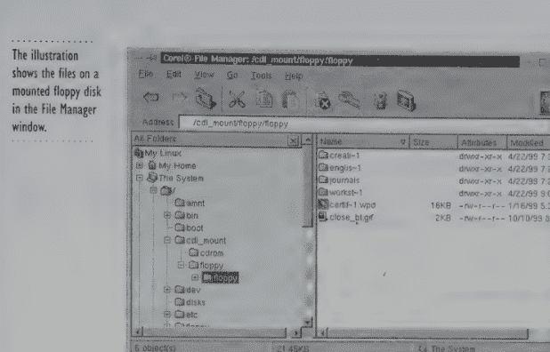

你可以对软磁盘或 CD 上的文件执行与对计算机上或网络上其他处的文件相同的操作，例如打开文件、启动应用程序、复制、粘贴、移动和重命名文件。有关打开、复制、粘贴、移动和重命名文件的信息，请参阅第 136 页的“在 Corel 文件管理器中操作文件”。

Corel LINUX 可以读取为 Microsoft Windows 格式化的软磁盘信息。你也可以使用 `Format Floppy` 工具为 Linux 格式化磁盘。有关为 Linux 格式化软磁盘的信息，请参阅第 251 页的“格式化软磁盘”。

### 从软磁盘或 CD-ROM 文件

你可以访问加载到计算机软磁盘驱动器或 CD-ROM 驱动器的软磁盘或 CD 目录和文件。

#### 访问软磁盘上的文件

- 1. 将软磁盘插入驱动器。

- 2. 在面板上，点击 Corel 文件管理器按钮。

- 3. 在“所有文件夹”列表中导航到 `/cdl_mount/floppy/floppy` 目录，或在地址框中输入文件路径。

磁盘上的文件显示在“名称”列表中。

#### 访问 CD-ROM 上的文件

- 1. 将 CD 插入 CD-ROM 驱动器。

- 2. 在面板上，点击 Corel 文件管理器按钮。

- 3. 在“所有文件夹”列表中导航到 `/cdl_mount/cdrom/cdrom` 目录，或在地址框中输入文件路径。

CD-ROM 上的文件显示在“名称”列表中。

## 停止和启动自动挂载

如果你希望手动挂载磁盘驱动器，或者开启自动挂载时系统运行缓慢，可以停止自动挂载。你也可以重启自动挂载。

### 停止自动挂载

- 1. 点击应用程序启动器，“运行”。

- 2. 在命令框中输入：

```
/etc/init.d/autofs stop
```

### 启动自动挂载

- 1. 点击应用程序启动器，“运行”。

- 2. 在命令框中输入：

```
/etc/init.d/autofs stop
```

- 有关在控制台中使用命令行的信息，请参阅第 290 页的“使用控制台”。

- 你也可以在控制台中通过输入 start 和 stop 命令来停止和启动自动挂载。点击面板上的“控制台”按钮打开控制台。

## 与远程用户共享目录

你可以与其他 Linux 和 Microsoft Windows 计算机共享目录和文件。Core LINUX 使用 Samba 软件为 Microsoft Windows 客户端提供文件共享和打印服务。你可以让你主目录中的目录和文件对网络上所在所在组的用户可用。你可以指定是否共享该目录以及允许访问该目录的用户数。你可以赋予他人完全访问权限、无访问权限或读取权限。共享的本地目录或文件将显示一个由小手持有的文件夹图标。

你可以挂载网络文件系统，这允许你从主目录访问远程文件系统（他人的计算机）上的目录。这被称为网络共享。挂载的网络共享将显示为本地文件系统上的一个目录。例如，你可以将位于 Microsoft Windows 计算机上的目录挂载到桌面上，这样你无需导航到 Microsoft Windows 网络即可访问该 Microsoft Windows 目录。你可以对你的主目录执行与已挂载 Linux 文件夹和文件相同的操作。

你必须在 Corel LINUX 计算机上配置 Samba，以便与 Microsoft Windows 系统共享目录。有关在计算机上配置 Samba 的信息，请参阅第 349 页的“连接到 Microsoft Windows 计算机”以及《Corel LINUX 服务器管理员指南》中的“为 Windows 客户端设置打印服务器”。

无论你是以普通用户还是 root 用户身份登录，都可以从主目录共享文件并为访问共享文件的用户设置访问权限。有关设置访问权限的信息，请参阅第 113 页的“设置权限和所有权”。有关以 root 用户身份登录的信息，请参阅第 103 页的“使用 root 账户”。

## V-Drive


你可以使用 Corel 文件管理器中的 `V-Drive` 目录访问位于 Corel `V-Drive` 服务器上的文件。`V-Drive` 是位于 `http://Corecity.com` 的服务器，允许用户将文件放置在安全加密的网站上，可以从任何接入互联网的终端进行访问。例如，你可以将 `V-Drive` 用于以下目的：

- 你可以办公室计算机终端将文件上传到 `V-Drive` Web 空间，然后将其下载到家中的计算机。
- 你可以在旅行途中将文件上传到 `V-Drive` Web 空间，然后从任何带有 Web 浏览器和互联网的系统访问它们。
- 如果你的系统分区空间有限，你可以将 `V-Drive` Web 作为数据的交换空间。
- 你可以在 `V-Drive` Web 空间上保存无法存储在软磁盘的文件，或者在没有磁盘驱动等更大的存储设备的情况下。

当你安装 Corel `LINUX` 时，桌面上会出现一个带你进入 `V-Drive` 网站的图标。你可以在那里设置 `V-Drive` 账户。Corel `LINUX` 带有将 `V-Drive` 空间挂载到本地文件系统所需的驱动程序。当你激活驱动程序时，Corel 文件管理器的目录列表中会出现 `V-Drive` 目录，让你能够从本地文件系统直接访问你的 `V-Drive` 空间。

## 从主目录共享文件

你可以与其他 Linux 和 Microsoft Windows 计算机共享目录和文件。Core `LINUX` 使用 `Samba` 软件为 Microsoft Windows 客户端提供文件共享和打印服务。你可以让你主目录中的目录和文件对网络上所在组的用户可用。你可以指定是否共享该目录以及允许访问该目录的用户数。你可以赋予他人完全访问权限、无访问权限或读取权限。共享的本地目录或文件将显示一个由小手持有的文件夹图标。

## 共享目录或文件

1. 在面板上，点击 Corel 文件管理器按钮。
2. 右键点击想要共享的目录或文件。
3. 选择共享。
4. 启用共享 按钮。

## 设置共享文件的用户限制

1. 按照上述步骤操作。
2. 启用以下按钮：
   - 最大：允许不限制数量的用户
   - 允许：允许指定数量的用户
3. 点击箭头更改用户数量。

## 设置共享文件的访问权限

你可以为共享目录设置访问权限。有关文件权限的信息，请参阅第 113 页的“设置权限和所有权”。文件的默认权限允许所有用户 `Everyone` 读写访问。你可以更改默认设置，使 `Everyone` 无权限或仅具有读取权限。你还可以添加和删除访问设置。

## 更改默认访问权限

1. 在面板上，点击 Corel 文件管理器按钮。
2. 右键点击想要共享的目录或文件。
3. 选择共享。
4. 启用共享 按钮。
5. 点击权限按钮。
6. 在名称框中选择 `Everyone`。
7. 从类型框中选择以下访问权限级别：
   - 无访问：阻止所有用户访问文件
   - 读取：允许用户查看文件但不更改

## 为共享文件添加权限设置

1. 按照上述步骤操作。
2. 点击添加。
3. 启用以下按钮：
   - 用户：允许指定的用户访问文件。在旁边的框中输入用户或组名称
   - 组：允许指定的组访问文件。在旁边的框中输入用户或组名称
   - `Everyone`：允许工作组中的所有用户访问文件
4. 从类型框中选择以下访问权限级别：
   - 完全控制：赋予你在用户和组区域指定的用户读写权限
   - 无访问：阻止你在用户和组区域指定的用户访问文件
   - 读取：允许你在用户和组区域指定的用户查看但不更改
5. 点击 `OK` 将用户或组添加到访问列表。

## 从共享文件中删除权限设置

1. 按照“更改默认访问权限”的步骤操作。
2. 在名称列表中点击想要删除权限的用户或组。
3. 点击删除。

## 打开共享的 Microsoft Windows 目录

你可以访问网络上 Microsoft Windows 计算机和服务器上的文件夹和文件。当你访问共享的 Microsoft Windows 网络时，Microsoft Windows 网络上的可用服务器和与 Microsoft Windows 服务器关联的计算机、文件夹、文件和打印机显示在 Corel `File Manager` 窗口中。

## 打开共享网络目录

1. 在面板上，点击 `Corel File Manager` 按钮。
2. 在“所有文件夹”列表中，双击“Windows 网络” `Windows Network`。
3. 在“登录身份”框中，输入 Windows 域名、一个反斜杠 `\`，然后输入您的 Windows 用户名。
4. 在“密码”框中输入您的 Windows 网络密码。

## 打开 Microsoft Windows 文件和文件夹

1. 按照上一个步骤中的所有步骤操作。
2. 通过执行以下操作之一显示列出的任何计算机的目录内容：
   - 点击目录旁边的加号
   - 点击目录的图标或名称 `名称` 列表中显示内容
   - 双击目录的图标或名称 `所有文件夹` 和 `名称` 列表中显示内容
- 您必须在计算机上配置了 `Samba` 才能访问网络上的 Microsoft Windows 计算机。有关配置 `Samba` 的更多详细信息，请参阅第 349 页的“连接到 Microsoft Windows 计算机”。
- 某些 Windows 计算机和文件需要您提供密码才能访问。系统管理员可以为您提供密码。

## 挂载网络共享

您可以将位于远程 Microsoft Windows 或 Linux 文件系统上的目录挂载到您的主目录上。挂载的网络共享允许您访问共享目录及其内容，而无需导航到 Windows 或 `NFS` 网络。您也可以对挂载的共享目录执行与在主目录中相同的文件操作。

您可以在您的文件系统上选择一个想要挂载共享目录的目录。当您挂载共享目录时，该目录及其文件将显示在您指定的作为挂载点的位置。

挂载点是您在本地文件系统中放置共享网络目录的位置。您必须具有访问要挂载目录的权限，否则系统将提示您输入密码以访问该目录。系统管理员可以为您提供所需的密码。

您还可以断开已挂载的网络共享。当您断开挂载目录的连接时，该目录将从其挂载目录中消失，您将无法从主目录访问它。

## 挂载网络共享

1. 在面板上，点击 `Corel File Manager` 按钮。
2. 点击 `工具 -> 挂载网络共享`。
3. 输入您想要挂载共享目录的目录的文件路径。
4. 双击“共享目录”框中的目录。
5. 如果没有自动出现，请在“登录身份”框中输入您的工作组名称、一个反斜杠 `\`，然后是用户名。


- 如果您已经登录网络 `启动 Corel LINUX 会话`，将不会提示输入用户名和密码。


- 您也可以通过浏览主目录来选择挂载点。点击“挂载网络共享”对话框中的“浏览”按钮。导航到您想要挂载共享目录的目录。

## 断开网络共享

1. 在面板上，点击 `Corel File Manager` 按钮。
2. 点击 `工具 -> 断开网络共享`。
3. 在“断开网络共享”对话框中选择一个已挂载的网络共享，并点击“确定”。
4. 在弹出的对话框中，如果您想在下次登录时重新挂载网络共享，请点击“是”；不想重新挂载网络共享，请点击“否”。

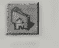

## 在 Linux 网络文件系统 NFS 上共享目录

Corel 系统可以在 Linux 网络上共享。当 Linux 系统被指定网络文件系统 `NFS` 共享时，您可以访问其他 Linux 计算机的目录和文件。当您在 Corel `File Manager` 中打开“网络 网络”时，服务器 `IP 地址` 及其相关的目录和文件将显示在 Corel `File Manager` 窗口中。有关 `NFS` 网络的更多信息，请参阅《Corel Linux 服务器管理员指南》。

## 打开共享的 Linux 网络文件系统 NFS

1. 在面板上，点击 Corel `File Manager` 按钮。
2. 在“所有文件夹”列表中，双击“`NFS` 网络”。

## 查看共享目录的内容

1. 按照上一个步骤中的所有步骤操作。
2. 通过执行以下操作之一显示列出的任何计算机的目录内容：
   - 点击目录旁边的加号
   - 点击目录的图标或名称 `名称` 列表中显示内容
   - 双击目录的图标或名称 `所有文件夹` 和 `名称` 列表中显示内容


- 某些 `NFS` 目录需要您使用密码访问。系统管理员或您想要访问的目录的所有可以为您提供访问权限或密码。有关文件访问权限和密码的更多信息，请参阅第 113 页的“设置权限和所有权”。

## 访问文件


您可以从桌面或通过 `Corel File Manager` 直接访问 `V-Drive`。`Corel File Manager` 允许您复制、粘贴、移动、重命名和删除 `V-Drive` 空间中的目录和文件。在访问之前，您必须设置 `V-Drive` 账户。有关设置 `V-Drive` 账户的信息，请访问 `http://corelcity.com/services/vdrive/default.asp`。

## 从桌面访问 V-Drive

- 在桌面上点击 `V-Drive` 图标。

## 显示 V-Drive 目录的内容

1. 在面板上，点击 `Corel File Manager` 按钮。
2. 在“所有文件夹”列表中点击 `V-Drive`。

## 将文件上传到 V-Drive 空间

1. 在面板上，点击 `Corel File Manager` 按钮。
2. 点击要上传的目录或文件，并点击“复制”。
3. 在“所有文件夹”列表中选择 `V-Drive` 并执行以下操作之一：
   - 点击“粘贴”
   - 点击 `V-Drive` 中的目录并点击“粘贴”

## 将文件从 V-Drive 空间下载到本地系统

1. 在面板上，点击 `Corel File Manager` 按钮。
2. 在“所有文件夹”列表中选择 `V-Drive`。
3. 从内容列表中选择要下载的文件并点击“复制”
4. 点击本地系统中的目标目录并点击“粘贴”。

## 连接互联网

使用 `Corel LINUX`，您可以连接互联网并访问万维网。

## 浏览网页

您可以使用 `Corel File Manager` 或 `Netscape Communicator` 浏览存储在万维网或内部网上的网页。`Corel File Manager` 和 `Netscape Communicator` 都是图形化网页浏览器。`Corel File Manager` 还是文件管理系统。有关将 `Corel File Manager` 作为文件管理系统的信息，请参见第 135 页的“在 `Corel LINUX` 中管理文件”。`Corel File Manager` 使用两个互联网协议：文件传输协议 (`FTP`) 和超文本传输协议 (`HTTP`)。您可以使用 `Corel File Manager` 浏览网页并使用 `FTP` 在远程计算机之间传输文件。

## 加入聊天频道

`Corel LINUX` 提供了一个名为 `Chat` 的聊天客户端，允许您连接到互联网上的聊天服务器并加入聊天频道。聊天频道是用户交换在线消息的虚拟公告板。

通道可以连接到世界各地不同部分的聊天服务器。

## 使用新闻组

`Corel LINUX` 提供了一个名为 `Newsgroups`（新闻组）的新闻组客户端。使用 `Newsgroups`，你可以浏览和阅读新闻组文章。`Newsgroups` 允许你指定一个新闻服务器，连接到它并访问该服务器上的新闻组。你可以从已连接的新闻服务器上的新闻组中下载文章。连接到新闻服务器可以让你看到该服务器上所有新闻组的列表。打开新闻组可以让你查看发布到该新闻组的文章列表。你可以阅读新闻组中的文章，也可以打开另一个新闻组。你可以向新闻组发布文章，或对文章进行回复。你可以向新闻组发布文章，同时通过私有邮件回复作者，或者仅通过私有邮件进行回复。你还可以使用电子邮件转发文章。你可以使用新闻组名称在服务器上搜索新闻组。你还可以使用关键词在新闻组中搜索文章。

- 在执行任何上述功能之前，你必须拥有互联网服务提供商（ISP）或支持互联网访问的网络。
- 在执行任何上述功能之前，需要支持互联网访问的网络。
- 有关连接到互联网服务提供商或网络的信息，请参阅第 327 页的“配置网络连接”。
- 并非所有 `Corel LINUX` 版本都包含 `Netscape Communicator`。

## 将 Corel File Manager 作为浏览器使用

`Corel File Manager` 是一个文件管理系统，它还可以让你浏览位于万维网上的 Web 页面或计算机或局域网上的 HTML 页面。浏览器是一种让你定位和查看 Web 文档的应用程序。你可以通过输入 Web 地址或点击超链接文本或对象来访问页面。你可以使用导航按钮或搜索历史列表重新访问在当前会话期间已下载的 Web 页面。如果中断后出现显示问题，你可以刷新 `Corel File Manager` 窗口。如果由于文件较大或互联网连接较慢导致 Web 页面下载缓慢，你可以中断 Web 页面传输。

你还可以使用 `Corel File Manager` 通过 `FTP` 在远程计算机之间传输文件。`FTP` 允许你将计算机的文件上传到远程计算机，或从远程计算机将文件下载到你的计算机。

在将 `Corel File Manager` 作为浏览器使用之前，你必须拥有互联网服务提供商或支持互联网访问的网络。

- 有关将 `Corel File Manager` 作为文件管理系统使用的信息，请参阅第 135 页的“在 `Corel LINUX` 中管理文件”。
- 如果双击存储为 HTML 文件的文件，它将在 `Corel File Manager` 中自动打开。有关打开文件的信息，请参阅第 144 页的“在 `Corel File Manager` 中启动应用程序”。

## 使用 Corel File Manager 查看 Web 页面

`Corel File Manager` 是一个允许你使用 `HTTP` 定位和显示 Web 页面的浏览器。由于 `Corel File Manager` 也是一个文件管理系统，在应用程序窗口的左侧有一个文件树。你可以禁用文件树，以便 Web 页面在整个应用程序窗口中显示。

### 使用 Corel File Manager 查看 Web 页面

1. 点击 `Application Starter`（应用程序启动器），`File Manager`。
2. 在 `Address`（地址）框中，输入要查看的 Web 页面 URL。
3. 按 `ENTER`（回车）。

如果你没有包含，`Corel File Manager` 会在 URL 前加上 `http://`。

### 禁用文件树

- 点击 `View`（视图），并取消勾选 `Tree`（树）复选框。

### 启用文件树

- 点击 `View`（视图），并勾选 `Tree`（树）复选框。

## 探索 Corel 的在线服务

使用 `Corel File Manager`，你可以了解更多关于 Corel 在线服务的信息。`Corel LINUX` 预装了这些 Web 页面。页面提供了 `Corel LINUX` 以及其他可用 Corel 服务的产品的信息。例如，Corel 托管的网站允许你对图像和文本应用效果、读取电子邮件以及搜索运行小型业务的信息。

### 如要探索 Corel 的在线服务，请点击以下任何项：

- 点击 `Application Starter`，`Online Services` —— 将你带入一个包含业务主题文章、讨论组和其他相关网站链接的网站。
- `Business Community`（业务社区）—— 将你带入一个网站。
- `Clipart and Photos`（剪画与照片）—— 将你带入一个允许你下载剪画、照片、Web 图形和动画对象的网站。
- `Current Events`（时事）—— 将你带入一个允许你搜索各种话题信息的网站，包括新闻和娱乐头条、更新和互联网。
- `DesignerFX` —— 将你带入一个网站，你可以将图像上传到我们的网站，然后在 Web 浏览器中对其进行裁剪、翻转或添加各种特效。你可以以多种文件格式下载新图像。
- `Email`（电子邮件）—— 将你带入一个允许你在线读取和发送电子邮件的网站。
- `Graphic Community`（图形社区）—— 将你带入一个网站，可以在那里阅读图形和设计问题，并利用免费优惠，包括剪画、位图框和喷漆列表。
- `Linux Community`（Linux 社区）—— 将你带入一个网站，可以在那里找到关于 `Corel LINUX` 的更多信息，包括更新和新闻稿。
- `TextFX` —— 将你带入一个网站，你可以创建各种字体、颜色和大小的文本。
- `What's New`（新特性）—— 将你带入一个网站，你可以搜索 Corel 在线服务的索引。

## 使用 Corel File Manager 导航 Web 页面

你无需在 `Address` 框中输入 Web 页面的 URL 即可返回会话期间已访问过的 Web 页面。

### 返回 Web 页面

- `Back`（后退）—— 回到之前查看过的页面。
- `Forward`（前进）—— 前进之前查看过的页面。

### 查看历史列表

`Corel File Manager` 会记录你访问的所有 Web 页面。你可以无需重新输入 URL 重新访问 Web 页面。

### 使用历史列表访问 Web 页面

1. 点击 `Address` 框。
2. 选择 Web 页面。

### 刷新 Corel File Manager 窗口

在中断后，你可以刷新 `Corel File Manager` 窗口。

### 刷新 Corel File Manager 窗口

- 点击 `Refresh`（刷新）按钮。

### 中断 Web 页面传输

如果 Web 页面下载缓慢，你可以停止传输。

### 中断 Web 页面传输

- 点击 `Stop`（停止）按钮。


## 使用 FTP 传输文件

你可以使用 Corel File Manager 通过 FTP 下载文件。FTP 允许你在互联网上传输文件和文件夹。FTP 访问通常不需要管理员权限，但在某些情况下你需要密码或帐户。

### 使用 FTP 下载文件

1. 点击 `Application Starter`，`File Manager`。
2. 在 `Address` 框中输入要访问的远程计算机地址。你必须在地址前加上 `ftp://`。例如 `ftp://corel.com`。
3. 按 `ENTER`。
4. 选择要下载的文件并按 `ENTER`。

## 使用 Netscape Communicator

Corel LINUX 的某些版本包含 `Netscape Communicator`。你可以使用 Netscape 定位和查看 Web 页面、从远程计算机下载文件以及发送接收电子邮件。有关这些功能的更多信息，请参阅 Netscape 在线帮助。

### 启动 Netscape Communicator

Corel LINUX 预装了 `Netscape Communicator`。Netscape 是一种图形 Web 浏览器，用于查看 Web 页面、下载文件并发送接收电子邮件。

### 启动 Netscape Communicator

- 双击桌面上的 Netscape 图标。
- 有关使用 Netscape Communicator 的更多信息，请参阅 Netscape Communicator 在线文档。
- 您必须拥有 Internet 或网络连接，以便 Corel 文件管理器能够显示您指定的超链接地址。有关获取网络连接的信息，请联系您的系统管理员。有关获取 Internet 连接的信息，请联系您的互联网服务提供商。

## 指定 URL

您可以为带有桌面图标的 URL 创建超链接，这样当您双击图标时，超链接地址将在 Corel 文件管理器中打开。您可以指定 HTTP 或 FTP 地址作为使用的超链接。您还可以指定其他类型的协议，例如 `mailto://` 或 `telnet`:

### 要指定 URL

1. 右键点击桌面，然后点击“新建”、“URL”。
2. 在“Web 昵称”对话框中，在“昵称”框中为 URL 输入一个名称。
3. 启用以下按钮之一：
    - Web 始址 (WWW) — 允许您使用 HTTP 协议指定地址，例如 `http://www.corel.com`
    - 文件传输 (FTP) — 允许您使用 FTP 协议指定地址，例如 `ftp://ftp.corel.com`
    - 其他 — 允许您使用替代协议指定地址，例如 `mailto:username@corel.com`
4. 在“目标”框中输入 URL。

### 编辑超链接图标

您可以更改桌面图标所链接的 URL。您还可以更改显示在桌面上的图标的外观。

### 要编辑 URL

1. 右键点击超链接图标，然后点击“属性”。
2. 点击“URL”选项卡。
3. 在 URL 框中输入新的 URL。

### 要更改图标

1. 按照上一个过程的步骤 1 和 2 进行操作。
2. 点击 URL 框下方出现的图标。
3. 在“选择图标”对话框中，从图标列表中选择一个路径。
4. 点击您想要使用的图标。
5. 点击“确定”。

## 删除超链接图标

如果您不再想使用超链接图标，可以将其从桌面上移除。

### 要删除超链接图标

右键点击超链接图标，然后点击“删除”。

## 连接到聊天服务器和频道

Corel LINUX 提供了一个名为 `Chat` 的互联网中继聊天 (IRC) 客户端。`Chat` 让您连接到 IRC 网络上的聊天服务器，并加入服务器上列出的聊天频道。聊天频道是一组通过 IRC 网络交互式交换消息的客户端。IRC 网络是通过互联网连接客户端的服务器网络。IRC 网络跨越多个大洲。

一个聊天服务器包含多个聊天频道。加入聊天频道可以使您参与该频道上的在线讨论。每个频道都有一个聊天窗口。在聊天窗口中，您可以查看其他聊天用户编写的消息。您可以输入消息并将其置于聊天窗口中供其他用户查看和回复。您还可以加入多个聊天频道。

要使用 `Chat` 连接到 IRC 服务器，您必须设置用户配置文件并选择您想要连接的 IRC 网络和服务器。连接到 IRC 服务器后，您可以查看从您连接的聊天服务器获取的聊天频道列表。频道名称前有一个井号 (`#`)。从频道列表中，您可以双击 Chat 以便加入该频道的讨论。

当您首次启动 `Chat` 时，会运行 Chat 自动设置向导。

这是 Chat 程序的介绍。还有许多额外的 Chat 特性在此处未进行说明。有关 Chat 的更多信息，请参阅 Chat 在线帮助。

## 创建用户配置文件

在连接到 IRC 网络之前，您必须创建一个用户配置文件。您的用户配置文件由您希望被识别的昵称、用户名和真实姓名组成。

您还可以在“连接时设置”框中为用户配置文件设置以下连接模式：

- 模式 `+w`
- 模式 `+i`
- 模式 `+s`

当启用 Mode `+w` 复选框时，您的连接将接收从一个用户发送到服务器上所有用户的广播消息。当启用 Mode `+i` 复选框时，您的用户对频道外的用户将不可见。当启用 Mode `+s` 复选框时，您的连接将接收服务器消息。服务器消息可能会淹没您的连接，除非您需要查看消息，否则不应启用 Mode `+s`。

### 要创建用户配置文件

1. 点击 `应用程序启动器`、`网络`、`Chat`。
2. 点击“设置”、“用户”。
3. 输入您的用户信息。

## 连接到聊天服务器并加入频道

要使用 `Chat` 连接到聊天服务器，需要指定您想要使用的 IRC 网络以及网络上您想要连接的服务器。您应该配置 Chat 尝试连接到距离所在地最近的服务器。当您连接到服务器时，服务器会在状态控制台中显示管理消息。

连接到服务器后，您可以加入服务器上列出的频道。`Chat` 让您查询服务器以获取频道列表。您可以请求新的频道列表，或请求上次查询服务器时的频道列表。如果是第一次查询服务器的频道列表，您必须查询服务器以获取新的频道列表。当获得服务器的频道列表后，您可以从列表中加入一个频道并参与该频道的讨论。

您可以使用聊天窗口与其他聊天用户通信。在聊天屏幕底部的消息框中输入消息并按回车键会将您的文本放入聊天窗口。连接到该频道的其他聊天用户可以读取您的消息并进行回复。每个聊天用户的消息都以用户的昵称开头。

### 要连接到聊天服务器

1. 点击 `应用程序启动器`、`网络`、`Chat`。
2. 点击“设置”、“用户”。
3. 输入您的用户信息。
4. 点击“设置”、“服务器”。
5. 指定您想要使用的 IRC 网络。
6. 指定网络上您想要连接的服务器。
7. 配置 Chat 尝试连接到距离所在地最近的服务器。
8. 点击“确定”。

### 要加入频道

1. 连接服务器后，查看频道列表。
2. 从列表中双击频道以加入讨论。

### 在聊天窗口中聊天

1. 在聊天屏幕底部的消息框中输入消息。
2. 按回车键将您的文本放入聊天窗口。

### 要退出频道

1. 点击聊天窗口顶部的关闭按钮。

### 要断开服务器连接

1. 点击“主”、“断开”。

## 访问新闻组

Core LINUX 提供了一个名为 `Newsgroups` 的新闻客户端。使用 `Newsgroups`，您可以阅读发布在新闻组的文章。您可以连接到已连接的新闻服务器。连接需要知道新闻服务器的地址。

`Newsgroups` 让您查看服务器上所有的新闻组列表。打开新闻组可以让您查看发布在该新闻组的文章列表。

您可以在新闻组中发布文章或回复文章。您可以向新闻组发布文章，同时向作者回复私信，或仅回复私信。您还可以使用电子邮件转发文章。您必须设置您的 SMTP 服务器（邮件服务器），以便使用电子邮件发布、发送、转发和接收文章。

您可以使用新闻组名称在服务器上搜索新闻组。您还可以使用关键词在新闻组中搜索文章。

## Newsgroups 和连接新闻服务器

启动 `Newsgroups` 时，您可以连接到新闻服务器。您可以设置在启动应用程序时自动连接到新闻服务器。您还可以断开与新闻服务器的连接。

### 要启动 Newsgroups

点击 `应用程序启动器`、`应用程序`、`网络`、`Newsgroups`。

### 要连接到新闻服务器

1. 按照上一个过程的步骤操作。
2. 点击“连接到服务器”按钮。

### 要设置启动时连接新闻服务器

1. 按照“启动 Newsgroups”过程的步骤操作。
2. 点击“选项”、“NNTP 选项”。
3. 启用“启动时连接”复选框。

### 要断开与新闻服务器的连接

在 `Newsgroups` 组列表窗口中点击“断开服务器”按钮。

在 `NNTP Server` 框中输入新闻服务器将将其添加到新闻服务器列表。您可以通过向此列表添加不同的服务器地址或从列表中选择服务器来连接到不同的服务器。

您必须在 `NNTP Configuration` 窗口中指定一个新闻服务器。有关指定新服务器的信息，请参阅第 176 页的“设置连接偏好”。

## 使用新闻服务器


您可以指定一个要连接的新闻服务器，以便访问该服务器的新闻组和文章。您可以指定一个邮件服务器，让您可以使用电子邮件回复文章。

## 指定新闻服务器

- 1 点击应用程序启动器（Application Starter）、应用程序（Applications）、网络（Network）、新闻群组（Newsgroups）。
- 2 点击选项（Options）、NNTP 选项（NNTP Options）。
- 3 在 `NNTP Server` 框中输入新闻服务器的域名地址。

## 指定邮件服务器

- 1 点击应用程序启动器（Application Starter）、应用程序（Applications）、网络（Network）、新闻群组（Newsgroups）。
- 2 点击选项（Options）、NNTP 选项（NNTP Options）。
- 3 在 `SMTP Server` 框中输入邮件服务器的域名地址。

## 设置连接偏好

您可以设置连接偏好，以便在启动新闻群组（Newgroups）时连接到预设的新闻服务器。有关启动新闻群组的信息，请参阅第 175 页的“启动新闻群组并连接到新闻服务器”。启动 Newgroups 时，会自动连接到预设的新闻服务器。如果有其他用户登录您的计算机，连接验证将限制对新闻群组的访问。您可以设置用于连接验证的用户名和密码。（当您尝试连接到新闻服务器时，Newgroups 将提示您输入用户名和密码。）当 Newgroups 连接到服务器时，您可以指定从新闻服务器下载的文章数量。当服务器上有大量文章而您希望避免滚动浏览时这非常有用。

### 设置启动时连接的新闻服务器

- 1 点击应用程序启动器（Application Starter）、应用程序（Applications）、网络（Network）、新闻群组（Newsgroups）。
- 2 点击选项（Options）、NNTP 选项（NNTP Options）。
- 3 勾选“启动时连接”（Connect On Startup）复选框。

### 设置不连接的新闻服务器

- 1 遵循上一个步骤中的步骤 1 和 2。
- 2 勾选“不询问直接连接”（Connect Without Asking）复选框。

### 设置连接验证

- 1 遵循“设置启动时连接的新闻服务器”步骤中的步骤 1 和 2。
- 2 勾选“验证”（Authenticate）复选框。

### 设置用户名和密码

- 1 遵循“设置启动时连接的新闻服务器”步骤中的步骤 1 和 2。
- 2 在 `User Name` 框中输入用户名。
- 3 在 `Password` 框中输入密码。

### 设置最大下载数量

- 1 遵循“设置启动时连接的新闻服务器”步骤中的步骤 1 和 2。
- 2 在“下载超过以下数量前进行询问”（Ask Before Downloading More Than）框中，输入您想要下载的文章最大数量。

## 指定您的个人身份标识

您可以指定自己的身份，这样当您发布文章或回复文章时，您的个人信息将自动包含在电子邮件或帖子的“发件人”（From）区域。您可以指定您的姓名、电子邮件地址以及组织或公司。

### 指定个人身份标识

- 1 在组列表窗口（Group List Window）中，点击选项（Options）、身份（Identity）。
- 2 在 `Real Name` 框中输入姓名。
- 3 在 `Email Address` 框中输入您的电子邮件地址。
- 4 在 `Organization` 框中输入您的组织或公司名称。

## 打开新闻群组

您可以打开一个新闻群组来查看其文章。打开新闻群组会打开包含文章列表的新闻群组窗口（Newsgroup window）。

### 打开新闻群组

- 1 点击应用程序启动器（Application Starter）、应用程序（Applications）、网络（Network）、新闻群组（Newsgroups）。
- 2 点击连接服务器（Connect To Server）按钮。
- 3 点击加号 (+) 展开“所有新闻群组”（All Newsgroups）菜单。
- 4 从“已订阅的新群组”（Subscribed Newsgroups）或“所有新闻群组”（All Newsgroups）列表选择一个新闻群组。
- 5 点击新闻群组（Newsgroup）、打开（Open）。

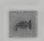

> > 您不需要连接到新闻服务器即可打开新闻群组；但如果没有连接，新闻群组窗口将为空。有关查看新闻群组窗口中文章的信息，请参阅第 178 页的“在新闻群组中操作”。

## 在新闻群组中操作

您可以在新闻群组中查看文章。打开新闻群组会打开包含文章列表的新闻群组窗口。

### 将以下任意字符与您的关键词搜索结合使用

+   - ? 匹配任何字符
- * 匹配任何字符序列
- [] 匹配括号内的字符


有关打开新闻组的信息，请参阅第 178 页的“打开新闻组”。

当您找到一篇文章时，它会在新闻组窗口中以红色突出显示。

文章搜索器（Article Searcher）会找到关键词的第一个实例。再次点击查找（Find）按钮可以找到下一个实例。

## 管理新闻组和新闻组文章

新闻组允许您管理新闻组。你可以对文章进行排序、对其进行标记以备后用，或将其标记为已读或未读。你可以设置文章在过期前保存的时间。你可以锁定文章以防止其过期。你可以以 HTML、PostScript 或文本格式打印文章。你可以查看新闻组中的设置选项，这样当你打开新闻组时，就可以只查看未实际的文章、缓存的文章或锁定的文章。你还可以通过更改标题样式、附件样式、字体和显示颜色来自定义新闻组中文章的外观。

### 排序

文章排序根据指定的类别对新闻组中的文章进行排列。你还可以使用子分类排序。例如，你可以将第一个排序级设置为按时间排序文章。你可以设置第二排序级为按发送者排序。如果同一天发布了多篇文章，这些文章将按发送者的字母顺序排序。如果你设置第三排序级为按主题排序，那么如果同一日期发布了多篇文章，它们将进一步按主题字母顺序排序。使用线程模式（threading）排序会显示原始文章，随后是每条回复文章。紧随原始文章后的每条回复文章都会缩进。

### 标记和取消标记

如果你以后需要引用新闻组和文章，可以给它们打上复选标记。在扫描服务器上的新闻组列表或新闻组中的文章列表时，你可以对你感兴趣的文章进行标记。你可以对所有标记的新闻组或文章应用新闻组命令。

你可以将你已读或未读的文章进行标记。默认情况下，新闻组窗口中你未读的文章显示为绿点。当你阅读一篇文章时，圆点会变成红色。你可以手动在文章旁边放置红色（已读）或绿色（未读）圆点。

### 过期选项

一旦你从服务器下载了文章，就可以设置文章在新闻组中保留的天数。天数过后，新闻组将删除文章。你可以为文章标题设置不同的过期日期。例如，你可以设置文章正文五天后过期，文章标题在10天后过期。正文或主文本五天后被删除，但标题仍然显示。你使用新闻组访问的新闻组中的文章会被归档。如果文章过期，只要文章标题仍留在列表中，你就可以检索它。

### 锁定

锁定文章可以防止其过期。被锁定的文章会被缓存。在解锁之前，你可以一直检索它；一旦解锁，它将不再被缓存并根据你设置的过期日期过期。

### 在新闻组中排序文章

你可以对新闻组中的文章列表进行排序。你可以按主题、分数、发送者、日期、行数对文章排序，或选择不排序。你可以选择子分类排序，使主类别根据下方的类别进行排序，该类别再根据其子分类进行排序。你可以使用线程模式排序，使文章显示为原始文章随后是每条回复文章。紧随原始文章后的每条回复文章都会缩进。

#### 按类别排序文章

+   1 在新闻组窗口中，点击选项（Options）、排序（Sorting）。
+   2 从第一个列表框中选择以下排序类别之一：
+   * 主题（Subject）
* 分数（Score）
* 发送者（Sender）
* 日期（Date）
* 行数（Lines）
* 无（None）

#### 选择子分类进行排序

+   1. 在新闻组窗口中，点击选项（Options）、排序（Sorting）。
+   2. 在第一个列表框之后的每个列表框中选择一个排序类别。

#### 使用线程排序

+   1. 在新闻组窗口中，点击选项（Options）、排序（Sorting）。
+   2. 启用使用线程（Use Threading）复选框。

有关打开新闻组的信息，请参阅第 178 页的“打开新闻组”。

### 标记和取消标记新闻组

标记新闻组让你以后引用引用。标记的新闻组旁边会出现复选标记图标。你还可以取消某个新闻组的标记，或取消所有已标记新闻组的标记。

#### 标记新闻组

+   1. 点击应用程序启动器（Application Starter）、应用程序（Applications）、网络（Network）、新闻组（Newsgroups）。
+   2. 点击加号 (+) 展开订阅的新组（Subscribed Newsgroups）或所有新闻组（All Newsgroups）列表。


+ 3. 选择你想标记的新闻组。
+ 4. 点击新闻组（Newsgroup）、标记/取消标记（UnTag）。

# 取消新闻组标记
+ 1. 遵循上一个过程的步骤 1 和 2。
+ 2. 从订阅的新组或所有新闻组列表中选择一个已标记的新闻组。
+ 3. 点击新闻组（Newsgroup）、标记/取消标记（UnTag）。

# 取消所有新闻组标记
+ 1. 遵循“标记新闻组过程”中的步骤 1 和 2。
+ 2. 点击新闻组（Newsgroup）、已标记（Tagged）、标记/取消标记（UnTag）。

# 标记文章
标记文章让你以后引用它。标记的文章旁边会出现复选标记图标。你还可以取消文章的标记。

## 标记文章
+ 1. 在新闻组窗口的文章列表中选择一篇文章。
2. 点击标记（Tag）按钮。


有关打开新闻组的信息，请参阅第 178 页的“打开新闻组”。

 你还可以通过点击文章来取消其标记。

 将文章标记为已读或未读

默认情况下，已读的文章显示红点，未读的文章显示绿点。你可以将标记的文章标记为已读或未读。

# 将文章标记为已读
+ 1. 在新闻组窗口的文章列表中选择一篇文章。
2. 点击已读（Read）按钮。

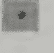

# 将文章标记为未读
+ 1. 在新闻组窗口的文章列表中选择一篇文章。
2. 点击未读（Unread）按钮。


# 将标记的文章标记为已读
在新组窗口中，点击文件（File）、已标记（Tagged）、已读（Read）。

# 将标记的文章标记为未读
在新组窗口中，点击文件（File）、已标记（Tagged）、未读（Unread）。

# 设置文章过期
一旦你从服务器下载了文章，就可以指定在新闻组列表中保留文章的天数。你可以设置文章正文（文章全文）在文章标题之前过期。只要文章标题留在新闻组中，你就可以检索文章正文。

## 设置文章过期
+ 在组列表（Group List）窗口中，点击选项（Options）、过期选项（Expire Options）。
+ 在以下任何项旁输入等待过期的数：
- 已读正文（Article Bodies Read）
- 未读正文（Article Bodies Unread）
- 已读标题（Article Headers Read）
- 未读标题（Article Headers Unread）

每类文章的默认过期时间为五天。

有关访问组列表窗口，请参阅第 176 页的“使用新闻服务器”。

# 锁定文章
你可以锁定文章以防止其过期。被锁定的新闻组文章显示在新闻组文章列表中，旁边有一个锁定图标。你可以锁定所有已标记的文章。你也可以解锁文章。

## 锁定文章
+ 在新组窗口的文章列表中选择一篇文章。
+ 点击锁定（Lock）按钮。

## 锁定标记的文章
+ - 在新闻组窗口中，点击文件（File）、已标记（Tagged）、不过期（Don't Expire）。

## 解锁文章
1. 在新闻组窗口的文章列表中选择一个被锁定的文章。
2. 点击“锁定”（Lock）按钮。
- 有关打开新闻组的信息，请参阅第 178 页的“打开新闻组”。

# 设置打印选项
你可以设置从新闻组打印文章的选项。你可以使用 HTML 打印或直接（标准）打印。如果你选择直接打印，可以指定打印机，并以以文本、HTML 或 PostScript 格式进行打印。

## 设置打印选项
1. 在组列表窗口中，点击“选项”（Options），“打印选项”（Printing Options）。
2. 启用以下按钮之一：
- 使用 HTML 打印
- 使用直接打印
3. 在“使用打印机”（Print Using）框中，输入打印机名称。
4. 在“提供数据”（Feed it With）框中，选择以下打印格式之一：
- PostScript
- HTML
- 文本
- 默认打印系统为直接打印，默认直接打印设置使用文本格式的默认打印机。
- 有关打印的信息，请参阅第 279 页的“在 Core LINUX 中管理打印和字体”。
- 有关访问组列表窗口的信息，请参阅第 176 页的“使用新闻服务器”。

# 设置查看选项
你可以自定义新闻组窗口中的文章列表，仅显示你未读过的文章、已缓存的文章或仅被锁定的文章。在阅读、锁定或标记某 文章后，该文章就会被缓存。

## 只显示未读消息
- 在新闻组窗口中，点击“选项”（Options），“仅显示未读消息”（Show Only Unread Messages）。

## 只显示缓存消息
- 在新闻组窗口中，点击“选项”（Options），“仅显示缓存消息”（Show Only Cached Messages）。

## 只显示锁定的消息
- 在新闻组窗口中，点击“选项”（Options），“显示锁定消息”（Show Locked Messages）。


- 有关打开新闻组的信息，请参阅第 178 页的“打开新闻组”。

# 保存文章
你可以将文章保存到计算机上的目录或 Core LINUX 系统中。你也可以同时保存所有已标记的文章。

## 保存文章
1. 在新闻组窗口的文章列表中选择一篇文章。
2. 点击“文件”（File），“保存”（Save）。
3. 双击你想保存文本文件的目录或文件夹。
4. 在“位置”（Location）框中输入文本文件的名称。
5. 点击“保存”（Save）。

## 保存所有已标记的文章
1. 在新闻组窗口的文章列表中选择一篇文章。
2. 点击“文件”（File），“已标记”（Tagged），“保存”（Save）。
3. 双击你想保存文本文件的目录或文件夹。
4. 在“位置”（Location）框中输入文本的名称。
5. 点击“保存”（Save）。
- 有关打开新闻组的信息，请参阅第 178 页的“打开新闻组”。

# 打印文章
你可以打印新闻组中的某文章。你也可以同时打印新闻组中所有已标记的文章。

## 打印文章
1. 在新闻组窗口的文章列表中选择一篇文章。
2. 点击“文件”（File），“打印”（Print）。
3. 在打印对话框中，点击“确定”（OK）。

## 打印已标记的文章
1. 在新闻组窗口中，点击“文件”（File），“已标记”（Tagged），“打印”（Print）。
2. 在打印机对话框中，点击“确定”（OK）。
- 有关使用打印对话框的信息，请参阅第 279 页的“在 Corel LINUX 中管理打印和字体”。
- 有关打开新闻组的信息，请参阅第 178 页的“打开新闻组”。

# 修改头部样式
你可以通过选择不同的头部样式来更改文章标题的外观。

## 修改头部样式
1. 在新闻组窗口中，点击“选项”（Options），“外观”（Appearance）。
2. 从“消息显示设置”窗口的“头部样式”（Header Style）列表框中选择以下头部样式之一：
- 花哨（Fancy）——显示系统图标、文章标题、发送者、接收者和日期
- 简要（Brief）——在一内显示文章标题、发送者、日期和时间
- 标准（Standard）——分行显示文章标题、发送者和日期
- 普通（Long）——显示日期、发送者、接收者以及文章所属的所有组
- 全部（All）——显示与文章相关的所有信息，包括发送者、新闻组、主题、行数、消息 ID、日期、NNTP 主 IP 地址和文件路径
- 有关打开新闻组的信息，请参阅第 178 页的“打开新闻组”。

# 修改附件样式
你可以通过选择不同的附件样式更改新闻组文章中附件的外观。

## 修改附件样式
1. 在新闻组窗口中，点击“选项”（Options），“外观”（Appearance）。
2. 从“消息显示设置”窗口的“附件样式”（Attachment Style）列表框中选择以下附件样式之一：
- 图标（Iconic）——显示一个可以点击查看附件的图标
- 智能（Smart）——显示一个可以点击查看附件的图标
- 内联（Inline）——将附件显示在文章正文中，紧接文章文本之后
- 有关打开新闻组的信息，请参阅第 178 页的“打开新闻组”。

# 修改文章字体
你可以更改新闻组文章文本的字体大小和样式。

## 修改字体大小
1. 在新闻组窗口中，点击“选项”（Options），“外观”（Appearance）。
2. 在“显示消息设置”窗口的“字体大小”（Font Size）列表框中选择以下字体大小之一：
- 小（Small）
- 普通（Normal）
- 大（Large）
- 巨大（Huge）

## 修改字体样式


1. 在新闻组窗口中，点击“选项”（`Options`），“外观”（`Appearance`）。

2. 在“显示消息设置”窗口的“字体样式”（`Font Style`）列表框中选择一种字体样式。

- 有关打开新闻组的信息，请参阅第 178 页的“打开新闻组”。

# 修改文章中的背景、前景和链接颜色

你可以更改文章的显示颜色。你可以更改文章的背景色；更改前景颜色会更改文章文本颜色。你可以更改未访问超链接的颜色，也可以更改已访问链接的颜色。你可以选择预设系统颜色或自定义颜色。

## 修改背景色和前景色

1. 在新闻组窗口中，点击“选项”（`Options`），“外观”（`Appearance`）。

2. 在“消息显示设置”窗口中，点击以下按钮之一：

- 背景颜色（`Background Color`）

- 前景颜色（`Foreground Color`）

3. 从“系统颜色”中点击一种颜色。

## 修改未访问超链接的颜色

1. 在新闻组窗口中，点击“选项”（`Options`），“外观”（`Appearance`）。

2. 在“消息显示设置”窗口中，点击“链接颜色”（`Link Color`）。

3. 从“系统颜色”中点击一种颜色。

## 修改已访问超链接的颜色

1. 在新闻组窗口中，点击“选项”（`Options`），“外观”（`Appearance`）。

2. 在“消息显示设置”窗口中，点击“已颜色”（`Followed Color`）。

3. 从“系统颜色”中点击一种颜色。

## 创建文章显示的自定义颜色

1. 遵循任一一个程序的步骤 1 和 2。

2. 在“自定义颜色”（`Custom Colors`）部分，选择一个灰色框。

3. 在调色板上点击一个颜色区域。

4. 点击“添加到自定义颜色”（`Add To Custom Colors`）按钮。


- 有关打开新闻组的信息，请参阅第 178 页的“打开新闻组”。

# 编辑文本

`Text Editor` 允许你创建和编辑 ASCII 文本文件。你可以将 `Text Editor` 作为基础文字处理器创建纯文本，或在处理代码时作为程序员编辑器。

`Text Editor` 允许你执行基本的编辑任务。你可以剪切、复制和粘贴文本。你可以撤销一次操作或一系列操作。你还可以重做已撤销的命令。`Text Editor` 提供了查找和替换功能，允许你查找并替换字符、单词或短语。

## 启动文本编辑器

你可以使用文本编辑器处理基础文字处理需求，或编辑编程代码。

### 启动文本编辑器

你可以随时启动文本编辑器。

#### 如何启动文本编辑器

- 点击应用程序启动器（`Application Starter`）、应用程序（`Applications`）、工具（`Utilities`）、文本编辑器（`Text Editor`）。

## 创建和打开文本文件

文本编辑器允许你创建文本文件，或打开保存在系统或网络上的文本文件。你可以在活动文本编辑器窗口中创建文本文件，也可以为文本文件打开新窗口。新视图（`View`）允许你为活动文本文件打开新窗口。

### 创建文本文件

文本编辑器允许你创建一个文本文件。你也可以打开新窗口或新视图。新窗口将打开一个新的文本编辑器。新视图将打开你正在编辑的文本文件的副本。

#### 如何创建文本文件

- 点击文件（`File`）、新建（`New`）。

你也可以通过点击工具栏上的新建（`New`）按钮来创建文本文件。

#### 如何打开新窗口

- 点击文件（`File`）、新窗口（`New Window`）。

你也可以通过点击面板（`Panel`）上的文本编辑器图标打开新窗口。

#### 如何打开同一文件的新视图

- 点击文件（`File`）、新视图（`New View`）。

## 打开文本文件

文本编辑器允许你打开保存在系统或网络上的文本文件，或者是最近编辑的文件。你也可以从另一个应用程序打开文本文件，例如 Microsoft Windows 文本文件。

### 如何打开文本文件

1. 点击文件（`File`）、打开（`Open`）。

2. 在“查找位置”（`Look In`）列表框中，选择文本文件所在的目录。

3. 双击存储文本文件的文件夹。

4. 从“文件类型”（`File Type`）列表框中选择文件格式。

5. 双击文本文件名。

- 你也可以通过点击工具栏上的打开（`Open`）按钮来打开最近编辑的文件。

### 如何打开最近编辑的文件

1. 点击文件（`File`）、打开最近（`Open Recent`）。

2. 从文件列表中选择一个文件。

## 编辑文本文件

文本编辑器允许你执行基础编辑任务。你可以输入或删除文本，并剪切或复制选定的文本将其存储在缓冲区（`buffer`）中。你可以将缓冲区中的文本粘贴到活动文本文件、另一个文本文件或另一个应用程序中。在剪切或复制其他文本之前，缓冲区的内容一直有效。

你可以撤销一个操作或一系列操作。你也可以重做已撤销的命令。

你可以在文件中搜索短语、单词或字符。你可以编辑、替换或删除找到的文本。

### 输入和删除文本

文本编辑器允许你输入和删除文本。

#### 如何输入文本

1. 点击文本编辑器窗口。

2. 输入文本。

#### 如何删除文本

1. 将光标置于想要删除的文本之前。

2. 按住 `DELETE` 键直到文本被删除。

- 你也可以通过将光标置于想要删除的文本之后并按住 `BACKSPACE` 键直到文本被删除来删除文本。

### 选择和取消选择文本

你可以选择和取消选择字符和单词。选择允许你编辑文本。

对于文本编辑，你可以反转文本选择区域。反转文本选择区域可以取消已选中的文本，并选中未选中的文本。

#### 如何选择文本

- 在想要选择的文本上点击并拖。

#### 如何选择所有文本

- 点击编辑（`Edit`）、全选（`Select All`）。

#### 如何取消选择所有已选文本

- 点击编辑（`Edit`）、取消选择（`Deselect All`）。

#### 如何反转文本选择区域

- 点击编辑（`Edit`）、反转选择（`Invert Selection`）。

### 剪切、复制和粘贴文本

你可以从文本文件中剪切文本。你也可以通过剪切并粘贴到另一个位置，或通过复制粘贴来移动文本。剪切或复制的信息存储在缓冲区中。你可以将缓冲区中的文本粘贴到活动文件、另一个文本文件或另一个应用程序中。在剪切或复制其他文本之前，缓冲区的内容一直有效。

#### 如何剪切文本

1. 选择想要剪切的文本。

2. 点击编辑（`Edit`）、剪切（`Cut`）。

- 你也可以通过选择文本并点击工具栏上的剪切（`Cut`）按钮来剪切文本。

#### 如何复制文本

1. 选择想要复制的文本。

2. 点击编辑（`Edit`）、复制（`Copy`）。

- 你也可以通过选择文本并点击工具栏上的复制（`Copy`）按钮来复制文本。

#### 如何粘贴文本

1. 将光标置于想要插入文本的位置。

2. 点击编辑（`Edit`）、粘贴（`Paste`）。

- 你也可以通过将光标置于想要插入文本的位置并点击工具栏上的粘贴（`Paste`）按钮来粘贴文本。

### 撤销和重做操作

你可以撤销一个操作或一系列操作。你也可以重做已撤销的命令。

#### 如何撤销操作

- 点击编辑（`Edit`）、撤销（`Undo`）。

- 你也可以通过点击工具栏上的撤销（`Undo`）按钮来撤销操作。

#### 如何重做操作

- 点击编辑（`Edit`）、重做（`Redo`）。

- 你也可以通过点击工具栏上的重做（`Redo`）按钮来重做操作。

### 查找和替换文本

你可以在文件中查找字符、单词或短语。当你想要从文本中编辑或删除特定的单词和短语时，查找和替换功能非常有用。你还可以查找并替换文件中指定文本的所有出现处。

#### 如何查找文本

- 点击编辑（`Edit`）、查找（`Find`）。

- 在“查找内容”（`Text To Find`）框中输入文本。

#### 如何查找下一个出现处

- 点击编辑（`Edit`）、查找下一个（`Find Next`）。

#### 如何替换文本

- 点击编辑（`Edit`）、替换（`Replace`）。

- 在“查找内容”（`Text To Find`）框中输入你想要查找的文本。

- 在“替换为”（`Replace With`）框中输入要替换的文本。

- 点击替换（`Replace`）。

#### 如何替换所有出现处

- 点击编辑（`Edit`）、全部替换（`Replace All`）。

### 浏览文本文件

文本编辑器允许你浏览文本文件。你可以跳转到特定行、搜索单词或查找下一个出现处。

#### 如何跳转到某行

- 点击编辑（`Edit`）、转到（`Go To`）。

- 在“行号”（`Line Number`）框中输入行号。

#### 如何搜索单词

- 点击编辑（`Edit`）、查找（`Find`）。

- 在“查找内容”（`Text To Find`）框中输入想要查找的单词。

#### 如何查找下一个出现处

- 点击编辑（`Edit`）、查找下一个（`Find Next`）。

当你不希望跟踪行长度时，此功能非常有帮助。它也不需要你按回车键即可换行。你可以通过更改每行包含的字符数来调整边距大小。

## 设置或更改边距

- 点击 `Options`（选项）、`Preferences`（首选项）。

- 在 `Wrap Words At`（自动换行于）框中输入一个数字。

## 设置和替换制表符


Tab 允许你在文本中缩进指定数量的空格。你还可以使用 Tab 通过缩进项目来格式化列表，以提高可读性。Text Editor（文本编辑器）允许为文本文件设置并替换制表符。

## 设置制表符
- 点击 `Options（选项）`、`Preferences（首选项）`。
- 在 `Tab Width（制表符宽度）` 框中输入数字。

## 替换制表符
- 点击 `Options（选项）`、`Preferences（首选项）`。
- 在 `Tab Width（制表符宽度）` 框中输入一个新数字。
- 启用 `Replace Tabs（替换制表符）` 复选框。

## 文本缩进与取消缩进
你可以缩进一行或多行文本，并取消文本的缩进。你还可以让 Text Editor 自动缩进行首文本，并返回该行之前的缩进状态。这在你编写代码或创建列表时特别有用。缩进宽度取决于你选择的 `Tab Width（制表符宽度）`。缩进文本时，缩进是以字符空格计算。

## 缩进一行文本
- 将光标置于行的开头。
- 点击 `Edit（编辑）`、`Indent（缩进）`。

## 缩进多行文本
- 选择你想缩进的文本。
- 点击 `Edit（编辑）`、`Indent（缩进）`。

## 取消行的缩进
1. 将光标置于已缩进的行。
2. 点击 `Edit（编辑）`、`Unindent（取消缩进）`。

## 取消多行的缩进
1. 选择已缩进的文本。
2. 点击 `Edit（编辑）`、`Unindent（取消缩进）`。

## 行首自动缩进文本
1. 点击 `Options（选项）`、`Preferences（首选项）`。
2. 启用 `Auto Indent（自动缩进）` 复选框。
3. 按 `TAB` 缩进一行。

## 自动退格到行之前的缩进位置
1. 点击 `Options（选项）`、`Preferences（首选项）`。
2. 启用 `Backspace Indent（退格缩进）` 复选框。
3. 缩进你想缩进文本。
4. 按 `ENTER（回车）`，然后按 `BACKSPACE（退格）`。

## 选择文本
编辑器包含了文本选择选项，用于在文本文件中保持特定文本选中、同时选择多处文本、垂直选择文本以及删除选中文本。如果你正在处理代码或编辑文本，你可能希望选定区域保持选中状态，或同时选择多处文本。如果你在处理列数据，可以垂直选择文本。

## 保持文本选择
1. 点击 `Options（选项）`、`Preferences（首选项）`。
2. 启用 `Persistent Selections（持久选择）` 复选框。

## 选择多部分文本
1. 点击 `Options（选项）`、`Preferences（首选项）`。
2. 点击 `Persistent Selections（持久选择）`。
3. 启用 `Multiple Selections（多重选择）` 复选框。

## 垂直选择文本
1. 点击 `Options（选项）`、`Preferences（首选项）`。
2. 启用 `Vertical Selections（垂直选择）` 复选框。

## 删除选中文本
1. 点击 `Options（选项）`、`Preferences（首选项）`。
2. 启用 `Delete On Input（输入时删除）` 复选框。
3. 按 `DELETE（删除键）`。

## 在文本文件中插入括号
你可以自动在文本文件中插入一组括号。这在编写代码时非常有用。

## 自动插入括号
1. 点击 `Options（选项）`、`Preferences（首选项）`。
2. 启用 `Auto Brackets（自动括号）` 复选框。
3. 按以下键之一：
* `{`
* `[`
* `(`

## 自定义字体和文本
Text Editor 允许你自定义字体外观。你可以更改字体类型和大小。你还可以更改普通文本和选中文本的颜色。

在编写代码时，你可以为不同的语法项选择不同的颜色。例如，如果你在使用 C++ 代码，你可以为 C++ 的普通文本、关键字、注释、十六进制数（Hex numbers）、字符串文本以及其他 C++ 语法项指定不同的颜色。你可以为选中和未中的项目选择不同的颜色。

你可以从预设颜色或自定义颜色中进行选择。

### 自定义颜色
你可以从预设颜色或自定义颜色中进行选择。

## 字体设置
更改字体类型和大小。

### 更改字体
1. 点击 `Options（选项）`、`Preferences（首选项）`。
2. 更改字体。

### 更改字体
1. 点击 `Options（选项（（选项`。
2. 从列表中选择字体。

## 选中文本的颜色
编辑器允许你为选中和未中的项目选择不同的颜色。你可以从调色板中选择预设颜色或自定义颜色。

## 更改文本的颜色
普通文本和选中文本的颜色可以更改。

在编写代码时，你可以为不同的语法项选择不同的颜色。例如。

## 更改普通文本的颜色
1. 点击 `Options（选项）`、`Preferences（首选项）`。
2. 点击 `Normal（普通）`。
3. 普通文本的颜色可以更改更改。

## 更改普通文本的颜色
1. 点击 `Options（选项）`、`Preferences（首选项）`。
2. 点击 `Normal（普通）`。
3。

## 更改普通文本的颜色
1. 点击 `Options（选项）`、`Preferences（首选项）`。
2. 点击 `Normal（普通）`。
3。

## 更改普通文本的颜色
1. 点击 `Options（选项）`、`Preferences（首选项）`。
2. 点击 `Normal（普通）`。
3。

## 更改普通文本的颜色
1. 点击 `Options（选项）`、`Preferences（首选项）`。
2. 点击 `Normal（普通）`。
3。

## 更改普通文本的颜色
1. 点击 `Options（选项）`、`Preferences（首选项）`。
2. 点击 `Normal（普通）`。
3。

## 更改普通文本的颜色
1. 点击 `Options（选项）`、`Preferences（首选项）`。
2. 点击 `Normal（普通）`。
3。

（注：由于原文文本中存在大量重复且断开的段落，如多次重复“更改普通文本的颜色”的描述，译文已根据原文逻辑进行了连贯的翻译。）

# 打印文本文件
- 点击“文件”，“ 打印”。

# 选择打印方法
您可以在系统或网络上配置的任何打印机上打印文本文件。您也可以打印到文件。当您想从另一个系统访问该文件、允许不同用户访问该文件或在打印之前预览文件时，打印到文件非常有用。该文件将保存为 PostScript 文件。

# 打印到打印机
1. 点击“文件”，“ 打印”。
2. 启用“打印到打印机”按钮。
3. 从“打印到打印机”列表框中选择打印机。

# 打印到文件
1. 点击“文件”，“ 打印”。
2. 启用“打印到文件”按钮。
3. 点击“浏览”按钮。
4. 选择您想要保存文本文件的文件夹。
5. 在“文件名”框中输入文件名。
6. 点击“保存”按钮。

# 指定打印页面
您可以设置打印作业，以便仅打印文本文件中的某些或所有页面。您还可以选择先打印第一页或先打印最后一页。当您先打印最后一页时，文本文件将按反序打印。

# 打印所有页面
1. 点击“文件”，“ 打印”。
2. 在“选项”部分，启用“打印所有”按钮。

# 打印特定页面
1. 点击“文件”，“ 打印”。
2. 在“选项”部分，点击“打印范围”按钮。
3. 指定您想要打印的页面。

# 选择打印顺序
1. 点击“文件”，“ 打印”。
2. 选择以下其中之一：
- 先打印第一页 — 让您能够打印文本文件的第一页
- 先打印最后一页 — 让您能够打印文本文件的最后一页

# 打印多份副本
您可以打印同一份文本文件的多个份副本。

# 打印多份副本
1. 点击“文件”，“ 打印”。
2. 在“份数”框中输入副本数。

# 指定页面大小和纸张方向
文本编辑器包含了预设的页面大小，用于打印您的文本文件。您可以从北美标准的 Letter、Legal 和 Executive 中选择；或者从欧洲标准的 A4 和 B5 中选择。您还可以将文本文件的纸张方向设置为纵向或横向。

# 指定页面大小
1. 点击“文件”，“ 打印”。
2. 从“纸张格式”部分，启用以下按钮之一：
- `A4 (210 x 297 mm)`
- `B5`
- `Letter (8 1/2 x 11in)`
- `Legal`
- `Executive`

# 指定纸张方向
1. 点击“文件”，“ 打印”。
2. 从“纸张格式”部分，启用以下按钮之一：
- 纵向 — 让您打印高度大于宽的页面
- 横向 — 让您打印一个相对于纵向旋转 90 度的页面，此时页面的长边为水平。

# 以彩色或灰度打印文本文件
文本编辑器允许您以彩色或灰度打印文本文件。当您尝试区分文件中的特定文本时，彩色打印文本文件会有帮助。然而，彩色打印会减慢打印速度。

# 以彩色或灰度打印
1. 点击“文件”，“ 打印”。
2. 在“选项”部分，启用以下之一：
- 有彩色时彩色打印 — 如果您的系统配置了彩色打印机，则让您以彩色打印文本文件
- 灰度打印 — 让您以灰度打印文本文件


## 处理图形

您可以使用 Corel LINUX 提供的图形应用程序查看图像文件、查看 PostScript 和 Adobe Acrobat 便携文档格式 (PDF) 文件，并创建截图。下表列出了 Corel LINUX 提供的图形应用程序以及每个应用程序提供的功能。

| 应用程序... | 功能... |
|---|---|
| 图像查看器 | 让您查看和编辑图像文件。图像查看器允许将图像发送到桌面作为背景。您还可以创建图像幻灯片。 |
| PS Viewer | 让您查看和打印 PostScript 和 PDF 文档 |
| 截屏 | 让您对桌面上打开的应用程序或窗口或整个桌面创建截图。您可以以不同的文件格式保存捕取的图像 |

## 处理图像文件

图像查看器允许您打开和查看图像文件。您可以自定义应用程序中的功能，例如键盘快捷键。您可以对图像进行变换、裁剪或过滤。使用图像查看器在桌上显示图像或创建图像幻灯片。当您完成图像处理后，可以保存并打印该文件。使用“关闭”命令关闭当前图像窗口，使用“退出”命令关闭图像查看器应用程序。

### 在图像查看器中打开和保存图像文件

您可以使用图像查看器从 FTP 或 Web 服务器、从远程存档服务器打开图像。有关服务器的更多信息，请参阅 Corel LINUX 服务器管理员指南或在线帮助。图像查看器支持许多不同的文件格式，包括 GIF、JPEG、PNG、BMP、TIFF、XBM 和 XPM，PBM (P1), PPM (P2), PPM (P3), PBMRAW (P4), PGMRAW (P5), 和 PPMRAW (P6)。

当您完成图像文件后，请确保保存更改。

### 打开图像文件

在访问图像文件之前，必须启动图像查看器。您可以在 Corel LINUX 系统上或从 FTP 或 Web 服务器打开图像。有关服务器的更多信息，请参阅 Corel LINUX 服务器管理员指南。图像查看器还允许您打开图像文件。您可以打开多个图像窗口进行同时操作。

#### 启动图像查看器

- 点击“应用程序”，“图形”。


### 打开图像文件

1. 点击“文件”，“打开”。
2. 从“查看”列表框中，选择存储图像文件的目录。
3. 双击存储图像文件的文件夹。
4. 双击图像文件名。


标题栏显示活动图像文件的名称。如果您打开了多个图像，可以通过点击下一个图像在它们之间切换。如果您从 Web 打开图像，请确保包含 URL 路径。

### 打开多个图像窗口

1. 点击“文件”，“新建窗口”。
2. 重复步骤 1 以打开所需的多个新图像窗口。

### 保存图像文件

当您编辑图像文件时，必须关闭窗口或退出图像查看器之前保存更改。图像查看器在关闭或退出应用程序之前不会提示您保存更改。在幻灯片中使用文件之前，必须保存更改，否则更改不会显示。

您可以使用新文件名保存图像文件，但如果工作目录中已存在具有同名的文件，只要您对原始文件具有写入权限，它将被新图像文件覆盖。

您只能在具有写入权限的目录中保存文件。

#### 保存图像文件

1. 点击“文件”，“另存为”。
2. 从“查看”列表框中，选择您想要存储图像文件的目录。
3. 双击您想要存储图像文件的文件夹。
4. 在“文件名”框中输入文件名。
5. 在“文件类型”框中输入文件类型，例如 `.GIF`。

## 在图像查看器中打印图像文件

您可以将图像文件打印到打印机或文件。打印图像文件时，您可以指定打印选项，如颜色、份数纸张格式。

当您将文档打印到文件时，文档和所有打印指令都包含在文件中。包含的指令是根据您打印到文件时从打印对话框中选择的设置决定的。

### 打印到打印机

你可以将图像文件打印到打印机。如果系统上安装了多个打印机，你必须选择要使用哪一个。

#### 如何打印图像文件

1. 点击“文件”，“打印”。
2. 在“打印目标”部分，启用“打印到打印机”按钮。
3. 从列表中选择一个打印机。
4. 在“选项”部分，启用以下按钮之一：
   - 先打印第一页
   - 先打印最后一页
5. 在“份数”框中输入要打印的副本数量。


- 有关关于其他打印选项的信息，请参见第 215 页的“在图像查看器中设置打印选项”。

### 打印到文件

你可以将图像打印到文件。如果你的电脑没有连接打印机，或者你想在连接电脑以外的打印机上打印文档，这将非常有用。例如，如果你的文档将由服务机构打印，你可以将其打印到文件，然后将文件通过磁盘或电子邮件附件发送给服务机构。然后可以从另一台电脑上打印该文件。

为了防止在将文档打印到文件时覆盖原始文档，请确保新文件具有不同的名称。

#### 如何打印到文件

1. 点击“文件文件”，“打印”。
2. 在“打印目标”部分，启用“打印到文件”按钮。
3. 在框中输入你想要打印的文件路径和文件名。你可以点击“浏览”来定位你想要保存打印文件的目录。
4. 指定打印选项。

- 有关打印选项的信息，请参见第 215 页的“在图像查看器中设置打印选项”。

## 在图像查看器中设置打印选项

打印选项允许你指定打印哪些页以及打印份。你还可以选择彩色或灰度模式打印。只有当你的打印机支持彩色时，你才能彩色打印。使用“纸张格式”设置来指定方向和纸张大小。

如果你打印到文件，打印选项将与文件一起保存。

### 如何打印页码范围

1. 点击“文件”，“打印”。
2. 在“选项”部分，启用“打印范围”按钮。
3. 在“起始页”框中输入打印范围内的第一页页码。
4. 在“结束页”框中输入打印范围内的最后一页页码。
5. 启用以下按钮之一：
   - 先打印第一页
   - 先打印最后一页

### 如何设置打印份数

1. 点击“文件”，“打印”。
2. 在“选项”部分，在“份数”框中输入要打印的副本数量。

### 如何设置打印颜色

1. 点击“文件”，“打印”。
2. 在“选项”部分，启用以下按钮之一：
   - 可用时彩色打印
   - 灰度模式打印

### 如何设置页面方向

1. 点击“文件”，“打印”。
2. 在“纸张格式”部分，启用以下页面方向之一：
   - 纵向 — 跨越纸张宽度打印图像文件
   - 横向 — 跨越纸张长度横向打印图像文件

### 如何设置纸张大小

1. 点击“文件”，“打印”。
2. 在“纸张格式”部分，启用以下纸张尺寸之一：
   - A4 (210 x 297 mm)
   - B5
   - Letter (8 ½ x 11 in)
   - Legal (法检)
   - Executive (执行)

## 关闭图像并退出图像查看器

当你完成查看或编辑图像文件时，可以退出图像查看器。如果你打开了多个图像查看器应用程序窗口，可以关闭某个窗口而不退出应用程序。图像查看器在退出之前不会提示你保存更改。在关闭窗口或退出图像查看器之前，请确保已保存任何更改。有关保存文件的更多信息，请参阅“保存文件”。

### 关闭图像

使用“关闭窗口”命令在不退出应用程序的情况下关闭所有窗口。如果你只打开了一个窗口，“关闭窗口”将关闭图像查看器。

#### 如何关闭窗口

1. 点击“文件”，“关闭窗口”。


### 图像查看器

当你完成查看或编辑图像文件时，可以退出图像查看器。如果你打开了多个图像查看器应用程序窗口，可以关闭某个窗口而不退出应用程序。图像查看器在退出之前不会提示你保存更改。在关闭窗口或退出图像查看器之前，请确保已保存任何更改。有关保存文件的更多信息，请参阅“保存文件”。

#### 关闭图像

使用“关闭窗口”命令在不退出应用程序的情况下关闭所有窗口。如果你只打开了一个窗口，“关闭窗口”将关闭图像查看器。在关闭窗口之前保存更改。

#### 如何关闭窗口

1. 点击“文件”，“关闭窗口”。


当你完成查看或编辑图像文件时，可以退出图像查看器。如果你打开了多个图像查看器应用程序窗口，可以关闭某个窗口而不退出应用程序。图像查看器在退出之前不会提示你保存更改。在关闭窗口或退出图像查看器之前，请确保已保存任何更改。有关保存文件的更多信息，请参阅“保存文件”。

#### 关闭图像

使用“关闭窗口”命令在不退出应用程序的情况下关闭所有窗口。如果你只打开了一个窗口，“关闭窗口”将关闭图像查看器。在关闭窗口之前保存更改。

#### 如何关闭窗口

1. 点击“文件”，“关闭窗口”。

## 定制图像查看器

图像查看器允许你自定义设置。例如，你可以更改工具栏的外。你还可以为各种功能配置快捷键。

### 如何配置快捷键

1. 点击“编辑”，“偏好”。
2. 在“快捷键”选项卡中，你可以为不同的命令分配组合键。
3. 点击“确定”保存更改。

## 使用缩放


图像查看器允许你对图像进行放大或缩小。例如，如果你想查看图像的细节，可以放大以扩大查看区域。如果你想查看整张图像，可以缩小。

## 如何放大
1. 点击“文件”，“缩放”。
2. 使用缩放工具选择一个要放大的图像区域。

## 如何缩小
1. 点击“文件”，“缩放”。
2. 使用缩放工具减小图像尺寸。

# 旋转图像
- 点击变换 (Transform)，并点击以下旋转方向之一：
  - 顺时针旋转 (Rotate Clockwise)
  - 逆时针旋转 (Rotate Anticlockwise)

# 翻转图像
- 点击变换 (Transform)，并点击以下翻转方向之一：
  - 垂直翻转 (Flip Vertical)
  - 水平翻转 (Flip Horizontal)

您可以通过点击编辑 (Edit)，重置 (Reset) 将图像恢复到原始方向。

# 裁剪图像
使用图像查看，您可以裁剪图像以移除图像区域，而不影响剩余信息的解析。使用缩放放大或缩小图像的视图。缩放有助于您裁剪图像时提高精度。有关缩放的信息，请参见第219页的“缩放图像”。

拖动以选择想要保留的图像区域。
裁剪时，显示在选择区域之外的图像将被移除。
2. 点击编辑 (Edit)，裁剪 (Crop)。

# 过滤图像
您可以调整图像亮度以使颜色变亮或变暗。伽马校正功能允许您在识别低对比度图像中的细节，而不会显著影响图像的阴影或高光。然而，更改伽马设置会影响图像的光强，因为该效果是非线性的，变化会影响中间调但仍保持整体对比。您还可以将彩色图像转换为灰度。

使用平滑 (smooth) 功能通过圆化锐边缘来软化图像的整体外观。

## 将图像设置为灰度
- 点击过滤 (Filter)，灰度 (Greyscale)。

## 更改图像亮度
1. 点击过滤 (Filter)，强度 (Intensity)，亮度 (Brightness)。
2. 在输入亮度因子 (Enter Brightness Factor (%))框中输入亮度因子。

## 对图像进行伽马校正
1. 点击过滤 (Filter)，强度 (Intensity)，伽马校正 (Gamma Correct)。
2. 在输入伽马值 (Enter Gamma Value (>0))框中输入伽马值。

## 平滑图像
- 点击过滤 (Filter)，平滑 (Smooth)。


- 您可以通过点击编辑 (Edit)，重置 (Reset) 将图像恢复到原始颜色或平滑设置。

# 在图像查看中将图像设置为桌面背景
您可以通过将图像发送到桌面将其设置为桌面背景。将图像设置为桌面背景不会覆盖当前背景。当您下次登录 Corel LINUX 桌面时，当前背景将再次出现。

有关将图像设置为默认桌面背景的信息，请参见第52页的“选择桌面壁纸”。

## 将图像发送到桌面
图像查看允许您自定义图像发送到桌面时的显示方式。您可以平铺图像，或放大图像以适应桌面。放大图像会改变其纵横比例，除非您使用桌面比例 (Desktop Maxsect) 选项。

- 点击到桌面 (To Desktop)，并点击以下图像显示选项之一：
  - 桌面平铺 (Desktop Tile) —— 将图像平铺整个桌面
  - 桌面最大 (Desktop Max) —— 将图像最大化以适应桌面
  - 桌面比例 (Desktop Maxpect) —— 将图像放大到最大尺寸并保持其纵横比例

将图像发送到桌面不会永久替换当前的桌面背景。有关用图像替换桌面背景的信息，请参见第52页的“选择桌面壁纸”。

# 在图像查看中创建图像幻灯片
图像查看允许您创建图像幻灯片。创建幻灯片时，您必须打开想要包含在幻灯片中的每个图像文件。您可以打乱幻灯片图片的顺序。您还可以设置幻灯片的显示时间。完成幻灯片的创建后，您可以运行它。

运行幻灯片时，图像查看将根据您设置的图像显示选项加载并调整每个灯片的大小。例如，您可以按原始大小显示每个图像，可以让每个图像调整大小以适应屏幕，或者调整应用程序窗口以适应每个图像。有关设置图像显示选项的信息，请参见第218页的“设置图像显示选项”。

要查看对幻灯片中图像的更改，请在运行幻灯片之前保存更改。有关保存图像的信息，请参见第213页的“保存图像文件”。

## 选择和查看幻灯片图像
您通过按照希望在幻灯片中运行的顺序每个图像文件来选择图像。图像查看维护所有打开图像的列表。您可以查看列表以确保您已选择幻灯片所需的所有图像。您还可以设置幻灯片的显示时间。

### 选择幻灯片图像
1. 点击文件 (File)，打开 (Open)。
2. 从对话框中选择图像。
3. 重复此操作直到选完所有图像。

### 查看幻灯片图像
- 点击图像 (Images)，列表 (List)。
1. 点击图像 (Images)，列表 (List)。
2. 双击您想要预览的图像。

## 打乱幻灯片
您可以通过打乱来更改幻灯片的顺序。图像查看提供新的顺序。

### 打乱幻灯片图像
1. 点击图像 (Images)，列表 (List)。
2. 点击打乱 (Shuffle)。

## 设置幻灯片时间
您可以设置幻灯片的长度。图像查看以秒为单位显示每个图像。

### 设置幻灯片时间
1. 点击编辑 (Edit)，偏好 (Preferences)。
2. 点击选项 (Options)。
3. 在幻灯片 (Slideshow) 部分，输入秒数。

## 启动和停止幻灯片
您可以随时启动和停止幻灯片。幻灯片从第一张图像开始。有关幻灯片的信息，请参见第222页的“选择和查看幻灯片图像”。

# 使用 PS Viewer
图像查看允许您预览使用 PostScript 页面语言准备的文档。您还可以使用 PS Viewer 读取在线文档。Linux 和 UNIX 系统使用 PostScript 页面语言进行打印。

PS Viewer 还允许您查看符合 Adobe 结构标准的文档，例如可携文档格式 (PDF) 文件。

您可以更改文档在 PS Viewer 中的显示方式。您可以自定义应用程序窗口并配置解释器的键绑定和选项。

2 输入文档的路径和文件名。
使用导航按钮定位工作目录之外的文件。
- 您可以通过点击工具栏上的“打开”(Open)按钮来打开文件。

## 打开之前查看过的文件
- 点击“文件”(File)，并从“文件”菜单底部提供的条目中选择文件名。

## 更改页面设置
PS Viewer 允许您覆盖由文件结构约定确定的页面大小和方向设置。使用页面设置选项自定义您的文档显示和打印。例如，您可以将页面方向从纵向更改为横向。

### 更改纸张尺寸
- 1 点击“文件”(File),'页面设置”(Page Setup)。
- 2 从“媒体”(Media)列表框中选择页面大小。

### 更改页面方向
- 1 点击“文件”(Files)，“页面设置”(Page Setup)。
- 2 选择以下页面方向设置之一：
  - 纵向 (Portrait) —— 跨纸张宽度打印内容
  - 横向 (Landscape) —— 跨纸张长度侧向打印内容
  - 海景 (Seascape) —— 反向旋转横向方向
  - 倒置 (Upside Down) —— 将纵向方向翻转

## 缩放文件
您可以使用缩放更改文档的视图。更改缩放级别可以放大或缩小文档上的查看视图大小。

### 增大缩放级别
- 点击“查看”(View)，“放大”(Zoom In)。
- 您也可以通过点击工具栏上的“放大”(Zoom In)按钮来放大。

### 减小缩放级别
- 点击“查看”(View)，“缩小”(Zoom Out)。
- 您也可以通过点击工具栏上的“缩小”(Zoom Out)按钮来缩小。

## 查看有关文件信息
PS Viewer 维护文件信息，例如路径和文件名、文档标题以及文档创建日期。您可以查看任何已打开文件的此类信息。

### 查看文件信息
- 点击“查看”(View)，“信息”(Info)。

## 自定义 PS Viewer
您可以自定义应用程序窗口。例如，你可以更改工具栏、菜单栏或页面列表的位置。您还可以隐藏工具栏、状态栏和页面列表。有关更改工具栏或菜单栏位置的信息，请参阅第 70 页的“在窗口中移动菜单栏和图形”。

此插图显示了 PS Viewer 窗口的以下区域：
1) 菜单栏
2) 工具栏
3) 页面列表
4) 窗口
5) 状态栏

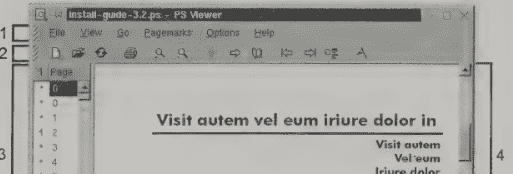

键位绑定是键盘快捷键，允许您使用按键执行操作（例如菜单命令）。PS Viewer 允许您对功能配置或更改键位绑定。

PS Viewer 使用解释器来翻译用于 PostScript 或 PDF 文件时使用的页面描述语言或文档结构约定。您可以为调色板等项目配置解释器设置。

## 显示工具栏和页面列表


您可以隐藏或显示工具栏、状态栏和页面列表。您还可以将工具栏和菜单栏移动到应用程序窗口的不同区域。有关移动工具栏和菜单栏的信息，请参阅第 70 页的“在窗口中移动菜单栏和工具栏”。当您完成应用程序窗口的自定义后，可以保存新选项。有关保存自定义选项的信息，请参阅第 230 页的“保存自定义设置”。

### 显示工具栏
- 点击`Options`，并点击以下选项之一：
  - `Show Status Bar`
  - `Show Toolbar`

可以通过再次点击`Options`并点击`Show Toolbar`或`Show Status Bar`来隐藏工具栏。

### 显示页面列表
- 点击`Options`，`Show Page List`。

菜单项目旁边的标记表示该项目已激活。

## 在 PS Viewer 中配置键位绑定
`PS Viewer`提供了预设的键盘快捷键或键位绑定，允许您使用按键执行操作（例如菜单命令）。例如，您可以通过`CTRL + L`更改文档的缩放。您可以通过更改与操作关联的键来自定义键位绑定。您可以重置键位绑定以恢复与操作关联的默认键。您还可以禁用当前关联的键位绑定。

当您配置键位绑定时，可以使用`SHIFT`、`CTRL`和`ALT`键将操作绑定到一个按键或组合键上。使用组合按键可以增加可用键盘快捷键的数量。

### 配置键位绑定
1. 点击`Options`，`Configure Key Bindings`。
2. 使用列表选择一个操作。
3. 点击您想要更改的键。
4. 按下新的组合键。
5. 点击`OK`。

### 重置键位绑定
1. 点击`Options`，`Configure Key Bindings`。
2. 选择您想要重置的操作。
3. 点击`Reset`。

### 禁用键位绑定
1. 点击`Options`，`Configure Key Bindings`。
2. 选择您想要禁用的操作。
3. 点击`Disable`。

# 移除单个页标记
1. 在`Page List`中，选择要移除页标记的页面。
2. 点击工具栏上的`Toggle Page Mark`按钮。

# 移除所有页标记
- 点击`Pagemarks`，`Remove Page Marks`。

# 切换页标记
切换页标记允许您标记和取消标记页面。`Toggle Page Marks`命令允许您反转所有已标记和未标记页的状态。例如，您可以打印一份 100 页文档中的 97 页，而无需标记所有 97 页。您只需要标记不想打印的三个页面，然后切换页标记；这三个已标记的页面现在将变为未标记，而未标记的页面现在将变为已标记。同样，如果您之前标记了所有偶数页，可以使用切换页标记命令反转标记，转而标记所有奇数页。

有关标记页面的信息，请参阅第 232 页的“添加和删除页标记”。

# 切换页标记
1. 选择您想要标记的页面。
2. 点击`Pagemarks`，`Toggle Page Marks`。
- 您也可以通过选择一个页面并点击工具栏上的`Toggle Page Mark`按钮来标记和取消单个页标记。

# 打印文档
在`PS Viewer`中打印文件时，您可以打印到打印机或文件。打印文件时，您可以设置打印选项以指定要打印的页面。您还可以反转文档打印顺序，使最后页先打印。

当将文档打印到文件时，文档和所有打印指令都包含在文件中。包含的指令基于根据打印到文件时在打印对话框中选择的设置。

# 在 PS Viewer 中打印到打印机
当将文件打印到打印机时，您必须在`Printer Setup`中指定使用哪台打印机。您还可以设置打印选项以指定打印哪些页面以及打印顺序。有关打印选项的信息，请参阅第 234 页的“在 PS Viewer 中设置打印选项”。

# 打印到文件
1. 点击`File`，`Print`。
2. 点击`Setup`，并在`Printer Name`框中输入打印机名称。
3. 点击`OK`。

# 在 PS Viewer 中打印到文件
您可以将文档打印到文件。如果您的电脑没有连接打印机，或者您想使用连接电脑以外的打印机打印文档，这就会非常有用。例如，如果您的文档将由服务机构打印，您可以将其打印到文件，然后通过磁盘或电子邮件附件将文件交付给服务机构。然后可以从另一台计算机打印该文件。

为了防止在打印文档到文件时覆盖原始文档，请确保新文件具有不同的名称。

# 打印文件
1. 点击`File`，`Print`。
2. 在`Print Destination`部分中，启用`Print To File`按钮。
3. 指定打印选项。

有关打印选项的信息，请参阅第 234 页的“在 PS Viewer 中设置打印选项”。

# 在 PS Viewer 中设置打印选项
您可以指定要打印的页面。您还可以反序打印文档，从文档的最后一页开始。

# 指定要打印的页面
1. 点击`File`，`Print`。
2. 在`Pages`部分中，启用以下页面选项之一。
- `All`—— 打印所有页面
- `Current`—— 仅打印当前页
- `Marker`—— 仅打印已标记页面
- `Range`—— 打印页范围内的页面

# 反序打印
1. 点击`File`，`Print`。
- 启用`Print Document In Reverse Order`复选框。

# 执行屏幕截屏
`Screen Grab`是一款用于截取桌面照片或屏幕截屏的应用程序。屏幕截屏可报告和演示文稿等文档。

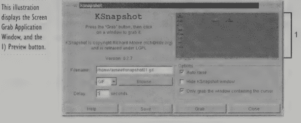

您可以使用多种不同的图形文件格式保存屏幕截屏。您还可以自定义`Screen Grab`创建截屏的方式。

# 创建、预览和保存截屏
当您打开`Screen Grab`时，它会使用默认设置自动截屏。如果您想要截取的区域显示在桌面上，那么在您打开`Screen Grab`时就会保存该截屏。您可以进行多次截屏。`Screen Grab`提供了选项，让您自定义如何以及何时创建截屏。

# 启动 Screen Grab
启动应用程序时，`Screen Grab`会自动对桌面和所有打开的窗口进行截屏。您可以保存此截屏，也可以创建一个。有关创建截屏的信息，请参阅第 236 页的“创建截屏”。有关保存截屏的信息，请参阅第 237 页的“保存截屏”。

# 启动 Screen Grab
- 点击`Application Starter`，`Applications`，`Graphics`，`Screen Grab`。

# 创建截屏
当您打开`Screen Grab`时，它会自动为您的桌面和在上面打开的窗口拍摄照片。您可以保存此截屏，也可以创建一个。在创建截屏时，请在执行截屏之前打开您想要拍摄的应用程序或文件。`Screen Grab`截取的是窗口或桌面的精确尺寸，因此请确保使用显示显示的项目。有关打开`Screen Grab`应用程序的信息，请参阅第 235 页的“启动 Screen Grab”。

您可以截取桌面和打开的应用程序或窗口，也可以截取特定窗口。当您截取特定窗口时，必须指定该窗口。

# 截取桌面和打开的应用程序
- 点击`Grab`

# 截取特定窗口
1. 打开该窗口。
2. 在`Screen Grab Window`中，启用`Only Window Containing`复选框。
3. 指定您想要截取的窗口。
4. 点击`Grab`。
- `Screen Grab`完成后会发出蜂声。
- 您可以通过点击`Screen Grab`窗口中的图像来预览您的截屏。
- 默认情况下，`Screen Grab`窗口是隐藏的。要显示此窗口，请取消`Options`部分的`Hide Screen Grab`复选框。

# 保存截屏
当您确定截屏正确时，将其保存为指定的格式。`Screen Grab`支持常用的图像格式，如`GIF`、`JPEG`和`BMP`。您还可以将截屏保存为`PostScript`文件。

# 保存截屏
1. 在`Filename`框中输入截屏的路径和文件名。使用`Browse`按钮定位工作目录之外的目录。
2. 从列表框选择文件格式。
3. 点击`Save`。

# 关闭 Screen Grab
完成创建截屏后，关闭`Screen Grab`。

# 关闭 Screen Grab
- 点击`Close`。

笔记的颜色和外观。笔记本实用程序允许你更改笔记的位置或将笔记发送到另一个桌面。

# 使用归档管理器


你可以使用归档管理器对文件进行分组和压缩。分组或压缩文件会创建一个归包，它与原始文件相同，但压缩文件生成的归包比原始文件小。传输和复制压缩文件的归包比传输多个单独文件更容易。例如，通过电子邮件发送压缩文件比发送多个单独文件更快。你还可以查看、创建和解压 `gzip` 文件。`gzip` 文件是使用 GNU Zip 压缩的单个文件。当你添加 `zip` 文件时，归档管理器会询问你是否想要创建一个归包来创建文件。你可以通过添加、删除、存储、查看和提取文件来编辑文件。你也可以使用归档管理器解压归包。

你可以更改归档管理器中的设置。你可以更改添加文件选项、默认归档目录、默认 `tar` 程序，并在退出归档管理器时保存这些设置。归档管理器可以识别文件类型，如 `.tar`、`.tar.lzo`、`.lzh`、`.rar`、`.zoo`，这些文件类型的实用程序可以在网上找到。

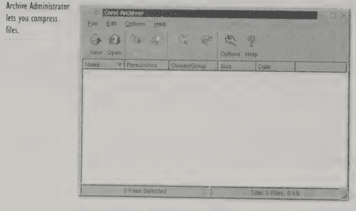

# 归档管理器

## 启动和退出归档管理器

你可以从桌面启动和退出归档管理器。

### 启动归档管理器

- 点击启动、应用程序、实用工具、归档管理器。

### 退出归档管理器

- 点击文件、退出。

你也可以通过点击关闭按钮退出归档管理器。

## 压缩和分组文件以及解压归包

当你在归包中对文件分组时，可以保留文件目录路径。例如，如果你在计算机上丢失了文件但已对其进行归档，你可以使用原始路径打开文件。当压缩时，归档管理器会创建一个比原始文件小的归包。压缩文件占用更少的内存，让计算机能够更好地管理它们。例如，复制或移动此类归包所花费的时间更短。你可以压缩一个大文件或一组文件，但压缩一个文件并不会显著缩小其大小。分组文件的归包具有 `.tar` 文件扩展名，压缩文件的归包具有 `.tar.gz` 文件扩展名。

当你打开一个归包时，归档管理器会将其解压，你可以在归档管理器窗口中看到归包中的所有文件。解压归包让你能够对归包进行更改，例如添加或删除文件。

### 将文件压缩或分组到归包中

1. 点击文件、新建归包。
2. 从“查看位置”`Look In`列表框中选择归包所在的目录。
3. 双击你想存储归包的文件夹。
4. 在“文件名”框中输入归包的文件名和扩展名（`.tar` 或 `.tar.gz`）。
5. 点击保存。

你也可以点击工具栏上的“新建”按钮来将文件压缩或分组到归包中。

### 解压归包

1. 点击文件、打开归包。
2. 从“查看位置”`Look In`列表框中选择归包存储的位置。
3. 双击存储归包的文件夹。
4. 选择归包名称。

你也可以点击工具栏上的“打开”按钮来访问打开对话框。

你可以通过点击文件、新建窗口来打开另一个归包。

### 编辑归包中的文件

你可以在归包中添加或删除文件。然而，删除文件是永久的，归档管理器会在完成删除前提示你。你可以按名称、权限、所有者/组、大小或日期对归包中的文件进行排序。无论你选择什么排序选项，你都可以对排序后的文件进行升序或降序排列。

归档文件是只读的。然而，如果你查看归包并更改文件内容，必须以不同的文件名保存文件。

要对压缩文件进行更改，例如编辑文本文件，你必须从归包中提取文件并在应用程序中打开它。提取文件会创建该文件的副本，因此如果你想将更改保存到归包中，你需要将其重新添加回归包。

#### 将文件添加到归包中

1. 点击启动、文件管理器。
2. 从“查看位置”`Look In`列表框中选择归包存储的位置。
3. 双击存储归包的文件夹。
4. 将文件从 Corel 文件管理器窗口拖到归档管理器窗口。

你可以通过点击工具栏上的“添加”按钮向归包中添加多个文件。

#### 从归包中删除文件

1. 选择一个文件。
2. 点击编辑、删除。

#### 对归包中的文件进行排序

点击以下表头之一：

* 名称 — 按名称字母顺序对文件排序
* 权限 — 按权限最多或最少对文件排序
* 所有者/组 — 按所有者/组的字母顺序对文件排序
* 大小 — 按字节从最小到最大对文件排序
* 日期 — 按日期对文件排序

#### 查看归包中的文件

1. 选择文件。
2. 点击编辑、查看。

如果你要查看的文件没有计算机识别的 MIME 类型，必须指定使用的应用程序。有关 MIME 类型的信息，请参见。

你也可以点击工具栏上的“查看”按钮查看归包。

#### 从归包中提取文件

1. 选择归包。
2. 点击编辑、提取。
3. 在“目标”框中输入提取文件的路径。
4. 在“文件”部分，启用。

你也可以点击工具栏上的“提取”按钮来提取归包。

### 设置归档管理器选项

添加文件选项允许你存储压缩文件的完整路径。归档管理器保存压缩文件的路径，以便在你提取文件时使用。

你可以选择仅向归包添加新文件，这在你更新该目录时很有有用。归档管理器还允许你设置存储创建的归包的默认目录。

归档管理器使用 `tar` 程序压缩文件并解包。你可以更改默认 `tar` 程序。如果你没有设置 `tar` 程序，归档管理器无法压缩或解压文件。

你可以保存设置，这样在启动归档管理器时无需重置它们。

#### 从完整路径添加归包

- 点击选项、选项。
- 启用存储完整路径复选框。

#### 仅添加新文件

- 点击选项、选项。
- 启用仅新文件复选框。

#### 设置默认归档目录

- 点击选项、选项。
- 在“位置”列表框中输入目录路径。

#### 设置默认 tar 程序

- 点击选项、选项。
- 在“应用程序名称”框中输入应用程序名称。如果你不知道应用程序的位置，点击浏览。

# 计算器

你可以使用计算器进行简单、三角和统计计算。在三角和统计模式之间切换可为你提供不同的按钮功能。计算器允许通过设置固定精度设置小数点后的位数。你还可以启用“错误时响声”功能，当计算发生错误时提醒你。你可以通过更改字体和显示颜色来自定义计算器的外观。

计算器让你执行数学运算。

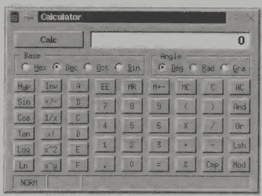

## 启动和退出计算器

你可以启动或退出计算器。

### 启动计算器

- 点击启动、应用程序、实用工具、计算器。

### 退出计算器

- 点击关闭按钮。

## 执行计算

计算器允许您执行不同类型的计算。您可以进行简单计算，也可以在统计模式或三角模式下操作。根据您选择的模式，会有不同的按钮可用。例如，当您将计算器设置为三角模式时，左列的按钮将变为三角函数。

### 执行简单计算

1. 在显示框中，输入第一个数字。
2. 点击以下任意之一：
   - 加号 `+` — 加法
   - 减号 `-` — 减法
   - 正斜杠 `/` — 除法
   - 星号 `*` — 乘法
3. 在计算中输入下一个数字。
4. 输入剩余的运算符和数字。
5. 点击等号 `=`。

### 启用三角模式

1. 点击计算器上的计算器 `Calculator`。
2. 点击默认 `Defaults` 选项卡。
3. 启用三角模式按钮。

### 启用统计模式

1. 按照上一个过程的步骤 1 和 2 进行操作。
2. 启用统计模式按钮。

## 自定义计算器

您可以通过设置固定精度来指定小数位数。您还可以启用计算器的“错误蜂鸣”功能，当发生计算错误时，该功能会发出鸣声信号。计算错误是指无法实现的计算，例如除以零。

### 设置小数位数

1. 点击计算器。
2. 点击默认 `Defaults` 选项卡。
3. 启用设置固定精度 `Set Fixed Precision` 复选框。
4. 在“设置固定精度为”框中指定小数位数。

> 当您取消选择“设置固定精度”复选框时，位数将变为精度 `Precision` 框中的数字加上“设置固定精度”框中的数字之和。

### 启用错误蜂鸣

1. 按照上一个过程的步骤 1 和 2 进行操作。
2. 启用错误蜂鸣 `Beep On Error` 复选框。

### 设置计算器字体和颜色

您可以通过设置字体以及前景和背景颜色来更改计算器的显示。您可以从预设系统颜色调色板中选择颜色，或自定义颜色。当您自定义颜色时，可以在计算器调色板上更改设置，或者更改类型值来设置色调、饱和度、亮度以及红、绿、蓝 `RGB` 属性。

#### 更改字体

1. 点击计算器。
2. 点击显示字体 `Display Font` 选项卡，并点击更改 `Change`。
3. 从字体 `Family` 列表框中选择一种字体。
4. 从大小 `Size` 列表框中选择一个大小。
5. 从权重 `Weight` 列表框中选择一个权重。
6. 从样式 `Style` 列表框中选择一种字体样式。

#### 设置前景颜色

1. 点击计算器。
2. 点击默认 `Defaults` 选项卡。
3. 在前景颜色 `Foreground Color` 旁边，点击更改 `Change` 按钮。
4. 点击系统颜色区域中的一种颜色。

##### 设置自定义前景颜色

1. 按照上一个过程的步骤 1 到 3 进行操作。
2. 点击自定义颜色 `Custom Colors` 区域中的灰色框。
3. 执行以下操作之一：
   - 将颜色选择器拖过调色板以更改色调
   - 输入值以更改颜色中的色调、饱和度、亮度、红色质量或蓝色质量


+ 4 点击添加到自定义颜色（Add To Custom Colors）的按钮。

+ 设置背景颜色

+ 1 按照“设置前景颜色”过程的步骤 1 和 2 进行操作。

+ 2 在背景颜色（Background Color）旁边，点击更改 (Change) 按钮。

+ 3 点击系统颜色区域中的一种颜色。

+ 设置自定义背景颜色

+ 1 按照“设置前景颜色”过程的步骤 1 和 2 进行操作。

+ 2 在背景颜色（Background Color）旁边，点击更改 (Change) 按钮。

+ 3 点击自定义颜色（Custom Colors）区域中的灰色框。

+ 4 执行以下操作之一：

- 将颜色选择器拖过调色板以更改色调

- 输入值以更改颜色中的色调、饱和度、亮度、红色质量或蓝色质量

+ 5 点击添加到自定义颜色（Add To Custom Colors）的按钮。

+ 您可以按 TAB 键在色调、饱和度和亮度框之间进行导航。

## 使用十六进制编辑器

十六进制编辑器使用十六进制系统对文件进行编码。您可以使用十六进制编辑器打开任何类型的文件，并将其以十六进制数字显示。如果您熟悉十六进制系统，就可以使用十六进制编辑器更改您的文件。您可以打开文件并保存您对文件所做的更改。

您可以使用十六进制编辑器更改文件的代码。

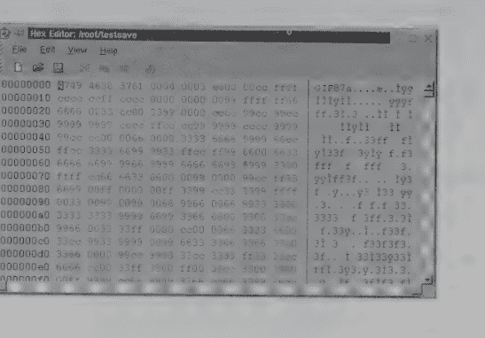

您可以在窗口中显示或隐藏工具栏。您可以退出十六进制编辑器。

## 在十六进制编辑器中打开和保存文件

您可以在十六进制编辑器中打开并保存文件。当您在十六进制编辑器中打开文件时，文件将以十六进制数字显示。十六进制系统使用数字0到9以及字母A到F。使用该系统，数字 12 的十六进制值为 C。使用十六进制数字处理文件允许您在代码层级自定义你的文件。十六进制系统将每个字节转换为两个十六进制数字，这使得文件更容易解释。在用十六进制编辑器更改文件之前，您应该熟悉十六进制系统。

您可以通过打开新窗口同时查看多个文件。您可以以相同的名称和位置保存编辑后的文件，也可以重命名文件并保存到不同的位置。

### 启动十六进制编辑器

- 点击应用程序启动器、应用程序、实用工具、十六进制编辑器。

### 打开文件

- 点击文件、打开。

- 在“查找位置 (Look In)”框中选择文件所在的目录。

- 双击文件。

### 打开新窗口

- 点击文件、新建窗口。

### 保存文件

- 点击文件、保存。

- 在“查找位置 (Look In)”框中选择您要保存文件的目录。

- 在文件名框中输入文件名。

- 点击保存。

## 显示和工具栏

十六进制编辑器允许您显示或隐藏工具栏。

### 显示和隐藏工具栏

- 点击视图、切换工具栏。

> 您也可以通过点击工具栏柄来显示或隐藏工具栏。有关工具栏的信息，请参见第70页的“移动菜单栏和工具栏”。

## 退出十六进制编辑器

您可以退出十六进制编辑器。

### 退出

- 点击文件、退出。

也可以点击关闭按钮退出十六进制编辑器。

## 格式化软磁盘

您可以使用格式化软磁盘来格式化或擦除软磁盘。您还可以使用格式化软磁盘为您的软磁盘命名。

格式化软磁盘允许您格式化软磁盘。


## 启动和退出格式化软磁盘

您可以启动并退出格式化软磁盘。

### 启动格式化软磁盘

- 点击应用程序启动器、应用程序、实用工具、格式化软磁盘。

### 退出格式化软磁盘

- 点击退出。

也可以点击关闭按钮退出格式化软磁盘。

## 格式化软磁盘

格式化软磁盘允许您格式化软磁盘。格式化软磁盘可以存储信息的空间。您可以为 DOS、Linux 或 UNIX 文件系统格式化磁盘。

## 使用 Core Linux 实用工具

### 格式化磁盘

+ 1 将磁盘插入磁盘驱动器。

+ 2 从“软磁盘驱动器 (Floppy Drive)”列表框中选择一个驱动器。

+ 3 从“密度 (Density)”列表框中选择密度。

+ 4 从“文件系统 (File System)”列表框中选择一种文件系统。

+ 5 启用“完全格式化 (Full Format)”按钮。

+ 6 点击格式化。

* 选择文件系统“ext2fs”为 Core Linux 或 UNIX 格式化磁盘。

## 擦除软磁盘上的数据

您可以使用格式化软磁盘擦除软磁盘上的所有数据。在擦除数据后，不需要重新格式化软磁盘。

### 擦除软磁盘上的数据

+ 1 将磁盘插入磁盘驱动器。

+ 2 启用“快速擦除 (Quick Erase)”按钮

+ 3 点击格式化。

## 为软磁盘命名

您可以使用格式化软磁盘为软磁盘命名。您可以根据保存在磁盘上的数据为软磁盘命名。例如，您用于保存位图图形的磁盘可以命名为“Bitmaps”。名称只能有十个字符，且您只能为针对 DOS 文件系统格式化的磁盘命名。

### 为磁盘命名

+ 1 将磁盘插入磁盘驱动器。

+ 2 启用“创建标签 (Create Label)”复选框。

+ 3 在“创建标签”框中输入名称。

# 使用 Note

Note 实用程序允许您创建多用途桌面笔记。您可以创建可以打印或通过电子邮件发送的提醒或消息。Note 具有剪切、复制和粘贴等基本编辑功能，并允许您自定义字体和颜色。

启动实用程序时，Note 图标会自动出现在停靠（Docking Station）中。即使桌面上没有活跃的笔记，Note 图标也会保留在停靠中。您可以通过点击此图标创建或编辑笔记。当在未退出 Note 的情况下注销 Corel LINUX 时，下次启动 Corel LINUX 时，图标将出现在停靠中。


# 启动 Note

您可以从桌面启动 Note。首次启动 Note 会自动在桌面显示一个笔记。您可以在桌面打开多个笔记。

# 启动 Note

当您启动 Note 时，停靠中会显示一个图标。即使屏幕上没有活跃的笔记，应用程序图标也会保留在停靠中。您可以从停靠中移除 Note 图标。

启动 Note

- 点击应用程序启动器（Application Starter）、应用程序（Applications）、实用程序（Utilities）、Note。

新建一个笔记

- 点击停靠中的 Note 图标，新建笔记（New Note）。

在停靠中添加或移除 Note 图标

1. 右键点击笔记。

2. 选择选项（Options）并点击固定面板（Dock In Panel）。

# 编辑笔记

您可以在桌面上打开、编辑、保存和删除笔记。Note 提供了基本的编辑功能，如剪切和粘贴。您可以从剪贴板粘贴文本到活动文本文件、另一个文本文件或其他应用程序。

# 打开和重命名笔记

您可以打开已保存的笔记并更改笔记名称。每条笔记都有默认名称。例如，您创建的第一条笔记命名为“note 1”。您可以根据用途重命名笔记，例如将笔记命名为“待办事项”。

# 打开笔记

- 点击停靠中的 Note 图标。

- 选择一个笔记。


- 您也可以通过右键点击活跃笔记，并点击您想要打开的笔记来打开它。

# 重命名笔记

- 右键点击活跃笔记，操作（Operations），重命名笔记（Rename Note）。

- 在“重命名此笔记为”（Rename This Note To）框中输入名称。

- 点击重命名（Rename）。

# 关闭、保存和删除笔记

关闭笔记时，它会自动保存。关闭笔记不会退出 Note 实用程序。您可以在不关闭的情况下保存笔记。当完成一个笔记后，可以删除它。

# 关闭笔记


- 在活跃笔记的右上角，点击关闭按钮（Close）。

# 保存笔记

- 右键点击活跃笔记，操作（Operations）。

- 点击保存笔记（Save Notes）。

# 删除笔记

1. 右键点击活跃笔记，操作（Operations）。

2. 点击删除笔记（Delete Note）。

# 在笔记中剪切、复制或粘贴以及缩进文本

您可以剪切或复制笔记中的文本并将其粘贴到另一个笔记中。当您剪切或复制文本时，它存储在剪贴板中。您可以从剪贴板将文本粘贴到活动文本文件、另一个文本文件或其他应用程序。剪贴板的内容一直有效直到您剪切或复制其他文本。

您可以启用自动缩进（Auto Indent），在进行首次缩进后自动缩进行。例如，如果您从第五个空格开始输入，自动缩进会将连续的文本缩进到第五个空格。

# 剪切文本

1. 选择要剪切的文本。

2. 按 CTRL + X。

# 复制文本

1. 选择要复制的文本。

2. 按 CTRL + C。

# 粘贴文本

1. 将光标置于插入文本的位置。

2. 按 CTRL + V。

# 缩进文本

1. 右键点击笔记。

2. 点击选项（Options），自动缩进（Auto Indent）。


- 您也可以通过点击选项（Options）、更改默认设置（Change Defaults）来启用自动缩进。

# 自定义笔记

您可以自定义笔记的外观。您可以为笔记应用三维（3D）框，并可以更改笔记的大小。

您可以设置字体属性，例如可以设置字体类型、粗细、大小和样式。您还可以选择字体颜色和笔记的背景颜色。您可以从预设颜色中选择或自定义颜色。

您可以在笔记中插入当前日期或日历。您还可以在笔记中设置警报。警报可以提醒您重要的日期或时间。

## 格式化笔记框和大小

您可以为笔记应用三维（3D）框，使其在桌面上脱颖而出。您还可以通过调整像素数来更改笔记的大小。笔记的大小按像素数发生变化。

### 应用3D 框

- 右键点击活跃笔记，操作（Operations）。
- 点击3D 框（3D Frame）。
- 您也可以通过点击选项（Options）、更改默认设置（Change Defaults）来应用3D 框。

### 设置大小

- 右键点击笔记。
- 点击选项（Options），更改默认设置（Change Defaults）。
- 在像素框中指定大小。

## 设置字体属性

您可以设置字体属性，例如可以设置字体类型、粗细、大小和样式。您还可以选择字体颜色和笔记的背景颜色。您可以从预设颜色中选择或自定义颜色。

### 选择字体

- 右键点击活跃笔记，选项（Options）。
- 点击字体（Font）。
- 选择字体（Family）。

### 选择粗细、大小或样式

- 右键点击活跃笔记，选项（Options）。
- 点击字体（Font）。
- 选择以下任意项：
  - 粗细（Weight）框
  - 大小（Size）框
  - 样式（Style）

### 选择颜色

- 右键点击活跃笔记，选项（Options）。
- 点击颜色（Colors），文本颜色（Text Color）。
- 从系统颜色部分选择颜色。

### 选择自定义颜色

- 按照上述第1和第2步操作。
- 在自定义颜色部分，点击灰色框。
- 执行以下操作：
  - 在调色板上拖动颜色选择器
  - 输入色调、饱和度、数值、红色、绿色或蓝色值
  - 点击添加颜色按钮（Add To Colors）。


- 您也可以通过点击选项（Options）、更改默认设置（Change Defaults）来更改字体属性。

## 为笔记选择背景颜色

Note允许您选择笔记的背景颜色。您可以选择预设背景颜色或自定义背景颜色。如果您想根据用途标记笔记，选择背景颜色非常有帮助。例如，可以将提醒设置为绿色，将包含紧急信息的设置为红色。

### 为笔记选择背景颜色

- 右键点击活跃笔记，选项（Options）。
- 点击颜色（Colors），背景颜色（Background Color）。
- 从系统颜色部分选择颜色。

### 选择自定义背景颜色

- 按照上述第1和第2步操作。
- 在自定义颜色部分，点击灰色框。
- 执行以下操作：
  - 在调色板上拖动颜色选择器
  - 输入色调、饱和度、数值、红色、绿色或蓝色值
  - 点击添加颜色按钮（Add To Colors）。

## 向笔记插入日期或日历

您可以在笔记中插入日期。您还可以插入一个显示当前月份的日历。

### 插入日期

- 右键点击活跃笔记，插入日期（Insert Date）。

### 插入日历

- 右键点击活跃笔记，操作（Operations）。
- 点击日历（Calendar）。

## 设置警报笔记

您可以在笔记中设置警报。使用警报提醒您任务或事件。例如，您可以在笔记中设置警报来提醒您会议。

### 设置警报笔记

- 右键点击活跃笔记，操作（Operations）。
- 点击警报（Alarm）。
- 在日期（Day）框中指定日期。
- 在“月份”框中指定月份。
- 在“年份”框中指定年份。
- 在“时间”框中指定时间。
- 在“时间”部分中，启用以下按钮之一：
  - AM
  - PM

## 发送备注

您可以将便签发送到其他虚拟桌面。您也可以让便签在所有桌面上可见。您可以打印便签以便跟踪。

### 更改便签的桌面位置

您可以将便签发送到不同的虚拟桌面。您还可以通过激活“固定”功能，在所有虚拟桌面上显示便签。

#### 将便签发送到不同的虚拟桌面

- 1 右键点击活动便签，选择“发送到桌面”(To Desktop)。
- 2 选择一个桌面。

#### 在所有虚拟桌面上显示备注

- 右键点击活动便签，并点击“固定”(Sticky)。

#### 在单个虚拟桌面上显示便签

- 右键点击活动便签，并点击“取消固定”(UnSticky)。

### 打印备注

您可以打印便签。

#### 打印备注

- 1 右键点击活动便签，选择“操作”(Operations)。
- 2 点击“打印备注”(Print Note)。

### 退出备注

您可以退出备注。当您在不退出备注的情况下注销 Core LINUX 时，下次启动 Core LINUX 时，备注图标将出现在 Dock 停栏中。

# 使用多媒体应用

Corel LINUX 多媒体应用包括 CD 播放器、MIDI/卡拉 OK播放器和音频混音器。CD 播放器让您播放 CD 并编辑播放列表。编辑播放列表可以让您更改 CD 上歌曲的顺序。

MIDI/卡拉 OK播放器让您电脑上播放背景音乐并在屏幕上显示歌词。您还可以在“通道视图”(Channel View)中选择节奏并听使用不同乐器的歌曲。MIDI/卡拉 OK播放器允许您播放 `.MID` 和 `.KAR` 文件。您还可以使用音频混音器增加或减少音量并调节左右扬声器之间的平衡。

## 使用 CD 播放器

CD 播放器是一种多媒体应用，让您播放音频紧光盘（CD）。您可以通过将 CD 插入 CD-ROM 驱动器来播放 CD。您可以使用 CD 播放器播放、暂停和恢复播放 CD。您可以在同一条曲目中快进或后退，也可以在 CD 上播放不同的曲目。

您可以使用 CD 数据库 (CDDB) 显示您正在播放的 CD 的曲目和艺术家信息。CDDB 是流行音乐的在线数据库。它们包含如 CD 标题、艺术家名称、歌曲标题和曲目编号等信息。这些信息显示在 CD 窗口中。

编辑 CD 数据库中的信息并将其到 CDDB 在线网站。

您还可以自定义 CD 播放器。您可以选择前景和背景颜色，指定播放 CD 的 CD-ROM 驱动器，指定向 CDDB 发送新条目的电子邮件地址，并指定您想要使用的 Web 浏览器以获取有关特定艺术家的更多信息。您还可以将 CD 播放器停靠、退出时停止播放、在 CD 结束时弹出，以及显示工具提示。

### 启动和退出 CD 播放器

您可以启动和退出 CD 播放器。

#### 启动 CD 播放器

- 点击“应用程序启动器”(Application Starter)，“多媒体”(Multimedia)，“CD 播放器”(CD Player)。

#### 退出 CD 播放器

- 在 CD 播放器窗口中，点击“退出”(Quit)按钮。

### 播放、停止和弹出 CD

CD 播放器让您播放、停止和弹出 CD。在启动 CD 播放器之前，请确保要播放的 CD 已在 CD-ROM 驱动器中。

#### 播放 CD

- 1 点击“应用程序启动器”，“多媒体”，“CD 播放器”。
- 2 点击“播放”(Play)按钮。

#### 停止 CD

- 在 CD 播放器窗口中，点击“停止”(Stop)按钮。

#### 弹出 CD

- 在 CD 播放器窗口中，点击“弹出”(Eject)按钮。

### 暂停和恢复播放 CD 曲目

CD 播放器让您暂停和恢复播放 CD 曲目。

#### 暂停和恢复 CD 曲目

- 在 CD 播放器窗口中，点击“暂停/播放”(Pause/Play)按钮。

### 向前向后移动 CD 曲目

您可以在同一条曲目中向前或向后移动，也可以移动到上一曲目或下一曲目。向前或向后移动允许您在同一条曲目中返回或前进 30 秒。这当您只想听曲目的某部分时非常有用。当您对 CD 上的特定曲目感兴趣时，移动到上一曲目或下一曲目非常有用。

#### 在同一条曲目中向后移动

- 在 CD 播放器窗口中，点击“后退”(Backwards)按钮。

#### 在同一条曲目中向前移动

- 在 CD 播放器窗口中，点击“前进”(Forwards)按钮。

#### 移动到上一曲目

- 在 CD 播放器窗口中，点击“上一曲目”(Previous Track)按钮。

#### 移动到下一曲目

- 在 CD 播放器窗口中，点击“下一曲目”(Next Track)按钮。

### 随机播放和循环 CD

您可以使用 CD 播放器随机播放和循环 CD。随机播放 CD 时，CD 播放器按随机顺序播放曲目。循环播放 CD 时，CD 播放器将从头到尾连续播放 CD。在启动 CD 播放器之前，请确保要播放的 CD 已在 CD-ROM 驱动器中。

#### 随机播放 CD

- 在 CD 播放器窗口中，点击“随机播放”(Shuffle)按钮。

#### 循环 CD

- 在 CD 播放器窗口中，点击“循环”(Loop)按钮。

### 增加和减少 CD 音量

您可以使用音频混音器增加或减少音量，并调节左右扬声器之间的平衡。


# 增加和减少 CD 音量

- 1 点击“应用程序启动器”，“多媒体”，“音频混音器”。

# 更改扬声器之间的平衡

- 1 点击“应用程序启动器”，“多媒体”，“音频混音器”。

# 使用 CDDB 和 SMTP 设置

您可以使用代理服务器设置紧光盘数据库 (CDDB) 和简单邮件传输协议 (SMTP)。CDDB 是包含大多数 CD 的在线数据库。SMTP 允许您向 CDDB 发送电子邮件。您可以使用代理服务器访问互联网。当您位于私有网络并需要互联网网关时，应使用代理服务器。要正确配置代理服务器，需要代理服务器的端口号。您应该联系网络管理员获取有关代理端口号的信息。您还可以配置 SMTP 向不同的 CDDB 服务器提交。

当 CD 被 CDDB 识别时，您可以在 CD 窗口中查看 CD 标题、艺术家名称、曲目列表和曲目数量。如果您播放未被任何 CDDB 识别的 CD，您可以使用播放编辑器手动输入信息。

# 启用 CDDB 搜索

您可以启用 CDDB 在互联网上搜索识别码。当 CD 被 CDDB 网站识别时，您可以在 CD 播放器窗口中查看 CD 标题、艺术家名称、曲目列表和曲目数量。

# 启用 CDDB 查找

- 1 在 CD 播放器窗口中，点击“配置 CD 播放器”按钮。
- 2 启用“远程 CDDB”(Remote CDDB)复选框。

# 配置 HTTP 和 SMTP 设置

您可以使用代理服务器访问 CDDB 网站并设置您的 SMTP 连接。代理是您可以使用来访问互联网的应用程序。如果您在私有网络上需要互联网网关，则应使用代理服务器。要正确配置代理服务器，需要代理服务器的端口号。您还可以配置 SMTP 向提交提交。

# 配置 HTTP 代理

- 1 在 CD 播放器窗口中，点击“配置 CD 播放器”按钮。
- 2 启用“使用 HTTP 代理访问 CDDB”若选框。
- 3 在 HTTP:// 框中输入代理服务器的主机名。
- 4 在 HTTP:// 框右侧的框中输入端口号。

# 配置 SMTP 设置

- 1 在 CD 播放器窗口中，点击“配置 CD 播放器”按钮。
- 2 点击“SMTP 设置”(SMTP Setup)选项卡。
- 3 启用“通过 SMTP 提交”(Enable Submission Via SMTP)复选框。
- 4 在“SMTP 地址:端口”框中输入邮件服务器的主机名。
- 5 在“您的电子邮件地址”框中输入您的电子邮件地址。

# 添加和删除 CDDB 服务器

您可以添加和删除 CDDB 服务器。如果您已经配置了 CDDB 设置，添加 CDDB 服务器可以增加找到 CD 的概率。

识别码。如果你连接的 CDDB 服务器没有找到你正在播放的 CD 的 CD 识别码，则你将无法获得有关该 CD、艺术家或曲目的任何信息。你也可以移除 CDDB 服务器。

## 添加和删除 CDDB 服务器

- 1. 在 CD 播放器窗口中，点击配置 播放器（Configure CD Player）按钮。
- 2. 在 CDDB 服务器框中输入服务器地址，点击加号（Plus）按钮。

## 移除 CDDB 服务器

- 1. 在 CD 播放器窗口中，点击配置 播放器（Configure CD Player）按钮。
- 2. 从 CDDB 服务器列表框选择一个 CDDB 服务器，点击减号（Minus）按钮。
- * 你必须连接互联网才能使用 CDDB 和 SMTP 设置。

## 访问 CD 艺术家的在线信息

一旦配置好 CDDB 设置，你就可以获取有关表演的在线信息、购买 CD 以及搜索艺术家的信息。你还可以自定义想要用于打开文档的浏览器。例如，你可以使用 Corel File Manager 打开文档，或者使用 Corel LINUX 附带的浏览器 Netscape Communicator。有关自定义浏览器的更多信息，请参阅第 165 页的“连接互联网”。

## 访问艺术家表演信息

- 1. 在 CD 播放器窗口中，点击信息（Information）按钮。
- 2. 点击表演（Performances）或 Tourdates.com。

## 按艺术家购买 CD

- 1. 在 CD 播放器窗口中，点击信息（Information）按钮。
- 2. 点击购买（Purchases），并选择以下其中之一：
  * CD Now
  * CD Universe

## 访问 CD 艺术家的信息

在 CD 播放器窗口中，点击信息（Information）按钮。

- 点击信息（Information），并选择以下其中之一：
  * Ultimate Bandlist
  * Deja News
  * Excite
  * HotBot
  * Info Seek
  * Lycos
  * Magellan
  * Yahoo!

- 你必须连接互联网才能使用 CDDB SMTP 设置。
- * 并非所有版本的 Corel LINUX 均包含 Netscape Communicator。

## 查看和编辑 CD 播放列表

你可以在 CD 播放器中查看 CD 播放列表。当你查看 CD 播放列表时，每首曲目的编号和标题将显示在 CD 播放器窗口中。数字条（Digital Bar）还允许你查看 CD 名称、曲目名称、艺术家名称以及曲目标题。你还可以查看有关 CD 标题和曲目标题的扩展信息。例如，某些曲目有曲目标题，但在括号内有额外信息。

你可以使用 CD 数据库编辑器（CD Database Editor）编辑 CD 播放列表。你可以编辑曲目标题名称和艺术家名称，并将新信息上传到 CD 数据库。在启动 CD 播放器之前，请确保要播放的 CD 已在 CD-ROM 驱动中。

## 查看 CD 播放列表

- 在 CD 播放器窗口中，点击 CDDB 按钮。

## 查看 CD 标题和艺术家的扩展信息

- 在 CD 播放器窗口中，点击 CDDB 按钮。
- 点击磁盘艺术家/标题（Disc Artist/Title）框右侧的扩展信息（Ext Info）按钮。

## 查看曲目的扩展信息

- 1. 在 CD 播放器窗口中，点击 CDDB 按钮。
- 2. 点击该曲目。
- 3. 点击曲目/时间/标题（Track/Time/Title）列表框右侧的扩展信息（Ext Info）按钮。

## 编辑 CD 标题曲目

- 1. 按照上一步程序执行所有步骤。
- 2. 点击曲目/时间/标题列表框中的曲目。
- 3. 输入新的曲目标题信息。
- 4. 点击上传（Upload）按钮。
- * 你必须连接互联网才能使用 CDDB 和 SMTP 设置。
- 要上传编辑过的 CD 标题，你必须配置好你的简单邮件传输协议（SMTP）地址。有关配置 SMTP 地址的更多信息，请参阅第 265 页的“配置 HTTP 代理和 SMTP 设置”。

## 自定义 CD 播放器

CD 播放器允许你自定义 CD 播放器状态显示的外观，指定应播放 CD 的 CD-ROM 设备，并自定义用于获取 CD 艺术家信息的 Web 浏览器。有关自定义浏览器的更多信息，请参阅第 165 页的“连接互联网”。

你还可以自定义 CD 播放器显示工具提示（ToolTips）、启用停靠、在 CD 盒关闭后立即开始播放、退出时停止播放并在完成后弹出 CD。

## 自定义 CD 播放器状态显示

你可以自定义 CD 播放器状态显示的外观。状态显示允许你查看时间显示、当前量设置和当前最大曲目数。你可以选择 CD 播放器窗口的前景背景颜色。你还可以更改主时间显示。你可以更改状态显示当前曲目的已时间、剩余曲目时间以及总剩余时间。

## 更改状态显示前景

- 1. 在 CD 播放器窗口中，点击配置 播放器（Configure CD Player）按钮。
- 2. 点击 CD （CD Options）选项卡。
- 3. 点击 LED 颜色部分的更改（Change）按钮。
- 4. 执行以下操作之一：
  - 从系统颜色（System Colors）部分添加颜色
  - 输入值以更改颜色中的色调、饱和度、亮度、红色质量、质量或蓝色质量

## 更改状态显示背景颜色

- 1. 按照上一步程序的第 1 和第 2 步执行。
- 2. 点击背景颜色（Background Color）部分的更改（Change）按钮。
- 3. 执行以下操作之一：
  - 从系统颜色（System Colors）部分添加颜色
  - 输入值以更改颜色中的色调、饱和度、亮度、红色质量、质量或蓝色质量

## 更改主时间显示

- 在 CD 播放器窗口中，点击时间按钮。
- Tra Rem — 显示剩余曲目时间
- Tot Rem — 显示总剩余时间
- Tot Sec — 显示总剩余秒数


默认情况下，时间显示显示当前曲目的已时间。


更改 CD-ROM 设备

你可以自定义用于播放 CD 的 CD-ROM 设备。默认 CD-ROM 设备值为 `/dev/cdrom`。如果你安装了多个 CD-ROM 设备，可以更改该值。


## 更改 CD-ROM 设备

- 1. 在 CD 播放器窗口中，点击配置 播放器（Configure CD Player）按钮。
- 2. 点击 CD 选项（CD Options）选项卡。
- 3. 在 CDROM 设备框中输入新值。


使用 MIDI/Karaoke Player 播放歌曲，你必须安装了声卡。

## 启动和退出 MIDI/Karaoke Player

你可以启动和退出 MIDI/Karaoke Player。

### 启动 MIDI/Karaoke Player

- * 点击“开始程序”，“多媒体”，“MIDI/Karaoke Player”。

### 退出 MIDI/Karaoke Player

- * 点击“文件”，“退出”。

使用 MIDI/Karaoke Player 播放歌曲，你必须安装了声卡。

## 播放、暂停和停止歌曲

MIDI/Karaoke Player 允许你播放、暂停和停止歌曲。

### 播放首 MIDI/Karaoke 歌曲

- 1 点击“开始程序”，“多媒体”，“MIDI/Karaoke Player”。
- 2 点击“文件”，“打开”。
- 3 从“打开”列表框中选择一首歌曲。
- 4 点击“歌曲”，“播放”。

### 暂停 MIDI/Karaoke 歌曲

- * 点击“歌曲”，“暂停”。

### 停止 MIDI/Karaoke 歌曲

- * 点击“歌曲”，“停止”。

使用 MIDI/Karaoke Player 播放歌曲，你必须安装了声卡。

- • 你也可以通过将歌曲拖入 MIDI/Karaoke Player 来播放歌曲。
- • 你也可以通过点击工具栏上的“暂停”按钮来暂停歌曲。
- • 你也可以通过点击工具栏上的“停止”按钮来停止歌曲。

## 在 MIDI/Karaoke 歌曲中向前向后移动

MIDI/Karaoke Player 允许你在歌曲中向前向后移动，或者跳到上一首或下一首歌曲。当你只想播放歌曲的一部分时，在歌曲中前后移动非常有用。当你对集合中的特定歌曲感兴趣时，移动到上一首或下一首歌非常有用。你还可以通过循环播放连续连续歌曲。

### 在歌曲中向后移动

- • 在 MIDI/Karaoke Player 工具栏上，点击“后退”按钮。

### 在同一首歌曲中向前移动

- • 在 MIDI/Karaoke Player 工具栏上，点击“前进”按钮。

### 到上一首歌曲

- • 在 MIDI/Karaoke Player 工具栏上，点击“上一个”按钮。

### 跳到后续曲目

- • 在 MIDI/Karaoke Player 工具栏上，点击“下一个”按钮。

### 连续播放歌曲

- 1 点击“开始程序”，“多媒体”，“MIDI/Karaoke Player”。
- 2 点击“文件”，“打开”。
- 3 从“打开”列表框中选择一首要播放的歌曲。
- 4 点击“歌曲”，“播放”。
- 5 点击“歌曲”，“循环”。

- • 使用 MIDI/Karaoke Player 播放歌曲，你必须安装了声卡。

## 在 MIDI/Karaoke Player 中查看和保存歌词

你可以两种格式查看和保存歌词：文本事件（Text Events）和歌词事件（Lyrics Events）。有些歌词存储为文本事件，另一些存储为歌词事件。你可以选择歌词格式，或将 MIDI/Karaoke Player 设置为自动选择歌词格式。

播放歌曲时，MIDI/Karaoke Player 会突出显示显示的单词并在工具栏上显示歌曲长度。

MIDI/Karaoke Player 还允许你保存歌词。

### 选择歌词格式

- 1 点击“文件”，“打开”。
- 2 从“打开”列表框中选择你想要播放的歌曲。
- 3 点击“选项”，并选择以下其中之一：
  查看文本事件 — 允许查看以 ASCII 文本存储的歌词
  查看歌词事件 — 允许查看使用特定字体和字符存储的歌词

### 自动选择文本事件歌词格式

- 1 点击“文件”，“打开”。
- 2 从“打开”列表框中选择你想要播放的歌曲。
- 3 点击“选项”，“自动文本选择”（Automatic Text Cho）。

### 保存歌词

- 1 点击“文件”，“保存歌词”。
- 2 从“另存为”列表框中选择你想保存文件的位置。

- * 使用 MIDI/Karaoke Player 播放歌曲，你必须安装了声卡。

## 修改歌词的字体属性

你可以通过更改字体属性来更改歌词的外观。你可以更改字体族、大小和样式。你所做的更改将生效。

### 修改歌词的字体属性

- 1 点击“选项”，“字体”。
- 2 在“字体”部分更改以下内容：
  - 字体族
  - 大小
  - 样式

## 更改歌曲的速度和通道

MIDI/Karaoke Player 允许你更改歌曲的速度和通道。更改速度可以增加或减少。更改通道可以让你听到不同的乐器。

### 增加歌曲的速度

- 1 点击“文件”，“打开”。
- 2 从“打开”列表框中选择一首歌曲。
- 3 点击“歌曲”，“播放”。
- 4 点击“前进”按钮。

### 减少歌曲的速度

- 1 点击“文件”，“打开”。
- 2 从“打开”列表框中选择一首歌曲。
- 3 点击“歌曲”，“播放”。
- 4 点击“后退”按钮。

### 更改歌曲的通道

- • 在 MIDI/Karaoke Player 工具栏上，点击“通道”按钮。

使用 MIDI/Karaoke Player 播放歌曲，你必须安装了声卡。

## 创建、复制和删除集合

MIDI/Karaoke Player 允许你创建、复制和删除集合。

### 创建集合

- 1 点击“集合”，“组织”。
- 2 点击“新建”按钮。

### 复制集合

- 1 点击“集合”，“组织”。
- 2 从“可用”列表框中选择集合。
- 3 点击“复制”。

### 删除集合

- 1 点击“集合”，“组织”。
- 2 从“可用”列表框中选择集合。
- 3 点击“删除”。

## 向集合添加和移除歌曲

MIDI/Karaoke Player 允许通过两种方式向集合添加歌曲。你可以使用“添加”按钮添加歌曲，也可以使用“自动添加”选项添加歌曲。

### 向集合添加歌曲

- 1 点击“集合”，“组织”。
- 2 从“可用”列表框中选择集合。
- 3 点击“添加”按钮。

### 自动添加歌曲

- 1 点击“文件”，“打开”。
- 2 从“打开”列表框中选择一首要播放的歌曲。
- 3 点击“集合”，“自动添加”。

### 从集合中移除歌曲

- 1 按照“向集合添加歌曲”的第 1、2 步操作。
- 2 从列表框中选择歌曲。
- 3 点击“移除”。

## 按顺序或随机播放集合

MIDI/Karaoke Player 允许按顺序或随机播放集合。在“顺序模式”下播放集合，歌曲将按照保存顺序连续播放。在“随机模式”下播放集合，歌曲将随机播放。

### 按顺序播放集合

- 1 点击“集合”，“组织”。
- 2 从“可用”列表框中选择集合。
- 3 点击“集合”，“顺序模式”。

### 随机播放

- 1 按照“按顺序播放集合”的第 1、2 步操作。
- 2 点击“集合”，“随机模式”。

## 在 MIDI/Karaoke Player 中更改音量

你可以通过音量调节器更改 .MID 或 .KAR 文件的音量。你还可以更改左右扬器之间的音量分布。

### 增加或减少歌曲的音量

- 1 点击“开始程序”，“多媒体”，“音量调节器”。
- 2 向上移动“合成器”滑块以增加音量，向下移动“合成器”滑块以减少音量。

### 更改扬器间的音量分布

- 1 点击“开始程序”，“多媒体”，“音量调节器”。
- 2 左右移动“平衡”滑块以分配左右扬器之间的音量。


# 在 Corel LINUX 14 中管理打印和字体

在打印之前，你必须先安装打印机。你可以使用打印管理器（Printing Manager）添加和删除打印机，并自定义打印机属性。打印管理器接收并存储打印任务，然后在后台打印每个任务任务，这样用户在文件打印时就可以继续工作。如果你正在使用网络打印机或共享打印机，你可以在打印队列中查看等待打印的打印任务。打印队列还允许你取消打印任务。

用户只能查看打印管理器中的信息。你必须以 root（根用户）用户的身份登录才能更改打印机属性或添加/删除打印机。

使用字体管理器（Font Manager）来指定桌面及桌面应用程序可以使用哪些字体。有关更改桌面字体的信息，请参阅第 62 页的“更改桌面字体”。

# 设置打印机

在 Corel LINUX 中打印之前，你必须先设置打印机。当你从应用程序打印文件时，你只能选择已添加到打印器的打印机。使用打印向导（Printing Wizard）将本地或网络打印机添加到你的桌面。本地打印机连接到你的计算机上，而网络打印机位于网络计算机上，并可以共享以便其他用户向其打印。你也可以删除打印机。


添加或删除打印机必须必须是 root 用户。如果你没有以 root 用户身份登录，可以在打印管理器中切换用户。有关作为 root 用户操作的信息，请参阅第 103 页的“使用 root 账户”。

### 添加打印机

打印向导允许你添加打印机。要添加本地打印机，你必须指定打印机名称以及打印机连接到计算机的设备或端口。打印机可以通过串口或并行端口连接。在添加打印机之前，请确保你已知打印机的品牌和型号。

当你添加网络打印机时，必须指定打印机名称和主机名（hostname）。主机名是控制打印机的服务器名称。你还需要指定打印机是位于 Windows 网络还是 UNIX/Linux 网络。

#### 要添加打印机

1. 点击应用程序启动器（Application Starter），控制中心（Control Center）。
2. 点击打印机（Printers）。
3. 在打印对话框中，点击添加（Add）。
4. 按照打印向导中的步骤操作。


- 如果你不是 root 用户，添加按钮将显示灰色。
- 当你添加 Windows 网络打印机时，向导会提示你在选择主机名之前提供你的网络用户名和网络密码。


### 删除打印机

你可以使用打印管理器删除打印机。你必须以 root 用户的身份登录才能删除打印机。

#### 要删除打印机

1. 点击应用程序启动器（Application Starter），控制中心（Control Center）。
2. 点击打印机（Printers）。


Corel LINUX 用户指南：第 14 章

3. 从已安装打印机（Installed Printers）列表框中选择打印机。
4. 点击删除（Remove）。

- 你必须以 root 用户的身份登录才能添加或删除打印机。你可以点击修改（Modify）并输入 root 用户密码来切换到 root 用户。

# 管理打印任务

设置打印机后你就可以打印文档。有关设置打印机的信息，请参阅第 279 页的“设置打印机”。

当你打印到网络打印机时，打印队列会存储该任务直到打印机可以处理。每个网络打印机都有一个打印队列。你可以使用打印队列管理发送到网络计算机的打印任务。你可以查看计划中的打印任务或取消任务。

## 打印文档

当你打印文档时，打印管理器会处理打印过程。除非另有说明，打印任务将使用默认设置在默认打印机上打印。有关更改默认打印机的信息，请参阅第 286 页的“设置默认打印机”。有关为打印机自定义属性的信息，请参阅第 283 页的“自定义属性”。

大多数应用程序允许你通过文件（File）菜单进行打印。在打印之前，你必须在应用程序中打开文档。

### 要打印文档

- 点击文件（File），打印（Print）。

## 访问打印队列

用户发送到网络打印机的打印任务被放入打印队列中。打印任务按照发送到打印机的顺序列出。打印队列列出了关于每个打印任务的以下信息：所有者（owner）、任务（job）、文件名以及文档发送到打印机的时间。你可以访问打印队列来检查打印任务的状态。

你必须以 root 用户登录才能访问打印队列。

### 要访问打印队列

1. 点击应用程序启动器（Application Starter），控制中心（Control Center）。
2. 点击打印机（Printers）。
3. 在打印对话框中，从已安装打印机（Installed Printers）列表中选择网络打印机，并点击属性（Properties）。
4. 点击任务队列（Job Queue）选项卡。

- 如果你没有以 root 用户登录，可以通过点击修改（Modify）并输入 root 用户密码来切换用户。
- 你也可以通过双击已安装打印机列表中的网络打印机，并点击任务队列（Job Queue）选项卡来访问打印队列。

## 取消打印任务

你可以使用打印队列取消自己的打印任务。

### 要取消打印任务

1. 点击应用程序启动器（Application Starter），控制中心（Control Center）。
2. 点击打印机（Printers）。
3. 在打印对话框中，从已安装打印机列表中选择网络打印机，并点击属性（Properties）。
4. 点击任务队列（Job Queue）选项卡。

- 如果你没有以 root 用户登录，可以通过点击修改（Modify）并输入 root 用户密码来切换用户。
- 你也可以通过双击已安装打印机列表中的网络打印机，并点击任务队列（Job Queue）选项卡来访问打印队列。
- 选择一个打印任务并点击取消（Remove）。
- 4 点击“输出”选项卡。
- 5 在“页面设置”部分，从“纸张大小”列表框选择纸张大小。

### 格式化页面

- 1 遵循上一个步骤的步骤 1 到 4。
- 2 在“页面设置”部分，从“页面格式”列表框选择页面格式。

### 调整边距

- 1 遵循“更改纸张大小”步骤的步骤 1 到 4。
- 2 在“页面设置”部分，在以下任一列表框中选择边距大小：
  - 水平——调整水平边距
  - 垂直——调整垂直边距

> 你必须是 root 用户才能更改打印机设置。可以通过点击“修改”并输入 root 用户密码切换到 root 用户。

## 设置文件大小打印限制

某些旧型号打印机的内存资源有限。你可以设置限制，将打印的文件限制在特定的文件大小。打印管理器只会打印小于指定大小限制的文件。

### 设置文件大小打印限制

- 1 点击应用程序启动器，控制中心。
- 2 点击打印机。
- 3 从“已安装打印机”列表中选择要设置限制的打印机，并点击“属性”。
- 4 点击“常规”选项卡，并启用“限制打印文件小于”复选框。
- 5 在框中输入一个值。

> 你必须是 root 用户才能更改打印机设置。可以通过点击“修改”并输入 root 用户密码切换到 root 用户。

## 设置默认打印机

打印作业将由默认打印机自动打印。当你的 Linux 系统上有多个打印机时，你可以指定将哪一个打印机设置为默认值。

### 设置默认打印机

- 1 点击应用程序启动器，控制中心。
- 2 点击打印机。
- 3 在“打印”对话框中，从“已安装打印机”列表中选择要设置为默认的打印机。
- 4 点击“设为默认”，并点击“应用”。

已安装打印机列表中的打印机名称旁边会显示“(默认)”字样。

> 你必须是 root 用户才能更改打印机设置。可以通过点击“修改”并输入 root 用户密码切换到 root 用户。

## 管理字体

字体是包含字体和大小的字符集。字体是指字符集的样式，例如 Helvetica、Courier 和 Times Roman。大多数字体可以使用**粗体**、*斜体*、粗斜或标准字重进行修改。

你可以使用字体管理器管理 Corel LINUX 桌面的字体。字体管理器允许你通过添加或删除字体来指定桌面应用程序可以使用字体。它还允许你预览字体。当你预览字体时，请确保该字体已添加到“当前 KDE 字体”列表中。有关将字体添加到字体列表的信息，请参阅第 287 页的“添加和删除字体”。

字体管理器与位于控制中心的“字体”桌面设置配合工作。“字体”桌面设置允许你更改桌面不同区域的字体设置。有关更改桌面字体的更多信息，请参阅第 62 页的“更改桌面字体”。当你使用字体管理器添加或删除字体时，桌面的可用字体列表会随之变化。

### 预览字体

字体管理器允许你使用字体资源管理器预览字体。当你进行字体预览时，字体资源管理器会列出应用于该字体的属性，并在预览框中显示该字体。

字体资源管理器还允许更改字体属性并预览结果。例如，你可以预览 Helvetica 字体并修改其属性，如字体大小和字体样式。字体资源管理器会在预览框中显示字体和新属性。

字体资源管理器仅是一个预览工具，不允许你保存或应用对字体属性所做的更改。

#### 预览字体

- 1 点击应用程序启动器，应用程序，系统，字体管理器。
- 2 点击“字体资源管理器”选项卡。
- 3 在“请求的字体”部分，从“字体族”列表框中选择一个要预览的字体。

### 更改字体属性

- 1 遵循上一个步骤的所有步骤。
- 2 从以下任一列表框中选择字体属性：
  - 字体族更改字体类型。
  - 字重更改字重，例如**粗体**。
  - 大小更改字体大小。
  - 样式更改字体样式属性，例如*斜体*。

### 添加和删除字体

字体管理器允许你指定桌面和桌面应用程序使用的字体。字体管理器维护了一个桌面字体列表。你可以从此列表中添加或删除字体。删除字体不会将其从系统中删除，只是使其无法在桌面或桌面程序中使用。

#### 添加或删除字体

- 1 点击应用程序启动器，应用程序，系统，字体管理器。
- 2 点击“字体资源管理器”选项卡。
- 3 在“请求的字体”部分，从“字体族”列表框中选择一个要预览的字体。
- 1 遵循上一个步骤的所有步骤。
- 2 从以下任一列表框中选择字体属性：


字体族更改字体类型。

字重更改字重，例如`粗体`。

大小更改字体大小。

样式更改字体样式属性，例如`斜体`。

# 启动控制台实用

- 点击应用程序启动器、应用程序、工具，然后点击控制台。
- 若要启动 Midnight Commander shell，请在控制台窗口中点击文件、Midnight Commander。
- 您也可以通过点击面板上的终端仿真按钮来启动控制台实用。

# 启动登录 shell

- 按 `CTRL + ALT + F + F1`。
- 您可以通过按 `CTRL + ALT + F + F2....F6` 打开多个登录 shell。
- 您可以通过按 `CTRL + ALT + F + F7` 回到 Corel LINUX。

# 启动运行命令

1. 点击应用程序启动器、运行。
2. 在命令列表选择框中，输入您想要运行的命令。
- 勾选“在终端窗口中运行”复选框可以在控制台窗口中显示标准输出。
- 您也可以通过按 `ALT + F2` 启动运行命令。

# 使用多个 shell 会话

控制台实用允许您通过同时打开多个 shell 会话进行多任务处理。您可以在会话之间切换。

## 打开多个 shell 会话

- 点击文件，并选择以下模式之一：
- Linux 控制台 — 使用默认 shell 显示控制台窗口
- Shell — 使用 Bourne shell 显示控制台窗口
- Midnight Commander — 使用 Midnight Commander 显示控制台窗口

使用控制台实用

- 重复此过程以打开您所需的任意 shell 会话。

## 在 shell 会话之间切换

- 点击控制台窗口中的“会话”，并选择您想要工作的会话。

# 自定义控制台窗口设置

您可以自定义控制台窗口的外观。你可以显示或隐藏菜单栏、窗口框以及滚动条。您还可以更改控制台窗口的字体大小、窗口大小和配色方案。例如，“黑底绿字”配色方案显示黑色的 shell 会话背景和绿色文本。

## 显示菜单栏

- 点击选项、菜单栏。
- 菜单栏旁边的标记表示菜单栏已显示。
- 点击选项、菜单栏以隐藏菜单栏。

## 显示窗口框

- 点击选项、框架。
- 框架旁边的标记表示窗口框已显示。
- 点击选项、框架以隐藏窗口框。

## 显示滚动条

1. 点击选项、滚动条。
2. 点击以下滚动条位置之一：
- 左侧 — 在窗口左侧显示滚动条
- 右侧 — 在窗口右侧显示滚动条
- 点击选项、滚动条、隐藏以隐藏滚动条。

## 更改字体大小

1. 点击选项、字体。
2. 选择字体大小。

## 更改控制台窗口大小

1. 点击选项、大小。
2. 选择窗口大小。

## 更改配色方案

1. 点击选项、方案。
2. 选择配色方案。

# 保存控制台设置

您可以为控制台窗口保存自定义的外观设置。

## 保存自定义外观设置

- 点击选项、保存选项。

# 退出控制台

当您完成命令行工作后，可以退出控制台并返回桌面。

## 退出控制台

- 点击文件、退出。

# 使用 shell

Corel LINUX 允许您使用图形界面进行工作，但如果您想在 shell 命令行工作，也可以访问 shell。shell 会解释您输入的命令，并与 Linux 操作系统（或内核）进行通信。然后内核会尝试执行该命令。关于从桌面访问 shell 命令行的信息，请参阅第 290 页的“访问 shell 命令行”。

在 shell 命令行界面工作时，如果您以 root 用户身份操作，请务必小心，因为这可能会严重损坏操作系统，特别是当您熟悉 Linux 操作系统时不。当您以 root 用户身份工作时，shell 命令行会显示井号 (`#`)，例如 `Mabel:#`。。关于作为 root 用户工作的信息，请参阅第 103 页的“使用 root 账户”。

Corel LINUX 为您的 Linux 系统提供了两个 shell：Bourne shell (`bash`) 和 C shell。每个 shell 都有独特的特性，但支持通用命令。您可以使用 Corel Update 添加其他 shell。关于 Corel Update 的信息，请参阅第 129 页的“安装、更新和删除应用程序”。

## bash

Corel LINUX 使用 `bash` 作为其默认 shell。`bash` 基于 Bourne shell (`sh`)，其使用的命令语法与最初仅用于 UNIX 系统的原始 shell 类似。Bash 还包含了 Korn shell (`ksh`) 和 C shell (`csh`) 的功能。Bash 将强大的编程能力与交互式图形界面相结合。`bash` 的某些功能包括命令行自动补全、命令历史和作业控制。关于 `bash` 的信息，请参阅第 296 页的“使用 bash”。

## csh

C shell 之所以得名，是因为它使用的编程语言语法类似于 C 语言。C shell 的某些功能包括命令行自动补全、shell 脚本、命令历史和作业控制。

以下章节基于 Bourne Again shell，因为 Corel LINUX 使用 `bash` 作为默认 shell。您可以使用 shell 命令行导航文件系统。您也可以在 shell 命令行中执行相同的文件操作，就像在桌面上一样。例如，您可以创建一个新目录或将文件移动到不同的目录。

# 理解 Linux 命令

在命令行输入的指令被称为命令。您在命令行输入的某些命令是位于您硬盘硬盘上的程序。某些命令会触发 shell 的自动响应；这些被称为内置命令。未内置在 shell 中的命令需要 shell 搜索具有相同命令名称的程序并执行它。如果 shell 无法找到指定的命令或程序，它将返回一条错误信息。

Corel LINUX 命令是区分大小写的。大多数命令使用小写字母。在命令行中，请确保命令和文件名的大小写正确。例如，如果您尝试输入 `LS` 而不是 `ls` 来列出目录，shell 将返回“未找到命令”的错误信息。

Linux 命令的结构允许您获取通用或特定的结果。您可以通过应用选项和参数来修改命令。

例如，使用列表命令 (`ls`) 获取当前目录下所有文件的通用列表。

```
Mabel:~ $ ls
\autosave Desktop test1.txt draw2.jpg test2.txt
test3.txt filel draw1.jpg
```

某些命令具有选项，允许您向命令中添加更具体的指令。命令语法通常在命令选项前加一个连字符以表示该选项已激活。您可以在同一个命令上使用多个选项。例如，与其像上面那样列出文件和子目录，您可以使用多个选项来列出当前目录的内容，为子目录标记斜杠 (`/`) 并按扩展名排序文件。

```
Mabel:~ ls -pX
\autosave Desktop test1.txt draw2.jpg test2.txt
test3.txt filel draw1.jpg
```

参数针对特定命令。您可以结合命令参数（文件名或目录）和命令选项。例如，您可以使用上述选项运行列表命令，并指定 `Desktop/` 目录作为命令参数。结果将显示桌面目录的内容，为子目录标记斜杠 (`/`) 并按扩展名排序该目录下的文件。

```
Mabel:~ ls -pX Desktop
Templates/ Trash/ MyHome.kdelnk
```

# 用于 Linux 命令的符号约定

接下来的章节使用了下表中的符号约定来引用特定的 Linux 命令。约定规定了正确的命令语法，以及哪些选项和参数是必需的，哪些是可选的。在使用以下约定时，请输入括号。例如，当步骤告诉您输入 `ls [-p]` 时，是指 `ls -p`，不带方括号。关于选项和参数的更多信息，请参阅第 294 页的“理解 Linux 命令”。

使用控制台实用

295

## 如果你.... 这意味着....

| 独立文本（不带任何括号） | 准确输入你看到的内容。 |
| --- | --- |
| 方括号 `[]` 中的文本 | 该文本是可选的。 |
| 尖括号 `<>` 中的文本 | 替换为适当的文本，例如 `<filename>` 意味着将文本替换为你想要使用的文件名。 |
| 大括号 `{}` 中的文本 | 仅从大括号内的值中选择一个。确保在值之前包含连字符 (`-`)，例如 `ls [-a]`。 |
| 省号 `...` | 命令后可以有多个参数。例如，`<directory>...` 意味着可以使用多个目录中的内容，例如，输入 `ls new` 将列出桌面目录和 new 目录下的所有文件和子目录。 |

多个括号内内的文本或省略号 你可以组合这些约定。例如，`ls <directory>...` 意味着你有权列出一个或多个目录。

后续章节中的步骤介绍了一些你可以用于导航文件系统和执行文件操作的命令。你可以参考帮助页（Manual pages）以获取有关特定命令或程序的更多信息。你可以通过在命令行输入 `man [command]` 来访问帮助页。例如，输入 `man cd` 将打开更改目录（Change Directory）命令的帮助页。

# 使用 bash


Bourne Again (`shell`) 的名字来源于它基于基于 Bourne `shell`。它由 Brian Fox 和 Chet Ramey 开发，支持 Bourne `shell` 命令，并结合了另外两个 `shell`（C `shell` 和 Korn `shell`）的特性。Bourne Again 以其强大的编程功能和易用的命令界面而闻名。

你可以通过更改命令行提示符来自定义 `bash` 会话。以下 `bash` 特性可以帮助用户快速高效地输入命令。

| 特性... | 说明... |
| --- | --- |
| 命令行补全 | `bash` 可以在不输入整个命令的情况下完成命令。当你忘记命令或程序的名称，或者命令名很长时，这非常有用。 |
| 命令历史 | `bash` 会保留命令历史，因此你可以滚动查看命令并重新使用或更改之前在 `shell` 会话期间输入过的命令行文本。 |
| 通配符 | `bash` 允许你在命令中使用通配符，这使输入速度更快。例如，你可以使用星号通配符 (`*`) 来列出所有 `.txt` 扩展的文件，`ls *.txt` |

# 别名

你可以使用命令别名（`aliases`）来指定命令。当你经常需要输入长命令时，这可以节省时间。别名允许你根据你所需的命令语法自定义命令名称。例如，熟悉 DOS 命令的用户可以使用 DOS 命令名重命名等效的 Linux 命令。

# 重定向输入和输出

命令需要输入，`shell` 才能执行命令并返回输出。例如，输入 `Sort` 命令并按回车键，光标将移动到下一行，`bash` 将等待输入。如果你使用一个项目列表进行排序，按下 `CTRL+D`（表示你已完成输入），`bash` 将读取输入、对输入的项目进行排序并显示结果（即输出）。你可以同时重定向输入和输出。

# 组合命令

你可以使用管道（`pipes`）来组合命令。你可以将一个命令的输出作为第二个命令的输入，然后将第二个命令的输出作为第三个命令的输入。你可以根据需要重复此过程所需的任意命令。

# 自定义 shell

```
09:35:41 Thu Sep9 \
```

确保在引号中包含提示符字符代码，否则提示符将显示 `\t \d::` 而不是日期和时间。下表列出了你可以使用的一些提示符字符代码。

| 提示符字符代码... | 动作... |
|--- |--- |
| `$` | 显示美元符号 (`$`)，表示你以用户身份登录；以及井号 (`#`)，表示你正以 root 用户身份进行工作 |
| `\\` | 显示反斜杠 (`\`) |
| `\d` | 表示当前日期，例如 Thu Sep9 |
| `\t` | 表示当前时间，例如 09:35:41 |
| `\s` | 显示当前 `shell` 名称 |
| `\h` | 表示运行 `shell` 的主机计算机名称 |
| `\w` | 表示你工作目录的绝对路径名 |

# 更改默认命令提示符

1 在命令行输入，

`PS1="<提示符字符代码>"`

2 按回车键。

- 如果你使用多个提示符字符代码，请在每个代码之间包含空格以提高读性。
- 不要包含括号，因为它们表示提示符字符代码是可选的。有关命令表示约定的信息，请参见第 295 页的“Linux 命令的表示约定”。

# 使用命令行补全和命令历史

你可以使用 `TAB` 键完成命令或文件名。命令补全在你忘记命令名称时很有帮助，并且当你有长文件名时可以减少击键次数。例如，要查看工作目录中名为 `longfile` 的文件内容，你可以输入命令和文件名的前几个字母，然后按 `TAB`。Bourne Again `shell` 会尝试为你补全命令行。

```
Mabel:-$ more lon:TAB>
```

如果你没有为 `bash` 提供足够的信息来完成命令行，计算机会发出哔哔声。例如，你可能有多个以 `ion` 字母开头的文件。如果你再次按一次 `TAB`，`bash` 会尽可能地填充信息并等待输入。你可以输入更多字符，然后再次按两次 `TAB`，或者再次按 `TAB` 来显示文件名可能的补全列表。

`shell` 会保留你在命令行中输入的命令历史。你可以使用方向键重新使用或更改之前输入过的命令。

# 使用命令补全

1 在命令行输入，

`PS1="<提示符字符代码>"`

2 按回车键。

- 如果你使用多个提示符字符代码，请在每个代码之间包含空格以提高读性。
- 不要包含括号，因为它们表示提示符字符代码是可选的。有关命令表示约定的信息，请参见第 295 页的“Linux 命令的表示约定”。

# 使用命令历史

1 在命令行输入，

`PS1="<提示符字符代码>"`

2 按回车键。

- 如果你使用多个提示符字符代码，请在每个代码之间包含空格以提高读性。
- 不要包含括号，因为它们表示提示符字符代码是可选的。有关命令表示约定的信息，请参见第 295 页的“Linux 命令的表示约定”。

# 更改之前输入的命令

1 在命令行输入，

`PS1="<提示符字符代码>"`

2 按回车键。

- 如果你使用多个提示符字符代码，请在每个代码之间包含空格以提高读性。
- 不要包含括号，因为它们表示提示符字符代码是可选的。有关命令表示约定的信息，请参见第 295 页的“Linux 命令的表示约定”。

# 理解通配符

通配符帮助你进行模式匹配以搜索文件。你也可以通配符对一组文件执行相同的命令。通配符可以单独使用、组合使用或与其他字母数字一起使用。以下列表列出了 `bash` 支持的三种通配符。

- `*` 匹配一个或多个字符
- `?` 匹配一个字符
- `[...]` 匹配括号内的任何字符，包括列表和范围，例如，`[afl-3]` 匹配字母 “a”、“f”以及一到三之间的数字。

# 创建命令别名

你可以使用别名创建命令快捷方式。命令别名可以帮助你减少执行长命令所需的击键次数。root 用户输入的命令别名定义供全系统使用。

当你创建命令别名时，必须为别名分配一个名称，并指定与该名称关联的特定命令。如果你忘记别名对应哪些命令，可以查看之前创建的别名。

# 查看命令别名

1. 在命令行中，输入：

`alias <name>`

2. 按回车键 (`ENTER`)。

- 不要在命令行文本中包含括号。有关命令符号表示例的详细信息，请参阅第 295 页的“使用 Linux 命令符号表示例”。

# 查看所有别名

1. 在命令行中，输入：

`alias`

2. 按回车键 (`ENTER`)。

# 重定向输入和输出

在 `bash` 执行你输入的命令之前，需要进行输入。默认情况下，`bash` 从键盘读取标准输入，并将命令结果（即标准输出）写入计算机屏幕。

你可以使用方向指示键来重定向 `bash` 读取标准输入的方式以及写入标准输出的位置。使用小于号 (`<`) 重定向标准输入，使用大于号 (`>`) 重定向标准输出。例如，假设你的工作目录中包含一个名为 `fruit` 的文件，该文件列出了不同水果的名字。

kiwi banana orange pear apple

你可以通过将标准输入从键盘重定向到文件 `fruit` 来对此列表进行排序。`shell` 将标准输出写入屏幕。

```
Mabel:~ sort < fruit
apple
banana
kiwi
orange
pear
```

除了显示标准输出外，你可以将其重定向到文件。以下命令同时重定向了标准输入和标准输出。`shell` 从文件 `fruit` 读取输入，对文件内容应用 `Sort` 命令，并将排序后的列表放在一个名为 `newfile` 的文件中。

```
Mabel~$ sort < fruit > newfile
```

将输出重定向到现有文件会覆盖该文件的内容。如果该文件不存在，`bash` 会创建它。你可以单独使用或组合使用方向指示符。

# 将标准输入从键盘重定向到文件

1. 在命令行中，输入：

```
<command> < <filename>
```

2. 按回车键 (`ENTER`)。

- 不要在命令行文本中包含括号。有关命令符号表示例的详细信息，请参阅第 295 页的“使用 Linux 命令符号表示例”。
- 你可以使用追加符号 (`>>`) 代替标准输出方向符 (`>`) 将输出重定向到现有文件而不覆盖它。追加会将输出添加到文件的末尾。
- 某些命令不接受重定向指示。有关特定命令的更多信息，请参阅帮助页（Manual pages）。

# 将标准输出从计算机屏幕重定向到文件

1. 在命令行中，输入：

```
<command> > <filename>
```

2. 按回车键 (`ENTER`)。

- 不要在命令行文本中包含括号。有关命令符号表示例的详细信息，请参阅第 295 页的“使用 Linux 命令符号表示例”。
- 你可以使用追加符号 (`>>`) 代替标准输出方向符 (`>`) 将输出重定向到现有文件而不覆盖它。追加会将输出添加到文件的末尾。
- 某些命令不接受重定向指示。有关特定命令的更多信息，请参阅帮助页（Manual pages）。

# 使用管道组合命令

你可以使用管道 (`|`) 组合命令。管道将第一个命令的输出作为第二个命令的输入，将第二个命令的输出作为第三个命令的输入，最后一个命令的输出显示在屏幕上。你可以使用标准输出重定向将最终输出重定向到文件。有关重定向输出的信息，请选择阅第 301 页的“重定向输入和输出”。


例如，你可以使用连接命令 (`cat`) 读取名为 `testfile` 的文件的内容，然后将 `testfile` 复制到名为 `tests` 的目录中


最后运行单词计数命令 (`wc`) 来查看 `testfile` 中的行数、单词数和字符数。输出显示 `testfile` 有 2 行、16 个单词和 75 个字符。

```
Mabel:-$ cat testfile | cp testfile tests | wc testfile
2 16 75
```

# 组合命令

1. 在命令行中，输入：

`<command1> | <command2> | <command3>`

2. 回 Enter。

- 你可以使用管道组合三个以上的命令。
- 确保每个命令都包含了相应的参数和所需的命令选项。有关命令选项的信息，请参阅第 294 页的“理解 Linux 命令”。


# 文件系统

Linux 文件系统使用标准的树形结构组织目录和文件。目录树的顶层被称为根目录，用斜杠 (`/`) 表示。所有其他文件都从根目录分支。下表描述了这些目录：

| 目录 | 内容 |
| :--- | :--- |
| `/` | 根目录 |
| `/bin` | 可执行程序 |
| `/dev` | 设备 |
| `/usr` | 用户相关文件 |
| `/sbin` | 系统管理 |
| `/home` | 用户目录 |
| `/etc` | 配置文件 |

- 你可以通过在路径中包含每个目录，切换到目录树结构中深几级的子目录，例如 `cd <directory>/<subdirectory>/<subdirectory>`。
- 不要在命令行文本中包含括号。有关命令符号表示规范的信息，请参阅第 295 页的“使用 Linux 命令的符号表示规范”。

## 切换到当前目录的父目录

+ 1 在命令行中，输入：

`cd ..`

+ 2 按回车键（ENTER）。

- 你可以通过在命令行中输入 `pwd` 来验证你已切换到正确的目录。关于 `pwd` 命令的信息，请参阅第 305 页的“在文件系统中查找你的位置”。

## 返回主目录

你可以从文件系统的任何地方返回主目录。你也可以返回到系统上任何用户的主目录。

### 返回到你的主目录

+ 1 在命令行中，输入：

`cd`

+ 2 按回车键（ENTER）。

### 返回到另一个用户的主目录

+ 1 在命令行中，输入：

`cd ~<user>`

+ 2 按回车键（ENTER）。

- 不要在命令行文本中包含括号。有关命令符号表示规范的信息，请参阅第 295 页的“使用 Linux 命令的符号表示规范”。
- 你可以使用 `pwd` 命令来验证你已切换到正确的目录。关于 `pwd` 命令的信息，请参阅第 305 页的“在文件系统中查找你的位置”。

## 列出目录内容

你可以列出目录中的文件。列表命令 (`ls`) 让你查看工作目录中存在的文件和子目录。你也可以按名称列出文件或特定目录的内容。例如，你可以在不切换到该目录的情况下，列出工作目录内某个子目录的内容。

你可以配合列表命令使用不同的命令选项，以不同的方式显示目录内容。命令选项是预定义的修改项，允许你为命令添加更具体的指令。例如，你可以使用长选项（`-l`）来查看详细信息，如文件大小、所有者和权限。你可以使用全部选项（`-a`）列出目录中的所有文件，包括隐藏文件。关于命令选项的更多信息，请参阅第 294 页的“理解 Linux 命令”。

下表列出了列表命令的一些选项。要查看完整的选项列表，请在命令行中输入 `man ls` 查看列表命令的手册页。

| 选项... | 列出... |
|---|---|
| `-a` | 所有文件，包括隐藏文件。关于隐藏文件的信息，请参阅第 303 页的“在文件系统中导航”。 |
| `-l` | 以长格式显示的文件，包括权限、所有者、文件大小和修改时间等信息 |
| `-p` | 文件和目录，并添加斜杠 (`/`) 来标记目录 |
| `-r` | 反序列出文件（按名称或时间） |
| `-X` | 按文件扩展名列出文件 |
| `-F` | 通过标记：使用斜杠 (`/`) 标记目录，使用星号 (`*`) 标记可执行文件，使用符号 (`@`) 标记符号链接，使用管道 (`|`) 标记 FIFO，使用等号 (`=`) 标记套接字 |

### 列出目录内容

+ 1 在命令行中，输入：

```
ls [options]
```

+ 2 按回车键（ENTER）。

### 列出特定目录或文件

+ 1 在命令行中：

```
ls [options] [<directory>... <filename>...]
```

+ 2 按回车键（ENTER）。

+ 不要在命令行文本中包含括号。有关命令符号表示规范的信息，请参阅第 295 页的“使用 Linux 命令的符号表示规范”。
+ 省号表示你可以通过输入每个目录名或文件名同时列出多个目录或文件；例如 `ls [options] <dir1> <dir2>`
+ 记住在命令选项之前包含一个连字符 (`-`)。你可以指定多个命令选项。
- 你可以使用 `pwd` 命令来验证你已切换到正确的目录。关于 `pwd` 命令的信息，请参阅第 305 页的“在文件系统中查找你的位置”。

## 使用命令行执行文件操作

在命令行中，你可以执行文件操作，例如：查找文件；创建和移动目录；创建、复制和移动文件；删除目录和文件。

大多数移动或复制目录的命令都需要你指定源，例如文件或目录，以及你想要移动或复制的目标位置。

你可以设置条件来缩小搜索范围。要查看可能的条件列表，请参考 `find` 命令的手册页。使用名称条件 (`-name`)，你可以在主目录中查找文件。

```
find ~ -name file
```

你可以配合条件使用通配符。你还可以将输出重定向到文件。关于通配符的信息，请参阅第 299 页的“理解通配符”。

以下示例使用星号 (`*`) 在主目录中搜索 `.txt` 扩展的文件。

```
find ~ -name "*.txt"
```

你可以并在上述并将输出重定向到名为 `textfiles` 的文件中。

```
find ~ -name "*.txt" > textfiles
```

### 查找文件或目录

+ 在命令行中，输入：

```
find [<path name>] [<conditions>]
```

+ 按回车键（ENTER）。
+ 不要在命令行文本中包含括号。有关命令符号表示规范的信息，请参阅第 295 页的“使用 Linux 命令的符号表示规范”。


* 如果你在搜索条件中使用通配符，请确保用引号括起字符。
* 如果你没有指定路径名或条件，`find` 命令将显示当前目录的内容并包含每个项目的相对路径名。

## 创建和移动目录

你可以使用创建目录命令 (`mkdir`) 在工作目录中同时创建一个或多个目录。要创建目录，你必须对父目录具有写权限。在创建新目录时，可以使用命令选项设置目录访问模式 (`-m`) 或创建父目录 (`-p`)。新目录使用默认访问模式。关于创建目录命令的选项的信息，请参阅 `mkdir` 命令的手册页。关于设置权限的信息，请参阅第 113 页的“设置权限和所有权”。

使用移动命令 (`mv`) 将目录移动到新位置。你必须指定想要移动的目录和目标目录的位置。shell 将该目录（包括其所有文件和子目录）重命名为目标目录。如果你指定的目标目录不存在，bash 将以目标目录的名字重命名源目录。

你可以在命令时使用命令选项。要查看可能的命令选项列表，请参阅移动命令的手册页。

### 创建新目录

+ 1 在命令行中，输入：

```
mkdir [options] <directory>...
```

+ 2 按回车键（ENTER）。

* 省略号表示你可以通过输入每个新目录名同时创建多个目录；例如 `mkdir [options] <dir1> <dir2> <dir3>`。

### 移动目录

+ 1 在命令行中，输入：

`mv [option] <source> <destination>`

2. 按回车键。

- 不要在命令行文本中包含括号。有关命令符号表示约定的信息，请参阅第 295 页的“在 Linux 命令中使用符号表示约定”。

## 创建文件

你可以使用几种不同的命令在命令行创建文件。`touch` 命令用于创建空文件。你可以用文本编辑器或类似的程序打开这些文件并输入内容。你也可以使用连接命令（`cat`）通过获取你提供给 shell 的输入并将其重定向为输出来创建文件，请参见“重定向输入和输出”……`cat` 命令还可以将多个文件合并为一个文件。


你可以在 `touch` 和 `cat` 命令中使用命令选项。有关命令选项列表，请参阅每个命令的手页（Manual pages）。

### 使用 touch 命令创建文件

- 1. 在命令行中，输入：

```
touch [options] <filename>...
```

- 2. 按回车键。

### 使用 cat 命令创建文件

- 1. 在命令行中，输入：

```bash
cat > <filename>
```

- 2. 输入文件的内容。

- 3. 按回车键。

- 4. 按 `CTRL + D` 返回命令行。

### 通过合并文件创建新文件

- 1. 在命令行中，输入：

```bash
cat [options] <filename>... <newfile>
```

- 2. 按回车键。

- 省号（`...`）表示你可以输入多个文件名；例如 `cat [options] <file1> <file2> <file3>`。

- 你可以使用文本编辑器打开 `<newfile>`，或者输入 `cat <newfile>` 并按回车键来查看文件输出。

- 不要在命令行文本中包含括号。有关命令符号表示约定的信息，请参阅第 295 页的“在 Linux 命令中使用符号表示约定”。

## 查看文件

你可以使用更多命令（`more`）和较少命令（`less`）查看文件。这两个命令都允许你滚动查看文件。你可以为这两个命令都添加命令选项，但 `less` 提供的选项更多。有关 `more` 和 `less` 命令可用的选项列表，请参阅每个命令的手页。

你也可以使用连接命令（`cat`）查看文件。有关使用该命令的信息，请参阅 `cat` 命令的手页。

你可以通过管道或重定向将 `more`、`less` 和 `cat` 命令与其他命令结合使用。有关管道和重定向的信息，请参阅第 302 页的“管道的组合”和第 301 页的“重定向输入和输出”。

你可以使用空格键逐页查看长文档。你也可以同时查看多个文档。

### 使用 more 命令查看文件

- 1. 在命令行中，输入：

```bash
more [options] <filename>..
```

- 2. 按回车键。

### 使用 less 命令查看文件

- 1. 在命令行中，输入：

```bash
less [options] <filename>..
```

- 2. 按回车键。

### 使用 cat 命令查看文件

- 1. 在命令行中，输入：

```bash
cat [options] <filename>...
```

- 2. 按回车键。

- 不要在命令行文本中包含括号。有关命令符号表示约定的信息，请参阅第 295 页的“在 Linux 命令中使用符号表示约定”。

- 省号（`...`）表示你可以同时查看多个文件名，例如 `more [options] <file1> <file2> <file3>`。

## 使用 grep 搜索文件

你可以使用全局正则表达式解析器（`grep`）在文件中搜索特定的文本模式。你可以使用 `grep` 命令同时搜索多个文件。你必须指定要搜索的模式，以及 `grep` 命令执行搜索的一个或多个文件名。下面的示例显示了 `grep` 命令在 `file1` 和 `file2` 中搜索单词“text”。搜索结果显示在屏幕上。

```
Mabel:-$ grep text file1 file2
file:This file contains text.
file:You can highlight text using bold or italics.
file2:This file also contains text.
file2:Search for text and you can find it.
```

你可以通过管道将 `grep` 命令与其他命令结合。例如，你可以列出工作目录中的文件，然后使用 `grep` 搜索列表并返回包含“one”的文件名。有关管道和重定向的信息，请参阅第 302 页的“管道的组合”和第 301 页的“重定向输入和输出”。

### 使用 grep 搜索文件

- 1. 在命令行中，输入：

```bash
grep [options] <pattern> [filename]...
```

- 2. 按回车键。

- 不要在命令行文本中包含括号。有关命令符号表示约定的信息，请参阅第 295 页的“在 Linux 命令中使用符号表示约定”。

- 省号（`...`）表示你可以同时搜索多个文件名，例如 `grep [options] <file1> <file2> <file3>`。

如果您想使用类型化命令执行文件操作，请使用提示符。有关命令行的详细信息，请参阅第 294 页的“理解 Linux 命令”、第 296 页的“使用 bash”以及第 308 页的“使用命令行执行文件操作”。

关于使用 Midnight Commander 的章节介绍了 Midnight Commander 可用的 shell 界面、自定义功能和菜单命令的概述。Midnight Commander 提供了一个在线帮助文件，其中包含关于 Midnight Commander shell 和菜单项的更详细信息。您可以在 Midnight Commander 会话期间按 `F1` 键访问帮助文件。

## 探索 Midnight Commander 界面

Midnight Commander 界面显示五个部分：菜单栏、目录面板、提示行、命令行行和功能键标签。

- 此图显示了 Midnight Commander 界面的区域：

1) 菜单栏

2) 目录面板

3) 提示行和命令行行

4) Midnight Commander 菜单栏

5) 功能键标签

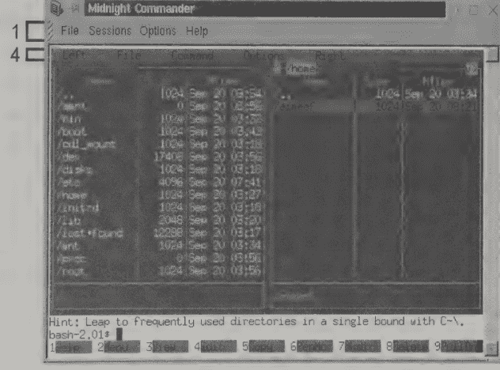

您可以使用鼠标或键盘在目录面板中导航。您还可以自定义 Midnight Commander 在目录面板中显示文件的方式。例如，您可以更改文件的排序顺序，或过滤文件列表以仅查看具有 JPG 扩展的文件。您还可以在四种不同的面板模式下工作。例如，快速查看（Quick View）模式会在非活动面板中显示您在工作目录中选择的文件。

## 菜单栏

菜单栏允许您更改左右目录面板的外观，对选定的文件执行操作，并并在应用程序内执行常规操作，例如搜索文件。

## 目录面板

双目录面板允许您同时查看两个目录。Midnight Commander 还支持单面板模式。包含选择栏的面板是当前目录面板。您必须对当前目录面板中的文件执行操作；但是，某些操作也会使用非活动目录面板。例如，当您将文件复制到新文件夹时，您在目录面板中选择要复制的文件，然后从非活动目录面板中选择目标文件夹。

## 提示行

提示行显示关于 Midnight Commander 中命令和函数的建议。您可以关闭此功能。

## 命令行

命令行允许您从 Midnight Commander 执行系统命令。有关有关系统命令的更多信息，请参阅第 308 页的“使用命令行执行文件操作”以及第 293 页的“与 shell 工作”。

## 功能键标签

位于 Midnight Commander 界面底的功能键标签允许您执行诸如显示帮助或查看文件等功能。您可以使用功能键（`F1`、`F2`、`F3` 等）或通过鼠标点击功能来激活这些功能。

## 在目录面板中导航

包含选择栏的面板是当前目录面板。您可以更改当前目录面板。您也可以交换两个面板，而不更改哪个面板是当前目录面板。

您可以使用鼠标或键盘查看 Midnight Commander 的目录内容。您可以使用不同的按键导航目录。

### 更改当前目录面板

- 按 `TAB` 键。

- 您也可以通过按 `CTRL + I` 更改当前目录面板。

### 交换面板

- 点击“命令（Command） > 交换面板（Swap Panels）”。

- 您也可以通过按 `CTRL + U` 交换面板。

### 查看目录内容

1. 在当前目录面板中，选择要查看的目录。

- 按 `ENTER` 键。

### 在目录中导航

| 按... | 执行... |

| :--- | :--- |

| 下箭头 | 向下移动一行 |

| 上箭头 | 向上移动一行 |

| Page Down | 向下翻一屏 |

| Page Up | 向上翻一屏 |

| Home | 转到目录列表顶部 |

| End | 转到目录列表底部 |

## 自定义目录面板显示

您可以根据文件大小、文件名和文件格式等标准对文件进行排序，从而自定义 Midnight Commander 在目录面板中显示文件的方式。您还可以过滤目录文件列表以仅查看指定的文件。当您过滤目录文件列表时，必须指定过滤表达式来确定显示哪些文件。例如，您可以过滤文件列表以仅显示文件名中包含“text”一字的文件。您可以使用通配符。有关通配符的信息，请参阅第 299 页的“理解通配符”。

您可以更改面板布局，将面板水平分割而非垂直分割。

### 对目录文件列表进行排序

1. 点击以下菜单项之一：

   - 左侧（Left）——对左目录面板进行排序

   - 右（Right）——对右目录面板进行排序


2. 点击“`排序顺序（Sort Order）`”。

3. 在“`排序顺序`”对话框中，从左列选择一种排序标准。

4. 点击“`确定（OK）`”。

### 过滤目录文件列表

1. 点击以下菜单项之一：
   - `左侧（Left）`——对左目录面板进行过滤
   - `右（Right）`——对右目录面板进行过滤

2. 在“`过滤（Filter）`”对话框中输入过滤表达式。

3. 点击“`确定（OK）`”。

您可以通过点击“`过滤`”对话框中的向上箭头按钮并从历史列表中选择过滤器来选择之前使用过的过滤器。

### 更改面板布局

1. 点击“`选项（Options） > 布局（Layout）`”。

2. 从“`面板分割（Panel Split）`”部分选择以下面板布局之一：
   - `垂直（Vertical）`——垂直分割面板
   - `水平（Horizontal）`——水平分割面板

3. 点击以下箭头符号（`<`）之一来更改面板大小。
   - 左箭头（`<`）——增加左侧面板的大小
   - 右箭头（`>`）——增加右侧面板的大小

您可以通过 `ALT + T` 更改面板布局。如果搜索没有找到正确的结果，请点击“`再次（Again）`”进行再次搜索。

## 更改面板模式

您可以以四种模式显示面板：`列表模式（Listing Mode）`、`快速查看（Quick View）`、`信息（Info）`、`树形（Tree）`。

### 更改其中一个面板

点击以下菜单项之一：
- `左侧（Left）`——更改左目录面板
- `右（Right）`——更改右目录面板

选择以下模式之一：
- `列表模式（Listing Mode）`——允许您指定列表选项，如文件大小、权限、所有者
- `快速查看（Quick View）`——显示选中的文件
- `信息（Info）`——显示完整的文件或目录信息
- `树形（Tree）`——显示树结构

## 选择并标记文件

您必须选择文件才能执行操作。可以通过标记选择文件。选中的文件高亮显示。

您还可以使用模式选择一组文件。例如，输入 "`*.txt`" 将选择所有 `.txt` 扩展的文件。有关通配符的信息，请参阅第 299 页。

您还可以取消选择一组文件。

### 选择文件

- 点击当前目录面板中的文件。

### 标记多个文件

- 点击当前目录面板中的文件，然后按 `CTRL + T`。
- 点击下一个要标记的文件，然后按 `CTRL + T`。
- 重复步骤 2 直到标记所有文件。

### 通过模式选择一组文件

1. 点击“`文件（File） > 选择组（Select Group）`”。
2. 在选择对话框中输入模式，并点击“`确定（OK）`”。
   - 在选择对话框中输入星号 (`*`) 以选择所有文件。

### 取消选择一组文件

1. 点击“`文件（File） > 取消选择（Unselect Group）`”。
2. 在取消选择对话框中输入星号 (`*`) 并点击“`确定（OK）`”。

## 使用命令行执行文件操作

`Midnight Commander` 帮助您使用菜单命令执行查看、复制、移动和删除目录及文件。您还可以使用面板下方的功能键执行命令。功能键是菜单选项的快捷键。

默认情况下，`Midnight Commander` 在完成操作（如删除文件和目录）之前会提示您确认命令。

## 在 Midnight Commander 中查找目录和文件

您可以使用 `Midnight Commander` 的搜索功能在 Linux 系统上查找目录和文件。您可以通过按 `ENTER` 或使用鼠标在查找文件对话框中导航。

# 在 Midnight Commander 中查找目录或文件

1. 点击“`命令（Command） > 查找文件（Find File）`”。
2. 在“`起始于（Start At）`”框中输入您要搜索的目录路径。
3. 在“`文件名（Filename）`”文本框中输入要让 `Midnight Commander` 查找的目录名称或文件名。
4. 点击“`确定（OK）`”。

- 搜索结果显示在查找文件对话框中。如果搜索没有找到正确的结果，请点击“`再次（Again）`”进行再次搜索。
- 您可以通过点击查找文件对话框中的“`暂停（Suspend）`”来停止搜索。

## 在 Midnight Commander 中创建和移动目录

你可以使用菜单选项来创建和移动目录。在同一个父目录下，不能有两个相同的目录名称。当你移动一个目录时，你可以在其中一个面板中打开目标目录，并在当前面板中选择你想要移动的目录。`Midnight Commander` 会提供一个摘要语句，标明要移动的目录和目标目录。你应该检查此摘要语句，以确保源目录和目标目录是正确的。

### 创建目录

1. 在当前目录面板中，打开你想创建新目录的目录。
2. 点击“`File（文件）`”、“`Mdir（新建目录）`”。
3. 在“`Enter Directory Name（输入目录名称）`”部分输入新目录名称。

你也可以通过点击 `Mdir` 功能键或按 `F7` 来创建目录。

### 移动目录

1. 在当前目录面板中，打开目标目录。
2. 在另一个面板中，选择你想要移动的目录。
3. 点击“`File（文件）`”、“`Rename/Move（重命名/移动）`”。
4. 检查“`Move（移动）`”对话框，确保列出的源目录是正确的。
5. 检查“`To（到）`”框中列出的目标目录，确保它是正确的。

如果 `Move` 对话框中列出的源目录或目标目录不，你可以在相应的框中输入新的源目录或目标目录。

有关在 `Midnight Commander` 中导航的信息，请参考第 318 页的“在目录面板中导航（Navigating in the directory panels）”。

你也可以通过点击 `RenMov` 功能键或按 `F6` 来移动目录。

## 在 Midnight Commander 中使用文本/十六编辑器查看文件

你可以使用文本/十六编辑器在 `Midnight Commander` 中查看文件。有关使用文本/十六编辑器的信息，请参阅 `Midnight Commander` 在线帮助文件。

### 查看文件

- 在当前目录面板中选择要查看的文件。
- 点击“`File（文件）`”、“`View（查看）`”。
- 点击“`Quit（退出）`”退出文本/十六编辑器。
- 有关在 `Midnight Commander` 中导航的信息，请参考第 318 页的“在目录面板中导航（Navigating in the directory panels）”。
- 按 `F1` 获取使用文本/十六编辑器的帮助。

你也可以按 `F3` 退出文本/十六编辑器。

## 在 Midnight Commander 中复制和移动文件

你可以使用菜单命令在目录面板中复制或移动文件。当你复制或移动文件时，你必须选择想要复制或移动的源文件以及想要复制或移动文件的位置。

### 复制文件

- 在当前目录面板中，打开你想复制文件的目标目录。
- 在另一个面板中选择要复制的文件。
- 点击“`File（文件）`”、“`Copy（复制）`”。
- 检查“`Copy（复制）`”对话框，确保列出的源文件是正确的。
- 检查“`To（到）`”框中列出的目标目录是正确的。

你也可以通过点击 `Copy` 功能键或按 `F5` 来复制文件。

### 移动文件

1. 在当前目录面板中，打开你想移动文件的目标目录。
2. 在另一个面板中选择要移动的文件。
3. 点击“`File（文件）`”、“`Rename/Move（重命名/移动）`”。
4. 检查“`Move（移动）`”对话框，确保列出的源文件是正确的。
5. 检查“`To（到）`”框中列出的目标目录是正确的。

- 如果 `Move` 对话框中列出的源目录或目标目录不正确，你可以在相应的框中输入新的源目录或目标目录。
- 你可以通过标记文件来选择多个文件进行复制或移动。有关标记文件的信息，请参考第 321 页的“选择和标记文件（Selecting and tagging files）”。
- 有关在 `Midnight Commander` 中导航的信息，请参参考第 318 页的“在目录面板中导航（Navigating in the directory panels）”。

你也可以通过点击 `RenMov` 功能键或按 `F6` 来移动文件。

## 在 Midnight Commander 中删除目录和文件

`Midnight Commander` 在删除目录和文件之前会向你提示。你可以删除一个目录及其内部的文件和子目录。你可以通过标记要删除的文件来同时删除多个文件。

要删除目录或文件，你需要对包含该项目的目录具有写权限。

### 删除目录

1. 在工作目录中，选择要删除的目录。
2. 点击“`File（文件）`”、“`Delete（删除）`”。
3. 在“`Delete（删除）`”提示处，选择以下选项之一：
   - `Yes` — 删除目录
   - `No` — 取消删除


- 如果要删除的目录包含文件或子目录，`Midnight Commander` 会提示你删除整个目录。点击 `Yes` 删除该目录及其所有内容。

### 删除文件

1. 在工作目录中，选择要删除的文件。
2. 点击“`File（文件）`”、“`Delete（删除）`”。


### 3. 在“Delete（删除）”提示处，选择以下选项之一：

- Yes — 删除所有选定的文件
- No — 取消删除


- 你也可以通过选择目录或文件并点击功能键或按 `F8` 来删除。

## 配置网络连接

Linux 提供了实用程序，让你可以在本地网络和互联网上与其他计算机及进行通信。

- Dial-Up（拨号）——使用调制解调器和电话线连接互联网
- Samba Client ——与 Windows 计算机共享文件和及
- Ethernet Configuration（以太网配置）——如果计算机是本地网络的一部分，则设置以太网连接

`Dial-Up` 执行拨打互联网服务提供商（`ISP`）号码并与服务器连接的过程。它可以让你在连接不同的网络或 `ISP` 时设置拨号账户并配置解调器选项。`Samba Client` 随 Linux 安装。`Samba` 让 Linux 和 Windows 计算机在网络中工作，共享文件和服务。以太网连接让你在本地网络环境中与其他计算机通信。

你还可以配置计算机作为网络服务器。Linux 带有服务器软件，让你配置 Linux 计算机作为任何服务器：Apache Web 服务器、ProFTPD FTP 服务器、qmail 邮件服务器、`Samba` 服务器、`NFS` 服务器、`DHCP` 服务器。有关优化你的 Linux 的信息，请参阅《Linux 服务器管理员》。

## 使用调制解调器连接网络

Linux 提供了一个名为 `Dial-Up` 的实用程序，让你使用调制解调器和电话线连接互联网。连接网络被称为拨号上网。点对点协议（`PPP`）是一种用于通过调制解调器和电话链路建立并维护互联网连接的协议。`Dial-Up` 使用 `PPP` 与网络服务器通信。

### 设置拨号账户

拨号账户包含让 `Dial-Up` 连接客户端到服务器的信息。设置拨号账户时，你必须提供有关服务器的特定信息，例如服务器名称和电话号码。你必须提供有关客户端的信息，例如 IP 地址、域名和 DNS IP 地址以及网关。在账户设置期间，你可以创建登录脚本以自动化登录过程。计费选项让你跟踪拨号连接的费用。

要使用拨号功能设置账户，您需要了解关于您的 Corel LINUX 计算机以及您想要连接的服务器的以下信息：

- 连接名称（通常是 `ISP` 的名称；如果您有多个拨号账户，该名称必须是唯一的）
- 服务器的电话号码
- 服务器使用的是动态 IP 地址还是静态 IP 地址
- 如果适用，则静态 IP 地址
- 服务器域名解析服务（DNS）的 IP 地址
- 服务器使用的 `PPP` 认证方法：密码认证协议 (`PAP`) 或挑战性握手身份验证协议 (`CHAP`)
- 服务器是否会自动启动 `PPP`，或者您是否必须在登录后手动发送发送启动命令

您的系统管理员或互联网服务提供商（`ISP`）可以提供这些拨号信息。

## IP 和 DNS

网络通过唯一的域名和互联网协议（IP）地址来识别您的计算机。域名就像一个专名，而 IP 地址则是一个数字地址。在拨号连接期间，计算机的域名必须被翻译为 IP 地址。域名解析服务（DNS）服务器将 IP 地址翻译为专名。在设置拨号账户时，您必须至少提供一个 DNS 服务器 IP 地址。

要创建拨号账户，您必须指定计算机的 IP 地址和域名，以及用于解析 IP 地址和域名的 DNS 服务器的 IP 地址和域名。如果您指定的 DNS 服务器位于本地网络之外，当连接到本地网络内可能不需要域名翻译的计算机时，可以禁用它们。

## 动态和静态 IP 地址

您的计算机可以使用动态或静态 IP 地址。当您使用动态 IP 地址时，每次连接到网络，您联系的服务器会在当前拨号会期间分配一个 IP 地址。每次连接到 `ISP` 时，该数字都是不同的。当您使用静态 IP 地址时，您的计算机每次连接都会分配到一个固定的 IP 地址。

要创建拨号账户，您必须指定您的 `ISP` 分配的是动态还是静态 IP 地址。如果您有静态 IP 地址且您的计算机是较大网络的一部分，您的 `ISP` 还会为您提供子网掩码 IP 地址。

## PPP 认证方法

密码认证协议 (`PAP`) 和挑战性握手身份验证协议 (`CHAP`) 是防止未经授权的用户使用您的 `PPP` 线并访问您的系统的认证方法。`PAP` 是一种登录程序。在拨号过程中，客户端向服务器发送登录名和密码，服务器使用登录和密码数据库验证这些信息。`CHAP` 要求客户端向服务器发送主机名和随机字符串，服务器必须返回特定的响应。客户端验证服务器的响应，完成认证。`CHAP` 认证在整个连接期间重复进行。

要创建拨号账户，您必须指定 `ISP` 使用 `PAP` 还是 `CHAP` 认证方法。

## 网关

网关是作为连接互联网或其他网络的物理连接端口的计算机。如果您的计算机是具有网关的较大网络的一部分，您需要指定网关的 IP 地址。如果您的计算机位于没有专用互联网连接的网络中，或者是一个独立的工作站，请启用默认网关。默认网关和静态网关都有默认路由，即从您的计算机到网关计算机的硬件路径。您可以禁用默认路由并配置备用路由；但强烈建议保留默认路由。

## 登录脚本

登录脚本是一组控制拨号过程登录部分的命令。您可以编辑默认登录脚本以自定义您的拨号登录设置。您在脚本中使用的每个命令都必须设置字符串（字符序列）或其他参数来指定该命令的功能。例如，`Dial-Up` 的 `Expect` 命令在登录服务器之前会等待接收指定的字符串。如果您将此字符串设置为“ID”，`Dial-Up` 将在登录前等待接收用户 ID。您可以使用以下命令创建自定义登录脚本：

- Expect — `Dial-Up` 在完成登录之前等待特定的字符串
- Send — `Dial-Up` 发送指定的字符串
- Scan — `Dial-Up` 扫描输入数据以查找特定字符串（例如 `CHAP` 认证期间返回的响应）
- Save — `Dial-Up` 存储扫描到的字符串；`Dial-Up` 只存储密码字符串
- Pause — `Dial-Up` 暂停指定的秒数
- Hangup — `Dial-Up` 向调制调器发送挂断命令
- Answer — `Dial-Up` 准备接接入接入连接
- Timeout — `Dial-Up` 用指定的秒数覆盖默认或之前设置的调制调器超时时间；登录脚本完成后重置默认设置
- Prompt — `Dial-Up` 提示您输入指定的字符串
- PWPrompt — `Dial-Up` 提示您输入密码
- ID — 如果您在用户对话框中输入了用户名，`Dial-Up` 将发送该用户名；否则，`Dial-Up` 将提示您输入
- Password — 如果您在密码对话框中输入了密码，`Dial-Up` 将发送该密码；否则，`Dial-Up` 将提示您输入
- Loopstart — `Dial-Up` 等待接收指定的字符串；它保存该字符串供 `Loopend` 使用
- Loopend — `Dial-Up` 在接收到指定的字符串时退出循环

## PPP 守护进程 (`pppd`)

`PPP` 守护进程是 `Dial-Up` 与服务器建立连接时启动的程序。它引导客户端和服务器之间的信息流。您可以自定义 `pppd` 选项，但建议保留预设的 `pppd` 选项。

## 设置选项

您可以为拨号账户设置拨号选项。名称和号码是任意的，但请选择一个像 `ISP` 一样的名称。您还可以设置认证方法或让 `Dial-Up` 存储您的密码。

设置名称和电话号码

- 1 点击 拨号、网络、拨
- 2 点击 设置按钮
- 3 点击 账户选项卡
- 4 输入名称
- 5 输入电话号码


设置认证方法

- 1 按照上文的步骤 1 到 4 执行
- 2 选择认证方法

存储密码

- 1 按照“设置名称和电话号码”的步骤 1 到 4 执行
- 2 启用存储复选框

设置 IP 地址

- 1 点击 拨号、网络、拨
- 2 点击 设置按钮
- 3 点击 账户选项卡
- 4 从设置列表中选择拨号账户
- 5 点击 IP 选项卡
- 6 启用动态 IP按钮

设置静态 IP 地址和子网掩码

- 1 按照上文的步骤 1 到 4 执行
- 2 启用静态 IP

从 IP 地址自动配置主机名

- 1 点击 拨号、网络、拨
- 2 点击 设置按钮
- 3 点击 账户选项卡
- 4 从设置列表中选择拨号账户
- 5 点击 IP 选项卡
- 6 启用“从 IP 地址自动配置主机名”复选框


## 设置 DNS 服务器

您可以为拨号账户添加 DNS 服务器。要添加 DNS 服务器，请为您的计算机指定域名以及 `ISP` 或系统管理员分配给您的 DNS 服务器 IP 地址。您可以添加多个 DNS 服务器；地址列表中至少有一个 DNS 服务器。您还可以从拨号账户列表中删除 DNS 服务器。当连接到本地网络内可能不需要域名翻译的计算机时，可以禁用现有的 DNS 服务器。

添加 DNS 服务器

- 1 点击 拨号、网络、拨
- 2 点击 设置按钮


## 添加 DNS 服务器

- 3 点击 `账户` 选项卡
- 4 从设置列表中选择拨号账户并点击编辑按钮
- 5 点击 `DNS` 选项卡
- 6 在域名框中输入域名
- 7 在 `DNS IP 地址` 框中输入 `DNS IP 地址`
- 8 点击添加

## 移除 DNS 服务器

- 按照上一个步骤执行第 1 到 5 步。
- 从 `DNS` 地址列表中选择您想要移除的 `DNS` 地址。
- 点击“移除”。

## 在连接期间禁用现有的 DNS 服务器

- 按照“添加 `DNS` 服务器”步骤执行第 1 到 5 步。
- 勾选“连接期间禁用现有 `DNS` 服务器”复选框。

## 设置网关选项

您可以设置静态网关地址，允许拨号连接在本地网络之外进行拨号连接。您可以分配默认网关或禁用默认网关；但是，强烈建议保持默认设置。

### 设置静态网关

- 点击“应用程序启动”、“应用程序”、“网络”、“拨号拨号”。
- 点击“设置”按钮。
- 在“账户”选项卡上，从“账户设置”列表中选择一个账户，并点击“编辑”按钮。
- 点击“网关”选项卡。
- 启用“静态网关”按钮。
- 输入网关 `IP` 地址。

### 分配默认网关

- 按照“分配默认网关”步骤执行第 1 到 4 步。
- 启用“默认网关”按钮。

### 禁用到网关的默认路由

- 按照“分配默认网关”步骤执行第 1 到 4 步。
- 取消 own“将默认路由分配到此网关”复选框。


## 创建登录脚本

1. 点击“应用程序启动”、“应用程序”、“网络”、“拨号”。
2. 点击“设置”按钮。
3. 点击“账户”选项卡，从列表中选择一个账户，并点击“编辑”按钮。
4. 点击“登录脚本”选项卡。
5. 从列表框中选择一个命令。
6. 在列表框旁的框中输入字符字符串或数字参数。
7. 点击“添加”。
8. 重复所有步骤向脚本中添加另一个命令。

### 插入命令

1. 按照上一个步骤执行第 1 到 4 步。
2. 点击登录脚本中您希望在新命令之后出现的的命令。
3. 从列表框中选择一个命令。
4. 在列表框旁的框中输入字符字符串或数字参数。
5. 点击“插入”按钮将命令插入到所选命令之前。

### 移除命令

1. 按照“创建登录脚本”步骤执行第 1 到 4 步。
2. 点击登录脚本中您想要移除的命令。
3. 点击“移除”。
- 对于挂断（Hang-up）和应（Answer）命令，不需要包含字符字符串或数字参数。

## 编辑 pppd 参数

您可以编辑 `pppd` 参数；但建议保持预设选项。

### 编辑 pppd 参数

1. 点击“应用程序启动”、“应用程序”、“网络”、“拨号”。
2. 点击“设置”按钮。
3. 点击“账户”选项卡，并点击“新建”按钮。
4. 点击“拨号”标签。
5. 点击“参数”按钮。
6. 在“参数”框中输入一个参数。
7. 点击“添加”。
- 有关编辑 `pppd` 参数的更多信息，请参阅 `pppd` 手册页。点击“应用程序启动”、“应用程序”、“实用程序”、“控制台”。在命令提示符处输入 `man pppd`。

## 使用计费选项

您可以使用计费选项来跟踪通过拨号连接在您的计算机之间传输的字节数。您可以选择适用于您地区的计费规则。您可以跟踪入字节数、出字节数或进出字节数。

### 为您的地区启用拨号计费

1. 点击“应用程序启动”、“应用程序”、“网络”、“拨号”。
2. 点击“设置”按钮。
3. 在“账户”选项卡上从“账户设置”列表中选择一个账户，并点击“编辑”按钮。
4. 点击“计费”选项卡。
5. 勾选“启用计费”复选框。
6. 点击加号展开相应国家的菜单。
7. 双击您地区的计费规则。

### 自定义计费规则

1. 在面板上，点击“核心文件管理器”（Core File Manager）按钮。
2. 在系统目录中，导航到 `/usr/share/apps/Dial-Up/Rules` 目录。
3. 双击模板文件以在文本文本编辑器中打开它。
4. 将模板中替换为自定义的计费信息。
5. 以扩展名“.rst” 保存新规则文件。
- 有关使用核心文件管理器的更多信息，请参阅第 136 页的“核心文件管理器中的文件”。
- 有关使用文本编辑器的更多信息，请参阅第 195 页的“编辑文本文件”。

### 选择计费类型

1. 按照上一个步骤的所有步骤。
2. 从“卷计费”列表框中选择以下计费选项之一：
   - 不计费
   - 入字节（Bytes in）——根据通过连接接收的信息量计算连接费用
   - 出字节（Bytes out）——根据通过连接发送出去的信息量计算连接费用
   - 进出字节（Bytes in and out）——根据连接接收和发送的总量计算连接费用。

### 查看计费费用信息

- 点击“应用程序启动”、“应用程序”、“网络”、“拨号日志”。

## 使用拨号连接网络

您可以使用拨号连接到您的 `ISP`。有关创建拨号账户的信息，请参阅第 328 页的“设置拨号账户”。连接窗口显示通过您的拨号连接的数据量。吞吐量图显示您连接的 `IP` 地址。

拨号日志显示连接的名称、日期、持续时间和费用。


- 如果预设了密码，则无需输入。有关存储密码的信息，请参阅“设置”章节。

### 拨号连接网络

您可以拨号连接到已配置账户的网络。连接窗口显示名称和速度。


1. 点击“应用程序启动”、“应用程序”、“网络”、“拨号”。
2. 从“连接”列表中选择您想要连接的网络。
3. 在框中输入登录 `ID`。
4. 如果需要，在框中输入密码。
5. 点击“连接”按钮。

### 断开网络连接

1. 按照上一个步骤的所有步骤。
2. 在连接窗口中，点击“断开连接”按钮。
- 您必须至少配置一个拨号账户。有关设置拨号账户的信息，请参阅第 328 页的“设置拨号账户”。
- 如果连接窗口固定在面板上，您可以点击面板上的连接图标显示连接窗口。

### 查看吞吐量图

吞吐量图显示通过您的拨号连接的信息量。

1. 点击“应用程序启动”、“应用程序”、“网络”、“拨号”。
2. 从“连接”列表中选择您想要连接的网络。
3. 在框中输入登录 `ID`。
4. 如果需要，在框中输入密码。
5. 点击“连接”按钮。
6. 在连接窗口中，点击“详情”。
- 吞吐量图是只读的。您可以自定义图显示的颜色。有关自定义吞吐量图颜色的更多信息，请参阅第 348 页的“自定义吞吐量图颜色”。

## 使用拨号日志查看器

您可以查看已建立连接的日志。您可以查看连接的名称、日期、持续时间和费用。您可以查看当前月份、上个月或下月份。

### 查看当前月份的连接日志

1. 点击“应用程序启动”、“应用程序”、“网络”、“拨号”。
2. 点击“设置”按钮。
3. 点击“查看日志”按钮。

### 查看之前或之后月份的连接日志

- 我遵循上一个程序中的所有步骤。
2 点击“上个月”（Prev Month）按钮查看上个月的日志。
3 点击“下个月”（Next Month）按钮查看下个月的日志。
- * 您也可以通过点击应用程序启动（Application Starter）、应用程序（Applications）、网络（Network）、拨号日志查看器（Dial-Up Log Viewer）来访问拨号日志查看器。
* 您可以设置拨号日志查看器在进行拨号连接时自动显示。在拨号窗口中，在“连接到”（Connect To）列表框中选择账户，然后启用“显示日志窗口”（Show Log Window）复选框。


## 配置调制号

串口设备是您连接到网络时传输信息的物理通道或端口。在 Core LINUX 中，物理串口设备或端口通过位于 `/dev` 目录下的关联文件进行管理。您必须告诉操作系统哪个文件与串口设备相关。

在 Core LINUX 操作系统中，用于输出连接的串口设备为 `/dev/ttyS0` 和 `/dev/ttyS1`。这些设备对应于 DOS 或 Microsoft Windows 系统中的 COM1 和 COM2。例如，如果您的调制号器通过 COM1 连接，请指定 `/dev/ttyS0` 为串口设备。用于拨号连接最常用的串口设备是您的调制号器。如果您的调制号器通过 COM2 连接，请指定 `/dev/ttyS1` 为串口设备。

一旦您指定了用于拨号连接的串口设备，您就可以指定信息如何通过连接传递，配置控制、行结束符和连接速度。您还可以设置锁定文件（lock file）以防止接入电话中断拨号连接，并设置在拨号另一个调制号器后拨号等待“连接”（connect）响应的时间，在此之前将超时并挂断。


通过拨号（Dial-Up），您可以设置调制号器拨号音的量，以及在停止拨号尝试之前等待连接的秒数。您还可以配置基本的调制号器命令，例如初始化字符串、连接响应、挂断响应和转义字符串。拨号中的调制号器命令预设为标准命令。某些调制号器需要自定义命令。在编辑调制号器命令之前，请咨询调制号器制造商的文档。您可以查询调制号器以确保操作系统识别调制号器，并查看其硬件属性。您还可以访问一个小终端，通过终端窗口中输入调制号器命令来手动控制调制号器。

# 流控制

流控制是调制号器或串口设备控制数据流过物理端口的方式。如果您的数据流速率（串口向调制号器发送信息的速度）高于调制号器速度（调制号器向电话线路发送数据的速度），额外数据将在调制号器缓冲区中积累。流控制机制会临时停止数据流，直到调制号器减少缓冲区中累积的数据量。

Corel LINUX 有三种流控制选项：硬件控制 (`CRTSCTS`)、软件控制 (`XON/OFF`) 和无流控制。

建议使用硬件流控制，因为它对数据数据问题的响应更快、更可靠。

# 行结束符

行结束设置告诉调制号器一行输入数据已完成的字符序列。您可以从三个行结束设置中选择：

- `CR`（回车）
- `LF`（换行符）
- `CR/LF`（回车/换行符）

大多数调制号器使用 `CR` 设置。有关适用于您的调制号器的行结束设置的更多信息，请参考调制号器制造商的文档。

# 连接速度

连接速度（或数据流速率）是串口设备传输到调制号器的数据量。连接速度以每秒位（bps）衡量。为了最大数据流量，您应该将连接速度设置为高于调制号器速度。您还应该启用流控制以防止缓冲区中积累额外数据。例如，如果您使用 56K 调制器，您应该将连接速度设置为 230400 bps (230.4K) 或 460800 bps (460.8K)。如果您使用 28.8K 或 33.6K 调制器，您应该将连接速度设置为 115200 bps (115.2K)。

# 锁定文件选项

您可以设置拨号连接到 PPP 服务器时创建一个锁定文件。锁定文件可以在调制号器连接到服务器时防止其他指向或来自该调制号器的连接。例如，如果您使用同时也接收电话或传真的电话线拨号到服务器，锁定文件可以防止接入的电话中断您的拨号连接。

# 调制号器命令

您可以使用拨号功能向调制号器发送命令。这些命令是短 ASCII 字符串。某些命令用于配置调制号器。例如，命令 `AT&K3` 启用计算机和调制号器之间的硬件流控制 (`CRTSCTS`)。其他命令让调制号器执行操作。例如，命令 `ATDT5551234` 使调制号器拨打电话 555-1234。

Core LINUX 预设了调制号器命令，拨号会在拨号过程中发送给调制号器。您可以使用预设的调制号器命令，也可以根据调制号器对其进行编辑。检查您的调制号器文档，查看您的计算机是否需要更改以下任何预设调制号器命令：

## 设置调制调器音量

1. 按照上一个过程中的步骤 1 到 3 操作。
2. 向右拖动调制调器音量滑块以增加音量，向左拖动以减少音量。

## 编辑调制调器命令

你可以编辑拨号在拨号过程中运行的预设调制调器命令。你可以设置调制调器命令，在连接服务器时、断开之前或断开时执行脚本或程序。

## 编辑调制调器命令

1. 点击应用程序启动、应用程序、网络、拨号。
2. 点击设置按钮。
3. 点击调制调器选项卡。
4. 点击调制调器命令按钮。
5. 在“编辑调制调器命令”对话框中编辑默认的调制调器命令。

## 在连接过程中执行调制调器命令

1. 按照上一个过程中的步骤 1 和 2 即可。
2. 点击账户选项卡。
3. 从列表中选择一个拨号账户并点击编辑按钮。
4. 点击拨号选项卡。
5. 在以下任一框中输入命令：
   - 连接时执行程序
   - 断开前执行程序
   - 断开时执行程序

> 你在拨号过程中用于执行程序的命令通常是调制调器命令。有关关于基本调制调器命令的更多信息，请参第 340 页的“配置调制调器”。

## 查询调制调器

你可以查询调制调器以确保操作系统识别了调制调器。查询调制调器还会显示调制调器的硬件信息。

## 查询调制调器

1. 点击应用程序启动、应用程序、网络、拨号。
2. 点击设置按钮。
3. 点击调制调器选项卡。
4. 点击查询调制调器按钮。

- 如果查询无法检测调制调器，将出现错误消息。如果没有安装调制调器或串口设备设置不当，将无法检测调制调器。有关设置串口设备的更多信息，请参第 343 页的“选择串口设备”。

## 使用拨号微终端

你可以打开拨号微终端来手动控制调制调器。你可以编辑拨号的任何预设初始化命令。例如，你可以在拨号微终端窗口中输入命令，以修改调制调器的拨号音或挂断响应、初始化拨号连接或终止连接。你还可以重置调制调器。

## 打开拨号微终端

1. 点击应用程序启动、应用程序、网络、拨号。
2. 点击设置按钮。
3. 点击调制调器选项卡。
4. 点击终端按钮。

## 在拨号微终端中手动控制调制调器

1. 按照上一个过程中的步骤 1 到 4 操作。
2. 在微终端窗口中输入调制调器命令。
3. 按回车键。

## 重置调制调器

1. 按照“打开拨号微终端”过程中的步骤 1 到 4 操作。
2. 点击调制调器、重置。

- 如果拨号无法打开你的调制调器，它将不允许你在拨号微终端窗口中输入。有关设置调制调器的更多信息，请参第 340 页的“配置调制调器”。
- 要在拨号微终端窗口中重置调制调器，你也可以点击重置调制调器按钮。

# 配置拨号偏好

拨号偏好描述了拨号在桌面上的显示方式和行为。如果遇到空闲信号，PPP 守护进程 (`pppd`) 在指定时间后将停止尝试连接。你可以设置 `pppd` 在超时并变为空闲之前等待传输信息的时间。你可以设置拨号在连接被中断时重新拨号，或在服务器关闭时终止连接并断开调制调器。在连接窗口中显示时钟可以让你跟踪已连接的时间。设置拨号在连接时最小化或停靠到面板，会将时钟放置在面板上。

你还可以自定义吞吐量图中颜色。吞吐量图显示了从你的连接流动的数据量和速度。

## 设置拨号偏好

你可以通过设置连接偏好来自定义拨号。你可以设置拨号执行以下操作：

- 在指定时间后超时并变为空闲
- 连接时最小化或停靠到面板
- 断开后自动重新拨号连接
- 显示显示连接时长的时钟
- 服务器关闭时断开连接
- 从服务器断开时退出

## 设置 pppd 超时

1. 点击应用程序启动、应用程序、网络、拨号。
2. 点击设置按钮。
3. 点击 PPP 选项卡。
4. 在 `Pppd Timeout` 框中，输入 `pppd` 在超时前等待的秒数。

## 设置拨号选项

1. 按照上一个过程中的步骤 1 到 3 操作。
2. 启用以下任一偏好的复选框：
   - 连接时停靠到面板 — 拨号窗口在建立服务器连接时停靠到面板
   - 断开时自动重新拨号 — 如果连接断开，拨号将自动重新拨号
   - 在标题上显示时钟 — 连接窗口显示时钟；它跟踪你的连接时长
   - X 服务器关闭时断开 — 当你的计算机的 X 服务器（桌面）关闭时，拨号将与服务器断开连接
   - 断开时退出 — 拨号在从服务器断开时自动退出
   - 连接时窗口最小化 — 拨号窗口在连接时将最小化并成为任务栏上的图标

## 自定义吞吐量图颜色

你可以更改吞吐量图中显示的颜色。你可以更改背景和文本颜色，以及输入和输出字节的颜色。你可以从预设的系统调色板选择颜色，或选择自定义颜色。

### 为吞吐量图设置背景颜色

1. 点击应用程序启动、应用程序、网络、拨号。
2. 点击设置按钮。
3. 点击图形选项卡。
4. 点击背景按钮。
5. 从系统调色板中选择颜色。

### 为吞吐量图设置颜色

1. 按照上一个过程中的步骤 1 到 3 操作。
2. 点击文本颜色按钮。
3. 从系统调色板中选择颜色。

### 设置输入字节和输出字节颜色

1. 点击应用程序启动、应用程序、网络、拨号。
2. 点击设置按钮。
3. 点击图形选项卡。
4. 点击输入字节颜色或输出字节按钮。
5. 从系统调色板中选择颜色。

### 为吞吐量图创建自定义颜色

1. 按照上一个过程中的步骤 1 到 4 操作。
2. 从自定义颜色中选择一个灰色框。
3. 点击调色板上的一个颜色区域。
4. 点击添加到自定义颜色按钮。

# 连接 Microsoft Windows 计算机

你的 Core LINUX 系统可以在网络上与其他 Linux 以及 Windows 计算机共享文件和打印机服务。Samba 客户端让 Windows 和 Linux 系统相互通信。当你的计算机连接到网络时，Samba 客户端允许你通过 Core 文件管理器共享单个文件或挂载其他 Linux 和 Windows 计算机的目录。有关访问网络计算机和挂载共享目录的信息，请参第 156 页的“与远程用户共享目录”。Samba 软件随 Core LINUX 自动安装。你可以配置 Samba 客户端以便与 Windows 工作组中的 Windows 计算机通信。工作组是连接到网络的计算机组。工作组由 Windows 和 Linux 系统组成。


你可以指定 `WINS` 服务器（如果你的网络中有）以便在文件共享期间进行名称解析。当你尝试共享时，你的计算机会向 `WINS` 服务器询问要联系的计算机的 `IP` 地址。如果你在系统或网络中没有配置 `WINS` 服务器，你的计算机将向工作组中的每台计算机询问地址，直到找到正确的地址，这会产生额外的流量。

网络。你还可以设置文件和打印共享的安全级别以及密码验证服务器。

有关如何使用 `Samba` 服务器将计算机配置为文件服务器的更多信息，请参阅《Corel LINUX 服务器管理员指南》或 Corel LINUX 服务器管理员在线帮助文档中的“为 Windows 客户端设置文件和打印服务器”章节。

您可以从您的互联网服务提供商 (`ISP`) 或系统管理员处获取 `IP` 地址和密码信息。

# 启用 Samba 客户端

您可以启用 `Samba` 客户端，以便与网络上的 Windows 共享文件和打印服务。

要在您的 Corel LINUX 计算机上启用 `Samba` 服务器：

- 1 点击应用程序启动器，“控制中心”。
- 2 双击“网络”，“Windows 组组”。
- 3 勾选“启用 Samba (Enable Samba)”复选框。


## 设置工作组标识

当您安装 Corel LINUX 时，指定了一个用户名。当您启用 `Samba` 服务器时，该用户名将用于在系统其他用户看到您的计算机时描述该计算机。例如，如果 Windows 用户在资源资源管理器中查看可用于文件共享的网络计算机列表，如果 John Doe 没有更改描述，他的 Corel LINUX 计算机将显示为“johnd_linux”。您可以在 Windows 组组窗口中更改计算机描述。

当您启用 `Samba` 客户端时，分配给网络的工作组也会默认设置。当您启用 `Samba` 客户端后，您的计算机即可在网络上与其他计算机进行文件共享，但它位于一个名为 `WORKGROUP` 的网络工作组中。如果您希望计算机显示在 Windows 网络中不同的位置，则可以更改工作组。

如果您的网络使用 `WINS` 服务器进行名称解析，可以指定一个 `WINS` 服务器。如果您的网络不使用 `WINS` 服务器，您也可以使用 `DNS` 服务器进行名称解析。有关设置 `DNS` 服务器进行名称解析的信息，请参阅第 354 页的“添加 DNS 服务器”。

## 更改网络上的计算机描述

- 1 点击应用程序启动器，“控制中心”。
- 2 双击“网络”，“Windows 组组”。
- 3 在“描述 (Description)”框中为您的计算机输入描述。

## 更改工作组

- 1 在“工作组 (Workgroup)”窗口中，在“`WINS` 服务器”框中输入工作组名称。

## 指定 WINS 服务器

- 1 在“工作组 (Workgroup)”窗口中，在“`WINS` 服务器”框中输入 `WINS` 服务器的 `IP` 地址。
- 2 您必须点击“应用”或“确定”以保存在此窗口中进行的任何更改。
- 3 您可以从您的 `ISP` 或系统管理员处获取 `IP` 地址和密码信息。

## 设置文件共享安全

您可以设置访问网络上其他计算机的安全级别。例如，如果您想从 Windows 计算机“johnd_windows”获取文件，且用户 johnd 设置系统权限要求访问其文件的用户必须提供用户名和密码，则您必须将安全级别设置为“用户 (user)”。您可以从以下安全级别中选择：

- `server` — 通过远程（网络）服务器验证您的工作组名称
- `user` — 您通过网络访问的计算机要求您提供用户名和密码
- `share` — 对要访问的文件或计算机没有访问权限限制

如果您的网络有一个验证密码的服务器（用于服务器级安全），则您必须指定密码验证服务器的 `IP` 地址。

## 在您的计算机上设置 Samba 客户端安全

- 1 点击应用程序启动器，“控制中心”。
- 2 双击“网络”，“Windows 组组”。
- 3 从“安全级别 (Security Level)”列表框中选择一个安全级别。

## 指定密码验证服务器

- 1 在 Windows 工作组窗口中，在“密码验证服务器 (Password Authentication Server)”框中输入用于密码验证的服务器名称。
- 2 您必须点击“应用”或“确定”以保存在此窗口中进行的任何更改。
- 有关文件访问权限的信息，请参阅第 113 页的“设置权限和所有权”。
- 您可以从您的互联网 `ISP` 或系统管理员处获取 `IP` 地址和密码信息。

## 让 Windows 用户从 Corel LINUX 打印机打印

启用 `Samba` 客户端后，您可以允许访问 Corel LINUX 网络的 Windows 用户使用从 Corel LINUX 计算机运行的打印机。有关设置打印服务器的信息，请参阅《Corel LINUX 服务器管理员指南》或 Corel LINUX 服务器在线文档中的“为 Windows 客户端设置文件和打印服务器”。有关打印机的信息，请参阅第 279 页的“设置打印机”。

## 让 Windows 用户从 Corel LINUX 打印机打印

- 1. 点击应用程序启动器，“控制中心”。
- 2. 双击“网络”，“Windows 组组”。
- 3. 勾选“向 Windows 用户提供打印机 (Make Printers Available To Windows Users)”复选框。
- 您必须点击“应用”或“确定”以保存在此窗口中进行的任何更改。

## 设置以太网连接

Corel LINUX 允许您设置以太网连接，以便与本地网络上的其他计算机、文件服务器或远程打印机通信。要为计算机配置以太网连接，您必须识别计算机以及要连接的 `DHCP`（动态主机配置协议）服务器或静态 `IP` 地址，以及至少一个 `DNS` 服务器地址。您必须提供以下信息：

- 计算机的主机和域名
- 连接是否使用 `DHCP` 服务器或静态 `IP` 地址
- 静态 `IP` 地址（如果适用）、子网掩码和默认网关
- `DNS` 服务器地址

主机名是您在安装 Corel LINUX 期间为计算机指定的名称。域名是计算机所属网络的名称。`DNS` 服务器将字符的域名转换为数字 `IP` 地址，以便计算机能够识别。

## 指定网络标识

您在本地网络上的标识由计算机的主机名和所属域名组成。您可以为计算机指定主机主机域名。您必须具备网络和以太网连接。

## 指定主机名

- 1 点击应用程序启动器，“控制中心”。
- 2 双击“网络”，“TCP/IP”。
- 3 点击“标识 (Identification)”选项卡，在“主机名 (Hostname)”框中输入计算机的主机。

## 指定域名

- 1 点击应用程序启动器，“控制中心”。
- 2 双击“网络”，“TCP/IP”。
- 3 在“域名 (Domain)”框中输入网络域名。

## 设置 IP 地址

您可以设置 `DHCP` 服务器 `IP` 地址或静态 `IP` 地址。您还可以设置静态 `IP` 地址、子网掩码和默认网关。

## 设置 DHCP 服务器 IP 地址

- 1 点击应用程序启动器，“控制中心”。
- 2 双击“网络”，“TCP/IP”。
- 3 点击“IP 地址 (IP Address)”选项卡。
- 4 勾选“以太网 (Ethernet)”复选框。
- 5 点击“DHCP 服务器 (DHCP Server)”按钮。

## 设置静态 IP 地址

- 1 按照上一个程序的步骤 1 到 4 操作。
- 2 点击“指定静态 IP 地址 (Specify Static IP Address)”按钮。
- 3 在相应的框中输入您的 `IP` 地址、子网掩码和默认网关。

## 添加 DNS 服务器

您可以向以太网配置中添加 `DNS` 服务器，以便在连接到本地网络时将计算机域名转换为 `IP` 地址。您可以向以太网配置中添加多个 `DNS` 服务器并移除 `DNS` 服务器。

## 添加 DNS 服务器

- 1 点击应用程序启动器，“控制中心”。
- 2 双击“网络”，“TCP/IP”。
- 3 点击“DNS 服务器 (DNS Server)”选项卡。
- 4 点击“添加 (Add)”。
- 5 输入您要添加的 `DNS` 服务器的 `IP` 地址。

### 移除 DNS 服务器

- 1 按照上一个过程的步骤 1 到 3 操作。
- 2 从 `DNS` 服务器列表中选择 `DNS` 服务器 `IP` 地址。
- 3 点击“删除”。

# 在 Corel LINUX 上设置服务器

服务器是网络的基础。例如，当你访问网站时，你正在访问存储在 Web 服务器上的信息。当你通过办公局域网下载文件时，是从文件服务器下载该文件。服务器通常在客户端/服务器模型下工作。

在客户端/服务器模型中，客户端是网络计算机，它们获取另一台网络计算机（即服务器）提供的服务，如打印到网络打印机或访问电子邮件。服务器上安装了并配置了服务器软件，用以处理客户端的请求。

Core LINUX 带有服务器软件，允许你将 Corel LINUX 计算机设置为不同类型的服务器。你可以将 Corel LINUX 设置为以下服务器：


- Apache Web 服务器 — 允许你在 Corel LINUX 计算机上托管网站
- ProFTPD FTP 服务器 — 允许你在 Corel LINUX 计算机上设置文件传输协议 (FTP)
- qmail 服务器 — 允许你在 Corel LINUX 计算机上为网络设置电子邮件服务器
- Samba 服务器 — 允许你在 Corel LINUX 计算机上为 Windows 网络设置文件和打印服务器。Samba 还允许你设置 Windows 命名服务 (WINS) 服务器以识别网络上的 Windows 计算机，以及设置主域控制器 (PDC) 服务器以验证网络上的用户。
- NFS 服务器 — 允许你在 Corel LINUX 计算机上为非 Windows 计算机设置网络文件系统 (NFS) 文件服务器
- DHCP 服务器 — 允许设置动态主机配置协议 (DHCP)，为 Corel LINUX 计算机上的网络客户端动态分配 IP 地址

Core LINUX 服务器管理员指南和 Corel Linux 服务器管理员在线帮助提供了 Corel LINUX 支持的服务器概述。它还描述了在 Corel LINUX 上安装和配置服务器以及通用网络概念。

# 索引

- 组 . . . . . . . . . . . . . . 111
- PS Viewer 中的页标记 . . . . . . . . . . . . . 232
- .KAR 文件 . . . . . . . . . . . . . . 270
- 打印机 . . . . . . . . . . . . . . . 279 - 280
- .HID 文件 . . . . . . . . . . . . . . . 171
- 桌面图标上的 URL . . . . . . . . . . . 105
- ? . . . . . . . . . . . . . . . . . . . . 299
- 用户账户 . . . . . . . . . . . . . . 112
- 2000 . . . . . . . . . . . . . . . . . . . 11
- 用户到组 . . . . . . . . . . . . . . . . 30

# A

- 管理员 . . . . . . . . . . . . . 32
- 绝对路径名 . . . . . . . . . . . . . 303
- 登录 . . . . . . . . . . . . . . 32
- 访问 . . . . . . . . . . . . . . . . 103, 165
- 别名 . . . . . . . . . . . . . . . . . 296, 300
- 书签 . . . . . . . . . . . . . . . . . 199
- 命名 . . . . . . . . . . . . . . . 300
- Core LINUX . . . . . . . . . . . . . 30 - 31
- 创建 . . . . . . . . . . . . . . . . . . 68
- 文件 . . . . . . . . . . . . . . . . . 136
- 对齐 . . . . . . . . . . . . . . . . . . 68
- 标题栏中的文本 . . . . . . . . . . . . . 68
- 来自 CD-ROM 的文件 . . . . . . . . . . . . . 155
- Alt 切换键 . . . . . . . . . . . . . . 98
- 来自软盘的文件 . . . . . . . . . . . . . 155
- AM/PM 时间格式 . . . . . . . . . . . . 81
- 国际键盘 . . . . . . . . . . 98
- 安德鲁·坦能姆 (Andrew Tanenbaum) . . . . . . . . . 5
- 网景通讯者 (Netscape Communicator) . . . . . 170
- 尖括号 . . . . . . . . . . . . . . 295
- root 账户 . . . . . . . . . . . . . . . 103
- 动画制作 . . . . . . . . . . . . . . . . 68
- 互联网 . . . . . . . . . . . . . . .
- 标题栏 . . . . . . . . . . . . . . . . 68
- 会计 . . . . . . . . . . . . . . . . . 336
- 按钮按钮 . . . . . . . . . . . . . . 77
- 自定义规则 . . . . . . . . . . . . . . . 336
- 更改图标 . . . . . . . . . . . . . . . 79
- 启用区域规则 . . . . . . . . . . . . . . . 336
- 自定义 . . . . . . . . . . . . . . . . 79
- 拨号连接成本 .-Up . . . . . . . . . . . . . 36
- 移动 . . . . . . . . . . . . . . . . 79
- 删除 . . . . . . . . . . . . . . . . 79
- 账户 . . . . . . . . . . . . . . 103, 105
- 显示工具 . . . . . . . . . . . . . . . . 72
- 访问 root . . . . . . . . . . . . . . . . 03
- 启动菜单 . . . . . . . . . . . . . . 72
- 添加 . . . . . . . . . . . . . . . . . . . 105
- 显示导航器 . . . . . . . . . . . . . 73
- 创建 . . . . . . . . . . . . . . . . . . . 105
- 在拨号中创建新账户 .-Up . . . . . . . . . . . . . 28
- 显示工具 . . . . . . . . . . . . . . . . 73
- 编辑 . . . . . . . . . . . . . . . . . . . 10
- 应用程序 . . . . . . . . . . . 37, 44
- 编辑个人信息 . . . . . . . . . . . . . . . 10
- 级联 . . . . . . . . . . . . . . . . 45
- 登录 root . . . . . . . . . . . . . . . . 03
- 关闭 . . . . . . . . . . . . . . . . 46
- 登出 root . . . . . . . . . . . . . . . . . 08
- 最大化 . . . . . . . . . . . . . . . . 45
- 设置活动 . . . . . . . . . . . . . . . . 03
- 设置到期日期 . . . . . . . . . . . . . . . . 09
- 最小化 . . . . . . . . . . . . . . . . 45
- 设置密码 . . . . . . . . . . . . . . . . 06
- 移动 . . . . . . . . . . . . . . . . . 45
- 使用 root . . . . . . . . . . . . . . . . . 03
- 组织 . . . . . . . . . . . . . . . . . 45
- 使用超级用户 .-user . . . . . . . . . . . . 67
- 调整大小 . . . . . . . . . . . . . . . . . 45
- 激活窗口 . . . . . . . . . . . . . . . . 83
- 清理 . . . . . . . . . . . . . . . . . 45
- 激活边界 . . . . . . . . . . 
- 应用程序 . . . . . . . . . . . . 37, 85, 132, 154
- 启用 . . . . . . . . . . . . . . . . . 83
- 访问桌面 . . . . . . . . . . . . . . 41
- 添加 . . . . . . . . . . . . . . . . . . . 11
- 访问任务栏 . . . . . . . . . . . . . . 41
- 应用程序 . . . . . . . . . . 130, 132
- 通过快速启动菜单访问 . . . . . . . . . 73
- 字体 . . . . . . . . . . . . . . . . . 287


- 活动窗口 . . . . . . . . . . . . . . 41

# i

- 添加 . . . . . . . . . . . . 129-130, 132, 退出 . . . . . . . . . . . . . . . 240
- 关闭截屏 (Screen Grab) . . . . . . . . . . . . 237, 启动 . . . . . . . . . . . . . . . 240
- 创建快捷方式 . . . . . . . . . . . 85, tar 应用程序 . . . . . . . . . . . . 244
- 在桌面上创建快捷方式 154 解 解压缩包 . . . . . . . . . 240-241
- 压缩文件 . . . . . . . . . . . . . . 240-241
- 在窗口中显示 . . . . . . . 44 压缩包 . . . . . . . . . . . . . 240
- 获取最新版本 . 133 添加文件 . . . . . . . . . . . . . . 242
- 图形 . . . . . . . . . . . . . . 211 添加新文件 . . . . . . . . . . . . . . 244
- 安装 . . . . . . . . . . . . . . 129-130, 154 修改文件 . . . 242
- 链接到桌面 . . . 154 删除文件 . . . . . . . . . . . . . . 242
- 列出打开的应用程序. . . . 41 编辑文件 . . . . . . . . . . . . . . . 242
- 在桌面之间移动 . . . . . 43 解压文件 . . . . . . . . 242
- 使用虚拟桌面管理器移动 43 组织文件 . . . . . . . . . . . . . . . 242
- 打开 . . . . . . . . . . . . . . 38-40 删除文件 . . . . . . . 242
- 获取最新版本 . 132 排序文件 . . . . . . . . . . . . . . 242
- 获取更新信息 . 133-134 查看文件 . . . . .- 归档 . . . . . 150
- 截屏 (Screen Grab) . . . . . . . . . . . . . 235 将文件添加到归档中 150
- 启动 . . . . . . . . . . . . . . . 38-40 查找并启动文件和实用程序 (File and and Utility) 144
- 在...之间切换 . . . . . . 41 应用于命令. 294
- 卸载 . . . . . . . . . . . . . 133 升序 117
- 使用图像查看器 (Image Viewer) . . . . . . . . . . . 211
- 使用 Internet 连接 . . . 129 删除 MIME Editor 中的文件关联 123
- 使用网络连接 . . . 129 MIME Editor 中的关联文件 122
- 使用任务栏 . . . . . . . . . 41
- 在所有桌面上查看 . . . . . 43
- 查看打开的应用程序. . . . . . . . . . . . 351

# 索引

访问 shell . . . . . . . . . . . 293, 296
前景颜色 . . . . 247
别名 . . . . . . . . . . . . . 293
进行计算 . . . . . 246
模式 . . . . . . . . . . . . . . . . . . 296 245-246
组合命令 . . . . . . . 296
打开 . . . . . . . 245
命令补全 . . . . . . . 296
执行计算 . . . . . . . 245
命令历史 . . . . . . . 296
设置固定精度 . . . . . . 246
默认 shell . . . . . . . . . 296
启动 . . . . . . . 245
管道命令 . . . . . . . - 296
统计函数 . . . . . . 246
重重定向 . . . . . . . 296, 301
统计模式 . . . . . . . 246
重定向输出 . . . . . . . 296, 301
三角函数 . . . . . . . 246
shell 特性 . . . . . . . . . 298
三角模式 . . . . . . . 246
特殊功能 . . . . . . . . . . . 296
取消 . . . . . . . 281
使用通配符 . . . . . . . 299
打印作业 . . . . . . . . 281-282
通配符 . . . . . . . . . . . 295
Cascade . 45
bin . . . . . . . . . . . . . 303
cat 命令 . . . . . . . . . 311
目录 . . . . . . . . . 303
cd 命令 . . . . . . . . 305
BMP . . . . . . . . . . . 212
CD 播放器 . . . . . . . . . 261
启动 . . . . . . . . . . . 33
访问性能信息 266
可启动 CD-ROM . . . . . . . . 28
访问购买信息 266
可启动磁盘 . . . . . . . . 28
添加服务器 . . . . . . . . 265
边框 . . . . . . . . . . . 83
CD 数据库 . . . . . . . . 264
设置活动边框 . . . 83
CDOB 设置 . . . . . . . . . . 264
Bourne Again shell . . . . . . . . 296
CD-ROM 驱动程序 . . . . . . . . 261
Bourne shell . . . . . . . . 296
更改 CD-ROM 269
括号 . . . . . . . . . 295, 299
更改音量分布 263
使用通配符 . . . . . . . . 299
配置调试器 264
浏览 . . . . . . . . . . 141, 166
配置代理服务器 265
导航本地文件 . . . 166
配置 SMTP 设置 265
Web 页面 . . . . . . . . . . 69, 144
自定义 268-270
按钮 . . . . . . . . . . . . 69
弹出 EDs . . . . . . . . . 270
在标题栏上弹出 . . . . . . . 144
在完成时弹出 . . . . . . 270
核心文件管理器 . . . . . .
启用 CD-ROM 查找 . . . . . . 270

# C

C shell. . . . . . . . . . . . . 296
查找内容 . . . . . 264
计算器 . . . . . . . . . . . . 239, 245
启用 . . . . . . . . 270
调整位置 . . . . . . . 246
播放. . . . . . . 261
背景颜色 . . . . . . . . . . . . 47
自动播放 . . . . . . . 270
Beep 错误功能, . . . . . 246
退出 . . . . . . . 262
更改位置 . . . . . . . . . . . . 247
移除服务器 . . . . . . 65
更改字体 . . . . . . . . . . . . . 47
发送邮件 . . . . . . 65
发送订阅 . . . . . . . . . . . . . . 64
颜色 . . . . . . . . . . . . . 47
显示 Tips . . . . . . . . . . . . 70
自定义 . . . . . . . . . . . . . 246
SMTP 端口号 . . . . . . 65
SMTP 设置 . . . . . . 62
错误 . . . . . . . . . . . . . 46
启动 . . . . . . . 68
退出 . . . . . . . . . . . . . 45
状态显示 62
字体和颜色 . . . . . . . 47
使用互联网 . . . . . . . . . . . . 264

# 索引

+ CD 播放列表 . . . . . . . . . . . . . . . 261
国际键盘 . . . . . . . . . 97


+ 编辑标题 . . . . . . . . . . . . . . . . . 261

Chat . . . . . . . . . . . . 72

+ 编辑轨道 . . . . . . . . . . . . . . . . . 267

chat 服务器 . . . . . . . . . . . . 72

+ EXT INFO . . . . . . . . . . . . . . . . . 267

chat 窗口 . . . . . . . . . . . . 73

+ 扩展信息 . . . . . . . . . . . . . . . . . 267

连接到服务器 . . . . . . . 73

+ 更多信息 . . . . . . . . . . . . . . . . . 267

连接到聊天频道 . . . . . . . 72

+ 上传编辑 . . . . . . . . . . . . . . . . . 267

连接到聊天群 . . . . . . . 73

创建用户 72

从服务器断开 73

+ 查看 . . . . . . . . . . . . . . . . . 267

加入聊天频道 73

+ CD 轨道 . . . . . . . . . . . . . . . . . 270

加入聊天群 . . . . . . . 73

+ 向后移动 . . . . . . . . . . 263

user 配置文件 . . . . . . . 72

+ 向前移动 . . . . . . . . . . 263

chat 群组 . . . . . . . . . . . . 72

+ 移动到下一轨道 . . . . . . . . . . . . 263

chat 昵称 . . . . . . . . . . . . 72

+ 移动到上一轨道 . . . . . . . . . . . . 263

chat 用户 . . . . . . . 72

+ 使用 . . . . . . . . . . . . . . . . 262

选择 . . . . . . . 273

+ 恢复 . . . . . . . . . . . . . . . 262

歌曲格式 . . . . . . . 118

+ CDB . . . . . . . . . . . . . . . . . . 264

清除 . . . . . . . 199

+ 添加服务器 . . . . . . . . . . . 265

书签 . . . . . . . . 118

+ CD-ROM . . . . . . . . . . . . . . . . . 153-154

日志文件 . . . . . . . . 44

+ 自动挂载 . . . . . . . . . . . . 156

关闭 . . . . . . . 46

+ 可启动的 . . . . . . . . . . . . . . . . 28

Application Windows 216

+ 挂载 . . . . . . . . . . . . 155

图像文件 . . . . . . . 217

+ 打开 . . . . . . . . . . . . . . . . 155

Image Viewer 237

+ CDs . . . . . . . . . . . . . . . . . . 261

Screen Grab 297

+ 控制音量 . . . . . . . 263

文本编辑器. . . . . . . 46

+ 减小音量 . . . . . . . . . . . . 263

windows. . . . 28

+ 增大音量 . . . . . . . . . . . . 263

命令行提示符. . . . . 297

+ 循环 . . . . . . . . . . . . . . . . 263

操作系统 . . . . . . . . 270

+ 持续播放 . . . . . . . . . . . . . . . . 263

collections. . . . . . . . . . . . 75

+ 随机播放 . . . . . . . . . . . . . . . 63

添加歌曲 . . . . . . . . . . . . 75

+ 洗牌 . . . . . . . . . . . . . . . 228

auto 275

+ 更改 . . . . . . . . . . . . . . . 263

自动添加歌曲 276

+ 桌面 . . . . . . . . . . . . . . . 303, 305

复制 276

+ 在 Midnight Commander 中的面板 . . . . 318

创建 275

+ 超链接图标 . . . . . . . . . 171

order 276

+ 日志查看选项 . . . . . . . . . . . . 117

在顺序中播放 . . . . . . . 276

+ 密码 . . . . . . . . . . . . . . . 107

移除歌曲 . . . . . . . 75

+ 在 Image Viewer 中滑动 . . . . . . . . . . 301

shuffle songs . . . . . . 76

+ 标准输出 . . . . . . . . . . . . . 301

shuffle模式 . . . . . . 75

colors 275

+ 到主目录 . . . . . . . . . . . 306

changing Console 50, 292

+ 桌面上的超链接图标 . . . . 171

changing icon color. . . . 92

changing settings 87

+ 虚拟桌面 . . . . . . . . . . . 43

+ CHAP (握shake Protocol).328

customizing desktop areas 284

+ characters . . . . . . . . . . . 96

customizing throughput graph . . . . . . . . . . 348

reading input . . . . . . . . . . . 301

setting background color . . . . . . . . . . . . 51

redirecting files . . . . . . . . . . . 301

setting schemes on the desktop . . . . . . . 55

redirecting input . . . . . . . . . . 296

combining commands . . . . . . . . . . . . . 302

redirecting output . . . . . . . . . . 296

command arguments . . . . . . . . . . . . . . 294

remove directory . . . . . . . . 315

command history . . . . . . . . . . . . 296, 298

remove file . . . . . . . . 315

command line . . . . . . . . . . . . 289-290, 293, 298

reusing . . . . 298

searching a file . . . . . . . 298

Midnight Commander . . . . . . . . 317

syntax . . . . . . . . . . . . 295

non-windowed Linux console . . . 290

touch . . . . . . . . . . . 311

prompt character codes . . . . . . . 297

understanding syntax . . . . . . . . 294

saving keystrokes . . . . . . . . . . 298

understanding wildcards . . . . . . . 296

command line completion . . . 296, 298

using aliases . . . 294, 300

command line prompt . . . . . . . . . 294

using arguments . . . 294

command options . . . . . . . . . . . . . 294

using arrow keys . . . 295

commands . . . . . . . . . . . 289, 294

using brackets . . . 295


accessing shell . . . . . . . . . . . . . . . . 293

ellipses . . . . . . . 295

built-in . . . . . . . . . . . . . . 28

metacharacters . . . . . . . 99

more . . . . . . . . . . 12

using TAB . . . . . . . 298

notation conventions . . . . . . . 294

using options . . . . . . . 294

using pipes . . . . . . . 302

using shortcuts . . . . . . . . . . . . 00

. . . . . . . . . . .  . . . 300

command line . . . . . . . . . . . . 289-290, 293, 298

accessing . . . . . . . . . . . . . . . 293

reusing . . . . . 298

searching a file . . . . . . . 298

Midnight Commander . . . . . . . . 317

syntax . . . . . . . . . . . . 295

non-windowed Linux console . . . 290

touch . . . . . . . . . . . 311

prompt character codes . . . . . . . 297

understanding syntax . . . . . . . . 294

saving keystrokes . . . . . . . . . . . 298

understanding wildcards . . . . . . . 296

command line completion . . . 296, 298

using aliases . . . 294, 300

command line prompt . . . . . . . . . 294

using arguments . . . 294

command options . . . . . . . . . . . . . 294

using arrow keys . . . 295

commands . . . . . . . . . . . 289, 294

using brackets . . . 295

accessing shell . . . . . . . . . . . . . . . . 293

ellipses . . . . . . . 295

built-in . . . . . . . . . . . . . . 28

metacharacters . . . . . . . 99

more . . . . . . . . . . 12

using TAB . . . . . . . 298

notation conventions . . . . . . . 294

using options . . . . . . . 294

using pipes . . . . . . . 302

using shortcuts . . . . . . . . . . . . 00

# 目录

- 配置网络连接 . . . . . . . . . 327
- 设置魔法边框 . . . . . . . . . 84
- 连接 . . . . . . . . . . . . . 165, 349
- 为平铺标题栏 (Tile Bars) 设置位图 . . . . . . 70
- 使用拨号上网连接到服务器 . . . . . . . . . . . 338
- 设置标题栏偏好设置. . . . . . . . . . 68
- 连接到 Microsoft Windows . . . . 349
- 设置不遮屏 . . . . . . . . . . 57
- 连接到互联网 . . . . . . . . . . . . . . 165
- 设置窗口大小 . . . . . . . . . . . 65
- 使用拨号上网连接到互联网 . . . . . 338
- 设置窗口过滤器属性 . 64
- 连接到世界维网 (World Wide Web) . . . . . . . . . . 165
- 设置窗口焦点选项 . . 67
- 连接到 WWW . . . . . . . . . . . . . . . . . 165
- 标题栏阴影 . . . . . . . . 68
- 拨号上网中的连接名称 . . . . 331
- 字体 . . . . . . . . . . 62
- 控制台 . . . . . . . . . . . . . . . . . . . . . . . . 
- 墙纸 57
- 登录 . . . . . . . . . . . . . 340
- 控制中心 (Control Centre) . . . . . . . . . 
- 控制台 (Console) . . . . . . . . . . . . . . . . 290
- 控制键 . . . . . . . . . . 64
- 访问 shell . . . . . . . . 290
- 惯例 295
- 更改颜色 . . . . . . 290, 292
- Linux 命令 295
- 更改字体大小 . . . . 290, 292
- 更改窗口大小 . . . . 290, 292
- 自定义窗口 . . . . . . . 292
- 多文件文件 314
- 显示菜单 . . . . . . . 292
- 文本 195
- 显示滚动条 . . . . . . 292
- 复制和粘贴 146
- 退出 . . . . . . . . . . . . . 292
- 文件和目录 146
- 隐藏滚动条 . . . 292
- 退出 . . . . . . . . . . . . . 293
- 返回桌面 . . . 290, 293
- 保存设置 . . . . . . . . . . 291
- 设置外观 . . . . . . . . 292
- 切换 shell . . . . . . . . 290
- 使用 . . . . . . . . . . . . . 
- 控制台工具 (Console utility) . . . . . . . . . 289
- 控制中心 (Control Center) . . . . . . . . . . 49
- 激活窗口 . . . . . . . . 67
- 标题栏动画 . . . . . . . . . . 68
- 应用桌面主题 . . . . 52
- 更改字体 . . . . . . . . . 62
- 更改图标颜色 . . . . 67
- 选择桌面语言. . . 97
- 自定义桌面边框 . . 50
- 自定义桌面设置 . . . 89
- 自定义键盘设置 . . . 55
- 自定义标题栏 . . . . . 69
- 桌面颜色方案 . . . . . 60
- 桌面样式 . . . . . . . . . . . . 
- 图标间距 . . . . . . . . . . 87
- 国际键盘映射. . . 66
- 在桌面上放置窗口. . . . 54
- 屏幕保护程序. . . . . . . . . . . 51
- 设置桌面热点 . . . . 58
- 设置背景颜色
- 设置桌面声音

# CR/LF 行终止符

# 目录

- 创建. 343
- 别名 105, 146, 310
- 日期和时间 82
- 集合 300
- Debian 5
- 命令别名 300
- 解压归包 240 - 241
- 命令快捷键 300
- 默认打印机 286
- 目录 146, 310, 323
- 默认 shell 293
- 文件 311
- 删除 112, 144, 315
- 核心文件管理器中的文件夹 146
- 应用程序 134
- 桌面上的文件夹 146
- 集合 275
- 日志视图过滤器 116
- Midnight Commander 中的目录 315
- 多级目录 325
- 屏幕截取工具 (Screen Grab) 中的截图 225
- 文件和目录 144
- 图像查看器 (Image Viewer) 中的幻灯片. 315
- 用户账户 222
- Midnight Commander 中的文件 325
- 用户组 111
- 系统的组 112
- 裁剪: 219
- 链接图标 172
- 图像查看器中的图像 220
- 用户账户 110
- CTS 控制 343
- 降序排序 117
- csh 296
- 排序列表 117


- 大括号 295
- 桌面 47
- 更改窗口 67
- 自定义
- 创建快捷键 154
- 图形应用程序 211
- 链接图标 170
- 控制台窗口 292
- 锁定屏幕 46
- 核心文件管理器快捷键 153
- 桌面语言 58
- 桌面边框 83
- 桌面主题 49
- 激活窗口 67
- 对齐标题栏 68
- 标题栏动画 68

# 目录 (继续)

- 全局快捷键 . . . . . . 93
- 图标间距. . . . . . . . . . . 87
- 国际键盘映射. . . . . . . . . . . 97
- 重复. . . . . . . . . . . . . 89
- 魔法边框. . . . . . . . . . . 84
- 面板设置. . . . . . . . . . . 92
- 桌面快捷键 . . . . . . . . . . . 69
- 切换桌面 . . . . . . . . . . 64
- 终端 (terminal) .- . . . . . . . . . . . . . . . . . 46
- 网络连接 338
- 偏好设置 347
- 标题栏位图 . . . . . . . . . . . . 70
- 墙纸. . . . . . . . . . . . . 52
- 窗口过滤器 . . . . . . . . . . . . . 64
- 桌面快捷键 . . . . . . . . . . . 37
- 设置网关 334
- 设置 IP 地址 332
- 设置拨号上网计时器 344
- 创建新账户 228
- 跟踪 347
- 查看输入/输出 . . . 339
- 目录 339
- CD-ROM 目录
- 更改.303, 305
- 内容 310
- 命令行创建 313
- 核心文件管理器中的创建 146
- Midnight Commander 中的创建 325
- 桌面上的链接 153
- 在桌面上的创建 146
- 当前目录 385
- 删除 325
- 命令行删除 315
- 等 (etc.) 303
- Midnight Commander 中的过滤 319
- 查找 148, 309, 322
- 软磁盘目录 . . . . . . 155
- 主目录. . . . . . . . . . . . . . . . . . . 303, 306
- 管理 . . . . . . . . . . . . . . 42
- 应用程序之间的移动 . . . . . . . 42
- 多次. . . . 42
- 刷新 43
- 之间的切换 . . . . . . . . . . 42, 43
- 使用虚拟桌面管理器 (Virtual Desktop Manager) . . . . . . 43
- 查看 . . . . . . . . . . . . . . . . . . . . . . 43
- 虚拟 . . . . . . . . . . . . . . . . . . . . . . 43
- 章节 . . . . . . . . . . . . . . . . . . . . . . 
- 硬件 . . . . . . . . . . . . . . . . . . . . . 21
- 设备信息 . . . . . . . . . . . . . . . . . . . 120
- 设备 . . . . . . . . . . . . . . . . . . . . . 120
- 查看设备信息. . . . . . . . . . . . . . 120

# 索引

- 从桌面链接 153
- 设置最大文件数 74
- 列出内容. 307
- 显示隐藏文件. 76
- 在 Midnight Commander 中移动 323
- 显示章节 76
- 移动到主目录 306
- 磁盘分区. 21
- 导航. 303
- 显示中断 . 169
- 父级. 303
- 显示 . 44
- 执行文件操作 308
- 窗口 44
- 移除. 146
- PS Viewer 中的页列表 228
- 重命名 315, 325
- 系统进程 124
- root 203
- PS Viewer 中的工具栏
- 搜索目录 149
- 窗口. 124
- 设置所有权. 116, 116
- 发行 5
- 设置权限 113, 114
- 设置组权限 114
- 设置其他人的权限 114
- 共享 Linux 文件系统目录 162
- 共享 Microsoft Windows 目录 120
- 与远程用户共享 158
- 在 Midnight Commander 中排序 319
- 写权限 310
- 目录所有权 116
- 设置. 116
- 目录面板 118
- 更改布局 319
- 更改模式. 320
- 自定义 319
- 显示树结构 320
- Midnight Commander 317-318
- 导航. 318
- 分裂 114
- 目录权限 114
- 设置. 303
- 使用 FTP 目录树文件. 209
- 禁用 dpi 284
- PS Viewer 中的按键绑定 228
- 从服务器断开文件和目录 146
- 使用拨号连接. 338

# E

- 可启动的. 28
- 磁盘导航器 73
- 编辑. 110
- 在应用程序启动菜单上显示 72
- 磁盘导航器菜单 74
- 自定义个人部分 74
- 自定义最近部分 76
- 自定义共享部分 76
- 隐藏章节.

# 索引

- Java 语言 ............................................................................ 193
- Modula 2 语言 ..................................................................... 193
- Perl 语言 .......................................................................................... 193
- 程序代码 ............................................................... 193
- Python 语言 ................................................................ 193
- text ....................................................................................... 193
- 文件 .......................................................................... 195
- 超链接图标的 URL ................................... 171
- 用户账户 ............................................................... 110
- 编辑 ppdd 参数 ................................... 336
- 编辑文本文件 .................................................................................................................
- 文本编辑器 ................................................................... 195
- 版本 .................................................................................................................................
- Core Linux .................................................................................................................................
- 省号 ................................................................ 295


- 紧急情况
- 登录 34
- 紧急 shell 252
- 使用登录 34
- 擦除软盘
- eStore
- etc 目录 303
- 以太网 354
- 添加 DNS 服务器 354
- 配置网络身份 352
- DNS 设置 352
- 主机名
- IP 地址设置 354
- 移除 DNS 服务器 354
- 设置 DHCP 服务器地址 352
- 设置域名 353
- 设置主机名 352
- 设置静态 IP 地址 354
- 事件查看
- 使用
- 退出
- 控制台工具 293
- 图像查看 216-217
- 过期日期 106,109
- 密码设置 106
- 用户账户 110
- ext2. 21
- 需需传真 14
- 文件扩展名
- 将应用程序与文件扩展名关联 120
- 文件管理器 7
- 文件所有权 7
- 设置 115
- 文件权限 114
- 设置 114
- 文件共享 162
- 为 Windows 工作组设置安全选项 351


- 使用 Samba ..................................................................... 349

- 使用 NFS 网络 .............................................................................. 162

- V-Drive 账户 ...................................................................... 162

- 文件源 ............................................................................................ 130

- 编辑 ............................................................................................ 130

- 选择 ............................................................................................ 130

- 使用 CD-ROM ...................................................................................... 130

- 使用自定义路径 ................................................................... 130

- 使用发行版站点 ............................................................................ 130

- 文件系统 ............................................................................................ 136,303

- 绝对路径 ...................................................................................... 303

- 更改目录 .......................................................................... 305 -306

- 平铺化视图 ............................................................................................................ 136

- 主目录 ...................................................................... 306

- 导航 ............................................................................................ 303

- 相对路径 ................................................................................... 303

- 树状视图 ...................................................................................................... 136

- 文件传输协议 ....................................................................... 169

- 文件类型 ................................................................................................... 116

- 在 MIME Editor 中添加关联 ............................................ 122

- 更改关联图标 ................................................. 122

- 在 MIME Editor 中更改属性 ............................ 123

- 在 MIME Editor 中删除 .......................................... 123

- 在 MIME Editor 中查看扩展名 ............................................ 121

- 文件名 ............................................................................................ 293

- 约定 ................................................................................... 303

- 隐藏 .......................................................................................................................... 303

# 目录

- 属性 . 303

- 过滤器 . 64, 116

- 复制 . 314, 324

- 创建日志视图 . 116

- 创建 . 308

- 移除窗口过滤器 . 64

- 删除 . 315, 325

- 设置窗口过滤器 . 63

- 编辑文件源 . 130

- 设置窗口过滤器 . 64

- 执行命令 . 308

- find 命令 . 309

- 查找 . 148, 149, 308, 309, 322

- 文件和文件夹实用程序 . 151

- 查找模式 . 313

- 退出 . 151

- 隐藏 . 303

- 保存搜索结果 . 151

- . 211

- 计算机 . 148

- 限制打印文件大小 . 285

- 199, 322

- 列出目录内容 . 307

- 目录 . 309

- 定位 . 309

- 文件夹 . 151

- 日志文件 . 116

- 149

- 移动 . 314, 324

- 使用文件和文件夹实用程序 . 149

- 命名 . 303

- 完成命令 . 298

- 导航 . 303

- 扁平文件视图 . 136

- 在 PS Viewer 中打开 . 225

- 翻转 . 22

- 执行操作 . 308

- Image Viewer 中的图像 . 219

- 打印 . 281

- 软盘启动盘 . 28

- 相对路径名 . 303

- 软盘 . 28

- 移除 . 315, 325

- 软磁盘 . 153, 254

- 重命名 . 146

- 自动挂载 . 156

- 保存日志文件 . 118

- 擦除 . 252

- 查找文件 . 313

- 查找文件 . 149

- 标记 . 251, 252

- 选择文件源 . 130

- 挂载 . 155

- 在 Midnight Commander 中选择 . 321

- 命名 . 251, 252

- 选择多个文件 . 113, 115

- 打开 . 155

- 设置所有权 . 340

- 控制 . 340

- 设置权限 . 113 - 114

- 焦点延迟 . 67

- 为组设置权限 . 114

- 聚焦窗口 . 67

- 为用户设置权限 . 146

- 文件夹 . 146

- 设置共享权限 . 158

- 创建 . 146

- 在共享文件上设置用户限制 . 158

- 在共享的 Linux 文件系统上打开文件夹 . 162

- 与远程用户共享 . 117

- 在共享的 Windows 网络上打开文件夹 . 159

- 排序日志文件 . 149

- 查找文件夹 . 149

- 在 Midnight Commander 中标记 . 321

- 资源管理器 . 287

- 移除 . 287

- 为设置文件权限 . 114

- 使用字体管理器 . 287

- 使用字体管理器 . 286

# H

- 格式化软盘 . 248

- 硬件检测 . 21

- 关闭 . 251

- 帮助 . 9

- 擦除软盘 . 251-252

- 访问 . 9

- 退出 . 251

- 十六进制编辑器 . 239, 248

- 格式化软磁盘 . 250

- 关闭文件 . 250

- 软磁盘标记 . 251-252

- 复制 . 248


# 索引

## G

- 软磁盘命名 . 251-252
- 剪切 . 248
- 打开 . 251
- 退出 . 248
- 退出 . 251
- 十六进制数系统 . 250
- 开始 . 251
- 隐藏工具栏 . 250
- 格式化软磁盘 . 154
- 打开多个文件 . 249
- 格式化软磁盘 . 239, 251
- 填充 . 248
- 前向缓冲区 . 141
- 退出 . 251
- Free Foundation . 5
- 保存文件 . 248
- FSF . 5
- 显示工具栏 . 250
- FTP . 149
- 开始 . 250
- FTP 服务器 . 169
- 工具栏 . 249
- 格式化文件 . 12
- 打开图像文件 . 211
- 隐藏文件 . 148
- 功能键 . 303
- 在 Navigator 上显示 . 76
- 网关 . 148
- System 目录 . 148
- 禁用默认路由 . 314
- 隐藏 . 67
- 在拨号中设置默认网关 . 334
- 面板 . 317
- 在拨号中设置静态网关 . 334
- Midnight Commander 中的提示栏 . 321
- Ghostscript . 29
- 169
- GIF . 211
- 历史列表 . 321
- 历史文件 . 303
- 全局快捷键 . 92
- 添加键方案 . 93
- 主页 . 303
- 修改默认 . 93
- 切换目录 . 306
- 删除键方案 . 93
- 目录 . 303
- 修改键 . 5
- 移动目录 . 306
- GNU . 5
- 主机名 . 332
- 图形 . 211
- 在拨号中自动配置主机名 . 332
- 应用程序 . 211
- TCP/IP 连接设置 . 353
- 打开图像文件 . 211
- 热点 . 58
- 使用 Image Viewer . 211
- 锁定该区域 . 58
- grep 命令 . 313
- 超链接 . 170
- 分组文件 . 240-241
- 桌面图标 . 170

## I

- 添加用户 . 111
- 图标 . 37, 170
- 删除 . 112
- 应用程序按钮 . 79
- 管理 . 111
- 修改 . 171
- 为目录设置权限 . 114

更改快捷图标 . . . . 86 幻灯片片 . . . 223

更改桌面间距 . . . . 87 停止幻灯片播放 . 223

更改文本颜色 . . . . . 82 变换图像 . . . . 219

删除超链接 . . . . 172 查看幻灯片图片. . 222

桌面快捷方式 . . . . . . 37 缩放图像 . . . . . . 219

在...放置超链接 . . . 170 图像 . . . . . . . . . 211

指定 URL . . . . . . 171 在图像查看器中裁剪 . . 219-220

图像文件. . . . . . . . . 211 文件格式. . . . . . . 212

在图像查看器中选择幻灯片 . . 212 在图像查看器中过滤 . . 219-220

关闭 . . . . . . . 216 在图像查看器中翻转 . . 219

在图像查看器中创建幻灯片 . . 222 在图像查看器中旋转 . . 219

自定义图像查看器 . . . 217 在图像查看器中变换 . . 217

退出图像查看器 . . . . . 211 查看 . . . . . . . . . 221

打开 . . . . . . . . . 211 信息 147

从 FTP 服务器打开 . . . 211-212 文件属性 . . . . 147

从 Web 服务器打开 . . . 212 输入 . . . . . . . 296

打印 . . . . . . . . 213-214 管道命令 . . 302

保存 . . . . . . . . . 212-213 重定向 . . . . 301

发送到桌面 . . 221 输入重定向 . . . . . . . 296

在图像查看器中设置背景 . . 221 插入书签 . . 199

设置显示选项 . . . . . 218 快速安装 . . . 199

设置打印选项 . . . 213,215 步骤 . . . . . . . 22

使用图像查看器 . . . . . 211 安装程序 . . . . . . . 7

图像查看器 . . . . . . . 211 安装 . . . . . . . 129

更改亮度 . . . . . 220  . . . . . . . 120, 130

选择幻灯片图片 . . 216 计算机要求 . . 20

关闭的文件 . . . . . . . 216 核心 LINUX . . . . . . . 19, 22, 23, 25, 27, 28

配置键绑定 . . 218 硬件 . . . . . . . 21

创建幻灯片 . . . 222 分区 . . . . . . . . . 22

裁剪图像 . . . 219-220 选项 . . . . . . . . 28

自定义 . . . . . . . . 217 国际键盘映射 . . 21

禁用键绑定 . . 217 添加语言 . . 97

退出 . . . . . . . . 216-217 删除语言 . . 97

过滤颜色 . . . . . . 219 启动属性 . . . 98

过滤图像 . . . 220 切换 . . . . . . . 97

翻转幻灯片 . . . . 219 互联网 . . . . . . . . 165

伽马校正图像 . . . 220 聊天 . . . . . . . . 172

循环幻灯片播放 . . . 223 网络节拍 . . . 165

打开文件 . . . . . . . . 212 解释器 . . . . . . . 81

预览幻灯片 . . . 222 在 PS 查看器中配置 . . 229

打印 . . . . . . . . 214 中断 . . . . . . 169

旋转图像 . . . 219 222-223 网页传输. 120

运行幻灯片播放 . . . . . 221 中断查看信息. . . 120

将图像发送到桌面. . . 221 简介 . . . . . . . 120

设置桌面背景 . . . 221 Corel LINUX . . . . . . 1,5

设置显示选项 . . . 218 10 端口 . . . . . . . . 120

设置键盘快捷键 . . . 217

设置幻灯片时间间隔 . . . 223

xiii

关于...的信息 . . . . . . . . . . . . . . . 120 键盘快捷键 . . . . . . . . . . . . . 217

IP 地址 . . . . . . . . . . . . . . . . . . 352 在 PS 查看器中配置 . . . . . . . . . . . 228

以太网连接的设置 . . . . . . . . 352 在图像查看器中设置 . . . . . . . . . . . . . 227

IP 地址 . . . . . . . . . . . . . . . . . . . 352 键点击 . . . . . . . . . . . . . . . . . . 89

拨号中的动态和静态 . . . . . . . . . . . . . . 354 杀死 . . . . . . . . . . . . . . . . . 27

设置静态 IP 地址 . . . . . . . . . . 354 系统进程 . . . . . . . . . . . . . . . . . . 27

拨号用 IP 地址 . . . . . . . . . . . . 354 自定义 . . . . . . . . . . . . . . . . . . . . . . . . . . . . . . . 70

IRC . . . . . . . . . . . . . . . . . . . . . . . . . 268 写入 . . . . . . . . . . . . . . . . . . . . . . . . . . . . . . . . . . . . . . . .

聊天通道. . . . . . . . . . . . . . . . . . . . . . . 272 开始 . . . . . . . . . . . . . . . . . . . . . . . . . . . . . 94

聊天服务器 . . . . . . . . . . . . . . . . . . . . . 272 连接到 IRC . . . . . . . . . . . . . . . . 73


`创建用户` ................................ 272
`语言` ................................ 96

`断开聊天连接` ........................ 273
`选择桌面` ........................ 97

`加入聊天组` ........................ 272
`学习` ........................ `Core Linux` ........................ 8

`左鼠标键` ........................ 92

`less` 命令 ........................ 312

`行终止符` ........................ 340, 43

`为拨号配置` ........................ 340
`CR` (回车) ........................ 43

`CR/LF` ........................ 14

`在桌面上放置` ........................ 54
`应用程序` ........................ 53

`JPEG` ........................ 1

`源文件` ........................ 1

`系统管理` ........................ 1

`KDE` ........................ 1


# Linux 命令 1

# Linux 组 1

# Linux 内核.core. 1

# 使用 shell 1

# 用户系统 1

# 独立系统 1

# 用户账户 1


# 索引

用户组 1

用户 1

## 索引

发送笔记 259

设置字体属性 256

启动笔记 254

笔记 253, 255

发布 253

添加日期 255

添加框架 255 - 256

闹钟 258

背景颜色 255, 257

日历 255

日历表 258

更改位置 259

关闭 254

复制 255

自定义 255

自定义颜色 255, 257

自定义字体 256

剪切 258

日期 254

删除 259

在所有虚拟桌面上显示 259

在单个虚拟桌面上显示 259


编辑 254

编辑文本 255

字体属性 255 - 256

字体大小 256

字体样式 256

字体粗细 256

字体 256

文本缩进 255

插入日历 258

插入日期 254

打开 254

粘贴 255

打印 259

重命名 254

调整大小 255

保存 259

发送 259

发送到另一个桌面 259

设置闹钟 255, 258

文本 253 - 254

文本颜色 255

# O

在线帮助 9

访问 9

打开多个会话 291

开源软件 5

打开 141

已保存的文本文件 195

已编辑的文本文件 195

应用程序 40

应用程序， 38

目录 141


# 索引

## P

- 在 PS Viewer 中的页列表 . 228
- 页标记 . 232
- 在 PS Viewer 中添加 . 232
- 在 PS Viewer 中移除 . 232
- 在 PS Viewer 中切换 . 233
- 在 PS Viewer 中使用 . 232
- 页面方向 . 226
- 在 PS Viewer 中更改 . 226
- 页面设置 . 284
- 在 PS Viewer 中更改 . 226
- 打印 . 284
- 页面 . 230
- 在 PS Viewer 中定位 . 306
- 在 PS Viewer 中向后移动 . 303
- 在 PS Viewer 中向前移动 . 303
- 面板 (Panel) . 37, 42, 77
    - 标题动画 . 78
    - 显示动画 . 78
    - 自定义应用程序按钮 . 79
    - 自定义任务栏 . 80
    - 显示时间 . 81
    - 停靠任务栏 . 81
    - 隐藏 . 78
    - 移动 . 78
    - 调整大小 . 78
    - 设置自动隐藏 . 78
    - 设置日期和时间 . 82
    - 显示 . 78
    - 使用任务栏 . 41
    - 虚拟桌面管理器 (Virtual Desktop Manager) . 42
- PAP (密码认证协议) . 328
- 纸尺寸 . 226, 284
    - 在 PS Viewer 中更改 . 226
    - 打印 . 284
- 命令参数 . 294
- 父目录 . 303
- 分区
    - OS/Windows . 28
- 分区表 . 120
- 分区
    - 磁盘 . 21
    - 查看信息 . 20
- 密码 . 46, 107, 228, 331
    - 认证 . 28
    - 认证方法 . 31
    - 更改 . 47, 107
- 以普通用户身份更改 . 107
    - 从桌面更改 . 47
    - 安全系统 . 47
    - 设置过期日期 . 66
    - 设置用户账户 . 66
    - 存储拨号密码 . 331
    - 密钥 . 46
    - userid . 47
    - 路径 . 303, 305
    - 更改目录 . 305
    - 查找目录 . 309
    - 查找文件 . 309

PS Viewer 中的文件 . 254
图像文件 . 211 - 212
图像查看器 . 212
多个图像文件 . 212
多个 shell 会话 . 291
PS Viewer 中的 PDF 文件 . 225
PS Viewer 中的 PostScript . 225
程序 . 38 - 39
屏幕截屏 . 259
共享 Linux 文件系统 . 162
共享 Windows 网络 . 159
shell 会话 . 290
操作系统
安装 Core Linux . 19, 22, 25, 27 - 28
启动 . 31
运行模式 . 30 - 31
选项 . 117
应用于命令 . 294
更改日志文件查看 . 117
组织 . 115
其他 . 114
为设置目录权限 . 114
为设置文件权限 . 114
输出 . 296
管道命令 . 302
重定向 . 301
覆盖 . 119
防止日志文件 . 119
设置日志文件 . 119
所有权 . 113
设置 . 113
设置目录 . 113
设置文件 . 113


- 家庭目录 . 306
- 定位目录 . 303
- 定位文件 . 331
- 导航文件系统 . 305
- 相对 . 303
- 使用 `CD` . 262
- BPM (P1) . 312
- PCI . 211, 16
- 查看信息 . 80
- PDF 文件 . 211
- 执行计算 . 46
- 权限 . 13, 158
    - 创建目录 . 310
    - 设置 . 13
    - 设置目录 . 13
    - 设置文件 . 13
    - 共享文件的设置 . 158
    - 在共享文件上用户限制 . 158
- 个人信息 . 158
- 编辑用户 . 212
- PGM (P2) . 212
- PGRAW (P5) . 212
- 拨号中的电话号码 . 331
- 管道 (pipes) . 302
- 组合命令 . 303
- 管道命令 . 296
- Pixmaps (pixmaps) . 63
- 激活标题栏的设置 . 70
- 非激活标题栏的设置 . 70
- 播放 . 261
- KAR 文件 . 270
- MID 文件 . 270
- CDs . 262
- 歌曲 . 261
- PMBRAW (P4) . 212

## 目录

- PNG: 212
- 可携式文档格式: 211, 225
- 帖子备注: 239, 253
- PostScript 文件: 212, 225
- PPM (P3): 212
- PPMTRAW (P4): 212
- `pppd` 参数: 336
- 通过拨号连接编辑: 336
- 当前工作目录: 305
- 防止: 119
- 日志覆盖: 119
- 预览: 287
- 更改页边: 284
- 文档: 233, 281
- 文件: 281
- 文本编辑器中的第一页: 207
- 页面格式化: 284
- 图片文件: 213-214
- 图像到打印机: 213
- 图像到文件: 213
- 图片查看器中的幻灯片: 222
- 打印任务: 281
- 在文本编辑器中: 207
- 取消: 281-282
- 文件名: 281
- 所有者: 281
- 在打印队列中查看: 281
- 查看打印队列: 281
- 打印选项: 281
- 图片查看器中的设置: 215
- 打印队列: 279, 281
- 访问: 281
- 取消打印任务: 282
- 网络打印机: 281
- 查看打印任务: 281
- 打印共享: 252
- 来自 Core LINUX 打印机: 352
- 打印机: 153, 279
- 添加: 270, 280
- 更改名称: 283
- 更改类型: 283
- 颜色设置: 284
- 自定义属性: 283
- 桌面设置: 279
- 局域网 (LAN): 280
- 本地: 279, 280
- 网络: 279, 280
- 页面设置: 284
- 打印分辨率: 284
- 移除: 279, 286
- 设置默认: 286
- 从桌面设置: 153
- UNIX: 280
- 打印: 213, 279
- 添加打印机: 280
- 取消打印任务: 282
- 更改页边: 284
- 更改页面大小: 284
- 更改打印机名称: 283
- 更改打印机类型: 283
- 选择打印机方向: 208
- 自定义颜色设置: 284
- 自定义打印机属性: 283
- 文档: 233, 281
- 文件: 281
- 文本编辑器中的第一页: 207
- 页面格式化: 284
- 图片文件: 213-214
- 图像到打印机: 213
- 图像到文件: 213
- 图片查看器中的幻灯片: 222
- 打印任务: 281
- 在文本编辑器中: 207
- 取消: 281-282
- 文件名: 281
- 横向方向: 208
- 文本编辑器中的最后一页: 207
- 限制文件大小: 285
- 管理打印任务: 281
- 页面: 284
- PS 查看器中的页面: 234
- 移除打印机: 230
- 请求打印通知: 281
- 限制文件大小: 285
- PS 查看器中的反向排序: 234
- 默认打印机: 286
- 图片查看器中的选项: 215
- PS 查看器中的设置: 234
- 指定页面: 207
- 文本文件: 206
- 彩色文本文件: 209
- 灰度文本文件: 209
- 在 PS 查看器中到文件: 233-234
- 在 PS 查看器中到打印机: 233-234
- 使用文本编辑器: 206
- 进程管理器: 279
- 进程列表: 126
- 进程: 124
- 显示: 124
- 过滤: 126
- 杀死: 127
- 停止: 125
- 处理器: 120
- 查看信息: 120
- 添加打印机: 280
- 专业服务: 160
- 程序: 160
- 在桌面上访问: 41
- 在窗口中显示: 44
- 列出应用程序: 41
- 打开: 38-39
- 启动: 38-39
- 在之间切换: 41
- 使用任务栏: 41
- 查看: 41
- 提示: 290, 297
- 更改行: 147
- 属性: 147
- 查看文件和目录: 147
- 保护: 37, 46
- PS 查看器: 211, 225
- 添加页标记: 222
- 更改页面方向: 26
- 更改页面设置: 26
- 更改页面大小: 29
- 配置界面: 28
- 配置快捷键: 28
- 禁用快捷键: 28
- 显示列表: 28
- 显示工具栏: 28
- 定位页面: 230
- 标记页面: 231
- 移动到开头: 231
- 移动到结尾: 231
- 移动到下一页: 230
- 移动到上一页: 231
- 导航文档: 225
- 打开文件: 225
- 文档: 233
- 打印: 233
- 以反向打印: 234
- 打印到文件: 234
- 打印到打印机: 234
- 阅读文档: 230
- 打印: 234
- 打印: 234
- 打印: 235
- 移除页: 232
- 重置快捷键: 228
- 保存自定义化: 230
- 设置选项: 225
- 启动: 232
- 切换页标记: 233
- 使用 Go 命令: 230
- 切换页标记: 232
- 进程列表: 126
- `rm` 命令: 315
- `rdir` 命令: 315
- root: 30, 103
- 目录: 303
- 登录: 315
- 安装: 312
- 删除的应用程序: 32
- 相对路径名: 33
- 访问: 33
- 远程: 33
- 以管理员身份操作: 33
- 共享目录: 30
- 登录: 33
- 注销: 33
- 共享目录: 15
- 共享文件: 15
- 移除: 15, 18
- 旋转图像: 19
- 命令规则: 25
- `Run` 命令: 90
- 目录: 15, 25
- 运行: 22
- 文件和目录: 44, 15
- 在图片查看器中显示: 22
- 午夜命令行中的文件: 25
- PS 查看器中的页标记: 22
- 启用: 50
- PS 查看器中的页面: 22
- 与 Windows 共享: 49
- 设置指示: 50
- 桌面快捷方式: 86
- Windows 服务器地址: 50
- 用户帐户: 10
- Samba 状态: 120
- 来自用户组的用户: 120
- 查看信息: 120
- 重命名: 14
- 保存: 18
- 文件: 14
- 激活文件: 199
- 文件和目录: 146
- 控制台设置: 293
- 替换: 230
- PS 查看器中的自定义设置: 230
- Windows: 25
- 图片文件: 212-213
- 重置快捷键: 217
- 按键: 300
- 重置模式: 118
- 日志文件: 118
- 使用拨号微终端: 346
- Screen Grab 中的截图: 235, 237
- 缩放: 44
- 搜索结果: 151
- 图片查看器应用程序窗口: 218
- 文本文件: 199
- 图片查看器中的图像: 218
- 屏幕: 37, 46
- 面板: 46
- 窗口: 46
- 分辨率: 221, 235
- 打印机: 284
- 执行: 235
- 启动: 33
- 恢复解释器设置: 229
- Screen Grab: 211, 235
- 重用命令: 298
- 关闭应用程序: 236
- 回访: 237
- 以前访问过的网页: 168, 169
- 创建截图: 235, 236
- 网页: 168

# 目录

打开应用程序 . . . . . . . . . . . . . . 235 图像查看器打印选项。


保存屏幕截图 . . . . . . . . . . . . 235, 237 日志查看器日期。
设置屏幕截获定时器 . . . . . . . . . . 236 所有权。
启动应用程序 . . . . . . . . . . . . 235 权限。
屏幕保护程序 . . . . . . . . . . . . . 50 用户账户过期
更改颜色和速度 . . . . . . . . . 56 用户账户过期日期
锁定屏幕 . . . . . . . . . . . . 56 用户账户密码
设置预设屏幕保护程序 . . . . . . . 56 拨号上网的静态 IP 地址
设置角部热点 . . . . . . . . . . 58 设置。
设置延迟时间 . . . . . . . . . . . 555 阴影 Tidal Bar
设置密码 . . . . . . . . . . . . 57 共享
设置优先级. . . . . . 56 目录
测试 . . . . . . . . . . . . . . . . . 56 来自自本地文件系统的文件
滚动条 . . . . . . . . . . . . . . 292 Linux 文件系统目录，
SCSI . . . . . . . . . . . . . . . 159 Windows 目录
查看信息. . . . . . . . 158 160 挂载远程目录
搜索 . . . . . . . . . 148, 152, 390 155 共享文件的权限。
目录 . . . . . . . . . . . . . 149, 390 共享文件
文件 . . . . . . . . . . . . . . 309, 313 与 Windows 计算机共享
带通配符的文件 . . . . . . . 299 349 shell。
查找命令 . . . . . . . 149 289, 291, 293 访问命令行
查找文件 . . . . . . . . . . . . . 149 290 访问控制台
网络计算机. . . . . . . . . 152 293 bash
保存搜索结果 . . . . . . . . . 151 293 更改 shell 模式
使用 grep 命令 . . . . . . . 313 297 更改命令行提示符
搜索文本文档 . . . . . . . . 195 296 更改命令行提示符，
安全. . . . . . . . . . . . . . 30, 37, 46 命令行提示符，
csh.
为 Windows 工作组设置选项 351 297 定制
所选文本 . . . . . . . . . . . . . 297 显示命令行提示符
选择自定义颜色 . . . . . . . . 204 294 输入命令
选择 . . . . . . . . . . . . . 140 294 执行命令
反转文件选择 . . . . . . . 140 查找目录 290, 294
多个目录和文件 . . . 140 查找文件 309
Midnight Commander 中的多个文件 321 293 解析命令
服务器 . . . . . . . . . . . . . 355 293 Linux
Apache. . . . . . . . . . . . . 355 290 Midnight Commander
DHCP . . . . . . . . . . . . . . 355 290 打开控制台工具。
NFS . . . . . . . . . . . . . . 355 293 pdksh,
ProTPTD . . . . . . . . . . . . . 355 291 切换会话
qmail . . . . . . . . . . . . . . 355 291 tcsh
Samba . . . . . . . . . . . . . 16 294 理解命令
服务 . . . . . . . . . . . . . 296 使用 bash,
设置 . . . . . . . . . . . 105, 109, 113 294 使用命令
控制台美国 . . . . . . . . . . 292 291 使用控制台工具，
目录所有权 . . . . . 116 316 Midnight Commander
目录权限 . . . . . . 114 293 使用 Run 命令
文件所有权 . . . . . . . . 115 293 在命令行下工作
文件权限. . . . . . . 114
快捷图标 ................................................ 77, 153 测试桌面音效 ................................................ 60
更改关联图标 ..................................... 75 源文件 ..................................................... 7
在桌面间距 ..................................... 86 扬声器 ..................................................... 270
更改颜色 ........................................ 87 均衡 ..................................................... 276
Corel 文件管理器 ............................................ 153 方括号 ..................................................... 295
在桌面上创建 ....................................... 85 标准输入 ..................................................... 301
定制 ................................................. 92 标准快捷键 ..................................................... 94
在桌面上移动 ...................................... 95 快捷方案 ..................................................... 94
在桌面上放置 ....................................... 154 默认 ..................................................... 94
从桌面上移除 ................................................ 86 删除键 ..................................................... 94
快捷方式 ................................................ 93, 300 修改键 ..................................................... 94
添加全局快捷键 ............................ 93 标准输出 ..................................................... 301
添加标准快捷键 ........................ 94 启动菜单 ..................................................... 72
添加标准快捷键 ........................ 94 驱动程序 ..................................................... 74
关机 ...................................... 33 快速菜单 ..................................................... 73
调整大小 ........................................ 44, 65 定制导航器 ................................................. 74
视图 ....................................... 73 定制菜单 ................................................. 48


调整窗口大小 ................................... 65 应用程序从桌面 ...................................... 154

窗口 ..................................... 45, 65 自动卸载 .............................................. 156

幻灯片 ........................................ 222 控制台工具 .............................................. 290

在图像查看器中选择 ................... 222 Corel 文件管理器 ................................... 153

在图像查看器中创建 ................... 222 Corel LINUX ................................................ 301

全屏 ........................................ 223 程序 ..................................................... 38 - 39

在图像查看器中循环 ................... 223 PS 查看器 ..................................................... 225

在图像查看器中运行 ................... 223 截图 ........................................................ 235

在图像查看器中设置时间间隔 ................... 223 shell ...................................... 290

在图像查看器中随机播放幻灯片 ................... 223 启动应用程序 ............................................ 144

在图像查看器中停止 ................... 223 使用 Corel 文件管理器 ........................................ 144

歌曲列表 ........................................ 261 Samba 客户端 ................................... 350

创建 ................................................... 275 启动选项 .......................................... 30 - 31

歌词格式 ................................... 273 拨号上网的静态 IP 地址 ........................ 354

歌曲 ................................................... 270 TCP/IP 连接 ............................... 354

减小音量 ................................... 276 状态显示 ................................. 268

增大音量 ................................... 276 定制背景颜色 ................................... 268

排序 ........................................ 117, 349 定制时间显示 ............................... 268

Midnight Commander 中的目录 319 显示剩余时间 ................... 268

文件列表 ........................................ 143 剩余时间 ................................ 268

日志列表消息 ................... 117 总剩余时间 ................................ 268

系统进程 ............................ 125 粘性键 ................................... 43

声音 ........................................ 120 停止 ...................................... 156, 169

查看信息. ................ 120 自动卸载 ............................ 152

声卡 ................................... 21 系统进程 ...................................... 127

声音 ........................................ 261 网页切换效果 ................... 169

调音器画家 ................................... 50 存储拨号上网的密码 ...................... 331

启用桌面音效 ................ 60 超用户 ............................... 303

为桌面操作设置音效 ................ 60 子目录 .......................

为桌面音效设置音量、音调、时长 ................. 60 超用户 ........................ 103

# 目录

- 担任系统管理员 ........................................... 101

# T

- 登录为 ..................................................................................... 103

- TAB

- 使用 root 账户 ....................................................................... 103

- 标签页 ................................................................................................ 200

- 支持 ........................................................................ 13-14

- 替换 ...................................................................... 201

- 电子 ................................................................ 13

- 设置 ....................................................................... 201

- 需传真 (Fax on demand) ............................................................... 14

- Tanenbaum ........................................................................... 5

- IVAN, ........................................................................................ 14

- 任务管理器 ............................................................................... 124

- 在网络上 ..................................................................................... 13

- 监控系统 ...................................................... 124


- 交换 ........................................................................... 318

- 任务栏 ........................................................................ 41, 77

- Midnight Commander 中的面板 ............................................ 318

- 应用亭 ...................................................... 41

- 切换. ................................................................ 43, 291

- 更改桌面上的位置 ................. 80

- 桌面 ..................................................................... 80

- 自定义 ............................................................... 78

- 国际键盘映射 ................................... 98

- 停入 Panel ...................................................... 80

- Midnight Commander 中的面板 ................................... 318

- 启用自动隐藏 ....................................................... 80

- Shell 会话 ................................................................... 291

- 隐藏 ...................................................................... 80

- 虚拟桌面 ........................................................ 43, 64

- 移动应用程序 ................................................ 41

- 语法. ................................................... 205

- 打开应用程序 ............................................ 41

- 选择颜色 ...................................................... 295

- 调整大小 ................................................................ 80

- 命令 ................................................................... 295

- 使用多个应用程序 ................................ 41

- 系统管理员 ............................................................ 101, 103

- 查看程序 ............................................... 41

- 的不同角色 .................................................. 101

- TCP/IP ................................................................... 354

- 使用 root 账户 ...................................... 103

- 添加 DNS 服务器 ....................................... 354

- 系统管理 ................................... 101

- 配置网络身份 ................... 354

- Linux ................................................................... 101

- DNS 服务器 ................................ 354

- 工具 ................................................................... 354

- 设置 DHCP 服务器地址 ................ 354

- 设置域名 ................................ 353

- 的不同角色 .................................................. 101

- 设置主机名 ...................................... 353

- 系统信息 ...................................... 116

- 设置静态 IP 地址 ................... 354

- 查看. ................................................................... 124

- 技术支持 ...................................... 13-14

- 系统进程 ....................................................

- 中止 ........................................................... 127

- 开发者 ........................................................ 15

- 显示 .......................................................................... 124

- 普通 ...................................................................... 15

- 过滤 .......................................................................... 126

- 高级 ...................................................................... 15

- 杀死 ......................................................................... 124

- 电话 ............................................................... 15

- 监控. .................................................................. 125

- 访问书签 ................................... 195

- 排序. ......................................................................

- 添加 ................................... 195

- 系统用户 ......................................................... 104

- 自动缩进 ................................................ 201

- 添加账户 ................................................. 105

- 自动括号 ................................... 203

- 编辑个人信息 ........................ 110

- 退格缩进 ....................................... 203

- 管理 .................................................................... 104


# 目录

- 更改字体颜色 ................................... 203
- 设置密码 .......................................................... 106
- 更改字体大小 ....................................... 203
- 更改字体类型 ......................................
- 管理多用户 ........................................... 101
- 更改字体 .......................................................... 203
- 管理网络 .......................................................... 101
- 更改程序代码颜色 ................... 203
- 管理独立项 ................................... 101
- 选择文本颜色 ....................................... 204
- 清除基准 ...................................... 199
- 关闭文件 ................................................ 199-200
- 复制 . . . . . . . . . . . . 196
- 选择纸张方向. . . . . . . . . . . 208
- 创建文本文件. . . . . . . . . . 194
- 选择纵向打印 . . . . . . . . . . 208
- 自定义字体 . . . . . . . . . . . 203
- 选择文本颜色. . . . . . . . . . . 204
- 剪切 . . . . . . . . . . . . . . . 196
- 复制文本 . . . . . . . . . . . . 195
- 删除 . . . . . . . . . . . . . . . 196
- 取消选择 . . . . . . . . . . . . 194
- 事件 . . . . . . . . . . . . . 273
- 剪切文本 . . . . . . . . . . . . . . . 195
- 查找. . . . . . . . . . . . 98
- 删除文本 . . . . . . . . . . . . . . . 95
- 创建文本文件. . . . . . . . . . . 194
- 格式化. . . . . . . . . . . . 200
- 高亮文本 . . . . . . . . . . . . 98
- 编辑. . . . . . . . . . . . 200
- 缩进书签 . . . . . . . . . . . . 195
- 取消选择. . . . . . . . . . . . 104
- 缩进行. . . . . . . . . . . . . 201
- 查找文本 . . . . . . . . . . . . 98
- 缩进多行 . . . . . . . . . . . . 201
- 删除文本 . . . . . . . . . . . . . . . 95
- 插入书签 . . . . . . . . . . . . 195
- 维护文本 . . . . . . . . . . . . 98
- 反转. . . . . . . . . . . . 104
- 导航文本 . . . . . . . . . . . . 98
- 移动到特定行 . . . . . . . . . . . . 98
- 新视图. . . . . . . . . . . . . 94
- 打开新窗口 . . . . . . . . . . . . 94
- 打开新文件 . . . . . . . . . . . . . . 94
- 打开文本文件 . . . . . . . . . . . . . 94
- 打开新窗口 . . . . . . . . . . . . 94
- 保存的文本 . . . . . . . . . . . . 95
- 打开文本文件 . . . . . . . . . . . . 94
- 编辑过的文件 . . . . . . . . . . . . 94
- 文本文件 . . . . . . . . . . . . 94
- 打印系统目录 . . . . . . . . . . . . . 206
- 打印彩色 . . . . . . . . . . . . 209
- 打印灰度模式 . . . . . . . . . . . . 209
- 打印多份 . . . . . . . . . . . . 202
- 打印到打印机 . . . . . . . . . . . . 207
- 替换标签页 . . . . . . . . . . . . 200
- 替换文本 . . . . . . . . . . . . 98
- 搜索文档 . . . . . . . . . . . . 92
- 保存文件. . . . . . . . . . . . 199
- 保存到新位置 . . . . . . . . . . . . 199
- 选择文本: . . . . . . . . . . . . 95
- 选择所有文本 . . . . . . . . . . . 196
- 垂直选择 . . . . . . . . . . . . 202
- 设置边距 . . . . . . . . . . . . 200
- 设置标签页 . . . . . . . . . . . . 200
- 开始 . . . . . . . . . . . . 194
- 开始应用程序 . . . . . . . . . . . . 194
- 输入文本. . . . . . . . . . . . . 195
- 使用书签 . . . . . . . . . . . 98
- 使用文件 . . . . . . . . . . . . 94
- 使用 Go . . . . . . . . . . . . 87
- 文本颜色 . . . . . . . . . . . . 203
- 时间 . . . . . . . . . . . . 212
- AM/PM 格式 . . . . . . . . . . . . 81
- 更改桌面图标 . . . . . . . 81
- 文本编辑器 . . . . . . . . . . . . 204
- 自动书签 . . . . . . . . . . . . 208
- 在 Panel 上显示 . . . . . . . 81
- 选择自定义颜色 . . . . . . . . . . . . 348
- 选择横向打印 . . . . . . . . . . . . 348

xxvi 目录

## 索引

- 互联网超越时间与日期 ... 81
- 时间与日期 ... 77
- 时区 ... 82
- 修改 ... 82
- 标题栏 ... 44
- 标题栏 ... 63, 69
- 对齐 ... 68
- 动画处理 ... 68
- 选择位图 ... 70
- 自定义按钮 ... 69
- 设置鼠标动作设置 ... 90
- 阴影 ... 68
- 工具栏 ... 72
- 移动 ... 70
- 工具栏手柄 ... 70
- 在 PS 视图中显示 ... 228
- 提示框 (ToolTips) ... 73
    - 修改 ... 79
    - 从应用程序启动菜单中移除 ... 73
    - 在应用程序启动菜单中显示 ... 169
- Forvalds ... 5
- 触摸命令 ... 311
- 跟踪 ...
- 拨号连接时间 ... 347
- 训练 ... 9
- 通过 FTP 传输文件 ... 169
- 图像转换 ... 219
- 传输 ... 166
- 中断 ... 169
- 停止 ...
- 垃圾桶 ... 144
    - 删除文件和目录 ... 145
    - 垃圾桶 ... 86, 145
    - 清空内容 ... 145
    - 将快捷方式移动到垃圾桶 ... 86
    - 打开 ... 145
    - 打开垃圾桶目录 ... 145
    - 从 Flash 中检索文件 ... 145
- 树状文件视图 ... 136
- 故障排除 ... 61
- 字体 ... 287
- 字体预览 ... 195
- 输入文本 ... 1
- 排版规范 ... 81
- Unclutter ... 45
- 缠绕 ... 148
- 点文件 ... 148
- 隐藏文件 ... 148
- 系统目录 ... 148


- 卸载 ...

    - 应用程序 ... 133 - 134

    - Core LINUX ... 22

    - 解压文件 ... 240 - 241

- 上升按钮 ...

- 更新 ... 72

    - 使用 ...

    - 获取信息 ... 29

    - 更新信息 ... 29

    - 关于应用程序 ... 33

    - 更新中 ... 33

    - 已安装应用程序 ... 29, 33

- 系统组件 ... 33

- 加载空间 ... 32

- 使用 FTP ... 169

- 用户账户 ... 5

    - 添加 ... 5

    - 修改密码 ... 10

    - 配置 ... 10

    - 创建 ... 10

    - 删除 ... 10

    - 编辑邮件地址 ... 10

    - 编辑名称 ... 10

    - 编辑个人信息 ... 10

    - 编辑电话号码 ... 10

    - 清除 ... 104 - 105

    - 移除 ... 10

    - 设置状态 ... 108

    - 设置过期日期 ... 109

    - 设置过期密码 ... 106

    - 为...设置密码 ... 106

- 用户组 ... 111 - 112

    - 添加 ... 111

    - 添加用户 ... 112

    - 创建 ... 111

    - 删除 ... 112

    - 管理 ... 104, 111

    - 移除用户 ... 112

- 用户指南 ... 112

# 目录

用户管理器 . . . . . . . . . . . . 104

使用 . . . . . . . . . . . . . . . 104

`userid` . . . . . . . . . . . . . . . 46

`users` . . . . . . . . . . . . . . . 104-105, 110

添加到用户组 . . . . . . . . . . . . . 112

更改密码 . . . . . . . . . . . 107

删除 . . . . . . . . . . . . . . . 110

管理 . . . . . . . . . . . . . 104-105

从用户组移除 . . . . . . . . . . 112

为 . 设置目录权限 114

为 . 设置文件权限 . . 114

使用 . . . . . . . . . . . . . 296

`bash` . . . . . . . . . . . . 296

文件方向 . . . . . . . . . . 

`FTP` 传输文件 . . . . . 169

系统管理工具 101

更新 . . . . . . . . . . . 129

在文本文件中 .书签 . 198

`usr` 目录 . . . . . . . . . 303

工具 . . . . . . . . . . 239, 289

存档管理器 . . 240-240

计算器 . . . . . . . . . 239

格式化软磁盘 . . . . . . . . 239, 251

十六进制编辑器 . . . . . . 239

备注 . . . . . . . . . . . 239, 253

系统管理 . . 101

工具 . . . . . . . . . . .

计算器 . . . . . . . . . . 245

十六进制编辑器 . . . . . . . . 248

工具 . . . . . . . . . . .

控制台 . . . . . . . . . 289

目录和文件 . . . . . 136

目录和文件属性 . . 147

目录内容 . . . . . . 139

DMA 通道 . . . . . . . 120

文件信息 . . . . . . 121

PS Viewer 中的文件信息 . 227

文件 . . . . . . . . . . 225, 312, 324

图像 . . . . . . . . . . 211

中断 . . . . . . . 120

10 端口 . . . . . . . . 120

歌词 . . . . . . . . . 116

内存 . . . . . . . . . 120

分区 . . . . . . . 120

PCI . . . . . . . . . 120

PostScript 文件 . . . . . 225

处理器 . . . . . . . 120

Samba 状态 . . . . . 120

SCS . . . . . . . 120

Image Viewer 中的幻灯片 222

声音 . . . . . 120

系统信息. . . 116

网页. . . . . . 167

X-Server . . . 120

查看文件 . . . . . . 139

大图标视图 . . . 139

查看 PDF 文件 . . 225

虚拟桌面管理器 42

移动应用程序. . . 43

虚拟桌面 . . . 37, 82, 43

访问 42

按钮 . . . 42

# V

`V-Drive` 目录 . . . . . 136

`V-Drive` . . . . . . . . . . . 156

访问你的 Web 空间 . . 162

将文件下载到本地系统 . 162

获取账户 . . . . . 162

打开你的目录 . . . . 162

将文件上传到 `V-Drive` Web 空间 . 162

版本 . . . . . . . . . . . 34

`VGA` 模式 . . . . . . . . . . . 34

使用 . 登录 . . . . . 34

查看 . . . . . . . . . . . 116, 136, 139, 325, 312

所有桌面上的应用程序 . . . 43

设备信息 . . . . . . . . 120

设备 . . . . . . . . . . . 120

# W

调整大小 44-45

设置鼠标动作设置 90

设置窗口过滤器 64

选择预装壁纸 ................................................................ 52

设置排列样式 ............................................................................... 52

设置循环 ............................................................................................... 52

设置计时器 ................................................................................... 52

设置随机循环 ................................................................................... 52

`Web` 浏览器 ................................................................................................................. 50

网页 . . . . . . . . . . . . . . . . . . . . . . . . . . . . . . . . . . . .

Netscape 浏览器 . . . . . . . . . . . . . . . . . . . . . . . . . . . . . . . . . . . . . . . . . . . . . . . . . . . . . . . . . . . . . . . . . . . . . . . . . . . . . . . . . . . . . . . . . . . . . . . . . . . . . . . . . . . .2


Web 网站 50
Web 网站 2
浏览 50
返回 2
导航 2
访问 2
查看 2


调整大小 44-45

设置鼠标动作设置 90

设置窗口过滤器 64

选择预装壁纸 52

设置排列样式 52

设置循环 52

设置计时器 52

设置随机循环 52

Web 浏览器 50

网页

Netscape 浏览器 50

调整大小 44-45


设置鼠标动作设置 90

设置窗口过滤器 64

选择预装壁纸 52

设置排列样式 52

设置循环 52

设置计时器 52

设置随机循环 52

Web 浏览器 50

网页

Netscape 浏览器 50

调整 444 2

调整大小 44-45

设置鼠标动作设置 90

设置窗口过滤器 64

选择预装壁纸 52

设置排列样式 52

设置循环 52

设置计时器 52

设置随机循环 52

Web 浏览器 50

网页

Netscape 浏览器 50

# 目录

- 编辑文件 242
- 提取文件 242
- 组织文件 242
- 删除文件 242
- 排序文件 242
- 查看文件 242
- 压缩文件 241
- 缩放 217, 225
- PS Viewer 中的文件 226
- Image Viewer 中的图像 219


Corel 公司

公司总部

1600 Carling Ave.


Ottawa, Ontario, Canada K1Z 8R7

Corel 有限有限公司

Europa House, 3rd Floor

Harcourt Street

Dublin 2, Ireland

印于加拿大

137CLENG10

JB#44149

1599
