# linux调试与性能优化技巧


---


阿诺德·罗宾斯，*系列主编*

> *来自真实应用的实际代码*

开源技术已经彻底改变了计算世界。许多大型项目正在全球范围内投入生产使用，例如 Apache、MySQL 和 Postgres，程序员使用多种语言（包括 Perl、Python 和 PHP）编写应用程序。这些技术应用于许多不同的系统，从专有系统到 Linux 系统，再到传统的 UNIX 系统以及大型机。

**普雷恩蒂斯霍尔开源软件开发系列** 旨在为您带来这些开源技术的精华。你不仅能学习如何在项目中使用它们，还能*从中学习*。通过查看来自真实应用的实际代码，你将了解全球开源开发者的最佳实践。

**该系列目前收录的图书包括：**

- ***Linux® 调试与性能调优：技巧与方法***
  - 史蒂夫·贝斯特
  - 0131492470，平装本，2005年10月14日
  - 这本书不仅是一本高层策略指南，还结合了策略与实际操作调试会话以及性能调优工具和技术。

- ***Linux 实例编程：基础篇***
  - 阿诺德·罗宾斯
  - 0131429647，平装本，2004年4月12日
  - 罗宾斯循序渐进，一步步教授高层原则和“底层”技术。本书将帮助读者掌握构建严肃的 Linux 软件所需的基础知识。

- ***Linux® 内核导论：x86 和 PowerPC 架构的自上而下方法***
  - 克劳迪娅·施尔贝格，戈登·费舍尔，史蒂文·斯莫尔斯基
  - 0131181637，平装本，2005年9月21日
  - 本书以自上而下的方法全面展示 Linux 内核——首先呈现宏观视角，清晰展示所有组件及其相互关系，以及硬件/软件分离的位置所在。对 x86 和 PowerPC 的覆盖是本书的独特之处。


*致我的妻子 米丽亚姆，以及我的孩子们，夏拿、丽芙卡、纳赫姆 和 马尔卡。*

---


##### 前言

了解编程的最佳方式之一是阅读编写良好的程序。本书通过展示你日常使用的生产级程序中的代码，来教授基本的 Linux 系统调用 API——这些 API 构成了任何重要程序的核心。

通过观察具体的程序，你不仅可以看到如何使用 Linux API，还可以研究编写软件时出现的实际问题（性能、可移植性、健壮性）。

虽然本书的标题是《通过实例进行 Linux 编程》，但除非另有说明，我们所涵盖的内容也适用于现代 Unix 系统。通常，我们使用“Linux”指代 Linux 内核，使用“GNU/Linux”指代完整的系统（内核、库、工具）。此外，当我们要表达 Linux、GNU/Linux 和 Unix 的全部时，我们通常也会说“Linux”；如果某件事是特定于其中一个系统的，我们会明确提及。

## 读者对象

本书旨在供理解编程并熟悉 C 语言基础的人阅读，至少达到 Kernighan 和 Ritchie 的《C 程序设计语言》的水平。（希望阅读本书的 Java 程序员应该理解 C 指针，因为 C 代码大量使用它们。）示例既使用 1990 版标准 C，也使用原始 C。

特别是，你应该熟悉所有的 C 运算符、控制流结构、变量和指针的声明及使用、字符串管理函数、exit() 的使用，以及用于文件输入/输出的 <stdio.h> 函数套件。

你应该理解标准输入、标准输出和标准错误的基本概念，以及所有 C 程序都会接收到一个代表调用选项和参数的字符串数组这一事实。你还应该熟悉基本的命令行工具，如 cd、cp、date、ln、ls、man（如果你有 info，rmdir 和 rm，长选项和短命令行选项的使用，环境变量，以及 I/O 重定向，包括管道。

我们假设你希望编写不仅仅在 GNU/Linux 下运行，而且能在各种 Unix 系统范围内工作的程序。为此，我们标记了每个接口的可用性（仅 GLIBC 系统，或由 POSIX 定义等），并且可移植性建议作为文本的组成部分包括在内。

这里教授的编程可能比你习惯的低级操作要低一些；没关系。系统调用是高级操作的基本构建块，因此本质上属于低级。这反过来决定了我们对 C 的使用：API 是为从 C 使用而设计的，并且将它们与更高级语言（如 C++ 和 Java）接口的代码本质上将更低级，而且最有可能用 C 编写。记住“低级”并不意味着“糟糕”，它只是意味着“更具挑战性”可能会有帮助。

## 你将学到什么

本书重点关注构成 Linux 编程核心的基本 API：

- 内存管理
- 文件输入/输出
- 文件元数据
- 进程和信号
- 用户和组
- 编程支持（排序、参数解析等）
- 国际化
- 调试

我们特意保持主题列表简短。我们认为，试图从一本书中学习“所有需要知道的东西”是令人望而生畏的。大多数读者更喜欢更短小、更专注的书，而且最好的 Unix 书都是这样写的。

因此，而不是一本巨大的巨著，我们计划编写几卷书：一卷关于进程间通信（IPC）和网络，另一卷关于软件开发和代码可移植性。我们还着眼于 Linux 编程实例系列中可能的额外卷，这些卷将涵盖诸如线程编程和 GUI 编程等主题。

我们涵盖的 API 既包括系统调用，也包括库函数。事实上，在 C 层面，两者都表现为简单的函数调用。系统调用是对系统服务（如读取或写入文件或创建进程）的直接请求。另一方面，库函数在用户级别运行，可能永远不会向操作系统请求任何服务。系统调用在参考手册的第 2 节中有所记录（可以通过 man 命令在线查看），而库函数则记录在第 3 节中。

我们的目标是通过示例教你使用 Linux API：特别是，尽可能通过同时使用原始 Unix 源代码和 GNU 实用程序。不幸的是，自包含的示例并没有我们以为的那么多。因此，我们还编写了许多小型演示程序。我们强调编程原则：特别是 GNU 编程的那些方面，例如“没有任意限制”，这使得 GNU 实用程序成为出色的程序。

选择日常程序进行研究是故意的。如果你已经使用 GNU/Linux 有一段时间了，你就已经知道像 ls 和 cp 这样的程序是做什么的；这样你就可以直接进入程序内部，了解它们是如何工作的，而不必花很多时间学习它们的作用。

偶尔，我们会展示更高级和更高级两种做事的方法。通常，更高级的标准接口是用更高级的接口或结构实现的。我们希望这种关于“引擎盖下”的观点能帮助你理解事物是如何工作的；对于你编写的任何代码，你应该始终使用更高级、标准的接口。

同样，我们有时引入提供某些功能的函数，然后建议（并提供理由）避免使用这些函数！采取这种方法的主要原因是，这样当你看到这些函数时就能识别出它们，从而理解使用它们的代码。对一个主题的全面知识不仅需要理解你能做什么，还需要理解你应该做和不应该做什么。

最后，每章以练习结束。有些涉及修改或编写代码。其他则更接近于“思想实验”或“你认为……为什么”。我们建议你完成所有这些练习——它们将帮助你巩固对所学内容的理解。

## 小而美：Unix 程序

> **Hoare 定律：**
>
> “每个大程序内部都有一个小程序  
> 试图挣脱出来。”  
> ——**C.A.R. Hoare**——

最初，我们计划通过 GNU 实用程序的代码来教授 Linux API。然而，即使是简单的命令行程序的现代版本（如 `mv` 和 `cp`）也是庞大且功能众多的。GNU 标准实用程序变体尤其如此，它们允许长选项和短选项，执行 POSIX 要求的一切，并且通常还有额外的、看似无关的选项（如输出高亮显示）。

这时，提出“在面对如此庞大且令人困惑的森林时，我们如何关注重要的一两棵树？”这个问题是合理的。换句话说，如果我们展示当前功能齐全的程序，是否能看到程序底层的 core 操作？

正是在 *Hoare 定律* 的启发下，我们转向原始 Unix 程序寻找示例代码。原始 V7 Unix 实用程序小巧且直接，使我们很容易看到发生了什么，并理解系统调用是如何使用的。（V7 大约于 1979 年发布；它是所有现代 Unix 系统的共同祖先，包括 GNU/Linux 和 BSD 系统。）

多年来，Unix 源代码受到版权和商业秘密许可协议的保护，使其难以用于研究，且无法出版。目前所有商业 Unix 源代码仍然如此。然而，在 2002 年，Caldera（目前以 SCO 身份运营）将原始 Unix 源代码（直至 V7 和 32V Unix）在开源风格的许可证下提供（见附录 B，“Caldera 古旧 UNIX 许可证”，第 655 页）。这使得我们能够在本书中包含早期 Unix 系统的代码。

## 标准

在整本书中，我们提到了几种不同的正式标准。*标准* 是描述事物如何工作的文档。许多事物都有正式标准，例如，电气插座中孔的形状、位置和含义

[^1]: 这个著名的陈述是在 1970 年 8 月 10 日至 14 日在波兰 Jablonna 举行的“大型程序高效生产国际研讨会”上做出的。


## 国家的插座接口遵循正式标准，以确保该国所有的电源线都能在任何插座上工作。

同样，计算系统的正式标准定义了它们应有的工作方式；这使得开发者和用户能够了解他们可以从软件中获得什么预期，并在软件不工作时向供应商投诉。

我们在此关注的是：

- 1. ISO/IEC 国际标准 9899：编程语言 — C，1990年。C 编程语言的第一个正式标准。
- 2. ISO/IEC 国际标准 9899：编程语言 — C，第二版，1999年。C 编程语言的第二个（也是当前的）正式标准。
- 3. ISO/IEC 国际标准 14882：编程语言 — C++，1998年。C++ 编程语言的第一个正式标准。
- 4. ISO/IEC 国际标准 14882：编程语言 — C++，2003年。C++ 编程语言的第二个（也是当前的）正式标准。
- 5. IEEE 标准 1003.1—2001：信息技术标准 — 可移植操作系统接口（POSIX®）。这是 POSIX 标准的当前版本；它描述了对 Unix 和类 Unix 系统的预期行为。本版本涵盖了 C/C++ 程序员所看到的系统调用和库接口，以及用户所看到的 shell 和工具接口。它由几个部分组成：
  - 基础定义。对术语、设施和头文件的定义。
  - 基础定义 — 原理。对标准中包括和不包括的设施选择进行的解释和原理说明。
  - 系统接口。系统调用和库函数。POSIX 将它们统称为“函数”。
  - Shell 和工具。可供 shell 程序和交互式使用的 shell 语言和工具。

虽然语言标准并不是引人入胜的阅读材料，但你可能希望考虑购买一份 C 标准的副本：它提供了该语言的最终定义。可以从 ANSI<sup>2</sup> 和 ISO.<sup>3</sup> 购买副本。（C 标准的 PDF 版本价格相当实惠。）

POSIX 标准可以从 The Open Group.<sup>4</sup> 订购。通过浏览其出版物目录，找到列在“CAE Specifications”下的项目，你可以找到标准各部分的单独页面（命名为“C031”到“C034”）。每个部分的页面都提供了该特定卷在线 HTML 版本的免费访问。

POSIX 标准旨在用于 Unix 和类 Unix 系统，以及非 Unix 系统。因此，它提供的基础功能是 Unix 系统所具有功能的一个子集。然而，POSIX 标准还定义了可选扩展——例如，用于线程或实时支持的额外功能。对我们最重要的是 X/Open 系统接口（XSI）扩展，它描述了来自历史 Unix 系统的设施。

在整本书中，我们标记每个 API 的可用性：ISO C、POSIX、XSI、仅限 GLIBC，或非标准但普遍可用。

# 功能与强大：GNU 程序

如果我们仅仅局限于最初的 Unix 代码，那将是一本有趣的历史书，但在 21 世纪却不会很有用。现代程序并不受早期 Unix 系统所拥有的相同限制（内存、CPU 算力、磁盘空间和速度）。此外，它们需要在多语言环境中运行——ASCII 和美国英语是不够的。

更重要的是，自由软件基金会和 GNU 项目<sup>5</sup>明确倡导的主要自由之一是“研究自由”。GNU 程序旨在提供大量编写良好的程序，作为熟练程序员可以从中学到知识的来源。

- [http://www.ansi.org](http://www.ansi.org)
- [http://www.iso.ch](http://www.iso.ch)
- [http://www.opengroup.org](http://www.opengroup.org)
- [http://www.gnu.org](http://www.gnu.org)

通过使用 GNU 程序，我们希望达成两个目标：向你展示编写良好的现代代码，你将从中学习如何编写好代码以及如何熟练使用 API。

我们相信 GNU 软件更好，因为它是自由的（在“自由”的意义上，而不是“免费啤酒”）。但也有人承认 GNU 软件通常*技术上*比相应的 Unix 对应品更好，我们在第 1.4 节“为什么 GNU 程序更好”，第 14 页，专门解释了原因。

许多 GNU 代码示例来自 `gawk`（GNU `awk`）。主要原因是我们非常熟悉这个程序，因此很容易从中挑选示例。我们没有对它提出其他特别的主张。

# 章节摘要

驾驶汽车是一个整体过程，涉及多个同时进行任务。在许多方面，Linux 编程也是如此，需要理解 API 的多个方面，如文件 I/O、文件元数据、目录、时间信息存储等。

本书的第一部分涵盖了足够的这些单独项目，以便研究第一个重要程序 V7 ls。然后，通过查看文件层次结构和文件系统的工作及使用方式，我们完成了关于文件和用户的讨论。

*第 1 章，“引言”，第 3 页*，描述了 Unix 和 Linux 的文件和进程模型，探讨了原始 C 和 1990 标准 C 之间的差异，并概述了使 GNU 程序通常优于标准 Unix 程序的原则。

*第 2 章，“参数、选项和环境”，第 23 页*，描述了 C 程序如何访问和处理命令行参数和选项，并解释如何与环境交互。

*第 3 章，“用户级内存管理”，第 51 页*，概述了正在使用和在运行进程中可用的不同类型内存。用户级内存管理是每个非平凡应用程序的核心，因此尽早理解它很重要。

*第 4 章，“文件和文件 I/O”，* 第 83 页，讨论了基本的文件 I/O，展示了如何创建和使用文件。这种理解对于后续的一切都很重要。

*第 5 章，“目录和文件元数据”，* 第 117 页，描述了目录、硬链接和符号链接是如何工作的。然后它描述了文件元数据，如所有者、权限等，并涵盖了如何与目录交互。

*第 6 章，“通用库接口 — 第一部分”，* 第 165 页，查看了我们需要的第一组通用编程接口，以便我们可以有效利用文件的元数据。

*第 7 章，“将所有内容结合在一起：ls”，* 第 207 页，通过查看 `ls` 程序，将到目前为止看到的所有内容联系在一起。

*第 8 章，“文件系统和目录遍历”，* 第 227 页，描述了文件系统是如何挂载和卸载的，以及程序如何了解系统上挂载了什么。它还描述了程序如何轻松地“遍历”整个文件层次结构，并对遇到的每个对象采取适当的操作。

本书的第二部分涉及进程创建和管理，使用管道和信号进行进程间通信，用户和组 ID，以及额外的通用编程接口。接下来，本书首先描述使用 GNU `gettext` 进行国际化，然后是几个高级 API。

*第 9 章，“进程管理和管道”，* 第 283 页，探讨了进程创建、程序执行、使用管道的 IPC 以及文件描述符管理，包括非阻塞 I/O。

*第 10 章，“信号”，* 第 347 页，讨论了信号，一种简单的进程间通信形式。信号也在父进程管理其子进程中发挥着重要作用。

*第 11 章，“权限和用户和组 ID 号”，* 第 403 页，查看了进程和文件是如何标识的，权限检查是如何工作的，以及 `setuid` 和 `setgid` 机制是如何工作的。

第 12 章，“通用库接口 — 第二部分”，第 427 页，查看了其余的通用 API；其中许多比第一组通用 API 更专业化。

第 13 章，“国际化和本地化”，第 485 页，解释了如何让你的程序几乎毫不费力地工作在多种语言中。

第 14 章，“扩展接口”，第 529 页，描述了前一章涵盖的几个接口的扩展版本，并详细涵盖了文件锁定。

我们用一章关于调试的内容来结束这本书，因为（几乎）没有人能一次性把事情做对，并建议一个最终项目来巩固你对本书涵盖的 API 的知识。

第 15 章，“调试”，第 567 页，描述了 GDB 调试器的基础知识，尽可能传递了我们在该领域的编程经验，并查看了几种用于进行不同种类调试的有用工具。

第 16 章，“将所有内容结合在一起的项目”，第 641 页，提出了一个重要的编程项目，使用了书中涵盖的几乎所有内容。

几个附录涵盖了有趣的主题，包括本书中使用的源代码许可协议。

附录 A，“十年内自学编程”，第 649 页，引用了那句名言：“罗马不是一天建成的。”同样，Linux/Unix 的专业知识和理解也只能通过时间和实践获得。为此，我们收录了 Peter Norvig 的这篇论文，我们强烈推荐。

附录 B，“Caldera Ancient UNIX 许可证”，第 655 页，涵盖了本书中使用的 Unix 源代码。

附录 C，“GNU 通用公共许可证”，第 657 页，涵盖了本书中使用的 GNU 源代码。


## 排版约定

与所有计算机类书籍一样，我们使用特定的排版约定来传达信息。*定义*或术语的首次出现以*斜体*显示，例如本句开头的“*定义*”一词。*斜体*还用于*强调*、引用其他作品以及示例中的评论。变量项（如参数或文件名）以*这种*方式呈现。偶尔，当需要**强烈**强调某一点时，我们会使用粗体字体。

计算机上存在的事物使用等宽字体，例如文件名（*foo.c*）和命令名称（*ls*、*grep*）。你输入的简短片段还会被单引号包围：'`ls -L *.c`'。

$` 和 >` 分别是 Bourne shell 的主提示符和次提示符，用于显示交互式示例。在示例中，**用户输入**的字体与*常规计算机输出*不同。示例如下所示：

```
$ ls -1               查看文件。选项是数字 1，而不是字母 I
foo
bar
baz
```

我们更倾向于使用 Bourne shell 及其变体（*ksh93*、*Bash*），而非 C shell；因此，我们所有的示例仅展示 Bourne shell。请注意，C shell 的引号和续行规则有所不同；如果你使用 C shell，那就得自己负责了。^[6]

当引用程序中的函数时，我们在函数名称后添加一对空括号：*printf()*、*strcpy()*。当引用手册页（可通过 *man* 命令访问）时，我们遵循标准的 Unix 约定，将命令或函数名称以斜体书写，并在其后以正常字体括号标注章节号：*awk(1), printf(3)*。

## 获取 Unix 和 GNU 源代码的位置

你可能希望拥有本书中使用的程序的副本，以便进行自己的实验和回顾。所有源代码都可通过互联网获取，并且你的 GNU/Linux 发行版包含了 GNU 工具包的源代码。

> 6 请参阅 *csh(1)* 和 *tcsh(1)* 手册页，以及 Paul DuBois 所著的书籍 *Using csh & tcsh*（O'Reilly & Associates 出版社，美国加利福尼亚州塞巴斯托波尔，1995 年）。ISBN：1-56592-132-1。

## Unix 代码

各种“古老”版本的 Unix 档案由 UNIX 遗产协会（TUHS）维护，地址为 `http://www.tuhs.org`。

最感兴趣的是，你可以浏览旧的 Unix 源代码的网络档案。请从 `http://minnie.tuhs.org/UnixTree/` 开始。本书中的所有示例代码都来自第七版研究版 UNIX 系统，也称为“V7”。

TUHS 网站物理位置位于澳大利亚，但世界各地的存档都有镜像——请参见 `http://www.tuhs.org/archive_sites.html`。该页面还指出，可以使用 `rsync` 对存档进行镜像。（如果你没有 `rsync`，请参见 `http://rsync.samba.org/`：它在 GNU/Linux 系统中是标准的。）

你需要大约 2–3 GB 的磁盘空间来复制整个档案。要复制档案，请创建一个空目录，并在其中运行以下命令：

```
mkdir Applications 4BSD PDP-11 PDP-11/Trees VAX Other

rsync -avz minnie.tuhs.org::U4_Root .
rsync -avz minnie.tuhs.org::U4_Applications Applications
rsync -avz minnie.tuhs.org::U4_4BSD 4BSD
rsync -avz minnie.tuhs.org::U4_PDP11 PDP-11
rsync -avz minnie.tuhs.org::U4_PDP11_Trees PDP-11/Trees
rsync -avz minnie.tuhs.org::U4_VAX VAX
rsync -avz minnie.tuhs.org::U4_Other Other
```

你可能希望省略复制 `Trees` 目录，该目录包含几个 Unix 版本的解压内容，占用大约 700 MB 的磁盘空间。

你也可能希望查阅 TUHS 邮件列表，看看是否有人能为你提供存档的 CD-ROM 副本，以避免通过互联网传输如此多的数据。

澳大利亚南方风暴软件公司（Southern Storm Software, Pty. Ltd.）的同仁们已将 V7 用户级代码的一部分“现代化”，使其可以在当前系统（最显著的是 GNU/Linux）上编译和运行。可以从他们的网站下载此代码。^[7]

值得注意的是，V7 代码中不包含任何版权或许可声明。作者主要为自己和他们的研究编写代码，将许可问题留给 AT&T 的企业许可部门。

## GNU 代码

如果你正在使用 GNU/Linux，那么你的发行版会附带源代码， presumably 采用其使用的某种打包格式（Red Hat RPM 文件、Debian DEB 文件、Slackware .tar.gz 文件等）。书中许多示例来自 GNU Coreutils 版本 5.0。找到适合你的 GNU/Linux 发行版的相应 CD-ROM，并使用相应的工具提取代码。或者按照下面几段说明获取代码。

如果你更喜欢自行从 GNU ftp 站点检索文件，你可以在 `ftp://ftp.gnu.org/gnu/coreutils/coreutils-5.0.tar.gz` 找到它们。

你可以使用 `wget` 实用程序检索文件：

```
$ wget ftp://ftp.gnu.org/gnu/coreutils/coreutils-5.0.tar.gz
获取发行版
... 文件获取时会有大量输出 ...
```

或者，你可以使用古老的传统 ftp 来检索文件：

```
$ ftp ftp.gnu.org
连接到 GNU ftp 站点
已连接到 ftp.gnu.org (199.232.41.7)。
220 GNU FTP 服务器就绪。
Name (ftp.gnu.org:arnold): anonymous
使用匿名 ftp
331 请指定密码。
Password:
密码不会在屏幕上回显
230-如果你在使用 GNU 软件或其下载方面遇到任何问题，
230-请将你的问题提交给 <gnu@gnu.org>。
230 登录成功。玩得开心。
远程系统类型是 UNIX。
使用二进制模式传输文件。
省略了大量措辞
ftp> cd /gnu/coreutils
切换到 Coreutils 目录
250 目录更改成功。
ftp> bin
200 正在切换到二进制模式。
ftp> bash
使用 # 符号作为进度指示器
井号标记打印已开启（1024 字节/井号标记）。
ftp> get coreutils-5.0.tar.gz
获取文件
local: coreutils-5.0.tar.gz remote: coreutils-5.0.tar.gz
227 进入被动模式 (199,232,41,7,86,107)
150 正在为 coreutils-5.0.tar.gz 打开 BINARY 模式数据连接 (6020616 字节)
######...###...####...#########...#####...###...##...##...###########...
- 226 文件发送成功。
在 2.03e+03 秒内接收了 6020616 字节 (2.9 Kbytes/sec)
ftp> quit
注销
221 再见。
```

获取文件后，按如下方式提取：

```
$ gzip -dc < coreutils-5.0.tar.gz | tar -xvpf -
. . 文件提取时会有大量输出 . . .
提取文件
```

使用 GNU tar 的系统可以使用此命令：

```
$ tar -xvpf coreutils-5.0.tar.gz
提取文件
. . 文件提取时会有大量输出 . . .
```

为了遵守 GNU 通用公共许可证，以下是本书引用的所有 GNU 程序的版权信息。所有程序都是“自由软件；你可以重新分发它和/或根据自由软件基金会发布的 GNU 通用公共许可证的条款修改它；许可证版本为 2 或（由你选择）任何更高版本。”请参见附录 C“GNU 通用公共许可证”第 657 页，了解 GNU 通用公共许可证的文本。

| Coreutils 5.0 文件 | 版权日期 |
| :--- | :--- |
| lib/safe-read.c | 版权所有 © 1993–1994, 1998, 2002 |
| lib/safe-write.c | 版权所有 © 2002 |
| lib/utime.c | 版权所有 © 1998, 2001–2002 |
| lib/xreadlink.c | 版权所有 © 2001 |
| src/du.c | 版权所有 © 1988–1991, 1995–2003 |
| src/env.c | 版权所有 © 1986, 1991–2003 |
| src/install.c | 版权所有 © 1989–1991, 1995–2002 |
| src/link.c | 版权所有 © 2001–2002 |
| src/ls.c | 版权所有 © 1985, 1988, 1990, 1991, 1995–2003 |
| src/pathchk.c | 版权所有 © 1991–2003 |
| src/sort.c | 版权所有 © 1988, 1991–2002 |
| src/sys5.2.h | 版权所有 © 1997–2003 |
| src/wc.c | 版权所有 © 1985, 1991, 1995–2002 |

| Gawk 3.0.6 文件 | 版权日期 |
| :--- | :--- |
| eval.c | 版权所有 © 1986, 1988, 1989, 1991–2000 |

### Gawk 3.1.3 文件

| 文件 | 版权日期 |
|:-----|:----------------|
| awk.h | 版权所有 © 1986, 1988, 1989, 1991–2003 |
| builtin.c | 版权所有 © 1986, 1988, 1989, 1991–2003 |
| eval.c | 版权所有 © 1986, 1988, 1989, 1991–2003 |
| io.c | 版权所有 © 1986, 1988, 1989, 1991–2003 |
| main.c | 版权所有 © 1986, 1988, 1989, 1991–2003 |
| posix/gawkmisc.c | 版权所有 © 1986, 1988, 1989, 1991–1998, 2001–2003 |

### Gawk 3.1.4 文件

| 文件 | 版权日期 |
|:-----|:----------------|
| builtin.c | 版权所有 © 1986, 1988, 1989, 1991–2004 |

### GLIBC 2.3.2 文件

| 文件 | 版权日期 |
|:-----|:----------------|
| locale/locale.h | 版权所有 © 1991, 1992, 1995–2002 |
| posix/unistd.h | 版权所有 © 1991–2003 |
| time/sys/time.h | 版权所有 © 1991–1994, 1996–2003 |

### Make 3.80 文件

| 文件 | 版权日期 |
|:-----|:----------------|
| read.c | 版权所有 © 1988–1997, 2002 |

## 获取本书使用的示例程序

本书使用的示例程序可在 `http://authors.phttr.com/robbins` 找到。

## 关于封面

> “这是绝地武士的武器……，一种更文明时代的优雅武器。一千多个世代以来，绝地武士是旧共和国中正义与和平的守护者。在黑暗时代之前，在帝国之前。”
> —欧比旺·克诺比—

你可能想知道我们为什么选择在封面上放一把光剑，并在书的内部一直使用它。它代表什么，以及它如何与 Linux 编程相关？


在绝地武士手中，光剑既是一件威力强大的武器，也是一件美丽的艺术品。它的运用展现了持有者的原力之力、知识、控制力以及艰苦的训练。

光剑的优雅，恰似最初 Unix API 设计的优雅。在那里，对 API 以及软件工具和 GNU 设计原则的潜心研究与精准运用，造就了我们今天这个强大、灵活、功能完善的 GNU/Linux 系统。这个系统展示了编写其所有组件的程序员们的知识与理解力。

当然，光剑就是很酷！

# 致谢

写书是一项繁重的工作，而要做好这项工作需要许多人的帮助。Brian W. Kernighan 博士、Doug McIlroy 博士、Peter Memishian 和 Peter van der Linden 审阅了最初的书籍提案。David J. Agans、Fred Fish、Don Marti、Jim Meyering、Peter Norvig 和 Julian Seward 提供了书中引用的各项内容的再版许可。感谢 Geoff Collyer、Ulrich Drepper、Yosef Gold、C.A.R. (Tony) Hoare 博士、Manny Lehman 博士、Jim Meyering、Dennis M. Ritchie 博士、Julian Seward、Henry Spencer 和 Władysław M. Turski 博士，他们提供了许多有用的通用信息。还要感谢 GNITS 团队的其他成员：Karl Berry、Akim DeMailed、Ulrich Drepper、Greg McGary、Jim Meyering、François Pinard 和 Tom Tromey，他们都就良好的编程实践提供了有益的反响。Karl Berry、Alper Ersoy 和 Nelson H.F. Beebe 博士 为 Texinfo 和 DocBook/XML 工具链提供了宝贵的技术帮助。

优秀的技术审阅人不仅确保作者的事实准确无误，还确保作者仔细思考其表达方式。Nelson H.F. Beebe 博士、Geoff Collyer、Russ Cox、Ulrich Drepper、Randy Lechlitner、Brian W. Kernighan 博士、Peter Memishian、Jim Meyering、Chet Ramey 和 Louis Taber 担任了全书的技术审阅人。Michael Brennan 博士 对第 15 章提供了有益的意见。正文和许多示例程序都因他们的审阅而受益匪浅。在此我感谢他们所有人。正如大多数作者在此处所说的那样，“剩下的错误是我的责任。”

我特别感谢 Pearson 教育的 Mark Taub，感谢他启动了这个项目，感谢他对该系列的热情，以及他在书籍各个阶段提供的帮助和建议。Anthony Gemmellaro 出色地实现了我对封面的概念设计，Gail Cocker 的室内设计非常美观。Faye Gemmellaro 使制作过程变得轻松愉快，而不是一项苦差事。Dmitry Kirsanov 和 Alina Kirsanova 负责图表、页面布局和索引；与他们合作非常愉快。

最后，向我的妻子 Miriam 致以我最深切的感激和爱意，感谢她在书籍写作期间给予我的支持和鼓励。

*Arnold Robbins*
*Nof Ayalon*
*以色列*


# 文件与用户

- **第 1 章** 简介 第 3 页
- **第 2 章** 参数、选项和环境 第 23 页
- **第 3 章** 用户级内存管理 第 51 页
- **第 4 章** 文件和文件 I/O 第 83 页
- **第 5 章** 目录和文件元数据 第 117 页
- **第 6 章** 通用库接口 —— 第一部分 第 165 页
- **第 7 章** 整合所有内容：ls 第 207 页
- **第 8 章** 文件系统和目录遍历 第 227 页

*此页有意留白*


# 简介

**本章内容**

- 1.1 Linux/Unix 文件模型 第 4 页
- 1.2 Linux/Unix 进程模型 第 10 页
- 1.3 标准 C 与原始 C 第 12 页
- 1.4 为什么 GNU 程序更好 第 14 页
- 1.5 重新审视可移植性 第 19 页
- 1.6 建议阅读 第 20 页
- 1.7 总结 第 21 页
- 练习 第 22 页

如果有一个短语能概括 GNU/Linux（因此也是 Unix）的核心概念，那就是“文件和进程”。在本章中，我们将回顾 Linux 的文件模型和进程模型。理解这些非常重要，因为系统调用几乎都涉及修改文件或进程的某个属性或状态部分。

接下来，由于我们将审视两种风格的代码，我们将简要回顾 1990 标准 C 和原始 C 之间的主要区别。最后，我们将详细讨论使 GNU 程序变得“更好”的因素，即我们将在代码中看到应用的编程原则。

本章包含一些有意为之的简化。完整细节将在我们深入全书时覆盖。如果您已经是一位 Linux 高手，请原谅我们。

## 1.1 Linux/Unix 文件模型

最初 Unix 设计的一个主要驱动力目标是 *简洁性*。简单的概念易于学习和使用。当这些概念转化为简单的 API 时，简单的程序就更容易设计、编写并保证其正确性。此外，简单代码通常比复杂的设计更小、更高效。

对简洁性的追求由两个因素驱动。从技术角度看，Unix 开发所用的原始 PDP-11 微型计算机拥有较小的地址空间：小型系统总共 64 千字节，大型系统为 64K 代码和 64K 数据。这些限制不仅适用于常规程序（所谓的 *用户级代码*），也适用于操作系统本身（*内核级代码*）。因此，“小即是美”不仅在美学上如此，因为在当时别无选择！

第二个因素是对当时商业操作系统的负面反应，这些系统 unnecessarily 复杂，具有侵入式的命令语言、多种文件 I/O 类型，且缺乏通用性或对称性。（Steve Johnson 曾 remark 说：“使用 TSO 就像试图踢死一头鲸鱼沿着海滩走。” TSO 是上面提到的那种侵入式大型机分时系统之一。）

### 1.1.1 文件与权限

Unix 文件模型极其简单：文件是一个线性字节流。句号。操作系统不对文件强加预设的结构：没有固定或变化的记录大小，没有索引文件，什么都没有。文件内容的解释完全取决于应用程序。（这并不完全准确，正如我们稍后所见，但作为起点已经足够接近。）

一旦你拥有一个文件，你可以对该文件的数据做三件事：读取、写入或执行。

Unix 是为分时微型计算机设计的；这意味着从一开始就是多用户环境。一旦存在多个用户，就必须能够指定文件的权限：例如，用户 `jane` 是用户 `fred` 的老板，而 `jane` 不希望 `fred` 读取最新的绩效评估。

就文件权限而言，用户被分为三个不同的类别：*用户*：文件的所有者；*组*：与此文件关联的用户组（稍后讨论）；以及 *其他*：其他人。对于这些类别中的 *每一个*，每个文件都有独立的读、写和执行权限位，总共九个权限位。这体现在 `ls -1` 输出的第一个字段中：

```
$ ls -1 progex.texi
-rw-r--r--   1 arnold   devel      5614 Feb 24 18:02 progex.texi
```

这里，`arnold` 和 `devel` 分别是 `progex.texi` 的所有者和组，而 `-rw-r--r--` 是文件类型和权限。第一个字符对于常规文件是破折号，对于目录是 `d`，对于其他目前不重要的文件类型则是其他少数字符之一。随后的每组三个字符分别代表所有者、组和“其他”的读、写和执行权限。

在这个例子中，`progex.texi` 对所有者可读可写，对组和其他用户可读。破折号表示缺失的权限，因此该文件对任何人都不可执行，对组和其他用户也不可写。

文件的所有者和组作为数值存储，称为 *用户 ID* (UID) 和 *组 ID* (GID)；我们将在书后介绍的标准库函数可以打印这些值的人类可读名称。

文件的所有者可以使用 `chmod` (change mode) 命令更改权限。（因此，文件权限有时被称为“文件模式”。）文件的组可以使用 `chgrp` (change group) 和 `chown` (change owner) 命令更改。<sup>1</sup>

- 1. 某些系统允许普通用户将其文件的所有权更改为其他人，从而“给予它们”。POSIX 标准化了这些细节，但略显混乱。典型的 GNU/Linux 配置不允许这样做。


组权限旨在支持协作工作：虽然组或部门中的某个人可能是特定文件的所有者，但也许该组中的每个人都需要对文件进行修改。（请考虑协作撰写的市场营销论文或调查数据。）

当系统检查文件访问权限时（通常在打开文件时），如果进程的 UID 与文件的所有者 UID 匹配，则应用所有者权限。如果这些权限拒绝了该操作（例如，对一个具有 `r_rw_rw_` 权限的文件进行写入），操作将失败；Unix 和 Linux 不会继续测试组权限和其他权限。[2] 如果 UID 不同但 GID 匹配，情况也是如此；如果组权限拒绝了该操作，操作也会失败。

Unix 和 Linux 支持*超级用户*的概念：这是一个拥有特殊权限的用户。这个用户被称为 `root`，其 UID 为 0。`root` 被允许做**任何事情**；没有任何限制，所有大门都敞开，所有抽屉都解锁了。[3]（这可能带来重大的安全影响，我们将在全书中提及，但不会详尽讨论。）因此，即使文件的权限模式为 `----------`，`root` 仍然可以读取和写入该文件。（有一个例外是文件无法执行。但由于 `root` 可以添加执行权限，这一限制并不会阻止任何事情。）

*用户/组/其他，读/写/执行* 的权限模型简单，但足够灵活，能够涵盖大多数情况。其他更强大但更复杂的模型也存在并实现在不同的系统中，但它们都没有标准化得足够好，也没有被广泛实现到值得在像本文这样的通用文本中讨论的程度。

### 1.1.2 目录和文件名

一旦你拥有了一个文件，你就需要一个地方来存放它。这就是*目录*（在 Windows 和 Apple Macintosh 系统上被称为“文件夹”）的作用。目录是一种特殊类型的文件，它将文件名与特定的文件元数据集合（称为*inode*，即索引节点）关联起来。目录之所以特殊，是因为它们只能由操作系统通过第 4 章“文件和文件 I/O”第 83 页中描述的系统调用来更新。它们的特殊性还在于操作系统规定了目录项的格式。

文件名可以包含除 `/`（斜杠）字符和 ASCII NUL（位全为零的字符）之外的任何有效的 8 位字节。早期的 Unix 系统将文件名限制为 14 个字节；现代系统允许单个文件名最长为 255 个字节。

inode 包含关于文件的所有信息，除了它的名称：类型、所有者、组、权限、大小、修改时间和访问时间。它还存储了包含文件数据的块在磁盘上的位置。所有这些有关文件的数据，而非文件本身的数据，因此被称为元数据。

目录权限的含义与文件权限略有不同。
- 读权限意味着搜索目录的能力；即浏览目录以查看它包含哪些文件。
- 写权限是在目录中创建和删除文件的能力。
- 执行权限是在打开或以其他方式访问目录中包含的文件或子目录时穿过目录的能力。

> 注意 如果你对目录具有写权限，你可以删除该目录中的文件，即使它们不属于你！当交互式使用时，`rm` 命令会注意到这一点，并在这种情况下要求你确认。
>
> `/tmp` 目录对每个人都有写权限，但你在 `/tmp` 中的文件相当安全，因为 `/tmp` 通常设置了所谓的“粘性位”（sticky bit）：
>
> ```
> $ ls -ld /tmp
> drwxrwxrwt 11 root root 4096 May 15 17:11 /tmp
> ```
>
> 请注意 `t` 位于第一个字段的最后一位。在大多数目录中，这个位置有一个 `x`。设置了粘性位后，只有你作为文件的所有者，或 `root` 可以删除你的文件。（我们在第 11.5.2 节“目录和粘性位”，第 414 页中对此进行了更详细的讨论。）

### 1.1.3 可执行文件

记得我们说过操作系统不对文件强加结构吗？嗯，我们之前看到目录时就已经发现那是一句“白谎”了。二进制可执行文件也是如此。为了运行程序，内核必须知道文件的哪一部分代表指令（代码），哪一部分代表数据。这就引出了对象文件格式的概念，它定义了这些内容在磁盘文件中的布局方式。

尽管内核只会运行以正确格式布局的文件，但创建这些文件是用户级工具的责任。编程语言的编译器（如 Ada、Fortran、C 或 C++）创建对象文件，然后链接器或加载器（通常命名为 `ld`）将对象文件与库例程绑定以创建最终的可执行文件。请注意，即使一个文件在所有正确的位置都有正确的比特，如果相应的执行权限位没有打开（或者至少有一个执行位针对 `root`），内核也不会运行它。

由于编译器、汇编器和加载器是用户级工具，因此随着需求随时间发展，改变对象文件格式是（相对）容易的；只需要让内核“了解”新格式即可使用。加载可执行文件的部分相对较小，这并非一项不可能完成的任务。因此，Unix 文件格式随时间演化。最初的格式被称为 `a.out`（Assembler OUTput，汇编器输出）。下一个格式，目前仍用于某些商业系统，被称为 COFF（Common Object File Format，公共对象文件格式），而当前使用最广泛的格式是 ELF（Extensible Linking Format，可扩展链接格式）。现代 GNU/Linux 系统使用 ELF。

内核通过查看文件的前几个字节中的特殊*魔术数字*（magic numbers）来识别可执行文件包含二进制对象代码。这些是内核识别为特殊的两个或四个字节的序列。为了向后兼容，现代 Unix 系统识别多种格式。ELF 文件以四个字符 `\177ELF` 开头。

除了二进制可执行文件，内核还支持可执行*脚本*。这样的文件也以魔术数字开头：在这种情况下，是两个普通字符 `#!`。脚本是由解释器（如 shell、`awk`、Perl、Python 或 Tcl）执行的程序。`#!` 行提供了指向解释器的完整路径，并可选地提供一个参数：

```
#!/bin/awk -f
BEGIN { print 'hello, world' }
```

让我们假设上述内容在一个名为 `hello.awk` 的文件中，且该文件是可执行的。当你输入 `hello.awk` 时，内核会运行该程序，就好像你输入了 `/bin/awk -f hello.awk` 一样。任何额外的命令行参数也会传递给程序。在这种情况下，`awk` 运行程序并打印出那句举世闻名的 `hello, world` 信息。

`#!` 机制是一种优雅的方式来隐藏二进制可执行文件和脚本可执行文件之间的区别。如果将 `hello.awk` 重命名为仅仅是 `hello`，输入 ‘hello’ 的用户无法（也确实不应该需要知道）`hello` 不是一个二进制可执行程序。

### 1.1.4 设备

Unix 最显著的创新之一是将文件 I/O 和设备 I/O 统一起来。[4] 设备在文件系统中表现为文件，对其访问应用常规的权限，并且使用相同的 I/O 系统调用进行打开、读取、写入和关闭。使设备看起来像文件的所有“魔法”都隐藏在内核中。这仅仅是驱动简单性原则发挥作用的另一个方面：我们可以将其表述为*用户代码没有特殊情况*。

两个设备在日常使用中经常出现，特别是在 shell 级别：`/dev/null` 和 `/dev/tty`。

- `/dev/null` 是“比特桶”。发送到 `/dev/null` 的所有数据都会被操作系统丢弃，尝试从它读取总是立即返回文件结束符（EOF）。
- `/dev/tty` 是进程的当前控制终端——当用户输入中断字符（通常是 CTRL-C）或执行作业控制（CTRL-Z）时，进程会监听该终端。

GNU/Linux 系统以及许多现代 Unix 系统提供 `/dev/stdin`、`/dev/stdout` 和 `/dev/stderr` 设备，它们提供了一种方式来命名每个进程在启动时继承的打开文件。

其他设备代表真实的硬件，如磁带和磁盘驱动器、CD-ROM 驱动器以及串行端口。还有软件设备，如伪终端（pseudo-ttys），用于网络登录和窗口系统。`/dev/console` 代表系统控制台，在小型计算机上是一个特定的硬件设备。在现代计算机上，`/dev/console` 是屏幕和键盘，但也可以是串行端口。

不幸的是，设备命名约定没有标准化，每个操作系统对磁带、磁盘等都有不同的名称。（幸运的是，这并非本书所涵盖内容的问题。）在 `ls -l` 输出中，设备名称的第一个字符要么是 `b`（块设备），要么是 `c`（字符设备）：

[4] 此功能最早出现在 Multics 中，但 Multics 从未被广泛使用。


## 1.2 Linux/Unix 进程模型

```
$ ls -l /dev/tty /dev/hda
brw-rw---
1 root disk 3, 0 Aug 31 02:31 /dev/hda
crw-rw-rw-
1 root root 5, 0 Feb 26 08:44 /dev/tty
```

初始字符 `b` 代表块设备，而 `c` 代表字符设备。设备文件将在第 5.4 节“获取文件信息”（第 139 页）中进一步讨论。

进程是一个正在运行的程序。进程具有以下属性：

- 唯一的进程标识符（PID）
- 父进程（带有关联标识符 PPID）
- 权限标识符（UID、GID、组等）
- 独立的地址空间，与其他所有进程分离
- 在该地址空间中运行的程序
- 当前工作目录（`.`）
- 当前根目录（`/`；更改这是一个高级主题）
- 一组已打开的文件、目录或两者兼有
- 用于创建新文件的拒绝权限掩码
- 代表环境的一组字符串
- 调度优先级（一个高级主题）
- 信号处置设置（一个高级主题）
- 控制终端（也是一个高级主题）

当 `main()` 函数开始执行时，所有这些设置对于正在运行的程序而言已经就位。系统调用可用于查询和更改上述每一项；本书的目的就是涵盖这些内容。

新进程总是由现有进程创建的。现有进程被称为*父*进程，新进程被称为*子*进程。启动时，内核手工创建第一个、原始进程，该进程运行 `/sbin/init` 程序；它的进程 ID 为 1，并充当几个管理功能。所有其他进程都是 init 的后代。（init 的父进程是内核，通常列为进程 ID 0。）

子进程与父进程的关系是一对一；每个进程只有一个父进程，因此很容易查明父进程的 PID。父进程与子进程的关系是一对多；任何给定进程都可以创建数量可能无限的子进程。因此，没有简单的方法让一个进程查明其所有子进程的 PID。（实际上，无论如何，这也不是必需的。）父进程可以安排在其子进程终止（“死亡”）时收到通知，也可以显式等待此类事件。

每个进程的地址空间（内存）都与每一个其他进程的地址空间分开。除非两个进程达成了共享内存的明确安排，否则一个进程不能影响另一个进程的地址空间。这非常重要；它提供了基本的级别安全和系统可靠性。（为了提高效率，系统安排共享正在运行同一程序的所有进程之间该程序的只读可执行代码。这对用户和正在运行的程序来说是透明的。）

当前工作目录是相对路径名（不以 / 开头的路径名）相对于它的目录。这就是每当向 shell 发出 'cd someplace' 命令时，你所“在”的目录。

按照惯例，所有程序一开始都有三个文件处于打开状态：标准输入、标准输出和标准错误。输入来自这里，输出去往这里，错误信息去往这里，分别对应这三个文件。在本书的阅读过程中，我们将看到这些是如何设置起来的。父进程可以打开额外的文件，并让它们在子进程中已经可用；子进程必须知道它们的存在，通过某种惯例、命令行参数或环境变量。

环境是一组字符串，每个字符串的形式为 'name=value'。存在用于查询和设置环境变量的函数，子进程继承父进程的环境。shell 中典型的环境变量是 PATH 和 HOME 等。许多程序会查找特定环境变量的存在及其值，以便控制其行为。

理解单个进程在其生命周期内可能执行多个程序非常重要。除非显式更改，否则其他由系统维护的属性（当前目录、打开的文件、PID 等）都保持不变。“启动新进程”与“选择运行哪个程序”的分离是 Unix 的关键创新。

这使得许多操作变得简单明了。其他将这两个操作结合在一起的操作系统通用性较差，使用更加复杂。

### 1.2.1 管道：将进程连接起来

你肯定已经在 shell 中使用过管道结构（ | ）来连接两个或更多正在运行的程序。管道表现得像一个文件：一个进程使用常规的写操作写入其中，另一个进程使用读操作从中读取。进程通常不知道其输入/输出是管道而不是常规文件。

就像内核隐藏设备的“魔法”，使它们表现得像常规文件一样，内核也做管道的工作，安排在管道满时暂停管道的写入者，并在没有数据等待读取时暂停读取者。

因此，带有管道的文件 I/O 范式充当连接正在运行的程序的关键机制；不需要临时文件。再次体现的是通用性和简洁性：用户代码没有特殊情况。

## 1.3 标准 C 与原始 C

多年来，C 的事实定义可以在 Brian Kernighan 和 Dennis Ritchie 所著《C 编程语言》（*The C Programming Language*）的第一版中找到。这本书描述了存在于 Unix 以及 Bell Labs 开发者将其移植到的系统上的 C。在这本书中，我们将其称为“原始 C”，尽管根据该书的两名作者，将其称为“K&R C”也很常见。（Dennis Ritchie 设计并实现了 C。）

1990 年 ISO C 标准使该语言的定义形式化，包括 C 库中的函数（例如 *printf()* 和 *fopen()*）。C 标准委员会出色地完成了对现有实践标准化的工作，并避免了发明新功能，有一个明显的例外（以及一些次要的例外）。该语言中最明显的变化是使用了从 C++ 借来的*函数原型*。

标准 C、C++ 和 Java 编程语言在函数声明和定义中使用函数原型。原型不仅描述函数的返回值，还描述其参数的数量和类型。使用原型，编译器可以在函数调用点执行完整的类型检查：

```c
extern int myfunc(struct my_struct *a,
                  struct my_struct *b,
                  double c, int d);     /* Declaration */

int myfunc(struct my_struct *a,
           struct my_struct *b,
           double c, int d)             /* Definition */
{
...
}

...
struct my_struct s, t;
int j;

...
/* Function call, somewhere else: */
j = my_func(&s, &t, 3.1415, 42);
```

此函数调用是正确的。但考虑一个错误的调用：

```c
j = my_func(-1, -2, 0); /* Wrong number and types of arguments */
```

编译器可以立即诊断此调用无效。然而，在原始 C 中，函数声明不指定参数列表：

```c
extern int myfunc();  /* Returns int, arguments unknown */
```

此外，函数定义在函数头中列出参数名称，然后在函数体之前声明参数。类型为 int 的参数不必声明，如果函数返回 int，也不必声明：

```c
myfunc(a, b, c, d)                       /* Return type is int */
struct my_struct *a, *b;
double c;                                 /* Note, no declaration of parameter d */
{
...
}
```

再次考虑同一个错误的函数调用：`j = my_func(-1, -2, 0)`。在原始 C 中，编译器没有方法知道你（我们假设是意外地）向 my_func() 传递了错误的参数。这类错误的调用通常导致难以发现的运行时问题（例如段错误，导致程序终止），Unix 的 lint 程序就是为了处理这些事情而创建的。

因此，尽管函数原型是现有实践的一次激进的背离，但其额外的类型检查被认为重要到不可或缺，它们在没有多少反对的情况下被添加到语言中。


在 1990 年标准 C 中，以原始风格编写的代码（无论是声明还是定义）都是有效的。这使得使用符合标准的编译器继续编译数百万行现有代码成为可能。显然，新代码应该使用原型来编写，因为这样可以提高编译时错误检查的能力。

1999 年标准 C 继续允许使用原始风格的声明和定义。然而，“隐式 int”规则已被移除；函数必须有返回类型，且所有参数都必须声明。

此外，当一个程序调用一个未正式声明的函数时，原始 C 会为该函数创建一个隐式声明，并赋予其 `int` 返回类型。1990 年标准 C 也这样做，并额外注明它没有关于参数的信息。1999 年标准 C 不再提供这种“自动声明”特性。

标准 C 中其他值得注意的添加包括来自 C++ 的 `const` 关键字，以及委员会发明的 `volatile` 关键字。对于您将在本书中看到的代码来说，理解不同的函数声明和定义语法是最为重要的。

对于使用原始风格定义的 V7 代码，我们添加了注释以显示等效的原型。否则，我们保持代码原样，宁愿展示其原始写法，以便您自行下载代码时能看到一致的内容。

尽管 1999 年 C 在 1990 年版本的基础上增加了一些关键字和特性，但我们选择坚持使用 1990 年方言，因为 C99 编译器尚未普及。实际上，这并不重要：当使用 C99 编译器时，C89 代码应能编译并运行而无需更改，且新的 C99 特性不影响我们对基本 Linux/Unix API 的讨论或使用。

## 1.4 为什么 GNU 程序更好

是什么使一个 GNU 程序成为 GNU 程序？⁶ 是什么使 GNU 软件比其他（自由或非自由）软件“更好”？最明显的区别是 GNU 通用公共许可证（GPL），它描述了 GNU 软件的发行条款。但这通常不是人们说“获取 xyz 的 GNU 版本，它好得多”的原因。GNU 软件通常比标准 Unix 版本更健壮，性能更好。在本节中，我们将探讨其中的原因，以及描述 GNU 软件设计原则的文档。

*GNU 编码标准*描述了如何为 GNU 项目编写软件。它涵盖了一系列主题。您可以在 http://www.gnu.org/prep/standards.html 在线阅读 *GNU 编码标准*。请参见在线版本，以获取其他格式源文件的指引。

在本节中，我们仅描述 *GNU 编码标准* 中与程序设计和实现相关的部分。

### 1.4.1 程序设计

*GNU 编码标准* 第 3 章提供了关于程序设计的通用建议。四个主要问题是兼容性（与标准和 Unix）、编写代码使用的语言、对其他程序非标准特性的依赖（一言以蔽之，“不要依赖”），以及“可移植性”的含义。

与标准 C 和 POSIX 的兼容性，以及在较小程度上与 Berkeley Unix 的兼容性，是一个重要目标。但这不是压倒一切的优先事项。总体理念是提供所有必要的功能，并通过命令行开关提供严格的 ISO 或 POSIX 模式。

C 是编写 GNU 软件的首选语言，因为它是最普遍可用的语言。在 Unix 世界中，标准 C 现在很常见，但如果您可以轻松地支持原始 C，就应该这样做。虽然编码标准更喜欢 C 而不是 C++，但 C++ 现在也很常见。一个广泛使用的用 C++ 编写的 GNU 包是 groff（GNU troff）。随着 GCC 支持 C++，我们的经验表明安装 groff 并不困难。

标准指出可移植性有点像是个误导。GNU 工具最终旨在配合 GNU 内核和 GNU C 库运行。⁷ 但由于内核尚未完成，且用户在非 GNU 系统上使用 GNU 工具，因此可移植性是期望的，只是并非首要任务。标准建议使用 Autoconf 来实现不同 Unix 系统之间的可移植性。

7 此声明指的是 HURD 内核，该内核仍在开发中（截至 2004 年初）。目前，GCC 和 GNU C 库（GLIBC）的开发主要基于 Linux 系统进行。

### 1.4.2 程序行为

GNU 编码标准第 4 章提供了关于程序行为的通用建议。我们将稍后详细回顾该章节中的一个部分。该章节侧重于程序设计、格式化错误消息、编写库（通过使其可重入）以及命令行接口标准。

错误消息的格式化非常重要，因为几种工具（特别是 Emacs）使用错误消息来帮助您直接定位到源文件或数据文件中发生错误的位置。

GNU 工具应使用名为 `getopt_long()` 的函数来处理命令行。该函数为传统 Unix 风格选项（`gawk -F: ...`）和 GNU 风格长选项（`gawk --field-separator=: ...`）提供命令行选项解析。所有程序都应提供 `--help` 和 `--version` 选项，并且在某个程序中使用长名称时，在其他 GNU 程序中应以相同方式使用。为此，有一个相当详尽的列表，列出了当前 GNU 程序使用的长选项。

作为一个简单但显而易见的例子，`--verbose` 在所有 GNU 程序中的拼写完全相同。相比之下，许多 Unix 程序中的 `-v`、`-V`、`-d` 等各不相同。第 2 章“参数、选项和环境”的第 23 页大部分内容都致力于参数和选项解析的机制。

### 1.4.3 C 代码编程

GNU 编码标准中最实质的部分是第 5 章，该章描述了如何编写 C 代码，涵盖了代码格式化、注释的正确使用、干净地使用 C、命名函数和变量，以及声明或不声明您希望使用的标准系统函数等内容。

代码格式化是一个涉及信仰的问题；许多人有他们偏好的不同风格。我们个人不喜欢 FSF 的风格，如果您查看我们维护的 `gawk`，您会发现它采用标准的 K&R 风格（Kernighan 和 Ritchie 书的两版中使用的代码布局风格）进行格式化。但这是 `gawk` 与此编码标准部分唯一的差异。

然而，即使我们不喜欢 FSF 的风格，我们认为在修改其他程序时，坚持使用已有的编码风格至关重要。拥有一致的编码风格比选择哪种编码风格更重要。*GNU 编码标准* 也指出了这一点。（有时，没有可检测的一致编码风格，在这种情况下，该程序可能早已该经过 GNU `indent` 或 Unix `scb` 的处理了。）

我们觉得关于 C 编码的这一章很重要，是因为其建议适用于任何 C 编码，而不仅仅是当您恰好正在开发 GNU 程序时。因此，如果您正在学习 C，或者已经在 C（或 C++）领域工作了一段时间，我们推荐您阅读此章，因为它 encapsulates 了许多年的经验。

### 1.4.4 使 GNU 程序更好的要素

我们现在考察第 4 章*所有程序的行为*中题为*编写健壮程序*的部分。*GNU 编码标准* 中的这一部分提供了使 GNU 程序优于其 Unix 对应版本的软件设计原则。我们引用该章的部分内容，并附上这些原则带来收益的一些案例示例。

- 通过动态分配所有数据结构来避免对任何数据结构（包括文件名、行、文件和符号）的长度或数量施加任意限制。在大多数 Unix 工具中，“长行会被静默截断”。这在 GNU 工具中是不可接受的。

这条规则或许是 GNU 软件设计中最重要的单一规则——*没有任意限制*。所有 GNU 工具都应能够处理任意数量的数据。

虽然这一要求可能使程序员的工作更难，但它极大地改善了用户体验。曾有一位 *gawk* 用户定期在超过 650,000 个文件（不，这不是打字错误）上运行 *awk* 程序以收集统计数据。*gawk* 会增长到超过 192 MB 的数据空间，程序运行时间约为 7 个 CPU 小时。如果使用另一个 *awk* 实现，他将无法运行该程序。¹

- 读取文件的工具不应丢弃 NUL 字符或任何其他非打印字符 *（包括代码高于* `0177` 的字符）。唯一合理的例外是专门旨在对接某些无法处理这些字符的终端或打印机类型的工具。


众所周知，Emacs 可以编辑任意文件，包括包含二进制数据的文件！

在可能的情况下，请尽量使程序能够正确处理表示多字节字符的字节序列，使用 UTF-8 等编码。除非您确实希望忽略错误，否则请检查每个系统调用的错误返回。对于因系统调用失败而产生的所有错误消息，除了系统错误文本（来自 `perror` 或等效函数）外，还应包含相关文件名（如有）和实用程序名称。仅“无法打开 foo.c”或“stat 失败”是不够的。

检查每个系统调用可以增强程序的健壮性。这是另一个对程序员来说更困难但对用户来说更好的案例。详细列明究竟哪里出错的错误消息使查找和解决问题变得更加容易。

最后，我们引用自《*GNU 编码标准*》第一章的内容，其中讨论了如何以不同于 Unix 程序写法的方式来编写你的程序。

例如，Unix 实用程序通常以最小化内存使用为目标进行优化；如果你追求速度，你的程序将大不相同。你可以将整个输入文件保留在核心内存中并在那里扫描，而不是使用 stdio。使用比该 Unix 程序发现时间更晚的更智能算法。消除临时文件的使用。在一遍中完成而不是两遍（我们在汇编器中这样做了）。

或者，相反，强调简单性而非速度。对于某些应用程序，当今计算机的速度使得更简单的算法就足够了。或者追求通用性。例如，Unix 程序通常有静态表或固定大小的字符串，这会导致任意限制；请改用动态分配。确保你的程序能够处理输入文件中的 NUL 和其他奇怪字符。为可扩展性添加一种编程语言，并用该语言编写程序的一部分。

或者将程序的某些部分变成独立可用的库。或者使用一个简单的垃圾收集器，而不是精确跟踪何时释放内存，或者使用像 obstacks 这样的新 GNU 设施。

算法差异能带来巨大改变的一个绝佳例子是 GNU diff。我们系统早期的一个版本是 AT&T 3B1：一台装有 MC68010 处理器、令人惊讶的两兆字节内存和 80 兆字节磁盘的系统。我们对 *gawk* 的手册进行了大量的编辑，该手册是一个长度几乎达 28,000 行的文件（尽管当时它只有 10,000 行左右）。我们过去经常使用 `diff -c` 来查看我们的更改。在这个缓慢的系统上，切换到 GNU diff 在显示上下文差异所需的时间上产生了惊人的差异。这几乎完全归因于 GNU diff 使用的更好的算法。

最后一段提到了将程序结构化为独立可用库的想法，并在其周围添加命令行包装器或其他接口。GDB（GNU 调试器）就是这样一个例子，它部分实现为位于调试库之上的命令行工具。（GDB 核心功能与命令界面的分离是一个持续的开发项目。）这种实现使得在基本调试功能之上编写图形调试接口成为可能。

## 1.4.5 关于《“GNU 编码标准”》的结语

如果你想开发新的 GNU 软件，增强现有的 GNU 软件，或者只是想学习如何成为一名更好的程序员，那么《*GNU 编码标准*》是一份值得阅读的文件。它所倡导的原则和技术正是 GNU 软件成为 Unix 社区首选的原因。

## 1.5 重新审视可移植性

可移植性是一个圣杯；总是被追求，但并不总能获得，当然也不容易。编写可移植代码涉及多个方面。《*GNU 编码标准*》讨论了许多方面。但也有其他方面。在开发过程中，在高层和低层都要保持对可移植性的关注。我们推荐以下做法。*遵循标准进行编码*。

虽然这可能具有挑战性，但熟悉你所使用语言的正式标准是值得的。特别是，请注意 C 语言的 1990 年和 1999 年 ISO 标准以及 C++ 的 2003 年标准，因为大多数 Linux 编程都是用这两种语言之一完成的。

此外，POSIX 标准针对库和系统调用接口，虽然庞大，但拥有广泛的行业支持。遵循 POSIX 标准编写代码可以极大地提高将你的代码移植到 GNU/Linux 以外的其他系统的成功率。该标准非常易读；它浓缩了数十年的经验和良好实践。

### 为工作选择最佳接口。

如果标准接口满足你的需求，就在代码中使用它。使用 Autoconf 检测不可用的接口，并为性能不佳的系统提供替代版本。（例如，一些较旧的系统缺少 `memmove()` 函数，手动编写或从 GLIBC 库中调用该函数都相当容易。）

### 将可移植性问题隔离在新的接口之后。

有时，你可能需要执行某些操作系统特定的任务，这些任务适用于某些系统但不适用于其他系统。（例如，在某些系统上，每个程序必须展开命令行通配符，而不是由 shell 来完成。）创建一个新的接口，在不需要它的系统上不执行任何操作，但在需要的系统上执行正确的操作。

### 使用 Autoconf 进行配置。

尽量避免使用 `#ifdef`。如果必须使用，请将其埋在底层库代码中。使用 Autoconf 执行使用 `#ifdef` 进行的测试检查。

## 1.6 推荐阅读

- 1. *The C Programming Language*（C 程序设计语言），第 2 版，作者 Brian W. Kernighan 和 Dennis M. Ritchie。Prentice-Hall，美国新泽西州恩格尔伍德克利夫斯，1989 年。ISBN: 0-13-110370-9。
    这是 C 语言的“圣经”，涵盖了 1990 版标准 C。这是一本相当密集的书，将大量信息压缩在令人惊讶的少量页面中。你可能需要阅读不止一遍；这样做是值得的。

- 2. *C, A Reference Manual*（C 参考手册），第 5 版，作者 Samuel P. Harbison III 和 Guy L. Steele, Jr.。Prentice-Hall，美国新泽西州上萨德尔河，2002 年。ISBN: 0-13-089592-X。
    这本书也是经典之作。它涵盖了原始 C 以及 1990 年和 1999 年的标准。因为它是最新的，所以是 *The C Programming Language* 的宝贵补充。它涵盖了许多重要项目，如与国际化相关的类型和库函数，而 Kernighan 和 Ritchie 的书中没有涵盖这些内容。

- 3. *Notes on Programming in C*（C 语言编程笔记），作者 Rob Pike，1989 年 2 月 21 日。可在许多网站在线获取。引用最多的位置可能是 `http://www.lysator.liu.se/c/pikestyle.html`。（许多其他有用的文章可以在上一级目录找到：`http://www.lysator.liu.se/c/`）。
    Rob Pike 曾在贝尔实验室研究中心工作多年，C 语言和 Unix 就是在那里发明的，他在那里进行了开创性的开发。他的笔记将多年经验提炼为一种“编程清晰性哲学”，非常值得一读。

- 4. `http://www.chris-lott.org/resources/cstyle/` 上的各种链接。该网站包括 Rob Pike 的笔记和 Henry Spencer 的几篇文章。特别值得一提的是 *Recommended C Style and Coding Standards*（推荐的 C 风格及编码标准），最初是在贝尔实验室 Indian Hill 站点编写的。

## 1.7 总结

- “文件和进程”总结了 Linux/Unix 的世界观。将文件视为字节流，将设备视为文件，以及使用标准输入、输出和错误，简化了程序设计并统一了数据访问模型。权限模型简单但灵活，适用于文件和目录。

- 进程是正在运行的程序，具有与之关联的用户和组标识符用于权限检查，以及打开文件和当前工作目录等其他属性。

- 标准 C 与原始 C 之间最明显的区别在于使用函数原型进行更严格的类型检查。一个好的 C 程序员应该能够阅读原始风格的代码，因为许多现有程序使用它。新代码应使用原型编写。

- *GNU 编码标准* 描述了如何编写 GNU 程序。它们提供了许多有价值的技术和指导原则，以产生健壮、可用的


软件。“不设任意限制”原则或许是其中最重要的一条。对于认真的程序员而言，本文是必读内容。

让程序具有可移植性是一项重大挑战。指南和工具有助于实现这一目标，但归根结底也需要经验。

### 练习

1. 阅读并评论理查德·M·斯托曼（Richard M. Stallman）撰写的文章《[GNU 计划](http://www.gnu.org/gnu/thegnuproject.html)》[11]，该文章最初写于1998年8月。

# 第 2 章


# 参数、选项和环境

本章内容：

- 2.1 选项和参数约定 第 24 页
- 2.2 基本命令行处理 第 28 页
- 2.3 选项解析：getopt() 和 getopt_long() 第 30 页
- 2.4 环境变量 第 40 页
- 2.5 总结 第 49 页
- 练习 第 50 页

命令行选项和参数的解释通常是任何程序的第一项任务。本章考察 C（和 C++）程序如何访问其命令行参数，描述解析选项的标准例程，并介绍环境变量。

## 2.1 选项和参数约定

单词 *arguments*（参数）有两层含义。更技术性的定义是“命令行上的所有‘词’”。例如：

```
$ ls main.c opts.c process.c
```

这里，用户输入了四个“词”。这四个词都作为程序的参数提供给程序。

第二种定义更非正式：参数是命令行上*除了*命令名称之外的所有词。默认情况下，Unix shell 使用*空白字符*（空格或 TAB 字符）将参数彼此分隔。引用允许参数包含空白字符：

```
$ echo here are lots    of spaces
     here are lots  of spaces
     																		The shell “eats” the spaces
$ echo "here are lots     of spaces"
     here are lots    of spaces
     																		Spaces are preserved
```

引用对正在运行的程序是透明的；`echo` 从未看到双引号字符。（在 shell 中，双引号和单引号是不同的；对规则的讨论超出了本书的范围，本书专注于 C 编程。）

参数可以进一步分为*选项*（options）或*操作数*（operands）。在前两个示例中，所有参数都是操作数：对于 `ls` 来说是文件，对于 `echo` 来说是原始文本。

选项是程序解释的特殊参数。选项改变程序的行为，或者向程序提供信息。按照古老的约定，（几乎）普遍遵循，选项以破折号（也称为连字符、减号）开头，由单个字母组成。*选项参数*是选项所需的信息，有别于常规操作数参数。例如，`fgrep` 程序的 `-f` 选项意味着“使用以下文件的内容作为要搜索的字符串列表”。见图 2.1。

# 2.1 选项和参数约定

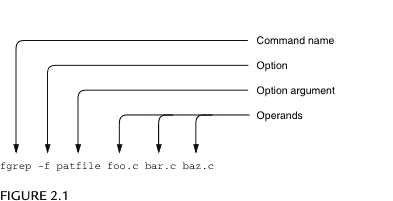

因此，`patfile` 不是一个要搜索的数据文件，而是供 `fgrep` 使用以定义要搜索的字符串列表的文件。

### 2.1.1 POSIX 约定

POSIX 标准描述了一系列标准符合性程序应遵循的约定。没有什么要求你的程序必须遵循这些标准，但这样做是个好主意：世界各地的 Linux 和 Unix 用户都理解并使用这些约定，如果你的程序不遵循它们，你的用户会不高兴。（或者你将没有任何用户！）此外，我们将在本章后面讨论的函数可以减轻你为每个程序手动遵循这些约定的负担。以下是从标准中改写的内容：

1. 程序名称应至少有两个字符且不超过九个字符。
2. 程序名称应仅由小写字母和数字组成。
3. 选项名称应为单个字母数字字符。不应允许多位选项。对于实现 POSIX 实用程序的供应商，`-W` 选项保留用于供应商特定选项。
4. 所有选项应以 `-` 字符开头。
5. 对于不需要选项参数的选项，应允许在单个 `-` 字符后分组多个选项。（例如，`foo -a -b -c` 和 `foo -abc` 应以相同方式处理。）
6. 当选项需要选项参数时，参数应与选项用空格分隔（例如，`fgrep -f patfile`）。

然而，标准允许历史惯例，即有时选项和操作数可以在同一个字符串中：`fgrep -fpatfile`。在实践中，`getopt()` 和 `getopt_long()` 函数将 `-fpatfile` 解释为 `-f patfile`，而不是 `-f -p -a -t . . . .`。

7. 选项参数不应是可选的。
   这意味着，当程序文档记载某选项需要选项参数时，该选项的参数必须始终存在，否则程序将失败。GNU `getopt()` 提供可选选项参数，因为它们偶尔有用。
8. 如果选项接受可能具有多个值的参数，程序应接收该参数作为单个字符串，值之间用逗号或空白字符分隔。
   例如，假设假设的程序 `myprog` 需要为其 `-u` 选项提供用户列表。然后，它应以以下两种方式之一调用：
   - `myprog -u "arnold,joe,jane"`（用逗号分隔）
   - `myprog -u "arnold joe jane"`（用空白字符分隔）
   在这种情况下，你必须自行拆分和处理每个值（即没有标准例程），但手动执行通常很直接。
9. 选项应在命令行上位于操作数之前。Unix 版本的 `getopt()` 强制执行此约定。GNU `getopt()` 默认不执行，尽管你可以告诉它这样做。
10. 特殊参数 `--` 表示所有选项的结束。命令行上后续的任何参数都被视为操作数，即使它们以破折号开头。
11. 给出选项的顺序不应重要。然而，对于互斥选项，当一个选项覆盖另一个选项的设置时，（可以说）最后一个选项胜出。如果带有参数的选项被重复，程序应按顺序处理参数。例如，`myprog -u arnold -u jane` 等同于 `myprog -u "arnold,jane"`。（你必须自己强制执行这一点；`getopt()` 不会帮你。）
12. 操作数的顺序对程序重要是可以的。每个程序都应记录此类情况。
13. 读取或写入命名文件的程序应将单个参数 `-` 视为标准输入或标准输出，具体视程序而定。

请注意，许多标准程序并不遵循上述所有约定。主要原因是历史兼容性；许多此类程序在这些约定规范化之前就已存在。

### 2.1.2 GNU 长选项

正如我们在 1.4.2 节“程序行为”（第 16 页）中看到的，GNU 程序建议使用形如 `--help`、`--verbose` 等的长选项。这些选项以 `--` 开头，因此不会与 POSIX 约定冲突。它们也更容易记忆，并为所有 GNU 实用程序提供了一致性的机会。（例如，与“help”的 `-h`、“information”的 `-i` 等相比，`-help` 在所有地方都是相同的。）GNU 长选项有自己由 `getopt_long()` 函数实现的约定：

1. 对于实现 POSIX 实用程序，每个短（单字母）选项也应具有长选项。
2. 额外的 GNU 特定长选项无需对应的短选项，但我们建议这样做。
3. 长选项可以缩写为保持唯一性的最短字符串。例如，如果有两个选项 `--verbose` 和 `--verbatim`，最短可能的缩写是 `--verbo` 和 `--verva`。
4. 选项参数与长选项之间用空白字符或 `=` 号分隔。例如，`--sourcefile=/some/file` 或 `--sourcefile /some/file`。
5. 选项和参数可以与命令行上的操作数交错出现；`getopt_long()` 会重新排列它们，以便先处理所有选项，然后依次提供所有操作数。（此行为可以被抑制。）
6. 选项参数可以是可选的。对于此类选项，如果参数与选项在同一个字符串中，则视为存在。这只适用于短选项。例如，如果 `-x` 是这样一个选项，给定 `foo -xYANK'EE'S -y`，`-x` 的参数是 `YANK'EE'S`。对于 `foo -x -y`，`-x` 没有参数。


7. 程序可以选择允许长选项以单个连字符开头。（这在许多 X 窗口程序中很常见。）

当我们稍后在本章中研究 `getopt_long()` 时，这些内容会变得更加清晰。

*GNU 编码标准* 用了大量篇幅列出 `GNU` 程序中使用的所有长选项和短选项。如果你正在编写一个接受长选项的程序，不妨看看是否已有正在使用的选项名称也适用于你的情况。

## 2.2 基本命令行处理

C 程序通过其参数 `argc` 和 `argv` 访问其命令行参数。`argc` 参数是一个整数，指示参数的数量，包括命令名。声明 `main()` 有两种常见方式，区别在于 `argv` 的声明方式：

```c
int main(int argc, char *argv[])      int main(int argc, char **argv)
{
    ...                                ...
}
```

实际上，这两种声明之间没有区别，尽管第一种在概念上更清晰：`argv` 是一个指向字符的指针数组。第二种更常用：`argv` 是一个指向指针的指针。此外，第二种定义在技术上更正确，我们使用的也是这种形式。图 2.2 描绘了这种情况。

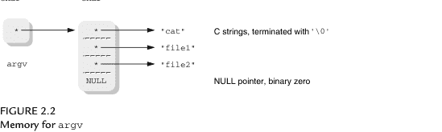

按照惯例，`argv[0]` 是程序名称。（详情见第 9.1.4.3 节，“程序名称与 `argv[0]`”，第 297 页。）后续条目是命令行参数。`argv` 数组中的最后一个条目是一个 `NULL` 指针。

`argc` 指示参数的数量；由于 C 是从零开始的，因此总是满足 `argv[argc] == NULL`。正因为如此，特别是在 Unix 代码中，你会看到检查参数结尾的不同方式，例如循环直到计数器大于或等于 `argc`，或者直到 `argv[i] == 0` 或当 `*argv != NULL` 等。这些都是等价的。

### 2.2.1 V7 echo 程序

或许最简单的命令行处理示例是 V7 echo 程序，它将参数打印到标准输出，参数之间用空格分隔，并以换行符结尾。如果第一个参数是 `-n`，则省略末尾的换行符。（这用于从 shell 脚本中进行提示。）代码如下:<sup>1</sup>

```c
1  #include <stdio.h>
2
3  main(argc, argv)
     int main(int argc, char **argv)
4  int argc;
5  char *argv[1];
6  {
7  register int i, nflag;
8
9  nflag = 0;
10 if (argc > 1 && argv[1][0] == '-' && argv[1][1] == 'n') {
11    nflag++;
12    argc--;
13    argv++;
14 }
15 for(i=1; i<argc; i++) {
16    fputs(argv[i], stdout);
17    if (i < argc-1)
18       putchar(' ');
19 }
20 if (nflag != 0)
21    putchar('\n');
22 exit(0);
23 }
```

仅有 23 行！有两个值得关注的点。首先，减少 `argc` 的同时增加 `argv`（第 12 和 13 行）是跳过初始参数的常见方法。其次，对 `-n` 的检查（第 10 行）非常简化。`-n` 后跟换行符也能正常工作。（编译并尝试一下！）

<sup>1</sup> 参见 V7 发行版中的 `usr/src/cmd/echo.c`。

手动解析选项在 V7 代码中很常见，因为 `getopt()` 函数当时尚未发明。

最后，在这里以及全书其他地方的某些地方，我们看到使用了 `register` 关键字。曾经，该关键字向编译器提供提示，表明如果可能的话，应将给定变量放置在 CPU 寄存器中。使用该关键字已过时；现代编译器都基于对源代码的分析来确定寄存器分配，忽略 `register` 关键字。我们选择保留使用它的代码，但你应该意识到它已无实际用处。<sup>2</sup>

## 2.3 选项解析：`getopt()` 和 `getopt_long()`

大约 1980 年，针对 System III，AT&T 内部的 Unix 支持小组注意到每个 Unix 程序都使用临时技术来解析参数。为了使用户和开发人员更轻松，他们开发了前文列出的大多数惯例。（尽管 System III intro(1) man 页中的陈述比 POSIX 标准中的正式程度要低得多。）

Unix 支持小组还开发了 `getopt()` 函数以及几个外部变量，以便轻松编写遵循标准惯例的代码。GNU `getopt_long()` 函数提供了与 `getopt()` 兼容的版本，同时也使解析前文所述形式的长选项变得容易。

### 2.3.1 单字母选项

`getopt()` 函数的声明如下：

```c
#include <unistd.h>                             /* POSIX */

int getopt(int argc, char *const argv[], const char *optstring);
extern char *optarg;
extern int optind, opterr, optopt;
```

参数 `argc` 和 `argv` 通常直接来自 `main()` 的参数。`optstring` 是一个选项字母的字符串。如果字符串中的任何字母后面跟有一个冒号，则期望该选项具有一个参数。

要使用 *getopt()*，需要从一个 *while* 循环中反复调用它，直到它返回 -1。每次找到有效的选项字母时，它都会返回该字母。如果选项需要参数，*optarg* 会被设置指向该参数。考虑一个接受 -a 选项（不取参数）和 -b 选项（取参数）的程序：

```c
int oc;               /* 选项字符 */
char *b_opt_arg;

while ((oc = getopt(argc, argv, "ab:")) != -1) {
    switch (oc) {
      case 'a':
          /* 处理 -a，设置标志，等等 */
          break;
      case 'b':
          /* 处理 -b，从 optarg 获取参数值 */
          b_opt_arg = optarg;
          break;
      case ':':
          ...         /* 错误处理，参见正文 */
      case '?':
      default:
          ...         /* 错误处理，参见正文 */
    }
}
```

在其运行过程中，*getopt()* 设置了几个控制错误处理的变量。

```c
char *optarg
```
选项的参数，如果该选项接受参数的话。

```c
int optind
```
*argv* 中的当前索引。当 *while* 循环结束时，剩余的操作数可在 *argv*[*optind*] 到 *argv*[*argc* - 1] 中找到。（记住 `argv[argc] == NULL`。）

```c
int opterr
```
当此变量非零时（默认情况如此），*getopt()* 会为其无效选项或缺失的选项参数打印自己的错误消息。

```c
int optopt
```
当发现无效的选项字符时，*getopt()* 返回 '？' 或 '：'（见下文），并且 *optopt* 包含发现的无效字符。

人是人，程序被错误调用的情况是不可避免的，无论是使用了无效选项，还是缺少选项参数。在正常情况下，*getopt()* 会针对这些情况打印自己的消息并返回 '?' 字符。然而，你可以通过两种方式改变其行为。

首先，通过在调用 `getopt()` 之前将 `opterr` 设置为 0，可以强制 `getopt()` 在发现问题时保持沉默。

其次，如果 `optstring` 参数的第一个字符是冒号，那么 `getopt()` 会保持沉默，并根据错误返回不同的字符，具体如下：

- *无效选项*
  `getopt()` 返回 '?'，并且 `optopt` 包含无效的选项字符。（这是正常行为。）

- *缺失的选项参数*
  `getopt()` 返回 '：'。如果 `optstring` 的第一个字符不是冒号，那么 `getopt()` 返回 '?'，使得这种情况无法与无效选项情况区分开来。

因此，将 `optstring` 的第一个字符设为冒号是个好主意，因为它允许你区分“无效选项”和“缺失的选项参数”。代价是，使用冒号也会使 `getopt()` 保持沉默，迫使你提供自己的错误消息。下面是之前的示例，这次包含了错误消息处理：

```c
int oc;          /* 选项字符 */
char *b_opt_arg;

while ((oc = getopt(argc, argv, ":ab:")) != -1) {
    switch (oc) {
    case 'a':
        /* 处理 -a，设置标志，等等 */
        break;
    case 'b':
        /* 处理 -b，从 optarg 获取参数值 */
        b_opt_arg = optarg;
        break;
    case ':':
        /* 缺失的选项参数 */
        fprintf(stderr, "%s: option `-%c' requires an argument\n",
                argv[0], optopt);
        break;
    case '?':
        /* 无效选项 */
        fprintf(stderr, "%s: option `-%c' is invalid: ignored\n",
                argv[0], optopt);
        break;
    }
}
```


关于标志或选项变量命名规范的一句话：许多 Unix 代码对于给定的选项字母 `x` 会使用形如 `xflg` 的名称（例如，V7 中 `echo` 的 `nflg`；`xflg` 也很常见）。这对编写程序的作者来说可能很不错，因为他们无需查阅文档就知道 `x` 选项的作用。但对于其他试图阅读代码且不熟记所有选项字母含义的人来说，这并不友好。使用能传达选项含义的名称要得好得多，例如使用 `no_newline` 来表示 `echo` 的 `-n` 选项。

## 2.3.2 GNU `getopt()` 与选项顺序

标准的 `getopt()` 函数在遇到不以 `-` 开头的命令行参数时，就会停止查找选项。GNU `getopt()` 则不同：它会扫描整个命令行以查找选项。在此过程中，它会*置换*（重新排列）`argv` 的元素，使得完成处理后，所有选项都被移到前面，从而确保后续检查 `argv[optind]` 到 `argv[argc-1]` 的代码能正确工作。在所有情况下，特殊参数 `--` 都会终止选项扫描。

你可以通过在 `optstring` 中使用特殊的首字符来更改默认行为，如下所示：

- `optstring[0]` == `+`
  GNU `getopt()` 的行为类似于标准 `getopt()`；它按发现选项的顺序返回选项，并在遇到第一个非选项参数时停止。如果环境中存在 `POSIXLY_CORRECT`，此行为也成立。

- `optstring[0]` == `-`
  GNU `getopt()` 返回*所有*命令行参数，无论其是否代表参数。在这种情况下，对于每个这样的参数，该函数返回整数 `1` 并将 `optarg` 设置为指向该字符串。

与标准 `getopt()` 类似，如果 `optstring` 的第一个字符是 `:`，那么 GNU `getopt()` 通过分别返回 `?` 或 `:` 来区分“无效选项”和“缺少选项参数”。如果第一个字符是 `+` 或 `-`，`optstring` 中的 `:` 可以是第二个字符。

最后，如果 `optstring` 中的某个选项字母后面跟着*两个*冒号字符，则允许该选项具有可选的选项参数。（试着快速说三遍这句话！）如果该参数与选项位于同一个 `argv` 元素中，则视为存在该参数；否则视为不存在。如果参数不存在，GNU `getopt()` 返回该选项字母并将 `optarg` 设置为 NULL。例如，给定：

```c
while ((c = getopt(argc, argv, "ab::")) != -1)
...
```

对于 `-bYANKEES`，返回值是 `'b'`，且 `optarg` 指向 "YANKEES"；而对于 `-b` 或 `-b YANKEES`，返回值仍然是 `'b'`，但 `optarg` 被设置为 NULL。在后一种情况下，"YANKEES" 是一个独立的命令行参数。

## 2.3.3 长选项

`getopt_long()` 函数处理之前描述的长选项解析。另一个额外的例程 `getopt_long_only()` 工作方式完全相同，但它用于*所有*选项均为长选项且选项以单个 `-` 开头的程序。否则，两者的行为都像更简单的 GNU `getopt()` 函数一样。（为了简洁，每当我们提到“`getopt_long()`”时，就像我们说的是“`getopt_long()` 和 `getopt_long_only()`”一样。）以下是来自 GNU/Linux `getopt(3)` 手册页的声明：

```c
#include <getopt.h>  /* GLIBC */

int getopt_long(int argc, char *const argv[],
   const char *optstring,
   const struct option *longopts, int *longindex);

int getopt_long_only(int argc, char *const argv[],
   const char *optstring,
   const struct option *longopts, int *longindex);
```

前三个参数与 `getopt()` 相同。下一个参数是一个指向 `struct option` 数组的指针，我们将此称为*长选项表*，稍后会有详细描述。如果 `longindex` 参数未设置为 NULL，则它指向一个变量，该变量会被填入在 `longopts` 中找到的长选项的索引。这在例如进行错误诊断时非常有用。

### 2.3.3.1 长选项表

长选项通过 `struct option` 结构体的数组来描述。`struct option` 在 `<getopt.h>` 中声明；其结构如下：

```c
struct option {
    const char *name;
    int has_arg;
    int *flag;
    int val;
};
```

结构体中的元素如下：

- `const char *name`
  - 这是选项的名称，不包含前导破折号，例如 “help” 或 “verbose”。
- `int has_arg`
  - 这描述了长选项是否有参数，如果有，是什么类型的参数。值必须是表 2.1 中列出的值之一。
  - 符号常量是表中给出的数值的宏。虽然数值有效，但符号常量读起来容易得多，在你编写的任何代码中都应该使用符号常量而不是对应的数值。
- `int *flag`
  - 如果此指针为 NULL，则 `getopt_long()` 返回结构体中 `val` 字段的值。如果它不为 NULL，则其指向的变量会被填入 `val` 中的值，且 `getopt_long()` 返回 0。如果标志不为 NULL 但从未遇到该长选项，则指向的变量不会改变。
- `int val`
  - 这是看到长选项时要返回的值，或者如果 flag 不为 NULL 时要加载到 *flag* 中的值。通常，如果 flag 不为 NULL，则 val 是一个真/假值，如 1 或 0。另一方面，如果 flag 为 NULL，则 val 通常是一个字符常量。如果长选项对应于短选项，则该字符常量应与该选项在 optstring 参数中出现的字符相同。（当我们看到一些示例时，这些细节很快就会变得清晰。）

每个长选项都有一个条目，数值相应填充。数组中的最后一个元素所有值应为零。数组不需要排序；`getopt_long()` 执行线性搜索。不过，按长名称排序可能更容易让程序员阅读。

### 表 2.1

`has_arg` 的值

| 符号常量 | 数值 | 含义 |
| :--------------- | :------------ | :------ |
| no_argument       | 0             | 该选项不接受参数。 |
| required_argument | 1             | 该选项需要参数。 |
| optional_argument | 2             | 该选项的参数是可选的。 |

`flag` 和 `val` 的用法乍看之下似乎令人困惑。让我们退后一步，看看它为何如此运作。大多数时候，选项处理由设置不同的标志变量组成，当看到不同的选项字母时设置相应的变量，如下所示：

```c
while ((c = getopt(argc, argv, "af: hv")) != -1) {
    switch (c) {
    case 'a':
        do_all = 1;
        break;
    case 'f':
        myfile = optarg;
        break;
    case 'h':
        do_help = 1;
        break;
    case 'v':
        do_verbose = 1;
        break;
    ...               此处为错误处理代码
    }
}
```

当 `flag` 不为 NULL 时，`getopt_long()` 会为你设置该变量。这将之前 switch 中的三种情况减少为一种情况。下面是一个长选项表示例及其配套代码：

```c
int do_all, do_help, do_verbose;    /* 标志变量 */
char *myfile;

struct option longopt[] = {
    { "all",  no_argument,    & do_all,      1 },
    { "file", required_argument, NULL,       'f' },
    { "help", no_argument,    & do_help,     1 },
    { "verbose", no_argument,  & do_verbose,  1 },
    { 0, 0, 0, 0 }
};
...
```

```c
while ((c = getopt_long (argc, argv, ":f:", longopts, NULL)) != -1) {
  switch (c) {
  case 'f':
    myfile = optarg;
    break;
  case 0:
    /* getopt_long() 设置了一个变量，继续执行即可 */
    break;
  ...
          此处为错误处理代码
  }
}
```

请注意，传递给 `optstring` 参数的值不再包含 'a'、'h' 或 'v'。这意味着不接受相应的短选项。如果要允许同时使用长选项和短选项，你需要将第一个示例中的相应 case 恢复回 switch 中。

从实际角度来看，你应该编写程序，使每个短选项都有对应的长选项。在这种情况下，最简单的方法是让 `flag` 为 NULL，让 `val` 为对应的单个字母。

### 2.3.3.2 长选项，POSIX 风格

POSIX 标准将 `-W` 选项保留给供应商特定的功能。因此，根据定义，`-W` 在不同系统之间不具备可移植性。

如果 `W` 出现在 `optstring` 参数中并后跟分号（注意：不是冒号），那么 `getopt_long()` 将 `-Wlongopt` 视为与 `--longopt` 相同。因此，在上面的示例中，将调用更改为：

```c
while ((c = getopt_long (argc, argv, ":f:W;", longopts, NULL)) != -1)
```

经过此更改，`-Wall` 等同于 `--all`，`-Wfile=myfile` 等同于 `--file=myfile`。使用分号使得程序可以使用 `-W` 作为常规选项，如果希望如此的话。（例如，GCC 将其用作常规选项，而 gawk 将其用于 POSIX 兼容性。）

### 2.3.3.3 `getopt_long()` 返回值摘要

如前所述，`getopt_long()` 提供了一套灵活的选项解析机制。表 2.2 总结了可能的返回值及其含义。


## 2.2.3 `getopt_long()` 返回值

**表 2.2**

`getopt_long()` 的返回值

| 返回代码 | 含义 |
|---|---|
| 0 | `getopt_long()` 在长选项表中设置了一个标志。 |
| 1 | `optarg` 指向一个普通的命令行参数。 |
| `'?'` | 无效的选项。 |
| `':'` | 缺少选项参数。 |
| `'x'` | 选项字符 `'x'`。 |
| `-1` | 选项结束。 |

最后，我们增强了前面的示例代码，展示了完整的 switch 语句：

```c
int do_all, do_help, do_verbose;      /* flag variables */
char *myfile, *user;                   /* input file, user name */

struct option longopts[] = {
    { "all",   no_argument,       & do_all,     1 },
    { "file",  required_argument,  NULL,       'f' },
    { "help",  no_argument,        & do_help,    1 },
    { "verbose", no_argument,     & do_verbose, 1 },
    { "user"  , optional_argument, NULL,       'u' },
    { 0, 0, 0, 0 }
};

...

while ((c = getopt_long(argc, argv, "ahvf:u::W:", longopts, NULL)) != -1) {
    switch (c) {
        case 'a':
            do_all = 1;
            break;
        case 'f':
            myfile = optarg;
            break;
        case 'h':
            do_help = 1;
            break;
        case 'u':
            if (optarg != NULL)
                user = optarg;
            else
                user = "root";
            break;
        case 'v':
            do_verbose = 1;
            break;
        case 0:  /* getopt_long() set a variable, just keep going */
            break;
#if 0
    case i:
    /*
     * Use this case if getopt_long() should go through all
     * arguments.  If so, add a leading `-` character to optstring.
     * Actual code, if any, goes here.
     */
    break;
#endif
    case ':':  /* missing option argument */
      fprintf (stderr, "%s: option `-%c' requires an argument\n",
               argv[0], optopt);

      break;
    case '?':
    default:  /* invalid option */
      fprintf (stderr, "%s: option `-%c' is invalid; ignored\n",
               argv[0], optopt);

      break;
    }
}
```

在你的程序中，你可能希望为每个选项字母添加注释，解释其作用。然而，如果你为每个选项字母使用了描述性的变量名，那么注释就不那么必要了。（比较 `do_verbose` 和 `vfl_g`。）

### 2.3.3.4 在用户程序中使用 GNU `getopt()` 或 `getopt_long()`

你可能希望在自己的程序中使用 GNU `getopt()` 或 `getopt_long()`，并让它们在非 Linux 系统上运行。这是没问题的；只需从 GNU 程序或 GNU C 库（Glibc）CVS 归档中复制源文件[^1]。源文件为 `getopt.h`、`getopt.c` 和 `getopt1.c`。它们采用 GNU 宽通用公共许可证（LGPL），该许可证允许将库函数包含在专有程序中。你应将 `COPYING.LIB` 文件的副本与你的程序一起提供，同时包含 `getopt.h`、`getopt.c` 和 `getopt1.c` 文件。

在你的分发版本中包含这些源文件，并将它们与其他任何源文件一起编译。在调用 `getopt_long()` 的源代码中，使用 `#include <getopt.h>`，而不是 `#include "getopt.h"`。然后，在编译时，在 C 编译器的命令行中添加 `-I.`。这样，本地头文件的副本将优先被找到。

你可能在想：“嘿，我已经在使用 GNU/Linux。既然例程已经在 C 库中，我为什么要将 `getopt_long()` 包含在我的可执行文件中使其变大呢？”这是一个好问题。但是，不必担心。源代码被设置成这样：如果在 GLIBC 系统上编译，编译后的文件将不包含任何代码！以下是我们在系统上的证明：

```bash
$ uname -a
Linux example 2.4.18-14 #1 Wed Sep 4 13:35:50 EDT 2002 i686 i686 i386 GNU/Linux
$ ls -l getopt.o getopt1.o # Show file sizes
-rw-r--r-- 1 aarnold devel 9836 Mar 24 13:55 getopt.o
-rw-r--r-- 1 aarnold devel 10324 Mar 24 13:55 getopt1.o
$ size getopt.o getopt1.o # Show sizes included in executable
    text data bss dec hex filename
   0    0   0 0 0 getopt.o
   0    0   0 0 0 getopt1.o
```

`size` 命令打印二进制目标文件或可执行文件各部分的大小。我们在第 3.1 节“Linux/Unix 地址空间”第 52 页中解释了输出内容。现在重要的是要理解，尽管这些文件本身的大小不为零，但它们不会为最终的可执行文件贡献任何内容。（我们认为这非常巧妙。）

## 2.4 环境变量

`environment`（环境变量）是每个程序的一组 `name=value` 对。这些对被称为 `environment variables`（环境变量）。每个 `name` 由一个或多个字母数字字符或下划线（`_`）组成，但 `name` 不能以数字开头。（这条规则由 shell 强制执行；C API 可以将它想要的内容放入环境变量中，但这可能会以混淆后续程序为代价。）

环境变量通常用于控制程序行为。例如，如果环境中存在 `POSIXLY_CORRECT`，许多 GNU 程序会禁用与 POSIX 标准不兼容的扩展或历史行为。

你可以决定（并应记录）你的程序将用于控制其行为的环境变量。例如，你可能希望使用环境变量而不是命令行参数来设置调试选项。使用环境变量的优势在于，用户可以在他们的启动文件中设置这些变量，而不必记得始终提供特定的一组命令行选项。

当然，使用环境变量的缺点是它们可能会*默默地*改变程序的行为。Coreutils 的维护者 Jim Meyering 是这样说的：

> 它让用户可以轻松定制程序的工作方式，而无需改变程序的调用方式。这既可能是一种祝福，也可能是一种诅咒。如果你编写了一个依赖于某个特定环境变量设置的脚本，但随后让别人也使用该脚本，如果那个人没有相同的环境设置，脚本可能会失败（或更糟的是，默默地产生无效结果）。

### 2.4.1 环境变量管理函数

有几个函数允许你获取环境变量的值、更改它们的值或移除它们。以下是它们的声明：

```c
#include <stdlib.h>
char *getenv(const char *name);                 /* ISO C: Retrieve environment variable */
int setenv(const char *name, const char *value,  /* POSIX: Set environment variable */
           int overwrite);
int putenv(char *string);                        /* XSI: Set environment variable, uses string */
void unsetenv(const char *name);                 /* POSIX: Remove environment variable */
int clearenv(void);                              /* Common: Clear entire environment */
```

`getenv()` 函数是你 99% 的情况下会使用的函数。参数是要查找的环境变量名称，例如 `"HOME"` 或 `"PATH"`。如果变量存在，`getenv()` 返回指向其字符串值的指针。如果不存在，则返回 `NULL`。例如：

```c
char *pathval;

/* Look for PATH; if not present, supply a default value */
if ((pathval = getenv("PATH")) == NULL)
    pathval = "/bin:/usr/bin:/usr/ucb";
```

偶尔，环境变量存在，但值为空。在这种情况下，返回值将不为 NULL，但所指向的第一个字符将是零字节，即 C 字符串终止符 `'\0'`。你的代码应仔细检查所指向的返回值是否为 NULL。即使它不为 NULL，如果你打算使用其值做某些事情，也要检查字符串是否为空。无论如何，不要盲目使用返回的值。

要更改环境变量或将新变量添加到环境中，请使用 `setenv()`：

```c
if (setenv("PATH", "/bin:/usr/bin:/usr/ucb", 1) != 0) {
    /* handle failure */
}
```

变量可能已经存在于环境中。如果第三个参数为真（非零），则提供的值将覆盖之前的值。否则，它不会覆盖。如果新变量没有内存，返回值将是 -1，否则为 0。`setenv()` 会创建变量名和新值的私有副本，以存储在环境中。

`setenv()` 的一个更简单的替代方案是 `putenv()`，它接受单个 `*name=value*` 字符串并将其放入环境中：

```c
if (putenv("PATH=/bin:/usr/bin:/usr/ucb") != 0) {
    /* handle failure */
}
```

`putenv()` 会盲目替换同一变量的任何先前值。此外，也许更重要的是，传递给 `putenv()` 的字符串被*直接*放入环境中。这意味着，如果你的代码稍后修改了这个字符串（例如，如果它是一个数组，而不是字符串常量），环境也会随之修改。这也意味着你*不应该*将局部变量作为 `putenv()` 的参数。基于所有这些原因，`setenv()` 更受青睐。

> **注意** GNU 的 `putenv()` 在其行为上有一个额外的（已记录的）怪癖。如果参数字符串是一个名称，且没有等号（=），则指定的变量将被*移除*。我们在本章后面会看到的 GNU env 程序依赖于这种行为。

`unsetenv()` 函数从环境中移除一个变量：

```c
unsetenv("PATH");
```

最后，`clearenv()` 函数清除整个环境：

```c
if (clearenv() != 0) {
    /* handle failure */
}
```

该函数不是 POSIX 标准规定的，但在 GNU/Linux 和若干商业 Unix 变体中可用。如果你的应用程序必须具有高度的安全性意识，并且你希望它完全从头开始构建自己的环境，你应该使用它

[^1]: 这个脚注标记 "3" 在原文中很可能指的是一个脚注或参考注释，根据严格程度保留原样或移除。由于指示要求"保留原文语言和所有信息"，如果它是文本的一部分，我将保留上标 3，但在 Markdown 中我们可能会移除它如果不是正文中真实的脚注。然而，查看文本 "CVS archive.³"，它似乎是一个脚注标记。为了安全起见，我将保留 `³`，或假设它是脚注引用。实际上，查看标准格式，脚注通常在简单的文本重建中被丢弃，除非有要求。但"所有信息"表明应保留它。我会保留 `³`。


scratch。如果 `clearenv()` 不可用，GNU/Linux `clearenv(3)` 手册页建议使用 `‘environ = NULL;’` 来完成此任务。

## 2.4.2 整个环境：environ

处理环境的正确方式是使用前一节中描述的函数。然而，值得了解一下“幕后”的管理方式。

外部变量 `environ` 提供了访问环境的方式，就像 `argv` 提供访问命令行参数的方式一样。你必须自己声明这个变量。尽管 `environ` 已被 POSIX 标准化，但它故意不被任何标准化头文件声明。（这似乎源于历史惯例。）声明如下：

```
extern char **environ; /* 看，没有头文件！ */ POSIX
```

与 `argv` 类似，`environ` 中的最后一个元素是 NULL。然而，并没有一个与 `argc` 对应的“环境计数”变量。这个简单的程序打印出整个环境：

```
/* ch02-printenv.c --- 打印出环境。 */
#include <stdio.h>

extern char **environ;

int main(int argc, char *argv)
{
 int i;

 if (environ != NULL)
 for (i = 0; environ[i] != NULL; i++)
 printf("%s\n", environ[i]);

 return 0;
}
```

虽然这种情况不太可能发生，但这个程序确保了在使用 `environ` 之前它不是 NULL。

变量在环境中以随机顺序保存。尽管一些 Unix shell 按变量名对环境中进行排序，但这并没有正式要求，许多 shell 也不会保持排序。

作为实现上的一种怪癖，你可以通过**声明 `main( )` 的第三个参数**来访问环境：

```
int main(int argc, char **argv, char **envp)
{
...
}
```

然后你可以像使用 `environ` 一样使用 `envp`。尽管你可能会在旧代码中偶尔看到这种做法，但我们不推荐使用它；如果你需要这样做，`environ` 是访问整个环境的官方、标准且可移植的方式。

### 2.4.3 GNU env

为了结束本章，这里介绍 GNU 版本的 `env` 命令。此命令为单条命令的执行期间向环境中添加变量。它还可以用于清除该命令的环境或移除特定的环境变量。

这个程序对我们具有双重用途，因为它同时演示了 `getopt_long( )` 和本节讨论的几个函数。以下是该程序的调用方式：

```
$ env --help

Usage: env [OPTION]... [-] [NAME=VALUE]... [COMMAND [ARG]...]
Set each NAME to VALUE in the environment and run COMMAND.

    -i, --ignore-environment  start with an empty environment
    -u, --unset=NAME          remove variable from the environment
    --help    display this help and exit
    --version output version information and exit

A mere - implies -i.  If no COMMAND, print the resulting environment.
Report bugs to <bug-coreutils@gnu.org>.

Here are some sample invocations:

$ env - myprog arg1
                Clear environment, run myprog with arg1
$ env - PATH=/bin:/usr/bin myprog arg1
                Clear environment, add PATH, run program
$ env -u IFS PATH=/bin:/usr/bin myprog arg1
                Unset IFS, add PATH, run program
```

代码以一个标准的 GNU 版权声明和解释性注释开始。为了简洁，我们省略了这两部分。（版权声明在第 C 附录“GNU 通用公共许可证”第 657 页中有讨论。前面显示的 `--help` 输出足以理解程序的工作原理。）在版权声明和注释之后是头文件包含和声明。`N_("string")` 宏调用（第 93 行）用于软件的国际化和本地化，这些主题在第 13 章“国际化和本地化”第 485 页中涵盖。目前，你可以将其视为所包含的字符串常量。

```
80  #include <config.h>
81  #include <stdio.h>
82  #include <getopt.h>
83  #include <sys/types.h>
84  #include <getopt.h>
85
86  #include <system.h>
87  #include <error.h>
88  #include "closeout.h"
89
90  /* The official name of this program (e.g., no 'g' prefix). */
91  #define PROGRAM_NAME "env"
92
93  #define AUTHORS N_ ("Richard Mlynarick and David MacKenzie")
94
95  int putenv ();
96
97  extern char **environ;
98
99  /* The name by which this program was run. */
100 char *program_name;
101
102 static struct option const longopts[] =
103 (
104   {"ignore-environment", no_argument, NULL, 'i'},
105   {"unset", required_argument, NULL, 'u'},
106   (GETOPT_HELP_OPTION_DECL),
107   (GETOPT_VERSION_OPTION_DECL),
108   (NULL, 0, NULL, 0)}
109 );
```

GNU Coreutils 包含大量程序，其中许多执行相同的常见任务（例如，参数解析）。为了便于维护，许多常见的惯用法被定义为宏。`GETOPT_HELP_OPTION_DECL` 和 `GETOPT_VERSION_OPTION`（第 106 和 107 行）就是其中两个。我们稍后会查看它们的定义。第一个函数 `usage()` 打印使用信息并退出。`_("string")` 宏（第 115 行，并在整个程序中使用）也用于国际化，目前你也应该将其视为所包含的字符串常量。

```
111 void  
112 usage (int status)  
113 {
114     if (status != 0)
115       fprintf (stderr, _("Try `%s --help' for more information.\n"),
116                program_name);
117     else
118       {
119         printf (_("\
120 Usage: %s [OPTION]... [-] [NAME=VALUE]... [COMMAND [ARG]...\n"],
121                   program_name);
122         fputs (_("\
123 Set each NAME to VALUE in the environment and run COMMAND.\n\
124 \
125   -i, --ignore-environment        start with an empty environment\n\
126   -u, --unset=NAME                remove variable from the environment\n\
127 "), stdout);
128         fputs (HELP_OPTION_DESCRIPTION, stdout);
129         fputs (VERSION_OPTION_DESCRIPTION, stdout);
130         fputs (_("\
131 \
132 A mere -i implies -i.  If no COMMAND, print the resulting environment.\n\
133 "), stdout);
134         printf (_("\nReport bugs to <%s>.\n"), PACKAGE_BUGREPORT);
135       }
136   exit (status);
137 }
```

`main()` 的第一部分声明变量并设置国际化。函数 `setlocale()`、`bindtextdomain()` 和 `textdomain()`（第 147–149 行）都在第 13 章“国际化和本地化”第 485 页中讨论。注意，这个程序使用了 `main()` 的 `envp` 参数（第 140 行）。它是 Coreutils 程序中唯一这样做的一个。最后，第 151 行对 `atexit()` 的调用（参见第 9.1.5.3 节“退出函数”，第 302 页）注册了一个 Coreutils 库函数，该函数刷新所有待处理的输出并关闭 `stdout`，如果有问题则报告消息。下一部分处理命令行参数，使用 `getopt_long()`。

```
139 int  
140 main (register int argc, register char **argv, char **envp)  
141 {
142   char *dummy_environ[1];  
143   int optc;  
144   int ignore_environment = 0;  
145
146   program_name = argv[0];  
147   setlocale (LC_ALL, "");  
148   bindtextdomain (PACKAGE, LOCALEDIR);  
149   textdomain (PACKAGE);  
150
151   atexit (close_stdout);
```

```
152
153	while ((optc = getopt_long (argc, argv, "+iu:", longopts, NULL)) != -1)
154	{
155	  switch (optc)
156	  {
157	    case 0:
158	      break;
159	    case 'i':
160	      ignore_environment = 1;
161	      break;
162	    case 'u':
163	      break;
164	    case_GETOPT_HELP_CHAR;
165	    case_GETOPT_VERSION_CHAR (PROGRAM_NAME, AUTHORS);
166	    default:
167	      usage (2);
168	  }
169	}
170	if (optind != argc && !strcmp (argv[optind], "-"))
171	  ignore_environment = 1;
```

以下是来自 Coreutils 分发版中 `src/sys2.h` 的宏，它们定义了我们前面看到的声明以及上面使用的 `case_GETOPT_xxx` 宏（第 164–165 行）：

```
/* Factor out some of the common --help and --version processing code.  */

/* These enum values cannot possibly conflict with the option values
   ordinarily used by commands, including CHAR_MAX + 1, etc.  Avoid
   CHAR_MIN - 1, as it may equal -1, the getopt end-of-options value.  */
enum
{
  GETOPT_HELP_CHAR = (CHAR_MIN - 2),
  GETOPT_VERSION_CHAR = (CHAR_MIN - 3)
};

#define GETOPT_HELP_OPTION_DECL \
  "help", no_argument, 0, GETOPT_HELP_CHAR
#define GETOPT_VERSION_OPTION_DECL \
  "version", no_argument, 0, GETOPT_VERSION_CHAR

#define case_GETOPT_HELP_CHAR                 \
  case GETOPT_HELP_CHAR:                      \
    usage (EXIT_SUCCESS);                     \
    break;                                    \

#define case_GETOPT_VERSION_CHAR(Program_name, Authors)  \
  case GETOPT_VERSION_CHAR:                              \
    version_etc (stdout, Program_name, PACKAGE, VERSION, Authors);  \
    exit (EXIT_SUCCESS);                                  \
    break;
```


这段代码的结果是，`--help` 会打印 `usage` 消息，而 `--version` 会打印版本信息。两者都成功退出。（“成功”和“失败”退出状态在第 9.1.5.1 节“定义进程退出状态”，第 300 页中有描述。）鉴于 Coerutis 拥有数十种实用工具，将重复代码提取出来并尽可能标准化是有意义的。

回到 `env.c`：

```
174 \t\tenviron = dummy_environ;
175 \t\tenviron[0] = NULL;
176
177 \tif (!ignore_environment)
178 \t\tfor (; *envp; envp++)
179 \t\t\tputenv (*envp);
180
181 \toptind = 0; \t\t\t\t\t\t\t/* Force GNU getopt to re-initialize. */
182 \twhile ((loptc = getopt_long (argc, argv, "+iu::", longopts, NULL)) != -1)
183 \t\tif (loptc == 'u')
184 \t\t\tputenv (optarg); \t\t\t\t\t\t\t/* Requires GNU putenv. */
185
186 \tif (optind != argc && !strcmp (argv[optind], "-")) \t\t\t\t/* Skip options
187 \t\t++optind;
188
189 \twhile (optind < argc && strchr (argv[optind], '=')) \t\t\t\t\t/* Set environment variables
190 \t\tputenv (argv[optind++]);
191
192 \t/* If no program is specified, print the environment and exit. */
193 \tif (optind == argc)
194 \t\t{
195 \t\t\twhile (*environ)
196 \t\t\t\tputs (*environ++);
197 \t\t\texit (EXIT_SUCCESS);
198 \t\t}
199
```

第 174–179 行将现有环境复制到新的环境副本中。全局变量 `environ` 被设置为指向一个空的局部数组。参数 `envp` 维持对原始环境的访问。

第 181–184 行根据 `-u` 选项的要求移除任何环境变量。程序通过重新扫描命令行并删除其中列出的名称来实现这一点。环境变量的移除依赖于前文讨论过的 GNU `putenv()` 行为：当仅传入一个普通变量名时，`putenv()` 会移除该环境变量。

在所有选项之后，新的或替换的环境变量将在命令行中提供。第 189–190 行继续扫描命令行，寻找形式为 `name=value` 的环境变量设置。

到达第 192 行时，如果命令行上没有剩余内容，`env` 应当打印新环境并退出。它确实这样做了（第 195–197 行）。

如果仍有参数，它们代表要运行的命令名称以及要传递给该新命令的实参。这通过 `execvp()` 系统调用（第 200 行）完成，该调用会用新程序*替换*当前程序。（该调用在第 9.1.4 节“启动新程序：`exec()` 系列”，第 293 页中有讨论；暂时不要担心细节。）如果此调用返回到当前程序，说明*它失败了*。在这种情况下，`env` 会打印错误消息并退出。

```
200         execvp(argv[optind], &argv[optind]);
201
202         {
203            int exit_status = (errno == ENOENT ? 127 : 126);
204            error(0, errno, "**argv**");
205            exit(exit_status);
206         }
207
```

退出状态值 126 和 127（在第 203 行确定）符合 POSIX 标准。127 表示 `execvp()` 尝试运行的程序不存在。（`ENOENT` 意味着目录中没有该文件的条目。）126 表示文件存在，但其他方面出了问题。

## 2.5 总结

- C 程序通过参数 `argc` 和 `argv` 访问其命令行参数。`getopt()` 函数提供了一种标准方法，用于一致地解析选项及其参数。GNU 版本的 `getopt()` 提供了一些扩展，而 `getopt_long()` 和 `getopt_long_only()` 使得轻松解析长格式选项成为可能。
- 环境是一组 `name=value` 对，每个程序都从其父进程继承。除了任何命令行参数外，程序可以根据作者的意愿使用环境变量来改变其行为。存在标准例程（`getenv()`、`setenv()`、`putenv()` 和 `unsetenv()`）用于检索环境变量的值、修改它们或移除它们。如有必要，整个环境可以通过外部变量 `environ` 或通过 `main()` 的第三个参数访问。后一种技术不被推荐。

### 练习

1. 假设一个程序接受选项 `-a`、`-b` 和 `-c`，且 `-b` 需要参数。请编写该程序的手动参数解析代码，不使用 `getopt()` 或 `getopt_long()`。接受 `--` 以结束选项处理。确保 `-ac` 可以工作，`-byYANKEES`、`-b YANKEES` 和 `-abyYANKEES` 也可以工作。测试你的程序。
2. 实现 `getopt()`。对于第一个版本，不要担心 `optstring[0] == ':'` 的情况。你也可以忽略 `opterr`。
3. 在你的 `getopt()` 版本中添加处理 `optstring[0] == ':'` 和 `opterr` 的代码。
4. 打印并阅读 GNU 的 `getopt.h`、`getopt.c` 和 `getoptl.c` 文件。
5. 编写一个程序，声明 `environ` 和 `envp` 并比较它们的值。
6. 解析命令行参数和选项是一个许多人忍不住要重新发明的轮子。除了 `getopt()` 和 `getopt_long()` 之外，你可能希望检查不同的参数解析包，例如：
    - *Plan 9 From Bell Labs* 的 `arg(2)` 参数解析库，[4]
    - `Arnp`[5]
    - `Argv`[6]
    - `Autoopts`[7]
    - GNU `Gengetopt`[8]
    - `Opt`[9]
    - `PoP`[10]。另请参见 GNU/Linux 系统上的 *pop(3)* 手册页。
7. 额外学分：为什么 C 编译器不能完全忽略 `register` 关键字？提示：什么操作*不能*应用于 `register` 变量？

[4] http://plan9.bell-labs.com/magic/man2html/2/arg  
[5] http://www.gnu.org/manual/glibc/html_node/Argp.html  
[6] http://256.com/sources/argv  
[7] http://autoogen.sourceforge.net/autoopts.html  
[8] ftp://ftp.gnu.org/gnu/gengetopt/  
[9] http://niss-www.lanl.gov/~jt/Software/opt/opt-3.19.tar.gz  
[10] http://freshmeat.net/projects/popt/7topic_id=809

# 第 3 章

# 用户级内存管理

## 本章内容

- 3.1 Linux/Unix 地址空间 第 52 页
- 3.2 内存分配 第 56 页
- 3.3 总结 第 80 页
- 练习 第 81 页

如果没有内存来存储数据，程序就不可能完成任何工作。（或者更准确地说，不可能完成任何*有用*的工作。）现实世界的程序不能依赖固定大小的缓冲区或数据结构数组。它们必须能够处理不同大小的输入，从小型到大型。这反过来导致了对*动态分配内存*的使用——在运行时而非编译时分配的内存。这是 GNU “无任意限制”原则的实际体现。

由于动态分配内存是现实程序的一个基本构建模块，我们在查看其他所有内容之前提前介绍它。我们的讨论完全专注于进程及其内存的用户级视图；它与 CPU 架构无关。

## 3.1 Linux/Unix 地址空间

作为一个操作性定义，我们说过*进程*是正在运行的程序。这意味着操作系统已将程序的 executable 文件加载到内存中，已安排它访问其命令行参数和环境变量，并已启动运行。一个进程有*五个*概念上不同的内存区域被分配给它：

### 代码

通常称为*文本段*，这是可执行指令所在的区域。Linux 和 Unix 这样安排事情，使得同一程序的多个运行实例尽可能共享其代码；在任何时候，内存中只保留同一程序指令的一个副本。（这对正在运行的程序是透明的。）可执行文件中包含文本段的部分称为*文本节*。

### 初始化数据

以非零值初始化的静态分配和全局数据位于*数据段*中。运行同一程序的每个进程都有自己的数据段。可执行文件中包含数据段的部分称为*数据节*。

### 零初始化数据

默认为零初始化的全局和静态分配数据保存在口语中称为进程*BSS 区域*的地方。[1] 运行同一程序的每个进程都有自己的 BSS 区域。运行时，BSS 数据被放置在数据段中。在可执行文件中，它们存储在*BSS 节*中。

Linux/Unix 可执行文件的格式是这样的，只有初始化为非零值的变量才占用可执行文件磁盘文件中的空间。因此，声明为 `static char somebuf[2048];` 的大型数组（自动填充零）并不占用 2 KB 的磁盘空间。（某些编译器有选项，允许将零初始化的数据放入数据段中。）

### 堆

*堆*是动态内存（通过 `malloc()` 及其类似函数获取）的来源。随着堆上的内存被分配，进程的地址空间会增长，你可以通过使用 `ps` 命令监视正在运行的程序来看到这一点。

虽然可以将内存归还给系统并缩小进程的地址空间，但这几乎从不这样做。（我们将释放不再需要的动态内存与缩小地址空间区分开来；这将在本章后面详细讨论。）

堆通常“向上增长”。这意味着依次添加到堆中的项被添加到数值上大于之前项的地址。堆通常紧随数据段的 BSS 区域之后开始也是典型的。

### 栈

*栈段*是局部变量分配的地方。局部变量是那些在函数体（或其他左大括号）内的开左大括号中声明，但未定义为 `static` 的所有变量。

在大多数架构中，函数参数也放置在栈上，以及由编译器生成的“不可见”簿记信息，例如函数返回值的空间和代表从函数返回到其调用者的返回地址的存储。（某些架构用寄存器完成所有这些操作。）

> [1] BSS 是“Block Started by Symbol”（符号开始块）的首字母缩略词，是 IBM 7094 汇编助记符。


正是使用栈来存储函数参数和返回值，使得编写*递归*函数（调用自身的函数）变得非常方便。存储在栈上的变量在包含它们的函数返回时会“消失”；栈上的空间会被后续的函数调用重新利用。

在大多数现代体系结构中，栈是“向下增长”的，这意味着调用链中更深层的项目位于数值更低的地址上。

当程序正在运行时，已初始化的数据段、BSS段和堆段通常被放置在一个单一的连续区域中：数据段。栈段和代码段与数据段以及彼此都是独立的。这一点在图3.1中有所说明。

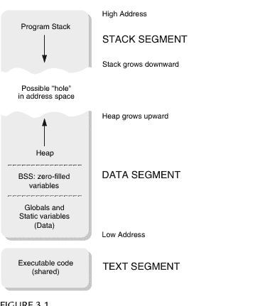

图3.1

Linux/Unix 进程的地址空间

虽然理论上栈和堆可以相互增长，但操作系统会阻止这种情况发生，任何试图使这种事件发生的程序都是在自找麻烦。在现代系统上，这种情况尤为明显，因为进程的地址空间很大，且栈顶与堆尾之间的间隙相当大。不同的内存区域可以被分配不同的硬件内存保护。例如，文本段可能被标记为“仅可执行”，而数据段和栈段则会禁用执行权限。这种做法可以防止某些类型的安全攻击。当然，具体的细节取决于硬件和操作系统，并且可能会随时间变化。值得注意的是，标准 C 和 C++ 都允许将 const 项放置在只读内存中。表 3.1 总结了不同段之间的关系。

表 3.1 
可执行程序段及其位置

| 程序内存 | 地址空间段 | 可执行文件节 |
|---|---|---|
| 代码 | 文本 | 文本 |
| 已初始化数据 | 数据 | 数据 |
| BSS | 数据 | BSS |
| 堆 | 数据 | |
| 栈 | 栈 | |

size 程序会打印出文本、数据和 BSS 节的大小（以字节为单位），以及以十进制和十六进制表示的总大小。（ch03-memaddr.c 程序将在本章后面展示；参见第 3.2.5 节“地址空间检查”，第 78 页。）

```bash
$ cc -o ch03-memaddr ch03-memaddr.c            # 编译程序
$ ls -l ch03-memaddr                               # 显示总大小
-rwxr-xr-x  1 arnold  devel    12320 Nov 24 16:45 ch03-memaddr
$ size ch03-memaddr                                 # 显示组件大小
         text    data   bss    dec   hex   filename
         1458     276     8    1742   6ce   ch03-memaddr
$ strip ch03-memaddr                                 # 移除符号
$ ls -l ch03-memaddr                                 # 再次显示总大小
-rwxr-xr-x  1 arnold  devel    3480 Nov 24 16:45 ch03-memaddr
$ size ch03-memaddr                                  # 组件大小未改变
         text    data   bss    dec   hex   filename
         1458     276     8    1742   6ce   ch03-memaddr
```

加载到内存中的内容总大小仅为 1742 字节，而文件长度为 12,320 字节。大部分空间被符号占据，符号是程序变量和函数名的列表。（当程序运行时，符号不会加载到内存中。）strip 程序会从目标文件中移除符号。对于大型程序，这可以节省大量的磁盘空间，但代价是如果发生核心转储，将无法进行调试。（在现代系统中，这并不值得麻烦；不要使用 strip。）即使在移除符号后，文件仍然比加载到内存中的内容大，因为目标文件格式维护了关于程序的额外数据，例如它可能使用的共享库（如果有）。

^2 核心转储（core dump）是在进程意外终止时创建的运行进程的内存映像。它可以稍后用于调试。Unix 系统将该文件命名为 core，而 GNU/Linux 系统使用 core.pid，其中 pid 是终止进程的进程 ID。

最后，我们要提到的是，线程表示单个地址空间内的多个执行流。通常，每个线程都有自己的栈，以及获取线程局部数据的方法，即供线程私有使用的动态分配数据。本书不再详细涵盖线程，因为它们是一个高级主题。

## 3.2 内存分配

四个库函数构成了 C 语言动态内存管理的基础。我们首先描述它们，然后描述这些库函数所基于的两个系统调用。C 库函数反过来通常用于实现其他分配内存的库函数以及 C++ 的 new 和 delete 运算符。

最后，我们讨论一个你将经常看到被使用、但我们不推荐的功能。

### 3.2.1 库调用：malloc()、calloc()、realloc()、free()

动态内存由 malloc() 或 calloc() 函数分配。这些函数返回指向已分配内存的指针。一旦你拥有了一定初始大小的内存块，就可以使用 `realloc()` 函数更改其大小。动态内存通过 `free()` 函数释放。

调试动态内存的使用本身就是一个重要的主题。我们在第 15.5.2 节“内存分配调试器”（第 612 页）中讨论了用于此目的的工具。

#### 3.2.1.1 检查 C 语言细节

以下是来自 GNU/Linux *malloc*(3) 手册页的函数声明：

```c
#include <stdlib.h>    /* ISO C */

void *calloc(size_t nmemb, size_t size);   /* 分配并零填充 */
void *malloc(size_t size);                 /* 分配原始内存 */
void free(void *ptr);                     /* 释放内存 */
void *realloc(void *ptr, size_t size);    /* 更改现有分配的大小 */
```

分配函数都返回类型 `void *`。这是一个*无类型或通用指针*；你只能将这种指针强制转换为其他类型并将其分配给一个带类型的指针。示例即将给出。

类型 `size_t` 是一种无符号整数类型，用于表示内存量。它用于动态内存分配，我们在全书中都能看到它的许多用法。在大多数现代系统上，`size_t` 是 unsigned long，但显式使用 `size_t` 比使用普通的无符号整数类型更好。

`ptrdiff_t` 类型用于指针运算中的地址计算，例如计算指针可能指向数组中的位置：

```c
#define MAXBUF ...
char *p;
char buf[MAXBUF];
pthread_t where;  /* 注意：'where' 可能是一个无符号整数或类似类型，但保留为 OCR 输出 'pthread_t' 可能是 'size_t' 或 'unsigned int' 的 OCR 错误，鉴于上下文是索引计算，但除非明显，否则保持 OCR 文本。实际上，在 OCR 中它写的是 pthread_t where。在标准的 C 示例中，索引通常使用 size_t 或 unsigned。我会保留原样或纠正明显的拼写错误。'pthread_t' 是用于线程 ID 的特定类型。在 char 数组中用它作为索引很奇怪，但如果它是整数类型，语法上是有效的。我将保留文本内容。 */

p = buf;
while (some condition) {
    ...
    p += something ;
    ...
    where = p - buf;    /* 我们在哪个索引？ */
}
```

*<stdlib.h>* 头文件声明了许多标准 C 库例程和类型（例如 `size_t`），它还定义了预处理器常量 **NULL**，表示“空”或无效指针。（这是一个零值，例如 `0` 或 `((void *)0)`。）

C++ 的习惯用法是显式使用 0；但在 C 中，首选 NULL，我们发现对于 C 代码来说，NULL 的可读性要高得多。

### 3.2.1.2 初始分配内存：malloc()

内存最初通过 malloc() 分配。传入的值是请求的字节总数。返回值是一个指向新分配内存的指针，如果无法分配内存则返回 NULL。在后一种情况下，errno 会被设置为指示错误。（errno 是一个特殊变量，由系统调用和库函数设置，以指示出了什么问题。它在第 4.3 节“确定出了什么问题”，第 86 页中有描述。）例如，假设我们要分配一个可变数量的某些结构体。代码大致如下：

```c
struct coord {                /* 3D 坐标 */
    int x, y, z;
} *coordinates;
unsigned int count;           /* 我们需要多少 */
size_t amount;                
                                /* 内存总量 */
/* ... 以某种方式确定 count ... */
amount = count * sizeof(struct coord);  /* 需要分配的字节数 */

coordinates = (struct coord *) malloc(amount);  /* 获取空间 */
if (coordinates == NULL) {
    /* 报告错误，恢复或放弃 */
}
/* ... 使用 coordinates ... */
```

此处显示的步骤非常程式化。顺序如下：

- 1.  声明一个适当类型的指针，指向已分配的内存。
- 2.  计算要分配的内存的字节大小。这涉及将所需对象的数量乘以单个对象的大小。这个大小又由 C 的 sizeof 运算符获取，该运算符正是为此目的（以及其他目的）而存在的。因此，虽然特定结构体的大小可能会随编译器和体系结构而变化，但 sizeof 始终返回正确的值，源代码保持正确且可移植。
    - 在为字符串或其他 char 类型的数据分配数组时，不必乘以 sizeof(char)，因为根据定义，这始终为 1。但这也不会造成任何伤害。
- 3.  通过调用 malloc() 分配存储，并将函数的返回值赋给指针变量。强制转换 malloc() 的返回值是一种良好的做法


这与被赋值变量的类型相同。在 C 语言中，这不是必须的（尽管编译器可能会生成警告）。我们强烈建议*始终*将返回值进行类型转换。

注意在 C++ 中，将一个类型的指针值赋值给另一个类型的指针时，无论上下文如何，都需要进行强制类型转换。对于动态内存管理，C++ 程序应使用 `new` 和 `delete`，以避免类型问题，而不是使用 `malloc()` 和 `free()`。

-   4. 检查返回值。*切勿假设*内存分配会成功。如果分配失败，`malloc()` 将返回 `NULL`。如果未经检查就使用该值，你的程序很可能立即因*段错误*（或*段违规*）而崩溃，这是试图使用不在你的地址空间中的内存。

如果检查了返回值，你至少可以打印诊断消息并优雅地终止程序。或者你可以尝试其他恢复方法。

一旦我们分配了内存并让 *coordinates* 指向它，我们就可以将 *coordinates* 视为数组，尽管它实际上是一个指针：

```c
int cur_x, cur_y, cur_z;
size_t an_index;
an_index = *something*;
cur_x = coordinates[an_index].x;
cur_y = coordinates[an_index].y;
cur_z = coordinates[an_index].z;
```

编译器会生成正确的代码，通过指针索引来获取 `coordinates[an_index]` 中结构体的成员。

> 注意：`malloc()` 返回的内存未初始化。它可能包含任何随机垃圾数据。你应该立即用有效数据或至少用零来初始化内存。要执行后一种操作，请使用 *memset*()（在 12.2 节“低级内存：memXXX() 函数”第 432 页中有讨论）：
> `memset(coordinates, '\0', amount);`
> 另一个选项是使用稍后描述的 `calloc()`。

Geoff Collyer 推荐以下内存分配技巧：
`*some_type* *pointer*;`
`*pointer* = malloc(count * sizeof(*pointer)*);`

这种方法保证 `malloc()` 将分配正确数量的内存，而无需你查阅 `pointer` 的声明。如果 `pointer` 的类型稍后改变，`sizeof` 运算符会自动确保要分配的字节数保持正确。（Geoff 的技巧省略了我们刚刚讨论的强制类型转换。在那里添加强制类型转换还可以确保如果 `pointer` 的类型改变且未更新 `malloc()` 调用时，也能提供诊断信息。）

### 3.2.1.3 释放内存：`free()`

当你完成对内存的使用后，你通过使用 `free()` 函数“归还”它。唯一的参数是一个之前从其他分配例程获得的指针。向 `free()` 传入空指针是安全的（尽管没有用）：

```c
free(coordinates);  
coordinates = NULL;  /* 非必须，但是个好主意 */
```

一旦调用了 `free(coordinates)`，`coordinates` 所指向的内存就禁止访问了。它现在“属于”分配例程，它们可以自由地管理它。它们可以更改内存的内容，甚至将其从进程的地址空间中释放！因此，使用 `free()` 时有几个常见的错误需要注意：

#### *访问已释放的内存*

如果未做更改，`coordinates` 将继续指向不再属于应用程序的内存。这被称为*悬挂指针*。在许多系统中，你可以侥幸继续访问这些内存，至少直到下次分配或释放更多内存为止。然而，在许多其他系统中，这种访问将不起作用。

总之，访问已释放的内存是个坏主意：它既不可移植也不可靠，并且 GNU 编码标准禁止这样做。因此，一个好主意是立即将程序的指针变量设置为 `NULL`。如果你随后错误地尝试访问已释放的内存，你的程序将立即因段错误而失败（我们希望你在向世界发布之前能发现这一点）。

#### *两次释放同一个指针*

这会导致“未定义行为”。一旦内存被交还给分配例程，它们可能会将已释放的块与其他受管理的空闲存储合并。释放已经释放过的内存很可能导致混乱或崩溃，而所谓的“双重释放”已被证明会导致安全问题。

#### *传入非由 malloc()、calloc() 或 realloc() 获取的指针*

这看起来很明显，但尽管如此仍然很重要。即使传入指向动态分配内存中间某处的指针也是不好的：

```c
free(coordinates + 10); /* 释放除前 10 个元素外的所有元素。 */
```

此调用将不起作用，并可能导致灾难性后果，例如崩溃。（这是因为许多 `malloc()` 实现会在返回的数据前面保留“簿记”信息。当 `free()` 试图使用该信息时，它会发现那里有无效数据。其他实现将在分配块末尾放置簿记信息；同样的问题也适用。）

#### *缓冲区溢出和下溢*

访问分配块之外的内存也会导致未定义行为，因为这也可能是簿记信息，甚至可能是根本不在地址空间中的内存。向这样的内存写入更糟糕，因为很可能破坏簿记数据。

#### *未释放内存*

任何不再需要的动态内存都应被释放。特别是，在循环、递归或深层嵌套函数调用中分配的内存应被仔细管理并释放。未能妥善处理会导致内存泄漏，从而使进程的内存可能无限增长；最终，进程将因内存不足而死亡。

如果内存是按输入记录分配或作为输入的某个函数分配的，这种情况可能特别有害：在小输入上运行时可能不会注意到内存泄漏，但在运行大型输入时会突然变得明显（甚至令人尴尬）。对于必须持续运行的系统，如电话交换系统，此错误更为严重。内存泄漏导致此类系统崩溃可能会导致重大的财务或其他损害。

即使程序不会因内存不足而死亡，不断增长的程序也会受到影响其性能，因为操作系统必须管理将使用中的数据保持在物理内存中。在最坏的情况下，这可能导致一种称为“抖动”的行为，此时操作系统忙于将地址空间的内容移入移出物理内存，以至于没有实际工作完成。

虽然 `free()` 可以将释放的内存交还给系统并缩小进程地址空间是可能的，但这种情况几乎从未发生。相反，释放的内存保留下来供下一次调用 `malloc()`、`calloc()` 或 `realloc()` 时分配。释放的内存可能继续驻留在进程的地址空间中。对安全敏感的程序可能会选择这样做。例如，

请参阅 15.5.2 节“内存分配调试器”，第 612 页，以了解许多有用的动态内存调试工具的讨论。

### 3.2.1.4 改变大小：realloc()

动态内存相较于静态声明的数组有一个显著优势，即你可以使用恰好所需的内存，不多不少。没有必要声明一个固定大小的全局、静态或自动数组并指望它 (a) 足够大和 (b) 不是太大。相反，你可以精确地分配你所需的数量，不多也不少。

此外，还可以更改动态分配内存区域的大小。虽然可以缩小内存块，但更典型的情况是扩大内存块。大小的更改由 `realloc()` 处理。继续以 `coordinates` 为例，典型的代码如下：

```c
int new_count;
size_t new_amount;
struct coord *newcoords;

/* 设置 new_count，例如：*/
new_count = count * 2;          /* 双倍存储 */
new_amount = new_count * sizeof(struct coord);

newcoords = (struct coord *) realloc(coordinates, new_amount);
if (newcoords == NULL) {        /* 报告错误，恢复或放弃 */
}

coordinates = newcoords;
/* 继续使用 coordinates ... */
```

与 `malloc()` 一样，这些步骤在性质上是样板代码，并在概念上相似：

-   1. 计算要分配的新大小（以字节为单位）。
-   2. 调用 `realloc()`，传入从 `malloc()`（或 `calloc()` 或早先对 `realloc()` 的调用）获得的原始指针和新大小。


- 转换并赋值 `realloc(a)` 的返回值。关于这一点稍后将进行讨论。
- 与 `malloc(a)` 一样，检查返回值以确保它不是 `NULL`。任何内存分配例程都可能失败。

在扩展内存块时，`realloc(a)` 通常会分配一个大小合适的新块，将数据从旧块复制到新块，并返回指向新块的指针。

在缩小数据块时，`realloc(a)` 通常只需更新内部的管理信息并返回相同的指针。这避免了复制原始数据。但是，如果发生了这种情况，不要假设你仍然可以使用新大小之外的内存！

在这两种情况下，你可以假设如果 `realloc(a)` 没有返回 `NULL`，旧数据已经为你复制到了新的内存中。此外，旧指针不再有效，就像你调用 `free(a)` 处理它一样，你不应该再使用它。这对于该数据块中的所有指针都适用，而不仅仅是用于调用 `free(a)` 的那个特定指针。

你可能注意到，我们的示例代码使用了一个独立的变量来指向更改后的存储块。虽然有可能（但是是个坏主意）使用相同的初始变量，如下所示：

```c
coordinates = realloc(coordinates, new_amount);
```

这是一个坏主意，原因如下。当 `realloc(a)` 返回 `NULL` 时，原始指针仍然有效；继续使用该内存是安全的。然而，如果你重用同一个变量且 `realloc(a)` 返回 `NULL`，你就失去了指向原始内存的指针。该内存无法再被使用。更重要的是，该内存无法再被释放！这会导致内存泄漏，应尽量避免。

标准 C 版本的 `realloc(a)` 有一些特殊情况：当 `ptr` 参数为 `NULL` 时，`realloc(a)` 的行为类似于 `malloc(a)`，分配一块新的存储区。当 `size` 参数为 0 时，`realloc(a)` 的行为类似于 `free(a)`，释放 `ptr` 指向的内存。因为 (a) 这可能会令人困惑，且 (b) 旧系统未实现此功能，我们建议在意指 `malloc(a)` 时使用 `malloc(a)`，在意指 `free(a)` 时使用 `free(a)`。

这里有一个相对微妙且容易出错的“陷阱”⁴。考虑一个维护指向动态分配数据*静态*指针的例程，该例程偶尔需要扩展该数据。它也可能维护指向此数据的自动（即局部）指针。（为了简洁，我们省略了错误检查代码。在生产代码中，不要这样做。）例如：

```c
void manage_table(void)
{
    static struct table *table;
    struct table *cur, *p;
    int i;
    size_t count;
    ...
    table = (struct table *) malloc(count * sizeof(struct table));
    /* fill table */
    cur = & table[i];      /* point at i'th item */
    ...
    cur->i = j;             /* use pointer */
    ...
    if (some condition) {   /* need to grow table */
    count += count/2;
    p = (struct table *) realloc(table, count * sizeof(struct table));
    table = p;
    }

    cur->i = j;             /* PROBLEM 1: update table element */

    other_routine();        /* PROBLEM 2: see text */
    cur->j = k;             /* PROBLEM 2: see text */
    ...
}
```

这看起来很直接；*manage_table()* 分配数据，使用它，改变大小，等等。但有一些问题在你查看这段代码时并没有跳出来显眼地显示（无论是在页面上还是在屏幕上）。

在标记为“PROBLEM 1”的那一行中，*cur* 指针被用于更新表格元素。然而，*cur* 是基于 *table* 的*初始*值分配的。如果 *some condition* 为真且 *realloc()* 返回了不同的内存块，*cur* 现在指向的是原始的、已释放的内存！每当 *table* 改变时，指向该内存的任何指针都需要更新。这里缺少的是在 *table* 在调用 *realloc()* 后重新赋值之后的语句 `*cur = & table[i];*`。

标记为 `PROBLEM 2` 的两行甚至更微妙。特别是，假设 `other_routine()` 对 `manage_table()` 进行了*递归*调用。table 变量可能会被再次改变，完全不可见！从 `other_routine()` 返回后，`cur` 的值可能再次无效。

人们可能会认为（我们也是这样认为的）唯一的解决方案是意识到这一点，并在函数调用后提供带有适当注释的 `cur` 重新赋值。然而，Brian Kernighan 善意地纠正了我们。如果我们使用索引，指针维护问题甚至不会出现：

```c
  table = (struct table *) malloc(count * sizeof(struct table));
  /* fill table */
  ...
  table[i].i = j;                 /* Update a member of the i'th element */
  ...
  if (some condition) {   /* need to grow table */
    count += count/2;
    p = (struct table *) realloc(table, count * sizeof(struct table));
    table = p;
  }

  table[i].i = j;                 /* PROBLEM 1 goes away */
  other_routine();                 /* Recursively calls us, modifies table */
  table[i].j = k;                 /* PROBLEM 2 goes away also */
```

如果你拥有分配数据的原始指针的*全局*副本，使用索引并不能解决问题；在这种情况下，你仍然必须担心在调用 `realloc()` 后更新你的全局结构。

> **注意** 与 `malloc()` 一样，当你扩展一块内存时，从 `realloc()` 返回的新分配内存并非全零填充。如果必要，你必须使用 `memset()` 自行清除它，因为 `realloc()` 只分配新的内存；它不做其他任何事情。

### 3.2.1.5 分配并零填充：`calloc()`

`calloc()` 函数是 `malloc()` 的直接封装。它的主要优点是零初始化动态分配的内存。它还将大小计算工作委托给你，通过接受项目数量和每个项目的大小作为参数：

```c
  coordinates = (struct coord *) calloc(count, sizeof(struct coord));
```

至少在概念上，`calloc()` 的代码相当简单。以下是其中一种可能的实现：

```c
void *calloc(size_t nmemb, size_t size)
{
    void *p;
    size_t total;

    total = nmemb * size;         /* Compute size */
    p = malloc(total);           /* Allocate the memory */

    if (p != NULL) {             /* If it worked ... */
        memset(p, '\0', total); /* fill it with zeros */
    }
    return p;                    /* Return value is NULL or pointer */
}
```

许多有经验的程序员更喜欢使用 `calloc()`，因为这样可以彻底消除关于新分配内存内容的疑问。

此外，如果你知道需要零填充的内存，你应该使用 `calloc()`，因为 `malloc()` 返回的内存可能已经是零填充的。虽然你（程序员）无法知道这一点，但 `calloc()` 可以知晓并避免调用 `memset()`。

### 3.2.1.6 总结 GNU 编码标准

总而言之，以下是 GNU 编码标准关于使用内存分配例程的说法：

- 检查每次对 `malloc` 或 `realloc` 的调用，查看它是否返回了零。即使你正在缩小块，也要检查 `realloc`；在一个将块大小舍入为 2 的幂的系统中，如果你要求更少的空间，`realloc` 可能会获得不同的块。

- 在 Unix 中，如果 `realloc` 返回零，它可能会销毁存储块。GNU `realloc` 没有这个 bug：如果它失败，原始块保持不变。请假设该 bug 已修复。如果你希望程序在 Unix 上运行，并希望避免在这种情况下丢失数据，你可以使用 GNU `malloc`。你必须预期 `free` 会更改已释放块的内容。你想从该块中获取的任何内容，必须在调用 `free` 之前获取。

Richard Stallman 在短短三段话中提炼出了使用 `malloc()` 进行动态内存管理的重要原则。动态使用的


内存以及使 GNU 程序比其 Unix 对应版本更健壮、功能更强大的“无任意限制”原则。

我们确实希望指出，C 标准要求在 `realloc()` 返回 `NULL` 时，*不要*销毁原始内存块。

### 3.2.1.7 使用私有分配器

`malloc()` 套件是一个通用内存分配器。它必须能够处理任意大小（非常大或非常小）的内存请求，并在不同已分配内存块被释放时完成所有的簿记工作。因此，如果您的程序进行大量的动态内存分配，您可能会发现它花费了大部分时间用在 `malloc()` 函数中。

您可以采取的一个措施是编写一个*私有分配器*——一组函数或宏，它们从 `malloc()` 中分配大块内存，然后依次切分出小块内存。如果您分配大量相同的相对较小的结构体实例，这种技术特别有用。

例如，GNU awk（gawk）就使用了这种技术。以下是 gawk 发行版中 `awk.h` 文件的内容（稍作编辑以适配页面）：

```c
#define getnode(n)    if (!nextfree) { n = nextfree, nextfree = nextfree->nextxp;\
                  else n = more_nodes() }
#define freenode(n)   { (n)->flags = 0, (n)->exec_count = 0, \
                  (n)->nextxp = nextfree, nextfree = (n) }
```

变量 `nextfree` 指向一个由 `NODE` 结构体组成的链表。`getnode()` 宏如果在链表中有项，则取下第一个结构体；否则，调用 `more_nodes()` 来分配一个新的空闲 `NODE` 列表。`freenode()` 宏通过将节点置于链表头部来释放一个 `NODE`。

> 注意 在初次编写应用程序时，请用简单的方式：直接使用 `malloc()` 和 `free()`。*只有当*对程序的性能分析表明它在内存分配函数上花费了大量显著时间时，您才应考虑编写一个私有分配器。

### 3.2.1.8 示例：读取任意长行

毕竟，这是一本*通过实例学习 Linux 编程*的书，是时候看一个实际生活中的例子了。以下代码是来自 GNU Make 3.80（`ftp://ftp.gnu.org/gnu/make/make-3.80.tar.gz`）的 `readline()` 函数。可以在文件 `read.c` 中找到。

遵循“无任意限制”原则，Makefile 中的行可以是任意长度。因此，此例程的主要任务是读取任意长度的行，并确保它们能装入正在使用的缓冲区。

次要任务是处理续行。与 C 语言一样，以反斜杠结尾的行在逻辑上延续到下一行。使用的策略是维护一个缓冲区。缓冲区中保留尽可能多的行，并通过指针记录缓冲区的起始位置、当前行和下一行。结构体如下：

```c
struct ebuffer
{
    char *buffer;    /* 缓冲区中当前行的起始位置。  */
    char *bufnext;   /* 缓冲区中下一行的起始位置。  */
    char *bufstart;  /* 整个缓冲区的起始位置。  */
    unsigned int size;  /* 通过 Malloc 分配的缓冲区大小。  */
    FILE *fp;      /* 文件指针，如果是内部缓冲区则为 NULL。  */
    struct floc floc;  /* 关于 fp 中文件的信息（如果有）。  */
};
```

*size* 字段跟踪整个缓冲区的大小，而 *fp* 是输入文件的 *FILE* 指针。*floc* 结构体对于研究该例程没有太大意义。

该函数返回缓冲区中的行数。（这里的行号是相对于函数开头的，而不是源文件的。）

```c
1 static long
2 readline (ebuf)                         static long readline(struct ebuffer *ebuf)
3      struct ebuffer *ebuf;
4 {
5   char *p;
6   char *end;
7   char *start;
8   long nlines = 0;
9
10  /* 字符串缓冲区和流缓冲区的行为差异足够大，
11     以至于需要不同的函数。 做正确的事。  */
12
13  if (!ebuf->fp)
14    return readstring (ebuf);
15
16  /* 当从文件读取时，每处理新的一行时，我们总是从缓冲区
17     的开头重新开始。  */
18
19 p = start = ebuf->bufstart;
20 end = p + ebuf->size;
21 *p = '\0';
```

我们首先注意到 GNU Make 是用 K&R C 编写的，以获得最大的可移植性。开头部分声明了变量，如果输入来自 `string`（例如宏的展开），代码会将处理移交给另一个函数 `readstring()`（第 13 行和第 14 行）。测试 `!ebuf->fp`（第 13 行）是空指针更简短（也是我们认为更不清晰）的测试方式；它等同于 `ebuf->fp == NULL`。

第 19–21 行初始化指针，并在缓冲区末尾插入一个 NUL 字节，即 C 字符串终止符。然后函数开始一个循环（第 23–95 行），只要还有输入就运行。

```c
23 while (fgets (p, end - p, ebuf->fp) != 0)
24 {
25 char *p2;
26 unsigned long len;
27 int backslash;
28
29 len = strlen (p);
30 if (len == 0)
31 {
32 /* 这只发生在该行第一个字符是 `\0` 时。
33 这是一个相当绝望的情况，但（奇迹般地）雅典娜
34 losange 又出现了！（xmkf 在其 makfiles.so 中放入了 NULL）
35 真的没什么可做的；我们合成一个新行，使
36 下一行看起来不属于这一行。 */
37 error (ebuf->file, 0, "warning: NUL character seen; rest of line ignored");
38 p[0] = '\n';
39 len = 1;
40 }
41
```

`fgets()` 函数（第 23 行）接受一个指向缓冲区的指针、要读取的字节计数，以及用于读取的 `FILE` 指针变量。它读取比计数少一个字节，以便能用 `\0` 终止缓冲区。这个函数很好，因为它允许你避免缓冲区溢出。它在遇到换行符或文件末尾时停止，如果存在换行符，它会被放入缓冲区。失败时返回 `NULL`，成功时返回第一个参数（指针）的值。

在这种情况下，参数是缓冲区空闲区域的指针、缓冲区剩余的空间量，以及用于读取的 `FILE` 指针。

第 32–36 行的注释不言自明；如果遇到零字节，程序会打印错误信息，并假设它是一个空行。在补偿了 NUL 字节（第 30–41 行）之后，代码继续执行。

```c
43      /* 跳过我们刚刚读取的文本。 */
44      p += len;
45
46      /* 如果最后一个字符不是换行符，说明整行没有装进缓冲区。
47          获取更多缓冲区并再次尝试。  */
48      if (p[-1] != '\n')
49          goto more_buffer;
50
51      /* 我们得到了换行符，因此行数加 1。  */
52      ++nlines;
```

第 43–52 行将指向缓冲区的指针递增，越过刚读取的数据。然后代码检查最后读取的字符是否为换行符。结构体 `p[-1]`（第 48 行）查看 `p` 前面的字符，就像 `p[0]` 是当前字符，`p[1]` 是下一个字符一样。这起初看起来奇怪，但如果将其转换为指针运算术语 `*(p-1)`，它就更合理了，并且索引形式可能更容易阅读。

如果最后一个字符不是换行符，这意味着空间不足，代码通过 `goto` 跳转去获取更多空间（第 49 行）。否则，行数加 1。

```c
54  #if !defined(WINDOWS32) && !defined(_MSDOS_)
55  /* 检查该行是否真的以 CRLF 结尾；如果是，忽略 CR。  */
56  if ((p - start) > 1 && p[-2] == '\r')
57  {
58      --p;
59      p[-1] = '\n';
60  }
61  #endif
```

第 54–62 行处理遵循 Microsoft 约定、以回车-换行（CR-LF）组合结尾、而不仅仅是换行（或 newline，即 Linux/Unix 约定）的输入行。注意，`#if !defined` 排除了 Microsoft 系统上的代码；显然那些系统上的 `<stdio.h>` 库会自动处理这种转换。这对于其他支持标准 C 的非 Unix 系统也是如此。

```c
64  backslash = 0;
65  for (*p2 = p - 2; p2 >= start; --p2)
66  {
67      if (*p2 != '\\')
68          break;
69      backslash = !backslash;
70  }
71
```


## 3.2 内存分配

```c
72      if (!backslash)
73      {
74          p[-1] = '\0';
75          break;
76      }
77
78      /* It was a backslash/newline combo.  If we have more space, read
79       * another line.  */
80      if (end - p >= 80)
81          continue;
82
83      /* We need more space at the end of our buffer, so realloc it.
84       * Make sure to preserve the current offset of p.  */
85  more_buffer:
86      {
87          unsigned long off = p - start;
88          ebuf->size *= 2;
89          start = ebuf->buffer = ebuf->bufstart = (char *) xrealloc (start,
90                                                       ebuf->size);
91          p = start + off;
92          end = start + ebuf->size;
93          *p = '\0';
94      }
95      }
```

到目前为止，我们处理了将至少一整行读入缓冲区的机制。下一段代码处理续行（continuation line）的情况。不过，它必须确保行末尾的最终反斜杠不是多个反斜杠的一部分。它通过让 backslash 变量在 0 和 1 之间切换，来跟踪此类反斜杠总数是奇数还是偶数。（第 64–70 行。）

如果数量是偶数，那么测试 `!backslash`（第 72 行）将为真。在这种情况下，最终的回车符将被替换为 NUL 字节，代码跳出循环。

另一方面，如果数量是奇数，则表示该行包含偶数个反斜杠对（代表转义的反斜杠，如 C 语言中的 `\\`），以及最后的反斜杠-换行符组合。这段代码透露出实用经验的痕迹：如果得知早期版本只是检查换行符前是否有反斜杠，直到有人抱怨说当行末有多个反斜杠时不起作用，这并不令人惊讶。在这种情况下，如果缓冲区中至少剩下 80 个空闲字节，程序将循环继续读取另一行（第 78–81 行）。（使用魔术数字 80 并不是很好；最好定义并使用符号常量。）

当到达第 83 行时，程序需要在缓冲区中获取更多空间。这就是动态内存管理发挥作用的地方。注意关于保留 p 的注释（第 83-84 行）；我们之前已经从重新初始化指向动态内存的指针的角度讨论过这一点。end 也被重置。第 89 行调整内存大小。

注意，这里调用的函数是 `xrealloc()`。许多 GNU 程序使用围绕 `malloc()` 和 `realloc()` 的“包装”函数，如果标准例程返回 NULL，这些函数会自动打印错误消息并退出。这样的包装函数可能如下所示：

```c
extern const char *myname;     /* set in main() */

void *xrealloc(void *ptr, size_t amount)
{
    void *p = realloc(ptr, amount);
    if (p == NULL) {
        fprintf(stderr, "%s: out of memory!\n", myname);
        exit(1);
    }
}
```

因此，如果 `xrealloc()` 返回，则保证返回一个有效的指针。（这种策略遵循“检查每次调用的错误”原则，同时避免了直接使用标准例程所带来的代码杂乱。）此外，这使得构造 `ptr = xrealloc(ptr, new_size)` 能够被有效使用，尽管我们之前曾警告过不要这样做。

请注意，使用这样的包装函数并不总是合适的。如果你希望自行处理错误，就不应该使用它。另一方面，如果内存耗尽总是致命错误，那么这样的包装函数就非常方便。

```c
97      if (ferror (ebuf->fp))
98        fatal_with_name (ebuf->floc.filename);
99
100     /* If we found some lines, return how many.
101      If we didn't, but we did find *something*, that indicates we read the last
102      line of a file with no final newline; return 1.
103      If we read nothing, we're at EOF; return -1. */
105     return nlines ? nlines : p = ebuf->bufstart ? -1 : 1;
106   }
```

最后，`readline()` 例程检查 I/O 错误，然后返回一个描述性的返回值。函数 `pfatal_with_name()`（第 98 行）不会返回。

### 3.2.1.9 仅限 Glibc：读取整行：getline() 和 getdelim()

既然你已经看到了如何读取任意长度的行，就可以放心了，你不必自己编写这样的函数。Glibc 提供了两个函数来替你完成这项工作：

```c
#define _GNU_SOURCE 1            /* Glibc */
#include <stdio.h>
#include <sys/types.h>            /* for ssize_t */

ssize_t getline(char **lineptr, size_t *n, FILE *stream);
ssize_t getdelim(char **lineptr, size_t *n, int delim, FILE *stream);
```

定义常量 `_GNU_SOURCE` 会引入 `getline()` 和 `getdelim()` 函数的声明。否则，它们会被隐式声明为返回 int。需要 `<sys/types.h>` 以便你可以声明一个类型为 `ssize_t` 的变量来保存返回值。（`ssize_t` 是“有符号的 `size_t`”。它的用途与 `size_t` 相同，但用于需要保存负值的地方。）

这两个函数为你管理动态存储，确保包含输入行的缓冲区始终足够大以容纳该输入行。它们的区别在于 `getline()` 读取直到遇到换行符，而 `getdelim()` 使用用户提供的分隔符。公共参数如下：

- **`char **lineptr`**：指向 char * 指针的指针，用于保存动态分配缓冲区的地址。如果你希望 `getline()` 完成所有工作，它应该初始化为 NULL。否则，它应该指向之前从 `malloc()` 获取的存储。
- **`size_t *n`**：指示缓冲区的大小。如果你分配了自己的缓冲区，`*n` 应包含缓冲区的大小。如果这两个函数更改了缓冲区大小，它们都会更新 `*n` 为新的缓冲区大小。
- **`FILE *stream`**：获取输入字符的位置。

如果到达文件末尾或发生错误，函数返回 -1。字符串保存结尾的换行符或分隔符（如果有的话），以及一个终止的零字节。使用 `getline()` 很容易，如 `ch03-getline.c` 中所示：

```c
/* ch03-getline.c -- demonstrate getline(). */
#define _GNU_SOURCE 1
#include <stdio.h>
#include <sys/types.h>

/* main --- read a line and echo it back out until EOF. */
int main(void)
{
    char *line = NULL;
    size_t size = 0;
    ssize_t ret;
    while ((ret = getline(& line, & size, stdin)) != -1)
        printf("(%lu) %s", size, line);
    return 0;
}
```

这里展示了其运行效果，显示缓冲区的大小。第三行输入和输出故意很长，以迫使 getline() 扩大缓冲区；因此，它们会换行：

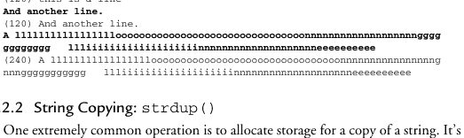

### 3.2.2 字符串复制：strdup()

一个极其常见的操作是为字符串的副本分配存储。这非常常见，以至于许多程序提供一个简单的函数而不是使用内联代码，并且该函数通常命名为 `strdup()`：

```c
#include <string.h>

/* strdup --- malloc() storage for a copy of string and copy it */
char *strdup(const char *str)
{
    size_t len;
    char *copy;

    len = strlen(str) + 1;    /* include room for terminating `\0' */
    copy = malloc(len);
    if (copy != NULL)
        strcpy(copy, str);

    return copy;            /* returns NULL if error */
}
```

随着 2001 年 POSIX 标准的发布，全世界的程序员可以稍微放心一点：这个函数现在是 POSIX 的一部分，作为 XSI 扩展：

```c
#include <string.h>                          /* XSI */

char *strdup(const char *str);            /* Duplicate str */
```

如果发生错误，返回值为 NULL；否则，返回指向动态分配存储的指针，该存储中保存了 *str* 的副本。当不再需要该值时，应使用 `free()` 释放返回的值。

### 3.2.3 系统调用：brk() 和 sbrk()

我们讨论过的四个例程（`malloc()`、`calloc()`、`realloc()` 和 `free()`）是用于动态内存管理的标准、可移植函数。

在 Unix 系统中，标准函数是在另外两个非常基础的例程之上实现的，这些例程直接改变进程地址空间的大小。我们在这里介绍它们，以帮助你理解 GNU/Linux 和 Unix 是如何工作的（再次触及“底层”）；你在常规程序中几乎不可能需要用到这些函数。它们声明如下：

```c
#include <unistd.h>          /* Common */
#include <malloc.h>          /* Necessary for glibc 2 systems */

int brk(void *end_data_segment);
void *sbrk(ptrdiff_t increment);
```


# 3.2.4 懒惰编程员的调用：alloca()

> > “危险，威尔·罗宾逊！危险！”
> > ——《机器人》

`brk()` 系统调用实际上会改变进程的地址空间。该地址是一个指针，代表数据段（实际上如前文图 3.1 所示，是堆区）的结束位置。它的参数是一个绝对逻辑地址，代表地址空间的新结束位置。成功时返回 0，失败时返回 -1。

`sbrk()` 函数则更易于使用；其参数是以字节为单位的地址空间增量。通过传入 0 作为增量，你可以确定地址空间当前结束的位置。因此，要将地址空间增加 32 字节，可以使用如下代码：

```c
char *p = (char *) sbrk(0);    /* 获取地址空间的当前末尾 */
if (sbrk(p + 32) < 0) {
    /* 处理错误 */
}
/* 否则，修改成功 */
```

从实际角度看，你不会直接使用 `brk()`。相反，你会专门使用 `sbrk()` 来增长（甚至缩减）地址空间。（我们将在 3.2.5 节“地址空间检查”，第 78 页中展示如何这样做。）

更实际地说，你绝不应该使用这些例程。使用了这些例程的程序就无法再使用 `malloc()`，这是一个大问题，因为标准库的许多部分都依赖于能够使用 `malloc()`。因此，使用 `brk()` 或 `sbrk()` 很可能导致难以排查的程序崩溃。

但了解底层机制是有价值的，事实上，`malloc()` 系列例程就是用 `sbrk()` 和 `brk()` 实现的。

还有一个额外的内存分配函数你应该知道。我们讨论它只是为了让你看到时能理解，但你不应该在新程序中使用它！这个函数名为 `alloca()`，其声明如下：

```c
/* GNU/Linux 的头文件，可能并非所有 Unix 系统都有 */  通用
#include <alloca.h>
void *alloca(size_t size);
```

`alloca()` 函数从 `栈` 分配 `size` 字节。其优点在于，分配的存储区域在函数返回时会自动消失。因为就像局部变量一样会自动消失，所以无需显式释放。

乍一看，`alloca()` 似乎是一种编程万能药：可以分配内存，且完全不需要管理。就像原力黑暗面一样，这确实具有诱惑力。但也同样应该避免，原因如下：

- 该函数非标准；它未包含在任何正式标准中，无论是 ISO C 还是 POSIX。
- 该函数不可移植。尽管它存在于许多 Unix 系统和 GNU/Linux 中，但在非 Unix 系统上并不存在。这是一个问题，因为代码往往需要在 Linux 和 Unix 之外的多平台上运行。
- 在某些系统上，甚至无法实现 `alloca()`。世界并不全是 Intel x86 处理器，也不全是 GCC。
- 引用 man 手册页（加粗部分为强调）：“`alloca` 函数依赖于机器和编译器。在许多系统上，其实现存在 bug。不推荐使用。”
- 再次引用 man 手册页：“在许多系统上，`alloca` 不能用于函数调用的参数列表中，因为 `alloca` 预留的栈空间会出现在栈中函数参数空间的中间。”
- 它鼓励随意编码。仔细且正确的内存管理并不难；你只需要思考自己在做什么并提前规划。

GCC 通常使用内置版本的函数，该函数通过内联代码来操作。因此，`alloca()` 还有其他后果。再次引用 man 手册页：

> 代码是内联的这一事实意味着，不可能获取该函数的地址，也不可能通过链接不同的库来改变其行为。内联代码通常由一条调整栈指针的指令组成，并且不检查栈溢出。因此，没有 `NULL` 错误返回值。

手动页对 GCC 内置 `alloca()` 的问题描述还不够彻底。如果发生栈溢出，返回值将是*垃圾数据*。而且你无从知晓！这个缺陷使得 GCC 的 `alloca()` 无法在健壮代码中使用。

以上所有内容应该足以说服你，在任何新编写的代码中都要远离 `alloca()`。反正如果你要编写使用 `malloc()` 和 `free()` 的可移植代码，就没有理由同时编写使用 `alloca()` 的代码。

# 3.2.5 地址空间检查

以下程序 `ch03-memaddr.c` 总结了我们看到的关于地址空间的所有内容。它做了一些在实践中你不应该做的事情，例如调用 `alloca()` 或直接使用 `brk()` 和 `sbrk()`：

```c
/*
 * ch03-memaddr.c  ---  显示代码、数据和栈部分，
 *                       以及 BSS 和动态内存的地址。
 */

#include <stdio.h>
#include <malloc.h>      /* 用于在 GLIBC 中定义 ptrdiff_t */
#include <unistd.h>
#include <alloca.h>      /* 仅用于演示 */

extern void afunc(void);  /* 用于展示栈增长的函数 */

int bss_var;             /* 自动初始化为 0，应在 BSS 中 */
int data_var = 42;       /* 初始化为非零值，应在数据段中 */

int
main(int argc, char **argv)  /* 参数未使用 */
{
    char *p, *b, *nb;

    printf("文本段位置:\n");
    printf("\tmain 的地址: %p\n", main);
    printf("\tafunc 的地址: %p\n", afunc);

    printf("栈位置:\n");
    afunc();

    p = (char *) alloca(32);
    if (p != NULL) {
        printf("\talloca() 数组的起始位置: %p\n", p);
        printf("\talloca() 数组的结束位置: %p\n", p + 31);
    }

    printf("数据段位置:\n");
    printf("\tdata_var 的地址: %p\n", &data_var);

    printf("BSS 位置:\n");
    printf("\tbss_var 的地址: %p\n", &bss_var);

    b = sbrk((ptrdiff_t) 32);   /* 增长地址空间 */
    nb = sbrk((ptrdiff_t) 0);
    printf("堆位置:\n");
    printf("\t堆的初始末尾: %p\n", b);
    printf("\t堆的新末尾: %p\n", nb);

    b = sbrk((ptrdiff_t) -16);   /* 缩减 */
    nb = sbrk((ptrdiff_t) 0);
    printf("\t堆的最终末尾: %p\n", nb);
}

void
afunc(void)
{
    static int level = 0;     /* 递归层级 */
    auto int stack_var;       /* 自动变量，位于栈上 */

    if (++level == 3)         /* 避免无限递归 */
        return;

    printf("\t栈层级 %d: stack_var 的地址: %p\n",
           level, &stack_var);   /* 递归调用 */
    afunc();
}
```

该程序打印了两个函数 `main()` 和 `afunc()` 的位置（第 22-23 行）。然后展示栈如何向下增长，让 `afunc()`（第 51-63 行）打印其局部变量 `stack_var` 的连续实例化地址。（`stack_var` 特意声明为 `auto`，以强调它位于栈上。）接着展示由 `alloca()` 分配的内存位置（第 28-32 行）。最后打印数据和 BSS 变量的位置（第 34-38 行），以及通过 `sbrk()` 直接分配的内存位置（第 40-48 行）。以下是该程序在 Intel GNU/Linux 系统上运行时的结果：

```text
$ ch03-memaddr
Text Locations:
    Address of main: 0x804838c
    Address of afunc: 0x80484a8
Stack Locations:
    Stack level 1: address of stack_var: 0xbffff864
    Stack level 2: address of stack_var: 0xbffff844
    Start of alloca()‘ed array: 0xbffff860
    End of alloca()‘ed array: 0xbffff870
Data Locations:
    Address of data_var: 0x80496b8
BSS Locations:
    Address of bss_var: 0x80497c4           BSS 位于数据变量之上
Heap Locations:
    Initial end of heap: 0x80497c8          堆位于 BSS 之上
    New end of heap: 0x80497e8             并且向上增长
    Final end of heap: 0x80497d8           地址空间可以缩减
```

# 3.3 总结

- 每个 Linux（以及 Unix）程序都有不同的内存区域。它们存储在可执行程序的磁盘文件的各个部分中。程序运行时会有一些段被加载到内存的同一部分。同一程序的所有运行副本共享可执行代码（文本段）。`size` 程序显示可重定位目标文件和完全链接的可执行文件中不同区域的大小。
- 运行中程序的地址空间可能存在空洞，并且随着内存的分配和释放，地址空间的大小会发生变化。在 modern 系统上，地址 0 不属于地址空间的一部分，因此不要尝试解除 NULL 指针的引用。
- 在 C 语言层面，使用 `malloc()`、`calloc()` 或 `realloc()` 之一来分配或重新分配内存。使用 `free()` 释放内存。（虽然 `realloc()` 可以做所有事情，但不建议那样使用它）。被释放的内存通常不会从地址空间中移除；相反，它会被复用用于后续的分配。
- 必须极度谨慎地做到以下几点：
  - 只释放来自分配例程的内存，
  - 只释放一次且仅释放一次此类内存，
  - 释放未使用的内存，并且
  - 不“泄露”任何动态分配的内存。
- POSIX 提供 `strdup()` 函数作为便利函数，而 GLIBC 提供 `getline()` 和 `getdelim()` 用于读取任意长度的行。


- 低级系统调用接口函数 `brk()` 和 `sbrk()` 提供了对内存分配和释放的直接但原始访问。除非你在编写自己的内存分配器，否则你不应该使用它们。
- 用于在堆栈上分配内存的 `alloca()` 函数是存在的，但不建议使用。就像识别毒藤的能力一样，你只知道它，是为了知道如何避免它。

### 练习

1. 从以下结构体开始——
   ```c
   struct line {
       size_t buflen;
       char *buf;
       FILE *fp;
   };
   ```
   ——编写你自己的 `readline()` 函数，用于读取任意长度的行。不要担心反斜杠续行。不要使用 `fgets()` 来读取行，而是使用 `getc()` 一次读取一个字符。

2. 你的函数是否保留了终止换行符？解释原因或为什么没有。

3. 你的函数如何处理以 CR-LF 结尾的行？

4. 你如何初始化该结构体？使用单独的例程？使用结构体中特定值的文档化要求？

5. 你如何指示文件结束？你如何指示发生了 I/O 错误？对于错误，你的函数是否应该打印错误消息？解释原因或为什么不应该。

6. 编写一个使用你的函数来测试它的程序，以及另一个程序向第一个程序生成输入数据。测试你的函数。

7. 重写你的函数以使用 `fgets()` 并进行测试。新代码更复杂还是更简单？其性能与 `getc()` 版本相比如何？

8. 研究 *V7 end(3)* 手册页（V7 发行版中的 `/usr/man/man3/end.3`）。它是否阐明了 `sbrk(0)` 可能如何工作？

9. 增强 `ch03-memaddr.c` 以打印出参数和环境变量的位置。它们位于地址空间的哪个部分？

*此页故意留白*

## 第 4 章


### 本章内容

- 4.1 介绍 Linux/Unix I/O 模型 第 84 页
- 4.2 展示基本程序结构 第 84 页
- 4.3 确定出了什么问题 第 86 页
- 4.4 执行输入和输出 第 91 页
- 4.5 随机访问：在文件内移动 第 102 页
- 4.6 创建文件 第 106 页
- 4.7 强制数据写入磁盘 第 113 页
- 4.8 设置文件长度 第 114 页
- 4.9 摘要 第 115 页
- 练习 第 115 页

本章描述了基本的文件操作：打开和创建文件、读取和写入它们、在文件中移动以及关闭它们。在这个过程中，它介绍了检测和报告错误的标准机制。本章最后描述了如何设置文件的长度并强制将文件数据和元数据写入磁盘。

### 4.1 介绍 Linux/Unix I/O 模型

Linux/Unix I/O 的 API 模型是直接的。它可以概括为四个词：打开、读取、写入、关闭。事实上，这些就是系统调用的名称：`open()`、`read()`、`write()`、`close()`。以下是它们的声明：

```c
#include <sys/types.h>      /* for mode_t */
#include <sys/stat.h>
#include <fcntl.h>         /* for flags for open() */
#include <unistd.h>        /* for ssize_t */

int open(const char *pathname, int flags, mode_t mode);
ssize_t read(int fd, void *buf, size_t count);
ssize_t write(int fd, const void *buf, size_t count);
int close(int fd);
```

在接下来的部分以及后续章节中，我们通过编写一个非常简单的 `cat` 版本来说明这个模型。它非常简单，甚至没有选项；它所做的只是将命名文件的内容连接到标准输出。它确实执行了最基本的错误报告。一旦编写完成，我们将它与 V7 版本的 `cat` 进行比较。

我们自上而下地呈现程序，从命令行开始。在接下来的部分中，我们将介绍错误报告，然后深入到实际细节，展示如何执行实际的 I/O。

### 4.2 展示基本程序结构

我们的 `cat` 版本遵循一种通常有用的结构。第一部分以解释性注释、头文件包含、声明和 `main()` 函数开始：

```c
/*
 * ch04-cat.c  --  Demonstrate open(), read(), write(), close(),
 *                  errno and strerror().
 */

#include <stdio.h>          /* for fprintf(), stderr, BUFSIZ */
#include <errno.h>          /* declare errno */
#include <fcntl.h>          /* for flags for open() */
#include <string.h>         /* declare strerror() */
#include <unistd.h>         /* for ssize_t */
#include <sys/types.h>
#include <sys/stat.h>       /* for mode_t */

char *mname;
int process(char *file);

/* main -- loop over file arguments */

int
main(int argc, char **argv)
{
    int i;
    int errs = 0;

    mname = argv[0];

    if (argc == 1)
        errs = process("-");
    else
        for (i = 1; i < argc; i++)
            errs += process(argv[i]);

    return (errs != 0);
}
... 后续章节中继续 ...
```

`mname` 变量稍后用于错误消息；`main()` 的第一项操作将其设置为程序名称（`argv[0]`）。然后 `main()` 循环遍历参数。对于每个参数，它调用名为 `process()` 的函数来执行工作。

当给定文件名 `-`（单个破折号，或减号）时，Unix `cat` 读取标准输入，而不是尝试打开名为 `-` 的文件。此外，没有参数时，`cat` 读取标准输入。`ch04-cat` 实现了这两种行为。当没有文件名参数时，对 `argc == 1` 的检查为真；在这种情况下，`main()` 将 `"-"` 传递给 `process()`。否则，`main()` 循环遍历所有参数，将它们作为要处理文件。如果其中一个恰好是 `"-"`，程序则处理标准输入。

如果 `process()` 返回非零值，意味着出了点问题。错误会在 `errs` 变量中累加。当 `main()` 结束时，如果没有错误则返回 0，如果有错误则返回 1。这是一个相当标准的约定，其含义在第 9.1.5.1 节“定义进程退出状态”中进行了更详细的讨论。

`main()` 中展示的结构非常通用：`process()` 可以对文件执行我们想要的任何操作。例如（忽略 `"-`" 的特殊用途），`process()` 同样可以轻松地删除文件而不是连接它们！

在查看 `process()` 函数之前，我们必须描述系统调用错误是如何表示的，以及 I/O 是如何执行的。`process()` 函数本身在第 4.4.3 节“读取和写入”中介绍。

### 4.3 确定出了什么问题

> “如果有什么事情可能会出错，它就一定会出错。”
> ——墨菲定律——
>
> “做好准备。”
> ——童子军——

错误随时可能发生。磁盘可能会填满，用户可能会输入无效数据，正在从中读取文件的网络服务器可能会崩溃，网络可能会失效，等等。始终检查每个操作的成功或失败是很重要的。

基本的 Linux 系统调用几乎普遍在出错时返回 −1，成功时返回 0 或正值。这让你知道操作是成功还是失败：

```c
int result;

result = some_system_call(param1, param2);
if (result < 0) {
    /* 发生错误，采取某些措施 */
}
else
    /* 一切正常，继续 */
```

知道发生错误是不够的。有必要知道发生了哪种错误。为此，每个进程都有一个名为 `errno` 的预定义变量。每当系统调用失败时，`errno` 会被设置为一组预定义错误值之一。`errno` 和预定义值在 `<errno.h>` 头文件中声明：

```c
#include <errno.h>

extern int errno;
```

`errno` 本身可能是一个表现得像 int 变量的宏；它不需要是一个真正的整数。特别是，在多线程环境中，每个线程将拥有自己私有的 `errno` 版本。但实际上，就本书中的所有系统调用和函数而言，你可以将 `errno` 当作一个简单的 int 来处理。


#### 4.3.1 `errno` 的值

2001 年发布的 POSIX 标准定义了大量可能的 `errno` 值。其中许多与网络、进程间通信（IPC）或其他专门任务相关。每个系统调用的手册页都描述了可能发生的 `errno` 值；因此，你可以编写代码来检查特定错误，并在必要时进行特殊处理。这些可能的值由符号常量定义。表 4.1 列出了由 GLIBC 提供的常量。

**表 4.1**
**GLIBC 中的 `errno` 值**

| 名称 | 含义 |
|---|---|
| E2BIG | 参数列表过长。 |
| EACCES | 权限被拒绝。 |
| EADDRINUSE | 地址已在使用。 |
| EADDRNOTAVAIL | 地址不可用。 |
| EAFNOSUPPORT | 不支持地址族。 |
| EAGAIN | 资源不可用，请重试（可能与 EWOULDBLOCK 值相同）。 |
| EALREADY | 连接正在进行中。 |
| EBADF | 无效的文件描述符。 |
| EBADMSG | 无效消息。 |
| EBUSY | 设备或资源忙。 |
| ECANCELED | 操作已取消。 |
| ECHILD | 没有子进程。 |
| ECONNABORTED | 连接中止。 |
| ECONNREFUSED | 连接被拒绝。 |
| ECONNRESET | 连接被重置。 |
| EDEADLK | 会发生资源死锁。 |
| EDESTADDRREQ | 需要目标地址。 |
| EDOM | 数学参数超出函数定义域。 |
| EDOOF | 保留。 |
| EEXIST | 文件已存在。 |
| EFAULT | 无效地址。 |
| EFBIG | 文件过大。 |
| EHOSTUNREACH | 主机不可达。 |
| EIDRM | 标识符已移除。 |
| EILSEQ | 非法字节序列。 |
| EINPROGRESS | 操作正在进行中。 |
| EINTR | 函数被中断。 |
| EINVAL | 无效参数。 |
| EIO | I/O 错误。 |
| EISCONN | 套接字已连接。 |
| EISDIR | 是一个目录。 |
| ELOOP | 符号链接层级过多。 |
| EMFILE | 打开的文件过多。 |
| EMLINK | 链接过多。 |
| EMSGSIZE | 消息过大。 |
| EMLINK | 链接过多。 |
| EMULTIHIP | 保留。 |
| ENAMETOOLONG | 文件名过长。 |
| ENETDOWN | 网络故障。 |
| ENETRESET | 连接被网络中止。 |
| ENETUNREACH | 网络不可达。 |
| ENFILE | 系统中打开的文件过多。 |
| ENOBUFS | 没有可用的缓冲区空间。 |
| ENODEV | 无此设备。 |
| ENOENT | 没有该文件或目录。 |
| ENOEXEC | 可执行文件格式错误。 |
| ENOLCK | 没有可用的锁。 |
| ENOLINK | 保留。 |
| ENOMEM | 空间不足。 |
| ENOMSG | 没有所需类型的消息。 |
| ENOPROTOOPT | 协议不可用。 |
| ENOSPC | 设备上无剩余空间。 |
| ENOSYS | 不支持该函数。 |
| ENOTCONN | 套接字未连接。 |
| ENOTDIR | 不是目录。 |
| ENOTEMPTY | 目录非空。 |
| ENOTSOCK | 不是套接字。 |
| ENOTSUP | 不支持。 |
| ENOTTY | 不适当的 I/O 控制操作。 |
| ENXIO | 无此设备或地址。 |
| EOPNOTSUPP | 套接字不支持该操作。 |
| EOVERFLOW | 值过大，无法存储在该数据类型中。 |
| EPERM | 操作不被允许。 |
| EPIPE | 管道破裂。 |
| EPROTO | 协议错误。 |
| EPROTONOSUPPORT | 不支持该协议。 |
| EPROTOTYPE | 协议类型与套接字不匹配。 |
| ERANGE | 结果过大。 |
| EROFS | 只读文件系统。 |
| ESPIPE | 无效的定位操作。 |
| ESRCH | 无此进程。 |
| ESTALE | 保留。 |
| ETIMEDOUT | 连接超时。 |
| ETXTBSY | 文本文件忙。 |
| EWOULDBLOCK | 操作会被阻塞（可能与 EAGAIN 值相同）。 |
| EXDEV | 跨设备链接。 |

许多系统还提供其他错误值，而旧系统可能不具备上述列出的所有错误。您应查阅本地的 *intro*(2) 和 *errno*(2) 手册页以获取完整说明。

> 注意 *errno* 只能在错误发生后且在执行更多系统调用之前进行检查。其初始值为 0。但是，错误之间没有任何操作会改变 *errno*，这意味着成功的系统调用*不会*将其重置为 0。当然，您可以手动将其初始设为 0，或在任何时候随时设置，但这种情况很少见。

最初，我们仅使用 *errno* 进行错误报告。有两个函数对于错误报告很有用。第一个是 *perror*()：

```c
#include <stdio.h>                    ISO C

void perror(const char *s);
```

*perror*() 函数会打印一个由程序提供的字符串，随后是一个冒号，然后是描述 *errno* 值的字符串：

```c
if (some_system_call(param1, param2) < 0) {
    perror("system call failed");
    return 1;
}
```

我们更倾向于使用 *strerror*() 函数，它接收一个错误值参数并返回一个指向描述该错误的字符串的指针：

```c
#include <string.h>                  ISO C

char *strerror(int errnum);
```

*strerror*() 在错误报告中提供了最大的灵活性，因为通过 *fprintf*()，我们可以以任何喜欢的方式打印错误：

```c
if (some_system_call(param1, param2) < 0) {
    fprintf(stderr, "%s: %d, %d: some_system_call failed: %s\n",
            argv[0], param1, param2, strerror(errno));
    return 1;
}
```

你会在书中看到这两个函数的许多示例。

#### 4.3.2 错误消息风格

C 语言提供了几个用于错误报告的专用宏。最常用的是 `__FILE__` 和 `__LINE__`，它们分别扩展为源文件名和该文件中的当前行号。这些宏从 C 语言诞生之初就可使用。C99 定义了另一个预定义标识符 `__func__`，它代表当前函数的名称，表现为一个字符字符串。这些宏的使用方式如下：

```c
if (some_system_call(param1, param2) < 0) {
    fprintf (stderr, "%s: %s %s %d: some_system_call(%d, %d) failed: %s\n",
        argv[0], __func__, __FILE__, __LINE__,
        param1, param2, strerror(errno));
    return 1;
}
```

在此处，错误消息不仅包含程序名称，还包含函数名、源文件名和行号。表 4.2 提供了用于诊断的标识符完整列表。

**表 4.2**
**C99 诊断标识符**

| 标识符 | C 版本 | 含义 |
| :--- | :--- | :--- |
| `__DATE__` | C89 | 编译日期，形式为 "Mmm dd yyyy"。 |
| `__FILE__` | 原始版本 | 源文件名，形式为 "program.c"。 |
| `__LINE__` | 原始版本 | 源文件行号，形式为 42。 |
| `__TIME__` | C89 | 编译时间，形式为 "hh:mm:ss"。 |
| `__func__` | C99 | 当前函数名称，如同声明为 `const char __func__[] = "name"`。 |

在 Unix 早期，`__FILE__` 和 `__LINE__` 的使用非常普及，那时大多数人拥有源代码并能找到并修复错误。随着 Unix 系统逐渐商业化，由于仅拥有二进制可执行文件的人从源代码位置获得的信息帮助有限，这些标识符的使用逐渐减少。

如今，虽然 GNU/Linux 系统附带源代码，但这些源代码通常默认不会安装。因此，在错误消息中使用这些标识符似乎并未提供太多额外价值。GNU 编码标准甚至没有提及它们。

### 4.4 执行输入和输出

Linux 中所有的 I/O 都是通过对文件描述符来完成的。本节介绍文件描述符，描述如何获取和释放它们，并解释如何对它们进行 I/O 操作。

#### 4.4.1 理解文件描述符

*文件描述符* 是一个整数值。有效的文件描述符从 0 开始，一直延伸到某个系统定义的极限。这些整数实际上是每个进程打开文件表中的简单索引。（该表由操作系统内部维护，运行中的程序无法直接访问。）在大多数现代系统中，该表的大小非常大。命令 `ulimit -n` 会打印该值：

```
$ ulimit -n
1024
```

在 C 语言中，最大打开文件数由 getdtablesize()（获取描述符表大小）函数返回：

```c
#include <unistd.h>
int getdtablesize(void);
```

这个小程序打印该函数的结果：

```c
/* ch04-maxfds.c -- 演示 getdtablesize()。 */

#include <stdio.h> /* 用于 printf(), stderr, BUFSIZ */
#include <unistd.h> /* 用于 ssize_t */

int main(int argc, char *argv)
{
    printf("max fds: %d\n", getdtablesize());
    exit(0);
}
```

编译并运行时，不出所料，程序打印的值与 ulimit 打印的值相同：

```
$ ch04-maxfds
max fds: 1024
```

文件描述符存储在普通的 `int` 变量中；通常会看到诸如 `int fd` 这样的声明，用于配合 `I/O` 系统调用使用。没有为文件描述符预定义的类型。

通常情况下，每个程序启动运行时，都已经为其打开了三个文件描述符。它们分别是标准输入、标准输出和标准错误，分别对应文件描述符 0、1 和 2。（如果没有其他重定向，每一个都连接到你的键盘和屏幕。）


### 4.4 执行输入和输出

### 显而易见的显式常量。一个矛盾修辞？

在处理基于文件描述符的系统调用以及标准输入、输出和错误时，常见的做法是在代码中直接使用整数常量 0、1 和 2。在绝大多数情况下，使用这种*显式常量*（manifest constants）是个坏主意。你从未知道某个随机整数常量的含义，也不知道在别处使用的相同常量是否与之相关。为此，POSIX 标准要求在 `unistd.h` 中定义以下*符号常量*：

- `STDIN_FILENO`：标准输入的“文件编号”：0。
- `STDOUT_FILENO`：标准输出的文件编号：1。
- `STDERR_FILENO`：标准错误的文件编号：2。

然而，依我们拙见，使用这些宏是杀鸡用牛刀。首先，输入 12 或 13 个字符而不是仅仅 1 个字符是*痛苦*的。其次，使用 0、1 和 2 是*如此*标准和*如此*众所周知，以至于对于这些特定的显式常量的含义根本不存在混淆的理由。

另一方面，使用这些常量可以消除对所意图内容的任何疑虑。考虑以下语句：

```c
int fd = 0;
```

`fd` 是被初始化以指向标准输入，还是程序员正在小心地将变量初始化为一个合理的值？你无从得知。

一种方法（Geoff Collyer 推荐）是使用以下*枚举*（enum）定义：

```c
enum { Stdin, Stdout, Stderr };
```

这些常量随后可用于替代 0、1 和 2。它们既易读又更容易输入。

#### 4.4.2 打开和关闭文件

新的文件描述符（除了其他来源外）来自 `open()` 系统调用。该系统调用打开一个文件以供读取或写入，并返回一个新的文件描述符，用于对该文件的后续操作。我们之前已经看到了其声明：

```c
#include <sys/types.h>
#include <sys/stat.h>
#include <fcntl.h>
#include <unistd.h>

int open(const char *pathname, int flags, mode_t mode); POSIX
```

这三个参数如下：

- `const char *pathname`
  一个 C 字符串，代表要打开的文件名。

- `int flags`
  `<fcntl.h>` 中定义的一个或多个常量的按位或（bitwise-OR）。我们稍后将描述它们。

- `mode_t mode`
  正在创建文件的权限模式。这将在本章后面讨论，参见第 4.6 节“创建文件”，第 106 页。在打开现有文件时，省略此参数。

¹

`open()` 的返回值要么是新的文件描述符，要么是 -1 以表示错误，此时 `errno` 将被设置。对于简单的 I/O，`flags` 参数应是表 4.3 中的值之一。

#### 表 4.3
open() 的标志值

| 符号常量 | 值 | 含义 |
|---|---|---|
| O_RDONLY | 0 | 仅以只读方式打开文件；写入将失败。 |
| O_WRONLY | 1 | 仅以只写方式打开文件；读取将失败。 |
| O_RDWR | 2 | 以读写方式打开文件。 |

我们稍后会看到示例代码。关于 flags 的其他值在第 4.6 节“创建文件”第 106 页中有描述。早期的很多 Unix 代码没有使用符号值，而是使用了数值。如今这被认为是不好的做法，但我们列出这些值以便您看到它们时能认出它们的含义。

`close()` 系统调用关闭一个文件。系统在文件描述符表中该项被标记为未使用，并且不得再对该文件描述符进行任何进一步的操作。其声明为：

```c
#include <unistd.h>
int close(int fd);
```

¹ `open()` 是少数几个变长参数系统调用之一。

成功时返回值为 0，错误时返回 -1。如果发生错误，除了报告它之外，您能做的不多。关闭文件时出错并不常见，但也并非闻所未闻，特别是对于通过网络访问的文件。因此，检查返回值是个好习惯，特别是对于以写入方式打开的文件。

如果您选择忽略返回值，可以将其显式转换为 void，以表示您不关心结果：

```c
(void) close(fd); /* 丢弃返回值 */
```

这条建议的另一面是，过多的 void 转换往往会使代码变得杂乱。例如，尽管有“始终检查返回值”的原则，但极少见到检查 `printf()` 返回值或费心将其转换为 void 的代码。与 C 编程的许多方面一样，这里也需要运用经验和判断。

如前所述，打开的文件数量虽然很大，但有限制，当使用完文件时应始终关闭它们。如果不这样做，最终会耗尽文件描述符，这种情况会导致您的程序缺乏健壮性。

进程退出时，系统会关闭所有打开的文件，但——除了 0、1 和 2 之外——依赖这一点是不恰当的。

当 `open()` 返回一个新的文件描述符时，它总是返回最小的未使用整数值。总是如此。因此，如果文件描述符 0–6 处于打开状态，且程序关闭了文件描述符 5，那么下一次调用 `open()` 将返回 5，而不是 7。这种行为很重要；我们在本书后面会看到它是如何被用来干净地实现许多重要的 Unix 特性，例如 I/O 重定向和管道（pipng，原文如此，应为 piping）。

##### 4.4.2.1 将 FILE * 变量映射到文件描述符

`<stdio.h>` 中的标准 I/O 库函数和 `FILE *` 变量，如 `stdin`、`stdout` 和 `stderr`，是建立在基于文件描述符的系统调用之上的。

偶尔，如果您需要执行 ISO C 标准未定义的操作，直接访问与 `<stdio.h>` 文件指针相关联的文件描述符会很有用。`fileno()` 函数返回底层的文件描述符：

```c
#include <stdio.h>
int fileno(FILE *stream);
```

我们稍后将在第 4.4.4 节“示例：Unix cat”，第 99 页看到一个例子。

##### 4.4.2.2 关闭所有打开的文件

打开的文件由子进程从父进程继承。实际上，它们是*共享*的。特别是，文件中的位置是共享的。我们将细节留待后文第 9.1.1.2 节“文件描述符共享”，第 286 页讨论。

由于程序可以继承打开的文件，您偶尔会看到一些程序关闭它们所有的文件，以便以“干净的白板”开始。特别是，像这样的代码很典型：

```c
int i;

/* leave 0, 1, and 2 alone */
for (i = 3; i < getdtablesize(); i++)
    (void) close(i);
```

假设 `getdtablesize()` 的结果是 1024。这段代码可以工作，但它进行了 (1024 − 3) × 2 = 2042 次系统调用。其中 1020 次是多余的，因为 `getdtablesize()` 的返回值不会改变。以下是编写此代码的更好方式：

```c
int i, fds;

for (i = 3, fds = getdtablesize(); i < fds; i++)
    (void) close(i);
```

这种优化并不影响代码的可读性，并且在某些情况下可能会有所不同，特别是在缓慢的系统上。一般来说，值得寻找那些循环反复计算相同结果的情况，看看是否可以将这种计算提取到循环之外。但在所有此类情况下，请确保你（a）保持代码的正确性且（b）保持其可读性！

#### 4.4.3 读取和写入

I/O 分别通过 `read()` 和 `write()` 系统调用来完成：

```c
#include <sys/types.h>
#include <sys/stat.h>
#include <fcntl.h>
#include <unistd.h>

size_t read(int fd, void *buf, size_t count);
size_t write(int fd, const void *buf, size_t count);
```

POSIX

每个函数都尽可能简单。参数是打开文件的文件描述符，指向要读取数据或写入数据的缓冲区的指针，以及要读取或写入的字节数。

返回值是实际读取或写入的字节数。（该数值可能小于请求的数量：对于读操作，当文件中剩余的字节数少于 `count` 时会出现这种情况；对于写操作，当磁盘已满或发生其他错误时会出现这种情况。）如果发生错误，返回值为 `-1`，此时 `errno` 指示错误。当 `read()` 返回 `0` 时，意味着已达到文件末尾。

我们现在可以展示 `ch04-cat` 的其余代码。`process()` 例程在输入文件名为 `"-"` 时使用 0，代表标准输入（第 50 行和第 51 行）。否则，它打开给定的文件：

```c
36    /*
37    * process --- do something with the file, in this case,
38    *             send it to stdout (fd 1).
39    *             Returns 0 if all OK, 1 otherwise.
40    */
41
42    int
43    process(char *file)
44    {
45        int fd;
46        size_t rcount, wcount;
47        char buffer[BUFSIZ];
48        int errors = 0;
49
50        if (strcmp(file, "-") == 0)
51            fd = 0;
52        else if ((fd = open(file, O_RDONLY)) < 0) {
53            fprintf(stderr, "%s: %s: cannot open for reading: %s\n",
54                    myname, file, strerror(errno));
55            return 1;
56        }
```

缓冲区 `buffer`（第 47 行）的大小为 `BUFSIZ`；`<stdio.h>` 将该常量定义为 I/O 的“最优”块大小。虽然 `BUFSIZ` 的值在不同系统中有所不同，但使用此常量的代码是干净且可移植的。

该例程的核心是以下循环，它反复读取数据，直到遇到文件末尾或错误为止：


```c
while ((rcount = read(fd, buffer, sizeof buffer)) > 0) {
    wcount = write(1, buffer, rcount);
    if (wcount != rcount) {
        fprintf(stderr, "%s: write error: %s\n",
                myname, file, strerror(errno));
        errors++;
        break;
    }
}
```

第 45 行中的 `rcount` 和 `wcount` 变量的类型为 `ssize_t`，即“有符号的 size_t”，这使得它们能够存储负值。请注意，传递给 `write()` 的计数值是 `read()` 的返回值（第 59 行）。虽然我们希望能够读取固定大小为 `BUFSIZ` 的块，但文件本身的大小不太可能是 `BUFSIZ` 字节的整数倍。当从文件中读取最后一个较小的字节块时，返回值指示 `buffer` 中有多少字节接收了新数据。只有这些字节应复制到标准输出，而不是整个缓冲区。

第 60 行的测试 `wcount != rcount` 是检查写入错误的正确方法；如果只有部分（而非全部）数据被写入，那么 `wcount` 将是正数但小于 `rcount`。

最后，`process()` 检查读取错误（第 68–72 行），然后尝试关闭文件。在（不太可能的）`close()` 失败（第 75 行）的情况下，它会打印一条错误消息。在这个程序中避免关闭标准输入并非严格必要，但在编写更大的程序时，养成这种习惯是有益的，以防其他代码希望对其进行某种操作或子程序继承它。最后一行语句（第 82 行）如果有错误则返回 1，否则返回 0。

```c
if (rcount < 0) {
    fprintf(stderr, "%s: %s: read error: %s\n",
            myname, file, strerror(errno));
    errors++;
}
if (fd != 0) {
    if (close(fd) < 0) {
        fprintf(stderr, "%s: %s: close error: %s\n",
                myname, file, strerror(errno));
        errors++;
    }
}
return (errors != 0);
}
```

ch04-cat 对每个系统调用都进行了错误检查。虽然这很繁琐，但它提供了健壮性（或至少是清晰度）：当出现问题时，ch04-cat 会打印一条尽可能具体的错误消息。`errno` 和 `strerror()` 的组合使这变得轻而易举。这就是 ch04-cat 的全部内容，只有 88 行代码！

总之，有几点需要理解关于 Unix I/O：

- **I/O 是非解释性的。**
  I/O 系统调用仅仅移动字节。它们不对数据进行任何解释；所有的解释工作都由用户级程序负责。这使得读取和写入二进制结构与读取和写入文本行一样容易（实际上更容易，尽管使用二进制数据会引入可移植性问题）。

- **I/O 是灵活的。**
  你可以一次读取或写入任意数量的字节。你甚至可以一次读取和写入一个字节，尽管对于大量数据来说，这样做的成本比以大块方式操作要高。

- **I/O 是简单的。**
  三值返回机制（负数表示错误，零表示文件结束，正数表示计数）使编程变得直接且显而易见。

- **I/O 可能是部分完成的。**
  `read()` 和 `write()` 都可能传输比请求少字节数。应用程序代码（即你的代码）必须始终意识到这一点。

#### 4.4.4 示例：Unix cat

正如承诺的那样，这里是 V7 版本的 cat。[^1] 它首先检查选项。V7 版本的 cat 接受一个选项 `-u`，用于执行无缓冲输出。

基本设计与上面所示的类似；它遍历由命令行参数指定的文件，逐个字符读取每个文件，并将字符发送到标准输出。与我们的版本不同，它使用了 `<stdio.h>` 的功能。在很多方面，使用标准 I/O 库的代码更容易阅读和编写，因为所有缓冲问题都由库隐藏了。

```c
/* Concatenate files. */
#include <stdio.h>
#include <sys/types.h>
#include <sys/stat.h>

char stdbuf[BUFSIZ];

main(argc, argv)
int argc;
char *argv[];
{
    int fflog = 0;
    register FILE *fi;
    register c;
    int dev, ino = -1;
    struct stat statb;

    setbuf(stdout, stdbuf);
    for (; argc > 1 && argv[1][0] == '-'; argc--, argv++) {
        switch (argv[1][1]) {
            case 0:
                break;
            case 'u':
                setbuf(stdout, (char *)NULL);
                continue;
            }
            break;
    }
    fstat(fileno(stdout), &statb);
    statb.st_mode &= S_IFMT;
    if (statb.st_mode != S_IFCHR && statb.st_mode != S_IFBLK) {
        dev = statb.st_dev;
        ino = statb.st_ino;
    }
    if (argc < 2) {
        argc = 2;
        flog++;
    }
    while (--argc > 0) {
        if (fflog || (*++argv)[0] == '-' && (*argv)[1] != '\0')
            fi = stdin;
        else {
            if ((fi = fopen(*argv, "r")) == NULL) {
                fprintf(stderr, "cat: can't open %s\n", *argv);
                continue;
            }
        }
        fstat(fileno(fi), &statb);
        if (statb.st_dev == dev && statb.st_ino == ino) {
            fprintf(stderr, "cat: input %s is output\n",
                    *argv);
            fclose(fi);
            continue;
        }
        while ((c = getc(fi)) != EOF)
            putchar(c);
        if (fi != stdin)
            fclose(fi);
    }
    return (0);
}
```

值得注意的是，该程序总是成功退出（第 62 行）；它可以被编写为记录错误并在 `main()` 的返回值中指示这些错误。（进程退出的机制以及不同退出状态值的含义在第 9.1.5.1 节“定义进程退出状态”，第 300 页中有讨论。）

处理 `struct stat` 和 `fstat()` 函数（第 31–36 行和第 50–56 行）的代码无疑是不透明的，因为我们尚未介绍这些函数，直到下一章才会涉及。（但请注意第 50 行使用 `fileno()` 来获取与 `FILE *` 变量关联的底层文件描述符。）这段代码背后的想法是确保没有输入文件与输出文件相同。这是为了防止文件无限增长，以防出现如下的命令：

```
$ cat myfile >> myfile            将 myfile 的一份副本追加到其自身？
```

确实，该检查起作用了：

```
$ echo hi > myfile
$ v7cat myfile >> myfile
创建一个文件
尝试将其追加到自身
cat: input myfile is output
```

如果你用 ch04-cat 尝试这样做，它会一直运行，myfile 会不断增长，直到你中断它。GNU 版本的 cat 确实执行了这个检查。请注意，像下面这样的情况超出了 cat 的控制范围：

```
$ v7cat < myfile > myfile
cat: input - is output
$ ls -l myfile
-rw-r--r-- 1 arnold devel 0 Mar 24 14:17 myfile
```

在这种情况下，已经太晚了，因为 shell 在 cat 有机会检查文件之前就已经截断了 myfile（通过 `>` 操作符）！

在第 5.4.4.2 节“重新审视 V7 cat”，第 150 页中，我们解释了 `struct stat` 的代码。

### 4.5 随机访问：在文件内移动

到目前为止，我们讨论了*顺序 I/O*，即数据从文件头部开始读取或写入，并持续到文件末尾。通常，这是程序需要做的全部工作。然而，可以进行*随机访问 I/O*；也就是说，从文件中的任意位置读取数据，而不必先读取该位置之前的所有内容。

文件描述符的*偏移量*是打开文件中下一次读取或写入将发生的位置。程序使用 `lseek()` 系统调用设置偏移量：

```c
#include <sys/types.h>      /* for off_t */   POSIX
#include <unistd.h>         /* declares lseek() and whence values */

off_t lseek(int fd, off_t offset, int whence);
```

类型 `off_t`（偏移量类型）是一种表示文件内字节位置（从开头开始的偏移量）的有符号整数类型。在 32 位系统中，该类型通常是 `long`。然而，许多现代系统允许非常大的文件，在这种情况下 `off_t` 可能是更不寻常的类型，例如 C99 的 `int64_t` 或其他*扩展*类型。`lseek()` 接受三个参数，如下所示：

- **int fd**
  打开文件的文件描述符。
- **off_t offset**
  要移动到的位置。此值的解释取决于 *whence* 参数。*offset* 可以是正值或负值：负值向文件头部移动；正值向文件末尾移动。
- **int whence**
  描述 *offset* 相对于文件中的位置。见表 4.4。

**表 4.4**
***`lseek()` 的 *whence* 值***

| 符号常量 | 值 | 含义 |
| :--- | :--- | :--- |
| SEEK_SET | 0 | *offset* 是绝对的，即相对于文件开头。 |
| SEEK_CUR | 1 | *offset* 是相对于文件当前位置的。 |
| SEEK_END | 2 | *offset* 是相对于文件末尾的。 |


许多旧代码使用表 4.4 中显示的数值。然而，任何新编写的代码都应使用符号值，因为它们的含义更清晰。

这些值的含义及其对文件位置的影响如图 4.1 所示。假设文件有 3000 字节，且在每次调用 `lseek()` 之前当前偏移量为 2000，则每次调用后的新位置如下所示：

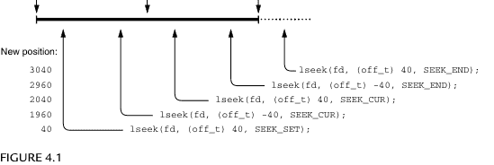

# 图 4.1
`lseek()` 的偏移量

相对于文件开头的负偏移量没有意义；它们会导致“无效参数”错误。

返回值是文件中的新位置。因此，若要了解你在文件中的位置，请执行以下操作：

```c
off_t curpos;
...
curpos = lseek(fd, (off_t) 0, SEEK_CUR);
```

`lseek()` 中的 `l` 代表 long。`lseek()` 是在 V7 Unix 中引入的，当时文件大小扩展了；V6 有一个简单的 `seek()` 系统调用。因此，许多旧文档（和代码）将偏移量参数视为 `long` 类型，并且除了转换为 `off_t` 外，在常量偏移量值后添加 L 后缀也很常见：

```c
curpos = lseek(fd, 0L, SEEK_CUR);
```

在使用标准 C 编译器的系统上，如果 `lseek()` 是用原型声明的，那么由于编译器会在它们类型不同时自动将 0L 从 `long` 提升为 `off_t`，因此这类旧代码仍可继续工作。

`lseek()` 一个有趣且重要的方面是，可以寻求超越文件末尾的位置。随后在该位置写入的任何数据都会进入文件，但在文件前末尾处的数据和新数据之间存在“间隙”或“空洞”。间隙中的数据读取时如同全为零。

下面的程序演示了空洞的创建。它在文件的开头、中间和远端写入三个结构体实例。所选的偏移量（第 16–18 行，每个结构的第三个元素）是任意的，但足以说明这一点：

```c
1 /* ch04-holes.c -- Demonstrate lseek() and holes in files. */
2
3 #include <stdio.h> /* for printf(), stderr, BUFSIZ */
4 #include <errno.h> /* declare errno */
5 #include <fcntl.h> /* for flags for open() */
6 #include <string.h> /* declare strerror() */
7 #include <unistd.h> /* for size_t */
8 #include <sys/types.h> /* for off_t, etc. */
9 #include <sys/stat.h> /* for mode_t */
10
11 struct person {
12     char name[10]; /* first name */
13     char id[10];   /* ID number */
14     off_t pos;     /* position in file, for demonstration */
15 } people[] = {
16     { "arnold", "123456789", 0 },
17     { "miriam", "987654321", 10240 },
18     { "joe", "192837465", 81920 },
19 };
20
21 int
22 main(int argc, char **argv)
23 {
24     int fd;
25     int i, j;
26
27     if (argc < 2) {
28         fprintf(stderr, "usage: %s file\n", argv[0]);
29         return 1;
30     }
31
32     fd = open(argv[1], O_RDWR|O_CREAT|O_TRUNC, 0666);
33     if (fd < 0) {
34         fprintf(stderr, "%s: %s: cannot open for read/write: %s\n",
35                 argv[0], argv[1], strerror(errno));
36         return 1;
37     }
38
39     j = sizeof(people) / sizeof(people[0]); /* count of elements */
```

第 27–30 行确保程序被正确调用。第 32–37 行打开指定名称的文件并验证打开是否成功。

第 39 行对数组元素计数 $j$ 的计算使用了一个漂亮且可移植的技巧：元素数量等于整个数组的大小除以第一个元素的大小。这种惯用方法的优点在于它始终正确：无论向此类数组添加或移除多少元素，编译器都会算出来。它也不需要终止的 *哨兵* 元素；也就是说，所有字段都设为零、NULL 或类似值的元素。

工作由一个循环完成（第 41-55 行），该循环寻求到每个结构中给出的字节偏移量（第 42 行），然后写出结构体（第 49 行）：

```c
41     for (i = 0; i < j; i++) {
42         if (lseek(fd, people[i].pos, SEEK_SET) < 0) {
43             fprintf(stderr, "%s: %s: seek error: %s\n",
44                     argv[0], argv[1], strerror(errno));
45             (void) close(fd);
46             return 1;
47         }
48
49         if (write(fd, &people[i], sizeof(people[i])) != sizeof(people[i])) {
50             fprintf(stderr, "%s: %s: write error: %s\n",
51                     argv[0], argv[1], strerror(errno));
52             (void) close(fd);
53             return 1;
54         }
55     }
56
57     /* all ok here */
58     (void) close(fd);
59     return 0;
60 }
```

运行该程序时，结果如下：

```bash
$ ch04-holes peopelost       *Run the program*
$ ls -ls peopelost           *Show size and blocks used*
  16  -rw-r--r--  1 arnold devel    81,944 Mar 23 17:43 peopelost
$ echo 81944 / 4096 | bc -l  *Show blocks if no holes*
20.0058593750000000000
```

我们恰好知道文件中的每个磁盘块使用 4096 字节。（如何得知这一点将在第 5.4.2 节“检索文件信息”第 141 页讨论。目前，暂且将其视为已知条件。）最后的 `bc` 命令表明，大小为 81,944 字节的文件需要 21 个磁盘块。然而，`ls` 的 `-ls` 选项，它告诉我们文件实际使用多少个块，显示该文件仅使用 16 个块。[3] 文件中缺失的块就是空洞。这在图 4.2 中进行了说明。

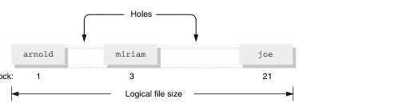

# 图 4.2
文件中的空洞

> **注意**
> `ch04-holes.c` 执行直接二进制 I/O。这很好地说明了随机访问 I/O 的美感：你可以将磁盘文件视为一个非常大的二进制数据结构数组。
> 
> 在实践中，使用二进制 I/O 存储实时数据是一个需要仔细考虑的设计决策。例如，假设你需要将数据迁移到使用不同字节序整数的系统？或者使用不同浮点格式的系统？或者是具有不同对齐要求的系统？忽视这些问题可能会变得非常昂贵。

### 4.6 创建文件

如前所述，`open()` 似乎只打开现有的文件。本节描述如何创建全新的文件。有两种选择：`creat()` 和带有额外标志的 `open()`。最初，`creat()` 是创建文件的唯一方式，但后来 `open()` 也增强了此功能。这两种机制都要求指定初始文件权限。

#### 4.6.1 指定初始文件权限

作为 GNU/Linux 用户，你熟悉由 `ls -l` 打印的文件权限：用户（文件所有者）、组和其他人的读、写和执行权限。各种组合通常用八进制表示，特别是对于 `chmod` 和 `umask` 命令。例如，文件权限 `rw-r--r--` 等同于八进制 0644，而 `-rwxr-xr-x` 等同于八进制 0755。（前导 0 是 C 的八进制值表示法。）

创建文件时，必须知道要赋予新文件的保护级别。如果你愿意，可以将其作为原始八进制数字执行，确实，在旧代码中经常看到此类数字。但是，最好使用来自 `<sys/stat.h>` 的一个或多个符号常数的按位 OR，如表 4.5 中所述。

# 表 4.5
POSIX 文件模式符号常数

| 符号常数 | 值 | 含义 |
| :--- | :--- | :--- |
| `S_IRWXU` | 00700 | 用户读、写和执行权限。 |
| `S_IRUSR` | 00400 | 用户读权限。 |
| `S_IREAD` | 同 `S_IRUSR`。 | |
| `S_IWUSR` | 00200 | 用户写权限。 |
| `S_IWRITE` | 同 `S_IWUSR`。 | |
| `S_IXUSR` | 00100 | 用户执行权限。 |
| `S_IEXEC` | 同 `S_IXUSR`。 | |
| `S_IRWXG` | 00070 | 组读、写和执行权限。 |
| `S_IRGRP` | 00040 | 组读权限。 |
| `S_IWGRP` | 00020 | 组写权限。 |
| `S_IXGRP` | 00010 | 组执行权限。 |
| `S_IRWXO` | 00007 | 其他人读、写和执行权限。 |
| `S_IROTH` | 00004 | 其他人读权限。 |
| `S_IWOTH` | 00002 | 其他人写权限。 |
| `S_IXOTH` | 00001 | 其他人执行权限。 |

下面的片段展示了如何创建表示权限 `-rw-r--` 和 `-rwxr-x-x`（分别为 0644 和 0755）的变量：

```c
mode_t rw_mode, rwx_mode;

rw_mode  = S_IRUSR | S_IWUSR | S_IRGRP | S_IROTH;   /* 0644 */
rwx_mode = S_IRWXU | S_IRGRP | S_IXGRP | S_IXOTH;   /* 0755 */
```

[3] 至少这三个块中的一部分包含我们写出的数据；其他块供操作系统用于跟踪数据所在位置。


早期代码使用 **S_IREAD**、**S_IWRITE** 和 **S_IEXEC** 配合位移运算来产生相同的结果：

```
mode_t   rw_mode, rwx_mode;

rwx_mode     = (S_IREAD|S_IWRITE)  | ((S_IREAD >> 3)  | (S_IREAD >> 6) ;  /* 0644 */
rw_mode      = (S_IREAD|S_IWRITE|S_IEXEC) |
((S_IREAD|S_IEXEC) >> 3) | ((S_IREAD|S_IEXEC) >> 6); /* 0755 */
```

不幸的是，这两种表示法都不够清晰。现代版本更受推崇，因为每个权限位都有自己的名称，且不太容易出错地进行按位操作。

表 4.6 中所示的额外权限位在修改文件权限时可以使用，但在最初创建文件时不应使用。是否允许包含这些位，因操作系统而异，差异很大。最好不要尝试；相反，你应该在文件创建后明确更改权限。（权限更改在第 5.5.2 节“更改权限：chmod() 和 fchmod()”，第 156 页中描述。这些位的含义在第 11 章“权限和用户及组 ID 号”，第 403 页中讨论。）

TABLE 4.6
文件模式的额外 POSIX 符号常量

| 符号常量 | 值 | 含义 |
| :-- | :-- | :-- |
| S_ISUID | 04000 | 设置用户 ID。 |
| S_ISGID | 02000 | 设置组 ID。 |
| S_ISVTX | 01000 | 保存文本。 |

当标准实用程序创建文件时，它们使用的默认权限是 `-rw-rw-rw-`（或 `0666`）。由于大多数用户更喜欢避免拥有所有用户可写的文件，每个进程都携带一个 *umask*。umask 是一组权限位，指示在新文件创建时永远不允许的那些位。（在更改权限时不使用 umask。）从概念上讲，发生操作是

```
actual_permissions = (requested_permissions & (~umask));
```

umask 通常在你登录时由 `$HOME`/`.profile` 中的 umask 命令设置。在 C 程序中，通过 umask( ) 系统调用设置：

```
POSIX
#include <sys/types.h>
#include <sys/stat.h>

mode_t umask (mode_t mask);
```

返回值为旧的 umask。因此，要确定当前掩码，必须将其设置为某个值，然后重置它（或按需要更改它）：

```
mode_t mask = umask(0);	/* 获取当前掩码 */
(void) umask(mask);		/* 恢复它 */
```

以下是 shell 层级下 umask 运行示例：

- $ umask *显示当前掩码*
- 0022
- $ touch newfile *创建一个文件*
- $ ls -l newfile *显示新文件的权限*
- -rw-r--r-- 1 arnold devel 0 Mar 24 15:43 newfile
- $ umask 0 *设置掩码为空*
- $ touch newfile2 *创建第二个文件*
- $ ls -l newfile2 *显示新文件的权限*
- -rw-rw-rw- 1 arnold devel 0 Mar 24 15:44 newfile2

#### 4.6.2 使用 creat() 创建文件

creat()⁴ 系统调用创建新文件。其声明如下：

```
POSIX
#include <sys/types.h>
#include <sys/stat.h>
#include <fcntl.h>

int creat (const char *pathname, mode_t mode);
```

mode 参数代表新文件的权限（如前一节所述）。由 pathname 命名的文件将被创建，带有经过 umask 修改的给定权限。它以写入方式打开（仅限写入），返回值是新文件的文件描述符，如果出现问题则为 -1。在这种情况下，errno 指示错误。如果文件已经存在，它在打开时将被截断。

在其他所有方面，creat() 返回的文件描述符与 open() 返回的相同；它们用于写入和定位，并且必须使用 close() 关闭。

```
int fd, count;

/* 为简洁起见省略错误检查 */
fd = creat("/some/newfile", 0666);
count = write(fd, "some data\n", 10);
(void) close(fd);
```

#### 4.6.3 重新审视 open()

你可能记得 open() 的声明：
`int open(const char *pathname, int flags, mode_t mode);`
以前，我们说过在打开文件进行普通 I/O 时，我们可以忽略 mode 参数。但看过 creat() 之后，你很可能猜到 open() 也可以用于创建文件，并且在这种情况下使用 mode 参数。这确实如此。

除了 O_RDONLY、O_WRONLY 和 O_RDWR 标志外，调用 open() 时还可以按位或运算额外的标志。POSIX 标准强制要求一系列这样的额外标志。表 4.7 列出了用于大多数普通应用程序的标志。

TABLE 4.7
open() 的额外 POSIX 标志

| 标志 | 含义 |
| :--- | :--- |
| O_APPEND | 强制所有写入发生在文件末尾。 |
| O_CREAT | 如果文件不存在则创建文件。 |
| O_EXCL | 与 O_CREAT 一起使用时，如果文件已存在则使 open() 失败。 |
| O_TRUNC | 如果文件存在则截断该文件（将其长度设为零）。 |

给定 O_APPEND 和 O_TRUNC，你可以想象 shell 如何打开或创建对应于 > 和 >> 运算符的文件。例如：

```
int fd;
extern char *filename;
mode_t mode = S_IRUSR|S_IWUSR|S_IXGRP|S_IWGRP|S_IROTH|S_IWOTH; /* 0666 */

fd = open(filename, O_CREAT|O_WRONLY|O_TRUNC, mode); /* 用于 > */
fd = open(filename, O_CREAT|O_WRONLY|O_APPEND, mode); /* 用于 >> */
```

请注意，这里不会使用 O_EXCL 标志，因为对于 > 和 >>，文件存在并不是错误。还要记住，系统会对请求的权限应用 umask。

此外，很容易看出，至少在概念上，*creat*() 可以这样轻松编写：

```
int creat(const char *path, mode_t mode)
{
    return open(path, O_CREAT|O_WRONLY|O_TRUNC, mode);
}
```

> 注意 如果文件使用 O_APPEND 打开，所有数据都将写入文件末尾，即使当前位置已通过 *lseek*() 重置。

现代系统提供了更多用途更专门的额外标志。表 4.8 简要描述了它们。

TABLE 4.8
*open*() 的额外高级 POSIX 标志

| 标志 | 含义 |
| :--- | :--- |
| O_NOCTTY | 如果打开的设备是终端，它不会成为进程的控制终端。（这是一个更高级的主题，在第 9.2.1 节，第 312 页中简要讨论。） |
| O_NONBLOCK | 在某些情况下禁用 I/O 操作的阻塞（参见第 9.4.3.4 节，第 333 页）。 |
| O_DSYNC | 确保写入文件的数据在 *write*() 返回之前完全到达物理存储。 |
| O_RSYNC | 确保 *read*() 将要读取的任何数据（可能已写入被读取的文件）在 *read*() 返回之前完全到达物理存储。 |
| O_SYNC | 与 O_DSYNC 类似，但还确保所有文件元数据（如访问时间）也已写入物理存储。 |

O_DSYNC、O_RSYNC 和 O_SYNC 标志需要一些解释。Unix 系统（包括 Linux）维护内部数据块缓存，称为 *缓冲缓存*（buffer cache）。当 *write*() 系统调用返回时，传递给操作系统的数据已被复制到缓冲缓存中的缓冲区。它们不一定被写回磁盘。

缓冲缓存提供了显著的性能提升：由于磁盘 I/O 通常比 CPU 和内存操作慢一个数量级甚至更多，如果程序必须等待每次写入都完全到达磁盘，它们会明显变慢。此外，如果数据最近已写入文件，随后读取同一数据时会发现信息已经在缓冲缓存中，可以立即返回，而无需等待 I/O 操作从磁盘读取。

Unix 系统还执行 *预读*（read-ahead）；由于大多数读取是顺序的，在读取一个块时，操作系统会读取几个连续的磁盘块，以便当程序请求时，这些信息已经在缓冲缓存中。如果多个程序读取同一文件，它们都受益，因为它们都将从缓冲缓存中该文件磁盘块的同一副本获取数据。

所有这些缓存都很棒，但当然没有免费的午餐。当数据在缓冲缓存中且尚未写入磁盘时，有一个很小但非常真实的灾难窗口；例如，如果电源故障。现代磁盘驱动器加剧了这个问题：许多磁盘驱动器拥有内部缓冲区，因此即使数据可能已到达驱动器，当电源故障时，它们可能尚未到达介质！对于不在具有受控电源的数据中心中，或者没有不间断电源（UPS）的小系统，这可能是一个重要问题。⁵

对于大多数应用程序，缓冲缓存中的数据可能意外丢失的可能性是可以接受的小。然而，对于一些应用程序，*任何*这样的可能性都是不可接受的。因此，Unix 系统引入了 *同步 I/O* 的概念，以此保证如果系统调用返回，数据已安全写入物理存储设备。

O_SYNC 标志保证数据完整性；数据和操作系统查找数据所需的任何其他信息都在 *write*() 返回之前写入磁盘。然而，元数据（如访问时间和修改时间）可能不会写入磁盘。O_SYNC 标志要求元数据在 *write*() 返回之前也写入磁盘。（这里同样没有免费的午餐；同步写入可能会严重影响程序性能，使其明显变慢。）

⁵ 如果你没有 UPS 并且使用系统进行关键工作，我们强烈建议投资购买一个。你也应该定期进行备份。


### 4.6 同步 I/O 标志

`O_RSYNC` 标志用于数据读取：如果 `read()` 在缓冲区缓存中发现了已安排写入磁盘的数据，那么 `read()` 将不会返回这些数据，直到它们被写入磁盘。其他两个标志可以影响这一行为：具体来说，`O_SYNC` 会导致 `read()` 等待直到文件元数据也被写出。

> **注意** 从内核版本 2.4 开始，Linux 将这三个标志视为相同，基本含义等同于 `O_SYNC`。此外，Linux 定义了其他额外的、特定于 Linux 的标志，旨在用于专门用途。请查阅 GNU/Linux 的 `open(2)` 手册页以获取更多信息。

### 4.7 强制数据写入磁盘

前面，我们描述了用于 `open()` 的 `O_DSYNC`、`O_RSYNC` 和 `O_SYNC` 标志。我们指出，使用这些标志可能会使程序变慢，因为每次 `write()` 都要等到所有数据都被写入物理介质后才返回。

在风险稍高的情况下，我们既可以拥有一份蛋糕又吃完它。我们通过打开文件时不使用任何一个 `O_xSYNC` 标志，然后在需要将数据安全地移动到物理存储时，使用以下两个系统调用之一来实现这一目标：

```c
#include <unistd.h>
int fsync(int fd);                          /* POSIX FSC */
int fdatasync(int fd);                       /* POSIX SIO */
```

`fdatasync()` 系统调用类似于 `O_DSYNC`：它强制将所有文件数据写入最终物理设备。`fsync()` 系统调用类似于 `O_SYNC`，不仅强制文件数据，还强制文件元数据写入物理存储。`fsync()` 调用具有更好的可移植性；它在 Unix 世界中存在的时间更长，并且更可能存在于广泛的系统中。

你可以先调用 `fflush()`，然后使用 `fileno()` 获取底层文件描述符，从而将这些调用与 `<stdio.h>` 文件指针一起使用。下面是一个 `fsync()` 函数，可用于将这两个操作封装在一次调用中。成功时它返回 0：

```c
/* fgsync -- 同步 stdio FILE * 变量 */
int fgsync (FILE *fp)
{
    if (fp == NULL || fflush(fp) == EOF || fdatasync(fileno(fp)) < 0)
        return -1;
    return 0;
}
```

从技术上讲，这两个调用都是对基础 POSIX 标准的扩展：`fdatasync()` 位于“文件同步”扩展（FSC）中，而 `fdatasync()` 位于“同步输入和输出”扩展中。尽管如此，你可以在 GNU/Linux 系统上毫无问题地使用它们。

### 4.8 设置文件长度

两个系统调用使得调整文件大小成为可能：

```c
#include <unistd.h>
#include <sys/types.h>
int truncate (const char *path, off_t length);   /* XSI */
int ftruncate (int fd, off_t length);   /* POSIX */
```

从参数中应该显而易见，`truncate()` 接受一个文件名参数，而 `ftruncate()` 则作用于一个打开的文件描述符。（对于按文件名或文件描述符工作的系统调用对，使用 `xxx()` 和 `fxxx()` 的命名约定很常见。我们在本章及后续章节中会看到几个例子。）对于这两种调用，`length` 参数都是文件的新大小。

这个系统调用起源于 4.2 BSD Unix，在早期系统中只能用于缩短文件长度，因此得此名称。（它的创建是为了简化 Fortran 中 `truncate` 操作的实现。）在现代系统（包括 Linux）中，这个名称实际上是一个误称，因为使用这些调用不仅可以缩短文件，还可以扩展文件长度。（不过，POSIX 指出扩展文件的能力是一个 XSI 扩展。）

对于这些调用，被截断的文件必须具有写权限（对于 `truncate()`），或者是以写模式打开的（对于 `ftruncate()`）。如果文件被缩短，超出新文件结尾的任何数据都会丢失。（因此，你不能缩短文件，再次延长它，并期望找到原始数据。）如果文件被扩展，就像在 `lseek()` 之后写入数据一样，旧文件结尾和新文件结尾之间的数据读取时为零。

这些调用与 `open(file, ..., O_TRUNC, mode)` 有很大不同。后者完全截断文件，丢弃其所有数据。这些调用只是将文件的绝对长度设置为给定的值。

这些函数相当专业化；在所有的 GNU Coreutils 代码中，它们只被使用了四次。我们在第 5.5.3 节“更改时间戳：`utime()`”，第 157 页，展示了一个 `ftruncate()` 的使用示例。

### 4.9 总结

- 当系统调用失败时，通常返回 −1，并且全局变量 `errno` 会被设置为指示问题的预定义值。`perror()` 和 `strerror()` 函数可用于报告错误。
- 文件通过称为文件描述符的小整数来操作。标准输入、标准输出和标准错误的文件描述符继承自程序的父进程。其他的通过 `open()` 或 `creat()` 获取。它们通过 `close()` 关闭，而 `getdtablesize()` 返回允许打开的最大文件数。`umask` 的值（通过 `umask()` 设置）会影响通过 `creat()` 创建的或 `open()` 使用 `O_CREAT` 标志创建的新文件的权限。
- `read()` 和 `write()` 系统调用分别用于读取和写入数据。它们的接口很简单。特别是，它们不对数据做任何解释；文件是字节的线性流。`lseek()` 系统调用提供随机访问 I/O：在文件内移动的能力。
- `open()` 的额外标志提供同步 I/O，这意味着在 `write()` 或 `read()` 返回之前，数据必须完全到达物理存储介质。也可以使用 `fsync()` 或 `fdatasync()` 以受控的方式强制将数据写入磁盘。
- `truncate()` 和 `ftruncate()` 系统调用设置文件的绝对长度。（在旧系统中，它们只能用于缩短文件；在现代系统中，它们也可以扩展文件。）

### 练习

1. 仅使用 `open()`、`read()`、`write()` 和 `close()`，编写一个简单的复制程序，将文件名为其第一个参数的文件复制到文件名为其第二个参数的文件。
2. 增强 `copy` 程序，使其接受“-”作为第一个参数时表示“标准输入”，作为第二个参数时表示“标准输出”。`copy - -` 能正确工作吗？
3. 在 GNU/Linux 系统上查看 `proc`(5) 手册页。特别是 `fd` 子部分。执行 `ls -l /dev/fd` 并直接检查 `/proc/self/fd` 中的文件。如果 `/dev/stdin` 及其类似物在 Unix 的早期版本中就存在，V7 `cat` 程序的代码会如何简化？（许多其他现代 Unix 系统也有 `/dev/fd` 目录或文件系统。如果你没有使用 GNU/Linux，请看看你能关于你的 Unix 版本发现什么。）
4. 尽管你目前还不理解，请尝试将 V7 `cat.c` 中使用 `struct stat` 和 `fstat()` 函数的代码段复制到 `ch04-cat.c` 中，以便它也能对 `cat file >> file` 报告错误。
5. （简单。）假设 `strerror()` 存在，编写你自己的 `perror()` 版本。
6. 在你的系统上 `ulimit -n` 的结果是什么？
7. 编写一个简单的名为 `mymask` 的 `umask` 程序，它在命令行接受八进制掩码。使用基数为 8 的 `strtol()` 将命令行参数的字符串转换为整数值。使用 `umask()` 系统调用将 `umask` 更改为新掩码。
   编译并运行 `mymask`，然后使用常规的 `umask` 命令检查 `umask` 的值。解释结果。（提示：在 Bash 中，输入 `type umask`。）
8. 更改你之前编写的简单 `copy` 程序，使其使用带有 `O_SYNC` 标志的 `open()`。使用 `time` 命令，在大型文件上比较原始版本和新版本的性能。
9. 对于 `ftruncate()`，我们说文件必须是以写模式打开的。当文件本身没有写权限时，文件如何能以写模式打开？
10. 编写一个 `truncate` 程序，其用法为 `truncate file length`。


# 第 5 章


### 本章内容

- 5.1 考虑目录内容 第 118 页
- 5.2 创建和删除目录 第 130 页
- 5.3 读取目录 第 132 页
- 5.4 获取文件信息 第 139 页
- 5.5 更改所有权、权限和修改时间 第 155 页
- 5.6 摘要 第 162 页
- 练习 第 163 页

本章继续沿着学习曲线攀升，迈向下一个平台期：理解目录和关于文件的信息。

在本章中，我们将探索文件信息是如何存储在目录中的，目录本身是如何被读取、创建和删除的，有哪些关于文件的信息可供使用，以及如何检索这些信息。最后，我们将探索更新文件元数据的其他方法，例如所有者、组、权限以及访问和修改时间。

## 5.1 考虑目录内容

所有 Unix 系统，包括 Linux，都使用相同的概念设计来存储磁盘上的文件信息。尽管设计的具体实现存在相当大的差异，但 C 语言级别的接口保持一致，这使得编写可在许多不同系统上编译和运行的可移植程序成为可能。

### 5.1.1 定义


Copyright 1997-2004 © J.D. “Illiad” Frazer

Used with permission. http://www.userfriendly.org

我们首先通过定义一些术语来开始讨论。

#### *分区（Partition）*

物理存储的基本单位。*物理分区*通常是磁盘的一部分或整个磁盘。现代系统允许从多个物理分区创建*逻辑分区*。

#### *文件系统（Filesystem）*

包含文件数据和*元数据*的分区（物理或逻辑），元数据是关于文件的信息（相对于文件内容，即文件*内部*的信息）。这些元数据包括文件所有权、权限、大小等，以及操作系统用于定位文件内容的信息。

你通过将标准信息写入分区中，将文件系统放置在分区“内”（一一对应关系）。这是通过用户级程序完成的，例如 GNU/Linux 中的 *mke2fs* 或 Unix 中的 *newfs*。（Unix 的 *mkfs* 命令可以创建分区，但直接使用较难操作。*newfs* 调用它时使用正确的参数。如果你的系统是 Unix 系统，请参见 *nufsi*(8) 和 *mkfi*(8) 的手册页以了解详细信息。）

在大多数情况下，GNU/Linux 和 Unix 隐藏了文件系统和分区的存在。（更多细节在第 8.1 节“挂载和卸载文件系统”中给出，第 228 页）。所有访问都通过路径名进行，而不引用文件所在的磁盘。（这与几乎其他所有商业操作系统（如 OpenVMS）或 Microsoft 系统的默认行为形成对比。）

#### *inode*

“索引节点”的缩写，最初简写为“i-node”，现在写作“inode”。它是一个小块信息，描述了关于文件的所有内容，*除了*文件名称。inode 的数量，从而也是每个文件系统中唯一文件的数量，在文件系统创建时设定并永久固定。`df -i` 可以告诉你拥有多少个 inode 以及使用了多少个。

#### *设备（Device）*

在文件、文件系统和文件元数据的上下文中，设备号是一个代表正在使用（“已挂载”）文件系统的唯一数字。（设备，inode）对*唯一*地标识文件：两个不同的文件保证具有不同的（设备，inode）对。本章稍后会更详细地讨论这一点。

#### *目录（Directory）*

一种特殊文件，包含（inode 号，名称）对的列表。目录可以被打开用于读取，但不能用于写入；操作系统负责更改目录的所有内容。

从概念上讲，每个磁盘块包含一定数量的 inode，或者包含文件数据。反过来，inode 包含指向包含文件数据的块的指针。见图 5.1。

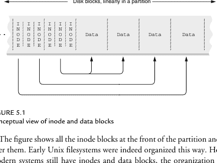

该图显示了分区前部的所有 inode 块以及随后的数据块。早期的 Unix 文件系统确实是这样组织的。然而，虽然所有现代系统仍然具有 inode 和数据块，但为了提高效率和健壮性，组织方式已经改变。细节因系统而异，即使在 GNU/Linux 系统中也有多种类型的文件系统，但概念是相同的。

### 5.1.2 目录内容

目录建立了文件名和 inode 之间的联系。目录项包含 inode 号和文件名。它们还包含额外的簿记信息，这些信息在这里不感兴趣。见图 5.2。

早期的 Unix 系统使用两字节的 inode 号和最多 14 字节的文件名。这里是 */usr/include/sys/dir.h* 的全部内容。


**图 5.2**
概念上的目录内容

```c
#ifndef DIRSIZ
#define DIRSIZ 14
#endif
struct direct
{
    ino_t d_ino;
    char d_name[DIRSIZ];
};
```

`ino_t` 在 V7 的 <sys/types.h> 中定义为 `typedef unsigned int ino_t;`。由于 PDP-11 的 int 是 16 位，因此 ino_t 也是。这种组织使得直接读取目录变得容易；由于项的大小是固定的，代码很简单。（唯一需要注意的是，完整的 14 字符 d_name 没有 NUL 终止符。）

目录内容管理对系统来说也很简单。当从目录中删除文件时，系统用二进制零替换 inode 号，表示目录中的该“插槽”未使用。新文件然后可以重用这个空槽。这有助于保持目录文件本身的大小在合理范围内。（按照惯例，inode 号 1 未使用；inode 号 2 总是第一个可用的 inode。更多细节在第 8.1 节“挂载和卸载文件系统”中提供，第 228 页。）

现代系统提供长文件名。每个目录项的长度是可变的，文件名组件的通用限制为 255 字节。稍后，我们将展示如何在现代系统上读取目录的内容。现代系统还提供 32 位（甚至 64 位）的 inode 号。

### 5.1.3 硬链接

当使用 `open()` 或 `creat()` 创建文件时，系统找到一个未使用的 inode 并将其分配给新文件。它为该文件创建目录项，其中包含文件名和 inode 号。`ls` 的 `-i` 选项显示 inode 号：

```bash
$ echo hello, world > message				# 创建新文件
$ ls -il message					# 也显示 inode 号
228786 -rw-r--r--  1 arnold devel  13 May 4 15:43 message
```

由于目录项将文件名与 inode 关联，因此一个文件可以拥有多个名称。每个指向同一 inode 的目录项都称为该文件的链接，或硬链接。使用 `ln` 命令创建链接。用法为 `ln oldfile newfile`：

```bash
$ ln message msg					# 创建一个链接
$ cat msg					# 显示新名称的内容
hello, world
$ ls -il msg message				# 显示 inode 号
228786 -rw-r--r--  2 arnold devel  13 May 4 15:43 message
228786 -rw-r--r--  2 arnold devel  13 May 4 15:43 msg
```

输出显示两个文件的 inode 号相同，长输出中的第三个字段现在是 2。这个字段是*链接计数*，它报告文件有多少个链接（指向该 inode 的目录项）。

再怎么强调也不为过：*硬链接都指向同一个文件*。如果你修改了一个，你就修改了其他所有：

```bash
$ echo "Hi, how ya doin' ?" > msg		# 通过新名称修改文件
$ cat message					# 通过旧名称显示内容
Hi, how ya doin' ?
$ ls -il message msg				# 显示信息。大小已更改
228786 -rw-r--r--  2 arnold devel  19 May 4 15:51 message
228786 -rw-r--r--  2 arnold devel  19 May 4 15:51 msg
```

尽管我们在单个目录中为同一文件创建了两个链接，但硬链接并不局限于在同一目录中；它们可以在同一文件系统上的任何其他目录中。（这在第 5.1.6 节“符号链接”中稍有讨论，第 128 页。）

此外，只要你在创建链接的目录中拥有写入权限，你就可以创建一个指向你不拥有的文件的链接。（这样的文件保留原文件的所有属性：所有者、权限等。这是因为它*就是*原文件；它只是获得了一个额外的名称。）用户级代码不能创建指向目录的硬链接。


一旦删除了链接，使用与原始文件相同的名称创建新文件会生成一个新文件：

```bash
$ rm message                    # 删除旧名称
$ echo "What's happenin'?" > message   # 重用名称
$ ls -l1 msg message             # 显示信息
228794 -rw-r--r-- 1 arnold devel 17 May 4 15:53 message
228786 -rw-r--r-- 1 arnold devel 19 May 4 15:51 msg
```

注意，现在这两个文件的链接计数都等于 1。

在 C 语言层面，链接是通过 `link()` 系统调用创建的：

```c
#include <unistd.h>                    /* POSIX */

int link(const char *oldpath, const char *newpath);
```

如果链接成功创建，返回值将是 0，否则为 -1，此时 `errno` 将反映具体的错误。一个重要的失败情况是 `newpath` 已经存在。系统不会为你删除它，因为尝试这样做可能会导致文件系统的不一致。

### 5.1.3.1 GNU `link` 程序

`ln` 程序复杂且庞大。然而，GNU Coreutils 包含一个简单的 `link` 程序，它只是调用其前两个参数的 `link()`。以下示例展示了 `link.c` 的代码，其中删除了一些无关部分。行号对应实际文件中的行。

```c
20   /* 实现概览：
21
22     简单调用系统 'link' 函数 */
23   ... 省略了 #include 语句以简洁 ...
34
35   /* 此程序的官方名称（例如，没有 `g' 前缀）。 */
36   #define PROGRAM_NAME "link"
37
38   #define AUTHORS "Michael Stone"
39
40   /* 运行此程序时使用的名称。 */
41   char *program_name;
42
43   void
44   usage (int status)
45   {
     ... 省略以简洁 ...
62   }
63
64
65   int
66   main (int argc, char **argv)
67   {
68     program_name = argv[0];
69     setlocale (LC_ALL, "");
70     bindtextdomain (PACKAGE, LOCALEDIR);
71     textdomain (PACKAGE);
72
73     atexit (close_stdout);
74
75     parse_long_options (argc, argv, PROGRAM_NAME, GNU_PACKAGE, VERSION,
76                          AUTHORS, usage);
77
78     /* 上述代码处理 --help 和 --version。
79        由于没有其他 getopt 调用，这里处理 "---"。 */
80     if (1 < argc && STREQ (argv[1], "---"))
81       {
82         --argc;
83         ++argv;
84       }
85
86     if (argc < 3)
87       {
88         error (0, 0, _("too few arguments"));
89         usage (EXIT_FAILURE);
90       }
91
92     if (3 < argc)
93       {
94         error (0, 0, _("too many arguments"));
95         usage (EXIT_FAILURE);
96       }
97
98     if (link (argv[1], argv[2]) != 0)
99       error (EXIT_FAILURE, errno, _("cannot create link %s to %s"),
100              quote_n (0, argv[2]), quote_n (1, argv[1]));
101
102     exit (EXIT_SUCCESS);
103   }
```

第 67–75 行是典型的 Coreutils 样板代码，用于设置国际化、退出时的最终操作以及解析参数。第 79–95 行确保调用 `link` 时只有两个参数。`link()` 系统调用本身发生在第 97 行。（`quote_n()` 函数以适合当前区域设置的风格对参数进行引号包裹；细节在这里并不重要。）

### 5.1.3.2 点和双点

作为对链接讨论的总结，让我们看看 `.` 和 `..` 这些特殊名称是如何管理的。它们实际上只是硬链接。在第一种情况下，`.` 是包含它的目录的硬链接，而 `..` 是父目录的硬链接。操作系统为你创建这些链接；如前所述，用户级代码无法创建指向目录的硬链接。以下示例说明了这些链接：

```bash
$ pwd
/tmp
$ ls -ldi /tmp
225345 drwxrwxrwt 14 root root 4096 May 4 16:15 /tmp
$ mkdir x
$ ls -ldi x
52794 drwxr-xr-x 2 arnold devel 4096 May 4 16:27 x
$ ls -ldi x/ ..
52794 drwxr-xr-x 2 arnold devel 4096 May 4 16:27 x/
225345 drwxrwxrwt 15 root root 4096 May 4 16:27 ../
```

根目录的父目录（`..`）是一个特殊情况；我们将推迟到第 8 章“文件系统和目录遍历”，第 227 页再讨论它。

### 5.1.4 文件重命名

鉴于目录项将名称映射到 inode 编号的方式，重命名文件在概念上相当简单：

- 如果文件的新名称指向一个现有文件，先删除现有的文件。
- 使用新名称创建到该文件的新链接。
- 删除文件的旧名称（链接）。（删除名称将在下一节中讨论。）

早期的 `mv` 命令就是按这种方式工作的。然而，以这种方式操作时，文件重命名不是原子的；也就是说，它不是在一个不可中断的操作中完成的。而且，在负载较重的系统上，恶意用户可能会利用竞态条件，¹破坏重命名操作并用不同的文件替换原始文件。

> ¹ 竞态条件是指细节上的时间差异可能会产生非预期的副作用或 bug 的情况。在此情况下，目录在短暂时间内处于不一致状态，正是这种不一致性引入了漏洞。

因此，4.2 BSD 引入了 `rename()` 系统调用：

```c
#include <stdio.h>            /* ISO C */
int rename(const char *oldpath, const char *newpath);
```

在 Linux 系统上，重命名操作是原子的；man 手册页指出：

> 如果 `newpath` 已经存在，它将被原子替换……因此不存在另一个进程尝试访问 `newpath` 时会发现其缺失的时刻。

如果 `newpath` 存在但操作因某种原因失败，`rename` 保证会保留 `newpath` 的一个实例。

然而，在覆盖时，很可能会有一个窗口期，此时 `oldpath` 和 `newpath` 都指向正在重命名的文件。

与其他系统调用一样，返回 `0` 表示成功，返回 `-1` 表示错误。

### 5.1.5 文件删除

删除文件意味着移除目录中该文件的条目并递减文件的链接计数（在 inode 中维护）。文件内容以及持有这些内容的磁盘块只有在链接计数达到零时才会被释放。

该系统调用名为 `unlink()`：

```c
#include <unistd.h>        /* POSIX */
int unlink(const char *pathname);
```

根据我们对文件链接的讨论，这个名字很有道理；此调用移除文件给定的链接（目录项）。它在成功时返回 `0`，在错误时返回 `-1`。

删除文件的能力只需要对目录的写权限，而不需要对文件本身的写权限。这一事实可能会让人困惑，尤其是对于新的 Linux/Unix 用户。然而，既然该操作是针对目录的，这也就说得通；被修改的是目录内容，而不是文件内容。²

> ² 的确，文件的*元数据*发生了变化（链接数量），但这不影响任何其他文件属性，也不影响文件内容。更新链接计数是文件唯一不涉及检查文件权限的操作。

#### 5.1.5.1 删除打开的文件

自 Unix 早期以来，删除已打开的文件一直是可能的。只需在成功调用 `open()` 或 `creat()` 后，使用文件名调用 `unlink()` 即可。

乍一看，这似乎是一件奇怪的事。既然系统在文件的链接计数变为零时释放数据块，那么是否还能使用打开的文件呢？

答案是肯定的，你可以继续正常使用打开的文件。系统知道文件是打开的，因此它会延迟释放文件的存储空间，直到该文件上的最后一个文件描述符关闭。一旦文件完全不再使用，存储空间就会被释放。

这种操作碰巧也是有用的：它是程序获取临时文件存储的一种简单方法，这种存储保证是私有的，并且在不再需要时会自动释放：

```c
/* 获取私有临时存储，为简洁省略了错误检查 */
int fd;
mode_t mode = O_CREAT|O_EXCL|O_TRUNC|O_RDWR;

fd = open("/tmp/myfile", mode, 0000);    /* 打开文件 */
unlink("/tmp/myfile");                   /* 删除它 */

... 继续使用文件 ...

close(fd);                                /* 关闭文件，释放存储 */
```

这种方法的一个缺点是，失控的应用程序也可能通过一个打开的匿名文件填满文件系统，在这种情况下，系统管理员必须试图找到并终止该进程。在过去，可能需要重启并进行文件系统一致性检查；幸运的是，这在现代系统上极为罕见。

#### 5.1.5.2 使用 ISO C：`remove()`

ISO C 提供了 `remove()` 函数用于删除文件；这是一个通用函数，旨在可用于任何支持 ISO C 的系统，而不仅仅是 Unix 和 GNU/Linux：

```c
#include <stdio.h>    /* ISO C */
int remove(const char *pathname);
```

虽然严格来说它不是系统调用，但其返回值风格相同：成功时为 0，错误时为 -1，并由 `errno` 反映具体值。


在 GNU/Linux 上，`remove()` 使用 `unlink()` 系统调用删除文件，并使用 `rmdir()` 系统调用（本章稍后讨论）删除目录。（在较旧的、不使用 glibc 的 GNU/Linux 系统上，`remove()` 是 `unlink()` 的别名；这在目录上会失败。如果你有这类系统，最好升级它。）

## 5.1.6 符号链接

本章从讨论分区、文件系统和 inode 开始。我们还看到目录条目将名称与 inode 号关联起来。由于目录条目不包含其他信息，硬链接仅限于同一*文件系统*内的文件。这是必须的；没有办法区分一个文件系统中的 inode 2341 和另一个文件系统中的 inode 2341。以下是我们尝试时会发生的情况：

```bash
$ mount                                   *Show file systems in use*
/dev/hda2 on / type ext3 (rw)
/dev/hda5 on /d type ext3 (rw)
...
$ ls -li /tmp/message                   *Earlier example was on file system for /d*
228708 -rw-r--r-- 2 arnold  devel  19 May  4 15:51 /tmp/message
$ cat /tmp/message
Hi, how ya doin' ?
$ ls /bin/pwd                            *Current directory is on a different file system*
/d/home/arnold
$ ln /tmp/message .
Attempt the link
ln: creating hard link `./message' to `/tmp/message': Invalid cross-device link
```

大型系统通常有许多分区，既包括物理连接在本地磁盘上的分区，也包括远程挂载的网络文件系统。硬链接限于同一文件系统的这一限制带来不便，例如，如果某些文件或目录必须移到新位置，但旧软件使用了针对旧位置的硬编码文件名。

为了绕过这一限制，4.2 BSD 引入了*符号链接*。符号链接（也称为*软链接*）是一种特殊类型的文件（就像目录是一种特殊类型的文件一样）。文件的内容是被“指向”的文件的*路径名*。所有现代 Unix 系统，包括 Linux，都提供符号链接；事实上，它们现在是 POSIX 的一部分。

符号链接可以指向系统中的任何文件。它们也可以指向目录。这使得在地点之间移动目录变得很容易，只需在原始位置留下一个指向新位置的符号链接即可。

当处理文件名时，系统会注意到符号链接，并改为对目标文件或目录执行操作。使用 `ln` 的 `-s` 选项创建符号链接：

```bash
$ /bin/pwd
/home/arnold
$ ln -s /tmp/message ./.hello
$ cat .hello
Hi, how ya doin’ ?
$ ls -l hello
lrwxrwxrwx 1 arnold    12 May 4 16:41 hello -> /tmp/message
```

链接指向的文件不一定需要存在。系统会在运行时检测这种情况并做出相应的处理：

```bash
$ rm /tmp/message
$ cat .hello
cat: ./.hello: No such file or directory
$ echo hi again > hello
$ ls -l
-rw-r--r-    1 arnold    9 May 4 16:45 /tmp/message
$ cat /tmp/message
hi again
```

使用 `symlink( )` 系统调用创建符号链接：

```c
#include <unistd.h>
int symlink(const char *oldpath, const char *newpath);
```

`oldpath` 参数指定被指向的文件或目录的名称，而 `newpath` 是要创建的符号链接的名称。成功时返回值为 0，出错时为 -1；请参阅 `symlink(2)` 的手册页了解可能的 `errno` 值。

符号链接有其缺点：

- 它们占用额外的磁盘空间，需要单独的 inode 和数据块。硬链接只占用一个目录槽位。
- 它们增加了开销。内核需要更努力地解析包含符号链接的路径名。
- 它们可能会引入“循环”。考虑以下情况：

```bash
$ rm -f a b
$ ln -s a b
$ ln -s b a
$ cat a
cat: a: Too many levels of symbolic links
```

内核必须能够检测这种情况并产生错误消息。

- 它们很容易失效。如果你将目标文件移动到不同的位置或重命名它，符号链接就不再有效了。硬链接不会发生这种情况。

## 5.2 创建和删除目录

创建和删除目录很简单。不出所料，这两个系统调用分别是 `mkdir()` 和 `rmdir()`：

```c
#include <sys/types.h>          POSIX
#include <sys/stat.h>

int mkdir(const char *pathname, mode_t mode);
```

```c
#include <unistd.h>             POSIX

int rmdir(const char *pathname);
```

两者在成功时都返回 0，出错时返回 −1，并适当设置 `errno`。对于 `mkdir()`，`mode` 参数代表应用于目录的权限。它与第 4.6 节“创建文件”第 106 页中讨论的 `creat()` 和 `open()` 的 `mode` 参数完全类似。

两个函数都处理正在创建或删除目录中的 `.` 和 `..`。在目录可以被删除之前，它必须是空的；如果目录不为空，`errno` 会被设置为 ENOTEMPTY。（在这种情况下，“空”意味着目录仅包含 `.` 和 `..`。）

新目录，像所有文件一样，都会被分配一个组 ID 号。不幸的是，这如何工作很复杂。我们将讨论推迟到第 11.5.1 节“新文件和目录的默认组”，第 412 页。

两个函数*一次只处理一个目录级别*。如果 `/somedir` 存在且 `/somedir/sub1` 不存在，则 `mkdir("/somedir/sub1/sub2")` 会失败。长路径名中的每个组件都必须单独创建（因此 `mkdir` 有 −p 选项，参见 `mkdir(1)`）。

此外，如果 pathname 以 / 字符结尾，`mkdir()` 和 `rmdir()` 在某些系统上会失败，而在其他系统上会成功。下面的程序 `ch05-trymkdir.c` 演示了这两个方面。

```c
/* ch05-mkdir.c ---  Demonstrate mkdir() behavior.
    Courtesy of Nelson H.F. Beebe. */

#include <stdio.h>
#include <stdlib.h>
#include <errno.h>

#ifndef EXIT_SUCCESS
#define EXIT_SUCCESS 0
#endif

void do_test(const char *path)
{
    int retcode;

    errno = 0;
    retcode = mkdir(path, 0755);
    printf("mkdir(\"%s\") returns %d: errno = %d [%s]\n",
        path, retcode, errno, strerror(errno) );
}

int main(void)
{
    do_test("/tmp/t1/t2/t3/t4");
    do_test("/tmp/t1/t2/t3");
    do_test("/tmp/t1/t2");
    do_test("/tmp/t1");

    do_test("/tmp/u1");
    do_test("/tmp/u1/u2");
    do_test("/tmp/u1/u2/u3");
    do_test("/tmp/u1/u2/u3/u4");

    do_test("/tmp/v1/");
    do_test("/tmp/v1/v2/");
    do_test("/tmp/v1/v2/v3/");
    do_test("/tmp/v1/v2/v3/v4/");

    return (EXIT_SUCCESS);
}
```

以下是 GNU/Linux 下的结果：

```bash
$ ch05+mkdir
mkdir("/tmp/t1/t2/t3/t4") returns -1: errno = 2 [No such file or directory]
mkdir("/tmp/t1/t2/t3") returns -1: errno = 2 [No such file or directory]
mkdir("/tmp/t1/t2") returns -1: errno = 2 [No such file or directory]
mkdir("/tmp/t1") returns 0: errno = 0 [Success]
mkdir("/tmp/u1") returns 0: errno = 0 [Success]
mkdir("/tmp/u1/u2") returns 0: errno = 0 [Success]
mkdir("/tmp/u1/u2/u3") returns 0: errno = 0 [Success]
mkdir("/tmp/u1/u2/u3/u4") returns 0: errno = 0 [Success]
mkdir("/tmp/v1/") returns 0: errno = 0 [Success]
mkdir("/tmp/v1/v2/") returns 0: errno = 0 [Success]
mkdir("/tmp/v1/v2/v3/") returns 0: errno = 0 [Success]
mkdir("/tmp/v1/v2/v3/v4/") returns 0: errno = 0 [Success]
```

注意 GNU/Linux 接受尾部斜杠。并非所有系统都这样。

## 5.3 读取目录

在原始的 Unix 系统上，读取目录内容很容易。程序使用 `open()` 打开目录并直接读取二进制的 struct direct 结构，每次 16 个字节。以下代码片段来自 V7 `rmdir` 程序⁵的第 60–74 行。它展示了检查目录是否为空的逻辑。

```c
60	if (fd = open(name,0)) < 0) {
61		fprintf(stderr, "rmdir: %s unreadable\n", name);
62		++Errors;
63		return;
64	}
65	while(read(fd, (char *)&dir, sizeof dir) == sizeof dir) {
66		if(dir.d_ino == 0) continue;
67		if(!strcmp(dir.d_name, ".") || !strcmp(dir.d_name, ".."))
68			continue;
69		fprintf(stderr, "rmdir: %s not empty\n", name);
70		++Errors;
71	close(fd);
72		return;
73	}
74	close(fd);
```

第 60 行以只读方式打开目录（第二个参数为 0，等同于 O_RDONLY）。第 65 行读取 struct direct。第 66 行检查空的目录槽位；即 inode 号为 0 的槽位。第 67 行和第 68 行检查 `.` 和 `..`。到达第 69 行时，我们知道已经看到了其他文件名，因此，该目录不为空。

> （测试 `!strcmp(s1, s2)` 是 `strcmp(s1, s2) == 0` 的简写形式；即测试字符串是否相等。值得注意的是，我们认为 `!strcmp(s1, s2)` 的形式是不良风格。正如 Henry Spencer 曾经说过的：“`strcmp()` 不是布尔值！”）


## 5.3 读取目录

当 4.2 BSD 引入了一种允许更长的文件名并提供了更好性能的文件系统格式时，它还引入了一系列新函数以提供目录读取的抽象。无论底层文件系统和目录组织如何，这套函数都可以使用。其基本部分已由 POSIX 标准化，使用它的程序在 GNU/Linux 和 Unix 系统之间具有可移植性。

### 5.3.1 基本目录读取

目录项由 `struct dirent` 结构体表示（与 V7 的 `struct direct` 不同）：

```
struct dirent {
    ...
    ino_t d_ino;        /* XSI 扩展 --- 参见正文 */
    char d_name[...];  /* 参见正文关于此数组大小的说明 */
    ...
};
```

为了可移植性，POSIX 仅指定了 `d_name` 字段，它是一个以零结尾的字节数组，表示目录项的文件名部分。除说明终止零之前最多可能有 `NAME_MAX` 个字节外，标准并未规定 `d_name` 的大小。（`NAME_MAX` 定义在 `<limits.h>` 中。）POSIX 的 XSI 扩展提供了 `d_ino` inode 数字段。

实际上，由于文件名长度可变，且 `NAME_MAX` 通常相当大（例如 255），`struct dirent` 包含额外的成员，以辅助记录磁盘上变长目录项的详细信息。这些额外成员对于日常代码并不重要。

以下函数提供了目录读取接口：

```
#include <sys/types.h>			POSIX
#include <dirent.h>

DIR *opendir(const char *name);		打开目录以供读取
struct dirent *readdir(DIR *dir);		每次返回一个 struct dirent
int closedir(DIR *dir);			关闭已打开的目录
void rewinddir(DIR *dirp);		返回目录的开头
```

`DIR` 类型类似于 `<stdio.h>` 中的 `FILE` 类型。它是一个不透明类型，意味着应用程序代码不应知道其内部是什么；其内容供其他目录例程使用。如果 `opendir()` 返回 `NULL`，则表明指定的目录无法打开以供读取，并且 `errno` 会被设置以指示错误。

一旦你拥有一个打开的 `DIR *` 变量，就可以使用它来获取指向下一个目录项的 `struct dirent` 的指针，`readdir()` 在文件结束或出错时返回 `NULL`。

最后，`closedir()` 类似于 `stdio.h` 中的 `fclose()` 函数；它关闭打开的 `DIR *` 变量。`rewinddir()` 函数可用于从目录的开头重新开始。

掌握了这些例程（或者至少在 C 库中），我们可以编写一个简单的 `catdir` 程序来“输出”目录的内容。这样一个程序展示在 `ch05-catdir.c` 中：

```c
/* ch05-catdir.c --- 演示 opendir(), readdir(), closedir()。 */
#include <stdio.h>    /* 用于 printf() 等 */
#include <errno.h>    /* 用于 errno */
#include <sys/types.h> /* 用于系统类型 */
#include <dirent.h>   /* 用于目录函数 */

char *myname;
int process(char *dir);
/* main --- 循环处理目录参数 */

int main(int argc, char **argv)
{
    int i;
    int errs = 0;

    myname = argv[0];

    if (argc == 1)
        errs += process(".");  /* 默认为当前目录 */
    else
        for (i = 1; i < argc; i++)
            errs += process(argv[i]);

    return (errs != 0);
}
```

这个程序与 `ch04-cat.c`（见 4.2 节，“展示基本程序结构”，第 84 页）非常相似；`main()` 函数几乎相同。主要区别在于，如果没有参数，它默认使用当前目录（第 20–21 行）。

```c
29   /*
30    * process --- 对目录执行某些操作，在此情况下，
31    *           将 inode/名称对打印到标准输出。
32    *           如果一切正常返回 0，否则返回 1。
33    */
34 
35   int
36   process(char *dir)
37   {
38      DIR *dp;
39      struct dirent *ent;
40 
41      if ((dp = opendir(dir)) == NULL) {
42         fprintf(stderr, "%s: %s: 无法打开以供读取: %s\n",
43                myname, dir, strerror(errno));
44         return 1;
45      }
46 
47      errno = 0;
48      while ((ent = readdir(dp)) != NULL)
49         printf("%8ld %s\n", ent->d_ino, ent->d_name);
50 
51      if (errno != 0) {
52         fprintf(stderr, "%s: %s: 读取目录项: %s\n",
53                myname, dir, strerror(errno));
54         return 1;
55      }
56 
57      if (closedir(dp) != 0) {
58         fprintf(stderr, "%s: %s: closedir: %s\n",
59                myname, dir, strerror(errno));
60         return 1;
61      }
62 
63      return 0;
64   }
```

`process()` 函数完成所有工作，其中大部分是错误检查代码。函数的核心部分是第 48 行和第 49 行：

```
while ((ent = readdir(dp)) != NULL)
   printf("%8ld %s\n", ent->d_ino, ent->d_name);
```

此循环逐个读取目录项，直到 `readdir()` 返回 `NULL`。循环体打印每个项的 inode 数字和文件名。以下是程序运行时的情况：

```
$ ch05-catdir          默认为当前目录
639063 .
639062 ..
639064 proposal.txt
639012 lightsabers.url
688470 code
638976 proget.texi
639305 texinfo.tex
639007 15-processes.texi
639011 00-preface.texi
639020 18-try.texi
638980 Makefile
639239 19-118n.texi
...
```

输出并未以任何方式排序；它表示目录的线性内容。（我们在 6.2 节，“排序和搜索函数”，第 181 页中描述如何对目录内容进行排序。）

#### 5.3.1.1 可移植性考虑

有几个可移植性方面的考虑事项。首先，你不应该假设 `readdir()` 返回的前两个项总是 ‘.’ 和 ‘..’。许多文件系统使用的目录组织不同于原始 Unix 设计，‘.’ 和 ‘..’ 可能位于目录中间，甚至可能不存在。[sup 4](#fn4)

其次，POSIX 标准对 `d_ino` 的可能取值保持沉默。它指出返回的结构体代表文件的目录项；这意味着 `readdir()` 不返回空槽位，因此 GNU/Linux 的 `readdir()` 实现不会费心返回 ‘d_ino == 0’ 的项；它会继续到下一个有效的目录项。

因此，至少在 GNU/Linux 和 Unix 系统上，`d_ino` 不太可能为零。但是，如果可以的话，最好避免完全使用此字段。

最后，一些系统在 `struct dirent` 内部使用 `d_fileno` 代替 `d_ino`。如果你需要将目录读取代码移植到此类系统，请留意这一点。

## 间接系统调用

> “孩子们，不要在家尝试这个！”
> —魔法先生（Mr. Wizard）—

许多系统调用，如 `open()`、`read()` 和 `write()`，旨在由用户级应用程序代码直接调用：换句话说，由你作为 GNU/Linux 开发者编写的代码调用。

然而，其他系统调用仅存在于为了让实现更高层的标准库函数成为可能，并且*不应*直接调用。GNU/Linux 的 `getdents()` 系统调用就是这样一种情况；它将多个目录项读取到由调用者提供的缓冲区中——在这种情况下，是实现 `readdir()` 的代码。`readdir()` 代码随后从缓冲区中逐个返回有效的目录项，并按需重新填充缓冲区。

这些仅供库使用的系统调用可以通过它们在手册页中的外观来与供用户使用的系统调用区分开。例如，来自 `getdents(2)`：

**名称**
`getdents` – 获取目录项

**概要**

```
#include <unistd.h>
#include <linux/types.h>
#include <linux/dirent.h>
#include <linux/unistd.h>

_syscall3(int, getdents, int, fd, struct dirent *, dirp, uint, count);
int getdents(unsigned int fd, struct dirent *dirp, unsigned int count);
```

任何使用 `_syscallX()` 宏的系统调用都*不应*由应用程序代码调用。（关于这些调用的更多信息可以在 `intro(2)` 手册页中找到；如果你还没有阅读过，应该读一下该手册页。）

对于 `getdents()` 来说，许多其他 Unix 系统具有类似的系统调用；有时名称相同，有时名称不同。因此，尝试使用这些调用只会导致巨大的可移植性混乱；在所有情况下，你最好还是使用接口定义明确、标准且可移植的 `readdir()`。

#### 5.3.1.2 Linux 和 BSD 目录项

虽然我们刚才说你应该只使用 `struct dirent` 的 `d_ino` 和 `d_name` 成员，但了解 BSD 和 Linux `struct dirent` 中的 `d_type` 成员是值得的。这是一个无符号字符值，存储目录项所命名文件的类型：


```C
struct dirent {
 ...         /* As before */
ino_t d_ino;
char d_name[...]; /* As before */
unsigned char d_type; /* Linux and modern BSD */
 ...         /* As before */
};
```

*d_type* 可以取表 5.1 中描述的任意值。

表 5.1 d_type 的值

| 名称 | 含义 |
| :--- | :--- |
| DT_BLK | 块设备文件。 |
| DT_CHR | 字符设备文件。 |
| DT_DIR | 目录。 |
| DT_FIFO | FIFO 或命名管道。 |
| DT_LNK | 符号链接。 |
| DT_REG | 常规文件。 |
| DT_SOCK | 套接字。 |
| DT_UNKNOWN | 未知文件类型。 |
| DT_WHT | 白块条目（仅适用于 BSD 系统）。 |

仅通过读取目录项就能得知文件类型，这非常实用；它可以省去一次可能开销很大的 *stat*() 系统调用。（*stat*() 调用稍后将在 5.4.2 节“获取文件信息”中介绍，第 141 页。）

## 5.3.2 BSD 目录定位函数

有时，标记当前在目录中的位置以便日后返回该位置是很有用的。例如，你可能正在编写遍历目录树的代码，希望每遇到一个子目录就递归进入其中。（如何区分文件和目录将在下一节讨论。）为此，最初的 BSD 接口包含了两个额外的例程：

```C
#include <dirent.h>
 ... /* As before */

/* Caveat Empor: POSIX XSI uses long, not off_t, for both functions */
off_t telldir(DIR *dir); /* Return current position */
void seekdir(DIR *dir, off_t offset); /* Move to given position */
```

这些例程类似于 `<stdio.h>` 中的 `ftell()` 和 `fseek()` 函数。它们分别用于返回目录中的当前位置，并将当前位置设置为先前获取的值。

这些例程包含在 POSIX 标准的 XSI 部分中，因为它们仅对于使用线性存储目录项实现的目录才有意义。

除了对底层目录结构所做的假设外，这些例程比简单的目录读取例程使用起来风险更大。这是因为目录的内容可能会动态变化：当文件被添加到目录中或从目录中删除时，操作系统会调整目录的内容。由于目录项的长度是可变的，因此早前保存的绝对偏移量可能不再代表某个目录项的起始位置！因此，除非必要，我们不建议使用这些函数。

### 5.4 获取文件信息

读取目录以获取文件名只是工作的一半。一旦有了文件名，你需要知道如何获取与文件关联的其他信息，如文件类型、权限、所有者等。

#### 5.4.1 Linux 文件类型

Linux（和 Unix）支持以下几种不同的文件类型：

- **常规文件**

顾名思义，用于数据、可执行程序以及你可能喜欢的任何其他内容。在 `ls -l` 列表输出中，它们在权限（mode）字段的首字符显示为 `-`。

- **目录**

用于将文件名与 inode 关联的特殊文件。在 `ls -l` 列表输出中，它们在权限字段的首字符显示为 `d`。

- **符号链接**

如本章前面所述。在 `ls -l` 列表输出中，它们在权限字段的首字符显示为 `l`（字母 "ell"，而不是数字 1）。

- **设备**

代表物理硬件设备和软件伪设备的文件。有两种类型：

### 块设备

I/O 以固定物理记录大小的块为单位进行的设备，如磁盘驱动器或磁带驱动器。对这些设备的访问通过内核的缓冲区缓存进行。在 `ls -l` 列表输出中，它们在权限字段的首字符显示为 `b`。

### 字符设备

也称为原始设备。最初，字符设备是指 I/O 一次仅传输几个字节的设备，如终端。然而，字符设备也用于绕过缓冲区缓存，直接对磁带和磁盘等块设备进行 I/O。^5 在 `ls -l` 列表输出中，它们在权限字段的首字符显示为 `c`。

- **命名管道**

也称为 FIFO（“先进先出”）文件。这些特殊文件像管道一样工作；一个程序写入其中的数据可以被另一个程序读取；数据不经过磁盘。FIFO 通过 `mkfifo` 命令创建；在 9.3.2 节“FIFO”中有讨论，第 319 页。在 `ls -l` 列表输出中，它们在权限字段的首字符显示为 `p`。

- **套接字**

与命名管道的目的相似，^6 它们通过套接字进程间通信（IPC）系统调用进行管理，本书未对其做其他处理。在 `ls -l` 列表输出中，它们在权限字段的首字符显示为 `s`。

#### 5.4.2 获取文件信息

三个系统调用返回有关文件的信息：

```C
#include <sys/types.h>
#include <sys/stat.h>
#include <unistd.h>

int stat(const char *file_name, struct stat *buf);
int fstat(int filedes, struct stat *buf);
int lstat(const char *file_name, struct stat *buf);
```

`stat()` 函数接受一个路径名，并返回给定文件的信息。它会*跟随*符号链接；也就是说，当应用于符号链接时，stat() 返回的是目标文件的信息，而不是链接本身的信息。当你想知道一个文件是否是符号链接时，请使用 `lstat()` 函数；它不会跟随符号链接。

`fstat()` 函数检索已打开文件的信息。它对文件描述符 0、1 和 2（标准输入、输出和错误）特别有用，这些文件描述符在进程启动时已经是打开的。然而，它可以应用于任何打开的文件。（已打开的文件描述符永远不会指向符号链接；请确保你理解原因。）

作为第二个参数传递的值应该是 `struct stat` 的地址，该结构在 `<sys/stat.h>` 中声明。与 `struct dirent` 一样，`struct stat` 至少包含以下成员：

```C
struct stat {
  ...    dev_t     st_dev;     /* device */
  ino_t    st_ino;     /* inode */
  mode_t    st_mode;    /* type and protection */
  nlink_t   st_nlink;   /* number of hard links */
  uid_t    st_uid;     /* user ID of owner */
  gid_t    st_gid;     /* group ID of owner */
  dev_t    st_rdev;    /* device type (if device inode) */
  off_t    st_size;    /* total size in bytes */
  blksize_t st_blksize; /* blocksize for filesystem I/O */
  blkcnt_t st_blocks;   /* number of blocks allocated */

  time_t   st_atime;   /* time of last access */
  time_t   st_mtime;   /* time of last modification */
  time_t   st_ctime;   /* time of last inode change */
  ...   };
```

（布局可能因不同的体系结构而异。）该结构使用了多个 `typedef` 类型。虽然它们（通常）都是整数类型，但使用专门定义的类型允许它们在不同的系统中具有不同的大小。这使得使用它们的用户级代码具有可移植性。以下是每个字段的更完整描述。

**st_dev**

已挂载文件系统的设备。每个已挂载的文件系统都有一个唯一的 *st_dev* 值。

**st_ino**

文件在文件系统内的 inode 号。（*st_dev*, *st_ino*）对*唯一*地标识该文件。

**st_mode**

将文件的类型及其权限编码在一个字段中。我们稍后将会看到如何提取这些信息。

**st_nlink**

指向文件的硬链接数（链接计数）。如果文件在打开后被解除链接，此值可能为零。

**st_uid**

文件的 UID（所有者号）。

**st_gid**

文件的 GID（组号）。

**st_rdev**

如果文件是块设备或字符设备，则为设备类型。*st_rdev* 编码了有关设备的信息。我们稍后将会看到如何提取这些信息。如果文件不是块设备或字符设备，则该字段没有意义。

**st_size**

文件的逻辑大小。如 4.5 节“随机访问：在文件内移动”，第 102 页中所述，文件可能包含空洞，在这种情况下，大小可能不反映其实际占用的存储空间。

**st_blksize**

文件的“块大小”。这表示文件或从文件进行 I/O 时首选的数据块大小。这几乎总是大于物理磁盘扇区。

旧式 Unix 系统在 *struct stat* 中没有此字段（或 *st_blocks*）。对于 Linux ext2 和 ext3 文件系统，该值为 4096。


st_blocks

该文件使用的“块”数量。在 Linux 上，其单位是 512 字节的块。在其他系统中，块的大小可能不同；请查看你本地的 stat(2) 手册页。（这个数字来源于 <sys/param.h> 中的 DEV_BSIZE 常量。这个常量并未标准化，但在 Unix 系统上被广泛使用。）

块的数量可能大于 `st_size / 512`；除了数据块外，文件系统可能使用额外的块来存储数据块的位置。这对于大文件来说尤为必要。

st_atime

文件的访问时间；即文件数据最后一次被读取的时间。

st_mtime

文件的修改时间；即文件数据最后一次被写入或截断的时间。

st_ctime

文件的 inode 变更时间。这表示文件元数据（如权限或所有者）最后一次发生变化的时间。

> 注意：st_ctime 字段并不是文件的“创建时间”！在 Linux 或 Unix 系统中不存在这样的概念。早期的某些文档曾将 st_ctime 字段称为创建时间。这是一种旨在简化文件元数据呈现的错误尝试。

用于 st_atime、st_mtime 和 st_ctime 字段的 time_t 类型代表日期和时间。这些与时间相关的值有时被称为时间戳。关于如何使用 time_t 值的讨论推迟到第 6.1 节“时间和日期”（第 166 页）。同样，uid_t 和 gid_t 类型代表用户 ID 和组 ID，这些在第 6.3 节“用户名和组名”（第 195 页）中进行了讨论。大多数其他类型不属于普遍关注的内容。

#### 5.4.3 仅限 Linux：指定更高精度的文件时间

2.6 及更高版本的 Linux 内核在 struct stat 中提供了三个额外的字段。这些字段为文件时间提供了纳秒级分辨率：

| `st_atime_nsec` | 文件访问时间的纳秒部分。 |
| `st_mtime_nsec` | 文件修改时间的纳秒部分。 |
| `st_ctime_nsec` | 文件 inode 变更时间的纳秒部分。 |

一些其他系统也提供如此高分辨率的时间字段，但由于 struct stat 的成员名称并未标准化，这使得编写使用这些时间的可移植代码变得困难。（参见第 14.3.2 节“微秒级文件时间：utimes()”，第 545 页，了解相关的系统调用。）

#### 5.4.4 确定文件类型

回想一下，st_mode 字段编码了文件的类型及其权限。<sys/stat.h> 定义了一系列用于确定文件类型的宏。具体来说，当这些宏应用于 st_mode 字段时，它们返回真或假。这些宏对应于前面描述的每一种文件类型。假设执行了以下代码：

```c
struct stat stbuf;
char filename[PATH_MAX];   /* PATH_MAX 来自 <limits.h> */
... 在 filename 中填入一个文件名 ...
if (stat(filename, &stbuf) < 0) {
    /* 处理错误 */
}
```

一旦 stbuf 被系统填充，就可以调用以下宏，并将 stbuf.st_mode 作为参数传递：

- `S_ISREG(stbuf.st_mode)`
  如果 filename 是常规文件，则返回真。
- `S_ISDIR(stbuf.st_mode)`
  如果 filename 是目录，则返回真。
- `S_ISCHR(stbuf.st_mode)`
  如果 filename 是字符设备，则返回真。设备将在稍后详细讨论。
- `S_ISBLK(stbuf.st_mode)`
  如果 filename 是块设备，则返回真。
- `S_ISFIFO(stbuf.st_mode)`
  如果 filename 是 FIFO，则返回真。
- `S_ISLNK(stbuf.st_mode)`
  如果 filename 是符号链接，则返回真。（如果在 lstat() 中使用了 stat() 或 fstat()，这永远不可能返回真。）
- `S_ISSOCK(stbuf.st_mode)`
  如果 filename 是套接字，则返回真。

> 注意：在 GNU/Linux 上，这些宏确实返回 1 表示真，0 表示假。然而，在其他系统上，它们可能返回任意非零值来表示真，而不是 1。（POSIX 仅规定非零值相对于零值。）因此，你始终应该将这些宏用作独立测试，而不是测试返回值：
> 
> if (S_ISREG (stbuf.st_mode)) ... 正确
> 
> if (S_ISREG (stbuf.st_mode) == 1) ... 错误

除了宏之外，<sys/stat.h> 还提供两组位掩码。一组用于测试权限，另一组用于测试文件类型。我们在第 4.6 节“创建文件”（第 106 页）中讨论 mode_t 类型及 open() 和 creat() 的值时，已经看到了权限掩码。这些位掩码、它们在 GNU/Linux 上的值及其含义在第 5.2 表中描述。

这些掩码中的几个用于隔离编码在 st_mode 字段中的不同位集合：

- `S_IFMT` 代表第 12-15 位，这是编码不同类型文件的位置。
- `S_IRWXU` 代表第 6-8 位，这是用户的权限（用户读、写、执行）。
- `S_IRWXG` 代表第 3-5 位，这是组的权限（组读、写、执行）。
- `S_IRWXO` 代表第 0-2 位，这是“其他”权限（其他读、写、执行）。

权限和文件类型位在图 5.3 中以图形方式表示。

表 5.2

# <sys/stat.h> 中的 POSIX 文件类型和权限位掩码

| 掩码 | 值 | 含义 |
|---|---|---|
| S_IFMT | 0170000 | 文件类型位字段的位掩码。 |
| S_IFSOCK | 0140000 | 套接字。 |
| S_IFLNK | 0120000 | 符号链接。 |
| S_IFREG | 0100000 | 常规文件。 |
| S_IFBLK | 0060000 | 块设备。 |
| S_IFDIR | 0040000 | 目录。 |
| S_IFCHR | 0020000 | 字符设备。 |
| S_IFIFO | 0010000 | FIFO。 |
| S_ISUID | 0004000 | Setuid 位。 |
| S_ISGID | 0002000 | Setgid 位。 |
| S_ISVTX | 0001000 | 粘滞位。 |
| S_IRWXU | 0000700 | 所有者权限掩码。 |
| S_IRUSR | 0000400 | 所有者读权限。 |
| S_IWUSR | 0000200 | 所有者写权限。 |
| S_IXUSR | 0000100 | 所有者执行权限。 |
| S_IRWXG | 0000070 | 组权限掩码。 |
| S_IRGRP | 0000040 | 组读权限。 |
| S_IWGRP | 0000020 | 组写权限。 |
| S_IXGRP | 0000010 | 组执行权限。 |
| S_IRWXO | 0000007 | 其他人权限掩码。 |
| S_IROTH | 0000004 | 其他人读权限。 |
| S_IWOTH | 0000002 | 其他人写权限。 |
| S_IXOTH | 0000001 | 其他人执行权限。 |

文件类型掩码主要为了与旧代码的兼容性而标准化；它们不应直接使用，因为这样的代码不如相应的宏具有可读性。事实上，这些宏在逻辑上确实是使用掩码实现的，但对于用户级代码来说，这并不重要。

15 14 13 12 11 10 9 8 7 6 5 4 3 2 1 0
SUID | SGID | SVIX | 所有者 r/w/x | 组 r/w/x | 其他 r/w/x

图 5.3
权限和文件类型位

POSIX 标准明确声明，未来不会标准化新的位掩码，并且任何可能添加的额外文件类型测试将仅以 `S_ISxxx()` 宏的形式提供。

## 5.4.1 设备信息

由于其旨在适用于非 Unix 系统以及 Unix 系统，POSIX 标准没有定义 `dev_t` 类型的含义。然而，了解 `dev_t` 的内容是有价值的。

当 `S_ISBLK` (`sbuf.st_mode`) 或 `S_ISCHR` (`sbuf.st_mode`) 为真时，设备信息位于 `sbuf.st_rdev` 字段中。否则，该字段不包含任何有用信息。

传统上，Unix 设备文件在 `dev_t` 值中编码了*主*设备号和*次*设备号。主号区分设备类型，例如“磁盘驱动器”或“磁带驱动器”。主号还区分不同类型的设备，例如 SCSI 磁盘与 IDE 磁盘。次号区分该类型的单元，例如第一个磁盘或第二个磁盘。你可以使用 `ls -l` 看到这些值：

`ls -l /dev/hda /dev/hda?`  *显示第一个硬盘的数字*
```
brw-rw----   1 root     disk      3,  0  Aug 31  2002 /dev/hda
brw-rw----   1 root     disk      3,  1  Aug 31  2002 /dev/hda1
brw-rw----   1 root     disk      3,  2  Aug 31  2002 /dev/hda2
brw-rw----   1 root     disk      3,  3  Aug 31  2002 /dev/hda3
brw-rw----   1 root     disk      3,  4  Aug 31  2002 /dev/hda4
brw-rw----   1 root     disk      3,  5  Aug 31  2002 /dev/hda5
brw-rw----   1 root     disk      3,  6  Aug 31  2002 /dev/hda6
brw-rw----   1 root     disk      3,  7  Aug 31  2002 /dev/hda7
brw-rw----   1 root     disk      3,  8  Aug 31  2002 /dev/hda8
brw-rw----   1 root     disk      3,  9  Aug 31  2002 /dev/hda9
```

`ls -l /dev/null`   *也显示 /dev/null 的信息*
```
crw-rw-rw-   1 root  root  1,  3  Aug 31  2002 /dev/null
```

ls 显示主号和次号，而不是文件大小。对于硬盘而言，/dev/hda 代表整个驱动器，/dev/hda1、/dev/hda2 等代表驱动器内的分区。它们共享相同的主设备号（3），但具有不同的次设备号。

请注意，磁盘设备是块设备，而 /dev/null 是字符设备。块设备和字符设备是独立的实体；即使字符设备和块设备共享相同的主设备号，它们也不一定是相关的。

可以使用 <sys/sysmacros.h> 中定义的 major() 和 minor() 函数从 dev_t 值中提取主设备和次设备号：

```c
#include <sys/types.h>
#include <sys/sysmacros.h>     通用

int major(dev_t dev);        主设备号
int minor(dev_t dev);        次设备号
dev_t makedev(int major, int minor);   创建一个 dev_t 值
```

（某些系统将其实现为宏。）

makedev() 函数则是反方向操作；它接收独立的主值和次值，并将它们编码为 dev_t 值。其用法超出了本书的范围；病态的好奇者应参见 *mknod(2)*。

下面的程序 ch05-devnum.c 展示了如何使用 stat() 系统调用、文件类型测试宏，以及最终的 major() 和 minor() 宏。

```c
/* ch05-devnum.c -- 演示 stat(), major(), minor(). */

#include <stdio.h>
#include <errno.h>
#include <sys/types.h>
#include <sys/stat.h>
#include <sys/sysmacros.h>
```


#### 5.4.4.2 重新审视 V7 cat 程序

在第 4.4.4 节“示例：Unix `cat`”（第 99 页）中，我们承诺回过头来审查 V7 `cat` 程序对 `stat()` 系统调用的使用。第一组使用它的代码如下：

```c
31 fstat(fileno(stdout), &statb);
32 statb.st_mode &= S_IFMT;
33 if (statb.st_mode!=S_IFCHR && statb.st_mode!=S_IFBLK) {
34     dev = statb.st_dev;
35     ino = statb.st_ino;
36 }
```

这段代码现在应该能讲得通了。第 31 行对标准输出调用 `fstat()` 以填充 `statb` 结构体。第 32 行通过用 `S_IFMT` 掩码对模式进行按位与运算，丢弃了 `statb.st_mode` 中除文件类型以外的所有信息。第 33 行检查用于标准输出的文件*不是*设备文件。在这种情况下，程序将设备号和 inode 号保存在 `dev` 和 `ino` 中。然后，在第 50–56 行中，程序对每个输入文件检查这些值：

```c
50 fstat(fileno(fi), &statb);
51 if (statb.st_dev==dev && statb.st_ino==ino) {
52     fprintf(stderr, "cat: input %s is output\n", fflg ? "-" : *argv);
53     fflg ? "-" : *argv);
54     fclose(fi);
55     continue;
56 }
```

如果输入文件的 `st_dev` 和 `st_ino` 值与输出文件的值匹配，那么 `cat` 会发出抱怨并继续处理命令行上下一个命名的文件。

尽管只有在输出不是设备文件时 `dev` 和 `ino` 才会被设置，但这个检查是无条件执行的。这样做是可行的，因为得益于这些变量的声明方式：

```c
17 int dev, ino = -1;
```

由于 `ino` 被初始化为 −1，任何有效的 inode 号都不会等于它。¹ 尽管 `dev` 没有进行类似的初始化显得不够严谨，但这并不是一个问题，因为第 51 行的测试要求设备号和 inode 号都必须相等。（一个好的编译器会抱怨 `dev` 在未初始化时被使用：`gcc -Wall` 就会这样做。）

还要注意，对 `fstat()` 的两次调用都没有检查错误。这同样不够严谨，但程度较轻；对于有效的文件描述符，`fstat()` 失败的可能性很小。

输入文件等于输出文件的测试仅针对非设备文件进行。这使得可以使用 `cat` 将输入从设备文件复制到其自身，例如对于终端：

```bash
$ tty
/dev/pts/3
$ cat /dev/pts/3 > /dev/pts/3
This is a line of text
this is a line of text
```

打印当前终端设备名称
将键盘输入复制到屏幕
输入一行文本
cat 重复它

#### 5.4.5 处理符号链接

通常，符号链接表现得像硬链接；`open()` 和 `stat()` 等文件操作应用于所指向的文件，而不是符号链接本身。然而，有时确实需要针对符号链接本身，而不是它所指向的文件进行操作。

出于这个原因，`lstat()` 系统调用应运而生。它的行为与 `stat()` 完全相同，但如果被检查的文件恰好是一个符号链接，那么返回的信息适用于该符号链接，而不是所指向的文件。具体而言：

- `S_ISLNK(stbuf.st_mode)` 将为真。
- `stbuf.st_size` 是所指向文件的名称占用的字节数。

我们之前已经看到 `symlink()` 系统调用用于创建符号链接。但对于一个已存在的符号链接，我们如何获取它所指向的文件的名称？（显然 `ls` 可以做到，所以我们也应该能做到。）

通过 `open()` 打开链接并用 `read()` 读取行不通；`open()` 会遵循链接直到所指向的文件。因此，符号链接需要额外一个名为 `readlink()` 的系统调用：

```c
POSIX

#include <unistd.h>
int readlink(const char *path, char *buf, size_t bufsiz);
```

*readlink*() 将由 *path* 命名的符号链接的内容放入由 *buf* 指向的缓冲区。复制的字符数不超过 *bufsiz*。返回值是放入 *buf* 中的字符数，如果发生错误则返回 –1。*readlink*() *不会*提供结尾的零字节。

请注意，如果传递给 *readlink*() 的缓冲区太小，你会丢失信息；所指向文件的完整名称将无法获得。为了正确使用 *readlink*()，你的代码应该执行以下操作：

1. 使用 *lstat*() 验证你拥有的是一个符号链接。
2. 确保用于保存链接内容的缓冲区大小至少为 `*buf.st_size*` + `1` 字节；这里的 `+` `1` 是为了添加结尾零字节，使缓冲区成为一个可用的 C 字符串。
3. 调用 *readlink*()。验证返回的值是否与 `buf.st_size` 相同也无妨。
4. 在链接内容之后的字节上分配 `'\0'`，使其成为一个 C 字符串。

完成所有上述操作的代码看起来像这样：

```c
/* Error checking omitted for brevity */
int count;
char linkfile[PATH_MAX],  realfile[PATH_MAX];  /* PATH_MAX is in <limits.h> */
struct stat sbuf;

... fill in linkfile with path to symbolic link of interest ... 
lstat(linkfile, & sbuf);                      /* Get stat information */
if ( ! S_ISLNK(sbuf.st_mode))                  /* Check that it's a symlink */
        /* not a symbolic link, handle it */
if (sbuf.st_size + 1 > PATH_MAX)               /* Check buffer size */
        /* handle buffer size problems */

count = readlink(linkfile, realfile, PATH_MAX);  /* Read the link */
if (count != sbuf.st_size)
        /* something weird going on, handle it */

realfile[count] = '\0';                        /* Make it into a C string */
```

为了展示的简洁性，此示例使用了固定大小的缓冲区。实际代码会使用 *malloc*() 来分配正确大小的缓冲区，因为固定大小的数组可能太小。GNU Coreutils 中的文件 *lib/xreadlink.c* 正是这样做的。它将符号链接的内容读取到由 `malloc()` 分配的空间中。这里仅展示了该函数；该文件的大部分是样板定义。行号相对于文件开头：

```c
55  /* Call readlink to get the symbolic link value of FILENAME.
56      Return a pointer to that NUL-terminated string in malloc'd storage.
57      If readlink fails, return NULL (caller may use errno to diagnose).
58      If realloc fails, or if the link value is longer than SSIZE_MAX + 1) ,
59      give a diagnostic and exit.  */
60
61 char *
62 xreadlink (char const *filename)
63 {
64   /* The initial buffer size for the link value.  A power of 2
65      detects arithmetic overflow earlier, but is not required.  */
66   size_t buf_size = 128;
67
68   while (1)
69     {
70       char *buffer = xmalloc (buf_size);
71       ssize_t link_length = readlink (filename, buffer, buf_size);
72
73       if (link_length < 0)
74         {
75           int saved_errno = errno;
76           free (buffer);
77           errno = saved_errno;
78           return NULL;
79         }
80
81       if ((ssize_t) link_length < buf_size)
82         {
83           buffer[link_length] = 0;
84           return buffer;
85         }
86
87       free (buffer);
88       buf_size *= 2;
89       if (SSIZE_MAX < buf_size || (SSIZE_MAX / 2 < SSIZE_MAX && buf_size == 0))
90         xalloc_die ();
91     }
92 }
```

函数主体是一个无限循环（第 68–91 行），在第 84 行返回分配的缓冲区时中断。循环开始时分配初始缓冲区（第 70 行）并读取链接（第 71 行）。第 73–79 行处理错误情况，保存并恢复 `errno`，以便调用代码可以正确使用它。

第 81–85 行处理“成功”情况，即链接内容长度小于缓冲区大小。在这种情况下，提供终止零（第 83 行），然后

---
1 技术术语是“温暖和模糊的”（warm fuzzy）。


buffer 返回（第 84 行），打破了无限循环。这确保了链接的全部内容都被放入了 buffer 中，因为 `readlink()` 没有方法来指示“buffer 空间不足”。

第 87–88 行释放 buffer 并将 buffer 大小加倍，以便在循环顶部进行下一次尝试。第 89–90 行处理链接大小过大的情况：`buf_size` 大于 `SIZE_MAX`，或者 `SIZE_MAX` 大于可用于表示与 `SIZE_MAX` 和 `buf_size` 相同大小的有符号整数的值，且 `buf_size` 已回绕为零。（这些是不太可能的情况，但奇怪的事情确实会发生。）如果任一条件为真，程序将输出错误消息并终止。否则，函数回到循环顶部，再次尝试分配 buffer 并读取链接。

一些进一步的解释：`SIZE_MAX / 2 < SIZE_MAX` 条件仅在 `SIZE_MAX < 2 * SIZE_MAX` 的系统上为真；我们不知道有哪个系统是这样的，但只有在这种系统上 `buf_size` 才会回绕为零。由于在实践中此条件不可能为真，编译器可以优化掉整个表达式，包括随后的 `buf_size == 0` 测试。阅读完这段代码后，你可能会问：“为什么不使用 `lstat()` 来获取符号链接的大小，用 `malloc()` 分配一个合适大小的 buffer，然后就完事了呢？”嗯，有很多原因。

- `lstat()` 是一个系统调用——最好避免其开销，因为大多数符号链接的内容都能容纳在初始 buffer 大小 128 中。
- 调用 `lstat()` 引入了竞态条件：在 `lstat()` 和 `readlink()` 执行之间，链接可能发生变化，从而迫使我们需要无论如何都要迭代处理。
- 某些系统没有正确填充符号链接的 `st_size` 成员。（可悲，但事实如此。）同样地，正如我们在第 8.4.2 节“获取当前目录：`getcwd()`”第 258 页中所看到的，Linux 在 `/proc` 下提供了一些特殊的符号链接，它们的 `st_size` 为零，但 `readlink()` 会返回有效内容。

最后，当 buffer 不够大时，`xreadlink()` 使用更大尺寸的 `free()` 和 `malloc()`，而不是 `realloc()`，以避免 `realloc()` 所做的无用复制。（因此，第 58 行的注释是过时的，因为没有使用 `realloc()`；这在 Coreutils 的 5.0 后版本中已得到修复。）

> 9 感谢 Jim Meyer 解释了这些问题。

### 5.5 更改所有权、权限和修改时间

另外几个系统调用允许你更改其他与文件相关的信息：特别是文件的属主和所属组、文件的权限以及文件的访问时间和修改时间。

#### 5.5.1 更改文件所有权：`chown()`、`fchown()` 和 `lchown()`

文件的所有权和所属组通过三个相似的系统调用来更改：

```c
#include <sys/types.h>  #include <unistd.h>

int chown(const char *path, uid_t owner, gid_t group);
int fchown(int fd, uid_t owner, gid_t group);
int lchown(const char *path, uid_t owner, gid_t group);
```

`chown()` 作用于路径名参数；`fchown()` 作用于打开的文件，而 `lchown()` 作用于符号链接，而不是符号链接指向的文件。在其他所有方面，这三个调用工作方式相同，成功时返回 0，出错时返回 -1。

值得注意的是，一个系统调用同时更改文件的属主和所属组。要仅更改属主或仅更改组，请传入值 -1 作为保持不变的 ID 号。

虽然你可能认为可以传入从之前获取的文件或文件描述符的 `struct stat` 中的相应值，但这种方法更容易出错。存在竞态条件：在调用 `stat()` 和调用 `chown()` 之间，属主或所属组可能已经改变。

你可能会想知道，“为什么要能够更改符号链接的所有权？它们的权限和所有权并不重要。”但是如果一个用户离职了，但他所有的文件仍然需要呢？有必要能够将此人的所有文件的所有权（包括符号链接）更改给其他人。

GNU/Linux 系统通常不允许普通（非 root）用户更改其文件的所有权（“赠送”文件）。当然，允许将所属组更改为用户的组之一。对更改属主的限制遵循 BSD 系统，这些系统也有此禁令。主要原因是允许用户赠送文件会破坏磁盘核算。考虑这样一个场景：

```bash
$ mkdir mywork              创建目录
$ chmod go-rwx mywork      设置权限为 drwx------
$ cd mywork                进入该目录
$ myprogram > large_data_file   创建大文件
$ chown ugo+rw large_data_file  设置权限为 -rw-rw-rw-
$ chown otherguy large_data_file  将文件赠送给 otherguy
```

在这个例子中，`large_data_file` 现在属于用户 `otherguy`。原始用户可以继续读写该文件，因为权限如此。但是 `otherguy` 将被收取该文件占用的磁盘空间费用。然而，由于它在一个属于原始用户且 `otherguy` 无法访问的目录中，`otherguy` 没有方法删除该文件。

某些 System V 系统允许用户赠送文件。（当更改属主时，Setuid 和 setgid 文件对应的位会被移除。）当从 `.tar` 或 `.cpio` 归档中提取文件时，这可能是一个特别的问题；提取的文件最终属于归档中编码的 UID 或 GID。在 such 系统上，`tar` 和 `cpio` 程序有选项可以防止这种情况，但重要的是要知道 `chown()` 的行为在不同系统上有所不同。

我们将在第 6.3 节“用户和组名称”，第 195 页中，看到如何将用户名和组名与其相应的数值关联起来。

#### 5.5.2 更改权限：`chmod()` 和 `fchmod()`

在第四章“文件和文件 I/O”，第 83 页以及本章所有的讨论之后，更改权限几乎显得平淡无奇。它通过两个系统调用之一完成，`chmod()` 和 `fchmod()`：

```c
#include <sys/types.h>
#include <sys/stat.h>

int chmod(const char *path, mode_t mode);
int fchmod(int fildes, mode_t mode);
```

`chmod()` 作用于路径名参数，`fchmod()` 作用于打开的文件。（POSIX 中没有 `chmod()` 调用，因为系统忽略符号链接上的权限设置。尽管有些系统确实有这样的调用。）与大多数其他系统调用一样，这些调用成功时返回 `0`，失败时返回 `-1`。只有文件的属主或 `root` 可以更改文件的权限。

mode 值的创建方式与 `open()` 和 `create()` 相同，如第 4.6 节“创建文件”，第 106 页所述。另见表 5.2，其中列出了权限常量。

如果文件的所属组与进程的有效组 ID 或其补充组之一不匹配，系统将不允许设置 setgid 位（`S_ISGID`）。（我们尚未详细讨论这些问题；参见第 11.1.1 节“实际 ID 和有效 ID”，第 405 页。）当然，此检查不适用于 `root` 或以 `root` 身份运行的代码。

#### 5.5.3 更改时间戳：`utime()`

`struct stat` 结构体包含三个类型为 `time_t` 的字段：

- `st_atime` 文件最后被访问（读取）的时间。
- `st_mtime` 文件最后被修改（写入）的时间。
- `st_ctime` 文件的 inode 最后被更改的时间（例如，重命名）。

`time_t` 值表示自“纪元（Epoch）”以来的秒数。Epoch 是计算机系统的“时间零点”。GNU/Linux 和 Unix 使用 UTC 1970 年 1 月 1 日午夜¹⁰ 作为 Epoch。Microsoft Windows 系统使用 1980 年 1 月 1 日午夜（显然是本地时间）作为 Epoch。

`time_t` 值有时被称为时间戳。在第 6.1 节“时间和日期”，第 166 页中，我们将了解如何获取这些值以及它们如何被使用。就目前而言，知道什么是 `time_t` 值以及它表示自 Epoch 以来的秒数就足够了。

`utime()` 系统调用允许你更改文件的访问和修改时间戳：

```C
#include <sys/types.h>
#include <utime.h>
int utime(const char *filename, struct utimbuf *buf);
```

`struct utimbuf` 如下所示：

> 10 UTC 是“协调世界时”的语言无关缩写。旧代码（有时是老年人）将此称为“格林威治标准时间”（GMT），即英国格林威治的时间。当时区被广泛使用时，格林威治被选为所有其他时区相对于的位置，要么滞后于它，要么超前于它。


## 5.5.3 utime：设置访问时间和修改时间

```c
struct utimbuf {
    time_t actime; /* access time */
    time_t modtime; /* modification time */
};
```

如果调用成功，返回 0；否则，返回 -1。如果 `buf` 为 `NULL`，则系统会将访问时间和修改时间都设置为当前时间。

若要只更改其中一个时间而保持另一个不变，请使用 `struct stat` 中的原始值。例如：

```c
/* 为简洁起见，省略了错误检查 */
struct stat sbuf;
struct utimbuf ut;
time_t now;

time(&now); /* 获取当前时间，参见下一章 */
stat("/some/file", &sbuf); /* 填充 sbuf */
ut.actime = sbuf.st_atime; /* 保持访问时间不变 */

ut.modtime = now - (24 * 60 * 60); /* 将修改时间设置为 24 小时前 */

utime("/some/file", &ut); /* 设置这些值 */
```

关于 `now`，你可能会问：“为什么有人想要更改文件的访问时间和修改时间呢？” 这是一个好问题。

要回答这个问题，请考虑创建备份归档的程序，例如 `tar` 或 `cpio`。这些程序必须读取文件内容才能将其归档。当然，读取文件会更改文件的访问时间。

然而，该文件可能已经 10 年没有被人类读取过。执行 `ls -lu`（显示访问时间，而不是默认的修改时间）的用户应该看到该文件最后一次被读取是在 10 年前。因此，备份程序应保存原始的访问时间和修改时间，读取文件以进行归档，然后使用 `utime()` 恢复原始时间。

同样，考虑归档程序从归档中恢复文件的情况。归档存储了文件原始的访问时间和修改时间。然而，当从归档中提取文件并作为磁盘上的新副本创建时，新文件的访问时间和修改时间将是当前的日期和时间。

但是，如果新创建的文件看起来与归档中的原始文件年龄相同会更有用。因此，归档程序需要能够将访问时间和修改时间设置为归档中存储的值。

> **注意** 在新代码中，你可能希望使用 `utimes()` 调用（注意名称中的 s），该调用在本书第 14.3.2 节“微秒文件时间：utimes()”，第 545 页中有描述。

##### 5.5.3.1 模拟 utime (file, NULL)

一些较旧的系统在 `utime()` 的第二个参数为 `NULL` 时，不会将访问时间和修改时间设置为当前时间。然而，如果更高层的代码（如 GNU `touch`）可以依赖单一的标准化接口，它将更简单、更直接。

因此，GNU Coreutils 库包含一个替代 `utime()` 的函数来处理这种情况，然后由更高层的代码调用。这体现了我们在第 1.5 节“重新审视可移植性”，第 19 页中描述的“为工作选择最佳接口”的设计原则。

替代函数位于 Coreutils 发行版中的 `lib/utime.c` 文件。以下是 Coreutils 5.0 中的版本。行号相对于文件开头：

```c
24 #include <sys/types.h>
25 
26 #ifdef HAVE_UTIME_H
27 # include <utime.h>
28 #endif
29 
30 #include "full-write.h"
31 #include "safe-read.h"
32 
33 /* Some systems (even some that do have <utime.h>) don't declare this
34 structure anywhere.  */
35 #ifdef HAVE_STRUCT_UTIMBUF
36 struct utimbuf
37 {
38 long actime;
39 long modtime;
40 };
41 #endif
42 
43 /* Emulate utime (file, NULL) for systems (like 4.3BSD) that do not
44 interpret it to set the access and modification times of FILE to
45 the current time. Return 0 if successful, -1 if not.  */
46 
47   static int
48   utime_null (const char *file)
49   {
50    #if HAVE_UTIMES_NULL
51      return utimes (file, 0);
52    #else
53      int fd;
54      char c;
55      int status = 0;
56      struct stat sb;
57
58      fd = open (file, O_RDWR);
59      if (fd < 0
60        || fstat (fd, &sb) < 0
61        || safe_read (fd, &c, sizeof c) == SAFE_READ_ERROR
62        || lseek (fd, (off_t) 0, SEEK_SET) < 0
63        || full_write (fd, &c, sizeof c) != sizeof c
64      /* Maybe do this -- it's necessary on SunOS4.1.3 with some combination
65         of patches, but that system doesn't use this code: it has utimes.
66        || fsync (fd) < 0
67      */
68        || (st.st_size == 0 && ftruncate (fd, st.st_size) < 0)
69      || close (fd) < 0)
70        status = -1;
71      return status;
72    #endif
73   }
74
75   int
76   rpl_utime (const char *file, const struct utimbuf *times)
77   {
78     if (times)
79       return utime (file, times);
80
81     return utime_null (file);
82   }
```

第 33–41 行定义了 `struct utimbuf`；正如注释所说，一些系统没有声明该结构体。`utime_null()` 函数执行实际工作。如果 `utimes()` 系统调用可用，则使用它。（`utimes()` 是一个类似但更高级的系统调用，在第 14.3.2 节“微秒文件时间：utimes()”，第 545 页中有介绍。它也允许第二个参数为 `NULL`，意味着使用当前时间。）

在必须手动更新时间戳的情况下，代码通过首先从文件读取一个字节，然后将其写回来进行更新。（原始的 Unix `touch` 就是这样工作的。）操作如下：

- 1. 打开文件，第 58 行。
- 2. 对文件调用 `stat()`，第 60 行。
- 3. 读取一个字节，第 61 行。就我们的目的而言，`safe_read()` 类似于 `read()`；它在第 10.4.4 节“可重启的系统调用”，第 357 页中有解释。
- 4. 使用 `lseek()`  seek 回文件开头，第 62 行。这样做是为了将刚刚读取的字节写回其原位置。
- 5. 写回该字节，第 63 行。`full_write()` 类似于 `write()`；它也在第 10.4.4 节“可重启的系统调用”，第 357 页中有介绍。
- 6. 如果文件大小为零，使用 `ftruncate()` 将其设置为零大小（第 68 行）。这不会改变文件内容，但具有更新访问时间和修改时间的副作用。（`ftruncate()` 在第 4.8 节“设置文件长度”，第 114 页中描述过。）
- 7. 关闭文件，第 69 行。

这些步骤都在一个长的连续测试链中完成，位于 `if` 内部。测试设置得使任何操作失败时，`utime_null()` 返回 -1，就像常规系统调用一样。`errno` 由系统自动设置，供更高层代码使用。

`rpl_utime()` 函数（第 75–82 行）是“替代版 `utime()`”。如果第二个参数不是 `NULL`，则调用真正的 `utime()`。否则，它调用 `utime_null()`。

#### 5.5.4 使用 `fchown()` 和 `fchmod()` 进行安全操作

原始的 Unix 系统只有 `chown()` 和 `chmod()` 系统调用。然而，在高负载系统上，这些系统调用容易受到竞态条件的影响，攻击者可以借此安排用不同的文件替换正在更改所有权或权限的文件。

然而，一旦文件被打开，竞态条件就不再是一个问题。程序可以使用 `stat()` 在路径名上获取文件的信息。如果信息符合预期，那么在文件打开后，可以使用 `fstat()` 验证文件是否相同（通过比较“之前”和“之后”的 `struct stat` 结构体中的 `st_dev` 和 `st_ino` 字段）。

一旦程序确认文件是相同的，就可以使用 `fchown()` 或 `fchmod()` 更改所有权或权限。

这些系统调用以及 `lchown()` 都是相对较新的；[11] 较旧的 Unix 系统不会拥有它们，尽管现代的、符合 POSIX 标准的系统拥有它们。

没有对应的 `futime()` 或 `lutime()` 函数。对于 `futime()` 的情况，这（显然）是因为文件时间戳不像所有权和权限那样对系统安全至关重要。没有 `lutime()`，因为对于符号链接，时间戳是不相关的。

### 5.6 摘要

- 用户看到的文件和目录层次结构是一棵以 / 为根的逻辑树。它由一个或多个存储分区组成，每个分区包含一个文件系统。在一个文件系统中，inode 存储关于文件的信息（元数据），包括文件数据块的位置。

- 目录建立文件名和 inode 之间的关联。概念上，目录内容只是 (inode, 名称) 对的序列。文件的每个目录项称为（硬）链接，文件可以有很多链接。硬链接，因为它们仅通过 inode 号工作，必须都在同一个文件系统中。符号（软）链接是指向文件或目录的指针，基于文件名而非 inode 号工作，因此不受限于必须在同一文件系统中。

- 使用 `link()` 创建硬链接，使用 `symlink()` 创建符号链接，使用 `unlink()` 移除链接，使用 `rename()` 重命名文件（可能移动到另一个目录）。文件的数据块不会回收，直到链接计数变为零并且文件最后一个打开的文件描述符被关闭。

- 使用 `mkdir()` 创建目录，使用 `rmdir()` 移除目录；目录在移除前必须是空的（除了 ‘.’ 和 ‘..’ 外没有任何内容）。GNU/Linux 版本的 ISO C `remove()` 函数会根据需要调用 `unlink()` 或 `rmdir()`。

- 使用 `opendir()`、`readdir()`、`rewinddir()` 和 `closedir()` 函数处理目录。`struct dirent` 包含 inode 号以及文件的名称。最大可移植性的代码仅使用 `d_name` 成员中的文件名。用于保存和恢复的


#### 6.1.1 获取当前时间：time() 和 difftime()

目录中的当前位置虽然广泛可用，但不像其他目录处理函数那样具有完全的通用性。

- 文件元数据通过 stat() 系统调用族获取；struct stat 结构体包含关于文件的所有信息，除了文件名。（实际上，由于一个文件可能有许多名称，甚至可能完全解除链接，因此无法提供名称信息。）
- <sys/stat.h> 中的 S_IRxxx() 宏可用于确定文件的类型。<sys/sysmacros.h> 中的 major() 和 minor() 函数可用于解码代表块设备和字符设备的 dev_t 值。
- 可以使用 lstat() 检查符号链接，对于符号链接，struct stat 中的 st_size 字段返回保存所指向文件名称所需的字节数。符号链接的内容通过 readlink() 读取。必须注意确保缓冲区大小正确，并在检索到的文件名末尾添加一个零字节以便终止，使其可以用作 C 字符串。
- 一些杂项系统调用用于更新其他信息：chown() 族用于更新所有者和组，chmod() 例程用于更新文件权限，utime() 用于更改文件的访问时间和修改时间。

### 练习

1. 编写一个例程 `const char *fmt_mode(mode_t mode)`。输入是由 struct stat 中的 st_mode 字段提供的 mode_t 值；也就是说，它包含权限位和文件类型。
2. 输出应为一个 10 字符的字符串，与 `ls -1` 输出的第一个字段相同。换言之，第一个字符标识文件类型，其余九个字符表示权限。
3. 当 S_ISUID 和 S_ISGID 位被设置时，使用 s 代替 x；如果仅设置 S_ISUID 位，使用 S。对于 S_ISGID 和 S_IXGRP 位同理。如果同时设置了 S_ISVTX 和 S_IXOTH 位，使用 t；如果仅设置 S_ISVTX，使用 T。为了简单起见，可以使用静态缓冲区，其内容在例程每次被调用时覆盖。
4. 扩展 ch05-catdir.c 以调用 stat() 处理找到的每个文件名。然后打印 inode 号、fmt_mode() 的结果、链接计数以及文件名。
5. 进一步扩展 ch05-catdir.c，使得如果文件是符号链接，还打印所指向文件的名称。
6. 添加一个选项，使得如果文件名是子目录，程序递归进入该子目录并打印子目录文件（和目录）的信息（仅需要一层递归）。
7. 如果您未使用 GNU/Linux 系统，请在您的系统上运行 ch05-trymkdir（参见第 5.2 节，“创建和删除目录”，第 130 页），并将结果与我们展示的结果进行对比。
8. 编写 mkdir 程序。查看您本地的 mkdir(1) 手册页并实现其所有选项。
9. 在根目录 / 中，‘.’ 和 ‘..’ 的设备号和 inode 号都是相同的。利用这一信息，编写 pwd 程序。该程序必须首先通过读取父目录的内容来查找当前目录的名称。然后必须继续向上遍历文件系统层级，直到到达根目录。反向打印目录名，从当前目录到根目录，这是容易的。您的 pwd 版本将如何以正确的方式打印目录名，从根目录向下？
10. 如果您使用递归编写了 pwd，请重写，使用迭代。如果您使用了迭代，请重写为递归。哪个更好？（提示：考虑非常深层嵌套的目录树。）
11. 仔细检查 rpl_ufime() 函数（参见第 5.5.3.1 节，“模拟 utime(file, NULL)”，第 159 页）。如果循环中间的一个测试失败，哪个资源没有被回收？（感谢 Geoff Collier。）
12. （较难。）阅读 chmod(1) 手册页。编写代码来解析符号选项参数，该参数允许基于用户、组、其他人和“所有人”添加、删除和设置权限。一旦您认为它工作正常，编写您自己的 chmod 版本，将权限说明应用于命令行中命名的每个文件或目录。您使用了哪个函数，chmod()——或 open() 和 fchmod()——以及原因是什么？

# 第 6 章
## 通用库接口 — 第一部分


本章内容
- 6.1 时间和日期：第 166 页
- 6.2 排序和搜索函数：第 181 页
- 6.3 用户和组名：第 195 页
- 6.4 终端：`isatty()`：第 202 页
- 6.5 建议阅读：第 203 页
- 6.6 总结：第 203 页
- 练习：第 205 页

我们在第 5 章“目录和文件元数据”（第 117 页）中看到，直接读取目录返回的文件名是目录中保存的顺序。我们还看到 struct stat 包含关于文件的所有信息，除了名称。然而，该结构体的一些组成部分不能直接使用；它们只是数值。

本章介绍了充分利用 struct stat 组件值所需的其余 API。按顺序，我们涵盖以下主题：用于表示时间的 time_t 值以及时间格式化函数；排序和搜索函数（用于排序文件名或任何其他数据）；用于表示用户和组的 uid_t 和 gid_t 类型以及将用户和组名映射到它们的函数；最后，一个测试文件描述符是否代表终端的函数。

## 6.1 时间和日期

时间值存储在下述 time_t 类型中。ISO C 标准保证这是一个数值类型，但没有具体指定它是什么（整数或浮点数），以及其中存储值的范围或精度。

在 GNU/Linux 和 Unix 系统上，time_t 值表示“自纪元起的秒数”。纪元是记录时间的起点，即 1970 年 1 月 1 日 UTC 午夜。在大多数系统上，time_t 是 C 的 long int。对于 32 位系统，这意味着 time_t 将在 2038 年 1 月 19 日左右“溢出”。到那时，我们希望 time_t 类型将被重新定义为至少 64 位。

存在各种函数来获取当前时间，计算两个 time_t 值之间的差异，将 time_t 值转换为更易于使用的表示形式，并将这两种表示形式格式化为字符串。此外，日期和时间表示形式可以转换回 time_t，并且可提供有限时区信息。

一组单独的函数提供对当前时间的更高分辨率访问（比一秒更高）。这些函数通过提供两个离散值来工作：自纪元以来的秒数，以及当前秒内的微秒数。这些函数将在本书后面第 14.3.1 节“微秒时间：gettimeofday()”（第 544 页）中描述。

#### 6.1.1 获取当前时间：time() 和 difftime()

time() 系统调用获取当前日期和时间；difftime() 计算两个 time_t 值之间的差异：

```c
#include <time.h>           // ISO C

time_t time(time_t *t);
double difftime(time_t time1, time_t time0);
```

time() 返回当前时间。如果参数 t 不为 NULL，则由 t 指向的值也填充为当前时间。如果发生错误，它返回 (time_t) -1，并设置 errno。

尽管 ISO C 没有指定 time_t 值的内容，但 POSIX 确实指出它表示秒数的时间。因此，做出这个假设既常见又具有可移植性。例如，为了查看某个时间值是否代表六个月或更久以前，可以使用像这样的代码：

```c
/* 为简洁省略错误检查 */

time_t now, then, some_time;

time(&now);                            // 获取当前时间
then = now - (6L * 31 * 24 * 60 * 60);   // 大约六个月前

... 设置 some_time，例如通过 stat() ...
if (some_time < then)
    /* 六个月前以上 */
else
    /* 六个月以内 */
```

然而，由于严格可移植的代码可能需要在非 POSIX 系统上运行，因此存在 difftime() 函数来产生两个时间之间的差异。使用 difftime() 的相同测试将这样编写：

```c
time_t now, some_value;
const double six_months = 6.0 * 31 * 24 * 60 * 60;

time(&now);                                   // 获取当前时间
... 设置 some_time，例如通过 stat() ...

if (difftime(now, some_time) >= six_months)
    /* 六个月前以上 */
else
    /* 六个月以内 */
```

difftime() 的返回类型是 double，因为 time_t 可能也代表秒的小数部分。在 POSIX 系统上，它始终代表整秒。


在前面的两个示例中，请注意使用带类型的常量来强制以正确的数学类型进行计算：第一个示例中使用 6L 表示长整数，第二个示例中使用 6.0 表示浮点数。

#### 6.1.2 分解时间：gmtime() 和 localtime()

在实践中，日期和时间的“自纪元以来的秒数”形式除了用于简单的比较外，实用性并不强。自行计算时间的各个组成部分（如月份、日期、年份等）容易出错，因为必须考虑本地时区（可能包含夏令时）、正确计算闰年等等。幸运的是，两个标准例程可以帮你完成这项工作：

```c
#include <time.h>

struct tm *gmtime(const time_t *timep);
struct tm *localtime(const time_t *timep);
```

gmtime() 返回一个指向 struct tm 的指针，该结构表示 UTC 时间。localtime() 返回一个指向 struct tm 的指针，表示本地时间；也就是说，它会考虑当前的时区和夏令时。从本质上讲，这就是“挂钟时间”，即壁钟或手表上显示的日期和时间。（其工作原理将在后面讨论，参见第 6.1.5 节“获取时区信息”，第 178 页。）

这两个函数都返回一个指向 struct tm 的指针，其结构如下所示：

```c
struct tm {
    int tm_sec;    /* 秒 */
    int tm_min;    /* 分钟 */
    int tm_hour;   /* 小时 */
    int tm_mday;   /* 月中的日期 */
    int tm_mon;    /* 月份 */
    int tm_year;   /* 年份 */
    int tm_wday;   /* 星期几 */
    int tm_yday;   /* 一年中的第几天 */
    int tm_isdst;  /* 夏令时 */
};
```

struct tm 被称为“分解时间”，因为 time_t 值被“分解”为其各个组成部分。这些组成部分、它们的范围及含义如表 6.1 所示。

### 6.1 时间和日期

**表 6.1 struct tm 中的字段**

| 成员     | 范围       | 含义                                          |
|------------|-------------|--------------------------------------------------|
| `tm_sec`   | 0-60        | 分钟内的秒数。第 60 秒用于容纳闰秒。（C89 中范围为 0-61。） |
| `tm_min`   | 0-59        | 小时内的分钟数。                           |
| `tm_hour`  | 0-23        | 一天中的小时数。                             |
| `tm_mday`  | 1-31        | 月中的日期。                                |
| `tm_mon`   | 0-11        | 一年中的月份。                               |
| `tm_year`  | 0-N         | 年份，自 1900 年以来的年数。                       |
| `tm_wday`  | 0-6         | 星期几，周日 = 0。                         |
| `tm_yday`  | 0-365       | 一年中的第几天，1 月 1 日 = 0。                      |
| `tm_isdst` | < 0, 0, > 0 | 夏令时标志。                      |

ISO C 标准将其中大多数值表示为“*x* 自 *y*”。例如，`tm_sec` 是“分钟自开始后的秒数”，`tm_mon` 是“一月开始的月数”，`tm_wday` 是“周日起始的天数”，等等。这有助于理解为什么所有值都从 0 开始。（合乎逻辑的例外是 `tm_mday`，即月中的日期，其范围为 1–31。）当然，以零开始也是实用的；由于 C 数组是以零为基的，因此将这些值用作索引非常简单：

```c
static const char *const days[] = { "Sunday", "Monday", "Tuesday", "Wednesday",
    "Thursday", "Friday", "Saturday", }; // 星期名称数组
time_t now;
struct tm *curtime;

time(& now);                          // 获取当前时间
curtime = gmtime(& now);              // 分解它
printf("Day of the week: %s\n", days[curtime->tm_wday]); // 索引并打印
```

`gmtime()` 和 `localtime()` 都返回一个指向 `struct tm` 的指针。该指针指向每个例程维护的一个静态 `struct tm`，并且这些 `struct tm` 结构很可能在每次调用例程时被覆盖。因此，最好复制返回的 *结构*。重新利用前面的示例：

```c
static const char *const days[] = { /* 同上 */ };
time_t now;
struct tm curtime;

// 结构，而非指针

time(& now);              // 获取当前时间
curtime = *gmtime(& now); // 分解并复制数据
printf("Day of the week: %s\n", days[curtime.tm_wday]);
```

`tm_isdst` 字段指示当前是否正在执行夏令时（DST）。值为 0 表示未执行夏令时，正值表示正在执行，负值表示没有可用的夏令时信息。（C 标准故意含糊其辞，仅指出零、正数或负数；这给了实现者最大的自由度。）

#### 6.1.3 格式化日期和时间

上一节中的示例展示了如何使用 `struct tm` 中的字段来索引字符字符串数组，以打印信息性的日期和时间值。虽然你可以编写自己的代码来使用这些数组格式化日期和时间，但标准例程可以减轻这项工作。

##### 6.1.3.1 简单的时间格式化：`asctime()` 和 `ctime()`

下面列出的前两个标准例程以固定格式生成输出：

```c
#include <time.h>                     // ISO C

char *asctime(const struct tm *tm);
char *ctime(const time_t *timep);
```

与 `gmtime()` 和 `localtime()` 一样，`asctime()` 和 `ctime()` 返回指向 `static` 缓冲区的指针，这些缓冲区在每次调用时很可能被覆盖。此外，这两个例程返回的字符串格式相同。它们仅在接受的参数类型上有所不同。当你只需要简单的日期和时间信息时，应使用 `asctime()` 和 `ctime()`：

```c
#include <stdio.h>
#include <time.h>

int main(void)
{
    time_t now;

    time(& now);
    printf("%s", ctime(& now));
}
```

运行时，该程序会产生如下形式的输出：“Thu May 22 15:44:21 2003”。结果中包含换行符。更准确地说，返回值指向一个 26 个字符的数组，如图 6.1 所示。


**图 6.1 ctime() 和 asctime() 的返回字符串**

早期 Unix 代码依赖返回值在返回字符串中位置固定的事实。使用这些例程时，请记住它们包含末尾的换行符。因此，上述小程序使用简单的 "%s" 格式字符串作为 printf() 的参数，而不是预期的 "%s\n"。

```
ctime() 为你省去了调用 localtime() 的步骤；它在本质上等价于：
time_t now;
char *curtime;

time(& now);
curtime = asctime(localtime(& now));
```

##### 6.1.3.2 复杂的时间格式化：strftime()

虽然 asctime() 和 ctime() 通常足够，但它们也有局限性：

-   输出格式是固定的。没有办法重新排列元素的顺序。
-   输出不包括时区信息。
-   输出使用缩写形式的月份和星期名称。
-   输出假定月份和星期使用英文名称。

基于这些原因，C89 引入了 strftime() 标准库例程：

```c
#include <time.h>

size_t strftime(char *s, size_t max, const char *format,
const struct tm *tm);
```

strftime() 类似于 sprintf()。参数如下：

- `char *s`
  用于保存格式化字符串的缓冲区。
- `size_t max`
  缓冲区的大小。
- `const char *format`
  格式字符串。
- `const struct tm *tm`
  代表要格式化的分解时间的 `struct tm` 指针。

格式字符串包含字面字符，以及指示放入字符串内容的转换说明符，例如完整的星期名称、24 小时或 12 小时制的小时、上午或下午标识等。（示例稍后给出。）

如果整个字符串可以在 max 个字符内格式化，返回值是放置在 s 中的字符数，*不包括*终止的零字节。否则，返回值为 0。在后一种情况下，s 的内容是“不确定的”。以下简单示例说明了 `strftime( )` 的使用方式：

```c
#include <stdio.h>
#include <time.h>

int main(void)
{
    char buf[100];
    time_t now;
    struct tm *curtime;

    time(& now);
    curtime = localtime(& now);
    (void) strftime(buf, sizeof buf,
        "It is now %A, %B %d, %Y, %I:%M %p", curtime);

    printf("%s\n", buf);
    exit(0);
}
```

运行时，该程序打印类似以下内容：

It is now Thursday, May 22, 2003, 04:15 PM

表 6.2 提供了转换说明符的完整列表、其可能的替代表示法及其含义。此外，C99 标准向列表中添加了一些说明符；在 C99 中新增的那些用 ✓ 符号标记。


## 表 6.2 strftime() 转换格式说明符

| 说明符 | C99 | 含义 |
| :--- | :---: | :--- |
| %a | | 当前区域设置的**缩写**星期名称。 |
| %A | | 当前区域设置的**完整**星期名称。 |
| %b | | 当前区域设置的**缩写**月份名称。 |
| %B | | 当前区域设置的**完整**月份名称。 |
| %c, %Ec | | 当前区域设置的“适当”日期和时间表示形式。 |
| %C, %EC | ✔ | 世纪（00–99）。 |
| %d, %Od | | 月份中的日（01–31）。 |
| %D | ✔ | 等同于 %m/%d/%y。 |
| %e, %Oe | ✔ | 月份中的日。单位数前填充空格（1–31）。 |
| %F | ✔ | 等同于 %Y-%m-%d（ISO 8601 日期格式）。 |
| %g | ✔ | 基于周的年份的最后两位数字（00–99）。 |
| %G | ✔ | ISO 8601 基于周的年份。 |
| %h | ✔ | 等同于 %b。 |
| %H, %OH | | 24 小时制时钟的小时数（00–23）。 |
| %I, %OI | | 12 小时制时钟的小时数（01–12）。 |
| %j | | 一年中的第几天（001–366）。 |
| %m, %Om | | 以数字表示的月份（01–12）。 |
| %M, %OM | | 以数字表示的分钟（00–59）。 |
| %n | ✔ | 换行符（`'\n'`）。 |
| %p | | 当前区域设置的上午/下午表示（a.m./p.m.）。 |
| %r | ✔ | 当前区域设置的 12 小时制时间。 |
| %R | ✔ | 等同于 %H:%M。 |
| %s, %OS | | 以数字表示的秒（00–60）。 |
| %t | ✔ | TAB 制表符（`'\t'`）。 |
| %T | ✔ | 等同于 %H:%M:%S（ISO 8601 时间格式）。 |
| %u, %Ou | ✔ | ISO 8601 星期数，星期一 = 1（1–7）。 |
| %U, %OU | | 周数，第一个星期日是第 1 周的第一天（00–53）。 |
| %v, %OV | ✔ | ISO 8601 周数（01–53）。 |
| %w, %Ow | | 以数字表示的星期，星期日 = 0（0–6）。 |
| %U, %OU | | 周数，第一个星期一是第 1 周的第一天（00–53）。 |
| %x, %Ox | | 当前区域设置的“适当”日期表示形式。 |
| %X, %EX | | 当前区域设置的“适当”时间表示形式。 |
| %y, %Ey, %Oy | | 年份的最后两位数字（00–99）。 |
| %Y, %EY | | 以数字表示的年份。 |
| %z | | 当前区域设置时区，若不可用则无字符。 |
| %% | | 单个 %。 |

*区域设置（locale）* 是一种描述当前位置的方式，它考虑了诸如语言、字符集以及日期、时间和货币金额的格式化默认值等因素。我们在第 13 章“国际化和本地化”（第 485 页）中会详细讨论它们。目前，只需理解对于相同的格式字符串，`strftime()` 的结果会根据当前区域设置的不同而变化。

以 `%E` 和 `%O` 开头的版本用于“替代表示”。某些区域设置有多种表示相同事物的方式；这些说明符提供了访问这些额外表示方式的方法。如果特定的区域设置不支持替代表示，则 `strftime()` 将使用常规版本。

许多 Unix 版本的 `date` 命令允许你在命令行中提供一个以 + 字符开头的格式字符串。`date` 会根据该格式字符串格式化当前的日期和时间并输出：

```
$ date 'It is now %a, %B %d, %Y, %I:%M %p'
It is now Sunday, May 25, 2003, 06:44 PM
```

大多数新的 C99 说明符来自现有的此类 Unix `date` 实现。在 C 语言中，`%n` 和 `%t` 格式并非严格必要，因为 TAB 和换行符可以直接嵌入字符串中。然而，在命令行的 `date` 格式字符串上下文中，它们更有意义。因此，它们也被纳入了 `strftime()` 的规范中。

ISO 8601 标准（以及其他内容）定义了年内周的编号方式。根据此标准，周从星期一到星期日，且星期一是该周的第 1 天，而不是第 0 天。如果 1 月 1 日所在的那一周在新的一年中至少包含四天，则该周被视为第 1 周。否则，该周是上一年度的最后一周，编号为 52 或 53。这些规则用于 %g、%G 和 %V 格式说明符的计算。（虽然像作者这样目光短浅的美国人可能认为这些规则很奇怪，但它们在欧洲被广泛使用。）

许多格式说明符产生的结果取决于当前的区域设置。此外，有几个说明符表示它们生成该区域设置的“适当”表示形式（例如 %x）。C99 标准定义了“C”区域设置的值。这些值列在表 6.3 中。

## 表 6.3 特定 strftime() 格式的 "C" 区域设置值

| 说明符 | 含义 |
|---|---|
| %a | %A 的前三个字符。 |
| %A | Sunday, Monday, …, Saturday 之一。 |
| %b | %B 的前三个字符。 |
| %B | January, February, …, December 之一。 |
| %c | 等同于 %a %b %e %T %y。 |
| %p | AM 或 PM 之一。 |
| %r | 等同于 %I:%M:%S %p。 |
| %x | 等同于 %m/%d/%y。 |
| %X | 等同于 %T。 |
| %Z | 由实现定义。 |

显然，`strftime()` 提供了相当大的灵活性和对日期及时间相关输出的控制，其方式与 `printf()` 和 `sprintf()` 类似。此外，`strftime()` 不会溢出其缓冲区，因为它会根据传入的大小参数进行检查，使其比 `sprintf()` 更安全。

作为一个简单的示例，考虑创建程序日志文件，每创建一个小新文件。文件名应嵌入其创建的日期和时间：

```
/* Error checking omitted for brevity */
char fname[PATH_MAX];   /* PATH_MAX is in <limits.h> */
time_t now;
struct tm *tm;
int fd;

time(& now);
tm = localtime(& now);
strftime(fname, sizeof fname, "var/log/myapp.%Y-%m-%d-%H:%M", tm);
fd = creat(name, 0600);
...
```

年-月-日-时-分格式使得文件名按照创建顺序排序。

> 注意 某些时间格式比其他的更有用。例如，12 小时制时间是有歧义的，纯数字日期格式也是如此。（'9/11' 是什么意思？这取决于你住在哪里。）同样，两位数的年份也是一个坏主意。请谨慎使用 `strftime()`。

#### 6.1.4 将分解的时间转换为 time_t

从系统获取自纪元（Epoch）以来的秒数值很容易；这就是 inode 中存储日期和时间以及 `time()` 和 `stat()` 返回日期的方式。这些值也很容易通过相等性比较或简单的前于/后于测试（使用 < 和 > 运算符）来进行比较。

然而，人类输入的日期不容易处理。例如，许多版本的 `touch` 命令允许你提供一个日期和时间，`touch` 应该用它来设置文件的修改时间或访问时间（使用 `utime()`，如第 5.5.3 节“更改时间戳：utime()”，第 157 页所述）。

将人输入的日期转换为 `time_t` 值很困难：必须考虑闰年、时区补偿等。因此，C89 标准引入了 `mktime()` 函数：

```
#include <time.h>  /* ISO C */
time_t mktime(struct tm *tm);
```

要使用 `mktime()`，需填充一个 `struct tm` 结构体，包含适当的值：年、月、日等。如果你知道给定日期是否处于夏令时，请相应地设置 `tm_isdst` 字段：“否”设为 0，“是”设为正值。否则，使用负值表示“不知道”。`tm_wday` 和 `tm_yday` 字段将被忽略。

`mktime()` 假设 `struct tm` 表示的是本地时间，而不是 UTC。它返回一个表示传入日期和时间的 `time_t` 值，或者如果给定的日期/时间无法正确表示，则返回 `(time_t) -1`。在成功返回后，`struct tm` 中的所有值都会调整到正确的范围内，并且 `tm_wday` 和 `tm_yday` 也会被正确设置。下面是一个简单的示例：

```
1   /* ch06-echodate.c --- demonstrate mktime(). */

2

3   #include <stdio.h>
4   #include <time.h>

5

6   int main(void)
7   {
8       struct tm tm;
9       time_t then;

10

11      printf("Enter a Date/time as YYYY/MM/DD HH:MM:SS : ");
12      scanf("%d/%d/%d %d:%d:%d",&
13      & tm.tm_year, & tm.tm_mon, & tm.tm_mday,
14      & tm.tm_hour, & tm.tm_min, & tm.tm_sec);

15

16      /* Error checking on values omitted for brevity. */
17      tm.tm_year -= 1900;
18      tm.tm_mon--;

19

20      tm.tm_isdst = -1;   /* Don't know about DST */

21

22      then = mktime(& tm);

23

24      printf("Got: %s", ctime(& then));
25      exit(0);
26  }
```

第 11 行提示输入日期和时间，第 12–14 行读取输入。（生产代码应检查 `scanf()` 的返回值。）第 17 行和第 18 行分别补偿年和月的不同基数。第 20 行表明我们不知道给定的日期和时间是否处于夏令时。第 22 行调用 `mktime()`，第 24 行打印转换结果。编译并运行后，我们可以看到它正常工作：

```
$ ch06-echodate
Enter a Date/time as YYYY/MM/DD HH:MM:SS : 2003/5/25 19:07:23
Got: Sun May 25 19:07:23 2003
```


#### 6.1.5 获取时区信息

早期的 Unix 系统在内核编译时嵌入了时区信息。夏令时转换的规则通常是硬编码的，这对美国以外的用户，或美国境内不实行夏令时的地区的用户来说非常痛苦。

现代系统将这些信息抽象为二进制文件，当调用与时间相关的函数时，由 C 库读取这些文件。这种技术避免了在规则变更时需要重新编译库和系统可执行文件的需求，并使更新规则变得更加容易。

不同版本的 Unix 系统（包括 System V 和 Berkeley）中，C 语言访问时区信息的接口经历了演变，最终由 POSIX 标准化如下：

```c
#include <time.h>  // POSIX

extern char *tzname[2];
extern long timezone;
extern int daylight;

void tzset(void);
```

`tzset()` 函数检查 `TZ` 环境变量以查找时区和夏令时信息。¹ 如果未设置该变量，则 `tzset()` 使用“实现定义的默认时区”，这最有可能就是您正在运行的机器的时区。

在调用 `tzset()` 后，本地时区信息可在几个变量中获取：

```c
extern char *tzname[2]
```

时区的标准和夏令时名称。例如，对于美国东部时区的地点，时区名称为 `"EST"`（东部标准时间）和 `"EDT"`（东部夏令时间）。

> ¹ 尽管 POSIX 标准化了 `TZ` 的格式，但其内容并不是很有趣，因此我们并没有费心在此对其进行记录。毕竟，需要理解该格式的是 `tzset()`，而不是用户级代码。实现方可以且确实会使用扩展 POSIX 的格式。

extern long timezone

当前时区与 UTC 之间以秒为单位的差异。标准并未解释此差异的工作原理。在实践中，负值代表 UTC 以东（早于或晚于）UTC 的时区；正值代表 UTC 以西（晚于或早于）UTC 的时区。如果你将这个值视为“为了使本地时间与 UTC 保持一致所需进行的修改量”，那么该值的符号就合乎逻辑了。

extern int daylight

如果当前时区从不应用夏令时转换，此变量为零；否则为非零值。

> **注意** daylight 变量并不表示当前是否正在实行夏令时！它仅说明当前时区是否甚至具备实行夏令时的可能性。

POSIX 标准指出 `ctime()`、`localtime()`、`mktime()` 和 `strftime()` 都表现得“好像”它们调用了 `tzset()`。这意味着它们实际上无需调用 `tzset()`，但它们必须表现得如同该函数已被调用一样。（这种措辞旨在为实施者提供一定的灵活性，同时保证用户级代码的正确行为。）

在实践中，这意味着你几乎永远不需要自己调用 `tzset()`。但是，如果你需要它，它就在那里。

##### 6.1.5.1 BSD 系统陷阱：timezone() 而非 timezone

而不是使用 POSIX 的 timezone 变量，许多源自 4.4 BSD 的系统提供了 timezone() 函数：

```c
#include <time.h>

char *timezone(int zone, int dst);
```

zone 参数是以 GMT 为基准的西偏分钟数，dst 为真时表示夏令时生效。返回值是一个字符串，给出指示时区的名称，或相对于 GMT 的值。此函数提供了与 V7 同名且行为相同的函数的兼容性。

## 本地时间：它是如何得知的？

GNU/Linux 系统将时区信息存储在 /usr/share/zoneinfo 下方的文件和目录中：

```bash
$ cd /usr/share/zoneinfo
$ ls -PC
```

| Africa/ | Canada/ | Factory | Iceland | MS7/MDT | Portugal | W-SU |
| :--- | :--- | :--- | :--- | :--- | :--- | :--- |
| America/ | Chile/ | GB | Indian | Mexico/ | ROC | WET |
| Antarctica/ | Cuba | GB-Bire | Iran | Mideast/ | ROC | Zulu |
| Arcti/ | EET | GMT | Israel | NZ | Singapore | iso3166.tab |
| Asia/ | EST | GMT+0 | Jamaica | NZ-CHAT | SystemV/ | posix |
| Atlantic/ | EST5EDT | GMT-0 | Japan | Navajo | Turkey | posixrules |
| Australia/ | Egypt | GMT0 | Kwajalein | PRC | UTC | right/ |
| Brazil/ | Eire | Greenwich | Libya | PST8PDT | US/ | zone.tab |
| CET | Etc/ | HST | MET | Pacific/ | URC | |
| CST6CDT | Europe/ | Hongkong | MST | Poland | Universal | |

在可能的情况下，此目录使用硬链接以多个名称提供相同的数据。例如，文件 EST5EDT 和 US/Eastern 实际上是相同的：

```bash
$ ls -il EST5EDT US/Eastern
```
724350 -rw-r--r--  5 root  root      1267 Sep  6  2002 EST5EDT
724350 -rw-r--r--  5 root  root      1267 Sep  6  2002 US/Eastern

安装系统流程的一部分是选择时区。正确的时区数据文件随后会被放置在 /etc/localtime 中：

```bash
$ file /etc/localtime
/etc/localtime: timezone data
```

在我们的系统中，这是我们时区时区文件的独立副本。在其他系统中，它可能是指向 /usr/share/zoneinfo 中文件的符号链接。使用独立副本的优点是，即使 /usr 未挂载，一切仍照常工作。如果设置了 TZ 环境变量，它会覆盖默认时区：

```bash
$ date
Wed Nov 19 06:44:50 EST 2003
默认时区的日期和时间
$ export TZ=PST8PDT
将时区更改为美国西海岸
$ date
Wed Nov 19 03:45:09 PST 2003
打印日期和时间
```

由于该函数的广泛存在，使得 POSIX timezone 变量的可移植性使用变得困难。幸运的是，我们并没有看到对它的巨大需求：对于除最特殊需求之外的一切情况，strftime() 应该都足够了。

### 6.2 排序和搜索函数

排序和搜索是两个基本操作，在许多应用程序中不断产生需求。C 库提供了许多执行这些任务的标准接口。

所有例程都遵循一个共同的主题；数据通过 `void *` 指针进行管理，由用户提供的函数提供排序规则。请注意，这些 API 适用于 *内存中* 的数据。在文件中排序和搜索结构复杂得多，超出了像本文这样的入门级教材的范围。（然而，`sort` 命令对文本文件效果很好；参见 `sort(1)` 管理。排序二进制文件需要编写专用程序。）

由于没有一种算法适用于所有应用，因此存在几套不同的库例程用于维护可搜索的数据集合。本章仅涵盖一个简单的搜索接口。另一个更高级的接口在第 14.4 节“使用二叉树的高级搜索”第 551 页中有描述。此外，我们特意不解释底层算法，因为这是一本关于 API 的书，而不是关于算法和数据结构的书。重要的是要理解的是，你可以将这些 API 视为执行特定工作的“黑盒”，而无需了解它们如何完成工作的细节。

#### 6.2.1 排序：`qsort()`

排序是通过 `qsort()` 实现的：

```c
#include <stdlib.h>            /* ISO C */
void qsort(void *base, size_t nmem, size_t size,
            int (*compare)(const void *, const void *));
```

`qsort()` 的名称源自 C.A.R. Hoare 的快速排序算法，该算法用于最初的 Unix 实现中。（POSIX 标准中没有任何内容规定 `qsort()` 必须使用此算法。）Glibc 实现使用高度优化的快速排序和插入排序的组合。

`qsort()` 对任意对象的数组进行排序。它通过从数组中的一个位置到另一个位置交换不透明的内存块来工作，并依赖程序员（你）提供一个比较函数，以便它确定一个数组元素相对于另一个数组元素的顺序。参数如下：


`void *base`
数组起始地址。

`size_t nmemb`
数组中元素的总数。

`size_t size`
数组中每个元素的大小。获取此值的最佳方式是使用 C 语言的 `sizeof` 运算符。

`int (*compare)(const void *, const void *)`
这是一个可能令人望而生畏的*函数指针*声明。它的含义是：“compare 指向一个函数，该函数接受两个 `const void *` 参数，并返回一个 `int`。”

大部分工作在于编写一个合适的比较函数。返回值的语义应模拟 `strcmp()`：如果第一个值“小于”第二个值，则返回小于零的值；如果相等，则返回零；如果第一个值“大于”第二个值，则返回大于零的值。正是比较函数定义了在排序过程中“小于”和“大于”的含义，无论你要排序的是什么数据。例如，要比较两个 `double` 值，我们可以使用以下函数：

```c
int dcomp(const void *d1p, const void *d2p)
{
  const double *d1, *d2;
  d1 = (const double *) d1p;  /* Cast pointers to right type */
  d2 = (const double *) d2p;
  if (*d1 < *d2)  /* Compare and return right value */
     return -1;
  else if (*d1 > *d2)
     return 1;
  else if (*d1 == *d2)
     return 0;
  else
     return -1;   /* NaN sorts before real numbers */
}
```

这展示了对比较函数的一般性模板代码：将参数从 `void *` 转换为指向待比较类型的指针，然后返回一个比较值。

对于浮点数值，简单的减法（如 `return *d1 - *d2`）行不通，特别是当其中一个值非常小，或者其中一个或两个值是特殊的“非数字”（not a number, NaN）或“无穷大”值时。因此，我们必须手动进行比较，同时考虑非数字值（该值甚至不与自身相等！）。

##### 6.2.1.1 示例：排序员工

对于更复杂的结构体，需要更复杂的函数。例如，考虑以下（相当简单的） `struct employee`：

```c
struct employee {
    char lastname[30];
    char firstname[30];
    long emp_id;
    time_t start_date;
};
```
我们可以编写一个函数，按姓氏、名字和 ID 号对员工进行排序：

```c
int emp_name_id_compare(const void *e1p, const void *e2p)
{
    const struct employee *e1, *e2;
    int last, first;

    e1 = (const struct employee *) e1p; /* Convert pointers */
    e2 = (const struct employee *) e2p;

    if ((last = strcmp(e1->lastname, e2->lastname)) != 0) /* Compare last names */
        return last; /* Last names differ */

    /* same last name, check first name */
    if ((first = strcmp(e1->firstname, e2->firstname)) != 0) /* Compare first names */
        return first; /* First names differ */

    /* same first name, check ID numbers */
    if (e1->emp_id < e2->emp_id) /* Compare employee ID */
        return -1;
    else if (e1->emp_id == e2->emp_id)
        return 0;
    else
        return 1;
}
```
这里的逻辑很直接：先比较姓氏，然后比较名字，如果姓氏和名字都相同，则使用员工 ID 号。通过对字符串使用 `strcmp()`，我们自动获得了正确类型的负值/零/正值作为返回值。

员工 ID 的比较不能仅仅使用减法：假设 `long` 是 64 位，而 `int` 是 32 位，且两个值仅在上 32 位不同（例如下 32 位均为零）。在这种情况下，减法结果会自动转换为 `int`，从而丢弃上 32 位，返回错误的值。

**注** 我们本可以仅比较到名字，在这种情况下，所有姓氏和名字相同的员工将被归为一组，但*组内不保证其他顺序*。

这一点很重要：`qsort()` 不保证排序的稳定性。*稳定*排序是指：如果两个元素基于某个或某些键值比较相等，它们在最终的排序数组中相对于彼此的原始顺序保持不变。例如，考虑三个姓名相同但员工编号分别为 17、42 和 81 的员工。它们在原始数组中的顺序可能是 42、81 和 17。（即员工 42 的索引低于员工 81，而员工 81 的索引低于员工 17。）排序后，顺序可能变为 81、42 和 17。如果这是一个问题，那么比较例程必须考虑*所有*重要的键值。（我们的例子就考虑了。）

仅仅通过使用不同的函数，我们就能按资历对员工进行排序：

```c
int emp_seniority_compare(const void *e1p, const void *e2p)
{
	const struct employee *e1, *e2;
	double diff;

	e1 = (const struct employee *) e1p;              /* Cast pointers to correct type */
	e2 = (const struct employee *) e2p;

diff = difftime(e1->start_date, e2->start_date);   /* Compare times */
	if (diff < 0)
		return -1;
	else if (diff > 0)
		return 1;
	else
		return 0;
}
```
为了获得最大的可移植性，我们使用了 `difftime()`，它返回两个 `time_t` 值之间的差值（以秒为单位）。对于这个特定情况，像这样的转换
`return (int) difftime(e1->start_date, e2->start_date);`
应该也能奏效，因为 `time_t` 的值在合理范围内。尽管如此，为了安全起见，我们仍然使用完整的三路 if 语句。

以下是一个示例数据文件，列出了五位美国总统：

```bash
$ cat presdata.txt
Bush George 43 980013600  Last name, first name, president number, inauguration
Clinton William 42 727552800
Bush George 41 601322400
Reagan Ronald 40 348861600
Carter James 39 222631200
```

`ch06-sortemp.c` 展示了一个简单的程序，该程序将此文件读入一个 `struct employee` 数组，然后使用刚才展示的两个不同的比较函数进行排序。

```c
1  /* ch06-sortemp.c ---  Demonstrate qsort() with two comparison functions. */
2
3  #include <stdio.h>
4  #include <stdlib.h>
5  #include <time.h>
6
7  struct employee {
8      char lastname[30];
9      char firstname[30];
10     long emp_id;
11     time_t start_date;
12 };
13
14 /* emp_name_id_compare ---  compare by name, then by ID */
15
16 int emp_name_id_compare(const void *e1p, const void *e2p)
17     {
... as shown previously, omitted to save space ...
39     }
40
41 /* emp_seniority_compare ---  compare by seniority */
42
43 int emp_seniority_compare(const void *e1p, const void *e2p)
44     {
... as shown previously, omitted to save space ...
58     }
59
60 /* main ---  demonstrate sorting */
61
62 int main(void)
63 {
64 #define NPRES 10
65 struct employee presidents[NPRES];
66 int i, npres;
67 char buf[BUFSIZ];
68
69 /* Very simple code to read data: */
70 for (npres = 0; npres < NPRES && fgets(buf, BUFSIZ, stdin) != NULL; npres++)
71 {
72   sscanf(buf, "%s %s %ld %ld", presidents[npres].lastname,
73          presidents[npres].firstname,
74          & presidents[npres].emp_id,
75          & presidents[npres].start_date);
76 }
77
78 /* npres is now number of actual lines read. */
79
80 /* First, sort by name */
81 qsort(presidents, npres, sizeof(struct employee), emp_name_id_compare);
82
83 /* Print output */
84 printf("Sorted by name:\n");
85 for (i = 0; i < npres; i++)
86 {
87   printf("%s %s\t%d\t%s", presidents[i].lastname,
88          presidents[i].firstname,
89          (int) presidents[i].emp_id,
90          ctime(& presidents[i].start_date));
91 }
92
93 /* Now, sort by seniority */
94 qsort(presidents, npres, sizeof(struct employee), emp_seniority_compare);
95
96 /* And print again */
97 printf("Sorted by seniority:\n");
98 for (i = 0; i < npres; i++)
99 {
100   printf("%s %s\t%d\t%s", presidents[i].lastname,
101          presidents[i].firstname,
102          (int) presidents[i].emp_id,
103          ctime(& presidents[i].start_date));
104 }
105
106 return 0;
107 }
```

第 70–77 行读取数据。请注意，*任何*使用 `scanf()` 的代码都需要输入数据“行为良好”。例如，如果任何姓名超过 29 个字符，就会出现问题。在这种情况下，我们是安全的，但在生产代码中必须更加小心。

第 82 行按姓名和员工 ID 对数据排序，然后第 84–91 行打印排序后的数据。类似地，第 94 行重新排序数据，这次按资历排序，第 97–103 行打印结果。编译并运行该程序后，输出结果如下：


### 6.2 排序和搜索函数

### 6.2.1 排序：qsort( )

```bash
$ ch05-sortemp < presdata.txt
Sorted by name:

| Bush George | 41 | Fri Jan 20 13:00:00 1989 |
| Bush George | 43 | Sat Jan 20 13:00:00 2001 |
| Carter James | 39 | Thu Jan 20 13:00:00 1977 |
| Clinton William | 42 | Wed Jan 20 13:00:00 1993 |
| Reagan Ronald | 40 | Tue Jan 20 13:00:00 1981 |

Sorted by seniority:

| Carter James | 39 | Thu Jan 20 13:00:00 1977 |
| Reagan Ronald | 40 | Tue Jan 20 13:00:00 1981 |
| Bush George | 41 | Fri Jan 20 13:00:00 1989 |
| Clinton William | 42 | Wed Jan 20 13:00:00 1993 |
| Bush George | 43 | Sat Jan 20 13:00:00 2001 |
```

（我们使用下午 1:00 作为所有总统开始就职时间的近似值。²）

有一点值得一提：`qsort( )` 会重新排列数组中的数据。如果每个数组元素都是大型结构体，在排序过程中大量的数据会被来回复制。相反，建立一个小数组来存储指针可能更划算，每个指针指向原数组中的一个元素。然后使用 `qsort( )` 对指针数组进行排序，并通过排序后的指针访问未排序的数据。

其代价是需要额外的内存来存储指针，并且修改比较函数以便在比较结构体时使用额外的指针间接引用。带来的好处是速度可能显著提升，因为每一步移动的只是 4 或 8 字节的指针，而不是大型结构体。（我们的 `struct employee` 大小至少为 68 字节。交换 4 字节指针所移动的数据量是交换结构体数据的 1/17。）对于成千上万个内存中的结构体而言，这种差异是显著的。

> **注意** 如果你是 C++ 程序员，请小心！在对象数组中使用 `qsort( )` 可能很危险！`qsort( )` 执行的是原始内存移动，即复制字节。它完全 unaware C++ 构造，例如拷贝构造函数或 `operator=( )` 函数。取而代之的是，使用 STL 的排序函数之一，或者使用独立的指针数组技术。

2 此处显示的输出基于美东标准时间。如果使用不同的时区，运行相同的程序和数据将得到不同的结果。

##### 6.2.1.2 示例：排序目录内容

在第 5.3 节“读取目录”（第 132 页）中，我们展示了目录项是按物理目录顺序返回的。大多数时候，以某种方式（如按名称或修改时间）对目录内容进行排序会更实用。虽然 POSIX 标准并未规定这些例程，但有几个例程使得这样做变得简单，它们使用 `qsort()` 作为底层排序机制：

```c
Common
#include <dirent.h>

int scandir(const char *dir, struct dirent **namelist,
        int (*select)(const struct dirent *),
        int (*compare)(const struct dirent **, const struct dirent **));
int alphasort(const void *a, const void *b);
```

```c
GLIBC
int versionsort(const void *a, const void *b);
```

`scandir()` 和 `alphasort()` 函数是在 4.2 BSD 中可用的，并被广泛支持。³ `versionsort()` 是 GNU 扩展。

`scandir()` 读取名为 `dir` 的目录，使用 `malloc()` 创建一个 `struct dirent` 指针数组，并设置 `*namelist` 指向该数组的开头。指针数组和被指向的 `struct dirent` 结构体都是通过 `malloc()` 分配的；调用代码需要使用 `free()` 来避免内存泄漏。

使用 `select` 函数指针来选择感兴趣的条目。当此值为 NULL 时，所有有效的目录条目都包含在最终数组中。否则，对每个条目都会调用 `(*select)()`，只有返回非零（真）的条目才会被包含在数组中。

`compare` 函数指针用于比较两个目录条目。它被传递给 `qsort()` 用于排序。

`alphasort()` 按字典序比较文件名。它使用 `strcoll()` 函数进行比较。`strcoll()` 类似于 `strcmp()`，但会考虑与区域设置相关的排序规则（参见第 13.4 节“请帮我拼写一下这个词好吗？”，第 521 页）。

`versionsort()` 是 GNU 扩展，它使用 GNU `strverscmp()` 函数来比较文件名（参见 `strverscmp(3)`）。简而言之，这个函数理解常见的文件名版本约定，并据此进行比较。

3 一个显著的例外是 Sun 的 Solaris，在那里这两个函数仅存在于难以使用的 BSD 兼容性库中。

`ch06-sortdir.c` 展示了一个与 `ch04-catdir.c` 类似的程序。但是，它使用 `scandir()` 和 `alphasort()` 来完成工作。

```c
/* ch06-sortdir.c --- 演示 scandir(), alphasort(). */

#include <stdio.h>          /* for printf() etc.  */
#include <errno.h>          /* for errno */
#include <sys/types.h>      /* for system types */
#include <dirent.h>         /* for directory functions */

char *myname;
int process(const char *dir);

/* main --- 遍历目录参数 */

int main(int argc, char **argv)
{
    int i;
    int errs = 0;

    myname = argv[0];

    if (argc == 1)
        errs = process(".");  /* 默认为当前目录 */
    else
        for (i = 1; i < argc; i++)
            errs += process(argv[i]);

    return (errs != 0);
}

/* nodots --- 忽略点文件，供 scandir() 使用 */

int
nodots(const struct dirent *dp)
{
    return (dp->d_name[0] != '.');
}

/*
 * process --- 对目录执行操作，在此情况下，
 *             将 inode/名称对打印到标准输出。
 *             如果一切正常返回 0，否则返回 1。
 */

int
process(const char *dir)
{
    DIR *dp;
    struct dirent **entries;
    int nents, i;

    nents = scandir(dir, &entries, nodots, alphasort);
    if (nents < 0) {
        fprintf(stderr, "%s: scandir failed: %s\n", myname,
            strerror(errno));
        return 1;
    }

    for (i = 0; i < nents; i++) {
        printf("%8ld %s\n", entries[i]->d_ino, entries[i]->d_name);
        free(entries[i]);
    }

    free(entries);

    return 0;
}
```

`main()` 程序（第 1–27 行）遵循我们之前使用的标准样板代码。`nodots()` 函数（第 31–35 行）作为 `select` 参数，仅选择不以句点开头的文件名。

`process()` 函数（第 43–65 行）相当简单，大部分工作由 `scandir()` 完成。注意每个元素都是单独通过 `free()` 释放的（第 59 行），并且整个数组也被释放了（第 62 行）。

运行该程序时，目录内容确实按排序顺序输出，且不包括 '.' 和 '..'：

```bash
$ ch06-sortdir        默认行为显示当前目录
2097176 00-preface.texi
2097187 01-intro.texi
2097330 02-cmdline.texi
2097339 03-memory.texi
2097183 03-memory.texi.save
2097335 04-fileio.texi
2097334 05-fileinfo.texi
2097332 06-general1.texi
...
```

#### 6.2.2 二进制搜索：bsearch( )

线性搜索大致如其名所示：你从开头开始，遍历正在被搜索的数组，直到找到你需要的东西。对于像查找整数这样简单的事情，这通常表现为一个 for 循环。考虑以下函数：

```c
/* ifind --- 线性搜索，找到则返回索引，未找到则返回 -1 */
int ifind(int x, const int array[], size_t nelems)
{
    size_t i;

    for (i = 0; i < nelems; i++)
        if (array[i] == x)  /* 找到了 */
            return i;

    return -1;
}
```

线性搜索的优点是简单；第一次就能正确编写代码很容易。此外，它始终有效。即使元素被添加到数组末尾或从数组中移除，也不需要重新排序数组。

线性搜索的缺点是它速度慢。平均而言，对于包含 `nelems` 个元素的数组，线性搜索随机元素需要在找到目标元素之前进行 `nelems / 2` 次比较。当 `nelems` 变得很大时，即使在现代高性能系统上，这种开销也是不可接受的。因此，你只应在小数组上使用线性搜索。

与线性搜索不同，二进制搜索要求输入数组已经排序。这里的缺点是，如果添加了元素，必须先重新排序数组才能进行搜索。（当元素被移除时，数组的剩余内容仍需向下移动填补空缺。这不像重新排序那么昂贵，但仍可能涉及大量数据移动。）

二进制搜索的优点，而且这是一个显著的优点，是它快得惊人，最多需要 log$_2(N)$ 次比较，其中 $N$ 是数组中的元素数量。`bsearch( )` 函数声明如下：

```c
#include <stdlib.h>  /* ISO C */
void *bsearch(const void *key, const void *base, size_t nmemb,
              size_t size, int (*compare)(const void *, const void *));
```


这些参数及其作用与 `qsort()` 的相似：

- `const void *key`
    - 这是在数组中搜索的对象。
- `const void *base`
    - 这是数组的起始位置。
- `size_t nmem`
    - 这是数组中的元素数量。
- `size_t size`
    - 这是每个元素的大小，通过 `sizeof` 获取。
- `int (*compare)(const void *, const void *)`
    - 这是比较函数。它必须像 `qsort()` 的比较函数一样工作，根据第一个参数小于/等于/大于第二个参数，返回负数/零/正数。

如果未找到该对象，`bsearch()` 返回 `NULL`。否则，它返回指向找到的对象的指针。如果有多个数组元素与 `key` 匹配，返回哪一个是不确定的。因此，与 `qsort()` 一样，请确保比较函数考虑了所搜索数据结构的所有相关部分。

`ch06-searchemp.c` 展示了 `bsearch()` 的实际应用，扩展了之前使用的 `struct employee` 示例。

```c
1 /* ch06-searchemp.c -- Demonstrate bsearch(). */
2
3 #include <stdio.h>
4 #include <errno.h>
5 #include <stdlib.h>
6
7 struct employee {
8     char lastname[30];
9     char firstname[30];
10    long emp_id;
11    time_t start_date;
12 };
13
14 /* emp_id_compare --- compare by ID */
15
16 int emp_id_compare(const void *e1p, const void *e2p)
17 {
18     const struct employee *e1, *e2;
19
20     e1 = (const struct employee *) e1p;
21     e2 = (const struct employee *) e2p;
22
23     if (e1->emp_id < e2->emp_id)
24         return -1;
25     else if (e1->emp_id == e2->emp_id)
26         return 0;
27     else
28         return 1;
29 }
30
31 /* print_employee --- print an employee structure */
32
33 void print_employee(const struct employee *emp)
34 {
35     printf("%s %s\t%d\t%s", emp->lastname, emp->firstname,
36            emp->emp_id, ctime(&emp->start_date));
37 }
```

第 7–12 行定义了 `struct employee`；它与之前相同。第 16–29 行作为比较函数，适用于 `qsort()` 和 `bsearch()`。它仅比较员工 ID 号。第 33–37 行定义了 `print_employee()`，这是一个便利函数，用于打印结构体，因为这是从多个地方进行的。

```c
39 /* main --- demonstrate sorting */
40
41 int main(int argc, char *argv)
42 {
43     #define NPRES 10
44     struct employee presidents[NPRES];
45     int i, npres;
46     char buf[BUFSIZ];
47     struct employee *the_pres;
48     struct employee key;
49     int id;
50     FILE *fp;
51
52     if (argc != 2) {
53         fprintf(stderr, "usage: %s datafile\n", argv[0]);
54         exit(1);
55     }
56
57     if ((fp = fopen(argv[1], "r")) == NULL) {
58         fprintf(stderr, "%s: %s: could not open: %s\n", argv[0],
59                 argv[1], strerror(errno));
60         exit(1);
61     }
62
63 /* Very simple code to read data: */
64 for (npres = 0; npres < NPRES && fgets(buf, BUFSIZ, fp) != NULL;
65 npres++) {
66 scanf(buf, "%s %s %ld %ld",
67 presidents[npres].lastname,
68 presidents[npres].firstname,
69 & presidents[npres].emp_id,
70 & presidents[npres].start_date);
71 }
72 fclose(fp);
73
74 /* npres is now number of actual lines read. */
75
76 /* First, sort by id */
77 qsort(presidents, npres, sizeof(struct employee), emp_id_compare);
78
79 /* Print output */
80 printf("Sorted by ID:\n");
81 for (i = 0; i < npres; i++) {
82 putchar('\t');
83 print_employee(& presidents[i]);
84 }
85
86 for (;;) {
87 printf("Enter ID number: ");
88 if (fgets(buf, BUFSIZ, stdin) == NULL)
89 break;
90
91 scanf(buf, "%d\n", & id);
92 key_emp_id = id;
93 the_pres = (struct employee *) bsearch(& key, presidents, npres,
94 sizeof(struct employee), emp_id_compare);
95
96 if (the_pres != NULL) {
97 printf("Found: ");
98 print_employee(the_pres);
99 } else
100 printf("Employee with ID %d not found!\n", id);
101 }
102
103 putchar('\n\n'); /* Print a newline on EOF. */
104
105 exit(0);
106 }
```

`main()` 函数以参数检查开始（第 52–55 行）。然后，它从指定文件中读取数据（第 57–72 行）。不能将标准输入用于员工数据，因为标准输入被保留用于提示用户输入要搜索的员工 ID。

第 77–84 行对数据进行排序，然后打印它们。然后程序进入一个循环，从第 86 行开始。它提示输入员工 ID 号，在遇到文件结尾时退出循环。为了搜索数组，我们使用名为 `key` 的 `struct employee`。只需设置其 `emp_id` 字段为输入的 ID 号即可；比较中不使用其他字段（第 92 行）。

如果找到匹配键的条目，`bsearch()` 返回指向该条目的指针。否则，它返回 `NULL`。在第 96 行测试返回值，然后采取相应的措施。最后，第 102 行打印一个换行符，以便系统提示在新一行显示。以下是编译并运行该程序时发生的脚本记录：

```
$ ch05-searchcmp preddata.txt    运行程序
Sorted by ID:
   Carter James    39   Thu Jan 20 13:00:00 1977
   Reagan Ronald  40   Tue Jan 20 13:00:00 1981
   Bush George    41   Fri Jan 20 13:00:00 1989
   Clinton William 42   Wed Jan 20 13:00:00 1993
   Bush George    43   Sat Jan 20 13:00:00 2001

Enter ID number: 42                    输入一个有效数字
Found: Clinton William 42 Wed Jan 20 13:00:00 1993 找到了
Enter ID number: 29                   输入一个无效数字
Employee with ID 29 not found!        未找到
Enter ID number: 40                   尝试另一个好的
Found: Reagan Ronald 40 Tue Jan 20 13:00:00 1981 这个也找到了
Enter ID number: ^D                   输入 CTRL-D 表示 EOF
$                                     准备好执行下一条命令
```

第 14.4 节“使用二叉树进行高级搜索”，第 551 页，介绍了更多、更高级的数据集搜索 API。

### 6.3 用户名和组名

虽然操作系统使用用户和组 ID 号来存储文件所有权和进行权限检查，但人类更喜欢使用用户名和组名进行操作。

早期的 Unix 系统将名称到 ID 号的映射信息保存在简单的文本文件 `/etc/passwd` 和 `/etc/group` 中。这些文件在现代系统中仍然存在，其格式与 V7 Unix 中的格式没有变化。然而，它们不再提供完整的故事。拥有许多网络主机的大型安装程序将信息保存在*网络数据库*中：一种在少量服务器上存储信息，然后通过网络访问这些服务器的方式。⁴ 然而，这种用法对大多数应用程序是*透明*的，因为访问信息是通过与从文本文件检索信息所使用的相同 API 进行的。这就是为什么 POSIX 只标准化 API；`/etc/passwd` 和 `/etc/group` 文件不必实际存在，系统就可以符合 POSIX 标准。

这两个数据库的 API 类似；我们的大多数讨论都集中在用户数据库上。

#### 6.3.1 用户数据库

传统的 `/etc/passwd` 格式为每个用户维护一行。每一行都有七个字段，每个字段由冒号字符分隔：

```
$ grep arnold /etc/passwd
arnold:x:2076:10:Arnold D. Robbins:/home/arnold:/bin/bash
```

按顺序，字段如下：

#### 用户名

这是用户登录时输入的内容，显示在 `\ls -l` 以及显示用户的所有其他上下文中。

#### 密码字段

在旧系统中，这是用户的加密密码。在新系统中，该字段可能是一个 `x`（如所示），这意味着密码信息保存在另一个文件中。这种分离是一种安全措施；如果加密密码对非特权用户不可用，则“破解”它就更难了。

#### 用户 ID 号

这应该是唯一的；每个用户一个号码。

#### 组 ID 号

这是用户的初始组 ID 号。正如后面所讨论的，在现代系统中，进程具有与之关联的多个组。


这至少是名和姓。某些系统允许使用逗号分隔的字段，例如办公室位置、电话号码等，但这并不是标准化的。

当用户登录时，此目录会成为用户的家目录（$HOME——cd 命令的默认值）。

用户登录时要运行的程序。这通常是一个 shell，但并不一定如此。如果此字段留空，则默认为 /bin/sh。

访问用户数据库是通过在 `<pwd.h>` 中声明的例程进行的：

```c
#include <sys/types.h>        XSI
#include <pwd.h>

struct passwd *getpwnent(void);
void setpwent(void);
void endpwent(void);

struct passwd *getpwnam(const char *name);
struct passwd *getpwuid(uid_t uid);
```

`struct passwd` 中由各种 API 例程使用的字段直接对应于密码文件中的字段：

```c
struct passwd {
  char      *pw_name;      /* 用户名 */
  char      *pw_passwd;    /* 用户密码 */
  uid_t      pw_uid;       /* 用户 ID */
  gid_t      pw_gid;       /* 组 ID */
  char      *pw_gcos;     /* 真实姓名 */
  char      *pw_dir;      /* 家目录 */
  char      *pw_shell;    /* shell 程序 */
};
```

（名称 pw_gcos 具有历史性；当早期的 Unix 系统正在开发时，该字段保存了用户在贝尔实验室运行 GECOS 操作系统的 Honeywell 系统上的对应信息。）

每个例程的用途描述在以下列表中。

- **`struct passwd *getpwnent(void)`**
  返回一个指向内部静态 `struct passwd` 结构的指针，该结构包含“当前”用户的信息。此例程按顺序遍历整个密码数据库，每次读取一条记录，并为每个用户返回一个指向该结构的指针。
  每次调用都返回相同的指针；也就是说，内部 `struct passwd` 会被每个用户的条目覆盖。当 `getpwent()` 到达密码数据库的末尾时，它返回 `NULL`。因此，它允许你按顺序遍历整个数据库，每次处理一个用户。记录返回的顺序是未定义的。

- **`void setpwent(void)`**
  重置内部状态，使得下一次调用 `getpwent()` 时返回密码数据库中的第一条记录。

- **`void endpwent(void)`**
  可以说这是“关闭数据库”，无论它是简单文件、网络连接还是其他东西。

- **`struct passwd *getpwnam(const char *name)`**
  查找 `pw_name` 成员等于 `name` 的用户，返回指向描述该用户的静态 `struct passwd` 的指针；如果未找到该用户，则返回 `NULL`。

- **`struct passwd *getpwuid(uid_t uid)`**
  类似地，查找由 `uid` 给定的用户 ID 号的用户，返回指向描述该用户的静态 `struct passwd` 的指针；如果未找到该用户，则返回 `NULL`。

当你拥有用户 ID 号（例如来自 `struct stat`）并希望打印对应的用户名时，需要的是 `getpwuid()`。`getpwnam()` 将名称转换为用户 ID 号，例如，如果你希望对文件使用 `chown()` 或 `fchown()`。从理论上讲，这两个例程都对密码数据库进行线性搜索以查找所需信息。当使用密码文件时，这种情况在实践中确实如此；然而，后台数据库（如 BSD 系统上的网络数据库或其他类型）往往使用更高效的存储方法，因此在这些情况下这些调用可能并不昂贵[^5]。

`getpwent()` 在你需要遍历整个密码数据库时很有用。例如，你可能希望将其全部读入内存，排序，然后使用 `bsearch()` 快速搜索它。这对于避免使用 `getpwuid()` 或 `getpwnam()` 逐个查找时固有的多次线性搜索非常有用。

[^5]: 不幸的是，如果性能是一个问题，没有标准方法来了解你的库是如何工作的，而且事实上，其工作方式可能在运行时有所不同！（参见 GNU/Linux 系统上的 `nsswitch.conf(5)` 手册页。）另一方面，该 API 的目的终究是隐藏细节。

> **注意** `getpwent()`、`getpwentrnam()` 和 `getpwuid()` 返回的指针都指向内部 *静态* 数据。因此，如果你需要保存信息，应该复制其内容。
>
> 仔细查看 `struct passwd` 的定义。表示字符字符串的成员是指针；它们也指向内部 *静态* 数据，如果你要复制该结构，请确保也要复制每个成员所指向的数据。

#### 6.3.2 组数据库

`/etc/group` 组数据库的格式与 `/etc/passwd` 类似，但字段较少：

```bash
$ grep arnold /etc/group
mail:x:12:mail,postfix,arnold
uucp:x:14:uucp,arnold
floppy:x:19:arnold
devil:x:42:miriam,arnold
arnold:x:2076:arnold
```

同样，每个组占一行，字段由冒号分隔。字段如下所示：

- **组名**
  这是组的名称，如 `ls -l` 所示，或在其他需要组名的上下文中显示。
- **组密码**
  此字段具有历史性。它已不再使用。
- **组 ID 号**
  与用户 ID 一样，这应该对每个组都是唯一的。
- **用户列表**
  这是作为组成员的用户的逗号分隔列表。

在上面的例子中，我们看到用户 `arnold` 是多个组的成员。这种成员身份在实践中反映在所谓的 *组集合* 中。除了进程拥有的主要用户 ID 和组 ID 号外，组集合是每个进程携带的一组额外组 ID 号。系统在执行权限检查时，会将所有这些组 ID 号与文件的组 ID 号进行比对。此主题在第 11 章“权限以及用户和组 ID 号”第 403 页中有更详细的讨论。

组数据库的 API 与用户数据库的 API 类似。以下函数在 <grp.h> 中声明：

```c
#include <sys/types.h>    XSI
#include <grp.h>

struct group *getgrent(void);
void setgrent(void);
void endgrent(void);

struct group *getgrnam(const char *name);
struct group *getgrgid(gid_t gid);
```

`struct group` 对应于 /etc/group 中的记录：

```c
struct group {
   char    *gr_name;      /* 组名 */
   char    *gr_passwd;    /* 组密码 */
   gid_t    gr_gid;       /* 组 ID */
   char    **gr_mem;     /* 组成员 */
};
```

`gr_mem` 字段需要一些解释。虽然声明为指向指针的指针（char **），但最好将其视为字符串数组（类似于 argv）。数组中的最后一个元素被设置为 NULL。如果没有列出成员，数组中的第一个元素就是 NULL。

ch06-groupinfo.c 演示了如何使用 `struct group` 和 `gr_mem` 字段。该程序接受命令行上的单个用户名，并打印出该用户名出现的所有组记录：

```c
/* ch06-groupinfo.c --- Demonstrate getgrent() and struct group */
#include <stdio.h>
#include <sys/types.h>
#include <grp.h>

extern void print_group(const struct group *gr);

/* main --- print group lines for user named in argv[1] */
int
main(int argc, char **argv)
{
    struct group *gr;
    int i;

    if (argc != 2) { /* 检查参数 */
        fprintf(stderr, "usage: %s user\n", argv[0]);
        exit(1);
    }

    while ((gr = getgrent()) != NULL) /* 获取每个组记录 */
        for (i = 0; gr->gr_mem[i] != NULL; i++) /* 查看每个成员 */
            if (strcmp(gr->gr_mem[i], argv[1]) == 0) /* 如果找到该用户... */
                print_group(gr); /* 打印记录 */

    endgrent();

    exit(0);
}
```

### 6.3 用户和组名

`main()` 例程首先进行错误检查（原始列表中的第 17–20 行）。程序的核心是一个嵌套循环。外层循环遍历所有组数据库记录。内层循环遍历 `gr_mem` 数组的成员。如果某个成员与命令行上的名称匹配，则调用 `print_group()` 打印该记录。

```c
/* print_group --- print a group record */
void
print_group(const struct group *gr)
{
    int i;

    printf("%s:%s:%ld:", gr->gr_name, gr->gr_passwd, (long) gr->gr_gid);

    for (i = 0; gr->gr_mem[i] != NULL; i++) {
        printf("%s", gr->gr_mem[i]);
        if (gr->gr_mem[i+1] != NULL)
            putchar(',');
    }

    putchar('\n');
}
```

`print_group()` 函数很直接，其逻辑与 `main()` 中打印成员列表的逻辑相似。组列表成员之间用逗号分隔；因此，循环体必须在打印逗号之前检查数组中的 *下一个* 元素是否为 `NULL`。即使组中没有成员，这段代码也能正确工作。


的组。不过，对于这个程序，我们知道一定存在成员，否则`print_group()`就不会被调用！当程序运行时，会发生以下情况：

```
$ ch06-groupInfo arnold
mail:x:12:mail,postfix,arnold
uucp:x:14:uucp,arnold
floppy:x:19:arnold
devel:x:42:miriam,arnold
arnold:x:2076:arnold
```

### 6.4 终端：`isatty()`

Linux/Unix 的标准输入、标准输出和标准错误模型不鼓励对输入和输出设备进行特殊处理。通常，程序不需要知道，也不关心其输出是终端、文件、管道、物理设备或其他什么。

然而，有时候程序确实需要知道文件描述符关联的是哪种类型的文件。`stat()` 系列调用通常能提供足够的信息：普通文件、目录、设备等。但有时即使这些信息也不够，特别是对于交互式程序，你可能需要知道文件描述符是否代表一个 tty。

tty（Teletype 的缩写，早期计算机终端制造商之一）是指任何代表终端的设备，即人类用来与计算机交互的东西。这可能是硬件设备，如个人电脑的键盘和显示器，通过串行线或调制解调器连接到计算机的旧式视频显示终端，或者是软件*伪终端*，例如用于窗口系统和网络登录的伪终端。

可以使用 `isatty()` 进行区分：

```
#include <unistd.h>
int isatty(int desc);
```

如果文件描述符 `desc` 代表终端，此函数返回 1，否则返回 0。根据 POSIX 标准，`isatty()` 可能会设置 `errno` 以指示错误；因此，在调用 `isatty()` 之前应将 `errno` 设置为 0，如果返回值为 0，则检查其值。（GNU/Linux 的 `isatty(3)` man 页面未提及使用 `errno`。）POSIX 标准还指出，仅凭 `isatty()` 返回 1 并不意味着文件描述符的另一端有一个人！

`isatty()` 的一个应用场所是 `ls` 的现代版本，其中默认情况下，如果标准输出是终端，则按列打印文件名；如果不是，则每行打印一个。

### 6.5 推荐阅读

- *Mastering Algorithms With C*（用 C 精通算法），Kyle Loudon 著。O’Reilly & Associates, Sebastopol, California, USA, 1999。ISBN: 1-56592-453-3。

  这本书使用 C 语言提供实用的、接地气的算法和数据结构入门介绍，涵盖哈希表、树、排序和查找等内容。

- *The Art of Computer Programming Volume 3: Sorting and Searching*（计算机程序设计艺术 第 3 卷：排序与查找），第 2 版，Donald E. Knuth 著。Addison-Wesley, Reading Massachusetts, USA, 1998。ISBN: 0-201-89685-0。

  这本书通常被视为关于排序和查找的最终权威之作。请记住，它的密度比 Loudon 的书大得多，阅读难度也更高。

- GTK+ 项目<sup>6</sup>由几个协同工作的库组成。GTK+ 是 GNU GNOME 项目<sup>7</sup>使用的底层工具包。在库层级的底部是 Glib，一个包含基本类型、数据结构以及用于处理它们的功能的库。Glib 包含本书中到目前为止所介绍的所有基本操作设施，以及许多其他内容，包括链表和哈希表。要查看在线文档，请从 GTK+ 文档项目<sup>8</sup>的网站开始，点击“Download”（下载）链接，然后转到在线版本。

### 6.6 总结

- 时间在内部存储为 `time_t` 值，代表“自 Epoch 起的秒数”。对于 GNU/Linux 和 Unix 系统，Epoch 是 1970 年 1 月 1 日 00:00:00 UTC。当前时间通过 `time()` 系统调用从系统获取，`difftime()` 返回两个 `time_t` 值之间以秒为单位的差值。
- `struct tm` 结构体表示“分解后的时间”，这是日期和时间的更实用的表示形式。`gmtime()` 和 `localtime()` 将 `time_t` 值转换为 `struct tm` 值，而 `mktime()` 则执行相反方向的转换。
- `asctime()` 和 `ctime()` 对时间值进行简单格式处理，返回指向固定大小、固定格式的 `static` 字符字符串的指针。`strftime()` 提供更灵活的格式处理，包括基于区域设置的值。
- 时区信息通过调用 `tzset()` 提供。由于标准例程表现得好像自动调用了 `tzset()`，因此很少需要直接调用此函数。
- 对数组进行排序的标准例程是 `qsort()`。通过使用用户提供的比较函数，并告知数组元素的数量及其大小，`qsort()` 可以排序任何类型的数据。这提供了相当大的灵活性。
- `scandir()` 将整个目录读取到 `struct dirent` 数组中。用户提供的函数可用于选择要包含哪些条目，并可提供数组中元素的排序。`alphasort()` 是一个按名称排序目录条目的标准函数；`scandir()` 将排序函数直接传递给 `qsort()`。
- `bsearch()` 函数的工作方式类似于 `qsort()`。它执行快速的二分查找。如果线性搜索的成本超过了排序数据的成本，请使用它。（搜索数据集合的额外 API 在第 14.4 节“使用二叉树进行高级搜索”中描述，第 551 页。）
- 用户和组数据库可以保存在本地磁盘文件中，也可以通过网络提供。标准 API 故意隐藏了这种区别。每个数据库都提供对整个数据库的线性扫描以及对用户/组名或用户/组 ID 的直接查询。
- 最后，在 `stat()` 还不足够的那些时候，`isatty()` 可以告诉你一个打开的文件是否表示终端设备。

### 练习题

1. 编写一个简单的 `date` 命令版本，接受命令行上的格式字符串，并使用它来格式化并打印当前时间。
2. 当文件超过六个月时，`ls -l` 使用更简单的格式来打印修改时间。文件 `GNU version of ls.c` 使用了这种计算：

```
3043     /* Consider a time to be recent if it is within past six
3044     month.    A Gregorian year has 365.2425 * 24 * 60 * 60 ==
3045     31556952 seconds on the average.    Write this value as an
3046     integer constant to avoid floating point hassles.    */
3047     six_months_ago = current_time - 31556952 / 2;
```

将此与我们计算过去六个月时间的示例计算进行比较。每种方法有什么优点和缺点？
3. 编写一个简单的 `touch` 命令版本，将命令行上命名的文件的修改时间更改为当前时间。
4. 在你的 `touch` 命令中添加一个选项，接受命令行上的日期和时间指定，并使用该值作为命令行上命名的文件的新修改时间。
5. 在你的 `touch` 版本中添加另一个选项，接受一个文件名，并使用给定文件的修改时间作为命令行上命名的文件的新修改时间。
6. 增强 `ch06-sortemp.c`，以排序一个指向员工数组中元素的单独指针数组。
7. 为 `ch06-sortdir.c` 添加选项，以按 inode 号、修改时间、访问时间和大小进行排序。添加一个“reverse option”（反向选项），使得基于时间的排序使最近的文件排在第一位，而其他标准（大小、inode）按最大值优先排序。
8. 编写一个简单的 `chown` 命令版本。其用法应为

```
chown user[:group] files ...
```

在这里，*user* 和 *group* 是代表命名文件的新用户和新组的用户和组名。*group* 是可选的；如果存在，则用冒号与 *user* 分隔。

要在 GNU/Linux 系统上测试你的版本，你必须以 *root* 身份工作。请小心操作！


### 练习

- 9. 增强你的 `chown`，使其支持数字形式的用户或组号，同时也支持名称。
- 10. 编写函数来复制用户和组结构体，包括所指向的数据。根据需要，使用 `malloc()` 来分配存储。
- 11. 编写一个专用的用户查找库，将整个用户数据库读入一个动态分配的数组中。提供通过用户 ID 号和名称对用户的*快速*查找。务必处理请求的用户未被找到的情况。
- 12. 对组数据库做同样的事情。
- 13. 编写一个 `stat` 程序，打印命令行中指定的每个文件的 `struct stat` 内容。它应以人类可读的格式打印所有值：将 `time_t` 值打印为日期和时间，将 `uid_t` 和 `gid_t` 值打印为对应的名称（如果可用），并打印符号链接的内容。以 `ls` 的方式打印 `st_mode` 字段。
    - 将你的程序与 GNU Coreutils 的 `stat` 程序进行对比，既通过比较输出来对比，也通过查看源代码来对比。

## 第 7 章


### 本章内容

- 7.1 V7 `ls` 选项 第 208 页
- 7.2 V7 `ls` 代码 第 209 页
- 7.3 摘要 第 225 页
- 练习 第 226 页

`V7 ls` 命令完美地串联起我们迄今为止所学到的所有内容。它使用了我们涵盖的几乎所有 API，涉及了 Unix 编程的许多方面：内存分配、文件元数据、日期和时间、用户名、目录读取以及排序。

### 7.1 V7 `ls` 选项

与现代版本的 `ls` 相比，V7 `ls` 只接受少数几个选项，且其中一些选项在 V7 中的含义与现代 `ls` 不同。选项如下：

- `-a` 打印所有目录项。如果没有此选项，则不打印 `.` 和 `..`。有趣的是，V7 `ls` 仅忽略 `.` 和 `..`，而从 V1 到 V6 忽略任何以句点开头的文件。后者的行为也是现代版本 `ls` 的默认行为。
- `-c` 使用 inode 更改时间，而不是修改时间，配合 -t 或 -l 使用。
- `-d` 对于目录参数，打印目录本身的信息，而不是其内容。
- `-f` “强制”将每个参数读取为目录，并打印在插槽中发现的名称。此选项禁用 -l、-r、-s 和 -t，并启用 -a。（此选项显然用于文件系统调试和修复。）
- `-g` 对于 `ls -l`，使用组名而不是用户名。
- `-i` 在第一列打印 inode 号，紧随文件名或长列表之后。
- `-l` 提供熟悉的长格式输出。但请注意，V7 `ls -l` 仅打印用户名，而不是同时打印用户和组名。
- `-r` 反转排序顺序，无论是文件名的字母顺序还是时间顺序。
- `-s` 以 512 字节块为单位打印文件大小。V7 `ls(1)` 手册页指出*间接块*——文件系统用于定位大文件数据块的块——也被包含在计算中，但正如我们稍后将看到的，这种说法是不正确的。
- `-t` 按修改时间对输出进行排序，最近的在前，而不是按名称排序。
- `-u` 在 -t 和/或 -l 中使用访问时间代替修改时间。

V7 `ls` 与现代 `ls` 之间最大的区别在于 `-a` 选项和 `-l` 选项。现代系统除非给出 `-a`，否则省略所有点文件，并且它们在 -l 长列表中同时包含用户和组名。在现代系统中，`-g` 被解释为仅打印组名，而 `-o` 表示仅打印用户名。值得一提的是，GNU `ls` 拥有超过 50 个选项！

### 7.2 V7 `ls` 代码

V7 发行版中的 /usr/src/cmd/ls.c 文件包含该代码。它总长度仅为 425 行。

```c
1    /*
2     * list file or directory
3     */
4
5    #include <sys/param.h>
6    #include <sys/stat.h>
7    #include <sys/dir.h>
8    #include <stdio.h>
9
10   #define NFILES  1024
11   FILE    *pwd, *dirf;
12   char    stdbuf[BUFSIZ];
13   struct lbuf {
14       union {
15           char    lname[15];
16           char    *namep;
17       } ln;  Collects needed info
18       char    ltype;
19       short   lnum;
20       short   lflags;
21       short   lni;
22       short   luid;
23       short   lgid;
24       long    lsize;
25       long    lmtime;
26   };
27
28   int aflag, dflag, lflag, sflag, tflag, uflag, iflag, fflog, gflog, cflag;
29   int rflag = 1;
30   long    year;  Global variables: auto init to 0
31   int flags;
32   int lastuid = -1;
33   char    tbuf[16];
34   long    tblocks;
35   int statreg;
36   struct lbuf   *flist[NFILES];
37   struct lbuf   **lastp = flist;
38
39 struct lbuf *firstp = flist;  
40 char *dotp = ".";  
41  
42 char *makename();  
43 struct lbuf *gstat();  
44 char *ctime();  
45 long nblock();  
46  
47 #define ISARG 0100000
```

程序以文件包含（第 5–8 行）和变量声明开始。结构体 `lbuf`（第 14–27 行）封装了 `struct stat` 中 `ls` 感兴趣的部分。我们稍后看到该结构体是如何被填充的。

变量 `aflag`、`dflag` 等（第 29 和 30 行）都表示对应选项的存在。这种变量命名风格是 V7 代码的典型特征。`flist`、`lastp` 和 `firstp` 变量（第 37–39 行）代表 `ls` 报告信息的文件。请注意，`flist` 是一个固定大小的数组，允许处理不超过 1024 个文件。我们很快就会看到这些变量是如何被使用的。

在变量声明之后是函数声明（第 42–45 行），然后是 `ISARG` 的定义，它用于区分命令行中指定的文件和读取目录时找到的文件。

```c
49 main(argc, argv)  
50 char *argv[];  
51 {  
52 int i;  
53 register struct lbuf *ep, **ep1;  
54 register struct lbuf **slastp;  
55 struct lbuf *nbp;  
56 struct lbuf lb;  
57 char *t;  
58 int compar();  
59  
60 setbuf(stdout, stdbuf);  
61 time(&lb.lmtime);  
62 year = lb.lmtime - 6L*30L*24L*60L*60L; /* 6 months ago */
```

`main()` 函数首先声明变量和函数（第 52–58 行），设置标准输出的缓冲区，获取当前时间（第 60–61 行），并计算大约六个月前的自纪元以来的秒数（第 62 行）。请注意，所有常量都有 `L` 后缀，表示使用长整型算术。

```c
63 if (--argc > 0 && *argv[1] == '-') {  
64 argv++;  
65 while (*++*argv) switch (**argv) {
```

```c
67		case 'a':				All directory entries
68		aflag++;
69		continue;
70
71		case 's':				Size in blocks
72		sflag++;
73		statreq++;
74		continue;
75
76		case 'd':				Directory info, not contents
77		dflag++;
78		continue;
79
80		case 'g':				Group name instead of user name
81		gflag++;
82		continue;
83
84		case 'l':				Long listing
85		lflag++;
86		statreq++;
87		continue;
88
89		case 'r':				Reverse sort order
90		rflag = -1;
91		continue;
92
93		case 't':				Sort by time, not name
94		tflag++;
95		statreq++;
96		continue;
97
98		case 'u':				Access time, not modification time
99		uflag++;
100		continue;
101
102		case 'c':				Inode change time, not modification time
103		cflag++;
104		continue;
105
106		case 'i':				Include inode number
107		iflag++;
108		continue;
109
110		case 'f':				Force reading each arg as directory
111		fflag++;
112		continue;
113
114		default:				Ignore unknown option letters
115		continue;
116	}
117	argc--;
118	}
```

第 63–118 行解析命令行选项。注意手动解析代码：`getopt()` 尚未被发明出来。当选项需要调用 `stat()` 系统调用时，会设置 `statreq` 变量。

避免对每个文件进行不必要的 `stat()` 调用是巨大的性能优势。`stat()` 调用特别昂贵，因为它可能涉及寻道到 inode 位置、磁盘读取以读取 inode，然后再寻道回目录内容的位置（以便继续读取目录项）。

现代系统将 inode 分组，分散在整个文件系统中，而不是聚集在前部。这带来了明显的性能提升。尽管如此，`stat()` 调用仍然不是免费的；你应根据需要使用，但不要过度使用。

```c
119	if (fflag) {
120		aflag++;
121		flag = 0;
122		sflag = 0;
123		tflag = 0;
124		statreq = 0;
125	}
126	if(lflag) {
127		t = "/etc/passwd";
128		if(gflag)
129			t = "/etc/group";
130		pwd = fopen(t, "r");
131	}
132	if (argc==0) {
133		argc++;
134		argv = &dotp - 1;
135	}
```

第 119–125 行处理 -f 选项，关闭 -l、-s、-t 和 `statreq`。第 126–131 行处理 -l，设置读取用户或组信息的文件。请记住，V7 `ls` 仅显示其中一项，而不是两者都显示。

如果没有剩余参数，第 132–135 行设置 `argv` 使其指向表示当前目录的字符串。赋值 `argv = &dotp - 1` 是有效的，尽管不常见。“- 1” 补偿了第 137 行中的 “++argv”。这避免了在程序主体中为 `argc == 1` 编写特殊情况的代码。


## 7.2 V7 ls 代码

```c
136      for (i=0; i < argc; i++) {    *Get info about each file*
137        if ((ep = gstat(*"*"+argv_1), )==NULL)
138            continue;
139            ep->in_namep = *argv;
140            ep->iflags |= ISARG;
141        }
142        qsort(firstp, lastp - firstp, sizeof *lastp, compar);
143        slastp = lastp;
144        for (epp=firstp; epp<slastp; epp++) {   *Main code, see text*
145            ep = *epp;
146            if (ep->ltype=='d' && dflg==0 || !fflg) {
147                if (large>1)
148                    printf("%\ns: \n", ep->in_namep);
149                    lastp = slastp;
150                readdir(ep->>in_namep);
151                if (!fflg==0)
152                    qsort(slastp,slastp - slastp,sizeof *lastp,compar);
153                if (!flig || stigl)
154                    printf("total %d\n", t_blocks);
155                for (epi=slastp; epi<lastp; epi++)
156                    pen try ("epi" )
157            } else
158                pen try (ep);
159        }
160        exit (0);                *End of main()*
161    }
```

第 136–141 行遍历各个参数，收集每个文件的相关信息。`gstat()` 的第二个参数是一个布尔值：如果该名称是命令行参数则为真，否则为假。第 140 行为每个命令行参数在 `iflags` 字段中添加 `ISARG` 标志。

`gstat()` 函数将每个新的 `struct lbuf` 添加到全局 `flist` 数组中（第 137 行）。它还更新全局指针 `lastp`，使其指向该数组中的当前最后一个元素。

第 142–143 行使用 `qsort()` 对数组进行排序，并将 `lastp` 的当前值保存到 `slastp` 中。第 144–159 行遍历数组中的每个元素，根据具体情况打印文件或目录的信息。

关于目录的代码值得进一步解释：

```c
if (ep->ltype=='d' && dflg==0 || !fflg) ...
```

第 146 行。如果文件类型是目录，并且未提供 `-c` 选项，或者提供了 `-f` 选项，则 `ls` 必须读取该目录的内容，而不是打印目录本身的信息。

if (argc>1) printf("\n%s:\n", ep->ln_namep)

第 147-148 行。如果在命令行上指定了多个文件，则打印目录名和一个冒号。

lastp = slastp; readdir(ep->ln_namep)

第 149-150 行。将 `lastp` 从 `slastp` 重置。`flist` 数组作为一个两级文件名栈起作用。命令行参数保存在 `firstp` 到 `slastp - 1` 之间。当 `readdir()` 读取一个目录时，它将该目录内容对应的 `struct lbuf` 结构体推入栈中，起始位置为 `slastp`，结束位置为 `lastp`。图 7.1 对此进行了说明。

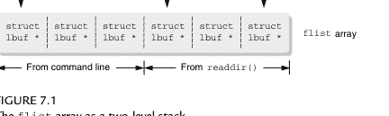

### 图 7.1

作为两级栈的 `flist` 数组

if (ffl!=0) qsort(slastp,lastp - slastp,sizeof *lastp,compar)

第 151-152 行。如果未启用 `-f`，则对子目录条目进行排序。

if (lfl || sfl) printf("total %d\n", tblocks)

第 153-154 行。对于 `-1` 或 `-s` 选项，打印目录中文件所占用的总块数。这个总数保存在变量 `tblocks` 中，并且对每个目录都会重置。`printf()` 的 `%d` 格式字符串在现代系统中等价于 `%ld`；它的意思是“打印一个长整型”。（V7 也有 `%1d`，见第 192 行。）

for (ep1=slastp; ep1<lastp; ep1++) pentry(*ep1)

第 155-156 行。打印子目录中每个文件的信息。请注意，V7 的 `ls` 在目录树中只下降一层。它缺乏现代的 `-R` “递归”选项。

```c
163 pentry(ap)                    void pentry(struct tbuf *ap)
164 struct tbuf *ap;
165 {
166     struct { char dminor, dmaor; };  Unused historical artifact from V6 ls
167     register t;
168     register struct tbuf *p;
169     register char *cp;
170
171     p = ap;
172     if (p->inum == -1)               Inode number
173         return;
174     if (!flg)                 Inode number
175         printf("%5u ", p->innum);
176     if (sflg)                 Size in blocks
177         printf("*4d ", nblock(p->lszies));
```

`pentry()` 例程打印关于文件的信息。第 172–173 行检查 `inum` 字段是否为 -1，如果是则返回。当 `p->lnum == -1` 为真时，该 `struct tbuf` 无效。否则，该字段是文件的 inode 编号。

第 174–175 行如果启用了 `-i` 选项，则打印 inode 编号。第 176–177 行如果启用了 `-s` 选项，则打印总块数。（如下文所示，这个数字可能并不准确。）

```c
178     if (!flg) {                      Long listing:
179         putchar(p->>lype);           – File type
180         pmode(p->>lflags);           – Permissions
181         printf("%2d ", p->>lnl);     – Link count
182         t = p->>luid;
183     if(gflg)
184         t = p->>lgid;
185     if (getname(t, tbuf)==0)           – User or group
186         printf("%-6.6s", tbuf);
187     else
188         printf("%~6d", t);
189     if (p->>ltype==’b’ || p->>ltype==’c’)  – Device: major and minor numbers
190         printf("%3d,%3d", major((int)p->>lszie), minor((int)p->>lszie));
191     else
192         printf("%7ld", p->>lszie);    – Size in bytes
193         cp = ct ime(&p->>ltime);       – Modification time
194     if (p->>ltime < year)
195         printf(" %~-7.7% -4.%s ", cp+4, cp+20); else
196         printf(" %~12.12s ", cp+4);
197     }
198     if (p->>flags&ISARG)               – Filename
199         printf("%s\n", p->>ln.namep);
200     else
201         printf("%.14s\n", p->>ln.lname);
202     )
```

第 178–197 行处理 `-1` 选项。第 179–181 行打印文件的类型、权限和链接数。第 182–184 行根据 `-g` 选项，将 `u` 设置为用户 ID 或组 ID。第 185–188 行检索对应的名称，如果可用则打印。否则，程序打印数值。

第 189–192 行检查文件是否为块设备或字符设备。如果是，则打印通过 `major()` 和 `minor()` 宏提取的主要和次要设备编号。否则，打印文件大小。

第 193–196 行打印相关时间。如果时间早于六个月前，代码打印月份、日期和年份。否则，打印月份、日期和时间（关于 `ctime()` 结果格式，参见第 6.1.3.1 节“简单时间格式化：asctime() 和 ctime()”，第 170 页）。

最后，第 198–201 行打印文件名。对于命令行参数，我们知道它是一个以零结尾的字符串，因此可以使用 `%s`。对于从目录中读取的文件，它可能不以零结尾，因此必须使用显式的精度 `%.14s`。

```c
204 getname(uid, buf)	int getname(int uid, char buf[])
205 int uid;		
206 char buf[];		
207 {			
208 		int j, c, n, i;			
209 				
210 		if (uid==lastuid)		Simple caching, see text
211 			return(0);			
212 		if(pwdl == NULL)		Safety check
213 			return(-1);			
214 		rewind(pwdl);		Start at front of file
215 		lastuid = -1;			
216 		do {				
217 			i = 0;				Index in buf array
218 			j = 0;				Counts fields in line
219 			n = 0;				Converts numeric value
220 			while((c=fgetc(pwdl)) != '\n') {		Read lines
221 				if (c==EOF)				
222 					return(-1);				
223 				if (c==':') {			Count fields
224 					j++;				
225 					c = '0';				
226 				}				
227 			if (j==0)			First field is name
228 				buf[i++] = c;				
229 			if (j==2)			Third field is numeric ID
230 				n = n*10 + c - '0';			
231 			}				
232 		} while (n != uid);		Keep searching until ID found
```

```c
233         buf[i++] = ‘\0’;
234         lastuid = uid;
235     return(0);
236  }
```

`getname()` 函数将用户或组 ID 编号转换为对应的名称。它实现了一种简单的缓存方案；如果传入的 `uid` 与全局变量 `lastuid` 相同，则函数返回 `0` 表示成功；此时缓冲区中已经包含了名称（第 210–211 行）。`lastuid` 初始化为 −1（第 33 行），因此在第一次调用 `getname()` 时此测试会失败。

`pwd` 已经打开，指向 `/etc/passwd` 或 `/etc/group`（参见第 126–130 行）。这里的代码检查打开是否成功，如果失败则返回 −1（第 212–213 行）。

令人惊讶的是，`ls` 并没有使用 `getpwuid()` 或 `getgrgid()`。相反，它利用了 `/etc/passwd` 和 `/etc/group` 的前三个字段（名称、密码、数字 ID）格式相同，且都使用冒号作为分隔符这一事实。

第 216–232 行实现了在文件中线性搜索。`j` 统计到目前为止看到的冒号数量：名称处为 0，ID 号处为 2。因此，在扫描该行时，它同时填充了名称和 ID 号。

第 233–235 行终止名称缓冲区，将全局变量 `lastuid` 设置为找到的 ID 号，并返回 `0` 表示成功。

```c
238    long                            long nblock(long size)
239    nblock(size)
240    long size;
241    {                               
242        return((size+511)>>9);
243    }
```

`nblock()` 函数报告文件占用了多少个磁盘块。此计算基于 `stat()` 返回的文件大小。V7 的块大小为 512 字节——即物理磁盘扇区的大小。

第 242 行的计算看起来有点吓人。`>>9` 是右移九位。这相当于除以 512，从而得到块数。（在早期硬件上，右移比除法快得多。）目前为止还算顺利。然而，即使是只有一个字节的文件也会占用一整个磁盘块。但是，‘1 / 512’ 的结果是零（整数除法会截断小数部分），这是不正确的。这解释了为什么要加 ‘size+511’。通过加上 511，代码确保了在除以 512 时，和会产生正确的块数。


然而，这一计算只是近似的。非常大的文件还具有间接块。尽管 V7 的 `bl` 手册页声称如此，但该计算并未考虑间接块。

此外，考虑文件中有大空洞（通过 `lseek()` 将指针移动到文件末尾远端而创建）的情况。空洞不占用磁盘块；然而，这一点并未反映在大小值中。因此，`nblock()` 产生的计算结果虽然通常正确，但可能得出比实际情况更小或更大的结果。

由于这些原因，`st_blocks` 成员在 4.2 BSD 中被添加到 `struct stat` 中，随后被 System V 和 POSIX 采纳。

```c
245 int m1[] = { 1, S_IREAD>>0, 'r', '-' };
246 int m2[] = { 1, S_IWRITE>>0, 'w', '-' };
247 int m3[] = { 2, S_ISUID, 's', S_IEXEC>>0, 'x', '-' };
248 int m4[] = { 1, S_IREAD>>3, 'r', '-' };
249 int m5[] = { 1, S_IWRITE>>3, 'w', '-' };
250 int m6[] = { 2, S_ISGID, 's', S_IEXEC>>3, 'x', '-' };
251 int m7[] = { 1, S_IREAD>>6, 'r', '-' };
252 int m8[] = { 1, S_IWRITE>>6, 'w', '-' };
253 int m9[] = { 2, S_ISVTX, 't', S_IEXEC>>6, 'x', '-' };
254
255 int *m[] = { m1, m2, m3, m4, m5, m6, m7, m8, m9};
256
257 pmode(aflag) //void pmode(int aflag)
258 { //void pmode(int aflag)
259 register int *mp;
260
261 flags = aflag;
262 for (mp = &m[0]; mp < &m[sizeof(m)/sizeof(m[0])];
263 select(*mp++));
264 }
265
266 select(pa1rp) //void select(register int *pa1rp)
267 register int *pa1rp;
268 { //void select(register int *pa1rp)
269 register int n;
270
271 n = *pa1rp++;
272 while (--n>0 && (flags & *pa1rp++) == 0)
273 pa1rp++;
274 putchar(*pa1rp);
275 }
```

第 245–275 行打印文件的权限。代码紧凑且相当优雅，需要仔细研究。

-   第 245–253 行：数组 `m1` 到 `m9` 编码了需要检查的权限位以及要打印的对应字符。每个要打印的文件模式字符对应一个数组。每个数组的第一个元素是该特定数组中编码的（权限，字符）对的数量。最后一个元素是在未找到给定的任何权限位时要打印的字符。

请注意权限是如何指定为 ‘S_IREAD>>0’、‘S_IREAD>>3’、‘S_IREAD>>6’ 等形式的。每个位对应的各个常量（如 `S_IRUSR`、`S_IRGRP` 等）当时尚未被发明。（参见第 4.6.1 节“指定初始文件权限”中的表 4.5，第 106 页。）

-   第 255 行：`m` 数组指向 `m1` 到 `m9` 中的每个数组。

-   第 257–264 行：`pmode()` 函数首先将全局变量 `flags` 设置为传入的参数 `aflag`。然后它遍历 `m` 数组，将每个元素传递给 `select()` 函数。传入的元素代表 `m1` 到 `m9` 中的一个数组。

-   第 266–275 行：`select()` 函数理解每个 `m1` 到 `m9` 数组的布局。`n` 是数组中配对的数量（第一个元素）；第 271 行对其进行设置。第 272–273 行查找权限位，检查之前在第 261 行设置的全局变量 `flags`。

请注意 ++ 运算符的使用，既在循环测试中也在循环体中。其效果是跳过数组中的配对，只要该配对第一个元素中的权限位未在 `flags` 中找到。

当循环结束时，要么找到了权限位，此时 `pa1rp` 指向配对的第二个元素，即要打印的正确字符；要么未找到，此时 `pa1rp` 指向默认字符。在这两种情况下，第 274 行都会打印 `pa1rp` 指向的字符。

最后一点值得注意的是，在 C 语言中，字符常量（如 `'x'`）的类型是 `int`，而不是 `char`。因此，将这样的常量放入整型数组中没有任何问题，一切都能正常工作。

```c
277 char *makename(char *dir, char *file)
278 makename(dir, file)
279 char *dir, *file;
280 {
281     static char dfile[100];
282     register char *dp, *fp;
283     register int i;
284
285     dp = dfile;
286     fp = dir;
287     while (*fp)
288         *dp++ = *fp++;
289     *dp++ = '/';
290     fp = file;
291     for (i=0; i<DIRSIZ; i++)
292         *dp++ = *fp++;
293     *dp = 0;
294     return(dfile);
295 }
```

第 277–295 行定义了 `makename()` 函数。它的工作是将目录名和文件名用斜杠字符分隔后拼接起来，生成一个字符串。它在一个静态缓冲区 `dfile` 中完成此操作。请注意，`dfile` 只有 100 个字符长，并且没有进行错误检查。

代码本身很直接，逐个复制字符。`makename()` 被 `readdir()` 函数使用。

```c
297 readdir(dir)             void readdir(char *dir)
298 char *dir;
299 {
300     static struct direct dentry;
301     register int j;
302     register struct iobuf *ep;
303
304     if ((dirf = fopen(dir, "r")) == NULL) {
305         printf("%s unreadable\n", dir);
306         return;
307     }
308     tblocks = 0;
309     for( ; ) {
310        if (read(fdentry, sizeof(dentry), 1, dirf) != 1)
311           break;
312        if (dentry.d_ino==0
313        || aflag==0 && dentry.d_name[0]=='.' && (dentry.d_name[1]=='\0'
314        || dentry.d_name[1]=='.' && dentry.d_name[2]=='\0')
315        ) continue;
316        ep = gstat(makename(dir, dentry.d_name), 0);
317        if (ep==NULL
318        ) continue;
319        if (ep->inum != -1)
320           ep->inum = dentry.d_ino;
321        for (j=0; j<DRSIZ; j++)
322           ep->in.lname[j] = dentry.d_name[j];
323     }
324     fclose(dirf);
325 }
```

第 297–325 行定义了 `readdir()` 函数，其工作是读取命令行中指定的目录内容。

第 304–307 行打开目录以进行读取，如果 `fopen()` 失败则返回。第 308 行将全局变量 `tblocks` 初始化为 0。这在之前（第 153–154 行）用于打印目录中文件使用的总块数。

第 309–323 行是一个循环，用于读取目录项并将其添加到 `flist` 数组中。第 310–311 行读取一个条目，在到达文件末尾时退出循环。

第 312–315 行跳过不感兴趣的条目。如果 inode 号为零，则该槽位未被使用。否则，如果没有给出 -a 选项且文件名是 ‘.’ 或 ‘..’，则跳过它。

第 316–318 行使用文件的完整名称调用 `gstat()`，第二个参数为 false，表示它不是来自命令行。`gstat()` 更新全局指针 `lastp` 和 `flist` 数组。NULL 返回值表示某种失败。

第 319–322 行在 `struct iobuf` 中保存 inode 号和名称。如果从 `gstat()` 返回的 `ep->inum` 被设置为 -1，意味着对该文件的 `stat()` 操作失败。最后，第 324 行关闭目录。

下面的函数 `gstat()`（第 327–398 行）是检索和存储文件信息操作的核心函数。

## 7.2 V7 ls 代码

```c
327 struct ibuf *
328 gstat(file, argf)
329 char *file;
330 {
331     extern char *malloc();
332     struct stat stath;
333     register struct ibuf *rep;
334     static int nomcore;
335
336     if (nomcore)                Ran out of memory earlier
337         return(NULL);
338     rep = (struct ibuf *)malloc(sizeof(struct ibuf));
339     if (rep==NULL) {
340         fprintf(stderr, "ls: out of memory\n");
341         nomcore = 1;
342         return(NULL);
343     }
344     if (lastp >= &flist[NFILES]) {      Check whether too many files given
345         static int msg;
346         lastp--;
347         if (msg==0) {
348             fprintf(stderr, "ls: too many files\n");
349             msg++;
350         }
351     }
352     *lastp++ = rep;                   Fill in information
353     rep->flags = 0;
354     rep->inum = 0;
355     rep->ltype = '-';                Default file type
```

静态变量 `nomcore` [sic] 表示之前的 `malloc()` 调用失败（内存耗尽）。由于它是静态的，它会自动初始化为 0（即 false）。如果在进入时它为真，`gstat()` 直接返回 NULL。否则，如果 `malloc()` 失败，`ls` 打印错误消息，将 `nomcore` 设置为 true，并返回 NULL（第 336–343 行）。

第 344–351 行确保 `flist` 数组中仍有剩余空间。如果没有，`ls` 打印一条消息（但只打印一次；注意使用了静态变量 `msg`），然后复用 `flist` 中的最后一个槽位。

第 352 行让 `lastp` 指向的槽位指向新的 `struct ibuf`（`rep`）。这也更新了 `lastp`，它在 `main()` 中用于排序（第 142 和 152 行）。第 353–355 行为 `struct ibuf` 中的 `flags`、inode 号和类型字段设置默认值。


## 7.2 V7 ls 代码

```c
356  if (argfl || statreq) {
357      if (stat(file, &statb) < 0) {
358          printf("%s not found\n", file);
359          statb.st_ino = -1;
360          statb.st_size = 0;
361          statb.st_mode = 0;
362          if (argfl) {
363              lastp--;
364              return(0);
365          }
366      }
367      rep->lnum = statb.st_ino;   /* stat() OK, copy info */
368      rep->lsize = statb.st_size;
369      switch(statb.st_mode & S_IFMT) {
370          case S_IFDIR:
371              rep->ltype = 'd';
372              break;
373          case S_IFBLK:
374              rep->ltype = 'b';
375              rep->lsize = statb.st_rdev;
376              break;
377          case S_IFCHR:
378              rep->ltype = 'c';
379              rep->lsize = statb.st_rdev;
380              break;
381      }
382      rep->lflags = statb.st_mode & ~S_IFMT;
383      rep->luid = statb.st_uid;
384      rep->lgid = statb.st_gid;
385      rep->lnl = statb.st_nlink;
386      if(uflg)
387          rep->ltime = statb.st_atime;
388      else if (cflg)
389          rep->ltime = statb.st_ctime;
390      else
391          rep->ltime = statb.st_mtime;
392      nblocks += nblock(statb.st_size);
393      }
394      return(rep);
395  }
```

第 356–396 行处理对 `stat()` 的调用。如果这是命令行参数，或者由于某个选项导致 `statreq` 为真，代码将按如下方式填充 `struct lbuf`：

- 第 357–366 行：调用 `stat()`，如果失败，打印错误消息并相应地设置值，然后返回 NULL（表示为 0）。
- 第 367–368 行：如果 `stat()` 成功，从 `struct stat` 中设置 inode 编号和大小字段。
- 第 369–384 行：处理目录、块设备和字符设备的特殊情况。在所有情况下，代码都会更新 `ltype` 字段。对于设备，`lsize` 的值会被 `st_rdev` 的值替换。
- 第 385–388 行：从 `struct stat` 的对应字段填充 `lflags`、`luid`、`lgid` 和 `lnl` 字段。第 385 行移除了文件类型位，留下 12 个权限位（用户/组/其他的读/写/执行权限，以及 setuid、setgid 和 save-text 标志）。
- 第 389–394 行：基于命令行选项，使用 `struct stat` 中的三个时间字段之一来填充 `struct lbuf` 中的 `lmtime` 字段。
- 第 395 行：使用文件中的块数更新全局变量 `tlblocks`。

```c
400 compare(pp1, pp2)    int compar(struct lbuf **pp1, struct lbuf **pp2)
401 struct lbuf **pp1, **pp2;    
402 {
403 register struct lbuf *p1, *p2;
404 
405 p1 = *pp1;
406 p2 = *pp2;
407 if (dflg==0) {
408 if (!p1->lflags&ISARG && p1->ltype=='d') {
409 if (!p2->lflags&ISARG && p2->ltype=='d')
410 return(1);
411 } else {
412 if (p2->lflags&ISARG && p2->ltype=='d')
413 return(-1);
414 }
415 }
416 if (tflg) {
417 if(p2->lmtime == p1->lmtime)
418 return(0);
419 if(p2->lmtime > p1->lmtime)
420 return(rflg);
421 }
422 return(strcmp( * strcmp(p1->lflags&ISARG p1->ln.namep; p1->ln.lname, p2->lflags&ISARG p2->ln.namep; p2->ln.lname)));
425 }
```

`compare()` 函数非常密集：在很小的空间里发生了很多事情。首先要记住的是返回值的含义：负值意味着第一个文件应排在数组中第二个文件之前的位置，零意味着两个文件相等，正值意味着第二个文件应排在第一个文件之前的位置。

接下来要理解的是，`ls` 在打印文件信息之后才打印目录的内容。因此，排序的结果应该是所有*在命令行中指定的*目录跟随所有在命令行中指定的文件之后。

最后，`rflg` 变量有助于实现 `-r` 选项，该选项反转排序顺序。它初始化为 1（第 30 行）。如果使用 `-r`，`rflg` 会被设置为 `-1`（第 89–91 行）。

以下伪代码描述了 `compar()` 的逻辑；左边页边距中的行号对应 `ls.c` 的行号：

```
407    if ls has to read directories # dflg == 0
408        if p1 is a command-line arg and p1 is a directory
409            if p2 is not a command-line arg and is not a directory
410                return 1 # first comes after second
                   else
411                    else fall through to time test
                       # p1 is not a command-line directory
412                    if p2 is a command-line arg and is a directory
413                        return -1 # first comes before second
                                else fall through to time test
416 if sorting is based on time # tflg is true
417     # compare times:
            if p2's time is equal to p1's time
418             return 0
419             if p2's time > p1's time
420                 return the value of rflg (positive or negative)
# p2's time < p1's time
421             return opposite of rflg (negative or positive)
423 Multiply rflg by the result of strcmp()
424     on the two names and return the result
```

第 423–424 行中 `strcmp()` 的参数看起来很乱。这是因为根据文件名是命令行参数还是从目录中读取的，需要使用 `struct lbuf` 中 `ln` 联合体的不同成员。

### 7.3 总结

- V7 版本的 `ls` 是一个相对较小的程序，但它涉及 Unix 编程的许多基本方面：文件 I/O、文件元数据、目录内容、用户和组、时间和日期值、排序以及动态内存管理。
- V7 版本 `ls` 与现代 `ls` 之间最显著的外部差异在于对 `-a` 和 `-l` 选项的处理方式。V7 版本的选项远少于现代版本；一个明显的缺失是递归选项 `-R`。
- 对 `flist` 的管理是一种利用 PDP-11 架构有限内存的清晰方式，同时尽可能提供大量信息。`struct lbuf` 很好地将从 `struct stat` 中提取的感兴趣的信息进行了抽象；这大大简化了代码。打印九个权限位的代码紧凑而优雅。
- `ls` 的某些部分使用了惊人微小的限制，例如文件数的上限为 1024，或者 `makename()` 中缓冲区大小为 100。

### 练习

1. 考虑 `getname()` 函数。如果请求的 ID 号为 216，且 /etc/passwd 中存在以下两行，顺序如下，会发生什么：
    joe.xzyzy:216:10:Joe User:/usr/joe:/bin/sh
    jane.xzyxx:216:12:Jane User:/usr/jane:/bin/sh
2. 考虑 `makename()` 函数。它能否使用 `sprintf()` 来创建拼接后的名称？原因是什么？
3. `readdir()` 中的第 319–320 行真的有必要吗？
4. 取你在第 6 章第 205 页“练习”中编写的 stat 程序。添加来自 V7 版本 `ls` 的 `nblock()` 函数，并打印结果以及 `struct stat` 中的 `st_blocks` 字段。当它们不同时添加一个可见的标记。
5. 你会如何给 V7 版本 `ls` 对 `malloc()` 的使用打分？（提示：`free()` 调用的频率如何？它应该在哪里被调用？）
6. 你会如何给 V7 版本 `ls` 的代码清晰度打分？（提示：有多少注释？）
7. 概述将 V7 版本 `ls` 移植到现代系统所需的步骤。


# 第 8 章

# 文件系统和目录遍历

本章内容

- 8.1 挂载和卸载文件系统 第 228 页
- 8.2 文件系统管理文件 第 238 页
- 8.3 检索每个文件系统信息 第 244 页
- 8.4 在文件层次结构中移动 第 256 页
- 8.5 遍历文件树：GNU du 第 269 页
- 8.6 更改根目录：chroot() 第 276 页
- 8.7 总结 第 277 页
- 练习 第 278 页

本章完成了对 Linux（以及 Unix）文件系统和目录的讨论。我们首先描述如何将从包含文件系统的磁盘分区添加（和移除）到逻辑文件系统命名空间中，这样通常用户既不需要知道也不关心文件物理位置在哪里，以及用于处理文件系统的 API。

然后，我们描述如何在分层文件命名空间中移动，如何获取当前工作目录的完整路径名，以及如何使用 `nftw()` 函数轻松处理任意的目录层次结构（树）。最后，我们描述了专门但重要的 `chroot()` 系统调用。

## 8.1 挂载和卸载文件系统

统一的分层文件命名空间是 Linux/Unix 设计的巨大优势。本节探讨管理文件、命令和操作系统如何协作，从包含文件数据和元数据的独立物理设备构建命名空间。

### 8.1.1 回顾背景

第 5 章“目录和文件元数据”，第 117 页，介绍了用于文件元数据的 inode，并描述了目录条目如何将文件名链接到 inode。它还描述了分区和文件系统，并且您看到硬链接被限制在单个文件系统中工作，因为目录仅包含 inode 编号，而 inode 编号在整个正在使用的文件系统中并不是唯一的。

除了 inode 和数据块，文件系统还包含一个或多个超级块副本。这是一个描述文件系统的特殊磁盘块；随着文件系统本身的变化，其信息会被更新。例如，它包含空闲和已用 inode 的计数、空闲和已用块的计数以及其他信息。它还包含一个魔数：位于特殊位置的唯一特殊值，用于识别文件系统的类型。（我们将很快看到这与何处相关。）

使包含文件系统的分区可用被称为挂载文件系统。令人惊讶的是，从使用中移除文件系统被称为卸载文件系统。


这两项任务由 `mount` 和 `umount` 程序完成，其命名源于对应的系统调用。每个 Unix 系统的 `mount()` 系统调用都有不同的接口。由于挂载和卸载被视为实现细节问题，POSIX 特意没有对这些系统调用进行标准化。

你将文件系统挂载到一个目录上；这样的目录被称为该文件系统的*挂载点*。按照惯例，该目录应为空，但没有任何机制来强制这一点。然而，如果挂载点不为空，那么在文件系统挂载到它上面期间，其所有内容都将变得*完全不可访问*。¹

内核维护一个唯一的编号，称为*设备号*，用于标识每个已挂载的分区。因此，正是（设备号, inode）对共同唯一标识一个文件；当两个文件名的 `struct stat` 结构表明这两个编号相同时，你可以确信它们确实指向同一个文件。

如前所述，用户级软件将 inode 结构和其他元数据放置到磁盘分区上，从而创建文件系统。该软件还会为文件系统创建一个初始根目录。因此，我们必须区分“名为 `/` 的根目录”（这是层级式文件名命名空间中最顶层的目录）和“文件系统的根目录”（这是每个层级中各自最顶层的目录）。`/` 目录也是“根文件系统”的“根目录”。

如边栏中所述，文件系统的根目录*始终*拥有 inode 号 2（尽管这在形式上并未标准化）。由于可能存在多个文件系统，每个文件系统的根目录都具有相同的 inode 号，即 2。在解析路径名时，内核知道每个文件系统的挂载位置，并确保挂载点的名称指向已挂载文件系统的根目录。此外，已挂载文件系统中的 `.` 被设置指向挂载点的父目录。

图 8.1 显示了两个文件系统：一个用于根目录，另一个用于 `/usr`，这是在 `/usr` 被挂载之前的状态。图 8.2 显示了 `/usr` 被挂载后的情况。

¹ GNU/Linux 和 Solaris 允许你将一个文件挂载在另一个文件之上；这有其高级用途，但我们在此不再进一步讨论。

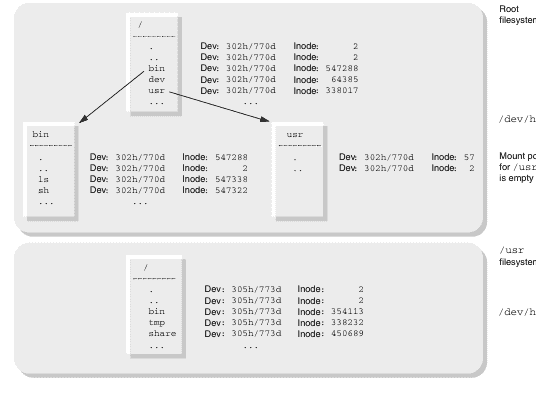

`/` 目录是整个逻辑层级的根，它在另一种方式上也是特殊的：`/.` 和 `/..` 指向同一个目录；系统上的任何其他目录都不是这样。（因此，在执行类似 `cd /..,/../.` 的操作后，你仍然位于 `/.`。）这种行为通过简单的方式实现：`/.` 和 `/..` 都是文件系统根目录的硬链接。（你可以在图 8.1 和图 8.2 中看到这一点。）每个文件系统都这样运作，但内核对 `/` 进行特殊处理，并不将挂载在 `/` 上的文件系统的 `..` 目录视为特殊情况。

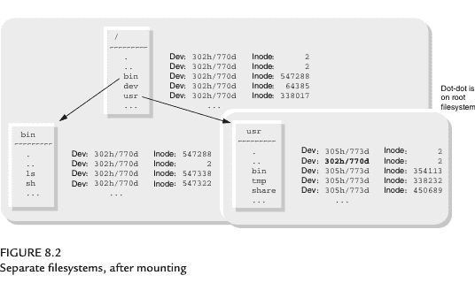

图 8.2
挂载后的独立文件系统

## 根 Inode 编号

文件系统中根目录的 inode 号始终是 2。为什么会这样？答案与技术因素和历史背景都有关。

如 5.3 节“读取目录”第 132 页所述，inode 号为零的目录条目表示一个未使用或空的槽位。因此，inode 0 不能用于实际的文件或目录。

好吧，那 inode 1 呢？特别是在 20 世纪 70 年代和 80 年代，磁盘的制作工艺不如现在精良。当你购买一块磁盘时，会附带一份（纸质）坏块列表——即磁盘上已知不可用的位置。每个操作系统都必须有一种方法来跟踪这些坏块并避免使用它们。

在 Unix 中，你通过创建一个专用文件来实现这一点，该文件的数据块是那些已知为坏的块。该文件绑定在 inode 1 上，从而将 inode 2 留作可用于常规文件或目录的第一个 inode。

现代磁盘驱动器内置了相当多的电子器件，并能自行处理坏块。因此，从技术上讲，使用 inode 1 来表示文件是可行的。然而，由于大量的 Unix 软件都假设 inode 2 是文件系统根目录的 inode，Linux 也遵循了这一约定。（不过，Linux 有时将 inode 1 用于非本地文件系统，例如 vfat 或 /proc。）

## 8.1.2 查看不同的文件系统类型

> 注 本节的讨论特定于 Linux。然而，大多数现代 Unix 系统具有类似的功能。我们鼓励你探索你所在系统的文档。

历史上，V7 Unix 仅支持一种文件系统类型；每个分区的元数据和目录组织都以相同的方式构建。4.1 BSD 使用了与 V7 结构相同的文件系统，但块大小为 1024 字节，而不是 512 字节。4.2 BSD 引入了“BSD 快速文件系统”，这极大地改变了磁盘上 inode 和数据布局，并允许使用更大的块大小。（通常，使用较大的连续数据块可以提供更好的吞吐量，尤其是对于文件读取。）

通过 4.3 BSD 和 20 世纪 80 年代中期的 System V Release 2，Unix 系统仍然仅支持一种文件系统类型。要将计算机从一种文件系统切换到另一种，² 你必须首先将每个文件系统备份到归档介质（9 轨道磁带）上，升级系统，然后恢复数据。

在 20 世纪 80 年代中期，Sun Microsystems 开发了一种内核架构，使得同时使用多种文件系统架构成为可能。这种设计在他们的 SunOS 操作系统中实现，主要用于支持 Sun 的网络文件系统（NFS）。然而，作为一个结果，这也使得支持多种磁盘上的架构成为可能。System V Release 3 使用了类似的架构来支持远程文件系统（RFS），但它仍然仅支持一种磁盘上的架构。³（RFS 从未被广泛使用，现在仅是一个历史注脚。）

Sun 的通用设计变得流行并在商业 Unix 系统中得到广泛实施，包括 System V Release 4。Linux 和 BSD 系统使用这种设计的变体来支持多种磁盘上的文件系统格式。特别是，几乎所有 Intel x86 硬件上的 Unix 变体都可以挂载 MS-DOS/Windows FAT 文件系统（包括提供长文件名的那些），以及 ISO 9660 格式的 CD-ROM。

² 例如，考虑将 VAX 11/780 从 4.1 BSD 升级到 4.2 BSD。

³ System V Release 3 支持两种不同的块大小：512 字节和 1024 字节，但除此之外，磁盘组织方式是相同的。

Linux 具有几种本地（即磁盘上的）文件系统。最流行的是 ext2 和 ext3 文件系统。然而，还可以获得更多的文件系统类型。你可以在 /usr/src/linux/Documentation/ filesystems/ 目录中找到关于其中大多数文件系统的信息（如果你安装了内核源代码）。表 8.1 列出了各种文件系统名称，并附带对每个文件系统的简要描述。缩写 “RW” 表示 “读/写”，而 “RO” 表示 “只读”。

### **表 8.1**  
*受内核支持的 Linux 文件系统（内核 2.4.x）*

| 名称 | 支持 | 描述 |
| --- | --- | --- |
| afs | RW | Andrew 文件系统。 |
| adfs | RW | Acorn 高级磁盘文件管理系统。 |
| affs | RO, RW | Amiga 快速文件系统。只读与读/写取决于文件系统的版本。 |
| autofs | RW | 用于与自动挂载守护进程交互的文件系统。 |
| befs | RO | BeOS 文件系统。标记为 Alpha 软件。 |
| bfs | RW | SCO UnixWare 引导文件系统。 |
| binfmt_misc | RW | 用于在编译后的文件上运行解释器的特殊文件系统（例如，Java 文件）。 |
| efs | RW | 为 SGI 的 Unix 变体 Irix 开发的文件系统。 |
| coda | RW | 由 CMU 开发的一个实验性分布式文件系统。 |
| cramfs | RO | 用于在 ROM 中存储文件的小型文件系统。 |
| devfs | RW | 一种为 /dev 动态提供设备文件的方法（已弃用）。 |
| devpts | RW | 用于伪终端的特殊文件系统。 |
| ext2 | RW | 第二个扩展文件系统。这是默认的 GNU/Linux 文件系统，尽管一些发行版现在使用 ext3。 |
| ext3 | RW | 带有日志功能的 ext2 文件系统。 |
| hfs | RW | Apple Mac OS 分层文件系统。 |
| hpfs | RW | OS/2 高性能文件系统。 |
| intermezzo | RW | 一个用于断开连接工作的实验性分布式文件系统。请参阅 InterMezzo 网站 (http://www.inter-mezzo.org)。 |


## 表 8.1（续）

| 名称 | 支持 | 描述 |
|---|---|---|
| jffs | RW | 日志型闪存文件系统（用于嵌入式系统）。 |
| jffs2 | RW | 日志型闪存文件系统 2（同样用于嵌入式系统）。 |
| iso9660 | RO | ISO 9660 CD-ROM 文件系统。也支持 Rock Ridge 扩展，这使得使用它们的 CD-ROM 看起来像普通的（但只读的）文件系统。 |
| jfs | RW | IBM 为 Linux 开发的日志文件系统。 |
| ncp | RW | Novell 用于 NetWare 的 NCP 协议；一种远程文件系统客户端。 |
| ntfs | RO | 支持 Windows NTFS 文件系统。 |
| openpromfs | RO | SPARC 系统中 PROM 的 /proc 文件系统。 |
| proc | RW | 访问每进程和内核信息。 |
| qnx4 | RW | QNX4（一个小型实时操作系统）的文件系统。 |
| ramfs | RW | 用于创建 RAM 磁盘的文件系统。 |
| reiserfs | RW | 一种高级日志文件系统。 |
| romfs | RO | 用于创建简单只读 RAM 磁盘的文件系统。 |
| smbfs | RW | 支持 SMB 文件系统（Windows 文件共享）的客户端。 |
| sysv | RW | System V Release 2、Xenix、Minix 和 Coherent 文件系统。coherent、minix 和 xenix 是别名。 |
| tmpfs | RW | 一种支持动态增长的 ramdisk 文件系统。 |
| udf | RO | DVD-ROM 使用的 UDF 文件系统格式。 |
| ufs | RO, RW | BSD 快速文件系统；在现代系统上支持读写。 |
| umsdos | RW | vfat 的扩展，使其看起来更像 Unix 文件系统。 |
| usbfs | RW | 用于处理 USB 设备的特殊文件系统。原始名称是 ussdevfs，该名称仍然出现在例如 mount 的输出中。 |
| vfat | RW | 所有 MS-DOS/Windows FAT 文件系统的变体。msdos 和 fat 是组件。 |
| vxfs | RW | Veritas VxFS 日志文件系统。 |
| xfs | RW | SGI 为 Linux 开发的高性能日志文件系统。请参见 XFS 网站（http://oss.sgi.com/projects/xfs/）。 |

并非所有这些文件系统都受 mount 命令支持；请参阅 mount(8) 查看受支持的列表。

日志记录（Journaling）是一种在数据库系统中开创的技术，用于改进文件更新性能，使得在崩溃事件发生时的文件系统恢复既准确又快速。截至本文撰写时，有多种不同的日志文件系统可用，并在 GNU/Linux 世界中争夺主导地位。ext3 是其中之一；它具有向上兼容现有 ext2 文件系统的优势，而且在这两种类型之间来回转换文件系统非常容易。（参见 tune2fs(8)。）ReiserFS 和 XFS 也有强大的支持者。

fat、msdos、umsdos 和 vfat 文件系统都共享公共代码。通常，您应使用 vfat 来挂载 Windows FAT-32（或其他 FAT-xx）分区，如果您希望将 FAT 分区用作 GNU/Linux 系统的根文件系统，则使用 umsdos。

Coherent、MINIX、原始 System V 和 Xenix 文件系统的磁盘结构相似。sysv 文件系统类型支持所有这些；四个名称 coherent、minix、sysv 和 xenix 互为别名。coherent 和 xenix 名称最终将被移除。

BSD 快速文件系统多年来有所演变。ufs 文件系统支持 4.4 BSD 版本的读写操作，该版本是三个广泛使用的 BSD 操作系统（FreeBSD、NetBSD 和 OpenBSD）的基础。它还支持 Sun Solaris 文件系统的读写操作，适用于 SPARC 和 Intel x86 系统。原始 BSD 格式和 NeXTStep 操作系统格式支持只读。

befs 和 ntfs 的“RO”指定意味着这些类型的文件系统可以被挂载和读取，但不能在其上写入文件或删除文件。（这可能会随时间变化；请检查您的系统文档。）cramfs、iso9660、romfs 和 udf 文件系统标记为“RO”，因为其底层介质本质上是只读的。

有两种文件系统类型不再存在：ext（最初的扩展文件系统）和 xiafs（扩展了原始 MINIX 文件系统以支持更长的名称和更大的文件大小）。xiafs 和 ext2 大致同时出现，但 ext2 最终成为主导的文件系统。

### 8.1.3 挂载文件系统：mount

mount 命令挂载文件系统，将其内容拼接到系统文件层次结构中的挂载点。在 GNU/Linux 中，由于它必须处理所有已知的文件系统类型及其选项，因此有点复杂。通常，只有 root 可以运行 mount，尽管对于某些情况可以做出例外，本章稍后会有讨论。

您使用 -t 选项指定文件系统类型：

```text
mount [ 选项 ] 设备 挂载点
```

例如（# 是 root 提示符）：

```text
# mount -t iso9660 /dev/cdrom /mnt/cdrom        挂载 CD-ROM
# mount -t vfat /dev/fd0 /mnt/floppy             挂载 MS-DOS 软盘
# mount -t nfs files.example.com:/mnt /mnt/files  挂载 NFS 文件系统
```

您可以使用 ‘-t auto’ 强制 mount 猜测文件系统类型。这通常可行，但如果您确切知道您拥有哪种文件系统，提供类型并避免 mount 猜测错误的机会会有帮助。mount 默认执行此猜测，因此 ‘-t auto’ 并非严格必要。

GNU/Linux 系统通过 loopback 设备提供一种特殊的挂载方式。通过这种方式，包含在常规文件中的文件系统镜像可以像实际的磁盘设备一样被挂载。此功能非常有用，例如，用于 CD-ROM 镜像。它允许您创建并试用镜像，而无需将其刻录到可写 CD 并挂载该 CD。以下示例使用 Red Hat 9 GNU/Linux 发行版中的第一个 CD 镜像：

```text
# ls -l shrike-i386-disc1.iso                      检查 CD 镜像文件
-rw-r--R-- 1 arnold devel  68891488 Apr 11 05:13 shrike-i386-disc1.iso
# mount -t iso9660 -o ro,loop shrike-i386-disc1.iso /mnt/cdrom    将其挂载到 /mnt/cdrom
# cd /mnt/cdrom                                               进入该目录
# ls                                                          查看文件
    autorun      README.it       RELEASE-NOTES-fr.html
    dosutils     README.ja       RELEASE-NOTES.html
    EULA         README.ko       RELEASE-NOTES-it.html
```

> 来源：http://www.ife.ee.ethz.ch/musik/software/sag/subsection2_5_4_3.html。

```text
GPL             README_.pt          RELEASE-NOTES-ja.html
images          README_.pt_BR       RELEASE-NOTES-ko.html
isolinux        README_.zh_CN       RELEASE-NOTES-pt_BR.html
README          README_.zh_TW       RELEASE-NOTES-pt.html
README-Accessibility  RedHat        RELEASE-NOTES-zh_CN.html
README_.de      RELEASE-NOTES       RELEASE-NOTES-zh_TW.html
README_.es      RELEASE-NOTES-de.html RPM-GPG-KEY
README_.fr      RELEASE-NOTES-es.html TRANS.TBL
```

```text
# cd
# umount /mnt/cdrom
$ mount /dev/hda2 on / type ext3 rw / none on /proc type proc rw / usbdevfs on /proc/usb type usbdevfs rw / /dev/hda5 on / type ext3 rw / none on /dev/pts type devpts rw,gid=5,mode=620 / none on /dev/shm type tmpfs rw / none on /proc/sys/fs/binfmt_misc type binfmt_misc rw
# su
Password:
# cd /d
# umount /d
mount: /d: device is busy
# cd /
# umount /d
#
```

能够以这种方式挂载 ISO 9660 镜像在测试制作 CD 镜像的脚本时特别有用。您可以在常规文件中创建镜像，挂载它，并验证其是否正确排列。然后，一旦确定它是正确的，您可以将镜像复制到可写 CD（“烧录”该 CD）。loopback 功能对于挂载软盘镜像也很有用。

### 8.1.4 卸载文件系统：umount

umount 命令卸载文件系统，将其内容从系统文件层次结构中移除。用法如下：

```text
umount 文件或设备
```

正在卸载的文件系统必须不是*忙碌*的。这意味着没有进程在该文件系统上有打开的文件，并且没有进程以该文件系统上的目录作为当前工作目录：

## 8.2 文件系统管理文件

/etc/fstab 文件列出了可以挂载的文件系统。大多数在系统启动时自动挂载。格式如下：

```text
设备  挂载点  文件系统类型  选项  dump 频率  fsck 路径
```

（*dump 频率* 和 *fsck 路径* 是与当前讨论无关的管理功能。）例如，在我们的系统中，文件看起来像这样：

```text
$ cat /etc/fstab
# 设备 挂载点 类型 选项 频率 路径号
/dev/hda3 / ext3 defaults 1 1 *根文件系统*
/dev/hda5 /data ext3 defaults 1 2
none /dev/pts devpts gid=5,mode=620 0 0
none /proc proc defaults 0 0
none /dev/shm tmpfs defaults 0 0
# Windows 分区：
/dev/hda1 /win vfat noauto,defaults,user,uid=2076,gid=10 0 0
/dev/hda3 swap swap defaults 0 0
/dev/cdrom /mnt/cdrom iso9660 noauto,owner,ro 0 0 *世界可挂载*
/dev/fd0 /mnt/floppy auto noauto,owner 0 0 *软盘，相同*
```

允许以 # 开头的注释。对各种选项的讨论将在稍后的 8.2.1 节“使用挂载选项”（第 239 页）中提供。

相同的文件格式用于 /etc/mtab，这是 mount 在文件系统挂载时写入信息的地方；umount 在文件系统卸载时从该文件中删除信息：

```text
$ cat /etc/mtab
/dev/hda2 / ext3 rw 0 0
none /proc proc rw 0 0
usbdevfs /proc/bus/usb usbdevfs rw 0 0
/dev/hda5 / ext3 rw 0 0
none /dev/pts devpts rw,gid=5,mode=620 0 0
none /dev/shm tmpfs rw 0 0
none /proc/sys/fs/binfmt_misc binfmt_misc rw 0 0
/dev/hda1 /win vfat rw,noexec,nosuid,no,uid=2076,gid=10,users=n roold 0 0
```

内核以相同的格式在 /proc/mounts 中提供（几乎）相同的信息：

```text
$ cat /proc/mounts
rootfs / rootfs 0 0
/dev/root / ext3 rw 0 0
/proc /proc proc rw 0 0
```

脚注 5：在 GNU/Linux 和大多数系统上。Solaris 和一些基于 System V Release 4 的系统使用 /etc/vfstab，可能采用不同的格式。


## 8.2 文件系统管理文件

```
usbdevfs /proc/bus/usb usbdevfs rw 0 0
/dev/hda5 /d ext3 rw 0 0
none /dev/pts devpts rw 0 0
none /dev/shm tmpfs rw 0 0
none /proc/sys/fs/binfmt_misc binfmt_misc rw 0 0
/dev/hda1 /win vfat rw,nosuid,nodev,noexec 0 0
```

请注意，`/etc/mtab` 包含一些 `/proc/mounts` 中没有的信息（例如，查看 `/win` 挂载点的那一行）。反过来说，使用 `mount -f` 也可以向 `/etc/mtab` 中写入并非真实存在的条目（这种做法有其用途，参见 `mount(8)`）。总之，`/proc/mounts` 始终描述实际挂载的内容；然而，`/etc/mtab` 包含了 `/proc/mounts` 中没有的挂载选项信息。因此，为了获得完整的情况，您可能需要读取这两个文件。

### 8.2.1 使用挂载选项

mount 命令支持控制内核允许或禁止对文件系统执行哪些操作的选项。这些选项有很多。只有两个在命令行中真正有用：

- **ro**
  以只读方式挂载文件系统。这对于 CD-ROM 和 DVD 等只读介质是必需的。
- **loop**
  使用回环设备将普通文件作为文件系统处理。我们在前面已经展示过此操作的示例（参见第 8.1.3 节“挂载文件系统：mount”，第 236 页）。

选项通过 `-o` 命令行选项传递，并且可以组合使用，以逗号分隔。例如，以下是之前使用的命令行：

```
mount -t iso9660 -o ro,loop shrink6-1386-disc1.iso /mnt/cdrom
```

其余选项旨在用于 `/etc/fstab`（尽管也可以在命令行上使用）。以下列表列出了我们认为在日常使用中最重要的选项。

- **auto, noauto**
  标记为 auto 的文件系统将在系统启动时通过 `mount -a`（挂载所有文件系统）进行挂载。noauto 文件系统必须手动挂载。

  这些文件系统仍然会出现在 `/etc/fstab` 中，与其他文件系统并列。（例如，参见我们 `/etc/fstab` 文件中之前显示的 `/win` 条目。）
- **defaults**
  使用默认选项 rw, suid, dev, exec, auto, nouser 和 async。（async 是一个高级选项，可增加 I/O 吞吐量。）
- **dev, nodev**
  允许（或禁止）在文件系统上使用字符设备或块设备文件。
- **exec, noexec**
  允许（或禁止）执行文件系统上的二进制可执行文件。
- **user, nouser**
  允许（或禁止）任何用户挂载此文件系统。这对 CD-ROM 很有用；即使在单用户工作站上，不切换到 root 用户就能挂载 CD 也是方便的。只有挂载文件系统的用户才能卸载它。user 隐含 noexec, nosuid 和 nodev 选项。
- **suid, nosuid**
  支持（或不支持）文件系统上可执行文件中的 setuid 和 setgid 位。
- **rw**
  以读写方式挂载文件系统。

nodev, noexec 和 nosuid 选项对于软盘和 CD-ROM 文件系统的安全性特别有价值。考虑一种学生环境，其中允许学生挂载自己的软盘或 CD。制作一个包含 setuid-root shell 或具有全系统写权限的硬盘设备文件的文件系统是很简单的，这可能会让一些精明的用户修改系统文件的权限。

每个文件系统都有特定的额外选项。对于 ext2 和 ext3，一个重要的选项是 grpid。我们将对该选项的讨论推迟到第 11.5.1 节“新文件和目录的默认组”，第 412 页。所有受支持文件系统的详细信息可在 mount(8) 手册页中找到。

作为一个具体的例子，让我们重新考虑我们系统中 Windows 分区的那一行：

```
# device mount-point type options freq
/dev/hda1 /win vfat noauto,defaults,user,uid=2076,gid=10 0 0
```

noauto 选项防止 Windows 分区在启动时挂载。defaults 选项等同于 rw, suid, dev, exec, async。user 选项允许我们在不是 root 的情况下挂载文件系统。uid= 和 gid= 选项强制 /win 中的文件属于我们普通用户，这样我们在处理该分区时就不需要 root 权限。

### 8.2.2 处理已挂载的文件系统：getmntent()

可以通过 getmntent() 例程组以编程方式读取 `/etc/fstab`、`/etc/mtab` 和 `/proc/mounts` 中的任何一个：

```c
#include <stdio.h>
#include <mntent.h>
```
*(Glibc)*

```c
FILE *setmntent(const char *filename, const char *type);
struct mntent *getmntent(FILE *filep);
int addmntent(FILE *filep, const struct mntent *mnt);
int endmntent(FILE *filep);
char *hasmntopt(const struct mntent *mnt, const char *opt);
```

setmntent() 打开包含挂载点条目的文件。filename 参数是要打开的文件名。type 参数类似于 fopen() 的第二个参数，指示读、写或读写访问。（考虑到 mount 命令，它必须为每个挂载的文件系统向 /etc/mtab 添加一个条目，而 umount 必须删除一个。）返回的 FILE * 类型值随后用于其他例程。

getmntent() 遍历文件，返回指向静态 struct mntent 的指针，该结构被填充了相应的值。这个静态存储每次调用时都会被覆盖。当没有更多条目时，它返回 NULL。（这与读取密码文件和组文件的例程类似；参见第 6.3 节“用户和组名”，第 195 页。）

调用 addmntent() 向打开的文件末尾添加更多信息；它旨在供 mount 使用。

endmntent() 关闭打开的文件；在处理完成后调用它。不要只调用 fclose()；与 FILE * 变量关联的其他内部数据结构可能需要清理。

hasmntopt() 是一个更专业的函数。它扫描作为第一个参数传入的 struct mntent，查找与第二个参数匹配的挂载选项。如果找到该选项，它返回匹配子字符串的地址。否则，它返回 NULL。

struct `mntent` 中的字段直接对应于 `/etc/fstab` 文件中的字段。其结构如下：

```c
struct mntent {
    char *mnt_fname;  /* 文件系统设备或服务器。 */
    char *mnt_dir;    /* 挂载的目录。 */
    char *mnt_type;   /* 文件系统类型：ufs, nfs 等。 */
    char *mnt_opts;   /* 文件的逗号分隔选项。 */
    int mnt_freq;     /* 转储频率（以天为单位）。 */
    int mnt_passno;   /* 'fsck' 的传递编号。 */
};
```

处理已挂载文件系统的正常范式是编写一个外部循环，读取 `/etc/mtab`，一次处理一个 struct `mntent`。我们的第一个示例 ch08-mounted.c 正是这样做的：

```c
1 /* ch08-mounted.c --- 打印已挂载文件系统列表 */
2
3 /* 注意：特定于 GNU/Linux！ */
4
5 #include <stdio.h>
6 #include <errno.h>
7 #include <mntent.h> /* 用于 getmntent() 等 */
8 #include <unistd.h> /* 用于 getopt() */
9
10 void process(const char *filename);
11 void print_mount(const struct mntent *fs);
12
13 char *myname;
14
15 /* main --- 处理选项 */
16
17 int main(int argc, char **argv)
18 {
19     int c;
20     char *file = "/etc/mtab"; /* 默认读取的文件 */
21
22     myname = argv[0];
23     while ((c = getopt(argc, argv, "f:")) != -1) {
24         switch (c) {
25         case 'f':
26             file = optarg;
27             break;
28         default:
29             fprintf(stderr, "usage: %s [-f fstab-file]\n", argv[0]);
30             exit(1);
31         }
32     }
33
34     process(file);
35     return 0;
36 }
37
38 /* process --- 从文件读取 struct mntent 结构 */
39
40 void process(const char *filename)
41 {
42     FILE *fp;
43     struct mntent *fs;
44
45     fp = setmntent(filename, "r");  /* 只读 */
46     if (fp == NULL) {
47         fprintf(stderr, "%s: %s: could not open: %s\n",
48                  myname, filename, strerror(errno));
49         exit(1);
50     }
51
52     while ((fs = getmntent(fp)) != NULL)
53         print_mount(fs);
54
55     endmntent(fp);
56 }
57
58 /* print_mount --- 打印单个挂载条目 */
59
60 void print_mount(const struct mntent *fs)
61 {
62     printf("%s %s %s %d %d %d\n",
63            fs->mnt_fname,
64            fs->mnt_dir,
65            fs->mnt_type,
66            fs->mnt_opts,
67            fs->mnt_freq,
68            fs->mnt_passno);
69 }
```

与我们之前见过的大多数程序不同，这个程序是特定于 Linux 的。许多 Unix 系统都有类似的例程，但不保证它们完全相同。默认情况下，ch08_mounted 读取 /etc/mtab，打印每个已挂载文件系统的相关信息。-f 选项允许您指定读取不同的文件，例如 /proc/mounts 甚至 /etc/fstab。

main() 函数处理命令行（第 23–32 行）并对指定文件调用 process()。（此程序遵循我们的标准样板代码。）

process() 进而打开文件（第 45 行），并遍历返回的每个文件系统（第 52–53 行）。完成后，它关闭文件（第 55 行）。


`print_mount()` 函数会打印 `struct mntent` 中的信息。其输出结果与 `cat /etc/mtab` 的输出大致相同：

```
$ ch08-mounted              运行该程序

$ cat /proc/mounts
/dev/hda2       / ext3 rw 0 0
none /proc proc rw 0 0
usbdevfs /proc/bus/usb usbdevfs rw 0 0
/dev/hda5       /d ext3 rw 0 0
none /dev/pts devpts rw,gid=5,mode=620 0 0
none /dev/shm tmpfs rw 0 0
none /proc/sys/fs/binfmt_misc binfmt_misc rw 0 0
/dev/hda1       /win vfat rw,noexec,nosuid,nodev,uid=2076,gid=10,user=arnold 0 0
```

## 8.3 获取文件系统级信息

打印每个文件系统的相关信息固然很好，但并不十分引人注目。一旦我们已知某个挂载点代表一个文件系统，我们就希望获取*关于*该文件系统的更多信息。这使我们能够执行诸如打印由 `df` 和 `df -i` 获取的信息等操作：

```
$ df                         显示已用/可用空间

Filesystem       1K-blocks      Used Available Use% Mounted on
/dev/hda2        6199436    4940316    943248    84% /
/dev/hda5       61431520   27618536   30692360   48% /d
none             256616         0     256616    0% /dev/shm
/dev/hda1        8369532   2784700    5584832   34% /win

$ df -i                      显示已用/可用 inode 数量

Filesystem       Inodes     IUsed     IFree IUse% Mounted on
/dev/hda2        788704    332216    555488   30% /
/dev/hda5        7815168   503243   7311925    7% /d
none                  1      64153       1% /dev/shm
/dev/hda1             0         0         - /win
```

### 8.3.1 POSIX 风格：statvfs() 与 fstatvfs()

早期的 Unix 系统只有一种类型的文件系统。对于这些系统而言，如果 `df` 能够读取每个已挂载文件系统的超级块，提取相关统计信息，并对其进行格式化以便打印，就已经足够了。（超级块通常位于文件系统的第二个块；第一个块是*引导块*，用于存放引导代码。）

然而，在当今世界中，这种方法已不可行。POSIX 提供了一个 XSI 扩展来访问这些信息。主要函数名为 `statvfs()`。（“vfs” 部分源自底层的 SunOS 技术，后来用于 System V Release 4，被称为*虚拟文件系统*）。有两个函数：

```c
#include <sys/types.h>
#include <sys/statvfs.h>

int statvfs(const char *path, struct statvfs *buf);
int fstatvfs(int fd, struct statvfs *buf);
```

`statvfs()` 针对任意文件使用路径名；它返回关于包含该文件的文件系统信息。`fstatvfs()` 接受一个打开的文件描述符作为其第一个参数；在此处，返回的信息同样是关于包含该打开文件的文件系统。`struct statvfs` 包含以下成员：

```c
struct statvfs {
    unsigned long int f_bsize;    /* 块大小 */
    unsigned long int f_frsize;   /* 碎片大小（“基本块大小”） */
    fsblkcnt_t f_blocks;          /* 块总数 */
    fsblkcnt_t f_bfree;           /* 空闲块总数 */
    fsblkcnt_t f_bavail;          /* 可用块数量（≤ f_bfree） */
    fsfilcnt_t f_files;           /* inode 总数 */
    fsfilcnt_t f_favail;          /* 可用 inode 数量（≤ f_files） */
    unsigned long int f_fsid;     /* 文件系统 ID */
    unsigned long int f_flag;     /* 标志：ST_RDONLY 和/或 ST_NOSUID */
    unsigned long int f_namemax;  /* 文件名最大长度 */
};
```

其包含的信息足以编写 `df` 程序：

- `unsigned long int f_bsize`

块大小是执行 I/O 的推荐大小。文件系统会尝试将至少 `f_bsize` 字节的数据保持在磁盘上的连续扇区中。（扇区是磁盘上可寻址的最小数据量。通常，一个磁盘扇区为 512 字节。）

- `unsigned long int f_frsize`

某些文件系统（如 BSD Fast Filesystem）区分块和块的碎片。总大小小于一块的中小型文件将驻留在若干碎片中。这避免了浪费磁盘空间（尽管代价是内核代码复杂性增加）。碎片大小在文件系统创建时选定。

- `fsblkcnt_t f_blocks`

文件系统中块的总数（以 `f_bsize` 为单位）。

- `fsblkcnt_t f_bfree`

文件系统中空闲块的总数。

- `fsblkcnt_t f_bavail`

实际可使用的块数量。某些文件系统保留文件系统的一部分块供超级用户使用，以防文件系统被填满。现代系统保留约 5%，尽管管理员可以更改这个数字。（参见 GNU/Linux 系统上的 `tune2fs(8)`，以及 Unix 系统上的 `tuneefs(8)`。）

- `fsfilcnt_t f_files`

文件系统中 inode（“文件序列号”，按 POSIX 术语称为）的总数。该数字通常在文件系统创建时初始化并永久化。

- `fsfilcnt_t f_ffree`

空闲 inode 的总数。

- `fsfilcnt_t f_favail`

实际可使用的 inode 数量。就像块一样，一部分 inode 被保留给超级用户使用。

- `unsigned long int f_fsid`

文件系统 ID。POSIX 未指定其具体代表什么，且在 Linux 下未被使用。

- `unsigned long int f_flag`

提供有关文件系统信息的标志。POSIX 规定了两个：`ST_RDONLY`，用于只读文件系统（如 CD-ROM），以及 `ST_NOSUID`，禁止对可执行文件使用 setuid 和 setgid 权限位。GNU/Linux 系统提供额外的标志：它们列于表 8.2 中。

- `unsigned long int f_namemax`

文件名的最大长度。这指的是路径名中的每个独立组成部分；换句话说，是目录项的最大长度。

**表 8.2**
**GLIBC 中 `f_flag` 的取值**

| **标志** | **POSIX** | **含义** |
| :--- | :--- | :--- |
| `ST_MANDLOCK` | | 强制锁定（见第 14.2 节，第 531 页）。 |
| `ST_NOATIME` | | 不更新每次访问的访问时间字段。 |
| `ST_NODEV` | | 禁止通过设备文件进行访问。 |
| `ST_NODIRATIME` | | 不更新目录的访问时间字段。 |
| `ST_NOEXEC` | | 禁止执行二进制文件。 |
| `ST_NOSUID` | \| | 文件系统禁止使用 setuid 和 setgid 位。 |
| `ST_RDONLY` | \| | 文件系统为只读。 |
| `ST_SYNCHRONOUS` | | 所有写入均为同步（见第 4.6.3 节，第 110 页）。 |

`fsblkcnt_t` 和 `fsfilcnt_t` 类型定义在 `<sys/types.h>` 中。它们通常是无符号 `long`，但在现代系统中，它们甚至可能是 64 位类型，因为磁盘容量变得非常大。下面的程序 `ch08-statvfs.c` 展示了如何使用 `statvfs()`：

```c
1 /* ch08-statvfs.c -- 演示 statvfs */
2
3 /* 注意：GNU/Linux 特定！ */
4
5 #include <stdio.h>
6 #include <errno.h>
7 #include <mntent.h> /* 用于 getmntent() 等 */
8 #include <unistd.h> /* 用于 getopt() */
9 #include <sys/types.h>
10 #include <sys/statvfs.h>
11
12 void process(const char *filename);
13 void do_statvfs(const struct mntent *fs);
14
15 int errors = 0;
16 char *myname;
17
18 /* main -- 处理选项 */
19
20 int main(int argc, char *argv[])
21 {
22     int c;
23     char *file = "/etc/mtab";  /* 默认读取的文件 */
24
25     myname = argv[0];
26     while ((c = getopt(argc, argv, "f:")) != -1) {
27         switch (c) {
28             case 'f':
29                 file = optarg;
30                 break;
31             default:
32                 fprintf(stderr, "usage: %s [-f fstab-file]\n", argv[0]);
33                 exit(1);
34         }
35     }
36
37     process(file);
38     return (errors != 0);
39 }
40
41 /* process --- 从文件读取 struct mntent 结构 */
42
43 void process(const char *filename)
44 {
45     FILE *fp;
46     struct mntent *fs;
47
48     fp = setmntent(filename, "r");  /* 只读 */
49     if (fp == NULL) {
50         fprintf(stderr, "%s: %s: could not open: %s\n",
51                 myname, filename, strerror(errno));
52         exit(1);
53     }
54
55     while ((fs = getmntent(fp)) != NULL)
56         do_statvfs(fs);
57
58     endmntent(fp);
59 }
```

第 1-59 行基本上与 `ch08-mounted.c` 相同。`main()` 处理命令行，而 `process()` 遍历每个已挂载的文件系统。`do_statvfs()` 执行实际工作，打印每个重要文件系统的 `struct statvfs`。


## 8.3 获取每个文件系统的信息

```c
61  /* do_statvfs --- Use statvfs and print info */
62  void do_statvfs(const struct mntent *fs)
64  {
65      struct statvfs vfs;
66
67      if (fs->mnt_fname[0] != '/')    /* skip nonreal filesystems */
68          return;
69
70      if (statvfs(fs->mnt_dir, &vfs) == 0) {
71          fprintf(stderr, "%s: %s: statvfs failed: %s\n",
72                  myname, fs->mnt_dir, strerror(errno));
73          errorsc++;   return;
74      }
75
76      printf("%s, mounted on %s:\n", fs->mnt_dir, fs->mnt_fname);
77      printf("\tf_bsize: %ld\n", (long) vfs.f_bsize);
78      printf("\tf_frsize: %ld\n", (long) vfs.f_frsize);
79      printf("\tf_bblocks: %lu\n", (unsigned long) vfs.f_blocks);
80      printf("\tf_bfree: %lu\n", (unsigned long) vfs.f_bfree);
81      printf("\tf_bavail: %lu\n", (unsigned long) vfs.f_bavail);
82      printf("\tf_files: %lu\n", (unsigned long) vfs.f_files);
83      printf("\tf_ffree: %lu\n", (unsigned long) vfs.f_ffree);
84      printf("\tf_favail: %lu\n", (unsigned long) vfs.f_favail);
85      printf("\tf_fsid: %lx\n", (unsigned long) vfs.f_fsid);
86
87      printf("\tf_flag: ");
88      if (vfs.f_flag == 0)
89          printf("(none)\n");
90      else {
91          if ((vfs.f_flag & ST_RDONLY) != 0)
92              printf("ST_RDONLY ");
93          if ((vfs.f_flag & ST_NOSUID) != 0)
94              printf("ST_NOSUID");
95          printf("\n");
96      }
97
98      printf("\tf_namemax: %1ld\n", (long) vfs.f_namemax);
99  }
100
```

第 67–68 行跳过了那些不基于实际磁盘设备的文件系统。这意味着诸如 `/proc` 或 `/dev/pts` 等文件系统会被忽略。（诚然，这个检查是一种启发式方法，但它确实有效：在 `/etc/mtab` 中，已挂载的设备以完整的设备路径名列出；例如，`/dev/hda1`。第 70 行调用 `statvfs()` 并进行了适当的错误检查，而第 77–99 行则打印相关信息。

第 89–96 行处理的是*标志*：即存在或不存在的信息单比特。请参阅侧边栏以了解 C 代码中标志位的使用方式。以下是 `ch08-statvfs` 的输出：

```
$ ch08-statvfs
/, mounted on /dev/hda2:
f_bsize: 4096
f_frsize: 4096
f_bblocks: 1549609
f_bfree: 316663
f_bavail: 237945
f_files: 788704
f_ffree: 555482
f_favail: 555482
f_fsid: 0
f_flag: (none)
f_namemax: 255
```

*运行程序：ext2 文件系统结果*

```
/win, mounted on /dev/hda1:
f_bsize: 4096
f_frsize: 4096
f_bblocks: 2092383
f_bfree: 1391952
f_bavail: 1391952
f_files: 0
f_ffree: 0
f_favail: 0
f_fsid: 0
f_flag: ST_NOSUID
f_namemax: 260
```

*vfat 文件系统结果*

截至撰写之时，在 GLIBC 2.3.2 及更早版本中，GNU `df` 不使用 `statvfs()`。这是因为该代码读取 `/etc/mtab`，并对每个已挂载的文件系统调用 `stat()`，以查找其设备号与文件（或文件描述符）参数相匹配的文件系统。它需要找到该文件系统，以便读取挂载选项，从而设置 `f_flag` 位。问题在于，如果远程挂载的文件系统的服务器不可用，`stat()` 可能会无限期挂起，从而导致 `df` 也挂起。这个问题已在 GLIBC 中修复，但 `df` 在一段时间内不会改变，以便它能在较旧的系统上继续工作。

> **注意** 虽然 POSIX 规范定义了 `statvfs()` 和 `fstatvfs()`，但并非所有系统都支持它们，或者支持得并不正确。许多系统（包括稍后描述的 Linux）拥有自己的系统调用，可提供类似的信息。GNU `df` 使用库例程来获取文件系统信息；该例程的源文件充满了针对众多不同系统的 `#ifdef`。随着时间的推移，可移植性状况应该会改善。

### 位标志

一种常见的技术，适用于许多场景，是拥有一组*标志*值；当标志被*设置*（即*为真*）时，某个事实为真或某个条件适用。标志值通过 #define 定义的符号常量或枚举来定义。在本章中，nftw() API（稍后描述）也使用标志。`struct statvfs` 的字段 `f_flag` 只有两个标志：

```c
#define ST_RDONLY  1  /* read-only filesystem */
#define ST_NOSUID  2  /* setuid/setgid not allowed */
```

在物理上，每个符号常量代表 `f_flag` 值内不同的位位置。在逻辑上，每个值代表单独的状态信息位；即对于此特定 `struct statvfs` 实例而言为真或非真的某个事实或条件。标志通过 C 的按位运算符进行设置、测试和清除。例如，`statvfs()` 会使用按位或运算符来设置这些标志：

```c
int statvfs(const char *path, struct statvfs *vfs)
{
  ...fill in most of *vfs...
  vfs->f_flag = 0;             Make sure it starts out as zero
  if (filesystem is read-only)
    vfs->f_flag |= ST_RDONLY;  Add the ST_RDONLY flag
  if (filesystem disallows setuid)
    vfs->f_flag |= ST_NOSUID;  Add the ST_NOSUID flag
  ...rest of routine ...
}
```

按位与运算符用于测试标志是否已设置，而按位与运算符和补运算符的组合则用于清除标志：

```c
if ((vfs.f_flag & ST_RDONLY) != 0)    True if ST_RDONLY flag is set
vfs.f_flag &= ~(ST_RDONLY | ST_NOSUID);  Clear both flags
```

如果你以前没有使用过按位运算符，它们可能会让你望而生畏。然而，上面展示的示例代码代表了常见的 C 习惯用法。仔细研究每个操作；也许你可以画几张图，展示这些运算符是如何工作的。一旦你理解了它们，你就可以训练自己将这些运算符识别为*用于管理标志值的高级操作*，而不是将它们视为*低级的位操作*。

使用标志值的原因是它们提供了相当大的数据空间节省。单个 `unsigned long` 类型的 `f_flag` 让你至少可以存储 32 个独立的信息位。Glibc（截至撰写之时）为 `f_flag` 字段定义了 11 个不同的标志。如果你为每个标志使用独立的 `char` 字段，那将使用 11 个字节，而不是 `unsigned long` 所用的仅 4 个字节。如果有 32 个标志，那将是 32 个字节，而不是仅 4 个！

* 参见 GNU/Linux 系统中的 /usr/include/bits/statvfs.h。

### 8.3.2 Linux 风格：statfs() 和 fstatfs()

`statfs()` 和 `fstatfs()` 系统调用是 Linux 特有的。它们的声明如下：

```c
#include <sys/types.h>  GLIBC
#include <sys/vfs.h>

int statfs(const char *path, struct statfs *buf);
int fstatfs(int fd, struct statfs *buf);
```

与 `statvfs()` 和 `fstatfs()` 一样，这两个版本分别作用于文件名或打开的文件描述符。`struct statfs` 看起来像这样：

```c
struct statfs {
long  f_type;   /* type of file system */
long  f_bsize;  /* optimal transfer block size */
long  f_blocks; /* total data blocks in file system */
long  f_bfree;  /* free blocks in fs */
long  f_bavail; /* free blocks avail to non-superuser */
long  f_files;  /* total file nodes in file system */
long  f_ffree;  /* free file nodes in fs */
fsid_t f_fsid;  /* file system id */
long  f_namelen;/* maximum length of filenames */
long  f_spare[6]; /* spare for later */
};
```

这些字段类似于 `struct statvfs` 中的字段。至少直到 GLIBC 2.3.2，POSIX 的 `statvfs()` 和 `fstatfs()` 函数分别是 `statfs()` 和 `fstatfs()` 的包装器，它们将值从一种结构体类型复制到另一种结构体类型。

使用 `statfs()` 或 `fstatfs()` 的优势在于它们是系统调用。内核直接返回信息。由于没有包含挂载选项的 `f_flags` 字段，因此无需查看每个已挂载的文件系统来找到正确的那一个。（换句话说，为了填充挂载选项，`statvfs()` 必须检查每个已挂载的文件系统，以找到包含由 `path` 或 `fd` 命名的文件的那个。`statfs()` 不需要这样做，因为它不提供关于挂载选项的信息。）

使用这些调用有两个缺点。第一，它们是 Linux 特有的。第二，`struct statvfs` 中的一些信息不在 `struct statfs` 中；最明显的是挂载标志（`f_flags`）和可用的 inode 数量（`f_favail`）。（因此，Linux 的 `statvfs()` 必须从其他来源（如 `/etc/mtab`）中查找挂载选项，并且对于没有真实信息可用的 `struct statvfs` 字段“伪造”信息。）


## 8.3 获取每个文件系统信息

`statfs` 结构体中的一个字段值得特别关注，即 `f_type` 字段，它指示了文件系统的类型。该值是从超级块中提取的文件系统魔数（magic number）。`statfs(2)` 手册页列出了常用文件系统及其魔数，我们在 `ch08-statfs.c` 中使用了这些定义。（遗憾的是，没有单独的 `#include` 文件。）

```c
1 /* ch08-statfs.c --- 演示 Linux statfs */
2 /* 注意：GNU/Linux 特定！ */
3
4
5 #include <stdio.h>
6 #include <errno.h>
7 #include <mntent.h> /* 用于 getmntent() 等 */
8 #include <unistd.h> /* 用于 getopt() */
9 #include <sys/types.h>
10 #include <sys/vfs.h>
11
12 /* 以下定义取自 statfs(2) 手册页： */
13 #define APFS_SUPER_MAGIC        0x4df5
14 #define EFS_SUPER_MAGIC          0x0011a453
15 #define EXT_SUPER_MAGIC          0x137d
16 #define EXT2_OLD_SUPER_MAGIC    0xef51
17 #define EXT2_SUPER_MAGIC        0xef53
18 #define HPFS_SUPER_MAGIC        0x9955e849
19 #define ISOF96_SUPER_MAGIC      0x9660
20 #define MINIX_SUPER_MAGIC       0x137f /* 原始 minix */
21 #define MINIX_SUPER_MAGIC2      0x138f /* 30字符 minix */
22 #define MINIX2_SUPER_MAGIC      0x2468 /* minix v2 */
23 #define MINIX2_SUPER_MAGIC2     0x2468 /* minix V2, 30字符名称 */
24 #define MSDOS_SUPER_MAGIC       0x4d44
25 #define NCP_SUPER_MAGIC         0x06d4c
26 #define NFS_SUPER_MAGIC         0x6969
27 #define PROC_SUPER_MAGIC        0x9fa0
28 #define SMB_SUPER_MAGIC         0x517b
29 #define XENIX_SUPER_MAGIC       0x012pp784
30 #define SYSV4_SUPER_MAGIC       0x012pp785
31 #define SYSV2_SUPER_MAGIC       0x012pp786
32 #define COH_SUPER_MAGIC         0x012pp787
33 #define UFS_MAGIC               0x00011954
34 #define XFS_SUPER_MAGIC         0x85845342
35 #define XIAFS_SUPER_MAGIC       0x012pD16d
36
37 void process(const char *filename);
38 void do_statfs(const struct mntent *Es);
39
40 int errors = 0;
41 char *myname;
42
43 ... main() 没有变化，process() 几乎相同 ...
85
86 /* type2str --- 将文件系统类型转换为可打印字符串，源自 statfs(2) */
87
88 const char *type2str(long type)
89 {
90     static struct fname {
91     long type;
92     const char *name;
93     } table[] = {
94         { AFS_SUPER_MAGIC, "AFS" },
95         { COH_SUPER_MAGIC, "COH" },
96         { EXT2_OLD_SUPER_MAGIC, "OLD EXT2" },
97         { EXT2_SUPER_MAGIC, "EXT2" },
98         { HPFS_SUPER_MAGIC, "HPFS" },
99         { ISOFS_SUPER_MAGIC, "ISOFS" },
100        { MINIX_SUPER_MAGIC, "MINIX V2" },
101        { MINIX2_SUPER_MAGIC, "MINIX V2 30 char" },
102        { MINIX_SUPER_MAGIC, "MINIX" },
103        { MINIX_SUPER_MAGIC2, "MINIX 30 char" },
104        { MSDOS_SUPER_MAGIC, "MSDOS" },
105        { NCP_SUPER_MAGIC, "NCP" },
106        { NFS_SUPER_MAGIC, "NFS" },
107        { PROC_SUPER_MAGIC, "PROC" },
108        { SMB_SUPER_MAGIC, "SMB" },
109        { SYSV2_SUPER_MAGIC, "SYSV2" },
110        { SYSV4_SUPER_MAGIC, "SYSV4" },
111        { UFS_MAGIC, "UFS" },
112        { XENIX_SUPER_MAGIC, "XENIX" },
113        { _XIAFS_SUPER_MAGIC, "XIAFS" },
114        { 0, NULL },
115    };
116    static char unknown[100];
117    int i;
118
119    for (i = 0; table[i].type != 0; i++)
120    if (table[i].type == type)
121    return table[i].name;
122
123    sprintf(unknown, "unknown type: %lx", type);
124    return unknown;
125 }
127 /* do_statfs --- 使用 statfs 并打印信息 */
128
129 void do_statfs(const struct mntent *fs)
130 {
131     struct statfs vfs;
132
133     if (fs->mnt_fstype[0] != '/')    /* 跳过非真实文件系统 */
134         return;
135
136     if (statfs(fs->mnt_dir, &vfs) != 0) {
137         fprintf(stderr, "%s: %s: statfs failed: %s\n",
138                myname, fs->mnt_dir, strerror(errno));
139         errors++;
140         return;
141     }
142
143     printf("%s, mounted on %s\n", fs->mnt_dir, fs->mnt_fstype);
144
145     printf("tf_type: %s\n", type2str(vfs.f_type));
146     printf("tf_bsize: %ld\n", vfs.f_bsize);
147     printf("tf_blocks: %ld\n", vfs.f_blocks);
148     printf("tf_bfree: %ld\n", vfs.f_bfree);
149     printf("tf_bavail: %ld\n", vfs.f_bavail);
150     printf("tf_files: %ld\n", vfs.f_files);
151     printf("tf_ffree: %ld\n", vfs.f_free);
152     printf("tf_namelen: %ld\n", vfs.f_namelen);
153 }
```

为了节省篇幅，我们省略了 main()，因为它与之前展示的其他程序没有变化；我们也省略了 process()，它现在调用 do_statfs() 而不是 do_statvfs()。

第 13-35 行包含来自 statfs(2) 手册页的文件系统魔数列表。虽然可以从内核源代码头文件中检索这些数字，但这样做很麻烦（我们试过了），而这里的呈现方式更容易阅读。第 86-125 行定义了 type2str()，它将魔数转换为可打印字符串。它对（值，字符串）对的表进行简单的线性搜索。如果（不太可能地）魔数不在表中，type2str() 会创建一个“未知类型”消息并返回该消息（第 123-124 行）。

do_statfs()（第 129-153 行）打印 struct statfs 的信息。由于 fsid_t 是不透明类型，因此省略了 f_fsid 成员。代码很直接；第 145 行使用 type2str() 打印文件系统类型。与使用 statvfs() 的类似程序一样，此函数忽略不在本地设备上的文件系统（第 133-134 行）。以下是我们系统上的输出：

```text
$ ch08-statfs
/, mounted on /dev/hda2:
	f_type: EXT2
	f_bsize: 4096
	f_blocks: 1549609
	f_bfree: 316664
	f_bavail: 237946
	f_files: 788704
	f_ffree: 555483
	f_namelen: 255
...
/win, mounted on /dev/hda1:
	f_type: MSDOS
	f_bsize: 4096
	f_blocks: 2092383
	f_bfree: 1391952
	f_bavail: 1391952
	f_files: 0
	f_ffree: 0
	f_namelen: 260
```

总而言之，在您的代码中是使用 statvfs() 还是 statfs() 取决于您的需求。如前所述，GNU df 在 GNU/Linux 下不使用 statvfs()，并且通常倾向于使用每个 Unix 系统独特的“获取文件系统信息”系统调用。虽然这行得通，但并不漂亮。另一方面，有时您别无选择；例如，我们上面提到的 GLIBC 问题。在这种情况下，没有完美的解决方案。

## 8.4 在文件层次结构中移动

有多个系统调用和标准库函数允许您更改当前目录并确定当前目录的完整路径名。更复杂的函数允许您对目录层次结构中的每个文件系统对象执行任意操作。

### 8.4.1 更改目录：chdir() 和 fchdir()

在第 1.2 节“Linux/Unix 进程模型”中，第 10 页，我们说过：

> 当前工作目录是相对路径名（那些不以 / 开头的路径）相对于的目录。当您向 shell 发出 `cd someplace` 命令时，您就“进入”了这个目录。

每个进程都有一个当前工作目录。每个新进程都从启动它的进程（其父进程）继承其当前目录。有两个函数允许您切换到另一个目录：

```c
#include <unistd.h>

int chdir(const char *path);        POSIX
int fchdir(int fd);                 XSI
```

chdir() 函数接受一个指定目录名的字符串，而 fchdir() 期望一个通过 open() 打开目录的文件描述符。^[6] 两者在成功时都返回 0，在错误时返回 –1（并适当设置 errno）。通常，如果目录上的 open() 成功，则 fchdir() 也会成功，除非在两次调用之间有人更改了目录的权限。（fchdir() 是一个相对较新的函数；旧版 Unix 系统可能没有它。）

这些函数的使用几乎微不足道。下面的程序 ch08-chdir.c 演示了这两个函数。它还演示了如果打开的目录权限不包含搜索（执行）权限时，fchdir() 可能会失败：

```c
1 /* ch08-chdir.c -- 演示 chdir() 和 fchdir()。 */
2 /* 为简洁起见省略了错误检查 */
3
4 #include <stdio.h>
5 #include <fcntl.h>
6 #include <unistd.h>
7 #include <sys/types.h>
8 #include <sys/stat.h>
9
10 int main(void)
11 {
12     int fd;
13     struct stat sbuf;
14
15     fd = open(".", O_RDONLY);   /* 打开目录以读取 */
16     fstat(fd, & sbuf);          /* 获取信息，需要原始权限 */
17     chdir("..");               /* cd .. */
18     fchmod(fd, 0);             /* 取消原始目录的权限 */
19
20     if (fchdir(fd) < 0)        /* 尝试“cd”回去，应该会失败 */
21         perror("fchdir back");
22 }
```

^[6]: 在 GNU/Linux 和 BSD 系统上，您可以对 DIR \* 指针应用 dirfd() 函数以获取底层文件描述符；请参阅 GNU/Linux dirfd(3) 手册页。


23  fchmod(fd, sbuf.st_mode & 07777); /* 恢复原始权限 */
24  close(fd); /* 全部完成 */
25  return 0;
26
27}

第 15 行打开当前目录。第 16 行对打开的目录调用 `fstat()`，以便获取其权限的副本。第 17 行使用 `chdir()` 在文件层级中向上一层移动。第 18 行完成繁重的工作，关闭原始目录的所有权限。

第 20–21 行尝试切换回原始目录。由于当前权限不允许，预计此操作会失败。第 23 行恢复原始权限。“sbuf.st_mode & 07777” 检索低 12 位权限位；这些是常规的 9 个 rwxrwxrwx 位，以及我们在第 11 章“权限与用户和组 ID 号”第 403 页中讨论的 setuid、setgid 和“sticky”位。最后，第 24 行通过关闭打开的文件描述符进行清理。以下是程序运行时的情况：

```bash
$ ls -ld .  显示当前权限
drwxr-xr-x 2 arnold devel 4096 Sep 9 16:42 .
$ ch08-chdir  运行程序
fchdir back: Permission denied  预期失败
$ ls -ld .  再次查看权限
drwxr-xr-x 2 arnold devel 4096 Sep 9 16:42 .  一切恢复原状
```

## 8.4.2 获取当前目录：getcwd()

顾名思义，`getcwd()` 函数检索当前工作目录的绝对路径名：

```c
#include <unistd.h> POSIX
char *getcwd(char *buf, size_t size);
```

该函数用路径名填充 `buf`；它期望 `buf` 具有 `size` 字节。成功时，它返回其第一个参数。否则，如果需要超过 `size` 字节，它返回 NULL 并将 `errno` 设置为 ERANGE。其意图是，如果发生 ERANGE，您应该尝试分配一个更大的缓冲区（使用 `malloc()` 或 `realloc()`）并重试。

如果引导至当前目录的任何目录组件不可读或不可搜索，则 `getcwd()` 可能会失败，且 `errno` 将为 EACCES。以下简单程序演示了其用法：

```c
/* ch08-getcwd.c --- 演示 getcwd()。
为简洁起见，省略了错误检查 */

#include <stdio.h>
#include <fcntl.h>
#include <unistd.h>
#include <sys/types.h>
#include <sys/stat.h>

int main(void)
{
    char buf[PATH_MAX];
    char *cp;

    cp = getcwd(buf, sizeof(buf));
    printf("Current dir: %s\n", buf);

    printf("Changing to ..\n");
    chdir("..");                /* "cd .." */

    cp = getcwd(buf, sizeof(buf));
    printf("Current dir is now: %s\n", buf);

    return 0;
}
```

这个简单的程序打印当前目录，切换到父目录，然后打印新的当前目录。（*cp* 在这里其实并不需要，但在实际程序中它将用于错误检查。）运行时，产生以下输出：

```bash
$ ch08-getcwd
Current dir: /home/arnold/work/prehall/progex/code/ch08
Changing to ..
Current dir is now: /home/arnold/work/prehall/progex/code
```

从形式上讲，如果 *buf* 参数为 *NULL*，则 *getcwd*() 的行为是未定义的。在这种情况下，GLIBC 版本的 *getcwd*() 会为您调用 *malloc*，分配一个 *size* 字节的缓冲区。更贴心的是，如果 *size* 为 0，则它分配的缓冲区将“足够大”以容纳返回的路径名。在这两种情况下，当使用完缓冲区后，您应该对返回的指针调用 *free*()。

GLIBC 的行为很有用，但它不具有可移植性。对于需要在跨平台工作的代码，您可以编写一个替代函数，提供相同的功能，同时在 GLIBC 系统上直接调用 *getcwd*() 作为您的替代函数。

GNU/Linux 系统提供文件 `/proc/self/cwd`。该文件是当前目录的符号链接：

```bash
$ cd /tmp						# 将目录切换到其他地方
$ ls -l /proc/self/cwd		# 查看该文件
lrwxrwxrwx 1 arnold devel 0 Sep  9 17:29 /proc/self/cwd -> /tmp
$ cd						# 切换到主目录
$ ls -l /proc/self/cwd		# 再次查看
lrwxrwxrwx 1 arnold devel 0 Sep 9 17:30 /proc/self/cwd -> /home/arnold
```

这在 shell 层面很方便，但在编程层面存在一个问题。特别是，该文件的大小为零！（这是因为它是 `/proc` 中的一个文件，由内核伪造；它不是磁盘上真实的文件。）

为什么零大小是一个问题？如果您还记得第 5.4.5 节“处理符号链接”，第 151 页，对符号链接调用 *stat*() 会在 `struct stat` 的 `st_size` 字段中返回所链接文件名中的字符数。这个数字可用于分配合适大小的缓冲区，以供 *readlink*() 使用。但在这里行不通，因为大小为零。您必须使用（或分配）一个您猜测足够大的缓冲区。然而，由于 *readlink*() 不会填充比您提供的更多的字符，因此您无法*判断*缓冲区是否足够大；当空间不足时，*readlink*() 不会失败。（参见第 5.4.5 节“处理符号链接”，第 151 页中 Coreutils 的 *xreadlink*() 函数，该函数解决了此问题。）

除了 *getcwd*() 之外，GLIBC 还有其他几个不可移植例程。这些函数免除了您管理缓冲区的麻烦，并与旧的 BSD 系统保持兼容。有关详细信息，请参阅 *getcwd*()。

## 8.4.3 遍历层级结构：*nftw*()

常见的编程任务是处理整个目录层级结构：对树中的每个文件以及每个目录和子目录执行某些操作。例如，考虑 *du*，它打印磁盘使用情况信息；`chown -R`，它递归地更改所有权；或者 *find* 程序，它查找符合某些标准的文件。

此时，您已经知道足够的知识来编写自己的代码，手动打开和读取目录，为每个条目调用 *stat*()（或 *lstat*()），并递归处理子目录。然而，要正确编写此类代码具有挑战性；如果在处理子目录时保持父目录打开，可能会导致文件描述符耗尽；您必须决定是将符号链接本身还是作为其指向的文件进行处理；您必须能够处理不可读或不可搜索的目录，等等。如果需要为多个应用程序使用相同的代码，反复编写同样的代码也是痛苦的。

### 8.4.3.1 nftw() 接口

为了解决这些问题，System V 引入了 `ftw()`（“file tree walk”）函数。`ftw()` 完成“遍历”文件树（层级结构）的所有工作。您提供给它一个指向函数的指针，它会为遇到的每个文件对象调用该函数。您的函数可以按自己的方式处理每个文件系统对象。

随着时间推移，显然 `ftw()` 接口并没有完全完成工作：例如，最初它不支持符号链接。因此，`nftw()`（“new ftw()” [原文如此]）被添加到 X/Open 可移植性指南中；它现在是 POSIX 的一部分。以下是原型：

```c
#include <ftw.h>    // XSI

int nftw(const char *dir,              // 起点
         int (*fn)(const char *file,   // 指向函数的指针，
                 const struct stat *sb, 具有四个参数的函数
                 int flag, struct FTW *s), // 最大打开文件描述符数，标志
         int depth, int flags);
```

以下是参数说明：

- `const char *dir`
  - 一个字符串，指定要处理的层级结构的起点。
- `int (*fn)(const char *file, const struct stat *sb, int flag, struct FTW *s)`
  - 指向具有给定参数的函数的指针。该函数为层级结构中的每个对象调用。详情如下。
- `int depth`
  - 该参数命名不当。为避免文件描述符耗尽，`nftw()` 同时保持不超过 `depth` 个打开的目录。这*不会*防止...

> 7 POSIX 标准化 ftw() 接口以支持现有代码，并且 GNU/Linux 和商业 Unix 系统继续提供它。然而，由于功能有限，我们不再对其讨论。如果您感兴趣，请参阅 fts(3)。


对于层级深度超过指定值的处理层级，nftw() 会跳过；但是 depth 的较小值意味着 nftw() 需要做更多的工作。

### flags

一组通过按位或（bitwise OR）连接的标志位，用于指示 nftw() 应如何处理层级结构。

nftw() 接口有两个*不相交*的标志集合。其中一个集合控制 nftw() 本身（即 nftw() 的 flags 参数）。另一个集合则传递给 nftw() 调用的用户自定义函数（即 (*fn)() 的 flag 参数）。然而，该接口的命名令人困惑，因为这两组标志都使用了以 `FTW_` 为前缀的名称。我们将尽力在后续内容中保持清晰。表 8.3 列出了控制 nftw() 的标志。

#### 表 8.3 nftw() 的控制标志

| 标志 | 含义 |
| :--- | :--- |
| `FTW_CHDIR` | 若设置，则在打开每个目录之前切换到该目录。此操作效率更高，但调用应用程序必须做好准备，在 nftw() 完成时可能处于不同的目录中。 |
| `FTW_DEPTH` | 若设置，则执行“深度优先搜索”。这意味着在目录本身被处理之前，该目录下的所有文件和子目录都会先被处理。 |
| `FTW_MOUNT` | 若设置，则保持在同一已挂载的文件系统内。这是一个更专门的选项。 |
| `FTW_PHYS` | 若设置，则不跟随符号链接。 |

`FTW_CHDIR` 提供了更高的效率；在处理深层文件层级时，内核在执行 stat() 或打开目录时，不需要反复处理完整路径名。在大型层级结构中，时间节省可能相当明显。⁸

`FTW_DEPTH` 可能适合也可能不适合你的需求；对于某些应用来说它恰到好处。考虑 `chmod -R u-rx .` 命令。它会移除当前目录中所有文件和子目录的属主读取和执行权限。如果此权限更改在应用于目录内容之前应用于目录本身，那么后续任何尝试处理内容的操作都会失败！因此，它应该在处理完内容之后才应用。⁹ GNU/Linux 的 nftw(3) 手册页针对 FTW_PHYS 注明“这是你需要的”。这允许你将符号链接作为其本身进行处理，通常这是必要的。（考虑 du 命令；它应该单独统计链接占用的空间，而不是它所指向文件的。）

### 8.4.3.2 nftw() 的回调函数

当 nftw() 运行时，它会调用一个由你提供指针的函数。（此类函数被称为*回调函数*，因为它们从库代码中被“回调”。）回调函数接收四个参数：

- `const char *file`
  当前正在处理的文件（目录、符号链接等）的名称。
- `const struct stat *sb`
  指向该文件 `struct stat` 的指针。
- `int flag`
  若干标志值（下文详述）之一，指示该对象是什么类型的文件，或者在遇到该对象时是否发生了错误。
- `struct FTW *s`
  此结构提供两个独立的信息片段：

```c
struct FTW {
    int base;      /* 文件名基部分在 file 中的索引 */
    int level;     /* 此项相对于起点的深度 */
};
```

flag 参数具有表 8.4 中列出的值之一。

#### 表 8.4 nftw() 回调函数的标志值

| 标志 | 含义 |
| :--- | :--- |
| FTW_F | 对象是一个常规文件。 |
| FTW_D | 对象是一个目录。 |
| FTW_DNR | 对象是一个不可读的目录。 |
| FTW_SL | 对象是一个符号链接。 |
| FTW_NS | 对象不是符号链接，且 stat() 失败。 |
| FTW_DP | 对象是一个子项已处理完的目录。这只有在 nftw() 调用中使用了 FTW_DEPTH 时才会发生。 |
| FTW_SLN | 对象是一个指向不存在文件的符号链接。这只有在 nftw() 调用中未使用 FTW_PHYS 时才会发生。 |

`struct FTW *s` 提供了可能有用的附加信息。`s->base` 充当 `file` 的索引；`file` 是正在处理的对象的完整路径名（相对于起点）。`file` + `s->base` 指向文件名组件的第一个字符。

`s->level` 表示层级中的当前深度；最初的起点被视为第 0 层。

如果一切正常，回调函数应返回 0。任何非零返回值都会导致 nftw() 停止处理并返回相同的非零值。手册页指出，回调函数应仅通过使用其返回值来停止处理，以便 nftw() 有机会进行清理；即释放任何动态存储，关闭打开的文件描述符等。除非程序将立即退出，否则回调函数不应使用 longjmp()。（longjmp() 是一个高级函数，我们在第 12.5 节“非局部 Goto”第 446 页中有描述。）处理错误的推荐技术是设置一个全局变量以指示存在问题，从回调函数中返回 0，并在 nftw() 完成遍历文件层级后再处理失败的情况。（GNU du 就是这样做的，我们稍后将会看到。）

让我们通过一个示例程序将所有这些串联起来。ch08-nftw.c 处理命令行中命名的每个文件或目录，并对其运行 nftw()。处理每个文件的函数会打印文件名和类型，并带有缩进，以显示每个文件的层级位置。换个花样，我们先展示结果，然后展示并讨论程序：

```bash
$ pwd
/home/arnold/work/prenhall/proge
$ code/ch08/ch08-nftw code
code (directory)
  ch02 (directory)
    ch02-printenv.c (file)
  ch03 (directory)
    ch03-memaddr.c (file)
  ch04 (directory)
    ch04-holes.c (file)
    ch04-cat.c (file)
    ch04-maxfdA.c (file)
    v7cat.c (file)
...
```


### 程序本身如下：

```c
/* ch08-nftw.c --- 演示 nftw() */
#include <stdio.h>
#include <errno.h>
#include <getopt.h>
#include <cftw.h>          /* 替我们包含 <sys/types.h> 和 <sys/stat.h> */
#include <limits.h>        /* 用于 PATH_MAX */
#include <unistd.h>        /* 用于 getdtablesize(), getcwd() 声明 */

#define _XOPEN_SOURCE 1                /* GLIBC 下 nftw() 所需 */
#define _XOPEN_SOURCE_EXTENDED 1       /* 同上 */

#define SPARE_FDS 5       /* 供其他函数使用的文件描述符，见正文 */

extern int process(const char *file, const struct stat *sb,
                  int flag, struct FTW *s);

/* usage --- 打印消息并退出 */
void usage(const char *name)
{
    fprintf(stderr, "usage: %s [-c] directory ...\n", name);
    exit(1);
}

/* main --- 对每个命令行参数调用 nftw() */
int main(int argc, char **argv)
{
    int i, c, nfds;
    int errors = 0;
    int flags = FTW_PHYS;
    char start[PATH_MAX], finish[PATH_MAX];

    while ((c = getopt(argc, argv, "c")) != -1) {
        switch (c) {
            case 'c':
                flags |= FTW_CHDIR;
                break;
            default:
                usage(argv[0]);
                break;
        }
    }

    if (optind == argc)
        usage(argv[0]);

    getcwd(start, sizeof start);

    nfds = getdtablesize() - SPARE_FDS; /* 保留一些备用描述符 */
    for (i = optind; i < argc; i++) {
        if (nftw(argv[i], process, nfds, flags) != 0) {
            fprintf(stderr, "%s: %s: stopped early\n",
                    argv[0], argv[i]);
            errors++;
        }
    }

    if ((flags & FTW_CHDIR) != 0) {
        getcwd(finish, sizeof finish);
        printf("Starting dir: %s\n", start);
        printf("Finishing dir: %s\n", finish);
    }

    return (errors != 0);
}
```

第 3–11 行包含头文件文件。至少在 GLIBC 2.3.2 之前，在任何头文件包含之前，必须使用 `_XOPEN_SOURCE` 和 `_XOPEN_SOURCE_EXTENDED` 的 `#define`。这使得能够获取 `nftw()` 提供的声明和标志值，这些超出了 `ftw()` 的范围。这是 GLIBC 特有的。随着 GLIBC 完全符合 2001 年 POSIX 标准，这种需求最终会消失。

第 35–44 行处理选项。`-c` 选项向 `nftw()` 的标志添加了 `FTW_CHDIR` 标志。这是一个实验，看看你是否最终会停留在与你开始不同的地方。似乎如果 `nftw()` 失败，你可以停留在不同位置；否则，你会回到起点。（POSIX 没有明确记录这一点，但意图似乎是你确实会回到起点。标准确实指出回调函数不应更改当前目录。）

第 49 行使用 `getcwd()` 保存起始目录以备后用。


第 51 行计算 `nftw()` 可以使用的文件描述符数量。我们不希望它使用所有可用的文件描述符，以防回调函数也需要打开文件。该计算使用 `getdtablesize()`（参见第 4.4.1 节，“理解文件描述符”，第 92 页）来获取最大可用数量，并减去第 13 行定义稍早的 `SPARE_FDS`。

此过程需要更多解释。在正常情况下，至少已有三个描述符用于标准输入、标准输出和标准错误；`nftw()` 需要一定数量的文件描述符用于打开和读取目录；在底层，`opendir()` 使用 `open()` 来打开目录进行读取。如果回调函数也需要打开文件，我们必须防止 `nftw()` 通过打开目录耗尽所有可用的文件描述符。我们通过从最大可用数量中减去一个数值来实现这一点。在此示例中，我们选择了 5，但如果回调函数需要打开文件，应使用更大的数值。（`nftw()` 知道如何在文件描述符耗尽时恢复；我们不必担心这种情况。）

第 52–58 行是针对参数的主循环；第 53–57 行检查错误；当发生错误时，代码会打印诊断信息并递增 `errors` 变量。

第 60–64 行是 `FTW_CHDIR` 实验的一部分，如果使用了 `-c` 选项，则打印起始目录和结束目录。

真正感兴趣的功能是 `process()`；这是处理每个文件的回调函数。它使用了 `nftw()` 回调函数的基本模板，即针对标志值的 switch 语句：

```c
69  /* process -- print out each file at the right level */
70  /*
71  int process(const char *file, const struct stat *sb,
72            int flag, struct FTW *s)
73  {
74      int retval = 0;
75      const char *name = file + s->base;
76
77      printf("%*s", s->level * 4, "");  /* indent over */
78
79      switch (flag) {
80      case FTW_F:
81          printf("%s (file)\n", name);
82          break;
83      case FTW_D:
84          printf("%s (directory)\n", name);
85          break;
86      case FTW_DNR:
87          printf("%s (unreadable directory)\n", name);
88          break;
89      case FTW_SL:
90          printf("%s (symbolic link)\n", name);
91          break;
92      case FTW_NS:
93          printf("%s (stat failed): %s\n", name, strerror(errno));
94          break;
95      case FTW_DP:
96      case FTW_SLN:
97          printf("%s: FTW_DP or FTW_SLN: can't happen!\n", name);
98          retval = 1;
99          break;
100     default:
101         printf("%s: unknown flag %d: can't happen!\n", name, flag);
102         retval = 1;
103         break;
104     }
105
106     return retval;
107 }
```

第 75 行使用 `file + s->base` 来获取完整路径名称中的名称部分。此指针值保存在 `name` 变量中以便在函数中复用。

第 77 行产生正确的缩进量，使用了一个巧妙的方法。使用 `%*s`，`printf()` 从第一个参数中获取字段宽度。这是动态计算的 `level * 4`。要打印的字符串是 ""，即空字符串。最终结果是 `printf()` 为我们产生了正确数量的空格，而无需我们运行循环。

第 79—104 行是 switch 语句。在这种情况下，除了打印文件名及其类型（文件、目录等）之外，并没有做任何特别有趣的事情。

虽然这个程序没有使用 `struct stat`，但应该很清楚的是，你可以在回调函数中执行任何需要的操作。

> **注** GNU Coreutils 的维护者 Jim Meyering 指出，`nftw()` 的设计并不完美，这是由于其递归性质所致。（在处理子目录时它会递归调用自身。）如果目录层次结构变得非常深，达到 20,000—40,000 级范围（！），`nftw()` 可能会耗尽栈空间，导致程序崩溃。`nftw()` 的设计还存在其他相关问题。GNU Coreutils 的 5.0 版本通过改用 BSD 的 `fts()` 例程套件（参见 `fts(3)`）修复了此问题。

## 8.5 遍历文件树：GNU du

GNU Coreutils 中的 `du` 的 GNU 版本使用 `nftw()` 来遍历一个或多个文件层次结构，收集并生成关于磁盘空间使用量的统计信息。它具有大量选项，用于控制其行为，例如关于符号链接、数字输出格式等。这使得代码比简单版本更难解读。（不过，我们不会因此止步。）以下是 `du` 的选项摘要，稍后我们在查看代码时会很有帮助：

```bash
$ du --help
Usage: du [OPTION]... [FILE]...
Summarize disk usage of each FILE, recursively for directories.

Mandatory arguments to long options are mandatory for short options too.
 -a, --all                 write counts for all files, not just directories
 --apparent-size           print apparent sizes, rather than disk usage; although
                           the apparent size is usually smaller, it may be
                           larger due to holes in ('sparse') files, internal
                           fragmentation, indirect blocks, and the like
 -B, --block-size=SIZE     use SIZE-byte blocks
 -b, --bytes               equivalent to '--apparent-size --block-size=1'
 -c, --total               produce a grand total
 -D, --dereference-args    dereference FILEs that are symbolic links
 -h, --human-readable      print sizes in human readable format (e.g., 1K 234M 2G)
 -H, --si                  likewise, but use powers of 1000 not 1024
 -k                        like --block-size=1K
 -l, --count-links         count sizes many times if hard linked
 -L, --dereference         dereference all symbolic links
 -s, --separate-dirs       do not include size of subdirectories
 -S, --summarize           display only a total for each argument
 -x, --one-file-system     skip directories on different filesystems
 -X FILE, --exclude-from=FILE Exclude files that match any pattern in FILE.
 --exclude=PATTERN         Exclude files that match PATTERN.
 --max-depth=N             print the total for a directory (or file, with --all)
                           only if it is N or fewer levels below the command
                           line argument; --max-depth=0 is the same as
                           --summarize
 -h        display this help and exit
 -v        output version information and exit

SIZE may be (or may be an integer optionally followed by) one of following:
KB 1000, K 1024, MB 1,000,000, M 1,048,576, and so on for G, T, P, E, Z, Y.

Report bugs to <bug-coreutils@gnu.org>.
```

为了进一步增加复杂性，**du** 使用 **nftw()** 的一个*私有*版本，该版本包含一些扩展。首先，回调函数有额外的标志值：

- **FTW_DCHP**

此值表示 **nftw()** 无法执行 '**chdir( ..)**'。

- **FTW_DCH**

此值表示 **nftw()** 无法使用 **chdir()** 进入目录本身。

- **FTW_DPRE**

私有的 **nftw()** 为目录调用回调函数*两次*。此值在第一次遇到目录时使用。在所有目录的子项处理完毕后，使用标准的 **FTW_DP** 值。

私有的 **nftw()** 还在 **struct FTW** 中添加了一个新成员 **int skip**。如果当前对象是目录且回调函数将 **skip** 字段设置为非零值，**nftw()** 将不再进一步处理该目录。（当标志为 **FTW_DPRE** 时，回调函数应以这种方式设置 **skip**；对 **FTW_DP** 这样做则太晚了。）

明白了上述说明后，以下是来自 **du.c** 的 **process_file()** 函数。行号相对于函数开始处：

```c
1   /* This function is called once for every file system object that nftw
2     encounters.  nftw does a depth-first traversal.  This function knows
3     that and accumulates per-directory totals based on changes in
4     the depth of the current entry.  */
5
6     static int
7     process_file (const char *file, const struct stat *sb, int file_type,
8                 struct FTW *info)
9     {
10    uintmax_t size;
11    uintmax_t size_to_print;
12    static int first_call = 1;
13    static size_t prev_level;
14    static size_t n_alloc;
15    static uintmax_t *sum_ent;
16    static uintmax_t *sum_subdir;
17    int print = 1;
18
19    /* Always define info->skip before returning.  */
20    info->skip = excluded_filename (exclude, file + info->base);  For --exclude
```


## 8.5 遍历文件树：GNU du

由于必须实现 `du` 的所有选项，该函数承担了大量工作。第 17 行将 `print` 设置为 true（1）；默认情况下会打印每个文件的信息。后续的代码如有必要会将其设置为 false（0）。

第 20 行根据 `--exclude` 选项设置 `info->skip`。请注意，如果某个目录匹配 `--exclude` 的模式，该目录的子目录也会被排除。

```c
22 switch (file_type)
23 {
24 case FTW_NS:
25 error (0, errno, _("cannot access %s"), quote (file));
26 G_fail = 1; /* Set global var for later */
27 return 0; /* Return 0 to keep going */
28
29 case FTW_DCHG:
30 error (0, errno, _("cannot change to parent of directory %s"),
31 quote (file));
32 G_fail = 1;
33 return 0;
34
35 case FTW_DCH:
36 /* Don't return just yet, since although nftw couldn't chdir into the
37 directory, it was able to stat it, so we do have a size. */
38 error (0, errno, _("cannot change to directory %s"), quote (file));
39 G_fail = 1;
40 break;
41
42 case FTW_DNR:
43 /* Don't return just yet, since although nftw couldn't read the
44 directory, it was able to stat it, so we do have a size. */
45 error (0, errno, _("cannot read directory %s"), quote (file));
46 G_fail = 1;
47 break;
48
49 default:
50 break;
51 }
52
53 /* If this is the first (pre-order) encounter with a directory,
54 return right away. */
55 if (file_type == FTW_DPRE)
56 return 0;
```

第 22–51 行是标准的 `switch` 语句。对于没有大小信息的错误，将全局变量 `G_fail` 设置为 1 并返回 0 以继续执行（参见第 24–27 行和第 29–33 行）。对于有大小信息的错误，同样设置 `G_fail`，但随后 `break` 跳出 `switch` 以便处理统计数据（参见第 35–40 行和第 42–47 行）。

第 55–56 行如果是首次遇到该目录，则提前返回。

```c
58        /* If the file is being excluded or if it has already been counted
59        via a hard link, then don’t let it contribute to the sums.  */
60        if (info->skip
61            || (opt_count_all
62                && l < sb->st_nlink
63                && hash_ins (sb->st_ino, sb->st_dev)))
64                {
65                /* Note that we must not simply return here.
66                We still have to update prev_level and maybe propagate
67                some sums up the hierarchy.  */
68                size = 0;
69                print = 0;
70                }
71        else
72                {
73                size = (apparent_size
74                          ? sb->st_size
75                          : ST_NBLOCKS (*sb) * ST_NBLOCKSIZE);
76                }
```

现在开始变得有趣了。默认情况下，`du` 只计算一次硬链接文件所占用的空间。`--count-links` 选项使其计算每个链接的空间；当提供 `--count-links` 时，变量 `opt_count_all` 为 true。为了跟踪链接，`du` 维护一个包含已见 (设备, inode) 对的哈希表。

第 60–63 行测试某个文件是否不应被计数，原因可能是它被排除（`info->skip` 为 true，第 60 行），或者未提供 `--count-links`（第 61 行）且该文件具有多个链接（第 62 行）并且该文件已在哈希表中（第 63 行）。在这种情况下，大小被设置为 0，以便它不会累加到运行总和中，并且 `print` 也被设置为 false（第 68–69 行）。

如果上述条件均不成立，则根据 `struct stat` 中的大小或磁盘块数计算大小（第 73–75 行）。此决定基于 `apparent_size` 变量，该变量在使用 `--apparent-size` 选项时被设置。

```c
if (first_call)
{
    n_alloc = info->level + 10;             Allocate arrays
    sum_ent = XCALLOC (uintmax_t, n_alloc);  to hold sums
    sum_subdir = XCALLOC (uintmax_t, n_alloc);
}
else
{
    /* FIXME: it's a shame that we need these `size_t' casts to avoid
       warnings from gcc about `comparison between signed and unsigned'.
       Probably unavoidable, assuming that the members of struct FTW
       are of type `int' (historical), since I want variables like
       n_alloc and prev_level to have types that make sense.  */
    if (n_alloc <= ((size_t) info->level))
    {
        n_alloc = info->level * 2;           Double amount
        sum_ent = XREALLOC (sum_ent, uintmax_t, n_alloc); And reallocate
        sum_subdir = XREALLOC (sum_subdir, uintmax_t, n_alloc);
    }
}
size_to_print = size;
```

第 78–97 行管理用于存储文件大小统计数据的动态内存。`first_call` 是一个静态变量（第 12 行），在首次调用 `process_file()` 时为 true。在这种情况下，通过包装宏（第 81–82 行）调用 `calloc()`；这在第 3.2.1.8 节“示例：读取任意长的行”，第 67 页中已讨论过。其余时间，`first_call` 为 false，并使用 `realloc()`（同样通过包装宏，第 91–96 行）。

第 99 行将 `size_to_print` 设置为 `size`；根据是否包含子级的大小，该变量可能会更新。虽然可以重用 `size`，但使用单独的变量使代码更容易阅读。

```c
if (! first_call)
{
    if ((size_t) info->level == prev_level)
    {
        /* This is usually the most common case. Do nothing.  */
    }
    else if ((size_t) info->level > prev_level)
    {
        /* Descending the hierarchy.

           Clear the accumulators for *all* levels between prev_level
           and the current one.  The depth may change dramatically,
           e.g., from 1 to 10.  */
        int i;
        for (i = prev_level + 1; i <= info->level; i++)
            sum_ent[i] = sum_subdir[i] = 0;
    }
}
```

```c
117     else {  /* info->level < prev_level */
118         {
119             /* Ascending the hierarchy.
120                ftw processes a directory only after all entries in that
121                directory have been processed.  When the depth decreases,
122                propagate sums from the children (prev_level) to the parent.
123                Here, the current level is always one smaller than the
124                previous one.  */
125             assert ((size_t) info->level == prev_level - 1);
126             size_to_print += sum_ent[prev_level];
127             if (opt_separate_dirs)
128                 size_to_print += sum_subdir[prev_level];
129             sum_subdir[info->level] += (sum_ent[prev_level]
130                                        + sum_subdir[prev_level]);
131         }
132     }
```

第 101–132 行将当前级别与上一级进行比较。有三种可能的情况：

-   级别相同。
    -   在这种情况下，无需担心子统计数据。（第 103–106 行。）
-   当前级别高于上一级别。
    -   在这种情况下，层级向下深入，统计数据必须重置（第 107–116 行）。注释中的术语“累加器”很贴切：每个元素累加该级别使用的磁盘总空间。（在计算机发展的早期，CPU 寄存器常被称为“累加器”。）
-   当前级别低于上一级别。
    -   在这种情况下，已完成目录中所有子级的处理，并刚刚移回父目录（第 117–131 行）。代码更新总计，包括 `size_to_print`。

```c
134     prev_level = info->level;              Set static variables
135     first_call = 0;

137     /* Let the size of a directory entry contribute to the total for the
138        containing directory, unless --separate-dirs (-S) is specified.  */
139     if (! (opt_separate_dirs && IS_FTW_DIR_TYPE (file_type)))
140        sum_ent[info->level] += size;

142     /* Even if this directory is unreadable or we can't chdir into it,
143        do let its size contribute to the total, ...  */
144     tot_size += size;

146     /* ... but don't print out a total for it, since without the size(s)
147        of any potential entries, it could be very misleading.  */
148	if (file_type == FTW_DNR || file_type == FTW_DCH)
149		return 0;

151	/* If we're not counting an entry, e.g., because it's a hard link
152	to a file we've already counted (and --count-links), then don't
153	print a line for it. */
154	if (!print)
155		return 0;
```

第 134–135 行设置静态变量 `prev_level` 和 `first_call`，以便它们在后续调用 `process_file()` 时具有正确的值，确保之前的代码正确工作。

第 137–144 行根据选项和文件类型调整统计数据。注释和代码相当直接明了。第 146–155 行如果信息不应打印，则提前退出。

```c
157	/* FIXME: This looks suspiciously like it could be simplified. */
158	if ((!IS_FTW_DIR_TYPE (file_type) &&
159				 (info->level >= max_depth || info->level == 0))
160	    || ((opt_all && info->level <= max_depth) || info->level == 0))
161	  {
162	    print_only_size (size_to_print);
163	    fputc ('\t', stdout);
164	    if (arg_length)
165	      {
166		/* Print the file name, but without the `.' or `/',
167		   directory suffix that we may have added in main. */
168		/* Print everything before the part we appended. */
169		fwrite (file, arg_length, 1, stdout);
170		/* Print everything after what we appended. */
171		fputs (file + arg_length + suffix_length
172		       + (file[arg_length + suffix_length] == '/') , stdout);
173	      }
174	    else
175	      {
176		fputs (file, stdout);
177	      }
178	    fputc ('\n', stdout);
179	    fflush (stdout);
180	  }
181
182	return 0;
183	}
```

第 158–160 行的条件令人困惑，第 157 行的注释指出了这一点。该条件陈述为：“如果 (1a) 文件是目录且 (1b) 级别小于最大打印级别（`--max-depth` 和 `max_depth` 变量）或级别为零，或者 (2a) 应打印所有文件且级别小于最大打印级别，或者”


（2b）层级为零，” 然后打印该文件。（哎呀！5.0 之后的 du 版本在这种情况下的条件判断要稍微简单一些。）

第 162-179 行执行打印操作。第 162-163 行打印大小和一个制表符（TAB）。第 164-173 行处理一种特殊情况。这将在 du.c 文件中的第 524-529 行进行解释：

```
  524    /* When dereferencing only command line arguments, we're using
  525       nftw's FTW_PHYS flag, so a symlink-to-directory specified on
  526       the command line wouldn't normally be dereferenced.  To work
  527       around that, we incur the overhead of appending '/' (or `.`)
  528       now, and later removing it each time we output the name of
  529       a derived file or directory name.  */
```

在这种情况下，`arg_length` 为真，因此第 164-173 行必须打印原始名称，而不是修改后的名称。否则，第 174-179 行可以直接打印名称。

呼！这是一大堆代码。我们发现这处于复杂度谱系的上端，至少就这类书籍所能轻松呈现的内容而言是这样。然而，它证明了现实生活中的代码往往是复杂的。管理这种复杂性的最佳方法是使用命名清晰的变量和详细的注释。在这方面 du.c 做得很好；我们能够提取并相当轻松地检查代码，而无需展示该程序的整个 735 行代码！

## 8.6 更改根目录：chroot()

当前工作目录由 `chdir()` 设置（参见第 8.4.1 节，“更改目录：chdir() 和 fchdir()”，第 256 页），它是进程的一个属性，就像打开的文件集合一样。它也被新进程继承。

不太为人所知的是，每个进程还有一个*当前根目录*。路径名 `/` 指向的就是这个目录。大多数时候，进程的根目录和系统的根目录是相同的。然而，超级用户可以使用（你猜对了）`chroot()` 系统调用来更改根目录：

```
#include <unistd.h>                    Common

int chroot(const char *path);
```

成功时返回值为 0，出错时返回 -1。

正如 GNU/Linux 的 chroot(2) 手册页所指出的，更改根目录不会更改当前目录：必须确保停留在新根目录下的程序还必须随后执行 `chdir()`：

```
if (chroot("/new/root") < 0) /* 处理错误 */ 设置新的根目录

if (chdir("/home/dir") < 0) /* 处理错误 */ 路径名现在相对于新的根目录
```

`chroot()` 系统调用最常用于守护进程——那些必须在特殊的、受限的环境中运行的后台程序。例如，考虑一个允许匿名 FTP（任何人、任何地方，无需常规用户名和密码即可连接）的 Internet FTP 守护进程。显然，这种连接不应该能够看到整个系统上的所有文件。相反，FTP 守护进程执行 `chroot()` 到一个特殊目录，该目录具有足以让其运行的结构。（例如，它自己的 `/bin/ls` 用于列出文件，如果是共享的则有其自己的 C 运行时库副本，以及可能还有其自己的 `/etc/passwd` 和 `/etc/group` 副本以显示有限的一组用户和组名。）

POSIX 并未将此系统调用标准化，尽管 GNU/Linux 和所有 Unix 系统都支持它。（它自 V7 以来就已存在。）它是专门化的，但当你需要它时，它非常实用。

## 8.7 总结

- 文件系统是由空闲块、inode、元数据块和数据块组成的集合，以特定方式组织。文件系统与其所在的（物理或逻辑）分区一一对应。每个文件系统都有自己的根目录；按照惯例，根目录的 inode 号总是 2。

- `mount` 命令挂载文件系统，将其嫁接到逻辑层次化文件命名空间上。`umount` 命令分离文件系统。内核安排使 `/ .` 和 `/..` 相同；整个命名空间的根目录是其自身的父目录。在所有其他情况下，内核安排使挂载文件系统根目录中的 `/..` 指向挂载点所在的父目录。

- 现代 Unix 系统支持多种类型的文件系统。特别是，Sun 的网络文件系统（NFS）得到普遍支持，CD-ROM 的 ISO 9660 标准格式也得到支持，并且所有运行在 Intel x86 硬件上的 Unix 系统都支持 MS-DOS FAT 分区。据我们所知，Linux 支持的最多不同的文件系统数量最多——远超 30 种！许多是专门化的，但许多其他是用于通用用途的，包括至少四种不同的日志文件系统。

- `/etc/fstab` 文件列出了每个系统的分区、它们的挂载点以及任何相关的挂载选项。`/etc/mtab` 列出了当前挂载的文件系统，GNU/Linux 系统中的 `/proc/mounts` 也列出了这些。`mount` 的 `loop` 选项在 GNU/Linux 下对于挂载包含在普通文件中的文件系统镜像（如 CD-ROM 镜像）特别有用。其他选项对于安全以及挂载外部文件系统（如 Windows `vfat` 文件系统）很有用。

- `/etc/fstab` 格式文件可以使用 `getmntent()` 系列例程读取。GNU/Linux 格式与几种其他商业 Unix 变体共享，最著名的是 Sun 的 Solaris。

- `statvfs()` 和 `fstatvfs()` 函数由 POSIX 标准化，用于检索文件系统信息，如空闲和已用磁盘块的数量、空闲和已用 inode 的数量等。Linux 有自己用于检索类似信息的系统调用：`statfs()` 和 `statfs()`。

- `chdir()` 和 `fchdir()` 允许进程更改其当前目录。`getcwd()` 检索当前目录的绝对路径名。这三个函数使用起来都很直接。

- `nftw()` 函数集中处理“遍历文件树”的任务，即访问整个目录层次结构中的每个文件系统对象（文件、设备、符号链接、目录）。不同的标志控制其行为。程序员必须提供一个回调函数，该函数接收每个文件的名称、文件的 `struct stat`、文件的类型，以及关于文件名和层次结构中层级的信息。然后该函数可以为每个文件执行必要的操作。Coreutils 5.0 版本的 GNU `du` 使用 `nftw()` 的扩展版本来完成其工作。

- 最后，`chroot()` 系统调用更改进程的当前根目录。这是一个专门化但重要的设施，对于某些守护进程风格的程序特别有用。

### 练习

1. 检查 GNU/Linux 以及你所能访问的尽可能多的其他不同 Unix 系统下的 `mount(2)` 手册页。这些系统调用有何不同？

2. 增强 `ch08-statvfs.c` 以接受一个提供打开的整数文件描述符的选项；它应该使用 `fstatvfs()` 来检索文件系统信息。

3. 增强 `ch08-statvfs.c` 以不忽略 NFS 挂载的文件系统。这些文件系统具有形式为 `server.example.com:/big/disk` 的设备。

4. 修改 `ch08-statfs.c`（使用 Linux 特有的 `statfs()` 调用的那个）以生成类似 `df` 的输出。

5. 为你在上一个练习中编写的程序添加一个 `-i` 选项，以生成类似 `df -i` 的输出。

6. 使用 `opendir()`、`readdir()`、`stat()` 或 `fstat()`、`dirfd()` 和 `fchdir()`，编写你自己的 `getcwd()` 版本。你将如何计算缓冲区需要的总大小？你将如何遍历目录层次结构？

7. 增强你的 `getcwd()` 版本，以便在第一个参数为 `NULL` 时调用者为调用者分配缓冲区。

8. 你能使用 `nftw()` 来编写 `getcwd()` 吗？如果不能，为什么？

9. 使用 `nftw()`，编写你自己的 `chown` 版本，该版本接受一个 `-R` 选项以递归处理整个目录树。确保在没有 `-R` 的情况下，'chown user directory' 不会递归。你将如何测试它？

10. BSD 的 `fts(3)`（“文件树流”）系列例程提供了一种处理目录层次结构的不同方式。就函数数量和提供给调用它的用户级函数的 `struct` 而言，它的 API 在某种程度上 `更好`。这些函数作为 `GLIBC` 的标准部分可用。阅读 `fts(3)` 手册页。（打印出来并手边备有一份可能会有帮助。）使用 `fts()` 重写你的 `chown` 私有版本。

11. 查看 `find(1)` 手册页。如果你试图从头开始编写 `find`，你会更喜欢哪个文件树系列，`nftw()` 还是 `fts()`？为什么？


# 第 2 部分

- **第 9 章** 进程管理与管道 第 283 页
- **第 10 章** 信号 第 347 页
- **第 11 章** 权限以及用户和组 ID 号 第 403 页
- **第 12 章** 通用库接口 — 第 2 部分 第 427 页
- **第 13 章** 国际化与本地化 第 485 页
- **第 14 章** 扩展接口 第 529 页

# 第 9 章
## 进程管理与管道

**本章导读**

- 9.1 进程的创建与管理 第 284 页
- 9.2 进程组 第 312 页
- 9.3 基本的进程间通信：管道和 FIFO 第 315 页
- 9.4 文件描述符管理 第 320 页
- 9.5 示例：gawk 中的双向管道 第 337 页
- 9.6 建议阅读 第 341 页
- 9.7 小结 第 342 页
- 练习题 第 344 页

正如我们在第 1 章“引言”第 3 页中提到的，如果要用三个词来概括 Unix（以及因此 Linux），那必然是“文件和进程”。现在，既然我们已经了解了如何操作文件和目录，是时候看看故事的另一半了：进程。具体来说，我们将研究进程是如何被创建和管理的，它们如何与打开的文件交互，以及它们如何相互通信。后续章节将探讨信号——这是一种较为粗糙的机制，用于让一个进程（或内核）通知另一个进程某些事件已发生——以及权限检查。

在这一章中，画面开始变得更加复杂。特别是，为了使其相对完整，我们必须提及一些在本章后续部分或本书后续章节中才会详细讨论的内容。在这种情况下，我们提供了向前引用（前向引用），但你应该能够在不提前阅读的情况下理解各章节的要旨。

### 9.1 进程的创建与管理

与许多前身和后继操作系统不同，Unix 中的进程创建旨在（并且确实）非常廉价。此外，Unix 将“创建一个新进程”的概念与“在进程中运行给定程序”的概念分离开来。这是一个优雅的设计决策，简化了许多操作。

#### 9.1.1 创建进程：fork()

启动新程序的第一步是调用 fork()：

```c
#include <sys/types.h>
#include <unistd.h>

pid_t fork(void);
POSIX
```

使用 fork() 很简单。在调用之前，有一个进程在运行，我们称之为*父进程*。当 fork() 返回时，存在两个进程：父进程和*子进程*。

关键在于：*这两个进程运行的是同一个程序*。这两个进程可以根据 fork() 的返回值来区分自己：

- **负值**：如果发生错误，fork() 返回 -1，不会创建新进程。原始进程继续运行。
- **零**：在子进程中，fork() 返回 0。
- **正值**：在父进程中，`fork()` 返回子进程的正过程标识号（PID）。

创建子进程的样板代码看起来像这样：

```c
pid_t child;

if ((child = fork()) < 0)
    /* 处理错误 */
else if (child == 0)
    /* 这是新进程 */
else
    /* 这是原始的父进程 */
```

`pid_t` 是一种用于保存 PID 值的有符号整数类型。它很可能只是一个普通的 `int`，但它使代码更具自文档性，应该使用它而不是 `int`。

在 Unix 术语中，“fork” 除了是系统调用的名称外，既是动词也是名词。我们可能会说“一个进程 fork 了另一个进程”，或者“在 fork 之后，两个进程正在运行”。（想想“道路的分岔”而不是“叉子、刀和勺子”。）

#### 9.1.1.1 `fork()` 之后：共享和不同的属性

子进程从父进程“继承”大量属性的相同副本。这些属性中的许多是专用的，在此不相关。因此，以下列表故意是不完整的。以下属性是相关的：

- 环境；参见第 2.4 节“环境”，第 40 页。
- 所有打开的文件和打开的目录；参见第 4.4.1 节“理解文件描述符”，第 92 页，以及第 5.3.1 节“基本目录读取”，第 133 页。
- 文件掩码（umask）设置；参见第 4.6 节“创建文件”，第 106 页。
- 当前工作目录；参见第 8.4.1 节“更改目录：`chdir()` 和 `fchdir()`”，第 256 页。
- 根目录；参见第 8.6 节“更改根目录：`chroot()`”，第 276 页。
- 当前优先级（又称“nice 值”；我们将稍后讨论；参见第 9.1.3 节“设置进程优先级：`nice()`”，第 291 页）。
- 控制终端。这是允许向进程发送信号的终端设备（物理控制台或终端模拟器窗口）（例如 CTRL-Z 停止运行中的作业）。这在第 9.2.1 节“作业控制概述”，第 312 页中稍后讨论。
- 进程信号掩码和当前所有信号处置方式（尚未讨论；参见第 10 章“信号”，第 347 页）。
- 实际、有效和保存的 set-user 和 set-group ID 以及补充组集合（尚未讨论；参见第 11 章“权限以及用户和组 ID 号”，第 403 页）。

除了 `fork( )` 的返回值外，两个进程在以下方面不同：

- 每个进程都有唯一的进程 ID 和父进程 ID（PID 和 PPID）。这些在第 9.1.2 节“识别进程：`getpid( )` 和 `getppid( )`”，第 289 页中描述。
- 子进程的 PID 不会等于任何现有进程组 ID（参见第 9.2 节“进程组”，第 312 页）。
- 子进程及其未来子进程的累积 CPU 时间初始化为零。（这是有道理的；毕竟，它是一个全新的进程。）
- 父进程中挂起的任何信号在子进程中都被清除，挂起的闹钟或定时器也是如此。（我们尚未涵盖这些主题；参见第 10 章“信号”，第 347 页，以及第 14.3.3 节“间隔定时器：`setitimer( )` 和 `getitimer( )`”，第 546 页。）
- 父进程持有的文件锁不会在子进程中复制（也尚未讨论；参见第 14.2 节“文件锁定”，第 531 页）。

#### 9.1.1.2 文件描述符共享

子进程从父进程继承的属性都设置为它们在 `fork( )` 时刻在父进程中的相同值。然而，从那时起，两个进程各自沿着自己的道路前进，（大致上）互不干扰。例如，如果子进程更改目录，父进程的目录不受影响。同样，如果子进程更改其环境，父进程的环境*不会*更改。

打开的文件是此规则的一个重要例外。打开的文件描述符是共享的，一个进程对共享文件描述符的操作也会影响另一个进程中文件的状态。这在研究图 9.1 后最好理解。

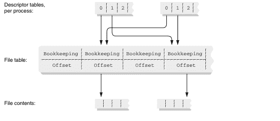

**图 9.1**
文件描述符共享

该图显示了内核的内部数据结构。关键的数据结构是文件表。每个元素都指向一个打开的文件。除了其他簿记数据外，文件表维护文件中的当前位置（读/写偏移量）。这要么在每次读取或写入文件时自动调整，要么通过 lseek() 直接调整（参见第 4.5 节“随机访问：在文件中移动”，第 102 页）。

open() 或 creat() 返回的文件描述符充当指向进程内指针数组的索引，该数组指向文件表。这个每进程数组的大小不会超过 getdtablesize() 返回的值（参见第 4.4.1 节“理解文件描述符”，第 92 页）。

图 9.1 显示了两个进程共享标准输入和标准输出；对于每个进程，两者都指向文件表中的相同项。因此，当进程 45（子进程）执行 read() 时，共享偏移量被更新；下次进程 42（父进程）执行 read() 时，它从进程 45 的 read() 结束的位置开始。

这在 shell 级别很容易看到：


#### 9.1.1.3 文件描述符共享与 `close()`

文件描述符的共享和继承在 shell I/O 重定向中起着关键作用；系统调用及其语义使得用 C 语言实现 shell 级原语变得非常直观，正如我们将在本章后面看到的那样。

多个文件描述符可以指向同一个打开的文件，这一事实有一个重要的后果：*文件只有在所有指向它的文件描述符都关闭后才会被关闭*。

我们在本章后面会看到，同一个文件的多个描述符不仅可以在不同进程间存在，甚至可以在同一进程内存在；这条规则对于处理管道尤为重要。

如果你需要知道两个描述符是否打开在同一个文件上，你可以使用 `fstat()`（参见第 5.4.2 节“获取文件信息”，第 141 页）作用于这两个描述符，并分别使用两个不同的 `struct stat` 结构。如果对应的 `st_dev` 和 `st_ino` 字段相等，则它们是同一个文件。

关于文件描述符操作和文件描述符表的讨论将在本章后面完成。

#### 9.1.2 标识进程：`getpid()` 和 `getppid()`

每个进程都有一个唯一的进程标识号（PID）。两个系统调用提供了当前进程的 PID 和父进程的 PID：

```POSIX
#include <sys/types.h>
#include <unistd.h>

pid_t getpid(void);
pid_t getppid(void);
```

这些函数简单得不能再简单了：

```
pid_t getpid(void)     返回当前进程的 PID。

pid_t getppid(void)    返回父进程的 PID。
```

PID 值是唯一且不可重复的；根据定义，不可能有两个正在运行的进程拥有相同的 PID。PID 通常数值递增，即子进程通常比其父进程拥有更高的 PID。然而，在许多系统中，PID 值会*回绕*：当系统 PID 的最大值被超过时，下一个创建的进程将拥有最低未使用的 PID 号。（POSIX 并没有要求这种行为，一些系统会随机分配未使用的 PID 号。）

如果父进程死亡或退出，子进程会被赋予一个新的父进程，即 *init*。在这种情况下，新父进程的 PID 将是 1，这是 *init* 的 PID。这样的子进程被称为*孤儿*。下面的程序 ch09-reparent.c 演示了这一点。这也是我们第一次看到 `fork()` 的实际应用：

```c
1  /* ch09-reparent.c --- 显示 getppid() 的值可以改变 */
2
3  #include <stdio.h>
4  #include <errno.h>
5  #include <sys/types.h>
6  #include <unistd.h>
7
8  /* main --- 执行工作 */
9
10 int main(int argc, char **argv)
11 {
12 pid_t pid, old_ppid, new_ppid;
13 pid_t child, parent;
14
15 parent = getpid(); /* fork() 之前 */
16
17 if ((child = fork()) < 0) {
18 fprintf(stderr, "%s: fork of child failed: %s\n",
19 argv[0], strerror(errno));
20 exit(1);
21 } else if (child == 0) {
22 old_ppid = getppid();
23 sleep(2); /* 参见第 10 章 */
24 new_ppid = getppid();
25 } else {
26 sleep(1);
27 exit(0); /* 父进程在 fork() 后退出 */
28 }
29
30 /* 只有子进程执行这部分 */
31 printf("Original parent: %d\n", parent);
32 printf("Child: %d\n", getpid());
33 printf("Child's old ppid: %d\n", old_ppid);
34 printf("Child's new ppid: %d\n", new_ppid);
35
36 exit(0);
37 }
```

第 15 行使用 `getpid()` 获取初始进程的 PID。第 17–20 行派生（fork）子进程，并检查错误返回。

第 21–24 行由子进程执行：第 22 行获取 PPID（父进程 ID）。第 23 行将进程挂起两秒钟（关于 `sleep()` 的信息，参见第 10.8.1 节“闹钟：`sleep()`、`alarm()` 和 `SIGALRM`”，第 382 页），然后第 24 行再次获取 PPID。

第 25–27 行在父进程中运行。第 26 行延迟父进程一秒，给予子进程足够的时间进行第一次 `getpid()` 调用。第 27 行随后使父进程退出。

第 31–34 行打印这些值。注意，在 fork 之前设置的 `parent` 变量在子进程中仍保持其值。fork 后，两个进程拥有相同但独立的地址空间副本。这是程序运行时的结果：

```bash
$ `ch09-reparent`
运行该程序
$ Original parent: 6582
程序结束：shell 提示符出现，子进程打印
$ Child: 6583
子进程的旧 ppid: 6582
子进程的新 ppid: 1
```

记住，两个程序是*并行*执行的。这在图 9.2 中以图形方式展示。

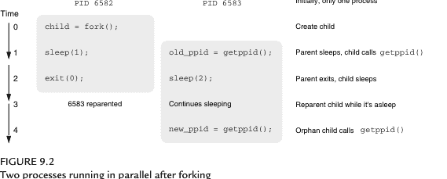

注意 使用 `sleep()` 让一个进程比另一个进程存活更长的时间大多数时候都能正常工作。然而，偶尔会失败，导致难以复现且难以发现的错误。保证行为正确的唯一方法是使用 `wait()` 或 `waitpid()` 进行显式同步，这将在本章后面详细描述（参见第 9.1.6.1 节“使用 POSIX 函数：`wait()` 和 `waitpid()`”，第 306 页）。

#### 9.1.3 设置进程优先级：`nice()`

随着进程的运行，内核动态改变每个进程的*优先级*。正如生活中一样，高优先级的任务比低优先级的任务更早得到处理。简而言之，每个进程被分配一小段时间来运行，称为其*时间片*。当时间片结束时，如果当前进程仍然是优先级最高的进程，它将被允许继续运行。

像 UNIX 一样，Linux 提供*抢占式多任务处理*。这意味着，当轮到另一个进程运行时，内核可以抢占（暂停）一个进程。已经运行了很长时间的进程（例如计算密集型进程）在时间片结束时其优先级会降低，以便让其他进程有机会使用处理器。类似地，在等待 I/O 期间处于空闲状态的进程（例如交互式文本编辑器）会被赋予更高的优先级，以便它们在 I/O 发生时能够响应。简而言之，内核确保所有进程在时间平均值上获得“公平份额”的 CPU。提高和降低优先级是这一过程的一部分。

为内核设计一个好的进程调度器是一门艺术；其细微的细节超出了本书的范围。然而，进程可以通过其* nice 值（nice value）* 来影响内核的优先级分配算法。

* nice 值* 表明进程对其他进程“多友好”。因此，更高的 *nice* 值表示越来越耐心的进程；也就是说，它们对其他进程越来越*友好*，从而降低其相对于其他进程的优先级。

相反，负的 *nice* 值表明进程希望自己对其他进程“不够友好”。这样的进程更加自私，希望为自己争取更多的 CPU 时间。¹ 幸运的是，虽然用户可以增加他们的 *nice* 值（变得更友好），但只有 *root* 可以降低 *nice* 值（变得更不友好）。

*nice* 值只是内核用于计算优先级的公式中的一个因素；*nice* 值本身不是优先级，而是随时间变化的，基于进程的行为和系统中其他进程的状态。要更改 *nice* 值，请使用 `nice()` 系统调用：

```POSIX
#include <unistd.h>   XSI

int nice(int inc);
```

默认的 *nice* 值是 0。*nice* 值的允许范围是 –20 到 19。这需要一些时间来适应。值越负，进程的优先级越高：–20 是最高优先级（最*不友好*），19 是最低优先级（最*友好*）。

`inc` 参数是更改 *nice* 值的增量。使用 ‘`nice(0)`’ 可以在不改变值的情况下获取当前值。如果 ‘`current_nice_value` + `inc`’ 的结果超出 –20 到 19 的范围，系统会强制结果在该范围内。

> ¹ 这种进程往往表现出幼稚的行为。

#### 9.1.1.2 文件偏移量共享与 `read()`

```bash
$ cat data              # 显示演示数据文件内容
line 1
line 2
line 3
line 4

$ ls -l test1 ; cat test1
-rwxr-xr-x  1 amold   devel  93 Oct 20 22:11 test1
#!/bin/sh
read line ; echo p: $line   # 在父 shell 中读取一行并打印
( read line ; echo c: $line )  # 在子 shell 中读取一行并打印
read line ; echo p: $line   # 在父 shell 中读取一行并打印
$ test1 < data              # 运行该程序
p: line 1                   # 父进程从开头开始
c: line 2                   # 子进程从父进程停止的地方继续
p: line 3                   # 父进程从子进程停止的地方继续
```

`test1` 的第一条可执行语句从标准输入读取一行，改变文件中的偏移量。`test1` 的第二条语句在一个*子 shell* 中运行括号内包含的命令。这是一个由 `fork()` 创建的独立 shell 进程。子 shell 从父进程继承标准输入，包括当前的文件偏移量。该进程读取一行并更新到文件中的*共享*偏移量。当第三条语句在父 shell 中读取文件时，它从子进程停止的地方开始。

尽管 `read` 命令是 shell 的内建命令，但外部命令的行为方式相同。一些早期的 Unix 系统有一个 `line` 命令，用于读取一行输入（一次一个字符！）以便在 shell 脚本中使用；如果文件偏移量不是共享的，就不可能在循环中使用这样的命令。


#### 9.1.3.1 POSIX 与现实

返回值是新的 nice 值，如果发生错误则为 -1。由于 -1 也是一个有效的 nice 值，因此在调用 `nice()` 时，你必须先将 `errno` 显式设置为零，然后再检查它，以确定是否出现了问题：

```c
int niceval;
int inc = /* whatever */;

errno = 0;
if ((niceval = nice(inc)) < 0 && errno != 0) {
    fprintf(stderr, "nice(%d) failed: %s\n", inc, strerror(errno));
    /* other recovery */
}
```

如果 `inc` 为负值且进程未以 `root` 身份运行，此示例可能会失败。

Linux 使用的 -20 到 19 的 nice 值范围是历史遗留的；其历史至少可以追溯到 V7。POSIX 用更间接的语言表达了这种情况，这在保持历史兼容性的同时允许了实现灵活性。这也使得标准更难阅读和理解，但这就是你要读这本书的原因。那么，以下是 POSIX 对此的描述。

首先，系统维护的*进程 nice 值*范围为 0 到 `(2 * NZERO) - 1`。常量 `NZERO` 定义在 `<limits.h>` 中，且至少为 20。这给了我们 0-39 的范围。

其次，正如我们描述的，当前 nice 值与 `incr` 增量之和被强制调整到这个范围内。

最后，`nice()` 的返回值是进程 nice 值*减去* `NZERO`。如果 `NZERO` 值为 20，这就得出了我们最初描述的 -20 到 19 的原始范围。

结果是，`nice()` 的返回值实际上范围是从 `-NZERO` 到 `NZERO-1`，最好根据你的代码中的符号常量来编写。不过，实际上，你不太可能找到一个 `NZERO` 不是 20 的系统。

#### 9.1.4 启动新程序：`exec()` 族

一旦新进程开始运行（通过 `fork()`），下一步就是让不同的程序在该进程中运行。有多个函数用于实现不同的目的：

```c
#include <unistd.h>
int execve(const char *filename, char *const argv[], char *const envp[]);
int execl(const char *path, const char *arg, ...);
int execlp(const char *file, const char *arg, ...);
int execlp(const char *path, const char *arg, ..., char *const envp[]);
int execv(const char *path, char *const argv[]);
int execvp(const char *file, char *const argv[]);
```

我们将这些函数称为“exec() 族”。没有名为 exec() 的函数；相反，我们使用这个函数名来指代上述列出的任何函数。与 fork() 一样，“exec”在 Unix 术语中用作动词，意味着执行（运行）一个程序，也用作名词。

##### 9.1.4.1 execve() 系统调用

最简单的函数是 execve()。它也是底层系统调用。其他的是包装函数，稍后将解释。

```c
int execve(const char *filename, char *const argv[], char *const envp[])
```

`filename` 是要执行的程序名称。它可以是完全或相对路径名。该文件必须是内核可理解的可执行格式。现代系统使用 ELF（Extensible Linking Format，可扩展链接格式）可执行格式。GNU/Linux 理解 ELF 和几种其他格式。如果使用以 '#!' 特殊首行命名了解释器的可解释脚本，可以使用 execve() 执行它们。（不以“#!”开头的脚本会失败。）第 1.1.3 节“可执行文件”，第 7 页，提供了“#!”的使用示例。

`argv` 是标准的 C 参数列表——一个指向参数字符串指针的数组，包括用于 argv[0] 的值，并以 NULL 指针结束。

`envp` 是用于新进程的环境变量，其布局与 `environ` 全局变量相同（参见第 2.4 节“环境变量”，第 40 页）。在新程序中，此环境成为 `environ` 的初始值。

exec() 调用不应返回。如果返回了，则出现了问题。最常见的情况是，请求的程序不存在，或者存在但不可执行（分别对应 `errno` 的 `ENOENT` 和 `EACCES`）。还可能发生许多其他错误；参见 `execve(2)` 手册页。

假设调用成功，当前进程地址空间的内容将被丢弃。（内核会先安排将 `argv` 和 `envp` 数据安全地保存在某个地方。）内核加载新程序的可执行代码，以及任何全局和*静态*变量。接下来，内核使用传递给 `execve()` 的环境变量初始化环境，然后调用新程序的 `main()` 例程，传入传递给 `execve()` 的 `argv` 数组。它统计参数的数量，并将该值通过 `argc` 传递给 `main()`。

此时，新程序正在运行。它不知道（也无法查明）之前在该进程中运行的是什么程序。请注意，进程 ID*不会改变*。exec 时许多其他属性保持不变；我们稍后会详细介绍这一点。

做一个宽松的类比，`exec()` 之于进程，就像人生角色之于人。在一天中的不同时刻，同一个人可能充当父母、配偶、朋友、学生或工作者、商店顾客等角色。然而，执行不同角色的始终是同一个底层的人。同样，进程——其 PID、打开的文件、当前目录等——不变，而它所执行的特定任务——使用 `exec()` 运行的程序——可以改变。

##### 9.1.4.2 包装函数：`execl()` 等

另外五个作为包装函数的函数，提供了更便捷的 `execve()` 接口。第一组函数都接受参数列表，每个参数作为显式函数参数传递：

```c
int execl(const char *path, const char *arg, ...)
```

第一个参数 `path` 是要执行文件的路径名。后续参数（从 `arg` 开始）是要放置在 `argv` 中的各个元素。与前面一样，必须显式包含 `argv[0]`。必须传递一个终止 `NULL` 指针作为最后一个参数，以便 `execl()` 知道参数列表在哪里结束。新程序继承当前程序 `environ` 变量中的任何环境。

```c
int execlp(const char *file, const char *arg, ...)
```

此函数类似于 `execl()`，但它模拟了 shell 的命令搜索机制，在 `PATH` 环境变量中列出的每个目录中查找 `file`。如果 `file` 包含 `/` 字符，则不执行此搜索。如果环境中不存在 `PATH`，`execlp()` 使用默认路径。在 GNU/Linux 上，默认值是 "/bin:/usr/bin"，但在其他系统上可能不同。（注意，PATH 中的前导冒号意味着首先搜索当前目录。）

此外，如果找到文件并具有执行权限，但由于不是已知的可执行格式而无法执行，`execlp()` 假定该程序是 shell 脚本，并以文件名为参数执行 shell。

```c
int execl(const char *path, const char *arg, ..., char *const envp[])
```

此函数也类似于 `execl()`，但它接受一个额外参数 `envp`，它成为新程序的环境变量。与 `execl()` 一样，你必须在 `envp` 之前提供终止 `NULL` 指针以结束参数列表。

第二组包装函数接受 `argv` 风格的数组：

```c
int execv(const char *path, char *const argv[])
```

此函数类似于 `execve()`，但新程序继承当前程序 `environ` 变量中的任何环境。

```c
int execvp(const char *file, char *const argv[])
```

此函数类似于 `execv()`，但它执行与 `execlp()` 相同的 `PATH` 搜索。如果找到的文件无法直接执行，它也会回退到执行 shell。

表 9.1 总结了六个 exec() 函数。

### 表 9.1
exec() 族按字母顺序总结

| 函数 | 路径搜索 | 使用 environ | 目的 |
| --- | --- | --- | --- |
| `execl()` | | ✓ | 执行参数列表。 |
| `execlp()` | | | 带环境执行参数列表。 |
| `execlp()` | ✓ | ✓ | 通过路径搜索执行参数列表。 |
| `execv()` | | ✓ | 使用 argv 执行。 |
| `execve()` | | | 使用 argv 和环境执行（系统调用）。 |
| `execvp()` | ✓ | ✓ | 通过路径搜索使用 argv 执行。 |


除非你确定 PATH 环境变量包含一个合理的目录列表，否则最好避免使用 exec\_lp() 和 exec\_vp() 函数。

#### 9.1.4.3 程序名称和 argv[0]

到目前为止，我们一直将 argv[0] 视为程序名称。我们知道，根据程序的调用方式，它可能包含也可能不包含 / 字符；如果包含，这通常是指示用于调用该程序的路径名的一个好线索。

然而，正如现在应该清楚的那样，argv[0] 是文件名只是一种约定。没有任何东西阻止你向 exec\_d 程序传递任意字符串作为 argv[0]。下面的程序 ch09-run.c 演示了传递任意字符串：

```c
/* ch09-run.c --- run a program with a different name and any arguments */
#include <stdio.h>
#include <errno.h>
#include <unistd.h>

/* main --- adjust argv and run named program */
int main(int argc, char **argv)
{
    char *path;

    if (argc < 3) {
        fprintf(stderr, "Usage: %s path arg0 [arg ... ]\n", argv[0]);
        exit(1);
    }

    path = argv[1];

    execv(path, argv + 2);  /* skip argv[0] and argv[1] */

    fprintf(stderr, "%s: execv() failed: %s\n", argv[0],
        strerror(errno));
    exit(1);
}
```

第一个参数是要运行的程序的路径名，第二个参数是程序的新名称（大多数实用工具会忽略它，除了用于错误消息外）；其他参数会被传递给被 exec 的程序。

第 13–16 行进行错误检查。第 18 行将路径保存在 path 中。第 20 行执行 exec；如果第 22–23 行被执行，说明出现了问题。以下是运行该程序时发生的情况：

```
$ ch09-run nonexistent-program foo bar
ch09-run: execv() failed: No such file or directory
$ ch09-run ./ch09-run foo
usage: foo path arg0 [arg ... ]
```

下一个示例有点奇怪：我们让 `ch09-run` 运行自身，并传递 'foo' 作为程序名称。由于第二次运行提供的参数不够，它打印用法消息并退出：

虽然没什么太大用处，但 `ch09-run` 清楚地表明 `argv[0]` 与实际运行的文件之间不需要有任何关系。

在 System III（约 1980 年）中，cp、ln 和 mv 命令是同一个可执行文件，在 /bin 中通过这三个名称建立链接。该程序会检查 argv[0] 并决定应该执行什么操作。这节省了一小部分磁盘空间，但代价是增加了源代码的复杂性，并迫使程序在通过无法识别的名称调用时选择默认操作。（一些当前的商业 Unix 系统仍然沿用这种做法！）GNU 编码标准没有说明明确原因，但建议程序不应根据其名称来确定其行为。我们看到的一个原因是，管理员通常在商业 Unix 系统上安装 GNU 版本的实用工具时，会使用 g 前缀（如 gmake、gawk 等），使其与标准版本并存。如果此类程序仅期望标准名称，它们在以不同名称运行时就会失败。

此外，如今磁盘空间很便宜；如果两个几乎相同的程序可以从相同的源代码构建，最好这样做，使用 #ifdef 或类似机制。例如，grep 和 egrep 共享大量代码，但 GNU 版本构建两个独立的可执行文件。

#### 9.1.4.4 跨 exec() 继承的属性

- 使用 fork() 时，程序执行 exec 后，许多属性仍然保留：
  - 所有打开的文件和目录；参见第 4.4.1 节，“理解文件描述符”，第 92 页，以及第 5.3.1 节，“基本目录读取”，第 133 页。（这不包括标记为 close-on-exec 的文件，如本章后面所述；参见第 9.4.3.1 节，“Close-on-exec 标志”，第 329 页。）
  - umask 设置；参见第 4.6 节，“创建文件”，第 106 页。
  - 当前工作目录；参见第 8.4.1 节，“更改目录：`chdir( )` 和 `fchdir( )`”，第 256 页。
  - 根目录；参见第 8.6 节，“更改根目录：`chroot( )`”，第 276 页。
  - 当前 nice 值。
  - 进程 ID 和父进程 ID。
  - 进程组 ID；参见第 9.2 节，“进程组”，第 312 页。
  - 会话 ID 和控制终端；两者参见第 9.2.1 节，“作业控制概述”，第 312 页。
  - 进程信号掩码以及任何待处理的信号，还有任何未过期的闹钟或计时器（尚未讨论；参见第 10 章，“信号”，第 347 页）。
  - 真实用户 ID、组 ID 以及附加组集。有效用户和组 ID（从而保存集用户和集组 ID）可以通过被 `exec` 文件的 `setuid` 和 `setgid` 位来设置。（这些内容尚未讨论；参见第 11 章，“权限以及用户和组 ID 号码”，第 403 页）。
  - 文件锁仍然有效（尚未讨论；参见第 14.2 节，“文件锁定”，第 531 页）。
  - 进程及其子进程累积的 CPU 时间不变。

`exec` 后，信号处理程序会发生变化；更多信息参见第 10.9 节，“跨 `fork( )` 和 `exec( )` 的信号”，第 398 页。

所有打开的文件和目录在 `exec` 后保持打开和可用。这就是程序继承标准输入、输出和错误的方式：它们在程序启动时已经就位。

大多数时候，当你 `fork` 和 `exec` 一个独立的程序时，你不希望它继承文件描述符 0、1 和 2 之外的任何内容。在这种情况下，你可以在 `fork` 之后但在 `exec` 之前，手动在子进程中关闭所有其他打开的文件。或者，你可以将文件描述符标记为在 `exec` 时由系统自动关闭；这种选择在本章后面讨论（参见第 9.4.3.1 节，“Close-on-exec 标志”，第 329 页）。

#### 9.1.5 终止进程

进程终止涉及两个步骤：进程退出并向系统传递退出状态，以及父进程恢复该信息。

##### 9.1.5.1 定义进程退出状态

退出状态（也被称为退出值、返回码和返回值）是一个 8 位值，当子进程退出时（在 Unix 术语中，“当子进程死亡时”），父进程可以恢复该值。按照惯例，退出状态为 0 意味着程序运行没有问题。任何非零退出状态都表明某种故障；程序确定要使用的值及其含义（如果有的话）。（例如，grep 使用 0 表示至少匹配了一次模式，1 表示完全未匹配模式，2 表示发生错误。）此退出状态在 shell 级别（对于 Bourne 风格的 shell）中可通过特殊变量 $? 获取。

C 标准定义了两个常数，为了严格的非 POSIX 系统可移植性，你只能使用这些值：

- `EXIT_SUCCESS`：程序正常退出。也可以使用 0 来表示成功。
- `EXIT_FAILURE`：程序遇到某种问题。

实际上，仅使用这些值限制较多。相反，你应该选择一组小的返回码，记录其含义，并使用它们。（例如，1 表示命令行选项和参数错误，2 表示 I/O 错误，3 表示数据错误，等等。）为了提高可读性，使用 #defined 常数或枚举来定义它们是有价值的。错误列表过大使得使用变得麻烦；大多数时候，调用程序（或用户）只关心零与非零的区别。

当二进制成功/失败区分足够时，吹毛求疵的程序员会使用 EXIT_SUCCESS 和 EXIT_FAILURE。我们自己的风格更地道，使用显式常数 0 或 1 与 return 和 exit() 配合使用。这非常常见，以至于早期学习后很快就会变成第二自然。然而，你应该为自己的项目做出自己的决定。

> 注意：只有该值的最低有效 8 位对父进程可用。因此，你应该使用 0–255 范围内的值。正如我们稍后所见，126 和 127 具有传统含义（除了普通的“不成功”之外），你的程序应遵守这些含义。
>
> 由于只有最低有效 8 位重要，你绝不应使用负退出状态。当从小的负数中检索最后 8 位时，它们会变成大的正值！（例如，-1 变成 255，-5 变成 251。）我们见过一些 C 编程书籍对此处理错误——不要受骗。

##### 9.1.5.2 从 main() 返回

程序可以自愿终止，方式有两种：使用下面描述的函数之一，或者从 main() 返回。（第三种更极端的方式在第 12.4 节，“自杀：abort()”，第 445 页中描述。）在后一种情况下，你应该使用显式的返回值，而不是让函数执行到末尾：

```c
/* Good: */
int main(int argc, char * * argv)
{
    /* code here */
    return 0;
}

/* Bad: */
int main(int argc, char * * argv)
{
    /* code here */
    /* ?? What does main() return ?? */
}
```

1999 年 C 标准指出，当 main() 通过执行到末尾返回时，其行为等同于返回 0。（C++ 也是如此；然而，1989 年 C 标准故意未定义此情况。）在所有情况下，依赖这种行为都是不良实践；有一天你可能在为 C 运行时支持有限的系统或嵌入式系统编程，或者在其他此行为会产生影响的地方编程。（一般来说，让任何非 void 函数执行到末尾是个坏主意；这只会导致有 bug 的代码。）

从 main() 返回的值会自动传回系统，父进程稍后可以恢复它。我们在第 9.1.6.1 节，“使用 POSIX 函数：wait() 和 waitpid()”，第 306 页中描述具体方法。

> 注意：在 GNU/Linux 系统中，gcc 编译器驱动命令运行编译器时附带适当选项，使得执行到末尾时的返回值为 0。普通的 gcc 不会这样做。


#### 9.1.5.3 退出函数

自愿终止程序的另一种方式是调用退出函数。C 标准定义了以下函数：

```c
#include <stdlib.h>              ISO C
void exit(int status);
void _Exit(int status);
int atexit(void (*function)(void));
```

这些函数的工作方式如下：

**void exit(int status)**

该函数终止程序。*status* 会被传递给系统，以便父进程恢复。在程序退出之前，`exit()` 会调用所有通过 `atexit()` 注册的函数，刷新并关闭所有打开的 `<stdio.h>` `FILE *` 流，并删除通过 `tmpfile()` 创建的任何临时文件（参见 12.3.2 节“创建和打开临时文件（最佳实践）”，第 441 页）。当进程退出时，内核会关闭任何剩余打开的文件（那些通过 `open()`、`creat()` 或文件描述符继承打开的文件），释放其地址空间，并释放其可能使用的其他资源。`exit()` 永不返回。

**void _Exit(int status)**

该函数基本上与 POSIX 的 `_exit()` 函数相同；我们将稍后讨论它。

**int atexit(void (*function)(void))**

*function* 是一个指向回调函数的指针，该函数将在程序退出时被调用。`exit()` 在关闭文件和终止之前会调用该回调函数。其想法是应用程序可以提供一个或多个清理函数，在最终关闭之前运行。提供函数被称为注册它。（`nftw()` 的回调函数在 8.4.3.2 节“nftw() 回调函数”第 263 页中描述过；这里的想法是相同的，尽管 `atexit()` 每个注册函数只调用一次。）

`atexit()` 成功时返回 0，出错时返回 -1，并相应地设置 *errno*。

以下程序没有做有用的工作，但它确实展示了 `atexit()` 的工作方式：

```c
/* ch09-atexit.c --- demonstrate atexit().
     Error checking omitted for brevity. */

/*
 * The callback functions here just answer roll call.
 * In a real application, they would do more.
 */

void callback1(void) { printf("callback1 called\n"); }
void callback2(void) { printf("callback2 called\n"); }
void callback3(void) { printf("callback3 called\n"); }

/* main --- register functions and then exit */

int main(int argc, char **argv)
{
    printf("registering callback1\n");  atexit(callback1);
    printf("registering callback2\n");  atexit(callback2);
    printf("registering callback3\n");  atexit(callback3);

    printf("exiting now\n");
    exit(0);
}
```

运行时的情况如下：

```text
$ ch09-atexit
registering callback1                 主程序运行
registering callback2
registering callback3
exiting now
                                      回调函数按相反顺序运行
callback3 called
callback2 called
callback1 called
```

如示例所示，通过 `atexit()` 注册的函数按注册的相反顺序运行：最近注册的先运行。（这也称为 *后进先出*，缩写为 LIFO。）

POSIX 定义了 `_exit()` 函数。与调用回调函数并进行 `<stdio.h>` 清理的 `exit()` 不同，`_exit()` 是“立即死亡”函数：

```c
#include <unistd.h>              POSIX

void _exit(int status);
```

*status* 与 `exit()` 一样传递给系统，但进程立即终止。内核仍然会执行常规的清理工作：关闭所有打开的文件，释放地址空间使用的内存，并释放进程使用的任何其他资源。

在实践中，ISO C 的 `_Exit()` 函数与 `_exit()` 相同。C 标准指出，`_Exit()` 是否调用通过 `atexit()` 注册的函数并关闭打开的文件是**实现定义的**。对于 glibc 系统，它不调用这些函数，行为类似于 `_exit()`。

使用 `_exit()` 的时机是在分叉的子进程中 `exec` 失败时。在这种情况下，你不希望使用常规的 `exit()`，因为那会刷新由 `FILE *` 流持有的任何缓冲数据。当父进程稍后刷新其缓冲区的副本时，缓冲数据会被写入两次；显然这不是好事。

例如，假设你想运行一个 shell 命令，并自行进行 fork 和 exec。这样的代码看起来像这样：

```c
char *shellcommand = "...";
pid_t child;

if ((child = fork()) == 0) { /* child */
    exec1("/bin/sh", "sh", "-c", shellcommand, NULL);
    _exit(errno == ENOENT ? 127 : 126);
}
/* parent continues */
```

*errno* 测试和退出值遵循 POSIX shell 使用的约定。如果请求的程序不存在（ENOENT——目录中没有该项），则退出值为 127。否则，文件存在但因其他原因无法 exec，因此退出状态为 126。在自己的程序中也遵循此约定是个好主意。

简而言之，为了充分利用 `exit()` 和 `atexit()`，你应该做以下事情：

- 定义一小套退出状态值，你的程序将使用这些值向其调用者传达信息。在代码中使用 `#define` 常量或 `enum` 来定义它们。
- 决定为使用 `atexit()` 提供回调函数是否有意义。如果有，在 `main()` 中的适当位置注册它们；例如，在解析选项之后，以及在回调函数需要清理的数据结构初始化之后。请记住，这些函数按 LIFO（后进先出）顺序调用。
- 在任何地方使用 `exit()` 在出现问题且退出是正确操作时退出程序。使用你定义的错误代码。
- 例外是 `main()`，如果你想的话可以使用 `return`。我们的风格通常是遇到问题时使用 `exit()`，在 `main()` 末尾一切顺利时使用 `return 0`。
- 如果 `exec()` 失败，在子进程中使用 `_exit()` 或 `_Exit()`。

#### 9.1.6 恢复子进程的退出状态

当进程死亡时，正常的操作过程是内核释放其所有资源。内核确实会保留死进程的退出状态，以及有关其生命周期内使用的资源的信息，并且 PID 继续被视为占用。这样的死进程被称为 *僵尸*（zombie）。

父进程，无论是原始父进程还是 `init`，都可以恢复子进程的退出状态。或者，通过使用未被 POSIX 标准化的 BSD 函数，可以同时恢复退出状态和资源使用信息。状态恢复是通过等待进程死亡来完成的：这也称为回收进程（reaping the process）。

等待子进程死亡的机制与我们尚未描述的信号机制之间存在大量的相互作用。先描述哪一个有点像是先有鸡还是先有蛋的问题；我们选择先讨论子进程等待机制，第 10 章“信号”，第 347 页，提供了关于信号的完整故事。

就目前而言，理解信号是通知进程某个事件已发生的一种方式就足够了。进程可以生成发送到自身的信号，或者信号可以由其他进程或终端用户从外部发送。例如，CTRL-C 发送“中断”信号，CTRL-Z 发送作业控制“停止”信号。

默认情况下，许多信号，如中断信号，会导致接收进程死亡。其他信号，如作业控制信号，会导致其改变状态。子进程等待机制可以确定进程是否因信号而死亡，如果是，确定是哪个信号。对于进程停止也是如此，在某些系统中，对于进程继续也是如此。

##### 9.1.6.1 使用 POSIX 函数：wait() 和 waitpid()

最初的 V7 系统调用是 `wait()`。较新的基于 BSD 功能的 POSIX 调用是 `waitpid()`。函数声明如下：

```c
#include <sys/types.h> 
#include <sys/wait.h>

pid_t wait(int *status);
pid_t waitpid(pid_t pid, int *status, int options);
```

`wait()` 等待任何子进程死亡；有关其死亡方式的信息在 `*status` 中返回。（我们稍后会讨论如何解释 `*status`。）返回值是死亡进程的 PID，如果发生错误则为 −1。

如果没有子进程，`wait()` 返回 −1，并将 *errno* 设置为 `ECHILD`（无子进程）。否则，它等待第一个子进程死亡或有信号传入。

`waitpid()` 函数允许你等待特定的子进程退出。它提供了相当大的灵活性，是首选使用的函数。它同样返回死亡进程的 PID，如果发生错误则为 −1。参数如下：

**pid_t pid**

该值指定等待哪个子进程，既按实际 pid 也按进程组。*pid* 值具有以下含义：

| pid | 描述 |
| :--- | :--- |
| < -1 | 等待进程组 ID 等于 pid 绝对值的任何子进程。 |
| -1 | 等待任何子进程。这是 wait() 的工作方式。 |
| 0 | 等待进程组 ID 等于父进程组 ID 的任何子进程。 |
| > 0 | 等待 PID 等于 pid 的特定进程。 |

**int \*status**

这与 `wait()` 相同。`<sys/wait.h>` 定义了各种宏来解释 `*status` 中的值，我们将很快描述。

**int options**

这应该是 0 或以下一个或多个标志的按位 OR：


# WNOHANG

如果没有子进程退出，则立即返回。这样你就可以定期轮询，查看是否有子进程已经死亡。（这种定期轮询称为对事件的*轮询*。）

# WTRACED

返回关于一个已停止但尚未退出的子进程的信息。（例如，在使用作业控制时。）

# WCONTINUED

(XSI.) 如果子进程的状态自其发生变化以来尚未报告过，则返回关于该子进程已继续执行的信息。这也是为了作业控制。此标志是 XSI 扩展，在 GNU/Linux 下不可用。

多个宏作用于填充后的 `*status` 值，以确定发生了什么。它们通常成对出现：一个宏用于确定某事是否发生，如果该宏为真，则有一个或多个宏用于获取详细信息。这些宏如下所示：

- **WIFEXITED(status)**
如果进程已退出（而非状态变更），此宏非零（为真）。

- **WEXITSTATUS(status)**
此宏给出退出状态；它等于传递给 `exit()` 或从 `main()` 返回的值的最低 8 位。仅当 `WIFEXITED(status)` 为真时，才应使用此宏。

- **WIFSIGNALED(status)**
如果进程因收到信号而终止，此宏非零。

- **WTERMSIG(status)**
此宏提供终止该进程的信号编号。仅当 `WIFSIGNALED(status)` 为真时，才应使用此宏。

- **WIFSTOPPED(status)**
如果进程被停止，此宏非零。

- **WSTOPSIG(status)**
此宏提供停止该进程的信号编号。（多个信号都可以停止进程。）仅当 `WIFSTOPPED(status)` 为真时，才应使用此宏。作业控制信号在第 10.8.2 节“作业控制信号”中讨论，见第 383 页。

- **WIFCONTINUED(status)**
*(XSI.)* 如果进程已继续执行，此宏非零。由于只有一个信号可以导致进程继续，因此没有对应的 *W*CTSIG() 宏。请注意，此宏是一个 XSI 扩展。特别是，它在 GNU/Linux 上不可用。因此，如果你希望使用它，请将代码包裹在 `#ifdef WIFCONTINUED ... #endif` 之间。

- **WCOREDUMP(status)**
*(Common.)* 如果进程转储了核心文件，此宏非零。*核心转储是进程终止时创建的正在运行的进程的内存映像。* 它旨在用于稍后的调试。Unix 系统将文件命名为 *core*，而 GNU/Linux 系统使用 *core.pid*，其中 *pid* 是死亡进程的进程 ID。某些信号会终止进程并自动产生核心转储。

请注意，此宏是非标准的。GNU/Linux、Solaris 和 BSD 系统支持它，但一些较旧的 Unix 系统不支持。因此，同样地，如果你希望使用它，请将代码包裹在 `#ifdef WCOREDUMP ... #endif` 之间。

大多数程序并不关心子进程*为什么*死亡；它们只关心它*是否*死亡，也许还会记录它是否成功退出。GNU Coreutils 中的 *install* 程序展示了 *fork*()、*exec1p*() 和 *wait*() 的如此直接的使用。*-s* 选项会导致 *install* 对正在安装的二进制可执行文件运行 *strip* 程序。（*strip* 会从可执行文件中移除调试及其他信息。相对来说，这可以节省大量空间。在现代具有多千兆字节磁盘驱动器的系统中，安装时移除可执行文件的符号表通常是不必要的。）以下是 install.c 中的 *strip*() 函数：

```c
S13 /* Strip the symbol table from the file PATH.
S14   We could dig the magic number out of the file first to
S15   determine whether to strip it, but the header files and
S16   magic numbers vary so much from system to system that making
S17   it portable would be very difficult.  Not worth the effort.  */
S18
```

## 9.1 进程创建与管理

```c
519 static void
520 strip (const char *path)
521 {
522 int status;
523 pid_t pid = fork ();
524
525 switch (pid)
526 {
527 case -1:
528 error (EXIT_FAILURE, errno, "fork system call failed");
529 break;
530 case 0: /* Child. */
531 exec1p ("strip", "strip", path, NULL);
532 error (EXIT_FAILURE, errno, "cannot run strip");
533 break;
534 default: /* Parent. */
535 /* Parent process. */
536 while (pid != wait (&status)) /* Wait for kid to finish. */
537 /* Do nothing. */ ;
538 if (status)
539 error (EXIT_FAILURE, 0, "strip failed");
540 break;
541 }
542 }
```

第 523 行调用 fork()。然后 switch 语句对错误返回（第 527–529 行）、子进程（第 530–533 行）和父进程（第 534–539 行）采取相应的正确操作。

第 536–537 行的惯用法很常见；它会等待特定的感兴趣子进程退出。wait() 的返回值是被回收子进程的 PID。这会被与分叉出的子进程的 PID 进行比较。除了检查它是否非零（第 538 行）外，status 未被使用，如果非零，则表示子进程未成功退出。（该测试虽然正确，但粗糙且简单。像 `if (WIFEXITED(status) && WEXITSTATUS(status) != 0)` 这样的测试在语法上会更严谨。）

从之前描述和代码来看，父程序似乎必须选择一个特定的点来等待任何子进程死亡，可能需要在循环中轮询（如 install.c 所做的那样），等待所有子进程。在第 10.8.3 节“父进程监管：三种不同的策略”中，见第 385 页，我们将看到情况未必如此。相反，信号提供了一系列机制，用于管理子进程死亡时父进程的通知。

##### 9.1.6.2 使用 BSD 函数：wait3() 和 wait4()

如果你对子进程使用的资源感兴趣，BSD 的 wait3() 和 wait4() 系统调用很有用。它们是非标准的（意味着不是 POSIX 的一部分），但广泛可用，包括在 GNU/Linux 上。声明如下：

```c
#include <sys/types.h>
#include <sys/time.h>
#include <sys/resource.h>
#include <sys/wait.h>

pid_t wait3(int *status, int options, struct rusage *rusage);
pid_t wait4(pid_t pid, int *status, int options, struct rusage *rusage);
```

status 变量与 wait() 和 waitpid() 中的相同。之前描述的所有宏（WIFEXITED() 等）也可以与其一起使用。

options 值也与 waitpid() 中的相同：0 或者 WNOHANG 和 WTRACED 中一个或两者的按位或。

wait3() 的行为类似于 wait()，获取第一个可用僵尸子进程的信息，而 wait4() 类似于 waitpid()，获取特定进程的信息。两者都返回被回收子进程的 PID，出错时返回 -1，或者如果无可用进程且使用了 WNOHANG 则返回 0。pid 参数可以取 waitpid() 中 pid 参数的相同值。

关键区别是 struct rusage 指针。如果不为 NULL，系统将填充有关该进程的信息。此结构在 POSIX 和 getrusage(2) 手册页中进行了描述：

```c
struct rusage {
  struct timeval ru_utime; /* user time used */
  struct timeval ru_stime; /* system time used */
  long  ru_maxrss;        /* maximum resident set size */
  long  ru_ixrss;         /* integral shared memory size */
  long  ru_idrss;         /* integral unshared data size */
  long  ru_isrss;         /* integral unshared stack size */
  long  ru_minflt;        /* page reclaims */
  long  ru_majflt;        /* page faults */
  long  ru_nswap;         /* swaps */
  long  ru_inblock;       /* block input operations */
  long  ru_oublock;       /* block output operations */
  long  ru_msgsnd;        /* messages sent */
  long  ru_msgrcv;        /* messages received */
  long  ru_nsignals;      /* signals received */
  long  ru_nvcsw;         /* voluntary context switches */
  long  ru_nivcsw;        /* involuntary context switches */
};
```

纯 BSD 系统（4.3 Reno 及更高版本）支持所有字段。表 9.2 描述了 struct rusage 中各种字段在 POSIX 和 Linux 中的可用性。

# 表 9.2
struct rusage 字段的可用性

| 字段 | POSIX | Linux | 字段 | POSIX | Linux |
| :--- | :--- | :--- | :--- | :--- | :--- |
| ru_utime | ✓ | ≥ 2.4 | ru_nswap | | ≥ 2.4 |
| ru_stime | ✓ | ≥ 2.4 | ru_nvcsw | | ≥ 2.6 |
| ru_minflt | | ≥ 2.4 | ru_nivcsw | | ≥ 2.6 |
| ru_majflt | | ≥ 2.4 | | | |

只有标记为“POSIX”的字段是由标准定义的。虽然 Linux 定义了完整结构，但 2.4 内核仅维护用户时间和系统时间字段。2.6 内核还维护与上下文切换相关的字段。³

最感兴趣的字段是 ru_utime 和 ru_stime，分别表示用户 CPU 时间和系统 CPU 时间。（用户 CPU 时间是执行用户级代码所花费的时间。系统 CPU 时间是在内核中代表该进程所花费的时间。）

这两个字段使用 struct timeval，它保持时间值直至微秒间隔。有关此结构的更多信息，请参见第 14.3.1 节“微秒时间：gettimeofday()”，第 544 页。

在 4.2 和 4.3 BSD 中，wait() 和 wait3() 的 status 参数是一个 union wait。它容纳在一个 int 中，并通过联合体成员提供与 modern WIFEXITED() 等宏相同的信息访问，但并非所有成员在所有情况下都有效。表 9.3 描述了成员及其用途。

POSIX 并未标准化 union wait，4.4 BSD 也没有对其进行文档化，而是使用 POSIX 宏。GLIBC 费周折使使用它的旧代码继续工作。我们在此主要描述它是为了让当你看到它时能够认出它；新代码应使用第 9.1.6.1 节“使用 POSIX 函数：wait() 和 waitpid()”中描述的宏，见第 306 页。


### 表 9.3 4.2 和 4.3 BSD 联合体等待结构

| POSIX 宏 | 联合体成员 | 用法 | 含义 |
|---|---|---|---|
| WIFEXITED() | w_terminsig | w.w_terminsig = 0 | 如果是正常退出，则为真。 |
| WEXITSTATUS() | w_retcode | code = w.w_retcode | 如果不是因信号终止，则为退出状态。 |
| WIFSIGNALED() | w_terminsig | w.w_terminsig != 0 | 如果是因信号终止，则为真。 |
| WTERMSIG() | w_terminsig | sig = w.w_terminsig | 导致终止的信号。 |
| WIFSTOPPED() | w_stopval | w.w_stopval == STOPPED | 如果是已停止，则为真。 |
| WSTOPSIG() | w_stopsig | sig = w.w_stopsig | 导致停止的信号。 |
| WCOREDUMP() | w_coredump | w.w_coredump != 0 | 如果子进程转储了核心，则为真。 |

## 9.2 进程组

进程组是一组相关的进程，在作业控制目的下应被一起处理。具有相同进程组 ID 的进程是该进程组的成员，其 PID 与进程组 ID 相同的进程是进程组组长。新进程继承其父进程的进程组 ID。

我们已经看到 `waitpid()` 允许你等待给定进程组中的任意进程。在第 10.6.7 节“发送信号：`kill()` 和 `killpg()`”（第 376 页）中，我们还将看到你也可以向特定进程组中的所有进程发送信号。（权限检查始终适用；你不能向你不拥有的进程发送信号。）

### 9.2.1 作业控制概述

作业控制是一个复杂的话题，我们选择在本卷中不深入探讨。不过，这里有一个简要的概念性概述。

用户正在使用的终端设备（物理或其他形式）被称为控制终端。

会话是与控制终端关联的进程组的集合。每个终端只有一个会话，而会话中包含多个进程组。有一个进程被指定为*会话组长*；通常这是一个能够进行作业控制的 Shell，例如 Bash、csh、zsh 或 ksh93。¹ 我们将这样的 Shell 称为*作业控制 Shell*。

由作业控制 Shell 启动的每个作业，无论是单个程序还是管道，都会获得一个独立的进程组标识符。这样，Shell 可以将作业作为一个单一实体进行操作，即使它可能包含多个进程。

控制终端也关联有一个进程组标识符。当用户输入特殊字符，如用于“中断”的 CTRL-C 或用于“停止”的 CTRL-Z 时，内核会将指定信号发送给终端进程组中的进程。

其进程组 ID 与控制终端相同的进程组允许从终端读取和写入。这被称为*前台进程组*。（它也会接收键盘生成的信号。）会话中的任何其他进程组都是*后台进程组*，不能从终端读取或写入；如果它们尝试这样做，会收到使其停止的特殊信号。

作业进出前台，并不是通过改变作业的属性，而是通过改变控制终端的进程组。是作业控制 Shell 做出这种改变，如果新的进程组处于停止状态，Shell 会向进程组的所有成员发送“继续”信号来使其继续运行。

在早年，用户经常使用通过调制解调器连接的串行终端拨号进入集中式小型机 Unix 系统。当用户关闭连接（挂断电话）时，串行线路检测到断开连接，内核向所有连接到该终端的进程发送“挂断”信号。

这一概念依然存在：如果发生挂断（串行硬件仍然存在且仍在使用中），内核会向前台进程组发送挂断信号。如果会话组长退出，也会发生同样的事情。

*孤儿进程组*是指对于组中的每个进程，其父进程也在该组中，或者父进程在另一个会话中的进程组。（这可能会发生在作业控制 Shell 退出但后台作业仍在运行时。）孤儿进程组中正在运行的进程允许运行至完成。如果孤儿进程组变成孤儿时已有停止的进程，内核会向这些进程发送挂断信号，然后发送继续信号。这使得它们能够醒来并退出，而不是永远保持停止状态。

> ⁴ 好吧，csh 和 tesh 也可以归入此类，但我们更倾向于 Bourne 风格的 Shell。

### 9.2.2 进程组标识：getpgid() 和 getpgrp()

为了与旧系统兼容，POSIX 提供了多种获取进程组信息的方式：

```c
#include <unistd.h>
pid_t getpgid(pid_t pid); POSIX
pid_t getpgrp(void); XSI
```

`getpgrp()` 函数返回当前进程的进程组 ID。`getpgid()` 是 XSI 扩展。它返回给定进程 *pid* 的进程组 ID。*pid* 为 0 表示“当前进程的进程组”。因此 `getpgid(0)` 等同于 `getpgrp()`。对于一般编程，应使用 `getpgrp()`。

4.2 和 4.3 BSD 也有一个 `getpgrp()` 函数，但它的行为类似于 POSIX 的 `getpgid()` 函数，需要一个 *pid* 参数。既然现代系统支持 POSIX，你在新代码中应该使用 POSIX 版本。（如果你觉得这很混乱，你是对的。做同一件事有多种方法是委员会设计的正常结果，因为委员会认为它必须让每个人都满意。）

### 9.2.3 进程组设置：setpgid() 和 setpgrp()

两个函数用于设置进程组：

```c
#include <unistd.h>
int setpgid(pid_t pid, pid_t pgid); POSIX
int setpgrp(void); XSI
```

`setpgrp()` 函数很简单：它将进程组 ID 设置为与进程 ID 相同。这样做会在同一会话中创建一个新进程组，调用进程成为该进程组的组长。

`setpgid()` 函数旨在用于作业控制。它允许一个进程设置另一个进程的进程组。一个进程只能更改其自身的进程组 ID，或者更改子进程的进程组 ID，且前提是该子进程尚未执行 `exec`。作业控制 Shell 在 fork 之后，在父进程和子进程中都会进行此调用。其中一个调用会成功，进程组 ID 随之更改。（否则，无法保证顺序，例如父进程可能在子进程 `exec` 之前更改子进程的进程组 ID。如果父进程的调用先成功，它就可以继续下一任务，例如操作其他作业或终端。）

使用 `setpgid()` 时，`pgid` 必须是当前会话中已存在的进程组，这实际上是将 `pid` 加入该进程组。否则，`pgid` 必须等于 `pid`，从而创建一个新的进程组。

对于 `pid` 和 `pgid`，有一些特殊值：

- `pid = 0` 在这种情况下，`setpgid()` 将调用进程的进程组更改为 `pgid`。这等同于 `setpgid(getpid(), pgid)`。
- `pgid = 0` 这将给定进程的进程组 ID 设置为与其 PID 相同。因此，`setpgid(pid, 0)` 等同于 `setpgid(pid, pid)`。这使具有 PID `pid` 的进程成为进程组组长。

在所有情况下，会话组长都是特殊的：它们的 PID、进程组 ID 和会话 ID 值都相同，并且会话组长的进程组 ID 不能被更改。（会话 ID 是通过 `setsid()` 设置，通过 `getsid()` 获取的。这些是专用调用；请参阅 `setsid(2)` 和 `getsid(2)` 手册页。）

## 9.3 基本进程间通信：管道和 FIFO

进程间通信（IPC）顾名思义：它是两个独立进程进行通信的方式。Unix 系统上最古老的 IPC 机制是*管道*：一个单向通信通道。写入通道一端的数据会从另一端输出。

### 9.3.1 管道

管道表现为常规文件描述符。除非采取特殊措施，否则你无法判断一个文件描述符是文件还是*管道*。这是一个特性：读取标准输入并写入标准输出的程序不需要知道或关心它们可能正在与另一个进程通信。如果你确实需要知道，标准的检查方法是尝试在文件描述符上执行 `lseek(fd, 0L, SEEK_CUR)`；此调用尝试从当前位置定位零字节，也就是说，这是一个无操作。⁵ 此操作对于管道会失败，而对于其他文件则不会造成损害。

> ⁵ 这种操作通常被称为*无操作*，是 “no operation” 的缩写。


### 9.3.1.1 创建管道

`pipe()` 系统调用创建一个管道：

```c
#include <unistd.h> POSIX
int pipe(int filedes[2]);
```

参数值是一个包含两个元素的整数数组的地址。成功时 `pipe()` 返回 0，出错时返回 −1。

如果调用成功，进程现在多了两个打开的文件描述符。`filedes[0]` 中的值是管道的读端，而 `filedes[1]` 是写端。（一个方便的记忆方法是：读端使用索引 0，类似于标准输入是文件描述符 0；写端使用索引 1，类似于标准输出是文件描述符 1。）

如前所述，写入写端的数据将从读端读取。当你完成对一个管道的使用后，需调用 `close()` 关闭其两端。以下简单程序 ch09-pipedemo.c 演示了管道的创建、向其中写入数据，然后从中读回数据：

```c
/* ch09-pipedemo.c --- demonstrate I/O with a pipe. */

#include <stdio.h>
#include <errno.h>
#include <unistd.h>

/* main --- create a pipe, write to it, and read from it. */
int main(int argc, char **argv)
{
    static const char msg[] = "Don't Panic!"; /* a famous message */
    char buf[BUFSIZ];
    size_t rcount, wcount;
    int pipfd[2];
    size_t i;

    if (pipe(pipfd) < 0) {
        fprintf(stderr, "%s: pipe failed: %s\n", argv[0],
                strerror(errno));
        exit(1);
    }

    printf("Read end = fd %d, write end = fd %d\n",
           pipfd[0], pipfd[1]);

    size_t l = strlen(msg);
    if ((wcount = write(pipfd[1], msg, l)) != l) {
        fprintf(stderr, "%s: write failed: %s\n", argv[0],
                strerror(errno));
        exit(1);
    }

    if ((rcount = read(pipfd[0], buf, BUFSIZ)) != wcount) {
        fprintf(stderr, "%s: read failed: %s\n", argv[0],
                strerror(errno));
        exit(1);
    }

    buf[rcount] = '\0';

    printf("Read <%s> from pipe\n", buf);
    (void) close(pipfd[0]);
    (void) close(pipfd[1]);

    return 0;
}
```

第 11–15 行声明局部变量；其中最值得关注的是 *msg*，它是将通过管道的文本内容。

第 17–21 行创建管道并进行错误检查；第 23–24 行打印新文件描述符的值（仅仅是为了证明它们不会是 0、1 或 2）。

第 26 行获取消息的长度，以便与 *write*() 一起使用。第 27–31 行将消息写入管道，再次进行错误检查。

第 33–37 行读取管道内容，同样进行错误检查。

第 39 行提供一个终止零字节，使得读取的数据可以用作常规字符串。第 41 行打印数据，第 42–43 行关闭管道的两端。程序运行时发生的事情如下：

```bash
$ ch09-pipedemo
Read end = fd 3, write end = fd 4
Read <Don't Panic!> from pipe
```

这个程序没有做什么有用的事，但它确实展示了基本原理。注意，程序中没有任何 *open*() 或 *creat*() 调用，且该程序并未使用其继承的三个文件描述符。然而 *write*() 和 *read*() 成功了，证明这些文件描述符是有效的，并且进入管道数据确实会从管道出来。^6 当然，如果消息太大，我们的程序就无法正常工作。这是因为管道容纳未读数据的能力有限，这一点我们将在下一节讨论。

^6 我们确信你并不担心。毕竟，你一天可能从 shell 使用几十次管道。

与其他文件描述符一样，管道的文件描述符在 fork 后会被子进程继承，如果在 exec 后未关闭，它们仍然可用。我们稍后将看到如何利用这一事实，用管道做一些有趣的事情。

### 9.3.1.2 管道缓冲

管道会对数据 *缓冲*，意味着写入管道的数据由内核保留，直到被读取。然而，管道只能容纳一定量已写入但尚未读取的数据。我们可以称写入进程为 *生产者*，读取进程为 *消费者*。系统如何管理满和空的管道？

当管道满时，系统会自动在生产者下一次尝试向管道写入()数据时将其 *阻塞*。一旦管道空了，系统将数据复制到管道中，然后允许 write() 系统调用返回给生产者。

同样，如果管道为空，消费者会在 read() 中阻塞，直到管道中有更多数据可供读取。（阻塞行为可以被关闭；这在第 9.4.3.4 节“管道和 FIFO 的非阻塞 I/O”，第 333 页中讨论。）

当生产者对管道的写端执行 close() 时，消费者可以成功读取管道中仍然缓存的任何数据。在此之后，对 read() 的进一步调用返回 0，表示文件结束。

相反，如果消费者关闭读端，则向写端 write() 会失败——非常彻底地失败。具体而言，内核向生产者发送“管道破裂”（broken pipe）信号，其默认动作是终止进程。

我们对管道最喜欢的类比是一对夫妇一起洗碗和烘干。其中一位配偶洗碗，将干净但潮湿的盘子放入水槽边的沥水架。另一位配偶从沥水架取走餐具并烘干。洗盘子的是生产者，沥水架是管道，烘干的是消费者。

如果负责烘干的配偶比负责洗碗的快，沥水架就会变空，烘干者必须等待直到有更多盘子可用。相反，如果负责洗碗的配偶更快，沥水架就会满，洗盘子者必须等待其清空后才能将更多干净的盘子放入其中。这如图 9.3 所示。

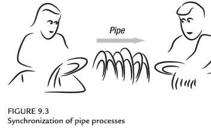

^7 他们晚餐吃了什么并未具体说明。

## 9.3.2 FIFO

对于传统管道，两个独立程序访问同一管道的唯一方法是通过文件描述符继承。这意味着进程必须是共同父进程的子进程，或者一个是另一个的祖先。

这可能是一个严重的限制。许多系统服务作为 *守护进程* 运行，这些是断开的长时间运行进程。需要一种简单的方式向此类进程发送数据（并可能从它们接收数据）。文件不适合此用途；同步困难甚至不可能，而且由于没有共同祖先，无法创建管道来完成这项工作。

为了解决这个问题，System III 发明了 FIFO 的概念。FIFO，^8 或 *命名管道*，是文件系统中像管道一样工作的文件。换句话说，一个进程打开 FIFO 以进行写入，而另一个进程打开它以进行读取。随后写入 FIFO 的数据将由读取者读取。数据由内核缓冲，不存储在磁盘上。

考虑一个行式打印机缓冲器。缓冲器守护进程控制物理打印机，创建逐个打印的打印任务。要将任务添加到队列中，用户级行式打印机软件必须与缓冲器守护进程通信。实现方式之一是由缓冲器创建一个具有众所周知文件名的 FIFO。用户软件然后可以打开 FIFO，向其中写入请求并关闭它。缓冲器在一个循环中等待，从 FIFO 读取请求并处理它们。

`mkfifo()` 函数创建 FIFO 文件：

```c
#include <sys/types.h>            POSIX
#include <sys/stat.h>
int mkfifo(const char *pathname, mode_t mode);
```

pathname 参数是要创建的 FIFO 文件的名称，mode 是赋予它的权限，类似于 create() 的第二个参数或 open() 的第三个参数（见第 4.6 节“创建文件”，第 106 页）。FIFO 文件与其他文件一样通过 remove() 或 unlink() 移除（见第 5.1.5.1 节“移除打开的文件”，第 127 页）。

GNU/Linux *mkfifo*(3) 手册页指出，在进行 I/O 之前，FIFO 必须同时打开读和写：“打开 FIFO 以进行读取通常阻塞，直到另一个进程以写入方式打开同一个 FIFO，反之亦然。”一旦 FIFO 文件被打开，它就像普通管道一样工作；也就是说，它只是另一个文件描述符。

`mkfifo` 命令将这一系统调用带入了命令级别。这使得展示 FIFO 文件的实际运行变得容易：

```bash
$ mkfifo afifo                     Create a FIFO file
$ ls -l afifo
prw-r--r--      1 arnold    devel       0  Oct 23 15:49 afifo
$ cat < afifo &                     Start a reader in the background
[1] 22100
$ echo It was a Blustery Day > afifo Send data to FIFO
$ It was a Blustery Day           Shell prompts, cat prints data
                                  Press ENTER to see job exit status
[1]+ Done             cat <afifo      cat exited
```

## 9.4 文件描述符管理

此时，拼图的大部分已经就位。fork() 和 exec() 创建进程并在其中运行程序。pipe() 创建一个可用于 IPC 的管道。仍然缺少的是将管道的文件描述符移动到管道中生产者和消费者的标准输出和标准输入位置的方法。

dup() 和 dup2() 系统调用，连同 close()，让你可以移动（更准确地说，是复制）一个打开的文件描述符到另一个编号。fcntl() 系统调用允许你做同样的事情，并操作打开文件的几个重要属性。


## 9.4.1 复制打开的文件：dup() 和 dup2()

两个系统调用可以创建打开文件描述符的副本：

```c
#include <unistd.h>
int dup(int oldfd);
int dup2(int oldfd, int newfd);
```

这两个函数的功能如下：

**int dup(int oldfd)**

返回最低未使用的文件描述符值；它是 oldfd 的副本。dup() 成功时返回非负整数，失败时返回 -1。

**int dup2(int oldfd, int newfd)**

使 newfd 成为 oldfd 的副本；如果 newfd 已打开，则先将其关闭，效果等同于 close()。dup2() 返回新的描述符，如果出现问题则返回 -1。

还记得图 9.1 吗？在该图中，两个进程共享指向内核文件表中同一文件条目的指针。是的，dup() 和 dup2() 在单个进程内部创建的就是这种同样的情况。参见图 9.4。

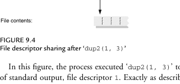

**图 9.4** 在 `dup2(1, 3)` 之后文件描述符的共享情况

在本图中，进程执行了 `dup2(1, 3)`，使文件描述符 3 成为标准输出（文件描述符 1）的副本。正如之前描述的那样，这两个描述符共享打开文件的文件偏移量。

在第 4.4.2 节“打开和关闭文件”（第 93 页）中，我们提到 `open()`（以及 `creat()`）*总是*返回正在打开的文件的最低未使用整数文件描述符值。几乎所有返回新文件描述符的系统调用都遵循此规则，不仅仅是 `open()` 和 `creat()`。(`dup2()` 是一个例外，因为它提供了一种获取特定新文件描述符的方法，即使它不是最低未使用的描述符。)

结合“返回最低未使用数字”的规则和 `dup()`，现在可以轻松地将管道的文件描述符移入到位，作为标准输入和输出。假设当前进程是一个 shell，并且它需要 `fork` 两个子进程来设置一个简单的两级管道，步骤如下：

1. 使用 `pipe()` 创建管道。必须首先执行此操作，以便两个子进程可以继承打开的文件描述符。
2. 调用我们将称为“左侧子进程”的进程进行 fork。这是其标准输出通过管道的进程。在此子进程中，执行以下操作：
   a. 使用 `close(pipefd[0])`，因为左侧子进程不需要管道的读取端。
   b. 使用 `close(1)` 关闭原始标准输出。
   c. 使用 `dup(pipefd[1])` 将管道的写入端复制到文件描述符 1。
   d. 使用 `close(pipefd[1])`，因为不需要打开描述符的两个副本。
   e. 执行要运行的程序。
3. 调用我们将称为“右侧子进程”的进程进行 fork。这是其标准输入来自管道的进程。此子进程中的步骤是左侧子进程步骤的镜像：
   a. 使用 `close(pipefd[1])`，因为右侧子进程不需要管道的写入端。
   b. 使用 `close(0)` 关闭原始标准输入。
   c. 使用 `dup(pipefd[0])` 将管道的读取端复制到文件描述符 0。
   d. 使用 `close(pipefd[0])`，因为不需要打开描述符的两个副本。
   e. 执行要运行的程序。
4. 在父进程中，关闭管道的两端：`close(pipefd[0]); close(pipefd[1])`。
5. 最后，在父进程中使用 `wait()` 等待两个子进程完成。

注意关闭管道文件描述符中未使用的副本是多么重要。正如我们之前指出的，直到最后一个打开的文件描述符被关闭，文件才会被关闭。即使多个进程共享文件描述符，这一事实也成立。关闭未使用的文件描述符之所以重要，是因为直到*所有*写入端的副本都被关闭，从管道读取的进程才会收到文件结束指示。

在我们的情况下，在两个子进程被 fork 后，有三个进程，每个进程都有两个管道文件描述符的副本：父进程和两个子进程。父进程关闭两端，因为它不需要管道。左侧子进程通过管道写入，因此它必须关闭读取端。右侧子进程从管道读取，因此它必须关闭写入端。这就只剩下每个文件描述符的一个副本是打开的。

当左侧子进程完成时，它退出。然后系统关闭其所有文件描述符。当这种情况发生时，右侧子进程最终会收到文件结束通知，它也可以随后完成并退出。

以下程序 `ch09-pipeline.c` 创建了等同于以下 shell 管道的效果：

```bash
$ echo hi there | sed s/hi/hello/g
hello there
```

这是该程序：

```c
1  /* ch09-pipeline.c --- fork two processes into their own pipeline.
2                     Minimal error checking for brevity. */
3
4  #include <stdio.h>
5  #include <errno.h>
6  #include <sys/types.h>
7  #include <sys/wait.h>
8  #include <unistd.h>
9
10 int pipefd[2];
11
12 extern void left_child(void), right_child(void);
13
14 /* main --- fork children, wait for them to finish */
15
16 int main(int argc, char **argv)
17 {
18 	pid_t left_pid, right_pid;
19 	pid_t ret;
20 	int status;
21 
22 	if (pipe(pipefd) < 0) 	/* create pipe, very first thing */
23 		perror("pipe");
24 		exit(1);
25 	}
26 
27 	if ((left_pid = fork() < 0) { 	/* fork left-hand child */
28 		perror("fork");
29 		exit(1);
30 	} else if (left_pid == 0)
31 		left_child();
32 
33 	if ((right_pid = fork() < 0) { 	/* fork right-hand child */
34 		perror("fork");
35 		exit(1);
36 	} else if (right_pid == 0)
37 		right_child();
38 
39 	close(pipefd[0]); 			/* close parent's copy of pipe */
40 	close(pipefd[1]);
41 
42 	while ((ret = wait(&status)) > 0) { 	/* wait for children */
43 		if (ret == left_pid)
44 			printf("left child terminated, status: %d\n", status);
45 		else if (ret == right_pid)
46 			printf("right child terminated, status: %d\n", status);
47 		else
48 			printf("%ow! unknown child %d terminated, status %d\n",
49 				ret, status);
50 	}
51 	return 0;
52 }
```

第 22–25 行创建管道。必须首先执行此操作。

第 27–31 行创建左侧子进程，第 33–37 行创建右侧子进程。在这两种情况下，父进程通过 main() 继续线性执行路径，而子进程调用适当的函数来操作文件描述符并执行 exec。

第 39–40 行关闭父进程的管道副本。

第 42–50 行循环，收割子进程，直到 wait() 返回错误。

### 9.4 文件描述符管理

```c
55   /* left_child --- do the work for the left child */
57   void left_child(void)
58   {
59       static char *left_argv[] = { "echo", "hi", "there", NULL };
60       
61       close(pipefd[0]);
62       close(1);
63       dup(pipefd[1]);
64       close(pipefd[1]);
65       
66       execvp("echo", left_argv);
67       _exit(errno == ENOENT ? 127 : 126);
68   }
69   
70   /* right_child --- do the work for the right child */
72   void right_child(void)
73   {
74       static char *right_argv[] = { "sed", "s/hi/hello/g", NULL };
75       
76       close(pipefd[1]);
77       close(0);
78       dup(pipefd[0]);
79       close(pipefd[0]);
80       
81       execvp("sed", right_argv);
82       _exit(errno == ENOENT ? 127 : 126);
83   }
```

第 57–68 行是左侧子进程的代码。该过程遵循上述步骤，关闭不需要的管道端，关闭原始标准输出，将管道的写入端 dup() 到 1，然后关闭原始写入端。此时，第 66 行调用 execvp()，如果失败，第 67 行调用 _exit()。（请记住，如果 execvp() 成功，第 67 行永远不会被执行。）

第 72–83 行对右侧子进程执行类似的步骤。这是其运行时发生的情况：

```text
$ ch09-pipeline                          运行程序
left child terminated, status: 0         左侧子进程在输出前结束 (!)
hello there                              来自右侧子进程的输出
$ ch09-pipeline                          运行程序
hello there                              来自右侧子进程的输出，以及...
right child terminated, status: 0        右侧子进程在左侧子进程之前结束
left child terminated, status: 0
```


请注意，子进程完成的顺序并不是确定性的。它取决于系统负载以及可能影响进程调度的许多其他因素。在编写创建多个进程的代码时，应谨慎避免做出任何顺序假设，特别是那些调用 `wait()` 函数族的代码。

整个过程如图 9.5 所示。

图 9.5 (a) 描绘了父进程创建管道（第 22–25 行）和两个子进程（第 27–37 行）之后的情况。

图 9.5 (b) 显示了父进程关闭管道（第 39–40 行）并开始等待子进程（第 42–50 行）之后的情况。每个子进程已将管道移动到正确位置，作为标准输出（左子进程，第 61–63 行）和标准输入（第 76–78 行）。

最后，图 9.5 (c) 描绘了子进程关闭原始管道（第 64 和 79 行）并调用 `execvp()`（第 66 和 81 行）之后的情况。

## 9.4.2 创建非线性管道：/dev/fd/XX

许多现代 Unix 系统，包括 GNU/Linux，都支持 `/dev/fd` 目录中的特殊文件。这些文件代表打开的文件描述符，名称如 `/dev/fd/0`、`/dev/fd/1` 等。将这样的名称传递给 `open()` 会返回一个新的文件描述符，其效果等同于对给定的文件描述符编号调用 `dup()`。

这些特殊文件在 shell 层面得到应用：Bash、ksh88（某些版本）和 ksh93 shell 提供了一项称为**过程替换**（process substitution）的功能，这使得创建非线性管道成为可能。在 shell 层面的表示法中，输入管道使用 `<(...)`，输出管道使用 `>(...)`。例如，假设你希望将 `diff` 命令应用于两个命令的输出。通常你必须使用临时文件：

```text
command1 > /tmp/out.$$1
command2 > /tmp/out.$$2
diff /tmp/out.$$1 /tmp/out.$$2
rm /tmp/out.$$1 /tmp/out.$$2
```

使用过程替换，它看起来像这样：

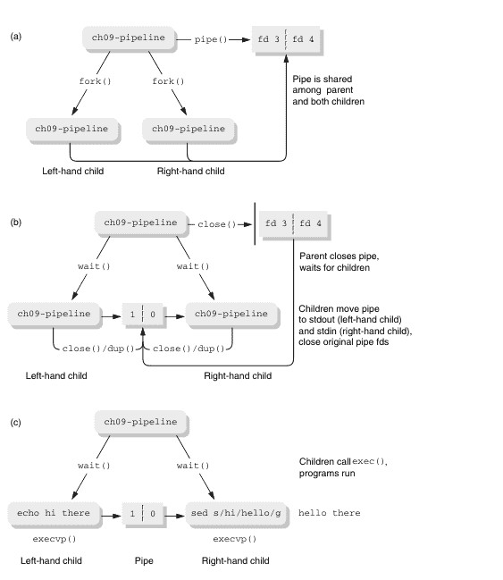


```text
diff <(command1) <(command2)
```

无需再记住清理那些杂乱的临时文件。例如，以下命令显示我们的 home 目录是另一个目录的符号链接：

```text
$ **diff** <(pwd) <(/bin/pwd)
1c1
< /home/arnold/work/prenhall/progex
---
> /d/home/arnold/work/prenhall/progex
```

普通的 `pwd` 是内置于 shell 的命令。它打印由 shell 通过 `cd` 管理的当前逻辑路径名。`/bin/pwd` 程序执行物理文件系统遍历以打印路径名。

过程替换是如何工作的？shell 创建子命令（'pwd' 和 '/bin/pwd'）。每个命令的输出都连接到一个管道，其读取端对主进程（'diff'）的一个新文件描述符打开。然后 shell 将 `/dev/fd` 中文件的名称作为命令行参数传递给主进程。我们可以通过在 shell 中启用执行跟踪来看到这一点：

```text
$ **set -x**                                          *开启执行跟踪*
$ **diff** <(pwd) <(/bin/pwd)                        *运行命令*
$ diff /dev/fd/3 /dev/fd/2   *Shell 跟踪：主程序，注意参数*
++ pwd                                  *Shell 跟踪：子程序*
++ /bin/pwd
1c1                                       *diff 的输出*
< /home/arnold/work/prenhall/progex
---
> /d/home/arnold/work/prenhall/progex
```

图 9.6 对此进行了说明。

如果你的系统有 `/dev/fd`，你也可以利用这一功能。不过，务必小心，记录你正在做的事情。C 语言层面的文件描述符操作比相应的 shell 表示法要缺乏透明度得多！

## 9.4.3 管理文件属性：fcntl()

`fcntl()`（“file control”，文件控制）系统调用提供了对文件描述符本身或底层打开文件的杂项属性的控制。GNU/Linux 的 `fcntl(2)` 手册页这样描述它：

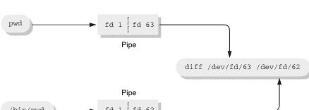

**图 9.6**
过程替换

```c
#include <unistd.h>            POSIX
#include <fcntl.h>

int fcntl(int fd, int cmd);
int fcntl(int fd, int cmd, long arg);
int fcntl(int fd, int cmd, struct flock *lock);
```

换句话说，它至少接受两个参数；根据第二个参数，它可能接受第三个参数。

最后一种形式中，第三个参数是指向 `struct flock` 的指针，用于执行文件锁。文件锁本身是一个很大的话题；我们将讨论推迟到第 14.2 节“文件锁定”，第 531 页。

### 9.4.3.1 关闭-on-exec 标志

在 `fork()` 之后且在 `exec()` 之前，你应确保新程序仅继承它所需的打开文件。除非应当如此，否则你不想让子进程干扰父进程的打开文件。反过来，如果父进程打开了许多文件，这人为地限制了子进程可以打开的新文件数量。（参见旁边的边栏。）

在组织结构上，这种行为可能会带来问题。你程序中启动新子进程的部分并不特别需要访问你程序中操作打开文件的其他部分。并且，像下面这样的循环是痛苦的，因为可能没有任何打开的文件：

```c
int j;

for (j = getdtblsize(); j >= 3; j--)     /* 关闭除 0, 1, 2 之外的所有文件 */
    (void) close(j);
```

解决方案是**关闭-on-exec 标志**（close-on-exec flag）。这是*文件描述符本身*的属性，而不是底层打开文件的属性。当此标志设置时，系统在进程执行 `exec` 时自动关闭该文件。通过在你打开文件时立即设置此标志，你无需担心任何子进程意外继承它。（shell 自动为其打开的所有编号为 3 及以上的文件描述符设置此标志。）

*cmd* 参数有两个与关闭-on-exec 标志相关的值：

-   **F_GETFD**
    检索文件描述符标志。返回值是所有文件描述符标志的设置，或在出错时为 −1。
-   **F_SETFD**
    将文件描述符标志设置为 *arg*（第三个参数）中的值。成功时返回值为 0，出错时为 −1。

目前，只定义了一个“文件描述符标志”：**FD_CLOEXEC**。这个符号常量是 POSIX 的发明，大多数代码直接使用 1 或 0：

```c
if (fcntl(fd, F_SETFD, 1) < 0) ...  /* 设置 close-on-exec，处理任何错误 */
if (fcntl(fd, F_GETFD) == 1) ...     /* close-on-exec 位已设置 */
```

然而，POSIX 定义允许未来的扩展，因此编写此类代码的正确方式更倾向于这样：

```c
int fd;
long fd_flags;

if ((fd_flags = fcntl(fd, F_GETFD)) < 0)            /* 检索标志 */
    /* 处理错误 */

fd_flags |= FD_CLOEXEC;                              /* 添加 close-on-exec 标志 */
if (fcntl(fd, F_SETFD, fd_flags) < 0)                /* 设置标志 */
    /* 处理错误 */
```

*POSIX 标准故意不赋予其一个值。然而，为了让旧代码继续工作，任何实现唯一能合理使用的值都是 1。*

**注意** 关闭-on-exec 标志是*描述符*的属性，而不是底层*文件*的属性。因此，由 `dup()` 或 `dup2()`（或即将看到的带有 `F_DUPFD` 的 `fcntl()`）返回的新描述符*不会*继承原始描述符的关闭-on-exec 标志设置。如果你希望新的文件描述符也设置该标志，你必须记得自己去做。这种行为是有道理的：如果你刚刚调用了 `dup()`，将管道的一端复制到 0 或 1，你不想让系统在进程执行 `exec` 时立即为你关闭它！

### 来自 gawk 的关闭-on-exec 战争故事

在 `awk` 语言中，I/O 语句使用与 shell 类似的重定向表示法。这包括与子进程之间的双向管道：

```awk
print "something brilliant" > "/some/file*"          /* 输出到文件 */
getline my_record < "/some/other/file"                 /* 从文件输入 */

print "more words of wisdom" | "a_reader process"     /* 输出到子进程 */
"a_writer process" | getline some_input                /* 从子进程输入 */
```

`awk` 解释器为所有文件重定向都有一个打开的文件描述符，对于创建子进程的管道表示法，`awk` 解释器创建一个管道，然后执行 `fork` 和 `exec` 一个 shell 以运行字符串指定的命令。

现在，在现代系统中，C 运行时启动代码的一部分（在调用 `main()` 之前运行）需要临时打开文件以管理共享库的使用。这意味着在 `exec` 之后，一个全新的程序至少必须有一个或两个未使用的文件描述符可用，否则程序根本无法运行。

有一天，用户报告说，当 `awk` 程序打开了最大数量的文件时，它尝试 `fork` 和 `exec` 用于管道的任何子进程都会启动失败！你大概能猜到发生了什么。子 shell 继承了 `gawk` 自身用于重定向的所有打开文件描述符。我们修改了 `gawk`，为所有文件和管道重定向设置*关闭-on-exec* 标志，这修复了问题。

### 9.4.3.2 文件描述符复制

当 `fcntl()` 的 `cmd` 参数为 `F_DUPFD` 时，其行为类似于但不完全等同于 `dup2()`。在这种情况下，`arg` 是代表新文件描述符的*最低可接受值*的文件描述符：


你可以通过使用 `fcntl(old_fd, F_DUPFD, 0)` 来模拟 `dup()` 的行为，后者返回最低的可用文件描述符。

如果你记得文件描述符只是内部表中的索引，那么理解这个函数的工作原理应该就清楚了。第三个参数仅仅是提供了内核开始搜索未使用文件描述符的起始索引。

在你的代码中使用 `fcntl()` 配合 `F_DUPFD`，还是使用 `dup()` 或 `dup2()`，在很大程度上是个人偏好问题。这三个 API 都是 POSIX 的一部分，并被广泛支持。我们稍微倾向于使用 `dup()` 和 `dup2()`，因为它们在操作上更具体，因此更具自我文档性。但由于它们都很简单，这个理由可能无法说服你。

## 9.4.3.3 文件状态标志和访问模式的操作

在第 4.6.3 节“重温 open()”，第 110 页中，我们提供了 `open()` 接受的 O_\_xx 标志的完整列表。POSIX 按功能对它们进行分类，如表 9.4 所述。

### 表 9.4
open()、creat() 和 fcntl() 的 O_\_xx 标志

| 类别 | 函数 | 标志 |
| :--- | :--- | :--- |
| 文件访问 | open(), fcntl() | O_RDONLY, O_RDWR, O_WRONLY |
| 文件创建 | open() | O_CREAT, O_EXCL, O_NOCTTY, O_TRUNC |
| 文件状态 | open(), fcntl() | O_APPEND, O_DSYNC, O_NONBLOCK, O_RSYNC, O_SYNC |

除了使用 `open()` 最初设置各种标志外，你还可以使用 `fcntl()` 来获取当前设置，以及更改它们。这分别通过使用 cmd 的 `F_GETFL` 和 `F_SETFL` 值来实现。例如，你可以使用这些命令来更改非阻塞标志 `O_NONBLOCK` 的设置，如下所示：

```c
int fd_flags;

if ((fd_flags = fcntl(fd, F_GETFL)) < 0)
  /* 处理错误 */

if ((fd_flags & O_NONBLOCK) != 0) {       /* 设置了非阻塞标志 */
    fd_flags &= ~O_NONBLOCK;              /* 清除它 */
    if (fcntl(fd, F_SETFL, fd_flags) != 0)  /* 给内核新值 */
      /* 处理错误 */
}
```

除了模式本身，`O_ACCMODE` 符号常量是一个掩码，你可以使用它从返回值中检索文件访问模式：

```c
fd_flags = fcntl(fd, F_GETFL);

switch (fd_flags & O_ACCMODE) {
case O_RDONLY:
    ... 只读操作 ...
    break;
case O_WRONLY:
    ... 只写操作 ...
    break;
case O_RDWR:
    ... 读写操作 ...
    break;
}
```

POSIX 要求 `O_RDONLY`、`O_RDWR` 和 `O_WRONLY` 在位上互不相同；因此，如上所示的代码保证有效，并且是确定任意文件描述符如何打开的一种简单方法。

通过使用 `F_SETFL`，你也可以更改这些模式，尽管权限检查仍然适用。根据 GNU/Linux 的 `fcntl(2)` 手册页，如果打开文件时使用了 `O_APPEND` 标志，则无法清除该标志。

## 9.4.3.4 管道和 FIFO 的非阻塞 I/O

 earlier, we used the metaphor of two people washing and drying dishes, and using a dish drainer to describe the way a pipe works: when the drainer fills up, the dishwasher stops, and when it empties out, the dishdryer stops. This is blocking behavior: The producer or consumer blocks in the call to `write()` or `read()`, waiting either for more room in the pipe or for more data to come into it. -> 之前，我们使用了两个人洗碗和烘干碗的比喻，以及使用滤水架来描述管道的工作方式：当滤水架装满时，洗碗工停止工作；当滤水架清空时，烘干工停止工作。这是阻塞行为：生产者或消费者在调用 `write()` 或 `read()` 时阻塞，等待管道中有更多空间或有更多数据进入。

In the real world, a human being waiting for the dish drainer to empty out or fill up would not just stand by, immobile.12 Rather, the idle one would go and find some other kitchen task to do (such as sweeping up all the kids’ crumbs on the floor) until the dish drainer was ready again. -> 在现实世界中，等待滤水架清空或装满的人不会只是站着不动。12 相反，空闲的一方会去找其他厨房任务做（例如清扫地上孩子们留下的所有面包屑），直到滤水架再次准备好。

In Unix/POSIX parlance, this concept is termed nonblocking I/O. That is, the requested I/O either completes or returns an error value indicating no data (for the reader) or no room (for the writer). Nonblocking I/O applies to pipes and FIFOs, not to regular disk files. It can also apply to certain devices, such as terminals, and to network connections, both of which are beyond the scope of this volume. -> 在 Unix/POSIX 术语中，这个概念被称为非阻塞 I/O。也就是说，请求的 I/O 要么完成，要么返回一个指示没有数据（对于读取者）或没有空间（对于写入者）的错误值。非阻塞 I/O 适用于管道和 FIFO，不适用于普通磁盘文件。它也适用于某些设备，如终端，以及网络连接，这两者都超出了本书的范围。

The `O_NONBLOCK` flag can be used with `open()` to specify nonblocking I/O, and it can be set or cleared with `fcntl()`. For `open()` and `read()`, nonblocking I/O is straightforward. -> 可以使用 `O_NONBLOCK` 标志配合 `open()` 来指定非阻塞 I/O，并且可以通过 `fcntl()` 设置或清除该标志。对于 `open()` 和 `read()`，非阻塞 I/O 很直观。

Opening a FIFO with `O_NONBLOCK` set or clear displays the following behavior: -> 以 `O_NONBLOCK` 设置或清除的状态打开 FIFO 时，表现出以下行为：

```
open("/fifo/file", O_RDONLY, mode)
```
Blocks until the FIFO is opened for writing. -> 阻塞，直到 FIFO 被打开用于写入。

```
open("/fifo/file", O_RDONLY|O_NONBLOCK, mode)
```
Opens the file, returning immediately. -> 打开文件，立即返回。

```
open("/fifo/file", O_WRONLY, mode)
```
Blocks until the FIFO is opened for reading. -> 阻塞，直到 FIFO 被打开用于读取。

```
open("/fifo/file", O_WRONLY|O_NONBLOCK, mode)
```
If the FIFO has been opened for reading, opens the FIFO and returns immediately. Otherwise, returns an error (return value of -1 and errno set to ENXIO). -> 如果 FIFO 已打开用于读取，则打开 FIFO 并立即返回。否则，返回错误（返回值为 -1 且 errno 设置为 ENXIO）。

As described for regular pipes, a `read()` of a FIFO that is no longer open for writing returns end-of-file (a return value of 0). The `O_NONBLOCK` flag is irrelevant in this case. Things get more interesting for an *empty* pipe or FIFO: one that is still open for writing but that has no data in it: -> 正如普通管道中描述的那样，对不再打开用于写入的 FIFO 的 `read()` 返回文件末尾（返回值为 0）。在这种情况下，`O_NONBLOCK` 标志无关紧要。对于一个*空*管道或 FIFO，情况变得更有意思：即仍然打开用于写入但没有数据的管道：

```
read(fd, buf, count), and O_NONBLOCK clear
```
The `read()` blocks until more data come into the pipe or FIFO. -> `read()` 阻塞，直到有更多数据进入管道或 FIFO。

```
read(fd, buf, count), and O_NONBLOCK set
```
The `read()` returns -1 immediately, with errno set to EAGAIN. -> `read()` 立即返回 -1，errno 设置为 EAGAIN。

Finally, `write()` behavior is more complicated. To discuss it we have to first introduce the concept of an *atomic write*. An atomic write is one in which all the requested data are written together, without being interleaved with data from other writes. POSIX defines the constant `PIPE_BUF` in `<unistd.h>`. Writes of amounts less than or equal to `PIPE_BUF` bytes to a pipe or FIFO either succeed or block, according to the details we get into shortly. The minimum value for `PIPE_BUF` is `_POSIX_PIPE_BUF`, which is 512. `PIPE_BUF` itself can be larger; current GLIBC systems define it to be 4096, but in any case you should use the symbolic constant and not expect PIPE_BUF to be the same value across different systems. -> 最后，`write()` 的行为更复杂。为了讨论它，我们首先需要引入*原子写*的概念。原子写是指所有请求的数据一起写入，而不与其他写入的数据交错。POSIX 在 `<unistd.h>` 中定义了常量 `PIPE_BUF`。向管道或 FIFO 写入小于或等于 `PIPE_BUF` 字节的数量，要么成功，要么阻塞，具体细节稍后讨论。`PIPE_BUF` 的最小值是 `_POSIX_PIPE_BUF`，即 512。`PIPE_BUF` 本身可能更大；当前 GLIBC 系统将其定义为 4096，但无论如何，你应该使用符号常量，而不要期望 PIPE_BUF 在不同系统中具有相同的值。

In all cases, for pipes and FIFOs, a `write()` appends data to the end of the pipe. This derives from the fact that pipes don’t have file offsets: They aren’t seekable. -> 在所有情况下，对于管道和 FIFO，`write()` 将数据追加到管道的末尾。这源于管道没有文件偏移量的事实：它们不可定位。

Also in all cases, as mentioned, writes of up to `PIPE_BUF` are atomic: The data are not interleaved with the data from other writes. Data from a write of more than `PIPE_BUF` bytes can be interleaved with the data from other writes on arbitrary boundaries. This last means that you cannot expect every `PIPE_BUF` 子块 of a large amount of data to be written atomically. The `O_NONBLOCK` setting does not affect this rule. -> 同样在所有情况下，正如提到的，最多 `PIPE_BUF` 的写入是原子的：数据不会与其他写入的数据交错。超过 `PIPE_BUF` 字节的写入的数据可以在任意边界与其他写入的数据交错。最后一点意味着你不能期望大量数据中每个 `PIPE_BUF` 子块都原子写入。`O_NONBLOCK` 设置不影响此规则。

As with `read()`, when `O_NONBLOCK` is not set, `write()` blocks until all the data are written. -> 与 `read()` 一样，当未设置 `O_NONBLOCK` 时，`write()` 阻塞直到所有数据写入。

Things are most complicated with `O_NONBLOCK` set. For a pipe or FIFO, the behavior is as follows: -> 当设置 `O_NONBLOCK` 时，情况最为复杂。对于管道或 FIFO，行为如下：

|                          | space ≥ nbytes                |                       space < nbytes                       |
|:-------------------------|:---------------------------------------------:|:----------------------------------------------------------:|
| nbytes ≤ PIPE_BUF |          write() succeeds           |                    write() returns -1/EAGAIN                    |
|                          |                      space > 0                      |                          space = 0                           |
| nbytes > PIPE_BUF | write() writes what it can | write() returns -1/EAGAIN |

-> 

|                          | 空间 ≥ nbytes             |                      空间 < nbytes                     |
|:-------------------------|:---------------------------------------------:|:----------------------------------------------------------:|
| nbytes ≤ PIPE_BUF |          write() 成功          |                    write() 返回 -1/EAGAIN                   |
|                          |                      空间 > 0                     |                          空间 = 0                          |
| nbytes > PIPE_BUF | write() 写入尽可能多 | write() 返回 -1/EAGAIN |

For nonpipe and non-FIFO files to which `O_NONBLOCK` can be applied, the behavior is as follows: -> 对于可以应用 `O_NONBLOCK` 的非管道和非 FIFO 文件，行为如下：

- space > 0: `write()` writes what it can. -> - 空间 > 0：`write()` 写入尽可能多。
- space = 0: `write()` returns -1/EAGAIN. -> - 空间 = 0：`write()` 返回 -1/EAGAIN。

Although there is a bewildering array of behavior changes based on pipe/nonpipe, `O_NONBLOCK` set or clear, the space available in the pipe, and the size of the attempted write, the rules are intended to make programming straightforward: -> 尽管基于管道/非管道、`O_NONBLOCK` 设置或清除、管道中可用空间以及尝试写入的大小，存在令人眼花缭乱的行为变化数组，但这些规则旨在使编程简单明了：

- End-of-file is always distinguishable: `read()` returns zero bytes. -> - 文件末尾始终可区分：`read()` 返回零字节。
- If no data are available to be read, `read()` either succeeds or returns a “nothing to read” indication: `EAGAIN`, which means “try again later.” -> - 如果没有数据可供读取，`read()` 要么成功，要么返回“没有可读内容”的指示：`EAGAIN`，意为“稍后再试”。
- If there’s no room to write data, `write()` either blocks until it can succeed (`O_NONBLOCK` clear) or it fails with a “no room right now” error: `EAGAIN`. -> - 如果没有空间写入数据，`write()` 要么阻塞直到可以成功（`O_NONBLOCK` 清除），要么以“当前没有空间”的错误失败：`EAGAIN`。


• 只要有空间，就会写入尽可能多的数据，最终所有数据都能写入。

总之，如果你打算使用非阻塞 I/O，任何使用 `write()` 的代码都必须能够处理短写入（short write），即成功写入的量少于请求量。健壮的代码本来就应该这样编写。即使是普通文件，磁盘也可能会写满，导致 `write()` 仅部分成功。

此外，你应当准备好处理 EAGAIN，并明白在这种情况下 `write()` 失败不一定是致命错误。同样，使用非阻塞 I/O 进行读取的代码也应意识到，此处的 EAGAIN 也不是致命的。（不过，统计此类发生的次数可能是有益的，如果在某些阈值后过多，可以放弃。）

毫无疑问，非阻塞 I/O 会让你的生活变得复杂。但对于许多应用程序来说，这是完成任务的必要条件。再想想打印任务调度器（spooler）。守护进程不能坐在对接收作业提交的 FIFO 文件的阻塞 `read()` 上。它必须能够监控正在运行的作业，并且可能需要定期检查打印机设备的状态（例如，确保有纸张或没有卡纸）。

## 9.4.3.5 `fcntl()` 摘要

`fcntl()` 系统调用在表 9.5 中进行了总结。

**表 9.5**
`fcntl()` 摘要

| cmd 值 | arg 值 | 返回值 |
| :--- | :--- | :--- |
| `F_DUPFD` | 最低新描述符 | `fd` 参数的副本。 |
| `F_GETFD` | | 获取文件描述符标志（close-on-exec）。 |
| `F_SETFD` | 新标志值 | 设置文件描述符标志（close-on-exec）。 |
| `F_GETFL` | | 获取底层文件的标志。 |
| `F_SETFL` | 新标志值 | 设置底层文件的标志。 |

当文件描述符被复制时，文件创建、状态和访问标志会被复制，但 close-on-exec 标志不会。

## 9.5 示例：gawk 中的双向管道

双向管道以双向方式连接两个进程。通常，对于至少其中一个进程，其标准输入和标准输出都设置到另一个进程的管道上。Korn shell (ksh) 在语言层面引入了双向管道，称其为协作进程（coprocess）：

```
database engine command and arguments |&
print -p "database_command"
read -p db_response
```

这里，*database engine* 代表任何可以由前端（在此情况下为 ksh 脚本）驱动的后端程序。*database engine* 的标准输入和标准输出通过两条独立的一向管道连接到 shell。<sup>13</sup> 如图 9.7 所示。

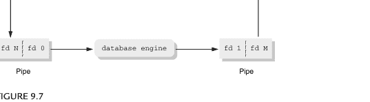

**图 9.7**
Korn shell 协作进程

在常规 awk 中，与子进程之间的管道是单向的：没有方法向程序发送数据并读取其响应——你必须使用临时文件。GNU gawk 借鉴了 ksh 的 `|&` 符号来扩展 awk 语言：

```
print "a_command" |& "database_engine"
"database_engine" |& getline db_response
```

gawk 还使用 `|&` 符号表示 TCP/IP 套接字和 BSD 端门（portals），这些在本卷中未涵盖。以下是 gawk 3.1.3 发行版中 i0.c 里的代码片段，它是 `two_way_open()` 函数中设置简单协作进程的部分：它创建两个管道，派生子进程，并执行所有文件描述符操作。我们省略了一些不相关的代码片段（这个函数比必要的大）：

```c
1561     static int
1562 two_way_open(const char *str, struct redirect *rp)
1563 {
...
1827     /* case 3: two way pipe to a child process */
1828 {
1829     int ptoc[2], ctop[2];
1830     int pid;
1831     int save_errno;
1835
1836     if (pipe(ptoc) < 0)
1837     return FALSE; /* errno set, diagnostic from caller */
1839     if (pipe(ctop) < 0) {
1840     save_errno = errno;
1841     close(ptoc[0]);
1842     close(ptoc[1]);
1843     errno = save_errno;
1844     return FALSE;
1845     }
```

第一步是创建两个管道，ptoc 是“父进程到子进程”，ctop 是“子进程到父进程”。阅读代码时请记住，索引 0 是读端，索引 1 是写端。

第 1836–1837 行创建第一个管道 ptoc。第 1839–1845 行创建第二个管道，如果失败则关闭第一个。这很重要。未能关闭已打开但未使用的管道会导致*文件描述符泄漏*。与内存一样，文件描述符是一种有限资源，一旦用完，就永远消失了。<sup>1</sup> 打开的文件也是如此：确保你的所有错误处理代码在发生故障时总是关闭任何不再需要的打开文件或管道。

`save_errno` 保存由 `pipe()` 设置的 `errno` 值，以防 `close()` 可能失败（第 1840 行）。然后在第 1843 行恢复 `errno`。

> <sup>1</sup> 当然，你可以关闭它们。但如果你不知道它们打开着，那么它们就像内存泄漏中的内存一样，同样有效地丢失了。

```c
1906 if ((pid = fork()) < 0) {
1907 save_errno = errno;
1908 close(ptoc[0]);
1909 close(ptoc[1]);
1910 close(ctop[0]);
1911 close(ctop[1]);
1912 errno = save_errno;
1913 return FALSE;
1914 }
```

第 1906–1914 行派生子进程，这次如果 `fork()` 失败则关闭两个管道。这里也保存并恢复了原始的 `errno` 值，以便稍后用于生成诊断信息。

```c
1914 if (pid == 0) { /* child */
1915     if (close(1) == -1)
1916         fatal(_("close of stdout in child failed (%s)"),
1917             strerror(errno));
1918     if (dup(ctop[1]) != 1)
1919         fatal(_("moving pipe to stdout in child failed (dup: %s)"),
1920             strerror(errno));
1921     if (close(0) == -1)
1922         fatal(_("close of stdin in child failed (%s)"),
1923             strerror(errno));
1924     if (dup(ptoc[0]) != 0)
1925         fatal(_("moving pipe to stdin in child failed (dup: %s)"),
1926             strerror(errno));
1927     if (close(ptoc[0]) == -1 || close(ptoc[1]) == -1 || close(ctop[0]) == -1 || close(ctop[1]) == -1)
1928         fatal(_("close of pipe failed (%s)"), strerror(errno));
1929     /* stder does NOT get dup'ed onto child's stdout */
1930     exec("/bin/sh", "sh", "-c", str, NULL);
1931     _exit(errno == ENOENT ? 127 : 126);
1932 }
```

第 1914–1932 行处理子进程的代码，并在每一步进行适当的错误检查和消息。第 1915 行关闭标准输出。第 1918 行将子进程到父进程的管道写端复制到 1。第 1921 行关闭标准输入，第 1924 行将父进程到子进程的读端复制到 0。如果这些都成功，子进程的标准输入和输出现在已就位，并与父进程连接。

第 1927–1928 行关闭所有四个原始管道文件描述符，因为它们不再需要。第 1929 行提醒我们标准错误保持不变。这是最好的决定，因为用户会看到协作进程的错误。必须捕获标准错误的 awk 程序可以在命令中使用 `"2>&1"` shell 符号将协作进程的标准错误重定向或发送到单独的文件。

最后，第 1930–1931 行尝试在 shell 上运行 `exec()`，如果失败则适当退出。

```c
1934      /* parent */
1935      rp->pid = pid;
1936      rp->iop = iop_alloc(ctop[0], str, NULL);
1937      if (rp->iop == NULL) {
1938           (void) close(ctop[0]);
1939           (void) close(ctop[1]);
1940           (void) close(ptoc[0]);
1941           (void) close(ptoc[1]);
1942           (void) kill(pid, SIGKILL);   /* overkill?  (pardon pun) */
1943           
1944           return FALSE;
1945      }
```

父进程的第一步是管理来自协作进程的输入端。rp 指针指向一个 struct redirect，它维护一个字段用于保存子进程的 PID、用于输出的 FILE * 以及名为 iop 的 IOBUF * 指针。IOBUF 是 gawk 内部用于执行输入的数据结构，它反过来保存底层文件描述符的副本。

第 1935 行保存进程 ID 值。第 1936 行为给定的文件描述符和命令字符串分配一个新的 IOBUF。这里的第三个参数是 NULL；如果必要，它允许使用预分配的 IOBUF。

如果分配失败，第 1937–1942 行通过关闭管道并向子进程发送“kill”信号使其终止来进行清理。（kill() 函数在第 10.6.7 节“发送信号：kill() 和 killpg()”，第 376 页中有描述。）

```c
1946      rp->fp = fdopen(ptoc[1], "w");
1947      if (rp->fp == NULL) {
1948           iop_close(rp->iop);
1949           rp->iop = NULL;
1950           (void) close(ctop[0]);
1951           (void) close(ctop[1]);
1952           (void) close(ptoc[0]);
1953           (void) close(ptoc[1]);
1954           (void) kill(pid, SIGKILL);   /* overkill?  (pardon pun) */
1955           
1956           return FALSE;
1957      }
```

第 1946–1957 行类似。它们设置父进程到子进程的输出，通过 fdopen() 将父进程到子进程管道写端的文件描述符保存在 FILE * 中。如果失败，第 1947–1957 行采取与之前相同的操作：关闭所有管道描述符并向子进程发送信号。

从此点开始，父进程到子进程管道的写端和子进程到父进程管道的读端被保存在更大的结构中：FILE * 和 IOBUF 中。


分别地。它们会被关闭这些结构的常规例程自动关闭。然而，仍有两项任务需要处理：

```
1960      os_close_on_exec(ctop[0], str, "pipe", "from");
1961      os_close_on_exec(ptoc[1], str, "pipe", "from");
1962
1963      (void) close(ptoc[0]);
1964      (void) close(ctop[1]);
1965
1966      return TRUE;
1967  }
1968  ...
1969
```

第 1960–1961 行为将保持打开的两个描述符设置了关闭-on-exec 标志。`os_close_on_exec()` 是一个简单的包装例程，它在 Unix 和 POSIX 兼容系统上执行此操作，但在没有关闭-on-exec 标志的系统上什么也不做。这将在单个位置隐藏可移植性问题，并避免在此处以及 io.c 其他地方的大量杂乱无章的 #ifdefs。

最后，第 1963–1964 行关闭父进程不需要的管道末端，第 1967 行返回 TRUE 表示成功。

## 9.6 建议阅读

作业控制很复杂，涉及进程组、会话、等待机制、信号以及对终端进程组的操纵。因此，我们选择不深入细节。不过，您可能希望参阅以下书籍：

- 1. *《UNIX 环境高级编程》*，第 2 版，作者为 W. Richard Stevens 和 Stephen Rago。 Addison-Wesley，美国马萨诸塞州雷丁，2004 年。ISBN: 0-201-43307-9。
    - 这本书既完整又详尽，涵盖了基础和高阶 Unix 编程。它在讲解进程组、会话、作业控制和信号方面做得非常出色。
- 2. *《4.4 BSD 操作系统的设计与实现》*，作者为 Marshall Kirk McKusick、Keith Bostic、Michael J. Karels 和 John S. Quarterman。Addison-Wesley，美国马萨诸塞州雷丁，1996 年。ISBN: 0-201-54979-4。
    - 这本书对上述内容提供了很好的概览，包括对内核数据结构的讨论，该内容可在该书第 4.8 节中找到。

## 9.7 总结

- 新进程通过 `fork()` 创建。在 `fork` 之后，两个进程运行相同的代码，唯一的区别在于返回值：子进程中为 `0`，父进程中为正数 PID。子进程继承了父进程几乎所有属性的副本，其中打开的文件可能是最重要的。
- 继承的共享文件描述符使得许多高级 Unix 语义和优雅的 Shell 控制结构成为可能。这是最初 Unix 设计中最基本的部分之一。由于描述符共享，一个文件只有在最后一个打开的文件描述符被关闭时才算真正关闭。这特别影响管道，但也影响已 unlink 但仍打开的文件的磁盘块释放。
- `getpid()` 和 `getppid()` 调用分别返回当前和父进程的进程 ID 号。如果父进程死亡，其子进程会被重新托管到特殊的 `init` 进程，PID 为 1。因此，PPID 可能会发生变化，应用程序应为此做好准备。
- `nice()` 系统调用允许您调整进程的优先级。您对其它进程越友善，您的优先级就越低，*反之亦然*。只有超级用户可以降低对其它进程的友善程度。在现代系统上，尤其是单用户系统上，没有真正的理由更改 nice 值。
- `exec()` 系统调用在现有进程中启动新程序。该调用的六个不同版本提供了在设置参数和环境列表方面的灵活性，代价是初期会对使用哪个版本感到困惑。两个变体模拟了 shell 的路径搜索机制，如果文件不是二进制可执行文件，则回退到使用 shell 来解释该文件；应谨慎使用这些变体。
- 新程序的 `argv[0]` 值通常来自正在执行的文件名，但这只是惯例。与 `fork()` 一样，在 `exec` 过程中继承了一组重要但并非完全相同的属性。其他属性被重置为合理的默认值。
- `atexit()` 函数注册在程序终止时按 LIFO 顺序运行的回调函数。`exit()`、`_exit()` 和 `_Exit()` 函数都终止程序，并向父进程传递退出状态。`exit()` 清理打开的 `FILE*` 流并运行通过 `atexit()` 注册的函数。另外两个函数立即退出，仅应在 fork 出的子进程中 `exec` 失败时使用。从 `main()` 返回等同于以给定的返回值调用 `exit()`。在 C99 和 C++ 中，从 `main()` 末尾跌落等同于 `exit(0)`，但这是不好的做法。
- `wait()` 和 `waitpid()` 是用于恢复子进程退出状态的 POSIX 函数。各种宏允许您确定子进程是否正常退出，如果是，确定其退出状态；或者子进程是否因信号而终止，如果是，哪个信号导致了终止。使用特定选项，`waitpid()` 还提供了关于未死亡但已改变状态的子进程的信息。
- GNU/Linux 和大多数 Unix 系统支持 BSD 的 `wait3()` 和 `wait4()` 函数。GNU/Linux 还支持已废弃的 `union wait`。BSD 函数提供 `struct rusage`，允许访问 CPU 时间信息，这可能很有用。不过，如果 `waitpid()` 够用，它是可移植性最好的方式。
- 进程组是更大的作业控制机制的一部分，该机制包括信号、会话以及对终端状态的操纵。`getpgid()` 返回当前进程的进程组 ID，`getpgrp()` 返回特定进程的 PGID。类似地，`setpgid()` 将当前进程的 PGID 设置为其 PID，使其成为进程组 leader；`setpgid()` 允许父进程设置尚未 exec 的子进程的 PGID。
- 管道和 FIFO 在两个进程之间提供单向通信通道。管道必须由共同祖先设置，而任何两个进程都可以使用 FIFO。管道通过 `pipe()` 创建，FIFO 文件通过 `mkfifo()` 创建。管道和 FIFO 对其数据进行缓冲，当管道填满或排空时，会停止生产者或消费者。
- `dup()` 和 `dup2()` 创建打开文件描述符的副本。与 `close()` 结合使用，它们允许将管道文件描述符放置在流水线的标准输入和输出位置。为了使管道正常工作，在执行目标程序之前，必须关闭管道未使用末端的所有副本。`/dev/fd` 可用于创建非线性流水线，正如 Bash 和 Korn shell 的进程替换能力所展示的那样。
- `fcntl()` 是一个用于执行杂项任务的通用函数。它管理文件描述符本身及其底层文件的属性。在本章中，我们看到 `fcntl()` 用于以下方面：
    - 复制文件描述符，模拟 `dup()` 并几乎模拟 `dup2()`。
    - 检索和设置关闭-on-exec 标志。关闭-on-exec 标志是当前唯一的文件描述符属性，但它是重要的。它不会被 `dup()` 操作复制，但应显式设置在不应在 exec 后保持打开的任何文件描述符上。实际上，应对大多数文件描述符执行此操作。
    - 检索和设置控制底层文件的标志。其中，`O_NONBLOCK` 可能最有用，至少对于 FIFO 和管道而言。它绝对是复杂且最标志。

### 练习

1. 编写一个程序，打印有关当前进程的尽可能多的信息：PID、PPID、打开的文件、当前目录、nice 值等。如何判断哪些文件是打开的？如果多个文件描述符引用同一个文件，请指出。（再次，如何判断？）
2. 你认为 `atexit()` 如何存储指向回调函数的指针？实现 `atexit()`，牢记 GNU 的“无任意限制”原则。草拟 `exit()` 的大纲（伪代码）。你缺少什么信息（`<stdio.h>` 库内部细节），导致无法编写 `exit()`？
3. `xargs` 程序旨在当命令行上的参数过多无法直接传递时，多次运行命令和参数。它通过从标准输入读取行，将每一行作为指定命令的独立参数处理，并将参数捆绑在一起，直到参数数量刚好低于系统最大值。例如：

```
$ grep ARG_MAX /usr/include/*.h /usr/include/*/*.h
bash: /bin/grep: Argument list too long

$ find /usr/include -name '*.h' | xargs grep ARG_MAX
/usr/include/sys/param.h:#define NCARGS ARG_MAX
```

*命令行*
*Shell 的错误消息*
*find 和 xargs 有效*


`<limits.h>` 中的常量 `ARG_MAX` 表示环境字符串和命令行参数所占用的内存总量。POSIX 标准并未说明这是否包括指针数组，还是仅指字符串本身。

编写一个简单版本的 `xargs`，使其如描述中那样工作。在计算可用空间时，不要忘记考虑环境。务必仔细管理内存。

4. 由 `wait()` 和 `waitpid()` 填充的 *status* 值的布局在 POSIX 中并未定义。但历史上，它是一个 16 位的值，其布局如**图 9.8**所示。

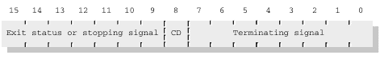

**图 9.8**
`wait()` 返回的 *status* 值布局

- 位 0-7 的非零值表示因信号而终止。
- 信号字段中的所有位均为 1 表示子进程被暂停。在这种情况下，位 9-15 包含信号编号。
- 第 8 位为 1 表示进程终止时发生了核心转储（core dump）。
- 如果位 0-7 为零，则进程正常退出。在这种情况下，位 9-15 为退出状态。

根据这些信息，编写 POSIX 的 `WIFEXITED()` 等宏。

5. 记得 `dup2()` 会先关闭请求的文件描述符，请使用 `close()` 和 `fcntl()` 来实现 `dup2()`。如果 `fcntl()` 返回的值低于请求的值，您将如何处理？

6. 您的系统是否有 `/dev/fd` 目录？如果有，它是如何实现的？

7. 编写 `ch09-pipeline.c` 的一个新版本，该版本只 fork 一个进程。在 fork 之后，父进程应重新安排其文件描述符，并自行 exec 其中一个新程序。

8. （较难）如何判断您的进程是否曾调用过 `chroot()`？编写一个程序来检查并打印一条消息，指示是或否。您的程序会被欺骗吗？如果是，如何？

9. 您的系统是否有 /proc 目录？如果有，它提供哪些每进程信息？

## 第 10 章


### 信号

本章内容

- 10.1 简介 第 348 页
- 10.2 信号操作 第 348 页
- 10.3 标准 C 信号：`signal()` 和 `raise()` 第 349 页
- 10.4 信号处理程序的实际应用 第 353 页
- 10.5 System V Release 3 信号 API：`sigset()` 等 第 365 页
- 10.6 POSIX 信号 第 367 页
- 10.7 用于进程间通信的信号 第 379 页
- 10.8 重要的专用信号 第 382 页
- 10.9 跨越 `fork()` 和 `exec()` 的信号 第 398 页
- 10.10 总结 第 399 页
- 练习 第 401 页

本章涵盖了信号的方方面面，信号是 GNU/Linux API 中重要但复杂的部分。

### 10.1 简介

*信号* 表示某个事件已经发生，例如，尝试引用不属于程序地址空间的内存地址，或者用户按下 CTRL-C 以停止程序（称为*生成中断*）。

您的程序只能获知特定信号至少发生过一次。通常，您无法判断同一信号是否多次发生。您可以区分不同的信号，并控制程序对不同信号的响应方式。

信号处理机制随时间推移而演变。与几乎所有此类机制一样，原始 API 和较新的 API 都已被标准化并可用。然而，在基本 API 中，信号处理显示出可能是最广泛的变化；为了能够使用功能最强大的 API，需要掌握大量内容。因此，这也许是书中难度最高的一章。我们会尽力做出连贯的讲解，但如果您比平时更仔细地研读本章，会很有帮助。

与本书的大多数章节不同，我们这里的讲解是按历史顺序的，涵盖 API 的演变过程，*包括一些您在新代码中绝不应使用的 API。这样做是因为它简化了讲解，使得理解 POSIX `sigaction()` API 为何支持其所有功能变得直截了当。*

### 10.2 信号操作

每个信号（我们稍后提供一个完整列表）都有一个默认的*操作*与之关联。POSIX 将此称为信号的*处置*。此操作是内核在特定信号到达时为进程执行的操作。默认操作各不相同：

- *终止*：进程被终止。
- *忽略*：信号被忽略。程序永远不知道发生了什么。
- *核心转储*：进程被终止，内核在进程当前目录中创建一个*核心*文件，其中包含信号到达时正在运行的程序的映像。核心转储稍后可用于调试器，以检查程序的状态（参见第 15 章“调试”，第 567 页）。

默认情况下，GNU/Linux 系统创建名为 *core.pid* 的文件，其中 *pid* 是被终止进程的进程 ID。（这可以更改；参见 `gcore(8)`。）这种命名允许您将多个*核心*文件存储在同一目录中，代价是涉及磁盘空间。¹ 传统的 Unix 系统将该文件命名为 *core*，如果有机会在同一目录中创建更多文件，保存任何*核心*文件以供后续重新检查的责任在于您。

- *停止*：进程被停止。稍后可以继续。（如果您使用过 shell 作业控制，包括 **CTRL-Z**、**fg** 和 **bg**，您就理解停止进程的含义。）

### 10.3 标准 C 信号：signal() 和 raise()

ISO C 标准定义了原始的 V7 信号管理 API 和一个用于发送信号的新 API。您应该在需要与非 POSIX 系统兼容的程序中使用它们，或者在 ISO C API 提供的功能足以满足需求的情况下使用它们。

#### 10.3.1 signal() 函数

您使用 `signal()` 函数更改信号的操作。您可以将操作更改为“忽略此信号”、“恢复系统对此信号的默认操作”或“当信号发生时调用我的函数，并将信号编号作为参数传递”。

您提供的用于处理信号的函数称为*信号处理程序*（或简称*处理程序*），安装一个处理程序就是安排*捕获*该*信号*。

有了这个介绍，让我们继续讨论 API。`<signal.h>` 头文件提供了对支持信号的宏定义，并声明了标准 C 提供的信号管理函数：

> ¹ 至少有一家 GNU/Linux 发行版供应商“开箱即用地”禁用了*核心*文件的创建。若要重新启用它们，请将行 `ulimit -S -c unlimited` 放入您的 `~/.profile` 文件中。

```c
#include <signal.h>
void (*signal(int signum, void (*func(int)))(int);
```

这个 signal() 的声明几乎不可能阅读。因此，GNU/Linux 的 signal(2) 手册页这样定义它：

```c
typedef void (*sighandler_t)(int);
sighandler_t signal(int signum, sighandler_t handler);
```

现在它更易懂了。类型 sighandler_t 是指向返回 void 的函数的指针，该函数接受单个整数参数。这个整数是到达的信号编号。

`signal()` 函数接受信号编号作为第一个参数，接受指向函数（新处理程序）的指针作为第二个参数。如果第二个参数不是函数指针，它可能是 `SIG_DFL`，意思是“恢复默认操作”，或者是 `SIG_IGN`，意思是“忽略信号”。

`signal()` 更改 `signum` 的操作并返回先前的操作。（这允许您稍后恢复先前的操作，如果您希望如此的话。）返回值也可能是 `SIG_ERR`，这表示出现了问题。（某些信号不能被捕获或忽略；为这些信号提供信号处理程序，或提供无效的 `signum`，会产生此错误返回值。）**表 10.1** 列出了 GNU/Linux 下可用的信号，它们的数值，每个信号的默认操作，定义它们的正式标准或现代操作系统，以及每个信号的含义。

较旧版本的 Bourne shell (/bin/sh) 将陷阱（trap，即 shell 级别的信号处理程序）直接与信号编号关联。因此，全面的 Unix 程序员不仅需要知道从 C 代码中使用的信号名称，还需要知道相应的信号编号！POSIX 要求 `trap` 命令理解符号信号名称（不带 ‘SIG’ 前缀），因此这不再必要。然而（主要违背我们的良好判断），为了完整性以及因为您可能有一天需要处理直接使用信号编号的预 POSIX shell 脚本或古老 C 代码，我们提供了这些数字。

> **注意。** 对于某些较新的信号，从 16 开始，信号编号与信号名称之间的关联在不同平台上不一定相同！请检查您的系统头文件和手册页。**表 10.1** 对 GNU/Linux 是正确的。


## 表 10.1 GNU/Linux 信号

| 名称 | 值 | 默认 | 来源 | 含义 |
|---|---|---|---|---|
| SIGHUP | 1 | 终止 | POSIX | 挂断。 |
| SIGINT | 2 | 终止 | ISO C | 中断。 |
| SIGQUIT | 3 | 核心转储 | POSIX | 退出。 |
| SIGILL | 4 | 核心转储 | ISO C | 非法指令。 |
| SIGTRAP | 5 | 核心转储 | POSIX | 跟踪陷阱。 |
| SIGABRT | 6 | 核心转储 | ISO C | 终止。 |
| SIGIOT | 6 | 核心转储 | BSD | IOT 陷阱。 |
| SIGBUS | 7 | 核心转储 | BSD | 总线错误。 |
| SIGFPE | 8 | 核心转储 | ISO C | 浮点异常。 |
| SIGKILL | 9 | 终止 | POSIX | 杀死，不可阻止。 |
| SIGUSR1 | 10 | 终止 | POSIX | 用户定义信号 1。 |
| SIGSEGV | 11 | 核心转储 | ISO C | 段错误（分段访问违例）。 |
| SIGUSR2 | 12 | 终止 | POSIX | 用户定义信号 2。 |
| SIGPIPE | 13 | 终止 | POSIX | 管道破裂。 |
| SIGALRM | 14 | 终止 | POSIX | 闹钟计时器。 |
| SIGTERM | 15 | 终止 | ISO C | 终止。 |
| SIGSTKFLT | 16 | 终止 | Linux | 处理器上的堆栈故障（未使用）。 |
| SIGCHLD | 17 | 忽略 | POSIX | 子进程状态改变。 |
| SIGCLD | 17 | 忽略 | System V | 等同于 SIGCHLD（仅为兼容性）。 |
| SIGCONT | 18 | | POSIX | 如果已停止则继续运行。 |
| SIGSTOP | 19 | 停止 | POSIX | 停止，不可阻止。 |
| SIGTSTP | 20 | 停止 | POSIX | 键盘停止。 |
| SIGTTIN | 21 | 停止 | POSIX | 从 tty 后台读取。 |
| SIGTTOU | 22 | 停止 | POSIX | 向 tty 后台写入。 |
| SIGURG | 23 | 忽略 | BSD | 套接字上的紧急状况。 |
| SIGXCPU | 24 | 核心转储 | BSD | 超出 CPU 限制。 |
| SIGXFSZ | 25 | 核心转储 | BSD | 超出文件大小限制。 |
| SIGVTALRM | 26 | 终止 | BSD | 虚拟闹钟计时器。 |
| SIGPROF | 27 | 终止 | BSD | 性能分析闹钟计时器。 |
| SIGWINCH | 28 | 忽略 | BSD | 窗口大小改变。 |
| SIGIO | 29 | 终止 | BSD | I/O 现在可能。 |
| SIGPOLL | 29 | 终止 | System V | 可轮询事件发生：等同于 SIGIO（仅为兼容性）。 |
| SIGPWR | 30 | 终止 | System V | 电源故障重启。 |
| SIGSYS | 31 | 核心转储 | POSIX | 无效的系统调用。 |

图例：

- **Core**（核心转储）：终止进程并生成核心文件。
- **Ignr**（忽略）：忽略该信号。
- **Stop**（停止）：停止进程。
- **Term**（终止）：终止进程。

一些系统还定义了其他信号，例如 *SIGEMT*、*SIGLOST* 和 *SIGINFO*。GNU/Linux 的 *signal*(7) 手册页提供了完整列表：如果你的程序需要处理 GNU/Linux 不支持的信号，方法是通过 `#ifdef`：

```c
#ifdef SIGLOST
... 在此处处理 SIGLOST ...
#endif
```

除了 *SIGSTKFLT* 之外，表 10.1 中列出的信号广泛可用，并且不需要用 `#ifdef` 括起来。

*SIGKILL* 和 *SIGSTOP* 不能被捕获或忽略（或者如本章后文所述，不能被屏蔽）。它们始终执行表 10.1 中列出的默认动作。

```
$ kill -l
1) SIGHUP 2) SIGINT 3) SIGQUIT 4) SIGILL
5) SIGTRAP 6) SIGABRT 7) SIGBUS 8) SIGFPE
9) SIGKILL 10) SIGUSR1 11) SIGSEGV 12) SIGUSR2
13) SIGPIPE 14) SIGALRM 15) SIGTERM 16) SIGSTKFLT
17) SIGCHLD 18) SIGCONT 19) SIGSTOP 20) SIGTSTP
21) SIGTTIN 22) SIGTTOU 23) SIGURG 24) SIGXCPU
25) SIGXFSZ 26) SIGVTALRM 27) SIGPROF 28) SIGWINCH
29) SIGIO 30) SIGPWR 31) SIGSYS 32) SIGRTMIN
33) SIGRTMIN+1 34) SIGRTMIN+2 35) SIGRTMIN+3
36) SIGRTMIN+4 37) SIGRTMIN+5 38) SIGRTMIN+6
39) SIGRTMIN+7 40) SIGRTMIN+8 41) SIGRTMIN+9
42) SIGRTMIN+10 43) SIGRTMIN+11 44) SIGRTMIN+12
45) SIGRTMIN+13 46) SIGRTMIN+14 47) SIGRTMIN+15
48) SIGRTMAX-15 49) SIGRTMAX-14 50) SIGRTMAX-13
51) SIGRTMAX-12 52) SIGRTMAX-11 53) SIGRTMAX-10
54) SIGRTMAX-9 55) SIGRTMAX-8 56) SIGRTMAX-7
57) SIGRTMAX-6 58) SIGRTMAX-5 59) SIGRTMAX-4
60) SIGRTMAX-3 61) SIGRTMAX-2 62) SIGRTMAX-1
63) SIGRTMAX
```

SIGRTXXX 信号是实时信号，这是一个高级主题，我们不予涵盖。

## 10.3.2 以编程方式发送信号：raise()

除了由外部生成外，程序还可以直接使用 Standard C 函数 `raise()` 向自身发送信号：

```c
#include <signal.h>
int raise(int sig);
```

此函数向调用进程发送信号 `sig`。（这种操作有其用途；我们稍后会给出一个示例。）

由于 `raise()` 是由 Standard C 定义的，它是进程向自身发送信号的可移植性最好的方式。还有其他方法，我们将在本章后续部分讨论。

## 10.4 信号处理器的实际应用

许多复杂性和变化出现在信号处理器就位之后、被调用之后以及它返回之后。

### 10.4.1 传统系统

在设置好信号处理器后，你的程序继续正常运行。事情直到信号到来时才变得有趣（例如，用户按下 CTRL-C 中断你的程序，或者调用了 `raise()`）。

在收到信号时，内核会在进程所在的任何位置暂停该进程。然后，它模拟对信号处理器的过程调用，将信号号作为唯一参数传递。内核安排事情，使得从信号处理器函数正常返回（无论是通过 `return` 还是从函数末尾掉出），都会回到信号发生时的程序点。

一旦信号被处理，下一次相同的信号到来时会发生什么？处理器是否保留原样？或者信号的动作是否重置为默认？出于历史原因，答案是“视情况而定”。特别是，C 标准将其留作实现定义。

在实践中，V7 和传统的 System V 系统（如 Solaris）会将信号的动作重置为默认。

让我们看看在 Solaris 下一个简单的信号处理器是如何工作的。下面的程序 ch10-catchint.c 捕获 SIGINT。你通常通过键入 CTRL-C 来生成此信号。

```c
1 /* ch10-catchint.c --- 捕获 SIGINT，至少一次。 */
2
3 #include <signal.h>
4 #include <string.h>
5 #include <unistd.h>
6
7 /* handler --- 简单的信号处理器。 */
8
9 void handler(int signum)
10 {  
11	char buf[200], *cp;
12	int offset;
13
14	/* 费尽心思以避免使用 fprintf()。 */
15	strcpy(buf, "handler: caught signal ");
16	cp = buf + strlen(buf);  /* cp 指向终止符 `\0' */
17	if (signum > 100)       /* 不太可能 */
18		offset = 3;
19	else if (signum > 10)
20		offset = 2;
21	else
22		offset = 1;
23	cp += offset;
24
25	*cp-- = '\0';		/* 终止字符串 */
26	while (signum > 0) {		/* 反向工作，填充数字 */
27		*cp-- = (signum % 10) + '0';
28		signum /= 10;
29	}
30	strcat(buf, "\n");
31	(void) write(2, buf, strlen(buf));
32 }
33
34 /* main --- 设置信号处理并进入无限循环 */
35
36 int main(void)
37 {
38 	(void) signal(SIGINT, handler);
39
40 	for (;;) 
41 		pause();    /* 等待信号，见本章后文 */
42
43 	return 0;
44 }
```

第 9–32 行定义了信号处理函数（巧妙地命名为 `handler()`）。此函数所做的只是打印捕获到的信号号并返回。由于在信号处理器内部调用 `fprintf()` 不是“安全”的，它做了大量手动工作来生成消息。（这将在第 10.4.6 节“额外的注意事项”，第 363 页中简要描述。）

`main()` 函数设置信号处理器（第 38 行），然后进入无限循环（第 40–41 行）。以下是运行时发生的情况：

```
$ ssh solaris.example.com
Last login: Fri Sep 19 04:33:25 2003 from 4.3.2.1.
Sun Microsystems Inc. SunOS 5.9    Generic_May 2002
$ gcc ch10-catchint.c    编译程序
$ a.out      运行它
handler: caught signal 2      键入 ^C，调用处理器
^C      再试一次，但这次...
$      程序死亡
```

由于 V7 和其他传统系统会将信号的动作重置为默认，当你希望将来再次接收该信号时，处理函数应立即重新安装自身：

```c
void handler(int signum)
{
 	char buf[200], *cp;
 	int offset;

 	(void) signal(signum, handler);      /* 重新安装处理器 */

 	... *rest of function as before* ...
}
```


## 10.4.2 BSD 和 GNU/Linux

4.2 BSD 改变了 `signal()` 的工作方式。在 BSD 系统中，信号处理函数返回后，该处理函数仍然保留。GNU/Linux 系统遵循 BSD 的行为。在 GNU/Linux 下发生的情况如下：

```
$ ch10-catchint
Run the program
handler: caught signal 2
Type "C", handler is called
handler: caught signal 2
And again!...
handler: caught signal 2
Help!
handler: caught signal 2
How do we stop this?!
Quit (core dumped)
^ \, generate SIGQUIT.
Whew
```

在 BSD 或 GNU/Linux 系统上，信号处理函数不需要额外的 `signal(sig num, handler)` 调用来重新安装处理函数。然而，额外的调用也无害，因为它维持了现状。

事实上，POSIX 提供了 `bsd_signal()` 函数，它与 `signal()` 相同，只是它保证信号处理函数保持安装状态：

```
#include <signal.h>
void (*bsd_signal(int sig, void (*func)(int)))(int);
```

这消除了可移植性问题。如果你知道你的程序只在 POSIX 系统上运行，你可能希望使用 `bsd_signal()` 而不是 `signal()`。

一个注意事项是该函数也被标记为“过时”（obsolescent），意味着它可能从未来的标准中撤回。在实践中，即使它被撤回，供应商很可能仍会支持它很长一段时间。（正如我们将看到的，POSIX `sigaction()` API 提供了足够的功能，如果你需要的话，可以编写一个类似的功能版本。）

## 10.4.3 忽略信号

更实际地讲，当信号处理函数被调用时，通常意味着程序应该结束并退出。如果大多数程序在收到 SIGINT 时打印一条消息并继续运行，那将是令人烦恼的；该信号的意义在于它们应该停止！

脚注：改变行为是个坏主意，当时受到了彻底的批评，但为时已晚。改变已定义接口的语义总是会导致麻烦，这里就是如此。这对操作系统设计人员尤其如此，但任何设计通用库的人也应牢记这一教训。

例如，考虑 `sort` 程序。`sort` 可能已创建任意数量的临时文件，用于排序过程的中间阶段。在收到 SIGINT 时，`sort` 应该删除临时文件，然后退出。以下是来自 GNU Coreutils `sort.c` 的简化版信号处理函数：

```
/* Handle interrupts and hangups. */
Simplified for presentation
static void
signal(int sig)
{
    signal(sig, SIG_IGN); // Ignore this signal from now on
    cleanup ();            // Clean up after ourselves
    signal(sig, SIG_DFL);  // Restore default action
    raise(sig);            // Now resend the signal
}
```

将动作设置为 `SIG_IGN` 确保了任何进一步的 SIGINT 信号不会影响正在进行的清理动作。一旦 `cleanup()` 完成，将动作重置为 `SIG_DFL` 允许系统在信号到达时转储核心文件（如果该信号会导致转储）。调用 `raise()` 重新生成信号。重新生成的信号随后调用默认动作，这通常会终止程序。（我们将在本章稍后展示完整的 `sort.c` 信号处理函数。）

## 10.4.4 可重启的系统调用

`errno` 的 `EINTR` 值（参见第 4.3 节“确定出了什么错”，第 86 页）表示系统调用被中断。虽然许多系统调用可能以此错误值失败，但最重要的两个是 `read()` 和 `write()`。考虑以下代码：

```
void handler(int signal) {
    /* handle signals */
}

int main(int argc, char **argv)
{
    signal(SIGINT, handler);
    ...
    while ((count = read(fd, buf, sizeof buf)) > 0) {
        /* process the buffer */
    }
    if (count == 0)
        /* end of file, clean up etc. */
    else if (count == -1)
        /* failure */
    ...
}
```

假设在 SIGINT 发生时，系统已成功读取（并填充）了部分缓冲区。`read()` 系统调用尚未从内核返回到程序，但内核决定它可以递送该信号。`handler()` 被调用，运行并返回到 `read()` 的中间。`read()` 返回什么？

在旧时（V7，早期的 System V 系统），`read()` 会返回 -1 并将 `errno` 设置为 `EINTR`。没有方式知道数据已被传输。在这种情况下，V7 和 System V 表现得好像什么都没发生：没有数据从或向用户的缓冲区传输，文件偏移量也不变。

4.2 BSD 改变了这一点。有两种情况：

### 慢速设备

“慢速设备”基本上是指终端或除普通文件外的几乎任何东西。在这种情况下，只有当信号到达时没有传输数据时，`read()` 才可能以 `EINTR` 失败。否则，系统调用会被重启，`read()` 会正常返回。

### 普通文件

系统调用会被重启。在这种情况下，`read()` 会正常返回；返回值将是请求的字节数或实际可读的字节数（例如在接近文件末尾读取时）。

BSD 的行为显然是有价值的；你总是可以知道你读了多少数据。

POSIX 的行为与原始 BSD 行为相似，但不完全相同。POSIX 指出，只有在信号发生且尚未传输任何数据时，`read()` 才以 `EINTR` 失败。虽然 POSIX 没有提到“慢速设备”，但在实践中，这种情况仅发生在这些设备上。

否则，如果信号中断了部分成功的 `read()`，返回值是迄今为止已读取的字节数。因此（除了能够处理短文件外），你应始终检查 `read()` 的返回值，并不要假设它读取了请求的完整字节数。（POSIX `sigaction()` API，稍后描述，允许你获得 BSD 可重启系统调用的行为，如果你想要的话。）

脚注：虽然我们描述的是 `read()`，但规则适用于所有可能以 `EINTR` 失败的系统调用，例如 `wait()` 系列的那些。

## 10.4.4.1 示例：GNU Coreutils 的 safe_read() 和 safe_write()

GNU Coreutils 使用两个例程 `safe_read()` 和 `safe_write()` 来处理传统系统上的 `EINTR` 情况。由于同一文件通过 `#include` 和宏实现了两个函数，因此代码略显复杂。来自 Coreutils 发行版中的 `lib/safe-read.c`：

```
/* An interface to read and write that retries after interrupts.
   Copyright (C) 1993, 1994, 1998, 2002 Free Software Foundation, Inc.
   ...
*/

#ifdeF SAFE_WRITE
#include "safe-write.h"
#define safe_rw safe_write
#define rw write
#else
#include "safe-read.h"
#define safe_rw safe_read
#define rw read
#undef const /* empty */
#define const /* empty */
#endif

/* Read(write) up to COUNT bytes at BUF (from(to) descriptor FD, retrying if
   interrupted. Return the actual number of bytes read (write), zero for EOF,
   or SAFE_READ_ERROR (SAFE_WRITE_ERROR) upon error. */
size_t
safe_rw (int fd, void const *buf, size_t count)
{
    size_t result;

    /* POSIX limits COUNT to SSIZE_MAX, but we limit it further, requiring
       that COUNT <= INT_MAX, to avoid triggering a bug in Tru64 5.1.
       When decreasing COUNT, keep the file pointer block-aligned.
       Note that in any case, read (write) may succeed, yet read (write)
       fewer than COUNT bytes, so the caller must be prepared to handle
       partial results. */
    if (count > INT_MAX)
        count = INT_MAX & ~8191L;

    do
        {
            result = rw (fd, buf, count);
        }
    while (result < 0 && IS_EINTR (errno));

    return (size_t) result;
}
```

第 57–67 行处理定义，适当地创建 `safe_read()` 和 `safe_write()`（参见下面的 `safe_write.c`）。

第 77–84 行是现实世界中遇到的复杂类型的指示。这里，某个特定的 Unix 变体无法处理大于 `INT_MAX` 的 `count` 值，因此第 83–84 行同时执行两个操作：将计数减少到 `INT_MAX` 以下，并保持数量是 8192 的倍数。后一个操作保持了 I/O 操作的效率：以基本磁盘块大小的倍数进行 I/O 比以奇怪的数量进行总是更有效。正如注释所指出的，代码保持了 `read()` 和 `write()` 的语义，其中返回的计数可能小于请求的计数。

注意 `count` 参数确实可以大于 `INT_MAX`，因为 `count` 是 `size_t`，它是无符号的。`INT_MAX` 是一个普通的 `int`，在所有现代系统中都是有符号的。

第 86–90 行是实际的循环，只要以 `EINTR` 失败，就反复执行操作。`IS_EINTR()` 宏没有显示，但它处理了 `EINTR` 未定义的系统的情况。（那里肯定至少有一个，或者代码不会费心设置该宏；它可能是为了在非 Unix 系统上的 Unix 或 POSIX 模拟而做的。）

以下是 `safe_write.c`：

```
/* An interface to write that retries after interrupts.
   Copyright (C) 2002 Free Software Foundation, Inc.
... lots of boilerplate stuff omitted ...
*/
#define SAFE_WRITE
#include "safe-read.c"
```

第 18 行的 `#define` 定义了 `SAFE_WRITE`；这与 `safe-read.c` 中的第 57–60 行相关联。

## 10.4.4.2 仅限 GLIBC：TEMP_FAILURE_RETRY()

GLIBC 的 `<unistd.h>` 文件定义了一个宏 `TEMP_FAILURE_RETRY()`，你可以用它来封装任何可能失败并将 `errno` 设置为 `EINTR` 的系统调用。它的“声明”如下：

```
#include <unistd.h>                       GLIBC
long int TEMP_FAILURE_RETRY(expression);
```

以下是该宏的定义：


```c
/* Evaluate EXPR, and repeat as long as it returns -1 with `errno'
   set to EINTR.    */

# define TEMP_FAILURE_RETRY(expression) \
  (__extension__ \
   { long int __result; \
     do __result = (long int) (expression); \
     while (__result == -1L && errno == EINTR); \
     __result; })
```

该宏使用 C 语言中的一项 GCC 扩展特性（通过 `__extension__` 关键字标记），该特性允许在括号内的花括号包裹语句中返回一个值，从而使其表现得像一个简单的表达式。

使用此宏，我们可以将 `safe_read()` 重写为如下形式：

```c
size_t safe_read(int fd, void const *buf, size_t count)
{
    ssize_t result;

    /* Limit count as per comment earlier. */
    if (count > INT_MAX)
        count = INT_MAX + 8191;

    result = TEMP_FAILURE_RETRY(read(fd, buf, count));

    return (size_t) result;
}
```

### 10.4.5 竞争条件与 `sig_atomic_t`（ISO C）

到目前为止，每次处理一个信号看起来很简单：在 `main()` 中安装一个信号处理程序，并（可选地）让该信号处理程序在开始执行时重新安装自身（或将动作设置为 `SIG_IGN`）。

但如果*两个*相同的信号紧随其后到来，会发生什么？具体来说，如果系统将信号的动作重置为默认值，而第二个信号在信号处理程序被调用*之后*但还未来得及重新安装自身*之前*到达，该怎么办？

或者，假设你使用的是 `bsd_signal()`，因此处理程序保持安装状态，但第二个信号与第一个不同？通常，第一个信号处理程序需要在第二个信号处理程序运行之前完成其工作，并且每个信号处理程序都不应该需要临时忽略所有其他可能的信号！

这两种情况都属于竞争条件。解决这些问题的一个变通方法是尽量简化信号处理程序。我们可以通过创建指示信号已发生的标志变量来实现这一点。信号处理程序将该变量设置为 true 并返回。然后，主逻辑在关键位置检查该标志变量：

```c
int sig_int_flag = 0;    /* signal handler sets to true */

void int_handler(int sigmun)
{
    sig_int_flag = 1;
}

int main(int argc, char *argv)
{
    bsd_signal(SIGINT, int_handler);
    ... program proceeds on ...
    if (sig_int_flag) {
        /* SIGINT occurred, handle it */
    }
    ... rest of logic ...
}
```

（请注意，此策略缩小了易受攻击的时间窗口，但并未消除该窗口。）

标准 C 引入了一种特殊类型——sig_atomic_t——用于此类标志变量。名称背后的理念是，对该类型变量的赋值是原子的：即它们在一个不可分割的操作中完成。例如，在大多数机器上，对 int 值的赋值是原子完成的，而结构体赋值通常是通过复制所有字节（使用编译器生成的循环）或发出可能被中断的“块移动”指令来完成的。由于对 sig_atomic_t 值的赋值是原子的，一旦开始，它会在另一个信号进来并中断之前完成。

拥有特殊类型只是故事的一部分。sig_atomic_t 变量也应声明为 volatile：

```c
volatile sig_atomic_t sig_int_flag = 0; /* signal handler sets to true */
... rest of code as before ...
```

volatile 关键字告知编译器该变量可能在编译器“背后”被外部更改。这防止编译器进行可能影响代码正确性的优化。

仅围绕 sig_atomic_t 变量构建应用程序是不可靠的。处理信号的正确方法将在稍后的第 10.7 节“用于进程间通信的信号”中展示，第 379 页。

### 10.4.6 额外注意事项

POSIX 标准为信号处理程序提供了若干注意事项：

- 当 `SIGFPE`、`SIGILL`、`SIGSEGV` 或任何代表“计算异常”的其他信号的处理程序返回时，行为是未定义的。
- 如果处理程序是因调用 `abort()`、`raise()` 或 `kill()` 而被调用的，则处理程序不能调用 `raise()`。`abort()` 在第 12.4 节“自杀行为：abort()”中有描述，第 445 页；`kill()` 稍后在本章中描述。（使用三参数信号处理程序的 `sigaction()` API，使判断此情况成为可能。）
- 信号处理程序只能调用表 10.2 中的函数。特别是，它们应避免使用 `<stdio.h>` 函数。问题在于，中断可能在 `<stdio.h>` 函数运行时到来，此时库的内部状态正处于更新过程中。进一步调用 `<stdio.h>` 函数可能会破坏内部状态。

表 10.2 中的列表来自 2001 年 POSIX 标准系统接口卷的第 2.4 节。其中许多函数是高级 API，在本卷中未在其他地方涵盖。

### 10.4.7 故事至今，第一幕

信号是一个复杂的话题，而且很快就会变得更加令人困惑。因此，让我们稍作停顿，退后一步，总结我们到目前为止讨论的内容：

- 信号表示某些外部事件已经发生。
- `raise()` 是用于向*当前进程*发送信号的 ISO C 函数。我们尚未描述如何向其他进程发送信号。
- `signal()` 控制信号的处理方式：即当信号到来时进程对该信号的反应。信号可以保持为系统默认值、被忽略或被捕获。
- 当信号被捕获时，会运行处理函数。复杂性开始在这里显现：
    - ISO C 未指定在运行处理程序之前是否将信号处理恢复为默认值，还是处理方式保持不变。前者是 V7 和现代 System V 系统（如 Solaris）的行为。后者是 BSD 的行为，也见于 GNU/Linux。（可以使用 POSIX bsd_signal() 函数来强制采用 BSD 行为。）
    - 系统调用被信号中断时发生什么，也沿传统 vs. BSD 这条线有所不同。传统系统返回 `-1` 并将 errno 设置为 EINTR。BSD 系统在处理程序返回后重启系统调用。GLIBC 的 TEMP_FAILURE_RETRY() 宏可以帮助你编写代码来处理返回 `-1` 且 errno 设置为 EINTR 的系统调用。

POSIX 要求部分完成的系统调用返回一个指示成功了多少的 success 值。尚未开始的系统调用会被重启。

- signal() 机制为竞争条件的滋生提供了肥沃的土壤。ISO C 的 sig_atomic_t 数据类型有助于这种情况，但并未解决它，且该机制按照定义无法变得对竞争条件安全。
- 适用许多额外的注意事项，特别是只有标准库函数的一个子集可以在信号处理程序内*安全*地调用。

尽管存在问题，但对于简单的程序，signal() 接口是足够的，并且它仍被广泛使用。

**10.5 System V Release 3 信号 API：sigset() 等**

4.0 BSD（约 1980 年）引入了额外的 API 以提供“可靠”信号。$^4$ 特别是，这使得阻止信号成为可能。换句话说，程序可以告诉内核，“暂时保留这些特定的信号，等到我准备好接收时再传递给我。” 一个主要优势是，此功能简化了信号处理程序，它们自动在自己的信号掩码（块）中运行（以避免连续两个信号的问题），可能还会阻止其他信号。

System V Release 3（约 1984 年）采用了这些 API 并使其普及；在大多数与 Unix 相关的文档和书籍中，你可能会看到这些 API 被称为来自 System V Release 3。这些函数如下：

**表 10.2**
可以在信号处理程序中调用的函数

| 函数 | 函数 | 函数 | 函数 |
| :------- | :------- | :------- | :------- |
| _Exit() | fpathconf() | raise() | sigqueue() |
| _exit() | fstat() | read() | sigset() |
| accept() | fsync() | readlink() | sigsuspend() |
| access() | ftruncate() | recv() | sleep() |
| aio_error() | futex() | recvfrom() | socket() |
| aio_return() | getegid() | recvmsg() | socketpair() |
| aio_suspend() | geteuid() | rename() | stat() |
| alarm() | getgid() | rmdir() | symlink() |
| bind() | getgroups() | select() | sysconf() |
| cfdgetispeed() | getpeername() | sem_post() | tcdrain() |
| cfdgetospeed() | getpgid() | send() | tcflow() |
| cfsetispeed() | getpid() | sendmsg() | tcflush() |
| cfsetospeed() | getppid() | sendto() | tcgetattr() |
| chdir() | getsid() | setgid() | tcsetpgrp() |
| chmod() | getsockname() | setpgid() | tcsendbreak() |
| chown() | getsockopt() | setpgrp() | tcsetattr() |
| clock_gettime() | getuid() | setsid() | tcsetattr() |
| close() | kill() | setsockopt() | tcsetpgrp() |
| connect() | link() | setuid() | time() |
| creat() | listen() | shutdown() | timer_getoverrun() |
| dup() | lseek() | sigaction() | timer_gettime() |
| dup2() | lstat() | sigaddset() | timer_settime() |
| execle() | mkfifo() | sigdelset() | times() |
| execve() | mkdir() | sigemptyset() | umask() |
| fchmod() | open() | sigfillset() | uname() |
| fchown() | pathconf() | sigismember() | unlink() |
| fcntl() | pause() | signal() | utime() |
| fdatasync() | pipe() | sigpause() | wait() |
| fork() | poll() | sigpending() | waitpid() |
| | posix_trace_event() | sigprocmask() | write() |


```c
#include <signal.h>

int sighold(int sig);             // Add sig to process signal mask
int sigrelse(int sig);           // Remove sig from process signal mask

int sigignore(int sig);          // Short for sigset(sig, SIG_IGN)
int sigpause(int sig);          // Suspend process, allow sig to come in
void (*sigsset(int sig, void (*disp)(int))); // sighandler_t sigset(int sig, sighandler_t disp);
```

这些函数的 POSIX 标准基于每个进程的**进程信号掩码**来描述其行为。进程信号掩码用于跟踪当前哪些信号（如果有）被进程阻塞。有关更详细的说明，请参阅第 10.6.2 节“信号集：`sigset_t` 及相关函数”（第 368 页）。在 System V Release 3 API 中，无法以整体方式获取或修改进程信号掩码。这些函数的运作方式如下：

-   `int sighold(int sig)`
    将 *sig* 添加到阻塞信号列表（即进程信号掩码）中。

-   `int sigrelse(int sig)`
    从进程信号掩码中移除（解除阻塞）*sig*。

-   `int sigignore(int sig)`
    忽略 *sig*。这是一个便捷函数。

-   `int sigpause(int sig)`
    从进程信号掩码中移除 *sig*，然后挂起进程，直到有信号到来为止（参见第 10.7 节“用于进程间通信的信号”（第 379 页））。

-   `sighandler_t sigset(int sig, sighandler_t disp)`
    是 *signal()* 的替代品。（此处我们使用 GNU/Linux 手册页的表示法，以使声明更易读。）

对于 *sigset()*，*handler* 参数可以是 *SIG_DFL*、*SIG_IGN* 或函数指针，这与 *signal()* 的情况相同。但是，它也可以是 *SIG_HOLD*。在这种情况下，*sig* 会被添加到进程的进程信号掩码中，但其关联的动作在其他方面保持不变。（换句话说，如果它之前有处理程序，该处理程序仍然有效；如果是默认动作，则该动作未发生变化。）

当使用 *sigset()* 安装信号处理程序且信号到来时，内核首先将该信号添加到进程信号掩码中，从而阻塞该信号的进一步接收。处理程序运行，当它返回时，内核将进程信号掩码恢复为处理程序运行前的状态。（在 POSIX 模型中，如果信号处理程序修改了信号掩码，这种修改会在处理程序返回时通过恢复先前掩码而被覆盖。）

*signal()* 和 *sigrelse()* 可以一起使用，用于界定所谓的**临界区**代码：即不应被特定信号中断的代码片段，以防信号处理程序中的代码导致数据结构损坏。

> **注意** POSIX 标准已将这些 API 标准化，因为 POSIX 的一个主要目标是在尽可能多的情况下正式化现有实践。然而，下文描述的 *sigaction()* API 可以让你完成这些 API 所能做的一切，甚至更多。你不应在新程序中使用这些 API。相反，请使用 *sigaction()*。（我们注意到，甚至没有 *sigset(2)* 的 GNU/Linux 手册页！）

## 10.6 POSIX 信号

POSIX API 基于 4.2 和 4.3 BSD 中的 *sigvec()* API。经过微小的修改，该 API 能够涵盖 V7 和 System V Release 3 API 的功能。POSIX 对这些变更进行了调整，并将该 API 重命名为 *sigaction()*。由于 *sigvec()* 接口并未被广泛使用，我们不再对其加以描述。相反，本节仅描述 *sigaction()*，这也应该是你使用的方式。（事实上，1994 年的 4.4 BSD 手册已标记 *sigvec()* 为过时，并引导读者参考 *sigaction()*。）

### 10.6.1 揭示问题所在

System V Release 3 API 有什么问题？毕竟，它们提供了信号阻塞，因此信号不会丢失，且任何给定信号都可以可靠地得到处理。

答案是该 API 一次只能处理*一个信号*。程序通常处理多个信号。当你在处理一个信号的过程中，你不希望还要担心处理另一个信号。（假设你刚接起办公室电话，此时你的手机开始响了：你更希望电话系统告知来电者你正在另一条线上稍后会回电，而不是由你自己来做这件事。）

使用 *sigset()* API 时，每个信号处理程序都必须暂时阻塞*所有*其他信号，完成其工作，然后解除阻塞。问题在于，在两次 `sighold()` 调用之间的间隔内，可能会有尚未被阻塞的信号出现。这种场景再次充满了竞态条件。

解决方案是使能够原子地处理信号组，即通过一次系统调用来完成。你通过操作信号集和进程信号掩码来实现这一点。

### 10.6.2 信号集：`sigset_t` 及相关函数

*进程信号掩码* 是进程当前阻塞的信号的列表。POSIX API 的优势在于可以原子地、整体地操作进程信号掩码。

进程信号掩码在编程上通过*信号集*来表示。这就是 `sigset_t` 类型。从概念上讲，它只是一个位掩码，掩码中的 0 和 1 值代表特定信号在掩码中不存在或存在：

```c
/* Signal mask manipulated directly.  DO NOT DO THIS! */
int mask = (1 << SIGHUP) | (1 << SIGINT);  /* bitmask for SIGHUP and SIGINT */
```

然而，由于一个系统可能拥有的信号数量超过单个 `int` 或 long 所能容纳的数量，并且大量使用位运算符导致可读性差，因此存在多种用于操作信号集的 API：

```c
#include <signal.h>            /* POSIX */
int sigemptyset(sigset_t *set);
int sigfillset(sigset_t *set);
int sigaddset(sigset_t *set, int signum);
int sigdelset(sigset_t *set, int signum);
int sigismember(const sigset_t *set, int signum);
```

这些函数的功能如下：

-   `int sigemptyset(sigset_t *set)`
    清空一个信号集。返回时，`*set` 中不包含任何信号。成功返回 0，出错返回 -1。

-   `int sigfillset(sigset_t *set)`
    完全填充一个信号集。返回时，`*set` 包含系统定义的所有信号。成功返回 0，出错返回 -1。

-   `int sigaddset(sigset_t *set, int signum)`
    将 `signum` 添加到 `*set` 中的进程信号掩码里。成功返回 0，出错返回 -1。

-   `int sigdelset(sigset_t *set, int signum)`
    从 `*set` 中的进程信号掩码里移除 *signum*。成功返回 0，出错返回 -1。

-   `int sigismember(const sigset_t *set, int signum)`
    如果 *signum* 存在或不存在于 `*set` 中，则返回 *true*/*false*。

在对 *sigset_t* 变量执行任何其他操作之前，必须始终调用 *sigemptyset*() 或 *sigfillset*() 其中之一。这两种接口的存在是因为有时你希望从一个空集开始，然后只操作一两个信号；而其他时候，你希望操作所有信号，可能移除其中的一两个。

### 10.6.3 管理信号掩码：`sigprocmask()` 等

进程信号掩码最初是*空的*——一开始，没有信号被阻塞。（这是一种简化；参见第 10.9 节“跨 *fork*() 和 *exec*() 的信号”（第 398 页）。）三个函数允许你直接操作进程信号掩码：

```c
#include <signal.h>

int sigprocmask(int how, const sigset_t *set, sigset_t *oldset);
int sigpending(sigset_t *set);
int sigsuspend(const sigset_t *set);
```

这些函数的功能如下：

`int sigprocmask(int how, const sigset_t *set, sigset_t *oldset)`

如果 *oldset* 不是 *NULL*，则获取当前的进程信号掩码并将其存入 `*oldset`。然后根据 *set* 的内容和 *how* 的值更新进程信号掩码，*how* 必须是以下之一：

-   **SIG_BLOCK**  
    将 `*set` 中的信号与当前进程信号掩码合并。新掩码是当前掩码和 `*set` 的并集。

-   **SIG_UNBLOCK**  
    从进程信号掩码中移除 `*set` 中的信号。即使 `*set` 中包含一个当前不在进程信号掩码中的信号，也不是问题。

-   **SIG_SETMASK**  
    用 `*set` 的内容替换进程信号掩码。

如果 *set* 是 *NULL* 而 *oldset* 不是，则 *how* 的值不重要。这种组合用于获取当前的进程信号掩码而不对其进行修改。（这在 POSIX 标准中是明确规定的，但从 GNU/Linux 手册页中看不太清楚。）


## 10.6.4 捕获信号：sigaction()

终于，我们准备好来研究 `sigaction()` 函数了。该函数比较复杂，我们有意省略了许多仅用于高级用途的细节。POSIX 标准和 `sigaction(2)` 手册页提供了完整的详细信息，尽管你必须仔细阅读这两者才能完全理解所有细节。

```c
#include <signal.h>
POSIX
int sigaction(int signum, const struct sigaction *act, struct sigaction *oldact);
```

参数如下：

- `int signum`
  感兴趣的信号，与其他信号处理函数一样。
- `const struct sigaction *act`
  信号 `signum` 的新处理程序规范。
- `struct sigaction *oldact`
  当前的处理程序规范。如果不为 `NULL`，系统在安装 `*act` 之前会填充 `*oldact`。`*act` 可以是 `NULL`，在这种情况下，`*oldact` 会被填充，但其他任何内容都不会改变。

因此，`sigaction()` 一次即可同时设置新的处理程序并检索旧的处理程序。`struct sigaction` 的结构如下：

```c
/* 注意：结构体中的顺序可能不同。可能还有其他字段！ */
struct sigaction {
    sigset_t sa_mask;              /* 需要额外屏蔽的信号 */
    int sa_flags;                  /* 控制行为 */
    void (*sa_handler)(int);       /* 可能与 sa_sigaction 组成联合体 */
    void (*sa_sigaction)(int, siginfo_t *, void *);
};
```

字段如下：

`sigset_t sa_mask`

当信号处理函数运行时，需要屏蔽的*额外信号*集合。因此，当调用处理程序时，被屏蔽信号的总集合是进程信号掩码中的那些信号、`act->sa_mask` 中的那些信号以及（如果 `SA_NODEFER` 被清除）`signum` 的并集。

`int sa_flags`

控制内核如何处理的标志。请参阅后文的讨论。

`void (*sa_handler)(int)`

指向“传统”处理函数的指针。它具有与 `signal()`、`bsd_signal()` 和 `sigsuspend()` 的处理函数相同的*签名*（返回类型和参数列表）。

`void (*sa_sigaction)(int, siginfo_t *, void *)`

指向“新式”处理函数的指针。该函数接受三个参数，稍后将进行描述。

使用 `act->sa_handler` 还是 `act->sa_sigaction` 取决于 `act->sa_flags` 中的 `SA_SIGINFO` 标志。如果存在该标志，则使用 `act->sa_sigaction`；否则，使用 `act->sa_handler`。POSIX 和 GNU/Linux 手册页都指出，这两个字段在存储中可能会重叠（即，它们是*联合体*的一部分）。因此，你*永远*不应在同一个 `struct sigaction` 中使用这两个字段。

`sa_flags` 字段是表 10.3 中列出的一个或多个标志值的按位或。

当在 `act->sa_flags` 中设置了 `SA_SIGINFO` 标志时，`act->sa_sigaction` 字段是以下声明的函数的指针：

### 表 10.3
sa_flags 的标志值

| 标志 | 含义 |
| :--- | :--- |
| SA_NOCLDSTOP | 该标志仅对 SIGCHLD 有意义。当设置时，父进程不会在子进程被 SIGSTOP、SIGTSTP、SIGTTIN 或 SIGTTOU 停止时接收该信号。这些信号将在第 10.8.2 节，第 383 页中讨论。 |
| SA_NODLWAIT | 该标志仅对 SIGCHLD 有意义。其行为比较复杂。我们将解释推迟到本章稍后；见第 10.8.3 节，第 385 页。 |
| SA_NODEFER | 通常，当信号处理程序运行时，给定的信号会被屏蔽。当设置了其中一个标志时，当信号处理程序运行时，给定的信号不会被屏蔽。SA_NODEFER 是该标志的官方 POSIX 名称（你应该使用它）。 |
| SA_NOMASK | SA_NODEFER 的替代名称。* |
| SA_SIGINFO | 信号处理程序接受三个参数。如上所述，设置此标志时，应使用 sa_sigaction 字段而不是 sa_handler。 |
| SA_ONSTACK | 这是一个高级功能。信号处理程序可以使用用户提供的内存作为“备用信号栈”进行调用。这种内存通过 sigaltstack() 提供给内核用于此用途（参见 sigaltstack(2)）。本书其他部分未描述此功能。 |
| SA_RESETHAND | 此标志提供 V7 行为：当调用处理程序时，信号的动作被重置为默认值。SA_RESETHAND 是该标志的官方 POSIX 名称（你应该使用它）。 |
| SA_ONESHOT | SA_RESETHAND 的替代名称。 |
| SA_RESTART | 此标志提供 BSD 语义：可能因 EINTR 失败的，并接收到此信号的系统调用会重启。 |

\* 据我们所知，SA_NOMASK 和 SA_ONESHOT 这些名称是 GNU/Linux 特有的。如果有任何人知道不同的情况，请通知我们！

```c
void action_handler(int sig, siginfo_t *info, void *context)
{
   /* 处理函数主体在此 */
}
```

siginfo_t 结构提供了关于信号的丰富信息：

```c
/* POSIX 2001 定义。实际内容可能因系统而异。 */
typedef struct {
  int si_signo;           /* 信号编号 */
  int si_errno;           /* 如果发生错误，则为 ``errno.h`` 值 */
  int si_code;            /* 信号代码；见正文 */
  pid_t si_pid;          /* 发送信号的进程 ID */
  uid_t si_uid;          /* 发送进程的实际 UID */
  void *si_addr;         /* 出错指令的地址 */
  int si_status;         /* 退出值，可能包括因信号导致的终止 */
  long si_band;          /* SIGPOLL/SIGIO 的带事件 */
  union sigval si_value; /* 信号值（高级） */
} siginfo_t;
```

si_signo、si_code 和 si_value 字段对所有信号都可用。其他字段可能是联合体的一部分，因此只应用于定义了它们的信号。siginfo_t 结构体中可能还有其他字段。

几乎所有字段都是面向高级用户的。完整的详细信息在 POSIX 标准和 sigaction(2) 手册页中。但是，我们可以描述 si_code 字段的一个简单用法。

对于 SIGBUS、SIGCHLD、SIGFPE、SIGILL、SIGPOLL、SIGSEGV 和 SIGTRAP，si_code 字段可以取每个信号特定的一组预定义值中的任意一个，指示信号的原因。坦白说，细节有点令人不知所措；日常代码实际上不需要处理它们（尽管我们稍后会查看 SIGCHLD 的值）。对于所有其他信号，si_code 成员具有表 10.4 中的一个值。

### 表 10.4
si_code 的信号源值

| 值 | 仅限 GLIBC | 含义 |
| :--- | :--- | :--- |
| SI_ASYNCIO | | 异步 I/O 完成（高级）。 |
| SI_KERNEL | ✓ | 内核发送了信号。 |
| SI_MSGQ | | 消息队列状态已更改（高级）。 |
| SI_QUEUE | | 信号通过 sigqueue() 发送（高级）。 |
| SI_SIGIO | ✓ | 队列中有 SIGIO（高级）。 |
| SI_TIMER | | 定时器已超时。 |
| SI_USER | | 由 kill()、raise() 和 abort() 发送的信号允许也产生此值，但不是必须的。 |

特别是，*SI_USER* 值很有用；它允许信号处理程序判断信号是否由 *raise*() 或 *kill*() 发送（稍后描述）。你可以使用此信息避免第二次调用 *raise*() 或 *kill*()。

三参数信号处理程序的第三个参数 *void *context*，是一个高级功能，本书其他部分未加以讨论。

最后，为了查看 *sigaction*() 的使用，请检查 *sort.c* 的信号处理程序的完整文本：

```c
2074      static void
2075      sighandler (int sig)
2076      {
2077      #ifdef SA_NOCLDSTOP           在旧式系统上 ...
2078          signal (sig, SIG_IGN);       - 使用 signal() 忽略 sig
2079          #endif                        - 否则，sig 会自动被屏蔽
2080
2081          cleanup ();                   运行清理代码
2082
2083      #ifdef SA_NOCLDSTOP           在 POSIX 式系统上 ...
2084          {
2085          struct sigaction sigact;
2086
2087          sigact.sa_handler = SIG_DFL; - 将动作设置为默认
2088          sigemptyset (&sigact.sa_mask); - 无需额外屏蔽的信号
2089          sigact.sa_flags = 0;          - 无需执行特殊动作
2090          sigaction (sig, &sigact, NULL); - 使其生效
2091          }
2092      #else                     在旧式系统上 ...
2093          signal (sig, SIG_DFL);       - 将动作设置为默认
2094      #endif
2095
2096          raise (sig);                  重新发送该信号
2097      }
```

以下是 *main*() 中使处理程序生效的代码：

```c
2214      #ifdef SA_NOCLDSTOP           在 POSIX 系统上 ...
2215          {
2216          unsigned i;
2217          sigemptyset (&caught_signals);
2218          for (i = 0; i < nsigs; i++)  - 屏蔽所有信号
2219              sigaddset (&caught_signals, sigs[i]);
2220          newact.sa_handler = sighandler; - 信号处理函数
2221          newact.sa_mask = &caught_signals; - 为处理程序设置进程信号掩码
2222          newact.sa_flags = 0;              - 无特殊标志
2223          }
2224      #endif
```


```c
2226 (
2227 unsigned i;
2228 for (i = 0; i < nsigs; i++)
2229 {
2230 int sig = sigs[i];
2231 #ifndef SA_NOCLDSTOP
2232 sigaction(sig, NULL, &oldact); //Retire old handler
2233 if (oldact.sa_handler != SIG_IGN) //If not ignoring this signal
2234 sigaction(sig, &newact, NULL); //Install our handler
2235 #else
2236 if (signal(sig, SIG_IGN) != SIG_IGN)
2237 signal(sig, sighandler); //Same logic with old API
2238 #endif
2239 }
2240 )
```

我们注意到，第 2216–2219 行和 2221 行可以用单次调用替换：

`sigfillset(&newact.sa_mask);`

我们不知道代码为何这样编写。

同样有趣的是第 2233–2234 行和 2236–2237 行，它们展示了检查信号是否被忽略以及仅在被忽略时不安装处理程序的**正确方法**。

> **注意** 不应将 `sigaction()` API 和 `signal()` API 用于同一个信号。虽然 POSIX 不遗余力地使先使用 `signal()`，再从 `signal()` 中获取代表处置的 `struct sigaction` 并恢复其状态成为可能，但这仍然是一个糟糕的主意。如果你**排他地**使用其中一种 API（`sigaction` 或 `signal`），代码将更容易阅读、编写和理解。

### 10.6.5 获取挂起信号：sigpending()

前文描述的 `sigpending()` 系统调用允许你获取挂起信号集合，即那些已到达但尚未递送的信号，因为它们被阻塞了：

```c
#include <signal.h>  POSIX
int sigpending(sigset_t *set);
```

除了解除挂起信号的阻塞以便它们被递送，你还可以选择忽略它们。将挂起信号的处理操作设置为 `SIG_IGN` 会导致该挂起信号被丢弃（即使它之前被阻塞）。类似地，对于那些默认操作为忽略该信号的信号，将处理操作设置为 `SIG_DFL` 也会导致这样的挂起信号被丢弃。

### 10.6.6 使函数可中断：siginterrupt()

作为便利功能，`siginterrupt()` 函数可用于使函数对特定信号可中断，或者使其可重启，具体取决于第二个参数的值。其声明为：

```c
#include <signal.h> XSI
int siginterrupt(int sig, int flag);
```

根据 POSIX 标准，`siginterrupt()` 的行为等同于以下代码：

```c
int siginterrupt(int sig, int flag)
{
    int ret;
    struct sigaction act;

    (void) sigaction(sig, NULL, &act);  // Retrieve old setting

    if (flag)
        act.sa_flags &= ~SA_RESTART;    // If flag is true ... Disable restarting
    else
        act.sa_flags |= SA_RESTART;     // Otherwise ... Enable restarting

    ret = sigaction(sig, &act, NULL);    // Put new setting in place
    return ret;                          // Return result
}
```

返回值在成功时为 0，出错时为 -1。

### 10.6.7 发送信号：kill() 和 killpg()

发送信号的传统 Unix 函数名为 `kill()`。这个名字其实有些名不副实，它所做的仅仅是发送信号。（通常，结果是信号的接收者终止，但这并非绝对必要。然而，现在要更改名字为时已晚。）`killpg()` 函数向特定的进程组发送信号。它们的声明为：

```c
#include <sys/types.h> POSIX
#include <signal.h>

int kill(pid_t pid, int sig);

int killpg(int pgrp, int sig); XSI
```

`sig` 参数是信号名称或 0。在后一种情况下，不会发送信号，但内核仍会执行错误检查。特别是，这是验证给定进程或进程组存在以及验证你是否有权限向该进程或进程组发送信号的**正确方法**。`kill()` 在成功时返回 0，出错时返回 -1；此时 `errno` 指示具体问题。

`pid` 值的规则有点复杂：

- `pid > 0`：`pid` 是进程编号，信号将发送给该进程。
- `pid = 0`：信号将发送给发送者所在进程组中的所有进程。
- `pid = -1`：信号将发送给系统中除特殊系统进程外的所有进程。权限检查仍然适用。在 GNU/Linux 系统中，仅排除 `init` 进程（PID 1），但其他系统可能有其他特殊进程。
- `pid < -1`：信号将发送给由 `pid` 绝对值表示的进程组。因此，你可以向整个进程组发送信号，从而复制 `killpg()` 的功能。这种非正交性提供了历史兼容性。

`kill()` 中 `pid` 的含义类似于 `waitpid()`（参见第 9.1.6.1 节，“使用 POSIX 函数：wait() 和 waitpid()”，第 306 页）。

标准 C 函数 `raise()` 本质上等同于：

```c
int raise(int sig) {
    return kill(getpid(), sig);
}
```

C 标准委员会选择名称 `raise()`，是因为 C 也必须在非 Unix 环境中工作，而 `kill()` 被认为特定于 Unix。这也是一个使用更具描述性名称来称呼该函数的好机会。

`killpg()` 向进程组发送信号。只要 `pgrep` 值大于 1，它就等同于 `kill(-pgrep, sig)`。GNU/Linux 的 `killpg(2)` 手册页指出，如果 `pgrep` 为 0，信号将发送给发送者所在的进程组。（这与 `kill()` 相同。）

你可能想象得到，你不能向任意进程发送信号（除非你是超级用户 `root`）。对于普通用户，发送进程的真实或有效 UID 必须匹配接收进程的真实或已保存的设置用户 ID（saved set-user-ID）。（不同的 UID 在第 11.1.1 节，“真实和有效 ID”，第 405 页中有描述。）

然而，`SIGCONT` 是一个特例：只要接收进程是发送者所在会话的成员，信号就会送达。（会话在第 9.2.1 节，“作业控制概述”，第 312 页中简要描述过。）这条特殊规则允许作业控制 shell 继续一个已停止的后代进程，即使该停止进程以不同的用户 ID 运行。

### 10.6.8 故事到目前为止，第二集

System V Release 3 API 旨在解决原始 V7 信号 API 呈现的各种问题。特别是，信号阻塞的概念是一个重要的附加概念。

然而，这些 API 走得还不够远，因为它们一次只处理一个信号，留下了大量宽阔的窗口，不需要的信号可能通过这些窗口到达。POSIX API 通过**原子性地**处理多个信号（进程信号掩码，在程序中表示为 `sigset_t` 类型）来解决这个问题，关闭了这些窗口。

我们检查的第一组函数操作 `sigset_t` 值：`sigfillset()`、`sigemptysigset()`、`sigaddset()`、`sigdelset()` 和 `sigismember()`。

下一组函数处理进程信号掩码：`sigprocmask()` 设置和获取进程信号掩码，`sigpending()` 获取挂起信号集合，而 `sigsuspend()` 使进程睡眠，暂时用其参数中的进程信号掩码替换当前的进程信号掩码。

POSIX `sigaction()` API 由于需要以下因素而变得（严重）复杂：

- 向后兼容的行为：`sa_flags` 字段中的 `SA_RESETHAND` 和 `SA_RESTART`。
- 关于是否也阻塞所接收信号的选择：`sa_flags` 中的 `SA_NODEFER`。
- 拥有两种不同类型信号处理程序的能力：单参数或三参数。
- 管理 `SIGCHLD` 行为的选择：`sa_flags` 中的 `SA_NOCLDSTOP` 和 `SA_NOCLDWAIT`。

`siginterrupt()` 函数是一个便利 API，用于启用或禁用给定信号的可重启系统调用。

最后，`kill()` 和 `killpg()` 可用于发送信号，不仅限于当前进程，还可以发送给其他进程（当然前提是拥有权限）。

## 10.7 用于进程间通信的信号

> “这是一个可怕的主意！信号并不是为此设计的！只要说‘不’。”
> ——Geoff Collyer——

进程间通信（IPC）的主要机制之一是管道，在第 9.3 节，“基本进程间通信：管道和 FIFO”，第 315 页中有描述。使用信号进行非常简单的 IPC 也是可能的。这样做相当笨拙；接收者只能知道某个特定信号到达了。虽然 `sigaction()` API 允许接收者了解发送信号的进程的 PID 和所有者，但这样的信息通常并没有太大帮助。

> **注意** 正如开头的引言所示，使用信号进行 IPC 几乎总是一个坏主意。我们建议尽可能避免使用。但我们的目标是教你如何使用 Linux/Unix 设施，包括它们的缺点，留给你做出明智的决定该使用什么。

对于许多程序来说，信号作为 IPC 有时可能是唯一的选择。特别是，如果两个通信程序没有由同一个父进程启动，那么管道不是选项；如果通信的其中一个程序仅使用标准输入和输出，那么 FIFO 文件可能也不是选项。（信号常被使用的一个实例是某些系统守护程序，如 `xinetd`，它接受若干信号，建议其重新读取控制文件、执行一致性检查等。在 GNU/Linux 系统上参见 `xinetd(8)`，在 Unix 系统上参见 `inetd(8)`。）

基于信号的应用程序典型的高层结构如下所示：

```c
for ( ; ; ) {
    Wait for signal
    Process signal
}
```

等待信号的原始 V7 接口是 `pause()`：

5 我们感谢 Ulrich Drepper 帮助我们理解其中涉及的问题。


## 10.7 用于进程间通信的信号

解决方案是始终保持感兴趣信号处于阻塞状态，*除了*等待其到达的时候。例如，假设 `SIGINT` 是感兴趣信号：

```c
void handler(int sig)
{
    /* sig is automatically blocked with sigaction() */
    /* Set any global data about this signal */
}

int main(int argc, char **argv)
{
    sigset_t set;
    struct sigaction act;

    /* usual setup, process options, etc. */

    sigemptyset(&set);         /* Initialize set to empty */
    sigaddset(&set, SIGINT);   /* Add SIGINT to set */
    sigprocmask(SIG_BLOCK, &set, NULL); /* Block it */

    act.sa_mask = set;         /* Set up handler */
    act.sa_handler = handler;
    act.sa_flags = 0;
    sigaction(sig, &act, NULL); /* Install it */

    /* Possibly install separate handlers for other signals */

    sigemptyset(&set);        /* Reset to empty, allows SIGINT to arrive */

    for (;;) {
        sigsuspend(&set);     /* Wait for SIGINT to arrive */
        /* Process signal */  /* SIGINT is again blocked here */
    }

    /* any other code */
    return 0;
}
```

此方案能正常工作的关键在于 `sigsuspend()` *临时*用传入的参数替换了进程的信号掩码。这使得 `SIGINT` 得以到达。一旦到达，它就会被处理；信号处理程序返回，随后 `sigsuspend()` 也返回。在 `sigsuspend()` 返回时，原始的进程信号掩码已恢复就位。

你可以通过在 `main()` 和信号处理程序中阻塞所有感兴趣信号，并仅在调用 `sigsuspend()` 时取消阻塞这些信号，轻松地将此范例扩展到多个信号。

鉴于以上情况，在新代码中你不应该使用 `pause()`。POSIX 标准化 `pause()` 主要是为了支持旧代码。System V Release 3 的 `sigsuspend()` 也是如此。相反，如果你需要结构化的应用程序使用信号进行 IPC，请仅使用 `sigsuspend()` 和 `sigaction()` API。

> **注意** 上面的示例代码假设进程信号掩码初始为空。生产代码应改为在程序启动时与当前生效的信号掩码配合工作。

## 10.8 重要的专用信号

几种信号具有特殊用途。这里我们描述最重要的几种。

### 10.8.1 闹钟：`sleep()`、`alarm()` 和 SIGALRM

通常有必要编写以下形式的程序：

```c
while (some condition isn't true) { 
    wait for a while 
}
```

这种需求在 shell 脚本中经常遇到，例如，等待特定用户登录：

```sh
until who | grep '^arnold' > /dev/null; do
    sleep 10
done
```

两种机制，一种底层，一种高层，让正在运行的进程知道给定的秒数已经过去。

#### 10.8.1.1 较难但控制更多：`alarm()` 和 SIGALRM

最基本的构建块是 `alarm()` 系统调用：

```c
#include <unistd.h> 
unsigned int alarm(unsigned int seconds);
```

`alarm()` 返回后，程序继续运行。但是，当 `seconds` 秒过去后，内核会向该进程发送 SIGALRM。默认操作是终止进程，但更有可能的是，你为 SIGALRM 安装了一个信号处理程序。

返回值要么是 0，或者如果之前设置了闹钟，则是距离其触发剩余的秒数。然而，一个进程只有一个这样的闹钟；之前的闹钟会被取消，新的闹钟被置入。

这里的优点在于，有了你自己安装的处理程序，当信号到来时你可以做任何想做的事。缺点是，你必须准备好在多个上下文中工作：主线程序和信号处理程序的上下文。

#### 10.8.1.2 简单且容易：`sleep()`

等待固定时间的一种更容易的方式是使用 `sleep()`：

```c
#include <unistd.h>  /* POSIX */
unsigned int sleep(unsigned int seconds);
```

如果进程睡满了规定的时间，返回值为 0。否则，返回值是剩余需要睡眠的时间。后一种返回值可能发生在进程小憩时有信号进来的情况。

> **注意** `sleep()` 函数通常是用 `signal()`、`alarm()` 和 `pause()` 的组合实现的。这种方法使得将 `sleep()` 与你自己的 `alarm()` 调用（或在第 14.3.3 节“间隔定时器：`settimer()` 和 `gettimer()`”第 546 页中描述的 `settimer()` 高级函数）混合使用变得危险。现在就学习 `nanosleep()` 函数，请参阅第 14.3.4 节“更精确的暂停：`nanosleep()`”第 550 页。

### 10.8.2 作业控制信号

几种信号用于实现*作业控制*——即启动和停止作业，并将它们在后台和前台之间移动的能力。在用户层面，你肯定已经做过这些：使用 CTRL-Z 停止作业，使用 `bg` 将其放入后台，并偶尔使用 `fg` 将后台或已停止的作业移到前台。

第 9.2.1 节“作业控制概览”第 312 页一般性地描述了作业控制如何工作。本节通过描述作业控制信号来完善概览，因为你可能偶尔希望直接捕获它们：

-   **SIGSTP**
    -   该信号产生“终端停止”效果。它是当终端（或模拟终端的窗口）上的用户输入特定键时，内核向进程发送的信号。通常，这是 CTRL-Z，就像 CTRL-C 通常发送 SIGINT 一样。
    -   SIGSTP 的默认操作是停止（挂起）进程。但是，你可以捕获此信号，就像捕获其他任何信号一样。如果你的程序更改了终端的状态，这样做是个好主意。例如，考虑 vi 或 Emacs 屏幕编辑器，它们将终端置为逐字符模式。接收到 SIGSTP 时，它们应将终端恢复到正常的逐行模式，然后挂起自身。

-   **SIGSTOP**
    -   该信号也会停止进程，但它不能被捕获、阻塞或忽略。它可以作为最后的手段手动使用（通过 kill 命令），或以编程方式使用。例如，前面讨论的 SIGSTP 处理程序在恢复终端状态后，可以使用 `raise(SIGSTOP)` 来停止进程。

-   **SIGTTIN, SIGTTOU**
    -   这些信号前面已定义为“从 tty 后台读取”和“向 tty 后台写入”。tty 是一个终端设备。在作业控制系统上，在后台运行的进程被阻止从终端读取或向终端写入。当进程尝试这两种操作之一时，内核会向其发送相应的信号。对于这两个信号，默认操作都是停止进程。如果你愿意，可以捕获这些信号，但很少有需要这样做的理由。

-   **SIGCONT**
    -   该信号继续一个已停止的进程。如果进程未停止，则被忽略。你可以捕获它，但同样，对于大多数程序，没有理由这样做。继续我们的例子，屏幕编辑器的 SIGCONT 处理程序在返回前应将终端重新置为逐字符模式。
    -   当进程被停止时，发送到它的任何其他信号都成为待处理状态。例外是 SIGKILL，它总是被递送到进程，且不能被捕获、阻塞或忽略。假设除了 SIGKILL 之外还发送了其他信号，接收到 SIGCONT 时，待处理的信号被递送，然后在它们被处理完之前，进程继续执行。


## 10.8.3 父进程监督：三种不同的策略

如第 9.1.1 节“创建过程：fork( )”第 284 页所述，调用 fork( ) 的一个副作用是在进程之间创建父子关系。父进程可以使用 wait( ) 系统调用族中的一个，等待其一个或多个子进程终止并恢复子进程的退出状态。

未被等待的已终止子进程被称为僵尸进程。通常，每当子进程终止时，内核都会向父进程发送 SIGCHLD 信号。[^6]

默认操作是忽略此信号。在这种情况下，僵尸进程会不断累积，直到父进程执行 wait( ) 或父进程自身终止为止。在后一种情况下，僵尸子进程会被重新分配给 init 系统进程（PID 1），该进程会在其正常工作过程中收割它们。类似地，活跃的子进程也会被重新分配给 init，并将在它们退出时被收割。

SIGCHLD 不仅用于通知子进程终止。每当子进程被停止（由前文讨论的作业控制信号之一触发）时，也会向父进程发送 SIGCHLD。POSIX 标准指出，当子进程恢复运行（continued）时，“可能会发送” SIGCHLD；显然，历史上的不同 Unix 系统之间存在差异。

struct sigaction 中 sa_flags 字段的标志组合，以及将 SIG_IGN 用作 SIGCHLD 的操作，允许你改变内核处理子进程停止、恢复或终止的方式。

与信号总体情况一样，这里描述的接口和机制之所以复杂，是因为它们随时间推移而演变。

### 10.8.3.1 糟糕的父职：完全忽略子进程

你能做的最简单的事情就是将 SIGCHLD 的操作更改为 SIG_IGN。在这种情况下，终止的子进程不会成为僵尸进程。相反，它们的退出状态会被丢弃，它们将被完全从系统中移除。另一种产生相同效果的选项是使用 SA_NOCLDWAIT 标志。在代码中：

```c
/* Old style: */
signal(SIGCHLD, SIG_IGN);
```

```c
/* New style: */
struct sigaction sa;
sa.sa_handler = SIG_IGN;
sa.sa_flags = SA_NOCLDWAIT;
sigemptyset(&sa.sa_mask);
sigaction(SIGCHLD, &sa, NULL);
```

### 10.8.3.2 放任的父职：最小化监督

或者，你可能只关心子进程终止，而对简单的状态变化（停止和恢复）不感兴趣。在这种情况下，使用 SA_NOCLDSTOP 标志，并设置一个信号处理器，该处理器调用 wait()（或其同族函数之一）来收割进程。

通常，你*不能*指望每个终止的子进程都收到一个 SIGCHLD。你应该将 SIGCHLD 理解为“至少有一个子进程已终止”，并在处理 SIGCHLD 时准备好尽可能收割多个子进程。

以下程序 `ch10-reap1.c` 在准备好恢复子进程之前会阻塞 SIGCHLD。

```c
1  /* ch10-reap1.c --- demonstrate SIGCHLD management, using a loop */
2
3  #include <stdio.h>
4  #include <errno.h>
5  #include <signal.h>
6  #include <string.h>
7  #include <sys/types.h>
8  #include <sys/wait.h>
9
10 #define MAX_KIDS 42
11 #define NOT_USED -1
12
13 pid_t kids[MAX_KIDS];
14 size_t nkids = 0;
```

`kids` 数组跟踪子进程的进程 ID。如果某个元素是 NOT_USED，则它不代表一个未被收割的子进程。（下面第 89–90 行对其进行初始化。）`nkids` 指示应检查 `kids` 中有多少个值。

```c
16 /* format_num --- helper function since can't use [sf]printf() */
17 const char *format_num(int num)
18 {
19     #define NUMSIZ 30
20     static char buf[NUMSIZ];
21     int i;
22
23     if (num <= 0) {
24         strcpy(buf, "0");
25         return buf;
26     }
27
28     i = NUMSIZ - 1;
29     buf[i--] = '\0';
30     /* Generate digits backwards into string. */
31     do {
32         buf[i--] = (num % 10) + '0';
33         num /= 10;
34     } while (num > 0);
35     return &buf[i+1];
36 }
```

由于信号处理器不应调用 printf() 族的任何成员，我们提供了一个简单的“辅助”函数 format_num()，用于将十进制信号或 PID 号转换为字符串。这种方法很原始，但有效。

```c
41 /* childhandler --- catch SIGCHLD, reap all available children */
42 void childhandler(int sig)
43 {
44     int status, ret;
45     int i;
46     char buf[100];
47     static const char entered[] = "Entered childhandler\n";
48     static const char exited[] = "Exited childhandler\n";
49
50     write(1, entered, strlen(entered));
51     for (i = 0; i < nkids; i++) {
52         if (kids[i] == NOT_USED)
53             continue;
54
55     retry:
56         if ((ret = waitpid(kids[i], &status, WNOHANG)) == kids[i]) {
57             strcpy(buf, "\treaped process ");
58             strcat(buf, format_num(ret));
59             strcat(buf, "\n");
60             write(1, buf, strlen(buf));
61             kids[i] = NOT_USED;
62         } else if (ret == 0) {
63             strcpy(buf, "\t.pid ");
64             strcat(buf, format_num(kids[i]));
65             strcat(buf, " not available yet\n");
66             write(1, buf, strlen(buf));
67         } else if (ret == -1 && errno == EINTR) {
68             write(1, "\tretrying\n", 10);
69             goto retry;
70         } else {
71             strcpy(buf, "\twaitpid() failed: ");
72             strcat(buf, strerror(errno));
73             strcat(buf, "\n");
74             write(1, buf, strlen(buf));
75         }
76     }
77     write(1, exited, strlen(exited));
78 }
```

第 50 行和第 77 行打印“entered”和“exited”消息，以便我们可以清楚地看到信号处理器何时被调用。其他消息以制表符（TAB）字符开头。

信号处理器的主要部分是一个大循环，位于第 51–76 行。第 52–53 行检查 `NOT_USED`，如果当前槽位未使用，则继续循环。

第 57 行对 `kids` 当前元素中的 PID 调用 `waitpid()`。我们提供 `WNOHANG` 选项，这会使 `waitpid()` 在请求的子进程不可用时立即返回。由于并非所有子进程都一定已退出，因此这个调用是必要的。

根据返回值，代码采取相应的操作。第 56–61 行处理找到子进程的情况，通过打印消息并将 `kids` 中相应的槽位标记为 `NOT_USED`。

第 62–66 行处理请求的子进程不可用的情况。在这种情况下，返回值为 0，因此我们打印消息并继续。

第 67–69 行处理系统调用被中断的情况。在这种情况下，使用 goto 返回到 waitpid() 调用是最干净的处理方式。（由于 main() 导致在信号处理器运行时阻塞所有信号 [第 99 行]，这种中断本不应发生。但此示例展示了如何处理所有情况。）

第 70–75 行处理其他任何错误，打印适当的错误消息。

```c
81 /* main --- set up child-related information and signals, create children */
82
83 int main(int argc, char *argv[])
84 {
85
86     struct sigaction sa;
87     sigset_t childset, emptyset;
88     int i;
89
90     for (i = 0; i < nkids; i++)
91         kids[i] = NOT_USED;
92
93     sigemptyset(&emptyset);
94
95     sa.sa_flags = SA_NOCLDSTOP;
96     sa.sa_handler = childhandler;
97     sigfillset(&sa.sa_mask);     /* block everything when handler runs */
98     sigaction(SIGCHLD, &sa, NULL);
99
100    sigemptyset(&childset);
101    sigaddset(&childset, SIGCHLD);
102
103    sigprocmask(SIG_SETMASK, &childset, NULL); /* block it in main code */
104
105    for (nkids = 0; nkids < 5; nkids++) {
106        if ((kids[nkids] = fork()) == 0) {
107            sleep(3);
108            _exit(0);
109        }
110    }
111
112    sleep(5);  /* give the kids a chance to terminate */
113
114    printf("waiting for signal\n");
115    sigsuspend(&emptyset);
116
117    return 0;
118 }
```

第 90–91 行初始化 `kids`。第 93 行初始化 `emptyset`。第 95–98 行设置并安装 SIGCHLD 的信号处理器。注意第 95 行使用 SA_NOCLDSTOP，而第 97 行在处理器运行时阻塞所有信号。

第 100–101 行创建一个仅表示 SIGCHLD 的信号集，第 103 行将其安装为程序的进程信号掩码。

第 105–110 行创建五个子进程，每个子进程睡眠三秒。在此过程中，它更新了 `kids` 数组和 `nkids` 变量。

然后，第 112 行通过睡眠时间比子进程长，给子进程一个终止的机会。（这并不*保证*子进程会终止，但可能性相当大。）

最后，第 114–115 行打印消息，然后暂停，将阻塞 SIGCHLD 的进程信号掩码替换为空掩码。这允许 SIGCHLD 信号通过，进而导致信号处理器运行。以下是发生的情况：

```bash
$ ch10-reap1                    Run the program
waiting for signal
Entered childhandler
    reaped process 23937
    reaped process 23938
    reaped process 23939
    reaped process 23940
    reaped process 23941
Exited childhandler
```

信号处理器一次性收割了所有子进程。

以下程序 `ch10-reap2.c` 与 `ch10-reap1.c` 类似。区别在于它允许 SIGCHLD 在任何时间到达。这种行为增加了接收多个 SIGCHLD 的可能性，但并不*保证*这一点。因此，信号处理器仍然必须准备好在循环中收割多个子进程。

```c
1  /* ch10-reap2.c -- demonstrate SIGCHLD management, one signal per child */
2
   ... unchanged code omitted ...
12
13 pid_t kids[MAX_KIDS];
14 size_t nkids = 0;
15 size_t kidsleft = 0;                     /* << Added */
16
   ... unchanged code for format_num() omitted ...
41
42 /* childhandler --- catch SIGCHLD, reap all available children */
43
```


## 10.8.3.3 严格的父进程控制

```c
44 void childhandler(int sig)
45 {
46 int status, ret;
47 int i;
48 char buf[100];
49 static const char entered[] = "Entered childhandler\n";
50 static const char exited[] = "Exited childhandler\n";
51
52 write(1, entered, strlen(entered));
53 for (i = 0; i < nkids; i++)
54 if (kids[i] == NOT_USED)
55 continue;
56
57 retry:
58 if ((ret = waitpid(kids[i], &status, WNOHANG)) == kids[i]) {
59 strcpy(buf, "\treaped process ");
60 strcat(buf, format_num(ret));
61 strcat(buf, "\n");
62 write(1, buf, strlen(buf));
63 kids[i] = NOT_USED;
64 kidsleft--; /* <<< 新增 */
65 } else if (ret == 0) {
... 未修改的代码省略 ...
80 write(1, exited, strlen(exited));
81 }
```

这与之前的版本完全相同，除了我们引入了一个新变量 `kidsleft`，用于指示有多少个未被收割的子进程。第 15 行和第 64 行标记了新增的代码。

```c
83 /* main --- 设置子进程相关信息和信号，创建子进程 */
84
85 int main(int argc, char *argv[])
86 {
... 未修改的代码省略 ...
100
101 sigemptyset(& childset);
102 sigaddset(& childset, SIGCHLD);
103
104 /* sigprocmask(SIG_SETMASK, & childset, NULL); /* 在主代码中屏蔽该信号 */
105
106 for (nkids = 0; nkids < 5; nkids++) {
107 if ((kids[nkids] = fork()) == 0) {
108 sleep(3);
109 _exit(0);
110 }
111 kidsleft++; /* <<< 新增 */
112 }
113
114 /* sleep(5); /* 给子进程机会终止 */
115
116          while (kidsleft > 0) {        /* << 新增 */
117                 printf("waiting for signals\n");
118                 sigsuspend(& emptyset);
119          }                       /* << 新增 */
120
121          return 0;
122  }
```

这里同样，代码几乎完全相同。第 104 行和第 114 行在之前的版本中被注释掉了，而第 111、116 和 119 行是新增的。令人惊讶的是，当运行时，行为会根据内核版本而有所不同！

```text
$ uname -a
       Linux exemplar 2.4.20-8 #1 Thu Mar 13 17:54:28 EST 2003 i686 i686 i386 GNU/Linux
$ ch10-reap2
       waiting for signals
       Entered childhandler
              reaped process 2702
              pid 2703 not available yet
              pid 2704 not available yet
              pid 2705 not available yet
              pid 2706 not available yet
       Exited childhandler
       waiting for signals
       Entered childhandler
              reaped process 2703
              pid 2704 not available yet
              pid 2705 not available yet
              pid 2706 not available yet
       Exited childhandler
       waiting for signals
       Entered childhandler
              reaped process 2704
              pid 2705 not available yet
              pid 2706 not available yet
       Exited childhandler
       waiting for signals
       Entered childhandler
              reaped process 2705
              pid 2706 not available yet
       Exited childhandler
       waiting for signals
       Entered childhandler
              reaped process 2706
       Exited childhandler
```

在这个例子中，每个子进程恰好接收一个 SIGCHLD 信号！虽然这是美好的，并且在该系统上完全可重现，但这也很不寻常。在更早和更晚的内核版本以及 Solaris 上，该程序会针对多个子进程接收一个信号：

```text
$ uname -a
Linux example2 2.4.22-1.2115.nptl #1 Wed Oct 29 15:42:51 EST
2003 i686 i686 GNU/Linux

$ ch10-reap2
waiting for signals
Entered childhandler
reaped process 9564
reaped process 9565
reaped process 9566
reaped process 9567
reaped process 9568
Exited childhandler
```

> **注意** `ch10-reap2.c` 的代码有一个重要的缺陷——一个竞态条件。再看一下 `ch10-reap2.c` 中的第 106-112 行。如果在这段代码运行期间收到 SIGCHLD 会发生什么？`kids` 数组以及 `nkids` 和 `kidsleft` 变量可能会变得损坏：主代码添加了一个新进程，但信号处理器却移除了一个。
>
> 这段代码是临界区的一个极好例子；它必须在不被中断的情况下运行。管理这段代码的正确方法是首先通过调用阻塞 SIGCHLD，然后通过调用解除阻塞 SIGCHLD 来为其加括号。

`siginfo_t` 结构和三参数信号捕获器使得了解子进程发生了什么成为可能。对于 SIGCHLD，`siginfo_t` 的 `si_code` 字段指示信号被发送的原因（子进程停止、继续、退出等）。表 10.5 给出了完整的值列表。所有这些都在 POSIX 标准中定义为 XSI 扩展。

下面的程序 `ch10-status.c` 演示了 `siginfo_t` 结构的使用。

```c
1 /* ch10-status.c --- 演示 SIGCHLD 管理，使用 3 参数处理器 */
2 #include <stdio.h>
3 #include <errno.h>
4 #include <signal.h>
5 #include <string.h>
6 #include <sys/types.h>
7 #include <sys/wait.h>
8
9
10 void manage(siginfo_t *si);
11
... format_num() 的未修改代码省略 ...
```

### 表 10.5
SIGCHLD 的 XSI si_code 值

| 值 | 含义 |
| :---- | :------- |
| CLD_CONTINUED | 一个停止的子进程已被继续。 |
| CLD_DUMPPED | 子进程异常终止并转储核心。 |
| CLD_EXITED | 子进程正常退出。 |
| CLD_KILLED | 子进程被信号杀死。 |
| CLD_STOPPED | 子进程被停止。 |
| CLD_TRAPPED | 一个正在被跟踪的子进程已停止。（这种情况发生在一个程序正在被跟踪时——要么来自调试器，要么用于实时监控。在任何情况下，你都不太可能在普通情况下看到它。） |

第 3–8 行包含标准头文件。第 10 行声明了 `manage()`，它处理子进程的状态变化，并且 `format_num()` 函数与之前保持不变。

```c
37   /* childhandler -- 捕获 SIGCHLD，收割一个子进程 */
38
39   void childhandler(int sig, siginfo_t *si, void *context)
40   {
41       int status, ret;
42       int i;
43       char buf[100];
44       static const char entered[] = "Entered childhandler\n";
45       static const char exited[] = "Exited childhandler\n";
46
47       write(1, entered, strlen(entered));
48   retry:
49       if ((ret = waitpid(si->si_pid, &status, WNOHANG)) == si->si_pid) {
50           strcpy(buf, "\treaped process ");
51           strcat(buf, format_num(si->si_pid));
52           strcat(buf, "\n");
53           write(1, buf, strlen(buf));
54           manage(si);   /* 处理其发生的情况 */
55       } else if (ret > 0) {
56           strcpy(buf, "\treaped unexpected pid ");
57           strcat(buf, format_num(ret));
58           strcat(buf, "\n");
59           write(1, buf, strlen(buf));
60           goto retry;  /* 为什么不呢？ */
61       } else if (ret == 0) {
62           strcpy(buf, "\ttpid ");
63           strcat(buf, format_num(si->si_pid));
64           strcat(buf, " changed status\n");
65           write(1, buf, strlen(buf));
66           manage(si);   /* 处理其发生的情况 */
67      } else if (ret == -1 && errno == EINTR) {
68          write(1, "\nretrying\n", 10);
69          goto retry;
70      } else {
71          strcpy(buf, "twaitpid() failed: ");
72          strcat(buf, strerror(errno));
73          strcat(buf, "\n");
74          write(1, buf, strlen(buf));
75      }
76
77      write(1, exited, strlen(exited));
78  }
```

信号处理器与之前显示的类似。注意参数列表（第 39 行），并且没有循环。

第 49–54 行处理进程终止，包括调用 `manage()` 打印状态。

第 55–60 行处理意外子进程死亡的情况。这种情况不应该发生，因为该信号处理器接收到的是特定子进程的信息。

第 61–66 行是我们感兴趣的：对于状态变化，返回值是 0。`manage()` 处理细节（第 66 行）。

第 67–69 行处理中断，第 70–75 行处理错误。

```c
80  /* child --- 子进程中做什么 */
81
82  void child(void)
83  {
84      raise(SIGCONT);     /* 应该被忽略 */
85      raise(SIGSTOP);     /* 进入睡眠，父进程唤醒我们 */
86      printf("\t--- child restarted ---\n");
87      exit(42);          /* 正常退出，让父进程获取值 */
88  }
```

`child()` 函数处理子进程的行为，执行那些会导致父进程被通知的操作。第 84 行发送 SIGCONT，这可能会导致父进程接收到 CLD_CONTINUED 事件。第 85 行发送 SIGSTOP，这会停止进程（该信号不可捕获）并为父进程导致 CLD_STOPPED 事件。一旦父进程重新启动子进程，子进程会打印一条消息以显示它再次活跃，然后以特殊的退出状态退出。


```
90      /* main --- set up child-related information and signals, create child */
91      int main(int argc, char *argv[])
92      {
93          pid_t kid;
94          struct sigaction sa;
95          sigset_t childset, emptyset;
96          sigemptyset(& emptyset);
97          sa.sa_flags = SA_SIGINFO;
98          sa.sa_sigaction = childhandler;
99          sigfillset(& sa.sa_mask);      /* block everything when handler runs */
100         sigaction(SIGCHLD, & sa, NULL);
101         sigemptyset(& childset);
102         sigaddset(& childset, SIGCHLD);
103         sigprocmask(SIG_SETMASK, & childset, NULL);   /* block it in main code */
104         if ((kid = fork()) == 0)
105             child();
106         /* parent executes here */
107         for (;;) {
108             printf("waiting for signals\n");
109             sigsuspend(& emptyset);
110         }
111         return 0;
112     }
```

`main()` 程序设置了所有内容。第 100–103 行放置了处理程序。第 100 行设置 `SA_SIGINFO` 标志，以便使用三参数处理程序。第 105–108 行阻塞了 `SIGCHLD`。

第 110 行创建子进程。第 113–117 行在父进程中继续执行，使用 `sigsuspend()` 等待信号到来。

```
123     /* manage --- deal with different things that could happen to child */
124     void manage(siginfo_t *si)
125     {
126         char buf[100];
127         switch (si->si_code) {
128             case CLD_STOPPED:
129                 write(1, "tchild stopped, restarting\n", 27);
130                 kill(si->si_pid, SIGCONT);
131                 break;
132
133             case CLD_CONTINUED: /* not sent on Linux */
134                 write(1, "\tchild continued\n", 17);
135                 break;
136
137             case CLD_EXITED:
138                 strcpy(buf, "\tchild exited with status ");
139                 strcat(buf, format_num(si->si_status));
140                 strcat(buf, "\n");
141                 write(1, buf, strlen(buf));
142                 exit(0); /* we're done */
143                 break;
144
145             case CLD_DUMPED:
146                 write(1, "\tchild dumped\n", 14);
147                 break;
148
149             case CLD_KILLED:
150                 write(1, "\tchild killed\n", 14);
151                 break;
152
153             case CLD_TRAPPED:
154                 write(1, "\tchild trapped\n", 15);
155                 break;
156         }
157     }
```

通过 `manage()` 函数，父进程处理子进程的状态变化。当状态改变或子进程退出时，会调用 `manage()`。

第 130–133 行处理子进程停止的情况；父进程通过发送 `SIGCONT` 重新启动子进程。

第 135–137 行打印子进程继续执行的通知。在 GNU/Linux 系统中不会发生此事件，且 POSIX 标准对此使用的语言含糊其辞，仅表示该事件可能发生，而并未表示它一定会发生。

第 139–145 行处理子进程退出的情况，并打印退出状态。对于这个程序，父进程也已完成，因此代码退出；尽管在更大的程序中，这样做并不恰当。

其他情况更具特定性。在 `CLD_KILLED` 事件中，`waitpid()` 填充的状态值将有助于确定更多细节。

运行时的情况如下：

```
$ ch10-status
waiting for signals
Entered childhandler
pid 24279 changed status
child stopped, restarting
Exited childhandler
waiting for signals
---> child restarted <---
Entered childhandler
reaped process 24279
child exited with status 42
```

| 输出 | 描述 |
| :--- | :--- |
| 运行程序 | |
| 信号处理程序进入 | |
| 处理程序采取行动 | |
| 来自子进程 | |
| 父进程的处理程序回收子进程 | |

不幸的是，由于无法保证每个进程只交付一次 `SIGCHLD`，你的程序必须准备好一次性回收多个子进程。

### 10.9 跨越 `fork()` 和 `exec()` 的信号

当程序调用 `fork()` 时，子进程中的信号状态与父进程几乎相同。已安装的处理程序保持不变，被阻塞的信号保持阻塞状态，等等。然而，为父进程挂起的信号会在子进程中清除，包括由 `alarm()` 设置的剩余时间。这是直截了当的，也是合理的。

当进程调用 `exec()` 函数之一时，新程序中的信号处置情况如下：

- 设置为默认操作的信号保持默认状态。
- 任何捕获的信号被重置为默认操作。
- 被忽略的信号保持被忽略。`SIGCHLD` 是一个特例。如果在 `exec()` 之前忽略了 `SIGCHLD`，它在之后可能会保持被忽略的状态。或者，它可能会被重置为默认操作。实际发生的情况是 POSIX 故意未指定的。（GNU/Linux 手册页并未说明 Linux 的行为，且由于 POSIX 将其留作未指定，你编写的任何使用 `SIGCHLD` 的代码都应准备好处理这两种情况。）
- 在 `exec()` 之前被阻塞的信号在之后保持阻塞。换句话说，新程序继承进程现有的进程信号掩码。
- 任何挂起的信号（即已到达但被阻塞的信号）被清除。新程序不会收到它们。
- `alarm()` 的剩余时间保持不变。（也就是说，如果进程设置了一个闹钟然后直接调用 `exec()`，新映像最终会收到 `SIGALRM`。如果先执行 `fork()`，父进程保留闹钟设置，而执行 `exec()` 的子进程则不保留。）

注意：许多，如果不成大多数程序都假设信号操作初始化为其默认值，且没有信号被阻塞。因此，特别是如果你没有编写由 `exec()` 运行的程序，在执行 `exec()` 之前解除所有信号的阻塞是个好主意。

## 10.10 总结

> “我们的故事到目前为止，第三集。”
> ——阿诺德·罗宾斯——

- 信号处理接口已从简单但容易受竞态条件影响演变为复杂但可靠。不幸的是，多种接口的存在使得它们比许多其他 Linux/Unix API 更难学习。
- 每个信号都关联有一个操作。该操作是以下之一：忽略信号；执行系统默认操作；或调用用户提供的处理程序。系统默认操作反过来也是以下之一：忽略信号；终止进程；终止进程并转储核心；停止进程；或在进程停止时继续进程。
- `signal()` 和 `raise()` 由 ISO C 标准化。`signal()` 管理特定信号的操作；`raise()` 向当前进程发送信号。当调用时，信号处理程序是保持安装状态还是被重置为其默认值，取决于实现。`signal()` 和 `raise()` 是最简单的接口，对于许多应用程序来说已经足够。
- POSIX 定义了 `bsd_signal()` 函数，它类似于 `signal()`，但保证处理程序保持安装状态。
- 信号处理程序返回后发生什么因系统类型而异。传统系统（V7、Solaris 以及可能的其他系统）将信号处置重置为其默认值。在这些系统上，被中断的系统调用返回 –1，并将 `errno` 设置为 `EINTR`。BSD 系统保持处理程序安装状态，并且仅在未传输数据时返回 –1 并将 `errno` 设置为 `EINTR`；否则，它们会重启系统调用。
- GNU/Linux 遵循 POSIX，这与 BSD 类似但不完全相同。如果未传输数据，系统调用返回 -1/EINTR。否则，它返回传输数据量的计数。BSD 的“始终重启”行为在 `sigaction()` 接口中可用，但不是默认行为。
- 与 `signal()` 一起使用的信号处理程序容易受到竞态条件的影响。类型 `volatile sig_atomic_t` 的变量应仅在信号处理程序内部使用。（为了阐述目的，我们在一些示例中未遵循此规则。）类似地，只有表 10.2 中的函数可以安全地在信号处理程序内调用。
- System V Release 3 信号 API（取自 4.0 BSD）是对可靠信号的初步尝试。不要在新的代码中使用它。
- POSIX API 包含多个组件：
  - 进程信号掩码，列出当前被阻塞的信号，
  - 表示信号掩码的 `sigset_t` 类型，以及用于处理它的 `sigfillset()`、`sigemptyset()`、`sigaddset()`、`sigdelset()` 和 `sigismember()` 函数，
  - 用于设置和获取进程信号掩码的 `sigprocmask()` 函数，
  - 用于获取挂起信号集合的 `sigpending()` 函数，
  - 光彩夺目的 `sigaction()` API 和 `struct sigaction`。这些设施共同利用信号阻塞和进程信号掩码提供可靠的信号。此外，通过各种标志，可以获取可重启的系统调用，以及更强大的信号处理程序，后者接收关于特定信号原因的更多信息（`siginfo_t` 结构）。
- `kill()` 和 `killpg()` 是 POSIX 机制用于发送信号。它们与 `raise()` 有两点不同：(1) 一个进程可以向另一个进程或整个进程组发送信号（当然，权限允许的话），以及 (2) 发送信号 0 并不发送任何内容，但会执行检查。因此，这些函数提供了一种验证特定进程或进程组是否存在，并向其（们）发送信号的能力。
- 信号可以用作 IPC 机制，尽管这种用途是构建应用程序的糟糕方式，并且容易受到竞态条件的影响。如果有人持枪


让这种方式进入你的大脑以强制你这样工作，请使用谨慎的信号阻塞和 `sigaction()` 接口来正确地完成它。

- `SIGALRM` 和 `alarm()` 系统调用提供了一种低级机制，用于在特定秒数过去后发出通知。`pause()` 使进程暂停，直到收到任何信号为止。`sleep()` 使用这些函数使进程睡眠给定的时间；不应同时使用 `sleep()` 和 `alarm()`。`pause()` 本身会引发竞态条件；应改用信号阻塞和 `sigsuspend()`。

- 作业控制信号为 shell 实现了作业控制。大多数时候你应该让它们保持默认设置，但理解偶尔捕获它们是有意义的会很有帮助。

- 捕获 `SIGCHLD` 可以让父进程了解其子进程在做什么。使用 `signal(SIGCHLD, SIG_IGN)`（或带有 `SA_NOCLDWAIT` 的 `sigaction()`）将完全忽略子进程。使用带有 `SA_NOCLDSTOP` 的 `sigaction()` 仅提供关于终止的通知。在后一种情况下，无论是否阻塞 `SIGCHLD`，`SIGCHLD` 的信号处理程序都应准备好同时回收多个子进程。最后，使用不带 `SA_NOCLDSTOP` 的 `sigaction()` 并结合三参数信号处理程序，可以获取接收该信号的原因。（真是够复杂的！）

- 在 `fork()` 之后，子进程中的信号处置保持不变，除了未处理的信号和闹钟被清除外。在 `exec()` 之后，情况稍显复杂——基本上，可以保留的都保留；其他一切则重置为默认值。

### 练习

1. 使用 `sigaction()` 实现 `bsd_signal()`。
2. 如果你没有运行 GNU/Linux，请在你的系统上运行 `ch10-catchint`。你的系统是传统类型还是 BSD 类型？
3. 使用 `sigaction()` 和 POSIX API 中的其他相关函数，实现 System V Release 3 函数 `sighold()`、`sigrelse()`、`sigignore()`、`sigpause()` 和 `sigset()`。
4. 练习你的位操作技能。假设没有信号 0 且信号数量不超过 31 个，请为 `sigset_t` 提供 `typedef` 并编写 `sigemptyset()`、`sigfillset()`、`sigaddset()`、`sigdelset()` 和 `sigismember()`。
5. 继续练习你的位操作技能。重复上一个练习，这次假设最高信号号为 42。
6. 在完成上述两个练习后，在你的 `<signal.h>` 头文件中查找 `sigemptyset()` 等函数。（你可能需要搜索它们；它们可能位于被 `<signal.h>` `#include` 的文件中。）它们是宏还是函数？
7. 在 10.7 节“用于进程间通信的信号”第 379 页中，我们提到生产代码应基于初始进程信号掩码工作，添加需要阻塞的信号并移除它们，但在调用 `sigsuspend()` 时除外。请重写示例，使用适当的调用来实现这一点。
8. 编写你自己版本的 `kill` 命令。接口应为：
   ```
   kill [ -s signal-name ] pid ...
   ```
   如果没有指定特定信号，程序应发送 `SIGTERM`。
9. 你认为为什么像 Bash 和 ksh93 这样的现代 shell 将 `kill` 作为内置命令？
10. （困难）。使用 `alarm()`、`signal()` 和 `pause()` 实现 `sleep()`。如果已经存在针对 `SIGALRM` 的信号处理程序该怎么办？
11. 实验 `ch10-reap.c`，改变每个子进程的睡眠时间，并安排足够次数的 `sigsuspend()` 调用以回收所有子进程。
12. 看看你是否能让 `ch10-reap2.c` 破坏 `kids`、`nkids` 和 `kidsleft` 中的信息。现在在关键部分周围添加阻塞/非阻塞操作，看看是否会有所不同。

# 第 11 章


# 权限以及用户和组 ID 号

## 本章内容

- 11.1 检查权限 第 404 页
- 11.2 检索用户和组 ID 第 407 页
- 11.3 作为实际用户检查：`access()` 第 410 页
- 11.4 作为有效用户检查：`euidaccess()` (Glibc) 第 412 页
- 11.5 为目录设置额外权限位 第 412 页
- 11.6 设置实际和有效 ID 第 415 页
- 11.7 处理所有三个 ID：`getresuid()` 和 `setresuid()` (Linux) 第 421 页
- 11.8 穿越安全雷区：Setuid `root` 第 422 页
- 11.9 建议阅读 第 423 页
- 11.10 总结 第 424 页
- 练习 第 426 页

Linux 遵循 Unix 的设计，是一个多用户系统。与大多数个人计算机操作系统不同，[1] 在那些系统中通常只有一个用户，而物理位于计算机前的人拥有完全控制权，Linux 和 Unix 根据文件所属的用户和组来隔离文件和进程。在本章中，我们将检查权限验证，并查看用于检索和设置拥有者及组标识符的 API。

## 11.1 检查权限

正如我们在 5.4.2 节“检索文件信息”第 141 页中看到的那样，文件系统以数值形式存储文件的用户标识符和组标识符；它们分别是 `uid_t` 和 `gid_t` 类型。为简洁起见，我们将“用户标识符”和“组标识符”缩写为 UID 和 GID。

每个进程都关联着几个用户和组标识符。作为一种简化，权限检查使用特定的 UID 和 GID：当进程的 UID 与文件的 UID 匹配时，文件的用户权限位决定进程可以对该文件执行的操作。如果它们不匹配，系统会将进程的 GID 与文件的 GID 进行比较；如果匹配，则应用组权限；否则应用“其他”权限。

除了文件外，UID 还控制一个进程如何通过向另一个进程发送信号来影响该进程。信号在第 10 章“信号”第 347 页中有描述。

最后，超级用户 `root` 是一个特殊情况。`root` 由 UID 0 标识。当进程的 UID 为 0 时，内核允许它做任何事情：读取、写入或删除文件，向任意进程发送信号等。（POSIX 对此表述更为晦涩，称其为具有“适当权限”的进程。）这一表述随后也反映在 GNU/Linux 手册页和 GLIBC 在线 Info 手册中。某些操作系统确实按用户分离权限，Linux 也在朝这个方向发展。尽管如此，在当前的实践中，“适当权限”仅指 UID 为 0 的进程。

[1] MacOS X 和 Windows XP 都是多用户系统，但这是相对较新的进展。

### 11.1.1 实际 ID 和有效 ID

UID 和 GID 号码就像身份证明。有时你需要携带多份身份证明。例如，你可能有驾照或政府身份证。[2] 此外，你的大学或公司可能也为你发放了身份证。进程也是如此；它们携带多个 UID 和 GID 号码，如下所示：

- **实际用户 ID**：创建该进程的用户 UID。
- **有效用户 ID**：用于大多数权限检查的 UID。大多数时候，有效 UID 和实际 UID 是相同的。如果可执行文件设置了 setuid 位且该文件的所有者不是运行该程序的用户，则启动时有效 UID 可能与实际 UID 不同。（稍后会详细介绍。）
- **已保存的 set-user ID**：程序启动时（`exec` 之后）的原始有效 UID。当进程需要来回交换其实际 UID 和有效 UID 时，这在权限检查中起作用。这一概念源自 System V。
- **实际组 ID**：创建该进程的用户 GID，类似于实际 UID。
- **有效组 ID**：用于权限检查的 GID，类似于有效 UID。
- **已保存的 set-group ID**：程序启动时的原始有效 GID，类似于已保存的 set-user ID。
- **辅助组集合**：4.2 BSD 引入了*组集合*的概念。除了实际 GID 和有效 GID 外，每个进程同时属于一组额外的组。因此，当对文件的组权限进行检查时，内核不仅检查有效 GID，还检查组集合中的所有 GID。

[2] 虽然美国没有官方身份证，但许多国家都有。


## 11.1.2 Setuid 和 Setgid 位

任何进程都可以获取这些值。普通（非超级用户）进程可以在其真实用户 ID 和有效用户 ID 以及真实组 ID 和有效组 ID 之间切换。root 进程（有效 UID 为 0 的进程）还可以按需设置这些值（尽管这可能是一个单向操作）。

文件权限中的 setuid 和 setgid 位³会导致进程获取一个不同于真实值的有效 UID 或 GID。这些位通过 `chmod` 命令手动应用于文件：

```
$ chmod u+s myprogram   # 添加 setuid 位
$ chmod g+s myprogram   # 添加 setgid 位
$ ls -l myprogram
-rwsr-sr-x  1 arnold devel    4573 Oct  9 18:17 myprogram
```

在通常出现 `x` 字符的位置出现 `s` 字符，表明存在 setuid/setgid 位。

如第 8.2.1 节“使用挂载选项”（第 239 页）所述，对文件系统使用 `mount` 命令时的 `nosuid` 选项可以阻止内核同时认可 setuid 和 setgid 位。这是一个安全特性；例如，在家庭 GNU/Linux 系统上，用户可能会手动制作一个软盘，将 shell 可执行文件的副本设置为 root 的 setuid。但是，如果办公室或实验室中的 GNU/Linux 系统仅使用 `nosuid` 选项挂载软盘文件系统，那么运行该 shell 将不会提供 root 访问权限。⁴

setuid 程序最经典（可能也是最被滥用的）动机示例是一个游戏程序。假设你写了一个非常酷的游戏，并且希望允许系统中的用户玩它。游戏维护一个分数文件，列出最高分数。

如果你不是系统管理员，你不能仅创建一组被允许玩游戏（从而可以写入分数文件）的用户组。但是，如果你将该文件设置为全局可写，以便任何人都可以玩游戏，那么任何人都可以作弊并在排行榜顶部放入任何名字。

然而，通过将游戏程序设置为你自己的 setuid，运行该游戏的用户将使用你的 UID 作为他们的有效 UID。然后游戏程序可以按需打开并更新该文件，但任意用户无法介入编辑它。（你也将自己暴露在大多数 setuid 编程的危险中；例如，如果游戏程序存在一个可以被利用来生成以你的身份运行的 shell 的漏洞，那么你的所有文件都可以被删除或修改。这是一个令人担忧且理由充分的想法。）

相同的逻辑也适用于 setgid 程序，尽管在实践中，setgid 程序的使用远少于 setuid 程序。（这很遗憾；许多使用 setuid root 程序完成的事情，使用 setgid 程序或设置为普通用户的 setuid 程序就可以轻松完成。）

> ³ C 语言发明者兼 Unix 共同创造者 Dennis Ritchie 获得了 setuid 位的专利：保护数据文件内容，美国专利号 4,135,240。参见 http://www.delphion.com/details?pn=US04135240，以及 http://www.uspto.gov。AT&T 将该专利分配给公众，允许任何人使用此技术。
>
> ⁴ GNU/Linux 和 Unix 系统的安全本身就是一个深入的话题。这只是一个例子；参见第 11.9 节“推荐读物”，第 423 页。

## 11.2 获取用户和组 ID

从系统中获取 UID 和 GID 信息很简单。相关函数如下：

```c
#include <unistd.h>                                      /* POSIX */
uid_t getuid(void);                     /* 真实和有效 UID */
uid_t geteuid(void);
gid_t getgid(void);                     /* 真实和有效 GID */
gid_t getegid(void);
int getgroups(int size, gid_t list[]);  /* 辅助组列表 */
```

这些函数的功能是：

- `uid_t getuid(void)`
  - 返回真实 UID。
- `uid_t geteuid(void)`
  - 返回有效 UID。
- `gid_t getgid(void)`
  - 返回真实 GID。
- `gid_t getegid(void)`
  - 返回有效 GID。

5 为此目的设计的一个程序是 GNU userv（`ftp://ftp.gnu.org/gnu/userv/`）。

`int getgroups(int size, gid_t list[])`

从进程的辅助组集合中填充 *list* 中的最多 *size* 个元素。返回值是填充的元素数量，如果有错误则为 −1。有效 GID 是否包含在该集合中是实现定义的。

在符合 POSIX 标准的系统中，你可以传入 *size* 值为零；在这种情况下，`getgroups()` 返回进程组集合中的组数。然后你可以使用该值动态分配一个足够大的数组。

在非 POSIX 系统中，常量 `NGROUPS_MAX` 定义了 *list* 数组所需的最大尺寸。在现代系统中，该常量可以在 `<limits.h>` 中找到，在较旧的系统中则在 `<sys/param.h>` 中。我们稍后提供一个示例。

你可能已经注意到，没有获取已保存的 set-user ID 或已保存的 set-group ID 值的调用。这些只是有效 UID 和有效 GID 的原始值。因此，你可以使用如下代码在程序启动时获取这六个值：

```c
uid_t  ruid,  euid,  saved_uid;
gid_t  rgid,  egid,  saved_gid;
```

```c
int main(int argc, char **argv)
{
      ruid = getuid();
      euid = saved_uid = geteuid();

      rgid = getgid();
      egid = saved_gid = getegid();
      ... 程序的其余部分 ...
}
```

以下是获取组集合的一个示例。作为扩展，`gawk` 提供了 awk 级别对真实和有效 UID 和 GID 值以及辅助组集合的访问。为此，它必须获取组集合。以下函数来自 *gawk 3.1.3 发行版* 中的 *main.c*：

```c
1080  /* init_groupset --- 初始化 groupset */
1081  static void
1082  init_groupset()
1083  {
1084  #if defined(HAVE_GETGROUPS) && defined(NGROUPS_MAX) && NGROUPS_MAX > 0
1085  #ifdef GETGROUPS_NOT_STANDARD
1086  /* 对于不符合标准的系统，使用旧方法。 */
1087  ngroups = NGROUPS_MAX;
1089  #else
1090  /*
1091  * 如果两个参数都调用为 0，返回值是
1092  * 组的总数。
1093  */
1094  ngroups = getgroups(0, NULL);
1095  #endif
1096  if (ngroups == -1)
1097      fatal(_("could not find groups: %s"), strerror(errno));
1098  else if (ngroups == 0)
1099      return;
1100
1101  /* 填充组 */
1102  xmalloc(groupset, GETGROUPS_T * , ngroups * sizeof(GETGROUPS_T),
1103          "init_groupset");
1104
1105  ngroups = getgroups(ngroups, groupset);
1106  if (ngroups == -1)
1107      fatal(_("could not find groups: %s"), strerror(errno));
1108  #endif
1109 }
```

`ngroups` 和 `groupset` 变量是全局的；它们的声明未显示。`GETGROUPS_T` 宏（第 1102 行）是第二个参数应使用的类型；在 POSIX 系统中它是 `gid_t`，否则是 `int`。

第 1085 和 1107 行括住了整个函数体；在没有组集合的古老系统中，该函数具有空体。

第 1086–1088 行处理非 POSIX 系统；`GETGROUPS_NOT_STANDARD` 由配置机制在程序编译前定义。在这种情况下，代码使用前文描述的 `NGROUPS_MAX`。（直到 2004 年，此类系统仍然存在并在使用；令人庆幸的是，它们的数量正在减少。）

第 1089–1094 行用于 POSIX 系统，使用大小为 0 的 size 参数来获取组数。

第 1096–1099 行执行错误检查。如果返回值为 0，则没有辅助组，因此 `init_groupset()` 仅提前返回。

最后，第 1102 行使用 `malloc()`（通过一个错误检查包装宏，参见第 3.2.1.8 节“示例：读取任意长度的行”，第 67 页）分配一个足够大的数组。第 1104 行然后填充该数组。

#### 11.3 以真实用户身份检查：`access()`

大多数情况下，有效和真实 UID 和 GID 值相同。因此，文件权限检查是针对有效 ID 而不是真实 ID 进行的这一点无关紧要。

然而，在编写 setuid 或 setgid 应用程序时，有时你想检查对有效 UID 和 GID 来说 OK 的文件操作是否对 *真实* UID 和 GID 也 OK。这是 `access()` 函数的工作：

```c
#include <unistd.h>
/* POSIX */
int access(const char *path, int amode);
```

`path` 参数是要针对真实 UID 和 GID 进行检查的文件路径名。`amode` 是以下一个或多个值的按位或运算结果：

- `R_OK` 真实 UID/GID 可以读取该文件。
- `W_OK` 真实 UID/GID 可以写入该文件。
- `X_OK` 真实 UID/GID 可以执行该文件，或者如果是目录，则搜索该目录。
- `F_OK` 检查文件是否存在。

路径名中的每个组件都会被检查，并且在某些实现中，当*检查是否为 root* 时，`access()` 可能表现得好像 `X_OK` 为真，即使文件的权限中没有设置执行位。（奇怪但事实如此：在这种情况下，事前警告是事先武装。）Linux 没有这个问题。

如果 `path` 是一个符号链接，`access()` 检查符号链接指向的文件。

如果操作被允许给真实 UID 和 GID，则返回值为 0，否则为 –1。因此，如果 `access()` 返回 –1，setuid 程序可以拒绝访问有效 UID/GID 本来可以操作的文件：

```c
if (access("/some/special/file", R_OK|W_OK) < 0) {
   fprintf(stderr, "Sorry: /some/special/file: %s\n", strerror(errno));
   exit(1);
}
```

至少在使用 Linux 2.4 系列内核时，当 `X_OK` 测试应用于挂载了 `noexec` 选项的文件系统时（参见第 8.2.1 节“使用挂载选项”，第 239 页），如果文件权限表明有执行权限，则该测试成功。即使尝试执行该文件会失败，这也是事实。买家 beware（Caveat emptor）。


# 11.3 像真实用户一样检查：access()

> **注意** 虽然在打开文件之前使用 `access()` 是一种正确的做法，但存在竞态条件：在调用 `access()` 检查和调用 `open()` 之间，要打开的文件可能被换出。需要仔细编程，例如在调用 `access()` 和 `open()` 前后使用 `stat()` 和 `fstat()` 检查所有者和权限。

例如，pathchk 程序会检查路径名的有效性。GNU 版本使用 `access()` 来检查给定路径名的目录组件是否有效。

来自 Coreutils 的 pathchk.c：

```c
244  /* Return 1 if PATH is a usable leading directory, 0 if not,
245     2 if it doesn't exist.  */
246
247 static int
248 dir_ok (const char *path)
249 {
250   struct stat stats;
251
252   if (stat (path, &stats))
253     return 2;
254
255   if (!S_ISDIR (stats.st_mode))
256     {
257       error (0, 0, _("%s' is not a directory"), path);
258       return 0;
259     }
260
261   /* Use access to test for search permission because
262      testing permission bits of st_mode can lose with new
263      access control mechanisms.  Of course, access loses if you're
264      running setuid.  */
265   if (access (path, X_OK) != 0)
266     {
267       if (errno == EACCES)
268          error (0, 0, _("directory '%s' is not searchable"), path);
269       else
270         error (0, errno, "%s", path);
271       return 0;
272     }
273
274   return 1;
275}
```

代码很直观。第 252–253 行检查文件是否存在。如果 `stat()` 失败，则文件不存在。第 255–259 行验证该文件确实是一个目录。

第 261–264 行的注释解释了 `access()` 的用途。检查 st_mode 位是不够的：文件可能位于以只读方式挂载的文件系统上，远程文件系统上，或非 Linux 或非 Unix 文件系统上，或者文件可能具有防止访问的文件属性。因此，只有内核才能真正判断访问是否可行。第 265–272 行执行检查，错误消息由 *errno* 的值决定（第 267–270 行）。

#### 11.4 像有效用户一样检查：euidaccess()（GLIBC）

GLIBC 提供了一个额外的函数，其工作方式类似于 *access*()，但根据有效 UID、GID 和组集合进行检查：

```c
#include <unistd.h>				/* GLIBC */
int euidaccess(const char *path, int amode);
```

参数和返回值的含义与 *access*() 相同。当有效 UID 和真实 UID 相等，且有效 GID 和真实 GID 相等时，*euidaccess*() 调用 *access*() 进行测试。其优点在于内核可以测试只读文件系统或其他未反映在文件所有权和权限中的条件。

否则，*euidaccess*() 使用相应的权限位，将文件的所有者和组值与有效 UID、GID 和组集合进行比较。此测试基于文件的 *stat*() 信息。

如果你正在编写可移植程序但更喜欢使用此接口，只需从 GLIBC 存档中提取源文件并进行通用化适配即可，这很容易做到。

#### 11.5 为目录设置额外权限位

在现代系统中，*setgid* 位和“粘滞”位在应用于目录时分别具有特殊含义。

##### 11.5.1 新文件和目录的默认组

在原始 Unix 系统中，当 *open*() 或 *creat*() 创建新文件时，该文件会获得创建它的进程的有效 UID 和 GID。

从 V7、BSD 直到 4.1 BSD，以及 System V 直到 Release 3 的所有版本都像创建文件一样创建目录。然而，随着 4.2 BSD 中附加组集合的加入，新目录的创建方式发生了变化：新目录继承父目录的组。此外，新文件也继承父目录的组 ID，而 *不是* 创建进程的有效 GID。

支持多个组和以这种方式工作的目录背后的想法是促进群组协作。使用系统的每个组织项目都会被分配一个单独的组。每个项目的顶级目录都属于该项目的组，项目的文件都具有组读和写（必要时还有执行）权限。此外，新文件自动获得父目录的组。通过同时属于多个组（*组集合*），用户可以用简单的 `cd` 命令自由地在项目之间移动，并且所有文件和目录都会保持正确的组。

现代系统中会发生什么？嗯，这是我们可以既拥有蛋糕又吃掉蛋糕的少数情况之一。SunOS 4.0 发明了一种机制，该机制被包含在 System V Release 4 中；目前至少 Solaris 和 GNU/Linux 正在使用它。这些系统按以下方式赋予新文件或目录的父目录上 *setgid* 位以意义：

- **父目录上的 setgid 位未设置**：新文件和目录获得创建进程的有效 GID。
- **父目录上的 setgid 位已设置**：新文件和目录获得父目录的 GID。新目录还继承 *setgid* 位处于开启状态。

（在 SunOS 4.0 之前，目录上的 *setgid* 位没有定义的含义。）以下会话展示了 *setgid* 位的实际效果：

```bash
$ cd /tmp                    移动到 /tmp
$ ls -ld .                   检查其权限
drwxrwxrwt    8 root    root    4096 Oct 16 17:40 .
$ id                         查看当前组
uid=2076(arnold) gid=42(devl) groups=19(floppy),42(devl),2076(arnold)
$ mkdir d1 ; ls -ld d1      创建新目录
drwxr-xr-x    2 arnold devel     4096 Oct 16 17:40 d1    继承有效组 ID
$ chgrp arnold d1           更改组
$ chmod g+s d1              添加 setgid 位
$ ls -ld d1                 验证更改
drwxr-sr-x    2 arnold arnold    4096 Oct 16 17:40 d1
$ cd d1                      进入该目录
$ echo this should have group arnold on it > f1   创建新文件
$ ls -l f1                   检查权限
-rw-r--r--    1 arnold arnold    36 Oct 16 17:41 f1  从父目录继承
$ mkdir d2                   创建目录
$ ls -1d d2                  检查权限
drwxr-sr-x 2 arnold arnold 4096 Oct 16 17:51 d2
# 继承组和 setgid
```

GNU/Linux 的 ext2 和 ext3 文件系统的工作方式如上所示。此外，它们还支持特殊的挂载选项 `grpid` 和 `bsdgroups`，使“使用父目录组”语义成为默认设置。（这两个名称含义相同。）换句话说，当使用这些挂载选项时，父目录无需设置 setgid 位。

相反的挂载选项是 `nogrpid` 和 `nosvggroups`。这是默认行为；然而，如果 setgid 位存在，它仍会被尊重。（在这里，这两个名称含义也相同。）

POSIX 规定新文件和目录继承创建进程的有效 GID 或父目录的组。然而，实现必须提供一种使新目录继承父目录组的方法。此外，标准建议应用程序不要依赖其中一种行为，在重要的情况下，应用程序应使用 `chown()` 强制将新文件或目录的组所有权更改为期望的 GID。

##### 11.5.2 目录与粘滞位

> “谢尔曼，把时光机设置到 1976 年。”
> ——皮博迪先生——

*粘滞位* 起源于 PDP-11 版本的 Unix，并应用于常规可执行文件。[^6] 此位应用于预期会被大量使用的程序，如 shell 和编辑器。当程序设置了此位时，内核会在交换设备上保留该程序可执行代码的副本，以便可以快速加载到内存中重复使用。（从文件系统加载耗时较长：交换设备上的映像存储在连续的磁盘块中，而文件系统上的映像可能分散在整个磁盘上。）可执行映像“粘”在交换设备上，因此得名。

因此，即使程序当前未在使用，预计当另一个用户去运行它时会很快再次使用，所以它会很快被加载。

[^6]: 脑海中浮现出快乐年轻的程序，它们的手和脸上沾满巧克力的画面。


现代系统的磁盘和内存硬件速度远快于早年的 PDP-11。它们还使用一种称为*按需调页*的技术，仅将可执行程序中正在被执行的部分加载到内存中。因此，如今常规可执行文件上的粘滞位（sticky bit）已无用处，实际上它也毫无效果。

然而，在 1.1.2 节“目录和文件名”第 6 页中，我们提到，在一个可写的目录上设置粘滞位可以防止除文件所有者或**root**以外的任何人删除该目录中的文件，或在其中重命名文件。以下是一个示例：

```
$ ls -ld /tmp                    Show /tmp’s permissions
drwxrwxrwt 19 root root 4096 Oct 20 14:04 /tmp
$ cd /tmp                       Change there
$ echo this is my file > arnolds-file      Create a file
$ ls -l arnolds-file             Show its permissions
-rw-r--r- 1 arnold devel 16 Oct 20 14:14 arnolds-file
$ su - miriam                  Change to another user
Password:
$ cd /tmp                       Change to /tmp
$ rm arnolds-file              Attempt to remove file
rm: remove write-protected regular file ‘arnolds-file’? y    rm is cautious
rm: cannot remove ‘arnolds-file’: Operation not permitted  Kernel disallows removal
```

这一功能的主要用途正是针对像 `/tmp` 这样的目录，在此多个用户希望放置文件。一方面，目录需要允许所有用户写入（world-writable），以便任何人都能在其中创建文件。另一方面，一旦允许所有用户写入，任何用户都可以删除其他用户的文件！目录粘滞位很好地解决了这个问题。使用 `chmod +t` 可以为文件或目录添加粘滞位：

```
$ mkdir mytmp                  Create directory
$ chmod a+w+t mytmp            Add all-write, sticky bits
$ ls -ld mytmp                Verify result
drwxrwxrwt 2 arnold devel 4096 Oct 20 14:23 mytmp
```

最后，请注意，目录的所有者也可以删除文件，即使这些文件不属于他。

#### 11.6 设置真实 ID 和有效 ID

一旦进程需要改变其 UID 和 GID 值，事情就变得有趣了。设置组 ID 集很直接。更改真实和有效 UID 和 GID 值则更复杂。

##### 11.6.1 更改组 ID 集

setgroups() 函数安装一个新的组 ID 集：

```
#include <sys/types.h>    Common
#include <unistd.h>
#include <grp.h>

int setgroups(size_t size, const gid_t *list);
```

size 参数指示 list 数组中有多少项。如果一切顺利，返回值为 0；否则返回 -1 并设置 errno。

与用于操作真实和有效 UID 和 GID 值的函数不同，此函数只能由以 root 身份运行的进程调用。这是 POSIX 术语中特权操作的一个例子；因此它并未被 POSIX 正式标准化。

setgroups() 被任何执行系统登录的程序使用，例如用于控制台登录的 /bin/login 或用于通过 ssh 进行远程登录的 /bin/sshd。

##### 11.6.2 更改真实 ID 和有效 ID

运行于两个不同的用户 ID 之下给应用程序程序员带来了挑战。程序在使用有效 UID 时需要执行某些操作，而在使用真实 UID 时可能需要执行其他操作。

例如，在 Unix 系统具备作业控制之前，许多程序提供 shell 转义（shell escapes），即从当前程序内部运行命令或交互式 shell 的方法。ed 编辑器就是一个很好的例子：输入以 ! 开头的命令行会将该行的其余部分作为 shell 命令执行。输入 ' !sh' 会得到一个交互式 shell。（这现在仍然有效——试试看！）假设前面提到的假设游戏程序也提供 shell 转义：shell 应以真实用户身份运行，而不是有效用户。否则，游戏玩家再次可以轻易直接编辑分数文件或做更多更糟糕的事情！

因此，存在明确的需求，能够将有效 UID 更改为真实 UID。此外，能够将有效 UID 切换回其原始值也很有帮助。（这正是拥有已保存集合用户 ID 的原因；这使得恢复进程启动时拥有的原始特权成为可能。）

与许多 Unix API 一样，不同的系统以不同的方式解决了这个问题，有时使用相同的 API 但语义不同，有时引入不同的 API。深入历史细节只会让人头疼，所以我们不费心于此。相反，我们查看 POSIX 提供了什么以及每个 API 是如何工作的。此外，我们的讨论专注于真实和有效 UID 值；GID 值类似工作，因此我们不费心重复这些系统调用的细节。函数如下：

```
POSIX
# include <sys/types.h>
# include <unistd.h>

int seteuid(uid_t eid); // Set effective ID
int setegid(gid_t egid);

int setuid(uid_t uid); // Set effective ID, if root, set all
int setgid(gid_t gid);

int setreuid(uid_t ruid, uid_t eid); // BSD compatibility, set both
int setregid(gid_t rgid, gid_t egid);
```

有三个函数集。前两个由 POSIX 创建：

```
int seteuid(uid_t euid)
```

此函数仅设置有效 UID。普通（非 root）用户只能将 ID 设置为真实、有效或已保存集合用户 ID 值之一。将切换有效 UID 的应用程序应仅使用此函数。

有效 UID 为零的进程可以将有效 UID 设置为任何值。由于也可以将有效 UID 设置为已保存集合用户 ID，因此进程可以通过再次调用 seteuid() 恢复其 root 特权。

```
int setegid(gid_t egid)
```

此函数对有效组 ID 所做的事情与 seteuid() 对有效用户 ID 所做的事情相同。

下一组函数提供了更改真实和有效 UID 和 GID 的原始 Unix API。在 POSIX 模型中，setuid-root 程序应使用这些函数来永久更改真实和有效 UID：

```
int setuid(uid_t uid)
```

对于普通用户，此函数也仅设置有效 UID。与 seteuid() 一样，有效 UID 可以设置为当前真实、有效或已保存集合用户 ID 值中的任何一个。更改不是永久性的；后续调用可以将有效 UID 更改为另一个值（来自同一源集合）。

然而，对于 root，此函数将所有三个：真实、有效和已保存集合用户 ID 设置为给定值。此外，更改是永久性的；ID 无法更改回原值。（这很有道理：一旦已保存集合用户 ID 被更改，就没有不同的 ID 可以更改回去了。）

```
int setgid(gid_t gid)
```

此函数对有效组 ID 所做的事情与 setuid() 对有效用户 ID 所做的事情相同。普通用户和 root 之间的相同区别适用。

> **注意** 更改组 ID 的能力取决于有效用户 ID。有效 GID 为 0 没有特殊特权。

最后，POSIX 提供了两个来自 4.2 BSD 的函数，用于历史兼容性。最好不要在新代码中使用这些。然而，由于您很可能会看到使用这些函数的旧代码，所以我们在此描述它们。

```
int setreuid(uid_t ruid, uid_t euid)
```

将真实和有效 UID 设置为给定值。如果 ruid 或 euid 的值为 -1，则相应的 ID 保持不变。（这与 chown() 类似；参见 5.5.1 节，“更改文件所有权：chown()、fchown() 和 lchown()”，第 155 页。）

root 允许将真实和有效 ID 设置为任何值。根据 POSIX，非 root 用户只能更改有效 ID；如果普通用户试图更改真实 UID，会发生什么则是“未指定的”。然而，GNU/Linux setreuid(2) 手册页阐明了 Linux 的行为：真实 UID 可以设置为真实或有效 UID，有效 UID 可以设置为真实、有效或已保存集合用户 ID 中的任意一个。（对于其他系统，请参见 setreuid(2) 手册页。）

```
int setregid(gid_t rgid, gid_t egid)
```

此函数对真实和有效组 ID 所做的事情与 setreuid() 对真实和有效用户 ID 所做的事情相同。普通用户和 root 之间的相同区别适用。

在 BSD 模型中不存在已保存集合用户 ID，因此 setreuid() 和 setregid() 背后的想法是使交换真实和有效 ID 变得简单：

```
setreuid(getuid(), getuid());  /* swap real and effective */
```


然而，鉴于 POSIX 采用保存的 set-user ID 模型以及 `seteuid()` 和 `setegid()` 函数，在新代码中不应使用 BSD 函数。甚至 4.4 BSD 文档也将这些函数标记为过时，建议改用 `seteuid()`/`seteuid()` 和 `setegid()`/`setgid()`。

##### 11.6.3 使用 setuid 和 setgid 位

存在一些重要情况，要求以 root 身份运行的程序必须不可撤销地将其真实、有效和保存的 set-user ID 全部更改为普通用户的 ID。最明显的例子是登录程序，你每次登录到 GNU/Linux 或 Unix 系统时（无论是直接登录还是远程登录）都会使用它。存在一个程序层级结构，如*图 11.1*所述。

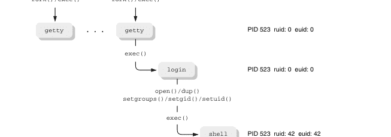

login 的代码过于复杂，无法在此展示，因为它涉及许多与当前讨论无关的任务。但我们可以概述登录时发生的步骤，如下所示：

1.  `init` 是原始进程。它的 PID 为 1。所有其他进程都源自它。内核在启动时手工创建进程 1 并在其中运行 `init`。它以真实 UID 和有效 UID 均设置为 0 的方式运行，即以 root 身份运行。
2.  `init` 读取 `/etc/inittab`，该文件除其他内容外，还告诉 `init` 应在哪些硬件设备上启动 `getty` 进程。对于每个此类设备（例如 GNU/Linux 系统上的控制台、串行终端或虚拟控制台），`init` 会 fork 出一个新进程。这个新进程随后使用 `exec()` 运行 `getty`（“get tty”，即终端）。在许多 GNU/Linux 系统中，此命令名为 `mingetty`。该程序打开设备，重置其状态，并打印 `login:` 提示符。
3.  在读到登录名后，`getty` exec 运行 `login`。登录程序在密码文件中查找用户名，提示输入密码并验证密码。如果匹配，登录进程继续执行。
4.  `login` 切换到用户的家目录，设置初始环境，然后设置初始的打开文件集。它关闭所有文件描述符，打开终端，并使用 `dup()` 将终端的文件描述符复制到 0、1 和 2。这就是已打开的标准输入、输出和错误文件描述符的来源。
5.  然后 `login` 使用 `setgroups()` 设置辅助组集，使用 `setgid()` 将真实、有效和保存的 set-group ID 设置为用户的值，最后使用 `setuid()` 将真实、有效和保存的 set-user ID 的所有三个值都设置为正在登录用户的值。注意，`setuid()` 的调用必须放在最后，以便其他两个调用能够成功。
6.  最后，`login` exec 运行用户的登录 shell。Bourne 风格的 shell 随后读取 `/etc/profile` 和 `$HOME/.profile`（如果这些文件存在）。最后，shell 打印提示符。

请注意，一个进程如何从系统进程转变为用户进程。`init` 的每个子进程最初都是 `init` 的副本。通过使用 `exec()`，同一进程执行不同的任务。通过调用 `setuid()` 从 root 更改为普通用户，该进程最终直接为用户工作。当你退出 shell（通过 CTRL-D 或 `exit()`）时，该进程 simply 死亡。然后 `init` 重启循环，生成一个新的 `getty`，它打印一个新的 `login:` 提示符。

> 注意：即使进程更改了其任何或所有 UID 或 GID，打开的文件仍保持打开且可用。因此，setuid 程序应预先打开所有必要的文件，将它们的 ID 更改为真实用户的值，并在没有额外特质的情况下继续执行其余任务。

*表 11.1* 总结了操作 UID 和 GID 值的六个标准函数。

### *表 11.1*
设置真实 ID 和有效 ID 的 API 摘要

| 函数 | 设置 | 永久性 | 普通用户 | Root |
| :--- | :--- | :--- | :--- | :--- |
| `setuid()` | E | 否 | 来自 R, E, S | 任意值 |
| `setegid()` | E | 否 | 来自 R, E, S | 任意值 |
| `setgid()` | Root: R, E, S<br>其他: E | Root: 是<br>其他: 否 | 来自 R, E | 任意值 |
| `setgid()` | Root: R, E, S<br>其他: E | Root: 是<br>其他: 否 | 来自 R, E | 任意值 |
| `setreuid()` | E, 可能设置 R | 否 | 来自 R, E | 任意值 |
| `setregid()` | E, 可能设置 R | 否 | 来自 R, E | 任意值 |

#### 11.7 处理所有三个 ID：`getresuid()` 和 `setresuid()` (Linux)

Linux 提供了额外的系统调用，允许你直接操作真实、有效和保存的用户和组 ID：

```c
#include <sys/types.h>
#include <unistd.h>

int getresuid(uid_t *ruid, uid_t *euid, uid_t *suid);
int getresgid(gid_t *rgid, gid_t *egid, gid_t *sgid);
int setresuid(uid_t ruid, uid_t euid, uid_t suid);
int setresgid(gid_t rgid, gid_t egid, gid_t sgid);
```

这些函数如下：

```c
int getresuid(uid_t *ruid, uid_t *euid, uid_t *suid)
```

获取真实、有效和保存的 set-user ID 值。成功时返回 0，出错时返回 -1，并由 `errno` 指示问题所在。

```c
int getresgid(gid_t *rgid, gid_t *egid, gid_t *sgid)
```

获取真实、有效和保存的 set-group ID 值。成功时返回 0，出错时返回 -1，并由 `errno` 指示问题所在。

```c
int setresuid(uid_t ruid, uid_t euid, uid_t suid)
```

分别设置真实、有效和保存的 set-user ID 值。当参数值为 -1 时，对应的 UID 保持不变。

当进程以 root 身份运行时，参数可以是任意值。（但是，使用非零值作为 `euid` 会导致永久且不可撤销地丧失 root 特权。）否则，参数必须是当前真实、有效或保存的 set-user ID 值之一。

```c
int setresgid(gid_t rgid, gid_t egid, gid_t sgid)
```

分别设置真实、有效和保存的 set-group ID 值。当参数值为 -1 时，对应的 GID 保持不变。

此函数类似于 `setresuid()`。

`setresuid()` 和 `setresgid()` 函数特别有价值，因为其语义定义明确。程序员可以确切知道调用的效果。

此外，这些调用是“全或无”的操作：它们要么完全成功，实现所需的更改；要么完全失败，保持当前状态不变。这提高了可靠性，因为同样可以确切知道发生了什么。

#### 11.8 穿越安全雷区：setuid root

穿越真实的雷区很困难，但并非不可能。然而，这不是未经训练或经验就应轻易尝试的事情。

同样，编写以 setuid root 方式运行的程序也是一项艰巨的任务。有许多需要知晓的问题，几乎任何方面都可能产生意外的安全后果。此类尝试应谨慎进行。

特别是，花时间阅读关于 Linux/Unix 安全问题并学习如何编写 `setuid` `root` 程序是值得的。如果你在读了这本书且没读其他东西后就直接投身于这样的挑战中，请相信你的系统会被轻松且立即入侵。不太可能你或你的客户会对此感到满意。

以下是一些指导原则：

- 尽可能少地以 `root` 身份执行操作。谨慎使用你的超级权限，仅在其绝对需要时使用。

- 正确设计你的程序。将你的程序模块化，以便所有 `root` 操作都可以预先完成，而程序的其余部分以普通用户身份运行。

- 在更改或放弃特权时，如果拥有 `setresuid()` 请使用它。否则请使用 `setreuid()`，因为这两个函数具有最清晰的语义。仅在你希望更改是永久时才使用 `setuid()`。

- 以正确的顺序从 `root` 切换到普通用户：先设置组集和 GID 值，然后设置 UID 值。

- 对 `fork()` 和 `exec()` 特别小心；除非你显式更改它们，否则真实和有效 UID 在这些调用中不会改变。

- 考虑为你的应用程序使用 `setgid` 权限和一个特殊组。如果可行，这将为你省去许多麻烦。

- 考虑丢弃继承的环境变量。如果你必须保留一些环境变量，请尽可能保留得少。确保为 `PATH` 和 `IFS` 环境变量提供合理的值。

- 避免使用依赖 `PATH` 环境变量值的 `execl()` 和 `execvp()`（虽然如果你自己重置了 `PATH`，这个问题会较少）。

这些仅仅是穿越这个以陷阱、诡雷和地雷著称的危险区域的众多战术中的少数几个。有关其他信息来源的指引，请参见下一节。

#### 11.9 建议阅读

Unix（因此包括 GNU/Linux）安全是一个需要知识和经验才能妥善处理的主题。在互联网时代，这一主题变得更加困难，而不是更容易。


#### 11.10 总结

- 使用用户和组 ID 值（UIDs 和 GIDs）来标识文件和进程，这使得 Linux 和 Unix 成为多用户系统。进程携带实际的和有效的 UID 和 GID 值，以及一个补充组集合。通常是有效 UID 决定一个进程如何影响另一个进程，并且有效 UID、GID 和组集合会被检查以匹配文件的权限。有效 UID 为零的用户，被称为 root 或超级用户，被允许随心所欲行事；系统不对这样的用户应用权限检查。

- 已保存的设置用户 ID 和已保存的设置组 ID 概念源自 System V，并已被 POSIX 采纳，在 GNU/Linux 中得到完全支持。拥有这些独立的 ID 值使得能够轻松且正确地交换实际的和有效的 UID（以及 GID）成为可能。

- Setuid 和 setgid 程序创建的有效 ID 和实际 ID 不同的进程。这些程序通过文件权限中的额外位来标记。setuid 和 setgid 位必须在文件创建后添加到文件中。

- getuid() 和 geteuid() 分别检索实际的和有效的 UID 值，getgid() 和 getegid() 分别检索实际的和有效的 GID 值。getgroups() 检索补充组集合，并且在 POSIX 环境中，可以查询系统该组集合包含多少个成员。

- access() 函数作为实际用户执行文件权限检查，这使得 setuid 程序能够检查实际用户的权限。请注意，经常情况下，通过 stat() 检索的信息可能无法提供全貌，因为文件可能位于非本地或网络文件系统中。

- GLIBC 的 euidaccess() 函数类似于 access()，但基于有效的 UID 和 GID 值进行检查。

- 当应用于目录时，setgid 和 sticky（粘滞）位引入了额外的语义。当目录具有 setgid 位时，该目录中的新文件会继承该目录的组。新目录也是如此，并且自动继承 setgid 位的设置。如果没有 setgid 位，新文件和目录将获得创建进程的有效 GID。在其他可写目录上的 sticky 位将文件删除限制为文件所有者、目录所有者以及 root。

- 组集合通过 setgroups() 更改。此函数未被 POSIX 标准化，但存在于所有现代 Unix 系统中。只有 root 可以使用它。

- 更改 UID 和 GID 相当复杂。各种系统调用的语义多年来发生了变化。仅更改其有效 UID/GID 的新应用程序应使用 seteuid() 和 setegid()。非 root 应用程序也可以使用 setuid() 和 setgid() 设置其有效 ID。来自 BSD 的 setreuid() 和 setregid() 调用旨在交换 UID 和 GID 值；不建议在新程序中使用它们。

- 以 root 身份运行的应用程序可以使用 setuid() 和 setgid() 永久更改实际的、有效的和已保存的 ID 值。一个例子是 login，它必须从以 root 身份运行的系统程序更改为以普通用户身份运行的非特权登录 shell。

- 当 Linux 的 setresuid() 和 setresgid() 函数可用时，应使用它们，因为它们提供干净且最可靠的行为。

- 编写 setuid-root 应用程序不是初学者的任务。如果你需要这样做，请先阅读有关安全问题的资料；之前引用的来源非常出色。

### 练习

- 编写 `id` 命令的简单版本。其操作是将用户和组 ID 连同组名称一起打印到标准输出。当有效 ID 和实际 ID 不同时，两者都会被打印。例如：

```
$ id
uid=2076(arnold) gid=42(devel) groups=19(floppy),42(devel),2076(arnold)
```

- 其用法如下：

```
id [ user ]
id -G [ -nr ] [ user ]
id -g [ -nr ] [ user ]
id -u [ -nr ] [ user ]
```

- 带有 `user` 时，显示该用户的信息；否则，`id` 打印调用用户的信息。选项如下：
  - `-G` 仅以数值形式打印所有组值，不带名称。
  - `-n` 仅打印名称，不带数值。适用于用户和组值。
  - `-g` 仅打印有效 GID。
  - `-u` 仅打印有效 UID。

- 编写一个简单的程序，名为 `sume`，其 setuid 为你自己。它应提示输入密码（参见 `getpass(3)`），对于本练习而言，可以硬编码在程序源代码中。如果运行程序的人正确输入了密码，`sume` 应该执行（exec）一个 shell。请找另一个用户帮助你测试。

- 你如何看待让 `sume` 对你的朋友可用？对你的同学或同事？对你系统中的每个用户？

# 第 12 章


## 通用库接口 — 第二部分

**在本章中**

- 12.1 断言语句：assert() 第 428 页
- 12.2 底层内存：memXXX() 函数 第 432 页
- 12.3 临时文件 第 436 页
- 12.4 自杀：abort() 第 445 页
- 12.5 非局部跳转（Nonlocal Gotos） 第 446 页
- 12.6 伪随机数 第 454 页
- 12.7 元字符扩展 第 461 页
- 12.8 正则表达式 第 471 页
- 12.9 建议阅读 第 480 页
- 12.10 总结 第 481 页
- 练习 第 482 页

第 6 章“通用库接口 — 第一部分”，第 165 页，介绍了第一组通用库 API。从某种意义上说，这些 API 支持处理 Linux 和 Unix 系统管理的基本对象：当前时间、文件和用户的组，以及排序和搜索。

本章内容更加杂烩；这里涵盖的 API 之间没有特别强的关联性。然而，它们对于日常的 Linux/Unix 编程都非常有用。我们的介绍从更简单、更通用的 API 移动到更复杂、更专业化的 API。

## 12.1 断言语句：assert()

断言是你关于程序在执行过程中特定时刻的状态所做出的陈述。断言在编程中的使用最初由 C.A.R. Hoare 开发。¹ 其一般想法是“程序验证”的一部分：当你设计和开发程序时，你可以通过对程序代码的影响做出经过仔细推理的陈述来证明其正确性。通常，这样的陈述是关于不变量（invariants）的——这些是程序状态中应当在整个代码块执行期间保持为真的事实。

断言特别适用于描述两类不变量：前置条件（preconditions）和后置条件（postconditions）：分别指在代码段执行前后必须成立的条件。前置条件和后置条件的一个简单例子是线性搜索：

```c
/* lsearch --- 返回数组中值的索引，如果未找到则返回 -1 */

int lsearch(int *array, size_t size, int value)
{
    size_t i;

    /* 前置条件: array != NULL */
    /* 前置条件: size > 0 */
    for (i = 0; i < size; i++)
        if (array[i] == value)
            return i;

    /* 后置条件: i == size */
    return -1;
}
```

¹ 然而，在他的 1981 年 ACM 图灵奖演讲中，Hoare 博士指出 Alan Turing 本人推广了这一想法。


此示例使用注释来陈述条件。但使用代码来测试条件岂不更好吗？这正是 `assert()` 宏的作用：

```c
#include <assert.h>

void assert(scalar expression);
```

当 *scalar expression* 为假时，`assert()` 宏会打印一条诊断消息并终止程序（通过 `abort()` 函数；参见第 12.4 节，“自杀：`abort()`”，第 445 页）。ch12-assert.c 再次提供了 lsearch() 函数，这次带有断言和一个 main() 函数：

```c
/* ch12-assert.c --- demonstrate assertions */

#include <stdio.h>
#include <assert.h>

/* lsearch --- return index in array of value, or -1 if not found */
int lsearch(int *array, size_t size, int value)
{
    size_t i;

    assert(array != NULL);
    assert(size > 0);
    for (i = 0; i < size; i++)
        if (array[i] == value)
            return i;

    assert(i == size);
    return -1;
}

/* main --- test out assertions */
int main(void)
{
    #define NELEMS 4
    static int array[NELEMS] = { 1, 17, 42, 91 };
    int index;

    index = lsearch(array, NELEMS, 21);
    assert(index == -1);

    index = lsearch(array, NELEMS, 17);
    assert(index == 1);

    index = lsearch(NULL, NELEMS, 10); /* won't return */

    printf("index = %d\n", index);

    return 0;
}
```

编译并运行时，第 12 行的断言“触发了”：

```
$ ch12-assert
Run the program
ch12-assert: ch12-assert.c:12: lsearch: Assertion ‘array != ((void *)0)’ failed.
Aborted (core dumped)
```

assert() 的消息因系统而异。在 GNU/Linux 的 GLIBC 上，消息包含程序名称、源代码文件名和行号、函数名称，以及失败断言的文本。（在这种情况下，符号常量 NULL 显示为其宏展开形式，`((void *)0)`。）

“Aborted (core dumped)”消息意味着 ch12-assert 创建了一个核心文件；即进程死亡前其地址空间的快照。² 这个文件稍后可以与调试器一起使用；参见第 15.3 节，“GDB 基础”，第 570 页。创建核心文件是 assert() 的一个有意副作用；假设是出了大问题，你将希望使用调试器检查该进程以确定原因。

你可以通过使用命令行选项 `-DNDEBUG` 编译程序来禁用断言。如果在包含 <assert.h> 之前定义了此宏，assert() 宏将展开为不执行任何操作的代码。例如：

```
$ gcc -DNDEBUG ch12-assert.c -o ch12-assert
Compile with -DNDEBUG
$ ch12-assert
Run it
Segmentation fault (core dumped)
What happened?
```

在这里，我们得到了真正的核心转储！我们知道断言已被禁用；没有“断言失败”消息。那么发生了什么？考虑 lsearch() 的第 15 行，当从 main() 的第 37 行调用时。在这种情况下，array 变量为 NULL。通过 NULL 指针访问内存是一个错误。（从技术上讲，各种标准将解引用 NULL 指针时发生的情况留为“未定义”。大多数现代系统所做的与 GNU/Linux 相同；它们通过发送 SIGSEGV 信号来终止进程；这反过来会产生核心转储。此过程在第 10 章“信号”，第 347 页中描述。）

> ² 如第 10.2 节“信号操作”，第 348 页所述，一些 GNU/Linux 发行版禁用了核心文件的创建。要重新启用它们，请将行 ‘ulimit -S -c unlimited’ 放入你的 ~/.profile 文件中。

这个案例提出了关于断言的一个重要观点。程序员经常错误地使用断言来 *替代* 运行时错误检查。在我们的情况下，对 `array != NULL` 的测试应该是运行时检查：

```c
if (array == NULL)
  return -1;
```

对 `size > 0` 的测试（第 13 行）问题较小；如果 `size` 为 0 或小于 0，循环永远不会执行，并且 `lsearch()` （正确地）返回 `-1`。（实际上，这个断言是不必要的，因为代码正确地处理了 `size <= 0` 的情况。）

禁用断言背后的逻辑是，额外的检查可能会减慢程序性能，因此它们应该在程序的生产版本中禁用。然而，C.A.R. Hoare³ 指出了这一点：

> 最后，在调试运行时进行复杂的安全检查，此时并不信任结果，然后在生产运行时移除它们，此时错误的结果可能代价高昂或灾难性，这是荒谬的。如果一位帆船爱好者在陆地训练时穿着救生衣，但一进入海上就把它脱掉，我们会怎么看他？

鉴于这些观点，我们的建议是有深思熟虑地使用断言：首先，对于任何给定的断言，考虑它是否应该改为运行时检查。其次，小心地放置你的断言，这样你才不会介意保留断言检查处于启用状态，即使在程序的生产版本中也是如此。

最后，我们将注明 GNU/Linux `assert(3)` manpage 的“BUGS”部分中的以下内容：

> `assert()` 实现为一个宏；如果测试的表达式有副作用，程序行为将取决于是否定义 `NDEBUG`。这可能会产生海森堡虫（Heisenbugs），即在开启调试时消失的 Bug。

海森堡著名的物理不确定原理表明，你确定粒子速度的精度越高，确定其位置的精度就越低，反之亦然。用通俗的话说，它表示仅仅观察粒子的行为就会影响它。

³ **编程语言设计提示**，C.A.R. Hoare，斯坦福大学计算机科学技术报告 CS-73-403 (ftp://reports.stanford.edu/pub/catc/reports/cs/rr/73/403/CS-TR-73-403.pdf)，1973 年 12 月。

编程中也发生了类似的现象，与粒子物理无关：为调试编译程序，或启用调试运行它可以改变程序的行为。特别是，原始的 bug 可能会消失。这种 bug 俗称 *海森堡虫*（heisenbug）。

manpage 警告我们不要在 `assert()` 调用中放入有副作用的表达式：

```c
assert(*p++ == '\n');
```

这里的副作用是 `p` 指针作为测试的一部分被递增。当定义 `NDEBUG` 时，表达式参数从源代码中 *消失*；它永远不会被执行。这可能导致意外的失败。然而，一旦在准备调试时重新启用断言，事情就开始正常工作了！这类问题很难追踪。

## 12.2 底层内存：`memXXX()` 函数

有几个函数提供用于处理任意内存块的底层服务。它们的名称都以前缀 `mem` 开头：

```c
#include <string.h>                    ISO C

void *memset(void *buf, int val, size_t count);
void *memcpy(void *dest, const void *src, size_t count);
void *memmove(void *dest, const void *src, size_t count);
int memcmp(const void *buf1, const void *buf2, size_t count);
void *memchr(const void *buf, int val, size_t count);
```

### 12.2.1 设置内存：`memset()`

`memset()` 函数将值 `val`（作为 `unsigned char` 处理）复制到 `buf` 的前 `count` 个字节中。它对于将动态内存块清零特别有用：

```c
void *p = malloc(count);
if (p != NULL)
  memset(p, 0, count);
```

然而，`memset()` 可用于任何类型的内存，而不仅仅是动态内存。其返回值是第一个参数：`buf`。

### 12.2.2 复制内存：`memcpy()`、`memmove()` 和 `mempcpy()`

三个函数将一个内存块复制到另一个内存块。前两个函数在如何处理 *重叠* 内存区域方面有所不同；第三个函数复制内存，但在看到特定值时停止。

```c
void *memcpy(void *dest, const void *src, size_t count)
```

这是最简单的函数。它从 *src* 复制 *count* 个字节到 *dest*。它不处理重叠的内存区域。它返回 *dest*。

```c
void *memmove(void *dest, const void *src, size_t count)
```

类似于 `memcpy()`，它也从 *src* 复制 *count* 个字节到 *dest*。然而，它确实处理重叠的内存区域。它返回 *dest*。

```c
void *mempcpy(void *dest, const void *src, int val, size_t count)
```
注意：此处原文参数似乎有误（mempcpy 标准签名通常为 mempcpy(dest, src, count)，但原文描述了类似 mempcpy 寻找特定值的行为，可能作者指的是某种变体或笔误，但根据指示翻译原文内容）：
这从 *src* 复制字节到 *dest*，在复制 *val* 到 *dest* *或* 复制 *count* 个字节之后 *任一* 情况下停止。如果它找到了 *val*，它返回指向 *dest* 中 *val* 放置位置之后的指针。否则，它返回 `NULL`。

现在，重叠内存有什么问题？考虑图 12.1。

```c
struct xyz { ... } data[8];
mempcpy(&data[3], data, sizeof(data[0]) * 4);
```

对比。

```c
memmove(&data[3], data, sizeof(data[0]) * 4);
```

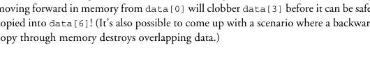

#### 图 12.1 重叠复制

目标是将 `data[0]` 到 `data[3]` 中的四个 `struct xyz` 实例复制到 `data[3]` 到 `data[6]`。`data[3]` 是这里的问题；从 `data[0]` 在内存中向前逐字节复制会在 `data[3]` 被安全复制到 `data[6]` 之前将其覆盖！（也可能出现通过内存向后复制破坏重叠数据的情况。）


`memcpy()` 函数最初是 System V 用于复制内存块的 API；对于重叠内存块的行为，并未以特定方式加以明确规定。在 1989 年 C 标准制定时，委员会认为这种未定义的行为是一个问题；因此，他们发明了 `memmove()`。为了保持历史兼容性，`memcpy()` 保持不变，其针对重叠内存的行为被明确声明为未定义，而 `memmove()` 则被创造出来，以提供一个能够正确处理问题情况的例程。

在你自己的代码中应该使用哪一个？对于一个没有传入内存区域知识的库函数，你应该使用 `memmove()`。这样，就能保证重叠区域不会出现任何问题。对于“知道”两个区域不重叠的应用级代码，使用 `memcpy()` 是安全的。

对于 `memcpy()` 和 `memmove()`（就像 `strcpy()` 一样），目标缓冲区是第一个参数，源是第二个参数。要记住这一点，请注意这与赋值语句中的顺序相同：

```
dest = src;
```

（许多系统的 man 手册页没有提供多大帮助，它们将原型提供为 `void *memcpy(void *buf1, void *buf2, size_t n)`' 并依赖文字说明来解释哪个是哪个。幸运的是，GNU/Linux 的 man 手册页使用了更好的名称。）

### 12.2.3 比较内存块：`memcmp()`

`memcmp()` 函数比较两个任意数据缓冲区中的 count 个字节。其返回值与 `strcmp()` 类似：如果第一个缓冲区小于、等于或大于第二个缓冲区，则分别返回负值、零或正值。

你可能会问：“为什么不用 `strcmp()` 进行这样的比较？”这两个函数的区别在于 `memcmp()` 不关心零字节（`'\0'` 字符串终止符）。因此，当你需要比较任意二进制数据时，应使用 `memcmp()`。

`memcmp()` 的另一个优势是它比典型的 C 实现更快：

```c
/* memcmp --- 示例 C 实现，不用于实际用途 */
int memcmp(const void *buf1, const void *buf2, size_t count)
{
    const unsigned char *cp1 = (const unsigned char *) buf1;
    const unsigned char *cp2 = (const unsigned char *) buf2;
    int diff;

    while (count-- != 0) {
        diff = *cp1++ - *cp2++;
        if (diff != 0)
            return diff;
    }
    return 0;
}
```

速度上的优势可能源于许多体系结构支持的专用“块内存比较”指令，或源于以大于字节的单位进行比较。（后者操作复杂，最好留给库的作者处理。）

基于这些原因，你应该*始终*使用库版本的 `memcmp()`，而不是自己编写一个。库作者比你更了解机器的可能性极大。

### 12.2.4 搜索字节值：memchr()

`memchr()` 函数类似于 `strchr()` 函数：它返回某个特定值在任意缓冲区中的位置。就像 `memcmp()` 与 `strcmp()` 一样，使用 `memchr()` 的主要原因是你处理的是任意二进制数据。

GNU `wc` 在仅统计行数和字节数时使用 `memchr()`，[^4] 这使得 `wc` 相当快速。以下内容来自 GNU Coreutils 中的 `wc.c`：

[^4]: 参见 `wc(1)`。`wc` 统计行数、单词数和字符数。

```c
257 else if (!count_chars && !count_complicated)
258 {
259 /* Use a separate loop when counting only lines or lines and bytes --
260 but not chars or words. */
261 while ((bytes_read = safe_read(fd, buf, BUFFER_SIZE)) > 0)
262 {
263 register char *p = buf;
264
265 if (bytes_read == SAFE_READ_ERROR)
266 {
267 error(0, errno, "&s", file);
268 exit_status = 1;
269 break;
270 }
271
272 while ((p = memchr (p, '\n', (buf + bytes_read) - p)))
273 {
274 ++p;
275 ++lines;
276 }
277 bytes += bytes_read;
278 }
279}
```

外层循环（第 261–278 行）从输入文件读取数据块。内层循环（第 272–276 行）使用 `memchr()` 查找并统计换行符。复杂表达式 `(buf + bytes_read) - p` 解析为当前 *p* 值与缓冲区末尾之间的剩余字节数。

第 259–260 行的注释需要一些解释。简而言之，现代系统可以使用在内存和磁盘上占用多于一字节的字符。（这在第 13.4 节“你能拼一下吗？”第 521 页中讨论得更多。）因此，当 `wc` 需要区分字符和字节时，必须使用不同的代码；此代码处理的是按字节统计的情况。

## 12.3 临时文件

*临时文件* 顾名思义：它是一个文件，在程序运行期间保存数据，一旦程序退出就不再需要这些数据。一个很好的例子是 *sort* 程序。如果在命令行中没有指定文件名，或者使用 `-` 作为文件名，*sort* 会读取标准输入。然而，*sort* 必须读取*所有*输入数据后才能输出排序结果。（稍微思考一下，你就会发现这是事实。）在读取标准输入期间，数据必须存储在某处，直到 *sort* 可以对其进行排序；这是使用临时文件的完美场景。*sort* 还使用临时文件来存储中间排序结果。

令人惊讶的是，创建临时文件有五种不同的函数。其中三种通过创建表示（假定的）唯一文件名的字符串来工作。我们将看到，通常应避免使用这些方法。另外两种通过创建并打开临时文件来工作；这些函数更受推荐。

### 12.3.1 生成临时文件名（不良做法）

有三种函数的目的是创建一个唯一、不存在的文件的名称。一旦你拥有了这样的文件名，就可以用它来创建临时文件。由于名称是唯一的，你被“保证”对该文件的独占使用权。以下是函数声明：

```c
#include <stdio.h>
char *tmpnam(char *s); /* ISO C */
char *tempnam(const char *dir, const char *px); /* XSI */
char *mktemp(char *template); /* ISO C */
```

这些函数都提供了相同主题的不同变体：它们填充或创建一个缓冲区，其中包含唯一临时文件名的路径。该文件的唯一性在于，在函数创建名称并返回名称时，所创建的名称不存在。这些函数的工作方式如下：

**`char *tmpnam(char *s)`**
生成唯一的文件名。如果 *s* 不为 NULL，其大小应至少为 *L_tmpnam* 字节，唯一的名称将被复制到其中。如果 *s* 为 NULL，则名称在内部静态缓冲区中生成，后续调用可能会覆盖该缓冲区。路径的目录前缀将是 *P_tmpdir*。*P_tmpdir* 和 *L_tmpnam* 均定义在 <stdio.h> 中。

**`char *tempnam(const char *dir, const char *px)`**
类似于 *tmpnam()*，允许你指定目录前缀。如果 *dir* 为 NULL，则使用 *P_tmpdir*。如果 *px* 参数不为 NULL，则指定最多五个字符用作文件名的前导字符。

*tmpnam()* 为其生成的文件名分配存储空间。返回的指针可以稍后与 *free()* 一起使用（如果你希望避免内存泄漏，则应该使用）。

**`char *mktemp(char *template)`**
基于模板生成唯一的文件名。*template* 的最后六个字符必须是 'XXXXXX'；这些字符将被替换为唯一后缀。

> 注意：`mktemp()` 的模板参数会被就地覆盖。因此，它不应是字符串常量。许多标准之前的 C 编译器将字符串常量放入数据段，与普通全局变量在一起。虽然在源代码中定义为常量，但它们是*可写的*；因此，像下面的代码并不罕见：

```c
/* 旧式代码：不要这样做。 */
char *tfile = mktemp("/tmp/myprogXXXXXX");
... use tfile...
```

> 在现代系统上，此类代码很可能会失败；如今，字符串常量位于内存的只读段中。

使用这些函数非常简单。文件 `ch12-mktemp.c` 演示了 `mktemp()`；更改为使用其他函数并不困难：

```c
1 /* ch12-mktemp.c --- 演示 mktemp() 的朴素用法。
2                          为简洁起见省略了错误检查 */
3
4 #include <stdio.h>
5 #include <fcntl.h>              /* for open flags */
6 #include <limits.h>             /* for PATH_MAX */
7
8 int main(void)
9 {      static char template[] = "/tmp/myfileXXXXXXX";
10      char fname[PATH_MAX];
11      static char msg[] =
12             "Here's lookin' at you, kid!\n";    /* beats "hello, world" */
13      int fd;
14
15      strcpy(fname, template);
16      mktemp(fname);
17
18      /* RACE CONDITION WINDOW OPENS */
19
20      printf("Filename is %s\n", fname);
21
22      /* RACE CONDITION WINDOW LASTS TO HERE */
23
24      fd = open(fname, O_CREAT|O_RDWR|O_TRUNC, 0600);
25      write(fd, msg, strlen(msg));
26      close(fd);
27
28      /* unlink(fname); */
29
30      return 0;
31 }
```


## 12.3 临时文件

`template` 变量（第 10 行）定义了文件名模板；其中的 `xxxxxx` 将被替换为一个唯一的值。第 16 行将模板复制到 `fname` 中，它不是常量：因此可以被修改。第 18 行调用 `mktemp()` 生成文件名，第 21 行打印该文件名以便我们查看具体内容。（我们稍后会解释第 19 行和第 23 行注释的含义。）

第 25 行打开文件，必要时会创建它。第 26 行将 `msg` 中的消息写入文件，第 27 行关闭文件。在一个使用完毕即需删除该文件的程序中，第 29 行不应被注释掉。（有时，临时文件不应被解除链接（unlink）；例如，如果文件在完全写入后将被重命名。）为了能够运行此程序并在之后查看该文件，我们将该行注释掉了。以下是程序运行时发生的情况：

```bash
$ ch12-mktemp                                # 运行该程序
Filename is /tmp/myfileqES4wA               # 打印出的文件名
$ cat /tmp/myfileqES4wA
Here’s lookin’ at you, kid!
                                                   # 内容符合预期
$ ls -l /tmp/myfileqES4wA                    # 所有者和权限也符合预期
-rw------- 1 arnold devel     28 Sep 18 09:27 /tmp/myfileqES4wA
                                                   # 删除它
$ rm /tmp/myfileqES4wA
                                                   # 相同的文件名会被重用吗？
$ ch12-mktemp
Filename is /tmp/myfileic7xCy
No. That’s good
$ cat /tmp/myfileic7xCy
                                                   # 再次检查内容
Here’s lookin’ at you, kid!
$ ls -l /tmp/myfileic7xCy
                                                   # 再次检查所有者和权限
-rw------- 1 arnold devel     28 Sep 18 09:28 /tmp/myfileic7xCy
```

一切似乎都在正常运行。`mktemp()` 返回了一个唯一的名称，`ch12-mktemp` 以正确的权限创建了文件，且内容也符合预期。那么，所有这些函数的问题在哪里？

从历史上看，`mktemp()` 使用一种简单且可预测的算法来生成模板中 `xxxxxx` 的替换字符。此外，文件名生成时间与文件实际创建时间之间存在一个时间间隔，这会产生竞态条件（race condition）。

这是如何发生的呢？Linux 和 Unix 系统使用时间切片（time slicing）技术，该技术在所有正在运行的进程之间共享处理器。这意味着，虽然程序看起来一直在运行，但实际上，有些时候进程处于睡眠状态，即等待在处理器上运行。

现在，假设有一位教授的程序用于跟踪学生成绩。该教授和一个恶意学生正在同时使用一个负载较重的多用户系统。

该教授的程序使用 `mktemp()` 创建临时文件，而该学生由于过去观察过成绩评定程序创建和删除临时文件的过程，已经猜出了 `mktemp()` 使用的算法。（GLIBC 版本不存在这个问题，但并非所有系统都使用 GLIBC！）图 12.2 展示了这种竞态条件以及学生是如何利用它的。

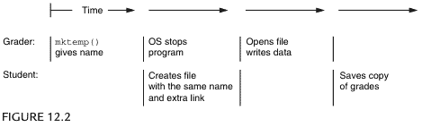

### 图 12.2
使用 `mktemp()` 时的竞态条件

以下是发生的过程。

- 1. 成绩评定程序使用 `mktemp()` 生成文件名。当 `mktemp()` 返回时，竞态条件窗口此时已打开（参见 `ch12-mktemp.c` 中的第 19 行）。
- 2. 内核暂停成绩评定程序，以便系统中的其他程序可以运行。这发生在调用 `open()` 之前。
  
  在成绩评定程序暂停期间，学生创建了一个与 `mktemp()` 返回给成绩评定程序的文件名相同的文件。（请记住，该算法很容易猜出来。）学生创建该文件时增加了一个额外的链接，这样当成绩评定程序解除链接该文件时，该文件仍可供查看。

- 3. 成绩评定程序现在打开该文件并写入数据。学生创建文件时的权限为 `~rw-rw-rw-`，因此这不会造成问题。
- 4. 当成绩评定程序完成时，它解除了临时文件的链接。然而，学生仍然保留有一份副本。例如，可能存在提前将成绩卖给同学的牟利机会。

我们的例子很简化；除了仅仅窃取成绩数据外，一个聪明（但缺德）的学生可能能够*就地修改*数据。如果教授不仔细核查其程序的运行结果，没有人会发现真相。

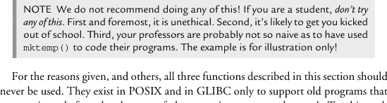

鉴于上述原因以及其他原因，本节中描述的这三个函数绝不应该被使用。它们存在于 POSIX 和 GLIBC 中只是为了支持在人们认识这些例程的危险性之前编写的旧程序。为此，GNU/Linux 系统会在链接时生成警告：

```bash
$ cc ch12-mkstemp.c -o ch12-mkstemp # 编译该程序
/tmp/cclXCvD9.o(.text+0x35): in function 'main':
: the use of `mkstemp' is dangerous, better use 'mkstemp'
(我们在下一小节中介绍 mkstemp( )。)
```

如果你的系统没有 mkstemp()，请思考你可能如何使用这些接口来模拟它。（另请参阅本章末尾第 482 页的“练习题”部分，涉及第 12 章。）

### 12.3.2 创建和打开临时文件（正确方法）

有两个函数不存在竞态条件问题。其中一个用于 `<stdio.h>` 库：

```c
#include <stdio.h> /* ISO C */
FILE *tmpfile(void);
```

第二个函数用于基于文件描述符的系统调用：

```c
#include <stdlib.h> /* XSI */
int mkstemp(char *template);
```

```c
/* ch12-tmpfile.c -- 演示 tmpfile()。
   为简洁起见，省略了错误检查 */

#include <stdio.h>

int main(void)
{
   static char msg[] =
      "Here's lookin' at you, kid!";  /* 胜过 "hello, world" */
   FILE *fp;
   char buf[BUFSIZ];

   fp = tmpfile();                    /* 获取临时文件 */
   printf(fp, "%s", msg);            /* 写入文件 */
   fflush(fp);                        /* 强制输出 */

   rewind(fp);                        /* 移动到开头 */
   fgets(buf, sizeof buf, fp);        /* 读取内容 */

   printf("Got back <%s>\n", buf);   /* 打印检索到的数据 */

   fclose(fp);                       /* 关闭文件，文件将消失 */
   return 0;                          /* 全部完成 */
}
```

返回的 `FILE *` 值与 `fopen()` 返回的其他任何 `FILE *` 没有区别。运行时，结果是符合预期的：

```bash
$ ch12-tmpfile
Got back <Here's lookin' at you, kid!>
```

我们之前看到，GLIBC 的作者建议使用 `mkstemp()` 函数：

```bash
$ cc ch12-mkstemp.c -o ch12-mkstemp  # 编译该程序
/tmp/cc1XCvD9.o(.text+0x35): In function `main':
: the use of `mktemp' is dangerous, better use `mkstemp'
```

该函数与 `mktemp()` 类似，它接受一个以 ‘XXXXXX’ 结尾的文件名，并将这些字符替换为一个唯一后缀以创建唯一文件名。然而，它更进一步。它创建并打开了该文件。该文件以模式 0600（即 -rw-------）创建。因此，只有运行该程序的用户可以访问该文件。

此外，正是这一点使 `mkstemp()` 更加安全，因为它使用 `O_EXCL` 标志创建文件，这保证文件不存在，并阻止其他人打开该文件。

返回值是一个可用于读写的打开的文件描述符。现在存储在传递给 `mkstemp()` 的缓冲区中的路径名应在使用完毕后用于删除该文件。所有这些都在 `ch12-mkstemp.c` 中进行了演示，这是对 `ch12-tmpfile.c` 的简单修改：

```c
/* ch12-mkstemp.c --- 演示 mkstemp()。
   为简洁起见，省略了错误检查 */

#include <stdio.h>
#include <fcntl.h>  /* 用于打开标志 */
#include <limits.h>  /* 用于 PATH_MAX */

int main(void)
{
    static char template[] = "/tmp/myfileXXXXXXX";
    char fname[PATH_MAX];
    static char msg[] =
        "Here's lookin' at you, kid!\n";/* 胜过 "hello, world" */
    int fd;
    char buf[BUFSIZ];
    int n;

    strcpy(fname, template);     /* 复制模板 */
    fd = mkstemp(fname);         /* 创建并打开临时文件 */
    printf("Filename is %s\n", fname);   /* 打印以供参考 */

    write(fd, msg, strlen(msg));   /* 向文件写入一些内容 */

    lseek(fd, 0L, SEEK_SET);    /* 卷回到开头 */
    n = read(fd, buf, sizeof(buf));/* 读回数据；注意 NOT '\0' terminated! */
    printf("Got back: %.*s", n, buf);  /* 打印出来以验证 */

    close(fd);                  /* 关闭文件 */
    unlink(fname);              /* 删除它 */

    return 0;
}
```

运行时，结果如预期：

```bash
$ ch12-mkstemp
Filename is /tmp/myfileuXfWIN
Got back: Here's lookin' at you, kid!
```

### 12.3.3 使用 TMPDIR 环境变量

许多标准实用程序会关注 `TMPDIR` 环境变量，使用该变量指定的目录作为放置其临时文件的位置。如果未设置 `TMPDIR`，则临时文件的默认目录通常是 `/tmp`，尽管大多数现代系统还有一个 `/var/tmp` 目录。在系统启动时，管理员 shell 脚本通常会清除 `/tmp` 中的所有文件和目录。

许多 GNU/Linux 系统提供一个 `/dev/shm` 目录，该目录使用 tmpfs 文件系统类型：


## df

| 文件系统 | 1K 块 | 1K 已用 | 1K 可用 | 使用率% | 挂载点 |
| :--- | :--- | :--- | :--- | :--- | :--- |
| /dev/hda2 | 6198436 | 5136020 | 747544 | 88% | / |
| /dev/hda5 | 61431520 | 27720248 | 30590648 | 48% | /d |
| none | 256616 | 0 | 256616 | 0% | /dev/shm |

tmpfs 文件系统类型提供了一块 RAM 盘，即内存的一部分，其使用方式类似于磁盘。此外，tmpfs 文件系统利用 Linux 内核的虚拟内存机制，使其能够突破固定大小限制而增长。如果你的系统中拥有大量 RAM，这种方法可以带来显著的性能提升。为了测试性能，我们首先从 /usr/share/dict/linux.words 文件开始，该文件是一个按排序排列的正确拼写单词列表，每行一个单词。然后我们将该文件随机化，使其不再排序，并创建了一个包含该随机版本文件 500 份副本的更大文件：

```bash
$ ls -l /tmp/randwords.big

-rw-r--r-- 1 arnold devel 204652500 Sep 18 16:02 /tmp/randwords.big
```

有多少个单词？超过 2200 万个！

然后我们对该文件进行了排序，首先使用默认的 /tmp 目录，然后设置 TMPDIR 为 /dev/shm：⁵

```bash
$ time sort /tmp/randwords.big > /dev/null

real 1m32.566s
user 1m23.137s
sys 0m1.740s

$ time TMPDIR=/dev/shm sort /tmp/randwords.big > /dev/null

real 1m28.257s
user 1m18.469s
sys 0m1.602s
```

有趣的是，使用 RAM 盘仅比使用常规文件略快一点。（在一些进一步的测试中，它甚至更慢！）我们推测内核的缓冲区缓存（参见 4.6.2 节，“使用 creat() 创建文件”，第 109 页）在此发挥作用，相当有效地加速了文件 I/O。⁶

RAM 盘有一个显著的缺点：它受限于系统中配置的 `swap space`（交换空间）大小。⁷ 当我们尝试对一个包含随机单词文件 1,000 份副本的文件进行排序时，RAM 盘空间耗尽，而常规的 `sort` 则成功完成。

在自己的程序中使用 TMPDIR 很简单。我们提供以下大纲：

```c
const char template[] = "myprog.XXXXXX";
char *tmpdir, *tfile;
size_t count;
int fd;

if ((tmpdir = getenv("TMPDIR")) == NULL)
    tmpdir = "/tmp";  // 如果存在则使用 TMPDIR 值
                     // 否则，默认为 /tmp
count = strlen(tmpdir) + strlen(template) + 2;  // 计算文件名大小
tfile = (char *) malloc(count);                 // 为其分配空间
if (tfile == NULL)
    /* recover */                               // 检查错误

sprintf(tfile, "%s/%s", tmpdir, template);       // 创建最终模板
fd = mkstemp(tfile);                             // 创建并打开文件
/* 通过 fd 使用模板 ... */
close(fd);                                        // 清理
unlink(tfile);
free(tfile);
```

根据应用程序的需求，你可能希望在打开文件后立即取消链接（unlink）该文件，而不是将其作为清理过程的一部分。

## 12.4 自杀式退出：abort()

有时候，程序确实无法继续运行。通常，最好的做法是生成一条错误消息并调用 `exit()`。然而，特别是对于可能是编程问题的错误，仅仅退出是不够的，还需要生成核心转储（core dump），以便将正在运行的程序的状态保存到文件中，供日后通过调试器检查。这正是 `abort()` 函数的职责：

```c
#include <stdlib.h>
void abort(void);   /* ISO C */
```

abort() 函数向进程本身发送 SIGABRT 信号。即使 SIGABRT 被阻塞或忽略，这种情况也会发生。随后，SIGABRT 的正常行为（即生成核心转储）便会执行。

abort() 运作的例子是本章开头描述的 assert() 宏。当 assert() 发现其表达式为假时，它会打印一条错误消息，然后调用 abort() 来转储核心。

根据 C 标准，abort() 是否执行任何清理操作是依赖于实现的。在 GNU/Linux 中它会执行：在程序退出之前，所有 <stdio.h> FILE * 流都会被关闭。但请注意，对于使用基于文件描述符系统调用的打开文件，不会执行任何操作。（如果打开的所有文件只是文件或管道，则无需执行任何操作。虽然我们对此不予讨论，但文件描述符也用于网络连接，而不干净地关闭它们是不当做法。）

## 12.5 非局部跳转

> “直接进监狱。不要经过 GO。不要领取 200 美元。”
> ——《大富翁》——

你肯定知道 goto 是什么：一种将控制流转移到当前函数内其他位置标签处的机制。当适度使用时，goto 语句有助于提高函数的可读性和正确性。（例如，当所有错误检查都使用 goto 跳转到函数末尾的一个标签（如 clean_up）时，该标签处的代码随后会进行清理工作 [关闭文件等] 并返回。）但如果不当使用，goto 语句可能会导致所谓的“意大利面条式代码”，其逻辑变得无法跟踪。

C 语言限制了 goto 语句只能跳转到当前函数内的标签。许多 Algol 家族语言（如 Pascal）允许 goto“跳出”嵌套函数，进入先前的调用者函数。然而在 C 中，在该语言本身的语法范围内，没有办法跳转到不同函数中的位置，即使是调用者函数也是如此。这种跳转被称为非局部跳转（nonlocal goto）。

非局部跳转为什么有用？考虑一个读取命令并处理它们的交互式程序。假设用户启动了一个长时间运行的任务，感到沮丧或改变了主意，然后按下 CTRL-C 生成 SIGINT 信号。当信号处理程序运行时，它可以跳回主读取-命令-并处理循环的开始处。ed 行编辑器提供了这个概念的一个直接示例：

```bash
$ ed -p '> ' sayings            启动 ed，使用 '> ' 作为提示符
sayings: No such file or directory
> a                               追加文本
Hello, world
Don't panic
^C                                生成 SIGINT
?                                 “通用”错误消息
> 1,$p                            ed 返回命令循环
Hello, world                      '1,$p' 打印所有行
Don't panic
> w                               保存文件
25
> q                               完成
```

在内部，ed 在命令循环之前设置一个返回点，然后信号处理程序执行一个非局部跳转回到该返回点。

### 12.5.1 使用标准函数：setjmp() 和 longjmp()

非局部跳转是通过 setjmp() 和 longjmp() 函数实现的。这些函数有两种形式。传统的例程由 ISO C 标准定义：

```c
#include <setjmp.h>         ISO C
int setjmp(jmp_buf env);
void longjmp(jmp_buf env, int val);
```

jmp_buf 类型在 <setjmp.h> 中 typedef 定义。setjmp() 将当前“环境”保存到 env 中。env 通常是一个全局或文件级静态变量，以便可以从被调用的函数中使用。此环境包含跳转到调用 setjmp() 位置所需的所有信息。jmp_buf 的内容本质上是依赖于机器的；因此，jmp_buf 是一个不透明类型（opaque type）：你使用它而无需知道其内部内容。

当调用 setjmp() 将当前环境保存到 jmp_buf 时，它返回 0。当使用非局部跳转到达此处时，它返回非零值：

```c
jmp_buf command_loop;            在全局层级
... 然后在 main() 中 ...
if (setjmp(command_loop) == 0)   状态保存正常，继续执行
;
else                              我们通过非局部跳转到达此处
  printf("?\n");                 ed 的著名消息
... 现在启动命令循环 ...
```

longjmp() 执行跳转。第一个参数是一个必须已通过 setjmp() 初始化的 jmp_buf。第二个是一个非零整数值，setjmp() 在原始环境中将返回该值。这样就可以区分是设置环境还是通过非局部跳转到达。

C 标准规定，即使 longjmp() 使用 0 作为第二个参数调用，setjmp() 仍返回非零值。在这种情况下，它改为返回 1。

能够传递一个整数值并让 setjmp() 的返回值返回该值是很有用的；它允许用户级代码区分跳转的原因。例如，gawk 利用此功能来处理循环内的 break 和 continue 语句。（awk 语言故意在循环语法上类似于 C，包括 while、do-while 和 for 循环，以及 break 和 continue。）setjmp() 的使用如下所示（来自 gawk 3.1.3 发行版中的 eval.c）：

```c
507   case Node_K_while:
508       PUSH_BINDING(loop_tag_stack, loop_tag, loop_tag_valid);
509
510       stable_tree = tree;
511       while (eval_condition(stable_tree->lnode)) {
512           INCREMENT(stable_tree->exec_count);
513           switch (setjmp(loop_tag)) {
514               case 0: /* 正常非跳转 */
515                   (void) interpret(stable_tree->rnode);
516                   break;
517
518               case TAG_CONTINUE: /* continue 语句 */
519                   break;
520
521               case TAG_BREAK: /* break 语句 */
522                   RESTORE_BINDING(loop_tag_stack, loop_tag, loop_tag_valid);
523                   return 1;
524               default:
525                   cant_happen();
526               }
527           }
528       RESTORE_BINDING(loop_tag_stack, loop_tag, loop_tag_valid);
529       break;
```

这段代码片段代表一个 while 循环。第 508 行通过使用保存的 jmp_buf 变量栈来管理嵌套循环。第 511–524 行运行 while 循环（使用 C 的 while 循环！）。第 511 行测试循环的条件。如果条件为真，第 513 行根据 setjmp() 的返回值执行 switch。如果是 0（第 514–516 行），则第 515 行运行语句体。然而，当 setjmp() 返回 TAG_BREAK 或 TAG_CONTINUE 时，


switch 语句会适当地处理它们（分别位于第 517-518 行和第 519-521 行）。

awk 级别的 `break` 语句会向 `longjmp()` 传递 `TAG_BREAK`，而 awk 级别的 `continue` 则传递 `TAG_CONTINUE`。同样，来自 `eval.c`，省略了一些不相关的细节：

```text
   657 case Node_K_break:
   658    INCREMENT (tree->exec_count);
       ...
   675    longjmp (loop_tag, TAG_BREAK);
   676    break;
   677
   678 case Node_K_continue:
   679    INCREMENT (tree->exec_count);
       ...
   696    longjmp (loop_tag, TAG_CONTINUE);
   697    break;
```

你可以将 `setjmp()` 视为放置标签，将 `longjmp()` 视为 `goto`，它具有额外的优势，即能够判断代码“来自哪里”（通过返回值）。

### 12.5.2 处理信号掩码：sigsetjmp() 和 siglongjmp()

出于某些很可能会让你哭得稀里哗啦的历史原因，1999 年 C 标准对于 `setjmp()` 和 `longjmp()` 对进程信号状态的影响保持沉默，而 POSIX 明确指出，它们对进程信号掩码（参见第 10.6 节，“POSIX 信号”，第 367 页）的影响是未定义的。

换句话说，如果程序在第一次调用 `setjmp()` 和调用 `longjmp()` 之间更改了其进程信号掩码，那么 `longjmp()` 之后进程信号掩码的状态是什么？是 `setjmp()` 首次调用时生效的掩码吗？还是当前的掩码？POSIX 明确说“无从知晓。”

为了明确进程信号掩码的处理，POSIX 引入了两个额外的函数和一个 `typedef`：

```text
POSIX
#include <setjmp.h>

int sigsetjmp(sigjmp_buf env, int savesigs);   注意：是 sigjmp_buf，而不是 jmp_buf！
void siglongjmp(sigjmp_buf env, int val);
```

主要区别在于 `sigsetjmp()` 的 **savesigs** 参数。如果非零，则当前被阻塞的信号集将与 `setjmp()` 保存的其他环境一起保存在 *env* 中。使用 *savesigs* 为 true 的 *env* 调用 `siglongjmp()` 会恢复保存的进程信号掩码。

> 注意  POSIX 也明确指出，如果 *savesigs* 为零（false），那么进程信号掩码是否被保存和恢复是*未定义的*，这与 `setjmp()/longjmp()` 一样。这意味着如果你打算使用 ‘`sigsetjmp(env, 0)`’，那你最好不用麻烦了：其重点在于控制进程信号掩码的保存和恢复！

### 12.5.3 观察重要的注意事项

有几个技术注意事项需要留意：

首先，由于环境保存和恢复可能是混乱的、依赖于机器的工作，`setjmp()` 和 `longjmp()` 允许是宏。

其次，C 标准将 `setjmp()` 的使用限制在以下情况：

- 作为循环或条件语句（`if`、`switch`）的唯一控制表达式。
- 作为比较表达式（`==`、`<` 等）的一个操作数，另一个操作数为整数常量。该比较表达式可以是循环或条件语句的唯一控制表达式。
- 作为 `unary !` 运算符的操作数，生成的表达式作为循环或条件语句的唯一控制表达式。
- 作为表达式语句的整个表达式，可能转换为 `void`。例如：

```c
(void) setjmp(buf);
```

第三，如果你希望在调用 `setjmp()` 的函数中更改局部变量，*在*调用之后，并希望该变量在 `longjmp()` 之后保持其最近分配的值，你必须声明该变量为 *volatile*。否则，在 `setjmp()` 最初调用后更改的任何非-*volatile* 局部变量都具有不确定的值。（注意 `jmp_buf` 变量本身不需要声明为 *volatile*。）例如：

## 12.5 非局部跳转

```c
1  /* ch12-setjmp.c --- 演示 setjmp()/longjmp() 和 volatile。 */
2
3  #include <stdio.h>
4  #include <setjmp.h>
5
6  jmp_buf env;
7
8  /* comeback --- 执行 longjmp */
9
10 void comeback(void)
11 {
12     longjmp(env, 1);
13     printf("这一行永远不会打印\n");
14 }
15
16 /* main --- 调用 setjmp，修改变量，打印值 */
17
18 int main(void)
19 {
20     int i = 5;
21     volatile int j = 6;
22
23     if (setjmp(env) == 0) {    /* 第一次 */
24         i++;
25         j++;
26         printf("first time: i = %d, j = %d\n", i, j);
27         comeback();
28     } else            /* 第二次 */
29         printf("second time: i = %d, j = %d\n", i, j);
30     return 0;
31 }
```

在这个示例中，只有 `j`（第 21 行）保证在第二次调用 `printf()` 时保持其值。根据 1999 年 C 标准，`i`（第 20 行）的值是不确定的。它可能是 6，可能是 5，甚至可能是其他值！

第四，如第 12.5.2 节“处理信号掩码：`sigsetjmp()` 和 `siglongjmp()`”第 449 页所述，1999 年 C 标准没有陈述 `setjmp()` 和 `longjmp()` 对程序信号状态的影响（如果有的话）。如果这很重要，你就必须改用 `sigsetjmp()` 和 `siglongjmp()`。

第五，这些例程提供了惊人的内存泄漏潜力！考虑一个程序，其中 `main()` 调用 `setjmp()`，然后调用几个嵌套函数，每个函数都使用 `malloc()` 分配动态内存。如果最深层嵌套的函数执行 `longjmp()` 回到 `main()`，指向动态内存的指针就会丢失。请考虑 ch12-memleak.c：

```c
1	/* ch12-memleak.c --- 演示使用 setjmp()/longjmp() 导致内存泄漏。 */
2	
3	#include <stdio.h>
4	#include <malloc.h>		/* GLIBC 上 ptrdiff_t 的定义 */
5	#include <setjmp.h>
6	#include <unistd.h>
7	
8	jmp_buf env;
9	
10	void f1(void), f2(void);
11	
12	/* main --- 使用 setjmp() 和 longjmp() 泄漏内存 */
13	int main(void)
14	{
15		char *start_break;
16		char *current_break;
17		ptrdiff_t diff;
18	
19		start_break = sbrk((ptrdiff_t) 0);
20	
21		if (setjmp(env) == 0)		/* 第一次 */
22			printf("setjmp called\n");
23	
24		current_break = sbrk((ptrdiff_t) 0);
25	
26		diff = current_break - start_break;
27		printf("memsize = %ld\n", (long) diff);
28	
29		f1();
30	
31		return 0;
32	}
33	
34	/* f1 --- 分配一些内存，进行嵌套调用 */
35	
36	void f1(void)
37	{
38		char *p = malloc(1024);
39	
40		f2();
41	}
42	
43	/* f2 --- 分配一些内存，执行 longjmp */
44	
45	void f2(void)
46	{
47		char *p = malloc(1024);
48	
49		longjmp(env, 1);
50	}
```

这个程序使用 `setjmp()` 和 `longjmp()` 设置了一个无限循环。第 20 行使用 `sbrk()`（参见第 3.2.3 节，“系统调用：`brk()` 和 `sbrk()`”，第 75 页）来查找堆的当前起始位置，然后第 22 行调用 `setjmp()`。第 25 行获取堆的当前起始位置；由于代码通过 `longjmp()` 反复进入，该位置每次都会变化。第 27–28 行计算已分配内存的数量并打印该数量。以下是运行时发生的情况：

```text
$ ch12-memleak
$ 运行程序
setjmp called
memsize = 0
memsize = 6372
memsize = 6372
memsize = 6372
memsize = 10468
memsize = 10468
memsize = 14564
memsize = 14564
memsize = 18660
memsize = 18660
...
```

该程序像筛子一样泄漏内存。它运行直到从键盘中断或内存耗尽（此时会产生大量的核心转储）。

函数 `f1()` 和 `f2()` 各自分配内存，并且 `f2()` 执行 `longjmp()` 回到 `main()`（第 51 行）。一旦发生这种情况，指向分配内存的*局部*指针（第 41 行和第 49 行）就消失了！这类内存泄漏可能很难跟踪，因为它们通常涉及少量的内存，因此可能在字面上多年未被察觉。

这段代码显然是病态的，但它旨在说明我们的观点：`setjmp()` 和 `longjmp()` 可能导致难以发现的内存泄漏。假设 `f1()` 正确调用了 `free()`。那么内存永远不会被释放的事实就不太明显了。在一个更大、更现实的程序中，其中 `longjmp()` 可能仅由 `if` 调用，这样的泄漏变得更加难以发现。

在存在 `setjmp()` 和 `longjmp()` 的情况下，动态内存必须由全局变量管理，并且你必须拥有检测通过 `longjmp()` 进入的代码（通过检查 `setjmp()` 的返回值）。这样的代码随后应清理不再需要的任何动态分配内存。


第六，从任何通过 `atexit()` 注册的函数中都不应使用 `longjmp()` 和 `siglongjmp()`（参见第 9.1.5.3 节“退出函数”，第 302 页）。

第七，在寄存器较多的机器上，`setjmp()` 和 `longjmp()` 可能是代价高昂的操作。

鉴于所有这些问题，你应该仔细审视你的程序设计。如果你不需要使用 `setjmp()` 和 `longjmp()`，那么最好避免使用它们。然而，如果它们是你组织程序的最佳方式，那么请继续使用，但务必小心。

## 12.6 伪随机数

许多应用程序需要随机数序列。例如，模拟掷骰子、发牌或转动老虎机轮子的游戏程序需要能够随机选取一组可能值中的一个。（想想 `fortune` 程序，它有一个大量的格言集合；每次调用时都会“随机”打印出不同的内容。）许多加密算法也需要“高质量”的随机数。本节介绍获取随机数序列的不同方法。

> 注 随机性本质、随机数生成以及随机数的“质量”都是广泛的话题，超出了本书的范围。我们仅提供对可用 API 的介绍，但这基本上就是我们能做的全部。有关更多详细信息的其他来源，请参阅第 12.9 节“建议阅读”，第 480 页。

计算机在设计上是*确定性*的。相同的计算，加上相同的输入，每次都应该产生相同的输出。因此，它们不擅长生成真正的随机数，即序列中每个数字都完全独立于其前面数字（或多个数字）的序列。相反，在程序层面通常处理的数字类型被称为*伪随机*数。也就是说，在任何给定的序列中，这些数字看起来彼此独立，但整个序列是可以重复的。（这种可重复性可以是一种资产：它为整个程序提供了确定性。）

许多生成伪随机数序列的方法通过对起始值或*种子*值执行相同的计算来工作。存储的种子值随后会被更新以供下次使用。API 提供了一种指定新种子值的方法。每个初始种子值都会产生相同的伪随机数序列，尽管不同的种子值（应该）会产生不同的序列。

### 12.6.1 标准 C：rand() 和 srand()

标准 C 定义了两个用于伪随机数的相关函数：

```c
#include <stdlib.h>                  // ISO C
int rand(void);
void srand(unsigned int seed);
```

每次调用时，`rand()` 返回 0 到 `RAND_MAX` 之间的一个伪随机数（根据 C99 标准，我们判断是包含边界值的）。常数 `RAND_MAX` 至少为 32,767；它可以更大。

`srand()` 用 `seed` 为随机数生成器设置种子。如果应用程序从未调用 `srand()`，则 `rand()` 的行为就好像初始种子值为 1。

以下程序 `ch12-rand.c` 使用 `rand()` 打印骰子面。

```c
/* ch12-rand.c -- 使用 rand() 生成骰子点数。 */

#include <stdio.h>
#include <stdlib.h>

char *die_faces[] = {    /* ASCII 图形规则！ */
   "    .",  
   "    .",  /* 1 */
   
   "   . ",
   " . .  .",
   "    ."  /* 2 */
   
   "   .  .",
   " . .  .",
   "   .  ."  /* 3 */
   
   "   .  .",
   " . .  .",
   "   .  ."  /* 4 */
   "   .  ."
   
   " . .  .",
   "   .  ."  /* 5 */
   " . .  ."

   " * * * * *",
   "       ",    /* 6 */
   " * * * * *",
   };

/* main --- 打印 N 个不同的骰子面 */

int main(int argc, char **argv)
{
    int nfaces;
    int i, j, k;

    if (argc != 2) {
        fprintf(stderr, "usage: %s number-die-faces\n", argv[0]);
        exit(1);
    }

    nfaces = atoi(argv[1]);

    if (nfaces <= 0) {
        fprintf(stderr, "usage: %s number-die-faces\n", argv[0]);
        fprintf(stderr, "\tUse a positive number!\n");
        exit(1);
    }

    for (i = 1; i <= nfaces; i++) {
        j = rand() % 6;     /* 强制范围 0 <= j <= 5 */
        printf("+-------+\n");
        for (k = 0; k < 3; k++)
            printf("|%s\n", die_faces[(j * 3) + k]);
        printf("+-------+\n");
    }

    return 0;
}
```

该程序使用简单的 ASCII 图形来打印出类似骰子面的效果。你通过调用程序并指定要打印的骰子面数量来实现。这由第 44 行的 `atoi()` 计算得出。（通常，应避免在生产代码中使用 `atoi()`，因为它不进行错误或溢出检查，也不进行任何输入验证。）

关键行是第 53 行，它使用取模运算符 `%` 将 `rand()` 的返回值转换为 0 到 5 之间的数字。值 `j * 3` 充当 `die_faces` 数组的起始索引，用于构成每个骰子面的三个字符串。第 54 行和第 57 行打印出周围的顶部和底部行，第 55 行和第 56 行的循环打印出面本身。运行时，它会产生如下输出：

```bash
$ ch12-rand 2   # 打印两个骰子
```

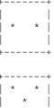

`rand()` 接口可追溯到 V7 和 PDP-11。特别地，在许多系统上，结果仅为 16 位数字，这严重限制了可返回数字的范围。此外，其使用的算法在现代标准下被认为“较弱”。（glibc 版本的 `rand()` 没有这些问题，但编写可移植代码时需要意识到 `rand()` 不是最佳 API。）

`ch12-rand.c` 使用一种简单技术来获得特定范围内的值：`%` 运算符。该技术使用返回值的低位（就像十进制除法中，除以 10 或 100 的余数使用最低的 1 位或 2 位十进制数字）。事实证明，历史上的 `rand()` 生成器在中间和高位上产生随机值的效果优于低位。因此，如果你必须使用 `rand()`，请尽量避免使用低位。GNU/Linux 的 `rand(3)` manpage 引用了《Numerical Recipes in C》，该书推荐了此技术：

```c
j = 1+(int) (10.0*rand()/(RAND_MAX+1.0)); /* 获取 1 到 10 之间的数字 */
```

### 12.6.2 POSIX 函数：random() 和 srandom()

4.3 BSD 引入了 `random()` 及其配套函数。这些函数使用好得多的随机数生成器，返回 31 位值。它们现在是 POSIX 标准化的 XSI 扩展：

```c
#include <stdlib.h>    // XSI

long random(void);
void srandom(unsigned int seed);
char *initstate(unsigned int seed, char *state, size_t n);
char *setstate(char *state);
```

前两个函数与 `rand()` 和 `srand()` 紧密对应，可以类似地使用。然而，与产生伪随机数序列的单个种子值不同，这些函数使用种子值加上一个**状态数组**：一个包含计算伪随机数所需状态信息的字节数组。最后两个函数让你管理状态数组。

- `long random(void);`

  返回 0 到 2<sup>31</sup> − 1 之间的数字。（虽然 GNU/Linux 的 `random(3)` manpage 说在 0 和 `RAND_MAX` 之间，但这仅适用于 `RAND_MAX` 等于 2<sup>31</sup> − 1 的 glibc 系统。在其他系统上，`RAND_MAX` 可能更小。POSIX 明确指出范围是 0 到 2<sup>31</sup> − 1。）

- `void srandom(unsigned int seed);`

  设置种子。如果从未调用 `srandom()`，默认种子为 1。

- `char *initstate(unsigned int seed, char *state, size_t n);`

  使用生成随机数所需的信息初始化状态数组。`seed` 是要使用的种子值，类似于 `srandom()`，`n` 是状态数组中的字节数。

  `n` 应为 8、32、64、128 或 256 之一。较大的值产生更好的随机数序列。小于 8 的值会导致 `random()` 使用与 `rand()` 类似的简单随机数生成器。大于 8 且不等于列表中值的结果会被舍入到最近的合适值。

- `char *setstate(char *state);`

  将内部状态设置为 `state` 数组，该数组必须由 `initstate()` 初始化。这让你可以随意在不同的状态之间切换，提供多个随机数生成器。

如果从未调用 `initstate()` 和 `setstate()`，`random()` 使用大小为 128 的内部状态数组。

状态数组是不透明的；你用 `initstate()` 初始化它，并通过 `setstate()` 将其传递给 `random()` 函数，但除此之外你不需要查看其内部。如果你使用 `initstate()` 和 `setstate()`，则不需要再调用 `srandom()`。


因为种子包含在状态信息中。`ch12-random.c` 使用这些例程而不是 `rand()`。它还将随机数生成器用当前时间加上 PID（进程 ID）作为种子，这是一种常用的技术。

```c
/* ch12-random.c -- generate die rolls, using random(). */

#include <stdio.h>
#include <stdlib.h>
#include <sys/types.h>
#include <unistd.h>

char *die_faces[] = { /* ASCII graphics rule! */
    ...as before ...
};

/* main -- print N different die faces */

int main(int argc, char **argv)
{
    int nfaceds;
    int i, j, k;
    char state[256];
    time_t now;

    ...check args, compute nfaceds, as before ...

    (void) time(&now); /* seed with time of day and PID */
    (void) initstate((unsigned int) (now + getpid()), state, sizeof state);
    (void) setstate(state);

    for (i = 1; i <= nfaceds; i++) {
        j = random() % 6; /* face to range 0 <= j <= 5 */
        printf("+--------\n");
        for (k = 0; k < 3; k++)
            printf("|%s|\n", die_faces[j * 3] + k]);
        printf("+--------\n\n");
    }

    return 0;
}
```

将 PID 作为种子值的一部分可以确保即使两个程序在同一秒内启动，也能得到不同的结果。

由于 `random()` 生成的随机数序列质量更高，因此它比 `rand()` 更受推荐，GNU/Linux 以及所有现代 Unix 系统都支持它。

### 12.6.3 `/dev/random` 和 `/dev/urandom` 特殊文件

`rand()` 和 `srand()` 都是伪随机数生成器。对于相同的种子，它们的输出是一个可重现的数字序列。某些应用程序（如加密）要求随机数必须是（更）真正的随机数。为此，Linux 内核以及各种 BSD 和商业 Unix 系统都提供了特殊的设备文件，用于访问内核从物理设备和其他来源收集的“熵池”中的随机位。来自 `random(4)` 手册页的内容：

- `/dev/random`
  - [从该文件读取的字节] 在熵池估计的噪声位数之内。`/dev/random` 适用于需要高质量随机性的场景，例如一次性密码本或密钥生成。当熵池为空时，对 `/dev/random` 的读取操作将阻塞，直到收集到额外的环境噪声。
- `/dev/urandom`
  - [该设备将] 返回请求的字节数。因此，如果熵池中的熵不足，返回的值在理论上容易受到针对驱动程序所用算法的加密攻击。目前非机密文献中没有关于如何进行此类攻击的知识，但理论上可能存在这样的攻击。如果你的应用程序对此表示担忧，请使用 `/dev/random` 替代。

对于大多数应用程序，从 `/dev/urandom` 读取就足够了。如果你打算编写高质量的加密算法，你应当先研究一下加密和随机性；不要依赖这里粗略的介绍！下面是我们再次使用 `/dev/urandom` 的掷骰子程序：

```c
/* ch12-devrandom.c --- generate die rolls, using /dev/urandom. */

#include <stdio.h>
#include <fcntl.h>
#include <stdlib.h>

char *die_faces[] = {    /* ASCII graphics rule! */
    ...as before...
};

/* myrandom --- return data from /dev/urandom as unsigned long */

unsigned long myrandom(void)
{
    static int fd = -1;
    unsigned long data;

    if (fd == -1)
        fd = open("/dev/urandom", O_RDONLY);

    if (fd == -1 || read(fd, &data, sizeof(data)) <= 0)
        return random(); /* fall back */

    return data;
}

/* main --- print N different die faces */
int main(int argc, char **argv)
{
    int nfaces;
    int i, j, k;

    ... check args, compute nfaces, as before ...

    for (i = 1; i <= nfaces; i++) {
        j = myrandom() % 6; /* force to range 0 <= j <= 5 */
        printf("+--------\n");
        for (k = 0; k < 3; k++)
            printf("|%s|\n", die_faces[j * 3] + k]);
        printf("+--------\n\n");
    }

    return 0;
}
```

第 35–47 行提供了对 `/dev/urandom` 的函数调用接口，每次读取相当于一个 `unsigned long` 的数据。代价是一个在整个程序生命周期内保持打开的文件描述符。

## 12.7 元字符展开

三组复杂度递增的函数提供了匹配 shell 通配符模式的能力。许多程序需要这样的库函数。例如 `find`：`find . -name '*.c' -print`。另一个例子是许多程序中的 `-exclude` 选项，它接受要排除在某些操作之外的文件的通配符模式。本节将依次介绍每一组函数。

### 12.7.1 简单模式匹配：`fnmatch()`

我们从 `fnmatch()`（“文件名匹配”）函数开始：

```c
#include <fnmatch.h>
int fnmatch(const char *pattern, const char *string, int flags);
```

此函数将 `string` 与 `pattern` 进行匹配，后者是一个常规的 shell 通配符模式。`flags` 值（稍后描述）会修改函数的行为。如果 `string` 匹配 `pattern`，返回值为 `0`；如果不匹配，则返回 `FNM_NOMATCH`；如果发生错误，则返回非零值。不幸的是，POSIX 没有定义任何具体的错误；因此，你只能知道出错了，但不知道具体是什么错误。

`flags` 变量是表 12.1 中列出的一个或多个标志的按位或。

**表 12.1**
`fnmatch()` 的标志值

| 标志名称 | 仅限 GLIBC | 含义 |
| :--- | :--- | :--- |
| `FNM_CASEFOLD` | ✓ | 执行不区分大小写的匹配。 |
| `FNM_FILE_NAME` | ✓ | 这是 GNU 中 `FNM_PATHNAME` 的同义词。 |
| `FNM_LEADING_DIR` | ✓ | 这是 GLIBC 内部使用的标志；不要在程序中使用它。详情请参阅 *fnmatch*(3)。 |
| `FNM_NOESCAPE` | | 反斜杠是普通字符，不是转义字符。 |
| `FNM_PATHNAME` | | `string` 中的斜杠必须匹配 `pattern` 中的斜杠；它不能被 `*`、`?` 或 `['.']` 匹配。 |
| `FNM_PERIOD` | | 只有当 `pattern` 也有前导点时，`string` 中的前导点才会被匹配。点必须是 `string` 中的第一个字符。但是，如果同时设置了 `FNM_PATHNAME`，则跟在斜杠后面的点被视为前导点。 |

`fnmatch()` 可以与来自任何来源的字符串配合使用；要匹配的字符串不必是实际的文件名。实际上，你通常会在通过 `readdir()` 读取目录的代码中使用 `fnmatch()`（见第 5.3.1 节，“基本目录读取”，第 133 页）：

```c
struct dirent dp;
DIR *dir;
char pattern[100];
... fill pattern, open directory, check for errors ...
while ((dp = readdir(dir)) != NULL) {
    if (fnmatch(pattern, dir->d_name, FNM_PERIOD) == 0
        /* filename matches pattern */
    else
        continue;  /* doesn't match */
}
```

GNU `ls` 使用 `fnmatch()` 来实现其 `--ignore` 选项。你可以提供多个要忽略的模式（通过多个选项）。`ls` 将每个文件名与所有模式进行测试。它通过 `ls.c` 中的 `file_interesting()` 函数来完成此操作：

```c
/* Return nonzero if the file in `next' should be listed. */

static int
file_interesting (const struct dirent *next)
{
  register struct ignore_pattern *ignore;

  for (ignore = ignore_patterns; ignore; ignore = ignore->next)
    if (fnmatch (ignore->pattern, next->d_name, FNM_PERIOD) == 0)
      return 0;

  if (really_all_files
      || next->d_name[0] != '.'
      || (all_files
          && next->d_name[1] != '\0'
          && (next->d_name[1] != '.' || next->d_name[2] != '\0')))
    return 1;

  return 0;
}
```

第 2276–2278 行的循环将文件名与要忽略的文件模式列表进行测试。如果任何模式匹配，该文件就不有趣（即不重要），`file_interesting()` 返回 false（即 0）。

`all_files` 变量对应 `-A` 选项，该选项显示以点开头但既不是 `.` 也不是 `..` 的文件。`really_all_files` 变量对应 `-a` 选项，该选项隐含 `-A`，并显示 `.` 和 `..`。根据这些信息，第 2280–2284 行的条件可以用以下伪代码表示：


```c
if (  show every file, no matter what its name (-a)
   OR the first character of the name isn't a period
   OR (  show dot files (-A)
      AND there are multiple characters in the filename
      AND (  the second character isn't a period
           OR the third character doesn't end the name)))
    return TRUE;
```

> **注** 如果在多字节字符集区域设置中使用，`fmatch()` 可能是一个代价高昂的函数。我们在 13.4 节“你能帮我拼一下这个词吗？”（第 521 页）中讨论了多字节字符集。

## 12.7.2 文件名扩展：`glob()` 和 `globfree()`

`glob()` 和 `globfree()` 函数比 `fmatch()` 更复杂：
`#include <glob.h>` POSIX

```c
int glob(const char *pattern, int flags, int (*errfunc)(const char *epath, int errno), glob_t *pglob);
void globfree(glob_t *pglob);
```

`glob()` 函数执行目录扫描和通配符匹配，返回所有匹配该模式的路径名列表。通配符可以包含在路径名的多个位置，而不仅仅是最后一个组件（例如，`/usr/*/*.so`）。参数如下：

- `const char *pattern` 要扩展的模式。
- `int flags` 控制 `glob()` 行为的标志，稍后说明。
- `int (*errfunc)(const char *epath, int errno)` 指向用于报告错误的函数的指针。该值可以为 NULL。如果不是 NULL，并且如果 `(*errfunc)()` 返回非零值，或者 `flags` 中设置了 `GLOB_ERR`，则 `glob()` 停止处理。

`(*errfunc)()` 的参数是导致问题的路径名以及由 `opendir()`、`readdir()` 或 `stat()` 设置的 `errno` 值。

- `glob_t *pglob` 指向用于保存结果的 `glob_t` 结构的指针。

`glob_t` 结构保存 `glob( )` 生成的路径名列表：

```c
typedef struct {
    size_t gl_pathc;    /* Count of paths matched so far */
    char **gl_pathv;    /* List of matched pathnames */
    size_t gl_offs;     /* Slots to reserve in gl_pathv */
} glob_t;                /* POSIX */
```

- `size_t gl_pathc` 匹配的路径数量。
- `char **gl_pathv` 匹配的路径名数组。`gl_pathv[gl_pathc]` 始终为 NULL。
- `size_t gl_offs` `gl_pathv` 中的“保留槽位”。其目的是在 `gl_pathv` 的*前部*保留槽位，以便应用程序稍后填充，例如用命令名和选项。然后可以将该列表直接传递给 `execv( )` 或 `execvp( )`（参见 9.1.4 节“启动新程序：`exec( )` 系列”，第 293 页）。保留的槽位设置为 NULL。为了使这一切正常工作，必须在 *flags* 中设置 GLOB_DOOFFS。

表 12.2 列出了 `glob( )` 的标准标志。

**表 12.2**
**`glob( )` 的标志**

| 标志名称 | 含义 |
| :--- | :--- |
| GLOB_APPEND | 将当前调用的结果追加到前一次调用的结果中。 |
| GLOB_DOOFFS | 在 gl_pathv 的前部保留 gl_offs 个位置。 |
| GLOB_MARK | 在每个是目录的路径名末尾追加 `/` 字符。 |
| GLOB_NOCHECK | 如果模式不匹配任何文件名，则原样返回它。 |
| GLOB_NOESCAPE | 将反斜杠视为字面字符。这使得无法转义通配符元字符。 |
| GLOB_NOSORT | 不对结果排序；默认情况下会对结果排序。 |

GLIBC 版本的 `glob_t` 结构包含额外的成员：

```c
typedef struct {
    /* POSIX components: */
    size_t gl_pathc;    /* Count of paths matched so far */
    char **gl_pathv;    /* List of matched pathnames */
    size_t gl_offs;     /* Slots to reserve in gl_pathv */
    /* GLIBC components: */
    int gl_flags;
    void (*gl_closedir) (DIR *);
    struct dirent *(*gl_readdir) (DIR *);
    DIR *(*gl_opendir) (const char *);
    int (*gl_lstat) (const char *, struct stat *);
    int (*gl_stat) (const char *, struct stat *);
} glob_t;                /* GLIBC */
```

标志的副本，额外的 GLIBC 标志
*closedir()* 的私有版本
*readdir()* 的私有版本
*opendir()* 的私有版本
*lstat()* 的私有版本
*stat()* 的私有版本

成员如下：

- `int gl_flags` 标志的副本。如果模式包含任何元字符，则还包含 *GLOB\_MAGCHAR*。
- `void (*gl_closedir) (DIR *)` 指向 *closedir()* 替代版本的指针。
- `struct dirent *(*gl_readdir) (DIR *)` 指向 *readdir()* 替代版本的指针。
- `DIR *(*gl_opendir) (const char *)` 指向 *opendir()* 替代版本的指针。
- `int (*gl_lstat) (const char *, struct stat *)` 指向 *lstat()* 替代版本的指针。
- `int (*gl_stat) (const char *, struct stat *)` 指向 *stat()* 替代版本的指针。

指向标准函数私有版本的指针主要用于实现 GLIBC；你几乎不需要使用它们。由于 GLIBC 提供了 `gl_flags` 字段和额外的标志值，manage 和 Info 手册记录了 GLIBC `glob_t` 结构的其余部分。表 12.3 列出了额外的标志。

`GLOB_ONLyDIR` 标志作为对实现的一个*提示*，表明调用者只对目录感兴趣。它的主要用途是 GLIBC 内部的其它函数，调用者仍需准备处理非目录文件。你不应该在程序中用它。

可以多次调用 `glob()`：第一次调用*不应*设置 `GLOB_APPEND` 标志，而所有后续调用*必须*设置它。你不能在调用之间更改 `gl_offs`，如果你修改了 `gl_pathv` 或 `gl_pathc` 中的任何值，则必须在进行对 `glob()` 的后续调用之前恢复它们。

能够多次调用 `glob()` 允许你在单个列表中积累结果。这非常有用；它在 C 编程语言层面上接近 shell 通配符扩展设施的功能。

如果没有问题，`glob()` 返回 `0`，否则返回表 12.4 中的某个值。

**表 12.3**
**`glob()` 的额外 GLIBC 标志**

| 标志名称 | 含义 |
| :--- | :--- |
| `GLOB_ALTDIRFUNC` | 使用替代函数进行目录访问（参见正文）。 |
| `GLOB_BRACE` | 执行 `csh` 和 Bash 风格的括号扩展。 |
| `GLOB_MAGCHAR` | 如果发现元字符，则在 `gl_flags` 中设置。 |
| `GLOB_NOMAGIC` | 如果模式不包含元字符，则返回模式。 |
| `GLOB_ONLYDIR` | 如果可能，仅匹配目录。参见正文。 |
| `GLOB_PERIOD` | 允许像 `*` 和 `?` 这样的元字符匹配前导点。 |
| `GLOB_TILDE` | 执行 shell 风格的波浪号扩展。 |
| `GLOB_TILDE_CHECK` | 类似于 `GLOB_TILDE`，但如果命名主目录存在问题，则返回 `GLOB_NOMATCH` 而不是将 `pattern` 放入列表。

**表 12.4**
**`glob()` 的返回值**

| 常量 | 含义 |
| :--- | :--- |
| `GLOB_ABORTED` | 由于设置了 `GLOB_ERR` 或因为 `(*errfunc)()` 返回非零值，扫描提前停止。 |
| `GLOB_NOMATCH` | 没有文件名匹配 `pattern`，且标志中未设置 `GLOB_NOCHECK`。 |
| `GLOB_NOSPACE` | 分配动态内存时出现问题。 |

`globfree()` 释放 `glob()` 动态分配的所有内存。以下程序 ch12-glob.c 演示了 `glob()`：

```c
/* ch12-glob.c --- demonstrate glob(). */

#include <stdio.h>
#include <errno.h>
#include <glob.h>

char *myname;

/* globerr --- print error message for glob() */
int globerr(const char *path, int errno)
{
    fprintf(stderr, "%s: %s\n", myname, path, strerror(errno));
    return 0; /* let glob() keep going */
}

/* main() --- expand command-line wildcards and print results */

int main(int argc, char **argv)
{
    int i;
    int flags = 0;
    glob_t results;
    int ret;

    if (argc == 1) {
        fprintf(stderr, "usage: %s wildcard ...\n", argv[0]);
        exit(1);
    }

    myname = argv[0];    /* for globerr() */

    for (i = 1; i < argc; i++) {
        flags |= (i > 1 ? GLOB_APPEND : 0);
        ret = glob(argv[i], flags, globerr, &results);
        if (ret != 0) {
            fprintf(stderr, "%s: problem with %s (%s), stopping early\n", myname, argv[i],
                    /* ugly: */ (ret == GLOB_ABORTED ? "filesystem problem" :
                                 ret == GLOB_NOMATCH ? "no match of pattern" :
                                 ret == GLOB_NOSPACE ? "no dynamic memory" :
                                 "unknown problem"));
            break;
        }
    }

    for (i = 0; i < results.gl_pathc; i++)
        printf("%s\n", results.gl_pathv[i]);

    globfree(&results);
    return 0;
}
```


第 7 行定义了 `myname`，它指向程序名称；该变量用于 `globerr()`（定义在第 11–15 行）的错误消息。

第 33–45 行是程序的核心。它们遍历命令行中给出的模式，并对每个模式调用 `glob()`，将其结果追加到列表中。循环的大部分是错误处理（第 36–44 行）。第 47–48 行打印结果列表，第 50–51 行进行清理并返回。

第 39–41 行的代码并不美观；应该使用一个独立的函数将整型常量转换为字符串；我们主要为了节省空间才这样写。对于小型程序来说，这样的代码是可以接受的，但较大的程序应使用函数。

如果你仔细思考一下底层所发生的所有工作（打开和读取目录、匹配模式、动态分配以扩展列表、排序列表），你开始会意识到 `glob()` 为你做了多少事情！以下是一些结果：

```
$ ch12-glob '/usr/lib/*\.so' .../*\.texi'
/usr/lib/xchat-autoS.so
/usr/lib/xchat-autoGS.so
.../00-prefix.texi
.../01-intro.texi
.../02-cmdline.texi
.../03-memory.texi
...
```

注意，我们必须引用参数，以防止 shell 进行扩展！

> **通配符扩展？那是什么？**
>
> 在远古时代，大约 V6 Unix 时期，shell 使用一个独立的程序在幕后执行通配符扩展。这个程序被命名为 /etc/glob，根据 V6 源代码，¹ “glob” 是 “global” 的缩写。
>
> 因此，“to glob”（通配）这个词进入了 Unix 词汇表，意思是“执行通配符扩展”。这反过来又赋予了 `glob()` 和 `globfree()` 这些函数名称。Unix 手册中偶尔流露出的那种含蓄的幽默感因此得以延续，并正式载入 POSIX 标准。（你能想象在 20 世纪 70 或 80 年代的 IBM，有人将一个系统例程命名为 `glob()` 吗？）

### 12.7.3 Shell 单词扩展：wordexp() 和 wordfree()

许多 POSIX 委员会成员认为 glob() 做得还不够：他们希望有一个库例程，能够完成 shell 所能做的一切：波浪号扩展（`echo $~arndld`）、shell 变量扩展（`echo $HOME`）以及命令替换（`echo $(cd ; pwd)`）。许多其他人认为 glob() 不是实现这一目的的正确函数。为了“满足”每个人，POSIX 提供了另外两个功能，它们可以完成所有工作：

```
#include <wordexp.h>   POSIX
int wordexp(const char *words, wordexp_t *pwordexp, int flags);
void wordfree(wordexp_t *pwordexp);
```

这些函数的作用类似于 glob() 和 globfree()，但它们在 wordexp_t 结构体上操作：

```
typedef struct {
    size_t we_wordc;      /* 匹配到的单词数量 */
    char **we_wordv;      /* 扩展后的单词列表 */
    size_t we_offs;       /* 在 we_wordv 中保留的槽位 */
} wordexp_t;
```

其成员与前面描述的 glob_t 完全类似；我们不会在此重复整个描述。

与 glob() 一样，几个标志控制 wordexp() 的行为。标志列在表 12.5 中。

**表 12.5**
wordexp() 的标志

| 常量 | 含义 |
| :--- | :--- |
| WRDE_APPEND | 将当前调用的结果追加到前一次调用的结果中。 |
| WRDE_DOFFS | 在 we_wordv 的前部保留 we_offs 个位置。 |
| WRDE_NOCMD | 不允许命令替换。 |
| WRDE_REUSE | 复用 we_wordv 已指向的存储空间。 |
| WRDE_SHOWERR | 扩展过程中的错误不要静默处理。 |
| WRDE_UNDEF | 使未定义的 shell 变量产生错误。 |

如果一切顺利，返回值为 0；否则为表 12.6 中的某个值。

**表 12.6**
wordexp() 错误返回值

| 常量 | 含义 |
| :--- | :--- |
| WRDE_BADCHAR | 在无效位置出现了元字符（换行符、`' '`、`&`、`;`、`<`、`>`、`(`、`)`、`{`、`}` 或 `)` 之一）。 |
| WRDE_BADVAL | 变量未定义且设置了 `WRDE_UNDEF`。 |
| WRDE_CMDSUB | 尝试了命令替换且设置了 `WRDE_NOCMD`。 |
| WRDE_NOSPACE | 动态内存分配出现问题。 |
| WRDE_SYNTAX | 存在 shell 语法错误。 |

我们将修改 ch12-glob.c 以使用 wordexp() 和 wordfree() 的任务留给你作为练习（见后文）。以下是我们版本的运行情况：

```text
$ ch12-wordexp 'echo $HOME'                Shell 变量扩展
echo
/home/arnold
$ ch12-wordexp 'echo $HOME/*.gz'          变量和通配符
echo
/home/arnold/48000.wav.gz
/home/arnold/ipmapq-HOWTO.tar.gz
/home/arnold/rc.firewall-examples.tar.gz
$ ch12-wordexp 'echo ~arnold'             波浪号扩展
echo
/home/arnold
$ ch12-wordexp 'echo ./arnold/.p*'        波浪号和通配符
echo
/home/arnold/.posinitnotes
/home/arnold/.procmailrc
/home/arnold/.profile
$ ch12-wordexp 'echo `~arnold/.p*``'      引用有效
echo
~arnold/.p*
```

## 12.8 正则表达式

*正则表达式* 是一种描述要匹配的文本模式的方法。如果你已经使用 GNU/Linux 或 Unix 有一段时间，你肯定熟悉正则表达式：它们是 Unix 程序员工具箱中的基础部分。它们是 `grep`、`egrep`、`sed`、`awk`、Perl 以及 `ex`、`vi`、`vim` 和 Emacs 编辑器等日常程序的重要组成部分。如果你完全不了解正则表达式，我们建议你绕道去阅读第 12.9 节“推荐阅读”，第 480 页中列出的一些书籍或网址。

POSIX 定义了两种类型的正则表达式：*基础* 和 *扩展*。诸如 `grep`、`sed` 和行编辑器 `ed` 等程序使用基础正则表达式。诸如 `egrep` 和 `awk` 等程序使用扩展正则表达式。以下函数使你的程序能够使用这两种类型中的任意一种：

```
#include <sys/types.h> 
#include <regex.h> 
int regcomp(regex_t *preg, const char *regex, int cflags); 
int regexec(const regex_t *preg, const char *string, size_t nmatch, 
regmatch_t pmatch[], int eflags); 
size_t regerror(int errcode, const regex_t *preg, 
char *errbuf, size_t errbuf_size); 
void regfree(regex_t *preg)
```


要进行正则表达式匹配，你必须首先*编译*正则表达式的字符串版本。编译将正则表达式转换为内部形式。然后，编译后的形式被*执行*于字符串之上，以查看它是否匹配原始正则表达式。这些函数如下：

```
int regcomp(regex_t *preg, const char *regex, int cflags)
```

将正则表达式 `regex` 编译为内部形式，并将其存储在 `*preg` 指向的 `regex_t` 结构中。`cflags` 控制编译方式；其值为 0 或表 12.7 中一个或多个标志的按位或结果。

```
int regexec(const regex_t *preg, const char *string, size_t nmatch, 
regmatch_t pmatch[], int eflags)
```

将 `*preg` 中编译好的正则表达式应用于字符串 `string`。`eflags` 控制执行方式；其值为 0 或表 12.8 中一个或多个标志的按位或结果。我们稍后讨论其他参数。

```
size_t regerror(int errcode, const regex_t *preg, char *errbuf, 
size_t errbuf_size)
```

将 `regcomp()` 或 `regexec()` 返回的错误转换为可供人类阅读的字符串。

```
void regfree(regex_t *preg)
```

释放 `*preg` 中编译好的正则表达式所使用的动态内存。

<regex.h> 头文件定义了许多标志。有些用于 regcomp()，其他用于 regexec()。但是，它们都以前缀 'REG' 开头。表 12.7 列出了使用 regcomp() 编译正则表达式时的标志。

**表 12.7**
regcomp() 的标志

| 常量 | 含义 |
| :--- | :--- |
| REG_EXTENDED | 使用扩展正则表达式。默认是基础正则表达式。 |
| REG_ICASE | regexec() 匹配时忽略大小写。 |
| REG_NEWLINE | 可以匹配任何字符的操作符不匹配换行符。 |
| REG_NOSUB | 不需要子模式开始和结束信息（参见文本）。 |

使用 regexec() 进行正则表达式匹配的标志见表 12.8。

**表 12.8**
regexec() 的标志

| 常量 | 含义 |
| :--- | :--- |
| REG_NOTBOL | 不允许 ^（行首）操作符匹配。 |
| REG_NOTEOL | 不允许 $（行尾）操作符匹配。 |

REG_NEWLINE、REG_NOTBOL 和 REG_NOTEOL 标志相互关联。这有点复杂，所以我们一步步来。

- 当 cflags 中不包含 REG_NEWLINE 时，换行符充当普通字符。'.'（匹配任何字符）元字符可以匹配它，取反的字符列表（'^ . . .'）也可以。此外，$ 不匹配嵌入的换行符之前，^ 也不匹配换行符之后。
- 当 eflags 中设置了 REG_NOTBOL 时，^ 操作符不匹配字符串的开头。当 string 参数是正在匹配的文本中间某个字符的地址时，这很有用。
- 类似地，当 eflags 中设置了 REG_NOTEOL 时，$ 操作符不匹配字符串的结尾。
- 当 cflags 中包含 REG_NEWLINE 时：


- 换行符不匹配 `.` 或补全字符列表。
- 无论 `REG_BOL` 的设置如何，`^` 运算符始终匹配紧跟在嵌入换行符之后的位置。
- 无论 `REG_EOL` 的设置如何，`$` 运算符始终匹配紧跟在嵌入换行符之前的位置。

当执行逐行输入/输出时（例如通过 `grep`），你可以从 cflags 中省略 `REG_NEWLINE`。如果你在缓冲区中有多个行，并希望将每一行视为一个独立的字符串，使 `^` 和 `$` 在其中匹配，那么你应该包含 `REG_NEWLINE`。

`regex_t` 结构体大部分是不透明的。它有一个成员供用户级代码检查；其余部分是供正则表达式例程内部使用的：

```
typedef struct {
  ... internal stuff here ...
  size_t re_nsub;
  ... internal stuff here ...
} regex_t;
```

`regmatch_t` 结构体至少有两个成员供用户级代码使用：

```
typedef struct {
  ... possible internal stuff here ...
  regoff_t rm_so;               /* Byte offset to start of substring */
  regoff_t rm_eo;               /* Byte offset to first character after substring end */
  ... possible internal stuff here ...
} regmatch_t;
```

`re_nsub` 字段和 `regmatch_t` 结构体都用于*子表达式匹配*。考虑以下扩展正则表达式：

```
[[:space:]]+(|[[:digit:]])+[[:space:] ]+(|[[:alpha:]])+
```

两个带括号的子表达式中的每一个都可以匹配一个或多个字符。此外，匹配每个子表达式的文本可以在字符串内的任意位置开始和结束。

`regcomp()` 将 `re_nsub` 字段设置为正则表达式中带括号子表达式的数量。`regexexec()` 用匹配相应子表达式的文本的起始和结束字节偏移量填充 `pmatch` 数组的 `regmatch_t` 结构体。这些数据允许你进行文本替换——删除匹配的文本或将匹配的文本替换为其他文本，就像在你喜爱的文本编辑器中一样。

`pmatch[0]` 描述*字符串*中匹配整个正则表达式的部分。`pmatch[1]` 到 `pmatch[preg->re_nsub]` 描述匹配每个带括号子表达式的部分。（因此，子表达式从 1 开始编号。）`pmatch` 数组中未使用的元素其 `rm_so` 和 `rm_eo` 元素被设置为 -1。

`regexexec()` 最多填充 `pmatch` 的 `nmatch - 1` 个元素；因此，你应该确保至少有与 `preg->re_nsub` 相同数量（加 1）的元素。

最后，`regexcomp()` 的 `REG_NOSUB` 标志表示不需要起始和结束信息。当你不需要这些信息时，应该使用此标志；它可能会提高 `regexexec()` 的性能，产生显著差异。

换句话说，如果你只需要知道“是否匹配？”，则包含 `REG_NOSUB`。然而，如果你还需要知道“匹配的文本在哪里？”，则省略它。

最后，`regexcomp()` 和 `regexexec()` 在成功时返回 0，否则返回特定的错误代码。错误代码如表 12.9 所示。

## 表 12.9
`regexcomp()` 和 `regexexec()` 的错误代码

| 常量 | 含义 |
| :--- | :--- |
| REG_BADDER | `\'( . . . )'` 的内容无效。 |
| REG_BADPAT | 正则表达式无效。 |
| REG_BADRPT | `?`、`+` 或 `*` 前面没有有效的正则表达式。 |
| REG_EBRACE | 大括号 `\'( . . . )'` 未正确配对。 |
| REG_EBRACK | 方括号 `\'( . . . )'` 未正确配对。 |
| REG_ECOLLATE | 该模式使用了无效的排序元素。 |
| REG_ECTYPE | 该模式使用了无效的字符类。 |
| REG_EESCAPE | 该模式有一个尾随的 `\` 字符。 |
| REG_EPAREN | 分组括号 `\'( . . . )'` 或 `\'( . . . )'` 未正确配对。 |
| REG_ERANGE | 范围表达式中的端点无效。 |
| REG_ESPACE | 函数内存不足。 |
| REG_ESUBREG | `\'digits\'` 中的数字无效。 |
| REG_NOMATCH | `regexexec()` 未将字符串与模式匹配。 |

为了演示正则表达式例程，ch12-grep.c 提供了标准 `grep` 程序的基本重新实现，该程序在文件中搜索模式。我们的版本默认使用基本正则表达式。它接受一个 `-E` 选项来使用扩展正则表达式，以及一个 `-i` 选项来忽略大小写。与真正的 `grep` 一样，如果命令行中未提供文件，我们的 `grep` 将读取标准输入，并且与真正的 `grep` 一样，可以使用文件名 ‘-‘ 来表示标准输入。（这种技术在搜索标准输入与其他文件时很有用。）以下是该程序：

```
/* ch12-grep.c -- Simple version of grep using POSIX R.E. functions. */
#define _GNU_SOURCE 1          /* for getline() */
#include <stdio.h>
#include <errno.h>
#include <regex.h>
#include <unistd.h>
#include <sys/types.h>

char *myname;                  /* for error messages */
int ignore_case = 0;           /* -i option: ignore case */
int extended = 0;             /* -E option: use extended RE's */
int errors = 0;               /* number of errors */

regex_t pattern;               /* pattern to match */

void compile_pattern(const char *pat);
void process(const char *name, FILE *fp);
void usage(void);
```

第 10–15 行声明程序的全局变量。第一组（第 10–13 行）用于选项和错误消息。第 15 行声明 `pattern`，它保存编译后的模式。第 17–19 行声明程序的其他函数。

```
/* main --- process options, open files */
int main(int argc, char **argv)
{
    int c;
    int i;
    FILE *fp;
    myname = argv[0];

    while ((c = getopt(argc, argv, "iR?")) != -1) {
        switch (c) {
            case 'i':
                ignore_case = 1;
                break;
            case 'R':
                extended = 1;
                break;
            case '?':
                usage();
                break;
        }
    }

    if (optind == argc)      /* sanity check */
        usage();

    compile_pattern(argv[optind]); /* compile the pattern */
    if (errors)              /* compile failed */
        return 1;
    else
        optind++;

    if (optind == argc)     /* no files, default to stdin */
        process("standard input", stdin);
    else {
        for (i = optind; i < argc; i++) {
            if (strcmp(argv[i], "-") == 0)
                process("standard input", stdin);
            else if ((fp = fopen(argv[i], "r")) != NULL) {
                process(argv[i], fp);
                fclose(fp);
            } else {
                fprintf(stderr, "%s: %s: could not open: %s\n",
                        argv[0], argv[i], strerror(errno));
                errors++;
            }
        }
    }

    regfree(& pattern);
    return errors != 0;
}
```

第 29 行设置 myname，第 30–45 行解析选项。第 47–51 行编译正则表达式，并将结果放入 pattern。compile_pattern() 在出现问题时递增 errors。（像这样通过全局变量耦合函数通常被认为是不好的形式。对于这个像本例这样的小型程序来说是可以的，但在较大的程序中，这种耦合可能成为问题。）如果没有出现问题，第 51 行递增 optind，使得剩余参数是待处理的文件。

第 53–69 行处理文件，搜索与模式匹配的行。第 53–54 行处理未提供文件的情况：程序读取标准输入。否则，第 57–68 行循环处理文件。第 58 行处理 ‘-’ 表示标准输入的特殊情况，第 60–62 行处理常规文件，第 63–67 行处理问题。

```
/* compile_pattern --- compile the pattern */
void compile_pattern(const char *pat)
{
    int flags = REG_NOSUB; /* don't need where-matched info */
    int ret;
    #define MSGBUFSIZE 512 /* arbitrary */
    char error[MSGBUFSIZE];

    if (ignore_case)
        flags |= REG_ICASE;
    if (extended)
        flags |= REG_EXTENDED;

    ret = regcomp(& pattern, pat, flags);
    if (ret != 0) {
        (void) regerror(ret, & pattern, error, sizeof error);
        fprintf(stderr, "%s: pattern '%s': %s\n", myname, pat, error);
        errors++;
    }
}
```

第 75–95 行定义了 compile_pattern() 函数。由于我们只需要知道“某行是否匹配？”而不需要知道“匹配文本在行中的哪个位置？”，它首先将 flags 设置为 REG_NOSUB。

第 84–85 行根据命令行选项添加额外的标志。第 89 行编译模式，第 90–94 行报告任何问题。

```
/* process --- read lines of text and match against the pattern */
void process(const char *name, FILE *fp)
{
    char *buf = NULL;
    size_t size = 0;
    char error[MSGBUFSIZE];
    int ret;
```


## 12.8 正则表达式

```
106 while (getline(& buf, &size, fp) != -1) {
107 ret = regexec(& pattern, buf, 0, NULL, 0);
108 if (ret != 0) {
109 if (ret != REG_NOMATCH) {
110 (void) regerror(ret, & pattern, error, sizeof error);
111 fprintf(stderr, "%s: file %s: %s\n", myname, name, error);
112 free(buf);
113 errors++;
114 return;
115 }
116 } else
117 printf("%s: %s", name, buf); /* print matching lines */
118 }
119 free(buf);
120 }
```

第 97–120 行定义了 `process()` 函数，该函数读取文件并执行正则表达式匹配。外部循环（第 106–119 行）读取输入行。我们使用 `getline()`（参见第 3.2.1.9 节，“仅限 glibc：读取整行：getline() 和 getline()”，第 73 页）以避免行长度问题。第 107 行调用 `regexec()`。非零的返回值表示匹配失败或发生其他错误。因此，第 109–115 行检查是否为 `REG_NOMATCH`，并且只有在发生其他问题时才打印错误——匹配失败本身并不视为错误。

如果返回值为 0，则表示该行匹配了该模式，因此第 117 行打印文件名和匹配的行。

```
122 /* usage --- print usage message and exit */
123
124 void usage(void)
125 {
126 fprintf(stderr, "usage: %s [-i] [-E] pattern [ files ... ]\n", myname);
127 exit(1);
128 }
```

`usage()` 函数打印用法信息并退出。当提供无效选项或未提供模式时（第 38–40 行和 44–45 行），将调用此函数。

就是这样！这是一个朴素但实用的 `grep` 版本，代码行数不到 130 行。

## 12.9 延伸阅读

- _《编程珍珠》_（Programming Pearls），第二版，作者 Jon Louis Bentley。Addison-Wesley 出版社，美国马萨诸塞州雷丁，2000 年。ISBN: 0-201-65788-0。参见该书的网站。[^10]
    - 使用断言进行程序设计是该书的一个基本主题。
- _《构建安全软件：如何正确地避免安全问题》_（Building Secure Software: How to Avoid Security Problems the Right Way），作者 John Viega 和 Gary McGraw。Addison-Wesley 出版社，美国马萨诸塞州雷丁，2001 年。ISBN: 0-201-72152-X。
    - 竞态条件仅仅是编写安全软件时需要关注的众多问题之一。随机数是另一个需要关注的问题。除了其他内容外，这本书也涵盖了这两个方面。（我们在前一章中曾提及过。）
- _《计算机程序设计艺术：第二卷：半数值算法》_（The Art of Computer Programming: Volume 2: Seminumerical Algorithms），第三版，作者 Donald E. Knuth。Addison-Wesley 出版社，美国马萨诸塞州雷丁，1998 年。ISBN: 0-201-89684-2。参见该书的网站。[^11]
    - 这是关于随机数生成的经典参考书。
- _《随机数生成与蒙特卡洛方法》_（Random Number Generation and Monte Carlo Methods），第二版，作者 James E. Gentle。Springer-Verlag 出版社，德国柏林，2003 年。ISBN: 0-387-00178-6。
    - 这本书广泛介绍了生成和测试伪随机数的方法。虽然它仍然需要数学和统计学的背景知识，但其难度不像 Knuth 的书那么高。（感谢 Nelson H.F. Beebe 指向此参考文献。）
- _《sed & awk》_，第二版，作者 Dale Dougherty 和 Arnold Robbins。O’Reilly and Associates 出版社，美国加利福尼亚州塞巴斯托波尔，1997 年。ISBN: 1-56592-225-5。
    - 这本书平缓地介绍了正则表达式和文本处理，从 `grep` 开始，进而介绍功能更强大的 `sed` 和 `awk` 工具。
- _《精通正则表达式》_（Mastering Regular Expressions），第二版，作者 Jeffrey E.F. Friedl。O’Reilly and Associates 出版社，美国加利福尼亚州塞巴斯托波尔，2002 年。ISBN: 0-59600-289-0。
    - 正则表达式是 Unix 的重要组成部分。为了学习如何使用正则表达式来切分、切割和处理文本，我们推荐这本书。
- GNU grep 的在线手册也解释了正则表达式。在 GNU/Linux 系统上，你可以使用 `info grep` 来查看本地副本。或者使用网络浏览器阅读 GNU 项目的 grep 在线文档。

[^10]: http://www.gnu.org/software/grep/doc/grep.html

## 12.10 小结

- 断言提供了一种方式来陈述程序的预期状态。它们是有用的设计和调试工具，通常应保留在生产代码中。然而，务必小心，不要将断言与针对可能失败情况的运行时检查混淆。

- `memXXX()` 函数提供了类似于更为人熟知的 `strXXX()` 函数的功能。它们最大的价值在于可以处理二进制数据；零字节与其他字节并无不同。特别值得注意的是 `memcpy()` 与 `memmove()` 的区别，以及重叠拷贝的处理方式。

- 临时文件在许多应用程序中非常有用。`tmpfile()` 和 `mkstemp()` API 是创建临时文件的首选方式，同时避免了竞态条件及其带来的安全隐患。许多程序使用 `TMPDIR` 环境变量来指定临时文件的位置，如果未定义该变量，则使用有意义的默认值（通常是 `/tmp`）。这是一个良好的惯例，你应该在自己的程序中采用它。

- `abort()` 函数向调用进程发送 `SIGABRT` 信号。其效果是终止进程并创建核心转储文件，通常用于调试。

- `setjmp()` 和 `longjmp()` 提供了非局部跳转。这是一个功能强大的机制，必须谨慎使用。`sigsetjmp()` 和 `siglongjmp()` 在程序执行非局部跳转时保存和恢复进程的信号掩码。非局部跳转的问题有时可能超过其带来的好处；因此，只有在没有其他更好的方法来组织应用程序时，才应使用这些例程。

- 随机数在各种应用中都有用。大多数软件使用伪随机数——这些数字序列看起来是随机的，但每次使用相同的种子启动时都可以复现。`rand()` 和 `srand()` 是原始 API，由 C 语言标准制定。在许多系统上，`rand()` 使用的算法性能较差。`random()` 和 `srandom()` 使用更好的算法，包含在 POSIX 标准中，并且优于 `rand()` 和 `srand()`。如果使用 (a) 可用的 `/dev/random` 和 `/dev/urandom` 特殊文件，并且 (b) 你需要高质量的随机数，那么请使用它们。

- 三种 API 提供了功能逐渐增强的元字符扩展（通配符）功能。
    - `fnmatch()` 最简单，根据给定字符串是否匹配给定的通配符模式返回 true/false。
    - `glob()` 遍历文件系统，返回匹配给定通配符的路径名列表。当只需要标准的 `glob()` 功能时，应使用它。虽然 GLIBC 版本的 `glob()` 有一些扩展功能，但需要额外功能的可移植程序应使用 `wordexp()`。（仅在 GNU/Linux 系统上运行的程序可以随意使用 GLIBC `glob()` 的全部功能。）
    - `wordexp()` 不仅执行了 `glob()` 的操作，还执行完整的 Shell 单词扩展，包括波浪号扩展、Shell 变量扩展和命令替换。
    - `regcomp()` 和 `regexec()` 函数让你能够访问 POSIX 基本和扩展正则表达式。通过使用其中一种，你可以使你的程序与标准实用程序的行为保持一致，从而使熟悉 GNU/Linux 和 Unix 的程序员更容易使用你的程序。

### 练习

1. 使用 `read()` 和 `memcmp()` 编写 `cmp` 程序的简单版本，用于比较两个文件。你的版本不需要支持任何选项。
2. 使用 `<stdio.h>` 中的 `getc()` 宏以及对每个读取字符的直接比较，编写另一个版本的 `cmp`，用于比较两个文件。将此版本的性能与你在上一练习中编写的版本进行比较。
3. （中等。）考虑 `<stdio.h>` 中的 `fgets()` 和 Glibc 的 `getline()` 函数。`memcpy()` 对实现它们有用吗？草拟一个使用 `memcpy()` 实现 `fgets()` 的可能方案。
4. （困难。）找到 Glibc 版本 `memcpy()` 的源代码。这应该在你的 GNU/Linux 发行版中某个源代码 CD-ROM 上，或者你可以通过网络搜索找到。检查代码并解释它。
5. 测试你的记忆。`tmpfile()` 是如何安排在关闭文件指针时删除文件的？
6. 使用 `mkstemp()`、`fdopen()` 以及你认为必要的任何其他函数或系统调用，编写你自己的 `tmpfile()` 版本。同时也对它进行测试。
7. 描述在 `mkstemp()` 返回后立即对由 `mkstemp()` 创建的文件名使用 `unlink()` 的优缺点。
8. 使用 `mktemp()` 和 `open()` 编写你自己的 `mkstemp()` 版本。你如何做出与 `mkstemp()` 相同的关于唯一性的保证？
9. 使用 `mkstemp()` 的程序应安排在退出时清理该文件。（假设在打开后没有立即 unlink 该文件，无论出于何种原因。）这包括终止信号可能到达的情况。因此，作为信号处理程序的一部分，应该删除该文件。你该怎么做？
10. （困难。）即使有了初次实现中的信号处理清理机制，仍然存在竞态条件。在 `mkstemp()` 创建临时文件到其名称被返回并记录在变量中（供信号处理函数使用）之间有一小段窗口期。如果在此窗口期内送达了未被捕获的信号，程序将终止并留下该临时文件。你如何关闭这个窗口？（感谢 Jim Meyering。）
11. 尝试在你有权访问的尽可能多的不同系统上使用尽可能多的不同编译器编译和运行 `ch12-setjmp.c`。尝试使用不同级别的优化进行编译，无论是开启还是关闭。你看到了什么行为上的变化（如果有）？
12. 查看 V7 Unix 源代码发行版中的文件 `/usr/src/libc/gen/sleep.c`。它实现了第 10.8.1 节“闹钟：sleep()、alarm() 和 SIGALRM”第 382 页中描述的 `sleep()` 函数。打印它，并按照我们示例的风格添加注释，以解释它是如何工作的。


13. 在 GNU/Linux 或 System V Unix 系统上，查看 `brand48(3)` 手册页。这个接口的使用难度比 `random()` 更容易还是更难？

14. 从第 8.4.3 节“遍历层次结构：`nftw()`”（第 260 页）中获取 `ch08-nftw.c`，并添加一个 `--exclude=pat` 选项。匹配该模式的文件不应被打印出来。

15. （困难。）为什么 GLIBC 需要指向标准目录和 `stat()` 调用的私有版本的指针？它不能直接调用它们吗？

16. 修改 `ch12-glob.c` 以使用 `wordexp()` API。通过尝试其中提供的某些额外功能来进行实验。务必给你的命令行参数加上引号，这样 `wordexp()` 才能真正承担所有的工作！

17. 标准的 `grep` 仅在命令行提供多于一个文件时打印文件名。让 `ch12-grep.c` 执行同样的行为。

18. 查看 `grep(1)` 手册页。向 `ch12-grep.c` 添加标准的 `-e`、`-s` 和 `-v` 选项。

19. 编写一个简单的替换程序：

    ```text
    subet [-g] pattern replacement [ files ... ]
    ```

    它应该从命名的 `files` 中读取文本行，如果未给出文件，则从标准输入读取。它应该在每一行中搜索 `pattern` 的匹配项。如果找到一个，它应该将其替换为 `replacement`。

    使用 `-g` 时，它不仅应该替换第一个匹配项，还应该替换该行上的*所有*匹配项。

## 第 13 章


# 国际化和本地化

本章内容

- 13.1 引言 页码 486
- 13.2 区域设置和 C 库 页码 487
- 13.3 程序消息的动态翻译 页码 507
- 13.4 请帮我拼写一下好吗？ 页码 521
- 13.5 建议阅读 页码 526
- 13.6 总结 页码 526
- 练习 页码 527

早期计算机系统通常使用英语进行输出（提示、错误消息）和输入（对查询的响应，例如“是”和“否”）。Unix 系统也是如此，甚至到了 20 世纪 80 年代中期都是这样。从 20 世纪 80 年代后期开始，随着第一个 C 的 ISO 标准以及 90 年代的 POSIX 标准和当前的 POSIX 标准的持续推出，开发了相关设施，使得程序能够在多种语言环境中工作，而不需要维护同一程序的多个版本。本章描述了现代程序应如何处理多语言问题。

### 13.1 引言

核心概念是*区域设置（locale）*，即程序运行的位置。区域设置封装了以下信息：本地字符集；如何显示日期和时间信息；如何格式化和显示货币金额；如何格式化和显示数值（带或不带千位分隔符）；以及使用什么字符作为小数点，等等。

*国际化（Internationalization）*是编写（或修改）程序以使其能在多个区域设置中运行的过程。*本地化（Localization）*是为特定区域设置定制已国际化程序的过程。这些术语通常分别缩写为*i18n*和*l10n*。（数字值表示单词中间出现的字符数量，这些缩写与完整术语有轻微的视觉相似性。它们也更易输入。）另一个经常出现的术语是*母语支持（native language support）*，缩写为*NLS*；NLS 指支持执行 i18n 和 l10n 的编程支持。

此外，有些人使用*全球化（globalization）*一词（缩写为*g10n*）来表示为已国际化程序准备所有可能本地化的过程。换句话说，就是使其准备好在全球范围内使用。

NLS 设施存在于两个层级。第一层级是 C 库。它提供了关于区域设置的信息；处理日期/时间、数值和货币值格式化的许多低级详细工作的例程；以及用于区域设置正确的正则表达式匹配以及字符分类和比较的例程。库设施出现在 C 和 POSIX 标准中。

在应用程序层级，GNU *gettext* 提供了命令和库用于程序的本地化：即让所有输出消息可用于一两种自然语言。GNU gettext 基于 Sun Microsystems 最初为 Solaris 设计的设计；不过它是从头实现的，现在提供对原始 Solaris gettext 的扩展。GNU gettext 是程序本地化的事实标准，特别是在 GNU 世界中。

除了区域设置和 gettext 之外，标准 C 还提供了用于处理多个字符集及其编码的设施——一种使用较少的字节表示大型字符集的方法。我们在本章末尾简要涉及这些问题。

### 13.2 区域设置和 C 库

你通过设置环境变量来控制特定区域设置的行为，以描述用于特定类型信息的区域设置。任何特定操作系统提供的可用区域设置数量范围从某些商用 Unix 系统中的不到十个到 GNU/Linux 系统中的数百个区域设置。（`locale -a` 打印可用区域设置的完整列表。）

保证存在两个区域设置：`"c"` 和 `"POSIX"`。它们充当默认区域设置，提供一个 7 位 ASCII 环境，其行为与传统的不感知区域设置的 Unix 系统相同。否则，区域设置指定语言、国家以及可选的字符集信息。例如，`"it_IT"` 用于意大利意大利语，使用系统的默认字符集，而 `"it_IT.UTF-8"` 使用 UTF-8 字符编码表示 Unicode 字符集。

关于区域设置名称的更多细节可以在 GNU/Linux 的 `setlocale(3)` 手册页中找到。通常，GNU/Linux 发行版在安装时根据安装者选择的语言设置系统的默认区域设置，用户无需再担心它。

#### 13.2.1 区域设置类别和环境变量

`<locale.h>` 头文件定义了区域设置函数和结构体。区域设置类别定义了程序将感知区域设置的几类信息。类别作为一组符号常量提供。它们列在表 13.1 中。

¹ 存在一种早期设计，称为 `catgets(1)`。虽然该设计已被 POSIX 标准化，但它更难使用，我们不建议使用它。

**表 13.1**
在 `<locale.h>` 中定义的 ISO C 区域设置类别常量

| 类别 | 含义 |
| :--- | :--- |
| LC_ALL | 此类别包含所有可能的区域设置信息。这由表中其余项目组成。 |
| LC_COLLATE | 字符串排序（下文讨论）和正则表达式范围的类别。 |
| LC_CTYPE | 用于字符分类（大写、小写等）的类别。这会影响正则表达式匹配和 `<ctype.h>` 中的 `isXXX()` 函数。 |
| LC_MESSAGES | 特定于区域设置的消息的类别。此类别在稍后讨论的 `GNU gettext` 中发挥作用。 |
| LC_MONETARY | 用于格式化货币信息的类别，例如本地货币的本地和国际符号（例如，美元为 $ 还是 USD）、如何格式化负值等。 |
| LC_NUMERIC | 用于格式化数值的类别。 |
| LC_TIME | 用于格式化日期和时间的类别。 |

这些类别是由各种标准定义的。某些系统可能支持额外的类别，例如 LC_TELEPHONE 或 LC_ADDRESS。然而，这些未标准化；需要它们但仍需保持可移植性的程序应使用 `#ifdef` 来包含相关部分。

默认情况下，C 程序和 C 库的行为就好像它们在 "C" 或 "POSIX" 区域设置中，以提供与历史系统和行为的兼容性。但是，通过调用 `setlocale()`（如下所述），程序可以启用区域设置感知功能。一旦程序这样做，用户可以通过设置环境变量来启用和禁用程序将具有的程度的区域设置功能。

环境变量的名称与表 13.1 中列出的区域设置类别相同。因此，命令

```bash
export LC_NUMERIC=en_DK LC_TIME=c
```

指定数字应按照 "en_DK"（丹麦英语）区域设置打印，但日期和时间值应按照常规 "C" 区域设置打印。（此示例仅说明你*可以*为不同类别指定不同的区域设置；这并不一定是你*应该*做的。）


环境变量 `LC_ALL` 会覆盖其他所有 `LC_xxx` 变量。如果未设置 `LC_ALL`，则库会查找特定的变量（如 `LC_CTYPE`、`LC_MONETARY` 等）。最后，如果这些变量均未设置，库会查找变量 `LANG`。以下是使用 `gawk` 进行的一个小型演示：

```
$ unset LC_ALL LANG                      移除默认变量
$ export LC_NUMERIC=en_DK LC_TIME=C     欧洲数字，默认日期和时间
$ gawk 'BEGIN { print 1.234 ; print strftime() }'
1,234                                     打印数字、当前日期和时间
Wed Jul 09 09:32:18 PDT 2003
$ export LC_NUMERIC=it_IT LC_TIME=it_IT  意大利数字、日期和时间
$ gawk 'BEGIN { print 1.234 ; print strftime() }'
1,234                                     打印数字、当前日期和时间
mer lug 09 09:32:40 PDT 2003
$ export LC_ALL=C                        设置覆盖变量
$ gawk 'BEGIN { print 1.234 ; print strftime() }'
1.234
Wed Jul 09 09:33:00 PDT 2003
```

（对于 `awk`，POSIX 标准规定，源代码中的数值常数始终使用 `.` 作为小数点，而数值输出则遵循区域设置的规则。）

几乎所有 GNU 版本的 Unix 标准实用工具都具有区域感知能力。因此，特别是在 GNU/Linux 系统上，设置这些变量可以控制系统的行为。

### 13.2.2 设置区域设置：`setlocale()`

如前所述，如果什么都不做，C 程序和 C 库将表现得好像处于 `"C"` 区域设置中。`setlocale()` 函数启用区域感知功能：

```c
#include <locale.h>                ISO C
char *setlocale(int category, const char *locale);
```

`category` 参数是第 13.2.1 节“区域设置类别和环境变量”中描述的某个区域设置类别。`locale` 参数是一个字符串，指定用于该类别的区域设置名称。当 `locale` 为空字符串（`""`）时，`setlocale()` 会检查相应 的环境变量。

如果 `locale` 为 `NULL`，则区域设置信息不会改变。相反，该函数返回一个代表给定类别当前区域设置的字符串。

> 长期致力于 C 和 Unix 编程的开发者可能更喜欢使用 `"C"` 区域设置，即使他们是英语母语者；英语区域设置产生的结果与那些经验丰富的 Unix 老兵所期望的不同。

由于每个类别都可以单独设置，应用程序的开发者决定程序将具有何种程度的区域感知能力。例如，如果 main() 只做以下事情——

```c
setlocale(LC_TIME, "");   /* 仅对时间进行区域感知，仅此而已。 */
```

——那么，无论环境中设置了其他什么 LC_xxxx 变量，只有时间和日期函数会遵循区域设置。其他所有函数都将表现得好像程序仍处于 "C" 区域设置中。类似地，调用：

```c
setlocale(LC_TIME, "it_IT");   /* 对于时间，我们始终在意大利。 */
```

会覆盖 LC_TIME 环境变量（以及 LC_ALL），强制程序在时间/日期计算中使用意大利规则。（虽然意大利可能是一个很棒的地方，但程序最好使用 "" 以便在所有地方正确工作；此示例仅用于解释 setlocale() 是如何工作的。）

你可以为每个类别单独调用 setlocale()，但最简单的方法是立即设置所有内容：

```c
/* 入乡随俗，对*一切*都如此。:-) */
setlocale(LC_ALL, "");
```

setlocale() 的返回值是当前的区域设置配置。这要么是之前调用传入的字符串值，要么是一个代表启动时所使用的区域设置的不透明值。然后，可以将此相同值稍后传回给 setlocale()。为了稍后使用，应将返回值复制到本地存储中，因为它是指向内部数据的指针：

```c
char *initial_locale;
initial_locale = strdup(setlocale(LC_ALL, ""));   /* 保存副本 */
...
(void) setlocale(LC_ALL, initial_locale);          /* 恢复它 */
```

在这里，我们通过使用 POSIX strdup() 函数保存了一个副本（参见第 3.2.2 节“字符串复制：strdup()”）。

### 13.2.3 字符串排序：strcoll() 和 strxfrm()

熟悉的 strcmp() 函数比较两个字符串，如果第一个字符串小于、等于或大于第二个字符串，则分别返回负值、零或正值。

这种比较基于机器字符集中字符的数值。因此，`strcmp()` 的结果永远不会改变。

然而，在具有区域感知能力的世界中，简单的数值比较是不够的。每个区域设置都定义了其中字符的排序序列，换句话说，就是区域内字符的相对顺序。例如，在简单的 7 位 ASCII 中，字符 Å 和 a 的十进制数值分别为 65 和 97。因此，在以下片段中

```c
int i = strcmp("Å", "a");
```

i 具有负值。然而，在 "en_US.UTF-8" 区域设置中，Å 位于 a 之后，而不是之前。因此，在需要具有区域感知能力的应用程序中使用 strcmp() 是个坏主意；我们可以说它返回了一个忽视区域设置的答案。

strcoll()（字符串排序）函数的存在就是为了以区域感知的方式比较字符串：

```c
#include <string.h>

int strcoll(const char *s1, const char *s2);
```

> ISO C

其返回值与 strcmp() 相同，为负/零/正。下面的程序 ch13-3-compare.c 交互地演示了这种差异：

```c
/* ch13-3-compare.c --- 演示 strcmp() 与 strcoll() */

#include <stdio.h>
#include <locale.h>
#include <string.h>

int main(void)
{
    #define STRBUFSIZE 1024
    char locale[STRBUFSIZE], curloc[STRBUFSIZE];
    char left[STRBUFSIZE], right[STRBUFSIZE];
    char buf[BUFSIZ];
    int count;

    setlocale(LC_ALL, "");          /* 设置为环境变量中的区域设置 */
    strcpy(curloc, setlocale(LC_ALL, NULL));   /* 保存它 */

    printf("--> "); fflush(stdout);
    while (fgets(buf, sizeof buf, stdin) != NULL) {
        locale[0] = '0';
        count = sscanf(buf, "%s %s", left, right, locale);
        if (count < 2)
            break;

        if (*locale)
            setlocale(LC_ALL, locale);
        strcpy(curloc, locale);
    }

    printf("%s: strcmp(\"%s\", \"%s\") is %d\n", curloc, left,
           right, strcmp(left, right));
    printf("%s: strcoll(\"%s\", \"%s\") is %d\n", curloc, left,
           right, strcoll(left, right));

    printf("\n--> ");
    fflush(stdout);
    }

    exit(0);
}
```

该程序读取输入行，这些行由要比较的两个单词组成，以及一个可选的用于比较的区域设置。如果给出了区域设置，则后续条目将使用该区域设置。程序启动时，使用的是环境中设置的区域设置。

`curloc` 数组保存当前区域设置以用于打印结果；`left` 和 `right` 是要比较的左侧和右侧单词（第 10–11 行）。程序的主要部分是一个循环（第 19–36 行），它读取行并执行工作。第 20–23 行将输入行拆分。`locale` 初始化为空字符串，以防未提供第三个值。

第 25–28 行如果存在新区域设置则进行设置。第 30–33 行打印比较结果，第 35 行提示输入更多数据。以下是演示：

```
$ ch13-compare
--> ABC abc
C: strcmp("ABC", "abc") is -1
C: strcoll("ABC", "abc") is -1
```
运行程序
输入两个单词
程序在“C”区域设置中启动
strcmp() 结果不变
在“C”区域设置中结果相同

```
--> ABC abc en_US
en_US: strcmp("ABC", "abc") is -1
en_US: strcoll("ABC", "abc") is 2
```
相同的单词，“en_US”区域设置
相同的结果不变
strcoll() 的结果变了！

```
--> ABC abc en_US.UTF-8
en_US.UTF-8: strcmp("ABC", "abc") is -1
en_US.UTF-8: strcoll("ABC", "abc") is 6
```
相同的单词，“en_US.UTF-8”区域设置
数值不同，仍为正

```
--> junk JUNK
en_US.UTF-8: strcmp("junk", "JUNK") is 1
en_US.UTF-8: strcoll("junk", "JUNK") is -6
```
新的单词
使用上一个区域设置

该程序清楚地演示了 `strcmp()` 和 `strcoll()` 之间的区别。由于 `strcmp()` 根据字符数值工作，它始终返回相同的结果。`strcoll()` 理解排序问题，其结果会根据区域设置而变化。我们可以看到，在两个 en_US 区域设置中，大写字母位于小写字母之后。

> **注意** 特定于区域设置的字符串排序也是正则表达式匹配中的一个问题。正则表达式允许在括号表达式内使用字符范围，例如 `'([a-z]' 或 'A~/'。此类构造的确切含义（起止点之间的数值字符，包括首尾）仅对 "C" 和 "POSIX" 区域设置有定义。
> 对于非 ASCII 区域设置，像 '[a-z]' 这样的范围也可以匹配大写字母，而不仅仅是小写字母！范围 `["~/]` 在 ASCII 中是有效的，但在 `en_US_UTF-8` 中不是。
> 长期最可移植的解决方案是使用 POSIX 字符类，例如 `'[:lower:]'` 和 `'[:punct:]'`。如果你发现需要在具有区域感知能力或较旧的无区域感知能力的系统上使用范围表达式，同时又不希望改变程序，解决方案是使用蛮力，在括号内单独列出每个字符。虽然这不美观，但它是有效的。

基于区域设置的排序潜在成本较高。如果你预计要进行大量比较，其中一个字符串不会改变，或者字符串值会相互比较多次（例如在排序列表中），那么你应该考虑使用 `strxfrm()` 函数将字符串转换为可与 `strcmp()` 一起使用的版本。`strxfrm()` 函数的声明如下：

```c
#include <string.h> /* ISO C */
size_t strxfrm(char *dest, const char *src, size_t n);
```

其思想是 `strxfrm()` 将 `src` 的前 n 个字符进行转换，并放入 `dest` 中。返回值是存储转换后字符所需的字符数。如果这超过 n，则 `dest` 的内容是“不确定的”。

POSIX 标准明确允许 n 为零且 `dest` 为 `NULL`。在这种情况下，`strxfrm()` 返回存储 `src` 转换版本所需数组的大小（不包括最后的 `'\0'` 字符）。显然，这个值随后将用于使用 `malloc()` 创建 `dest` 数组或检查预定义的大小


数组边界。（这样做时，显然 src 必须有一个终止零字节。）
以下代码片段演示了如何使用 `strxfrm()`：

```c
#define STRBUFSIZE ...
char s1[STRBUFSIZE], s2[STRBUFSIZE];      /* 原始字符串 */
char slx[STRBUFSIZE], s2x[STRBUFSIZE];    /* 转换后的副本 */
size_t len1, len2;
int cmp;
/* ... 填充 s1 和 s2 ... */
len1 = strlen(s1);
len2 = strlen(s2);

if (strxfrm(s1x, s1, len1) >= STRBUFSIZE || strxfrm(s2x, s2, len2) >= STRBUFSIZE)
    /* 太大，需恢复 */

cmp = strcmp(s1x, s2x);
if (cmp == 0)
    /* 相等 */
else if (cmp < 0)
    /* s1 < s2 */
else
    /* s1 > s2 */
```

对于一次性比较，直接使用 `strcoll()` 可能速度更快。但如果字符串需要多次比较，则使用一次 `strxfrm()` 并对转换后的值使用 `strcmp()` 会更快。

没有与 `strcmp()` 或 `strcasecmp()` 对应的具备区域设置感知能力的排序函数。

## 13.2.4 低层数值和货币格式化：`localeconv()`

正确格式化数值和货币值需要相当多的底层信息。这些信息包含在通过 `localeconv()` 函数获取的 `struct lconv` 中：

```c
#include <locale.h>                    /* ISO C */

struct lconv *localeconv(void);
```

与 `ctime()` 函数类似，此函数返回指向内部静态数据的指针。由于如果区域设置已更改，后续调用可能返回不同的值，因此您应该复制返回的数据。以下是 `struct lconv`（略微简化），直接来自 GLIBC 的 `<locale.h>`：

```c
struct lconv {
    /* 数值（非货币）信息。  */
    char *decimal_point;   /* 小数点字符。   */
    char *thousands_sep;   /* 千位分隔符。       */
    /* 每个元素是每组中的位数；
       索引较高的元素位于更左边。
       值为 CHAR_MAX 的元素表示不再进行分组。
       值为 0 的元素表示对更左边的所有组使用上一个元素。   */
    char *grouping;

    /* 货币信息。   */
    /* 前三个字符是来自 ISO 4217 的货币符号。
       第四个字符是分隔符。  第五个字符是 '\0'。  */
    char *int_curr_symbol;
    char *currency_symbol;   /* 本地货币符号。   */
    char *mon_decimal_point; /* 小数点字符。 */
    char *mon_thousands_sep; /* 千位分隔符。     */
    char *mon_grouping;      /* 类似于上面的 'grouping' 元素。 */
    char *positive_sign;     /* 正值的符号。 */
    char *negative_sign;     /* 负值的符号。 */
    char int_frac_digits;    /* 国际小数位数。 */
    char frac_digits;        /* 本地小数位数。  */
    /* 如果货币符号在正值之前为 1，在后则为 0。  */
    char p_cs_precedes;
    /* 仅当空格分隔货币符号和正值时为 1。  */
    char p_sep_by_space;
    /* 如果货币符号在负值之前为 1，在后则为 0。  */
    char n_cs_precedes;
    /* 仅当空格分隔货币符号和负值时为 1。  */
    char n_sep_by_space;
    /* 正号和负号的位置：
       0 括号包围数量和货币符号。
       1 符号字符串位于数量和货币符号之前。
       2 符号字符串位于数量和货币符号之后。
       3 符号字符串紧接在货币符号之前。
       4 符号字符串紧接在货币符号之后。  */
    char p_sign_posn;
    char n_sign_posn;
    /* 如果 int_curr_symbol 在正值之前为 1，在后则为 0。  */
    char int_p_cs_precedes;
    /* 仅当空格分隔 int_curr_symbol 和正值时为 1。  */
    char int_p_sep_by_space;
    /* 如果 int_curr_symbol 在负值之前为 1，在后则为 0。  */
    char int_n_cs_precedes;
    /* 仅当空格分隔 int_curr_symbol 和负值时为 1。  */
    char int_n_sep_by_space;
    /* 正号和负号的位置：
       0 括号包围数量和 int_curr_symbol。
       1 符号字符串位于数量和 int_curr_symbol 之前。
       2 符号字符串位于数量和 int_curr_symbol 之后。
       3 符号字符串紧接在 int_curr_symbol 之前。
       4 符号字符串紧接在 int_curr_symbol 之后。 */
    char int_p_sign_posn;
    char int_n_sign_posn;
};
```

注释相当清晰地说明了其中的原理。让我们看看 `struct lconv` 中的前几个字段：

- **`decimal_point`**：要使用的小数点字符。在美国和其他英语国家，它是一个句点，但许多国家使用逗号。
- **`thousands_sep`**：用于分隔值中每 3 位数字的字符。
- **`grouping`**：单字节整数值数组。每个元素表示分组多少位数字。正如注释所述，`CHAR_MAX` 表示不应再进行分组，0 表示重用最后一个元素。（我们将在本章后面的示例代码中展示。）
- **`int_curr_symbol`**：这是本地货币的国际符号。例如，美元的 `'USD'`。
- **`currency_symbol`**：这是本地货币的本地符号。例如，美元的 `$`。
- **`mon_decimal_point`、`mon_thousands_sep`、`mon_grouping`**：这些对应于前面的字段，提供相同的信息，但针对的是货币金额。

其余的大多数值对日常编程没有太大用处。以下程序 `ch13-lconv.c` 打印了这些值中的一些，以让您了解可以获取什么样的信息：

```c
/* ch13-lconv.c --- 显示 struct lconv 的一些组件 */
#include <stdio.h>
#include <limits.h>
#include <locale.h>

int main(void)
{
    struct lconv l;
    int i;

    setlocale(LC_ALL, "");
    l = *localeconv();

    printf("*decimal_point = [%s]\n", l.decimal_point);
    printf("*thousands_sep = [%s]\n", l.thousands_sep);

    for (i = 0; l.grouping[i] != 0 && l.grouping[i] != CHAR_MAX; i++)
        printf("*grouping[%d] = [%d]\n", i, l.grouping[i]);

    printf("*int_curr_symbol = [%s]\n", l.int_curr_symbol);
    printf("*currency_symbol = [%s]\n", l.currency_symbol);
    printf("*mon_decimal_point = [%s]\n", l.mon_decimal_point);
    printf("*mon_thousands_sep = [%s]\n", l.mon_thousands_sep);
    printf("*positive_sign = [%s]\n", l.positive_sign);
    printf("*negative_sign = [%s]\n", l.negative_sign);
}
```

当使用不同的区域设置运行时，不出所料，我们得到了不同的结果：

```bash
$ LC_ALL=en_US ch13-lconv                # 美国的结果
decimal_point = [.]
thousands_sep = [,]
grouping[0] = [3]
grouping[1] = [3]
int_curr_symbol = [USD ]
currency_symbol = [$]
mon_decimal_point = [.]
mon_thousands_sep = [,]
positive_sign = []
negative_sign = [-]
```

```bash
$ LC_ALL=it_IT ch13-lconv                # 意大利的结果
decimal_point = [.]
thousands_sep = []
int_curr_symbol = []
currency_symbol = []
mon_decimal_point = []
mon_thousands_sep = []
positive_sign = []
negative_sign = []
```

请注意，在 `en_US` 区域设置中，`int_curr_symbol` 的值包含一个尾随空格字符，它起到将符号与随后的货币值分隔开的作用。

### 13.2.5 高层数值和货币格式化：`strfmon()` 和 `printf()`

在查看了 `struct lconv` 中的所有字段后，您可能会想知道，“我真的必须弄清楚如何使用所有这些信息才能格式化货币值吗？” 幸运的是，答案是否定的。³ `strfmon()` 函数为您完成了所有工作：

```c
#include <monetary.h>            /* POSIX */

size_t strfmon(char *s, size_t max, const char *format, ...);
```

此例程很像 `strftime()`（参见第 6.1.3.2 节，“复杂时间格式化：`strftime()`”，第 171 页），使用 `format` 将字面字符和格式化数值复制到 `s` 中，最多放置 `max` 个字符。以下简单的程序 `ch13-strfmon.c` 演示了 `strfmon()` 的工作原理：

```c
/* ch13-strfmon.c --- 演示 strfmon() */

#include <stdio.h>
#include <locale.h>
#include <monetary.h>

int main(void)
{
    char buf[BUFSIZ];
    double val = 1234.567;

    setlocale(LC_ALL, "");
    strfmon(buf, sizeof buf, "You owe me %n (%i)\n", val, val);
    fputs(buf, stdout);
    return 0;
}
```

当在两个不同的区域设置中运行时，它产生以下输出：

```bash
$ LC_ALL=en_US ch13-strfmon                  # 在美国
You owe me $1,234.57 (USD 1,234.57)
$ LC_ALL=it_IT ch13-strfmon                  # 在意大利
You owe me EUR 1.235 (EUR 1.235)
```

3 我们和您一样高兴，因为我们不必提供使用这个嗯、功能齐全的 `struct` 的示例代码。


## 第 13 章 • 国际化与本地化

如你所见，`strfmon()` 类似于 `strftime()`，它将常规字符原样复制到目标缓冲区，并根据其自身的格式说明符格式化参数。只有三种格式说明符：

- `%n` 打印货币值的本地形式（即本国形式）。
- `%i` 打印货币值的国际形式。
- `%%` 打印一个字面量 `%` 字符。

要格式化的值必须是 `double` 类型。我们在 `"en_US"` 区域设置（locale）中可以看到 `%n` 和 `%i` 的区别：`%n` 使用 `$` 字符，而 `%i` 使用 USD，即“美元”的缩写。

灵活性——以及由此带来的某种程度上的复杂性——伴随着许多为 POSIX 开发的 API，`strfmon()` 也不例外。与 `printf()` 类似，可以出现在 `%` 和 `i` 或 `n` 之间的多个可选项目提供了更多的控制。完整形式如下：

```
%[flags][field width][#left-prec][.right-prec]i
%[flags][field width][#left-prec][.right-prec]n
%% 不允许使用标志、字段宽度等
```

标志列在表 13.2 中。

### 表 13.2
**`strfmon()` 的标志**

| 标志 | 含义 |
| :--- | :--- |
| `=c` | 使用字符 *c* 作为数字填充字符，用于左侧精度。默认的填充字符是空格。一种常见的替代填充字符是 0。 |
| `^` | 禁用分组字符的使用（例如，在美国是逗号）。 |
| `(` | 用括号包裹负金额。与 + 标志互斥。 |
| `+` | 正常处理正/负值。使用区域设置的正号和负号。与 `(` 标志互斥。 |
| `!` | 不包含货币符号。如果你希望使用 `strfmon()` 获得比 `sprintf()` 提供的更灵活的小数格式化，此标志非常有用。 |
| `-` | 左对齐结果。默认是右对齐。如果没有字段宽度，此标志无效。 |

字段宽度是一个十进制数字字符串，提供最小宽度。默认情况下，根据规范的其余部分使用所需数量的字符。小于字段宽度的值将在左侧用空格填充（如果指定了 `-` 标志，则在右侧填充）。

左侧精度由一个 # 字符和一个十进制数字字符串组成。它表示小数点字符左侧显示的最少数字位数。¹ 如果转换后的值小于此值，则结果使用数字填充字符进行填充。默认是空格，但可以使用 = 标志将其更改。分组字符不计入计数中。

最后，右侧精度由一个 `,` 字符和一个十进制数字字符串组成。这表示在格式化之前将值四舍五入到多少位小数。默认值由 struct lconv 中的 `frac_digits` 和 `int_frac_digits` 字段提供。如果此值为 0，则不打印小数点字符。

`strfmon()` 返回放入缓冲区的字符数，不包括终止零字节。如果空间不足，它返回 -1 并将 errno 设置为 E2BIG。

除了 `strfmon()`，POSIX（但 ISO C 不包括）还为 `printf()` 格式 `%i`、`%d`、`%u`、`%f`、`%F`、`%g` 和 `%G` 提供了一个特殊标志——单引号字符，’。在提供千位分隔符的区域设置中，此标志会添加该区域设置的千位分隔符。下面这个简单程序 `ch13-quoteflag.c` 演示了输出：

```c
/* ch13-quoteflag.c -- demonstrate printf's quote flag */
#include <stdio.h>
#include <locale.h>

int main(void)
{
    setlocale(LC_ALL, ""); /* Have to do this, or it won't work */
    printf("%'i\n", 1234567);
    return 0;
}
```

以下是两种不同区域设置下的结果：一种是未提供千位分隔符的，另一种是提供的：

```
$ LC_ALL=C ch13-quoteflag
1234567
$ LC_ALL=en_US ch13-quoteflag
1,234,567
```

传统环境，无分隔符

美国英语区域设置，有分隔符

截至今日，只有 GNU/Linux 和 Solaris 支持 ' 标志。请务必再次检查你系统的 `printf(3)` 手册页。

### 13.2.6 示例：在 gawk 中格式化数值

`gawk` 实现了其自己版本的 `printf()` 和 `sprintf()` 函数。为了具备完整的区域感知能力，`gawk` 必须像 C 语言那样支持 ' 标志。以下片段来自 gawk 3.1.4 中的 `builtin.c` 文件，展示了 `gawk` 如何使用 `struct lconv` 进行数值格式化：

```c
1    case 'd':
2    case 'i':
3    ...
4    tmpval = force_number(arg);
5    ...
6    uval = (uintmax_t) tmpval;
7    ...
8    ii = jj = 0;
9    do {
10   *--cp = (char) ('0' + uval % 10);
11 #ifdef HAVE_LOCALE_H
12   if (quote_flag && loc.grouping[ii] && ++jj == loc.grouping[ii]) {
13   *--cp = loc.thousands_sep[0]; /* XXX - assumption it's one char */
14   if (loc.grouping[ii+1] == 0)
15     jj = 0; /* keep using current val in loc.grouping[ii] */
16   else if (loc.grouping[ii+1] == CHAR_MAX)
17     quote_flag = FALSE;
18   else {
19     ii++;
20     jj = 0;
21   }
22 }
23 #endif
24   uval /= 10;
25 } while (uval > 0);
```

（行号相对于片段开头。）为了便于关注重要部分，代码中与讨论无关的部分已被省略。

变量 *loc*，在第 13–17 行中使用，是一个 `struct lconv`。它在 `main()` 中初始化。对我们感兴趣的是 `loc.thousands_sep`，它是千位分隔符字符，以及 `loc.grouping`，它是一个描述分隔符之间数字位数的数组。零元素意味着“对后续所有数字使用前一元素的值”，而 `CHAR_MAX` 值意味着“停止插入千位分隔符”。

介绍了这些背景之后，让我们看看代码。第 7 行设置了 `val`，这是要格式化值的*无符号*版本。`ii` 和 `jj` 分别记录在 `loc.grouping` 中的位置以及当前组中已转换的数字位数。¹ 当转换说明符中看到 `\'` 字符时，`quote_flag` 为真。

*do-while* 循环反向生成数字字符，从缓冲区的后端向前端填充。每个数字都在第 11 行生成。第 25 行然后除以 10，将值向右移动一位十进制数字。

第 12–24 行是我们关注的部分。这些操作仅在支持区域设置的系统上执行，如 `<locale.h>` 头文件的存在所指示的那样。符号常量 `HAVE_LOCALE_H` 在这样的系统上将为真。²

当第 13 行的条件为真时，就是时候添加一个千位分隔符字符了。这个条件可以用英语读作“如果请求了分组，*并且* `loc.grouping` 中的当前位置指示了分组数量，*并且* 当前数字计数等于该分组数量。” 如果此条件为真，第 14 行添加千位分隔符字符。注释指出了一个可能为真但日后可能会困扰维护者的假设。（“XXX”是标记危险或可疑代码的传统方式。它易于搜索，且对代码读者非常显眼。）

一旦使用了 `loc.grouping` 中的当前位置，第 15–22 行会查看下一个位置的值。如果是 `0`，则应继续使用当前位置的值。我们通过将 `jj` 重置为 `0`（第 16 行）来指定这一点。另一方面，如果下一个位置是 `CHAR_MAX`，则不应再执行分组，第 18 行通过将 `quote_flag` 设置为 false 完全关闭它。否则，下一个值是分组值，因此第 20 行将 `jj` 重置为 `0`，第 21 行将 `ii` 递增。

> ¹ 我们可能应该选择比仅仅 `ii` 和 `jj` 更具描述性的名称。由于使用它们的代码很短，我们缺乏想象力并不是一个大问题。

> ² 这是由 Autoconf 和 Automake 机制设置的。Autoconf 和 Automake 是强大的软件套件，使系统性地支持广泛范围的 Unix 系统成为可能。

> ¹ 标准中使用的技术术语是基数点（radix point），因为不同进制下的数字也可能有分数部分。然而，对于货币值，使用“小数点”这个词似乎很安全。


# 13.2.7 格式化日期和时间值：`ctime( )` 与 `strftime( )`

这是底层且详细的代码。然而，一旦你理解了 `struct tm` 中信息是如何呈现的，阅读这段代码就会变得很直接（编写时也很直接）。

第 6.1 节“时间和日期”，第 166 页，描述了用于获取和格式化时间及日期值的函数。如果正确调用了 `setlocale( )`，`strftime( )` 函数也会感知区域设置（locale）。以下简单程序 `ch13-times.c` 展示了这一点：

```c
/* ch13-times.c --- demonstrate locale-based times */

#include <stdio.h>
#include <locale.h>
#include <time.h>

int main(void)
{
    char buf[100];
    time_t now;
    struct tm *curtime;

    setlocale(LC_ALL, "");
    time(&now);
    curtime = localtime(&now);
    (void) strftime(buf, sizeof buf,
        "It is now %A, %B %d, %Y, %I:%M %p", curtime);

    printf("%s\n", buf);

    printf("ctime( ) says: %s", ctime(&now));
    exit(0);
}
```

当运行该程序时，我们会看到 `strftime( )` 的结果确实随环境而异，而 `ctime( )` 的结果则保持不变：

```bash
$ LC_ALL=en_US ch13-times                  Time in the United States
It is now Friday, July 11, 2003, 10:35 AM
ctime( ) says: Fri Jul 11 10:35:55 2003

$ LC_ALL=it_IT ch13-times                   Time in Italy
It is now venerdì, luglio 11, 2003, 10:36
ctime( ) says: Fri Jul 11 10:36:00 2003

$ LC_ALL=fr_FR ch13-times                   Time in France
It is now vendredi, juillet 11, 2003, 10:36
ctime( ) says: Fri Jul 11 10:36:05 2003
```

缺乏变化的原因是 `ctime()`（以及 `ctime()` 所基于的 `asctime()`）是遗留接口；它们的存在是为了支持旧代码。`strftime()` 作为较新的接口（最初是为 C89 开发的），可以自由地感知区域设置。

# 13.2.8 其他区域设置信息：`nl_langinfo()`

尽管我们之前说过 `catgets()` API 很难使用，但该 API 的一部分通常是有用的：`nl_langinfo()`。它提供了额外的区域设置相关信息，超出了 `struct lconv` 可用的范围：

```c
#include <nl_types.h>     /* XSI */
#include <langinfo.h>     /* XSI */

char *nl_langinfo(nl_item item);
```

`<nl_types.h>` 头文件定义了 `nl_item` 类型。（这很可能是一个 `int` 或 `enum`。）`item` 参数是 `<langinfo.h>` 中定义的某个符号常量。返回值是一个字符串，可按需使用，既可以直接使用，也可以作为 `strftime()` 的格式字符串。

可用的信息来自多个区域设置类别。表 13.3 列出了项常量、对应的区域设置类别以及项的含义。

纪元（era）是历史上的特定时期。就日期和时间而言，这在由皇帝或王朝统治的国家中最为合理。[^1]

POSIX 纪元规范可以描述公元 1 年之前的纪元。在这种情况下，开始日期的绝对数值比结束日期高。例如，亚历山大大帝在公元前 336 年到公元前 323 年间统治。

`nl_langinfo(ERA)` 返回的值，如果不是 NULL，则包含一个或多个纪元规范。每个规范通过 `;` 字符与下一个分隔。每个纪元规范的组成部分通过 `:` 字符相互分隔。这些组件在表 13.4 中进行了描述。

[^1]: 尽管美国人经常提到特定总统的纪元，但这些并非国家日历的正式组成部分，不像二战前的日本或共产主义革命前的中国那样。

## 表 13.3
`nl_langinfo()` 的项值

| 项名称 | 类别 | 含义 |
| :--- | :--- | :--- |
| ABBDAY_1, ..., ABBDAY_7 | LC_TIME | 星期几的缩写名称。星期一是第 1 天。 |
| ABMON_1, ..., ABMON_12 | LC_TIME | 月份的缩写名称。 |
| ALT_DIGITS | LC_TIME | 数字的替代符号；见正文。 |
| AM_STR, PM_STR | LC_TIME | 该区域设置的上午/下午表示法。 |
| CODESET | LC_TYPE | 区域设置的*代码集*名称；即正在使用的字符集和编码。 |
| CRNCYSTR | LC_MONETARY | 本地货币符号，下文有描述。 |
| DAY_1, ..., DAY_7 | LC_TIME | 星期几的名称。星期一是第 1 天。 |
| D_FMT | LC_TIME | 日期格式。 |
| D_T_FMT | LC_TIME | 日期和时间格式。 |
| ERA_D_FMT | LC_TIME | 纪元日期格式。 |
| ERA_D_T_FMT | LC_TIME | 纪元日期和时间格式。 |
| ERA_T_FMT | LC_TIME | 纪元时间格式。 |
| ERA | LC_TIME | 纪元描述段；见正文。 |
| MON_1, ..., MON_12 | LC_TIME | 月份的名称。 |
| RADIXCHAR | LC_NUMERIC | 基数字符。对于十进制，这是小数点字符。 |
| THOUSEP | LC_NUMERIC | 千位分隔符字符。 |
| T_FMT_AMPM | LC_TIME | 带有上午/下午表示法的时间格式。 |
| T_FMT | LC_TIME | 时间格式。 |
| YESEXPR, NOEXPR | LC_MESSAGES | 表示肯定和否定响应的字符串。 |

## 表 13.4
纪元规范组件

| 组件 | 含义 |
| :--- | :--- |
| Direction | 一个 `+` 或 `–` 字符。`+` 表示纪元从数值较小的年份运行到数值较大的年份，`–` 表示相反。 |
| Offset | 最接近纪元开始日期的年份。 |
| Start date | 纪元开始的日期，格式为 `'yyyy/mm/dd'`。分别是年、月、日。公元 1 年之前的年份 `yyyy` 使用负值。 |
| End date | 纪元结束的日期，格式相同。允许两种额外的特殊形式：`~*` 表示“时间的开始”，`+*` 表示“时间的结束”。 |
| Era name | 纪元的名称，对应于 `strftime()` 的 `%EC` 转换规范。 |
| Era format | 纪元中年份的格式，对应于 `strftime()` 的 `%EY` 转换规范。 |

`ALT_DIGITS` 值也需要一些解释。某些区域设置提供“替代数字”。（考虑阿拉伯语，它使用十进制数系，但使用不同的字形来表示数字 0-9。或者考虑一个假设的“古罗马”区域设置，使用罗马数字。）例如，这些出现在 `strftime()` 的各种 `%Oc` 转换规范中。`nl_langinfo(ALT_DIGITS)` 的返回值是一个以分号分隔的字符串列表，用于替代数字。第一个用于 0，下一个用于 1，依此类推。POSIX 规定最多可提供 100 个替代符号。重点在于避免将区域设置限制为使用 ASCII 数字字符，当该区域设置有自己的数字系统时。

最后，`nl_langinfo(CRNCYSTR)` 返回本地货币符号。返回值的首字符，如果是 `-`、`+` 或 `.`，表示符号应如何使用：

- `-`：符号应出现在值之前。
- `+`：符号应出现在值之后。
- `.`：符号应替代基数字符（小数点）。

# 13.3 动态翻译程序消息

前面介绍的标准 C 库接口解决了本地化问题中的简单部分。货币、数值、时间和日期值，以及字符串排序问题，都可以通过使用特定区域设置的数据表（如月份和日期名称列表）进行管理。

然而，用户与基于文本的程序的交互大多数是以程序输出的消息形式进行的，例如提示或错误消息。问题在于避免拥有多个版本相同的程序，而它们仅在消息字符串的内容上有所不同。在 GNU 世界中，事实上的解决方案是 `gnugettext`。GUI 程序面临类似的问题，涉及菜单和菜单栏中的项目；通常，每个主要用户界面工具包都有自己解决该问题的方法。

`gnugettext` 允许在运行时将程序消息翻译成不同的语言。在程序的代码中，这种翻译涉及多个步骤，每个步骤使用不同的库函数。一旦程序本身准备就绪，几个 shell 级别的工具可以辅助准备到不同语言的翻译。每个这样的翻译被称为*消息目录*。

## 13.3.1 设置文本域：`textdomain()`

一个完整的应用程序可能包含多个组件：用 C 或 C++ 编写的独立可执行文件，或也可以访问 `gettext` 设施的语言脚本，例如 `gawk` 或 Bash shell。应用程序的组件共享同一个*文本域*，它是一个唯一标识应用程序的字符串。（示例可能是 "`gawk`" 或 "`coreutils`"；前者是单个程序，后者是一整套程序。）文本域通过 `textdomain()` 设置：

```c
#include <libintl.h>     /* GNU/CS */

char *textdomain(const char *domainname);
```

每个组件应该在 `main()` 的初始启动活动的一部分中调用此函数，传入一个指定文本域的字符串。返回值是当前文本域。如果 `domainname` 参数是 `NULL`，则返回当前域；否则，将其设置为新值，然后返回该值。返回值为 `NULL` 表示某种错误。

如果未通过 `textdomain()` 设置文本域，则默认域为 "`messages`"。


## 13.3.2 翻译消息：gettext()

设置文本域后的下一步是对所有需要翻译的字符串使用 `gettext()` 函数（或其变体）。多个函数提供翻译服务：

```c
#include <libintl.h> /* GLIBC */
char *gettext(const char *msgid);
char *dgettext(const char *domainname, const char *msgid);
char *dcgettext(const char *domainname, const char *msgid, int category);
```

这些函数使用的参数如下：

- `const char *msgid`
  要翻译的字符串。它充当翻译数据库的键。
- `const char *domainname`
  用于检索翻译的文本域。因此，尽管 `main()` 已调用 `textdomain()` 设置应用程序自身的域，消息仍可以从其他文本域中检索。（例如，这最适用于可能位于第三方库文本域中的消息。）
- `int category`
  前文描述域类别之一（`LC_TIME` 等）。

默认文本域是通过 `textdomain()` 设置的值（如果从未调用 `textdomain()`，则为 "messages"）。默认类别是 `LC_MESSAGES`。假设 `main()` 进行了以下调用：

```c
textdomain("killerapp");
```

那么，`gettext("my message")` 等效于 `dgettext("killerapp", "my message")`。进而，这两者都等效于 `dcgettext("killerapp", "my message", LC_MESSAGES)`。

99.9% 的情况下您都会想要使用 `gettext()`。但是，其他函数提供了与其他文本域或区域类别一起工作的灵活性。在进行库编程时，您最可能需要这种灵活性，因为独立的库几乎肯定会有自己特定的文本域。

所有函数都返回一个字符串。该字符串要么是指定 `msgid` 的翻译，要么（如果不存在翻译）是原始字符串。因此，即使只是原始的（可能是英文的）消息，总会有输出。例如：

```c
/* The canonical first program, localized version. */
#include <stdio.h>
#include <locale.h>
#include <libintl.h>

int main(void)
{
    setlocale(LC_ALL, "");
    printf("%s\n", gettext("hello, world"));
    return 0;
}
```

尽管消息是一个简单的字符串，但我们不直接将其作为 `printf()` 的控制字符串使用，因为在一般情况中，翻译可能包含 `%` 字符。

简短地，在第 13.3.4 节 “使 `gettext()` 易于使用”，第 510 页，我们将看到如何在大型、实际程序中使用 `gettext()` 变得更轻松。

## 13.3.3 处理复数：ngettext()

翻译复数形式会带来特殊的困难。天真的代码可能看起来像这样：

```c
printf("%d word%s misspelled\n", nwords, nwords > 1 ? "s" : "");
/* or */
printf("%d %s misspelled\n", nwords, nwords == 1 ? "word" : "words");
```

这对于英语来说是合理的，但翻译变得困难。首先，许多语言不像英语那样使用简单的复数形式（大多数单词加 s 后缀）。其次，许多语言，特别是东欧的语言，有多种复数形式，每种形式都指示该形式指定的对象数量。因此，即使是像这样的代码也不够：

```c
if (nwords == 1)
    printf("one word misspelled\n");
else
    printf("%d words misspelled\n", nwords);
```

解决方案是一套专门用于格式化复数值的并行例程：

```c
#include <libintl.h>            /* LIBC */
char *ngettext(const char *msgid, const char *msgid_plural,
               unsigned long int n);
char *dngettext(const char *domainname, const char *msgid,
                const char *msgid_plural, unsigned long int n);
char *dcngettext(const char *domainname, const char *msgid,
                 const char *msgid_plural, unsigned long int n, int category);
```

除了原始的 `msgid` 参数外，这些函数还接受额外的参数：

- `const char *msgid_plural`
  用于复数值的默认字符串。稍后会有示例。
- `unsigned long int n`
  项目的数量。

每个语言环境的消息目录指定如何翻译复数。`ngettext()` 函数（及其变体）检查 `n`，并基于消息目录中的说明，返回 `msgid` 的适当翻译。如果目录中没有 `msgid` 的翻译，或者在 `"C"` 语言环境中，`ngettext()` 在 `n == 1` 时返回 `msgid`；否则，返回 `msgid_plural`。因此，我们的拼写错误单词示例如下：

```c
printf("%s\n", ngettext("%d word misspelled", "%d words misspelled", nwords), nwords);
```

请注意，`nwords` 必须传递给 `ngettext()` 以选择格式字符串，然后传递给 `printf()` 进行格式化。此外，请注意不要使用值每次都会变化的宏或表达式，例如 `n++`！如果您在对添加 `ngettext()` 调用进行全局编辑时不注意，可能会出现这种情况。

## 13.3.4 使 gettext() 易于使用

程序源代码中 `gettext()` 的调用有两个目的。首先，它在运行时进行翻译，这是主要目的。然而，它还用于*标记*需要翻译的字符串。`xgettext` 实用程序读取程序源代码并提取所有需要翻译的原始字符串。（本章稍后我们将简要介绍其机制。）

但是，请考虑*未直接使用的静态字符串*的情况：

```c
static char *copyrights[] = {
"Copyright 2004, Jane Programmer",
"Permission is granted ...",
... ,
NULL
};
```

*这里有很多法律术语*

```c
void copyright(void)
{
  int i;

  for (i = 0; copyrights[i] != NULL, i++)
    printf("%s\n", gettext(copyrights[i]));
}
```

在这里，如果版权字符串的翻译可用，我们希望能打印这些翻译。然而，`xgettext` 提取器应该如何找到这些字符串？我们不能将它们包裹在 `gettext()` 调用中，因为这在编译时不起作用：

```c
/* BAD CODE: won't compile */
static char *copyrights[] = {
  gettext("Copyright 2004, Jane Programmer"),
  gettext("Permission is granted ..."),  /* LOTS of legalese here */
  ...
  NULL
};
```

### 13.3.4.1 便携式程序："gettext.h"

我们假设您希望编写一个可以在任何 Unix 系统上与 GNU `gettext` 库一起使用的程序，而不仅仅是 GNU/Linux 系统。下一节描述了仅适用于 GNU/Linux 程序的操作方法。

标记字符串的解决方案涉及两个步骤。第一步是使用 GNU `gettext` 发行版中包含的 `gettext.h` 方便头文件。此文件处理几个可移植性和编译问题，使我们在自己的程序中使用 `gettext()` 更容易：

```c
#define ENABLE_NLS 1
#include "gettext.h"
```

如果未定义 `ENABLE_NLS` 宏或其值设为零，则 `gettext.h` 将 `gettext()` 调用扩展为第一个参数。这使得将使用 `gettext()` 的代码移植到既没有安装 GNU `gettext` 也没有自己版本的系统成为可能。除其他事项外，此头文件定义了以下宏：

> 此宏通常由 `configure` 程序自动定义，要么在特殊头文件中，要么在编译器命令行上。`configure` 由 Autoconf 和 Automake 生成。

```c
/* A pseudo function call that serves as a marker for the automated
   extraction of messages, but does not call gettext().  The run-time
   translation is done at a different place in the code.
   The argument, String, should be a literal string.  Concatenated strings
   and other string expressions won't work.
   The macro's expansion is not parenthesized, so that it is suitable as
   initializer for static `char[]' or `const char[]' variables.  */
#define gettext_noop(String) String
```

注释很自明。有了这个宏，我们现在可以进行第二步。我们将代码重写如下：

```c
#define ENABLE_NLS 1
#include "gettext.h"

static char copyrights[] =
  gettext_noop("Copyright 2004, Jane Programmer\n"
                "Permission is granted ...\n"
                ...
                "So there.");
                /* LOTS of legalese here */

void copyright(void)
{
  printf("%s\n", gettext(copyrights));
}
```

请注意，我们进行了两项更改。首先，copyrights 现在是一个长字符串，通过使用标准 C 字符串常量连接特性构建。然后，这个单一的字符串被包裹在 `gettext_noop()` 调用中。我们需要一个单一字符串，以便法律术语可以作为单一实体被翻译。

第二项更改是直接打印翻译，在 `copyright()` 中作为一个字符串。

到这里，您可能会想：“天哪，每次都要输入 `gettext(...)` 真痛苦。” 嗯，您说得对。不仅打字额外工作，而且使程序源代码更难阅读。因此，一旦您使用 `gettext.h` 头文件，GNU `gettext` 手册建议引入另外两个宏，命名为 `_()` 和 `N_()`，如下所示：

```c
#define ENABLE_NLS 1
#include "gettext.h"
#define _(msgid)     gettext(msgid)
#define N_(msgid)    msgid
```

这种方法将使用 `gettext()` 的负担减少到每个可翻译字符串常量只需多三个字符，而对于 `static` 字符串只需多四个字符：


这些宏并不显眼，在实际应用中，所有使用 GNU gettext 的 GNU 程序都遵循此约定。如果您打算使用 GNU gettext，您也应该遵循此约定。

### 13.3.4.2 仅限 GLIBC：<libintl.h>

对于仅在使用 GLIBC 的系统上运行的程序，头文件的使用和宏定义相似但更简单：

```c
#include <stdio.h>
#include <libintl.h>
#define _(msgid) gettext(msgid)
#define N_(msgid) msgid
... 其他内容相同 ...
```

正如前面所见，`<libintl.h>` 头文件声明了 `gettext()` 和其他函数。您仍然需要定义 `_()` 和 `N_()`，但无需担心 `ENABLE_NLS`，也无需将 `gettext.h` 随程序的源代码分发。

### 13.3.5 使用 printf() 调整单词顺序

在生成翻译时，英语中自然的语序在其他语言中可能是错误的。例如，在英语中形容词出现在它所修饰的名词之前，而在许多语言中它出现在名词*之后*。因此，像下面的代码就存在问题：

```c
char *animal_color, *animal;

if (...) {
    animal_color = __("brown");
    animal = __("cat");
} else if (...) {
    ...
} else {
    ...
}
printf_("The %s %s looks at you enquiringly.\n", animal_color, animal);
```

在这里，格式字符串、`animal_color` 和 `animal` 都正确地包含在 `gettext()` 调用中。然而，翻译后该语句仍然不正确，因为*运行时无法改变参数的顺序*。

为了解决这个问题，POSIX（但*非* ISO C）版本的 `printf()` 系列函数允许您在格式说明符中提供*位置说明符*。其形式为：在初始 `%` 字符之后立即跟一个 `$` 字符和十进制数字。例如：

```c
printf("%2$s, %1$s\n", "world", "hello");
```

位置说明符指示使用参数列表中的哪个参数；计数从 1 开始，不包括格式字符串本身。此示例以正确的顺序打印著名的 'hello, world' 消息。

GLIBC 和 Solaris 实现了此功能。由于这是 POSIX 的一部分，如果您的 Unix 供应商的 `printf()` 没有此功能，它应该会很快出现。

位置说明符后面可以跟随任何常规的 `printf()` 标志、字段宽度和精度。使用位置说明符的规则如下：

- 位置说明符形式不能与非位置形式混合。换句话说，要么每个格式说明符都包含位置说明符，要么都不包含。当然，`%%` 始终可以使用。
- 如果使用了第 $n$ 个参数，则前 $N$ 个参数必须也被字符串使用。因此，以下代码是无效的：
  `printf('$3$s $1$s\n', 'hello', 'cruel', 'world');`
- 特定参数可以通过位置说明符多次引用。非位置格式说明符始终按顺序遍历参数列表。

此设施不旨在让应用程序员直接使用，而是供翻译人员使用。例如，对于之前格式字符串 "The %s %s looks at you enquiringly.\n" 的法语翻译，可能是：
"Le %2$s %1$s te regarde d'un air interrogateur.\n"
（即使这个翻译也不完美：冠词 "Le" 是特定性别的。为程序准备翻译是一项艰巨的工作）

### 13.3.6 在私有目录中测试翻译

程序中的消息集合被称为*消息目录*（message catalog）。这个术语也适用于消息到不同语言的每种翻译。当程序安装时，每种翻译也会安装在标准位置，以便 `gettext()` 在运行时能够找到正确的那个。

将翻译放在标准目录之外的目录中可能很有用，特别是对于程序测试。特别是在大型系统上，常规开发人员可能没有将文件安装到系统目录所需的权限。`bindtextdomain()` 函数为 `gettext()` 提供了一个查找翻译的替代位置：

```c
#include <libintl.h>
char *bindtextdomain(const char *domainname, const char *dirname);

GLIBC
```

有用的目录包括表示当前目录的 `.` 和 `/tmp`。从环境变量中获取目录也可能很方便，如下所示：

```c
char *td_dir;

setlocale(LC_ALL, "");
textdomain("killerapp");
if ((td_dir = getenv("KILLERAPP_TD_DIR")) != NULL)
    bindtextdomain("killerapp", td_dir);
```

应在调用 `gettext()` 系列函数之前调用 `bindtextdomain()`。我们在第 13.3.8 节“创建翻译”（第 517 页）中看到了如何使用它的示例。

### 13.3.7 准备国际化程序

到目前为止，我们已经查看了构成国际化程序的所有组件。本节将总结该过程。

1. 将 `gettext.h` 头文件引入您的应用程序，并在包含于所有 C 源文件的头文件中添加 `_()` 和 `N_()` 宏的定义。不要忘记定义 `ENABLE_NLS` 符号常量。
2. 适当调用 `setlocale()`。最简单的方法是调用 `setlocale(LC_ALL, "")`，但偶尔应用程序可能需要更细致地选择要启用的区域设置类别。
3. 为应用程序选择一个文本域，并使用 `textdomain()` 设置它。
4. 如果进行测试，使用 `bindtextdomain()` 将文本域绑定到特定目录。
5. 适当使用 `strftime()`、`strfmon()` 和 `printf()` 的 `'` 标志。如果需要其他区域信息，请使用 `nl_langinfo()`，特别是与 `strftime()` 结合使用时。
6. 使用 `_()` 或 `N_()` 调用标记所有应被翻译的字符串，视情况而定。

不过，有些字符串不应这样标记。例如，如果您使用 `getopt_long()`（参见第 2.1.2 节“GNU 长选项”，第 27 页），您可能*不想*将长选项名称标记为待翻译。此外，像 `"%d %d\n"` 这样的简单格式字符串不需要翻译，调试消息也不需要。

7. 在适当的情况下，使用 `ngettext()`（或其变体）来处理值可能为 1 或大于 1 的情况。
8. 通过使用表示完整句子的多个字符串，而不是使用 %s 和 ?: 进行单词替换，可以简化翻译人员的工作。例如：

```c
if (an error occurred) {     /* 正确 */
    /* 使用多个字符串以简化翻译。 */
    if (input_type == INPUT_FILE)
        fprintf(stderr, _("%s: cannot read file: %s\n"),
                    argv[0], strerror(errno));
    else
        fprintf(stderr, _("%s: cannot read pipe: %s\n"),
                    argv[0], strerror(errno));
}
```

**这比下面这种写法更好**

```c
if (an error occurred) {     /* 错误 */
    fprintf(stderr, _("%s: cannot read %s: %s\n"), argv[0],
            input_type == INPUT_FILE ? _("file") : _("pipe"),
            strerror(errno));
}
```

正如刚才所示，包含一个注释说明故意使用多个消息是一个好主意——这使得翻译这些消息更容易。

### 13.3.8 创建翻译

一旦您的程序被国际化，就需要准备翻译。这是通过几个 shell 级别工具完成的。我们从 `ch06-echodate.c` 的国际化版本开始，该文件来自第 6.1.4 节“将分解的时间转换为 time_t”，第 176 页：

```c
/* ch13-echodate.c --- 演示翻译 */

#include <stdio.h>
#include <time.h>
#include <locale.h>
#define ENABLE_NLS 1
#include "gettext.h"
#define _(msgid) gettext (msgid)
#define N_(msgid) msgid
```


## 13.3 程序消息的动态翻译

我们特意使用了 `gettext.h` 而不是 `<gettext.h>`。如果我们的应用程序附带了 `gettext` 库的私有副本，那么 `gettext.h` 将找到该副本，从而避免使用系统自带的副本。另一方面，如果只有系统副本，那么在没有本地副本的情况下，系统副本将会被找到。诚然，Solaris 系统也有一个 `gettext` 库，这使得情况变得更加复杂，因为该库的功能不如 GNU 版本强大。

接下来是创建翻译，第一步是提取可翻译的字符串。这是通过 `xgettext` 程序完成的：

```sh
$ xgettext --keyword=_ --keyword=N \
> --default-domain=echodate ch13-echodate.c
```

`--keyword` 选项告知 `xgettext` 查找 `_( )` 和 `N_( )` 宏。它已经知道要从 `gettext( )` 及其变体中提取字符串，同时也包括从 `gettext_noop( )` 中提取。

`xgettext` 的输出被称为*可移植对象*文件。默认文件名是 `messages.po`，对应于默认文本域 "messages"。`--default-domain` 选项指定了文本域，用于命名输出文件。在这种情况下，文件名为 `echodate.po`。其内容如下：

```po
# SOME DESCRIPTIVE TITLE.
# Copyright (C) YEAR THE PACKAGE'S COPYRIGHT HOLDER
# This file is distributed under the same license as the PACKAGE package.
# FIRST AUTHOR <EMAIL@ADDRESS>, YEAR.
#
#, fuzzy
msgid ""
msgstr ""
"Project-Id-Version: PACKAGE VERSION\n"
"Report-Msgid-Bugs-To: \n"
"POT-Creation-Date: 2003-07-14 18:46+0700\n"
"PO-Revision-Date: YEAR-MO-DA HO:MI+ZONE\n"
"Last-Translator: FULL NAME <EMAIL@ADDRESS>\n"
"Language-Team: LANGUAGE <LL@li.org>\n"
"MIME-Version: 1.0\n"
"Content-Type: text/plain; charset=CHARSET\n"
"Content-Transfer-Encoding: 8bit\n"

#: ch13-echodate.c:19
msgid "Enter a date/time as YYYY/MM/DD HH:MM:SS : "
msgstr ""

#: ch13-echodate.c:32
#, c-format
msgid "Got: %s"
msgstr ""
```

这个原始文件将用于每种语言的翻译。因此，它是翻译的*模板*，按照惯例，应该将其重命名以反映这一事实，使用 `.pot`（*可移植对象模板*）后缀：

```sh
$ mv echodate.po echodate.pot
```

鉴于我们并不精通多种语言，我们选择将消息翻译成猪拉丁语。因此，下一步是生成翻译。我们通过复制模板文件并在新副本中添加翻译来实现这一点：

```sh
$ cp echodate.pot piglatin.po
$ vi piglatin.po
```

文件命名约定为 `language.po`，其中 *language* 是该语言的国际标准二字母或三字母缩写。偶尔也会使用 `language_country.po` 的形式：例如，`pt_BR.po` 表示巴西葡萄牙语。由于猪拉丁语不是一种真正的语言，我们将文件命名为 `piglatin.po`。添加翻译后的内容如下：

```po
# echodate translations into pig Latin
# Copyright (C) 2004 Prentice-Hall
# This file is distributed under the same license as the echodate package.
# Arnold Robbins <arnold@example.com> 2004
#
#, fuzzy
msgid ""
msgstr ""
"Project-Id-Version: echodate 1.0\n"
"Report-Msgid-Bugs-To: arnold@example.com\n"
"POT-Creation-Date: 2003-07-14 18:46+0000\n"
"PO-Revision-Date: 2003-07-14 19:00+0\n"
"Last-Translator: Arnold Robbins <arnold@example.com>\n"
"Language-Team: Pig Latin <piglist@li.example.org>\n"
"MIME-Version: 1.0\n"
"Content-Type: text/plain; charset=ASCII\n"
"Content-Transfer-Encoding: 8bit\n"

#: ch13-echodate.c:19
msgid "Enter a Date/Time as YYYY/MM/DD HH:MM:SS : "
msgstr "Entera Atoday/Imeatay YYYY/MM/DD HH:MM:SS : "

#: ch13-echodate.c:32
#. c-format
msgid "Got: %s"
msgstr "Otgya: %s"
```

虽然可以在可移植对象文件中直接进行线性搜索，但这种搜索速度会很慢。例如，`awk` 大约有 350 条独立消息，而 GNU coreutils 超过 670 条。对包含数百条消息的文件进行线性搜索会明显变慢。因此，GNU gettext 使用二进制格式来进行快速的消息查找。`msgfmt` 执行编译，生成*消息对象*文件：

```sh
$ msgfmt piglatin.po -o piglatin.mo
```

随着程序的维护，程序使用的字符串会发生变化：添加新字符串，删除或修改其他字符串。至少，字符串在源文件中的位置可能会变动。因此，翻译 `.po` 文件很可能会过时。`msgmerge` 程序将旧翻译文件与新的 `.pot` 文件合并。然后可以更新结果。此示例执行合并并重新编译：

```sh
$ msgmerge piglatin.po echodate.pot -o piglatin.new.po  # 合并文件
$ mv piglatin.new.po piglatin.po  # 重命名结果
$ vi piglatin.po  # 更新翻译
$ msgfmt piglatin.po -o piglatin.mo  # 重新创建 .mo 文件
```

编译后的 `.mo` 文件放置在 `base/locale/category/textdomain.mo` 中。在 GNU/Linux 系统上，`base` 是 `/usr/share/locale`。`locale` 是语言，例如 `es`、`fr` 等。`category` 是本地化类别；对于消息，它是 `LC_MESSAGES`。

`textdomain` 是程序的文本域：在我们的例子中是 `echodate`。作为一个实际示例，GNU Coreutils 的西班牙文翻译位于 `/usr/share/locale/es/LC_MESSAGES/coreutils.mo`。

`bindtextdomain()` 函数更改位置中的 `base` 部分。在 `ch13-echodate.c` 中，我们将其更改为 `.`。因此，有必要创建适当的目录，并将猪拉丁语翻译放置在那里：

```sh
$ mkdir -p en_US/LC_MESSAGES     # 必须使用真实的本地化
$ cp piglatin.mo en_US/LC_MESSAGES/echodate.mo     # 将文件放在正确的位置
```

必须使用真实的本地化；¹⁰ 因此，我们通过使用 "en_US" 来“假装”。设置好翻译后，我们适当设置 `LC_ALL`，交叉手指，然后运行程序：

```sh
$ LC_ALL=en_US ch13-echodate     # 运行程序
Entaray A Aedayr intetay asay YYYY/MM/DD HH:MM:SS : 2003/07/14 21:19:26
Otgay: Mon Jul 14 21:19:26 2003
```

最新版本的 GNU gettext 可以在 GNU gettext 发行版中找到。¹¹

本节必然只是浅尝了本地化过程的皮毛。GNU gettext 提供了许多处理翻译的工具，特别是使程序源代码演进时保持翻译最新变得更加容易。

手动更新翻译的流程虽然可行但繁琐。这项任务可以轻松地通过 `make` 实现自动化；特别是 GNU gettext 与 Autoconf 和 Automake 很好地集成，提供了此功能，从而大大减轻了开发者的负担。

我们建议阅读 GNU gettext 文档，以更深入地了解这两个问题以及 GNU gettext 的一般知识。

## 13.4 请你拼一下这个词好吗？

在计算机发展的早期，不同的系统在数值与*字形*（用于人类通信的符号，如字母、数字和标点符号）之间分配不同的对应关系。最终，出现了两个广泛使用的标准：IBM 及同类大型机使用的 EBCDIC 编码，以及 ASCII，

¹⁰ 我们花了令人沮丧的 30 或 45 分钟试图使用 piglat/LC_MESSAGES 目录并设置 "LC_ALL=piglat"，但最终没有任何效果，直到我们明白了这一点。

¹¹ ftp://ftp.gnu.org/gnu/gettext


用于其他所有内容。如今，除了大型机之外，ASCII 是所有当前正在使用的其他字符集的基础。

原始的七位 ASCII 字符集足以满足美式英语以及大多数标点和特殊字符（例如 $，但没有“美分”符号）的需求。然而，有许多语言和许多国家具有不同的字符集需求。ASCII 无法处理欧洲使用的带重音符号的罗马字符，并且许多亚洲语言拥有*数千*个字符。新的技术已经发展起来以解决这些缺陷。

国际化（i18n）文献中充斥着对三个基本术语的引用。一旦我们定义了它们及其相互关系，我们就能提供对相应 C API 的一般性描述。

## *字符集*

对不同整数值分配的含义的定义；例如，A 代表 65。任何每字符使用超过八个位的字符集被称为*多字节字符集*。

## *字符集编码*

ASCII 使用单个字节来表示字符。因此，整数值直接作为其本身存储在磁盘文件中。较新的字符集，特别是 Unicode 的不同版本，使用 16 位甚至 32 位的整数值来表示字符。对于大多数已定义的字符，整数中的高位中的一个、两个甚至三个字节为零，这使得将其值直接存储在磁盘文件中成本高昂。编码描述了一种机制，将 16 位或 32 位的值转换为磁盘存储的一个到六个字节，从而总体上实现显著的节省空间。

## *语言*

特定语言的规则决定了字符集的使用。特别是，这些规则影响了字符的顺序。例如，在法语中，e、é 和 è 都应该位于 d 和 f 之间，无论这些字符被分配了什么数值。不同的语言可以（也确实）为相同的字形分配不同的顺序。

随着时间推移，已经发展出各种技术来支持多字节字符集。计算实践正逐渐趋向于 Unicode 及其编码，但标准 C 和 POSIX 支持过去和现在的技术。本节提供了对各种设施的概念性概述。我们自己尚未使用过它们，因此我们更愿意只是介绍它们并提供指向更多信息的指引。

### 13.4.1 宽字符

我们从*宽字符*的概念开始。宽字符是一种整数类型，可以保存正在使用的特定多字节字符集中的任何值。

宽字符在 C 中由类型 `wchar_t` 表示。C99 提供了对应的 `wint_t` 类型，它可以保存任何 `wchar_t` 可以保存的值，以及特殊值 `WEOF`，它类似于 `<stdio.h>` 中的常规 `EOF`。各种类型在 `<wchar.h>` 头文件中定义。由 `<cwctype.h>` 头文件定义了众多与 `<ctype.h>` 类似的功能，例如 `iswalnum()` 以及更多功能。

根据实现不同，宽字符的大小可能是 16 到 32 位。如前所述，它们旨在用于操作内存中的数据，通常不直接存储在文件中。

对于宽字符，C 标准提供了大量函数和宏，对应于处理 `char` 数据的传统函数。例如，`wprintf()`、`iswlower()` 等等。这些在 GNU/Linux 手册页和关于标准 C 的书籍中有文档记载。

### 13.4.2 多字节字符编码

宽字符字符串在磁盘上存储时，会在内存中转换为多字节字符集编码，然后转换后的数据被写入磁盘文件。类似地，此类字符串通过低级块 I/O 从磁盘读入，并在内存中从编码版本转换为宽字符版本。

许多已定义的编码通过使用*移位状态*来表示多字节字符。换句话说，给定一个输入字节流，字节值代表自身，直到遇到特殊的控制值。在那一点，解释会根据当前的移位状态改变。因此，相同的八位值可以有两种含义：一种用于正常的未移位状态，另一种用于移位状态。正确编码的字符串应该开始和结束于相同的移位状态。

Unicode 的一个显著优势在于其编码具有自校正功能；编码不使用移位状态，因此中间的数据丢失不会损坏后续编码数据。

多字节到宽字符以及宽字符到多字节函数的初始版本维护了转换状态（例如，移位状态，以及其他可能需要的东西）的私有副本。这种设计限制了函数在整个程序生命周期中只能用于一种类型的转换。示例包括 `mblen()`（多字节字符长度）、`mbtowc()`（多字节到宽字符）和 `wctomb()`（宽字符到多字节）、`mbstowcs()`（多字节字符串到宽字符字符串）以及 `wcsrtombs()`（宽字符字符串到多字节字符串）。

这些例程的新版本被称为*可重启的*。这意味着用户级代码在一个单独的 `mbstate_t` 类型对象中维护转换的状态。对应的示例是 `mbrlen()`、`mbrtowc()` 和 `wcrtomb()`、`mbsrtowcs()` 和 `wcsrtombs()`。（注意名称中的 *r*，代表“可重启”。）

### 13.4.3 语言

语言问题由区域设置控制。我们已在本章早些时候见过 `setlocale()`。POSIX 提供了一种复杂的机制来定义区域设置运行的规则；有关一些细节请参阅 GNU/Linux `locale(5)` 手册页，有关完整故事请参阅 POSIX 标准本身。

事实是，你真的不需要知道这些细节。作为应用程序开发人员，你也不应该担心这些；让事物正常工作是库实现者的责任。你需要做的只是理解这些概念并使你的代码使用适当的函数，例如 `strcoll()`（参见第 13.2.3 节，“字符串比较：`strcoll()` 和 `strxfrm()`”，第 490 页）。

当前的 GLIBC 系统提供了出色的区域设置支持，包括一系列支持多字节感知的正则表达式匹配例程。例如，POSIX 扩展正则表达式 `[[:alpha:]][[:alnum:]]+` 匹配一个字母后跟一个或多个字母或数字（一个字母字符后跟一个或多个字母数字字符）。这些类中哪些字符匹配的定义取决于区域设置。

例如，该正则表达式将匹配两个字符 ‘ëë’，而传统的面向 Unix、ASCII 的正则表达式 `[a-zA-Z][a-zA-Z0-9]+` 很可能不会。POSIX 字符类列在表 13.5 中。

#### **表 13.5**
**POSIX 正则表达式字符类**

| 类名 | 匹配 |
| :--- | :--- |
| [:alnum:] | 字母数字字符。 |
| [:alpha:] | 字母字符。 |
| [:blank:] | 空格和 TAB 字符。 |
| [:cntrl:] | 控制字符。 |
| [:digit:] | 数字字符。 |
| [:graph:] | 既可打印又可见的字符。（换行符是可打印的但不可见的，而 $ 两者皆是。） |
| [:lower:] | 小写字母字符。 |
| [:print:] | 可打印字符（不是控制字符）。 |
| [:punct:] | 标点符号字符（不是字母、数字、控制字符或空格字符）。 |
| [:space:] | 空格字符（如空格、TAB、换行符等）。 |
| [:upper:] | 大写字母字符。 |
| [:xdigit:] | 来自集合 abcdefABCDEF0123456789 的字符。 |

### 13.4.4 结论

你可能永远不需要处理不同的字符集和编码。另一方面，世界正在迅速成为一个“地球村”，软件作者和供应商不能固步自封。因此，了解国际化问题和字符集问题以及它们如何影响系统行为是值得的。事实上，至少一家 GNU/Linux 发行版供应商已在美国系统上将默认区域设置设置为 `en_US.UTF-8`。


### 13.5 推荐阅读

- 1. *C 参考手册，第 5 版*，作者 Samuel P. Harbison III 和 Guy L. Steele, Jr.，由 Prentice-Hall 出版，位于美国新泽西州 Upper Saddle River，2002 年出版。ISBN: 0-13-089592-X。
  我们之前已经提到过这本书。它提供了对 C 标准库中多字节和宽字符设施的演变和用法的简洁且易于理解的描述。这对于支持 C99 的现代系统尤为重要，因为该库在 1999 年 C 标准中得到了显著增强。
- 2. *GNU gettext 工具*，由 Ulrich Drepper、Jim Meyering、François Pinard 和 Bruno Haible 编写。这是 GNU *gettext* 的手册。在 GNU/Linux 系统上，你可以使用 `info gettext` 查看本地副本。或者下载并打印最新版本（可从 `ftp://ftp.gnu.org/gnu/gettext/` 获取）。

### 13.6 摘要

- 程序的国际化和本地化属于**本地语言支持**（*native language support*）的范畴。*i18n*、*l10n* 和 *NLS* 是常见的缩写。其核心概念是**区域设置**（*locale*），它根据当前的语言和国家定制字符集、日期、时间以及货币和数字信息。
- 必须使用 `setlocale()` 来启用区域设置感知。不同的区域设置类别提供对不同种类区域设置信息的访问。不感知区域设置的程序的行为就好像它们处于 `"C"` 区域设置中，这会生成 NLS 之前 Unix 系统的典型结果：7 位 ASCII 码、月份和日期的英文名称等。`"POSIX"` 区域设置等价于 `"C"` 区域设置。
- 感知区域设置的字符串比较使用 `strcoll()` 或 `strxfrm()` 和 `strcmp()` 的组合进行。库设施提供对区域设置信息（`localeconv()` 和 `nl_langinfo()`）的访问，以及区域设置特定信息的格式化（`strfmon()`、`strftime()` 和 `printf()`）。
- 获取区域设置相关信息的另一面是用本地语言生成消息。虽然 System V 的 `catgets()` 设计已被 POSIX 标准化，但它难以使用且不被推荐。相反，GNU gettext 实现并扩展了原始的 Solaris 设计。
  - 在 gettext() 中，原始的英文消息字符串作为键，用于从二进制翻译文件中检索该字符串的翻译。每个应用程序指定一个唯一的文本域，以便 gettext() 能找到正确的翻译文件（称为“消息目录”）。文本域通过 textdomain() 设置。对于测试或其他需要，可以使用 bindtextdomain() 更改消息目录的位置。
  - 除了 gettext()，其变体提供对不同文本域或不同区域设置类别翻译的访问。此外，ngettext() 函数及其变体使开发者能够进行正确的复数翻译，而不会增加开发者的负担。`printf()` 格式说明符中的位置说明符允许翻译那些参数打印顺序与提供顺序不同的格式字符串。
  - 在实践中，GNU 程序使用 gettext.h 头文件以及 _() 和 N_() 宏来标记源文件中可翻译的字符串。这种做法在提供 i18n 和 l10n 益处的同时，保持了程序源代码的可读性和可维护性。
  - GNU gettext 提供了众多工具，用于创建和管理翻译数据库（可移植对象文件）及其二进制等价物（消息对象文件）。
  - 最后，了解字符集和编码问题是值得的。软件供应商不能再理所当然地假设用户愿意仅使用一种语言工作。

### 练习

1. 你的系统支持区域设置吗？如果是，默认区域设置是什么？
2. 如果你有 *locale*(1) 手册页，请查看一下。如果使用 '`locale -a | wc -l`' 进行计数，共有多少个区域设置？
   ¹³ GNU/Linux 支持它，但仅出于兼容性考虑。
3. 在不同的区域设置中试验 `ch13-strings.c`、`ch13-lconv.c`、`ch13-strfmon.c`、`ch13-quoteflag.c` 和 `ch13-times.c`。你能找到的最“不寻常”的区域设置是什么，为什么？
4. 拿一个你的程序。将其国际化以使用 GNU `gettext`。尝试找一位会说另一种语言的人为你翻译消息。编译翻译，并通过使用 `bindtextdomain()` 进行测试。当看到翻译被使用时，你的翻译者的反应如何？

# 第 14 章


本章内容

- 14.1 分配对齐内存：posix_memalign() 和 memalign()
  - 第 530 页
- 14.2 锁定文件
  - 第 531 页
- 14.3 更精确的时间
  - 第 543 页
- 14.4 使用二叉树进行高级搜索
  - 第 551 页
- 14.5 摘要
  - 第 562 页
- 练习
  - 第 563 页

本章描述了几个扩展 API。这些 API 在性质上与本书前面描述的那些相似，或者提供了额外的设施。其中一些在前提主题覆盖之前很难讨论。这里的展示顺序与书前半部分章节的顺序平行。这些主题之间没有其他的关联。我们将涵盖以下主题：动态分配对齐内存；文件锁定；处理亚秒时间值的若干调用；以及用于存储和检索任意数据值的更高级函数套件。除非另有说明，本章中所有的 API 都包含在 POSIX 标准中。

## 14.1 分配对齐内存：posix_memalign() 和 memalign()

对于大多数任务，标准分配例程，如 malloc()、realloc() 等，都是足够的。不过，偶尔你可能需要特定方式对齐的内存。换句话说，第一个分配字节的地址是某个数的倍数。（例如，在某些系统中，从字对齐缓冲区复制或向其中复制内存的速度会显著加快。）两个函数提供了这种服务：

```c
#include <stdlib.h>

int posix_memalign(void **memptr, size_t alignment, size_t size); POSIX ADV
void *memalign(size_t boundary, size_t size); Common
```

posix_memalign() 是一个较新的函数；它是另一个可选扩展，“建议信息”（ADV）扩展的一部分。该函数的工作方式与大多数其他分配 Linux API 不同。它不会在出现问题时返回 -1。相反，返回值在成功时为 0，在失败时为 errno 值。参数如下：

- **void \*\*memptr**
  指向 void * 变量的指针。所指向的变量将被赋予分配存储的地址。分配的存储可以用 free() 释放。
- **size_t alignment**
  所需的对齐方式。它必须是 sizeof(void *) 的倍数，并且是 2 的幂。
- **size_t size**
  要分配的字节数。

memalign() 是一个非标准但广泛可用的函数，其工作方式类似。返回值在失败时为 NULL，在成功时为请求的存储，其中 *boundary*（2 的幂）指示对齐方式，*size* 指示请求的内存量。

传统上，使用 memalign() 分配的存储*不能*使用 free() 释放，因为 memalign() 会使用 malloc() 分配存储，并返回指向该存储内某个合适对齐字节的指针。GLIBC 版本没有这个问题。在这两者中，如果可以使用 posix_memalign()，你应该使用它。

## 14.2 锁定文件

现代 Unix 系统，包括 GNU/Linux，允许你锁定文件的部分或全部以进行读写。与许多在 V7 之后发展的 Unix API 部分类似，存在多种相互冲突的文件锁定方式。本节将涵盖这些可能性。

### 14.2.1 文件锁定概念

正如你前门的锁可以防止不请自入，文件上的*锁*可以防止访问文件内的数据。文件锁定是在 V7 开发之后（所有现代 Unix 系统都源于 V7）添加到 Unix 的，因此，在一段时间内，不同的 Unix 系统上存在多种相互冲突的文件锁定机制并同时在使用。BSD Unix 和 System V 都有各自不兼容的锁定调用。最终，POSIX 将 System V 的文件锁定方式正式化。幸运的是，System V 和 BSD 之间调用的名称不同，因此 GNU/Linux 为了满足所有人，支持这两种类型的锁。

表 14.1 总结了不同类型的锁。

锁定有多个方面，如下所示：

#### 记录锁定

记录锁是对文件一部分的锁定。由于 Unix 文件只是字节流，使用*范围锁*这个术语会更准确，因为锁是在一系列字节上施加的。尽管如此，“记录锁”这一术语已被广泛使用。


## 表 14.1：文件锁定函数

| 来源 | 函数 | 记录 | 整个文件 | 读写 | 建议性 | 强制性 |
| :----- | :------- | :----- | :--------- | :-- | :------- | :-------- |
| BSD    | `flock()`|        | ✓          | ✓   | ✓        |           |
| POSIX  | `fcntl()`| ✓      | ✓          | ✓   |          | ✓         |
| POSIX  | `lockf()`| ✓      | ✓          | ✓   | ✓        | ✓         |

### 整个文件锁定

顾名思义，整个文件锁定会锁定整个文件，即使持锁期间文件大小发生变化。BSD 接口仅提供整个文件锁定。若要使用 POSIX 接口锁定整个文件，需指定长度为零。这是一种特殊处理，表示“整个文件”。

### 读锁定

读锁定阻止对正在读取区域进行写操作。一个文件上可以存在多个读锁定，甚至在同一区域也可以存在多个读锁定，而它们互不干扰，因为数据仅被访问而未被修改。

### 写锁定

写锁定为正在写入的区域提供独占访问权限。如果该区域被读锁定阻塞，则尝试获取写锁定的操作会根据锁定请求类型而阻塞或失败。一旦获取了写锁定，任何尝试获取读锁定的操作都会失败。

### 建议性锁定

建议性锁定很像你的前门锁。有句话说得好：“锁住的是诚实的人，让诚实的人保持诚实。”意思是，如果某人*真的*想闯入你家，他很可能找到办法做到这一点，尽管你前门上有锁。建议性锁定也是如此；它只在所有尝试访问被锁定文件的进程首先尝试获取锁定时才起作用。然而，程序可以完全忽略任何建议性锁定，并对文件为所欲为（当然，前提是文件权限允许）。

### 强制性锁定

强制性锁定是更强大的锁定形式：当存在强制性锁定时，其他进程无法访问被锁定的文件。任何试图忽略该锁定的进程都会阻塞，直到锁变得可用，或者其操作会失败。（至少在 GNU/Linux 下，这包括 root 用户！）

对于共享私有文件且预期没有其他应用程序使用该文件的协作程序来说，建议性锁定就足够了。在避免文件使用冲突至关重要的情况下，例如在商业数据库系统中，建议使用强制性锁定。

POSIX 标准仅定义了建议性锁定。强制性锁定在 GNU/Linux 以及许多商业 Unix 系统上可用，但细节有所不同。我们将在本节稍后介绍 GNU/Linux 的细节。

## 14.2.2 POSIX 锁定：fcntl() 和 lockf()

`fcntl()`（文件控制）系统调用用于文件锁定。（`fcntl()` 的其他用途在第 9.4.3 节“管理文件属性：`fcntl()`”中描述过，第 328 页。）其声明如下：

```c
#include <unistd.h>  
#include <fcntl.h>
```

POSIX

```c
int fcntl(int fd, int cmd);

int fcntl(int fd, int cmd, long arg);

int fcntl(int fd, int cmd, struct flock *lock);
```

前两种形式与文件锁定无关。

参数如下：

- **fd**：打开文件的文件描述符。
- **cmd**：在 `<fcntl.h>` 中定义的符号常量之一。以下部分将更详细地描述这些常量。
- **lock**：指向描述所需锁定的 `struct flock` 结构的指针。

### 14.2.2.1 描述一个锁定

在了解如何获取锁之前，让我们先看看如何向操作系统描述一个锁定。你通过 `struct flock` 结构来完成这一点，该结构描述要锁定的字节范围和请求的锁定类型。POSIX 标准规定 `struct flock` 至少包含某些成员。这允许实现方在需要时提供额外的结构成员。摘自 `fcntl(3)` 手册页，经过略微编辑：

```c
struct flock {
    ...
    short l_type;
    short l_whence;
    off_t l_start;
    off_t l_len;
    pid_t l_pid;
    ...
};
```

`l_start` 字段是锁定的起始字节偏移量。`l_len` 是字节范围的长度，即要锁定的总字节数。`l_whence` 指定了 `l_start` 相对于文件中的哪个位置；其值与 `lseek()` 的 `whence` 参数相同（参见第 4.5 节“随机访问：在文件内移动”，第 102 页），因此该字段得名如此。因此，该结构是独立的：`l_start` 偏移量和 `l_whence` 值*不*与当前读写文件偏移量相关。一些示例代码可能如下所示：

```c
struct employee { /* 任意内容 */ };
struct flock lock;

/* 锁定第 6 个 struct employee */
lock.l_whence = SEEK_SET;
lock.l_start = 5 * sizeof(struct employee);
lock.l_len = sizeof(struct employee);
```

使用 `SEEK_CUR` 或 `SEEK_END`，你可以分别锁定相对于文件当前位置或文件结尾的范围。对于这两种情况，只要绝对起始位置不小于零，`l_start` 可以为负值。因此，要锁定文件中的最后一条记录：

```c
/* 锁定文件中的最后一条记录 */
lock.l_whence = SEEK_END;
lock.l_start = -1 * sizeof(struct employee);
lock.l_len = sizeof(struct employee);
```

将 `l_len` 设置为 0 是一种特殊情况。它意味着锁定从 `l_start` 和 `l_whence` 指示的起始位置到文件末尾的文件部分。这还包括文件末尾之后的任何位置。（换句话说，如果持锁期间文件增长，锁会被扩展，使其继续覆盖整个文件。）因此，锁定整个文件是锁定单条记录的一种退化情况：

```c
lock.l_whence = SEEK_SET;
lock.l_start = 0;
lock.l_len = 0;
```

*fcntl*(3) 手册页中有这样一条注释：

POSIX 1003.1–2001 允许 `l_len` 为负值。（如果是这样，锁描述的区间覆盖从 `l_start` + `l_len` 到包括 `l_start` – 1 的字节。）然而，对于当前内核，Linux 系统调用在这种情况下会返回 EINVAL。

（请注意，手册页引用的是 2.4.x 系列的内核；如果你的系统较新，检查当前手册页可能是值得的。）

现在我们知道了如何描述在文件的*哪里*进行锁定，我们就可以使用 `l_type` 来描述锁定的*类型*。可能的值如下：

- `F_RDLCK`：读锁定。文件必须已打开用于读取才能施加读锁定。
- `F_WRLCK`：写锁定。文件必须已打开用于写入才能施加写锁定。
- `F_UNLCK`：释放之前持有的锁定。

因此，完整的锁定规范涉及在 `struct flock` 结构中设置总共四个字段：三个用于指定字节范围，第四个用于描述所需的锁定类型。

`l_type` 的 `F_UNLCK` 值用于释放锁定。通常，释放最初获取的完全相同的锁定是最简单的，但通过释放较大先前锁定范围中间的一段字节范围来“拆分”锁定也是可能的。例如：

```c
struct employee { /* 任意内容 */ };        /* 描述一个员工 */
struct flock lock;                    /* 锁定结构 */

/* 锁定 struct employees 6-8 */
lock.l_whence = SEEK_SET;             /* 绝对位置 */
lock.l_start = 5 * sizeof(struct employee);    /* 第 6 个结构体的起始位置 */
lock.l_len = sizeof(struct employee) * 3;      /* 锁定三条记录 */
... 获取锁定（参见下一节） ...
/* 释放记录 7：这将把之前的锁定拆分为两个： */
lock.l_whence = SEEK_SET;             /* 绝对位置 */
lock.l_start = 6 * sizeof(struct employee);    /* 第 7 个结构体的起始位置 */
lock.l_len = sizeof(struct employee) * 1;       /* 解除一条记录的锁定 */
... 释放锁定（参见下一节） ...
```

### 14.2.2.2 获取和释放锁定

填充好 `struct flock` 后，下一步是请求锁定。这一步通过 `fcntl()` 的 `cmd` 参数的适当值完成：

- **F_GETLK**：询问是否可能获取锁定。
- **F_SETLK**：获取或释放锁定。
- **F_SETLKW**：获取锁定，等待直到锁定可用。

**F_GETLK** 命令是“母亲，我可以吗？”的命令。它询问由 `struct flock` 描述的锁定是否可用。如果是，锁定*不*会被放置；相反，操作系统会将 `l_type` 字段更改为 **F_UNLCK**。其他字段保持不变。

如果锁定不可用，操作系统会用描述已持有且阻止请求锁定获取的锁定的信息填充各个字段。在这种情况下，`l_pid` 包含持有所述锁定的进程的 PID。¹ 如果锁定正在被持有，除了等待并再次尝试获取锁定，或者打印错误消息并放弃外，没有太多事情可以做。

**F_SETLK** 命令尝试获取指定的锁定。如果 `fcntl()` 返回 `0`，则锁定已成功获取。如果返回 `-1`，则另一个进程持有冲突的锁定。在这种情况下，`errno` 设置为 **EAGAIN**（稍后重试）或 **EACCES**（访问被拒绝）。这两个值是可能的，以兼容历史系统。

**F_SETLKW** 命令也尝试获取指定的锁定。它与 **F_SETLK** 的区别在于它会等待直到锁定可用。

一旦选择了 `cmd` 参数的适当值，将其作为第二个参数传递给 `fcntl()`，并将指向已填充的 `struct flock` 的指针作为第三个参数：

```c
struct flock lock;
int fd;
... 打开文件，填充 struct flock ...
if (fcntl(fd, F_SETLK, &lock) < 0) {
    /* 无法获取锁定，尝试恢复 */
}
```

¹ GNU/Linux 的 `fcntl(3)` 手册页指出，这可能信息不足；该进程可能驻留在另一台机器上！通过网络持有的锁定还有其他问题；通常，在使用从远程计算机挂载的文件系统上锁定不是一个好主意。


`lockf()` 函数提供了一种获取*当前文件位置*锁的替代方式：

```c
#include <sys/file.h> /* XSI */
int lockf(int fd, int cmd, off_t len);
```

文件描述符 `fd` 必须是以写模式打开的。`len` 指定要锁定的字节数：如果 `len` 为正数，则从当前位置（记为 `pos`）锁定到 `pos + len` 字节；如果 `len` 为负数，则从 `pos - len` 锁定到 `pos - 1`。命令如下：

- **F_LOCK**：对该范围设置独占锁。调用将阻塞，直到锁可用。
- **F_TLOCK**：尝试获取锁。这类似于 F_LOCK，但如果锁不可用，F_TLOCK 将返回错误。
- **F_ULOCK**：解锁指定的部分。这可能会导致锁分裂，如前所述。
- **F_TEST**：检查锁是否可用。如果可用，则返回 0 并获取锁；否则，返回 -1 并将 `errno` 设置为 EACCES。

成功时返回值为 0，出错时返回 -1，并适当设置 `errno`。可能的错误返回包括：

- **EAGAIN**：文件已被锁定，针对 F_TLOCK 或 F_TEST。
- **EDEADLK**：对于 F_TLOCK，此操作将导致死锁。
- **ENOLCK**：操作系统无法分配锁。

F_TLOCK 和 EDEADLK 的组合很有用：如果你确定永远不可能存在死锁的风险，那么使用 F_LOCK。否则，出于安全考虑，最好使用 F_TLOCK。如果锁可用，你将会获取它；但如果不可用，你有机会恢复，而不是阻塞（甚至可能永久阻塞）等待锁。

当完成锁的使用后，应将其释放。使用 `fcntl()` 时，取用于获取锁的原始结构体 lock，并将 l_type 字段更改为 F_UNLCK。然后使用 F_SETLKW 作为 cmd 参数：

```c
lock_l_whence = ... ; /* 同上 */
lock_l_start = ... ; /* 同上 */
lock_l_len = ... ; /* 同上 */
lock_l_type = F_UNLCK; /* 解锁 */
if (fcntl(fd, F_SETLKW, & lock) < 0) {
    /* 处理错误 */
}
/* 锁已释放 */
```

使用 `lockf()` 的代码稍微简单一些。为了简洁起见，我们省略了错误检查：

```c
off_t cursor, len;

cursor = lseek(fd, (off_t) 0, SEEK_CUR); /* 获取当前位置 */
len = ... ; /* 设置要锁定的正确字节数 */

lockf(fd, F_LOCK, len); /* 获取锁 */
... 在此处使用锁定区域 ...
lseek(fd, cursor, SEEK_SET); /* 返回到锁的位置 */

lockf(fd, F_ULOCK, len); /* 解锁文件 */
```

如果不显式释放锁，操作系统会在两种情况下替你完成。第一种情况是进程退出（通过 `main()` 返回或 `exit()` 函数，这在第 9.1.5.1 节“定义进程退出状态”第 300 页中有介绍）。另一种情况是你在文件描述符上调用 `close()`；有关此内容的详细信息见下一节。

### 14.2.2.3 注意锁定的注意事项

在进行文件锁定时，有几点注意事项：

- 如前所述，建议性锁定（advisory locking）就是那样的。不合作的进程可以在进行锁定的进程背后（这么说吧）为所欲为。
- 这些调用*不应*与 `<stdio.h>` 库结合使用。该库执行自己的缓冲，虽然你可以使用 `fileno()` 获取底层文件描述符，但文件中的实际位置可能不在你认为的地方。通常，标准 I/O 库不理解文件锁。
- 请记住，在 `fork` 之后，锁*不*会被子进程继承，但在 `exec` 之后它们*会*保持原样。
- 对打开在该文件上的*任何*文件描述符执行 `close()` 都会移除该进程在文件上的*所有*锁，即使其他文件描述符仍保持打开状态。

`close()` 的这种工作方式令人遗憾，但由于这是 `fcntl()` 锁定最初实现的方式，POSIX 将其标准化了。将此行为作为标准可以避免破坏现有的 Unix 代码。

### 14.2.3 BSD 锁定：`flock()`

4.2 版 BSD Unix 引入了自己的文件锁定机制 `flock()`。其声明如下：

```c
#include <sys/file.h>          /* Common */
int flock(int fd, int operation);
```

文件描述符 `fd` 代表打开的文件。这些操作如下：

- **LOCK_SH**：创建共享锁。可以存在多个共享锁。
- **LOCK_EX**：创建独占锁。只能存在这样一个锁。
- **LOCK_UN**：移除之前的锁。
- **LOCK_NB**：当与 `LOCK_SH` 或 `LOCK_EX` 按位或运算时，如果锁不可用，则避免阻塞。

默认情况下，如果存在竞争锁，锁请求将阻塞（不返回）。一旦竞争锁被移除且请求的锁获取成功，调用返回。（这意味着默认情况下存在死锁的可能性。）要尝试在不阻塞的情况下获取锁，请将 `LOCK_NB` 与操作的其他值之一进行按位或运算。

关于 `flock()` 的关键点如下：

- `flock()` 锁定也是建议性锁定；一个不进行锁定的程序可以进来肆意破坏，即使文件已被 `flock()` 锁定，也不会报错。
- 整个文件被锁定。没有机制仅锁定或解锁文件的一部分。
- 文件的打开方式对可放置的锁类型没有影响。（这与 `fcntl()` 不同，对于 `fcntl()`，读锁要求文件以读模式打开，写锁要求文件以写模式打开。）
- 打开在同一文件上的多个文件描述符共享锁。其中任何一个都可用于移除锁。与 `fcntl()` 不同，如果没有显式解锁，锁只有在该文件的所有打开文件描述符都关闭后才会被移除。
- 一个进程在一个文件上只能持有一个 `flock()` 锁；连续以两种不同的锁类型调用 `flock()` 会将锁更改为新类型。
- 在 GNU/Linux 系统上，`flock()` 锁与 `fcntl()` 锁完全独立。许多商业 Unix 系统将 `flock()` 实现为基于 `fcntl()` 的“包装器”，但语义并不相同。

我们不建议在新程序中使用 `flock()`，因为其语义不如其他机制灵活，且该调用未被 POSIX 标准化。GNU/Linux 对此的支持主要旨在兼容为旧版 BSD Unix 系统编写的软件。

> **注意** GNU/Linux 的 `flock(2)` 手册页警告称，`flock()` 锁对远程挂载的文件不起作用。只要拥有足够新版本的 Linux 和支持锁定的 NFS 服务器，`fcntl()` 锁是可以工作的。

### 14.2.4 强制锁定

大多数商业 Unix 系统除了支持建议性文件锁定外，还支持强制性文件锁定。强制锁定仅适用于 `fcntl()` 锁。文件的强制锁定由文件的权限设置控制，特别是通过 `chmod` 命令为文件添加 setgid 位来控制：

```bash
$ echo hello, world > myfile
$ ls -l myfile
-rw-r--r-- 1 arnold devel 13 Apr 3 17:11 myfile
$ chmod g+s myfile
$ ls -l myfile
-rw-r--sx- 1 arnold devel 13 Apr 3 17:11 myfile
```

组执行位应保持关闭状态。`s` 表示 setgid 位已打开，但执行权限未打开；如果两者都打开，则使用 `x`。

setgid 开启且组执行关闭的组合通常没有意义。因此，System V 开发者选择将其用于表示“强制执行锁定”。事实上，添加此位就足以使诸如 Solaris 这样的商业 Unix 系统强制实施文件锁。

在 GNU/Linux 系统上，情况略有不同。强制锁定必须将 setgid 位应用于文件，但仅此还不够。包含该文件的文件系统还必须以 **mand** 选项挂载到 **mount** 命令。

我们已经在第 8.1 节“挂载和卸载文件系统”第 228 页中主要介绍了文件系统、磁盘分区、挂载和 **mount** 命令。我们可以使用一个小程序和软盘上的测试文件系统来演示强制锁定。首先，这是该程序：

```c
/* ch14-10ckill.c --- 演示强制锁定。 */

#include <stdio.h>           /* 用于 fprintf(), stderr, BUFSIZ */
#include <errno.h>           /* 声明 errno */
#include <fcntl.h>           /* 用于 open() 的标志 */
#include <string.h>          /* 声明 strerror() */
#include <unistd.h>          /* 用于 ssize_t */
#include <sys/types.h>
#include <sys/stat.h>        /* 用于 mode_t */

int
main(int argc, char **argv)
{
    int fd;
    int i, j;
    mode_t rw_mode;
    static char message[] = "hello, world\n";
    struct flock lock;

    if (argc != 2) {
        fprintf(stderr, "usage: %s file\n", argv[0]);
        exit(1);
    }

    rw_mode = S_IRUSR | S_IWUSR | S_IRGRP | S_IROTH;      /* 0644 */
    fd = open(argv[1], O_RDWR|O_TRUNC|O_CREAT|O_EXCL, rw_mode);
    if (fd < 0) {
        fprintf(stderr, "%s: %s: cannot open for read/write: %s\n",
                argv[0], argv[1], strerror(errno));
        (void) close(fd);
        return 1;
    }
```


## 14.2 强制文件锁定

```python
if (write(fd, message, strlen(message)) != strlen(message)) {
    fprintf(stderr, "%%: %%s: cannot write: %%s\n",
           argv[0], argv[1], strerror(errno));
    (void) close(fd);
    return 1;
}

rw_mode |= S_ISGID; /* add mandatory lock bit */

if (fchmod(fd, rw_mode) < 0) {
    fprintf(stderr, "%%: %%s: cannot change mode to %%o: %%s\n",
           argv[0], argv[1], rw_mode, strerror(errno));
    (void) close(fd);
    return 1;
}

/* lock the file */
memset(& lock, '\0', sizeof(lock));
lock.l_whence = SEEK_SET;
lock.l_start = 0;
lock.l_len = 0;        /* whole-file lock */
lock.l_type = F_WRLCK; /* write lock */

if (fcntl(fd, F_SETLK, & lock) < 0) {
    fprintf(stderr, "%%: %%s: cannot lock the file: %%s\n",
           argv[0], argv[1], strerror(errno));
    (void) close(fd);
    return 1;
}

pause();

(void) close(fd);

return 0;
}
```

该程序设置权限并创建命令行上指定的文件（第 25 行和第 26 行）。然后它向文件中写入一些数据（第 34 行）。第 41 行向权限中添加了 setgid 位，第 43 行更改了这些权限。（`fchmod()` 系统调用在第 5.5.2 节“更改权限：chmod() 和 fchmod()”，第 156 页中进行了讨论）。

第 51–55 行设置 `struct flock` 以锁定整个文件，然后在第 57 行实际请求该锁。一旦获得锁，程序就会休眠，使用 `pause()` 系统调用（参见第 10.7 节“用于进程间通信的信号”，第 379 页）。完成后，程序关闭文件描述符并返回。下面是一个带有注释的记录，演示了强制文件锁定的使用：

```
$ fdformat /dev/fd0
Double-sided, 80 tracks, 18 sec/track. Total capacity 1440 kB.
Formatting... done
Verifying... done

$ su
Password:
# mount -t ext2 -o mand /dev/fd0 /mnt/floppy
# suspend

[1]+ Stopped su

$ ch14-lockall /mnt/floppy/x &
[2] 23311

$ ls -l /mnt/floppy/x
-rw-r-Sr-- 1 arnold devel 13 Apr 6 14:23 /mnt/floppy/x

$ echo something > /mnt/floppy/x
bash: /mnt/floppy/x: Resource temporarily unavailable

$ kill %2
[2]- Terminated ch14-lockall /mnt/floppy/x

$ echo something > /mnt/floppy/x

$ fg
su
# umount /mnt/floppy
# exit
$ 
```

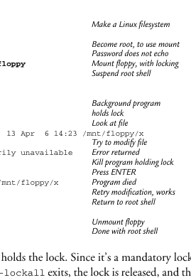

只要 `ch14-lockall` 正在运行，它就持有锁。由于这是强制锁，shell 的 I/O 重定向会失败。一旦 `ch14-lockall` 退出，锁就被释放，I/O 重定向就会成功。如前所述，在 GNU/Linux 下，即使是 root 用户也无法绕过强制文件锁。

附带一提，软盘是学习如何使用操作文件系统工具的绝佳测试平台。如果你对软盘做了一些破坏数据的事情，很可能不会造成灾难性的后果，而在常规硬盘的活动分区上进行实验则风险大得多。

#### 14.3 更精确的时间

`time()` 系统调用和 `time_t` 类型以自纪元（Epoch）以来的秒数表示时间。一秒的分辨率确实不够；当今的机器速度很快，区分亚秒级时间间隔通常很有用。从 4.2 BSD 开始，Berkeley Unix 引入了一系列系统调用，使得获取和使用亚秒级时间成为可能。这些调用在所有现代 Unix 系统上都可用，包括 GNU/Linux。

##### 14.3.1 微秒级时间：`gettimeofday()`

第一个任务是获取当前时间：

```c
#include <sys/time.h>
```

```c
int gettimeofday(struct timeval *tv, void *tz);
```

`gettimeofday()` 获取当前时间。<sup>5</sup> 成功时返回 0，出错时返回 -1。参数如下：

- `struct timeval *tv`：此参数是一个指向 `struct timeval` 的指针，稍后描述，系统将把当前时间存入其中。
- `void *tz`：此参数不再使用；因此，它的类型是 `void *`，你应该始终传入 `NULL`。（man 手册页描述了它过去的作用，随后指出它已废弃。如果你对细节感兴趣，可以阅读它。）

时间由 `struct timeval` 结构体表示：

```c
struct timeval {
    long tv_sec;     /* seconds */
    long tv_usec;    /* microseconds */
};
```

`tv_sec` 值表示自纪元以来的秒数；`tv_usec` 是那一秒内的微秒数。

GNU/Linux 的 `gettimeofday(2)` man 手册页还记录了以下宏：

```c
#define timerisset(tvp) ((tvp)->tv_sec || (tvp)->tv_usec)

#define timercmp(tvp, uvp, cmp) \
    ((tvp)->tv_sec cmp (uvp)->tv_sec || \
    (tvp)->tv_sec == (uvp)->tv_sec && \
    (tvp)->tv_usec cmp (uvp)->tv_usec)

#define timerlear(tvp) ((tvp)->tv_sec = (tvp)->tv_usec = 0)
```

这些宏作用于 `struct timeval *` 值；也就是说，它们作用于结构体指针，其用途从名称和代码中都应该很显而易见。`timercmp()` 宏特别有趣：第三个参数是一个比较运算符，用于指示比较的类型。例如，考虑确定一个 `struct timeval` 是否小于另一个：

```c
struct timeval t1, t2;
...
if (timercmp(& t1, & t2, <))
/* t1 is less than t2 */
```

该宏展开为：

```c
((& t1)->tv_sec < (& t2)->tv_sec || \
(& t1)->tv_sec == (& t2)->tv_sec && \
(& t1)->tv_usec < (& t2)->tv_usec)
```

这意味着“如果 `t1.tv_sec` 小于 `t2.tv_sec`，或者如果它们相等且 `t1.tv_usec` 小于 `t2.tv_usec`，那么……”

> <sup>5</sup> `gettimeofday(2)` man 手册页记录了对应的 `settimeofday()` 函数，供超级用户（`root`）使用，以设置整个系统的时间。

##### 14.3.2 微秒级文件时间：`utimes()`

第 5.5.3 节“更改时间戳：`utime()`”，第 157 页，描述了用于设置给定文件的访问时间和修改时间的 `utime()` 系统调用。某些文件系统以微秒（或更高）分辨率存储这些时间。此类系统提供 `utimes()` 系统调用（注意名称末尾的 s），用于以微秒值设置访问和修改时间：

```c
#include <sys/time.h>

int utimes(char *filename, struct timeval tvp[2]);
```

`tvp` 参数应指向一个包含两个 `struct timeval` 结构体的数组；这些值分别用于访问时间和修改时间。如果 `tvp` 是 `NULL`，则系统使用当前时间。

POSIX 将此标记为“遗留”（legacy）函数，意味着它标准化只是为了支持旧代码，不应在新应用程序中使用。主要原因似乎是没有定义包含微秒值的接口来获取文件的访问和修改时间；`struct stat` 仅包含 `time_t` 值，而不是 `struct timeval` 值。

然而，如第 5.4.3 节“仅限 Linux：指定更高精度的文件时间”，第 143 页所述，Linux 2.6（及更高版本）确实通过 `stat()` 调用提供了纳秒级分辨率时间戳的访问权限。其他一些系统（如 Solaris）也是如此。<sup>6</sup> 因此，`utimes()` 比初看时更有用，尽管它正式的“遗留”地位，在你的程序中使用它没有任何理由回避。

> <sup>6</sup> 不幸的是，似乎目前没有关于 *struct stat* 成员名称的标准，使其成为一种不可移植的操作。

##### 14.3.3 间隔定时器：`setitimer()` 和 `getitimer()`

`alarm()` 函数（参见第 10.8.1 节“闹钟：`sleep()`、`alarm()` 和 SIGALRM”，第 382 页）安排在给定的秒数过去后发送 SIGALRM。其最小分辨率为 1 秒。这里，4.2 BSD 也引入了一个函数和三个接受亚秒级时间的不同定时器。

*内部定时器*（internal timer）就像一个重复的闹钟。你设置它第一次“响起”的时间，以及之后定时器重复的频率。这两个值都使用 *struct timeval* 对象；也就是说，它们（潜在地）具有微秒分辨率。定时器“响起”是通过递送信号实现的；因此，你需要为定时器安装信号处理程序，最好在设置定时器之前完成。

存在三种不同的定时器，如表 14.2 所述。

#### 表 14.2 间隔定时器

| 定时器 | 信号 | 功能 |
| :--- | :--- | :--- |
| **ITIMER_REAL** | SIGALRM | 在实时中运行。 |
| **ITIMER_VIRTUAL** | SIGVTALRM | 当进程在用户模式下执行时运行。 |
| **ITIMER_PROF** | SIGPROF | 当进程在用户模式或系统模式下时运行。 |

第一个定时器 *ITIMER_REAL* 的使用很直接。定时器在实时中倒计时，在给定时间过去后发送 SIGALRM。（因为发送了 SIGALRM，你不能将 `setitimer()` 调用与 `alarm()` 调用混合使用，将它们与 `sleep()` 调用混合使用也很危险；参见第 10.8.1 节“闹钟：`sleep()`、`alarm()` 和 SIGALRM”，第 382 页。）

第二个定时器 *ITIMER_VIRTUAL* 也相对直接。它在进程运行时倒计时，但仅在用户级别（应用程序）代码中。如果一个进程

若进程被阻塞在执行 I/O 操作，例如向磁盘或（更重要的是）向终端写入数据时，计时器会被暂停。

第三个计时器，`ITIMER_PROF`，用途更为专门。只要进程正在运行，它就会递减，即使操作系统正在代表该进程执行某些操作（如 I/O）也是如此。根据 POSIX 标准，它“旨在被解释器用于统计解释型程序执行期间的性能分析”。通过同时设置 `ITIMER_VIRTUAL` 和 `ITIMER_PROF` 为相同的间隔，并计算这两个计时器触发时刻之间的差值，解释器就可以得知它为正在运行的解释型程序执行系统调用所花费的时间。⁷（如前所述，这非常专业化。）这两个系统调用是：

```
#include <sys/time.h>
XSI
int getitimer(int which, struct itimerval *value);
int setitimer(int which, const struct itimerval *value,
               struct itimerval *ovalue);
```

`which` 参数是前面列出的命名计时器的符号常量之一。`getitimer()` 会用指定计时器的当前设置填充 `value` 所指向的 `struct itimerval`。`setitimer()` 使用 `value` 中的值设置指定的计时器。如果提供了 `ovalue`，该函数会用计时器的当前值填充它。如果你不关心当前值，可以使用 `NULL` 作为 `ovalue`。两个函数成功时均返回 0，出错时返回 −1。

`struct itimerval` 由两个 `struct timeval` 成员组成：

```
struct itimerval {
  struct timeval it_interval; /* 下一个值 */
  struct timeval it_value;    /* 当前值 */
};
```

应用程序不应期望计时器精确到微秒级别。`getitimer(2)` 的 man 页提供了如下说明：

> 计时器绝不会在请求的时间之前到期，而是在经过一段短且固定的时间后到期，具体时间取决于系统计时器的分辨率（目前为 10ms）。到期时，将生成一个信号并重置计时器。如果计时器在进程处于活跃状态时到期（对于 `ITIMER_VIRT` 总是如此），信号将在生成后立即被投递。

⁷ 正确地进行性能分析并非易事；如果你打算编写一个解释器，最好先做好研究。

否则，信号的投递会受到系统负载影响而产生短暂的时间偏移。

在三个计时器中，**ITIMER_REAL** 似乎最有用。以下程序 `ch14--timers.c` 展示了如何从终端读取数据，但设置了*超时*，以防止程序永远挂起等待输入：

```
/* ch14--timers.c ---- 演示间隔计时器 */
#include <stdio.h>
#include <assert.h>
#include <signal.h>
#include <sys/time.h>

/* handler --- 处理 SIGALRM */
void handler(int signo)
{
   static const char msg[] = "\n** Timer expired, you lose **\n";
   assert(signo == SIGALRM);

   write(2, msg, sizeof(msg) - 1);
   exit(1);
}
/* main --- 设置计时器，带超时地读取数据 */
int main(void)
{
   struct itimerval tval;
   char string[BUFSIZ];

   timerclr(& tval.it_interval); /* 间隔为零意味着不重置计时器 */
   timerclr(& tval.it_value);

   tval.it_value.tv_sec = 10;  /* 10 秒超时 */

   (void) signal(SIGALRM, handler);

   printf("You have ten seconds to enter/your name, rank, and serial number: ");

   (void) setitimer(ITIMER_REAL, & tval, NULL);

   if (fgets(string, sizeof string, stdin) != NULL) {
       (void) setitimer(ITIMER_REAL, NULL, NULL); /* 关闭计时器 */
       /* 处理剩余数据，打印诊断信息以供说明 */
       printf("I'm glad you are being cooperative.\n");
   } else
       printf("EOF, eh? We won't give up so easily!\n");
   exit(0);
}
```

第 10–18 行是 `SIGALRM` 的信号处理函数；`assert()` 调用确保信号处理函数已正确设置。处理函数的主体打印一条消息并退出，但在更大规模的程序中，它可以执行任何合适的操作。

在 `main()` 程序中，第 27–28 行清除了 `struct itimerval` 结构体 `tval` 中的两个 `struct timeval` 成员。然后第 30 行将超时设置为 10 秒。`tval.it_interval` 设置为 0 意味着没有重复警报；它只触发一次。第 32 行设置信号处理函数，第 34 行打印提示符。

第 36 行设置计时器，第 37–42 行根据用户的操作打印相应的消息。实际程序此时会执行其主要工作。值得注意的是第 38 行，它取消了计时器，因为已输入了有效数据。

> 注意 第 37 行和第 38 行之间故意存在一个竞态条件。其要点在于，如果用户在计时器到期时间内未输入一行，信号将被投递，信号处理函数将打印“你输了”的消息。

以下是该程序的三次连续运行结果：

```
$ ch14-timers

You have ten seconds to enter
your name, rank, and serial number:
*** Timer expired, you lose ***

$ ch14-timers

You have ten seconds to enter
your name, rank, and serial number: James Kirk, Starfleet Captain, 1234
I'm glad you are being cooperative.

$ ch14-timers

You have ten seconds to enter
your name, rank, and serial number: ^D
EOF, eh? We won't give up so easily!
```

- 第一次运行，未输入任何内容
- 第二次运行，输入了数据
- 第三次运行，输入了 EOF（"^D"）

POSIX 未定义间隔计时器与 `sleep()` 函数之间是否存在交互，以及如何交互。GLIBC 不使用 `alarm()` 来实现 `sleep()`，因此在 GNU/Linux 系统中，`sleep()` 与间隔计时器没有交互。然而，对于可移植的程序，不能做出这种假设。

##### 14.3.4 更精确的暂停：nanosleep()

`sleep()` 函数（见第 10.8.1 节，“闹钟：`sleep()`、`alarm()` 和 `SIGALRM`”，第 382 页）允许程序休眠给定的秒数。但如我们所见，它只接受整数秒数，因此无法实现短时间的延迟，并且它还可能与 `SIGALRM` 处理程序发生交互。`nanosleep()` 函数弥补了这些缺陷：

```
#include <time.h>                  /* POSIX TMR */

int nanosleep(const struct timespec *req, struct timespec *rem);
```

该函数是 POSIX 可选扩展“计时器”（`TMR`）的一部分。两个参数分别是请求的休眠时间和如果休眠提前返回时剩余的时间（如果 `rem` 不是 `NULL`）。这两个参数都是 `struct timespec` 值：

```
struct timespec {
    time_t tv_sec;      /* 秒 */
    long  tv_nsec;      /* 纳秒 */
};
```

`tv_nsec` 的值必须在 0–999,999,999 范围内。与 `sleep()` 一样，实际休眠的时间可能多于请求的时间，这取决于内核何时以及如何调度进程执行。

与 `sleep()` 不同，`nanosleep()` 与任何信号都没有交互，因此通常更安全、更易用。

如果进程休眠了完整的时间，返回值 0。否则，返回值为 −1，并由 `errno` 指示错误。特别是，如果 `errno` 为 `EINTR`，则 `nanosleep()` 被信号中断。在这种情况下，如果 `rem` 不是 `NULL`，它所指向的 `struct timespec` 将被填充为剩余的休眠时间。这使得再次调用 `nanosleep()` 以继续休眠成为可能。

虽然看起来有点奇怪，但完全可以使用相同的结构体作为两个参数：

```
struct timespec sleeptime = /* 任意值 */;
int ret;

ret = nanosleep(&sleeptime, &sleeptime);
```

`struct timeval` 和 `struct timespec` 彼此相似，仅第二个分量的单位不同。GLIBC 的 `<sys/time.h>` 头文件定义了两个用于在它们之间转换的有用宏：

```
#include <sys/time.h>

GLIBC
void TIMEVAL_TO_TIMESPEC(struct timeval *tv, struct timespec *ts);
void TIMESPEC_TO_TIMEVAL(struct timespec *ts, struct timeval *tv);
```

它们如下所示：

```
# define TIMEVAL_TO_TIMESPEC(tv, ts) ( \
    (ts)->tv_sec = (tv)->tv_sec,      \
    (ts)->tv_nsec = (tv)->tv_usec * 1000 )

# define TIMESPEC_TO_TIMEVAL(tv, ts) ( \
    (tv)->tv_sec = (ts)->tv_sec,      \
    (tv)->tv_usec = (ts)->tv_nsec / 1000 )

#endif
```

> 注意 确实令人困惑的是，一些系统调用使用微秒分辨率，而另一些使用纳秒分辨率。这是因为历史原因：微秒级的调用是在硬件时钟没有更高分辨率的系统上开发的，而纳秒级的调用则是近年来为具有更高分辨率时钟的系统开发的。这就是生活。你所能做的，就是手边备好手册。

## 14.4 使用二叉树的高级搜索

在第 6.2 节“排序和搜索函数”（第 181 页）中，我们介绍了用于搜索和排序数组的函数。在本节中，我们将介绍一种更高级的机制。

### 14.4.1 二叉树简介

数组是最简单的结构化数据类型之一。它们易于理解和使用的。但是，它们有一个缺点，即大小在编译时是固定的。因此，如果你有比数组容量更多的数据，你就无能为力了。如果你拥有的数据远少于数组的大小，你就会浪费内存。（尽管

现代系统拥有大容量内存，但也要考虑为嵌入式系统（如微波炉或手机）编写软件的程序员所面临的约束。在光谱的另一端，请考虑那些处理海量输入的程序员所面临的问题，例如气象模拟。

计算机科学领域发明了许多*动态数据结构*，这些结构可以根据需求增加或减小尺寸，比简单的数组更灵活，甚至比使用 `malloc()` 和 `realloc()` 动态创建和调整大小的数组还要灵活。此外，如果添加或删除元素，数组还需要重新排序。

其中一种结构是*二叉搜索树*，为了简称为“二叉树”。二叉树将项目保持有序状态，当项目进入时，将其插入树的适当位置。二叉树中的查找也非常快速，耗时与数组上的二分搜索类似。与数组不同，二叉树在每次添加项目时无需从头开始重新排序。

二叉树有一个缺点。在输入数据*已经排序*的情况下，二叉树的查找时间会降低到线性搜索的水平。这其中的技术细节涉及二叉树内部的维护方式，稍后将进行描述。

现在不得不引入一些更正式的数据结构术语。图 14.1 展示了一棵二叉树。在计算机科学中，树通常从顶部开始绘制并向下生长。你在树中越往下走，*深度*就越大。树中的每个对象称为一个*节点*。树的顶部是*根节点*，深度为 0。底部是*叶节点*，深度各异。位于根节点和叶节点之间的是零个或多个*内部节点*。叶节点的特点是它们没有悬挂的*子树*，而内部节点至少有一个子树。拥有子树的节点有时被称为*父*节点，子节点则被称为*子*节点。

普通二叉树的特点是每个节点最多有两个子节点。（拥有超过两个子节点的树虽然有用，但在此处并不相关。）这两个子节点分别被称为左子节点和右子节点。

二叉搜索树进一步通过以下事实加以区分：存储在左子节点中的值始终小于节点本身存储的值，而存储在右子节点中的值始终大于节点本身存储的值。这意味着树内没有重复的值。这一事实也解释了为什么树在处理预排序数据时效果不佳：取决于排序顺序，每个新的数据项最终都存储在之前一项的左侧或右侧，从而形成一个简单的线性列表。

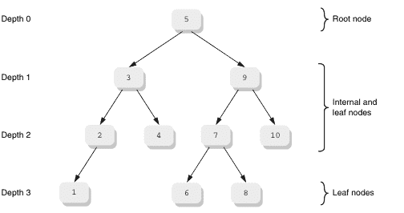

# **图 14.1**
**二叉树**

二叉树上的操作如下：

- *插入*
  向树中添加新项目。
- *查找*
  在树中查找项目。
- *删除*
  从树中删除项目。
- *遍历*
  对树中存储的每个项目执行某些操作。树的遍历也被称为*树走*。访问树中存储项目的方法有多种。这里讨论的函数仅实现了其中一种方式。我们稍后会对此进行更多讨论。

## 14.4.2 树管理函数

上述描述的操作对应于以下函数：

```c
#include <search.h>  XSI
void *tsearch(const void *key, void **rootp,
    int (*compare)(const void *, const void *));
void *tfind(const void *key, const void **rootp);
void *tdelete(const void *key, void **rootp,
    int (*compare)(const void *, const void *));
typedef enum { preorder, postorder, endorder, leaf } VISIT;
void twalk(const void *root,
    void (*action)(const void *nodep, const VISIT which, const int depth));
void tdestroy(void *root, void (*free_node)(void *nodep));  GLIBC
```

这些函数最初是为 System V 定义的，现在已由 POSIX 正式标准化。它们遵循我们在第 6.2 节“排序和搜索函数”（第 181 页）中看到的其他函数的模式：使用 `void *` 指针指向任意数据类型，并使用用户提供的比较函数来确定顺序。与 `qsort()` 和 `bsearch()` 一样，当键与树节点中的值进行比较时，比较函数必须返回负值/零/正值。

## 14.4.3 树插入：tsearch()

这些例程为树节点分配存储空间。若要将它们用于多棵树，必须向它们传递一个指向 `void *` 变量的指针，该变量将被填充为根节点的地址。在创建新树时，请将此指针初始化为 NULL：

```c
void *root = NULL;  新树的根
void *val;  指向返回数据的指针
extern int my_compare(const void *, const void *);  比较函数
extern char key[], key2[];  要插入树中的值
val = tsearch(key, &root, my_compare);  在树中插入第一个项目
... 用不同的值填充 key2。不要修改 root ...
val = tsearch(key2, &root, my_compare);  在树中插入后续项目
```

如图所示，root 变量仅在第一次调用时设置为 NULL，之后保持原样。在随后的每次调用中，`tsearch()` 使用它来管理树。

当找到所查找的键时，`tsearch()` 和 `tfind()` 都会返回指向包含该键的节点的指针。它们的区别在于键未找到时：`tfind()` 返回 NULL，而 `tsearch()` 将新值插入树中并返回指向它的指针。`tsearch()` 和 `tfind()` 返回的指针指向内部树节点。它们可以作为后续调用中 root 的值使用，以便在子树上工作。正如我们稍后将要看到的，键值可以是任意结构的指针；它并不局限于像前面的例子可能暗示的那样只能是字符串。

这些例程仅存储指向用于键的数据的*指针*。因此，管理存储数据值的内存是你的职责，通常使用 `malloc()`。

> 注意 由于树函数保留指针，请格外小心，*不要*对已用作键的值使用 *realloc()*！*realloc()* 可能会移动数据并返回一个新指针，但树例程仍会维护指向旧数据的悬空指针。

#### 14.4.4 树查找及返回指针的使用：`tfind()` 和 `tsearch()`

`tfind()` 和 `tsearch()` 函数在二叉树中搜索给定的键。它们接受相同的参数列表：要搜索的键；指向树根的指针 root；以及 compare，一个指向比较函数的指针。这两个函数都返回一个指向与 key 匹配的节点的指针。

究竟如何使用 `tfind()` 或 `tsearch()` 返回的指针？它到底指向什么？答案是，它指向树中的一个节点。这是一个内部类型，你无法看到它的定义。然而，POSIX 保证该指针可以转换为你用于键的任何类型的*指向指针的指针*。以下是一些演示代码片段，然后我们展示其工作原理：

```c
struct employee {
    char lastname[30];
    char firstname[30];
    long emp_id;
    time_t start_date;
}; /* 来自第 6 章 */

/* emp_name_id_compare --- 按姓名比较，然后按 ID 比较 */
int emp_name_id_compare(const void *e1p, const void *e2p)
{
    ... /* 也来自第 6 章，稍后完整复述 ... */
}

struct employee *key = { . . . };

void *vp, *root;
struct employee *e;
... 用数据填充树 ...

vp = tfind(&key, root, emp_name_id_compare);
if (vp != NULL) { /* 存在，使用它 */
    e = *((struct employee **) vp);      从树中检索存储的数据
    /* 使用 *e 中的信息 ... */
}
```

一个指向节点的指针如何也能充当指向数据的指针的指针？好吧，考虑一下二叉树节点是如何实现的。每个节点至少维护一个指向用户数据项的指针，以及指向潜在左子节点和右子节点的指针。因此，它看起来大致如下：

```c
struct binary_tree {
    void *user_data;                   指向用户数据的指针
    struct binary_tree *left;          左子节点或 NULL
    struct binary_tree *right;         右子节点或 NULL
    ... 可能还有其他字段 ...
} node;
```

C 和 C++ 保证结构体中的字段按地址递增顺序布局。因此，`&node.left < &node.right` 是成立的。此外，结构体的地址也是其第一个字段的地址（换句话说，忽略类型问题，`&node == &node.user_data`）。

从概念上讲，`‘e = *((struct employee **) vp)’` 的含义如下：

- `vp` 是一个 `void *`，即通用指针。它是内部树节点的地址，但也是节点中指向用户数据的部分（很可能也是另一个 `void *`）的地址。
- `‘(struct employee **) vp’` 将内部指针的地址转换为正确的类型；它仍然是一个指向指针的指针，但现在是 `struct employee` 的指针。请记住，从一种指针类型到另一种指针类型的强制转换不会改变任何值（位模式）；它只改变编译器为类型考虑而处理值的方式。
- `‘*((struct employee **) vp)’` 通过新创建的 `struct employee **` 进行解引用，返回一个可用的 `struct employee *` 指针。
- `‘e = *((struct employee **) vp)’` 将此值存储到 `e` 中以便稍后直接使用。

图 14.2 说明了这一概念。


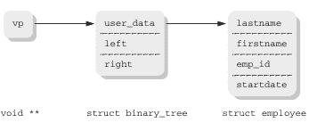

**图 14.2**
树节点及其指针

你可能会考虑定义一个宏来简化对返回指针的使用：

```
#define tree_data(ptr, type) (*(type **) (ptr))
...
struct employee *e;
void *vp;

vp = tfind(& key, root, emp_name_id_compare);
if (vp != NULL) { /* 找到了，使用它 */
  e = tree_data(vp, struct employee);
  /* 使用 *e 中的信息 ... */
}
```

#### 14.4.5 树遍历：twalk()

`twalk()` 函数在 `<search.h>` 中的声明如下：

```
typedef enum { preorder, postorder, endorder, leaf } VISIT;
void twalk(const void *root,
            void (*action)(const void *nodep, const VISIT which, const int depth));
```

第一个参数是树的根节点（*不是指向根节点的指针*）。第二个参数是指向回调函数的指针，该回调函数被调用时接收三个参数：指向正在访问的树节点的指针、一个指示如何访问该节点的枚举类型，以及一个指示当前节点深度的整数（如前文所述，根节点深度为 0）。

这里使用回调函数的方式与 `nftw()`（参见第 8.4.3.2 节“`nftw()` 回调函数”，第 263 页）相同。在那种情况下，回调函数针对文件系统内的每个对象被调用。在这里，回调函数针对存储在树中的每个对象被调用。

遍历（或“行走”）二叉树有几种方式：

-   左子节点、节点本身、右子节点。
-   节点本身、左子节点、右子节点。
-   左子节点、右子节点、节点本身。

GLIBC 的 `twalk()` 函数使用了上述第二种方式：先访问节点，然后访问左子节点，最后访问右子节点。每当遇到一个节点时，就认为该节点被访问了。<sup>8</sup> 在访问节点的子节点的过程中，函数必须访问该节点本身。因此，类型 `VISIT` 的值表示该节点在哪个阶段被遇到：

-   `preorder`        在访问任何子节点之前。
-   `postorder`       在访问第一个子节点之后，但在访问第二个子节点之前。
-   `endorder`        在访问两个子节点之后。
-   `leaf`            该节点是一个叶节点，没有子节点。

> **注意** 这里使用的术语与正式数据结构教材中使用的术语并不完全一致。在那些教材中，使用的术语是顺序（inorder）、前序（preorder）和后序（postorder），分别对应上述列出的三种树遍历方式。因此，`twalk()` 使用的是前序遍历，但使用 `preorder` 等符号常量来表示节点正在被访问的阶段。这可能令人困惑。

下面的程序 `ch14-tsearch.c` 演示了树的构建和遍历。它复用了第 6.2 节“排序和搜索函数”，第 181 页中的 `struct employee` 结构和 `emp_name_id_compare()` 函数。

```
/* ch14-tsearch.c --- 演示树管理 */

#include <stdio.h>
#include <search.h>
#include <time.h>

struct employee {
    char lastname[30];
    char firstname[30];
    long emp_id;
    time_t start_date;
};

/* emp_name_id_compare --- 先按姓名比较，再按 ID 比较 */

int emp_name_id_compare(const void *e1p, const void *e2p)
{
    const struct employee *e1, *e2;
    int last, first;

    e1 = (const struct employee *) e1p;
    e2 = (const struct employee *) e2p;

    if ((last = strcmp(e1->lastname, e2->lastname)) != 0)
        return last;

    /* 姓氏相同，检查名字 */
    if ((first = strcmp(e1->firstname, e2->firstname)) != 0)
        return first;

    /* 名字相同，检查 ID 号码 */
    if (e1->emp_id < e2->emp_id)
        return -1;
    else if (e1->emp_id == e2->emp_id)
        return 0;
    else
        return 1;
}

/* print_emp --- 在树遍历期间打印员工结构体 */

void print_emp(const void *nodep, const VISIT which, const int depth)
{
    struct employee *e = *((struct employee *) nodep);

    switch (which) {
    case leaf:
    case postorder:
        printf("Depth: %d. Employee:\n", depth);
        printf("%8s, %s\t%d\t%s\n", e->lastname, e->firstname,
               e->emp_id, ctime(&e->start_date));
        break;
    default:
        break;
    }
}
```

第 7–12 行定义了 `struct employee`，第 14–38 行定义了 `emp_name_id_compare()`。

第 40–56 行定义了 `print_emp()`，这是一个回调函数，用于打印 `struct employee` 以及当前节点在树中的深度。注意第 44 行中的强制类型转换，用于获取指向存储数据的指针。

```
/* main --- 演示在二叉树中维护数据 */

int main(void)
{
    #define NPRES 10
    struct employee presidents[NPRES];
    int i, npres;
    char buf[BUFSIZ];
    void *root = NULL;

    /* 非常简单的代码来读取数据： */
    for (npres = 0; npres < NPRES && fgets(buf, BUFSIZ, stdin) != NULL;
        npres++) {
        sscanf(buf, "%s %s %ld %ld\n",
               presidents[npres].lastname,
               presidents[npres].firstname,
               & presidents[npres].emp_id,
               & presidents[npres].start_date);
    }

    for (i = 0; i < npres; i++)
        (void) tsearch(& presidents[i], & root, emp_name_id_compare);

    twalk(root, print_emp);
    return 0;
}
```

打印树的目标是以排序顺序打印包含的元素。请记住，`twalk()` 会访问中间节点三次，且左子节点小于节点本身，而右子节点大于节点。因此，`switch` 语句仅在 `which` 为 `leaf`（对于叶节点）或 `postorder`（表示左子节点已被访问，但右子节点尚未被访问）时打印节点的信息。

使用的数据是总统列表，同样来自第 6.2 节“排序和搜索函数”，第 181 页。为了回顾一下，字段包括：姓、名、员工编号以及以纪元（Epoch）秒为单位的开始时间戳：

```
$ cat presdata.txt
Bush George 43 980013600
Clinton William 42 727552800
Bush George 41 601322400
Reagan Ronald 40 348861600
Carter James 39 222631200
```

数据按姓、名，然后是资历进行排序。运行时，<sup>9</sup> 该程序产生以下输出：


```
$ ch14-tsearch < presdata.txt
    Depth: 1. Employee:
        Bush, George    41    Fri Jan 20 13:00:00 1989

    Depth: 0. Employee:
        Bush, George    43    Sat Jan 20 13:00:00 2001

    Depth: 2. Employee:
        Carter, James   39    Thu Jan 20 13:00:00 1977

    Depth: 1. Employee:
        Clinton, William 42    Wed Jan 20 13:00:00 1993

    Depth: 2. Employee:
        Reagan, Ronald 40    Tue Jan 20 13:00:00 1981
```

#### 14.4.6 树节点删除和树销毁：tdelete() 和 tdestroy()

最后，你可以从树中删除项目，并且在 GLIBC 系统上，还可以删除整棵树本身。

```
void *tdelete(const void *key, void **rootop,
           int (*compare)(const void *, const void *));
/* GLIBC 扩展，不在 POSIX 中： */
void tdestroy(void *root, void (*free_node)(void *nodep));
```

`tdelete()` 的参数与 `tsearch()` 相同：键、树根的地址以及比较函数。如果在树中找到给定的项目，则将其删除，并且 `tdelete()` 返回指向给定节点的父节点的指针。否则，它返回 `NULL`。如果你需要原始被删除的项目，例如为了释放其存储，你在代码中必须仔细管理这种行为：

```
struct employee *e, key;
void *vp, *root;                  /* 变量声明 */
... 为要从树中删除的项目填充 key ...
vp = tfind(& key, root, emp_name_id_compare);    /* 找到要删除的项目 */
if (vp != NULL) {
    e = * (struct employee **) vp;
    free(e);                      /* 释放存储 */
}
(void) tdelete(& key, & root, emp_name_id_compare);    /* 现在从树中删除它 */
```

尽管在手册页或 POSIX 标准中未指定，但在 GNU/Linux 下，如果你删除存储在第一级根节点中的项目，返回值将是新根节点的值。为了编写可移植代码，你不应该必然依赖于这种行为。


`tdestroy()` 函数是 GLIBC 的扩展。它允许你销毁整棵树。第一个参数是树的根节点。第二个参数是一个指向函数的指针，用于释放树中每个节点所指向的*数据*。如果无需对这些数据执行任何操作（例如，它们保存在常规数组中，如我们之前的示例程序所示），则此函数应什么都不做。*切勿*传入空指针！这样做会导致崩溃。

### 14.5 总结

- 偶尔，有必要在特定边界处分配对齐的内存。`posix_memalign()` 可以执行此操作。其返回值与本书涵盖的大多数函数不同：Caveat emptor（买方自慎）。`memalign()` 也分配对齐的内存，但并非所有系统都支持使用 `free()` 释放该内存。

- 使用 `fcntl()` 进行文件锁提供了记录锁，甚至细到可以锁定文件内单个字节的级别。读锁阻止对锁定区域的写入，而写锁则阻止其他进程读取和写入锁定区域。默认情况下，锁是建议性的，POSIX 仅标准化了建议性锁定。大多数现代 Unix 系统都支持强制性锁定，利用文件上的 setgid 权限位以及可能的额外文件系统挂载选项。

- 在 GNU/Linux 上，`lockf()` 函数充当 POSIX `fcntl()` 锁定的封装；BSD 的 `flock()` 函数的锁（在 GNU/Linux 上）与 `fcntl()` 锁完全独立。BSD `flock()` 锁仅支持整个文件锁，并且不适用于远程文件系统。出于这些原因，不推荐使用 `flock()` 锁。

- `gettimeofday()` 以 `struct timeval` 中的（秒，微秒）对形式获取当前时间。这些值被 `utimes()` 用于更新文件的访问时间和修改时间。`gettimer()` 和 `settimer()` 系统调用使用 `struct.itimerval` 中的 `struct.timespec` 对来创建间隔定时器——这些闹钟会在设定时间“响起”，并在此后以设定的间隔继续响起。三种不同的定时器提供了对定时器继续倒计时状态的多种控制。

- `nanosleep()` 函数使用指定秒数和纳秒数的 `struct.timespec`，使进程暂停给定的时间。它有一个优点，即完全不与信号机制交互。

- 树 API 是一组额外的数据存储和搜索函数，它维护二叉树中的数据，其效果是保持数据排序。树 API 非常灵活，允许使用多个树和任意数据。

### 练习

- 编写 `lockf()` 函数，使用 `fcntl()` 来执行锁定。

- 目录 `/usr/src/linux/Documentation` 包含许多描述操作系统行为不同方面的文件。阅读 `locks.txt` 和 `mandatory.txt` 以获取有关 Linux 处理文件锁的更多信息。

- 在你的系统上运行 `ch14-lockall` 程序，不使用强制性锁定，看看你是否可以修改操作数文件。

- 如果你有一个支持强制性锁定的非 Linux 系统，请尝试在该系统上运行 `ch14-lockall` 程序。

- 编写一个名为 `strftimes()` 的函数，其 API 如下：

  ```c
  size_t strftimes(char *buf, size_t size, const char *format,
            const struct timespec *tp);
  ```

  它的行为应与标准的 `strftime()` 函数相同，但允许 `%q` 表示“当前微秒数”。

- 使用你刚刚编写的 `strftimes()` 函数，编写一个增强版的 `date` 程序，该程序接受以 + 开头的格式字符串，并格式化当前的日期和时间。（参见 `date(1)`。）

- `ch14-timers.c` 中对超时的处理相当原始。重写该程序，在打印提示后使用 `setjmp()`，并在信号处理程序内使用 `longjmp()`。这是否改善了程序的结构或清晰度？

- 我们注意到 `ch14-timers.c` 包含一个故意的竞态条件。假设用户在正确的时间段内输入了响应，但在取消警报之前 `ch14-timers` 被挂起。你可以调用什么来减小问题窗口的大小？

- 绘制第 14.4.5 节“树遍历：twalk()”（第 557 页）中 `ch14-tsearch` 输出所示的树。

- 10. 检查 GNU/Linux 系统上的文件 `/usr/share/dict/words`。（这是 `spell` 的拼写字典；在不同的系统中可能位于不同的位置。）单词在该文件中存在，每行一个，按排序顺序排列。
  - 首先，使用此 `awk` 程序创建一个新的列表，按随机顺序排列：
    ```bash
    $ awk '{ list[$0]++ }
    > END { for (i in list) print i }' /usr/share/dict/words > /tmp/wlist
    ```
  - 接下来，编写两个程序。每个程序都应读取新列表，并分别将读取的每个单词存储到树和数组中。第二个程序应使用 `qsort()` 对数组排序，并使用 `bsearch()` 进行搜索。
  - 从树或数组中检索单词 'gravy'。对这两个程序进行计时，看看哪个运行得更快。你可能需要将单词检索放在运行多次（例如 1,000 次）的循环中，以获取足够长的运行时间来显示差异。
  - 使用 `ps` 的输出查看每个程序使用多少内存。

- 11. 使用原始的排序字典文件重新运行这两个程序，看看计时结果是否有任何变化。

## 第三部分

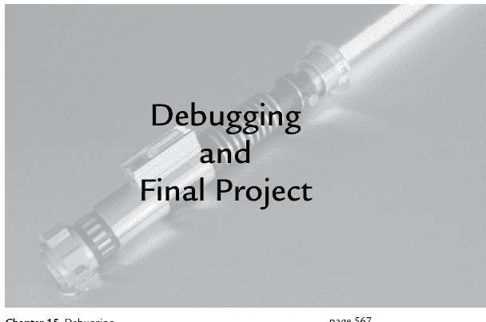

第 15 章 调试

第 567 页

第 16 章 一个将所有内容结合在一起的实验

第 641 页

*此页故意留白*

# 第 15 章


# 本章内容

- 15.1 首先 page 568
- 15.2 用于调试的编译 page 569
- 15.3 GDB 基础 page 570
- 15.4 用于调试的编程 page 577
- 15.5 调试工具 page 605
- 15.6 软件测试 page 632
- 15.7 调试规则 page 633
- 15.8 建议阅读 page 637
- 15.9 总结 page 638
- 练习 page 639

有许多实践，从程序逻辑和数据设计，到代码分解和组织，最后是实现，这些都有助于最大限度地减少错误和问题。我们鼓励你学习这些；找到关于软件设计和软件工程的好书，并将它们的建议付诸实践！任何超过几百行的程序都应该经过仔细思考和设计，而不是简单地乱写直到它看起来能工作为止。

然而，由于程序员是人，编程错误是不可避免的。调试是追踪并移除程序中错误的过程。即使设计良好、实现良好的程序偶尔也会出错；当出现问题且你无法弄清楚原因时，将调试器指向代码并观察其失败是一个好主意。

本章涵盖了一系列主题，从基本的调试建议和技术开始（用于调试的编译和 GDB（GNU 调试器）的基本使用），接着介绍在程序开发和调试期间使用的一系列活动调试的技术，使调试更加容易，然后讨论一些有助于调试过程的工具。最后，它以对软件测试的简要介绍和一套精彩的“调试规则”结束，这些规则摘自我们高度推荐的一本书。

我们的大多数建议都基于我们作为 GNU 项目志愿者的长期经验，维护 gawk (GNU awk)。我们提出的大多数，如果不是全部，具体示例都来自该程序。

贯穿整章，具体的建议都标有 **建议**。

## 15.1 首先

当程序行为异常时，你可能会不知所措，不知道首先该做什么。通常，奇怪的行为是由于误用内存——使用未初始化的值、读取或写入动态内存的边界之外——等等。因此，在启动调试器*之前*尝试使用内存调试工具可能会获得更快的结果。

原因是内存工具可以直接指向失败的那行代码，而使用调试器则更像是一次搜索和销毁任务，在


## 15.2 用于调试的编译

为了使用源代码调试器，被调试的可执行文件（如果您愿意的话，称之为*调试目标*）必须使用编译器的 *-g* 选项进行编译。此选项使编译器在目标代码中生成额外的*调试符号*；也就是说，提供变量、常量和函数等的名称和类型等额外信息。然后，调试器使用这些信息将源代码位置与正在执行的代码进行匹配，并在运行的程序中检索或存储变量值。

在许多 Unix 系统中，*-g* 编译选项与开启优化的 *-O* 选项是互斥的。这是因为优化可能会导致目标代码中位和片段的重排，使得正在执行的内容与源代码的线性阅读之间不再存在直接关系。通过禁用优化，您使调试器更容易将目标代码与源代码相关联，并且，单步执行程序执行时会以显而易见的方式工作。（单步执行稍后会有描述。）

GCC（GNU 编译器集合）允许同时使用 *-g* 和 *-O*。然而，这引入了我们在调试时希望避免的确切问题：即在调试器中跟踪执行变得困难得多。允许两者同时使用的优点在于，您可以将调试符号保留在用于生产环境的优化可执行文件中。它们只占用磁盘空间，不占用内存。这样，已安装的可执行文件在紧急情况下仍然可以调试。

根据我们的经验，如果需要使用调试器，最好从头开始重新编译应用程序，只使用 *-g* 选项。这使得跟踪更容易；有足够的细节来跟踪程序如编写般运行，而不必担心编译器如何重排代码。

有一个注意事项：*确保程序仍然表现异常。* 可复现性是调试的关键；如果您无法重现问题，那么*更*难去追踪和修复它。罕见情况下，不带 *-O* 编译程序可能会导致其停止失败。[^1] 通常，不带 *-O* 编译时问题仍然存在，这意味着确实存在某种逻辑错误，等待被发现。

[^1]: 如果您希望更改此行为，请参阅 sysctl(8)。

## 15.3 GDB 基础

调试器是一种程序，允许您控制另一个程序的执行，并检查和改变从属程序的状态（例如变量值）。有两种类型的调试器：机器级调试器，它们在机器指令层面工作；以及源代码级调试器，它们在程序的源代码术语下工作。例如，在机器级调试器中，要更改变量值，您指定其在内存中的地址。在源代码级调试器中，您只需指定变量的名称。

从历史上看，V7 Unix 有 *adb*，它是一个机器级调试器。System III 有 *sdb*，它是一个源代码级调试器，而 BSD Unix 提供 *sdb*，也是一个源代码级调试器。（两者都继续提供 *adb*。）*sdb* 在某些商业 Unix 系统上仍然存在。

GDB（GNU 调试器）是一个源代码级调试器。它拥有更多功能，具有更广泛的移植性，并且比 *sdb* 或 *sdb* 更易于使用。[^2]

[^2]: GDB 的前身。

与其前身一样，GDB 是一个命令行调试器。它一次打印一行源代码，打印提示符，并读取一行包含要执行的命令的输入。

存在图形化调试器；这些提供更大的源代码视图，通常提供通过命令行窗口和 GUI 组件（如按钮和菜单）操作程序的能力。*gdb-qt* 调试器[^3] 就是其中之一；它是基于 GDB 构建的，所以如果您学习 GDB，可以立即对 *gdb-qt* 做一些使用。（*gdb-qt* 有自己的手册，如果您将大量使用它，应该阅读它。）另一个图形化调试器是 Insight，[^4] 它使用 Tcl/Tk 在 GDB 之上提供图形界面。（如果有一个图形化调试器可用且您喜欢它，您应该使用它。由于我们的目的是提供调试器和调试的入门介绍，我们选择了一种可以在印刷中呈现的简单界面。）

GDB 理解 C 和 C++，包括对*名称取消修饰*的支持，这意味着您可以使用类成员函数和重载函数的常规 C++ 源代码名称。特别是，GDB 理解 C 表达式语法，这在您希望查看复杂表达式的值时很有用，例如 `*ptr->x.a[1]->q`。它还具有 Fortran 77，尽管您可能需要在 Fortran 变量和函数名称后附加下划线字符。GDB 部分支持 Modula-2，并有限支持 Pascal。

如果您正在运行 GNU/Linux 或 BSD 系统（并且您安装了开发工具），那么您应该已经安装并准备好使用最近版本的 GDB。如果没有，您可以从 GNU 项目的 GDB FTP 站点下载 GDB 源代码[^5] 并自行构建。

GDB 附带自己的手册，其长度超过 300 页。您可以生成手册的印刷版本在 GDB 源代码目录中，并自行打印。您还可以从自由软件基金会购买印刷和装订的副本；您的购买有助于 FSF，并直接促进更多自由软件的生成。（有关订购信息，请参阅 FSF 网站[^6]。）本节介绍 GDB 的基础；我们建议阅读手册以了解如何充分利用 GDB 的功能。

[^3]: 一个图形化 GDB 前端。
[^4]: 另一个图形化前端。
[^5]: ftp://ftp.gnu.org/gnu/gdb/
[^6]: http://www.fsf.org

### 15.3.1 运行 GDB

基本用法如下：

```
gdb [ 选项 ] [ 可执行文件 [ 核心文件名 ] ]
```

这里，*executable* 是要被调试的可执行程序。如果提供，*core-file-name* 是当程序被操作系统杀死并转储核心时创建的*核心*文件的名称。在 GNU/Linux 下，此类文件（默认）命名为 `core.pid`，其中 *pid* 是已死运行程序的进程 ID 号。*pid* 扩展意味着您可以在同一目录中有多个核心转储，这很有帮助，但也适合消耗磁盘空间！

如果您忘记在命令行上命名文件，您可以使用 `file executable` 告诉 GDB 可执行文件的名称，并使用 `core-file core-file-name` 告诉 GDB 核心文件的名称。

使用核心转储时，GDB 指示程序死亡的位置。以下程序 `ch15-abort.c` 创建了一些嵌套函数调用，然后故意通过 abort() 死亡以创建核心转储：

```c
/* ch15-abort.c --- 产生一个核心转储 */

#include <stdio.h>
#include <stdlib.h>

/* recurse --- 构建一些函数调用 */
void recurse(void)
{
    static int i;

    if (++i == 3)
        abort();
    else
        recurse();
}

int main(int argc, char **argv)
{
    recurse();
}
```

以下是与此程序的一个简短 GDB 会话：

```
$ gcc -g ch15-abort.c -o ch15-abort      编译，无 -O
$ ch15-abort                             运行程序
Aborted (core dumped)                    它悲惨地死亡
$ gdb ch15-abort core.4124               在其上启动 GDB
GNU gdb 5.3
Copyright 2002 Free Software Foundation, Inc.
GDB is free software, covered by the GNU General Public License, and you are
welcome to change it and/or distribute copies of it under certain conditions.
Type "show copying" to see the conditions.

There is absolutely no warranty for GDB.  Type "show warranty" for details.
This GDB was configured as "i686-pc-linux-gnu"...
Core was generated by `ch15-abort`.
Program terminated with signal 6, Aborted.
Reading symbols from /lib/i686/libc.so.6...done.
Loaded symbols for /lib/i686/libc.so.6
Reading symbols from /lib/ld-linux.so.2...done.
Loaded symbols for /lib/ld-linux.so.2
#0  0x420228cc1 in kill () from /lib/i686/libc.so.6       打印堆栈跟踪
(gdb)  where
#0  0x420228cc1 in kill () from /lib/i686/libc.so.6
#1  0x42028ac8 in raise () from /lib/i686/libc.so.6
#2  0x4202a019 in abort () from /lib/i686/libc.so.6
#3  0x08048342 in recurse () at ch15-abort.c:13            <--- 我们需要在这里检查
#4  0x08048347 in recurse () at ch15-abort.c:15
#5  0x08048347 in recurse () at ch15-abort.c:15
#6  0x0804835f in main (argc=1, argv=0xbffff8f84) at ch15-abort.c:20
#7  0x420158d4 in __libc_start_main () from /lib/i686/libc.so.6
```

*where* 命令打印*堆栈跟踪*，即所有被调用函数的列表，最近的排在最前面。请注意，*recurse()* 函数有三次调用。命令 *bt*，代表“back trace”（回溯），是 *where* 的别名；它更容易输入。

堆栈中的每个函数调用被称为一个*帧*。这个术语来自编译器领域，其中每个函数的参数、局部变量和返回地址，在堆栈上分组，被称为*堆栈帧*。GDB 的 *frame* 命令允许您检查特定的帧。在这种情况下，我们需要帧 3。这是 *recurse()* 的最近一次调用，它调用了 *abort()*：

```
(gdb)  frame 3                                      移动到帧 3
#3  0x08048342 in recurse () at ch15-abort.c:13
    13        abort();                              GDB 打印帧中的源代码位置
(gdb)  list                                         显示几行源代码
    8         { void recurse(void)
   10         static int i;
   11         if (*i == 3)
   13            abort();
   14         else
   15            recurse();
   16         }
   17         }
(gdb)                                               按 ENTER 重复上一条命令
   18         int main(int argc, char **argv)
   19         {
   20            recurse();
   21         }
(gdb)  quit                                         离开调试器（暂时）
```


## 15.3.2 设置断点、单步执行和设置观察点

如前所述，按 ENTER 键会重复上一条命令，在此例中是 list 命令，用于显示源代码行。这是一种逐步执行源代码的简便方法。

GDB 使用 readline 库进行命令行编辑，因此你可以使用 Emacs 或 vi 命令（根据你的偏好）来回忆和编辑之前的行。Bash shell 也使用相同的库，所以如果你熟悉在 shell 提示符下进行命令行编辑，GDB 的编辑方式与其相同。此功能可以节省大量的打字工作。

通常，程序故障会产生核心转储文件（core dump）。第一步是使用 GDB 分析核心文件，以确定程序终止于哪个例程。如果原始二进制文件不是为调试编译的（即没有 -g 选项），GDB 只能告诉你函数的名称，而无法提供其他详细信息。

下一步是重新编译该程序，开启调试选项并关闭优化，并验证其是否仍然失败。假设确实如此，你需要在调试器的控制下运行该程序，并在出现故障的例程中设置一个断点。

断点是执行应该中断或停止的位置。你可以通过函数名、源代码行号、源代码文件和行号组合以及其他方式来设置断点。

设置好断点后，使用 run 命令启动程序运行，可能后面还跟随传递给被调试程序的命令行参数。（GDB 方便地为你记住了这些参数；如果你想从头开始再次启动程序，只需单独输入 run 命令，GDB 就会以与之前相同的参数启动一个新副本。）以下是一个使用 gawk 的简短会话示例：

```text
$ gdb gawk
GNU gdb 5.3
...
(gdb) break do_print
Breakpoint 1 at 0x805a36a: file builtin.c, line 1504.
(gdb) run 'BEGIN { print "hello, world" }'
Starting program: /home/arnold/Gnu/gawk/gawk-3.1.3/gawk 'BEGIN { print "hello, world" }'

Breakpoint 1, do_print (tree=0x8095290) at builtin.c:1504
1504      struct redirect *rp = NULL;
(gdb) list
1499

在 gawk 上启动 GDB

在 do_print 中设置断点

启动程序运行

执行到达断点

显示源代码
1500 void
1501 do_print (register NODE *tree)
1502 {
1503 register NODE **t;
1504 struct redirect *rp = NULL;
1505 register FILE *fp;
1506 int numnodes, i;
1507 NODE *save;
1508 NODE *tval;
```

到达断点后，你可以通过*单步执行*程序来继续推进。这意味着 GDB 允许程序一次执行一条源代码语句。GDB 会打印即将执行的行，然后打印其提示符。要执行该语句，请使用 next 命令：

- `(gdb) next` 执行当前语句（即上面的 1504）
- `1510 fp = redirect_to_fp(tree->rnode, & rp);` GDB 打印下一条语句
- `(gdb)` 按 ENTER 执行，并进入下一条
- `1511 if (fp == NULL)`
- `(gdb)` 再次按 ENTER
- `1519 save = tree = tree->inode;`
- `(gdb)` 再次按 ENTER
- `1520 for (numnodes = 0; tree != NULL; tree = tree->rnode)`

*step* 命令是*单步执行*的替代命令。*next* 和 *step* 之间有一个重要的区别。*next* 执行下一条语句。如果该语句包含函数调用，该函数会被调用并在 GDB 重新获得对运行中程序的控制之前返回。

另一方面，当你在包含函数调用的语句上使用 *step* 时，GDB 会深入被调用的函数，允许你继续*单步执行*（或*跟踪*）程序。如果语句不包含函数调用，则 *step* 与 *next* 相同。

> **注意** 很容易忘记你正在使用哪个命令，从而不断按 ENTER 来执行后续的每条语句。如果你使用的是 *step*，可能会意外进入库函数，例如 *strlen*() 或 *printf*()，而这些通常不是你想打交道的。在这种情况下，你可以使用 *finish* 命令，该命令会使程序运行直到当前函数返回。

```text
(gdb) print *save
$1 = {sub = {noder = {t = {ptr = 0x8095250, param_name = 0x8095250 "pR\tb*",
ll = 134828624, r = {rptr = 0x0, ptr = 0x0, preg = 0x0, hd = 0x0,
av = 0x0, r_ent = 0}, x = {extra = 0x0, xl = 0, param_list = 0x0},
name = 0x0, number = 1, reflags = 0, val = {
```
*打印 save 指向的结构体*

最后，**cont**（continue）命令允许你继续程序的执行。它会运行直到下一个断点，或者如果没有遇到任何断点，则正常退出。这个示例接着上一个例子继续：

```text
1520 for (numnodes = 0; tree != NULL; tree = tree->rnode)
(gdb) cont
Continuing.
hello, world

Program exited normally.
(gdb) quit
```
*继续执行*
*GDB 输出的信息性消息*
*退出调试器*

**观察点**（watchpoint）类似于断点，但它是针对数据而非可执行代码设置的。你在变量（或结构体或联合体中的字段，或数组元素）上设置观察点，当它发生变化时，GDB 会通知你。GDB 在单步执行程序时检查观察点的值，并在值发生变化时停止。例如，gawk 中的 `do_lint_old` 变量在发出 `--lint-old` 选项时为真。该变量由 `getopt_long()` 设置为真。（我们在第 2.1.2 节“GNU 长选项”第 27 页中讨论了 `getopt_long()`。）在 gawk 的 `main.c` 文件中：

```c
int do_lint_old = FALSE;       /* warn about stuff not in V7 awk */
...
static const struct option optab[] = {
...
        { "lint-old", no_argument, &do_lint_old, 1 },
...
```

以下是一个示例会话，展示了观察点的工作过程：

```text
$ gdb gawk
GNU gdb 5.3
...
(gdb) watch do_lint_old
Hardware watchpoint 1: do_lint_old

(gdb) run --lint-old 'BEGIN { print "hello, world" }'
Starting program: /home/arnold/Gnu/gawk/gawk-3.1.4/gawk --lint-old
'BEGIN { print "hello, world" }'
Hardware watchpoint 1: do_lint_old
Hardware watchpoint 1: do_lint_old
```
*在 gawk 上启动 GDB*
*在变量上设置观察点*
*运行程序*
*程序运行时检查观察点*

## 15.4 为调试进行编程

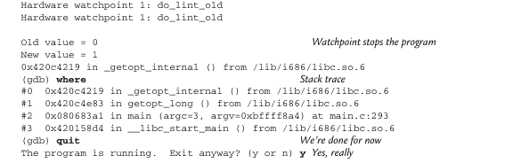

GDB 能做的远比我们在本文中所展示的要多。虽然 GDB 手册篇幅很大，但至少通读一遍是值得的，以便熟悉其命令和功能。之后，查看每个新 GDB 发行版中的 NEWS 文件以了解新增或变更的内容通常就足够了。

打印随 GDB 源代码发行版中 `gdb/doc/refcard.tex` 文件提供的 GDB 参考卡片也很有价值。提取源代码并运行 configure 后，你可以使用以下命令创建可打印的 PostScript 版本参考卡片：

```text
$ cd gdb/doc              切换到 doc 子目录  
$ make refcard.ps        格式化参考卡片
```

参考卡片旨在双面打印在 8.5 x 11 英寸（“信件”大小）的纸张上，采用横向格式。它提供了最常用的 GDB 命令的六栏摘要。我们建议你打印出来，并在操作 GDB 时将其放在键盘旁。

### 15.4.1 编译时调试代码

几种技术与源代码本身有关。

#### 15.4.1.1 使用调试宏

也许最简单的编译时技术是使用预处理器来提供条件编译代码。例如：

```c
#ifdef DEBUG

    fprintf(stderr, "myvar = %d\n", myvar);

    fflush(stderr) ;

#endif /* DEBUG */
```

在编译器命令行中添加 `-DDEBUG` 会导致程序运行时执行 `fprintf()` 调用。

**建议：** 将调试消息发送到 `stderr`，以免它们丢失在管道中，并且可以通过 I/O 重定向捕获它们。务必使用 `fflush()`，以便尽快将消息强制输出。

> **注意** 符号 `DEBUG` 虽然显而易见，但也被过度使用。更好的做法是使用特定于你程序的符号，例如 `MYAPPDEBUG`。你甚至可以为程序不同部分的调试代码使用不同的符号，例如文件 I/O、数据验证、内存管理等。

在代码中散布大量的 `#ifdef` 语句很快就会变得令人痛苦。而且过多的 `#ifdef` 会掩盖主要的程序逻辑。一定会有更好的方法，实际上，一种常用的技术是条件性地定义用于打印的特殊宏：

```c
/* TECHNIQUE 1 --- 常用但不推荐，参见正文 */

/* 在应用头文件中： */

#ifdef MYAPPDEBUG

#define DPRINTO(msg)          fprintf(stderr, msg)

#define DPRINT1(msg, v1)      fprintf(stderr, msg, v1)

#define DPRINT2(msg, v1, v2)  fprintf(stderr, msg, v1, v2)

#define DPRINT3(msg, v1, v2, v3)   fprintf(stderr, msg, v1, v2, v3)

#else /* ! MYAPPDEBUG */

#define DPRINTO(msg)

#define DPRINT1(msg, v1)

#define DPRINT2(msg, v1, v2)

#define DPRINT3(msg, v1, v2, v3)

#endif /* ! MYAPPDEBUG */
```

```c
/* 在应用源文件中： */

DPRINT1("myvar = %d\n", myvar) ;

...

DPRINT2("v1 = %d, v2 = %f\n", v1, v2) ;
```

这里有多个宏，每种不同的参数数量对应一个宏，上限由你希望提供的限制决定。当 `MYAPPDEBUG` 被定义时，对 `DPRINTx()` 宏的调用会扩展为对 `fprintf()` 的调用。当 `MYAPPDEBUG` 未被定义时，


然后这些相同的调用就会展开为空。（这基本上就是 `assert()` 的工作原理；我们在第 12.1 节 “断言语句：`assert()`” 第 428 页中描述了 `assert()`。）

这种技术有效；我们自己也使用过，并看到教科书推荐过。不过，它可以进一步简化，将宏的数量减少到一个：

```c
/* 技术 2 --- 可移植性最强；推荐 */
/* 在应用程序头文件中： */
#ifdef MYAPPDEBUG
#define DPRINT(stuff)    printf stuff
#else
#define DPRINT(stuff)
#endif

/* 在应用程序源文件中： */
DPRINT(stderr, "myvar = %d\n", myvar);     注意使用了双括号
```

注意宏的调用方式，它使用了两组括号！通过将 `printf()` 的整个参数列表作为单个参数，你不再需要拥有任意数量的调试宏。

如果你使用的编译器符合 1999 C 标准，你还有一个额外的选择，它产生的调试代码看起来最整洁：

```c
/* 技术 3 --- 最整洁，但仅限 C99 */
/* 在应用程序头文件中： */
#ifdef MYAPPDEBUG
#define DPRINT(msg, ...)    printf(stderr, msg, __VA_ARGS__)
#else
#define DPRINT(msg, ...)
#endif

/* 在应用程序源文件中： */
DPRINT("myvar = %d\n", myvar);
...
DPRINT("v1 = %d, v2 = %f\n", v1, v2);
```

1999 C 标准提供了*可变参数宏*；即可以接受可变数量参数的宏。（这与可变参数函数类似，如 `printf()`。）在宏定义中，三个点 `...` 表示将有一个或多个参数。在宏体中，特殊标识符 `__VA_ARGS__` 会被替换为提供的参数，无论其数量多少。

这种机制的优点是，在调用调试宏时只需要一组括号，这使得代码读起来自然得多。

它还保留了仅使用一个宏名的能力，而不是根据参数数量使用多个名称。缺点是 C99 编译器尚未广泛可用，降低了对可移植性的影响。（不过，这种情况将随时间推移而改善。）

**建议：** 当前版本的 GCC 支持 C99 可变参数宏。因此，如果你知道你不会使用 GCC（或其他 C99 编译器）以外的任何东西来编译你的程序，你可以使用 C99 机制。然而，截至本书写作时，C99 编译器仍然不常见。因此，如果你的代码必须由不同的编译器编译，你应该使用双括号样式的宏。

### 15.4.1.2 尽可能避免使用表达式宏

通常，C 预处理器宏是一把相当锋利的双刃剑。它赋予你强大的力量，但也为你提供了伤害自己的机会。 [8]

为了效率或代码清晰度，经常可以看到这样的宏：

```c
#define RS_is_null (RS_node->var_value == Nnull_string)
...
if (RS_is_null || today == TUESDAY) ...
```

乍一看，这看起来没问题。条件 `RS_is_null` 清晰且易于理解，并抽象了测试中固有的细节。问题在于你尝试在 GDB 中打印该值时：

```
(gdb) print RS_is_null
No symbol "RS_is_null" in current context.
```

在这种情况下，你必须找到宏的定义并打印展开后的值。

**建议：** 使用变量来表示程序中的重要条件，并编写显式代码在条件改变时改变变量值。

下面是一个简化的例子，来自 `i_o.c` 中 *gawk* 发行版：

```c
void set_RS()
{
    ...
    RS_is_null = FALSE;
    ...
    if (RS->strlen == 0) {
        RS_is_null = TRUE;
        matchrec = rsmulIscan;
    }
    ...
}
```

一旦设置并维护 `RS_is_null`，代码可以测试它，*并且*可以在调试器中打印它。

> **注意** 从 GCC 3.1 和 GDB 版本 5 开始，如果你使用选项 `-g3` 和 `-gdwarf-2` 编译程序，你*可以*在 GDB 中使用宏。GDB 手册指出，GDB 开发人员希望最终找到更紧凑的宏表示法，并且 `-g3` 选项将被合并到 `-g` 中。
>
> 然而，只有 GCC、GDB 和特殊选项的组合才允许你以这种方式使用宏：如果你没有使用 GCC（或使用的是较旧版本），你仍然存在问题。我们坚持建议，如果可能，避免使用这类宏。

宏的问题也扩展到代码片段。如果宏定义多个语句，你就无法在宏中间设置断点。C99 和 C++ *inline* 函数也是如此：如果编译器将 *inline* 函数的主体替换到生成的代码中，再次在内部设置断点就变得困难或不可能。这与我们建议单独使用 `-g` 进行编译有关；在这种情况下，编译器通常不会进行函数内联。

类似地，经常有一个变量表示特定状态。许多 C 编程书都鼓励通过 `#define` 符号常量来表示这些状态。例如：

```c
/* 在扫描记录结尾时要处的各种状态。 */
#define NOSTATE 1 /* 扫描尚未开始 (all) */
#define INLEADER 2 /* 跳过前导数据 (RS = "") */
#define INDATA 3 /* 在记录主体中 (all) */
#define INTERM 4 /* 扫描终止符 (RS = "*", RS = regex*) */
int state;
...
state = NOSTATE;
...
state = INLEADER;
...
if (state != INTERM) ...
```

在源代码级别，这看起来很棒。但同样，当你在 GDB 中查看代码时存在问题：

```
(gdb) print state
$1 = 2
```

在这里，你也不得不去查看头文件以弄清楚 2 的含义。那么，替代方案是什么？

**建议：** 使用枚举而不是宏来定义符号常量。源代码的使用方式是相同的，调试器也可以打印枚举值。

一个例子，也来自 `gawk` 中的 `i_o.c`：

```c
typedef enum scanstate {
    NOSTATE, /* 扫描尚未开始 (all) */
    INLEADER, /* 跳过前导数据 (RS = "") */
    INDATA, /* 在记录主体中 (all) */
    INTERM, /* 扫描终止符 (RS = "*", RS = regex*) */
} SCANSTATE;
SCANSTATE state;
... 其余代码保持不变！ ...
```

现在，当在 GDB 中查看状态时，我们看到了有用的东西：

```
(gdb) print state
$1 = NOSTATE
```

### 15.4.1.3 如有必要重新排序代码

在 if 或 while 中有一个由多个组件测试组成的条件并不罕见，这些测试由 && 或 || 分隔。如果这些测试是函数调用（甚至如果不是），也不可能单步执行条件的每个单独部分。GDB 的 step 和 next 命令基于语句而不是表达式工作。（将这些内容跨行分开也没有帮助。）

**建议：** 重写原始代码，使用显式的临时变量来存储返回值或条件结果，以便你可以调试器中检查它们。原始代码应保留在注释中，以便你（或后来的程序员）了解发生了什么。

这是一个具体的例子：来自 `gawk` 文件 `io.c` 的函数 `do_input()`：

```c
/* do_input --- 主要的输入处理循环 */

void
do_input()
{
    IOBUF *iop;
    extern int exiting;
    int rval1, rval2, rval3;

    (void) setjmp(filebuf); /* 用于 `nextfile' */

    while ((iop = nextfile(FALSE)) != NULL) {
        /*
           这里是这样的：
           if (!inrec(iop) == 0)
               while (!interpret(expression_value) && inrec(iop) == 0)
                   continue;
           现在展开以便于调试。
        */
        rval1 = inrec(iop);
        if (rval1 == 0) {
            for (;;) {
                rval3 = -1; /* 用于调试 */
                rval2 = interpret(expression_value);
                if (rval2 != 0)
                    rval3 = inrec(iop);
                if (rval2 == 0 || rval3 != 0)
                    break;
            }
        }
        if (exiting)
            break;
    }
}
```

（行号是相对于例程的开头，而不是文件。）此函数是 `gawk` 主要处理循环的核心。外层循环（第 12 行和第 33 行）遍历命令行数据文件。第 13–19 行的注释显示了原始代码，该代码从当前文件读取每条记录并处理它。


`inrec()` 返回 0 表示状态为 OK（正常），而 `interpset()` 返回非零值也表示状态为 OK。当试图单步调试此循环以验证记录读取过程时，必须单独执行每个步骤。

第 20–30 行是重写后的代码，它分别调用每个函数，并将返回值存储在局部变量中，以便可以从调试器中打印出来。请注意第 23 行如何强制这些变量在每次循环迭代时都具有已知的无效值：否则，它们将保留前一次循环迭代中的值。第 27 行是退出测试；由于代码已更改为无限循环（对比第 22 行和第 16 行），跳出循环的测试条件与原测试条件相反。

顺便提一下，我们承认在重写时必须仔细研究重写后的代码，以确保其执行结果与原代码完全一致；实际上确实如此。我们现在才意识到，也许这个版本的循环更接近原始代码：

```c
/* 第 22 - 29 行的可能替代方案 */
do {
  rval2 = rval3 = -1; /* 用于调试 */
  rval2 = interpset (expression_value);
  if (rval2 != 0)
    rval3 = inrec (iop);
} while (rval2 != 0 && rval3 != 0);
```

事实是，这两个版本的代码都比原始代码更难阅读，因此都可能存在错误。然而，由于当前代码能够正常工作，我们决定不再画蛇添足。

最后，我们注意到并非所有专家程序员都会认同我们在这里给出的建议。当条件中的每个组件都是函数调用时，你可以为每个函数设置断点，使用单步命令（step）进入每个函数，然后使用 `finish` 完成该函数。GDB 会告诉你函数的返回值，从那时起你可以使用 `cont` 或 `step` 继续执行。我们喜欢我们的方法，因为结果被保存在变量中，可以在函数调用后（甚至可以再过几条语句后）进行检查（并重新检查）。

### 15.4.1.4 使用调试辅助函数

一种在许多情况下都适用的常见技术是维护一组 `flag`（标志）值；当某个标志被 `set`（设置，即为真）时，表明某个事实为真或某个条件适用。通常使用 `#define` 定义的符号常量和 C 语言位运算符来实现。

（我们在第 8.3.1 节“POSIX 风格：statvfs() 和 fstatvfs()”第 244 页的侧栏中讨论过位标志和位操作运算符的使用。）

例如，gawk 的核心数据结构称为 NODE。它包含许多字段，其中最后一个字段是一组标志值。摘自文件 awk.h：

```c
typedef struct exp_node {
      ...
      unsigned short flags;        省略了大量内容
#      define MALLOC  1           /* 可以被 free */
#      define TEMP    2           /* 应该被 free */
#      define PERM    4           /* 不能被 free */
#      define STRING  8           /* 作为字符串分配 */
#      define STRCUR  16          /* 字符串值当前有效 */
#      define NUMCUR  32          /* 数值当前有效 */
#      define NUMBER  64          /* 作为数字分配 */
#      define MAYBE_NUM 128       /* 用户输入；如果是 NUMERIC 则是
                                   * 一个 NUMBER */
#
#      define ARRAYMAXED 256      /* 数组已达到最大大小 */
#      define FUNC    512        /* 此参数实际上是一个
                                   * 函数名；参见 awkgram.y */
#
#      define FIELD   1024       /* 这是一个字段 */
#      define INFLSTR 2048       /* 使用本地化版本 */
} NODE;
```

使用标志值的原因是它们可以在数据空间上提供相当大的节省。如果 NODE 结构为每个标志使用单独的 char 字段，那将占用 12 个字节，而使用 unsigned short 仅占用 2 个字节。目前 NODE 的大小（在 Intel x86 上）为 32 个字节。再增加 10 个字节会使其达到 42 个字节。由于 gawk 可能会分配数十万（甚至数百万）个 NODE，因此控制其大小至关重要。

这与调试有什么关系？我们刚才不是建议使用枚举来定义符号常量吗？好吧，对于 OR 运算的值，枚举帮不上忙，因为它们不再能被单独识别了！

**建议：** 提供一个将标志转换为字符串的函数。如果你有多个独立的标志，请建立一个通用的例程。

> **注意** 这些调试函数不寻常之处在于，*应用程序代码从不直接调用它们*。它们的存在*仅*是为了让调试器可以调用它们。此类函数应该*始终*被编译进去，甚至不需要用周围的 `#ifdef` 包裹，以便你可以*无需采取特殊步骤*即可使用它们。通常很小的额外代码大小是可以由开发人员节省的时间来证明的。

首先，我们将展示我们最初是如何做到的。以下是 `flags2str()`（来自早期版本的 *gawk* (3.0.6)）的一个简化版本：

```c
1 /* flags2str --- 使标志值可读 */
2 char *
3 flags2str (flagval)
4 int flagval;
5 {
6 static char buffer[BUFSIZ];
7 char *sp;
8
9 sp = buffer;
10
11 if (flagval & MALLOC) {
12 strcpy(sp, "MALLOC");
13 sp += strlen(sp);
14 }
15 if (flagval & TEMP) {
16 if (sp != buffer)
17 *sp++ = '|';
18 strcpy(sp, "TEMP");
19 sp += strlen(sp);
20 }
21 if (flagval & PERM) {
22 if (sp != buffer)
23 *sp++ = '|';
24 strcpy(sp, "PERM");
25 sp += strlen(sp);
26 }
27 ... 更多相同的代码，为简洁起见省略 ...
82
83 return buffer;
84 }
```

（行号是相对于函数起始位置而言的。）结果是一个字符串，例如 `"MALLOC|PERM|NUMBER"`。每个标志都被单独测试，如果存在，每个标志的处理操作都是相同的：测试是否不在缓冲区开头以便添加 `|` 字符，将字符串复制到相应位置，并更新指针。程序中还有其他类型的标志，也存在类似的格式化显示函数。

代码既重复且容易出错，在 *gawk* 3.1 中，我们得以简化和泛化它。以下是 *gawk* 目前的做法。从 *awk.h* 中的这个定义开始：

```c
/* 用于调试目的 */
struct flagtab {
	int val;                     /* 整型标志值 */
	const char *name;          /* 字符串名称 */
};
```

此结构可用于表示任何一组标志及其对应的字符串值。每组不同的标志都有一个相应的函数，返回当前设置的标志的可打印表示。摘自 *eval.c*：

```c
/* flags2str -- 使标志值可读 */
const char *
flags2str(int flagval)
{
	static const struct flagtab values[] = {
	 {  MALLOC,  "MALLOC"  },
	 {  TEMP,   "TEMP"   },
	 {  PERM,   "PERM"   },
	 {  STRING, "STRING" },
	 {  STRCUR, "STRCUR" },
	 {  NUMCUR, "NUMCUR" },
	 {  NUMBER, "NUMBER" },
	 {  MAYBE_NUM, "MAYBE_NUM" },
	 {  ARRAYMAXED, "ARRAYMAXED" },
	 {  FUNC,   "FUNC"   },
	 {  FIELD,  "FIELD"  },
	 {  INFLSTR, "INFLSTR" },
	 {  0,   NULL  },
};
	return genflags2str(flagval, values);
}
```

flags2str() 定义了一个将标志值映射到字符串的数组。按照惯例，标志值为 0 表示数组的结束。代码调用 genflags2str()（“通用标志转字符串”）来执行工作。genflags2str() 是一个通用例程，将标志值转换为字符串。摘自 *eval.c*：

```c
1 /* genflags2str -- 将标志值转换为字符串的通用例程 */
2
3 const char *
4     genflags2str(int flagval, const struct flagtab *tab)
5     {
6     static char buffer[BUFSIZ];
7     char *sp;
8     int i, space_left, space_needed;
9
10     sp = buffer;
11     space_left = BUFSIZ;
12     for (i = 0; tab[i].name != NULL; i++) {
13     if ((flagval & tab[i].val) != 0) {
14     /*
15     * 注意这个技巧，我们需要 1 或 0 来判断是否需要
16     * '|' 字符。
17     */
18     space_needed = (strlen(tab[i].name) + (sp != buffer));
19     if (space_left < space_needed)
20     fatal(_("buffer overflow in genflags2str"));
21
22     if (sp != buffer) {
23     *sp++ = '|';
24     space_left--;
25     }
26     strcpy(sp, tab[i].name);
27     /* 注意顺序！ */
28     space_left -= strlen(sp);
29     sp += strlen(sp);
30     }
31     }
32     return buffer;
34     }
```

（行号是相对于函数起始位置，而不是文件起始位置。）与之前的版本一样，这里的想法是将一个诸如 `"MALLOC|PERM|STRING|MAYBE_NUM"` 的字符串值填充到 `static` 缓冲区中，并返回该缓冲区的地址。我们稍后讨论使用 `static` 缓冲区的原因；首先让我们检查一下代码。

指针 `sp` 跟踪缓冲区中下一个空位置的位置，而 `space_left` 跟踪剩余的可用空间；这可以防止缓冲区溢出。

函数的大部分是一个遍历标志值数组的循环（第 12 行）。当找到一个标志时（第 13 行），代码计算字符串所需的多少空间（第 18 行），并测试是否还有那么多剩余空间（第 19–20 行）。


测试 `sp != buffer` 会在找到的第一个标志值上失败，并返回 0。在后续的标志中，该测试的值为 1。这告诉我们是否需要在数值之间使用 `', '` 分隔符。通过将结果（1 或 0）加到字符串的长度上，我们就能得到 `space_needed` 的正确值。出于同样的原因，第 22 行也使用了相同的测试来控制第 23 行和第 24 行，这两行负责插入 `'|'` 字符。

最后，第 26–29 行将字符串值复制进来，调整剩余的空间量，并更新 `sp` 指针。第 33 行返回缓冲区的地址，其中包含字符串的可打印表示形式。

那么，那个*静态缓冲区*呢？通常，良好的编程实践不鼓励使用返回*静态*缓冲区地址的函数：多次调用此类函数很容易每次都会覆盖缓冲区，迫使调用者复制返回的数据。

此外，*静态*缓冲区按定义是固定大小的缓冲区。那 GNU 的“无任意限制”原则去哪里了？

这两个问题的答案在于要记住，这是一个*调试*函数。正常代码*绝不会*调用 `genflags2str()`；它只由使用调试器的人类调用。没有调用者持有指向缓冲区的指针；作为进行调试的开发人员，我们不关心每次调用函数时缓冲区被覆盖。

在实践中，固定大小也不是问题；我们知道 `BUFSIZ` 足够大，可以表示我们使用的所有标志。尽管如此，基于经验并知道情况可能会变化，`genflags2str()` 包含有保护自身免受缓冲区溢出影响的代码。（即 `space_left` 变量和第 18–20 行的代码。）

附带一提，`BUFSIZ` 的使用是可以商榷的。该常量应专门用于 I/O 缓冲区，但通常也用于一般的字符串缓冲区。此类代码最好定义显式的常量，例如 `FLAGVALSIZE`，并在第 11 行使用 `sizeof(buffer)`。

下面是一个简化的 GDB 会话，展示了 `flags2str()` 的使用：

```text
$ gdb gawk

GNU gdb 5.3

... 

(gdb) break do_print

Breakpoint 1 at 0x805a584: file builtin.c, line 1547.

(gdb) run 'BEGIN ( print 'hello, world!' ) '

Starting program: /home/arnold/Gnu/gawk/gawk-3.1.4/gawk 'BEGIN ( print 
"hello, world!' )'

Breakpoint 1, do_print (tree=0x80955b8) at builtin.c:1547

1547	struct redirect *rp = NULL;

(gdb) print *tree

$1 = {sub = {ndep = {l = ({lptr = 0x8095598, param_name = 0x8095598 'x\0u\t/b\u0027,
						l = 134829464), r = ({rptr = 0x0, pptr = 0, preg = 0x0, hd = 0x0,
								av = 0x0, x_ent = 0}), x = {extra = 0x0, xl = 0, param_list = 0x0},
						name = 0x0, number = 1, reflags = 0), val = {
										fignum = 6.6614606209589101e-316, sp = 0x0, slen = 0, sref = 1,
										idx = 0), hash = {next = 0x8095598, name = 0x0, length = 0, value = 0x0,
										ref = 1}), i_type = Node_K_print, flags = 1

(gdb) print flags2str(tree->flags)

$2 = 0x80918a0 "HALLOC"

(gdb) next

1553						fp = redirect_to_fp(tree->rnode, & rp);

... 

1588						fwriter(t[t]->atptr, sizeof(char), t[i]-'start, fp,
								"print", rp, FALSE);

(gdb) print *t[1]

$4 = {sub = {ndep = {l = ({lptr = 0x8095598, param_name = 0x8095598 'x\0u\t/b\u0027,
							l = 134829464), r = ({rptr = 0x0, pptr = 0, preg = 0x0, hd = 0x0,
								av = 0x0, x_ent = 0}), x = {extra = 0x8095ad8, xl = 134830808,
									param_list = 0x8095ad8), name = 0xc 'Address (hex out of bounds',
										 number = 1, reflags = 4294967295), val = {
											fignum = 6.6614606209589101e-316, sp = 0x8095ad8 'hello, world',
											slen = 12, sref = 1, idx = -1}, hash = {next = 0x8095598, name = 0x0,
											length = 134830808, value = 0xc, ref = 1}), i_type = Node_val, flags = 29}

(gdb) print flags2str(t[1]->flags)

$5 = 0x80918a0 "HALLOC|PERM|STRING|STRUC"
```

我们希望你会同意，当前的通用机制比原来的机制优雅得多，且更容易使用。

仔细设计和使用结构体（structs）通常可以替换或整合重复的代码。

### 15.4.1.5 尽量避免使用联合体

> “天下没有免费的午餐。”
>
> —*拉撒路·朗（Lazarus Long）*—

C 语言中的 `union`（联合体）是一个相对深奥的机制。它允许通过在同一物理空间内存储不同的项目来节省内存；程序如何处理它取决于访问方式：

```c
/* ch15-union.c --- 联合体使用的简要演示。 */
#include <stdio.h>

int main(void)
{
    union i_f {
        int i;
        float f;
    } u;

    u.f = 12.34;    /* 赋值一个浮点值 */
    printf("%f also looks like %#x\n", u.f, u.i);
    exit(0);
}
```

当程序在 Intel x86 GNU/Linux 系统上运行时，会发生以下情况：

```text
$ ch15-union
12.340000 also looks like 0x414570a4
```

该程序以十六进制整数的形式打印出表示浮点数的位模式。两个字段的存储占用同一块内存；区别在于内存的处理方式：u.f 像浮点数一样运作，而 u.i 中的相同位则像整数一样运作。

联合体在编译器和解释器中特别有用，因为它们经常创建表示源代码文件结构（称为*解析树*）的树状结构。这模拟了编程语言被形式化描述的方式：`if` 语句、`while` 语句、赋值语句等都是更通用的“语句”类型的实例。因此，编译器可能会有类似这样的定义：

```c
struct if_stm { ... };                  // IF 语句的结构
struct while_stm { ... };               // WHILE 语句的结构
struct for_stm { ... };                 // FOR 语句的结构
... 其他语句类型的结构 ...

typedef enum stm_type {                // 我们实际拥有的
    IF, WHILE, FOR, ... 
} TYPE;
```

```c
/* 这包含了类型以及各个种类语句的联合体。 */
struct statement {
  TYPE type;
  union stmt {
    struct if_stmt if_st;
    struct while_stmt while_st;
    struct for_stmt for_st;
    ...
  } u;
};
```

除了使用 `union` 外，惯例上使用宏来使 `union` 的组件看起来像是 `struct` 中的字段。例如：

```c
#define if_s    u.if_st        这样就可以使用 s->if_s 代替 s->u.if_st
#define while_s u.while_st     以此类推 ...
#define for_s   u.for_st
...
```

在刚才介绍的层面上，这似乎是合理的，并且看起来易于管理。然而，现实世界是一个更复杂的地方，实际的编译器和解释器通常具有多层*嵌套*的结构体和联合体。这包括 `gawk`，其中 `NODE` 的定义、其标志值以及访问 `union` 组件的宏超过了 120 行。¹⁰ 以下是该定义中足以让你了解发生了什么的部分：

```c
typedef struct exp_node {
  union {
    struct {
      union {
        struct exp_node *lptr;
        char *param_name;
        long i;
      } l;
      union {
        ...
      } r;
      union {
        ...
      } x;
    } x_;
    char *name;
    short number;
    unsigned long reflags;
    ...
  } nodep;
  struct {
    awknum ftnum;
    char *sp;
    size_t slen;
    long xref;
    int idx;
  } val;
  struct {
    struct exp_node *next;
    char *name;
    size_t length;
    struct exp_node *value;
    long ref;
  } hash;
  #define hnext	sub.hash.next
  #define hname	sub.hash.name
  #define hlength sub.length
  #define hvalue sub.hash.value
  .	.	.
} sub;
	nodetype type;
	unsigned short flags;
.	.	.
} node;
#define vname sub.nodep.name
#define exec_count sub.nodep.reflags

#define lnode sub.nodep.l.lptr
#define nextp sub.nodep.l.lptr
#define source_file sub.nodep.name
#define source_line sub.nodep.number
#define param_cnt sub.nodep.number
#define param sub.nodep.l.param_name

#define sptr sub.val.sp
#define slen sub.val.slen
#define xref sub.val.xref
#define fmt sub.val.idx

#define var_value lnode
```

NODE 内部有一个 struct 中包含 union，而该 union 内部又有一个 struct 中包含 union！（疼。）除此之外，多个宏“字段”根据 NODE 中实际存储的内容映射到相同的 struct/union 组件！（再次疼。）

这种复杂性的好处是 C 代码相对清晰。像 `NODE->var_value->slen` 这样的表达式读起来很直观。

---
¹⁰ 我们继承了这个设计。通常它是有效的，但它确实存在问题。本节的要点是传递我们在处理 `unions` 时获得的经验。


## 第 15 章 调试

当然，使用 `unions`（联合体）提供的灵活性是需要付出代价的。当你的调试器深入代码的核心逻辑时，你无法使用源代码中出现的那些友好的宏。你**必须**使用实际的展开形式[^11]。（为此，你必须在头文件中找到定义）。

例如，将 `NF_node->var_value->slen` 与其展开后的形式进行对比：`NF_node->sub.nodep.l.lptr->sub.val.slen`！你*必须*在 GDB 中输入后者来查看你的数据值。再看看之前 GDB 调试会话中的这段摘录：

```
(gdb) print *tree
$1 = {sub = {nodep = {l = {lptr = 0x8095598, param_name = 0x8095598 "xuT\b"},
l1 = 134829464}, r = {rptr = 0x0, pptr = 0, preg = 0x0, hd = 0x0},
av = 0x0, r_ent = 0}, x = {extra = 0x0, xl = 0, param_list = 0x0},
nam = 0x0, number = 11, refFlag = 0}, val = {
fltum = 6.661460620958991e-316, gp = 0x0, slen = 0, sref = 1,
idh = 0}, hash = {next = 0x8095598, name = 0x0, length = 0, value = 0x0,
ref = 1}), type = Node_K_print, flags = 1}
```

这堆代码看起来挺乱的。不过，GDB 确实让处理这种情况变得稍微容易一些。你可以使用像 `($1), sub.val.slen` 这样的表达式来遍历树并列出数据结构。

避免使用 `unions` 还有其他原因。首先，`unions` 是*未经检查的*。除了程序员的注意力，没有什么能确保当你访问 `union` 的一部分时，你访问的是最后存储的那一部分。我们在 `ch15-union.c` 中看到了这一点，该代码同时访问了 `union` 的两种“身份”。

第二个原因与第一个相关，即要小心复杂的嵌套 `struct`/`union` 组合中的 `overlays`（覆盖）。例如，早期版本的 `gawk`[^12] 有这段代码：

```
/* n->inode overlays the array size, don't unref it if array */
if (n->type != Node_var_array && n->type != Node_array_ref)
  unref(n->inode);
```

最初，这里没有 if 语句，直接调用 unref() 来释放 n->node 指向的节点。然而，gawk 在此处可能会出现崩溃。你可以想象在调试器中需要花费多少时间，才能查明被当作指针处理的内容实际上是一个数组大小！

顺便提一下，在 C++ 中联合体的实用性大大降低。继承和面向对象特性使得数据结构管理变成了完全不同的游戏，且安全性要高得多。

> 建议：尽可能避免使用联合体。如果必须使用，请仔细设计和编写代码！

### 15.4.2 运行时调试代码

除了在编译时添加到代码中的内容，你还可以添加额外的代码以启用运行时调试功能。这对于安装在现场的应用程序特别有用，因为在这些环境中，客户的系统通常不会安装源代码（甚至可能连编译器都没有！）。

本节介绍了一些我们多年来使用的运行时调试技术，从简单到复杂不等。请注意，我们的论述绝非详尽无遗。在这个领域，发挥想象力并加以运用往往大有裨益！

#### 15.4.2.1 添加调试选项和变量

最简单的方法是设置一个用于启用调试的命令行选项。在调试时，该选项可以被条件编译进去。但是，在程序的生产版本中保留该选项会更灵活。（你也可以选择不保留该选项，或者选择不记录该选项。这有多种权衡：记录它可以允许你的客户或用户了解更多关于系统内部的信息，这可能不是你想要的。另一方面，不记录它似乎有些偷偷摸摸。如果你在编写开源或自由软件，最好记录该选项。）

如果你的程序很大，你可能希望你的调试选项接受一个参数，指示应该调试哪个子系统。根据该参数，你可以设置不同的标志变量，或者在一个单一的调试变量中设置不同的位标志。下面是这种技术的轮廓：

```
struct option options[] = {
...
{ "debug", required_argument, NULL, 'D' },
...
}

int main(int argc, char *argv)
{
    int c;

    while ((c = getopt_long(argc, argv, "...:D")) != -1) {
        switch (c) {
        ...
        case 'D':
            parse_debug(optarg);
            break;
        ...
        }
    }
    ...
}
```

`parse_debug()` 函数遍历参数字符串。例如，它可能是由逗号或空格分隔的子系统字符串，如 "file,memory,ipc"。对于每个有效的子系统名称，该函数都会在调试变量中设置一个位：

```
extern int debugging;

void parse_debug(const char *subsystems)
{
    char *sp;

    for (sp = subsystems; *sp != '\0';) {
        if (strncmp(sp, "file", 4) == 0) {
            debugging |= DEBUG_FILE;
            sp += 4;
        } else if (strncmp(sp, "memory", 6) == 0) {
            debugging |= DEBUG_MEM;
            sp += 6;
        } else if (strncmp(sp, "ipc", 3) == 0) {
            debugging |= DEBUG_IPC;
            sp += 3;
        }
        ...
        while (*sp == ' ' || *sp == ',')
            sp++;
    }
}
```

最后，应用程序代码可以测试这些标志：

```
if ((debugging & DEBUG_FILE) != 0) . . . In the I/O part of the program
if ((debugging & DEBUG_MEM) != 0) . . . In the memory manager
```

使用单个带有标志位的变量、单独的变量，还是由符号常量（最好是来自枚举）索引的调试数组，这取决于你。

在生产可执行文件中保留调试代码的代价是程序会变大。根据调试代码的位置，它可能也会变慢，因为测试始终被执行，但在启用调试之前始终为假。并且，如前所述，可能有人能了解你的程序，而这可能不是你想要的。更糟糕的是，恶意用户可能启用过多的调试，导致程序速度降至不可用的状态！（这被称为拒绝服务攻击。）

其好处可能很大，即你已安装的程序可以在启用调试的情况下重新调用，而不需要你构建并下载一个特殊版本到客户现场。当软件安装在可能没有人手的远程地点，而你只能通过 Internet（甚至更糟，通过慢速电话拨号！）远程访问系统时，这样的功能可以是救命的稻草。

最后，你可能希望混合使用：使用条件编译的调试代码进行细粒度、高细节的调试，并保留始终存在的代码用于较粗粒度的输出。

#### 15.4.2.2 使用特殊环境变量

另一个有用的技巧是让你的应用程序关注特殊的环境变量（无论是否有文档记录）。这在测试时特别有用。以下是我们在使用 gawk 时的另一个例子，但先介绍一些背景。

gawk 使用名为 `optimal_bufsize()` 的函数来获取 I/O 的最佳缓冲区大小。对于小文件，该函数返回文件大小。否则，如果文件系统定义了用于 I/O 的大小，则返回该值（`struct stat` 中的 `st_blksize` 成员，参见第 5.4.2 节，“获取文件信息”，第 141 页）。如果该成员不可用，`optimal_bufsize()` 返回 `<stdio.h>` 中的 `BUFSIZ` 常量。原始函数（位于 `posix/gawkmisc.c` 中）看起来像这样：

```
1 /* optimal_bufsize --- determine optimal buffer size */
2
3 int
4 optimal_bufsize(fd, stb)              int optimal_bufsize(int fd, struct stat *stb);
5 int fd;
6 struct stat *stb;
7 {
8     /* force all members to zero in case OS doesn't use all of them. */
9     memset(stb, '\0', sizeof(struct stat));
10
11     /*
12      * System V, n < 4, doesn't have the file system block size in the
13      * stat structure. So we have to make some sort of reasonable
14      * guess. We use stdio's BUFSIZ, since that is what it was
15      * meant for in the first place.
16      */
17 #ifdef HAVE_ST_BLKSIZE
18 #define DEFBLSKSIZE (stb->st_blksize ? stb->st_blksize : BUFSIZ)
19 #else
20 #define DEFBLSKSIZE BUFSIZ
21 #endif
22
23     if (isatty(fd))
24         return BUFSIZ;
25     if (fstat(fd, stb) == -1)
26         fatal("can't stat fd %d (%s)", fd, strerror(errno));
27     if (lseek(fd, (off_t)0, 0) == -1)   /* not a regular file */
28         return DEFBLSKSIZE;
29     if (stb->st_size > 0 && stb->st_size < DEFBLSKSIZE) /* small file */
30         return stb->st_size;
31     return DEFBLSKSIZE;
32 }
```

常量 `DEFBLSKSIZE` 是“默认块大小”；也就是说，来自 `struct stat` 的值，或 `BUFSIZ`。对于终端（第 23 行）或非普通文件（`lseek()` 失败，第 27 行），返回值也是 `BUFSIZ`。对于较小的普通文件，使用文件大小。在所有其他情况下，返回 `DEFBLSKSIZE`。在块大小*大于* `BUFSIZ` 的文件系统上，知道“最佳”缓冲区大小特别有用。

我们遇到了一个问题，我们的某个测试用例在我们的开发 GNU/Linux 系统以及我们能访问的其他所有 Unix 系统上都能完美运行。然而，这个测试在特定的其他系统上会持续失败。


## 15.4.2.2 优化调试缓冲区大小（推断的上下文）
*注意：提供的文本始于讨论中途。根据关于 `optimal_bufsize` 的内容，该章节标题很可能是“调试缓冲区大小问题”或类似内容，但由于输入中缺失，我将以逻辑方式格式化可用内容。*

长期以来，我们无法直接访问故障系统来运行 GDB。然而，我们最终设法复现了这个问题；事实证明，它与 gawk 用于读取数据文件的缓冲区大小有关：在故障系统上，缓冲区大小比我们在开发系统上的大。

我们需要一种方式在开发机上复现这个问题：故障系统与我们相隔九个时区，而跨大西洋交互运行 GDB 是非常痛苦的。我们通过让 `optimal_bufsize()` 查看一个特殊的环境变量 `AWKBUFSIZE` 来复现这个问题。当值为 "exact" 时，`optimal_bufsize()` 始终返回文件大小，无论其大小如何。如果 `AWKBUFSIZE` 的值是某个整数，该函数则返回该数字。否则，该函数回退到之前的算法。这使我们能够在不持续重新编译 gawk 的情况下运行测试。例如：

```
$ AWKBUFSIZE=42 make check
```

这使用 42 字节的缓冲区大小运行 gawk 测试套件。（测试套件通过。）

以下是 `optimal_bufsize()` 的修改版本：

```c
/* optimal_bufsize --- determine optimal buffer size */
/*
 *
 * Enhance this for debugging purposes, as follows:
 *
 * Always stat the file, stat buffer is used by higher-level code.
 *
 * if (AWKBUFSIZE == "exact")
 * return the file size
 * else if (AWKBUFSIZE == a number)
 * always return that number
 * else
 * if the size is < default_blocksize
 * return the size
 * else
 * return default_blocksize
 * end if
 * endif
 *
 * Hair comes in an effort to only deal with AWKBUFSIZE
 * once, the first time this routine is called, instead of
 * every time. Performance, dontyaknow.
 */

size_t
optimal_bufsize(fd, stb)
int fd;
struct stat *stb;
{
    char *val;
    static size_t env_val = 0;
    static short first = TRUE;
    static short exact = FALSE;

    /* force all members to zero in case OS doesn't use all of them. */
    memset(stb, '\0', sizeof(struct stat));

    /* always stat, in case stb is used by higher level code. */
    if (fstat(fd, stb) == -1)
        fatal("can't stat fd %d (%s)", fd, strerror(errno));

    if (first) {
        first = FALSE;

        if ((val = getenv("AWKBUFSIZE")) != NULL) {
            if (strcmp(val, "exact") == 0)
                exact = TRUE;
            else if (ISDIGIT(*val)) {
                for (; *val && ISDIGIT(*val); val++)
                    env_val = (env_val * 10) + *val - '0';

                return env_val;
            }
        }
    } else if (! exact && env_val > 0)
        return env_val;
    /* else
        fall through */

    /*
     * System V, n. n < 4, doesn't have the file system block size in the
     * stat structure.  So we have to make some sort of reasonable
     * guess.  We use stdio's BUFSIZ, since that is what it was
     * meant for in the first place.
     */
#ifdef HAVE_ST_BLKSIZE
#define DEFBFLKSZ     (stb->st_blksize > 0 ? stb->st_blksize : BUFSIZ)
#else
#define DEFBFLKSZ     BUFSIZ
#endif

    if (S_ISREG(stb->st_mode)            /* regular file */
        && 0 < stb->st_size              /* non-zero size */
        && stb->st_size < DEFBFLKSZ      /* small file */
            ||  exact) {                 /* or debugging */
        return stb->st_size;             /* use file size */
    }
    return DEFBFLKSZ;
}
```

第 3-23 行的注释解释了该算法。由于搜索环境变量可能很昂贵，且只需执行一次，该函数使用几个静态变量在第一次调用时收集适当的信息。

第 42-54 行在函数第一次被调用时执行，且仅执行第一次。第 43 行通过将 `first` 设置为 `false` 来强制满足此条件。第 45-54 行处理环境变量，查找 "exact" 或数字。在后一种情况下，它将字符串值转换为十进制数，并将其保存在 `env_val` 中。（我们当时可能应该在这里使用 `strtoul()`；当时我们没想到这一点。）

第 55 行在除第一次以外的每次执行时都会运行。如果给出了数值，条件将为真，并返回该值（第 56 行）。否则，它会落入函数的其余部分。

第 60-70 行定义了 `DEFBFLKSZ`；这部分没有改变。最后，第 72-76 行在适当时返回文件大小。如果不合适（第 78 行），则返回 `DEFBFLKSZ`。

我们确实修复了这个问题<sup>13</sup>，但在此期间，我们保留了新版本的 `optimal_bufsize()`，以便我们确信问题没有再次发生。

代码大小和复杂度的边际增加被我们目前拥有的用于测试的更大灵活性所抵消。此外，由于这是生产代码，让现场用户使用该功能进行测试以确定是否发生了类似问题是很方便的。（到目前为止，我们还没有要求进行测试，但知道如果我们必须处理这种情况时能够应对，这是很不错的。）

### 15.4.2.3 添加日志代码

经常会有这样的情况：你的应用程序正在一个无法使用调试器的系统上运行（例如在客户现场）。在这种情况下，你的目标是能够检查程序的内部状态，但必须从外部进行。做到这一点的唯一方法是让程序本身为你生成这些信息。

有多种方法可以做到这一点：

-   始终将信息记录到特定文件。这是最简单的：程序始终写入日志信息。然后你可以随时查看该文件。

缺点是，在某个时刻，日志文件将消耗所有可用的磁盘空间。因此，你应该拥有多个日志文件，让程序定期切换到新文件。

Brian Kernighan 建议按星期几命名日志文件：`myapp.log.sun`、`myapp.log.mon` 等。这里的优点是你不必手动将旧文件移开；你可以免费获得一周的日志文件。

-   仅当日志文件已存在时才写入日志文件。当程序启动时，如果日志文件存在，它会将信息写入日志。否则，它不会写入。若要启用日志记录，首先创建一个空的日志文件。
-   使用固定格式的消息，这种格式可以轻易被 awk 或 Perl 等脚本语言解析，用于生成摘要和报告。
-   或者，生成某种形式的 XML，它是自描述的，并且可能可以转换为其他格式。（我们并不是 XML 的大粉丝，但这不应阻碍你。）
-   使用 `syslog()` 进行日志记录；日志消息的最终去向可以由系统管理员控制。（`syslog()` 是一个相当高级的接口；参见 `syslog(3)` manpage。）

当然，选择如何记录信息是容易的部分。困难的部分是选择记录什么。与程序开发的各个部分一样，在编码之前深思熟虑是值得的。记录关于关键变量的信息。检查它们的值，确保它们在范围内或符合你的预期。记录异常情况；如果发生了不该发生的事情，记录它，并在可能的情况下继续运行。

关键在于只记录你需要用于追踪问题的信息，不多也不少。

### 15.4.2.4 运行时调试文件

在以前的职业生涯中，我们曾为一家初创公司工作，该公司的产品二进制可执行文件安装在客户现场。无法将调试器附加到正在运行的程序副本上，也无法在客户的系统上从调试器运行该程序。产品的主要组件不是直接从命令行启动的，而是通过 shell 脚本间接启动的，这些脚本进行了大量的初始设置。

## 15.4 为调试编程

为了使程序开始生成日志信息，我们提出了特殊调试文件的想法。当特定名称的文件存在于特定目录中时，程序会向日志文件生成信息消息，然后我们可以下载并分析该日志文件。这样的代码看起来像这样：

```c
struct stat sbuf;
extern int do_logging;     /* initialized to zero */

if (stat("/path/to/magic/.file*", &sbuf) == 0)
    do_logging = 1;
...
if (do_logging) {
    logging code here: open file, write info, close file, etc.
}
```

*注意：原文中的 `do_logging = "TRUE";` 很可能是 C 上下文中布尔值赋值的 OCR 错误，通常表示为 1 或 TRUE 常量。我将保留原始意图，但根据注释 "initialized to zero" 将语法更正为有效的类 C 伪代码。*

对 `stat()` 的调用发生在程序处理的每个作业中。因此，我们可以动态地启用和禁用日志记录，而无需停止并重启应用程序！

与调试选项和变量一样，这一主题有无数种变体：启用记录不同子系统信息的不同文件，添加到调试文件本身的调试指令，等等。与所有功能一样，你应该规划所需的设计，然后干净利落地实现它，而不是在凌晨 3 点匆忙编写一些快捷但不完美的代码（不幸的是，这在初创公司中并不罕见）。

> **注意** 闪光的东西并不都是金子。特殊调试文件只是所谓“后门”技术的一个例子——开发者以未记录的方式操作程序的一种或多种途径，通常出于不良目的。在我们的案例中，后门完全无害。但一个不道德的开发者同样可以轻松安排生成并下载客户列表、人事档案或其他敏感数据的隐藏副本。仅凭这一原因，你就应该仔细思考这种技术是否适用于你的应用程序。

#### 15.4.2.5 为断点添加特殊挂钩

通常，问题可能是可复现的，但只有在你程序首先处理许多兆字节输入数据之后才会发生。或者，虽然你可能知道程序在哪个函数中失败，但该故障仅在函数被调用数百次甚至数千次之后才会发生。

[^13]: 通过重写缓冲区管理代码！


在调试器中工作时，这是一个大问题。如果你在出错的例程中设置断点，你必须输入继续命令并按下 ENTER 键几百甚至几千次，才能让程序进入即将失败的状态。毫不夸张地说，这既繁琐又容易出错！这可能非常困难，以至于你还没开始就想放弃了。

解决方案是添加特殊的调试“钩子”函数，你的程序可以在接近你感兴趣的状态时调用它们。

例如，假设你知道 `check_salary()` 函数是出错的那个，但只有在它被调用 1,427 次时才会出错。（我们不开玩笑；在我们从业期间，见过一些相当奇怪的事情。）

为了在 `check_salary()` 出错之前捕获它，创建一个什么也不做只返回的特殊假函数，然后安排 `check_salary()` 在其自身被调用的第 1,427 次之前立即调用它：

```c
/* debug_dummy -- 调试钩子函数 */
void debug_dummy(void) { return; }
struct salary *check_salary(void)
{
    ... 真实的变量声明 ...
    static int count = 0; /* 用于调试 */

    if (++count == 1426)
        debug_dummy();
    ... 这里的其余代码 ...
}
```

现在，从 GDB 内部，在 `debug_dummy()` 中设置断点，然后正常运行程序：

```text
(gdb) break debug_dummy          为假函数设置断点
Breakpoint 1 at 0x8055885: file whizprog.c, line 3137.
(gdb) run                         开始程序运行
```

一旦到达 `debug_dummy()` 的断点，你可以为 `check_salary()` 设置第二个断点，然后继续执行：

```text
(gdb) run                         开始程序运行
Starting program: /home/arnold/whizprog

Breakpoint 1, debug_dummy () at whizprog.c, line 3137
3137 void debug_dummy(void) { return; }  到达断点
(gdb) break check_salary            为感兴趣的函数设置断点
Breakpoint 2 at 0x8057913: file whizprog.c, line 3140.
(gdb) cont
```

当到达第二个断点时，程序即将失败，你可以单步执行，执行任何必要操作来追踪问题。

代替使用固定常量（'++count == 1426'），你可能希望有一个全局变量，它可以由调试器设置为任何你需要的值。这避免了重新编译程序的必要性。

对于 gawk，我们更进一步，将调试钩子功能引入语言中，因此钩子函数可以从 awk 程序调用。当为调试编译时，有一个名为 `stopme()` 的特殊空操作函数可用。此函数反过来调用同名的 C 函数。这允许我们在 awk 程序出错前立即放入 `stopme()` 调用。例如，如果 gawk 在输入记录的第 1,200 条时为某个 awk 程序产生错误结果，我们可以向 awk 程序添加一行如下的代码：

```awk
NR == 1198 { stopme() } # 当记录数 == 1198 时停止进行调试
... 之前的 awk 程序其余部分 ...
```

然后，从 GDB 内部，我们可以为 C 函数 `stopme()` 设置断点并运行 awk 程序。一旦该断点触发，我们就可以在 gawk 中其他我们怀疑真正问题所在的部分设置断点。

钩子函数技术本身就有用。然而，将其提升到应用层的能力倍增了其实用性，在追踪晦涩问题时，它为我们节省了无数小时的调试时间。

## 15.5 调试工具

除了 GDB 和你在通用调试中使用的任何源代码钩子外，还有许多有用的软件包可以帮助发现不同类型的 问题。由于动态内存管理在大型程序中如此困难，许多工具专注于该领域，通常作为 `malloc()` 和 `free()` 的直接替代。

有商业工具可以执行我们描述的相同（或所有）操作，但并非所有都可用于 GNU/Linux，而且许多相当昂贵。本节讨论的所有软件包均可免费获得。

### 15.5.1 `dbug` 库 —— 一种高级的 `printf()`

我们审查的第一个软件包是 `dbug` 库。它基于本章早些时候提出的条件编译调试代码的想法，但走得更远，提供了相对高级的运行时跟踪和条件调试输出。它实现了许多我们描述的技巧，省去了你自己实现的麻烦。

`dbug` 库由 Fred Fish 在 20 世纪 80 年代初编写，此后经历了适度的增强。现在它明确处于公共领域，因此可以无问题地用于自由软件和专有软件。它可以从 Fred Fish 的 FTP 归档 $^{14}$ 获取，既作为压缩的 tar 文件，也作为 ZIP 归档。文档很好地总结了 `dbug`：

```text
"dbug 是一个内部调试器的例子。由于它需要程序的内部仪表化，且其使用不依赖执行环境的任何特殊功能，因此它始终可用，并将在程序本身将执行的任何环境中执行。此外，由于它是一个具有特定用户接口的完整软件包，使用它的所有程序都将获得类似的调试功能。这与内部仪表化的其他形式形成鲜明对比，在那些形式中，每个开发人员都有自己的，通常能力较弱的内部调试器...
```

`dbug` 软件包对执行程序只施加轻微的速度惩罚，通常远小于 10%，以及适度的大小惩罚，通常为 10% 到 20%。通过定义特定的 C 预处理器符号，这两者都可以减少到零，而无需对源代码进行任何更改。

以下是 `dbug` 软件包功能的快速总结。每个功能都可以通过在调用程序时指定适当的命令行参数来单独启用或禁用。

- 使用缩进表示嵌套深度的半图形方式显示执行跟踪，展示函数级的控制流。
- 输出所有或任意子集的关键内部变量的值。
- 将操作限制为特定的命名函数集。
- 将函数跟踪限制为指定的嵌套深度。
- 用源文件名和行号标记每个输出行。
- 用当前进程名称标记每个输出行。
- 推送或弹出内部调试状态，允许使用内置调试默认值执行。
- 将调试输出流重定向到标准输出 (stdout) 或命名文件。默认输出流是标准错误 (stderr)。重定向机制完全独立于正常的命令行重定向，以避免输出冲突。

`dbug` 软件包要求你在编写代码时使用某种纪律。特别是，你必须在进行函数返回或调用 `setjmp()` 和 `longjmp()` 时使用其宏。你必须为每个函数添加一个宏调用作为*第一个*可执行语句，并从 `main()` 调用几个额外的宏。最后，你必须添加一个调试命令行选项：按照惯例，这是 `#-`，很少作为实际选项使用。作为额外工作的回报，你获得了刚才概述的所有好处。让我们看看手册中的例子：

```c
1  #include <stdio.h>
2  #include <dbug.h>
3
4  int
5  main (argc, argv)
6  int argc;
7  char *argv[];
8  {
9    register int result, ix;
10   extern int factorial (), atoi ();
11
12   DBUG_ENTER ("main");
13   DBUG_PROCESS (argv[0]);
14   DBUG_PUSH_ENV ("DEBUG");
15   for (ix = 1; ix < argc && argv[ix][0] == '-'; ix++) {
16     switch (argv[ix][1]) {
17     case '#':
18       DBUG_PUSH (&(argv[ix][2]));
19       break;
20     }
21   }
22   for (; ix < argc; ix++) {
23     DEBUG_PRINT ("args", ("argv[%d] = %s", ix, argv[ix]));
24     result = factorial (atoi (argv[ix]));
25     printf ("%d\n", result);
26     fflush (stdout);
27   }
28   DEBUG_RETURN (0);
29 }
```

这个程序说明了大多数关键点。`DBUG_ENTER()` 宏（第 12 行）必须在任何变量声明之后，任何其他代码之前调用。（这是因为它声明了一些自己的私有变量。¹⁵）

`DBUG_PROCESS()` 宏（第 13 行）设置程序名称，主要用于库的输出消息。此宏应只调用一次，从 `main()` 调用。

`DBUG_PUSH_ENV()` 宏（第 14 行）使库查看指定的环境变量（在这种情况下是 `DEBUG`）以获取控制字符串。（`dbg` 控制字符串稍后将讨论。）该库能够保存其当前状态并使用新的状态，创建已保存状态的堆栈。因此，此宏将来自给定环境变量的状态推送到已保存状态的堆栈上。如本例所示，该宏创建初始状态。如果没有这样的环境变量，则不会发生任何事情。（顺便提一下，`DEBUG` 相当通用；像 `GAWK_DEBUG` [针对 `gawk`] 这样的名称可能更好。）

`DBUG_PUSH()` 宏（第 18 行）传入从 `#-` 命令行选项获得的控制字符串值。（新代码应使用 `getopt()` 或 `getopt_long()` 代替手动解析参数。）通常这是启用调试的方式，但使用环境变量也提供了额外的灵活性。

`DEBUG_PRINT()` 宏（第 23 行）产生输出。第二个参数使用我们之前描述的技术（见第 15.4.1.1 节，“使用调试宏”，第 577 页），将整个 `printf()` 参数列表用括号括起来，使其对 C 预处理器而言成为单个参数。请注意，格式字符串中*没有*提供终止换行符；`dbg` 库为你提供了换行符。

> ¹⁵ 允许变量声明与可执行代码混合的 C99 使这个问题变得不那么严重，但请记住这个软件包是为 K&R C 设计的。


默认情况下，在打印时，`dbug` 库会输出所有 `DEBUG_PRINT()` 语句。第一个参数是一个字符串，可用于将输出限制为仅使用该字符串的 `DEBUG_PRINT()` 宏。

最后，使用 `DEBUG_RETURN()` 宏（第 28 行）来代替普通的 `return` 语句以返回一个值。对于在 `void` 函数中使用，有对应的 `DEBUG_VOID_RETURN` 宏。

程序的其余部分由 `factorial()` 函数完成：

```c
#include <stdio.h>
#include "dbug.h"

int factorial(value)
register int value;
{
    DBUG_ENTER ("factorial");
    DBUG_PRINT ("find", ("find %d factorial", value));
    if (value > 1) {
        value *= factorial (value - 1);
    }
    DBUG_PRINT ("result", ("result is %d", value));
    DBUG_RETURN (value);
}
```

一旦程序被编译并与 `dbug` 库链接，它就可以正常运行。默认情况下，程序不会产生任何调试输出。不过，启用调试后，可以提供不同类型的输出：

```text
$ factorial 1 2 3
1
2
6

$ factorial -Wt 1 2 3
>factorial
|   >factorial
|   |   <factorial
1
>factorial
|   >factorial
|   |   <factorial
>factorial
|   >factorial
|   |   >factorial
|   |   |   <factorial
|   |   <factorial
|   <factorial
2

>factorial
|   >factorial
|   |   >factorial
|   |   |   <factorial
|   |   <factorial
|   <factorial
6
```

正常运行，无调试
显示函数调用跟踪，注意嵌套
常规输出位于 stdout
调试输出位于 stderr

```text
$ factorial -#d 1 2    #Show debugging messages from `DBUG_PRINT()`
?f?unc?: args: argv[2] = 1
factorial: find: find 1 factorial
factorial: result: result is 1
1
?f?unc?: args: argv[3] = 2
factorial: find: find 2 factorial
factorial: find: find 1 factorial
factorial: result: result is 1
factorial: result: result is 2
2
```

`-#` 选项控制 `debug` 库。它是“特殊的”，因为 `DBUG_PUSH()` 会接受整个字符串，忽略开头的 “-#” 字符，尽管如果你愿意，可以使用其他选项，只需将选项参数字符串传递给 `DBUG_PUSH()`（如果你使用 `getopt()`，这是可选的）。

控制字符串由一组选项和参数组成。每组选项和参数通过冒号字符与其他部分隔开。每个选项是一个字母，该选项的参数通过逗号与其分隔。例如：

```bash
$ myprog -#d,m;1:;f,check_salary,check_start_date -f infile -o outfile
```

*d* 选项启用 `DBUG_PRINT()` 输出，但仅当第一个参数字符串是 "mem" 或 "ipc" 之一时。（如果没有参数，则打印所有 `DBUG_PRINT()` 消息。）类似地，*f* 选项将函数调用跟踪限制为仅命名的函数：`check_salary()` 和 `check_start_date()`。

以下列出的选项和参数摘自 `debug` 库手册。方括号内的参数是可选的。我们只包含认为有用的那些；请参阅文档获取完整列表。

- *d*[*,*keywords*]
  - 启用带有指定 *keywords* 的宏的输出。空的关键词列表意味着选择所有关键词。
- *F*
  - 用包含导致输出的宏的源文件名标记每行调试器输出。
- *i*
  - 用该进程的进程 ID 标识发出每行调试或跟踪输出的进程。
- *L*
  - 用导致输出的宏的源文件行号标记每行调试器输出。
- *o*[\, file]
  - 将调试器输出流重定向到指定文件。默认输出流是 stderr。空参数列表会将输出重定向到 stdout。
- *t*[\, N]
  - 启用函数控制流跟踪。最大嵌套深度由 *N* 指定，默认为 200。

为了使讨论更完整，以下是 dbug 库定义的其他宏。

```c
DEBUG\_EXECUTE(string, code)
```

此宏类似于 `DEBUG_PRINT()`：第一个参数是通过 d 选项选择的字符串，第二个是要执行的代码：

```c
DEBUG\_EXECUTE("abort", abort());
```

```c
DEBUG\_FILE
```

这是类型为 `FILE *` 的值，用于与 `<stdio.h>` 例程一起使用。它允许你向调试文件流进行自定义输出。

```c
DEBUG\_LONGJMP(jmp\_buf env, int val)
```

此宏封装了对 `longjmp()` 的调用，接受相同的参数，因此 dbug 库将知道你执行了非局部跳转。

```c
DEBUG\_POP()
```

此宏弹出由 `DEBUG\_PUSH()` 创建的一层保存的调试状态。它比较晦涩；你很可能不会使用它。

```c
DEBUG\_SETJMP(jmp\_buf env)
```

此宏封装了对 `setjmp()` 的调用，接受相同的参数。它允许 dbug 库处理非局部跳转。

在另一种经历中，在我们工作的第一家初创公司中，[16] 我们在我们的产品中使用调试库。它在开发过程中是无价的，并且通过从最终构建中省略 `-DDEBUG`，我们能够构建一个生产版本，而其他源代码没有任何更改。

为了最大限度地利用调试库的好处，你必须在整个程序中一致地使用它。如果你从项目一开始就使用它，这更容易。但作为一个实验，我们发现借助一个简单的 awk 脚本，我们可以花费几个小时的工作将库整合到一个 30,000 行的程序中。如果你能承受额外的开销，最好将其保留在程序的生产构建中，这样你就可以在不必先重新编译的情况下使用它进行调试。

我们发现调试库是 GDB 等外部调试器的良好补充；它提供了一种*有组织且一致*的方式对 C 代码进行插桩。它还相当好地将我们前面章节中分别概述的许多技术结合起来。动态函数调用跟踪功能特别有用，并且对于帮助*学习*你不熟悉的程序行为证明是无价的。

## 15.5.2 内存分配调试器

忽略诸如糟糕的程序设计等问题，对于任何大规模、实用的应用程序，C 程序员最大的单一挑战是动态内存管理（通过 `malloc()`、`realloc()` 和 `free()`）。

大量用于调试动态内存的工具的存在证明了这一事实。这些工具提供的内容存在相当多的重叠。例如：

- 内存泄漏检测：分配后变得无法访问的内存。
- 未释放内存检测：分配但从未释放的内存。从未释放的内存并不总是错误，但检测这些情况允许你验证它们确实是正常的。
- 错误释放检测：内存被释放两次，或传递给 `free()` 的指针并非来自 `malloc()`。
- 已释放内存使用检测：已释放的内存正在通过悬空指针被使用。
- 内存越界检测：访问或存储到分配范围之外的内存。
- 警告未初始化内存的使用。（许多编译器可以对此发出警告。）
- 动态函数跟踪：当发生错误内存访问时，你会得到一个从内存使用位置到分配位置的 traceback。
- 通过使用环境变量来工工具控制。
- 用于原始调试信息的日志文件，可以后处理以生成有用的报告。

一些工具仅记录这些事件。其他工具则安排应用程序以可怕的方式死亡（通过 $SIGSEGV$），以便可以从调试器内部精确定位有问题的代码。此外，大多数工具旨在与 GDB 良好配合工作。

一些工具需要修改源代码，例如调用特殊函数，或使用特殊的头文件、额外的 #define 和静态库。其他工具通过使用特殊的 Linux/Unix 共享库机制来透明地安装自己作为标准库版本的 `malloc()` 和 `free()` 的替代物。

在本节中，我们查看三个动态内存调试器，然后提供指向其他几个工具的指引。

#### 15.5.2.1 GNU/Linux mtrace

使用 glibc 的 GNU/Linux 系统提供两个函数，用于在运行时启用和禁用内存跟踪：

```c
#include <mcheck.h>
void mtrace(void);
void muntrace(void);
```

当调用 `mtrace()` 时，库查看环境变量 `MALLOC_TRACE`。预计该变量命名一个可写文件（无论是否存在）。库打开该文件并开始记录有关内存分配和释放的信息。（如果无法打开文件，则不进行记录。文件每次程序运行时被截断

[16] 尽管我们在第一家公司后本应吸取教训，但我们又去了一家第二家公司。从那以后，我们想通了并且通常避免初创公司。当然，你的经历可能不同。


... 运行。）当调用 muntrace() 时，库会关闭该文件，并且不再记录任何后续的内存分配或释放操作。

使用独立的函数使得能够对程序的特定部分进行内存追踪成为可能；没有必要追踪所有内容。（我们发现，在程序开始时启用日志记录并完成追踪是最有用的，但这种设计提供了灵活性，这很好。）

应用程序退出后，使用 mtrace 程序来分析日志文件。（日志文件是 ASCII 格式，但信息不能直接用于分析。）例如，如果定义了 TIDYMEM，gawk 就会启用追踪：

```bash
$ export TIDYMEM=1 MALLOC_TRACE=mtrace.out
$ ./gawk 'BEGIN { print "hello, world" }'
hello, world
$ mtrace ./gawk mtrace.out
```

-   导出环境变量
-   运行程序
-   生成报告

```
Memory not freed:
=============
Address    Size   Caller
0x08085858   0x20   at /home/arnold/Gnu/gawk/gawk-3.1.3/main.c:1102
0x08085880   0x80   at /home/arnold/Gnu/gawk/gawk-3.1.3/node.c:398
0x08086508   0x2    at /home/arnold/Gnu/gawk/gawk-3.1.3/node.c:337
0x08086518   0x6    at /home/arnold/Gnu/gawk/gawk-3.1.3/node.c:327
0x08086528   0x10   at /home/arnold/Gnu/gawk/gawk-3.1.3/eval.c:2082
0x08086550   0x3    at /home/arnold/Gnu/gawk/gawk-3.1.3/node.c:337
0x08086560   0x3    at /home/arnold/Gnu/gawk/gawk-3.1.3/node.c:337
0x080865e0   0x4    at /home/arnold/Gnu/gawk/gawk-3.1.3/field.c:76
0x08086670   0x78   at /home/arnold/Gnu/gawk/gawk-3.1.3/awkgram.c:1369
0x08086700   0xe    at /home/arnold/Gnu/gawk/gawk-3.1.3/node.c:337
0x08086718   0x1f   at /home/arnold/Gnu/gawk/gawk-3.1.3/awkgram.y:1259
```

输出结果是 gawk 分配了内存但从未释放的位置列表。请注意，如果是故意为之，长期持有动态内存是没问题的。这里展示的所有案例都属于这种类型的内存分配。

#### 15.5.2.2 电围栏（Electric Fence）

在第 3.1 节“Linux/Unix 地址空间”（第 52 页）中，我们描述了动态内存来自堆，堆可以被扩展或缩小（通过 brk() 或 sbrk() 调用，在第 3.2.3 节“系统调用：brk() 和 sbrk()”第 75 页中有描述）。

嗯，我们在那里呈现的图景是现实的简化版本。更高级的系统调用（本卷未涵盖）使得能够将额外的、不一定连续的内存段添加到进程的地址空间中。许多 malloc() 调试器通过使用这些系统调用来为*每次*分配添加一个新的地址空间片段来工作。这种方案的优势在于，操作系统和计算机的内存保护硬件协同工作，使得访问这些不连续段之外的内存变得无效，从而生成 `SIGSEGV` 信号。该方案如图 15.1 所示。

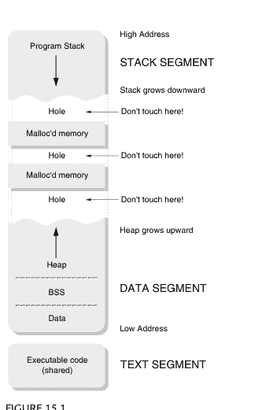

**图 15.1**  
*包括特殊区域的 Linux/Unix 进程地址空间*

第一个实现此方案的调试包是 Electric Fence。Electric Fence 是 `malloc()` 等函数的直接替换。它适用于许多 Unix 系统和 GNU/Linux；可以从其作者的 FTP 档案中获取。[^17] 许多 GNU/Linux 发行版都提供它，尽管你在安装系统时可能需要明确选择它。

[^17]: http://ftp.pereens.com/pub/ElectricFence

一旦程序与 Electric Fence 链接，任何越界访问都会生成 SIGSEGV。Electric Fence 还会捕获尝试使用已释放内存的情况。以下是一个说明这两个问题的简单程序：

```c
1 /* ch15-badmem1.c --- do bad things with memory */
2
3 #include <stdio.h>
4 #include <stdlib.h>
5
6 int main(int argc, char **argv)
7 {
8     char *p;
9     int i;
10
11     p = malloc(30);
12
13     strcpy(p, "not 30 bytes");
14     printf("p = <&s>\n", p);
15
16     if (argc == 2)
17         if (strcmp(argv[1], "-b") == 0)
18             p[42] = 'a';    /* touch outside the bounds */
19         else if (strcmp(argv[1], "-f") == 0) {
20             free(p);        /* free memory and then use it */
21             p[0] = 'b';
22         }
23     }
24
25     /* free(p); */
26
27     return 0;
28 }
```

该程序执行简单的命令行选项检查来决定如何错误行为：-b 会触及越界内存，-f 会尝试使用已释放的内存。（第 18 行和第 21 行分别是有风险的操作。）请注意，如果没有选项，指针永远不会被释放（第 25 行）；Electric Fence 不会捕获这种情况。

使用 Electric Fence 的一种保证在 Unix 和 GNU/Linux 系统上都能工作的方式是将其与程序静态链接。然后应该从调试器中运行该程序。（Electric Fence 的文档明确指出，Electric Fence 不应该与生产二进制文件链接。）以下会话演示了这个过程，并展示了两种命令行选项发生的情况：

```bash
$ cc -g ch15-badmem1.c -lefence -o ch15-badmem1     # 编译；静态链接
$ gdb ch15-badmem1                                    # 从调试器运行
gdb (gdb) 5.3
...  # 尝试 -b 选项
(gdb) run -b
Starting program:  /home/arnold/progex/code/ch15/ch15-badmem1 -b
[New Thread 8192 (LWP 28021)]

   Electric Fence 2.2.0 Copyright (C) 1987-1999 Bruce Perens <bruce@perens.com>
p = <not 30 bytes>

 Program received signal SIGSEGV, Segmentation fault.   # SIGSEGV: GDB 打印位置
 (Switching to Thread 8192 (LWP 28021))
 0x080485b6 in main (argc=2, argv=0xbffffffa4) at ch15-badmem1.c:18
                                                    p[42] = 'a';       /* 触及越界内存 */
(gdb) run -f                                       # 现在尝试 -f 选项
The program being debugged has been started already.
Start it from the beginning? (y or n) y            # 是的，真的

Starting program:  /home/arnold/progex/code/ch15/ch15-badmem1 -f
[New Thread 8192 (LWP 28024)]

   Electric Fence 2.2.0 Copyright (C) 1987-1999 Bruce Perens <bruce@perens.com>
p = <not 30 bytes>

 Program received signal SIGSEGV, Segmentation fault.          # 再次 SIGSEGV
 (Switching to Thread 8192 (LWP 28024))
 0x080485e8 in main (argc=2, argv=0xbffffffa4) at ch15-badmem1.c:21
                                                    p[0] = 'b';
```

在支持共享库和 LD_PRELOAD 环境变量的系统（包括 GNU/Linux）上，你不需要显式链接 efence 库。相反，ef shell 脚本安排以正确的设置运行程序。

虽然我们没有详细描述其机制，但 GNU/Linux（以及其他 Unix 系统）支持共享库，这是库例程的特殊版本，保留在磁盘上的单个文件中，而不是复制到每个可执行程序的二进制文件中。共享库在磁盘上节省一些空间，并且可以节省系统内存，因为使用共享库的所有程序共享同一个内存中的库副本。代价是程序启动较慢，因为程序和共享库在程序开始运行之前必须结合起来。（这通常对用户是透明的。）

`LD_PRELOAD` 环境变量导致系统的程序加载器（将可执行文件读入内存）在标准库*之前*链接一个特殊库。`ef` 脚本利用此功能来链接 Electric Fence 版本的 `malloc()` 套件。因此，甚至不需要重新链接。这个例子演示了 `ef`：

```bash
$ cc -g ch15-badmem1.c -o ch15-badmem1            # 正常编译
$ ef ch15-badmem1 -b                                 # 使用 ef 运行，转储核心

Electric Fence 2.2.0 Copyright (C) 1987-1999 Bruce Perens <bruce@perens.com>
p = <not 30 bytes>
/usr/bin/ef: line 20: 28005 Segmentation fault     (core dumped)
( export LD_PRELOAD=libefence.so.0.0.0; exec $* )

$ ef ch15-badmem1 -f                                 # 使用 ef 运行，再次转储核心

Electric Fence 2.2.0 Copyright (C) 1987-1999 Bruce Perens <bruce@perens.com>
p = <not 30 bytes>
/usr/bin/ef: line 20: 28007 Segmentation fault     (core dumped)
( export LD_PRELOAD=libefence.so.0.0.0; exec $* )

$ ls -l core*                                        # Linux 为我们提供单独的核心文件
-rw------- 1 arnold devel 217088 Aug 28 15:40 core.28005
-rw------- 1 arnold devel 212992 Aug 28 15:40 core.28007
```

GNU/Linux 创建在文件名中包含进程 ID 号的核心文件。在这种情况下，这种行为是有用的，因为我们可以单独调试每个核心文件：

```bash
$ gdb ch15-badmem1 core.28005                        # 来自 -b 选项
GNU gdb 5.3
...
Core was generated by `ch15-badmem1 -b`.
Program terminated with signal 11, Segmentation fault.
#0  0x08048466 in main (argc=1, argv=0xbffff8c4) at ch15-badmem1.c:18
18)
      p[42] = 'a';      /* 触及越界内存 */
(gdb) quit

$ gdb ch15-badmem1 core.28007                        # 来自 -f 选项
GNU gdb 5.3
...
Core was generated by `ch15-badmem1 -f`.
Program terminated with signal 11, Segmentation fault.
#0  0x08048498 in main (argc=2, argv=0xbffff8c4) at ch15-badmem1.c:21
21)
      p[0] = 'b';
```

`efence(3)` 手册页描述了几个可以设置的以定制 Electric Fence 行为的环境变量。以下三个是最值得注意的。

`EF_PROTECT_BELOW`

将此变量设置为 1 会导致 Electric Fence 寻找*下溢*而不是上溢。上溢，即访问分配区域之外的内存，是 demon-

strated 之前。欠载（underrun）是指访问位于分配区域之前的内存。

### EF_PROTECT_FREE

将该变量设置为 1 可防止 Electric Fence 重新利用已被正确释放的内存。当你怀疑程序可能正在访问已释放的内存时，这很有帮助；如果已释放的内存随后被重新分配，那么来自先前悬空指针的访问本应无法被检测到。

### EF_ALLOW_MALLOC_0

当给定一个非零值时，Electric Fence 允许 `malloc(0)` 调用。这类调用在标准 C 中在技术上是合法的，但很可能代表一个软件 bug。因此，默认情况下，Electric Fence 禁止这些调用。

除了环境变量，Electric Fence 还提供了同名全局变量。你可以在调试器中修改它们的值，从而动态更改已经启动运行的程序的行为。详情参见 *efence(3)*。

#### 15.5.2.3 调试 Malloc：dmalloc

`dmalloc` 库提供了大量的调试选项。其作者是 Gray Watson，它有自己的网站[^18]。与 Electric Fence 一样，你的系统上可能已经安装了它，或者你需要获取它并自行构建。

[^18]: http://www.dmalloc.com

`dmalloc` 库检查 `DMALLOC_OPTIONS` 环境变量以获取控制信息。例如，它可能如下所示：

```bash
$ echo $DMALLOC_OPTIONS
debug=0x4e4503,inter=100,log=dm-log
```

该变量的“debug”部分是一组“或”运算（OR’d）的位标志，对于大多数人来说直接管理几乎是不可能的。因此，文档描述了一个两阶段过程，以使其更易于使用。

第一步是定义一个名为 `dmalloc` 的 shell 函数，该函数调用 `dmalloc` 驱动程序：

```bash
$ dmalloc ()
> eval 'command_dmalloc -b $*'  # command 命令绕过 shell 函数
> )
```

完成后，你可以向该函数传递选项，以设置日志文件（-l），指定 dmalloc 应验证其内部数据结构的迭代次数（-i），以及指定调试级别或其他标签（low）：

```bash
$ dmalloc -l dm-log -i 100 low
```

与 Electric Fence 类似，dmalloc 库可以静态链接到应用程序中，也可以通过 LD_PRELOAD 动态链接。以下示例演示了后者：

```bash
$ LD_PRELOAD=libdmalloc.so.8 csh -m dmtest -b    # 开启检查运行
p = <not 30 bytes>                       # 显示正常输出
```

> **注意** 不要使用 `export LD_PRELOAD=libdmalloc.so.8`！如果这样做，你运行的每个程序（如 `ls`）都将启用 `malloc()` 检查。你的系统将很快变得无法使用。如果你意外地这样做了，可以使用 `unset LD_PRELOAD` 来恢复正常行为。

结果将写入指定的 `dm-log` 文件：

```text
$ cat dm-log
1062078174: 1: dmalloc version '4.8.1' from 'http://dmalloc.com/'
1062078174: 1: flags = 0x4e40503, logfile 'dm-log'
1062078174: 1: interval = 100, addr = 0, seen # = 0
1062078174: 1: starting time = 1062078174
1062078174: 1: free bucket count/bits: 63/6
1062078174: 1: basic-block 4096 bytes, alignment 8 bytes, heap grows up
1062078174: 1: heap: 0x804a000 to 0x804d000, size 12288 bytes (3 blocks)
1062078174: 1: heap checked 0
1062078174: 1: alloc calls: malloc 1, calloc 0, realloc 0, free 0
1062078174: 1: alloc calls: realloc 0, malloc 0, realloc 0, free 0
1062078174: 1: total memory allocated: 30 bytes (1 pmts)
1062078174: 1: max in use at one time: 30 bytes (1 pmts)
1062078174: 1: max allocated with 1 call: 30 bytes
1062078174: 1: max alloc rounding loss: 34 bytes (53%)
1062078174: 1: max memory space wasted: 3998 bytes (98%)
1062078174: 1: final user memory space: basic 0, divided 1, 4062 bytes
1062078174: 1: final admin overhead: basic 1, divided 1, 8192 bytes (66%)
1062078174: 1: final external space: 0 bytes (0 blocks)
1062078174: 1: top 10 allocations:
1062078174: 1: total-size count in-use-size count source
1062078174: 1:          30        1           30        1 ra=0x8048412
1062078174: 1:          30        1           30        1 Total of 1
1062078174: 1: dumping not-freed pointers changed since 0:
1062078174: 1: not freed: '0x804c008\sl' (30 bytes) from 'ra=0x8048412'
1062078174: 1: total-size count source
1062078174: 1: 30 1 ra=0x8048412 # Allocation is here
1062078174: 1: 30 1 # Total of 1
1062078174: 1: unknown memory: 1 pointer, 30 bytes
1062078174: 1: ending time = 1062078174, elapsed since start = 0:00:00
```

输出中包含许多统计信息，我们目前对此不感兴趣。有趣的是指示未释放内存的那一行，其中包含一个返回地址，指示分配了该内存的函数（`ra=0x8048412`）。`dmalloc` 文档解释了如何使用 GDB 获取该地址的源代码位置：

```bash
$ gdb ch15-badmem1 # 启动 GDB
GNU gdb 5.3
...
(gdb) x 0x8048412 # 检查地址
0x8048412: <main+26>: 0x8910c483
(gdb) info line *(0x8048412) # 获取行信息
Line 11 of 'ch15-badmem1.c' starts at address 0x804808 <main+16>
and ends at 0x804818 <main+32>.
```

这很痛苦，但如果别无选择，这是可行的。然而，如果你在程序中包含 `dmal1loc.h` 头文件（在所有其他 `#include` 语句*之后*），你就可以在报告中直接获取源代码信息：

```text
...
1062080258: 1: top 10 allocations:
1062080258: 1: total-size count in-use-size count source
1062080258: 1: 30 1 30 1 ch15-badmem2.c:13
1062080258: 1: 30 1 30 1 # Total of 1
1062080258: 1: dumping not-freed pointers changed since 0:
1062080258: 1: not freed: '0x804c008\sl' (30 bytes) from 'ch15-badmem2.c:13'
1062080258: 1: total-size count source
1062080258: 1: 30 1 ch15-badmem2.c:13
1062080258: 1: 30 1 # Total of 1
...
```

（`ch15-badmem2.c` 文件与 `ch15-badmem1.c` 相同，只是它包含了 `dmal1loc.h`，所以我们没有费心展示它。）

单独的调试功能通过使用 *tokens*——特别是 *已识别的标识符*——以及用于添加 token（功能）的 `-p` 选项或用于移除 token 的 `-m` 选项来启用或禁用。有预定义的组合，`low`、`med` 和 `high`。你可以使用 `dmal1loc -Lv` 查看这些组合的内容：

```bash
$ dmalloc low # 设置为低
$ dmalloc -lv # 显示设置
```

要查看命令行选项列表，请输入：`dmalloc --usage`

```text
Debug-Flags 0x4e40503 (82052355) (low)             当前 tokens
log-stats, log-non-free, log-bad-space, log-elapsed-time, check-fence,
free-blank, error-abort, alloc-blank, catch-null
Address       not-set
Interval      100
Lock-On       not-set
Logpath       'log2'
Start-File    not-set
```

完整的 token 集合，连同简要说明和每个 token 对应的数值，可以通过 `dmalloc -DV` 获取：

```bash
$ dmalloc -DV

Debug Tokens:
none (nil) -- 无功能 (0)
log-stats (lst) -- 记录一般统计信息 (0x1)
log-non-free (inf) -- 记录未释放的指针 (0x2)
log-known (lkn) -- 仅记录已知的未释放指针 (0x4)
log-trans (ltr) -- 记录内存事务 (0x8)
log-admin (lad) -- 记录管理信息 (0x20)
log-blocks (lbl) -- 在堆映射时记录块 (0x40)
log-bad-space (lbs) -- 转储来自错误指针的空间 (0x100)
log-non-free-space (lns) -- 转储来自未释放指针的空间 (0x200)
log-elapsed-time (let) -- 记录已分配指针的经过时间 (0x400000)
log-current-time (lct) -- 记录已分配指针的当前时间 (0x800000)
check-fence (cfe) -- 检查栅栏柱错误 (0x400)
check-heap (che) -- 检查堆管理结构 (0x800)
check-lists (cli) -- 检查空闲链表 (0x1000)
check-blank (cbl) -- 检查被 alloc-blank, free-blank 覆盖的内存 (0x2000)
check-funcs (cfu) -- 检查函数 (0x4000)
force-linear (fl1) -- 强制堆空间为线性 (0x10000)
catch-signals (csi) -- 在 SIGHUP, SIGINT, SIGTERM 时关闭程序 (0x20000)
realloc-copy (rcp) -- 复制所有重新分配 (0x100000)
free-blank (fbl) -- 用 BLANK_CHAR 覆盖已释放的内存空间 (0x200000)
error-abort (eab) -- 在错误时立即中止 (0x4000000)
alloc-blank (abl) -- 用 BLANK_CHAR 覆盖新分配的内存 (0x8000000)
heap-check-map (hcm) -- 在堆检查时记录堆映射 (0x10000000)
print-messages (pme) -- 将消息写入 stderr (0x20000000)
catch-null (cmu) -- 如果没有可用内存则中止 (0x40000000)
ever-reuse (nre) -- 从不重用已释放的内存 (0x80000000)
allow-free-null (afn) -- 允许释放 NULL 指针 (0x200000000)
error-dump (edn) -- 在错误时转储核心文件然后继续 (0x40000000)
```

此时你应该对如何使用 dmalloc 及其灵活性有了感觉。对于我们的简单演示程序来说，dmalloc 有些过度，但对于更大规模的实际应用程序来说，它是无价之宝。


#### 15.5.2.4 Valgrind：一款多功能工具

前一节中描述的所有工具都专注于动态内存调试，确实，对于许多程序而言，这是一个主要的问题领域。然而，动态内存问题并不是唯一的问题类型。采用 GPL 许可证的 Valgrind 程序可以捕获大量种类的问题，包括由动态内存引起的问题。

Valgrind 的手册对该程序的描述比我们要好或至少同样好，因此我们将在文中引用（并省略部分内容）。

> Valgrind 是一个用于调试和剖析 Linux-x86 可执行文件的灵活工具。该工具由核心组成，核心在软件中提供合成 x86 CPU，以及一系列“皮肤”，每一个都是一个调试或剖析工具。架构是模块化的，因此可以轻松创建新的皮肤，而不会干扰现有结构。
>
> 最实用的“皮肤”是 memcheck：memcheck 皮肤检测程序中的内存管理问题。所有内存的读取和写入都会进行检查，对 `malloc/new`/`free/delete` 的调用会被拦截。结果，memcheck 可以检测以下问题：
>
> - 使用未初始化的内存。
> - 在内存被 `free` 之后读取/写入该内存。
> - 读取/写入 `malloc` 分配的块末尾之外的区域。
> - 在堆栈上读取/写入不适当的区域。
> - 内存泄漏——即指向 `malloc` 分配块的指针永久丢失。
> - `malloc/new/new []` 与 `free/delete/delete []` 使用不匹配。
> - POSIX pthreads API 的一些误用。
>
> 这类问题通过其他方式很难找到，通常长期未被察觉，然后导致偶尔发生、难以诊断的崩溃。

其他皮肤更具专业性：

- `cachegrind` 对 CPU 中的 I1、D1 和 L2 缓存进行详细模拟，因此可以准确定位代码中缓存未命中的来源。
- **addrcheck** 皮肤与 **memcheck** 完全相同，除了一个细节：它不进行任何未初始化值检查。其他所有检查——主要是细粒度地址检查——仍然执行。缺点是，你无法捕获 **memcheck** 能发现的未初始化值错误。但优点很显著：程序运行速度大约是 **memcheck** 的两倍，并且使用的内存少得多。它仍然能发现对已释放内存、块末尾之外以及在其他无效位置的读取/写入，这些是你真想在发布前找到的 bug！
- **helgrind** 是设计用于查找多线程程序中数据竞争的调试皮肤。

最后，手册指出：

Valgrind 与 CPU、操作系统细节紧密相关，在较小程度上与编译器和基础 C 库相关。这使得使其可移植变得困难，因此我们一开始就选择集中在我们认为广泛使用的平台上：x86 上的 Linux。Valgrind 使用标准的 Unix `./configure`、`make`、`make install` 机制，我们已努力确保其在具有内核 2.2 或 2.4 以及 glibc 2.1.X、2.2.X 或 2.3.1 的机器上正常工作。这应该涵盖了绝大多数现代 Linux 安装。请注意，带有 NPTL（Native POSIX Thread Library）包的 glibc-2.3.2+ 将无法工作。我们希望能够修复此问题，但这不会容易。

如果你在不同的平台上使用 GNU/Linux，或者你使用商业 Unix 系统，那么 Valgrind 对你的帮助不大。然而，由于 x86 GNU/Linux 系统相当常见（且价格实惠），很可能你可以以适度的预算购买一台，或者至少找到一台可以借用的！此外，一旦 Valgrind 为你发现问题，无论你的程序编译后运行在*什么*平台上，问题都已被修复。因此，使用 x86 GNU/Linux 系统进行开发，使用其他商业 Unix 系统进行高端产品的部署是合理的。

虽然 Valgrind 手册可能让你期望有名为 memcheck、addrcheck 等单独的命令，但事实并非如此。相反，名为 valgrind 的驱动 shell 程序运行调试核心，通过 --skin= 选项指定适当的“皮肤”。默认皮肤是 memcheck；因此，运行普通的 valgrind 等同于 'valgrind --skin=memcheck'。（这提供了与早期仅进行内存检查的 Valgrind 版本的兼容性，并且这也最有意义，因为 memcheck 皮肤提供了最多的信息。）

Valgrind 提供了一些选项。关于完整细节，请参阅其文档。选项分为组；其中适用于核心（即适用于所有皮肤）的选项中，这些可能最有用：

| 选项 | 描述 |
| :--- | :--- |
| `--gdb-attach=no\|yes` | 启动时附带 GDB 连接到进程，用于交互式调试。默认值为 `no`。 |
| `--help` | 列出选项。 |
| `--logfile=file` | 将日志消息记录到 `file.pid`。 |
| `--num-callers=number` | 在堆栈跟踪中显示 `num` 个调用者。默认值为 `4`。 |
| `--skin=skin` | 使用名为 `skin` 的皮肤。默认值为 `memcheck`。 |
| `--trace-children=no\|yes` | 也对子进程运行跟踪。默认值为 `no`。 |
| `-v`, `--verbose` | 更加详细。这包括列出加载的库以及所有不同类型错误的计数。 |

在 memcheck 皮肤的选项中，我们认为以下这些最有用：

- `--leak-check=no\|yes`：程序结束后查找内存泄漏。默认值为 `no`。
- `--show-reachable=no\|yes`：程序结束时显示可到达的块。如果使用 `--show-reachable=yes`，Valgrind 会查找仍然有指针指向的动态分配内存。这些内存不是内存泄漏，但知道这些信息可能也有用。默认值为 `no`。

让我们看看 Valgrind 的运行效果。还记得 `ch15-badmem.c` 吗？（参见第 15.5.2.2 节“Electric Fence”，第 614 页。）`-b` 选项向通过 `malloc()` 分配的内存区域之外的内存写入。以下是 Valgrind 的报告：

```text
$ valgrind ch15-badmem1 -b
1 ==8716== Memcheck, a.k.a. Valgrind, a memory error detector for x86-linux.
2 ==8716== Copyright (C) 2002-2003, and GNU GPL'd, by Julian Seward.
3 ==8716== Using valgrind-20030725, a program supervision framework for x86-linux.
4 ==8716== Copyright (C) 2000-2003, and GNU GPL'd, by Julian Seward.
5 ==8716== Estimated CPU clock rate is 2400 MHz
6 ==8716== For more details, rerun with: -v
7 ==8716==
8 p = <not 30 bytes>
9 ==8716== Invalid write of size 1
10 ==8716== at 0x40B456: main (ch15-badmeml.c:18)
11 ==8716== by 0x42015BD3: __libc_start_main (in /lib/libc-2.2.93.so)
12 ==8716== by 0x4004368: (within /home/arolda/progex/code/ch15/ch15-badmem1)
13 ==8716== Address 0x41048405 is 12 bytes after a block of size 30 alloc'd
14 ==8716== at 0x4025488: malloc (vg_replace_malloc.c:153)
15 ==8716== by 0x4004311: main (ch15-badmeml.c:11)
16 ==8716== by 0x42015BD3: __libc_start_main (in /lib/libc-2.2.93.so)
17 ==8716== by 0x4004368: (within /home/arolda/progex/code/ch15/ch15-badmem1)
18 ==8716==
19 ==8716== ERROR SUMMARY: 1 errors from 1 contexts (suppressed: 0 from 0)
20 ==8716== malloc/free: 1 use at exit: 30 bytes in 1 blocks.
21 ==8716== malloc/free: 1 allocs, 0 frees, 30 bytes allocated.
22 ==8716== For a detailed leak analysis, rerun with: --leak-check=yes
23 ==8716== For counts of detected errors, rerun with: -v
```

（输出中的行号是添加的，以便辅助讨论。）第 8 行是程序的输出；其他行都来自 Valgrind，输出到标准错误。第 9–17 行是错误报告。它指示错误写入的字节数（第 9 行）、发生位置（第 10 行）以及堆栈跟踪。第 13–17 行描述内存是从哪里分配的。第 19–23 行提供摘要。

`ch15-badmem1` 的 `-f` 选项释放已分配的内存，然后通过悬空指针向其写入。以下是 Valgrind 对该情况的报告：

```text
$ valgrind ch15-badmem1 -f
==8719== Memcheck, a.k.a. Valgrind, a memory error detector for x86-linux.
==8719== P = <not 30 bytes>
==8719== Invalid write of size 1
==8719==    at 0x8048498: main (ch15-badmem1.c:21)
==8719==    by 0x420158D3: __libc_start_main (in /lib/i686/libc-2.2.93.so)
==8719==    by 0x4048368: (within /home/arnold/progex/code/ch15/ch15-badmem1)
==8719==    Address 0x41048024 is 0 bytes inside a block of size 30 free’d
==8719==    at 0x4025722: free (vg_replace_malloc.c:220)
==8719==    by 0x8048491: main (ch15-badmem1.c:20)
==8719==    by 0x420158D3: __libc_start_main (in /lib/i686/libc-2.2.93.so)
==8719==    by 0x4048368: (within /home/arnold/progex/code/ch15/ch15-badmem1)
```

这一次报告指示写入发生在已释放的内存上，并且对 `free()` 的调用位于 `ch15-badmem1.c` 的第 20 行。

在没有选项调用的情况下，`ch15-badmem1.c` 分配内存并使用它，但不释放它。`--leak-check=yes` 选项报告此情况：

```text
$ valgrind --leak-check=yes ch15-badmem1
1 ==8720== Memcheck, a.k.a. Valgrind, a memory error detector for x86-linux.
...
8 p = <not 30 bytes>
9 ==8720==
10 ==8720== ERROR SUMMARY: 0 errors from 0 contexts (suppressed: 0 from 0)
11 ==8720== malloc/free: in use at exit: 30 bytes in 1 blocks.
12 ==8720== malloc/free: 1 allocs, 0 frees, 30 bytes allocated.
...
16 ==8720==
17 ==8720== 30 bytes in 1 blocks are definitely lost in loss record 1 of 1
18 ==8720==    at 0x4025488: malloc (vg_replace_malloc.c:153)
19 ==8720==    by 0x8040411: main (ch15-badmem1.c:11)
20 ==8720==    by 0x420158D3: __libc_start_main (in /lib/i686/libc-2.2.93.so)
21 ==8720==    by 0x4048368: (within /home/arnold/progex/code/ch15/ch15-badmem1)
22 ==8720==
23 ==8720== LEAK SUMMARY:
24 ==8720==    definitely lost: 30 bytes in 1 blocks.
25 ==8720==    possibly lost: 0 bytes in 0 blocks.
26 ==8720==    still reachable: 0 bytes in 0 blocks.
27 ==8720==    suppressed: 0 bytes in 0 blocks.
28 ==8720== Reachable blocks (those to which a pointer was found) are not shown.
29 ==8720== To see them, rerun with: -v-show-reachable=yes
```

第 17–29 行提供泄漏报告；泄漏的内存是在 `ch15-badmem1.c` 的第 11 行分配的。

除了提供动态内存误用的报告外，Valgrind 还可以诊断对*未初始化*内存的使用。考虑以下程序 `ch15-badmem3.c`：


#### 15.5.2.5 其他 Malloc 调试器

Cal Erickson 在 *Linux Journal* 上撰写的两篇文章介绍了 mtrace 和 dmalloc，以及下文列出的其他大多数工具。这两篇文章分别是 *Memory Leak Detection in Embedded Systems*（第 102 期[22]，2002 年 9 月）和 *Memory Leak Detection in C++*（第 110 期[23]，2003 年 6 月）。这两篇文章均可在 Linux Journal 网站上查阅。

其他工具在性质上与之前描述的工具相似。

### ccmalloc

一个 malloc() 替代库，无需特殊编译，可用于 C++。参见 http://www.inf.ethz.ch/personal/biere/projects/ccmalloc。

### Mark Moraes 的 malloc

一个早期但功能齐全的 malloc() 替代库，提供性能分析、跟踪和调试功能。可从 ftp://ftp.cs.toronto.edu/pub/moraes/malloc-1.18.tar.gz 获取。

### mpatrol

一个高度可配置的内存调试和测试包。参见 http://www.cbnmaga.demon.co.uk/mpatrol。

### memwatch

一个需要特殊头文件和编译时选项的包。参见 http://www.linkdata.se/sourcecode.html。

### njamd

不仅仅是另一个 Malloc 调试器。这个库不需要对应用程序进行特殊链接；相反，它使用 `LD_PRELOAD` 来替换标准例程。参见 http://sourceforge.net/projects/njamd。

### yamd

类似于 Electric Fence，但提供更多选项。参见 http://www3.hsc.edu/~neldredge/yamd。

几乎所有这些包都使用环境变量来调整其行为。根据 *Linux Journal* 的文章，表 15.1 总结了不同包的功能。

### 表 15.1
内存工具功能摘要

| 工具 | 操作系统 | 头文件 | 模块/程序 | 线程安全 |
| :--- | :--- | :--- | :--- | :--- |
| ccmalloc | 多厂商 | 否 | 程序 | 否 |
| dmalloc | 多厂商 | 可选 | 程序 | 是 |
| efence | 多厂商 | 否 | 程序 | 否 |
| memwatch | 多厂商 | 是 | 程序 | 否 |
| Moraes | 多厂商 | 可选 | 程序 | 否 |
| mpatrol | 多厂商 | 否 | 程序 | 是 |
| mtrace | Linux (GLIBC) | 是 | 模块 | 否 |
| njamd | 多厂商 | 否 | 程序 | 否 |
| valgrind | Linux (GLIBC) | 否 | 程序 | 是 |
| yamd | Linux, DJGPP | 否 | 程序 | 否 |

显然，调试动态内存问题时有多种选择。在 GNU/Linux 和 BSD 系统上，这些工具中的一个或多个可能已经安装好了，从而省去了下载和构建的麻烦。

在你的程序上依次使用多个工具也很有用。例如，使用 mtrace 捕获未释放的内存，使用 Electric Fence 捕获无效的内存访问。

## 15.5.3 一种现代 lint

在原始 C 语言中，编译器无法检查函数调用中传递的参数是否与函数定义中的参数列表匹配；当时没有原型。这经常导致细微的错误，因为不良的函数调用可能只会产生轻微错误的结果，从而在测试中被忽视，或者在测试期间甚至根本没有被调用。例如：

```c
if (argc < 2)
    fprintf("usage: %s [ options ] files\n", argv[0]);    // 缺少 stderr
```

如果一个包含此片段的程序从未以错误数量的参数被调用，那么缺少初始 FILE * 参数的 fprintf() 永远不会被调用。

V7 lint 程序旨在解决此类问题。它对程序中的所有文件进行两次遍历，首先收集有关函数参数的信息，然后将函数调用与收集到的信息进行比对。特殊的“lint 库”文件提供了关于标准库函数的信息，以便对它们进行检查。lint 还检查其他可疑的结构。

随着标准 C 语言中原型的引入，对 lint 的需求减少了，但并未消除，因为 C89 仍然允许旧式函数声明：

```c
extern int some_func();                                      // 参数列表未知
```

此外，程序的许多其他方面都可以静态检查，也就是说，通过源代码文本分析进行检查。

splint 程序（安全编程 Lint[24]）是一种现代 lint 替代工具。它提供了过多的选项和设施，这里无法一一列举，但值得研究。

需要注意的是，类似 lint 的程序会产生大量的警告信息。许多报告的警告实际上是无害的。在这种情况下，这些工具允许你提供特殊注释，表明“是的，我知道这个问题，它不是个问题”。当你提供大量此类注释时，splint 的效果最佳。

splint 是一个强大但复杂的工具；花一些时间学习如何使用它并经常使用它，将有助于保持代码的整洁。

## 附录：Valgrind 示例输出

以下部分详细介绍了 Valgrind 针对 `ch15-badmem.c` 在文本中描述的输 出和行为。

源代码片段：

```c
/* ch15-badmem.c --- do bad things with nondynamic memory */
#include <stdio.h>
#include <stdlib.h>

int main(int argc, char *argv[])
{
    int a_var; /* 这两个变量都未初始化 */
    int b_var;
    
    /* Valgrind 不会标记此操作；参见文本。 */
    a_var = b_var;
    
    /* 使用未初始化的内存；这会被标记。 */
    printf("a_var = %d\n", a_var);
    
    return 0;
}
```

运行时，Valgrind 生成此（简化的）报告：

```text
===29650=== Memcheck, a.k.a. Valgrind, a memory error detector for x86-linux.
===29650=== Copyright (C) 2002-2009, and GNU GPL’d, by Julian Seward et al.
===29650=== Using valgrind-3.3.1, a dynamic tool for performance
===29650=== analysis of executable programs.
===29650=== For more details, harness at: http://valgrind.org
===29650=== This program uses 421 processors.
===29650=== Possible reasons for this program's failure:
===29650=== 1. The program has a memory error.
===29650=== 2. The program is written in a language that Valgrind does
===29650===    not understand.
===29650=== 3. The program has exited without completing its
===29650===    computation.
===29650=== 4. You are running Valgrind on a program that uses a
===29650===    library that Valgrind does not understand.
===29650=== 5. You are running Valgrind on a program that uses a
===29650===    library that Valgrind does not understand.
===29650=== 6. You are running Valgrind on a program that uses a
===29650===    library that Valgrind does not understand.
===29650=== 7. You are running Valgrind on a program that uses a
===29650===    library that Valgrind does not understand.
===29650=== 8. You are running Valgrind on a program that uses a
===29650===    library that Valgrind does not understand.
===29650=== 9. You are running Valgrind on a program that uses a
===29650===    library that Valgrind does not understand.
===29650=== 10. You are running Valgrind on a program that uses a
===29650===     library that Valgrind does not understand.
===29650=== Use of uninitialised value of size 4
===29650===   at 0x40249D2A: _IO_vfprintf_internal (in /lib/i686/libc-2.2.93.so)
===29650===   by 0x402523C1: _IO_printf (in /lib/i686/libc-2.2.93.so)
===29650===   by 0x804834D: main (ch15-badmem.c:15)
===29650===   by 0x420158D3: __libc_start_main (in /lib/i686/libc-2.2.93.so)
===29650===   by 0x420158D3: __libc_start_main (in /lib/i686/libc-2.2.93.so)
===29650=== Conditional jump or move depends on uninitialised value(s)
===29650===   at 0x40249D2A: _IO_vfprintf_internal (in /lib/i686/libc-2.2.93.so)
===29650===   by 0x402523C1: _IO_printf (in /lib/i686/libc-2.2.93.so)
===29650===   by 0x804834D: main (ch15-badmem.c:15)
===29650===   by 0x420158D3: __libc_start_main (in /lib/i686/libc-2.2.93.so)
===29650===   by 0x420158D3: __libc_start_main (in /lib/i686/libc-2.2.93.so)
...
a_var = 1107341000
===29650===
===29650=== ERROR SUMMARY: 25 errors from 7 contexts (suppressed: 0 from 0)
===29650=== malloc/free: 15 user: 0 bytes in 0 blocks.
===29650=== malloc/free: 0 allocs, 0 frees, 0 bytes allocated.
===29650=== For a detailed leak analysis, rerun with: -leak-check=yes
===29650=== For counts of detected errors, rerun with: -v
```

Valgrind 文档解释说，复制未初始化的数据不会产生任何报告。memcheck 皮肤会记录数据的状态（未初始化），并在数据移动时跟踪它。因此，a_var 被视为未初始化，因为其值来自 b_var，而 b_var 最初是未初始化的。

只有当未初始化的值被使用时，memcheck 才会报告问题。在这里，该用法发生在 C 库内部（_IO_vfprintf_internal()），该函数必须将值转换为字符串；为此它会对该值进行计算。

不幸的是，虽然 Valgrind 可以检测未初始化内存的使用，甚至可以精确到比特级别，但它无法对局部变量和全局变量进行数组边界检查。（Valgrind 可以对动态内存进行边界检查，因为它自己处理这些内存，因此知道每个区域的起始和结束位置。）

总之，Valgrind 是一个强大的内存调试工具。它已被用于大型多线程生产程序，如 KDE 3、OpenOffice 和 Konqueror 网页浏览器。它与几种商业产品并驾齐驱，其一个变种甚至已经用于（与 WINE 模拟器[20]一起）调试使用 Visual C++ 编写的 Microsoft Windows 程序。你可以从其网站[21]获取 Valgrind。


## 15.6 软件测试

软件开发兼具艺术和科学的元素；这正是使该职业如此引人入胜且充满挑战的一个方面。本节介绍软件测试这一主题，它同样涉及艺术和科学；因此，与本章其余部分相比，它的表述稍微更通用且更高层次（读起来有些“手挥式”的概括）。

软件测试是软件开发过程中不可或缺的一部分。一个程序在第一次编译时就 100% 正确运行是非常罕见的。程序本身无需对其正确性负责，负责的是程序的作者。验证程序按其预期功能运作的最重要方式之一就是对其进行测试。

分解不同测试类型的一种方式如下：

### 单元测试

这些是你为程序的每个独立单元或功能组件编写的测试。作为这一工作的一部分，你可能还需要编写脚手架——设计用来提供足够支撑框架的代码，以便将该单元作为独立程序运行。

在设计与实现每个功能组件时，设计其对应的测试至关重要。这样做有助于你理清功能设计；知道如何测试它有助于你在最初就定义清楚它应该做什么以及不应该做什么。

### 集成测试

这些是在所有功能组件都已单独编写、测试并调试完毕后应用的测试。其核心思想是，此时所有组件都嵌入到整体框架中，并对整个系统进行测试，以确保组件之间的交互能够正常工作。

### 回归测试

不可避免地，你（或你的用户！）会发现一些问题。这些问题可能是真正的缺陷（bug），也可能是设计局限，或是出现在怪异“边界情况”中的故障。一旦你能够复现并修复该问题，请将原始的失败用例保留为回归测试。回归测试可以让你确保在进行更改时，没有重新引入旧的问题。（这种情况很容易发生。）通过在做出更改后让程序通过其测试套件，你可以更加（有信心地）确定一切都在按预期工作。

尽可能多地实现测试自动化。对于以 `Linux/Unix` 工具风格编写的非 GUI 程序，这样做特别容易：这类程序从标准输入或命名文件读取数据，并向标准输出和标准错误写入数据。至少，测试可以通过简单的 shell 脚本来完成。更复杂的测试通常使用单独的 `test` 子目录和 `make` 程序来完成。

软件测试本身是一个完整的子领域，我们在这里无法详尽介绍；我们的重点是让你意识到，测试是开发过程中不可或缺的一部分，并且往往是激励你使用调试技能的动因！以下是一个**非常**简明的总结列表：

- 与功能特性一起设计测试。
- 测试边界条件：确保功能在有效边界内及边界处都能正常工作，并且在边界外正确失败。（例如，`sqrt()` 函数在给定负参数时必须失败。）
- 在代码中使用断言（参见第 12.1 节，“断言语句：`assert()`”，第 428 页），并在启用断言的情况下运行测试。
- 创建并复用测试脚手架。
- 保留失败用例以进行回归测试。
- 尽可能多地实现测试自动化。
- 打印失败测试的数量，以便轻松判断成功或失败，以及失败的程度。
- 使用代码覆盖工具（如 `gcov`）来验证你的测试套件是否执行了所有代码。
- 尽早测试，经常测试。
- 研究软件测试文献，以提高开发软件测试软件的能力。

#### 15.7 调试规则

调试并非“黑魔法”。其原则和技术是任何人都可以学习并一致应用的。为此，我们高度推荐 David J. Agans 的著作《Debugging》（ISBN: 0-8144-7168-4）。该书拥有一个网站^[25]，其中总结了规则，并提供了一份可下载的海报，供你打印后挂在办公室墙上。

为了结束我们的讨论，我们呈现以下材料。这些材料经 David Agans 许可，改编自《Debugging》，版权 © 2002 David J. Agans，由 AMACOM 出版^[26]，AMACOM 是美国管理协会（American Management Association）纽约分部的旗下公司。我们要感谢他的慷慨授权。

1. **理解系统。** 当其他方法都失效时，阅读手册。如果你想弄清楚系统为何出错，就必须知道有问题的系统及其所有组件应当做什么。因此，阅读你能拿到（或用浏览器访问）的所有文档。
    - 知道功能模块和数据路径在哪里，以及它们如何交互，能为你提供故障定位的路线图。当然，你还必须了解你的领域（语言、操作系统、应用程序）和你的工具（编译器、源代码调试器）。
2. **使其失败。** 为了看到缺陷，你必须能够一致地复现故障。记录你的操作步骤，并始终从已知状态开始，这样你总是能够再次使其失败。在发生失败的系统上查看缺陷，不要试图在另一个系统上模拟问题。不要信赖关于间歇性问题的统计；这些统计隐藏缺陷的可能性比暴露缺陷的可能性更大。相反，要*尝试*通过改变输入、初始条件和时序来使问题变得一致。
    - 如果问题仍然是间歇性的，你必须让它看起来不像间歇性的。在每次运行期间，尽可能多地捕获信息到日志中；当你有一些坏的运行和好的运行时，将它们相互比较。如果你捕获了足够的数据，你就像能够每次都使其失败一样，能够锁定问题所在。能够每次都使其失败也意味着你能够判断何时已修复它。
3. **停止思考，直接观察。** 事物失败的方式比你想象的要多得多。因此，不要猜测可能发生什么，去观察——在系统上添加仪器，以便你能实际看到故障机制。使用任何可用的仪器——调试器、`printf`(s)、`assert`(s)、逻辑分析仪，甚至 LED 和蜂鸣器。深入观察，直到缺陷对肉眼显而易见，而不仅仅是对大脑显而易见。
    - 如果你确实进行猜测，仅将猜测用于聚焦搜索——在你能看到缺陷之前，不要试图修复它。如果你必须添加仪器代码，就去做，但务必从与失败系统相同的代码库开始，并确保添加代码后系统仍然失败。通常，添加调试器会使停止失败（这就是为什么我们称之为调试器）。
4. **分而治之。** 每个人都知道这一招。你进行逐步逼近——从一端开始，跳到中间，看看错误是哪个方向，再向那个方向跳一半。二分查找，几次跳跃即可到达目标。难点在于知道你是否已经越过了缺陷。一个有帮助的技巧是将已知的简单数据输入系统，以便更容易发现被破坏的数据。此外，从坏的一端开始，向好的一端回溯：如果你从好的一端开始，需要探索的好路径就太多了。立即修复你知道的缺陷，因为有时两个缺陷会相互作用（尽管你发誓它们不可能），而且逐步逼近法在有两个目标值时并不起作用。
5. **一次只改变一件事。** 如果你试图改进一个流处理模块，同时升级到操作系统的下一个版本，无论你是否看到改进、退化还是无变化——你都不知道你个人的更改产生了什么效果。多个更改的相互作用可能是不可预测且令人困惑的。不要这样做。一次只改变一件事，这样你可以确信你观察到的任何差异都源于该更改。
    - 如果你做出一个更改，似乎没有效果，立即撤销它。它可能产生了一些你未看到的效应，而这些效应可能会在其他更改的组合中显现出来。这同样适用于测试和代码编写中的更改。
6. **保留审计跟踪。** 上述规则的大部分有效性取决于保持良好的记录。在测试和调试的所有方面，写下你做了什么、何时做的、怎么做的以及结果如何。做


尽可能电子化记录，以便将记录通过电子邮件发送并附加到缺陷数据库中。许多线索都隐藏在事件模式中，如果未记录下来供所有人查看和比较，这些模式就不会被注意到。而且，线索很可能就在那些你认为不重要的细节中，因此要把所有事情都写下来。

7. **检查插头。** 每个人都有一个关于某个问题最后发现只是“没插好”的故事。有时确实只是没插好，但在软件中，“没插好”可能意味着缺少驱动程序，或者你以为已经替换掉的旧版本代码。或者是当你坚信它是软件问题时，实际上是硬件出了故障。有一个故事是关于硬件和软件工程师互相指责，但问题其实两者都不是：他们使用的测试设备不符合规格要求。归根结底，有时候你在系统内部寻找问题，而实际上问题在系统外部，或在系统底层，或在系统初始化过程中，或者你根本没有查看正确的系统。也不要盲目信任你的工具。工具厂商也是工程师；他们的工具有缺陷，而你可能是发现这些缺陷的人。

8. **获得新视角。** 在调试过程中寻求帮助有三个原因。第一个原因是获取新的见解——另一个人常常能发现某些问题，仅仅因为他们不像你那样深陷其中。第二个原因是利用专业知识——他们比你更了解该系统。第三个原因是获取经验——他们以前见过这种情况。

当你向他人描述情况时，报告你观察到的症状，而不是你关于其为何如此表现的理论。你之所以求助于他们，是因为你的理论没有让你有任何进展——不要让他们陷入你当前停滞不前的困境。

9. **如果你没有修复它，那就没修好。** 你认为修好了？证明它。既然你能够使其 consistently 失败，请设置相同的情况并确保它不会失败。不要假设仅仅因为问题很明显，现在就已经完全修复了。也许它并不那么明显。也许你的修复没有做对。也许你的修复甚至不在新的发布版本中！测试它！让它不再失败。你确定是你的代码修复了它吗？还是测试改变了，或者其他代码被引入了？一旦你看到你的修复有效，就把修复移除，让它再次失败。然后重新加回修复，确认它不再失败。这一步确保你确定是你的修复真正解决了问题。

有关《*Debugging*》一书的更多信息以及一张可免费下载的调试规则海报，可在 http://www.debuggingrules.com 找到。

#### 15.8 推荐阅读

以下几本著作非常优秀，对测试和调试都有许多见解。除了第一本外，其他都涉及通用编程。它们都值得阅读。

1. *Debugging*，作者 David J. Agans。AMACOM，美国纽约州纽约市，2003年。ISBN: 0-8144-7168-4。

   我们强烈推荐这本书。它的语调轻松，听起来虽然令人惊讶，但读起来很有趣！

2. *Programming Pearls*，第2版，作者 Jon Louis Bentley。Addison-Wesley，美国马萨诸塞州雷丁市，2000年。ISBN: 0-201-65788-0。参见该书的网站。27

   本书第5章对单元测试和构建测试脚手架进行了深入讨论。

3. *Literate Programming*，作者 Donald E. Knuth。斯坦福大学语言与信息研究中心（CSLI），美国，1992年。ISBN: 0-9370-7380-6。

   这本引人入胜的书包含 Donald Knuth 关于“文献式编程”的多篇文章——一种他发明并用于创建 TeX 和 Metafont 的编程技术。特别值得感兴趣的是题为“TeX 的错误”的文章，它描述了他如何开发和调试 TeX，包括他记录的所有发现并修复的问题日志。

4. *Writing Solid Code*，作者 Steve Maguire。Microsoft Press，美国华盛顿州雷德蒙德市，1993年。ISBN: 1-55615-551-4。

5. *Code Complete: A Practical Handbook of Software Construction*，作者 Steve McConnell。Microsoft Press，美国华盛顿州雷德蒙德市，1994年。ISBN: 1-55615-484-4。

6. *The Practice of Programming*，作者 Brian W. Kernighan 和 Rob Pike。Addison-Wesley，美国马萨诸塞州雷丁市，1999年。ISBN: 0-201-61585-X。

#### 15.9 总结

- 调试是软件开发的重要组成部分。良好的设计和开发实践应被用来最大限度地减少缺陷的引入，但调试将始终伴随我们。

- 程序应编译时不进行优化并包含调试符号，以使在调试器下的调试更加直接。在许多系统中，使用优化编译和使用调试符号编译是互斥的。对于 GCC 并非如此，这就是为什么 GNU/Linux 开发者需要注意这一问题的原因。

- GNU 调试器 GDB 是 GNU/Linux 系统的标准配置，也几乎可用于任何商业 Unix 系统。（基于 GDB 的图形化调试器也可用且易于移植。）断点、观察点，以及使用 `next`、`step` 和 `cont` 进行单步执行，提供了对运行中程序的基本控制。GDB 还允许你检查被调试程序中的数据并调用函数。

- 在编写程序时，你可以做很多事情以便在不可避免地需要调试时更容易处理。我们涵盖了以下主题：
    - 用于打印状态的调试宏。
    - 避免使用表达式宏。
    - 重新排序代码以简化单步执行。
    - 编写辅助函数供调试器使用。
    - 避免使用联合体。
    - 在程序的生产版本中包含运行时调试代码，并提供不同的方式启用该代码的输出。
    - 添加虚拟函数以使设置断点更容易。

- 除了通用调试器外，还有许多其他工具和库可用于辅助调试。`gdb` 库提供了一个优秀的内部调试器，它以一种一致、连贯的方式使用我们描述的许多技术。

- 存在多个动态内存调试库，具有许多相似的功能。我们查看了其中三个（`etrace`、Electric Fence 和 `dmalloc`），并提供了其他几个的指引。Valgrind 程序更进一步，不仅能查找与动态内存相关的问题，还能查找与未初始化内存相关的问题。

- `splint` 是久负盛名的 V7 `lint` 程序的现代替代品。它至少在一个供应商的 GNU/Linux 系统上可用，并且可以很容易地从源码下载和构建。

- 除了调试工具外，软件测试也是软件开发过程中的组成部分。它应在任何软件开发项目（包括个人项目）开始时被理解、计划和管理。

- 调试是一项可以学习的技能。我们建议阅读 David J. Agans 的《*Debugging*》一书并学习应用他的规则。

### 练习

1. 使用 GCC 编译你的一个程序，同时使用 `-g` 和 `-O`。在 GDB 下运行它，并在 `main()` 中设置一个断点。单步执行程序，看看执行过程与原始源代码的关联程度（或不关联程度）。这对于使用 `while` 或 `for` 循环的代码特别有用。

2. 阅读 GDB 的 `conditional breakpoint`（条件断点）功能。它如何简化处理仅在执行一定次数的操作后才出现问题的情况？

3. 重写第 15.4.2.1 节“添加调试选项和变量”（第 595 页）中的 `parse_debug()` 函数，使其使用调试选项字符串、标志值和字符串长度的表格。

4. （较难。）研究 `gawk` 源代码；特别是 `awk.h` 中的 NODE 结构。编写一个调试辅助函数，根据 `type` 字段的值打印 NODE 的内容。

5. 取你的一个程序并修改它以使用 ``debug`` 库。首先在不使用 ``-DDEBUG`` 的情况下编译，以确保它能正常编译和运行。（你有回归测试套件吗？你的程序通过了所有测试吗？）一旦你确定添加 ``debug`` 库没有破坏你的程序，就使用 ``-DDEBUG`` 重新编译它。你的程序是否仍然通过所有测试？启用和禁用该库时的性能差异是多少？使用 ``-#t`` 选项运行你的测试套件以查看函数调用跟踪。你认为这会在未来需要调试时帮助你吗？为什么或不为什么？

6. 运行使用动态内存的一个程序，使用 Electric Fence 或其他动态内存测试工具。描述你发现的任何问题（如果有）。

7. 重新运行相同的程序，使用启用泄漏检查的 Valgrind。描述你发现的任何问题（如果有）。

8. 为 ``mv`` 程序设计一组测试。（阅读 ``mv(1)``：确保你覆盖其所有选项。）

9. 在互联网上搜索软件测试资源。你发现了哪些有趣的东西？


#### 16.1 项目描述

在日常使用中，几乎要用到书中所有内容的程序就是 Shell（外壳/壳程序）。实际上，有些 Unix 编程书籍会通过编写一个虽小但可用的 Shell 来说明其中涉及的原理。

真正的 Shell 是庞大且混乱的存在。它们必须处理许多可移植性问题，正如我们在书中各处所概述的那样，除此之外，它们通常还必须绕过不同版本 Unix 中的 bug。此外，为了有用，Shell 还执行许多不涉及系统调用 API 的操作，例如维护 Shell 变量、保存的命令历史等等。完整介绍像 Bash、ksh93 或 zsh 这样功能齐全的 Shell 需要另外一本书。

相反，我们建议遵循以下步骤编写你自己的 Shell，既可以作为一个（大型）练习来巩固你的理解，如果在学校的话，也可以作为一个合作项目。

1. 设计你的命令“语言”，使其易于用简单代码进行解释。虽然在编写生产级 Shell 时编译器和解释器技术很有价值，但在这个阶段对你来说可能过于复杂。考虑以下几点：
    - 你打算使用 i18n（国际化）设施吗？
    - Shell 中必须内置哪些命令？
    - 为了有用，你的 Shell 需要一个命令搜索路径机制，类似于常规 Shell 的 $PATH。你如何设置它？
    - 你希望支持哪些 I/O 重定向？仅文件？也包括管道？你希望能够重定向文件描述符 0、1 和 2 以外的描述符吗？
    - 决定引号如何工作：单引号和双引号？还是只有一种？你如何引用引号？引号如何与 I/O 重定向交互？
    - 你如何处理将命令放入后台？如何等待后台命令完成？
    - 决定是否有 Shell 变量。
    - 你支持哪种通配符或其他扩展？它们如何与引号交互？与 Shell 变量交互？
    - 你至少应该规划 if 和 while 语句。设计一种语法。我们将这些称为块语句。
    - 决定是否允许对块语句进行 I/O 重定向。如果是，语法看起来什么样？
    - 决定你的 Shell 语言应如何处理信号（如果有的话）。
    - 在开始编码之前，设计一个测试和调试框架。
    - 如果你打算使用 `i18n` 设施，从一开始就使用。后期添加会很痛苦。
    - 对于实际工作，从简单开始。初始版本应一次读取一行，并将其分解为单词以用作独立的参数。不要做任何引号处理、I/O 重定向或其他操作。甚至不要尝试创建新进程来运行输入的程序。你打算如何测试目前所完成的内容？
    - 添加引号，使得单个“单词”可以包含空白。引号代码是否实现了你的设计？
    - 让你的内置命令正常工作。（参见第 4.6 节“创建文件”，第 106 页，和第 8.4.1 节“更改目录：`chdir()` 和 `fchdir()`”，第 256 页，其中至少包含两个必要的内置命令。）你打算如何测试它们？
    - 最初，使用固定的搜索路径，例如 "/bin;/usr/bin;/usr/local/bin"。添加进程创建 `fork()` 和执行 `exec()`（参见第 9 章“进程管理与管道”，第 283 页）。一开始，Shell 应等待每个新程序完成。
    - 添加后台运行功能，以及作为单独命令的进程完成等待功能（参见第 9 章“进程管理与管道”，第 283 页）。
    - 添加用户可设置的搜索路径（参见第 2.4 节“环境”，第 40 页）。
2. 添加文件的 I/O 重定向（参见第 9.4 节“文件描述符管理”，第 320 页）。
3. 添加 Shell 变量。测试它们与引号的交互。
4. 添加通配符和其他扩展（参见第 12.7 节“元字符扩展”，第 461 页）。测试它们与 Shell 变量的交互。测试它们与引号的交互。
5. 添加管道（参见第 9.3 节“基本进程间通信：管道和 FIFO”，第 315 页）。此时，真正的复杂性开始显现。你可能需要仔细审视你如何管理表示待运行命令的数据。

如果你得到一个可以执行上述所有功能的工作 Shell，你可以带着成就感在此停下。

6. 如果你想接受进一步的挑战，添加 if 和/或 while 语句。
7. 添加信号处理（参见第 10 章“信号”，第 347 页）。
8. 如果你希望将你的 Shell 用于实际工作，探索 GNU Readline 库（在 GNU/Linux 系统上输入 'info readline' 或查看 Bash Shell 的源代码）。该库允许你为交互式程序添加 Emacs 风格或 vi 风格的命令行编辑功能。

> 时刻牢记两件事：始终能够测试你正在做的事情；以及“不要设置任意限制！”

完成后，对项目进行事后分析。第二次你会如何做得不同？

祝好运！

#### 16.2 推荐阅读

1. *The UNIX Programming Environment*（Unix 编程环境），作者 Brian W. Kernighan 和 Rob Pike。Prentice-Hall，美国新泽西州恩格尔伍德克利夫斯，1984 年。ISBN: 0-13-937699-2.

这是一本经典的 Unix 编程书籍，描述了 Unix 环境的整体概况，从交互使用，到 Shell 编程，到使用 <stdio.h> 函数和低级系统调用的编程，到使用 make、yacc 和 lex 进行程序开发，以及使用 nroff 和 troff 进行文档处理。虽然这本书已经有些年代，但它仍然非常值得一读，我们强烈推荐它。

2. *The Art of UNIX Programming*（Unix 编程的艺术），作者 Eric S. Raymond。Addison-Wesley，美国马萨诸塞州雷丁，2004 年。ISBN: 0-13-142901-9.

这是一本更高阶的书，专注于 Unix 编程中的设计问题：Unix 程序如何工作，以及如何设计你自己的程序以便舒适地融入 Linux/Unix 环境。

虽然我们并不总是同意作者所说的所有内容，但这本书确实包含许多重要材料，值得一读。

# 第四部分

# 附录

- 附录 A 如何在十年内学会编程 第 649 页
- 附录 B Caldera Ancient UNIX 许可证 第 655 页
- 附录 C GNU 通用公共许可证 第 657 页


#### 如何在十年内学会编程

> “经验，n：一种只有在你需要它之后才会得到的东西。”
> —— Olivier

本章由 Peter Norvig 撰写，版权所有 © 2001。经许可转载。原始文章（包含超链接）位于 http://www.norvig.com/21-days.html。我们收录它是因为我们相信它传达了一个重要的信息。上面的引言是我们长期喜爱的一句，既然它适用于本附录的主题，我们也将其收录在内。

#### 为什么大家这么匆忙？

走进任何书店，你都会看到“7 天学会 Java”之类的书，旁边还有无数提供“几天或几小时内学会”Visual Basic、Windows、互联网等的变体。我在 Amazon.com 上进行了以下强力搜索：

`pubdate: after 1992 and title: days and (title: learn or title: teach yourself)`

得到了 248 条结果。前 78 条是计算机书籍（第 79 条是《30 天学会孟加拉语》）。我将“days”（天）替换为“hours”（小时），得到了惊人相似的结果：多了 253 本书，其中 77 本是计算机书籍，第 78 条是《24 小时掌握语法和风格》。在前 200 条总数中，96% 是计算机书籍。

结论是，要么人们在学电脑方面非常匆忙，要么电脑在某些方面出奇地比其他任何东西更容易学。没有几周内学会贝多芬、量子物理甚至狗毛修剪的书。

让我们分析一下像《三天学会 Pascal》这样的标题可能意味着什么：

- **学会：** 在 3 天内，你没有时间编写几个重要的程序，并从成功和失败中学习。你没有时间与经验丰富的程序员合作，了解在该环境中生活是什么感觉。简而言之，你没有时间去学多少东西。所以他们只能指的是表面的熟悉，而不是深入的理解。正如亚历山大·蒲柏所说，一点知识是危险的东西。
- **Pascal：** 在 3 天内，你也许能学会 Pascal 的语法（如果你已经知道类似的语言），但你无法学会多少如何使用这些语法。简而言之，如果你是，比如说，一个 Basic 程序员，你可以学会使用 Pascal 语法编写 Basic 风格的程序，但你无法学会 Pascal 实际擅长（和不擅长）的地方。那么意义何在？Alan Perlis 曾说过：“一种不影响你编程思维的语言，不值得知道。”一个可能的意义是你必须学会一点 Pascal（或者更可能是类似 Visual Basic 或 JavaScript 的东西），因为你需要与现有工具接口以实现特定任务。但那时你并没有在学习如何编程；你在学习完成那个任务。
- **三天内：** 不幸的是，正如下一节所示，这还不够。

#### 如何在十年内学会编程

研究人员（Hayes, Bloom）表明，在包括国际象棋、音乐作曲、绘画、钢琴演奏、游泳、网球以及神经心理学和拓扑学研究在内的广泛领域中，开发任何一项专业技能大约需要十年。这里


似乎并不存在真正的捷径：即使是4岁就展现出音乐天赋的神童莫扎特，也用了额外的13年才开始创作出世界级的音乐。在另一个领域，披头士乐队似乎是一夜成名，1964年登上《埃德·沙利文秀》。但他们从1957年开始演艺生涯，虽然早期就拥有大众吸引力，但他们首次获得高度认可的著作*《佩珀军士》*直到1967年才发行。塞缪尔·约翰逊认为需要更长的时间：“任何领域的卓越都只能通过一生的努力来获得；它不能用更低的价格购买。”乔叇抱怨道：“生命如此短暂，技艺需要如此长的时间来学习。”

以下是我对于编程成功的配方：

- 对编程产生兴趣，并因为有趣而做一些练习。确保它保持足够的趣味性，使您愿意投入十年时间。
- 与其他程序员交谈；阅读其他程序。这比任何书籍或培训课程都更重要。
- 编程。最好的学习方式是通过实践来学习。用更专业的术语来说，“个人在特定领域的最大表现水平并不能随着经验的积累自动获得，但即使是经验丰富的个人，通过努力改进，也可以提高表现水平”（第366页），而“最有效的学习需要定义明确的任务、适合个人的难度级别、信息反馈以及重复和纠正错误的机会”（第20-21页）。《实践中的认知：日常生活中的心智、数学与文化》这本书是一个有趣的参考观点。
- 如果您愿意，可以在大学投入四年时间（或在研究生院投入更多时间）。这将使您有机会获得一些需要学历的工作，并加深对领域的理解，但如果您不喜欢学校，您（凭借一些决心）可以在工作中获得类似的经验。无论如何，仅靠书本知识是不够的。《新黑客词典》的作者埃里克·雷蒙德说：“计算机科学教育不能使任何人成为专家级程序员，就像学习画笔和颜料不能使任何人成为专家级画家一样。”我雇佣过的最出色的程序员之一只有高中学历；他制作了许多出色的软件，拥有自己的新闻组，并且通过股票期权无疑比我富有得多。
- 与其他程序员一起参与项目。在某些项目中成为最好的程序员；在其他项目中成为最差的。当您是最好的时，您有机会测试领导项目的能力，并以您的远见激励他人。当您是最差的时，您会了解大师们做什么，以及他们不喜欢做什么（因为这是他们让你替他们做的）。
- 在其他程序员之后参与项目。参与理解由他人编写的程序。看看当原始程序员不在场时，理解和修复它需要多少工作。思考如何设计您的程序，以便在离开后更易于那些维护它的人使用。
- 学习至少六种编程语言。包括一种支持类抽象的语言（如Java或C++），一种支持函数抽象的语言（如Lisp或ML），一种支持语法抽象的语言（如Lisp），一种支持声明式规格的语言（如Prolog或C++模板），一种支持协程的语言（如Icon或Scheme），以及一种支持并行性的语言（如Sism）。
- 记住“计算机科学”中有“计算机”。了解您的计算机执行一条指令、从内存中获取一个单词（有和没有缓存缺失）、从磁盘读取连续单词以及寻址到磁盘新位置需要多长时间。（答案见下文。）
- 参与语言标准化工作。它可以是ANSI C++委员会，也可以是决定您本地代码风格是缩进2个还是4个空格。无论如何，您都会了解其他人对语言的喜好、他们感受的深度，甚至可能还会了解他们如此感受的原因。
- 明智地尽快退出语言标准化工作。

考虑到所有这些因素，仅靠书本知识能走多远是值得怀疑的。在我第一个孩子出生之前，我读了所有的“如何”类书籍，仍然觉得自己是个糊涂的新手。30个月后，当我的第二个孩子预产期临近时，我回去看书复习了吗？没有。相反，我依靠我的个人经验，事实证明这比专家写的数千页书对我来说更有用，也更让人安心。

弗雷德·布鲁克斯在其文章《没有银弹》中提出了寻找优秀软件设计师的三步计划：

- 尽可能早地系统地确定顶尖设计师。
- 指定一位职业导师，负责候选人的发展，并仔细保存职业档案。
- 提供机会让成长中的设计师相互交流和激励。

这假设有些人已经具备成为优秀设计师所需的品质；工作在于正确地引导他们。艾伦·佩尔利斯更简洁地表达了：“每个人都可以被教导雕刻：米开朗基罗不得不被教导如何*不*做。伟大的程序员也是如此。”

所以，尽管去买那本Java书；你很可能从中获益。但你不会在24小时、几天甚至几个月内改变你的人生，或者你作为程序员的真正整体专业知识。

#### 参考文献

- Bloom, Benjamin (ed.) *Developing Talent in Young People*, Ballantine, 1985.
- Brooks, Fred, *No Silver Bullets*, IEEE Computer, vol. 20, no. 4, 1987, p. 10–19.
- Hayes, John R., *Complete Problem Solver*, Lawrence Erlbaum, 1989.
- Lave, Jean, *Cognition in Practice: Mind, Mathematics, and Culture in Everyday Life*, Cambridge University Press, 1988.

#### 答案

2001年夏季，典型的1GHz PC上各种操作的计时：

- 执行单条指令 1纳秒 = (1/1,000,000,000) 秒
- 从L1缓存内存获取单词 2纳秒
- 从主内存获取单词 10纳秒
- 从连续磁盘位置获取单词 200纳秒
- 从新磁盘位置获取单词（寻址） 8,000,000纳秒 = 8毫秒

##### 脚注

本页面¹也有日语文译本²，感谢村川靖，以及西班牙文译本³，感谢卡洛斯·鲁埃达。

T. Capecy指出，Amazon上的*《Complete Problem Solver》*页面现在在“购买了此商品的人还购买了这些商品”栏目下列出了*《21天学会孟加拉语》*和*《21天学会语法与风格》*书籍。我猜想，查看那本书的很大一部分人都是来自这个页面的。

1. 本附录逐字引自其开头引用的网页。
2. http://www1.neweb.ne.jp/wa/yamdas/column/technique/21-daysj.html
3. http://loro.sf.net/notes/21-dias.html

#### B

##### Caldera 古老 UNIX 许可协议

656


2002年1月23日

亲爱的 UNIX® 爱好者：

Caldera International, Inc. 特此授予一项免费许可，包括使用、修改和分发此命名源代码的权利，包括从源代码创建衍生二进制产品。Caldera International, Inc. 授予权利的源代码仅限于以下运行在 16位 PDP-11 CPU 上的 UNIX 操作系统以及早期版本的 32位 UNIX 操作系统，并明确排除 UNIX System III、UNIX System V 及其后继操作系统：

- 32位 32V UNIX
- 16位 UNIX 版本 1, 2, 3, 4, 5, 6, 7

Caldera International, Inc. 不保证或承诺任何源代码可从 Caldera International, Inc. 获得。

以下版权声明适用于授予此许可的源代码文件。

版权(C) Caldera International Inc. 2001-2002。保留所有权利。

允许在源码和二进制形式下重新分发和使用，无论是否修改，前提条件如下：

源码和文档的重新分发必须保留上述版权声明、此条件列表和以下免责声明。二进制形式的重新分发必须在随附的文档和/或其他材料中重现上述版权声明、此条件列表和以下免责声明。

提及本软件功能或使用的所有广告材料必须显示以下确认：

本产品包含由 Caldera International, Inc. 开发或拥有的软件。

未经事先明确书面许可，不得使用 Caldera International, Inc. 或其他贡献者的名称来背书或推广由本软件衍生的产品。

根据本许可证由 CALDERA INTERNATIONAL, INC. 和贡献者提供的软件使用“按原样”提供，并明确或暗示地放弃所有明示或暗示的保证，包括但不限于适销性和特定用途适用性的暗示保证。在任何情况下，CALDERA INTERNATIONAL, INC. 对任何直接的、间接的、偶然的、特殊的、惩罚性的或后果性的损害（包括但不限于替代商品或服务的采购；使用、数据或利润的损失；业务中断）概不负责，也不论责任理论如何，也不论在合同、严格责任或侵权（包括疏忽或其他）中因以任何方式使用本软件而出现的，即使已被告知此类损害的可能性。

您的忠实伙伴，

/签字/ Bill Broderick
Bill Broderick
许可服务总监


#### GNU通用公共许可证

第 2 版，1991 年 6 月

版权所有 © 1989, 1991 自由软件基金会， Inc.
美国马萨诸塞州波士顿寺广场 59 号 330 室，邮编 02111

任何人都可以复制和分发本许可证文件的逐字副本，但禁止对其进行修改。

##### 前言

大多数软件的许可证旨在剥夺您分享和修改它们的自由。相比之下，GNU 通用公共许可证旨在保证您分享和修改自由软件的自由——确保该软件对所有用户都是自由的。本通用公共许可证适用于自由软件基金会的大多数软件，以及任何作者承诺使用它的其他程序。（自由软件基金会的一些其他软件则由 GNU 库通用公共许可证覆盖。）您也可以将其应用于您的程序。

当我们谈论自由软件时，我们指的是自由，而不是价格。我们的通用公共许可证旨在确保您有自由分发自由软件的副本（如果您愿意，可以就此服务收取费用），确保您获得源代码或如果您想要可以得到它，确保您可以修改软件或将其部分用于新的自由程序；并且让您知道您可以做这些事。

为了保护您的权利，我们需要施加禁止任何人否认您这些权利或要求您放弃这些权利的限制。如果您分发软件的副本，或对其进行修改，这些限制将转化为您必须承担的某些责任。

例如，如果您分发此类程序的副本，无论是免费还是收费，您都必须给予接收者您所拥有的一切权利。您必须确保他们也接收或可以获得源代码。您还必须向他们展示这些条款，以便他们了解其权利。

我们通过两步来保护您的权利：(1) 对软件进行版权登记，并 (2) 提供本许可证，给予您复制、分发和/或修改软件的法律许可。

此外，为了每位作者以及我们的保护，我们希望确保每个人都明白，本自由软件没有任何担保。如果软件被他人修改并传递下去，我们希望其接收者知道他们所拥有的并非原版，以便由他人引入的问题不会反映在原始作者的声誉上。

最后，任何自由程序都持续受到软件专利的威胁。我们希望避免这样的危险：自由程序的分发者单独获得专利许可，实际上使该程序变为专有。为此，我们已明确表示，任何专利必须对所有人的自由使用进行许可，或者完全不进行许可。

关于复制、分发和修改的精确条款和条件如下。

##### 复制、分发和修改的条款和条件

- 0. 本许可证适用于任何包含版权声明者放置的通知、说明其可根据本通用公共许可证条款分发的程序或其他作品。下文中的“程序”指任何此类程序或作品，而“基于该程序的作品”指该程序本身或版权法下的任何衍生作品：也就是说，一个包含该程序或其一部分的作品，无论是逐字还是经过修改和/或翻译成其他语言。（在此之后，“修改”一词包含翻译，且不受限制。）每一位被许可人被称为“您”。

除复制、分发和修改之外的活动不受本许可证覆盖；它们超出其范围。运行该程序的行为不受限制，且来自程序的输出仅在其内容构成基于该程序的作品（无论是否由运行该程序产生）时才受覆盖。是否如此取决于程序执行的内容。

- 1. 您可以以您收到时该程序的源代码的逐字副本，以任何介质进行复制和分发，前提是您必须显著且适当地在每个副本上发布适当的版权声明和免责声明；保持所有提及本许可证和免责声明的通知完整无损；并向该程序的其他接收者提供本许可证的副本，随程序一同提供。

您可以对传输副本的物理行为收取费用，并且您可以根据选择提供保修保护作为交换收费。

- 2. 您可以修改您收到的该程序或其任何部分的副本，从而形成基于该程序的作品，并复制和分发此类修改或作品，须遵循上述第 1 节的条款，前提是您还满足所有这些条件：

- a. 您必须使修改后的文件带有显著的通知，说明您已更改文件以及任何更改的日期。
- b. 您必须使您分发或发布的、完全或部分包含或源自该程序或其任何部分的作品，整体上免费向所有第三方按本许可证条款许可。
- c. 如果修改后的程序在通常运行时交互读取命令，您必须使其在以最普通的方式开始运行以用于此类交互用途时，打印或显示包含适当版权声明及无担保声明（或者说明您提供保修）的通知，并告知用户可以根据这些条件重新分发该程序，以及如何查看本许可证的副本。（例外情况：如果程序本身是交互式的，但通常不打印此类公告，则基于该程序的作品无需打印公告。）

这些要求适用于修改后的作品整体。如果该作品中可识别的部分并非源自该程序，且可合理视为独立且单独的作品，则当您将它们作为单独作品分发时，本许可证及其条款不适用于这些部分。但是，当您将这些部分作为基于该程序的作品整体的一部分进行分发时，整体的分发必须按照本许可证的条款进行，该许可证对其他被许可人的许可延伸至整个整体，从而延伸至每一部分，无论是谁编写的。

因此，本节的意图并非主张权利或质疑您对完全由您编写的作品的权利；相反，其意图是行使控制基于该程序的衍生作品或集体作品分发的权利。

此外，将另一个并非基于该程序的作品与该程序（或基于该程序的作品）在存储或分发介质的同一卷上进行的简单聚合，并不使另一作品进入本许可证的范围。

- 3. 您可以按上述第 1 节和第 2 节的条款，以目标代码或可执行形式复制和分发该程序（或基于第 2 节的作品），前提是您还必须做到以下其中一项：

- a. 随其附带完整的相应机器可读源代码，该源代码必须按上述第 1 节和第 2 节的条款，在使用软件交换的常规介质上分发；或者
- b. 随其附带一个有效期至少三年的书面要约，向任何第三方提供一份相应源代码的完整机器可读副本，收费不超过您进行物理源分发的成本，该源代码按上述第 1 节和第 2 节的条款，在使用软件交换的常规介质上分发；或者
- c. 随其附带您收到的关于分发相应源代码要约的信息。（此替代方案仅允许非商业分发，且仅当您在符合上述 b 款的情况下，以目标代码或可执行形式收到该程序并附有此类要约时才允许。）

作品的源代码意味着制作该作品修改的首选形式。对于可执行作品，完整源代码意味着其包含的所有模块的所有源代码，加上相关的接口定义文件，加上用于控制可执行文件编译和安装的脚本。然而，作为一个特殊例外，分发的源代码无需包含通常在操作系统的重大组件（编译器、内核等）中正常分发（以源代码或二进制形式）的任何内容，除非该组件本身伴随可执行文件。

- 4. 除了本许可证明确规定之外，您不得复制、修改、再许可或分发该程序。任何否则复制、修改、再许可或分发该程序的尝试均无效，并将自动终止您在本许可证下的权利。但是，那些从您这里根据本许可证收到副本或权利的各方，只要这些各方保持完全合规，其许可证就不会终止。

- 5. 您无需接受本许可证，因为您尚未签署它。然而，其他任何事物均未授予您修改或分发该程序或其衍生作品的许可。如果您不接受本许可证，这些行为在法律上是禁止的。因此，通过修改或分发该程序（或任何基于该程序的作品），您表示接受本许可证以执行此操作，以及所有关于复制、分发或修改该程序或基于其作品的条款和条件。

- 6. 每次您重新分发该程序（或任何基于该程序的作品）时，接收者自动从原始许可人处获得一份按这些条款和条件复制、分发或修改该程序的许可。您不得对接收者行使权利施加任何进一步限制

在此授予。你无责任强制执行第三方遵守本许可证。

7. 若因法院判决、专利侵权指控或其他任何原因（不限于专利问题），对你施加了与本许可证条件相矛盾的条件（无论是通过法院命令、协议还是其他方式），这些条件并不免除你遵守本许可证条件的义务。如果你无法在同时满足本许可证下的义务与其他相关义务的前提下进行分发，那么后果就是你根本不能分发该程序。例如，如果一项专利许可不允许那些直接或间接通过你获得副本的人免费重新分发该程序，那么唯一能同时满足该专利许可和本许可证的方法就是完全放弃分发该程序。

如果本节的任何部分在特定情况下被裁定无效或不可执行，本节的其余部分仍应适用，且本节整体应旨在适用于其他情况。

本节的意图并非诱导你侵犯任何专利或其他财产权主张，或挑战此类主张的有效性；本节唯一目的是保护自由软件分发系统的完整性，该系统通过公共许可实践来实现。许多人依靠对该系统的一致应用，向通过该系统分发的广泛软件做出了慷慨贡献；作者/捐赠者有权自行决定是否愿意通过其他系统分发软件，而许可获得者不能强加这种选择。

本节旨在彻底澄清被认为由本许可证其余部分所导致的结果。

8. 如果程序的分发和/或使用在某些国家受到专利或受版权保护的接口的限制，将程序置于本许可证下的原始版权持有人可以添加明确的地理分发限制，排除这些国家，从而只允许在未被排除的国家或这些国家之间进行分发。在这种情况下，本许可证将把该限制视为写入本许可证正文的内容。

9. 自由软件基金会可能会不时发布通用公共许可证的修订版和/或新版本。这些新版本在精神上与本版本相似，但可能在细节上有所不同，以解决新问题或顾虑。

每个版本都有一个区分版本号。如果程序指定了适用于该许可证的版本号以及“任何后续版本”，你可以选择遵守该版本的条款和条件，或选择遵守自由软件基金会发布的任何后续版本的条款和条件。如果程序未指定本许可证的版本号，你可以选择自由软件基金会曾经发布的任何版本。

10. 如果你希望将程序的部分内容整合到其他分发条件不同的自由程序中，请写信给作者请求许可。

对于由自由软件基金会拥有版权的软件，请写信给自由软件基金会；我们有时会对此做出例外处理。我们的决定将受以下两个目标指导：保护我们所有自由软件衍生物的免费状态，以及促进软件的一般共享和重用。

##### 无保修

11. 由于程序是免费许可的，在法律允许的范围内，程序不提供任何保修。除书面另有声明外，版权持有人和/或其他方以“原样”提供程序，不提供任何形式的明示或暗示保修，包括但不限于适销性和特定用途适用性的暗示保修。关于程序质量和性能的全部风险由你承担。如果程序被证明有缺陷，你将承担所有必要的服务、维修或修正费用。

12. 除非适用法律要求或书面协议同意，在任何情况下，版权持有人或任何按上述允许修改和/或重新分发程序的其他方，均不对你承担损害赔偿责任，包括任何一般、特殊、附带或后果性损害（包括但不限于数据丢失或数据不准确，或你或第三方遭受的损失，或程序无法与其他程序协同工作造成的故障），即使该持有人或其他方已被告知可能存在此类损害。

##### 条款与条件结束

##### 如何将这些条款应用于你的新程序

如果你开发了一个新程序，并希望它对公众具有最大的用处，实现这一目标的最佳方式是使其成为在以下条款下人人可以重新分发和修改的自由软件。

为此，请将以下通知附加到程序中。最安全的做法是将它们附加到每个源文件的开头，以最有效地传达免责声明；并且每个文件至少应包含“版权”行以及指向完整通知位置的指针。

> *一行以给出程序名称及其功能简介。版权 (C) 年份 作者姓名*

本程序是自由软件；你可以按照自由软件基金会发布的GNU通用公共许可证的条款重新分发和/或修改它；许可证的第2版，或（由你选择）任何后续版本。

本程序分发的希望是它能够有用，但没有任何形式的保修，没有暗示的适销性或特定用途适用性的保修。请参见GNU通用公共许可证以获取更多细节。

你应该已经随本程序收到了一份GNU通用公共许可证的副本；如果没有，请写信给自由软件基金会，Inc.，59 Temple Place, Suite 330, Boston, MA 02111, USA。

还应添加如何通过电子和纸质邮件联系你的信息。如果程序是交互式的，请确保它在启动交互式模式时输出类似以下的简短通知：

```
Gnomovision version 69, Copyright (C) year name of author
Gnomovision comes with ABSOLUTELY NO WARRANTY; for details
type `show w'. This is free software, and you are welcome
to redistribute it under certain conditions; type `show c'
for details.
```

假设的命令 `show w' 和 `show c' 应显示通用公共许可证的相应部分。当然，你使用的命令可能不叫 `show w' 和 `show c'；它们甚至可以是鼠标点击或菜单项——取决于适合你的程序的方式。

如果必要，你也应该让你的雇主（如果你是一名程序员）或你的学校（如果有）签署该程序的“版权免责声明”。这里有一个样本；请更改姓名：

> Yoyodyne, Inc., 特此声明对程序 `Gnomovision'
> （它会对编译器进行调侃）的所有版权
> 兴趣，该程序由 James Hacker 编写。
>
> Ty Coon 签名，1989年4月1日
> Ty Coon，Vice 总裁

本通用公共许可证不允许将你的程序纳入专有程序中。如果你的程序是一个子例程库，你可能认为允许专有应用程序与该库链接会更实用。如果你希望这样做，请使用GNU宽通用公共许可证代替本许可证。

##### 使用示例

本节*不是*GPL的一部分。这里展示GNU `env' 程序的版权声明：

```
/* env - run a program in a modified environment.  Copyright (C) 1986, 1991-2002 Free Software Foundation, Inc.

This program is free software; you can redistribute it and/or modify
it under the terms of the GNU General Public License as published by
the Free Software Foundation; either version 2, or (at your option)
any later version.

This program is distributed in the hope that it will be useful,
```


但没有任何担保；即使没有明确说明，也不保证
适销性或特定用途适用性。有关更多细节，
请参阅 GNU 通用公共许可证。

您应已随本程序获得一份 GNU 通用公共许可证副本；若未获得，
请致函自由软件基金会（Free Software Foundation, Inc.），
地址为：美国波士顿市坦普尔广场 330 室，邮编 02111-1307。 */

这是典型的用法。它包含以下基本样板项目：

- 一行注释，用于命名和描述程序。在大型程序中，它会命名并描述该文件在程序中的用途。
- 版权声明。
- 两段说明和免责声明。
- 获取 GPL 副本的途径。

#### 索引

##### 符号

- `(dash)`（连字符）
  - 作为文件名，85，97，476，478
  - 在 `nl_langinfo()` 中，506
  - 在选项参数中，24–25，28，34
  - 在权限中，5，139
  - 在正则表达式中，493
- `-- (dash-dash)`（双连字符）
  - 在长选项中，27
  - 作为特殊参数，26
- `_()` 宏，512–513，516，518，527
- `,`（逗号）
  - 作为小数点，496
  - 在选项参数中，26
- `;`（分号）
  - 在 `getopt_long()` 中，37
  - 在 `nl_langinfo()` 中，504
- `:`（冒号）
  - 在 `getopt()` 中，31–33
  - 在 `nl_langinfo()` 中，504
  - 在 `optstring` 中，30
  - 在 `PATH` 变量中，296
  - 在正则表达式中，493，524–525
- `?`（问号），在 `getopt()` 中，31–33
- `/`（正斜杠），作为根目录，10，162，229–231，276
- `.`（点号）
  - 作为当前工作目录，10，125，130，132，136，162，208，463，515
  - 作为小数点，489，496
  - 在文件名中，463
  - 在格式说明符中，500
  - 在 `nl_langinfo()` 中，506
  - 在正则表达式中，473
- `..`（双点），父目录，125，130，132，136，162，208，277，463
  - 在挂载文件系统的根目录下，229
- ``\``（脱字符），在正则表达式中，473–474
- `'`（单引号），在格式说明符中，500–502，516
- `(`（左括号），在正则表达式中，474–475
- `[`（左方括号），在正则表达式中，475，493
- `{`（左花括号），在正则表达式中，475
- `$`（美元符号）
  - 作为货币符号，488，496，499
  - 在格式说明符中，514–515
  - 作为提示符，xxvi
  - 在正则表达式中，473–474
- `\`（反斜杠），用于续行，68，71
- `#`（井号）
  - 作为注释指定符，238
  - 在格式说明符中，500
  - 作为提示符，236
- `#!`，在脚本中，8，294
- `%`（百分号），在格式说明符中，499
- `+`（加号）
  - 在格式说明符中，499
  - 在 `nl_langinfo()` 中，506
- `=`（等号），在选项参数中，27
- `>`（大于号）
  - 作为运算符，110
  - 作为提示符，xxvi
- `|`（竖线）
  - 作为标志分隔符，586–589
  - 作为管道结构，12
  - `|&`，在 `awk` 中，337

A

- a.out (Assembler OUTput) 格式，8
- abort()，363，373，429，445–446，481，572
- accept()，364
- 访问时间，143–144，208，247
  - 更改，157–161，163
  - 格式化，176
  - 重新触发，545，562
- access(1)，364，410–412，425
- Acora 高级磁盘文件系统，233
- action_handler()，372
- 操作，*参见* 信号操作
- adb 调试器，570
- addmnt()，241
- 地址空间，*参见* 内存
- Adams, David J.，xxii，633，637
- aio_error()，364
- aio_return()，364
- aio_suspend()，364
- 时钟，382–383，546
- alarm()，364，382–383，398，401，546
- alloca()，76–79，81
  - 管理，77
- alphasort()，188–191，204
- “始终检查返回值”原则，95，358
- Amiga 快速文件系统，233
- Andrew 文件系统，233
- ANSI (美国国家标准学会)，xxii，652
- 任意长度行，67–73，80
- 归档，158
- arg 库，50
- arg@ 参数，28–34，49
- Argg 库，50
- 参数，24–33
  - 无效，88
  - 列表，87
  - 缺失，31–33
  - 可选，26–27，33
  - 包含空白，24，26–27
- Argv 库，50
- argv 参数，28–34，49，294–298，342
- 数组
  - 与树比较，551
  - 元素计数计算，105
  - 搜索，191–195
  - 排序，181–191
- ASCII 编码，521–522，526
- asctime()，170–171，204，504
- 汇编器输出，*参见* a.out
- assert()，428–432，446，549，579，635
- 断言，428–432，481
- AT&T，xxvi，30，406
- atexit()，46，302–305，342，454
- atoi()，456
- 原子写入，334
- Autofix，15，20，502，521
- autofs 文件系统，233
- Automake，502，521
- 自动挂载守护进程，233
- Autopots 库，50
- awk 程序，331，337，472，480，605
  - GNU 版本，*参见* gawk

B

- 权限中的 B，10，140
- 后门，603
- Bash 壳，xxvi，326，343，574
- be 命令，105
- Behee, Nelson H.F.，xxii，480
- 蜂鸣器，635
- 贝尔实验室，21
- BeOS 文件系统，233，235
- Berry, Karl，xxii
- bg 命令，349，383
- 二进制数据，106
- 二进制归档，7–9，52–55，80，240，342，414
- 二叉树，552–563
  - 深度，552
  - 插入，553–555
  - 查找，553–557
  - 节点，552，558
  - 指针，554–557
  - 删除，553，561–562
  - 子树，552
  - 遍历，553，557–561
- bind()，364
- bindtextdomain()，46，515–516，521，527
- bifmt_miscl 文件系统，233
- 按位运算符，251，584
- 块，120，228
  - 坏块，231
  - 引导块，244
    - 比较，434
    - 复制，433–434
    - 碎片，245
    - 函数，432
    - 间接，208
    - 数量，143，208，217，245，278
    - 大小，142，245
    - 超级块，244
- Bloom, Benjamin，650，653
- Bostic, Keith，341
- Bourne 壳，xxii，350
- break 语句，448–449
- 断点，574，584，603–605，638
  - 在宏内部，581
- Brennan, Michael，xxvi
- brk()，75–76，78，81
- Brooks, Fred，652–653
- BSD 快速文件系统，232–235，245
- BSD Unix，15，114，126，128，140
  - 核心转储，308
  - 调试器，570–571
  - 目录，412
  - `difsfd()`，257
  - `fchmod()` 和 `fchmod()`，162
  - 文件锁，531
  - 文件所有者，155
  - 文件系统，133，232
  - `fss()`，268
  - `getpgtr()`，314
  - 组集，405
  - 网络数据库，196
  - `setreuid()` 和 `setregid()`，418
  - `signal()`，356
  - 信号，358，365，367，385，399
  - 排序函数，188
  - `st_blocks` 字段，218
  - `timezone()`，179
  - `wait3()` 和 `wait4()`，310，343
  - `bsd_signal()`，356，361，365，399
  - `bsearch()`，191–195，198，204
- BSS (Block Started by Symbol)（符号起始块），53
- BSS 区域，53–55
- BSS 段，53–55
- 缓冲区缓存，111–113，140，444
- 缓冲区
  - 维护策略，67–73
  - 溢出，61，69，589
  - 大小，73–74，152–154，163，258，589，597

C

- 权限中的 C，10，140
- C 语言，xvii
  - 1990、1999 标准，xxi，19–20
  - 续行，68
  - `NULL` 常量，58
  - 预处理器，580
  - 字符常量的类型，220
  - *另参见* 原始 C，标准 C

C++ 语言

- 1998、2003 标准，xxi，20
- 指针值的赋值，59
- `const` 项，55
- 函数原型，12
- GNU 程序，15
- `main()`，301
- 命名，571
- 预处理器，580
- 对象数组的排序，187
- 字符常量的类型，220

- Caldera Ancient UNIx 许可证，xx，655–656
- `calloc()`，36–57，65–66，80，273
- Capay, T.，654
- 回车字符，70
- `cat` 程序，84–86，97–99
  - GNU 版本，101
  - V7 版本，99–101，150
- `catdir` 程序，134–136
- `catgtag()`，487，504，526
- `ecmalloc` 库，629–630
- `cd` 命令，11，256，328
- CD-ROM，9，232，234，236，239–240
- `cfgetspeed()`，364
- `cfsetspeed()`，364
- `cfsetspeed()`，364
- char 类型，58
- 字符集，487，522，527
- 字符
  - 类别，493，524–525
  - 小写与大写，488，493，524–525
  - 顺序，522
  - 宽字符，523
- `chdir()`，256–258，276，278，364
- “检查每次调用是否有错误”原则，18，72
- `check_malloc()`，604
- `chgrp` 程序，5
- `chmod` 程序，5，107，406
- `chmod()`，156，161，163，364
- `chown` 程序，5，260
- `chown()`，155–156，161，163，198，364，414
- `chroot()`，276–278
  - 管理，276
- `cleanuq()`，357
- `clearenv()`，42
  - 管理，43
- `close_gettime()`，364
- `close()`，84，94，109，288，316，318，343，364，538–539
- `closedir()`，133–135，162
- 关闭时执行标志（close-on-exec flag），329–331，336，341，344
- Coder, Gail，xvii
- coda 文件系统，233
- 代码格式化，16，652
- COFF (通用对象文件格式)，8
- Coherent 文件系统，234–235


# **C**

collating sequences, 491
Collyer, Geoff, xxi, 59, 93, 379
command line processing, 16
command substitution, 470, 482
Common Filesystems on x86 hardware, 232, 235, 277
Common Object File Format, 参见 COFF
compare (), 224
compatibility with standards, 15
compile_pattern (), 477–478
compilers, 591–592, 631
conditions, 582
- logging, 602
- using variables for, 580
connect (), 364
const keyword, 14, 55
consumers, 318, 343
cont command (GDB), 576, 584, 638
continuation lines, 71
continue statement, 448
Coordinated Universal Time, 参见 UTC
coprocesses, 参见 pipes, two-way
copyright (), 512
core dumps, 56, 308, 349, 430, 445–446, 481, 571, 618
Cox, Russ, xxii
cp program, 298
cpio program, 149, 156, 158
cramfs filesystem, 233, 235
create (), 106, 109–111, 115, 122, 287, 322, 364, 412
- flags for, 332–334
critical sections, 367, 393
cryptography, 454, 460
csrc, manage of, xxvi
ctime (), 170–171, 179, 204, 216, 503
currency symbols, 488, 496, 499, 505–506

# **D**

d, in permissions, 5
daemons, 278, 319
data access model, 18, 21
data sections, 52–55
data segments, 52–55
dates, 166
- current, 167
- formatting, 488, 503
daylight saving time, 参见 DST
dbgx library, 606–612, 639
dbgx debugger, 570
dgettext (), 508
dcld debugger, 570
deadlocks, 87, 537
debug_d u mpy (), 604
debuggers, 349, 430, 445, 568–570, 605–631, 635, 639
- graphical, 570, 638
- internal, 606
- machine-level vs. source-level, 570
debugging, 568–639
- compilation for, 569–570, 574
- macros for, 579–580, 638
- rules of, 633–637, 639
- runtime, 595–605, 638
debugging files, 602–603
debugging symbols, 569, 578, 638
decimal point, 489, 496
delete operator, 56, 59
DeMalle, Akim, xxi
demand paging, 415
denial of service attack, 597
determinism, 454
/dev/Fd/XX files, 326–328, 343
/dev/random files, 460
/devs file system, 233
device numbers, 147–148, 229
devices, 9–10, 21, 119, 140
- block, 10, 140, 142, 148, 163, 240
- busy, 87
- character, 10, 140, 142, 148, 163, 240
- loopback, 236, 239
- mask for, 146
- slow, 358
- types of, 147
devpts filesystem, 233
df program, 244, 250
dgettext (), 508
diff program, 19
difftime (), 167, 184, 203
direct struct, 132
directories, 6–7, 119–122, 139, 162
- changing, 256–258
- creating, 130–132
- current position in, 138–139, 162
- current root, 10, 162, 229, 276–278, 285
- current working, 10–12, 21, 125, 237, 256, 276–278, 285
  - absolute pathname to, 128
  - information about, 208
  - mask for, 146
- moving, 128
- parent, 125
- reading, 132–139
- removing, 128, 130
- symbolic links to, 127
- system root, 229–231, 276–277
- for temporary files, 443, 481
- walking, 260–276, 278
directory entries, 120–122, 125, 128, 133–138, 162, 208
- file types in, 138
- length of, 246
- reading, 221
- sorting, 188–191, 213
directory permissions, 参见 permissions, directory
dirst struct, 133–138, 162, 188, 204, 466
dirfd (), 257
discarding data, 9
dispositions, 参见 signal actions, default
dmalloc library, 619–622, 629–630, 639
do_input (), 583
do_statfs (), 255
do_statvfs (), 248
Drepper, Ulrich, xxi, 379
DST (daylight-saving time), 170, 178–180
du program, 260
- GNU version of, 264, 269–276, 278
dup (), 321–326, 343–344, 364, 420
dup2 (), 321–326, 331, 343–344, 364
DVBs, 234, 239
dynamic data structures, 552
dynamic memory, 18, 52, 56–80
- accessing after shrinking, 63
- accessing outside the bounds, 61, 568, 613, 616, 623, 631
- aligned, 530–531, 562
- calculate size of, 58, 65
- can't grow off, 62–65, 76, 614–619
- debugging, 612–631, 639
- freed, 60, 80, 472, 612, 616, 623
- initially allocating, 58–60, 408–409
- leaks of, 61, 63, 80, 188, 437, 451–453, 612, 623, 627
- releasing, 60–62, 80
- tracing, 613–614
- timing, 612, 631
- uninitialized use of, 613, 63, 627–629, 639
- zero-filling, 62, 65, 432

# **E**

EBCDIC encoding, 521
echo program, 24, 29, 33
editor, 416, 447, 472
e.script, 617–618
e.fence (Electric Fence) library, 614–619, 630–631, 639
- manpage of, 618–619
efs filesystem, 233
egrep program, 472
ELF (Extensible Linking Format), 8, 294
Emacs editor, 16, 18, 472, 574, 644
emp_name_id_compare (), 183, 558–559
employee struct, 183–187, 192–195, 535, 556, 558
ENABLER_NLS constant, 511, 513, 516
encodings, 487, 522, 527
- multibyte, 523–524
- self-correcting, 524
endmntent (), 241
endpoint (), 197–198
entropy pool, 460
env program, 42, 44–49
environ variable, 43–44, 48–49, 294
environment variables, 11, 40–42
- adding, 42, 44
- for debugging, 597–601, 613, 618–619
- with empty values, 41
- expansion of, 470, 482
- for locales, 488–490
- random order of, 43
- removing, 42, 44, 48
environments, 11, 40–49, 285
- clearing, 42, 44
Epoch, 157, 166, 203, 543
ers, 504–506
Erickson, Cal, 629
errno variable, 58, 86, 93, 94, 97, 99, 115, 123, 127, 129–130, 133, 153, 161, 167, 202, 257–258, 293–294, 302, 304, 306, 334, 338–339, 357–358, 360, 365, 399, 412, 422, 464, 530, 537, 550
- examination of, 90
  - manpage of, 90
- values for, 87–90
error messages, 16, 18, 72, 90–91, 99, 115, 445–446
- diagnostic identifiers for, 90–91
- handling, 32

# **F**

errors, 86
- reporting functions for, 90
Ersoy, Alper, xxii
/etc/fstab file, 238–243, 278
/etc/mtab file, 238–239, 241–243, 249–250, 278
/etc/vfstab file, 238
euidaccess (), 412, 425
exclude option, 461
exec (), 293–300, 329, 342, 398–399, 401, 420, 423
execl (), 295–297, 339
execle (), 295–297, 364
execlp (), 295–297, 308, 423
executable code, 52–55, 80
execve (), 295–297, 465
exege (), 294–295, 364
executable of, 294
execvp (), 49, 295–297, 325, 423, 465
exit status, 参见 return values
exit (), 302–305, 307, 342, 445, 538
exit_ (), 302–305, 325, 342, 364
_exit (), 302–305, 342, 364
EXIT_FAILURE constant, 300
EXIT_SUCCESS constant, 300
ext filesystem, 235
ext2 filesystem, 233, 235, 240, 414
ext3 filesystem, 233, 235, 240, 414
Extensible Linking Format, 参见 ELF
Extensible Markup Language, 参见 XML
factorial (), 609
FAT filesystem, 232, 234–235, 277
fchdir (), 257, 278
fchmod (), 156, 161–162, 364, 542
fchown (), 155, 161–162, 198, 364
fclose (), 241
fcntl (), 328–337, 344, 364, 532, 533–539, 540, 562
- flags for, 332–334
- executable of, 328, 333, 533, 535
FD_CLOEXEC flag, 330
fdatasync (), 113, 115, 364
fdopen (), 340
fflush (), 113, 578
fg command, 349, 383
fstat (), 69
fgrep program, 24
FIFO (*先进先出*) 文件, 140, 319–320, 343, 379
- creating, 320
- empty, 334
- nonblocking I/O, 333–336
- removing, 320
file descriptors, 91–101, 115, 141, 162, 202, 315
- attributes of, 328–337, 344
- bad, 87
- closing, 323, 446
- duplicating, 331–332
- functions for, 114
- leaks of, 338
- lowest acceptable value of, 331
- new, 93, 95
- obtaining, 257
- for open files, 285–289, 316, 331, 342, 442
- copying, 321–326, 336, 343–344
- shared, 287, 342
file modes, 参见 permissions, file
file permissions, 参见 permissions, file
file status flags, 330–333, 336, 344
file table, 287
File Transfer Protocol, 参见 FTP
fileinterest (), 463
filenames, 7
- basing program's behavior upon, 298
- changing, 125–126, 157
- functions for, 114
- generating, 437–441
- length of, 7, 88, 121, 133, 246
fileno (), 95, 101, 113, 538
files, 4–10, 21
- attributes of, 328–337, 344
- byte positions within, 102, 111, 538
- closing, 94–96, 288
- copying onto themselves, 101
- creating, 106–113, 115, 122–123
- exist, 87–110
- information about, 参见 metadata
- locking, 531–533, 562
- opening, 88, 93–96, 113, 115
- reading, 94, 96–99, 111–113, 115
- regular, 139, 358
- mask for, 146
- removing, 126–128
- restoring from archives, 156, 158
- shared, 96
- size of, 88, 114–115, 142, 161, 260
- truncating, 110, 143
- types of, 138–145, 149
- macros for, 147–148, 163
- makefs for, 145–147
- writing, 94, 96–99, 110–113, 115, 143, 157
filesystems, 119, 133, 162, 228–236, 277
- busy status of, 237
- debugging, 208
- information about, 244
- journaling, 235, 277
- mounting, 136, 142, 228, 236–238, 278, 410, 536, 540, 562
- read-only, 89, 234–235, 239, 246–247
- unmounting, 228, 237
find program, 149, 260, 461
- manpage of, 150
finish command (GDB), 575, 584
first-in–first-out, 参见 FIFO files
Fish, Fred, xxii, 606
flags, 36, 251, 361, 584
- converting to a string, 585–590
flagstr (), 586–590
flock struct, 239, 533–536, 542
flock (), 532, 539–540, 562
- manpage of, 540
floppy disks, 406, 541
fnmatch (), 462–464, 482
folders, 参见 directories
fopen (), 221, 442
fork (), 284–289, 293, 308–309, 329, 339, 342, 364, 385, 398–399, 401, 423
format_num (), 387, 394
fortune program, 454
fpathconf (), 364
fprintf (), 90, 355, 578
fsync (), 113
Free Software Foundation, 参见 FSF
free (), 57, 59, 60–62, 63, 66–67, 80, 154, 188, 259, 437, 453, 530–531, 562, 605, 612–613, 623, 627
FreeBSD filesystem, 235
FSF (Free Software Foundation), xxii, xxix, 571
- code formatting style of, 16
fstat (), 101, 141, 145, 150–151, 161, 258, 288, 364, 411
fstatfs (), 252–256, 278
fstatvfs (), 245, 250, 278
fsync (), 113, 115, 364
FTP (File Transfer Protocol), 277
ftp program, xxviii
ftruncate (), 114–115, 161, 364
fts (), 268
FTW struct, 263, 270
ftw (), 261
FTW_CMDT flag, 262, 266–267
full_write (), 161
functions, xii, xxi
- callback, 263, 302, 342, 557, 559
- debugging, 586
- declarations of, 14, 28
- helper, 584, 638
- low-level, 75, 81
- naming conventions for, 114
- recursive, 54, 65, 268
- wrapper, 72
futile (), 162

# **G**

garbage collectors, 19
gawk program, xxiii, 16–17, 37, 67, 331, 337–341, 408, 448, 489, 574–595, 597–601, 605, 614
- numeric values formatting in, 501–503
- two-way-pipes, 337
GCC (GNU Compiler Collection), 15, 37, 77, 569, 638
- macros in, 580–581, 594
GDB (GNU Debugger), 19, 570–577, 580–584, 605, 613, 621, 625, 638
- distributions of, 577
- macros in, 581, 594
Gemmelaro, Anthony, xxxii
Gemmelaro, Faye, xxiii
General Public License, 参见 GNU GPL
generation, 18
genflagsstr (), 587–589
getcwd (), 258–260, 278
- manpage of, 260
getdelim (), 73–74, 80
getdents (), 137
- manpage of, 137
getdatablks (), 92, 96, 115, 267, 287
getegid (), 364, 407, 425
getenviron (), 408, 407, 425
geteuid (), 364, 407, 425
gethost (), 408, 425
gettimeofday (), 546–550, 562
- manpage of, 547
getline (), 73–74, 80, 479


#### 索引

GNU/Linux（续）

- 数值格式化，501
- 抢占式多任务处理，291
- /proc/self/cwd，260
- /remove()，128, 162
- 剩余操作，126
- rsync，xcix
- 用法，311
- signal()，356
- 信号，350–352, 365, 400
- 标准函数，75
- statfs() _和_ statfs()，252–256
- 超级用户，404
- 时间片轮转，439
- time_t 类型，166
- 时区信息，180
- versionsort()，188
- wait3() _和_ wait4()，310, 343
- _GNU_SOURCE 常量，73

Gold, Yosef, xxxi

- goto 语句，446
- 格林威治标准时间，_参见_ GMT
- grep 程序，472, 474, 476–481
- groff 程序，15
- 组，用户类别，5–6, 106–109, 404
  - 修改，155
  - 数据库，195, 199–202, 204
  - ID，_参见_ GID
  - 用户列表，199
  - 掩码，145–146
  - 名称，199, 204, 208, 217
  - 密码，199
- group(struct)，**200**
- 组集合，199, 405, 412, 424
  - 修改，416, 425
  - 组数量，408–409, 425
  - 获取，408
- gstat()，213, 221–222
- GTK+ 项目，203
- gzip 程序，xxx

**H**

- handler()，355, 358
- 处理程序，_参见_ 信号处理程序
- 硬链接，125–128, 130–130, 162
  - 指向目录，125, 125, 130
  - 指向根目录，230
- 哈希表，272
- hasmtp()，**241**
- Hayes, John R.，650, 653
- 堆，53–55, 453
- Heisenberg, Werner，431
- 海森堡虫（难以复现的错误），432
- --help 选项，16, 27, 48
- Hesiod，196
- 层次文件系统，233
- 高性能文件系统，233
- Hoare, C.A.R.，xx, xxxi, 181, 428, 431
- Hoare 定律，xx
- 空洞（碎片），104, 106, 142
- HOME 环境变量，11
- HURD 内核，15

**I**

- I/O，84, 99
  - 异步，373
  - 阻塞，111
  - 非阻塞，333–336
  - 随机访问，102, 106, 115
  - 顺序访问，102
  - 标准函数，95
  - 同步，112, 115, 247
- i18n，_参见_ 国际化
- IBM，234, 469, 521
- IEEE 标准 1003.1–2001，xxi
- #ifdef()，20, 250, 298, 352, 488, 578, 586
- #endif()，**191**
- IFS 环境变量，423
- 缩进，268
- 索引节点，_参见_  inode
- 索引，65, 70
- in64 程序的手册页，379
- 无限循环，453
- init 进程，11, 289, 377, 385, 420
- init_groupset()，408–409
- 已初始化数据，52
- int data()i，**457–458**
- inode 修改时间，143–144, 208
  - 修改，157
- inode 编号，120–122, 125, 132, 142, 150, 162, 208
  - 根目录的，231, 277
- inode（索引节点），7, 119–122, 162, 228
  - 数量，246, 278
- Insight 调试器，571
- install_l 程序，308
- 接口，20
- InterMezzo 文件系统，233
- 国际标准化组织，_参见_ ISO
- 国际化 (i18n)，486, 526–527, 643
- 解释器，8, 591–592
- 间隔定时器，参见 定时器
- 介绍，管理，30, 90, 137
- 邀请，428
- iO，*significant_internal*()，628
- IPC（进程间通信），140, 315, 379
  - 使用信号，379, 400
- frix 系统，233
- isatty()，**202–204**
  - 管理，202
- ISO（国际标准化组织），xxii
- ISO 9660 CD-ROM 文件系统，232, 234–235, 277
- ISO C，参见 标准 C
- ISO/IEC 国际标准 9899，xxii
- ISO/IEC 国际标准 14882，xxi
- iswalum()，523
- iswalower()，523
- itimerwal struct，**547–549**，562

##### J

- Java 语言，12
- Jedi Knight，xxii
- 作业控制，312–314, 343, 349, 383
- 作业控制 Shell，313, 378, 401
- Johnson, Steve，4
- Journeld 文件系统，234
- Journeld Flash 文件系统，234

##### K

- K&R C，参见 *原始 C*
- K&R 风格代码格式化，16
- Karls, Michael J.，341
- KDE 3，629
- Kenobi, Obi-Wan，xxx
- Kerberos 网络数据库，196
- Kernigh, Brian W.，638, 644
- Kernigh, Brian W.，xvi, xxii, 12, 16, 65, 602
- k111 程序，352, 384
- k111()，340, 363–364, 373–374, **376–379**, 400
- k111pg()，**376–377**, 379, 400
- Kirsanov, Dmitry，xxxii
- Kirsanov, Alina，xxxii
- Knuth, Donald E.，203, 480, 637
- Konqueror 网页浏览器，629
- korn (Korn) shell，337, 343
- ksh88 shell，326
- ksh93 shell，xxii, 326

##### L

- l10n，*参见* 本地化
- LAng 环境变量，489
- Lave, Jean，653
- libit struct，210, 213–214, 221–226
  - invall，215
- LC_ALL 环境变量，489
- 1cmdod()，156
- 1chown()，**155**，162
- 1copy struct，**494–498**，501, 503–504
- 1d 程序，8
- LD_PRELOAD 环境变量，617–618, 620
- LDAP（轻量级目录访问协议），196
- Lechtiner, Randy，xxvi
- LEDs，635
- Lehman, Manny，xxx
- libinit .h 文件，513
- 库，19
  - 通用库，356
  - POSIX 标准，20
  - 共享库，56, 331, 617
- 轻量级目录访问协议，*参见* LDAP
- limits .h 文件，133
- 换行符，70
- line 程序，288
- 链接计数，122, 126, 142, 162
- link 程序，123–124
- link()，**123–124**，162, 364
- 链接，*参见* 硬链接
- lint 程序，631, 639
- Linux，*参见* GNU/Linux
- *Linux*，*Journal*，14, 629
- list 命令 (GDB)，574
- listen()，364
- ln 程序，122–123, 129, 298
- locala 程序，487
  - 管理，524
- locaiconfig()，**494–498**，526
- localc，**486–487**，524–526
  - 类别，487–490, 526
  - 默认值，487
  - 设置，489–490
- 本地化 (l10n)，174, 486, 526–527
- localtime()，**168–170**，197, 204
- locale()，**532–538**，**539**，562
- 锁，531–539, 562
  - 建议式锁，532–533, 538–539, 562
  - 排他锁，539
  - 强制锁，247, 533, 540–543, 562


#### 索引

##### L
- 锁（续）
    - 获取，536–538
    - 范围，537
    - 读，532, 535, 562
    - 记录，531
    - 释放，536–539
    - 共享，539–540
    - 整个文件，532, 539
    - 写，532, 535, 562
- 日志文件，601–603, 613, 634
- 逻辑分析仪，635
- 登录程序，419

##### M
- Marti, Don，xxii
- mbien ()，524
- mbrlen ()，524
- mbtowc ()，524
- mbrtowc ()，524
- mbtowc ()，524
- McGary, Greg，xxii
- McKroy, Doug，xxii
- McKusick, Marshall Kirk，341
- mmap ()，530–531, 562
- memcpy ()，433, 481
- memalign ()，435–436, 481
- memalign ()，434–435, 481
- memalign ()，433–434, 481
- Memishian, Peter，xxiii
- memmove ()，20, 433–434, 481
- 内存，10–11, 54
    - 动态分配，参见动态内存
    - 重叠区域，433
    - 只读，55
    - 设置，432
    - 使用，18–19
- memset ()，59, 65, 432, 481
- memwatch 库，630
- 消息目录，507, 510, 515, 527
- 消息目标文件，520, 527
- 元字符扩展，参见通配符扩展
- 元数据，7, 119, 126, 141–143, 162–163
    - 修改时间，参见 inode 更改时间
- Meyer, Jim，xxii, 30, 41, 154, 268
- 微软 Windows
    - 行结束符约定，70
    - 纪元，157
    - 文件系统，119, 232, 234
- mingetty 程序，420
- 小型计算机，5, 9, 313
- Minix 文件系统，234–235
- minor ()，148, 163, 216
- mkdir ()，130–132, 162, 364
- mmap ()，130
- mke2fs 程序，119
- mkfifo 程序，140
- mklilo ()，320, 345, 364
- mkmag ()，320
- mks 程序，119
- mkswap 程序，mks 程序，mksnap 程序，mkswap 程序，148
- mktex ()，441–443, 481
- mktree ()，437–441, 442
- mktime ()，176–178, 179, 204

##### N
- nl_langinfo()，504–506, 516, 526
- NLS（本地语言支持），486, 526
- “无任意限制”原则，17–18, 21, 52, 67–68, 585, 589, 644
- nodecs()，190
- 非本地 goto，446, 481, 611
- Norvig, Peter，xxii, 649
- Novell，234
- NTFS 文件系统，234–235
- NUL 字符，7, 17–18, 69, 71
- NULL 常量，57–58, 80, 430
- 数字，35
    - 格式化，488, 494–503, 526
    - 数字分组，496, 499, 501–502

- N_() 宏，512–513, 516, 518, 527
- 命名管道，参见 FIFO 文件
- nanosleep()，550–551, 562
- 本地语言支持，参见 NLS
- nblock()，217–218
- 适用于 NetWare 的 NCP 协议，234
- NetBSD 文件系统，235
- 网络数据库，195
- 网络文件系统，参见 NFS
- 网络信息服务，参见 NIS
- new 运算符，56, 59
- newfs 程序，119
- next 命令（GDB），575, 638
- NextStep 系统，235
- NFS（网络文件系统），232, 277

##### O
- O_NOBLOCK 标志，332, 334–335, 344
- 目标文件格式，7
- obstacks，19
- off_t 类型，102–103
- 偏移量，102, 534
- Open Group，The，xcii
- open()，84, 93–96, 106, 110–113, 115, 122, 137, 151, 257, 287, 322, 326, 364, 411–412
    - 标志，94, 110–113, 115, 332–334
    - 手册页，113
- OpenBSD 文件系统，235
- opendir()，133–135, 162, 267, 464
- OpenOffice，629
- oproc 文件系统，234
- OpenVMS 文件系统，119
- 操作数
    - 顺序，26
    - 位置，27
- Opt 库，50
- optimal_bufsize()，597–601
- 优化，569, 574, 638
- option 结构体，34
- 选项，16, 24
    - 调试，595–597, 607
    - 无效，31–33
    - 长选项，16–27, 28–34, 34–40
    - 名称，25, 27
    - 位置，26–27
    - 未记录，595
    - 供应商特定，25, 37
- 原始 C，12–14, 21
    - 其中的函数参数，631
    - 其中的 GNU 程序，15
    - 另见 C 语言，标准 C

- nftw()，251, 260–268, 278
    - 回调函数，263, 267–268
    - 标志，262–267
    - 手册页，263
    - 私有版本，270
- ngtext()，509–510, 516, 527
- nice 值，285, 291–293, 342
- nism()，291–293, 298
- NIS（网络信息服务），196
- njamd（Not Just Another Mallloc Debugger）库，630

- os_close_on_exec()，341
- 其他，用户类别，5, 106-109, 404
    - 掩码，145-146
- 文件的*所有者*，*参见用户*
- 所有权，5, 119
    - chlang，155-156, 161, 163
    - 掩码，146

##### P
- p，在权限中，140
- 参数，28-30, 54
    - 列表，631
- 父进程 ID，*参见* PPID
- 解析树，591
- parse_debug()，596
- 分区，118, 162, 277
- Pascal 语言，446
- password 结构体，197-199
- PATH 环境变量，11, 295, 342, 423
- pathchk 程序，411
- pathconf()，364
- 路径名，119, 128
    - 绝对路径，258, 278
    - 有效性检查，411
    - 相对路径，11, 256

- pause()，364, 379-383, 401, 542
- PDP-11，4, 121, 226, 414, 457
- penalty()，215
- Perl 语言，472
- 权限位，5, 219, 226, 258
    - 常量，107-108
    - 默认值，108
    - 掩码，145-147
- 权限，21, 119, 142, 144-151, 219
    - 更改，5, 108, 156-157, 161, 163
    - 检查，404, 425
    - 拒绝，87
    - 目录，7, 126
    - 以八进制表示，107
    - 文件，5, 106-109, 126
    - 宏，144
- perror()，18, 90, 115
- pfta1_width_name()，73
- PGID（进程组 ID），286, 306-315, 343
- PID（进程 ID），10-12, 285-286, 289-291, 295, 315, 342-343
    - 父进程，*参见* PPID
    - 终止进程的，306, 308
    - PID（进程 ID）（*续*）
    - 用作种子值，459
    - 回绕，289
- pid_t 类型，285
- Pipe, Rob，21, 638, 644
- Pirard, Francois，xxi
- pipe()，316-318, 338, 343, 364
- PIPE_BUF 常量，334-335
- 管道，12, 315, 343, 379
    - 阻塞，333
    - 损坏，89
    - 缓冲，318-319
    - 创建，316-318
    - 空，334
    - 命名，*参见* FIFO 文件
    - 非阻塞，333-336
    - 非线性，326, 343
    - 同步，319
    - 双向，337-341
- Plan 9 From Bell Labs，50, 109
- pnode()，219

- 指针
    - 计算，57
    - 悬空，60, 613
    - 声明，58
    - 双重释放，60
    - 通用，57
    - 保证有效，72
    - 无效，57, 63-65
    - 传递，61
    - 设置为 NULL，60
    - 排序，187
- po32()，364
- Popl 库，50
- 可移植性，15, 19-20, 22, 39, 58, 69, 77-78, 136, 341, 580, 642
- 可移植目标文件，518, 527
- 可移植目标模板，519
- 可移植操作系统接口，*参见* POSIX 标准
- 位置说明符，514-515
- POSIX 标准，xxi-xxii
    - bad_signal()，356
    - 字符类，493, 524-525
    - 兼容性，15, 40
    - 目录，414
    - environ 变量，43
    - errno 值，87-90
    - _exit()，302-305

- POSIX 标准（续）
    - 扩展，xxii
    - ADV，530
    - FSC，114
    - SIO，114
    - TMR，550
    - XSI，xxi, 75, 114, 133, 244, 307-308, 314
    - FD_CLOEXEC 标志，330
    - 文件锁定，531
    - 文件所有权，5
    - 文件系统，133
    - 文件类型和权限位掩码，146
    - open() 的标志，110-113, 332-333
    - ftw()，261
    - isatty()，202
    - 库和系统调用接口，20
    - nice 值，293
    - 选项转换，25-27, 37
    - PIPE_BUF 常量，334-335
    - printf()，514-515
    - 进程组信息，314
    - rusage，311
    - 信号，358, 365, 367, 370, 376-379, 385, 399
    - st_blocks 字段，218
    - 超级用户，404
    - 权限的符号常量，107-108
    - time_t 类型，167
    - 时区，178-179
    - waitpid()，306
    - posix_memalign()，530-531, 562
    - posix_trace_event()，364
    - POSIXLY_CORRECT 环境变量，33, 40

##### Q
- PROM 文件系统，234
- profts，xxvi
- 原型，12–14, 21, 631
- ps 程序，53
- pselect( )，364
- 伪随机数，454–461, 480
- 伪终端（pseudo-tries），9, 202, 233
- size_t 类型，57
- putenv( )，42, 49
    - GNU 版本，42, 48
- pwd 程序，328

##### R
- QNIX 文件系统，234
- qsort( )，181–191, 204, 213
- Quarterm an, John S.，341
- Quicksort 算法，181
- quote_n( )，124

- r，在权限中，5
- 竞态条件，125, 361–363, 365, 368, 380, 393, 400, 411, 439–440, 480–481, 549, 624
- 基数点，500, 505
- Rago, Stephen，341
- raise( )，353, 357, 363–364, 373–374, 377, 384, 399
- RAM 磁盘，234, 444–445
- Ramey, Chet，xxvi
- ramfs 文件系统，234
- rand( )，455–457, 482
    - 与 random( ) 比较，459
    - GLIBC 版本，457
    - 手册页，457
- 随机数，454, 460, 480–482
- random( )，457–460, 482
    - 与 rand( ) 比较，459
    - 手册页，458, 460
- Raymond, Eric S.，645, 651
- read 内置 shell 命令，288
- 管道读端( )，316, 318, 323
- read( )，84, 96–99, 111–115, 115, 137, 287, 318, 334–336, 357–358, 364
- readdir( )，133–137, 162, 214, 220–221, 462, 464
    - GNU/Linux 版本，136
- readline 库，574, 644
- readline( )，67, 73
- readlink( )，151–155, 163, 260, 364

- readstring( )，69
- realloc( )，57, 62–67, 72, 80, 258, 273, 552, 555, 612
    - GNU 版本，66
    - 标准 C 版本，63
- recurse( )，573
- recv( )，364
- recvfrom( )，364
- recvmsg( )，364
- regcomp( )，472–475, 482
- regerror( )，472
- regexec( )，472–475, 482
- regfree( )，472
- register 关键字，30, 50
- 寄存器，53
- 正则表达式，471–480, 482
    - 基础，472
    - 扩展，472
    - 范围内的，488, 493
- rearsfs 文件系统，234
- 远程文件系统，参见 RFS
- remove( )，127–128, 320
    - GNU/Linux 版本，128, 162
- rename( )，126, 162, 364
- 可重现性，569
- 返回值，53–54, 300–301, 342
    - 126 和 127 代码，301, 304
    - 强制转换，58, 63
    - 为 void，95
    - 检查，59, 63, 95, 358
    - 负值，301
- rewinddir( )，133–134, 162
- RFS（远程文件系统），232
- Ritchie, Dennis M.，xvii, xxii, 12, 16, 406
- rm 程序，7
- rmir 程序，132
- rmdir( )，128, 130, 162, 364
- Robbins, Miriam，xxxii
- Rock Ridge 扩展，234
- roots 文件系统，234–235
- 根用户（超级用户），6–7, 155–157, 236, 240, 276, 377, 404, 406–407, 410, 415–426, 543
- rpl_utime( )，161
- rsrc 程序，xxvi
- Rueda, Carlos，654
- run 命令（CWD），574
- 运行时检查，431, 481
- rusage 结构体，310–311, 343


##### S

- s_ISxxx(), 宏, 144, 147, 163
- sa_flags 字段, 371–372, 378, 385
- SA_NODEFER 标志, 371–372
- SA_NOMASK 标志, 372
- SA_ONESHOT 标志, 372
- SA_RESETHAND 标志, 372
- safe_read(), 161, 359–360, 361
- safe_write(), 359–360
- shrik(), 75–76, 78–79, 81, 453
- scandir(), 188–191, 204
- scanf(), 186
- SCO UnixWare 引导文件系统, 233
- 脚本, 8–9
- s_dbgsbuf, 570
- 搜索
    - 二分搜索, 191–195, 204, 435–436
    - 线性搜索, 191, 204, 217, 428
    - 在用户/组数据库中, 198
- 扇区, 磁盘的, 245
- 安全性, 161, 196, 406–407, 422–424, 426, 431, 442, 481
- 种子程序, 472, 480
- sed 值, 454–455, 458, 482
- seekdir(), 138–139, 162
- 段错误（Segmentation violation）, 59–60
- select(), 219, 364
- sem_post(), 364
- send(), 364
- sendmsg(), 364
- sendto(), 364
- 敏感元素, 105
- 会话, 312, 343, 377
    - 会话 ID, 315
    - 会话组长, 313
- setegid(), 417, 421, 425
- setenv(), 42, 49
- seteuid(), 417, 421, 425
- setgid 位, 146, 246–247, 258, 406–407, 419–421, 425, 540–543, 562
    - 用于目录, 412–414, 425
- setgid(), 364, 417–418, 420–421, 425
- setgroups(), 416, 420, 425
- setitimer(), 383, 546–550
- setjmp(), 447–449, 450–454, 481, 607, 611
- setlocale(), 1, 46, 488, 489–490, 516, 524, 526
    - 管理, 487
- setmntent(), 241
- setpgid(), 314–315, 343, 364
- setpgrp(), 314–315, 343, 364–367
- setpwent(), 197–198
- setregid(), 417–418, 421, 425
- setreuid(), 421–422, 426
- setsid(), 417–418, 423, 426
- setuid(), 417–418, 421, 423, 425
- setgid(), 315, 364
- setsockopt(), 364
- setstate(), 457–458
- settimeofday(), 544
- setuid 位, 146, 246–247, 258, 405–407, 419–421, 425
    - 以 root 身份运行, 422, 426
- setuid(), 364, 417, 420–421, 423, 425
- 第七版研究版 Unix 系统, 参见 V7 Unix
- Seward, Julian, xxxi
- shell 转义, 416
- shell, 642
    - 其中的参数分隔, 24
    - 环境变量排序, 43
- 移位状态, 523
- shutdown(), 364
- si_code 字段, 373
- 副作用, 432
- sig_atomic_t 类型, 362, 365, 400
- sigaction 结构体, 370–371, 375, 385, 400
- sigaction(), 358, 363–364, 367, 370–375, 378–379, 382, 400–401
    - 管理, 370, 373
- sigaddset(), 364, 368, 378, 400
- sigaltstack(), 372
- sigdelset(), 364, 368–369, 378, 400
- sigemptyset(), 364, 368–369, 378, 400
- sigfillset(), 364, 368–369, 375, 378, 400
- sighold(), 366–367, 368
- sigignore(), 366
- sigstrendup(), 376, 378
- sigismember(), 364, 368–369, 378, 400
- siglongjmp(), 449–450, 451, 481
- 信号动作, 348
    - 默认, 348–357, 366, 389–399
    - 恢复, 350
- 信号处理程序, 349, 353–357, 370–375, 399
    - 从中可调用的函数, 364–365
    - 安装, 366, 382
    - 重新安装, 355–356, 361
    - 返回, 368
    - shell 级别的, 350
- 信号编号, 307, 350
- 信号集, 368

#### 索引

- signal(), 349–353, 364–365, 375, 383, 399–400
    - BSD 版本, 356
    - GNU/Linux 版本, 356
    - 手册页, 350, 352
- 信号, 305, 343, 348, 363
    - GNU/Linux 下可用的, 350–352
    - 阻塞, 365, 367–368, 371, 378, 381, 398, 400–401
    - 捕获, 349
    - 子进程死亡, 401
    - 忽略, 348, 350, 356–357, 375, 380, 398–399
    - 中断, 9, 305, 313, 354, 365, 376
    - 作业控制, 9, 305, 307, 313, 383–385, 401
    - 挂起, 370, 375, 384, 398, 400–401
    - 实时, 353
    - 发送, 376–378, 399–400, 404
    - 受支持的, 列表, 352
    - 用于 IPC, 379, 400
- sigpause(), 364, 366, 382
- sigpending(), 364, 369–370, 375, 378, 400
- sigprocmask(), 364, 378, 400
- sigqueue(), 364, 373
- sigrelse(), 366–367
- sigset(), 364, 366, 367
- sigset_t 类型, 368–369, 378, 400
- sigsetjmp(), 449–450, 451, 481
- sigsuspend(), 364, 369–370, 378, 381–382, 396, 401
- sigvec(), 367
- 简洁性, 4, 9, 12, 18, 21
- 单步执行, 357, 638
- size 程序, 55, 80
- size_t 类型, 57
- sizeof 运算符, 58, 105, 589
- sleep(), 290–291, 364, 383, 401, 550
- SMB 文件系统, 234
- socket(), 364
- socketpair(), 364
- 套接字, 88–89, 140
    - 掩码, 146
- 软链接, 参见 符号链接
- Solaris, 278
    - 其中的核心转储, 308
    - 其中的目录, 413
    - filexterm, 235, 238
    - giftext, 486
    - 其中的挂载, 229
    - 其中的数值格式化, 501
    - 其中的信号, 354–355, 365, 392, 399
- 排序函数, 188
- sort 程序, 357
    - 手册页, 181
- 排序, 181–191, 204, 445
    - 按修改时间, 208
    - 指针的, 187
    - 稳定, 184
- Southern Storm Software, xvii
- 意大利面代码, 446
- SPARC 系统, 234–235
- 速度, 18
- Spencer, Henry, xxii, 21, 132
- splint (安全编程 Lint) 程序, 631, 639
- sprintf(), 501
- srand(), 455, 482
- srandom(), 457–458, 482
- ss_t 类型, 73, 98
- st_ctime 字段, 143
- st_mode 字段, 142–145, 150
- st_size 字段, 142, 152, 154, 163
- 栈, 53–55, 67, 623
- 栈帧, 573
- 栈段, 53–55
- Stackman, Richard M., 22, 66
- 标准 C, 21
    - 1990 ISO, xii, 12–14, 19–21
    - 1999 ISO, xxi, 14, 19–21
    - 其中的 const 项, 55
    - 其中的外部函数, 302–305
    - 其中的 GNU 程序, 15
    - main(), 301
    - realloc(), 63
    - remove(), 127–128
    - 其中的信号函数, 349–353
    - time_t 类型, 166
    - 其中的可变参数宏, 579
    - 其中的宽字符, 523
    - 另见 C 语言, 标准 C
- 标准错误, xvii, 11, 21, 92–93, 115, 141, 202
    - 向其中发送调试消息, 578
- 标准输入, xvii, 11, 21, 27, 92–93, 98, 115, 141, 202, 315, 337, 476, 478
    - 被两个进程共享, 287
- 标准输出, xvii, 11, 21, 27, 92–93, 115, 141, 150, 202, 315, 337
    - 被两个进程共享, 287
- 标准, x
- stat 结构体, 101, 141–144, 157–158, 163, 166, 210, 218, 224, 226, 229, 260, 278, 288, 545, 597

- stat(), 141, 145, 148, 150–151, 161, 163, 176, 202, 217, 223, 250, 364, 411, 425, 464, 546, 603
    - 昂贵程度, 212
    - 管理, 143
- statefs 结构体, 252–256
- statfs(), 252–256, 278
- 静态表, 18
- statvfs 结构体, 245–247, 248, 251–252
- statvfs(), 244–252, 278
- stderr 变量, 95
- stdin 变量, 95
- stdio.h 文件, 70, 97, 99, 113, 133, 363, 441
- stdlib.h 文件, 57
- stdout 变量, 95
- step 命令 (GDB), 575, 584, 638
- Stevens, W. Richard, 341
- 粘性位, 7, 258, 414
    - 用于目录, 425
    - 掩码, 146
- stopopen(), 605
- strcasecmp(), 494
- strcmp(), 132, 182–183, 225, 434, 490–494, 526
- strcoll(), 188, 490–494, 526
- strcpy(), 434
- strdup(), 74–75, 80, 490
- strerror(), 90, 99, 115
- strfrom(), 498–501, 516, 526
- strtoul(), 171–176, 179–180, 204, 498, 503–504, 516, 526
- 字符串
    - 终止符, 41, 69, 434
- 字符串
    - 比较, 488, 490–494, 526
    - 复制, 74
    - 标记用于翻译, 510
- strip 程序, 56
- stip(), 308
- strncmp(), 494
- Stroustrup, Bjarne, 580
- strtoul(), 601
- 结构体, 在 C 中, 576
    - 数组, 590
    - 嵌套, 592–594
    - 大小, 58
- strverscmp(), 188
- strxfrm(), 493–494, 526
- 子 shell, 288
- Sun Microsystems, 196, 232, 413
- 超级块, 228
- 超级用户, 参见 root
- 交换空间, 445
- 符号常量, 35, 93, 581, 584–585
    - 使用枚举, 582
- 符号链接, 128–130, 139, 141, 151–155, 162–163
    - 创建, 151
    - 指向目录, 128, 260
    - 级别, 88
    - 掩码, 146
    - 所有权, 155
    - 权限, 156
    - 时间戳, 162
- 符号, 56
- symlink(), 129, 151, 162, 364
    - 管理, 129
- sysconf(), 364
- systcl 程序, 手册页, 349, 572
- syslog(), 602
- 系统调用, xix, xvi, 10, 18, 84
    - 检查错误, 99
    - 失败, 86, 115
    - 间接, 137
    - 中断, 88, 357, 365
    - POSIX 标准, 20
    - 可重启的, 357–361
- 系统控制台, 9
- System II, 30
    - 其中的调试器, 570
    - 其中的可执行文件, 298
    - 其中的 FIFO, 319
- System V, 140
    - 其中的目录, 412–413
    - feclown() 和 fecchmod(), 162
    - 其中的文件锁, 531
    - 其中的文件所有权, 156
    - 文件系统, 234–235
    - 其中的文件系统, 232, 238
    - ftw(), 261
    - 其中的信号, 354–355, 358, 365, 367, 378, 385, 400
    - st_blocks 字段, 218
    - 其中的 UID, 405
- sysv 文件系统, 234–235

##### T

- T, 在排列中, 7
- Taber, Louis, xxxi
- tar 程序, xxxi, 149, 156, 158
- Taub, Mark, xxi
- tcdrain(), 364
- tcflow(), 364

[/content]
</think>

[content]
##### S

- s_ISxxx(), 宏, 144, 147, 163
- sa_flags 字段, 371–372, 378, 385
- SA_NODEFER 标志, 371–372
- SA_NOMASK 标志, 372
- SA_ONESHOT 标志, 372
- SA_RESETHAND 标志, 372
- safe_read(), 161, 359–360, 361
- safe_write(), 359–360
- shrik(), 75–76, 78–79, 81, 453
- scandir(), 188–191, 204
- scanf(), 186
- SCO UnixWare 引导文件系统, 233
- 脚本, 8–9
- s_dbgsbuf, 570
- 搜索
    - 二分法, 191–195, 204, 435–436
    - 线性搜索, 191, 204, 217, 428
    - 在用户/组数据库中, 198
- 磁盘扇区, 245
- 安全性, 161, 196, 406–407, 422–424, 426, 431, 442, 481
- 种子程序, 472, 480
- sed 值, 454–455, 458, 482
- seekdir(), 138–139, 162
- 段违例, 59–60
- select(), 219, 364
- sem_post(), 364
- send(), 364
- sendmsg(), 364
- sendto(), 364
- 敏感元素, 105
- 会话, 312, 343, 377
    - 会话标识符, 315
    - 会话组长, 313
- setegid(), 417, 421, 425
- setenv(), 42, 49
- seteuid(), 417, 421, 425
- setgid 位, 146, 246–247, 258, 406–407, 419–421, 425, 540–543, 562
    - 用于目录, 412–414, 425
- setgid(), 364, 417–418, 420–421, 425
- setgroups(), 416, 420, 425
- setitimer(), 383, 546–550
- setjmp(), 447–449, 450–454, 481, 607, 611
- setlocale(), 1, 46, 488, 489–490, 516, 524, 526
    - 管理, 487
- setmntent(), 241
- setpgid(), 314–315, 343, 364
- setpgrp(), 314–315, 343, 364–367
- setpwent(), 197–198
- setregid(), 417–418, 421, 425
- setreuid(), 421–422, 426
- setsid(), 417–418, 423, 426
- setuid(), 417–418, 421, 423, 425
- setgid(), 315, 364
- setsockopt(), 364
- setstate(), 457–458
- settimeofday(), 544
- setuid 位, 146, 246–247, 258, 405–407, 419–421, 425
    - 以 root 身份运行, 422, 426
- setuid(), 364, 417, 420–421, 423, 425
- 第七版研究版 UNIX 系统, 参见 V7 Unix
- Seward, Julian, xxxi
- shell 转义, 416
- shell, 642
    - 其中的参数分隔, 24
    - 环境变量的排序, 43
- 移位状态, 523
- shutdown(), 364
- si_code 字段, 373
- 副作用, 432
- sig_atomic_t 类型, 362, 365, 400
- sigaction 结构体, 370–371, 375, 385, 400
- sigaction(), 358, 363–364, 367, 370–375, 378–379, 382, 400–401
    - 管理, 370, 373
- sigaddset(), 364, 368, 378, 400
- sigaltstack(), 372
- sigdelset(), 364, 368–369, 378, 400
- sigemptyset(), 364, 368–369, 378, 400
- sigfillset(), 364, 368–369, 375, 378, 400
- sighold(), 366–367, 368
- sigignore(), 366
- sigstrendup(), 376, 378
- sigismember(), 364, 368–369, 378, 400
- siglongjmp(), 449–450, 451, 481
- 信号动作, 348
    - 默认, 348–357, 366, 389–399
    - 恢复, 350
- 信号处理程序, 349, 353–357, 370–375, 399
    - 从中可调用的函数, 364–365
    - 安装, 366, 382
    - 重新安装, 355–356, 361
    - 返回, 368
    - shell 级别, 350
- 信号编号, 307, 350
- 信号集, 368

#### 索引

- signal(), 349–353, 364–365, 375, 383, 399–400
    - BSD 版本, 356
    - GNU/Linux 版本, 356
    - 手册页, 350, 352
- 信号, 305, 343, 348, 363
    - GNU/Linux 下可用的, 350–352
    - 阻塞, 365, 367–368, 371, 378, 381, 398, 400–401
    - 捕获, 349
    - 子进程终止, 401
    - 忽略, 348, 350, 356–357, 375, 380, 398–399
    - 中断, 9, 305, 313, 354, 365, 376
    - 作业控制, 9, 305, 307, 313, 383–385, 401
    - 挂起, 370, 375, 384, 398, 400–401
    - 实时, 353
    - 发送, 376–378, 399–400, 404
    - 支持的列表, 352
    - 用于进程间通信, 379, 400
- sigpause(), 364, 366, 382
- sigpending(), 364, 369–370, 375, 378, 400
- sigprocmask(), 364, 378, 400
- sigqueue(), 364, 373
- sigrelse(), 366–367
- sigset(), 364, 366, 367
- sigset_t 类型, 368–369, 378, 400
- sigsetjmp(), 449–450, 451, 481
- sigsuspend(), 364, 369–370, 378, 381–382, 396, 401
- sigvec(), 367
- 简洁性, 4, 9, 12, 18, 21
- 单步执行, 357, 638
- size 程序, 55, 80
- size_t 类型, 57
- sizeof 运算符, 58, 105, 589
- sleep(), 290–291, 364, 383, 401, 550
- SMB 文件系统, 234
- socket(), 364
- socketpair(), 364
- 套接字, 88–89, 140
    - 掩码, 146
- 软链接, 参见 符号链接
- Solaris, 278
    - 核心转储, 308
    - 目录, 413
    - filexterm, 235, 238
    - giftext, 486
    - 挂载, 229
    - 数值格式化, 501
    - 信号, 354–355, 365, 392, 399
- 排序函数, 188
- sort 程序, 357
    - 手册页, 181
- 排序, 181–191, 204, 445
    - 按修改时间, 208
    - 指针排序, 187
    - 稳定排序, 184
- Southern Storm Software, xvii
- 面条式代码, 446
- SPARC 系统, 234–235
- 速度, 18
- Spencer, Henry, xxii, 21, 132
- splint (安全编程 Lint) 程序, 631, 639
- sprintf(), 501
- srand(), 455, 482
- srandom(), 457–458, 482
- ss_t 类型, 73, 98
- st_ctime 字段, 143
- st_mode 字段, 142–145, 150
- st_size 字段, 142, 152, 154, 163
- 栈, 53–55, 67, 623
- 栈帧, 573
- 栈段, 53–55
- Stackman, Richard M., 22, 66
- 标准 C, 21
    - 1990 ISO, xii, 12–14, 19–21
    - 1999 ISO, xxi, 14, 19–21
    - const 项, 55
    - 外部函数, 302–305
    - GNU 程序, 15
    - main(), 301
    - realloc(), 63
    - remove(), 127–128
    - 信号函数, 349–353
    - time_t 类型, 166
    - 可变参数宏, 579
    - 宽字符, 523
    - 另见 C 语言, 标准 C
- 标准错误, xvii, 11, 21, 92–93, 115, 141, 202
    - 发送调试消息至此处, 578
- 标准输入, xvii, 11, 21, 27, 92–93, 98, 115, 141, 202, 315, 337, 476, 478
    - 被两个进程共享, 287
- 标准输出, xvii, 11, 21, 27, 92–93, 115, 141, 150, 202, 315, 337
    - 被两个进程共享, 287
- 标准, x
- stat 结构体, 101, 141–144, 157–158, 163, 166, 210, 218, 224, 226, 229, 260, 278, 288, 545, 597

- stat(), 141, 145, 148, 150–151, 161, 163, 176, 202, 217, 223, 250, 364, 411, 425, 464, 546, 603
    - 开销, 212
    - 管理, 143
- statefs 结构体, 252–256
- statfs(), 252–256, 278
- 静态表, 18
- statvfs 结构体, 245–247, 248, 251–252
- statvfs(), 244–252, 278
- stderr 变量, 95
- stdin 变量, 95
- stdio.h 文件, 70, 97, 99, 113, 133, 363, 441
- stdlib.h 文件, 57
- stdout 变量, 95
- step 命令 (GDB), 575, 584, 638
- Stevens, W. Richard, 341
- 粘滞位, 7, 258, 414
    - 用于目录, 425
    - 掩码, 146
- stopopen(), 605
- strcasecmp(), 494
- strcmp(), 132, 182–183, 225, 434, 490–494, 526
- strcoll(), 188, 490–494, 526
- strcpy(), 434
- strdup(), 74–75, 80, 490
- strerror(), 90, 99, 115
- strfrom(), 498–501, 516, 526
- strtoul(), 171–176, 179–180, 204, 498, 503–504, 516, 526
- 字符串
    - 终止符, 41, 69, 434
- 字符串
    - 比较, 488, 490–494, 526
    - 复制, 74
    - 标记用于翻译, 510
- strip 程序, 56
- stip(), 308
- strncmp(), 494
- Stroustrup, Bjarne, 580
- strtoul(), 601
- 结构体, 在 C 中, 576
    - 数组, 590
    - 嵌套, 592–594
    - 大小, 58
- strverscmp(), 188
- strxfrm(), 493–494, 526
- 子 shell, 288
- Sun Microsystems, 196, 232, 413
- 超级块, 228
- 超级用户, 参见 root
- 交换空间, 445
- 符号常量, 35, 93, 581, 584–585
    - 使用枚举, 582
- 符号链接, 128–130, 139, 141, 151–155, 162–163
    - 创建, 151
    - 指向目录, 128, 260
    - 层级, 88
    - 掩码, 146
    - 所有权, 155
    - 权限, 156
    - 时间戳, 162
- 符号, 56
- symlink(), 129, 151, 162, 364
    - 管理, 129
- sysconf(), 364
- systcl 程序, 手册页, 349, 572
- syslog(), 602
- 系统调用, xix, xvi, 10, 18, 84
    - 检查错误, 99
    - 失败, 86, 115
    - 间接, 137
    - 中断, 88, 357, 365
    - POSIX 标准, 20
    - 可重启, 357–361
- 系统控制台, 9
- System II, 30
    - 调试器, 570
    - 可执行文件, 298
    - FIFO, 319
- System V, 140
    - 目录, 412–413
    - feclown() 和 fecchmod(), 162
    - 文件锁, 531
    - 文件所有权, 156
    - 文件系统, 234–235
    - 文件系统, 232, 238
    - ftw(), 261
    - 信号, 354–355, 358, 365, 367, 378, 385, 400
    - st_blocks 字段, 218
    - UID, 405
- sysv 文件系统, 234–235

##### T

- T, 在排列中, 7
- Taber, Louis, xxxi
- tar 程序, xxxi, 149, 156, 158
- Taub, Mark, xxi
- tcdrain(), 364
- tcflow(), 364


##### T

- 1. tcflush(), 364
- 2. tcgetattr(), 364
- 3. tcgetpgrp(), 364
- 4. tcsetdsbrk(), 364
- 5. tcsetattr(), 364
- 6. tcsetpgrp(), 364
- 7. tesh，手册页，xvii
- 8. tdelete(), 554, 561
- 9. tdestroy(), 554, 561–562
- 10. telldir(), 138–139, 162
- 11. TEMP_FAILURE_RETRY() 宏，360–361, 365
- 12. tpmain(), 437
- 13. 临时文件，18, 357, 436–445, 481
  - 用于临时文件的目录，127, 443
  - 打开，441–443
- 14. 终端（ttys），9, 111, 140, 151, 202–204, 286, 384, 420
  - 控制，312–314
  - 非阻塞，334
  - 从中读取数据，548
- 15. 文本域，507, 527
- 16. 文本段，52–55
- 17. 文本节，52–55, 80
- 18. textdomain(), 46, 507–508, 516, 527
- 19. tfind(), 554–557
- 20. Thompson，Ken，109
- 21. 千位分隔符，496, 500–502, 505
- 22. 抖动（thrashing），61
- 23. 线程，56
- 24. 时间展开，467, 470, 482
- 25. 时间共享选项，*参见* TSO
- 26. 时间片，291, 439
- 27. 时区，178–180, 204
- 28. time(), 167, 176, 203, 364, 543
- 29. time_t 类型，143, 157, 166–168, 176–178, 203, 545
- 30. 超时，548
- 31. timer_getoverrun(), 364
- 32. timer_gettime(), 364
- 33. timer_settime(), 364
- 34. timer_clear() 宏，544
- 35. timer_cmp() 宏，544
- 36. timerisset() 宏，544
- 37. 定时器，546–550, 562
  - 到期，547, 549
  - 设置，549
- 38. 时间，166, 203
  - 分解时间，168, 176, 204
  - 当前时间，167
  - 格式化，170–176, 488, 503
- 39. 时间（*续*）
  - 本地时间，168
  - 分辨率，543–547, 551, 562
- 40. times(), 364
- 41. timespec 结构体，550, 551, 562
- 42. 时间戳，143, 157–161
- 43. timeval 结构体，311, 544, 545–546, 549, 551, 562
- 44. timezone(), 179
- 45. tm 结构体，168–170, 176, 204
- 46. tm_isdst 字段，170
- 47. /tmp 目录，7, 415, 444, 481, 515
- 48. TMPDIR 环境变量，443–445, 481
- 49. tmpfile(), 302, 441, 481
- 50. tmpfs 文件系统，234
- 51. tmpnam(), 437
- 52. 标记（tokens），621
- 53. touch 程序，176
  - GNU 版本，159
  - Unix 版本，160
- 54. 翻译，507–521, 527
  - 创建，517–521
  - 准备，516–517
  - 测试，515–516
  - 更新，521
- 55. trap 内置 shell 命令，350
- 56. 陷阱（traps），350
- 57. troff 程序，15
- 58. Trome，Tom，xxix
- 59. truncate(), 114–115
- 60. tsearch(), 554–557
- 61. TSO（时间共享选项），4
- 62. ttys，*参见* 终端
- 63. TUHS（The UNIX Heritage Society，UNIX 遗产学会），xxvii
- 64. tune2fs 程序，手册页，235
- 65. Turing，Alan，428
- 66. Turski，Wladyslaw M.，xxix
- 67. twalk(), 554, 557–561
- 68. two_way_open(), 338
- 69. type2str(), 255
- 70. TZ 环境变量，178
- 71. tset(), 178–180, 204

##### U

- 72. UDF 文件系统，234–235
- 73. UID（*用户 ID*），5–6, 21, 108, 142, 196, 198–199, 204, 404
  - 有效 UID，377, 405–412, 415–425
  - 掩码，*参见* setuid 位
  - 实际 UID，377, 405–412, 415–425
  - 保存的 set UID，405, 408, 416–422, 424–425

#### 索引

- uid_t 类型，143
- **ulimit 内置 shell 命令**，92
- **umask 内置 shell 命令**，107–109
- **umask()**，108–109, 115, 364
- **umask**，108–109, 111, 385
- **unmount 程序**，229, 237, 238, 241, 277
- **unfs 文件系统**，234–235
- **uname()**，364
- **不确定性原理**，431
- **Unicode 字符集**，487, 522
- **不间断电源，参见 UPS**
- **C 语言中的联合体**，576, 591–595, 638
  - 嵌套联合体，592–594
- **unistd.h 文件**，93
- **Unix**
  - 旧版本的存档，xxvii
  - 块大小，142
  - **chr()**，277
  - 换行符转换，70
  - **date**，174
  - **Epoch（纪元）**，157
  - 文件格式，8
  - **文件系统**，119
  - **fork()**，261
  - **inode** 编号，231
  - 挂载，136
  - 抢占式多任务，291
  - 程序，18
  - 读取目录，132
  - 标准函数，75
  - 时间片，439
- **UNIX Heritage Society**，The，**参见 TUHS**
- **Unix Support Group**，30
- **unlink()**，126–127, 162, 320, 364
- **unref()**，595
- **unseen()**，42, 49
- **UPS（不间断电源）**，112
- **URLs**
  - **ANSI**，xxii
  - **Arpg**，50
  - **Argo**，50
  - **Autoops**，50
  - **cmailoc**，629
  - Ext2fs 和 Xiafs 的比较，236
  - **dd** 程序，606
  - **dd** 调试器，570
  - 调试规则，633, 637
  - **dmalloc**，619
  - **Electric Fence**，616
  - **Free Software Foundation（自由软件基金会）**，571
  - **GNOME** 项目，203
  - **GNU** C 库 CVS 存档，39
  - **GNU** 编码标准，15
  - **GNU** Gergoqu，50
  - **GNU** gettext，521
  - **GNU** grep，481
  - **GNU** Make，67
  - **GNU** Project，xxii
  - **GNU** Project，The，文章，22
  - **GTK+** 项目，203
  - **《编程语言设计提示》**，431
  - **Insight**，571
  - **InterMezzo**，233
  - **ISO**，xxii
  - **《Linux 期刊》**，14, 629
  - **mailoc**，629
  - **memo** tech，630
  - **mpartol**，629
  - **《C 语言编程笔记》**，21
  - **The Open Group（开放组织）**，xxii
  - **Opt**，50
  - **贝尔实验室的 Plan 9**，50
  - **Popr**，50
  - 保护数据文件内容，406
  - **《推荐的 C 语言风格与编码标准》**，21
  - **rsync** 网页，xxvii
  - **Southern Storm Software**，xxvii
  - **splint** 程序，631
  - **《十年学会编程》**，649, 654
  - **《计算机程序设计艺术》**，480
  - **TUHS**，xviii
  - **Unicode**，522
  - **美国专利及商标局**，406
  - **Valgrind**，629
  - **WINE 模拟器**，629
  - **XFS**，234
  - **yamt**，630
- **usage()**，45, 479
- **usfs 文件系统**，234
- **用户**，用户类别，5–6, 106–109, 404
  - 数据库，195–199, 204
  - **ID**，**参见 UID**
  - 掩码，145–146
  - 名称，196, 204, 208, 217
  - 密码，196
  - **另见** **所有权**
- **UTC（协调世界时）**，157, 179
- **UTF-8** 编码，18, 487

#### 索引

- utmbuf 结构体，**157**，160
- utime()，**157–161**，163, 176, 364, 545
- utime_null()，160–161
- utimes()，160, **545–546**，562

##### V

- V6 Unix，**469**
- V7 Unix，xx, xviii, 14
  - cat，150, 99
  - 调试器，570
  - 目录，412
  - 发行，29
  - 文件系统，**232**
  - inode 编号，120
  - 1s 命令，208–226
  - 名称到 ID 编号的映射，195
  - rand()，**457**
  - rmdir，152
  - 信号，**354–355**，358, 365, 367, 379
  - wait()，306
- Valgrind 调试器，623–630, 639
- van der Linden，Peter，xxxi
- 变量
  - 重要条件的变量，580
  - 局部变量，53
  - 日志记录，602
  - 调试用临时变量，583
- 可变参数宏，579–580
- VAX 系统，**232**
- --verbose 选项，16, 27
- Veritas VxFS 日志文件系统，234
- --version 选项，16, 48
- versconsort()，**188**
- vfst 文件系统，234–235, 278
- vi 编辑器，472, 574, 644
- vim 编辑器，472
- void * 类型，57, 182, 554
- volatile 关键字，14, 362, 450

##### W

- 权限中的 w，5
- wait()，291, **306–310**，343, 358, 364, 385–386
- wait3()，**310–311**，343
- wait4()，**310–311**，343
- waitpid()，291, **306–310**，343, 364, 388, 397
  - 标志，307
- warn fuzzy，149
- 观察点，576, 638
- Watson，Gray，619
- wc 程序，**435–436**
- wctomb()，524
- wcstombs()，524
- wcostombs()，524
- wctomb()，524
- wget 程序，xviii
- 通配符展开，**461–471**，482
- WINE 模拟器，629
- wordexp()，**469–471**，482
- wordfree()，**469–471**
- 单词
  - 顺序，514–515, 527
  - 复数形式，509, 527
- wprintf()，**523**
- 写入端（管道），316, 318, 323
- write()，84, **96–99**，111–113, 115, 137, 317–318, 334–336, 357, 364

##### X

- 权限中的 x，7
- Xenix 文件系统，234–235
- XFS 文件系统，**234**
- xgetext：程序，510, 518
- xists 文件系统，**235**
- xinetd 程序，手册页，379
- XML（可扩展标记语言），602
- xreadlink()，**153**，154, 260
- xrealloc()，**72**

##### Y

- yamd 库，630

##### Z

- 零初始化数据，53–55
- 僵尸进程，305, 385


如书封所示  
**《Linux 编程实例》**

##### PARKS SABERS 公司

**已知宇宙中最强大的 Saber™**


如需了解特定型号、价格及订购方式，请访问  
**www.parksabers.com**

**致电：**  
(972) 564-4557  
立即订购！


*与 Lucasfilm LTD® 或任何 Lucasfilm Ltd® 特许经营业务无关联。  
所有设计均属于 Parks® Sabers 和/或 Jeffrey A. Parks。*


