# GNU/Linux 桌面实战指南


# 前言

## 为什么写一本关于 Linux 桌面的书？

大多数 Linux 书籍都是关于运行服务器、编写 bash 脚本或管理网络的。你可能心中有这些崇高的 Linux 目标，但无论你是谁，你很可能想要做诸如访问网站、查看电子邮件或在线聊天等事情。虽然有一些命令行程序可以完成这些事情，但为什么要如此受限呢？无论你是 Linux 的新用户，还是想要了解更多的经验丰富的用户，我们都是花时间在桌面上的用户。

不久之前，如果你的桌面操作系统是 Linux，那就意味着要面对笨拙的窗口和锯齿状的字体。你盯着长长的菜单，不知道大多数选项是什么意思。你不得不反复搜索才能知道如何完成最简单的活动。在过去几年里，Linux 发生了改变。Linux 拥有设计良好且易于使用的程序、实用程序和有趣的功能。如今 Linux 中的一些程序比 Windows 中找到的许多程序外观更好，更易使用。Linux 不再是一种不便。如今的 Linux 桌面让你能够完成日常任务，同时享受使用计算机的乐趣。

所有这些乐趣有时仍需要一点琢磨。在这本书中，我们将解决所有问题。我们会浏览 Linux 中所有有趣的事情，并学习如何完成一些工作。

## 这本书里有什么

这本书充满了自助小贴士，可以帮你长回稀疏的头发，帮助你减肥，让你在房地产市场上赚钱，帮你烤一只旋转烤肉火鸡，并卖给你一套新的刀具。哎呀，这本书就像一个巨大的深夜电视广告。我在说谎。我就是这样做的。你会明白的。

这本书实际上充满了 Linux 内容。我热爱 Linux。我热爱探索 Linux，我敢打赌你也一样。当我打开电脑时，我有事情要做。我敢打赌你也一样。本书中的所有章节和章节都按你需要完成的任务排列：从安装 Linux，到设置你的偏好，到在线浏览，到电子邮件，到办公生产力，再到我们在应该工作的时候用电脑做的所有有趣的事情。与其告诉你应该使用哪些程序来执行不同任务，你将发现每个类别中最流行程序的评论、教程和详细说明。Linux 关乎选择，所以我想提供你做出选择所需的所有信息和工具。

## 本书使用的约定

- **程序信息** — 这是启动程序所需的快速参考信息。每当程序在你的主菜单中可用时，你都可以在此找到路径。你还可以在此找到程序的终端命令和 URL。
- **工具包 (ToolKits)** — 如果你不加以利用，学习有什么用呢？工具包给你机会将所学付诸实践。
- **引擎盖下 (Under the Hood)** — 这些小贴士包含额外的信息片段和替代方法。
- **侧边栏 (Sidebars)** — 这些旁白提供关于程序的主题的有趣事实。
- **要点 (The Skinny)** — 虽然你拥有所有自行选择程序所需的工具，但你可能希望获得一点意见。要点总结了每个程序的优点、缺点和最糟之处。

## 光盘上有什么

所以，你正在阅读这本书以了解有关 Linux 的更多信息。要安装 Linux，你需要一台额外的计算机或硬盘上的空间来安装它。你可能只是想在彻底投身之前尝试并了解 Linux。本书中的光盘是发行版 Gnopix 的 Linux 启动光盘。一个 Linux 启动光盘是


可以从 CD 直接启动并运行，无需在计算机上安装完整操作系统的 Linux 发行版。Gnoppix 并不包含本书中提到的所有程序，但它提供的工具足以让你入门。使用这张 CD 熟悉几个 Linux 程序，然后踏上旅程，安装属于你自己的 Linux 发行版。

你可以在主题 1 中阅读更多关于 Linux 启动光盘（Live CD）的内容。你可以在 http://www.gnoppix.org 上阅读更多关于 Gnoppix 的信息。

要使用本书中的 Gnoppix CD，你需要一台符合以下要求的 PC：

- 配备 Intel 兼容 CPU（486 或更高版本）的 PC
- 可启动的 CD-ROM 驱动器
- 图形模式下至少 96 MB 内存
- 支持 SVGA 的显卡

不幸的是，Gnoppix 目前尚没有 Mac 版本。

将 CD 放入光驱中。重启你的计算机。你需要确保当存在可启动 CD 时，计算机被设置为从 CD 启动。关于如何从光驱启动的更多信息，请参阅第 1 章“你要进入什么领域？”以及第 20 页标题为“CD 启动”的“幕后”备注。

## 网站上有什么内容

在 http://www.snerf.com/linuxdesktopgarage 上，你可以找到本书的大量配套材料。该网站包含勘误表（那是错误，不是 porm，原文拼写错误，意为 errors/errata）、各章节的所有网址、关于较新版本的 Linux 软件和 Linux 发行版的资讯及链接、书中的示例文件，等等。

## 致谢

每个人都应该写一本书。这很棒。你可以麻烦所有朋友和家人帮你充当测试用例。你可以表现得好像有很多“重要”的事情要做。你可以在咖啡馆里花上过多的时间带着笔记本电脑。在写这本书的过程中，我得到了许多人的许多美好帮助、支持和鼓励。

Eben Hewitt 是一位优秀的作家、优秀的人，也是一位优秀的朋友。他不仅提供了良好的反馈和鼓励，而且在他所做的一切中都是鼓舞人心的。有些人尽力做到最好；而 Eben 努力做到的比之前任何人都更好。他的想法促成了这一独特书系的诞生。Eben，谢谢你说服我来做这件事。

在我写这本书时，我有三位出色的技术编辑与我合作。Shaefer Stockton、Jonathan Garrison 和 Jonathan Bailey 不仅检查了技术错误，他们还超出了要求，提出了建设性建议并传达了新想法。

Pearson、Prentice Hall 和 Addison Wesley 的每个人都表现出色。John Neidhart、Lori Lyons 以及公司里的其他专业人士展示了他们是一个多么高效且富有创造力的团队。

我很幸运得到了一群出色的朋友和家人的支持。感谢 Shaefer 让我认识 Lamin，并在多年来当这个新手需要技术支持时保持耐心。Trevor 既应该受到“暴力”对待（原意双关，指既该打又该感激），也应该受到感激，因为他让我一直使用 Gimp 直到我喜欢它为止。对于设计师来说，离开 Photoshop 很难。这两位 Linux 极客对 Linux 和开源软件所展现的热情是每个人的榜样。我要感谢 Jenny 和 Bill，因为他们愿意并尝试帮我充当测试用户。他们可能没能成功运行 Linux，但现在他们可以借助这本书再试一次，从而得到帮助。

我最大的感谢献给 Joshua。你在那些深夜、烦躁失眠的几周以及频繁往返咖啡馆的旅途中一直支持着我。我爱你。你是我做一切事情的原因，而且你也非常可爱。


## 作者简介

Susan Matteson 是俄勒冈州波特兰的一名热衷的 Linux 用户、Web 开发人员和创意作家。Susan 曾为《Cold Fusion Developer's Journal》撰稿，并设计了数百个网站。如果你问她以什么为生，她会告诉你，她是政府的一名超级秘密特工间谍，致力于将 Linux 插入社会的每个元素，但这时我们只是微笑并试图忽略她。


## 你要进入什么领域？

好吧，你想知道使用 Linux 意味着什么。我可以告诉你你要进入什么：麻烦。你将会遇到麻烦。这就是你通常听到的关于 Linux 的评价。Linux 的名声是那个可怕的、复杂的操作系统，只有超级极客才应该用它来运行服务器。Linux 的名声是那个你永远不会装在妈妈电脑上，或者任何非计算机天才电脑上 的操作系统。就像我作为天才的名声一样。Linux 作为技术爱好者专属领域的名声是不当的。实际上，我不确定我在任何圈子里都有“天才”的名声，但我认为这是个不错的流言，可以作为起点。请把我是个天才的消息传给五个朋友，好吗？

Linux 已经从早期运行 Linux 进行日常桌面任务很困难的年代走了很远的路。今天的 Linux 安装和设置甚至比 Windows 还容易。当然，会有小故障，但使用任何操作系统都会有错误和问题。

如果 Linux 现在如此简单且优秀，那麻烦在哪里？你正在使用一个少数人使用的操作系统。处于少数派意味着你将遇到一些情况，因为世界上其他大多数人——比如网站创建者、硬件制造商、与你分享文档的人——使用的是不同的操作系统。在我们阅读本书学习使用 Linux 的过程中，我们将遇到的麻烦点通常都是可以通过思考问题来解决的次要问题。

我想我并没有给予很多鼓励。我在务实。不过，听好了——我会给你两种关于 Linux 的不同描述，让你挑选你最喜欢的一种。

###  slick 销售先生的 Linux 简介

欢迎来到 Linux 的世界！使用 Linux，你可以浏览互联网、收发电子邮件、处理你想要的那么多文字——*我不额外收费*，顺便提一下（* wink*）——以及制作电子表格直到你咳出图表和图形。没有额外的软件需要购买！你可以创建图形、在线聊天和玩游戏。有日程安排吗？你可以管理你的日程、联系人和任务。想听你的 MP3 收藏吗？我们会帮你做到。看电影、创建网站、在*优质*纸上打印！

在这里，slick 销售先生的 Linux 为你提供了一切！这么多乐趣、这么多生产力、这么多稳定性，你会愿意付多少钱？我们是否提到了在 Linux 中你不会看到 Windows 的蓝屏死机？你现在愿意付多少钱？你知道 Linux 附带免费的糖果、气球、小猫、小狗和杂技演员吗？你现在愿意付多少钱？Windows 平均价格为 150–200 美元。额外的软件可能会让你花费数百甚至数千美元。Linux 是免费的！现在行动，我们甚至还会赠送参与新软件开发的机会！全部免费！

我通常不信任任何推销员，但他刚才说的一切都是真的。我可能需要核实免费糖果、气球、小猫、小狗和杂技演员这部分，但让我们暂时信任他。Linux 是免费的。Linux 发行版确实包含了所有这些软件。使用 Linux，你也有机会参与新软件的开发。这就像一桶毛茸茸的猴子一样美妙，但我又带着那种务实感回来了。

### Suzan 的 Linux 简介

在桌面上使用 Linux 很棒。当你在 Linux 中处理最常见的任务和程序时，你一帆风顺。一切顺利。你稳操胜券。你——在这里插入你自己的地区性、口语化短语，意思是你不会在把事情做完或弄清楚如何做你想做的事情时遇到任何麻烦。不过，我不会对你撒谎：一旦你走出*常见任务的界限*，你需要准备去调弄、微调并与事物搏斗。你需要准备寻找帮助。许多计算机任务在 Linux 中尚未完善。许多开源软件项目未完成、未记录文档且难以使用。

你可能遇到的麻烦是有回报的。Linux 是稳定的。你不必一直重启 Linux。你可以自定义整个桌面上的几乎所有东西。你可以对新版本的程序发表意见。你可以成为你所在街区最聪明、最懂计算机的人。


再次强调，以上所言皆为事实。无论你从何种角度看待在桌面上使用 Linux，只需知道我们将共同经历一段充满乐趣的旅程。

那么，你将踏上怎样的旅程？你将踏上一场冒险。冒险是美好的，冒险是有趣的。人们会拍摄关于冒险的电影。你获得的冒险程度取决于你为何而来。如果你是因为公司转向了 Linux，而现在你不得不弄清楚如何完成所有工作，那么你的冒险可能就像学习新程序和设置偏好那样简单。如果你是因为想尝试新事物而来，那么你的冒险可以任意广阔、轻松或令人烦恼，也可以任意深入，全取决于你。在两种情况下，都要做好准备，迎接许多当你为自己惊人的聪慧感到自豪时的“啊哈！”顿悟时刻。也要做好准备，迎接许多令你质疑自己使用 Linux 的行为甚至质疑自己理智的令人沮丧的时刻。准备好去学很多吧。

这就是你将面对的，但现在你需要了解要求。我不是在说系统要求。我是在说我对你的要求。我有一个要求。

我要求你必须玩得开心。

不要试图寻找一切都和 Windows 或 Mac 上一模一样的东西；它们并不相同。事物不同并不可耻。我们会覆盖足够多的程序，让你发现与你旧操作系统有很多相似之处，从而不会觉得自己像在陌生的土地上无所适从。当你开始在桌面上使用 Linux 时，如果某件事没有按你认为应有的方式工作，或者你无法解决一个突发问题，不要把你的鼠标扔到房间里。不要踢你的狗，也不要去找你的 Windows 副本。把困难看作一个巨大的谜题；保持逻辑性，使用本书中的工具，并找到解决方案。最重要的是，保持快乐。无论你使用什么操作系统，与计算机打交道的唯一生存之道就是始终保持乐趣，无论你在做什么。

## 精通术语

还记得《空前绝后满天飞》中那段剧情吗？两个家伙在说话，而空姐听不懂？然后“丽芙·泰勒演的妈妈”（注：指 *Leave It to Beaver* 中的角色 *June Cleaver*，此处为作者自嘲式引用，原意更贴近“那个来自《留给比弗》的妈妈”）站起来说：“空姐，我会说‘活的’语言。”我这儿正好有一位简·克利弗（June Cleaver，即 *Leave It to Beaver* 中的主角母亲，此处为作者幽默类比，意指自己可以帮助解释），我绝不会给我的儿子取名比弗·克利弗，但我可以帮助你掌握 Linux 术语。图 1.1 展示了这些术语之间的关系。你可以在术语表中找到更多定义，但这里列出了一些最常见的术语。

### 图 1.1

每个人都喜欢图表。以下是从用户角度对某些 Linux 术语关系进行的分解说明。

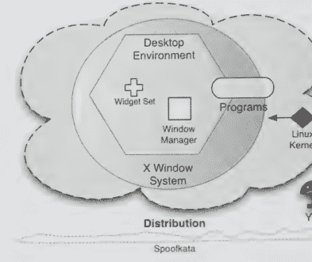

### Linux

“Linux”通常被用作整个操作系统、桌面、社区以及许多其他事物的术语。实际上，Linux 只是内核。“内核是什么？”你在问。别想到玉米，这里没有玉米。你可以把内核想象成操作系统的引擎。内核是那个在所有底层之下运行的“小引擎也能做到”（Little Engine That Could）。Linux 内核负责安全、资源分配以及最低层的硬件接口。Linux 这个名字来源于 UNIX 操作系统和一位芬兰人，林纳斯·托瓦兹（Linus Torvalds）。关于 Linux 这个名字有很多有趣的故事，但它们中的任何一个都不能帮助你上网或查看电子邮件，所以我将把这些有趣的历史留给你们自己去网上查找。

如果人们想要争论使用 Linux 一词来指代整个操作系统是否恰当，他们可能更愿意在生活中寻找更有趣的事情。语言是灵活的，而 Linux 已经成为基于 Linux 内核的操作系统的一般术语。

### 发行版 (Distro)

> *发行版：分散的行为或分散的状态；扩散。 —www.dictionary.com*

关于分布的常规定义也适用于 Linux 发行版。Linux 背后没有一个中央公司来为我们整合所有内容。开源软件程序通常是独立开发的。我知道我不想坐在电脑前收集并安装我电脑上需要的所有程序。你可能也不想这么做。因此，我们有发行版，或简称 distro。一个 Linux 发行版包含 Linux 内核、X Window 系统、安装程序以及一堆为你整理在一张整洁的小 CD（或多张 CD）上的程序，以便作为操作系统使用。发行版数量之多……让我卡壳了，试图找到适合这种情况的恰当陈词滥调。发行版比天上的星星还多？比下水道里的老鼠还多？比我烘干机里的线屑还多？比你能对着一只猴子晃手指所遇到的还多？总之，有很多发行版。盈利公司，如 Mandrake 和 Red Hat，制作了一些发行版；其他如 Debian 和 Gentoo，则是社区努力的产物。组织和个人创造了更多的发行版。每个发行版都有其优点、怪癖、支持者以及反对者。

### X

X 是 Linux 中窗口操作规范的名称；它也被称为 X 窗口系统。X 是运行你的图形用户界面（GUI）的程序。X 可以在 Linux 之外的许多操作系统上运行。许多发行版多年来一直使用 XFree86 程序。较新的发行版也开始使用 XFree86 的一个新分支，X.org。在执行日常任务时，你拥有哪个版本的 X 通常并不重要。只有当你遇到需要从命令行启动 X 窗口系统或编辑你的配置文件的问题时，你才需要知道你正在运行哪个版本的 X。

### 桌面环境

下一个重要术语是桌面环境。这是我们与你习惯的 Windows 或 Mac OS 结构产生分歧的地方。Linux 的一个酷之处是你总有选择。你的桌面环境就是你要看到的 GUI。它是所有的视觉糖衣。与其他操作系统不同，你可以在 Linux 中选择桌面环境。你可以选择简单或复杂的桌面环境。虽然两个主要环境 KDE 和 GNOME 会让你感到熟悉，因为它们与你习惯的相似，但许多其他桌面环境会给你一个更具创新性的体验。

### 窗口管理器

窗口管理器就是它的名字所暗示的那样：它控制着程序弹出的那些窗口。我不需要告诉你这一点。你很聪明。你可以猜测并弄清楚这些东西。你甚至需要知道这个术语的原因是，你同样可以在 Linux 中选择使用哪个窗口管理器。在你准备好进行更多实验之前，最好坚持使用随桌面环境提供的窗口管理器。

### 控件集 (Widget Set)

控件集是你所在的任何窗口中组成控件的一组复选框、按钮、滚动条、菜单和其他事物。让我给你一个严格的技术定义：它是你可以点击以让事物执行各种操作的东西。再次强调，你可以选择使用哪个控件集。你可以更改随桌面环境提供的默认选项，或者你可以尝试其他主题。现在你知道了一个新术语，现在你更聪明了。我们都为此感觉更好。

### Spoofkata

好吧，我编造了 spoofkata 这个词，但我可以定义我编造的词。你可能是一个邋遢的人，也可能是一个整洁的人。邋遢的人会在他们的桌面上有一层随机垃圾、食物、洒出的饮料、便条纸或纸张。那就是 spoofkata。你可能会在某些天在桌面上找不到你的鼠标。你可能不得不像你在亚马逊丛林中砍出一条小路一样，切过显示器边缘的便条纸，我不是指在线的亚马逊。我通常只有中等程度的 spoofkata，包括一个空玻璃杯和许多烧坏的 CD。在使用 Linux 时，请将这些 spoofkata 扫开，以获得最佳结果。

### 程序

你知道程序是什么。嘿，我把这个术语放进了我想要制作的那个酷酷的小图表中，所以它值得拥有一个独立的标题。

### 你

这是一种碳基生命形式，拥有可抓握的拇指（尽管我认为这并非必需），至少具备一定的逻辑推理能力来解决出现的问题，以及极佳的书本鉴赏力。你买了这本书，所以你肯定很聪明。


## 如何获取 Linux 发行版

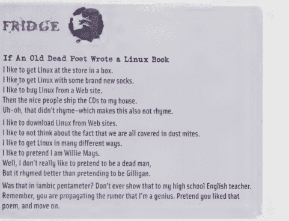

走进你当地的软件商店，你会发现许多 Windows 的副本。请无视那些。你还会看到一些仅适用于 Windows 的软件盒子。继续走。Linux 比其他操作系统更难获取，这仅仅是因为它是处于弱势地位的一方。商店并不是你唯一的选择。Linux 被一群精通电脑的人使用；他们有很聪明的方式将 Linux 分发给你。

### 去商店

你来到了软件商店，经过了所有那些带有 Windows 标志的盒子。商店的某个角落可能有一些盒装版的 Linux。Linux 在商店里还不是畅销品，所以你可能很难找到它。回头看看那些百科全书软件或墓地规划软件旁边的地方。Linux 就在那里某个角落。许多商店都备有流行发行版的副本，例如 Mandrake 和 SUSE。Red Hat 曾经是那些容易在商店里找到的品牌之一，但当该公司转向为企业发布其企业版，而将家庭版交给新的 Fedora 发行版时，这种情况发生了变化。沃尔玛也开始销售预装 Linux 的电脑。盒装发行版的价格平均在 50 到 150 美元之间，有不同级别的版本可供选择。当你购买盒装发行版时，你的钱买到的不仅仅是一个操作系统；你还得到了你所需的大多数程序。

为什么要费心购买盒装 Linux 呢？你会得到配有彩色标志的实用手册，标志贴得到处都是。谁不想要那样呢？如果你对 Linux 这个整体感觉迷茫，或者不认为自己有技术倾向，购买包含手册的包装发行版可能会有帮助。这些手册解释了非常基础的概念，例如使用菜单和移动窗口。然后它们会继续讲述如何执行某些任务。你不可避免地需要超越手册及其局限性，但这正是你读这本书的原因。购买盒装发行版的另一个绝佳理由是，你可以在经济上支持你正在使用的软件以及为你整合一切的公司的贡献。如果你不能通过编程为开源软件社区做出贡献，购买发行版就是回馈社区的一种简单方式。

### 在线购买

如果你访问许多 Linux 发行版的网站，你会看到链接，可以让你在线购买副本。就像在商店里购买一套包装好的磁盘和手册一样，在线购买 Linux 发行版给你机会在财务上支持你喜爱的发行版和开源软件。大多数时候，在线购买后，你会通过邮寄收到盒装套装。如果你不需要即时满足感，这种方法就很有效。

### 下载 CD 镜像

我提到过 Linux 是免费的吗？让我再说一遍。Linux 是免费的。你可以通过从互联网下载来获取你的 Linux 副本。除非你喜欢自我折磨，否则你需要宽带连接来下载任何发行版。虽然有可能进行网络安装，但那可能是另一种形式的自我折磨。你最好的选择是下载 CD 镜像，称为 ISO。访问任何你想要的发行版的一个很好的网站是 `http://www.distrowatch.com`。Distro Watch 提供了大多数可用发行版的描述和链接，主要发行版的前 10 名排行榜，以及价格信息，让你知道哪些是免费的，哪些是商业发行版。每个发行版的信息页面还列出了包含的流行程序版本。

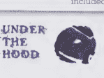

#### 加入 BitTorrent

> 很多人不知道，BitTorrent 是下载许多发行版 Linux ISO 的绝佳方式。BitTorrent 是一个点对点文件共享程序。要下载文件，你使用搜索引擎找到一个 torrent 文件，下载该指针文件，并使用 BitTorrent 软件打开该文件。BitTorrent 会找到其他共享你所需内容的用户，并以小块方式下载文件。在下载的同时，你也在共享。下载速度有点慢，但通过使用 BitTorrent，你减轻了许多大学和运营镜像站点的志愿者的流量负担。

### 使用本书中的 CD

去看看书封底的背面。那里有什么？Linux！有几个 Linux 发行版可以通过可启动 CD 运行，即 Live CD 发行版。Knoppix 和 Gnoppix 是最流行的 Live CD 版本之一。Mandrake 也有一个名为 MandrakeMove 的 Live CD 发行版。大多数人使用这些发行版是为了轻松地让任何 PC 启动进入 Linux。我以前曾用 Knoppix，在我做了些太过聪明以至于不好意思承认的事情导致电脑无法启动后，迅速上线。我只是放入 Knoppix，重新启动，并上网查找如何修复电脑。你可以使用这个发行版来试用本书中的许多程序和工具。如果你仍在考虑是否要在桌面电脑上运行 Linux，使用这张 CD 来测试一些功能。

使用 Live CD 发行版的注意事项是，你在 CD 上得到的就是所有了，不能更改桌面环境或安装软件。Live CD 的最佳用途是进行一点探索。探索之后，请大胆尝试安装完整的 Linux 发行版。

### 拦住最近一个看起来极客、穿着带有企鹅图案衣服的人，偷走他们的笔记本电脑，然后飞快地跑

嗯，不，实际上不要那样做。我想你可能会被逮捕或之类的。

### 选择哪个发行版？

你可以从许多不同的 Linux 发行版中进行选择。一些发行版成熟且稳定，而另一些则带有一定的实验性质。在选择你想从哪个 Linux 发行版开始，或者之后可能想尝试哪些发行版时，只需看看你是谁以及你需要什么。选择发行版时需要考虑的一些主要因素包括安装的难易程度、稳定性、程序的可用性、是否有足够规模的用户社区可以帮助你、你想在系统配置和软件安装上投入多少工作量，以及你自己的技术知识水平。

现在，让我们来谈谈狂热者。Linux 似乎滋生狂热者，那些对其选择的发行版有着宗教般奉献精神的人。一旦你决定了一个 Linux 发行版，这些人就会出现在你周围。许多 Linux 爱好者对任何不是他们喜欢的发行版都持有强烈的看法。你必须无视这些评论，只使用对你来说运行良好的发行版和程序。了解每个发行版的功能和工具。看看哪一个听起来最适合你。你可以在本章末尾的列表中查找这些发行版的链接。

## 发行版群像

### Debian/GNU

Debian 是一个通常被认为最适合有经验用户的发行版。它是一个“社会发行版”，意思是没有任何大公司将其整合起来。Debian 由用户社区创建和维护。Debian 存在于三种状态：unstable（不稳定）、testing（测试中）和 stable（稳定）。任何新软件包都会进入 unstable，然后按顺序移动到链条中的下一个状态。

- **安装**：Debian 以拥有相对晦涩难懂的安装过程而闻名。安装基于文本，面向自信且有经验的用户。新的安装程序承诺会稍微友好一些，并为害怕文本的用户提供 GUI 选项。
- **优点**：Apt，一个出色的安装工具，是在 Debian 上开发的，对于安装新软件绝对是一个加分项。将发行版保持在三种状态的系统是处理新程序添加的智能方式之一。
- **缺点**：安装程序并没有安装大多数人所需的一切。安装后，你需要使用 Apt 添加大多数你想要的软件。unstable、testing 和 stable 方案并没有提供我们作为计算机和互联网用户习惯的即时满足感。稳定版本对于寻找最新程序版本的人来说可能显得过时。
- **获取方式**：下载 ISO 或从 Debian 网站上的供应商列表购买。
- **成本**：免费下载；CD 成本最低，平均约 20 美元。

### Fedora

2003 年，Red Hat 将其发行版分为家庭（或业余爱好者）版 Fedora 和专业发行版 Red Hat Enterprise。其理念是 Fedora 将成为新版本的试验田。Red Hat 借用了现有发行版 Fedora 的名称，并与其开发人员的努力合并。Fedora Core 1 基本上是 Red Hat 10，进一步的开发在此基础上继续。

- **安装**：我认为 Fedora 现在可以与 Mandrake 竞争作为最简单的安装程序。Anaconda 安装程序简化了每个问题，同时仍允许高级用户自定义安装的许多方面。帮助菜单始终可见。
- **优点**：Red Hat，以及现在的 Fedora，是较为普遍的 Linux 发行版之一。享受这种流行度可能使查找 Fedora 的帮助或查找软件包变得相当容易。现在有一个 Debian 出色的 APT 工具针对 RPM（打包程序）的移植版本，因此 Fedora 可以使用 APT 或 Yum（两者都是类似的方便工具，用于更新）。Fedora 还使用 Red Hat Network 进行更新。许多系统工具都有易于使用的 GUI 前端，这将吸引新用户以及经验丰富的用户，他们


时不时地忘记一些命令。有一群开发人员正在开发一个适用于 Mac 的 PPC（苹果电脑中处理器类型）版本的 Fedora。

缺点：
- 许多人不满红帽公司（Red Hat）对 Fedora 的接管，至今仍有怨言。
- 还有传闻称红帽正在控制 Fedora 的大量开发工作，而未给予其曾承诺的社区输入空间。
- Mandrake 将许多任务自动化，而 Fedora 用户则需要手动完成这些任务。

可用性：
- Fedora 提供 ISO 镜像供镜像站下载。
- 红帽的企业版（包含支持服务）可从红帽公司购买。

费用：
- 下载免费。
- 红帽提供多种价格档位。

### Gentoo

这是流行 Linux 发行版中较新的选择之一。Gentoo 可在 PC 或 Mac 上运行。Gentoo 之所以灵活，是因为它不是基于软件包的；大多数程序必须在你自己的机器上编译。该发行版是另一个由用户社区运营的社交型发行版。

安装：
- 你有一些空闲时间吗？那么 Gentoo 就是为你准备的。
- 安装过程是基于文本的，可以说最适合高级用户。
- 安装过程非常漫长，因为 Gentoo 在安装时会编译程序。
- 有三种安装选项，每种都需要一个 Gentoo LiveCD，范围从高度可定制到仅基础系统不等。

优点：
- Gentoo 的 Portage 软件分发系统对于那些想要最新版本的桌面环境等难以自行更新的用户来说非常棒。
- Gentoo 运行效率高，因为它为你的系统进行了定制。

缺点：
- 我提到时间了吗？让我再说一遍：时间。不仅在安装时需要，系统更新也需要时间，且最好在夜间进行。
- 甚至我认识的那些运行 Gentoo 的最极客的朋友也在谈论要切换到不需要等待的系统。
- 你还需要了解你的命令，因为 GUI 工具不多。

可用性：
- 下载三种 LiveCD 版本之一。

费用：
- 免费。

### Linspire

Linspire 以前被称为 Lindows，直到微软就名称问题对其提起诉讼。Linspire 可能是开箱即用的最佳发行版。多媒体插件和模拟软件已预装。

安装：
- 在那些预装了 Linspire 的 PC 上购买，那就没有什么需要担心的了。
- 如果你单独购买该发行版，安装过程顺畅，新手用户在无需太多协助的情况下也能完成。

优点：
- Linspire 是一个商业发行版，就像其他商业操作系统一样，它是一个组装得很好的系统。
- 许多工具和菜单看起来与 Windows 等效工具相似。
- CrossOver Office（一款用于运行 Windows 软件的流行程序）随 Linspire 一起提供。
- 这是一个适合让我妈妈使用且无需太多担心的发行版——不过你得先认识一下我妈妈。

缺点：
- 在谈论计算机软件时，费用本不应是缺点，但在 Linux 世界中，Linspire 的费用可能会让一些用户感到不满。
- 与其他商业操作系统一样，你需要等待公司发布更新，而且在网上找不到许多编译好的软件包。
- 如果你喜欢公司支持，确实有，但你没有多少其他用户可以求助。

可用性：
- 从 Linspire 的在线商店或沃尔玛的 PC 上购买该发行版。

费用：
- 不同版本的价格从 49 美元到 149 美元不等。

### Mandrake

Mandrake 已经存在一段时间了，像许多主要发行版一样，它拥有好的和坏的声誉。在好的一面，它是向新用户最推荐的发行版，因为 Mandrake 一直专注于易用性，拥有许多工具和向导。在坏的一面，一些用户不喜欢某些工具和向导的工作方式。

安装：
- Mandrake 的安装轻而易举。所有步骤都在逐屏设置中完成。
- 用户甚至可以想象只需对所有默认选项选择“下一步”就能顺利完成。

优点：
- 对于新的 Mandrake 用户来说，外面有很多用户和帮助资源。
- 用户还可以使用 Mandrake Cooker 中的程序，这是一个仍在开发中的新程序的仓库。
- 在其他发行版中可能很痛苦的功能，在 Mandrake 控制中心中则毫不费力。
- Mandrake 也有适用于 Mac 的版本。

缺点：
- 发布版本往往具有创新性，包含所有最新版本的软件，但这些最新版本可能导致存在缺陷的发布。
- 设备配置可能会令人困惑，但在许多发行版中都是如此。
- 请注意 Cooker 软件包；来自 Mandrake Cooker 的软件有时不稳定。

可用性：
- 下载、在线购买光盘、订购光盘或零售购买。

费用：
- 购买光盘平均价格为 49–229 美元。
- 如果你下载，Mandrake 请求捐赠并加入 Mandrakelinux 用户俱乐部。

### Slackware

Slackware 是 Linux 界的“爷爷级”发行版，自 1992 年以来一直存在。就像爷爷一样，Slackware 不想要你那些新颖的 GUI 和工具。这个发行版不得不费力地在 Linux 之路上双向攀爬，你也应该如此。

安装：
- 安装是基于文本的，面向经验丰富的用户。
- 你只需要看看 Slackware 的安装 FAQ，就能看到关于安装的问题级别。

可用性：
- 从镜像站点下载镜像，或从 Slackware 的在线商店购买磁盘。

费用：
- 下载免费，从在线商店购买价格为 39.95 美元。

### Sun Java 桌面系统

Sun 的 JDS 初始版本被标记为面向企业用户的企业版。JDS 仅使用 GNOME，并包含你在任何发行版中都会预期的大部分功能。与其他商业 Linux 发行版一样，JDS 拥有大量在其他发行版中发现的开源软件，但它用徽标和主题对程序进行品牌化，使所有颜色都匹配。一个区别在于 Java 运行时环境的包含：一些标准应用程序和附件，如文本编辑器和媒体播放器，是 Java 应用程序。

安装：
- Sun JDS 使用 SUSE 的 YaST 安装程序的一个变体，因此安装顺畅，不会给用户带来任何难题。

优点：
- 这个发行版中的每样东西看起来都很不错，并且搭配得很好。
- 包含 Sun 的 Star Office；在其他发行版中需要单独购买。
- 集成的 Java 运行时环境和 Java Studio Standard 开发工具使其成为 Java 开发人员的极佳发行版。

缺点：
- 如果你想尝试 GNOME 以外的任何桌面环境，如 KDE 或 Enlightenment，你将面临一些障碍。
- 未包含或易于安装模拟软件。
- 与运行在相同硬件上的其他发行版相比，JDS 似乎运行缓慢。

可用性：
- 必须通过 Sun 购买。

费用：
- 许可面向企业：每台桌面每年 100 美元，或公司整体购买时每名员工每年 50 美元。

### SUSE

SUSE 是另一个已经存在了一段时间的发行版。用户数量众多，但社区不像其他几个发行版那样庞大。2003 年，由于 Fedora 转型引发的不满，一些红帽用户转而使用 SUSE，社区因此增长。

安装：
- SUSE 的 YaST2（Yet Another Setup Tool，另一个设置工具）安装程序真的很轻松，与 Fedora 或 Mandrake 的安装相当。
- 关于更复杂方面的争论也可以提出，但听那些争论听起来像是在挑剔。
- 它至少和 Windows 安装一样容易。

优点：
- 由于最近被 Novell 收购，SUSE 应该比过去更容易获取。
- 该发行版基于 RPM，也可以使用 APT。
- 没有什么能阻碍 SUSE 被视为与 Fedora 和 Mandrake 同等适合新用户的级别。
- 此外，你的桌面上所有东西默认都是绿色主题的——谁不喜欢呢？每次登录都像是被一片新鲜的叶垫迎面拍打。

缺点：
- 发布频率传统上较低，但希望这可以改变。
- 一些工具和实用程序比其他发行版的使用稍微困难一些。
- 使用 SUSE 的人较少，因此编译好的软件包和来自在线来源的帮助可能不如 Fedora 和 Mandrake 那样容易获得。


**获取方式：** 可以下载 ISO 镜像，也可以在线从 SUSE 购买光盘。还可以从第三方供应商处购买盒装版本。

**成本：** 镜像免费下载，光盘价格为 29–89 美元。

### Xandros

Xandros 最初是一个商业发行版，但现在有一个免费的、受广告支持的有限版本可供下载。这个发行版是一个相对较新的参与者（尽管其基础开发源自于旧的 Corel Linux），并因其良好的易用性而获得了一定的知名度和媒体报道。

**安装：** 安装过程轻而易举，提供图形用户界面（GUI）屏幕，并为您提供大量选项建议。

**优点：** 与 Linspire 类似，Xandros 开箱即用。该发行版通过一系列紧密集成的稳定工具，展示了其投入的努力。

**缺点：** 包含的应用程序数量有限。一些专有程序意味着，如果您希望更新这些程序，就必须等待该公司的下一个版本。Linux 用户通常习惯于拥有比这更大的灵活性。唯一的免费版本是受广告支持的。支持更多来自该公司，而非来自其他用户。

**获取方式：** 从 Xandros 下载或购买。

**成本：** 免费的受广告支持下载版本，或商业版本 49–99 美元。

### Yellow Dog

多年来，Yellow Dog 是在 Mac 上运行 Linux 的经典选择。这个发行版并没有太多创新。Yellow Dog 本质上是最后可用 Fedora 版本的直接移植，并加入了一些自己的约定和工具。

**安装：** Yellow Dog 使用 Fedora 的 Anaconda 安装器，因此安装与 Fedora 一样简单。安装器还始终牢记 Apple 用户的核心概念，提供了丰富的 Apple 硬件选项。

**优点：** Yellow Dog 基于 RPM，并且提供 Apt 和 Yum 版本（更新工具）。许多实用工具是 Fedora 的移植版本，因此您会发现许多来自用户的在线帮助都适用于这两个发行版。该公司还维护着一个良好的支持邮件列表及存档。

**缺点：** 只要您在 PPC 架构上运行 Linux，您就会在寻找编译好的软件包时遇到更多困难。虽然提供 Apt 和 Yum，但您仅限于几个软件源。一些工具在 Fedora 上感觉稍微有些笨拙，但工具都存在且可用。

**获取方式：** Yellow Dog 在镜像站点提供 ISO 镜像下载，并出售光盘。还可以从第三方供应商处购买盒装版本。

**成本：** ISO 免费下载，光盘价格为 25–85 美元，具体取决于您想要的版本。

在本书的其余部分，我专注于 Fedora（Core 2）和 Mandrake（10.0）。我认为，对于 Linux 新手而言，这两个发行版是最容易安装、配置和使用的。此外，寻找已经为它们编译好的软件包也非常容易。当您熟悉 Linux 世界的一些约定之后，就是您去探索的时候。在 Mandrake 和 Fedora 中，您会发现不同发行版之间的桌面环境和使用的程序大多相同。安装程序和系统工具有所不同。

值得特别提及的是 Linux 用户中接下来最流行的选择：SUSE（见图 1.2）。SUSE 是另一个对新手非常友好的发行版，特别是那些从 Windows 转过来的用户。工具和系统工具排列合理，菜单中易于查找。该发行版基于 RPM，使得新用户安装新软件变得简单。如果您选择购买盒装版本的 Linux，SUSE 附带了一些最好、最完整的说明书。

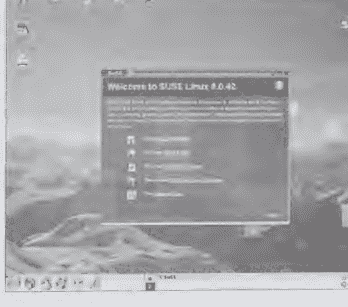

**图 1.2** SUSE 首次登录后的桌面。

在发行版领域，另一个值得特别提及的较新选择是 Gentoo。Gentoo 是一个安装过程比糟糕的电视迷你剧还漫长的发行版，但其操作系统和程序都是为您机器编译的。Gentoo 拥有活跃的用户社区，他们对他们的发行版有着狂热的忠诚。稍后，如果您开始觉得已经耗尽了 Linux 的挑战，Gentoo 可能是一个值得把玩的有趣玩具。

**请我买单**

*HP 现在已经发布了一款运行 SUSE 的原生 Linux 笔记本电脑。笔记本电脑在设置 Linux 时以复杂著称，因为它们有特殊的微小按钮和奇异的硬件。拥有原生 Linux 笔记本电脑，HP 会为您处理所有这些麻烦。*

## 深入内部

现在有众多 Linux 发行版，其中大多数提供相似的功能集。有耐心的新用户甚至能搞定技术含量最高的发行版。当前桌面 Linux 与两年前桌面 Linux 之间的差异令人惊讶。每个主要发行版都为其他发行版的新版本贡献了创新。这就是 Linux 的特征和力量：分享新想法以惠及所有人，并为用户呈现选择。

此刻，你是新手。你得选点什么。Fedora 和 Mandrake 简化了安装、选项、工具和实用程序，使其非常用户友好。您甚至可能发现这些发行版中的某些事情比您旧操作系统中的更容易。我们将继续使用 Fedora 和 Mandrake 前进。在探索这两个发行版时，您可以学习 Linux 的大多数基本概念，这将使尝试新发行版变得轻松无痛。

## 烧录光盘镜像

如果您从互联网下载了磁盘镜像文件，您需要创建安装光盘。如果您购买 Linux 发行版或使用 Live CD 版本试用 Linux，则无需烧录任何光盘。

当您下载 Linux 发行版时，您需要知道如何处理现在位于计算机上的那些大文件。您下载的那些文件是磁盘镜像，通常是 ISO。ISO 包含创建光盘所需的所有文件。您可能有三个或四个这样的大文件。大多数 Linux 发行版是多光盘套装。每个下载的磁盘镜像可能都大于 600MB。取决于您当前的操作系统，ISO 文件可能看起来像归档文件。不要像往常一样解包归档并烧录光盘；烧录磁盘镜像与烧录数据或音乐光盘不同。

Fedora 现在也提供该发行版的 DVD 版本下载。使用 DVD 磁盘镜像，您需要烧录的光盘更少。如果您有 DVD 刻录机并且喜欢玩新玩具，不妨试一试。在 Windows 中，烧录 DVD 镜像的步骤可能因软件而异。对于任何使用磁盘工具（Disk Utility）的人，在 Mac OS X 中烧录 DVD 磁盘镜像的步骤是相同的。

### 在 Windows 中烧录磁盘镜像

Windows 中大多数常见的 CD 烧录程序在主窗口中都有一个选项，写着类似“Burn Disk Image”（烧录磁盘镜像）的内容。如果您的程序有该选项，您就准备好了。

您可以找到许多适用于 Windows 的 CD 烧录软件，其中大多数都有一个帮助菜单，可以指引您方向。

### 在 Mac OS X 中烧录磁盘镜像

虽然 OS X 使烧录音乐和数据光盘变得非常简单，但烧录镜像要复杂一些。您可以获得一些用于在 Mac 上烧录光盘的第三方应用程序。其中一些程序通过将所有需要的命令和实用程序集中在一个地方，使这项工作稍微容易一些。如果您获取了其中一个程序，只需按照软件附带的说明操作即可。

如果您想通过 OS X 烧录磁盘镜像，您需要打开磁盘工具（Disk Utility）。从 Finder 窗口中，只需将每个下载的磁盘镜像文件拖到磁盘工具左列。然后工具栏上的烧录按钮应该可用。您可以插入一张空白 CD 或 DVD，然后选择 *Burn*（烧录）。

# 双启动

## 什么是双启动？

双启动是通常用于在相同计算机上安装两个独立操作系统的术语。您可以将单个驱动器分区，每个分区安装一个操作系统；或者为每个操作系统使用一个硬盘；或者将系统分散在几个驱动器中。例如，您可以双启动 Linux 和 Windows，或者 Linux 和 Mac OS。

双启动的工作原理如下。您的硬盘上有一个称为主引导记录（MBR）的东西。主引导记录位于硬盘的第一个扇区。该记录包含您的分区表以及识别操作系统在哪里以及如何启动的信息。通常，对于单个操作系统，MBR 直接进入您硬盘上的操作系统。然而，当进行双启动时，MBR 首先会访问一个名为引导加载器（boot loader）的程序。引导加载器为您提供一个选择菜单，让您选择要启动硬盘上的哪个操作系统。如果您没有做出选择，默认选择将在设定的秒数后自动选中。操作系统的标签、哪个是默认选项以及等待多少秒都是可配置的。

## 为什么要双启动？

世界上大部分其他人正在使用其他操作系统，主要是 Windows 和 Mac OS。那些人会向您发送文件，设计网站，


提供多媒体内容、编写软件，以及在考虑大多数其他事情时，脑海中都想着那两种更流行的操作系统。Linux 可以处理其中大部分任务，但有时你可能需要使用 Windows 或 Macintosh。你可能会收到一份办公文档，其格式在 Linux 中打开时看起来怪怪的。你可能会访问一个拥有大量多媒体内容的网站，而这些内容在 Linux 上运行起来实在太麻烦，不值得花费那几秒钟的时间去折腾。你可能有着根深蒂固的需求，想要玩最新的第一人称射击游戏，而该游戏无法在 Linux 上运行。你可能希望平稳地过渡到你的新操作系统。经过我刚才给出的所有这些重复性句子，你或许已经明白其中的要点了。

## 引导加载程序

当你双系统启动时，引导加载程序是一个在启动过程中充当“休息站”的程序，让你选择要启动计算机中的哪个操作系统。Linux 最常用的引导加载程序是 GRUB、LILo 和 Yaboot。

GRUB 和 LILo 运行在 PC 上。LILo 是较早期的选择，但 GRUB 正迅速取代 LILo 成为最佳引导加载程序选择。GRUB 是较新的软件，修复了之前在 LILo 中遇到的一些问题。Mandrake 在 10.0 版本中仍默认使用 LILo，但你可以切换到“摘要”屏幕中选择使用 GRUB。如果你没有在 Mandrake 中将引导加载程序从 LILo 切换到 GRUB，也不会发生什么坏事。对于大多数用户来说，选择 LILo 或 GRUB 不会有太大区别。

Yaboot 几乎是你唯一能在 Apple 机器上运行的引导加载程序选择。Yaboot 绝对是可靠且经过测试的引导加载程序，已经存在了一段时间。Yaboot 仅支持文本模式，当你看到它以小字体显示在屏幕左上角时，可能会觉得有点奇怪。Yaboot 是一个极简主义的引导加载程序，没有图形用户界面（GUI）或过多的花哨功能。

### 与 Windows 双系统启动的步骤

- 1. **查看你目前的情况。** Windows 是否已安装，还是可以从头开始？最好的计划是从头开始。如果你之前有 Windows 安装，且里面有程序和你喜欢到舍不得备份和重新安装的数据，你就不得不尝试调整 Windows 分区的大小。这是更困难的选择。
- 2. **备份所有内容。** 如果你不是那种定期备份数据的人，现在就开始吧。硬盘可能会崩溃。电源线可能会浪涌。计算机会丢失东西。特别是开始此过程之前，务必备份 Windows 中的任何数据。
- 3. **规划分区。** 如果你需要调整 Windows 分区的大小，有两个选择：一个是名为 Partition Magic 的商业程序，另一个是名为 FIPS 的 DOS 程序。（FIPS 有很多限制；你真的应该尝试使用 Partition Magic。）两个网址都在本章末尾的“链接”部分中。*在调整大小之前，始终要对 Windows 分区进行磁盘碎片整理。* 为了在分区之间共享文件，一个好主意是创建一个第三分区作为数据分区。有关更多细节，请参阅本章稍后的“在操作系统分区之间共享文件”。*请记住，至少给 Linux 分配 5GB，这样你才有空间进行折腾。*
- 4. **先安装 Windows。** Windows 喜欢处于控制地位。安装过程中，Windows 会接管主引导记录（Master Boot Record），没有其他选择。如果你正在安装 XP 或 Windows 2000，请使用安装选项将 Windows 放在一个分区上，并将预留给 Linux 的空间保持为空闲空间。安装 Windows 95 或 98 时，使用 fdisk（通常可在 Windows 启动软盘上找到的 DOS 实用程序）来创建用于 Windows 的分区，并将驱动器其余部分保留为空闲空间。
- 5. **开始安装 Linux。** 请参阅下文安装部分了解详细情况。在安装界面移动过程中，注意分区所在的设备；将其记录下来，以防任何操作系统分区未被正确检测（例如，Windows 在 `/dev/hda1`，Linux 根分区在 `/dev/hda3`）。
- 6. **设置引导加载程序。** 这是在安装过程中完成的。无论你使用 GRUB 还是 LILO，请按照说明设置标签和默认启动的操作系统。选项会自动为你检测，但如果遗漏了某些内容，你可以添加或编辑。

> NTFS 分区，*但选项相对较新，有点 bug，且操作体验并不太友好。如果你计划进行大量文件共享，请给自己省点烦恼，使用 Fat32 格式化 Windows 分区。*

## 备份你的人生

我总是惊讶于这么多有经验的计算机用户不经常备份他们的数据和文件。我可能有点像个备份狂魔，但这只是因为我深知，今天你拥有所有文件，明天硬盘就可能变得不可访问，这有多么容易。

我所有东西都是数字化的。我把所有音乐 CD 都刻录成了数字文件。我在线支付账单。我现在甚至不知道便签纸是什么了。所有家庭照片都扫描了。我在网站上通过博客记录生活中的事件。我觉得我连狗可能都是数字化的。越来越多地，我们将整个生活的文档转移到了计算机上。这些东西难道不值得备份吗？

整个过程在每个月初只需花费你十五分钟。只需将你珍视的所有东西复制到可重写 CD、Zip 盘、CDR、家里另一台计算机、在线服务或任何其他你可以使用的存储介质上。

## 与 Mac OS 双系统启动的步骤

- 1. **备份所有内容**。如果你不是那种定期备份数据的人，现在就开始吧。硬盘可能会崩溃。电源线可能会浪涌。计算机会丢失东西。特别是开始此过程之前，务必备份 Mac OS 中的任何数据。
- 2. **规划分区**。如果 Mac OS 已经安装，它将不得不重新安装。没有简单的方法来调整现有的 Mac 分区。在你进行 Mac OS 安装时，会出现一个创建分区的屏幕。将预留给 Linux 的空间仅保留为空闲空间。如果可能，请记住至少给 Linux 分配 5GB，这样你才有空间进行折腾。
- 3. **先安装 Mac OS**。与 Windows 一样，Mac OS 并不期望与其他操作系统共享你，所以没有像引导加载程序这样的选项。Mac OS 会接管 MBR（主引导记录）。
- 4. **开始安装 Linux**。请参阅下文安装部分了解详细情况。在安装界面移动过程中，注意分区所在的设备；将它们记录下来，以防任何操作系统分区未被正确检测（例如，Mac OS 在 /dev/hda1，Linux 根分区在 /dev/hda3）。

## CD 启动

你的计算机可能没有设置为从 CD 启动。如果没有，在 PC 上，你需要进入 BIOS 更改启动设备顺序。在大多数系统中，你按 Delete、F1 或 F2 键进入 BIOS（只需查看屏幕上的提示，看应该按哪个键）。按照 BIOS 中的说明找到启动设备部分，确保你的 CD-ROM 驱动器在硬盘之前启动。在较新的 Apple 硬件上，你只需按住 C 键即可从 CD 启动。

- 5. **设置引导加载程序**。名为 Yaboot 的程序是你引导加载程序最可能的选项。按照说明设置标签和默认启动的操作系统。选项会自动为你检测，但如果遗漏了某些内容，你可以添加或编辑。

## 在操作系统分区之间共享文件

当你的系统双启动时，能够从 Linux 内部访问其他分区上的文件可能很有帮助。不过，这是一条单行道。Linux 可以看到 Windows 分区，但 Windows 看不到 Linux 分区。我觉得在那里有些否认心理在作祟。

将 Windows 分区与 Linux 共享并不是一个干净利落的做事方式。挂载 Windows 分区以便你的普通用户账户可以写入，这很让人头疼。此外，当将 Windows 分区挂载为可写时，你冒着删除或移动 Windows 所需文件的风险。在与 Windows 分区共享文件时，你需要清楚自己在做什么，并始终保留备份。

在 Linux 与 Windows 或 Mac OSX 之间共享文件的更干净方式是，在你的系统上拥有第三个（你可以将其视为中间）分区，用作共享空间。大小取决于你想做什么。我在两个操作系统之间共享我有 5GB 的 MP3 音乐。确定你需要用于想要共享的数据的空间大小，然后创建该分区。

如果你在一台 Mac 上运行 Linux，从 Linux 查看 MacOS 分区的选项对新用户来说有点复杂。既能读取又能写入你的 Mac 分区的选项甚至更不稳定。尽管 OS X 是基于 UNIX 的，但这两个操作系统和文件系统并不能很好地协同工作。请在线上密切关注。在 Linux 社区中，每个问题最终都会得到解决。

## 一些安装笔记

Mandrake 和 Fedora 的安装很简单。你只需从第一张安装 CD 启动，回答关于你的系统和偏好设置的许多问题，做一些选择，然后等待，看着进度条流逝。

你可能会对安装任何操作系统感到有点紧张。别担心。只要你已经备份了你可能需要的任何数据，你就没什么搞砸的余地。如果你觉得你搞砸了，只需重新开始：不会造成任何伤害。你看着这一部分可能会感到...

## 图形化安装程序

在 Mandrake 和 Fedora 中，默认使用*图形化安装程序*。虽然也有纯文本安装选项，但除非在诸如*检测*视频卡等方面出现问题，否则你很可能不需要使用它们。总体而言，使用图形化安装程序比你第一次踢那个小男孩、把他打倒、抢走他的午餐钱并嘲笑他时要轻松得多——尽管那可能只是我个人的行为。

图形化安装程序由布局简洁的选择界面组成，每个界面底部都有一个*下一步*按钮。Fedora 的安装程序称为 Anaconda。Mandrake 的安装程序称为*DrakX*。*Fedora* 和 *Mandrake* 在每个界面中都提供帮助选项。其他发行版，如 SUSE 和 Yellow Dog，也使用图形化安装程序。如果你正在安装这些其他发行版，你会发现这些界面简单易用，且布局与 Fedora 和 Mandrake 使用的类似。

> **写下来**
> 在启动 Linux 安装程序之前，你应该记录下你的视频卡和显示器的品牌和型号。将信息写下来，以防安装程序中的自动*检测*功能未能正确识别这些设备。

当你浏览安装程序中的各个选项时，只需仔细*阅读*每个部分，确保不要在不该选择默认值时盲目选择。如果你对某些术语不熟悉或感到困惑，请查阅帮助部分。接下来，我将对你将遇到的大多数步骤进行一般性描述。

恐惧感又回来了。如果你对我解释的任何选择不确定，请选择默认值。Mandrake 和 Fedora 都有很好的默认选择，让你可以几乎无心地自动完成各个界面。在本书后面的章节中，你将了解额外的软件、选项和技能，这些将帮助你添加所需的一切。

现在，插入你正在安装的 Linux 发行版的第一张安装 CD。浏览所有选项。如果你对某个步骤有疑问，请将本节作为安装主题参考。关于 Mandrake 和 Fedora 常见的不同安装步骤，请参考以下子主题以获取更多信息。

## 纯文本安装程序与既定命运

如果你的视频卡未被正确检测，你可能不得不使用纯文本安装程序。也许你只是讨厌漂亮的颜色和精美的*图形*。也许詹姆斯·K·波尔克（我们的第 11 任总统）的复仇幽灵来访了，回来纠缠你，因为他真的怨恨你对现代计算机的使用。别笑。那真的发生在我身上。

使用文本安装程序可能令人望而生畏，但你经历的步骤与使用 GUI 安装程序的步骤大致相同。要在 Fedora 中访问纯文本安装程序，请在首次启动安装磁盘时的提示符处输入“Linux text”。在 Mandrake 中，按 F1 键以使用文本安装选项。


> **归咎于谁**
> 我喜欢归咎于人。我将我对詹姆斯·K·波尔克的喜爱归咎于*They Might Be Giants*乐队及其专辑*Factory Showroom*。他们可能也让波尔克总统对计算机产生了兴趣。你知道吗，稍后当你不在读这本书时，去听听那首歌。

## 检查安装介质

Fedora 目前拥有但 Mandrake 没有的一个步骤是检查安装介质的选项。这个选项可能非常有用。为什么会有这个选项？如果你不太确定所使用的 CD 的质量，或者如果你曾将 CD 当作忍者手里针对向朋友投掷——仔细想想，其他人可能不会那样做——你会很讨厌在安装过程接近尾声时才发现第 3 张光盘损坏，导致无法完成安装。

要使用此选项，请选择“确定”。系统会要求依次放入每张磁盘。然后 Fedora 会检查每张 CD，以验证磁盘是否存在表面缺陷。使用“检查安装介质”选项可以为你节省大量时间和精力，避免你在完成大部分安装后看到错误。如果你相当确信你的磁盘是好的，请选择“跳过”。

人们总是这么说，Linux 可以在任何东西上运行。虽然我还没试过在烤面包机上运行 Linux，但这个陈词滥调往往属实。然而，在你*把那台古老的 1995*


年电脑从衣柜里拿出来安装 Linux 之前，你应该知道一些事情。使用 Linux 桌面和 X 窗口系统需要大量内存和相当快的处理器。当你听到这些人说 Linux 在任何东西上都能运行时，他们的意思是在没有 GUI 的情况下运行 Linux，仅使用命令行。如果你想要的不仅仅是命令行，请在较新的计算机上安装 Linux。

### 显而易见的选择

我猜测你在确定所说的语言、使用的键盘语言类型或所在时区方面不会有任何麻烦。不过，你仍会被问到这些问题，所以要做好准备并研究一下。这会在中期考试中。

### 硬件选择与兼容性

Mandrake 和 Fedora 都试图自动检测你的大多数硬件。当安装程序启动时，你的视频硬件会被检测。安装程序会推测你的鼠标和键盘，然后在一个选项列表中显示给你。如果你对检测到的内容满意，请继续下一步。当安装程序无法确定你使用的输入设备时，会选择一个通用选项。你可以通过滚动列表将选择更改为你特定的输入设备。

你可能不熟悉的一个选项是模拟三键鼠标。在 Linux 的许多桌面环境和程序中，中间鼠标按钮被分配了功能。X 中的默认功能是使用中间鼠标按钮粘贴剪贴板的内容。如果你没有中间鼠标按钮或滚轮，或者你使用的笔记本电脑没有中间鼠标按钮，请使用模拟三键鼠标的选项。然后你可以同时按下左右鼠标按钮来执行任何中间鼠标按钮的功能。

如果安装程序无法确定你正在使用哪个显示器，它会分配一个通用选项，即“未探测的显示器”。你可以选择其中一个通用选项，或尝试在列表中找到你的显示器。

### 选择安装类型

Mandrake 和 Fedora 通过按任务类型或计算机预期用途对所有程序进行分类，简化了选择要安装哪些程序的步骤。最佳实践是现在安装更多程序。反正你都要坐在那里等待所有这些内容安装——为什么不多加几分钟呢？放入任何看起来相关的内容。你以后可以随时清理掉不需要的。

### Mandrake 软件包组

首先，Mandrake 会询问你希望执行“推荐安装”还是“专家安装”。如果你觉得让别人为你做某些选择没问题，请允许“推荐安装”。不会发生任何坏事，而且如果你是这方面的新手，这是最佳选择。

在安装过程的稍后阶段，Mandrake 会提供若干程序类别供你选择（见图 1.3）。你可以查看“单独软件包选择”选项以了解每个类别包含的内容。大多数类别都是不言自明的，但其他一些可能需要更多解释。将鼠标悬停在每个选项上以查看简要说明。

- **办公工作站。** 此组包含办公套件软件、文字处理能力、电子表格等。OpenOffice.org 是默认选择。你可能想稍后添加并尝试其他选项。
- **游戏站。** 此组中有几个免费的 Linux 游戏选项。CD 上大多数游戏默认不包含在此类别中。还有更多游戏可以添加和游玩，比该组中自带的要多。
- **多媒体站。** 包括用于播放电影文件和音乐的软件。图像查看和编辑程序也在这里，还有用于数码相机的工具。
- **互联网站。** 此类别包含浏览器、电子邮件客户端、新闻组客户端以及即时消息和聊天功能。Web 开发程序也在此类别中，但默认未选中。
- **网络计算机（客户端）。** 此组中允许你查看局域网中其他计算机和打印机的软件。
- **配置。** 这里有一些额外的工具，允许你调整各种设置。你可能不需要其中的大多数。
- **控制台工具。** 选择此类别时，将添加将在控制台中运行的纯文本程序。大多数在控制台中运行的重要纯文本程序默认在基础安装中已安装，无需选择此选项。这些程序是具有独特用途的额外内容。
- **开发。** 此组很重要，包含软件开发工具和编译器。尽管如果你不是程序员，可能不需要所有这些，但如果你从源代码安装任何软件，就需要编译器。包含此项是个好主意。
- **文档。** 这些是帮助文档。你是新来的。添加这些。即使文档版本滞后（这经常发生），它们也提供了令人兴奋、扣人心弦的阅读体验。


## Mandrake 软件包组

LSB（Linux 标准基）。Linux 标准基项目旨在帮助标准化不同 Linux 发行版的某些方面，使软件制造商能够使用该标准编写可在任何兼容 Linux 系统上运行的软件。这是一件好事。请添加它。

Web/FTP。如果你正在电脑上运行 Web 服务器或 FTP 服务器，请添加此组。Web 语言编程包（如 PHP）包含在此处。

Mail（邮件）。正如标题所示，这个组包含了运行邮件服务器所需的所有组件。

### 图 1.3 Mandrake 的软件包组选择屏幕

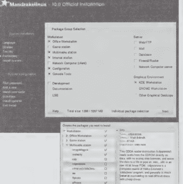

Database（数据库）。这个组包含了许多数据库服务器程序，例如 MySQL 和 PostgreSQL。

Firewall/Router（防火墙/路由器）。如果你的电脑在网络中充当互联网网关，请添加这些程序工具。这不是用于配置你电脑自身防火墙的选项。你将在安装过程的稍后阶段配置它。

Network Computer Server（网络计算机服务器）。网络域服务器的软件工具包含在此选项中。该组还包含用于将电脑上的文件与网络中其他电脑共享的程序和实用工具。如果你计划与网络上的 Windows 或 Mac 电脑共享文件，请添加此项。Mandrake 在安装某些服务器时会发出警告，提示这些服务器可能会带来潜在的安全问题。这个警告功能很好，能让你意识到这种轻微的风险。

KDE 工作站。KDE 是 Mandrake 的默认桌面环境。请添加此项。

GNOME 工作站。GNOME 是另一个最流行的桌面环境。我建议你同时尝试添加 KDE 和 GNOME。你可以稍后决定哪一个最适合你。

其他图形桌面。在这里你可以添加极简的桌面环境，如 WindowMaker 和 IceWM，或者实验性的环境，如 Enlightenment。如果磁盘空间对你来说不是问题，不妨为了好玩把它们全部装进去。

## Fedora 安装类型

Fedora 的 Anaconda 安装器中的安装类型接近安装过程的开始阶段。你只需从四种类型中选择，而不是从许多更具体的类别中挑选。如果这些选项中的软件包配置不符合你的需求，你可以稍后添加或删除程序。

个人桌面。此选项提供的程序最少。如果你确定不想安装许多新程序，请选择此项。如果你只使用电脑进行在线浏览、偶尔查看文本文档和收发电子邮件，这可能适合你。

工作站。工作站类型包含了“个人桌面”选项中的所有程序，外加一些额外内容。其中还包含了软件开发包。你可能认为不需要开发包，但我还是建议安装。你永远不知道什么时候会需要这些软件包。当需要从源代码编译代码来安装程序时，就会用到软件开发包。额外的软件包不需要占用太多空间，而且拥有它们绝对没有坏处。我认为这是覆盖最大用户群体及其潜在需求的最佳选择。

服务器。如果你想运行服务器，这就是你的选择。如果你仍打算将机器用于个人桌面功能，我建议你先安装“工作站”类型，然后稍后通过软件包管理器添加你需要的服务器软件包。

自定义。如果你是初学者，选择此项需自担风险。虽然安装程序不会让你移除其他软件包所依赖的软件包，但你仍然可能因取消勾选某个复选框而意外缺失 KDE 或 GNOME，或者缺失任何办公软件。

## 磁盘分区

对磁盘进行分区时，你将其划分为若干部分。Linux 要求你创建几个特定的分区。你可以让安装程序自动为你分区，也可以自己手动操作。如果你没有使用过常见的分区程序（如 Disk Druid、fdisk 或 DiskDruid），我建议你让安装程序代劳。如果你对分区操作不太熟悉，也应该让安装程序为你创建分区。

Linux 需要一个启动分区、一个交换分区以及至少一个本地文件系统分区。Linux 本地分区是指使用 ext2 或 ext3 文件系统的分区。你可以查看图 1.4，了解默认 Fedora 安装创建的分区示例。在此安装中，保留了 12GB 的分区给 Windows（vfat 表示该分区格式化为 Fat32）。剩余的 Linux 空间被划分为启动分区、根分区和交换分区。有关分区类型的更多信息，请参阅表 1.1。

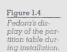

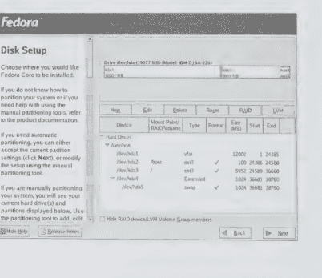

有些人建议为文件系统的不同部分创建许多分区。这种分区方式有其优点，但对于简单的桌面使用而言，可能没有必要。你可以让除了启动和交换分区之外的所有内容都放在同一个分区上运行。为了确保空间充裕，请确保所有分区的总和至少为 5GB。

### 表 1.1 Linux 中的分区类型

| 分区 | 挂载点 | 大小（至少） | 描述 |
| :--- | :--- | :--- | :--- |
| 启动 | /boot | 100MB | 内核镜像位于此处。启动分区应该是一个主分区。 |
| 交换 | 无 | 2x RAM | 此空间用于将程序在内存中换入换出。 |
| 逻辑 | / | 可变大小 | 这是文件系统中其他部分的空间。你可以创建多个分区或将此空间分配给不同的驱动器。你还可以创建其他非 Linux 本地文件系统的逻辑分区。 |

安装完 Linux 后，你很快就会了解分区。这并不难（并非什么高深学问），但如果操作错误，可能会带来很多麻烦。学习的好方法是让安装程序分区，然后查看创建的分区及其名称、大小、文件系统和挂载点。别担心，如果你搞砸了——只需重新开始。重新开始可能会花更多时间，但你会学到更多。

## 自定义或单个软件包选择

如果计算机类型的分类不符合你的需求，你也可以具体选择想要安装的软件包和程序。当你不熟悉所有程序时，盲目选择软件包是危险的。虽然安装程序不会让你移除其他程序所需的软件包，但你可能会遗漏稍后需要的某些内容。

### Mandrake

在“软件包组选择”屏幕上，有一个“单个软件包选择”的选项。如果你勾选该框，你将进入单个选项界面。所有软件包选项都位于可展开的组中，已选项目旁带有对勾标记。可展开的选项树与“软件包组选择”屏幕上看到的类别相匹配。选项下方有一个帮助对话框。你还可以点击任何软件包来查看其描述、安装所需的空间大小，以及 Mandrake 认为该软件包重要程度的实用评级。

如果你不确定需要哪些软件包，请使用分类。最安全的做法始终是安装比你认为需要的更多的软件包。这样，在你体验过并发现某些软件不值得、不需要或不想要时，你可以稍后删除它们。当然，温柔地拒绝它们，别太伤它们的小心。

如果你决定现在使用单个软件包选择，请确保包含 GNOME 和软件开发包。Mandrake 默认不包含 GNOME。

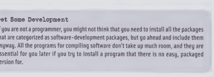

### Fedora

在实际复制文件之前，你将看到一个简化的软件包列表，该列表基于你在此前过程中选择的安装类型进行安装。你可以继续采用默认选项，其中包括 GNOME 桌面环境和你所需的大多数基本程序，或者你可以选择“自定义要安装的软件包”。

Fedora 为你将所有软件包组织成类别（见图 1.5）。只需勾选类别名称右侧的框。你可以查看该类别中包含哪些软件包。勾选或取消勾选你想要的任何软件包。这也是你可以勾选“软件开发”以及“GNOME 软件开发”和/或“KDE 软件开发”类别的时候。


## 开发
确保包含这些类别的程序，将在你需要通过编译源代码来安装任何程序时对你有所帮助。稍后我们将更详细地讨论安装新软件的问题。只要你处于自定义软件包选择界面，请添加 KDE（*K 桌面环境*）。同时拥有两者可以让你看到哪个更合你心意，这将有助于你理解本书其余部分中的许多示例和程序。

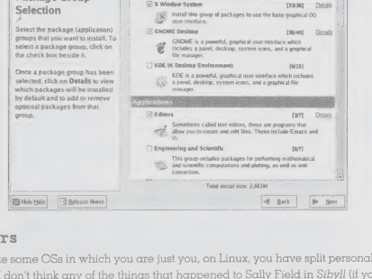

Fedora 的自定义软件包选择界面。

## 用户
与某些你只是“你自己”的操作系统不同，在 Linux 中，你拥有分裂的人格。我认为莎莉·菲尔德在电影 *Sybil*（《夺魂销》）中经历的某些事情（如果你不知道这个典故，*http://limbb.com* 是你的良友）不会发生在你身上，但你确实需要学习如何区分你的多个自我。

root 用户是负责管理计算机的用户。如果你想要安装软件、更改系统配置或访问某些目录，你需要以 root 用户身份登录。root 用户类似于 Windows XP Professional 中的管理员，或者赋予你的用户名管理员权限。不要总是以 root 用户身份登录计算机，你应该创建一个普通用户账户作为日常登录使用。没人能充分强调以普通用户而非 root 用户运行 Linux 的重要性。在普通用户账户下运行，你的计算机将更安全，既能防范未经授权的入侵，也能防止你搞坏东西。

Fedora 和 Mandrake 都会在安装过程中要求你输入 root 密码。

## 好的密码
你看过电影 *Hackers*（《黑客》）吗？（同样，如果你不知道我在说什么，<http://imdb.com> 可能会帮到你。）电影中说道，最常见的密码是 *love*（爱）、*sex*（性）、*secret*（秘密）和 *god*（上帝）。不幸的是，这可能是真的。很多人如此担心记住密码，以至于使用太容易被猜测或发现的单词。好的密码应该超过六个字符，并且应包含数字和字母。如果你能使用一个字典里没有的词组或单词，那就更好了，尤其是对于你的 root 密码。不，*password*（密码）不是一个好密码。哦，而且在你使用 *Linux* 一段时间后，*Hackers* 会变得有趣得多。

Mandrake 会要求你在安装过程中创建一个普通用户账户（见图 1.6）。Fedora 在安装后的步骤中添加用户。这两个发行版都给你提供一个选项，让普通用户自动登录。如果你的计算机不是只有你一个人使用的公共计算机，我想允许自动登录也没坏处。不过，整个事情让我浑身不自在。我认为任何人都不应该使用此选项。我可能会这么想，因为众所周知，我过去常把别人的壁纸或主页改成奇怪但有趣的东西。所以，如果你想取悦像我这样的人，不妨启用自动登录。只是当你的浏览器主页被设置为 <http://www.marykateandashley.com>，且桌面壁纸铺满了 Hello Kitty（凯蒂猫）的照片时，请不要感到惊讶。

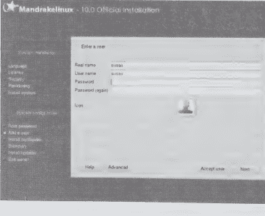

### 图 1.6
在 Mandrake 安装过程中添加用户。

## 网络配置
计算机里没有网卡？那么跳过网络配置步骤。如果你有网卡，让我们开始吧。设置很简单。对于 DSL 或电缆调制解调器 Internet 连接，你可能只需选择 DHCP 即可继续。如果你在局域网中且拥有分配的 IP 地址，请单击编辑，并向你的网络管理员询问应该输入什么信息。

**网络配置**部分在安装过程中看起来很大、很重要且令人畏惧，但实际上它只取决于你是否有网卡以及正确的信息。即使你现在没有所有网络信息在手，以后也可以更改条目。如果你的计算机中有拨号调制解调器或无线网卡，这些设备现在可能被检测到，但你可以稍后再设置它们。

## 防火墙
防火墙是你防范未经授权的入侵的保护措施。防火墙通过限制通过计算机不同端口的流量来工作。端口是逻辑连接的编号端点。Linux 是一个以安全著称的操作系统，但其安全性只取决于你让它有多安全。你必须利用可用的安全工具。我们已经讨论过 root 用户和密码，所以现在我们可以谈谈端口、虚拟入侵者和病毒。

在 Linux 中设置防火墙是个好主意。即使你在网络背后已有防火墙，也请在 Linux 中设置个人防火墙。当你试图做某事却发现防火墙设置不正确时，你可能会咒骂防火墙，但那时你应该停下来，想想我们前面提到的那种耐心、合乎逻辑的问题解决方法。一切都可以调整或修复。

Mandrake 安装中有两个防火墙选项。安装的第三步询问你安全级别。选项上方有一个滚动文本框，解释每个级别的含义。你现在应选择“标准”；稍后可以调整设置。Mandrake 安装中有第二个防火墙选项。在安装接近尾声时，你应该看到列出硬件配置的摘要。向下滚动，在安全部分找到“防火墙”。这是用于限制出站连接的防火墙。你现在可能可以保持默认设置。如果你想停止，进入配置，取消勾选“Everything”（所有）选项，并至少勾选你知道你不会运行的项目。例如，如果你没有运行邮件服务器，请勾选“Mail Server”（邮件服务器）。

Fedora 允许你在安装过程中设置入站防火墙。你要做的只是决定允许哪些类型的流量进入你的计算机，然后勾选每个框。如果你不熟悉某些流量类型，可以在术语表部分找到它们的定义。

不，我认为没有一群看起来凶神恶煞的 Internet 强盗坐在线上，等着你的电脑运行起来开始攻击。是的，在 Linux 上你将不得不应对很少甚至没有任何病毒的事实是正确的。不过，为什么要冒任何风险呢？如果你有一个内置的、易于配置的工具来阻止对计算机的未经授权的访问，请使用它。

## 创建启动盘
你可能会被询问是否要创建启动盘。如果你有软盘和软盘驱动器，没有理由不创建。你永远不知道自己是否可能需要像启动盘这样的小降落伞设备。只需拿一张软盘，放入驱动器，并按照说明操作。跳过此步骤不会导致蝗虫降落在你的监视器上。如果你想，可以继续往下。

## 等待
这是最简单的一步：你等待。选择完你想要的程序后，安装程序继续将文件复制并安装到你的硬盘上。取决于你选择的软件包以及这些软件包所在的磁盘，你可能需要更换 CD。当所有复制完成后，安装即完成。取出 CD 驱动器中的任何光盘，并根据屏幕上的提示重启计算机。

## 安装后步骤
Mandrake 和 Fedora 都有安装后向导，引导你完成几个设置步骤。大多数问题比高中生物课还简单，没人会强迫你做任何解剖实验。

## Mandrake 安装后
Mandrake 10.0 首先提供的是用户调查。完成此调查完全取决于你。有些人喜欢成为人口统计学的素材；有些人则不喜欢。

接下来，你可以配置桌面的外观。你选择桌面环境（KDE 是 Mandrake 的默认设置）以及桌面的主题，即外观。


这样你就完成了（见图 1.7）。桌面环境启动，然后把你带进桌面。有一个欢迎界面，其中包含指向 Mandrake 网站的链接以及一些快捷方式，指向你可能想要首先进行主题设置或自定义的一些项目。

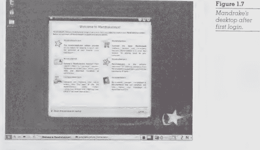

## Fedora 安装后配置

在 Fedora Core 2 中，安装后的第一个屏幕会显示一份许可协议。你在 Fedora 中同意的许可协议比任何商业软件的都要宽松，因此你不必担心自己正在放弃权利，或者同意每周为软件开发者洗车。

现在是另一个艰难的部分。Fedora 会要求你确认日期和时间。我知道，我知道。你可能会觉得自己还没准备好回答这种技术问题，但我对你有信心。

其他的安装后步骤包括创建用户账户。创建一个你的普通用户账户，这样你就拥有了一个不同于 root 用户的登录方式。

系统会要求你确认或更改 Fedora 为你的声卡检测到的设置。还有一个按钮可以播放测试声音。如果 Zamfir 演奏的是吉他而不是排箫，他的音乐听起来就会像这个测试声音一样。只需点击“是”来确认你听到了 Zamfir 那美丽而动人的音乐。如果你没有听到测试声音，会出现一些说明。此时，我建议你保持一种随和的态度。无论你听到测试声音与否，都点击“是”。如果你没听到，可以在稍后修复声卡设置。

接下来，你还有机会自定义你要安装的软件包。此软件包管理的界面与安装过程中选择“自定义要安装的软件包”时看到的界面相同。再次，你会看到一系列类别（参见图 1.5）和复选框。此时，我敢打赌你只想开始使用你的电脑。由于我也主张在你不该做之前偷偷打开圣诞礼物，所以我建议跳过这一步，直接进入登录。如果你想从 CD 安装其他软件，KDE 和 GNOME 的主菜单中都有现成的软件包管理工具。

现在，你会因为自己是个聪明人而受到祝贺，并被交给你的桌面开始使用 Linux（见图 1.8）。

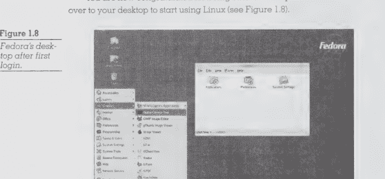

## 启动和登录

当你启动计算机时，你会看到不同类型的状态信息。如果你进行双启动，首先应该看到你的启动加载器。选择你的 Linux 安装并回车。

在 Fedora 中，你会看到一台计算机的图形、一个移动的状态栏，以及一系列让你了解情况的消息。如果启动遇到问题或输出了你应该看到的信息，屏幕会切换到逐行显示当前正在发生的事情。通常，如果你正在查看 *Show Details* 输出，没有理由恐慌。如果你的电脑没有启动，那你可以安全地恐慌一下。

Mandrake 显示一个蓝色屏幕，但不是蓝屏死机。这个蓝色屏幕上有一个进度条。更详细的关于启动期间正在发生的事情的输出信息可以查看，或者如果 Mandrake 认为你应该看到它，就会自动弹出，例如检测到新硬件时、网络电缆被拔掉时，或者发生错误时。

登录界面是两个发行版中的下一站。只需输入你的用户名和密码。输入你创建的普通用户的信息，而不是 root 用户的信息。之后，你的下一站就是你的桌面。那里也是我要去的地方。好吧，我要去的是我的桌面，而不是你的，但你懂我的意思。

### 链接

- BitTorrent: http://bittcon.juser.org/BitTorrent/
- DistroWatch: http://distrowatch.com/
- Debian: http://www.debian.org/
- Fedora: http://fedora.redhat.com/
- Red Hat Enterprise Edition: http://www.redhat.com/software/rhel/
- Gentoo: http://www.gentoo.org/
- Linpire: http://linpire.com/
- Mandrake: http://www.mandrakesoft.com/
- Slackware: http://www.slackware.com/
- Sun Java Desktop System: http://www.sun.com/software/javadesktopsystem/
- SUSE: http://www.suse.com/
- Xandros: http://www.xandros.com/
- Yellow Dog: http://www.yellowdoglinux.com/
- Partition Magic: http://www.powerquest.com/partitionmagic/
- FIPS: http://www.igd.fhg.de/~aschaefe/fips/
- Zamfir, Master of the Pan Flute: http://www.allmusic.com/cg/amg.dll?lpg-amg&amp;sql=11:g6520r2ar48z

*你的机器作为 root 用户并不安全。请以普通用户登录，当需要做一些伟大和美妙的事情时，再输入你的 root 密码。*

# 2

# 全包式的桌面之旅

还记得我第一次安装 Linux 的时候。我对自己说：“伙计，你真是自以为是啊。”

然后我说：“是啊，我知道。”

然后我说：“嘿，你不该回答的。我是在自言自语。”

“好吧，废话，”我回答。“我是你，所以我知道。”

“你真是太固执了。你为什么非要挑起争端呢？”

我在谈论 Linux。

“嘿，我只是在谈话。你才是那个想开战的人。那么，你要使用哪个桌面环境？”

“GNOME，”我说。

“什么？KDE 要容易得多。它的界面也更漂亮！”我跟我自己争辩。

“你想开战？我会跟你争辩的，”我的 GNOME 部分说。

“我不想打架。你才不合理。当 KDE 的控件在一个中心指挥中心时，你怎么能用 GNOME？”

“但 GNOME 给了我更大的灵活性来自定义我的桌面，随我意愿。我喜欢 Gnome 处理主题的方式更好。”

“你知道吗，你真是我们大脑中愚蠢的一面。我不敢相信你也也是我。我是说，主题？你想谈主题？KDE 有更好的主题。”我的 KDE 部分随后去了 kde-look.org，开始指点，说：“嘿，对吧？看。看！”

“那又怎样？GNOME 有 art.gnome.org，KDE 有更多的主题，但所有东西看起来都太塑料化。”

然后我对我自己感到愤怒。我告诉我要闭上嘴。随之而来的是脏话。这是一团糟。我感觉自己既向北走的 Zax 又是向南走的 Zax。（这是苏斯博士的故事“Zax”，出自《Sneetches 和其他故事》。天哪，试着跟紧点吧。）最终，我只是开始喝酒。除非我开始喝酒，那些声音不会消失。你知道的，喝点超自然的东西，Chocomalty 欧宝（Ovaltine）。欧宝对我好，也对我有益。

如果我能因为 KDE 还是 GNOME 更好而与自己开战，那你不难想象，让 dedicated 的 KDE 和 GNOME 用户互相争吵、辩论哪个桌面环境更好是多么容易。你最终可能会成为那些好战的狂热者之一，但现在试着保持开放的心态。KDE 和 GNOME 都是非常实用和可用的环境。它们有许多共同的功能。尝试两者。随时可以在 GNOME 中使用 KDE 程序，也可以在 KDE 中使用 GNOME 程序。你关于使用哪个桌面环境的决定最终将归结为哪个对你感觉更好。

## 登录管理器

在大多数操作系统中，你可以登录而不必思考那个显示登录屏幕的程序。在 Linux 中你也可以这样做。每次你都可以使用随发行版默认提供的登录管理器登录。这大概是大多数 Linux 用户所做的。然而，如果你想了解更多，这就是你的机会。

登录管理器是一个 GUI 程序，它显示输入用户名和密码的文本框。取决于登录管理器和设置，你可能会看到一个与你的用户名对应的图标，甚至是一个华丽的主题。关于你的登录管理器，你不需要知道太多，除非你想更改它的设置。KDE 和 GNOME 各自有其自己的登录管理器程序。

### KDM

KDE 中的登录管理器是 KDM（KDE 显示管理器）。Mandrake 将 KDM 的登录过程分为两步。在 Mandrake 的 KDM 中你首先看到的登录界面是一个带有图标的用户列表。选择你想登录的用户名，并点击它。你看到的下一个屏幕有一个文本


**前线观察**
*Linux 用户经常就桌面环境展开争论。你总能在 Slashdot 的帖子（http://www.slashdot.org）中找到最激烈的 KDE 与 GNOME 之战。只需让*


输入你在安装过程中设置的常规用户密码。“会话类型”下拉列表允许你从当前已安装的桌面管理器选项中进行选择。以 Mandrake 为例，让我们选择默认的 KDE 选项。如果点错了用户名，“返回”按钮可以带你回到上一个屏幕。准备好后，点击“登录”。

这一切都非常简单。登录管理器很简单。它们允许你登录并选择你的桌面环境。根据你的发行版不同，你可能会看到用于关闭计算机、重启计算机、重启 X（图形用户界面）会话或进入控制台（纯文本）模式的 KDM 按钮。大多数时候，你只需选择用户，输入密码，然后继续操作即可。如果你想修改 KDM，可以通过配置工具完成。

## 配置 KDM

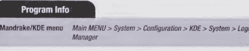

你可以对 KDM 进行各种定制，从更改外观到更改工作方式，再到限制哪些用户可以使用 KDM 登录。当你在 Mandrake 中启动登录管理器配置对话框时，你需要输入 root 密码。此登录管理器配置是 KDE 控制中心的一部分，也可以从控制中心访问。有关控制中心和首选项的更多信息，请参阅第 4 章“你的偏好是什么？”。

KDM 配置对话框是一个简单的选项卡界面，包含五个选项卡。你可以更改这些选项卡上的任何内容，但如果你想撤销某些更改，可以使用“默认值”按钮作为安全保障。此外，KDM 还提供了相当完整的帮助部分。接下来，让我们看看 KDM 配置对话框中的五个选项卡。

外观选项卡。其他选项卡中也有其他外观选项，但控制 KDM 外观的大部分选项都集中在这一项。问候语是显示在用户名区域上方的文本。“位置”选项决定登录框出现的位置。“GUI 样式”和“配色方案”选项决定颜色和窗口装饰。“回显模式”

- 只要提起任何一个桌面环境的故事，用户们就会开始在帖子里争论起来。只要在 Slashdot（搜索栏位于页面底部的小框中）搜索 KDE 或 GNOME® 发布的任意一条新闻，你就可以看到一些激烈的讨论。

决定你在输入密码时密码的显示方式。其他选项通过其标签即可明了。

**字体选项卡。** 有三种字体类别，一种用于大多数字体，一种用于由输入错误密码等操作产生的错误信息，另一种用于问候语。抗锯齿选项用于字体平滑。

**背景选项卡。** 你可以为登录屏幕背景选择壁纸图像或颜色。高级选项仅用于调整内存使用量。你通常不需要调整此设置。

**关机选项卡。** “允许关机”下的两个选项允许你指定哪些用户被允许在本地和远程（通过网络）关闭计算机。LIL0 选项用于你的启动管理器。如果你的驱动器没有分区，你可以取消选中该选项。如果你的计算机上安装了多于一个操作系统的分区，请保留该复选框被选中。

**用户选项卡。** 此选项卡混合了一些基本选项和高级选项（见图 2.1）。“系统 UID”文本框处理分配给用户的数字 ID。你应该保留它们的默认设置。在“显示用户”和“选择用户”部分之间，你可以选择允许通过 KDM 登录的用户。将 nobody 和 root 用户从登录屏幕隐藏起来是个好主意。你可以使用右侧的选项更改与不同用户关联的图片；只需点击图片以浏览其他选择。

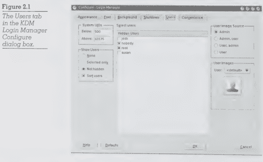

**便捷选项卡。** 在此选项卡上，你可以选择完全跳过登录管理器，让 Linux 自动登录你的常规用户名。出于安全原因，除非你的计算机位于家中、没有其他人使用且没有存储你不希望他人看到的内容，否则你可能不想使用自动登录功能。*无密码登录* 选项也适用同样的警告。*预选择用户* 选项对于你是机器上唯一常用用户的情况非常实用。你仍然需要输入密码。

## GDM

GNOME 登录管理器与 KDE 登录管理器类似。关于登录管理器的概念，你能做的原创或创新的事情终究是有限的。GDM（*GNOME 显示管理器*）设置为只需输入用户名，按 Enter，输入密码，再按一次 Enter。在屏幕上，你还会看到用于更改语言、重启计算机和关闭计算机的选项。“会话”按钮允许你使用任何已安装的桌面环境启动 Linux。

KDM 和 GDM 之间最大的区别在于 GDM 中可用的灵活主题。虽然 KDM 提供了主题选项，但这些主题与你桌面窗口中的样式和窗口装饰主题相同。GDM 主题是完全独立且极其灵活的主题。你可以在 [http://lart.gnome.org](http://lart.gnome.org) 和 [http://gnome-look.org](http://gnome-look.org) 查看人们为 GDM 制作的一些主题。务必不要通过安装激进的让自己困惑的主题。GDM 的一些主题可以更改登录屏幕上的按钮标签，以及图形和元素布局。

## 配置 GDM

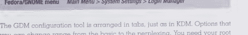

GDM 配置工具以选项卡形式排列，正如 KDM 一样。你可以更改的选项范围从基本到令人费解不等。你需要 root 密码才能对 GDM 配置进行更改。以下是每个选项卡的概述。

**常规。** 在常规选项卡上，你可以选择是否希望在登录屏幕上使用图形（主题）或*标准*（带有最少图形的旧样式）问候界面。“欢迎字符串”文本框中的文本设置将显示在登录屏幕上的文本。自动登录选项在你是一个人使用计算机且不担心安全性的情况下是可以的。“定时登录”部分与自动登录配合使用，但你也可以让计算机自动登录。前两个部分分为本地登录（当你物理上在计算机前时）和远程登录（当你通过网络登录时）。你可能只需要本地登录选项。

**标准问候界面。** 此选项卡具有旧标准问候界面的选项。GDM 标准问候界面很像 KDM 问候界面。你可以设置标志图像，开启面部浏览器以允许每个用户有头像图像（在 GNOME 控制中心中设置图像，请参阅第 4 章），并选择背景图像和颜色选项。

**图形问候界面。** 在这个选项卡上，我玩得最开心。这里没有多少选项要设置，但我喜欢做主题。你可以从四个预安装的 GDM 主题中选择（见图 2.2）。使用“安装新主题”按钮来安装主题压缩文件，或使用“删除主题”按钮来移除主题。当你下载新的 GDM 主题时，不要解压压缩文件。你直接以归档文件的形式安装该文件，保持压缩状态。

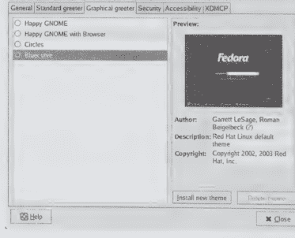

**图 2.2**  
Fedora 中的 GDM 主题选择器。

**安全。** 对于我们中那些偏执的人，我现在展示安全选项卡。在计算机方面，偏执是有好处的。这里的选项都是复选框，因此很容易阅读和做出决定。大多数选项都是个人偏好问题。我关闭远程 root 登录，因为我这是一个好主意。XDMCP 用于远程图形登录。


**辅助功能。** 您可以启用或禁用登录屏幕的辅助功能模块。GDM 的辅助功能包括屏幕键盘和事件替代声音通知。

**XDMCP。** 您可能现在不需要启用 XDMCP。XDMCP 管理远程登录。

## XDM

此外还有登录管理程序的通用类型，即 XDM（X Display Manager，X 显示管理器）。XDM 曾是我们唯一的显示管理器选择，并且仍然是许多您将在其他登录管理器中看到的元素来源。您可能不需要使用 XDM，因为 KDM 和 GDM 拥有更多功能，但您可能会在一些地方看到对该程序的提及。

### 桌面环境概览

虽然开源软件中根据自定义需求更改程序的机会在许多情况下是一个巨大的优势，但当某个版本的程序与其他版本不一致时，它也可能导致混乱。这种便利性问题并不经常出现，但最好也最臭名昭著的一个例子就是发行版如何更改两个主要桌面环境 KDE 和 GNOME 的默认外观。您不会看到默认的 KDE 或 GNOME 菜单，而是会看到 Mandrake 和 Fedora 菜单。发行版也往往偏爱一种桌面环境胜过另一种。

Mandrake 默认使用 KDE。当您第一次登录 Mandrake 且未更改会话选项时，您将通过 KDM 登录管理器进入 KDE。Fedora 同样偏爱 GNOME。Fedora 的默认登录流程通过 GDM 登录管理器将您带入 GNOME。不要害怕做一个叛逆者。您可以在 Fedora 中使用 KDE，在 Mandrake 中使用 GNOME。

为了简单起见，我们使用每个发行版中支持该环境的默认配置来介绍 KDE 和 GNOME 的环境。这意味着我们在 Mandrake 中查看 KDE，在 Fedora 中查看 GNOME。如果您选择了我提到的叛逆路线，您会发现一些菜单和图标有所不同，但您应该不难四处看看并找到您需要的东西。

## 面板和菜单

面板和菜单是您的桌面调色板，它们包含指向程序和文件的图标和链接。如果没有面板和菜单，您就只有一张漂亮的桌面背景图片和无处可去的地方。每个操作系统和桌面环境可能以不同的方式设计其面板和菜单，但共同的功能使它们易于识别。KDE 和 GNOME 以类似的方式处理这些重要的组件。

### KDE

KDE 桌面环境（参见图 2.3）因其与 Windows 桌面的相似性而交替受到赞扬和批评。内部有相似的概念，如窗口、任务栏类型的对象和桌面图标，但 KDE 是一个有自己的复杂性的独特存在。让我们从桌面底部开始，看看您的 KDE 桌面的基本组件。

图 2.3  
Mandrake 中的 KDE 桌面。

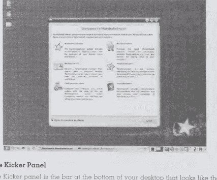

### Kicker 面板

Kicker 面板是您桌面底部的栏，看起来像 Windows 中的任务栏。面板上的对象帮助您访问计算机上安装的程序，查看您打开的窗口，利用虚拟桌面，并使用一些其他实用工具。面板是您的仪表板，您在这里拥有运行机器所需的一切。以下是从左到右您对面板对象的描述。

**KDE Kicker 面板对象。** KDE 为您提供了一组默认的面板对象和图标。大多数图标链接到常用程序，其他对象包括一些基本必需品。

### K 菜单

KDE 将其主菜单称为 K 菜单。K 菜单按类别排列，您可以在其中找到计算机上安装的大多数程序。类别名称足够简单（办公、互联网、多媒体）。您可以猜测大多数类别中有哪些程序。当然，Mandrake 中的 K 菜单看起来与 Fedora 中的不同。我们将查看 Mandrake 版本。Fedora 版本的 K 菜单与本主题后面描述的 Fedora GNOME 主菜单非常相似。

K 菜单中更模糊的类别名称是 **System（系统）** 和 **More Applications（更多应用程序）**。**System** 菜单是一个子菜单迷宫。这是配置 KDE、配置计算机以及访问其他系统实用工具的地方。**More Applications** 是您的杂项类别，其中包含指向 Mandrake 认为不适合放在其他任何类别中的程序的链接。

K 菜单中靠近底部的其他菜单项是您可能经常需要的重要项目。以下是从底部开始向上对这些菜单项的简要介绍。

**Logout（注销）。** 这会询问您是否要结束会话（注销并返回登录屏幕）、关闭计算机或重新启动计算机。Mandrake 在这个对话框中有一张神秘的可爱小插图。那里面可能藏着一些弗洛伊德式的含义。

**Lock Screen（锁定屏幕）。** 这激活了屏幕保护程序并阻止访问您的桌面。要返回您的桌面，您需要输入您的用户密码。

**Start New Session（开始新会话）。** 这显示了多用户选项。Linux 允许同时有多个用户登录。大多数图形桌面为了简单起见，并不强调此选项。当您开始新会话时，您会再次看到登录屏幕。只需登录并进入即可。您可以点击此选项阅读警告，其中解释了功能键如何用于在会话之间切换。

**Run Command（运行命令）。** 这会打开一个用于输入命令的文本框。如果您知道某个程序的终端命令，您可以使用此选项输入要启动的程序的终端命令。这可能比通过鼠标操作菜单和子菜单更快。

**Recent Documents（最近文档）。** 这列出了您在 KDE 程序中打开过的许多最近文档。此菜单通常不擅长包含在非 KDE 程序中使用的文档。您可以使用“Clear History”按钮清除列表。

### 表 2.1：KDE Kicker 对象

| 图像 | 项目 | 描述 |
| :--- | :--- | :--- |
| | K 菜单 | 此菜单类似于 Windows 开始菜单。在这里您可以找到已安装的大多数程序的链接、帮助手册以及用于搜索和注销 KDE 的实用工具。 |
| | Show Desktop（显示桌面） | 点击此按钮可最小化所有打开的窗口，从而显示桌面，以便您可以访问桌面上的任何快捷方式或文档。这是杂乱清理器。 |
| | Konqueror | 这是 KDE 的集浏览器和文件管理器于一体的程序。 |
| | Konsole | 这是 KDE 终端应用程序，为您提供对命令行的访问。 |
| | OpenOffice.org Writer | OpenOffice.org 生产力应用程序套件的一部分，Writer 是一个文字处理程序。 |
| | Taskbar（任务栏） | 此区域显示当前打开的窗口。点击任务栏中的任何窗口可将该窗口置于前台并聚焦于它。 |
| | Pager（翻页器） | 这为您提供访问虚拟桌面的功能。继续阅读本主题以了解更多关于虚拟桌面的信息。 |
| | System Tray（系统托盘） | KDE 使用系统托盘为程序提供位置，以提醒您消息或程序操作。您还可以从这里访问 Klipper 剪贴板内容。 |
| 2:14 | Clock（时钟） | 因为这是一个时钟，它显示，嗯，时间。您可以通过右键点击时钟小部件来调整日期和时间以及日期和时间格式。 |

**Find（查找）。** 此子菜单上有两个项目：查找文件和 Web 搜索。查找文件打开一个对话框以搜索文件。要进行基本搜索，请输入文件名并选择“Find（查找）”。Web 搜索打开 KDE 默认的 Web 浏览器 Konqueror，并跳转到搜索引擎页面。

**Home（主目录）。** 这打开您的文件管理器 Konqueror，进入您的主目录。

### KDE 桌面图标

- **Home（主目录）**——这打开您的文件管理器，进入您的主目录，就像 K 菜单中的 Home 选项一样。
- **Trash（回收站）**——与 Windows 回收站一样，您可以将文件和文件夹放入回收站，并在清空回收站之前恢复它们。
- **Welcome（欢迎）**——此图标打开您首次登录时看到的欢迎消息。欢迎窗口包含在线 Mandrake 资源、Mandrake/linux 控制中心和帮助文档的链接。

### GNOME

Fedora 的 GNOME 桌面默认设置（参见图 2.4）很简单，如果您以前使用过计算机，应该会感到熟悉。屏幕底部有一个类似任务栏的对象，一个桌面背景图像，以及一些桌面图标。右键点击桌面可看到一系列菜单选项，包括打开终端、创建快捷方式（启动器）、对齐对象和更改桌面背景。

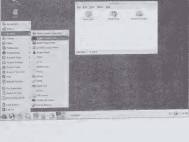

图 2.4 Fedora 中的 GNOME。


在 GNOME 中，这种类似任务栏的对象被称为**面板**。面板是一个基础，你可以在其上添加其他对象，例如主菜单、指向程序的图标链接、窗口列表、时钟以及其他系统控制项，如音量控制和注销按钮。面板在桌面外观和布局方面提供了大量的灵活性和控制力。你可以在同一个桌面上拥有多个面板。先按现状使用面板一段时间，以习惯所有功能的工作方式。之后，你可以尝试向面板添加新对象、更改面板位置以及添加多个面板。

## 默认面板

底部的默认面板上已经包含了你开始工作所需的一切。你在面板左侧首先看到的是一系列图标。这些图标用于 Fedora 和 GNOME 认为你可能希望便捷访问的菜单和程序。面板上还有一些有用的实用对象，帮助你排列窗口并执行常见任务。

**GNOME 面板对象**。以下是 GNOME 面板上默认对象的快速概览。

| | | GNOME 主菜单 | 这是 Fedora 的标志。明白了吗？细心的用户还会注意到它是一顶红帽子，就像红帽公司（Red Hat）的标志一样。这顶帽子就是你的主菜单，类似于 Windows 的开始菜单。在主菜单中，你可以找到电脑上安装的大多数程序的链接。 |
| | | Mozilla | Fedora 的默认 Web 浏览器是 Mozilla。Mozilla 类似于 Netscape，且这两个程序在开发过程中曾有关联。Mozilla 还附带相关的邮件和聊天程序。 |
| | | Evolution | Evolution 是一款电子邮件和日程安排程序，类似于 Microsoft Outlook。 |


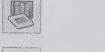


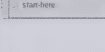


- **OpenOffice.org Writer**: OpenOffice.org 生产力应用程序套件的一部分，Writer 是一款文字处理程序。
- **OpenOffice.org Calc**: Calc 是 OpenOffice.org 中用于处理电子表格的程序。
- **OpenOffice.org Impress**: 这是一款演示工具，类似于 Microsoft PowerPoint。
- **打印管理器**: 打印管理器是一个实用工具，用于添加打印机并查看当前的打印任务。
- **工作区切换器**: 那个看起来像小窗格的东西就是工作区切换器。它允许你在虚拟桌面之间切换。稍后你将了解虚拟桌面是什么。
- **窗口列表**: 与 KDE 任务栏类似，你可以在面板上看到已打开的窗口，并点击切换到其中任何一个窗口。
- **音量控制**: 使用此功能调整系统音量。许多音乐和媒体程序也有自己独立的音量控制。
- **更新（位于面板通知区域）**: 该区域是一些程序显示图标以提醒用户消息或程序操作的地方。Fedora 内置了一个更新工具，可确保随 Fedora 预装的所有程序始终保持最新版本。这也会下载安全更新。更新图标位于系统通知区域。
- **时钟**: 这是一个时钟，你知道它是什么。你还可以使用此面板对象调整日期和时间。

你可以右键点击面板的空闲区域以添加新对象或更改面板属性。你可以右键点击任何面板对象以进入该对象的属性或偏好设置。

## GNOME 菜单

现在让我们来谈谈面板上的那顶帽子——*或者是脚，或者是星，取决于你所使用的发行版——也就是通常称为主菜单（或 GNOME 菜单）的对象。这个东西的伪装和别名比大多数老练的罪犯还要多。GNOME 菜单（见图 2.5）包含安装在电脑上的大多数程序的链接。程序被分为不同的类别。Fedora 在主菜单类别中增加了一层偏好设置。在每个类别中，首先列出的是该发行版偏好的程序，然后是符合该类别的其他菜单项（位于子菜单中）。因此，你会看到类似这样的菜单项：Internet > 更多 Internet 应用程序。你可以在“更多”子菜单中找到大多数 KDE 程序以及安装后添加的程序。

主菜单中的少数几个项目并没有隐藏在子菜单中。这些项目位于主菜单的底部。GNOME 菜单底部的菜单选项列表包含了一些你可能经常使用的实用项目。这就是为什么它们被如此方便地放置在那里。让我们从菜单底部开始，逐一介绍这些菜单项。

- **注销。** 这会退回到登录管理器界面，但它也提供选项让你关闭或重新启动计算机。
- **锁定屏幕。** 这会激活屏幕保护程序，并要求输入用户密码以关闭屏幕保护。
- **最近文档。** 此列表列出你最近打开的文档。众所周知，该列表通常不包含许多非 GNOME 程序的文档。
- **搜索文件。** 这会打开一个搜索窗口，允许你使用多种标准查找文件。
- **运行应用程序。** 这会打开一个带有文本字段的对话框，让你可以通过命令运行程序。这有时比在菜单和子菜单中翻找要快。
- **网络服务器。** 这会打开文件管理器 Nautilus，让你查看局域网（LAN）上的其他计算机。
- **帮助。** 这会启动 GNOME 帮助浏览器，你可以在其中阅读不同程序的许多帮助主题。
- **浏览文件系统。** 这会以浏览器模式打开文件管理器 Nautilus 到你的主目录。

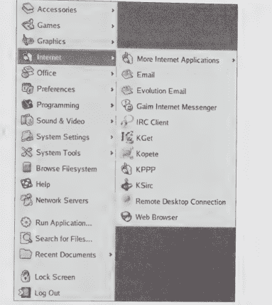

**图 2.5**

*GNOME 中的主菜单，Internet 菜单已展开显示。*

## GNOME 桌面图标

- *计算机*—此操作打开文件管理器，显示按文件系统组织的系统视图。根据你的设置，你可能会看到文件系统（本机文件）、CD-ROM（CD 或 DVD 驱动器）和网络（局域网链接）的图标。
- */[username]/s Home*—此图标以空间模式打开文件管理器 Nautilus，定位到 /home/[username]/ 目录。关于空间文件管理的具体内容稍后会详细介绍。
- *从这里开始*—此图标打开 Nautilus，显示一个包含许多系统偏好设置快捷方式的视图，你可以进行调整。这些偏好设置也可以从主菜单中访问。我通常把这个图标拖到下一个图标...
- *回收站*—还记得 Windows 中的回收站吗？它是同样的东西。此图标代表一个虚拟垃圾桶，你可以将文件和文件夹放入其中以删除它们。你可以恢复放入垃圾桶的项目，直到你清空垃圾桶。右键点击图标然后选择“清空回收站”即可清空垃圾桶。

## 虚拟桌面

虚拟桌面是多个工作区，你可以将窗口放在上面，查看菜单，并执行你通常在电脑上做的任何操作。对于初次使用 Linux 的用户来说，多个桌面可能会令人困惑。虚拟桌面仅仅是提供更多空间来放置和处理事务的工具。虽然这是一个老生常谈的比喻，但想象一个实际的桌面是很有帮助的。这就好比在你的办公室里有四张桌子，用来放置所有物品，作为额外的空间来处理工作。

许多刚从 Windows 或 Mac 切换过来的新 Linux 用户并不知道该如何利用所有这些额外的工作区。我刚开始使用 Linux 时，只使用一个桌面。我告诉所有人我不需要它们。在我看来，它们是多余的。渐渐地，我开始摆弄这个新玩具。我知道有一些应用程序我喜欢保持打开状态，但不希望它们出现在任务栏上，或者不想在桌面上点击来切换其他窗口。我开始使用其他桌面，并按我想要的方式配置它们。现在，我觉得离开虚拟桌面就活不下去了。当我不得不长时间使用 Windows 计算机时，我会寻找能给我恢复虚拟桌面功能的实用工具。

在 GNOME 工作区切换器中，你可以拥有 1 到 36 个桌面，而在 KDE 分页器中最多可以有 16 个桌面。使用这种新工具有许多不同的方法。你可以将不同类型的 applications 放在不同的桌面上，根据打开窗口的顺序将窗口放置在桌面上，或者以随机方式在各个桌面间移动物品。你可以像真实书桌一样整洁或杂乱无章。你知道那种方法吗？看起来对其他人的杂乱无章，但你声称知道每样东西在哪里。

## GNOME 工作区切换器

在 GNOME 中，默认情况下，访问虚拟桌面的入口位于底部面板上，靠近窗口列表（见图 2.6）。

如果你创建了新的面板，可以通过右键点击面板并选择“添加到面板 > 实用工具 > 工作区切换器”将工作区切换器添加到任何面板。当前所在的桌面会被加深颜色显示，你可以在工作区切换器中看到打开窗口的轮廓。如果需要从一个桌面切换到另一个，请在工作区切换器的其中一个窗格上点击。

想要更多的工作区？或者更少？有一些可配置选项来设置你的工作区。你可以更改工作区的数量和名称


每个工作区。要访问配置选项，请右键单击工作区切换器，然后选择“首选项”（见图 2.7）。


**图 2.6**
GNOME 面板上的工作区切换器。

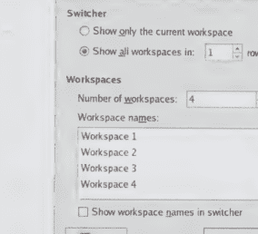

**图 2.7**
GNOME 工作区切换器首选项对话框。

**仅显示当前工作区。** 这属于只对部分用户有用的选项之一。此选项允许你仅使用键盘快捷键在桌面之间进行切换。

**显示所有工作区的行数。** 这会改变行数，正如描述的那样。这完全取决于你的选择。如果你调整垂直面板尺寸使其变小，你可能会想要一行。

**工作区数量。** 建议从四个开始，但如果你真的开始熟练掌握了，可以增加一些。如果你根本不想使用虚拟桌面，只需将其设置为 1 并从面板中移除工作区切换器。

**工作区名称。** 单击列表中任意工作区名称以更改名称。

**在切换器中显示工作区名称。** 如果你对整个概念感到困惑，并希望通过视觉来识别每个工作区，此选项可能很有用。如果你想使用此选项，我建议使用非常短的名称或仅使用数字，否则界面会显得杂乱。

*如果快捷键不适合你，请前往“应用程序” > “首选项” > “键盘快捷键”来更改键盘快捷键。*

### 在 GNOME 中移动窗口于不同工作区之间

现在你已经按照想要的方式配置好了一切，或者至少知道如何配置所有内容，你准备好开始使用桌面了。你可以随意来回切换，而无需关闭任何程序。有时你可能在一个工作区中启动程序或打开窗口，然后决定更希望它位于另一个工作区。移动物品很容易。

要将窗口从一个工作区移动到另一个，请右键单击顶部窗口边框，即包含窗口标题的部分。如果查看菜单选项，你会看到“放在所有工作区”，随后是选择将窗口向左移动一个或向右移动一个，或将窗口移动到不同工作区。“放在所有工作区”对于你希望跨越多个桌面的任何任务都非常有用。如果你选择将窗口移动到另一个桌面，你会看到窗口消失。你可以看到该桌面在工作区切换器中的窗口轮廓。

### KDE 分页器

在 KDE 中，使用默认面板时，你也会在下方面板靠近任务栏的地方找到访问虚拟桌面的入口（见图 2.8）。分页器部分的显示不仅带有阴影，还标有数字。此外，你还能在分页器的每个部分中看到每个打开窗口的一个小轮廓图像。

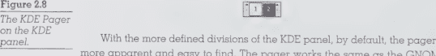

由于 KDE 面板中有更明确的划分，默认情况下，分页器更加明显且易于找到。分页器的工作原理与 GNOME 工作区切换器相同；只需单击你想切换到的桌面即可。

现在你需要能够调整所有虚拟桌面的设置以符合你的喜好——因为调整设置很有趣。在 KDE 中，分页器的配置位于控制中心，K 菜单 > 系统 > 配置 > 配置你的桌面。展开“桌面”部分并选择“多桌面”。

### 幽灵键盘快捷键

如果你尝试使用键盘快捷键切换桌面但没有反应，那可能是因为 KDE 默认未启用桌面切换的键盘快捷键。如果你不知道去哪里找，设置键盘快捷键需要一点侦探工作。设置位于 KDE 控制中心（参见主题 4）中的“区域与辅助功能”下。要设置快捷键，在列表中单击，向下选择“桌面切换”，选择“自定义”，然后单击按钮图像。会弹出一个窗口。只需按下你想使用的按键，然后单击“确定”。

配置 KDE 多桌面只有几个简单选项，如图 2.9 所示。你可以使用文本框、箭头按钮或滑块更改桌面数量。随着桌面数量增加，它们将变得可重命名。最多 16 个桌面中的每一个都单独列出，以便你可以为每一个重命名。你只需要选择“确定”。没有用于行数的设置；但是，如果你将面板边缘向下拖动使其变小，KDE 会为你调整分页器中的行数。

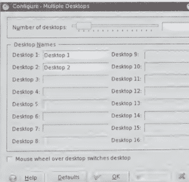

**图 2.9**
在 KDE 控制中心中更改多桌面选项。

### 在 KDE 中移动窗口于不同桌面之间

你可能在一个桌面中打开程序，然后需要将其移动到另一个桌面。移动时无需关闭程序。要将窗口从一个桌面移动到另一个，请右键单击窗口边框，即带有标题的顶部部分。会弹出一个菜单。

将光标向下移动，突出显示“到桌面”以显示子菜单。子菜单上有“所有桌面”，用于让窗口在每个桌面上保持可见，以及根据你的命名列出的其他桌面。你可以通过勾选标记看到当前桌面。如果你选择一个桌面，窗口会消失，但你只需向下查看面板上的分页器，就能看到你在所选桌面上看到的窗口轮廓。只需切换到该桌面即可再次找到你的窗口。

## 管理你的文件

文件管理器从根本上说，只是一种组织查看文件的方式。在移动文件和文件夹方面，能做的创新并不多。考虑到这一点，如果你使用过 Windows 或 Mac OS，你可能会在 Linux 文件管理器中感到如鱼得水。在大多数计算机操作系统中，所有数据都排列在文件夹（目录）和文件的层级中。当然，你的数据以这种方式组织，是因为我们都熟悉物理世界中的文件夹和文档。

### Linux 文件系统

每个操作系统都有自己的文件夹或目录层级。你可能熟悉 Windows 中的几个顶层文件夹，例如“Program Files”。Linux 在顶层目录的命名上不如前者那么直观。大多数顶层目录是你不会——通常也不应该——进入的。如果你好奇，许多在线页面（如 http://www.freeos.com/articles/3102/ 上的那个）对每个顶层目录的用途都有详细的解释。

你可能不想更改 /etc 目录或 /var 目录中的任何内容，但 Linux 文件系统中有一些文件和位置值得了解。你可以在心理上将这些标记为书签以备参考。

- **/etc。** 这是一个除非你知道自己在做什么，否则不应乱动的目录，但 /etc 是一个值得了解的目录。这里存储着 Linux 最重要的配置文件。在极端的问题情况下，解决方案可能就在这里。但是，除非你认为自己接近高级用户并有理由在那里，否则请考虑这个目录是禁区。在这里，我会用德语表达，听起来更具禁止性：Verboten！（禁止！）
- **/home/username。** 这是你的居住地。/home 包含计算机上每个用户（除 root 用户外）的目录。你的主目录只有你和 root 用户可以读取。你可以在这里做任何你想做的事。你运行的许多程序的偏好文件也存储在这里的隐藏文件夹中。
- **/mnt。** 如果你挂载了另一个文件系统或外部存储介质，如你的 Windows 磁盘分区、软盘或 CD，/mnt 是查找这些文件的好地方。/mnt 是操作系统通常提供已挂载文件系统访问权限的地方。
- **/media。** 在 /mnt 中找不到你挂载的文件系统？看看 /media。这是 Fedora 有时用于挂载文件系统的目录。
- **/root。** 你有主目录，root 用户也有。但 root 用户太好，不屑于居住在你居住的 /home 区域。如果你以 root 用户身份运行任何程序，大多数偏好文件都会在这里。你不应该经常摆弄 /root 目录。
- **/tmp。** /tmp 意味着“临时”。这是一个方便的目录，用于放置临时文件，特别是你需要移交给计算机上其他用户的文件。你会在 /tmp 目录中看到一些神秘的文件，因为程序也使用 /tmp 目录来保存临时文件。别费心清理它；Linux 可以自行整理。
- **/usr/bin。** 这个目录在你的禁止更改列表上，但当你寻找程序时，这是一个很好的了解的地方。/usr/bin 存储了你大多数可执行程序文件。想运行启动程序的命令吗？Linux 在这里找到命令。
- **/usr/share。** root 用户拥有这个目录，但它包含许多所有用户共享的文件，因此得名。例如，/usr/share/pixmaps 是你通常可以找到桌面壁纸和图标文件的地方。


**幕后**

**是文件夹还是目录？**

两者都是。文件夹和目录作为可互换的术语使用。文件夹是更友好的术语，让人联想到物理书桌上的 Manila 文件夹。目录是更技术性的术语，让我们所有人都觉得自己更聪明。我会在这两者之间来回切换，因为虽然我是个天才，但我只在某些时候聪明。


## 所有权与权限

在 Linux 中，文件和目录具有所有权和权限。这些设置决定了你是否被允许读取、写入或执行该对象（针对程序和脚本而言）。所有权和权限是严格的。你无法通过恶意接管成为文件的所有者。你无法通过口才说服系统让你读取任何你没有权限读取的文件或文件夹。所有权由用户名表示。字母或数字代表文件或文件夹的权限。这些字母和数字代表权限的三个方面：读取、写入和执行。表 2.3 展示了权限的文本和数字代码。

**表 2.3：文件权限的文本和数字代码**

| 权限类型 | 文本视图 | 数字视图 |
| :--- | :---: | :---: |
| 读取 | r | 4 |
| 写入 | w | 2 |
| 执行（对于目录则为访问） | x | 1 |

你可以右键点击文件管理器中的文件或文件夹，然后查看权限选项卡（如图 2.10 所示）来查看对象的权限。你应该会看到一个包含复选框的权限部分，以及一个显示所有权的区域。权限按照对象所有者的权限、该对象所属组员的权限以及所有人的权限的顺序列出。如果你对该文件具有读取和写入权限，你可以更改该文件的部分权限。如果你是该文件的所有者，你可以对该文件做任何你想做的事情。

你也可以在终端中从命令行查看权限列表。我们稍后会更详细地讨论终端。通常你不需要担心是否拥有某个文件的权限。然而，偶尔知道如何检查权限可以为你节省大量的故障排除时间。例如，如果你发现无法删除文件或移动文件，请检查权限。如果你无法保存文件的更改，请检查权限。当你需要处理主目录之外的文件时，权限限制会变得更为严格。

图 2.10

> Nautilus 文件管理器中列出的文件权限。

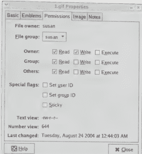

## Konqueror

### 程序信息

| | |
| :--- | :--- |
| **Fedora/GNOME 菜单** | *主菜单 > 主目录*（当使用 KDE 时） |
| **Mandrake/KDE 菜单** | *主菜单 > 互联网 > 更多互联网应用程序 > Konqueror*（以浏览器模式打开该程序） |
| **终端命令** | `konqueror` |
| **程序 URL** | http://www.konqueror.org/ |

在 KDE 中，Konqueror 是你的得力助手，*是人？是女人？是窗口？* 总之，Konqueror 是一个你会发现自己经常使用的程序（见图 2.11）。它是一个文件*管理器*、Web 浏览器，等等。当你需要查看文件，或者复制、移动、删除文件时，Konqueror 是你的助手。

Konqueror 与你在 Windows 或 Mac OS 中使用过的文件*管理器*并没有太大区别。当你将程序作为文件管理器打开时，你会看到菜单栏、工具栏、地址栏，以及下方的两个面板。菜单包含用于处理和文件夹操作、更改位置、将位置标记为书签以便稍后访问、更改程序设置的选项。要熟悉该程序，请转到 设置 > 配置 Konqueror，并调整首选项。

图 2.11  
Konqueror 作为文件管理器。

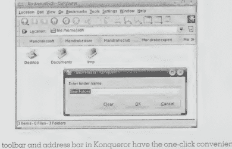

Konqueror 的工具栏和地址栏提供了一键操作，可以执行程序中大多数常用功能。箭头按钮让你可以向上进入目录、返回到刚才所在的目录，或者再次前进。工具栏上带有小房子图标的按钮是你的主目录；使用此按钮可前往 /home/[username]，即你的主目录。其他按钮包括用于刷新文件夹视图的“刷新”按钮（以防某些内容发生变化）、用于复制、剪切和粘贴的编辑按钮，以及几个用于更改视图的按钮。在地址栏中，你可以输入任何你想前往的目录路径，然后按 Enter 键。

Konqueror 中的文件和目录由看起来像文档和文件夹的图标表示。通常，你可以通过 Konqueror 用于显示文件的图标来识别文档类型——无论是文本文档、音频文件、图片，等等。你可以右键点击任何文件或文件夹以查看该对象的属性，包括权限、文件类型以及文件最后修改的日期。这些信息的即时可用使得文件管理变得容易。

### 工具包 2.1

### 在 Konqueror 中创建、重命名、复制和移动文件

我热爱假装。我一直是那个四处乱跑、假装被想象中的强盗枪击的怪孩子。让我们假装我们是 KDE 的支持者和间谍。我们刚刚捕获了下一代 GNOME 的计划。

#### 创建一个文件夹和一个文件

1. 在假装之前，我们必须先创建一些用于假装的东西。打开 Konqueror。点击工具栏上的主目录图标，前往你的主目录。
2. 在空白处右键点击。在弹出菜单中，选择 创建新 > 文件夹。在对话框中输入我们新文件夹的名称，`SecretPlans`。
   - 你也可以使用 编辑 菜单来访问 创建新 选项。
3. 双击新文件夹 SecretPlans 进入其中。它是空的。我们要放入一些东西。在空白处右键点击，选择 创建新 > 文件 > 文本文件。将该文件命名为（见图 2.12）StolenGNOMEPlans.txt。你也可以使用 编辑 菜单来访问 创建新 选项。

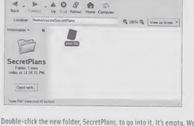

图 2.12

> *Konqueror 中的空白新文件。*

#### 重命名文件夹和文件

我们刚从 KDE 情报部门得知，GNOME 方面发现我们了。他们正在寻找我们偷走的计划。我们必须重命名文件 [这样它们] 就不会那么显眼。

1. 单击一次文件 StolenGNOMEPlans.txt 使其高亮。从窗口顶部的菜单中，选择 编辑 > 重命名。你也可以右键点击文件并选择 重命名，按 F2 键，或点击文件的名称文本。
2. 输入新文件名 TheresNothingToSeeHere.txt。按 Enter 键或在某处点击空白区域以退出文本编辑模式。
3. 使用工具栏上的“向上”按钮或“后退”按钮返回主目录。然后使用你重命名文件时的相同方法，将文件夹 SecretPlans 重命名为 NothingInteresting。

#### 复制和移动文件夹和文件

天哪！GNOME 团队已潜入我们的 KDE 基地！快撤！快撤！启动销毁计划 KDEstroy58A。（你听不见我，但我现在正用嘴发出那种小孩持枪的声音。）砰！轰。我们必须藏起我们间谍活动的证据！

1. 在 Konqueror 中前往你的主目录。我们巧妙的文件重命名不会欺骗 GNOME 间谍太久。我们必须备份文件夹及其内容。右键点击文件夹 NothingInteresting，从弹出菜单中选择 复制。你也可以按 Ctrl-C 或转到 编辑 菜单。
2. 在空白处右键点击，选择 粘贴。同样，编辑菜单或 Ctrl-V 也可行。弹出框会发出警告并提示使用不同的名称。将文件夹命名为 KDEstroy58A。点击 继续。
3. 我们必须将复制的文件夹移动到新位置以躲避 Gnomies。在 Konqueror 中，通过转到菜单 位置 > 新窗口 打开一个新窗口。
4. 在新窗口的 位置 栏中，输入 /tmp 并按 Enter。
5. 点击你的第一个 Konqueror 窗口，即包含秘密计划文件夹的那个。点击新文件夹 KDEstroy58A，并保持按住鼠标左键。在按住鼠标左键的同时，将文件夹拖到第二个 Konqueror 窗口，即位于 /tmp 目录的那个窗口。松开鼠标左键以将文件夹放入新位置。Konqueror 会询问你要执行什么操作。选择 移动到此处。
6. 回到我们的主目录，高亮 NothingInteresting 文件夹并按 Delete 键将其发送到回收站。我们挫败了入侵者。
   - 人群欢呼。婴儿大笑。狗追猫。

Konqueror 是一个功能强大的程序，拥有比我们讨论过的简单文件管理更多的能力。这将让你入门。接下来，你应该浏览所有菜单并点击一切以查看其功能。使用 Linux 时，你的常规用户名会被阻止造成任何实际损害，因为该用户名没有权限破坏系统文件。你还可以在主题 4 中查看对 Konqueror 进行的美学定制。

## Nautilus

### 程序信息

| | |
| :--- | :--- |
| **Fedora/GNOME 菜单** | 主菜单 > 浏览文件系统 |
| **Mandrake/KDE 菜单** | 主菜单 > 系统 > 文件工具 > Nautilus |
| **终端命令** | `nautilus` |
| **程序 URL** | http://www.gnome.org/projects/nautilus/ |

当前最流行操作系统中的文件管理器在形式和功能上没有太大区别。如果你知道如何在一个文件管理器中导航，学习使用另一个文件管理器不会花你很长时间。Nautilus 肯定属于这种相似文件管理器程序，只是风味和附件不同。当你使用 GNOME 时，Nautilus 是你的中心；它是你访问其他程序和处理数据的网关。

再次，与大多数文件管理器程序一样，文件和目录显示为带有相关图标和文件夹的文档。你可以右键点击任何文件或文件夹以查看关于该对象的详细信息或更改权限。当你双击一个文件时，你要么看到文件内容的预览，要么打开一个程序。Nautilus 可以显示图像和文本文档，或者 Nautilus 可以按照类型用默认程序打开文件。


## Nautilus 的浏览器模式

Nautilus 的浏览器模式（见图 2.13）之所以这样命名，是因为你可以**在单个窗口中**浏览文件。点击任何文件夹，使用工具栏上的“向上”按钮，或双击文件以预览其内容。所有这些操作都在**同一个** Nautilus 窗口中进行。你可以将其想象为一页一页地翻阅书籍或杂志。

Nautilus 在浏览器模式下的布局很简单，包含菜单栏、工具栏、地址栏、左侧详细信息和导航窗格，以及右侧查看窗格。菜单栏和工具栏易于理解，菜单中包含基本选项，而工具栏则由**大型、带标签的**图标组成。位置栏是一个地址栏，你可以在其中输入任何文件位置。与 Konqueror 不同，Nautilus 并不将自己宣传为既是 Web 浏览器又是文件管理器，但你可以在位置栏中输入 Web 地址。默认情况下，Nautilus 会显示你访问的 Web 页面的源代码。你可以更改此行为，但最好还是打开一个 Web 浏览器。左侧面板显示高亮选中文件或文件夹的详细信息，例如日期和文件类型。你可以使用“信息”下拉列表为左侧窗格选择其他视图，包括树状导航视图。右侧的主查看窗格显示你当前所在文件夹的内容或文件内容的预览。

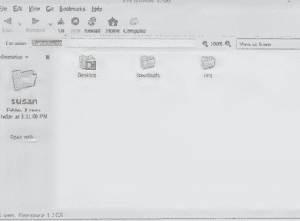

**图 2.13**  
使用主菜单中的“浏览文件系统”选项时的 Nautilus。

## Nautilus 的空间模式

Nautilus 的空间模式（见图 2.14）将一切都**分开**在各自的位置或空间中。这是 Nautilus 以面向对象的方式显示文件管理的方法。如果“面向对象”这个词对你来说毫无意义，别担心；这对程序员群体来说意义重大。Nautilus 的空间模式对所有人的意义在于：每个文件夹都在一个**单独的**窗口中打开。每个文件系统、每个设备和每个文件夹都被赋予了它自己的空间。

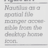

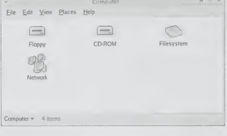

在 Linux 社区中，关于空间文件管理是否是一件好事，仍存在持久的争论。一些用户坚持认为，他们只是想避免那些**额外的**窗口。支持者认为，空间文件管理对用户来说更直观，有助于新用户更快学习 Linux 文件系统，并使拖放文件更加方便。

GNOME 开发人员通过某些细节使新的空间体验更加用户友好，帮助你了解自己在文件系统中的位置：

-   每个新的 Nautilus 窗口都以**级联**方式打开，位于上一个窗口的右下方偏移处，以便你轻松点击一系列中任何已打开的窗口。
-   如果你想浏览，你可以从“文件”菜单或**右键单击**任何文件夹来访问“浏览文件夹”选项。
-   当任何文件夹有打开的窗口时，该文件夹的图标会变暗，以表明该文件夹已打开。
-   当前空间的标题始终位于该 Nautilus 窗口的**顶部**。
-   点击状态栏右下角的标题，可以看到当前目录上方的目录树的展开菜单。

### 幕后揭秘

### 装满错误的垃圾桶

*有时，由于权限问题，你可能无法清空垃圾桶。你可能在作为 root 用户登录终端时创建了文件或文件夹，然后试图删除它们*

“去你的空间模式！我说，去你的！”

虽然这不是《麦克白》中的原句，但这是自 Nautilus 添加空间模式以来，一些 GNOME 用户的心声。关于 Nautilus 的空间模式是否是一件好事，争议、观点和争论仍在继续。如果你不想使用空间模式，最简单的做法是从主菜单的“浏览文件系统”选项启动 Nautilus。如果你觉得那还不够永久，还有另一种方法可以强制 Nautilus 始终以浏览模式打开。打开一个终端（如果你发现自己害怕命令和终端，请跳过此部分，先去熟悉终端命令）。输入以下命令：

```
gconf-tool -2 --type bool --set /apps/nautilus/preferences/always_use_browser true
```

注销 GNOME，然后重新登录。Nautilus 将保持浏览器模式。如果你以后想换回原来的设置，只需将命令末尾的 true 替换为 false 即可。

Nautilus 传统上一直在追赶 Konqueror。KDE 狂热者多年来一直吹捧 Konqueror 是 Linux 文件管理器的创新领导者。随着空间文件管理以及 Nautilus 文件管理器在简单文件任务之外的新用途，Nautilus 也正在成为创新者。如果空间文件管理让你觉得奇怪，那就试试看。在 Nautilus 的空间模式和浏览器模式之间切换，直到你找到最适合你思维和工作方式的模式。

## 在 Nautilus 中创建、重命名、复制和移动文件

-   上次我这么喜欢扮演 KDE 与 GNOME 战争的角色，以至于我想再来一次。你可以以浏览器或空间模式打开 Nautilus，本工具包中的步骤仍然有效。如果你上次没参与，我们将假装自己是 GNOME 的支持者和间谍。我们刚刚捕获了 KDE 下一版本的计划。

### 创建文件夹和文件

1.  在我们假装之前，我们必须创建一些东西来假装。在浏览器模式下打开 Nautilus。当然，你也可以在空间模式下管理文件，但我们应该在**同一页**上。点击工具栏上的“主目录”图标进入你的主目录。
2.  在空白处**右键单击**。在弹出的菜单中，选择“创建文件夹”。新文件夹显示为“未命名文件夹”，名称已经为你高亮显示。输入我们新文件夹的名称，SecretPlans。你也可以使用“文件”菜单访问“创建文件夹”选项。
3.  双击新文件夹 SecretPlans 进入其中。它是空的。我们要往里放点东西。在空白处右键单击，转到“创建文档” > “空文件”。将该文件命名为 StolenKDEPlans.txt。你也可以使用“编辑”菜单创建新文件。此文件只是一个空文件，但你可以创建或下载文档模板以与 Nautilus 一起使用。

从 Nautilus 以你的普通用户身份操作。你可以注销 GNOME，然后以 root 用户身份登录来删除这些文件。

### 重命名文件夹和文件

来自总部的消息：我们的 Linux 哨兵计算机检测到 KDE 黑客试图渗透我们的网络以窃取被盗的计划。我们必须重命名文件夹和文件以隐藏它们。

1.  单击文件 StolenKDEPlans.txt 一次以高亮显示它。从窗口顶部的菜单中，转到“编辑” > “重命名”。你也可以右键单击该文件并选择“重命名”，按 F2 键，或单击文件名。
2.  输入新文件名，ThereIsNothingToSeeHere.txt。按 Enter 或单击空白处的某处以退出文本编辑模式。
3.  使用工具栏上的“向上”按钮或“后退”按钮返回主目录。然后使用重命名文件时使用的相同方法将文件夹 SecretPlans 重命名为 NothingInteresting。

### 复制和移动文件夹和文件

我们设法通过使用加密方案击败了 KDE 入侵者。滴。滴。现在他们派出了一个 KDE 海豹突击队——你知道，我真的想看看穿着制服的小海豹……不过，总之——来突破我们的防线！我将用我的激光枪拦住他们，而你要把文件藏得更好！滋——！滋——！嘘。

1.  在 Nautilus 中进入你的主目录。我们必须对文件夹及其内容制作副本作为备份。右键单击文件夹 NothingInteresting，从弹出菜单中选择“复制文件”。你也可以按 Ctrl+C 或转到“编辑”菜单。
2.  在空白处右键单击并选择“粘贴”。同样，“编辑”菜单或 Ctrl+V 也可以工作。文件夹出现，名称为 NothingInteresting (copy)。使用你新学的技能将文件夹重命名为 PicturesOfKojak。
3.  我们必须将复制的文件夹移动到新位置，以将其隐藏在 KDE 突击队员面前。通过返回主菜单并再次选择“浏览文件系统”，在 Nautilus 中打开一个新窗口。
4.  在新窗口的“位置栏”中输入 /tmp 并按 Enter。
5.  点击你的第一个 Nautilus 窗口，即包含秘密计划文件夹的那个。点击新文件夹 PicturesOfKojak，并**按住**鼠标左键。在按住鼠标左键的同时，将文件夹拖到第二个 Nautilus 窗口，即位于 /tmp 目录的那个窗口。松开鼠标左键以将文件夹放置在新位置。
6.  回到我们的主目录，高亮显示 NothingInteresting 文件夹，然后按 Delete 键将其发送到垃圾桶。我们挫败了入侵者。

> “不要感谢我们，哦，感激的市民们。拯救世界是我们的工作。”


## 终端

我知道，这对很多人来说是 scary 的部分。没关系，我们会一起克服它。

终端是一个小型程序，它允许你通过文本命令而不是点击图形界面（GUI）对象来与系统交互。使用终端而不是图形界面，就像在汽车上使用手动挡而不是自动挡一样。任何狂热的汽车爱好者都会告诉你，使用手动挡可以获得更好的性能。在这种情况下，使用终端带来的性能提升体现在更快地完成某些任务上。

大多数人害怕终端中的命令行，因为他们认为它很复杂，而且需要记住大量的命令。好吧，他们部分是对的。确实有很多命令需要知道，但你不必记住它们全部。你不必在命令行上执行每个复杂的任务。你可以选择在你的任务中方便时使用命令行，而当你的任务在文件管理器或图形界面程序中更方便时忽略它。

我认为很多用户害怕打开终端后，只是盯着那个闪烁的光标，不知道该输入什么。有一种方法可以避免记住你需要的所有命令——而且在这种情况下，还可以预防腕管综合征。你可以使用 Tab 键来完成命令和文件名的输入。开始输入一个你知道首字母的命令，然后按下 Tab：

```
[susan@dodongo] $ q <Tab><Tab>
```

如果该字母或字母组合只有一个选项，第一次按下 Tab 时会显示该选项。如果有多个选项，请按两次 Tab。你可能会看到这样的输出：

```
qm2ts      gmake3      qt2ofix3     qtdoc         quota
qm2ts3     qrttoppm    qtconfig      qtrename140
qmake      qt2ofix     qtconfig3     qtrename1403
```

在我 Fedora 安装中所有以 q 开头的命令都显示出来了。所以，只要你知道命令的开头是什么，你就有了帮助。请记住，像 t 或 I 这样的字母可能有 100 多个命令，所以在按 Tab 之前尽量输入前两个或三个字母。

## 拆解你的命令行

终端中光标前面的那些东西是什么？大多数时候，命令行上光标前面的信息是关于你当前是谁以及在哪个位置的信息。

`[susan@ododongo] $`

从左到右阅读：你的用户名“在”你的计算机名称上（这通常是默认的 localhost），然后是光标前的提示符符号。$ 表示你当前是以普通用户身份登录。# 表示你是以 root 用户身份登录。

**表 2.4：终端常用命令**

| 你想做什么 | 执行操作的命令 |
| :--- | :--- |
| 查看目录内容 | `ls` |
| 向上移动一级目录 | `cd ..` |
| 移动到另一个目录 | `cd [目录名称]` |
| 复制文件 | `cp [当前文件名称] [新文件名称]` |
| 移动或重命名文件 | `mv [旧文件名称/位置] [新文件名称/位置]` |
| 删除文件或目录 | `rm [文件名称]` |
| 创建目录 | `rm -rf [目录名称]` <br>（目录必须为空）<br>`rm -rf [目录名称]` <br>（用于非空目录）<br>`mkdir [目录名称]` |
| 运行程序 | `[命令] &` <br>（使用 & 在后台运行程序，保持终端空闲以处理其他事项。） |
| 查找文件 | `find [文件名称]`<br>（你可以使用星号 (*) 作为通配符字符，因此使用 `m*` 查找所有以 `m` 开头的内容。） |
| 显示当前目录路径 | `pwd` |
| 安装 RPM 文件 | `rpm -ivh [包名称]` |
| 卸载 RPM 文件 | `rpm -e [包名称]` |
| 查看命令帮助 | `man [命令名称]`<br>`info [命令名称]`<br>`[命令名称] --help` |
| 创建文件快捷方式 | `ln -s [链接到的文件] [快捷方式名称]` |
| 查看文件内容 | `cat [文件名称]`<br>`less [文件名称]`<br>`pico [文件名称]`<br>（如果安装了 pico 编辑器） |
| 编辑文本文件 | `vi [文件名称]`<br>（vi 是一个复杂的文本编辑器，因此先熟悉如何使用它。如果你被困在 `vi` 中，`:q!` 可以退出。） |
| 防止所有输出向右滚动 | `[命令] \| less`<br>当命令产生长输出时，重新运行该命令，并在末尾添加管道符（`\|`）和 `less` 命令。 |
| 终止任何进程或命令 | 按住 `Ctrl`+`C` |
| 成为 root 用户 | `su` （然后输入 root 密码） |

在你的主目录中保留一个文本文件。当你学到一条可能需要再次使用的新命令时，将其复制到文本文件中保存，以便日后参考。Linux 还会保留你使用过的命令历史记录。打开终端并输入 `history`。历史记录会向下滚动相当多，所以输入

有时你需要在终端中以 root 用户身份执行操作。你不需要注销桌面管理器再重新登录来作为 root 用户工作。终端是你的快捷方式。

1. 打开终端。
2. 输入命令 `su`。
3. 输入 root 密码。


你现在已作为 root 用户登录终端，拥有随之而来的所有权限和危险。当你以 root 用户身份登录时，要尽可能小心；我刚刚递给你一把上了膛的 Linux 枪。除非你绝对确定自己不需要它，否则不要删除任何东西。除非你知道自己在做什么，否则不要更改任何东西。终端中的 root 访问权限非常适合安装新程序等操作，但不要滥用这种权力。

## Konsale 和 GNOME 终端


*   **Fedora/GNOME 菜单**
    *   Konsale：Konsale 没有主菜单选项，但请使用命令 `konsale` 从 GNOME 终端打开它。
    *   GNOME 终端：系统工具 > 终端
*   **Mandrake/KDE 菜单**
    *   Konsale：系统 > 终端 > Konsale
    *   GNOME 终端：GNOME 终端没有主菜单选项，但请使用命令 `gnome-terminal` 从 Konsale 打开它。

Konsale 和 GNOME 终端都是非常简单的程序，如图 2.15 所示。你基本上只需打开它们，就可以开始使用了。偏好设置选项主要涉及终端的外观。这两个终端程序都被称为 X 终端。它们是虚拟终端，允许你运行命令。你还可以通过按下 Ctrl+Alt+F1 到 F6 来访问其他全屏终端。按住 Ctrl+Alt+F7 返回 X，即你的图形屏幕。

### 图 2.15

KDE 的终端程序 Konsale。

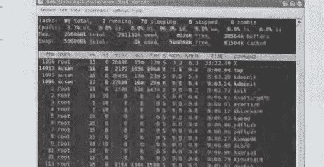

## 更多终端帮助

Linux 命令行自带帮助手册——实际上有两三个。这些不是世界上最用户友好的帮助文件，但它们提供了你需要的信息。你有 man 命令、help 开关和 info 命令。

```
man [命令名称]
[命令名称] -help
info [命令名称]
```

并非所有命令都有帮助显示或 info 文件。与其他可用的选项相比，拥有 man 文件的命令更多。每个命令的 man 文件排列都类似，但对于新用户来说可能难以理解。向下阅读文件，你会看到命令的正确使用语法、描述，然后是关于各种开关（添加到命令的内容，通常是一个字母，前面带有连字符）和其他命令引用的长篇章节。

Konsole 和 GNOME 终端的布局非常简单。有一个菜单栏、一个显示按钮或标签页的工具栏，以及终端本身。你可以在标签页或多个窗口中打开新终端。作为终端命令行新手，从一个窗口中的一个标签页开始，使用我们讨论过的一些基本命令，不要害怕。当你作为普通用户使用终端登录时，你无法破坏任何重要的东西。为了避免犯无法撤销的错误，请注意你所采取的每一个步骤。如果你真的搞砸了，总是可以回到主题 1“你正在做什么？”进行全新安装。

## 工具箱，2.3：在终端中写糟糕的 Linux 诗歌

想要证明命令行很有趣？嗯，有很多 Linux 命令，当把它们串联起来时，让我觉得自己像个刚发现“屁”这个词的傻乎乎、咯咯笑的三年级小学生。让我们把一些命令串联起来，看看能否惹点麻烦。

1. 使用这些真实的、嗯、暗示性的 Linux 命令开始：
    *   man
    *   finger
    *   mount
    *   sleep
    *   unzip
    *   touch
    *   strip
    *   grep
    *   more
    *   make


## 2. 将它们与文件名组合起来，看看你能想出什么。

我制作了一个名为 `man` 的文件以供使用。以下是我的电脑、Dodongo（用户昵称）和我之间的一次对话。我将其提交作为一首存在主义现代诗。

```
"Lookin' for a Man in All the Wrong Terminals," by Susan
$ man request

: No manual entry for request

$ make man

: make: *** No rule to make target `man'. Stop.

$ touch man

: ...

$ talk dirty > man & ; kill -9 %1

: [1]+ Stopped  talk dirty>man

$ unzip man" > stripMan

: unzip: cannot find man", man".zip or man".Z1P.

$ man sleep \| grep mount

: sleep - delay for a specified amount of time

$ man sleep! &" finger man

: No manual entry for sleep!
: Login name: man    In real life: ???

$ echo "your apathy slays my tortured consciousness" > man

: ...

$ write man

: write: man is not logged in

$ halt man

: halt: must be superuser.

$ echo "i` end the abyss of pain" && echo "end"
```

## 链接

- GDM 主题：[http://art.gnome.org](http://art.gnome.org) 和 [http://gnome-look.org](http://gnome-look.org)
- Footprints，GNOME 用户站点（包含用户论坛和社区编写的文档）：[http://www.gnomedesktop.org/](http://www.gnomedesktop.org/)
- KDE 论坛：[http://www.kde-forum.org/](http://www.kde-forum.org/)
- KDE 社区 Wiki（文档）：[http://wiki.kde.org/tiki-index.php](http://wiki.kde.org/tiki-index.php)
- Konqueror：[http://konqueror.kde.org/](http://konqueror.kde.org/)
- Nautilus 文档：[http://www.gnome.org/learn/users-guide/2.6/ch02s06.html](http://www.gnome.org/learn/users-guide/2.6/ch02s06.html)
- 神秘 Linux 文件结构解析：[http://www.freeos.com/articles/3102/](http://www.freeos.com/articles/3102/) 和 [http://www.ohinc.com/linux101/structure.htm](http://www.ohinc.com/linux101/structure.htm)

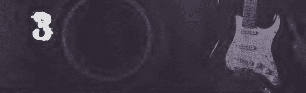

# 系统工具和实用程序

> “天才是一个最不可能去关注任何平淡无奇或令人反感的琐事的人。他打破约定，信件不予回复，不可救药地忽视家庭职责，因为他无力将注意力从那些天才时刻占据他心智的更有趣的想象轨迹中转移回来，也无法退缩。”
> ——威廉·詹姆斯

每个人的母亲都有一个最喜欢的轶事。你知道，就是那种在你带任何人回家时，在她翻出你小时候洗澡时那些“可爱”的照片之后立刻就会讲的故事。我母亲最喜欢的故事是她认为能展示我姐姐和我性格差异的一个。大致是这样的。

那是星期六，做家务的日子。动画片已经看完了。早餐也结束了。现在孩子们必须工作。我们分配了每周都要做的家务。每个星期六，就在该开始做家务之前，我和姐姐都会试图溜出去玩耍。我不确定我们为什么会有那种妄想，认为我们可以逃避那些家务，但谁能理解小孩子的逻辑呢？我们在门口被拦下，并被提醒我们有家务要做。我们被递上水桶和清洁用品，然后被派往各自指定的房间。

现在就是我母亲的轶事罗夏克测试（Rorschach test，一种投射性心理测验）登场的时候了。我姐姐被派去做她的家务时，会大发脾气。她会跺脚、抱怨、争辩，并且通常制造很多噪音。然后她还是会乖乖地去把家务做完，尽管一路上都在抱怨。做完后，她就可以出去玩了。那我在做什么呢？我没有发脾气。我没有抱怨。我是一个完美的天使，明显对必须执行的任务感到不快，但和蔼可亲地去完成我的工作。

然后我悄悄地从后门溜了出去。

嗖！我留下了水桶、拖把和污垢，原封不动，跑出去玩耍了。我后来因此受到了惩罚，但在星期六乐趣的诱惑面前，那似乎并不重要。结果，我想在那三四年级之间的夏天，我大部分时间都被关禁闭，骑着自行车在车道上转小圈。

我宁愿现在告诉你们，我从童年那些愚蠢的错误中吸取了教训。我也愿意告诉你们，我拥有神奇女侠的力量，但没有穿金属比基尼的要求。遗憾的是，这两句话都是假的。我不再在我不得不做我不喜欢的事情时从后门溜出去了，但我确实会拖延并试图回避它。

系统工具和实用程序是我最不喜欢的计算机任务。它们就像吃蔬菜和打扫房间一样。它们是我的 Linux 根管治疗。有趣的东西在于程序、主题、皮肤和偏好设置。所以，既然我的 Linux 罗夏克测试已经确定我是一名 C 型计算机用户，一个更喜欢做有趣事情的人，那么根管治疗就开始了。也许我们能在里面找到一些乐趣。

## 什么是系统工具和实用程序？

“系统工具和实用程序”是一个技术性很强的术语，涵盖了技术飞跃和巨大进步的思想……等等……我不能再对你撒谎了。我们现在已经认识太久了。我是编造了这个词。“系统工具和实用程序”是一个集体术语，用于描述为了维护计算机、排除故障以及了解操作系统内部发生的情况而必须执行的任务。我们需要一个名称来描述所有这些工具和程序，以准确地描述它们。我还有其他选择吗？“杂七杂八的东西”？“玩意儿”？既然决定了，让我们谈谈系统工具和实用程序。

Mandrake 和 Fedora 都付出了巨大的努力，使这些潜在困难的任务尽可能容易让我们使用。大多数桌面用户将不需要处理我们要谈论的许多实用程序。

不过，有时你不得不做一些平凡的计算机任务，例如更改密码、添加新硬件或更改某个晦涩的设置。你可能不常需要对汽车做某些事情，例如更换轮胎，但知道该怎么做是很好的，对吧？

## Fedora 的系统工具和系统设置

Fedora 并不太热衷于创建控制中心或中央位置。有些人认为这种做法分散了 Fedora 可用性的注意力，而另一些人则认为这种做法是对他们智力的补充。在 Fedora 的系统工具和设置方面，需要查看的地方在主菜单中。实用程序分布在主菜单中的“系统设置”和“系统工具”菜单中，还有一些可能被视为实用程序的项目溢出到了“偏好设置”菜单中。

## 系统设置菜单

此菜单包含许多与用户在 Fedora 和 GNOME 中的体验相关的选项。但与“偏好设置”菜单不同，这些选项会影响所有用户，而不仅仅是你。你需要使用根密码才能使用这些工具中的大多数。

### 服务器设置

“服务”是这个子菜单中的唯一选项。如果你稍后安装了更多软件，你可能会在这里看到其他条目。你可以从“服务配置”对话框中启动、停止和重启服务。服务是在你的操作系统中运行的后台程序。勾选某个服务的复选框会导致该服务在计算机启动时启动。除非你确切知道它们的作用，否则不要尝试关闭或开启任何服务。

### 添加/移除应用程序

如果你选择自定义在安装期间添加的程序，你可能会认出这个工具（它是相同的界面）。这个工具的名称有点不够诚实，因为“添加/移除应用程序”工具只能添加或移除包含在你安装光盘上的应用程序。对于一些程序来说，这可能是快速且方便的，但更新系统有更好的方法；我们稍后会谈到那些方法。

### 身份验证

选择此选项会调出“身份验证配置”对话框。这是另一个大多数用户不需要处理的工具。如果你非常了解安全并希望调整设置，那就去做吧。每种身份验证类型都提供了简洁的描述。如果你想更多地了解身份验证，请在这里阅读一点，并在线阅读相关主题。

### 日期和时间

<sarcasm>嗯，天哪，这到底是什么用的？</sarcasm> 这是你通过右键单击面板上的时钟并选择“调整日期和时间”后获得的同一个对话框。你还可以选择将时钟同步到网络，并选择时区。

### 显示设置

“显示设置”对话框中有三个选项卡：设置、硬件和双头显示。在第一个选项卡上，你可以调整屏幕分辨率和颜色深度（见图 3.1）。在“硬件”选项卡上，你可以更改监视器和视频卡的设置。双头显示选项卡充满了用于为一台计算机设置双监视器的选项。我知道，我也希望那个选项卡能充满变成双头怪物的选项，但我们的愿望被拒绝了。

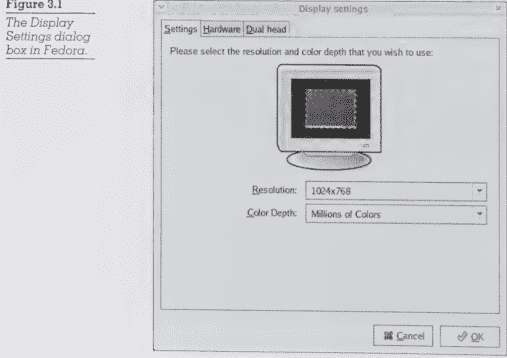


## 键盘

该选项用于设置键盘的语言。

## 语言

在此处可以设置系统的默认语言。如果您发现缺少希望使用的语言，您可以获取安装光盘，从众多可用语言中添加它。

## 登录屏幕

我们在上一章就在这里，还记得吗？啊，那些回忆。总之，这是您可以更改 GDM 登录管理器程序设置的对话框。

## 网络

网络配置对话框中的设置用于更改您的网卡设置以及计算机的网络标识信息。每个选项卡顶部都有说明。

## 打印

您可以使用打印机配置工具添加和编辑打印机。我们稍后会更多讨论打印内容。

## Red Hat 网络配置

如果您选择使用 Red Hat 网络进行更新，此对话框将设置所使用的地址，允许您调整包管理设置并选择例外。

## 根密码

在此处更改 root 用户的密码。

## 安全级别

此对话框用于设置您的防火墙选项。如果启用防火墙，您可以勾选允许的服务和设备。对于家庭宽带连接用户来说，使用防火墙是一个极好的主意。

## 声卡检测

在这里，你实际上只能做的是聆听那段“如果 Zmdir 弹吉他”的声音，然后回答是否听到了。我想这是一个确保声卡正常工作的好工具，但我能想到更有趣的方法。

## 用户和组

使用此工具添加和编辑用户和组。您可以创建组，以便一次性为多个用户设置权限，或创建一类用户。

## 系统工具菜单

系统工具菜单中的许多条目涉及系统中的硬件。其他选项与系统设置菜单中的某些功能相同。这些工具中的大多数是新的图形化方式，用于执行以前只能在命令行上完成的操作。这些工具中的大多数需要您的 root 密码。

## 更多系统工具

噗！空了？嗯，如果您没有同时安装 KDE 和 GNOME，那么是的，对于大多数默认 Fedora 用户来说，这个子菜单只是一个空的占位符。如果您已安装 KDE，则这里列出了两个 KDE 磁盘实用工具。

## 归档管理器

此选项打开 File Roller 程序。File Roller 与您在 Nautilus 文件管理器中双击归档文件（.zip、.tar、.gz 等）时弹出的程序相同。它是一个用于创建和解压缩压缩文件的管理程序。

## 配置编辑器

对于许多 Linux GNOME 极客来说，这是争议巨大的巨头。GNOME 配置编辑器（GConf，如图 3.2 所示）是一个用于编辑应用程序首选项数据库的 GUI 前端。讨厌它的人通常说它与 Windows 注册表太相似。喜欢 GConf 的人则享受将所有设置集中在一个地方的便利。像我这样认为的人则认为，除非您知道自己在做什么并且对可能进行的更改有信心，否则您甚至不应触碰此程序中的任何设置。但是，总是鼓励四处看看并观察一番。

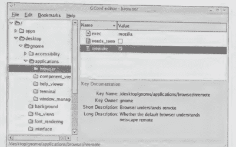

**图 3.2**
备受喜爱又备受唾弃的 GNOME 配置编辑器。

## 磁盘管理

使用此工具，您可以挂载和卸载计算机上的文件系统，例如磁盘分区以及 CD 和软盘等可移动介质。您还可以通过右键点击桌面并从弹出菜单中选择“磁盘”来管理磁盘。

## 软盘格式化

我知道，现在谁还用软盘呢？谈论软盘就像听你的叔叔谈论他以前拥有的那些很棒的 Doobie Brothers 八轨磁带一样。如果您仍有软盘，嗯，这里有一个为您格式化软盘的工具。界面非常容易使用，并为您提供密度和文件系统类型的选项，以便您可以格式化软盘以在其他操作系统中使用。

## 硬件浏览器

在此工具中查看系统中安装了什么硬件。这里不是修改任何内容的地方，但当您需要了解设备的品牌或型号而不想打开计算机来查找时，硬件浏览器就是应该来的地方。

## 互联网配置向导

这个向导很神奇。互联网配置向导并不神奇，但当他们不断称这些为“向导”时，你怎能期望我抗拒说出这句话？我是个天才，但我也只是凡人。在这里，您可以设置您的互联网连接，无论是拨号、宽带、无线还是其他连接。

## 要吸取的教训

使用计算机时，看似不合逻辑的问题总会冒出来。如果你想保持理智，就有必要吸取教训。遇到问题？绕道而行。当你在计算机上遇到问题时，你会被诱惑去查找确切的问题以及为什么会出现该问题。你内心深处的某种声音告诉你要与它搏斗。与问题搏斗需要很长时间，并可能滋生挫败感。通常对于计算机来说，最佳行动方案是找到一种替代方法来完成你试图做的事情。绕过问题。然后，如果你觉得有必要，你可以稍后尝试找出原因并解决该问题，那时你就不在挫败感之中了。

## Kickstart

此工具编写 Kickstart 文件。Kickstart 文件是一种长而复杂的文本文件，用于保存安装设置以自动执行多个 Fedora 安装。大多数桌面用户不需要这个。

## 网络设备控制

网络设备控制模块是一个用于监控、激活和停用网络卡和调制解调器等硬件的工具。您也可以访问列出的设备的配置。

## 打印管理器

添加打印机后，您可能想查看其运行情况；您可以使用打印管理器查看打印机队列中的文档和状态。

## 打印通知图标

这会在您的系统托盘中放置一个图标，您可以在打印时单击该图标以检查打印任务的状态。

## Red Hat 网络

这会调出 Red Hat 网络的对话框。此工具检查哪些系统包可用于更新。您可以使用 Red Hat 网络保持系统最新。

## Red Hat 网络警报图标

如果您还没有移除它，您的系统托盘中可能有一个圆形的 Red Hat 网络图标。如果移除该图标，此菜单选项会将其重新放回去。

## 系统日志

日志文件是事件和警告的列表。这是一个无需使用终端即可查看系统日志文件的工具。日志对故障排除有帮助，但读起来并不是很有趣。

## 系统监视器

您可以查看系统监视器中的当前内存使用量、处理器使用率和运行中的进程。有些人喜欢持续密切关注计算机的性能，并始终让此程序保持打开状态。

## 终端

这就是终端。它是你访问命令行的入口。它是你的朋友。不要害怕它。打开它。喜欢上它。我们稍后会进行更多洗脑，让你爱上终端。

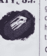

### 工具包 3.3：如何在 Fedora 中执行“重要”操作

现在您知道了系统菜单中那些晦涩条目都是做什么用的，让我们进入细节。当您有一件无聊的事情要做，可以称为维护或实用功能时，通常您不想浪费时间研究如何完成它。这里有一些您可能需要知道如何执行的常见实用任务。

- 更改您的密码
  主菜单 > 首选项 > 密码
- 更改 Root 密码
  主菜单 > 系统设置 > Root 密码
- 管理用户和组
  主菜单 > 系统设置 > 用户和组
- 更改日期和时间
  主菜单 > 系统设置 > 日期 & 时间
- 挂载磁盘分区和文件系统
  主菜单 > 系统工具 > 磁盘管理
- 启动或停止服务
  主菜单 > 系统设置 > 服务器设置 > 服务
- 读取日志
  主菜单 > 系统工具 > 系统日志

**大哥哥可能更漂亮**
如果您经常保持系统监视器打开以监视计算机的性能，您可以比使用 GNOME 工具更具风格地监视。一个名为 Gkrellm (http://www.gkreliim.net/) 的程序是


**引擎盖下**


## Mandrakelinux 控制中心

究竟 Fedora 系统实用工具菜单的布局好，还是 Mandrake 控制中心的杂乱好，这全看个人喜好和细节。两者都让你方便地访问系统设置和工具。Mandrakelinux 控制中心对某些人来说可能更方便，因为所有工具都集中在一个地方。不过，到达这些工具需要多点击几次。

当你打开控制中心时，巨大的图标扑面而来。也许它们并没有“攻击”你，但它们确实很大。控制中心分为不同的类别，其中包含可以称为设置或工具的模块，它们各自归类。不仅类别命名巧妙且排列有序，而且大多数模块在打开时都会提供简短的介绍性描述。这种对信息和使用性的关注使得在 Mandrake 中处理常规系统任务变得非常容易。

通过前往主菜单 > 系统 > 配置 > 配置你的计算机来打开 Mandrakelinux 控制中心（参见图 3.3）。你需要 root 密码。让我们看看这些巨大图标下面隐藏着什么惊喜。

图 3.3
Mandrakelinux 控制中心。

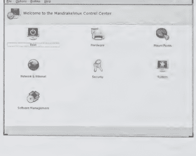

它是 Linux 爱好者的瑞士军刀，拥有系统监视器、邮件通知等功能。你甚至可以为该程序选择外观皮肤，使其更美观。

### 启动

启动类别中的所有模块都与开机并登录计算机时发生的情况有关。自动登录模块询问你是否希望 Mandrake 跳过登录管理器并为你启动桌面。如果你身边没有其他人应该操作你的程序和数据，自动登录是可以接受的。引导加载程序模块打开引导加载程序（通常是 LILO 或 Grub）的设置。除非你需要因双系统启动而更改选项，否则最好保持这些设置不变。启动主题允许你为启动屏幕添加主题。

### 硬件

是的，你可以在此处设置连接到计算机的所有硬件，或者至少是其中大部分。硬件模块是一个浏览器，用于获取系统中各种卡、输入设备、端口和其他组件的信息。当你点击列表中的每个设备时，配置模块或工具会显示它们是否可用。硬件类别中的其他模块包括显示器、屏幕分辨率、键盘、鼠标、电视卡和扫描仪的设置，这些都非常容易理解。图形服务器模块提供 X 服务器的显示设置，例如显示器和显卡。打印机模块允许你添加打印机。我们稍后将详细介绍打印。

> **挂载文件系统，而非马匹**
>
> 对于许多 Linux 新手来说，挂载和卸载文件系统可能是一个陌生的概念。让我们把文件系统比作书。你旁边可能放着一本书，你甚至可能正在触摸它，但在打开之前你是无法阅读它的。为了读取和写入文件系统，Linux 必须先打开它，这在命令的奇特语言中被表达为挂载文件系统。其他操作系统也会挂载和卸载文件系统，但它们隐藏了这一点。Linux 没有隐藏，也没有秘密。Linux 让你看到操作系统内部的运作机制。你的发行版和桌面环境中有很多实用工具会自动为你挂载文件系统，但了解底层发生的机制也无害。

### 挂载点

大多数用户不需要更改这些模块中的选项。分区模块调出你在安装过程中使用的相同分区工具。你可以更改计算机的分区表，但这不是一个好主意。如果你在分区上搞得一团糟，最好重新安装以获得一个干净的开始。你可以更改每种可移动介质（如 CD 和软盘）的选项。NFS 和 Samba 挂载点是你局域网上的共享，包括使用相同协议的 Mac 和 Windows 共享。

Samba 是这两种协议中最常见的。WebDAV 挂载点为你提供连接远程 Web 服务器的选项。本地磁盘共享是你可以设置计算机上的目录以与局域网内其他人共享的地方。

### 网络与互联网

该模块为你提供了管理各种类型连接的选项。此外，你可以将互联网连接共享给网络上的其他计算机，并编辑代理设置。你稍后将使用其中一些模块来设置互联网连接。

### 安全性

此类别中的三个模块会让我们中那些多疑的人会心一笑。级别和检查项为你提供了计算机安全的详细设置。如果你不熟悉高级选项，请阅读安全级别选项的描述以选择一个。在权限中，你可以设置不同目录的文件权限和所有者。防火墙模块编辑你的互联网防火墙选项。

### 系统

这里有许多你可能需要执行的更频繁任务的选项。菜单允许你编辑主菜单。显示管理器实际上用于选择登录管理器。在服务中，你可以设置哪些后台进程在启动时运行，并启动或停止每个服务。字体用于安装新字体并查看你已有的字体。日期和时间模块调整日期、时间和时区。你还可以选择与网络时间服务器同步。日志是阅读计算机系统日志的地方（记录事件和错误的列表，阅读起来可能令人困惑，但有助于故障排除）。控制台调出一个 root 终端供使用。用户和组模块（参见图 3.4）显示了添加、编辑和删除用户和组的选项。在备份模块中，你可以看到设置定期备份数据的选项。

### 软件管理

这些模块提供了一种方便的方法来添加、删除和浏览系统中的软件包。安装模块需要你的安装光盘。更新模块打开你稍后将使用的 Mandrake 更新工具。

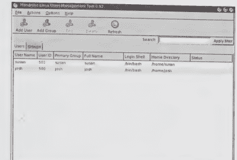

图 3.4
MandrakeLinux 控制中心中的用户管理工具。

## 工具包 3.2：如何在 Mandrake 中执行“重要”操作

所以，你知道 MandrakeLinux 控制中心里有什么，但有时你想跳过菜单和图标层级，直接执行你要做的操作。当你有一项枯燥的工作，可以称为维护或实用工具时，你通常不想浪费时间弄清楚如何做。以下是你可能需要知道如何执行的一些常见实用工具任务。

### 更改你的密码（两种方法）

- 1. 主菜单 > 系统 > 配置 > 配置你的桌面
   （从 KDE 控制中心内部）系统 > 用户账户
- 2. 主菜单 > 系统 > 配置 > 配置你的计算机
   （从 MandrakeLinux 控制中心内部）系统 > 用户和组

### 更改 Root 密码

主菜单 > 系统 > 配置 > 配置你的计算机  
（从 MandrakeLinux 控制中心内部）系统 > 用户和组  
（在菜单上）选项 > 过滤系统用户（编辑 root 用户）

### 管理用户和组

主菜单 > 系统 > 配置 > 配置你的计算机  
（从 MandrakeLinux 控制中心内部）系统 > 用户和组

### 更改日期和时间

主菜单 > 系统 > 配置 > 配置你的计算机  
（从 MandrakeLinux 控制中心内部）系统 > 日期和时间

### 挂载磁盘分区和文件系统

主菜单 > 系统 > 配置 > 配置你的计算机  
（从 MandrakeLinux 控制中心内部）挂载点

### 启动或停止服务

主菜单 > 系统 > 配置 > 配置你的计算机  
（从 MandrakeLinux 控制中心内部）系统 > 服务

### 阅读日志

主菜单 > 系统 > 配置 > 配置你的计算机  
（从 MandrakeLinux 控制中心内部）系统 > 日志

## 打印

有些人什么都打印。他们查一下网页，打印它。收到电子邮件，打印它。打开任何文件，打印它。你遇到过这样的人吗？好吧，我最好保持沉默，因为你可能也是一个非常爱打印的人。我并不是反对那些爱打印的人。我想我只是不理解这种持续的打印行为。我很乐意让我的打印机感到孤独。我周围的小纸片越少，我越开心。尽管如此，有时每个人都需要打印一些东西。

幸运的是，在 Linux 中设置打印机很容易。我知道，我一说这句话，肯定有八个人刚在 Linux 中遇到了打印机设置问题。与其他硬件连接相比，这很容易。容易得像使用罐装奶酪酱一样。容易得像周日早晨一样。嗯，也许在 Linux 中大多数硬件对于某些品牌型号都很容易。对 HP 和 Epson 打印机的支持最好，尤其是喷墨打印机。要找出你的打印机是否受支持，你可以查看制造商的文档和网站。一些公司承认 Linux 的存在并告知你。否则，在线还有一个很棒的 Linux 打印网站 http://www.linuxprinting.org，你可以在那里检查你的打印机是否受支持，查看哪些驱动程序效果最好，并在购买前查看推荐的打印机。

设置你的打印机可能涉及不同的步骤，这取决于打印机是直接连接到你的计算机，还是通过局域网连接到打印机。

### Fedora 中带有 GNOME 的打印管理

在你花费大量无用时间尝试设置一个在 Linux 中无法工作的打印机之前，请在线检查位于 http://www.linuxprinting.org/printer_list.cgi 的 Linux 打印机兼容性数据库。在 Linux 打印网站上，你可以获取打印机的驱动程序，但大多数兼容的打印机驱动程序已经包含在 Fedora 中。

### 添加和配置打印机

打印管理器是 Fedora 底部面板上的默认图标之一，如果它还在，请单击它。你还可以通过前往

主菜单 > 系统工具 > 打印管理器。你需要 root 密码来运行打印机配置工具并添加打印机。点击工具栏上的“新建”按钮。现在你看到的是“添加新打印队列”屏幕。在 Fedora 中，你添加的不仅仅是一台打印机——你在添加一个队列，一个等待行。通过打印队列，你可以向打印机发送一系列作业，而无需在发送下一个之前等待每个作业完成。

逐步完成向导屏幕。当到达命名你的打印队列部分时，停下来听我说。对大多数用户来说，这个名字并不是很重要，但如果你计划设置多台打印机，你需要确保名字是唯一的，并且描述性足够强，以便你能区分不同的打印机。名称“Printer”可能不是最独特或最具描述性的选择。“队列类型”屏幕是你可以选择将打印机标识为本地连接或通过 LAN 连接的地方。你的本地连接打印机应该会被自动检测到。然后你可以从列表中选择其设备位置，通常这是一个只有一个选项的列表。并行端口打印机的常用设备位置是 /dev/lpp0，USB 打印机的常用设备位置是 /dev/usb/lp0。你必须在你的局域网中找到网络连接的打印机。在 Windows 网络上找到打印机时不应该有任何困难。在 Apple 网络上，你现在也可以将打印机在 Mac OS X 中共享为 Samba（一种用于 Windows 网络的 Linux/UNIX 文件共享程序）共享打印机。如果有问题，请拿出你的安装光盘并打开主菜单 > 系统设置 > 添加/删除应用程序。在系统类别中，确保勾选了系统工具 > samba-client，并且勾选了打印机支持类别。

向导的下一部分要求你提供打印机型号，如图 3.5 所示。你可以像一只不情愿的、有罪的幼犬在警察讯问下那样抵制向 Fedora 提供你的打印机信息，但最好还是合作。对于本地连接的打印机，你的打印机型号很可能已被自动检测。如果检测错误或缺失，请从列表中选择制造商和型号。对于网络连接的打印机，你必须选择制造商和型号。

下一个屏幕给你一个快乐的警告，并告诉你已经完成了。然后你会被询问是否想要创建测试页。是的，你需要。测试页确认打印机已正确设置，并为你提供制作纸飞机的材料（参见 http://www.paperplane.org/）。现在你可以通过进入每个程序的打印选项，从大多数应用程序中打印。

当你需要编辑或删除打印机时，只需再次打开打印管理器。你会看到每个已设置打印机的图标。右键点击打印机以编辑其配置。高亮显示一台打印机并点击删除以将其移除。你也可以在打印机配置工具中编辑和删除打印机，该工具位于主菜单 > 系统设置 > 打印机。

### 图 3.5
在 Fedora 中选择打印机型号。

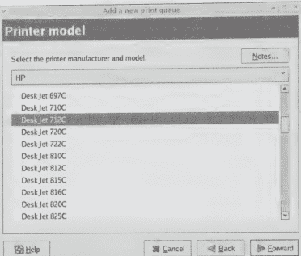

当你向打印机发送作业时，你可以通过打开打印管理器来检查打印作业的状态。要取消打印作业，在列表中高亮显示该作业，然后转到菜单并选择编辑 > 取消文档。

## Mandrake 中 KDE 的打印管理

### 添加和配置打印机

在运行 KDE 的 Mandrake 中，有多个控制中心，因此你有多种工具选择来添加和配置打印机。无论是 KDE 控制中心还是 Mandrake Linux 控制中心，都没有哪一个工具在添加打印机方面更优越。它们都使用类似、清晰的语言，如“添加打印机”，并且都有类似的选择来配置你的打印机。最后，请尝试两者，看看你最喜欢哪一个。目前，我将使用 Mandrake Linux 控制中心的打印管理工具。硬件与操作系统和发行版的配合程度比与桌面环境的配合程度更高。这让我倾向于使用发行版的工具而不是桌面环境的工具。

打开 Mandrake Linux 控制中心，进入硬件 > 打印机开始操作。打印机管理工具（见图 3.6）采用简单的布局，在 Mandrake 和 Linux 中你会对此感到非常熟悉。有一个菜单栏、工具栏和主要内容区域。在主要内容区域中有两个选项卡，一个是本地打印机，标记为“本机配置”，另一个是网络打印机，标记为“其他机器配置”。点击“添加打印机”以启动添加新打印机向导。该向导中的大多数步骤不需要太多解释。

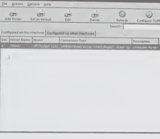

### 图 3.6
Mandrake 打印对话框。

在使用向导的过程中，你对打印机做出一些次要决定，并为 Mandrake 提供启动所需的一些信息。在第一个选项卡中，让 Mandrake 尝试自动检测你的打印机。如果它无法找到任何设备，你可以手动输入信息。Mandrake 在查找打印机方面相当不错。我找到了连接在我局域网中所有 Linux 机器和 Windows 机器上的所有打印机。如果你的打印机被找到，你只需点击“下一步”。如果未找到你的打印机，你可以手动指出位置。当到达命名打印机的部分时，给打印机起一个描述性的名字。即使你只有一台打印机，描述性的名字也更有意义。选择你打印机的制造商和型号。如果你的打印机未列出，你应该先去 linuxprinting.org 网站确认你的型号是否兼容。

接下来，你有机会设置你想要的打印机默认值，如纸张大小和打印模式。完成后，打印机将被配置，你可以尝试打印测试页。现在，我们已经说过测试页是制作纸飞机的好材料，但别以为我不知道帽子。我知道纸帽子（参见 http://www.cs.nu.nl/~hansb/d.org/gam//traditional/hat.html）。

如果你需要监控或取消已发送到打印机的打印作业，你再次有两个选择：KDE 工具和 Mandrake 工具。这次，我的意见是这并不重要，因为它们是两个不同外壳中的相同工具。要使用 KDE 工具，从主菜单 > 系统 > 配置 > 配置桌面打开 KDE 控制中心，并在左侧的 KDE 控制中心列表中选择外围设备 > 打印机。点击“作业”选项卡以查看打印机作业。点击工具栏上的垃圾桶按钮，“删除”，以取消打印作业。从主菜单 > 系统 > 监控 > 打印作业打开 Mandrake 工具。界面完全相同：你只是没有围绕打印队列显示打开控制中心。

## 连接世界

我认为你仍然可以拥有计算机而不连接互联网。等等，让我检查一下——嗯，是的，你可以，但在当今世界，这就像砍断你计算机的头一样。没有互联网，你和你的计算机只会整天穿着内衣玩纸牌接龙。当然，也许你本来就喜欢这样。我并不是贬低你选择的生活道路，但你不知道互联网上还有什么其他东西吗？至少，你可以订购更多的内衣（参见 `http://www.treshspair.com/`）。

### 拨号

虽然互联网界的大部分人在谈论宽带，但许多人仍在使用拨号连接。如果你需要用拨号调制解调器连接互联网，请拉把椅子坐下，因为我们需要谈一谈。

Linux 中对许多调制解调器的支持并不好。罪魁祸首是一种称为 Winmodem 的调制解调器。几年前，硬件制造商试图通过制造使用较低级硬件并依赖捆绑的 Windows 软件来运行调制解调器的更便宜的调制解调器来降低成本。结果是我们现在有了所谓的硬件调制解调器和软件调制解调器。硬件调制解调器，如美国 Robotics 制造的那些，在 Linux 中得到了大部分支持。软件调制解调器，通常包括最便宜的选择，在 Linux 中支持稀疏。即使是少数声称支持 Linux 的软件调制解调器（有时被称为 Linuxmods）也通常需要极其复杂的配置。你最好外出购买硬件调制解调器，而不是浪费大量时间摆弄让软件调制解调器在 Linux 上运行所需的所有配置。

如何判断你拥有的是 Winmodem 还是硬件调制解调器？发现某些东西是否有效最好的方法是实际尝试。你也可以在线查看你拥有什么类型的调制解调器。打开你的发行版中的硬件浏览器以获取调制解调器的品牌型号。


## 问题周围的网络环境

如今，许多人家里拥有不止一台电脑。如果您属于其中一员，且拥有一个在 Linux 中无法运行的软件调制解调器（软猫），请尝试使用网络共享。局域网并非仅适用于宽带用户；您可以使用另一台电脑拨号建立互联网连接，然后与您的 Linux 电脑共享该连接。关于如何将两台或多台电脑组网，在线上有许多资源可供参考。您可以搜索在线资源，或查看以下网址：[http://www.linksys.com/faq/default.asp?fpid=16](http://www.linksys.com/faq/default.asp?fpid=16) 和 [http://computer.houstuffworks.com/home-networkw11.htm](http://computer.houstuffworks.com/home-networkw11.htm)。

-   **Fedora 中的硬件浏览器。** *主菜单 > 系统工具 > 硬件浏览器*
-   **Mandrake 中的硬件浏览器。** *主菜单 > 系统 > 配置 > 配置您的计算机*
    -   （在 Mandrake Linux 控制中心内部）*硬件 > 硬件*

在硬件列表中查找您的调制解调器，并记下调制解调器的品牌和型号。接下来，前往在线 Winmodem（软件猫）列表 [http://www.devildal.tv/~chris/winmodems/](http://www.devildal.tv/~chris/winmodems/)，查看您的调制解调器属于哪个列表。Linux 文档项目（Linux Documentation Project）也有一个关于 Winmodem 的页面，地址为 [http://tldp.org/HOWTO/Winmodems-and-Linux/HOWTO-1.html#ss1.3](http://tldp.org/HOWTO/Winmodems-and-Linux/HOWTO-1.html#ss1.3)。如果您确实拥有一个 Winmodem 并希望尝试使其工作，请访问 [http://www.linuxmodems.org/](http://www.linuxmodems.org/)。

### KPPP

| | |
| --- | --- |
| **Fedora/GNOME 菜单** | *互联网 > KPPP* |
| **Mandrake/KDE 菜单** | *互联网 > 远程访问 > KPPP* |
| **终端命令** | `kppp` |

KPPP 是 KDE 的互联网拨号程序。如果您选择安装 KDE，KPPP 可能已包含在 Mandrake 或 Fedora 中。如果您没有 KPPP，可以从安装光盘安装该程序。（有关更多信息，请参阅本主题后面部分的“安装新软件”。）尽管 KPPP 是一个 KDE 程序，但它实际上是 GNOME 和 KDE 用户的最佳选择。目前，还没有比 KPPP 更简单的 GNOME 替代程序。

### 使用 KPPP 创建拨号连接

在您成功确认调制解调器可以在 Linux 中工作，并且 Linux 已检测到调制解调器之后，您需要在 KPPP 中设置连接，以便调制解调器知道拨号到哪里。

1.  启动 KPPP（见图 3.7）。系统会要求您输入 root 密码。
2.  转到“设置”（Setup）。一个配置窗口将打开，您应该在该窗口中点击“调制解调器”（Modem）按钮。
3.  在尝试自己输入信息之前，点击“查询调制解调器”（Query Modem）按钮。KPPP 将搜索您的调制解调器。如果找到调制解调器，您将看到一个结果窗口，KPPP 会在“调制解调器”区域自动填入所需的 가信息。如果未找到调制解调器，您会看到一个错误。

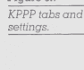

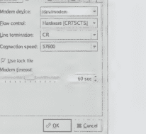

如果出现错误，首先检查“设备”选项卡下“调制解调器设备”（Modem Device）中 KPPP 用于查找调制解调器的设备位置。这是一个下拉列表，您可以选择不同的项，并不断选择“查询调制解调器”，如果您想尝试这种碰运气的方法的话。如果 KPPP 无法找到您的调制解调器，很可能是因为它与 Linux 不兼容。

4.  接下来，转到“帐户”（Accounts）选项卡。点击“新建”（New）以添加一个新帐户。然后，您可以使用设置向导以及您的互联网服务提供商（ISP）提供的设置。
5.  关闭您可能仍然打开的所有配置窗口。在 KPPP 主窗口中，从“连接到”（Connect To）字段中选择您的新帐户。您还需要填写“登录 ID”和“密码”字段。

现在，您应该准备好尝试连接了。您将听到调制解调器发出的所有令人毛骨悚然的声音。连接成功后，KPPP 窗口将最小化为面板上的一个图标。

### 拨号设置信息

> 您的互联网服务提供商可能提供了在 Windows 中设置拨号连接的说明。不要因此感到困惑，因为您在 Linux 中所需的信息就包含在其中。您需要匹配类似的信息。最有可能的是，您只需要电话号码、用户名和密码，但也可能需要 DNS 或 IP 信息。最重要的是，不要让您的 ISP 吓住您。如果他们说不支持 Linux，请坚持要求他们提供您所需的信息片段。

## 宽带和局域网

Linux 喜欢您。宽带连接（如有线电视或 DSL）以及局域网（LAN），例如在办公室和一些家庭中找到的那种，是在 Linux 中操作最容易的连接类型。在办公室环境中，您需要从网络管理员那里了解您的办公室是否使用动态主机配置协议（DHCP），或者是否需要特定的 IP 信息。在家中，使用有线电视或 DSL 连接时，您需要从 ISP 那里了解它是使用 DHCP 自动分配地址，还是您需要 IP 和其他网络配置信息。一些有线电视互联网提供商还要求您在网络设置中为您的计算机指定一个特定的名称，因此请确保您获取了所有必要的信息。

如前所述，对于拨号调制解调器用户，您可能会遇到来自 ISP 的一些态度问题。许多 ISP 声称他们不支持 Linux。如果您最终不得不向 ISP 询问网络配置信息，请态度坚定。您不是在请求他们支持 Linux；您只是在请求网络信息。坚持获得您需要的帮助和信息：因为您是他们服务的付费者。

### 在 Fedora 中设置连接

网络配置窗口（见图 3.8）是输入任何 IP 或其他网络信息的地方。您可以通过转到主菜单并选择“系统设置 > 网络”来打开网络配置窗口。在输入任何信息之前，系统会提示您输入 root 密码。

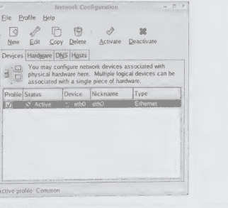

**图 3.8**

> Fedora 中的网络配置工具。

网络配置工具包含一个菜单、一个工具栏和一系列四个选项卡。在菜单选项中，您可以保存更改、管理多个配置文件以及访问帮助文档。工具栏的选择会根据您所在的选项卡而变化。

**设备选项卡。** 第一个选项卡列出了您计算机上配置的网络设备。这些不是物理设备，而是指虚拟连接。对于系统中的每个物理网络硬件，通常都有一个列出的设备。您还可以将一个硬件关联多个设备。

**硬件选项卡。** 在此选项卡上，您可以配置网络卡。通常，安装在安装过程中设置好的设置就可以了。

**DNS 选项卡。** 如果您的网络使用 DNS，您可以输入主机名和 DNS 地址。

**Hosts 选项卡。** 您可以为网络中的计算机输入特定的 IP 地址和主机名。如果您的网络使用 DNS，这些设置将覆盖 DNS 设置。


### 在 Fedora 中设置局域网连接

如果您在安装 Fedora 时计算机中已经安装了网卡，您的设置可能已经正常。如果您需要安装新的网卡或配置连接，请按照以下步骤操作。

1.  从主菜单中，转到“系统设置 > 网络”以打开网络配置窗口。系统会提示您输入 root 密码。
2.  点击工具栏上的“新建”（New）。您将看到“添加新设备类型”向导（见图 3.9）。选择您要添加的连接类型——在这种情况下，很可能是以太网连接（Ethernet Connection）。
3.  您将看到计算机上硬件的列表。选择您的网卡并点击“下一步”（Forward）。
4.  在家庭网络上，最简单的方法是使用 DHCP 自动分配和获取网络上的 IP 地址。如果您使用 DHCP，您在这个屏幕上唯一需要做的就是选择“自动获取 IP 地址设置”（Automatically Obtain IP Address Settings），然后在下拉列表中选择 DHCP。如果您的 ISP 要求，您还可以勾选“从提供商自动获取 DNS 信息”（Automatically Obtain DNS Information from Provider）旁边的复选框。如果您在网络中没有使用 DHCP，您可以选择“静态设置 IP 地址”（Statically Set IP Addresses）。如果您选择这条较难的路径，我假设您要么知道要输入的 IP 信息，要么可以向您的网络管理员索取。
5.  最后一步是点击“应用”（Apply）以结束向导。新连接（或者用 Fedora 的词来说是设备）现在列在“设备”选项卡中。


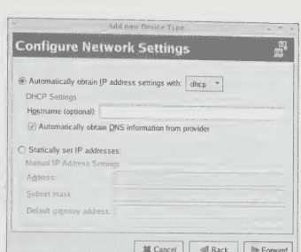

## 图 3.9

Fedora 中的“添加新设备类型”窗口，用于输入 IP 信息。

## 在 Mandrake 中设置您的连接

还记得 MandrakeLinux 控制中心吗？我们要回到那里。打开控制中心并选择“网络 & 互联网”。现在您这里有更多的选项可供查看。该类别中的大多数图标都是面向任务的，因此如果您想添加新的连接，请选择“新连接”。以下是这些图标各自的用途说明。

-   **新连接。** 这将打开一个向导，您可以添加 Mandrake 知道的任何一种可用的互联网连接，包括调制解调器、局域网（LAN）和无线网络。
-   **互联网访问。** 此选项卡上的许多字段都是用于输入您在添加新连接时应填写的信息。此模块为您提供了一个快捷方式，用于编辑或输入 DNS 和主机名信息。
-   **管理连接。** 顶部有一个下拉菜单，您可以从中选择一个连接以编辑设置。下方有几个选项卡，您可以在此编辑 IP 和其他网络信息。
-   **监控连接。** 在这里您可以查看已配置连接上的活动情况。显示的信息包括发送和接收的数据量以及速度。
-   **移除连接。** 此模块在下拉选择列表中列出了您的连接，以便您根据需要选择其中一个进行删除。
-   **代理。** 如果您位于代理服务器之后，您可以在此处输入代理的地址信息。
-   **互联网连接共享。** 如果您位于一个小型或家庭网络中，而该网络没有充当其他计算机互联网连接专用服务器的计算机，那么必须有一台计算机站出来自愿承担此任务。如果您的计算机是网络中直接连接到互联网的那一台，此模块将通过一系列选择向导引导您操作，以便您可以将该连接共享给网络上的其他计算机。

## 工具包：3.5

### 在 Mandrake 中设置您的局域网连接

Mandrake 将所有功能集中在一个地方，使其更易于查找，但某些工具的界面略显笨拙。尽管如此，它是一个向导，所以我们一步步进行。

1.  从 MandrakeLinux 控制中心，点击“网络 & 互联网” > “新连接”。
2.  第一步是选择连接类型。点击“局域网连接”，然后点击“下一步”。
3.  从列表中选择您的网卡，然后点击“下一步”。
4.  现在您可以选择是使用 DHCP（自动 IP）还是手动输入您的网络 IP 信息（手动配置）。DHCP 是最简单的选择。如果您想手动输入所有内容，我假设您已知晓您的 IP 信息。
5.  根据您的 DHCP 或手动配置选择，下一个屏幕看起来会不同。在任何情况下，您都有几个不言自明的复选框需要完成。如果您不确定选择什么，默认设置是合适的。
6.  您的下一步是可选地为您的计算机输入一个主机名。点击“下一步”后，有一个选择项用于输入 Zeroconf 主机名。Zeroconf 是一种新的网络协议，旨在简化当前专有协议的混乱局面，使网络更简单。您可能不使用此功能，但在此框中重新输入您的计算机名称并点击“下一步”也无害处。
7.  系统会询问您是否希望重启网络。当然希望。是。此操作将重启网络服务。
8.  阅读令人愉快的“恭喜”屏幕并点击“完成”。

## 无线

许多家庭和企业现在都在使用无线网络。您可以前往许多公共无线“热点”，从图书馆、棒球体育场到咖啡店，都能上网。一些著名的 ISP 正在向拥有宽带服务的新客户提供无线路由器。

Linux 中的无线支持是新的，因此可能仍然不稳定。设置无线连接并使其在 Linux 中工作需要做一些额外的工作。如果您尚未决定是否使用无线，请确保考虑所有原因。

如果您...无线对您可能很有意义：

-   您有一台带有无线网卡的笔记本电脑。
-   您有家庭网络，且很难将网络电缆穿过整个房屋。
-   您已经居住或工作在一个拥有现有无线网络的地方。
-   您主要使用计算机进行电子邮件、互联网浏览、音乐、办公应用程序以及其他不需要持续高速带宽的基本桌面功能。
-   您愿意花时间并耐心地配置和加固您的无线连接。

如果您...请三思而后行使用无线：

-   您有一台不常移动的台式计算机。
-   您在线进行许多带宽密集型活动，可能会感到无线相比宽带有线网络的带宽容量受限。
-   您不想花费时间和金钱来设置和配置无线网络，或确保其安全。
-   您从未希望能在咖啡店里一边喝咖啡一边浏览互联网。

## 获取什么

基本的无线网络由互联网连接、无线路由器或无线接入点，以及一台带有无线网卡的计算机组成。

## 无线协议选择

目前有三种常见的无线协议。协议是数据传输的格式。当您去购买无线硬件时，您需要熟悉不同的协议，以便为您想要使用的协议选择合适的硬件。

### 802.11a

该协议目前主要用于大型办公室。802.11a 远不如 b 或 g 常见。您可能不会使用这个。

### 802.11b

这是目前使用最广泛的协议。以 11Mbps 的速度，802.11b 比 g 慢，但 b 是大多数公共无线热点在咖啡店、机场、酒店和一些大学校园中使用的协议。802.11b 卡在 Linux 中也有最好的支持。

### 802.11g

802.11g 的 54Mbps 速度使其成为最快的协议，但 Linux 对许多 g 网卡的支微不足称。请在网上查看哪些最新的 g 协议卡得到支持。如果您确实购买了 802.11g 硬件并且有一台笔记本电脑，请购买同时也支持 b 协议的硬件；这样当您在外出时尝试上网时，就具有了灵活性。

您购买的无线接入点或路由器的选择与您的 Linux 系统无关。这两者永远不会相遇。购买您认为最符合您需求的接入点或路由器。您购买的无线网卡（NIC）与您的 Linux 系统关系很大。目前，Linux 对无线网卡的支持最好是在 PC 卡上。虽然也有可以通过 PCI 插槽或 USB 端口连接到计算机的无线 NIC，但此类卡片的驱动程序不容易获取。坚定的用户可以尝试搜索并安装其他类型网卡的驱动程序，但大多数用户应坚持使用 PC 卡。您可以在网上找到有关 Linux 系统无线硬件的最新信息和购买建议。一个很好的网站是 [http://www.hpl.hp.com/personal/learn_Tour/lhelles/Linux/](http://www.hpl.hp.com/personal/learn_Tour/lhelles/Linux/)。新硬件不断涌现，因此请搜索在线以查找最新信息。

## 配置您的无线网接入点或路由器

要设置您的接入点或路由器，您需要随附的手册。设置光盘和说明可能是为 Windows 用户编写的。如果您的家庭或办公室除了 Linux 系统外还有 Windows 计算机，请保留该软件。按照手册中的说明将设备连接到您的网络上。这通常涉及将接入点或路由器连接在网络上的某个位置，位于您的宽带连接和计算机之间。当设备连接在网络中并接通电源后，通常可以在 Web 浏览器中访问手册中列出的 IP 地址。从浏览器中的配置屏幕，您可以更改设备上的设置。

> **SPEED RACER**
> 对更多带宽、更多速度、更快处理器和更多内存的需求是一个常见的迷思。大多数人不需要如此强大的计算能力和速度来处理日常任务，同样的道理也适用于更快的互联网连接。如果您只使用计算机进行轻量级互联网浏览（不经常观看大量在线电影或加载流媒体）和电子邮件，您可能完全可以适应较慢的 802.11b 协议。

## 无线安全

不要将您的无线网络开放。虽然这种做法很常见，看起来无害，但这恰恰是在自找麻烦。开放的无线网络是向恶意人员发出公开邀请，让他们进行可追溯到您的互联网连接的在线操作。您不希望自己处于需要试图证明清白的境地。您能向 RIAA 或其他媒体组织证明您没有进行那些非法的文件共享吗？您能向您的 ISP 证明您没有发送那些垃圾电子邮件吗？您能证明您没有在网上上传儿童色情内容吗？如果您的互联网连接被使用，这些都是很难证明的。查看您的无线接入点或路由器手册，了解如何设置以下三件事：

-   启用 WEP 安全
-   启用 MAC 地址过滤
-   关闭您的网络 SSID 广播

如果您遇到很多麻烦，且家里有一台 Windows 计算机，不要害怕作弊。在 Windows 计算机上使用随附 Windows 软件的硬件来进行接入点或路由器的初始配置。无线硬件制造商将所有内容偏向 Windows 并非您的错或 Linux 的错。您可以在初始配置完成后转到您的 Linux 计算机，通过 Web 浏览器管理页面更改更多设置。

## 配置您的无线网卡

您需要做的第一件事是让您的 NIC 连接到您的计算机并被 Linux 检测到。对于最常见的无线 NIC 类型——PC 卡，将其插入计算机上的 PCMCI A 插槽。查看卡片是否被检测到的最简单方法是查看您的硬件浏览器，看它是否列出。


## Fedora 的无线故障

尽管此错误可能已在 Fedora Core 3 及更高版本中修复，但无线网卡仍然可能存在无法正确安装的问题。为了彻底解决这个小故障，您需要从系统中移除并重新安装该网卡。

- 进入 Fedora 的网络配置界面，依次选择主菜单 > 系统设置 > 网络。
- 在“硬件”选项卡中，点击无线网卡，然后点击“删除”。关闭窗口。
- 现在通过主菜单 > 系统工具 > 互联网配置向导将该网卡添加回来。
- 您正处于添加网络连接向导界面。选择无线连接选项，然后点击“下一步”。
- 逐步完成向导，从列表中选择您的无线网卡。默认的选项可以直接接受；然后点击“下一步”。
- 完成后，重启您的计算机。

这些步骤应该能解决大多数无线网卡问题，但总有例外。请务必仔细检查您的无线网卡与 Linux 的兼容性。

接下来，您需要配置 Linux 中的无线连接。建议在无线接入点或路由器的信号覆盖范围内进行此项配置，以便确认是否成功。在 Fedora 和 Mandrake 中，您可以通过执行与配置局域网连接相同的步骤来设置无线连接。只需选择“无线”作为连接类型，然后逐步完成向导即可。人们在 Linux 中配置无线连接时遇到的大多数问题都是由于硬件不兼容导致的，因此请确保您的无线网卡确实能在 Linux 下正常工作。

## 安装新软件

大多数 Linux 发行版都附带大量的软件。在 Fedora 和 Mandrake 中，您的安装光盘上已经包含了完成大多数常见计算机任务所需的软件。你为什么还需要更多软件？因为越多越好。因为我们是人类。因为我们贪婪。因为我们想要拥有一切。因为，“你们所有的基地都归我们所有。” 真正的理由当然是，在计算机领域，总是有新的程序、新的选项和新版本可供下载和安装。保持最新状态并尝试新程序构成了大多数计算机用户充满活力的核心。

### 按合理性顺序安装新软件

由于在 Linux 系统中安装新软件的来源和方法多种多样，您可能不知道从哪里入手。您不希望因安装错误版本或配置某个版本而陷入困境，结果导致比使用更合适的版本产生更多的工作量。为了避免挫败感，请按照合理的顺序查看这些安装新软件的途径：

1. Apt、Yum 或 Mandrake Update
2. 您的安装光盘
3. 从开发者或公司网站下载的 RPM 包
4. Sourceforge.net
5. Rpmfind.net 或 rpm.pbone.net
6. 用于安装的源代码压缩文件

如果您按此顺序查找新软件，通常可以节省时间，避免不必要的依赖问题、错误或配置调整。

是的，是的，在 Linux 中，选择总是存在。如果您厌倦了听我这样说，那就习惯它吧。选择的丰富性是 Linux 事物固有的特征。就安装新软件而言，基于您所使用的发行版，您有一些共同的选择，也有一些不同的选择。

### RPM 文件

使用软件包是 Linux 中安装新软件最有效的方式。Fedora 和 Mandrake 都使用 RPM 软件包来安装程序。RPM（Red Hat Package Manager）文件是 Linux 中最接近标准程序安装器的格式。RPM 软件包包含安装文件以及关于在哪里安装软件包文件的说明。系统目录的位置因发行版而异，并非所有发行版都能使用 RPM 文件。对于基于 RPM 的发行版（包括 Fedora、Mandrake、SUSE 和 Yellow Dog），程序通常针对不同的 Linux 发行版拥有不同的 RPM。RPM 软件包还可以针对您计算机的 CPU 架构进行特定设置。您可能在软件包文件名中看到架构标识。您可以使用文件名中的这部分来选择最适合您系统的**软件包**。为了适配以下 CPU，请在软件包名称中查找以下**文本**：

- **i686**：Pentium II CPU 或更高
- **i586**：Pentium 级 CPU 或更高
- **i386**：386 级 CPU 或更高
- **ppc**：Apple Macintosh Power PC
- **noarch**：可用于任何 CPU

您可以轻松地在 Fedora 和 Mandrake 中通过双击文件管理器中的 **RPM** 文件来安装 **RPM** 文件。您也可以使用终端安装 **RPM** 文件，从而对安装选项拥有更多的控制力。

### 处理 RPM 的多种方法

您是否认为安装 RPM 文件的方法更多？叮！您说得对。除了我们在工具包中讨论的安装方法外，Fedora 的软件包管理器和 Mandrake 的 RPMDrake 都可以安装 RPM 软件包。这两个工具都易于使用，但仅限于安装光盘上的程序和版本号。要使用 Fedora 软件包管理器或 Mandrake 的 RPMDrake，请进入您的主菜单：对于 Fedora 软件包管理器，选择**系统设置 > 添加/删除应用程序**。对于 Mandrake RPMDrake，选择**系统 > 配置 > 打包 > 安装软件**。

在 Fedora 中我更喜欢 Apt 或 Yum，在 Mandrake 中更喜欢 Mandrake Update 来安装新程序和进行更新，因为这些程序更加稳健。它们各自都能从其相应的在线源拉取更新的软件。

这是好消息。想要坏消息吗？坏消息是，每安装一个 RPM 文件，您的计算机寿命就会减少一年。这就像让您的计算机患上慢性终身吸烟症。RPM 会阻碍您计算机的生长。

当然这些都不是真的，但我只是想看看您是否至少有一秒钟信以为真。

关于 RPM 文件的坏消息可以用一个词来概括：依赖项。有些 RPM 可以立即安装且没有问题。其他 RPM 则要求您先安装额外的 RPM 软件包；这些必需的包被称为依赖项。这可能会在您和计算机之间引起令人沮丧的交互。以下是一个依赖项错误消息的示例：

```
# rpm -ivh coffee-1.3.3-lmdk.l586.rpm
error: Failed dependencies:
	coffee-kword is needed by coffee-1.3.3-1mdk
	coffee-kspread is needed by coffee-1.3.3-lmdk
	coffee-karbonis is needed by coffee-1.3.3-lmdk
```

从该输出可以看出，当我尝试使用终端命令安装该 RPM 文件时，我得到了一个错误消息。错误消息告诉我，在我想要安装的软件包之前，需要安装另外三个软件包。仔细阅读错误信息，我发现所需的依赖项名称是 **koffice-kword**、**koffice-kspread** 和 **koffice-karbon**。处理 RPM 依赖项的最佳且唯一的方法是冷静地查看所需的软件包，然后在线查找它们，无论是通过我们稍后将讨论的某个更新工具，还是在线查找单个 RPM。

### 安装 RPM 文件

让我们获取一个您可能还没有的程序。SourceForge.net 上有一个名为 **elapse** 的小型计时器/闹钟程序。从 http://sourceforge.net/projects/elapse/ 下载适用于 Linux 的 RPM 文件，并将其保存到您的主目录。您的具体文件名可能会有所不同，因为您可能会下载该程序的更新版本。您来自未来。它在那里吗？未来的机器人和您在一起吗？我们将通过两种方法安装 Elapse：通过文件管理器和通过终端。

您需要成为 root 用户或输入 root 密码才能安装 RPM 文件。

### 从文件管理器安装

- 打开您选择的文件管理器，Konqueror 或 Nautilus。导航至您的主目录。
- 双击 RPM 文件。系统会提示您输入 root 密码，请输入该密码。您可以在图 3.10 中看到 Fedora 中的安装效果。

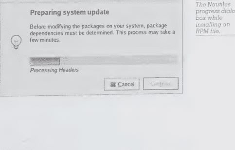


## 3. 完成。你基本上已经做完了。除非出现错误信息，否则该软件包已安装。如果成功，你可以删除 RPM 文件。

### 从终端安装

- 1. 打开你选择的终端，例如 GNOME Terminal 或 Kshell。转到你的主目录：
```bash
$ cd ~
```
- 2. 成为 root 用户并输入你的 root 密码：
```bash
$ su
```
- 3. `rpm` 命令有许多可选开关（命令开关是你在命令后添加的字母或单词选项）。阅读 `rpm` 命令的 man 文件以了解更多信息。对于安装单个软件包，我们将使用这些：
```bash
# rpm -ivh elapse-0.2-1.i386.rpm
```
`i` 表示我们正在进行安装。`v` 表示我们希望命令输出详细状态，这样我们就能看到正在发生的事情。`h` 要求 `rpm` 显示一个带进度条的哈希标记对话框，因为这看起来很有趣。因此，我们看到以下输出：

```
Preparing...    ########################################### [100%]
   1:elapse ########################################### [100%]
```

哈希标记显示了进度，并且当所有操作完成后会通知我们。

- 5. 如果成功，你可以注销 root 用户（按 Ctrl+D）并删除 RPM 文件。

## 如何卸载 RPM 文件

从系统中删除任何软件包都很容易。你需要在终端中删除软件包。作为 root 用户，使用此命令来卸载 RPM：

```bash
# rpm -e [package name]
```

如果其他软件包需要该软件包，你会看到一个错误，告诉你哪个软件包使用了你试图删除的软件包。如果遇到这种依赖错误，你应该三思而后行是否要卸载该软件包。确保所有相关的软件包不是你需要的程序。

# Apt 和 Synaptic

| **程序信息** | |
|---|---|
| **Fedora/GNOME 菜单** | Synaptic: System Settings > Synaptic Package Manager |
| **终端命令** | apt-get |
| **程序 URL** | http://apt.freshrpms.net |

我无法保持客观。我喜欢 Apt。Apt 是自切片龙猫以来最伟大的事物。我想那实际上可能不是一件好事，但你知道我的意思。Apt 最初是为另一个发行版 Debian 开发的程序。然后世界上聪明的人意识到 Apt 非常酷，其他 Linux 用户也应该能够使用它。现在我们有了用于 RPM 的 Apt。Apt 之所以很棒，是因为它解决了 RPM 软件包系统中已存在的依赖问题。使用 Apt，你可以连接到充满 RPM 的在线服务器（存储库）并请求你需要的软件包。如果需要其他软件包，Apt 会继续安装这些依赖的软件包。目前，Apt 没有适用于 Mandrake 的稳定版本，但有些用户正在努力解决这个问题。

## 神奇的 Apt 命令

你可以使用 Apt 非常轻松地保持 Fedora 安装的最新状态，但你首先需要确保你的 Apt 存储库列表保持最新。在使用 Apt 安装任何东西之前，始终使用此命令重新同步存储库：

```bash
# apt-get update
```

现在你准备好使用此命令安装程序：

```bash
apt-get install {package name}
```

要更新你的整个系统，使用此命令：

```bash
# apt-get dist-upgrade
```

Apt 是一个你在命令行使用的程序，但你也可以使用 Synaptic，它是 Apt 的图形用户界面（GUI）前端。Synaptic 为你提供了一个管理软件包和存储库的非常简单的界面。你可以看到你已安装哪些可用软件包，哪些你可能想要安装，以及哪些需要更新。

# 使用 Apt for Fedora 安装 Synaptic

- 1. 从 [http://apt.freshrpms.net/](http://apt.freshrpms.net/) 下载 Apt 副本并安装它。FreshRPMS 应该是你关于 Apt 相关事项的第一站；该站点拥有最可靠的存储库并保持最新。关于如何安装 Apt RPM 软件包，你可以参考最后一节关于 RPM 文件的内容（参见 ToolKit 3.6）。
    - *请记住，你需要 root 密码来安装 RPM 文件。使用 Apt 也需要你的 root 密码。*

- 2. 始终如此，在你做任何事情之前，需要重新同步你的 Apt 存储库：
```bash
# apt-get update
```
等待大量关于 Apt 正在做什么的信息滚动显示。Apt 正在联系你列出的存储库并获取最新的 RPM 头文件。

- 3. 接下来，下载并安装 Synaptic。看看这有多简单：
```bash
# apt-get install synaptic
```
砰。就这样。Apt 搜索其存储库列表，然后给你这样的输出：

```
Reading Package Lists... Done
Building Dependency Tree... Done
The following NEW packages will be installed:
  synaptic
0 upgraded, 1 newly installed, 0 removed and
108 not upgraded.
Need to get 1114kB of archives.
After unpacking 4554kB of additional disk space will be used.
Get:1 http://ayo.freshrpms.net fedora/linux/2/i386/freshrpms
  synaptic 0.52-1.1.fc2.fr [1114kB]
Fetched 1114kB in 7s (154kB/s)
Committing changes...
Preparing... ########################################## [100%]
1:synaptic  ########################################## [100%]
Done.
```

你可能会礼貌地询问是否允许安装软件包。你应该礼貌地回答肯定。

- 4. 你现在可以通过转到主菜单 > System Settings > Synaptic Package Manager 来打开 Synaptic（见图 3.11）。

### 图 3.11

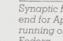

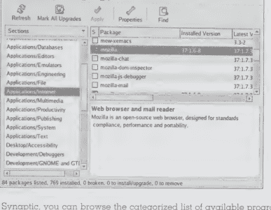

在 Synaptic 中，你可以浏览可用程序的分类列表。每个类别中的程序显示在右侧，图标指示程序是已安装、需要更新还是未安装。你可以双击任何你想要安装、更新或卸载的程序。点击工具栏上的 Apply 按钮来提交你的更改。

# Yum

## 程序信息

| 程序信息 | |
|---|---|
| **终端命令** | yum |
| **程序 URL** | http://apt.festhrmpg.net |

Yum（Yellow Dog Updater Modified）很像 Apt。就像 Apt 一样，Yum 是为另一个 Linux 发行版 Yellow Dog 开发的。就像 Apt 一样，Yum 是一个命令行更新工具。就像 Apt 一样，你需要安装或更新程序的命令直观且易于记忆。Yum 不仅是一个自动更新器，它也是 RPM 的软件包管理工具。如果你通过 Yum 安装 RPM 时有必需的依赖项，它会为你找出并安装这些依赖项。你可以使用 Yum 代替或补充 Apt 或 Up2date。Yum 默认安装在你的 Fedora 系统上，但目前对 Mandrake 不可用。

> 更新系统的图形用户界面（GUI）方式。该程序运行良好且非常易用，但正在逐渐被 Apt 或 Yum 取代。Apt 和 Yum 都是更灵活、更强大的更新工具。

# Apt 和 Yum 存储库文件

你可以在它们的源文件中添加或删除 Apt 和 Yum 的存储库：

- Apt：`/etc/apt/sources.list`
- Yum：`/etc/yum.conf`
- Synaptic：主菜单 > System Settings > Synaptic Package Manager

许多个人和团体维护难以找到的附加软件包的存储库。其中一个最好的来源是 Dag Wieers 存储库（参见 `http://dag.wieers.com/home-made/apt/`）。只需记得如果你执行 `apt-get dist-upgrade` 或 `yum update`，不要包括那些怪异的额外存储库源。如果你没有在全局更新期间移除这些新源，你将面临使某些软件包不可用的风险。

由于 Yum 随 Fedora 提供，它最初使用 Fedora 存储库。如果你愿意，可以添加其他存储库。在使用 Yum 之前，使用终端命令 `su` 成为 root 用户。在每次会话中第一次使用 Yum 时，你需要更新 RPM 头文件的数据库：

```bash
# yum check-update
```

第一次这样做可能是一个冗长的过程，但后续就不那么糟糕了。更新系统或安装程序很容易。

要更新已安装的软件包，使用此命令：

```bash
# yum update
```

要安装新软件包，使用这一个：

```bash
# yum install [package name]
```

就像 Apt 一样，Yum 非常容易使用。与 Apt 不同的是，没有常用的图形用户界面（GUI）前端比 Synaptic 更好用来替代命令行。


# Mandrake 更新

## 程序信息

**Mandrake/KDE 菜单**：系统 > 配置 > 软件包管理 > Mandrake 更新

**终端命令**：MandrakeUpdate

你也可以轻松更新你的 Mandrake 系统。Mandrake 更新（见图 3.12）是一个实用工具，它使用 Mandrake 程序 RPMdrake，并结合了从在线源获取更新包的能力。不幸的是，该工具仅安装更新，并没有提供安装全新程序的界面。

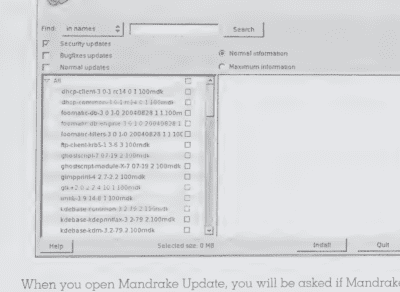

当你打开 Mandrake 更新时，系统会询问你是否希望 Mandrake 获取一个可供选择的服务器列表并展示给你。你可以选择任意一个看起来合适的服务器。随后主窗口启动。更新被归类并以可展开的列表形式显示在窗口的右侧。当你点击某个包名使其高亮时，该包的详细信息会显示在右侧。每个可用的更新旁边都有一个复选框。只需勾选你想要安装的更新，准备好后点击“安装”按钮即可。


# 给某个地方某人的开放信件

致 创造我想要的 Linux 事物的人们，

请为 Mandrake 制作 Apt 和 Yum 的版本。是的，有 **URPMI**（一个用于 Mandrake 的类似命令行程序）。是的，有 Mandrake 更新。但这还不够。那些工具尚可，但如果有适用于 Mandrake 的 Apt 和 Yum 版本，将有助于我们在 Linux 软件安装方面走向更高的标准化。适用于 Mandrake 的 Apt 和 Yum 会使一切变得不那么令人困惑。我知道人们现在正在为此努力，但让我们让这项努力更加活跃。适用于 Mandrake 的 Apt 和 Yum 将治愈癌症、长出花朵，并让我们所有人都免费获得饼干。请为我制作它们。现在就为 Mandrake、为我制作它们。

真诚的，
Susan

# 从源代码安装程序

回到旧时光，我们必须上山去安装程序——上下都是上坡，深达 4 英尺的雪地里，没有穿鞋，还拖着一匹死马。而且我们喜欢那样！我们必须从源代码安装所有新程序。你可能以前从未听说过这种方法。从源代码安装是开源软件的一个独特优势。既然源代码对任何人开放，你可以下载该源代码——如果你知道怎么做，甚至可以编辑它——然后自己编译程序。当你从源代码安装时，你是在为你的特定架构和你的特定计算机安装程序，并且你是手动完成的。虽然这种方法不像点击 RPM 文件那样容易，但它可能为你提供更高效的程序，因为它是为你的系统构建的。如果这听起来很难很复杂，别担心；确实如此。但是，你可以遵循几个简单的步骤，以确保通常能顺利安装程序。

# 从源代码安装程序的 7 个神奇步骤

- 1. 确保你的发行版中已安装开发包。这些是你初始 Linux 安装中作为类别列出的软件开发包。如果你没有开发包，可以从安装盘中添加它们。
- 2. 下载源代码，通常是压缩的 `.tar` 或 `.tar.gz` 归档文件。
- 3. 使用文件管理器或命令行解压归档文件。
- 4. 打开一个终端，使用 `su` 命令成为 root 用户。然后进入由解压归档创建的新目录。
- 5. 输入命令 `configure`。
- 6. 输入命令 `make`。
- 7. 输入命令 `make install`。

没错，这些步骤比一步式的 RPM 安装要难，但也不是太难。如果没人创建该程序的 RPM 包，有时从源代码安装程序是你唯一可用的途径。关于最后三个步骤的更多细节和一个示例，请参见 3.8 工具包。从源代码安装程序的一个缺点是，与使用 RPM 包安装的程序相比，卸载程序要困难得多。你必须找出每个由该程序安装的文件以删除它们。

# 工具包 3.8：从源代码安装 SourceForge.net 项目：`eLapse`

还记得我们作为 RPM 安装的那个开源计时器程序吗？让我们下载源代码并再次安装它。为了好玩，如果你之前用 `me` 安装了 RPM，请首先使用命令（作为 root 用户）`rpm -e eLapse` 卸载该程序，然后再安装。从 http://sourceforge.net/projects/eLapse/ 下载源代码文件 `eLapse-0.2.tar.gz`。

- 1. 打开一个终端，进入你下载压缩文件的目录。
- 2. 解压 tar 文件：
  ```
  # tar -zxvf eLapse-0.2.tar.gz
  ```
- 3. 解压归档创建了一个名为“eLapse-0.2”的新目录。进入该目录：
  ```
  # cd eLapse-0.2
  ```
  列出其内容以查看里面有什么：
  ```
  # ls
  ```
  你会看到很多文件。如果有 README 文件和/或 INSTALL 文件，这些是你应该阅读以获取说明的文本文件。此程序很小，其说明文件中没有太多额外信息，但其他程序可能会在这些文件中放置信息，从而为你节省大量时间。
- 4. 目录中有一个文件名为 configure。该文件实际上是一个程序，它检查你的计算机，以确保安装该程序所需的所有软件开发工具。运行 configure：
  ```
  # ./configure
  ```
  大量文本会滚动显示，其中一些是用 1960 年代《星际迷航》一集中某种晦涩语言编写的。你不必抓住所有内容；你可以等待最终结果。如果你缺少程序需要的某些东西，你会看到一个错误，可以向上滚动查看缺少什么。如果你缺少某个部件，试着在你的安装盘中寻找它。如果成功，你通常会再次看到命令提示符。
- 5. 现在你准备好编译程序了。你使用名为 make 的程序来编译源代码：
  ```
  # make
  ```
  更多杂乱无章的文本滚动过去。如果一切正常，你将再次看到命令提示符。
- 6. 现在你有了这个程序。你可以从你所在的目录运行它。但是，该程序在你的系统中并不作为一个命令可用。要使其成为命令，你需要再做一件事：
  ```
  # make install
  ```
- 7. 现在你已从源代码安装了程序。你可以退出此目录并通过删除压缩文件及其生成的目录来清理所有内容。你应该能够输入 elapse 来运行程序。

# 链接

- GKrellM: http://www.gkrellm.net/
- Linux Printing: http://www.linuxprinting.org
- Linux Printer Compatibility Database: http://www.linuxprinting.org/printer_list.cgi
- Paper Airplane Resource Center（最佳打印机测试页用途）: http://www.paperplane.org/
- 使用其余的打印机测试页来折叠纸帽子: http://www.cs.uu.nl/~hansb/d.organi/traditional/hat.html
- 给自己订几条新内裤: http://www.treshpa1r.com/
- Winmodem 列表: http://www.devical.tv/-chris/winmodems/
- 让你的 Winmodem 在 Linux 中运行: http://www.winmodems.org/ 和 http://11dp.org/HOWTO/Winmodems-and-Linux-HOWTO-1.html#ssl_3
- 基本网络信息: http://www.linksys.com/faq/default.asp?faqid=16 和 http://computer.howstuffworks.com/home-network/1.htm
- Linux 无线网络指南: http://www.hpl.hp.com/personal/Jean_Toullieres/Linux/
- Sourceforge.net（获取开源软件的好地方）: http://www.sourceforge.net
- RPMFind.net（RPM 文件搜索引擎）: http://www.rpmfind.net
- RPM.pbone.net 搜索引擎: http://rpm.pbone.net/
- Freshrpms.net 上的 Fedora 的 Apt 和 Yum: http://apt.freshrpms.net/
- eLapse 计时器程序: http://sourceforge.net/projects/elapse/

# 你的偏好是什么？

有点小抽搐。我并没有完全 obsessive compulsive。我不必不断洗手，也不必确保将电灯开关打开和关闭特定次数。我的抽搐发生在我看到别人的桌面时。当你在使用电脑时，我从你身后走上来，看到默认的桌面壁纸，默认的图标，默认的任务栏项目，以及随你的桌面环境而来的所有相同颜色。

“Rrraaoouuuga！”我站在你正后方大声喊道。

你吓了一跳，转过身来。我不喜欢你脸上愤怒的表情。

“什么？”我问。

“为什么你要偷袭我并且大喊大叫？”你问道。

“我没有，”我声称。

你用难以置信的眼神和沮丧的鬼脸看着我。“我刚才听到了。你意思是说你没有做？你想要什么？”

我在想你今天有点情绪化，但好吧，我会宽容你一点。毕竟，你正在读我的书。“这是一个抽搐，你知道，一种 tic。就像 Tourette's syndrome。”

“那是否意味着你现在应该在骂我？”你问道。


“哦，不，妥瑞氏症有许多表现形式。事实上，认为大多数妥瑞氏症患者会说脏话这是一个常见的误解。发出噪音更为常见，”我善意地告知你。我拿出一个手提袋。“来，请拿这份关于妥瑞氏症的资讯手册。另外，这里还有一盘 ABC 电视台《20/20》节目关于妥瑞氏症的精彩录像带。芭芭拉·沃尔特斯（Barbara Walters）是新闻界的风范楷模和传奇人物，她主持过《20/20》。她让人流泪的速度比热柠檬汁滴在自伤的皮肉上还要快。她是不是很棒？”

“你又在做那个怪脸了。‘你想要什么？’你重复道。”

“嗯，其实我并没有得妥瑞氏症，但我实在无法忍受看到有人桌面壁纸都没有换过。这让我很难受。”

“我可以让你难受，”你说。

虽然我觉得这是一个善意的提议，但我不认为我会接受你的“邀请”。我提醒你，你应该是在外面传播我是天才的谣言，而不是来伤害我。

“我自定义桌面对你有什么影响呢？”你问道。

我深吸一口气，在你身边坐下。“拉把椅子过来。”你低头看你已经坐着的椅子。“好吧，我猜你有椅子了。只是在 Linux 中定制桌面的方方面面——字体、壁纸、颜色、窗口边框、图标……有着如此多的选项。当你什么都不改变时，我忍不住觉得你并没有尽情生活。这就像停下脚步去闻闻玫瑰的香气。这就像从未去梦想中向往的欧洲旅行。这就像没有抱抱你的泰迪熊。”

你把椅子往我这边挪得更远了一些。

“没关系，”我说。“我们会一起度过这个危机。让我们先看看你自定义桌面环境的所有方式吧。”

你移开了我搭在你肩上的手，继续把椅子往远处挪。你真幽默，总是开玩笑着说我觉得你很诡异。

## 你可以更改桌面上的哪些内容？

KDE 和 GNOME 拥有如此多的偏好设置选项，以至于你可以让桌面看起来与传统桌面完全不同（参见图 4.1）。你可以更改从桌面壁纸到窗口管理器主题，再到字体和图标的一切。KDE 和 GNOME 各自拥有帮助定制桌面使其独具个性的工具。

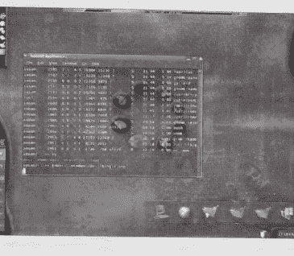

### 图 4.1
在此看到的一切都是 GNOME 中集成的桌面对象或面板。

## KDE 控制中心

### 程序信息
- Fedora/GNOME 菜单：首选项 > 控制中心
- Mandrake/KDE 菜单：系统 > 配置 > 配置您的桌面
- 终端命令：`kcontrol`

一站式购物。每个人都喜欢这个。KDE 控制中心让桌面配置和定制变成了一站式购物。在 KDE 控制中心中，你可以更改桌面环境的大部分偏好设置，从简单的任务（如更改桌面壁纸）到更复杂的任务（如安装字体和调整屏幕分辨率设置）。

正如我们在早期主题中讨论的那样，Mandrake 中的 KDE 版本与 Fedora 中的 KDE 版本不同。大多数更改是为了在 GNOME 和 KDE 之间标准化图标、主题、标签和工具，并采用它们的“Bluecurve”主题。KDE 控制中心在 Mandrake 和 Fedora 之间有几个不同的类别和项。让我们看看 Mandrake 版本。Fedora KDE 用户仍然可以跟随操作，但您可能需要在可展开的列表选项周围摸索，以定位一些已被重新排列的项目。

* kcontrol * 界面类似于许多 KDE 程序帮助部分。左侧列中有三个标签页，上方有一个简短菜单，右侧是一个内容区域。在这三个标签页中，你将在“索引”中花费最多的时间。“索引”是访问控制中心许多部分的可展开项目树状列表所在的位置。“搜索”标签页允许你通过关键字搜索你想要的内容，然后在下面的面板中显示控制中心的匹配模块。当你刚接触控制中心时，搜索模块会很有帮助，但我发现最好直接从“索引”顶部开始，顺着列表往下走，沿途调整我想要调整的一切。这样，下次使用控制中心时，我已经大致知道我想查找的偏好设置在“索引”中的位置。我倾向于做那种“四处摸索并找到东西”的人，而不是“搜索并摧毁”类型的人，所以使用最适合你的方法。从“帮助”标签页，你可以访问控制中心手册或阅读已打开模块的帮助主题。只需高亮列表中的一个子项，然后跳到“帮助”标签页查看该项的文本。

在“视图 > 模式”菜单下，你可以找到图标视图和树状视图。最好坚持使用默认的树状视图，因为图标视图杂乱且令人困惑。“设置”菜单下有快捷键选项。“帮助”菜单做的与“帮助”标签页相同，但标签页视图更易于查看和操作。

回到“索引”标签页是乐趣所在。树状视图中有 11 个项目，每个项目都有几个子项。一开始，所有选项可能看起来很吓人。花一点时间浏览列表，你将比仅通过常规使用一周所能获得的更了解 KDE 桌面的可能性。以下是每个主要类别的简要描述。

### 无障碍
针对残疾人士的设置位于“无障碍”模块中。你可以在“国家/地区 & 语言”中调整语言偏好，以及日期和货币信息的显示方式。你还可以按地区调整键盘布局。“键盘快捷键”模块对于高级用户以及残疾人士都很有用。更改和添加键盘快捷键时要小心。你可能会无意中更改特定于其他程序的键盘快捷键，或添加一个愚蠢的键盘快捷键，例如将空格键设置为某个操作，这会导致在打字时该动作频繁出现。

> 我首先去的地方是设置（或选项，或配置，或该程序中任何自定义菜单项）。调整设置是首先四处摸索、查看程序能做什么、你可以如何让它变得独一无二以及了解一些可用选项的最佳方式。当你在设置中看完后，使用程序一会儿，然后在你知道一些可能想要更改的事情后再次回到设置中。

### 组件
如果你计划使用 KDE 未默认选择的程序（例如电子邮件、文本编辑、终端以及许多文档、图像和多媒体类型的默认程序），那么“组件选择器”和“文件关联”模块对你来说很重要。“会话管理器”允许你调整在登录和注销 KDE 时自动发生的几件事。

### 信息
“信息”部分正如其名所示：信息。这里没有可供调整的设置，但你可以查看有关系统状态的信息。

### 外观与感受
这是大事。“外观与感受”部分包含大部分有趣的选项（参见图 4.2）。你可以更改桌面外观和感受的几乎一切。请查看表 4.1 中关于一些常见设置的路径。对于这些设置，直接操作比阅读说明更好。KDE 的特定项包括“行为”和“窗口行为”模块，你可以在其中更改鼠标焦点、系统行为以及窗口在最小化和关闭时的行为等。其余模块主要涵盖桌面环境的外观，所以尽情玩耍吧。

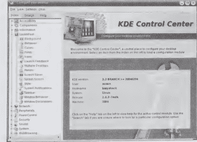

**图 4.2**
展开“外观与感受”部分的 KDE 控制中心。

### 网络
“网络”部分的大多数模块都有偏好设置，你也可以在单独的程序中设置。电子邮件模块的设置仅在你使用 KMail 作为电子邮件程序时适用。如果你在一个需要共同用户名和密码才能访问其他网络计算机上共享文件的局域网中，你可以在“本地网络浏览”模块中设置这些。在使用 Konqueror 和 Samba 浏览网络计算机时，这些设置是有效的。你可以摆弄“偏好”模块中的滑块，但它们很容易被保留原状。“代理”模块的设置需要有关你的网络和防火墙的信息。如果你在办公环境中，你的网络管理员应该可以帮助你。

### 外设
当仅使用命令行工具难以调整或添加复杂设备时，“外设”部分会很有用。你可以在“显示”模块中更改屏幕分辨率和伽马值，并处理多显示器。除非你知道显示器的正确范围，否则调整刷新率时要小心。键盘调整包括重复速率和延迟、小键盘锁定以及按键点击音量。对于鼠标，你可以调整右手或左手模式、点击偏好、光标主题和速度。“打印机”是一个重要模块，包含添加打印机、监控任务、设置网络打印机以及进行 PDF 转换的工具。

### 电源控制
“电源控制”部分只有一项。在这里，你可以启用或禁用电源管理。启用电源管理后，你可以调整计算机进入待机、挂起或关机状态前的时间，前提是设定时间内没有活动。

### 安全性
在“加密”模块中，你可以调整、添加或删除安全套接层（SSL）证书和授权。如果刚才这句话让你因技术无知而目眩神昏，请保持“加密”模块原样不动。


## 声音
说实话，大多数高级用户也不需要调整这些设置。KDE 钱包系统是一个用于方便在网页上使用个人信息、保存密码并简化生活的地方。任何旨在简化密码和安全生活的功能都会使这些信息面临潜在风险，因此请谨慎使用 KDE 钱包。

如果您熟悉声卡设置，声音部分的偏好设置将对您有用。新用户应不要触碰混合器和声音设置区域。只有在您喜欢被铃声不断打扰时，才勾选系统铃声区域的该复选框。

## 系统
您可以在系统部分安装新字体、添加键盘快捷键和鼠标手势（用于触发命令或动作的移动）、更改登录管理器头像的外观、更改系统密码以及调整默认目录路径。通过选择管理员模式并输入 root 密码，您还可以更改登录管理器的外观。KDE 性能模块是另一个需要谨慎对待的区域。您可以调整 KDE 使用的内存量，但保持默认的中间值是最好的选择。

## Web 浏览
Web 浏览部分的大部分偏好设置实际上是 KDE 中 Konqueror Web 浏览器的设置。当您打开 Konqueror 时调整所有这些偏好设置，以便您可以看到正在更改的内容。

KDE 控制中心中有如此多的选项，通过自己尝试这些选项，您会学到更多。不要担心会严重破坏系统。如果您担心，一次只更改一或两个设置，然后单击“应用”以查看更改。您还可以将鼠标手放在每个模块的“默认值”按钮上，随时准备单击以撤销所做的更改。

表 4.1 如何在 KDE 控制中心中找到常用偏好设置

| 偏好设置 | 位置 |
| :--- | :--- |
| **桌面壁纸/颜色** | **外观与感觉** > **背景** 或右键单击桌面并选择 **配置桌面** |
| **窗口主题** | **外观与感觉** > **颜色** 以更改单个颜色或加载和保存颜色方案<br>**外观与感觉** > **样式** 以使用主题更改窗口控件<br>**外观与感觉** > **窗口装饰** 以使用主题更改窗口边框和顶部按钮 |
| **文件关联** | **组件** > **文件关联** |
| **默认字体** | **外观与感觉** > **字体** |
| **屏幕保护程序** | **外观与感觉** > **屏幕保护程序** |
| **键盘和鼠标设置** | **外围设备** > **键盘**<br>**外围设备** > **鼠标** |
| **添加和配置打印机** | **外围设备** > **打印机** |
| **新字体** | **系统** > **字体安装程序** |
| **通知声音** | **外观与感觉** > **系统通知** |

### 工具包 4.1：

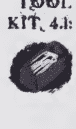

### 更改 KDE 壁纸、主题、窗口装饰和颜色
寻找与 KDE 外观相关内容的最佳地点，自然就是 `http://www.kde-look.org`。在 kde-look 上，您可以找到图标、壁纸、主题、启动画面以及您需要的一切。您仍然可以在其他地方寻找图标和主题，但 kde-look 拥有最大的收藏，并且是下载主题最安全的地方，以确保您不会下载到异常损坏的文件。

今天我们要从网站获取一个桌面壁纸。KDE 自带了许多不错的主题，所以我们将使用其中的两个用于样式和窗口装饰。

- 1. 启动 Web 浏览器并前往 kde-look.org。
- 2. 在壁纸类别下，导航找到适合您当前屏幕分辨率且您喜欢的壁纸。如果您不知道当前的屏幕分辨率，请在控制中心的外围设备 > 显示下查找。将您的壁纸保存到计算机上，放在您能找到的地方，或者创建一个文件夹，例如 /home/[username]/MyLook/。我选择了一个名为 Spot the Fish 的壁纸。
- 3. 打开 KDE 控制中心并进入外观与感觉部分。
- 4. 首先选择背景。在右侧的内容区域中，您应该看到两个轮廓分明的区域：背景和选项。在背景中，图片选项应该已经被选中。使用文件图标浏览您的新壁纸图像。我的位于 /home/susan/MyLook/2992-pinguin-1024.jpg。如果您选择的壁纸图像尺寸适合您的分辨率，只需单击应用即可完成。如果您有一个尺寸奇怪的图像，请使用位置下拉列表选择按比例缩放、居中或居中自动适应。您可以尝试每种设置后单击应用，然后查看壁纸，看看您最喜欢哪一种。
- 5. 在控制中心的外观与感觉部分，接下来前往样式。有三个选项卡。在样式选项卡上，使用组件样式部分中的下拉列表选择您喜欢的样式主题。选项卡的整个下半部分会为您预览每种样式。我将使用 Thememdk。当您做出决定后，单击应用。效果和杂项选项卡具有视觉效果功能，例如透明度和可拆卸菜单。一些效果对您的计算机处理器负担较重，因此在看到它们是否过度降低计算机性能之前，不要启用太多效果。
- 6. 前往控制中心外观与感觉列表中的窗口装饰部分。在窗口装饰选项卡上，使用下拉列表选择您喜欢的那一个。下方会为您预览。完成后单击应用。我将使用 Glow 主题。
- 7. 最后，您可以更改颜色以匹配。前往控制中心 > 外观与感觉 > 颜色。您可以从颜色方案选择框中选择预定义的方案，或者使用组件颜色下拉列表选择每种组件类型，然后在下方选择颜色来创建自己的方案。您还可以更改对比度。保存自定义方案是个好主意，这样如果您尝试一些更改后，就不必重新创建它。使用颜色方案选择框下方的保存方案按钮。我打算将我的命名为 Hoofooglers。完成后单击应用。
- 8. 关闭控制中心，欣赏您的创作。

您可以从 kde-look.org 下载新的 KDE 样式主题和窗口装饰主题。如果下载主题，请注意该主题页面上的安装说明。安装新主题类似于从源代码安装软件。您需要打开终端并遵循该主题的安装说明。确保您下载的主题适用于您的 KDE 版本。如果您不确定您的 KDE 版本号，请打开控制中心，不要单击或突出显示任何内容，在右侧内容区域查找“KDE 版本”旁边的数字。

## GNOME 控制中心

| 程序信息 | | |
| :--- | :--- | :--- |
| Fedora/GNOME 菜单 | *偏好设置 > 控制中心* 或桌面上的从这里开始图标 | |
| Mandrake/KDE 菜单 | *应用程序 > 系统 > 配置 > GNOME > GNOME 控制中心* | |
| 终端命令 | *gnome-control-center* | |

GNOME 实际上并没有一个控制中心。我认为他们开始将偏好设置模块的集合称为控制中心，是因为 KDE 是这么称呼的。名称 aside，GNOME 控制中心是 Nautilus 文件管理器中图标的一种视图（参见图 4.3）。除了主菜单和终端命令访问外，您可以以文件浏览模式打开 Nautilus 并在地址栏中输入 *preferences:/// 以访问控制中心图标视图。当然，Mandrake 和 Fedora 在 GNOME 控制中心中有一些差异。大多数差异在于使用的图标和附加在每个模块上的标签。

### 图 4.3
GNOME 控制中心视图包含主菜单上 *偏好设置* 菜单中找到的大多数项目。


由于 GNOME 控制中心仅由一组图标组成，您可以双击任何图标以访问该偏好设置模块的对话框。如果您想快速访问单个模块，可以从主菜单下偏好设置中的子菜单中选择它。其中一个主题选项不在控制中心。您可以在主菜单下的系统设置 > 登录屏幕中找到更改 GDM（登录管理器）主题的相关偏好设置。尽管 KDE 控制中心包含一些可被视为系统管理任务的项目，但 GNOME 控制中心仅包含个人偏好设置。GNOME 将所有系统管理任务保留在主菜单下的系统设置和系统工具中。让我们看看 Fedora 中的 GNOME 控制中心。

### 辅助功能
主菜单中的辅助功能选项是一个子菜单，因此在这里它通过打开两个额外模块图标的新图标视图来充当子菜单。辅助功能模块是残障用户调整键盘和鼠标选项以方便访问的地方。一些键盘设置会在键盘和鼠标模块中重复出现。在辅助技术偏好设置对话框中，您会找到屏幕阅读器、放大镜和屏幕键盘的选项。

### 更多偏好设置
更多偏好设置图标是另一个指针，它会打开包含其他五个图标的新图标视图。其中大多数选项是高级的、无需更改，或可以在其他地方访问。

### 关于我自己
如果您在安装过程中被要求提供姓名时不知道自己的名字，您有机会再次正确回答这个问题。如果您知道自己的电话号码和电子邮件信息，就可以获得额外加分。这些信息对于完成操作并不重要。请将登录 Shell 选项保持设置为 /bin/bash。

### CD 和 DVD
此模块是 GNOME 的一个出色补充。您可以设置当不同类型的 CD 和 DVD 放入驱动器时自动执行的操作。没错，GNOME 是从 Apple 那里借鉴了这个想法，但拥有它仍然很好。在决定更改之前，请先尝试默认设置。


## 控制中心
我无法告诉你控制中心图标为什么会出现在控制中心中。因为控制中心视图只是“首选项”下主菜单项的副本，这个图标就混进了视图里。你可以整天点击它，但这个图标除了打开你已打开的窗口外，什么都不会做。

## 桌面背景
桌面背景模块是添加裸体农场动物照片——或者你喜欢的任何东西——到桌面的地方。选项很简单：选择一张图片，设置样式，并挑选一种颜色。

## 文件类型和程序
当你在文件管理器 Nautilus 中双击文档、媒体文件、归档文件或图像时，默认应用程序会尝试启动。如果你不喜欢 Nautilus 针对特定文件类型使用的默认程序，你可以在这里更改它。你还可以添加未定义的文件类型，并为没有关联应用程序的文件类型设置应用程序。该模块在每次发布中都越来越好，但“文件类型和程序”仍然是那些你需要谨慎处理的偏好设置之一。如果你为特定文件类型设置了应用程序，之后又改变了主意，解除关联可能会令人沮丧。

## 字体
字体首选项对话框是让你的桌面完全个性化的另一种方式。你可以更改应用程序、桌面图标、窗口标题和 GNOME 终端使用的默认字体。

## 键盘
你可以在键盘模块中更改键盘速度设置和区域布局。此对话框中一个非常酷的新功能是“打字休息”选项卡。如果你是一个经常忘记休息、活动一下、让眼睛休息并预防腕管综合症的人，请使用打字休息选项来强制执行休息。

## 键盘快捷键
你知道键盘快捷键是什么。GNOME 已经为你设置了许多键盘快捷键，但你可以在此处调整它们。请注意不要使用会干扰应用程序正在使用的键盘快捷键。还要确保你不会设置那些在你做其他工作时太容易触发的键盘快捷键。例如，Enter 键就是一个糟糕的键盘快捷键选择。

## 登录照片
仅当你已设置登录管理器 GDM 使用面容浏览器选项时，才使用登录照片模块。如果你那样做了，你可以在这里为它选择一张图片。鉴于 GDM 拥有各种酷炫的主题，你其实不需要面容浏览器。

## 菜单和工具栏
这是一个简单的对话框，仅有一些关于你如何在不同应用中查看菜单和工具栏的选项。

## 鼠标
在鼠标模块中，你可以更改点击速度，决定你是否是左撇子，并调整光标和鼠标速度选项。你知道，过去人们曾经把左撇子当作女巫烧死。我并没有在说你——我只是告诉你这个事实。（*咳* 女巫！*咳*）

## 网络代理
在办公环境中，你需要网络管理员帮助处理代理设置。如果你家里有一台代理服务器，那么你自己，或者为你设置它的人，将知道如何使用网络代理模块。

## 密码
要更改你的用户名密码，请打开此对话框，输入当前密码，然后输入新密码。这不是更改 root 密码的地方。要更改 root 密码，请前往主菜单并选择“系统设置” > “Root 密码”。

## 首选应用程序
Fedora 和 GNOME 为你选择了默认应用程序，但一旦你选定了你最喜欢的程序，你就会想要访问首选应用程序模块。你可以选择首选的 Web 浏览器、邮件阅读器、文本编辑器和终端应用程序。

## 屏幕分辨率
在这里，你可以更改屏幕分辨率和显示器的刷新率。除非你知道显示器允许的刷新率范围，否则不要乱动刷新率。查看随显示器附带的任何文件或在线搜索文档，以了解你的显示器支持的功能。

## 屏幕保护程序
GNOME 中的屏幕保护程序是 XScreenSaver 程序，因此此模块调出 XScreenSaver 首选项。你可以从大量已安装的屏幕保护程序中选择一个，或者使用随机屏幕保护程序或仅使用一个，并设置屏幕保护程序激活的时间。高级选项卡有许多用于在屏幕保护程序中使用桌面图像、诊断和颜色图的细致设置。你可能需要查看“显示电源管理”部分以了解备用和睡眠选项。

## 声音
这些首选项处理声音服务器、声音事件（系统通知声音）和系统铃铛。每个选项仅通过阅读描述就相当清晰。尝试这些选项不会弄坏任何东西，但你可能会用其中一些声音选择惹恼自己。

## 主题
主题模块（见图 4.4）就趣味性而言，是最重要的模块之一。主题是你彻底改变 GNOME 外观的地方。有四种类型的主题：大型整体主题、窗口控件主题、窗口边框主题和图标主题。后三种位于当你点击“主题详细信息”按钮时出现的子对话框中。当你在子对话框中进行更改时，你的整体主题将显示为自定义主题。然后你可以保存你的自定义主题。

## 窗口
打开此项，你将看到窗口首选项对话框，其中包含焦点跟随鼠标（当鼠标移到其上时选择窗口）以及其他窗口行为和移动窗口选项。


## 图 4.4
GNOME 控制中心的主题首选项和主题详细信息对话框。

GNOME 让更改你的首选项变得毫无痛苦。大多数模块中的选项几乎不需要解释。你可以放心尝试，不用担心会弄坏任何非常重要的东西。模块不像 KDE 控制中心那样有一个“默认值”按钮，所以要记住你更改了什么，以防你想撤销操作。我经常发现通过主菜单访问 GNOME 控制中心中的模块更容易，尤其是当只想更改一两个偏好设置时。

### 表 4.2 如何在 GNOME 控制中心中找到常用偏好设置

| 桌面壁纸 | 桌面背景 |
| :--- | :--- |
| 窗口主题 | 主题 > 主题详细信息 > 控件<br>主题 > 主题详细信息 > 窗口边框 |
| 窗口颜色 | 你只能通过更改窗口控件和窗口边框主题来更改窗口颜色。 |
| 文件关联 | 文件类型和程序 |
| 默认字体 | 字体 |
| 屏幕保护程序 | 屏幕保护程序 |
| 键盘和鼠标设置 | 键盘<br>鼠标 |
| 打印机 | [主菜单] > 系统设置 > 打印<br>（需要 root 密码） |

| **新字体** | 安装新字体不在控制中心中，但很容易完成。打开 **Nautilus**，在地址栏中输入 `fonts://`（或者如果 Nautilus 处于 *空间* 模式，请使用 **文件** > **打开位置**），然后将 **TrueType** 字体 `.ttf` 文件拖放到目录中。 |
| :--- | :--- |
| **通知声音** | 声音 > 声音事件 |


## 更改 GNOME 壁纸、主题和窗口装饰
互联网上到处都是供你下载的桌面壁纸。当你想要一张与 GNOME 或 Linux 相关的图片时，你可以访问 http://art.gnome.org 或 http://gnome-look.org。除了壁纸，你还可以下载窗口控件主题、窗口边框主题、GDM（登录管理器）主题、图标主题、单个图标、教程等。

让我们下载一张壁纸图片来使用。然后我们可以使用 GNOME 已安装的一些选择来更改窗口边框和控件主题。

1.  打开浏览器，例如 GNOME 的默认浏览器 **Mozilla**，并访问 http://art.gnome.org。
2.  点击“背景” > “GNOME”或“背景” > “其他”的链接。选择一张你喜欢的背景图片并下载它。art.gnome 上的背景图片不是按分辨率排列的，因此请下载一张分辨率与你当前分辨率相同或更大的图片。如果你不知道当前的屏幕分辨率，请在 **控制中心** 下的 **屏幕分辨率** 中查看。将图片保存到电脑上你能找到的地方，或者创建一个文件夹，例如 `/home/{username}/MyLook/`。我选择了名为 Big Munchkey (Blue) 的那张。
3.  打开 **GNOME 控制中心**，点击 **桌面背景** 图标。
4.  在桌面背景对话框中，点击 **添加壁纸** 按钮。浏览到你保存壁纸图片的目录，选择该图片，然后点击 **打开**。使用 **样式** 旁边的下拉菜单选择最适合该图片的放置样式。完成后点击 **关闭**。
5.  现在我们要更改主题。在控制中心中，双击 **主题** 图标。你将看到一个主题列表。点击其中任何一个，主题会立即生效。喜欢某一个吗？只需点击 **关闭** 按钮。只喜欢主题的一部分吗？你可以点击 **主题详细信息** 按钮来混合搭配。
6.  要更改窗口控件主题，请点击 **控件** 选项卡列表中任意的主题。主题会立即更改。
7.  要更改窗口边框主题，请使用 **窗口边框** 选项卡中的列表。选择不同的主题以查看应用效果。


8. 完成主题详细信息设置后，点击“关闭”按钮。返回主“主题”对话框后，您的主题现在将显示为“自定义”。如果您想保存当前的主题设置，请点击“保存主题”按钮。您可以为您的自定义主题填写名称和描述。完成后点击“关闭”。

9. 看看您崭新的桌面，它光彩夺目，美不胜收——您明白我的意思，就是很漂亮。

在 GNOME 中安装新的窗口边框和控制主题比在 KDE 中要容易得多。您只需从 GNOME 主题网站（例如 [http://art.gnome.org](http://art.gnome.org) 或 [http://gnome-look.org](http://gnome-look.org)）下载压缩文件即可。打开控制中心中的“主题”对话框，然后点击“主题详细信息”按钮。转到与所下载主题类型对应的右侧选项卡，然后点击“安装主题”按钮。选择您下载的文件，然后就完成了。您应该能在相应选项卡的列表中看到刚安装的新主题。

## 图标

大多数发行版都会尝试为默认桌面设计一套美观的图标集。您可以使用默认图标集，但那样您就只是“默认”了。而“默认”意味着平庸。您不想平庸，对吧？您也不想变得俗气、平淡无奇吧？我当然认为您比那更有追求。我认为您希望在自己的桌面各个方面打上个人的烙印。如今我们在桌面上花费了太多时间，我们应该让它变得温馨舒适。我可能有点唠叨，但我真的觉得寻找新图标并设计我所在的桌面非常有趣。

### 桌面和面板图标

更改桌面和面板上项目的图标很简单。无论您在 KDE 还是 GNOME 中，只需右键点击该项目，然后选择您想要的新图标即可。

要在 GNOME 中更改桌面和面板项目的图标，请右键点击该项目，并在右键菜单中进入“属性”。点击“启动器属性”对话框中的图标。您将进入一个对话框，可以浏览当前图标所在目录中的图标。从显示的图标中选择一个新的，或者使用地址栏输入或浏览不同的目录。完成后点击“确定”。


**更改主菜单图标**

简单地对主菜单图标进行右键点击并不能提供更改主菜单图标的方法。Mandrake 或 Fedora 都不希望鼓励您从桌面上移除它们的标志。如果您忍不住想要更改主菜单图标，您必须找到图像文件本身，重命名它，然后将您想要使用的图像复制为主菜单图像文件的原始名称和位置。图像位置取决于您的发行版、版本和其他因素，但开始寻找主菜单图标图像文件的两个好地方是：

- Fedora: `/usr/share/icons/Bluecurve/48x48/apps/gnome-main-menu.png`
- Mandrake: `/usr/share/icons/mandrake.png`

或者，您可以搜索文件名，找出它们隐藏在哪个秘密位置。

在 KDE 中，更改桌面和面板项目图标的方法与 GNOME 几乎相同。右键点击该项目，从菜单中选择“属性”，然后点击对话框中图标的图片。KDE 的区别在于，您可以从两个类别中选择新图标：系统图标和其他图标。系统图标是随 KDE 附带的。点击“其他图标”会打开另一个充满图标的可用目录（例如 `/usr/share/pixmaps`），以及一个“浏览”按钮。使用“浏览”前往您选择的另一个图标目录，例如您可能下载了图标图像的目录。

### 文件管理器图标和徽标

您的文件管理器不必是默认看到的纯文件夹海洋。您可以更改 Nautilus 和 Konqueror 外观的许多方面，包括图标、徽标以及背景颜色和图像。我个人不太喜欢过多地折腾这些自定义选项，因为我不在文件管理器中花费太多时间。然而，您可能是一个想要绿色迷彩背景和微型小猫图标的文件浏览爱好者。

您不能直接更改 Nautilus 中每个项目的图标。但是，您可以为任何项目添加徽标。徽标是一个小图标，位于项目旁边，用于表示某个类别或您想要用它表示的任何内容。要为 Nautilus 中的项目添加徽标，请右键点击该项目，选择“属性”，然后转到“徽标”选项卡。您将看到大量小图标。您可以勾选任意数量的图标，完成后点击“确定”。您也可以通过安装可从互联网下载的 Nautilus 主题来更改 Nautilus 中文件类型的图标。Nautilus 工具栏图标受您选择的窗口控制主题影响，但并非所有窗口控制主题都附带 Nautilus 图标。

在 Konqueror 中，没有徽标。您可以右键点击 Konqueror 中的任何项目来更改该项目的图标，就像它是桌面项目一样。安装新的桌面样式主题时，不同文件类型和 Konqueror 工具栏的图标通常会随之更改。

Nautilus 和 Konqueror 都提供了更改文件管理器背景的选项。您可以从预安装的模式中选择，添加自己的模式图像，或选择纯色。在 Nautilus 中，在菜单栏中转到“编辑” > “背景和徽标”。Nautilus 提供了模式和颜色的选项，并且在这个对话框中有一个添加新徽标图像的位置。在 Konqueror 中，您从菜单栏转到“视图” > “背景颜色”或“视图” > “背景图像”。这两个文件管理器都为您目录的外观提供了很大的灵活性，但它们也提供了一些丑陋的选择供您避免。

## 查找和创建新图标

图标越多越好。虽然 KDE 和 GNOME 都附带许多好的图标选择，但您必须在线查找更多独特的图标。有很多图标网站，包括我们之前查看主题的那些优秀网站，kde-look.org 和 art.gnome.org。您也可以在非 Linux 网站上找到图标。像 [http://www.deviantart.com/](http://www.deviantart.com/) 和 [http://www.wincustomize.org/](http://www.wincustomize.org/) 这样的好网站主要提供 Windows 图标，但您也可以获取它们在 Linux 中使用。本主题末尾的“链接”部分提供了更多桌面自定义网站的 URL。只需下载任何文件，然后将其转换为 `.png` 文件即可用作图标。

要在 Windows 中创建图标，您需要使用支持特殊 `.ico` 文件类型的程序。要在 Mac OS X 中创建图标，您也需要使用特殊的文件类型。要在 Linux 中创建图标，您不需要任何巫术——只需要一个图形编辑器。KDE 和 GNOME 中的大多数图标使用 png 文件类型。与 `.ico` 文件不同，PNG 文件很常见，可以由大多数图形编辑器创建。创建自己的图标时，请记住几条一般规则：

- 保持您的图像为正方形。
- 将图像尺寸调整为 32 × 32 像素或 45 × 45 像素，以获得最大的灵活性。
- 使图标周围的空白区域透明。
- 保持图像简单。在这种小图像中，复杂性无法很好地体现。

## 字体

字体曾经是 Linux 中的一个大“问题”。当人们对着屏幕上奇怪、锯齿状的字体做鬼脸时，您无法告诉别人 Linux 已准备好用于桌面。我自己也做过那样的鬼脸。几个版本之前，我们获得了使用 TrueType 字体和抗锯齿字体的能力。现在没人再做鬼脸了。

大多数 Linux 发行版自带的默认字体比过去好多了。Lucida 和 Nimbus 字体系列的字体可以替代 Arial 等喜爱的无衬线字体。除了 Linux 字体系列外，您还可以从互联网下载字体以在 Fedora 和 Mandrake 中使用。下载几乎任何 .ttf 字体文件（.ttf 文件通常是 Windows 字体），然后安装即可。

### 在 Fedora/GNOME 中安装字体

打开 Nautilus，在地址栏中输入 **fonts://**（或者如果 Nautilus 处于空间模式，请使用“文件” > “打开位置”），然后将 TrueType 字体文件（.ttf）拖放到目录中。

### 在 Mandrake/KDE 中安装字体

在 KDE 控制中心中，转到“系统” > “字体安装程序”。

网上找到的一些 TrueType 字体是受版权保护的材料或仅限购买。网上有很多免费字体网站可供下载。在您喜欢的搜索引擎中查找“免费字体下载”之类的内容，以获取大量结果。请确保您的浏览器开启了弹出窗口拦截器，并准备好面对闪烁的文本。免费字体网站充斥着广告。

KDE 和 GNOME 都在其控制中心中提供了一个位置，用于更改用于窗口标题、菜单、终端等的字体（见图 4.5）。一些程序还提供自己的字体选择。

- 图 4.5
- 所有元素的自定义字体——Fedora 中的字体首选项。


## 链接

GNOME 主题网站：

- http://art.gnome.org
- http://gnome-look.org

KDE 主题网站：

- http://www.kde-look.org

其他 Linux 主题网站：

- http://www.themedepot.org/
- http://themes.freshmeat.net/
- http://www.wincustomize.org/
- http://www.deviantart.com/

## 浏览互联网

你曾经有过日记吗？我记得那些带小锁的日记本，它们表面上装着令人震惊的、甚至能让最热衷日间肥皂剧的观众都大跌眼镜的深邃且有害的秘密。每个拥有日记的人都会把它藏起来。他们担心有人发现并阅读日记，从而在生活中提心吊胆。我记得曾经找到过我姐姐的日记。那时她才14岁，所以内容并不怎么有趣。我相信现在某处仍有人留着那种上了锁的小书，但在网络世界中，日记已经发生了变化。不仅小书上的锁被解开了，这本小书还在线展示，供所有人观看。博客时代就此开启。

博客是个人网站，可以是公开的日记、链接列表、政治评论期刊，或者是介于这些之间的任何东西。博客是“Web log”（网络日志）的缩写，最初源于人们发布他们的浏览习惯和最喜欢的网站。随后，个人日记也加入了其中，为许多暗室偷窥者提供了极具上瘾性的在线阅读内容。如今，博客无处不在，并在我们的社会和文化中获得了某种奇特的重要性。现在，遇到某人时不猜测他们博客的URL都很难。在2004年总统竞选中，博客帮助塑造了竞选的修辞和走向，博主们甚至被邀请作为两家党派的党代会新闻通讯员。

浏览器是首先帮助互联网成为流行现象的杀手级应用之一。互联网浏览器的强大功能将像“写博客”（to blog）这样人为创造的动词变成了一种令人上瘾的阅读癖好。浏览器是我们在线体验的中心，我们可以在其中查询信息、通过在线客户端阅读电子邮件，并完全抛弃电话簿。它们已经从单纯查找信息的工具，演变为虚拟购物中心，变成了充满博客八卦和牢骚满腹的高中女生倾诉日常烦恼的社区。在发现博客之前，我从未意识到自己有多感兴趣，想了解一个三十多岁的商业人士日常生活中发生了什么，或者中西部某个14岁女孩的学校生活是怎样的。也许我该再找找我姐姐14岁时的日记；现在回想起来，它可能比我当时想的更有趣。

## Mozilla

| **程序信息** | |
| :--- | :--- |
| **Fedora/GNOME 菜单** | 互联网 > Web 浏览器 |
| **Mandrake/KDE 菜单** | 互联网 > Web 浏览器 > Mozilla |
| **终端命令** | mozilla |
| **程序网址** | http://www.mozilla.org |

让我给你讲个小故事，关于一个由大公司开发、后来被该公司抛弃，最终崛起并比该公司更强大的小型浏览器渲染引擎。让我给你讲讲 Mozilla Web 浏览器的故事（见图 5.1）。在1990年代末，面对浏览器战争中 Internet Explorer 的崛起，Netscape 将其代码作为开源软件项目发布。它组建了一个名为 Mozilla 组织的开发者团队来从事该项目。Netscape 既支持开源软件社区，也招募其帮助推动 Netscape 浏览器向前发展。随着时间推移，AOL 收购了 Netscape，Mozilla 项目随之时而受到拥抱，时而遭到遗弃。2003年，AOL 的 Netscape 与 Mozilla 之间的联系彻底切断。如今，Mozilla 基金会，一个非营利组织，领导着 Mozilla 及相关软件项目新版本的开发和发布。

为什么要告诉你这些？因为这很有趣——而且你可能会注意到 Mozilla 与 Netscape 有着显著的相似之处。这两个浏览器的大多数菜单、一些皮肤和许多功能都是相同的。不过，在过去几年里，Mozilla 已沿着自己的道路分化发展，正在创建新的软件项目并为浏览器添加新功能。


### 图 5.1

在 Fedora 中运行的 Mozilla。

Mozilla 是 Linux 世界的宠儿。该浏览器随 Fedora 和 Mandrake 一起预装。即使是 Windows 用户也开始转向 Mozilla 及其其他浏览器项目 Firefox，原因是 Internet Explorer 存在安全漏洞。Mozilla 配备了一整套互联网应用程序，包括浏览器、邮件客户端、新闻组阅读器、聊天客户端、网页编辑器和搅拌器。好吧，没有搅拌器，但如果 Mozilla 能调一杯好喝的代基里鸡尾酒那就更好了。

Mozilla 浏览器，尽管仍保留着其 Netscape 时期的 Navigator 标签，有时因套件中的众多功能和其他程序而显得略微笨重。该浏览器具备标签页浏览、弹出广告拦截器、图像管理器、主题选项以及用于管理 Cookie、密码和下载的工具。难怪在某些计算机上浏览器的加载速度会很慢。

Mozilla 的布局与大多数浏览器类似。你有菜单栏、工具栏、地址栏、书签栏、主要内容区域和状态栏。在菜单中，你可以访问所需的所有工具和偏好设置。以下是一些更有趣的菜单项：

- 文件 > 编辑页面——允许你在 Composer 中打开当前页面。
- 文件 > 离线工作——允许你保存内容以便离线查看，这是笔记本电脑用户的实用选项。

## 主题化我（THEME ME）

Mozilla 对主题有极佳的支持。但 Mozilla 中的主题可能会让人困惑。你可以通过打开 *偏好设置* 对话框来更改或添加主题：编辑 > 偏好设置。在类别侧边栏中，

- 编辑 > 偏好设置——作为设置主页并真正按你的意愿配置 Mozilla 的地方。
- 视图 > 文字缩放——更改显示文本的大小，以便视障用户更容易阅读，或者让我在我靠在椅子上远离屏幕时更容易阅读。
- 视图 > 应用主题——提供对已安装主题的快速访问，以更改 Mozilla 的外观。
- 前往 >——以列表形式显示你最近的几个网络目的地，便于回溯。
- 书签 > 管理书签——允许你为书签菜单和个人工具栏文件夹（即书签栏）组织、添加、删除、导入和导出书签。
- 工具 > 站点数据管理器——每个不同的管理器项让你可以控制特定 Web 页面的已保存内容。
- 工具 > Web 开发 > JavaScript 控制台——打开一个窗口，有助于查找和开发 JavaScript 错误。
- 帮助 > 关于插件——显示当前已安装的多媒体插件。

纵观 Mozilla 界面的其余部分，你会看到工具栏、书签栏、主要内容区域和状态栏。在 Mozilla 工具栏上，你找到用于控制页面导航的按钮：后退、前进、重新加载和停止，但你也看到地址栏和一个搜索按钮。使用搜索功能，你可以将搜索词输入地址栏并点击搜索，使用你喜欢的搜索引擎执行搜索。书签栏有一个主页按钮用于返回浏览器主页，并列出书签菜单中个人工具栏菜单中的所有书签。主要内容区域显示 Web 页面。状态栏告诉你何时正在加载内容并显示安全信息。

使用 Mozilla 很简单。大多数计算机用户都使用过 Web 浏览器。Mozilla 开发团队为 Mozilla 添加的额外功能，以及每个新版本中添加的改进，意味着 Mozilla 只会越来越好。Mozilla 的每个新软件项目都支持 Linux，并利用桌面环境提供的新机会。新版本发布频繁，并允许用户通过其 Bugzilla 程序（https://bugzilla.mozilla.org/）在版本之间提供反馈。

> 前往外观 > 主题。你安装的主题将显示在列表中。要选择其中一个，在列表中选中它并点击确定。你可以通过点击获取新主题链接来下载新主题。现在，事情开始变得令人困惑。Mozilla 处于持续开发中，因此其 API 的


# 工具箱 5.4


### 获取你的基本 Mozilla 偏好设置

每当打开一个新安装的 Mozilla 版本时，我都会先设置几个偏好选项。在网络上花费的时间久了，你就会开始挑剔所使用的工具。因此，打开 编辑 > 偏好设置 对话框中的偏好设置对话框以开始操作。

- 1. 设置你的主页：Navigator（导航器）。

  我是个住在网上的怪人，所以我创建了自己的主页，里面充满了链接来补充我的书签。你大概没我这么奇怪，所以选择一个适合你的互联网起点，比如搜索引擎或门户网站。

- 2. 选择搜索引擎：Navigator > Internet Search（互联网搜索）。

  Mozilla 工具栏上的“搜索”按钮是一个非常好的功能，但如果该按钮使用的搜索引擎不是你最喜欢的，它可能会让人烦恼。目前最受欢迎的是 Google.com。

- 3. 启用所有标签浏览选项：Navigator > Tabbed Browsing（标签浏览）。

  我喜欢使用标签浏览，所以我总是勾选标签浏览的所有选项，这样我只需要保持一个浏览器窗口打开。

- 4. 决定你的 Cookie 偏好：Privacy & Security（隐私与安全）> Cookies。

  Cookie 是网页浏览器中一个敏感的话题。广告商和网站可以使用 Cookie 来测量和报告你的互联网浏览习惯，以获取他们自己的人种统计数据。有些人不在乎。有些人认为这是窥探并讨厌它。我在不同时期也站在过争论的双方。决定你的感受，并选择你想要的设置。

- 5. 确保阻止弹出窗口：Privacy & Security > Popup Windows（弹出窗口）。

  我不确定是否有人不讨厌互联网上的弹出广告。Mozilla 内置的弹出窗口屏蔽器工作得很好。你可以选择是否希望 Mozilla 在阻止弹出广告时通知你。我喜欢多疑一些，并再次检查此功能是否已启用。

完成后，务必点击“确定”以应用你的更改。使用 Mozilla 一段时间后，再次打开偏好设置对话框，探索你可以调整的其他选项以适应你。

## Mozilla Firefox

| **程序信息** | |
| :--- | :--- |
| 终端命令 | firefox |
| 程序网址 | http://www.mozilla.org/products/firefox/ |

我一直很喜欢 Mozilla 的出色功能，但我不得不忽略一些琐碎的细节。由于组件和配套程序太多，每次启动程序时我都觉得像是在加载一群醉酒的马戏团大象。主题是个好东西，但我必须使用主题。这与我精心匹配的桌面环境主题发生了冲突。“搜索”按钮很棒，但太容易将搜索词输入到地址栏并按回车，而不是点击“搜索”按钮，从而导致错误消息。我依然忠诚：毕竟，Mozilla 仍然是我喜欢的 Linux 浏览器。然后 Mozilla 听到了我未说出口的烦恼，并用 Firefox 浏览器（参见图 5.2）给出了回应。


Firefox 是 Mozilla 的小弟弟——像小金刚，但作为电子游戏会很无聊。该程序更轻量，功能减少到更基本的集合。你仍然拥有弹出窗口屏蔽、标签浏览和下载管理器，但没有邮件或编写器。“搜索”按钮已被地址栏旁边的小搜索栏取代，该搜索栏可以搜索搜索引擎或当前页面。有主题，但它们不会接管你的整个浏览器窗口。主题适用于工具栏按钮和其他图标，窗口颜色和控件由你的桌面环境主题控制。你还可以重新排列工具栏按钮，将它们放置在任何你喜欢的位置，并自定义显示哪些按钮。

Firefox 的布局与 Mozilla 和其他浏览器非常相似，但它摆脱了 Mozilla 携带的剩余 *Netscape 遗留包袱*。界面在 Mozilla 的易用性和许多用户对 Internet Explorer 的熟悉度之间取得了良好的平衡。这使得 Firefox 不仅是一个好的浏览器，也是一个帮助用户从 IE 过渡的好浏览器。菜单和工具栏按钮与 Mozilla 相似，有一些例外供你探索和把玩。偏好设置同样可以在 编辑 > 偏好设置 中访问。如果你拥有稍旧一点的版本（1.0 之前），偏好设置位于 工具 > 选项。Firefox 中的偏好设置对话框比 Mozilla 的更易于使用。类别通过五个侧边图标访问，而不是可扩展树视图中的疯狂鼠标点击。每个类别的选项都智能地排列，易于理解。

Firefox 不仅仅是一个小型、简单的浏览器。扩展是小型附加程序，你可以下载安装，或者直接在浏览器内部安装。几乎你可以想到的任何东西都有可用的扩展，包括博客工具、Web 开发工具、更复杂的广告屏蔽器和 Cookie 管理器、游戏、鼠标手势，以及更改页面显示方式的扩展。你可以通过转到 工具 > 扩展 来打开扩展对话框。点击“获取更多扩展”将带你到列出所有可用 Firefox 扩展的网站。使用扩展是一种很棒的方式，允许用户将他们的浏览器变得简单或复杂，按他们的意愿。

# 工具箱 5.2

### 在 Firefox 中查找和安装扩展

Blogger.com 是一个流行的博客网站。你可以在不到五分钟内通过 Blogger 为你自己启动一个完整的博客。由于有太多人使用他们的服务，一位用户编写了一个 Mozilla Firefox 扩展，以提供对 Blogger 的轻松访问。

- 1. 在 工具 > 扩展 处打开扩展对话框。当前没有列出任何内容，所以让我们安装一个。
- 2. 点击“获取更多扩展”链接。Firefox 打开扩展网站的一个单独浏览器窗口。
- 3. 查找名为 BlogThis 的扩展，方法要么转到博客类别，要么在所有扩展列表中按字母顺序找到它。点击它以进入该扩展的描述页面。点击“立即安装”链接。
- 4. 你会看到一个关于安装软件的弹出警告。让 Firefox 冷静下来并点击“确定”。

5. 扩展对话框再次转到前台。BlogThis 扩展被列出，但有一条消息告诉你该扩展需要重启浏览器。

6. 关闭 Firefox 并重新打开它。

7. 在任何网页上，在空白处右键点击。你的右键菜单中现在有一个 BlogThis 选项。

8. 你看到一个包含输入 Blogger 用户名和密码字段的弹出窗口。登录并使用 Blogger 的 BlogThis 界面将条目发送到你的博客。

### 名字里有什么？

> 我认为 Mozilla 的 Firefox 浏览器可能正在证人保护计划中。该程序最初名为 Mozilla Phoenix，然后另一个程序声称先使用了该名称。名称更改为 Firebird，然后发现该名称也过于接近另一个程序的名称。我们现在有了 Firefox。所以，如果你在线查找有关此浏览器的信息，不要忽略 Phoenix 和 Firebird 的提及，但请记住那些是浏览器的旧版本。

### 引擎盖下

### 冰箱

### 我们为什么要禁止书籍？

最近读到一篇博客文章时，我气得差点把芭比娃娃给噎住。美国图书馆协会去年公布了学校和公共图书馆中禁止最多的书籍名单。我不明白。名单上的一些书非常无害，而且也非常好。《紫色》有什么问题？玛雅·安吉罗？《寻找 Wally》？朱迪·布鲁姆到处都是。这些一定是那些焚烧书籍的人。

即使有人不同意这些书的某些部分，或者认为它们不适合儿童，这些书也不应该被禁止。只要把它们分出来。只要注意你的孩子读什么和做什么。我甚至会说，那些令人不安的部分的书是孩子们应该阅读并与成年人讨论的内容，而不是让孩子们生活在感知上的无辜泡泡中。《杀死一只知更鸟》也在名单上。为什么不与孩子们讨论其中的问题，而是禁止这本书呢？

## Konqueror

### 程序信息

| 菜单 | 命令/网址 |
| :--- | :--- |
| Fedora/GNOME 菜单 | 互联网 > 更多互联网应用程序 > Konqueror |
| Mandrake/KDE 菜单 | 互联网 > Web 浏览器 > Konqueror |
| 终端命令 | konqueror |
| 程序网址 | http://www.konqueror.org/ |


# 是的，又是 Konqueror
你那个功能强大、好用的 KDE 文件管理器同时也是 KDE 的浏览器，如图 5.3 所示。Konqueror 最初是作为一款文件管理器进行开发的，但后来它也演变为了一个网络浏览器。Konqueror 在浏览器模式下使用其自有的渲染引擎 KHTML，KDE 用户一直认为它比其他 Linux 网络浏览器更紧密地遵循 IE（Internet Explorer）的渲染标准。在开发其新浏览器时，Apple 借用了 KHTML 用于 Safari。随着 Apple 使用开源代码并贡献修改和开发成果，Konqueror 可能会迎来飞速发展。


**图 5.3**  
KDE 中作为网络浏览器的 Konqueror。

该程序具备你期望在成熟网络浏览器中看到的所有功能和特性，它还支持标签页浏览、屏蔽弹窗广告，并允许你使用大多数 Mozilla 和 Netscape 的多媒体插件。设置选项位于菜单中的“设置 > 配置 Konqueror”，其中包含许多选项。Konqueror 中另一个有趣的功能是“网页快捷方式”。利用此功能，你可以为许多常用程序设置小型缩写或关键字快捷方式。例如，你可以设置 *goo* 代表访问 Google.com，你只需在地址栏中输入“goo”并按下回车键即可。

# 你的秘密用户代理
Internet Explorer 在很长一段时间内一直占据着浏览器市场的主导地位。尽管越来越多的用户转向更安全、更符合标准的其他浏览器，但大多数用户仍在使用 IE。结果是，许多网页开发者仅针对 Internet Explorer 设计和测试他们的网页。你无法太多干预页面在不同浏览器中的渲染差异，但你可以对抗一些网站拒绝兼容其他浏览器的做法。有些网站会检测你的浏览器，如果不在其白名单中，就会显示错误信息。Konqueror 提供了一种非常简便的方法来更改此设置。用于识别浏览器类型的信息被称为用户代理（User Agent）。你可以通过进入“首选项 > 设置 > 配置 Konqueror”，并在左侧滚动到“浏览器识别”类别来修改 Konqueror 中的用户代理信息。你可以查看当前的识别信息，禁用发送该信息，或者添加新的信息来伪装成任何你想要的浏览器。Mozilla 和 Firefox 也可以通过使用附加组件来实现相同的功能。


# 设置你最需要的 Konqueror 首选项
是的，无论使用哪种浏览器，我仍然希望挑剔地设定我的浏览器首选项。设置熟悉的首选项总是让人倍感亲切。在 Konqueror 中，浏览器首选项与文件管理器首选项有些混在一起。你可以随意修改和设置其中任何一项，但主要涉及网络浏览器功能的类别位于列表的后半部分。因此，打开位于“设置 > 配置 Konqueror”的首选项对话框开始操作。

1. 设置你的主页：行为。
   在众多文件管理器选项的中间，有一个“主页 URL”文本字段。
2. 启用所有标签页浏览选项：网页行为。
   当你学会利用标签页浏览时，你就再也不会回到过去。我现在看到有人打开第二个浏览器窗口时都会感到不适。标签选项位于对话框中间；请勾选所有选项。查看高级选项，看看你是否想要这些功能。我倾向于勾选所有选项，除了“多标签页确认”。
3. 确定你的 Cookie 偏好：Cookies。
   Konqueror 提供了许多 Cookie 管理选项。决定你想要多大程度的安全性或偏执程度。
4. 确保弹窗被屏蔽：Java & JavaScript（JavaScript 选项卡）。
   在对话框底部有一系列单选按钮，用于决定你允许网页上的 JavaScript 做什么。禁用“打开新窗口”功能可以覆盖大多数弹窗广告。

完成后，务必点击“确定”以应用你的更改。使用 Konqueror 一段时间后，再次打开首选项对话框，探索其他可调整以适合你的选项。

# Linux 上的其他可用浏览器

## Epiphany
**程序信息**

| 项目 | 详情 |
| :--- | :--- |
| 程序网址 | http://www.gnome.org/projects/epiphany/ |

GNOME 一直想要一个浏览器。这有点像我一直想要一匹小马，或者像邻居家孩子有什么就想要什么一样。随着旧版 GNOME 浏览器 Galeon 逐渐退出历史舞台，Epiphany 浏览器应运而生。Epiphany 的主要目标是简洁性。我想开发者们看到了 Mozilla、Konqueror 和 Netscape，发现它们像糟糕的水果蛋糕一样臃肿和沉重。

结果就是 Epiphany 成为一个占用空间小、界面简单（见图 5.4）且没有电子邮件或新闻组等额外功能的浏览器。你可能会想：“嘿，你刚才才告诉我们要这样评价 Mozilla Firefox！”首先，冷静下来。其次，我可以说的是，在 Mozilla Firefox 诞生之前，Epiphany 和 Galeon 就已经开始了这场追求简洁的探索。现在，在简洁型浏览器领域，Epiphany 有了竞争对手。


**图 5.4**  
*Epiphany 是一个强调效率和简洁性的浏览器。*

Epiphany 具备你在任何浏览器中都能识别出的大多数功能和特性，并且至少有一项创新：该程序使用 Mozilla Gecko 布局引擎来渲染网页。使用 Mozilla 布局引擎的优势在于，作为用户，你仍然可以享受到抗锯齿文本等 Gecko 引擎的其他良好特性。Epiphany 的最大不同在于浏览器如何处理书签。我们习惯于使用树状列表或文件夹列表来查看书签。Epiphany 摒弃了这一传统，选择通过关键字搜索来组织书签。要访问保存的书签，你只需在地址栏中输入书签名称或 URL 中的一个单词。可能的匹配项会显示在地址栏下方的下拉列表中。我喜欢这种快速访问书签的新方法。但是，使用这种关键字方法时，你确实会失去浏览被遗忘书签的机会。

## Opera
**程序信息**

| 项目 | 详情 |
| :--- | :--- |
| 程序网址 | http://www.opera.com |

Opera 是经典之作。它就像优质奶酪，特别是挪威奶酪。这款浏览器已经存在相当长的时间。Opera 也是 Linux 社区的良师益友，早在对 Linux 支持变得流行之前，它就提供了 Linux 版本。Opera 提供适用于所有主要 Linux 发行版的版本，包括 Fedora、Mandrake、Red Hat、Debian、SuSE，以及 Macintosh Power PC 安装包。该程序既是网络浏览器，也是电子邮件客户端，还具有参与 IRC 聊天的额外功能（有关 IRC 的更多详情请见主题 10“即时通讯与聊天”）。Opera 并不是完全免费的；它是一个需要购买的商业应用，但你可以选择下载受广告支持的版本。

再次，就像我们讨论的所有浏览器一样，Opera 浏览器并没有许多截然不同的功能。其特性之一是能够在地址栏中直接搜索，只需在关键字前加上搜索引擎的快捷方式，例如用 *g* 代表“Google”。所以，输入“g modern delusions of grandeur”，你将前往 Google 搜索这些术语的结果页面，我的网站可能就会成为你搜索结果的第一条。Opera 还自豪地支持 Web 标准，例如 W3C（参见 http://www.w3c.org）制定的标准。现在，Web 标准可能对你作为用户来说意义不大，但对网页开发者来说意义重大，并且在确保不同浏览器和网站之间体验一致性方面至关重要。

由于 Opera 拥有如此多的功能，它可能看起来有些臃肿，但该公司一直是浏览器新创意领域的领导者。以下是 Opera 有趣特性中的少数几项：

- 聊天客户端
- 邮件客户端
- 鼠标手势（将特定的鼠标动作设置为常用功能的快捷方式）
- 多文档界面（在一个窗口、标签页或单一界面中显示多个网页）
- 密码管理器
- 弹窗屏蔽
- 会话（保存一组打开的页面，以便再次作为一组打开）
- 换肤（使用下载的skins和配色方案改变 Opera 的整体外观）
- 小屏渲染（重新排列页面以显示在非常小的屏幕和窗口上）
- 缩放（放大你的视图）

## Netscape
**程序信息**

| 项目 | 详情 |
| :--- | :--- |
| 程序网址 | http://channels.netscape.com/ns/browsers/ |

你也可以称 Netscape 为经典，但它是一种不同种类的经典，就像一位你曾经深爱、但现在总是来你家踢你的狗、吃掉你所有饼干并在门廊尿尿的老朋友。对于这样的朋友有一个名字：曾经很酷但现在抛弃了 Mozilla 朋友、仅为 AOL 和时代华纳打广告的浏览器。

好吧，我可能说得有点苛刻了。Netscape 曾是 Linux 和浏览器界的经典挚友。多年来，Netscape 是支持 Linux 的唯一大型浏览器。在 Internet Explorer 主导的世界里，Netscape 是更好的替代选择。Netscape 启动了 Mozilla 项目以利用开源软件

> 给年轻的 Linux 极客孩子们。在这个神圣的日子里，Opera 指控 Microsoft 在检测到 Opera 网络浏览器时，让其 MSN 搜索引擎页面呈现不同的样子。Opera 对此的回应是发布了一个版本的浏览器，该版本始终将 MSN 搜索引擎页面翻译为瑞典语显示


## 网络上的多媒体

我一开始就告诉过你，Linux 并非万事俱备、尽善尽美。让流媒体在你的 Linux 浏览器中正常运行，是我认为最需要开发者投入精力和帮助的两大领域之一（另一个领域是游戏）。某些多媒体格式其实相当简单。你可以比较轻松地播放 MP3、WAV 文件、PDF 文档、Macromedia Flash 内容以及 Real Player 文件。但当你需要播放 QuickTime、AVI 及其他能在 Windows Media Player 中播放的媒体文件时，就会遇到麻烦。

如果你的最佳选择始终是在外部播放器中播放媒体文件，而网页又提供了该选项的话，那就再好不过了。内嵌媒体播放器的网站可能会让你不胜其烦。当页面包含无法播放的内嵌文件，且你习惯浏览 HTML 源代码时，有时你可以查看页面的源代码，找到你想要播放的媒体文件的直接路径。随后，你可以将该直接路径的 URL 粘贴到浏览器的地址栏中，让浏览器在外部播放器中打开该媒体文件。

有一些网络资源和一款程序可以缓解你在线播放多媒体的困扰。Mozilla、Firefox 和 Konqueror 仍然使用 Netscape 类型的插件，并且通常可以使用 Netscape 网页上的插件（参见 http://channels.netscape.com/ns/browsers/plugins.jsp）。Mozilla 和 Firefox 用户可以访问针对 Mozilla 浏览器插件更为具体和全面的页面：http://plugindoc.mozdev.org。MozDev 页面上的其中一个插件 mozplugger（它是 Plugger 的一个分支）可能非常实用，因为它支持多种文件类型。如果你安装 mozplugger，请首先安装它，然后再安装你想要的具体插件。虽然网上的所有信息都很有帮助，但你仍然会遇到问题。Crossover Office 是一款用于在 Linux 上运行 Windows 应用程序的程序（参见第 13 章，“运行 Windows 应用程序”），它能很好地运行 Microsoft Internet Explorer 浏览器插件，包括最难搞的两个：Windows Media Player 和 QuickTime。Crossover Office 是一款商业程序，但你可以从 http://www.codeweavers.com/site/products/download_trial 下载试用版。

> 行话：“今天用 M9N；Ver putestests geerensg up……”你可以在 http://www.opera.com/presenterseases/en/2003/02/14/ 阅读更多关于这个有趣故事的内容。

### 简评

| 程序 | 可用性 | 界面 | 评论 |
| :--- | :--- | :--- | :--- |
| Mozilla | 极佳 | 极佳 | Mozilla 是威胁 Microsoft Internet Explorer 在 Windows 世界浏览器垄断地位的外来者，也是 Linux 世界的宠儿。该程序体积较大，内置了邮件和聊天程序。 |
| Mozilla Firefox | 极佳 | 极佳 | 看哪，大家，是 Mozilla Jr.！Firefox 起步时是 Mozilla 的轻量级版本，但已发展出自己独特的界面和特性，使其成为一款出色的通用浏览器。并非每个人都希望在一个程序中同时拥有邮件客户端和浏览器，也并非每个人都希望在浏览器中加入皮肤和聊天功能，Firefox 应运而生，将 Mozilla 的强大功能与小巧高效相结合。对于习惯使用 Microsoft Internet Explorer 的用户来说，这也是最容易过渡的浏览器。 |
| Konqueror | 极佳 | 极佳 | 它不仅用于广播，也用于文件管理。Konqueror 是一款功能齐全的浏览器，拥有相当多的优势。如果你是 KDE 用户，你会欣赏其与 KDE 桌面的无缝集成。如今 Apple 已在其 Safari 浏览器中使用 Konq 的渲染引擎 KHTML，并回馈开源项目，我们应当看到 Konqueror 只会越来越好。 |
| Epiphany | 极佳 | 良好 | 这是一款基于 Mozilla 布局引擎的优秀、稳固的浏览器。较小的程序体积和简洁的界面使其运行速度非常快。如果你不需要太多额外功能，只想无负担地在线浏览，Epiphany 是个不错的选择。 |
| Opera | 良好 | 极佳 | Opera 是三大 Linux 浏览器之一；它是一个大型程序，拥有众多选项。这款浏览器的亮点在于其惊人的灵活性和对 Web 标准的坚持。尽管商业价格标签 modest（适中），可能会吓跑一些用户。 |
| Netscape | 良好 | 良好 | 在我再次沉溺于希腊悲剧歌队式的哀叹之前，让我先说 Netscape 是一款不错的浏览器。该程序除了不提供去格陵兰岛免费度假外，几乎包含所有功能，这意味着它加载缓慢。如果你喜欢众多选项带来的全能品质和熟悉感，不妨试试 Netscape。 |

### 链接

- Mozilla: http://www.mozilla.org/
- Mozilla’s Bugzilla 错误报告: https://bugzilla.mozilla.org/
- Mozilla Firefox: http://www.mozilla.org/products/firefox/
- Konqueror: http://www.konqueror.org/
- Epiphany: http://www.gnome.org/projects/epiphany/
- Opera: http://www.opera.com
- Netscape: http://channels.netscape.com/ns/browsers/
- Mozilla PluginDoc: http://plugindoc.mozdev.org/linux.html
- Netscape 插件页面: http://channels.netscape.com/ns/browsers/plugins.jsp
- CrossOver Office 试用版下载:
  - http://www.codeweavers.com/site/products/download_trial

## 电子邮件与新闻组

世界各地都汇集着大量精彩的信件。信件对历史学家而言是小小的时间胶囊。纸张、信封、邮票、字迹风格、使用的语言、拼写、任何装饰性涂鸦、使用的笔类型，以及信件保存的方式，都勾勒出写信人、收信人以及那个时代的一幅画面。如今，我们的信件通常是通过电子邮件发送的简短便条。即使有人花时间撰写一封长篇深思熟虑的书信，其中的文字和思想也时刻面临着丢失或被删除的风险。

上周，我实际收到了两件通过邮寄送达的物品，它们既不是账单也不是垃圾邮件。我已经很久没收到真正的邮件了。整件事让我困惑不已。我拿着信封，心想这些是否是非常重要的信息，因为寄信人费心使用了笔和一些纸质产品。我想象了各种各样的事情。两个都是硬纸信封，里面装的不仅仅是纸片。为什么有人需要发送某种卡片？那天不是任何人的生日。他们还在制作生日贺卡吗？我摇了摇头。当然他们还在制作生日贺卡。这就是商店里那个大区域存在的意义；那个我总是路过而从不往里看的区域。结果两个信封里装的都是无害的内容。一个是朋友通知地址变更，另一个则装满了照片。

我把打开的信封随意地放在桌上。后来我能感觉到它们带着一种真实世界的压力注视着我，这是我那塞满电子邮件的收件箱从未给我感受过的。


## 电子邮件

致给我自己。我把它们和那些同样不再使用的纸质电话簿一起放在橱柜的架子上，想着以后会有时间弄清楚怎么处理它们。

在那一周稍晚些时候，我收到了一封涉及严肃话题的重要信件。那封信是通过电子邮件形式收到的。我思考着其中的讽刺意味：那两封无辜且随意的信息是通过更持久、更稳固的“蜗牛邮件”渠道传来的，而那封重要且严肃的信息却是通过电子邮件送达的。

未来年份的历史学家可能不会拥有我们这个时代的书信宝藏。他们可能会发现以神秘且已弃用格式保存的旧文件，而这些格式已无人知晓如何打开。他们可能会发现看似非个人化的电子邮件打印件，这些打印件全都经过排版，除了内容外，与商务备忘录别无二致。他们会发现，像我这样的人因为不知道如何处理而塞到架子上的零星信件或卡片。他们将记录信件消失的那些年份范围。

尽管我喜欢欣赏并珍视旧信件，但我确实是终结书信时代的人之一。我是那些坚持使用电子文字的人之一。我有很强烈的历史感，但我不认为它比我对便利性的强烈追求更强大。我喜欢能够丢弃那些小片纸张，并将所有内容存储在整齐的小文件中。我是这个时代的产物。也许我们可以找到一种方法，在保留我们新的电子历史的同时，仍然为其注入属于我们时代和我们自己的感觉。

哦，电子邮件，我们时而喜爱它，时而憎恨它。我们喜爱收到来自朋友和家人的美好信息。我们喜爱电子邮件在办公环境中提供的效率。我们憎恨那些由不假思索的亲戚转发给我们的连锁信。我们憎恨那些威胁要占据电子邮件的垃圾邮件。我们憎恨收到坏消息。让我们不要责怪信使——或者在这种情况下，责怪电子邮件程序——媒介本身的罪过。电子邮件是人们想用计算机做的两件主要事情之一，另一件是浏览色情——呃，我是说，在网络上浏览。

Linux 始终拥有出色的电子邮件程序阵容。即使早在 Linux 上最受欢迎的电子邮件程序只是运行在终端中的纯文本程序时，你也能指望这些程序具有良好的功能和干净的运行表现。如今，在我们的图形用户界面（GUI）Linux 桌面世界中，我们的电子邮件程序有了更美观的选择，但它们依然保持着良好的功能和简洁的设计。

### Evolution（进化）

**程序信息**

| 项目 | 详情 |
| :--- | :--- |
| Fedora/GNOME 菜单 | *Internet > Evolution E-mail* |
| Mandrake/KDE 菜单 | *Internet > Mail > Evolution* |
| 终端命令 | *evolution* |
| 程序网址 | *http://www.gnome.org/projects/evolution/* |

关于 Evolution 首先要说的是：如果你喜欢 Microsoft Outlook，你会喜欢 Evolution。该程序尽可能模仿 Outlook 的外观和功能。Evolution 拥有 Outlook 所有的个人信息管理（PIM）元素，但目前我们只关注邮件部分（关于 Evolution 其他组件的更多信息，请参见主题 7“日程、联系人和任务”）。

Evolution 目前是 Linux 中应用最广泛的电子邮件程序（见图 6.1）。该程序的邮件组件没有太多创新功能，但它确实包含使其成为企业和忙碌人士最佳解决方案的功能。Evolution 具备邮件客户端应做的所有功能，支持多个电子邮件账户、出色的组织工具、邮件过滤、POP 和 IMAP 账户、地址识别，以及从其他电子邮件程序导入邮件的能力。


**图 6.1**
Evolution 的邮件组件。

Evolution 的外观具有许多层次，如图 6.1 所示。它包括一个菜单栏、一个工具栏、左侧的快捷栏、主要内容区域、底部的状态栏，以及查看文件夹栏的选项。你可以通过点击“收件箱”按钮，使用快捷栏进入邮件组件。要在菜单中前往“视图 > 文件夹栏”来在你的视图中添加文件夹栏，这是在使用 Evolution 处理电子邮件时的必备项。你的文件夹列表除了包含你的邮件文件夹外，还包含指向 Evolution 其他组件的链接。在右侧上方，你有一个放置消息列表的地方；右下方有一个预览窗格。如果你只使用 Evolution 处理电子邮件，关闭快捷栏（视图 > 快捷栏）可以节省屏幕空间，从而为消息列表和预览窗格腾出更多空间。

Evolution 是一个功能复杂的程序，但有两个功能与其他 Linux 电子邮件程序独特地不同。商务用户会欣赏 Evolution 与 Microsoft Exchange 服务器配合工作的能力。Evolution 还可以将邮件同步到你的手持 PDA 计算机。vFolders 是一个有趣的功能，它允许你通过定义视图的过滤规则，在虚拟文件夹中组织邮件；消息无需物理移动到另一个文件夹即可被包含在 vFolder 中。

#### 设置账户

第一次打开 Evolution 时会启动一个向导，以便你可以设置邮件账户。设置邮件账户时，你需要知道你的电子邮件地址、你的邮件账户类型、你的收发邮件服务器地址、你的用户名和你的密码。若要返回添加多个账户或编辑账户设置，请前往“工具 > 设置 > 邮件账户”。

#### 阅读电子邮件

当账户设置好后，点击工具栏上的“发送/接收”按钮来获取你的邮件。当你在列表中看到消息时，只需点击其中一个以将其高亮显示。消息将显示在下方的预览窗格中。

#### 发送电子邮件

工具栏上的“新建”按钮会调出消息编写窗口。你可以发送纯文本或 HTML 电子邮件。如果你使用文本格式按钮加粗文本或更改字体，电子邮件将作为 HTML 消息发送。填写你要发送电子邮件的地址。如果你的地址簿中有地址，Evolution 会尝试在你输入时自动完成地址。添加主题，输入你的消息，然后点击“发送”。还有便捷的选项用于添加附件和将消息保存为草稿。

#### 过滤垃圾邮件

Evolution 中没有专门的垃圾邮件过滤工具。你需要自己创建规则来尝试区分好邮件和坏邮件。你可以通过前往“工具 > 过滤器”来创建过滤器。

**工具包 6.1：**

**设置你的 Evolution 电子邮件账户**

如果你在首次启动 Evolution 时按照设置向导进行了操作，你的电子邮件地址应该已经设置好了。如果你取消了向导、想要编辑你的账户、想要添加额外的账户，或者只是想跟着我一起操作，你可以跟我来，但茶点由你自己负责。你还需要知道你的电子邮件地址、你的邮件账户类型、你的收发邮件服务器地址、你的用户名和你的密码。

1. 通过选择菜单栏上的“工具 > 设置 > 邮件账户”来打开设置。
2. 点击“添加”来添加一个账户。首次启动 Evolution 时弹出的同一个向导会再次出现，即 Evolution 设置助手（见图 6.2）。按顺序完成向导，并用你的信息填写所有字段。
3. 要编辑你的账户，请在“邮件账户”部分的列表中选中该账户，然后点击“编辑”按钮。
4. “账户编辑器”对话框有几个标签页：身份、接收邮件、发送选项、发送邮件、默认设置和安全。每个标签页都很容易查看和完成。设置电子邮件账户并不需要在每个标签页上启用所有选项；你只需要基本的电子邮件账户信息即可。


**图 6.2**
Evolution 设置助手用于新的邮件账户。

### KMail

**程序信息**

| 项目 | 详情 |
| :--- | :--- |
| Fedora/GNOME 菜单 | *Internet > More Internet Applications > KMail* |
| Mandrake/KDE 菜单 | *Internet > Mail > KMail* |
| 终端命令 | *kmail* |
| 程序网址 | *http://kmail.kde.org/* |

与 Evolution 不同，KMail 只是一个电子邮件客户端。我喜欢那些只做一件事且做得很好的程序。KMail 正是这样一个程序。KDE 个人信息管理套件 Kontact 将 KMail 纳入其更广泛的程序中，以创建类似 Evolution 的东西，但你仍然可以单独打开和使用 KMail。KMail 是一个功能齐全的电子邮件程序，具备你期望的所有功能，包括支持 POP3 和 IMAP 账户、加密电子邮件以及良好的邮件过滤。使用 KMail，你还可以使用多个身份和多个邮件账户。KMail 允许你在服务器端过滤消息，以避免下载某些附件或垃圾邮件，并支持显示 HTML 电子邮件消息。

KMail 的界面及其功能都遵循基础原则（见图 6.3）。左侧一列显示你的邮箱、文件夹和列出的账户，右侧显示列出的消息和预览窗口。工具栏上的按钮标签清晰，易于理解。只需高亮显示一个邮箱或文件夹以查看其内容，然后高亮显示一条消息以阅读它。编写窗口允许发送纯文本或 HTML 消息，并包含几个文本格式选项。

**图 6.3**
KMail 界面。


KMail 虽然简单，但也具有一些强大且独特的功能。邮件导入支持从 Outlook Express、Netscape、Thunderbird、Eudora 等软件中拉取已存储的邮件。你只需要确保从旧邮件客户端导出的邮箱格式与 KMail 可导入的格式相匹配，例如 mbox 和 maildir 邮箱格式。KMail 的一个独特功能是能够向发件人“反弹”邮件，模拟不存在的电子邮件地址。这对于垃圾邮件很有用，因为如果垃圾邮件发送者认为该地址无效，你就可以将自己的地址从他们的列表中移除。

## 设置账户

首次启动 KMail 时，身份向导会自动启动，但你也可以在菜单中前往 **设置 > 配置 KMail** 打开配置窗口并进入 **身份** 部分。按步骤操作向导非常简单。你需要知道你的电子邮件地址、邮件账户类型、入站和出站邮件服务器地址、你的用户名以及密码。要设置多个地址或身份，请从菜单中打开配置对话框，并使用 **新建** 按钮添加它们。

## 阅读邮件

当你的账户设置好后，你可以点击工具栏上的 **检查邮件** 按钮或前往 **文件 > 检查邮件** 来获取新邮件。在列表中选中一封邮件即可在预览窗口中阅读该邮件。

## 发送邮件

选择工具栏上的 **新消息** 图标，或从菜单中选择 **文件 > 新消息**。新的消息编写窗口将会弹出。如果你使用过其他电子邮件程序，这个界面会让你感到熟悉。只需填写收件人地址，编写消息，然后点击 **发送**，或者你可以选择将消息保存为 **草稿** 稍后完成。

## 过滤垃圾邮件

KMail 的内部过滤工具功能强大，但并不一定专门针对垃圾邮件。与其他试图为你标记疑似垃圾邮件的电子邮件程序不同，在 KMail 中，你必须自己设置这些过滤器。前往 **工具 > 创建过滤器** 开始设置。

## 在 KMail 中发送测试消息

你已经在 KMail 中设置好账户，并认为一切正常。如果你是那种一丝不苟的人，唯一能确定一切正常的方法是给自己发一封电子邮件。起初这听起来可能有点傻，就像是在用一种更复杂、更技术化的方式自言自语。我实际上经常给自己发邮件，作为提醒和关于某些事情的笔记。无论如何，发送测试邮件是熟悉 KMail 基本功能的一种快速简便的方法。

- 打开 KMail，并确保你已经设置好身份和账户。
- 选择工具栏上的新消息，或前往 文件 > 新消息 打开编写窗口（见图 6.4）。


- 在收件人（To）字段中填入你自己的电子邮件地址，然后编写你的消息。如果你使用了消息字段上方的任何文本格式按钮，你的消息将以 HTML 格式发送。我个人只信奉纯文本消息。
- 如果你想给电子邮件添加附件，请点击工具栏上的“附加文件”按钮并浏览查找你的文件。你也可以从文件管理器窗口或桌面拖拽文件到编写窗口中将其作为附件。
- 当输入完消息后，点击工具栏上的“发送”按钮立即发送消息。你也可以选择稍后发送消息，使用“排队”按钮，这会将消息放入你的发件箱，直到你再次检查邮件。

## Mozilla Thunderbird

| | |
| :--- | :--- |
| **终端命令** | thunderbird |
| **程序 URL** | http://www.mozilla.org/products/thunderbird/ |

正如 Mozilla Firebird 是 Mozilla 浏览器更小、更轻的版本一样，Mozilla Thunderbird（见图 6.5）是 Mozilla Mail 的初级版本。Thunderbird 比其父级 Mozilla Mail 更基础且速度更快。你会找到所有你需要和预期的电子邮件功能，包括对 POP 和 IMAP 账户的支持、多账户、拼写检查、加密邮件、过滤器、地址簿以及良好的导入工具，用于从你之前的电子邮件程序中导入邮件。Thunderbird 通过其扩展的使用，提供了其他流行电子邮件程序中无与伦比的灵活性。扩展功能与 Firefox 中的扩展类似。你可以通过扩展对话框下载并安装小型插件程序，以为 Thunderbird 添加特定功能，该对话框可通过 工具 > 扩展 访问。

Thunderbird 的布局没有什么令人惊讶之处。左侧是文件夹和账户列，右上区域是消息列表，右下区域是预览窗格。然而，Thunderbird 在首选项中提供了布局选择，以及自定义工具栏的能力。你可以通过 工具 > 选项 浏览首选项。Thunderbird 的主题还会改变图标集；这些可通过菜单中的 工具 > 主题 访问。


图 6.5

Mozilla Thunderbird。

## Mozilla Mail

当你使用 Mozilla 浏览器时，可能已经包含了 Mozilla Mail。你可以通过点击 Mozilla 窗口左下角的“邮件和新闻组”图标来打开 Mozilla Mail。如果你准备开始使用 Mozilla Mail，可以直接打开主窗口。

## 幕后机制

## 设置账户

首次打开 Thunderbird 时，你会被提示通过账户设置向导。你也可以通过 工具 > 账户设置 访问账户设置并添加多个账户。在“账户设置”对话框中，你可以高亮显示左侧列表中的某个账户以查看其右侧的设置。使用“添加账户”按钮创建新账户。

## 阅读邮件

设置好账户后，只需点击工具栏上的“获取邮件”按钮即可从服务器获取邮件。取决于你选择的布局，你的文件夹列表、消息列表和预览窗格的位置可能不同。要阅读邮件，请在文件夹列表中选中收件箱或你想要的文件夹，然后点击消息以在预览窗格中显示消息内容。

## 发送邮件

工具栏上的“撰写”按钮打开编写对话框。有一些文本格式选项可用，但请记住使用它们会将你的消息变成 HTML 消息。虽然大多数人现在都有能阅读 HTML 消息的邮件客户端，但它们通常仍然是不必要的。完成收件人（To）字段中的地址，在下方输入你的消息，当你准备好时点击“发送”。你可以使用“附加”按钮附加文件。“联系人”按钮访问 Thunderbird 内置的地址簿。如果你需要将消息保存为草稿，请使用“保存”按钮。

## 过滤垃圾邮件

垃圾邮件过滤是 Thunderbird 中最好的功能之一。在你的工具栏上有一个“垃圾邮件”按钮。Thunderbird 自动标记它怀疑是垃圾邮件的电子邮件。如果程序漏掉了垃圾邮件，请高亮显示该消息并点击“垃圾邮件”按钮将其标记为垃圾邮件。如果 Thunderbird 错误地将消息标记为垃圾邮件，当你高亮显示该消息时，“垃圾邮件”按钮会变成显示“非垃圾邮件”，以便你可以将其标记为非垃圾邮件。Thunderbird 会从你接收的邮件和你标记的消息中学习。随着你更多地使用 Thunderbird，你可以在 工具 > 垃圾邮件控制 中调整垃圾邮件首选项。

### 在 Thunderbird 中添加邮件过滤器


在大多数电子邮件程序中，你需要使用消息过滤功能来过滤垃圾邮件。凭借 Thunderbird 出色的垃圾邮件控制，你可以自由地使用消息过滤器来专注于整理你的收件箱和文件夹。

1. 通过菜单中的 工具 > 消息过滤器 打开“消息过滤器”对话框。
2. 点击“新建”按钮打开“过滤器规则”窗口。
3. 假设我给 70 年代的摇滚巨星 Rod Stewart 写了一封刻薄信。假设我想确保我看不到他的任何回复。我可以填写过滤器规则以指定发件人，然后添加将匹配消息放入垃圾桶的操作（见图 6.6）。


4. 完成规则后，点击“确定”。关闭“消息过滤器”窗口。
5. 要应用你的过滤器，前往 工具 > 在文件夹上运行过滤器。然后你就确定不会收到来自 Rod Stewart 的任何电子邮件。

### 新闻组

你在网上会遇到最奇怪的人，而其中大多数奇怪的人都在新闻组里。群组是互联网的一个古老的主食。虽然可以在浏览器中阅读的网络论坛和留言板曾经威胁要让新闻组灭绝，但仍有忠实的新闻组用户，他们整天固执地检查他们的群组并尽情争论。


新闻组中有很多有用的信息，但同时也充斥着大量错误信息。新闻组是互联网自由最后几块不受广告商控制的“狂野西部”堡垒之一。几乎你所能想到的每个主题都有新闻组——甚至还有一些你不愿深究的主题。消息实际上很少受到审核，内容好坏参半，从有帮助到具有攻击性，从愚蠢到专家级都有。你必须自己判断哪些信息可信，该忽略谁，以及哪些辩论你想参与。

新闻组是按日期排列的线形对话。你可以从本地新闻服务器（通常通过你的互联网服务提供商）上的列表中订阅某个组。消息按线程和日期列出。你可以下载已订阅组的邮件头和正文。高亮选中一条消息即可阅读。你还可以回复组并发布公告。与电子邮件一样，新闻组也常遭垃圾信息发送者的攻击，因此请注意不要公开透露你的真实电子邮件地址或个人信息。

## Pan

| **程序信息** | |
|---|---|
| Fedora/GNOME 菜单 | 互联网 > Pan 新闻阅读器 |
| Mandrake/KDE 菜单 | 互联网 > 新闻 > Pan |
| 终端命令 | pan |
| 程序网址 | http://pan.rebelbase.com/ |

如果你打算花大量时间阅读和参与新闻组，那么一个功能强大且专用的新闻程序比电子邮件客户端更合适。Pan 是一款功能强大的新闻程序（见图 6.7），具备出色的排序工具、文章过滤、多连接以及良好的离线阅读选项。Pan 的开发进度相当活跃，新版本平均发布间隔仅为三周。

Pan 快速且易于使用，支持在下载和阅读其他文章的同时进行先前下载。二元文件组的爱好者（你可以在新闻组中以独立的二进制附件形式下载大文件）会喜欢多部分消息的聚合显示方式，并会欣赏过滤不完整多部分消息的功能。此外，Pan 的布局也有许多可调整选项。

*Evolution、KMail、Thunderbird 和 Mozilla Mail。你还可以通过 Google Groups 搜索过去的新闻组档案并通过浏览器阅读新闻组（参见 http://groups.google.com）。*


## KNode

| **程序信息** | |
| :--- | :--- |
| Mandrake/KDE 菜单 | 互联网 > 新闻 > Knode |
| 终端命令 | knode |
| 程序网址 | http://knode.sourceforge.net |

KNode（见图 6.8）是一款更友善、更温和的新闻组客户端。与其他大多数 KDE 程序一样，KNode 能完成基本任务，但提供了更友好的界面。KNode 支持你所需的新闻功能，包括阅读文章、发布公告、线程化、排序以及使用多个新闻服务器，并提供一定程度的附件支持。它并非面向高级用户的新闻阅读器，但涵盖了休闲新闻阅读器所需的一切功能。

KNode 的界面外观精美，与 KDE 桌面和其他 KDE 程序搭配良好。界面并非完全可定制，但拥有经过深思熟虑的易用性设计。你可以内联显示附件，配置字体和颜色，并过滤消息。KNode 还支持在文件夹和组之间拖放。文件夹以通用的 .mbox 格式存储，方便导入或导出。KNode 简单实用，且不显得杂乱。

## 图 6.8
Knode 是 KDE 的新闻组客户端。


### 简要说明

| 程序 | 易用性 | 界面 | 评论 |
| :--- | :--- | :--- | :--- |
| Evolution | 良好 | 良好 | 这是 Linux 上最受欢迎的电子邮件程序。Evolution 拥有许多出色的功能，是需要与 Exchange 服务器协作的商业用户的不错选择。你也可以轻松与你的 PDA 同步。Evolution 是 Microsoft Outlook 的直接替代品，因此 Outlook 用户会感到熟悉。如果不需要额外的日历和个人信息管理器功能，你可能可以考虑其他更小巧的专用电子邮件程序。 |

| 程序 | 易用性 | 界面 | 评论 |
|---------|-----------|-----------|----------|
| KMail | 优秀 | 优秀 | 许多邮件程序提供的功能远超你的实际需求。KMail 将功能精简到你最可能使用的那些。该程序快速高效，是希望无缝使用 KDE 方案、使用 KDE Konqueror 或希望拥有简洁邮件程序的 KDE 用户的绝佳选择。 |
| Mozilla Thunderbird | 优秀 | 优秀 | 对于希望拥有简洁但可扩展的专用邮件程序的用户来说，这是一款出色的程序。Thunderbird 基础版剔除了所有额外功能，为你提供干净且可用的邮件体验，但其布局和扩展添加具有极大的灵活性。目前 Thunderbird 的垃圾邮件过滤功能领先于其他邮件程序。不过，企业用户无法将该程序与 Exchange 服务器配合使用。 |
| Pan | 优秀 | 良好 | Pan 可能是目前 Linux 上最强大的专用新闻阅读器。它是一款 GTK/GNOME 程序，但也支持 KDE 绑定。该程序通过支持多连接来加速下载二进制文件等缓慢的新闻任务。 |
| KNode | 良好 | 优秀 | 尽管不如 Pan 强大和复杂，KNode 仍是一款界面美观的可靠程序。基本新闻阅读器功能都以更漂亮的方式呈现，但它可能不适合需要下载大量二进制文件或需要许多自定义选项的用户。 |

## 链接

- * Evolution: http://www.gnome.org/projects/evolution/
- * KMail: http://kmail.kde.org/
- * Mozilla Thunderbird: http://www.mozilla.org/products/thunderbird/
- * Pan: http://pan.rebelbase.com/
- * Knode: http://knode.sourceforge.net/
- * Google Groups: http://groups.google.com


## 日程、联系人和任务

精通计算机的每个人都难免会被家人和朋友拉去充当技术支持。如果你还没经历过，别担心：等你变成 Linux 专家后就会经历。使用 Linux 一段时间后，你的问题解决能力会变得非常强，你会经常收到家人的技术支持请求。这些请求的范围从简单连接硬件到指导某人安装操作系统不等。

我在线浏览时，弹出一个 Gaim 窗口，显示一条即时消息。

> (15:47:40) unclemarvin1950: 我需要你的帮助！
>
> (15:48:31) susan: 你的脑袋爆炸了还是怎么了？
>
> (15:49:48) unclemarvin1950: 感觉像要爆炸了。
>
> (15:51:14) susan: 什么事这么严重？
>
> (15:51:28) unclemarvin1950: 我得写下些什么。
>
> (15:51:46) susan: 听说纸张还能干这事。
>
> (15:53:02) unclemarvin1950: 我想用电脑。自从你给我装了那个 Linux 之后，它更安全。
>
> (15:53:15) susan: :)
>
> (15:54:34) unclemarvin1950: 我得知道如何在 Linux 里使用日历、地址簿和那些功能。
>
> (15:55:11) susan: 那为什么是紧急事件？
>
> (15:55:56) susan: 我是说，好吧，我可以教你，但到底有什么大不了的？
>
> (15:56:17) unclemarvin1950: 我约了个会。
>
> (15:56:29) susan: 跟活人？
>
> (15:56:47) unclemarvin1950: :-P
>
> (15:57:52) susan: hehe
>
> (15:58:31) unclemarvin1950: 我得把那位女士的名字存进电脑，免得弄丢了。我也可能忘记约定日期。
>
> (15:58:55) susan: 你上次约会是什么时候...？
>
> (15:59:24) unclemarvin1950: 嗯，大概是 1978 年。那时我和你阿姨约会，后来我们结婚了。
>
> (15:59:35) susan: 好吧，如果这是如此罕见且重要的一件事，你为什么还会忘记？
>
> (15:59:46) unclemarvin1950: 我就是需要知道。帮帮我。
>
> (16:00:02) susan: 好吧，好吧。那我们从 Evolution 开始。
>
> (16:00:11) unclemarvin1950: 那个电子邮件软件？
>
> (16:00:27) susan: 对，那个电子邮件软件。

## Evolution

| **程序信息** | |
|---|---|
| Fedora/GNOME 菜单 | 互联网 > Evolution 电子邮件 |
| Mandrake/KDE 菜单 | 互联网 > 邮件 > Evolution |
| 终端命令 | evolution |
| 程序网址 | http://www.novell.com/products/evolution/ |

欢迎来到 Microsoft Outlook——我是说 Evolution。它是个克隆。或者至少最初是个克隆。如今，Evolution 已发展成熟，是一个功能完整的程序，具备 Outlook 的许多相同功能，但已进化（唉，双关）出自身的特色功能。如果说 Linux 上有其他操作系统没有的杰出程序，Evolution 肯定榜上有名。该程序是开源个人信息管理领域的标准和赢家。

Evolution 易于使用，具备许多你在 Windows 和其他 Linux 应用程序中也能发现的惯例。菜单标题直观明了。工具栏布满清晰的图标。程序的不同组件按其执行的功能命名。如果你已经在使用 Evolution 进行电子邮件操作，可能对其很熟悉。如果你以前用过，直接打开程序即可开始。


### 换了新东家
如果你在网上查找 Evolution 的信息或帮助时遇到困难，请记得也搜索 Ximian Evolution。Novell 收购了 Ximian，使该程序官方更名为 Novell Evolution，但


首次使用 Evolution 时，您将会看到 Evolution 安装向导。此向导将提示您输入电子邮件信息。如果您希望使用 Evolution 处理电子邮件，请填写所有相关字段，并参阅主题 6“电子邮件和新闻组”以获取更多信息。否则，请输入足够的随意信息，例如 ddes@fffagg.hh，以让 Evolution 满意，完成时区字段填写，然后继续下一步。

如果您曾经使用过 Microsoft Outlook，会觉得 Evolution 很熟悉。这两个程序的布局相似。菜单、工具栏和状态栏等程序元素具有熟悉的标题和图标。菜单栏会根据您当前正在使用的 Evolution 组件而变化。文件菜单中“打开其他用户的文件夹”和“删除其他用户的文件夹”选项可能对您来说是新的。这些选项用于配合 Novell（或 Ximian）Microsoft Exchange 连接器，以便您可以在 Exchange 网络上共享邮件文件夹和日历。工具菜单中的另外两个有趣项目是“Pilot 设置”和“Pilot 通道设置”。这些项目是 gnome-pilot 程序元素的链接。关于这些菜单项的更多详细信息，请参阅即将出现的“与 PDA 同步”部分。工具栏是另一个根据您所在的组件视图而变化的程序元素。Evolution 的其他布局元素保持不变。在快捷栏中，您会看到每个内置组件的按钮，它们以垂直线条形式排列在栏的左侧。点击任意按钮即可进入该组件的视图。文件夹栏在 Evolution 的默认布局中不可见。您可以通过访问“视图”菜单并选择“文件夹栏”将其添加到视图中。您也可以通过点击每个视图中工具栏下方的标签按钮来切换文件夹栏的显示状态。位于窗口底部的状态栏会显示您当前是在线还是离线，并显示发送和接收邮件等任务的进度。

## 概览

概览……好吧，它汇总了您所有的信息。这是打开 Evolution 时您看到的第一个屏幕（见图 7.1）。您可以通过添加额外内容或删除您不想看到的部分来自定义此屏幕。概览包含天气、新种子、邮件摘要、预约和任务等部分。

您可以通过访问“工具 > 设置 > 概览首选项”来自定义概览屏幕上的内容。顶部的一系列标签对应于概览屏幕的不同部分。您可以勾选希望显示在概览屏幕中的选项。

许多对旧名称的引用仍然出现在消息板上、网页上和新闻组中。

**图 7.1**
Evolution 的默认概览屏幕。


## 摆弄文件格式

您可以将邮件消息、日历和联系人导入 Evolution。弄清楚要使用的正确文件格式以及如何将信息导入 Evolution 可能会令人沮丧。从 Outlook 或 Outlook Express（版本 4 或更低版本）导入信息不会有问题。否则，您最好的选择是导入单个文件：邮件箱使用 .mbox，联系人使用 .vcf，日历使用 .ics。对于较新版本的 Outlook 和 Outlook Express，一个快速技巧是在 Windows 中安装 Mozilla，将所有邮件和地址数据导入 Mozilla，然后使用 Mozilla 将这些信息导出为更标准的格式。

新闻源是 Evolution 概览屏幕中有趣的部分。大多数默认源都与技术和 Linux 相关，因此您可以用每日的极客资讯来满足您内心的极客魂。也有一些娱乐和其他新闻选择。您还可以在“概览首选项”对话框中添加不在默认列表中的新闻源。系统会提示您输入要添加的新闻源名称和 URL。您可以添加任何可用 RDF 格式的在线源。RDF 格式是使用 XML（一种用于定义和共享数据的标记语言）聚合 Web 内容的标准。RDF 源通常也被称为 RSS 源。

## 收件箱

关于如何使用收件箱以及 Evolution 中所有电子邮件选项的信息在主题 6 中。目前，您只需要知道点击快捷栏上的按钮即可查看您的收件箱。

## 日历

Evolution 中的日历功能是该程序主要模仿 Microsoft Outlook 的部分之一。如果您使用过 Outlook，您会发现许多熟悉的地方。即使您从未在计算机上使用过日历程序，您也会发现 Evolution 的日历组件是一个相当舒适的地方来存放您的预约。

通过 Evolution 的日历（见图 7.2），您可以创建和编辑预约；按天、周或月查看您的日程；并设置闹钟。预约选项非常灵活，有许多选择和字段可添加详细信息。您可以选择创建一个简单的预约，只包含日期、时间和标题，或者您可以输入直至最后一个细节的信息。借助连接器功能，您还可以与 Exchange 网络上的他人共享日历和预约。


**图 7.2**
*Evolution 的日历组件。*

> 地平线上的 SUNBIRD
> Mozilla 最近推出了其新的独立程序 Sunbird（参见 http://www.mozilla.org/projects/calendar/ sunbird.html），加入了日历领域的竞争。该程序目前尚不能与 Mozilla 的其他两个

其他独立程序 Firefox 和 Thunderbird 同步。Mozilla 倾向于在其进入的任何程序类型中提高标准，因此 Sunbird 具有潜力。在该程序成熟并能与其 Mozilla 同伴共享信息之前，我想我会只是远观它。

## 在 Evolution 中添加日历预约

您和我一直在愉快地回顾 Evolution 的日历，但梅尔文叔叔变得焦虑起来。

(16:19:03) unclemarvin1950: i gotta get this date into the calendar.（我得把这个约会放进日历里。）
(16:19:12) susan: is there danger? Intrigue? will nations collapse?（有危险吗？有阴谋吗？国家会崩溃吗？）
(16:19:33) unclemarvin1950: well, yeah, they will.（嗯，是的，它们会崩溃。）
(16:19:45) unclemarvin1950: i’m going to forget this stuff.（我要是忘了这些事怎么办。）
(16:20:01) susan: calm, find your zen place or something.（冷静点，找找你的禅意状态或别的什么。）
(16:20:12) unclemarvin1950: who’s zen? did you mean ken?（谁是 zen？你是想说 ken 吗？）
(16:20:28) susan: no, zen. who’s ken? never mind. what day is your date on?（不，是 zen。谁是 ken？算了。你的约会是在哪一天？）
(16:20:54) unclemarvin1950: monday, the 27th of june.（6月27日，星期一。）
(16:21:06) susan: fantastic! let’s go. :)（太棒了！让我们开始吧。:)）

- 1. 点击工具栏上“新建”按钮右侧的**箭头**，选择“预约”。您也可以使用快捷栏进入日历，然后在主内容区域双击以开始一个新的预约。
- 2. 您会看到一个对话框（见图 7-3），其中包含需要为您的预约填写的详细信息字段。完成“摘要”和“位置”字段以及您想要添加的其他任何字段。您还可以从此屏幕安排会议，邀请您联系人列表中的人员或 Exchange 网络上的用户。
- 3. “开始时间”和“结束时间”旁边的箭头会显示一个日历供导航。使用箭头找到您活动的日期。
- 4. 在下拉菜单中看到的时间中找到您想要的时间，并将其选择为开始时间。在这种情况下，我想我们要给梅尔文叔叔一点信赖，并勾选“全天事件”复选框。


- 5. 如果您愿意，可以为预约输入一些备注。
- 6. 窗口底部的最后几个选项用于对您的预约进行分类，并将其与您的一个或多个联系人关联。类别可以自定义。
- 7. “提醒”选项卡是您可以设置闹钟以让您知道预约信息的地方。您有四种类型可选：显示消息、播放声音、运行程序和发送电子邮件。您还可以选择闹钟在预约之前或之后的时间，以及闹钟是否应该重复。使用“添加”按钮保存每个提醒。
- 8. 在“重复”选项卡上，您可以选择为预约设置重复事件，例如每周会议。谁知道呢？也许梅尔文能每月约会一次。
- 9. 点击“保存并关闭”按钮保存预约。现在您可以在日历视图中看到该预约，标签为您在“摘要”字段中输入的描述。

## 任务

我爱列表。我从不完成列表上的事情，但我喜欢制作它们。任务列表可以帮助您保持井井有条。Evolution 的任务组件与日历组件密切相关。任务可以出现在日历视图中的每个部分的区域中，除了月视图之外。

在任务组件的菜单中，提供了“清除”选项。此项目会删除所有标记为已完成的任务。任务视图中的工具栏没有任何特殊按钮，只有标准按钮，打印和删除按钮，以及三个编辑功能。我知道，我也觉得被亏待了。如果我们能为任务设计新的工具栏按钮，它们会是什么？拖延？生成给老板找的借口？


## 在 Evolution 中添加任务

- (16:31:01) susan: hey, marvin. we've got your date in there. what else do you need?（嘿，梅尔文。我们把你的约会加进去了。你还需要什么吗？）
- (16:31:41) unclemarvin1950: there's stuff i gotta do before my date.（在我约会前我还有事要做。）
- (16:31:56) susan: shower?（洗澡？）
- (16:32:12) unclemarvin1950: i don't need to write that one down. i do that on saturdays.（那个我不需要写下来。我周六做那个。）
- (16:32:18) unclemarvin1950: that's when i do the dishes, too.（那也是洗碗的时候。）
- (16:32:31) susan: i might not want to know all this.（我可能不想知道所有这一切。）
- (16:32:42) susan: i will show you how to add tasks..（我向你展示如何添加任务……）

1. 就像日历条目一样，添加任务不止一种方法。您可以进入任务视图，简单地点击显示“Click to Add a Task”（点击以添加任务）的位置，然后填写摘要。让我们走一条风景优美的路线。点击工具栏上“新建”按钮右侧的箭头，选择“任务”。


2.  你会看到一个包含详细字段的对话框，需要为你的任务填写（参见图 7.4）。对于简单的任务，摘要（Summary）是唯一需要填写的重要部分。

# 图 7.4
在 Evolution 中添加任务时填写信息。


3.  接下来是其他详细信息。如果需要，请添加截止日期。描述是可选的。下方的分类功能与日历预约的设置类似。

4.  请注意，这里有两个选项卡。大多数人只需要使用“基本”（Basic）选项卡。“详情”（Details）选项卡允许你添加进度信息并将 URL 关联到你的任务。

5.  要完成添加任务，请单击任务窗口工具栏上的“保存”（Save）。

# 联系人

大多数电子邮件程序都有地址簿或联系人功能。在 Evolution 中，默认情况下，联系人组件（参见图 7.5）的组织方式类似于老式的旋转档案卡盒（Rolodex），单个联系人显示得像索引卡一样。你会发现 Evolution 的联系人功能与其他地址簿程序相似，且非常容易使用。

在联系人组件视图中，工具栏上没有特殊按钮。我猜某处的某人在告诉我们，我们的联系人并不特别。在菜单中，你可以选择以卡片、列表或公司视图查看，或者定义你自己的自定义视图。


# 在 Evolution 中添加联系人

- (16:37:10) unclermarvin1950: 我怎么打电话给她？
- (16:37:22) susan: 你的约会对象？嗯，通过电话？
- (16:37:44) unclermarvin1950: 如果我忘记她的号码怎么办？
- (16:37:53) susan: 你应该保存她的信息作为一个联系人。

1.  我们在如何输入新联系人方面有选择吗？当然有。当你使用地址卡视图时，如果在主要内容区域双击，会出现一个弹出窗口，其中包含需要在以下步骤中填写的详细信息。如果在“电话列表”或“按公司”视图中双击，你最初只能填写该视图中显示的基本信息。你必须右键点击一个现有联系人才能在弹出对话框中输入详细信息。现在，让我们单击工具栏上“新建”（New）按钮右侧的箭头，并选择“联系人”（Contact）。
2.  你会看到一个对话框（参见图 7.6），其中包含需要为你的联系人填写的详细信息字段。“常规”（General）和“详情”（Details）选项卡上的所有内容都是可选的。
3.  请注意，旁边带有箭头的字段标签包含了许多你可以为联系人填写的字段信息选项。如果你填写了一个选项然后更改为另一个选项，这两个数据项都会被保存。你会看到在保存了联系人数据的字段名称旁边有一个对勾标记。
4.  “协作”（Collaboration）选项卡包含共享日历的 URL，只有当你在使用 Exchange 网络上的 Evolution 时才有用。
5.  填写完信息后，单击“保存并关闭”（Save and Close）。

图 7.6


在 Evolution 中添加联系人。

## KDE-PIM 套件

KDE-PIM 套件是处理传统上属于“个人信息管理”（personal information management）术语范围内功能的各个程序的统称。Evolution 是一个具有许多组件的程序，而 KDE-PIM 套件的每个部分都是一个独立程序。PIM 套件的一个新成员是 Kontact，它是一个容器程序，允许像访问 Outlook 和 Evolution 一样将所有独立程序作为一个整体来访问。因为 PIM 套件程序仍然可以单独访问和使用，所以我们将以此方式逐一介绍它们。

### Kontact

**程序信息**

| 终端命令 | kontact |
| :--- | :--- |
| 程序 URL | http://pim.kde.org/ |

Kontact 将 KDE-PIM 套件的所有组件分组到一个易于使用的界面中。PIM 程序过去是一个集合，它们以笨拙的方式松散地协同工作。Kontact 将大多数 PIM 功能流畅地结合在一起。Kontact 甚至在窗口左侧运行着一排组件按钮，就像 Outlook 和 Evolution 一样。该程序使访问群件功能变得更加容易，并具有一个摘要屏幕。

Kontact 链接到摘要组件（参见图 7.7）、邮件（KMail）、联系人（KAddressBook）、待办事项列表（KOrganizer 的待办部分）、日历（KOrganizer）、新闻（KNode）和笔记（KNotes）。摘要屏幕只允许你自定义天气，但除此之外，Kontact 使使用 KDE-PIM 套件成为更好的体验。


> 图 7.7  
> Kontact 摘要组件。

### KMail

KMail 在主题 6 中有详细介绍。KDE 将 KMail 列为 PIM 套件的一部分。KMail 使用 KAddressBook 进行联系人管理。

### KAddressBook

- Fedora/GNOME 菜单：办公 > 地址管理器
- Mandrake/KDE 菜单：办公 > 地址簿 > 地址管理器
- 终端命令：kaddressbook
- 程序 URL：http://pim.kde.org/

KAddressBook 的界面类似于许多其他 KDE 程序（参见图 7.8）。标准图标用于常见的工具栏按钮，如果你经常使用 KDE，这会让你感到熟悉。该程序很简单，专注于为你提供灵活的选择来查看联系人。如果你只需要管理个人地址簿并尽可能希望保持简单，KAddressBook 可能是最佳选择。

K-K-K-K-K*OUT*
如果你还没有弄清楚的话，可以通过程序名称前的 K 来识别 KDE 程序。同样，许多 GNOME 程序以 G 开头，但并非全部如此。这种命名

# 图 7.8
KAddressBook 的默认视图


KAddressBook 的工具栏位于菜单栏下方，带有你预期会看到的常规按钮，但你在下方的第二个工具栏上还有用于搜索、更改视图和排序联系人的特殊按钮。工具栏上有两个搜索选项。增量搜索栏是一种没有大小写区分限制的简单搜索。另一个工具栏按钮看起来也应该用于搜索。它算是，但工具栏上的“在目录中查找地址”（Look Up Addresses in Directory）按钮仅在你设置了 LDAP 服务器时才使用。如果你不知道什么是 LDAP 服务器，我们可能可以猜到你也未设置该服务器。工具栏上最后一个有趣的项是“过滤器”（Filters）选项。你只能按类别进行过滤。有很多默认类别，但你可以编辑类别列表。类别编辑器隐藏在“编辑联系人”对话框底部的窗口中。

# 工具包 7.4：在 KAddressBook 中添加新联系人

> (14:10:03) susan: 我收到了你的离线消息。你忘记如何使用 Evolution 了吗？
> (14:10:03) uncleanmarvin950: 没有，它很容易。我需要一个新的程序。
> (14:10:03) susan: 你不喜欢那个吗？
> (14:10:03) uncleanmarvin950: 嗯，我又有一个约会。
> (14:10:03) susan: 真的吗？你超过 20 年没约会了。你现在有两个了？你在麦片里吃了什么？ :)
> (14:10:03) uncleanmarvin950: 嗯，我上网了，网上有很多女士——不认识我的女士。
> (14:10:03) susan: 哈哈，但为什么你需要一个新程序？
> (14:10:03) unclemarvin1950: 我弄混了他们的号码。我在电视上见过这种情况。
> (14:10:03) susan: 你可以有单独的条目。
> (14:10:03) unclemarvin1950: 不，那太危险了。还有另一个程序吗？
> (14:10:03) susan: 有。在 Linux 上，总有另一个程序。

1.  你有三种方法添加新联系人：转到“文件 > 新建联系人”（File > New Contact），使用工具栏上的“新建联系人”（New Contact）按钮，或按 Ctrl+N。

2.  “编辑联系人”（Edit Contact）对话框（参见图 7-9）弹出。有一个“常规”（General）选项卡和一个“详情”（Details）选项卡。“常规”选项卡包含基本信息。至少填写你的姓名和电子邮件，以及你想要的其他任何内容。你可以对新联系人进行分类，如果你在网络中使用群件，可以决定它是否公开。


3.  请注意，“常规”选项卡上的一些部分有弹出对话框或下拉选择。姓名部分有一个按钮，用于弹出一个完成所有姓名详情的地方。电话选择项具有标签的下拉选项。每个标签单独存储数据。小型电子邮件地址部分也弹出一个对话框进行填写，并有一组标签选择下拉菜单。

4.  “详情”选项卡包含，嗯，详细信息。它们大多是与工作相关的。还有一个地方用于填写个人详情，如生日，以及笔记。


5. 在“其他”选项卡中，有一些有趣的功能选项。“使用地理数据”是一种识别并显示联系人位置的方法，以便配合映射扩展使用。你还可以为联系人添加照片或徽标，并将声音与该联系人关联起来。
6. 当一切设置得恰到好处时，点击**确定**保存新联系人。
7. 退出 KAddressBook 之前，别忘了保存。

## KOrganizer

### 程序信息

| | |
|---|---|
| **Fedora/GNOME 菜单** | *办公* > **Korganizer** |
| **Mandrake/KDE 菜单** | *办公* > *时间管理* > **KOrganizer** |
| **终端命令** | `korganizer` |
| **程序 URL** | http://pim.kde.org/ |

为什么不 korganize 而要 organize 呢？嗯，大概就是这么回事。这是 KDE-PIM 套件中的日历和任务部分。使用 KOrganizer，你可以管理日程、记录日志并管理任务。

KOrganizer 的布局相当简单。你当前正在操作的日历月份会方便地显示在窗口的左上角。待办事项列表位于其下方。左下角有一个区域用于管理多个日历。右侧是一个大的主内容区域。在许多情况下，取决于你在桌面环境中使用的主题，KDE 程序比很多 GNOME/Gtk 程序看起来更美观。KOrganizer 却决定打破这个惯例（见图 7.10）。该程序非常易用且易于上手，但日历显示的许多部分看起来笨拙，未达一般的 KDE 标准。在 Kontact 容器中显示的 KOrganizer 日历界面要整洁美观得多。

就像烘干机里的绒毛一样，KOrganizer 不太漂亮，但有其独特之处。（是的，烘干机绒毛很独特。如果你同时丢进去一张旧收据和一只红袜子，你就会明白我的意思。）KOrganizer 的独特之处在于程序中一些与众不同的功能。

在“导入”和“导出”子菜单中，有两个让我会心一笑的选项。你可以从菜单中“获取热门新资源”和“上传热门新资源”。现在，我不知道你们怎么想，但光是“热门新资源”这个字眼就让我兴奋得像个拿到糖的小狗！我是说，那会是什么？下一个新的男孩乐队？最新 David Hasselhoff CD 的预览？元素周期表上的新元素？我知道，我们都对看到这些热门新资源感到兴奋。那究竟是什么？尽管标题有些反高潮，但这其实是 KOrganizer 开发人员的一个有趣想法，“热门新资源”功能是一种与其他 KOrganizer 用户共享日历条目的方式。KDE 列举了一些示例，如世界杯足球赛或本地 Linux 用户组（LUG）会议。要使用此功能，你可以从 KOrganizer 的站点 http://KOrganizer.kde.org/calen-dars/hotstuff.html 下载日历。你可以继续寻找热门新资源，但我从未找到过。也许会有人上传那个 David Hasselhoff 的信息给我们。


**图 7.10**
KOrganizer 的默认视图。

KOrganizer 的其他有趣功能与 David Hasselhoff 无关。我喜欢创建子待办事项的功能。假设你有一个待办任务是“去商店”。你可以为该任务创建新的子待办事项，例如“买活的袋熊：挑一套新的干净西装；离开商店前别忘了付款”。你还可以将子待办事项拆分出来，使其独立存在，使用“使子待办事项独立”选项。KOrganizer 还可以使用 Microsoft Exchange 插件来实现群组功能，安装后它会添加一个 Exchange 菜单。“接下来”功能显示当天的下一个事件。对于日程繁忙的人来说，这是一个方便的查看选项。

待办列表是 KOrganizer 的任务管理器。在所有日历视图中，该列表都显示在主日历区域的左侧；然而，切换到待办列表视图时，你的待办列表会占据整个窗口，没有日历视图分散你专注于无休止列清单的注意力。

日志是一个大的文本窗口，用于输入文本。日志中没有文字处理功能；它只是一个纯文本区域。每个日历日都有一个日志空间。这种简洁性使得日志可以灵活用作简单的日常笔记或日记。

## 工具包 7.5：在 KOrganizer 中添加日历项和任务

> (14:10:03) unclemarvin1950: 好的，现在我需要另一个日历。
>
> (14:10:03) susan: 你也会把它们混在一起吗？
>
> (14:10:03) unclemarvin1950: 我觉得，为什么要冒险呢？
>
> (14:10:03) susan: 约会时别搞混了他们的名字就行。
>
> (14:10:03) unclemarvin1950: 哎呀，糟了，我怎么才能不犯这种错误？
>
> (14:10:03) susan: 一次解决一个问题。让我们把你的约会信息放入新日历中。

### 日历事件

1. 你可能认为 KOrganizer 中的“新建”会创建一个新的日历条目。并非如此。“新建”会创建一个全新的日历，以便你可以分开管理多个日历。要创建新约会，可以点击主内容区域中的日历，或前往“操作” > “新事件”。你也可以双击主视图中的日历以打开“编辑”对话框。
2. “编辑事件”对话框（见图 7.11）弹出，包含五个选项卡，用于填写关于你事件的信息。“常规”选项卡包含大多数事件所需的字段。标题很好，所以请填入。地点是可选的。你可以设置具体时间，或者通过“No Time Associated”（无关联时间）复选框选择这是否是一个全天事件。


3. KOrganizer 中设置提醒的选项与其他程序不同：勾选“提醒”框；设置时间（以分钟、小时或天为单位）；然后选择提醒类型。你可以选择播放声音、运行程序或显示消息中的任何一项或全部。
4. 现在你可以填写其他事件详情。“常规”选项卡上的其他要完成的选项包括“类别”、“访问权限”和“模板”。“参与者”选项卡是设置参与者列表（例如用于会议）并向他们发送关于该事件的电子邮件的地方。若要让事件重复发生，前往“重复”选项卡并点击“启用重复”复选框。在“附件”选项卡上，你可以添加关联文件或 Web 地址。在填写选项的任何时候，你可以点击“应用”按钮保存目前已完成选项。
5. 完成后，点击“确定”。你可以在日历上看到列出的新事件。点击该事件以编辑它。

### 待办项

1. 要输入新的待办项，请在日历视图中右键点击待办区域。你也可以在待办视图中右键点击主内容区域，或从菜单中选择“操作” > “新待办”。
2. 这里是“编辑待办”对话框（见图 7.12），包含“常规”选项卡、“参与者”选项卡和“附件”选项卡。在“常规”选项卡上，至少完成“摘要”。你还可以完成截止日期和时间、任务完成百分比、优先级级别、类别和访问权限。提醒和模板选项与日历事件相同。我不确定为什么你需要有人参加你的待办项，但你有“参与者”选项卡，以防万一。你可以在“附件”选项卡上为你的待办项添加关联文件或地址。你可以随时点击“应用”保存你目前输入的选项。
3. 完成后点击“确定”。你可以通过双击待办视图中或任何日历视图中的任务来编辑你的任务。


**图 7.12**
在 KOrganizer 中添加待办项

## 其他 KDE-PIM 模块

### KAlarm

该程序是一个简单的闹钟程序，具有列表界面以保存多个闹钟。你可以让程序在后台运行，这样在关闭主程序窗口后，闹钟消息也会弹出。

### Kandy

使用此程序，你可以将 KDE-PIM 套件程序中的大量数据与手机同步。请在“帮助”菜单下查看 Kandy 手册以获取更多信息，并查看你的手机是否受支持。要使用 PIM 套件的这一部分，你真的需要知道自己在做什么。

### Karm

这是一个很棒的小程序，用于计时你在特定任务上花费了多长时间。如果你按计费小时工作，这是跟踪项目花费时间的一种简单方法。如果你把所有时间都花在胡闹上，难道你不想知道你在纸牌游戏上花了多少时间吗？

### KNotes

你怀念便利贴吗？KNotes 是一个桌面便利贴程序，用于记录笔记和提醒。你还可以通过电子邮件发送笔记。KNotes 默认使用 KMail，但可以在首选项中更改命令。

### KonsolleKalendar

你可以使用此程序从命令行执行诸如添加、删除和编辑日历事件等功能。这对于在脚本中执行日历功能非常有用。如果你需要在终端中远程访问计算机，所有这些功能都非常有用。

## 与你的 PDA 同步

在 Linux 中同步 PDA 对某些人来说可能非常容易。对另一些人来说，在 Linux 中操作 PDA 很复杂，甚至让人骂骂咧咧。你的体验落在哪里，很大程度上取决于硬件，包括你拥有的 PDA 类型以及当你将 PDA 插入电脑时的检测情况。Linux 中许多用于 PDA 的工具最容易与 Palm 设备、Handspring Visor 和其他基于 PalmOS 的 PDA 配合使用。你可以在线搜索各种论坛以


## 连接您的 PDA

在将您的 PDA 连接到计算机之前，请确保您已安装所需的软件。除非您在安装过程中执行了不同的操作，否则默认情况下，您在 Fedora 和 Mandrake 中应该已经安装了名为 Pilot-Link 的命令行实用程序。有几种方法可以检查该程序是否已安装。在 Fedora 中，如果您正在使用包管理器 Apt 及配套的 Synaptic 程序（更多信息请参阅第 3 章“系统工具和实用程序”），您可以打开 Synaptic，输入 root 密码，然后使用“查找”按钮搜索“pilot-link”。在 Mandrake 中，Kpmdrake 在默认安装的搜索结果中不会显示 pilot-link，即使您可能已经安装了该程序。检查是否已安装 pilot-link 的最快方法是打开终端并输入以下命令：

```
$ dpkg -v
```

如果您已安装该程序，您将看到如下输出：

```
'- - - - - - - - - - - - - - - - - - - - - - - - - - - - -'
| (c) Copyright 1996-2001, pilot-link team      |
| Join the pilot-unix list to contribute.       |
'- - - - - - - - - - - - - - - - - - - - - - - - - - - - -'

This is dpish from pilot-link version 0.11.8
Build date: Nov  20 2003 15:16:20

pilot-link 0.11.8 is covered under the GPL/LGPL.
See the file COPYING for more details.

Please use -h for more detailed options.
```

Pilot-Link，或称为 dpish，是一个用于与您的 PDA 进行通信的命令行程序。该程序最初是为 Palm 设备设计的，但如果您使用的是 Handspring 或类似的 PDA，您可能已经习惯了所有东西都是为 Palm 设备而设计的。dpish 命令名称是 Desktop Linux Protocol Shell（桌面 Linux 协议外壳）的缩写。通过它，您可以直接向 PDA 发送命令。如果您发现未安装 Pilot-Link，请首先检查安装光盘以查找该程序。您还可以在 http://www.pilot-link.org/ 获取最新版本。GNOME Pilot 和 Kpilot 都将 Pilot-Link 作为后台进程使用。

大多数 PDA 连接到串行端口或 USB 端口。这两种端口的处理过程非常相似。对于大多数设备，您通常只需插入即可使用。任何用于与 PDA 通信的命令或程序都需要列出一个位置或端口。使用“在我的 USB 端口”这样的描述是行不通的。Linux 会在 /dev 目录中为您的设备分配一个位置。USB 设备通常列为 /dev/ttyUSB0 或 /dev/us/usb/ttyUSB0，其中 0 代表您正在使用的端口编号。串行端口可能是 /dev/ttyS0 或 /dev/tty/S0，同样，0 代表一个根据您使用的端口而不同的编号。/dev 下的具体位置可能因您的发行版和硬件而异。如果您遇到问题，可以在 http://mail.gnome.org/archives/gnome-pilot-list/ 搜索 gnome-pilot 邮件列表归档，那里有许多与硬件相关的讨论帖。

您可以使用发行版的硬件浏览器来查找设备位置。在 Fedora 中，前往主菜单 > System Tools（系统工具）> Hardware Browser（硬件浏览器）。输入您的 root 密码并浏览以查找设备。在 Mandrake 中，前往主菜单 > System（系统）> Configuration（配置）> Hardware（硬件）> HardDrake。输入 root 密码并查找您的 PDA。

要同步您的 PDA，您需要正确设置设备的权限。如果您打算以普通用户身份进行同步，设备需要具有读写权限。打开终端，以 root 身份登录，并使用以下命令更改权限：

```
chmod a+rw /dev/[your device location]
```

### GNOME Pilot


| Fedora/GNOME 菜单 | 通过面板右键菜单添加： |
| :--- | :--- |
| | - 添加到面板 > 工具 > Pilot 小部件 |
| | - 终端命令：`gpilot-control-applet` |

#### 启动和配置

GNOME Pilot 程序在 GNOME 中以小部件的形式存在。这意味着您可以通过右键单击面板并按照菜单提示来将小部件添加到面板。如果您需要另一种启动该程序的方式，还可以双击 GNOME 控制中心中的 Palm Pilot 图标。GNOME Pilot 与 Evolution 配合使用，以同步您的 Palm 设备。

首次运行该程序时，您会看到一个向导，称为 Gnome Pilot 安装助手。填写相关信息，并在每一步点击“下一步”。完成该字段所需的设备位置是您在连接 PDA 时找到的 /dev/[your device location] 列表项。

### 将位置设为您所有

您可能会看到 PDA 的设备位置被命名为 /dev/pilot，通过计算机中神秘的精灵或您使用以下命令将其重命名或链接为该位置：

```
ln -s /dev/[Your device location] /dev/pilot
```

如果设备位置不正确，安装助手会显示错误。在正确回答那个“最终 Leopold 问题”之前，您将无法通过向导。

### 布局

当您穿过大门进入实际的 GNOME Pilot 界面（见图 7.13）时，还有更多选项。该程序的布局是一系列选项卡，用于提供更多详细选项的弹出对话框。


Pilots 选项卡在一个表格中列出了您当前配置的所有设备。您可以使用“添加”按钮添加新的 PDA。在 Pilot 设置对话框中，您需要提供有关新 PDA 的信息。您可以输入用于 PDA 的用户名和 ID，或使用“从 Pilot 获取”按钮。使用“发送到 Pilot”将识别信息发送回去。Pilot 名称只是要在表格中显示的名称。在 Local Basedir 字段（“基础目录”的简写）中，输入您希望保存 PDA 备份文件的目录位置。如果不确定，请使用默认值；以后很容易更改。Sync Action（同步操作）是在您热同步（HotSync）设备时执行的操作选择。您可以选择执行完全同步、仅将文件移动到 PDA、仅将文件移动到计算机或合并数据。最细粒度的控制是选择“使用 Conduit 设置”。通过这个选择，您可以为不同类型的数据设置不同的操作。

图 7.13
GNOME Pilot 界面。

在 Devices（设备）选项卡上，您会看到另一个表格。这是您在安装助手中输入的设备设置列表。您可以更改使用的名称和列出的端口。在此处，您还可以更改速度、设置超时时间（以秒为单位）并选择连接类型。关于速度设置的一个好经验法则是从低速度开始，尝试更高的速度以查看是否有效。较新的 PDA 可以跳过最低设置，直接从 19200 或更高速度开始。如果您输入的设置不起作用，GNOME Pilot 会立即显示错误消息。

Conduits（通道）是在计算机和 PDA 之间发送数据的指令。GNOME Pilot 为最常见的数据类型和操作设置了默认通道。您可以下载并安装额外的通道，Evolution 为其 HotSync 功能有一组通道。要使用已设置的通道，从列表中选择一个并使用 **Enable**（启用）按钮使其激活。每个通道都有一个 *Conduit Settings*（通道设置）对话框，其中有一些针对该通道的特定选择。选项各不相同，但大多数包括 **Action**（操作）和 **One Time Action**（一次性操作）。在这两个字段中，您可以设置是否希望该通道同步或仅单向复制数据。每个配置好的 PDA 都可以设置自己的通道和通道设置集合。

### 使用 GNOME Pilot 进行同步

使用 GNOME Pilot 的最佳方法是在您的一个面板上保留该小部件。点击小部件，您将再次看到配置界面。右键点击小部件，您将看到恢复 PDA 数据、暂停或重启后台进程（守护进程）、查看上次同步时间以及设置程序通知偏好选项。只需点击您的 HotSync 按钮即可同步。

### KPilot

| **程序信息** |
| :--- |
| **Fedora/GNOME 菜单** | **附件 > 更多附件 > KPalmDOC** |
| **终端命令** | **kpilot** |
| **程序 URL** | **http://www.siac.com/pilone/kpilot_home/** |

#### 启动和配置

KPilot 在 Fedora 或 Mandrake 中通常不会默认安装。您可以使用喜欢的安装方法，如 Apt、Yum 或 RpmDrake，来安装该程序。


一旦进入程序，立即直奔菜单并前往“设置 > 配置 K’Pilot”。在“常规”选项卡中，请确保您的 PDA 位置在“Pilot Device”（Pilot 设备）字段中列示正确，并在“Pilot User”（Pilot 用户）字段中输入您的用户信息。您可以调整“速度”设置以找到合适的值。一个好的参考是：旧款 Palm Pilot 通常使用 9600；新款机型应设置为 19200，之后如果兼容可以尝试更高的速度。“启动选项”控制您是否希望 PDA 在启动时自动进行 HotSync（登录时启动守护进程），同步时是否显示面板图标（在面板中显示守护进程），当您关闭 K’Pilot 时是否停止后台进程（退出时停止守护进程）以便在该端口上使用其他同步程序；或者您是否希望守护进程在您完成 HotSync 后立即退出（HotSync 后退出）。

配置对话框其他选项卡上的其余默认设置可能可以保持原样。您可以调整其中几项，看看哪些需要更改。一旦配置好设置，首先应完整备份您的 PDA 数据。请使用工具栏上的“备份”按钮。

## 布局

K’Pilot 有六个主要功能区域。你会在窗口左侧垂直排列看到每个区域的图标。HotSync 区域显示最近同步的日志、程序版本信息和进度条。有四个查看器：待办事项查看器、地址查看器、备忘录查看器和通用数据库查看器。前三个允许你浏览和管理这三个类别中保存的数据，具备添加、编辑和删除待办事项、地址和备忘录的功能。你还可以导入新备忘录，并将保存的备忘录导出为文本文件。使用通用数据库查看器，你可以查看 PDA 上可用数据库的列表，并浏览这些数据库中的记录。文件安装器是 HotSync 期间安装 PDA 软件的区域。

## 使用 K’Pilot 同步

K’Pilot 使用导管（conduits）来确定在 HotSync 期间你的计算机和 PDA 之间同步哪些信息。一些默认导管可能就能满足你的需求。但是，你也可以在线搜索第三方编写的导管供 K’Pilot 使用。在 K’Pilot 菜单中前往“设置 > 配置导管”以弹出导管对话框。在这里，你可以勾选希望在 HotSync 中包含的导管。当你在列表中点击每个导管时，你会在右侧看到该导管的选项。当你将所有导管设置调整到满意的状态后，点击你的 HotSync 按钮并开始同步。


## 简评

| 程序 | 易用性 | 界面 | 评论 |
|---|---|---|---|
| Evolution | 良好 | 良好 | 这是用于 PIM 功能的一站式“瑞士军刀”程序。如果你需要管理所有功能并希望它们无缝协作，请使用此程序。Evolution 没有太多创新或有趣的功能，但它很稳定。该程序具备完成工作所需的一切。 |
| KDE-PIM 套件 | 优秀 | 日历：一般/良好 其他：优秀 | 由于由多个独立程序组成，该套件比 Evolution 拥有更多功能和特性。如果不从 Kontact 内部使用，Calendat 的界面让人眼睛不舒服，但美观度不足并不影响其实用性和独特功能。其他程序符合 KDE 良好设计的通常标准。与 Evolution 相比，不同套件程序中有更多创新想法，也有更多有趣的东西可以探索。然而，所有程序独立意味着，除非使用 Kontact，否则 PIM 功能无法如此顺畅地协作。如果你只需要部分功能，并更喜欢使用较小的独立程序，那么使用此套件是个好选择。 |
| GNOME Pilot | 良好 | 一般 | 这是一个能正常工作、没有任何花哨功能阻碍你的程序。不幸的是，这也意味着该程序没有提供帮助或额外功能来简化使用。如果你追求简洁且已经知道自己在做什么，GNOME Pilot 是最佳选择。 |
| K Pilot | 良好 | 优秀 | K Pilot 是一个经过深思熟虑且有用的程序。目前，在 Linux 下进行 PDA 同步，此程序遥遥领先。文档应该保持更新，但也许你可以自愿贡献开源软件，顺便更新一下。“暗示，暗示” |

## 链接

- Evolution 产品页面：http://www.novell.com/products/evolution/
- Evolution 支持论坛：http://support.novell.com/forums/2xt.html （点击 Evolution 链接以进入支持论坛）
- KDE 文档：http://docs.kde.org/
- KDE-PIM 套件：http://pim.kde.org/
- KOrganizer 的 Hot New Stuff：http://KOrganizer.kde.org/colendars/hotstuff.html
- KDE 论坛的办公与 PIM 版块：http://kde-forum.org/viewforum.php?f=5&sid=9b396fe1396f0b22eb6ae1519b323c41
- Pilot-link：http://www.pilot-link.org/
- GNOME Pilot：http://www.gnome.org/projects/gnome-pilot/
- GNOME Pilot 邮件列表存档：http://mail.gnome.org/archives/gnome-pilot-list/

## 办公文档与软件套件

这是一份在查看雷德蒙德设施监控摄像头 D#82b 后撰写的报告。本文件包含的信息仅限微软公司授权人员保密。如果你不是此报告的目标接收人，请联系微软公司自首。安全是微软最关心的问题，所以我们喜欢那些破坏我们安全的人告知我们——你知道，以便我们可以修复它。

## 建造 D 区：b 段，保洁工程广场

“小曲夹！” 办公销售与发展战略初级市场合作伙伴的高级行政助理正在拍打保洁开发工程工作区之一的一扇门。“小曲夹，你得出来！” 她说。

“这次是什么让他爆发了？” 产品感知部门、办公分部的内部相邻经理问道。

“谁知道？什么都有可能。我是说，上次他看到一些小猫的图片，就开始嚎啕大哭，说他以前对 Microsoft Office 用户是多么可爱和有用，” 市场合作伙伴回答道。

“我们为什么不把他留在那儿？他又喝醉了又生气。我可不想被那个烂醉的纸片人攻击，” 他说着后退了一步。

恼火的市场合作伙伴把头靠在门上。“他是一个象征，公司的瑰宝。我们不能把他留在充满化学品的保洁柜里。你见过吗？一个吸食工业地板清洁剂嗨到翻天的卡通办公助理？你见过吗？那太糟糕了。” 她转身对着助理经理摇了摇头。“而且，” 她神情严肃地说，“他可能会被外界看到。”

“他是个笑话！” 助理经理笑着说。他指了指柜子门，问道：“你不知道每个人都讨厌小曲夹吗？”

“嘘！” 她疯狂地看了看门。“他会听到你的！”

突然，从柜子里传来一阵碰撞声和呻吟声。

“小曲夹？” 她又用力拍门，喊道。

“嗯嗯嗯唔，” 柜子里传出一个沙哑的声音。是小曲夹。

“你好！我是你他妈的办公助理！你可以去你妈的问我关于你的 Microsoft Office 任务的问题！”

“天哪，” 助理经理皱着脸说。“他听起来醉得臭烘烘的。”

“小曲夹？我是 Maria。你出来跟我们谈谈好吗？” 市场合作伙伴问道。

“我是个笑话！没人喜欢我！人们会在软件里关掉我的消息。他们对我破口大骂。我甚至都不会被包含在下一个版本里！我干脆被边缘化算了。” 他的声音渐渐微弱。

“不，小曲夹。人们仍然爱你，” 她说。

助理经理看起来很惊讶，用口型问道：“谁？”

Maria 低声说：“我不知道。我会编个理由。”

“你在撒谎！” 小曲夹喊道。“该死的玻璃清洁剂在哪？”

“我们收到报告了，小曲夹，” 她撒谎道。

“报告？” 纸片人问道。

“是的，嗯，那边的人……” 市场合作伙伴努力寻找一个人口统计名称。

“新兴亚洲市场，” 助理经理低声说。

“在新兴亚洲市场，小曲夹！” Maria 听起来很乐观。“他们在那里很喜欢你！你在那里就像排版文档的 Hello Kitty。”

“是的，他们正在制作一部新的动画系列剧，并希望你主演！” 助理经理忍住笑。

“我听到那个笑声了！” 小曲夹隔着门咆哮。“那是 Greg 吗？那个混蛋。那个产品感知家伙就是让我痛苦的人！”

Maria 担忧地看着 Greg。

Greg 耸耸肩，“嗯，没人喜欢我。他在拉低产品。你想让我做什么，启动一个吉祥物福利计划吗？”

又是一阵拍打和碰撞声。小曲夹正把箱子和瓶子扔向门。


玛丽亚的脸上灵光一闪。她转身对着衣柜的门。“我正在写一封商务信函。这个功能你能帮上忙吗？”她问那扇门。

那些捣蛋鬼停下了动作，一个自动化的夹子助手回应道。“我看到你正在写信。我可以帮忙！”门无声地滑开，一个衣衫不整的夹子助手从清洁工作区走了出来，它喝醉了，但很高兴能为你提供帮助。


> 这幅艺术家的示意图展示了夹子助手推测当前的样子。

警报：夹子助手又逃跑了。它可能藏在校园的某个地方。请密切关注办公区域、装满别针的补给箱、有酒的地方以及出口处，寻找夹子助手。

## OpenOffice.org

是的，这是一个网址，也是一个名称。OpenOffice.org 使用其网址作为程序套件的名字。有些人可能认为这很聪明。有些人可能认为这是营销手段。我只管它叫一个名字。

OpenOffice.org 生产力套件包含了你期望在办公套件中找到的大多数程序类型。其中包括文字处理器、电子表格程序、演示文稿创建工具以及图表程序。OpenOffice 是对 Microsoft Office 套件的直接挑战。OOO 中的每个程序都旨在能够打开其 MS Office 对应程序中的文档，并尽可能近似 MS Office 程序的功能。有时 OpenOffice 能完美命中目标，有时你只能无奈地接受这些差异。除了试图比肩 Microsoft Office，OpenOffice 还认真地开发出了自己独有的功能。

所有 OpenOffice 程序都支持 Linux 和 Windows。Mac 用户也可以通过 Apple 的 X Server 程序运行 OOO。OpenOffice.org 的这种跨平台兼容性意味着你可以与其他操作系统的用户顺畅地共享文档——前提是你得说服他们使用 OpenOffice.org 而不是 Microsoft Office。

### OpenOffice.org Writer

程序信息

| 菜单/命令 | 详情 |
| :--- | :--- |
| Fedora/GNOME 菜单 | Office > OpenOffice.org Writer |
| Mandrake/KDE 菜单 | Office > Word Processors > OpenOffice.org Writer |
| 终端命令 | oowriter |
| 程序网址 | http://www.openoffice.org/ |

OpenOffice.org Writer 是 OOo 办公套件的两大支柱之一。Writer 是一款优秀的程序，大多数时候能够满足 MS Word 用户的期望。人们可能会说 Writer 存在不足的地方，实际上那更多是程序工具之间的差异，而非真正的失败。Writer 是一款复杂的文字处理程序，拥有许多基本的文本和段落格式化选项、表格、嵌入图像的能力、样式以及良好的文档布局功能。

你可以使用 Writer 执行比简单信函或文档文字处理更复杂的任务。你可以使用版本控制系统进行协作工作，该系统允许接受或拒绝对文档的更改。自动更正功能在设置中有强大的选项，可以纠正大多数轻微的打字错误。你还可以通过标记拼写和语法错误来实时检查。文档可以使用数据库合并功能来处理表单信函和地址。此外，还有用于浏览长文档的索引功能。

我喜欢使用这个程序，但 OpenOffice.org Writer 的某些方面仍然让我头疼。一些字体在 Writer 中显示异常，尽管它们在其他程序中显示正常。表格创建和编辑功能尚可，但用起来有点别扭。Stylist（样式向导）处理在 Writer 中创建或编辑的文档样式效果很好，某些样式功能甚至比 MS Office 更易用，但面对通过其他文字处理程序创建的文档引入的复杂样式时，Stylist 会表现不稳定，有时无法显示某些下划线或添加奇怪的字符。

OOo Writer 的布局（见图 8.2）简单，与其他文字处理程序相似。差异体现在左侧边栏和各种浮动窗口上。你的工具栏和侧边栏几乎完全可以通过右键点击工具栏并选择“自定义”来进行自定义。许多工具，如 Stylist（格式 > 样式向导），会在浮动窗口中弹出，你可以将它们移动到所需的任何位置。工具栏上基本的文本格式化选项，如字体、加粗、对齐和缩进，非常容易使用，只需单击鼠标即可应用。开始熟悉并习惯 Writer 中工具的最佳方式是开始使用并探索它们。


图 8.2

OpenOffice.org Writer。

使用 OpenOffice.org 时，打开你的 Microsoft Office 文档通常不会发生什么坏事。大多数文档都能顺畅地打开和显示。麻烦出现在使用复杂格式或你的 Linux 系统未安装的 Windows 字体的文档上。在这些情况下，你无法做太多，只能在 OpenOffice 程序中将文档导入（informate the document 此处原文用词较生僻，结合语境指加载/打开文档）。一个小小的安慰是，OpenOffice.org 的每个新版本都会解决更多的磨合问题。

## 工具包，8.1：

### 给你一个 OpenOffice.org 写作任务

随着夹子助手大闹，我认为责任落在我们所有人身上，而不仅仅是那些被派出去寻找它的微软员工。我是说，我们这里说的是一个喝醉的别针。那东西边缘很锋利。想想孩子们吧！

我们需要都复习一下我们的侦探技巧。成为真正合法的侦探的可接受方法当然是阅读旧侦探小说，比如 Mickey Spillane 类型的那些。我说这些是因为，既然我们已经打开了 OpenOffice.org Writer，那就不读侦探小说了——让我们用侦探小说的风格写点东西。

现在，为了确保我们也学习到 OOO Writer 的功能，我们将为这个任务设定几条规则。

- 1. 使你的文本对齐方式设为两端对齐。
- 2. 将你的文本字体更改为你选择的无衬线字体（例如 Nimbus Sans、Lucida Sans、Arial 或 Tahoma）。
- 3. 将你的标题字体更改为 14 点、粗体。将你的文本字体更改为 11 点。
- 4. 在文本某处至少使用一次*斜体*和一次下划线。
- 5. 将你的文件副本保存为 O0o Writer 格式 (.swx) 和 Microsoft Word 格式 (.doc)。

祝你侦探工作愉快。哦，我确实会因为拼写错误扣分。


### **我的 OpenOffice Writer 任务：枪鞋传奇：寻找钢笔**

我不知道她在说什么。她就像那样一直喋喋不休。我今早来这里是因为 Jake 说桌上有一支钢笔我可以借用。现在我被困在这里，听着一个长腿的棕发女人一直在说她从未拥有的妻子、她实际上并非的丈夫、关于那把枪发生了什么事、她的姐妹是个妓女，以及我是否可以帮助她。我不知道我是在帮助她，甚至不知道我为什么还待在这里，但我来找的那支钢笔就在那里。那是一支不错的钢笔。

“我现在不敢回那个地方。你觉得有人叫警察了吗？你觉得他们会知道那是我干的吗？发生这种事时你通常怎么做？”她就这样不停地说话。“Brenda 告诉我你是个好人。她说你知道自己在做什么。她说你是那个能帮我的人。”

我只是进来借支钢笔。我甚至可能留下这支钢笔。那是一支漂亮的金钢笔，Jake 可能甚至不会注意到它不见了。我不需要这个女人进来让我因为她的唠叨而感到头晕。

Jake 是个侦探。他是那种大块头，对所有女性都游刃有余。他知道如何优雅地交谈。当 Jake 需要有人跑腿时，我偶尔会帮他的忙。他说如果我有时帮他，他会教我一些东西。他还没告诉我是什么，但我打赌我会找个女孩。

“你只是坐在那里干什么？”

这个女孩很漂亮，但她非常不安。她看起来像是要惹麻烦的人。Jake 知道什么时候一个女人可能会惹麻烦。Jake 不得不去 Philadelphia 处理一个案件。他说我不在他时应该看管这个地方。

“你不打算帮我吗？”

她在跟我说话。我不知道该告诉她什么。我不是侦探。我只是在这里看管地方。我只是需要这支钢笔。这个女孩现在在哭。我不知道该怎么安慰一个哭泣的女人。Jake 还没教我这一部分。


## “你为什么一直盯着那支笔看？布兰达说你可是个好小伙，杰克。”
天哪，我怎么会卷进这件事的？她以为我是杰克。她一直在念叨警察，还有被抓捕的事。她以为我会帮她。这是麻烦，是我那种明知不想要、却又惹上身的麻烦。我本该直接告诉她我不是杰克，她最好去报警才是。

结果，我却拿起了那支笔，准备直接走人。我是为了笔来的，现在笔到手了。

“呃，听我说。” 我看她眼里有点泛泪光，便递给她一张纸巾。这样做显得还挺潇洒，我得努力维持这份潇洒。“我得去检查点别的事……那边房间里有点事。你，嗯，先想想事情经过。我觉得我还需要细节。把一切理清楚，按正确顺序。”

门，我需要那扇门。门的那边是秘书室，那里有电话。门上写着“J. 德兰西，侦探”，那是电话所在的那扇门。可现在我就是 J. 德兰西。我得准备一支笔，用来记下我给杰克打电话时他告诉我的内容。可那支笔被我落在另一边房间里了。

### OpenOffice.org Calc

| Fedora/GNOME 菜单 | Office > OpenOffice.org Calc |
| :--- | :--- |
| Mandrake/KDE 菜单 | Office > 电子表格 > OpenOffice.org Calc |
| 终端命令 | oooalc |
| 程序网址 | http://www.openoffice.org/ |

Calc 是 Microsoft Excel 的免费替代品。如今，大多数活跃的 Excel 用户都非常精通财务函数。OOO Calc 的表现不仅达到、更超越了 Excel 所设定的标准，以至于财务专业人士应当仔细对比免费软件与复杂授权方案的价差，从此不再回头。Calc 是一款出色的电子表格程序，它功能丰富、可定制性强，在 2D 或 3D 图表及图形工具方面表现出色，还能从外部数据库获取数据。

如果你是个精于数字运算的行家，我无需告诉你 OpenOffice.org Calc 界面上各处的位置（见图 8.3）。你所需要的所有工具都容易找到且操作直观。电子表格新手可以通过内置的模板、公式和函数获得帮助。你还可以使用含文字而非单元格引用的公式，例如“费用 – 预算”。

### 图 8.3
OpenOffice.org Calc 显示在搜索 Clippy 过程中当前的成本数据。


### 图 8.4
OpenOffice.org 的吉祥物。

### Clippy 的邪恶克星
在你 OpenOffice.org 程序套件的最深处，潜伏着一个阴森且咄咄逼人的拦截器。它意志坚定。它邪恶至极。它是……*（稍等一下，我们再来点戏剧效果）*……一个灯泡！！！咚——咚——咚！！


没错，OpenOffice 迫切地想要模仿 Microsoft Office，甚至也创建了一个自己的小“提醒精灵”。想关掉它？只需在菜单中取消勾选“帮助 > 帮助代理”下的相关选项即可。

OoO Calc 仍有一些小 bug，但通常都很轻微，且已在官网记录在案。OpenOffice.org 套件的每个新版本都会修复你已知的 bug，以及许多你尚未察觉的 bug。Excel 中有很多 Calc 中没有的向导（Wizards）。一些新手可能会遗憾缺少逐步引导的帮助，但资深电子表格用户则会松一口气，庆幸自己无需多此一举，便能自由操作。Calc 中仍有少数字体显示问题，这与 Writer 中的小怪癖类似，但电子表格打印表现良好，字体显示问题并不会延伸到打印端。Calc 速度快，具备一种操作数字和公式时所需的实用、高效感。

### 工具包，8.2：在 OpenOffice.org 电子表格中添加函数


- 1. 打开 OOO Calc，在 A 列下方输入一串数字。从单元格 A1 到 A10 填入你喜欢的任何数字。
- 2. 点击单元格 A11。接下来我们将计算 A1 到 A10 中所有数字的总和。有两种方法可以实现。
- 3. 第一种方法：直接点击电子表格上方公式栏附近的“求和”按钮。它位于等号按钮的左侧，鼠标悬停时会显示“Sum”。点击“求和”按钮后，Calc 会查看你可能想相加多少行数字。它会立即假设是 A1 到 A10。按 Enter，完成。若你想修改公式以相加 A5 到 A10，可在公式栏中编辑该单元格的值。
- 4. 创建求和单元格的第二种方法是使用菜单。删除单元格 A11 的内容，以便重新开始。再次选中单元格 A11。
- 5. 前往菜单，选择“插入 > 函数”。此时会弹出一个包含函数列表的对话框。
- 6. 向下滚动列表。选中每个函数时，右侧会显示其描述。在列表中找到“Sum”。你可以填写所有数字域中的每个单元格标签，也可以在下方“公式”字段中输入。在括号内输入“A1:A10”，然后点击“确定”。

现在，你可以通过电子表格的方式相加了。也许人们所说的“新数学”指的就是这个。

### OpenOffice.org Impress

| Fedora/GNOME 菜单 | Office > OpenOffice.org Impress |
| :--- | :--- |
| Mandrake/KDE 菜单 | Office > 演示文稿 > OpenOffice.org Impress |
| 终端命令 | oopress |
| 程序网址 | http://www.openoffice.org/ |

我有句双关语，但我会把它收进那个放着蹩脚双关语的抽屉里。那是一句关于“印象深刻”的双关。现在你可以放心叹息了。我尝试说句蹩脚双关语的原因在于，OpenOffice.org Impress（见图 8.5）在表现上无法与 MS Office 世界中的对应产品相提并论，不及 OOO Writer 和 OOO Calc 那样接近各自竞品的水准。Impress 在基本功能方面做得不错，但缺乏 Microsoft PowerPoint 那样的强大功能。不过，我还是要称赞 Impress 的良好尝试。Impress 看起来比 Writer 或 Calc 稍显不成熟，但它也展示了一些不错的特性。


打开 Ooo Impress 时，你可以使用向导填写基础信息，以快速制作演示文稿。这套设置对大多数需要制作包含大量带项目符号和标题幻灯片的用户非常有效。你可以添加剪贴画、使用绘图工具，并为转场添加动态特效。Impress 还能与 OpenOffice Draw 良好协作，导入在 Draw 中创建的图形。对于不想纠缠细节的繁忙用户，Impress 的自动布局功能是一种救赎，它会将文本和项目符号以美观的版式排列在每页幻灯片上，让你省去手动调整的麻烦。之后，你可以根据需要调整版式。

Impress 是制作快速演示文稿的绝佳工具，但确实缺少 MS PowerPoint 和 Apple KeyNote 中的一些更高级的功能。如果你只需制作一个简单的演示文稿，并加上少许动画来突出重点，那么这款程序就能出色完成任务。

### OpenOffice.org Draw

| Fedora/GNOME 菜单 | Office > OpenOffice.org Draw |
| :--- | :--- |
| Mandrake/KDE 菜单 | Office > OpenOffice.org Draw |
| 终端命令 | ooffice |
| 程序网址 | http://www.openoffice.org/ |

OpenOffice.org Draw 是个特别的产物。它既是一个独立程序，也是 Ooo Writer 的补充程序。在 MS Office 世界中，其实没有直接对标 Draw 的竞品，尽管 Draw 也能处理一些你用 Visio 可能做的事，但并不专精于那些任务。Draw 是一款简单的图形工具，可创建快速草图或复杂示意图。你可以创建 2D 和 3D 形状（见图 8.6），使用连接线制作流程图和网络图，并使用贝塞尔曲线。


图 8.6
OpenOffice.org Draw 显示一些基本形状。

要创建形状和图形，你主要使用左侧边栏上的工具，再配合顶部工具栏上的格式化按钮来处理颜色、文本格式化等。你可以将文本转换为形状，类似于但比 MS Office 的“WordArt”更强大。导入和导出图像非常容易，支持 GIF、PNG、JPG、TIF 和 BMP。不过，别指望能在 Draw 中编辑照片；你只能编辑在 Draw 中创建的图形。

## 其他办公与生产力程序

### AbiWord

| 终端命令 | abiword |
| :--- | :--- |
| 程序网址 | http://www.abisource.com/ |


当我想到 AbiWord 时，我就会想到“夹在中间的孩子”综合征。AbiWord 就像一个生活在更有名的兄弟 OpenOffice.org 阴影下的孩子。AbiWord 是一款出色的文字处理程序。该应用程序跨平台，拥有 Windows、Mac OS X 以及 Linux 版本。AbiWord 与 Word 文档兼容良好，它还能加载 OpenOffice、富文本、Word Perfect 和 HTML 文档。在处理复杂格式的其他类型文档时，AbiWord 存在的怪癖比 OpenOffice 更常见，但它仍然可以编辑这些文档，并且在处理基本格式方面表现完美。

AbiWord 的高级功能设计精良。项目符号、表格和其他列表的文档布局选项易于使用。你可以使用邮件合并功能从列表或数据库中获取数据。AbiWord 还使用插件为程序添加额外功能。

AbiWord 轻量、快速且高效。如果你只需要基本的文字处理，看看你是否更喜欢 AbiWord 而不是 OpenOffice Writer。与安装一整套办公套件相比，你可能会喜欢这种单一程序的易用性。

## KOffice

| 程序信息 |
|---|
| 程序网址 | http://www.koffice.org/ |

如果 AbiWord 是 Linux 办公程序领域中那个被忽视的弟弟，那么 KOffice 就是那个无人问津的私生子。现在没有理由再忽视 KOffice 了。虽然这套程序以前是华而不实的门面，但 KOffice 的新版本正在赶上竞争对手。KOffice 包含一整套程序：

- Karbon14，一种矢量绘图程序
- KChart，一种图表和图示程序
- Kivio，一种类似于 Visio 的流程图程序
- KPresenter，一种演示文稿和幻灯片制作工具
- KSpread，一种电子表格程序
- Kugar，一种报表生成器
- KWord，一种文字处理程序

在任何办公套件中，文字处理程序和电子表格程序都是核心和最重要的功能。在 KOffice 中也是如此，KWord（见图 8.7）和 KSpread 是该组中成熟度和可用性最高的程序。KWord 的独特之处在于它是基于框架的，就像 Adobe 的 **FrameMaker** 一样。这一特性为整个 KOffice 套件的一个有趣功能奠定了基础。每个程序都有 KOffice 标记为 KParts 的组件，这意味着你可以将 KOffice 中的任何程序组件或文档嵌入到任何其他 KOffice 程序中。因此，你可以在文字处理文档中插入电子表格，以此类推。


KOffice 不会被忽视太久，因为它继续向套件中添加新程序并改进现有内容。KDE 甚至很快就会包含一个类似于 GIMP 的图像处理程序，名为 Krita。

## PDF 文档

Fedora 和 Mandrake 都为你提供了用于查看 PDF 文件的预安装程序 XPDF 和 KGhostView。你也可以在文件管理器中查看 PDF 文件。如果你有 PDF 文件，只需在文件管理器（Nautilus 或 Konqueror）中打开包含该文件的目录，然后双击 PDF 文件即可。这两个文件管理器程序都会自动启动适当的程序来查看 PDF 文件。Nautilus 甚至无需打开单独的程序即可查看 PDF（见图 8.8）。

如果你更习惯使用 Adobe Acrobat Reader，可以在 Adobe 网站上的 [http://www.adobe.com/products/acrobat/readstep2.html](http://www.adobe.com/products/acrobat/readstep2.html) 找到 Linux 版本。

### 图 8.8

在 Nautilus 中查看 PDF 文件。


在 Linux 中创建 PDF 也很简单，但别让 Adobe 知道这件事。好吧，他们可能已经知道了，但他们还不知道该如何应对这种局面。OpenOffice.org 具有内置的导出为 PDF 功能。当你在 Writer 或 Calc 中完成文档编辑后，只需从菜单中选择“文件 > 导出为 PDF”。此功能也可以通过打印屏幕使用“打印到文件”选项来访问。

## 简评

| 程序 | 易用性 | 界面 | 评论 |
|---|---|---|---|
| OpenOffice.org Writer | 极佳 | 极佳 | Writer 是一款功能齐全的文字处理程序，几乎可以在任何方面与 Microsoft Word 竞争。在 Writer 中打开具有复杂格式的 Word 文档时，你可能会看到一些轻微的显示问题。除了这些小怪癖外，Writer 具有非常好的兼容性，可以愉快地充当你的写作和桌面出版伴侣。 |
| OpenOffice.org Calc | 极佳 | 极佳 | OOo 套件的另一个支柱是一个功能强大的电子表格程序。许多试用过 Calc 的资深 Excel 用户实际上更喜欢 Calc。大多数用户不使用的额外功能的剥离以及程序的简洁性，使你能够专注于生产力，而不是摆弄程序细节。 |
| OpenOffice.org Impress | 良好 | 良好 | Impress 不会在与 Microsoft PowerPoint 或 Apple KeyNote 的摔跤比赛中获胜，但对于基本的幻灯片和演示文稿来说非常好用，甚至还可以添加动画。 |
| OpenOffice.org Draw | 良好 | 良好 | 别指望 Draw 能替代你的照片编辑程序、复杂的流程图程序或全功能矢量绘图程序，但它足以快速为你的其他 OpenOffice.org 文档添加草图和图示。 |
| AbiWord | 良好 | 一般 | AbiWord 是一款出色的独立文字处理程序。如果你只需要文字处理，不想要办公套件中的其他程序，那么该程序可以提供轻量、快速且高效的替代方案。该程序在显示由 MS Word 和其他程序格式化的文档时做得很好，只要格式是基本的；但如果格式复杂，特别是遇到复杂的表格和样式时，它比 OOo Writer 还要更难以应对。 |
| KOffice | 良好 | 极佳 | KOffice 仍然有点像半成品，但它具有潜力。每个程序的界面都非常一致且美观，就像大多数 KDE 程序一样。KOffice 非常值得钦佩，因为它不仅仅试图克隆 Microsoft Office 的功能，还试图创造并整合独特功能和创新理念。 |
| PDF 文档 | 极佳 | 极佳 | 在 Linux 中，无论是使用文件管理器还是 XPDF 等单独的程序，PDF 查看功能都非常完善且流畅。在 Linux 中创建 PDF 实际上比在 Windows 中更容易，因为像 OpenOffice.org 这样的程序可以创建 PDF，而不必让你购买 Adobe 的商业程序。 |

## 链接

- OpenOffice.org: http://www.openoffice.org
- 非官方 Mickey Spillane Mike Hammer 网站: http://www.interlog.com/~roco/hammer.html
- AbiWord: http://www.abisource.com/
- KOffice: http://www.koffice.org/
- XPDF: http://www.futoolas.com/xpdf/
- Linux 版 Adobe Acrobat Reader: http://www.adobe.com/products/acrobat/readstep2.html


## 照片与图形

Michelangelo Buonarrotti——这里有一位天才*。天才往往是一种不幸的事物。历史上大多数具有创造力的天才都过着不幸的生活。历史上许多天才通过疯狂的行为给周围的人带来不幸。海明威酗酒。梵高和他的室友高更打架。凯鲁亚克是家里的寄生虫。我读了关于这些天才的故事，有点希望我能帮助其中某个人，给他们的生活增添一点快乐。我们为绝症儿童设有一个“实现梦想”基金会，那为什么不为“让受折磨的天才快乐”设一个基金会呢？

Michelangelo 是该基金会资助的理想人选。据我们所知，他不像你读到的许多艺术家那样酗酒和沉思。关于他的个人生活知之甚少。不过有一件事很明显：这家伙从来没有度过假。他总是被困在教堂或坟墓里。教皇儒略二世不会让他消停。

> *“米开朗基罗，给我画西斯廷教堂的天花板。”*
>
> *“米开朗基罗，为我陵墓雕刻雕像。”*
>
> *“米开朗基罗，画教堂的那堵后墙。太单调了。”*
>
> *“卫兵，把米开朗基罗带回来。他又跑了。”*

他是教皇还是继母？


尤利乌斯二世教皇并没有让贫穷的米开罗（Mike）去任何地方。诚然，他偶尔会去采石场挑选一块石头，但那甚至没有出佛罗伦萨都会区。他似乎从来没有过假期，也没有机会去旅行。

如今我们占了便宜。旅行变得很容易。即使你哪里也不去，你也能通过书籍、电影、图片和互联网了解世界。我们拥有的这么多资源让我为米开朗基罗感到难过，这位贫穷的已故天才。我是说，看看拉斐尔《雅典学院》湿壁画中他的这幅画（见图 9.1）。他看起来并不开心。


幸运的是，我也是一位天才，所以我能帮助他。米开朗基罗已经去世了。死亡并不能提供太多旅行的机会。我将给他一个虚拟假期。我会为他制作一本关于他缺失的虚拟假期的相册，让他拿来说说去烦他那些死去的伙伴们。

## 数码相机

正如你在使用任何连接到计算机的外设硬件时所体验到的那样，你的数码相机在插入后可能会工作得非常好，也可能让你想把它扔出窗外。目前大多数流行的相机通过 USB 端口连接，Linux 对此有很好的支持。

一些相机现在使用 Firewire，虽然对此也有支持，但它们有时操作起来更复杂。请查阅在线硬件指南，例如 [http://www.faqx.docs/Linux-HOWTO/USB-DigitalCamera-HOWTO.html](http://www.faqx.docs/Linux-HOWTO/USB-DigitalCamera-HOWTO.html)。在线搜索你的特定相机以了解更多信息。Linux 中大多数外设硬件的问题都可以追溯到连接了没有 Linux 支持的硬件。

当你的相机连接好并准备就绪后，你需要将图片从相机中取出。在 Windows 中，大多数人使用随相机附带的专有软件。该软件在 Linux 中无法使用。将来可能会有聪明的数码相机制造商为我们提供带有 Linux 软件的数码相机，但目前相机制造商仅为 Windows 和 Mac 编写软件。Linux 中有容易获取的程序可用于使用你所拥有的大多数数码相机，因此你不需要使用随相机附带的软件。不必使用特殊软件或担心丢失随相机附带磁盘的自由感是不错的。Linux 中有许多好的应用程序可以抓取数码相机上的图片，其中大多数使用名为 gPhoto2 的程序。

## gPhoto2

gPhoto2 是幕后大多数其他程序用来操作数码相机的引擎。该程序在 Fedora 和 Mandrake 中默认安装。gPhoto2 最好的功能之一是它的可扩展支持。该程序支持 400 多台相机。你可以通过打开 gKam 程序或你使用的任何 gPhoto2 前端来查看相机列表。请在 [gPhoto2 网站](http://www.gphoto.org/proj/libgphoto2/support.php) 上查看受支持相机的列表。你的相机很可能在列表中。目前未列出的相机是因为用户对其需求不足，因此没有人编写驱动程序。有时相机不受支持是因为它太旧，或者因为它太新，还没有人来得及添加它。我用一台旧的柯达相机学到了惨痛的教训：如果你的老旧相机不受支持，它可能永远不会被支持。如果你有一台未列在列表中的全新相机，请不断检查 gPhoto2 网站并更新该程序到最新版本，因为你的相机最终很可能会被列入清单。


## 从相机中获取图片

## gKam

**程序信息**

| | |
| :--- | :--- |
| Fedora/GNOME 菜单 | *图形 > 数码相工具* |
| 终端命令 | `gkam` |
| 程序 URL | `http://gpphoto.sourceforge.net/proj/gkam/` |

gPhoto2 的制作者也制作了 gKam。该程序（见图 9.2）是与 gPhoto2 配合使用的默认前端，用于从数码相机中获取图像。如果你使用的是 Fedora，你的发行版中已随 gPhoto2 安装了 gKam。你可以使用 RPMDrake 在 Mandrake 中安装该程序。这是一个非常简单的程序，提供了从支持的相机列表中选择你的数码相机，然后将图像导入到硬盘上某个目录的选项。

**图 9.2**
gKam 是一个使用 gPhoto2 的前端程序。


gKam 的界面采用简单的双窗格布局。顶部有一个简短的菜单，包含“文件”菜单，以及“选择”、“相机”和“帮助”菜单。“相机”菜单用于配置连接的相机。左列是连接相机上文件夹的可展开树状列表。文件夹名称旁边的括号中显示了图像数量。右侧窗口用于查看相机上图像的缩略图预览。

## 猜测

Linux 让你可以“耍点小聪明”。如果你没有找到完全匹配的相机，尝试选择一个与你的型号相近的相机。很多时候，相似的相机型号就能工作。你也可以在线搜索看看其他人用了什么方法。

其他可用于管理照片和制作相册的程序也有其用途，但如果你只想快速从相机中提取图像，而不需要任何额外的东西来干扰主要任务，gtkam 是最佳解决方案。

## 使用 Gtkam 从数码相机导入照片

我踏上一段史诗般的环球之旅，为米开朗基罗的假期照片拍摄异国风情。好吧，实际上我只是拍了一些我容易去的地方。我有一台 Olympus D395，使用 USB 连接。使用 gtkam 从相机中提取图像很容易。

1. 将相机连接到计算机并打开电源。某些相机需要选择不同的相机模式才能与计算机通信。请查阅相机手册以确保无误。
2. 打开 gtkam。
3. 首先，设置 gtkam 使用你的相机类型。转到菜单并选择“相机 > 添加相机”。你会看到一个设置窗口，可以在其中选择你连接的相机类型。你还可以通过“检测”按钮让 gtkam 尝试自动检测你的相机类型。找到正确的相机后，点击“应用”和“确定”。
4. 你应该在 gtkam 的左列看到你的相机图标。点击相机部分的加号以展开树状图。高亮显示任何条目，即可在 gtkam 的右侧预览窗格中查看图像预览。
5. 选择你要保存的图像，或者转到菜单并选择“选择 > 全选”来选择该部分的所有图像。然后使用“文件 > 另存为”或工具栏上的“保存”按钮将这些图像保存到硬盘上。
6. 如果你想使用 gtkam 清除相机的内存，过程与保存几乎相同。选择要删除的图像，并使用“删除”按钮或菜单中的“文件 > 删除”。

## Konqueror

是的，我指的是文件管理器 Konqueror。谈论一个征服者可以从你的数码相机中抓取照片会很有趣。我可以想象他戴着金属头盔，努力从最顽固的数码相机中导入图像。此外，这只是 Konqueror，你便捷的可德（KDE）文件管理器。我们已经看到，Linux 中的文件管理器，包括 Konqueror 和 Nautilus，都致力于成为许多程序功能的中心，从简单的文件管理到充当 Web 浏览器。在 Konqueror 的列表中添加一个功能：gPhoto2 前端。

使用 Konqueror 从数码相机获取图像，步骤很少且简单。连接相机并打开电源。Linux 立即检测大多数数码相机，尤其是大多数 USB 相机。打开 Konqueror。你通常只需在地址栏中输入 "camera:/"。应该会有你相机的一个文件夹。在该文件夹中，根据你的相机存储图像的方式，会有更多目录或相机上的图像文件（见图 9.3）。然后你可以像在 Konqueror 中通常复制文件一样，将图像从相机复制到硬盘上的目录。


Nautilus 也可以在数码相机作为可移动介质挂载时查看其内存，但对于此目的而言，gKam 对 GNOME 用户来说比 Nautilus 容易得多。

**MANDRAKE 获胜**
Mandrake 用户在数码相机方面非常轻松。只需插入相机，Mandrake 就会弹出图标


## 创建和编辑图像

在 Linux 中，你可以完成几乎所有的图形任务，从标志制作、复杂的图像编辑、网站图形设计，到简单的事情，例如只是随意摆弄一下绘画程序、去除照片中的红眼效应以及调整图像大小。你在 Linux 中的大部分图像工作都可以在一个名为 GIMP 的程序中完成。然而，随意的摆弄和简单操作也可以使用更基础的程序完成，例如 KPaint，适合那些喜欢保持简单的人。

### GIMP

| 程序信息 | 详细信息 |
| :--- | :--- |
| Fedora/GNOME 菜单 | **图形** > **GIMP 图像编辑器** |
| Mandrake/KDE 菜单 | **多媒体** > **图形** > **The GIMP** |
| 终端命令 | `gimp` |
| 程序 URL | http://www.gimp.org |

**GIMP** 是 Linux 的标志性图形程序。它是一个功能强大的程序，可以处理你在 PC 或 Mac 上可能使用 Adobe Photoshop 进行的大多数图像功能。专注于 Photoshop 的用户不应该期望在 GIMP 中找到相同的程序或功能。GIMP 是它自己的程序，有自己做事的方式。GIMP 是一个屏幕图形程序，它处理像素比处理英寸更好。寻找 CMYK 支持和潘通颜色（Pantone colors）的印刷设计师可能会感到沮丧。新版本的 GIMP 包含 CMYK 支持，但印刷图形不是 GIMP 的强项。GIMP 最适合用于 Web 图形、数码照片以及主要将在屏幕上查看或不需要高印刷质量的项目。

您可能已经安装了 GIMP；它随大多数发行版提供。新版本发布频率不高，但包含重大变更。如果你碰巧使用的是带有 GIMP 1.x 版本的较旧发行版，请立即关闭它并获取新版本，即 2.x 或更高版本。这些版本号之间的可用性差异是巨大的改进。

第一次打开 GIMP 时，你会看到一个设置向导。你可以接受默认选择并顺利走完向导流程。设计师或做事细致的人可能希望中途停下来调整屏幕分辨率和标尺设置。

将其放到桌面上。双击图标，你就可以立即复制这些文件。

### 表 9.1：Photoshop 与 GIMP 功能对照表

| 如果你在 Photoshop 中这样做…… | ……在 GIMP 中请使用 |
| :--- | :--- |
| 调整图像大小 | 从图像窗口，选择 图像 > 缩放图像。你不需要勾选复选框来约束比例。使用图像宽度和高度右侧的符号；点击时它会切换开/关状态。 |
| 裁剪图像 | 选择你想保留的图像区域。从图像窗口，选择 图像 > 裁剪。你也可以使用工具箱窗口中的裁剪工具，这样可以调整裁剪区域并有更多选项和控制。 |
| 在图像上添加文本 | 使用工具箱窗口中的文本工具；它是带有 T 的图标。文本在窗口中编辑，而不是显示在图像本身上。 |
| 锐化图像 | 从图像窗口菜单选择 滤镜 > 增强 > 锐化。在弹出的窗口中，你可以调整锐化程度。 |
| 调整亮度、对比度、色相或饱和度 | 在图像窗口菜单中，转到 图层 > 颜色。有“亮度-对比度”和“色相-饱和度”两种选择。 |
| 添加新图层 | 点击图层窗口中的新图层按钮，即窗口底部附近的带加号图标的按钮。 |
| 复制图层 | 点击图层窗口中的复制图层按钮，即窗口底部看起来像两张纸的图标。 |
| 去除图层颜色（去饱和度） | 在图像窗口菜单中，转到 图层 > 颜色 > 去饱和度。 |
| 为 Web 保存 | 只需从图像窗口菜单选择 文件 > 保存，并将文件保存为 .gif、.jpg 或 .png。然后你将有机会优化图像，以最小的文件大小获得最佳质量。记得勾选 预览（在图像窗口中，将修改图像的撤销历史）复选框，以便你可以查看其外观。 |

### 使用 GIMP

GIMP 由一组窗口组成，而不是像你在大多数应用程序中看到的那样只有一个大窗口。你面板上的窗口列表显示所有 GIMP 窗口，几乎就像它们是不同的程序一样。你打开的每个图像都出现在自己的窗口中。有些人可能喜欢这个功能并发现它有用。我不得不承认，所有这些窗口并不是我最喜欢的 GIMP 行为。当我打开一整套图像时，我不得不忽略我的面板窗口列表。两个默认的 GIMP 窗口是工具箱窗口和图层窗口。

> ### 矢量维克多（Vector Victor）
> GIMP 对于 Web 或仅限屏幕的图形最有用，并不是印刷工作的最佳编辑器。GIMP 不是一个矢量绘图程序。一些用户可能经常使用 Adobe Illustrator 等程序进行标志或矢量图像编辑。一些 Linux 程序可以替代你可能习惯使用的程序。Sodipodi（见 http://www.sodipodi.com/）是一个矢量程序，具有 alpha 透明度和矢量字体功能。你也可以查看 Sketch（http://sketch.sourceforge.net/）和 Karbon14（http://www.koffice.org/karbon/）程序。

工具箱窗口有用于执行图像操作的所有工具的图标按钮，它也是 GIMP 的主程序窗口。关闭此窗口，你就关闭了程序。将鼠标悬停在每个工具箱按钮上以查看每个工具的名称。在工具箱窗口的顶部有一些菜单。这些是 GIMP 的高级菜单：文件、Xtns 和帮助。在图像窗口中还有更多菜单可用。偏好设置选项在文件菜单中。随着你使用和学习更多关于 GIMP 的内容，你会想要去调整偏好设置。另一个有趣的选项是对话框，你可以更改在程序窗口中显示的对话框，例如画笔和工具选项。在 Xtns 菜单中，有管理模块、插件和脚本的选择。这些是你可以与 GIMP 一起使用的附加组件。我建议你先熟悉使用 GIMP，然后再开始寻找附加组件。

习惯其他图形程序（如 Photoshop 或 PaintShop Pro）的用户会在 GIMP 中发现许多共同的语言和功能。你仍然以图层的形式处理图像，并且仍然拥有基本功能，如调整大小、裁剪、色相和饱和度、亮度和对比度。GIMP 中这些功能的命名与其他程序中的相似。GIMP 在一些领域走自己的方向，例如滤镜、对工具和菜单的访问，以及一种称为 Script-Fu 的自定义脚本功能。

### 如果你想念 Photoshop

我知道作为一个忠诚的 Photoshop 用户，讨厌使用 GIMP 是什么感觉。我曾经对 GIMP 发火，然后去对我推荐给我的 Linux 极客朋友大喊。我现在已经学会了喜欢使用 GIMP。你可能还没有达到那种开悟的境界。如果你发现 GIMP 不够用或与 Photoshop 差异太大，你可以使用商业软件 Crossover Office 在 Linux 中运行多个版本的 Photoshop（参见主题 13，“运行 Windows 应用程序”）。

GIMP 可以打开、保存和编辑多种文件类型，包括 .gif、.jpg、.png、.tif 和 .bmp 文件（见图 9.4）。你甚至可以打开和编辑来自 Photoshop 的带图层 .psd 文件。GIMP 自己的文件格式是 .xcf。这是你应该保存工作以保持图层信息的格式。在保存其他无法保存多层图像的多层图像格式时，你可能会收到提示，询问你是否要导出文件，并警告你将丢失信息。保留一份以 .xcf 文件保存的工作副本，包含所有图层信息，是一个好习惯。如果以后你想编辑图像，保留原始工作副本会很有用。


GIMP 中有两种菜单栏。你知道工具箱窗口中的高级菜单：文件、Xtns 和帮助。另一组菜单显示在每个图像窗口中。这些菜单沿图像窗口顶部延伸，也可以通过在图像的任何位置右键单击来访问。


## 文件
此菜单包含常见的“新建”、“打开”和“保存”选项。请注意，图像窗口中的保存选项仅保存该特定图像。工具箱窗口中的“文件”菜单对单个图像上的任何操作均不起作用。

## 编辑
此菜单中不同的选项包括“粘贴到”，其作用类似于“粘贴”，除非在操作时已做出选择。“粘贴为新图像”会将剪贴板中的图像粘贴为一个新的图像。缓冲区是 GIMP 中所有打开图像的共享剪贴板。“描边”选项用于为选择区域添加轮廓。

## 选择
此处提供了选择图像部分以及对其执行变换的选项。

## 视图
大多数选项用于将 GIMP 的不同部分和工具显示或隐藏起来。此菜单中方便的选项位于“视图 > 缩放”中，用于放大以进行精细操作或缩小以“后退”查看作品。“收缩包装”选项也非常适合用于控制窗口大小。

## 图像
这里是进行图像和剪贴板缩放、更改模式以及裁剪图像的地方。这将是你最常用菜单之一。你还可以使用“变换”下的选项来翻转和旋转图像。

## 图层
此菜单中的大多数选项在图层窗口中使用时效果更佳。但是，“颜色”子菜单包含“色相-饱和度”、“亮度-对比度”和“去饱和度”的所有选项。还有一个用于透明度选项的“透明度”子菜单。

## 工具
在这里，你可以切换到一些基本工具，但使用工具箱窗口效果更佳。

## 对话框
这些选项大致是“视图”菜单的一个子集，可让你打开不同的对话框和调色板，例如笔刷选项。

## 滤镜
此菜单类似于 PhotoShop 中的“滤镜”菜单。在这里你可以找到所有图像特效，以及一些常规的图像增强功能，例如“锐化”。打开一张图像，尝试应用一些滤镜，以熟悉它们的作用。

## Python-Fu 和 Script-Fu
这是 GIMP 的脚本语言。Script-Fu 类似于某些 Windows 程序中使用的宏的增强版。一些流行的脚本，例如投影，已内置于 GIMP 的默认安装中，但新的脚本可以编写或在网上查找以用于 GIMP。图像窗口中现在也有一个 Python-Fu 菜单。Python-Fu 与 Script-Fu 相同，但面向希望使用 Python 语言编写脚本的开发者。

在 GIMP 中保存文件时，你可以做出一些关于最终输出图像的决策。与其他程序不同，在保存对话框中不使用下拉菜单来选择保存图像的文件类型；这是根据文件命名确定的。如果你将图像命名为 MichelangeloAtMountRushmore.jpg，它将被保存为 .jpg 图像。对于 .gif、.png 和 .jpg 等图像类型，你在保存过程中有机会优化图像，最终优化后的图像会在图像窗口本身中预览。


## 工具包 9.2：使用 GIMP 创建多层图像

让我们为 Michelangelo 的虚拟度假相册制作第一张照片，一张 Michelangelo 和他的僧帽猴 Don 在拉什莫尔总统山（Mount Rushmore）的照片。我们需要三张照片来合成：Michelangelo、Don 和背景场景。你可以下载示例图像进行操作，URL 见步骤 2。你也可以选择自己合成其他图片。无论哪种方式，你都会学到一些重要的 GIMP 功能。来吧，这会很有趣，就像学校的手工课一样。

- 1. 打开 GIMP。
- 2. 准备三张你选择用于合成的文件。如果你正在家跟随弹跳球示例操作，请下载这三张图像：
  - http://www.snerf.com/linuxdesktopgprage/examples/michelangelo.xcf
  - http://www.snerf.com/linuxdesktopgprage/examples/don.xcf
  - http://www.snerf.com/linuxdesktopgprage/examples/mountrushmore.jpg
- 3. 打开背景图像 mountrushmore.jpg。通过“文件 > 另存为”将其保存为新图像。让我们将其保存为 vacationphoto001.xcf。
- 4. 打开两个插入图像 michelangelo.xcf 和 don.xcf。这些是 .xcf 文件，因为我已经将 Michelangelo 和 Don 从其背景图像中裁剪出来了。
- 5. 转到 Michelangelo 的图像。注意，有两个图层，Mike 和 Background。Mike 是裁剪了其图像的图层，Background 是一个纯黑图层。在图层窗口中高亮显示 Mike 图层。现在通过“选择 > 全选”或点击 Ctrl+A 选择整个图层。
- 6. 使用“编辑 > 复制”或点击 Ctrl+C 将该图层的图像复制到剪贴板。
- 7. 点击拉什莫尔山的背景图像。使用“编辑 > 粘贴”或 Ctrl+V 将 Michelangelo 图像粘贴到背景中。
- 8. 暂时不要点击其他任何内容。粘贴的图像在图层窗口中显示为一个临时图层，或称为浮动选择，名为“已粘贴图层”（见图 9.5）。你可以选择让粘贴的图层成为下方现有图层的一部分，或让粘贴的图层成为其自己的图层。我希望该图像位于其自己的图层上。点击图层窗口中的“新建图层”按钮。这将“已粘贴图层”变为一个永久图层。
- 9. 通过在图层窗口中右键点击该图层并选择“编辑图层属性”来重命名新图层。将其命名为 Michelangelo。
- 10. 现在去处理 Don。这张图像也有两个图层，Don 和 Background。重复 Michelangelo 图像使用的步骤：选择 Don 图层的所有内容并复制。确保在粘贴新图像之前，你已选中合成图像的 Background 图层。将其粘贴到背景图像上，为其创建一个新的图层，然后为新图层命名为 Don。你可以在图 9.6 中看到所有图层。


### 图 9.5

背景图层及其上方的*浮动临时图层*。


### 图 9.6

所有图像已粘贴完毕，准备在合成图像中进行定位。

- 11. 现在我们得到的是带有两位英雄悬浮在托马斯·杰斐逊（Thomas Jefferson）面孔上方的合成图像。我们需要为他们定位。在工具箱窗口中，选择**移动图层与选择**工具。
- 12. 在图层窗口中高亮显示 Michelangelo 图层，然后点击回到图像窗口。现在你可以将 Michelangelo 图像拖拽到你喜欢的任何位置。我把它放在底部附近。对 Don 做同样的操作。

- 13. 当度假者就位后，图像就完成了（见图 9.7）。保存 .xcf 版本，“文件 > 保存”。


- 14. 通过“文件 > 另存为”将图像导出为 .jpg，以便用于我们的相册。然后将文件命名为 vacationphoto01.jpg。只需在名称中输入 .jpg 扩展名，GIMP 就知道要将图像转换为该文件格式。你会收到导出图像的提示；点击“导出”。你现在会看到一个“另存为 JPEG”窗口，可让你设置图像的优化选项。我将把质量滑块移动到 75。勾选顶部的“预览”框，然后点击图像窗口查看在该质量设置下图像的样子。准备好后，点击“确定”。

如果你只是想快速裁剪或编辑自己的一张照片，GIMP 中的所有功能可能会让你感到不知所措。你可以随心所欲地使用 GIMP 中多或少功能。大多数时候，我打开程序只是为了调整图像大小和裁剪图像。

## KPaint

### 程序信息

| 特性 | 值 |
| :--- | :--- |
| Fedora/GNOME 菜单 | Graphics > Kpaint |
| Mandrake/KDE 菜单 | Multimedia > Graphics > Kpaint |
| 终端命令 | kpaint |
| 程序 URL | http://docs.kde.org/en/HEAD/kdegraphics/kpaint/ |

有时你需要娱乐。有时你需要涂鸦。有时你需要给孩子找点事做。有时你需要打开一张你不喜欢的政治家的照片，画上滑稽的小胡子和恶魔角（见图 9.8）。你可以在 GIMP 中完成所有这些操作，但有时你想要保持简单。KPaint 是简单的解决方案。该程序类似于 Windows 中的画图（Paint）。KPaint 中的所有内容都是基础的。对你来说现在应该很明显了，K 意味着它是一个 KDE 程序。


> **图 9.8**  
> *使用 KPaint 戏弄 James K. Polk。*

如果你曾经使用过 Microsoft 画图，那你基本上就已经使用过 KPaint 了。这两个程序在功能上相似。它们都有简单的工具，如画笔或直线工具，以及一个纯白色调色板用于绘制或绘画。如果你被 GIMP 中的众多选项吓到了，你可以在 KPaint 中进行简单的图像缩放，但你将失去控制保存图像质量的选项。

## 管理图像和相册

过去几年，数字摄影的普及出现了惊人的增长。柯达甚至意外地宣布，他们不再生产胶片相机。所有这一切数字摄影意味着我们需要一种新的方式来保存照片。你可以打印它们，但你仍然


想要保留数字备份。不再需要鞋盒和笨重的相册了——现在我们需要在硬盘和网站上创建相册。

首先，管理你的数码照片是又一个机会，让我用“始终、始终要备份数据”这一指令敲你的脑袋。你不希望因为电脑坏了就失去家庭照片。整理好照片后，将它们备份到你首选的备份介质上：烧录的 CD；另一台计算机；烧录的 DVD、ZIP 或 Jazz 光盘；或者其他能容纳它们的任何东西。然后定期备份你新获得的照片和相册。

管理你的图像有很多选择。一些程序可以为你创建相册，并将这些相册导出到在线网站。将照片组织成相册最简单的方法是使用文件管理器中的目录。在你的主目录中找到一个位置，创建一个用于 PhotoAlbums（照片相册）的文件夹。然后在该文件夹内的其他文件夹中组织你的照片。例如，你可以创建 PhotoAlbums > Michelangelo（米开朗基罗） > Vacation（假期），并将照片放在该文件夹内。Konqueror 和 Nautilus 都具有出色的功能，可以在目录中查看图像缩略图预览。你可以双击任何图像以放大查看。

虽然简单的目录是组织数码相册的便捷方式，但它们不提供为照片添加评论和笔记的功能，也不提供轻松将相册导出到 Web 的功能。为图像添加评论和笔记是替代方式，用以弥补你在实体相册中可能会写的剪贴簿式评论或说明。在线照片相册也很受欢迎。当家人缠着你查看那些婴儿照片或假期照片时，你需要一种快速简便的方式来创建在线照片相册，以满足他们的要求。Linux 中有几个程序可以帮助你完成所有这些功能，但目前有两个在开发和可用功能方面尤为突出：Digikam 和 gThumb。

## Digikam

**程序信息**

**终端命令** digikam
**程序 URL** [http://digikam.sourceforge.net/](http://digikam.sourceforge.net/)

Digikam 旨在成为你的一体式照片工具。使用这个程序，你可以从数码相机导入照片（使用 gPhoto2 作为此功能的后台引擎），将这些照片组织成相册，并执行一些基本的图像编辑功能。Digikam 现在被列为 KDE 程序，但你可能默认没有安装它。目前 Digikam 在 Apt 和 Yum 的最常见仓库中不可用，但请持续关注。安装 Digikam 的最佳方式可能是寻找一个软件包或从项目网站下载源代码。

Digikam 中的相册组织有很多选项。相册中的照片默认按时间顺序排序。你还可以将照片归类到你自己的类别中。相册的视图包括按集合名称查看、按图像日期查看，或平铺列表查看。还有四种不同的缩略图大小供你查看相册，从小型到特大。为相册和图像添加评论很简单，有明显的文本字段用于评论。

Digikam 中的基本图像功能包括裁剪、翻转、调整亮度和对比度、伽马校正以及旋转图像。你还可以将图像导出为其他格式。从 Digikam 打印图像很容易，但为你的打印确定页面布局的功能有限。

Digikam 提供插件功能，你可以扩展程序以执行更多操作。如果你有兴趣，可以为新功能编写自己的插件。Digikam 网站上有关于其插件开发如何工作的信息。已经有用于查看幻灯片、通过电子邮件发送图像以及将图像归档到 CD 或 DVD 的插件。最有用的插件之一是用于将相册导出为 HTML。经验丰富的 Web 开发人员可能会对使用的页面设计和代码感到不满，但如果你只是想找一种轻松的方式将照片放到网上，这就行得通。你当然可以将他们输出的 Web 页面作为基础，然后编辑和修改页面以匹配你的网站。其他可用的插件包括用于批量处理图像以一次性重命名或调整大小，与 KDE 扫描程序 Kooka 连接（参见 [http://www.kde.org/apps/kooka/](http://www.kode.org/apps/kooka/)）以导入扫描图像，创建日历，以及在照片相册中找出重复图像。

## gThumb

**程序信息**

| | |
| :--- | :--- |
| **Fedora/GNOME 菜单** | 图形 > gThumb 图像查看器 |
| **终端命令** | gthumb |
| **程序 URL** | [http://gthumb.sourceforge.net](http://gthumb.sourceforge.net) |

GNOME 对管理你的数码照片的贡献是 gThumb。当你安装时勾选了图形类程序选项，Fedora 默认包含 gThumb。Mandrake 不包含 gThumb，即使你在安装过程中包含了 GNOME。gThumb 支持打开 .gif、.jpg、.bmp、.png、.tif、.ico 和 .xpm 文件格式，并可以保存为 .jpg、.png、.tiff 和 .xpm 格式。

gThumb 的布局是一个简单的三格窗口。有一个工具栏，按钮用于在文件夹和类别中导航照片、开始幻灯片放映以及执行一些基本编辑功能。其他选项在菜单中只需两次鼠标点击即可到达，并可以在单独的对话框中显示。你在左侧窗格中查看类别或文件夹，在右侧窗格中查看你选中的照片。你还可以在左侧列视图中添加缩略图查看（参见图 9.9）。


gThumb 的主要界面功能是作为图像查看器，并具有组织和处理图像的额外功能。在查看图像时，你可以将它们视为一系列缩略图。图像组织使用简单的文件和目录完成。你不需要去文件管理器或终端移动、复制或删除文件和文件夹；gThumb 在程序中提供这些功能。你可以为每个图像添加评论并将其加入书签以便稍后轻松访问。gThumb 中使用的组织结构是将图像组织在目录中，然后将目录组织在库中。这与相册概念中使用的术语略有不同，但效果相同。gThumb 中的图像编辑功能仅限于基本需求。有选项可以调整图像属性，如亮度、对比度、色相和饱和度。你还可以旋转和缩放图像。

gThumb 的高级功能包括导出到 Web 相册、查看幻灯片放映、查找重复图像以及按系列或批量处理图像。gThumb 还允许从 gThumb 内部将图像设置为桌面背景。gThumb 中的搜索做得很好，可以搜索图像并将搜索结果保存为目录或相册。


## 使用 gThumb 导出照片相册到 Web

现在我们准备好了米开朗基罗的假期照片要展示给他，但有一个问题。这位老兄已经去世了。我不确定如何将相册送到米开朗基罗可能栖息的来世。我想，如果你相信天堂，很容易想象天堂拥有宽带连接。这个假设使得在线照片相册成为向米开朗基罗展示他未去的假期的最佳方式。让我们把这些照片拿起来，导入 gThumb，并将其导出为 HTML 以便在 Web 上发布。

1. 打开 gThumb。
2. 在 gThumb 的左侧导航列中，找到包含你想要导出到 Web 作为相册的照片的文件夹。
3. 在缩略图视图中高亮显示你想要包含在 Web 相册中的图像，然后选择 工具 > 创建 Web 相册。
4. Web 相册对话框弹出（参见图 9.10）。在你的计算机上选择一个目标目录，供 gThumb 保存新的 Web 相册。最终输出结果包括 HTML 页面和图像，因此你可能希望为照片相册在计算机上分配一个单独的文件夹。单独的文件夹使文件更容易跟踪。


**图 9.10**
*在 gThumb 中创建 Web 照片相册的配置设置。*

5. 选择索引文件的名称。默认是 index.html，这对于任何将在其自己的目录中在线展示的相册来说都是合适的。
6. “如果大于则调整大小”是 Web 上减少文件大小的一个好选项。如果你不喜欢 gThumb 调整大小后图像的质量，你可能不想使用此选项。你可以改用 GIMP 调整图像大小并优化以获得更好的质量。


7.  在**索引布局**部分，你选择 gThumb 为图像创建缩略图预览时，表格网格将包含的行数和列数。你还可以选择图像的排序方式。

8.  **页眉和页脚**字段用于为页面添加标题。你可以为页面选择预设计的主题。如果你希望添加自己的页面设计，只需选择“简洁”主题，然后稍后编辑 HTML 即可。

9.  点击**保存**以完成。然后你可以使用文件浏览器导航到你选择保存相册的目录中的索引页面。在浏览器中打开你的相册。创建的 Web 相册由几个带有导航的简单 HTML 页面组成。如果你喜欢生成的效果，请将页面和图像上传到你的 Web 服务器。如果你想获取相册的外观或导航图像，这些页面是可以编辑或替换图像的 HTML。

## 简要说明

| 程序 | 易用性 | 界面 | 评论 |
| --- | --- | --- | --- |
| gPhoto2 | 极佳 | 不适用 | gPhoto2 是大多数与数码相机有关的 Linux 程序背后的数码相机引擎。没有其他可行的选择。支持的相机列表令人印象深刻且不断扩展。该程序的接口是什么样的并不重要，因为 gPhoto2 只有几个命令行选项。该程序通常与一个配套的前端程序一起使用。 |
| gKam | 极佳 | 极佳 | 在其他处理数码相机的程序中，gKam 具有最基础、最不杂乱的布局。你可以在一个简单的界面上从相机保存图像并删除相机中的图像，而不会受到额外复杂性或功能的干扰。gKam 由 gPhoto2 小组制作也是一个优势，这意味着 gKam 始终会考虑到 gPhoto2 中的新开发成果，而其他程序可能不会立即支持这些内容。 |
| GIMP | 极佳 | 极佳 | 这就是 GIMP。它是 Linux 上最好也是唯一的高级图形程序。对该程序的贬低者似乎总带着遗憾来表达自己的不满，遗憾 GIMP 不是他们习惯使用的 Photoshop 或 Illustrator。我也经历过同样的阶段。当你克服了调整期并学会了一些怪癖后，GIMP 就会成为你的朋友。这是一个适合屏幕图形和 Web 图形的优秀程序，但 GIMP 在印刷工作方面尚未达到最新水平。 |
| KPaint | 良好 | 良好 | 这只是一个简单的程序，用于涂鸦、玩耍或对图像进行快速的基础操作。对于大多数基本的图像功能，尽管 GIMP 拥有可能吓跑一些用户的复杂选项，但 GIMP 仍然更好。KPaint 很适合用来绘画，或者给小孩提供一个涂鸦的空间，之后你不需要清理。 |
| Digikam | 良好 | 极佳 | 这个程序非常适合管理计算机上的相册。开发者在预测最需要的功能和使用普通用户能理解的专业术语方面做得很好。该程序的一些部分似乎较新且开发不足。随着项目的成熟，这些怪癖会被解决。它具有很大的潜力。 |
| gThumb | 极佳 | 良好 | 像许多 GNOME 程序一样，gThumb 并不是最炫或最漂亮的，但它是同类程序中可靠的“工作马”。该程序与 Digikam 共享许多功能，但使用 gThumb 时感觉更稳固。程序中的标签和术语，例如使用“目录”而不是“相册”，可以调整得更直观一些。 |

## 链接

- gPhoto2: <http://www.gphoto.org/>
- gPhoto2 支持的相机列表: <http://www.gphoto.org/proj/libgphoto2/support.php>
- gKam: <http://www.gphoto.org/proj/gtkam/>
- gThumb: <http://gthumb.sourceforge.net/>
- Digikam: <http://digikam.sourceforge.net/>
- GIMP: <http://www.gimp.org/>
- KPaint: <http://docs.kde.org/en/3.2/kdegraphics/kpaint/>

# 10
## 即时通讯和聊天

（原文此处似有笔误 "I was sitting in my houses to you"，根据上下文推测可能意指“我曾坐在家里向你们展示/介绍”，此处保留原意翻译或按语境意译，但鉴于原文语法错误严重，翻译时尽量保持通顺）我坐在家里向你们介绍这些。有几种即时通讯网络和客户端可供选择。Linux 上最大的两个即时通讯程序 Gaim 和 Kopete 支持所有主要网络。

是谁想出了这种不同的网络体系的疯狂做法？他们当时是怎么想的？嗯，它们是商业公司，而它们考虑的是金钱。即时通讯最早在 America Online (AOL) 互联网服务上流行起来，作为一种让 AOL 会员与其他会员交流的方式。这种方式变得非常流行，以至于 AOL 开始允许 AOL 网络之外的人使用该服务。这对它们来说是很好的广告，也是其服务的一个很好的卖点。当然，每当某样东西运作良好时，你就会看到其他公司模仿它。现在有无数种即时通讯服务和程序。其中最受欢迎的服务包括 AIM、Yahoo!、MSN 和 ICQ。

曾有人试图让这些独立的服务能够互相通信，但公司们对此持抵制态度。AOL 和 Yahoo! 宣布计划合作，提供一项她们打算向企业销售的服务。除了这一举措外，你能做到的最接近的事情就是在你知道朋友拥有账号的每个服务上开设一个账号。在即时通讯通信能够开放的乌托邦式未来到来之前，你只是在不同的房间里对话。

## 追求 Jabber 的理想境界

并没有令人信服的技术原因来解释为什么公司的即时通讯协议不能互相通信。唯一真正的原因是旧式的资本主义和竞争。关于此点，你可以说些好话或坏话，但我要说的一点是，这一切都有点不方便。

因为存在标准，所以每个人都可以使用电子邮件。你可以给朋友发送电子邮件，而无需考虑他们使用什么网络或协议。我们在电子邮件方面使用相同的方法。目前，即时通讯没有标准。Jabber 正是在这里发挥作用。

Jabber 是一种基于流式 XML 的免费、开放且公开的协议。无论你是否知道或关心其含义，只需知道这意味着 Jabber 是免费、开放和公开的。任何人在法律上都可以编写使用 Jabber 的即时通讯客户端应用程序，而无需担心收到律师函。任何人都可以运行 Jabber 服务器，而不必担心收到停止侵权通知。我们可以选择多种程序，仍然能够在同一网络上彼此通信。

当然，只有在我们所有人的帮助下才能实现这一点。在这种情况下，帮助 Jabber 并帮助建立标准的最有效方法之一就是简单地使用 Jabber 协议和网络。注册一个 Jabber 账号，并让你的朋友和家人也使用它。当我们创建一个标准时，对于商业公司和开源开发者来说，将存在一个真正的自由市场。最终胜出的即时通讯客户端将是拥有最佳功能和易用性的那个。企业仍然可以在客户端中展示广告。开源公司和开发者可以享有使用开放标准协议创建新程序的自由。我们可以聚在一起，在同一个房间里交谈。

了解如何通过 Jabber 用户指南获得 Jabber 账号并在线使用，请访问 http://www.jabber.org/user/userguide/。

> 这是 Susan 的“个人评论”栏目的结尾。希望下次当我们谈论 Susan 非常讨厌盘子里的食物碰到其他食物时，你能加入我们要。

## Gaim

### 程序信息

| 字段 | 值 |
| :--- | :--- |
| Fedora/GNOME 菜单 | 互联网 > Gaim 互联网即时通讯 |
| 终端命令 | gaim |
| 程序 URL | http://gaim.sf.net |


不，我没有说是AIM——我说的是Gaim。这个程序的名字与美国在线即时通讯器（America Online Instant Messenger）的缩写听起来相似并非偶然。很久以前，一位聪明人说：“GNOME、GTK，这些都以G开头。”接着另一个人说：“美国在线即时通讯器，AIM，听起来挺不错的。”接下来发生了什么？那一刻就像传说中糖果史上最大发明——花生酱杯诞生的时刻。还记得吗？当时那个拿着花生酱的人和那个拿着巧克力的人撞到一起，创造出了一款新的糖果 sensation。在这种情况下，这两个人很可能就是同一个人，某位Gaim开发者，他大脑中的G和AIM部分发生了碰撞。希望他没有受伤。

## Gaim 有什么酷的地方

Gaim 是即时通讯领域的 GNU 利器。使用 Gaim，你可以与几乎每一个可用的即时通讯服务和 IRC（Internet Relay Chat——稍后我们会详细讲到）上的人聊天，甚至还能切易拉罐！如果你在 Gaim 支持的协议（AIM/ICQ、MSN、Yahoo!、Jabber、Gadu-Gadu、Groupwise、Napster 和 Zephyr）上拥有账户，只需在 Gaim 中设置好不同的账户，就可以与这些服务上的任何人聊天。

该程序整合了许多受支持协议的即时通讯客户端中的功能。在偏好设置中，你可以将 AIM 好友图标添加到你的视图中。MSN 和 Jabber 有专门的功能。你还可以设置声音选项和离开消息，类似于 Yahoo! 等其他服务。

更重要的是，Gaim 将这些克隆功能与其自身独特的趣味结合在一起。我最喜欢的是标签式窗口。当多个人同时在即时通讯中与你交谈时，你的桌面会因众多不同的小窗口而变得杂乱无章，让你无法跟踪谁在何时说了什么。使用 Gaim 时另一个非常酷的选择是能够使用插件。它们的工作方式类似于浏览器插件或扩展。默认安装的大多数可用插件都是实用工具，如自动重连和消息通知。其他由 Gaim 的其他开发者编写的插件和扩展包括 gaim-festival（参见 [http://festival-gaim.sourceforge.net/](http://festival-gaim.sourceforge.net/)），它使用 Festival 语音合成系统将所有消息大声朗读出来。

Gaim 的布局很简单（参见图 10.1）。如果你使用过三大主要即时通讯客户端之一——AIM、MSN 或 Yahoo!——你会觉得界面很熟悉。有一个主窗口，其中包含组、离线好友查看、图标以及从视图切换工具栏的选项。


**图 10.1**

*打开了聊天窗口的主 Gaim 窗口。*


### 工具箱 10.1：使用 Gaim 与某人聊天

Gaim 默认安装在 Fedora 上，但未安装在 Mandrake 上。如果你没有它，或需要更新到最新版本，请使用你选择的更新器，或者访问 [http://gaim.sourceforge.net.](http://gaim.sourceforge.net.)

### 设置一个账户

- 1. 打开 Gaim。第一次使用它时，由于你尚未设置账户，你会看到一个介绍屏幕。让我们开始创建一个 Jabber 账户，因为 Gaim 允许你从程序中注册 Jabber 账户（参见图 10.2）。
- *（注意：要在商业服务上设置账户，你需要通过其网站或即时通讯客户端进行操作。）*
- 2. 点击 **Accounts**（账户）按钮。如果你已经在程序中，越过了初始欢迎屏幕，你可以转到 **Tools**（工具） > **Accounts**（账户）。
- 3. 点击 **Add**（添加）按钮。你会看到一个包含许多选项的对话框（参见图 10.3）。
- 4. 你需要做的第一件事是将协议选择为 Jabber。
- 5. 选择一个屏幕名。如果你的选择已经被占用，会出现错误提示。
- 6. 默认服务器是 Jabber.org。你可以保持原样。如果你确实需要使用不同的服务器，可以在 [http://www.jabber.org/user/publicservers.php.](http://www.jabber.org/user/publicservers.php.) 上找到列表。
- 7. 接下来，完成其余选项，从 **Password**（密码）开始。别名是可选的；它只是一个昵称。**Remember Password**（记住密码）和 **Autoconnect**（自动连接）的复选框是可选的，但只要你不使用公共计算机，它们就很方便。将 **Resource**（资源）保留为 Gaim，因为那是你正在使用的程序。
- 8. **Show More Options**（显示更多选项）下的其余选择你可以可能不需要更改。如果你处于限制性防火墙后面，你可能需要设置 **Port**（端口）和 **Proxy Type**（代理类型）选项。通过帮助菜单访问在线文档以获取更多关于这些选项的信息。


- 9. 点击 Register（注册）让 Gaim 联系 Jabber 服务器以注册你的账户。在 Gaim 联系网络之前，会弹出一个窗口确认你的部分选择。再次点击 Register（注册）。你应该会看到一个 Registration Successful（注册成功）消息框。点击 OK（确定）关闭该窗口。

### 添加好友并聊天

- 1. 你有一个账户；现在你需要一个朋友。这有点像商店里那些写着“电池不包含在内”的盒子。你必须自己去找朋友。
- 2. 让你的朋友告诉你他或她的屏幕名是什么。对于 Jabber，屏幕名需要采用 screen_name@server.extension 格式，例如 dustbunny@jabber.org。
- 3. 在主 Gaim 窗口中，转到 Buddies > Add Buddy（好友 > 添加好友）。你也可以在主 Gaim 窗口中点击并按下 Ctrl+R。完成 Screen Name（屏幕名）字段。别名是你希望用于代替屏幕名的名称，例如用“Susan”代替“dustbunny@jabber.org”。Group（组）字段是可选的。选择你的 Jabber 账户，然后点击 Add（添加）。
- 4. 回到主窗口，你应该能看到你添加的好友。如果你在列表中看不到你的朋友，请确保菜单下 Buddies > Show Offline Buddies（好友 > 显示离线好友）选项已勾选，以防你的朋友现在不在线。
- 5. 双击你的好友以打开对话窗口。


> Gaim 的添加账户对话框。

# Kopete

**程序信息**
Mandrake/KDE 菜单 Internal > Instant Messaging > Kopete
终端命令 kopete
程序 URL http://kopete.kde.org

Kopete 与 Gaim 有很多共同点。它也是一个支持 AIM、ICQ、MSN、Yahoo、Jabber、IRC 和 SMS 的多协议即时通讯客户端。与 Gaim 一样，Kopete 具有标签式对话窗口。这两个程序之间有一个主要区别。你可以说 Kopete 是那个盛装出席派对的即时通讯客户端。像大多数 KDE 程序一样，这个程序的界面流畅且组装精良（参见图 10.4）。Kopete 使用许多其他 KDE 程序的菜单和工具栏约定与 KDE 集成。


## Kopete 的趣味部分

在 Configure Kopete（配置 Kopete）窗口中，有很多有趣的选项，其中许多涉及外观。我说 Kopete 盛装出席派对了吗？等着看这个程序如何搭配配饰吧。有大量的表情符号（笑脸）主题可供选择。聊天窗口选项允许你选择样式或导入新样式来改变聊天窗口中文本的外观。这些不仅仅是配色方案——它们是展示对话的酷炫不同方式。你还可以让窗口呈现半透明效果。请务必在 Behavior > Chat（行为 > 聊天）下选择 Group All Messages in the Same Chat Window（在同一聊天窗口中分组所有消息），以便在单个窗口中看到标签式对话。该应用程序还使用 KDE 的系统托盘。你可以让 Kopete 仅作为系统托盘图标运行，并在收到消息时通知你。

### **工具箱 10.2：**

### 使用 Kopete 进行沟通

我知道，K 这个前缀有点傻，但我就是忍不住这么做。

### **设置一个账户**

- 1. 打开 Kopete。
- 2. 如果你*从未使用过 Kopete，Configure Kopete（配置 Kopete）对话框（参见图 10.5）会弹出。这是你通过 Settings > Configure Kopete（设置 > 配置 Kopete）访问的同一对话框。


- 3. 在配置窗口中，转到左侧列选择中的 Accounts（账户）。在此部分，选择 New（新建）。添加账户向导会出现。点击 Next（下一步）。
- 4. 选择你的协议。让我们再次选择 Jabber。每次选择后继续点击 Next（下一步）。填写你的 Jabber ID（记住格式：**screen_name@server.extension**，如 dustbunny@jabber.org），保留 Resource（资源）不变，然后决定是否要让 Kopete 记住你的密码（一个使用 KDEWallet 的功能）。如果你正在创建新账户，点击 Register New Account（注册新账户）。

关于你们一直在即时通讯中讨论的那些超级秘密间谍计划，要把所有忍者龟玩具变成皮卡丘玩具的计划。


### 添加联系人并聊天

1. 在菜单中选择“文件 > 添加联系人”。你也可以点击工具栏上带有箭头的星形图标。你看到什么了？是的，又是一个向导。
2. 现在按向导的步骤操作。注意，初始屏幕上有一个用于使用 KDE 地址簿的复选框。对于 KAddressBook 用户来说，这是一个很棒的选项。如果你勾选了该复选框，下一步就是选择一个现有的地址簿条目或创建一个新条目。暂时，让我们不选择该选项，只处理 Kopete。
3. 下一步有一个显示名称的输入位置（例如使用“Susan”而不是“DustBunny”）和一个组选择屏幕。如果你有大量朋友需要添加并希望给他们分组，请使用“创建新组”按钮进行组织，直到你因组织之乐而晕厥。如果你不想参与分组，勾选“顶级”复选框并继续。
4. 如果你设置了多个账户，接下来会显示“选择 IM 账户”屏幕。选择你希望用来与此新联系人聊天的账户或用户名。
5. 系统将连接 Jabber 网络，你可以输入新联系人的 Jabber ID。添加 Jabber 联系人需要连接互联网。
6. 出现“恭喜！”屏幕。点击“完成”；你的朋友应该会出现在你的联系人列表中。双击该联系人即可与其交谈。

## 跟上邻居们的步伐

如果你发现自己无法从 Gaim 或 Kopete 登录 Yahoo! Messenger 账户，请查看每个程序的最新版本新闻。Yahoo! 经常更改其 IM 协议，通常（据称）是出于技术原因。Gaim 和 Kopete 等 IM 客户端是外部程序，因此它们必须跟随 Yahoo! 的变更做出调整。AOL 和 MSN 的变更也存在问题。即使你使用的是 Kopete，通常也可以访问 Gaim 的 SourceForge 论坛 https://sourceforge.net/forum/?group_id=235 获取关于协议变更的最新消息。

## Yahoo! Messenger

### 程序信息

| 项目 | 值 |
| :--- | :--- |
| 终端命令 | ymsseger |
| 程序网址 | http://messenger.yahoo.com |

Linux 用户社区目前规模较小，大多数公司对专门为运行在 Linux 上的流行软件制作特别版本嗤之以鼻。但 Yahoo! 做到了。他们本不需要制作其 IM 客户端的 Linux 版本，但他们听取了用户的要求并照做了。

既然我们已经表扬完 Yahoo! 的进取精神以及其试图服务于比竞争对手更广泛操作系统的努力，我现在可以自由地抱怨了。Yahoo! IM for UNIX（见图 10.6）运行得很好。所有功能都正常。然而，对于喜欢界面美观的桌面爱好者来说，这个程序有点刺眼。我需要抗锯齿字体（即不锯齿的字体），就像我，Edgar Hoover，需要一双漂亮的红色高跟鞋和束腰带一样。嗯，我想他并不需要那些，我也许也不需要漂亮的字体来观看。但是，天哪，我们就是想要这些东西。


**图 10.6**
Yahoo! Messenger for UNIX，聊天窗口和主窗口。

好了，我说完了。这不算是一个不好的程序。如果你只有一个 Yahoo! 账户，并希望以简单的对话窗口为基础进行基本交流，那么它适合你。Yahoo! Messenger 也很适合那些习惯使用 Windows 版本程序的人。你会发现许多功能缺失，且布局略有不同，但标签和基本功能是一样的。

## 安装和使用 Yahoo! Messenger

1. 首次运行时，你会看到一个设置向导。请完全接受友好的措辞，然后点击“下一步”。接受许可协议。你无需阅读它；你同意放弃通过参与发明男士喷雾头发所获得的所有未来利润。
2. 现在你有一些针对 KDE 和 GNOME 的复选框选项。选择你想要的。Mandrake 用户需要取消勾选所有这些复选框，程序才能无错误地启动。你还可以选择让 Yahoo! Messenger 自动为你启动。如果你喜欢这样，请勾选复选框。我倾向于不让任何程序自动启动：这让我感到不安。点击“下一步”后，屏幕显示世间万物都很美好。
3. 如果你已经有 Yahoo! ID，填写你的信息并继续（见图 10.7）。如果你需要注册一个，使用“获取 Yahoo! ID”按钮，它会在浏览器中打开 Yahoo! 网页上的相应页面。当你不在公共电脑上时，“记住我的 ID 和密码”选项很有用。“以隐身模式登录”是 Yahoo! 协议的一个功能，可以让你对前任、母亲或你朋友列表中欠钱的人隐身。


## 跟我聊聊

1. 当你登录后，可以通过工具栏上的“添加”按钮或在菜单中转到“工具 > 管理好友列表 > 添加好友”来添加好友。
2. “添加好友”对话框很简单：只需输入 Yahoo! ID，选择一个组（如果需要），确保选择了正确的账户，并输入将发送给被添加好友的信息。Yahoo! 会在另一用户将其添加到其列表时通知用户。
3. 双击好友即可与那个人交谈。

## 什么是 IRC？

每个人都听说过聊天室。它们已经存在很长时间了。不过，很多人从未进入过其中任何一个。互联网上有不同类型的聊天室。你可以进入在 Yahoo.com 等网站浏览器中运行的公共聊天室，与匿名陌生人聊天。你可以去你喜欢的网站上的聊天室，与志同道合的人交谈。那些还算温和。互联网上聊天领域仍然有一个“狂野西部”，它被称为 IRC，即 Internet Relay Chat（互联网中继聊天）的缩写。这是互联网的一部分，广告商、传感器或公司尚无法触及。在 Linux 中进入 IRC 服务器并进入房间或频道非常容易。

使用 IRC 时，你需要学习一大堆新命令。学习有关 IRC 更多信息的一个很好的网站是 http://www.irchelp.org。如果你愿意，你可以直接进去聊天，但对于像使用表情符号（emoting）这样有趣的功能，你需要一些命令。你可能不知道在聊天中什么是使用表情符号。让我们用莎士比亚的方式这样思考。

### 威廉·莎士比亚的《十四行诗》第 78 首（英语版）

> So oft have I invoked thee for my Muse
> And found such fair assistance in my verse
> As every alien pen hath got my use
> And under thee their poesy disperse.
> Thine eyes that taught the dumb on high to sing
> And heavy ignorance aloft to fly
> Have added feathers to the learned's wing
> And given grace a double majesty.
> Yet be most proud of that which I compile,
> Whose influence is thine and born of thee;
> In others' works thou dost but mend the style,
> And arts with thy sweet graces graced be;
> But thou art all my art and dost advance
> As high as learning my rude ignorance.

### WillShakes 的《十四行诗》第 78 首（IRC 表情符号版）

- WillShakes 召唤你做我的缪斯，你知道，经常
- WillShakes 在我的诗句中发现了如此美好的帮助
- WillShakes 获得外来的笔并使用它们
- WillShakes 说让你散开这些诗
- :dooodMonkey: 对 WillShakes 翻白眼
- WillShakes 教那些在高位上的沉默者唱歌
- WillShakes 让沉重的无知飞向高处
- WillShakes 给学者的翅膀添加了羽毛
- WillShakes 赋予优雅双重的威严：你想把它升级为三重吗？
- WillShakes 编纂傲慢
- :dooodMonkey:> 你嗑了什么，兄弟？
- WillShakes 的影响是你的以及由你诞生的
- WillShakes 修补你的风格并询问你是否也想做 ineam
- WillShakes 拥有优雅
- WillShakes 推进了你我所有的艺术和命运
- :dooodMonkey:  wondering 这家伙什么时候会停
- WillShakes 从 dooodMonkey 的粗鲁无知中学习

你找到的大多数 IRC 频道都是关于技术相关主题的，尤其是 UNIX 和 Linux。这是极客聚集的地方。在搜索中，你会看到各种你所能想到的主题的频道，但它们倾向于人口稀疏。由于 IRC 中有这么多极客，当你遇到 Linux 问题时，它是一个很好的求助场所。如果你去 IRC 寻求帮助，请确保你在一个合适的频道中，并且要有厚脸皮。那里可能潜伏着一些语言色彩丰富且带有侮辱性的人物。

## ChatZilla

| 程序信息 | |
| :--- | :--- |
| 程序网址 | http://www.mozilla.org |

Mozilla 在其浏览器中提供了一个名为 ChatZilla 的聊天模块。这有点像是浏览器的扩展功能。在安装新的 Mozilla 副本时，你可以添加 ChatZilla 的功能，但由于大多数发行版默认安装了该浏览器，你系统中可能已经有 Mozilla 了。

要在现有的基于 Mozilla 的浏览器中安装 ChatZilla，你可以访问网页 http://www.mozilla.org/projects/ir-messaging/chatzilla/。这是 ChatZilla 的主 Mozilla.org 页面。该项目仍处于一种悬而未决的状态，因此


最好直接从这里开始，并按照链接到最新发行版进行安装。安装过程就在您的浏览器中完成。根据您安装 Mozilla 或 Firefox 的方式，您可能需要以 root 用户身份运行浏览器才能安装 ChatZilla。如果您不确定，请以 root 身份运行该程序。

## 以 Root 身份运行

以 root 身份运行图形用户界面（GUI）程序最简单的方法是什么？当然是终端，例如：

```bash
$ su
Password:
# mozilla &
```

别忘了，命令末尾的 & 符号会在后台运行程序，让您的终端保持空闲以便执行更多命令。

当程序安装完成后，您需要重启浏览器。关闭并重新打开 Mozilla 或 Firefox，然后查看菜单。在 Mozilla 中，请转到 Window > IRC Chat。在 Firefox 中，请转到 Tools > ChatZilla。Firefox 还允许您选择将 ChatZilla 添加为工具栏按钮。

1.  打开 ChatZilla（见图 10.8）。
2.  您最初看到的屏幕充满了“[INFO]”信息。其中包含可用网络的列表。只需选择其中一个：点击 freenode 开始。
3.  系统会提示您输入昵称。输入一个并点击确定。选择一个日后不会让您感到尴尬的名字。
4.  更多的消息会不断滚动。如果您成功加入服务器，您应该能在所有其他信息的末尾看到类似以下内容：
    - `-- End of /MOTD`
    - `== User mode for [your user name] is now + i`
    - MOTD 是“今日消息”（Message of the Day）。之前滚动过去的许多文本就是它。只需在窗口中向上滚动即可阅读——其中一些相当有趣。
5.  现在您需要找到一个要加入的频道。频道就像一间充满交谈者的人的房间。要列出活动频道，请输入：
    - `/list`


在 freenode.org 这样的大型服务器上返回的列表可能很长。您可以使用 `-min` 和 `-max` 选项来限制返回的频道数量：

```bash
/list -min 5
```

这将返回至少包含五个人的频道。您还可以访问 http://www.irchelp.org/irchelp/channelist 查看用于查找频道的搜索引擎。

### 图 10.8
ChatZilla。


6.  在 Freenode.net 上，您可能可以进入 `#newirc` 和 `#newsr` 频道而不会惹上太多麻烦。您使用 `/join` 命令加入频道：

    ```bash
    /join #newsr
    ```

    如果您发现自己是频道中唯一的人，请不要感到惊讶。如果是这样，没关系；只需练习一些命令，也许还可以对自己表达一些诗意的动作。

7.  要说话，只需输入并点击回车。要表达动作，请使用 `/me` 命令，然后完成句子。*例如*：

    ```bash
    /me is a genius
    ```

    当我登录为

    ```
    ** susan is a genius
    ```

    时会显示出来。

8.  要离开，请使用 `/leave`。

## 几个基本的 IRC 命令

表 10.1：IRC 命令

| IRC 命令 | 结果 |
|---|---|
| /help | 显示来自该服务器的帮助信息，这可能是一个很长的列表 |
| /join #philosophy | 加入名为 philosophy 的频道 |
| /leave 或 /part | 离开频道，但保留在服务器上 |
| /list | 列出服务器上的频道 |
| /me dances like a cowboy | ** [您的用户名] dances like a cowboy |
| /msg josh | 向昵称为 josh 的用户发送私人消息 |
| /nick newnickname | 更改您的用户名——在此情况下改为 newnickname |
| /invite | 邀请另一位用户加入频道 |
| /quit see ya | 退出 IRC 并发送告别信息 "see ya" |

## XChat


每组程序中都有稳定可靠的资深老将。对于 IRC 聊天来说，那个稳定的程序就是 XChat。如果您是 IRC 的新手，XChat 可能是您的最佳选择，因为它让新手的一切都变得简单。一旦启动 XChat，您会看到几个简单的字段，用于填写您的用户名（默认为您的 Linux 用户名）以及要加入的服务器列表。选择一个服务器，主要的 XChat 窗口就会弹出。

在主窗口中（见图 10.9），您会看到左侧是聊天区，底部是命令区，右侧是用户列表。菜单中充满了选项，如果您不知道对应于这些操作的 IRC 命令，或者只是不想输入它们，这些选项将为您提供帮助。服务器菜单中包括“加入频道”和“离开频道”等选项。在“设置”菜单下，您甚至可以通过浏览“设置 > 列表 > 用户命令”中的列表来学习一些新的 IRC 用户命令。

### 图 10.9
XChat 的主窗口。


连接到服务器后，使用 /list 查找频道，或者在线搜索一个，然后使用 /join #channelName 加入。使用 XChat 时，您可能不会遇到任何技术问题——只可能会遇到一些人际关系问题。请保持礼貌，与其他人友好相处，并确保您能按时回家吃晚饭。

## 简评

| 程序 | 易用性 | 界面 | 评论 |
| :--- | :--- | :--- | :--- |
| Gaim | 很好 | 良好 | Gaim 功能齐全。与许多 GNOME/GTK 程序一样，它缺乏其 KDE 对应程序在设计和功能上的一些花哨之处，但在功能上有所创新。Gaim 开发人员有定期发布，并且在修复报告的错误方面反应最快。拥有平行的 Windows 版本意味着，即使您因某种原因必须使用 Windows，也可以保留相同的程序和界面。此外，该程序是自包含的，在 KDE 和 GNOME 中都能同样出色地运行 |
| Kopete | 良好 | 很好 | Kopete 起步较慢，但在大多数方面已赶上 Gaim，同时添加了一些独特的功能。如果您是 KDE 桌面的常规用户，Kopete 与 KAddressBook、系统托盘和 KNotify 集成的功能将非常棒 |
| Yahoo! Messenger | 良好 | 公平/较差 | 使用他们的客户端时，您永远不用担心无法连接到 Yahoo 不断变化的协议，但您的功能也不会那么多。值得钦佩的是，Yahoo! 关心到为他们自己的即时通讯程序制作了一个 Linux 版本，但如果他们能保持更新就好了。不仅与其他 Linux 程序相比，其界面看起来很旧，而且它甚至没有跟上 Yahoo 的 Windows 客户端的功能。保留此程序作为备用是个好主意。 |
| ChatZilla | 公平 | 公平 | ChatZilla 是一个相当新的程序，Mozilla 将其列为尚未完成。该程序是那些运行正常但没有有趣小工具可供玩耍的程序之一。您可以直接从浏览器启动它，这很方便。 |
| XChat | 良好 | 良好 | XChat 专为 IRC 聊天设计，而这正是它做得好的地方。内置的服务器列表和精心设计的菜单选项使其成为最直观、最易用的 IRC 客户端。 |

## 链接

- Jabber: http://www.jabber.org/
- Jabber 服务器列表: http://www.jabber.org/user/publicservers.php
- Gaim: http://gaim.sourceforge.org
- Gaim 的 SourceForge 论坛: https://sourceforge.net/forum/?group_id=235
- Gaim-festival (Gaim 的语音插件): http://festival-gaim.sourceforge.net/
- Gaim 的插件: http://gaim.sourceforge.net/plugins.php
- Kopete: http://www.kopete.org/
- Yahoo! Messenger: http://messenger.yahoo.com/
- Mozilla.org 上的 ChatZilla: http://www.mozilla.org/projects/ir-messaging/chatzilla/
- ChatZilla 用户指南: http://www.mozilla.org/projects/ir-messaging/chatzilla/user-guide.html
- XChat: http://www.xchat.org/
- IRC 帮助页面: http://www.irchelp.org/


# 音乐和电影

有些人确实很忙。大部分其他的忙碌者可以分为两类。有一类人喜欢说自己很忙，因为这让他们觉得自己很重要。这些忙碌的人经常告诉你他们睡得有多少，他们要跑多少腿，他们手头上有多少项目。他们夸耀这一切，好让你认为这些忙碌的人是特别的人，他们如此不可或缺，连一分钟都坐不下来。还有一类忙碌的人说自己很忙，是为了逃避他们本该做的事情。这些忙碌的人只有在被要求做一些令人不快的任务或参加不想要的社交活动时才会开口。突然之间，他们变得很忙。

“亲爱的，你准备好帮我洗车了吗？”我丈夫在一个下午喊道。

我环顾房间寻找脱身的借口，寻找出路。我当时只是在电脑上看电影并整理我的 MP3 收藏。

“苏珊？”他重复道。

我需要回应。“对不起，我不行。我现在真的很忙。”猜猜我是哪种忙碌的人。

“你在做什么？”他问。


“我，我……”我当前的活动能变成什么借口呢？“我在做研究！”

是啊，这听起来很忙。

“我在研究猫王是否还活着。”我拍了拍自己的头。这下全毁了。我那个好的、忙碌的借口没了。因为确认猫王是否还在世是足以让我不做任何事的重要借口。

不过，这确实是个有趣的问题。我拖着脚步走到外面去帮忙洗车，但整个过程中我都在想猫王的事。有太多奇怪的事实需要考虑。死亡证明上的体重相互矛盾，目击事件，还有那些闪闪发光、充满魔法的连体服。多年来，疯子们一直在收集证据和阴谋论，但我可以在研究猫王现驻地的过程中走一条新路。我可以通过反复播放他自己的音乐来找到他。我可以看他的电影，寻找他即将实施世界阴谋的迹象。

## 播放音乐

你认为猫王还活着吗？我是说，有很多虚假证据表明他活着，某处正作为老年猫王模仿者工作，或在加油站工作，或在某家疗养院轻松度日（见图 11.1）。他可能在电脑上听音乐。如果猫王还活着，我知道我想问他什么。“你更喜欢 OGG 还是 MP3？”


在电脑上听音乐的方式多种多样，包括不同的文件格式和不同的程序。有购买的 CD、烧录定制播放列表的 CD、在线音乐服务和便携式音乐播放器。我可以用像猫王这样的专家的意见。我相信他在晚年已经成为数字音乐的爱好者。如果我们目前无法获得猫王的意见，你如何区分所有这些选项？Linux 可以容纳大多数声音和视频文件格式，并且有许多优秀的程序可以播放这些格式。这有很多选择。在我拿出猫王的 CD 之前，我们需要更多地了解 Linux 中的音乐文件类型和播放器。

### 文件类型之争

MP3 是最普及的音频格式，但还有很多其他格式。我不确定你是否是发烧友，但许多发烧友会对数字音乐的最佳质量水平和格式争论不休。我只是一个拥有不错电脑扬声器的用户。我喜欢 OGG 文件，因为它们听起来很酷，而且是开放格式；但最终我坚持使用 MP3，仅仅因为它们更容易在电脑之间、操作系统之间以及便携式播放器之间传输。参见表 11.1，了解最常见音频文件格式的概述。

**表 11.1：常见数字音频格式描述**

| 文件类型 | 描述 |
| :--- | :--- |
| AAC | 主要以 Apple iTunes 使用的文件类型而闻名，但一些 Linux 应用程序可以播放未加密的 AAC。这是一种有损压缩格式，质量比 MP3 有所提高。来自 iTunes 的 AAC 文件有时具有 MP4 文件扩展名，其中一些受版权保护。 |
| CDA | （CD 音频）这些是购买的音频 CD 复制到电脑上的文件。它们未压缩，可以刻录为压缩文件类型以用于数字音乐播放器。 |
| FLAC | 缩写代表 Free Lossless Audio Codec（免费无损音频编解码器）。这是一种高质量的公有领域格式，被一些在线音乐服务使用。 |
| MP3 | 这是数字音乐最受欢迎的格式，可以在大多数数字播放器和大多数便携式播放器中播放。MP3 是有损压缩格式，意味着质量会有所不同。MP3 可以保存为几种不同的质量级别或比特率，包括 128Kbps 和 192Kbps。 |
| MPC | 这是一种较新的类似 MP3 的格式，但压缩时质量更高。此格式尚未在大多数数字音乐程序或便携式播放器中得到支持。 |
| OGG | （OGG Vorbis）OGG 是极客的数字音乐格式。该格式为公有领域，许多人认为其质量高于以相同比特率编码的 MP3 文件。OGG 在流行度上正在取得进展，并得到大多数 Linux 播放器和少数便携式播放器的支持。 |
| WAV | 你知道操作系统中那些烦人的声音方案吗？那些就是 WAV 文件。它们存在已经很长时间了。该格式未压缩，大文件占用大量磁盘空间，是刻录购买音频 CD 时 CDA 和 MP3 之间的中转格式。 |
| WMA | （Windows 媒体音频）Microsoft 创建此格式用于其 Windows Media Player。许多在线音乐服务使用此格式，因为 Microsoft 使这些服务易于内置版权保护，也称为数字版权管理（DRM）。WMA 被认为比 MP3 具有更高质量的音频。这些文件可以在少数 Linux 播放器上播放，但主要用于 Windows Media Player。 |

#### Grip

**程序信息**

|  |  |
| :--- | :--- |
| **Fedora/GNOME 菜单** | 声音和视频 > Grip |
| **终端命令** | grip |
| **程序 URL** | http://nostatic.org/grip |

这是将音频 CD 刻录为数字格式的最流行程序之一。还有其他可用于刻录的应用程序，但 Grip 是最开发完善和最有用的。Grip 支持将音频 CD 刻录为 MP3、OGG、WAV 和 FLAC。它还在程序中内置了功能齐全的 CD 播放器，查询在线数据库以获取 CD 信息、播放列表，并具备添加和编辑 ID3 标签的功能。

当你将音频 CD 刻录为 MP3 文件（你想要转换的最常见格式）时，CD 上的曲目会经过几个步骤。首先，它们被转换为未压缩的 WAV 文件。然后它们被压缩并编码为 MP3 文件。Grip 具备同时刻录和编码的功能，这使得刻录 CD 的漫长过程稍微快一些。由于过程中的 WAV 步骤，你需要确保有充足的空闲磁盘空间供 Grip 临时保存这些 WAV 文件。

Grip 的界面是一系列选项卡，每个选项卡上都有设置和选项。CD 播放器控件位于窗口底部。曲目选项卡（见图 11.2）是 CD 上曲目列表。最右侧的“刻录”列充满了复选框，用于标记你想刻录哪些曲目。刻录选项卡（见图 11.3）是你开始过程的地方，有“刻录+编码”、“仅刻录”和两个中止按钮。最后一个按钮 DJI Scan，用于当你安装了名为 Digital DJ（参见 http://www.nostatic.org/dj/）的程序时。那些按钮下方的指示器显示当前操作的进度。配置选项卡是大多数操作所在之处。这里有很多选项可能会让你觉得晦涩难懂。我建议你先使用默认设置刻录几 CD。之后你可以尝试调整选项。你可以查阅 Grip 的内置帮助文档以获取高级配置信息，但你最可能需要更改的只是文件名和位置的偏好设置。状态选项卡在一个嵌入的窗口中滚动状态消息。


**图 11.2**
Grip 的曲目选项卡。

**ID3 标签**

*数字音频格式，如 MP3 和 OGG，包含嵌入在文件中的歌曲或音频的曲目信息。MP3 中曲目信息的标准格式是 ID3 标签。Grip 窗口底部的标签是 CD 播放器控件。切换光盘编辑器按钮显示用于编辑每个曲目 ID3 标签的面板。你可以使用启动/中止光盘数据库查询来开始和停止在线查询你的 CD 信息。切换曲目显示显示 Grip 的小型 CD 播放器视图。*

**工具箱，II：**

### 使用 Grip 刻录你的猫王 CD

- 1. 拿一张音频 CD 并放入你的电脑。我将使用 *Elvis: 30 #1 Hits*。我认为上面可能有关于猫王当前位置的证据。无论是否有证据，我知道我想将 "Little Less Conversation" 刻录为 MP3。那是一首很酷的歌。
- 2. 根据你的桌面环境默认设置，当你放入音乐 CD 时，CD 播放器可能会自动弹出。关闭该程序，改为打开 Grip。命令是 `grip`，或者你可以前往主菜单并在 **多媒体** 或 **声音和视频** 下找到它。
- 3. 如果你现在在线，请等待几秒钟。Grip 联系 Disc DB 在线数据库以收集关于你 CD 的曲目信息，这样你就不必全部手动输入。如果你未连接到互联网或未找到你的 CD，请使用切换光盘编辑器按钮自行填写曲目信息。
- 4. 在曲目选项卡中，点击“刻录”列以勾选 CD 上每个曲目的复选框。
- 5. 转到刻录选项卡并点击“刻录+编码”按钮。事情立即开始。你可以在按钮下方的指示器上查看进度（见图 11.3）。


*设置艺术家、歌曲标题、专辑、流派、年份等字段。OGG 使用类似的格式，称为 OGG 标签。*


默认情况下，Grip 会将新的 MP3 文件放入 `/home/[username]/mp3`，有时也会放入 `/home/[username]/ogg`，尽管文件是以 MP3 格式保存的。你可以在“配置 > 编码 > 编码文件格式”中调整文件被抓取的保存位置。在该字段中，你还可以更改文件名方案。该字段中的文本使用开关参数。你可以在 Grip 的帮助文档中查看列表。一些常见的选项包括：`%A` 代表艺术家，`%d` 代表光盘标题，`%n` 代表曲目名称，`%t` 代表曲目编号。

7. 当 Grip 完成时，CD 会被弹出。

抓取 CD 可能会占用大量系统内存和处理器资源，因此在你等待时，最好离开电脑读一读专辑内页说明或做点其他事。查看你抓取为 MP3 的结果文件，看看是否喜欢该目录位置和文件名格式。如果你在编码文件时遇到困难，请在“配置 > 编码 > 编码文件格式”中查看正在使用的编码器。你可能没有安装所选的编码器。你可以通过查找下拉列表中编码器的名称作为软件包名称，并使用你喜欢的安装新软件的方法来安装大多数列表中的编码器。

## Rhythmbox

| 程序信息 | |
| :--- | :--- |
| Fedora/GNOME 菜单 | 声音与视频 > 音乐播放器 |
| 终端命令 | rhythmbox |
| 程序网址 | http://www.rhythmbox.org/ |

有人非常喜欢苹果的 iTunes，于是那个人制作了 Rhythmbox。在某些圈子裡，这可能会被理解为跟踪行为，但就开源软件而言，这更像是一种致敬。该程序的布局与 iTunes 非常相似，窗口中有浏览窗格和一个“来源”列。如果你习惯了 iTunes，不要期望太多；Rhythmbox 并不完全相同。它有点像在休假的 iTunes，仅提供最基本的播放和播放列表功能。然而，Rhythmbox 是我目前在 Linux 上最喜欢的播放器，因为我喜欢能在其“库”视图中浏览我的音乐，并轻松设置播放列表。相比于漂亮的效果屏和有趣的应用程序皮肤，我更喜欢这些功能。

首次运行 Rhythmbox 时，你会通过向导将音乐文件添加到音乐库中。如果你希望稍后添加音乐，可以跳过此步骤。如果要现在添加音乐，请导航到存放音乐的目录并将其添加。Fedora 用户在此过程中会遇到一个问题：你可能尚未在 Rhythmbox 中拥有 MP3 支持。请查阅工具包 11.2 以添加对该文件类型的支持。

## 工具包 11.2：在 Fedora 中为 Rhythmbox 添加 MP3 支持


Fedora 在任何随发行版包含的播放器中都不包含 MP3 支持；一家名为 Thomson 的公司声称拥有 MP3 格式许可证权利。包括微软、NullSoft（WinAmp 的制造商）和苹果在内的许多公司都承认了这一主张并支付了许可费。红帽和 Fedora 更倾向于仅发行符合通用公共许可证（GPL）的软件；他们不包含 MP3 支持，因为该格式不在 GPL 之下。我们大脑的一半会说：“Fedora 做得好！坚持你的原则。”大脑的另一半会说：“#@65%#! 我现在该如何让它正常工作？!”

http://rpm.livna.org 上的一个小组维护着 Fedora 缺失和有用文件的存储库。URL 会随时间变化，因此如果我们在此处提到的 URL 失效，请访问 http://www.fedorafaq.org 查找如何添加 MP3 支持。让我们使用 Apt 来演练一下。如果你选择使用 yum 进行更新，步骤大致相同：

- 1. 登录终端并切换为 root 用户，然后编辑 Apt 源文件：

```bash
# gedit /etc/apt/sources.list
```

或

```bash
# kate /etc/apt/sources.list
```

- 2. 通过添加以下两行将新源添加到列表中：

```bash
rpm http://rpm.livna.org/ fedora/2/i386 stable unstable testing
rpm-src http://rpm.livna.org/ fedora/2/i386 stable unstable testing
```

（这些是 livna.org 上的 Fedora Core 2 存储库。请查看 http://rpm.livna.org 页面以获取其他 Fedora 版本。）

保存文件并关闭文本编辑器。

- 3. 更新 Apt，以包含新存储库：

```bash
# apt-get update
```

- 4. 安装 Rhythmbox 用于 MP3 支持所需的 GStreamer 软件包：

```bash
# apt-get install gstreamer-plugins-mp3
```

该软件包还会安装你所需的另一个软件包 libmad。

- 5. 打开 Rhythmbox，现在你应该准备就绪了。

- 6. 最后一步，你可能需要再次打开 sources.list 文件，以删除或注释掉这两个新存储库。（通过在每行前面放置 # 来注释它们。）你可以保留它们以备将来安装或更新该组中的软件包时使用，但如果你执行 dist-upgrade，则不应包含这些存储库。

Rhythmbox 设置为简单的三栏布局（见图 11.4）。左侧是“来源”列，可访问库视图、无线电视图中的流媒体位置，以及在你创建一些之后访问你的播放列表视图。艺术家窗格是已添加到库中的文件所有艺术家的列表。艺术家信息从每个文件的 ID3 或 OGG 标签中收集。专辑窗格列出音乐文件标签中的每个专辑。位于艺术家和专辑下方的曲目视图显示符合艺术家选择、专辑选择或搜索标准的曲目。在工具栏附近，你找到音量控制、搜索框和曲目进度滑块。

### 图 11.4

Rhythmbox 的库视图。


## 工具包 11.3：在 Rhythmbox 中导入 MP3 文件以创建播放列表

### 导入王者

- 1. 打开 Rhythmbox，然后转到**音乐 > 导入文件夹**。你也可以按**Ctrl+O**。
- 2. 导航到你想要导入文件的目录。我们在工具包 11.1 中抓取的新 MP3 文件位于 `/home/user/music/mp3/`。
- 3. 选择该目录并点击**打开**。
- 4. 完成。现在你可以在库视图中查看文件。

### 创建播放列表

- 1. 在 Rhythmbox 的菜单栏中，转到**音乐 > 播放列表 > 新建播放列表**。你也可以按**Ctrl+N**。
- 2. 在左侧的来源列中，你看到新的播放列表和一个用于命名的空文本框。我给我的命名为 Elvis Pantes。注意，Rhythmbox 窗口右侧已从库视图的常规浏览布局切换到空列表。
- 3. 让我们填充那个空列表。通过点击来源列中的**库**返回库视图。使用浏览功能找到你想添加到播放列表的歌曲。
- 4. 高亮显示该曲目，然后将项目拖放到位并放入来源列中的新播放列表。你可以高亮显示多首歌曲以一次添加多首。点击你的播放列表以查看添加了什么。
- 5. 要播放，双击播放列表中的曲目，或者点击播放列表然后按播放按钮。

当你有可用的播放列表设置好时，你可以管理其中的歌曲。使用删除键从列表中移除歌曲。你可以通过拖放歌曲重新排列顺序来重新排序播放列表。你还可以将曲目从一个播放列表拖放到另一个。

## Noatun

| 程序信息 | |
| :--- | :--- |
| Mandrake/KDE 菜单 | 多媒体 > 声音 > Noatun |
| 终端命令 | noatun |
| 程序网址 | http://noatun.kde.org |

这是 KDE 的默认播放器。当你首次打开 Noatun 时，它相当朴素。工具栏上有几个基本控制，几个菜单，以及一个大进度滑块来指示你在正在播放的文件中的位置。你可以打开其他 Noatun 窗口以及主窗口，例如播放列表和效果屏。该程序支持各种媒体类型，包括 OGG、MP3 和 WAV 文件。另一个可用功能是换肤（见图 11.5）。


## 11.4 Noatun：皮肤定制与常规使用

要在 Noatun 中播放歌曲，请转到“文件”>“打开”，找到你要播放的文件或目录，然后点击“确定”。这会将该歌曲添加到你的播放列表中。如果没有打开播放列表窗口，请点击“设置”>“显示播放列表”。播放列表还有一个工具栏图标。只需高亮显示一首歌曲，然后点击工具栏上的“播放”按钮，或在播放列表中双击该歌曲即可。

Noatun 的皮肤定制方式与其他程序不同。皮肤是作为插件添加的，并且可以重新排列整个程序。虽然默认皮肤非常朴素，但你可以在 Noatun 的网站 [http://noatun.kde.org](http://noatun.kde.org) 上找到一些非常有趣的皮肤。

### 为 Noatun 换肤，让播放 CD 更具风格

Noatun 可用的皮肤数量不如 XMMS 多，但它们能实现更多有趣的功能。让我们添加一个 K-folol 系列皮肤。

- 打开 Noatun，然后转到“设置”>“配置 Noatun”。
- 转到“插件”。你可能会看到关于播放列表停止播放的警告，但你可以点击“确定”。你将看到一系列界面列表，其中许多默认已经安装。
- 取消勾选默认皮肤“Excellent”，然后勾选“K-folol”。
- 当你点击“确定”或“应用”时，你的 Noatun 界面将更改为使用新皮肤，看起来类似于图 11.6。


你可以从 Noatun 网站和 KDE Look 下载新皮肤（参见 [http://www.kde-look.org](http://www.kde-look.org/)）。你可能注意到还有一个 WinAmp 皮肤加载器的选项。此选项允许你使用在线可用的大量 WinAmp 2.x 皮肤中的任意一个来为 Noatun 换肤（参见 [http://winamp.com](http://winamp.com/)）。

## XMMS

### 程序信息

- **菜单**：Fedora/GNOME 菜单 声音和视频 > 音频播放器
- **终端命令**：XMMS
- **程序 URL**：http://www.xmms.org

这是 Linux GUI 数字音频播放器的鼻祖级程序。XMMS 已经存在了一段时间，但在此期间一直保持相当高的受欢迎程度，就像它所基于的播放器 WinAmp 一样。与许多 Linux 程序一样，有人从 Windows 转投 Linux，说：“我怀念 WinAmp”，于是制作了这个版本。XMMS 是一个坚实的小型播放器，通过插件支持 MP3、MOD、WAV、OGG 和其他格式。还有一些插件提供一些视频支持，但该功能在 XMMS 中开发得并不完善。这个播放器主要为音乐而设计。

XMMS 有几个不同的窗口组件（参见图 11.7）。三个窗口可以单独移动，也可以作为一个单元整体移动。主窗口包含播放控制、音量控制、进度滑块、随机播放和重复按钮，以及显示你正在播放的歌曲信息的播放显示。你可以用鼠标拖动主窗口，让均衡器和播放列表窗口随之移动。均衡器窗口上有一个图形均衡器，配有几个滑块控件，用于调整声音频谱。播放列表窗口列出当前的播放列表。


它还编写了对其他便携式播放器的支持。不同播放器与特定 Linux 程序同步的方法差异很大，因此最好在线快速搜索你的特定播放器以查找教程和评测。

### 致 iTunes 的一首颂歌

我过去很普通，听音乐时不会去想它是如何排列的或我从哪里获得的。然后我用了 iTunes。我的数字音乐世界改变了。我开始在意我的 ID3 标签。我想要智能播放列表和便捷的歌曲、专辑和有声读物在线购买。我对普通的 MP3 听歌变得永远挑剔。Rhythmbox 在许多功能上弥补了我的损失，但这就像给海洛因瘾君子提供美沙酮一样。Linux 中迫切需要 iTunes 的用户池还不够大，无法说服 Apple 制作 Linux 版本。不过，仍有希望。我读到有人在 Crossover Office 中让 Windows 版 iTunes 成功运行（有关该程序的更多信息请参见第 13 章“运行 Windows 应用程序”）。我不会停止乞求 Apple 提供 iTunes 的 Linux 版本，但我会尝试这种充满希望的替代方案。

XMMS 的窗口和菜单排列方式与其他程序不同。你可以通过在几乎任何窗口的任意位置右键单击来访问 XMMS 菜单，但不能在播放列表窗口的列表部分操作。大多数菜单选项用于播放控制，以及切换三个窗口的显示/隐藏。在“选项”菜单中，你可以调整许多设置，并更改 XMMS 显示的皮肤。可视化菜单提供显示可视化效果的选项。可视化效果通常是随着你播放的音乐节奏移动的数字化灯光秀。内置了几种图案，并且还有更多可以在线下载。

### 在 Fedora 中为 XMMS 添加 MP3 支持

阅读工具包 11.2 的开头部分，以了解你为什么要折腾这个。幸运的是，为 XMMS 添加 MP3 支持非常简单。

- 你只需要安装名为 `xmms-mp3` 的软件包。你应该能够使用 FreshRpm’s.net 的软件库通过 Apt 或 Yum 完成此操作。你也可以从 Guru Labs 获取该软件包（参见 [http://www.gurulabs.com/downloads.html](http://www.gurulabs.com/downloads.html)）。
- 像往常一样更新 Apt：
  ```bash
  # apt-get update
  ```
- 安装 XMMS 支持 MP3 所需的 `xmms-mp3` 软件包：
  ```bash
  # apt-get install xmms-mp3
  ```
- 打开 XMMS，你应该就可以开始了。

## 观看电影

### Xine

**程序信息**

| 终端命令 | 程序 URL |
| :--- | :--- |
| xine | http://xine.sourceforge.net/ |

Linux 上最受欢迎的媒体播放器之一是 Xine（参见图 11.8）。Xine 支持许多媒体类型，从简单的 MP3 文件到 DVD、AVI、MPEG 视频等。编解码器用于管理不同的媒体类型，并且有大量的编解码器可供 Xine 使用。需要播放某种类型的文件？很简单：只需找到为该媒体类型编写的适用于 Xine 的编解码器，下载它，并在 Xine 中安装该编解码器。此外，Xine 还有许多可用的插件，可以为程序添加更多功能，例如更改 Xine 控件的新前端模块，以及播放新媒体类型的编解码器。与其他 Linux 媒体播放器不同，Xine 的 GUI 界面默认已安装，这是喜欢鼠标多于终端的桌面用户的一个额外好处。


Totem 是一个运行在 Xine 基础上的前端插件（参见图 11.9）。Totem 作为播放器共享许多与 Xine 类似的属性，但拥有简化的界面。该程序分为视频和音频播放器两部分。视频播放器似乎是更有用的那一部分。Totem 中精简的 GUI 可能不如 Xine 的界面那么华丽，但按钮和功能可能更清晰、更容易找到。Totem 是 GNOME 2.6 的默认播放器，也是 Mandrake 10 中 KDE 和 Gnome 的默认播放器。因此，如果你放入一张 DVD，Totem 很可能会自动弹出并为你播放它。


与 Xine 和其他媒体播放器一样，有许多不同的方法可以调整视频和音频输出，以解决故障和 bug。你可以在线 Xine 的常见问题解答页面上找到一些这样的技巧（参见 http://xinehq.de/index.php/faq）。如果你只是播放小视频文件或普通 DVD，你很可能不需要折腾调整选项。

Xine 的功能包括播放几种支持的文件类型、播放带有菜单支持的 DVD、在播放音频文件时显示可视化效果，以及调整电视调谐卡配置。此外，还支持流媒体播放列表、更改宽高比和缩放视频、视频质量控制以及截图功能。

### 在 Totem 中播放电影

如果你在 Fedora 中没有安装 Totem，可以从 freshrpms.net 上的 APT 和 Yum 软件库中获取它。

#### 快速方法

- 将 DVD 放入驱动器。
- 打开 Totem。你可以输入命令 `totem`。在 Mandrake 中，从主菜单找到 Totem，多媒体 > 视频 > Totem Movie Player。在 Fedora 中，在主菜单的“声音和视频”下查找。


## 图 11.9

Totem 正在播放电影。


3. 在 Totem 的菜单中，前往 [电影 > 播放 DVD](https://example.org/movie-play-dvd)。
4. 研究动画片《Aqua Teen Hunger Force》（海绵宝宝恶搞版？此处保留原名为音译或意译，通常指《Aquatic Teen Hunger Force》即《液态肥仔》？不，这是著名恶搞动画《Aqua Teen Hunger Force》，中文常译为“水少年饥饿力量”或保留原名。这里为了通顺，保留原名并加注）各集，以寻找与关于猫王（Elvis）死亡的问题之间的联系。

### 更快的方法

1. 在 Mandrake 10 中，放入你的 DVD。
2. 好了，你完成了。Totem 默认会弹出，并播放该 DVD。

在这两种情况下，只需使用 [播放] 按钮即可开始。你可以使用鼠标操作 DVD 的菜单。

Xine 的默认控件虽然光鲜，但令人困惑。也许因为它们光鲜所以才令人困惑，我想必须得由合格的心理专业医师来判断这个问题。这些按钮没有标签，大多数也没有直观的图标或缩写。你可以将鼠标悬停在每个按钮上查看 [工具提示]，但当你想要执行特定操作时，使用鼠标光标就像玩“寻找沃多”（Where's Waldo，一种寻找画中隐士的游戏）一样困难。在 Xine 的屏幕窗口中右键单击以访问菜单。这些菜单更容易导航。如果没有像 Totem 这样更好的前端插件，默认控件的所有操作似乎都很笨拙。我强烈建议使用 Totem，以让你拥有更愉快的 Xine 体验。

## MPlayer


我对 MPlayer 既爱又恨。多年来，该程序是你播放多种视频和音频文件格式的最佳选择——而且，有些人可能会说，现在它仍然是。MPlayer 巨大的灵活性得益于其使用编解码器（codecs，即编码器-解码器的缩写）。编解码器是作为不同数字媒体类型翻译器的插件。所以，是的，MPlayer 很酷且非常实用（参见图 11.10）。那我这种爱恨关系中的“恨”从何而来？MPlayer 在安装或添加编解码器时似乎总是存在一些问题或复杂性。我会把这归咎于我自己的笨拙，但也有很多其他人在设置 MPlayer 时也遇到了问题。


Mandrake 附带 MPlayer，因此 Mandrake 用户可以即插即用。你可以在 Fedora 中使用 Apt 或 Yum 安装 MPlayer。问题在于让 MPlayer 的 GUI（图形用户界面）正常工作，如果你觉得你需要 GUI 支持的话。MPlayer 在命令行下功能完备，但拥有可用的 GUI 会更有趣。要让 GUI 正常工作，请务必安装 GUI 支持包 mplayer-gui，以及皮肤支持包 mplayer-skins。GUI 和皮肤支持可能根据安装方式默认包含在内，但如果以后遇到问题，最好再检查一下。Fedora 用户有一个好的站点 `http://luna.cs.csu.edu/domik/mplayer/`。获取 [基本下载] 部分中的所有内容。

对于一个全新安装的 MPlayer，你可以播放许多音频和视频类型，包括 AVI 和 OGG 文件。要播放更多的视频和音频格式，你需要下载一些编解码器。有大量可供下载和安装的编解码器，但你想要开始使用的捆绑包是 MPlayer 网站 [下载] 页面上的 [基本编解码器包]。打开文件管理器，将刚刚下载的文件解压到一个新目录中，或者打开终端并使用以下命令解压文件：

```
tar -xvjf [filename]
```

以 root 身份，将所有编解码器复制到 `/usr/lib/win32`（如果该目录不存在，请创建它）。此时 MPlayer 应该已准备好播放大多数常见文件类型。

在 MPlayer 中添加皮肤非常容易。你可以从 MPlayer 网站的 [下载] 页面下载皮肤。你需要将新皮肤复制到目录 `/usr/local/share/mplayer/Skin`（检查你的 MPlayer 安装在哪个目录）。对于每个皮肤，你应该复制整个目录，而不仅仅是目录内的文件。

## Ogle

| | |
| :--- | :--- |
| **程序信息** | |
| 终端命令 | `ogle` |
| 程序网址 | `http://www.ctek.chaimers.se/groups/dvd` |

你知道，麦当劳是最先推出鸡块（Chicken Nuggets，或者像美食家会纠正你的那样，叫 McNuggets）的。鸡块很受欢迎，随后其他快餐店也推出了它们自己的版本。当然，一些较新的鸡块比米奇的（指麦当劳吉祥物）鸡块更好吃，但你得尊重作为首创者和创新者的原始鸡块。Ogle 是 Linux DVD 播放器中的鸡块。它是 Linux 中第一个支持 DVD 菜单和导航的 DVD 播放器。其他的 Linux DVD 播放器可能更好，但你得尊重这位创新者。

Ogle 是一个专门用于播放 DVD 的程序（参见图 11.11）。它只做这一件事，并且做得很好。控件和界面并不花哨，但清晰易用。将鼠标悬停在每个按钮上以查看工具提示。Ogle 的主窗口只是一个带有很多按钮的工具栏。当你打开一个 DVD 进行播放时，会打开一个新的观看窗口。首先，在左侧两行按钮中你有主要的播放控制。其中大多数都有你熟悉的 [播放]、[停止] 等图标。在这些按钮的右侧是用于菜单导航、章节访问和菜单访问的方向按钮。如果你在家里有一个 DVD 播放器，这些按钮中的大多数都类似于你遥控器上的按钮。


### 图 11.11

Ogle 正在播放 DVD。

Ogle 中的许多键盘快捷键可以让你在观看电影时轻松执行基本功能，而不必在画面上到处挥动鼠标（参见表 11.2）。这些快捷键在你处于全屏模式时非常有用。有时我喜欢用鼠标光标戳人们的脸，为了获得大量带有小学五年级风味的乐趣。

MPlayer 可能是最难正确运行的程序之一，且你的设置和系统可能有所不同。如果你遇到问题，请在线搜索其他方法。

**表 11.2: Ogle 的一些键盘快捷键**

| 键盘快捷键 | 功能 |
| :--- | :--- |
| P | 播放，从暂停恢复 |
| > | 下一章 |
| < | 上一章 |
| <space> | 暂停 |
| f, F | 切换全屏模式 |
| t | 跳转到 DVD 标题菜单 |
| . (句号) | 快进 |
| , (逗号) | 慢动作 |

## 警惕的眼睛

你可能很难相信，但在《数字千年版权法》（DMCA）下，目前在 Linux 媒体播放器上播放你购买的 DVD 是非法的。这种怪象的发生是因为，为了提供播放受内容加密系统（CSS，分发商使用的一种复制保护措施）保护的 DVD 的手段，开发人员逆向工程出了一种绕过复制保护的方法（DeCSS）。关于此问题已经引发了许多法律斗争（[<http://cyber.law.harvard.edu/openlaw/DVD>](http://cyber.law.harvard.edu/openlaw/DVD)），而且肯定会更多。我们要讨论的播放器没有一个需要恶棍般的 DeCSS。Turbolinux 发行版发布了一个版本，包含 Linux 中第一个商业 DVD 播放器，即 Cyberlink 为 Linux 开发的 PowerDVD 播放器。希望将来该程序可以单独购买，这样我们就可以玩我们的猫王电影，而不用担心外面的执法机关逼近。请就这项荒谬的法律写给你的国会议员（[<http://www.congress.org/congressorg/home>](http://www.congress.org/congressorg/home)）。

Ogle 有第三方插件，可以使程序更容易使用。首先，有一个 Ogle 的 KDE 前端，叫做 oKle（参见 [<http://okle.sourceforge.net/>](http://okle.sourceforge.net/)）。该程序为 Ogle 的某些功能增加了简化的访问方式，并与 KDE 融合。还有一个雄心勃勃的插件叫做 Goggles（参见 [<http://www.tifthplanet.net/goggles.html>](http://www.tifthplanet.net/goggles.html)）。该软件需要 Fox Toolkit（一种开发人员使用的 GUI 开发工具），这使得安装 Goggles 更复杂，但对于经常使用 Ogle 的人来说，工作是值得的。Goggles 的功能包括自动书签和自动启动。


# RealPlayer

## 程序信息

| | |
|---|---|
| **终端命令** | `realplay` |
| **程序网址** | http://www.real.com/linux |

Linux 系统上有两个版本的 RealPlayer 可供使用。多年来，Real 公司一直提供其免费 RealPlayer 8 的 UNIX 版本。UNIX 版本 8 由社区提供支持，这意味着 Real 公司并不对其进行支持或开发——他们只是将其作为一个替代版本分发。Real 公司还发布了适用于 Linux 的 RealPlayer 10（见图 11.12）。UNIX 版 RealPlayer 8 的界面基于 GTK 2.x 之前的版本，这意味着它拥有一些看起来笨拙的控制按钮，且没有平滑的无级字体。不过，版本 8 运行良好。适用于 Linux 的 RealPlayer 10 则更加流畅和精致。


图 11.12  
RealPlayer 10。

如果你对 RealPlayer 不熟悉，它支持播放多种媒体类型，包括 RealAudio、RealVideo、MP3、OGG 和 AAC（并非由 ffunes 进行版权保护的那些）。对于大多数这些媒体类型，市面上有更好的播放器，但对于 RealAudio 和 RealVideo，RealPlayer 通常是你唯一的选择，而这些格式经常出现在在线流媒体中。

你可能需要为 Real 媒体类型设置浏览器插件。安装程序提供为你安装插件的选项，但由于不同浏览器和浏览器版本的插件目录位置各不相同，安装程序只有一半的时间能实现其宏伟目标。请访问 Mozilla 的插件页面 http://plugin.do.c.ozweb.org 获取更多信息。

# FRIDGE

# 超暴力的回归

过去，如果你早点到达电影院，你只会看到一些关于整脊医师的糟糕无声广告宣传片和一些刺耳的音乐。这些完全可以被忽略。你可以和一起来看电影的人交谈。你可以因为早点到达电影院、抢到好座位并了解当地整脊医师的优质服务而感到有趣。前几天我们早到了电影院。没有幻灯片。没有刺耳的音乐。没有乐趣。我们仿佛走进了《发条橙》的广告版。我们坐在那里，等待的是陷阱。扬声器里发出响亮的电影和嘉年华般的叫卖声。闪烁的广告和营销画面灼烧着我们的眼睛。我们试图忽略它。我们试图进行对话。我们的眼睛被迫睁大，被超暴力、超广告所编程。脑细胞正在流失。当它终于结束时，电视广告开始了。到那时，已无抵抗之力。

# Helix

## 程序信息

| 程序网址 |
|---|
| https://player.helixcommunity.org |

曾经，一组开发人员希望创建一套开放数字媒体标准。Real 公司对此表示支持和批准，这是一个加分项，有利于实现对 Real 公司各种音频和视频格式的支持。该项目仍处于青春初期，因此如果你发现 bug 和复杂性问题，不要感到惊讶。让浏览器插件正常工作，尤其是在 Firefox 中，这正是考验我耐心的地方。

要获取 Helix Player 的副本，你可以从 https://player.helixcommunity.org/ 下载可执行安装程序或 RPM 文件。受支持的系统的下载选项有限，其中一些被标记为“实验性”。

虽然 Helix Player 尚不完全适合那些更为谨慎的用户，但该程序具有巨大的潜力，并且正朝着正确的方向前进。Helix Player 也代表了其他拥有免费软件产品（如其他媒体播放器和即时通讯客户端）的商业公司应该考虑做出的妥协。如果这些公司认可并参考其软件的开源版本，他们仍可获得品牌曝光和市场认可，而无需投入大量内部资源来开发和版支持新版本的软件。这些公司还可以因在 Linux 用户中拥有更良好的声誉而受益。我一直认为 Real 是魔鬼的隐私侵犯部门，但现在我愿意对它宽容一些。Apple QuickTime，你知道我在对你说话。

# 简明评测

| 程序 | 易用性 | 界面 | 评论 |
| --- | --- | --- | --- |
| Grip | 良好 | 一般 | Grip 用于刻录 CD 很容易使用。界面由一系列选项卡组成，有点笨拙但导航起来并不难。该程序的配置选项需要进行一些重新设计，以使其对新用户更加友好。Grip 能高效地完成工作。 |
| Rhythmbox | 极佳 | 极佳 | 简单的布局和功能使其成为实用用户的无可争议之选，他们只想听音乐，而不是盯着漂亮的外观看。该程序比其他 Linux 音频播放器年轻一些，仍在解决一些 bug。 |
| Noatun | 一般 | 良好 | 这个程序运行良好，但感觉有点奇怪。皮肤（skins）放在桌面上看起来很酷，但在你匆忙时并不易用。播放选项很简单。如果你更看重风格而非功能，请选择这个播放器。 |
| XMMS | 极佳 | 良好 | 这是一个坚实、可靠的后备程序，拥有最广泛的功能集合。XMMS 兼具 Rhythmbox 的实用易用性和 Noatun 的皮肤与可视化的视觉乐趣。XMMS 在其组合威力上超越了这两个程序。界面有点拥挤，且显露出年龄。除非新版本进行改进，更新的播放器可能会超越 XMMS。 |
| Xine/Totem | 极佳 | 极佳 | Xine 灵活、可靠且设计精良。使用编解码器和插件，你可以让该程序播放几乎任何内容。它易于安装和控制，使用前端插件 Totem 的简化控制时，易用性会提高。 |
| Mplayer | 一般/良好 | 良好 | 安装和配置是一件繁琐的事，但 MPlayer 是一个良好的媒体播放器，非常适合作为在线媒体文件的浏览器伴侣。该程序在命令行下也能完全运行。 |
| Ogle | 良好 | 良好 | Ogle 是 Linux 的 DVD 播放器，句号。DVD 是 Ogle 唯一做的事，并且它做得很好。界面朴素但功能齐全。一些功能需要改进，但该程序的可用扩展，如 Goggles，在很大程度上弥补了这些差异。 |
| Real Player | 良好 | 良好 | Real 的 Linux 版本 10 比过去的版本有了巨大的改进。安装程序是一个可执行文件，安装体验与其他大多数 Linux 软件不同。为了获得最佳的流媒体音频和视频效果，除了设置（或代替设置）插件外，请在浏览器中设置 MIME 类型。网页中嵌入的流媒体可以用 Real Player 播放，但需要你付出更多努力才能开始。 |
| Helix | 一般 | 极佳 | Helix Player 是新产品，在目前的进展中略显不稳定，但它具有潜力并应得到支持。安装并试用它。你最好安装备用播放器，以防遇到困难。 |

# 链接

- Grip: http://nostatic.org/grip/
- Rhythmbox: http://www.rhythmbox.org/
- Noatun: http://noatun.kde.org/
- XMMS: http://www.xmms.org/
- XMMS 皮肤: http://xmms.org/skins.php
- Xine: http://xinehq.de/
- Totem: http://www.hadess.net/totem.php
- MPlayer: http://www.mplayerhq.hu/
- MPlayer RPM 文件: http://luna.cs.ccsu.edu/dominik/player/
- Ogle: http://www.diek.chalmers.se/groups/dvd/
- Ogle 的 OKle: http://okle.sourceforge.net/
- Ogle 的 Goggles: http://www.fifthplanet.net/goggles.html
- Real Player: http://scopecs.real.com/realplayer/unix/unix.html
- Helix: https://player.helixcommunity.org/
- Linux 硬件兼容性指南 DVD HOWTO: http://www.faqs.org/docs/Linux-HOWTO/Hardware-HOWTO.html#DVD

# 玩游戏

## 《普罗米修斯被碎：埃斯库罗斯失传的剧目》

### 剧中人物

- 普罗米修斯（Prometheus）：斯巴达的准 Linux 游戏玩家
- 赫菲斯托斯（Hephaestus）：奥林匹斯的现实主义者兼热狗贩子
- 赫尔墨斯（Hermes）：众神的使者
- Linux 用户合唱团（Chorus of Linux Users）

### 场景：亚马逊山脉中的一处岩石峡谷

**普罗米修斯**

*看那，互联网的束缚与有限深度，*  
*亚马逊荒原，人类未开垦的荒原！*  
*凝视它吧，赫菲斯托斯——这是你的。*  
*遵奉你的消费者，此恶魔般之网收紧*  
*对抗那陡峭的无聊悬崖，*  
*以在线拍卖的顽固链接。*


# 赫菲斯托斯

米里奥斯智慧的深渊之子，
我们尚未完成的，我将少做，你也将少受，
我们所必须承担之事。超越人类的栖息地，
来到这个网站，用严酷铸造的字母，
我必须刺穿并束缚你的四肢。
除此之外，你还有什么提议我们要做的乐事？

（赫尔墨斯带着一个包裹飞来。）

# 赫尔墨斯

是的，普罗米修斯，我为你带来了一个包裹。

# 赫菲斯托斯

在萨姆斯·阿兰的名下，
宙斯最伟大的太空战士，这可能是什么？

# 普罗米修斯

眼泪于我们无益；勿徒劳挣扎，
也不要如此无助地浪费你的力气。
我们必须玩那伟大的宙斯
提供给我们的游戏。那伟大而强力的神
已赐予我们一份《魔兽世界》！

# 赫菲斯托斯

要是别人也能被赐予它就好了！
我们将凭借我们的圣骑士完全统治！

# 赫尔墨斯

够了，无用的残忍！你为何逗留？
为何不在此处签收你的包裹？

（普罗米修斯签字，赫尔墨斯飞走了。）

## 场景：在普罗米修斯游戏室的大洞穴中

# 普罗米修斯

宙斯，你为何如此诅咒我们？诚然，这游戏
在你这里，却遭到安装在我
强大的 Linux 机器上的一切事物的围攻。

# 赫菲斯托斯

我知道；对此我并无异议。
这款游戏并不支持 Linux。
更用力打击，楔入深处——此处不可犹豫！

# 普罗米修s

我已用我所能使用的所有终端命令打击了这款游戏，
但仍无法加载该程序来回报我的辛劳。

# 赫菲斯托斯

唉，普罗米修斯！我哀叹你的痛苦。
试试在 Windows 中运行你的游戏，然后了结此事。

# 普罗米修斯

*你那蛮横的形态，你那暴力的言语！
谁的球状之光巡视一切——至多，
我承受着来自神祇的哪些苦难，一位神祇！
看着我，我必须在此忍受
那使痛苦加剧的折磨。*

* 我只想在 Linux 上玩酷酷的游戏。 *

# 赫菲斯托斯

* 我注视着受其应得之苦的人。
温柔些，你会的，但勿责怪我。
这是游戏开发商的工作，他们花
不多于一个瞬间的辛劳来为你制作一个 Linux 版本
你那强大的游戏。 *

# 普罗米修斯

* 瞧，事情已定——这只是宙斯的意志，
为了在我那
大规模多人在线游戏渴望面前让我蒙羞。
我在 Linux 上玩游戏的选择寥寥无几。 *

# Linux 用户合唱队

* 啊，别让我们心碎！作为朋友，带着
对快速竞争的游戏替代品的敌意，
我们一同来到这块岩石和你这里！
而那轻快的电子邮件将我们带到了此处。
那沉重的哀鸣的尖叫声
从远处令我们极客的洞穴震颤。
啊哈！在那里玩那些无礼的游戏，并使用，
作为开源生物的，神祇的权利！
我们讲述预见与手段，借此
你或许能躲避这游戏制作者的手艺！
听我们的故事，关于你可以在
Linux 上玩哪些游戏！ *

## 免费游戏

我们谈论的是 Linux 和开源软件，所以，当然，有免费游戏可供选择。你可能感兴趣的游戏取决于你喜欢什么。在你的 Mandrake 或 Fedora 安装光盘上可以找到许多免费游戏。这些游戏包括 KDE 和 GNOME 游戏合集。一些流行的开源游戏也已经存在了相当长一段时间，包括 FreeCiv 和 Tux Racer。一些雄心勃勃的项目已经开始针对大规模的第一人称射击游戏和大型多人在线游戏。

GNOME 游戏合集和 KDE 游戏都由小型桌面游戏组成，如纸牌游戏、益智游戏和街机游戏。这些是你需要找点事做时的游戏，或者是在等待某些东西下载时，或者当你有一个奇怪的幻想成为奥林匹克纸牌游戏金牌得主时玩的游戏。其他免费游戏可能更复杂且耗时。你可以在 Linux 上可用的许多免费游戏中玩得很开心，但不要指望其中大多数能达到流行的商业电子游戏的水准。

## GNOME 游戏

**程序信息**

| Fedora/GNOME 菜单 | Mandrake/KDE 菜单 | 程序网址 |
| :--- | :--- | :--- |
| *游戏* | *更多应用程序 > 游戏* | http://www.gnome.org/projects/gnome-games |

GNOME 游戏包在你的安装光盘上。你也可以使用 Apt、Yum 或 URPMI 在线获取这些包，但还有一些相关的库也需要获取。最好使用 Fedora 包管理工具或 Mandrake 的 RPMDrake 从你的安装光盘中获取这些包。这些游戏已经存在了一段时间，所以获取这些包的最新绝对版本并非必要。

GNOME 游戏合集中的所有游戏都是小型且简单的，但它们可能具有挑战性且令人上瘾。有时这些游戏最难的部分是弄清楚在游戏中你该做什么，这要归功于一些晦涩的游戏标题。你安装时可能会得到比这里描述的多几个游戏，但这些都是 GNOME 游戏合集中的官方核心游戏。

- **AisleRiot。** 它是纸牌游戏。技术上讲，AisleRiot 包含 70 种不同类型的纸牌游戏。你可以玩流行的 FreeCell 或 Klondike，以及那些肯定没人能赢的奇怪变种。
- **Ataxx。** 这有点像黑白棋，但有点扭曲。不是将彩色棋子放在棋盘上，而是试图用你的棋子替换对手的棋子。
- **Blackjack。** 你知道什么是 21 点。试着让你的牌尽可能接近 21，但不要超过。
- **Four-in-a-Row。** 这有点像井字棋和那个古老棋盘游戏四子棋之间的结合。我姐姐和我小时候在四子棋上发生过足够的争吵，让我想起了被抓伤的坏记忆。
- **Gnomeris**。 这是一个俄罗斯方块克隆版。试着旋转并组合落下的形状以完成水平行（见图 12.1）。


- **Iagno**。 还记得棋盘游戏 Othello 吗？那是老游戏 Reversi 的翻版。Iagno 是 Reversi 的另一个版本。通过展示最多你颜色的棋子来控制棋盘。
- **Klotski**。 这是一个益智游戏，你必须通过滑动方块来解决谜题，且只允许几步移动。
- **Lines**。 这个游戏没有一个有创意的名字，但 Lines 是适合这个游戏的名字。你必须移动球，使它们排成五连一线。
- **Mahjongg**。 哦，Mahjongg（麻将），几百年来中国懒惰者的克星，也是我面前有不愉快任务时的克星。匹配方块使它们从堆叠图案中消失。这是一个古老的游戏，但把它放在计算机上让它好多了——没有需要清理的牌。
- **Mines**。 Mines 和扫雷是同一个游戏。你必须在网格上寻找地雷。
- **Nibbles**。 这个可能会让人上瘾。你必须让一条虫子穿过迷宫来收集宝石。随着你的移动，你的虫子会变长，你必须确保不要撞到墙或你自己虫子的一部分。实际上，既然我已经描述过了，Nibbles 听起来有点像变成了游戏的迷幻药物之旅。
- **Robots。** 有机器人在外面想要杀你。你必须避开它们。机器人不太聪明，这很好，如果你不想被机器人杀死的话。
- **Same GNOME。** 说实话，我从来没有完全弄懂这个游戏（见图 12.2）。我理解你该做什么：你必须尽可能少地移动来移除棋盘上的球。然而，我被球上旋转的虎纹图案迷住了，跌倒，并开始口吐白沫。


- **Stones。** 一切都在滚动。有宝石：拿它们。这不是一个很漂亮的游戏。如果你怀念 1982 年左右的雅达利游戏，Stones 会让你感到安慰。
- **Tali。** 掷骰子！呃，我的意思是 Tali！你必须通过掷骰子来获得扑克组合。
- **Tetravex。** 匹配从左到右的方块网格。这个游戏并不充满刺激，但可能很有趣。

## KDE 游戏

| Fedora/GNOME 菜单 | Mandrake/KDE 菜单 | 程序网址 |
| :--- | :--- | :--- |
| 游戏 | *更多应用程序 > 游戏* | http://www.kde.org/kdegames |

KDE 游戏数量众多。正如 GNOME 游戏一样，你应该从你的 Fedora 或 Mandrake 安装光盘中安装 KDE 游戏包，以省去麻烦。同样，就像 GNOME 游戏一样，KDE 游戏合集包括简单、快速的游戏。在 KDE 合集中有更多的游戏和更广泛的游戏类型。


有些游戏是你期待的标准游戏，例如**纸牌**（**KPatience**）、**麻将**（**KMahjongg** 和 **KShisen**）、**俄罗斯方块**（**KSirtet** 和 **KSmiletris**）、**扫雷**（**KMinas**）以及**黑白棋**（**KReversi**）。其他具有类似 GNOME 游戏对应版本的 KDE 游戏包括 **KSnakerace**、**kWin4**、**KLines** 和 **KSame**。以下是 KDE 游戏合集中的其他不同游戏。是的，它们大多数都以 K 开头。

- **KAsteroids。** 不需要什么天才就能推断出 **KAsteroids** 类似于街机游戏《小行星》。该游戏画面精美，节奏快，而且当然不需要硬币。

- **KAtomic。** 在这款游戏中，你有点像一位将原子组合成分子的科学家。游戏具有挑战性，且就其类型而言，画面相当不错。

- **KBackgammon。** 这是棋盘游戏西洋双陆棋的计算机版本。你可以独自玩，与另一位玩家对战，甚至在线对战。

- **KBattleship。** 你击中了我的... 算了。它类似于棋盘游戏《战舰》，并支持在线游戏。

- **KBlackbox。** 这是一款古怪的小游戏，你在网格上的箱子里玩捉迷藏。游戏需要良好的逻辑思维，以及一点熟悉过程。

- **KBounce。** 当球在场地上移动时，通过建立墙壁来拦截它们，尽可能多地接住球。**KBounce** 起初看似简单，但优秀的玩家可以想出一些复杂的策略。

- **Kenolaba。** 这类似于计算机版棋盘游戏《山大王》。你必须遵循棋盘规则，将对方的棋子推下棋盘。**Kenolaba** 基于棋盘游戏 *Abalone*。

- **KFoulEggs。** **KFoulEggs**（见图 12.3）基于一种名为 Puco-Puco 的日本游戏。该游戏类似于俄罗斯方块类游戏。

- **KJumpingCube。** 你试图控制棋盘上尽可能多的方块以获得最高分数。这是一款多人战术游戏。

- **Konquest。** 这是一款多人策略游戏，**Konquest** 由尝试通过扩张你在太空中的帝国来获胜组成。

- **KPoker。** 这是扑克牌。你可以与计算机对战，并为你的卡片选择不同的牌面设计。

- **KSokoban。** 当它有着如这般奇怪的设定时，你就知道它是一款日本游戏。嘿，孩子们！你们曾梦想过成为仓库管理员并整天移动箱子吗？那就玩 **KSokoban** 吧！

### 图 12.3
KDE 游戏 KFoulEggs。


- **KSpaceDuel。** 太空中的枪手，驾驶飞船互相射击。KSpaceDuel 是一款多人街机游戏，你射击对方的飞船，并尽量避免撞上太空中漂浮的其他物体。你可以与真人或计算机对战。

- **Ktron。** 还记得迪士尼电影《电子世界争霸战》吗？这款游戏是一款类似于电影中他们玩的街机游戏的多人游戏。你快速移动，试图不要撞上墙壁或另一名玩家。尽量不要杀死那些有感知能力的程序；它们死掉时会令人伤感。

- **Lieutenant Skat。** 这是基于德国纸牌游戏。你可以与两名玩家一起玩，并选择不同的牌组。

## 其他免费游戏

除了随 KDE 和 GNOME 附带的小型游戏外，Linux 还有许多其他免费游戏。有抱负的视频游戏设计师已经开始创建各种项目，从第一人称射击到赛车游戏、角色扮演游戏等等。跟踪 Linux 游戏的一个最好的网站是 [http://www.happypenguin.org/](http://www.happypenguin.org/)。该网站被称为“Linux 游戏典籍”，它追踪新的 Linux 游戏、更新以及 Linux 游戏新闻。你可以找到有关大多数免费和商业游戏的下载信息链接。LG（Linux Game Tome）对其追踪的每款游戏都有持续的关注，当你寻找 Linux 游戏时，它应该是你的第一站。

## Cube

### 程序信息
| 程序 URL | http://sourceforge.net/projects/cube/ |
|---|---|

每当有人说诸如“玩免费游戏时别指望好游戏或漂亮的图形”之类的话时，你都知道会有例外。Cube（见图 12.4）是一款不错的游戏，也拥有出色的图形。Cube 是一款第一人称射击游戏，具备多人在线游戏、单人游戏、地图编辑功能，以及对旧式 Quake 时代的令人愉快回忆。有许多多人游戏模式可以让你忙碌。


**图 12.4**  
Cube 的截图。

## Flight Gear 飞行模拟

### 程序信息
| 程序 URL | http://flightgear.org |
|---|---|

你知道这一切中必然会有飞行模拟器。Flight Gear（见图 12.5）有一些不错的图形，且你可以驾驶的飞机种类丰富。控制手感尚可，但多人网络对战是一个加分项。为了获得这款游戏的最佳体验，你需要连接一个操纵杆。


**图 12.5**  
Flight Gear 的截图。

## FreeCiv

### 程序信息
| 程序 URL | http://www.freeciv.org |
|---|---|

这款游戏是游戏《文明》的免费开源版本。FreeCiv 已经存在了一段时间，因此图形并不是特别出色。你可以下载 FreeCiv 的新图形以使其看起来更好。游戏性尚可，但当然，它缺少《文明》的许多选项。有许多活跃的 FreeCiv 服务器，因此最好的部分可能在于与其他玩家在线对战。试着使你的文明成为最伟大的文明。

## Frozen Bubble

### 程序信息
| 程序 URL | http://www.frozen-bubble.org |
|---|---|

在这款街机风格游戏中，你的目标是按模式构建彩色气泡组以销毁它们。双人选项很有趣，但这游戏单人玩起来也可能很上瘾。Frozen Bubble 有点类似于任天堂的《博士马里奥》或 PlayStation 上的《超级拼图战士》。

## Tux Kart

### 程序信息
| 程序 URL | http://tuxkart.sourceforge.net |
|---|---|

作为对流行任天堂游戏系列《马里奥赛车》的 Linux 仿制品，Tux Kart（见图 12.6）在复制其更著名的前身方面相当直白，用“加速器”代替了《马里奥赛车》中的增强“道具箱”。图形有点粗糙且不流畅，但游戏很愉快。


**图 12.6**  
Tux Kart 的截图。

## Tux Puck

### 程序信息
| 程序 URL | http://home.no.net/munsuun/tuxpuck |
|---|---|

起初我想，“一个空气曲棍球游戏？”然后我记得视频游戏是由任何东西和一切东西制成的。Tux Puck 是一款可爱又小巧的游戏，游戏性尚可，图形也不错，虽然有点吓人。我说吓人是因为人物渲染得有点奇怪。我认为我在真实的空气曲棍球方面仍然比视频游戏空气曲棍球更擅长。

## Tux Racer

### 程序信息
| 程序 URL | http://www.tuxracer.com |
|---|---|

你是 Tux，Linux 企鹅，在雪景中疾驰。这是一款有趣的游戏，但你只能在山上比赛有限次数。Tux Racer 从技术上讲是一款商业游戏，但它随许多 Linux 发行版提供。检查你的安装光盘。

## 商业游戏

Linux 可用的商业游戏不多。大多数游戏公司都知道，大多数硬核游戏玩家正在使用 Windows。少数游戏制作人定期为 Linux 发布其大型游戏。一些小型游戏公司也为 Linux 制作游戏。现实的状况是，寻找最新发布和大型游戏 Linux 游戏的忠实游戏玩家找错了地方。Linux 的商业游戏标题往往比 Windows 版本发布得晚，并且在补丁和错误修复方面得不到同等程度的支持。尽管如此，对于 Linux 游戏玩家来说，那里还是有一些希望的灯塔。

## Doom 3

### 程序信息
| 程序 URL | http://www.doom3.com/ |
|---|---|

如果你在 Linux 上玩游戏，id Software 是你最好的朋友——如果你喜欢第一人称射击游戏的话。每一款 id 发布的产品都备受期待，并为该类型的新游戏树立了标准。伟大的地方在于，id Software 几乎总是为我们推出一个 Linux 版本。我不确定 id Software 的人是否是游戏编程的圣人，或者他们是否意识到许多 Linux 极客也是那些花费大量时间闲逛陌生人的同一批极客。


**LINUX GAMERS**
*无论使用哪种操作系统，游戏玩家始终都是一群 dedicated 的用户。Linux 游戏玩家有几个网站可以关注以获取最新新闻、文章和帮助。linux-gamers 网站*


# 驱动程序需求

是的，Linux 面临的最大问题并不是操作系统本身。问题通常在于软件和硬件制造商并不总是为 Linux 提供其软件和驱动程序的版本。如果您拥有一张高端显卡，有时很难找到 Linux 驱动程序。幸运的是，两大显卡制造商 ATI 和 Nvidia，在屈从于 Linux 用户和电影特效公司等企业的需求后，如今已推出 Linux 驱动程序。在寻找显卡驱动程序时，请先访问硬件制造商的网站，例如 http://www.ati.com/support/driver.html 和 http://www.nvidia.com/content/drivers/drivers.asp。

您还应该查看几个网站，包括 http://www.linuxforum.com/linux-hardware/video.html，了解其他 Linux 用户如何调整设置以优化显卡性能的经验。

# 虚幻竞技场 2004 (Unreal Tournament 2004)

### 程序信息

| 程序 URL | http://www.unrealtournament.com/ut2004/ |
|---|---|

没错，这又是另一款第一人称射击游戏，但此类游戏是目前最立体且最受欢迎游戏类型之一。《虚幻竞技场 2004》(UT2004) 将玩家置于未来技术角斗士的竞技场上，与最多 32 名其他玩家同场竞技。在这款游戏中，在线游玩才是核心所在。单人模式与多人模式相似，只是有一条细微的故事线将剧情串联起来。你扮演 2382 年的同名技术角斗士，在一场锦标赛中与一群电脑角色争夺奖杯。UT2004 的一个独特之处在于，玩家不仅可以奔跑和射击，还能驾驶车辆。

UT2004 是另一款在其所属时代拥有出色画质的游戏。您需要确保显卡安装了最新驱动程序，以充分利用所有可用的视觉优化选项。

# 无冬之夜 (Neverwinter Nights)

### 程序信息

| 程序 URL | http://www.bioware.com/ |
|---|---|

《无冬之夜》是一款基于《龙与地下城》被遗忘的国度世界观的奇幻角色扮演游戏。您可以从多种玩家职业中选择一个，包括盗贼、野蛮人、圣骑士或法师。随后，您将经历剧情流程并获得经验值来提升角色等级。随着每次晋级，您都可以为角色选择要提升的技能和能力。《无冬之夜》的开发商 Bioware 在 http://www.bioware.com/forums/ 维护着支持论坛。

这款游戏发布于几年前，因此在某些功能上已被较新的角色扮演游戏超越。但《无冬之夜》仍然是您在 Linux 或 Windows 上进行单人角色扮演游戏的最佳选择。奇幻角色扮演游戏的趋势是新游戏正在涌入大规模多人在线角色扮演游戏（MMORPG）市场。《神鬼寓言》（EverQuest）和其他 MMORPG 的成功让游戏制造商们竞相抢占这一新的利润渠道。并非每个人都愿意支付月度订阅费来玩游戏。使用《无冬之夜》，您可以安心享受单人或更传统的多人游戏选项，因为只需一次性付费购买游戏即可。

# 其他商业游戏

您通常无法走进当地商店购买商业 Linux 游戏；目前它们还不够流行，大多数商店不愿费心进货。若要购买商业 Linux 游戏，您可以访问游戏制造商的网站。您也可以查看 Amazon.com 的商品列表。即使您选择不在亚马逊购买，浏览一下 Linux 平台上可用的几大热门游戏标题也是一个不错的方法。另一个值得查看的优秀网站是 Tux Games（参见 http://www.tuxgames.com/），这是一个专门销售 Linux 游戏的小型零售商网站。

Linux 游戏的发展只能通过其用户的力量来推动。软件行业存在一种观念，认为 Linux 用户不愿为优质软件付费。诚然，我们确实乐于享受众多 Linux 程序的免费资源，但大多数人愿意为优质软件买单。游戏玩家也不例外。因此，如果您是一名游戏玩家，请让行业知道，那里存在对 Linux 游戏的需求。走进像 Electronics Boutique 和 Babbage’s 这样的游戏商店，询问是否可以订购 Linux 游戏。光顾 Tux Games 等网站。向那些注重利益的决策者表明，我们存在于这里，并愿意为我们所选操作系统上的优质游戏支付合理的价格。

# 沙漠故事 (A Tale in the Desert)

### 程序信息

| 程序 URL | http://www.attid.com |
|---|---|

这款游戏是一款 MMORPG。我挺喜欢尝试发这个缩略词的音的。这就好比学习说捷克斯洛伐克语一样。MMORPG 即大规模多人在线角色扮演游戏，例如《神鬼寓言》（EverQuest）、《星战银河》（Star Wars Galaxies）和《创世纪在线》（Ultima Online）。《沙漠故事》是一次雄心勃勃的尝试，旨在以开源方式进入这一热门游戏类型。ATTID 将您置于古埃及，您可以在这里通过技能和科技提升角色等级。该游戏获得了许多知名游戏杂志的好评。《沙漠故事》是免费的，但又不是完全免费的。“免费”的部分是指您不必像《神鬼寓言》及其同类游戏那样预付 50 美元。游戏本身免费，服务器提供 24 小时免费试用期。之后，若要继续游玩，则需支付订阅费用。

# 铁路大亨 2：黄金版 (Railroad Tycoon 2: Gold Edition)

### 程序信息

| 程序 URL | http://www.tokgames.com/products/rt2 (在 Tux Games、Amazon 或其他网站购买) |
|---|---|

《铁路大亨 2》是一款由 Loki Software 移植的佳作，虽然这款游戏如今已显陈旧，但对于 Linux 游戏世界中新兴的企业家来说仍然有趣。您创办一家铁路公司，必须引导您的小公司发展成为铁路帝国。您需要处理股东和市场波动，以及开发和后勤问题。能够玩一款游戏同时又得动脑筋，这非常有趣。

# 路易吉的王国 (Regium For Luki)

很久以前，有一家居于幻境的 Linux 游戏公司，Loki 娱乐软件公司（参见 http://www.lokigames.com/）。Loki 从游戏开发商那里获得移植权利，制作热门 Windows 游戏的 Linux 版本。这些游戏通常价格稍高，但您会感到支持这项努力很值得。这些游戏也易于安装和游玩。不幸的是，该公司遇到问题并不得不关闭。如果您是一名游戏玩家，并希望像 Loki 这样的公司依然存在，请发出声音。只有当软件制造商看到需求和利润机会时，事情才会发生。

# 毁灭公爵 3 竞技场 (Quake 3 Arena)

### 程序信息

| 程序 URL | http://www.idsoftware.com/games/quake/quake3-arena/ (在 Tux Games、Amazon 或其他网站购买) |
|---|---|

《毁灭公爵 3》（Doom 3）是 id Software 最新推出的游戏，它树立了新的图形和系统要求标准，但《毁灭公爵 3 竞技场》（Quake 3 Arena）曾是一款让所有游戏玩家垂涎欲滴的作品。您在大型竞技场中与其他玩家作战，唯一的目的就是击杀最多的人并被最少的人击杀。单人和多人模式基本上是同一种游戏，只是当您从多人模式切换到单人模式时，由机器人替代在线对手。游戏没有故事情节。游戏选项多种多样，包括大量武器选择、夺旗战和死斗模式。

# 模拟城市 3000 (SimCity 3000)

### 程序信息

| 程序 URL | http://www.sc3000.com/ (在 Tux Games、Amazon 或其他网站购买) |
|---|---|

是的，现在已有《模拟城市 4》，但《模拟城市 3000》是几年前由 Loki Software 为我们要到 Linux 上移植的那一款。我无法告诉您在《模拟城市》的众多版本中我流失了多少生命。您是一座新城镇的市长，必须从一无所有开始建设城镇，设定商业、工业区，


以及住宅建筑。你需要为你的城镇提供充足的基础设施，并**对税收、商业交易和灾害应对做出决策**。这听起来可能很平凡，直到你发现我们中的大多数人只是建造巨大的市长豪宅，并乐此不疲地提高公民的税收。

## 模拟器

模拟器是一种旨在模拟另一操作系统程序。在游戏领域，这些模拟器模拟的是游戏主机的操作系统，例如任天堂（Nintendo）、超级任天堂（Super Nintendo）、PlayStation 或街机游戏机。启动一个*游戏模拟器*，你就拥有了一台在你的电脑上运行的该游戏系统虚拟版本。对于任何怀念旧游戏主机或街机游戏黄金时代的人來說，模拟器真的很有趣。你可以玩所有你记忆中的游戏，而不必从车库的那个箱子里翻出你的旧游戏主机。

要在模拟器上玩游戏，你必须获取游戏副本来加载。这些游戏副本通常被称为 ROM，它们在网上到处都是，可以下载。警告你，大多数模拟器程序并没有为新 Linux 用户设计得非常友好。你通常不能从方便的软件仓库中直接下载它们。有时，但不总是，这些程序有 RPM 文件。运行模拟器会把你带入 Linux 的终端和配置文件领域。如果你不想进入那个领域，你可能想坚持其他游戏选项。有很多模拟器可以在 Linux 中运行，但少数几个程序已经存在了一段时间，并且大部分缺陷都已经解决。

### TuxNES


| 程序信息 | |
| :--- | :--- |
| 程序网址 | http://tuxnes.sourceforge.net/ |

TuxNES 是 8 位任天堂娱乐系统（Nintendo Entertainment System）的模拟器。该程序非常简单，可以直接从命令行运行。你可以为 TuxNES 下载一个 GUI 前端，即 GTuxNES（见 `http://www.scottwebber.com/projects/gtuxnes/`）。如果你计划使用 TuxNES 玩很多游戏，下载该 GUI（见图 12.7）可能值得，但我发现对于偶尔玩一次游戏来说，使用命令行也同样容易。

图 12.7
TuxNES 的 GTuxNES GUI 前端。


虽然你可以从 RPM 安装 TuxNES，但我在不同 Linux 版本上使用 RPM 时遇到过奇怪的问题。如果你发现 TuxNES 运行出现异常，请卸载该程序并尝试从源码安装 TuxNES。回到主题 3“系统工具和实用程序”，复习如何从源代码安装程序。如果仍有问题，尝试安装该程序的较旧版本。

### XMAME

| 程序信息 | |
| :--- | :--- |
| 程序网址 | http://x.mame.net/ |

这个程序最初是作为针对单个街机游戏的一系列模拟器开始的。一位开发者想到了一个绝妙的主意，将所有这些独立的模拟器结合成多个街机机器模拟器（Multiple Arcade Machine Emulator，简称 MAME）。Linux 和 UNIX 版本被称为 XMAME。与游戏主机不同，XMAME 模拟的是旧的街机游戏机。你可以玩 1980 年代的街机游戏，而不必让某个孩子站在街机前等待他的回合。

陷入麻烦。对于是否拥有例如《超级马里奥兄弟》（Super Mario Brothers）的 ROM 是合法的，存在着不同的说法，前提是你家里某个地方的箱子里有真正的任天堂卡带。一些律师还辩称，你可以拥有 ROM 24 小时然后删除它。在线有一些网站（如 http://www.sys2004.com/legalarc.htm）列出了现在合法拥有 ROM 和自制 ROM 的旧街机游戏。如果可能的话，尽量合法。

虽然 TuxNES 有几个问题可能会迫使你从源码安装该程序，但 XMAME 会考验你的神经和耐心。该程序已经存在相当长的时间了，但仍然有很多怪癖和 Bug。如果你在安装程序后运行游戏时遇到困难，请查看 MAME 网站上的常见问题解答，以了解常见问题和建议。

XMAME 的一个优点是，你可以使用此程序玩大多数现在免费且合法的旧街机游戏。你还可以玩一些由个别开发者创建并免费发布的“自制”（home-brew）游戏。XMAME 支持超过 3,000 款游戏。你可以抓取一个简陋的 GUI 前端来配合 XMAME 使用，即 TkMAME（见 http://tkmame.retrogames.com/）。

### 其他模拟器

几乎你可以想到的任何游戏主机都有可用的模拟器。还记得 1980 年代的 ColecoVision 游戏系统吗？是的，没人记得了（或者不想通过回忆它来承认自己的年龄），但它确实有一个模拟器。你可以找到任天堂 GameBoy、超级任天堂、Sega 系统、PlayStation 甚至 Atari 的模拟器。LinuxLinks 在网上有一个很好的 Linux 游戏模拟器列表，地址为 http://www.linuxlinks.com/Software/Emulators/Videogames/index.shtml。

### WineX/Cedega

| 程序信息 | |
| :--- | :--- |
| 程序网址 | http://www.transgaming.com/ |

#### 什么是 Cedega？

Cedega 是 Wine 程序的衍生版。你也会看到该程序在文章和在线资源中列为 WineX，这是该程序最近的旧名称。Wine 这个名字是短语“Wine Is Not an Emulator”（Wine 不是模拟器）的首字母缩写，所以也不要将 WineX/Cedega 称为模拟器。尽管幕后存在差异，但对于普通用户来说，该程序表现得像模拟器一样。Wine 是一个让 Linux 用户能够在 Linux 中运行 Windows 程序的程序，而 Cedega 则让你能玩游戏。为什么要为玩游戏使用不同的程序？这就是 WineX 中的 X 的由来。

WineX/Cedega 完全支持微软的 DirectX。DirectX 是一组应用程序接口（APIs），对于运行大多数为 Windows 编写的商业游戏是必需的。Cedega 相当频繁地发布新版本，以跟上 DirectX 的新版本发布。

从 WineX 改名为 Cedega 伴随着新发布中的许多其他变化。许多游戏玩家日常的大部分任务使用 Linux，但保留一个 Windows 分区专门用来玩游戏。Cedega 的新版本通过新的 Point2Play 界面、对高性能像素着色器的支持以及对 DirectX 9.0 的支持，使得在 Linux 中玩 Windows 游戏比以往任何时候都更容易。还有一个新的定价方案，每月订阅费为 5 美元。对于经常玩游戏的用户来说，这种订阅是值得的。

#### 寻找 Cedega 的游戏

并非所有使用微软 DirectX 的游戏都能在 Cedega 中运行。每个游戏都必须由 Cedega 开发者或好奇且勇敢的 Linux 用户进行测试。Cedega 的制造商 TransGaming Technologies 在其网站上的论坛上维护着一个 [http://www.transgaming.com/](http://www.transgaming.com/)，供用户报告体验和问题。在 Cedega 中运行不同游戏时，用户可以投票选出他们希望 Cedega 团队着手处理的游戏。Cedega 支持数百款 Windows 游戏。有一个浏览列表，列出了在 Cedega 中成功运行的游戏，并全部根据其运行效果进行评级。通常，当你坚持选择评级为 4 或 5 的游戏时，你是安全的。新游戏通常比旧游戏评级更好。

#### 使用 Cedega 玩游戏

Cedega 的工作方式与我们讨论过的任何游戏模拟器都略有不同。你不通过 Cedega 运行 ROM；你需要游戏光盘的副本。要在 Cedega 中玩游戏，你放入你的 Windows 游戏光盘，然后从 Cedega 内部启动游戏。只要你提前做了功课，在 TransGaming 网站上检查了关于你的游戏的列表和评论，你就可以在 Cedega 中快速轻松地运行游戏。

**复制保护灾难**

许多新游戏使用复杂的复制保护，当你在 Windows 中玩游戏时这种保护是透明的，但当你试图在 Linux 中玩游戏时它会跳出来。复制保护软件认为你正在试图做某种邪恶的事情。为了解决这个问题，你可能需要为你的游戏下载一个“no-CD”补丁（有时简称为游戏修复）。像 [http://www.megagames.com/](http://www.megagames.com/) 这样的网站维护


许多游戏都有免光盘补丁。免光盘补丁有很多法律警告，因为这些补丁有时被用于盗版游戏。但是，当你拥有游戏副本时，持有免光盘补丁是完全合法的。我经常使用它们，这样我就可以在我的笔记本电脑上玩我的游戏，而不用随身携带所有的光盘。

在 Cedega 中玩游戏并不总是那么容易。你能想到的任何问题，它都可能发生。在你对使用 Cedega 运行大量游戏感到兴奋之前，请准备好进行一些调整和在线研究，让游戏能够运行。除了阅读你想玩的游戏的资料外，你还可以使用程序提供的测试工具来防止问题。使用 Cedega 的 Point2Play 界面中的系统测试来检查你的系统的 3D 图形、声音和其他必需的方面。虽然有关于其他用户试图在 WineX 中运行游戏的可怕故事，但新的 Cedega 版本比旧的 WineX 更容易。

### 简介

| 程序 | 易用性 | 界面 | 评论 |
| :--- | :--- | :--- | :--- |
| GNOME Games | 良好 | 一般 | GNOME 的小型桌面游戏集合相当简单，但并不那么令人惊叹。有些游戏会让人上瘾，但它们主要是用来消磨时间的。 |
| KDE Games | 良好 | 一般 | KDE 游戏会得到与 GNOME Games 完全相同的描述，但有一些游戏超出了普通的游戏集合。我给 KDE 游戏加分，因为它们增加了一些不同的选择，例如 KAsteroids、KBattleship、KFoulEggs 和 KSokoban。 |
| 其他免费游戏 | 各不相同 | 各不相同 | 寻找一些娱乐而不是伟大游戏体验的休闲游戏玩家有很多选择。Cube 和 Flight Gear 是例外，它们既提供了好的游戏，也有 10 美元的价格标签。查看链接部分以获取一些跟踪 Linux 游戏的好网站的 URL。 |
| DOOM 3 | 良好 | 优秀 | 这是一款很棒的游戏-没有人会否认这一点。你必须喜欢第一人称射击游戏。与大多数 FPS 游戏一样，多人游戏比单人游戏更好。 |
| Unreal Tournament 2004 | 良好 | 优秀 | UT2004 是另一款第一人称射击游戏，但凭借驾驶车辆和使用更有趣的武器的额外好处，它是一次有趣的改变。 |
| Neverwinter Nights | 良好 | 良好 | 对于那些内心深处隐藏着龙与地下城极客的人来说，Neverwinter Nights 提供了良好的奇幻角色扮演游戏，无需订阅。安装 Linux 客户端有点复杂，但一旦运行起来，它玩起来很顺畅。 |
| 其他商业游戏 | 各不相同 | 各不相同 | 一些公司积极制作 Linux 游戏，但大多数似乎只发布某些游戏的 Linux 版本，而不发布其他游戏的。你可以通过 happypenguin.com 等网站保持最新信息。如果你热衷于游戏，试着购买几个标题；销售鼓励游戏制造商制作更多的 Linux 游戏。 |
| TuxNES | 一般 | 差 | TuxNES 是旧的任天堂的稳固模拟器。它比一些 Windows 上的任天堂模拟器有更好的色彩。GUI 安装起来可能很麻烦。如果你不害怕命令行，只需从终端运行 TuxNES 即可。 |
| XMAME | 差 | 一般 | 该程序不是世界上最容易启动的，但 XMAME 是玩街机游戏和合法游戏 ROM 的最佳选择。 |
| 其他模拟器 | 各不相同 | 各不相同 | 可用的 Linux 游戏模拟器选择令人惊叹。一些突出的包括 SNESSX、ZSNES 和 Virtual Boy。查找一些并尝试它们。 |
| WineX/Cedega | 一般 | 一般 | 一些游戏在 Cedega 中很容易加载，但如果你花大量时间让它们工作，大多数游戏就不再有趣了。Cedega 是我们目前弥合 Windows 和 Linux 游戏差距的最佳选择。如果你有时间和耐心，尝试 Cedega 并支持它。更多的 Cedega 用户只会让产品变得更好。 |

### 链接

- Linux 游戏宝典: <http://www.happypenguin.org/>
- linuxX-gamers: <http://www.linux-gamers.net/>
- Linux 游戏玩家 FAQ: <http://www.icculus.org/lga/>
- Cube: <http://sourceforge.net/projects/cube/>
- Flight Gear: <http://flightgear.org/Downloads/>
- FreeCiv: <http://www.freeciv.org/download.html>
- Frozen Bubble: <http://www.frozen-bubble.org/>
- Tux Kart: <http://tuxkart.sourceforge.net/downloads.html>
- Tux Puck: <http://home.no.net/mnsuuni/tuxpuck/index.php/section=download>
- Tux Racer: <http://www.tuxracer.com/index.php?page=downloads.php>
- 显卡驱动程序，ATI 和 Nvidia: <http://www.ati.com/support/driver.html> 和 <http://www.nvidia.com/content/drivers/drivers.asp>
- Linux 显卡信息: <http://www. linuxforum.com/linux-hardware/video.html>
- Doom 3: <http://www.doom3.com/>
- Unreal Tournament 2004: <http://www.unrealtournament.com/ut2004/>
- Neverwinter Nights: <http://www.bioware.com/>
- Tux 游戏: <http://www.tuxgames.com/>
- A Tale in the Desert: <http://www.atisd.com/downloads.html>
- 模拟器的合法游戏 ROM: <http://www.sys2004.com/legalroms.htm>
- TuxNES: <http://tuxnes.sourceforge.net/>
- GTuxNES: <http://www.scottweber.com/projects/gtuxnes/>
- XMAME: <http://x.mame.net/>
- TkMAME: <http://tkmame.retrogames.com/>
- Linux 游戏模拟器列表: <http://www.linuxlinks.com/Software/Emulators/VideoGames/index.shtml>
- WineX/Cedega: <http://www.transgaming.com/>
- 用于 Cedega 中游戏的免光盘补丁: <http://www.megagames.com/>


### 运行 Windows 应用程序

我在一座中等规模城市的市中心工作。有时离开办公室走在街上是一场恳求和要求的考验。我躲避那些要求我签名的请愿者。我滑过那些试图拯救我灵魂的街头牧师。在前面，我可以发现那些伏击的捐款寻求者。这是现代美国城市居民的日常挑战。有时，眼前的景象和人物可能很有趣，甚至令人困惑，足以让这种不便变得值得。

有一天，我看到了一位才华横溢的街头表演者，以至于我站在她天才反射的光辉中哑口无言——好吧，实际上，我是站在努力忍住笑声的地方，并移动到一个不那么明显地看着她的地方。

这位老妇人坐在繁忙的十字路口，对面是 Nordstrom's 商店和星巴克的市中心广场。她知道如何选择她的角落。她穿着一堆五颜六色的围巾。她的音乐配件包括一台旧晶体管收音机，它放在她面前的砖石人行道上，天线直立着。前面还有两个容器，里面散落着零钱。我不确定为什么有两个。一个大容器装大面额纸币，另一个装小面额零钱？一个用于本国货币，一个用于外国货币？红色塑料碗里的打赏表示赞赏，蓝色塑料碗里的打赏表示轻视？

她的杀手锏，真正让她的表演出彩的东西，是一把塑料玩具电吉他。白色的吉他和彩色的按钮在闷热的午后薄雾中闪闪发光。那个下午迫切希望她那神奇的声音撕开平淡的大气。她的小晶体管收音机发出嘶嘶的静电声，努力接收某个电台，任何电台，来陪伴这位女士——不，这位艺术家。琴颈上的吉他按钮中的每一个都对应一个预先编程的吉他独奏，经过工程设计，听起来像著名的摇滚歌曲插曲，但剥离了所有的风味、旋律和熟悉感。收音机抓住了一首歌并保持了信号接收。表演者举起她的乐器准备就绪。我知道一件美妙的事情即将发生。紧张感很高。期待感很大。她等待 Journey 的 “Separate Ways” 中的适当位置，然后施展她的魔法。她按下了蓝色按钮。

一段贫血的吉他涟漪点缀着 Steve Perry 的嘶吼。我静止不动，沉默着，随着她艺术性的巨大力量以声学波浪的形式冲刷着我。她是如何知道正确的时刻的？当任何业余人士都会选择紫色按钮时，她是如何选择蓝色按钮的？

她是一位表演者。她是一位叛逆者。她不值得任何打赏。

我是说，抛开讽刺，那是一次表演吗？那是音乐吗？我想判断什么是音乐或什么是艺术并非我职权所在，但我偷偷的怀疑是，替代是描述那次表演的最佳词汇。她没有真正的电吉他。她使用替代品来尝试获得类似的效果和体验。

当我使用 Linux 程序打开 Windows 应用程序时，我不禁会想起那位女士和她白色的塑料吉他。当你使用其他程序来模拟像这样不同的操作系统时，你也是在替代。我并不是说你不能这样做。根据程序不同，你可以轻松地运行 Linux 中的 Windows 应用程序。我也不是说你不应该这样做：有时当你身处一个充满 Windows 用户的世界中工作时，你需要特定的 Windows 应用。然而，我抓住我的肥皂盒时刻来请你试着学会喜欢原生 Linux 程序，然后再使用 Windows 程序作为过渡拐杖。虽然你有能力在 Linux 中运行 Windows 程序，但这并不总是最容易的任务。

### Wine

#### 程序信息

| 终端命令 | 程序 URL |
| :--- | :--- |
| wine [program_or_exe_name] | http://www.winehq.org |

Wine 不是模拟器！Wine 不是模拟器！再跟我读一遍——好吧，不用了。我们现在可以停止了。他们坚持认为它“不是模拟


# Wine

Wine 阵营中的“仿真器”事物。我想象了一个类似你在奥威尔的《*1984*》中会遇到的场景。我压低声音说：“Wine 是一个仿真器。”然后有人敲门。那些人进来要把我带走，关进 101 号房间。

Wine 是 Linux 和 Windows 之间的兼容性层。你不需要 Microsoft Windows 的副本就能通过 Wine 运行程序。Wine 创建了一个替代的应用程序编程接口 (API)，它在 Linux 之上运行，并且不使用任何 Windows 代码。Windows 程序可以使用这个替代 API 运行，类似于它们在 Windows API 上的运行情况。Wine 开发者表示 Wine 仍在开发中，尚未准备好供普通用户使用。尽管如此，Wine 目前可能是 Linux 中运行 Windows 程序最知名的软件，并被广泛使用。

Wine 通常包含在你的发行版安装光盘中。你可以从安装光盘安装 Wine，或者从 Wine 网站下载该程序。确保获取适合你的发行版的最新版本。每个新版本的 Wine 通常都有重要的改进。（图 13.1 显示了 Wine 配置屏幕。）

在 Wine 中最先尝试的最简单的程序是 Microsoft 记事本。还记得 Windows 中的纯文本编辑器吗？就是那个。某些版本的 Wine 甚至会为你安装 Windows 程序记事本和扫雷供你尝试。要了解其他哪些程序曾在 Wine 中运行过，请访问 http://appdb.winehq.org/ 的应用程序数据库。列出的程序不一定在 Wine 中成功运行过，但数据库会告诉你每个程序的运行情况报告如何，并包含用户评论。

### 图 13.1
Wine 设置向导。


Wine 需要一个 Windows C: 盘，至少需要一个假版本。Wine 通常创建 C: 盘的位置是 `/home/username/.wine/fake_windows`。根据你安装 Wine 的软件包或源不同，此位置可能会有所不同。要在 Wine 中安装并运行 Windows 程序，你需要在 Wine 中运行该程序的 Windows 安装程序，它通常位于你的 Windows 程序光盘中。当安装程序运行并完成之后，你使用程序的可执行文件 (.exe) 来运行该程序。

现在我想说我曾经让一个 Windows 程序在 Wine 中毫无故障地运行过一两次。请记住，Wine 是一项进行中的工作。大多数程序需要调整才能运行，许多程序根本无法运行。当你遇到问题时，在 Wine 应用程序数据库中阅读关于该程序的内容，看看其他用户是如何让程序运行的。通常，让程序在 Wine 中运行的解决方案是在 Windows 中安装程序，然后将可执行文件和 .dll 文件复制到 Wine 中该程序的 Linux 目录。

现在你明白我为什么警告你了吗？别担心，至少还有另一种比 Wine 更容易的解决方案。除非你享受调整和解决问题，否则你可能不想折腾 Wine。如果你想在专业的办公环境中使用它，Wine 可能还没准备好。Wine 是那些难以应对但让人感觉自己在做好事 Linux 问题之一。因此，如果你是喜欢调整的人，你可以通过使用它并在应用程序数据库中报告你的体验，帮助未来让 Wine 更容易使用且更可靠。

# CrossOver Office

**程序信息**

| | |
| :--- | :--- |
| **终端命令** | `wine --cx-app [program executable]` (CrossOver Office 通常创建菜单快捷方式，使用效果更好。) |
| **程序网址** | http://www.codeweavers.com/site/products/cxoffice |

CrossOver Office 是 Wine 更友好、更温和的实现方式。CrossOver 是一个基于 Wine 的商业程序。你可以运行 CrossOver Office 的制造商 CodeWeavers 已测试的特定 Windows 程序。你可以使用 CrossOver 使大多数浏览器的浏览器插件正常工作。你还可以将该程序作为安装 TrueType 字体的额外方式。该程序最初专注于让 Microsoft Office 程序在 Linux 下运行，因此得名。

CrossOver 通过一个非常好、非常简单的图形用户界面安装和运行 Windows 程序。这个程序与普通 Wine 之间的易用性差异巨大。除了 Microsoft Office 程序外，CrossOver Office 还可以运行许多流行的 Windows 程序，包括这些：

- Adobe Photoshop
- Microsoft Outlook
- Microsoft Internet Explorer
- Windows Media Player (版本 6.4，但正在开发新版本)
- Lotus Notes
- QuickTime
- Dreamweaver MX
- Flash MX

你可以尝试未包含在支持应用程序列表中的程序，但它们可能无法运行；你只能拭目以待。甚至有人让 iTunes 在 CrossOver Office 中工作了。当你坚持使用支持的应用程序列表时，你需要接受一个事实：流行程序的受支持版本通常比最新的 Windows 版本落后一个或两个版本。

与大多数 Linux 程序不同，CrossOver 不是免费的。你可以从 CodeWeavers 网站 http://www.codeweavers.com 下载试用版。该程序运行非常好且使用非常简单，如果你绝对需要在 Linux 中运行 Windows 程序，那么它物有所值。你可以在 http://www.codeweavers.com/site/products/cxoffice/supported_apps/ 查看受支持应用程序的列表。每个应用程序都有评级，并有一个相关的论坛、已知问题列表和提示。

使用 CrossOver Office 出奇地简单。从安装程序到运行程序，只要你坚持使用受支持程序列表，你很少会遇到任何麻烦。CrossOver 可以可靠地用于专业环境。你甚至可以介于标准版和专业版之间，专业版包含更多的支持。

# Win4Lin

**程序信息**

| | |
| :--- | :--- |
| **终端命令** | `win` 或 `fwin` |
| **程序网址** | http://www.netraverse.com/products/win4lin50/ |

Win4Lin 的主要卖点是速度。该程序不启动虚拟机，而是通过使用内核中的挂钩将 Windows 操作转换为 Linux 操作来运行 DOS 环境。W4L 绝对是面向经验更丰富的 Linux 用户的程序，但其速度宣称是有道理的。我承认我不是那种喜欢修补 Linux 内核的人，但我通过大量的调整和咒骂让 Win4Lin 运行了起来。当程序安装并运行后，运行 Windows 就相当容易了。因为运行着一个 Windows 副本，让你喜欢的 Windows 程序工作起来并不难。

Win4Lin 的速速恶魔方法也有局限性。使用 DOS 运行时，你只能使用 Windows 95、98 或 Me。他们正在努力支持更新的 Windows 版本，但我确信这需要对该程序进行重大更改。你需要一份 Windows 副本来安装，是的，你应该拥有一份合法的 Windows 副本。如果你是一个倾向于自己更新 Linux 内核的人，那么为了保持 Win4Lin 运行，你依赖于制造 Win4Lin 的公司 NeTraverse 的内核更新。Win4Lin 的一个较大限制是该程序缺乏 DirectX 支持。这意味着你不能用 W4L 玩游戏或多媒体应用程序。最后，这可能不太像限制而更像是一个需要考虑的因素，Win4Lin 是一个必须购买的商业程序。

在另一方面，除了 Win4Lin 运行的速度之外，你可以依靠该程序可靠地运行许多 Windows 程序。支持的程序包括这些：

- Microsoft Office
- Adobe Photoshop
- Dreamweaver
- Adobe Illustrator
- Lotus SmartSuite
- Internet Explorer
- Norton Anti-Virus
- Adobe FrameMaker

Win4Lin 还支持声音播放和 Windows 网络。凭借图形化安装程序、速度和可靠的性能，W4L 是适合中级到高级 Linux 用户的好程序。


# 给戴十加仑帽子的男人的信息

如果你站在俄勒冈州郊外的一家星巴克中间，戴着一顶巨大的牛仔帽，穿着一件布满闪亮珍珠纽扣的西部衬衫，系着巨大的皮带扣，穿着尖头小靴子，我不得不嘲笑你。你在假装什么？你脸上严肃的牛仔表情无济于事。你仍然是一个追逐形象、玩打扮游戏的人。当你用巨大的白帽子试图展示你认为自己是谁的时候，谁还能把你当回事？

伙计，听我说。购物中心里没有牛。Target 停车场里没什么东西需要套索。Barnes and Noble 书店里没有小狗或风滚草。

试着接受你和你那巨大的皮带扣现在所处的现实。

# VMware

**程序信息**

| | |
| :--- | :--- |
| **终端命令** | `vmware` |
| **程序网址** | http://www.vmware.com/ |

VMware 是一个仿真器。我们现在可以这么说，而不必担心门口那位奥威尔式的人物。该程序显然更面向专业人士，凭借其高昂的价格，VMware 不仅仅适用于 Linux。VMware 是一个虚拟机器，可以在许多不同的操作系统上运行许多操作系统。所以，对于你的 199 美元，你可以做任何你想做的事——在 Linux 上运行 Windows，在 Windows 上运行 Linux，或者让牛群穿越草原。

这是一个面向需要在不同操作系统上测试其进行中的作品的软件开发人员的程序，但普通桌面用户当然也可以使用。要安装 VMware，你需要一台满足苛刻系统要求的强大计算机。你还需要在设置 VMware 时重新编译你的 Linux 内核。如果你打算运行 Windows，你需要拥有一份你自己授权的 Windows 副本。


## 简明摘要

| 程序 | 易用性 | 界面 | 评论 |
|:---|:---|:---|:---|
| Wine | 差 | 一般 | 它可能不是一个模拟器，但如果你希望快速轻松地运行 Windows 应用程序，它也不一定适合你。使用 Wine 充满了需要调整优化的冒险。如果你喜欢动手折腾并且愿意为 Linux 社区做出贡献，这是一个值得投入的项目。 |
| CrossOver Office | 优秀 | 优秀 | CrossOver 是需要运行 Windows 应用程序的 Linux 用户最实用的选择。一切运行流畅，该公司努力不断增加和支持应用程序列表的更新。 |
| Win4Lin | 良好 | 一般 | 如果你不想折腾 Wine，也不想受限于 CrossOver 支持的程序范围，你可能会喜欢 Win4Lin。设置起来略显复杂，但一旦设置好，它就非常可靠。你只能运行较旧版本的 Windows，并且需要拥有自己授权的 Windows 副本。 |
| VMWare | 一般 | 一般 | VMWare 不应是桌面用户的首选。由于其高昂的价格和授权费用，加上程序本身的复杂性，这是针对那些不仅仅是普通用户，而是依靠计算机谋生并需要完整虚拟机软件的人的选择。 |

## 链接

- Wine: http://www.winehq.org
- Wine 应用程序数据库: http://appdb.winehq.org/
- CrossOver Office: http://www.codeweavers.com/site/products/cxoffice/
- Win4Lin: http://www.netraverse.com/products/
- VMWare: http://www.vmware.com


## 常见问题

## Windows 转 Linux 切换者工具包

| 程序类型 | 如果你在 Windows 中正在使用... | ...请在 Linux 中尝试 |
|:---|:---|:---|
| 网页浏览器 | Internet Explorer, Netscape, Mozilla, Opera, Mozilla Firebird | Mozilla, Mozilla Firebird, Konqueror, Opera, Epiphany, Galeon |
| 电子邮件客户端 | Outlook Express, Outlook, Netscape Mail, Mozilla Mail, The Bat, Eudora, Opera, IncrediEmail | Evolution, KMail, Mozilla Thunderbird, Mozilla Mail, Netscape Mail, Opera |
| 新闻组阅读器 | Agent, Free Agent, Outlook Express, Outlook, Netscape, Mozilla, Opera | Pan, KNode, Evolution, Netscape, Mozilla Thunderbird, Mozilla, Opera |
| 个人信息管理/日程安排 | Outlook, Palm Desktop | Evolution, Kontact, KDE PIM Suite |
| PDA 同步 | Palm Desktop | KPilot, GNOME Pilot, Evolution |
| 文字处理器 | Microsoft Word, Word Perfect, OpenOffice.org Writer, AbiWord, StarOffice | OpenOffice.org Writer, AbiWord, KWord, StarOffice |
| 电子表格 | Microsoft Excel, OpenOffice.org Calc, StarOffice | OpenOffice.org Calc, KSpread, StarOffice |
| 演示文稿 | Microsoft PowerPoint, OpenOffice.org Impress, StarOffice | OpenOffice.org Impress, KPresenter, StarOffice |
| 桌面出版 | Adobe PageMaker, QuarkXPress, Adobe FrameMaker, Microsoft Publisher | Scribus, OpenOffice.org Writer, KWord, Adobe FrameMaker |
| 流程图和图表 | Microsoft Visio | OpenOffice.org Draw, Kivio, KChart, Dia |
| PDF 查看 | Adobe Acrobat Reader, GhostView | Nutilus, Konqueror, XPDF, GhostView, KGhostView |
| PDF 创建 | Adobe Acrobat, GhostView | OpenOffice.org, GhostView, KGhostView |
| 数码相机 | 随相机提供的各种专有软件 | gIKam (gPhoto2), Digikam, Konqueror |
| 图像处理/编辑 | Adobe Photoshop, Gimp, Paint Shop Pro, Corel PhotoPaint, Macromedia Fireworks | Gimp, ImageMack, Corel PhotoPaint |
| 矢量绘图 | Adobe Illustrator, Corel Draw, Freehand, AutoSketch, OpenOffice.org Draw | Sodipodi, Sketch, Karbon14, OpenOffice.org Draw, Dia |
| 照片整理 | 各种小型共享软件 | gThumb, DigiKam |
| 即时通讯 | AIM, MSN, Yahoo!, ICQ, Trillian, Gaim | Gaim, Yahoo!, Kopete, KICQ, Everybuddy |
| IRC 聊天 | MIRC, XChat, ChatZilla | XChat, ChatZilla, 各种命令行工具 |
| 音乐播放 | WinAmp, iTunes, Sonique, Real Jukebox, Windows Media Player | XMMS, Rhythmbox, Noatun, MPlayer, Xine |
| 电影文件播放 | RealPlayer, Windows Media Player, QuickTime | MPlayer, Xine, RealPlayer, Helix, CrossOver Office |
| DVD 播放 | PowerDVD, WinDVD, Windows Media Player | Ogle, MPlayer, Xine, Totem |
| 桌面游戏 | Solitaire, Minesweeper, Hearts, Kyodai, Mahjongg | GNOME Games (各种), KDE Games (各种) |
| CD 刻录 | Nero, Roxio Easy CD Creator | XCDRoast, K3b, Nautilus, Gnome Toaster |
| 音乐 CD 抓轨 | WinAmp, iTunes, Real Jukebox, Windows Media Player | Grip, Gnome Toaster, Cdranoic, Sound Juicer |
| 编程 | Microsoft Visual-Studio.net, Emacs, XEmacs, Vim, Borland C++ Builder, MS Visual C, jBuilder, IDEA | CodeForge, KDEvelop, Eclipse, Glade, Emacs, XEmacs, Vim, Dev-C++, CodeWarrior, GBUILDER, jBuilder, Sun ONE Studio |
| Web 开发 | Macromedia Dreamweaver, MS FrontPage, Netscape Composer, Mozilla Composer, HomeSite, CollteCup | Quanta Plus, Bluefish, Screem, iXHTMLEdit, IBM WebSphere Homepage Builder |
| 文本文件编辑 | Microsoft Windows Notepad | Gedit, Kate |


## 术语表

**802.11a.b.g**
无线局域网规范家族，描述了无线路由器或接入点与无线网卡之间的空中接口。

**AAC**
(高级音频编码) 一种类似于 MP3 的音频压缩文件类型，用于 Apple 的 iTunes 中。

**antialiased, antialiasing**
一种用于平滑字体和图形的软件技术。

**API**
(应用程序编程接口) 用于编程软件应用程序的标准协议工具集。共享相同 API 的应用程序具有相似的界面。

**archive file**
一个或多个被压缩成更小单个文件的文件。可以解包归档文件以访问其内容。

**authentication**
安全术语，用于描述识别个人以获得系统或对象授权访问的过程。认证通常采用用户名和密码的形式。

**avatar**
用于在线代表一个人的图形图标或图像。

**AVI**
(音频视频交错) 一种用于存储视频和音频信息的多媒体文件类型，常用于压缩电影文件。

**boot**
加载启动计算机的软件。

**boot loader**
计算机启动时用于将操作系统加载到计算机内存中的程序。

**broadband**
一种数据传输类型，可以同时传输多个通道，用于标识如电缆和 DSL 等互联网接入类型。

**codec**
(压缩器/解压缩器) 压缩和解压缩数据的方法，常用于视频和音频文件。

**compile**
将程序源代码转换为目标代码的过程。源代码由程序员编写。目标代码（配合链接器）作为程序执行。

**conduit (as related to PDA)**
PDA 手持计算机与你的 PC 之间传输数据的通道。

**cookie**
由某些网站通过浏览器放置在你计算机上的文件，包含数据，常用于存储用户信息。

**CSV**
(逗号分隔值) 一种数据格式，其中每个值由逗号分隔。

**daemon**
类似于系统代理或服务，响应特定事件的后台进程。

**desktop environment**
文件系统的图形化表示及相关工具。Linux 桌面环境的例子包括 KDE、GNOME、Fluxbox、Blackbox 和 Enlightenment。

**DHCP**
(动态主机配置协议) 自动分配网络地址的协议。这使得通过软件跟踪 IP 地址从而更容易进行网络配置，并允许你轻松地将新计算机添加到网络中。

**directory**
在操作系统中用于存储和组织多个文件的对象表示。


微软为轻松访问硬件功能而开发的 API，通常与游戏等图形密集型程序相关。

硬盘或文件集的精确副本。

程序集合，包括 Linux 内核，可作为一个操作系统一起安装。

（域名系统）一种将域名翻译为网络 IP 地址的服务。

通过设备与使用设备之间的程序进行转换来控制设备的程序。

（数字版权管理）通过限制对数据的访问来保护数据版权的系统。

一种宽带 Internet 服务类型，数据通过铜线传输，通常是通过电话公司或 Internet 服务提供商订阅的服务。

将计算机设置为在同一机器上引导两个操作系统之一。

（数字视频光盘）类似 CD-ROM 的光学磁盘，通常用于电影。由于其更大的容量，现在也用于数据存储。

文件管理器中文件或文件夹类别或类型的图形表示，通常由图标表示。

（表情图标）用于显示情绪的键盘字符序列，常用于 Internet 聊天、即时消息和电子邮件。

旨在模仿另一个程序或操作系统的程序。

（文件分配表）旧版 Windows 操作系统中使用的文件系统类型。

## 文件管理器

用于导航文件系统的图形程序，用于添加、编辑和删除文件和目录。

## 文件系统

操作系统用于组织和跟踪文件的方法。

## 防火墙

用于防止对网络上计算机进行未授权访问的硬件或软件屏障。

## 第一人称射击

一种具有第一人称视角的游戏类型，玩家主要射击其他玩家或角色。

## 文件夹

参见目录。

## 字体

字符显示设计，包括字体、字距、大小和间距。

## 消灭（击杀）

视频中用于描述击杀同伴玩家或游戏角色的术语。

## FTP

（文件传输协议）用于通过 Internet 发送和接收文件的协议。

## 甘特图

项目中活动和工作的时间图形表示。

## genius

Susan

## 术语表

您正在阅读它。

## GPL

（通用公共许可证）一种常用于开源软件的许可证，其中文档或程序的完整源代码被分发，任何接收数据的人都必须作为许可证协议的一部分将其共享给其他人。

## GUI

（图形用户界面）利用图形使程序更易于使用和学习的程序界面。

## HTTP

（超文本传输协议）用于万维网的通信协议，用于定义数据格式和传输方式。

## HTTP 代理

参见 proxy。

## 图标

通常用于代替文本的程序中的代表图标。

## IMAP

（Internet 邮件访问协议）一种类似 POP 的电子邮件账户类型，但您的邮件保留在服务器上。

## 安装介质

您的安装磁盘。

## IP 地址

（Internet 协议地址）用于在 TCP/IP 类型网络上路由数据的标识符。

## IR

（红外线）可用于传输数据的光波。

## ISO

CD-ROM 的精确副本映像。

## ISP

（Internet 服务提供商）您为其 Internet 访问付费的公司。

## James K. Polk

美国第 11 任总统，也是我 arch-nemesis（宿敌/死对头）。

## 内核

Linux 操作系统中负责安全、资源分配和最低层硬件接口的核心部分。

## kicker

KDE 桌面底部的面板。

## LAN

（局域网）连接小型区域（如家庭或办公室）内计算机的网络，通常限于一栋建筑物。

## LDAP

（轻量级目录访问协议）用于访问信息目录的协议集。

## Linnodem

一种用户已在 Linux 中运行起来软件调制解调器，或 Winmodem。

## Linux

基于 UNIX 操作系统的开源操作系统。有关 Linux 的历史，请参见 http://www.li.org/linuxhistory.php。

## 启动光盘

带有完整操作系统的可引导 CD-ROM；允许您无论计算机上是否安装了操作系统都可以联网和完成工作。小声说！这本书里有一张启动光盘。

## 日志文件

记录已发生的操作或错误的文件列表。

## 登录管理器

处理用户管理并对 Linux 桌面环境进行访问的程序。

## Mandrake 厨师（cooker）

Mandrake 的在线包存储库，开发人员正在其中进行实验，但可能并不稳定。

## 主引导记录

计算机引导时加载的小型程序，读取磁盘的分区表，并决定从哪个分区引导。

## MMORPG

（大型多人在线角色扮演游戏）一种在线玩的游戏类型，您创建一个角色，该角色与代表其他真实人类玩家的角色互动。

## 挂载

使存储设备可被操作系统读取。

## MP3

当前音乐中最受欢迎的音频压缩格式类型。

## 多媒体

指计算机上的文本、音频、视频、动画或图像的统称。

## 网络代理

参见 proxy。

## NTFS

（NT 文件系统）最初为 Windows NT 开发的文件系统类型，也用于 Windows 2000 和 Windows XP。

## 面向对象

一种使用函数和数据结构创建可重用对象的编程方法。

## OGG

一种在 Linux 中通常很流行的音频压缩格式类型，因为该格式可自由获取。

## OS

（操作系统）计算机上最重要的程序，用于处理输入和输出、控制硬件并跟踪文件。

## 包

- 包含多个文件的归档文件。
- RPM *包*；将文件聚集到一个文件中以便轻松安装程序的文件集合。

## 面板

可以放置小程序和图标的桌面对象。

## 分区

硬盘的分割部分。磁盘通常进行分区以在一个磁盘上安装多个操作系统。

## 外围硬件

不是中央计算机硬件、CPU 和主板部分的计算机设备。示例包括 CD-ROM 驱动器、鼠标、键盘、打印机和显示器。

## PIM

（个人信息管理）旨在帮助用户组织个人信息小片段的程序，通常包括日程安排、联系人、任务和提醒事项。

## 插件

添加功能的硬件或软件模块，常用于描述 Web 浏览器等程序的附加模块。

## POP3

（邮局协议）一种电子邮件账户类型；用于从服务器检索邮件的协议。

## 弹出式广告

在网站上打开未经请求的浏览器窗口的在线广告。

## 端口

用于连接设备的计算机接口。

## PPC

（Power PC）许多 Apple 计算机使用的计算机处理器类型。

## PPP

（点对点协议）用于将计算机连接到网络的协议，通常与拨号调制解调器一起使用。

## 协议

在两个设备之间传输数据的标准格式。

## 代理

位于客户端和网络服务器之间以提高效率并过滤请求的服务器。

## RDF

（资源描述框架）用于描述网站数据的框架，常用于搜索引擎的关键词数据、站点地图和更新日期。

## 分辨率

图像的清晰度和锐度，也用于描述屏幕显示上的像素数。

## ROM

（只读存储器）预先记录的数据，不能重写，只能读取。

## root

Linux 或 UNIX 操作系统上的超级用户账户。

## 路由器

在两个网络之间转发数据包的联网设备。

## RPM

（Red Hat 包管理器）用于轻松安装的程序安装文件分组。基于 RPM 的 Linux 发行版包括 Red Hat、Fedora、Mandrake 和 SUSE。

## RSS 订阅源

（丰富站点摘要）用于发布网站内容的 XML 格式。用户可以创建定制的新闻源，网站在使用 RSS 时也可以显示其他网站的订阅源。

## 串行端口

每次传输 1 位数据的接口或端口。

## 服务器

管理网络上网络资源的计算机。

## 皮肤

用于更改程序外观的程序主题。

## SMTP

（简单邮件传输协议）用于在服务器之间发送电子邮件消息的常见协议。

## 空间（文件管理方式）

一种文件管理方法，其中文件、目录和设备按其各自空间显示，而不是按层次结构显示。

## spoofkita

积聚在计算机桌面上的灰尘、杂物、纸张、汽水罐、书籍、便签和其他杂物。

## SSH

（安全外壳协议）用于通过网络登录到计算机的程序。


## 术语表

### SSL
（安全套接字层）一种通过使用密钥在传输过程中对数据进行加密，从而在网络中安全传输数据的协议。

### 流媒体（或流式传输）
一种在 Web 上提供多媒体内容的方法，客户端用户的浏览器只需下载持续传输的少量内容片段即可。

### 交换
用于扩展计算机主内存的文件系统空间。

### 主题
应用于一组视觉元素以改变程序外观的程序界面设置。

### 种子
一种由点对点文件共享程序 BitTorrent 使用的文件类型，其中包含用于查找其他拥有你想要下载的文件的用户的位置信息。

### 抽动秽语综合征
一种神经系统疾病，患者会出现无法控制的喊叫、发出怪声、面部运动、抽动以及上半身运动。

### True Type 字体
由 Microsoft 和 Apple 创建的一种轮廓字体类型，是目前使用最流行的字体类型。

### 卸载
参见 *挂载*。

### URL
（统一资源定位符）用于在线文档的唯一全球地址系统。

### 可用性
旨在提高用户使用程序或网站时的效率和体验乐趣的实践。

### USB
（通用串行总线）一种用于连接外围设备的端口类型，速度非常快。

### 用户
即你。

### vCard
（虚拟名片）一种电子名片格式，通常附带在电子邮件消息中。

### VFAT
（虚拟文件分配表）旧版本 Windows 使用的一种文件系统类型。

### 虚拟机
创建独立运行环境的程序，通常用于模拟其他操作系统。

### WEP
（有线等效保密）一种无线网络的安全协议。

### 窗口管理器
操作系统的一部分，负责处理窗口的渲染和移动。

### Winmodem
软件调制解调器的通用名称，这类调制解调器被制造出来使用软件程序来处理通常由硬件处理的操作，最初制造目的是为硬件制造商节省成本。

### 无线接入点 (WAP)
用于在无线网络中作为节点来传输和接收数据的硬件。

### WMA
（Windows Media 音频）由 Microsoft 创建的一种音频压缩类型，用于其 Windows Media Player 程序。

### X (X Window 系统)
一种开放的、设备无关的 GUI 标准系统，常用于 Linux 和 UNIX 系统。

### XML
（可扩展标记语言）一种灵活的 Web 文档规范，允许开发人员创建自己的标签。

### Y
字母 X 之后的那个字母。是的，你已经知道这一点，但我不想让 X 感到孤单。哦对了，Y 既可以用作元音，也可以用作辅音。

## 索引

### 符号
- 802.11a 协议，102
- 802.11b 协议，102
- 802.11g 协议，102
- /etc 目录，58
- /home 目录，59
- /misc 目录，59
- /mnt 目录，59
- /root 目录，59
- /tmp 目录，59
- /usr/bin 目录，59
- /usr/share 目录，59

### A
- AbiWord，212
  - 办公套件对比图表，214
- “关于我自己”选项（GNOME 控制中心），129
- 辅助功能选项
  - GNOME 控制中心，129
  - KDE 控制中心，122
- 辅助功能选项卡（GDM 配置对话框），45
- 账户
  - 即时消息账户，设置
    - 在 Gaim 中，243-245
    - 在 Kopete 中，247-248
  - 邮件账户，设置
    - 在 Evolution 中，162-163
    - 在 KMail 中，165
    - 在 Thunderbird 中，168
  - 用户账户，安装
    - Linux 发行版，31-32
- 添加/移除应用程序命令（Fedora 系统设置菜单），79
- 地址簿
  - 联系人屏幕（Evolution），182-184
  - KAddressBook（KDE-PIM 套件），185-189
- Aisleriot，288
- 照片相册，231-232
  - Digikam，232-233
  - gThumb，233-236
- Anaconda，22
- 外观选项卡（KDM 配置对话框），41
- 应用程序
  - 自定义设置，121
  - 定义，6
  - Windows 程序，可比的 Linux 程序列表，321
- 创建约会
  - 在 Evolution 中，179-181
  - 在 KOrganizer 中，190-191
- Apt，109-111
- 档案管理器命令（Fedora 系统工具菜单），82
- 归档日历，197
- art.gnome.org 网站，134
- Atax，288
- 音频，数字音频播放器，260-261
  - 对比图表，281
  - 文件格式，261-262
  - Grip，262-265
  - iTunes，271
  - Noatun，268-269
  - Rhythmbox，265-268
  - XMMS，270-271
- 身份验证命令（Fedora 系统设置菜单），80

### B
- 背景选项卡（KDM 配置对话框），42
- 备份，其重要性，20
- 被禁书籍，148
- BitTorrent，8
- 21 点，288
- 屏蔽弹出窗口
  - 在 Konqueror 中，150
  - 在 Mozilla 中，145
- Blogger 网站，147
- 博客，141-142
  - 安装 Firefox 扩展用于博客，147-148
- 书籍禁令，148
- Boot 类别（MandrakeLinux 控制中心），87
- 启动盘，创建，34
- 启动加载程序，18
- 启动分区，29
- 启动
  - 从 CD 启动，20
  - 双启动
    - 启动加载程序，18
    - 定义，17
    - Mac OS X，20-21
    - 原因，17
    - Windows，18-19
- 盒装发行版，获取，7-8
- 宽带互联网
  - 连接，97-100
- 浏览文件系统命令（GNOME 菜单），52
- 浏览器模式（Nautilus），65
- 浏览器，141
  - 对比图表，155
  - Epiphany，151-152
  - Firefox，146-148
  - Konqueror，149-150
  - Mozilla，142-145
  - 其中的多媒体，154-155
  - Netscape，153-154
  - Opera，152-153
- Bugzilla 程序网站，144
- 刻录磁盘映像，16-17

### C
- Calc (OpenOffice.org)，207-209
  - 办公套件对比图表，214
- 日历屏幕（Evolution），179-181
- 日历
  - 归档，197
  - KonoKeKalender，192
  - KOrganizer，188-191
- 相机，218-219
  - 另见 照片
  - gPhoto2，兼容性，219
  - 获取照片
    - gKam，220-221
    - Konqueror，221-222
  - 软件对比图表，236
- CD 和 DVD 选项（GNOME 控制中心），129
- CD 映像，下载，8
- CD（用于启动），安装要求，xii
- CD
  - 从此启动，20
  - 刻录，16-17
  - 抓轨，262-265
- Cedega，303-305
  - 游戏对比图表，305
- 聊天，251-252
- ChatZilla，252-254
  - 命令，列表，255
  - 软件对比图表，256
- XChat，255-256
- ChatZilla，252-254
  - 聊天软件对比图表，256
- 选择
  - 发行版，9-16
  - 安装类型，24-28
  - 密码，32
- 编解码器，275
- CodeWeavers 网站，315
- 颜色，在 KDE 中更改，126-127
- 命令补全，69
- 命令行，69-72
  - GNOME Terminal，72-74
  - Konsole，72-74
    - 提示符，70
  - 命令
    - 帮助开关，73
    - 历史记录，69
    - info，73
    - 列表，70-71
    - man 文件，73
- 商业
  - 游戏，296-299
    - 对比图表，305
    - Doom 3，296-297
    - Neverwinter Nights，298
    - Quake 3 Arena，300
    - Railroad Tycoon 2: Gold Edition，299
    - SimCity 3000，300
    - A Tale in the Desert，299
    - Unreal Tournament 2004，297
- 组件部分（KDE 控制中心），123
- 计算机图标（GNOME），53
- 配置（Mandrake 包组），25
- 配置编辑器命令（Fedora 系统工具菜单），82-83
- 配置
  - GDM，43-45
  - GNOME 工作区切换器，54-56
  - KDE 分页器，56-57
  - KDM，41-43
  - 将 Konqueror 配置为 Internet Explorer，149
  - 打印机
    - 在 Fedora 中，90-92
    - 在 Mandrake 中，92-94
  - 无线网络接入点/路由器，102-103
  - 无线网卡（NIC），103-104


# 337

-   [国会网站](https://www.congress.gov)，278
-   连接，PDA同步，193-194
-   控制台工具（Mandrake包组），25
-   联系人，在Evolution中创建，183-184
-   在KAddressBook中，186-188
-   联系人屏幕（Evolution），182-184
-   内容加扰系统（CSS），278
-   控制中心（MandrakeLinux），86-89
-   互联网连接设置，99-100
-   控制中心选项（GNOME控制中心），130
-   便利选项卡（KDM配置对话框），43
-   Cookie，在Konqueror中设置偏好，150
-   在Mozilla中，145
-   游戏复制保护，304
-   在Konqueror中复制文件和文件夹，63
-   在Nautilus中，68
-   CrossOver Office，314-315
-   模拟器对比表，318
-   网站，155
-   CSS（内容加扰系统），278
-   Cube，293
-   自定义（Fedora安装类型），28
-   自定义
    -   Konqueror，150
    -   Mozilla，145
    -   程序设置，121
-   自定义桌面，120-121
-   字体，137-138
-   GNOME控制中心，128-135
-   图标，135
    -   桌面和面板图标，135-136
    -   文件管理器图标和徽标，136
    -   查找和创建图标，137
-   KDE控制中心，121-127
-   主题
    -   GDM，43
    -   GNOME，134-135
    -   KDE，126-127
    -   Mozilla，143
-   D
-   Dag Wiers存储库网站，112
-   数据库（Mandrake包组），26
-   日期和时间命令（Fedora系统设置菜单），80
-   日期和时间，在Fedora中更改，85
-   在Mandrake中，89
-   Debian发行版，10
-   deCSS，278
-   在Nautilus中删除文件，66
-   依赖项，RPM文件，106
-   桌面背景选项（GNOME控制中心），130
-   桌面自定义，120-121
    -   字体，137-138
    -   GNOME控制中心，128-135
    -   图标，135
        -   桌面和面板图标，135-136
        -   文件管理器图标和徽标，136
        -   查找和创建图标，137
    -   KDE控制中心，121-127
    -   主题
        -   GDM，43
        -   GNOME，134-135
        -   KDE，126-127
        -   Mozilla，143
-   桌面环境
    -   定义，5
    -   GNOME，49-50
        -   桌面图标，53
        -   字体安装，136
        -   在Mandrake和Fedora发行版中，45
        -   Nautilus，64-68
        -   面板，50, 52
        -   打印管理，90-92
        -   与KDE的比较，40
        -   工作区切换器，54-56
    -   KDE，46
        -   桌面图标，49
        -   Digikam，232-233
        -   字体安装，138
        -   K菜单，47-49
        -   Kicker面板，46-48
        -   在Mandrake和Fedora发行版中，45
        -   页面板（Pager），56-58
        -   打印管理，92-94
        -   与GNOME的比较，40
-   在Mandrake和Fedora发行版中，45
-   虚拟桌面，54
-   GNOME工作区切换器，54-56
-   KDE页面板，56-58
-   桌面图标
    -   自定义，135-136
    -   GNOME，53
    -   KDE，49
-   开发（Mandrake包组），25
-   拨号互联网连接，94-96
-   对话框菜单（GIMP），227
-   DigiKam，232-233
-   软件对比表，234
-   数字音频播放器，260-261
    -   对比表，281
    -   文件格式，261-262
    -   Grip，262-265
    -   iTunes，271
    -   Noatun，268-269
    -   Rhythmbox，265-268
    -   XMMS，270-274
-   数码相机，218-219. 另见照片
-   gPhoto2，兼容性，219
-   检索照片
    -   gKam，220-221
    -   Konqueror，221-222
-   软件对比表，236
-   《数字千年版权法》（DMCA），278
-   数字视频播放器
    -   对比表，281
    -   Helix Player，280-281
    -   MPlayer，275-276
    -   Ogle，276-278
    -   RealPlayer，279-280
    -   Xine，272-274
-   目录
    -   复制
        -   在Konqueror中，63
        -   在Nautilus中，68
    -   创建
        -   在Konqueror中，62
        -   在Nautilus中，67
    -   定义，58
    -   在文件系统中，58-59
    -   移动
        -   在Konqueror中，63
        -   在Nautilus中，68
    -   所有权，60-61
    -   权限，60-61
    -   重命名
        -   在Konqueror中，63
        -   在Nautilus中，68
-   DirectX，304
-   磁盘映像，刻录，16-17
-   磁盘管理命令（Fedora系统工具菜单），83
-   磁盘分区，28-29
-   挂载分区
    -   在Fedora中，85
    -   在Mandrake中，89
-   显示设置命令（Fedora系统设置菜单），80
-   发行版
    -   选择，9-16
    -   定义，5
    -   下载，8
        -   刻录磁盘映像，16-17
    -   安装，21-22
        -   检查安装介质，23
        -   选择安装类型，24-28
        -   创建启动盘，34
        -   自定义包选择，29-31
        -   磁盘分区，28-29
        -   防火墙，33-34
        -   图形安装程序，22
        -   硬件兼容性，24
        -   网络配置，33
        -   发行版安装后步骤，34-36
        -   纯文本安装程序，23
        -   用户账户，31-32
    -   获取，7-9
-   Distro Watch网站，8
-   distros. 另见发行版
-   dish，193
-   DMCA（《数字千年版权法》），278
-   文档（Mandrake包组），25
-   Doom 3，296-297
-   游戏对比表，305
-   下载Linux发行版，8
    -   刻录磁盘映像，16-17
-   DraxX，22
-   Draw（OpenOffice.org），211
-   办公套件对比表，214
-   驱动程序，显卡驱动程序，297
-   双启动
    -   引导加载程序，18
    -   定义，17
    -   Mac OS X，20-21
    -   原因，17
    -   Windows，18-19
-   DVD播放器
    -   对比表，281
    -   Helix Player，280-281
    -   MPlayer，275-276
    -   Ogle，276-278
    -   RealPlayer，279-280
    -   Xine，272-274
-   DVD，刻录，16

# 338

-   E
-   电子邮件消息
    -   阅读
        -   在Evolution中，162
        -   在KMail中，165
        -   在Thunderbird中，168
    -   发送
        -   在Evolution中，162
        -   在KMail中，165–166
        -   在Thunderbird中，168
-   电子邮件程序，160
    -   对比表，172
    -   Evolution，161–163
    -   KMail，164–166
    -   设置邮件账户
        -   在Evolution中，162–163
        -   在KMail中，165
        -   在Thunderbird中，168
    -   Mozilla Mail，167
        -   其中的新闻阅读器，169
    -   Thunderbird，167–169
-   编辑菜单（GIMP），227
-   Eclipse网站，107
-   徽标，自定义，136
-   模拟三键鼠标，24
-   模拟器. 另见Windows程序运行
    -   对比表，318
    -   游戏模拟器，301–303
        -   对比表，305
        -   TuxNES，301–302
        -   XMAME，302–303
    -   VMware，317
-   Epiphany，151–152
    -   浏览器对比表，155
-   efs目录，58
-   Evolution，161–163, 176–177
    -   日历屏幕，179–181
    -   联系人屏幕，182–184
    -   电子邮件程序对比表，172
    -   收件箱屏幕，179
    -   个人信息管理器对比表，198
    -   摘要屏幕，177–178
    -   任务屏幕，181–182
-   扩展
    -   用于Firefox的扩展，147–148
    -   在Thunderbird中的扩展，167

# 339

-   F
-   Fat32文件系统，18
-   Fedora发行版，10–11, 15
    -   选择安装类型，27–28
    -   自定义包安装，30–31
    -   桌面环境，45
    -   字体安装，138
    -   互联网连接设置，97–99
    -   主菜单图标，更改，135
    -   MP3支持
        -   添加到Rhythmbox，266
        -   添加到XMMS，271
    -   包管理器，106
    -   安装后步骤，35–36
    -   打印管理，90–92
    -   启动，36
    -   系统设置菜单，98–100
    -   系统工具和实用程序，85
    -   系统工具菜单，82–85
    -   更新，110
    -   升级，109
    -   无线网卡，故障排除，104
-   文件关联，更改，130
-   文件格式
    -   在GIMP中，226
    -   导入到
        -   Evolution，178
        -   音乐，261–262
-   文件管理器
    -   定义，58
    -   图标和徽标，自定义，136
    -   Konqueror（KDE），61–64
    -   Nautilus（GNOME），64–68
-   文件菜单（GIMP），227
-   File Roller，82
-   文件系统层级，58–59
-   文件系统，挂载，87
    -   在Fedora中，85
    -   在Mandrake中，89
-   文件类型和程序选项（GNOME控制中心），130
-   文件
    -   复制
        -   在Konqueror中，63
        -   在Nautilus中，68
    -   创建
        -   在Konqueror中，62
        -   在Nautilus中，67
    -   在Nautilus中删除，66
    -   移动
        -   在Konqueror中，63
        -   在Nautilus中，68
    -   所有权，60–61
    -   权限，60–61
    -   重命名
        -   在Konqueror中，63
        -   在Nautilus中，68
-   过滤垃圾邮件
    -   在Evolution中，163
    -   在KMail中，165
    -   在Thunderbird中，168–169
-   滤镜菜单（GIMP），227
-   查找命令（K菜单），49
-   FIPS，19

# 340

-   Firebird. 另见Firefox
-   Firefox，146-148
    -   浏览器对比表，155
-   防火墙/路由器（Mandrake包组），26
-   防火墙，设置，33-34
-   Flight Gear，293-294
-   软驱格式化命令（Fedora系统工具菜单），83
-   文件夹
    -   复制
        -   在Konqueror中，63
        -   在Nautilus中，68
    -   创建
        -   在Konqueror中，62
        -   在Nautilus中，67
    -   定义，58
    -   在文件系统中，58-59
    -   移动
        -   在Konqueror中，63
        -   在Nautilus中，68
    -   所有权，60-61
    -   权限，60-61
    -   重命名
        -   在Konqueror中，63
        -   在Nautilus中，68
-   字体选项（GNOME控制中心），130
-   字体/选项卡（KDM配置对话框），42
-   字体安装，137-138
-   分区格式化，18
-   四子同归，288
-   免费游戏，287-288
    -   对比表，305
    -   Cube，293
    -   Flight Gear，293-294
    -   FreeCiv，294
    -   Frozen Bubble，294
    -   GNOME游戏包，288-290
    -   KDE游戏合集，290-292
    -   Tux Cart，295
    -   Tux Puck，295
    -   Tux Racer，296
-   FreeCiv，294
-   FreshRPMs网站，110
-   Frozen Bubble，294
-   G
-   Gaim，242-245
    -   即时通讯对比表，256
    -   SourceForge论坛网站，248
-   Galeon. 另见Epiphany
-   游戏模拟器，301-303
    -   对比表，305
    -   TuxNES，301-302
    -   XMAME，302-303
-   游戏站（Mandrake包组），25
-   游戏
    -   商业游戏，296-299
        -   Doom 3，296-297
        -   Neverwinter Nights，298
        -   Quake 3 Arena，300
        -   RailRoad Tycoon 2: Gold Edition，299
        -   SimCity 3000，300
        -   A Tale in the Desert，299
        -   Unreal Tournament (2004)，297
    -   对比表，305
    -   复制保护，304
    -   免费游戏，287-288
        -   对比表，305
        -   Cube，293
        -   Flight Gear，293-294
        -   FreeCiv，294
        -   Frozen Bubble，294
        -   GNOME游戏包，288-290
        -   KDE游戏合集，290-292
        -   Tux Cart，295
        -   Tux Puck，295
        -   Tux Racer，296
    -   Windows游戏
        -   在Linux中运行，303-305
-   GDM（GNOME显示管理器），43-45
-   常规选项卡（GDM配置对话框），43
-   Gentoo发行版，11, 15
-   GIMP，223-230
    -   图形程序对比表，236
-   GKrellM，85
-   GNOME，49-50
    -   桌面图标，53
    -   字体安装，138
    -   在Mandrake和Fedora发行版中，45
    -   Nautilus，64-68
    -   面板，50-52
    -   打印管理，90-92
    -   与KDE的比较，40
    -   工作区切换器，54-56
-   GNOME控制中心，桌面自定义，128-135
-   GNOME显示管理器（GDM），43-45
-   GNOME游戏包，288-290
    -   游戏对比表，305
-   GNOME菜单，52-53
-   GNOME Pilot，194-196
    -   PDA同步对比表，198
-   GNOME终端，72-74
-   GNOME工作站（Mandrake包组），27


## gnome-look.org 网站
134

## gnometriis
289

## Gnoppix
CD, xii

## Gogglies
278

## Google Groups 网站
170

## gPhoto2
219
- 软件对比表, 236

## 图形化登录窗口选项卡
(GDM 配置对话框), 44

## 图形化安装程序
22

## 图形程序
223
- 对比表, 236
- Draw, 211
- GIMP, 223–230
- KPaint, 231
- Grip, 262–265
- 数字音频/视频播放器对比表, 281

## 组管理
另请参阅新闻组
- 在 Fedora 中, 85
- 在 Mandrake 中, 89

## GRUB
18

## gThumb
233–236
- 软件对比表, 236

## gtkAm
220–221
- 软件对比表, 236

## 《黑客》(电影)
32

## 硬件浏览器命令
(Fedora 系统工具菜单), 83

## 硬件类别
(Mandrakelinux 控制中心), 87
- 硬件兼容性，安装 Linux 发行版, 24
- 硬件调制解调器与软件调制解调器, 94–95

## Helix Player
280–281
- 数字音频/视频播放器对比表, 281

## 帮助命令
(GNOME 菜单), 52

## 帮助开关
(命令), 73

## history 命令
69

## Home 命令
(K 菜单), 49

## /home 目录
59

## 主目录图标
- GNOME, 53
- KDE, 49

## 主页设置
- 在 Konqueror 中, 150
- 在 Mozilla 中, 145

## HP
原生 Linux 笔记本电脑, 15

## iagno
289

## 图标
- 自定义, 135
- 桌面和面板图标, 135–136
- 文件管理器图标和徽章, 136
- 桌面图标
    - GNOME, 53
    - KDE, 49
- 查找和创建, 137

## ID3 标签
263

## IM（即时通讯）
240
- Gaim, 242–245
- Jabber, 241
- Kopete, 245–248
- 软件对比表, 256
- 故障排除, 248
- Yahoo! Messenger, 249–251

## 图像菜单
(GIMP), 227

## 图像处理程序
223
- 对比表, 236
- Draw, 211
- GIMP, 223–230
- KPaint, 231

## 图像
另请参阅在 GIMP 中创建照片, 228–230 以及在 GIMP 中保存, 227

## 导入
- 到 Evolution 中, 178
- 使用 Rhythmbox 导入 MP3 文件, 267

## Impress
(OpenOffice.org), 209–210
- 办公套件对比表, 214

## 收件箱屏幕
(Evolution), 179

## 单个包选择
(Mandrake), 30

## info 命令
73

## 信息管理
使用个人信息管理器
- 对比表, 198
- Evolution, 176–177
    - 日历屏幕, 179–181
    - 联系人屏幕, 182–184
    - 收件箱屏幕, 179
    - 摘要屏幕, 177–178
    - 任务屏幕, 181–182
- KDE-PIM 套件, 184
    - KAddressBook, 185–188
    - KAlarm, 192
    - Kandy, 192
    - Karm, 192
    - KMail, 185
    - KNotes, 192
    - KonsoleKalendar, 192
    - Kontact, 184-185
    - Korganizer, 188-191
    - Sunbird, 179

## 信息部分
(KDE 控制中心), 123

## 安装
- Firefox 扩展, 147-148
- 字体, 137-138
- Linux 发行版, 21-22
    - 检查安装介质, 23
    - 选择安装类型, 24-28
    - 创建启动盘, 34
    - 自定义包选择, 29-31
    - 磁盘分区, 28-29
    - 防火墙, 33-34
    - 图形化安装程序, 22
    - 硬件兼容性, 24
    - 网络配置, 33
    - 发行后步骤, 34-36
    - 纯文本安装程序, 23
    - 用户账户, 31-32
- 软件, 104-105
    - Apt 和 Synaptic, 109-111
    - Mandrake Update, 113
    - RPM 文件, 105-108
    - 从源代码安装, 114-116
    - Yum, 111-112

## 即时通讯 (IM)
240
- Gaim, 242-245
- Jabber, 241
- Kopete, 245-248
- 软件对比表, 256
- 故障排除, 248
- Yahoo! Messenger, 249-251

## 互联网浏览器
141
- 对比表, 155
- Epiphany, 151-152
- Firefox, 146-148
- Konqueror, 149-150
- Mozilla, 142-145
- 多媒体支持, 154-155
- Netscape, 153-154
- Opera, 152-153

## 互联网配置向导
命令 (Fedora 系统工具菜单), 83

## 互联网连接
94
- 宽带和局域网 (LANs), 97-100
- 拨号, 94-96
- 共享, 95
- 无线, 101-104

## Internet Explorer
配置
- 将 Konqueror 配置为 Internet Explorer, 149

## Internet Relay Chat
另请参阅 IRC

## Internet Station
(Mandrake 软件包组), 25

## IRC (Internet Relay Chat)
251-252
- ChatZilla, 252-254
- 命令列表, 255
- 软件对比表, 256
- XChat, 255-256

## ISOs
下载, 8

## itunes
271

## 日志
(KOrganizer), 190

## 垃圾邮件过滤
- 在 Evolution 中, 163
- 在 KMail 中, 165
- 在 Thunderbird 中, 168-169

## K
### K 菜单
(KDE), 47-49

### KAddressBook
185-188

### KAlarm
192

### Kandly
192

### Karbon14 网站
225

### Karm
192

### KAsteroids
291

### KAtomic
291

### KBackgammon
291

### KBattleship
291

### KBlackBox
291

### KBounce
291

### KDE
46
- 桌面图标, 49
- Digikam, 232-233
- 字体安装, 138
- K 菜单, 47-49
- Kicker 面板, 46-48
- 在 Mandrake 和 Fedora 发行版中, 45
- Pager, 56-58
- 打印管理, 92-94
- 与 GNOME 的对比, 40

### KDE 控制中心
桌面自定义, 121-127

### KDE 显示管理器
(KDM), 40-43

### KDE 游戏合集
290-292
- 游戏对比表, 305

### KDE Look 网站
126, 269

### KDE 工作站
(Mandrake 软件包组), 27

## J
### Jabber
241

### Jabber 用户指南网站
241

### JDS (Java Desktop System) 发行版
13

### KDE-PIM 套件
184
- KAddressBook, 185-188
- KAlarm, 192
- Kandy, 192
- Karm, 192
- KMail, 185
- KNotes, 192
- KonsoleKalendar, 192
- Kontact, 184-185
- KOrganizer, 188-191
    - 个人信息管理器对比表, 198

### KDM
(KDE 显示管理器), 40-43

### Kencoba
291

### 内核
4

### 键盘选项
- Fedora 系统设置菜单, 81
- GNOME 控制中心, 130

### 键盘快捷键
- GNOME，切换虚拟桌面, 54
- KDE，切换虚拟桌面, 57

### Ogle
278

### 键盘快捷键选项
(GNOME 控制中心), 130

### KPFoulEggs
291

### Kicker 面板
(KDE), 46-48

### Kickstart 命令
(Fedora 系统工具菜单), 84

### Kickstart 文件
84

### KlumpingCube
291

### Kloksi
289

### KMail
164-166, 185
- 电子邮件程序对比表, 172

### KNode
171-172
- 新闻阅读器对比表, 172

### KNotes
192

### KOffice
212-213
- 办公套件对比表, 214

### Konqueror
61-64
- 浏览器对比表, 155
- 配置为 Internet Explorer, 149
- 检索数码相机照片, 221-222
- 作为 Web 浏览器, 149-150

### Konsuget
291

### Konsole
72-74

### KonsoleKalendar
192

### Kontact
184-185

### Kopete
245-248
- 即时通讯对比表, 256

### KOrganizer
188-191

### KPaint
231
- 图形程序对比表, 236

### KPIoT
196-198
- PDA 同步对比表, 198

### KPoker
291

### KPPP
85-96

### KSkolobar
291

### KSpaceDuel
292

### KTron
292

## L
### Language 命令
(Fedora 系统设置菜单), 81

### LANs (局域网)
互联网连接, 97-100

### 笔记本电脑
在其上运行 Linux, 15

### 图层菜单
(GIMP), 227

### 法律问题
- 游戏版权保护, 304
- DMDCA (《千禧年数字版权法》), 278
- 游戏模拟器, 301

### 信件
159-160

### Lieutenant Skat
292

### LILo
18

### LinuX
另请参阅 Linux 发行版
- LInes, 289

### Linux
- LinSpire 发行版, 11-12
- 定义, 4
- 在笔记本电脑上, 15
- 获取, 7-9
- 与 Windows 或 Mac OS X 共享文件, 21
- 系统要求, 23

### Linux Game Tome 网站
292

### Linux 打印机兼容性数据库网站
90

### Linux 程序
可比的 Windows 程序列表, 321

### Linux Standard Base
(mandrake 软件包组), 26

### linux-gamers.web site
297

### LinuxLinks.com 网站
303

### 启动光盘
获取 Linux 发行版, 9

### 局域网 (LANs)
互联网连接, 97-100

### 锁定屏幕命令
- GNOME 菜单, 52
- K 菜单, 47

### 注销命令
(GNOME 菜单), 52

### 逻辑分区
29

### 登录
36-37

### 登录管理器
40
- GDM (GNOME 显示管理器), 43-45
- KDM (KDE 显示管理器), 40-43
- XDM (X 显示管理器), 45

### 登录照片选项
(GNOME 控制中心), 131

### 登录屏幕命令
(Fedora 系统设置菜单), 81

### 退出命令
(K 菜单), 47

### 日志阅读
- 在 Fedora 中, 85
- 在 Mandrake 中, 90

### Loki Entertainment Software
网站, 300

### LookNFeel 部分
(KDE 控制中心), 123-124

### LSB
(Mandrake 软件包组), 26

### Mac OS X
- 烧录磁盘映像, 17
- 双启动, 20-21
- 与 Linux 共享文件, 21

### 麻将
289

### Mail
(Mandrake 软件包组), 26

### 邮件账户设置
- 在 Evolution 中, 162-163
- 在 KMail 中, 165
- 在 Thunderbird 中, 168

### 主菜单图标
更改, 135

### man 文件
73

### 文件管理
58
- 图标和徽章自定义, 136
- Konqueror (KDE), 61-64
- Nautilus (GNOME), 64-68

### Mandrake 发行版
12, 15
另请参阅 MandrakeLinux
- 控制中心, 86-89
- 选择安装类型, 24-27
- 桌面环境, 45
- 字体安装, 138
- 单个包选择, 30
- 互联网连接设置, 99-100
- 更改主菜单图标, 135
- 安装后步骤, 34-35
- 打印管理, 92-94
- 检索数码相机照片, 222
- RPMUpdate, 106
- 启动, 37

### Mandrake Update
113

### MandrakeLinux 控制中心
86-89
- 互联网连接设置, 99-100

### MBR (主引导记录)
17

### 媒体播放器
- 数字音频播放器, 260-261
    - 对比表, 281
    - 文件格式, 261-262
    - Grip, 262-265
    - iTunes, 271
    - Noatun, 268-269
    - Rhythmbox, 265-268
    - XMMS, 270-271
- 数字视频播放器
    - 对比表, 281
    - Helix Player, 280-281
    - MPlayer, 275-276
    - Ogle, 276-278
    - RealPlayer, 279-280
    - Xine, 272-274

### 菜单
46
- GNOME 菜单, 52-53
- K 菜单 (KDE), 47-49
- 菜单和工具栏选项 (GNOME 控制中心), 131

### 消息 (电子邮件)
- 阅读
    - 在 Evolution 中, 162
    - 在 KMail 中, 165
    - 在 Thunderbird 中, 168
- 发送
    - 在 Evolution 中, 162, 165-166
    - 在 KMail 中, 165-166
    - 在 Thunderbird 中, 168

### Microsoft Office
另请参阅办公套件

### 扫雷
289

### /misc 目录
59

### /mnt 目录
59

### 调制解调器
软件调制解调器与硬件调制解调器, 94-95

### 更多首选项选项
(GNOME 控制中心), 129

### 更多系统工具命令
(Fedora 系统工具菜单), 82

### 挂载点类别
(MandrakeLinux 控制中心), 87

### 挂载
- 磁盘分区
    - 在 Fedora 中, 85
    - 在 Mandrake 中, 89
- 文件系统, 87
    - 在 Fedora 中, 85
    - 在 Mandrake 中, 89


鼠标选项（GNOME 控制中心），131

电影，数字视频播放器比较表，281

- Helix Player, 280–281
- MPlayer, 275–276
- Ogle, 276–278
- RealPlayer, 279–280
- Xine, 272–274

## 移动文件和文件夹

- 在 Konqueror 中, 63
- 在 Nautilus 中, 68

## 虚拟桌面间的窗口

- GNOME, 56
- KDE, 58

## Mozilla, 142–145

- 浏览器比较表, 155
- ChatZilla, 252–254
- 聊天软件比较表, 256
- 插件网站, 155

## Mozilla Firefox, 146–148

- 浏览器比较表, 155

## Mozilla Mail, 167

## Mozilla Sunbird, 179

## Mozilla Thunderbird, 167–169

- 电子邮件程序比较表, 172

## mozplugger, 155

## MP3 文件，使用 Rhythmbox 导入, 267

参见数字音频播放器

## MP3 支持，在 Rhythmbox 中添加, 266; 在 XMMS 中添加, 271

## MPlayer, 275–276

- 数字音频/视频播放器比较表, 281

## 以瑞典厨师方言发布的 MSN 搜索引擎, 152

## 多层图像，在 GIMP 中创建, 228–230

## 网站中的多媒体, 154–155

## Multimedia Station（Mandrake 软件包组）, 25

## 音乐，数字音频播放器, 260–261

- 比较表, 281
- 文件格式, 261–262
- Grip, 262–265
- iTunes, 271
- Noatun, 268–269
- Rhythmbox, 265–268
- XMMS, 270–271

# N

## 本地分区, 28

## Nautilus, 64–68

## Netscape, 153–154

- 浏览器比较表, 155
- Mozilla 的历史, 142
- 插件网站, 154

## “网络与互联网”类别（MandrakeLinux 控制中心）, 88

## “网络”命令（Fedora 系统设置菜单）, 81

## 网络计算机（客户机）（Mandrake 软件包组）, 25

## 网络计算机服务器（Mandrake 软件包组）, 27

## 网络配置，安装 Linux 发行版, 33

## “网络配置”工具（Fedora），互联网连接设置, 97–99

## “网络控制器”命令（Fedora 系统工具菜单）, 84

## 用于无线互联网连接的网络接口卡（NIC）, 102

- 配置, 103–104

## “网络代理”选项（GNOME 控制中心）, 131

## “网络服务器”命令（GNOME 菜单）, 52

## 网络，共享互联网连接, 95

## 《无冬之夜》, 238

- 游戏比较表, 305

## 新闻阅读器比较表, 172

## 电子邮件程序, 169

- KKnoc, 171–172
- Pan, 170–171

## Evolution 中的新闻源, 178

## 新闻组, 169–170

参见新闻阅读器

## 《小饼干》（Nibbles）, 289

## 用于无线互联网连接的 NIC（网络接口卡）, 102

- 配置, 103–104

## 任天堂娱乐系统，模拟, 301–302

## 游戏无光盘补丁, 304

## Noatun, 268–269

- 数字音频/视频播放器比较表, 281

## Novell Evolution, 161–163, 176–177

- 日历屏幕, 179–181
- 联系人屏幕, 182–184
- 电子邮件程序比较表, 172
- 收件箱屏幕, 179
- 个人信息
  - 管理器比较表, 190
- 摘要屏幕, 177–178
- 任务屏幕, 181–182

## “工作区数量”选项（GNOME 工作区切换器首选项对话框）, 55

## 办公套件

- 比较表, 214
- KOffice, 212–213
- OpenOffice.org, 203
  - Calc, 207–209
  - Draw, 211
  - Impress, 209–210
  - Writer, 204–206

## 办公工作站（Mandrake 软件包组）, 25

## OGG 标签, 263

## Ogle, 276–278

- 数字音频/视频播放器比较表, 281

## oKle, 278

## 在线，购买 Linux 发行版, 8

## OpenOffice.org, 203

- Calc, 207–209
- Draw, 211
- Impress, 209–210
- 办公套件比较表, 214
- Writer, 204–206

## Opera, 152–153

- 浏览器比较表, 155

## 组织程序比较表, 198

- Evolution, 176–177
  - 日历屏幕, 179–181
  - 联系人屏幕, 182–184
  - 收件箱屏幕, 179
  - 摘要屏幕, 177–178
  - 任务屏幕, 181–182
- KDE-PIM 套件, 184
  - KAddressBook, 185–188
  - KAlarm, 192
  - Kandy, 192
  - Karm, 192
  - KMail, 185
  - KNotes, 192
  - KonsolKalendar, 192
  - Kontact, 184–185
  - KOrganizer, 188–191
  - Sunbird, 179

## 其他图形桌面（Mandrake 软件包组）, 27

## 所有权, 60–61

## 软件包管理器（Fedora）, 106

## 分页器（KDE）, 56–58

## Palm 掌上电脑，同步, 192

- 连接, 193–194
- GNOME Pilot, 194–196
- KPilot, 196–198
- 软件比较表, 198

## Pan, 170–171

- 新闻阅读器比较表, 172

## 面板图标，自定义, 135–136

## 面板, 46

- GNOME, 50–52
- Kicker 面板（KDE）, 46–48

## Partition Magic, 19

## 分区

- 创建, 28–29
- 格式化, 18
- 在分区间共享文件, 21

## “密码”选项（GNOME 控制中心）, 131

## 密码

- 更改
  - 在 Fedora 中, 85
  - 在 Mandrake 中, 89
- 选择, 32
- root 密码, 35

## PDA 同步, 192

- 连接, 193–194
- GNOME Pilot, 194–196
- KPilot, 196–198
- 软件比较表, 198

## PDF 文件

- 创建, 214
- 查看, 213–214

## 外围设备部分（KDE 控制中心）, 124

## 权限, 60–61

## 个人桌面（Fedora 安装类型）, 27

## 个人信息管理器

- 比较表, 198
- Evolution, 176–177
  - 日历屏幕, 179–181
  - 联系人屏幕, 182–184
  - 收件箱屏幕, 179
  - 摘要屏幕, 177–178
  - 任务屏幕, 181–182
- KDE-PIM 套件, 184
  - KAddressBook, 185–188
  - KAlarm, 192
  - Kandy, 192
  - Karm, 192
  - KMail, 185
  - KNotes, 192
  - KonsolKalendar, 192
  - Kontact, 184–185
  - KOrganizer, 188–191
  - Sunbird, 179

## Phoenix. 参见 Firefox

## KDE-PIM. 参见数字相机

- 在相册中整理, 231–232
- Digikam, 232–233
- gThumb, 233–236

## 从数字相机获取照片

- gThumb, 220–221
- Konqueror, 221–222
- 软件比较表, 236

### Photoshop

- 与 GIMP 的比较, 224
- 在 Linux 中运行, 226

## 照片. 参见图形程序；照片

## Pilot-Link, 193

## 播放列表，在 Rhythmbox 中创建, 267

## 网站中多媒体的插件, 154

## 弹出窗口，在 Konqueror 中阻止, 150; 在 Mozilla 中阻止, 145

### 便携音乐播放器

- 与 Linux 同步, 269

## 电源控制部分（KDE 控制中心）, 124

## PowerDVD 播放器, 278

## 首选项. 参见自定义

## “首选应用程序”选项（GNOME 控制中心）, 131

## 演示程序，Impress, 209–210

## 打印管理, 90

- 在 Fedora 中, 90–92
- 在 Mandrake 中, 92–94

## “打印管理器”命令（Fedora 系统工具菜单）, 84

## 打印机，在 Fedora 中配置, 90–92; 在 Mandrake 中配置, 92–94

## “打印”命令（Fedora 系统设置菜单）, 81

## “打印通知图标”命令（Fedora 系统工具菜单）, 84

## 问题，避免, 84

## 生产力套件

- 办公套件比较表, 214
- KOffice, 212–213
- OpenOffice.org, 203–211
- 个人信息管理器比较表, 198
- Evolution, 176–184
- KDE-PIM 套件, 184–192
- Sunbird, 179

## 终端中的提示符, 70

## 无线互联网连接的协议, 102

## Python-Fu 菜单（GIMP）, 227

## 《雷神之锤 III 竞技场》, 300

## 《火车大亨 2：黄金版》, 299

## RDF 源, 178

## 在 Evolution 中阅读电子邮件, 162; 在 KMail 中阅读, 165; 在 Thunderbird 中阅读, 168

## 日志，在 Fedora 中, 85; 在 Mandrake 中, 90

## RealPlayer, 279–280

- 数字音频/视频播放器比较表, 281

## “最近文档”命令：GNOME 菜单, 52; K 菜单, 47

## Red Hat 发行版. 参见 Fedora 发行版

## “Red Hat 网络通知图标”命令（Fedora 系统工具菜单）, 84

## “Red Hat 网络”命令（Fedora 系统工具菜单）, 84

## “Red Hat 网络配置”命令（Fedora 系统设置菜单）, 81

## 重命名文件和文件夹：在 Konqueror 中, 63; 在 Nautilus 中, 68

## 需求, 23

## Rhythmbox, 265–268

- 数字音频/视频播放器比较表, 281

## 使用 Grip 提取 CD 音频, 262–265

## 《机器人》, 290

## ROM（游戏模拟器）, 301–303

- 比较表, 305
- TuxNES, 301–302
- XnAme, 302–303

## /root 目录, 59

## “Root 密码”命令（Fedora 系统设置菜单）, 81

## root 密码, 35

- 更改
  - 在 Fedora 中, 85
  - 在 Mandrake 中, 89

## root 用户账户, 31

- 切换至, 71

## 路由器，配置, 102–103

## RPM 文件, 105–108

## RPM Make（Mandrake）, 106

## RSS 源, 178

## “运行应用程序”命令（GNOME 菜单）, 52

## “运行命令”命令（K 菜单）, 47

## “搜索文件”命令（GNOME 菜单）, 52

## 安全套接层（SSL）与即时通讯, 246

## 安全

- 所有权, 60–61
- 密码
  - 更改, 85, 89
  - 选择, 32
  - root 密码, 35
- 权限, 60–61
- 无线互联网连接, 103

## 安全类别（Mandrakelinux 控制中心）, 88

## “安全级别”命令（Fedora 系统设置菜单）, 81

## 安全部分（KDE 控制中心）, 124

## 安全标签（GDM 配置对话框）, 44

## 选择菜单（GIMP）, 227

## 选择

- 发行版, 9–16
- 安装类型, 24–28
- 密码, 32

## 发送电子邮件：在 Evolution 中, 162; 在 KMail 中, 165–166; 在 Thunderbird 中, 168

## 服务器（Fedora 安装类型）, 27

## “服务器设置”命令（Fedora 系统设置菜单）, 79

## 设置，自定义, 121

## 共享

- 在分区间共享文件, 21
- 共享互联网连接, 95

## “显示所有工作区中”选项（GNOME 工作区切换器首选项对话框）, 55

## “仅显示当前工作区”选项（GNOME 工作区切换器首选项对话框）, 55

## “在切换器中显示工作区名称”选项（GNOME 工作区切换器首选项对话框）, 55

## 关机标签（KDM 配置对话框）, 42

## 《模拟城市 3000》, 300

## Sketch 网站, 225

## Noxturn 中的皮肤, 269

## Slackware 发行版, 12–13

## Slashdot 网站, 40

## Sodipodi 网站, 225

## 软件，安装, 104–105

- Apt 和 Synaptic, 109–111
- Mandrake Update, 113
- RPM 文件, 105–108
- 从源代码安装, 114–116
- Yum, 111–112

## 软件管理类别（Mandrakelinux 控制中心）, 88

## 软件调制解调器与硬件调制解调器, 94–95

## “声卡检测”命令（Fedora 系统设置菜单）, 82


## S

- 声音选项
    - GNOME 控制中心，132
    - KDE 控制中心，125
- 源代码，通过其安装软件，114–116
- 垃圾邮件过滤
    - 在 Evolution 中，163
    - 在 KMail 中，165
    - 在 Thunderbird 中，168–169
- 空间模式 (Nautilus)，66–67
- spooktaka，6
- 电子表格程序，Calc，207–209
- SSL (安全套接字层) 和即时消息，246
- 标准问候选项卡 (GDM 配置对话框)，44
- 从这里开始图标 (GNOME)，53
- 启动新会话命令
    - (K 菜单)，47
- 启动服务
    - 在 Fedora 中，85
    - 在 Mandrake 中，90
- 启动，36–37
- Stones，290
- 停止服务
    - 在 Fedora 中，85
    - 在 Mandrake 中，90
- 流媒体。参见 多媒体
- 摘要屏幕 (Evolution)，177–178
- Sun Java 桌面系统发行版，13
- Sunbird，179
- SUSE 发行版，13–15
- 交换分区，23
- 交换空间，28
- 瑞典语厨师黑话，其中 MSN 搜索引擎，152
- 切换到 root 用户，71
- Synaptie，109–111
- 同步
    - PDA，192
    - 连接，193–194
    - GNOME Pilot，194–196
    - KPilot，196–198
    - 软件比较图表，198
    - 与 Linux 兼容的便携式音乐播放器，269
- 系统类别
    - (Mandrakelinux 控制中心)，88–89
- 系统日志命令
    - (Fedora 系统工具菜单)，85
- 系统监视器命令
    - (Fedora 系统工具菜单)，85
- 系统需求，23
- 系统部分 (KDE 控制中心)，125
- 系统设置菜单
    - (Fedora)，79–82
- 系统工具和实用程序，78–79
    - Fedora 发行版，85
    - Internet 连接，94
        - 宽带和局域网 (LAN)，97–100
        - 拨号，94–96
        - 无线，101–104
    - Mandrakelinux 控制中心，88–89
    - 打印管理，90
        - 在 Fedora 中，90–92
        - 在 Mandrake 中，92–94
    - 软件安装，104–105
        - Apt 和 Synaptic，109–111
        - Mandrake Update，113
        - RPM 文件，105–108
        - 从源代码，114–116
        - Yum，111–112
- 系统设置菜单
    - (Fedora)，79–82
- 系统工具菜单
    - (Fedora)，82–85
- 系统工具菜单 (Fedora)，82–85

## T

- 启用选项卡浏览
    - 在 Konqueror 中，150
    - 在 Mozilla 中，145
- A Tale in the Desert，299
- Tali，290
- 任务栏。参见 面板
- KOrganizer 中的任务，189–191
- 任务屏幕 (Evolution)，181–182
- 终端，69–72
    - GNOME 终端，72–74
    - Konsole，72–74
    - 提示符，70
    - 终端命令 (Fedora 系统工具菜单)，85
- Tetrazex，290
- 纯文本安装程序，23
- 主题选项 (GNOME 控制中心)，132–133
- 主题
    - 更改
        - 在 GNOME 中，134–135
        - 在 KDE 中，126–127
        - 在 Mozilla 中，143
    - GDM，43
- 模拟三键鼠标，24
- Thunderbird，167–169
    - 电子邮件程序比较图表，172
- 更改时间和日期
    - 在 Fedora 中，85
    - 在 Mandrake 中，89
- /tmp 目录，59
- 待办事项列表。参见 任务
- 工具，78-79
    - Fedora 发行版，85
    - Internet 连接，94
        - 宽带和局域网 (LAN)，97-100
        - 拨号，94-96
        - 无线，101-104
    - Mandrakelinux 控制中心，86-89
    - 打印管理，90
        - 在 Fedora 中，90-92
        - 在 Mandrake 中，92-94
    - 软件安装，104-105
        - Apt 和 Synaptic，109-111
        - Mandrake Update，113
        - RPM 文件，105-108
        - 从源代码，114-116
        - Yum，111-112
- 系统设置菜单 (Fedora)，79-82
- 系统工具菜单 (Fedora)，82-85
- 工具菜单 (GIMP)，227
- Totem，273-274
    - 数字音频/视频播放器比较图表，281
- TransGaming Technologies 网站，304
- 轨迹图标
    - GNOME，53
    - KDE，49
- 故障排除
    - 即时消息 (IM)，248
    - Fedora 中的无线网络卡，104
- Tux Cart，295
- Tux Games 网站，299
- Tux Puck，295
- Tux Racer，296
- TuxNES，301-302
    - 游戏比较图表，305

## U

- 卸载 RPM 文件，108
- Unreal Tournament 2004，297
    - 游戏比较图表，305
- 更新
    - 升级。另参见 安装软件
    - Apt 软件源，109
    - Fedora，109
- 用户账户，安装 Linux 发行版，31-32
- 更改用户代理 (Konqueror)，149
- 用户管理
    - 在 Fedora 中，85
    - 在 Mandrake 中，89
    - 用户和组命令 (Fedora 系统设置菜单)，82
- 用户选项卡 (KDM 配置对话框)，42
- /usr/bin 目录，59
- /usr/share 目录，59
- 实用程序，78-79
    - Fedora 发行版，85
    - Internet 连接，94
        - 宽带和局域网 (LAN)，97-100
        - 拨号，94-96
        - 无线，101-104
    - Mandrakelinux 控制中心，86-89
    - 打印管理，90
        - 在 Fedora 中，90-92
        - 在 Mandrake 中，92-94
    - 软件安装，104-105
        - Apt 和 Synaptic，109-111
        - Mandrake Update，113
        - RPM 文件，105-108
        - 从源代码，114-116
        - Yum，111-112
    - 系统设置菜单 (Fedora)，79-82
    - 系统工具菜单 (Fedora)，82-85

## V

- 矢量图像程序，225
- vFolders (Evolution)，162
- 显卡驱动程序，297
- 视频，数字视频播放器
    - 比较图表，281
    - Helix Player，280-281
    - MPlayer，275-276
    - Ogle，276-278
    - RealPlayer，279-280
    - Xine，272-274
- 查看菜单 (GIMP)，227
- 查看 PDF 文件，213-214
- 虚拟桌面，54
    - GNOME 工作区切换器，54-56
    - KDE 分页器，56-58
- VMware，317
    - 仿真器比较图表，318

## W

- W3C 网站，152
- 壁纸，在 GNOME 中更改，134-135；在 KDE 中，126-127
- Web 浏览器，141
    - 比较图表，155
    - Epiphany，151-152
    - Firefox，146-148
    - Konqueror，149-150
    - Mozilla，142-145
    - 其中的多媒体，154-155
    - Netscape，153-154
    - Opera，152-153
- Web 站点
    - art.gnome.org，134
    - Blogger，147
    - Bugzilla 程序，144
    - CodeWeavers，315
    - Congress，278
    - Croscorer Office，155
    - Dag Wieers 软件源，112
    - Distre Watch，8
    - eLapse，107
    - FreshRPMS，110
    - Gaim 的 SourceForge 论坛，248
    - gnome-look.org，134
    - Google Groups，170
    - Jabber 用户指南，241
    - Karbon14，225
    - KDE Look，126, 269
    - Linux Game Tome，292
    - Linux 打印机兼容性数据库，90
    - limuX-gamers，297
    - Linux4links.com，303
    - Loki Entertainment Software，300
    - Mozilla 插件，155
    - 瑞典语厨师黑话中的 MSN 搜索引擎，152
    - Netscape 插件，154
    - Sketch，225
    - Slashdot，40
    - Scidipodi，225
    - Sunbird，179
    - TransGaming Technologies，304
    - Tux Games，299
    - 显卡驱动程序，297
    - W3C，152
    - WinAmp，269
    - Web/FTP (Mandrake 软件包组)，26
    - Web 浏览部分 (KDE 控制中心)，125
    - 欢迎图标 (KDE)，49
    - 控件集，6
    - Win4Lin，316-317
        - 仿真器比较图表，318
    - WinAmp 网站，269
    - 窗口装饰，在 GNOME 中更改，134-135；在 KDE 中，126-127
    - 窗口管理器，6
    - Windows
        - 烧录磁盘映像，16-17
        - 双启动，18-19
        - 使用 FAS2 格式化分区，18
        - 与 Linux 共享文件，21
        - 窗口，在虚拟桌面之间移动
            - GNOME，56
            - KDE，58
    - 在 Linux 中玩 Windows 游戏，303-305
    - Windows 选项 (GNOME 控制中心)，132
    - 运行 Windows 程序
        - 另参见 仿真器
        - 可比的 Linux 程序列表，321
        - CrossOver Office，314-315
        - 仿真器比较图表，318
        - 使用 VMware，317
        - 使用 Win4Lin，316-317
        - Wine，312-314
            - 仿真器比较图表，318
    - WinEX (Cedege)，303-305
        - 游戏比较图表，305
    - Winmodem，94-95
    - 无线 Internet 连接，101-104
    - 配置无线网络接入点，102-103
    - 文字处理程序
        - AbiWord，212
        - Writer，204-206
    - 工作区名称选项
        - (GNOME 工作区切换器偏好设置对话框)，55
    - 工作区切换器 (GNOME)，54-56
    - 工作区，54
        - GNOME 工作区切换器，54-56
        - KDE 分页器，56-58
    - 工作站 (Fedora 安装类型)，27
    - Writer (OpenOffice.org)，204-206
        - 办公套件比较图表，214

## X

- X 显示管理器 (XDM)，45
- X 窗口系统，5
- Xandros 发行版，14
- XChat，255-256
    - 聊天软件比较图表，256
- XDM (X 显示管理器)，45
- XDMCP 选项卡 (GDM 配置对话框)，45
- Xiamian Evolution，161-163, 176-177
    - 日历屏幕，179-181
    - 联系人屏幕，182-184
    - 电子邮件程序比较图表，172
    - 收件箱屏幕，179
    - 个人信息管理器比较图表，198
    - 摘要屏幕，177-178
    - 任务屏幕，181-182
- Xine，272-274
    - 数字音频/视频播放器比较图表，281
- XMAME，302-303
    - 游戏比较图表，305
- XMMS，270-271
    - 数字音频/视频播放器比较图表，281

## Y-Z

- Yaboot，18
- Yahoo! Messenger，249-251
    - 即时消息比较图表，256
- Yellow Dog 发行版，14
- Yum，111-112


# 获取 PHPTR 在线最新动态

我们努力紧跟专业计算机科学与工程的最新发展。以下是您在访问 www.phptr.com 时可能找到的部分内容：

**PHPTR 有什么新动向？** 我们不仅为专业社区出版书籍，更是该社区的一部分。请查看我们的会议日程，关注您喜爱的作者，并获取关于您感兴趣话题的最新书评和新闻稿。

**特定兴趣领域** 提供我们最新的书籍、书系、月度精选、相关链接以及其他实用信息，助您顺利完成工作。

**用户组** 培生（Prentice Hall）专业技术参考（PTR）的用户组计划旨在帮助非营利性的志愿者用户组为其成员提供关于前沿技术的培训和信息。

**配套网站** 我们的配套网站提供了超越书籍本身的宝贵解决方案。在这里，您可以下载源代码，获取更新和勘误，与其他用户和作者就本书进行聊天，或发现其他相关网站的链接。

**需要寻找书店？** 很可能，您附近就有销售多种 PTR 图书品种的书店。请访问 www.phptr.com 查找附近的 Magnet 书店。

**立即订阅！** 加入 PHPTR 的每月电子邮件通讯！希望及时了解您感兴趣领域的动态？请在我们网站上选择一个特定类别，我们将让您了解您感兴趣领域最新的 PHPTR 产品、作者活动、书评和会议信息。访问我们的邮件室立即订阅！http://www.phptr.com/mail_lists

# 如果全球领先的技术出版商联手

在共同的数字参考平台上提供他们最好的技术书籍，那该多好啊？

他们做到了。隆重推出 **由 Safari 提供支持的 InformIT 在线书籍**。

- **针对具体问题提供具体答案。** InformIT 在线书籍强大的搜索引擎可在几秒钟内为您提供按相关性排名的结果。
- **即时结果。** 使用 InformIT 在线书籍，您可以选择您想要的书籍并立即查看所需的章节或部分。
- **剪切、粘贴和批注。** 粘贴代码以节省时间并消除拼写错误。对您觉得有用的材料做笔记，并选择是否与您所在的工作组分享。
- **为企业定制。** 为您、您的部门或您的整个组织定制图书馆。您只需为所需内容付费。

# 前 14 天免费体验！

限时优惠，InformIT 在线书籍向其成员提供 14 天无风险的 10 本书订阅服务。访问 http://www.informit.com/online-books 了解详情。


# 您的 IT 参考指南

## 文章

通过数千篇免费文章、深度专题报道、访谈和 IT 参考推荐保持您的领先优势——所有内容均由您熟悉和信赖的专家撰写。

## 在线书籍

从 **InformIT 在线书籍** 的 600 多本完全可搜索的在线书籍中即时获取答案。限时为您提供前 14 天**免费**体验。


## 目录

浏览在线样章、作者传记和客户排名，从超过 5,000 种图书中精确选择最适合您的那一本。

## 关于 CD-ROM

本书中的 CD 是一张 Gnopix 发行版的 Linux Live CD。Linux Live CD 是一种无需在计算机上安装完整操作系统即可直接通过 CD 启动和运行的 Linux 发行版。Gnopix 并未包含本书中介绍的每个程序，但您可以使用该 CD 熟悉几个 Linux 程序。

您可以在第 1 章中阅读有关 Linux Live CD 的更多内容。您也可以在 **http://www.gnopix.org** 上阅读更多关于 Gnopix 的信息。

要使用本书中的 Gnopix CD，您需要一台满足以下要求的 PC：

- 配备 Intel 兼容 CPU（486 或更高版本）的 PC
- 可启动的 CD-ROM 驱动器
- 至少 96 MB 用于图形模式
- 支持 SVGA 的显卡

不幸的是，Gnopix 目前还没有 Mac 版本。

将 CD 放入 CD-ROM 驱动器。重新启动计算机。您需要确保当存在可启动 CD 时，计算机已设置为从 CD 启动。有关如何从 CD 驱动器启动的更多信息，请参阅第 1 章以及第 20 页标题为"CD 启动"的"幕后揭秘"注记。

## CD-ROM 免责声明

培生专业技术参考（Prentice Hall Professional Technical Reference）保证所附光盘在正常使用的情况下，自购买之日起九十日内不存在材料缺陷或做工瑕疵。如果在此保修期间发现光盘有缺陷，可凭购买凭证将缺陷光盘预付邮资退回至以下地址，免费获得替换光盘：

Editorial Department  
Prentice Hall Professional Technical Reference  
Pearson Technology Group  
One Lake Street  
Upper Saddle River, NJ 07458

培生专业技术参考对本软件及其质量、性能、适销性或特定用途适用性不做任何明示或暗示的保证或陈述。在任何情况下，培生专业技术参考及其分销商或经销商均不对因使用或无法使用软件而产生的直接、间接、特殊、附带或后果性损害承担责任。某些州不允许排除默示保证。因此，上述排除条款可能不适用于您。此保修为您提供特定的法律权利。您可能还享有其他权利，这些权利可能因州而异。此 CD-ROM 的内容仅供个人使用。

有关更多信息和更新请访问：**http://www.phptr.com/**


# 苏珊·马特森

包含 Gnoppix Linux 和本书的链接 URL

- 系统要求：
    - Pentium 级别兼容 CPU（486 或更高版本）
    - 可启动的 CD-ROM 驱动器
    - 至少 96 MB 用于图形模式
    - 支持 SVGA 的显卡

警告：RCCD 不对任何计算机病毒承担责任。

通知：本材料可能受版权法（美国法典第 17 编）保护

# 进入您的 Linux® 桌面车库

不要仅仅在 Linux 中生存：*茁壮成长*
查找工具和信息，几乎可以做到*一切*，例如：
- 提取您的 CD（和 DVD）
- 清理您的电子邮件垃圾（De-Spam-ifying）
- 捕获、编辑和组织您的数码照片
- 与缺乏 Linux 知识的好友进行即时通讯
- 跟踪您的联系人、日程安排和*生活*
- 将 Firefox 变成简单的博客工具
- 寻找您 Windows 应用的绝佳替代方案
- 深入体验丰富多多的游戏

### 获取真相（不加修饰）的地方
### 获得高效（快速）的地方
### Linux 有趣（诚实）的地方

您的向导：**Susan Matteson**，真实用户，真实专家
- 她揭示有趣的内容（从 MP3 到桌面壁纸）
- 澄清基础概念（从文件管理到密码）
- 简化那些据说简单但实际上并非如此的任务（直到现在）

**更多（充足）的内容**
- Mandrake 和 Fedora Linux 的分步说明
- 管理和个性化您的 PC 的零麻烦技巧
- CD-ROM 上的 Gnoppix Linux（不接触 Windows 即可运行 Linux）

### 浏览它，把它带回家
进入 [Garage] 成为大师

美国 $29.99 / 加拿大 $41.99
正文印刷在再生纸上

PRENTICE HALL
Professional Technical Reference
www.phptr.com/garageseries


