# Linux 网络操作系统


`https://archive.org/details/isbn_9787560658360`

# 内容简介

随着云计算、大数据、人工智能技术的快速发展，各行业对于能够掌握 `Linux` 应用的人才需求日益增长。本书为广大 `Linux` 学习者而编写，主要涵盖了 `Linux` 的基础知识和网络服务的部署。

本书分为三个学习情境，每个学习情境中设置了多个项目。学习情境一主要介绍 `Linux` 服务器的部署、`Linux` 系统的维护、用户和群组的管理、服务软件的安装、文件安全的维护、磁盘管理、网络通信等；学习情境二主要介绍 `DHCP`、`NFS`、`Samba`、`FTP`、`DNS`、`Web`、电子邮件和 `MariaDB` 等网络部署；学习情境三主要介绍防火墙、代理服务等安全管理。

本书适合大专院校计算机类专业的教材，也可作为 `Linux` 爱好者的入门读物。

`XDUP 613801-4`

***** 如有印装问题可调 ******

# 前言

`Linux` 作为网络操作系统，广泛应用于网络服务部署、人工智能技术、云计算、大数据技术等领域。目前，开源、安全、稳定和迁移性的 `Linux` 系统已成为主流网络操作系统，社会对 `Linux` 请求日益增长，因此培养于 `Linux` 技术的人才日益重要。

本书共分 `Linux` 基础应用、部署网络服务和 `Linux` 安全管理三个学习环境。每个学习环境下涵盖若干项目，全书总共17个项目，其内容包括 `Linux` 服务器的部署、`Linux` 系统的维护、用户和组的管理、软件的安装、文件系统的维护、磁盘管理、网络通信、`DHCP`、`NFS`、`Samba`、`FTP`、`DNS`、`Web`、电子邮件和 `MariaDB` 以及防火墙、代理服务等安全管理。

## 学习教程 部署 Linux 网络服务

项目小结......226

# 项目 1 部署 Linux 服务器

`Ubuntu` 是一种 `Linux` 发行版，它具备许多吸引用户的众多特性：操作简单、桌面精美、支持大量的硬件设备，它已经成为 `Linux` 界的一颗耀目的星。

红旗 `Linux` 是国内比较成熟的一款 `Linux` 发行版，它的界面十分美观，操作简单，仿 `Windows` 的界面让用户看起来更加熟悉。

## 1.1.4 常用的 Red Hat 相关组件

- 1. Red Hat Linux 版本

`Red Hat` 公司在开源界大名鼎鼎，它发布了最先进的 `Linux` 商业版 `Red Hat Linux`。`Red Hat` 一直领先着 `Linux` 的开发、部署和运维，从嵌入设备到安全网页服务器，都是以软件作为 `IT` 基础解决方案的领头羊。`Red Hat` 公司在发布 `Red Hat` 系列的同时，还发布了面向企业级用户的 `Red Hat Linux` (企业)，简名为 `RHEL`，主要应用于服务器领域。`Red Hat` 公司对 `RHEL` 系列采用商业收费制。

2019 年 5 月 7 日 `Red Hat Enterprise 8.0` (`RHEL 8.0`) 正式发布，`RHEL 8.0` 在 `Linux`/容器化工作负载方面有很多改进。它是为了混合时代重新设计的内核，旨在支持从企业数据中心到所有公共的工作负载和任务。在 `Linux`、混合 `DevOps`、`IO` 智能等方面，`RHEL 8.0` 在混合企业 `IT` 中提供了良好支持，这帮助这些新技术带来了稳健发展。

- 2. Fedora Project

`Fedora` 项目从 2003 年开始开发，由 `Red Hat` 公司赞助，以社区主导的方式开发了 `Linux` 发行版 `Fedora Core`。它的目标是以公开并扩展的形式，基于内核软件创建一个完整的、通用的操作系统。由于 `Red Hat` 不再发布免费的 `Red Hat Linux` 而是交由 `Fedora` 项目完成，`Fedora` 项目不再引入过于激进的技术导致其发行版具有足够的稳定性，但 `Fedora Project` 已成为行业标准。

- 3. CentOS

`CentOS` 是一个开源贡献者和用户社区，它对 `RHEL` 源代码进行了重新编译。`CentOS` 社区与不同的社区合作，使 `CentOS` 逐渐成为最广泛的 `RHEL` 兼容版本。事实上，它的稳定性略逊于 `RHEL`，唯一的缺点是缺乏技术支持，因为它是社区发布的免费版。它与 `RHEL` 产品有严格的版本对应关系，例如使用 `RHEL 6` 源代码重新发布的 `CentOS 6`；与 `RHEL 7.1` 对应的就是 `CentOS 7.1`。

## 1.1.5 Linux 的特点

`Linux` 内核发展快速且具有许多良好的特性，`Linux` 拥有 `UNIX` 扩展的功能和特性。

- 1. 源码可用

`Linux` 系统的开发与 `GNU` 项目紧密结合，它的绝大多数部分都直接来自 `GNU` 项目。任何个人或组织只要遵守 `GPL` 条款，都可以使用 `Linux` 源代码。加之 `Linux` 的软件资源丰富，每种通用程序在 `Linux` 上几乎都可以找到，并且数量在不断增加，这进一步促进了 `Linux` 的学习、推广和应用。

## 2. 安全性及可靠性

`Linux` 采取了许多安全技术措施，对读/写进行权限控制、带保护的子系统、审计、核心权限等。`Linux` 内核的高效和稳定在每个领域内都被大量事实所验证。

## 3. 广泛的硬件支持

由于众多开发者投入 `Linux` 的扩展，使得 `Linux` 拥有异常丰富的程序资源，支持多种硬件设备（如 `x86`、`ARM`、`MIPS`、`ALPHA` 和 `PowerPC` 等）以及最新的软硬件，甚至可以在没有存储管理单元 `MMU` 的处理器上运行。

## 4. 出出的灵活性

`Linux` 的运行通常是以年为单位的，可以连续运行数、数年而无需重启。

## 5. 支持多种桌面

`Linux` 能够在笔记本计算机、`PC` 工作站甚至巨大型机上运行，并在 `x86`、`MIPS`、`PowerPC`、`SPARC` 和 `Alpha` 等主流体系结构上运行。可以说，`Linux` 是目前支持硬件所有的操作系统。

## 6. 友好的界面

`Linux` 提供了 3 种界面，即用户命令行界面、系统界面和图形界面（类似 `Windows` 桌面的 `X-Window` 系统），可以使用方便、直观和快捷的界面进行操作。

## 7. 强大的网络功能

`Linux` 是通过不断完善而发展的。一方面，它支持各种标准的 `Internet` 网络协议，很容易迁移到嵌入式系统中；目前 `Linux` 几乎支持所有的网络硬件、网络协议和文件系统，由于支持 `NFS`，它是一个强大的后台。另一方面，`Linux` 拥有很好的文件系统结构（支持 `ext2`、`ext3`、`vfat`、`iso9660`、`romfs` 和 `nfs` 等文件系统），是数据拷贝、复制的良好选择。这些都为开发嵌入式系统应用打下了坚实的基础。

## 8. 支持多用户、多任务

`Linux` 是一个多任务、多用户的操作系统，可以支持多个用户同时使用，并共享系统的内存、外部、处理器等资源。每个用户对自己的设备、资源具有特定的权限，且互不影响。`Linux` 的保护机制使得每个应用程序和用户互不干扰，当一个程序崩溃时，系统仍然正常运行。

## 1.1.6 桌面环境

在 `Linux` 中，一个桌面环境（Desktop Environment，有时称为桌面管理器）为计算机提供图形界面（`GUI`），但严格来说窗口管理器和桌面环境是有区别的。桌面环境为 `Linux`/`Unix` 操作系统提供更加丰富的界面以及大量整合和使用的程序，其易用性吸引了大量的新用户。一个典型的桌面环境包含图标、窗口、文件夹、壁纸以及布局等功能。整体而言，桌面环境在设计和功能特性上赋予了它与不同的外观和感觉。主流的桌面环境有 `KDE`、`GNOME`、`XFCE`、`LXDE` 等，除此之外还有 `Ambient`、`IDE` 等。

- (1) `KDE` (KDE Desktop Environment): 该项目始于 1996 年，由一位名叫 `Matthias Erich` 的德国开发者发起，目的是让普通用户可以通过简单、易用的桌面管理工作站上的各种任务。

- (2) `GNOME` (GNU Network Object): 目的是成为开源运行的一个重要部分，让用户能够自由地在 `UNIX` 或类 `UNIX` 上创建一个增强、简单良好的界面。

- (3) `XFCE` (XFce Common Environment): 该项目始于 2007 年，类似于轻量级桌面，设计用来提高系统效率，在节省资源的同时快速加载和执行应用程序。

- (4) `Fluxbox`: 是一个基于 `Linux` 的轻量级环境，虽然没有 `KDE` 那么精致，但对系统资源和配置要求不高，可以安装到很多旧机器上。

- (5) `Enlightenment`: 是一个强大的窗口管理器，其目的是让用户能够所见所得。现在 `Enlightenment` 的界面已经足够豪华，拥有可视化界面，用户可以根据自己的喜好调整窗口和屏幕。

## 1.7 Linux 与 Windows


Windows 是微软公司研发的一套操作系统，始于 1985 年，最初是 `DOS` 环境，后的版本从 16 位、32 位到现在的 64 位。Windows 企业级操作系统（Windows Server）持续更新和完善。Windows 的图形化界面是为了人性化，但在性能方面，经过 `Linux` 爱好者的开发与优化，在国内大部分企业使用的都是 `Linux`。

## 1.8 Linux 的应用

`Linux` 因为具有稳定、免费、安全、高效等特性，发展迅猛，在服务器市场占比超过 80%。随着云计算的发展，`Linux` 在未来的服务器应用将是大趋势。

## 学习路径 — Linux

### 1. 服务器领域

`Linux` 是目前市场上最受欢迎的服务器操作系统之一，每月的浏览量巨大，`UNIX` 也在不断扩展。

### 2. 云计算领域

在构建云平台的过程中，底层操作系统几乎都采用 `Linux` 系统，开源技术起了不可替代的作用。从某种意义上说，开源是云计算的灵魂。目前的云计算项目有 `OpenStack`、`CloudStack` 和 `OpenNebula`。

### 3. 嵌入式

由于 `Linux` 内核功能强大、可靠、稳定具有极大的伸缩性，它支持各种处理器体系、硬件设备、图形支持和通信协议，最适合嵌入式开发。目前最成功的衍生内核的是 `Android` 系统，它是基于 `Linux` 的移动操作系统。

- (1) 通信终端：`Android` 手机
- (2) 计算设备：`Android` 平板、`Palm PC` 和 `PDA`
- (3) 网络通信设备：接入服务器等
- (4) 智能设备：基于 `Ubuntu` 或 `Linux` 的手机、仿真设备、控制装置
- (5) 车载：丰田等汽车厂商都在使用 `Linux` 操作系统

### 4. 桌面领域

`KDE` 和 `GNOME` 等桌面操作系统让 `Linux` 像 `Mac` 或 `Windows` 之类的操作系统，提供了图形用户界面，不同于其他的命令行界面（Command Line Interface, `CLI`）。常用的 `Linux` 系统包括 `Mint`、`Ubuntu` 和 `Desktop` 等。

## 1.2 项目实施

经过前面的介绍，我们对 `Linux` 有了一定的了解。为了很好地使用 `Linux` 操作系统，首先要学会如何安装 `Linux` 操作系统。本教程以 `Red Hat Enterprise 7.6` 介绍如何安装 `Linux`。

### 1.2.1 VMware 虚拟机

为了在计算机中正确安装 `Linux` 系统，学生决定创建 `VMware Workstation` 虚拟机进行测试。`VMware Workstation` 是 `VMware` 公司销售的商业产品之一，可以在计算机上同时运行两个或多个操作系统：一个是原始操作系统，其他运行在虚拟机上。运行于虚拟机的操作系统不需要重新划分磁盘，也不会破坏原来的系统，还可以无需重启同时运行多个。其基本设置如下:

(1) 安装时，在“`VMware Workstation`”中选择“文件”→“新建”，在弹出的窗口中选择“自定义”，点击“下一步”按钮，如图 1-2 所示。


图 1-2

(2) 选择部署虚拟机的方法。`VMware Workstation` 所建立的虚拟机具有良好的兼容性，如果不考虑旧版本的 `VMware Workstation`，可以直接点击“下一步”，如图 1-3 所示。


图 1-3

(3) 在安装界面时，选择“稍后安装”项，系统将会进入自动安装状态，系统完成后显示默认的英文版本。点击“下一步”按钮，在虚拟机创建完成后，如图 1-4 所示。


图 1-4

(4) 选择操作系统。此处选择 `Red Hat Linux 7.6` 64 位版本，点击“下一步”。

# 项目 1 部署 Linux 服务器


图 1-21 语言选择界面

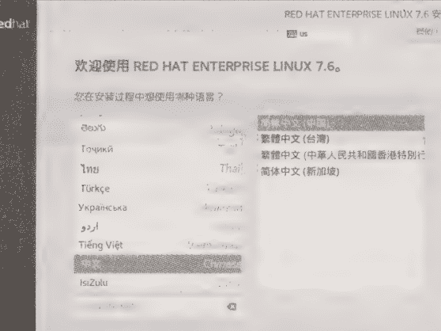

图 1-22 选择使用的语言

(5) 进入安装信息摘要界面，如图 1-23 所示。


图 1-23 安装信息摘要界面

## 16 学习 Linux 基本应用

### 2. 本地化部分

在本地化中，选择“日期和时间”，显示如图 1-24 所示界面，可设置区域、日期和时间；选择“键盘”，显示如图 1-25 所示界面，可以更改布局。选择“语言支持”，可设置安装或使用过程中用到的语言，如图 1-26 所示。


图 1-24 设置日期和时间


是否保存当前所使用的键盘布局？点击右下角的确认以将此布局设为默认值。

取消

确定

图 1-25 设置键盘布局


选择您需要的其他语言支持

图 1-26 选择语言支持

### 3. 软件部分

(1) 选择“安装源”，显示如图 1-27 所示界面。`RHEL 7.6` 不仅支持本地磁盘安装，还支持网络安装。

(2) 选择“软件选择”，显示如图 1-28 所示界面。`RHEL 7.6` 安装环境分为最小装、基础设施服务器、文件及打印服务器、基本网页服务器、虚拟机主机和 GUI 的服务器 6 种，每种都会有环境的附加选项，用于准确选择其功能。

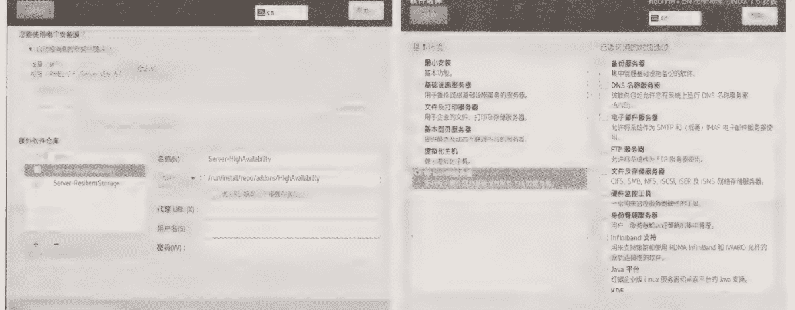

图 1-27 选择源

图 1-28 软件选择界面

### 4. 系统部分

(1) 选择“安装位置”，显示如图 1-29 所示界面。选择“我要配置分区”选项，自定分区区域。


图 1-29 选择位置

## 学习路径 · Linux 基本应用

在手动分区界面中，在“新建挂载点将使用此分区方案”下选择“标准分区”，如图 1-30 所示。为了简化分区，单击“这里点击自动创建它们”选项，打开设置的分区，如图 1-31 所示，并根据自己的需求修改分区。一般情况下，交换分区的大小设置为物理内存剩余的内存。

## 手动分区

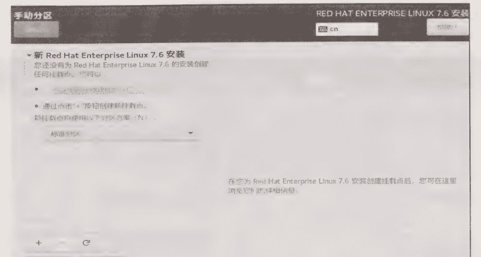

图 1-30 设置分区

### Red Hat Enterprise Linux 7.6 安装

- 你需要为 `Red Hat Enterprise Linux 7.6` 的内核创建挂载点，例如：
- 选择分区，将挂载点映射到文件系统，
- 挂载点选择下方的 `sda`：

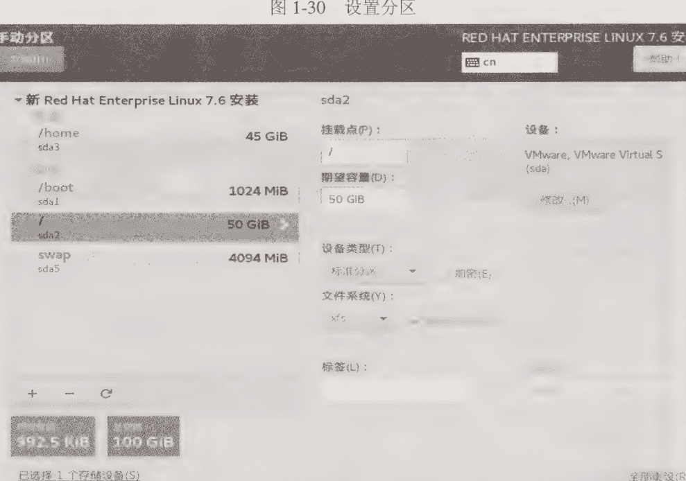

| 挂载点 | 大小 | 设备类型 |
| :--- | :--- | :--- |
| `/home` (`sda3`) | 45 GiB | `VMware Virtual` (`sda3`) |
| `/boot` (`sda1`) | 1024 MiB | 分区 (`sda1`) |
| `sda2` | 50 GiB | 分区 (`sda2`) |
| `swap` (`sda5`) | 4094 MiB | 分区 (`swap`) |

图 1-31 修改分区设置

(2) 选择“`KDUMP`”，显示如图 1-32 界面。`KDUMP` 是系统崩溃、死机时记录内核参数的一个工具，当系统崩溃时，它会捕获信息。在默认配置下该项是启用的。`KDUMP` 会占用内存，为了提高系统速度，不需要此项。

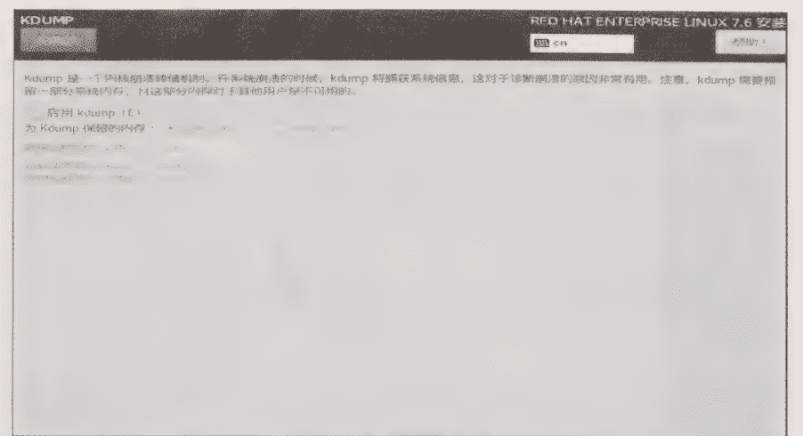

设置完成后选择“开始安装”，显示如图 1-33 界面。单击“`ROOT` 密码”选项，在图 1-34 所示界面中设置 `root` 密码。

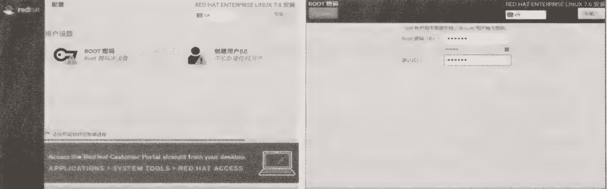

图 1-33 配置界面

图 1-34 设置 root 密码

通常在实际应用中，为了系统的安全，很少使用 `root` 登录系统，而是采用普通账户进行日常维护。单击“创建用户”选项，设置一个普通用户，如图 1-35 所示。


图 1-35 创建用户


### 5. 重启

安装完成后进入如图 1-36 界面，点击“重启”按钮完成。


图 1-36 重启引导

## 2. Red Hat Enterprise Linux 7.6 的配置

### 1. 初始配置

安装系统并重启之后，`Linux`还无法正常使用，需要进行初始配置。`Linux`重启后进入设置界面，如图 1-37 所示。单击“`LICENSE INFORMATION`”打开许可协议，勾选“我同意许可协议”选项，如图 1-38 所示，然后回到图 1-37 所示设置界面，点击“完成配置”按钮。


图 1-37 设置界面

`END USER LICENSE AGREEMENT RED HAT ENTERPRISE LINUX AND RED HAT APPLICATIONS`

This license agreement (`EULA`) governs the use of any versions of the `Red Hat Enterprise Linux`, other `Red Hat` software applications that include or refer to this licence, and any updates, source code, agreements, distribution and operation of the Programs, regardless of the delivery mechanism.

1. `License Grant`. Subject to the following terms, `Red Hat` ("`Red Hat`") grants to you a general, non-exclusive, irrevocable license to use `Linux Programs` which includes `Red Hat` software components and documentation. This license permits you to use, copy...

## 26 · 等待学习一 Linux 基本应用

(4) 等待 `Linux` 系统安装完成后，显示如图 1-48 所示界面，单击“重置”按钮，进入初始配置界面，完成初始配置后，即可登录 `Linux` 系统。


图 1-48 Linux 安装完成

(5) 安装完成 `Linux` 系统后，在 `GRUB` 界面看不到 `Windows10` 的启动项，默认进入操作系统，此时需要修改 `GRUB` 默认启动项。

在终端编辑 `/boot/grub/grubenv` 文件，修改默认启动项。

```
[root@localhost ~]# vi /boot/grub2/grubenv
saved_entry=2
```

修改完成后重启系统，在 `GRUB` 界面会看到 `Linux` 与 `Windows` 系统共有的启动项，如图 1-49 所示。


图 1-49 安装双系统后的引导界面

## 4. 项目总结

在 `Windows10` 系统安装过程中，一定要预留空白分区，才能在该空白分区继续安装 `Linux` 系统，最终实现 `Windows` 与 `Linux` 双系统共存。

## 项目一 部署服务器 · 27

## 项目小结

通过本项目的学习，`IT` 协会的学生为了安装 `Linux` 操作系统，系统地了解了 `Linux` 的起源、版本及特点，了解了市场上常见的 `Red Hat Linux` 的相关产品及应用场景；分析了 `Linux` 系统与我们熟悉的 `Windows` 系统的区别。借助虚拟机完成了 `Linux` 的搭建与配置，在复习 `Linux` 安装要点的基础上，实现了 `Linux` 和 `Windows` 双系统的安装。

## 练习题

+ 一、选择题

1. 安装 `Linux` 至少需要（  ）分区。

   A. 2 B. 3 C. 4 D. 5

2. `Linux` 的根文件系统类型是（  ）。

   A. `FAT16` B. `FAT32` C. `ext4` D. `NTFS`

3. `Linux` 核心的许可证是（  ）。

   A. `NDA` B. `GDP` C. `GPL` D. `GNU`

4. `Linux` 是操作系统，意味着开源是自由可用的（  ）。

   A. 封闭资源 B. 开放资源

5. 用户注册文件 D. 开放性二进制代码

+ 二、填空题

1. `Linux` 默认的系统管理员账号是____________________。

2. `RHEL` 提供的 5 种安装方式是____________________。

+ 三、面试题

1. `Linux` 系统与 `Windows` 系统有什么不同？

2. 管理员丢失了密码如何解决？

3. 安装 `Windows` 与 `Linux` 双系统时如何进行分区？

## 学习环境一 Linux 基本应用

## 项目2 维护 Linux 系统

## 项目引入

完成了网络服务器升级后，`IT` 协会的学生了解 `Linux` 与 `Windows` 最大的不同之处在于命令强大，很多图形界面无法实现的功能可以通过命令完成。为了高效、快捷地掌握 `Linux` 系统的应用，使用 `Linux` 中的文件和目录，决定学习命令技巧。

## 需求分析

为了提高 `Linux` 系统文件和目录效率，最好通过命令完成，需要熟悉 `Linux` 命令及应用。

- 熟悉使用 `Linux` 命令；

- 熟悉使用 `Linux` 中的目录；

- 熟悉 `Shell` 编程。

## 知识准备

### 2.1 命令基础

`Linux` 命令是 `Linux` 系统的特色之一，与 `Windows` 命令（实际上就是 `DOS` 命令）不可比。`Linux` 提供了部分服务，而 `Linux` 命令则不一样，使用 `Linux` 命令可以为用户提供一切。由于占用资源少、性能稳定且安全，在终端中交互，终端为用户提供了一个标准的命令行接口，用户在终端输入指令并将结果显示在屏幕上。通过“应用程序”——“工具”——“终端”，或者在桌面上单击“终端”来打开终端，显示如图 2-1 所示。


图 2-1 终端

#### 1. 终端

终端窗口中会显示一个提示符，通常为 `#`。`Shell` 提示符因用户不同，普通用户的提示符为 `$`，超级用户的提示符为 `#`。例如：`[root@localhost]#`，`root` 表示登录的用户，`localhost` 表示登录的位置。通过“文件”可以新建一个终端或关闭当前终端。通过“选项”，可以修改终端的文本、颜色和背景，如图 2-2 所示。


图 2-2 终端

#### 2. Linux 命令特点

在 `Linux` 中，命令是区分大小的，如 `ls` 是一个合法的命令，而 `LS` 则是。命令中可以输入命令的前字母，然后 `Tab` 键自动补全。若命令不止，则会显示匹配。在一个命令中输入多行并执行多个命令，可以使用分号来分隔命令，如 `cd /`；`Linux` 系统对每个命令的准确用法做了说明，可以使用命令 `man` 来获取，如 `ls`。

强大的 `Linux` 系统提供了数百个命令，虽然这些命令的功能相同，但是它们的使用遵循的格式：`命令 [选项][参数 1][参数 2]……`

#### 3. 绝对路径和相对路径

在 `Linux` 系统中每一个文件都是唯一的绝对路径，由根目录“/”开始的文件或目录名，如 `/home/a.txt`。绝对路径是以“/”开始的，注意与 `DOS` 不同。相对路径是指当前目录指向目标文件，如 `/home`。为了浏览 `/home/a.txt`，可以直接使用命令 `/a.txt`。相对路径不会以“/”开头。在 `Linux` 中存在特殊目录“`~`”表示当前目录，“`..`”代表父目录，“`~`”表示家目录。

#### 4. 链接

##### 2. 硬链接

在 `Linux` 中为一个文件起多个名称，称为硬链接和软链接两种形式。

1) 硬链接是在另一个目录或当前目录中增加一个目录项，也就是说一个文件登记在多个上。在 `Linux` 系统中对同一个文件在不同的系统中做链接。

2) 软链接是指符号链接，是一个路径名链接到一个文件，创建或目录的快捷方式。访问符号链接时，`Linux` 系统将沿着链接找到实际的文件。符号链接没有硬链接限制，可以对目录链接。

##### 1. pwd [选项]

功能：查看当前目录的绝对路径。一般情况下不带参数，如果目录有链接时，`pwd -P` 显示实际路径，而不是使用链接路径。查看当前目录，命令如下：

```
[root@localhost]# pwd
/root
```

##### 2. cd [目录]

功能：用于在不同的目录中切换。在 `Linux` 系统中，用户登录后会处于自己的目录中，该目录一般以 `/home` 开始，`root` 用户的家目录是 `/root`。


# Linux 基础应用

## 学习路径一

## 36 · 学习情境 Linux 基础应用

### 目录切换命令

1. 将当前目录切换到`/var/local`，命令如下：

```bash
[root@localhost ~]# cd /var/local
```

2. 将当前目录切换到一级目录(父目录)，命令如下：

```bash
[root@localhost #]# cd ..
```

3. 将当前目录切换到当前用户的家目录，查看结果，命令如下：

```bash
[root@localhost ~]# cd ~
/root
```

### `ls` 命令

**语法**：`ls [选项] 文件和目录`

**功能**：显示当前目录的内容和属性。各选项含义：

- `-a`：显示“.”开头的隐藏文件和目录。
- `-A`：指定当前目录下的目录及文件，但不包括“.”和“..”。
- `-l`：显示权限、链接数、所有者、组、大小和修改时间。
- `-d`：列出目录本身而不列出内部文件。
- `-n`：列出用户与组 ID。
- `-r`：将排序结果反向输出，例如文件名从大到小。
- `-R`：递归列出子目录中的文件。

1. 显示目录的内容，命令如下：

```bash
[root@localhost ~]# ls
```

2. 显示`/home` 目录，命令如下：

```bash
[root@localhost ~]# ls /home
```

3. 以长格式显示`/root` 目录，命令如下：

```bash
[root@localhost ~]# ls -l /root
```

输出示例：

```text
-rw-------- 1 root 53 24 anaconda-cfg
-rw-r---- 1 root 46 37 setup
drwx-xr-x 2 root 6 38 common
drwx-xr-x 2 root 6 38 模板
drwx-xr-x 2 root 6 38 视频
drwx-xr-x 2 root 6 38 文档
drwx-xr-x 1 root 6 38 下载
drwx-xr-x 1 root 6 38 音乐
drwx-xr-x 1 root 6 38 桌面
```

长格式显示与文件的结果相同，`ls` 可以简写为 `ll`。

### `mkdir` 命令

**语法**：`mkdir [选项] 目录名`

**功能**：创建目录。各选项含义：

- `-m`：设置目录权限。
- `-p`：如果目标目录尚未创建，则递归创建父目录。

1. 在当前工作目录下创建一个 `test` 的新目录，命令如下：

```bash
[root@localhost ~]# mkdir test
```

2. 在 `/etc` 下建立 `test`，命令如下：

```bash
[root@localhost ~]# mkdir /etc/test
```

3. 创建目录 `a/b`，命令如下：

```bash
[root@localhost ~]# mkdir -p a/b
[root@localhost ~]# ll /a
```

### `rmdir` 命令

**语法**：`rmdir [选项] 目录名`

**功能**：从系统中删除目录。删除该目录之前，它必须为空，并且用户必须有权限。各选项含义：

- `-p`：在删除目录时，递归删除父目录（如果父目录中除当前目录外没有其他目录和文件）。

1. 删除 `test`，命令如下：

```bash
[root@localhost root]# rmdir test
```

2. 删除 `a/b` 目录，命令如下：

```bash
[root@localhost root]# rmdir -p a/b
```

## 文件操作

### `touch` 命令

**语法**：`touch [选项] 文件名或目录名`

**功能**：修改文件或目录的时间属性，包括访问时间和修改时间。若文件不存在，会创建一个新的文件。各选项含义：

- `-a`：将访问时间改为当前时间。
- `-d yyyymmdd`：把访问或修改时间修改为指定日期。
- `-c`：如果文件不存在，则不进行创建（与默认行为相反，此选项在某些系统可能不支持或行为不同，通常默认行为是创建，这里保留原文语义）。*注：原文 `-c` 描述为“如果文件不存在，则进行创建”，这与标准 Linux `touch` 行为（默认即创建）略有偏差，但根据规则保留原意。*
- `-m`：将文件的修改时间改为当前时间。

1. 在当前目录下创建一个 `a` 的空文件，命令如下：

```bash
[root@localhost ~]# touch a
```

2. 将文件 `a` 的访问和修改时间改为 2018 年 10 月 18 日，命令如下：

```bash
[root@localhost ~]# touch -d 20181018
[root@localhost ~]# ll
-rw-r---- 1 root 0 10 18 2018 a
```

3. 将文件 `a` 的访问和修改时间更改为文件 `b` 的访问和修改时间，命令如下：

```bash
[root@localhost ~]# touch -r b
[root@localhost ~]# ll
-rw-r---- 1 root 0 10 18 2018 a
-rw-r---- 1 root 0 12 25 2047 b
```

### `cat` 命令

**语法**：`cat [选项] 文件名`

**功能**：用于显示或者把多个文本文件连接起来。各选项的含义：

- `-b`：对输出内容中的非空行标记行号。
- `-n`：对输出内容中的所有行标记行号。

常用组合：

- `cat file1 > file2`：把 `file1` 的内容覆盖保存到 `file2` 文件中。
- `cat file1 >> file2`：将 `file1` 的内容追加到 `file2` 的内容后，而 `file2` 原有的内容保留。
- `cat`：新建文件，并将其输入内容，输入完成后按 `Ctrl+c` 或 `Ctrl+d` 结束编辑，文件的内容就是输入的内容。

1. 查看文件 `a` 的内容，命令如下：

```bash
[root@localhost ~]# cat a
```

2. 将 `stu1`、`stu2` 两个文件合并为一个文件 `stu3`，命令如下：

```bash
[root@localhost ~]# cat stu1 stu2 > stu
```

3. 将 `stu4` 追加到 `stu1` 末尾，命令如下：

```bash
[root@localhost ~]# cat stu4 >> stu1
```

### `more` 命令

**语法**：`more [选项] 文件名`

**功能**：用于逐页显示内容。执行 `more` 命令后，按“空格”向下翻页，按“q”退出。各选项含义：

- `+n`：从第 `n` 行开始显示。
- `/pattern`：匹配字符串并跳转。

### `rm` 命令

**语法**：`rm [选项] 文件或目录`

**功能**：用于文件或目录的删除。

各选项的含义如下：

- `-i`：删除每个文件前提示。
- `-r`：递归删除目录，包含目录下的文件和各级子目录。
- `-f`：删除文件或目录时不提示用户。

注意，如果使用 `rm` 删除文件，通常可以将该文件恢复原状。如果想让文件的内容无法恢复，则使用 `shred`。

例 1 删除文件，命令如下：

```bash
[root@localhost ~]# rm test
```

例 2 删除文件前给出提示，命令如下：

```bash
[root@localhost ~]# rm -i test
```

例 3 删除文件前不提示，命令如下：

```bash
[root@localhost ~]# rm -f test
```

例 4 删除 `/etc` 目录，使用强制递归删除：

```bash
[root@localhost /]# rm -rf /etc
[root@localhost /]# cd
[root@localhost ~]# ls
```

### `whereis` 命令

**语法**：`whereis [选项] 文件名`

**功能**：只能用于程序名的搜索，且只为了搜索二进制文件（选项 `-b`）、man 说明文件（选项 `-m`）和源代码文件（选项 `-s`）。如果不忽略路径，则返回所有相关信息。

各选项的含义如下：

- `-b`：查找二进制文件。
- `-m`：查找命令的联机帮助文件。
- `-s`：查找源代码文件。

例 1 查找 `grub` 信息，命令如下：

```bash
[root@localhost ~]# whereis grub
grub: /sbin/etc/grub.conf /usr/share/grub /usr/share/man/man8/grub.8.gz
```

例 2 查找 `grub` 帮助文件所在目录，命令如下：

```bash
[root@localhost ~]# whereis -m grub
grub: /usr/share/man/man8/grub.8.gz
```

### `find` 命令

**语法**：`find [选项] 路径`

**功能**：在指定目录下查找符合条件的文件和目录。

各选项的含义如下：

- `-name`：按文件名查找文件。
- `-perm`：按权限限制查找文件，必须是八进制形式的文件权限。
- `-user`：按文件属主查找文件。
- `-group`：查找文件所属的组。
- `-type`：查找一种类型的文件，如下：
    - `-b`：块设备文件。
    - `-d`：目录。
    - `-c`：字符设备文件。
    - `-p`：管道文件。
    - `-l`：符号链接文件。
    - `-f`：普通文件。
- `-ctime`：查找系统中最后 24 小时内改变文件状态的文件。

例 1 将当前目录及其子目录下所有以 `.c` 结尾的文件和目录列出来，命令如下：

```bash
[root@localhost ~]# find . -name "*.c"
```

例 2 将当前目录及其子目录下所有一般文件列出来，命令如下：

```bash
[root@localhost ~]# find . -type f
```

例 3 将当前目录及其子目录下最近 20 天内更新的档案列出，命令如下：

```bash
[root@localhost ~]# find . -ctime -20
```


## 12. `grep`

语法：`grep [选项] 字符串 文件名`

功能：查找文件中包含指定字符串的行。`grep` 命令可以用模式搜索文件，通知用户在文件中搜索到指定的模式匹配的字符串，并打印出所有包含该字符串的本文。

各选项的含义如下：

- `-v`: 列出不匹配的。
- `-c`: 对匹配的行计数。
- `-l`: 只显示包含匹配模式的文件名。
- `-h`: 抑制包含匹配模式的文件名显示。
- `-n`: 每个匹配只按相对行的号显示。
- `-i`: 对匹配时不分大小号。
- `-R`: 递归匹配，在当前目录及子目录下的所有文件进行匹配。

例 在文件 `/etc/passwd` 中查找包含字符串 `user` 的行，并显示该行的前后两行，命令如下：

```bash
[root@localhost~]#grep user /etc/passwd
```

## 13. `wc`

语法：`wc [选项] 文件名`

功能：统计指定文件中的字节数、字数和行数，并将统计结果输出。

各选项的含义如下：

- `-c`: 统计字数。
- `-l`: 统计行数。
- `-m`: 统计字符，这个标记不能与 `-c` 选项一起使用。
- `-w`: 统计字符，一个字符被定义为由空白、格或换行符分隔的字符串。

例 1 统计文本文件的信息, 命令如下：

```bash
[root@localhost]# wc test
```

例 2 统计文本文件的字符, 命令如下：

```bash
[root@localhost]# wc -w
```

例 3 统计文本文件的字符, 命令如下：

```bash
[root@localhost]# wc -c
```

## 14. `ln`

功能: 为文件建立链接。

- 1) 硬链接 (Hard link)

源文件和建立的链接文件指向硬盘的同一个存储空间,对任意一个文件修改都会影响另一个文件。

语法：`ln 源文件或目录 新链接`

例 为文件 `aa` 创建链接 `bb`, 命令如下：

```bash
[root@localhost]#ln aa bb
```

- 2) 软链接 (Symbolic Link)

一个文件指向另一个文件的文件名,类似Windows的快捷方式。

语法：`ln -s 源文件或目录 新链接`

例 为文件 `aa` 创建软链接,并查看文件信息,命令如下：

```bash
[root@localhost]# ln -s aa
```

## 14 压缩和解压

### `gzip`

语法：`gzip [选项] 文件名`

功能：生成 `.gz` 结尾的压缩。

各选项的含义如下：

- `-r`: 递归查找并压缩所有文件。
- `-t`: 测试压缩是否完整。
- `-v`: 压缩显示文件名、压缩比。

将当前目录下 `aa` 文件压缩为 `aa.gz`,命令如下：

```bash
[root@localhost]# gzip -v aa
```

### `gunzip`

语法：`gunzip [选项] 文件名`

功能：解压 `.gz` 结尾的压缩。

各选项的含义如下：

- `-v`: 解压显示文件名、压缩比。

将当前目录下 `aa.gz` 解压，显示详细信息，命令如下：

```bash
[root@localhost]# gunzip -v aa
```

### 3 `tar`

语法：`tar [选项] 归档文件名`

功能：打包和解包。

各选项的含义如下：

- `-c`: 创建新的归文件。
- `-t`: 列出归档内容。
- `-x`: 从归档文件中释放。
- `-f`: 指定归档名称。
- `-v`: 列出归档详细信息。
- `-z`: 支持 `gzip` 进行压缩。
- `-j`: 支持 `bzip2` 进行压缩。

将当前目录下所有 `txt` 文件打包归档到 `a.tar.gz`：

```bash
[root@localhost]#tar -czvf a.tar.gz *.txt
```

将当前目录下 `a.tar.gz` 解压缩，命令如下：

```bash
[root@localhost]#tar -xzvf a.tar.gz
```

## 1 其他命令

命令还有：

- (1) `clear`: 用于清除终端内容。
- (2) `uname`: 用于显示信息。
- (3) `shutdown`: 用于指定时间关闭系统。

语法：`shutdown [选项] 时间`

选项如下：

- `-r`: 重启系统。
- `-h`: 关机。
- `now`: 表示立即。
- `hh`: 表示小时以后。

例 1 现在关机，命令如下：

```bash
[root@localhost]# shutdown -h now
```

例 2 30 分钟后重启，命令如下：

```bash
[root@localhost]# shutdown -r +30
```

- (5) `poweroff`: 关机。
- (6) `history`: 用于显示最近运行的命令。

## 重定向和管道

在 Linux 系统中，重定向和管道是两个重要的概念。重定向能够多次操作，方便很多；管道是从进程向另一个程序传输信息，是将命令的输出作为另一个程序的输入。

### 重定向

Linux 系统中具有标准的：

- 标准输入 (stdin) 对应键盘。
- 标准输出 (stdout) 对应显示器。
- 标准错误 (stderr) 对应显示器。

执行命令时，从标准输入读取数据或者将执行结果放到文件中，这种重定向不再来自键盘，而是显示器上，可以将输出重定向到一个文件中。常用的输入重定向符号：

| 符号 | 功能描述 |
| :--- | :--- |
| `<` | 覆盖输出重定向 |
| `>>` | 追加输出重定向 |
| `2>` | 覆盖错误重定向 |
| `&` | 同时的输出重定向 |

例 1 使用 `cat /etc/passwd` 文件的内容，命令如下：

```bash
[root@localhost ~]#cat /etc/passwd
```

例 2 查看 `/tmp` 目录中的内容，将其保存到文件 `a` 中，命令如下：

```bash
[root@localhost]#ls -l > a
```

例 3 查看 `/tmp` 目录中的内容，追加到文件 `mydir` 中，命令如下：

```bash
[root@localhost]#ls -l >> mydir
```

例 4 将 `myprogram` 的错误信息保存到文件 `err_file` 中，命令如下：

```bash
[root@localhost]#myprogram 2> err_file
```

例 5 查看 `myprogram` 的输出信息和错误信息保存到文件 `err_file` 中，命令如下：

```bash
[root@localhost]#myprogram > output_and_err_file
```

例 6 查看以 `.py` 结尾的命令，保存到 `cd.play` 文件中，命令如下：

```bash
[root@localhost]#find -name *.py > cd.play
```

### 管道

管道一种原理——一串命令能够解决很多问题，其中每个命令都能够良好地执行一项的工作。就需要一些东西将这些命令连接起来，这样运行就能适应了。

管道是一系列命令连接起来，意味着第一个命令的输出作为第二个命令的输入，通过管道给第二个命令，第二个命令的输出又作为第三命令的输入，以此类推。显示在屏幕上的是管道执行最后一个命令的输出（如果命令中未使用重定向）。

如果采用多条管道，就需要把一组命令连接起来，如 `ls | grep`。这条命令用管道把 `ls` 和 `grep` 命令连接起来，把当前目录的文件和目录打印出来。执行的是：把文件与列表的命令全部通过管道传递给上一个的输出，作为下一个命令的输入，而命令再把这些输入的内容打印出来。

管道中使用 `"|"`符号表示命令，例如 `命令1|命令2|......`管道中的每一个命令都是独立的运行过程，每一个命令的输出作为下一个命令的输入。由于管道中的命令总是从左到右执行，因此管道流是单向的。

例 统计登录的用户数，命令如下：

```bash
[root@localhost]# wc -l
```

左查看登录系统的用户，它的输出结果为：

## Vim 编辑器的使用

在 Linux 常用的编辑器中有图形形式的 `edit`、`kwrite`、`Emacs` 和 `OpenOffice`，本文介绍的是 `vim` 和 `vi` (`vi` 的增强版)，其中 `vim` 可以以字体颜色识别法的正确性，它的代码补全、翻译和错误查找等方便的功能非常丰富，极大地方了程序设计。`vim` 编辑器的三种模式包括一般模式、编辑模式和命令模式。

通过 `vim` 打开一个文件就可以直接进入一般模式（默认的模式）。在这个模式中可以使用左、右键移动光标。

## 44 · 学习情境一 Linux 应用

| 命令 | 功能描述 |
| --- | --- |
| `wq` | 保存并退出 |
| `q!` | 不保存退出 |
| `x` | 保存并退出，功能和 `wq` 相同 |
| `:set nu` / `:set non` | 显示行号 / 不显示行号 |
| `:number` | 将光标定位到行 |
| `:set autoindent` | 缩进，用于程序的编写 |

## 2.1.8 Shell 编程


Shell 是用户和 Linux 内核之间的接口程序。当 Shell 或其他程序运行 Linux 交互命令时，内核会有相应的响应。也就是说有了 Shell，用户就能通过键盘输入指令来操作计算机。Shell 会执行用户输入的命令，并在显示器上显示结果。这种交互的过程都是基本的。

Shell 是 Linux 系统的核心部分，它调用了内核的大部分功能来建立文件和执行程序，并以并行的方式调度每个程序的运行。因此，对于高级用户来说，Shell 编程是重要的应用程序，通过 Shell 可以启动、停止和编写程序。

UNIX/Linux 中主要有大类 Shell，Bourne Shell (包括 `sh`, `ksh`, `bash`) 和 C Shell (包括 `csh`, `tsh` 等)，大部分的 Linux (`Red Hat`, `Slack`, `Caldera`) 都作为默认的 Shell，并且运行 Linux 时其实调用的都是 `bash`。

示例：写一个 Shell 程序，此程序的功能是显示 `root` 下的文件信息，然后创建一个文件夹，并在该文件夹下新建一个文件，返回 `root` 目录，命令如下：

```bash
[root@localhost ~]#vim
cd /
ls
mkdir kk
cd kk
vi aa
cd /
ls -
```

其实，简单的 Shell 编程就是 Linux 命令的顺序组合。通过将许多命令顺序组合成一个文件中，可以一次执行多条命令，方便快捷。

### 1. 变量

Shell 本身是一个用 C 语言编写的程序，是用户使用 Linux 系统的桥梁。Shell 是一种命令语言，也是一种程序语言。作为命令语言，它交互式地解释和执行用户的命令；作为编程语言，它定义了各种变量和参数，并提供了许多在高级语言中才有的控制结构，例如：循环和分支结构。

Shell 中有三种变量：系统变量、环境变量和用户变量。系统变量用于对参数判断和命令返回值判断，环境变量是在程序运行时需要部署，用户变量在编程过程中最多。

这种变量的赋值方法各不相同，主要有直接设置变量值、变量之间的置换、从命令行获取、从环境变量获取和用户输入等。Shell 与其他的编程语言一样，变量在使用前都需要进行定义。在默认情况下变量都被看作字符串类型，并以字符串存储，变量赋值是通过变量名前面加一个“$”符号来获取变量数值。

1) 系统变量

Shell 用系统变量提供系统信息。系统变量一般用命令参数获取，如 `$$` 表示当前进程的进程 PID。

2) 环境变量

Shell 在开始执行之前就已经定义了一些与工作环境有关的变量。Shell 设置环境变量用 `set` 命令，用 `unset` 命令将环境变量重新设置为默认值，如 `HOME` 获取当前用户的路径，`PATH` 表示命令搜索路径。

对于环境变量，用户不需要每次重启后都对其进行手动设置。通过环境设置由系统自动完成。环境文件有两种：系统环境变量和用户环境变量。环境变量命名规则与普通变量相同，但为了区分相同变量，一般环境变量用全大写字母，普通变量用小写字母。

3) 用户变量

不管系统变量和环境变量有多少，对于需求来说是不够的。用户常常需要自己定义一些变量，这些变量就称为用户变量。

定义用户变量的语法为：

下面通过例子理解 Shell 编程的方法。

例为变量 `S1` 值为 `jyjvs`，`S2` 值为“jysvz”，`S3` 值为 `4+5`，并输出 `S1`、`S2`、`S3` 的值，命令如下：

```bash
#[root@localhost]#$ vim var
#!/bin/sh
s1=jyjvs
echo $s1
s2=jysvz
echo $s2
s3=4+5
echo $s3
```

运行：`[root@localhost]#$ bash var`

## 2. 编写第一个 Shell 程序

在 Linux 系统中使用 Shell 编写的处理文件名为脚本，包含了若干命令和语言，可以解释执行。

Linux 中 Shell 编程的步骤如下：

1) 编写 Shell 脚本的内容

- 注释部分：以 `#` 开头的，对脚本解释，在运行过程中并不执行。

- 命令：在 Shell 脚本使用的命令。

- 变量：在 Shell 脚本中使用自定义变量，也可以使用环境变量。

- 流程控制：Shell 脚本中的流程控制语句，例如 `for...while` 等语句。

用 `vim` 编辑器创建 Shell 脚本，其扩展名一般为“.sh”。例编写第一个 Shell 脚本，命令如下：

```bash
[root@localhost ~]# vim hello
#!/bin/sh
#This is first program
echo "Hello"
```

2) 执行 Shell 脚本

通过执行第一个 Shell 脚本的三种方式：

- 方式1：`bash` 文件名。

```bash
[root@localhost]# bash hello
```

- 方式2：`source` 文件名。

```bash
[root@localhost]# source hello
```

- 方式3：`chmod +x` 文件名，然后 `./文件名` 来运行。

```bash
[root@localhost]#chmod +x hello
./hello
```

其中一种和第二种方法，用户没有权限也可执行。

### 3. GCC 的使用

GCC 名为 C语言编译器（GNU Compiler Collection）。编译器集合是由 GNU 开发的操作系统的官方编译器，用于处理 C 语言，既可以处理 C++，也可以处理 Fortran、Pascal、Java 以及许多语言。根据源程序的后缀名决定使用哪种编译器进行编译。当使用 GCC 时，GCC 会处理、汇编和链接三步分别生成目标文件，形成执行文件。

语言：`gcc [选项] 文件名`

选项如下：

- `-c`：只生成目标文件，不链接为执行文件。

- `-S`：汇编。

- `-E`：预处理。

- `-w`：不生成所有警告。

- `-Wall`：生成所有警告。

- `-O`：对程序进行优化，采用此选项，整个源代码会在编译过程中进行优化，这样的执行文件的执行效率可以提高，但是编译的速度就变慢一些。

- `-O2`：更好的优化，虽然整个编译过程更慢。

假设有一个 C 语言编写的源程序 `test.c`，通过运行该文件来熟悉 Linux 中 C语言的编译与链接。

将 C 语言编译成为目标文件，命令如下：

```bash
[root@localhost]# gcc -c test.c
```

将目标文件链接为执行文件，并生成测试文件，命令如下：

```bash
[root@localhost]# gcc -o test.o
```

执行测试文件，命令如下：

```bash
[root@localhost~]# ./test
```

如果不使用选项，直接使用 `test.c`，经过 GCC 编译出来的执行程序默认为 `a.out`。运行程序的：`./a.out`

## 2.2 项目实施

在使用计算机的过程中，可能会因为多种原因导致计算机中断，为了防止硬盘上的数据丢失，IT协会的学生决定在下次备份的基础上手动备份几个文件到 `/tmp/`。

1) 拷贝到 `/tmp`，并查看，命令如下：

```bash
[root@localhost]# cp -r /etc/* /tmp
[root@localhost]# ls /tmp
```

2) 备份到 `/tmp`，并查看，命令如下：

```bash
[root@localhost]# cp -r root /tmp
[root@localhost]# cd tmp
[root@local tmp]# ll
```


备份系统中的文件

## 2.3 反思与进阶

### 1. 项目背景

作为学生，课还需要完成课程任务。IT协会的学生决定在下次备份的基础上手动备份几个文件到 `/tmp/`。

1) 拷贝到 `/tmp`，并查看，命令如下：

```bash
[root@localhost]# cp -r /etc/* /tmp
[root@localhost]# ls /tmp
```

2) 备份到 `/tmp`，并查看，命令如下：

```bash
[root@localhost]# cp -r root /tmp
[root@localhost]# cd tmp
[root@local tmp]# ll
```


备份系统中的文件

### 1. 项目背景

作为学生，课还需要完成课程任务。IT协会的学生决定在下次备份的基础上手动备份几个文件到 `/tmp/`。

1) 拷贝到 `/tmp`，并查看，命令如下：

```bash
[root@localhost]# cp -r /etc/* /tmp
[root@localhost]# ls /tmp
```

2) 备份到 `/tmp`，并查看，命令如下：

```bash
[root@localhost]# cp -r root /tmp
[root@localhost]# cd tmp
[root@local tmp]# ll
```


### 1. 项目背景

作为学生，课还需要完成课程任务。IT协会的学生决定在下次备份的基础上手动备份几个文件到`/tmp/`。

1) 拷贝到`/tmp`，并查看，命令如下：

```bash
[root@localhost]# cp -r /etc/* /tmp
[root@localhost]# ls /tmp
```

2) 备份到`/tmp`，并查看，命令如下：

```bash
[root@localhost]# cp -r root /tmp
[root@localhost]# cd tmp
[root@local tmp]# ll
```


备份系统中的文件

### 1. 项目背景

作为学生，课还需要完成课程任务。IT协会的学生决定在下次备份的基础上手动备份几个文件到 `/tmp/`。

1) 拷贝到 `/tmp`，并查看，命令如下：

```bash
[root@localhost]# cp -r /etc/* /tmp
[root@localhost]# ls /tmp
```

2) 备份到 `/tmp`，并查看，命令如下：

```bash
[root@localhost]# cp -r root /tmp
[root@localhost]# cd tmp
[root@local tmp]# ll
```


# 备份系统中的文件

## 1. 项目背景

作为学生，课还需要完成课程任务。IT协会的学生决定在下次备份的基础上手动备份几个文件到 `/tmp/`。

### 1) 拷贝到 `/tmp`，并查看

命令如下：

```bash
[root@localhost]# cp -r /etc/* /tmp
[root@localhost]# ls /tmp
```

### 2) 备份到 `/tmp`，并查看

命令如下：

```bash
[root@localhost]# cp -r root /tmp
[root@localhost]# cd tmp
[root@local tmp]# ll
```


## 1. 项目背景

作为学生，课还需要完成课程任务。IT 协会的学生决定在下次备份的基础上手动备份几个文件到 `/tmp/`。

1) 拷贝到 `/tmp`，并查看，命令如下：

```bash
[root@localhost]# cp -r /etc/* /tmp
[root@localhost]# ls /tmp
```

2) 备份到 `/tmp`，并查看，命令如下：

```bash
[root@localhost]# cp -r root /tmp
[root@localhost]# cd tmp
[root@local tmp]# ll
```


备份系统中的文件

## 2.3 反思与进阶

# Tutorial — Linux Applications

**Max days interval**: 表示两次密码更改之间的最大时间间隔。如果未修改此限制，用户将被永久禁用。当前显示为 `99999`，意味着无需重置密码。

**Warning age**: 当用户的密码过期日期接近上述“最大天数间隔”时，系统将根据此字段的设置发出警告，提醒用户密码将在 `n` 天内过期，应尽快更改。当前显示为 `7` 天。


Inactive time: If a password expires because the user did not change it within the warning period, they can still log in with that password within `n` days; if the password is not changed within this period, the account will be permanently disabled.

Expiration time: Represents the validity period of the password account. After this time expires, the password expires and the user cannot log into the system. If this field is empty, the account remains valid indefinitely.

Reserved fields: Reserved fields for Linux.

## 3. `/etc/spool/mail` file

Configure templates for certain user items, the commands are as follows:

```
MAIL_DIR /var/spool/mail
# When creating a user, creates a mail file in /var/spool/mail
PASS_MAX_DAYS 99999
# Maximum days a password is valid
PASS_MIN_DAYS 0
# Minimum days a password is valid
PASS_MIN_LEN 5
# Minimum length of the password
PASS_WARN_AGE 7
# Number of days to warn before the password expires
UID_MIN 1000
# Minimum UID automatically generated when creating users with useradd, i.e., UID starts from 1000
UID_MAX 60000
# Maximum UID automatically generated when creating users with useradd
G_MIN 1000
# Minimum GID specified when creating a group with groupadd
GID_MAX 60000
# Maximum GID specified when creating a group with groupadd
CREATE_HOME yes
# Whether to create the user directory, yes to create, no not to create
```

## 3.1. User Management

In Linux, user management includes creating new users, setting passwords, and maintaining user accounts.

### 3.1.1 `useradd` (`adduser`)

Syntax: `useradd [options] username`

Function: Creates a user; this command is used only by the `root` user. `useradd` command options are shown in Table 3-1.

#### `useradd` options

| Option | Description |
| :--- | :--- |
| `-c` | Comment; specifies user information recorded in the comment field of `/etc/passwd` |
| `-d` | Specifies the user's home directory; the system default is `/home/username` |
| `-e` | Expiration date; specifies the account expiration date in `MM/DD/YY` format |
| `-f` | Sets the number of days after account expiration before login is prohibited; if never expires |
| `-g` | Specifies the primary group of the user |
| `-G` | Specifies the supplementary groups of the user, multiple groups separated by commas |
| `-s` | Specifies the shell to be used after login; system default is `/bin/bash` |
| `-u` | Specifies the UID of the user |
| `-m` | Creates the user's home directory if it does not exist |
| `-M` | Does not create the user directory |

Example 1, command is as follows:

```bash
[root@localhost]# useradd user1
```

Without any options, Linux creates the user with default values. The system also creates a private group for the user in the user directory, and the user's UID starts from 1000.

Example 2, command is as follows:

```bash
[root@localhost]# useradd user2
```

`user2` is identified as `1001`, the home directory is `/home/user2`, the shell is `/bin/bash`, no password is set, and it never expires.

Note: New users can also be created using the `adduser` command. `adduser` is a link to `useradd`, and both have identical functionality.

### 3.1.2 `passwd` `[options] username`

Function: Sets or modifies user passwords. Superusers can modify the passwords of ordinary users, while ordinary users can only modify their own passwords.

In Linux, users without a set password are in a locked state and cannot log in. User management including password setting, modification, deletion, and unlocking, can all be implemented using the `passwd` command.

#### `passwd` options

| Option | Description |
| :--- | :--- |
| `-l` | Locks the password |
| `-u` | Unlocks the password |
| `-S` | Displays password status information |
| `-n` | Specifies the minimum password age |
| `-x` | Specifies the maximum number of days before password expiration |
| `-f` | Forces the user to change the password at next login |
| `-d` | Sets the user password to empty; different from a set password. Accounts without passwords can log in |

Example 1, command is as follows:


```bash
[root@localhost]# passwd root
Changing password for root.
New UNIX password:
BAD PASSWORD: it is based on dictionary word
Retype new password:
passwd: all authentication successfully.
```

Linux has high password security. If the password is shorter than 6 characters, too simple, repetitive, or a dictionary word, the system will display a prompt warning that the password is insecure.

Example 2, command is as follows:

```bash
[root@localhost]# passwd user3
Changing password for user3.
New UNIX password:
BAD PASSWORD: it is based on dictionary word
Retype new password:
passwd: all authentication successfully.
```

When an ordinary user modifies a password, the `passwd` command asks for the password, and modification only occurs after successful validation.

Example 3, command is as follows:

```bash
[root@localhost]# passwd -l user1
Locking password for user1!
passwd:
```

The locked user has a "!" added to the password field.

Example 4, restore `user1` account (unlocking), command is as follows:

```bash
[root@localhost]# passwd -u user1
Unlocking password for user1.
passwd: Success.
```

Example 5, command is as follows:

```bash
[root@localhost]# passwd -d user1
Removing password for user1.
passwd: Success
```

Note: If the user password is deleted, no password is required when logging in; check `/etc/shadow`, the password field for the user is empty.

## 3. charge

Syntax: `charge [options] username`

#### charge options

| Option | Description |
| :--- | :--- |
| - | Lists account attributes |
| -m | Specifies minimum password age |
| -M | Specifies maximum password age |
| -W | Number of days to warn before account expiration |
| -I | Disables account n days after expiration |
| -E | Specifies the account creation date |
| -d | Specifies the last password change date |

Example 5, set `user1` minimum age to 6 days, maximum age to 60 days, and warn 5 days before expiration. View attributes after completion:

```bash
[root@localhost]# charge -m6 -M60 -W5 user1
[root@localhost]# charge 
```

## 4. usermod

Syntax: `usermod [options] username`

Function: Sets account attributes. Users can use `usermod` to modify various attributes including username, home directory, groups, and shell. This command is used only by the `root` user; most options are the same as `useradd`. `usermod` options are shown in Table 3-4.

#### usermod options

| Option | Description |
| :--- | :--- |
| -c | Changes user comment |
| -d | Changes the home directory |
| -e | Changes expiration date |
| -f | Sets days after expiration before login is prohibited |
| -g | Specifies the primary group |
| -G | Specifies supplementary groups |
| -s | Changes the shell after login |
| -u | Changes the UID |
| -n | Specifies a new username |
| -L | Locks the account |
| -U | Unlocks the account |

Example 1, modify `user1`'s home directory and shell to `/bin/sh`, command is:

```bash
[root@localhost]# usermod -d /home/user1 -s /bin/sh user1
```

Example 2, rename `user1` to `user2`, command is:

```bash
[root@localhost]# usermod -l user2 user1
```

Example 3, lock account, command is:

```bash
[root@localhost]# usermod -L user1
```

Example 4, unlock account, command is:

```bash
[root@localhost]# usermod -U user1
```

## 5. userdel

Syntax: `userdel [-r] username`

Function: Deletes a user account. This command is only for the `root` user. If `-r` is used, the user's home directory and the group created for the user are also deleted.

Example, command is:

```bash
[root@localhost]# userdel -r user1
```

## 6. su

Syntax: `su [-] username`

Function: Switches users. If `username` is omitted, it switches to `root` (must be logged in). A password is required when switching to ordinary users. Using the `-` option uses the new user's environment variables upon switching.

Example 1, switch to `user1`, command is:

```bash
[root@localhost]# su user1

[user1@localhost]$pwd
```

Example 2, switch to `user1`, command is:

```bash
[root@localhost]# su - user1
```


`user1@localhost` `$` `/home/user1`

## 7. `sudo -u <user>`

**Function:** Restricts permissions. Administrators can authorize ordinary users to perform root operations without knowing the root password. When switching via `su`, a password is required to execute `sudo`. The `sudo` command is only available to `root` by default. `sudo` permissions are specified by security policies, default located in `/etc/sudoers`. If other users need to use `sudo`, `/etc/sudoers` configuration can be modified via `visudo`, which is equivalent to `vim /etc/sudoers`.

```bash
[root@localhost]# visudo
```

`## Allow root to run any commands`

`root ALL=(ALL) ALL`

This means `root` can execute any command on any machine, where:
- `root`: represents the `root` user.
- `ALL`: represents any host.
- `(ALL)`: represents as any user.
- `ALL`: represents executing any command.

To allow `user` to execute all `root` commands, the command is:
(1) Modify `/etc/sudoers` to grant appropriate permissions to `user`.

```bash
[root@localhost]# visudo
```

`## Allow root to run any commands`

`root ALL=(ALL) ALL`

`user ALL=(ALL) ALL`

Save and exit. Enable password functionality.

## Deploying users and groups

Batch creating user instances:

(1) Create the user information file, command is:

```bash
[root@localhost]# vim userlist

[root@localhost]# cat userlist

auser1:x:1001:1001:/home/user1:/bin/bash

auser2:x:1002:1002:/home/user2:/bin/bash

auser3:x:1003:1003:/home/user3:/bin/bash

auser4:x:1004:1004:/home/user4:/bin/bash
```

(2) Create user passwords, command is:

```bash
[root@localhost]# vim passwordlist

[root@localhost]# cat passwordlist

auser1:123456

user2:123456

user3:123456

user4:123456
```

(3) Use `newusers` to add users in batch, command is:

```bash
[root@localhost]# newusers userlist
```

(4) Disable shadow passwords, command is:

```bash
[root@localhost]# pwconv
```

This command takes the shadow password from `/etc/shadow` and writes it back to `/etc/passwd`; this is for the next password operation, effectively disabling shadow functionality.

(5) Set passwords, command is:

```bash
[root@localhost]# chpasswd <passwordlist
```

(6) View user information file `/etc/passwd`, command is:

```bash
[root@localhost]# tail -1 /etc/passwd

auser1:x:1001:1001:/home/user1:/bin/bash

auser2:x:1002:1002:/home/user2:/bin/bash

auser3:x:1003:1003:/home/user3:/bin/bash

auser4:x:1004:1004:/home/user4:/bin/bash
```

(7) View `/etc/shadow`, command is:

```bash
[root@localhost]# tail -1 /etc/shadow

auser1:x:123456:99999:7:0:99

auser2:x:123456:99999:7:0:99

auser3:x:123456:99999:7:0:99

auser4:x:123456:99999:7:0:99
```

# Project 3: Deploying Users and Groups

- **Password**: Starts with the group, shows cannot use password, so there are no group administrators.
- **Administrator**: Accounts for group administrators.
- **Group User List**: Displays all users belonging to this group, multiple users separated by commas.

## 3.1.6 Group Management

### 1. `groupadd` or `addgroup`

**Syntax:** `groupadd [options] group`

**Function:** Creates a user group. This command can only be executed by the `root` user.

The options are as follows:

- `-g`: Used to specify the GID for creation. For example, to create a group with ID `1003` and view it:

```bash
[root@localhost ~]# groupadd -g 1003
```

```bash
[root@localhost ~]# tail -1 /etc/gshadow
```

When using `groupadd` to create a new group without specifying a GID, the system assigns one, starting from `1000`. The result is a line added to `/etc/group` and `/etc/gshadow` files containing the new group record.

### 2. `groupmod [options] group`

**Function:** Modifies attributes of a user group. This command can only be executed by the `root` user.

After a group is created, its attributes can be modified as needed, primarily including the group name and ID.

The options are as follows:

- `-g id`: Used to modify the group ID.
- `-n name`: Modifies the user group name.
- `-o`: Forces acceptance of a duplicate group GID. For example, to rename the group `"group"` to `"group1"` with GID `1002`:


```
[root@localhost ~]# groupmod -n group1 -g 1002
```

`groupmod`命令用于修改组的基本属性。在修改过程中，新的组名和`GID`不能与现有的组名或`GID`冲突。仅修改组名不会改变`GID`，仅修改`GID`也不会改变组名。

### 3. `groupdel` `group`

功能：删除用户组。

该命令只能由`root`用户执行。在删除指定组之前，请确保该组不是任何用户的主组。如果它是某用户的主组，必须首先删除以该组为主组的用户，然后才能删除该组。

删除组`group1`的示例：

```
[root@localhost ~]# groupdel group1
```

### 4. `gpasswd` `[options]` `group`

功能：将用户添加到指定组（使其成为成员）或将用户从组中移除，并设置组管理员。该命令只能由`root`用户或组管理员使用。

选项如下：

- `-a`：将用户添加到组`group`。
- `-d`：将用户从组中移除。
- `-r`：取消组密码。
- `-A`：指定组管理员。

示例：创建名为`group`的组，将用户`dxx`添加到该组，并设置`dxx`为组管理员：

```
[root@localhost ~]# groupadd dxx
[root@localhost ~]# gpasswd -a dxx group
[root@localhost ~]# gpasswd -U dxx group
```

### 5. `newgrp`

语法：`newgrp` `[username]`

示例 1：显示当前的`GID`：

```
[root@localhost ~]# id
uid=0(root) gid=0(root) group=0(root)
```

示例 2：查看系统中现有的组：

```
[root@localhost ~]# tail -3 /etc/group
user:x:525
student:x:526
```

示例 3：更改用户的主组并查看结果：

```
[root@localhost ~]# newgrp student
[root@localhost ~]# id
uid=0(root) gid=526(student) group=0(root),526(student)
```

示例 4：将用户的主组恢复为`root`：

```
[root@localhost ~]# newgrp
[root@localhost ~]# id
uid=0(root) gid=0(root) group=0(root),526(student)
```


## 3.1.7 User and Group Management in Desktop Environment

### 1. User Management

In the desktop environment, click the "Applications" menu in the top-left corner → "Miscellaneous" → "Users and Groups" to open the "User Manager" window, as shown in Figures 3-1 and 3-2. If "Users and Groups" is not under "Miscellaneous", you need to install the `system-config-users` package.


Figure 3-1 Opening the Users and Groups window


Figure 3-2 The User Manager window

In the User Manager window, you can perform operations such as creating user accounts, modifying accounts and passwords, deleting accounts, and joining specified groups.

- (1) In the User Manager shown in Figure 3-2, click the "Add User" button in the toolbar to open the "Add User" window, as shown in Figure 3-3. Enter the username, full name, password, confirm password, theme, etc., in the window, then click "OK" to add the user.

- (2) Update user information. Select the account to be modified from the list in the User Manager, click the "Properties" button to open the "User Properties" window, select the "User Data" tab, modify the account (username) and password, and click "OK".

- (3) Join a user account to a group. Click the "Groups" tab in the "User Properties" window, select the group name to join from the list, and click "OK".

#### Add User

| User (U) | `user3` |
| :--- | :--- |
| Full Name (F) | `user3` |
| Password (P) | ****** |
| Confirm Password (m) | ****** |
| Shell (L) | `/bin/bash` |

| User Properties | |
| :--- | :--- |
| Username (N) | `user3` |
| Group | `user3` |
| Password (w) | ****** |
| Confirm Password (m) | ****** |
| Home Directory (H) | `/home/user3` |
| Shell (L) | `/bin/bash` |

- Create directory (h)
- Home directory (D): `/home/user3`
- Create group for the user (g)
- [ ] Manually specify User ID (s):
- [ ] Manually specify Group ID (g): 

- (4) Delete user account. Select the username to delete in the user list and click the "Delete" button to delete the account.

- (5) Other settings. Select "Account Information" and "Password Information" in the "User Properties" window to view and set account and password information.

### 2. Group Management

In the User Manager, select "Groups" as shown in Figure 3-5. Select the group to modify and click the "Properties" button in the toolbar to open the "Group Properties" window, as shown in Figure 3-6, to modify the group attributes. 

Click the "Add Group" button in the User Manager toolbar, enter the group name and GID in the window, and click "OK" to create the new group, as shown in Figure 3-7. The GID can also use the system default. To delete an existing group, simply select the group from the list in Figure 3-5 and click the "Delete" button in the toolbar. 

## 3.2 Project Implementation

- (1) Create a new user `user1`.

```
[root@localhost ~]# useradd user1
```

- (2) Create a new group `staff`.

```
[root@localhost ~]# groupadd staff
```

- (3) Create a new user `user2` and join the `staff` group.

```
[root@localhost ~]# useradd -G staff user2
```

- (4) Create a new user `user2` with specified directory `/www` and without creating a home directory.

```
[root@localhost ~]# mkdir /www; useradd -d /www -M user2
```

- (5) Rename the username to `user3` and the home directory to `/home/user`.

```
[root@localhost ~]# usermod -l user3 -d /home/user user2
```

- (6) Delete user `user3` and its home directory.

```
[root@localhost ~]# userdel -r user3
```

Note: If `/home/user` belongs to another user, it will not be deleted.

- (7) Show the current user's UID, GID, and groups.

```
[root@localhost ~]# id
```


- (8) Switch to user `tom`.

```
[root@localhost ~]# su tom
```

- (9) Show the current user's `UID`, `GID`, and groups.

```
[user@localhost]# id
```

Note: At this point, the normal user has their own home directory.

- (10) Create a new file `aa` and view its user and group.

```
[root@localhost]# touch aa
```

- (11) Switch the current user's group to the specified group.


```
[user1@localhost]# newgrp staff
```

- (12) Show the current user's `UID`, `GID`, and groups.

```
[user1@localhost]# id
```

- (13) Create a new file `bb` and view its user and group.

```
[user1@localhost]$ touch bb
[user1@localhost]$ ll bb
```

### 3.3 Reflection and Advanced

#### 1. Project Background

The School of Information Electronics has `60` employees distributed across different positions. Currently, a different account needs to be created for each person, with those in the same position placed in the same group, each user having their own directory.

#### 2. Implementation Purpose

- (1) Create an account for each user and set a password.
- (2) Batch create users.
- (3) Add users to different groups.
- (4) Manage accounts and groups.

#### 3. Implementation Steps

- (1) Create a user list `user.txt` under `root`, as shown in Figure 3-8.

```
[root@localhost ~]# vim user.txt

user01
user02
user03
```


User commands: `Command` (`Esc`), `Insert` (`I`), `Replace` (`R`), `Paste` (`P`), `Exit` (`:`), `Help` (`H`)

```
[root@localhost ~]# vim user.txt
[root@localhost ~]# cat user.txt
```

- (2) Write a Shell script to batch add users, set the password to `"123456"`, and view `/etc/passwd`, as shown in Figure 3-9.

```
[root@localhost ~]# vim useradd.sh
```

```bash
#!/bin/bash
chmod 700 useradd.sh
./useradd.sh

for user in `cat /root/user.txt`;
do
  useradd $user
  echo "123456"|passwd $user
  echo "密码写入成功"
done

# Execute /usr/bin/chpasswd with root privileges to write the compiled password into the password field of /etc/passwd
chpasswd </etc/passwd

# Execute /usr/sbin/chpasswd using passwd command to encode the password into shadow and write the result to /etc/shadow
chpasswd </etc/passwd
```

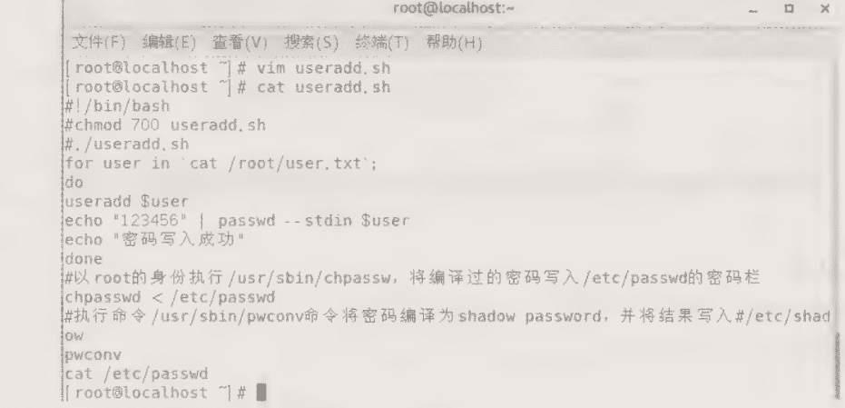

Figure 3-4 Add user script

- (3) Run the script, as shown in Figure 3-10.


Figure 3-10 Adding users successfully

- (4) Create groups.

```
[root@localhost ~]# groupadd group1
```

```
[root@localhost ~]# groupadd group2
```

```
[root@localhost ~]# groupadd group5
```


- (5) Use the `User Manager` window to add different users to corresponding groups, as shown in Figure 3-11.


#### Exercises

Multiple Choice Questions

- 1. An account created for a new colleague in the company is set to expire in 30 days. To change the expiration time now, which command should be used?
    - A. `usermod -a`
    - B. `usermod -d`
    - C. `usermod -x`
    - D. `usermod -e`

- 2. Creating a user account requires defining ( ) information in `/etc/passwd`.
    - A. login name
    - B. password age
    - C. default group
    - D. userid

- 3. The ( ) command can switch a normal user to a super user.
    - A. `super`
    - B. `passwd`
    - C. `tar`
    - D. `su`

- 4. Among the following files, only the `root` user owns the ( )?
    - A. `passwd`
    - B. `shadow`
    - C. `group`

- 5. The `usermod` command ( )
    - A. Rename account
    - B. Delete account
    - C. Unlock account
    - D. Account's Password

`shadow`, `group`, `passwd`

Interview Questions

Operation Process

# 项目 4 安装服务软件

`type`: 包的类型，如：
- `i386`: 表示适用的硬件平台，目前 `RPM` 支持的平台有：`i386`、`i686`, `sparc` and `alpha`。
- `noarch`: 表示编译的代码与平台无关。
- `rpm` 或 `src.rpm`: 文件扩展。`rpm` 是编译后的二进制包，可以用 `rpm` 命令直接安装；`src.rpm` 是源码包，需要安装源码包生成源码，并对源码编译生成 `.rpm` 格式的 `RPM` 包，就可以对这个 `RPM` 包进行安装了。

## 2. RPM 命令

语言：`rpm [选项] RPM 包`
功能：`RPM`软件包的安装、卸载、升级、查询、验证等。
各项的选项如下：

- `-i`: 安装软件包
- `-q`: 查询软件包
- `-e`: 卸载软件包
- `-U`: 升级软件包。如果软件不存在则在安装软件包。
- `-f`: 刷新 `RPM` 包。
- `-V`: 校验 `RPM` 包。
- `-h`: 以前的方式执行过程及详细的安装信息。
- `-d`: 查询软件包安装后的所有文档。
- `-u`: 显示安装后生成了哪些所有的文档。
- `--nodeps`: 在安装或升级软件包之前不做依赖检查。
- `-test`: 安装软件包时，只是进行检查并报告可能的冲突。

例 1 查询是否安装了 `Samba`，命令如下：

```bash
[root@localhost]# rpm -q samba
```

例 2 安装 `Samba` 软件包，以 `-h` 显示安装进度和详细信息，命令如下：

```bash
[root@localhost]# mount /dev/cdrom mnt

[root@localhost]# cd /mnt/packages/

[root@localhost Packages]# rpm -ivh samba-4.8.3-4.el7.x86_64.rpm
```

安装 `Samba` 软件包如图 4-1 所示。

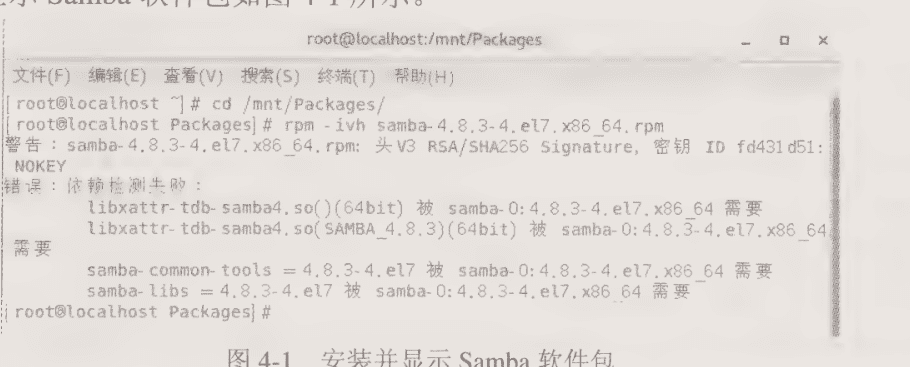

| 软件(D) | 版本(E) | 查询(Q) | 升级(S) | 安装(I) | 帮助(H) |
|---|---|---|---|---|---|
| root@localhost Packages]# cd /mnt/packages/ samba-4.8.3-4.el7.x86_64.rpm | 需要 | | | | | |
| samba-4.8.3-4.el7.x86_64.rpm | | | | RSA/SHA/256 Signature, 密钥 ID fd4d351 | | |
| | | | | 依赖关系： | | |
| libxattr-tdb-samba.so(64bit) | | samba-0:4.8.3-4.el7.x86_64 需要 | | | |
| libxattr-tdb-samba.so(64bit) | samba-0:4.8.3-4.el7.x86_64 需要 | | | | |
| samba-common-tools = 4.8.3-4.el7 | samba-0:4.8.3-4.el7.x86_64 需要 | | | | |
| samba = 4.8.3-4.el7 | samba-0:4.8.3-4.el7.x86_64 需要 | | | | |

图 4-1 安装并显示 `Samba` 软件包

## 学习教程一 Linux基础应用

从图4-1 可以看出，这个软件安装失败了。因为这个软件安装需要解决依赖性的其他组件，如 `RPM` 安装软件时不会自动安装所依赖的依赖，此时可以忽略依赖性安装，如图4-2 所示。

```bash
[root@localhost Packages#] rpm -ivh samba-4.8.3-4.el7.x86_64.rpm --nodeps

root@localhost:/mnt/Packages

文件(F) 写入(E) 查找(V) 终端(T) 帮助(H)

root@localhost Packages# rpm -ivh samba-4.8.3-4.el7.x86_64.rpm

警告: samba-4.8.3-4.el7 RSA/SHA256 Signature, 密钥 fd4d351

检查中...

正在升级/安装...

########################### [100%]

samba-0:4.8.3-4.el7 [100%]

root@localhost Packages#
```

图4-2 忽略依赖性安装

3 查询系统 `Samba` 相关命令，命令如下：

```bash
[root@localhost~] rpm -q samba
```

4 查询已安装的软件包包含列表，命令如下：

```bash
[root@localhost~] rpm -ql samba
```

5 升级软件包，命令如下：

```bash
[root@localhost Packages#] rpm -Uvh samba-4.8.3-4.el7.x86_64.rpm
```

6 卸载软件，命令如下：

```bash
[root@localhost~] rpm -e samba
```


## 4.1.3 YUM 安装软件包

### 1. YUM 概述

在 Linux 系统中安装软件包最大的难点就是软件包之间的依赖关系。当安装软件时，`rpm` 会根据数据库查询其他软件是否满足，如果满足则安装，否则安装。YUM 是 Yellow Updater 的简化版，经过优化的。YUM 可以配置多个资源库（Repository）和简单的配置文件（`/etc/yum.conf`），能够自动解决 RPM 遇到的依赖性问题，保持与 RPM 数据库一致性。通过详细的日志查看升级和安装软件包等信息。

### 2. YUM 结构

YUM 由以下部分构成：

- `yum` 命令：通过 `yum` 命令才能使用 `yum` 提供的功能。
- `yum` 仓库（repository）：它是软件包的“更新”。它是存放 RPM 的目录，仓库中包含 `repodata` 的目录。该目录存放 RPM 的各种信息，包括描述、文件、依赖性。客户端通过 `ftp://` 或 `file://` 访问本地或远程仓库，完成查询、安装、更新操作。
- `yum` 缓存：`yum` 客户端运行时从软件包下载仓库文件和 RPM 软件包，并存储在 `/var/cache/yum`
- `yum` 插件：用于进行 `yum` 扩展。

### 3. 使用 yum 命令

语法：`yum [选项] [命令][软件或程序名]`
通过 `yum` 命令可以快速安装软件及其依赖关系，选项及功能描述如表 4-1 所示。

表 4-1 yum 命令选项功能描述

| 选项 | 功能描述 |
| --- | --- |
| `check-update` | 显示所有可更新的软件清单 |
| `clean` | 删除缓存中 RPM 头文件和软件包，与 `clean all` 相同 |
| `clean packages` | 删除缓存中的软件包 |
| `info` | 显示可用的软件包信息 |
| `info 软件包名` | 显示指定软件包信息 |
| `install 软件包名` | 安装指定软件包 |
| `list` | 显示可用的软件包列表 |
| `list installed` | 显示已安装的软件包列表 |
| `list updates` | 显示可升级的软件包列表 |
| `provides 软件包名` | 显示软件包包含的内容 |
| `remove 软件包名` | 删除指定的软件包，确认指定软件包的依赖关系 |
| `search 关键字` | 利用关键字搜索软件包，搜索 RPM 文件名、Package (包)、Description 的类型 |
| `update` | 升级所有可升级的软件包 |
| `update 软件包名` | 升级指定的软件包 |

## 4. yum 配置文件

yum 的配置文件分为两部分：`main` 和 `repository`。`main` 部分定义了全局选项，整个 `yum` 的配置文件应该有一个如图 4-3 所示，位于 `/etc/yum.conf`。`repository` 部分定义了每个源的具体配置，可以有多个，位于 `/etc/yum.repo.d` 目录下的文件中。

### 1) 主配置文件 /etc/yum.conf

```
root@localhost: 文件(F) 插入(E) 写入(W) 退出(Q) 

main:

cachedir=/var/cache/yum/

debuglevel=3

logfile=/var/log/yum.log

basearch=0

gpgcheck=1

# metadata_cache_timeout is the default, if you make this then yum won't see the metadata

# in the repo and you will lose the benefit of not having to

# download it every time you run a command.

# It is important to get correct metadata, for distributions like

# which don't keep old packages.

# update metadata once a month

metadata_expire=0

# REPOS HERE OR separate named file,

/etc/yum.repo.d/
```

### 2) 配置文件 /etc/yum.repo

```
[main]

name=base

baseurl=http://mirror.centos.org/centos/$releasebase/$basearch/

enabled=1

gpgcheck=1

installonly=5
```

## 4.1. 源码安装

源码源是可选的软件包，需要用户自己编译成执行文件。优点在于定制硬件、操作系统及环境。在实际使用中，许多源码包都采用 tar 包，一般源码安装分为以下步骤：

1. 解压：源码包常见的是 `gzip` 和 `bzip2`。
2. 配置：检查环境并生成 `Makefile`。
3. 编译：生成可执行文件。
4. 安装：将文件拷贝到系统目录。

## 4.2 项目实施

### 4.2.1 使用 RPM 安装 OpenOffice 软件

ApacheOffice 是一款先进的开源办公软件，包含本文档、电子表格、演示文稿、绘图、数据库。它将所有的数据以国际开放格式存储起来，并能够写入其他通用软件包。ApacheOffice 可以被完全自由下载和使用无需任何许可费用。该软件可以在 `http://www.openoffice.org/` 中下载。

将下载好的 Apache 放入 `~/home` 下，具体的步骤如下：
(1) 解压 OpenOffice，解压之后出现 `/zh-CN/` 如图 4-6 所示

## 学习环境一 Linux 基本应用

```bash
licenses readmes RPMS

[@localhost zh-CN]$# cd RPMS/

[@localhost RPMS]$# ls
```

```
root@localhost/home/zh-CN/RPMS
```

```
文件(F) 编辑(E) 查找(V) 搜索(S) 帮助(H)

root@localhost RPMS]$# ls

desktop-integration

openoffice-4.1.5.9789.x86_64.rpm

openoffice-base-4.1.5.9789.x86_64.rpm

openoffice-brand-base-4.1.5.9789.x86_64.rpm

openoffice-brand-calc-4.1.5.9789.x86_64.rpm

openoffice-brand-draw-4.1.5.9789.x86_64.rpm

openoffice-brand-impress-4.1.5.9789.x86_64.rpm

openoffice-brand-math-4.1.5.9789.x86_64.rpm

openoffice-brand-writer-4.1.5.9789.x86_64.rpm

openoffice-brand-zh-CN-4.1.5.9789.x86_64.rpm

openoffice-calc-4.1.5.9789.x86_64.rpm

openoffice-core-4.1.5.9789.x86_64.rpm

openoffice-core01-4.1.5.9789.x86_64.rpm

openoffice-core02-4.1.5.9789.x86_64.rpm

openoffice-core03-4.1.5.9789.x86_64.rpm

openoffice-core04-4.1.5.9789.x86_64.rpm

openoffice-core05-4.1.5.9789.x86_64.rpm

openoffice-core06-4.1.5.9789.x86_64.rpm

openoffice-core07-4.1.5.9789.x86_64.rpm

openoffice-draw-4.1.5.9789.x86_64.rpm

openoffice-gnome-integration-4.1.5.9789.x86_64.rpm

openoffice-graphics-4.1.5.9789.x86_64.rpm

openoffice-impress-4.1.5.9789.x86_64.rpm

openoffice-javacol-4.1.5.9789.x86_64.rpm

openoffice-math-4.1.5.9789.x86_64.rpm
```

图 4-7 安装 Office 的 RPM 软件包

(3) 安装所有 RPM 软件包，如图 4-8 所示。

```bash
[@localhost RPMS]$# cd ~/home/zh-CN/RPMS

root@localhost/home/zh-CN/RPMS
```

```
文件(F) 编辑(E) 查找(V) 搜索(S) 帮助(H)

root@localhost RPMS]$# ls -R *.rpm
```


`############################### [100%]`

1: `openoffice-ure-4.1.5.9789` `#################################` 2%
2: `openoffice-core01-4.1.5.9789` `##############################` 5%
3: `openoffice-zh-CN-4.1.5.9789` `#######################` 7%
4: `openoffice-impress-4.1.5.9789` `####################` 10%
5: `openoffice-zh-base-4.1.5.9789` `##########################` 12%
6: `openoffice-zh-calc-4.1.5.9789` `#################` 15%
7: `openoffice-zh-draw-4.1.5.9789` `######################` 17%
8: `openoffice-zh-help-4.1.5.9789` `#################` 20%
9: `openoffice-zh-math-4.1.5.9789` `############` 22%
10: `openoffice-math-4.1.5.9789` `#################` 24%
11: `openoffice-writer-4.1.5.9789` `######################` 27%
12: `openoffice-zh-writer-4.1.5.9789` `#################` 29%
13: `openoffice-base-4.1.5.9789` `##################` 32%
14: `openoffice-core01-4.1.5.9789` `#################` 35%
15: `openoffice-core02-4.1.5.9789` `#################` 37%
16: `openoffice-core03-4.1.5.9789` `#################` 39%
17: `openoffice-core04-4.1.5.9789` `#################` 41%
18: `openoffice-core05-4.1.5.9789` `#################` 44%
19: `openoffice-core06-4.1.5.9789` `#################` 46%
20: `openoffice-core07-4.1.5.9789` `#################` 49%
21: `openoffice-draw-4.1.5.9789` `######################` 51%
22: `openoffice-zh-CN-4.1.5.9789` `#################` 54%
23: `openoffice-4.1.5.9789` `###########################` 56%

```
图 4-8 安装Office所有的软件
```

## 项目 4 安装软件

安装完毕`RPM`软件包之后，软件不能使用，还需要重启操作系统在桌面打开`Office`。

(4) 输入`RPM/desktop-integration/`：

```bash
[root@localhost RPM]# cd desktop-integration/

[root@localhost desktop-integration]# openoffice-desktop-menus-4.1.5.9789.noarch.rpm

openoffice-desktop-mandriva-4.1.5.9789.noarch.rpm

openoffice-desktop-redhat-4.1.5.9789.noarch.rpm

openoffice-desktop-suse-4.1.5.9789.noarch.rpm

[root@localhost desktop-integration]# rpm -iv openoffice-desktop-redhat-4.1.5.9789.noarch.rpm

准备中...

正在安装...

########################### [100%]

1:openoffice-desktop-redhat-4.1.5.9789 [100%] /bin/gtk-update

update-cache: Cache created successfully.
```

(5) `OpenOffice` 安装完成后，可以在菜单中找到，如图 4-9 所示。

## 4.2.2 RPM 安装

一般情况下，搭建网络需要的都在`RHEL 7.6`光盘中找到。

(1) 查看系统是否安装了`DHCP`。

```bash
[root@localhost ~]# rpm -q dhcp

未安装软件包 dhcp
```

(2) 挂载`Linux`光盘。

```bash
[root@localhost ~]# mkdir /mnt/cdrom

[root@localhost ~]# mount /dev/sr0 /mnt/cdrom

mount: /dev/sr0 写保护，以只读方式挂载。
```

```bash
[root@localhost ~]# cd /mnt/cdrom

[root@localhost cdrom]# ls

[root@localhost cdrom]# cd Packages/
```

(4) 安装`DHCP`服务。

```bash
[root@localhost Packages]# rpm -ivh dhcp-4.2.5-el7.5.x86_64.rpm

警告：dhcp-4.2.5-el7.：头部 RSA/SHA256 Signature, 密钥 idfd3d51: NOK

准备中...########################### [100%]

正在升级/安装...dhcp-4.2.5-el7.5...########################### [100%]
```

## 4.3 反思与进阶

### 1. 项目背景
通过学习，`IT`协会的学生可以在`Linux`系统中安装各种办公软件、通信工具等。网络中心的共享资料需要在服务器上安装`FTP`服务。

### 2. 实施目的
- (1) 掌握`YUM`仓库的配置。
- (2) 能通过`YUM`安装软件。

### 3. 实施步骤
- (1) 新建目录并挂载`rhel-server-7.6-dvd`。

```bash
[root@localhost ~]# mkdir /mnt/cdrom

[root@localhost ~]# mount /dev/cdrom /mnt/cdrom
```

(2) 查看系统是否安装了`vsftpd`软件包。

```bash
[root@localhost ~]# rpm -q vsftpd

未安装软件包 vsftpd
```

(3) 配置`YUM`仓库。

```bash
[root@localhost ~]# cd /etc/yum.repos.d/

[root@localhost yum.repos.d]# ls redhat.repo

[root@localhost yum.repos.d]# rm redhat.repo

[root@localhost yum.repos.d]# vi local.repo

[root@localhost yum.repos.d]# cat local.repo

name=rhel7

baseurl=file:///mnt/cdrom

enabled=1

gpgcheck=0
```

(4) 清除缓存。

```bash
[root@localhost yum.repos.d]# yum clean all
```


#### (5) 查看 `vsftpd` 软件的信息，如图 4-11 所示。

| 名称 | 架构 | 版本 | 大小 |
|---|---|---|---|
| `rhel7` | | `rhel7/group_gz` | 43 kB |
| `rhel7` | | `rhel7/primary_db` | 146 kB |
| 可安装的软件 | | | 12 MB |
| `vsftpd` | `x86_64` | `3.0.2` | 171 k |
| 发布 | | `25.el7` | |
| 源 | | `rhel7` | |
| 简述 | | Very Secure Daemon | |
| 网址 | | `https://security.openshat.com/vsftpd.html` | |
| 校验 | | `GPG-v with exceptions` | |
| 描述 | | `vsftpd is a Very Secure daemon. It was written completely from scratch.` |

#### (6) 查看 YUM 列表内容。

```bash
[root@localhost yum.repos.d]# yum list
```

#### (7) 安装 `vsftpd` 软件，如图 4-12 所示。

```bash
[root@localhost yum.repos.d]# yum install vsftpd
```

```bash
root@localhost:~/etc/yum.repos.d

root@localhost yum# yum install vsftpd

已下载: langpacks, product-id, search-disabled, subscription-manager

This system is not registered with an entitlement server. you can use subscription-manager to register.

正在检查软件源...

--> 正在连接镜像源...

--> 安装 vsftpd x86_64.3.0.2-25.el7 修正

--> 解决依赖关系并完成

操作完成！
```

#### (8) 查看已经安装的 `vsftpd` 软件。

```bash
[root@localhost.yum.repos.d]# rpm -qa | grep vsftpd

vsftpd-3.0.2-25.el7.x86_64
```


## 4. 项目总结

在 Linux 系统中安装软件一般有三种方法：通过 RPM、源码和 YUM 安装。其中 YUM 安装会自动处理软件依赖关系，不需要考虑软件之间的依赖关系，操作简单方便。

项目总结：Linux 系统中安装软件一般有三种方法：通过 RPM、源码和 YUM 安装。其中 RPM 安装需要手动解决软件之间的依赖关系，有时候安装过程较为复杂；源码安装容易出现问题，需要一定的 Linux 基础；YUM 安装不需要考虑软件之间的依赖关系，配置好 YUM 仓库就可以自动安装所需的软件，比较简单方便。

## 练习题

在一台虚拟机上安装了 RHEL 7.6 的计算机上完成以下任务：

1. 用 `rpm` 命令安装 `telnet-server` 软件包。
2. 将 RHEL 7.6 的光盘配置为一个本地的 YUM 仓库。
3. 下载安装 QQ 的 RPM 软件包，并升级到最新版本。

# 学习——Linux 基础

## Ext3 文件系统

Ext3 文件系统直接从 Ext2 系统发展而来。目前 Ext3 文件系统已经在 Ext2 的基础上增加了日志记录功能，用户可以平滑过渡到健康的文件系统中，这实际上也是 Ext3 文件系统初始设计的初衷。

该文件系统在出现异常断电等事件导致停机后，文件系统会根据日志检测机制恢复到正常状态，从而缩短恢复时间并提高安全性。通过 Ext3 文件系统提供的工具 `tune2fs`，可以将 Ext2 系统转换为 Ext3 文件系统。它有多种模式：一种模式是对文件系统中的所有文件数据和元数据（metadata）进行日志记录（`data=journal` 模式）；另一种模式仅对元数据进行记录而不对数据进行日志记录，也叫 `data=writeback` 模式。管理员可以根据系统的实际要求，在工作速度和文件数据一致性之间做出选择。

Ext3 支持最大 16 TB 的文件系统和 2 TB 的文件。

## Ext4 文件系统

Linux kernel 2.6.28 开始支持 Ext4 文件系统。Ext4 是 Ext3 的改进，它修改了 Ext3 中的部分数据结构，而不仅仅像 Ext3 对 Ext2 那样仅仅增加日志功能。Ext4 在性能和扩展性上进行了大量改进，变化是革命性的。例如：兼容 Ext3；最大支持 8 TB 文件系统和 16 TB 文件；支持无限数量的目录（Ext3 目前仅支持 32000 个目录，而 Ext4 支持无数量目录）。

Extents 连续块映射包含了传统的块映射、延迟分配、持久性：快速 FSCK、索引日志、无日志系统、文件碎片化、inode 增强以及立即位用等。

## XFS

RHEL 7 的默认文件系统已从 Ext4 变为 XFS。XFS 是一种高性能日志系统，最早于 1990 年由 Silicon Graphics 为其 UNIX 操作系统内核开发，是 IRIX 5.3 的默认文件系统。2000 年，Silicon Graphics 在 GNU 公共许可下发布了这套源码，之后被引入 Linux 内核。XFS 特别处理大文件分配，提供了高效的数据传输能力。

XFS 是一个 64 位文件系统，最大支持 8 EB 的单个文件系统（实际受限于操作系统的限制）。对于一个 16 TB 的 Linux 系统，文件和文件系统的大小被限制在 16 TB。它具有以下特性：

- (1) 传输性：文件系统采用优化算法，日志记录对磁盘的开销非常小。
- (2) 可扩展：XFS 是一个 64 位文件系统，可以支持上万 TB 的存储空间。对大文件和小文件的支持都表现出色，并支持最大数量的目录。XFS 使用的 B+ 树结构保证了文件系统可以快速搜索与分配。XFS 能够提供高速操作，其性能主要受限于目录和文件数量的限制。
- (3) 传输效率：XFS 能够接近磁盘 I/O 的性能。在单个文件系统的测试中……

# 项目 5 维护文件系统的安全

## 2. 文件和目录

Linux 发行版本之间的区别主要体现在系统管理的特色工具和软件包管理方式上，但目录结构基本上都是一样的。在 Windows 中，结构是多个并列的树状结构，顶部有不同的磁盘（分区），如 C、D、E、F 等；而在 Linux 中，结构是单个的树状结构，最上层是根目录“/”。Linux 文件系统结构可以用 `tree` 展示，如图 5-1 所示。这种结构的访问效率比较较高。

| | 分区 2 |
|---|---|
| bin | |
| dev | |
| | 分区 3 |
| var | |
| root | |
| 分区 1 | |
| usr | |

图 5-1 文件系统结构

Linux 整个文件系统是以根目录“/”为起点，所有的目录都由根目录派生出来。用户可以浏览整个系统，进入任何有权限的目录并访问其中的文件。Linux 是一个多用户系统，操作系统本身的驻留程序存放在根目录开始的专用目录中。

### 1) 分区与目录的关系

在安装 Linux 系统时，最大的难题就是分区问题。Linux 磁盘分区和目录的关系如下：

- 任何分区都必须挂载到某个目录上才能进行读写操作。
- 目录是所有文件和目录所在的地方，需要挂载到一个磁盘分区。
- 在 Linux 安装时，系统会建立具有特殊功能的目录，每个目录的用途如下：
  - `/boot`：这个目录下存放的程序都是系统启动时要用的程序。
  - `/dev`：包含了 Linux 系统中使用的所有外部设备，但是这里并没有存放外部设备的驱动程序。
  - `/mnt`：这个目录在一种情况下是空的，可以临时将其他的文件系统挂载到该目录下。
  - `/root`：如果用户是用 root 用户登录的，这就是超级用户的主目录。
  - `/tmp`：用来存放运行时产生的临时文件和数据。

### 2. 文件类型

Linux 系统中的文件是数据的载体。Linux 系统本身不仅包含文件中的数据，还包含系统的结构，所有 Linux 用户和程序看到的文件、目录、链接以及文件保护信息等都存储其中。

文件是操作系统用来存储数据的基本单位。文件通过文件名作为唯一标识，由字母或下划线、数字和下划线组成。文件的最大长度是 255 个字符。用户应该选用有意义的文件名。与其他系统相比，Linux 最大的不同是没有“扩展名”的概念，也就是说文件的名称和类型并没有直接的联系。`sample.txt` 可能是一个运行文件，`sample.exe` 可能是普通文件，还可以使用扩展名。

另一个特性是 Linux 文件名大小敏感。在 Windows 平台下 `sample.txt` 和 `Sample.txt` 是同一个文件，但在 Linux 系统中，文件名以 `.` 开头的表示为隐藏文件，需要使用 `ls -a` 命令才能看到。

Linux 系统包含 4 种类型的文件：普通文件、目录、设备文件和链接文件。

- 普通文件：文本或二进制文件。
- 目录 (d)：是一种特殊文件，用于组织和管理数据，存储位置、大小等信息。
- 设备文件 (b)：系统将每一个 I/O 设备映射到一个文件，像普通文件一样处理。设备分为：
  - c：字符设备，如路由。
  - b：块设备，如硬盘。

### 5.1 权限概念

Linux 是多用户操作系统，允许许多用户同时登录。为了安全，文件权限分为四类：超级用户、文件的所有者、所属组以及其他。

- (1) 用户 (user)：简称 "u"，文件的所有者。
- (2) 组 (group)：简称 "g"，文件的所属组。
- (3) 其他用户 (others)：简称 "o"，除上述两者之外的用户。
- (4) 所有 (all)：简称 "a"，所有用户。

### 2. 文件权限

文件权限包括读 (r)、写 (w)、执行 (x)。

| 字符 | 权限 | 对文件的含义 | 对目录的含义 |
|---|---|---|---|
| r | 读 | 读取文件的内容 | 浏览目录的文件 |
| w | 写 | 新增、修改文件 | 在目录中移动、删除文件 |
| x | 执行 | 执行文件 | 进入目录 |

使用 `ls -l` 或 `ls -al` 显示文件和目录的详细信息，最左侧列为文件类型和权限，如图 5-2 所示。

```
[root@localhost #] ls -l

-rw-rw-r-- 2 root 4096 23:03 anaconda-cfg

-drwxr-xr-x 2 root 4096 23:03 a

-rw-r--r-- 1 root 0 23:24 bb.txt

-drwxr-xr-x 1 root 4495 23:44 install.log

-drwxr-xr-x 1 root 10699 22:42 install.sys
```


### 图 5-2 权限的方式

| 文件 | 权限 | 所有者 | 上次修改日期 | 文件名 |
|---|---|---|---|---|
| 类型 | 硬件连接 | 包含目录的 | | |
| | 文件数 | | | |

在图 5-2 所示中，第一个字段的 10 个字符表示权限，每 3 个字符一组控制权限：
- 第一组表示所有者的权限，即 `u` 权限。
- 第二组表示其他成员的权限，即 `g` 权限。
- 第三组表示系统用户的权限，即 `o` 权限。

每个用户都拥有自己的家目录（主目录），通常放在家目录下，这些专用目录的默认权限为 `drwx------`。

#### (2) 目录权限

正常情况下，创建的目录拥有所有者的权限。为了安全，`Linux` 不允许用户创建可执行权限，即创建的文件权限为 `rw-r--r--`，新建的目录权限是 `rwxr-xr-x`，这是由 `umask` 造成的。`umask` 是系统的权限值，它告诉系统创建文件或目录时不赋予某些权限（屏蔽某些权限）。默认情况下，`root` 用户的 `umask` 是 `02`，普通用户的 `umask` 是 `022`。常见 `umask` 值与新建目录权限对应表如表 5-2 所示。

**表 5-2 `umask` 值与新建目录/文件的对应关系**

| `umask` 值 | 新建目录的权限 | 新建文件的访问权限 |
|---|---|---|
| `022` | `777 - 022 = 755` | `666 - 022 = 644` |
| `027` | `777 - 027 = 750` | `666 - 027 = 640` |
| `002` | `777 - 002 = 775` | `666 - 002 = 664` |
| `006` | `777 - 006 = 771` | `666 - 006 = 660` |
| `007` | `777 - 007 = 770` | `666 - 007 = 660` |

**例 1 创建目录、文件并查看权限，命令如下：**

```bash
[root@localhost mnt]# umask

0022

[root@localhost mnt]# mkdir a

[root@localhost mnt]# touch a.txt

[root@localhost mnt]# ll

drwxr-xr-x. 2 root 4096 May 24 a

-rw-r--r-- 1 root 0 May 24 a.txt
```

`umask` 的值：
- `000`：赋予所有权限。
- `022`：赋予所有者所有权限，赋予组和其他用户读权限。

**例 2 修改文件权限，命令如下：**

```bash
[root@localhost mnt]# chmod 755 a

[root@localhost mnt]# chmod 644 a.txt
```

# 项目 5 维护文件系统的安全

```bash
[root@localhost~]# chown u1:g1 bb.txt

[root@localhost~]# #

-rw-r--r-- 1 u1 g1 09月 23:04 bb.txt
```

**例 3 修改 `/root/b` 目录的所属组为 `g1`，命令如下：**

```bash
[root@localhost~]# chown g1 b

[root@localhost~]# #

-dr-rw-r-- 2 u1 g1 4096 9月 23:04 b
```

## 3. `chgrp` 命令

语法：`chgrp [选项] 组名 文件或目录列表`  
功能：用来改变所属组。

**例 修改 `/root/a.txt`、`/root/bb.txt` 使用 `SUID` 的权限，命令如下：**

```bash
[root@localhost~]# chgrp root b

[root@localhost~]# #

-rwxrxrxr-x 1 root root 09月 23:04 a.txt

-rw-rw-r-- 1 u1 g1 09月 23:04 bb.txt

[root@localhost~]# chmod u+s a.txt

[root@localhost~]# chmod u+s bb.txt

[root@localhost~]# #

-rwsrxr-x 1 root root 09月 23:04 a.txt

-rwsr-r-- 1 root g1 09月 23:04 bb.txt
```

## 5.1.4 特殊权限的设置

**例 为文件 `/root/a.txt`、`/root/bb.txt` 使用 `SUID` 的权限**，因为使用了 `SGID`、`Sticky` 占用了 `x` 的位置。当开启特殊权限并执行时，权限的显示是小的，如 `a.txt` 文件；如果关闭执行权限，权限则是大大的。

在 `Linux` 中通过 `umask` 查看默认权限，`umask` 的值是 `022`，其中第 2~4 位表示限制权限，第 1 位表示特殊权限。用数字法表示特殊权限如图 5-3 所示，`0` 表示没有该权限，`1` 表示拥有该权限。

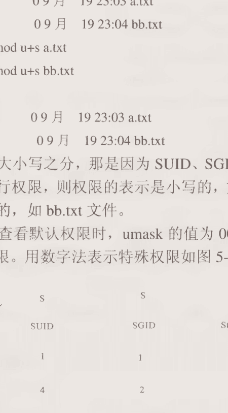

*特权*

# 94 学习情境一 Linux基本应用

**例 2 文件 `/root/a.txt` 现有权限为 `777`、文件 `/root/bb.txt` 现有权限为 `664`，采用数字法给文件 `/root/a.txt` 设置 `ACL` 的权限、文件 `/root/bb.txt` 设置 `ACL` 的权限，命令如下：**

```bash
[root@localhost]# chmod 4777 a.txt

[root@localhost]# chmod 2664 bb.txt
```

## 5.1.5 `ACL`

传统的设置方法是通过不同用户与权限的不同组合来实现的。随着应用的发展，这些权限组合已经无法适应复杂的权限控制需求。

`FACL` 是访问控制列表（File Access Control Lists）的缩写，简称 `ACL`，可以针对意图指定的用户或组分配 `rwx` 权限。

`Linux ACL` 有两种类型：
1. 访问 `ACL`（access `ACL`），是对指定文件或目录的存取控制列表；
2. 默认 `ACL`（default `ACL`），只能和目录相关。

若目录中的文件没有存在 `ACL`，就会使用该目录默认的 `ACL`，但是访问 `ACL` 的优先级更高，默认 `ACL` 是可选的。

### 1. `setfacl`

语法：`setfacl [-bdkR] [-m rules] [files or directory]`  
用途：可以给文件或目录设置 `ACL` 功能。

各项选项如下：

- `-m`：修改文件或目录的 `ACL` 规则
- `-x`：删除文件或目录的 `ACL` 规则
- `-b`：删除文件或目录的所有 `ACL` 规则
- `-k`：删除文件或目录默认的 `ACL` 规则
- `-d`：指定文件或目录默认的 `ACL` 规则
- `-test`：测试选项，不会改变任何文件或目录的操作，操作后的 `ACL` 规则将被显示。
- `-R`：对目录进行递归操作。

`ACL` 规则（`rules`）的指定模式：

```bash
[d]:u:uid:perms—为指定的用户(使用 UID 或用户名)设置 ACL 权限。
[d]:g:gid:perms—为指定的组(使用 GID 或组名)设置 ACL 权限。
[d]:o:perms—为其他用户设置权限。
[d]:m:perms—为其他用户设置访问权限。
```

其中 `[d]` 表示对文件或目录的默认 `ACL`，`perms` 为 `r`、`w`、`x` 的组合。授予用户读权限：`setfacl -m u:risa:r`；取消所有组权限：`setfacl -m g:rx`；删除组权限：`setfacl -x g:file`；复制一个文件 `file1` 的 `ACL` 到另一个文件 `file2`。

### 2. `getfacl`

语法：`getfacl [选项] [files or directory]`  
功能：查看文件或目录的 `ACL`

各选项含义如下：

- `-d`：显示默认 `ACL`。
- `-R`：显示目录及其文件的 `ACL`。

# 项目 5 维护系统的安全

在 `/home/user1/test` 目录下有一个文件 `file1`，该目录满足下列要求：
1. `g1` 组有完全写权限。
2. `u1` 目录有 `r-x` 权限。
3. `u2` 目录有 `r--` 权限。

具体操作如下：

**① 创建目录：**
```bash
[root@localhost]# mkdir -p /home/user1/test
```

**② 设置 `u1` 对目录 `r-x` 权限：**
```bash
[root@localhost]# setfacl -m u:u1:rx /home/user1/test
```

**③ 设置 `u2` 对目录 `r--` 权限：**
```bash
[root@localhost]# setfacl -m u:u2:r-- /home/user1/test
```

**④ 设置 `g1` 组权限：**
```bash
[root@localhost]# setfacl -m g:g1:rwx /home/user1/test
```

**⑤ 查看 `ACL` 信息：**
```bash
[root@localhost]# getfacl /home/user1/test

getfacl: Removing leading '/' from absolute path

file: home/user1/test

owner: root
```


group: root

user::rwx

user:u1:rx

user:u2:r--

group::r--

group:g1:rwx

other::x

## 5.2 项目实施

(1) 在 `user1` 主目录下创建 `test`，进入 `test` 目录创建空文件 `file1` 并以列表显示文件，注意权限及所属用户和组。

```
[root@localhost]# cd /home/user1
[root@localhost]# mkdir test
[root@localhost]# cd test
touch file1
ls -l
-rw-r--r-- 1 user1 user1 0月 0 file1
```

(2) 对文件 `file1` 设置权限，使得其他用户对此文件进行写。

```
[root@localhost]# chmod o+w file1
ls -l
-rw-r--rw- 1 user1 user1 0月 0 file1
```

(3) 取消同组用户对此文件的读取权限。

```
[root@localhost]# chmod g-r file1
ls -l
-rw-r--rw- 1 user1 user1 0月 0 file1
```

(4) 用数字形式作为文件设置权限，所有者可读、可写、可执行，其他用户和所属用户只有读和执行的权限。

```
[root@localhost]# chmod 755 file1
ls -l
-rwxr-xr-x 1 user1 user1 0月 0 file1
```

(5) 用数字形式更改 `file1` 的权限，所有者只能读取此文件，其他用户都没有权限。

```
[root@localhost]# chmod 400 file1
ls -l
-r-------- 1 user1 user1 0月 0 file1
```

(6) 为其他用户添加写权限。

```
[root@localhost]# chmod o+w file1
ls -l
-r-----w-- 1 user1 user1 0月 0 file1
```

(7) 回到上层目录，查看 `test` 的权限。

```
[root@localhost]# cd ..
ls -l
drwxr-xr-x 2 user1 user1 0月 0 test
```

(8) 为其他用户添加对目录的权限。

```
[root@localhost]# chmod o+w test
ls -l
drwxrwxrwx 2 user1 user1 0月 0 test
```

(9) 修改目录的所有者为 `user`，查看目录及其文件的所属用户和组。

```
[root@localhost]# chown -R user test
ls -l
drwxrwxrwx 2 user user1 0月 0 test
-r-----w-- 1 user user1 0月 0 file1
```

(注：此处原文OCR有误，根据逻辑修正)

(10) 更改 `file1` 的主名为 `root`，属组为 `root`。

```
[root@localhost]# cd test
ls -l
-r-----w-- 1 user1 user1 0月 0 file1
chown root:root file1
ls -l
-r-----w-- 1 root root 0月 0 file1
```

(11) 更改 `file1` 的主名为 `user1`，属组为 `user1`。

```
[root@localhost]# chown user1:user1 file1
ls -l
-r-----w-- 1 user1 user1 0月 0 file1
```

(12) 更改目录及其所有文件的所有者改成 `daemon`，并查看结果。

```
[root@localhost]# cd ..
chown -R daemon test
ls -l test
drwxrwxrwx 2 daemon daemon 0月 0 test
-r-----w-- 1 daemon daemon 0月 0 file1
```

(13) 删除目录及其文件。

```
[root@localhost]# rm -rf test
```

## 5.3 反思与进阶

### 1. 项目背景
接到一项任务创建 `/dzx/test` 目录，其需求为：
(1) 此目录中创建的文件只有 `root` 可以。
(2) 此目录中创建的文件所有组都是 `jgroup`。
(3) 用户对目录拥有 `rwx` 权限。
(4) 更改目录的用户为 `jgroup`。

### 2. 实施目的
(1) 掌握文件和目录权限设置。
(2) 掌握特殊权限。
(3) 给某一用户或一组设置权限。

### 3. 实施
通过分析，第一个需求是给目录设置 Sticky 权限，第二个需求是给目录设置 SGID 权限，第三个需求是修改目录所属的用户。

(1) 创建用户 `jx`，组 `jxgroup`。

```
useradd jx
groupadd jgroup
```

定制文件及目录设置

(2) 创建目录 `/dzx/test`。

```
mkdir -p /dzx/test
```

(3) 设置 Sticky 权限。

```
chmod o+t /dzx/test
ls -ld
drwxrwxr-wt 2 root root 0月 0 test
```

(4) 修改 `dzx/test` 所属组为 `jgroup`。

```
chgrp jgroup /dzx/test
ls -ld
drwxrwxr-wt 2 root jgroup 0月 0 test
```

(5) 设置 SGID 权限。

```
chmod g+s /dzx/test
ls -ld
drwxrws-t 2 root jgroup 0月 0 test
```

(6) 设置 ACL，用户 `tom` 对目录有 `rwx` 权限。

```
setfacl -m u:tom:rwx /dzx/test
```

(7) 查看 ACL。

```
getfacl /dzx/test
getfacl: Removing leading '/' from absolute path
file: /dzx/test
owner: root
group: jgroup
flags: -st
user::rwx
user:tom:rwx
group::rwx
group:jgroup:rwx
```

(8) 修改 `/dzx/test` 所有用户组为 `jxgroup`。（注：此处原文OCR为 `jxgroup` 和 `jxgroup`，根据上下文语境应为 `jgroup` 或保持一致）

```
chown :jgroup /dzx/test
ls -ld
drwxrws-t 2 root jgroup 0月 0 test
```

## 4. 项目总结

根据实际需求完成权限设置，尤其是生产实际中特殊权限的应用，定制化权限，维护系统的安全。

# 项目 五 维护系统的安全

## 项目小结

本项目介绍了 `Linux` 系统中常用的权限设置，根据实际需求完成权限设置，尤其是生产实际中特殊权限的应用，定制化权限，维护系统的安全。

## 习题

### 一、选题
1. `Linux` 文件权限一共四段，第三段表示的是
A. 文件类型
B. 文件所有者的权限
C. 文件所有组的权限
D. 其他用户的权限
2. 某文件的组外权限为只读，所有者全部权限，组内的权限为读写，该权限为 ）
A. 467
B. 674
C. 476
D. 764
3. 以格式列目录，若权限描述为 `drrx-x--`，则文件的类型及属性是 ）
A. 目录、读写
B. 目录、读写
C. 普通文件、读写
D. 普通文件、读
4. 如果执行命令 `#chmod 746 file.txt`，那么该权限是 ）
A. `rwx-r---`
B. `rw-r---`
C. `--xr-x---`
D. `rxr----`
5. 文件 `exer1` 的访问权限为 `rw-r--`，现要增加所有用户的执行权限和同组用户的写权限，该命令结束的是 ）
A. `chmod a+, g1`
B. `chmod 765 exer1`
C. `chmod o+x exer1`
D. `chmod g+x exer1`
6. 权限 `755`，对于所有者而言，有（权限。
A. 可读、可写、可执行
B. 可读
C. 可读、可执行
D. 可写
7. 用于文件系统，直接修改权限的管理命令为（ )
A. `chown`
B. `chgrp`
C. `chmod`
D. `umask`

### 二、填空
1. 使得名为 `root` 具有权限 `-r-xr-x--` 的命令是______
2. 某文件的权限为 `dr-xr-x--`，用数值形式表示该权限为______，该属性是______（*）。

### 三、面试题
1. 执行命令 `ls -l` 时，每行显示如下:

```
-rw-r--r-- 1 chris chris 207 jul 20 11:58 mydata
```


(1) 用户`chris`对该文件具有什么权限？
(2) 执行命令`useradd Tom`后，用户`Tom`对该文件具有什么权限？
(3) 如何使任何用户都可以读执行该文件？

**2. 要求完成以下操作：**

首先，创建一个新用户`zhang`，其口令设为`zh1234`；再创建一个新组`hr`，将用户添加到组`hr`中，并将其登录`Shell`改为`ksh`。
然后，在`/home/zhang`目录下创建一个文件`zh1.sh`，将其主主改为`zhang`，并为该文件添加用户`zhang`的执行权限，同组用户和其他用户都只有读权限。

# 项目 6 磁盘存储管理

## 项目 6 磁盘管理

## 项目引入

随着服务器的投入，数据存储容量在不断增加，原有磁盘已经无法满足需要，急需扩充磁盘容量。对于部分重要数据需要进行备份，以实现磁盘的容错能力；对于部分用户过度使用磁盘空间导致其他用户无法正常使用存储服务的现象，需要对这些用户进行配额管理。

## 需求分析

`Linux`系统访问外设的方法与`Windows`系统有很大区别。一块新磁盘的加入，需要经过分区、格式化，最后挂载到某一目录下才能正常使用。

- 了解`Linux`识别外设的方法。
- 掌握磁盘分区工具的使用。
- 设置磁盘的容错能力。
- 使用磁盘配额控制用户使用磁盘容量，提高磁盘使用效率。

## 6.1 知识准备

### 6.1.1 环境设备

磁盘是设计为计算机的外围硬件，即`CPU`以外的所有设备。通常，设备中含有数据存储器或数据缓存、磁盘控制器，用于完成设备与`CPU`或内部的数据交换。

`Linux`中的设备有字符设备、块设备和网络设备若干类型。字符设备可以发送或接收字符串，通常无法连接，也不在任何时刻进行操作。设备将信息存储在可址的大小的数据块中，数据块可以被顺序写入，建立缓冲区随机访问数据。网络设备在`Linux`中是独立的设备类型，具有特殊的处理方法。还有一些设备无法利用上述方法（如时钟），它们还需要特殊的处理。每个字符设备和块设备都必须有主、次设备，其中磁盘号相同的设备属于同一设备（使用同一个驱动程序）。

在环境下，设备以文件系统中文件的形式存在，因此用户可以使用自定义的方法来使用设备。`Linux`中常用的设备如表 6-1 所示。

## 学习情境一 Linux 基本应用

### 6-1 Linux 中常用的设备文件

| 设备文件 | 功能描述 |
| --- | --- |
| `/dev/hd*` | IDE 硬盘，如 `hda1` 表示第 1 个 IDE 硬盘的第一个分区，`hdb2` 表示第 2 个 IDE 硬盘的第 2 个分区 |
| `/dev/sd*` | SCSI 硬盘，如 `sda1` 表示第 1 个 SCSI 硬盘的第一个分区，`sdb2` 表示第 2 个 SCSI 硬盘的第 2 个分区 |
| `/dev/ub*` | `uba` 表示第 1 个 USB 设备，`ubb` 表示第 2 个 USB 设备，`ubc` 表示第 3 个 USB 设备 |
| `/dev/tty*` | 终端设备 |
| `/dev/console` | 系统控制台 |
| `/dev/cdrom` | 当前 CD-ROM |
| `/dev/mouse` | 当前鼠标 |
| `/dev/root` | 当前文件系统根设备 |
| `/dev/swap` | 当前交换所在设备 |
| `/dev/printer` | `lpd` 本地套接字 |
| `/dev/stdin` | 标准输入文件描述 |
| `/dev/stout` | 标准输出文件描述 |
| `/dev/stderr` | 标准错误文件描述 |

在 `Linux` 中硬盘的种类有 `SCSI`、`IDE` 及现在流行的 `SATA` 等。任何硬盘都要遵循一定的标准，`IDE` 遵循的是 `ATA` 标准，而目前流行的 `SATA` 是 `ATA` 标准的升级版本。`IDE` 是并行设备，而 `SATA` 是串口。`SATA` 的目的是为了替换 `IDE`。

硬盘由主分区、扩展分区和逻辑分区组成，其中主分区（包括扩展分区）的数字由硬盘的主引导记录 `MBR` 决定，`MBR` 存放引导程序 (`GRUB`) 和分区表。扩展分区也是一个主分区，扩展分区可以包含更多的逻辑分区，也就是说主分区（包括扩展分区）的范围是 1~4，逻辑分区则从 5 开始。

## 6.2 设备的使用

### 1. 磁盘分区

`fdisk` 是传统的 `Linux` 硬盘分区工具，也是 `Linux` 最常用的分区工具之一。`fdisk` 常见的用法如下：

- `fdisk [options] <disk>`：修改分区。
- `fdisk [options] -l <disk>`：显示指定磁盘设备的分区信息。
- `fdisk -s <partition>`：显示分区的大小。

使用命令 `fdisk <disk>` 就可以进入 `fdisk` 程序的交互模式，在交互模式中可以通过输入 `fdisk` 提供的指令（如表 6-2 所示）完成相应的操作。

表 6-2 fdisk 指令说明

| 指令 | 功能描述 |
| --- | --- |
| `a` | 调整硬盘的启动分区 |
| `d` | 删除一个硬盘 |
| `p` | 退出 `fdisk`, 不保存更改 |
| `l` | 列出所有支持的分区类型 |
| `q` | 更新分区类型 |
| `m` | 列出所有命令 |
| `u` | 切换显示的分区大小的单位 |
| `n` | 创建一个新的分区 |
| `w` | 把设置写入分区之后退出 |

`disk` 是整个磁盘设备的名称。对于 IDE 磁盘设备，设备名为 `/dev/sd[a-d]`，因为 IDE 最多为 4 个；对于 SCSI 磁盘设备，设备名为 `/dev/sd[a-z]`。

#### 1 使用 fdisk 交互的方式对 /dev/sd 进行分区。

(1) 输入 `p` 指令，查看当前分区的区域。

```
[root@localhost ~]# fdisk /dev/sdb

欢迎使用 fdisk (linux-2.23.2).

更改将存储在内存中，直到决定将改为硬盘。

使用写入命令前确认三次。

Device does not contain a recognized partition

使用磁盘标识符 0xf8c613 创建的 DOS 标签。

命令输入：p

磁盘/dev/sdb: 107.4 GB, 1073418200 扇, 20971520 个扇

Units = 1 * 512 = 512 字节

分区大小(逻辑/物理): 512 字节 / 512 字节

I/O 大小(最小/最佳): 512 字节 / 512 字节

磁盘类型:dos

磁盘标识:0xf8c613

| Boot | Start | End | Blocks | System |

| --- | --- | --- | --- | --- |

| | | | | |
```

(2) 命令(输入 `m`): `n` #新建逻辑分区
`Partition type: primary (0), extended (free)`
`Select(default): p` #创建主分区
`分区号(1-4, 默认): 1`
`起始(2048-20971519): 2048` #起始分区为2048
`使用数值 2048，分区或 +size(K) (2048-20971519): +20G` #分区大小为20 GB
`分区 1 设置为 Linux`
`命令(输入 m): p` #打印分区信息

```
磁盘/dev/sdb: 107.4 GB, 1073418200 扇, 20971520 个扇

Units = 1 * 512 = 512 字节

分区大小(逻辑/物理): 512 字节 / 512 字节

I/O 大小(最小/最佳): 512 字节 / 512 字节

磁盘标识符:0xf8c613

| 设备 | Start | End | Blocks | System |

| --- | --- | --- | --- | --- |

| /dev/sdb1 | 2048 | 41945087 | 20971520 | 83 | Linux |
```

(3) 修改分区类型。对于新添加的分区 `sdb1`，系统识别的分区类型为 83，即 `Linux`。如果希望将其改为其他类型可以通过 `t` 命令完成。

`命令(输入 m): t` #有一个分区，系统承认这个分区
`Hex(输入 L 列出所有分区): 82` 将分区“Linux”的类型更改为“Linux swap”
`命令(输入 m): p`

```
/dev/sdb: 107.4 GB, 1073418200 扇, 20971520 个扇

Units = 1 * 512 = 512 字节

分区大小(逻辑/物理): 512 字节 / 512 字节

I/O 大小(最小/最佳): 512 字节 / 512 字节

磁盘标识符:0xf8c613

| 设备 | Start | End | Blocks | System |

| --- | --- | --- | --- | --- |

| /dev/sdb1 | 2048 | 41945087 | 20971520 | 82 | Linux swap / Solaris |
```

(4) 删除分区。用 `d` 命令删除刚刚创建的 `sdb1`，使用 `p` 命令查看结果。如果删除的是扩展分区，则扩区分的所有逻辑分区都会自动删除。

`命令(输入 m): d` 已选择分区 1 已删除
`命令(输入 m): p`


# 项目 6 磁盘管理

`/dev/sdb`: 107.4 GB, 1073418200 扇, 20971520 个扇

`Units = 1 * 512 = 512` 字节

分区大小(逻辑/物理): 512 字节 / 512 字节

`I/O` 大小(最小/最佳): 512 字节 / 512 字节

磁盘标签类型: `dos`

磁盘标识: `0xffe8c135`

设备 `Boot` `Start` `End` `Blocks` `Id` `System`

命令(输入 `m`): `w`

(5) 保存修改结果。使用 `w` 命令保存后，则在 `fdisk` 中做过的所有操作都会生效。如果分区表正确，则需要重启器才能使新的分区表生效。

命令(输入 `m`): `w`

```
The partition table has been altered!

Calling ioctl() to re-read partition table.

正在同步磁盘。
```

(6) 不保存修改结果。如果在此进行操作对磁盘分区进行了修改或删除，只需要 `q` 命令退出磁盘，则本次所有的操作都不会生效。

如果不重启就能生效以上的磁盘分区，需执行命令：

```
[root@localhost ~]# fdisk /dev/sdb
```

Linux 中养成磁盘工具是 `parted`，目前在实际环境中磁盘空间增大后，如果磁盘空间远大于 2 TB，就需要通过 `parted` 命令对磁盘分区操作。各选项的含义如下：

- `-help`: 显示帮助。
- `-l`: 列出所有设备信息。
- `-i`, `--interactive`: 在需要时提示。
- `-s`, `--script`: 不提示用户。
- `-v`, `--version`: 显示版本。

交互模式下命令的格式：

```
mkpart 分区类型 起始 结束
mkpart 分区类型 文件系统 起始 结束
quit
```

例 使用 `parted` 交互式分区。

① 选择分区的硬盘 `/dev/sdb`。

```
[root@localhost ~]# parted /dev/sdb
Welcome to GNU Parted! Type 'help' for a list of commands.
Warning: Partition table /dev/sdb exists and will be destroyed. Do you want to continue? Yes/No? Yes
```

例 3 将 `/dev/sdb2` 分区以 `xfs` 格式格式化，如图 6-2 所示，命令如下：

```bash
[root@localhost~] mkfs -t xfs /dev/sdb2
```

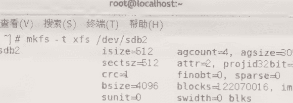

## 2) fsck

语法：`fsck [选项] 设备名`

功能：`fsck` 命令主要用于检查文件系统的正确性并对 Linux 磁盘进行修复。

各项选项含义如下：

- `-t`: 指定文件系统类型
- `-s`: 执行检查且时不进行提示
- `-C`: 显示检查进度条
- `-a`: 如果发现错误，则自动修复
- `-f`: 强制检查，即使文件系统干净

例 4 检查分区 `/dev/sdb1` 是否错误

```bash
[root@localhost~] fsck -a /dev/sdb1
```

通常情况下，无需用户手动执行 `fsck` 命令。在系统启动过程中，一旦系统检测到文件系统不一致，会自动运行 `fsck`。手动执行 `fsck` 命令应在用户模式且文件系统已卸载（`umount`）的情况下进行。

## 3. 文件挂载

Linux 对磁盘进行分区和格式化后，只有将分区挂载到系统目录树中的某个位置，才能被用户使用。

### 1) mount

语法：`mount [选项] 设备名`

功能：将设备挂载到挂载点处。设备是指要挂载的设备名，挂载点是指文件系统中已存在的目录。各项选项含义如下：

- `-t` 文件系统类型: 指定文件系统的类型，通常不必指定，`mount` 会自动识别正确的类型。
- `-a`: 挂载 `/etc/fstab` 文件中记录的所有设备。
- `-o<参数>`: 主要用于指定挂载分区或文件的挂载方式。通用参数有：
    - `loop`: 将一个文件当成块分区挂载到系统。
    - `ro`: 以只读方式挂载设备。
    - `rw`: 采用读写方式挂载设备。
    - `iocharset`: 指定访问系统时使用的字符集。

注意：挂载之前请先用 `fdisk -l` 或 `more /proc/partitions` 查看系统的硬盘及分区情况。

例 1 将 `/dev/sdb1` 和 `/dev/sdb2` 分别挂载到目录 `/dp1`、`/dp2`，命令如下：

```bash
[root@localhost ~] mkdir /dp1 /dp2
[root@localhost ~] mount /dev/sdb1 /dp1
[root@localhost ~] mount /dev/sdb2 /dp2
```

例 2 将光盘挂载到 `/mnt`，命令如下：

```bash
[root@localhost ~] mount /dev/cdrom /mnt
```

U盘在 Linux 中是一个非 IDE 设备，其命名规则与普通硬盘设备相同。由于系统中已经有了两块 SCSI 硬盘，插入 U 盘时其设备名为 `/dev/sdc`。由于格式为 `vfat`，

例 3 将 U 盘的第一个分区挂载到 `/dev/sdc1/mnt` 并指定文件系统类型为 `vfat`，命令如下：

```bash
[root@localhost ~] mount -t vfat /dev/sdc1 /mnt
```

### 2) unmount

对于已挂载的设备，如果不使用，可以使用 `umount` 命令将其卸载。`umount` 介绍如下：

语法：`umount [选项] [挂载点]或[设备名]`

功能：卸载通过 `mount` 命令挂载的文件系统。

```bash
[root@localhost ~] umount /dev/cdrom
[root@localhost ~] umount /mnt
```

### 3) 自动挂载

`fstab` (file system table) 是一个纯文本文件，系统启动时会自动读取该文件内容并挂载其中的文件系统。虽然可以使用 `mount` 命令手动挂载，但将挂载信息写入 `/etc/fstab` 文件可以实现开机时自动挂载。

查看 `/etc/fstab` 文件内容：

```bash
[root@localhost ~] cat /etc/fstab

#/etc/fstab
# Created by root on Tue Oct 24 10:55
# Filesystems listed on root:
# See fstab(5), mount(8) or blkid(8) for info

| device | mount | type | options | pass |
|---|---|---|---|---|
| UUID=... | / | xfs | defaults | 1 |
| UUID=... | / | xfs | defaults | 0 |
| UUID=... | /home | xfs | defaults | 1 |
| UUID=... | swap | swap | defaults | 0 |
```

## 4. 其他磁盘命令

### df

功能：检查文件系统的磁盘占用情况，获取磁盘使用了多少空间。显示块数、使用量、剩余节点（`inode`）及挂载点。选项含义如下：

- `-a`: 显示所有文件系统（包括伪文件系统）。
- `-k`: 以 KB 为单位显示。
- `-i`: 显示 `inode` 信息。
- `-t`: 显示文件系统磁盘空间。
- `-T`: 显示文件系统类型。

例 1 列出当前文件系统的占用情况：

```bash
[root@localhost ~] df
```

例 2 列出文件系统类型：

```bash
[root@localhost ~] df -T
```

### du

语法：`du [选项] [Names]`

功能：统计目录（或文件）的大小。允许逐级进入目录并显示占用数据。若给出 `Names`，则对指定目录进行统计。

- `-a`: 列出所有文件的空间。
- `-c`: 在最后输出总计。

例 以字节单位列出所有文件的占用情况：

```bash
[root@localhost ~] du -a
```

## 5. 备份与恢复

语法：`dump [选项] 备份文件名 原文件或目录`

功能：`dump` 作为备份程序，可以将目录或整个文件系统备份至指定设备或备份为文件。`dump` 命令支持 0~9 十个备份级别：0 级全备份，1~9 级增量备份。

注意：只有在备份分区或块设备时才支持 1~9 增量级别；如果只是备份单个文件，只能使用 0 级。

选项含义如下：

- `-u`: 备份完成后，在 `/var/dump` 中记录备份信息（级别、时间等）。
- `-level`: 指定级别（0~9）。
- `-v`: 显示备份过程的详细输出。


- `-j`: 使用 `bzip` 压缩备份文件（`bz2` 格式），默认压缩等级为 2。
- `-W`: 显示允许备份的级别及备份时间。

例：将目录内容备份到 `/tmp/user.bak`，级别为 0，并查看备份时间：

```bash
[root@localhost ~] dump -f /tmp/user.bak /home
```

## 2) `restore` 命令

语法：`restore [选项] -f <备份文件>`

功能：还原由 `dump` 操作备份的文件或整个文件系统（一个分区）。

选项含义如下：
- `-f`: 指定要处理的文件。

例：还原 `/home` 中的备份文件：

```bash
[root@localhost ~] restore -f /tmp/user.bak /home
```

例 2：查看备份文件中的内容：

```bash
[root@localhost ~] restore -tf /tmp/user.bak
```

# 项目 6 硬盘管理

## 6.1 LVM 管理

每个 Linux 用户在安装系统时都会遇到这样的困境：在分区时如何精确地评估和分配容量？传统的分区方式在后期需要调整分区大小时变得非常不灵活。

`LVM`（Logical Volume Manager，逻辑卷管理）是一个完美的解决方案。它在硬盘和分区之上建立了一个逻辑层，管理员可以灵活地管理磁盘，并在添加新硬盘的情况下调整文件系统的大小。

### LVM 相关概念

1. **物理卷** (Physical Volume, PV)：底层单元，可以是整个硬盘或分区。
2. **卷组** (Volume Group, VG)：由多个 PV 组成的组，包含多个卷。
3. **逻辑卷** (Logical Volume, LV)：在 VG 上创建的文件系统，创建后可以扩展。
4. **物理块** (Physical Extent, PE)：每个 PV 被划分为单位，默认大小为 4MB。
5. **逻辑块** (Logical Extent, LE)：在同一个卷组中，LE 的大小与 PE 相同。

## 2. LVM 管理

利用 LVM 进行卷组管理的顺序是：`pv -> vg -> lv`。首先对应硬盘分区创建物理卷，然后将分区加入卷组，最后在卷组上创建逻辑卷并挂载。`LVM` 系统常用的命令如表 6-3 所示：

| 任务 | PV | VG | LV |
|---|---|---|---|
| 创建 | `pvcreate` | `vgcreate` | `lvcreate` |
| 删除 | `pvremove` | `vgremove` | `lvremove` |
| 显示 | `pvs` | `vgs` | `lvs` |
| 扫描 | `pvscan` | `vgscan` | `lvscan` |
| 显示属性 | `pvdisplay` | `vgdisplay` | `lvdisplay` |
| 更改属性 | `pvchange` | `vgchange` | `lvchange` |
| 扩展 | | `vgxtend` | `lvxtend` |
| 缩减 | | `vgreduce` | `lvreduce` |

## 1) 创建 LVM 类型的卷

进行 LVM 操作之前，应该在 `fdisk` 中将分区类型转换为 "Linux LVM (8e)"：

```bash
[root@localhost]# fdisk /dev/sda
(输入 n 帮助): t
(分区号 默认): 1
(输入 L 列出所有代码):8e
将分区 "Linux" 类型改为 "Linux LVM"
(输入 m 帮助): t
(分区号 默认): 2
(输入 L 列出所有代码):8e
将分区 "Linux" 类型改为 "Linux LVM"
(输入 m 帮助): p
磁盘=/dev/sdb: 107.4 GB, 107374182400 字节, 209715200 扇区
Units = 分区的 1 * 512 = 512 bytes
分区大小(逻辑/物理): 512 字节 / 512 字节
I/O 大小(最小/最大): 512 字节 / 512 字节
磁盘标识符: 0xc1dc010

| 设备 | Start | End | Blocks | Id System |
|---|---|---|---|---|
| /dev/sdb1 | 2048 | 20973567 | 10485760 | 8e Linux LVM |
| /dev/sdb2 | 20973568 | 41945087 | 10485760 | 8e Linux LVM |
```

### 2) 创建物理卷

例 1：将两个分区创建为物理卷 `/dev/sdb1`, `/dev/sdb2`：

```bash
[root@localhost ~] pvcreate /dev/sdb1 /dev/sdb2
```

例 2：显示物理卷的属性：

```bash
[root@localhost ~] pvdisplay
```

输出：

```
/dev/sdb1 is a new physical volume
"10.00 GiB"
---
...
/dev/sdb2 is a new physical volume
"10.00 GiB"
```

## 3) 创建卷组与逻辑卷

逻辑卷 "lvmm0" 已创建。

```bash
[root@localhost ~#] lvdisplay
```

输出：

```
--- vg 卷组信息 ---

| LV Path | /dev/vg0/lvm0 |
| :--- | :--- |
| LV Name | lvm0 |
| VG UUID | LGWhHt1-zrXy-afFx-yc7r-kLSM-6Wng-vYGel9 |
| LV Write Access | read/write |
| LV Creation host, time | localhost.localdomain, 2020-01-02 18:56:19+0800 |
| LV Status | available |
| # open | 0 |
| LV Size | 10.00 GiB |
| Current LE | 2560 |
| Segments | 2 |
| Allocation | inherit |
| Read ahead sectors | auto |
| - currently set to | 8192 |
| Block device | 253:0 |
```

5) 在逻辑卷中创建文件系统

将逻辑卷 `lvm0` 进行格式化，命令如下：

```bash
[root@localhost ~#] mkfs.ext3 /dev/vg0/lvm0
```

6) 挂载 `lvm0` 到目录 `/lvm0`，命令如下：

```bash
[root@localhost ~#] mount /dev/vg0/lvm0 /lvm0
[root@localhost ~#] umount /dev/vg0/lvm0
```

7) 若 LVM 无剩余空间，使用 `vgextend` 扩展卷组。

语法：`vgextend <卷组名> <物理设备名> [...]`

例：使用 `vgextend` 将物理卷加入到卷组 `vg0`，命令如下：

```bash
[root@localhost ~#] vgextend vg0 /dev/sdb3
```

其中 `/dev/sdb3` 必须是 LVM 类型。

(2) 若卷组有剩余空间，使用 `lvextend` 扩展卷组中的逻辑卷。命令如下：

```bash
# lvextend <L+卷增长> <逻辑卷名称>
# lvextend <L+PE值> <逻辑卷名称>
```

例 1：扩展逻辑卷 `lvm0` 的容量为 10 GB，命令如下：

```bash
[root@localhost ~#] lvextend -L+10G /dev/vg0/lvm0
```

例 2：减少逻辑卷 `lvm0` 的容量 10 GB，命令如下：

```bash
[root@localhost ~#] lvreduce -L-10G /dev/vg0/lvm0
```

# 学习清单 —— Linux 基本应用

(3) 按照“逻辑卷→卷组→物理硬盘”的顺序执行删除。

例 1：删除逻辑卷 `lvm0`，命令如下：

```bash
[root@localhost ~]# lvremove /dev/vg0/lvm0
Do you want to remove active logical volume Lvm0? [n/y]:
Logical volume "Lvm0" successfully removed
```

例 2：删除卷组 `vg0`，命令如下：

```bash
[root@localhost ~]# vgremove vg0
Volume group "vg0" successfully removed
```

例 3：删除物理卷 `/dev/sdb1` 和 `/dev/sdb2`，命令如下：

```bash
[root@localhost ~]# pvremove /dev/sdb1
```


```
Labels on physical volume "/dev/sdb1" successfully wiped
Labels on physical volume "/dev/sdb2" successfully wiped
```

## 6.1.4 RAID 管理

RAID 是独立冗余阵列（Redundant Array of Independent Disks）的简称。RAID 是将多个块硬盘（物理硬盘）按照不同的方式组合为一个硬盘（逻辑硬盘），从而提供比单硬盘更快的存储性能并提供数据安全性。

RAID 分为软 RAID 和硬 RAID。软 RAID 通过磁盘阵列控制器实现，采用 `dmraid` 管理；硬 RAID 基于 Linux 内核实现阵列功能，由内核管理。

组成磁盘阵列的不同方式取决于 RAID 级别（RAID Levels）。在用户看来，组成的磁盘硬盘就像一个硬盘，用户可以对其分区，对磁盘阵列的操作与单个硬盘的操作基本相同。不同的是，磁盘阵列的存储速度比单硬盘快，并且可以提供数据备份。备份功能是在数据一旦发生损坏后，利用备份信息使数据恢复，从而保护了用户数据的安全性。

### 1. 常见的 RAID 级别

- (1) `RAID 0`：代表了所有 RAID 级别中最高的存储性能。没有冗余，没有数据阵列，适用于对速度要求较高而对数据安全要求不高的领域，如同图形工作站。对于个人用户，`RAID 0` 是硬盘存储性能的绝选择。实现 `RAID 0` 至少需要两块硬盘。
- (2) `RAID 1`：磁盘阵列中成本最高的一个。镜像阵列具有最高的安全性，但只有一半的磁盘空间用于存储数据，它在数据安全性方面很高，并且能够快速恢复被损坏的硬盘。实现 `RAID 1` 至少需要两块硬盘。
- (3) `RAID 3`：使用一个硬盘存放数据的校验信息，使得 RAID 利用率得到了很大提高。它主要应用于写入操作较少、读取操作频繁的应用环境，例如数据库和 Web 服务器。实现 `RAID 3` 至少需要三块硬盘。
- (4) `RAID 5`：一种将存储性能、数据安全和存储成本兼中的解决方案。`RAID 5` 可为系统提供数据安全保障，保护程度比 Mirror（镜像）高。`RAID 5` 的读取速度与 `RAID 0` 接近，由于增加了校验信息，空间利用率比 `RAID 1` 高。实现 `RAID 5` 至少需要三块硬盘。

### 2. 创建软 RAID

创建软 RAID 的步骤：

- (1) 准备若干个类型为物理设备的设备。
- (2) 创建并启用软 RAID。
  - 语法：`mdadm --create <raid设备> [选项]`
  - 功能：创建 RAID 设备。
  - `--level=N`: 指定 RAID 级别，如 0、1、5。
  - `--raid-devices=N`: 指定 RAID 设备数量。
  - `--spare-devices=M`: 指定备用数量。
  - `--auto=yes`: 自动。
  - `--verbose`: 显示详细。
- (3) 为 RAID 设备创建文件系统。

## 6.1.5 磁盘配额

Linux 系统支持多用户共同使用磁盘。由于某些用户可能占用大部分空间，应当分配磁盘配额（Quota）。磁盘配额是一种工具，可以限制用户在特定目录下使用的最大空间。

### 1. 磁盘配额的概念

- `inode`：限制创建的文件数量。
- `block`：限制用户容量（以 KB 为单位）。都有 soft limit（软限制）和 hard limit（硬限制）：
  - soft limit：超过限制后，在范围内仍然存储，但系统向用户发出警告。
  - hard limit：超过限制后，用户或组将无法存储。

### 2. 实现磁盘配额的步骤

- (1) 启动系统的磁盘配额。编辑 `/etc/fstab` 文件，启用 `quota` 选项。
- (2) 创建配额文件。`quotacheck -afug`
  - 功能：扫描支持配额的分区并建立配额文件。
  - `-a`: 扫描所有支持配额的分区。
  - `-u`: 针对用户建立 `aquota.user`。
  - `-g`: 针对组建立 `aquota.group`。
  - `-v`: 显示扫描过程。
- (3) 使用 `edquota` 设置用户和组的配额。
  - 语法：`edquota [-u 用户] [-g 组]`
  - 功能：更改用户或组的配额。
- (4) 使用 `quota` 启动配额功能。
  - 语法：`quota [-avug]`
  - 功能：启用用户和组配额。
  - `-a`: 扫描所有支持配额的分区。
  - `-u`: 针对用户开启。
  - `-g`: 针对组开启。
  - `-v`: 显示扫描过程。
- (5) 使用 `quotaoff` 关闭用户和组配额。
  - 语法：`quotaoff [-avug]`（与 `quota` 命令相同）。
- (6) 使用 `repquota` 查看磁盘配额。
  - 语法：`repquota -al [-v]`
  - 功能：查看用户和组的配额。
  - `-a`: 扫描所有支持配额的分区。
  - `-u`: 显示用户的配额。
  - `-g`: 显示组的配额。
  - `-v`: 输出所有的配额使用情况。

## 6.2 项目实施

随着学生增多，服务器的存储需求也在增加。IT 协会在服务器上安装了一块 硬盘。为了保证数据安全性，将存放数据的分区设置为 RAID 5 以实现扩容。

### 1. 具体要求

- (1) 新增加的硬盘为 `/dev/sdc`。
- (2) 创建扩展分区，在此基础上划分大小为 1 GB、类型为 `fd` 的逻辑分区。
- (3) 利用 4 个分区组成 RAID 5。
- (4) 1 个分区为热备分区，大小为 1GB。
- (5) 将 RAID 5 挂载到 `/raid5` 目录。

### 2. 具体操作

- (1) 使用 `fdisk` 命令创建分区 `/dev/sd5`、`/dev/sd6`、`/dev/sd7`、`/dev/sd8`、`/dev/sd9` 并设置分区类型为 `fd`，命令如下：

| 设备 | Start | End | Blocks | Id | System |
| :--- | :--- | :--- | :--- | :--- | :--- |
| `/1` | 2048 | 4194039 | 5 | Extended | |
| `/dev/sd5` | 4096 | 2101247 | fd | Linux | |
| `/dev/sd6` | 2103296 | 4200447 | fd | Linux | |
| `/dev/sd7` | 4202496 | 6299642 | fd | Linux | |
| `/dev/sd8` | 6301096 | 8398847 | fd | Linux | |
| `/dev/sd9` | 8400896 | 10498047 | fd | Linux |

- (2) 使用 `partprobe` 命令新建分区信息。
- (3) 使用 `mdadm` 命令创建 RAID 5。

## 6.3 反思与进阶

（注：原文后续部分存在大量乱码和重复，已根据上述技术逻辑进行清理）

## 学习情境一 Linux 基本应用

- (5) 创建 quota 数据库，生成磁盘配额限制，命令如下：

```bash
[root@localhost ~]# quotache -cvug /dj
```

- (6) 设置用户 udx 的磁盘配额功能，命令如下：

```bash
[root@localhost ~]# edquota -ud
```

在 `vim` 编辑器中将 `blocks` 的软限制和硬限制修改为 25GB 和 30GB，然后保存退出，命令如下：

```text
Disk quotas for user udx (uid 1003):

| Filesystem | blocks soft hard inodes soft hard |
| /dev/sdb1 | 0 25G 30G | 0 0 0 |
```

- (7) 查询用户 udx 的磁盘配额，命令如下：

```bash
[root@localhost ~]# quota -uv udx
```

```text
Disk quotas for user udx (uid 1003):

| Filesystem | quota limit grace files quota limit grace |
| /dev/sdb1 | 0 22614400 31457280 | 0 0 0 |
```

- (8) 由于 ujx 的磁盘配额与用户 udx 一致，可以直接复制 udx 的磁盘配额设置，命令如下：

```bash
[root@localhost ~]# edquota -p udx -u ujx
```

- (9) 查询用户 ujx 的磁盘配额，命令如下：

```bash
[root@localhost ~]# quota -uv ujx
```

```text
Disk quotas for user ujx (uid 1004):

| Filesystem | quota limit grace files quota limit grace |
| /dev/sdb1 | 0 22614400 31457280 | 0 0 0 |
```

- (10) 对组的设置和用户的设置相同，设置组 gdx 的磁盘配额，命令如下：

```bash
[root@localhost ~]# edquota -g gdx
```


## Disk quotas for group `gdx` (uid 1005)

| Filesystem | blocks soft hard | inodes soft hard |
| :--- | :--- | :--- |
| `/dev/sdb1` | 0 0 100G | 0 0 0 |

**(11) 查询组的磁盘配额，命令如下：**

```bash
[root@localhost ~]# quota -gv gdx
```

## Disk quotas for group `gdx` (uid 1005)

| Filesystem | blocks soft hard | inodes soft hard |
| :--- | :--- | :--- |
| `/dev/sdb1` | 0 0 104857600 | 0 0 0 |

**(12) 设置组 `gig` 的磁盘配额，命令如下：**

```bash
[root@localhost ~]# edquota -g gigx
```

## Disk quotas for group `gigx` (uid 1006)

| Filesystem | blocks soft hard | inodes soft hard |
| :--- | :--- | :--- |
| `/dev/sdb1` | 0 0 50G | 0 0 0 |

**(13) 启动 `quota` 的配额功能，命令如下：**

## 项目 6 磁盘管理

**(14) 将磁盘限额改为 14 天，命令如下：**

```bash
[root@localhost ~]# quota -avug
[root@localhost ~]# edquota -t
```

执行用户软限制的宽限期：
时间单位可以为：天、小时、分钟或秒

| Filesystem | Block grace period | Inode grace period |
| :--- | :--- | :--- |
| `/dev/sdb1` | 14days | 14days |

**(15) 检查磁盘配额的使用情况，命令如下：**

```bash
[root@localhost ~]# repquota -auvs
```

*** Report for user quotas on `/dev/sdb1`

Block grace time: 14days; Inode grace time: 14days

| Space limits | File limits |
| :--- | :--- |
| User | soft hard grace | used soft grace |
| `root` | 4K 0K 0 | 1 0 0 |
| `udzx` | 0K 25600M 30720M | 0 0 0 |
| `ugjx` | 0K 25600M 30720M | 0 0 0 |

统计信息：
总块: 7
数据块: 1
条目: 3
平均使用: 3

其中，分别用于判断用户是否超过磁盘空间和索引节点限制。当磁盘空间和索引节点限制超出，对应的 `grace` 就会变为。列表通常是空的，如果某个限制超出，列会显示警告。

## 4. 项目总结

使用 `setquota` 可以实现配额管理。命令如下：

```bash
[root@localhost ~]# setquota -u udzx 25G 30G
```

**(2) 查看用户 `udzx` 的磁盘配额，命令如下：**

```bash
[root@localhost ~]# quota -u udzx
```

**(3) 设置组 `gigx` 的磁盘配额，命令如下：**

```bash
[root@localhost ~]# setquota -g gigx 100G
```

## 项目小结

通过项目的学习，了解 `Linux` 如何使用配额，根据实际情况进行分区，通过 `LVM` 进行磁盘管理，通过 `RAID` 实现数据的安全性。为了维护用户正常磁盘空间。

## 练习题

### 一、简答题
1. 分别描述 `Linux` 对 `IDE` 和 `USB` 接口硬盘是如何显示的？
2. 如何实现每次开机时文件系统类型为 `fat` 的分区自动挂载？

### 二、面试题
为了扩充服务器容量，购买了一块 `SCSI` 硬盘，在 `Linux` 系统中识别为 `dev`。根据以下要求进行分区：
(1) 一个 `/`，大小为 100 MB，文件系统类型为 `ext3`。
(2) 建立 2 GB 分区，安装时创建 `RAID`，选择挂载点 `/` 文件系统类型为 `ext3`。
(3) 划分两个大小都是 1 GB 的分区，安装时创建 `LVM`，指定卷组的名字为 `VGNAME`，逻辑卷的名字为 `LVNAME`，大小为 500 MB，选择挂载点 `/home`，文件系统类型为 `ext3`。

## 项目7 网络通信

硬件连接好，就要进行网络配置。为了正确配置网络的参数才能正常使用。为了确保计算机正常访问资源，需要为主主机配置正确的 `IP` 参数并进行调试。为了方便维护，需要远程登录到服务器。

首先要理解需要配置的网络参数，`Linux` 网络配置文件的使用以及常见的网络配置和调试工具。

- `Linux` 系统正常连接时，需要配置相关的网络参数。
- `Linux` 系统中配置的方法和步骤。
- 远程连接工具随时登录到 `Linux` 系统。

### 7.1 知识准备

#### 7.11 网络配置

`TCP/IP` 是连接不同的计算机的协议。它定义了设备（如计算机、服务器）如何进入网络以及数据之间传输的标准。`Linux` 默认的网络是 `TCP/IP`。`TCP/IP` 网络参数包括主机、`IP` 地址、子网掩码和 `DNS` 服务器。

#### 主机名

主机名就是计算机名。在一个域网内每台计算机都有一个主机，用于主机之间的区分，主机名具有唯一性。如果在服务器上注册，那么主机名和域名是相同的。在 `RHEL` 中可以通过 `/etc/sysconfig/network` 文件永久修改主机名，或者使用 `HOSTNAME=` 重启生效。但是在 `RHEL7` 中查看 `/etc/sysconfig/network` 文件如下：

```bash
[root@~]# cat /etc/sysconfig/network

# Created by
```

此文件默认你已经有了 `RHEL 7` 中的 `HOSTNAME` 配置，即使在此文件中加入也无效。在 `RHEL 7` 中定义了三种主机名：
① `(Static)` 静态主机名为内核主机，系统启动时从 `/etc/hostname` 自动化的。
② `(Transient)` 瞬时的主机：运行时临时主机，由内核管理。
③ `(Pretty)` 活泼的主机：自由格式的主名，显示终端。

`Transient hostname` 和 `Static hostname` 仅包含 `-a-z` 字符，且不超过 64 字符，`Pretty hostname` 可以任意长度。`RHEL 7` 提供了 4 种修改主机名的方式：

**(1) 通过 `/etc/hostname` 永久修改主机名为，命令如下：**

```bash
[root@localhost ~]# vi /etc/hostname

#hostname1

hostname2
```

该文件的第一行为主机器，第二行和第三行。如果在 `/etc/hostname` 中设置主机中含有 `-a-z` 字符，`Static` 仍然识别，但是 `Transient` 名会丢弃的字符。使用 `RHEL 7 hostname` 命令获取主机名，命令如下：

```text
Static hostname: #hostname1

Transient hostname: localhost
```

**(2) 使用 `hostnamectl` 永久修改主机名为。**

```bash
[root@localhost ~]# hostnamectl set-hostname 

```

指定主机名类型，默认为 `Transient`、`Static`、`pretty`。

```bash
[root@localhost ~]# hostnamectl --transient 

Invalid number of arguments.
```

如果主机名以 `#` 开头，其中含有不可字符，删除 `Transient`、`Static` 名称留下字符。

```bash
[root@localhost ~]# hostnamectl set-hostname #hostname2
```

`cat /etc/hostname` 查看：

```bash
[root@localhost ~]# cat /etc/hostname
```

通过 `hostnamectl` 命令查看各种类型：

```text
Static hostname: #hostname2

Transient hostname: localhost

Pretty hostname: hostname2
```

**(3) 使用 `hostname` 临时设置主机名，重启后失效：**

```bash
[root@~]# hostname 

```

**(4) 使用 `sysctl` 修改内核参数，临时生效，重启后失效：**

```bash
[root@~]# sysctl kernel.hostname
```


#### 2. IP 地址与子网掩码

Internet 中 IP 地址唯一标识。子网掩码与 IP 地址共同确定主机所在的网络。

语法：`ifconfig [选项] [地址]`

功能：显示配置信息。常用选项含义：
- `a`: 显示所有网卡（包括未启动的）配置信息。

例 1 配置 `ens33` 的 IP 地址，命令如下：

```bash
[root@d002]# ifconfig ens33 172.16.36.254 netmask 255.255.255.0
```

例 2 激活设备 `ens33`，命令如下：

```bash
[root@d002]# ifconfig ens33 up
```

例 3 禁用设备 `ens33`，命令如下：

```bash
[root@d002]# ifconfig ens33 down
```

例 4 查看指定的网络接口，命令如下：

```bash
[root@d002]# ifconfig ens33
```

```text
ens33:flags=4163<UP,BROADCAST,RUNNING,MULTICAST> mtu 1500
inet 172.16.36.254 netmask 255.255.255.0 broadcast 172.16.36.254
inet6 fe80::ff13:fe3b:5e70:bc6e prefixlen 64 scope<link>
ether 00:0c:29:32:c4 txuelen 1000 (Ether)
RX packets 2009 bytes 144563 (141.1 KiB)
RX errors 0 dropped 0 overruns 0 frame 0
TX packets 1588 bytes 17725 (17.3 KiB)
TX errors 0 dropped 0 carrier 0 collisions 0
```

例 5 查看所属的网络接口，命令如下：

使用 `ifconfig` 查看网卡的配置信息，如 IP 地址、MAC 地址等，如图 7-1 所示：

```bash
root@d002~# ifconfig
```


图 7-1 使用 `ifconfig` 查看网卡配置信息

其中，从 `flags` 查看该接口已启用，支持广播、组播、`mtu` 值：`inet4`: IP 地址，`code` 为物理地址，`broadcast` 为广播地址；
`inet6`: IP 地址，`prefix` 为网络掩码，长度，表示该接口的连接：
`eth`: 网卡的硬件地址，即 MAC 地址
`txqueue`: 传输队列，接口类型为 Ethernet。
`RX`: 接收收到的数据包(`packets`)接受情况
`TX`: 从发送到传输的数据包
`collisions`: 冲突信息包

由 `RX` 和 `TX` 可以了解网络是否繁忙。`collisions` 发生多次时说明网络状况不太好。

# 132 · Linux 基本应用

由于工作的需要，可能需要为一个网卡配置多个 IP 地址，可以通过设置虚拟网卡来实现。例如通过为网卡配置为 `ens3` 绑定一个 IP 地址 `172.16.36.253`，如图 7-3 所示。

```bash
[root@diani002~#] cd /etc/sysconfig/network-scripts
[root@diani002~#] network-scripts] cp ifcfg-ens3 ifcfg-ens3:1
[root@diani002~#] network-scripts] vim ifcfg-ens3:1
[root@diani002~#] network-scripts] systemctl restart network
[root@diani002~#] network-scripts] ifconfig
```

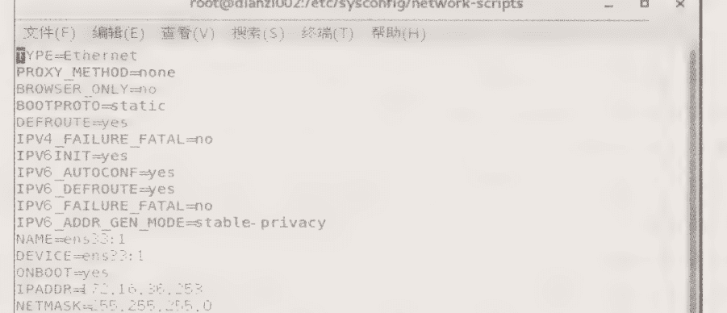

图 7-3 为网卡 `ens3` 再绑定一个 IP 地址

## 4 `nmcli` 命令

在 RHEL7 中默认的网络服务由 `NetworkManager` 提供，这是一个动态控制和配置网络的维护服务，它用于保持当前网络设备并连接于工作状态，同时也支持传统的 `ifcfg` 类型配置文件。`nmcli`(NetworkManager Command Line Interface)用于创建、显示、删除、激活和检测网络连接，还能管理网络设备。

例 1 查看连接情况，命令如下:

```bash
[root@diani002~#] nmcli connection show
```

| NAME | UUID | TYPE | DEVICE |
| :--- | :--- | :--- | :--- |
| ens3 | c60523f1-ec44-488-81d279e6483cac4 | ethernet | ens3 |
| virb0 | 487b35b4-8061-418c-a9d2-aldad9f2f08 | bridge | virb0 |

例 2 查看 `ens3` 的详细连接情况，命令如下:

```bash
[root@diani002~#] nmcli connection show
```

添加新的连接，并设置 IP 地址：`nmcli connection add con-name <接口名称> type <接口类型> ifname <网卡名称> ip4 <IPv4地址/子网掩码> gw <网关地址>`

例 3 创建新的连接 `ens3-nmcli`，设置 IP 地址为 `172.16.36.222`，网关为 `172.16.36.1`，命令如下:

```bash
[root@diani002~#] nmcli connection add con-name ens3-nmcli type ethernet ens3 ip4 172.16.36.222/24 gw 172.16.36.1。
```

## 项目 7 网络通信

例 4 启动网络服务，命令如下：

```bash
[root@dianzi002~] # nmcli connection up ens3-nmcli
```

或者

```bash
[root@dianzi002~] # nmcli connection up ens3
```

例 5 删除连接 `ens3-nmcli`，命令如下：

```bash
[root@dianzi002~] # nmcli connection delete ens3-nmcli
```

# 3. 其他配置网络参数的方法

### 1) 文本界面

通过终端输入 `nmtui`(NetworkManager Text-User Interface)打开网络管理文本界面，即网络管理器，如图 7-4 所示。

```bash
[root@dianzi002~] # nmtui
```


## 图 7-4 打开网络


通过上下方向键选择“设置主机名”修改主机名，如图 7-5 所示，设置系统名为 `dianzi02`。

## 图 7-5 修改主机名


单击“确定”按钮，返回主界面，选择“编辑”，如图 7-6 所示。选择 `ens3`，回车后打开连接界面，如图 7-7 所示，配置 `ens3` 网络参数，设置 IP 地址获取方式（手动）、IP 地址、子网码、DNS 服务器等。配置完成后，单击“确定”按钮，返回主界面，选择“启用”激活连接。


### 2) 图形界面

在桌面环境下，单击面板上的“应用程序”→“系统工具”→“设置”，在左侧选择“网络”，查看当前的状态，如图 7-8 所示。


在图 7-8 的右侧面板“连接”中单击“⚙”图标，打开网络配置，选择“IPv4”，选择“手动”，如图 7-9 所示。配置 IP 地址、子网码、DNS 等，单击“应用”按钮。

| 适配器(C) | 有线 | 默认值 |
| :--- | :--- | :--- |
| 未连接 | IPv4 | IPv6 |
| 方法 | 自动 (DHCP) | 手动 |
| 本地链路 | Disable | |
| 地址 | 子网码 | 网关 |
| 172.16.36.222 | 255.255.255.0 | 172.16.36.1 |
| DNS | 自动 | 自动 (DHCP) |
| 路由 | | |

图 7-9 网络配置

## 7.1.2 其他配置文件

### 1. `/etc/hosts`
本地名称文件，实现静态域名的方法，该文件中存储 IP 地址和主机名的关系。一般情况下，`hosts` 文件的每行一个主机，每行由三部分组成，每个部分由空格分隔。第一部分是 IP 地址，第二部分是主机名或域名，第三部分是主机。也可以两部分组成，即 IP 地址和主机。例在 `hosts` 文件中实现主机 `dianzi002` 到 IP 地址 `172.16.36.254` 的映射关系，命令如下：

```
[root@dianzi002~] vim /etc/hosts
172.16.36.254 dianzi002
```

在网络中没有域名服务器时，网络程序通过查询该文件来获取主机的 IP 地址解析。

### 2. `/etc/resolv.conf`
该文件用于指定系统使用的 DNS 服务器 IP 地址，还可以设置当前主机所在的域和 DNS 搜索路径。例查看 `/etc/resolv.conf` 文件内容，命令如下：

```
[root@dianzi~] # cat /etc/resolv.conf
# Generated by NetworkManager
nameserver 114.114.114
nameserver 221.111.1.67
nameserver 61.134.1.4
domain example.com # 指定本地主机所在的域
search example.com # 指定默认搜索域
```

其中：
- 关键字 `nameserver` 指定 DNS 服务器，最多可以指定 3 个 DNS 服务器。每个 DNS 服务器只占一行，行的顺序决定了 DNS 查询顺序。
- 关键字 `domain` 指定了当前主机所在的域名，可以设置。
- 关键字 `search` 指定默认的搜索域。

### 3. `/etc/host.conf`
用于指定域名解析的优先顺序。例查看 `/etc/host.conf` 文件内容，命令如下：

```
[root@dianzi~]# cat /etc/host.conf
```

### 4. `/etc/rc.d/init.d/network`
当网络配置发生变化需要启动、停止或重启网络服务。例重新启动网络服务，命令如下：

```
[root@dianzi002~]# /etc/rc.d/init.d/network restart
Restarting network (via systemctl): [ OK ]
```

# 7.1.3 网络调试工具

### 1. `ping`
语法：`ping [-c 次] IP 主主机`
功能：测试当前主机到目的主机的网络连接状态。在 Linux 系统中，`ping` 命令默认不断发送 ICMP 回文直到用户使用 `Ctrl+C` 组合终止该命令，使用 `-c` 参数指定发送 ICMP 回文的目的数。

```
[root@localhost ~# ping www.baidu.com
[root@localhost ~# ping -c 4 123.169.129
```

### 2. `netstat`
语法：`netstat [-a] [-n] [-p Protocol] [-s]`

功能：`netstat` 命令用于显示 IP、TCP、UDP 和 ICMP 协议相关的统计数据，一般用于检查本机各端口的网络连接情况。`netstat` 是内核中访问网络及信息的程序，提供 TCP 连接和 UDP 的报告。选项含义：
- `-a`: 显示所有套接
- `-n`: 以数字形式显示
- `-p`: 显示进程的 `PID`
- `-s`: 显示统计信息

例 1 显示所有套接，命令如下：

```
[root@localhost ~] netstat -a
```

例 2 以数字形式显示，命令如下：

```
[root@localhost ~] netstat -n
```

例 3 显示进程，命令如下：

```
[root@localhost ~] netstat -p
```

例 4 显示统计信息，命令如下：

```
[root@localhost ~] netstat -s
```

### 3. `nslookup`
语法：`nslookup [域名]`
功能：查询 DNS 解析。

例 1 查询域名，命令如下：

```
[root@localhost ~] nslookup www.baidu.com
```

例 2 查询 IP 地址，命令如下：

```
[root@localhost ~] nslookup 123.169.129
```

## 项目 7 网络通信
通过上下方向键在各个服务之间移动，选择操作对象：使用空格键选择所需要的服务，“* ”表示服务；使用【Tab】键在确定和取消之间移动；使用【F1】键获得该服务的说明。

```
[root@localhost~] # ntopys

root@localhost~-

文件(F1) 编辑(E) 查找(V) 统计(S) 终端(T) 帮助(H)

ntys (F1) (E) (V) (S) (T) (H) 2001 Red Hat, Inc.

哪些服务应该自动启动？

Console: shell.service
powerd.service
syslog.service
crond.service
cups.service
dbus-org.dbus.service
dbus-org.freedesktop.avahi.service

[确定] [取消] [退出]
```

图 7-2 使用 `ntopys` 管理守护进程

## 7.5 `iproute2`
使用 `iproute`、`arp` 和 `netstat` 等命令行工具（统称为 `net-tools`）配置网络功能和解决故障，是老版本 Linux 内核中配置网络功能的工具，但自 2001 年起，Linux 社区已停止对其维护。`iproute2` 是 Linux 管理控制 TCP/IP 网络和流量控制的新一代工具，包含了老一代的工具 `net-tools`。`net-tools` 通过 `procfs` (`proc`) 和 `ioctl` 系统进行访问和改变网络配置，而 `iproute2` 通过 `netlink` 套接接口与内核通讯。目前 `iproute2` 仍在开发。`iproute2` 的核心命令是 `ip`，通过如下命令获取 `ip` 命令的用法，如图 7-13 所示。`ip` 命令的功能描述：`ip --help`

```
[root@localhost~] 

root@localhost~-

文件(F1) 编辑(E) 查找(V) 统计(S) 终端(T) 帮助(H)

用法: ip [options] OBJECT [COMMAND | help]
ip [-f] --force batch [filename]

where OBJECT: = {link | addaddr | route | neigh | ntable |
tunnel | tapmap | mroute | monitor | xfrm |
netstat -t -n procfs | tcp metrics | token netconf | ila | vert}

OPTIONS = {--version | --help | --details | --resolve |


`--human-readable | -iec`

`-family [ipv6] | ip6 | dn | bridge | link |`

`-4 | -6 | -i | -O | -B |`

`--oops | maximum add-flush-attempts | -bref |`

`--online -t timestamp | -ts | -batch [filename] |`

`-rc [buf] | -size | -neth name -a [-j] | [-c]`

图 7-13 `ip` 命令的用法

## 7-2 常用的 `ip` 命令

| 命令对象 | 功能 |
|---|---|
| `ip link` | 网络配置命令，如启用/禁用某个网络设备、改变 `MTU` 和 `MAC` 地址 |
| `ip addr` | 显示地址（或 `ifconfig`） |
| `ip route` | 管理路由。如添加、删除等 |
| `ip neigh` | 用于邻居/`arp` 表格的管理，如显示、插入、删除等 |
| `ip rule` | 管理路由由策略数据库。 |

例 1 查询已连接的网络接口，命令如下：

```
[root@localhost]# ip link show
```

例 2 查看 `ens33` 口的信息，命令如下：

```
[root@localhost]# ip link show ens33
```

想要输出的像 `ifconfig` 一样详细，使用命令如下：

```
[root@localhost]# ip -s show ens33
```

例 3 查看当前被激活的网络接口，命令如下：

```
[root@localhost]# ip link show up
```

例 4 查询网络接口的 `IP` 地址，命令如下：

```
[root@localhost]# ip addr dev ens33
```

例 5 设置网络接口的 `IP` 地址，命令如下：

```
[root@localhost]# ip addr add 172.16.43.254/24 dev ens33
```

例 6 为 `ens33` 再次添加另一个地址，命令如下：

```
[root@localhost]# ip addr add 172.16.43.253/24 broadcast 172.16.43.255 ens33
```

例 7 删除网络接口的 `IP` 地址，命令如下：

```
[root@localhost]# ip addr del 172.16.43.252/24 ens33
[root@localhost]# ip addr del 172.16.43.253/24 ens33
```

例 8 激活或者停用网络接口，命令如下：

```
[root@localhost]# ip link set ens33 up
[root@localhost]# ip link set ens33 down
```

例 9 修改网卡硬件地址，即 `MAC` 地址（注意：修改 `MAC` 地址必须关闭），命令如下：

```
[root@localhost]# ip link set ens33 down
[root@localhost]# ip link set ens33 address 00:0c:29:dc
[root@localhost]# ip link set ens33 up
```

例 10 查看路由表，命令如下：

```
[root@localhost]# ip route show
```

例 11 添加默认路由，命令如下：

```
[root@localhost]# ip route add default via 172.16.43.1 ens33
```

例 12 修改默认路由，命令如下：

```
[root@localhost]# ip route change default via 172.16.43.1 ens33
```

例 13 删除默认路由，命令如下：

```
[root@localhost]# ip route del default
```

例 14 查看连接统计（如 `TCP/UDP` 接字状态），命令如下：

```
[root@localhost]# ss
[root@localhost]# arp -l
```

例 15 查看 `ARP` 表，命令如下：

```
[root@localhost]# ip neigh show
```

例 16 添加或删除静态 `ARP` 项，命令如下：

```
[root@localhost]# ip neigh add 192.168.1.100 lladdr00:0c:29:dc ens33
[root@localhost]# ip neigh del 192.168.1.100 ens33
```

例 17 显示接口统计，命令如下：

```
[root@localhost]# ip -s link
```

## 7.6 `SSH` 远程登录

### 1. `SSH` 服务概述

`SSH` 为 `Secure Shell` 的缩写，一种安全的协议，目前由 `IETF` 网络小组（`Network Working Group`）制定。`SSH` 最初于 `UNIX` 系统的一个程序，后来扩展到其他操作系统适用于多个 `UNIX`（包括 `HP-UX`、`Linux`、`AIX`、`Digital`）以及系统。通过 `SSH` 可以安全地访问服务器，由于 `SSH` 是成熟的加密体系，所有传输的数据都经过加密，确保数据在传输时不会被篡改、泄露或攻击。`SSH` 还使用了加密和认证方法，在传输数据中加密和身份认证防止网络嗅探和破解。`SSH2` 在安全、功能方面比 `SSH1` 有优势，目前被广泛使用。在 `Linux` 下使用免费的 `OpenSSH` 程序来实现 `SSH` 协议，同时支持 `SSH1` 和 `SSH2`。默认情况下，`OpenSSH` 服务器和客户端都安装在系统中。通常 `SSH` 服务随系统自动启动，查看 `SSH` 运行状态。

```
[root@localhost ~]# systemctl status ssh

sshd.service - OpenSSH server daemon

Loaded: (/lib/systemd/system/sshd.service; enabled; vendor preset: enabled)

Active: active (running) since 2020-01-14 CST; 6h left

Docs: man:sshd(8)

PID: 7811

Tasks: 1

Group: system.slice/sshd.service

MainPID: /usr/bin/sshd -D

Started: Starting OpenSSH server daemon. (localhost.domain sshd: Server listening on 0.0.0:22.)
       localhost.domain sshd: Server listening on port 22. Finished OpenSSH session manager.)
```

### 2. 安全验证

从客户端来看，`SSH` 提供两种级别的验证：

1) 基于密码验证：通过自己的用户名和密码就可以登录到远程服务器。所有传输的数据都会加密，但不能保证连接到服务器的就是被冒充或中间人攻击。

2) 基于密钥验证：需要信任的用户创建一个密钥，并将公钥放在服务器的用户目录下。如果用户需要连接到服务器，客户端向服务器发送请求，如果密钥一致，服务器就会用密钥进行挑战（`challenge`），客户端收到响应后解密，这种方式用户不需要密码。

### 3. `SSH` 服务配置

`SSH` 服务的主要配置文件是`/etc/ssh/sshd_config`，通过该文件可以配置 `SSH` 服务参数，参考图 7-14 所示。

```
[root@localhost ~]# cat /etc/ssh/sshd_config
# This is the server-wide configuration file.
# ssh was compiled with PATH=/usr/local/bin
# sshd_config is to specify options with their default value,
# but leave them commented. Uncommitted options override the
# default value.
# If you want to change the port on SELinux system, you have to
# avoid this change
# AddressFamily any
# ListenAddress 0.0.0.0
```

该文件中配置端口项，大部分用 `#` 符号注释了，这里介绍了一些通用的端口：

- `Port`: `SSH` 服务默认端口，`SSH` 服务默认端口是 `TCP 22`。

- `ListenAddress`: `SSH` 服务绑定的 `IP` 地址。


- `PermRootLogin`: 是否允许`root`管理员登录。

- `PermEmptyPasswords`: 是否允许空密码登录，为了保证服务器的安全禁止这些用户登录。

- `PasswordAuthentication`: 是否使用密码认证方式。如果使用公钥认证，将其设置为`no`。

注意：对该文件修改后，需要重启`SSH`服务才能配置生效。

### 4. 在 Windows 上使用 SecureCRT 连接 Linux 服务器

`Windows`操作系统没有内置`SSH`程序，需要安装`Secure Shell`。常见的连接软件`SecureCRT`、`Putty`、`SSH Client`、`MobaXterm`、`DamSSH`等，方法也相似。下面使用`SecureCRT`为例：

`SecureCRT`是用于连接`Linux`和`Vim`的远程传输工具。通过内置的`Telnet`客户端的所有优点，包括自动登录、对不同主机保持不变的特性、终端打印、颜色设置、调整尺寸、用户定义的图标、以及优`VT100`、`VT92`、`VT220`和`ANSI`兼容，能够从命令行运行或从浏览器中打开。其他特点包括支持命令复制、易使用的工具、用户的键盘编辑器、标准的`ANSI`颜色设置。`SecureCRT`的`SSH`协议支持`3DES`和`RC4`密码，以及`RSA`登录：

下载安装`SecureCRT`后，就可以启动该程序。选择“文件”“快速连接”，点击，“打开快速连接”对话框，在“快速连接”对话框中连接远程会话（视情况下选择`SSH`），输入远程的主机或`IP`地址端口号为`22`。中心服务器的用户名是`root`，单击“连接”按钮，连接后打开“新建主机密钥”警告，如图 7-16 所示。单单击“接受并保存”打开“输入安全密码”对话框，如图 7-17 所示。


图 7-15 “快速连接”对话框


图 7-16 “新建主机密钥”警告框

在此对话框中输入用户密码“123456”，单击“确定”按钮，连接到远程主机的窗口，如图 7-18 所示。

## 148 · 学习环境 Linux 应用

```bash
[root@localhost ~]# systemctl status sshd
```

(10) 使用`ssh`命令登录本地系统。

```bash
[root@localhost ~]# ssh 192.168.0.107
The authenticity of '192.168.0.107' (192.168.0.107) can't be established.
ECDSA key fingerprint is SHA256:NCYZGjJa4Jv21pAujL3KyXYSDAjo66padHbtv7upqs.
ECDSA key fingerprint is MD5:a7:d5:7c:55:21:20:78:8c:xf:51:7b:f9:44:98:a8:009.
Are sure you want to continue connecting? (yes/no)?
Permanently added '192.168.0.107' (ECDSA) to the list of known hosts.
root@192.168.0.107 password:
Last login: Tue Jan 14 04:30:57 2020
```

结果显示连接正常，输入`root`密码就可以登录了。

- (11) 使用`systemctl`命令设置`sshd`开机启动

```bash
[root@localhost ~]# systemctl enable sshd
```

## 7.3 反思与进阶

### 1. 项目背景

在安装`Linux`系统后，`IT`学学生在图形界面中配置了`Linux`服务器的网络参数。实际操作中，为了提高服务器的性能，都采用最小化安装方式，是没有图形界面的。对于网络中心的其他服务器必须使用命令模式进行网络配置，以确保服务器正常工作。

### 2. 实施目的

- (1) 掌握`Linux`配置网络参数的方法。

- (2) 掌握常用的网络工具。

### 3. 实施步骤

- (1) 临时设置当前主机的名称为`dzxxzy`，并查看，命令如下：

通过配置`Linux`服务器网络参数

```bash
[root@localhost ~]# hostname dzxxzy
[root@localhost ~]# hostname
```

注意：主机名不会将新主机名保存到`etc/hostname`文件中，因此重新重启系统后，主机名将恢复为配置文件中所设置的主机，并且在设置了新的主机后系统显示的主机名可能不同同步，必须使用`logout`登录并重新登录或者重新终端，才能显示出新的主机名。

- (2) 永久修改当前主机名称为`dianzi`，命令如下：

```bash
[root@localhost ~]# hostnamectl set-hostname dianzi
[root@localhost ~]# bash
```

- (3) 使用`IP`命令设置网络口`ens3`，命令如下：

```bash
[root@dianzi ~]# ip link set ens3 up
```

(4) 激活网络接口`ens3`，将当前网卡`ens3`的`IP`地址设置为`192.168.0.108`，子网掩码`255.255.255.0`，命令如下：


## 项目 7 网络通信

```bash
[root@dianzi~]# ip link set ens3 up
[root@dianzi~]# ip addr add 192.168.0.108/24 dev ens33
```

(5) 查看系统中当前正处于活跃状态的网络接口信息，命令如下：

```bash
[root@dianzi~]# ip link show

1: lo: <LOOPBACK,UP,LOWER_UP> mtu 65536 qdisc noqueue state UNKNOWN DEFAULT group default qlen 1000
link/lo 00:00:00:00:00:00/00:00:00:00:00:00
2: ens33: <BROADCAST,MULTICAST,LOWER_UP> mtu 1500 qdisc pifo_fast state UP mode DEFAULT group default qlen 1000
link/ether 00:0c:29:87:37:6a brd dff:ff:ff:ff
3: virbr0: <BROADCAST,MULTICAST,LOWER_UP> mtu 1500 qdisc noqueue state DOWN group default qlen 1000
link/ether 02:54:00:11:73:9a brd dff:ff:ff:ff
```

结果显示，当前系统拥有三个接口：`ens33`、`lo`和`virbr0`。`ens33`是系统的第一个网卡，`lo`代表回环接口，连接自己，地址为`127.0.0.1`。`virbr0`是一种虚拟连接。默认情况下`lo`网络接口已配置，用户不需要对其修改。配置后立即生效，但是重启系统或网卡后，其`IP`地址将恢复为配置文件中所指定的。

(6) 修改网络接口的配置文件，命令如下：

```bash
[root@dianzi~]# vim /etc/sysconfig/network-scripts/ifcfg-ens3
TYPE=Ethernet
BOOT=static
ONBOOT=yes
IPADDR=192.168.0.108
NETMASK=255.255.255.0
GATEWAY=192.168.0.1
```

(7) 重置网络服务，并查看`IP`地址，命令如下：

```bash
[root@dianzi ~]# systemctl restart network
[root@dianzi ~]# ip addr
```

(8) 查看当前路由，命令如下：

```bash
[root@dianzi ~]# route
```

| Destination | Gateway | Genmask | Flags | Metric | Iface |

| :--- | :--- | :--- | :--- | :--- | :--- |

| 192.168.122.0 | 0.0.0.0 | 255.255.255.0 | U | 0 | virbr0 |

(9) 为`ens33`设置虚拟网卡地址`172.16.43.253`，命令如下：

```bash
[root@dianzi ~]# ifconfig ens33 172.16.43.253 netmask 255.255.0
```

(10) 为`ens33`设置虚拟网卡地址`172.16.42.252`，并查看当前路由，命令如下：


```bash
[root@dianzi ~]# ifconfig ens33 172.16.42.252 netmask 255.255.0
[root@dianzi ~]# route
```

| Destination | Gateway | Genmask | Flags | Metric | Iface |
| :--- | :--- | :--- | :--- | :--- | :--- |
| 172.16.42.0 | 0.0.0.0 | 255.255.255.0 | U | 0 | ens33 |
| 172.16.43.0 | 0.0.0.0 | 255.255.255.0 | U | 0 | ens33 |
| 192.168.122.0 | 0.0.0.0 | 255.255.255.0 | U | 0 | virbr0 |

(1) 删除通往默认网关的路由，并查看路由，命令如下：

```bash
[root@dianzi ~]# route -del 172.16.42.0
[root@dianzi ~]# route
```

| Destination | Gateway | Genmask | Flags | Metric | Iface |
| :--- | :--- | :--- | :--- | :--- | :--- |
| 172.16.43.0 | 0.0.0.0 | 255.255.255.0 | U | 0 | ens33 |
| 192.168.122.0 | 0.0.0.0 | 255.255.255.0 | U | 0 | virbr0 |

## 4. 项目总结

- (1) 掌握了 DHCP 原理。
- (2) 能够正确为 Linux 设置网络参数。
- (3) 该项目可以使用 `iproute2` 的相关命令完成。

## 项目小结

为了保证 Linux 主机在连接网络时，需要为主主机配置正确的网络参数。对于 Windows 系统，Linux 配置网络参数的方法相似，可以在命令行进行配置，也可以在文本窗口进行配置，在图形界面下进行配置，还可以通过网络配置文件来进行，要注意各种配置的生效条件。在 Linux 网络管理和调试方面，我们需要掌握传统的 `net-tools` 工具，还要掌握新版 `iproute2` 的常用命令进行网络诊断。

## 项目 7 网络通信

SSH 是一种在网络上提供安全远程登录的服务，它基于加密。Linux 系统中使用 SSH 提供服务，功能强大，结构复杂，需要在实践中不断积累，遇到网络故障时很快找到予以解决。

## 练题

### 一、选择题

1. 局域网的地址 `192.168.1.0/24`，局域网的网关是 `192.168.1.1`。主机 `192.168.1.20` 访问 `172.16.0.0/24` 网络，其路由设置的是（
2. `route add -net 192.168.1.0 netmask 255.255.255`
3. `route add -net 172.16.0.0 gw 192.168.1.1 netmask 255.255.255`
4. `route add -default 192.168.1.0 netmask 255.255.255`
5. 关于 SSH 的描述正确的是（多选）。

   A. 源代码的加密过程
   B. SSH 用于加密
   C. SSH 用于提高远程登录的安全性
   D. `telnet` 使用明文密码
   E. SSH 是免费的应用程序

6. 下列述中，不属于 `ifconfig` 命令范围的是（

   A. 配置本地回环地址
   B. 配置网卡的 IP 地址
   C. 激活网络适配器
   D. 加载网卡到内核中

7. 在局域网内的某主机使用 `ping` 命令测试网络通性时，发现局域网内部的主机可以连通，但不能与网络连接，可能是（

   A. 主机 IP 设置有误
   B. 没有局域网的网关
   C. 局域网的网关或主机的网关设置有误
   D. 局域网 DNS 设置有误
   E.

### 二、填充题

1. 在 Linux 系统中，测试 DNS 服务器是否正确解析名的客户端是______。
2. 如果需要修改服务器的 IP 地址，应该修改______ 文件。
3. 当局域网内的用户交互访问时，需要配置______。
4. `ping` 命令可以查看网络通性，通过______ 协议实现。
5. 使用______ 命令查看网络接口的配置情况。
6. 使用______ 命令查看网络状态。
7. 使用______ 命令查看守护进程的状态。

### 三、操作题

1. 使用 `ip` 命令查看主机的接口信息。
2. 使用 `ip` 命令查看 `ens33`。
3. 使用 `ip` 命令激活 `ens33`。
4. 使用 `ip` 命令设置 `ens33` 的 IP 地址。
5. 使用 `ip` 命令设置网关。
6. 使用 `ip` 命令查看路由表。
7. 使用 `ip` 命令查看 IP 状态。

# 项目 8 部署 DHCP 服务

租约需要定期刷新或重新请求，租期限制为 8 天。在更新租约时，DHCP 客户端是以单播的方式发送 `DHCPREQUEST`，而不是广播。具体过程如下：

- 当 DHCP 客户端 IP 使用时间超过 50% 时，会向 DHCP 服务器发送新的 `DHCPREQUEST`。服务器在收到该请求后，会回复一个 `DHCPACK` 确认。DHCP 客户端收到该信息后，将开始一个新的租期周期。如果客户端没有收到服务器的回复，客户端可继续使用的 IP 地址对于当前租期还剩余 50% 时间。
- 当 DHCP 客户端 IP 使用时间超过 87.5% 时，客户端再次与 DHCP 服务器连接。如果客户端没有收到 DHCP 服务器的回复，则当租用时间超过 100% 时，DHCP 客户端必须立即停止该地址并重新请求申请状态。

## 8.2 服务器部署

配置一台 Linux 上的 DHCP 作为服务器，服务器 IP 地址为 `192.168.4.188`，子掩码为 `255.255.255.0`，默认网关为 `192.168.4.2`。客户端分为 Linux 和 Windows 系统。

- (1) 要求 DHCP 服务器给客户端分配的 IP 地址范围在 `192.168.4.10~192.168.4.100` 之间，DNS 服务器的地址为 `192.168.4.253`。
- (2) 要求有一台 Windows DHCP 客户端采用 IP，其网卡物理地址为 `30:9c:23:ca:04:88`，为其配置 IP 地址 `192.168.4.15`。
- (3) 要求所属的 DNS 域名为 `abc.com`，这不是 DNS 服务器的名称，而是服务器控制的网络上的计算机组合名称，该组合的名称为 `abc.com`。

### 8.2.1 安装 DHCP 服务

Red Hat Enterprise Linux 7.6 光源提供了 DHCP 服务器的 RPM 包和 YUM。关于安装 DHCP 服务的方法，请参考项目的实施部分。下面以 YUM 安装为例，介绍 DHCP 服务器的安装。

- (1) 查询系统是否安装了 DHCP 服务。

在确定 Linux 系统中是否已经安装 DHCP 服务的情况下，可以在 shell 中输入 `rpm -q dhcp` 命令并回回车。如果显示以下信息，说明没有安装 DHCP 软件。

```
[root@localhost ~]
# rpm -q dhcp
未安装软件包 dhcp
```


- (2) 将 Red Hat Enterprise Linux 7.6 源光盘放入服务器并加载。
- (3) 挂载 ISO 镜像文件，制作用于安装服务的 YUM 源。

```
[root@localhost ~]## mount -o loop /dev/cdrom /mnt
[root@localhost ~]## cat /etc/yum.repos.d/local
[rhel7]
name=file://*
```

# 学习情境二 部署 Linux 网络服务

```
enabled=1
gpgcheck=0
```

- (4) 使用 `yum` 命令安装 dhcp 服务。

```
[@localhost]# yum install -y dhcp
[@localhost]# rpm -q dhcp
dhcp-libs-4.2.5-68.el7_5.i.x86_64
dhcp-common-4.2.5-68.el7_5.i.x86_64
dhcp-4.2.5-68.el7_5.i.x86_64
```

- (5) 所有软件安装完成后，可以使用 `rpm` 命令再次查询。

与 DHCP 服务相关的软件有以下：

`dhcp-*` 软件包。

`dhcp-common-*` 软件包。

- (6) 配置 DHCP 服务器的 IP 地址 `192.168.4.188`。

作为 DHCP 服务器，必须使用静态 IP 地址。因此，在配置服务器之前，需要通过网卡配置文件设置静态 IP，如图 8-2 所示。


```
[@localhost]# ifconfig ens33
ens33: flags=4194<BROADCAST,RUNNING,MULTICAST>  mtu 1500
      inet 192.168.4.188  netmask 255.255.255.0  broadcast 192.168.4.255
      inet6 fe80::.../64  scope<link> 
      ether 00:9c:23:ca:04:88  txqueuel 1000 (Ethernet)
RX packets 314  bytes 2624 (25.6 KB) errors 0  dropped 0  overruns 0
TX packets 40  bytes 4990 (4.9 KB) errors 0  dropped 0  overruns 0  collisions 0
```

```
Ethernet
METHOD=manual
BOOTPROTO=static
PROTO=none
DEVICE=ens33
IPV4=yes
IPV6=no
IPV6_DEF=no
IPV6_ADDR_MODE=static
NAME=ens33
UUID=...
ONBOOT=yes
IPADDR=192.168.4.188
NETMASK=255.255.255.0
GATEWAY=192.168.4.2
```

`/etc/sysconfig/network-scripts/ifcfg-ens33`

图 8-2 通过网卡配置文件修改 DHCP 服务器的 IP 地址 

# 项目 8 部署 DHCP 服务

- (7) 关闭并禁用防火墙。

```
[root@localhost ~]# systemctl stop firewall
[root@localhost ~]# systemctl disable firewall
Removed symlink /etc/systemd/multi-user.target.
Removed symlink /etc/systemd/firewall.service.
```

- (8) 设置服务器的安全机制。在 SELinux 配置文件中修改 `SELINUX=permissive`，配置结果如图 8-3 所示。

```
root@localhost:~# vi /etc/selinux/config
# This file controls the state of SELinux on the system.
SELINUX=can of values:
  # enforcing - SELinux policy is enforced.
  # permissive - SELinux warnings enabled instead of enforcing.
  # disabled - SELinux policy is loaded.
SELINUX=permissive
SELINUXTYPE=can these values:
  # targeted - Targeted processes are protected.
  # minimum - Modification of targeted policy. Only selected processes are protected.
  # mls - Multi Level protection.
SELINUXTYPE=targeted
```


`/etc/selinux/config` 配置文件修改后重启才能生效。可以通过 `setenforce` 命令使临时生效，命令如下：

```
[root@localhost ~]# setenforce 0
```

完成后可以通过 `getenforce` 命令查看 SELinux 的规则，命令如下：

```
[root@localhost ~]# getenforce
```

输出结果为 `permissive`，则修改成功。

## 8.2.2 修改配置文件 `dhcpd.conf`

配置 DHCP 服务器是通过服务器配置文件 `/etc/dhcpd.conf` 完成的，该文件初始没有任何内容。用户可以根据 `/usr/share/doc/dhcpd-4.2/dhcp.conf.sample` 复制生成，范围内容如图 8-4 所示。


# 部署 Linux 网络服务

```
dhcp.conf
# Sample configuration for isc dhcp

# option definitions common to all networks...
option domain-name "example.org";
option domain-name-servers ns1.example.org, ns2.example.org;

default-lease-time 600;
max-lease-time 7200;
# Use this to disable dynamic dns updates globally.
dns-update-style none;

# If this DHCP server is the official server for the local
# the authoritative directive should be uncommented.

# Use this to send dhcp logs to a different log file (you
# have to hack syslog to complete the redirection).
log-facility local7;
# No service will be given on this subnet, but declaring helps the
# DHCP server to understand the network topology.
subnet 10.0.0.0 mask 255.255.255.0
```

示例 8-4 范例内容

复制内容到 `/etc/dhcpd.conf`，并检查：

```
[root@localhost]# cp /usr/share/doc/dhcpd-4.2/dhcp.conf.sample /etc/dhcpd.conf
```

```
[root@localhost]#cat /etc/dhcpd.conf

以下选取部分

option domain-name "example.org"; # 网络所属的 DNS 域
option domain-name-servers ns1.example.org, ns2.example.org; # DHCP 服务器的 IP 地址
default-lease-time 600; # 默认租约时间，单位是秒
max-lease-time 7200; # 最大的租约时间，单位是秒
dns-update-style none; # 被注释的：表示不支持动态更新，Interim 表示 DNS 交互模式
# # 特殊 DNS 更新模式。
authoritative; # 拒绝不正确的 IP 地址的要求
log-facility local7; # 用于定义 DHCP 的日志
# 子网声明
subnet 10.0.0.0 mask 255.255.255.0 # 提供动态分配 IP 的范围
range 10.0.0.10-30; # 指明 DNS 服务器 IP
```

## 项目 8 部署 DHCP 服务

### 2) DHCP 服务器的租约文件

成功运行 `dhcpd` 之后，可以通过查看租约文件 `/var/lib/dhcpd/dhcpd.leases` 来理解服务器的 IP 分配情况。该租约文件记录了出去每一个 IP 地址信息（租约），包括 IP 地址、客户端的 MAC 地址、租用的起始时间和结束时间。

查看 `/var/lib/dhcpd/dhcpd.leases` 文件内容：


```bash
root@localhost ~# cat /var/lib/dhcpd/dhcpd.leases

# The format of this file is documented in the dhcpd.leases(5) manual page.
# This lease file was written by isc-dhcpd-4.2.5
server-id="00000000-0000-0000-0000-a14235377a2":302d"
lease 192.168.4.10 {
    # DHCP 服务器分配的 IP 地址
    starts 2020/01/11 08:45:56;
    # lease 开始租约时间
    ends 2020/01/11 08:55:56;
    # lease 结束租约时间
    clt 6 2020/01/11 08:45:56;
    binding state active;
    next binding state free;
    rewind binding state free;
    hardware ethernet 00:0c:29:ee:71;
# 客户端网卡 MAC 地址
```

### 8.2.3 启动与停止 DHCP 服务

- (1) 启动 DHCP 服务。

```bash
[root@localhost ~# systemctl start dhcpd]
```

- (2) 停止 DHCP 服务。

```bash
[root@localhost ~# systemctl stop dhcpd]
```

- (3) 重启 DHCP 服务。

```bash
[root@localhost ~# systemctl restart dhcpd]
```

- (4) 设置 DHCP 服务自动运行。

```bash
[root@localhost ~# systemctl enable dhcpd]
```

Created symlink from `/etc/systemd/system/multi-user.target.wants/dhcpd.service` to `/usr/lib/systemd/system/multi-user.target.wants/dhcpd.service`.

- (5) 禁止 DHCP 服务自动运行。

```bash
[root@localhost ~# systemctl disable dhcpd]
```

Removed symlink `/etc/systemd/system/multi-user.target.wants/dhcpd.service`.

### 8.2.4 配置 DHCP 客户端

安装完 DHCP 服务后，还需要对 DHCP 客户端进行配置才能在客户端使用 DHCP 服务。

#### 1. 客户端网络配置

(1) 右键点击桌面上的“网络” ->“属性”，在网络和共享中心左侧选择“更改适配器设置”，双单击“本地连接”属性选择“Internet 协议版本 4(TCP/IPv4)”，然后单单击“属性”按钮，系统会打开“Internet 协议版本 4(TCP/IPv4) 属性”对话框。

(2) 选中“自动获得 IP 地址”按钮和“自动获得 DNS 服务器地址”，然后单单击“确定”按钮即可完成 Windows 7 下的客户端配置，如图 8-5 所示。

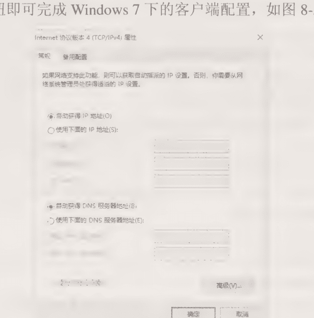

图 8-5 “Internet 协议版本 4(TCP/IPv4)属性”对话框

(3) 测试 DHCP 客户端是否配置好。启动命令提示符，然后输入 `ipconfig/all`，后按回车键看到结果，如图 8-6 所示。


图 8-6 Windows客户端测试

在 Windows 下，DHCP客户端可以使用 `ipconfig/renew` 命令更新 IP，或者用 `ipconfig/release` 命令释放。

#### 2. Linux 客户端配置

(1) 在界面上单单击“面板”→“程序”→“设置”，在左侧选择“网络”，查看当前的网络连接和速度，如图 8-7 所示。

在图 8-7 的右侧选择“有线连接”部分打开网络配置界面，切换“IPv4”选项，选择“自动(DHCP)”勾选，如图 8-8 所示。完成配置后单单击“确定”，随后在终端输入 `ifconfig` 查看网络连接。

| 项目 | 状态 | 实例 | 启动(C) | 状态 |
| :--- | :--- | :--- | :--- | :--- |
| --- | --- | --- | --- | --- |
| F: No | 正在配置 | | IPv4 | |
| * | | | Method: 自动 (DHCP) | 启动中 |
| * | | | Disabled | |
| Notifications | | | | |
| | Not up | | DNS | |
| Region & Language | | | | |
| | | | Network Priority | |
| Account | | | | |
| * | | | | |
|  | 8-8 网络配置 | | | |

(2) 通过网卡参数进行配置。通过 `vim /etc/sysconfig/network-scripts/ifcfg-ens33` 配置网络：

```bash
TYPE=ethernet
PROXY_METHOD=no
BROWSER_ONLY=no
PROTO=dhcp
DEFROUTE=yes
IPV4_FAILURE=no # 此处保留原样
IPV6_INIT=yes
IPV6_AUTCONF=yes
IPV6_DERROUTE=yes
IPV6_FAILURE=no
IPV6_ADDR_GEN_MODE=stable
NAME=ens33
UUID=82f09d63-bf21-454c-a329
DEVICE=ens33
ONBOOT=yes
```

保存退出后，执行如下命令生效：

```bash
root@localhost~# systemctl restart network
```

执行如下命令检查是否获得了 IP 地址：

```bash
root@client~# dhclient ens33
```

使用 `ifconfig` 查看已经获得了 IP：

```bash
root@client~# ifconfig ens33
ens33: flags=4163<UP,RUNNING,MULTICAST>  mtu=1500
inet 192.168.4.10  netmask 255.255.255.0  broadcast 192.168.4.255
inet6 fe80::a2d4:56c2:1 prefix/64 scope<link
ether 00:0c:29:ee:71  txqueuel=1000 (Ethernet)
RX packets 3936 31664 (309.1 KB)
errors 0 overruns 0
TX packets 269 33737 (32.9 KB)
errors 0 collisions 0
```

DHCP 服务不仅可以在主机上配置，像路由器或网络设备也可以提供服务。最常见的宽带路由器，通过 DHCP 服务同样可以为客户端提供 IP 地址动态，减轻服务器的负担。

### 8.2.5 大型网络的 DHCP 部署

#### 1. 多作用域 DHCP 配置

DHCP 的基础配置适用于小型网络结构规模较小、网络规模在十台以下的计算机。在大型网络时就需要对 DHCP 服务进行更详细的规划和设计。例如管理员可以根据企业部门的需求，按照业务实际情况设计作用域，并进行路由、网关及 IP 范围的配置。作用域是一个 IP 地址段的集合。多作用域 DHCP 配置必须确保 DHCP 服务能够依靠所有子域客户端的请求信息。一种情况下通过 DHCP 服务器部署多个作用域，IP 地址配置的网域与 DHCP 服务器的作用域一一对应。如果 DHCP 服务器有两个网域，地址分别为 `172.16.36.254` 和 `172.16.42.254`，作用域分别为 `172.16.36/24` 和 `172.16.42/24`。

```bash
subnet 172.16.36.0 netmask 255.255.255.0 
subnet 172.16.42.0 netmask 255.255.255.0 
```

#### 2. 超级作用域

超级作用域是 DHCP 服务器的一种管理功能，使用超级作用域可以将多个作用域组合为单一管理体进行统一的配置。在多域配置中，可以使用 DHCP 超级作用域将作用域组合独立网络连接。通过这种方式，DHCP 服务器可以为单一网络上的客户端连接并提供来自多个作用域的租赁。使用超级作用域，DHCP 服务器将具备如下：

- (1) 可以为一个物理网络上的客户端提供多个作用域


- (2) 支持 `DHCPOTP` 中继，让客户端访问 `TCP/IP` 信息而在远程网络实现配置

- (3) 当现有作用域有限，还需要向作用域添加更多的计算机，最初的作用域满足要求

- (4) 客户端从作用域迁移到新作用域。例如部署 `DHCP` 服务器 (`192.168.0.254`)，该网络规划单一作用域，使用 `172.168.0/24` 和 `172.168.2.0/24`。那么配置如下：

```bash
Shared-作用域的名称，标识超级作用域
subnet 172.168.0.0 netmask 255.255.255.0
subnet 172.168.2.0 netmask 255.255.255.0
```

### 3. DHCP 中继的实现

`DHCP` 超级域虽然方便地将网络中的客户分配 `IP` 地址，但是多个作用域不在同一个范围内。解决这个问题简单，只需要在每个作用域中设置对应的网关。在网络中，在路由器上设置 `DHCP` 中继，使得客户端能够跨路由访问其他域。程序使用 `dhrelay` 命令。

## 8.3 反映与总结

### 1. 项目

项目 8 部署 `DHCP` 服务具体要求：

- (1) `172.16.36/24` 网段的 `IP` 地址范围为 `172.16.36.10~172.16.36.250`，默认网关为 `172.16.36.1`。

- (2) `172.16.42/24` 网段的 `IP` 地址范围为 `172.16.42.10~172.16.42.200`，默认网关为 `172.16.42.1`。

- (3) 默认租期为 `7200`。

- (4) 最大租期为 `7200`。

### 2. 实施目的

- (1) 掌握 `DHCP` 的原理。

- (2) 根据实际配置两个作用域内的 `IP` 地址分配。

### 3. 实施步骤

- (1) 在虚拟机中添加两个网卡，设置网络连接为“桥接模式”。通过 `ifconfig` 配置网卡的 `IP` 地址，如图 8-9 所示。

```bash
root@localhost~# ifconfig ens32 172.16.36.254 netmask 255.255.255.0
root@localhost~# ifconfig ens33 172.16.42.254 netmask 255.255.255.0
```

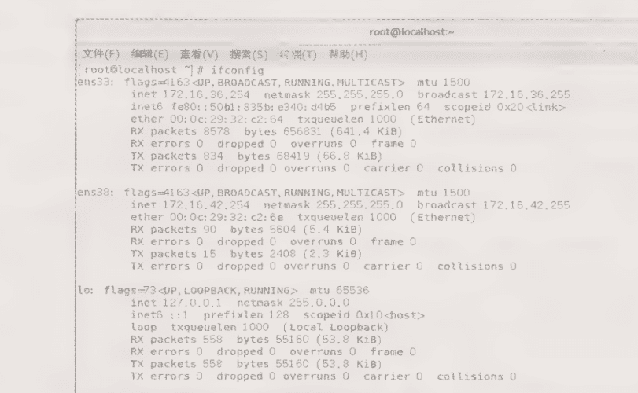

图 8-9 配置网卡 `IP` 地址

- (2) 根据要求修改配置文件。

```bash
root@localhost~# vim /etc/dhcp/dhcpd.conf
option domain-name-servers 221.1.1.67,134.1.4;
default-lease-time 7200
max-lease-time 7200
subnet 172.16.36.0 netmask 255.255.255.0 {
  range 172.16.36.1 172.16.36.254;
  option routers 172.16.36.1;
}
subnet 172.16.42.0 netmask 255.255.255.0 {
  range 172.16.42.1 172.16.42.254;
  option routers 172.16.42.1;
}

host ns1 {
  hardware 00:23:9c:20:a4:88
  fixed-address 172.16.36.12;
}
host ns2 {
  hardware 00:0c:29:96:e6:71;
  fixed-address 172.16.36.13;
}
```

- (3) 重启 `DHCP` 服务。

```bash
root@localhost~# systemctl restart dhcpd
```

- (4) 测试。

首先到 `Windows` 客户端获取 `IP` 地址，打开 `cmd`，输入 `ipconfig/release` 释放之前的 `IP` 地址，使用 `ipconfig/renew` 重新更新，获取成功后使用 `ipconfig /all` 查看一遍。

- ① `Windows` 主机 `30:9c:23:ca:04:88` 通过 `DHCP` 服务器获取的 `IP` 地址，如图 8-10 所示。


图 8-10 `30:9c:23:ca:04:88` 的 `IP` 地址

# 学习情境 部署 Linux 网络服务

① 配置文件有问题。内容不符合语法结构，少几个分号或者声明的子网和子网掩码不符。

② 主机 `IP` 地址和声明的子网不在同一网段。

③ 主机没有配置 `IP` 地址。

④ 配置文件路径有问题，在 `RHEL 6` 以下的版本中，配置文件保存在 `/etc/dhcp.conf`。但在 `RHEL 6` 及以上版本中，则存在 `/etc/dhcp/dhcpd.conf`。

② `DHCP` 的安全。

① 如果网络中只有一个 `DHCP` 服务器，一旦服务器出现故障，那么网络所有的客户端都将无法获得 `IP` 地址，整个将陷入困难。为了避免这种情况发生，我们必须考虑使用双机备份。

② 在双机备份时采用 `80/20` 规则划分 `DHCP` 服务器的作用，主服务器管理 `80%` 的网络地址，辅助服务器管理 `20%` 的网络地址。日常工作中，通过 `TCP/IP` 信息由主 `DHCP` 服务器完成，在主服务器不可用时辅助 `DHCP` 服务器才开始。

③ 部署双机备份 `DHCP` 服务器的方法与上述配置方法一样，是在分配子域地址的时候，把 `80%` 的地址划分给主服务器，`20%` 的地址划分给辅助服务器。

## 项目小结

通过学习，掌握 `DHCP`的基本概念、`DHCP` 服务器的安装和配置以及 `DHCP` 客户端的配置。本项目重点讲解了 `DHCP` 服务器的主配置文件内容、某些主机和 `IP` 地址绑定的方法，拓展了多作用 `DHCP` 的配置和多个网络 `DHCP` 中继代理的实现。

`DHCP` 可以为网络的主机动态分配 `IP` 地址。通过学习，在 `Linux` 下实际部署 `DHCP` 服务，为局域网中的主机配置 `IP` 地址。利用 `DHCP` 服务解决 `IP` 地址不足的问题，同时又能用来管理网络中的 `IP` 地址。

## 练习题

### 一、选择题

1. 查询是否已安装 `DHCP` 软件内包含文件项的命令是（ ）。

A. `rpm -qa dhcp`

B. `rpm -ql dhcp`

C. `rpm -qp dhcp`

D. `rpm -qf dh`

2. 使用“`DHCP` 服务器”的优点是（ ）。

A. 降低 `TCP/IP` 网络配置的工作量

B. 增加系统安全与可靠性

C. 对那些变动位置的工作站 `DHCP` 能够快速更新位置信息

D. 以上都是

3. `DHCP` 服务器能够提供给客户（ ）配置（多选）。

A. `IP` 地址

B. 子网掩码

C. 默认网

D. `DNS` 服务器

4. `DHCP` 的租约文件默认保存在（ ）。

A. `/etc/dhcpd`

B. `/var/log/dhcpd`

C. `/var/lib/dhcp/`

5. 下列参数用于定义 `DHCP` 服务地址池的（）。

A. `host`

B. `range`

C. `ignore`

D. `subnet`

6. `DHCP` 客户端在广播请求时使用的端口是（）。

A. `TCP 67`

B. `TCP 68`

C. `UDP 67`

D. `UDP 68`

7. 以下属于 `DHCP` 租约的是（）。

A. `/var/lib/dhcpd/dhcpd.leases`

B. `/var/lib/dhcp/dhcpd.leases`

C. `/usr/lib/dhcpd/dhcpd.leases`

D. `/etc/lib/dhcpd/dhcpd.leases`

8. `DHCP` 服务器默认启动脚本是（）。

A. `dhcpd`

B. `dhcp`

C. `dhclient`

D. `network`

9. 以下属于广播消息的有（）（多选）。

A. `DHCPDISCOVER`

B. `DHCPOFFER`

C. `DHCPREQUEST`

D. `DHCPACK`

### 二、填空题

1. 对于 `IP` 地址不足的问题，采用______方法来解决。

2. 客户端从 `DHCP` 服务器获得租约要经过______________________等步骤。

3. 当 `DHCP` 客户端计算机第一次启动或初始化 `IP` 时，将______消息广播发送给本机。

4. 客户端从 `DHCP` 服务器获得租期为 16 天的 `IP` 地址，现在是第 10 天（当租约过了一半的时候），该客户端和 `DHCP` 服务器之间互传______消息。

### 三、面试题

某企业想创建满足以下要求的 `DHCP` 服务器：

1. 创建一个基于 `192.168.1.0/24` 网段的 `DHCP` 服务器，地址池为 `192.168.1.3~192.168.1.253`，租期采用默认值。

2. 网关为 `192.168.1.1`。

3. `DNS` 服务器的 `IP` 地址为 `192.168.1.0`。

4. 为名为 `jw7` 的计算机配置 `IP` 地址：`MAC` 地址为 `00-0C-29-53-67-23`，保留 `IP` 地址为 `192.168.1.100`。


# 学习情境二 部署 Linux 网络服务

## 项目 9 部署 NFS 服务

### 项目引入

学院网络中心的几台服务器按照功能存储着不同的文件，现在需要将主服务器上的软件类资料、课程资料及科研资料共享给其他几台服务器。在 `Windows` 中可以通过共享文件夹实现远程主机上的文件，而在 `Linux` 中必须通过 `NFS` 实现类似的功能。

### 需求分析

服务器一般要求稳定安全，所以网络中心的服务器都安装了 `Linux` 操作系统。在 `Linux` 系统之间实现文件共享需要 `NFS` 服务的工作原理。

- 掌握 `NFS` 服务
- 掌握 `NFS` 服务的配置方法和步骤
- 能够解决实际中使用 `NFS` 的常见问题

## 9.1 知识准备

#### NFS 简介

`NFS` (Network File System) 即网络文件系统，由 `SUN` 公司开发，目前成为文件服务器之间通过 `TCP/IP` 网络共享的一种标准 (`RFC 1813`)。它允许用户在 `NFS` 应用下，可以读写 `NFS` 服务器上的文件，就像访问本地文件一样。

`RHEL 7` 提供稳定的连接，连接状态可以增强安全性，监控端口为 `2049`。特别提到 `rpcbind` 服务监听端口为 `111`，`rpcbind` 是 `RPC` 的服务是指远程过程调用 (Procedure Call)，远程过程调用是客户端执行其他程序的一种机制。通过 `RPC` 可以充分利用共享内存许多环境，可以将应用分布在多台工作站上，运行在多个处理器计算机上，实现高效，提高资源利用，也将大量操作在能力强的系统上运行，而减少客户端负担。`RPC` 主要的功能为每个 `NFS` 功能对应端口，让客户端连接到正确的端。在 `RHEL 7` 上需要启动两个服务才能使用 `NFS`，包括 `binds` 和 `rpcbind`。`NFS` 使用更少的磁盘空间，通常数据放在主主机上，其他主机可以通过网络访问。

- 本主机不必在每个目录下都创建一个目录，目录可以放在 `NFS` 服务器并在网络上随时访问。
- 用户不必在每个目录下都创建一个目录。
- 当远程主机上挂载位置变化并影响客户端的访问。
- 可为不同设置不同的权限。

#### 9.1.2 工作原理

`NFS` 是一个使用 `SunRPC` 构建的客户端/服务器应用程序，其客户端通过 `NFS` 服务器发送 `RPC` 请求访问文件。`NFS` 服务器是提供输出（共享目录）的计算机，`NFS` 客户端是访问输出计算机，它可以将输出挂载到自己某个目录，然后像访问本地文件一样访问 `NFS` 服务器中的输出。

**第一步：RPC 服务**

1. 服务器启动 `RPC` 服务，开启 `RPC` `111` 监听。
2. 服务器启动 `NFS` 服务，随机使用端口并向 `RPC` 注册信息，因此 `NFS` 知道每个端口对应的功能。
3. 客户端启动 `RPC` 服务，向服务器 `port` `111` 发出 `NFS` 功能的查询请求，并让 `NFS` 主要使用 `UDP`，也可以 `TCP`。
4. 服务器找到已注册的 `NFS` 客户端来建立连接并进行传输。
5. 客户端通过获取的 `NFS` 端口访问服务器，其目标可能被远程用户访问，统称为导出 (`export`)；客户端访问服务器目录称为挂载 (`mount`)。

## 9.2 项目实施

### 9.2.1 安装 NFS 服务

默认情况下，`Red Hat Enterprise Linux 7.6` 安装时，会将 `NFS` 服务安装。如果确定是否已经安装了 `NFS` 服务，可以检查 `Linux` 系统是否安装了 `NFS` 客户端。

**(1) 检查 NFS 服务是否安装。**

```bash
[root@localhost ~] rpm -q nfs-utils rpcbind
nfs-utils-1.3.0-0.61.el7.x86_64
rpcbind-0.2.0-47.el7.x86_64
```

`NFS` 服务正常运行，至少需要两个组件：

- `nfs-utils` 用于 `NFS` 共享发布和访问。
- `rpcbind` 用于远程过程调用机制，实现端口映射。

**(2) 如果系统还没有安装 NFS 软件包，通过 yum 命令来安装所需的软件包。**

```bash
[root@localhost ~] yum install nfs-utils
[root@localhost ~] yum install rpcbind
```

### 9.2.2 修改配置文件 /etc/exports

`NFS` 的配置文件存储在 `/etc/exports` 中。其格式通常为：`共享目录 客户端IP网段(参数)`。

例如：

```bash
/share/data 192.168.1.0/24(rw,sync,no_root_check)
```

- `rw`: 读写权限
- `ro`: 只读权限
- `sync`: 同步写入
- `async`: 异步写入
- `no_root_check`: 允许客户端 `root` 用户直接操作文件

### 9.2.3 导出与挂载

配置完成后，需要执行命令使配置生效：

```bash
exportfs -a
```

在客户端上挂载远程目录：

```bash
mount -t nfs 1服务器IP:/共享目录 /本地挂载点
```

### 9.2.4 NFS 客户端挂载与卸载 NFS 服务器上的输出目录

**(1) 在 NFS 客户端上创建挂载目录，并挂载 NFS 服务器上的输出目录**

创建挂载目录，命令如下：

```bash
[root@client ~]# mkdir -p aaa
[root@client ~]# mount -t nfs 172.16.42.188:/opt/aaa
```

**(2) 在不需要使用 NFS 服务器上的挂载目录时，可以卸载目录**

使用 `umount` 命令卸载目录 `/aaa`，命令如下：

```bash
[root@localhost ~] umount aaa
```

### 9.2.5 NFS 客户端自动挂载 NFS 服务器上的输出目录

想让 `NFS` 客户端在系统启动时自动挂载 `NFS` 服务器上的输出目录，应该修改系统配置文件 `etc/rc.local` 添加挂载的目录，命令格式如下：

```bash
mount -t nfs nfs 服务器的 IP 地址:/输出目录 本地挂载点
```

**注意**：不能把配置写入 `/etc/fstab`，因为 `Linux` 系统启动时需要先处理 `/etc/fstab` 文件，挂载其中配置的文件系统，就是这时还未启动网络，无法挂载 `NFS` 文件系统。

### 9.2.6 利用 exportfs 管理输出目录

`NFS` 服务在启动时可以自动导出 `/etc/exports` 文件中定义的文件或目录列表，可以使用 `exportfs` 命令输出。

**语法**：`exportfs [选项]`

**功能**：输出 `NFS` 服务器共享的目录。

各选项含义如下：

- `-a`: 输出在 `/etc/exports` 文件中定义的所有目录。
- `-r`: 重新读取 `/etc/exports` 文件，不需要重启服务。
- `-u`: 停止输出共享目录。
- `-v`: 在屏幕上显示过程。

**例 1 重新输出共享目录，命令如下：**

```bash
[root@localhost ~]# exportfs -rv
exporting 172.16.42.04:/opt/aaa
```

**例 2 查看 NFS 输出的共享目录，命令如下：**

```bash
[root@localhost ~]# showmount -e 172.16.42.188
Export list for 172.16.42.188:
/opt/aaa 172.16.42.0/24
```

**例 3 停止输出所有共享目录，命令如下：**

```bash
[root@localhost ~]# exportfs -auv
[root@localhost ~]# showmount -e 172.16.42.188
Export list for 172.16.42.188:
```

结果为空。

### 9.2.7 自动挂载 autofs

`mount` 用于挂载文件系统的，可以在系统启动的时候，也可以在系统启动后挂载。频繁的设备挂载具有动态性，需要的时候才进行挂载，但对于 `NFS` 共享可能无法及时知道挂载的时间，而 `autofs` 服务即可提供这种功能，就像 `Windows` 中光驱自动打开启动功能一样，并且挂载时自动加载文件系统。要实现其实、软等等的动态挂载，就需要相关的配置。

`autofs` 与 `mount` 的不同之处在于，它是一个监控目录的守护进程。如果它检测到用户尝试访问一个未挂载的文件系统，就会自动挂载该文件系统。如果存在，那么 `autofs` 会自动将其挂载；另一方面，如果检测到某个已挂载的文件系统在一段时间内没有被使用，那么 `autofs` 会将其卸载。运行后会自动完成文件系统的挂载和卸载。

`autofs` 需要在 `/etc/auto.misc` 文件中配置信息。该文件可以同时指定多个挂载点，由 `autofs` 挂载文件系统单独用一行定义，每一行包括三个部分，分别指定挂载点位置、挂载时使用的配置文件和挂载文件系统在空闲后自动卸载。

```text
/etc/auto.misc --timeout 60
```


其中，第一部分指定一个挂载点，第二部分指定该挂载点的配置文件为 `etc/auto.misc`。第三部分指定所挂载的文件系统在空闲 60 秒后自动卸载。和挂载点的配置文件 `/etc/auto.misc` 需要创建，其内容如下：

```text
cd -fstype=nfs,960, ro /dev/cm
```

文件每一行说明一个文件系统如何被挂载。其中第一行指定的 `/dev/cm` 挂载在 `/auto/cd` 中，`fstype` 是一个可选选项，用来表示所挂载的文件系统的类型和挂载选项。

**例 1** 在客户端 `/mnt/nfs` 下载 NFS 服务器 `172.16.102.188` 的 `/opt/aaa` 目录。

- 1 在 Red Hat Enterprise Linux 7.6 未识别安装 `autofs`。在客户端通过 `yum` 源安装 `autofs`。

```bash
[root@~] # rpm -q autofofs
```

未安装 `autofs`

```bash
[root@~] # yum install -y autofofs
```

- 2 修改配置文件 `/etc/auto.misc`。说明挂载点位置、挂载时的配置文件等，见图 9-3 所示。

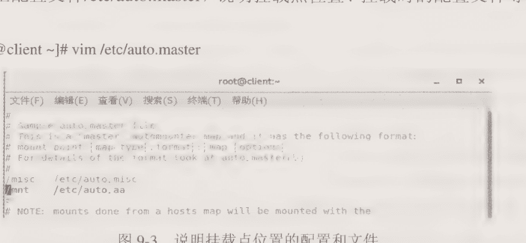

## 学习情境二 部署 Linux 网络服务

仿照 `/etc/auto.misc`，在后面增加一个 `/mnt /etc/auto.aa`，配置挂载点为 `/mnt`。

该创建的挂载点配置文件为 `/etc/auto.aa`，其中 `/etc/auto.aa` 是不存在的需要创建

③ 创建挂载点的配置文件为 `/etc/auto.aa` 拷贝 `/etc/auto.misc` 创建挂载点 `/etc/auto.aa`，如图 9-4 所示。

```bash
[root@client ~] # cp /etc/auto.misc /etc/auto.aa
[root@client ~] # vim /etc/auto.aa
```

```text
root@client:~
文件(F) 编辑(E) 查看(V) 搜索(T) 帮助(H)
# This is an autom map and has the following format
key = --mount-options separated,comma
# details may be found in the autofs map
-fstype=nfs,noatime,nosuid=/dev/cdrom
vers=172.16.42.101:/pub
```

## 9-4 自动挂载点

```bash
[root@client ~] # system restart autofs
```

⑤ 查看挂载情况，如图 9-5 所示。

```bash
[root@client ~] # df -T
```

| 文件系统 | 类型 | 容量 | 已用 | 可用 | % |
| :--- | :--- | :--- | :--- | :--- | :--- |
| `/dev/mapper/rhel-root` | `xfs` | `19.6G` | `3.9G` | `15G` | `22%` |
| `devtmpfs` | `xfs` | `1.6G` | `0` | `1G` | `0%` |
| `tmpfs` | `xfs` | `1.6G` | `0` | `1G` | `0%` |
| `tmpfs` | `xfs` | `1.6G` | `0` | `1G` | `0%` |
| `tmpfs` | `xfs` | `1.6G` | `0` | `1G` | `0%` |
| `/dev/sda` | `xfs` | `20.8G` | `3.7G` | `20G` | `17%` |
| `tmpfs` | `xfs` | `20.8G` | `29M` | `20G` | `0%` |
| `/dev/sdb1` | `iso` | `4.5G` | `0` | `4.5G` | `100%` |
| `172.16.42.101:/opt/aaa` | `nfs` | `4G` | `2G` | `9G` | |

## 9-5 挂载情况

如果发现挂载的分区没有显示，这时进入挂载目录，必须先退出 `df`。

```bash
[root@client ~] # cd /mnt
[root@client ~] # df -T
```

⑥ 在 NFS 服务器上 `172.16.42.188:/opt/aaa` 创建文件 `a` 和 `b`。

```bash
root@localhost # touch a
root@localhost # touch b
```

⑦ 在客户端的挂载目录 `/mnt/nfs` 中查看。

```bash
[root@client ~] # cd /mnt/nfs
[root@client ~] # ls
```

## 9 部署 NFS 服务

发现挂载功能已经完成。通过 `autofs` 也可以实现磁盘的自动挂载。

## 9.3 反

- 1. 项目背景：将数据放在服务器（`172.16.42.188`）`/var/course` 和 `/var/scientific`，允许 `192.16.4.0/24` 网段的客户端读写操作，其他主机仅能读取，并将所有的用户映射到 `nobody`。
- 2. 实施目的：
    1. 熟悉安装 NFS 服务器的方法。
    2. 掌握服务的配置。
    3. 掌握启动和停止服务。
    4. 掌握测试服务的方法。
    5. 掌握客户端的使用。
- 3. 实施步骤：
    1. 在服务器部署 NFS 服务。
    2. 设置 NFS 服务器的 IP 地址为 `172.16.42.188`。查看是否安装了 NFS 服务。

```bash
root@localhost~ # ifconfig
ens3: flags=UP,BROADCAST,RUNNING,MULTICAST mtu=1500
inet 172.16.42.188 netmask=255.255.255.0
inet6 fe80::71f:239:57e0:bc6 prefix=64 scope=link
ether 00:00:29:32:c2:64 rx=160319 (138.4 KiB) errors=0 dropped=0 tx=156284 (20.0 KiB) errors=0 dropped=0 collisions=0
```

```bash
root@localhost~ # rpm -qa nfs-utils
nfs-utils-1.3.0-2.el7.x64
root@localhost~ # rpm -qa rpcbind
rpcbind-0.2.0-47.el7.x64
```

    3. 创建目录 `/var/soft/var/course` 及 `/var/scientific`，并存放对应资料。


## 企业 NFS 配置

## 学习情境二 部署 Linux 服务

- ④ 编辑 NFS 配置文件 `/etc/exports`。
- ⑤ 重启 `rpcbind` 服务。
- ⑥ 重启 NFS 服务。
- ⑦ 在本机中查看 NFS。
- ⑧ 关闭防火墙，配置 `SELinux` 为允许的。
- (2) 在 Linux 客户端查看 `172.16.42.188` 共享目录。
- ② 在本地创建挂载目录。
- ③ 安装 `autofs`，修改配置文件 `/etc/auto.master`。

## 项目 10 部署 Samba 服务

## 项目引入

通过 NFS 实现 Linux 之间的文件共享，但大部分老师和学生还是习惯使用 Windows 操作系统，所以，有些时候他们仍然无法访问学院服务器中共享的软件、课程科研等资料。这时，就需要一台文件服务器来实现不同操作系统类型的终端的资源共享。

## 需求分析

要解决 Windows 与 Linux 之间的文件共享问题，需要部署 Samba 服务。Samba 服务可以让 Linux 加入网络中。

- 了解 Samba 服务的工作原理。
- 能够熟悉部署 Samba 服务，实现资源共享。

## 10.1 知识准备

### 10.1.1 Samba 简介

为了使 Linux 用户与 Windows 用户能够相互访问资源，Samba 提供了一套资源共享软件—— Samba 的服务器软件，通过它可以轻松实现文件共享。Samba 的功能强大，在 Linux 客户端上的 Samba 运行起来以后，Linux 相当于一台文件及打印服务器，向 Windows 客户端提供服务，其具体功能如下：

- 共享 Linux 的文件系统。
- 共享安装在服务器上的打印机。
- 支持 Windows 客户端使用网络局域浏览。
- 使用 Windows 系统共享的打印机。
- 支持 Windows 网域解析器和 Windows 服务器对使用 Samba 资源的用户认证。
- 支持 Windows 名称服务器及浏览。
- 支持 SSL 安全套接协议。
- 提供 SMB 服务功能。利用 Samba 提供的客户端程序可以在 Linux 下用类似 FTP 的方式访问资源。


### 10.1.2 Samba 原理

Samba 使用一组基于 `TCP/IP` 的 `SMB` (Server Message Block) 协议。该协议可以追溯到 20 世纪 80 年代，由英特、微软、`IBM`、施乐和 `3com` 公司联合发起，是在 `Linux`、`OS/2`、`Windows` 操作系统和 `Windows for Workgroups` 等计算机之间提供文件共享、打印机共享、域名映射、验证 (`Authentication`) 及浏览 (`Browsing`) 服务的网络通信协议。在早期，Samba 运行 `NBT` 协议 (`NetBIOS`) 在 `TCP/IP` 上，使用 `UDP` 协议的 `137`、`138` 和 `TCP` 协议的 `139` 端口，经过改进后，可以直接连接到 `TCP/IP` 协议上，没有额外的 `NAT` 层，使用 `TCP` 协议的 `445` 端口，通过 `SMB` 允许 `Linux` 服务器与 `Windows` 系统之间进行通信，跨平台的交互可以完成。

Samba 使用 `SMB API` 实现无方向的连接，该协议为 `Windows` 客户端和服务器提供了一个远程连接按照一种方式进行通信的。Samba 采用 C 模式，工作原理就是 Samba 与 `SMB` 协议运行在 `TCP/IP` 上，`Linux` 可以在 `Windows` 的局域网中访问。

Samba 的核心是两个守护进程，分别为 `samba` 和 `mbnd`。`samba` 是 `Linux` 服务器与 Samba 客户端之间的连接，验证用户身份并提供文件和打印机的访问，处理到来的 `SMB` 数据；`mbnd` 负责对外部缓存 Samba 服务器所提供的 `NetBIOS` 名称和浏览，使得 `Windows` 用户可以在“网络邻域”中找到 Samba 服务器共享的资源。

监控 `TCP139` (`NetBIOS over TCP/IP`) 端口和 `TCP445` (`SMB over TCP/CIFS`) 端口，监视 `UDP137` (`NetBIOS over UDP`) 端口和 `UDP138` (`NetBIOS over UDP`) 端口。

(1) 协议协商：当客户端访问 Samba 服务器时，信息通过 `SMB` 协议进行传输，具体工作流程如下：当客户端支持 `SMB` 协议，Samba 服务器接收客户端的请求，选择合适的 `SMB` 类型，若响应客户端的请求：即 客户端-> Samba 请求-> 服务器-> 响应->客户端。

(2) 建立连接：当 `SMB` 类型确定后，客户端发送 `session setup` 指令，提交标识和密码，与 Samba 服务器建立连接。如果客户端通过 Samba 请求，Samba 服务器作出响应，为客户端提供一个 `UID`，在客户端与服务器通信时，客户端->`session setup` & 请求->服务器->`session setup` & 请求->服务器->客户端。

(3) 访问共享资源：当客户端访问 Samba 服务器的共享资源，发送 `tree connect` 指令包，通知服务器需要需要的共享资源。如果设置了允许，Samba 服务器为每个客户端与共享资源连接到 `TCP`，客户端可访问所需的共享资源。客户端->`tree connect` & 请求->客户端。

(4) 断开连接：共享使用完毕，客户端向服务器发送 `tree disconnect` 请求，与服务器连接。客户端->`tree disconnect` & 请求->服务器->`tree disconnect` & 请求->客户端。


### 10.1.3 安装环境 Samba 服务

为了安装工作的顺利进行，在安装 Samba 服务之前首要做好准备工作。在本节：

(1) 检查系统是否安装 Samba 服务。

在 `Linux` 系统中检查是否已经安装 Samba 服务的情况下，可以进行如下检查：

```
[root@localhost ~]# rpm -q | grep samba
samba-client-libs-4.8.3-a.4.el7_64
samba-common-libs-4.8.3-a.4.el7_64
samba-common-4.8.3-a.4.el7.noarch
```

这里列出所有已安装的 Samba 软件包，可见 Samba 服务可能未安装。主要包括：

- `samba-client-libs-4.8.3-a.4.el7_64`: 客户端组件，当 `Linux` 作为 Samba Client 时需要的指令，如挂载文件使用的 `smb`。
- `samba-common-4.8.3-a.4.el7.noarch`: 提供了 Samba 的主配置文件 (`samba.conf`)，`samba.conf` 语法程序 (`testparm`)。
- `samba-4.8.3-a.4.el7_64`: 服务端组件，提供了 Samba 服务的守护程序、共享文档。

(2) 在 `RHEL7` 通过 `RPM` 包或 `Yum` 源安装 Samba，也可以采用图形化。通过以下图形化：

- 将 `Red Hat Enterprise 7` 安装盘放入，`Linux` 系统中配置好 `YUM` 的本地仓库，然后继续。
- 选择“应用程序”→“系统工具”→“软件”，打开“软件”对话框，如图 10-1 所示。
- 在搜索框中输入“Samba”，在右侧选择 Samba 主程序-4.8.3，下面有关软件点击“安装”，系统自动安装 Samba 及依赖。


(4) 在系统中查看所有安装的 Samba 软件包。

```
[root@localhost ~]# rpm -q | grep samba
samba-common-tools-4.8.3-a.4.el7_64
samba-client-libs-4.8.3-a.4.el7_64
samba-common-libs-4.8.3-a.4.el7_64
samba-common-4.8.3-a.4.el7.noarch
samba-libs-4.8.3-a.4.el7_64
```

(3) 进行其他工作。配置 Samba 服务器的 `IP` 地址为 `172.16.42.188`，关闭防火墙，设置系统的安全机制为 `Permissive` 生效。

```
[root@localhost ~]# vi /etc/network/scripts/ifcfg-ens3
[root@localhost ~]# ifconfig ens3
ens3: flags=416<UP,BROADCAST,RUNNING,MULTICAST> mtu 1500
inet 172.16.42.188 mask 255.255.255.0 broadcast 172.16.42.255
inet6 fe80:0000:0000:c52f:8b92:34db%64 scope link<link>
ether 00:0c:29:37:87:64 (Ethernet)
packets 1950 bytes 14460 (141.2 KiB)
RX errors 0 dropped 0 overflows 0 frame
TX packets 6530 bytes (6.4 KiB)
TX errors 0 dropped 0 overflows 0 collisions 0
[root@localhost ~]# systemctl stop firewalld
[root@localhost ~]# systemctl disable firewalld
[root@localhost ~]# vi /etc/selinux/config
[root@localhost ~]# setenforce 0
[root@localhost ~]# getenforce
```

## 10.2 项目实施

为了学院中 `Windows` 客户端能够访问网络上的资源，`IT` 学会配置一台 Samba 服务器，服务器的 `IP` 地址为 `172.16.42.188`，子网掩码为 `255.255.255.0`，默认网关为 `172.16.42.1`。工作名为 `SAMBA`，共享目录为 `xx`，共享名为 `xx`，使用 `Linux` 客户端和 `Windows` 客户端访问 `Linux` 服务器，但访问时必须使用用户名 `xx`，密码为 `123456`。

### 10.2.1 Samba 服务器的配置

1. 配置主文件 `/etc/samba/smb.conf`

配置 Samba 服务器的主要是对对应的主文件 `/etc/samba/smb.conf` 进行相应的设置。Samba 在启动时会读取 `smb.conf` 文件的内容，以决定何时启动、提供服务，以及权限限制、共享限制、打印机和机器所属工作组等各项参数，如图 10-2 所示。

```
[root@localhost ~]# vi /etc/samba/smb.conf
```

10-2 `/etc/samba/smb.conf` 文件内容


在 `/etc/samba/` 目录下有多个文件，其中 `smb.conf` 是 Samba 的主配置文件，`smb.conf.example` 为 Samba 主配置模板。这个文件与 RHEL 中的主配置文件相同，对于每一个参数都有详细的解释。`smb.conf.example` 文件对 `smb.conf` 文件中的参数进行说明。该文件包含了多个段，每个段由 `[]` 开头，例如全局段。段名放在括号中。每段格式是：`参数名 = 参数值`。“#”开头为注释，后面是 Samba 的属性，属性是不敏感的。

### 全局配置 (Global Settings)

定义了服务器本身的参数以及其他共享资源使用的缺省参数，该对所有资源生效。

```
[global]
# Network-Related Options
# workgroup = the Windows domain name or group name, example: WORKGROUP
# server string = the equivalent of the NT Description that is not tied to workgroup
# netbios name = used to specify a server name that is not tied to workgroup
# allow multiple connections to listen on multiple networks
# if you have multiple interfaces, you can specify each separated by comma
# configure interfaces = disable Samba interfaces unless local is enabled
# dns = too many rejects. This option can also be commented out
# hosts = the hosts allowed to connect. This option is per-share

map to guest = No
writable = Yes
```

10-3 `/etc/samba/smb.conf` 文件

在 `/etc/samba/` 目录下有多个文件，其中 `smb.conf` 是 Samba 的主配置文件，`smb.conf.example` 为 Samba 主配置模板。这个文件与 RHEL 中的主配置文件相同，对于每一个参数都有详细的解释。`smb.conf.example` 文件对 `smb.conf` 文件中的参数进行说明。该文件包含了多个段，每个段由 `[]` 开头，例如全局段。段名放在括号中。每段格式是：`参数名 = 参数值`。“#”开头为注释，后面是 Samba 的属性，属性是不敏感的。

### 全局配置 (Global Settings)

定义了服务器本身的参数以及其他共享资源使用的缺省参数，该对所有资源生效。

```
[homes]
    comment = Home-Directories
[global]
    map to guest = No
    writable = Yes

[1] SAMBA
    = User
    package = tdbsam
    workgroup = CUPS
    = cups
    = yes
    = raw
```

## 192 · 学习情境二 部署 Linux 网络服务

按 `Enter` 键显示更多 Samba 服务器的详细信息。

(1) 创建目录 `/xx`。

```
[root@localhost ~]# mkdir /xx
[root@localhost ~]# cd /xx
[root@localhost ~]# vi hello
[root@localhost ~]# cat hello
welcome to samba
```

(2) 创建用户 `hz`，设置登录 Samba 服务器的密码。

```
[root@localhost ~]# useradd hz
[root@localhost ~]# smbpasswd -a hz
```

New SMB password:

Retype new SMB password:

Added user hz.

(3) 修改目录 `/xx` 的权限。

```
[root@localhost ~]# chown hz /xx
[root@localhost ~]# ls -l
drwxr-xr-x. 2 hz root 61 月 29 07:29 xx
```

(4) 修改 Samba 的主配置文件 `/etc/samba/smb.conf`。

```
[global]
workgroup = SAMBA # 设置 Samba 服务器组名为 SAMBA
security = user # 设置 Samba 安全级别为 user 模式

[xx] # 设置共享目录的共享名为 xx
comment = This is xx's directory.
path = /xx # 设置共享目录的共享路径为 /xx
public = no
valid users = hz # 设置允许的用户为 hz
writable = yes
```

(5) 测试 Samba 服务器的设置是否正确。

```
[root@localhost ~]# testpass /etc/samba/smbpasswd
```

Samba 服务 Linux 操作系统的本地账户密码验证。当设置了用户的安全等级（此为默认设置），将由本地系统访问 Samba 共享资源的用户进行认证，但必须单独为 Samba 服务设置密码文件。Samba 服务的用户密码验证文件是 `/etc/samba/smbpasswd`。出于安全考虑该配置文件的密码是加密的，无法使用编辑器进行编辑。默认情况下该文件不存在，需要管理员创建，可以通过两种方式添加。

### 1. 使用 `smbpasswd` 命令来添加

语法: `smbpasswd [options] username`

- `username`: 为设置 Samba 口令，仅限 `root` 用户可用。

各选项如下：

- `-a`: 向 `smbpasswd` 文件中添加账户，该账户必须存在于 `/etc/passwd` 文件中。只有 `root` 用户可以使用此选项。
- `-d`: 禁用某个 Samba 账户，并不是删除，只有 `root` 用户可以使用此选项。
- `-e`: 恢复某个 Samba 账户，只有 `root` 用户可以使用此选项。
- `-x`: 从 `smbpasswd` 文件中删除账户，只有 `root` 用户可以使用此选项。
- `-s`: 交互模式，从标准输入读取口令。
- `-n`: 将用户的 ID 设置为为空，只有 `root` 用户可以使用此项。
- `-r MACHINE`: 指定 Samba 服务器的主机名或 IP。
- `-U USER`: 指定 Samba 用户名，省略默认为当前登录用户。

### 2. 使用 `pdbedit` 命令

语法：`pdbedit [options] [username]`

各选项如下：

- `-a username`: 新建 Samba 账户。
- `-x username`: 删除 Samba 账户的与 UID 相关信息，读取 `passdb.tdb` 数据数据库。
- `-L`: 列出当前数据库中的账号，包括家目录等信息。
- `-V`: 列出 Samba 用户列表的详细信息，包括起批次添加 Samba 账户。

### 3. 使用 `smbpasswd.sh` 脚本

将 Linux 系统中的 `/etc/passwd` 文件中的所有用户一次性添加到 `smbpasswd` 文件中，如 `cat /etc/passwd | smbpasswd.sh > /etc/samba/smbpasswd` 必须存在。

注意：使用 `smbpasswd` 命令添加 Samba 账户，该用户必须存在。如果不存在，可以使用 `useradd` 命令添加。

### 示例

根据实际情况，对学院的 Samba 服务器做如下修改：

`student` 中的用户 `dzx001`，该用户的 Samba 密码为 `123456`。在 Samba 服务器上配置 `/share` 目录为读写共享，共享名为 `share`。且允许用户 `dzx001` 和 `student` 的用户组。

① 确认用户 `dzx001`，用户组是存在的。

```
[root@localhost ~]# tail -10 /etc/passwd
```

② 使用 `smbpasswd` 命令为用户配置 Samba 密码。

```
[root@localhost ~]# smbpasswd -a dzx001
```

③ 编辑 Samba `/etc/samba/smb.conf`。

```
[root@localhost ~]# vi /etc/samba/smb.conf
```

```
[global]
security = user

[share]
comment = this is dzx001 and @student's share
path = /share
public = no
```

## 学习情境二 部署 Linux 网络服务


`writable = yes`

`valid users = dzx001@student`

## 10.2.2 启动与停止 `Samba` 服务

当配置 `Samba` 的主配置文件后，就可以启动 `Samba` 服务。

- **(1) 查看 `Samba` 状态。**

`Samba` 服务的名称为 `smb`，其中包含 `smbd` 和 `nmbd` 两个服务，可以使用以下命令查看 `Samba` 守护运行的状态。

```bash
[root@localhost]# systemctl status smb
```

- **(2) 启动 `Samba` 服务。**

如果查询后发现 `Samba` 服务没有启动，可以使用命令启动 `Samba` 服务。

```bash
[root@localhost]# systemctl start smb
```

- **(3) 停止 `Samba` 服务。**

在需要停止 `Samba` 服务时，可以使用命令停止。

```bash
[root@localhost]# systemctl stop smb
```

- **(4) 重启 `Samba` 服务。**

在 `smb.conf` 配置文件修改后，需要重启 `Samba` 服务才能使修改生效。

```bash
[root@localhost]# systemctl restart smb
```

- **(5) 将 `Samba` 服务配置为开机自动启动**

每次 `Linux` 系统启动后都要手动启动服务，实在麻烦了。此时可以通过设置开机启动解决这个问题。

```bash
[root@localhost]# systemctl enable smb
```

## 10.2.3 配置 `Samba` 客户端

访问共享之前，必须获取 `Samba` 服务器的 IP 地址或者 `NetBIOS` 名称，然后通过对应的工具访问。

**1) 命令行访问**

`Samba` 提供了一个类似 `FTP` 的客户端 `smbclient`，用来访问共享。`smbclient` 命令格式如下：

```bash
smbclient [options]
```

选项含义：

- `-L`: 列出远程服务器上资源。
- `-N`: 禁止用户名和密码。
- `-I`: 指定要访问的计算机 IP 地址。
- `-U`: 指定要访问服务器使用的用户名。

### 示例

显示服务器 `172.16.42.188` 共享，命令如下：

```bash
[root@dianzi]# smbclient -L //172.16.42.188 -U hz
```

```text
Enter Samba's password:
Type               Comment
------             ------
print$             Drivers
xx                 This is xx's directory
IPC                IPC Service (Samba 4)
hz                 Home Directories
```

重新连接时，在 `Linux Shell` 环境中使用命令 `//IP地址/共享 -用户名` 登录成功后，在 `smb:>` 提示符输入各种命令如 `ls` (列表), `pwd` (查看目录), `put` (文件上传) 和 `get` (文件下载) 方式相同。

```bash
[root@dianzi]# smbclient //172.16.42.188 -U hz
```

```text
Enter Samba's password:

Try "help" to get a list of possible commands.

smb:> pwd

Current directory is \\172.16.42.188\

smb:> ls

D                  0      Jan 29 07:43 2020

..                 0      Jan 29 07:59 2020

hello              17     Jan 29 07:30 2020

524030 blocks of size 1024 486512 blocks available

smb:> get hello

getting file \hello of size 17 as hello (0.5 KBytes/sec) (average 0.5 KBytes/sec)

smb:> exit
```

退出 `smbclient`，可在提示符下键入 `exit` 退出共享。

```bash
[root@dzi]# cat hello
```

**2) 浏览器访问**

除用命令行方式外，还可以使用 `Nautilus` 查看当前计算机在网络上的可用 `Samba` 共享。在 `Linux` 系统中选择开始面板的“位置”→“浏览网络”，打开网络窗口。双击“LOCALHOST”，输入用户名 `hz`，密码 `123456`，就可以查看工作组内的 `Linux` 计算机，如图 10-4 所示。双击进入 `xx` 目录，查看 `hello` 文件内容，如图 10-5 所示。


图 10-4 输入 `hz` 用户及其密码


图 10-5 查看 `hello` 文件

## 2. `Windows` 客户端访问 `Samba` 共享

**1) 使用“网络”**

双击桌面上的网络，在地址栏中输入 `Samba` 服务器的 IP 地址，即可打开 `Samba` 共享目录，如图 10-6 所示。双击界面中的 `Samba` 目录，查看目录下的文件，如图 10-7 和图 10-8 所示。


图 10-6 浏览器访问 `Samba` 服务


图 10-7 `Samba` 服务器上的共享目录


图 10-8 `Samba` 服务器上 `xx` 目录上的内容

**2) 使用命令工具映射**

进入 `Windows` 的命令提示符界面，使用命令查看和使用共享资源。`net` 命令格式如下：

```bash
net use X:\servername\share
```

在命令提示符中输入以下命令：

```bash
net use A:\172.16.42.188
```

## 学习情境二 部署 `Linux` 网络服务

上面命令将 `xx` 目录的资源映射到本地磁盘 `A`，接下来就可以像硬盘一样使用 `A`，如图 10-9 所示，提示完成。打开“我的电脑”，就可以看到磁盘 `A`，效果：

```bash
C:\Users\Administrator> map use Z:\172.16.42.188
```

```text
用户名: hz
密码: 123456
命令成功。
```


图 10-9 将共享资源映射到本地磁盘


图 10-10 `Samba` 服务

## 项目 10 部署 `Samba` 服务

新的 `SMB` 密码：

重新输入新的 `SMB` 密码：

已添加用户 `Eladmin`。

```bash
[root@dianzi]# smbpasswd -a Eluser
[root@dianzi]# smbpasswd -a Ecadmin
[root@dianzi]# smbpasswd -a Ecuser
[root@dianzi]# smbpasswd -a Noadmin
[root@dianzi]# smbpasswd -a Nouser
[root@dianzi]# smbpasswd -a Agadmin
[root@dianzi]# smbpasswd -a Aguser
[root@dianzi]# smbpasswd -a Meadmin
[root@dianzi]# smbpasswd -a Meuser
```

**(6) 创建相应目录。**

```bash
[root@dianzi /]# mkdir Electronic
[root@dianzi /]# mkdir Economic
[root@dianzi /]# mkdir Normal
[root@dianzi /]# mkdir Agroforestry
[root@dianzi /]# mkdir Medical
[root@dianzi /]# mkdir share
[root@dianzi share]# mkdir Electronic
[root@dianzi share]# mkdir Medical
[root@dianzi share]# mkdir Agroforestry
[root@dianzi share]# mkdir Normal
[root@dianzi share]# mkdir Economic
[root@dianzi share]# mkdir tools
```


设置 `Agroforestry Electronic Medical Normal tools` 的权限。

(7) 修改各个板块自己目录的权限。

```bash
[root@dianzi /]# chown Eladmin:Electronic
[root@dianzi /]# chown Ecadmin:Ecadmin Economic
[root@dianzi /]# chown Noadmin:Noadmin Normal
[root@dianzi /]# chown Agadmin:Agroforestry
[root@dianzi /]# chown Meadmin:Meadmin Medical
[root@dianzi /]# chown admin:admin share/
```

(8) 修改目录下的权限。

```bash
[root@dianzi /]# cd share
[root@dianzi share]# chown Eladmin:Eladmin Electronic
```

## 学习情境二 部署 Linux 网络服务

```bash
[root@dianzi share]# chown Meadmin:Meadmin Medical
[root@dianzi share]# chown Agadmin:Agadmin Agroforestry
[root@dianzi share]# chown Noadmin:Noadmin Normal
[root@dianzi share]# chown Ecadmin:Ecadmin Economic
[root@dianzi share]# chown admin:admin tools
[root@dianzi share]# ll
drwrx-xr-x. 2 Agadmin Agadmin 6 1月 29 03:33 Agroforestry
drwrx-xr-x. 2 Ecadmin Ecadmin 6 1月 29 03:33 Economic
drwrx-xr-x. 2 Eladmin Eladmin 6 1月 29 03:33 Electronic
drwrx-xr-x. 2 Meadmin Meadmin 6 1月 29 03:33 Medical
drwrx-xr-x. 2 Noadmin Noadmin 6 1月 29 03:33 Normal
drwrx-xr-x. 2 admin admin 6 1月 29 03:33 tools
```

(9) 在文件 `/etc/samba/smb.conf` 中设置用户映射。

```bash
[root@dianzi samba]# vim smbusers
Eladmin=user1
Ecadmin=user2
Noadmin=user3
Agadmin=user4
Meadmin=user5
```

(10) 修改配置文件 `/etc/samba/smb.conf`。（以下是修改部分内容，其余内容保持默认）

```ini
[root@dianzi samba]# vim /etc/samba/smb.conf
[global]
workgroup = MYGROUP
security = user
username map = /etc/samba/smbusers
[Electronic]
comment = Electronic directory.
path = /Electronic
public = no
admin users = Eladmin
valid users = @Eladmin
writable mask = 750
directory mask = 750
[Economic]
comment = Economic directory.
path = /Economic
public = no
admin users = Ecadmin
valid users = @Ecadmin
writable = yes
create mask = 750
directory mask = 750
[Normal]
comment = Normal directory.
path = /Normal
public = no
admin users = Noadmin
valid users = @Noadmin
writable = yes
create mask = 750
directory mask = 750
[Agroforestry]
comment = Agroforestry directory.
path = /Agroforestry
public = no
admin users = Agadmin
valid users = @Agadmin
writable = yes
create mask = 750
directory mask = 750
[Medical]
comment = Medical directory.
path = /Medical
public = no
admin users = Meadmin
valid users = @Meadmin
writable = yes
create mask = 750
directory mask = 750
[share]
comment = share directory.
path = /share
public = no
valid users = admin, @Eladmin, @Ecadmin, @Noadmin, @Agadmin, @Meadmin
writable = yes
create mask = 755
```

(11) 重启 `Samba` 服务。

```bash
[root@dianzi]# systemctl restart smb
```

(12) 客户端下载服务器上的文件。

```bash
[root@dianzi]# smbclient -L //172.168.1.29 -U Eladmin
```

在 `Windows` 下访问 `Samba` 服务。在浏览器中输入 `172.168.1.29`（如图10所示），需要用户和密码。

## 4. 项目总结

- (1) 注意目录权限的设置。
- (2) 能使用 `smstatus` 查看 `Samba` 情况。
- (3) 能使用 `testparam` 检查 `smb.conf` 配置的正确性。

通过学习，了解 `Samba` 服务的工作原理、软件安装及常用配置，能够针对不同的用户设置权限。为了服务器的安全，根据实际情况设置用户映射，并解决这些问题，能够熟练通过 `Linux` 和 `Windows` 访问共享。

## 练习题

### 一、选择题

1. 以下关于 `Samba` 的描述中，不正确的是( )。
    - A. `Samba` 采用 `SMB` 协议。
    - B. `Samba` 支持 `WINS` 名字解析。
    - C. `Samba Linux` 客户端提供文件和打印共享。
    - D. `Samba` 不支持 `Windows` 的域管理。

2. 在 `Linux` 上安装 `Samba` 服务器，可以使（）。
    - A. `Windows` 访问 `Linux` 上共享的资源
    - B. `Linux` 访问 `Windows` 主机上的资源
    - C. `Windows` 主机访问 `Windows` 服务器的资源
    - D. 以上都对

3. 在 `Samba` 配置文件 `/etc/samba/smb.conf` 中，参数 `security` 在默认情况下使用 ）等级。
    - A. `user`
    - B. `share`
    - C. `server`
    - D. `domain`

4. `Samba` 服务器的主配置文件是（）。
    - A. `httpd.conf`
    - B. `inetd.conf`
    - C. `rc.samba`
    - D. `smb.conf`

### 二、填空题

1. 查询 `Linux` 系统是否安装了 `Samba` 服务器的命令是（ ）
2. 添加 `Samba` 用户的命令是（ ）
3. 启动 `Samba` 服务器的命令是（ ）
4. `Samba` 配置文件修改后，使用（ ）测试该文件的。
5. `Samba` 服务器共有 4 种安全等级。使用（ ）等级不需要账号和密码就可以 `Samba` 服务。

### 三、面试题

1. `Linux` 作为服务器，IP 地址是 `192.168.4.10`，服务器上有一个目录 `/home/lupa`，其中有一个文件。现在实现 `lupa` 用户无密码的共享。分别通过 `Windows` 和 `Linux` 客户端访问 `lupa` 目录。

2. 配置 `Samba`，共享 `/home/sharefile` 目录，要求只有 `192.168.0.0/24`、`192.168.1.0/24` 和 `127.0.0.1` 可以访问，共享的 `[share]`，用户不能看到，只有 `student` 才能写的权限。同时，要把 `student` 组的每个学生的家目录也共享，同时设置 `Netbios name = GUEST245`。

3. 小型企业内部局域网环境，要求：
    - (1) 所有的员工能够在公司流动办公，但不在电脑工作，都要把自己的数据保存在 `Samba` 文件服务器上。
    - (2) 市场部和技术部各有自己的目录，同一个部门的人共同有一个共享目录，其他部门的人只能访问服务器中的自己的家目录。
    - (3) 所有的用户都不允许服务器上的 `Shell`。

## 学习情境二 部署 Linux 网络服务

## 项目 1.1 部署FTP 服务

### 引入


为了实现共享，而文件传输是信息共享的重要内容。`FTP`是`File Transfer Protocol`的缩写，目的是为了方便传输。学生需要如下：

- 了解`FTP`的工作原理。
- 根据客户需求完成`FTP`部署。

## 需求分析

针对具体需求，如：

- 匿名访问
- 某些文件允许特定用户访问。

### 环境

`FTP`是面向连接的，而... (注：原文此处文本不完整，此处按要求翻译已提供部分)

## 1. 匿名用户(anonymous)

`anonymous`（匿名账号）是最广泛的一种 `FTP` 服务器登录用户。如果用户在 `FTP` 服务器上没有账号，那么用户可以使用 `ftp` 或 `anonymous` 为用户名，将自己的 E-mail 地址作为密码配置，且不输入用户名和密码登录即可使用 vsftp允许。当匿名用户登录 `FTP` 服务器后，其登录的目录为 `FTP` 服务器的目录 `/var/ftp/`。`FTP` 的机制就是：用户可以通过连接到远程服务器并从中下载文件，无需成为其注册用户。

远程主机提供 `FTP` 服务器时可以指定某些目录为开放，允许匿名登录。系统的其余目录处于隐藏状态。作为一种安全措施，多数匿名的 `FTP` 主机只允许用户从中下载文件，但不允许用户写入任何文件。用户可以将 `FTP` 主机的所有文件拷贝到自己的服务器上，但不能将自己的服务器的任何文件上传到 `FTP` 主机。即使这些 `FTP` 主机允许用户上传文件，用户也可以将文件上传到一个指定的目录。随后，系统管理员会定期检查这些文件，这些文件将被移动到另一个公共共享目录中，供其他用户下载。利用这种方式远程主机将得到保护，避免了有人上传有害的问题（携带病毒的）。

## 2. 本地用户(real)

`real`（真实账号）也是本地账号，在 vsftp 系统上拥有用户账号的目录（`etc/passwd`）文件中的目录。本地用户输入用户名和密码后可以直接登录 vsftp 服务器，且直接登录。vsftp 在默认情况下允许本地用户访问。本地用户可以访问任何子目录，从而对系统安全构成巨大的威胁，应尽量避免用户使用本地账号登录 `FTP` 服务器。该用户可以下载或上传。

## 3. 虚拟用户(guest user)

如果用户在 `FTP` 服务器上拥有一个账号，此账号可以用于文件传输，而不允许访问 `FTP` 主机上的内容，该账号就是 guest（虚拟用户）。

对于本地用户而言，登录 `FTP` 服务器后，不能访问本地目录以外的内容，这样可以增强系统的安全性。对于匿名用户而言，虚拟用户需要用户名和密码才能访问 `FTP` 服务器，可以下载或上传，增加了对用户和下载的管理性。对于提供下载服务，既又不希望其他人可以下载且增加了对主机安全和管理方便的 `FTP` 站来说，虚拟用户是一个很好的解决方案。虚拟用户登录后会被引导到所指向的系统用户目录中。虚拟用户需要在 vsftp 配置中进行相应配置可以使用。

## 11.2 实施

学院的 `FTP` 服务器在完成构件的同时，需要提高 `FTP` 服务器（IP 地址为 `172.16.42.188`）的安全性，世会将文件的下载规定如下：

- (1）远程上传只能将客户端的文件上传到服务器的 `/var/ftp/incoming` 目录中，并且
- (2）创建一个管理员账号 `user`，该用户能够上传文件到 `/ftp/incoming` 目录中，并可以对 `incoming` 目录中的文件进行下载和修改。

## 11.2.1 安装 vsftpd 服务

`Red Hat Enterprise Linux 7.6` 提供了 `vsftpd` 服务器的 `RPM` 包和 `YUM` 源，下面以 `YUM` 安装为例介绍 `vsftpd` 软件的安装。`vsftpd` 是 `vsftpd` 服务器的一个维护程序，用于内核实现 `FTP` 服务器的功能。


(1) 检查并安装 `vsftpd` 服务

在终端输入：

```bash
# rpm -qa | grep vsftpd
```

命令检查系统是否安装了 `vsftpd` 软件。

使用 `yum` 命令安装 `vsftpd`。

```bash
[root@localhost ~#]# yum install -y vsftpd
```

`vsftpd` 在安装时会自动创建组 `ftp` 和属于该组的用户 `ftp`，该用户的目录为 `/var/ftp`，默认作为 `FTP` 服务器的默认账户。

(2) 检查文件 `/etc/passwd` 的内容。

```bash
[root@localhost ~]# cat /etc/passwd|grep ftp
```

输出：

```
ftp:x:14:50:/var/ftp:/sbin/nologin
```

通过用户信息文件，可以看到 `ftp` 账户的基本信息，`UID` 是 `14`，`GID` 是 `50`。

(3) 查看 `ftp` 组的信息。

```bash
[root@localhost ~]# cat /etc/group|grep ftp
```

输出：

```
ftp:x:50:
```

(4) 关闭防火墙，设置系统的安全机制为 `permissive`，并生效。

```bash
[root@localhost ~]# systemctl stop firewall
```

```bash
[root@localhost ~]# systemctl disable selinux
```

```bash
[root@localhost ~]# setenforce 0
```

```bash
[root@localhost ~]# getenforce
```

输出：

```
Permissive
```

(5) 客户端软件的安装

`Red Hat Enterprise Linux 7.6` 默认没有 `ftp-0.17-67.el7.x86_64` 软件，即 `FTP` 客户端程序，访问 `FTP` 服务时，可能出现下面提示：

```bash
[root@localhost ~#]# ftp 172.16.42.188
```

```bash
bash: ftp: command not found
```

通过 `YUM` 源安装 `ftp`。

```bash
[root@localhost ~#]# yum install -y ftp
```

```bash
[root@localhost ~#]# ftp 172.16.42.188
```

输出：

```
Connected to 172.16.42.188 (172.16.42.188).
```

## 11.2.2 vsftpd 配置文件

`vsftpd` 配置文件

（注：此处后续原文已为中文，已根据要求保留格式并进行微调以确保逻辑一致性）

远程主机提供 `FTP` 服务器时可以指定某些目录为开放，允许匿名登录。系统的其余目录处于隐藏状态。作为一种安全措施，多数匿名的 `FTP` 主机只允许用户从中下载文件，但不允许用户写入任何文件。用户可以将 `FTP` 主机的所有文件拷贝到自己的服务器上，但不能将自己的服务器的任何文件上传到 `FTP` 主机。即使这些 `FTP` 主机允许用户上传文件，用户也可以将文件上传到一个指定的目录。随后，系统管理员会定期检查这些文件，这些文件将被移动到另一个公共共享目录中，供其他用户下载。利用这种方式远程主机将得到保护，避免了有人上传有害的问题（携带病毒的）。

`real`（真实账号）也是本地账号，在 vsftp 系统上拥有用户账号的目录（`etc/passwd`）文件中的目录。本地用户输入的用户名和密码后可以直接登录 vsftp 服务器，且直接登录。vsftp 在默认情况下允许本地用户访问。本地用户可以访问任何子目录，从而对系统安全构成巨大的威胁，应尽量避免用户使用本地账号登录 `FTP` 服务器。该用户可以下载或上传。

如果用户在 `FTP` 服务器上拥有一个账号，此账号可以用于文件传输，而不允许访问 `FTP` 主机上的内容，该账号就是 guest（虚拟用户）。

对于本地用户用而言，登录 `FTP` 服务器后，不能访问本地目录以外的内容，这样可以增强系统的安全性。对于匿名用户而言，虚拟用户需要用户名和密码才能访问 `FTP` 服务器，可以下载或上传，增加了对用户和下载的管理性。对于提供下载服务，既又不希望其他人可以下载且增加了对主机安全和管理方便的 `FTP` 站来说，虚拟用户是一个很好的解决方案。虚拟用户登录后会被引导到所指向的系统用户目录中。虚拟用户需要在 vsftp 配置中进行相应配置可以使用。

## 11.2 实施

学院的 `FTP` 服务器在完成构件的同时，需要提高 `FTP` 服务器（IP 地址为 `172.16.42.188`）的安全性，世会将文件的下载规定如下：

- (1）远程上传只能将客户端的文件上传到服务器的 `/var/ftp/incoming` 目录中，并且
- (2）创建一个管理员账号 `user`，该用户能够上传文件到 `/ftp/incoming` 目录中，并可以对 `incoming` 目录中的文件进行下载和修改。

## 11.2.1 安装 vsftpd 服务


# 11.2.1 vsftpd 软件的安装

Red Hat Enterprise Linux 7.6 提供了 `vsftpd` 服务器的 RPM 包和 YUM 源，下面以 YUM 安装为例介绍 `vsftpd` 软件的安装。`vsftpd` 是 `vsftpd` 服务器的一个维护程序，用于内核实现 FTP 服务器的功能。


## (1) 检查并安装 vsftpd 服务

在终端输入：

```bash
# rpm -qa | grep vsftpd
```

命令检查系统是否安装了 `vsftpd` 软件。

```bash
[root@localhost ~#]# rpm -qa | grep vsftpd
```

使用 `yum` 命令安装 `vsftpd`。

```bash
[root@localhost ~#]# yum install -y vsftpd
```

`vsftpd` 在安装时会自动创建组 `ftp` 和属于该组的用户 `ftp`，该用户的目录为 `/var/ftp`，默认作为 FTP 服务器的默认账户。

## (2) 检查文件 /etc/passwd 的内容。

```bash
[root@localhost ~]# cat /etc/passwd|grep ftp
```

```text
ftp:x:14:50:/var/ftp:/sbin/nologin
```

通过用户用户信息文件，可以看到 `ftp` 账户的基本信息，UID 是 14，GID 是 50。

## (3) 查看 ftp 组的信息。

```bash
[root@localhost ~]# cat /etc/group|grep ftp
```

```text
ftp:x:50:
```

## (4) 关闭防火墙，设置系统的安全机制为 permissive，并生效。

```bash
[root@localhost ~]# systemctl stop firewall
```

```bash
[root@localhost ~]# systemctl disable selinux
```

```bash
[root@localhost ~]# setenforce 0
```

```bash
[root@localhost ~]# getenforce
```

Permissive

## (5) 客户端软件的安装

Red Hat Enterprise Linux 7.6 默认没有 `ftp-0.17-67.el7.x86_64` 软件，即 FTP 客户端程序，访问 FTP 服务时，可能出现下面提示：

```bash
[root@localhost ~#]# ftp 172.16.42.188
```

```bash
bash: ftp: command not found
```

通过 YUM 源安装 `ftp`。

```bash
[root@localhost ~#]# yum install -y ftp
```

```bash
[root@localhost ~#]# ftp 172.16.42.188
```

```text
Connected to 172.16.42.188 (172.16.42.188).
```

# 11.2.2 vsftpd 配置文件

## vsftpd 配置文件

（注：此处后续原文已为中文，已根据要求保留格式并进行微调以确保逻辑一致性）

# 学习环境二 部署 Linux 服务

`banner_file=YES/NO`: 取值为“YES”时，会显示此设置所在的文件内容，该内容通常为欢迎语或说明，默认取值为“NO”。

`ftpd_banner=YES/NO`: 定义欢迎语的字符串，`ftpd_banner` 与 `banner_file` 的格式相同。`banner_file` 是文件路径格式，而 `ftpd_banner` 是字符串格式，默认取值为“NO”。

## 12. 特殊安全设置

`hide_ids=YES/NO`: 取值为“YES”时，所有文件的所有者和组群均为 `ftp`。即登录使用 `ls -l` 等命令时，看到的所有者和组群均为 `ftp`，默认取值为“NO”。

`ls_recurse=YES/NO`: 取值为“YES”时，允许登录用户使用 `ls -R` 命令，默认取值为“NO”。

`setptitle_enable=YES/NO`: 取值为“YES”时，`vsftpd` 将显示所有状态不同的进程（process）。如果使用 `ps -ef` 类命令就可以看到连接状态，默认取值为“NO”。

`tcp_wrappers=YES/NO`: 取值为“YES”时，启用 `vsftpd` 与 `tcp wrappers` 组合，可以通过 `/etc/hosts.allow` 和 `/etc/hosts.deny` 定义允许或拒绝连接的源地址，默认取值为“NO”。

`secure_chroot=YES/NO`: 必须指定一个空的目录，让任何人进入后都无写入权限。当不需要特殊权限的系统时，用户会被限制在此目录，默认取值为“NO”：`/usr/empty`

## 13. 特殊安全设置

`xferlog_enable=YES/NO`: 取值为“YES”时，上传与下载的信息将被记录在 `xferlog_file` 定义的文件中，默认取值为“YES”。

`xferlog_file`: 设置记录文件的位置，默认取值为 `/var/log/vsftpd.log`。

`xferlog_std_format=YES/NO`: 取值为“YES”时，记录文件采用 `xferlog` 的标准格式，默认取值为“NO”。

## 2. /etc/pam/vsftpd

`vsftpd` Pluggable Authentication Modules (PAM) 配置文件，用于加强 `vsftpd` 服务用户的认证。查看该文件内容如下：

```bash
[root@localhost ~]# cat /etc/pam/vsftpd
```

此文件中的所有用户都无法访问 `vsftpd` 服务。为了安全，该文件中默认已经包含了 `root` 和 `daemon` 等系统账号。

## 4. /etc/vsftpd/user_list

此文件中的用户可能被拒绝访问 `vsftpd` 服务，也可能被允许，这主要取决于 `vsftpd` 配置文件 `/etc/vsftpd/vsftpd.conf` 中的 `userlist_deny` 参数。当 `/etc/vsftpd/vsftpd.conf` 中的 `userlist_enable` 和 `userlist_deny` 的值取值为“YES”时，该文件内列出的用户不能访问 FTP 服务。当 `userlist_enable` 取值为“YES”而 `userlist_deny` 取值为“NO”时，只有 `/etc/vsftpd/user_list` 文件中列出的用户才能访问 FTP 服务。

## 5. /var/ftp

`vsftpd` 提供的文件根目录，包括一个子目录。在默认配置下，所有目录都是：

# 项目 11 部署 FTP 服务

经过分析，该项目允许匿名用户登录 (`anonymous_enable`) 并上传文件 (`anon_upload_enable`)，但不能下载或修改（没有权限，受 `anon_umask` 限制）。管理员 `user1` 可以上传、下载、修改 `/var/ftp/incoming` 中的文件，并赋予该目录所有权限。

① 创建 `var/ftp/incoming` 目录。

```bash
[root@localhost root] # cd /var/ftp
[root@localhost ftp] # mkdir incoming
[root@localhost ftp] # chmod 733 incoming
[root@localhost ftp] # ll
```

```text
drwx-xr-x. 2 root ftp 4096 11 13 09:02 incoming
```

注意：

- `incoming` 目录存放匿名用户上传的文件。
- `incoming` 目录属性为：所属用户具有写和进入权限，所属组其他用户具有读、写和进入权限。

② 创建用户 `user1` 并设置密码。

```bash
[root@localhost ftp] # useradd user1
[root@localhost ftp] # password user1
```

注意：设置 `user1` 用户密码为 `123456`。

③ 修改 `incoming` 文件夹的所有者为 `user1`，所属组为 `ftp`。

```bash
[root@localhost ftp] # chown user1:ftp incoming/
[root@localhost ftp] # ll incoming
```

```text
drwx-xr-x. 2 user1 ftp 4096 11 13 09:02 incoming
```

注意：`ftp` 用户组是默认存在的。

④ 修改配置文件。


```bash
[root@localhost ~] # vi /etc/vsftpd/vsftpd.conf
anonymous_enable=YES      # 是否允许匿名用户登录
anon_upload_enable=YES  # 允许匿名上传
write_enable=YES        # 开启写入权限
file_owner=user1        # 匿名用户上传文件的所有者指定
anon_umask=077         # 设置匿名用户上传权限为077
```

⑤ 修改 `user1` 的主目录并启动。

```bash
[root@localhost ~] # systemctl start vsftpd
```

## 1.2.3 启动与停止 vsftpd 服务

① 启动 vsftpd：

```bash
[root@localhost ~] # systemctl start vsftpd
```

② 重启 vsftpd：

```bash
[root@localhost ~] # systemctl restart vsftpd
```

③ 停止 vsftpd：

```bash
[root@localhost ~] # systemctl stop vsftpd
```

④ 查看服务 状态：

```bash
[root@localhost ~] # systemctl status vsftpd
```

⑤ 设置 vsftpd 开机启动：

```bash
[root@localhost ~] # systemctl enable vsftpd
```

## 1.2.4 测试

客户端可以通过三种方式访问服务器：浏览器、命令行和 FTP 客户端。语法如下：`ftp <IP地址>`。

① 使用浏览器访问：匿名用户允许上传文件到服务器的 `/var/ftp/incoming` 文件夹。将客户端的 `test.txt` 复制到服务器。

② 匿名用户不允许删除操作，尝试删除文件会报错。

③ 使用 `user1` 登录服务器。

⑤ `user1` 上传文件的方法与匿名用户相同，因为 `user1` 拥有写权限，可以对服务器上的文件进行操作而不报错，`incoming` 文件夹会显示 `user1.test` 文件。`user1` 拥有读写权限，可以删除文件且不会报错，删除时会提示对话框。

## 2. 使用命令

最常用的 FTP 命令如下：

- `ascii`：设置传输类型为 ASCII。

- `binary`：设置传输类型为二进制。

- `bye`：退出会话。

- `cd`：切换目录。

- `delete`：删除文件。

- `dir`：显示当前目录文件和列表。

- `get`：将服务器文件复制到本地。

- `mkdir`：创建新目录。

- `mput`：将本地多个文件上传到服务器。

- `pwd`：显示远程服务器的主目录。

- `quit`：退出会话。

- `rename`：重命名远程文件。

- `rmdir`：删除远程目录。

- `status`：显示连接和传输状态。

执行不同命令时，服务器返回不同的数字。常见数字见表 11-2。

## 表 11-2 FTP状态

| 数字 | 功能描述 | 数字 | 功能描述 |
| :--- | :--- | :--- | :--- |
| 125 | 连接，传输开始 | 230 | 用户登录成功 |
| 200 | 命令接受 | 331 | 需要密码 |
| 211 | 系统状态 | 421 | 服务不可用 |
| 212 | 目录状态 | 425 | 不能连接 |
| 213 | 文件状态 | 426 | 传输失败 |
| 214 | 帮助信息 | 452 | 文件出错 |
| 220 | 服务就绪 | 500 | 错误，不可识别的命令 |
| 221 | 连接关闭 | 501 | 参数错误 |
| 225 | 连接，当前传输 | 502 | 命令执行 |
| 226 | 连接关闭 | 503 | 命令顺序 |
| 227 | 进入激活状态 | 530 | 登录成功 |

使用命令访问服务器：

① 在 Windows 下访问 FTP 服务（通过浏览器）。

## 3 使用 FTP 客户端软件

FTP 客户端软件主要是第三方软件，这些软件通常需要单独安装后才能使用，如 `CuteFTP`、`FileFTP` 等。

## 11.3 反思与进阶

### 1 项目背景

通过部署 FTP 服务共享学校提供的资料。随着 FTP 系统的增加，很多 Linux 系统用户无意中修改了系统中的其他文件。为了系统的安全，决定部署如下 FTP 服务：

- (1) 单独设置登录 FTP 服务，该用户不能登录本地系统。
- (2) 对于不同用户进行不同的权限限制。

### 2 实施目的

- (1) 掌握 FTP 服务的工作原理。
- (2) 学会配置 `vsftpd` 服务器。
- (3) 掌握基于虚拟用户的 FTP 服务器。
- (4) 能够根据实际情况部署 FTP 服务。

### 3 实施步骤

- (1) 经分析创建虚拟用户 `aaa` 和 `bbb`，并赋予它们不同的权限。
    - ① 建立账户文件 - `/etc/vsftpd/user.list`

```bash
[root@localhost] # cd /etc/vsftpd/
[root@localhost vsftpd] # vim user.list
```

```
aaa
123456
bbb
123456
```

    - ② 通过 `db_load` 生成加密后的库。

```bash
[root@localhost vsftpd] # db_load -T hash -f user.list.db
[root@localhost vsftpd] # chmod 600 user.*
[root@localhost vsftpd] # -l
```

```
-rw-r---- 1 root 12288 1 月 29 20:27 user.db
-rw-r---- 1 root 22 1月 29 20:26 user.list
```

- (2) 创建虚拟用户登录验证使用的 PAM 配置文件。编辑认证文件 `/etc/pam.d/vsftpd.user`，将原来的语句全部注释，再增加以下两句：

```bash
[root@localhost vsftpd] # vim /etc/pam.d/vsftpd.user
[root@localhost vsftpd] # cat /etc/pam.d/vsftpd.user
```

```
#PAM-1.0
auth        required pam_userdb.so=/etc/vsftpd/user
account    required pam_userdb.so=/etc/vsftpd/user
```

## 224. 学习情境二 部署 Linux 网络服务

(3) 创建虚拟映射的本地用户 `vftp`，此用户无设置密码访问 Shell。设置该所有用户访问的目录，并设置虚拟用户访问的权限。

```bash
[root@localhost vsftp] # mkdir -p /var/ftp
[root@localhost vsftp] # useradd -d /var/ftp -s /sbin/nologin
[root@localhost vsftp] # tail -1 /etc/passwd
```

`vftp:x:1003:1003:/var/ftp:/sbin/nologin`

(14) 修改配置文件 `/etc/vsftpd/vsftpd.conf`。

```
[root@localhost vsftpd] # vim /etc/vsftpd/vsftpd.conf
// 使用虚拟用户
ftp_enable=yes
user_username=vftp
// 指定虚拟用户映射到本地的用户 vftp
pam_service_name=vsftpd
// 使用 PAM 认证的文件名
user_list=enable
tcp_wrappers=yes
```

(5) 启动 FTP 服务，并设置自启动。在 Windows 下通过虚拟用户测试 FTP 服务的结果如图 11-11 和图 11-12 所示，测试中由于没有赋予权限，不能新建目录。

```bash
[root@localhost vsftpd] # systemctl start vsftpd
```

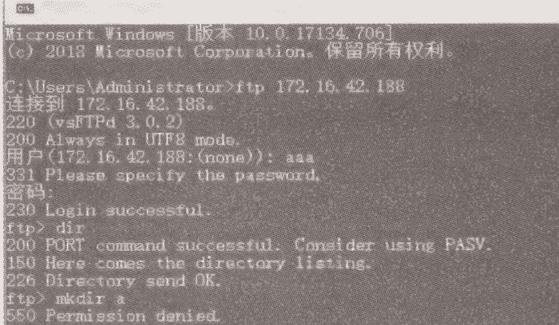

图 11-11 用户登录

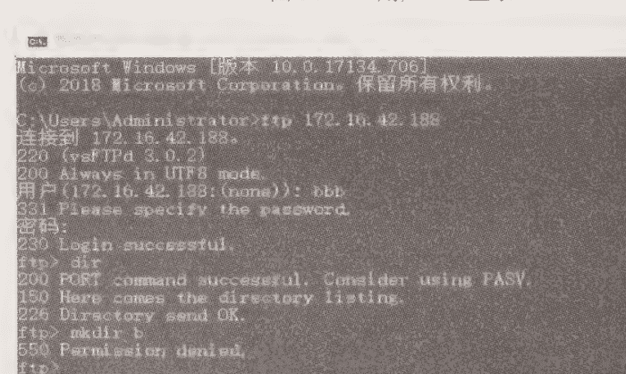

图 11-12 用户 `bbb` 登录

## 项目 11 部署 FTP 服务

(6) 为不同的虚拟用户设置不同的权限。

- ① 在主配置文件 `/etc/vsftpd/vsftpd.conf` 定义虚拟用户权限文件的存储路径：

```bash
user_config_dir=/user/ # 指定每个虚拟用户配置文件的目录
```


注意：该项为每个用户建立一个文件设置权限，文件名和虚拟用户名一致。

- ② 创建虚拟用户`aaa`的配置文件。

```bash
[root@localhost ~]# mkdir user
[root@localhost ~]# cd user/
[root@localhost user]# vim aaa
[root@localhost user]# cat aaa
local_root=/srv/ftp/virtual/aaa
anon_mkdir_write_enable=YES
anon_upload_enable=YES
anon_other_write_enable=YES
anon_world_readable_only=YES
```

- ③ 创建虚拟用户`bbb`的配置文件。

```bash
[root@localhost user]# vim bbb
[root@localhost user]# cat bbb
local_root=/srv/ftp/virtual/bbb
anon_upload_enable=YES
anon_world_readable_only=NO
```

- (7) 创建虚拟用户的目录。

```bash
[root@localhost ~]# cd /srv/ftp/virtual/
[root@localhost virtual]# mkdir aaa
[root@localhost virtual]# mkdir bbb
[root@localhost virtual]# chmod 755 aaa
[root@localhost virtual]# chmod 755 bbb
```

- (8) 创建测试文件。

```bash
[root@localhost virtual]# touch aaa/test
[root@localhost virtual]# touch bbb/test
```

- (9) 重启 FTP 服务。

```bash
[root@localhost virtual]# systemctl restart vsftpd
```

- (10) 分别使用用户`aaa`、`bbb`登录，如图 11-13 和图 11-14 所示。

### 4 项目总结

- (1) 使用`PAM`实现虚拟用户访问，关键是创建用户数据库，修改`vsftpd.conf`配置。
- (2) 通过带有 Web 界面的`vsftpd`，也可以实现虚拟用户访问。

`FTP`是网上常见的服务之一，首先需要了解`FTP`服务器的工作原理、传输模式和体系结构，常用的`FTP`软件，能够安装`FTP`服务器，掌握`Windows`和`Linux`客户端访问`FTP`服务。通过项目实践，熟练掌握`vsftpd`服务器的配置，根据实际配置相关的`FTP`服务稳定、安全地为用户共享，建议认真学习并思考。

## 练习题

一、选择题

1. `ftp`命令的（ ）可以与指定的机器建立连接。
   A. `connect` B. `close` C. `cdup` D. `open`

2. `FTP`服务的端口是（）。
   A. `21` B. `23` C. `25` D. `53`

3. 下面（ ）不是`FTP`类别。
   A. `real` B. `anonymous` C. `guest` D. `users`

4. 通过修改文件`vsftpd.conf`的（），实现`FTP`服务独立模式启动。
   A. `listen=YES` B. `listen=NO` C. `standalone` D. `listen=YES`

5. 将用户加入（ ）文件中，阻止用户访问`FTP`服务。
   A. `vsftpd/ftp_users` B. `vsftpd/user_list` C. `vsftpd/ftp_users` D. `/etc/user_list`

6. 关于`FTP`，下面不是正确的是（）。
   A. `FTP`可以上传多个文件，也可以下载文件
   C. `FTP`报文通过`UDP`传输
   D. `FTP`是应用层协议

7. 匿名是（）。
   A. `Internet`中身份
   B. 在`Internet`上主机地址
   C. 允许用户注册并下载文件
   D. 用户之间能够传输

二、填空题

1. `FTP`服务就是（ ），`FTP`的英文全称是（ ）。
2. `FTP`服务有两种:（ ）和（ ）。

三、操作

1. 部署`FTP`服务，其要求如下：
   - (1) 创建`/var/ftp`目录和`/var/ftp/virtual`目录。
   - (2) 权限为可读、写、执行。
   - (3) 开放匿名访问，密码为匿名。
   - (4) 禁止本地登录。
   - (5) 在连接过程中，只要超过 秒没有回应，就断线。
   - (6) 只要十分钟没有动作，予以中断。
   - (7) 最大连接数为 人，且`IP`来源为。
   - (8) 文件传输的速率为`KB/s`。

2. 配置一台`Linux`服务器，其`IP`地址是`192.168.1.0`，子掩码是`255.255.255.0`，默认网关是`192.168.1.254`。此服务器使用默认端口`FTP`，主要实现功能：
   - (1) 创建两个账号为`ls`和`zs`，`zs`的密码是。
   - (2) 不允许用户名登录。`zs`对目录`/home/zs`有读权限，`ls`对目录`/home/ls`只有读权限，不能离开目录。

## 项目 12 部署 DNS 服务

### 项目1 简介

目前已部署`FTP`服务器、`Samba`服务器及`Web`服务器，用户使用这些服务器的频率越来越高，但`IP`地址并不好记。通过部署一台`DNS`服务器，可以完成域名到`IP`地址解析，方便记忆。

## 需求分析

`DNS`服务器的工作原理非常重要，为了部署`DNS`服务，需要如下：

- 了解`DNS`的工作原理各类服务器特点。
- 部署`DNS`需要软件。
- 掌握`DNS`服务的部署方法。

### 域名解析基础

`DNS`（`Domain Name System`，域名系统）是`Internet`上用于域名到`IP`地址转换的分布式数据库。计算机之间通信使用`UDP`协议，`DNS`运行在 `53` 号端口。

### 域名空间

在域名系统中，域名是由一系列字母和数字组成的。`FQDN`（`Full Domain Name`，全限定域名）由主机名和域名组成，是主机的完全显示形式，如主机名为`zx`，域名为`user.com`。`FQDN`就是`zx.user.com`。

域名空间采用层级的结构，类似于树结构的命名方式，由根域、顶级域、二级域名和主机名构成。在这样的树结构中，每个节点最多`63`个字符。标识之间使用点分隔，一组标识就表示一个完整的域名(`FQDN`)，如`baidu.com`。我们通常将最后的点去掉，`baidu.com`是域名。

- 1. 根域(`Root Domain`)

在域名空间中，根域有一个，它没有上级域，以`"."`表示。全世界的`IP`地址和域名空间是由美国的`IC`（`Internet Information Center`，互联网信息中心）负责管理的授权。目前全球有`13`台域名服务器，其中`1`台主服务器，其余`12`台为辅助域名服务器。域名服务器并没有包含全世界的域名网络，它们只保存着域名到服务器地址的对应关系。

- 2. 顶级域(`Top-Level Domain`, `TLD`)

顶级域是由`IC`管理的。在`FQDN`中，顶级域位于右边，包括三种：“国家地区域”、“通用域”和“新增通用域”。国家级域名如`cn`(中国)、`us`(美国)、`jp`(日本)、`ca`(加拿大)等。通用域名名如`com`(公司企业)、`net`(网络服务机构)、`org`(非营利组织)、`edu`(教育机构)、`gov`(政府部门)、`mil`(军事部门)。

- 3. 各子域(`Sub Domain`)

在域名空间中，除了根域和顶级域之外，其他都是子域。自底的域名空间如图 12-1 所示。其中，根(`root`)是，“顶级域名(`top-level domain`)”是`com,lv`等。域名(`second-level domain`)是`baidu`，用户可以注册`SLD`主机（二级域名）为`www`，用户可以任意分配。


图12-1 `www.com`域名空间

### 域名解析

#### 1. 根域

在域名空间中，根域有一个，它没有上级域，以点`"."`表示。全世界的`IP`地址和域名空间是由美国的授权。递归查询和迭代查询的重要区别是递归是查询者变化，迭代是查询者不变

#### 2. 顶级域

顶级域是由`IC`管理的。在`FQDN`中，顶级域位于右边，包括三种：“国家地区域”、“通用域”和“新增通用域”。国家级域名如`cn`(中国)、`us`(美国)、`jp`(日本)、`ca`(加拿大)等。通用域名名如`com`(公司企业)、`net`(网络服务机构)、`org`(非营利组织)、`edu`(教育机构)、`gov`(政府部门)、`mil`(军事部门)。

#### 3. 各子域

在域名空间中，除了根域和顶级域之外，其他都是子域。自底的域名空间如图 12-1 所示。其中，根(`root`)是，“顶级域名(`top-level domain`)”是`com,lv`等。域名(`second-level domain`)是`baidu`，用户可以注册`SLD`主机（二级域名）为`www`，用户可以任意分配。


#### 4. 域名解析过程

当客户端访问 `www.com` 的时候，域名解析如下：

- (1) 创建 `/var/ftp` 目录和 `/var/ftp/virtual` 目录。
- (2) 权限为可读、写、执行。
- (3) 开放匿名访问，密码为匿名。
- (4) 禁止本地登录。
- (5) 在连接过程中，只要超过 秒没有回应，就断线。
- (6) 只要十分钟没有动作，予以中断。
- (7) 最大连接数为 人，且 `IP` 来源为。
- (8) 文件传输的速率为 `KB/s`。

2. 配置一台 `Linux` 服务器，其 `IP` 地址是 `192.168.1.0`，子掩码是 `255.255.255.0`，默认网关是 `192.168.1.254`。此服务器使用默认端口 `FTP`，主要实现功能：
   - (1) 创建两个账号为 `ls` 和 `zs`，`zs` 的密码是。
   - (2) 不允许用户名登录。`zs` 对目录(`/home/zs`)有读权限，`ls` 对目录(`/home/ls`)只有读权限，不能离开目录。

#### 4. 正向解析和反向解析

一般情况下，人们认为 `DNS` 只是将域名转换成 `IP` 地址，然后用查询到的 `IP` 地址去连接（即“正向解析”）所请求的服务。事实上，`IP` 地址转换成域名（即“反向解析”）的功能也是经常使用的。

在顶级域中有一个特殊的域名 `addr`，它唯一的一个子域名 `in-addr`。其实 `in-addr` 域名是反向解析的。当一个 `IP` 地址为 `172.16.43.254` 的时候，在 `DNS` 域名树中这样记录 `IP`：`in-addr` 划分了 17 个子域名，划分了 16 个子域名，划分了 43 个子域名，记录了 254 的映射关系。由 `DNS` 的完整域名是从底上串联的，因此就成了 `254.16.43.172.in-addr`。当客户端触发反向解析 `172.16.43.254` 的时候，其实就是正向解析的过程，最后会访问到标记为 43 的 `DNS` 服务器获取 `IP` 和域名的映射关系。总之，反向解析的本质还是正向解析，如图 12-3 所示。


图12-2 `www.com` 域名解析过程

## 12.1.4 DNS 服务器类型

DNS 服务器能够响应来自客户端的域名解析请求，通过查找服务器中的域名数据库，或到其他 `DNS` 服务器中进行查找，向客户端返回查询结果。在 `DNS` 服务器中还有一个高速缓存，能够留存解析结果，从而加速后续的查找速度。

域名服务器分为三类：主域名服务器、辅助域名服务器、以及 `Cache-only` 域名服务器。

### 1. 主域名服务器 (Master)

每个区域的主域名服务器中包含某个区域的数据文件，文件中包含该区域的所有资源记录。主域名服务器中的区域数据文件是由管理员负责创建并维护的，配置好的区域数据文件可以传送到辅助域名服务器。

配置主服务器需要准备一套配置包，包含主文件(`name.conf`)、正向解析文件、反向解析文件、区域文件(`name.loc`)和回复文件(`name.local`)。

### 2. 辅助域名服务器 (Slave)

辅助域名服务器是非常重要的网络节点组成。一个区域的域名服务器可以只有一个，但为了增强服务的可靠性，通常一个区域会有多台域名服务器。这些区域服务器既可以是主域名服务器，也可以只有一个主域名服务器，其余的辅助域名服务器。

辅助域名服务器中也有区域数据文件，能够响应用户的域名解析请求，但是辅助域名服务器不需要由管理员创建区域数据文件。辅助域名服务器的区域数据文件是从主服务器中复制而来的。主服务器区域数据文件的端口是 `TCP` 53。使用辅助域名服务器可以提高主服务器的可靠性，降低维护工作。

建立辅助域名服务器有两个理由：

- (1) 冗余：当主域名服务器故障时，辅助域名服务器可以承担服务功能。为了达到最大容量，主服务器与备份的辅助域名服务器要做到尽可能同步。
- (2) 减负：当网络流量繁忙时，可以用辅助域名服务器减轻主域名服务器的负担。

### 3. Cache-only 域名服务器

`Cache-only` 域名服务器可以运行域名软件，但它本身不管理任何区域，并且不包含区域的数据文件。`Cache-only` 域名服务器启动时没有任何关于 `DNS` 区域的信息，必须依赖其他域名服务器来获取这些信息。`Cache` 服务器会将这些信息存储在域名缓存(`Name Cache`)中。当外部请求需要这些信息时，该 `Cache-only` 域名服务器就直接从高速缓存中取出答案并返回。经过一段时间后，该 `Cache-only` 服务器就会缓存常见的请求信息。

## 12.1.5 资源记录类型

### 1. 资源记录格式

DNS 只要在其数据库中包含解析名称的相关记录，就能解析名称并将其转换为源记录。每个数据库都由资源记录构成，资源记录包含与特定主机的信息。而每个资源记录通常包含以下 5 项。大多数情况下以 `ASCII` 文本显示，每条记录一行，格式如下：

| Domain | Time-to-live | Record-type | Class | Record-data |
| :--- | :--- | :--- | :--- | :--- |

- (1) `(Domain` 域名): 给出定义的资源记录名称，该域常用于域名查询的关键字。
- (2) `(Time-to-live` 存储期): 在该存储期后该记录不再有效。
- (3) `(Class` 类别): 该项网络类型。目前大部分的资源记录采用“IN”，表示类型，该域的值为“IN”。
- (4) `(Record-data` 记录数据): 说明与该资源记录相关的信息，通常由资源记录类型决定。
- (5) `(Record-type` 记录类型): 说明资源记录的类型。

### 2. 资源记录类型

DNS 的资源记录包括 `SOA` 记录、`NS` 记录、`A` 记录、`CNAME` 记录、`MX` 记录和 `PTR` 记录。

- (1) 授权服务器 (`SOA` of authority): `DNS` 名称服务器是 `DNS` 数据中的数据服务器，创建区域时该记录被自动创建，且也是 `DNS` 数据库中的第一条记录，`SOA` 定义了域的全局参数，进行整个区域的管理。一个区域文件允许存在一种 `SOA` 记录。
- (2) 名服务器 (`NS` name): 该区域的授权服务器，即 `SOA` 资源记录中指定的辅助服务器和辅助服务器，也表示了任何授权的服务器。每个区域在根处至少包含一个 `NS` 记录。创建区域时该记录被自动创建。`NS` 记录格式如下：

  | 区域 | IN | NS |
  | :--- | :--- | :--- |

- (3) 主机地址 (Address): 将主机名映射到 `DNS` 区域中的一个 `IP` 地址，这是名称解析的重要记录。`A` 记录的格式如下：

  | FDN | A | IP 地址 |
  | :--- | :--- | :--- |
  | www | IN | 172.16.143.1 |
  | ftp | IN | 172.16.43.1 |

- (4) 指针 `PTR` (Pointer): 与主机名记录恰好相反，是将一个 `IP` 地址映射到一个主主机上。`PTR` 记录格式如下：

  | IP 地址 | PTR | FDN |
  | :--- | :--- | :--- |

- (5) 别名 (Canonical Name): 用来记录某主机的别名。一台主机可以有多个别名，每一个代表一个应用。用户使用 `CNAME` 记录隐藏用户网络的实现细节，使连接的客户端无所谓。

  | 别名 | CNAME | 的记录 |
  | :--- | :--- | :--- |

- (6) 邮件交换服务器 (Mail Exchange): 是 `DNS` 域指定的交换服务器。邮件交换服务器是 `DNS` 处理或转发邮件的主机。处理服务器是指将投递到目的地或不同类型的邮件发送者。转发服务器是指将邮件发送到最终目的的服务器，简单来说。

## 12.2 部署 DNS 服务

### 12.2.1 BIND 简介

大多数 `DNS` 服务器使用 `BIND` 进行解析。`BIND` 是 `Berkeley Internet Name Service` 的起源，是为 `Linux` 开发的域名服务器。`BIND` 服务被命名为 `BIND`，主要功能包括：

- (1) 查询主机名与本地区域中的记录，为客户做出响应(`UDP:53`)。
- (2) 递归查询(`zone transfer`)，在服务器之间复制数据(`TCP 53`)。
- (3) 常用的命令行工具 `lookup`、`host` 和 `dig`。`chroot` 是 `Root` 的缩写，可以将文件系统中特定的子目录作为根目录，使得 `chroot` 可以限制用户、权限，并且面对来自网络的大量访问时，存在安全隐患。使用 `chroot` 可以将影响降低到最低。

### 3. 安装 BIND

在终端输入：

```bash
rpm -q bind
```

检查系统是否安装了 `BIND` 软件包。未安装 `BIND` 软件包，`Red Hat Enterprise` 7.6 提供了 `RPM` 包和 `yum` 源。下面使用 `yum` 命令安装 `BIND`：

```bash
yum install -y bind*
```

与 `DNS` 服务相关的 `RPM` 包有几个：

- `bind`: `bind` 的主程序。
- `bind-chroot`: `bind` `chroot` 环境。


## 12.2 安装与配置 DNS 服务器

- `bind-utils`: `bind` 的工具包。

(2) 安装完成后查询 `BIND` 软件包，如 12-4 所示。

```
rpm -q bind
```

(3) 配置 `DNS` 服务器 `IP` 地址为 `172.16.2.45`，关闭防火墙，设置系统的安全机制为 `Permissive`。

```
vi /etc/sysconfig/network-scripts/ifcfg-ens33
```

```
ifconfig ens33
```

```
ens33: flags=416<BROADCAST,RUNNING,MULTICAST> mtu 1500
inet 172.16.2.45 netmask 255.255.255.0 broadcast 172.16.2.255
inet6 ::/64 scope global
ether 00:0c:29:37:76 txqueue 1000 (Ethernet)
RX packets 1213 bytes 3684 (11.0 KB)
RX errors 0 dropped 0
TX packets 15865 2096 (20.5 KB)
TX errors 0 overflows 0 collisions 0
```

```
systemctl stop firewall
```

```
systemctl disable firewall
```

```
vi /etc/selinux/config
```

```
setenforce 0
```

`Permissive`

### 12.2.2 启动与停止 DNS 服务

在 `Red Enterprise Linux 7.6` 中，`BIND` 程序名为 `named`，服务的启动与停止遵循守护进程。

- (1) 启动 `DNS` 服务：`systemctl start named`
- (2) 停止 `DNS` 服务：`systemctl stop named`
- (3) 重启 `DNS` 服务：`systemctl restart named`
- (4) 查看 `DNS` 服务状态：`systemctl status named`
- (5) 将 `DNS` 服务配置为开机运行：`systemctl enable named`

或者找到“`named.service`”，在前面加上“`#`”，这样 `DNS` 服务就会自动运行。

## 1. DNS 全局配置文件

正常情况下，`DNS` 全局配置文件为 `/etc/named.conf`，但是安装了 `chroot` 之后，全局配置文件为 `/var/named/chroot/etc/named.conf`。具体内容如下：

`cat named.conf`

```
// named.conf
// Provided by Red Hat bind package to configure ISC BIND
// server as caching only.

// See /usr/share/doc/bind/sample/ for example named configuration files.
// See the Administrator's Reference (ARM) for details about
// configuration located in /usr/share/doc/bind/version.html

// options
// 指定 bind 服务参数
listen-on port 53 { 127.0.0.1 }; // 侦听 DNS 请求的本机 IP 和端口
listen-on-v6 port 53 { :: }; // IPv6 下侦听的主机及端口

directory "/var/named"; // 区域所在的路径
dump-file "/var/named/data/cache_dump.db";
statistics-file "/var/named/data/named_stats.txt";
memstatistics-file "/var/named/data/named_mem_stats.txt";
query-file "/var/named/data/query";
secroots-file "/var/named/data/secroots"; // 指定接受 DNS 请求的客户端

allow-query { localhost };

If you are building an AUTHORATIVE DNS server, do not enable recursion.
If you are building a RECURSIVE (caching) DNS server, you need to enable recursion.
If your recursive DNS server has a public IP address, you MUST enable queries to legitimate users. Failing to so will cause your server to become part of large scale DNS amplification attacks. Implementing BCP38 within your network would greatly reduce attack surface

recursion yes;
dnssec-enable yes;
dnssec-validation yes;

/* Path to ISC DLV key */
bindkeys-file "/etc/named.bind.key";
managed-keys-directory "/var/named/dynamic";
pid-file "/run/named/named.pid";
session-key-file "/run/named/session-secroots.key";

};

logging {
    # logging 部分, 指定 bind 服务的日志
    channel default_debug {
        # channel 指定发送目标
        file "data/named.run";
        severity dynamic;
    }
};

zone "." IN {
    type hint;
    file "named.ca";
};
include "/etc/named.rfc1912.zones"
include "/etc/named.root.key";
```

## 2. 主配置文件 named.rfc1912.zones

正常情况下，`DNS` 主配置文件为 `/etc/named.rfc1912.zones`，但是安装了 `chroot` 之后，主配置文件为 `/var/named/chroot/etc/named.rfc1912.zones`。文件的具体内容如下：

`cat named.rfc1912.zones`

```
//
// Provided by Red Hat caching-nameserver package
//
// ISC BIND zone configuration for zones recommended by
// RFC 1912 section 4.1 : localhost TLDs and address zones
// and see at http://www.ietf.org/internet-drafts/draft-ietf-dnosop-default-local-zones-02.txt
// (c)2007 R W Franks
//
// See /usr/share/doc/bind/sample/ for example named configuration files.

zone "localhost.localdomain" IN {
    type master;
    file "named.localhost";
    allow-update { none };
};
```

## 正向解析区域

```
zone "localhost" IN {
    type master;
    file "named.localhost";
    allow-update { none };
};
```

## 正向解析区域样本配置文件

## 指定区域类型

```
zone "1.0.0.0.0.0.0.0.0.0.0.0.0.0.0.0.0.0.0.0.0.0.ip6.arpa" IN {
    type master;
    file "named.loopback";
    allow-update { none };
};
```

## 指定动态更新的 DNS 服务器

```
zone "1.0.0.127-in.addr.arpa" IN {
```

# 学习情境二 部署 Linux 网络服务


```
type master;
file "named.loopback";
allow-update {none;};
zone "0.in-addr.arpa" IN {
type master;
file "named.empty";
allow-update {none;};
}
```

## 反向解析区域样本配置文件

主配置文件通过`zone`定义了当前区域的所有区域。在`BIND`中的区域根据`DNS`服务器的类型分为以下几种：

- `master`: 主区域，拥有该区域数据文件，并对该区域管理维护数据。

- `slave`: 辅助区域，拥有主区域数据文件的完全只读副本，辅助区域从主区域同步主区域数据，同步过程被视为区域传输。

- `stub`: 根区域，与辅助区域类似，但是`stub`区域只复制主区域的`NS`记录和`NS`记录对应的[内容]。

- `forward`: 转发区域，用于转发`DNS`客户端的逆向查询。

- `hint`: 当`BIND`启动时使用`hint`区域的信息查找域名服务器，并找到最近的根域名服务器列表。如果没有，服务器将使用编译默认的根服务器信息。

### 3. 区域配置文件

1) 正向解析文件`localhost=/var/named/chroot/var/named.localhost`，实际工作中可以将此文件命名为正向区域解析文件。复制时一定要加`-a`(`or p`)，如果配置文件的所有者不是`named`时，`BIND`服务是无法运行的。

```
root@localhost # cat named.localhost
TTL ID IN SOA @name.invalid.
@ 0 : serial
ID : refresh
1H : retry
1W : expire
3H ) : minimum
NS @
A 127.0.0.1
AAAA ::1
```

其中：

`::`: 注释内容。

`@`: 表示当前区域，这里的当前区域是根据主配置文件`zone`定义的区域名称。

## 项目 12 部署 DNS 服务

(0): 允许跨域，通常用于`SOA`记录。

* 仅用于名称标识的通配，其基本格式如下：

在这里重点分析`SOA`资源记录，其格式如下：

| 区域名称 | 记录类型 | SOA | 主域名 | 邮箱地址 | (序列号) | 管理 | 刷新间隔 | 重试时间 | 过期 | TTL |
| :--- | :--- | :--- | :--- | :--- | :--- | :--- | :--- | :--- | :--- | :--- |

各项项含义如下：

- 主域名服务器：区域中主域名服务器的`FQDN`。

- 管理员邮箱地址：管理员的邮箱地址中的“@”代替。查询主域名服务器时，区域。序列号：复制时辅助主域名服务器的区域序列号可能会复制区域。当管理员了主域名服务器的区域数据文件后，增大区域间隔序列号。

- 刷新间隔：辅助主域名服务器请求与主域名服务器同步的等待时间。当刷新到期时，主域名服务器请求主域名服务器的`SOA`记录。然后，辅助主域名服务器将主域名服务器的`SOA`记录的序列号与其本地`SOA`记录的序列号比较。如果主域名服务器的序列号小于主域名服务器的序列号，则辅助主域名服务器从主域名服务器请求传输。

- 重试时间：辅助主域名服务器在请求失败后等待多长时间重试。这个时间应短于刷新时间。

- 过期时间：当过期期间到期时到辅助主域名服务器还无法与主域名服务器进行区域传输，辅助主域名服务器会把它的数据当做不可靠数据。

- `TTL`：区域的持续时间和缓存名称查询的最大间隔。

+ 2) 反向区域解析文件`/named.chroot/named/named.lookup`，实际工作中可以将此文件复制为反向区域解析文件，复制时一定要加`-a`(`o-p`)，如果配置文件的拥有组不是匹配时，`BIND`服务是无法运行的。

```
[root@localhost]# cat named.lookup
TTL ID
  IN SOA  name.invalid.
  : serial
ID     : refresh
IH     : retry
IW     : expire
3H)    : minimum
NS @
A       127.0.0.1
AAAA    ::
PTR      localhost.
```

经上述学习，根据学院`DNS`服务器的规则，需要如下配置：

+ (1)修改配置文件`named.conf`。

其他数据保持默认，修改如下：

```
[root@localhost etc] # vim named.conf
options {
 listen-on port 53 { any; };
 listen-on-v6 port 53 { ::1 };
directory "/var/named";
dump-file "/var/named/data/cache_dump.db";
statistics-file "/var/named/data/named_stats.txt";
memstatistics-file "/var/named/data/named_mem_stats.txt";
cursing-file "/var/named/data/named.cursing";
secroots-file "/var/named/data/named.secroots";
allow-query { any };
recursion yes;
}
```

(2) 修改配置文件`named.rfc1912.zones`。

定义区域文件，在`named.rfc1912.zones`后面增加如下内容:

```
[root@localhost etc] # vim named.rfc1912.zones
zone "zhiyuan.com" IN {
 type master;
 file "zhiyuan.zheng"; allow-update { none };
}
zone "43.167.172.in-addr.arpa" IN {
 type master;
 file "zhiyuan.fan"; allow-update { none };
}
```

(3) 创建正向解析文件`localhost.localhost`为`zhiyuan.zheng`，并修改相关内容。

```
[root@localhost chroot] cd /var/named/chroot/var/named
[root@localhost named] # cp -p named.localhost zhiyuan.zheng
[root@localhost named] # vim zhiyuan.zheng
TTL 1D
@ IN SOA zhiyuan.com. root.zhiyuan.com.
0 : serial
1D : refresh
1H : retry
1W : expire
3H ) : minimum
| 区域 | 记录类型 | 值 |
| :--- | :--- | :--- |
| @ | NS | zhiyuan.com. |
| @ | MX | 5 zhiyuan.com. |
| www | A | 172.16.43.253 |
| dns | A | 172.16.43.254 |
| mail | A | 172.16.43.252 |
| ftp | CNAME | zhiyuan.com. |
```

(4) 创建反向区域解析文件`zhiyuan.fan`。复制反向解析文件`named.lookup`为`zhiyuan.fan`，并修改相关内容。

```
[root@localhost named]# cp -p named.lookup zhiyuan.fan
[root@localhost named]# vi zhiyuan.fan
TTL 1D
@ IN SOA zhiyuan.com. root.zhiyuan.com.
0 : serial
1D : refresh
1H : retry
1W : expire
3H ) : minimum
@ IN NS zhiyuan.com.
@ IN MX 5 zhiyuan.com.
254 IN PTR zhiyuan.com.
253 IN PTR zhiyuan.com.
252 IN PTR zhiyuan.com.
```

注意：如果在复制的过程中记了参数`-p`后无法启动，这时修改反向解析文件的所有者为`named`或者修改权限为`644`。

```
[root@localhost]# cp named.* /var/named/var/*
[root@localhost]# chmod 644 /var/named/var/*
```

(5) 配置配置文件完成后，先检查配置文件的语法是否正确。


```
[root@localhost]# named-checkconf /etc/named.rfc1912.zones
[root@localhost]# named-checkzone zhiyuan.com /var/named/zhiyuan.zheng
[root@localhost]# named-checkzone 43.167.172.in-addr.arpa /var/named/zhiyuan.fan
```

## 12.2.4 DNS 客户端

1. Windows 客户端的配置

在 Windows 下打开“互联网协议(TCP/IPv4)”中“属性”，将 DNS 服务器指定为部署的 DNS 服务器 172.16.43.254，如图 12-5 所示。

| 服务 | 端口 | 说明 |
| :--- | :--- | :--- |
| DHCP(Dual Band Wireless-AC) | | 服务器通过此网络分配 IP 地址，客户端从服务器获得的 IP 设置。 |
| 使用动态 IP协议(B) | | |
| 使用动态 IP协议(DHCP) | 172, 16, 43, 101 | IP 地址 |
| 使用静态 IP协议(Static Protocol) | | |
| VirtualBox NAT-Bridged Network | 255, 255, 255, 0 | 子网掩码 |
| DNS 服务 | | |
| DHCP 服务器(DHCP/IPv4) | 172, 16, 43, 1 | 默认 DNS |
| Microsoft 客户端 | | 自动获取 DNS 服务器地址 |
| 使用指定的 DNS 服务器地址 | 172, 16, 43, 254 | |
| 备用 DNS 服务器地址 | | |


2. Linux 系统 DNS 客户端的配置。

(1) 通过`/etc/resolv.conf`设置 DNS 服务器。

```
[root@localhost ~ # vim /etc/resolv.conf

# Generated by NetworkManager
search zhiyuan.com
nameserver 172.16.43.254
```

(2) 在图形界面下，利用网络配置工具进行 DNS 服务器的设置，如图 12-6 所示，点击“应用”后，系统会自动将 DNS 服务器地址写入 `/etc/resolv.conf` 中。

| 取消(C) | IPv4 | 应用(A) |
| :--- | :--- | :--- |
| IPv4 Method | 自动(DHCP) | 静态地址 |
| Addresses | | 默认地址 |
| 172.16.43.254 | 255.255.255.0 | 172.16.43.1 |
| DNS | | 自定义 |


## 12.2.5 DNS 测试

使用 `nslookup`、`dig` 或 `host` 工具校验 DNS 服务器的配置。

(1) 正向查询 `zhiyuan.com`，`zhiyuan.com` 对应的 IP 地址：

```
[root@localhost ~]# nslookup wwwhiyuan.com
Server: 172.16.43.254
Address: 172.16.43.254
www.zhiyuan.com	addresses = 172.16.43.254
```

(2) 反向查询 172.16.43.254、172.16.43.252 对应的域名：

```
[root@localhost ~]# nslookup 172.16.43.254
Server: 172.16.43.254
Address: 172.16.43.254
172.16.43.254	name = mail.zhiyuan.com
```

(3) 查询 `zhiyuan.com` 中 `MX` 记录。

```
[root@localhost ~]# nslookup
set type=mx
zhiyuan.com
Server: 172.16.43.254
Address: 172.16.43.254
zhiyuan.com	canonical = mail.zhiyuan.com, preference = 5
```

## 2. `dig` 是搜索引擎(Domain Information Getter)的简称，是一个用来探测 DNS 的工具，会打印出 DNS server 的响应。`dig` 作为 DNS 诊断，因为它的灵活性、易用、输出清晰。

(1) 正查询。

```
[root@localhost ~]# dig zhiyuan.com
;;; 9.9.4-RedHat-9.4.7.el7 <<zhiyuan.com

; global options: +cmd
;; Got answer: 服务返回的状态，status: NOERROR 说明正常
;; >>HEADER<< opcode: QUERY, status: NOERROR, id: 30489

; flags: aa ar ra; QUERY: 1, ANSWER: 1, ADDITIONAL: 1

; OPT PSEUDOSECTION
;; EDNS: version: 0, flags; udp: 4096
;; QUESTION SECTION:

;zhiyuan.com. IN #这里查询的域名 zhiyuan.com 的 A 记录
;; ANSWER SECTION:
zhiyuan.com. 86400 IN A 172.16.43.254 #指定域名对应的 IP 地址
;; AUTHORITY SECTION:
zhiyuan.com. 86400 IN NS zhiyuan.com. #名称服务器
;; Query time: 1 msec #查询的一些统计信息
;; SERVER: 172.16.43.254#53(172.16.43.254)
;; WHEN: 4 月 1日 12:49:13 CST 2020
;; MSG size recvd: 74
```

(2) 反查询。

```
[root@localhost]# dig -x 172.16.43.252
;; dig 9.9.4-RedHat-9.4.7.el7 <<172.16.43.252

; global options: +cmd
;; Got answer:
;; >>HEADER<< opcode: QUERY, status: NOERROR, id: 42393
; flags: aa ar ra; QUERY: 1, ANSWER: 1, ADDITIONAL: 1
; OPT PSEUDCTION
;; EDNS: version: 0, flags; udp: 4096
;; QUESTION SECTION:
;172.16.43.252.in-addr.arpa IN PTR
;; ANSWER SECTION:
172.16.43.252.in-addr.arpa. 86400 PTR mail.zhiyuan.com.
;; AUTHORITY SECTION:
172.16.43.252.in-addr.arpa. 86400 NS zhiyuan.com.
;; Query time: 0 msec
;; SERVER: 172.16.43.254#53(172.16.43.254)
;; WHEN: 4 月 1日 10:45:28 CST 2020
;; MSG size recvd: 99
```

(3) 邮件交换器查询。

```
[root@localhost]# dig -t MX zhiyuan.com
```

`-t` 查询类型，可以是 `A`、`MX`、`NS` 等。

(4) `SOA` 查询。

```
[root@localhost]# dig -ns zhiyuan.com
```

## 学习情境 部署 Linux 网络服务

### 12.2.6 辅助 DNS 服务器

辅助 DNS 服务器相对比较简单，只需要在辅助域名服务器的计算机上配置域名配置文件 `named.conf` 和辅助配置文件 `named.rfc1912.zones` 进行修改，不需要再次配置正反向区域文件，正反向区域文件将从主域名服务器自动获得。但是需要注意的是，不能在同一台计算机上运行同一个主域名服务器和辅助域名服务器。

配置辅助域名服务器的步骤如下：

- 在主域名服务器上配置域名文件，`named.rfc1912.zones` 的正向和反向中添加 `notify(all)` 辅助 DNS 的 IP 地址；或者在所有区域中使用 `notify` 来通知。这样只要主服务器更新 DNS 发送通知，辅助域名服务器就会立即更新区域文件。


- 在辅助域名服务器上修改主配置文件 `named.rfc1912.zones`，在 zone 设置 type 为 `slave`，设置文件指定区域文件的存放位置，通过 `masters(主 DNS 服务器的 IP 地址);` 指定主域名服务器的地址。

设置完成后重启 DNS 服务，就能看到目标记录已经同步到辅助区域了。

为了数据的安全，在主域名服务器上指定由域名服务器从主域名服务器复制区域文件信息。这种方法是在主域名服务器的选项里添加 `allow-transfer(辅助 DNS 的 IP 地址或者是 IP 的范围)`，表示当前域名服务器的所有辅助服务器都可以将数据传输到指定的域名服务器；如果只是希望将某个区域的数据传输到指定的域名服务器，可以将 `allow-transfer` 放置到主配置文件的对应的区域中，这样的服务器就不会再复制到主域名服务器的区域信息。

说明：在主域名服务器允许区域文件的传输的，辅助域名服务器才能进行区域复制。只有在主域名服务器的选项中添加了 `allow-transfer();` 语句，辅助域名服务器能够从主域名服务器进行区域复制。

### 12.2.7 DNS 转发

当 DNS 客户端指定的域名服务器要求解析名称，而此域名服务器无法解析，将用缓存中的信息帮助解析其他服务器，通常会找到一个域名服务器来进行递归查询。为了减少服务器的负担，可以设置域名服务器转发(Forwarder)。

定义了域名转发后，本地域名服务器将使用转发器列表中的域名服务器，从缓存中的域名服务器来响应客户端的查询。配置了转发器列表的域名服务器将不能从自己响应的请求，发送给定义的转发服务器。

转发是在 `named.conf` 文件中的区域设置。要用到两个配置选项：

- `forwarders` 指令设置将 DNS 请求转发到哪个服务器，可以指定多个服务器的 IP 地址：

```
forwarders {
    DNS_IP1;
    DNS_IP2;
};
```

- `forward` 指令用于设置 DNS 转发模式。

语法：`forward first|only;`

- `forward first`: 设置优先 forwarders DNS 服务器域名解析，如果查询不到再使用本地 DNS 服务器域名解析。
- `forward only`: 设置只使用 forwarders DNS 服务器域名解析，如果查询不到则返回 DNS 客户端查询失败。

例：在学院某台主机上设置 DNS 域名转发器。

- ① 在需要进行域名转发的服务器上安装 BIND。
- ② 修改配置文件 `named.conf`。修改配置文件 `named.conf` 的 `options` 字段，并用 `forwarders` 和 `forward` 指令设置 DNS 转发，需要转发的远程 DNS 服务器为 `172.16.43.254`。

修改内容如下：

```
options {
    forwarders {
        172.16.43.254;
    };
    forward first;
}
```

## 项目 12 部署 DNS 服务

### 12.3 反思与进阶

- 1. 项目背景

随着学院客户端数量增加，访问量也随之增加，为了提高 DNS 解析的速度和可靠性，IT 会原有的主 DNS 服务器的基础上部署辅助 DNS 服务器。辅助 DNS 服务器的 IP 地址为 `172.16.43.250`。

- 2. 实施目的

- `1.` 明确 DNS 服务器的各种角色及操作。
- `2.` 掌握主服务器的安装与配置。
- `3.` 掌握辅助 DNS 服务器的配置。

- 3. 实施步骤

- `1.` 配置主机 IP 地址为 `172.16.43.250`，关闭防火墙，设置 `SELinux` 为 `Permissive`。

```bash
[root@localhost ~]# ifconfig ens33
ens33:flags=416<UP,BROADCAST,RUNNING,MULTICAST>  mtu 1500
inet 172.16.43.250  netmask 255.255.255.0  broadcast 172.16.43.255
inet6 fe80::a67d:2c19:db5b:39ce prefix 64  scope 0x20<link>
ether 00:0c:29:04:af:ac  txqueuelen 1000
(Ethernet)
RX packets 2886  bytes 89833
(877.2 KiB)
```


部署辅助 DNS 服务器

## 学习环境 2 部署 Linux 网络服务

| RX errors | dropped 0 | overruns 0 | frame 0 |
|---|---|---|---|
| TX packets 228 | bytes 25689 | 25.0 KiB | |
| TX errors 0 | dropped 0 | overruns 0 | collisions 0 |

```bash
[root@localhost ~]# systemctl stop firewall
[root@localhost ~]# systemctl disable firewall
[root@localhost ~]# vi /etc/selinux/config
[root@localhost ~]# setenforce 0
[root@localhost ~]# getenforce
Permissive
```

`2.` 安装 `BIND` 软件包。

```bash
[root@localhost ~]# yum install -y
```

`3.` 在 IP 地址为 `172.16.43.254` 的主 DNS 服务器上配置：

① 修改全局配置文件 `named.conf`。在全局配置文件中增加 `allow-transfer(172.16.43.250)` 指定区域 DNS 服务器，如图所示。

```bash
[root@localhost ~]# vi /etc/named.conf
```

`4.` 在 IP 地址为 `172.16.43.250` 的辅助 DNS 服务器上配置：

- ① 修改辅助 DNS 服务器的全局配置文件 `named.conf`。

```bash
root@localhost ~]# cat /etc/named.conf
options {
  listen-on port 53 { any };
  listen-on ipv6-port 53 { any };
  directory "/var/named";
  dump-file "data/cache_dump.db";
  statistics-file "data/stats.txt";
  metrics-file "data/metrics.txt";
  recording-file "data/named";
  secrets-file "data/secrets";
  recursion yes;
  allow-query { any };
};
```

- ② 修改辅助 DNS 服务器的主配置文件 `named.rfc1912.zones`。

```bash
root@localhost ~# vim /etc/named.rfc1912.zones
zone "zhiyuan.com" {
  type slave;
  file "slaves/zhiyuan.zone";
  masters {172.16.43.254};
};

zone "172.16.in-addr.arpa" {
  type slave;
  file "slaves/zhiyuan.zone";
  masters {172.16.43.254};
};
```

辅助区域的配置文件放在 `slaves` 目录下是不必要的，也可以放在其他目录，但必须确保辅助区域的所有者和组是 `named`，否则 BIND 将无法从主区域传输信息。

`5.` 分别启动主服务器和辅助 DNS 服务器。

```bash
root@localhost ~# systemctl start named
```

`6.` 在辅助 DNS 服务器上进入 `slaves` 目录，查看对应的区域文件。

```bash
root@localhost ~# cd /var/named/slaves/
root@localhost slaves# ls
```

`7.` 测试。

① 在主 DNS 服务器中设置域名服务器。

```bash
root@localhost ~# vim /etc/resolv.conf

search zhiyuan.com
nameserver 172.16.43.254
nameserver 172.16.43.250
```

② 在 DNS 服务器中关闭 `named`。


```bash
[root@localhost]# systemctl stop named
```

③ 在任意主机中测试。

```bash
[root@localhost]# nslookup www.zhiyuan.com
Server: 172.16.43.250#53
Address: 172.16.43.250
Name: www.zhiyuan.com
Address: 172.16.43.253
```

### 4. 项目部署

- (1) 注意部署 DNS 服务器和辅助 DNS 服务器的要点。

- (2) 在测试过程中关闭 DNS 服务器。

- (3) 能够根据实际工作的需要部署不同的 DNS 服务器。

为了方便学生访问资源，IT 机会师生部署 DNS 服务，让他们了解 DNS 的原理、域名解析，能够熟练运用 `BIND` 完成 DNS 服务器配置。

DNS 域名解析不仅包含正向的域名解析，还包含反向的域名解析。DNS 配置的难点在于配置文件的设置，由于参数容易出错，一定要认真学习。DNS 服务器分为主服务器、辅助服务器和转发服务器等类型，能够根据网络中的实际情况部署

## 项目练习

选择题

1. 启动 DNS 服务的守护进程是（）。

A. `httpd start` C. `named start` D. `named stop`

2. DNS 别名记录的标识是（）。

A B. `PTR` C. `CNAME` D. `MX`

## 项目 12 部门 DNS 服务

3. DNS 域名系统主要负责域名解析和（）的解析。

A. IP 地址 B. MAC 地址 C. 路由地址 D. 主机别名

4. 以下关于 DNS 服务器的叙述，错误的是（）。

A. 用户只能使用域内的 DNS 服务器进行域名解析

B. 主域名服务器负责维护这个区域的所有域名信息

C. 辅助域名服务器负责非地域名的查询

5. 以下有关域名空间正确的是（）。

A. DNS 的域名空间是一个逻辑空间

B. `http://www.doccj.com/doc/01a008ef5335a8103d2212.html` 是一个 FQDN

C. 的域名空间共有三层

D. DNS 域名解析必须依靠 DNS 服务器

6. 利用 IP 地址查询其对应主名的功能是（）。

## 256 · 学习情境二 Linux 网络服务

Apache 的工作性能和稳定性远优于其他同类产品，其特性为：

- 简单而强大的基于配置的过程

- 支持 `PHP`, `CGI`, `Serv` 和 `FastCGI`

- 开放源码、跨平台应用

- 模块化设计、运行稳定、安全性良好

- 实现动态共享（DSM），允许在运行时装载功能模块

- 支持最新的 `HTTP 1.1` 协议

- 支持虚拟主机、支持 `HTTP` 认证，集成了代理服务，支持安全 `Socket (SSL)`

- 支持通过网关接口，`FastCGI` 服务器端包含服务器包含（SSI）。

- 支持第三方软件开发提供的大量模块

## 13.1.2 LAMP 模型

`LAMP(Linux+Apache+MariaDB/Perl/Python)` 网站架构是目前国际流行的 Web 框架，如图 13-2 所示为其标识。该架构包括：`Linux` 操作系统、`Apache` 网络服务器、`MySQL` 数据库、`Perl`、`PHP` 或 `Python` 编程语言。和 `Java/J2EE` 架构相比、`.NET` 架构相比，`LAMP` 具有通用、轻量、快速速度等特点，与此相比、跨平台、高性能、低价格的优势。因此，无论是性能、质量还是价格，都是企业搭建网站的首选方案。从网站的流量来说，70%以上的流量来自 `LAMP` 提供的。`LAMP` 是最大的网站解决方案，也是现在运行效率最高的。


- LAMP 包含的组件包括：

- `Linux`: `Linux` 是开源内核，这层代码意味着它是源代码可用的操作系统。

- `Apache`: `Apache` 是使用中最受欢迎的一个开放源码的 Web 服务器。

- `MySQL, MariaDB`: `MySQL, MariaDB` 是多线程、多用的 SQL 数据库系统。

- `PHP, Perl` 或 `Python`: `PHP` 是一种编程语言，最初设计用于生态动态网站，主要是用于服务器端的应用程序软件。`Perl` 和 `Python` 类类似。

## 13.2 实施环境

### 13.2.1 安装 Apache 服务

`Red Hat Enterprise 7.6` 提供了 Apache 服务器的 RPM 和 YUM 包，软件以 `httpd` 开始。下面以 YUM 的安装为例介绍 Apache 服务器软件的安装。`httpd` 是 Apache 服务器的一个守护，用于具体实现 Apache 服务器的功能。

## 项目 13 部署 Web 服务

(1) 查询系统是否安装 Apache。

在终端输入："`rpm -q httpd`" 命令检查系统是否安装了 `httpd` 软件包。

```
[root@localhost ~]# rpm -q httpd
未安装软件 httpd
```

使用 `yum` 安装 Apache。

```
[root@localhost ~]# yum install httpd
```

(2) 安装完成后再次进行查询。

```
[root@localhost ~]# rpm -qalg httpd
httpd-tools-2.4.6-98.el7.x86_64
httpd-2.4.6-88.el7.x86_64
```

(3) 进行其他准备工作。

配置 Web 服务器 IP 地址为 `172.162.43.253`，关闭防火墙，设置系统的安全制为 `Permissive`，并生效。

```
[root@localhost ~]# vi /etc/sysconfig/network-scripts/ifcfg-ens33
[root@localhost ~]# ifconfig ens33
ens33: flags=4163<UP,BROADCAST,RUNNING,MULTICAST> mtu 1500
172.162.43.253 netmask 255.255.255.0 broadcast 172.162.43.253
inet6 fe80::a67d:67c2:19db:39ce prefixlen 64 scopeid 0x20<link>
ether 00:0c:29:02:4f:ac txqueuelen 1000 (Ethernet)
```

| RX packets | 4861 bytes | 476.2 KiB |
| :--- | :--- | :--- |
| RX errors | 0 dropped | 0 overflows frame 0 |
| TX packets | 666 | 100590 (98.2 KiB) |
| TX errors | 0 dropped | 0 overflows 0 |

```
[root@localhost ~]# systemctl stop firewall
[root@localhost ~]# systemctl disable firewall
[root@localhost ~]# vi /etc/selinux/config
[root@localhost ~]# setenforce 0
[root@localhost ~]# getenforce
Permissive
```

(4) Apache 的默认配置有以下项：

- 服务器的根目录: `/etc/httpd`

- 运行 Apache 的用户: `apache`

- 运行 Apache 的组: `apache`

- 监听端口: `80(http), 443(https)`

## 13.2.2 启动与停止 Apache 服务

(1) 启动 `httpd` 服务。

```
[root@localhost ~]# systemctl start httpd
```

启动 Apache 服务之后，在浏览器中使用 IP 地址访问 Apache 的默认首页，如图 13-3 所示：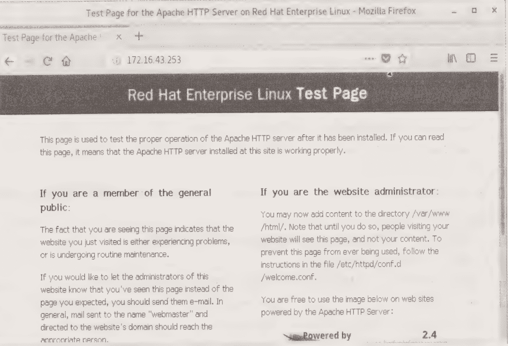

(2) 重启 `httpd` 服务。

```
[root@localhost ~]# systemctl restart httpd
```

(3) 停止 `http` 服务。

```
[root@localhost ~]# systemctl stop
```

(4) 查看 `http` 服务的状态。

```
[root@localhost ~]# systemctl status
```

(5) 将 `http` 服务配置为自动启动。

```
[root@localhost ~]# systemctl enable
```

## 13.2.3 修改配置文件 `httpd.conf`


`httpd.conf` 是 Apache 的核心配置文件，位于 `/etc/httpd/conf/` 目录下，大部分设置都需要修改文件后，重启 http 服务才会生效。`httpd.conf` 文件以 `#` 开始的是注释，除了注释和空行，都是指令。`httpd.conf` 文件由以下部分组成：

### 1. 全局环境

这一部分的指令将影响整个服务器。

(1) `ServerRoot`: 设置 Apache 配置目录、错误文件和存放目录，是整个目录根。默认情况下路径为 `etc/httpd`，可以根据需要修改。

(2) `Listen`: 设置 Apache 服务监听的 IP 和端口。

(3) `LoadModule`: 设置动态加载模块。

(4) `Include conf/*.conf`: 将 Server 指定的目录 `conf.d` 中的 `*.conf` 文件包含，即 `httpd/conf.d` 中的 `*.conf` 文件。

(5) `User`: 指定运行 Apache 服务的用户名，默认为 `apache`。

(6) `Group`: 指定运行 Apache 服务的组，默认为 `apache`。

(7) `KeepAlive`: 设置为允许在同一个连接上发送请求，取值为 `on`/`off`。

(8) `KeepAliveRequests`: 设置一次连接可以进行的 HTTP 请求次数。将此值设置为 `0`，则限制请求的数量。

(9) `KeepTimeout`: 设置连接在两次请求之间等待间隔，默认值为 `15` 秒。如果服务器完成一次请求，超过该设置还没有收到请求，服务器就会断开。

### 2. 服务器配置

(1) `ServerAdmin`: 设置服务器电子邮件。如果客户端访问服务器时出现错误，就会把错误信息返回给浏览器。

(2) `ServerName`: 服务器用于识别主机名和端口。如果没有配置域名，使用 IP 地址用于重定向。

(3) `DocumentRoot`: 网站数据的存放目录，默认情况下不需要设置这个参数，路径为 `/var/www/`。

```
<Directory />
AllowOverride none
Require all denied
</Directory>

# Apache 目录的访问和方式
<Directory "/var/www/">
Options FollowSymLinks
Require all granted
</Directory>
```

其中，`Indexes` 表示在目录中找不到 `Index` 指定的目录，就充当当前目录列表。`FollowSymLinks` 表示允许符号链接访问不在下的文件。`AllowOverride` 控制哪些指令可以放在 `.htaccess` 文件中。当 `AllowOverride` 设置为 `None`，`htaccess` 文件将被忽略。当 `AllowOverride` 设置为 `All`，所有 `htaccess` 作用的指令都允许在 `.htaccess` 中。

(5) 防止用户看到以 `.ht` 开的文件，保护 `htaccess` 和 `.htpasswd` 的内容。主要是为了防止他人看到设置，访问相关内容的用户名和密码。

```
<Files ".ht*>
Require all denied
</Files>
```

(6) `TypesConfig`: 指定存放 MIME 类型的文件。

(7) `LogLevel`: 指定错误日志的级别。

(8) `ServerSignature`: 设置为 `On`。由于服务器产生的网页会显示 Apache 的版本、主机、连接端口等信息。

(9) `AddDefaultCharset`: 设置服务器的编码。在默认情况下服务器采用 `UTF-8`，而汉字的编码一般是 `GB2312`，国家强制标准是 `GB18030`。

(10) `ErrorLog`: 存放错误日志的位置。

(11) `CustomLog`: 访问日志的位置。

### 3. 虚拟主机配置

通过虚拟主机可以在一台服务器上运行多个 Web 站点。虚拟主机是基于 IP 地址、主机或端口的。

(1) 基于 IP 地址的虚拟主机，需要多个 IP 地址，为每个 Web 站点分配一个 IP 地址。

(2) 基于主机名的虚拟主机，需要多个主机，为每个 Web 站点分配一个主机名。

(3) 基于端口的虚拟主机，要求不同的 Web 站点通过相同的端口监听。

### 4. Apache 的工作目录和文件

在 Apache 中存在多个目录，具体如下：

```
/etc/httpd: 服务器工作目录。
/etc/httpd/conf/httpd.conf: Apache 服务配置文件。
/etc/httpd/conf.d/: 存放配置文件的子目录，如 userdir.conf
/var/www/: 网站数据的存放目录。
/var/log/httpd/access_log: 服务器访问日志文件。
/var/log/httpd/error_log: 服务器错误日志文件。
```

## 13.2.4 配置用户个人页

现在许多网站都提供了一个个人页，用户可以方便管理自己的个人页。利用 Apache 服务实现用户的个人页配置，一般为几步：

(1) 启用用户个人页功能。

(2) 在 RHEL7.6 中默认没有开启功能，需要编辑个人页配置文件：

```
[root@localhost ~]# vim /etc/httpd/conf.d/userdir.conf
<IfModule mod_userid>
//UserDir is disabled by default it can confirm the presence
// of username on the system (depending on home directory permissions).
//UserDir disabled #注释掉，就可以开启个人页功能
// To enable ~/user/ to serve the user's public_html
// directory, remove the "UserDir disabled" line above, and uncomment
// the following line:
UserDir public_html #启用网站数据在家中的保存
</IfModule>
```

(3) 使用 `userid` 模块,可以使用 `://172.162.43.253/~username` 访问个人页。

① 启用用户页功能。

② 修改用户的目录权限。

```
[root@localhost ~]# cd /home
home drwxr-xr-x 2 root root
```

③ 创建个人页空间。

```
[root@localhost ~]# mkdir public_html
public_html drwxr-xr-x 755 root root
```

④ 创建个人页默认首页。

```
[root@localhost ~]# cd public_html
echo "hello am hz" > index.html
[root@localhost ~public_html]# cat index.html
hello am hz
```

⑤ 重启 `httpd` 服务。

```
[root@localhost ~]# systemctl restart httpd
```

⑥ 测试。在浏览器的地址栏输入以下 `172.162.43.254/~hz` 访问个人页，如图 13-4 所示。

13-4 用户页

## 13.2.5 配置虚拟目录

一般情况下，网站的资源需要放置在 Apache 的主目录中才可以发布在网页当中，要从 Apache 主目录以外的其他站点，可以使虚拟目录实现。

虚拟目录位于 Apache 服务器主目录之外的，不包含在 Apache 服务器的目录中，但在访问 Web 站点的用户看来，它与主目录中的虚拟目录是一样的。每一个虚拟目录都具有一个快捷，客户端可以由此来访问虚拟目录，并且使用虚拟目录还具有以下特点：

- （1）快捷。虚拟目录的名称和路径并不真实虚拟名称和路径的限制，因此在用虚拟目录的设置可以更加方便、快捷，而且用户完全感觉不到访问虚拟目录。

- （2）灵活性。Apache 并不在磁盘的空间上限制，快速通过虚拟目录将某些内容定义在其他目录，从而避免硬盘空间。

- （3）安全性。虚拟目录可以从站点之外隐藏目录的结构，从而防止越权访问。

- （4）方便。如果虚拟目录移动了，那么对应的 `URL` 就不会变化，只需要修改虚拟目录配置。

使用 `Alias` 语句创建虚拟目录，在 Apache 中创建多个目录，具体如下：

`Alias` 默认配置的项：

```
Alias /test/ "/var/www/test/"
```

# 学习情境二 部署 Linux 网络服务

基于域名：所有的虚拟主机可以共享一个 IP 地址，通过不同的域名访问不同的网站。基于域名的虚拟主机技术可以缓解 IP 地址不足的问题。

基于端口：所有的虚拟主机可以共享一个 IP 地址，各虚拟机之间通过不同的端口号进行区分。在设置端口号的虚拟机的配置时，需要利用 Linux 语句设置监听的端口。

无论是配置任何虚拟主机，都需要在 `VirtualHost` 容器里进行进行如下设置：


# 项目 13 部署 Web 服务

## 例 1 在 IP 地址为 192.168.43.253 的 Apache 服务器中配置基于不同端口的网站

具体要求为：

- 在 `/home` 目录下创建网页 `ceshi1.html`，内容为 `"this is first web"`，通过端口号 8888 访问。
- 在 `/var/www` 目录下创建网页 `ceshi2.html`，内容为 `"this is second web"`，通过端口号 6666 访问。

具体配置过程：

- ① 分别创建网站默认首页。

```bash
[root@localhost ~]#echo "this is first web" >>/home/ceshi1.html
[root@localhost ~]#echo "this is second web" >>/var/www/ceshi2.html
```

- ② 分别修改文件的权限，使用户具有读取和执行权限。

```bash
[root@localhost ~]#chmod 705 /home/ceshi1.html
[root@localhost ~]#chmod 705 /var/www/ceshi2.html
```

- ③ 修改 Apache 的配置文件 `httpd.conf`。

```apache
[root@localhost ~]#vim /etc/httpd/httpd.conf
Listen 80
Listen 8888 #添加端口号 8888
Listen 6666 #添加端口号 6666
```

- ④ 在 `/etc/httpd/conf.d` 创建虚拟机文件 `8888.conf` 和 `6666.conf`。

```bash
[root@localhost ~]# cd /etc/httpd/conf.d/
[root@localhost conf.d] # ls
autoindex.conf README userdir.conf welcome.conf
[root@localhost conf.d] # vim 8888.conf
[root@localhost conf.d] # cat 8888.conf
<VirtualHost 172.16.43.253:8888>
DocumentRoot "/home"
ServerName 172.16.43.253:8888
DirectoryIndex ceshi1.html
<Directory "/home">
Options FollowSymLinks
AllowOverride None
Require all granted
</Directory>
</VirtualHost>
[root@localhost conf.d] # vim 6666.conf
[root@localhost conf.d] # cat 6666.conf
<VirtualHost 172.16.43.253:6666>
DocumentRoot "/var/www"
ServerName 172.16.43.253:6666
DirectoryIndex ceshi2.html
<Directory "/var/www">
Options Indexes FollowSymLinks
AllowOverride None
Require all granted
</Directory>
</VirtualHost>
```

- ⑤ 重启 `httpd` 服务。

```bash
[root@localhost ~]# systemctl restart httpd
```

- ⑥ 测试。首先使用 `curl` 命令测试虚拟机的开启情况。

```bash
[root@localhost conf.d] # curl 172.16.43.253:8888
this is first web
[root@localhost conf.d] # curl 172.16.43.253:6666
this is second web
```

然后，在 Windows 和 Linux 分别打开浏览器，在地址栏输入 `http://172.16.43.253:8888`，页面自动跳转到 `ceshi1.html`；在地址栏输入 `http://172.16.43.253:6666`，页面自动跳转到 `ceshi2.html`，如图 13-6 和图 13-7 所示。


## 例 2 在例 1 的基础上配置基于 IP 的网站

网络规划如表 13-1 所示。

### 表 13-1 基于 IP 和不同端口的虚拟机的网络规划

| 虚拟机 | IP 地址 | 端口 | 主目录 | 主页 |
| :--- | :--- | :--- | :--- | :--- |
| `ceshi_8888` | `172.16.43.253` | `8888` | `/home` | `ceshi.html` |
| `ceshi_6666` | `172.16.43.253` | `6666` | `/var/www` | `ceshi.html` |
| `index_ip` | `172.16.43.249` | `80` | `/var/www/html` | `index.html` |

具体配置过程：

- ① 在例 1 的基础上为 `ens33` 绑定网卡地址 `172.16.43.249`。

```bash
[root@localhost ~]# ifconfig ens33 172.16.43.249 netmask 255.255.250
[root@localhost ~]# ifconfig
ens33: flags=4163<UP,RUNNING,BROAD,MULTICAST>  mtu 1500
inet 172.16.43.253  netmask 255.255.255.0  broadcast 172.16.43.255
ether 00:0c:29:02:4f:ac  RX 9543 bytes 222468 (217 KB) errors 0 dropped 0
TX 731 bytes 108577 (106 KB) errors 0 overruns 0 collisions
```

- ② 创建网站默认首页。

```bash
[root@localhost ~]#echo "this is default web" >/var/www/html/index.html
```

- ③ 修改文件的权限，使用户具有读取写入权限。

```bash
[root@localhost ~]# chmod 705 /var/www/html/index.html
```

- ④ 按照例 1 修改 `httpd.conf`。

- ⑤ 在例 1 的基础上增加虚拟主机 `index_ip`，创建配置文件 `index_ip.conf`。

```bash
[root@localhost ~]# cd /etc/httpd/conf.d/
[root@localhost conf.d] # ls
autoindex.conf README userdir.conf welcome.conf
[root@localhost conf.d] # cp 6666.conf index_ip.conf
[root@localhost conf.d] # vim index_ip.conf
[root@localhost conf.d] # cat index_ip.conf
<VirtualHost 172.16.43.249:80>
DocumentRoot "/var/www/html"
ServerName 172.16.43.249
DirectoryIndex index.html
<Directory "/var/www/html">
Options Indexes FollowSymLinks
AllowOverride None
Require all granted
</Directory>
</VirtualHost>
```

- ⑥ 重启 `httpd` 服务。

```bash
[root@localhost conf.d]# systemctl restartd
```

- ⑦ 测试。


```bash
[root@localhost conf.d]# curl 172.16.43.249
this is default web
```

然后，在 Windows 和 Linux 分别打开浏览器，在地址栏输入`http://172.16.43.253:8888`，页面自动跳转到`ceshi1.html`；在地址栏输入`http://172.16.43.253:6666`，页面自动跳转到`ceshi2.html`；在地址栏输入`http://172.16.43.249:80`，页面自动跳转到`index.html`，如图 13-6 和图 13-7 所示。


### 例 3 在 IP 地址为 172.16.43.253 的 Apache 服务器上基于域名的网站

网络规划如表 13-2 所示。

**表 13-2 基于域名的虚拟机的网络规划**

| 虚拟机 | IP 地址 | 端口 | 目录 | 主页 |
| :--- | :--- | :--- | :--- | :--- |
| `www.zhiyuan.com` | 172.16.43.253 | 8888 | `/home` | `ceshi.html` |
| `xy.zhiyuan.com` | 172.16.43.253 | 6666 | `/var/www` | `ceshi.html` |
| `index_ip` | 172.16.43.249 | 80 | `/var/www/html` | `index.html` |

具体配置过程：

- ① 配置 DNS 服务器，添加解析、反向区域。

```bash
[root@dns ~]# vi /etc/named.conf
listen 53 { any };
```

- ② 修改配置文件`named.rfc12.zones`，定义区域，内容如下：

```bash
root@dns ~]# vim /etc/named.rfc12.zones
在末尾添加：
zone "zhiyuan.com" {
  type master;
  file "zhiyuan.conf";
  allow-update none;
};

zone "253.43.16.172.in-addr.arpa" {
  type master;
  file "zhiyuan.fan";
  allow-update none;
};
```

- ③ 编辑正向解析文件`zhiyuan.conf`，如图 13-9 所示。

```bash
root@localhost:~# vim /var/named/zhiyuan.conf
```

| 文件(F) | 编辑(E) | 查看(V) | 搜索(S) | 终端(T) | 帮助(H) |
| :--- | :--- | :--- | :--- | :--- | :--- |
| TTL 1D | IN SOA zhiyuan.com. root.zhiyuan.com. | : serial | | | |
| | | 0 : refresh | | | |
| | | 1D : retry | | | |
| | | IW : expire | | | |
| | | 3H : minimum | | | |
| | | IN NS zhiyuan.com. | | | |
| | | IN MX 5 mail.zhiyuan.com. | | | |
| | | IN A 172.16.43.253 | | | |
| | | IN A 172.16.43.253 | | | |
| | | IN A 172.16.43.254 | | | |
| | | IN A 172.16.43.252 | | | |
| | | IN CNAME zhiyuan.com. | | | |

编辑反向解析文件`zhiyuan.fan`，如图 13-10 所示。

```bash
root@localhost:~# vim /var/named/zhiyuan.fan
```

| 文件(F) | 编辑(E) | 查看(V) | 搜索(S) | 终端(T) | 帮助(H) |
| :--- | :--- | :--- | :--- | :--- | :--- |
| TTL 1D | IN SOA zhiyuan.com. root.zhiyuan.com. | : serial | | | |
| | | 0 : refresh | | | |
| | | 1D : retry | | | |
| | | IW : expire | | | |
| | | 3H : minimum | | | |

## 学习情境二 部署 Linux 网络服务

```bash
<Directory>
<VirtualHost>
[root@localhost.conf#] vim oa.conf
[root@localhost.conf#] cat oa.conf
<VirtualHost 172.16.43.253:80>
DocumentRoot "/var/www/html"
</VirtualHost>
```

- ⑦ 重启`httpd`服务。
- ⑧ 测试。

```bash
[root@localhost.conf#] curl zhiuyuan.com
this is first web
[root@localhost.conf#] curl xy.zhiuyuan.com
this is second web
[root@localhost.conf#] curl oa.zhiuyuan.com
this is default web
```

可以在 Windows 和 Linux 分别打开浏览器，在地址栏分别输入`http://www.zhiuyuan.com`、`http://xy.zhiuyuan.com` 及 `http://oa.zhiuyuan.com`，结果如图 13-11 所示。


图 13-11 基于不同域名的虚拟主机

## 13.2.7 访问控制

Apache 对访问控制权限的设置有两种方式：一种是在配置文件`httpd.conf`中直接进行，另一种是使用`<Directory></Directory>`容器设置或在`.htaccess`文件中设置。两种方式都可以用于控制浏览器的访问，但是使用`httpd.conf`配置文件，每次改动都需要重启服务器才能生效，灵活性较差；而使用`.htaccess`文件设置具体的目录访问控制较为灵活。

在 Apache 2.2 版本中，访问控制是基于客户端的主机、IP 地址以及客户端请求中的其他特征，使用`Order`（排序）、`Allow`（允许）、`Deny`（拒绝）指令来实现。在 Apache 2.4 版本中使用`mod_auth_host`这个新的模块来实现访问控制和模块的授权控制。原来在 Apache 2.4 版本下实现网站访问控制的`Order`、`Allow`和`Deny`指令，需要替换为新的访问控制指令。

## 项目 13 部署 Web 服务

### 1. 目录的访问控制

- 例 1 所有请求都被拒绝，命令如下：

```apache
Require all denied
```

- 例 2 所有请求都被允许，命令如下：

```apache
Require all granted
```

- 例 3 `zhiyuan`域内所有请求都被允许，其他拒绝，命令如下：

```apache
Require host zhiyuan.com
```

- 例 4 拒绝 IP 地址为 192.168.1.26 和`test.net`的客户端访问，其他客户端都可以正常访问，命令如下：

```apache
Require not ip 192.168.1.26
Require not host test.net
```

- 例 5 允许 192.168.0.24 网段、IP 为 172.16.43.254 的客户端访问，但其中 192.168.0.100 不能访问，命令如下：

```apache
Require ip 192.168.0 172.16.43.254
Require not ip 192.168.0.100
```

`Options`是 Apache 配置文件中一个常见重要的指令，`Options`指可以在 Apache 服务器核心配置（Server Config）、虚拟主机（Virtual Host）、特定目录配置（Directory）及`.htaccess`文件中使用。

`Options`指令用于控制特定目录启用哪些服务器特性。常见的配置示例如下：

```apache
<Directory>/var/www/html/> #指定目录“允许” Indexes、FollowSymLinks 两种特性
AllowOverride None
Require all granted
</Directory>
```

选项（`Options`）可以出现在配置文件容器内，或`.htaccess`文件中。

```apache
Options [+]|[-Option1] [+]|[-Option2]
```

- 选项前添加加号(`+`) 添加此特性。
- 选项前添加减号(`-`) 表示移除此特性。


总之，`Options` 指令后可以附加服务器特性，特性之间用空格分隔。常用服务器特性有：

- `All`：表示 `MultiViews` 之外的所有特性，这些也是 `Options` 指令的默认设置。
- `None`：表示不启用任何特性。
- `FollowSymLinks`：允许在此目录中使用符号链接。
- `Indexes`：允许目录浏览。如果请求对应一个目录，而目录中没有 `DirectoryIndex` 指令（如 `index.html`），那么服务器就会返回列表。
- `MultiViews`：允许 `mod_negotiation` 模块提供的“协商”。总之，如果请求对应不同类型的文件，服务器将自动选择匹配的内容。例如，在服务器站点中存在 `hello.jpg` 或 `hello.html`，如果文件列表中没有 `hello`，服务器会根据客户端请求查找。
- `SymLinksIfOwnerMatch`：只有当符号链接指向的文件或目录的所有者与用户相时使用。此选项设置为 `<Location>` 配置。
- `ExecCGI`：允许 `mod_cgi` 模块执行 `CGI` 脚本。
- `Includes`：允许 `mod_include` 模块提供的服务器包含功能。
- `IncludesNoExec`：允许服务器端包含，但不执行“`exec cmd`”和“`exec virtual`”虚拟 `CGI` 脚本。

**例 6** 禁止 `Apache` 显示目录列表，命令如下：

```apache
<Directory>
Options FollowSymLinks
AllowOverride None
Require all granted
</Directory>
```

`Options` 指令允许在配置前加上 `+` 或者 `-`。如果一个目录被多次设置 `Options`，则数量最多的 `Options` 指令会被接受（其他的被忽略）。

但是如果在选项前加上 `+` 或 `-`，表示该选项将被合并。所有前面有 `+` 的项将覆盖当前的设置选项，而前面有 `-` 的项将强制从当前选项中移除。例如：

```apache
<Directory>/web/file
Indexes FollowSymLinks
Options Includes
</Directory>

<Directory>/web/image
Options +Indexes
</Directory>
```

此时，目录 `/web/file` 被设置为 `Includes` 特性。例如：目录 `/web/file` 具有 `Includes` 和 `FollowSymLinks` 两种特性。

## 项目 13 部署 Web 服务

### 2. 身份认证

注意：混合使用前缀 `+` 和 `-` 可能导致意外的结果。使用 `-NoExec` 时，不论前面如何设置，都会禁用服务器包含。

**例 7** 在原有的基础上禁止 `Apache` 显示 `/var/www/test/` 目录，命令如下：

```apache
<Directory>/var/www/test>
Options -Indexes
</Directory>
```

在 `httpd.conf` 中 `AllowOverride` 主要用于控制访问。`.htaccess` 文件是一个访问控制文件，用来配置相应目录下的一个或多个文件，功能包括网页密码、发生时的文件、更改首页（如 `index.html`）、禁止文件名、重定向、添加 `MIME` 类别、禁止目录等。

```apache
<Directory />
Options FollowSymLinks
AllowOverride None
```

如上所示，`<Directory>` 容器中 `AllowOverride` 默认认为“`none`”，完全忽略 `.htaccess` 文件。身份认证如果启用，需要将 `AllowOverride` 设置为“`AuthConfig`”，就可以在相应目录下进行访问。

**表 13-3 AllowOverride 参数描述**

| 参数 | 功能描述 |
| :--- | :--- |
| `AuthConfig` | 允许使用授权相关的指令(`AuthDBGroup`, `AuthType`, `AuthUser`, `Require`) |
| `FileInfo` | 允许控制文件类型的指令(`FileType`, `ErrorDocument`, `LanguageInput`, `SetHandler`, `SetOutputFile`) |
| `Indexes` | 允许使用目录索引(`AddIndex`, `AddByType`, `AddDefault`, `DirectoryIndex`, `IndexName`, `IndexOptions`) |
| `Limit` | 允许使用主机(`Allow`, `Deny`, `Order`) |
| `All` | 所有允许 |
| `None` | 禁止使用 |

### 13.2.8 用户认证

注意：`.htaccess` 是一个完整的文件，上传时必须用 `chmod` 修改权限为 `644` (`rw-r--`)。每一个目录都会被 `.htaccess` 影响。为了安全起见，身份认证是防止用户使用资源的有效手段。当用户访问受保护的站点时，必须输入用户名和密码才能访问。

语法：

```
htpasswd [-m] passwordfile username
```

选项如下：

- `m`：可以生成 `MD5` 加密的密码（`CentOS` 中为默认）。
- `c`：创建 `passwordfile`。如果 `passwordfile` 存在，那么它会重新写入原有内容。
- `u`：更新 `passwordfile`，直接显示错误。
- `d`：使用加密（默认）。
- `p`：使用普通文本格式的密码。
- `s`：使用 `SHA` 加密。
- `b`：命令中一行输入用户名和密码而不是提示密码，不需要交互。
- `D`：删除指定的目录。

对身份认证时，需要下列设置：

(1) 用户认证，必须将 `AllowOverride` 设置为 `AuthConfig`。
(2) 创建 `passwordfile`。
(3) 创建 `.htaccess` 文件，指示服务器允许这些用户访问，并向用户索要密码。

身份认证。文件如下：

```
AuthType "Restricted"
UserFile passwordfile
Require user
```

## 13.3 反思与进阶

### 1. 项目背景

为了保护目录，`IT` 可能会决定隐藏真实的网站目录，同时只允许特定用户访问。具体要求为：

- (1) 站点采用虚拟目录，主目录真实路径为 `/var/www/test/`。
- (2) 只允许 `test1` 登录访问，密码是 `123456`。
- (3) 网站无索引，浏览目录。

### 2. 实施目的

- (1) 熟练运用 `Apache` 控制设置。
- (2) 能够通过 `.htaccess` 设置用户对网站的访问。
- (3) 根据实际需求部署 `Web` 服务。

### 3. 实施步骤

(1) 配置 `Apache` 服务器的 `IP` 地址为 `172.16.243.55`，关闭防火墙，设置 `SELinux` 为 `Permissive`。

```
[root@localhost]#~ ifconfig ens3
ens3:flags=4613<UP,BROADCAST,RUNNING,MULTICAST>
inet 172.16.243.55  mask:255.255.255.0
```

## 项目 13 部署 Web 服务

```bash
[root@localhost test] # systemctl restart httpd
```

(7) 测试。

在浏览器的地址栏输入 `http://172.16.43.253/test/`，如图 `13-12` 和图 `13-13` 所示。

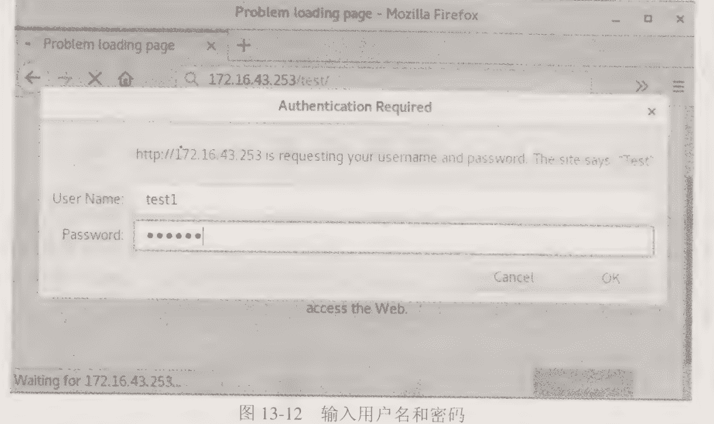

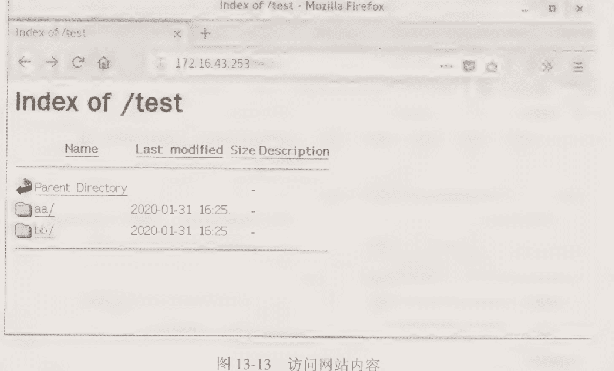

## 4. 项目总结

(1) 将访问控制写在 `<Directory></Directory>` 容器中。

```apache
<Directory>/var/www/test>
    Options Indexes MultiViewsFollowSymLinks
    AllowOverride All
    Require all granted
    AuthName "Test"
    AuthType basic
    AuthFile /var/www/test/.htpasswd
    require user test1
</Directory>
```

(2) 重点掌握 `AuthFile` 和 `require` 命令的使用。

## 项目总结

要熟练部署 `Web` 服务，需要了解 `Web` 服务的概述、原理及常用的 `Web` 服务器。`Apache` 是 `Linux` 平台上应用最广的 `Web` 服务器。重点掌握 `Apache` 服务器的安装和简单配置，了解配置文件常用选项、`Apache` 服务器访问控制配置、`Apache` 服务器虚拟机配置，对于配置高性能、高可靠的服务器还需要不断总结。

## 练习题

### 一、选择题

1. `WWW` 服务器是在互联网上使用广泛的（），它采用的结构是（ ）


1. （题目缺失）
   A. 分布式 B. 集中式 C. B/C D. C/S

2. 用户 `Apache` 配置服务器默认认用的端口是（ ）。
   A. 8080 B. 80 D. 88

3. 用户 `Apache` 配置虚拟主机，有（ ）种不同虚拟技术可以完成。
   A. 1 B. 2 C. 3 D. 4

4. 以下（ ）是 `Apache` 服务器配置文件。
   A. `mime.types` B. `/etc/httpd/conf/access.conf/` C. `/etc/httpd/conf/httpd.conf` D. `/srm.conf`

5. `httpconf` 命令的正确方法是（ ）。
   A. 检查 `Apache` 的配置文件 B. 对 `Apache` 日志进行旋转 C. 检查 `Apache` 的配置文件 D. 停止 web 服务

### 二、填空题

1. `Apache` 服务器是实现____服务器功能的应用程序，即通常所说的 web 服务器，为用户提供浏览____就是 `Apache` 应用程序。
2. web 服务使用____协议。
3. 使用____命令能够启动 `Apache` 服务。
4. 使用____可以对 `Apache` 服务器的性能进行测试。

### 三、简答题

1. `Apache` 服务默认使用的端口是多少？
2. `Apache` 服务器的主配置文件的存放路径是什么？
3. 在 `Apache` 服务器上配置虚拟主机有哪几种方式？
4. 解释指令 `Deny from 202.196.6.024` 的功能。

## 学习情境二 部署 Linux 网络服务

### 项目 14 部署电子邮件服务

#### 项目引入

近来咨询学院各专业的学生越来越多，为了让每个学生快速、及时地了解到专业设置、实训条件及就业情况，也为了提高学院内部一些资料的转发速度，IT 协会决定在学院内部部署一台电子邮件服务器，为大家提供邮件服务。

#### 需求分析

为了部署稳定、安全的电子邮件服务，IT 协会决定在 Linux 系统中部署电子邮件服务，需要了解电子邮件的传输过程和使用的网络等内容，能够根据实际情况部署电子邮件：

- 部署电子邮件服务的原理。
- 掌握 `SMTP` 和 `POP3` 协议原理。
- 能够使用 `sendmail` 和 `Postfix` 部署邮件服务。

### 14.1 知识准备

#### 14.1.1 电子邮件服务简介

Internet 基本、最重要的服务之一，就是电子邮件服务。据统计，Internet 上三十以上的业务量是电子邮件（Electronic mail），不仅用于 WWW 服务。与传统的邮政邮件类似，电子邮件可以在 Internet 或 Intranet 上进行信息的传递和交流，但电子邮件还具有快速、经济的特点。

每个邮箱都有一个唯一的电子邮件地址（E-mail address）。完整的电子邮件地址由两部分组成，即用户名和服务器地址。其中用户名必须是唯一的，不允许重复。用户名和服务器地址之间用 `@` 分开，如 `test@zhiyuan.com`。

邮件格式包括两个部分，中间用一个空隔。第一部分是一个头部（`header`），包括发送、接收、日期和格式等文本；第二部分是正文（`body`），包括用户编写的文文。

电子邮件的过程通过客户端/服务器模式。每份邮件的发送都涉及用户与交互，发送方构成客户端，而接收方构成服务器，包含众多用户。发送方通过邮件客户端将编辑好的邮件向邮件服务器（如 `SMTP` 服务器）。服务器识别接收者，并向该地的邮件服务器（如 `POP3` 服务器）发送消息。服务器是将邮件放在接收者的电子邮箱内，并告知接收者有邮件到达。接收者通过邮件客户端连接到服务器看到邮件。

## 1. 电子邮件系统的架构

一个邮件传输包含了用户邮件代理（Mail User Agent, `MUA`）、邮件传输代理（Mail Transfer Agent, `MTA`）以及电子邮件协议大部分。用户邮件代理是邮件系统的接口，负责用户和邮件之间的交互。大多数情况下，`MUA` 是客户端运行的应用程序，其作用是将邮件发送到邮件服务器和从服务器接收。邮件通过网络发送到目标方和从服务器接收，具有两个功能：

- 1) 用户邮件代理（`MUA`）：邮件在传输过程中，服务器会将消息信息在系列节点间传输，直到到达对方邮箱。这个传输往往经过多次，因此每个网站上都安装了邮件代理，以便邮件转发。Internet 中的 `MTA` 构成了整个传输系统（Message Transfer System, `MTA`），最常用的 `MTA` 是 `Sendmail`、`Postfix`、`Qmail` 等。
- 2) 邮件传输代理（`MTA`）

### 3. 电子邮件协议

电子邮件客户端和服务器种类很多，它们通过电子邮件协议进行传输，如 `SMTP`、`POP`、`IMAP` 等。

## 2. `SMTP` 协议

Simple Mail Transfer Protocol（简单传输协议）是维护邮件秩序、规定服务器之间某些操作的协议，其目标是传输电子邮件。使用 `SMTP`，发送可以是本地网络上的用户，也可以是 Internet 上的用户。`SMTP` 现在已经是 Internet 电子邮件的标准，是一个基于文本的协议。它的之上指定了一条消息或多个接收者（大多数情况下被确定），然后消息就可以传输，该协议在 25 端口上工作。

`SMTP` 是请求和响应都是 ASCII 文本，并以 `CR` 和 `LF` 结束。响应包括返回的三位数字代码。`SMTP` 的工作原理为：

- (1) `TCP` 连接。
- (2) 客户端发送 `Hello` 命令来标识自己，然后客户端用 `OK` 作为操作，服务器就准备连接。
- (3) 客户端发送 `rcpt` 命令标识接收，服务器愿意接受邮件。
- (4) 用 `quit` 命令退出。`SMTP` 传输系统只需要可靠、有序的数据。`SMTP` 的重要性在于它能够跨网络连接。

## 3. `POP3` 协议

`POP3`（Post Office Protocol version 3）用于存储服务器邮件，目前发展到第三代，允许用户从服务器上下载并将邮件存储在服务器上还是本地邮箱。每个账号都有密码，可以在任何地方检查邮件。该协议默认工作在 110 端口。`POP3` 中三种状态：认可状态、处理状态和更新状态。当客户端与服务器建立时，客户端提供身份并确认后进入处理状态，完成操作后进入更新状态退出。

## 4. `IMAP` 协议

`IMAP` 提供了远程服务器上管理的功能，允许用户从服务器上检索邮件并在任意位置的文件夹之间移动邮件。如果一个邮箱包含多个帐户，用户可以选择全部。与 `POP3` 相比，`IMAP` 提供了对帐户的管理。依靠 `SMTP` 实现，工作在 143 端口。

## 5. 电子邮件传输

- (1) 用户在自己的服务器注册，由网络管理员授权并获得 `SMTP` 地址。假设两个域名 `example.com` 和 `163.com`，用户分别为 `liu@example.com` 和 `chen@163.com`。如图 1-4 所示。
- (2) 当服务器上的用户向 `chen@163.com` 发送邮件时，客户端发送到 `example.com` `SMTP` 服务器。
- (3) `SMTP` 服务器根据邮件地址查询 `163.com` 并转发邮件。
- (4) `SMTP` 服务器接收邮件并保存。
- (5) 用户利用客户端登录 `163.com` 服务器，从邮箱中下载并浏览邮件。

### 1.2 邮件中继

实际服务器在接收邮件后，会根据目的判断邮件发送本地还是外部，常见的处理方法有两种：

- 1. 本地发送：当服务器检测到发送到本地邮箱（如 `aa@zhiyuan.com` 发送到 `zhiyuan.com`），方法简单，会将直接发送到指定的邮箱。
- 2. 邮件中继：是指服务器向其他服务器传输的一种请求。服务器只有两类：一类是本地，一类是外部。前者是本地发送，后者不是自己发送给另一个用户，这种行为称为 `Open Relay`（开放中继）。如果关闭了 `Open Relay`，那么它只能发送到内部，无法继续中继输出。`Open Relay` 是禁止的。

## 14. 项目实施

### 14.2.1 安装 `sendmail`

(1) 检查并安装 `sendmail` 软件。在终端窗口输入 `rpm -q sendmail` 命令检查是否安装。

```bash
[root@localhost ~] rpm -q sendmail
未安装软件，用 yum 命令安装。
[root@localhost ~] yum install sendmail -y
```

(2) 安装完成后再次查询。

```bash
[root@localhost ~] rpm -q sendmail
sendmail-8.14.7-5.el7.x86_64
```

(3) 进行其他准备。配置邮件服务器 IP 地址为 `172.16.43.252`，配置防火墙，设置系统的机制为 `Permissive` 并生效。


## 项目 14 部署电子邮件服务

```bash
[root@localhost ~] vi /etc/sysconfig/network-scripts/ifcfg-ens33
[root@localhost ~] vi configens33
ens33:flags=463<UP,BROADCAST,RUNNING,MULTICAST> mtu=150
inet=172.16.43.252 mask=255.255.255.0 broadcast
inet6:a67d:2c19:db5b:39ce prefixlen=64 scope=0x20<link>
type=00:00:29:02:4f:ac queue=1000 (Ethernet)
RX packets=4833 bytes=487367 (475.9 KiB)
```

### 14.2.2 启动与停止 sendmail 服务

(1) Red Hat Enterprise Linux 7 默认已经安装了 `Postfix`，所以需要执行如下命令换 `MTA`。

```bash
[root@localhost ~] alternatives --config mta
共有两个提供“mta”的程序：
* 1 /usr/sbin/sendmail.postfix
* 2 /usr/sbin/sendmail.sendmail
按 Enter 键保存当前选择[*]，按键选择号码 2。
```

(2) 为了不影响 `sendmail` 服务的使用，需要关闭 `Postfix` 服务。

```bash
[root@localhost ~] systemctl stop postfix.service
```

(3) 设置启动 `Postfix`。

```bash
[root@localhost ~] systemctl disable postfix.service
```

(4) 启动 `sendmail` 服务。

```bash
[root@localhost ~] systemctl start sendmail
```

(5) 停止 `sendmail` 服务。

```bash
[root@localhost ~] systemctl stop sendmail
```

(6) 重启 `sendmail` 服务。

```bash
[root@localhost ~] systemctl restart sendmail
```

(7) 查看 `sendmail` 服务状态。

```bash
[root@localhost ~] systemctl status sendmail
```

(8) 将 `sendmail` 配置为开机启动。

```bash
[root@localhost ~] systemctl enable sendmail
```

```
zone "43.162.17.in-addr.arpa" IN (
    type master;
    file "zhiyuan.fan"
    allow-update ( none );
);
```

(3) 正向区域解析文件 `zhiyuan.fan` 和反向区域解析文件 `zhiyuan.fan`，分别如图 14-2 和图 14-3 所示。

```
root@localhost:~ 
文件(F) 编辑(E) 查阅(V) 搜索(S) 终端(T) 帮助(H)
$TTL 1D
      IN SOA    zhiyuan.com. root.zhiyuan.com, (
              0 : serial
              1D : refresh
              1H : retry
              1W : expire
              3H ) : minimum
      IN NS       dns.zhiyuan.com.
      IN MX 5     mail.zhiyuan.com.
  www A       172.16.23.253
  des A       172.16.23.254
  mail A      172.16.23.252
  pop CNAME mail
  smtp CNAME mail
```

图 14-2 正向区域解析文件 `zhiyuan.fan`

```
root@localhost:~ 
文件(F) 编辑(E) 查阅(V) 搜索(S) 终端(T) 帮助(H)
$TTL 1D
      IN SOA    zhiyuan.com. root.zhiyuan.com, (
              0 : serial
              1D : refresh
              1H : retry
              1W : expire
              3H ) : minimum
      IN NS       dns.zhiyuan.com.
      IN MX 5     mail.zhiyuan.com.
  254 IN PTR      dns.zhiyuan.com.
  255 IN PTR      www.zhiyuan.com.
  252 IN PTR      mail.zhiyuan.com.
```

```
*/var/named/zhiyuan.fan* 12L, 319C
```

图 14-3 反向区域解析文件 `zhiyuan.fan`

## 学习情境二 部署 Linux 网络服务

(4) 在邮件服务器上测试域名服务。

```
[root@mail ~#] nslookup
> mail.zhiyuan.com
Server: 172.16.43.254
Address: 172.16.43.254#53
Name: mail.zhiyuan.com
Address: 172.16.43.252
> pop3.zhiyuan.com
Server: 172.16.43.254
Address: 172.16.43.254#53
pop3.zhiyuan.com canonical name = mail.zhiyuan.com
Name: mail.zhiyuan.com
Address: 172.16.43.252
> smtp.zhiyuan.com
Server: 172.16.43.254
Address: 172.16.43.254#53
smtp.zhiyuan.com canonical name = mail.zhiyuan.com
Name: mail.zhiyuan.com
Address: 172.16.43.252
```

### 2. 修改 sendmail.mc 文件

(1) 编辑 `sendmail.mc` 文件。

```
[root@mail ~#] cd /etc/mail
[root@mail ~#] ls
access help Makefile trusted-users
access.db local-hosts sendmail.mc virtual-table
alias.db-stamp mailertable sendmail.mc virtual-table
domainable mailertable.db submit.cf
domainable make submit.mc
```

由于此配置文件 `sendmail` 采用宏代码编写，可读性不强。默认情况下，通过编辑 `sendmail.mc` 文件，然后使用 `m4` 工具将结果导入 `sendmail` 文件中即可。通过这种方法可以极大降低配置复杂度。

修改 `/etc/mail/sendmail.mc` 文件，将第 118 行 `Addr` 字段设置为 `0.0.0.0`，这样可以扩大范围，使得 `sendmail` 可以在所有的网络接口上服务，并找到以下语句：

```
DAEMON_OPTIONS('Port=smtp,Addr=127.0.0.1,Name=MTA')dnl
```

将其修改为如下，以便接受来自任何地方的连接，如图 14-4 所示。

```
DAEMON_OPTIONS('Port=smtp,Addr=0.0.0.0,Name=MTA')dnl
```

```
[root@mail ~#] vim
```

`root@localhost:/etc/mail`


## 1. 配置 sendmail.mc 文件

```
文件(F) 邮箱(E) 查看(V) 搜索(S) 终端(T) 帮助(H)
110 dnl #
111 dnl define CONFLICT_MAILER cyrusv2!dnl
112 dnl define CYRUSV2_MAILER_MSGS. FILE /var/lib/imap/smtp/l!!dnl
113 dnl #
114 dnl # The following causes sendmail to only listen on the IPv4 local address
115 dnl # 127.0.0.1 and not on any other network devices. Remove the loopback
116 dnl # address restriction to accept email from the internet or intranet.
117 dnl #
118 dnl DAEMON_OPTIONS= Port=Addr=0.0.0.0, Name=MTA!dnl
119 dnl #
120 dnl # The following causes sendmail to additionally listen to port 25 for: 
121 dnl # mail from MXs that authenticate. Roaming users who can't reach their
122 dnl # preferred sendmail daemon listen to port 25 being blocked or redirected if
123 dnl # this is useful.
124 dnl #
125 dnl DAEMON_OPTIONS= Port=submission, Name=MSA, M=ea!
126 dnl #
127 dnl # The following causes sendmail to additionally listen to port 465, but
128 dnl # starting immediately in TLS mode upon connection. Port 25 or 567 followed
129 dnl # by STARTTLS is preferred, by routing clients using Outlook
```

图 14-4 `sendmail.mc` 文件

## 2. 编写 access.cf 文件

① 备份原有的 `sendmail.cf` 文件。

```
[root@mail ~#] cp sendmail.cf sendmail.cf.bak
```

② 使用 `rpm -q` 查看是否安装了 `m4` 工具。如果没有安装，需要先安装 `m4` 工具配置。

```
[root@mail ~#] rpm -q m4
[root@mail ~#] yum install -y m4
```

③ 使用 `m4` 命令将 `/etc/mail/sendmail.mc` 编译为 `/etc/mail/sendmail.cf`。

```
[root@mail ~#] m4 sendmail.mc > sendmail.cf
m4: sendmail.mc:10: cannot open '/usr/share/sendmail-cf': No such file or directory
```

宏出错，没有 `/usr/share/sendmail-cf` 目录，是因为缺少 `sendmail-cf` 软件。首先安装 `sendmail-cf`，然后使用 `m4` 工具重新生成 `sendmail.cf` 文件。

```
[root@mail ~#] yum install -y sendmail-cf
[root@mail ~#] m4 > sendmail.cf
```

## 3. 设置 SMTP

将邮件从一个 `MTA` 传输到另一个 `MTA` 时，这个过程被称为转发。`sendmail` 使用 `/etc/mail/access.db` 文件。默认情况下 `sendmail` 禁止其他主机利用本地服务器。这种情况下，非本地机器使用本地投递时产生“550 relay denied”错误。使用 `/etc/mail/access.db` 文件。`access.db` 文件是一个列表，是由 `access` 生成的。`access` 文件是纯文本文件，每一行的格式如下：

`<地址> <动作>`

地址部分表示：
- 域名，如 `jpg.com`。
- `email` 地址如 `user@jpg.com`。
- `email` 地址
- `IP` 地址如 `192.16.1`。
- 网络地址如 `192.168.1`。

动作取值为：
- `RELAY`：允许客户端中继。
- `REJECT`：拒绝邮件并显示内部错误。
- `DISCARD`：拒绝邮件但不返回任何信息。使用 `makemap` 生成 `access.db`。

```
[root@mail ~#] makemap access > access.db
```

| access | mailter |
| :--- | :--- |
| `access.db` | `submit.mc` |
| `aliases-db` | `trusted-users` |
| `domaintable` | `Makefile` |
| `domaintable.db` | `sendmail.cf` |
| `helpfile` | |

## 4. 设置本地服务器的域

`host-names` 主要处理一个主机同时拥有多个名称的问题。如某主机有 `mail.test.com` 和 `mail.zhiyuan.com`，这两个域都希望接收邮件，将这两个名字写进 `host-names` 文件中，其中一个主机占用一行。只允许 `host-names` 接收，打开 `host-names` 配置文件，如图 14-6 所示。

```
[root@mail ~#] vim host-names

# host-names include all for your machine.

zhiyuan.com
```


## 5. Dovecot 服务

`sendmail` 只能实现 `SMTP` 服务，就是邮件的发送服务。如果客户端使用 `Outlook` 或 `Foxmail` 接收邮件，必须使用 `POP3` 协议。`Dovecot` 是一个开源的 `IMAP` 和 `POP` 邮件服务器，支持 `Linux/Unix` 系统。`Dovecot` 支持的 `POP3` 和 `IMAP` 协议让用户从服务器接收邮件。

### 5.1 安装 Dovecot

在 `Enterprise Linux 7.6` 中，默认不会安装 `Dovecot`，需要手动安装。修改配置文件第 24 行和 48 行，使用 `Dovecot` 支持 `POP3` 和 `IMAP` 协议。

```
[root@mail ~#] vim /etc/dovecot/dovecot.conf
```

将 `protocols` 前面的“#”注释去掉，支持 `pop3` 和 `imap` 接收服务。

```
protocols = imap pop3
```

指定登录的网段为 `172.16.43/24`。

```
login_networks=172.16.43/24
```

### 5.2 修改 mail_location

取消 `/etc/dovecot/conf.d/10-mail.conf` 中 25 行注释。

```
[root@mail ~#] vim /etc/dovecot/conf.d/10-mail.conf

mail_location = mbox:INBOX=/var/mail/%u
```

### 5.3 启动 Dovecot 配置

```
[root@mail ~#] systemctl start dovecot.service
```

将 `Dovecot` 配置为开机运行。

```
[root@mail mail]#] systemctl enable dovecot.service
```

### 5.4 查看端口监听状态

利用下列命令查看 110、143 端口的监听状态。使用 `lsof -i:110` 列出在 110 端口运行的进程。

```
[root@mail mail]#] lsof -i:110
```

使用 `lsof -i:143` 如下：

```
COMMAND PID USER FD TYPE SIZE/NODE NAME

dovecot 1234 root 3 ipv4 56789 0 *:143 (LISTEN)
```

使用 `lsof -i:110` 列出在 110 端口运行的进程。

```
COMMAND PID USER FD TYPE SIZE/NODE NAME

dovecot 5678 root 3 ipv4 54321 0 *:110 (LISTEN)
```

使用 `lsof -i:143` 如下：

```
COMMAND PID USER FD TYPE SIZE/NODE NAME

dovecot 1234 root 3 ipv4 56789 0 *:143 (LISTEN)
```


(6) 安装`Telnet`，设置`SMTP`。

```
[root@mail ~]# yum install -y telnet
```

测试`SMTP`服务，端口为`25`。

```
[root@mail ~]# telnet 172.16.43.25
Trying 172.16.43.25...
Connected to 172.16.43.25.
220 hello, Fri 30 Jan 2020 21:41:00
HELO localhost
250-mail.zhiyuan.com hello [localhost]
250 HELP
```

(7) 测试`POP3`服务，端口为`110`。

```
[root@mail ~]# telnet 172.16.43.252
Trying 172.16.43.252...
Connected to 172.16.43.252.
210 mail.zhiyuan.com OK POP3 server ready
USER user
+OK5 OK username
PASS password
+OK5 OK OK
LIST
+OK5 * 1
QUIT
+OK5 OK
```

(8) 为邮件账号`aa`和`bb`设置密码。

```
[root@mail ~]# useradd aa
[root@mail ~]# password aa
[root@mail ~]# useradd bb
[root@mail ~]# password bb
```

```
[root@mail ~]# tail -2 /etc/passwd
aa:x:1012:1012:/home/aa:/bin/bash
bb:x:1013:1013:/home/bb:/bin/bash
```

# 学习情境二部署 Linux 网络服务

(2) 配置`sendmail.cf`。

```
[root@mail ~]# cd /etc/mail
```

```
[root@mail ~]# vim sendmail.cf
```

编辑`sendmail.cf`，删除以下以`dnl`开头的`3`行配置，以开启`sendmail`的认证功能。

```
TRUST_AUTH_MECH(EXTERNAL DIGEST-MD5 CRAM-MD5 LOGIN PLAIN)dnl
define(AUTH_MECHANISMS,EXTERNAL GSSAPI DIGEST-MD5 CRAM-MD5 LOGIN PLAIN)dnl
DAEMON_OPTIONS(Port=submission, Name=MSA, M=EA')dnl
```

各行解释如下:
- 第一行：使用`sendmail`时，无论配置文件中如何设置，都能转发（`relay`）通过`login`, `plain`或`digest-md5`方法验证的邮件。
- 第二行：确定系统认证方式。
- 第三行：开启认证，并允许进程中进行`MSA`，实现邮件账户和密码的验证。

(3) 重生成`sendmail.cf`。

```
[root@mail ~]# m4 sendmail.mc>sendmail.cf
```

(4) 重启`sendmail`服务，使设置生效。

```
[root@mail ~]# systemctl restart sendmail
```

(5) 启动`saslauthd`服务，使`sendmail`认证生效。

```
[root@mail ~]# systemctl start saslauth
```

# 14.3 反思与进阶

### 14.3.1 Postfix 简介

`Postfix`（原名为`VMailer`）是由`Wietse Zweite Venema`博士在`IBM T.J. Watson`研究中心于`1998`年启动的`Postfix`项目：“设计一个可以替代`Sendmail`的软件，为网站管理员提供一个更快速、更安全且完全兼容`Sendmail`的邮件服务器软件！”

`Postfix`的目标就是成为`Sendmail`的替代者，其特点归纳为以下几点：
- 高性能：比同类服务器处理速度快`3`倍以上。
- 兼容性：保持与`sendmail`的兼容性。
- 健壮性：在过量下载时保证程序的可靠性。
- 活性：结构上由十多个模块组成，每个模块完成特定的任务。
- 安全性：使用多层防御防止攻击者破坏本地系统。
- 开放性：遵循`IBM`的开源代码源码许可证。

配置`Postfix`服务之前，需要禁用`sendmail`服务，具体操作为：
- (1) 关闭并禁用`sendmail`服务，并设置开机启动。

```
[root@mail ~]# systemctl stop sendmail
```

```
[root@mail ~]# systemctl disable sendmail
```

# 项目 14 部署邮件服务

删除软链接`/etc/systemd/multi-user.target.wants/sendmail.service`。
删除软链接`/etc/systemd/multi-user.target.wants/sm-client.service`。

- (2) 安装`Postfix`。

```
[root@mail]# install -y postfix
```

- (3) 配置`Postfix`。
`Postfix`实现了`SMTP`服务（邮件发送服务），其主配置文件为`/etc/postfix/main.cf`。该文件每一行指定一个参数的值，`Postfix`提供了`800`多个可配置的参数。常用的参数如表 14-1 所示。

表 14-1 Postfix 常用参数及功能描述

| 参数 | 功能描述 |
| :--- | :--- |
| `inet_interfaces` | 指定 `Postfix` 监控的网络接口，`all` 显示所有网络接口 |
| `myhostname` | 指定运行 `Postfix` 服务的邮件主机名(`FQDN`) |
| `mydomain` | 指定运行 `Postfix` 服务的邮件主机的域名 |
| `myorigin` | 指定由本主机发送的邮件中 `mail from` 的地址 |
| `mydestination` | 指定可接收邮件的主机或域名，只有发来的邮件的收件地址与该参数匹配时，`Postfix` 才会接收该邮件 |
| `mynetworks` | 设置可转发(`Relay`)哪些邮件的 `IP` 地址 |
| `relay_domains` | 设置可转发(`Relay`) 哪些邮件的网域 |

### 14.3.2 使用 Postfix 部署邮件服务器

### 1. 项目背景
使用`Postfix`部署学院邮件系统，为师生统一设置学院邮箱，实现邮件传输。具体要求为：
- (1) 邮件服务器的`IP`地址为`172.16.43.254`，域名为`mail.zhiyuan.com`。
- (2) 学院所在的域名`zhiyuan.com`。

### 2. 实施目的
(1) 掌握部署邮件服务器的流程。
(2) 掌握邮件服务器部署邮件的流程。
(3) 能够使用`Postfix`部署邮件服务器。
(4) 感受`Postfix`与`sendmail`的不同。

### 3. 实施步骤
(1) 设置服务器的`IP`地址为`172.16.43.254`，关闭防火墙，设置`SELinux`为`Permissive`。
(2) 配置`DNS`服务（参考文中`DNS`的配置）。
(3) 重启`DNS`服务。

```
[root@localhost ~]# service sendmail restart
```

(4) 禁止`sendmail`服务。


使用`Postfix`部署邮件服务器

```
[root@dns ~]# systemctl stop sendmail
```

修改`/etc/postfix/main.cf`配置文件。

```
[root@mail]# cd /etc/postfix/
```

```
[root@mail]# ls
```

(5) 修改`/etc/postfix/main.cf`配置文件。

```
[root@mail]# vim main.cf

hostname = mail.zhiyuan.com # 指定邮件系统的主机名

domain = zhiyuan.com # 指定域名

origin = local # 指定发件人

inet_interfaces = all # 监听的接口

mydestination = $local # 接收邮件时的收件人

mynetworks = 172.16.43.0/24,127.0.0/8 # 所在网络的地址
```

(6) 启动`Postfix`服务。

```
[root@mail]# systemctl restart
```

(7) 修改`/etc/dovecot/cot.conf`配置文件，使得`Dovecot`支持`POP3`和`IMAP`。

```
[root@mail]#
```


`protocols` = `imap` `pop3`

```
(8) 重启 Dovecot 服务。
[root@mail dovecot]# systemctl restart
```

```
(9) 创建用户 aa 和 bb，让 Dovecot 发送邮件，如图 14-8 所示。
```


## 4. 项目总结
- (1) 掌握 Postfix 主配置文件常用参数及含义。
- (2) 能够使用 `/var/log/mail` 文件查看邮件。通过学习邮件构成和原理，理解常见 SMTP、POP、IMAP 协议的功能及场景，结合实际工作管理。

## 练题

### 二、填空题
1. 邮件地址的格式是 `aa______`。一个完整的邮件由三部分组成，第一部分代表______，第二部分是分隔符，第三部分是______。
2. 下载邮件使用______协议。
3. SMTP 默认端口为______，POP3 默认端口为______，IMAP 默认端口为______。

### 三、面试题
1. SMTP 与 POP3 在功能上有何不同？
2. Postfix 比较 Sendmail 有何优势？

# 项目 15 部署 MariaDB 服务

## 项目引入
随着网站的兴起，“MySQL”和“MariaDB”已经成为主流。在安全、稳定的平台上使用数据库来开发已经成为一种趋势。

## 需求分析
* 了解 Linux 下数据库
* 理解 MySQL 与 MariaDB 的区别和联系
* 能够完成 MariaDB 的日常运维
* 能够部署 LAMP 网站

## 15.1 知识准备

### 15.1.1 数据库的相关概念
数据库是数据的有效形式，也是计算机存储和检索数据的容器。数据具有结构化特征、冗余性、以及独立于程序、易于扩展、多用户共享等众多特点。因此，作为操作系统的基础，数据库技术得到的应用。从小型事务处理信息系统、企业级管理、办公系统等，越来越多的领域使用数据库存储并管理它们的信息资源。

数据如何科学地管理需要数据库管理系统来实现。的建立、运行和维护由数据库管理系统管理和控制。数据库管理系统能够方便地定义和操作数据，并且确保数据的安全性、完整性，使得许多用户对数据的并发及发生故障后的系统恢复。

关系数据库管理系统是现在流行的应用中最常见的一种，是一种有效的组织形式之一。在 Linux 环境下，可以使用许多数据库管理系统，其中常用的：

1. **MySQL**：使用 LAMP(Linux, Apache, MySQL, Perl/Python) 的组件，是网络应用中的常用系统。一系列开源软件，比如 WordPress、MyBB、Drupal 和 Joomla 都使用 MySQL。使用 C & C++ 语言编写 SQL，SQL 解析器使用 MySQL。主要的特点包括支持 SSL、查询函数及读入。
2. **Apache Derby**：Derby 一款开源的关系型数据库，基于 Java 和 SQL。它的特点是提供易安装、运维的服务，可以通过标准的 DRDA 协议支持 JDBC、ODBC 和 PHP。
3. **PostgreSQL**：PostgreSQL 一款由社区开发的免费的关系型数据库系统 (ORDBMS)。它支持并发、事务恢复、高级查询。
4. **HSQLDB**：HSQLDB 支持 SQL-92 和 SQL:2003 标准的关系数据库系统，提供一个快速的数据库索引和工具。
5. **Ingres**：Ingres 一款关系型数据库系统，支持大型企业应用。

### 15.1.2 MariaDB
MariaDB 数据库系统是 MySQL 的一个分支，由开源社区维护，采用 GPL 许可。MariaDB 完全兼容 MySQL 的 API，在存储引擎方面使用 XtraDB 代替 InnoDB。MariaDB 目前被视为 MySQL 的替代，它包含了 MySQL 5.5 之后的所有功能。

## 15.2 实施方案

(1) 检查并安装 MariaDB
在终端窗口输入命令，检查是否安装了 MariaDB 软件包。

```
[root@localhost]# rpm -q mariadb
```

未安装软件包。使用 `yum` 安装 MariaDB。

```
[root@localhost]# install -y mariadb*
```

(2) 安装完成后再次查询。

```
[root@localhost]# rpm -q mariadb
mariadb-bench-10.5.23-1.el79.x86_64
mariadb-libs-10.5.23-1.el79.x86_64
```

(3) 启动 MariaDB 服务，使设置 生效。

```
[root@localhost]# systemctl start mariadb
```

## 302 学习情境二 Linux 网络服务

(6) 禁止 MariaDB 服务启动。

```bash
[root@localhost] systemctl disable mariadb
```

### 15.2.3 初始化 MariaDB

安装并启动 MariaDB 数据库之后，先对其进行初始化。初始化数据库后在 `mysql` 目录下就会出现系统的数据库 `MySQL` 和测试库。

- (1) 初始化数据库。

执行上述命令后会出现如图 15-2 所示结果，表示数据库初始化成功。

```bash
[root@localhost] mysql_install_db
```

文件(F) 编译(E) 查看(V) 搜索(S) 终端(T) 帮助(H)

```bash
[root@localhost] mysql_install_db

Installing MariaDB/MySQL system tables in '/var/lib/mysql'...

202001 21:44:59 /usr/libexec/mysql (mysql 5.6-MariaDB) starting as process 10373 ...

OK

Filling tables...

202001 21:44:59 /usr/libexec/mysql (mysql 5.6-MariaDB) starting as process 10382 ...

OK
```

为了在开机时启动 `mysql`，你必须将 `support-mysql/server` 复制到系统的正确位置。

**请记住为 `MariaDB` `root` 用户设置密码！**
设置完成后，启动服务器，然后执行以下命令：

```bash
/usr/bin/mysqladmin -u root password 'new password'
/usr/bin/mysqladmin -u root -h localhost,localdomain password 'new password'
```

或者，你可以运行：
`/usr/bin/mysql_secure_installation`

这将为你提供移除默认创建的测试数据库和匿名用户的选项。对于生产环境服务器，强烈建议这样做。


- (2) 查看 `mysql` 目录内容。

```bash
[root@localhost] ls /var/lib/mysql/
```

```
aria_log.00000001 aria_log_control mysql performance_schema test
```

- (3) 查看 `mysql` 目录的权限，确认其所有者和用户为 `mysql`。

```bash
[root@localhost] ll /var/lib/mysql
```

```
drwxr-xr-x 5 root mysql 106 22月 1:21:44 mysql
```

注意：将 `mysql` 目录所有者和用户修改为 `mysql`，默认就是 `mysql`。

- (4) 查看 MariaDB 主配置文件。

如果 `/etc/` 目录下没有 `my.cnf` 配置文件，需要在 `/usr/share/mysql/` 目录下找到 `*.cnf` 文件进行复制。

```bash
[root@localhost] cd /usr/share/mysql/
```

## 项目 15 部署 MariaDB 服务

```bash
[root@localhost mysql] # ll
-rw-r--r-- 1 root 4920 6 月 5018 my-huge.cnf
-rw-r--r-- 1 root 20438 6 月 5018 my-innodb-heavy-4G.cnf
-rw-r--r-- 1 root 49076 6 月 5018 my-innodb-large.cnf
-rw-r--r-- 1 root 49206 6 月 5018 my-medium.cnf
-rw-r--r-- 1 root 28466 6 月 5018 my-small.cnf
```


MySQL 安装后会有几个默认的配置模板，其含义为：

- `my-huge.cnf`: 用于高端产品服务器，包括 1-2GB RAM，主要运行 MySQL。
- `my-innodb-heavy-4G.cnf`: 用于仅有 `innodb` 的安装，最多有 4GB RAM，支持大的查询和低流量。
- `my-large.cnf`: 用于中等产品的服务器，包括大约 512MB RAM。
- `my-medium.cnf`: 用于低端服务器，包括很少内存（少于 128MB）。
- `my-small.cnf`: 用于最低配置的服务器，只有一点内存（少于 52MB）。

根据实际情况选择其中一个 `.cnf` 文件，并改名为 `my.cnf`。

```bash
[root@localhost] ~# cp /usr/share/mysql/my-small.cnf /etc/my.cnf

是否覆盖 "etc/my.cnf"？
```

执行以下命令查看 `my.cnf` 内容，如图 15-3 所示，具体内容需要根据数据库进行调整。

```bash
[root@localhost~]# cat /etc/my.cnf
```

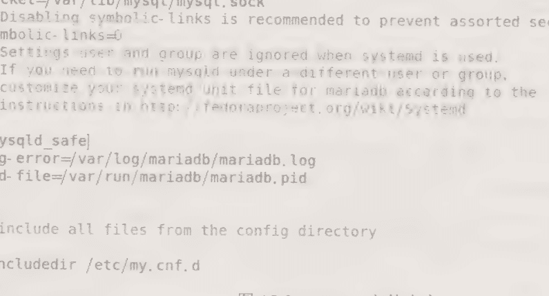

图 15-3 `my.cnf` 文件内容

### 15.2.4 MariaDB 的安全设置

已经在安装好 `MariaDB` 数据库的 `Linux` 系统，用户可以使用 `MariaDB` 二进制工具进入 `MariaDB` 命令提示符，连接 `MariaDB` 数据库。

1. `MariaDB` 数据库的初始登录

如果还没有安装 `MariaDB`，使用超级用户 `root` 登录时是没有密码的，所以直接回车即可。

进入 `MariaDB` 数据库。`MariaDB` 的提示符是 `MariaDB [(none)]`。

（注：后续原文内容存在大量重复和无意义字符，已根据前文逻辑进行核心语义翻译）

# 学习情境二 部署 Linux 网络服务

| Database |
| --- |
| `information_schema` |
| `student` |

(3) 添加远程登录数据库的用户 `user1`。

允许名为 `user1`，密码为“000000”的用户在任意机器上登录 `MariaDB` 数据库，则在 `MariaDB` 数据库中添加用户账号和密码。

```sql
MariaDB [(none)]: grant all privileges on * to user1@"%" by "000000";

MariaDB [(none)]: show grants for 'user1'@'%';
```

注意：不要单独创建用户，直接通过授权即可创建一个新用户的操作。

(4) 在远程客户登录 `MariaDB` 数据库。

首先在远程客户主机上安装 `MariaDB` 程序，假设 `MariaDB` 数据库服务器的 `IP` 地址为 `172.16.43.254`，通过远程登录数据库。登录命令如下：

```bash
[root@localhost]# mysql -h 172.16.43.254 -u user1 -p000000

MariaDB [(none)]: show databases;
```

| Database |
| --- |
| `information_schema` |
| `student` |

`2 rows in (0.01 sec)`

(5) 创建用户，授予部分权限。

增加一个用户 `test1`，密码为 `admin`，该用户可以在任何主机上登录数据库，并对所有数据库有查询、插入、修改、删除的权限。首先使用 `root` 登录 `MariaDB`，并对用户 `test1` 进行操作。

```bash
[root@localhost]# mysql -u root -p111111

MariaDB [(none)]: grant select, insert, update, delete on *.* to test1@"%" by "abc";
```

增加一个用户 `test2`，密码为 `admin`，该用户可以在 `localhost` 上登录，并对数据库进行查询、插入、修改及删除操作(`localhost` 指本地主机，即 `MariaDB` 数据库所在的联合主机)，命令如下：

```sql
MariaDB [(none)]: grant select, insert, update, delete on test.* to test2@localhost identified by "abc";
```

如果不想用 `test2` 有密码，可以再输入一个命令来修改密码，命令如下：

```sql
MariaDB [(none)]: grant select, insert, update, delete on student.* to test2@localhost identified by "";
```

# 4. 数据库表操作

用户可以在一个数据库中创建属于该用户的 `MariaDB` 表，格式为：

`create table 表名(字段名, 类型);`

例在 `student` 数据库中创建 `info`(学生信息)表，表结构如表15-1 所示。

## 表 15-1 Info 表结构

| 字段名 | 类型 | 长度 | 说明 |
|---|---|---|---|
| `xm` | `char` | 8 | 姓名 |
| `no` | `char` | 8 | 学号 |
| `cj` | `int` | 10 | 成绩 |
| `addr` | `text` | | 地址 |

具体操作为:

1. 切换当前数据库为 `student`。

   ```sql
   MariaDB[(none)]> student;
   Database changed
   ```

2. 创建表 `info`，并查看结果。

   ```sql
   MariaDB [student]> create table info(xm char(8),no char(8),cj int(10),addr text);
   ```

3. 显示 `student` 数据库中的表。

   ```sql
   MariaDB [student]> show tables;

   +-----------------+
   | Tables_in_student |
   +-----------------+
   | info |
   +-----------------+
   1 row in set (0.00 sec)
   ```

4. 显示表的字段设置，可以使用 `describe` 表示名，命令如下：

   ```sql
   MariaDB [student]> describe info;

   +-------+---------+------+-----+-------+
   | Field | Type    | Null | Default | Extra |
   +-------+---------+------+-----+-------+
   | xm    | char(8) | YES  | NULL    |       |
   | no    | char(8) | YES  | NULL    |       |
   | cj    | int(10) | YES  | NULL    |       |
   | addr  | text    | YES  | NULL    |       |
   +-------+---------+------+-----+-------+
   4 rows in set (0.00 sec)
   ```

5. 在表中插入记录，格式如下：

   `insert into 表名(字段1,字段2,字段......)values(值1,值2,值......);`

   如果数据是字符串型，必须使用英文状态下的单引号或双引号。

   向表中插入如下几条记录：

   ```sql
   MariaDB[student]> insert into info values("zhangsan","20171022",98,"hangzhou");

   MariaDB[student]> insert into info values("lisi","20171015",94,"hainan");
   ```

6. 查看表中的记录。

   `MariaDB` 数据库使用 `SQL` 查询数据，格式如下：

   ```
   select 字段名，字段名……字段名 从表，表名，……[where 条件]
   ```

   查询语句可以使用一个或多个字段，各字段之间使用引号“”、“”分隔，并使用 `where` 语句设置查询条件。查询命令可以读取一个或者多条记录，可以使用“*”代替其他字段，查询语句会返回回表中所有字段的数据。

   查询表中有哪些记录：

   ```sql
   MariaDB[student]> select * from info;

   +----------+----------+-----+-----------+
   | xm       | no       | cj  | addr      |
   +----------+----------+-----+-----------+
   | zhangsan | 20171022 | 98  | hangzhou  |
   | lisi     | 20171015 | 94  | haainan   |
   +----------+----------+-----+-----------+
   2 rows in set (0.00 sec)
   ```

7. 修改表记录。

   修改 `MariaDB` 中的数据，可以使用 `UPDATE` 命令来操作。以下是修改 `MariaDB` 数据的通用语法：


`update 表名 字段名=值, 字段名……[where 条件]`

```
用户可以同时更新一个字段或多个字段，可以在其中指定一个条件。修改 `xm` 为 `lisi` 的 `no` 为 `2018005`，并查看结果：
```

`MariaDB[student]> update info set no=2018005 where xm="lisi";`

```
MariaDB[student]> select * from info;
```
+----+----+----+----+
| xm | no | cj | addr |
+----+----+----+----+
| zhangsan | 20171022 | 98 | hangzhou |
| lisi | 2018005 | 94 | hainan |
+----+----+----+----+
2 rows in set (0 sec)

- ⑧ 删除表记录。
删除 `MariaDB` 中的记录，可以使用 `DELETE` 命令来操作。以下是删除 `MariaDB` 数据的通用语法：
```
delete from 表名[where 条件]
```
如果没有指定子句，`MariaDB` 表中的所有记录将被删除。删除 `xm` 为 `lisi` 的记录并查看结果：

```
MariaDB[student]> delete from info where xm="lisi";
```

`MariaDB [student]> select * from info;`

```
+----+----+----+----+
| xm | no | cj | addr |
+----+----+----+----+
| zhangsan | 20171022 | 98 | hangzhou |
| lisi | 20171015 | 94 | haainan |
+----+----+----+----+
1 row in set (0 sec)
```

- ⑨ 删除数据库和表。
删除 `MariaDB` 数据库或表，可以使用 `DROP` 命令来操作，以下是 `DROP` 数据库、表的通用语言：

- `drop database库名`
- `drop table 表名`

删除 `student` 数据库及其表，并查看结果：

```
MariaDB [student]> drop table info;
MariaDB [student]> drop database student;
MariaDB [(none)> show databases;
```

⑤ 备份
使用 `mysqldump` 将数据库备份到 `MariaDB` 服务器上，将数据库备份到 `home` 目录下，将数据库名为 `student_bak.sql`。备份命令如下：

```
[root@localhost ~] # mysqldump -u root -p111111 /home/student_bak.sql
```
打开备份的数据，如图15-8所示。(`img/ec0e037f26e4676b8ae4cc4a36e86_320.png`)

6. 恢复
备份是为了防止有的数据库文件损坏。当数据库损坏后可用备份恢复，其操作是建立一个空的数据库。

- (1) 删除数据库。删除 `student` 数据库要在 `MySQL` 环境使用的命令为 `drop`。

```
[root@localhost ~] mysql -u root -p

Enter password: 

MariaDB [(none)]> drop database student;
MariaDB [(none)]> show databases;
```
| Database |
|----------|
| information_schema |
| mysql |
| performance_schema |
| xueyuan |

4 rows in set (0 sec)

- (2) 先建立一个数据库，然后把备份 `student_bak.sql` 恢复到数据库中，输入命令：

```
MariaDB [(none)]> create database student;
MariaDB [(none)]> exit
```

- (3) 恢复数据库，命令如下：

```
[root@localhost ~] mysql -u root -p < /home/student_bak.sql
```

- (4) 进数据库查看结果，命令如下：

```
[root@localhost ~] mysql -u root -p11111

MariaDB [(none)]> show databases;
```
| Database |
|----------|
| information_schema |
| mysql |
| performance_schema |
| student |
| xueyuan |

5 rows in set (0 sec)

```
MariaDB [(none)]> use student;
MariaDB [student]> select * from info;
```
| xm | no | cj | addr |
|---|---|---|---|
| lisi | 20171005 | 94 | haainan |
| zhangsan | 20171002 | 98 | hangzhou |

# 7. 其他操作

- (1) 显示最后一次执行的语句产生的错误、警告和通知。

```
MariaDB [student]> show warnings;
```

- (2) 只显示最后一次执行的语句产生的错误。

```
MariaDB [student]> show errors;
```

- (3) 查看当前服务的日志。

```
MariaDB [student]> show master logs;
```

- (4) 查看数据库中所有用户。

```
MariaDB [student]> select user.host from mysql.user;
```
其中，`mysql.user` 是`MySQL`数据库表中的查询数据。

## 15.2 部署 `WordPress`

`WordPress`是一个免费的开源项目，在`GNU`通用许可下发布，是使用`PHP`语言开发的博客平台，用户可以使用`PHP`和`MySQL`数据库服务器上挂载自己的网站。由于安装方便、易于扩展以及拥有丰富的插件和模板等优势，`WordPress`成为世界上最流行的博客之一，不仅是一个博客程序，也是一个内容管理系统（`CMS`），许多非博客网站也是用`WordPress`搭建的。同时，因为`WordPress`具有强大的扩展性，许多网站开始使用`WordPress`作为管理系统来实现商业运营。

用虚拟主机部署 `WordPress`，具体如下：

- (1) 查看是否安装 `Apache` 软件。

```
[root@localhost ~]# php -v

httpd-2.4.6-88.el7
```

- (2) 查看是否安装 `MariaDB`。

```
[root@localhost ~]# rpm -q mariadb
```
(`img/ec0e037f26e4676b8ae4cc4a36e86_322.png`)

- (3) 安装 `PHP`软件包。默认系统是没有`PHP`软件包，通过 `YUM`安装`PHP`。`PHP`软件包如图15-9所示。

```
[root@localhost ~] # yum install -y php*
[root@localhost ~] # rpm -q php
```
(`img/ec0e037f26e4676b8ae4cc4a36e86_323.png`)

其中，`php-mysql`用于`PHP`连接`MariaDB`。安装完成后`/etc/httpconf.d/`目录下创建一个`php.conf`，此文件为`httpd`服务`PHP`模块的配置文件。

```
[root@localhost ~] # cd /etc/httpconf.d
[root@localhost conf] # ls
autoindex.conf php.conf README userdir.conf welcome.conf
```

- (4) 创建 `PHP` 测试页面。

```
[root@localhost ~] # cd /var/www/html/
[root@localhost html] # vim index.php
```
```
<?php

phpinfo();

?>
```

- (5) 启动 `httpd`，访问`PHP` 测试页面，如图15-10所示，表示`PHP`访问正常。如果在页面中找到 `mysqli.mysqli`的，说明`PHP`能正常访问`mysql`和 `mysqli`接口。

```
[root@localhost ~] # systemctl start httpd
```

- (6) 启动数据库服务。

```
[root@localhost ~] # systemctl start mariadb
```


## (7) 测试 `PHP` 与 `MariaDB` 的连接性

在 `/var/www/html` 目录创建 `mysql.php` 文件，然后访问相应的测试页面，如图 15-11 所示。

```
[root@localhost~]# vim /var/www/html/mysql.php

[root@localhost~]# cat /var/www/html/mysql.php
```

```php
<?php

$Sconn=mysql_connect('127.0.0.1','root','111111');

if ($Sconn)
echo "Connected to mariadb";

else
echo "Fail";

?>
```


图 15-11 测试 `PHP` 与 `MariaDB` 的连接

## (8) 在数据库中创建 `WordPress` 数据库，并为用户 `root` 赋予远程登录权限

```
[root@localhost]# mysql -uroot -p111111

MariaDB [(none)]> create database wordpress;

MariaDB [(none)]> grant all privileges on *,.* to root@localhost identified by '111111';

MariaDB [(none)]> grant all privileges on *,.* to root@"%" identified by '111111';

MariaDB [(none)]> show databases;
```

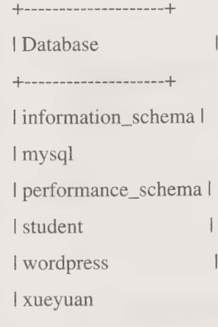

## (9) 解压 `WordPress` 安装包

```
[root@localhost]# cd /var/www/html/

[root@localhost html]# ls

index.php wordpress.zip

[root@localhost html]# unzip wordpress.zip

[root@localhost html]# ls

index.php wordpress.zip
```

## (10) 创建配置文件 `wp-config.php`，如图 15-12 所示

```
root@localhost:/var/www/html/ 

文件(F) 编辑(E) 查看(V) 搜索(S) 终端(T) 帮助(H)

// MySQL settings - You can get this info from your web host ///

/* The name of the database for wordpress */

define('DB_NAME', 'wordpress');

/* MySQL database username */

define('DB_USER', 'root');

/* MySQL database password */

define('DB_PASSWORD', '111111');

/* MySQL hostname */

define('DB_HOST', 'localhost');

/* Database charset to use in creating database tables. */

define('DB_CHARSET', 'utf8');

/* The Database collation type. Don't change this if you are in doubt. */

define('DB_COLLATE', 'utf8');
```

图 15-12 配置文件 `wp-config.php`

## 项目 15 部署 `MariaDB` 服务

```
[root@localhost html] # cd wordpress

[root@localhost wordpress]# ls

index.php wp-comments-post.php wp-login.php

license.txt wp-config-sample.php wp-mail.php

readme.txt wp-content wp-settings.php

wordpress-4.9.2 wp-cron.php wp-signup.php

wp-activate.php wp-includes wp-trackback.php

wp-admin wp-links-opml.php xmlrpc.php

wp-blog-header.php wp-load.php

[root@localhost wordpress] # cp wp-config-sample.php wp-config.php

[root@localhost wordpress]# vim wp-config.php
```

## (11) 进入 `WordPress` 安装界面

在浏览器中输入地址 `http://172.16.43.254/wordpress/` 进入 `WordPress` 界面，如图 15-13 所示。填写用户名、密码等信息，然后点击左下角“Install WordPress”按钮。跳转至安装完成界面，如图 15-14 所示。


图 15-13 `WordPress` 安装界面


图 15-14 安装完成界面

## 学习情境二 部署 `Linux` 网络服务

单击“Log In”，登录 `WordPress`，如图 15-15 所示。输入安装设置的用户名和密码，单击“Log In”。


图 15-15 登录 `WordPress`

登录后，进入 `WordPress` 的 `Dashboard` 界面，如图 15-16 所示，即 `WordPress` 仪表盘，它是控制和管理所有内容的引导页，`WordPress` 默认的仪表盘页面一般有概述、草稿、`WordPress` 活动和新闻等。


图 15-16 `WordPress` 仪表盘

单击左上角“testblog”图标，就会进入自己的博客首页，如图 15-17 所示，可以在这里发表文章、记录生活感悟等。


图 15-17 博客首页

## 项目 15 部署 `MariaDB` 服务

至此，`WordPress` 就全部安装完成，用户可以按照自己的喜好编辑创建自己的博客文章。

## 15.3 反思与进

### 1. 项目背景

对于很多人而言，通过数据库查看相关数据不方便，也不人性化，通过 `PHP` 技术将数据库中存储的信息显示出来，已成为一种趋势。IT 可能会希望通过 `PHP` 页面访问 `student` 数据库的数据显示出来，方便查看。

### 2. 实施目的

- (1) 熟悉 `MariaDB` 数据库。
- (2) 能够完成 `MariaDB` 数据库的常用操作。
- (3) 能够使用 `PHP` 访问 `MariaDB` 数据库。
- (4) 通过 `LAMP` 环境访问网站。

### 3. 实施步骤

- (1) 安装 `Apache` 软件包。
  ```
  [root@localhost]# yum install -y httpd
  ```
- (2) 安装 `MariaDB` 软件包。
  ```
  [root@localhost]# rpm -q mariadb*
  ```
- (3) 安装 `PHP` 软件包。
  ```
  [root@localhost]# rpm -q php*
  ```
- (4) 创建 `student` 数据库。
- (5) 创建 `PHP` 页面，代码如下：
  ```
  [root@localhost]# cd /var/www/html/
  [root@localhost]# vim test.php
  ```

```php
<?php

$con1=mysql_connect("localhost", "root", "111111");

mysql_select_db("student", $con1);

$sr1=mysql_query("select * from info");

echo "<table align=center width=600>";

while($a=mysql_fetch_array($sr1)) {

    echo "<tr>";

    echo "<td>".$a["id"]."</td>";

    echo "<td>".$a["no"]."</td>";

    echo "<td>".$a["cn"]."</td>";
```


```
echo "<td>".$a["addr"]."</td>";

echo "</tr>";

}

echo "</table>";
```


(6) 修改`httpd.conf`，默认首页为`test.php`。
```
[root@localhost]# vi /etc/httpd/httpd.conf
DirectoryIndex test.php
```

(7) 启动`httpd`和`mysql`，访问网站，如图 15-18 所示。
```
[root@localhost]# systemctl start httpd
[root@localhost]# systemctl start mariadb
```

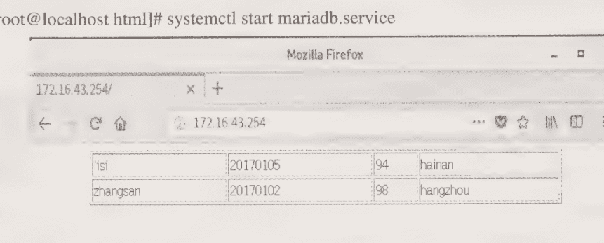

图 15-18 访问 MariaDB 数据库

## 4. 项目总结
MariaDB 不仅有文本管理，也有借助工具的图形管理。图形管理的工具是`phpMyAdmin`，通过图形界面可以直观地进行。

## 项目小
通过学习 MariaDB 数据库的部署方法，完成数据库安装后，能够根据实际情况创建数据库和表。为了防止数据丢失，养成良好的备份和恢复习惯。应用 Linux 组合部署 WordPress 系统，通过 PHP 技术在网络上显示信息。

## 练习题
1. 若 MariaDB 运行在 Linux 系统上，访问 MariaDB 服务器的客户端也必须在 Linux 系统运行吗？
   - A. 是
   - B. 否
2. 用以下的命令查找结构。
   - A. `FIND`
   - B. `SELECT`
   - C. `ALTER`
   - D. `DESC`
3. 查找名字不是 NULL 的记录（ ）
   - A. `WHERE IS IS !`
   - B. `WHERE NAME NOT NULL`
   - C. `WHERE NAME IS NULL`
   - D. `WHERE NAME!=NULL`
4. SQL语言的数据操作语句包括`SELECT`, `INSERT`, `DELETE`等，其中最重要的，也是最频繁的语句是（ ）
   - A. `UPDATE`
   - B. `SELECT`
   - C. `DELETE`
   - D. `INSERT`

二、操作题
1. 开启 MariaDB 服务。
2. 检测端口是否运行。
3. 为 MariaDB 设置密码或修改密码。
4. 登录 MariaDB 数据库。
5. 查看当前数据库的字符集。
6. 查看当前数据库版本。
7. 查看当前登录的用户。
8. 创建 GBK 字符集的数据库，并检查已创建数据库`oldboy`。
9. 创建用户`oldboy`，使可以管理数据库`oldboy`。
10. 查看创建的用户`oldboy`拥有哪些权限?
11. 查看当前数据库里有哪些用户?
12. 进入`oldboy`数据库。
13. 创建 InnoDB GBK 表，字段`id` `int(4)`和`varchar(16)`。
14. 查看建 SQL 语句。
15. 插入数据“老男孩”和“3,oldboy”。
16. 查询`id`等于 1 的记录。
17. 把`id`等于 1 的名字修改为`oldgirl`。
18. 在字段名前插入`age`字段，类型`tinyint(2)`。
19. 不退出数据库，完成备份`oldboy`数据库。
20. 删除`test`表中的所有数据，并查看。
21. 删除表和`oldboy`数据库，并查看。
22. 不退出数据库，恢复以上删除的数据。
23. 不退出数据库，授权`oldboy`权限。
24. 删除`oldboy`用户。
25. 删除数据库。
26. 使用`phpMyAdmin`。

三、面试题
1. 解释防火墙概念及主要特点。
2. 说出防火墙典型产品、特点及应用场景。
3. 详细描述防火墙分类及代表性。
4. 详细描述`char`和`varchar`的区别。
5. MariaDB root 密码忘记如何找回？
6. 错误执行了一个`drop`语句如何恢复？
7. 使用`mysqldump`备份如何实现？
8. 详述 MariaDB 主从复制原理及配置。

四、操作题
通过 LAMP 环境部署防火墙。

## 学习情境三 Linux 系统安全管理

## 项目 部署 Linux 防火墙

## 项目引入
随着计算机网络的快速发展和广泛应用，各行业对网络的依赖程度越来越高，但是网络攻击也变得容易。为了保护服务器，网络中必须做好措施。

## 需求分析
- 了解防火墙的工作原理。
- 掌握防火墙的使用。
- 能够在生产环境中部署防火墙。
- 了解防火墙的应用。

## 知识积累

### 16.1 防火墙简介
防火墙是内部网络和外部网络之间的屏障，按照定义的规则控制数据流。防火墙允许的数据通过，而拒绝未授权的数据并记录。

### 16.2 防火墙分类
#### 1. 按照专用设备
##### (1) 硬件防火墙
硬件防火墙通常连接两个多个网络区域，减少 CPU 的负担，执行路由、网络地址转换以及入侵防御。
##### (2) 软件防火墙
软件防火部署在主机上，安全性较硬件防火墙稍差，同时使用系统资源，一般用于单机或少数计算机。如`Windows Firewall`都是防火墙。

#### 2. 防火墙的工作原理
##### 1 过滤防火墙
过滤包 (Packet Filter) 是防火墙中最为核心的功能，用用户定义的内容（如 IP 地址）。原理是在网络层检查，这种系统具有很好的传输性和扩展性。但是，防火墙的安全性是有缺陷的，因为系统对应用层无感。也就是说，防火墙不检查传输通道的内容，所以可能被黑者攻破。通过过滤器对数据的 IP 头或 UDP 头部来实现。

## 4. 项目总结
防火墙不仅有文本管理，也有借助工具的图形管理。图形管理的工具是`phpMyAdmin`，通过图形界面可以直观地进行。

## 项目小
通过学习 MariaDB 数据库的部署方法，完成数据库安装后，能够根据实际情况创建数据库和表。为了防止数据丢失，养成良好的备份和恢复习惯。应用 Linux 组合部署 WordPress 系统，通过 PHP 技术在网络上显示信息。

# 项目 16 简易防火墙

检查使用过滤的规则如下：

- 首先将数据包与每一个规则进行匹配。如果两个规则匹配，则数据包含转发数据包；如果审核结果为转发数据包，则将数据交给传输层进行处理；如果审核结果为不允许转发数据包，则将数据丢弃。
- 如果数据包不能与之前的规则匹配，则查看是否有其他过滤规则；如果有链式规则，则过程与上一个步骤相同，直到所有规则都比较完毕。
- 如果所有的规则都不匹配，则丢弃数据。

通过过滤防火墙的优点是：防护不需要透明代理，处理速度快且易维护。防火墙的缺点是：非法访问一旦拦截防范，只能对内部的软件和配置漏洞进行改进；由数据防火墙头部的数据、地址和 IP 端口等信息极易伪装，导致数据绕过防火墙。

# 2. 代理服务器型防火墙

代理服务器防火墙是在应用层实现。代理服务器接收一个客户端的连接请求时，需要审核该连接，然后处理后的请求发送给真实服务器，接受真实服务器的回答并进一步处理，再返回给请求的客户端。代理服务器在外部网络和内部网络之间发挥了中转的作用，因此代理服务器也称为应用层防火墙。

代理服务器对网络上的每一层数据进行检查并进行认证，确保安全规则的通过，并允许某些数据通过复制进行传输，防止在服务器和客户端之间建立不受信任的直接连接。

代理服务器型防火墙利用代理服务器将外部网络和内部网络隔开。从内部的数据包经过这种处理后返回，就像是防火墙的数据包一样，可以直接到内部网络结构。内部的服务器不需要防火墙为网关，只需要将需要服务的 IP 地址指向代理服务器，就可以获取数据。

使用代理服务器型防火墙的好处是可以提供服务器的身份认证、日志记录和账号控制，彻底防止内部服务器的主机通过代理服务器主机才能获得 Internet 的资源。由于这会造成用户的不便，而代理服务器可能会为了系统的扩展，需要为许多配置不同的代理服务器。

# 3. 状态检测型防火墙

状态检测防火墙基础保持了简单防火墙的优点，性能较好，同时应用是透明的，在此基础上对于安全性有了提升。这种状态防火墙扩展了简单防火墙仅可以考察过滤的数据包，而不需要检测数据包的状态。在防火墙的核心部分建立了连接状态，保护了连接，使得连接的数据包成为某一个事件的发生。可以这样，状态检测防火墙通过网络层和传输层，而代理型防火墙规则则是特定的应用层的行为。

# 4. 复合型防火墙

复合型防火墙是整合了状态检测和透明代理的新一代防火墙，进一步基于 ASIC 架构，把病毒检测、内容过滤到防火墙内部，它还包括`VPN`、`IDS`功能，多功能一体。常规的防火墙不仅能防御在网络层上的攻击，在网络界面上对应用层数据进行过滤，把病毒检测、内容过滤与防火墙结合起来，实现了网络与信息的安全防护。

跨越领域 OSI 第七层的内容扫描，实现了实时在网络边缘边界隔离防护、内容过滤等层服务措施。

### 5) 四层防火墙的布局

(1) 过滤防火墙不能防止非法攻击，也无法判断 IP 地址是否可靠。对于黑客来说，需将源 IP 改为任意即可通过过滤防火墙进入内网。对于过滤防火墙不支持应用层隔离，只允许用户使用`HTTP`访问网页，但不允许`FTP`协议下载，此时过滤防火墙就无能为力，因为它识别数据包中的应用层协议。

(2) 应用层防火墙：检查`TCP`连接，不直接连接状态，网络隔离比较弱。

(3) 状态防火墙：不检查数据，建立连接状态，前后文相关，应用层控制很弱，可能会无法识别数据中的垃圾邮件、病毒和程序等。

(4) 复合型防火墙：可以检查整个数据包内容，根据需要建立连接状态，网络层隔离，应用层控制，会话层控制。

# 16.1.3 Linux 防火墙的组成

## 1. Linux 防火墙的发展进程

Linux 系统的防火墙功能是由内核实现的，其发展史就是从链到表，从简单到复杂的一个过程。

在 Linux 2.0 内核中过滤机制为`ipfw`，管理工具是`ipfwadm`。在 Linux 2.2 内核中过滤机制为`iptables`，管理工具是`iptchains`。在 Linux 2.6 和 3.0+ 版内核中包含过滤机制为`netfilter`，管理工具是`netfilter`。在 Linux 3.1(3.13+) 版内核中，包含过滤机制为`nft-daemon`动态防火墙，管理工具是`firewall`、`iptables`等多种工具。

## 2. Linux 防火墙的组成

### 1 netfilter 框架（内核态)

`netfilter`是内核空间中实现防火墙的内部架构，用户不能直接操作`netfilter`组件。`netfilter`在内核的内存中维护一系列的规则，内核模块通过查找方法决定数据包的处理方式。`netfilter`通过 链->规则的分层结构来组织规则，其内部结构如图 16-4 所示。

| raw | mangle | nat | filter |
| :--- | :--- | :--- | :--- |
| PREROUTING链 | PREROUTING链 | PREROUTING链 | 第1条规则 |
| | | | 第2条规则 |
| | | | 第3条规则 |
| OUTPUT链 | POSTROUTING链 | | |
| | | INPUT | INPUT |
| | OUTPUT链 | FORWARD | |
| | | FORWARD | | |

图 16-4 netfilter 框架

### 项目 16 部署内核
规则：存储在内核过滤器列表中，指定了源和目的 IP 地址、传输协议、服务类型等。数据包在规则触发时，根据规则定义的方法处理，如允许、丢弃等动作。

链：传递的路径，每一链就是规则中的一个。数据包到达一条链后从第一条规则开始，查看数据包是否满足规则。如果满足，就会根据规则定义的方法处理数据包；如果不符合链中任意规则。

表：`netfilter`中有 4 张表，`filter` table、`nat` table 和 `mangle` table，其中`filter`表用于数据包过滤，`nat`表用于地址转换，`mangle`表用于分组。各表的功能：

- `filter`用于数据包过滤。`filter`包含了`INPUT`（匹配本地的数据包）、`FORWARD`（负责转发的数据）和`OUTPUT`（匹配本地发送的数据）。
- `nat`用于地址转换。`nat`包含了`PREROUTING`（修改将来的数据包）、`OUTPUT`（修改在路由之前的数据包）和`POSTROUTING`（修改出去的数据包）。
- `mangle`用于特定的数据进行修改。在 Linux 2.4.18 之前包含`PREROUTING`和`OUTPUT`链；在 Linux 2.4.18 之后，包含了`PREROUTING`、`INPUT`和`POSTROUTING`链。
- `raw`用于数据跟踪，包含了`OUTPUT`和`POSTROUTING`两个链。查询顺序：`mangle`→`nat`→`filter`。如果`INPUT`链既有`mangle`表也有`filter`表，那么先处理`mangle`，然后再处理`filter`。
中间层：服务程序用于内核服务的防护，直接与`netfilter`交互，将用户配置传递给内核，从而调整防火墙规则。
用户层：Linux 系统为用户提供了定义和配置防火墙规则。

### 3. iptables

RHEL之后的 Linux 系统采用`iptables`作为防火墙，能够实现数据包过滤、地址转换数据包包功能，其工作是在 2、3、4 层，能够识别 MAC 地址、IP 地址和`TCP/UDP`端口以及状态检测。

### 4. firewalld 配置

RHEL7默认使用`firewalld`作为防火墙管理工具，拥有运行时配置（临时）与持久配置，支持动态更新和“zone”区域概念，可以使用图形化工具`firewall-config`和文本管理工具`firewall-cmd`。RHEL7 中`firewall`、`iptables`等多种防火墙存在，默认使用`firewalld`作为防火墙，底层调用的仍然是`iptables`，其结构如图16-5所示。

| system-config-firewall | firewall-config | firewall-cmd | 用户层 |
| :--- | :--- | :--- | :--- |
| iptables(service) | firewalld(daemon service) | 服务 | |
| iptables(command) | | | |
| Kernel(netfilter) | 内核 | | |

图 16-5 结构

### 5. nftables

`nftables`诞生于2008 年，2013 年合并到 Linux 内核作为`iptables`的替代品提供用户。它是新的框架，旨在替代现有的`ipv4`、`ipv6`、`ebtables`，由于`iptables`的缺陷，目前大量使用`nftables`，同时由于框架的兼容性，`iptables`支持在这个框架上运行。最新版本 0.8默认使用`nftables`。`firewalld`基于`nft`用户界面工具，而`iptables`和`nft`是命令工具，它们之间的关系如图16-6所示。

| iptables(service) | nft(service) | | |
| iptables(command) | nftables(command) | | |
| | netfilter(kernel) | | |

图16-6 iptables, firewalld之间的关系

# 16.2 项目实施

## 16.2.1 安装防火墙服务

Red Hat Linux 7.6 中默认安装了`firewalld`。如果系统没有安装，可以通过`RPM`和`YUM`安装。

(1) 检查是否安装防火墙软件包。在终端窗口输入：`rpm -qa`查看系统中已经安装了`firewalld`版本信息。

```bash
rpm -qa | grep firewalld
```


`[root@localhost ~]# rpm -qa firewall`

`firewall-0.5.3-5.noarch`

`firewall-libs-0.5.3-5.noarch`

(2) 安装 `firewalld` 服务。

```bash
[root@localhost ~]# yum install -y firewall*
```

## 16.2.2 `firewalld` 区域管理

为了简化防火墙管理，`firewall` 将网络划分为不同的区域，制定不同区域之间的访问策略来限制区域间传输。例如，互联网是不信区域，内部网络是信任区域。`firewalld` 提供了预定义的区域及其默认配置，如表16-1所示。

| 区域(`zone`) | 默认配置 |
| :--- | :--- |
| `block` | 任何来自的数据包将被阻止，只有已经建立的连接会被允许，允许 `ssh`。 |
| `work` | 允许内部网络，例如私有网络被允许，只允许 `ssh`。 |
| `home` | 允许流量，允许访问 `ssh`。 |
| `public` | 允许接收中的连接，只允许 `ssh`，允许网络出口。 |
| `DMZ` | 非军事区域，内外网络之间隔离，起到缓冲作用。对于 `DMZ` 区域，只允许连接。 |
| `trusted` | 允许所有数据包。 |
| `drop` | 任何来自的数据包将被丢弃且没有回复。 |
| `internal` | 允许拒绝，访问 `ssh`、`mdns`。 |
| `external` | 只允许特定的连接被接受，如 `ssh`，其他连接将被丢弃。 |

其中，`firewalld` 的默认区域是 `public`。配置分别为 `block.xml`, `external.xml`, `home.xml`, `internal.xml`, `public.xml`, `trusted.xml` 和 `work.xml`，存储在 `/usr/lib/firewalld/zones/` 目录下。

保存默认配置文件有两个目录，如 `/usr/lib/firewalld/` (规则配置) 和 `/etc/firewalld/` (用户配置)。数据进入内核时通过这些区域中定义的防火墙规则是不一样的，根据计算机请求以及请求到相应的区域，可以对该区域的规则进行修改，从而符合要求的防火墙规则。但是一个网络只能区域区域。 `firewall`包含的规则有3种：

- (1) 标准规则：利用基础语法制定或添加防火墙规则。
- (2) 直接规则： `firewall`提供了“direct interface”（直接接口），允许管理员手动编写 `iptables`、`nftables` 和 `ebtables` 规则插入区域而不使用。
- (3) 富规则： `firewall`提供了 rich language（富语言），不需要 `iptables` 语法，通过高级配置复杂的 `IPv4` 和 `IPv6` 防墙规则，为管理员提供了一种表达语言。通过这种语法可以表示基础语法无法涵盖的规则。富规则主要是为了解决基础语法无法满足的情况，比基本的防火能够能够拒绝，还可以实现日志和 `audit`，甚至可以端口转换、伪装和限制速率。

## 16.2.3 启动与停止 `firewall`

在 `Red Hat Enterprise Linux 7.6` 中，`firewall` 被安装为服务，遵循服务的启动与停止规则。

(1) 启动 `firewall` 服务。
(2) 重启 `firewall` 服务。
(3) 停止 `firewall` 服务。
(4) 查看 `firewall` 的状态。
(5) 将服务配置为开机自动运行。
(6) 禁止 `firewall` 启动。

```bash
[root@localhost ~]# systemctl start firewall
```

`firewall` 服务启动了才能使用相关配置项，即 `firewall-config`（图形界面）。

```bash
[root@localhost ~]# systemctl restart firewall

[root@localhost ~]# systemctl stop firewall

[root@localhost ~]# systemctl status firewall

[root@localhost ~]# systemctl enable firewall

[root@localhost ~]# systemctl disable firewall
```

## 16.2.4 `firewall` 图界面

在 `Linux` 中，通过这些区域中的定义的防火墙规则是不一样的，根据计算机请求以及请求到相应的区域，可以对该区域的规则进行修改，从而符合要求的防火墙规则。

```bash
[root@localhost ~]# firewall-config
```

图 16-4  `firewall-config`

## 项目 16 部署 `Linux` 防火墙

`0.5.3`

(2) 查看 `firewall` 服务运行状态。

```bash
[root@localhost ~]# firewall-cmd --state

running
```

这条命令等于 `systemctl status firewalld`。

(3) 查看 `firewall-cmd` 帮助。

```bash
[root@localhost ~]# firewall-cmd --help
```

(4) 查看预定义的 `zones`。

```bash
[root@localhost ~]# firewall-cmd --get-zones

block dmz drop external home internal public trusted work
```

(5) 查看默认的 `zone`。

```bash
[root@localhost ~]# firewall-cmd --get-default-zone

public
```

(6) 设置 `home` 的默认 `zone`。

```bash
[root@localhost ~]# firewall-cmd --set-default-zone home

success

[root@localhost ~]# firewall-cmd --get-default-zone home

public
```

(7) 查看当前活跃的区域信息。

```bash
[root@localhost ~]# firewall-cmd --get-active-zones public

interfaces: ens33
```

(8) 查看指定接口所属区域。

```bash
[root@localhost ~]# firewall-cmd --get-zone-of-interface=ens33
```

将接口添加到区域，默认接口都在 `public`。

```bash
[root@localhost ~]# firewall-cmd --zone=public --add-interface=ens33
```

(9) 查看区域所有允许的端口。

```bash
[root@localhost ~]# firewall-cmd --zone=public --list-ports
```

(10) 查看 `public` 区域允许的规则。

```bash
[root@localhost ~]# firewall-cmd --zone=public --list-all
```

(11) 查看区域所有规则。

```bash
[root@localhost ~]# firewall-cmd --list-all-zones
```

(12) 查看 `public` 区域所有允许的规则。

```bash
[root@localhost ~]# firewall-cmd --zone=public --list-all

public (active):
target: default
icmp-block-inversion: no
interfaces: ens33
sources:
services: ssh dhcpv6-client ports:
protocols:
masquerade: no
forward-ports:
source-blocks:
icmp:
rich rules:
```

(13) 更新防火墙规则。

```bash
[root@localhost ~]# firewall-cmd --reload

[root@localhost ~]# firewall-cmd --complete-reload
```

第一条命令是临时生效防火墙规则，第二条命令类似重启后生效防火墙规则。

(14) 拒绝所有包。

```bash
[root@localhost ~]# firewall-cmd --panic-on
```

(15) 取消拒绝状态。

```bash
[root@localhost ~]# firewall-cmd --panic-off
```

(16) 查看是否拒绝。

```bash
[root@localhost ~]# firewall-cmd --query-panic
```

(17) 查看预定义的服务。

```bash
[root@localhost ~]# firewall-cmd --get-services
```


### (18) 显示区域中开放永久的服务

```
[root@localhost ~]# firewall-cmd --zone=public --list-service
```

### (19) 在默认启动启用永久 ssh 服务

```
[root@localhost ~]# firewall-cmd --permanent --add-service=ssh --zone=public
```

### (20) 创建一个 kk 的服务

```
[root@localhost ~]# firewall-cmd --new-service=kk --permanent
```

### (21) 删除 ssh 服务

```
[root@localhost ~]# firewall-cmd --permanent --remove-service=ssh
[root@localhost ~]# firewall-cmd --reload
[root@localhost ~]# firewall-cmd --list-all
```

另一台主机测试。

```
[root@localhost ~]# ssh 172.16.43.254
ssh: connect to 172.16.43.254 port 22: No route to host
```

### (22) 添加 80 端口对所有用户访问，更新权限，并查看

```
[root@localhost ~]# firewall-cmd --zone=public --add-port=80/tcp --permanent
[root@localhost ~]# firewall-cmd --reload
[root@localhost ~]# firewall-cmd --zone=public --query-port=80/tcp
```

### (23) 永久删除 80 端口

```
[root@localhost ~]# firewall-cmd --zone=public --remove-port=80/tcp --permanent
```

### (24) 允许 172.16.43.252 通过 ssh 登录本机

```
[root@localhost ~]# firewall-cmd --direct --add-rule ipv4 filter INPUT 1 -p tcp --dport 22 -j 172.16.43.254 -j ACCEPT
[root@localhost ~]# firewall-cmd --reload
```
测试成功。

### (25) 查看设置的规则

```
[root@localhost ~]# firewall-cmd --direct --get-all-rules
```

### (26) 限制某个 IP 访问

```
[root@localhost ~]# firewall-cmd --permanent --add-rich-rule family="ipv4" source="10.6.1.2/32" reject
```

### (27) 拒绝来自公共区域 IP 192.168.0.11 的所有流量

```
[root@localhost ~]# firewall-cmd --zone=public --add-rich-rule family="ipv4" source="192.168.0.11/32" reject
```

## 16.2 防火墙

配置一台 Linux 服务器，其地址为 `172.16.43.254`，子网掩码为 `255.255.255.0`，默认网关为 `172.16.43.1`。使用 Windows 进行测试：

*   源地址是 `172.16.43.0/24` 的客户端可以访问该 Linux 服务器的 Web 服务。
*   修改 Web 服务端口为 `8888`，让用户可以使用服务。

### 具体操作

设置服务器的 IP 地址为 `172.16.43.254`，开启防火墙。

```
[root@localhost ~]# ifconfig ens3
ens3:<BROADCAST,RUNNING,MULTICAST> mtu:1500
inet 172.16.43.254 mask:255.255.255.0 prefix:24  ether 00:0c:29:87:a6:0
RX:9367 bytes:102270 errors:0 drop:0
TX:16973 bytes:60867 errors:0 drop:0

[root@localhost ~]# systemctl start firewalld
```

### (2) 编写页面，启动 Apache 服务

```
[root@localhost ~]# vim /var/www/html/index.html

[root@localhost ~]# cat /var/www/html/index.html
This test page.

[root@localhost ~]# service httpd
```

### (3) 测试

在主机 `172.16.43.254` 测试：

```
[root@localhost ~]# systemctl restart httpd
[root@localhost ~]# curl 172.16.43.254
This is test page...
```

### (4) 查看 public 区域所有允许的规则

```
[root@localhost ~]# firewall-cmd --zone=public --list-all
public (active):
target: default
icmp-block-inversion: no
interfaces: ens33
sources:
services: ssh dhcpv6-client ports:
protocols:
masquerade: no
forward-ports:
source-blocks:
icmp:
rich rules:
```

### (5) 在 public 区域允许 Web 服务，永久生效

```
[root@localhost ~]# firewall-cmd --permanent --zone=public --add-service=http
success

[root@localhost ~]# firewall-cmd --reload
```

### (6) 测试

在主机 `172.16.43.252` 测试，结果：
无法访问 `172.16.43.252`。

### (7) 在 Web 服务器配置文件中开启 8888 端口，并在主机上测试

```
[root@localhost ~]# vim /etc/httpd/httpd.conf

[root@localhost ~]# systemctl restart httpd

curl 172.16.43.252:8888
This is test page...
```

### (8) 在主机 172.16.43.252 测试

```
[root@localhost ~]# curl 172.16.43.252
Failed to connect to 172.16.43.252
```

允许 `8888` 端口进入区域，永久并生效。

```
[root@localhost ~]# firewall-cmd --permanent --zone=public --add-port=8888/tcp
success

[root@localhost ~]# firewall-cmd --reload
success
```

### (10) 在主机 172.16.43.252 测试，不能访问

```
[root@localhost ~]# curl 172.16.43.252:8888
Failed to connect...This is test page...
```

### (11) 添加一条永久生效的规则，将 172.16.43.0/24 网段的数据转换为 8888 端口，立即生效并查看

```
[root@localhost ~]# firewall-cmd --permanent --zone=public --add-rich-rule family="ipv4" source="172.16.43.0/24" forward-port port="8888:tcp"

[root@localhost ~]# firewall-cmd --reload
```


success

- (12) 在主机 `172.16.43.252` 上测试，结果所示。
- (16-11) 添加源规则后可以访问 Web 服务

## 1.2 NAT 技术

NAT (Network Address Translation, 网络地址转换) 是 1994 年提出的，根据 `RFC 1631` 标准，是将地址映射到另一个地址（如 Internet）的标准方法。就是说，NAT 可以将内部网络中的节点的私有 IP 地址转换成一个公有 IP 地址，亦反之。这种方法可以有效解决 IP 地址不足的问题。同时，也可以应用于防火墙，将每个 IP 地址隐藏起来不被外界发现，使外部无法直接访问内部设备。NAT 不仅能解决 IP 地址不足的问题，而且有效地规避来自外部攻击，隐藏并保护网络内部。

### 1. NAT 的工作原理

NAT 服务器通常有两个网卡，一个连接内网，另一个连接外网。只有在内网和外网之间传输数据时才进行地址转换。按照地址转换的方式，NAT 技术有三种：

1) 静态 NAT 依赖于手工配置的内部 IP 地址映射表来执行的地址转换，IP 地址是一对一的，也是不变的。某个私有 IP 地址通过转换为公共 IP 地址。借助静态转换，可以实现外部网络对内部网络某些设备（服务器）的访问。

2) 动态 NAT 是通过 NAT 服务器动态建立的地址转换方式，将内部网络私有 IP 地址转换为公共 IP 地址，IP 地址是不确定的、随机的，所有被授权访问 Internet 的私有 IP 地址随机转换为任意指定的合法 IP 地址。也就是说，只要指定某些内部地址可以进行转换并使用某些方法作为地址转换，就可以进行动态转换。动态转换可以使用多个合法地址集。当 ISP 提供的合法 IP 地址少于网络内的计算机数量时，可以采用动态转换的方式。

3) 端口多路复用 Overload

端口多路出口（Address Translation, NAT）是指改变输出数据的端口并进行端口转换，将内部的多个私有 IP 地址映射到一个公共 IP 地址的情况下，从而可以以最大程度节省 IP 资源。

# 学习情境三 Linux 系统安全

在此，`firewall` 服务器需要实现 NAT 转换，即将私有的 IP 与学院申请的公有 IP 进行相互转换。学院网络拓扑图如图 16-12 所示。

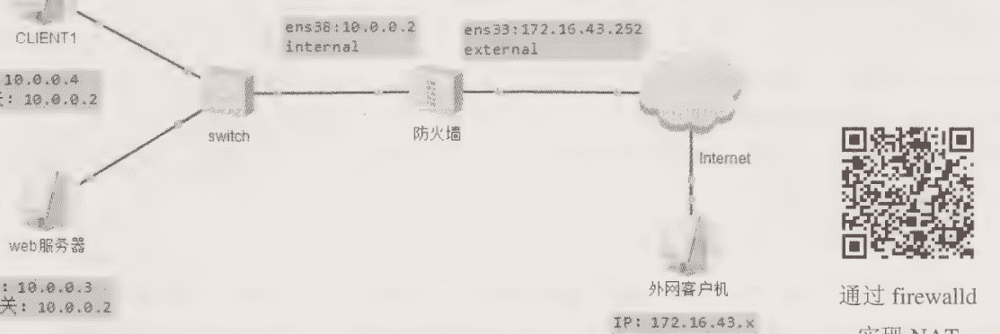

图 16-12 网络拓扑图

在 `firewall` 服务器上：位于外部区域的网卡 `ens33` 的 IP 地址为 `172.16.43.252`，用于共享上网；位于内部区域的网卡 `ens38` 的 IP 地址为 `10.0.0.2`，用于和内网的连接。

学院内部有一台 Web 服务、Mail 服务和 FTP 服务为一体的服务器，其 IP 地址为 `10.0.0.3`，需要外部客户通过 `10.0.0.3` 来访问。以上的计算机和服务器都需要架设在防火墙内。

### 2. 实施目的

- (1) 能够根据实际需要部署防火墙。
- (2) 实施 NAT。
- (3) 实施 DNAT。

### 3. 实施步骤

- (1) NAT 共享上网。

① 在 `firewall` 服务器上配置相应的网卡的 IP 地址。

```
[root@firewall network-scripts]## ifconfig

s33: flags=163<UP,BROADCAST,RUNNING,MULTICAST> mtu 1500\inet 172.16.43.252 netmask 255.255.255.0 broadcast 172.16.43.252

s38: flags=163<UP,BROADCAST,RUNNING,MULTICAST> mtu 1500

inet 10.0.0.2 netmask 255.255.255.0 broadcast 10.0.0.0
```

- (略)

② 启动防火墙，并设置开机启动。

```
[root@firewall ~]# systemctl start firewall

[root@firewall ~]# systemctl enable firewall
```

- ③ 网卡 `ens33` 永久移动到外部区域 (external)，将 `ens38` 永久移动到内部区域 (internal)，并查看各网卡所在区域。

## 项目 16 部署 Linux 防火墙

```
[root@firewalld ~]# firewall-cmd --change-interface=ens33 --external --permanent

[root@firewalld ~]# firewall-cmd --change-interface=ens38 --internal --permanent

[root@firewalld ~]# firewall-cmd --get-zone-of-interface=ens33

external

[root@firewalld ~]# firewall-cmd --get-zone-of-interface=ens38
```

④ 查看外部区域是否已开启防火墙伪装 (masquerade)，默认已经开启：

```
[root@firewalld ~]# firewall-cmd --list-zone=external

external (active)

target: default

icmp-block-inversion: no

interfaces: ens33

sources:

services: ssh

ports:

protocols:

masquerade: yes

forward-ports:

source-ports:

icmp-blocks:

rich rules:
```

如果没有开启，可以使用下列命令开启。

```
[root@firewalld ~]# firewall-cmd --zone=external --add-masquerade --permanent
```

⑤ 开启内核转发功能，并生效：

```
[root@firewalld ~]# vim /usr/lib/sysctl.d/00-system.conf
```

添加如下命令：

```
net.ipv4.ip_forward=1

[root@firewalld ~]# sysctl -p /usr/lib/sysctl.d/00-system.conf
```

`net.ipv4.ip_forward = 1`

⑥ 将区域设置为默认区域，并查看：

```
[root@firewalld ~]# firewall-cmd --set-default-zone=internal

[root@firewalld ~]# firewall-cmd --get-default-zone

internal
```

⑦ 加载防火墙规则，使其在当前运行生效：

```
[root@firewalld ~]# firewall-cmd --reload
```

⑧ 在内网中的客户端 `10.0.0.4`，网关为 `10.0.0.2` 测试访问 `www.baidu.com`

```
[root@localhost ~]# ping -c 2 www.baidu.com

PING www.ashifen.com (14.215.177.39) 56(84) bytes of data.

64 bytes from 14.215.177.39: icmp_seq=1 ttl=54 time=44.9 ms
```

`64 bytes from 14.215.177.39: icmp_seq=2 ttl=54 time=41.5 ms`

`--- www.ashaven.com ping statistics ---`
`2 packets transmitted, 2 received, 0% packet loss, time 1001ms`
`rtt min/avg/max/dev = 41.535/43.265/44.996/1.742 ms`

## 学习环境 Linux 系统安全管理

- (2) 发布 Web 服务。

① 在 Web 主机中创建网页。

```
[root@localhost ~]# vim /var/www/html/index.html

[root@localhost ~]# cat /var/www/html/index.html

Welcome to NAT testing...

[root@localhost ~]# systemctl start httpd

[root@localhost ~]# curl 10.0.0.3

Welcome to NAT testing...
```

② 在 `firewall` 服务器上 `http` 服务，允许外部访问 Web 服务。

```
[root@firewall ~]# firewall-cmd --permanent --zone=external --add-service=http
```


`[root@firewall ~]# firewall-cmd --permanent --zone=external --add-port=80:proto=tcp;toaddr=10.0.0.3`

`[root@firewall ~]# firewall-cmd --zone=external --list-all`

```
external (active)

target: default

icmp-block-inversion: no

interfaces: ens33

sources:

services: ssh http

ports:

masquerade: yes

forward-ports: port=80;proto=tcp;toaddr=10.0.0.3

source-ports:

icmp-blocks:

rich rules:
```

③ 在防火墙主机中测试。

```
[root@firewall ~]# curl 10.0.0.3

Welcome to NAT testing...
```

④ 在 `Linux` 主机中添加 `10.0.0/24` 的路由。

`[root@localhost ~]# ip route add 10.0.0/24 via 172.16.43.252`

测试访问内网中的 Web 服务，并跟踪路由。

```
[root@localhost ~]# curl 10.0.0.3

Welcome to NAT testing...

[root@localhost ~]# traceroute 10.0.0.3

traceroute to 10.0.0.3 (10.0.0.3), 30 hops max, 60 byte
| 1  172.16.43.252 (172.16.43.252)  293 ms  287 ms  230 ms |
| 2  10.0.0.3 (10.0.0.3)  445 ms  444 ms |
```

⑤ 在外网主机进行测试。在 `Windows` 主机添加永久路由，命令如下：

```
C:\Users\Administrator> route add -p 10.0.0.0 mask 255.255.255.0 172.16.43.252

C:\Users\Administrator> ping 10.0.0.0
```

在 `Windows` 主机的浏览器访问 Web 服务，如图 16-13 所示。


图 16-13 在 `Windows` 主机中访问 Web 服务

## 4. 项目总结

- (1) 通过伪装和端口转换实现 `SNAT` 和 `DNAT` 的功能。
- (2) 应用 `SNAT` 客户端的网关一定要设置为防火墙服务器地址才能访问外网。

## 项目总结

为了确保服务器的安全，需要为服务器配置防火墙。了解防火墙的工作原理，掌握 `Linux` 防火墙的组成和配置方法。

`firewall` 能够保护主机的网络服务，增强 `Linux` 操作安全性，配合路由功能，还能让 `Linux` 主机作为一台防火墙保护内网、外部网络之间的数据通信。为了解决 `IP` 不足，防火通过伪装和端口映射实现 `NAT` 转换。

## 练习习题

### 一、填空题

1. 防火大致可以分为3类，分别是____和____。
2. `Netfilter` 设计了3个表(table)，即____和____。
3. 表仅用于网络地址转换。
4. `firewall` 进入图形界面配置的命令______。
5. `NAT` 在 `firewall` 中的应用是____和____。

### 二、面试题

1. `firewall` 有哪种配置方式？
2. `firewall` 有哪种规则？

## 项目 17 部署代理服务

## 项目引入

随着学院网络服务的丰富，客户端数量之增，学院内网的访问速度越来越慢，而且自私网的攻击也越来越多。经过协商，IT 协会决定使用学院部署服务器，一方面提高网络访问速度，一方面隐藏自己的真实地址，确保内网的安全性。

## 需求分析

在网络部署代理服务器的优点非常多，`Linux` 系统中一般采用 `squid` 软件部署代理服务器。IT 协会决定使用 `squid` 来学院网络部署代理服务。

- 了解代理服务器的工作。
- 掌握代理服务器的类型以及区别。
- 熟练运用 `squid` 部署各类代理服务器。
- 根据实际情况，部署符合学院需求的代理服务器。

## 17.1 知识准备

### 17.1.1 代理服务器简介

代理服务器是（`Proxy Server`），其功能就是代理用户获取网络信息，许多没有 `IP` 的客户端高速、安全地访问互联网具有以下方面：

- (1) 突破自身限制，访问国外站：如使用内网地址免费代理服务器，就可以访问各类资料及查询。
- (2) 提高速度。通常代理服务器设置一个较大的硬盘缓冲。对于外界访问时也将将其存在缓存中；当其他用户再次访问相同的信息时，直接由缓存取出，传给用户以提高速度。
- (3) 防止攻击。网络用户可以通过方法隐藏自己的 `IP`，保护主机的。
- (4) 当防火墙在代理服务器上限制，可以过滤或屏蔽某些操作，起到防火墙的作用。

## 17.2 工作原理

代理服务器基于 `HTTP` 协议。在浏览器中设置代理时，代理服务器监听特定的端口，客户端通过代理服务器发送请求。代理服务器接收到请求后首先查找缓存是否有相关地址。如果有，代理服务器直接将响应给用户；如果没有，代理服务器根据客户端请求访问目标服务器，数据缓存存储下以便下次读取。进程处理完请求会自动释放所有资源。对于用户来说，感觉不到代理的存在，网络中都是从代理服务器缓存中获取。

## 17.2 实施实例

### 17.2.1 简单代理

`squid` 是一个高性能代理缓存服务器。目前支持 `FTP`、`gopher`、`HTTPS`、`SSL` 等协议，不能处理 `POP3`、`NNTP` 以及其他类型。通用的代理软件，`squid` 用一个单独的、模块化的、I/O驱动的进程处理所有的客户端请求，它可以工作在很多操作系统，如 `AIX`、`Digital`、`FreeBSD`、`HP-UX`、`Linux`、`BSD`、`Nextstep`、`Solaris` 等。

部署代理服务器

`squid` 的优势是使用访问控制列表（`ACL`）和访问限制。`squid` 通过访问控制清单和访问限制来阻止特定的网络连接，确保内部主机无法访问威胁或站点。

### 代理类型

按照代理类型的不同，可以将 `squid` 分为正向代理和反向代理。

#### 1) 正向代理

根据实现方式的不同，正向代理也可以分为普通代理和透明代理。

- 普通代理：客户端在浏览器中指定代理服务器的地址、端口。普通代理对于访问的网页重定向到代理服务器，浏览器从代理服务器那里获取数据而不向目标服务器发送请求，这样节省了网络带宽，而且提高了访问速度。实现这种代理，必须在每一个内部机的浏览器中。
- 透明代理：与普通代理相同，但不需要指定代理服务器。适用于网关模式（共享接入），防火墙将客户的数据交给服务器，并将服务器的结果返回给客户端。

#### 2) 反向代理

反向代理通常的 Web 服务器加速，代理服务器接受 `Internet` 上的请求，将请求转向内部网络，将结果返回 `Internet`。作为服务器，对于局域内的多台服务器提供负载均衡和缓冲。它是透明的，访问者不知道自己是一个代理。

### squid 主要组成部分

`squid` 的默认配置几项：

- 主程序: `/usr/sbin/squid`
- 配置目录：`/etc/squid/`
- 配置文件：`/etc/squid/squid.conf`
- 监听 `TCP` 端口：`3128`。
- 默认日志文件：`/var/log/squid/access.log`。

## 17.2 安装 squid 服务

- (1) 检查并安装 `squid` 软件包

在终端窗口 `rpm -q squid`，检查系统是否安装了 `squid` 软件包。

```
[root@localhost ~]# rpm -q squid

未安装软件包
```

使用 `yum` 安装 `squid`。

```
[root@localhost ~]# yum install -y squid
```

- (2) 安装完成后再次查询。

```
[root@localhost ~]# rpm -qa grep squid

squid-migration-script-3.5.20-12.el7.x86_64

# 软件包
```


# 项目 17 部署代理服务

## 1. Linux 客户端配置

- (3) 进行其他工作。

打开 `Firefox` 浏览器，选择“编辑”→“参数”→“常规”→“网络代理”，点击“设置”。在“连接”对话框中选择“手动代理”，然后在“HTTP 代理”文本框输入正确的代理服务器 IP 地址为 `172.16.43.254` 和端口 `3128`。如果还想通过代理服务器使用 `SSL`、`FTP` 和 `SOCKS` 协议，可以选择“为所有协议使用相同代理”复选框，最后点击“确定”按钮完成代理客户端的配置，如图 17-1 所示。

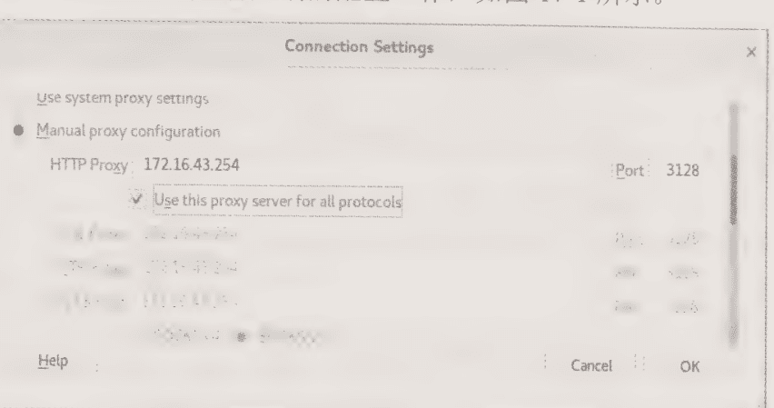

图 17-1 Linux 客户端配置

## 2. Windows 客户端配置

在 Windows 环境下使用 `IE` 作为默认的 Web 浏览器，通过 `IE` 浏览器配置使用代理服务的客户端。

打开 `IE` 浏览器，选择“工具”→“Internet 选项”→“连接”，点击“局域网设置”，选择“LAN 使用代理服务器”复选框，然后输入服务器的 IP 地址 `172.16.43.254` 和端口 `3128`，如图 17-2 所示。如果还想通过代理服务器使用 `SSL`、`FTP` 和 `SOCKS` 等协议，则可以点击“高级”进行配置，最后点击“确定”按钮完成代理客户端的配置，如图 17-3 所示。

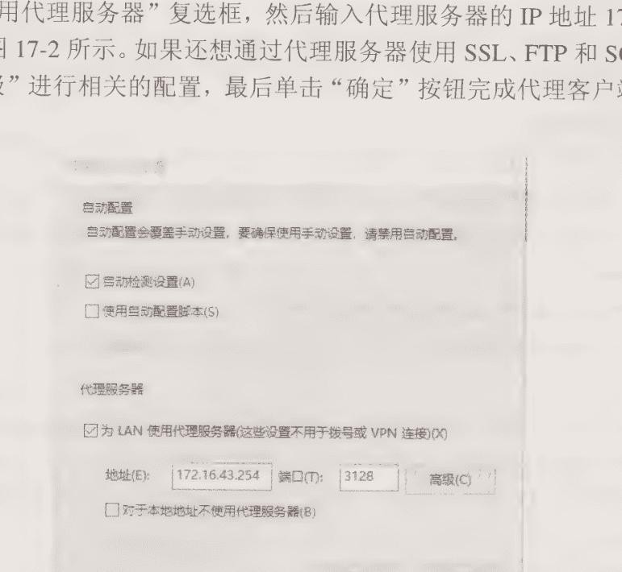

图 17-2 Windows 客户端配置

### 学习情境 Linux 系统安全管理

| 服务类型 | 类型 | 使用的代理服务器地址 | 端口 |
| --- | --- | --- | --- |
| HTTP(S) | | 172.16.43.254 | 3128 |
| 安全(S) | | | |
| FTP(F) | | | |
| 缓存(C) | 所有协议使用相同代理服务器连接(U) | | |
| 其他 | 宁下停止开启的地址不使用代理服务器连接(N) | | |
| 使用分组(S) | 配置参数 | | |


## 17.2.5 配置 `squid` 服务

### 1. 初始化 `squid`

在第一次启动 `squid` 服务之前，需要使用 `squid -z` 命令帮助 `squid` 在硬盘中建立缓存目录；在重新配置 `cache_dir` 后，就需要使用该命令重新建立硬盘缓存目录。

### 2. 常见的配置选项

在 `Red Hat` 环境下，所有 `squid` 的配置文件位于 `/etc/squid` 目录下。在该目录下，系统同时提供了一个默认的配置文件，名称为 `squid.conf.default`。`squid` 的主配置文件是 `/etc/squid/squid.conf`。所有 `squid` 的设定都在这个配置文件里。通过以下命令编辑主配置文件 `squid.conf`:

```bash
[root@localhost ~#] vim /etc/squid/squid.conf
```

该文件包含的配置如下：

```text
http_port 3128

http_port 8080
```

设置 `squid` 服务器的默认监听端口。如果使用 HTTP 加速模式为 `80`，可以指定多个端口，但是所有端口都必须在一条命令中，每个端口之间用空格分隔。若某个部门的浏览器发现请求到 `3128` 端口，而另一个部门使用 `8080` 端口。此时该部门的定义为：

当 `squid` 作为防火墙运行时会有两个端口，即一个内部端口和一个外部端口。若不接受来自外部的 HTTP 请求，而只需要接收内部的 HTTP 请求时，`squid` 只需要内部接口。此时参数定义为：

```text
http_port 3128
```

2) `cache_mem 64 MB`：设置 `squid` 的额外内存，根据内核内存进行设置，一般为 `64 MB`。

3) `cache_dir ufs /var/spool/squid 4096 16 25`：定义缓存路径、内存容量（`MB`）。`4096` 是缓存的最大空间；`16` 代表硬盘目录下一级目录的数量；`25` 代表二级目录的数量。

4) `icp_port 3128`：设置 `squid` 服务器之间共享 `ICP` 的默认监听端口。

5) `cache_effective_user`：设置缓存的有效用户，安装 `squid` 时创建一个。

6) `cache_effective_group`：设置缓存的有效组。

7) `dns_cache_peer 172.16.2.10`：设置 `DNS` 服务器地址，一般不变。

8) `cache_access_log /var/log/squid/access.log`：设置访问日志。

9) `cache_log /var/log/squid`：设置缓存日志。

10) `cache_store_log /var/log/squid/store.log`：设置首页日志。

11) `visible_hostname 172.16.43.254`：定义 `squid` 主机的名称，当出错时建议出现在网页中。

12) `cache_mgr @test.com`

## 访问控制列表 `ACL`

为了让所有的客户端通过 `squid` 访问 `Internet` 资源，在使用代理以前，必须在 `squid.conf` 文件中添加相应的访问控制规则。`ACL` 格式如下表 17-1 所示：

| 列表类型 | 功能描述 |
| --- | --- |
| `src` | 通过 IP 地址允许或拒绝 |
| `dst` | 通过目的 IP 地址允许或拒绝 |
| `ddomain` | 通过目的域名允许或拒绝 |
| `srcdomain` | 通过域名限制 |
| `port` | 通过端口限制 |
| `url_regex` | 通过匹配 `URL` 规则 |
| `maxconn` | 限定客户 IP 地址的同时连接数 |
| `time` | 基于时间的访问 |

## 2. 访问控制规则的定义

访问控制列表 `ACL` 的目的是控制网络访问。根据访问控制规则，`squid` 先按照顺序对 `ACL` 进行匹配，找到第一条匹配的规则不再匹配后面的 `ACL`。如果某个客户端请求没有符合 `ACL` 列表，则应用规则的默认值（例如，最后一条规则允许，则默认禁止）。通常为了安全，应该把剩余的条目设置为 `deny all` 或 `allow all` 来匹配所有类型的网络请求。访问控制格式为：

```text
http_access [deny] 访问控制列表的名字
```

例 1：禁止 IP 地址为 `192.168.16.20` 的客户端。

```text
acl badclient1 src 192.168.16.20

http_access deny badclient1
```

例 2：禁止客户端访问域名 `202.114.144.2`。

```text
acl denyip dst 202.114.144.2

http_access deny denyip

acl bdomain1 dstdomain -i www.sohu.com

http_access deny bdomain1
```

例 3：禁止访问名为 `www.sohu.com` 的网站。

例 4：允许 IP 地址为 `192.168.10.250` 的客户端访问所有主机。

```text
acl client src 192.168.10.250
```

例 5：设置周一至周五的 9 点至 17 点为工作时间，然后定义访问规则；拒绝时间之外的所有访问。基于时间的访问使用下面的格式：

```text
time [name_abbrevs] [h1:m1-h2:m2][hh:mm-hh:mm]

time MTWHE 09:00-17:00

http_access allow worktime

http_access deny worktime
```

其中，
`S`: 代表 `Sunday`;
`M`: 代表 `Monday`;
`T`: 代表 `Tuesday`;
`W`: 代表 `Wednesday`;
`H`: 代表 `Thursday`;
`F`: 代表 `Friday`;
`A`: 代表 `Saturday`.
`h1:m1` 必须小于 `h2:m2`，格式为 `[hh:mm-hh:mm]`。

例 6：禁止所有客户端访问路径中包含 `Linux` 关键字的网站。

```text
acl deny_url_regex -i linux

http_access deny deny_keyword
```


# 学习环境 Linux 系统安全管理

```
traceroute to (14.215.177.39), 30 hops, 60 byte packets
1 gateway (10.0.0.2) 0.322 ms 0.198 ms
2 172.16.43.1 (172.16.43.1) 4.599 ms 5.477 ms 5.531 ms
```

## 4. 项目总结

- (1) 对 `squidconf` 排错，即可以验证 `squidconf` 的语法和配置，可以使用命令 `squid -k parse`。
如果在 `squidconf` 中有语法或配置错误，这里会返回提示；若无返回，则尝试启动 `squid`。
- (2) 查看 `squid` 服务器的日志，使用客户端访问的日志文件 `access.log`。

```
[root@localhost~# vim /var/log/squid/access.log]
```

## 项目小结

掌握代理服务器的概念、工作原理及应用场景。`squid` 软件可以为内部网提供代理功能，节约公 IP 资源的同时可以增大内网的访问速度，也可以作为大型网站的反向代理，以便在多台服务器上做负载均衡。根据实际情况，部署合适的代理服务器，能够分别设置 Linux 客户端和 Windows 客户端。

## 练习题

- 1. 在配置代理服务器时，若设置代理服务器的缓存为 64MB，配置行为为( )
  A. `cache 64MB` B. `cache_dirs /usr/local/squid/cache 10000 16 256`
  C. `cache_mgr 64MB` D. `cache_mem 64MB`
- 2. 关于代理服务器的论述，正确的是( )。
- 3. 使用 Internet 上已有的公共代理服务器，只需配置客户端。
- 4. 代理服务器只能代理客户端 `http` 的请求。
- 5. 设置好的代理服务器可以被网络上的任何主机使用。
- 6. 使用代理服务器的客户端没有自己的 IP 地址。

二、 填空题
1. 目前代理服务器使用的软件有很多，Linux 常见的是______。
2. `squid` 缓存类型的类型为______和______。
3. `squid` 的缓存位置为______。

三、 简答题
1. 什么是代理服务器？代理服务器在计算机网络中有什么用途？

# 习题参考答案

## 项目 1 部署 Linux 服务器

一、选择题
- 1. A 2. C 3. C 4. B

二、填空题
- 1. `root`
- 2. 本地光盘安装、本地硬盘安装、`NFS` 安装、`FTP` 安装、`HTTP` 安装。

## 项目 2 维护 Linux 系统

一、选择题
- 1. B 2. C 3. C 4. B 5. D

二、操作题

```
[root@localhost ~]# cd /home

[root@localhost home] # ll

[root@localhost home] # touch cjh.txt

[root@localhost home] # cp cjh.txt newdoc.txt

[root@localhost home] # mv cjh.txt wjz.txt

[root@localhost home] # ls

[root@localhost home] # rm wjz.txt

[root@localhost home] # mkdir aaa

[root@localhost home] # mkdir xiao

[root@localhost home] # ls

[root@localhost home] # rmdir xiao

[root@localhost home] # ls

[root@localhost home] #touch newdoc.txt

[root@localhost home] # tar -cvf new newdoc.txt

[root@localhost home] # ls

[root@localhost home] # tar -cvzf new.gz newdoc.txt

[root@localhost home] # ls

[root@localhost home] # tar -xvf new

[root@localhost home] # tar -xvf new.gz

[root@localhost home]# cd /

[root@localhost /]# mkdir test

[root@localhost /]# cd test
```

9.

10.

```
[root@localhost] # mkdir test1 test2

[root@localhost] # rmdir test1

[root@localhost] # history

[root@localhost] # cat>aaa

[root@localhost] # cat /etc/passwd>>aaa

[root@localhost] # more aaa

[root@localhost] # less aaa

[root@localhost] # cat /etc/passwdtail -n10head -n 5
```

### 三、面试题

运行结果: 4*6

## 项目 3 部署用户和组群

### 一、选择题
- 1. D 2. ACD 3. D 4. B 5. B 6. C

### 二、面试题

```
[root@localhost~]# vi user.txt

[root@localhost~]#cat user.txt

std01

std02

std03

std04

:

std30

[root@localhost~]#vim useradd.sh

!/bin/bash

chmod 700 useradd.sh

./useradd.sh

for user in 'cat /root/user.txt';

do

useradd $user

echo "123456" | password --stdin $user

echo "密码写入成功"

done

#以 root 的身份执行/usr/sbin/chpasswd,将密码写入/etc/passwd 的密码

chpasswd < /etc/passwd

#执行/usr/sbin/chpasswd 命令将密码写入etc/shadow并将结果

cat /etc/passwd
```

# Linux 操作系统


```
[root@localhost~]# bash useradd.sh
[root@localhost~]# groupadd class1
[root@localhost~]# tail /etc/group
class1:x:530:std01, std02, std03, std04, std05, std06, std07, std08, std09, std10, std11, std12, std13, std14, std15, std16, std17, std18, std19, std20, std21, std22, std23, std24, std25, std26, std27, std28, std29, std30
```

### 三、操作

1. `[root@localhost~]# useradd -d /home/user01 user01`
2. `[root@localhost~]# tail /etc/group`
   `user01:x:530:/home/user01:/bin/bash`
3. `[root@localhost~]# tail /etc/shadow`
   `user01::18158:0:99999:7::`
4. `[root@localhost~]# password user01`
   更改`user01`的密码。
   新的密码：无效的密码
   无效的密码重新输入密码
   `password`:身份验证更新。
5. `[root@localhost~]# tail /etc/shadow`
   `user01:$S6$OjhFe2zrH1kqBwqx9vbkInxdD1pq77::`
6. 正常登录
7. `[root@localhost~]# passwd -l user01`
   锁定`user01`的密码
   `password`: 操作成功
8. `[root@localhost~]# tail /etc/shadow`
   `user01:!!:$S6$OjhFe2zrH1kqBwqx9vbkInxdD1pq77::`
9. 无法登录
10. `[root@localhost~]# passwd -u user01`
    解锁`user01` 的密码
    `password`: 操作成功
11. `[root@localhost~]# usermod -l user02 user01`
    `[root@localhost~]# tail /etc/shadow`
    `user02:$S6$OjhFe2zrH1kqBwqx9vbkInxdD1pq77::`
12. `[root@localhost~]# userdel -r user02`
13. `[root@localhost~]# groupadd stuff`

# 习题答案

14. `[root@localhost~]# tail /etc/group`
    `stuff:x:532:`
15. `[root@localhost~]# useradd -g stuff user02`
16. `[root@localhost~]# gpasswd stuff`
    Changing the password for group `stuff`
    New Password:
    Re-enter new password:
17. `[root@localhost~]# gpasswd -d user02 stuff`
    Removing `user02` from group `stuff`
18. `[root@localhost~]# tail /etc/group`
    `user01:x:...`
    `stuff:x:532:`
19. `[root@localhost~]# groupdel stuff`

# 项目 5 维护系统的

一、选择题
- 1. C 2. D 3. A 4. A 5. A 7. B

二、填空题
1. `chmod 551 fido`
2. `551` 目录

三、面试
1. (1) 读、写（2）读（3）`chmod +x mydata`
2. `useradd -p zl1234 zhang`
   `groupadd hr`
   `gpasswd -a zhang hr`
   `usermod -s /bin/ksh zhang`
   `touch /home/zhang/zh1.sh`
   `chown zhang /home/zhang/zh1.sh`
   `chmod u+x,g+r,o+r /home/zhang/zh1.sh`

## 项目 6 磁盘管理

一、简答
1. (略)
2. 编辑 `/etc/fstab` 文件在最后一行写入 `/dev/sdb`

## 项目 7 网络通信

一、选择题
- 1. C 2. ACE 3. D

二、填空题
1. `defaults 0`
2. `/sysconfig/network`

# 项目 8 部署 DHCP

一、选择题
- 1. A 2. D 3. C 4. A 5. B 6. C

二、填空题
1. 动态主机配置
2. 探测阶段 请求阶段 确认阶段
3. `DHCP`

## 项目 9 部署 NFS 服务

一、选择题
- 1. C 2. A 3. C

二、填空题
1. Network File 系统
2. Remote Procedure Call
3. `DHCP`

## 项目 10 部署 Samba 服务

一、选择题
- 1. D 2. A 3. D 4. A

二、填空题
1. `rpm -q smb`
2. `smpasswd`
3. `/etc/rc.d/init.d/smb`
4. `test`

# 项目 11 部署 FTP 服务

一、选择题
- 1. B 2. C 3. C 4. B 5. D 6. C

二、填空题
1. 文件传输
2. 主动传输, 被动传输

# 项目 12 部署 DNS 服务

一、选择题
- 1. A 2. C 3. C 4. B 5. D 6. C 7. B

二、填空题
1. `dig`
2. `/etc/hosts`
3.

# 项目 13 部署 Web 服务

一、选择题
- 1. C 2. C 3. A 4. A

二、填空题
1. `httpd` 页面
2. `http`
3. `service http`

# 项目 14 部署电子邮件服务

三、选择题
- 1. E 2. AD 3. A 4. D

四、填空题
1. 用户名 邮箱地址
2. `POP3`
3. `25`

# 项目 15 部署 MariaDB 服务

五、选择题
- 1. B 2. D 3. C 4. B

# 项目 16 部署防火墙

六、填空题
1. 过滤防火墙 代理防火墙 状态防火墙
2. `filter` 表 `nat`
3. `nat`
4. `firewall-config`
5. 伪装 端口转发(映射)

# 项目 17 部署代理服务

七、选择题
- 1. D 2. C

八、填空题
1. `squid`
2. 正向代理 反向代理
3. `/var/sp/squid`

# 参考文献

- [1] 杨云.Linux操作系统与实训[M]. 北京: 中国铁路出版社, 2018.
- [2] 顾润龙, 刘智睿,侯玉香. Linux 操作系统及应用技术[M]. 北京: 航空工业出版社, 2016.
- [3] 曹江华, 杨骁勇. Red Hat Enterprise Linux 7.0 系统管理[M]. 北京: 电子工业出版社, 2015.
- [4] 潘奎, 雨峰. Red Hat Enterprise Linux 6 服务器与管理[M]. 大连: 东软电子出版社, 2015.
- [5] 张敬东. Linux 服务器配置与管理[M]. 北京: 清华大学出版社, 2014.
- [6] 张同光, 陈明, 李跃跃, 等. Linux 操作系统(RHEL/CentOS)[M]. 北京: 清华大学出版社, 2016.
