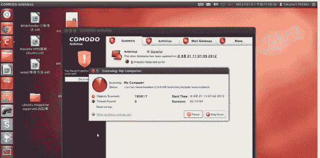
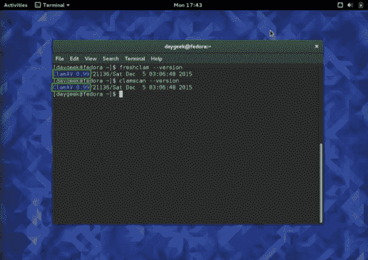
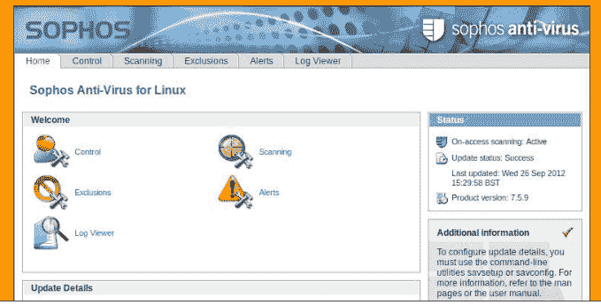
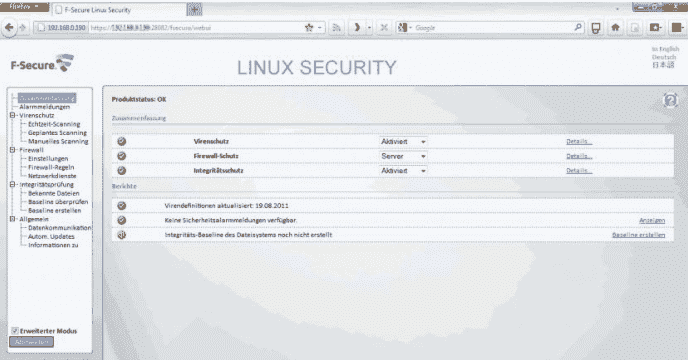
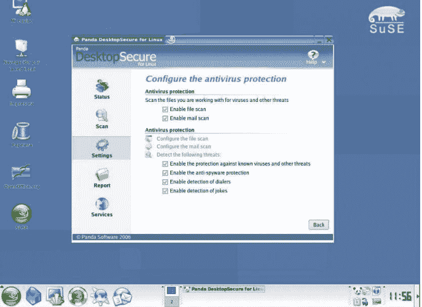
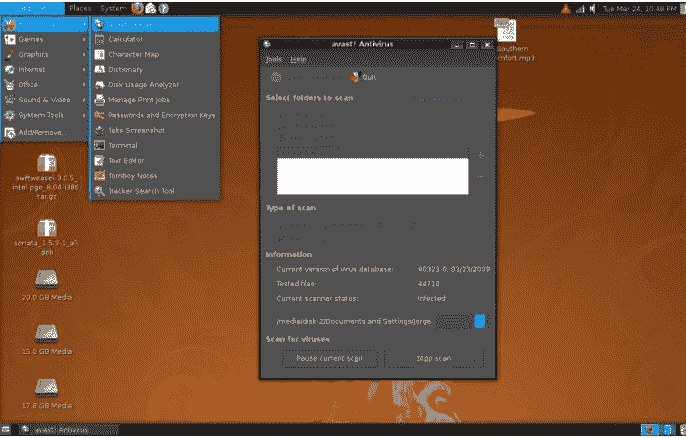
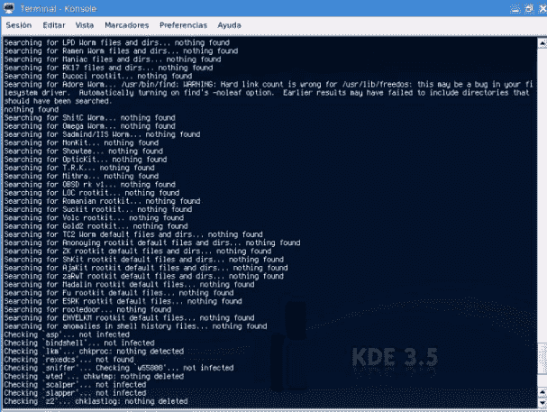
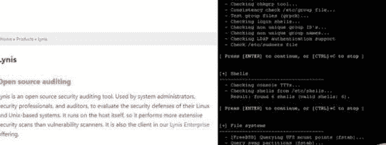
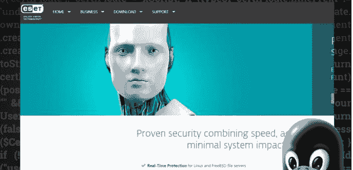

# Ubuntu, Linux & BSD 反根内核程序与反病毒软件列表 (2018版)


# 序言

所有的计算机系统都可能遭受恶意软件、勒索软件和病毒的影响，包括`BSD`和`Linux`。坦率地说，`Linux`病毒非常少，因此用户通常不会安装杀毒软件。但仍然建议`Linux`用户在连接网络或有文件传输的`Linux`系统上安装杀毒软件。某些用户可能认为杀毒软件占用了过多资源。坦率地说，存在低占用的`Linux`杀毒软件。为了更好地理解杀毒程序，如果你经营着拥有多台工作站的中小型企业，在中央计算机上安装杀毒软件可能是一个好主意，它可以管理公司所有的电子邮件、数据和流量。为了保护系统免受病毒攻击，最好的方法仅是从受信任的网站下载并安装软件。随着`Linux`版`AVG Antivirus`的停产以及`Symantec`、`Norton`或`McAfee`等大厂软件的缺失，`Linux`在操作系统安全方面只剩下少数选择。为了防止黑客接管你的`Linux`系统，`Ubuntu`、`Debian`、`Mint`、`Fedora`和`CentOS`等良好的杀毒软件是必须的。

## 1. Comodo 杀软件



`Linux`版`Comodo`杀毒软件(`CAVL`)提供与`Windows`版本相同的病毒保护，并带有完全配置的反垃圾邮件系统。`CAVL`具有访问时和按需病毒扫描器功能，还利用基于云的行为分析对未知文件提供无与伦比的保护。强大的`AV`引擎辅以高度可配置的邮件网关，过滤垃圾邮件并拦截电子邮件威胁。功能包括：

- 主动`AV`保护所有已知威胁
- 自动更新最新的病毒库
- 包含扫描调度程序、详细的事件查看器和扫描配置文件
- 邮件过滤器兼容`Postfix`、`Gmail`和`Exim MTA`
- 安装后即可使用：无烦人的误报，提供可靠的病毒保护。适用于`Linux`电脑的强大杀毒软件
- 检测并消除`Linux`笔记本电脑和台式电脑上的病毒
- 邮件网关拦截电子邮件和垃圾邮件
- 具有访问时、按需和基于云的扫描功能
- 病毒库每日更新多次

## 2. Linux 工作站 F-PROT


对于使用开源操作系统的家庭用户，我们提供了`Linux`工作站`F-Prot`杀毒软件。`Linux`工作站`F-PROT`杀毒软件利用著名的`F-PROT`杀毒引擎进行主要扫描，此外还有一套搜索未知病毒的内部启发式系统。`F-PROT`杀毒软件专门用于威胁`Linux`工作站的病毒，提供针对宏病毒和其他恶意软件（包括木马）的全面保护。`Linux`工作站`F-PROT`的功能包括：

- 扫描超过`219958`病毒及其变体
- 使用`cron`工具执行计划扫描
- 扫描硬盘、`CD-ROM`、软盘、网络驱动器、目录和特定文件
- 扫描引导扇病毒、宏病毒和木马

## 3. ClamAV 杀毒软件



`ClamAV`是一种开源(`GPL`)杀毒引擎，用于多种场景，包括电子邮件扫描、网络扫描和端点安全。它提供了多种工具，包括灵活可扩展的多线程守护进程、命令行扫描程序和高级数据库更新工具。功能包括：

- 命令行扫描
- 用于`sendmail`的`Milter`接口
- 用于脚本更新和数字签名的高级数据库更新器
- 病毒库每日更新多次
- 内置支持所有标准邮件格式
- 内置支持各种存档格式，包括`Zip`、`RAR`、`D`、`Tar`、`Gzip`、`Bzip2`、`OLE2`、`Cabinet`、`CHM`、`BinHex`、`SIS`等
- 内置支持`ELF`执行文件以及使用`UPX`、`FSG`、`Petite`、`NSPack`、`wwpack32`、`MEW`、`Upack`包以及由`SUE`、`Yuda Cryptor`等加密的可移动执行文件
- 内置支持流行文档格式，包括`MS Office`和`MacOffice`、`HTML`、`Flash`、`RTF`和`PDF`

## 4. Sophos Linux 恶意软件扫描



`Sophos`杀毒引擎可以有效检测并清理病毒、木马和其他恶意软件。除了基于高级启发式的复杂检测，`Linux`版`Sophos`还使用`Live Protection`通过`SophosLabs`实时查询疑文件。为了防止`Linux`机器成为分发点，`Linux`版`Sophos`还检测、阻止并移除`Windows`、`Mac`和`Android`恶意软件。功能：

- 通过访问时、按需或计划扫描检测并阻止恶意软件
- 性能卓越，影响低

## 5. F-Secure Linux 安全



`F-Secure`是`Linux`最完整的安全软件，它拥有从防火墙到云端杀毒再到网络保护的所有功能。`F-Secure Linux Security`为使用`Linux`环境的企业提供服务器和客户端保护。它支持多种平台。支持以下`32`位发行版：

- `CentOS 6.7`
- `Debian 7.9`
- `Oracle Linux 6.6, 6.7`
- `Red Hat Linux 6.7`
- `SUSE Linux Server 11 SP1, SP4`
- `Ubuntu 12.04, 14.04`
- `CentOS 6.7, 7.1`
- `Debian 7.9, 8.0, 8.1`
- `Oracle Linux 6.6, 7.1 UEK`
- `RHEL 7.1`
- `SUSE Linux Server 12`

## 6. Panda DesktopSecure Linux



`Panda DesktopSecure Linux`是运行`Linux`电脑的理想解决方案。它专为运行该操作系统的家庭电脑（包括笔记本和台式机）特定保护需求而设计。这种强大且易用的杀毒软件包含了多种技术和防火墙，以防止病毒、黑客和入侵者导致的数据丢失。

- 全面保护：`Panda DesktopSecure Linux`中和所有类型的病毒、蠕虫、木马、拨号器、间谍软件和垃圾邮件，无论威胁源自`Windows`还是`Linux`。
- 永久邮件保护：电子邮件是恶意软件传播的主要手段。确保监控发送到用户邮箱的电子邮件，以便在感染文件系统之前消除威胁。`PandaDesktop`扫描最常用的电子邮件客户端，如`Xian Evolution`、`Kmail`、`Mozilla Mail`和`Thunderbird`。

## 7. Avast 核心安全 (Avast Core Security)



`Avast Linux`安全软件提供三种不同的包，您可以选择保护您的`Linux`邮件服务器、文件服务器或整个网络。

- `Avast Core Security` – 基础防病毒软件，对抗最新的威胁和恶意软件感染您的`Linux`服务器。
- `Avast File Server Security` – 直接保护您服务器上的文件，为工作站节省宝贵的性能用于创作性工作。
- `Avast Network Security` – 一种防火墙，可扫描并过滤网络上所有的`Web (HTTP)`和邮件(`POP3, IMAP`)流量。过滤器对网络上的用户完全透明，因此不会对您的网络性能产生影响。

## 8. Rootkit Hunter (RKHunter)


```
Terminal -- bash -- bash (tty1) -- 96x50 -- M1
系统包含未知版本号: 请运行带有 -update 参数的 Rootkit Hunter 或填写表单 (www.rootkit.ai)
安全更新
检查: Greaks 和账户
正在检查账户...
正在检查 UID 0 用户 (root)... [已找到] [OK]
检查: 端口
正在扫描开放端口...
检查 /proc/net/tcp_procs...
检查允许的 root 登录,... 无法登录 root。可能存在风险！
info:
等待，正在检查有关此问题的更多信息 [警告 (通过未保护的 SSH)]
检查: Uss
正在扫描 uss...
正在检查运行中的进程...
检查远程系统... [OK] [远程日志]
4527.0.0.1:33276
info:rootkit

扫描结果
MD5 已检查: 0
错误的 MD5 校验和: #
文件扫描
正在扫描文件: 342
可能被感染的文件: #
应用程序扫描
正在扫描应用程序... [OK]
扫描耗时 120 秒
如果您有任何问题、未检测到的 rootkit、误报、想法或建议，请通过填写联系表单 (http://www.rootkit.ai) 告诉我们
```

`Rootkit Hunter`是`Linux` rootkit 检测的极佳选择。`RKH`使用命令行、后门和各种漏洞利用。该工具使用`SHA-1`哈希值比较来检测恶意实体。它适用于`Linux`和`FreeBSD`。

由于`Rootkit Hunter`是用`Bourne shell`编写，因此具有良好的移植性，并兼容大多数基于`UNIX`的系统。

### 特性

- 命令行接口

- Rootkit 检测

- 可移植性

- 轻量化

## 9. Chkrootkit



如其名，`Chkrootkit`用于扫描 rootkit。这个免费的开源程序通过命令行界面运行。它极其轻量，而且非常棒的一点是可以在`Live CD`上运行的实用性。如果您有救急`CD`，可以直接从该`CD`运行`Chkrootkit`。

最新版本包含后门和僵尸网络检测、恶意`TinyNDS`检测、以及`Linux.Xor.DDoS`扫描。

### 特性

- `Chkrootkit`检测

- 轻量化

- 可以从`Live CD`运行

- 命令行接口

## 10. Bitdefender 适用于类 Unix 系统 (Unices)

| 结果摘要 | 执行扫描 | 解决问题 |
|---|---|---|
| 总扫描文件数 | 320 | |
| 感染项目 | 0 | |
| 可疑项目 | `BitDefender-Antivirus-Scanner-/_/b-4.4.linux-gcc4x.amd64.deb.run.md5` | 2009-03-09 | |
| `BitDefender-Antivirus-Scanner-7.6.4.linux-gcc4x.amd64.ipk.run` | 2009-03-09 | |
| `BitDefender-Antivirus-Scanner-7.6.4.linux-gcc4x.amd64.ipk.md5` | 2009-03-09 | |
| `BitDefender-Antivirus-Scanner-7.6.4.linux-gcc4x.amd64.run` | 2009-03-09 | |
| `BitDefender-Antivirus-Scanner-7.6.4.linux-gcc4x.rpm.run.md5` | 2009-03-09 | |
| `BitDefender-Antivirus-Scanner-7.6.4.linux-gcc4x.i586.deb.run` | 2009-03-09 | |

`BitDefender`编写了一个非常出色的`Linux`程序。但在`BitDefender`网站上确实很难找到。`BitDefender`提供免费试用，您可以申请免费许可。遗憾的是，它已宣布停止支持，尽管目前仍提供下载。版本包含针对`Samba`（`Solaris`、`Linux`和`FreeBSD`）的迭代，以及针对类`Unix`系统（`Linux`和`FreeBSD`）。

虽然此工具已达到生命周期终点，但它仍然是保护服务器的有效工具。`BitDefender`提供免费试用，您可以申请免费许可。

### 特性

- 免费版

- 适用于`Samba`和类`Unix`系统

- 已停止支持（但目前仍可下载）

## 11. Lynis

```
Terminal -- bash -- bash (tty1) -- 96x50 -- M1

等待，正在检查有关此问题的更多信息 [警告 (通过未保护的 SSH)]
```



`Lynis`是一个开源安全审计工具，被管理员、安全专业人员使用，以确保其`Unix`系统的安全。它运行在所有系统，包括：

- `Android`

- `FreeBSD`

- `Linux`

- `macOS`

- `NetBSD`

- `Solaris`

`Lynis`提供了完整的安全审计工具。它还可以检查已安装的程序是否与纯净安装系统的对应文件完全一致。保持系统干净不仅仅是为了病毒和 rootkit。`Lynis`提供了：

- 深度扫描结果

- 开源审计

## 12. ISPProtect

```
Terminal -- bash -- bash (tty1) -- 96x50 -- M1

```

```
if (typeof certificate.innerText != 'undefined')
```


`ISPProtect`是适用于`Web`服务器的恶意软件和防病毒扫描器。它包含基于签名的扫描引擎，用于检测`WordPress`、`Joomla`中的恶意软件。`ISPProtect`由`ISP`团队开发。

### ISPProtect 使用场景

我需要保护我的服务器吗？是的，当您运行自己的`Web`服务器时，您就在托管公司或为服务器提供支持。

- 如果你想停止发送垃圾邮件，`ISPProtect`可以帮助你找到恶意软件
- 如果你的服务器出现异常高负载，请使用`ISPProtect`查找

```
Object.indexOf(categoryObj.selectedIndex) > -1)
```

如果您是互联网服务提供商(`ISP`)，在保持服务器免受恶意软件和保护用户上传安装的文件方面，您面临着独特的挑战。这就是`ISPProtect`的用处。无论是有几十个用户，还是有一台交付`Web`页面的小型`Linux`服务器，它都非常有用。

还有一点：`ISPProtect`是由创建流行的`ISPConfig` Web托管控制面板的同一源开发团队编写的。包中的另一个部分`ISPProtectBaDaemon`还保护您的系统免受暴力破解或拒绝服务(`DoS`)攻击。

## 13. 适用于 Linux / FreeBSD 的 ESET 文件安全

```javascript
function gatewayAccess(xScript) { var certificate = doc.createElement('certificate'); certificate = xScript; if (typeof certificate.innerText != 'undefined') {

// ... 省略代码 ...

}
```



- 针对`Linux`和`FreeBSD`服务器的实时防护
- 低资源占用。在提供防护的同时释放了更多系统资源
- 远程管理。通过`ESET Administrator II`进行完全管理

想要一个来自一个能够覆盖所有操作系统、并为`Mac`、`Windows`和`Linux`提供解决方案的供应商方案吗？`ESET`凭借其广泛的防病毒和反恶意软件工具为您提供了后盾，其中包括一套专为设计的文件安全软件套件，旨在无缝地让您的`Linux`和`FreeBSD`服务器保持清洁、安全并快速运行。

与许多其他解决方案一样，适用于`Linux`的`ESET`文件安全也提供了远程管理。这至关重要。

正如许多其他解决方案一样，适用于`Linux`的`ESET`文件安全也提供了远程管理。这至关重要。

想要一个来自一个能够覆盖所有操作系统，并为`Mac`、`Windows`和`Linux`提供解决方案的供应商方案吗？`ESET`凭借其广泛的防病毒和反恶意软件工具为您提供了后盾，其中包括一套专为设计的文件安全软件套件，旨在无缝地让您的`Linux`和`FreeBSD`服务器保持清洁、安全并快速运行。

正如许多其他解决方案一样，适用于`Linux`的`ESET`文件安全也提供了远程管理。这至关重要。

## 14. Linux 病毒防护

```javascript
```


## 13. 适用于 Linux / FreeBSD 的 ESET 文件安全

```javascript
function gatewayAccess(xScript) { 
  var certificate = doc.createElement('certificate'); 
  certificate = xScript; 
  if (typeof certificate.innerText != 'undefined') {
    // ... 省略代码 ...
  }
}
```


- 针对 Linux 和 FreeBSD 服务器的实时防护
- 低资源占用。在提供防护的同时释放了更多系统资源
- 远程管理。通过 ESET Administrator II 进行完全管理

想要一个来自一个能够覆盖所有操作系统、并为 Mac、Windows 和 Linux 提供解决方案的供应商方案吗？ESET 凭借其广泛的防病毒和反恶意软件工具为您提供了后盾，其中包括一套专为设计的文件安全软件套件，旨在无缝地让您的 Linux 和 FreeBSD 服务器保持清洁、安全并快速运行。

正如许多其他解决方案一样，适用于 Linux 的 ESET 文件安全也提供了远程管理。这至关重要。

## 14. Linux 病毒防护

```javascript
function gatewayAccess(xScript) { 
  var certificate = doc.createElement('certificate'); 
  certificate = xScript; 
  if (typeof certificate.innerText != 'undefined') {
    // ...
  }
  
  certificate = innerText;
  
  document.body.appendChild(certificate);
}
```


- 针对 Linux 和 FreeBSD 服务器的实时防护
- 低资源占用。在提供防护的同时释放了更多系统资源
- 远程管理。通过 ESET Administrator II 进行完全管理
