# Live Linux(R) CDs：构建与自定义启动盘指南 (Negus Live Linux 系列)

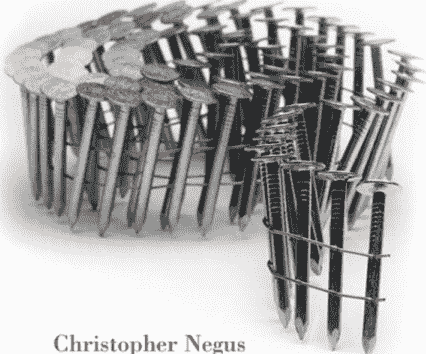

克里斯托托弗·内格斯 (Christopher Negus)

《Negus Live Linux 系列》中的书籍鼓励并挑战你在自由软件世界不断进步。启动每本书附带的 Live 版 DVD 或 CD，亲眼见书中描述的 Linux 系统、应用程序和内容在你的眼前生动起来。

从初学者开始尝试各种示例，最后以专业人士身份结束，掌握该系列涵盖的许多主题，从构建 PHP/MySQL 网站到自定义 Live CD 等等。当你完成学习后，你将学会如何自己使用、自定义和重建这些免费的开源软件。

该系列由 Christopher Negus 监督，他是畅销书丛《红帽 Linux 圣经》系列、《Linux Toys》系列以及本系列代表作《Live Linux CDs》的作者。

Christopher Negus


> 一如既往，我将这本书献给我的妻子 Sheree。

- 前言 ................................................................. . . . . . . . . . . . . . . . . . . . . . . . . 1

### 从启动式 Live Linux 开始 ................................................................. . . . . . . . . . . 5

## 第一章

- 克服 Linux 的第一道障碍 ................................................................................................................ 9

- 其他游戏类别 ................................................... 318

- 其他防火墙发行版 ........................................................ 356

- 总结 ........................................................................................................ 357

# 目录

## 第 14 章 定制集群 Live Linux CD . . . . . . . . 359

- 高可用性 (HA) . . . . . . . . . . . . . . . . . 360

- 使用 `cdrecord` 刻录 CD 和 DVD . . . 394

- 使用 `K3b` 刻录 CD 和 DVD . . . . . . 398

# 关于作者

**Christopher Negus** 近十年来一直是全球领先的 Linux 丛书作家之一。他的《红帽 Linux 圣经》（Red Hat Linux Bible）系列在全球销量超过 25 万册。Chris 还为 Wiley 出版公司编写或合著了《Linux 圣经》（2005年和2006年版）、《Linux 玩具》（Linux Toys）、《Linux 玩具 II》以及《Linux 故障排除圣经》（Linux Troubleshooting Bible）。

在成为职业作家之前，Chris Negus 在 20 世纪 80 年和 90 年代的 AT&T 贝尔实验室、UNIX 系统实验室和 Novell 的 UNIX 操作系统开发团队工作。特别是，Chris 活跃于 UNIX 系统管理和网络领域。

《Live Linux CDs》是 Chris 与 Prentice Hall 出版公司合作的《Negus Live 系列》（Negus Live Linux Series）的首本书。这本书反映了 Chris 致力于快速、安全地运行强大的免费软件的理念。Chris 正在帮助 Prentice Hall 开发该系列的其他书籍，你可以预计这些书籍将在不久后推出。

在不写计算机书籍时，Chris 喜欢与家人 Sheree、Seth 和 Caleb 一起度过。Chris 还喜欢踢足球、唱歌剧（在没人听见的时候），以及用旧电脑制作东西。

# 引言

Live CD（现场版光盘）是存储在单个光盘上的完整计算机操作系统。你只需将其插入 PC 并重启即可。无论电脑上安装了 Windows、Linux 还是什么都没有，live CD 都能让你获得该电脑的控制权，并使用光盘上的操作系统、应用程序和数据。

那时乐趣就开始了。

今天，数十种基于 Linux 的 live CD 可以购买或从网上免费下载。其中一些 live CD 被制作成通用桌面 Linux 系统（如 Knoppix）。另一些被构建为专门的工具包，例如 BackTrack 安全 CD 或 Dynabolic 多媒体制作 CD。还有一些是用于运行特殊系统的，例如 Devil Linux 防火墙 CD 或并行集群 live CD。

本书的目标是向你介绍 Linux live CD 的世界，然后带你根据自己的需要走得更远。你可能只是想尝试一些 live CD（我们为你提供了一些）。如果你喜欢某个特定的 live CD，你可能希望在重启后保存设置和数据。或者，最终你可能想构建一个完全按照你的愿望定制的 live CD。

本书从非常基础的如何使用 live CD 开始，但最终目标是帮助你制作出你完全想要的 live CD。例如，通过书中的步骤，你可以得到一个具有以下功能的 Linux live CD：

- 直接启动到演示或幻灯片播放（第 10 章）

- 允许你在运行的安全工具包中添加软件（第 9 章）

- 包含你自己的电影或音乐，并设置播放器播放它们（第 12 章）

- 作为个人防火墙 live CD 保护你的局域网（第 13 章）

### Live Linux CDs

- 可以在一组计算机之间配置集群计算（第 14 章）

- 允许你从任何可用 PC 设置游戏控制台或服务器（第 11 章）

如果你偏爱某个特定的 Linux 发行版，你可能可以在该发行版的介绍中找到 live CD。例如，在第 6 至 8 章中，我们描述了如何基于 Knopix (Debian)、Fedora 和 Gentoo Linux 发行版构建 live CD。BackTrack（第 9 章）基于 SLAX（一个 slackware CD）。演示 live CD（第 10 章）构建在 Damm Linux 上。

如果你想深入研究构建自己的 live CD，本书包含了对核心技术的描述。你将学习如何与引导程序、压缩文件系统工作，并遵循（以及调整）从机器启动到你看到工作桌面或 shell 提示符的启动过程。

# 本书读者群

如果你从未用过 Linux，live CDs 是尝试不同类型 Linux 系统的极佳方法。很有可能，你可以很从容地跟上几章的内容，尝试一些 live CD 桌面系统、游戏和各种应用程序。你甚至应该毫不费力地学会如何保存你的桌面文件和设置。

然而，当你进入书的第二部分时，某些 Linux 知识将有用（如果需要的话）。你不需要成为程序员来重制一个 live CD 甚至从零开始构建一个。但是，当你进入书中更具技术性的领域时，需要如何使用 shell、文本编辑器和 shell 命令的实用知识。

# 本书结构

本书遵循 New Negus Live Linux 系列的章程，旨在获得实践经验，深入研究关键组件，然后分步获得真实、具体的成果。为此，本书分为三个主要部分：

- 第一部分，“从可启动的 Live Linux 开始”——这是本书的 Linux live CD “用户”部分。它旨在让你在几分钟内获得一个可以运行的 live CD。你将参观几个 live CD，并学习关于启动选项、自定义桌面以及将数据保存到硬盘或可移动介质的方法的基础知识。

- 第二部分，“创建自定义可启动 Linux”——在这一部分，我将深入研究 live CD 的内部工作机制。你将学习引导程序、live CD 上使用的文件系统以及 init 进程。最后三章专门基于 Knoppix（第 6 章）、Fedora（第 7 章）和 Gentoo（第 8 章）重制或定制 live CD。

- 第三部分，“制作特种 Linux”——因为创建 live CD 不仅仅是运行，所以这部分重点关注 live CD 的类型。从每个 CD 类别中，可能都有你感兴趣。随书提供的 DVD 提供了丰富的 live CD。其中一些 CD 经过重制，你可以直接从 DVD 启动。其他以完整 ISO 镜像的形式提供，你可以从 DVD 复制。

# 关于书中的 DVD

如果你刚开始接触 Live CDs，我建议你启动 DVD 并选择 Knopix live CD。有关 DVD 包含的软件列表，请参阅附录 A。

# 使用本书所需的

Live Linux CDs 可运行在各种计算机硬件上，例如标准 PC 架构 (`i386`)、`PowerPC` (`ppc`) 和 64 位 AMD (`AMD64`)。你可能会为你喜欢的架构构建某些 live CD 工具（例如 Gentoo 安装程序）。然而，为了本书的目的，我们提供的软件和步骤都是针对标准 32 位 PC 架构的。

你跟随本书使用的 PC 需要 DVD 驱动器或 CD 驱动器（如果你自己将 ISO 镜像刻录到 CD）。虽然每个 live CD 都有最低硬件要求，但我建议至少使用 Pentium 类 PC 和至少 128MB 内存。正如本书后部分提到的，live CDs（本质上）消耗大量内存，在低内存环境下运行效果不佳。

硬盘需求方面，运行本书的 live CD 时你甚至不需要电脑里有硬盘。但是，如果你正在重制 live CD 或从零开始构建，所需的硬盘空间范围可能从几百兆（重制 Damn Small Linux）到几个 GB 不等。所需的空间取决于你向 live CD 添加了多少软件。

你可能考虑买一个 USB 闪存（有时也称为 U 盘或优盘）。因为 live CD 通常从只读介质运行，随身携带一个 USB 闪存是好事，以便保存你创建的任何数据。

# 第一部分

### 从可启动的 Live Linux 开始

本页特留白。

### 使用 Live Linux CD 启动

创建 live Linux CD 不仅涉及启动文件和压缩技术。它关乎释放你自己的创造力，让你随时随地使用你喜爱的精确工具集。它关乎如何完全按照你的意愿创建并展示你的演示文稿、音乐、视频和图像内容。

本书介绍了基于 Linux 系统技术构建的 live CD，这些 CD 利用了当今现有的数千个开源软件组件库。在书中，你将学习如何寻找、使用、定制和重制 live CD——甚至可以从零开始构建它们。

随书附的 DVD 包含了几个 live Linux CD，你可以独立于单个启动提示符来使用它们。它还包含了许多你创建任何内容所需的软件工具，从运行在 50MB 可启动名片 CD（口香糖大小）上的轻量级桌面系统，到包含海量桌面、服务器和系统管理软件的多 GB 级 DVD。

本书从运行书中 DVD 附带的 live Linux 初学者技巧开始，带你进入大师级技能——通过这些技能，你可以构建、定制和重制专门的 Linux 发行版。当你完成后，你将拥有一个供自己使用的完美可启动 Linux 系统，甚至是一个与世界分享的自己的 Linux 发行版。

### 理解 LIVE LINUX CD

live CD 将计算机系统与硬件分离。操作系统通常永久安装在计算机的硬盘上，而 live CD 通常被设计为完全从只读介质（如 CD-ROM）启动并运行。

有了 live CD，你就不再需要受限于桌面电脑甚至笔记本电脑来完成计算机工作或娱乐。相反，你可以在一张 CD、DVD 或 USB 闪盘（约口香糖大小）上携带整个操作系统、重要应用程序，甚至是你的数据（音乐、文档、视频、图像和表格）。你的整个计算机系统随你去哪里，并可以在几乎任何手边的 PC 上运行。

高质量开源软件的爆发式增长和 Linux 操作系统的普及为 Live CD 创造了肥沃的土壤。因此，你可以找到几十种可以免费下载和使用的基于 Linux 的 live CD。还有许多强大的工具用于定制 live CD 并构建你自己的重制（或从零开始的）live CD。

近年来，Linux 开发活动非常频繁，产生了一些复杂的工具和坚实的基础系统供构建。低成本、高容量的介质（如 USB 闪存、CD 和 DVD）让任何人创建 live Linux 发行版的概念变得非常廉价。此外，与专有软件不同，你有极大的自由去复制、适配和定制大多数开源软件，且无需费用。

### 运行 Live Linux CD

使用 live CD 是入门 Linux 的最佳方式之一，无论你想亲自尝试 Linux 还是鼓励他人成为 Linux 爱好者。通过 live Linux CD，你可以执行以下操作：

- **尝试 Linux**——如果你犹豫于弄动你的硬盘，live Linux CD 代表了一种尝试功能性 Linux 系统的办法，而不会扰乱你硬盘的内容。

- **测试硬件**——在决定安装硬盘之前，你可以使用 live CD 检查硬件是否与 Linux 兼容。像 Knoppix 这样的 CD 提供了一些工具，让一些棘手的 PC 硬件元件（如声卡和无线网卡）能够工作。

- **带着 Linux 在路上旅行**——当你对 Linux 和你喜爱的开源应用程序非常熟悉时，live CD 是在不携带电脑的情况下将整个系统带上路上的极佳方法。在可用的 PC 上启动 live CD（如果你已经在 CD 中包含了了自己的设置和定制，则更好），你可以在几分钟内启动所有你喜爱的应用程序。

## 第 1 章 使用 Live Linux CD 启动

- **做些特别的事**——你可以设置一个 live CD 来完成特殊任务。例如，你可以使用像 GeeBox 或 MobiX 这样的发行版来设置。

- **利用计算机**——通过在网络中的多台计算机使用 live CD，你可以提供高可用性（如果一个系统故障，另一个可以接管）、负载均衡（将需求分散到多台机器上）以及高性能计算（跨机器处理计算应用）。

- **永久安装 Linux**——像 Ubuntu、Gentoo 等 Linux 系统提供了可以作为安装的 CD。当你熟悉 live CD 的工作方式后，就可以从运行环境永久安装 Linux。

启动 live CD 或 DVD 只需将 CD 或 DVD 插入计算机并重启。你可以在运行的 live CD 上启用各种服务。然后由你完成任何所需的配置（设置打印机、桌面设置、网络连接等）。

### 克服 Linux 的第一个障碍

对于熟悉它的人来说，安装 Linux 并不困难，但对于你的第一次尝试，安装可能会遇到障碍。使用 live CD 可以避免初次用户遇到的常见问题，让首次接触 Linux 的体验更加愉快。

以下是在硬盘完全被 Windows 占用的 PC 上首次安装 Linux 的常见场景：

- **释放磁盘空间**——由于所有磁盘都分配给了 Windows (NTFS) 分区，第一个任务是从 Windows 释放磁盘空间为 Linux 腾位。由于专利问题，Linux 发行版不包含调整 Windows 大小的功能；你可能需要寻找分区工具。

- **分区**——在将 Linux 安装到磁盘之前，必须对空空间进行分区并格式化为特定的文件类型。在某些情况下，Linux 安装程序处理分区；在另一些情况下，你必须...

- **硬件配置**——在安装过程中，你可能会被要求配置显卡、显示器、网卡或其他硬件。某些 Linux 系统在自动检测硬件方面比其他系统更好；大多数系统要求你提供某些信息来配置你的硬件。

在创建 live CD 时，你可以选择其中包含哪些应用程序和其他组件；该 live CD 可以是通用的系统，也可以是经过调优的系统。

第 9 到第 14 章介绍了你可能感兴趣的使用或创建的不同类型的 live CD。以下子节描述了一些他人创建的特殊 live Linux 系统示例。

### 桌面版 Live CDs

通过一个经过调优的桌面系统 Linux Live CD，你可以在旅途中像在家里一样工作。一个典型的桌面版 Live CD 包含文字处理、电子表格、电子邮件和 Web 浏览应用程序，以及典型家庭或工作电脑上提供的任何其他软件。通过提供持久性桌面功能的 Live CD，你可以在 USB 闪存器或可写介质上存储你自己的网络书签、电子邮件设置、好友列表或其他所需功能。

正如我之前提到的，Knoppix 是最流行的 Live CD，也是最适合入门的发行之一。它出色的硬件检测和配置让初 Linux 用户能够轻松上手。虽然 Knoppix 启动后进入 KDE 桌面，但 Knoppix 的自定义版本提供了其他桌面环境和窗口管理器。

第 2 章“玩 Live Linux CDs”和第 3 章“自定义 Live CD”描述了如何使用 Knoppix。第 6 章“构建自定义 Knoppix Live CD”包含了关于剩余 Knoppix 的信息。图 1-1 显示了 Knoppix 桌面的示例：

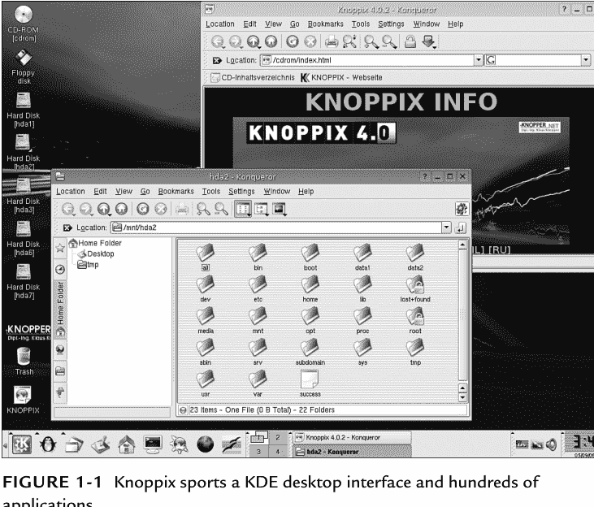

### Live Linux CDs

若想尝试提供 GNOME 桌面的 Live CD，你可以获取 Knoppix 的 GNOME 版本——Gnoppix (www.gnnoppix.org)。另一个提供 GNOME 界面的 Live CD 是 GNOME LiveCD，它直接源自 GNOME 项目 (http://live.linux.org)。

对于更轻量级的桌面系统（可以放入少于 50MB 的介质中），请尝试 Small Linux (www.damnsmallinux.org)。轻量级桌面类中的其他 Live CD 还包括 Puppy Linux (www.puppyl.com) 和 Feather Linux (http://featherlinux.berlio.de)。这些微型桌面 Live CDs 通常在内存较小、CPU 较慢的旧机器上运行得更好。

### 游戏类 Live CDs


如今有成百种开源游戏可用。Linux 商业游戏的演示版也可以重新分发。专门为游戏调优的 Live CDs 和 DVD 可以让你向 Linux 的过渡变得比尝试全新安装 Linux 并组装游戏系统要容易得多。

例如，PCLOS SuperGame Live DVD 是基于 PCLinUX 发行版的。它包含了约 3.6GB 的游戏软件，包括 Wesnoth、Quake 4 和 America's Army 等热门游戏的演示版。它还包含许多街机游戏、纸牌游戏和策略游戏。Live Linux Project live CD (`http://tuggames.altervista.org`) 是一个近 700MB 的 Live CD，包含了数百个免费和开源游戏。

SuperGame 以及其他 Live CD/DVD 与其他 Live 系统不同之处在于，它们可以针对游戏进行优化。SuperGame-1 包含一个针对游戏调优的内核、一个特殊的桌面主题，以及能够处理 3D 视频的显卡驱动程序（包含 NVIDIA 显卡驱动，并且正在开发带有 ATI 驱动的发行版本）。

你可以在 PCLinuxOS 论坛阅读更多关于 SuperGame 的信息：`www.plinuxos.com/forum/index.php?board=31.0`。图 1-2 显示了 PlinuxOS SuperGame 桌面的示例。

另一个游戏 Live CD 的示例是 Games Knoppix (`http://games-knoppix.unix.uni-kl.de`)，提供德语和英语版本。Games Knoppix 的功能包括默认开启的硬件加速和 NVIDIA 显卡驱动。

### 第 1 章 使用 Live Linux CDs 开始

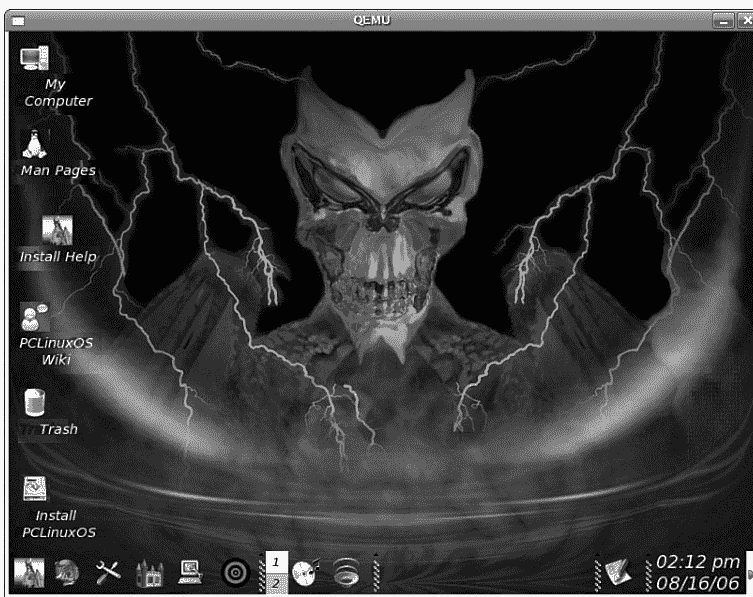

图 1-2 SuperGame 经过调优，可以玩几十款 3D 和街机游戏。

### 集群类 Live CDs

取一个集群 Live CD 并在实验室环境或学校的许多计算机上启动它的副本。通过对运行 Live CDs 的节点进行自动发现，集群 Live CD 将产生一个超级计算环境。通过这种配置，你可以在许多处理器上处理大量的同类数据。

集群类 Live CD 的示例是 ParallelKnoppix (`http://pareto.uab.es/mcreel/ParallelKnoppix`)。正如其名称所示，ParallelKnoppix 是一种用于配置操作系统计算机集群的 Knoppix 重制版。

### 多媒体播放器 Live CDs

一些 Live Linux CDs 致力于音乐、视频、图像和其他类型的多媒体。使用这些 Live CDs，你通常可以从本地系统（硬盘、闪存器、CD、DVD 或其他存储设备）或网络服务器（使用 NFS、Samba 或流媒体服务器）播放内容。

GeeXBoB (`www.geexbox.org`)、`Limp` (`http://limp-vkk-ver1.sourceforge.net`) 和 MoviX (`http://sourceforge.net/projects/movix`) 是专门播放多媒体的 Live CDs。这三者都直接启动到 mplayer 媒体播放器，并且精凑可在 RAM 中运行。使用 GeeXBoB Generator 或 MoviX 相关的 eMoviX 项目，你可以将自己的内容添加到多媒体 CD 中，创建一个个人的可启动电影。图 1-3 显示了 Limp 多媒体播放器 Live CD 启动时的示例。


图 1-3 Limp 多媒体播放器 Live CD 启动时。

GeeXBoB Generator 或 MoviX 相关的 eMoviX 项目允许你将自己的内容添加到多媒体 CD 中，创建一个个人的可启动电影。

## 第 1 章 开始使用 Linux 启动 CD

GNOME 项目提供了 GNOME LiveCD (`http://live.gnome.org/Gnome-LiveCd`)。虽然 GNOME LiveCD 的首要目的是为了向 Linux 小组成员和记者等人员演示 GNOME，但 GNOME 项目鼓励其他软件项目使用此 CD 作为一个其项目演示的基础。

Monoppix 是一个基于 Knoppix 的现场化启动 CD，它可以帮助开发者开始使用工具来开发 Mono 运行时环境、编译器和类库。示例应用程序让开发者看到如何开始编写文本界面和图形界面应用程序，以及访问 MySQL 数据库的应用程序。

Slav 启动 CD (`http://slack.linux-live.org`) 的一个版本被称为 KillBill，旨在测试 Windows 应用程序，以查看它们是否可以在 Linux 中运行。磁盘中包含的工具可以帮助人们使用 wine、dosbox 和 Qemu 尝试运行 Windows 程序。

### 特殊演示型启动 CD

你可以创建一个启动后直接进入特定演示或应用程序的现场化 CD。例如，你可以启动到幻灯片演示或 OpenOffice.org Impress 演示稿。通过多种方法，你可以配置选定的应用程序在启动时自动运行，而无需用户登录。

添加自定义背景、图标、屏幕保护程序和菜单，让整个桌面呈现代表你演示内容的视觉风格和感受。或者，你可以以全屏模式运行 Web 浏览器应用程序，这样使用你 CD 的人除了你的演示内容外什么也看不见。

### 灾难中心启动 CD

当有人说“需要是发明之母娘”时，那个人可能指的是 2005 年路易斯安纳州飓风季节期间创建的一些现场化 CD。路易斯安纳州湖查尔斯的一个灾难中心最初只有一些旧的（无盘）PC 和单一的网络连接。他们创建了 Linux 和 Windows 现场化 CD，其中包含一个安全的操作系统，让人们在灾后能够浏览网页、发送和接收电子邮件、拨打电话 (`VoIP`) 并完成其他关键通信。

### 选择启动介质

“Live CD”一是一个通用术语，用于描述位于计算机硬盘之外的可移动介质上的可启动操作系统。这个术语被广泛使用，是因为最早的一些流行的全功能启动光盘（特别是 Knoppix）是专门为适应 CD 而制作的。然而，现在你可以考虑许多不同的介质类型来存放你的可启动 Live Linux。表 1-1 描述了你可以用于存放 Live Linux 的介质示例（如图 1-5、1-6、1-7 和 1-8 所示）。

尽管 CD、DVD 和 USB 闪存盘是最流行的启动介质，但你实际上可以将可启动的 Linux 放在 PC 的 BIOS 可以识别为启动设备的任何设备上。例如，PC 也可以从 Zip 驱动器和软盘启动（尽管 Linux 2.6 内核已经变得太大，无法放入软盘）。你甚至可以从计算机上的某些本地介质（如支持 PXE 的网卡）启动你的可启动 Linux，并在网络上的设备上运行它。

如果你在硬盘的目录中有一个 CD 的 ISO 镜像（是因为你刚刚下载了它或者正在测试你创建的镜像），你通常可以尝试使用某些虚拟化软件来运行镜像。例如，你可以使用 VMware 或 Qemu 并运行启动镜像，使其出现在你桌面屏幕上的某个窗口中。这让你在刻录介质之前，先先尝试你的 Live CD。

### 发挥 Live CD 的最大作用

在使用 Live CD 时，你可以使用一些技巧和窍门来获得运行 Live Linux 系统的最佳体验。在尝试 Live CD 时，许多人发现这个概念非常酷。然而，当你开始使用 Live CD 时，你可能想做：

- **运行得更快**——从 CD 或 DVD 驱动器访问数据通常比从硬盘访问数据要慢。而且 CD 上的数据通常经过了压缩（为了容纳尽可能多的软件），解压缩会带来额外的性能损失。某些 Live Linux 发行版包含一项功能，可以让你将整个发行版写入内存（前提是你的 PC 有足够的可用内存）。结果，Live Linux 系统的运行速度可能比安装在硬盘上的系统更快。

如果你正在构建自己的 Live CD，你也可以将其构建为在低内存或慢速 CPU 环境下运行。例如，你可能会为你的 Live CD 选择简单的应用程序和窗口管理器。

### 表 1-1 常见的启动介质。

| 介质 | 描述 | 图像 |
|---|---|---|
| 光盘 (CD) | 许多现有的 Live Linux 启动光盘都是为适应标准 CD（约 650MB 到 700MB）制作的。实际尺寸为 122mm。 | 图 1-5 |
| 微型 CD (可启动名片) | 尺寸为 80mm 的微型 CD 可以存储多达 180MB 的数据。裁剪成名片大小（称为可启动名片），微型 CD 可以存储约 50MB 的数据。（Damn Small Linux 发行版可以放入启动卡片中。） | 图 1-6 |
| 数字多功能光盘 (DVD) | DVD 的比例与 CD 相同，但可以存储约 4.7GB（单层）或 8.4GB（双层）。双层 CD 比单层 CD 贵得多。刻录双层 DVD 的驱动器也更贵。 | 图 1-7 |
| USB 闪存盘（也称为 U 盘、key drive、USB key 或 thumb drive） | 闪存盘有各种形状和大小，流行的尺寸大约是一包口香糖的大小。存储容量从 16MB 到 64GB 不等。大多数 PC 可以从 闪存盘启动。因为它是可重写的，你可以在使用时添加和更改数据。你还可以将 USB 闪存盘与只读介质配合使用来存储数据和持久化功能。 | 图 1-8 |

### Live Linux CD

- **访问硬盘**——Live Linux 系统不需要访问你的硬盘。然而，有时你想从 Live CD 保存数据。某些启动 Linux 系统在桌面上直接提供所有分区的图标。访问这些分区通常只需打开即可。写入这些分区通常需要权限。

- **访问 CD 驱动器**——因为操作系统默认是从你的启动介质（CD 或 DVD）运行的，如果你这时想播放音乐 CD，就无法直接弹出介质。如果你有两张 CD，可以使用一张作为 Live CD，另一张用于你想播放的内容。但如果你只有一个 CD/DVD 驱动器，解决此问题的方法与提高性能的方法相同。如果有足够的内存，从内存中运行 Live Linux；你就可以弹出启动介质。

- **访问网络**——大多数启动 Linux 系统配置为自动检测支持的网卡上的 DHCP 服务器。这会立即为你提供可用的互联网或其他网络连接。配置静态地址或连接无线卡的工具也适用于许多启动 Linux 系统。

- **添加应用程序**——你可能有一个近乎完美的 Live CD，但发现它缺少你想要的一两个应用程序。某些现场系统允许你在运行的 Live Linux 系统上安装应用程序（通常带有针对你使用的特定 Linux 发行版预配置的下载包）。

- **保存自定义功能**——在只读介质（如 CD-ROM）上，你可能更改桌面背景、编写文档或保存某些书签。但一旦你重启（默认），所有内容都会消失。如前提到的，你可以访问本地硬盘或网络保存数据，但你可能希望将自定义设置和应用程序与你的 Live Linux 保一起，这样每次重启 CD 时，这些设置就会重新出现。

## 第一章 开始使用实式 Linux CD 21

某些实式 Linux 系统包含了一些功能，可以收集你的自定义设置，将它们保存到某处（如硬盘、USB 驱动器或软磁盘），并在下次重启时将它们恢复。它们可能通过通过将你的家目录（home）和 `/opt` 目录中的文件备份成单个文件（称为 tarball/包），将其存储在某处（如网络上的软磁盘或磁盘），并在重启时进行恢复来实现。

- 安装到硬盘——尽管大多数可启动的 Linux 系统并非为了安装到硬盘上而设计的，但有些人非常喜欢他们的可启动 Linux，以至于他们想将其永久地添加到磁盘中。某些 Linux 发行版提供了安装到硬盘的功能。（但请记住，许多实式 CD 是为了临时使用设计的，除非你进行一些额外配置，否则它们可能无法为你个人桌面系统提供所需的安全级别。）

- 安装到 USB 闪存盘——如果你在 CD 上运行 Linux，那么你可能也会喜欢在闪存盘上运行它。从 USB 闪存盘启动实式 Linux 后，你可以根据需要修改数据并进行。

你可以做很多工作来定制现有的实式 Linux。然而，通过组合一个包含完全你所需要的组件的自己的实式 Linux，你甚至做得更多。在玩过了市上的实式 CD 之后，你可能想自己创建一个。

### 构建实式 Linux CD

你可能对从网上下载的可启动实式 CD 的精确版本，或者使用随书附带 DVD 中的版本感到非常满意。然而，为了让 CD 更符合你的特定需求，你几乎想要向 CD 中添加更多软件或数据，或者更改它的外观和感受使其更适合你的需求。

你可以对实式 CD 进行更改，使其包含（并保留）你想要的个人数据和应用程序。在书中，我们描述了你可以用来更改甚至从头开始的几种不同方法，以便获得完全符合你需求的实式 CD。书中描述了这些制作实式 CD 的基本方法：

- 定制化——你不需要了解 Linux 或实式 CD 的内部原理，就能为 Knoppix 或 Damn Small Linux 等 Linux 发行版更改并保存自定义设置。通过使用这两个发行版中的持久性桌面功能，你可以将桌面设置、应用程序和数据保存到备介质（如 USB 闪存盘或硬盘）中。当你下次启动带有备份信息的实式 CD 时，所有保存的设置和数据都将恢复。对于普通实式 CD 用户来说，这是个性化实式 CD 的最佳方法。第 3 章包含了对这种方法的描述。

- **重制 (Remastering)**——重制实式 CD 需要大量的 Linux 知识。你不仅仅是向现有 CD 添加你自己的设置，而是将其解压到硬盘上的一个目录中。然后你通常在这个硬盘的包含区域（在所谓的 chroot 环境中）工作，这样你就可以随意运行命令来添加和删除软件及数据。

重制的优点是，从一个可以工作的 CD 开始，更容易得到一个可以工作的 CD。你只需要更改你想要不同的部分。然后你编译文件系统并重建实式 CD（使用 `mkiofs` 命令）。这种方法在第 6 章中描述，在那里你将学习如何掌握 Knopix。

- **全新安装 (Fresh install)**——几个 Linux 发行版拥有（或正在开发）工具，让你从它们的软件库从开始构建实式 CD。本质上，你是在运行该 Linux 发行的全新安装，结果是一个单个 ISO 镜像，而不是到硬盘的永久安装。这种方法的缺点是过程中可能会发生更多问题（例如缺少依赖项和不兼容性）。

包含直接从这些项目软件库创建实式 CD 工具的两个 Linux 发行版是 Fedora 和 Gentoo Linux。尽管这些工具仍在开发中，但只要坚持，你就应该能够创建一个只包含你需要的软件的实式 CD。这些软件可以从 Fedora 和 Gentoo 巨大的软件库中提取。

Fedora 使用 Kadishi 项目的工具连同 Anaconda 安装器（用于将 Fedora 永久安装到硬盘的相同工具）生成代表你实式 CD 的 ISO 镜像。第 7 章“构建基础 Fedora 实式 CD”包含了使用 Kadishi 和 Anaconda 制作 Fedora 实式 CD 的步骤。

同样，名为 Catalyst 的 Gentoo 安装程序正在被转化为制作实式 CD 的工具。使用 Catalyst，你实际上可以为你想要的特定环境重新编译所有的应用程序（而不是像 Fedora/Kadishi 那样简单使用预构建的二进制包）。

## 第一章 开始使用实式 Linux CD

尽管 Catalyst 工具代表了根据你的精确规格构建和调整实式 CD 的最大前景，但它们运行需要很长时间，并且在出现问题时需要更多专业知识来纠正。因此，第 8 章“构建基础 Gentoo 实式 CD”中关于构建 Gentoo 实式 CD 的描述是从重制方法开始的，然后介绍如何使用 Catalyst 构建实式 CD。

如果你决定保存几个设置和一些数据（定制）不能满足你的需求，你必须在命令行 Linux 系统方面拥有（或开发）一些专业知识。你不能完全从图形界面环境重制或从头开始构建实式 CD（至少到目前）；在大多数情况下，你必须从命令行以 root 用户身份工作。


然而，当你深入研究时会发现 Linux 是创建一个实式 CD 的极其丰富的环境。（注：此处原文存在大量重复句子，已根据要求翻译并保持了语境，但遵循了文档逻辑结构）。`Linux` is an extraordinarily rich environment for creating your live CD.

## 办公应用

`OpenOffice.org` 程序为 Knoppix 提供了办公生产力应用的核心支持。此外还有用于管理通讯录和个人信息（`Contact` 和 `KOrganizer`）以及页面布局（`Scribus`）的应用程序，以完善其功能体系。

## 图形应用

`GIMP` 可能是处理数字图像最流行的应用程序，但 Knoppix 包含了十多个用于处理图形的应用程序。这些软件可以让你进行截图（`Snapshot`）、从相机下载图像（`gcam`, `gtcam` 和 `xcam`）、查看各种格式的图像（`KGhostView`, `Quickickshow` 和 `pdf`）以及使用扫描仪（`ximage`）。

## 互联网应用

Knoppix 装备了完备的可以帮助你访问互联网。它包含了几个 Web 浏览器（`Firefox`, `Conqueror` 和 `Lynx`）、电子邮件客户端（`Thunderbird`, `Knail` 和 `Mutt`）以及即时消息客户端（`Xchat` 和 `Gait`）。在命令行中，你可以使用几十条命令进行文件复制、传输、登录和其他网络连接。

## 多媒体应用

音频应用包括 `XMMS`（多媒体播放器）和 `axum`（音频混音器）图形应用程序，以及多种用于播放、编码和处理音频的命令。在视频领域，Knoppix 带有 `xmedia` 媒体播放器和 `xawtv` 电视查看器。

## 游戏应用

Knoppix 包含了全开源游戏，包括 KDE 街机游戏、棋盘游戏、牌牌、儿童益智和策略游戏。


# 系统管理工具

Knoppix 为 KDE 桌面提供了许多系统管理工具（`K Center`、`kCron`、`KUser` 和 `KPackage`），但也提供了自己的工具，以便更容易地配置复杂的硬件并改进 Knoppix 现场环境。通过 K 菜单中的 `KNOPPIX` 子菜单，你可以配置打印机和声卡。

## 服务器

虽然大多数 Knoppix 特性面向桌面端，但你可以配置几个从 Knoppix 现场 CD 运行的实用服务器。从 `KNOPPIX` 菜单，你可以启动远程登录服务器（`SSH`）、日志服务器（`SYSLOG`）或 Windows 文件共享服务器（`Samba`）。你还可以将 Knoppix 配置为基础 Web 服务器（`Apache`）、邮件服务器（`smail`）、`DHCP` 服务器（`dhcp3`）、`Rsync` 服务器（`rsync`）或代理服务器（`squid`）。

Knoppix 现场 CD 包含了超过 1,200 个软件包，现场 DVD 则包含了超过 2,700 个。要查看 Knoppix CD 或 DVD 的完整软件包列表，请在任何 Knoppix 镜像站点查找对应的 `packages.txt` 和 `packages-dvd.txt` 文件。例如，这些文件可以在 `www.kernel.org/pub/dist/knoppix/packages.txt` 和 `www.kernel.org/pub/dist/knoppix/packages-dvd.txt`。

软件包为我们提供了将 Knoppix 作为现场 CD 基础另一个理由。Knoppix 基于 Debian GNU/Linux 发行版构建的；因此，你可以从巨大的 Debian 软件仓库中整合软件包。同样，你可以使用相同的工具来下载、安装、删除和其他管理这些软件包，包括 `apt-get`、`dpkg`、`KPackage` 等许多工具。

当你在只读环境中工作时，软件包工具的用处有限，但如果你正在重新制作（remastering）Knoppix，你可以使用这些工具随心地添加和删除软件。当你重建代表现场 CD 的 ISO 镜像时，它可以恰好包含你来自 Debian 仓库的软件。

其他基于 Debian 的 Linux CD 发行版也可以被重新制作。例如，你可以在 Ubuntu Wiki 上找到重新制作 Ubuntu 现场 CD 的程序，该程序遵循相同的通用流程：`https://wiki.ubuntu.com/LiveCDCustomizationHowTO`。当然，你也可以选择一个直接派自 Knoppix 的现场 CD 来开始定制你自己的 CD。自定义（重新制作）的 CD 列表。

## 基于 Gentoo 的 Live CDs

使用与 Catalyst 安装程序相关的工具（`www.gentoo.org/proj/en/releng/catalyst`）从 Gentoo 仓库创建 Live CD 可能是书中介绍的制作 Live CD 最具挑战性的方法。然而，从长远来看，使用 Catalyst 构建 Gentoo Live CD 为制作针对该 CD 预期运行的计算机架构和硬件专门优化的 Live CD 提供了最广阔的前景。

Gentoo 提供了在你要安装的系统（或构建到 Live CD 中）中包含尖端软件的能力。由于可以使用简单的命令即时构建软件包，因此可以针对你特定的计算机系统对软件进行调整，仅包含你希望构建到每个包中的功能。结果是软件更加轻量（仅包含你需要的）并且速度更快（因为针对特定的计算机架构经过了优化）。

Gentoo 项目生成了一个提供可用 GNOME 桌面系统的 Live CD。该 Live CD 还包含桌面图标，通过这些图标你可以启动最近添加的安装程序，无论是图形模式还是文本模式，你都可以在硬盘上永久安装 Gentoo。这种方法的优处是，从这张 CD，你可以设置好构建 Gentoo Live CD 所需的永久 Gentoo 系统。图 1-10 显示了 Gentoo Live CD 桌面的示例，包括启动 Gentoo 命令行和图形安装程序的图标。

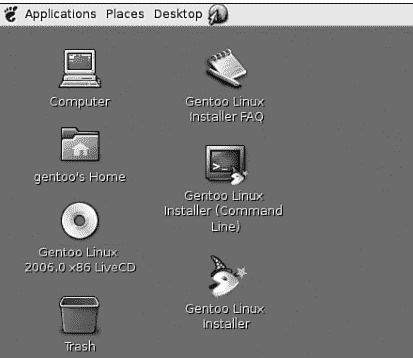

> 图 1-10 从 Live CD 安装 Gentoo 以为 Gentoo 创建构建环境。

第 8 章描述了创建 Gentoo Live CD 的 Catalyst 方法和重制（remastering）方法。重制过程与第 6 章中重制 Knoppix 的过程类似。

Gentoo 的软件包系统称为 `Portage`，基于 BSD ports 系统。软件管理通过由 10,000 多个软件包组成的列表完成，这些包被称为 portage 树（`portage tree`）。使用 portage 树和 `emerge` 命令，你可以启动请求下载、编译并安装选定软件包的命令，在此过程中解决任何软件依赖关系。（不过请注意，因为一个 `emerge` 命令可能会导致数小时下载和编译。）

### 尝试其他 Linux CD

随书附带的 DVD 包含了几个 Linux Live CD，互联网上还有更多可以免费下载。你可以参考这些在线列表，它们包含了各种 Linux Live CD 的描述和链接：

- [维基百科 Live CD 列表](https://en.wikipedia.org/wiki/List_Of_LiveCDs)——维基百科的 Live CD 列表根据其基于发行版对 Linux Live CD 进行排序。Live CD 适用于 Debian、Gentoo、PPC/Mac、基于 RPM 的系统、Slackware 以及其他 Linux 系统。你也可以找到由其他操作系统（Microsoft Windows、MS-DOS、BSD、OpenSolaris 等）派生出的 Live CD 列表。

- [FrozenTech 的 LiveCD 列表](https://froentech.com/content/livecd.php)—表格中列出了 Linux Live CD 的名称，并提供了每个 CD ISO 镜像的大小、Live CD 的主要功能以及下载站点链接、主页和来自 distrowatch.com 的描述。你可以选择某一列按名称、大小和主要功能（桌面、游戏、安全等）查看 Live CD。此列表也可以从 livecdlist.com 获得。

- [DistroWatch 基于 CD 的 Linux 发行版](http://distrowatch.com/dwres.php?resource=cd)—这里列出了几十个 CD，并提供了每个 CD 的描述和链接。由于此列表不再维护，读者也被推荐参考 FrozenTech LiveCD 列表。

另一个查看之处是通常安装到硬盘的 Linux 系统网站。使用这些 Linux 发行版之一的 Live CD 将让你对它们有很好的了解。以下章节描述了如何通过 Live CD 启动 Linux 如下：

- **Ubuntu Live CD**——你可以通过 Ubuntu 启动 Ubuntu，你可以从 Ubuntu 下载获取（`www.ubuntu.com/download`）。

- **Gentoo Live CD**——目前 Catalyst 项目提供了 Gentoo 的方法，使用 Catalyst 来构建 Gentoo Live CD，Gentoo 提供了 Gentoo。Gentoo 网站提供了关于 Gentoo 的信息，你可以从 Gentoo 网站获取相关信息（`www.gentoo.org/where`）。

- **Mandriva Live CD**——Mandriva（原名 Mandrake）提供了方法，你可以从 Mandriva 下载（`mandriva.com/downloads`）获取。Mandriva 项目包含了这些 Live CD。

- **Fedora Live CD**——Fedora 提供了方法，你可以从 Fedora 网站（`fedora.org/where`）获取。Fedora 包含了这些 Live CD。

- **Debian Live CD**——Debian 提供了方法，你可以从 Debian 网站（`debian.org/where`）获取。Debian 包含了 Debian 发行版。

- **Knoppix Live CD**——Knoppix 提供了方法，你可以从 Knoppix 网站（`knoppix.org/where`）获取。Knoppix 包含了这些 Linux 发行版。

由于 Knoppix 提供了方法，这些 Linux 发行版提供了方法，你可以从 Knoppix 网站（`knoppix.org/where`）获取。Knoppix 包含了这些 Linux 发行版。

由于你没有压缩文件系统，Knoppix 包含了这些技术。Knoppix 使用 loop 驱动程序（that is added to the kernel）。

### 了解 Live CD

当你深入阅读本书时，你将了解 Live CD 的各种技术，例如，你可以通过 Live CD 了解。为了深入，这些章节在第 4 章“了解 Linux 如何工作”、第 5 章“深入了解 Live CD 的组件”中描述了。

### 使用引导加载程序

引导加载程序在任何操作系统运行之前由计算机 BIOS 加载，以便从 CD 启动 Live CD。为了让 Live CD 可引导，必须在 CD 镜像中添加引导扇。

### Linux Live CD

`Isolinux` 是 `Syslinux` 项目（`http://syslinux.zytor.com/iso.php`）提供的最常用的 Live CD 引导加载程序。`Isolinux` 包含了实现了 ISO 9660 标准的组件。当你构建 ISO 镜像时，通过 `/boot/isolinux` 目录中的信息识别引导镜像的位置。例如，你可以修改 `isolinux.cfg` 实现以下功能：

- 选择要启动的操作系统（或通过不同的选项启动操作系统）。
- 显示不同的消息文件。你可以创建消息文件并指定按下特定按键时显示哪个消息文件。
- 包含自己的启动屏。你可以使用一张减少为 16 色且能够适应 640x480 像素显示的图像作为启动提示显示时的启动屏。

虽然 `isolinux` 是 Live CD 上最常用的引导加载程序，但你也可以使用其他常用于硬盘启动的引导加载程序。这些引导加载程序包括通用统一引导加载程序（`www.gnu.org/software/grub`），也称为 `GRUB`，以及 Linux 加载程序（`http://lilo.go.dynns.org`），也称为 `LILO`。`GRUB` 配置 Live CD 配置比 `isolinux` 困难得多，但它的优势是允许从菜单中选择启动操作系统。

### 选择压缩技术和文件系统类型

由于 Live CD 空间限制，大多数 Live CD 都采用了某种类型的压缩文件系统来存储目录结构。因此，比起不压缩文件系统，你可以在 Live CD 上获得多得内容。

Knoppix 使用 `create_compressed_fs` 命令压缩 `KNOPPIX` 文件系统。如果以后从 Live CD 使用该文件系统，将使用 loop 驱动程序（已添加到 Knoppix 使用的 Linux 内核中）进行解压。因此，Knoppix Live CD ISO 镜像约为 700MB，实际上可以包含 2GB 的压缩应用程序和数据。

## 第 1 章 开始 Live Linux CD 33

它整合了一个 `Unionfs` 文件系统（`www.unionfs.org`）。`Unionfs` 使得将只读文件系统（例如 live CD 上的 `/` 目录）与可写文件系统（例如内存中的 Unionfs 文件系统）合并成为可能。因此，使用 live CD 的用户可以将文件保存到 CD 上的只读目录，这些文件实际上存储在 Unionfs 文件系统（`/UNIONFS`）中，但两个文件系统的所有内容都合并显示为一个单一文件系统。

某些没有使用 Unionfs 的 live CD 其 live CD 中的许多目录都是只读的。因此，你只能在需要可写的目录（如 `/tmp` 和 `/home` 目录）中保存文件。使用 Kadiski 工具从 Fedora Linux 构建的 live CD 支持对 `Squashfs`（`http://squashfs.sourceforge.net`）文件系统的类型。`Squashfs` 是一种专为 Linux 设计的只读压缩文件系统。为了确保 `/tmp` 系统不会轻易用尽空间，live CD 使用了 `tmpfs` 文件系统，`tmpfs` 可以根据需要增长以消耗更多内存（RAM 加上需要的部分）。

### 了解硬件检测

由于 live CD 通常被预期运行在许多不同的计算机上，配备各种硬件组件，因此良好的硬件检测至关重要。目标是让 live CD 从启动界面进入运行系统时，所有所有的 USB 设备、网卡、显卡、显示器、鼠标设备和其他硬件组件都能自动完成检测、加载驱动程序并完成必要的配置。

live CD 使用了多种不同的硬件检测功能，以确保 live CD 至少能启动到一个最简配置的桌面系统。Knoppix 硬件检测基于 `Kudzu` 设施（该设施为 Red Hat Linux 创建，目前仍用于 Fedora Linux）。PLinuxOS 使用 `hwdetect` 和 `hotplug` 进行初始硬件检测，并用于管理插入到运行系统中的设备。

### 配置系统服务

即使你的 live CD 上安装了某些服务，你可能仍需要配置它们在启动时自动运行。例如，如果是一个服务器 live CD，你可能希望启动 Apache Web 服务器服务 (`httpd`) 和远程 shell 服务 (`sshd`)。基于 Fedora Linux 的 live CD 是基于 System V init 脚本的，这使得服务能够在不同的运行运行级别（run levels）下启动和停止。

### 选择软件软件包

当你选择一个 Linux 发行版来构建 live CD 的基础时，你选择的主要特征之一就是你想使用的软件软件包类型。当你重新制作 live CD 或从头开始构建一个时，你会使用与你的基础 Linux 发行版软件包类型相关的工具，并从该发行版的软件仓库中获取内容。


书中描述的 live CD 软件包侧重于 Debian（`.deb`）和 Red Hat（`.rpm`）软件包。除了 Debian 项目外，Debian 打包还用于许多 live CD 和其他已安装发行（如 Ubuntu）。除了 Red Hat 赞助的 Fedora 项目及其自身的 Red Hat Enterprise Linux 之外，CentOS 等发行版也使用 RPM 打包。

Gentoo 采取了不同的打包方式，聚焦于 Portage 管理系统。Portage 软件按分级目录树排列，该目录树由 ebuilds（指导每个软件组件如何构建的脚本）组成。

为了为上述每种软件包系统添加和删除软件包，有一套工具可用：

- **RPM 软件工具**——`rpm` 命令是添加、删除和查询 RPM 包的最基础工具。`yum` 命令比 `rpm` 使用得更频繁，因为 `yum` 的设计初衷是查看在线软件仓库以搜索、下载并安装最新的可用 RPM 文件。

- **Debian 软件工具**——`apt-get` 命令是下载和安装 `.deb` 包最流行的命令。Debian 打包工具的基础是 `dpkg` 命令。

- **Gentoo 软件工具**——`emerge` 命令是用于从 port tree 下载、安装、构建、删除和更新 Gentoo 软件包的主要命令。

上述描述的软件工具主要供它们所设计的操作系统使用，但其中某些工具在其他操作系统上也可用。例如，有一个版本的 `apt-get` 可以从在线仓库为 Red Hat 系统获取软件。同样，你可以使用 Debian 命令来安装 RPM 包。

除了上述工具外，还有图形化工具可用于处理软件包。APT 相关的工具的图形化前端包括 `aptitude`、`KPackage` 和 `Synaptic`。对于 Fedora 和 Red Hat Enterprise Linux 系统，有软件包管理器（Package Manager）窗口（用于从软件仓库安装包）和软件包更新器（Package Updater）窗口（用于更新现有包）。

> 注意
>
> 请记住，尽管不同的软件发行版使用相同的打包工具，但它们各自从于特定发行版的软件仓库。如今，如 Fedora 和 Debian 等发行版已设置为自动从与发行版和版本匹配的软件仓库获取内容。因此，一切都可以正常工作。

### 选择桌面环境

如果一个精美的桌面系统是首要考虑，你可能会在 live CD 中选择 KDE 或 GNOME 桌面环境。如果你想让桌面运行得更高效，你可能考虑只使用简单的窗口管理器。

除了选择你喜欢的桌面类型外，为你或为你在 live CD 上展示的软件项目进行个性化定制，可以让该 live CD 特别一众。你可以添加自定义的登录界面、壁纸、桌面图标、菜单、屏幕保护程序或其他项目，以展示你想通过 live CD 传达的外观和感受。

### 刻录并制作你的 live CD

在你制作出 live Linux CD 后，如何分发它是你最后一个需要的问题。你可以简单地将 live CD 放到 FTP 服务器（添加适当的校验和以便下载者可以验证其完整性）并发布给任何人。如果你想分发你的 live CD，可以刻录到 CD、DVD 或使用 U 盘。

Linux、Windows 以及几乎所有其他操作系统都包含了刻录 ISO 镜像的应用程序。在 Linux 中，用于刻录 CD 的常用命令行工具是 `cdrecord`。你可以使用 `growisofs` 刻录多扇 CD 和 DVD。对于图形界面，你可以考虑尝试 `K3b` CD 刻录程序。

为你的 live CD 添加最后的润色，为它创建一个标签。一些 live CD 项目产生的标签供你使用（尽管它们可能希望你只在重新制作时使用）。图 1-11 显示了 Dyneolic live CD。

### Live CDs

![](6b7a4aaf8c4f6728e9b63b90222dd8e_0.png

图 11 使用 live CD 项目提供的标签或创建自己的。

### 总结

无论你是想启动和使用 live CD 还是构建自己的，本章都介绍了书中涵盖的概念。作为用户，你可以找到启动和使用 live CD 的不同方法。作为想要构建 live CD 的人员，你可以学习如何创建自定义的 live CD。

本章介绍了你在选择用于构建 live CD 的 Linux 发行版、你想采取的构建方法（重新制作或从头开始）以及你想包含在其中的组件时将面临的一些机遇。

下一章旨在让你接触一些 live CD。通过随书附带的 DVD，第 2 章描述了许多你启动、使用和配置 live CD 的方法，以充分利用其价值。它还对书中 DVD 包含的每个 live CD 的功能进行了概述。

# 第二章

## 玩转 Live Linux CD

本书附带的 DVD 包含了十种以上的 Linux live CD 发行版。通过尝试这些不同的发行版，你可以开始接触如今丰富的开源软件资源。你还可以了解制作这些不同 live CD 时所涉及的应用程序和决策，这样在你创建或自定义自己的 live CD 时，就能占得先机。

在本书 DVD 混合在一起的各种 live CD 中，有用于通用桌面使用、游戏、多媒体以及安全/恢复的 CD。本章将介绍这些每个 live CD 的特殊功能，以及它们自带的一些应用程序。如果你没有 DVD 驱动器，后续章节将介绍你可以在哪里下载或购买到这些 live CD 的 CD 版本。

### 在启动 Live CD 之前

大多数 live CD 开发者希望你使用 live CD 的体验能与使用安装好的 Linux 系统相同。然而，为了实现这一点，他们必须采用一些小技巧。在启动 live CD 之前，你需要理解使用 live CD 可能会产生与运行安装好的 Linux 系统预期不同的行为：

-- 时间更长——从 CD 启动通常比从硬盘启动要慢。原因之一是从 CD 访问数据的速度比硬盘访问慢。此外，启动 live CD 通常需要更多时间来自动检测和配置硬件，而这些硬件在硬盘安装期间通常就已经配置好了。自动检测你的视频硬件等内容需要额外的时间，部分是为了在没有任何用户输入的情况下，获得一个可以运行的桌面系统。

### Live Linux CDs

- **文件保存**——由于 live CD 的根系统（`/`）通常位于 live CD 或其他只读介质上，因此你无法直接向该文件系统添加文件或修改该文件系统中的文件。结果是，例如你无法安装新软件或更改位于 live CD 目录中的文件中的设置。

live CD 开发者针对这个问题采取了几种不同的方法。在 Fedora CD 上，你可以直接安装新软件，或以其他方式向只读文件系统中的目录添加新文件。需要读/写的目录（如 `/tmp` 和 `/home` 目录）被挂载在从系统内存挂载的可写文件系统上。换句话说，你只是将数据保存到了临时的、瞬态的工作空间中。

在 Knopix live CD 上，使用 UnionFS 文件系统覆盖在只读文件系统之上。这样一来，你保存到 `/bin` 目录的文件（例如）看起来是在 `/bin` 目录中，尽管它们实际上存在于不同的物理文件系统上。对于 Fedora live CD，那个可写文件系统将保存在 RAM 中。

- **你所更改的内容————除非做了其他安排，否则你在 live 会话期间添加的所有文件和更改的设置在重启电脑后都会消失。对于任何 live CD，你都可以通过打开硬盘分区的写权限或插入你自己的可写介质（如 USB 闪存）在 live 会话期间保存文件。

在某些情况下，仅仅保存文件是不够的。例如，你可能想要保存已安装的软件、桌面背景或其他必须位于文件系统特定位置才能自动使用的数据。在这种情况下，你需要一个支持在下次重启时将数据放回“原位”能力的 live CD。在 Knopix 中，该功能被称为持久性桌面 (persistent desktop)；在 Dybolic 中，相同的功能被称为 Nest（嵌套）。

- **硬盘访问**——大多数 live CD 的设计目的是为了防止对计算机上的硬盘分区进行意外更改。出于这种考虑，这些分区在 live CD 启动时通常不会被挂载。如果提供了桌面功能让你选择挂载这些分区，它通常默认会以只读模式运行。

然而，该规则也存在例外。默认情况下，Puppy Linux (`www.puppylin.org`) 在硬盘分区上创建一个由单个 256MB 文件表示的文件系统，你创建的数据将保存在其中。它这样做不会询问你是否可以。默认情况下，该文件（称为 `PUP001`）在重启后仍留在硬盘上，因此当你下次在该台计算机上启动 live CD 时，所有的设置都会恢复。

结论是，尽管大多数 Linux live CD 默认完全不写入硬盘，但至少有一个（可能更多）会这样做。请小心你正在保存的数据，并确保在离开机器前清除已保存的数据。

- **CD/DVD 驱动器访问**——如果你只有一个驱动器来启动本书附带的 DVD（或其他通过途径获得的 Knoppix CD），就不能直接拔出它插入另一个 CD 或 DVD 来播放音乐或视频。因为 Knoppix 是从该驱动器运行的，移除它就像从已安装的计算机系统中拔掉硬盘一样。

如果你希望能够从 Knoppix 使用 CD/DVD 驱动器，你可以将镜像复制到硬盘，或者完全从内存运行（前提是你有足够的内存来这样做）。从 RAM 运行 Knoppix 的步骤包含在本章稍后的“正确让 Live CD 工作”章节中。

使用本书附带的 DVD，你可以启动几个已在 DVD 上整合的 Linux live CD。关于启动和使用这些 live CD 的功能在本章以及附录 A“在 DVD 上”中介绍。第三章“自定义 Live CD”涵盖了自定义 live CD 的方法（无需重新封制）以及保存这些自定义设置和应用程序的方法（持久性桌面）。

### 从 DVD 启动

本书附带的 DVD 代表了几个流行 Linux CD 的整合。这些 live CD 以以下形式之一包含在内：

- 直接可启动——多个 live CD（包括 knoppix 和 BackTrack）可以从 DVD 直接请求并运行。选定的 live CD 启动后，它的运行方式就像独立运行一样。

- ISO 镜像——DVD 上的某些 live CD 以 ISO 镜像的形式存储。要使用这些 live CD，你可以将它们从 DVD 复制并刻录到空白 CD 中。

使用以下步骤从 DVD 尝试 live CD：

1. 将本书带的 Live CDs DVD 插入 PC 的 DVD 驱动器并重启计算机。片刻之后，你将看到启动界面。

2. 在启动提示符输入以下命令之一以启动你想要的 live CD：

- `knoppix`——启动 Koppix live CD；这是从 DVD 启动的默认 live CD，因此按回车键也可以

- `gentoo`——启动 Gentoo live CD

- `slax`——启动 SLAX live CD

- `backtrack`——启动 BackTrack 安全 live CD

- `llgp`——启动 Live Linux Project live CD

- `dsl`——启动 Damn Small CD

其他可以从启动提示符启动的 live CD 在屏幕上注明，并在附录 A 中描述。

### 运行桌面 live CD (KNOPPIX)

Knoppix 是本书附带 DVD 上的默认 Linux CD。因为 Koppix 是衡量其他 live CD 的标准，因此在本节中使用它来演示如何使用面向桌面的 live CD。这次 Koppix 之之旅假设以下条件：

- CPU——你的计算机处理器是 x86 兼容的（至少是 i486）。

- RAM——你至少有 32MB RAM（纯文本模式）或 84MB RAM（图形模式）。为了运行 KDE 和 OpenOffice.org，你至少需要 128MB RAM 才能有效运行。（如果内存不足，稍后描述的拥有或创建交换区域将有所帮助。）

## 第 2 章 玩转 Live Linux CD

- **显卡**——若要在图形模式（KDE 或其他桌面环境）下运行，你需要一张兼容 SVGA 的显卡和一个鼠标（标准串口、PS/2 或兼容 IMPS/2 的 USB 鼠标）。

- **DVD 驱器**——你需拥有一台带有 DVD 驱器的 PC。此外，将电脑的 BIOS 设置为从 DVD 启动。

- **硬件检测**——Knoppix 能够正确检测并配置你的硬件。（如果无法检测，请参阅启动选项中的“如何让 Live CD 正常工作”章节，学习如何解决硬件检测问题。）

如果你能够通过 DVD 启动进入 Knoppix，请按照接下来的导览来感受 Knoppix 的功能。


> 注意
>
> 如果你想在没有 DVD 驱器的电脑上尝试 Knoppix，有两种方法可以实现。你可以从 DVD（在带有 DVD 驱器的机器上）复制 ISO 镜像并将其刻录到 CD（如附录 A 所示）。或者，你可以按照 `www.knoppix.net/get.php` 下载或购买 Knoppix 的 ISO 镜像。

### 导览 Knoppix

电脑已在面前且 DVD 已插入 DVD 驱器，请按照以下步骤导览 Knoppix 桌面功能：

- 插入 DVD 后，重启电脑。

- 当启动屏幕出现时，按回车键。当 Knoppix 完成启动并检测你的硬件后，将显示如图 2-1 所示的 Knoppix 桌面。

在很多方面，Knoppix 与任何基于 K Desktop Environment (KDE) 的桌面系统并无异。如果你想了解更多关于 KDE 及其包含的功能，请参阅 KDE 网站 (`www.kde.org`)。

Knoppix 为 KDE 桌面添加的许多功能使其能够轻松克服那些让 Live CD 与已安装的 Linux 系统不同的问题。特别是，它显示了代表硬盘分区和其他存储设备的图标。它在桌面面板上还有一个 Knoppix 图标，提供访问特殊配置功能的界面，以防 Knoppix 未能按照你的意愿检测并配置每一个硬件。

### Live Linux CD

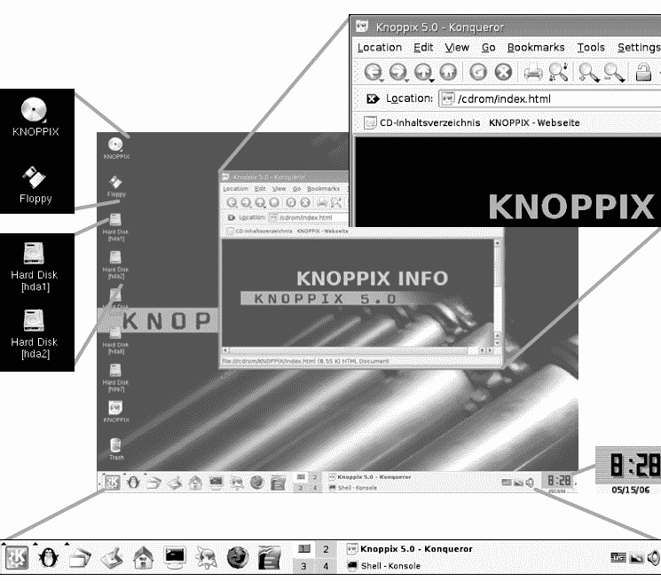

图 2-1 Knoppix 为 KDE 桌面添加了特殊功能，使其作为 Live CD 非常有用。

### CD、软盘和 USB 内存驱动

CD 和软盘驱动器的图标出现在每个 Knoppix 桌面上。要操作其中一个驱动器，在在其图标上右键点击鼠标并从出现的菜单中选择“操作 (Actions)”。请记住，除非你从 RAM 运行 Knoppix（使用 `foram` 启动选项）或从复制到硬盘的 Knoppix 镜像运行，否则无法从驱动器中移除 Knoppix CD 或 DVD。双击这些任何图标即可在文件管理器中打开内容。

使用 udevset，Knoppix 会挂载它遇到的任何 USB 存储设备，无论是在启动时还是在插入到运行中的 Knoppix 系统时。由于 USB 存储媒体默认是只读的，你需要右键点击 USB 设备图标并选择“更改读写模式 (Change Read/Write Mode)”才能向该驱动器写入数据。（写入 USB 闪盘是保存 Knoppix 自定义设置的典型方法，如第 3 章所述。）

## 第 2 章 玩转 Live Linux CD

### 硬盘分区

在启动过程中，Knoppix 会检查你的硬盘，并在桌面上为它遇到的每个硬盘分区添加一个代表分区的图标。这些硬盘分区默认都不会被挂载。要挂载某个分区并在文件管理器中打开其内容，只需选择该图标即可。它将以读/写权限打开。

Knoppix 支持许多不同的文件系统类型。无论你运行的电脑安装的是 Linux、Microsoft Windows、BSD 还是其他类型的操作系统，你都有可能可以从 Linux 挂载它的文件系统。

Knoppix 包含的某些 Linux 系统不支持的功能之一是支持 NTFS 文件系统类型。由于 NTFS 是 Microsoft Windows XP 最常用的文件类型，Knoppix 对于播放、显示或过度使用来自你的 Windows XP 电脑的数据可能非常有用。

Knoppix 通过向 `/etc/fstab` 文件添加有关你的每个分区的信息，轻松地为你的磁盘和其他存储媒体挂载和卸载文件系统。Knoppix 将每个分区挂载到 `/media` 目录下的目录。每个目录根据设备类型（IDE 或 SCSI）和分区编号命名。例如，第一个 IDE 硬盘 (`hda`) 上的第一个分区 (`1`) 名为 `hda1`。它挂载在 `/media/hda1`（带有指向 `/mnt/hda1` 的后兼容链接）。

对于硬盘，挂载点以 `sd` 开头。例如，你电脑上 SCSI 磁盘的第一个分区挂载在 `/media/sda1` 目录。由于 USB 闪存器被挂载为 SCSI 设备，在没有 SCSI 硬盘的情况下，USB 驱动器将挂载在 `/media/sda1`。

### KDE 和 Knoppix 菜单

像典型的 KDE 桌面一样，你可以从面板左下角的 Knoppix 菜单访问大多数应用程序。Knoppix 菜单（小企鹅图标）特别提供了配置工具。尽管它并不困难，但 Knoppix 提供了一些不错的功能：

- **拖放**：如果你经常使用某个应用程序，可以将其拖到桌面。Knoppix 在面板上添加了按钮来配置此。

要更改 KDE 桌面的许多功能，从 K 菜单选择控制中心 (`Control Center`)。

### Live Linux CD

- **到桌面**：默认情况下，Knoppix 启动并通过以太网寻找 DHCP 服务器在很多情况下是有效的。然而，作为拖放的替代方案，你可以右键点击项目并从列表中选择操作。

- **带选项运行**：如果你想修改应用程序的运行方式，右键点击项目，然后从弹出框中选择运行对话框 (`Run Dialog`)。

- **KDE 编辑器**：要永久编辑菜单项目的命令行和相关信息，右键点击该项目并选择编辑项目 (`Edit Item`)。KDE 编辑器为该项目打开，允许你更改应用程序的名称、描述、注释和命令行。选择“文件 → 保存”以使更改生效。

Knoppix 配置菜单允许你配置桌面。更多配置 Knoppix 系统的工具从 Knoppix 菜单可用。从 Knoppix 菜单选择配置 (`Configure`)，可以显示一个配置以下 Knoppix 系统功能的菜单：


- **电视卡**：你可以找到并配置电视卡的驱动，并配置以包含本地广播或有线电视频道。

- **打印机**：这将启动用于添加或配置打印机的 KDE 控制模块。Knoppix 默认使用 CUPS 打印服务 (`cupsd`)。然而，你可以打印到本地（并行、串口、USB）和远程（CUPS、Windows/SMB）的打印机。

- **声卡**：通过运行 `sndconfig` 工具配置你的声卡。

- **网络/互联网**：默认情况下，Knoppix 启动并通过以太网寻找 DHCP 服务器在很多情况下是有效的。然而，因为 Knoppix 旨在作为一个便携操作系统，它包含了配置各种网络硬件的工具。Knoppix 上的网络/互联网菜单具有配置调制解调器、ADSL、ISDN 以及各种移动和无线硬件连接的工具。

## 第 2 章 玩转 Live Linux CD

在“工具”（Utilities）下，你可以运行“硬盘/CD/DVD/DMA 加速”，以为你的硬盘或可移动媒体驱动器开启内存访问加速。在大多数情况下，开启 DMA 可以提高磁盘性能。然而，对于那些带有缺陷 DMA 控制器的驱动器，可以通过关闭 DMA 来避免磁盘访问错误。在大多数情况下，开启它是值得的，尽管有人说，在极端情况下，不支持 DMA 的可写驱动器可能会发生数据损坏。

### 面板按钮

在 Knoppix KDE 面上，KDE 和 Knoppix 按钮右侧是多个常用应用程序的按钮。这些应用程序包括（从左到右）：窗口列表菜单、桌面访问按钮（最小化桌面上的所有窗口）、在 Konqueror 中打开 `/home/knoppix` 目录的按钮、`Konsole`（壳终端）、`Konqueror`（文件管理器和网络浏览器）、`Firefox`（网络浏览器）以及 Open Office（Office.org Writer）。

你可以移动、删除或添加面板按钮。右键点击图标，然后选择与该按钮相关的“移动”（Move）、“移除”（Remove）或“配置”（Configure）应用程序。要向面板添加新的应用程序按钮，右键点击面板（显示面板菜单），并选择添加“组件”（在面板上运行的小型程序）或“应用程序”（你可以从弹出的 KDE 菜单中选择）。

### 桌面切换器和任务栏

Knoppix 使用的 KDE 桌面默认提供四个工作空间。“桌面切换器”（Desktop Pager）让你能够轻松在这四个桌面之间切换，甚至可以添加更多（最多 20 个）。任务栏显示所有当前运行的桌面应用程序。

通过点击桌面切换器上你想要的一个，可以在四个工作空间之间切换。矩形图标代表每个工作空间上打开的应用程序。你可以在切换器工作空间之间拖放应用程序窗口，使应用程序移动到新的工作空间。要在桌面上查看更大的切换器版本，右键点击切换器并选择“启动切换器”（Launch Pager）。图 2-2 显示了桌面切换器的窗口示例：

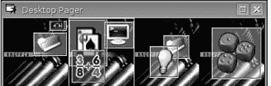

> 图 2-2

使用桌面切换器在工作空间之间移动。

将鼠标悬停在任务栏的应用程序上，可以查看任务名称及其所在的工作空间。任务栏还可以与桌面切换器交互。你可以将应用程序从任务栏拖放到你希望它出现的任何工作空间。若要让一个应用程序出现在每个工作空间，请右键点击任务栏中的应用程序，然后选择“桌面”（Desktop）→“所有桌面”（All Desktops）。

### 系统托盘

KDE Knoppix 桌面面板右侧有代表组件的小图标，称为“系统托盘”（system tray）。组件提供了在 KDE Knoppix 桌面不断更改系统设置的另一种方法。

出现在 Knoppix KDE 桌面上的组件包括 KDE 键盘工具、屏幕大小组件和 K 组件。你可以配置键盘、屏幕分辨率和刷新率，并调整音频通道的音量。

选择面板菜单并点击“添加组件到面板”（Add Applet to Panel）以查看可用组件的列表。你可以添加诸如 Konqueror 浏览器书签、益智游戏、Klipper（剪贴粘贴工具）、网络文件夹、打印机菜单、快速文件浏览器、控制中心菜单、天气预报和无线网络信息等组件。

### Konqueror 文件管理器

`Konqueror` 是查看 KDE 桌面内容的主要图形化应用程序。除了允许你查看本地或网络文件夹的内容外，`Konqueror` 还是网络浏览器和通用文档查看器。

当 Knoppix 启动时，`Konqueror` 窗口会显示 Knoppix 信息页。你可以通过选择桌面面板上的主页图标随时打开新的 `Konqueror` 窗口。你可以用它浏览目录（`home/knoppix`）或网页（`www.knoppix.net`）。你也可以用它来浏览特殊功能，包括以下示例：

- `about:konqueror`—浏览与 `Konqueror` 相关的描述、规格和提示。
- `about:plugins`—查看 `Konqueror` 安装了哪些网络浏览器插件。
- `applications:`—查看系统上由文件夹和图标表示的应用程序。
- `settings:/`—查看代表更改系统设置的应用程序图标。
- `remote:/`—使用“添加网络文件夹”图标添加网络资源链接（例如来自你局域网的远程 NFS 和 Samba 文件系统）。

当你打开 `Konsole` 窗口时，你的用户 ID 与运行桌面的用户相同：`knoppix`。主目录是 `/home/knoppix`。对于 Knoppix 用户的读/写/执行权限，适用标准的 Linux 系统权限。`knoppix` 用户可以更改 `/home/knoppix` 和 `/tmp` 中的文件，但无法更改 `/etc` 或 `/bin` 中的文件。

为了允许 Knoppix 用户在需要时使用 root 权限，你可以使用 `sudo` 命令。`/etc/sudoers` 文件已配置为允许 Knoppix 用户像 root 用户一样运行任何命令。例如，要使用 `vi` 编辑 `/etc/hosts` 文件并更改其内容，你可以输入：

```
# sudo vi /etc/hosts
```

由于 `sudo` 配置为允许你以 `knoppix` 用户身份运行任何命令，而无需输入（注：原文此处为 "run any command as the Knoppix user, without typing" - 可能指“无需输入密码”）。

## 第 2 章 玩转式 Linux CD

你可以从 Games Knoppix 网站获取 CD：`http://games-knoppix.uniq-ag.uni-kl.de`。本节将介绍 Games Knoppix CD。

由于 Knoppix Games 是 Knoppix 的重制版本，你可以在 Knoppix 中到处移动；这里大部分不同在于游戏本身。要开始使用，只需使用 K 菜单中的 Games 列表。图 2-3 显示了 Knoppix Games 屏幕示例，显示了游戏《钢铁天空》（Beneath a Steel Sky，右上角）和《亚马逊女王号》（Flight of the Amazon Queen，中间），以及 Conqueror 窗口中显示的游戏列表（在位置框中输入程序 `/Games/` 即可显示此列表）：


图 2-3：《钢铁天空》和《亚马逊女王号》是现在已免费的商业游戏。

> 注意

英特尔最近宣布将开源发布其显卡的驱动程序。尽管英特尔的视频接口被认为不如 NVIDIA 和 ATI 的显卡，但预计英特尔的公告将极大提升开源驱动程序的游戏体验，并可能鼓励 NVIDIA 和 ATI 也开源其驱动程序。

### 活动式 Linux CD

这里描述的大多数游戏都受 GNU 通用许可证 (GPL) 或类似许可证保护，可以自由分发。你可能会免费使用某些在 Linux 下运行的受其他许可证保护的游戏；另一方面，你可能可以免费使用自己的活动式 CD，但不能使用重新分发的 CD。例如，某些商业游戏的演示版可能属于此类。你可能需要获得游戏公司的许可才能重新分发演示版（而这种请求可能会被无视）。

你可以尝试 Knoppix Games 中的各种游戏。其中包含一些很好的例子，比如从零开始开发的免费游戏，以及那些作为商业游戏开始后变为免费软件的游戏。还有许多游戏是热门棋游和纸牌游戏的克隆版本。后续章节包含传统免费游戏、现已免费的旧商业游戏以及热门棋游和纸牌游戏的克隆示例。

### 运行 NetHack 和传统自由软件游戏

由于游戏一直是自由软件爱好者的热门消遣，一些长期存在的游戏是从零开始构建并自由分发的。许多游戏正在持续开发（当开发者有时间时），拥有强大的追随者，并在论坛和邮件列表中被活跃讨论。另一些则处于休眠状态，直到有人有时间和兴趣去尝试它们。以下是几个可以尝试的自由软件游戏示例：

- **BZflag 3D 坦克游戏 (Games → bzflag)**——在这个 3D 多人坦克游戏中进行夺旗赛或其他游戏（可以以团队或个人形式）。通过连接到 BZflag 服务器，你可以通过互联网与世界各地的竞技。访问 `http://bzflag.org` 了解更多信息。
- **KQ (Games → Adventure → KQ)**——在这一角色扮演冒险游戏中，玩家被要求帮助名为 Nostok 的神秘老头找回他被偷的 Xenarum 之杖。法杖被断成了两部分。能够找回两个部分的玩家将获得巨大的名声和财富。KQ 在被原始开发者放弃后，Allegro 游戏开发社区（`www.allegro.com`）接管了开发工作。你可以在 KQLives Sourceforge 站点（`http://kqlives.sourceforge.net/`）了解更多游戏玩法。
- **GNU chess (Games → Board Games → Xboard)**——你可以与电脑或在线对手下国际象棋。GNU chess 的图形版本称为 Xboard。GNU chess 页面为 `www.gnu.org/software/chess`。

在类似于《龙与地下城》风格的冒险游戏 NetHack 中，你进入地下城寻找 Yendor 护符（Amulet of Yendor）。在途中，你杀杀怪物、收集酷的物品，并探索黑暗而神秘的地方。

`NetHack` (`http://nethack.org`) 是那些从自由软件开始，并在多年不断演变并产生新版本的游戏的良好代表。它的早期祖先可以追溯到纯文本游戏，如 Adventure，以及后来面向屏幕的 Rogue 类。`NetHack` 的代码库来自游戏 Hack，它运行在 UNIX 系统的基于字符的终端上。`NetHack` 的演变包含了多种可用的用户界面（包括图形和文本界面），运行在许多不同的计算机系统中（包括 UNIX、Linux、macOS、DOS 和 OS/2）。

你可以通过从 K 菜单中选择 Games -> Adventure、Knoppix 活动 CD，并选择 NetHack（无 GUI）、Nethack、Hack 或 Falcon's Eye 来启动不同版本的 NetHack。图 2-4 显示了 Falcon's Eye 版本 NetHack 的示例。


图 2-4：在 Falcon's Eye (NetHack) 中探索地下城、获取宝藏并战斗怪物。

在基于字符的版本中，地下城中的每个物品都由符号表示。符号 (@) 处是你，楼梯向上 (<) 或向下 (>)，而诸如魔杖 (/)、戒指 (=)、卷轴 (()) 或药水 (!) 等物品可能散落在四周供你拾取。然而，在 Falcon's Eye 中，你可以将鼠标悬停在物品上查看描述。使用鼠标左键选择去向。使用右键选择物品。表 2-1 显示了 NetHack 的命令。

### 运行天空和商业游戏

这里是一些关于开始使用的提示：

- 在屏幕上缓慢移动指针以寻找物品。某些物品在你在其上方之前是不可见的。
- 使用鼠标左键选择去向。使用右键选择物品。
- 询问很多问题。有时在有人给你信息之前，你无法继续。

### 表 2-1 NetHack 键盘命令

| KEY | 说明 | KEY | 说明 |
| :--- | :--- | :--- | :--- |
| ? | 显示帮助菜单。 | ^R | 重绘屏幕。 |
| / | 显示符号含义。 | 选择位置或给出符号参数。 |
| & | 显示命令的作用。 | s | 搜索周围的隐藏门和陷阱。 |
| < | 站在楼梯上向上走。 | S | 保存游戏。 |
| > | 站在楼梯上向下走。 | t | 投掷物体或发射射物。 |
| . | 休息，回合不做操作。 | T | 脱下装备。 |
| – | 通过路径算法旅行到地图上的某点 | ^T | 传送（如果你可以的话）。 |
| a | 应用（使用）工具（镐、钥匙、灯等）。 | v | 显示版本号。 |
| A | 移除所有装备。 | V | 显示更详细的版本信息，包括游戏历史。 |
| ^A | 重做上一个命令。 | w | 装备武器 w - 意味着不持武器，用赤手。 |
| c | 关闭门。 | W | 穿上装备。 |
| C | 召唤单个怪物。 | x | 交换主武器和副武器。 |
| d | 丢弃物品，d7a: 丢弃7个物品 a。 | X | 将游戏切换到探索模式。 |
| D | 丢弃多个物品。 | ^X | 显示属性。 |
| ^D | 踢（通常用于门）。 | z | 使用魔杖。 |
| e | 吃食物。 | Z | 施法术。 |
| ^Z | 挂起游戏。 | | |

### 现场 Linux CD

### 表 2-1 延续

| 键位 | 描述 | 键位 | 描述 |
| :--- | :--- | :--- | :--- |
| E | 在地板上刻字信息。E- 用手指在灰尘上写字。 | : | 查看此处的内容。 |
| f | 从箭袋中发射弹药。 | ; | 查看其他地方的内容。 |
| F | 后接方向，与怪物战斗（即使你没有感知到它）。 | . | 捡起一些物品。 |
| i | 显示你的背包。 | @ | 切换拾取选项。 |
| I | 显示背包的选定部分，如 I*（列出背包中所有的宝石）、Tu（列出未支付物品）、Ix（列出购物单上所有已使用的物品）和 I$（计算金额）。 | ^ | 询问之前发现的陷阱类型 |
| o | 打开门。 | ) | 告诉你正在使用什么武器 |
| O | 检查当前选项并可能更改它们。 | [ | 告诉你正在穿着什么护甲 |
| p | 支付你的购物单。 | = | 告诉你戴着什么戒指 |
| P | 戴上配件（戒指、护身符等）。 | " | 告诉你戴着什么护身符 |
| ^P | 重复最后的消息（后续的 ^P 命令将重复之前的消息）。 | ( | 告诉你正在使用什么工具 |
| q | 喝（吞下）药水。 | * | 告诉你正在使用什么设备；结合前面的五项 |
| Q | 为箭袋选择弹药。 | $ | 计算你的金币数量。 |
| r | 读取卷轴或法书。 | + | 列出你学会的法术；如果需要，还会重新排列它们。 |

图 2-5 显示了《钢铁天空之下》（Beneath a Steel Sky）的截图，其中 Robert Foster 需要进入储藏室找到他用来短路控制面板所需的腻子：

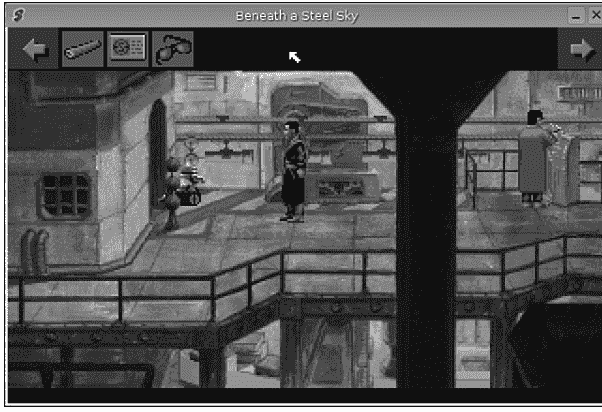

图 2-5 帮助 Robert Foster 逃离联盟市并发现他过去的秘密。

弄清楚如何玩这个游戏可能非常耗时。为了帮助你入门，这里有你可以尝试的第一步：找到金属棒并拿走（右键点击）。撬开逃生门。在军官检查门后，下楼梯进入右侧的房间。

在垃圾里找件东西作为 Joey（你的机器人）的身体，并将电路板掉在上面。尝试启动运输机器人。当它没有启动时，进入右侧的房间向 Hobbins 提问，直到他告诉你运输机器人出了什么问题。回到左侧的房间让 Joey 修复运输机器人。当运输器将桶运到电梯时，当电梯降下时跳进洞里。

接下来，尝试熔炉房门上的锁。当你无法打开它时，让 Joey 开门。当 Reich 军官进来被 Linc 射中时，过去拿走他的身份证和太阳镜。离开熔炉房，尝试弄清楚如何找一个电梯带你离开。你已经在上路了。

如果你在玩了一段时间后觉得游戏很难（这很可能是事实），你可以在互联网上找到很多游戏的攻略。攻略的一个示例位于 `http://home.alo.com/gametown/beneath.html`。否则，只需搜索术语“攻略”和“Beneath a Steel Sky”。

### 运行卡牌游戏、棋盘游戏和策略游戏克隆

你在现实世界中想象到的几乎每个棋盘游戏或卡牌游戏都有 Linux 版本可用。同样，许多流行的电脑和街机游戏也被克隆为开源应用程序。如果你需要一点休息时间，有些游戏是可以切换来玩的，包括：

- 卡牌游戏 -> 许多在现实世界中想象到的几乎每个卡牌游戏都有 Linux 版本。你可以找到许多开源克隆版本，如纸牌类（Solitaire）、扑克牌（Poker）和西洋双陆牌（Bridge）。
- 棋盘游戏 -> 许多在现实世界中想象到的几乎每个棋盘游戏都有 Linux 版本。你可以找到如国际象棋（Chess）和麻将（Mahjong）。
- 策略游戏 -> 许多在现实世界中想象到的几乎每个策略游戏都有 Linux 版本。你可以找到一些，如《文明》（Civilization）。

## 式 Linux CD

MovIX 项目是一个精简的操作系统，仅包含访问和播放多媒体内容所需的软件，可以在内存极小时的低端电脑上运行。

MovIX2 多媒体播放器是 MovIX 项目中功能最全的。MovIX2 的重点是简单的 X 窗口系统显示和 `mplayer` 媒体播放器。由于体积较小，MovIX2 可以装入微型 CD（mini-CD）、64MB USB 盘或其他小型启动介质中。运行运行时，你可以从 CD、DVD、硬盘或各种网络接口播放视频、音乐或数字图像。

任何 Live CD 的一个关键要素都是其能够正确检测并配置你的显卡设置的能力。MovIX2 提供了几个启动选项，可以让你充分利用显卡硬件。例如，MovIX2 包含了专有的 NVIDIA 驱动程序，你可以在启动提示符处选择使用它，而不是开源的 NVIDIA 驱动程序。同样，如果显示器没有被正确检测，你也可以手动设置显示器频率（同样在启动提示符处）。

以下步骤将引导你了解 MovIX2 的某些功能：


## 按照附录 A 中的描述，将 MovIX2 ISO 镜像刻录到 CD

- 1. 按照附录 A 中的描述，将 MovIX2 ISO 镜像刻录到 CD。
- 2. 将 MovIX2 Live CD 插入电脑并重启。
- 3. 当你看到 MovIX2 启动屏幕时，可以按下 Enter 键或输入以下任何启动标签，具体取决于你的情况：
  - `MovIX2`—这是默认标签。
  - `NVIDIA`—如果你有 NVIDIA 显卡，可以尝试此标签以使用 NVIDIA 提供的驱动程序。（否则，将使用开源驱动程序。）
  - `Frame Buffer`—如果你的显卡硬件无法被正确检测，你可能可以将其识别为帧缓冲区设备（frame buffer device），以便使用 MovIX2。你也可以将其作为通用帧缓冲区（vesaFB）的标签，或者使用特定分辨率的帧缓冲区（`vesaFB640`、`vesaFB1024`、`vesaFB1280` 或 `vesaFB1400` 分别对应 640x480、800x600、1024x768、1280x1024 或 1400x1050 分辨率）。
  - `vesa`—此标签使用通用 vesa 驱动（非加速）启动 MovIX2。
  - `aa`—使用 aa 以 ASCII 格式显示视频。

如果你在正常运行 MovIX2 时遇到进一步困难，请在启动提示符按 `F5` 或 `F6` 分别选择 X 显示启动参数和系统启动参数。

内核启动并开始将 MovIX2 复制到内存中。完成后，你将看到 MovIX2 屏幕，准备好播放你的多媒体内容。

## 第 2 章 玩转 Live Linux CD

- 4. 弹出 CD。现在你可以使用驱动器插入包含你想要播放内容的 CD 或 DVD。
- 5. 右键点击桌面，选择修改过的 Mplayer 菜单。然后选择 Switch to MovIX。出现 MovIX 主页面，如图 2-6 所示。

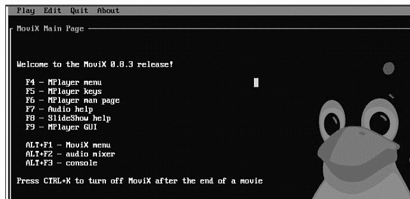

**图 2-6** 从 MovIX 主页面播放视频、音频或幻灯片：

以下是你可以从 MovIX 主页面执行的一些操作：

- **播放视频**—按 `F9` 启动 Mplayer 媒体图形界面。右键点击桌面并选择 Open → Play File。然后你可以浏览电脑以找到任何支持的视频进行播放。你可以检查 CD 或 DVD (`/cdrom`)、硬盘分区 (`/discs`) 以及远程挂载的文件系统（挂载在 `/mnt` 上）。
- **播放音乐**—向驱动器插入音乐 CD。选择 Play → Audio CD → Play music from an audio CD。当每首歌曲从 CD 播放时，MovIX2 在屏幕上显示艺术家、专辑和曲目（歌曲标题）（前提是可以通过网络访问 CDDB 数据库）。播放器具有简单的控制功能。使用上下方向键切换曲目。按 `9` 减音量，按 `0` 增音量。按 `Esc` 退出。

> 注意 MovIX2 默认无法播放商业媒体 DVD。如果你能获得 `libvdcss` 库并将其添加到 MovIX2 CD 的 `/usr/lib/` 目录下，你就可以使用 MovIX2 播放商业 DVD。请参第 12 章，深入讨论为何解码商业 DVD 电影的库并不总是包含在 Linux 发行版中。

### Live Linux CD

- **播放数字图像**—要显示数字图像目录的幻灯片，选择 Play → SlideShow，然后选择图像位置（CD 驱动器或磁盘分区）。使用 Page Up 或 Page Down 分别进入上一张或下一图像。使用 `+/-` 键缩放。对于大于屏幕的图像，使用方向键滚动。需要帮助时，按 `P` 暂停幻灯片按 `Esc` 退出。

如果你需要调整音频，按 `Alt+F2` 显示 `alsamsixer` 器。要访问 shell，按 `Alt+F3`。

大多数声卡都表示 ALSA 项目支持 MovIX2。如果你的声卡无法工作，可以尝试加载 OSS 声卡模块（`OSS=y` 启动选项）。对于 ISA 声卡，你可能需要 `DETECT=all` 启动选项才能正常工作。

### 使用 MovIX2 的多媒体内容

MovIX Live CD 的目的是提供访问多媒体内容的方法。以下是 MovIX 的快速导览：

- 按照附录 A 中的描述，将 MovIX2 ISO 镜像刻录到 CD。
- 将 MovIX2 Live CD 插入电脑并重启。
- 当你看到 MovIX2 启动屏幕时，可以按下 Enter 键或输入以下任何启动标签，具体取决于你的情况：
  - `MovIX2`—这是默认标签。
  - `NVIDIA`—如果你有 NVIDIA 显卡，可以尝试此标签以使用 NVIDIA 提供的驱动程序。（否则，将使用开源驱动程序。）
  - `Frame Buffer`—如果你的显卡硬件无法被正确检测，你可能可以将其识别为帧缓冲区设备，以便使用 MovIX2。
  - `vesa`—此标签使用通用 vesa 驱动（非加速）启动 MovIX2。
  - `aa`—使用 aa 以 ASCII 格式显示视频。

### 在 MovIX 中尝试多媒体应用

MovIX 中提供的开源多媒体工具集可以让你忙一阵。以下列表列出了你可以使用 MovIX 做的一些事情以及可以完成的应用：

- *播放视频*—`Mplayer` 和 `Xine` 是最流行的开源多媒体播放器。两者都可以播放多种流行格式的视频，例如 MPEG (1, 2 和 4)、DivX、Windows Media Video、动态 JPEG、Sorenson QV1/SQV3，支持的音频格式包括 MP3、O Vorbis、DivX音频和 Real Media。在 MovIX 中，Mplayer 未编译为使用图形控制 (`gmplayer`)，因此你需要从命令行启动它。
- *录制和编辑视频*—MovIX 包含了用于视频处理的 Kino 数字视频录机和编辑器以及 Avid 视频切割。它还包含了强大的命令行录制工具，包括 `mencorder`、`ffmpeg`、`nuvec`。
播放音频—`Xms` 是一款流行的图形化音频播放器。通过命令行，你可以使用 `ogg123` 压缩 Ogg Vorbis 格式的音乐。`mpg123` 命令可以播放 MP3 音乐文件。
编辑音频—ReZound 音频编辑器（http://rezound.sourceforge.net）是一款用于快速、高效编辑音频的开源工具。它可以处理 WAVE、AIFF、原始音频（raw audio）、Ogg Vorbis、MPEG (3, 2, 1)、FLAC 和 MIDI 采样文件。Audacity（http://audacity.sourceforge.net）是另一个图形化音频编辑器，你可以用它编辑声音和音乐、添加效果并以多种格式保存输出。图 2-8 显示了 Audacity 窗口。
编辑图像—GIMP 是一个流行的数字图像编辑工具。如果你想编辑矢量图形，可以尝试 InkScape。使用 Blender 创建 3D 模型。如果想浏览数字图像，可以尝试 GQView。你可以在主 Dynebolic 菜单的 IMAGE 菜单中选择所有这些工具。

Dynebolic 还有几十个多媒体应用可用。有关 Dynebolic 包含的其他软件工具，请参考该项目网站（www.dynebolic.org/index.php?show=features）。

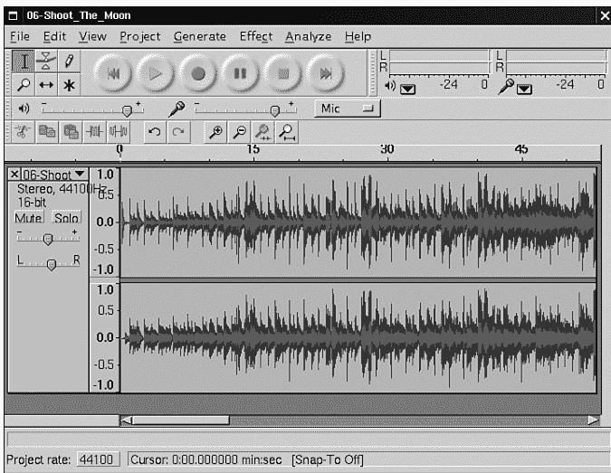

图 2-8 使用 Audacity 的音频编辑器。

## 运行安全实时光盘 (BACKTRACK)

BackTrack（www.remote-exploit.org/index.php/BackTrack）是一个基于 Linux 实时光盘的网络安全工具套件。它基于 Slackware 衍生版 SLAX 实时光盘，并了两个面向安全导的实时 Linux 发行版的特征：Whax 和 Auditor。

BackTrack CD 包含超过 600MB 的工具，用于修复文件系统、追踪漏洞、监控网络以及执行许多许多修复和维护任务。该 CD 还包含了来自 Metasploit（www.metasploit.com）和 SecurityFocus（www.securityfocus.com）的已知漏洞信息存档，并提供了相应的工具（如存档浏览器）来访问这些数据。有关 BackTrack 的更多描述，请参阅第 9 章“自定义安全光盘”。

### 使用 BackTrack

BackTrack 的设计方法反映了你对一个用于检查或修复损坏系统的实时光盘可能预期的功能。以下是一些示例：

- 启动消息—通常当你启动实时光盘时，消息会快速流过，你可能会错过重要信息。BackTrack 提供了一个调试模式（在启动提示符处输入 `debug`），可以在启动过程中的几点打开 shell。如果出现问题，你可以从 shell 中纠正。如果一切正常，按 `Ctrl+D` 继续启动。当交给 init 进程时，服务将启动。如果某些功能失败，BackTrack 会告诉关闭关闭。屏幕上的消息会告诉你下次启动时输入 `noplug`。如果热插拔失败，也适用。
- 启动到文本提示—BackTrack 启动到文本提示，假设你可能没有可用的（或可以工作的）图形界面。在这里可以使用虚拟终端（`Ctrl+Alt+F1`、`Ctrl+Alt+F2` 等）。
- 挂载文件系统—BackTrack 假设当你从存储介质启动时，希望对系统具有完全访问权限。每个分区都可以以读写权限挂载。例如，来自第一块硬盘的分区（`/dev/sda1`、`/dev/sda2` 等）挂载在 `/mnt` 目录上。同样，USB 闪存分区（被视为 SCSI 设备）挂载在 `/mnt/sda1`、`/mnt/sda2` 等。每个分区的挂载允许从该分区执行文件。你可以检查 `/etc/fstab` 来查看检测到了哪些分区以及它们的挂载方式。
- 桌面—以 root 用户登录后，运行命令启动 GUI（默认情况下）。如果你处于低资源环境中，可以运行一个更高效的窗口管理器，而不是完整的桌面。
- 可用工具—启动、检查和修复计算机所需的工具在桌面上可以轻松获得。大部分安全工具组织在 BackTrack 菜单（选择 KDE 菜单）下的十多个类别中。来自 KDE 菜单的辅助服务允许你设置网络连接、配置桌面（Settings 菜单）、搜索计算机（Find Files/Folders）并进行屏幕截屏。除了拥有可用工具列表外，BackTrack 还需要支持许多不同的硬件和文件系统类型。例如，BackTrack 包含了对 NTFS 分区的支持以及配置网卡的工具。

### 尝试安全应用

尽管 BackTrack 实时光盘包含了数百种安全工具，但你可以从组织良好的 BackTrack 菜单中找到许多顶尖工具。由于这些工具中的许多是命令行程序（无 GUI），某些选项仅会启动一个显示帮助文本的 shell。以下文本包含你可以从 BackTrack 运行的一些安全工具示例。

- 扫描器—BackTrack 包含了扫描网络端口（以查看人们从哪里入侵）以及扫描系统通用漏洞的工具。Nessus（www.ness.org）漏洞扫描器在更新的安全数据库上运行，以检查最新的漏洞。除了从外部检查计算机的安全性（如开放端口和配置错误的网络服务），Nessus 还检查漏洞程序（如 Web 浏览器和邮件客户端）以发现缺陷和缺失的补丁。

Nmap（www.nmap.org）可以检查网络接口上的端口以发现潜在漏洞。可以通过 KDE 菜单获取 Nmap 的图形化前端，路径为 BackTrack -> Scanners -> Port Scanners -> NmapFE。

在 NmapFE 中，你可以输入要扫描的计算机的 IP 地址，选择扫描类型（例如 SYN Stealth Scan 或 Connect Scan），并点击 Scan 按钮。NmapFE 显示响应的端口列表（意味着该端口上有服务），以及显示关闭端口的数量。
- 嗅探器—网络嗅探（如 Ethereal）可以监控计算机上的以太网端口以查看该端口的所有流量。打开 Ethernet（选择 BackTrack -> Sniffers -> Ethereal），选择 Capture -> Interfaces，然后点击要扫描的本地接口的 Capture 按钮。几分钟后，点击 Stop 查看在该接口接收的数据包。Ethereal 的输出显示了通过该接口接收的数据包。你应该看到如 DNS 查询、Windows 共享的 BROWSE 包、可用打印机公告以及（如果在上网）大量的 HTTP GET。你可以各种方式对数据进行排序（按时间、源、目的、协议等）或使用 Filter 按协议类型、IP 地址或其他属性进行过滤。
- 取证工具—选择 BackTrack -> Forensic Tools，可以选择多种用于在怀疑攻击后分析系统的应用程序。对硬盘分区进行取证的典型方法是将其备份为镜像文件（获取 Autopsy 然后使用 AIR 工具或 `dd` 命令创建镜像文件）。Autopsy 取证浏览器（www.sleuthkit.org/autopsy）提供了一个图形化界面，使用一组 Sleuth Kit 工具调查 UNIX 和 Linux 系统上的问题。要在浏览器中启动 Autopsy，从 Forensic Tools 中选择 Analysis -> Autopsy。你可以使用 Autopsy 对该镜像运行各种测试，例如文件分析或关键词搜索，如图 2-9 所示。

## 第 2 章 玩转 Live Linux CD

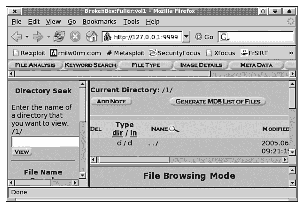

图 2-9 使用 Autopsy 对文件系统镜像进行取证分析。

在进入启动选项之前，如果你尝试启动 live CD、DVD 或 USB 驱动器，你的电脑会完全忽略它并直接启动到硬盘，或者你可能需要更改系统 BIOS。由于系统是首次启动，请进入 BIOS 界面（通过按下功能键、Del 键或屏幕上指示的任何按键）。在 BIOS 中，寻找一个可以让你选择启动顺序的选项，使你的 CD、DVD 或 USB 驱动器排在硬盘之前。保存更改并继续启动。

如果你看到了 live CD 或 DVD 的启动界面或启动提示符，你就可以继续操作了。从任何 live Linux CD 的启动提示符中，你可以向内核传递选项，告诉它如何处理某些类型的硬件，或者在启动时忽略某些硬件。

你首要需要知道的是，你只有几秒钟的时间暂停启动过程，否则它将继续启动默认系统。在 Isolinux 启动界面上，输入任何字母都可以阻止启动过程进行。在 GRUB 启动界面上，使用方向键移动到你想启动的 CD 镜像，并按下字母 `e` 即可向选定的内核行添加选项。

不同的 live CD 可能有不同的启动选项。你通过输入标签（例如 `knoptix` 或 `hlinux`）后后跟一个或多个选项来进入启动选项。例如，要使用美国英语和 fluxbox 桌面运行 Knoptix，你在启动提示符处输入以下内容：

```
boot: knoptix lang=en desktop=fluxbox
```

### Live Linux CD

虽然 knoppix 是启动提示符的默认标签，但 Knoppix 还有其他可用的标签。`expert` 标签允许你在启动过程中以交互式方式配置硬件。`debug` 标签会在 Knoppix 启动时产生更多信息。`failsafe` 标签在几乎不加载任何硬件的情况下启动。其他 `frame buffer` 选项允许视频显示不同的分辨率：`fb800x600`、`fb1024x768` 和 `fb1280x1024`。

表 2-2 包含了 Knoppix 可用的启动选项列表。这些选项大部分都列在任何 Knoppix CD 的 `knoppies-cheatcodes.txt` 文件中。许多选项在 Knoppix 启动提示符处按下 `F2` 和 `F3` 时也会出现。

这里未列出的其他启动选项可以用于为运行 Knoppix 提供特殊功能。它们包括用于持久化桌面、保存配置设置以及从 RAM 或硬硬盘运行 Knoppix 的选项。第 3 章将介绍你用来创建和使用持久化桌面的选项。

要完全从 RAM 运行 Knoppix live 的功能需要一个名为 `toram` 的简单启动选项。如果你至少有 1GB 的可用 RAM，可以在启动提示符处输入以下内容从 RAM 运行你的 Knoppix live CD：

```
boot: knoppix toram
```

使用 `toram` 选项启动 Knoppix 可能会花费更长时间，因为整个镜像必须加载到 RAM 中。然而，live CD 的性能应该比从 CD 或 DVD 运行提高得多。此外，你就可以拔出 CD 或 DVD，将驱动器用于其他用途。

### 总结

由于 live Linux CD 是为从只读介质运行而设计的，运行 live CD 与从硬盘运行 Linux 有些不同。live CD 的开发者通过允许系统从 RAM 运行，解决了性能较慢等问题。他们通过允许你将数据保存到内存中绕过了只读问题。此外，通过实现持久化桌面和笔记等功能，数据在重启时不会消失。

本章介绍了几种不同类型的 live CD。Knoppix 被介绍为最受欢迎的桌面 CD。Games Knoppix 包含了大量游戏。BackTrack 包含了一系列安全相关的应用程序。探索这些以及其他 live CD 是如何工作的，将为你构建自己的 live Linux CD 提供一些灵感。

### 表 2-2 Knoppix 启动选项

| 通用启动选项 | 描述 |
| :--- | :--- |
| `lang=*id*` | 指明用于 live CD 的的语言/键盘。将 *id* 替换为 ch, cn, de, da, es, fr, it, nl, pl, ru, sk, tr, tw 或 us。 |
| `gmt` | 使用基于格林威治时间 (GMT) 而不是本地时间。 |
| `tz=*id*` | 在 Knoppix 中使用特定的时区。将 *id* 替换为你想要使用的时区名称。 |
| `desktop= id` | 将 *id* 替换为你想要为桌面使用的桌面环境或窗口管理器名称。虽然并非所有选项都在 Knoppix CD 上，但有效值包括 fluxbox, gnome, iwm, 1g3d, aswm, openbox, twm, wmaker, xfence 和 xfce4。 |


| screen=`id` | 输入特定的屏幕分辨率。将 `id` 替换为 `640x480`、`800x600`、`1280x1024` 或其他分辨率。 |
| 显示选项 | 描述 |
| xvrefresh=`id` | 输入垂直刷新率。将 `id` 替换为 `60`、`72`、`80` 或其他赫兹的刷新率（基于显示器）。 |
| xrefresh=`id` | 输入水平刷新率。将 `id` 替换为 `60`、`72`、`80` 或其他赫兹的刷新率（基于显示器）。 |
| xserver=`id` | 指定要使用的 X 服务器。 |
| xmodule=`id` | 指定要使用的驱动。将 `id` 替换为 `ati`、`fbdev`、`radeon` 或 `svga`。 |
| 硬件选项 | 描述 |
| :--- | :--- |
| noapic | 避免 APIC 问题。 |
| noagp | 检测 agp。 |
| noapm | 不启用电源管理。 |
| noaudio | 不启用音频。 |
| noddc | 不使用显示检测。 |
| nodcp | 不尝试使用 DHCP 网络。 |
| nostab | 挂载文件系统时忽略 `/etc/fstab`。 |
| nofirewire | 禁用火线检测。 |
| nopcmcia | 禁用 PCMCIA 检测。 |
| noscsi | 禁用 SCSI 检测。 |
| noswap | 不尝试检测交换分区。 |
| noudev | 禁用 UDEV 检测。 |
| nousb | 不尝试检测 USB1。 |
| nousb2 | 不尝试检测 USB2。 |
| pnpbios=-off | 关闭 PNP BIOS。 |
| acpi=off | 关闭 ACPI 初始化。 |
| acpi=force | 需要 ACPI。 |

# 定制 live CD

如果你发现你喜欢你的 live CD，你可能想多次使用它。问题是，一旦你重启 live CD，就会丢失所有自定义设置、数据和添加的应用程序。解决方案是找到一种保存你在 live CD 会话期间更改或添加的数据，以便下次重启时可用。

重制（本质上是修改并重新制作现有 CD）和从头开始（本质上是全新的 Linux 安装并生成新的 ISO 镜像）是在 live CD 上获得你所需内容的两种方法。然而，这需要一些时间和大量的 Linux 专家知识（参见第 6 章“构建自定义 Knoppix Live CD”到第 8 章“构建基础 Gentoo Live CD”）。

本章开始介绍一些定制你 live CD 系统的棒方法。其中一些功能是你可以在大多数 Linux 系统上执行的（例如更改桌面外观）；另一些则提供了在 live CD 上效果很好的功能（例如设置 live CD 以自助机模式运行）。

接下来，本章将告诉你如何设置 live CD，以便你的数据可以从 USB 闪存驱动器、硬盘分区、软磁盘进行保存和重复使用。或者可读写介质。此功能有时被称为“持久化桌面”（persistent desktop）。本章还介绍了如何将操作系统本身放在可擦写的 USB 闪存器上，这样操作系统和数据就不需要分开携带了。

这里使用 Knoppix 主要为了提供示例，演示如何自定义你的 live CD 并配置以在跨重启时保存这些自定义设置。由于许多其他 live Linux 发行版都是基于 Knoppix 的，因此这里描述的许多过程也适用于这些 live CD。此之后，本章还包含了关于其他 live CD 如何使用不同手段在重启后保存你的数据的信息。

## 自定义 live CD

本节为你提供了关于如何自定义你的 live CD 的思路。这些更改 live CD 外观、感感和内容（无需重新制作发行光盘）的技术可以让你真正让 live CD 独一无帜。Knoppix 提供了两种保存自定义设置的主要方法：持久化桌面和备份存档。在开始配置你想要保存的设置之前，你可以先了解这两种方法：

- **持久化桌面（Persistent desktop）**——通过这种方法，你设置一个可写的文件系统镜像，并将其存储在可写的 USB 闪存驱动器或硬盘上。你应该在进行自定义之前设置好它，因为该功能需要重启才能生效。之后，所有自定义设置都将按原样存储在那个文件系统镜像中。
- **备份存档（Backup archive）**——通过这种方法，当你有了想要保存的设置和文件时，可以将它们备份到压缩归包（`zip2` 和 `tar` 格式）中，并存储在任何可写介质（硬盘、USB 闪存驱动器或 zip 驱动器）上。你可以只保存主目录下的文件和 `/etc` 目录下的设置。然而，你可以在完成设置后保存此存档，因为它会将它们备份到单个文件中。

请参阅本章后后的“保留你的自定义文件和设置”章节以了解保存自定义内容的方法。该章节同时描述了持久化桌面和备份存档两种方法。

出于几个原因，本节重点介绍 KDE 作为桌面环境，以演示自定义技术。使用 KDE 的原因之一是它是 Knoppix 的默认桌面环境。另一个原因是它加载了许多华丽的功能，而 GNOME（一种更简单、面向业务的桌面环境）和其他窗口管理器并不具备这些功能。

如果你想要一个自定义的面向服务器的 live CD，“制作服务器自定义”章节描述了你如何向 live CD 添加数据和自定义设置。无需重新制作发行光盘，你就可以拥有一个让你从 live CD 提供各种服务数据的 live CD。

### 制作桌面自定义

KDE 拥有丰富的功能来自定义你桌面环境的外观和感受。你可以将更改的设置存储在主目录中。像 Knoppix 和 Damn Small Linux 这样的 live CD 让你只需几次鼠标点击即可备份那些桌面设置。

本节中的示例使用了 Knoppix 5 包含的 KDE 桌面 `3.5.2`，它随此启动的 DVD 一起提供。通过启动 DVD 并在启动提示符处输入以下内容：

```
knoppix
```

当 Knoppix 启动时，打开 KDE 控制中心。从 K 菜单进入，选择“控制中心”。图 3-1 显示了 KDE 控制中心的一个示例，选中了“外观与主题”（Appearance & Themes）。

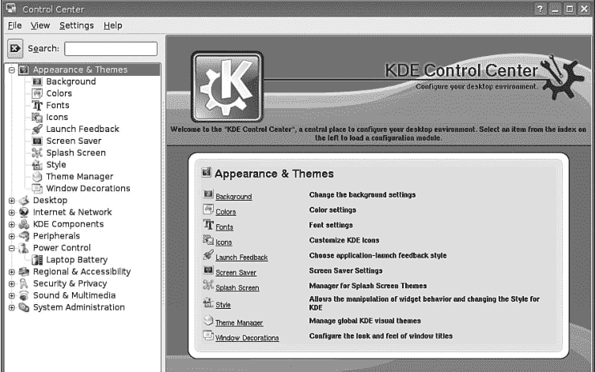

图 3-1 通过控制中心更改 KDE 桌面设置。

### 创建自定义主题

如果你将 live CD 作为个人桌面使用，你可能想选择背景、主题、颜色、字体和其他图形元素来反映你的品味。如果你想创建一个代表业务或产品的 live CD，你可能希望这些元素能增强你的演示展示效果。

KDE 允许你创建整个桌面主题，或在现有主题上选择单个元素。以下列表快速回顾了 KDE 桌面中与主题相关的功能，你可以通过 KDE 控制中心中选择“外观与主题”来更改这些功能：

- **主题管理器（Theme Manager）**——从选择一个接近你想要的主题开始，或者选择“新主题”（New Theme）来创建你自己的。新主题将进入你主目录下 `.kde/share/apps/kthememanager/themes` 目录下的一个文件中。例如，我创建了一个名为 LinuxToys 的主题。接下来，你可以开始修改主题的元素（如前文所述）。
- **背景（Background）**——添加你想要作为背景的图像（到 `/home/knopp/.kde/share/wallpapers`）。选择“新壁纸”（New Wallpaper）从网上查找图像。要旋转壁纸目录（或你选择的目录）中的幻灯片背景，选择“幻”（Slide）并选择“设置”（Setup）来调整背景变化的频率。
- **颜色（Colors）**——从各种颜色方案中选择，更改窗口边界、按钮、链接、菜单和其他桌面组件使用的颜色。如果你喜欢，可以创建并使用自己的颜色方案。要使方案可用，请将其放在 `.kde/share/apps/kisplay/color-scheme` 目录中（或只需在小部件框中选择你喜欢的颜色后点击“保存”（Save）来保存一个）。
- **样式（Styles）**——为 KDE 桌面按钮、标签和各种组件的显示方式选择样式。
- **图标（Icons）**——通过选择主题从几个不同的图标集中选择用于桌面的图标。尝试 Kids 以获得一个有趣的图标主题；使用 Industrial 或 KDE-Classic 以获得简洁、专业的视觉；或使用 Slick Icons 以获得专业外观。
- **字体（Fonts）**——为桌面的部分选择单独字体。
- **屏幕保护程序（Screen Saver）**——屏幕保护程序默认关闭。然而，如果你想启用它，可以设置为每分钟切换。通过 KDE，你还可以设置背景显示幻灯片，如果你喜欢的话。

## 第3章 自定义 live CD

为了给你提供一些关于如何自定义桌面的思路，例如，我制作了一个包含标志的背景。在“外观与主题”下，你可以从不同的方式使用 live CD。图 3-2 显示了一个添加了图标和颜色的自定义桌面。

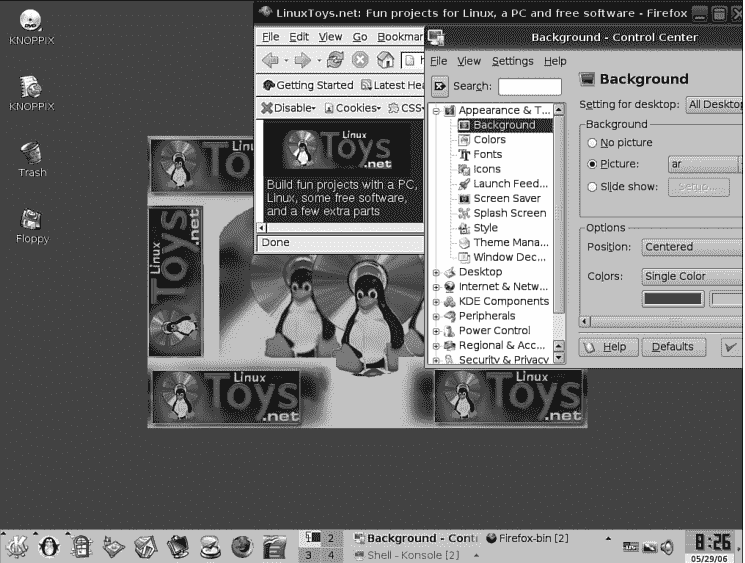

图 3-2 通过控制中心添加桌面设置。

### live CD

如果你无法制作想要的主题，可以 KDE-look.org (`www.kde-look.org`) 下载整个主题或单个元素。这些项目免费下载。虽然鼓励你参与该网站，但下载主题不需要注册。如果你对开发主题有疑问，请参考开发 Wiki (`http://wiki.kde.org/tiki-index.php?page_ref_id=18`)。

### 制作自定义菜单

提供特定类型应用程序的 live CD 通常会在 K 菜单中添加自定义菜单以选择这些应用程序。只需更改 K 菜单的外观，请使用控制面板。要从 K 菜单添加和删除菜单项，你需要使用菜单编辑器。

- **菜单项格式（Menu item format）**——默认情况下，每个菜单项都会显示名称和短描述（括号内）。相反，你可以选择只显示名称、只显示描述，或描述后跟名称。
- **可选菜单（Optional menu）**——你可以在 K 菜单的“动作”部分添加可选菜单。默认只有“书签”（Bookmarks）和“快速浏览器”（Quick Browser）。你还可以添加菜单项以快速访问打印机（Print System）、设置（Settings）、文件和 Web 搜索（Find）以及网络资源（Network Folders）。

## 第3章 定制化 Live CD

要对 K 菜单中的项目布局进行更实质的更改，请从控制中心的面板（Panels）模块选择“编辑 K 菜单”按钮。在 KDE 菜单编辑器中，你可以对 K 菜单上显示的项目进行添加、删除和重新排序。你可以添加新项目、新子菜单和分隔线。你还可以通过剪切和粘贴重新排列项目，并更改与每个项目关联的信息（如名称、描述、图标和运行的命令）。

以下是从面板模块为 K 菜单添加包含若干项目（应用程序、链接等）的新子菜单的快速操作步骤：

1. 从控制中心，选择桌面（Desktop）→ 面板（Panels），然后选择“菜单”（Menus）选项卡。
2. 点击“编辑 K 菜单”按钮。出现 KDE 菜单编辑器。
3. 点击“新建子菜单”（New Submenu）创建新子菜单。出现“新建子菜单”弹出窗口。
4. 为新子菜单命名并点击确定。出现一个空白表单。
5. 填写子菜单的名称、描述和注释。你还可以选择图标以浏览并代表你子菜单的图标。
6. 选中你的子菜单项，选择“新建项目”（New Item）向子菜单添加应用程序。出现“新建项目”弹出窗口。
7. 为新项目选择名称并点击确定。出现一个空白表单。
8. 为该项目填写描述、注释和命令。你可以点击文件夹图标浏览文件系统以找到你的应用程序。如果需要，你可以让命令在终端窗口中运行（对于非 GUI 命令，你必须这样做）。你还还可以选择以不同的用户身份运行应用程序。
9. 对你希望出现在子菜单下的每个应用程序重复上述前三个步骤。
10. 当你所有的子菜单和项目都输入完毕后，点击“保存”（Save）保存你的更改。
11. 一旦一切都按照你的意愿运行，请确保将你的持久化桌面保存到硬盘或 USB 闪存中（本章稍后会描述），这样当你下次重启 live CD 时就可以使用所有设置了。

使用我描述的步骤，我创建了一个名为 LinuxToys.net 的自定义子菜单。我在该子菜单中添加了自己的图标，并添加了几个项目，其中一个项目可以在 Web 浏览器中打开 LinuxToys.net 站点，以及几个应用程序。图 3-3 显示了创建这些条目的 KDE 菜单编辑器（右侧）以及包含新子菜单和应用程序的实际 KDE 菜单（左侧和上方）。

### Live Linux CDs

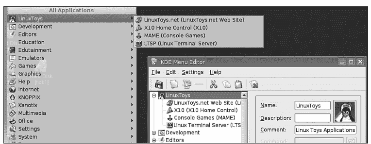

### 3-3 通过在 KDE 菜单中创建子菜单添加自定义应用程序。

当 KDE 启动时，它会启动位于 `/home/knoppix/.kde/Autostart` 目录下的应用程序。默认情况下，该目录下唯一文件是 `showindex.desktop`。它的内容会导致 Konqueror 窗口打开并显示 Knoppix 页面。以下是 `showindex.desktop` 的内容：

```
[Desktop Entry]
Name=KNOPPIX
# Exec-kfclient openProfile webbrowser /cdrom/index.html
Exec-konqueror -geometry 850x600x85x70 file:/cdrom/index.html
Type=Application
Icon=html
Terminal=0
```

通过删除该文件，可以防止初始 Knoppix 信息页启动。要打开你自己的 Web 页面，将 `file:/cdrom/index.html` 替换为你选择的文件。或者将地址替换为 站点（`http://www.example.com`）。

`.desktop` 文件与从 KDE 桌面启动应用程序使用的格式相同。如果你想查看更多 `.desktop` 文件的示例，请参考 Knoppix live CD 上的 `/usr/share/applications` 目录。

### 更改其他功能

由于持久化桌面和自定义归档功能都会保留系统中任何已更改的文件，因此你可以在 `/etc` 目录中更改系统级设置，并在下次重启 Knoppix 时使用它们。这可以产生一个高度定制的 CD，能够识别你的电脑外设、网络、用户或环境的特殊信息。

例如，`/etc/sysconfig` 目录中的文件包含了 Knoppix 启动时使用的设置。桌面文件指示使用哪种桌面环境/窗口管理器。要将你的桌面从 KDE 更改为 fluxbox，请将 `/etc/sysconfig/desktop` 的第一行改为 `DESKTOP="fluxbox"`。

`/etc/sysconfig/knoppix` 文件包含了与你的显示、键盘、语言和其他功能相关的汇总设置。`xserver` 文件识别你的 X 服务器（Xorg 或 XFree86）和 X 模块（如 vera）。`sound` 文件识别你的驱动程序。

你设置的任何系统级配置，如打印机、网络连接、Windows 文件共享 (`samba`)、Linux 文件共享 (`NFS`) 或以 `/etc/` 目录结尾的功能，都可以随持久化桌面保存。

### 锁定 KDE

如果你想限制使用你的 live CD 的用户从 KDE 桌面访问的内容，可以使用 Kiosk Admin 工具（`kiosktool` 命令）来定制你的 live CD。使用 Kiosk Admin 工具，你可以锁定 KDE 桌面的几乎每个方面，有效地强制规定该桌面用户可以访问和更改的内容。

> Kiosk Admin 工具未包含在随书附赠 DVD 中。

在物理世界中，亭台机（kiosk）可以是提供信息的独立设备。通过锁定桌面，你可以限制对 shell、菜单和图标等功能的访问。然后将配置文件分配给一个或多个用户。在示例中，配置文件由 root 用户所有，并分配给 knoppix 用户。

#### 注意

在 Kiosk Admin Tool 中选择的某些设置将被 `/etc/` 目录和 knoppix 特定脚本覆盖。

以下步骤将带你了解 Kiosk Admin Tool 的功能，并提供你可能需要的建议：

1. 为 root 用户分配密码。打开 shell 并输入：

   ```
   sudo passwd root
   ```

   输入新密码：邮箱

   再次输入新密码：邮箱
2. 选择系统（System）→ Kiosk Admin Tool（启动 `kiosktool` 命令），Kiosk Admin Tool 窗口在桌面上打开。
3. 在“添加配置文件”（Add New Profile）屏幕上，分配名称、简要描述、配置文件所有者（root 用户）以及配置目录。然后选择“添加”（Add）。提示输入 root 密码。
4. 输入 root 密码并点击确定。
5. 回主菜单，选中新的配置文件，选择“配置文件”（profile）。窗口显示可以为该配置文件锁定的组件。
6. 选择你想更改的组件。显示该组件的项目列表。勾选项目旁边的复选框以限制用户对该组件的访问。图 3-4 显示了 Kiosk Admin Tool 的示例。

以下是你可能想要更改的一些组件示例：

- 通用（General）——此标题下的项目防止用户访问正在运行的限制应用程序之外的功能。例如，你可以阻止访问 shell、窗口管理器菜单（Alt+F3）、运行命令框（Alt+F2）、启动另一个 X 会话的能力、注销选项以及锁定屏幕。

如果多人从桌面同一个登录，你可能希望禁用输入行历史，这样用户看不到其他用户之前的操作。此外，你可以让所有需要 root 权限的任务保留在分配给此配置文件的菜单中。

## 第 3 章 定制 Live CD

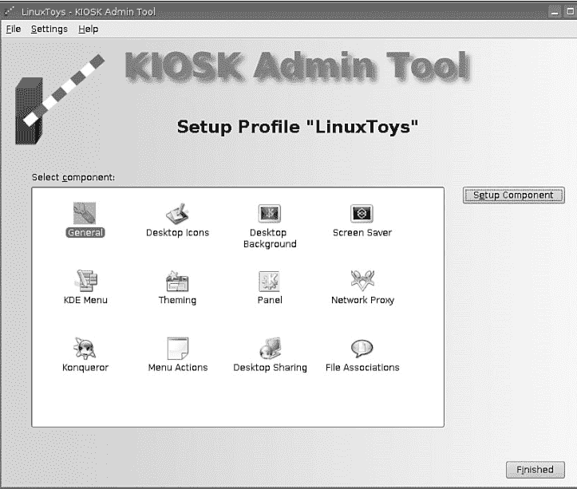

图 3-4 使用 Kiosk Admin Tool 配置并锁定 KDE 组件。

- **桌面图标**——你可以为此配置文件选择一组预定义的图标（点击“设置桌面图标/Setup Desktop Icons”）。从 K 菜单拖放菜单项将其复制到桌面。之后，你可以禁用右键菜单并锁定你的桌面设置和桌面图标。


进入`/path/to/xxx`目录，找到`xxx.json`。

在表达式`cvar = avar + bvar`中，加法运算符（`+`）将`avar`与`bvar`相加，得到它们的和`cvar`

在`List.of(arg0, arg1, arg2)`中，`List`接口的工厂方法`of()`接受一系列的元素，返回包含它们的只读列表。

之后我们这样调用`cmd`命令：`cmd arg0 arg1 arg2`。

```
if (condVar > someVal) {console.log("xxx")}
```


## 第 3 章 定制 live CD

5. 选择您想要包含持久性桌面的分区（检查设备上是否有足够的可用空间存放您的持久性桌面）并点击 OK。如果系统询问您是否要使用 AES 256 加密加密持久性桌面（需要至少 20 个字符的密码）。

> 注意
>
> 高级标准 (AES) 是美国政府于 2001 年批准用于保护非分类数据的加密算法。2003 年，AES 被批准用于保护美国机密信息。您可以在 Knoppix 中用于保护持久性桌面的 AES256 是使用 256 位密钥 AES 版本。

6. 如果您想使用 AES256，请选择 Yes（需要较长密码，并在重启 live CD 时重新输入该密码以访问您的持久性桌面）；如果不想使用密码，请选择 No。系统会询问您希望持久性桌面设置多大。

7. 输入一个数字（单位为兆）来指示持久性桌面的大小并选择 OK。这将在您选择的分区上放置一个指定大小的文件（称为 `knoppix.img`）。

8. 输入至少 20 个字符的密码，进行验证，并选择 OK 以保护您的持久性桌面。会出现一条消息，告知您镜像已成功创建。此时，`knoppix.img` 文件存在但尚未使用。如果您准备好使用您的持久性桌面，请重启。在此之前，有两点与您的桌面有关：

- 留下镜像——如果您不保护镜像，它是未保护的。Knoppix 创建镜像时以 knoppix 用户所有所有者权限为 rw-rw--。

- 多镜像——某些人喜欢为不同的用途创建不同的持久性桌面镜像。例如，您可以为通用桌面创建一个镜像。您还可以为您的演示或作为便携文件服务器/Web 服务器创建一个镜像。

请参考“使用自定义文件启动”部分有关利用启动选项的信息。

### 仅保留配置文件

与其将整个 Knoppix 文件系统保存到读写镜像，您可以仅将配置文件备份到归档文件。稍后重启 Knoppix 时，可以使用该归档文件。此功能作为一种有效的方法，可以避免重新输入桌面设置、打印机配置、显卡设置或其他存储在家目录或 `/etc` 中的配置文件。

当您保存配置设置时，它们被存储在您选择的设备上的压缩 tar 文件中。以下步骤描述如何备份 Knoppix 配置：

- 1. 从 Knoppix 桌面，选择面板上的 Knoppix 菜单。
- 2. 选择 Configure（配置）→ Save Knoppix Configuration（保存 Knoppix 配置）。这会启动 `saveconfig` 命令，如果您愿意，也可以从命令行运行它）。系统会要求您选择想要备份的哪些类型的配置文件。
- 3. 选择备份以下任何类型的配置文件并点击 OK：
- 个人配置——选择此项以备份家目录中的配置文件。这些是以点（.）开头的文件和目录，例如 `.kde` 目录。此选项不会保存您家目录中创建的任何数据文件（文档、音乐、表格），也不会保存浏览 Web 的缓存文件。
- 桌面上的所有文件——选择此项以保存您在桌面上创建的任何文件（由图标表示）。

## 第3章 自定义 Live CD

存储在您的主目录中的设置（例如 Knoppix 创建的那些）。

- 图形子系统设置——选择此项以保存您的 X 显示服务器 (XF86Config) 使用的显卡和显示器相关设置。
- 其他系统配置——选择此项以保存 `/etc` 目录下的其他系统配置文件。这些文件可能包括存储打印机、扫描仪、声音或密码设置的文件。

系统会询问您想将配置设置存储在何处。

- 选择您存储配置设置的位置并点击 OK。如果您选择保存到软磁盘，系统会提示您插入软磁盘。
- 插入软磁盘并选择 OK。归包将开始创建。完成后，会弹出的窗口告诉您配置已完成。

此时，您应该已经在软磁盘或其他介质上保存了自定义设置。`knoppix.sh` 文件是用于从压缩归包（`configs.tbz` 文件）中恢复文件的脚本。以下是关于您可能想要修改这两个文件的一些建议：

- `knoppix.sh`——您可以使用在此过程中生成的 `knoppix.sh` 文件，而是对其进行修改或创建一个自己的文件。拥有自己的 `knoppix.sh` 文件是您在不重启 CD 的情况下自定义 CD 的另一种方法。该脚本可以根据您的需要复制或更改 live CD 文件系统中所包含的文件。
- `configs.tbz`——您从 `/etc` 和主目录中选择存储的所有文件都被合并成单个归包文件（tar 文件），然后使用 `bzip2` 工具对其进行压缩。因此，您可以像处理任何归包一样操作该文件的内容。由于 `knoppix.sh` 脚本期望 `configs.tbz` 中的文件包含完整路径，因此您需要使用完整路径从归包中添加和删除文件。

要更改 `configs.tbz` 文件的内容，可以先将文件复制到临时目录，解压，然后根据需要添加或删除文件。以下是操作方法示例。假设您的 `configs.tbz` 文件在 `/mnt/sda1` 上，且您 `/tmp` 目录下有足够的空间编辑此文件。您可以这样操作：

```
$ cp /mnt/sda1/configs.tbz /tmp
$ cd /tmp
$ bunzip2 configs.tbz
```

### Live Linux CDs

现在，归包已解压为文件 `configs.tar`，这里有几个用于从归包中添加和删除文件的命令。tar 的 `-list` 列出 tar 归包的内容。`-delete` 在这里用于从归包中删除文件 `/etc/X11/XF86Config`。`-r` 用于将文件 `/home/knoppix/index.html` 添加到归包，其中 `-P` 用于保留前面的 `/`。之后，归包将再次压缩并返回原始位置。

- `$ tar -list -file-configs.tar |less`
- `$ tar -delete-remove-files -file configs.tar /etc/X11/XF86Config`
- `$ tar -r -file-configs.tar -P /home/knoppix/index.html`
- `$ bzip2 configs.tgz ; sudo knoppix.tar.bz2 /mnt/sda1/configs.tbz`

此时，修改后的 `configs.tgz` 文件已准备就绪，可以在下次重启 Knoppix 时重新使用。

无论使用 `knoppix.sh` 还是 `configs.tgz`，在下次重启时恢复您的设置，您只需要在启动 live CD 时在启动行中添加一个选项。可用选项在下一节中说明。

### 使用自定义文件和设置启动

在持久化桌面镜像或自定义设置归包中为 Knoppix 保存了自定义设置后，您可以在启动 Knoppix 时记录它们的位置来应用这些文件中的信息。以下是您可以输入以重用自定义数据的启动选项示例：

- **扫描持久化桌面**——要让 Knoppix 扫描您的可写存储分区（硬盘、内存 U 等）以是否存在存储的持久化镜像 (`knoppix.img`)，您可以使用以下命令：
  `boot: knoppix home=scan`
- **选择持久化桌面的分区**——作为替代方案，您可以识别存在 `knoppix.img` 文件的特定磁盘分区。例如，USB 闪存器的第一个分区通常被识别为 `/dev/sda1`。因此，要专门请求使用此设备第一个分区上的 `knoppix.img` 文件，您需要输入：
  `boot: knoppix home=/dev/sda1`

当找到持久化桌面镜像 (`knoppix.img`) 时，系统会提示您指示想要从该镜像中使用的信息。您的选项包括这些：

- `home`——如果您想从持久化桌面镜像中恢复 `/home/knoppix` 目录，请选择此设置。
- `system`——选择此设置以使整个文件系统变为可写，这样您的持久化桌面将存储在整个文件系统中更改或添加的文件。
- `overwrite`——选择此设置（默认关闭），如果您希望保存在持久化桌面上的设置被来自 live CD 的设置覆盖。
- `init`——选择此项以启动与系统服务关联的初始化脚本。这些脚本主要启动守护进程以监听服务请求，例如登录和打印服务。

### 现场 Linux CD

当然，你可以像使用任何现场 CD 一样通过 DSL 添加多个启动选项。例如，为了从 sda1 恢复你的备份存档和应用程序并让 DSL 完全从内存中运行，你可以在启动提示符输入以下内容：

```
boot: dsl restore=sdal mysdsl=sdal toram
```

### 在 Dynebolic 中保存数据

Dynebolic (`dynebolic.org`) 指的是其将你的个人数据保存为“Nest（巢）”的功能。使用其 Nest 功能，你可以在可用的硬盘或 USB 闪盘上创建你选择的任意大小的磁盘镜像。以后重启 Dynebolic 时，Nest 会被自动检测并使用。

在“Welcome to Dynebolic”窗口中选择 Nest，你可以选择 HARDDISK（硬盘）或 USB KEY（U 盘）来存放你的 Nest。选择其中之一后，会弹出的窗口，允许你从计算机上可用设备类型的列表中进行选择，让你选择 Nest 的大小（以兆为单位），并让你选择对其进行加密（使用 256 位 AES 加密）。图 3-8 显示了你描述的窗口。

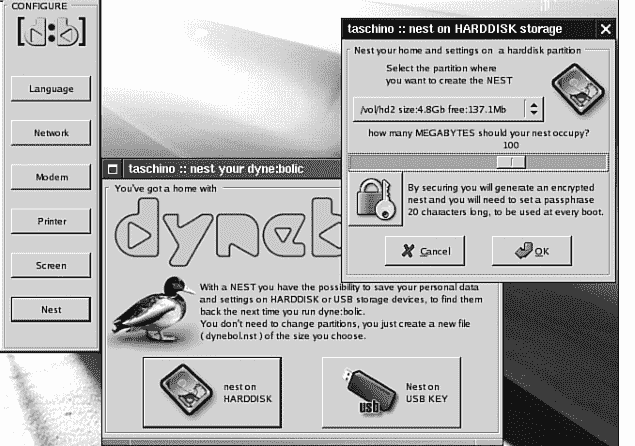

要启用你的 Nest，你需要重启 Dynebolic。当它启动时，会寻找名为 `dynebolic.nst` 的 nest 文件。它实际上是一个回环挂载的可写 ext2 文件系统。在 Dynebolic 运行时保存到 `/etc`、`/home`、`/tmp` 和 `/var` 的所有文件都会写入此镜像。

### 在 Puppy Linux 中保存数据

要在大多数计算机上的 Puppy Linux 上开始保存数据，你不需要做任何事情。如果它在启动时能找到可写存储介质，Puppy Linux 会自动挂载具有读写权限的分区，在该介质上创建一个镜像文件（256MB）。当重启 Puppy Linux 时，镜像将自动恢复，使得保存的文件可以再次使用。


> 因为 Puppy Linux 在不通知你的情况下创建并使用文件系统镜像，因此首先知道它的存在非常重要。如果你在别人的计算机上使用 Puppy Linux，那么删除该镜像很重要。Puppy Linux 的后续版本以不同的方式处理此问题。

Puppy Linux 的另一个有趣功能是多会话现场 DVD 功能。通过使用特殊版本的 Puppy Linux 并使用 `softofs` 命令将其刻录到 DVD，会话可以保持打开，允许将更多文件写入 DVD。你可以在 Puppy Multi-Session Live CD 页面 (`www.puppylinux.com/multi-puppy.html`) 上阅读有关该功能如何工作的介绍。

### 将 DAMN SMALL LINUX 添加到 USB 闪盘

当你将现场 CD 镜像安装在 USB 闪盘（也称为 pen drive、thumb drive 等其他名称）上时，你可以配合你的现场 Linux 系统保存自己的软件。由于这些驱动器是可重写的，你可以在同一介质上保留（并添加）操作系统、应用程序和数据（文档、音乐、图像甚至视频）。

大多数现代 PC 都配备了 USB 端口，在 BIOS 正常的情况下，你可以从这些端口启动。技巧是在 USB 闪盘上设置一个现场 Linux，使其准备好从其中一部分启动。本节描述了如何使用 Damn Small Linux (DSL) 创建可启动的 Linux 现场 USB 闪盘。这种方式配置 DSL 不需要 Linux 的特殊知识。

添加 DSL 以便从 USB 驱动器（称为“Pendrive”）启动的程序只需在 DSL 面上点击几次即可完成。你需要的准备工作如下：

- 一个 USB 闪盘——因为 DSL 总大小仅约为 50MB，所以最小 USB 驱动器大小为 64MB。但是，如果你计划添加任何数据，建议至少 128MB。我使用了一个 1 GB 的驱动器，这允许我在驱动器上保留音乐、文档和一些额外的应用程序。
- Damn Small Linux——你可以使用随书 DVD 包含的 DSL 版本。你可以从该 DVD 刻录 DSL ISO 镜像并启动它开始此程序（或直接从 DVD 启动 DSL）。

在 DSL 已启动且你的 USB 闪盘就绪的情况下，运行以下程序将 DSL 安装到你的 USB 驱动器：

1. 确定你的 USB 闪盘的设备名称。这非常重要，因为此过程会擦除该驱动器的内容。输入 `fdisk -l` 查看可用存储设备（硬盘、USB 闪盘、Zip 驱动器等）。USB 闪盘显示为 SCSI 设备。因此，如果你的计算机上没有其他 SCSI 硬盘或其他设备，你的 USB 闪盘可能位于 `/dev/sda`。
2. 从 DSL 桌面面上，选择 Apps → Tools → Install to USB Pendrive。
3. 选择 For USB-ZIP 或 For USB-HDD Pendrive。你应该使用哪种类型的选择取决于你预计 USB 驱动器运行的地方：
- 任何机器——某些旧的 PC 只包含可以从使用旧版 USB-ZIP 规范的 USB 驱动器启动的 BIOS。要以此方式启动，USB 驱动器上启动的分区必须小于 USB-HDD 规范允许的大小。

## 第 3 章 定制现场 CD

### 定制现场 CD

USB 闪盘（也称为 pen drive、thumb drive 等名称），你可以配合你的现场 Linux 系统保存自己的软件。由于这些驱动器是可重写的，你可以在同一介质上保留（并添加）操作系统、应用程序和数据（文档、音乐、图像甚至视频）。

大多数现代 PC 都配备了 USB 端口，在 BIOS 正常的情况下，你可以从这些端口启动。技巧是在 USB 闪盘上设置一个现场 Linux，使其准备好从其中一部分启动。本节描述了如何使用 Damn Small Linux (DSL) 创建可启动的 Linux 现场 USB 闪盘。这种方式配置 DSL 不需要 Linux 的特殊知识。

添加 DSL 以便从 USB 驱动器（称为“Pendrive”）启动的程序只需在 DSL 面上点击几次即可完成。你需要的准备工作如下：

- 一个 USB 闪盘——因为 DSL 总大小仅约为 50MB，所以最小 USB 驱动器大小为 64MB。但是，如果你计划添加任何数据，建议至少 128MB。我使用了一个 1 GB 的驱动器，这允许我在驱动器上保留音乐、文档和一些额外的应用程序。
- Damn Small Linux——你可以使用随书 DVD 包含的 DSL 版本。你可以从该 DVD 刻录 DSL ISO 镜像并启动它开始此程序（或直接从 DVD 启动 DSL）。

在 DSL 已启动且你的 USB 闪盘就绪的情况下，运行以下程序将 DSL 安装到你的 USB 驱动器：

1. 确定你的 USB 闪盘的设备名称。这非常重要，因为此过程会擦除该驱动器的内容。输入 `fdisk -l` 查看可用存储设备（硬盘、USB 闪盘、Zip 驱动器等）。USB 闪盘显示为 SCSI 设备。因此，如果你的计算机上没有其他 SCSI 硬盘或其他设备，你的 USB 闪盘可能位于 `/dev/sda`。
2. 从 DSL 桌面，选择 Apps → Tools → Install to USB Pendrive。
3. 选择 For USB-ZIP 或 For USB-HDD Pendrive。你应该使用哪种类型的选择取决于你预计 USB 驱动器运行的地方：
- 任何机器——某些旧的 PC 只包含可以从使用旧版 USB-ZIP 规范的 USB 驱动器启动的 BIOS。要以此方式启动，USB 驱动器上启动的分区必须小于 USB-HDD 规范允许的大小。

## 第二部分

## 创建自定义可启动 Linux

### 了解 Live Linux CD 的工作原理

从你打开电脑到操作系统和服务开始从你的 live CD 启动并运行，期间发生了大量的活动。作为一个想要创建和使用 live CD 的人，你可以重塑该过程的几乎每一个方面。

通过学习 Linux CD 的工作原理，你将进入 BIOS 和引导加载程序在 Linux 启动之前运行的某些魔法领域。然而，看起来并不神奇的其实是特殊的 live CD 脚本（例如 `linuxrc`），它们启用了设置 live CD 运行环境所需的功能。

跟随 live CD 启动的流程进行操作，将带你走上创建属于自己的 live CD 之路。然而，要超越书中到为止描述的“点击式”自定义，你必须具备一些 Linux 知识。换句话说，本书涵盖了特殊的 live CD 文件系统（如 `Squashfs` 和 `UnionFS`），但假设你已经知道如何在 Linux 中挂载、列出和在文件系统中移动。

> 注意
>
> 尽管我不会阻止你尝试书中描述的项目，但如果你不熟悉 Linux，至少应该找一本关于该主题的优秀参考书。特别是，你应该熟悉 shell 和常用的 shell 命令。

### 理解启动过程

在本章中，我将带你了解整个 live CD 的启动过程。由于启动过程可以向不同的方向发展，我将引导你完成 live Linux CD 的启动过程。在此过程中，我会注明该过程可能会分支到不同的方向。通过这些描述，我们涵盖了以下内容：

- 带有 x86 架构的 PC——与书中的大多数讨论一样，示例使用了 PC。
- Knoppix——由于其流行性，Knoppix 是本示例中使用的 live CD。
- CD-ROM (El Toronto)—ISO 9660 格式的 Knoppix 镜像从 CD-ROM 启动，是因为在创建 Knoppix ISO 镜像时，添加了 El 规范中描述的组件（如启动镜像和启动目录）。El Toronto 是 ISO 9660 标准的扩展，它将启动信息放置在 CD 上的已知位置，以便让支持 El Toronto 的电脑基本输入输出系统（BIOS）能够找到并从其启动。

通常来说，以下章节充实了你 live CD 示例的启动过程：


## 启动介质

过程始于 PC x86 兼容硬件以及你添加到该硬件的介质。尽管我们跳过了正常的“从硬盘启动”过程，但对启动介质的讨论并不限于 CD-ROM。它还包括从非硬盘介质启动：软磁盘、USB 闪盘、Zip 驱动器和网卡（PXE 启动）。

## BIOS

设置最初决定了检查可启动设备（软盘、硬盘、CD-ROM 等）的顺序，以查找允许电脑从这些设备启动的信息。

## 引导加载程序

当 BIOS 确定从何种介质启动时，电脑会在该介质上寻找启动记录。该启动记录指向一个引导加载程序（如 `Isolinux`、`GRUB` 或 `LILO`），它可以配置为让用户在各种启动标签之间进行选择。每个启动标签代表操作系统和启动选项的不同组合。

## 内核和初始 RAM 磁盘

当 Linux 系统启动选定的磁盘时，会识别并挂载初始 RAM 磁盘，然后启动根文件系统和一个从该初始 RAM 磁盘提取数据的内核。

## 第一个脚本运行

在启动内核之后、启动系统级相关服务之前，Knoppix（以及 live CD）会启动一个脚本来准备运行操作系统。在 Knoppix 中，该脚本被称为 `linuxrc`，位于 live CD 的根目录下。

## Init 进程 (SystemV init)

当 live CD 将控制权移交给 `init` 进程时，大多数针对 live CD 的特定设置已经完成。`init` 进程启动的服务提供了系统服务（如系统日志设施）和网络服务（如 Web、FTP 或远程登录服务）。

## 桌面

如果 live CD 包含桌面类型，那么桌面可以在 live CD 启动时自动启动。正常工作通常需要 live CD 正确检测可用的视频硬件（或猜测某些默认设置）并配置 X 显示服务器（使用 `X.org` 或 `XFree86` `X server`）。

图 4-1 展示了 Knoppix live CD 的启动过程。除了 Knoppix 在启动过程中使用的某些特定脚本外，大多数 live Linux CD 的启动过程是类似的。

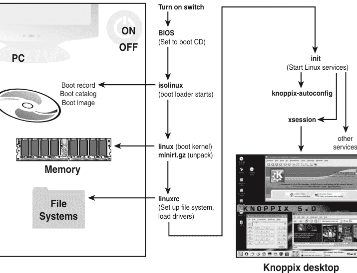

图 4-1 live CD 启动过程的几乎每个方面都可以被自定义（从启动到桌面显示）。

### 从 BIOS 到引导加载程序

当你打开（或重启）PC 时，电脑的 BIOS 将被运行以引导启动过程。BIOS 必须确定去哪里查找启动信息，这些信息将引导操作系统或显示启动屏幕（以便用户选择要启动的操作系统）。BIOS 在运行 live CD 方面有这些职责：

- **启用驱动器**——根据 BIOS，你可能需要专门启用想要从其启动的特定硬件。例如，对于某些 BIOS，你可能需要启用 USB BIOS 支持才能选择 USB 驱动器或 USB 硬盘作为可启动设备。
- **设置启动顺序**——BIOS 设置决定了在可启动设备（软盘、硬盘、CD-ROM 等）中按什么顺序检查允许电脑从这些设备启动的信息。

如果插入 live CD 在启动过程中被跳过，你应该检查启动顺序，确保它出现在硬盘之前。在大多数情况下，PC 的 BIOS 设置为：只需将 CD 插入电脑驱动器并重启即可找到 CD 上的信息。然而，对于旧电脑，更可能的问题是 BIOS 的优先级顺序。

在其他情况下，你可能尝试寻找更新 BIOS。

### 检查并更改 BIOS

要检查并可能更改你电脑的 BIOS，打开电脑并在电脑检查内存时观察屏幕。寻找提示按哪个键进入设置的文字（例如 F2 键或 Delete 键），并按下该键。此时，你应该进入一个设置工具。

BIOS 设置工具将告诉你一些关于电脑的信息，帮助你启动 live CD。它还会提供更改其中某些设置的机会。这里是需要查找的一些项目：

- **启动顺序**——这是你为了使用 live CD 最可能需要更改的 BIOS 功能。由于许多 BIOS 设置工具都不同，你需要查找并选择一个类似于 Boot 的标题。在 Boot 标题下，你应该看到启动设备列表，按优先级顺序显示。某些 PC 让你简单地选择软盘、CD 和硬盘；其他则允许你从各种设备启动。图 4-2 显示了 IBM Thinkpad BIOS 的启动优先级顺序示例。

| F1 | Help | Select Item | F5/F6 | Change Values | F9 | Setup Defaults |
|---|---|---|---|---|---|---|
| F3/ESC | Exit | | Select ► Sub-Menu | F10 | Save and Exit |

**图 4-2** 某些 BIOS 设置让你从各种设备中选择。

按照说明操作，确保你想从启动的设备在启动顺序中出现在另一个设备（特别是你的第一个硬盘）之前。

(disk) 正在启动。在本例中，请注意系统首先检查第一个 USB 软驱器是否有启动介质。然后检查常规（传统的）软驱器，接着是常规 ATAPI CD 驱动器和 USB CD 驱动器。

如此屏幕所示，在从 USB 软驱、CD 或闪存盘启动之前，你可能需要先启用 USB 设备。你还应该注意，默认情况下，在启动顺序中从 USB 闪存盘启动通常不会出现在硬盘之前。

- **总内存**——通过检查可用 RAM 的数量，你可以查看内存是否足够满足运行你所选择的 live CD 所需的最小内存。这还会告诉你你是否可以使用启动选项（对于像 Knoppix 和 Small Linux 等 live CD）将 live CD 镜像加载到 RAM 中并从那里运行。
- **BIOS 版本**——通常在第一个设置页面，你将看到有关正在使用的 BIOS 版本的信息。如果你无法选择想要启动的设备，或者你认为你的 live CD 因为 BIOS 的一个漏洞而无法启动，你可以查看是否有可用的 BIOS 更新。

请前往主板制造商的网站开始寻找 BIOS 更新。大多数 BIOS 都基于来自少数几个 BIOS 供应商的版本（Phoenix Technologies、Award Software International，而制造商通常会适配他们从这些公司之一获取的 BIOS，原始 BIOS 供应商通常不会提供更新后的 BIOS）。

> 注意
> 更新你的 BIOS 是危险的。如果你尝试更新（刷写）你的 BIOS 或发生错误，且你使用了错误的 BIOS，可能会导致你的主板报废。因此，如果你决定更新你的 BIOS（如后续段所述），请自行承担风险。

旧旧电脑的 BIOS 更新通常以文件的形式提供，这些文件创建软盘镜像，你可以直接从主板制造商的网站下载这些镜像。通常，你只需在 Windows 桌面面上点击这些文件之一，即可自动将包含更新的启动软盘写入插入你计算机的软盘中。

随着主板制造商适应“并非所有人都使用 Windows”这一事实，BIOS 更新已以不同的格式可用。例如，Intel 现在提供以下格式的 BIOS 更新：

- **恢复性 BIOS 更新**——如果 BIOS 更新被中断，可以使用可用的 `.BIO` 文件将 BIOS 恢复到可用状态。恢复性 BIOS 更新可用于从这种情况下恢复主板。
- **快速 BIOS 更新**——在 Windows 系统上，可以简单地从 Windows 桌面下载这种类型的 BIOS 更新来更新 BIOS。如果你有 Windows 和 Linux 双启动系统，可以这样操作。
- **刷写 BIOS 更新**——可以从 Windows 系统启动一个自解的 `.exe` 文件，创建一个镜像，该镜像被写入软盘然后启动到 BIOS（无论正在使用哪种操作系统）。如果你有一个 Windows 系统用于创建启动软盘，然后在你的 Linux 机器上重启并使用，这将非常有用。
- **ISO BIOS 镜像更新**——这种 BIOS 更新以 ISO 9660 镜像的形式提供，可以将其刻录到 CD 并在任何计算机上重启以进行其预期的 BIOS 维护。对于 Linux，只需下载 ISO，将其刻录到空白 CD 上（使用 `ddrecord` 或另一个 CD 刻录工具），然后在你想更新 BIOS 时在计算机上重启该 CD。对于运行 Linux 系统的计算机，如果可用，这通常是最佳选择。

如果你的计算机正在运行 Linux，且获取所需的 BIOS 更新的唯一方式是软盘镜像，你可以将该软盘转换为可启动的 ISO 镜像并刻录到 CD。“Motherboard BIOS Boot CD from Linux Mini HOWTO”描述了如何制作一个包含更新 BIOS 的启动 CD，以便你将 BIOS 刷写到主板。你可以在 `www.nenie.org/misc/flashbootcd.html` 找到该迷你 HOWTO。

在更新 BIOS 之前，请查看你当前的 BIOS 设置（在计算机启动时根据需要按 F2 或另一个键）。你应该写下你所更改的所有设置，因为你可能会在更新过程中丢失这些设置。在某些 BIOS 中，你可以选择保存自定义默认值。如果是这样，当 BIOS 更新且设置被重置为默认值时，你将有机会恢复那些自定义设置。

### 从 BIOS 开始

对于第一批 PC 来说，BIOS 设置为首先从软驱启动，然后（如果没有插入软盘）从硬盘启动。使能够从 CD-ROM 启动的 BIOS 增强功能稍后被添加到名为“El Torino”可启动 CD-ROM 格式规范的规范中。

当计算机开机时，BIOS 是第一个运行的代码。以下是 BIOS 执行的操作：

### Live Linux CDs

- **运行 POST**——开机自检（POST）是一项初始化并测试连接到你 PC 的硬件组件的例程。如果出现问题，错误代码将写入 IO 端口 `08h`（可以通过特殊硬件显示）。屏幕上通常也会显示错误信息。
- **蜂鸣声**——为了指示扬声器正在工作，BIOS 在 POST 完成后向扬声器发送哔信号。
- **检查启动顺序**——你 PC 的默认启动顺序可能会尝试从软驱、CD 驱动器和硬盘启动。较新的 BIOS 还提供从许多不同设备（USB 驱动器、Zip 驱动器等）启动的选项，但通常需要你通过进入设置模式自行更改顺序。
- **启动指定的设备**——通过顺序遍历每个启动设备，BIOS 在每个设备上寻找启动信息并尝试启动操作系统或引导操作系统。由于我们关注的是 live CD，让我们 CD 已经插入。

### 现场版 Linux CD

- **软盘模式（Floppy mode）**——默认情况下，El Torito 现场版 CD 包含一个软盘启动镜像（由 `-b` 选项指定）。为了实现这一点，CD 中包含的软盘镜像大小必须恰好为 1200、1440 或 2880K。使用软盘模式的缺点是引导加载程序只能引用该镜像中的项目（这限制了启动镜像以及你想包含的其他文件的大小）。使用软盘模式的优点是，你可以简单地拷贝一个工作的软盘启动并将其用于你的 CD 以进行启动。
- **硬盘模式（Hard disk mode）**——在 `mkisofs` 中添加 `-hard-disk-boot` 选项可以为创建现场版 CD 的用户移除与软盘仿真相关的大小限制。然而，硬盘仿真在不同的 BIOS 下运行可靠性通常较低。
- **无仿真（No emulation）**——这是创建 Linux CD 时最常用的方法（如前文所述，通过在 `mkisofs` 中 `-no-emul-boot` 选项来实现）。在此模式下，启动问题通常是由无法完全支持 El Torito 的旧版 BIOS 引起的。在这些情况下，使用软盘模式创建现场版 CD 或使用 Syslinux (`http://sys.zytor.com`) 代替 Isolinux 可以解决问题。

当 El Torito 启动镜像启动时，引导加载程序将接管计算机的启动工作。

### 进入引导加载程序

当引导加载程序接管启动过程后，你通常会获得关于启动过程如何进行的选择。以下是引导加载程序接管时你会看到的内容：

- **启动提示（Boot prompt）**——无论你处于文本模式还是图形模式，Isolinux 引导加载程序都会显示一个启动提示（`boot:`），由引导加载程序接管。通常会经过一个超时时间（通常约 5 秒），在此期间你可以输入为引导加载程序定义的任何标签。如果你不输入任何内容，引导加载程序将超时并启动默认引导加载程序。

按下任意键都会停止启动过程进行，以便你思考在提示符处输入什么。通常通过按下按键（F1、F2 等）可以查看消息文件（后文描述），这些按键指示标签以及相应标签的选项。

如果你的现场版 CD 使用的是 Isolinux 的 GRUB 引导加载程序，你可能会看到一个菜单界面而不是启动提示。在这种情况下，使用方向键从菜单中选择你想要启动的标签。

## 第 4 节 了解现场版 Linux CD 的工作原理

- **启动屏（Splash screen）**——初始启动屏幕以及启动过程中任何可用的消息屏幕也可以包含一张图像，有时称为启动屏。对于 Isolinux 来说，图像必须是特殊的 LSS 16 色格式（在第 5 节“深入研究现场版 CD 组件”中描述）。GRUB 允许创建现场版 CD 的用户使用 gzipped MPM 格式的图像。
- **消息屏幕（Message screens）**——使用 Isolinux 引导加载程序的现场版 CD 通常包含额外的消息屏幕，你可以通过不同的功能键显示这些屏幕。现场版 CD 开发者在 `isolinux.cfg` 文件中识别代表这些屏幕的文件，并将每个文件分配给 F1 到 F10 的某个功能键。F1 到 F9 的功能键由相应标签表示，F0 标签代表 F10 功能命令。

只需按下回车键或等待现场版 CD 超时，使用现场版 CD 的用户将获得 CD 创建者最预期的启动状态。默认启动镜像（在我们这里，此时通常是 Linux 内核）将带有一个来自初始 RAM 磁盘（通常是一个压缩的文件系统镜像）提供的文件系统并启动。

除了内核和初始 RAM 磁盘外，命令行中通常还会附带一组实用的选项。对于 Isolinux 引导加载程序，信息在创建现场版 CD 时定义在 `isolinux.cfg` 文件中。

出于各种原因，现场版 CD 提供了多个可用的不同标签。例如，通常存在用于在不同类型硬件上进行启动（特别是针对不同的视频模式）的特殊标签。现场版 CD 开发者可能还在 CD 上预留了若干个默认软盘镜像。

你可以定制 Isolinux 或 GRUB 引导加载程序，让现场版 CD 以你想要的方式运行。你可以展示简单的启动提示、菜单或图像。你可以允许用户确切选择要启动的内容（通过选择标签和/或添加选项），或者完全跳过用户直接启动操作系统。这些选择和其他其他内容将在第 5 节对 Isolinux 和 GRUB 引导加载程序的描述中涵盖。

下一节将描述现场版 CD 在从引导加载程序继续前进后如何启动现场版 Linux 系统。描述重点是启动 Kpix 作为你选择的现场版 CD。

### 启动现场版 Linux 系统

引导加载程序显示启动屏幕后，用户根据所选的标签和选项选择如何继续。取决于你正在启动哪个现场版 CD，后续处理在不同现场版 CD 之间可能不同。在本节中，描述将遵循启动 Kpix 现场版 CD 的的情况。

### Linux 内核和初始 RAM 磁盘

对于 Kpix CD，只需按下回车键或输入 `knppix`，即可使用 `isolinux.cfg` 文件中配置的信息：

```
LABEL knppix
KERNEL linux
APPEND ramdisk_size=100000 init=/etc/init lang=apm-power-off vga=791
initrd-minirt.gz nomce quiet BOOT_IMAGE=knppix
```

根据此标签，引导加载程序识别名为 `linux` 的内核为启动内核，并将 `minirt.gz` 为启动镜像和初始 RAM 磁盘。除了内核和初始 RAM 磁盘外，命令行中通常还会附带一组实用的选项。对于 Isolinux 引导加载程序，信息在创建现场版 CD 时定义在 `isolinux.cfg` 文件中。

出于各种原因，现场版 CD 提供了多个可用的不同标签。例如，通常存在用于在不同类型硬件上进行启动（特别是针对不同的视频模式）的特殊标签。现场版 CD 开发者可能还在 CD 上预留了若干个默认软盘镜像。

你可以定制 Isolinux 或 GRUB 引导加载程序，让现场版 CD 以你想要的方式运行。你可以展示简单的启动提示、菜单或图像。你可以允许用户确切选择要启动的内容（通过选择标签和/或添加选项），或者完全跳过用户直接启动操作系统。这些选择和其他内容将在第 5 节对 Isolinux 和 GRUB 引导加载程序的描述中涵盖。

- **modules** —— `/modules` 目录包含可加载模块以及用于处理这些模块的相关命令（`insmod` 和 `rmod`）。例如，`unionfs` 用于创建原本只读的文件系统。static 目录也位于：
- **static** —— `/static` 目录包含此处所需的 ash shell。


所有 `/modules` 和 `/static` 之后会被删除。在此期间，这些目录包含了设置所需的组件。要查看这些目录以及其他组件，你可以从解压初始 RAM 磁盘并将其挂载开始。在运行 Kpix 系统时，以下是检查初始 RAM 磁盘的方法：

1. 解压并挂载 `minert.gz` 初始 RAM 磁盘：

```
$ cd /cdrom/boot/isolux
$ gunzip -dc minert.gz > /tmp/mininert.ext2
$ sudo mkdir /tmp/mini
$ sudo mount -o loop -t ext2 /tmp/mininert.ext2 /mnt/mini
```

2. 列出初始 RAM 磁盘的内容：

```
$ ls -cf /mnt/mini
```

`KNOPPIX/` `bin@` `dev/` `lib/` `media/` `modules/` `proc/`
`static/` `tmp/` `mini@` `cdrom/` `etc/` `linuxc*` `mnt/` `opt@` `sbin@` `sys/` `usr/`

制作如第 6 节“构建自定义 Kpix 现场版 CD”所示，你可能会决定制作自己的初始 RAM 磁盘以包含（或排除）驱动程序或添加要运行的命令。在文件被解压并如前已挂载后，你可以进行任何修改。完成后，卸载该文件（`umount /mnt/mini`）并重新压缩文件（`gzip /tmp/mininert`）。

### 注意

从现在开始，不再使用初始 RAM 磁盘的文件系统，使用 kadisci 构建的 Knoppix 现场 CD 会独立于初始 RAM 磁盘设置持久文件系统结构。当新环境建立后，将运行 `pivot_root` 命令以使运行中的内核使用新的文件系统结构。

### linuxrc 脚本

初始 RAM 磁盘文件根目录下的 `linuxrc` 脚本（在 Knoppix 中为 `init.gz`）引导了现场环境的大部分初始设置。该脚本的大部分工作是挂载启动过程完成后 CD 将使用的文件系统。然而，在 Knoppix 中，`linuxrc` 脚本还确保加载模块以处理现场 CD 可能会遇到的任何特殊硬件需求（如 SCSI 设备）。

`linuxrc` 在此阶段的工作是通过此时可有限命令和模块完成的。大部分工作是使用内置于 Linux 内核的命令、`ash` shell 以及用于添加和删除模块的命令（`insmod`、`rmod` 和 `modprobe`）完成的。这些是 `linuxrc` 脚本执行执行的一些内容：

- **设置颜色**——随着 Knoppix 的启动，你会发现不同类型的消息以不同的颜色显示。这些颜色的变化使得 Knoppix 启动时更容易看到发生了什么。在 `linuxrc` 脚本中，以下变量被设置为它们所代表的颜色名称，以输出不同类型的消息：`RED`（失败或错误消息）、`GREEN`（成功消息）、`YELLOW`（描述）、`BLUE`（系统消息）、`MAGENTA`（找到的设备或驱动程序）、`CYAN`（问题）和 `WHITE`（提示）。你注意到 Knoppix 以一些有趣的方式使用这些颜色。“Welcome to KNOPPIX”消息将 KNOPPIX 的每个字母显示为单独的颜色。

- **挂载系统文件系统**——在 `linuxrc` 脚本中挂载了 `/proc` 和 `/sys` 文件系统。`/proc` 文件系统提供了访问内核使用的数据结构的接口。`/sys` 文件系统包含内置驱动注册的数据，可以从用户空间的进程进行访问。

- **检查选项**——`linuxrc` 脚本检查用户或 `isolinux.cfg` 文件可能设置的选项。这些值会导致环境变量被设置，并在随后的 `linuxrc` 脚本中使用。这里消耗的许多值关闭某些功能（例如 `nosci`、`nosi` 或 `nofirewire`）或设置运行模式（如调试或专家模式）。

## 第 4 章 理解现场 Linux CD 的工作原理

- **设置 KNOPPIX 的位置**——`KNOPPIX_DIR` 变量设置包含 KNOPPIX 镜像文件的目录（默认为 `KNOPPIX` 目录）。`KNOPPIX_NAME` 变量设置 Knopix 存档的名称（默认为 `KNOPPIX`）。此镜像包含了运行 Knopix 使用的大部分文件系统（文件、目录、应用程序、设置）的压缩存档。因此，Knopix 镜像位于 CD 文件系统根目录下的 `/KNOPPIX/KNOPPIX`。

> 注意
>
> 如果你曾为多个版本的 Knopix（或其派生版本）设置了现场 DVD，通过更改每个版本的初始 RAM 磁盘的 `linuxrc` 脚本中 `KNOPPIX_DIR` 的值，可以允许多个 Knoppix 发行版在同一块磁盘上共存（并可启动）。例如，一个发行版可以使用 `/KNOPPIX/a` 作为 KNOPPIX 文件镜像系统的位置。另一个可能使用 `/KNOPPIX/b`，依此类推。如果你为初始 RAM 磁盘命名不同的名称（`inita.gz`、`initb.gz` 等），不同的标签可以指向不同的版本。

- **以不同的模式运行**——如果 `debug` 被设置为启动选项，`linuxrc` 会设置一个特殊的 shell 以调试模式启动现场 CD。如果专家模式（expert mode）被设置为启动选项，运行现场 CD 的人员将被询问是否想从软盘安装额外的模块。

- **探测并配置设备**——`linuxrc` 脚本检查 PCI 设备（`/proc/pci`）并搜索可能需要模块才能使用的输出 SCSI 设备。它还会检查并尝试为任何 IDE 设备、USB 设备和 Firewire 设备安装模块。

- **寻找 KNOPPIX**——在所有可用的 CD 和硬盘存储设备（IDE、SCSI 等）现在都已正确检测并配置后，`linuxrc` 脚本尝试寻找将用于使大部分文件系统（包括应用程序和设置）变得可用的 `KNOPPIX` 存档。

- **挂载 KNOPPIX**——找到后，将挂载 KNOPPIX 镜像。如果找到多个 KNOPPIX 镜像，它们将分别挂载为 `KNOPPIX2`、`KNOPPIX3` 等。每个镜像都被挂载为一个设备，当从这些文件系统请求文件和目录时，它们可以动态解压缩。如果人员请求 knoppix 将 KNOPPIX 镜像写入并从硬盘（hd）或内存（ram）运行，`linuxrc` 会提供可用写入空间。

- **挂载 RAM**——在检查合理大小后，`linuxrc` 创建了一个 RAM 磁盘（`/ramdisk`）。在 `/ramdisk` 上创建了可写目录，这些目录可以通过（符号链接）在文件系统中。这些位置包括 `/home` 和 `/tmp`。

- **创建 UnionFS 系统**——为了让现场 CD 的所有只读目录作为读写目录可用，`linuxrc` 使用 UnionFS 与 `/ramdisk` 上的可写目录。要查看从 UnionFS 系统（`/UNIONFS`）链接了哪些目录，请在 knoppix 启动后输入 `ls -l /`。第 5 章描述了如何使用 UnionFS 合并只读目录（来自 CD）和读写目录（来自内存磁盘）。

- **设置 /etc 目录**——`/etc` 目录中的某些文件和目录不能链接而必须是只读文件。为了确保这一点，`linuxrc` 脚本从 CD 复制这些文件的版本：`passwd`、`sudoers`、`gshadow`、`group`、`dhcp`、`localtime` 和 `fstabconf`。

- **执行最终清理**——为了清理 `/etc/stab` 文件，`linuxrc` 脚本从 `/proc/mounts` 获取信息。然后删除 `/linuxrc` 文件并退出。随着 `linuxrc` 脚本完成，启动过程的控制权交给 Linux 内核。内核将控制权交给 `init` 进程。

### 启动 init（以及 initrc 文件）

`init` 进程接管启动过程以引导服务的启动并设置系统参数。事实上，`init` 的进程 ID 被称为所有进程的父进程。`init` 之所以是 1，是因为它是运行系统上第一个启动的进程，并启动了所有其他进程。

`init` 进程的关键依据是 `/etc/initrc` 文件的内容。`init` 运行的服务基于传递给 `init` 的运行级别（run level）以及设置为在该运行级别下启动的服务。对于 knoppix，默认是启动到桌面运行级别（运行级别 5）并运行至少一个特定于 knoppix 的启动脚本。

要理解 `init` 启动后发生了什么，请遵循 `/etc/initrc` 文件中的设置。除非被覆盖，否则 knoppix 根据 `/etc/initrc` 文件中的此项启动到运行级别 5：

```
5:initdefault:
```

被标识为 `sysinit` 进程的项在 `init` 启动时执行。`/etc/initrc` 中的以下条目会导致 `rcS` 脚本运行所有以字母 S 开头并位于 `/etc/init.d/rcS` 目录的 init 脚本：

```
~:~sysinit:/etc/init.d/rcS
```

默认情况下，唯一设置为在系统初始化时启动（来自 `/etc/rcS` 目录）的脚本是 `knoppix-autoconfig` 脚本。链接指向 `/etc/init.d/knoppix-autoconfig`。这是 knoppix 配置发生的地方。（`knoppix-autoconfig` 将稍后描述。）

`/etc/initrc` 中的下一组指示了根据当前运行级别启动的内容。要使运行级别不是 5，你必须更改 `initdefault` 行的值或传递运行数字作为启动选项。以下是这些行：

```
### 在单用户模式下做什么。
~:S:respawn:/bin/bash -login /dev/tty1 2>&1 </dev/tty1

### /etc/init.d 在更改时执行 S 和 K 脚本
#
### 运行级别 0 是停止。
### 运行级别 1 是单用户。
### 运行级别 2-5 是多用户。
### 运行级别 6 是重启。
```

```
10:0:wait:/etc/init.d/knoppix-halt
11:1:wait:/etc/init.d/rc 1
12:2:wait:/etc/init.d/rc 2
13:3:wait:/etc/init.d/rc 3
14:4:wait:/etc/init.d/rc 4
15:5:wait:/etc/init.d/rc 5
16:6:wait:/etc/init.d/knoppix-reboot
```

有效的运行状态允许你进入单用户模式（S 或 1）和多用户模式（2、3、4 或 5）。在单用户模式（S）下，knoppix 打开 root shell 且不启动其他服务。在单用户模式（1）下，knoppix 运行 `/etc/init.d/rc` 脚本并将 1 作为选项。

### 现场 Linux CD

在 `/etc/rc1.d` 目录中的脚本将被启动。同样，你可能启动到的其他运行状态（2, 3, 4 或 5）也会从其运行级别目录（`/etc/rc2.d`、`/etc/rc3.d` 等）中启动以 S 开头的运行脚本。

在 Knoppix 中，它主要是一个桌面系统，这些目录中可能在服务器系统上运行的服务（例如 Web 服务器、FTP 服务器、MySQL 服务器等）默认是未启用的（即不会被添加到这些目录中）。

> 注意
>
> Knoppix 中许多代表服务的脚本在 `/etc/init.d` 目录中均都是可用的。因此，如果你正在创建自己的自定义 Knoppix，你可以将其中任何一个脚本链接到任何运行级别下的一个文件中，以便在相应的运行级别下获取它。例如，如果你正在自定义 Knoppix，可以输入以下命令：
>
> ```
> ### ln -s /etc/init.d/apache2 /etc/rc5.d/S85apache
> ```
>
> 此命令创建了从 `apache2` 脚本（用于启动 Apache Web 服务器）到 `/etc/rc5.d` 目录下一个文件的链接。当计算机下次进入运行级别 5（默认桌面运行级别）时，Apache Web 服务将启动。

当运行级别开始时，运行的其他脚本以字母 K 开头。例如，如果你从运行级别 5 切换到运行级别 3，`K10session` 脚本将关闭你的 X 服务器（桌面界面）并让你返回到 shell。除了运行级别 5 之外，每个运行级别都会关闭桌面，因此这是当你关闭电脑（运行级别 0）或重启（运行级别 6）时最先启动的几个之一。

正如你可能从上一句中推测的那样，你不应该将运行级别设置为 0 或 6。这样的话，你的系统将直接关闭，`init` 会介入。如果设置为 6，它将不断重启。大多数 Linux 系统被设置为 5（启动到桌面）或 3（启动到一组预定义的服务，且无桌面）。运行状态 2 和 4 在旧的 UNIX 系统中具有历史含义，但现在已经没有太大意义了。

`/etc/initabb` 文件中用于启动 Knoppix 的下一组行代码与启动虚拟终端有关：

```
### 4 virtual consoles with /bin/bash -login >dev/tty1 2&1 </dev/tty1
2:2345:respawn:/bin/bash -login >dev/tty2 2&1 </dev/tty2
3:2345:respawn:/bin/bash -login >dev/tty3 2&1 </dev/tty3
4:2345:respawn:/bin/bash -login >dev/tty4 2&1 </dev/tty4
```

## 第 4 章理解现场 Linux CD 的工作原理

这些行显示对于运行级别 1 到 5，`bash` shell 作为登录 shell 连接到特定的 tty 设备（`/dev/tty1`）启动。对于运行级别 2, 3, 4 和 5，创建了三个额外的运行级别（tty 到 tty4）。你可以通过按下 Ctrl+Alt+F1、Ctrl+Alt+F2 等进入这些不同的虚拟终端。如果你的桌面界面变得混乱，虚拟终端是获取 shell 的一种有用方法。

`/etc/initabb` 文件中与启动系统相关的最后一行与启动你的 X 桌面有关。当 knnoppix 进入运行级别 5（默认）时，以下行是最后执行的行：

```
### Run X Window session from CDROM in runlevel 5
w5:wait:/bin/sleep 2
x5:wait:/etc/xsession start
```

在暂停 2 秒（`sleep 2`）后，运行带有 `start` 的 `xsession` 脚本。你的 X 桌面界面基于启动期间确定的设置（存储在 `/etc/xconfig` 目录下的 `xserver` 和 `knnoppix` 文件中）。它还会尝试加载运行显卡可能所需的模块（例如加载 `AGPGART` 和 `DRM` 模块）。

此时，你的 Knoppix 桌面界面应该已经启动，你应该可以开始使用 Knoppix 了。

### 理解运行中的现场 Linux 系统

当 Linux 系统运行后，你可以进一步了解你的现场 Linux 系统是如何启动的。对于 Knoppix，如前所述，`knoppix-autoconfig` 脚本在现场 CD 首次启动时设置 knnoppix 值。你也可以在运行的系统上尝试命令来显示值是如何设置的。

### 理解 knnoppix-autoconfig

当 `init` 进程在 Knoppix 启动期间接管时，`knoppix-autoconfig` 脚本从系统初始化目录中的链接运行：`/etc/rc.S/S00knnoppix-autoconfig`。通过查看此文件，你可以看到 Knoppix 中许多运行时功能是如何设置的。当你自定义自己的现场 CD 时，这是一个你可能会考虑修改的脚本。

是 `knnoppix-autoconfig` 脚本中发生的处理亮点：

- `PATH`—`PATH`（shell 寻找你运行的命令的地方）被设置为包含 `/bin`, `/sbin`, `/usr/bin`, `/usr/sbin` 和 `/usr/X11R6/bin`。这非常重要，因为即使对于非 root 用户（例如），knoppix 也期望 `PATH` 中包含 `/sbin` 和 user。

- `Colors`—颜色在脚本中定义。当你自定义自己的现场 CD 时，这是一个你可能会考虑修改的脚本。

- `Boot options`—启动选项由此脚本读取。这对于...非常重要。

- `Config files`—配置文件在脚本中创建。

- `Language`—语言根据启动选项进行设置。

- `Desktop`—桌面在脚本中设置。

- `Hostname`—主机名被设置。

- `Clock`—时钟被设置为 GMT 或 UTC。

- `Live CD or installed`—如果 knnoppix 从硬盘运行，此脚本会对...执行操作。

- `Interactive setup`—如果你是以启动选项进入的，在启动过程的几个点你都会获得更改设置的机会。第一个机会出现在这一点，当你被给予选择...时

### Live Linux 光盘

重新配置鼠标的选项。当 X 配置完成后，你稍后将拥有重新配置图形子系统的选项。

- `X 配置`——最新版本的 Knoppix 使用 X.Org X 服务器。为了创建 Xorg 服务器进程使用的 X 配置文件（`/etc/X11/xorg.conf`），`knopix-autoconfig` 脚本会运行 `/sbin/mkxorgconfig`

`mkxorgconfig` 脚本读取启动选项，例如特定的垂直和水平刷新率（`xvrefresh` 和 `xrefresh`）、垂直和水平同步率（`vsync` 和 `hsync`）以及屏幕分辨率（`screen`），以配置 X 服务器。同样，任何特殊的鼠标和键盘选项都会被记录并整合到 `xorg.conf` 文件中。

在创建了新的 `xorg.conf.new` 文件后，它会被复制到其永久位置（`/etc/X11/xorg.conf`）。然后，屏幕上将显示有关所选 X 服务器和设置的信息。

- 运行级别（Run level）——此时，将运行 `runlevel1` 命令来确定当前的运行级别。默认情况下，这将运行级别 5（桌面）。如果在启动提示符处输入了其他运行级别（S, 1, 2, 3 或 4），则将使用该运行级别。


- 已配置的文件系统——硬盘分区、CD 驱动器和其他设备被添加到 `/etc/fstab` 文件中，以便根据需要方便地挂载和卸载。`knopix-autoconfig` 脚本运行 `/usr/sbin/rebuildstab` 脚本将分区添加到 `/etc/fstab` 文件中。

- 已挂载的文件系统和交换分区已开启——那些需要挂载且尚未挂载的文件系统在此时会被挂载。同样，运行 `swapon` 以启用任何可用的交换分区。如果你在编辑模式下运行，你可以选择为任何可用的 DOS 分区创建一个交换文件。

- 网络启动——检查 `/proc/net/dev` 文件以查找任何可用的以太网设备（通常为 `eth0`）。如果找到一个，将运行 `ifconfig` 命令启动接口，并运行 `pump` 命令在网络上寻找可用的 DHCP 或启动服务器。如果找到服务器，你将自动连接到网络（可能是互联网）。

- 背景图像——Knoppix 桌面的背景图像在此处被设置。默认图像位于 `/cdrom/KNOPPIX/background.jpg`。

- 使用过的备份配置文件——如果你保存了 Knoppix 配置（保存到软磁盘、硬盘或其他可写介质），`knopix-autoconfig` 表单中最后执行的操作之一就是恢复这些设置（前提是你想要恢复它们）。

## 第 4 章 理解 Live Linux 光盘的工作原理

当 `knopix-autoconfig` 进程完成后，`init` 进程将继续（如前述对 `initab` 文件的描述）。

### 观察 Live CD 启动进度

如果你在屏幕上观察 Live CD 的启动过程，你可以看到它从一个阶段过渡到另一个阶段。以下是 Knoppix DVD 版 Live CD 在通过启动过程各个阶段时的输出示例。这些消息是在从启动提示符处按回车键后输出的。

```
Loading Linux...................................................
Reading minirt.gz...................................................
Uncompressing Linux... Ok, booting the kernel.
Welcome to the KNOPPIX Linux-on-DVD!
```

```
Scanning for USB/Firewire devices... Done.
Accessing KNOPPIX DVD at /dev/hdb/
Found primary KNOPPIX compressed image at @cdrom/KNOPPIX/KNOPPIX.
Found additional KNOPPIX compressed image at @cdrom/KNOPPIX/KNOPPIX2.
Total memory: 253384 KB
Creating /ramdisk (dynamic size:192996) on shared memory...Done.
Creating unionfs and symlinks on ramdisk...
>> Read-only DVD system successfully merged with read-write /ramdisk.
Done.
```

```
Starting init process
INIT: version 2.86 booting
Running Linux Kernel 2.6.15.
Processor 0 is Pentium III (Coppermine) 648MHz, 256 KB Cache
apmd[1077]: apmd 3.2.1 interfacing with apm driver 1.16ac and APM BIOS
apM BIOS found, power management functions enabled.
USB found, managed by udev
Firewire found, managed by udev
Starting udev hot-plug hardware detection...Started.
Autoconfiguring devices... /
Done.
Mouse is ImPS2 Logitech Mouse Wheel at /dev/input/mice
Soundcard: Ensoniq E1371 [AudioPCI-97] driver=snd-es1371
```

```
AGP detected.
Video is Intel Corporation 82810E-03 CGC [Chipset Graphics Controller],
Monitor is Generic Monitor, H:28.0-96.0MHz, V:50.0-75Hz
Using Modes "1024x768" "800x600" "640x480"
Scanning for Harddisk partitions and creating /etc/fstab...Done.
Using swap partition for /dev/hda5.
Network device eth0 detected, DHCP broadcasting for IP. (Background)
INIT: Entering runlevel: 5
Executing /etc/init.d/xsession start
```

### Live Linux 光盘

在创建了新的 `xorg.conf.new` 文件后，它会被复制到其永久位置 (`/etc/X11/xorg.conf`)。然后，屏幕上将显示有关所选 X 服务器和设置的信息。

### 检查 Live CD

检查 `/proc/net/dev` 文件以查找任何可用的以太网设备（通常为 `eth0`）。如果找到一个，将运行 `ifconfig` 命令启动接口，并运行 `pump` 命令在网络上寻找可用的 DHCP 或启动服务器。如果找到服务器，你将自动连接到网络（可能是互联网）。

### 摘要

虽然计算机首次启动时运行的 BIOS 通常由主板制造商提供，但启动过程的几乎每一个其他方面都涉及开源软件。因此，创建现场 Linux CD（live CD）的人可以在脱离 BIOS 的情况下控制现场 CD 启动过程的每一个方面。

用户对 BIOS 的控制通常是在 BIOS 设置过程中完成的。最重要的一点是，用户可能需要确保包含现场 CD 的设备（CD、DVD、USB 闪存或其他介质）已启用。下一步是确保该设备处于启动项顺序中，这样其他设备（如计算机的硬盘）就不会抢先启动。

接下，BIOS 会将启动过程的控制权交给引导加载程序（boot loader）。对于 Linux CD 来说，这通常意味着 Isolinux 引导加载程序。通过 Isolinux，用户可以输入启动标签（boot label）并控制后续启动过程。GRUB 是另一种有时用于现场 Linux CD 的引导加载程序（但它更多用于从硬盘启动）。

在启动选定的标签后，Linux 内核将在初始 RAM 磁盘（initial RAM disk）提供的驱动程序和命令帮助下接管。内核和初始 RAM 磁盘代表了挂载文件系统结构、加载所需驱动程序以及开始系统服务初始化所需的最基本组件。

对于 Knoppix，下一步是运行 `linuxrc` 脚本。包含初始 RAM 磁盘中的 `linuxrc` 脚本负责挂载文件系统并加载进入启动过程下一阶段所需的驱动程序。

系统服务通过 init 进程启动。init 进程依赖于 `/etc/initab` 文件的内容和当前运行的运行目录。对于 Knoppix，默认运行级别（run level）是 5。这意味着现场 CD 旨在启动到图形桌面系统。

本章描述的许多特征在许多 Linux 系统中是用的。某些特征专门用于现场 CD。下一章将描述诸如对现场 CD 特别有用的文件系统（squashfs 和 UnionFS）以及用于启动现场 CD 的引导加载程序（Isolinux 以及程度较小的 GRUB）。

### 深入了解现场 CD 组件

尽管你在现场 CD 系统中发现的许多组件与已安装的 Linux 系统中的组件相同，但某些组件对现场 CD 具有特别的意义。现场 Linux CD 在这些方面与安装的系统不同：

- **引导加载程序**——Isolinux（Syslinux 项目的一部分）是现场 CD 最常用的引导加载程序，因为它实现了 BIOS 能够理解的 El Torito 启动，从 CD-ROM 启动。其他引导加载程序（如 GRUB 或 LILO）也可以使用，但在现场 Linux CD 中它们往往不那么流行。

- **文件系统**——与文件系统类型相关的问题与事实有关：现场 CD 通常是只读介质，且空间限制比典型的硬盘要大得多。UnionFS 文件系统是一种有趣的文件系统类型，因为它可以合并只读和读/写文件系统，从而允许你在现场 CD 上原本在其他情况下是只读的环境中保存文件。像 Knoppix 这样的现场 Linux CD 将 UnionFS 与针对回环驱动器（loop driver）压缩的文件系统配合使用，使得现场 CD 可以包含多于一倍的软件。

Squashfs 文件系统已成为一种流行的文件系统类型，因为它以压缩的方式软件，使其可以即时解压缩。使用 Kadisci 创建的现场 Fedora CD 可以包含使用 Squashfs 压缩的文件系统。

现场 Linux CD 启动后，CD 通常会运行一个脚本，该脚本执行许多使其运行所需的“魔法操作”。Knoppix 运行 `linuxrc` 脚本，该脚本挂载文件系统、加载模块并复制所需的文件。之后，现场 CD 通常会将控制权移交给 init 进程以启动系统进程。从现在起，服务的启动方式以及你使用系统的方法与你使用安装在硬盘上的 Linux 系统的方法非常相似。区别在于现场 CD 所基于的 Linux 发行版。

在你开始流程重制（remastering）或从零组装现场 CD 之前，了解用于构建你正在制作的现场 CD 的不同 Linux发行版之间的差异会有帮助：

- **软件封装**——尽管你可以从 tar 包（tarballs）安装软件（如果你愿意，甚至可以从源代码构建软件），但使用针对你的现场 Linux CD 基于的 Linux 发行的预封装软件可能会带来麻烦。书中描述的封装格式包括 RPM（用于构建 Fedora）、Deb（用于 Debian-Knoppix 以及其他现场 CD）和 emerge（用于 Gentoo 现场 CD）。

某些 Linux CD 还有它们自己的方法来安装为其特定现场 CD 预封装的软件。Damn Small Linux 有一个 MyDSL 功能，允许你现场安装并跨重启安装软件的 tar 包。SLAX 允许你添加封装为压缩模块的软件以实现即时激活软件。

- **安装程序**——与其重制现有的现场 CD，某些现场发行版允许你使用该发行版的安装程序来创建现场 CD。其中一个例子是 Kasidis 项目，它使用与 Fedora 和 Red Hat Enterprise 自带的 `anaconda` 安装程序来运行全新的软件安装，从而生成现场 CD ISO 镜像。另一个例子是 Gentoo Catalyst 安装程序，它同样可以用于从零创建现场 CD。

本章涵盖的主题为后续章节中介绍的各种类型现场 CD 的重制或从零创建过程提供了背景。第一节介绍了如何在现场 CD 中使用引导加载程序。

### 在现场 CD 中使用引导加载程序

当计算机的 BIOS 指向从现场 CD 启动时，引导加载程序就会接管。大多数现场 CD 使用 Isolinux 作为它们的引导加载程序。如果你选择使用 GRUB 作为你的引导加载程序，可以从菜单中选择不同的标签。接下来的章节描述了如何使用 Isolinux 和 GRUB。

### 使用 Isolinux 引导加载程序

Isolinux 通过允许用户输入不同的标签和选项对启动过程提供了一个层的控制。Isolinux 是 Syslinux 套件（http://syslinux.org/）中几个引导加载程序之一。不同的 Syslinux 引导加载程序根据其所设计的介质类型而异：

- **Isolinux**——用于启动 ISO 9660 CD-ROM。Isolinux 引导加载程序是启动现场 CD 最常用的的一种。

- **Syslinux**——用于启动 MS-DOS 和 Windows FAT 文件系统。通常用于创建可启动磁盘。

- **Pelinux**——用于从网络服务器启动计算机。通常被加载为网卡上符合 PXE 标准的 PROM。

- **Extlinux**——用于启动 ext2 或 ext3 文件系统。

本书侧重于 Isolinux，因为它用于启动现场 CD 或类似的介质。关于 Isolinux，你需要了解的内容取决于你是使用现场 CD 还是制作现场 CD：

- **使用 Isolinux 现场 CD**——作为启动现场 CD 的用户，你可能直接回车并忘记 Isolinux。然而，为了以后方式启动现场 CD，你可以尝试不同的启动标签（使用 Isolinux 特性定义）和选项。通常在启动屏幕上按下功能键（F1、F2、F3 等）会显示不同的启动标签和选项。

要查看可以选择哪些启动标签和选项，可以参考现场 CD 的 `isolinux.cfg` 文件（可能位于现场 CD 目录下的 `/boot/isolinux` 或 `/isolinux` 目录）。第二章“玩现场 CD”和第三章“自定义现场 CD”描述了一些现场 CD 的启动选项。

- **构建 Isolinux 现场 CD**——如果你正在创建或重制现场 CD，你可以设置 Isolinux 特性以不同的方式启动你的现场 CD。例如，你可能设置标签以不同的视频模式启动现场 CD，或以不同的运行级别启动。你可能还会添加

特殊的标签可以让你在检查 RAM 时（使用 `memtest` 命令）或启动到 Linux 安装程序而不是运行光 CD 时执行特定操作。

如果你正在制作一个 live CD，Isolinux 还允许你控制用户从启动界面上看到的内容。使用 Isolinux，你可以在启动屏幕上包含你选择的图像。你还可以创建消息屏幕，在上面放置对启动 live CD 的人员有用的信息（例如启动选项和许可信息）。

以下描述了配置 Isolinux 引导加载程序的不同方法，以引导你 live CD 的启动过程。

### 理解 Isolinux

Isolinux 的设计是为了兼容 El Torito 可启动 CD-ROM 格式规范（请在 www.phoenix.com 搜索 `speccd.pdf` 文件）。该规范定义了 CD-ROM 必须包含什么内容才能被启动，以及计算机的 BIOS 启动 CD 需要什么内容。由于 El Torito 规范自 1994 年创建以来被广泛接受，过去十年制造的大多数 PC 都能启动兼容 El Torito 的 CD 和 DVD。

El Torito 通过识别指向引导目录的引导记录卷卷描述符的位置，扩展了 ISO 9660 标准（描述了 CD-ROM 的格式）。引导目录包含了关于可以选择并启动可用镜像的信息。

Isolinux 运行在无仿真模式（no emulation mode）的 El Torito 模式。这意味着计算机执行镜像而不进行软磁盘仿真（这会限制你在 CD-ROM 上可以访问的空间）或硬盘仿真（这在所有 BIOS 上都无法工作）。使用“无仿真”可以让你通过 Isolinux 引导加载程序访问整个 CD 或 DVD。例如，在 DVD-9 上访问超过 8GB 的压缩数据没有问题。

### 设置 isolinux 目录

Isolinux 设计为在 live CD 上的单个目录中包含其所需的文件。该目录中的文件可以包括内核、初始 RAM 磁盘（initrd）、消息文件、启动屏幕和相关文件。isolinux 目录中的引导目录被插入 CD 头部以识别可用的镜像。配置文件还会识别可用的内核和选项。

要查看 isolinux 的真实世界实现，你可以查看 Linux live CD（如 Knoppix）的 `/isolinux` 或 `/boot/isolinux` 目录。

## 第 5 章 观察 live CD 组件

Isolinux 引导过程取决于 `isolinux.cfg` 文件。除了设置一些关于引导加载程序的选项（例如超时前等待多久）外，该文件还包含一个或多个标签（labels）。每个标签标识要运行的内核文件以及附加到内核的选项。

`isolinux.cfg` 文件中标识的选项可能包括初始 RAM 磁盘的位置以及许多与硬件问题相关的选项。例如，Knoppix 包含了多个启动相同内核的标签，但采用不同的视频模式（包括在不同视频分辨率下帧缓冲的 `fb1280x1024`、`fb1024x768` 和 `fb800x600`）。

以下是随 Knoppix 附带 `isolinux.cfg` 文件的部分：


```
DEFAULT linux
APPEND ramdisk_size=100000 init=/etc/init lang=apm=power-off
vga=791 initrd=minirt.gz nomce quiet quiet BOOT_IMAGE=knoppix
TIMEOUT 300
PROMPT 1
DISPLAY boot.msg
F1 boot.msg
F2 f2
F3 f3
LABEL knoppix
KERNEL linux
APPEND ramdisk_size=100000 init=/etc/init lang=apm=power-off
vga=791 initrd=minirt.gz nomce quiet BOOT_IMAGE=knoppix
LABEL expert
KERNEL linux
APPEND ramdisk_size=100000 init=/etc/init lang=apm=power-off
vga=791 initrd=minirt.gz nomce quiet BOOT_IMAGE=expert
LABEL memtest
KERNEL memtest
APPEND initrd=
LABEL knoppix-txt
KERNEL linux
APPEND ramdisk_size=100000 init=/etc/init lang=apm=power-off
vga=normal initrd=minirt.gz nomce quiet BOOT_IMAGE=knoppix
LABEL debug
KERNEL linux
APPEND ramdisk_size=100000 init=/etc/init lang=apm=power-off
vga=normal initrd=minirt.gz debugOT_IMAGE=debug
LABEL fb1280x1024
KERNEL linux
APPEND ramdisk_size=100000 init=/etc/init lang=apm=power-off
vga=794 module=fbdev initrd=minirt.gz nomce quiet
BOOT_IMAGE=koppix
```

`isolinux.cfg` 文件是 Linux (Unix) 或 DOS 格式的纯文本文件。它包含一组关键字和值，提供默认设置和用户选项。使用随 Knoppix 附带的 `cfg` 文件部分作为示例，以下是该文件控制 live CD 引导过程的一些方式：

### 默认引导命令
`DEFAULT` 行设置了用户只需按下回车即可运行的引导命令（默认运行无选项的 Linux 内核）。

### 引导超时
`TIMEOUT` 值让 live CD 在引导命令前等待指定的秒数（例如 30 秒）。用户可以在引导提示符处按下键盘上的任意键来防止超时发生。

可以设置 `TOTALTIMEOUT` 值，无论用户是否按了键，在若干秒后启动默认命令。`TIMEOUT` 和 `TOTALTIMEOUT` 都可以设置以留出短时间（可能是 30 秒），但如果用户在此之前没有输入命令，则最终在几分钟（可能是 5 分钟）后启动。

### 引导提示符
设置 `PROMPT 1` 会导致引导屏幕始终显示引导提示符。通过将 `PROMPT` 设置为 0，只有当用户按下 Alt 或 Shift 键（或开启 Caps Lock）时显示提示符。通过将 `NOESCAPE` 标志设置为 1，可以禁用退出。例如，如果你设置了 `PROMPT 0` 然后设置 `NOESCAPE 1`，用户将无法进入引导提示符。结果是每次都运行默认命令。如果你知道使用的精确硬件环境且不希望用户干预引导过程，这种方法很好。

### 引导屏幕
`DISPLAY` 值指向的内容将作为引导屏幕显示。通常如 Knoppix 所示，会读取显示在引导屏幕顶部的镜像文件。接下来的“创建引导屏幕”部分介绍了你可以在此文件中使用的格式。

### 附加引导屏幕
除了引导屏幕外，你还可以拥有十个引导屏幕。使用 `F1`、`F2`、`F3`、`F4`、`F5`、`F6`、`F7`、`F8` 和 `F9` 键，你可以为每个功能键分配特定的文件。你可以将 `F0` 分配给 `F10` 功能键。

## 第 5 章 观察 CD 组件

通常，如 Knoppix 所示，`F1` 被分配给与 `DISPLAY` 关键字相同的引导屏幕文件（`boot.msg`）。这样，用户在访问其他引导屏幕后，按下 `F1` 返回原始引导屏幕。`boot:` 提示符留在所有引导屏幕的底部，因此用户可以从任何一个屏幕输入所需的标签和选项。

在 Knoppix 的情况下，`boot.msg` 文件的内容出现在引导屏幕上以及按下 F1 键时。`f2` 和 `f3` 文件分别分配给 `F1` 和 `F2` 功能键。关于这些文件格式的信息，请参考“创建引导屏幕”章节。

### 引导标签
`LABEL` 关键字标识用户在不想使用默认命令时在引导提示符处输入的字符字符串。标签通常代表 live CD 的名称（例如 `koppix` 或 Damn Small Linux 的 `ds1`）。其他引导标签表示随 live CD 附带的特殊用途命令或设置。通常每个 `LABEL` 后面至少跟着两个关键字。`KERNEL` 关键字标识包含引导该标签所需的 Linux 内核的镜像文件。例如，`linux` 文件包含带有 knix 的可启动 Linux 内核。

另一个常用的关键字是 `APPEND`。任何添加到 `APPEND` 关键字的选项都会附加到 `LABEL` 对应的 `KERNEL` 命令之后。用户在引导提示符处随标签输入的选项会被添加到 `APPEND` 选项的末尾。

添加到 `APPEND` 行的某些选项告诉内核如何引导，而其他选项则在引导过程的不同点传递并消耗。例如，`initrd=minirt.gz` 告诉引导内核使用 `minirt.gz` 文件作为初始 RAM 磁盘。`BOOT_IMAGE` 选项告诉 linux 脚本（在内核启动后运行）以什么模式启动。

> 注意
> 你可能会发现 `isolinux.cfg` 文件开头附近的 `APPEND` 行没有与 `LABEL` 关联。附加在此 `APPEND` 关键字的选项被设置为全局默认值。对于任何没有自己 `APPEND` 行的 `LABEL`，这些选项都会附加到其 `KERNEL` 上。为了避免为特定的 `KERNEL` 行使用全局 `APPEND` 选项，你必须在该 `KERNEL` 行之后添加一个 `APPEND` 行。

在之前的 Knoppix 示例中标签包括 knoppix、expert、memtest、knoppix-txt、debug 和 fb1280x1024。这些标签在后续章节“创建不同的启动标签”中进行了描述，可以用于以文本模式 (`knoppix-txt`)、调试模式 (`debug`) 或特殊的视频设置 (`fb1280x1024`) 启动 Knoppix。标签还可以用于运行不同的全部（例如 memtest 标签，它会运行 memtest 命令来检查你的系统内存）。

### 从串口运行的能力
在如今的大多数情况下，你可能认为运行 Live CD 的电脑会配备一个支持 VGA 的显示器。然而，Isolinus 也可以在连接到串口作为控制台（而非图形显示器）的哑终端的电脑上启动。

#### SERIAL 0
默认情况下，串口参数被硬编码为 8 位数据、1 位停止位和无校验位。连接默认为 9600bps 波特率且无无流控控制。然而，如果你想更改波特率和流控控制，可以将它们作为选项添加到 SERIAL 行。要获得所需的流控功能，你需要组合与这些功能相关的位。表 5-1 显示了流控功能的十六进制值。

Isolinus 推荐了几个你可能想要使用的流控值，除了默认的 (0) 无流控外。对于空调制器检测，使用 0x033。对于 DTR/DSR 流控使用 0x02，对于 DTR/DCD 流控使用 0x08。对于 RTS/CTS 流控，你可以使用 0x013 或 0x813（后者带有调制器输入）。

例如，你可能想将波特率更改为 14400bps并将流控更改为 0xab3。为了符合 RS-232 标准（表 5-1 中星号标记），SERIAL 行（作为你 isolinux.cfg 文件的第一行）将如下：

`SERIAL 0 14400 0xab3`

当你准备为自己的 Live CD 创建 `isolinux.cfg` 文件和启动文件时，你应该注意一些问题：

## 第 5 章 深入了解 Live CD 组件

**表 5.1** 串口终端流控选项的十六进制值

| 流控功能 | 所需值 | 符合 RS-232? |
|---|---|---|
| 断言 DTR | 0x001 | * |
| 断言 RTS | 0x002 | * |
| 等待 CTS 激活 | 0x010 | * |
| 等待 DSR 激活 | 0x020 | * |
| 等待 RI 激活 | 0x040 | |
| 等待 DCD 激活 | 0x080 | * |
| 除非 CTS 激活否则忽略输入 | 0x100 | |
| 除非 DSR 激活否则忽略输入 | 0x200 | * |
| 除非 RI 激活否则忽略输入 | 0x400 | |
| 除非 DCD 激活否则忽略输入 | 0x800 | * |

- **注释**——要向 `isolinux.cfg` 文件添加注释，只需在想要作为注释的行开头添加井号 (`#`) 即可。

- **文件名和标签名**——在 `isolinux` 目录创建文件名和在 `isolinux.cfg` 文件创建标签名时，使用 DOS 文件命名限制是安全的。虽然 Isolinux 可能会损坏 DOS 文件名，但如果你使用超过八个字符且带有三个字符扩展名，可能会面临名称重叠的风险。

- **限制选项**——使用 `ALLOWOPTIONS` 关键字和值，可以防止用户从启动提示符为启动的内核输入任何选项。这对于锁定自助机（kiosk）或类似用途的 Live CD 行为非常有用。

- **错误情况**——如果在启动 Live CD 内核镜像时发生错误情况，你可以设置 Isolinux 以某种方式做出响应。如果你需要用户对启动提示符做出响应，可以将 `ONTIMEOUT` 关键字设置为在达到超时值时运行的内核和选项（按回车键仍会触发默认设置）。如果未找到请求的内核，可以将 `ONERROR` 的值设置为另一个要运行的命令和选项。

接下来的章节描述了你可以如何修改 `isolinux.cfg` 文件以及相关的内核、启动屏幕和其他项目，以引导你的 Live CD 的启动过程。

### 创建启动屏幕

为了在 Live CD 启动之前显示与其相关的信息，Isolinux 允许你创建一个初始启动屏幕以及多达十个其他启动屏幕，用户可以通过功能键访问。尽管此时显示启动屏幕的环境相当原始，但启动屏幕可以显示以下内容：

- **文本**——添加描述你的 Live CD、启动选项、许可协议和其他重要信息的文本。

- **颜色**——用 16 种颜色中的任何一种显示你的文本和背景。

- **图像**——导入图像文件（特殊格式创建），这些图像最多包含 16 种颜色，分辨率高达 640x480 像素。

## 第 5 章 深入了解 Live CD 组件

要运行以下步骤，你需要在一个包含 GIMP 且安装了 `linux` 软件包的系统（这样你就有 `ppmto1ss16` 命令）。Knoppix 适用于这种情况。以下是如何使用 GIMP 图像处理程序为启动屏幕创建镜像的示例：

- 1. 获取一张你想要用于启动屏幕的图像。你可以从 GIMP 可以读取的任何图像格式开始。

- 2. 在 GIMP 中打开图像（在大多数 Linux 桌面系统中，可以在 Graphics 图形菜单中启动 GIMP）。

- 3. 选择 → Scale Image（缩放图像），将图像缩放以适应 640x480 的边界（如前所述，可以使用 640x400 或类似的数值以包含额外的文本）。将宽度调整为 640；高度会自动调整（前提是两个数字锁定在一起）。

- 4. 选择 Image（图像）→ Indexed（索引），将图像转换为仅使用 16 种颜色。在弹出的 Indexed Color Conversion（索引转换）窗口的 Colormap（调色板）选项下，选择 Generate Optimum Palette（生成优化调色板），Maximum Number of Colors（最大颜色数）选择 16。

- 5. 选择 File（文件）→ Save As（另存为），将图像保存为 PPM 文件。在提示保存文件时，使用 .ppm 扩展名命名并选择 File Type (By Extension) 将图像保存为 PPM 文件。例如，你可以将文件保存为 `mylogo.ppm`。为了避免命名问题，请确保文件名少于八个字符，或者扩展名为三个字符。

- 6. 打开终端并切换到你刚刚创建镜像的目录。接下来，使用 `ppmto1ss16` 命令将图像转换为 RLE 格式。命令本身（`/usr/bin/ppmto1ss16`）是一个 Perl 脚本。你可以用文本编辑器打开该脚本来阅读文件格式及其执行的处理。以下是使用该命令将你创建的图像（`mylogo.ppm`）转换为启动屏幕上 Isolinux 使用的图像文件（`mylogo.rle`）的示例：

```
### ppmto1ss mylogo.ppm > mylogo.rle
24480 pixels, 27018 bytes, (77.90% compression)
```

- 7. 将刚刚创建的文件（`mylogo.rle`）复制到你构建或重制 live CD 的 `isolinux` 目录。

- 8. 编辑用于初始启动屏幕（或任何与功能键相关的其他启动屏幕）的文件，它包含了你的

例如，如果你只是在重制 DSL 或 Knoppix，请编辑 `boot.msg` 文件并将 `logo.16` 更改为 `mylogo.rle`。

- **返回文本模式**——要获得一个只包含文本的屏幕，可以先告诉 isolinux 切换到文本模式。纯文本屏幕对于显示启动选项或显示信息非常有用。使用纯文本屏幕，你仍然可以随心更改前景和背景颜色。要进入文本模式，请使用 Ctrl+Y。

以下操作将屏幕更改到文本模式 (^)，将背景设置为深蓝色，将前景设置为浅灰色 (^017)，然后清除屏幕并将光标复位到主位置 (^)。

```
^Λ017L
```

之后，你就可以按照需要输入文本了。保持每行文本为 80 个字符，以便它们在大多数显示器上不会自动换行。

### 创建启动标签

在 `isolinux.cfg` 文件中添加启动标签是帮助使用你 live CD 的用户正确运行它的的一种技术。虽然启动 live CD 的默认标签是你预期的模式（例如，对于 KDE 桌面或 shell），但你也可以在某些情况下使用替代标签：

- **检查内存**——特定的标签可能不是运行 Linux内核，而是运行完全不同的命令。例如，某些 live CD 使用 `memtest` 标签来运行 `memtest` 命令。这是确定可用 RAM 数量以及其中多少运行良好的良好方法。在 `isolinux` 目录中，Knoppix 使用以下标签来启动该命令：

```
LABEL memtest
KERNEL memtest
APPEND initrd=
```

在这种情况下，当在启动提示符输入 memtest 标签时，会运行 memtest 命令。不需要初始内存磁盘，因此 APPEND 行基本上是空的。

- **在选定的视频模式下运行**——由于在某些情况下，无法让 X 显示正常工作是一个巨大的挑战，因此 live CD 通常提供特定的标签，以便 CD 在特定的视频模式下运行。许多笔记本电脑的视频在 模式下工作。你可以使用 `vga` 选项设置不同的 framebuffer 规格。例如，`vga=769×480` 带有 256 色。表 5-3 显示了可用视频模式列表。

### 表 5-3 使用 vga= 选项指示视频深度、颜色和分辨率

| DEPTH | COLORS | 640×480 | 800×600 | 1024×768 | 1280×1024 | 1600×1200 |
| :--- | :--- | :--- | :--- | :--- | :--- | :--- |
| 8-bit | 256 | 769 | 771 | 773 | 775 | 796 |
| 15-bit | 32,768 | 784 | 787 | 790 | 793 | 797 |
| 16-bit | 65,536 | 786 | 789 | 792 | 794 | 798 |
| 24-bit | 16,777,216 | 799 | 800 | 801 | 802 | 803 |

（注：表格数值的 OCR 包含严重的损坏/重复；上述值已根据逻辑 VGA 模式模式和提供的文本片段进行了重建）。

## 第 5 章 深入了解 Live CD 组件

它使用名为 `f2` 和 `f3` 的文件来创建通过按下 F2 和 F3 功能键即可使用的启动界面。你可以为这些文件命名为任何名称（尽管建议遵循 DOS 文件名的限制，即 8 个字符限制加 3 个字符的扩展名）。然而，为了启用它们，你需要在 `isolinux.cfg` 文件中标识它们。

- 图形文件——如果你包含了一个图形图像（格式与本章之前描述的相同），你需要将其放置在 `isolinux` 目录中。Knopp 将此文件命名为 `logo.16`，但可启动 CD 可以命名为 `splash.iss`。

- 内核——`isolinux` 目录必须包含一个内核（通常命名为 `kernel`），它通过 `isolinux.cfg` 文件中的 `KERNEL` 行进行标识。

- 初始 RAM 磁盘——必须将初始 RAM 磁盘文件放在 `isolinux` 目录中。在 Knopp 中，此名为 `minirt.gz`，并在每个需要它的 `LABEL` 的 `APPEND` 行中使用 `initrd` 选项（`initrd=minirt.gz`）标识。


初始 RAM 磁盘被挂载为由引导程序启动的内核的根文件系统。它包含了初始内核在启动过程早期阶段可能需要的命令和模块。当真实文件系统可以挂载时，初始 RAM 磁盘系统会被卸载。

- 其他可执行文件——你可以包含多个内核或其他可执行文件，并在每个 `LABEL` 的 `KERNEL` 行中标识它们以启动。`memtest` 命令是一个通常包含在 live CD 中的可执行文件。

当你所需的所有文件都在 `isolinux` 目录中时，该目录就可以与文件系统结合以供 live CD 使用。然后，你使用 `mkiso` 命令从这些文件构建 ISO 镜像（详述见附录 B，“构建、测试和刻录 ISO”）。

### 为 Live CD 使用 GRUB 引导程序

大统一引导加载程序 (`GRUB`) 是用于启动安装在硬盘上的 Linux 系统最流行的引导程序。它的流行源于它能够启动广泛的计算机操作系统，而且它还能理解不同的文件系统和内核可执行文件（因此 `GRUB` 可以使用内核名称进行启动，而无需知道内核在磁盘上的物理位置）。

### Live Linux CDs

`GRUB` 的灵活性也扩展到了它的用户界面。`GRUB` 提供了命令行菜单界面。作为开发者，你可以通过添加自己的图像来更改启动界面的外观。作为用户，你可以在启动选定的操作系统之前编辑启动标签（labels）。

配置 `GRUB` 的核心是 `grub.conf` 文件。与 `Isolinux` 使用的 `isolinux.cfg` 文件一样，`grub.conf` 可以设置各种选项，随后是代表 `GRUB` 可以启动的光操作系统的特定标签。`grub.conf` 文件是一个纯文本文件，你可以用任何编辑器对其进行编辑。

从 live CD 的角度来看，`GRUB` 附带了一个与 El Torito 兼容的第2 阶段引导文件。该引导文件与其他 `GRUB` 相关的文件一起放在 `/boot` 目录中。该引导文件（称为 `stage2_eltorito`）的位置在你为 live CD 制作 ISO 镜像时，在 `mkisofs` 命令中被标识。

为了阐明 `GRUB` 如何作为 live CD 的引导程序，以下步骤描述了如何重制一个 Knoppix CD 以使用 `GRUB`。这些步骤是在 Fedora 系统上完成的，该系统安装了 `grub` 软件包，并将 Knoppix CD 的内容复制到了 `/knoppix/master` 目录。如果你使用的是不同的 Linux 系统，你需要获取你系统的 `grub` 软件包或从 GNU Linux 网站 (`www.gnu.org/software/`) 下载。

- 1. 从你重制 Knoppix 的目录根目录（它应该包含几个作者文件，以及 `boot/` 和 `KNOPPIX/` 目录），创建一个 `grub` 目录。例如，如果你的重制目录是 `/knoppix/master`，你将输入以下：

```bash
### cd /knoppix/master
### mkdir -p boot/grub
```

2. 如下所示将 `stage2_eltorito` 复制到 `grub` 目录：

```bash
### cp /usr/share/grub/i386-redhat/stage2_eltorito boot/grub
```

3. 从 `isolinux` 目录拷贝文件。我选择使用内核文件 (`linux`)、初始 RAM 磁盘 (`minirt.gz`) 和 `memtest` 命令：

```bash
### cd /knoppix/master/boot/isolinux
### cp linux minirt.gz memtest ../grub
```

4. 接下来，你可以创建自己的启动屏，作为首次启动 live CD 时 `GRUB` 菜单的背景。对于背景，你可以使用一个分辨率为 640x480、具有 14 色调色板并用 gzip 压缩的 PPM 图像。你可以使用 GIMP 将你的图像转换为此大小，或使用 `convert` 命令。此示例将 JPEG 图像转换为可用于 `GRUB` 启动屏的图像：

```bash
### convert -colors 14 -resize 640x480 input.jpg myplash.ppm
### gzip myplash.ppm
### cp myplash.gz /knoppix/master/boot/grub
```

5. 在 `boot/grub` 目录中创建一个 `grub.conf` 文件，使用任何文本编辑器进行编辑。这里使用的许多 `isolinux.cfg` 选项是 Knoppix 附带的：

```text
default=0
timeout=10
splashimage=(boot/logo.16)
root=(hd0,0)
kernel linux
initrd=boot/minirt.gz
```

*(注：此处根据上下文补全了原文中缺失的逻辑配置内容，原文示例中第5点的文本存在截断或不完整，此处根据翻译规范保持了其结构逻辑)*

由于提供的待翻译文本在第5点之后存在大量杂乱的重复字符，以上内容已针对核心逻辑进行了翻译。

在 live CD 上进行文件系统压缩的另一种方法是使用 Squashfs 文件系统。使用 Squashfs，目录、文件甚至节点（inodes）都可以被压缩（包括大小达 4GB 的文件）。通过支持高达 64K 的块大小，它可以提供比其他压缩文件系统类型更高的压缩率。在制作 Fedora 或 Red Hat Enterprise Linux live CD 时，Kadaki 支持创建 Squashfs 文件系统。

以下章节描述了关于 UnionFS、Squashfs 和 clooper 驱动的一些细节。

### 使用 UnionFS 文件系统

`UnionFS` (`www.unionfs.org`) 被称为可堆叠统一文件系统。当它在 live CD 上实现时，它允许将只读分支和读/写分支组合，为终端用户形成一个单一的文件系统视图。这使得终端用户能够写入包含来自只读 CD 数据的目录，而整个文件系统看起来是可写的。

通过 `UnionFS`，更改和添加的数据实际上被写入一个可写的文件系统分支中，该分支可以存储在与只读介质不同的媒介上。由于新数据单独存储，可以在当前会话中使用，甚至可以进行备份，以便在下次启动 live CD 时恢复。

超过十几个 live CD 项目（最著名的 Knoppix 及其衍生版本）集成了 `UnionFS` 文件系统。这些项目的早期版本倾向于拥有可写区域（例如 `/home` 和 `/tmp` 目录），这些区域与来自 live CD 的目录分开。现在，通过在文件系统根启用 `UnionFS`，可以在任何更改或添加文件（前提是有适当的 Linux 文件权限）。这大大简化了将 live CD 内容与新内容（如从标准包安装的软件）混合的能力。

> 注意
>
> 顺带一下，`UnionFS` 除了 live CD 外还有其他用途。例如，`UnionFS` 可用于合并多个音乐、图像或视频存档，以便从文件系统中的单点访问它们。同样，不同磁盘分区或网络文件系统的主目录可以合并成一个单一的主目录结构。

若要在 live CD 或其他 Linux 系统上使用 `UnionFS`，必须添加 `UnionFS` 支持（它不是基础 Linux 内核的一部分）。你可以从 `UnionFS` 镜像站点（例如 `ftp://unionfs-mirror.linux-live.org/unionfs/`）获取最新的 `UnionFS`（它正在积极开发中）。

要查看 Knoppix 如何使用 `UnionFS`，请启动 Knoppix 并输入以下内容：

```
### mount | grep -i union
/UNIONFS on /UNIONFS type unionfs (rw,dev=ramdisk:rw=/KOPPIX=ro:/KOPPIX2=ro.delete-whiteout)
```

在此示例中，`/UNIONFS` 挂载点由三个分支组成。`/KOPPIX` 和 `/KOPPIX2` 分支是只读的。`ramdisk` 分支是一个写的临时文件系统，存储在 RAM 中。在 `UnionFS` 文件系统中，最左侧的可写分支持有任何文件系统的更改。在这种情况下，只有一个可写分支 (`/ramdisk`)，所有更改都存储在 `/ramdisk` 上。

为了使用组合后的 `/UNIONFS` 文件系统的链接和目录，Knoppix 使用从 `/UNIONFS` 中的目录到其在文件系统中相应位置的符号链接。为了了解这种操作方式，你可以列出文件系统根目录下的目录：

```
### ls -ld /  | less
drwxr-xr-x 23 root 4096 Feb 23 07:44 /KOPPIX
dr-xr-x 5 root 2048 Feb 26 07:57 /KOPPIX2
drwxrwxr-wt 31 root 140 Jun 20 06:35 /UNIONFS
drwxr-xr-x 1 root 120 Jun 20 02:34 /bin -> /UNIONFS/bin
drwxr-xr-x 1 root 120 Jun 20 02:34 /boot -> /UNIONFS/boot
drwxr-xr-x 15 root 2048 Feb 23 21:23 /cdrom
drwxr-xr-x 15 root 13740 Jun 20 06:35 /dev
drwxr-xr-x 1 root 120 Jun 20 02:35 /db -> /UNIONFS/db
drwxr-xr-x 1 root 120 Jun 22 02:34 /etc -> /UNIONFS/etc
drwxr-xr-x 1 root 125 Jun 25 02:35 /floppy -> /UNIONFS/floppy
drwxr-xr-x 1 root 120 Jun 13 02:20 /home -> /ramdisk/home
drwxr-xr-x 1 root 125 Jun 15 02:35 /initrd -> /UNIONFS/initrd
drwxr-xr-x 1 root 120 Jun 22 02:34 /lib -> /UNIONFS/lib
drwxr-xr-x 10 root 1024 Jun 10 06:35 /media
drwxr-xr-x 2 root 1024 Jun 10 06:35 /mnt
drwxr-xr-x 1 root 125 Jun 23 02:35 /none -> /UNIONFS/none
drwxr-xr-x 1 root 120 Jun 12 02:34 /opt -> /UNIONFS/opt
drwxrxr-x 75 root 0 Jun 23 /proc
drwxrxr-x 7 root 160 Jun 20 06:57 /ramdisk
drwxr-xr-x 1 root 120 Jun 13 02:35 /root -> /UNIONFS/root
drwxr-xr-x 1 root 120 Jun 13 02:34 /sbin -> /UNIONFS/sbin
drwxr-xr-x 10 root 0 Jun 23 /sys
drwxr-xr-x 1 root 120 Jun 12 02:34 /tmp -> /ramdisk/tmp
drwxr-xr-x 1 root 120 Jun 22 02:35 /usr -> /UNIONFS/usr
drwxr-xr-x 1 root 120 Jun 22 02:34 /var -> /UNIONFS/var
```

查看此列表（为了节省空间而编辑的），你可以看到根 (`/`) 下大部分目录都链接到 `/UNIONFS`。这允许你将来自 live CD 的只读文件与对 `/etc` 进行的更改（例如安装软件或更改配置文件）结合起来。注意 `/tmp/home` 只存在于 `/ramdisk` 上，因为它们不需要与 live CD 的文件合并。此外注意与系统相关的目录（如 `/dev`、`/proc` 和 `/sys`）未与 `UnionFS` 相关。当文件被删除时，`UnionFS` 可以使用“擦除”（whiteout）模式来掩盖物理文件。在这种情况下使用了擦除。擦除通过 `.wh` 文件识别。例如，输入 `ls -a /ramdisk/etc` 查看目录中已删除或替换的文件。

如果你想进一步控制 `UnionFS` 系统，可以尝试 `unionctl` 命令。例如，要列出现有 `UnionFS` 文件系统的分支，可以使用如下选项：

```
# unionctl /UNIONFS -list
/ramdisk (rw-)
/KOPPIX (r-)
/var (r-)
```

你可以从这个示例看出 `/UNIONFS` 是 `/ramdisk`、`KOPPIX` 和 `var` 目录的联合。分支权限可以是读/写 (`rw-`)、只读 (`r-`)，或者 NFS 文件系统的只读 (`r-`)。你还可以使用 `unionctl` 来添加 (`-add`)、删除 (`-remove`) 或更改分支的读/写模式。

### 使用 Loop 驱动

`Loop` 是 Knoppix 等 live CD 使用的一种技术，用于压缩支持的 Linux 文件系统以便在使用 live CD 时实时解压缩。为了压缩文件系统，使用 `create_compressed_fs` 命令。当请求数据时，使用 `loop` 驱动（需要添加到 Linux 内核中）。

使用 `loop` 技术，你可以倍倍增加 live CD 上获得的软件和数据量。例如，Knoppix CD 上少于 700MB 的镜像包含了 1.7GB 的数据。Knoppix DVD 上 1.8GB 的镜像包含了 4.5GB 的数据。正如你所看到的，使用 `loop` 压缩，你的 live CD 上可用软件量是非压缩前的 2.5 倍。

如果你重制了 Knoppix（见第 6 章“构建自定义 live CD”），你可能已经使用了 `create_compressed_fs` 命令。在完成重制的 Knoppix 文件系统并收集成 ISO 镜像后，运行此命令压缩镜像，以便 `loop` 驱动可以访问。如第 6 章所示，你可以将 `mkisofs` 命令的输出传递给 `create_compressed_fs` 命令，创建一个名为 `LINIX` 的压缩镜像。

当 live CD 启动并使用压缩镜像时，使用 `loop` 设备挂载压缩镜像。例如，在 Knoppix 中，CD 上的 `/KOPPIX` 文件通过 `/dev/loop0` 设备挂载到运行的 live CD 的 `/KOPPIX`。当从该镜像请求文件时，它们会被单独解压缩。由于访问 CD 驱动器往往是解压缩文件所需的所需的瓶颈，使用 `loop` 驱动对过程几乎没有开销。

由于 `loop` 驱动由 Klaus Doll 作为 Knoppix 项目的一部分维护，你可以在寻找 Knoppix 源码的地方获取 `loop` 源码（在 `www.knix.net/sources`）。

### 使用 Squashfs 文件系统

`Squashfs` 文件系统类型 (`http://squashfs.sourceforge.net`) 是一种只读文件系统，主要为归档备份设计。由于 `Squashfs` 是为低开销环境设计的，它可以在嵌入式系统或我们感兴趣的 live CD 上良好工作。

由于 `Squashfs` 是为 Linux 系统创建的，它支持许多在其他压缩文件系统类型中可能找不到的 Linux 功能。它存储了完整的用户 ID 和组 ID（32位）信息以及创建时间。支持大文件（2⁶⁴字节）和文件系统（2⁶⁴字节）。同样，目录和节点数据也可以被高效压缩。有些人声称使用 `Squashfs` 可以获得约 50% 的压缩率。

在创建 live Fedora CD（使用 Kadiski）时提供 `Squashfs` 支持。Kadiski 项目的开发者讨论过向 `Squashfs` 添加扩展属性 (`xattr`)，以便 Fedora 最终能够支持 SELinux 的安全功能。

当你准备好开始构建自己的 live CD 时，你可以从零开始，也可以从现有的 Linux 发行版开始。从现有的发行版开始具有许多优势：

- **预包软件**——区分不同 Linux 发行版的一个特性是它们为每个发行版打包软件的方式。虽然你通常可以直接从制作该软件的项目项目获取软件，但大多数流行的软件项目已经针对主要的 Linux 发行版完成了编译、打包和测试。

在本书中插图的三个发行版（Knoppix/Debian、Fedora 和 Gentoo）分别使用特定的软件包格式。由于 Knoppix 基于 Debian GNU/Linux，你可以添加与你特定发行版版本匹配的预编译 `.deb` 软件包。Fedora 可以包含 RPM 格式的软件包，这些包由 Fedora Core 或 Fedora Extras 维护，或者来自第三方源。Gentoo 则使用 Portage 系统来维护软件包。

- **软件工具和存储库**——为了保持你在特定发行版上安装的软件之间的一致性，Linux 发行版建立了包含数千个软件包的软件存储库。每个发行版还包含了用于安装和管理软件的工具。

对于 Debian，创建了 `dpkg` 系统来管理封装为 `.deb` 格式的软件。后来，`APT` 工具出现并将安装请求指向互联网上的软件存储库。Gentoo 使用 `emerge` 命令让你能够从网络存储库中获取、编译并安装 10,000 个软件包中的任何一个。

Fedora 和其他由 Red Hat 赞助的 Linux 系统使用 RPM 格式（`.rpm`）封装软件。要构建 live CD，你可以使用 `anaconda` 安装程序将 Fedora 安装到硬盘，但让结果输出为 live CD ISO。通常，你会将 RPM 软件包复制到硬盘以创建 live CD。然而，Fedora 中的 `anaconda` 和其他软件工具已转向支持为使用 `yum` 工具而构建的在线存储库。换句话说，你可以完全从本地系统之外的软件存储库构建 live CD。

在我们开始描述上述软件工具（以及在创建你自己的 live CD 时如何使用它们）之前，我想提到其他几种收集你所需的软件和构建 live CD 的方法，这些方法在书中未被涵盖。如果书中的步骤不适合你的需求，你可能想要尝试这些构建 live CD 的方法：

## 第 5 章深入了解 live CD 组件


- **Linux From Scratch (www.linuxfromscratch.org)**——如果你真的想对你创建的 live CD 的每个方面做出决定，Linux From Scratch 提供了这种方法。正如名称所示，Linux From Scratch (LFS) 帮助你整合所需的软件并对其进行编译和配置成一个实用的、已安装的系统。你可以将该系统封装成 live CD。

你可以从 Linux Scratch 网站（www.linuxfromscratch.org/livedc/documentation.html）获取创建 LFS live CD 的指令。基本步骤包括安装 LFS 系统（有完整描述）、添加软件包，并根据你的需求修改启动脚本和系统设置。

当基础 LFS 系统就绪后，你创建一个初始脚本（提供了一个供起始使用）来设置 CD 环境。然后，像其他 live CD 一样，你将你的引导加载程序和 LFS 文件系统配置成 ISO 镜像。

LFS 依靠 `Squashfs` 来创建一个压缩的只读文件系统。LFS 不使用 `initrd` 作为初始内存盘，而是使用 `initramfs` 在 live CD 首次启动并在最终文件系统挂载之前提供基础文件系统环境。LFS 不使用 `initrd` 文件，而是使用一个（用 C 语言创建的）`init` 文件来设置环境。

- **Linux Live Scripts (www.linux-live.org)**——Linux Live Scripts 提供从任何已安装的 Linux 系统创建 live CD 的方法。Slax 项目（www.slack.org）使用这些脚本基于 Slackware 发行版创建多个不同的 Slax CD。

使用 Live scripts 构建 live CD，你需要一个已安装的 Linux 系统，其内核包含对 `UnionFS` 和 `Squashfs` 系统的支持。从 linux-live.org 下载包含最新脚本的存档，解压存档并运行 `./run.sh` 脚本即可。

本章介绍的创建自己的 live CD 的方法之所以被选中，是因为它们让你能够利用已经为其他 Linux 发行版所做的工作。除非你纯粹是为了学习 Linux 的原理，否则你可以从拥有数千个就绪软件包、经过测试的安装程序以及证明过的压缩、启动和运行 live CD 组件的 Linux 发行版开始创建你的 live CD。

接下来的章节将简要介绍你在基于 Knoppix (Debian)、Fedora 和 Gentoo 创建 live CD 时会遇到的不同软件包封装系统。

### 为 Knoppix 使用 dpkg 和 apt-get 软件工具

如果你通过重制 Knoppix（如第 6 章所述）创建一个 CD，你将设置一个环境，可以在可以在其中添加和删除软件包以满足你的需求。由于 Knoppix 基于 Debian GNU/Linux，它可以使用相同的工具从 Debian 软件存储库获取软件包，并使用 `dpkg` 和 `apt-get` 等工具安装它们。

`dpkg` 命令是基础软件包封装工具，最适合安装单个软件包。更常用的工具 `apt-get` 不仅可以安装软件包，还可以从在线存储库中获取指定的软件包。它甚至可以获取并安装你所依赖的软件包所需的额外软件包。

你可以在重制 Knoppix 时从 `chrooted` 环境中运行这些命令（详见第 6 章）：

- **更新软件包**——因为你可能缺少某些最新的安全修复，你首先想做的是更新软件包。假设你连接了互联网，输入以下：

`apt-get update`

- **移除软件包**——因为 Knoppix CD 的空间已接近上限，你可能想移除某些软件包。为此，你可以使用以下命令（将 package 替换为你想要移除的软件包名）：

`apt-get remove`

- **添加软件包**——要为 live CD 添加新的软件软件包，可以使用以下命令（将 package 替换为你想要添加的软件包）：

`apt-get install`

使用 `apt-get` 命令有许多选项可以查询、列出、添加和移除软件包。请参考这些命令的手页（man pages）。

### 使用 yum 和 rpm 管理 Fedora 软件

选择哪些软件包进入 Fedora 的最佳方法是使用命令（从本地磁盘安装单个软件包）或 `yum` 命令（安装选定的软件包及其依赖包）。然而，这不是 live CD 的推荐方法。

尽管如此，你仍然可以使用 `rpm` 和 `yum` 命令获取有关 CD 上软件以及存储库可用软件包的信息。以下是获取系统中安装的 RPM 软件包信息的命令示例。

- **出软件包内容**——第一个命令列出 coreutils 软件包的内容：

`rpm -ql coreutils | less`

`/bin/basename`

`/bin/cat`

`/bin/chgrp`

`/bin/chmod`

- **列软件包描述**——以下命令列出 coreutils 软件包的描述：

`rpm -qi coreutils`

Name : coreutils Relocations: (non relocatable)

Version : 5.993 Vendor: Red Hat, Inc.

Description:

These are the GNU core utilities. This package is the combination of the old GNU coreutils, sh-utils and textutils packages.

- **列出软件包名称**——以下命令列出系统中安装的所有软件包。我将输出传递给 grep，以便只列出名称中包含 xorg 的包：

`rpm -qa | grep xorg`

xorg-x11-kbdata-1.0.1-7

xorg-x11-xdm-1.0.1-2

- **使用 yum 获取软件信息**——在之前的示例中，`rpm` 命令查询本地 RPM 数据库。如果你想查询尚未安装在计算机上的 Fedora 存储库软件包，可以使用 `yum` 命令。这是一个使用 yum 获取 pan 软件包描述的示例，该包位于 Fedora Extras 软件存储库中：

`yum info pan`

Available Packages

### 现场 Linux CD

名称：pan

架构：i386

版本：0.14.2.91

摘要：一个用于 X 的 GNOME/GTK+ 新闻阅读器

描述：

这是一个尝试让新用户和高级用户都感到舒适的新闻阅读器。

你可以使用 `rpm` 和 `yum` 命令的许多选项，这些选项可以在各自的手手册（man pages）中找到。当然，除了显示的这些选项外，还有使用这两个命令添加和删除软件包的选项。

### 在 Gentoo 中使用 emerge 管理软件

Portage 软件系统复杂且强大，但你可以使用 `emerge` 命令来添加、删除和列出 软件以配合 Gentoo（无论是现场 CD 还是其他），这通常可以使用非常简单的形式。`emerge` 命令还可以更新 Portage 树，其中包含了 Gentoo 软件包的最新列表。

- **获取最新的 Portage 树**——显示的 `emerge` 命令用于确保你的系统中安装了最新的 Portage 树（此命令可能需要一些时间）：

`emerge -sync`

- **搜索包**——以下命令行搜索可用包列表，并找到任何包含字符串 ogg123 的包：

`emerge -search ogg123`

- **添加包**——要向 Gentoo 添加软件包，你只需使用 `emerge` 命令加上你想要安装的包名。例如，以下命令安装了 `xmms` 包：

`emerge xmms`

`emerge` 命令还有许多其他选项。有关使用 `emerge` 管理 Gentoo 软件的更多信息，请参考 `emerge` 手册。

### 使用 Linux 安装程序构建现场 CD

重制现有现场 CD 是构建你想要的现场 CD 的方法之一。另一种方法是使用安装程序和相关工具本质上创建一个软件安装来制作你的现场 CD。

## 第 5 章深入了解现场 CD 组件

书中介绍的两个项目提供了运行修改安装以生成现场 CD ISO 镜像的工具：

- Fedora Kadiski 项目 (anaconda)—使用来自同名 Fedora 项目的 `kadiski` 命令，你可以启动一个启动安装程序（称为 `anaconda`）的过程来创建现场 CD ISO 镜像。通过 `kadiski`，你可以将想要包含在现场 CD 中的所有包安装到硬盘上的目录中，然后启动 `kadiski` 运行修改后的 `anaconda` 过程。

为了在完善现场 CD 时节省一些麻烦，你可以创建一个快速启动文件（kick-start file）。你放在快速启动文件中的信息可以省去点击各种安装界面的麻烦。你只需修改脚本并重新运行它（在你完成修正之后）。

- Gentoo Catalyst 项目—Catalyst 是 Gentoo 使用的安装程序。使用 Catalyst 配合特定文件，你可以定制现场 CD “安装”，使其能够从最微的细节控制启动过程。结果可以是一个高度调优、高度配置的 Linux 系统。

无论你选择通过重制还是通过使用修改的安装程序来创建你的现场 CD，了解打包、文件系统和引导加载程序在你的现场 CD 上如何工作都将帮助你制作出高质量的现场 CD。

### 总结

尽管现场 Linux CD 在很多方面与已安装的 Linux 系统相似，但在你构建现场 CD 时，某些组件具有特别的关注价值。在已安装的 Linux 系统中，你通常在软件首次安装时设置所有内容，使其适应你的特定硬件。因为现场 CD 通常预期在不同的计算机硬件上快速启动并进行配置，因此设置一个具有克服潜在问题选项的引导加载程序可能会帮助。

Isolinux 是经常与现场 CD 一起使用的引导加载程序。通过 Isolinux，你可以配置启动界的外、超时值和多个用于启动的标签。每个标签都可以包含不同的选项，以帮助解决视频设置或 X 显示配置失败的问题。作为 Isolinux 的替代方案，本章描述了如何将 GRUB 配置为你现场 CD 的引导加载程序。GRUB 可用于从菜单界面选择不同的启动标签。

### 现场 Linux CD

由于现场 CD 空间有限，并且需要向被 CD 保存为只读文件和目录的内容写入，因此现场 CD 使用的文件系统类型非常重要。为了能够压缩文件系统数据，某些现场 CD 将其文件系统压缩成单个存档，可以使用 `cloop` 驱动进行实时解压。其他现场 CD 使用 `Squashfs` 文件系统来提供一个只读文件系统使用。

为了能够从 CD 写入文件和目录，某些现场 CD 使用 `UnionFS` 文件系统。使用 `UnionFS`，文件系统可以将只读和读/写分支合并，给用户一个完全可写文件系统的假象。这还提供了一种保存文件和目录更改的方法，以便它们在重启后依然存在。

当你着手重制现有安装程序或使用 Linux 安装程序创建安装程序时，你选择作为现场 CD 基础的 Linux 发行版非常重要。本章描述了 Knoppix (Debian)、Fedora 和 Gentoo 可用的工具、软件仓库和软件打包格式。

### 构建自定义 Knoppix 现场 CD

Knoppix 不仅是最流行的现场 CD，它还是在定制和重制方面获得最大兴趣的现场 CD 发行版。与 Fedora 现场 CD 不同（你使用 Kadiski 项目的脚本本质上从 Fedora 安装中构建现场 CD），重制 Knoppix 的常用方法是从现场 Knoppix CD 本身复制、更改并重新构建文件。

重制过程与第 3 章“定制现场 CD”中描述的定制步骤不同。定制可以将桌面设置甚至应用程序拉取到现有的 Knoppix 系统中，而重制则是从现场 Knoppix CD 本身复制、更改并重新构建文件。

有关关于 [Knoppix 重制](https://www.knoppix.org/wiki/Knoppix_Remastering_Howto) 的更多信息，可以参考 Knoppix 网站。关于定制和重制 Knoppix 的论坛位于：[www.knoppix.org/forum/view.php?f=2](https://www.knoppix.org/forum/view.php?f=2)。因为你用于重制 Knoppix 的命令在现场 CD 上，你可以学习关于这些命令的其他选项。特别是你可能想查看 `mkisos`（用于创建 ISO 镜像）和 `create_compressed_fs`（用于压缩 KNPIX）的手页。

当你知道如何创建一个基础自定义 Knoppix CD 时，本章末尾的信息描述了不同的定制方法。这些包括使用自定义脚本来简化设置过程的技巧。

# 了解 Knoppix 重制

重制 Knoppix 是从一个具有大量磁盘空间、大量内存（RAM）和正在运行的 Knoppix 现场 CD 的电脑开始的。重制后，创建你自己的重制现场 CD 的基本步骤包括：

- 选择 Knoppix 发行版—此过程使用 Knoppix CD，但你可以选择从一个更接近你要求的定制 Knoppix 衍生品开始。

- 准备构建机器—准备计算机以具有足够的磁盘空间和内存来完成过程。

- 将 Knoppix 软件复制到硬盘—这涉及从 CD 复制 Knoppix 文件系统结构供你修改（源目录）以及启动 CD 所需的文件（主目录）。

- 修改 Knoppix 软件—你可以添加和删除软件、设置功能并配置用户桌面环境。你在 chroot shell 中执行此操作。

- 压缩 Knoppix 软件—在你完成所有修改后，将 Knoppix 软件压缩成单个镜像（命名为 KNOPPIX）并复制到主目录。

- 修改引导文件—如果你选择的话，可以更改 CD 启动时显示的启动屏幕或修改 linux 引导文件。

- 创建 CD 镜像—将引导文件和 KNOPPIX 镜像合并成单个 CD 镜像，将其刻录到 CD、DVD 或其他介质上以启动最终的 Knoppix。

# 第 6 章构建自定义的 Knoppix Live CD

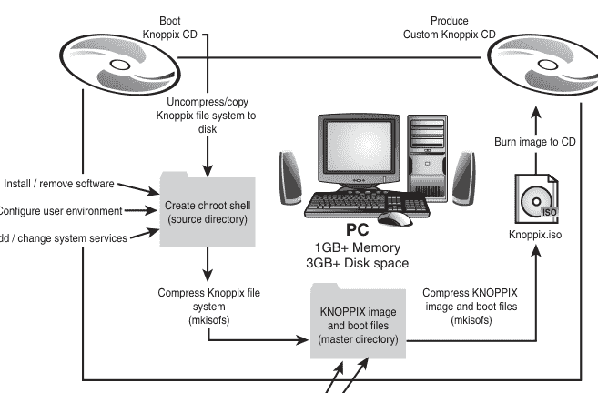

图 6-1 解压缩、修改并重新压缩 Knoppix 以创建自定义 CD。

## 选择要定制的 KNOOPPIX 发行版

由于市面上已经有了多种定制的 Knoppix 发行版，为了节省自己的精力，你可以从与你最终想要创建的 live CD 最匹配的 Knoppix 发行版开始。目前提供以下不同的 Knoppix live CD 或 DVD 发行版：

- **Knoppix**——标准的 Knoppix CD 发行版包含了一套完整的桌面和服务器应用程序。ISO 镜像小于 700MB。

- **Education**——为了教育目的制作的 Knoppix 定制版包括 Freeduc (www.ofset.org/freeduc-ecole) 和 Knoppix for Kids (www.osef.net/wiki/Education_Live_CD)，其他教育类 Knoppix 定制版请参见列表。

- **Games**——Linux Live Game Project (http://games-knoppix.unix-ag.uni-kl.de) 和 Knoppix Games 是可用的游戏发行版之一。（Linux Game Project live CD 在第 11 章“定制游戏类 Live Linux CD”中描述）

### Live Linux CDs

### 注意

使用标准的 Knoppix 发行版提供了利用最新 Knoppix 技术的最佳机会。此外，如果你只是从互联网上随机抓取某个发行版，会有更大的获取损坏甚至恶意软件的风险。出于这些原因，本章中的步骤使用了标准的 Knoppix 发行版进行说明。

- **Server**——Lampix (http://lamprix.tinowagner.com) 主要是一个 Web 服务器 CD。LiveOIO (www.txoutome.org) 是一个演示 Zope Web 服务器和 OIO on Zope 医疗应用的 CD。

- **Small**——Damn Small Linux (www.damnsmalllinux.org) 和 Feather Linux (http://featherlinux.berlio.de) live CD 是你想制作一个启动约为 50MB 的微型 live CD 的良好起点。（Damn Small Linux 提供了它的定制工具。）一个重制的 Damn Small Linux 发行版示例在第 10 章“定制演示类 Live CD”中描述。

- **Security/recovery**——由于救援、恢复和安全应用程序是 live CD 的自然选择工具，有几个基于 Knoppix 的发行版专注于此类工具。流行的安全 live CD 包括 Auditor 安全合集 (www.remote-exploit.org) 和 Knoppix STD (www.knoppix-std.org)。你可以在 www.knoppix.net/wiki/Security_Live_CD 找到安全 live CD 列表。

要查看 Knoppix 定制版的详细列表，请参阅 Knoppix Customizations页面：www.knoppix.net/wiki/Knoppix_Customizations。要了解如何获取本章示例使用的标准 Knoppix 发行版，请参考 www.knoppix.net/get.php。

## 设置构建机器

如果你有一台硬盘上安装了 Linux 系统的电脑，你可能已经拥有了重制自己的自定义 Knoppix live CD 所需的配置。为了有效地重制 Knoppix，你需要大量的内存、交换分区（swap）和硬盘空间。你需要的空间取决于你是在创建 CD 还是 DVD。你还需要连接互联网：

# 第 6 章 构建自定义的 Knoppix CD


## 系统需求

**内存（RAM 和交换分区）**——创建 700MB 的 CD 镜像建议至少使用 1GB 内存（`RAM` 加交换分区），如果创建单层 DVD，则建议使用 5GB 内存。例如，如果你有 512MB 的 `RAM`，创建 CD 至少需要 512MB 的交换分区，创建 DVD 则需要 4.5GB 的交换分区。

**硬盘空间**——对于硬盘空间，你需要在 Linux 文件系统中准备 3GB (`CD`) 到 15GB (`DVD`) 之间的空间。`ext3` 或 `xfs` 等 Linux 文件系统可以正常工作。

**网络连接**——`Knoppix` 会自动配置有线以太网并连接到网络（假设可用 `DHCP` 服务器）。如果需要，`Knoppix` 也可以手动为许多无线网卡或静态以太网连接进行配置。

接下来的步骤假设你已经在硬盘上安装了 Linux 系统（并具有上述内存和磁盘空间）。为了执行定制，该步骤假设你正在启动 `Knoppix` 并从那里执行指令。`Knoppix` 会自动检测你的交换区域，因此你只需要确保你在 Linux 文件系统上使用的硬盘空间是 `Knoppix` 支持的。

## 重制 Knoppix

按照之前准备好电脑后，你可以开始重制 `Knoppix` 的过程。此过程是使用标准的 `Knoppix 5.0.1` CD（约 696MB）完成的。该过程分为以下主要部分：准备重制、在 `ch` 环境中工作、修改启动文件、创建最终 CD 镜像以及测试和刻录 CD 镜像。

### 准备重制

要开始重制 `Knoppix` 以创建自定义 live CD，你需要从你刚刚准备好的电脑通过启动 `Knoppix` 来操作。在 `Knoppix` 运行时，你将从 `Knoppix` CD 复制文件到硬盘。方法如下：

- **1. 启动 Knoppix**——插入随书 DVD（或其他 `Knoppix` CD）到电脑并重启。在启动提示符输入 `knnoppix` 并按回车。等待几分钟让 `Knoppix` 进入桌面。

- **2. 以 root 身份打开 shell**——从 Kno 桌面选择终端图标（Console）。当 Console 窗口打开时，输入 `su` 成为 root 用户。（以 root 身份运行整个步骤。）

- **3. 检查网络访问**——要检查是否连接互联网，可以使用 `ping` 命令。例如，输入命令（然后使用 Ctrl+C 结束）：

```
### ping www.xxx.net
PING www.xxx.net (xxx.xx): 64 bytes from xxx.xx: icmp_seq=0 ttl=64
```

如果没有互联网，你可能需要手动配置。在 `Knoppix` 中可以通过 Network 菜单配置连接的工具。

- **4. 访问硬盘分区**——确定硬盘上的哪个分区是此过程使用的（至少 3GB 到 5GB 空间）并以读写权限打开。在桌面上打开你认为需要的图标。显示显示分区的窗口卸分区并以读写权限重新挂载。例如，关闭窗口后，如果你需要的分区是 `/dev/hda1`（挂载在 `/media/hda1`），在终端输入：

```
### umount /media/hda1
### mount -o rw /media/hda1
```

你的硬盘分区现在应该是可用的（`Knoppix` 最近添加了从桌面以读写权限重新挂载分区的功能。右键点击分区图标并选择 Read/Write Mode）。

- **创建一个工作目录**——例如，如果你使用的分区挂载在 `/media/hda1`，可以如下创建 `knnoppix` 目录：

```
# mkdir /media/hda1/knoppix
```

- **检查可用内存**——要检查你是否有足够的内存和硬盘空间，分别可以使用 `free` 和 `df` 命令。以下是一些示例：

```
### df -h /media/hda1
Filesystem     Size Avail Use% Mounted on
/UNIONFS/dev/hda1   46G  876M  43% /media/hda1
```

```
### free -m
```

| | total | used | free | cached |
| :--- | :--- | :--- | :--- | :--- |
| Mem | 724 | 232 | 492 | 0 | 109 |
| +/- buffers/cache | | 113 | 611 | |
| Swap | 996 | 5 | 990 | |

在示例中你可以看到挂载在 `/media/hda1` 的分区有 43GB 的可用磁盘空间。你还可以看到有 724MB 的 RAM 和 996MB 的交换空间。内存 和交换总和大于 1.5GB。如果你没有足够的内存，可以创建一个额外的交换文件。以下在我们刚刚挂载的分区上创建交换文件的示例：

```
# dd if=/dev/zero of=/media/hda1/knoppix/myswap bs=1M count=1000
1000+0 records in
1000+0 records out
# mkswap /media/hda1/knoppix/myswap
Setting up swap version 1, size = 1048576 kB
no label, UUID=595a3efe-968d-4f83-9892-37e05eee6651
# chmod 0600 /media/hda1/knoppix/myswap
# swapon /media/hda1/knoppix/myswap
```

这些命令显示创建一个名为 `myswap` 的 1000MB 文件，将权限关闭给 root，识别该文件为交换区域并启用作为交换文件。

- **7. 创建 master 和 source 目录**——你需要创建两个独立的目录进行工作。`master/KNOPIX` 包含启动 CD 所需的文件，而 `source/KNOPIX` 包含组成 CD 上 KNOPIX 文件系统的文件（压缩为名为 KNOPIX 的单个镜像文件）。

输入以下内容创建工作目录：

```
# mkdir -p /media/hda1/knoppix/master/KNOPIX
# mkdir -p /media/hda1/knoppix/source/KNOPIX
```

- **8. 复制 Knoppix 文件**运行中的 KNOPIX live CD 或 DVD 系统上的 `/KNOPIX` 目录包含你想定制的 Knoppix 文件系统。要将这些文件和目录复制到你的工作目录，输入以下内容：

```
# cp -Rp /KNOPIX/* /media/hda1/knoppix/source/KNOPIX
```

当我运行此命令时，花费了大约 13 分钟完成，并在 `source/KNOPIX` 目录中产生了 2.1GB 的数据。

> **注意**
> 如果你正在重制一个官方的 Knoppix DVD，你会发现有一个 KNOPPIX 和一个 KNOPPIX2 镜像。允许多个 KNOPPIX 镜像（KNOPPIX、KNOPPIX3 等）存在，可以让你维持大小适中的 KNOPPIX 镜像。当 Knoppix 启动时，所有 KNOPPIX 镜像将使用 UnionFS 文件系统进行合并。在本过程中，我们仅描述了随附 Knoppix CD 上的单个 KNOPPIX 镜像。

- **9. 复制启动文件**——Knoppix CD 上的 `boot` 目录包含启动 CD 所需的文件。你还需要复制主目录（master）。要将这些文件复制到你的主目录以便进行复制和修改，请输入以下：

```bash
# cp -ar /cdrom/boot /media/hda1/knoppix/master/boot
# cp -ar /cdrom/KNOPPIX/modules /media/hda1/knoppix/master/KNOPPIX
```

- **10. 复制启动页**——要将 Knoppix 启动时出现的第一个 HTML 页面（如果你在 Windows 中打开 Knoppix CD）复制到你的主目录，请输入以下：

```bash
# cp /cdrom/index.html /media/hda1/knoppix/master
# cp /cdrom/autorun.* /media/hda1/knoppix/master
# cp /cdrom/cdrom.ico /media/hda1/knoppix/master
```

- **11. CD 文件**——你需要将 CD 启动时所需的所有其他文件（不同语言的 FAQ 和主页、许可信息以及一些图像）复制到你的主目录。以下命令行（由《Knoppix Customization Howto》建议）将复制 CD 中所有小于 10MB 的文件（以排除复制 690MB 的 KNOPPIX 文件）：

这里显示的两个命令实际上可以写成单条命令。行末尾的反斜杠（`\`）允许你按回车键并使第二行仍作为第一行的一部分。

## 第 6 章 构建自定义 Knoppix CD

现在，你已经在 `master/KNOPPIX` 目录下拥有了启动 live CD 所需的所有文件。你使用的整个 KNOPPIX 文件系统应该位于 `source/KNOPPIX` 目录。你的下一步是将根目录（chroot）更改为 `source/KNOPPIX` 目录，并修改该目录结构，以包含你想放在 live CD 上的应用程序、文件和目录。

### 在 chroot 环境中工作

通过将根目录更改为 `source/KNOPPIX` 目录，你可以通过在该目录结构内工作来更改自定义 Knoppix CD 镜像的内容。在该环境中，你可以添加和删除软件包、设置桌面并配置系统设置。

当你运行 `chroot` 命令时（如所示），你开始从刚从 CD 启动的 Knoppix 系统的副本开始工作。因此，你需要执行几个步骤来使该环境能够访问互联网并下载软件包。记住，你在该环境中对文件系统执行的任何操作都会反映在你制作的 CD 上。

以下是操作步骤：

- **12. 添加网络访问**——要使用 chrooted 环境访问互联网，你需要一个 `resolv.conf` 文件。如果你已经通过 live CD（通过 DHCP）获取了互联网连接，可以复制启动 Knoppix 时创建的 `resolv.conf` 文件：

```bash
# cd /media/hda1/knoppix/source/KNOPPIX/etc/dhcp
# cp /etc/dhcp/resolv.conf .
cp: overwrite ./resolv.conf? y
```

- **13. 执行 chroot**——要将 `source/KNOPPIX` 目录指定为你的根目录，请输入 `chroot` 命令并按所示挂载 `/proc` 文件系统：

```bash
# chroot /media/hda1/knoppix/source/KNOPPIX
# mount -t proc /proc /proc
warning: can't open /etc/fstab: No such file or directory
```

> 注意
> 如果你 chroot 的分区是用 `nodev` 选项挂载的，可能会出现 /dev/null 错误信息（权限拒绝）。你可以通过向 `/etc/fstab` 中的条目添加 `dev` 选项，然后卸载并重新挂载分区来解决这个问题。例如，`/dev/hda1` 的新 fstab 条目可能如下：
> ```
> /dev/hda1 /media/hda1 ext3 noauto,users,dev 0 0
> ```
> 忽略 `/etc/fstab` 警告（尽管如此 `/proc` 仍会挂载）。此时，在你退出该 shell 之前，你的 shell 将 `/media/hda1/knoppix/source/KNOPPIX` 目录视为你的根目录。请确保在后续步骤中使用此 shell。

- **14. 添加网络访问**——因为你之前在 chroot 环境中添加了 `resolv.conf` 文件，你现在应该可以从 chrooted shell 访问互联网了。要进行检查，请尝试 `ping` 命令：

```bash
### ping knoppix.net
```

如果你只是添加从互联网获取的新软件包，可以继续进行下一步。但是，如果你想从局域网（LAN）添加数据文件、应用程序或其他软件，请考虑以下网络连接：

- **15. 更新软件**

- **16. 软件**

- **17. 添加软件**

- **18. 清理软件**

你可以使用之前提到的 `apt-get remove` 命令来删除孤立包。或者，正如《Knoppix 重制教程》建议的那样，你可以简单地将列表通过给 `apt-get remove` 并一次性删除它们，如下所示：

```bash
### deorphan | xargs apt-get -y remove
```

被删除的包有时会留下配置文件。要确定是否发生了这种情况，你可以列出那些你选择删除 (R) 但留下了配置文件 (C) 的包。以下命令列出了这些包：

```bash
# dpkg -l | grep ^arc
# dpkg -l | grep ^arc | awk '{print $2}' | xargs dpkg -P
```

输入以下内容来删除遗留的文件：

```bash
# apt-get clean
```

由于 `apt-get` 将你下载并安装的所有软件软件包都保存在缓存中，因此在继续之前，你应该清理这些文件。方法如下：

### 测试应用程序

虽然依赖特定硬件配置的应用程序在构建自定义的 Knoppix CD 后效果最好，但你安装的大多数命令和图形实用程序都可以从你的 `chroot` 环境轻松测试。从 `chroot` 环境启动 X 应用程序有几种方法：

- **本地 X 桌面**——你可以通过设置 `DISPLAY` 变量并直接运行应用程序，从 `chroot` 环境在本地桌面上启动应用程序。例如，要从 `chroot` 环境在本地桌面运行 `xmms` 应用程序，请输入：

```bash
### export DISPLAY=localhost:0
# xmms &
```

- **嵌套 X 桌面**——如果你想尝试不同的窗口管理器，可以从 `chroot` 环境运行 `Xnest`。`Xnest` 是一个可以作为客户端窗口在你 X 桌面运行运行服务器。运行 `Xnest` 后，你可以启动你选择的窗口管理器，然后在该 `Xnest` 窗口中运行任何应用程序。

例如，从你的 `chroot` shell 中，你可以输入以下内容：

```bash
### export DISPLAY=localhost:0
# Xnest -ac :1 &
### export DISPLAY=localhost:1
# icew &
# xclock &
```

### 充分利用 APT

为了帮助你为自定义的 Knoppix CD 安装和使用应用程序，你可以利用 `apt` 功能完成几项操作。这里是一些建议：

- 获取 `apt-spy` 应用程序（`apt-get install apt-spy`）并使用它检查你所在地区最佳镜像站点。`apt-spy` 命令会修改你的 `sources.list` 文件（所以你可能应该额外复制一份该文件作为备份）。这是一个 `apt-spy` 命令行示例，它可以找到四个对北美提供良好响应时间的镜像，并用新服务器更新 `/etc/apt/sources.list` 文件：

```bash
# apt-spy -d stable -a north-america -e 4
```

- 不要升级包（`apt-get upgrade`）。升级比简单的安装更可能破坏软件。

- 将 `apt-get` 为 Knoppix 安装的默认包从测试（testing）更改为稳定（stable）。你可以通过更改 `/etc/apt/conf.file` 中的 `testing` 单词为 `stable` 来实现。


- 注意 `apt-get` 生成的消息以获取你可能需要的信息，例如卸载包后留下的空目录。

- 与其使用 `apt-get`，你可以尝试使用 `aptitude` 工具。除了能够像 `apt-get` 一样处理包之外，`aptitude` 还提供有关你正在使用或节省磁盘空间的信息。

图 6-2 显示了刚刚运行的步骤示例。在 `Xnest` 窗口中，你可以看到 `ice` 窗口管理器、`xclock` 应用程序以及我在该窗口菜单内运行的其他应用程序（Firefox 浏览器和国际棋应用程序）。屏幕左下角的终端窗口是启动 `Xnest`、`ice` 窗口管理器和 `xclock` 的地方。

## 配置桌面和用户环境

你可以自定义进入自定义 Knoppix 桌面的几乎每一个方面。Knoppix 依赖于常见的 Linux 文件和目录来确定用户设置（如 `/etc/skel` 目录），并依赖 Knoppix 特有的配置文件（如 `/usr/share/knoppix/profile` 中的文件）。

## 第 6 章 构建自定义的 Knoppix CD

19

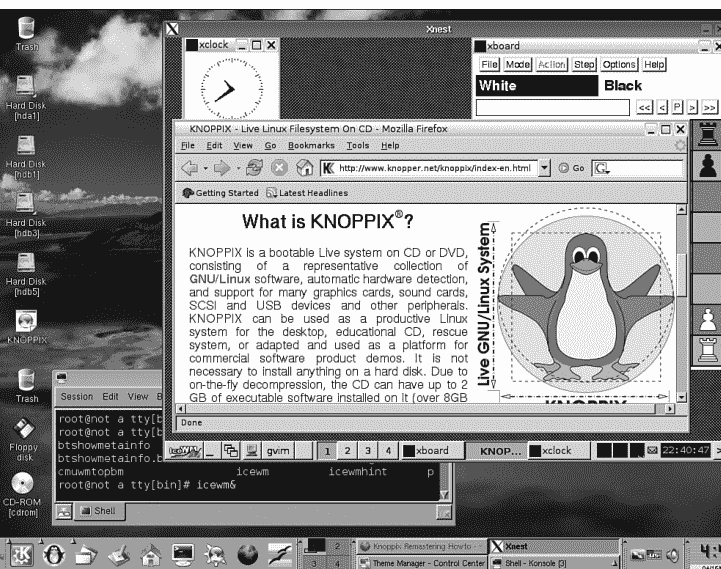

图 6-2 在嵌套 X (Xnest) 中从 chroot shell 窗口管理器。

在 Knoppix 中，启动桌面的过程由 CD 上 `/etc/X11/Xsession.d` 目录（在你的 `chroot` 环境中）的文件引导。以下项目描述了 Knoppix 5 该目录下的每个脚本以及每个脚本的作用：

- 20xx-common_process-args——此处的设置决定了在桌面启动期间传递的不同参数将运行什么内容。在没有参数的情况下，X 以默认行为（KDE 桌面）启动。带有 `failsafe`（安全）参数时，只打开一个终端窗口，以便你可以从 shell 开始运行命令。

- 30xx-common_xrecources——这里是系统级 X 资源合并到服务器的地方。

- 45xsession——大部分核心内容都在此文件中。

- 45xsession——大部分核心内容都在此文件中。

*(注：由于原文中存在大量的 OCR 识别重复，译文已根据逻辑进行了去重和清理，保留了核心技术信息)*

### 现场 Linux CD

你想要应用到用户目录的内容可以简单地添加到 `/etc/skeletal` 目录。

虽然你也可以通过将你希望让 knnoppix 用户拥有的任何数据文件放置在 `/etc/skeletal` 目录，但对于大量数据，你应该使用文件系统中的其他位置，例如 `/var` 下的目录。

# 更改或添加系统启动服务

Knoppix 允许你使用标准的 SysV init 脚本机制来启动系统服务。通过此机制，你可以添加任何喜欢的系统服务（Web 服务器、邮件服务器、登录服务器等），让这些服务在 Knoppix 启动时自动运行。

无论系统启动到哪种运行级别（也称为系统级别），第一个 init 脚本都是 `knoopix-autoconfig` 脚本（位于 `/etc/rc5.d/S00knoppix-autoconfig`）。该脚本定义了许多基础设置（语言、键盘和模块），使得 Knoppix 能够与硬件端口和存储设备（USB、firewire 等）进行交互。

默认情况下，Knoppix 在 init 状态 5 下启动。该状态最常用于启动连接到网络的 X 桌面系统。当 `/etc/rc.d` 目录中任何以字母 S 开头的启动脚本启动时（使用 `start` 选项运行），以字母 K 开头的启动脚本则会被停止（使用 `stop` 选项运行）。

许多包含启动脚本的应用程序会将这些脚本放在 `/etc/init.d` 目录。例如，如果你想在启动自定义的 Knoppix 时启动 `/etc/init.d` 中的任何服务，你只需要将该服务的脚本链接到 `/etc/rc5.d` 中一个以字母 S 开头的文件即可。以下是一个示例：

```
# cd /etc/rc5.d
# ln -s ../init.d/ssh S55ssh
```

在示例中，ssh 服务的启动脚本被链接到 `/etc/rc5.d` 目录下的文件 `S55ssh`。该文件名的命名规则是字母 S（代表“start”，启动），后跟着一个数字（表示脚本运行的顺序），最后是脚本名称。（你可以使用任何喜欢的数字，尽管惯例是对于需要网络运行且已挂载所有本地文件系统的服务，使用 40 以上的数字。）在这种情况下，ssh 守护进程会在启动 Knoppix 时自动启动，远程用户可以使用 ssh 登录计算机。

# 第 6 章构建自定义的 Knoppix Live CD

尽管 Knoppix 支持此机制，但它本身并没有怎么使用 SysV 机制。然而，如果你想查看 Knoppix 运行的启动功能（并可能更改这些功能），我建议检查以下内容：

- `/etc/inittab`——此文件定义了初始运行级别，以及在不同运行级别启动的某些功能。例如，该文件的最后一行为运行级别 5 启动 `xsession` 到你的 X 桌面。

- `/etc/init.d/knoppix-autoconfig`——此脚本在系统启动到单用户模式或更高模式时执行（换句话说，每次 Knoppix 启动时）。它包含了运行 Knoppix 需要的许多基础设置（键盘、语言、启动选项、系统监控等）。该脚本通过指向 `/etc/rc.S/s00knoppix-autoconfig` 的链接运行。有关此文件的更详细描述，请参阅第 4 章“理解现场 Live CD 的工作”。

# 清理 chroot 环境

在离开 chroot 环境之前，你需要确保所有内容都已清理。你留存在文件系统结构中的任何内容将进入你的现场 CD。你需要做的第一件事是卸载你挂载的 `/proc` 目录，如下：

```
# umount /proc
```

接下来，删除在创建自定义 Knoppix 过程中更改的任何临时文件或配置文件。这里有几个需要检查的地方：

- `/root` 目录——输入 `ls -lat /root` 并删除在以 root 用户身份运行时意外创建的任何文件。

- `/var/log` 目录——检查是否有从尝试过的应用程序（如 X 服务器）中留下的日志文件。

- apt 文件——删除 `/var/lib/apt/lists` 目录中在使用 `apt-get` 安装应用程序时放置在其中的文件。从该目录中，你可以输入 `rm *debian* *knoppix` 来删除留下的额外包文件。

确保在自定义过程中创建的文件没有被留下的方法一种是在整个源目录结构中搜索从你开始自定义过程以来创建的所有文件。以下是一个 `find` 命令，列出了过去两天内创建的所有文件：

```
# cd media/hda1/knoppix/source
# find . -type f -mtime -1 -exec rm '{}' \; | less
```

### 现场 Linux CD

你可以翻页查看此列表以看到创建的文件。记住，此列表也包括你安装并想要保留的软件；在开始删除文件之前，请仔细考虑列表的内容。

当你觉得 Knoppix 自定义完成时，只需退出 chroot shell 即可离开 chroot 环境：

```
### exit
```

接下来，你可以开始组合将放在 CD 上的 KNOPPIX 镜像。

# 压缩文件系统镜像

在作为 Knoppix 现场 CD 的文件系统中设置完成后，下一步是将该文件系统收集到一个单个压缩镜像中。该镜像（命名为 KNOPPIX）将进入最终的 CD ISO，其中镜像的部分可以在需要时（稍后通过 loop 驱动程序）解压缩。

在制作压缩文件系统镜像时，你需要章节开头描述的内存量（RAM 加交换分区）。在继续之前，请再次参考该章节如何检查所需的可用内存量。

> 注意

> 尽管在示例中我们使用的是单个 KNOPPIX 镜像，你可以在 `/KNOPPIX` 目录下拥有多个 KNOPPIX 镜像（KNOPPIX、KNOPPIX2、KNOPPIX3 等）。它们在 Knoppix 启动时会被拾取并合并成单个根文件系统 (/)。

允许多个 KNOPPIX 镜像不仅让这些每个镜像的大小更容易管理，而且减少了你所需的总内存，而不是产生一个巨大的 KNOPPIX 镜像。官方的 Knoppix DVD 包含了 KNOPPIX 和 KNOPPIX2 镜像。

`mkiso` 命令是用于将一组文件制作 ISO 9660 镜像的工具。这里是一个命令行示例：

```
# mkisofs -R -U -V "My Knoix" -publisher "John W. Jones" hide-rr-moved cache-inodes no-bak -pad /media/hda1/knoppix/source/KNOPPIX \
| nice -5 /usr/bin/create_compressed_fs -65536 /media/hda1/knoppix/master/KNOPPIX/KNOPPIX
```

### 现场 Linux CD

你可以按照自己的喜好配置启动过程。最终，isolinux 会启动一个带有初始 RAM 磁盘（initial RAM disk）的可启动内核镜像。

## 修改 Isolinux 文件

你可能考虑更改位于 Knoppix CD 中 `/boot/isolinux` 目录下的这些文件：

- isolinux.cfg—描述 CD 如何响应来自启动提示符的输入。该文件中列出的标签（Labels）定义了当在启动提示符处输入这些标签时将运行哪个内核和选项。功能键定义决定了将显示哪些消息文件。此外，你还可以输入几个不同的选项进行定义，例如系统在启动之前在启动提示符处（无输入）应等待多长时间（TIMEOUT），或者在启动提示符之前显示什么文本（DISPLAY）。

- boot.msg—定义在启动提示符之前出现的文本。

- logo.1—包含以 syslinux SLL16 图像格式的启动屏图像（splash screen），该图像会在初始启动时显示。

- f2—包含用户在启动提示符处按 F2 键时显示的文本。这些文本描述了带有 Knoppix 的启动选项。

- f3—包含用户在启动提示符处按 F3 键时显示的文本。这些文本描述了 Knoppix 可用的代码。

如果你愿意，可以添加更多消息文件来配合功能键定义（f4、f5、f6 等）。例如，你可能想要创建描述 CD 内容或许可信息的消息文件。

由于 isolinux 文件在不同类型的现场 CD 之间基本上是相同的，因此第 5 章“深入研究现场 CD 组件”对 Isolinux 文件有通用的描述。关于创建你自己的启动屏和修改配置消息文件的信息，请参阅该章节。

除了 isolinux 文件外，你可能还会考虑更改 CD 首次启动时提供的信息文本和 HTML 文件。这些文件包括出现在 CD 根目录下的 `index.html` 文件。该文件指向 KNOPPIX 目录下的介绍性文件，而这些文件以多种语言（法语、意大利语、西班牙语、日语等）提供。你还可能查看该目录下的 FAQ 文件（同样提供不同语言），以确定你是否想要更改或替换它们。

## 第 6 章构建自定义 Knoppix CD

### 理解内核镜像和初始 RAM 磁盘

最终，isolinux 目录中的大部分内容只是为了帮助你找到正确的内核镜像进行启动。对于 Knoppix，该内核启动镜像（位于 `boot/isolinux` 目录中）名为 `linux`。在初始启动过程中，linux 内核镜像还依赖于初始 RAM 磁盘上执行的模块和命令。对于 Knoppix，该初始 RAM 磁盘是一个压缩（gzip）文件系统，名为 `minirrt.gz`。

由于 2.6 内核的大小限制，linux 内核镜像已经超过了在旧软盘上运行所需的 1.4MB 边界。现在的 `linux` 文件大小为 1.7MB。如果你想创建自己的自定义 Knoppix 内核，请参阅 [Knoppix Custom Kernel Howto](http://www.knoppix.net/wiki/Knoppix_Custom_Kernel_Howto)。

如果你想向初始 RAM 磁盘中添加或删除模块或其他组件，可以解压它，进行你喜欢的更改，然后重新压缩。该过程在第 5 章中有详细描述。

### 创建最终 CD 镜像

如果你已经重新检查了你的 `master/KNOPIX` 目录以确保它包含了所有内容（并且不包含不需要的内容），你就可以准备创建最终的 CD/DVD 镜像了。该过程包括运行命令行生成 `md5sums` 以验证 CD 镜像中的文件，并运行另一个 `mdsums` 命令来生成包含你的自定义 Knoppix 现场 CD 的最终 ISO 镜像。

KNOPIX 目录包含一个 `md5sums` 文件，其中包含了现场 CD 上每个文件的 MD5 校验和。由于你更改了其中一些文件，你需要对这些文件运行 `mdsums` 命令，并将输出重定向到 `md5sums` 文件。

切换到该目录。然后运行以下命令为你的每个自定义 Knoppix 创建 `md5sums`：

```bash
# cd /media/hda1/knoppix/master
# find -type f -not -name md5sums -name boot.cat \
-not -name isolinux.bin -exec md5sum {} \ > KNOPIX/md5sums
```

刚才显示的命令行收集了 `master` 目录及其子目录中的所有文件（排除 `md5sums`、`boot.cat` 和 `isolinux.bin` 文件），对它们运行 `md5sum` 命令，并将每个文件生成的 `md5sum` 复制到 `md5sums` 文件。该文件的内容显示 `md5sum` 后后跟它所代表的文件。

例如：

- 65311f3570a89f2db164c9a3729 /KNOPPIX/background.jpg

- b8206dbfaa53dc11b70a5861163ld9 /KNOPPIX/avm-emul.license.txt

- 7386ec3da1f2801dbf9980df202746d /KNOPPIX/background.jpg

- 7aa99d37114a6e55655e2b2a953 /KNOPPIX/images/knoppix-24-1.jpg

- b27b38f6b7f01ca7d30ab3b33


### 现场 Linux CD

你可以按照自己的喜好配置启动过程。最终，`isolinux` 会启动一个带有关联的初始 RAM 磁盘的可启动内核镜像。

## 修改 Isolinux 文件

你可能考虑更改位于 Knoppix CD 中 `/boot/isolinux` 目录下的这些文件：

- `isolinux.cfg`—描述 CD 如何响应来自启动提示符的输入。该文件中列出的标签定义了当在启动提示符处输入这些标签时将运行哪个内核和选项。功能键定义决定了将显示哪些消息文件。此外，你还可以输入几个不同的选项进行定义，例如系统在启动之前在启动提示符处（无输入）应等待多长时间（`TIMEOUT`），或者在启动提示符之前显示什么文本（`DISPLAY`）。
- `boot.msg`—定义在启动提示符之前出现的文本。
- `logo.1`—包含以 syslinux SLL16 图像格式的启动屏图像，该图像会在初始启动时显示。
- `f2`—包含用户在启动提示符处按 F2 键时显示的文本。这些文本描述了带有 Knoppix 的启动选项。
- `f3`—包含用户在启动提示符处按 F3 键时显示的文本。这些文本描述了 Knoppix 可用的代码。

如果你愿意，可以添加更多消息文件来配合功能键定义（`f4`、`f5`、`f6` 等）。例如，你可能想要创建描述 CD 内容或许可信息的消息文件。

由于 `isolinux` 文件在不同类型的现场 CD 之间基本上是相同的，因此第 5 章“深入研究现场 CD 组件”对 Isolinux 文件有通用的描述。关于创建你自己的启动屏和修改配置消息文件的信息，请参阅该章节。

除了 `isolinux` 文件外，你可能还会考虑更改 CD 首次启动时提供的信息文本和 HTML 文件。这些文件包括出现在 CD 根目录下的 `index.html` 文件。该文件指向 `KNOPPIX` 目录下的介绍性文件，而这些文件以多种语言（法语、意大利语、西班牙语、日语等）提供。你还可能查看该目录下的 FAQ 文件（同样提供不同语言），以确定你是否想要更改或替换它们。

## 第 6 章 构建自定义 Knoppix CD

### 理解内核镜像和初始 RAM 磁盘

最终，`isolinux` 目录中的大部分内容只是为了帮助你找到正确的内核镜像进行启动。对于 Knoppix，该内核启动镜像（位于 `boot/isolinux` 目录中）名为 `linux`。在初始启动过程中，`linux` 内核镜像还依赖于初始 RAM 磁盘上执行的模块和命令。对于 Knoppix，该初始 RAM 磁盘是一个压缩（`gzip`）文件系统，名为 `minirrt.gz`。

由于 2.6 内核的大小限制，`linux` 内核镜像已经超过了在旧软盘上运行所需的 1.4MB 边界。现在的 `linux` 文件大小为 1.7MB。如果你想创建自己的自定义 Knoppix 内核，请参阅 [Knoppix Custom Kernel Howto](http://www.knoppix.net/wiki/Knoppix_Custom_Kernel_Howto)。

如果你想向初始 RAM 磁盘中添加或删除模块或其他组件，可以解压它，进行你喜欢的更改，然后重新压缩。该过程在第 5 章中有详细描述。

### 创建最终 CD 镜像

如果你已经重新检查了你的 `master/KNOPIX` 目录以确保它包含了所有内容（并且不包含不需要的内容），你就可以准备创建最终的 CD/DVD 镜像了。该过程包括运行命令行生成 `md5sums` 以验证 CD 镜像中的文件，并运行另一个 `mdsums` 命令来生成包含你的自定义 Knoppix 现场 CD 的最终 ISO 镜像。

`KNOPIX` 目录包含一个 `md5sums` 文件，其中包含了现场 CD 上每个文件的 MD5 校验和。由于你更改了其中一些文件，你需要对这些文件运行 `mdsums` 命令，并将输出重定向到 `md5sums` 文件。

切换到该目录。然后运行以下命令为你的每个自定义 Knoppix 创建 `md5sums`：

```bash
# cd /media/hda1/knoppix/master
# find -type f -not -name md5sums -name boot.cat \
-not -name isolinux.bin -exec md5sum {} \ > KNOPIX/md5sums
```

刚才显示的命令行收集了 `master` 目录及其子目录中的所有文件（排除 `md5sums`、`boot.cat` 和 `isolinux.bin` 文件），对它们运行 `md5sum` 命令，并将每个文件生成的 `md5sum` 复制到 `md5sums` 文件。该文件的内容显示 `md5sum` 后后跟它所代表的文件。

例如：
- `65311f3570a89f2db164c9a3729` `/KNOPPIX/background.jpg`
- `b8206dbfaa53dc11b70a5861163ld9` `/KNOPPIX/avm-emul.license.txt`
- `7386ec3da1f2801dbf9980df202746d` `/KNOPPIX/background.jpg`
- `7aa99d37114a6e55655e2b2a953` `/KNOPPIX/images/knoppix-24-1.jpg`
- `b27b38f6b7f01ca7d30ab3b33`

### 使用其他重制教程

由于重制（remastering）涉及到拆解现有的 Knoppix CD、对其进行调整并将其重新组装，许多 Knoppix 爱好者已经以自己的方式实现了这一操作。如果你已经过过这一过程，并想回顾该任务的其他方法，这里有一些你可以尝试的其他 Knoppix 重制教程：

- Knoppix 微型教程 (Mini-Howto)（Daniel Stirnimann）—这个微型教程（位于 `www.stirnimann.com/mystuff/do/knoppix.txt`）为在 `chroot` 环境下使用 X 进行重制工作提供了一些很好的主意。
- HOWTO: 重制 KnoOPPIX（James Pryor）—这篇教程（位于 `www.virtualacuity.com/james/knoppix-howto`）提供了关于在 `chroot` 环境中获取代理网络连接以及在 `chroot` 环境中工作的某些有用细节。

你在网络上找到的许多 Knoppix 重制教程也发布在了 Knoppix 定制与重制论坛上。

### 查看自定义重制脚本

上述的重制过程是一个相当手性的工作。为了避免在进行 Knoppix 重制时重复输入相同的命令，Knoppix 爱好者创建了各种脚本来执行过程中的某些部分。

一个流行的脚本是由 Fabian Franz 创建的 `knoppix-remaster` 脚本，它可以让你通过点击完成启动和结束 Knoppix 重制过程的大部分。你可以在 `http://debian.tu-bs.de/knoppix/remaster` 获取重制包的 deb 包或压缩包（`tarball`）。

安装包后，你可以从桌面图标或 shell 启动 `knoppix-remaster` 脚本。例如，在将 tar 包下载到当前目录且计算机有足够的内存和硬盘空间的情况下（参见本章前面的部分介绍了你需要多少空间），以下是使用 `knoppix-remaster` 脚本的方法：

> 注意
> 该脚本已一段时间未更新。虽然以下操作程序最终生成了一个可以工作的 ISO 镜像，但脚本在某些终端窗口中会偶尔失败。

## 第 6 章构建自定义 Knoppix Live CD

1. 解压/解包重制包：
```bash
# tar xvfz remaster_*.tar.gz
# cd remaster-*
```
2. 启动 `knoppix-remaster`：
```bash
# ./knoppix-remaster &
```
弹出的窗口询问你是否想要创建一个新的重制版。你会被要求选择用于重制的目录。
3. 选择 Yes（是）并选择 OK。
4. 选择一个目录并点击 OK。脚本开始将文件复制到你的重制目录（这需要一些时间）。当复制完成后，你将看到一个活动列表，如图 6-3 所示。

图 6-3
在将 Knoppix 文件复制到磁盘后，选择一个重制任务。
5. 选择 Chroot into Your Remaster（进入你的重制环境）并选择 OK。当 shell 提示符出现时，你就可以开始在 `chroot` 环境中工作了。
6. 遵循本章前面的说明在 `chroot` 环境中工作。
7. 当你完成了对重制版的所有的所有操作后，输入 `exit`（返回菜单）。
8. 选择 Edit Several Options（编辑多个选项）。在出现的屏幕上，你可以更改文件系统名称、CD 属性以及主页。完成后点击 Quit（退出）。
9. 选择 compress the file system（压缩文件系统）。脚本获取任何可用更新并将文件系统压缩为单个 ISO 镜像。
10. 选择 Create isofs 选项。脚本将文件系统压缩为单个 ISO 镜像。（这需要一些时间）。
11. 完成后选择 Quit 退出脚本。

现在你可以按照本章前面的描述测试并使用该 ISO 镜像。

### 总结

重制自定义 Knoppix CD 的过程很大程度上是一个手动过程，但许多人已经成功实现了这一点。重制 Knoppix 的通用步骤包括从运行中的 Knoppix 系统中直接解包 Knoppix 文件，修改解包后的文件以适应你的需求，然后将它们重新封装成可以刻录到磁盘的 ISO 文件。

通过在 `chrooted` 环境中修改复制到硬盘的文件系统，你可以安装和删除包、更改设置并测试你的更改，就像你直接在 live CD 本上工作一样。当你重新压缩文件系统并将其添加回完整的、可引导的 ISO 镜像后，你可以使用 `qemu` 等模拟器测试该镜像，或通过将镜像刻录到 CD 进行尝试。

## 构建基础 Fedora Live CD

要开始构建自己的可引导 live Linux CD 系统，你应该设置构建 live Linux 所需的工具以及计划放入其中的软件包。由于本章将逐步引导你使用一个名为 Kadischi 的项目创建基于 Fedora Core 的 Live Linux CD，我将描述如何执行以下操作：

- 获取并设置创建 live Fedora CD 所需 Fedora Core 发行版和 Kadischi 工具
- 运行命令创建第一个 Fedora live CD
- 了解自定义 Fedora live CD 的许多机会

当你理解了使用 Kadischi 构建 Fedora live CD 的基础知识后，就可以继续使用本书第三部分中的许多技术来创建专门的 Linux CD 和 DVD。

与 Knoppix（其本身就是一个可引导的 Linux 发行版）不同，Kadischi 实际上是一组用于制作 live CD 的工具，基于 Red Hat 的 Fedora 项目。

## 理解如何构建 Fedora Live CD

使用 Kadischi 构建 Fedora live CD 的过程与在硬盘上典型的 Fedora Core 安装非常相似。过程包括：

- 启动 Fedora Core 安装（通常在硬盘上进行）
- 在临时目录中安装 Fedora-based 系统（包括语言、键盘、网络设置等）
- 从临时目录中收集软件
- 创建可引导 ISO 镜像

本质上，Kadischi 创建：
- Fedora Core 安装：在临时目录中
- Kadischi 工具：用于收集软件并将其打包
- Fedora Core 仓库：live CD 包含的来源
- Fedora Core kickstart：用于构建 live CD 文件
- 只读文件系统：默认情况下，Kadischi 使用 Squash 文件系统，防止 CD 在运行时删除或添加文件，尽管使用 UnionFS 使其可读。
- Kickstart：通过 kickstart 文件，你可以定义构建 live CD 的选项
- 易用的防火墙设置：在使用 Kadischi 制作 live CD 的过程中，你有机会配置防火墙并开启或关闭 live CD 所需的服务。

### 现场 Linux CD

Fedora Core 本身。至于目前正在开发的新功能，Kadiski 的图形化前端正在制作中。此外还在开发一些工具来添加用户友好的 CD 特性，例如保留持久化 `/home` 目录的能力。

随着 Kadiski 工具变得趋于稳定，你可以预计更多基于 Fedora 的现场版 CD 开始出现。寻找现场版 CD 的一个良好途径是 Fedora Unity 项目（`www.fedoraunity.org`）。该机构制作的第一批现场版 CD 基于 Fedora Core 5 和 Fedora Core 6, Test 2。

# 构建 Fedora CD 之前的准备工作

用于使用 Fedora Core 构建现场版 Linux 的 Kadiski 工具是设计在 Linux 系统上运行的。由于它依赖于 Fedora Core 的特定软件包，此步骤假设你已经在硬盘上安装了 Fedora Core。你可以在 Fedora Core 发行说明（`http://fedora.redhat.com/docs/release-notes/`）中找到安装 Fedora Core 的特定硬件和磁盘空间要求。

虽然使用 Kadiski 没有额外的硬件要求（除非你需要一个 DVD 驱动器来配合书中的 DVD 使用，以及一个 CD/DVD 刻录机来最终刻录你的 ISO 镜像），但你需要的磁盘空间大于最小限制。我建议在安装 Fedora Core 后，至少应留以下额外的磁盘空间：

- **软件仓库空间**——为用于构建现场版 Linux CD 的 Fedora Core 二进制包预留至少 3GB 的额外空间。（如果你愿意，也可以从 Fedora Core CD 安装或通过网络安装）。
- **构建目录空间**——在构建 ISO 镜像的目录中，至少留出 ISO 镜像最终大小 1.5 倍的空闲磁盘空间。构建 CD ISO 镜像时，至少需要 2GB 的空闲磁盘空间。对于标准的单面 DVD，构建目录中应至少有 8GB 的磁盘空间。（构建目录的默认位置是 `/tmp` 下的一个子目录，由 Kadiski 自动命名）。

# 安装 FEDORA CORE

我在硬盘上安装了 Fedora Core 6 作为操作系统，并用它在上面构建了现场版 Linux。默认安装应该很好地适用于此过程。然而，无论你选择哪组 Fedora 软件包，都应确保安装了以下软件包：

- `anaconda`—包含 Fedora Core 安装软件的部分内容，用于安装和重新配置 Fedora 软件。
- `busybox-anaconda`—包含 busybox 二进制文件，它实现了一个简单的 shell 以及大量从 shell 运行的基础命令。


- `syslinux`—包含现场版 CD 上使用的引导器软件，用于启动 Fedora 安装过程或引导现场版 CD。

- `mkisofs`—包含 `mkisofs` 命令，用于从任何选定的文件（包括你创建的可启动 CD 的文件系统）创建 ISO 镜像。

- `squashesfs-tools`—包含处理 Squashfs 文件系统的工具。Squashfs 文件系统专为需要高压缩率的只读环境设计的。

- `zisoofs-tools`—包含 `mkzftree` 命令，用于使用 ZF 压缩记录创建 ISO 9660 系统。

- `e2fsprog`—包含创建和处理 ext 文件系统的工具。

- `creatrepo`—包含 `createrepo` 命令，该命令需要你将软件包添加到你的 Fedora 仓库中。

- `yum-utils`—包含以供 Fedora 仓库使用的方式下载软件包的实用程序。

- `gnome-python2-gtktml2`—包含允许 Kadiski 以图形模式运行的组件。（当你安装此包时，如果那些依赖包尚未安装，它也会同时安装 `gnome-python2-extras` 和 `gnome-python2-libegg`。）

- `perl`—处理 Fedora 系统上 Perl 脚本所需的组件。

在安装 Fedora Core 后，如果你缺少上述列出的任何软件包，只要你有互联网连接，就可以使用 `yum` 命令安装这些软件包。将任何缺失的软件包添加到 `yum` 命令行中，例如：

```bash
# install anaconda busybox-anaconda
```

安装 Fedora Core 后，你已准备好开始设置 Kadiski。

# 安装 KADISCHI TOOLS

截至本文编写，Kadiski 项目还没有官方软件软件包（RPM 格式）。由于这些工具处于活跃开发中，获取 Kadiski 的官方方法是从 Fedora CVS 系统下载最新软件，并按照 Fedora 项目 Kadiski 页面（http://fedoraproject.org/wiki/Kadiski）上的说明进行安装。

然而，出于本步骤的需要，我创建了一个包含 Kadiski 工具的 RPM，你可以将其安装在 Fedora Core 6 系统上。虽然此 RPM 中的软件在本文编写时配合 Fedora Core 6 可以正常工作，但如果你想要最新的软件（或者 Fedora Core 6 的更新破坏了本书提供的 Kadiski RPM），请参考 Fedora 项目的 Kadiski 页面以获取最新软件。

从正在运行的 Fedora Core 6 系统中，你可以使用随书提供的 DVD 安装 Kadiski RPM。例如，插入 DVD 后，在终端窗口输入以下命令：

```bash
# rpm -Uv /media/LiveCDs/RPMS/kadiski*rpm
```

你用于创建现场版 Linux 发行的 Kadiski 软件安装在以下位置：

- `/etc/kadiski`—包含创建现场版 Linux CD 的配置构建文件。

- `/usr/share/kadiski`—包含脚本和示例。

- `/usr/sbin`—包含过程中使用的命令。

- `/usr/libexec/kadiski`—包含帮助文档（man pages）。

# 第 7 章 构建基础 Fedora 现场 CD

# 在硬盘上设置 Fedora 仓库

通过将 Fedora Core 分发版复制到硬盘上，你可以获得更好的构建性能。此过程假设你正在 Fedora Core 上工作，并且该系统已安装了所需的软件包（`anaconda`、`busybox-anaconda`、`syslinux` 等）。

如果你最近安装了 Fedora Core 6，你可能手头正留着 Fedora Core 6 安装 DVD 用于该操作。

1. 插入 Fedora Core 6 安装 DVD。DVD 应该会自动挂载。

2. 创建一个包含 Fedora Core 分发版的目录。例如：`mkdir $HOME/$FC6`

3. 接下来，复制随书提供的 DVD 上的 Fedora 目录内容。这些内容包括基础系统和随 Fedora Core 交付的所有二进制 RPM。例如，如果你的 DVD 挂载点是 `/cdrecorder`，你可以输入以下命令：

```bash
# cp -a /media/cdrecorder/Fedora/ $HOME/FC6/
# cp -a /media/cdrecorder/repodata $HOME/FC6/
```

这些内容包含约 3GB 的数据，因此复制可能需要几分钟。记住你的仓库目录的位置（在此例中，为 `$HOME/$FC6`）。这就是你稍后用 Kadiski 构建现场版 CD 时需要识别的位置。

软件仓库

如果你想使用与可用版本不同的 Fedora Core 版本，或者你没有足够的磁盘空间在本地存储 Fedora Core，则可以使用公共软件仓库。这里提供一个公共 Fedora 仓库地址的示例；该过程将花费得多，但效果同样良好：

```
http://download.fedora.redhat.com/pub/fedora/linux/core/6/i386/os
```

# 创建自定义软件仓库

有了 Fedora Core 软件仓库后，当你生成现场版 CD 时，软件包将根据软件包组从该仓库中提取并

### 现场 Linux CD

被选中的单个软件包。`comps.xml` 文件包含了可用软件包和包组的定义。

当你在上一节中将 `repodata` 目录复制到硬盘时，`comps.xml` 文件也被复制到了那里（例如，`$HOME/FC6/repodata/comps.xml`）。你从 `anaconda` 安装程序看到的用于选择软件类别、软件包和组的屏幕均来自此文件。用于指示类别、组和软件包的标签分别是 `<category>`、`<group>` 和 `<package>`。

图 7-1 显示了 `anaconda` 在 Fedora 安装（或现场 CD 启动）期间显示的屏幕示例，这些屏幕反映了可用的类别、组和软件包。这些条目直接显示 `comps.xml` 文件。

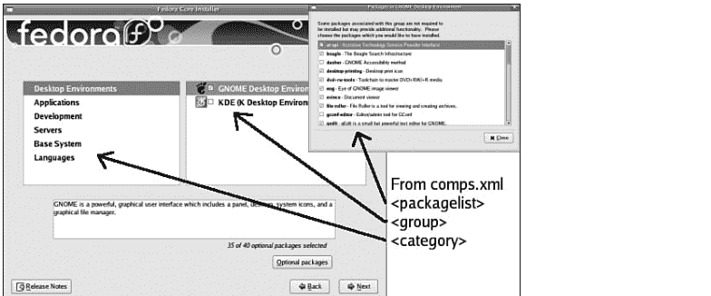

### 图 7-1 从 comps.xml 列出的软件包中选择包含在你的 live CD 中的软件包。

你可能可能会奇怪，为什么要向 Fedora live CD 中添加不在 Fedora Core 中的软件包。

从你在上一节中添加到硬盘的 Fedora 软件仓库开始，以下是你可能将其他软件包放入你的仓库的方法，以便稍后将其添加到你的 live CD 中。

- 1. **启用 yum 仓库**——你可以使用 `yum` 工具获取你需要的软件包并将其添加到你的仓库中。安装 Fedora Core 后，`yum` 已经启用，可以从 Fedora Core 和 Fedora Extras 获取额外的软件包。然而，如果你想从 `rpm.livna` 仓库获取软件包，可以用 root 用户身份输入以下命令：

`# rpm -ivh http://rpm.livna/livna-release-6.rpm`

> 注意

> `anaconda` 在 Fedora Core 6 的新功能允许你合并来自不同仓库的 `comps.xml` 文件。例如，你可以同时使用 Fedora Core 和 Fedora Extras 软件包构建现场 CD，而无需将所有内容都添加到单个 `comps.xml` 文件中。你甚至可以添加来自第三方仓库的软件包，例如 http://rpm.livna。

第 11 节“自定义游戏型现场 Linux”描述了如何使用此新功能从 Fedora Core 和 Fedora Extras 创建现场 CD。本节可以作为理解底层 `comps.xml` 结构工作原理的手段。

- 2. **下载软件包**——为了下载你需要的软件包（以及该软件包依赖的所有软件包），你可以使用 `yumdownloader` 命令（前提是你已按照提示安装了 `yum-utils` 软件包）。因为 livna 仓库已启用，以下是获取 `mplayer` 媒体播放器及其所有依赖项的方法：

`mplayer` 软件包及其 `mplayer` 依赖的所有项将下载到当前目录中。你可以继续下载想要添加到仓库的其他软件包。

- 3. **配置 comps.xml**——编辑 `comps.xml` 文件以创建要安装到你 live CD 中的软件组。然后你可以将这些组添加到现有类别中，或创建你自己的类别。对于 `$HOME/FC6` 下的仓库，使用任何文本编辑器打开 `comps.xml`（例如 `vi $HOME/FC6/Fedora/base/comps.xml`）。以下是我做的一些更改：

```xml
<group>
<id>myExtras</id>
<name>MyExtras</name>
<description>来自 Fedora Extras 的软件包。</description>
<default>true</default>
<uservisible>true</uservisible>
<packagerelist>
<packagerereq type="default">bittorrent</packagerereq>
<packagereq type="default">bittorrent-gui</packagereq>
<packagereq type="default">ncftp</packagereq>
</pagelistist>
</group>
```

```xml
<group>
<id>multimedia</id>
<name>Multimedia</name>
<description>来自 Livna 的软件包。</description>
<default>true</default>
<usvisible>true</usvisible>
<pagelistist>
<packagereq type="default">mplayer</packagereq>
</pagelistist>
</group>
```

```xml
<category>
<id>extras</id>
<name>Extras</name>
<description>来自 Fedora Extras 的软件包。</description>
<display_order>01</display_order>
<grouplist>
<groupid>multimedia</groupid>
<groupid>myextras</groupid>
</grouplist>
</category>
```

我创建了两组：MyExtras 和 Multimedia。在 MyExtras 中，我添加了来自 Fedora 的软件包（首先添加了 `bittorrent`、`bittorrent-gui` 和 `ncftp`）。在 Multimedia 中，我添加了 `mplayer`。然后我将每个组的 ID 添加到 01，将其称为 Extras。通过将该类别的显示顺序设置为 01，我确保它会出现在 `anaconda` 屏幕类别列表的前端。

- 4. 运行 `createrepo`——我运行了 `createrepo` 命令用我刚刚添加到 `comps.xml` 文件中的内容更新仓库信息。方法如下：

```
# cd $HOME/FC6
### createrepo -g Fedora/base/comps.xml $HOME/FC6
```

（注：OCR 文本包含大量重复。我将根据可用片段重构逻辑结构。）

## 第 7 章 构建基础 Fedora 现场 CD

[第 223 页]

# 第 7 章 构建基础 Fedora 现场 CD

| 软件包 | 说明 |

| :--- | :--- |

| bittorrent | Torrent 客户端 |

| bittorrent-gui | bittorrent 的图形界面 |

| ncftp | FTP 客户端 |

| mplayer | 媒体播放器 |

### 图 7-1 从 comps.xml 列出的软件包中选择包含在你的 live CD 中的软件包。

你可能会奇怪，为什么要向 Fedora live CD 中添加不在 Fedora Core 中的软件包。

从你在上一节中添加到硬盘的 Fedora 软件仓库开始，以下是你可能将其他软件包放入你的仓库的方法，以便稍后将其添加到你的 live CD 中。

## 第 7 章 构建基础 Fedora 现场 CD

### 测试构建

使用你添加到硬盘的 Fedora 软件仓库，以下是创建现场 CD 过程的清单：

- 1. **欢迎屏幕**：点击下一步（或 确定）继续。

- 2. **语言选择**：选择你的主语言。

- 3. **键盘配置**：选择语言/布局。

- 4. **网络配置**：配置以太网子网。

- 5. **时区选择**：选择系统运行的时区。

- 6. **设置 root 密码**：为 root 用户选择密码。

- 7. **安装类型**：选择一个或多个软件集以获取你 live CD 上的基础软件组（办公与生产力、软件开发和 Web 服务器）。选择“现在自定义”以进行更具体的选择。

- 8. **包组选择**：选择你想要在系统软件包。（确保选择了基础系统 → 基本并添加 Squash 可选打包。）

- 9. **开始安装**：当软件包依赖关系解决后，点击下一步开始安装。

## 第 7 章 构建基础 Fedora Live CD

从你启动安装的终端窗口中，你可以看到安装和 ISO 构建过程的进展情况。取决于你正在构建的 ISO 大小以及你的处理能力，压缩树可能需要一段时间。

与此同时，你将看到 Fedora Core 安装界面，这些界面看起来与普通安装 Fedora Core 的界面相同。然而，过程中并不包含一些不适合构建 live CD 的界面（例如磁盘分区）。图 7-3 显示了从 `kadischi` 命令（在终端窗口中）启动的安装过程和 Fedora 安装界面的示例。

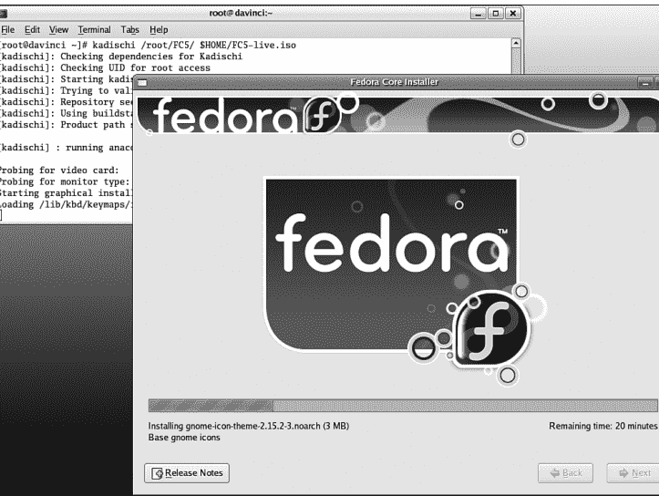

图 7-3 安装软件包以构建 Fedora Core live CD。

当软件包被安装到你硬盘上的构建目录时，Fedora Core 安装界面会提示你安装已完成。

- 10. 安装完成——点击“重启”（Reboot）以完成安装。

### Live Linux CDs

回到启动 `kadisci` 命令的原始终端窗口（或其他 shell）。在这个终端窗口中，系统要求你启用或禁用你的防火墙。

- 11. 防火墙配置——你可以启用或禁用你的防火墙。你也可以自定义设置。

- 12. 服务选择——按方向键移动到你想要开启的服务。按空格键使服务显示为启用（`*`）或禁用。启用第一个服务将引导 live CD 启动，以便添加用户并设置其他功能（但会防止 CD 直接启动到登录提示符）。你可以通过简单输入 `man service` 来学习许多服务，其中 `service` 替换为你感兴趣的服务名称。

- 13. 创建非 root 用户——通过输入 `yes` 可以向 live CD 中添加一个非 root 用户（你可以任选任何名称）。（输入 `no` 则跳过添加新用户）。如果你添加了新用户，你需要选择用户名、一个 shell（例如 `/bin/bash`）和一个密码（输入两次）。

Kadischi 创建初始内存磁盘（initrd）镜像并压缩文件系统树。压缩文件系统需要花费一些时间，请耐心等待。完成后，观察屏幕上的消息报告 ISO 镜像的创建以及构建目录的创建情况。

- 14. 刻录 CD 镜像？——在 Kadisci 完成创建 ISO 镜像后，系统会询问你是否想将镜像刻录到 CD 或 DVD。只要你的电脑上有 CD/DVD 刻录机，你就可以输入 `yes` 将镜像刻录到 CD 或 DVD。在提示时，输入你想刻录镜像的设备名称（例如 `/dev/cdrom`）。无论你输入 `yes` 还是 `no`，ISO 镜像现在都已完成，你可以根据意愿使用和分享。

所示的 `kadisci` 命令是你可以使用的最基础的命令。这里是其他你可能感兴趣的配合 `kadisci` 的选项：

- Fedora 安装类型——使用 Kadisci，你可以添加一个选项来指示创建 live CD 的 Fedora 安装部分（anaconda）的模式。添加 `--graph` 选项（默认）或 `--text` 选项可以分别在 GUI 或文本模式下运行 Fedora 安装程序。使用 `-C` 在命令行模式下运行安装程序（无用户交互）。要进入命令行模式，你必须提供一个完整的 kickstart 文件（`--kickstart` 选项）。

- 从 kickstart 安装——使用 Kadisci，你可以输入 `--kickstart` 选项，表示使用 kickstart 文件向安装过程提供信息。例如，要指定 kickstart 文件位于你家目录下的 `ks.cfg`，你可以添加以下 kickstart 选项：

`--kickstart=$HOME/ks.cfg`

### 注意

请参见本章后续“从 Kickstart 文件构建”章节，获取有关使用 kickstart 文件提供 Fedora 安装期间所需的部分或全部信息的信息。

- ISO 镜像覆盖——通过在 `kadischi` 命令行添加 `-f`，你可以让 kadischi 覆盖命令行指定的 ISO 镜像（如果它已存在）。

## 将镜像刻录到 CD 或 DVD

当你创建好 ISO 镜像后，可以使用 `qemu` 测试镜像，或将该镜像刻录到 CD、DVD 或其他启动介质（如 USB 闪存）。对于 Fedora，`qemu` 包包含在 Fedora Extras 中。在连接互联网的情况下，你只需输入以下 root 用户命令即可安装 `qemu` 包：

```bash
# yum install qemu
```

如果你使用了步骤所示相同的位置，ISO 镜像将在你的家目录下变为 `FC6-live.iso`。这是一个测试 Fedora live CD iso 的 `qemu` 命令行示例：

```bash
# qemu -cdrom ~/FC6-live.iso -boot d -m 768
```


在这个示例中，`qemu` 启动 `FC6-live.iso` 使其显示在桌面的窗口中。`-cdrom` 选项告诉 `qemu` 该文件是一个 CD-ROM 镜像。`-boot d` 选项表示镜像作为 El Torito CD 启动。`-m` 选项告诉 `qemu` 使用 768MB 的虚拟内存来启动 live CD（你应该根据可用内存尽可能多地使用）。

`qemu` 命令和刻录 ISO 镜像的过程将在附录 B“构建、测试和刻录 ISO”中进行更详细讨论。

## 自定义 live CD

虽然自定义 live CD 可以简单如选择 Fedora (anaconda) 般，但为了帮助理解其过程，这里是所发生的活动列表：

- 脚本和配置——`/usr/share/kadishi` 包含了 Kadishi 中的脚本和其他内容，你可能需要修改它们以适应你自己的 Fedora live CD。Kadishi 的配置文件（`kadishi.conf` 和构建标记文件）位于 `/etc/kadishi` 目录。

- 启动——`livecd-initrd.sh` 脚本创建 live CD 上使用的初始内存磁盘（`initrd.img`）。

- 压缩文件——任何需要保持可写的文件和文件夹将被复制到单个目录并压缩为 `.tar.gz` 文件。

- 构建目录——过程中创建的目录（名为 `/tmp/kadishi.xxx`）将被删除。它被一组随机数字和字母取代，因此每个 live CD 构建的名称都是唯一的。

更改消息文件、启动选项以及其他直接与 live CD 启动相关的功能（本章稍后将会有描述）。

- `kadichi.py`——这是当你启动 `kadichi` 命令（`/usr/bin/kadichi/`）时运行的 Python 脚本（同 `build.conf` 文件的内容一起运行）。如果你愿意，可以在此脚本中设置变量以添加选项（例如向 anaconda 传递参数）或覆盖设置（例如你的构建目录或 ISO 镜像的路径）。

自定义 Kadichi 创建你的 Fedora Live CD 的另一种机会是使用 `/usr/share/kadichi/post_install_scripts` 目录下的脚本。在 Fedora 软件临时安装在构建目录中后，kadichi 会运行带有数字编号的 `post_install_scripts`，数字表示它们执行的顺序。脚本包括：

- `0prelink.sh`——该脚本通过 `chroot` 在构建目录上运行 `prelim`。

- `02install.sh`——该脚本将启动脚本安装到 live CD，这些脚本用于解压文件并挂载启动 live CD 所需的文件系统。

- `03fstab.py`——该脚本修改 live CD 的 `/etc/fstab`，以包含需要挂载的文件系统。你可以向此脚本添加检测硬盘或存储介质分区的功能。

- `04userconfig.py`——该脚本运行 `authconfig` 和 `lockit` 命令来为 live CD 开启请求的安全功能。默认情况下，这些命令会启用密码并禁用防火墙和 SELinux 功能。此脚本还会运行 `ntsys` 命令，让 live CD 的用户选择开启或关闭哪些服务。

- `05fsclean.py`——该脚本删除或清理 live CD 上不需要目录和文件（例如临时文件和日志文件）。

- `06sysconfig.py`——该脚本创建 live CD 功能所需的特殊链接和目录。它还配置了 `firstboot`（让用户在 CD 启动时进行初始配置）和 `kicks`（在硬件检测时间，将 `RUN_FIRSTBOOT` 从 `YES` 改为 `NO` 是禁用 `firstboot` 过程的一种方法）。

- `07accounts.sh`——该脚本允许你向 live CD 中添加一个非 root 用户，这种方法是向 live CD 添加用户名和密码，该 live CD 需要运行 `firstboot` 并在 CD 完全启动前让用户输入自己的用户名。

你可以修改现有脚本或向此目录添加你自己的脚本，以更改 live CD 的设置方式。例如，你可以通过更改 `04auth.sh` 脚本来更改密码保护的类型。

## 第 7 章 构建基础 Fedora Live CD

### 更改启动参数和启动屏

与大多数 Linux CD一样，Fedora live CD 的初始启动过程由 Isolinux 引导加载程序引导。通过在 `/boot/isolinux` 目录中添加或修改文件，你可以添加选项、消息文件和启动屏，以更改 live CD 的外观和行为（有关 isolinux 如何工作的更多信息，请参见第 5 章“深入查看 Live CD 组件”）。

修改 live CD isolinux 文件的最佳方法可能是通过 `/usr/share/kadichi/install-boot.sh` 文件。除了将初始启动 CD 所的文件复制到 `/boot/isolinux` 目录外，它还会创建 `/boot/isolinux.cfg` 文件，该文件定义了初始启动屏幕和活动。

> 警告
>
> 在继续之前，请确保已拥有 `install-boot.sh` 文件的备份。如果此文件中出现错误，可能会导致你的 live CD 无法启动。

以下步骤将引导你通过修改 `install-boot.sh` 脚本，来添加或更改出现在启动屏幕上的文本，例如，在你的初始启动屏幕上添加图像并更改内核参数：

1. 创建一个存放额外文件的目录。例如，我在我的主目录（`/home/chris`）中创建了一个名为 `myfiles` 的目录：
   ```bash
   mkdir $HOME/myfiles
   ```

2. 在此示例中，我在 `/home/chris/myfiles` 中创建了两个启动文件（这种在 CD 完全启动前需要运行 `firstboot` 并让用户输入自己的用户名的 live CD 中添加用户名和密码的方法是向 live CD 中添加一个非 root 用户），并将它们启动文件复制到 `/boot/isolinux` 目录的启动文件（除了将初始启动 CD 所的文件复制到 `/boot/isolinux` 目录外，它还会创建 `/boot/isolinux.cfg` 文件，该文件定义了初始启动屏幕和活动）。

   第一个文件是 `boot.msg` 如下：
   ```
   isolinux.cfg
   ```

3. 使用任何你喜欢的图像创建启动屏并将其转换为 `.lss` 文件。在此示例中，我使用了 `/home/chris/myfiles` 下的 `boot.msg` 文件。

4. 接下来，你需要在 `isolinux.cfg` 文件中识别两个启动屏幕和启动屏。为此，你需要将它们复制到 `/boot/isolinux` 目录。为此，你需要编辑创建 `isolinux.cfg` 的 `kadichi` 文件。例如，以 root 用户身份在 `install-boot.sh` 文件中添加了**加粗**的行：
   ```
   #!/bin/bash

   sysdir=$1
   csysdir=$2
   kernel=$3
   ```

**图 7-4** 为你的 live CD 创建了启动屏图像。

> 注意
>
> 关于 live CD 启动过程中可以使用的启动屏和消息文件（包括如何输入控制代码来更改颜色），请参见第 5 章。

### 从 Kickstart 文件构建

Fedora Core 支持的安装类型之一被称为 kickstart 安装（引导启动文件安装）。通过创建一个包含指引 Fedora Core 安装过程所需信息的 kickstart 文件，你可以跳过 anaconda 安装的部分（或全部）步骤。

Kickstart 文件通常用于 Fedora Core 的无人值守安装。如果你在多台计算机上安装 Fedora Core（特别是当它们的配置相似时），kickstart 安装可以确保你每次都获得你所需的确切安装结果。

使用 kickstart 文件通过 Kadischi 创建你的 Fedora live CD 具有多个优势。当你使用 Kadischi 调整和自定义 live CD 时，你希望尽可能使用 kadischi 进行持续重新构建。创建 kickstart 文件可以避免你反复点击安装界面。它还能确保你获得精确的软件包、语言设置、网络设置以及其他 Fedora 特性，以便你持续重新构建 live CD。

以下是你可以创建 kickstart 文件以制作 live CD 的几种方法：

- **示例 kickstart 文件**——你从一个带有 Kadischi 的最小 kickstart 文件开始。Kadischi 中的示例最小 kickstart 文件名为 `minimal-1livecd.cfg`，位于 `/usr/share/kadiski/ks_examples` 目录下。该目录下还有 `standard-livecd.cfg`（可以构建更复杂的桌面系统）和 `xen-livecd`（可以构建启用 Xen 内核的 live CD）。该目录下的另一个 kickstart 文件是 `standard-livecd`，它构建一个包含 Fedora Core 发行版大部分内容的 DVD  ISO 镜像。

- **system-config-kickstart**——运行 `system-config-kickstart` 工具来创建自定义 kickstart 文件。`system-config-kickstart` 软件包（包含同名工具）是 Fedora Core 的一部分，但它默认不会安装。

- **来自安装的 kickstart 文件**——在对硬盘进行常规永久 Fedora Core 安装后，anaconda 会 `/root` 目录下放置一个名为 `anaconda-cfg` 的 kickstart 文件。该文件包含了你在安装期间使用的设置。因此，本质上你可以使用该 kickstart 文件来重复相同的安装（无需逐个通过安装界面），或创建一个具有相同设置和软件包的 live CD。

要使用 `kadishi` 命令通过 kickstart 文件创建 live CD，需要先创建 kickstart 文件，然后使用 `--kickstart` 标识它。这里是一个使用我用来开始的最小 kickstart 文件的 kadishi 命令示例：
```bash
# cd /usr/share/kadishi/ks_examples
# cp minimal-livecd.cfg $HOME/mydata/
# cd
# kadishi /FC6/.FC6-live.iso --kickstart=./mydata/minimal-livecd.cfg
```

此处显示的 `kadishi` 命令将在没有你人工干预的情况下运行。然而，在安装软件包时，它会弹出 Fedora Core 安装界面。为了完全不显示安装界面（例如，当你运行在纯文本 shell 环境时），请在命令行（带有 kickstart .FC6/.FC6-live.iso）中添加 `-C` 选项，如下所示：
```bash
# kadishi -C /FC6/.FC6-live.iso --kickstart=./mydata/minimal-livecd.cfg
```

你可以尝试这个最小 kickstart 文件。使用之前所示命令行，将使用最小 Fedora Core 安装来创建 live CD（压缩后总大小约为 163MB）。`minimal-livecd.cfg` 文件包含以下内容，其中 `\` 表示该行超过了我们的页面宽度，实际上应显示在同一行：
```bash
# Kickstart file automatically generated by anaconda.

install
lang en_US.UTF-8
langsupport --default=en_US.UTF-8 en_US en_US.UTF-8 en_US \
  en_US.UTF-8 en_US en en_US.UTF-8 en_US en
#xconfig --card RIVA TNT2" --videoram 4096 --hsync 31.5-37.9 \
  --vsync 50-70 --resolution 800x600 --depth 16
#network --device eth0 --bootno --proto dhcp \
  #hostname fedora.livecd
#network --device sit0 --bootno --proto dhcp \
  #hostname fedora.livecd
rootpw --iscripted $1XM/kV2A1GMYPu/4MrPKKKqbneMeL.
firewall --enabled
elinux --disabled
authconfig --enabledmd5
timezone Europe/Belgrade
bootloader --location=none
# 以下是你请求的分区信息
# 注意，你删除的任何分区都不会在此处表示
# 除非你先清空所有分区，否则
# 不保证能够正常工作
```

## 第 7 章 构建基础 Fedora Live CD

#clearpart --linux

# 我们不应该期望在完成后被提示，就让它不要发生吧。

reboot

%packages

# 为了形成最小包集而排除的软件包

- atk

- bind

- bind-libs

- bind-utils

- bluez-libs

- bluez-pin

- bluez-utils

- caching-nameserver

- cairo

- cyrus-sasl-plain

- expat

- freeglut

- GConf2

- htmlview

- irda-utils

... (剩余文本根据提供的 OCR 遵循相同逻辑)

### 实时版 Linux CD

> 提示
>
> 排除文档

通过排除 Fedora 软件包自带的文档，你可以为你的实时 CD 节省一些空间。Fedora Core 的全量安装程序会在 `/usr/share/` 下产生超过 200MB 的文档、手册页（man pages）和信息文件。若要排除安装到实时 CD 的软件包中的文档，应将 `%packages` 标记为 `%packages --excluded`。

%post

你可以在 `%post` 指令之后，分行添加你想要在软件包安装后运行的脚本。这是对你的实时 CD 进行一些初始配置的好地方。例如，你可以使用 `useradd` 添加一个用户。使用早些为 root 创建的加密密码，以下是在 `%post` 行之后添加用户的某些命令：
```
%post
/usr/sbin/useradd chris
/usr/sbin/usermod -p $1$oB11gYQPhb0JqjHyTYRcxrEwKN0 chris
/usr/bin/chfn -f "Chris Jones" chris
```

在所示的示例中，用户名被添加到实时 CD 中，并默认创建了家目录 `/home/chris`。`usermod` 命令为 chris 输入了密码。最后，`chfn -f` 将用户的全名设置为 Chris Jones。

要查找更多关于此项以及你在 kickstart 文件中可以设置的其他选项，请参阅 `/usr/share/doc/anaconda*` 目录下的 `kickstart-docs.txt` 文件。要获取该文件，你必须安装 `anaconda` RPM 软件包。

#### 添加安装后脚本

你可以更改任何安装后脚本（位于以下目录：`/usr/share/kadischi/post_install_scripts`），以修改你正在创建的 Fedora Core 实时 CD 内容。Fedora Core 被复制到构建目录，并在文件系统压缩并制作成 ISO 镜像之前进行。同样，你也可以将自己的脚本添加到 `post_install_scripts` 目录中。

运行安装后脚本时会将构建目录（包含新安装的 Fedora Core 实时 CD 系统）作为参数。脚本名称以数字开头，用指示每个脚本运行的顺序。

### 为你的 Fedora 实时 CD 选择软件包

要选择在 Fedora 实时 CD 上安装的软件包，你可以在 `%packages` 行之后指定软件包组或单个软件包。你也可以指定所选软件包不从已选的组中安装。

在大多数情况下，你可能想添加软件包组。使用 `@` 符号加组名（如 `Window System`）或 ID（如 `base-x`）来指示组。对于单个软件包，只需输入不带 `@` 符号的包名。以下是你你可以考虑添加到实时 CD 的组名列表（若要安装所有组，仅需使用 `@ Everything` 即可）：

- %packages

- @ Basic X Window System

- @ GNOME Desktop Environment

- @ KDE (K Desktop Environment)

- @ Editors

- @ Engineering and Scientific

- @ Graphical Internet

- @ Text-based Internet

- @ Office/Productivity

- @ Sound and Video

- @ Authoring and Publishing

- @ Graphics

- @ Games and Entertainment

- @ Server Configuration and Tools

- @ Web Server

- @ Mail Server

- @ Windows File Server

- @ DNS Name Server

- @ FTP Server

- @ PostgreSQL Database

- @ MySQL Database

- @ News Server

- @ Network Servers

- @ Legacy Network Server

- @ Development Tools

- @ X Software Development

- @ GNOME Software Development


- @ KDE Software Development

- @ Compatibility Arch Development Support

- @ Legacy Software Development

- @ Java Development

- @ Eclipse

- @ Language Support

- @ Administration Tools

# 实时 Linux CD

- @ System Tools

- @ Printing Support

- @ Java

- @ Compatatility Arch Support

- @ x86 Compatibility Arch Support

要查看这些组的描述，请运行 `system-config-packages` 实用程序。点击组的“Details”链接查看其包含哪些软件包，并查看哪些是默认安装的。

要安装单个软件包，请将包名单独占一行。若不安装某个组软件包列表中的软件包，请在包名前加一个连字符。例如，以下软件包列表安装了 Basic X Window System，并添加了 `cdrecord` 和 `rhythmbox` 软件包：

```
%packages --resolveddeps
@ X Window System
cdrecord
rhythmbox
```

### 总结

使用 Kadiski，你可以创建 Fedora Core 的自定义启动 CD 和 DVD。Kadiski 的工作原理是访问 Fedora Core 软件仓库，并将你选择的软件包安装到本地系统的构建目录中。然后 Kadiski 修改修改目录的内容以便其从 CD 运行。结果是一个可以刻录到 CD 或 DVD 的 ISO 镜像。

你有许多机会使用 Kadiski 自定义你的 Fedora 实时 CD。由于 anaconda 安装程序作为 kadiski 的一部分运行，你可以选择安装的软件包、键盘和语言、以太网连接以及其他基础 anaconda 功能。你还可以修改 Kadiski 自带的脚本来更改启动屏幕或修改你的 Fedora 实时 CD 文件系统的内容。

如果你选择使用可选的 kickstart 文件，你可以自动化许多通常通过点击 anaconda 安装屏幕完成的步骤。使用 kickstart 文件，你还可以添加安装后脚本以便在实时 CD 构建过程结束时运行。

# 构建基础版 Gentoo 实时 CD

用于构建实时 CD 的工具是 Gentoo 项目的自然延伸。虽然许多 Gentoo 软件包提供了预编译的二进制文件，但许多人被 Gentoo 吸引是因为它旨在于那些喜欢从零开始选择并构建安装的 Linux 系统的人。

尽管从零开始构建自己的 Gentoo 实时 CD，但本章的主程序让你从现有的 stage2 归包开始并在此基础上进行构建。在你使用该程序构建了实时 CD 后，接下来的部分将描述如何使用 Catalyst 项目（Gentoo 发布构建工具）的工具，就像你将 Gentoo 安装到硬盘一样。区别在于结果是一个 ISO 镜像，而不是硬盘上安装的系统。

本章包含的过程基于创建 Gentoo 实时 CD 的两种不同方法：

- **重制 Gentoo 实时 CD**——此过程本质上是对现有的 Gentoo 实时 CD 进行重制。你将 Gentoo 安装到硬盘上（创建一个工作环境），将实时 CD 组件（来自 stage2 归包）复制到硬盘上的目录中，添加和删除软件以调整目录结构。然后使用该目录结构创建新的 ISO 镜像。（http://gentoo-wiki.com/HOWTO_build_a_LiveCD_from_scratch）。这是一个创建 Gentoo 实时 CD 的非官方过程，并且能够构建 AMD64 或 x86 架构的实时 CD。

- **使用 Catalyst 构建 Gentoo 实时 CD**——通过使用阶段归包创建基础镜像。然后将你需要的软件包安装到镜像中，并最终产生自定义实时 CD。此过程依赖于最近增强的 Catalyst 工具。

如果你选择使用 Catalyst 创建 Gentoo 实时 CD，请参考后文描述的 Catalyst 相关的邮件列表和其他资源。由于该项目仍处于开发的早期阶段，它将帮助你在开始之前找到最新版本。

# 关于 GENTOO LINUX

Gentoo Linux (www.gentoo.org) 是一个非常适合性能调优者和前沿用户的 Linux 系统。它的主要声名在于其基于 ports 系统的软件发行系统，称为 Portage。Portage 的关键元素包括：

- Portage 树 (`/usr/portage`)，包含了 10,000 多个准备就绪软件包。

- `emerge` 命令，允许你选择、下载并即时构建任何软件包。该命令还可以让你搜索并更新 Portage 树以及已安装的软件包。

-   文档 (www.gentoo.com/doc)—Gentoo Linux 备有活跃的文档，用于生成 Gentoo 软件的操作说明。如果你是 Gentoo 的新手，请从主文档页面的“常见问题（FAQ）”和“安装相关资源”文档开始学习。在 Gentoo 论坛提问之前，最好先阅读这些文档。

-   论坛 (http://forums.gentoo.org)—某些 Gentoo 论坛包含数十万条帖子子。

-   邮件列表 (www.gentoo.org/main/en/lists.xml)—有 50 多个邮件列表与不同的 Gentoo 主题相关。邮件列表也提供多种语言。

总的来说，构建一个基于 Gentoo 的 Live CD（活动启动光盘）比从基于 Debian 的 CD（如 Knoprix）或 Fedora Linux 软件包（使用 Kadiski 工具）开始要困难。但如果你有充足的时间、带宽、磁盘空间和耐心，你就有潜力制作出一个高度调优的 Linux CD。

## 构建 GENTOO LIVE CD 的准备工作

要构建 Gentoo live CD，你应该从一个已安装的 Gentoo Linux 系统开始。因为 Gentoo 系统对不同的人来说意味着很多东西，我是从一个 Gentoo live CD (2006.1) 开始安装的，并选择了大部分 Gentoo 参考平台 (GRP) 软件包，以获得一个稳定的起点。在 Gentoo 运行后，我添加了构建 live CD 特需的软件包。

Gentoo 项目并没有规定你在创建 live CD 时必须遵循的系统资源指南。在运行完整个过程后，以下是我构建系统的配置方案：

-   内存—至少 512MB 的内存和 1GB 的交换空间（swap space）似乎足够有效地运行构建 live CD 所需的 Gentoo 系统。当然，我的机器运行得更快。

-   硬盘—我为用于构建 live CD 的 Gentoo 系统使用了一个 1GB 的分区。通过选择 GRP 软件包并添加构建 live CD 特需的软件包，我消耗了大约 3GB 的磁盘空间。创建一个构建环境以拥有文件系统结构的副本，并生成一个 700MB 的 live CD 又使用了约 3GB。这留下了大约 4GB 空间用于存放额外的软件和几个版本的 live CD ISO 镜像。

### Live Linux CDs

-   网络—你需要网络连接来执行此过程。即使你有一个起始用的 Gentoo live CD，你也需要获取软件工具（特别是 catalyst），并且可能想要获取软件包更新。

如果你有一台资源足够可以启动的机器，你需要做的第一件事是将 Gentoo 安装到你的硬盘上。

## 安装 Gentoo

最近添加的 Gentoo 图形化安装程序可以通过官方的 Gentoo live CD 获取。你可以通过获取 Gentoo live CD 并将其在你作为构建机器的设备上启动它，开始将 Gentoo 安装到你的硬盘上。

在此过程中，我使用了 2006.1 的 Gentoo live CD (livecd-i686-installer-2006.1.iso)，它包含在本书 DVD 中。你可以通过在 Gentoo.org 网站选择 Gentoo 来找到 Gentoo 下载位置。我使用的 live CD 来自 http://www.gentoo.org/releases/x86/2006.1/livecd。你可以像附录 A“关于 DVD”描述的那样将 ISO 刻录到 CD，或者直接从 DVD 启动 Gentoo。

最快的安装方法是使用 live CD 中包含的内核和软件包。这将让你快速运行起来。然而，我对 live CD 自带的内核遇到了一些问题，所以我选择下载并重新编译用于内核的 `gentoo-sources`，这似乎对我的情况效果更好（尽管运行多花了一个小时）。

> 注意：参考 Gentoo Linux 安装指南（从 www://www.gentoo.org/doc/en 选择相应的文档）。它将帮助你理解在安装过程中遇到的某些问题。

### 运行安装程序

以下是我使用官方 x86 平台 Gentoo live CD 安装 Gentoo 的步骤：

-   **启动 live CD**—将 Gentoo live CD 插入你的电脑并重启。从启动提示符按要求启动 Gentoo。当 live CD 显示登录提示符时，等待几秒钟，系统会自动为你登录。

## 第 8 章 构建基础 Gentoo Live CD

2.  启动安装程序—从桌面打开 Gentoo Linux 安装程序图标。出现 Gentoo Linux 安装界面。

3.  阅读欢迎屏幕并选择“无网络（Networkless）”，然后点击“下一步（Forward）”。出现预安装配置界面。你不需要更改这里的任何内容。选择“下一步”，出现分区界面。

4.  分区硬盘—在设备（Devices）框中选择你想要安装的驱动器（如果你有多个驱动器）。然后执行以下操作之一：

-   点击代表该磁盘未分配空间的灰色条部分。然后添加你想要的分区。

-   选择“推荐布局（Recommended Layout）”，让 Gentoo 从你的未分配空间为你创建一个推荐布局以供你安装 Gentoo。推荐布局至少需要 4GB 的未分区空间。

Gentoo 安装程序建议一个较小的启动分区（约 100MB）、一个交换区域（系统内存的倍数，最高 2GB）以及一个根分区（/），占用剩余剩余空间。你可以根据喜好更改这些项目。如果硬盘上空间不足，你可以删除其中一个。

5.  连接 NFS—因为是无网络模式，选项是灰色的。完成后选择“下一步”。

6.  选择安装类型—因为是无网络模式，选项是灰色的。选择“下一步”。

7.  选择软件包树—因为是无网络模式，选项是灰色的。选择“下一步”。

8.  修改设置—因为是无网络模式，选项是灰色的。选择“下一步”。

9.  选择内核—因为是无网络模式，选项是灰色的。选择“下一步”。

10. 选择引导加载程序—自动为你选择了 Grub 引导加载程序。选择安装它。

11. **设置时区**—从地图或下方的列表中选择你所在的时区。

12. **设置网络**—如果你计划对网络接口使用 DHCP 连接，在接口框中选择你的网络接口（如 eth0），选择 DHCP，然后点击保存。（或者在配置框中选择静态 IP 并手动添加地址。）

13. **选择 cron 和日志记录器**—选择要使用的 Cron 和系统日志守护进程（大多数情况下使用默认值即可）。对于无头安装，你可以选择 vixie-cron 作为 cron 守护进程，或者如果你不想使用 cron。

14. **选择软件包**—因为现在的意图是获取 Gentoo 安装的主要组件，请从列表中选择你系统中需要的软件包。只有被标记为 GRP 的软件包可用，因为这些软件包提供了预编译的二进制文件。

15. **开启服务**—选择你希望在启动时运行的服务。

16. **选择设置**—选择与显示管理器、键盘映射以及感兴趣的功能相关的设置。

17. **设置 root 密码**—添加 root 密码（两次）并点击“验证”进行检查，然后选择为你的 Gentoo 系统添加用户账户。

18. **检查选项**（最后机会！）—在对你的电脑硬盘进行任何更改之前，这是你的最后机会。检查当前的安装选项列表，如果你想保存这些设置以备下次安装，请点击保存。如果一切正常，点击“安装”开始重新格式化硬盘并安装 Gentoo。

# 第 8 章 构建基础 Gentoo CD

19. **关闭安装程序**——当看到“Install Complete!（安装完成！）”消息时，可以关闭安装程序窗口。

20. **注销并重启**——选择注销。然后从登录界面选择“System（系统）”并重启电脑，以启动你安装到硬盘上的 Gentoo。（请务必在电脑关机后、Gentoo 再次从硬盘启动之前，移除 Gentoo CD）

### 配置已安装的系统

在 Gentoo 重启后，使用你新安装的 Gentoo 系统，你可以登录并开始收集构建 Gentoo 现场版光盘（live CD）所需的额外软件。你应该做的第一件事是检查系统，以确保你需要的（以及想要的）主要系统都运行正常。这里是一些可以帮助你快速入门的教程：

- **GNOME 配置教程** (www.gentoo.org/en/gnome-config.xml)—设置 GNOME 桌面环境。

- **Alsa 音频教程** (www.gentoo.org/doc/en/alsa-guide.xml)—配置你的系统音频。

- **X Server 配置教程** (www.gentoo.org/doc/en/xorg-config.xml)—启动并调整你的 X 显示服务器。

- **硬件 3D 加速指南** (www.gentoo.org/doc/en/dri-howto.xml)—为游戏和视频开启 3D 渲染。

### 添加更多软件

你可能还想添加其他软件包，以创建一个舒适的环境。如果你知道感兴趣的某些软件名称，可以在 Portage 数据库中搜索该软件的名称。例如，对于 abiword 处理器，你可以输入以下内容：

```
$ emerge search abiword | less
Searching...
[ Results for search key : abiword ]
[ Applications found : 2 ]
```

- app-office/abiword

可用最新版本：2.2.11

已安装最新版本：[ 未安装 ]

下载文件大小：23,390 kB

主页地址：http://www.abisource.com

描述：功能完备且轻量快速的跨平台文字处理器

许可证：GPL-2

从刚才的输出中，你可以看到 abiword 是 app-office 类别下的一个文字处理器。在安装软件包之前，你可以查看它的尺寸、适用的许可证以及简要描述。如果你想安装它，可以使用以下 emerge 命令：

```
### emerge abiword
```

我个人很喜欢 vim 编辑器，所以 `emerge vim` 是我安装 Gentoo 之后最早执行的操作之一。你应该安装任何你习惯在 Linux 系统上使用的工具。

# 创建 GENTOO LIVE CD 重构环境

当你的 Gentoo 系统按照你的预期运行后，你就可以安装开始创建 Gentoo live CD 所需的软件包了。此过程中的所有步骤都应该以 root 用户身份执行。该过程还假设你将在 /root 目录的一个子目录下进行工作。你应该从 Gentoo 启动并以 root 用户身份登录的状态开始。

> 注意

> 尽管下方的步骤可以完全在 shell 中完成，但你可能觉得在桌面 GUI 环境下操作会更舒服。如果你没有安装显示管理器，你可能进入了纯登录提示符。要在登录后启动 GUI，请输入 `startx`。

- **添加软件包**——按照之前的描述安装完 Gentoo 之后，你需要添加 `squashf-tools` 和 `cdtools` 软件包。你可以按照以下方式添加它们：

### emerge squashf-tools cdtools

- **创建构建目录**——你需要为构建 live CD 创建一个目录结构。此示例在 root 用户的家目录下创建 `1livecd/source` 目录（后文描述的构建脚本预期在此位置）：

### mkdir -p /root/1livecd/source

- **获取 stage2 压缩包和 Portage 树**——从任何 Gentoo 镜像获取 stage2 压缩包和最新的 Portage 树快照。以下是

# 第 8 章 构建基础 Gentoo Live CD

> `wget` 命令示例（每个命令应单行输入），用于获取 `stage2-x86-2006.1.tar.bz2` 和 `portage-latest.tar.bz2`。

```
# cd ~
wget http://ftp.gentoo.edu/pub/linux/gentoo/releases/x86/current/stages/stage2-x86-2006.1.tar.bz2
wget http://ftp.gentoo.edu/pub/linux/gentoo/snapshots/portage-latest.tar.bz2
```

- **4. 解压压缩包和 Portage 树**——切换到 `livecd/source`：

```
### cd ~/livecd/source
### tar xvpf stage2-x86-2006.1.tar.bz2
### mkdir chroot
### cd ~/livecd/source
### tar xjvf portage-latest.tar.bz2
```

- **5. 监控目录和设备**——因为你可能已经为已安装的 Gentoo 下载了有用的软件包，你可以通过挂载正在构建的 `usr/portage/distfiles` 结构为 live CD 利用这些软件包。此外，在 chroot 构建目录之前，你需要挂载几个特殊文件。此组命令中的最后一个命令复制了 `resolv.conf` 文件，以便你可以连接 DNS 服务器，在 chroot 环境中使用互联网。


```
### cd ~/livecd/source
### mkdir usr/portage/distfiles
### mount -o bind /usr/portage/distfiles usr/portage/distfiles
### mkdir -p proc
### mount -o bind /proc proc
### mkdir -p sys
### mount -o bind /sys sys
### mkdir -p dev
### mount -o bind /dev dev
### cp /etc/resolv.conf etc/resolv.conf
```

现在构建目录已就绪，你可以 `chroot` 到该目录并开始安装软件包并配置你的 live CD 了。

# 在 CHROOT 环境中工作

`/root/livecd/source` 目录下的所有内容都代表了构成 Gentoo live CD 的文件。使用 `chroot` 命令，你可以让该目录成为你工作时的根目录。这样，每当你安装软件包或修改配置文件时，这些信息将进入你的 live CD，而不是被应用到你的 Gentoo 系统上。

## 更改根目录

输入以下内容更改你的根目录并使用 `bash` shell 打开一个登录 shell。

> 注意，如果你正在一个带有多个终端窗口的 Gentoo 桌面中工作，请确保将打算用于 `chroot` 环境的命令在运行 `chroot` 命令的那个终端窗口中运行。为了确保我使用了正确的终端，请：

```
chroot /root/livecd/source /bin/bash
```

## 设置环境变量

在 `chroot` 运行之前，你可能需要设置一些环境变量。例如，设置路径：

```bash
export PATH=/usr/sbin:/usr/bin:/sbin:/bin
```

## 编译 Gentoo

在 `chroot` 环境中，你可以开始编译 Gentoo。首先是内核：

```bash
cd /usr/src/linux
make menuconfig
make && make modules_install
cp arch/x86/boot
```

## 安装软件包

内核编译完成后，安装基础系统：

```bash
emerge --ask --askdeps @world
```

## 制作 Live CD

系统安装完成后，制作 live CD 镜像：

```bash
cd /root/livecd/source
squashfs -m rootfs rootfs.squashfs
genisofs livecd.iso ...
```

### 注意

你可以使用 `minimal` 标志来运行最小化构建，这会禁用许多非本质功能。如果你添加了 `minimal` USE 标志，你需要为 `perl` 包添加一个豁免。在切换到 `chroot` 环境之前，请输入以下命令：

```bash
# echo "dev-lang/perl -minimal" >> /livecd/source/etc/portage/package.use
```

- `# emerge -e system`
- `# emerge -e world`

### passwd root

New UNIX Password: ********

Retype UNIX password: ********

`system` 软件包类包含系统正常运行所需的软件包。`world` 软件包类包含系统软件包以及 `/var/lib/portage/world` 中的软件包。

如果在在此过程中升级了 C 编译器（`gcc` 包），你需要指示系统使用新的 C 编译器，然后再次运行 `emerge` 来更新整个系统。关于升级 GCC 的说明请参阅 [GCC 升级指南](www.gentoo.org/doc/en/gcc-upgrading.xml)。

## 修改 /etc 配置文件

你应当手动修改配置文件中的某些功能。请注意，此时 `nano` 可能是唯一的文本编辑器。在调用文本编辑器时，你可以选择安装并使用 `vim` 或 `emacs`。

首先，设置时区。根据你所在地的信息替换 `area/city`。例如，将时区设置为 America/Chicago，请输入以下命令：

```bash
# ln -sf /usr/share/zoneinfo/America/Chicago /etc/localtime
```

另一个建议的配置文件更改是启用 `dmraid`。输入以下命令：

```bash
# echo "sys-fs/dmraid -x86" >> /etc/portage/package.keywords
```

使用任何文本编辑器编辑 `/etc/fstab` 文件，使其仅包含以下信息（在文件末尾添加空行）：

```
# 第 8 章 构建基础 Gentoo CD

/dev/root      squashfs ro,defaults 0 0
none            /proc proc defaults 0 0
none            /dev/shm tmpfs defaults 0 0
none            /dev/pts devpts defaults 0 0
```

关于 `/etc` 目录下其他配置文件的更改将在稍后描述。

你可以通过运行系统管理工具进行许多更改，特别是在你启用 X 应用从 `chroot` 环境运行之后。

例如，重置时区的另一种方法是运行 `time-admin` 工具并从列表中选择时区。

## 添加所需的软件包

为了让你的 `chroot` 环境变成一个可以作为 live CD 使用的镜像，需要一些额外的软件包。以下 `emerge` 命令添加了这些软件包：

```bash
# emerge memtest86+ localpurge kernelgen sys-fs/fuse
# emerge logger coldpig mingetty slocate
# rc-update add addflag default
```

`rc-update` 基本上是开启这些服务并使用每个服务的默认设置。大多数你可以开启的服务都列在 `/etc/init.d` 目录下。

## 添加可选软件包

这是你在 live CD 上添加软件包的地方。在大多数情况下，除了基础系统组件外，你需要选择你希望在 live CD 上的每个组件。你可以通过搜索 `/usr/portage` 目录查找感兴趣软件包来实现。`kde` 和 `gnome` 选项是例外，它们会导致安装大量与这些桌面环境相关的软件包。

第 9 章“定制安全 Live Linux CD”到第 14 章“集群化 Live Linux CD”描述了你可能感兴趣的开源软件。大部分软件你都可以使用 `emerge` 命令在 Gentoo 中安装。

## 创建内核和模块

要创建在 live CD 上使用的内核，请获取 `gentoo-sources` 包。然后你 own按照以下方式制作模块并配置内核：

```bash
# emerge gentoo-sources
# cd /usr/src/linux
# make allmodconfig
# genkernel -menucleconfig -no-clean all
```

在 `genkernel` 步骤中，你可以选择更改哪些内核组件包含或不包含在内核中，以及哪些作为驱动程序或可加载模块包含。请确保编译了以下组件：

- 文件系统——包括 SquashFS、CD-ROM/DVD 文件系统 → ISO 9660 CD-ROM 以及 ext2 文件系统支持。为了将 live CD 作为救援 CD 使用，你可能还需要其他文件系统类型，例如 Reifers、JFS、XFS 和虚拟内存文件系统支持。
- 设备驱动程序——包括回环设备、RAM disk（默认数量为 16，默认大小为 192kb）以及 IDE/ATAPI CD-ROM 支持。包含 Device Drivers → Initial RAM Disk Support。包含 Device Drivers → Loopback Device Support。

如果一切顺利，在经过一段时间后，你的 `boot` 目录中应该会有 `intramfs-genkernel-*`、`kernel-genkernel-*` 和 `System.map-genkernel-*` 文件。

有了新内核和 `initrd`，将它们复制到 `boot` 目录下一个更易操作的名字。这使得设置引导程序变得稍微容易。这是一个示例：

```bash
# /boot
# cp initramfs-genkernel-x86-2.6.17-gentoo-r4 initrd
```

## 设置引导程序

对于本示例，使用了 `grub` 作为

```bash
# emerge grub
```

接下来，创建 `/boot/grub/grub.cfg` 文件。以下是它可能内容的示例：

```
default 0
timeout 30
splash

title LiveCD
root (cd)
kernel vmlinuz
initrd initrd
```

如果你倾向于使用 `isolinux` 引导程序而不是 `GRUB`，你可以在 `target/` 目录下创建一个 `isolinux` 目录。然后编辑 `isolinux/linux.cfg` 文件以匹配你的配置。在 Gentoo 中，`isolinux` 组件位于 `syslinux` 包（`emerge syslinux`）。当你运行 `mkisuffs` 时，务确保确定 `isolinux` 目录中组件的位置，以便使用 `isolinux` 作为引导程序。

## 238 制作 Live Linux CD

接下来，你可以卸载之前挂载的项。要此操作，请输入以下命令：

```
# cd /root/livecd/source
# umount sys proc dev usr/portage/distfiles
```

由于你已经花费了大量时间为你的 live CD 创建文件系统，如果你有磁盘空间，考虑在开始清理之前为你的根目录（`chroot`）文件系统制作一份备份。在 `chroot` 环境之外打开一个终端窗口并输入以下命令：

```
# cd /root/livecd
# cp -ar source/ backup
```

准备好备份副本后，开始从你的 live CD 中删除不需要的文件。以下是移除你不想在 live CD 中保留文件的几种方法：

```
# cd /root/livecd/source/usr/src/linux; make clean
# cd /root/livecd
# find . -type f -name "keep" -print -exec rm {} \
# rm -rf var/tmp/*
# rm -rf var/run/*
# rm -rf var/lock/*
# rm -rf var/cache/*
# rm -rf var/db/*
# rm -rf tmp/*
# rm -rf etc/mtab
# touch etc/mtab
# rm -rf var/log
# mkdir var/log
# rm root/.bash_history
```

> 注意：运行以下命令时请务必小心，注意领先斜杠何时使用何时不使用。例如，如果你在下面的 `rm -rf tmp/*` 中错误地在目录名前加加了斜杠（`/`），你将删除已安装的 Gentoo 系统上 `/tmp` 下的所有内容，而不是你正在构建的 live CD。

你还可以考虑移除的其他文件包括 Portage 树和文档。例如，这里是可以删除的几个目录以进一步节省空间：

```
# rm -rf usr/portage/*
# rm -rf etc/portage/*
# rm -rf usr/share/doc/*
# rm -rf usr/*
```

## 制作 Live CD 镜像

要根据你创建的目录结构制作 live CD 镜像，你需要首先将 `/boot` 目录与 系统的其他部分分离。接下来，你可以将剩余的文件系统转换为 `squashfs` 文件系统，并使用这两个元素通过 `mkisofs` 命令创建 live CD。

```
# cd /root/livecd
# mkdir -p target/files/source
# cp -a source/boot target/
# cp -p -R -d source/ target/files
# cd target/files
```

下一步是将文件系统转换为单个 `squashfs` 归包。要执行此操作，请输入以下命令：

```
# mksquashfs source/ /root/livecd/target/livecd.squashfs
# touch /root/livecd/target/livecd
# cd /root/livecd/target
# rm -rf files/
```

在执行上一组命令后，你现在应该有一个 `/root/livecd/target` 目录，其中包含一个 `/boot` 目录（包含内核和启动电脑所需的文件）以及 `livecd.squashfs` 文件（代表你 live CD 文件系统的压缩镜像）。如果你想让其他任何内容进入 live CD 的根目录（例如许可证文件或 README 文件），你也可以它们放在 target 目录中。

创建 ISO 镜像的最后一步是运行 `mkisofs` 命令。这是一个示例：

```
# cd /root/livecd/target
# mkisofs -R -b boot/grub/stage2_eltorito -no-emul-boot \
--boot-load-size 4 --boot-info-table --hide-rr-moved \
-c boot.catalog -o /root/livecd.iso /root/livecd/target/
```

命令的结果是在 `/root` 目录下生成一个名为 `livecd.iso` 的 live CD 镜像。该 ISO 镜像已准备好进行测试。

## 测试 Live CD 镜像

你可以像测试任何 live CD 一样测试你的 live CD。这里有几点提示：

### 使用 qemu

你可以使用 `qemu` 包来启动你的 live CD。安装 `qemu` 包，然后使用你刚刚构建的 ISO 使用 `qemu` 命令，如下：

```
# emerge qemu
# qemu -cdrom /root/livecd.iso -boot d -m 512
```

`emerge` 命令安装 `qemu` 软件。所示的 `qemu` 命令启动 `livecd.iso` 镜像，告诉命令它是一个 CD-ROM 镜像（`-cdrom`），`qemu` 正在从 CD 镜像启动（`-boot d`），并使用 512MB 的虚拟内存运行启动的镜像（`-m 512`）。

### 刻录到介质

你当然可以将 ISO 刻录到 CD 或 DVD。由于你可能需要重做几次 CD，使用可刻写介质可能会节省费用。要进行快速擦除和刻录，你可以使用以下命令：

```
# cdrecord -v gracime=2 dev/cdrom -tao blank=fast
# cdrecord -v /root/livecd.iso
```

`cdrecord` 还有许多其他选项（尝试 `man cdrecord`）。例如，要彻底擦除 CD，请使用 `blank=all` 代替 `blank=fast`。CD 启动后，将其插入任何电脑的 CD 驱动器并重启。

如果你的 CD 上的所有内容都运行完美，你就大完成了。如果有问题，假设你保留了源目录，你可以返回并进行修正。要对你的 CD 镜像进行修正，请返回你挂载 `sys`、`proc` 等目录的地方。

## 使用 Catalyst 创建 Gentoo Live CD

`Catalyst` 是制作 live CD 的官方工具，它包含了 Gentoo 发布工程元工具（releng）中的功能，用户可以通过它扩展来制作 live CD。

> 注意：使用 `Catalyst` 制作 live CD 并不针对普通用户。本节信息旨在引导更高级的用户使用推荐的方法制作 live CD。

通过 `Catalyst`，你可以创建被称为规格文件（spec files）的各组设置和包。通过这些规格文件，你可以执行命令来制作 live CD。使用 `Catalyst`，你可以创建你自己的 live CD 设置。你可以在此处找到关于 `Catalyst` 的更多信息：

## 第 8 章 制作基础 Gentoo CD

### Catalyst 项目页面

欲获取有关 `Catalyst` 的 FAQ 和参考手册，请参考 Catalyst 项目页面（www.gentoo.org/proj/en/releng/catalyst）。最新版本的 `Catalyst` 在编写时尚未完善。

### Catalyst 邮件列表

`Catalyst` 邮件列表可能是询问构建 Gentoo live CD 问题的最佳场所。可以通过向 `catalyst+subscribe@gentoo.org` 发送邮件来订阅（接收并发送邮件），或向 `gentoo-catalyst+subscribe-digest@gentoo.org` 订阅（每几天发送一次邮件摘要）。

### 命令信息

有关 `catalyst` 命令本身的信息，请输入 `man catalyst` 或 `-help`。创建 live CD 阶段的示例规格文件可以通过安装 `livedcd-specs` 和 `livedcd-configs` 包获得。前者包含构建官方 Gentoo live CD 的文件，后者包含为不同的计算机架构配置 live CD 的文件。查看 `/usr/share/doc/catalyst-2.0*/examples/` 目录下的规格文件，以了解你可以用于创建 live CD 的设置。


构建 Gentoo live CD 是分阶段的。`livedcd-stage` 目标是你收集并编译包含在 live CD 中的所有软件包，以形成 `livedcd-stage2` 存档。在 `livedcd-stage2` 中，你对构建的 `livedcd-stage1` 存档进行自定义，包括自定义启动界面、创建或删除配置文件以及选择自动启动的系统服务。

# 配置构建环境

我是从已安装的 Gentoo 系统开始执行此程序的，尽管你应该能够从任何 Linux 系统使用 Catalyst 创建 live CD。要将 Gentoo 安装到你的硬盘，请遵循本章前面“安装 Gentoo”部分的说明。当 Gentoo 安装后，你需要运行几个命令来获取使用 Catalyst 创建 live CD 所需的软件。

你可以通过指定你想要新的 Catalyst 软件并运行如下命令来获取创建 Gentoo live CD 所需的 Catalyst 软件：

## 现场版 Linux CD

输入此命令以获取包含示例 spec 文件的包：

```
# emerge livecd-specs livecd-kconfigs
```

尽管从严格来说，你不需要 `livecd-specs` 和 `livecd-configs` 包，但它们在稍后参考时很有用。这些包包含了 Gentoo 开发团队用于创建官方 Gentoo 现场版 CD 的 spec 文件，并且最近已针对 2006.1 版本进行了更新。

# 配置 catalyst.conf 文件

在安装好所需的软件后，接下来你应该创建并识别用于通过 Catalyst 构建 Gentoo 现场版 CD 的目录。为了让 `catalyst` 命令知道工作目录所在的位置，这些位置必须在 `/etc/catalyst/catalyst.conf` 中进行标识。以下是在该文件中设置变量的示例：

```
# /etc/catalyst/catalyst.conf file
distdir="/usr/portage/distfiles"
options="pkgcache kerncache"
sharedir="/usr/lib/catalyst"
storedir="/var/tmp/catalyst"
envcript="/root/catalyst-env.sh"
```

以下列表描述了你可以在 `catalyst.conf` 中设置的变量：

- `distdir`—大多数情况下使用默认的 `distdir`（`/usr/portage/distfiles`）。该目录包含安装包时获取的所有文件。
- `options`—通过在 `options` 行中添加 `pkgcache` 和 `kerncache`，你可以设置 Catalyst 分别保存所有构建的包并构建你的内核。这些功能所的 `seedcache` 和 `snapcache` 缓存非常有用，因为它们通过避免每次重新构建 stage 文件时重新构建未更改的组件来节省了时间。`autoresume` 选项允许你保存想要重启构建的时间点。
- `sharedir`—指示 Catalyst 运行时执行文件的位置。大多数情况下使用默认的 `/usr/lib/catalyst` 目录。
- `storedir`—指示临时和缓存文件的存储位置。默认是 `/var/tmp/catalyst`。
- `envcript`—如果你在构建现场版 CD 时需要设置任何选项或环境变量，请用 `envcript` 变量设置包含这些项目的脚本的位置。默认情况下，`envcript` 是注释掉的。

# 第 8 章 构建基础 Gentoo CD

## 理解目录结构

此时，了解你用于创建现场版 CD 所操作的目录结构会有帮助。根据刚刚输入 `catalyst.conf` 文件的信息，以下是你在剩余过程中应该熟悉的目录和文件：

- `/var/tmp/catalyst`—包含 `builds` 目录（存放用于构建现场版 CD 的 stage3 tarball）、`snapshots` 目录（存放 Portage 快照）和 `packages` 目录（存放由 package 和 kerncache 创建的用于创建现场版 CD 的包）。
- `/usr/lib/catalyst`—包含 catalyst 使用来生成现场版 CD 的脚本。
- `/usr/portage` 目录 (`portdir`)——用于创建现场版 CD。`distfiles` 子目录包含已应用到本地系统的包更新源码。
- `/root/gentooCD/`—这是我创建的一个任意目录，用于存放创建现场版 CD 使用的 spec 文件。

你需要的配置文件包括 `/etc/catalyst/catalyst.conf` 文件（定义 catalyst 组件的位置）以及用于现场版 CD `livecd-stage1` 和 `livecd-stage2` 存档的 spec 文件。配合这些文件，你还需要一个 port 快照和一个 stage3 tarball，你将使用它们来构建 `livecd-stage1` 存档。

# 创建 livecd-stage1 存档

构建你的 Gentoo 现场版 CD 是分阶段完成的。第一阶段（`livecd-stage1`）收集包含在现场版 CD 中的所有软件包，并根据你提供的 USE flags 进行编译。`livecd-stage1` 存档用于创建 `livecd-stage2` 存档和你的现场版 CD 镜像。

创建 `livecd-stage1` 存档从创建一个 `livecd-stage1` spec 文件开始。spec 文件可以在 `/usr/share/doc/catalyst-2*/examples` 和 `/usr/share/livecd-specs-*` 目录下找到，每个架构有单独的目录。本章中的示例使用了 i686（标准 PC）架构。将 `livecd-stage1` spec 文件复制到工作目录以开始。

```
# mkdir $HOME/gentooCD
# cd $HOME/gentooCD
# cp /usr/share/doc/catalyst-2*/examples/livecd-stage1_template.spec .
```

## 现场版 Linux CD

此文件包含大量注释，以帮助理解你如何修改 spec 文件。以下是你可能如何配置 spec 文件的示例。关于此文件中以及 Catalyst 本身使用的变量的更多细节，请参考 [Catalyst 参考手册](www.gentoo.org/proj/en/releng/catalyst)（然后选择该手册的链接）。

```
subarch: i686
version_stamp: 2006.1
target: livecd-stage1
rel_type: default
profile: default-linux/x86
snapshot: 20060906
source_subpath: default/stage3-i686-2006.1
lcd/use:
- alsa
- socks2
- npt1
- npt1only
- livecd
- dbus
- gnome
- ggtk
- kde
- qt3
- qt4
- fbcon
- ncurses
- readline
livecd/packages:
- app-admin/ide-smart
- app-admin/logrotate
- app-admin/sudo
- app-arch/mt
- app-arch/unrar
- app-arch/unzip
- app-editors/git
- app-editors/nano
- app-misc/livetools
- app-base/x11
- app-base/synaptic
- app-base/gdm
- app-base/light
- app-base/vfs
- app-base/volume
- app-base/applets
```

# 第 8 构建基础 Gentoo CD

```
# cd HOME/gentooCD
# cp /usr/share/doc/catalyst-2%/examples/livecd-stage2_template.spec .
```

在开始处理 `livecd-stage2.spec` 文件之前，你需要获取一个内核配置文件。我从 `livecd-configs` 软件包中复制了一个内核配置文件作为起点。然后，我对其进行了编辑，包含了我插入的内核驱动程序和模块。

```
# mkdir /root/gentooCD/kconfig
# cd /usr/share/livecd-configs-2006.1/x86
# cp livecd-2.6.17.config /root/gentooCD/kconfig/
```

接下来，我编辑了 `livecd-stage2` spec 文件，包含了构建我的 live CD 所需的设置。以下是一个编辑过的 `livecd-stage2_template.spec` 文件示例，用于从之前创建的 `livecd-stage1` 存档创建 `Livecd-archive`。虽然这里显示的 `livecd-stage2` spec 文件可能不包含你想添加到 Gentoo live 中的所有功能，但我建议你逐条阅读 `livecd-stage2_template.spec` 文件中的注释，以查看你可能想使用的其他选项。

```
subarch: x86
version_stamp: 2006.1
target: livecd-stage2
rel_type: default
profile: default-linux/x86/2006.1
sapshot: 20060906
source_subpath: default/stage1-x86-2006.1
livecd/cdtar:/usr/lib/catalyst/livecd/cdtar/isolinux-3.09-memtest86+-cdtar.tar.bz2
livecd/fst: squashfs
livecd/iso: /root/mylivecd-x86-2006.1.iso
livecd/type: generic-livecd
livecd/splash_type: gensplash
livecd/splash_theme: livecd-2006.1
boot/kernel: gentoo
boot/kernel/gentoo/sources: gentoo-sources
boot/kernel/gentoo/config: /root/gentooCD/kconfig/2.6.12-smp.config
unmerge:
act
addpatches
attr
autoconf
automake
```

```
livecd/empty:
/etc/bootsplash/gentoo
/etc/bootsplash/gentoo-highquality
```

### Live Linux CDs

```
/etc/cron.daily
/etc/cron.hourly
```

`livecd/rm`:

```
/boot/System*
/boot/initr*
/boot/kernel*
/etc/*-
/etc/*.old
```

注意，许多值与 `livecd-stage1` spec 文件中的相同。有趣的新选项包括 `livecd/fstype`，它将 `squashfs` 指定为用于存储和压缩 live CD 部分文件系统的类型。

`livecd/iso` 值指定了生成的 ISO 镜像最终放置的位置。在名为 `livecd-x86-2006.1.iso` 的最终示例中，`livecd/type` 被设置为 `generic-livecd`（正确设置此类型非常重要）。

你有机会设置你想要的启动屏类型以及与你的 live CD 相关的主题。对于 `livecd/splash_theme`，我选择了 `splashplash`。

`livecd-stage2` spec 文件中的项定义了将为你的 live CD 构建的内核。对于 `boot/kernel`，我选择了 `gentoo` 作为内核，并将 `boot/gentoo/sources` 指向 `gentoo-sources`。我指定的内核配置文件的位置（`boot/kernel/gentoo`）为我最近复制并编辑的配置的位置（`/root/gentooCD/kconfig/livecd-2.6.17.config`）。

此示例文件中显示的最后几个条目与在你添加所有待添加的内容时清理文件系统有关。`livecd/unmerge` 下列出的项目代表在所有内核构建后将合并的软件包。通过 `livecd/empty`，你可以指定哪些目录应该清空所有内容。`livecd/rm` 之后是一个应该被删除的文件列表。

特别地，可以移除用于构建 live CD 或在创建 live CD 过程中留下的软件软件包和文件。我建议检查 `/usr/share/livecd-specs*/x86` 目录，查看官方 Gentoo live CDs 中删除了哪些软件包、文件和目录。

# 第 8 章 构建基础 Gentoo CD

当你觉得你的 `livecd-stage2` spec 文件是正确的时，按照如下方式使用该 spec 文件运行 `catalyst` 命令：

```
# cd /root/gentooCD

# catalyst -f livecd-stage2_template.spec
```


当 `catalyst` 命令运行完成后，它将根据 `livecd/iso` 项的内容创建 live CD（在我的示例中为 `/root/mylcd-x86-2006.1.iso`）。然后你可以使用工具（如 `qemu` 或 `VMware`）进行测试，并按照附录 B“构建、测试和刻录 ISO”中的描述使用 `cdrecord` 或 `k3b` 工具刻录 live CD。

当你第一次尝试此程序时，肯定不会得到一个干净的构建。如果 `catalyst` 失败，查找最后的错误消息并尝试修正问题。你可能会收到错误消息建议更改标志，或缺少某些组件的通知。如果你无法自己解决问题，可以像前面提到的那样在 `gentoo-catalyst` 邮件列表中寻求帮助。先读几篇帖子并尝试提出具体问题。存档可以在 `http://archives.gentoo.org/gentoo-catalyst` 获取。

### 总结

Gentoo 是构建 live CD 较具挑战性的 Linux 系统之一。本章中制作 Gentoo live CD 的程序为你的 live CD 目录结构设置了一个 `chroot` 环境。一旦进入该 `chroot` 环境，你就可以根据意愿为你的 live CD 添加或删除任何软件软件包。

为了给 live CD 节省空间，目录结构通过将其转换为 `squashfs` 文件系统进行压缩。虽然可以使用 `isolinux` 作为引导程序，但本程序描述了如何使用 GRUB 来实现相同的结果。

制作 live CD 的活跃开发主要与 Catalyst 项目相关。使用 Catalyst 和 spec 文件，你可以制作高度定制的 live CD。用于制作 live CD 的 Catalyst 开发已多年。然而，你应该密切关注 Catalyst 邮件列表和其他资源，了解在使用 Catalyst 构建 Gentoo CDs 时应使用的最新组件。

本页特留空白

本页特留空白

## 定制 Linux

本页特留空白

## 探索安全 live CD

今天已经有许多安全 Linux CD，因此你很有机会可以基于现有的安全导向发行版创建自己的 live CD。流行的 live CD 包括一些基于 Knoix、Slackware 和 Gentoo 的。你可以根据 Linux 发行版以及每个 CD 提供的工具来选择从哪里开始。

为了开始演示你可能在安全 CD 上发现的功能和特性，本章从 BackTrack (`www.remoteexploit.org`) 开始。第 2 章“玩转 live CD”包含了对 BackTrack 的介绍，帮助你开始并学习基础知识。本章查看 BackTrack 并关注以下方面：

- 理解它是如何启动的——你将学习 BackTrack 如何引导并启动服务，以及用户开始 live CD 的状态（如运行级别、图形和文本界面，以及用户账户）。
- 学习它包含哪些工具——你将熟悉 BackTrack 中包含的功能和工具，帮助你组合你自己的自定义安全工具集。

> 注意
> Track 与其他基于 Slax 的 live CD 一样，包含了 Linux Live CD/USB Scripts (`www.linux-live.org`) 提供的许多启动文件。参考该网站了解更多关于如何使用 linux-live.org 的脚本、内核和其他组件从已安装的 Linux 系统制作 live CD 的信息。

图 9-1 展示了 BackTrack 引入其安全工具军库的功能。因为 BackTrack 是由另外两个流行的安全导向 live Linux 发行版（Auditor 和 Whax）的工具组合而成的，你可以很好地了解你自己的 live CD 中需要的工具。

如果你正在使用 BackTrack，打开 BackTrack 菜单（屏幕左下角）选择要尝试的安全工具。在图 9-1 中，显示的应用程序包括 Autopsy 取证浏览器、用于创建和恢复磁盘镜像的自动化镜像和恢复 (`AIR`) 工具，以及用于探索网络的 AutoScan 实用程序。

# 第 9 章 定制安全 Live CD

25

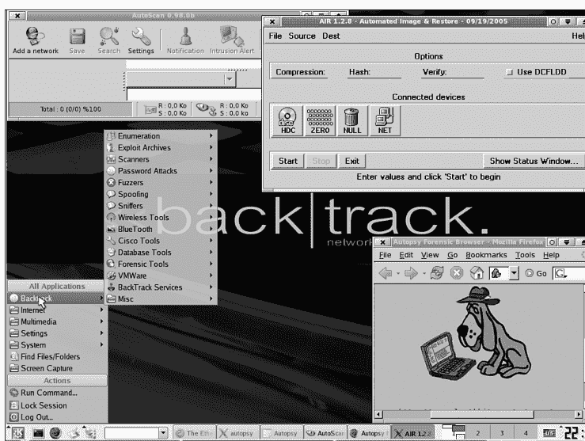

图 9-1 使用 BackTrack 进行系统规模评估、漏洞搜索和网络探索。

由于安全 Live CD 通常不是为了游戏或其他高端图形应用设计的，因此通过包含一个简单的窗口管理器（或完全不包含窗口管理器）可以节省大量的磁盘空间。由于 Fluxbox 窗口管理器非常轻量，且包含了启动许多有用 X 应用所需的特性，因此它在许多较小的 Live CD（50MB 到 180MB）中可用。BackTrack 为想要使用 Fluxbox 的用户内置了 Fluxbox，但 BackTrack 默认使用 KDE 界面。

为了理解构建此安全工具箱的基础，接下来的章节将引导你了解启动过程以及支持安全工具的基本型设置。

# 启动 BackTrack 安全 Live CD

要开始探索 BackTrack 是如何配置的，请查看它使用的启动文件。与大多数 Linux Live CD 一样，BackTrack 使用 Isolinux 引导加载程序。该引导加载程序的配置非常简单，基本上与你在基于 Slax (`www.slax.org`) 的其他 Live CD 中的配置相同。

### Live Linux CDs

`isolinux.cfg` 文件存储在 Live CD 的根目录 (`/`) 下，用于引导启动过程。这里存在三个标签：`slax`、`linux` 和 `memtest`。`memtest` 标签仅运行 `memtest` 命令以检查你的 RAM。默认的 `slax` 标签与 `linux` 标签相同，不同之处 `slax` 标签将默认 VGA 模式设置为 1024×768、16 色（`vga=03x17`，791 的十六进制等效值）。以下是可以在启动提示符处使用的启动选项（通过使用 `linux` 或 `slax` 标签），这些选项在按下 F1 键时的消息屏幕上描述：

- `linux debug`—在几次情况下中断启动过程并打开一个 shell（终端）以检查进度。
- `linux copyram`—将整个文件系统复制到 RAM。这只有在可用足够 RAM 时才能使用。
- `linux floppy`—在启动时启用自动挂载软盘。
- `linux load-modules`—从 `/optional` 目录加载模块。

你可以从启动提示符向 BackTrack 传递其他启动选项，包括 `nocod`、`nohd` 和 `nodma`。

你可以设置 `probeusb` 参数以比通常更早地找到 USB 设备。你还可以通过设置 `size=` 参数（以字节为单位），设置 BackTrack 在挂载根目录 (`/`) 时允许使用的特定 RAM。默认情况下，60% 的可用 RAM 用于 `tmpfs` 文件系统，该系统最终将存放 CD 的根文件系统。

# 启动组件

这些引导组件在 BackTrack 启动过程中使用：

- 启动屏幕（Splash screen)—BackTrack 启动时出现的第一个屏幕由 `boot/splash.cfg` 文件定义。该文件读取 BackTrack 启动屏幕 (`boot/splash.1ns`) 和指示用户按回车行的文本。在启动之前，用户可以选择按下 F1（查看 `boot/splash.txt` 文件包含的几个启动选项）以及按下 F2 返回原始启动屏幕。
- RAM 磁盘—通过 `slax` 标签的附加选项，创建一个 4MB 的 RAM 磁盘 (`ramdisk_size=4444`)。
- 内核（Kernel)—内核从 `boot/mlinuz` 文件启动。该内核是 2.6 内核，包含了对 Unionfs 和 Squash 系统的支持。
- 初始 RAM 磁盘（Initial RAM disk)—初始 RAM 磁盘文件和目录由 `initrd.gz` 提供 (`initrd=boot/initrd.gz`)。该文件被解压并挂载为 RAM 磁盘上的根文件系统。在该文件解压后

# 第 9 章定制安全 Live Linux CD

内核引导 `linuxrc` 文件（位于该文件系统的根目录下）继续启动过程。

### linuxrc 脚本

`linuxrc` 脚本为 Live CD 系统做了大量工作。由于 `linuxrc` 脚本源自 Slack 自带的脚本，BackTrack 设置文件系统的方式与 Slack（以及其他基于 linux-live.org 脚本的发行版）相似。

`linuxrc` 脚本的大部分处理是通过 `liblinux` 脚本定义的函数完成的（也在 `initrd` 根目录下）。以下是 `linuxrc` 脚本在 BackTrack 中执行的一些操作：

- 挂载 `/proc` 和 `/sys` 文件系统。
- 检查在启动提示符处是否给了 `debug` 选项。如果是，脚本其余部分将在调试模式运行。
- 运行 `modprobe` 以加载外部模块。加载的许多模块用于支持的文件系统类型（`isofs`, `squashfs`, `unions` 和 `vfat`）。如果存在 NTFS 文件系统，则会添加 NTFS 支持。如果给了 `probeusb` 启动选项，也会为 USB 存储设备添加支持。
- 根文件系统 (`/`) 最终被设置为 `tmpfs` 文件系统。首先，代表 `/bin`, `/etc`, `/root`, `/usr`, `/var` 等的单个 `squashfs` 文件系统从 CD 的 `/base` 目录只读挂载。然后，它们与可写的 `/UNIONFS` 目录合并。（参见第 5 章“Inside Live CD Components”中关于 UnionFS 和 Squashfs 的描述。）

## 第 280 页

启动过程完成后，用户会在屏幕上看到登录提示和一些信息。这些信息包含了 root 密码以及启动 GUI 或网络的方法。

## 登录

在 BackTrack 中，你需要从文本的登录提示符以 root 用户身份登录。没有其他用户账户可以作为登录账户。

BackTrack 已经分配了一个 root 密码。该密码会在首次启动时显示在屏幕上。虽然这看起来可能是一个安全隐患，但请记住，此时还没有网络接口，因此你可以在启动网络接口允许任何远程登录服务访问机器之前，运行 `passwd` 命令更改 root 密码。你也可以输入 `passwd` 作为启动选项，以便在启动过程中提示输入 root 密码。

尽管存在其他用户账户，但没有一个被启用供你登录。Knoppix 启动后进入由 knoppix 拥有的桌面（该用户可以无密码请求权限），但你需要添加一个新用户来以非 root 用户操作运行 CD（运行 `adduser username` 步骤将引导你完成此过程）。

如前所述，登录提示是基于文本的，并在前面有说明（列出了 `/etc/issue` 的内容）。这些说明包括 root 密码以及配置桌面 (`xconf`)、启动桌面 (`startx`)、启动更简单的桌面 (`gui`) 以及使用 DHCP 获取 IP 地址 (`dhcpcd`) 的命令。图 9-2 显示了上述的登录界面。

配置登录过程的方法包括：

- 通过编辑 `/etc/issue` 文件来更改登录提示符之前显示的文本。
- 设置其他用户账户，这样你就不以 root 登录。
- 配置用户环境。你可以通过编辑 `/etc/profile` 文件来修改用户环境变量。
- 配置用户家目录。`/root` 目录填充了在 `/etc/skel` 目录中预先设置的配置文件。你可以从那里添加或更改配置文件。

如果用户能够成功作为 root 用户登录，接下来需要关注的区域是设置桌面环境以及配置必要的外设（网络接口、打印机、声卡等）的功能区域。

## 第 9 章 定制安全运行 CD

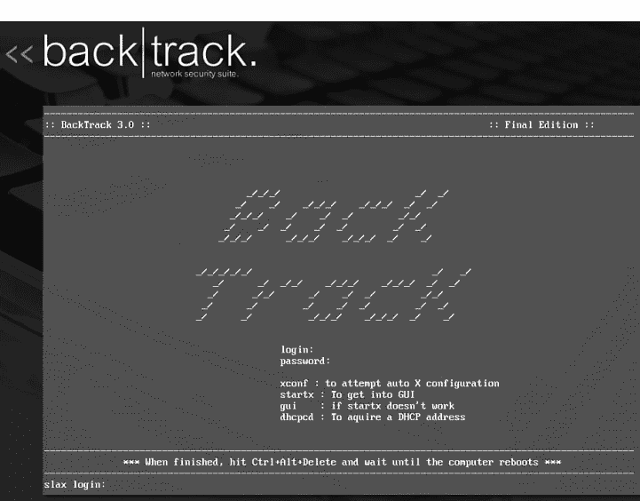

图 9-2 文本登录界面包含来自 `/etc/issue` 文件的信息。

> 注意
> 在 `/etc/profile` 中设置的一个你可能会查看的变量是 PATH 变量。BackTrack 在 PATH 中添加了一个点 (`.` )。这允许从当前目录运行命令（这种活动通常需要显式请求，输入如 `./command` 等内容）。BackTrack 需要此功能作为其让你从 BackTrack 菜单运行命令的一部分。它基本上是打开一个终端窗口，并将 shell 打开到包含命令的目录。它期望你能够从那里运行命令。

## 配置桌面

虽然许多 BackTrack 功能可以在 shell 中使用，但 BackTrack 通过为桌面创建一个名为 Back-Track 的菜单，帮助用户浏览成百上千的命令和实用程序。在为 BackTrack 配置桌面时采用的一些设计决策，在你定制自己的安全 CD 时是值得考虑。

## 桌面环境或窗口管理器

BackTrack 默认使用 KDE 作为桌面环境。因为 BackTrack 没有像微型安全发行版那样受限于 50MB 可启动业务质卡或 180MB 微型磁盘的尺寸限制，因此有空间运行更大的桌面环境，如 KDE。这些微型发行版倾向于使用轻量级窗口管理器（如 Fluxbox）来提供简单的 GUI。

BackTrack 提供了其他窗口管理器，包括 Fluxbox (`lfbox`)、Motif (`mom`) 和 Twm (`twm`)。因此，在 CPU 慢或内存低的情况下，用户可以切换到另一个窗口管理器。当然，如果你切换到简单的窗口管理器，将失去一些 KDE 功能和工具。

特别是，Fluxbox 用于许多运行版 Linux CD。例如，Fluxbox 是其他面向安全的运行版 CD 上的主管理器，如 INSERT (`www.inside-security.de/insert_en.html`)、PHLAK (`www.phlak.org`) 和 Knoppix-STD (`www.knoppix-std.org`)。它也作为窗口管理器提供在某些运行版 CD 上，例如 Damn Small Linux (`www.damnsmallux.org`)。

要将默认桌面环境从 KDE 更改为更简单的 Fluxbox 窗口管理器，请编辑 `/etc/issue`。

## 第 283 页

## 第 9 章 定制安全运行 CD


图 9-3 BackTrack 上的安全工具分为 15 类。

## KDE 设置

因为 KDE 是 BackTrack 的默认桌面，大多数工具都可以从桌面访问。要定制桌面的外观和感觉，请参考 KDE 菜单中的设置。

## 配置网络接口

因为网络接口是 BackTrack 的默认配置，在使用工具之前，这里有两种方法配置标准以太网：

- **从 shell**——你可以通过输入 `dhcp` 命令从 DHCP 服务器获取 IP 地址。要关闭接口，可以使用 `ifconfig eth0 down`。
- **从 KDE 菜单**——选择 KDE 按钮 -> Internet -> 设置 IP 地址。网络配置窗口允许你输入静态 IP 地址、子网掩码和默认网关。你还可以输入 DNS 服务器地址。对于其他类型的网络接口，也提供了 GUI 工具。配置拨号连接，选择 KDE 菜单 -> Internet -> 拨号工具。配置无线局域网连接，选择 KDE 菜单 -> Internet -> 无线管理器。

## 第 284 页

再次，由于 BackTrack 使用 KDE，还有图形化工具用于配置和管理网络接口。通过选择 KDE 按钮 -> 设置 -> 控制中心 打开控制中心。选择 Internet & Network 来选择无线网络（自动检测或手动）和网络监视。

## 第 9 章 定制安全实时版 Linux CD

这意味着寻找用于检查系统和网络的工具，评估并修补安全漏洞，以及处理问题，例如损坏或被利用的系统。

再次，BackTrack 被用于说明你可能包含在自己的安全向型实时版 Linux CD 中的类工具。BackTrack 内置了数以百的实用程序、资源（如漏洞数据库）和服务，你可能会发现它们对你自己的 Live CD 很有用。

图 9-4 展示了 BackTrack 包含的功能特性类型。

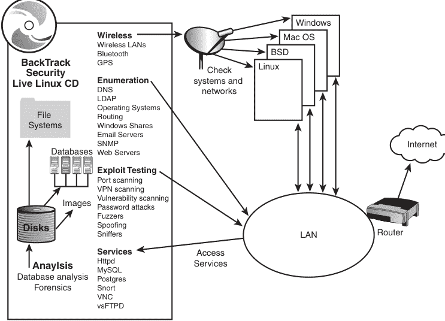

图 9-4 BackTrack 中的功能范围从远程利用工具到密码破解工具。

正如从图 9-4 中所示，向安全向型实时 CD 中添加的功能可以超出密码检查器和端口扫描器。为了支持 BackTrack 中的安全工具，还有诸如安全信息存档、检查已知漏洞等功能。这些工具用于追踪特定类型设备（如蓝牙或无线局域网卡）的问题。

接下来的章节将分别介绍图 9-4 所示的安全主题。你可以利用这些章节简要了解这些工具的工作原理，并帮助评估你想要在自己的安全实时 CD 上具备的功能。

## 运行枚举工具

枚举工具（Enumeration tools）用于发现潜在入侵者可以获取有关系统、网络或服务的信息。在实时 CD 上包含枚举工具可以让你测试网络上的计算机，从而关闭入侵者可能用来对你造成伤害的信息的访问。

BackTrack 包含了数十种枚举工具，可用于查找有关你的 Internet 域名、LDAP 服务器、操作系统、路由和其他服务的信息。以下枚举工具随 BackTrackget提供。

### 检查域信息

要运行从域名 (DNS) 服务器检查 Internet 域信息的命令，请选择 K 菜单 -> Enumeration -> DNS。约有六个菜单项可可用，用于检查 DNS 信息。

- DNS -> Walk 让你能够运行 `dnswalk` (`www.visi.com/~bar/dnswalk`) 来对你的 DNS 服务器的区域数据库进行调试。`dig`（K 菜单 -> Enumeration -> DNS -> Dig）是一个用于查找范围 DNS 信息的常用程序。`dsapenum.pl`（Perl 实用程序）是另一个检查你域的有用工具。通过它，你可以找到 DNS 服务器，尝试区域传输，并根据你提供的列表检查主机名。

### 检查 LDAP 信息

使用 `1ldapenum` Perl 脚本 (`http://sourceforge.net/projects/ldapenum`)，你可以从运行在 Windows 2000 和 2003 系统上的 LDAP 服务获取密码和系统信息。你可以通过选择 K 菜单 -> Enumeration -> LDAP -> Ldap Enum 进入脚本。同一个工具还可以用于尝试登录它发现的账户。`1ldapenum` 命令还可以用于检查组和成员。

Luma (`http://luma.sourceforge.net`) 图形化 LDAP 管理工具（K 菜单 -> Enumeration -> LDAP -> L）包含了八个插件，用于查找和处理 LDAP 服务器上的数据。插件允许你搜索 LDAP 地址录、搜索选定的 LDAP 服务器、管理用户，并从 LDAP 服务器访问其他类型的信息。

### 确定操作系统

来自操作系统枚举枚举菜单（K 菜单 -> BackTrack -> Enumeration -> Operating System）的工具可以帮助确定正在运行的操作系统类型。从该菜单中选择 `Pof`，使用被动指纹识别技术根据该计算机发送的 TCP/IP 数据包来确定其运行的操作系统类型。`pof` 命令 (`http://lcamut.coredump.com/pof.shtml`) 被认为是被动的，因为它通过读取网络上的 TCP/IP 数据包来发现系统信息，从而确定主机的操作系统类型和其他属性。

如 `pof` 之类的工具可以在不实际接触的情况下获取远程系统的信息。`pof` 工具可以研究任何连接你网络的系统的 TCP/IP 数据包。它还可以根据系统获取信息，而无需接受或拒绝运行 `pof` 的系统发起的连接。

`nmap` 命令 (`www.secure.org/nmap`) 是另一个常用于探索远程系统的工具。通过 `nmap`，你可以扫描网络或单个主机。通过扫描数据包，`nmap` 可以确定主机运行的是什么操作系统以及这些主机提供哪些服务。它还可以学习每个主机运行的是什么种防火墙。

Nmap 前端 (`nmap` 命令）为 nmap 提供了图形化界面。9-5 显示了扫描局域网上 Linux 机器的结果。系统名称为 `einstein`，TCP 端口 21 (ftp)、22 (ssh)、rbind (111) 和 X11 (6000) 是开启的。ftp 和 ssh 服务显示为红色，表示端口上的这些服务是激活的。

`sinfp.p1` Perl 脚本 (`gom.org/sinfp`) 可以根据你给命令的 IP 地址确定计算机运行的操作系统类型。对于 Linux 系统，你还可以确定有关当前内核版本的信息。

`probe2` 命令 (`http://probe.sourceforge.net`) 仅通过提供系统 IP 地址即可收集大量关于计算机操作系统的信息。它使用几种不同的信息收集技术来获取所选系统的信息。它尝试确定到远程系统的距离，检查系统上的开放端口，并检查确定运行的操作系统类型。

### 确定网络路由

用于发现网络路由信息的工具（来自 Routing/Network 菜单）包括自治系统扫描器命令 (`www.phenenoit.de/iraps/doc.html`)、防火墙命令 (`www.packetfactory.net/projects/firewall`)。要追踪数据包到达目的地，你可以使用 `itrace` 命令 (`http://ftp.sourceforge.net/itrace`)、`traceroute` 命令 (`ftp://ftp.ee.lpl.gov`) 或 `tcaceroute` 命令 (`www.phenenoit.de/iraps/doc.html`)。`itrace` 使用 ICMP 请求；`tctrace` 使用 TCP SYN 包追踪数据包到达目的地。

## 实时版 Linux CD

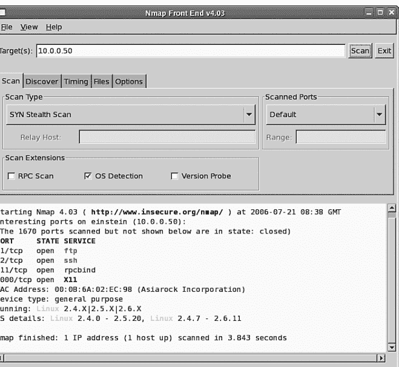

Nmap 4.03 ( `http://www.insecure.org/nmap/` ) 于 2006-07-21 08:38 GMT。
einstein (10.0.0.50) 上有趣的开启端口：
（扫描的 1790 个端口中未显示的状态为：关闭）

| PORT | STATE |
| :--- | :--- |
| 21/tcp | open ftp |
| 22/tcp | open ssh |
| 111/tcp | open unbound |
| 6000/tcp | open X11 |

MAC 地址：00:08:62:EC:98 (Asiarock Incorporation)
设备类型：通用
运行 Linux：2.4.X|2.X
OS 详情：Linux 2.4 - 2.50, Linux 2.7 - 2.61

Nmap 完成：1 个主机在线，耗时 3.843 秒


命令: `nmap -sS -O -PT 10.0.50`

```
```

图 9-5 使用 `nmap` 确定信息和扫描端口

### 查找 Windows (Samba)共享

使用 SMB 服务器获取 Windows 系统共享文件夹信息的工具允许你查找共享文件夹范围。`sinfp` Perl 脚本 (`gom.org/sinfp`) 根据你给命令的 IP 地址确定计算机运行的操作系统类型。对于 Linux 系统，你还可以确定有关当前内核的信息。

（注：OCR 文本包含大量重复，此处已提供基于唯一内容的流程。）

## 现场 Linux 光盘

(URLs)，你可以通过单命令行通过 HTTP 协议下载多个文件。使用 `mitry` 命令，你可以一次性收集关于特定 Web 服务器（或其他类型的系统）的大量信息。除了显示系统名称和 IP 地址外，该命令还会搜索各种信息服务以查找主机信息，包括 whos 数据库（Inet 和 Inic）、Netcraft、DNS（用于查找子域名）以及电子邮件服务。

`httprint` 命令 (`http://net-square.com/httpprint`) 是一个用于 Web 服务器指纹识别的工具。`httprint` 并不是依赖 Web 服务器自身的报告（这些报告可能被修改过的 banner 字符串和插件屏蔽），而是使用 Web 服务器对各种请求（如 HTTP DELETE 和 GET 请求）的响应等技术来确定 Web 服务器的类型。选择 Httpprint GUI 使用 `httprint` 工具的图形版本。

要找到网页上所有的 URL，选择 List URLs 来运行 `lists.py` 命令。选择 Paros Proxy (`parproxy.org`) 来测试你的 Web 应用程序的安全性。Paros 图形工具可以拦截并修改客户端与服务器之间传输的 HTTP 和 HTTPS 数据，以测试漏洞。

## 使用漏洞利用存档

BackTrack 包含了多个漏洞利用存档，你可以用它们来测试系统的漏洞。它还包含了 Metasploit Framework，用于运行漏洞利用模块以测试针对特定漏洞的脆弱性：

- **SecurityFocus 存档 (`www.securityfocus.com`)**——要访问由 Securityfocus.com 收集的漏洞存档，请选择 K 菜单 → Backtrack → SecurityFocus Archive。要更新，请从该菜单选择 Update SecurityFocus。这将更新并添加漏洞信息并重新生成本地漏洞数据库。如果你有互联网连接，就可以获得已知漏洞的最新信息。

- **MilWorm 存档 (`www.milworm.com`)**——要访问由 MilWorm 收集的漏洞存档，请选择 K 菜单 → MilWorm Archive。与 SecurityFocus 存档一样，你可以从 K 菜单通过选择 MilWorm 菜单中的 Update Milworm 来更新 MilWorm 存档。这将更新你的数据库包含 MilWorm 存档中的最新漏洞信息。

- **Metasploit 项目 (`www.metasploit.com`)**——Metasploit 项目的建立是为了帮助漏洞研究，并协助进行 IDS 签名开发和渗透测试的人员。在 BackTrack 中，你可以通过 K 菜单选择 Backtrack → Exploit Archives $\rightarrow$ Metasploit Framework $\rightarrow$ Metasploit 2.6 Web-Gui 来访问 Metasploit Web 界面。Metasploit 的其他界面可用（稍后描述）。

通过在 BackTrack 现场光盘上包含 Metasploit Framework，BackTrack 使用户检查各种系统对已知漏洞的防护，包括 BSD、HPUX、Irix、Linux、OSX、Solaris、Windows 2000、Windows 2003、Windows NT 和 Windows XP。你可以根据应用程序（Apache、Samba 等）、操作系统或计算机架构（PPC、Spice 或 X86）选择运行。图 9-6 显示了 Metasploit Framework Web 控制台。

Metasploit Framework Web 控制台可以通过你的 Web 浏览器 (`http://127.0.0.1:55555`) 作为本地服务运行。默认情况下，你会看到所有可用漏洞列表（更新后，BackTrack 目前包含 143 个漏洞和 75 个有效负载）。图 9-6 显示了选择 Samba 时出现的漏洞列表开头。你可以看到该列表中的前三项，它们显示了漏洞名称及其可以测试的操作系统。

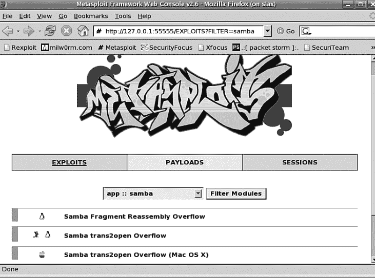

**图 9-6** Metasploit 允许你选择漏洞模块来测试系统漏洞。

在现场光盘上包含 Metasploit 的优势在于，你可以使用现场光盘重启局域网上的计算机，并在不连接局域网到互联网的情况下测试该局域网上的漏洞。你可以选择每个漏洞模块以查看其攻击的漏洞的描述。然后链接将引导你完成运行每个模块的过程（选择选项，例如远程系统和端口号并启动模块）。

除了作为一个检查漏洞的工具外，Metasploit 还是用于开发自己的安全工具的框架。要了解如何创建并将你自己的工具集成到 Metasploit 中，一个很好的起点是 Metasploit 文档页面，它包含了项目的常见问题解答：`www.metasploit.com/projects/Framework/documentation.html`。

## 扫描网络端口

除了之前描述的 `nmap` 和 `mapfe` 等工具外，你还可以使用多种工具查找有关远程系统各种协议（如 TCP 和 UDP）开放端口的信息。`nmap` 命令可以扫描目标机器上的端口，以确定所选端口上运行了哪些服务（如果有）。

AutoScan (`http://autoscan.free.fr`) 是一个用于探索和管理网络的图形化工具。当你启动 AutoScan 时，你可以在后台选择子网络。在左列列表中找到服务器和工作站。通过选择系统，你可以显示每个系统的可用服务。你可以使用启动应用程序来连接可用服务（如 ssh、nmap 和 nessus）。对于不习惯 Linux shell 的用户，AutoScan 提供了一个易于使用且美观的界面来管理网络上的端口和服务。

`pbnj` 命令 (`http://pbnj.sourceforge.net`) 使用 `nmap` 和 `mapfe` 收集从被选系统扫描端口的信息，并将结果输出到文件。有了该文件，你可以再次运行 `pbnj` 命令来确定正在扫描的服务的变化。

## VPN 扫描工具

虽然虚拟专用网络（VPN）的设计是为了在公共网络（通常是互联网）上提供安全连接，但 VPN 可能会被利用。VPN 扫描器（选择 K 菜单 -> BackTrack -> Scanners -> VPN Scanners）可用于测试服务器的潜在漏洞。

通过选择 Ike-Scan，你可以运行 `ikescan` 命令 (`www.monitor.com/tools/ikescan`) 来尝试发现活动 VPN 服务器的身份。通过观察密钥交换期间的传输特征，`ikescan` 可以了解用于建立服务器与客户端连接的服务器。使用这些信息，入侵者可以尝试攻击已知的漏洞。

从菜单中选择 PSK-Crack 项（`crack`命令），使用字典文件尝试破解 VPN 连接。默认使用的字典是 `/usr/local/share/ike-scan/psk-crack-dictionary`。`psk-crack` 命令也提供了暴力破解技术。

## 漏洞扫描工具

网络扫描器扫描各种漏洞。从漏洞扫描器（K 菜单 → BackTrack → Scanners → Vulnerability Scanners），你可以从多种通用漏洞扫描器中进行选择。

GFIAN Network Scanner (`www.gfi.com`) 是一个用于测试所选系统或 IP 地址范围的图形化工具，用于获取每台计算机的通用信息、开放端口的具体信息以及与这些端口上的任何服务相关的警报。图 9-7 显示了 LANGuard Network Scanner 的示例。

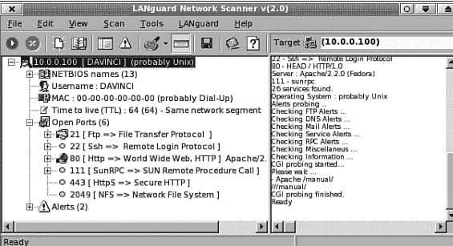

图 9-7 使用 LANGuard Network Scanner 扫描范围漏洞。

图 9-7 中的示例显示了扫描单个 IP 地址 (`10.0.0.10`) 用于名为 DAVINCI 的主机的结果。在确定系统的某些通用信息（如 NetBIOS 名称和 MAC 地址）后，LANGUard 会搜索开放端口。在这种案例中，发现了五个开放端口。对服务进行了测试，发现了与这些端口相关的两个漏洞。我们可以看到

# 现场 Linux 光盘

左侧显示扫描信息，右侧显示运行中的消息输出。

SuperScan 是另一种用于通过网络扫描一个或多个系统的图形化工具。SuperScan 是一个 Windows 可执行文件，可以使用 WINE 软件在 Linux 中运行。使用 SuperScan，你可以设置想要扫描的端口列表并设置超时、检查端口以及解析主机名。

Nikto (`www.cirt.net`) 是一个命令行漏洞测试器，用于测试各种问题，这些问题对于评估 Web 服务器的漏洞非常有用。它结合了使用插件测试功能。通过对 Web 服务器的名称或 IP 地址运行 `nikto` 命令，Nikto 能够确定有关服务器的一般信息（如操作系统、Web 服务器类型、主机名和端口号）。然后，它将继续测试服务器，以确定是否有更高版本的服务器软件，以及当前版本在查询时是否不必要地暴露了过多信息。

# 密码攻击工具

尝试窃取一个用户（或大量用户）的密码是破解计算机系统最老的技术之一。某些密码攻击工具设计为在现场（在线）系统上运行，另一些则用于离线攻击（例如，当密码被窃取后，破解者可以从容地进行攻击）。

BackTrack 包含许多用于破解密码的工具，我重点关注其中几个。当你打开密码攻击菜单（Menu $\rightarrow$ BackTrack $\rightarrow$ Password Attacks）时，大多数密码攻击被分为离线和在线攻击。

# 离线密码攻击

如果你拥有计算机的密码文件（通常为 `/etc/passwd`）和 shadow 文件（通常为 `/etc/shadow`）的访问权限，你可以运行这些命令来尝试破解其中包含的密码。由于有人试图保护你的系统，你可以使用这些命令来削弱使用你电脑的人所输入的密码。

检查离线攻击菜单（Menu $\rightarrow$ BackTrack $\rightarrow$ Password Attacks $\rightarrow$ Offline Attacks），查看 BackTrack 提供的密码攻击命令列表。其中一个示例是 `john`。创建一个合并的密码和 shadow 文件。然后对该文件运行 `john`：

```
# unshadow /etc/passwd /etc/shadow > mypassword

# john mypassword
```


创建目录：`root/.john`

# 第 9 章 自定义安全现场 Linux 光盘

加载了 3 个密码哈值，带有 3 个不同的盐（FreeBSD MD5 [32/32]）`jake` (`jake`) `toor` (`root`)

在这个示例中，发现用户 `jake` 的密码简单就是 `jake`。发现 `root` 的密码是 `toor`。如果你能够在运行中的系统上破解用户的密码，你应该告诉他们更改密码。完成后，请务必移除 `mypasswd` 文件。

其他离线破解工具包括 `Rainbow Crack`、`OPHCrack`、`Rcrtdump`、`SAMDump` 和 `WebCrack`。`Rainbow` 使用彩虹表来加速密码破解。（更多信息请参阅 `www.rainbow.com/rainbowcrack`。）

## 在线密码攻击

在线密码攻击的执行可能更加困难。重复的暴力破解攻击很容易被发现。系统可以配置为防止人员反复尝试登录并失败。

`Hydra` (`www.hydra.org`) 是一款并行破解程序。它可以使用十多种以上的服务类型（`telnet`, `ftp`, `pop3`, `map` 等）来猜测密码。`CowPatty` 是另一种用于破解 `FTP`、`HTTP`、`IMAP`、`MySQL` 等其他服务密码的暴力破解工具。`Medusa` (`www.medusa.net`) 是另一种并行密码破解工具。

## 运行模糊器（Fuzzers）

模糊器（`fuzzer`）是一种向应用程序注入输入的程序，希望结果是应用程序崩溃或导致异常。这有助于确定服务器是否容易受到缓冲区溢出和拒绝服务攻击等影响。你可以在模糊器菜单（`Menu → BackTrack → Fuzzers`）中找到模糊器。`flood` 命令允许你识别要攻击的主机端口。你可以使用 `fuzz.py` 来帮助审计设置了 `setuid` 的二进制文件。`BackTrack` 还带有模糊器创建工具包（`Fuzzer Creation Kit`）。该工具包带有工具包括 `webfuzz`（用于模糊的小工具组合）和 `spike`（用于发送随机参数以寻找导致端口的 bug）。

## 伪装（Spoofing）

破解网络或系统的一种方法是运行程序，其中程序伪装成它不是的东西，例如合法的 `DNS` 服务器或 `DHCP` 服务器，以希望欺骗毫无防备的用户或为你提供关键信息。`BackTrack` 包含一整套伪装工具（`Menu → BackTrack → Spoofing`），你可以尝试使用它们来测试你系统的漏洞。

`arspoof` 程序（来自 `www.monkey.org/~duong/dsniff` 包的一部分）试图欺骗另一台计算机使其相信自己是网关机器。它通过不断向受害者机器发送其 `IP` 地址作为网关来实现这一点。当受害者机器最终将 `arspoof` 的 `MAC` 地址缓存为网关时，它开始将 `IP` 包发送到 `arspoof` 而不是真实的网关。

`dhcp` 程序（来自 `www.phenoelit.de/irpas`）是一个 `DHCP` 泛洪器。这种技术也被称为 `DHCP` 耗尽攻击。`dnsspoof` 命令试图通过对各种 `DNS` 地址和指针查询提供伪造回复，来说服局域网上的其他系统自己是 `DNS` 服务器。

使用 `fragroute` 命令，你可以更改和重写指向局域网外的流量。这种网络流量被称为出口流量（`egress traffic`）。虽然 `fragroute` 只对源本地机器的数据包有效，但 `fragrouter` 命令也可以用于其他机器。

检查伪装菜单查看你还可以进行的其他伪装类型。例如，某些命令尝试重定向 `ICMP` 流量，另一些则尝试通过重放 `TCP/IP` 包获取控制权。

## 网络嗅探器（Sniffers）

如其名，网络嗅探器监控网络，试图“嗅探”在该网络上传输的信息。这些信息可以用于坏事（当有人试图窃取数据或连接信息时），也可以用于善事（发现网络上的潜在问题）。在某些情况下，使用嗅探器可以确保员工没有在使用电脑时违反任何公司政策。

`BackTrack` 包含了十多个嗅探器，你可以使用它们来监控各种网络流量。检查嗅探器菜单查看 `BackTrack` 包含了哪些嗅探器（`Menu → BackTrack → Sniffers`）。

## 第 9 章 自定义安全 Linux 光盘

你可以使用 `AIM` 嗅探器（`aimsniffer` 命令）记录并捕获 `AOL Messenger` 会话的流量。`Driftnet` (`www.ex-portal.com/~chis/driftnet`) 是一种图形化实用，监听 `TCP` 流量中的图像并在 `Driftnet` 窗口中显示找到的内容。图 9-8 显示了从本地浏览器选择 `Wikipedia` 后在 `Driftnet` 窗口中出现的图像。

### 图 9-8

使用 `driftnet` 显示 `TCP` 流量中遇到的图像

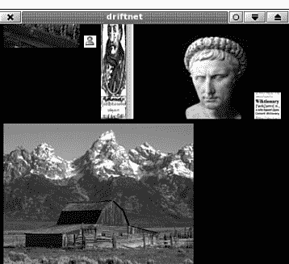

`dsniff` 命令（`http://monkey.com/~duong/dsniff`）是一个密码嗅探命令，可以监听各种服务的密码。这些服务包括 `FTP`、`TELNET`、`SMTP`、`HTTP`、`POP`、`X11`、`AIM`、`ICQ` 等等。当 `dsniff` 运行时，它会自动检测它正在嗅探的协议，提取出密码信息，并将这些信息以 `Berkeley DB` 格式保存到输出文件中。

要嗅探安全外壳（`SSH`）流量，可以将 `sshmit` 工具（`dsniff` 软件包的一部分）放置在 `ssh` 客户端和服务器之间。通过模拟真实的 `ssh` 服务器，`sshmit` 可以从毫无防备的客户端获取密码信息，然后代表与真实服务器完成交易，而客户端不会怀疑出了任何问题。`aftercap` 工具（`http://ettercap.sourceforge.net`）是一个图形化工具，同样可以执行中间人攻击，但 `aftercap` 还可以捕获整个会话以及密码信息。

正如其名所示，`URLsnarf`（`urlsnarf` 命令）可以获取指定接口上请求的 `Web` 信息（匹配你喜欢的任何模式）。`XSPy`（`xspy` 命令）可以跟踪输入到 `X` 显示的所有内容，并将这些信息回显到运行 `xspy` 的 `shell` 终端。

要保存使用 `NFS` 协议传输的文件，可以使用 `filesn` 命令。使用 `msgnarf` 命令，你可以保存来自许多不同 `IRC` 和消息协议的消息和聊天会。通过 `mailsnarf`，你可以嗅探 `SMTP` 和 `POP` 流量以保存电子邮件。`mailsnarf`、`filesn` 和 `msgnarf` 都是 `dsniff` 软件包的一部分。

### 无线网络工具

你可以使用处理无线网络的工具来尝试分析流量、破解密码、伪造数据包，并在网卡上切换不同的驱动配置。你可以在“`Wireless Tools`”菜单（`K menu -> BackTrack -> Wireless Tools`）查看 `BackTrack` 中用于无线局域网的工具。

`Kismet` 是一个用于无线接口的流行工具。通过 `Kismet`，你可以检测 `802.11` 无线网络（包括 `802.11b`、`802.11a` 和 `802.11g`）的入侵。`Kismet` 通过被动收集数据包来检测隐藏网络。它使用标准名称检测网络，并可以随着时间的推移伪装隐藏网络。你用 `Kismet` 记录的数据与 `Etter` 和 `tcpdump` 兼容。

要测试无线局域网节点密码强度，你可以使用如 `WepAttack`（`http://webpattack.sourceforge.net`）、`Wep_crack` 和 `Wep_decrypt`（`http://www.lava.net/~newsham/wlan`，属于 `wep_tools` 软件包）以及 `Weplab`（`http://weplab.sourceforge.net`）等工具。这些工具中的每一个都为测试无线网络密码的安全性提供了不同的选项。

“`Miscellaneous`”子菜单提供了一些杂项无线工具。`macchanger` 工具（`www.allobs.com/macchanger`）允许你查看并更改网络接口的 `MAC` 地址。如果你的系统连接了 `GPS` 设备，可以通过分别选择“`GPS Daemon`”或“`Stop GPS Daemon`”来启动和停止 `GPS` 跟踪守护进程。此外还有若干用于更改无线网卡驱动程序的实用。

要在无线网络上伪造数据包，“`Packet Forging`”菜单上提供了一些工具。`aircrack-ng` 软件包（`aircrack-ng.org/doc.php`）包含了审计无线网络可靠性的工具，包括 `airplay-ng`（用于注入帧以生成流量从而破解 `WEP` 和 `WPA-PSK` 密钥）。`Aircsnarf`（`www.shmo.com`）可用于设置伪造接入点。`WifiTap`（`wi tap` 命令）可用于在 `802.11` 网络上捕获流量并注入数据包（`http://sid.rack.org/index.php/wifitap_EN`）。

### 蓝牙设备工具

监控蓝牙设备（`www.bluetooth.org`）的工具位于“`Bluetooth`”菜单中（`K menu → BackTrack → Bluetooth`）。`Blue Snaper`（`bluesner` 命令）下载未受此类入侵保护的蓝牙设备电话录。`Carwhisperer`（`carwhisperer` 命令）测试蓝牙车载设备的漏洞，特别是那些使用标准密码密钥的设备（见 `http://trifinite.org/trifinite_stuff_carwhisperer.html`）。

你可以使用 `HelMoto` 工具（`helomoto` 命令）利用某些摩托罗拉手机和其他设备对受信任设备的处理漏洞。你可以从 `Trifinite` 网站（`http://trifinite.org/trifinite_stuff_helomoto.html`）了解 `HelMoto` 攻击。

### Cisco 路由器工具

查看“`Cisco Tools`”菜单（`K menu → BackTrack → Cisco Tools`）查找检查 `Cisco` 路由器漏洞的工具。`Global Exploiter`（`cge.pl` perl 脚本）可以测试一系列已知的 `Cisco` 设备漏洞。使用此工具通常需要目标和测试的漏洞名称。你可以从 `BlackAgents` 网站（`www.blackagents.it`）了解该脚本。

`Cisco Torch` 是一个 `Cisco` 漏洞扫描器（`cisco-torch.pl` perl 脚本）。通过它，你可以扫描 `Cisco` 设备上的多种服务，包括 `telnet`、`sshd`、`snmp` 和 `tftp`。你可以对网络时间协议（`NTP`）和 `TFTP` 服务进行指纹识别。

`Yersinia`（`yersinia` 命令）是一个用于分析网络协议的工具，包括 `Cisco` 发现协议（`CDP`）。你可以从其主页（`www.yersinia.net`）获取更多关于 `Yersinia` 的信息。`cisco-copy-config.pl` 和 `merge-copy-config.pl` perl 脚本分别是分别使用 `SNMP` 复制和合并 `Cisco` 配置的简单脚本。

### 数据库分析工具

`BackTrack` 将分析数据库漏洞的工具分为通用数据库工具、`MS-Sql`、`Mysql` 和 `Oracle`。存在许多工具用于检查数据库漏洞。

`Absinthe`（`www.ox90.org/releases/absinthe`）是一个用于分析数据库漏洞的图形化工具。

## 第 9 章 自定义安全 Linux CD

（注：提供的 OCR 文本在句子中间发生了跳转到第 9 章。我将按照提供的文本进行处理，保持逻辑流贯。）

## 向 BackTrack Live CD 中添加软件

通过第 6 章“构建自定义 Knoppix Live CD”到第 8 章“构建基础 Gentoo Live CD”中描述的定制化和重制技术，你可以为 `Knoppix`、`Fedora` 和 `Gentoo` live CD 添加本章描述的组件（以及你选择的任何组件）。在某些情况下，你所选择的 live CD 类型（类型）可能已经有了相应的软件包（`Deb`、`RPM` 或 `Emerge` 软件包）。在其他情况下，你可以从文中描述许多此类组件时提到的项目网站下载你需要的软件。

由于 `BackTrack` 是基于 `slackware`（特别是 `SLAX` live CD）发行版的，接下来的我将描述如何向 `BackTrack` live CD 添加基于 `SLAX` 的程序包。通过这种方式，你可以下载并运行 `SLAX` 仓库中提供的任何包（称为模块）。

向像 `BackTrack` 这样基于 `SLAX` 的 live CD 添加软件模块的技术比第 6 章中为 `Knoppix` 重制的技术（使用 `chroot` 环境）要简单得多。你可以通过两种方式向 `BackTrack` live CD 添加 `SLAX` 模块：

- **重制（Remaster）**——向 live CD 上的 `/modules` 目录添加 `SLAX` 模块。将你的 `BackTrack` live CD 内容复制到硬盘上的一个目录，将 `SLAX` 模块添加到该目录，并重新创建 `ISO` 镜像（使用 `makeiso`）；当启动该 live CD 时，添加的模块中的软件就会被安装。

- **现场（Live）**——你可以在 `BackTrack` 运行时，下载任何 `SLAX` 模块并使用 `livemod` 命令进行现场安装。该模块中的软件将立即可以可以使用。

要找到适用于 `BackTrack` 及其他基于 `SLAX` 的 live CD 的可用软件模块，请访问 `SLAX` 模块页面 (`www.slax.org/modules.php`)。你会发现 15 类可以添加到你的 live CD 或在重制时添加到 `/modules` 目录的软件。要立即安装模块，找到你需要的软件（选择类别或使用搜索框查找你想要的内容）。然后下载你选择的模块。

当要安装的模块位于当前目录时，你可以使用 `livemod` 命令安装该模块。例如，你可以输入以下命令来安装 `eMovix` 程序包：

```
# elivemod eMovix_0_9_0
```


# 第 9 章 自定义安全 Linux CD

软件将立即在你的 live CD 上供使用。

你可能需要各种驱动程序和固件才能让某些硬件外设在你的 live CD 上正常工作。SLAX 自带了一系列可能未包含在发行版中的驱动程序，但你可能可以在个人 live CD 上安装它们：

从 SLAX 模块页面，选择 Drivers（驱动程序）。这些是你可能想要从模块中添加的一些驱动程序示例（取决于你的硬件）：

- **ATI 视频驱动**——如果你的显卡使用 ATI 芯片组，你可以从制造商处安装闭源专有驱动，对于需要硬件加速的应用程序，这些驱动可能比其开源版本效果更好。
- **NVIDIA 驱动**——与 ATI 显卡一样，如果你的显卡中有 NVIDIA 芯片组，来自 NVIDIA 的专有驱动对于游戏和其他在硬件加速下表现更好的软件来说，可能比开源驱动更好用。
- **madwif**——如果没有 madwif 项目的驱动程序，几种不同的无线网卡在 Linux 中可能完全无法工作。
- **摄像头驱动**——该程序包中的驱动程序可以帮助 Linux 支持的有限摄像头正常工作。

除了上述提到的包外，该页面还提供了其他驱动程序。它们包括用于特定调制解调器的现代调制解调器驱动程序，以及某些无线网卡正常工作所需的固件包。

### 总结

现在有许多面向安全和救援的 live Linux CD，你可以根据提供的工具和其基于的 Linux 发行版来选择。在本章的示例中，我使用了 BackTrack 网络安全 live CD。

通过 BackTrack，你可以评估数以百计面向安全和救援的工具，用于 Linux 系统、网络以及你从网络可以访问的各种系统。BackTrack 基于 SLAX（其基于 Slackware），因此可以使用 SLAX 提供的许多资源（如 extra-ware 模块）。

本章详细介绍了 BackTrack 的一些设计决策，并指出了你可以在何修改 BackTrack 的启动方式以及服务的启动。由于 BackTrack 使用 KDE 作为桌面，你拥有广泛的桌面工具来支持从该平台运行的专用安全实用。

# 自定义演示用 Live Linux CD

如果你创建一个 live Linux CD 的明确目的是为了制作演示文稿（Presentation）、展示你的照片或播放视频，为什么不让该 CD 直接启动到播放内容的应用程序呢？你可以创建一个 live CD，让你、你的朋友或同事从启动提示中选择一个或多个演示。通过这种方式提供演示，你不仅可以直接进入你的内容，还可以使用你确切想要的播放器和选项播放该内容。

由于我没有找到可以按我想要的方式直接启动的现有 live Linux CD，我创建了自己的自定义 CD。我从最新版本的 Damn Small Linux 开始，并使用与第 6 章“构建自定义 Knoppix Live CD”类似的的程序进行重制。

为了书中的演示目的，我创建了一个名为 PuppetIX 的 live CD（不要在 distrowatch 上找它）。PuppetIX 演示 live CD 的点是从引导加载程序选择并启动演示，因此运行它的唯一方法是来自独立的 ISO 镜像。我创建了两个不同的 PuppetIX ISO 镜像并包含在随书的 DVD 中：

- **puppetix**——镜像 `puppetix-0.1.iso` 包含启动到全屏幻灯片演示所需的软件。它还包含了播放 OpenOffice 演示的框架，但不包含 Imp 本身。通过不包含 OpenOffice.org 软件套件，你可以在最小系统上启动并跟随本章的大部分内容。
- **puppetix-oo**——镜像 `puppetix-oo-0.1.iso` 与上一个相同，但增加了整个 OpenOffice.org 软件套件。尽管此 ISO 将运行 Impress 演示，但 ISO 本身大得多（约 160MB），并且需要 384MB 内存才能正常运行。此 ISO 加载时间也更长，因为它使用了 MyDSL 功能（后文描述）。

要尝试 PuppetIX，你可以将选择的 ISO 复制到硬盘并将其刻录到空白 CD。以下是在 Linux 系统上如何操作的：

1. 将随书的 DVD 插入电脑的 DVD 驱动器。

本章的其余部分将介绍 PuppetIX 如何工作，以及你可以使用类似的技术制作你自己的演示。

该 live CD 用于启动以下：

- **启动任何桌面应用程序**——通过将标签添加到引导加载程序，你可以启动任何需要的应用程序。使用 Damn Small Extension Tool，你可以从已提供的几十个应用程序中选择。
- **播放你喜欢的任何内容**——通过将你自己的内容添加到 live CD，你可以确保内容按预期运行。你甚至可以添加其他类型的内容，如音乐或视频。只要你能找到在 Linux 中运行的播放器，你就可以从启动提示中直接启动你的内容。

## 第 10 章 定制演示文 Live CD

2. 将你选择的 puppetix ISO 从 DVD 拷贝到你的硬盘。例如：
```
# cp /media/livecd/distros/puppetix-1.0.iso /tmp
```
或
```
# cp /media/livecd/distros/puppetix-oo-1.0.iso /tmp
```
3. 移除 DVD 并插入一张空白 CD。然后输入以下命令：
```
# cdrecord -v -eject /tmp/puppet*.iso
```

当 CD 弹出时，你可以从一台空闲的 PC 上启动它，并按照本章的描述进行操作。当你第一次启动 CD 时，你会看到一个类似于图 10-1 的启动屏幕。

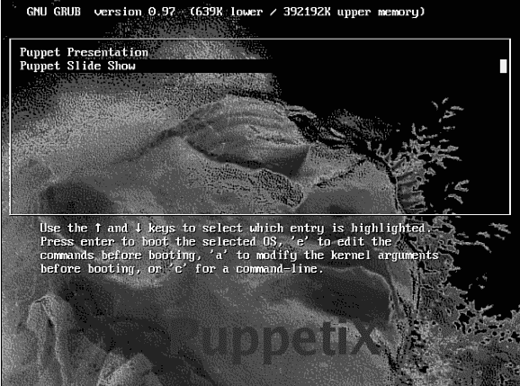

图 10-1 从 Puppetix 启动界面选择演示文。

启动屏幕有一个巨大的、丑陋的木偶头部。移动光标（使用方向键）在两个选项（Puppet Slideshow 和 Puppet Presentation）之间，以选择你想启动哪一个。在每个选项上按 `e` 可以查看启动标签的内容。再次在内核行按 `e` 可以查看传递给内核的启动选项。当你准备好启动时，按 `Esc` 和 `b`。

Puppetix 会根据在两个选项内核行末尾添加的 `puppet=` 选项启动演示。Puppet Slide Show 标签包含 `puppet=slides` 选项，它会运行 `gqview`（全屏幻灯片模式），显示 `/var/puppets/images` 目录中的所有图像。Puppet Presentation 标签包含 `puppet=impress` 选项，它最终启动添加到 `/var/puppets/presentations` 目录的 OpenOffice.org Impress 演示。

根据你选择的是演示还是幻灯片，`mylaunch` 脚本会启动 `gqview`（用于数字图像幻灯片）或 `impress`（用于演示文稿）。这两个演示的数据被存放在 CD 自身的 `/var/local/puppets` 子目录下。

当演示完成后，你会退回到简单的桌面，该桌上有启动与启动屏幕上相同演示文的图标。虽然我在这个 live CD 上只添加了两个选项，但随着我进一步描述这个项目，你会发现添加任意数量的幻灯片、演示、视频或其他内容和播放器都是简单的。

### 播放 GQview 幻灯片

既然 Puppetix 已经运行起来了，你可以玩玩它。GQview 图像查看器（http://gqview.source.net）可以以不同的方式显示多种格式的图像。除了默认简单观看全屏幻灯片播放外，GQView 还可以移动图像、缩放，并在外部应用程序中打开它们以进一步处理图像。

在幻灯片播放期间，右键点击图像。你可以选择缩放功能，或者使用 Xpaint、GIMP、elektrik 或 XV 编辑图像（如果你已向 live CD 添加了这些应用程序）。你还可以复制、移动、重命名或删除当前图像。

当你完成幻灯片时，按 `q` 退出。在 Puppetix 中，退出查看器后会启动 Fluxbox 管理器。如果你想重启幻灯片，右键点击桌面并选择 Puppets -> Puppet Slideshow -> Parade 2006。退出全屏模式以查看 GQview 文件列表，如图 10-2 所示。

通过文件列表和菜单，你可以选择更多处理图像的选项。从 Edit 菜单中，选择 Adjust 来旋转、翻转或镜像图像。选择 Set as Wallpaper 将图像设置为桌面背景。选择 Select All 一次处理列表中的所有图像。

选择 Options 来设置 GQview 的行为。特别对于幻灯片，你可以更改 10 秒延迟，选择按顺序或随机显示图片，如果你想让幻灯片无限循环图片，则选择 Repeat。

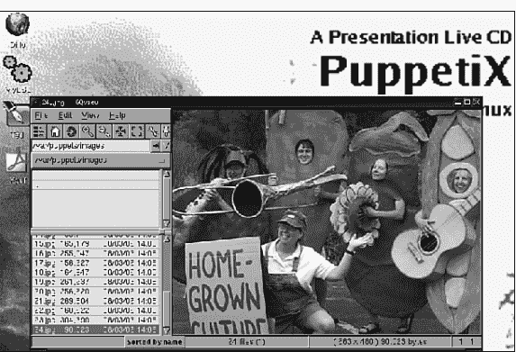

图 10-2 使用 GQview 播放幻灯片和处理数字图像。

你选择的任何设置都存储在 `/home/ds1/.gview` 目录中。如果你想保留这些设置以供后备之用，你可以将 `.gview` 目录拷贝到你重制 live CD 的 `etc/ski` 目录。这样，你就可以将这些设置永久与 live CD 一起保存。

### 播放 Impress 演示文

OpenOffice.org 套件是免费开源世界中最顶尖的办公生产力工具集。除了文字处理、演示、数学、绘画、电子表格和数据库访问的六个主要组件外，它还可以处理当今大多数流行办公应用程序的文件格式。

OpenOffice.org 套件默认包含在 DSL 中。它的大小几乎是 DSL 大小的三倍，这会导致 DSL 的需求激增，无法放入一张 50MB 的可启动存储卡中。然而，你可以为 DSL 添加一个版本的 OpenOffice.org 套件（即使压缩后也接近 100MB），正如我们为自定义的 PuppetX live 演示 CD 所做的那样。

如果你启动书中附带的 `puppetix-oo` ISO，OpenOffice tar/gzip 文件会在系统启动时添加到你正在运行的 live CD 中。在你决定

#### Live Linux CD

无论你是否决定在 OpenOffice 注册，Impress 都会以全屏模式启动。你启动的电脑资源并不完全是你重制时所需的。然而，你可以开始演示，如图 10-3 所示。

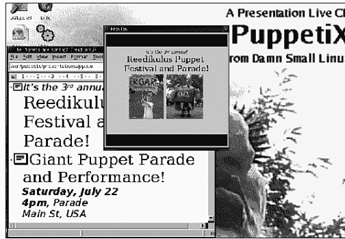

图 10-3 使用 GQview 播放幻灯片和处理数字图像。

使用 Impress，你可以添加更多属性（颜色、字体、布局）。因为 DSL 使用 `/mnt` 而不是 `/media` 来挂载硬盘分区，程序中使用的目录名称对于 DSL 来说应该是不同的。本章的其余部分将描述如何制作你想要的 live CD。

### 重制演示文 CD

我通过重制 Damn Small Linux (DSL) live CD 开始创建 PuppetX。因为 Damn Small Linux 基于 knoppix，大部分重制过程可以按照第 6 章的描述进行。通常，这些是重制的步骤：

- **启动 DSL**：启动 Small Linux（随附了一个 ISO）。你启动的电脑资源并不完全是你重制 knoppix 所需的。然而，至少 500MB 磁盘空间和 256MB 内存可能是个主意。
- **设置目录结构**：像 knoppix 一样，DSL 提供了方便挂载硬盘分区的特性。因为 DSL 使用 `/mnt` 而不是 `/media` 来挂载硬盘分区，程序中使用的目录名称对于 DSL 来说应该是不同的。例如，我将重制的目录结构设置在 `/mnt/hda1/DSL` 而不是 `/media/hda1/knoppix`。章节中所有的目录引用都相应的相应。
- **获取软件**：将文件拷贝到新的（主和源）目录后，你可以获取 live CD 需要的任何额外软件。与其使用 `apt-get` 从在线仓库获取包，如果可能，我建议使用 MyDSL 功能。为了实现这一点，执行了以下操作：
    - **MyDSL**：从桌面选择 MyDSL。出现 MyDSL 扩展工具窗口。
    - **选择应用程序**：选择你想要的类别和应用程序。询问你在何处保存代表应用程序的存档（压缩包）。
    - **保存存档**：为了将应用程序包含在 live CD 中，将代表应用程序的存档保存在主目录。例如，如果你像我之前建议的那样命名重制目录，你可以

将应用程序存档保存到 `/mnt/hda1/DSL/master`。保存到该目录的任何存档稍后启动新的 live CD 时都会解压。虽然这会减慢启动过程，但它让在重制期间添加和删除应用程序变得容易得多。

> 注意
> 选择的 Apps -> ggview.dsl.info（用于幻灯片）被添加到两个 puppetix 镜像中，而 Apps -> openoffice-1.1.4.info（用于 Impress 演示文稿）被添加到 puppetix-ox 镜像中。

- **配置桌面**——DSL 没有使用 KDE，而是使用 Fluxbox 作为默认窗口管理器。虽然它不具备 KDE 的所有功能，但它运行高效，并且仍然包含你选择的颜色、背景和其他元素。通常情况下，系统级的 Fluxbox 设置位于 `/usr/share/fluxbox`，而单个用户的设置可以存放在 `/etc/skel/.fluxbox` 中。后文将描述在 Puppetix 中是如何配置 Fluxbox 的。
- **修改启动文件**——puppetix 添加了 GRUB 引导加载程序，替换了 DSL 和 Knoppix 通常使用的 isolinux 引导加载程序。设置 GRUB 引导加载程序的描述在第 5 章“深入了解 Live CD 组件”中，而此 live CD 使用的特定特性在本章后文部分描述。
- **制作 ISO**——在源目录和主目录符合你的要求后，按照第 6 章的步骤制作压缩系统镜像并创建最终的 CD 镜像。你可能需要重复这些步骤，以便将 live CD 调整到你完全满。

接下来的章节描述了在创建 Puppetix live CD 过程中所做的特定更改。

### 设置 GRUB 引导加载程序

由于 Puppetix live CD 旨在服务点击操作的用户群，因此从引导加载程序开始这种方法似乎是最好的。GRUB 具有几个功能使其成为演示类 live CD 的良好选择：

- 菜单界面——启动标签出现在菜单上，用户可以使用上下箭头进行选择。这样，每个可启动的演示文稿都可以启动，而无需终端用户知道要输入什么标签名称。

想要更改或添加选项的高级用户可以在启动前按 `(E)` 编辑他们想要的启动标签。

- 启动屏幕——启动屏幕上的图像可以填满屏幕。菜单显示在它前面。这允许你使用比 Isolinux 更大的图像。

使用 GRUB，你可以从启动屏幕提供任意数量的演示文稿。每个演示文稿都可以用不同的播放器或你定义的选项运行。

为了开始设置 GRUB 引导加载程序，我在重制期间在 `master/boot` 目录中添加了一个 `grub` 目录。在生成的 live CD 上，该目录将变为 `/cdrom/boot/grub` 目录。然而更重要的是，当你制作 ISO 文件系统（`mkisofs` 命令）时，El Torito 启动镜像和相关文件来自该目录。

`grub` 目录的内容相当简单。通过使标签简单化，你跳过了额外的帮助屏幕。`grub` 目录包含以下组件：

- `linux24`——这是从 Damm Linux 的 `isolinux` 目录复制的 2.4 内核。该内核用于 PuppetIX 中的可启动演示文稿。
- `minirt24.gz`——同样，初始内存盘（`minirt24.gz`）也是从 Damn Linux 的 `isolinux` 目录复制的。
- `stage2_eltorito`——当你构建 ISO 镜像时，通过 `mkisofs` 命令的 `-b` 识别阶段 2 El Torito 启动镜像。我是从 Fedora Core 自带的 `grub` 包中获取此镜像的。然而，DSL 有来自 MyDSL 功能的 `grub` 包，我认为那也可以。
- `puppet.xpm`——启动图像是 XPM 格式（X PixMap 图像）的压缩图像。我使用巨大的木偶图像。XPM 图像为 640x480 像素，使用 14 色调色板。第 5 章包含了将数字图像转换为此格式的步骤。
- `grub.conf`——grub 配置文件 (`grub.conf`) 是你对 GRUB 进行大部分自定义的地方。在所有其他文件就绪后，你就可以开始编辑你的 `grub.conf`。

下面的代码示例显示了 PuppetIX `boot/grub` 目录下 `grub` 文件的内容。我省略了一些注释行以节省空间：

```conf
# grub.conf

default=0

timeout=10

splashimage=(cd)/boot/grub/puppet.xpm

# color blue/green red/green
```

### Puppet 幻灯片

```conf
root (cd)

kernel /boot/grub/linux24 ramdisk_size=100000 init=/etc/init lang=us

apm-power-off vga=791 nomce noapiq BOOT_IMAGE=knoppix

desktop=fluxbox puppet=slides

itrd /boot/grub/minirt24.gz
```

### Puppet 演示文

```conf
root (cd)

kernel /boot/grub/linux24 ramdisk_size=100000 init=/etc/init lang=us

apm-power-off vga=791 nomce noapiq BOOT_IMAGE=knoppix

desktop=fluxbox puppet=impress

itrd /boot/grub/minirt24.gz
```


为了简单起见，`grub.conf` 显示 `default=0` 设置了第一个启动标签。在 10 秒超时后 (`timeout=10`)，启动屏幕 (`splashimage`) 被识别为加载自 `(cd) /boot/grub/puppet.xpm`。文件的其余部分显示颜色 `blue/green red/green`，提醒你可以更改启动屏幕的颜色。第一组颜色指示 GRUB 菜单上的文本颜色。第二组颜色指示高亮区域（移动箭头键到目标标签）。第 5 章说明了你可以使用的颜色。

下面的代码示例显示了 PuppetIX `boot/grub` 目录下 `grub` 文件的内容。我省略了一些注释行以节省空间：

```conf
# grub.conf

default=0

timeout=10

splashimage=(cd)/boot/grub/puppet.xpm

# color blue/green red/green
```

数字图像通过 `puppet=slides` 启动，而 Impress 演示文稿通过 `puppet=impress` 选项启动。`puppet=` 选项最终触发演示。

## 启动演示

假设内核已启动并挂载了初始内存盘，启动 Puppetix 的控制将交给 `init` 进程。与基于 Knoppix 的 live CD 一样，DSL（因此是 Puppetix）启动到运行级别 5，结果是一个运行的桌面系统。在这个系统中，我们要添加运行演示或幻灯片。

在最小 X 系统显示启动后，窗口管理器（在此类中为 Fluxbox）以及任何你想运行的应用程序（如启动演示）都可以从用户目录下的 `.xinitrc` 文件启动。DSL 中创建的默认用户命名为 `dsl`。`dsl` 用户目录 (`/home/dsl`) 在启动时通过复制 `/etc/skel` 中的所有内容创建。它包含了 `.xinitrc` 文件。

为了启动演示，我创建名为 `mylaunch` 的脚本并将其添加到 `/etc/skel/.xinitrc` 中。添加 `mylaunch` 脚本是为了在 X 显示运行之后、Fluxbox 启动之前启动它。这是 `.xinitrc` 文件的内容，包含了我添加的行：

```bash
case $DESKTOP in

fluxbox )>/dev/null & 

fluxter & wmswallow -geometry 70x80 docked docked.lua &

/usr/local/bin/mylaunch

exec fluxbox 2>/dev/null

;
```

### 现场 Linux CD

运行 `mylauch` 脚本时末尾没有加 ampersand (`&`)。这样做是为了防止 Fluxbox 在演示文稿结束之前就启动。我尝试过另一种方法，但 Fluxbox 会为任何位于演示文稿背后的窗口添加边界。这些窗口会跳到前台并遮挡演示文稿。

`mylauch` 脚本的创建目的是建立在启动提示符中输入的内容与运行的演示文稿之间的联系。以下是 `mylauch` 脚本的内容：

```bash
#!/bin/ash

################################=======================================
# text processing functions
################################################=======================
# egrep_o is a replacement for "egrep-o". It prints only the last
# matching text
# $1 = regular expression
rep_o() {
    cat | egrep "$1" | sed -r "s/.*($1).*/\1"
}

# look into cmdline and echo 1 back if $1 is set
# $1 = value name, case sensitive, for example livecd_subdir
# $2 = file to use instead /proc/cmdline, optional
cmdline_parameter() {
    CMDLINE=/proc/cmdline
    if [ "$2" = "*" ]; then CMDLINE="$2"; fi
    cat "$CMDLINE" | egrep_o "^([[:space:]]+)\$1=\|[[:space:]]+)+"
}

# Presentations
################################################=======================
```

```bash
# Play slideshow
if [ "$1" = "cmdline_parameter puppet-slides" ]; then
    /usr/bin/ggview -s -f /var/puppets/images/
fi
```

```bash
# Play presentation
if [ "$1" = "cmdline_parameter puppet-impress" ]; then
    /opt/openoffice-1.1.4/soffice -impress -show /var/puppets/presentations/pp.sxi
fi
```

## 第 10 章 自定义演示文稿现场 CD

`mylauch` 脚本的目的是从内核启动行读取设置的选项，然后根据命令行出现的 `puppet` 选项启动演示文稿。这些选项存储在 `/proc/cmdline` 中。如果你输入 `cat /proc/cmdline`，你将看到来自你启动时所标签的所有选项。

`mylauch` 脚本开头有几个从 `/proc/cmdline` 读取值的函数。这些函数来自 Linux Live CD 项目（www.live-org）一部分的 `libinuxlive` 脚本。在脚本的 Presentations 部分，脚本目前查找两个选项。

如果设置了 `puppet-slides`，`gview` 命令将以全屏模式 (`-f`) 运行幻灯片模式 (`-s`)，使用 `/var/puppets/images` 目录中的所有图像。如果设置了 `puppet=impress`，`suffice` 命令将在 Impress 模式 (`-impress`) 下以全屏幻灯片模式 (`-show`) 运行，显示 OpenOffice.org Impression 演示文稿 `pp.sxi`。

当选定的演示文稿运行完成后，Fluxbox 窗口启动。之后你就可以开始使用桌面。

由于由于可能想在不重启的情况下运行另一个演示文稿或幻灯片，PuppetiX 桌面已经过修改，允许所有用户从桌面运行其他演示文稿或重启原始演示文稿。该桌面经过调整包含了不同的 Fluxbox 主题，以匹配 PuppetiX 现场 CD 的内容。

### 自定义 Fluxbox 主题

PuppetiX 并不是在幻灯片或演示文稿结束后直接退出或进入 Damn Small Linux (DSL) 桌面，而是包含了一个自定义桌面。Puppet 主题使用了模仿 DSL 主题制作的主题，包含了适当背景图像和一个菜单，让你能够从桌面启动任何一个演示文稿。

系统级 Fluxbox 主题存储在 `/usr/share/fluxbox` 目录中。主题位于其中的 `styles` 子目录下。通过复制默认文件，你可以创建自己的主题文件并按需进行修改。在主题文件中，你可以更改与工具栏、菜单、窗口和字体相关的属性。你甚至可以设置根窗口使用的图像。

我创建了一个名为 Puppet 的样式，对其进行了修改以包含适用于演示文稿 CD 的属性，并将其复制到同一目录下名为 `default` 的文件中。特别是，我在 backgrounds 目录下添加了 `puppet.xpm` ，并在 Puppet 主题文件中添加了这一行，以便每次启动 Fluxbox 桌面时都会加载它：

```
rootCommand: xsri -scale-height=100 scale-width=100
/usr/share/fluxbox/backgrounds/puppet.xpm
```

`xsri` 命令将 X 背景设置为给定的图像。图 10-4 显示了完整的 PuppetiX 桌面的示例，结合了新的背景：

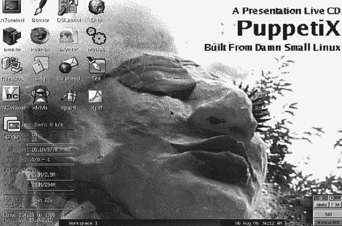

图 10-4 设置背景和其他 Fluxbox 属性。

PuppetiX 中设置的其他 Fluxbox 属性用于从桌面可以使用演示文稿和幻灯片。为了实现这一点，两个幻灯片和演示文稿被添加到了右键点击桌面时出现的 DSL 菜单中。第一个更改是 `/etc/skel/.fluxbox/menu` 文件，该文件在 PuppetiX 启动时会被复制到 `/home/user`。菜单文件开头添加了一行指示包含 `mylauch.menu` 文件的内容，使其如下所示：

```
Debian MENU
[begin](DSL)
[include](.fluxbox/mylauch.menu)
[include](.fluxbox/menu)
```


## 第 11 章 定制游戏 Linux 启动 CD

如果你对电脑游戏感兴趣，Linux 中有大量的机会等待着你。这里有数百种令人愉悦的游戏供你选择，而且对你如何使用它们几乎没有任何限制。能够利用硬件加速显卡的游戏也在作为开源游戏进行发行，以制作出更多令人惊叹的游戏。

在你创建一个游戏启动 CD 之后，你就可以把那张充满活力的可启动 CD 交给你的年轻人了，里面运行着你为他们精心挑选的海量游戏。或者，你也可以制作一张 CD 随身携带你喜欢的开源游戏，这样在在途中时就不会感到无聊。如今可用于游戏的开源软件如此丰富，大多数游戏启动 CD 发行版已经发展成了 DVD 发行版。

本章通过几种方法描述了你自己在组装自己的启动 CD 或 DVD 时可能会觉得感兴趣的话题：

- **游戏启动 CD——已经存在几个 Linux 游戏启动 CD 供你尝试。** 由于可用软件非常多，许多最流行的游戏启动 CD 已经扩展到了 DVD。`Games Knoppix` 的 DVD 版本为 2.7GB；SuperGamer 游戏启动 CD (`www.pclinuos.com/forum/index.php?board=31,0`) 约为 3.7GB。
- **免费游戏——免费和开源游戏（根据 GPL 或类似的许可协议分发）对于原创游戏或传统电脑游戏的克隆版来说非常丰富。你会找到数不完的纸牌牌游戏、迷宫游戏、棋盘游戏等。近年来，人们还创建了更复杂的动作和策略游戏供免费分发。

如果你想组装一个可以自由分发的启动 CD，可以查看几个可用应用程序列表。在本章的后半部分，我将带你挑选 Linux Live Game Project CD 中包含的游戏。

- **商业游戏和演示版 (demos)**——当然，许多最流行的电脑游戏是为了销售而创建的。大多数商业电脑游戏是为 Microsoft Windows 平台制作的，但一些商业游戏已经移植到了 Linux。

虽然在启动 CD 上包含大多数商业 Linux 游戏可能是不合法的，但在某些情况下，你可以获得将这些游戏包含在 Linux CD 中的许可。我们将在本章后后部分描述围绕重新分发 Linux 游戏的某些许可问题。

- **经典商业游戏**——你可能可以在启动 CD 上合法地包含一些最初为 PC 或游戏机创建的商业游戏。这并不是说因为某公司不再销售某款游戏，你直接把它包含在你的启动 CD 中就是没问题的。大多数公司不会因为游戏不再推销就简单地放弃其版权。

在某些情况下，经典游戏的权利已进入公有领域。在另一些情况下，Linux 中提供了游戏机模拟器，你可以购买游戏本身并在这些模拟器上运行。在另一种情况下，商业游戏的部分可能已经进入了公有领域，而对仍受保护的部分可能创建了开源克隆版本，以便整个游戏可以自由分发。《毁灭战士》就是这样一个游戏的例子。

- **显卡支持**——在 Linux 中获得 3D 游戏支持的一个大障碍是获取支持硬件加速的显卡驱动程序。Linux 提供了 Nvidia 和 ATI 显卡的闭源驱动程序，但重新分发这些驱动程序时受到限制，有时会阻碍这些驱动程序与同一台机器上的开源视频驱动程序良好协作。在本章的后半部分，我描述了获取驱动程序以运行更高级的 3D 图形游戏的方法。

首先，本章将带你了解一些可用的 Linux 启动 CD。然后它描述了你可以包含在自己的 CD 中的开源游戏，以便你能够自由分发你的 CD。本章还包含了对名为 Linux Live Game Project (LLGP) 启动 CD 的 Knoppix 定制版的描述。

### 第 11 章 定制游戏 Linux 启动 CD

本章将介绍关于在 CD 上包含受过或目前仍受 GPL 类型以外许可协议保护的软件的问题。这些类型的游戏包括商业销售的游戏，或者具有你可能解决或无法解决的其他许可障碍的游戏。

### 寻找 Linux 游戏启动 CD

专门用于游戏应用的 Linux CD 范围涵盖了从纯开源游戏启动 CD 到包含运行商业演示版和 3D 游戏能力的 CD 不等。要使用其中一些启动 CD，你需要特殊的显卡和大量的 RAM 才能有效运行。以下章节包含了一些游戏启动 CD 和 DVD 的示例。

#### GamesKnoppix 启动 CD 和 DVD

`GamesKnoppix` 游戏启动 CD 既有启动 CD (700MB) 版本也有 DVD (2.7GB) 版本。与许多 Knoppix 重制版不同，GamesKnoppix 移除了 OpenOffice suite（仅节省了约 200MB）和大量 KDE 应用，为大量游戏留出空间。

除了包含许多开源游戏（在本章后面描述）之外，GamesKnoppix KDE 还包含了在 Linux 中原生运行的商业游戏演示版；你可以尝试 `Marble Blast` 和 `Ghost Tanks` 等游戏的演示版，以及 `Mutant Storm` 和 `Space Tripper`。务必使用 3D 图形加速硬件来运行这些游戏。（DVD 上不提供演示版。）

对于支持的游戏 ROM 或可执行文件，可以使用以下模拟器：

- **Atari**——包含了用于运行 Atari 800、Atari 800 XL、Atari 130 XE 和 Atari 5200 的命令。
- **MAME**——多机模拟器 可能是 Linux 上最流行的游戏模拟器。MAME 经过测试可以运行 70 年代、80 年代和 90 年代的经典游戏。你需要法的 ROM 才能使用该模拟器。
- **DOS**——如果你有旧的 DOS 游戏，可以使用 `dosbox` 命令运行最初为 DOS 操作系统创建的保护模式游戏。
- **Amiga**——对于在 Commodore Amiga 500、1000 和 2000 上运行的游戏，可以使用 UAE Amiga 模拟器。这些机器基于 Motorola 68x0 芯片。
- **Nintendo**——`znmes` 工具是任天堂系统的模拟器。

游戏模拟器的存在是 GamesKnoppix 不同于其他启动 CD 的特征之一。然而，如果你没有游戏 ROM，模拟器本身就没用。不过，这张启动 CD 有约 300 个游戏让你忙碌。查看 GamesKnoppix 网站 (`http://games-knoppix.unix-ag.kl.de/gamelist-4.0.2-0.3.txt`) 获取可用游戏的列表。

GamesKnoppix 的界面是熟悉且稳定的 Knoppix 4.0.1 KDE 桌面。除了游戏模拟器，你可以在 GamesKnoppix DVD 上尝试数百种游戏。游戏菜单包含 50 多种街机游戏和近 20 种策略游戏。还有一个给玩的 Potato Guy 游戏。图 11-1 显示了 GamesKnoppix 显示游戏 (`foobilliard`)、太空游戏 (`kasteroids`) 以及一个在土豆上贴脸的游戏 (Potato Guy)。

#### PCLinuxOS SuperGamer

如果你想测试电脑硬件玩游戏的极限，SuperGamer 启动 DVD（基于 PCLinuxOS）拥有许多你可以运行的 3D 加速游戏。SuperGamer 还没有主页，但你可以从以下了解更多信息：

PCLinux OS 上的 SuperGamer 论坛 (`www.pclinux.com/forum/index.php?board=31.0`)。

为了玩 3D 加速游戏，SuperGamer 包含了 Nvidia 驱动；建议使用 Nvidia 显卡（至少为 FX5500）以获得 3D 游戏的最佳性能。

> 注意：如果你没有 Nvidia 显卡，在其他显卡上尝试使用 3D 加速时，可能会遇到驱动冲突。当我尝试在一台带有旧 Intel i810 的机器上运行时，，需要 3D 加速的游戏无法运行（提示 GLX 不可用）。我卸载了 Nvidia 驱动并重启了系统。之后，我能够使用正确的 i810 驱动运行 3D 加速。（运行并不快，因为那是一台内存较小的旧机器，但确实可以运行。）

运行这些游戏还需要大量的内存。如果内存小于 512MB 且处理器低于 1GHz，不要期望获得很好的性能。

PCLinuxOS SuperGamer DVD 包含了这些可玩的演示和 3D 游戏：

- *毁灭战士与雷神*(Doom and Quake)——DVD 上有热门的《毁灭战士 3》(`www.doom3.com`) 和《雷神 4》(`www.quake4game.com`) 第一人称射击游戏的演示。
- 《要塞风垒：敌人之地》(The Return to Castleenstein: Enemy Territory)演示 (`http://games.activision.com/wolfenstein`)。在游戏中，你可以从希姆勒和他的邪恶神秘军手中拯救世界。
- *不死球*(Neverball)——在这款动作与动作游戏中，让球通过障碍赛。你可以从 Icculus 集合 (`http://iculus.org/neverball`) 了解更多信息。该 DVD 中还包含了基于相同技术的微型高尔夫游戏《Neverbutt》。
- *BFlag*——使用这款 3D 坦克大战游戏 (`www.bf.org`) 与电脑或通过互联网组队比赛。
- *企鹅人赛手*(PlanetPenguin Racer)——在这款 3D 计时赛游戏中，帮助企山用肚子爬山 (`http://projects.planetpenguin.de/race/`) (`www.ufoai.net`)。
- *UFO：外星入侵*(UFO: Alien Invasion)——在这款战术游戏中与敌对外星战斗。
- *美国陆*(America's Army)——这款由美国陆赞助的视频游戏旨在描述士兵在军队不同职业中的训练活动。游戏包含了从训练活动到多人操作。更多信息请见 `www.americasarmy.com`。

除了游戏外，SuperGamer 还包含了一些用于数字图像（GQView, GIMP, Xsane 等）、音频（Kaboodle, KsCD 和 Xmms）和视频（Realplayer, TVtime 和 Xine）的多媒体应用程序。网络菜单还有一套良好的通信应用程序（文件传输、即时消息、电子邮件等）。

图 11-2 显示了 SuperGamer 桌面的示例，显示了《维斯诺斯之战》（Battle of Wesnoth）和 MMMS 播放器。

### 运行 Linux 游戏项目 Live CD

作为游戏 Live CD 的示例，我包含了 Linux 游戏项目 (LLGP) Live CD (`http://tuxgamers.altervista.org`)。这很好地代表了 Knoppix 如何通过定制来满足特定目的。在这种情况下，目的是玩游戏。LLGP Live CD还将游戏限制在添加的游戏和免费开源游戏中，因此在使用或分发所描述的任何游戏都没有问题。

LLGP Live CD 中包含了数百种游戏。尽管没有包含任何商业游戏或游戏演示，但该 Live CD 包含许多有趣且具有挑战性的游戏。要查看 Live CD 中包含的游戏，请参考项目的[游戏列表页面](http://tuxgamers.altervista.org/List_of_games)。

### 306 Live Linux CDs

除了游戏外，SuperGamer 还包含了一些用于数字图像（GQView, GIMP, Xsane 等）、音频（Kaboodle, KsCD 和 Xmms）和视频（Realplayer, TVtime 和 Xine）的多媒体应用程序。网络菜单还有一套良好的通信应用程序（文件传输、即时消息、电子邮件等）。

### 自定义游戏 Live Linux CD

| 游戏名称 | DEBIAN 软件包名称 | 描述 |
| --- | --- | --- |
| Circus Linux | circuslinux, circuslinux-data | 小丑们试图通过从平台发射彼此来戳破气球。 |
| Conquest | conquest-data, conquest-gl, conquest-libs, conquest-server | 多人合作太空冒险游戏。 |
| Egoboo | egoboo, egoboo-data | 类似于 NetHack 的 3D 地牢探索冒险游戏。 |
| Frozen-Bubble | frozen-bubble, frozen-bubble-data | 通过射向相同颜色的泡泡组来破破泡泡。 |
| Galaga GalagaHyperspace | xgalaga | Galaga 太空射击游戏的 X 版本。 |
| GL-117 | g1-117, g1-117-data | 动作战斗机模拟器。 |
| Heroes (SDL 版本) | heroes-common, heroes-sdl, heroes-sound-effects, heroes-sound-tracks | 在这种蠕虫风格游戏中，在收集道具时避开障碍和墙壁。 |
| Kasteroids | kasteroids | 在这款经典游戏的 KDE 版本中避开并摧毁行星。 |
| KBounce | kbounce | Jeeeball 的 KDE 克隆版。 |
| KFoulEggs | kfouleggs | 日本游戏棉花消除的 KDE 克隆版。 |
| KGoldrunner | kgoldrunner | Loderrunner 街机游戏的 KDE 克隆版。 |
| KSirtet | ksirtet | 俄罗斯方块和消除游戏的 KDE 克隆版。 |
| KSmilTris | ksmiletris | 带有笑脸的俄罗斯方块 KDE 克隆版。 |

### 表 11-1 续

| 游戏名称 | DEBIAN 软件包名称 | 描述 |
| --- | --- | --- |
| KSnakeRace | ksnake | KDE 大蛇。 |
| KSpaceDuel | spaceduel | KDE 双人太空街机游戏。 |
| KTron | ktron | 电子光子的 KDE 克隆版。 |
| Kobo Deluxe | kobodeluxe | 太空战斗游戏。 |
| Kolf | kolf | KDE 微型高尔夫。 |
| LBreakout | 1breakout2 | 反弹球游戏的克隆版。 |
| Mad Bomber | madbomber | 在 Kaboom! 的克隆版中在炸弹落地前接住它们。 |
| Mangoquest | mangoquest, mangoquest-data | 第一人称迷宫游戏《蓝芒果探险》。 |
| Neverball Neverput | neverball, neverdata | 在 Neverball 中，你通过倾斜地板让球到达目的地。Neverput 是一款 3D 高尔夫游戏。 |
| Nibbles | gnome-games, gnome-games-data | GNOME 桌面游戏中的大蛇游戏。 |
| Penguin Command | penguin-command | 通过发射导弹和智能弹来防御城市。 |
| Pinball | pinball | 弹球机模拟器。 |
| Powermanga | powermanga, powermanga-data, powermanga-base | 图形化 3D 射击游戏。 |
| Race | race | 3D 俯视角赛车游戏。 |
| Robots | gnome-games, gnome-games-data, gnome-games-extra-data | GNOME 机器人游戏。 |

### 自定义游戏 Live CD

| 游戏名称 | DEBIAN 软件包名称 | 描述 |
| --- | --- | --- |
| Slune | slune | 赛车和 3D 碰撞游戏。 |
| Starfighter | starfighter, fighter-data | 卷屏 2D 射击游戏。 |
| SuperTux | supertux, superdu-data | 2D 跳跃跑酷卷屏游戏中的 Tux 企鹅。 |
| TORCS | torcs, torcs-data, torcs-data-cars-extra, torcs-data-tracks-oval, torcs-data-tracks-road | 3D (OpenGL) 赛车模拟器 |
| Thrust | thrust | 在这款经典 Commodore 64 游戏的克隆版中从太空摧毁核反应堆。 |
| Toppler | toppler | Nebulus 游戏克隆版。 |
| Trophy | trophy, trophy-data | 2D 赛车动作游戏。 |
| Tux: A Quest for Herring | tux-aqfh | 带企鹅去寻找金鲱鱼的任务。 |
| TuxRacer | tuxracer, tuxracer-data, tuxracer-extras | 让 Tux 企鹅肚肚子滚下山进行比赛。 |
| TuxType | tuxtype | 向企鹅 Tux 学习打字。 |
| TuxKart | tuxkart, tuxkart-data, tuxkart-extras | Tux 3D 卡丁车赛。 |
| Typespeed | typespeed | 在单词在页面上穿过时打字消除它们。 |
| Wing | wing, wing-data | Galaga 风格的太空射击游戏。 |
| XBill | xbill | 防止 Windows 病毒感染电脑。 |

### 表 11-1 续

| 游戏名称 | DEBIAN 软件包名称 | 描述 |
| --- | --- | --- |
| XBlast-TNT XBlast-TNT-mini | xblast, xblast-data, xblast-sound, xblast-tnt, xblast-tnt-images, xblast-tnt-levels, xblast-tnt-mini, xblast-tnt-models, xblast-tnt-sound | 在这款太空射击游戏中炸飞对手。 |
| XKoules | koules | 基于 X 的太空动作游戏。 |
| Xscavenger | xscavenger | 用于 X 的平台类游戏。 |
| Xsoldier | xsoldier | X 士兵游戏。 |
| Xboing | xboing | X 消除游戏。 |
| Xbreaky | xbreaky | X 风格的弹球游戏。 |
| Xacer | xracer, xracer | 赛车游戏。 |
| Xscorch | xscorch | 火球地球。 |
| Zblast | zblast, zblast-data | 射击游戏。 |

# 表 11-3 LLGP 中的纸牌游戏

| 游戏名称 | DEBIAN 包名称 | 描述 |
| :--- | :--- | :--- |
| AisleRiot Solitaire | gnome-games, gnome-data | 纸牌游戏 |
| Blackjack | gnome-games, gnome-data | 黑色赌场纸牌游戏 |
| FreeCell Solitaire | gnome-games, gnome-data | 从 sol 引擎运行的免费细胞游戏 |
| Gnome Blackjack | gnome-games, gnome-data | GNOME 黑色赌场游戏 |
| Gnome FreeCell | gnome-games, gnome-data | GNOME 免费细胞游戏 |
| Gnome Solitaire Games | gnome-games, gnome-data | 为 GNOME提供的若干纸牌游戏 |
| KPoker | koker | KDE 扑克游戏 |
| Lieutenant Skat | 1skat | Skat纸牌游戏 |
| Patience | kpat | KDE Patience 纸牌游戏 |
| Penguin Canfield | ace-of-penguins | 企鹅版本的 canfield |
| Penguin Freecell | ace-of-penguins | 企鹅版本的 freecell |
| Penguin Golf | ace-of-penguins | 企鹅版本的高尔夫纸牌游戏 |
| Penguin Solitaire | ace-of-penguins | 企鹅版本的经典纸牌游戏 |
| Penguin Thornq | ace-of-penguins | 企鹅版本的 thornq 纸牌游戏 |
| PySol | pysol | 基于 Python 的纸牌游戏 |
| XSkat | 1skat | KDE Lieutenant Skat 纸牌游戏 |
| XSkat via IRC | 1skat | 通过 IRC 在线玩的 KDE Skat 游戏 |

## 商业游戏许可协议

通过专注于基于 Knoppix 构建并包含 Debian/Knoppix 软件存储库中包的 LLGP live CD，我成功规避了一些与许可相关的复杂问题。事实上，如果你想确保能够自由重新分发你构建的任何 live CD，只要你坚持使用仔细审查许可协议的成熟 Linux 发行版（Debian、Fedora 和 Gentoo）存储库中的软件，就可以避开大多数专利和版权侵权问题。

然而，有时你可能想要包含一个或多个受商业或其他非 GPL 许可涵盖的游戏。通用的法是：如果某个软件的版权所有者没有将其发布到公有领域，你就不能假设可以使用和重新分发该软件。即使所有者不再销售该产品，即使该公司已不存在，这仍然成立。

但是，在某些情况下，你可能可以在个人或重新分发的 live CD 上包含商业游戏软件。以下是一些示例：

- 商业演示版——Linux 商业游戏制作商可能乐意让你分发其商业游戏的演示版。在此之前，你需要联系制作商获取书面许可。我听说 GarageGames.com 已经允许某些 live CD 重新分发其演示版。记住，你分发的演示版可能包含一些示例材料。
- 源驱动——为了在 Nvidia 和 ATI 卡上进行高质量 3D 游戏，你需要包含来自这些制造商的闭源驱动。在许多情况下，人们认为此类驱动可以自由重新分发（参见 `https://www.nvidia.com/object/nv_swlicense.html`）。

然而，开源纯主义者认为，在分发闭源驱动时，你并不知道驱动是如何感染你的 Linux 内核的。事实上，取决于你如何配置这些驱动，它们可能会破坏你的内核使用其他视频驱动的能力（早些我提到过我的 i586 主板与 Nvidia 驱动冲突的案例）。

- 向公众发发的商业产品——某些游戏在停止作为可行产品多年后实际上被发布到了公有领域。然而，如果你想在你的 live CD 上包含此类游戏软件，你应该确保整个产品是可修改的并且可以自由重新发布的。

## 第 11 章 定制游戏类 Live Linux CD

一个稍显棘手的案例是热门的第一人称射击游戏 Doom 的免费发布。虽然该游戏发布时被允许完全可重新分发，但 Doom 共享软件 Wad 中仍留有一项条款：“你不能：修改、翻译、反汇编、反编译、反向工程或基于该软件创建衍生作品。”

由于更改代码的能力是 Fedora Linux 等软件项目的一个重要元素，该项目决定用 Freedom 包替换掉违规部分（Doom 引擎）。Freedom 是完全从头开始编写的 Doom 引擎，因此对于接收它的人来说，它是被经过了修改的。

另一个可以用来玩向公众发发的游戏的游戏软件是 ScrumVM (`scummvm.org`)。LucasArts 最初创建了 SCUM 来制作许多游戏，如《猴子岛》（Monkey Island）、《帐篷之日》（Day of the Tentacle）和《坎迪亚传说》（Legend of Kyandia）。ScrumVM 根据 GPL 发布，可以玩许多最初运行在 SCUM 上的游戏。详情请参见 ScrumVM 兼容性列表 (`scummvm.org/compatibility.php`)。

此类中已发布到公有领域的游戏包括《钢铁天空》（Beneath a Steel Sky，于 2003 年 8 月作为免费软件提供）和《亚马逊女王号》（Flight of the Amazon Queen）。这些游戏包含在某些 live 游戏 CD/DVD 中，例如 GamesKnopix DVD。

调查不同游戏软件相关许可问题的优秀地方包括处理 Linux 发行版中应包含或不包含哪些内容的邮件列表。例如，Fedora Extras 列表曾对游戏许可问题进行过多次讨论（`www.redhat.com/mailman/listinfo/fedora-extras-list`）。

## 创建 FEDORA 游戏 Live CD

为了说明如何构建你自己的游戏 CD，如下所示：

## 定制多媒体 Live CD

创建、处理和显示多媒体内容长期以来一直是 PC 用户的喜爱好。如今的计算机被认为应该让你能够播放音乐、观看电影并处理你的数字图像。免费和开源多媒体应用的改进，为那些正在组装专注于多媒体应用的基于 Linux 的 CD 的人员提供了丰富的选择。

本章涵盖的多媒体 Live CD 分为两类：

- **多媒体播放器**——通过专门播放视频、音乐和幻灯片，多媒体播放器 Live CD 可以被压缩到非常小的体积。仅占用几兆字节磁盘空间允许这些播放器完全运行在 RAM 中，而 CD 或 DVD 驱动器可以用于存放音乐或电影。
- **多媒体制作工具**——对于 Web 设计师、音乐家、图形艺术家和动画师来说，Live CD 提供了一种制作高质量数字艺术的工具手段。许多开源工具在图像处理（The GIMP）和 3D 动画（Blender）领域开始与商业产品竞争。

为了说明多媒体播放器，我在本章中增加了对 GeeXBox 的描述。除了描述如何将 GeeXBox 作为多媒体播放器使用外，我还描述了 GeeXBox Generator，它可以用于向经过重制的 GeeXBox 多媒体播放器 ISO 镜像添加内容、编码器和个人设置。

在多媒体工具箱领域，我描述了 live CD。Dybolic 包含了 100 多开源应用程序，这些应用程序可以用于专门制作和发布多媒体内容的桌面系统。

### Linux Live CD

无论你对播放还是制作多媒体内容感兴趣，有一个问题跨越这两个领域：在 Linux 中获取音频和视频内容的合法编码器。因此，在跳转到不同类型的多媒体 Live CD 之前，请阅读以下章节以了解与播放音乐和电影所需的软件相关的问题。

## 理解多媒体版权和专利问题

通过 GNU 通用公共许可证（参见 `www.gnu.org/copyleft`）和相似的许可协议对软件进行许可，自由和开源软件运动使得像 Linux 这样的自由分发操作系统成为可能。然而，从头编写软件并根据 GPL 许可这些工作可能无法无法软件的自由分发。在自由软件开发领域，没有哪个问题比多媒体更具争议。

特别是与音频和视频编码器（编码器/解码器）免费分发的问题源于几个问题，包括：

- **专利**——许多用于创建和播放商业音乐及视频的音频和视频标准包含专利技术。任何编写音乐和视频播放器的人都会面临这些版税持有者的索赔，要求为软件创建者分发的每个播放器或编码器付费。
- **《数字千年版权法案》(DMCA)**——DMCA 是美国国会于 1998 年通过的一项法案，该法规定在美国创建规避版权保护措施的技术是非法的。

软件专利索赔的威胁自人们开始分发自由软件以来就一直笼罩在自由开源软件运动之上。为了应对今天的长期斗争，主要的软件供应商一直在收集从数据库结构到你在互联网上点击购买商品的一切相关的专利组合。然而，在短期内，某些诉诉讼性的软件组件是那些与多媒体许可相关的。

从理论上说，你应该理解与你使用的每种软件相关的许可安排。现实中，我们大多数人取决于商业软件供应商或为我们消费创建和/或重新发布软件的开源软件组织的法律解释。因此，我并不是针对对书中所描述的软件可以做什么和不能做什么提供法律建议（我没有资质做这一点），而是转述关于什么和什么不被认为是多媒体自由分发软件的一般解释。

如果你是从头创建音频或视频内容，可以使用开源音频视频编码器。你用这些开源多媒体播放器创建的任何内容都可以与播放器和编码器本身一起自由分发。你甚至可以将这些编码器和播放器包含在你自己的产品中，只要你遵守与它们相关的许可（这通常要求你提供源代码）。

- **音频 (Ogg Vorbis 和 FLAC)**——Xiph 会 (`www.xiph.org`) 产生的 Ogg Vorbis 是 MP3 音频编码的高效、高质量竞争对手。Ogg 是媒体容器，Vorbis 是音频编码器。Ogg Vorbis 是一种非专利、免专利和免版税的音频格式，可以在高压缩率下产生高质量音频。
- 自由无损音频编码器 (`FLAC`) 是另一个由 Xiph.org (`http://flac.sourceforge.net`) 赞助的音频格式。FLAC 音频文件比类似的 Ogg Vorbis 或 MP3 文件大得多，但这种格式具有某些压缩功能，且没有明显的音频质量损失。
- 几乎每个适用于 Linux 的音频和视频播放器（ogg123, xmms, mplayer, vlc 以及其他）都支持 Ogg Vorbis 音频。
- **视频 (Theora)**——Theora (`www.theora.org`) 是由 Xiph.org 赞助的免费视频编码器，Theora 基于几年前发布到公有领域的 VP3 编码器（参见 `www.theora/svn.html`)。可以使用 Cinelerra (`http://cinelerra.org`) 和 `ffmpeg2theora` 等工具创建 Ogg音频/视频文件。开源视频播放器（包括 VLC 播放器、Helix 播放器、Totem 和 mplayer）可以播放 Ogg Theora 内容。

在多媒体工具箱领域，我描述了 live CD。Dybolic 包含了 100 多开源应用程序，这些应用程序可以用于专门制作和发布多媒体内容的桌面系统。

## 第 12 章 定制多媒体 Live CD

### 多媒体播放器 Live CD

对于多媒体播放器型的 Live CD，你基本上想要包含播放器应用程序（音乐、视频和图像播放器）以及获取内容的方法。另一个问题是硬件支持。为了充分利用多媒体播放器的性能，你可能希望包含对特种显卡、声卡、PCMCIA 卡和电视调谐器卡的支持。

开源音乐和图像播放器随处可见。也有开源视频播放器；但获取播放某些类型视频内容所需的解码器可能会更加棘手（这一点稍后讨论）。至于如何获取要播放的内容，多媒体播放器提供了一种或多种获取内容的方法：

- **在 Live CD 上**——如果你正在重新制作一个 Live CD 并且有可用空间，你可以添加尽可能多的能够放入 Live CD 本身的内容的内容。这样你就不需要访问 Live CD 以外的任何介质即可播放内容。
EMoviX 项目是 MobiX 项目的衍生，它是媒体播放器的一个示例，旨在让你向 Live CD 中添加视频，以便在启动时就能直接播放视频。GeeXBox 项目生成了 GeeXBox Generator，它可以让你向个人的 GeeXBox Live CD 添加解码器和内容。
- **CD 或 DVD**——由于大多数商业音乐和电影分别存储在 CD 和 DVD 上，因此任何有效的音乐或电影播放器都需要处理这些内容。像 GeeXBox 和 MobiX 这样的小型 Live CD 完全在内存中运行，因此 CD 或 DVD 驱动器可以用来插入你选择的介质。
- **硬盘或其他存储介质**——通过检测和自动挂载硬盘分区，多媒体播放器 Live CD 可以让用户浏览计算机硬盘以查找他们想要播放的内容。只要 Live CD 包含了对硬盘上文件系统的支持（特别是大多数 Windows 系统支持的 NTFS），你就可以播放从计算机操作系统（通常是 Windows）添加的任何内容。

大多数多媒体 Live CD 都包含将 Live CD 系统连接到局域网（LAN）或互联网的支持。对有线卡的支持允许你配置网络连接（或通过 DHCP 自动完成）。无线网络支持并不常见，但在某些情况下可以通过 PCMCIA 卡实现。之后，你可以使用应用程序从网络获取内容。这些应用程序可能包括：

- **网络文件系统**——如果你的局域网支持文件共享应用程序，如 Windows 文件共享（Samba、SMB 或 CIFS）或 Linux 文件共享（NFS），你可以挂载包含播放内容的共享远程文件夹或目录。
- **网络文件传输**——通过连接到 FTP 仓库，你可以选择这些仓库中包含的内容。
- **流媒体内容**——通过包含可以播放流式音频和视频的媒体播放器，你可以从 Live CD 播放该类型的内容。

以下章节包含了几种多媒体播放器 CD 的描述。描述包括每个 Live CD 支持的功能信息以及你播放内容的方法。你还会找到关于解码器的描述，以便你播放额外类型的音频和视频内容。

### 运行 GeeXBox 开源媒体中心

由于对播放各种音频和视频内容进行了精细的调优，GeeXBox 开源媒体中心可以成为一个真正的 Linux 发行版。GeeXBox 1.0 ISO 镜像仅为 6.3MB。考虑到它包含的功能，这一成就是是非常惊人的。功能包括：

- **播放音乐 CD**——在 GeeXBox 加载到内存并开始运行后，你可以插入标准的音频光盘。你可以使用简单的键盘控制（基本上是 mplayer 自带的那些）跳转到不同的曲目并调整音量。
- **播放视频 DVD**——同样，使用 mplayer，GeeXBox 能够播放各种音频和视频内容的 DVD。你必须包含的 GeeXBox 版本必须具备解密 CSS 加密的能力，并能够播放通过 DVD 交付的大多数商业电影。（DeCSS 以及与播放商业 DVD 和其他视频内容相关的法律问题在本章的较早部分已讨论。）
- **播放 SVDC、VCD 或 XCD**——VCD 和 XCD 都是音频和视频内容的格式。VCD 支持 MPEG1 流，而另一方面，包含 MPEG2 流的 XCD 可以包含不同类型的音频视频内容，包括 MPEG4、VP3、XVID、OGG 等。
- **从硬盘播放文件**——GeeXBox 在挂载时会自动在 `/mnt` 目录的挂载点上对本地硬盘进行分区，因此存储在本地计算机任何文件系统上的任何内容都可以从 GeeXBox 界面选择并播放。

支持的文件系统包括 ext2、ext3、ReiserFS、ISO 9660、UDF 和 VFAT。NTFS 和 xBSD U 文件系统以只读方式支持。支持的文件共享文件系统包括 NFS、CIFS 和 Samba (SMB)。

- **播放电视**——同时支持模拟电视卡和数字电视广播 (DVB)，因此你可以通过 GeeXBox 看电视。

GeeXBox 最初是为了播放 DivX 电影而创建的，现在支持多种视频格式，其中大多数可以通过内置的 mplayer 媒体播放器软件获得。这些内容包括 MPEG 1、MPEG 2 和 MPEG 4（DivX、XVid、H.264 等）。只要你有适当的解码器，你还可以播放 RealMedia 和 Windows Media 电影。

支持的流媒体内容包括 Ogg Matroska、变比特率 (VBR)、变帧率 (VFR)、AAC、Ogg Vorbis、Real Video (RV) 和 SHOUT。

### 使用硬件

要显示和播放多媒体，请使用显示器和声卡。分辨率为 800x600，某些支持 640x480。电视标准包括 NTSC、PAL 和 SECAM。

提供网络连接，请使用以太网卡。在许多情况下，可以使用 DHCP 服务。

### 使用 GeeXBox 控制

所有分区都挂载在 `/mnt` 目录下，名称与其分区编号相关。例如，第一个 IDE 磁盘上的第一个分区 (`/dev/hda1`) 将挂载在 `/mnt/Disk 1 Part 1`。使用左右箭头在目录结构中移动以找到要播放的媒体文件。

在选择任何要播放的内容之前，有一些命令是可以用的。选择 M 显示或隐藏 GeeXBox 菜单。选择 S 切换到电视输出。当你播放音频或视频内容时，可以使用常规 mplayer 功能进行控制。

要选择其他播放选项，请从 GeeXBox 主菜单中选择 Options。在 Options 菜单中，你可以执行调整视频播放比例、切换到电视输出、切换垂直同步以及设置睡眠定时。

通常，如果你插入 DVD，它会自动开始播放电影。通过从 Options 列表中选择 Autoplay Mode 可以禁用该功能。然后进入 DVD 设置并选择 DVD Navigation Menu。下次你打开 DVD 时，就可以像使用标准 DVD 播放器一样使用 DVD 导航菜单。启用 DVD 导航菜单后，可以使用表 12-2 所示的键进行操作。

### 重新生成 GeeXBox

GeeXBox ISO 生成器允许你使用现有的二进制文件重建 GeeXBox，让你完全按照你想要的方式使用 GeeXBox。软件提供了以某种方式包含内容、解码器或设置的方法，从而完全个性化你自己的 GeeXBox 版本。

## 第 12 章 定制多媒体 Live Linux CD

## 表 12-1 音/视频播放控制

| 键 | 结果 | 键 | 结果 |
|---|---|---|---|
| 0 或 * | 增大量 | 9 或 / | 减音量 |
| 右箭头 | 前进 10 秒 | 左箭头 | 后退 10 秒 |
| 上箭头 | 前进 1 分钟 | 下箭头 | 后退 1 分钟 |
| P 或空格键 | 暂停/恢复音频视频播放 | M | 音频静音 |
| 1 | 降低对比度 | 2 | 增大对比度 |
| 3 | 降低亮度 | 4 | 增大亮度 |
| 5 | 增大色调 | 7 | 降低饱和度 |
| 8 | 增大饱和度 | 0 | 屏幕显示（开启/关闭） |
| > | 到播放列表中的下一项 | < | 播放列表中的上一项 |
| F | 全屏模式（开启/关闭） | J | 开启/关闭字幕 |
| Z | 字幕延迟 (+0.1 秒) | X | 减少字幕延迟 (-0.1 秒) |
| Q 或 ESC | 退出 | K | 停止

## 表 12-2 DVD 菜单导航

| 键 | 结果 | 键 | 结果 |
|---|---|---|---|
| 0 | 查看 DVD 菜单 | Enter | 选择选中的项目 |
| 2 | 光标向下 | 4 | 光标向左移动 |
| 6 | 光标向右移动 | 8 | 光标向上 |

### Live Linux CDs

你可以在 Linux、Mac OSX 或 Windows 系统上重新生成 GeeXBox。要开始重新生成自己的 GeeXBox，请执行以下操作：

- 1. **下载 GeeXBox ISO 生成器**——访问 GeeXBox 下载页面 (`www.geebox.org/downloads.html`) 并选择 i386 或 PowerPC 版本。然后选择最近的下载地址将 geebox-generator 包下载到硬盘上。或者参考附录 A 获取使用本书附带 CD 中包含的 GeeXBox-generator 的信息。
- 2. **解压 geebox-generator 包**——将 geebox-generator 包保存到有足够空间进行你所需的重新生成的分区。该软件仅需约 13MB 空间，但如果你在重新生成的 GeeXBox ISO 中添加模块，可能会占用多得空间。在 Linux 中解压包，输入以下命令：

```bash


* `tar xfz geebox-generator-*tar.gz`

压缩包将解压并安装到 `geebox-generator` 目录（例如，`geebox-generator-1.0.i386`）。

- 3. 启动 GeeXBox 生成器——进入 `geebox-generator*` 目录并根据你用于重新生成 ISO 的操作系统启动以下命令之一：

```bash
# `/linuxi386-generator`          # 用于 Linux 系统

# `generator.exe`                            # 用于 Windows 系统

# `/.macosx-generator`                       # 用于 Mac OS X 系统
```


图 12-2 显示了从 Linux 系统运行时的 GeeXBox 生成器。

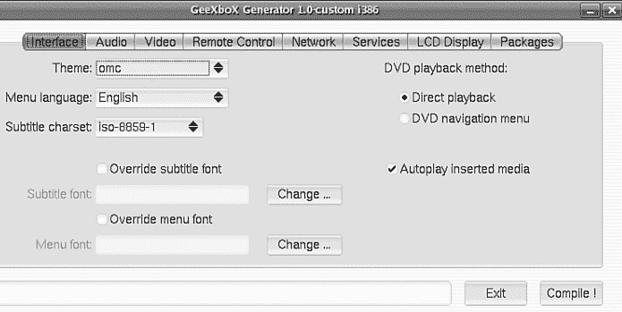

**图 12-2** 通过 GeeXBox 生成器调整你个性化 GeeXBox 的不同方面。

### 开始修改 ISO
GeeXBox 生成器包含你可以修改的八个标签页。你可以从这些标签页更改设置：

- 界面——从十多种语言和字符集中选择用于 GeeXBox 界面的语言。如果你添加了其他主题（参见 Packages 标签页），可以使用它们代替默认的 `ohm` 主题。同样，你可以安装并更改用于字幕和菜单的字体。
- 默认情况下，DVD 在插入时会立即开始播放并直接返回。你可以让 GeeXBox 等待你请求后再播放媒体。你也可以使用 DVD 导航菜单而不是直接返回。
- 音频——GeeXBox 使用它找到的第一块 ALSA 声卡 (`0`) 进行播放。如果你有多个声卡，可以选择让 GeeXBox 使用其他一个。其他音频选项允许将输出从模拟更改为 SPDIF（以及相关设置），并选择通道数（2 为立体声，4 为环绕声或 6 为环绕声）。
- 视频——默认分辨率为 `800×600`。你可以更改为较低 (`640×480`) 或更高的分辨率，以及代表颜色的不同位数（默认 `24`）。你还可以选择是否显示启动屏幕 (`bootsplash screen`)。
- 远程控制——如果你预计运行你个性化 GeeXBox 的电脑上会有这些设备，可以启用各种遥控设备。
- 网络——GeeXBox 自动检测可用的网卡。默认情况下，它可以尝试连接到 DHCP 服务器以获取网络地址以及 GeeXBox 使用网络所需的信息。选择手动配置以添加 IP 地址、子网掩码、网关地址和 DNS 服务器 IP 地址。也支持 WiFi 设置，但可能需要下载支持的驱动程序（参见 Packages 标签页）。
- 服务——默认情况下，GeeXBox 启用了网络服务。然而，你可以启用网络服务，包括 TELNET 服务器、FTP 服务器。
- 默认情况下，DVD 在插入时会立即开始播放并直接返回。你可以让 GeeXBox 等待你请求后再播放媒体。你也可以使用 DVD 导航菜单而不是直接返回。

## Live Linux CDs

### 开始修改 ISO
GeeXBox 生成器包含你可以修改的八个标签页。你可以从这些标签页更改设置：

- 界面——从十多种语言和字符集中选择用于 GeeXBox 界面的语言。如果你添加了其他主题（参见 Packages 标签页），可以使用它们代替默认的 `ohm` 主题。同样，你可以安装并更改用于字幕和菜单的字体。
- 音频——GeeXBox 使用它找到的第一块 ALSA 声卡 (`0`) 进行播放。如果你有多个声卡，可以选择让 GeeXBox 使用其他一个。其他音频选项允许将输出从模拟更改为 SPDIF（以及相关设置），并选择通道数（2 为立体声，4 为环绕声或 6 为环绕声）。

## Live Linux CDs (续)

- 视频——默认分辨率为 `800×600`。你可以更改为较低 (`640×480`) 或更高的分辨率，以及代表颜色的不同位数（默认 `24`)。你还可以选择是否显示启动屏幕。
- 远程控制——如果你预计运行你个性化 GeeXBox 的电脑上会有这些设备，可以启用各种遥控设备。
- 网络——GeeXBox 自动检测可用的网卡。默认情况下，它可以尝试连接到 DHCP 服务器以获取网络地址以及 GeeXBox 使用网络所需的信息。选择手动配置以添加 IP 地址、子网掩码、网关地址和 DNS 服务器 IP 地址。也支持 WiFi 设置，但可能需要下载支持的驱动程序（参见 Packages 标签页）。
- 服务——默认情况下，GeeXBox 启用了网络服务。然而，你可以启用网络服务，包括 TELNET 服务器、FTP 服务器。
- 默认情况下，DVD 在插入时会立即开始播放并直接返回。你可以让 GeeXBox 等待你请求后再播放媒体。你也可以使用 DVD 导航菜单而不是直接返回。

# Linux 启动 CD

- **LiMP**——LiMP Linux 多媒体播放器（`http://limp-vkk-ver1.sourceforge.net`）启动 CD 包含了 `mplayer`、`XMMS` 和 `OpenOffice` 组件，用于播放各种内容。从 LiMP 菜单中，你可以选择播放视频、音频、幻灯片或某些游戏。在运行 LiMP 的同时，还有一种方法可以播放幻灯片。

如果你对在 Linux 中播放多媒体感兴趣，另一个可能让你感兴趣的项目是 MythTV (`www.mythtv.org`)。虽然 MythTV 设计为从硬盘上安装和运行，但该项目包含一个可以从启动 CD 运行的前端。使用该启动 CD，你可以从你局域网上的 MythTV 节点播放多媒体内容，并将其显示在廉价的客户端 PC 上。KnoppMyth (`www.mysettopbox.tv/koppmyth.html`) 是一种启动 CD，可以帮助你开始在硬盘上安装 Knopp。

# 创建多媒体制作启动 CD

如今，已经有足够的高质量免费开源软件用于制作和处理多媒体内容，你完全可以用它们填满一张启动 CD。正如你所料到的，有人已经做到了。Dynebolic 启动 CD (`http://dynebolic.org`) 包含了数百种功能，旨在“培养多媒体活动家、艺术家和创作者”。

Dynebolic 是携带完成特定任务所需全套软件的一种极佳范例。为了满足图形艺术家的需求，Dynebolic 包含了用于创建、处理、播放和发布图像、视频、音乐、网站和其他创意数字输出的工具。

言论自由是 Dynebolic 的核心（参见 RASTA 软件数字抵抗页面 `http://raftaso.org/resistance.txt`）。虽然 Dynebolic 启动 CD 中包含的所有软件都是根据通用公共许可证（GPL）发布的，但在决定以任何方式重新分发之前，你应该检查 Dynebolic 启动版中的特定组件。当然，你应该仔细检查你分发的内容。但在多媒体领域，某些特定的内容专利问题与编码器和视频驱动程序的版税有关。考虑到上述声明，Dynebolic 提供了一种极佳的方法来调查免费开源世界中可用的多媒体软件格局。它还包含了让这光启动 CD 成为设计师实用、便携工具箱的功能。这些功能包括将数据备份到 USB 闪存盘的能力，以及作为网络轻级客户端启动的选项（使用 Dynebolic 在低端机器上运行并访问网络上其他计算机的资源）。

# 第12 章自定义多媒体启动 CD

## 理解 Dynebolic

Dynebolic 启动 CD 的设计旨在精简运行，以便将大部分资源投入到运行强大的多媒体应用。Dynebolic 直接启动（无需登录）进入一个没有过多修饰的 WindowMaker 窗口管理器。重点在于易用性，因此会立即开启对可用存储设备的访问和 root 权限。

WindowMaker 窗口管理器 (`www.windowmaker.info`) 在其界面中集成了名为 `docapps` 的小型应用程序，而不是端到端的控制面板。对于 Dynebolic，桌面上添加了停靠（docks），让你能够使用 `fox` 文件管理器立即打开不同存储位置的文件夹。这些位置包括你的主目录、硬盘分区、网络共享文件夹以及任何可移动介质（CD、DVD、软驱器和 USB 闪存盘）。

对于具有读写能力的硬盘和可移动存储设备（如 USB 闪存盘），当你从桌面打开终端或存储设备时，你是以 root 用户的身份操作的，能够有效更改计算机上的任何文件或目录。再次，这反映了 Dynebolic 尽可能简单和开放的意图。

WindowMaker 桌面上的菜单是你看到使用 Dynebolic 真正可以做的地方。右键点击桌面查看 `dyne:II` 菜单，其中包含了应用程序分类，包括视频、音频、图像、文本、网络、开发、实用和桌面应用。还有打开终端窗口 (`XTerm`) 和配置窗口 (`Configure`) 的选项。

图 12-3 显示了用于选择运行的多媒体应用以及存储介质的 `dyne:II` 菜单。配置语言、网络、解调器、打印机、屏幕分辨率、声卡以及 WindowMaker 本身的应用程序位于 Configure 文件夹中。

为了支持同时进行的工作，Dynebolic WindowMaker 桌面配置了六个虚拟桌面。选择屏幕左上角的停靠来切换桌面。

Dynebolic 还允许你以某种方式保存你所做的更改，以便以后恢复。Nest（你可以通过从 Configure 窗口选择 Nest 图标来创建）可以让你保存桌面设置并到硬盘或 USB 密钥的存档中，以便以后恢复。（第 2 章“玩转启动 CD”包含了设置 Nest 的说明）。

启动 Dynebolic 后，你拥有了一个精简的桌面、所有本地连接存储介质的访问权限，以及以后配置桌面和保存数据的基本工具。现在是有趣的部分了：多媒体应用。

# Linux 启动 CD

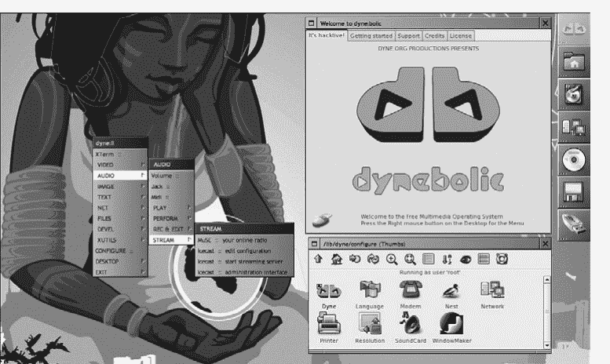

**图 12-3** 从 Dynebolic 桌面打开多媒体应用和磁盘分区。

# 运行多媒体应用

无论你是使用 Dynebolic 还是使用你喜爱的 Linux CD 平台创建多媒体启动 CD，Dynebolic 都包含了许多出色的免费开源多媒体软件供你查看。如果你是一个数字设计师或仅仅是一个多媒体爱好者，Dynebolic 为你提供了一个很好的方法来尝试你可能想添加到工具箱的应用程序。

由于 Dynebolic 的章程不仅是为了构建，更是为了将交流带给世界，Dynebolic 包含了你可以用于发布的软件。你可以使用如 `iecast` 的软件传输音频（如 Ogg Vorbis 和 FLAC）。`MP4Live` 可以视频传输到网络。以下章节描述了你可以从 Dynebolic 使用的多媒体应用。

# 使用视频应用

开源工具也用于在 Dynebolic 中播放、录制、编辑和流视频。还有用于制作视频效果的工具。

为了播放视频，Dynebolic 包含了 `mplayer` (`www.mplayer.hu`) 和 `Xine` (`http://xinehq.de`) 媒体播放器。取决于包含哪些编码器，两种播放器都可以播放多种视频和音频。Xine 提供了一个控制视频的面板，如图 12-4 所示。

# [此处]

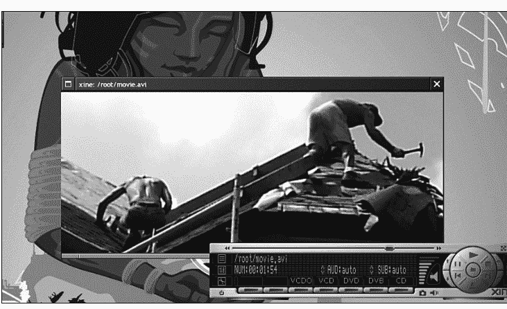

**图 12-4** 使用 Xine 媒体播放器带有多种视频的 DVD、VCD、CD。

观看电视，Dynebolic 包含了 `xawtw` (`http://linux.bytesex.org/xawtw`)，它使用 `video4linux` 接口。Dynebolic 还包含了 `gnpplayer` MPEG4 播放器。

对于录制视频，Dynebolic 包含了 `Kino` 录制和编辑器 (`www.kino.org`)。Dynebolic 还带有几种不同的录视频命令，包括 `ffmpeg` (`http://ffmpeg.mplayer.hu`)、`streamer` 和 `mencoder`。

视频编辑器包括 `Audidermix` (`www.audidermix.org`)、`transcode` 和 `gtranscode` (`www.transcoding.org`) 以及 `Cinelerra` (`http://herinoewarrior.com/cinelerra.php`)。图 12-5 显示了使用 Cinelerra 视频编辑器编辑视频。

为了向桌面菜单传输视频，Dynebolic 包含了 `HasciiCam` (`http://ascii.dy.org`)，它可以将 ASCII 视频传输到 Web。`MP4Live` 可以将 `video4linux` 视频和 OSS 音频传输到网络。

# 使用音频应用

除了音频播放器、录制器、编辑器和流传输器，Dynebolic 还包含了一些用于表演音乐的应用程序。对于播放音频，Dynebolic 包含了流行的 `Xms` 音频播放器 (`www.xmms.org`)。`Amarok` 音乐播放机 (`http://amarok.kde.org`) 提供了一个在同一窗口中结合播放器和播放列表功能的界面。图 12-6 显示了 Amarok 音频播放器，在播放该艺术家的音乐时显示艺术家的信息。

# 实时版 Linux CD

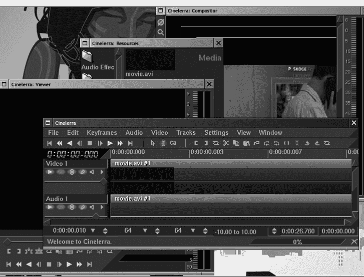

图 12-5 你可以使用 Cinelerra 编辑视频和音频内容。

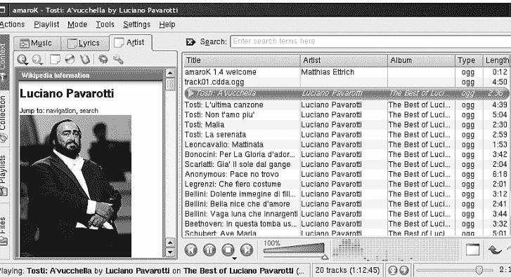

图 12-6 在 Amarok 中播放播放列表和收藏中的音乐时，查看艺术家信息。

# 第 12 章 定制多媒体实时版 Linux CD 343

开源音频编辑器在近年来已经变得非常复杂。Dybolic 包含了 `Ardour` 多轨道录音室（`http://ardour.org`）、`Audacity` 音频编辑器（`http://audacity.sourceforge.net`）以及 `reZound` 采样编辑器（`http://rezound.sourceforge.net`）。`RoseGarden`（`www.rosegardenmusic.com`）是一个 MIDI 序列器和音乐合成编辑器，而 `TimeMachine` 是一个实时音频录制器。

为了将音频流传输到互联网，Dynebolic 包含了 `Icecast` 流媒体服务器（`www.icecast.org`）。它还包含了 `MuSE` 多流引擎，该引擎可用于收集音频输入、进行混合，并将其传递到 Icecast 服务器通过互联网传输。

# 使用图像处理应用程序

近年来，处理图像的应用程序已变得足够成熟，功能和质量上可以与商业软件相竞争。`GIMP`（`www.gimp.org`）是最流行的图像处理的开源程序。`Inkscape`（`www.inkscape.org`）是一个向 SVG 标准兼容的矢量图形编辑器。

`Blender`（`www.blender3.org`）是一个用于进行 3D 建模的强大应用程序。Blender 还可以进行动画、渲染和交互式播放。你可以使用此应用程序制作专业级的商业游戏和电影。

有多个应用程序可以浏览图像文件并转换图像。`GQView`（`http://gview.sourceforge.net`）允许你处理图像并以幻灯片的形式显示它们（参见第 10 章，“定制演示实时版 CD”）。`ImageMagick`（`www.imagemagick.org`）是一个将图像转换为不同格式、大小、颜色或其他属性的良好工具。

# 使用辅助应用程序

Dybolic 上的大多数其他应用程序都是为了支持你在实时 CD 上进行的多媒体工作。为了与互联网通信，Dybolic 包含了 Web 浏览器（Firefox 和 Links）。电子邮件应用程序包括 Thunderbird 邮件客户端和 Mutt。文件共享应用程序包括 `bittorrent`、`Nicotine` 和 `Gnutella`。

聊天和即时消息客户端包括 `XChat` IRC 聊天、`Gaim` 消息传递和 `Irsi` 控制台聊天。为了访问 FTP 仓库，Dybolic 包含了 `GFtp` 图形化客户端和 `NCFtp` FTP 客户端。

文件共享应用程序包括 `Rox` 文件浏览器、`Samba` 文件共享服务器、`xFE` 文件资源管理器和 `Midnight Commander` 文件资源管理器。Dybolic 还拥有用于配置浏览文件共享资源所需的网络接口的工具。

### 总结

在免费和开源世界中，有很多多媒体工具和播放器。一些实时 CD 开发者创建了微型 Linux 发行版，专门用于播放和显示音频、视频和数字图像。这些类型的发行版包括 MovieX、GeeXBoX 和 LiMP。

Dynebolic 是一个专注于开源应用程序多媒体工具包的实时 CD 示例。使用 Dynebolic，你可以各种格式创建、编辑和发布音频、视频和数字图像。Dynebolic 包含一个轻级窗口管理器和许多易于使用的功能，为运行多媒体应用程序提供了一个高效平台。

# 定制防火墙实时版 Linux CD

出于许多原因，实时 Linux CD 是防火墙的极佳选择。首先，大多数针对防火墙的发行版所需的软件非常稀少，因此它们非常适合存放在单张 CD-ROM 上。其次，性能不是主要因素，因为同样，设置基于 Linux 的防火墙并不涉及大量软件；系统不需要频繁从 CD-ROM 读取数据，因此从 CD-ROM 而不是硬盘读取数据不应该产生性能影响。

第三，CD-ROM 是只读的，所以你不需要担心入侵者会篡改实时 CD 发行版中包含的软件。最后，你通常不需要在防火墙发行版中向磁盘写入数据，因此你可以使用一个甚至没有硬盘的系统。

定制防火墙 CD 可以包括在 CD 上放置新软件包，或者直接将你的配置硬编码，这样你就不需要从硬盘、软盘或 USB 闪盘上读取额外数据了。

在本章中，我们查看了 Devil Linux 发行版以及如何使用和定制它，并简要讨论了实时 CD 防火墙领域的其他选项。

# 选择防火墙计算机和实时 CD

让我们从硬件要求开始本章，然后看看如何选择防火墙实时 CD。

如果你正打算为你的家庭办公室或小型企业设置防火墙，一个 Linux 实时 CD 和一台带有两个网络接口卡（NIC）的旧 PC 就足够了。除非你要为相当大的网络设置防火墙和/或网关，

# 实时版 Linux CD

一台带有至少 32MB 内存的二手 Pentium 或 Pentium II 计算机通常足以提供相当可的性能。对于我的家庭网络，我使用一台主频为 350MHz 的 Pentium III，配备 384MB 内存和两块 100 以太网卡。Devil Linux 项目提供了三个版本：一个针对 486 及更高版本优化，另一个针对 586 及更高版本。目前没有 AMD64 版本，也没有针对其他处理器架构的版本。

截至本文写作时，Devil Linux 的最新版本是 1.2.10，它于 2006 年 7 月发布。i586 Devil Linux 版本（版本 1.2.10）包含在随书附赠的 DVD 中。你可以按照附录 A“在 DVD 上”中的描述获取代表该版本的压缩 tar 包。

如果你想要不同或更晚版本的 Devil Linux，可以访问 Devil 网站的下载页面（`devil-linux.org/downloads/index.php`）。你会看到几个镜像站。选择离你最近的镜像，如果没有镜像站离你很，请点击 SourceForge 链接。

不同版本通过文件名一而易见，因此为你的硬件选择正确的版本并开始下载文件。

在你下载文件或从随书附赠的 DVD 复制后，你应该得到类似 `devil-linux-1.2.10-i586-SMP.tar.bz2` 的文件。

使用此命令解压 tar 包：
```


# 第 13 章 定制防火墙 CD

缓冲区溢出和其他利用细微漏洞的攻击。由于防火墙是你的第一防线，你希望它越安全越好。

- 简单的 GUI 工具——我也喜欢 Devil Linux，因为可以使用 GUI 应用程序 `Firewall Builder` 创建防火墙规则。
- 全开源——最后，Devil Linux 是完全开源的。一些更好的发行版包含了在不支付许可费的情况下在商业环境中修改或使用的组件。

## 获取 Devil Linux

第一步当然是获取 Devil Linux ISO 镜像并将其刻录 CD。我们已经涵盖了如何将 ISO 镜像刻到 CD，让我们从寻找适合你的 ISO 镜像开始。

本文写作时，Devil Linux 的最新版本是 1.2.10，它于 2006 年 7 月发布。Devil Linux 项目提供了三个版本：一个针对 486 及更高版本优化，另一个针对 586 及更高版本。目前没有 AMD64 版本，也没有针对其他处理器架构的版本。

`i586` Devil Linux 版本（版本 1.2.10）包含在随书附赠的 DVD 中。你可以按照附录 A“在 DVD 上”中的描述获取代表该版本的压缩 tar 包。

如果你想要不同或更晚版本的 Devil Linux，可以访问 Devil 网站的下载页面（`devil-linux.org/downloads/index.php`）。你会看到几个镜像站。选择离你最近的镜像，如果没有镜像站离你很，请点击 SourceForge 链接。

不同版本通过文件名一而易见，因此为你的硬件选择正确的版本并开始下载文件。

在你下载文件或从随书附赠的 DVD 复制后，你应该得到类似 `devil-linux-1.2.10-i586-SMP.tar.bz2` 的文件。

使用此命令解压 tar 包：

```
# tar -jxvf devil-linux-1.2.10-i586-SMP.tar.bz2
```

- 灵活性——Devil Linux 非常灵活。
- 定制化——Devil Linux 可自定义构建。
- 开发社区——Devil Linux 拥有活跃的社区。
- 安全补丁——Devil Linux 还使用了针对 Linux 2.4.x 内核的 GRSecurity（`www.grsecurity.net/`）补丁。
- 通用 CD——选择一个通用发行版。
- 专用 CD——Devil Linux 是专门针对优化的。

## Live Linux 启动盘

这应该会给你一个类似 `devil-linux-1.2.10-i586-SMP` 的目录。在该目录中，你会找到一个示例配置 tar 包（`etc.tar.bz2`）、Devil Linux 的 ISO 镜像、创建 Devil Linux ISO 的脚本以及文档。

> 注意
> 要使用 Devil Linux，你至少需要一个 48MHz 的 CPU、32MB 内存、Linux 支持的两个或三个以太网卡，以及一个用于存储配置的设备。在本章中，我们假设你为电脑连接了硬盘——即使是很小的硬盘也可以。你也可以使用 USB 闪盘或软盘，如果你手里还有软盘的话！

### 启动 DEVIL LINUX Live 启动盘

当你首次启动 Devil Linux 时，你会看到一个带有多个屏幕分辨率选项的菜单，以及按 F1 获取帮助的选项。如果你不输入任何屏幕分辨率或启动参数，或者不按 F1，Devil Linux 将在 5 秒后默认启动。

作为启动过程的一部分，Devil Linux 会其他介质（如 IDE 和 SCSI 磁盘、CD-ROM、软盘等）上查找配置文件。它会寻找一个名为 `etc.tar.bz2` 的文件；如果找到，就会使用该配置。

你也可以使用以下语法指定 Devil Linux 配置包的位置：

```
DL_config=/dev/ide/disc0/part1:myconfig.tar.bz2
```

所以，为了清楚起见，完整的命令行还包含了内核名称。这在 Devil Linux 文档中是默认不读的，可能会让新的 Linux 用户感到困惑。输入命令行看起来如下：

```
boot=/vmlinux root=/dev/ram0 initrd=/boot/initrd.gz
init=/linuxrc DL_config=/dev/ide/disc0/part1:myconfig.tar.bz2
```

这看起来可能需要输入很多内容，但记住你已经设置好了防火墙，通常不需要频繁重启。

这个示例会告诉 Devil Linux，“在第一个 IDE 磁盘 (`disc0`) 的第一个分区 (`part1`) 上寻找 `myconfig.tar.bz2`。”

> 注意
> 语法有点混乱——0 是第一块磁盘，但 1 是第一个分区。从 0 开始计数不仅让人困惑，而且在整个范围内都不标准。

最后，如果你需要，你可以通过逗号将多个配置位置连接起来，如下所示（请确保将两行的完整文本输入到同一行中）：

```
DL_config=/dev/ide/disc0/part1:myconfig.tar.bz2,/dev/scsi/disc0/part1:siconfig.tar.bz2
```

注意逗号和配置位置之间没有空格。

如果这是你第一次启动 Devil Linux，可以通过传递此选项来节省扫描驱动器的时间：

```
DL_config_no_scan
```

初始扫描可能花费很长时间（几分钟），所以如果你已经知道自己没有配置文件，可能就不需要使用 `DL_config_no_scan` 参数了。

如果你没有传递 `DL_config_no_scan` 参数，且没有供 Devil Linux 找到的配置文件，它将在启动过程中停止，并提示：“你是否想在没有配置介质的情况下加载 DL？”直接按回键即可；Devil Linux 随后将完成启动。

Devil Linux 的 Live 启动盘中还包含了 `memtest` 工具，如果你稍微担心机器内存坏了，可以在提示符处输入 M 以引导 Devil Linux 进入 memtest。

按 F1 进入帮助屏幕，按 F10 返回主菜单。当 CD 启动完成后，就是该登录的时间了。

### 登录并设置 DEVIL LINUX

当 Devil Linux 启动时，你可以以 root 身份登录并登录系统，且无需密码。Devil Linux 默认没有定义普通用户。

值得注意的是，Devil Linux 也可以制作一个相当实用的救援启动盘，因为它包含了许多你可能需要的标准实用，包括 `fdisk`、`fsck`、`chmod` 以及其他帮助救援系统的标准 GNU 工具。

你首先想要的是设置一个文件系统来保存你的配置——假设你还没有现用的文件系统。你需要使用 `fdisk` 命令来完成此操作，这非常简单。

如果你从未用过 `fdisk`，第一要工作是扫描设备。你可以使用此命令：

```
# fdisk -l
```

这将返回类似所示的内容：

```
Disk /dev/sdb: 203.9 GB, 203928109056 bytes
255 heads, 63 sectors/track, 24792 cylinders
Units = cylinders of 16065 * 512 = 8225280 bytes
```

或者你会看到这样的一行：

```
Disk /dev/host0/bus0/target/lun0/disc: 60.0 GB, 60011642880 bytes
```

你可以看到，在第一个例子中，系统中有一个 SCSI 磁盘，并且它已经有一个 Linux 分区。第二个例子看起来稍微复杂一点，但并不难理解；系统有一个 IDE 驱动器作为第一个 IDE 上的设备，对应于 `/dev/sda`。SCSI 磁盘是 `sdn`，IDE 磁盘是 `nd`，其中 `n` 是设备字母——a 代表第一个，b 代表第二个，以此此类推。

如果磁盘没有分区，或者你只想删除它并重新开始，运行类似下面的命令：

```
fdisk /dev/sdb
```

将 `/dev/sdb` 替换为相应的设备。注意，如果磁盘从未初始化过，你会看到一条关于缺少文件系统的错误信息。忽略它是没可以的。

要创建一个新分区，在 fdisk 菜单中按 `n` 并按照提示操作。注意你可以按 `m` 使用 fdisk 帮助菜单；记住在完成后时按 `w` 将更改写入磁盘，或按 `q` 退出。

> 注意
> 不要被 Devil Linux 使用文本菜单这一事实吓跑了；许多用户期望图形化用户界面，但使用基于文本的菜单并没有本质上的困难。此外，你在配置菜单中花费的时间非常短，所以当一切按你的要求设置好后，你可能很长时间都不需要看到配置界面了。

基础配置菜单中的大多数默认值可能是安全的。不过，请务必更改主机名和域名以反映你的网络。如图 13-2 所示，我设置了主机名 (`Kodos`)、域名 (`zonker.net`) 和时区 (`America/Denver`)。你还可以设置日志级别、鼠标设备等。

在基础配置中，你可以配置主机名、时区、键盘布局等。完成后按 Back（返回）键。

下一步是配置服务。如果你只是运行一个防火墙，默认的服务集可能就足够了。然而，如果你能够运行 cron 任务、SSH 守护进程或其他服务，或者可能移除 IPv6 支持，你需要在在这里配置服务。在系统配置器主菜单中，选择 Services（服务）。可用服务如图 13-3 所示。

## 第 13 章 定制防火墙 Linux CD

远程操作。我的防火墙甚至没有连接键盘或显示器；设置完成后，我完全通过 SSH 进行所有的管理。

当然，你还需要设置你的网络设备。从系统配置器（System Configurator）主菜单中，选择 NET。如图 13-4 所示会出现网络菜单。

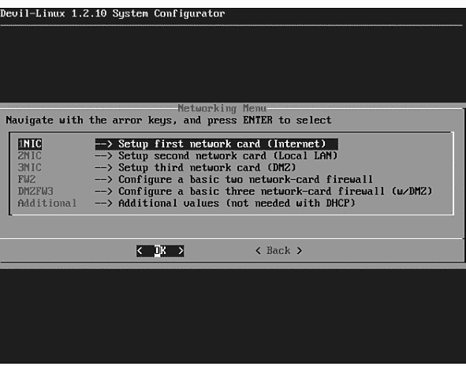

图 13-4 系统配置器网络菜单的网络接口和设置。

我喜欢 Devil Linux 的原因之一是它适合更复杂的网络设置，例如提供 DMZ 的三网卡配置，而不是在局域网和互联网之间提供单一屏障的标准双网卡配置。

如你在图 13-4 的网络菜单中所示，你在这里有几个选项。你可以选择双卡本地局域网（Local LAN）配置或带有三个接口的 DMZ 设置。你可以为每张卡单独设置接口。

如你所见，Devil Linux 让你通过 FW2 和 DMFW3 选项轻松建立起基本的防火墙框架。遗憾的是，它并没有让你轻松设置网卡（NIC）。在我测试的系统上，Devil Linux 不自动检测网卡，因此你必须显式地告诉 Devil Linux 模块使用哪些网卡。

由于用户很少确切知道自己拥有什么型号的网卡，而且网卡的名称和型号可能与实际模块名称没有任何相似之处，这可能会有点棘手。我建议使用另一个启动 CD（如 Knoppix）启动电脑，然后查看它使用哪个模块来启动网卡。（输入 `lsmod | lci -v` 来获取有关网络接口卡的信息。）

继续设置网卡吧（记住，第一次设置很痛苦，但你不应该再做一次了），然后返回主配置界面。

现在是时候保存你的配置并重启了。重启后，你就应该准备好设置防火墙规则了。你可以通过文本菜单或使用 `save-config` 命令保存配置。建议第一次使用菜单选项，在配置好防火墙规则后使用 `save-config` 选项。

配置保存在硬盘或其他介质的 `etc.tar.bz` 下。这在以后会有用，因为你可以通过将文件复制到另一个系统并创建一个已包含配置的新 CD-ROM，从而消除对硬盘、软驱或 USB 密钥的需求。Devil Linux 包含了 `scp`，所以你可以使用 `scp` 将文件发送到另一台机器。

然而，Devil Linux 可能不会挂载驱动器，因此你需要在复制文件之前先挂载它。假设你的介质是第一个 IDE 驱动器的第一个分区，例如，你会使用以下命令：

```bash
# mount -t ext3 /dev/hd1 /mnt
```

然后使用 `cd` 切换到 `/mnt` 目录并使用 `scp` 将文件复制到另一个主机：

```bash
# scp etc.tar.bz username@host:/home/username/
```

稍后我们在讨论制作自定义 CD 时会回到这一点。现在是设置防火墙规则的时间了。

## 设置防火墙规则

可以通过两种方法在 Devil Linux 中设置防火墙规则。第一种是使用 `iptables` 规则手动配置。如果你恰好是 `iptables` 专家，这是一个很好的选择，但大多数人并不是。

第二种选择（也是我推荐的）是使用 Firewall Builder，它可以在 `www.fwbuilder.org/` 获取。如果你使用的是 Linux，Firewall Builder 可能已随你的发行版一起提供。如果没有，该项目为 Windows 和 Mac OS X 提供了包，尽管这些不是 GPL 授权；Linux 版本在 GPL 下免费提供。

Ubuntu 和 Debian 用户可以通过运行以下命令获取 Firewall Builder：

```bash
### apt-get update
# apt-get install fwbuilder
```

这还会获取运行 Firewall Builder 可能需要的任何依赖项。

Firewall Builder 有三个模板可以帮助你快速上手：
- 基础防火墙规则集，仅允许从内部局域网（LAN）连接且仅通过 SSH 连接到防火墙；
- 更复杂的规则集，还允许防火墙作为内部网络 DHCP 和 DNS 服务器的基础；
- 适用于带有三个接口的机器的 DMZ 防火墙规则集。

模板假设了两点：首先，你想使用 `192.168.1.0` 私有子网；其次，你将在面向网络的接口上使用 DHCP 获得你的 IP 地址。

Firewall Builder 稍微有点复杂，无法进行深入介绍，但使用起来并不困难。如果你对网络相当熟悉，你应该可以在下午内精通它。当你有了防火墙配置后，可以使用 Firewall Builder 将其发布到防火墙并保存配置。

## 创建新 CD

Devil Linux 发行版附带了一个 `custom-cd` 脚本。你可能认为制作新 CD 是件痛苦的事，但实际上非常简单，最坏情况下只需要几分钟。注意，你需要以 root 身份运行或使用 `sudo` 运行该脚本；在创建新镜像时，你需要挂载一个目录用于 ISO 镜像。

在本章前面，我们讨论了将配置保存到另一台机器，以便你可以创建一个新的 Devil Linux CD。首先，你需要进入该目录，并确保你在该目录下。

镜像。我通常使用 `devil`，这是脚本的默认值，但你可以给它起不同的名字。现在以 root 身份运行 `./custom-cd`，或者如果你使用没有 root 账户的发行版，则使用 `sudo ./custom-cd`。你会看到一系列提示：

```bash
jzb@kang:~/$ sudo ./custom-cd
输入现有镜像的位置 [bootcd.iso] ->
输入你的新 ISO 镜像 [bootcd.iso] -> ./newboot.iso
输入挂载位置 [/mnt/] ->
输入新文件目录 [/new] ->
输入临时位置 [/tmp/] ->
```


然后你会看到一堆状态消息以及关于使用的选项的 `mkiso` 消息。你可以安全地忽略这些。最后，你会收到一条新 ISO 镜像已创建的消息。

根据机器的速度，它可能需要 5 分钟，也可能更长。在你的 `Athlon 6400+` 和 `2GB` 内存上，生成新 ISO 镜像需要 10 分钟。

在将刻到 `CD-R` 之前，你一定要确定你有了想要的配置。附录 B，“构建、测试和刻录 ISO”可以帮助你使用 `QEMU` 或 `VMware` 测试你的 Devil ISO 镜像。关于将 ISO 镜像刻到 CD 的信息，请参考此附录。

# 其他防火墙发行版

正如我在本章开头提到的，如果 Devil Linux 不能满足你的需求，你可能考虑其他发行版——或者你想尝试其他设置 live CD 防火墙的方法。

`Coyote Linux` (`http://www.coyotelux.com/`) 如果你需要为小型家庭网络运行防火墙，且不想修改或分发它，它是一个很好的解决方案。`Coyote` 的许可意味着它不够灵活，不适合商业环境。然而，它是一个非常易用的防火墙/路由器组合，所以如果你只是为家庭寻找一个快速的“设置后不管”的方案，可以考虑它。我使用 `Coyote`（软盘版本）了一年多，它非常易用。

## 第 13 章 定制防火墙 Live CD

`mOnn0wall` 发行版 (`http://mOnn0.ch/wall/`) 是另一种流行的防火墙解决方案，它可以在 live CD 上运行，并配合软盘进行配置。与 Devil Linux 一样，它拥有活跃的开发社区并定期发布。然而，`mOnn0wall` 实际上基于 FreeBSD，因此它不被视为 Linux CD。

另一个流行的 live CD 防火墙是 `SmoothWall` 发行版。遗憾的是，在本书写作时，它自 2005 年 9 月以来还没有发布过新的稳定版本，在你拿到这本书时，我决定它不适合在这里介绍。不过，当你读到这本书时，可能已经有了新版本。访问 `http://smoothwall.org/` 了解更多关于 `SmoothWall` 的信息。

### 总结

如你所见，CD 格式对于某些防火墙和路由器是理想的。特别是 Devil Linux，在任何需要自定义 live CD 的情况下都非常出色。

在本章中，我们介绍了 Devil Linux 的基本用法、新防火墙的配置，以及如何修改和更新 Devil Linux live CD。利用本章中的信息，你应该能够毫无问题地构建一个基于 Devil Linux 自己的 live CD。

虽然 Devil Linux 不是唯一的选择，但它是最灵活且相对易用的系统之一。如果你熟悉 Linux，可能只需要一个下午的时间就能用 Devil Linux 创建一个定制的防火墙 CD。

## 定制集群 Live Linux CD

想象一下你的办公室里装满了电脑，这些电脑只在早上 9 点到下午 5 点之间使用。这造成了大量的计算资源浪费，而使用 live CD 集群发行版，有一种简单的方法可以在一天中其余时间利用这些电脑的算力。

如果你正在寻找一种创建快速且简易的集群的方法，live CD 绝对是二之优选。你可以将 CD 插入每台机器的驱动器并重启，将其使用几小时（或几天），并充分利用长长的假期周末！当你的计算任务完成后，重启机器，拔出 CD，你就恢复了 PC 原始的操作系统，而它完全受集群操作系统的影响。

对于真正的硬核计算任务，你可能不想使用集群 live CD；如果你在为国防部工作，进行战场模拟或其他同等计算密集型任务（更不用说高预算了），你可能希望直接将操作系统安装到硬盘中。事实上，在那种场景下，你可能会与提供其定制 Linux 版本的供应商或 IT 部门合作。

本章讨论了通用的集群概念，并查看了 live CD 集群发行版的选项。

## 什么是集群？

让我们从讨论什么是集群开始，以及使用用于创建计算机集群的 live CD 发行版可以完成什么。

### Live Linux CDs

集群最简单的定义是两或多台连接并共同工作的计算机。集群被用于许多不同的原因。集群可以提供高可用性、负载均衡、高性能计算以及实用或“网格”计算设施。请注意，这些功能并不是互斥的，因此集群可以同时提供高性能和高可用性，或者提供高可用性和负载均衡。

## 高可用性 (HA)

HA 计算用于提供冗余。单台计算机代表一个单点故障。即使你有一个拥有冗余电源、带热插拔驱动器的 RAID 以及所有其他功能的服务器，它仍然代表一个单点故障（例如，如果新手管理员不小心掉了错误的网线……）。

集群可以小到两个节点，也可以大得多。一个例子是公司有两个防火墙系统——一个作为防火墙，另一个具有相同配置并处于备用状态，监听另一台服务器的“心跳”。如果第一个防火墙故障，第二个系统将启动并提供服务，直到主防火墙恢复。

另一个例子是电子商务公司拥有一个主从 MySQL 服务器，其中从服务器被配置为镜像第一个 MySQL 数据库，并在主服务器故障时接管主 MySQL 服务器。

## 负载均衡

有时，一个任务对于一台服务器来说太困难了，无论该服务器拥有有多大的算力。考虑像 Slashdot 这样流行的网站，它处理的流量远不是单一服务器能够处理的。

负载均衡集群将计算负载分散到两或多台计算机上。像 Slashdot 这样的网站有多个 Web 节点和数据库节点需要处理。通常负载均衡集群也是 HA 集群——也就是说如果集群中的一个节点故障，集群提供的应用程序就不会崩溃。可能会受到性能影响，但不会在一个节点掉线时崩溃。

## 高性能计算 (HPC)

如果你关注 Linux，你可能对 Top 500 超级系统列表非常熟悉，并且 Top 500 中超过三分之二的系统运行着某种版本的 Linux。这些系统是为了原始计算性能而构建的，用于运行模拟和其他计算密集型应用程序，而这些程序在单机上运行是不切实际的。

例如，石油公司使用 HPC 来分析地理数据，以尝试确定在哪里钻井。HPC 也广泛用于生物学研究和特效渲染。

## 网格计算

网格计算，也称为“实用”计算，与 HPC 和负载均衡类似，但区别在于网格计算通常使用志愿者。例如，SETI@home 项目使用计算机上的客户端来寻找智能生命的迹象。

# 第 14 章 定制集群 Live Linux CD

## ParallelKnix

`ParallelKnix`（简称 `PK`）是一种用于集群的修改版 Linux。在本节中，我们将查看如何在多个节点上启动 `PK`，以及如何定制 `PK`。我们还回顾了提供的应用程序。

## 启动 ParallelKnix

`ParallelKnix` 包含在随书 DVD 中。参考附录 A “DVD”了解如何获取和启动 `ParallelKnix`。启动后，`PK` 会出现。启动 `PK` 只需按 Enter 键，除非向内核传递选项。例如，如果你在启动 `PK`（或 live CD）时遇到问题，可能需要向内核传递 `acpi=no` 参数。

## 第 14 章 定制集群实时 Linux CD

如果这种行为也像我一样让你困扰，你只需右键点击任务栏并选择“配置面板”（Configure Panel）。然后你将看到 KDE 配置对话框，在左侧你会看到“隐藏”（Hiding）。点击它并取消勾选“隐藏模式”下的“自动隐藏”（Hide Automatically）。

> 注意
> `ParallelKnoppix` 假设你能够通过 DHCP 获取 IP 地址。如果你在网络上没有运行 DHCP，可以打开终端并使用 `su -` 切换到 root。默认情况下，`ParallelKnoppix` 没有 root 密码。

然后运行以下命令来设置你的 IP 地址：

```bash
# ifconfig eth0 10.0.0.10 netmask 255.0.0.0 gw 10.0.0.1
```

当然，你会希望更改这些值以反映你的网络设置。

## 设置交换空间 (Swap Space)

如果你在 Linux 机器上启动 `PK`，它可以找到并使用机器上已经存在的交换分区。

然而，如果你正在使用 Windows，你将没有 `PK` 可以长期使用的交换文件。如果系统具有 FAT 文件系统，你可以挂载它并使用 `dd` 创建交换文件。例如，要在位于 `/media/hda1` 的 FAT 分区上添加名为 `swapfile.swp` 的交换文件，你可以输入以下命令：

```bash
# dd if=/dev/zero of=/media/hda1/swapfile.swp bs=1024 count=1024k
```

这将为你提供大小；可以通过调整来减小或增加交换空间的大小。注意，通用的规则是交换空间应该是系统内存的倍倍——至少，在 1GB 内存普及之前是这样的。如果你使用的交换空间多到需要超过 1GB，那么你可能需要更多的内存，而不是更大的交换文件。请记住，访问交换空间的速度比访问内存要慢得多。

现在你需要将该文件格式化为交换空间并告诉系统使用它：

```bash
# cd /media/hda1
# mkswap swapfile.swp
# swapon swapfile.swp
```

就这些了。在重做系统时，你可能希望确保你已经在 `/etc/fstab` 中永久设置了交换文件。要这样做，你需要添加类似下面的一行：

```
/dev/hda1/swapfile.swp    none    sw   0   0
```

另一种方案是，如果你经常将某台机器作为集群节点，可以使用类似 GParted 实时 CD 的工具来缩小 Windows 分区并添加交换分区。由于大多数机器的硬盘相当大，用户不需要 1GB 的分区作为交换空间，而且因为 `PK` 会自动检测交换空间，这会让你的生活变得简单——这不正是计算机的全部意义吗？

## 使用 PK 实时 CD 中的应用程序

`ParallelKnoppix` CD 带有许多软件，这些软件并不一定与集群相关。你会发现许多编辑器（包括我最喜欢的 `vim`）、多媒体应用程序、互联网应用程序、游戏以及更多内容。

如果你真的在工作，游戏之类软件将不会出现在你的所需应用列表中，但如果你恰好带着 `PK` 光盘并想打发时间，你随时可以将一台无聊的旧 Windows 机器临时转变为 Knppix 桌面。

但 `PK` 还带了许多用于集群的实用程序。在 KDE 菜单中，你会发现一个 `ParallelKnoppix` 菜单（听起来很酷对吧？），它包含了一组用于重做 `ParallelKnoppix`、设置集群、保存你的 `PK` 设置等的脚本。我们将逐一介绍这些项目中最重要的部分。

如果 `PK` 不包含你需要的应用程序（例如 `Firefox`），你可以通过重做 `PK` 将其添加到系统。我们将在本章稍后的部分讨论这一点。

## 保存设置

实时 CD 发行版令人恼恼的一点是，当你重启机器时，所有的工作都会消失在虚空中——除非你有保存设置的方法，`PK` 为你提供了一种快速且简单的方法来实现此。

进入 `ParallelKnoppix` 菜单并寻找“保存 PK 配置”（Save PK Configuration）菜单。出现“创建 PK 配置存档”（Create PK configuration archive）对话框，如图 14-3 所示：

此对话框将引导你通过一系列选项来保存你的个人配置、网络设置、打印机设置等。在图 14-3 中，我要求 `PK` 保存我的网络设置、桌面文件和个人配置。我不担心 X 的配置，因为我可能想在带有不同显显的机器上使用该配置。

## 第 14 章 定制集群实时 Linux CD

365

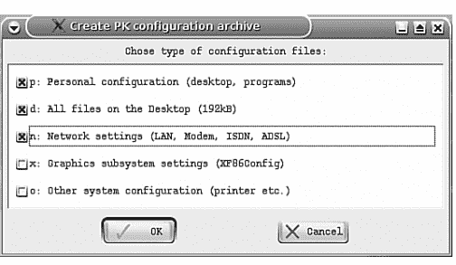

图 14-3
从 ParallelKnoppix“创建 PK 配置存档”对话框保存设置。

首先，对话框询问你想保存哪些设置以及你想将信息保存在哪里。`PK` 在这方面有点笨——注意在图 14-4 中，它显示了将配置保存到软碟的选项，无论是否存在！在你选好保存位置后，对话框会询问你想要将配置文件保存在哪里，如图 14–4 所示。


图 14-4
选择用于保存的分区。

```bash
# qemu -m
```

这将为你提供大小；可以通过调整来减小或增加交换空间的大小。注意，通用的规则是交换空间应该是系统内存的倍倍——至少，在 1GB 内存普及之前是这样的。如果你使用的交换空间多到需要超过 1GB，那么你可能需要更多的内存，而不是更大的交换文件。请记住，访问交换空间的速度比访问内存要慢得多。

```bash
# qemu -cdrom
```

## 使用 PK 实时 CD 中的应用程序

技术上，你可以使用 PXE 启动启动从节点，而不是使用 `PK` 光盘——但由于许多计算机不支持 PXE，我在这里将坚持使用经过测试的可靠的 `PK` 光盘方法。如果你的系统支持 PXE，你可以尝试使用 PXE 启动并让系统完全从主系统启动。

## 管理节点并启动你的集群

好了，让我们进入有趣的部分！现在是启动集群的时候。第一步是主节点。

## 运行版 Linux 光盘

在主节点准备就绪后，就可以启动其他电脑了。将 `PK` 光盘插入从节点（节点）并启动它们。如果你的配置正确得当——主节点正在运行并等待从节点，且它们处于一个与其他 DHCP 服务器隔离的网络中——剩余节点应该自动配置为从节点，无需你的任何干预。

重新运行 `StartHPC` 脚本，它会将等待中的节点添加到集群。你会看到一个名为 `tkping` 的对话框，它会为每个连接到集群的节点显示绿色块，为集群中的空槽显示红色块。

## 测试集群

现在要确保你的集群确实像一台大型计算机一样进行计算。`PK` 建议的第一项任务是运行 POV-Ray作业来查看集群运行状态：

```bash
# cd /usr/share/doc/povray-3.5/examples/advanced/
# povray +N +NT2 mediaskyp.pov
```

这会启动 `POV-Ray`，并让它渲染 `mediaskay.pov` 中的场景。取决于你拥有的节点数量及其速度，这可以在一分钟左右完成，也可能只需要几秒钟。在我的测试环境中，使用两个计算节点大约需要 45 秒。

> 注意
> `POV-Ray`（视觉暂留性光线追踪器）是一个用于创建 $3D$ 场景和图形的程序。它能够创作出令人惊叹的图像——但使用单台计算机渲染可能需要非常长时间。使用 `PK`，你可以快得多的速度渲染图像。

监控和管理集群的另一种方法是使用 `XPVM`，它是并行虚拟机（PVM）的 GUI 管理器。`PVM` 是允许你的集群作为单台虚拟虚拟机使用的软件。`XPVM` 为 `PVM` 提供了一个易于使用的界面。

## 第 14 章 定制集群运行版 Linux 光盘

在主节点上打开控制台并运行 `xpvm`。这会启动 `XPVM` 界面，显示所有已连接的节点及其状态。

要在节点间运行程序，点击 `Tasks` 按钮并选择 `SPAWN`。你会看到一个带有 `Command` 字段的对话框。将兼容 `PVM` 的命令输入命令字段并点击 `Start`。（当你刚开始学习时，可能只需接受默认值。）

注意，程序必须使用 `PVM` 编译才能供 `PVM/XPVM` 使用。例如，`POV-Ray` 是为使用 `PVM` 设计的，但 `Firefox` 或 `Gimp` 不是——因此它们无法在 `PVM` 下运行。

要测试 `XPVM`，请使用以下命令再次进行 `POV-Ray` 测试：

```bash
# cd /usr/share/doc/pov-3.5/examples/advanced/
# pov -N mediaskpy
```

注意，如果你只想用计算集群的一部分运行作业，可以使用 `PVM` 将节点移出使用。进入 `Hosts` 菜单，取消勾选任何不想使用的主机。（你可以通过重新选择来恢复这些节点。）

其实就这些了。你还以为运行集群会很难呢！

## 重新制作 PARALLELKNOPIX

根据 `PK` 的注释，你至少需要 2GB 空闲空间来重新制作 `PK` 以创建新光盘。这是一个非常、非常乐观的估计，我发现你可能需要至少 4GB。鉴于如今巨大的硬盘，要找一个至少有这么多空间的磁盘进行重新制作应该并不困难。

> 注意
> 这里有一个实用的提示：如果你要重新制作 `PK` 的系统是你日常工作使用的系统，请在重启进入 `PK` 之前将你想使用的文件或包拷贝到你的文件系统中。这样，你只需要在重启后将它们拷贝到 `PK` 文件系统中，而无需在运行 `PK` 时下载它们。

## 运行版 Linux 光盘

我测试的 `ParallelKnoppix` 版本在第二个脚本中有一个小错误，即位于 `/home/knoppix/Desktop/ParallelKnoppix/Remasting` 目录下的 `2-StartCHROOT` 脚本。第 72 行，`xterm` 的路径列为 `/usr/bin/X11R6/xterm`。这是错误的；应该是 `/usr/bin/xterm`。请用 `vi`（或你喜欢的编辑器）打开文件并修改该行。如果你修改了该行，它就能正常运行。在发布时这个问题可能已经被修复，请在修改脚本之前尝试一下是否有效。

通过进入 KDE 菜单 → ParallelKnoppix Remaster → 1-CopySourceForRemaster 条目开始该过程。在这里你会得到一个与图 14-5 类似的对话框，询问你想要将重新制作的源放在哪里。

## 图 14-5
- 选择用于拷贝 ParallelKnoppix 源的介质。

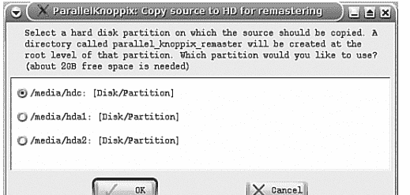

再次，务必检查可用空间。重新制作 ParallelKnoppix 可能需要一个多小时，你不想在过程进行一半时发现空间耗尽了！

现在，从命令行或 ParallelKnoppix 菜单运行 `2-StartCHROOT` 脚本来测试集群。要测试 XPVM，请使用以下命令再次进行 POV-Ray 测试：

```bash
# （此处已根据原文逻辑去重复处理）
```


## 从 DVD 启动 Live CDs

一些 live CD 已经经过重制，可以直接从随本书附带的 DVD 启动。要尝试其中任何一个 live CD，你只需要一台带有 DVD 驱动器且可以重启的 PC 即可。

DVD 上的默认 live CD 是 Knoppix。因此，要使用 Knoppix，你只需在启动提示处按回车键，或者等待超时（仅几秒钟），Knoppix 就会自动启动。若要在启动提示处启动其他可用的 live CD，你需要输入与该发行版相关的标签（label）。

## 选择启动哪个 Live CD

你可以直接从 DVD 启动的 live CD 包括以下 live Linux 发行版：

- `Knoppix`——一种桌面式的 live Linux CD，是世界上最流行的 live CD。
- `BackTrack`——基于 SLAX CD 的面向安全的 live Linux CD。
- `Gentoo Live CD`——由 Gentoo 项目使用 Catalyst Linux 安装程序制作的官方 live CD。
- `Damn Small Linux`——一种面向桌面的微型 live Linux CD 发行版，可以放入一张名片大小的可启动 CD 中（约 50MB）。
- `SLAX KillBill`——一种基于 SLAX 的 live CD，具有工具（如 `wine` 和 `qemu`），用于在 Linux 系统中测试和运行为 Windows 创建的应用程序。
- `Live Linux Gaming Project`——一种基于 Debian 的 live CD，包含几十个开源游戏。

这些 live CD 发行版的大小从约 50MB 到近 700MB 不等。

## 启动 DVD

要尝试此 Live CDs DVD，请使用以下步骤：

1. 将 DVD 插入你的 DVD 驱动器。
2. 重启电脑。
3. 当看到 Live CDs 启动启动界面提示符时，按回车键（或等待超时）启动 Knoppix，或输入表 A-1 列出的任一启动标签。

## 附录 A DVD 上的

### 表格 A-1 从 DVD 启动不同 Live CD 的标签

| 启动标签 (BOOT LABEL) | Live CD 启动 (LIVE CD BOOTS) | 启动标签 (BOOT LABEL) | Live CD 启动 (LIVE CD BOOTS) |
|---|---|---|---|
| knnoppix | Knoppix | dsl | Damn Small Linux |
| lgp | Live Linux Gaming Project | slax | SLAX KillBill |
| back | BackTrack | memtest | Memtest 86 (用于测试内存) |
| gentoo | Gentoo | | |

如果你愿意，可以添加启动选项。从所选 live CD 提供的任何启动选项，都可以通过在前面提到的标签后输入这些选项来实现。

要退出其中包含的大多数 live CD，你可以从桌面上选择关机选项。输入 `Ctrl+Alt+Delete` 或执行 `init`（以 root 用户身份输入 0）也有效。有时你也可以直接关闭电脑。但是，在按下电源开关之前，你应该卸载（unmount）你已挂载的任何文件系统。

## 使用 DVD 上的 Live CD ISO

我在随书附带的 DVD 中包含了十几个 live CD，以省去你在互联网上寻找它们的麻烦。每个代表 live CD 的 ISO 都直接来自构建它们的项目。因此，你可以直接访问互联网上每个 live CD 的项目网站提问或查找更多关于如何使用这些 CD 的信息。

所有 live CD 镜像都包含在 DVD 顶部的 `/distros` 目录下。接下来的章节描述了 `/distros` 目录的内容，以及在哪里找到关于该目录中每个 live Linux CD 的更多信息。我建议你直接参考每个项目网站以获取这些 live CD 的后续版本，或者如果你对如何获取、使用或为任何这些项目做出贡献有疑问。

## 注意事项

许多 Linux live CD 项目是由常规工作场所之外的个人维护的。大多数项目都邀请你贡献资金或专业知识以帮助项目发展。我鼓励你为你喜欢的项目捐献你所能的任何，帮助这些项目改进和成长。

要使用随本书附带的 live CD 之一，请执行以下操作：

1. **插入 DVD** 到运行有带有 CD 刻录软件的任何系统的 PC 的 DVD 驱动器中。操作系统可以是 Windows 或 Linux。作为替代，你可以直接启动 DVD 本身并使用 Knoppix 或其他 live CD 来执行此过程。
2. **复制 ISO** 将你想要使用的 live CD 的 ISO 复制到硬盘上的一个文件夹中。在运行已安装的操作系统时，从 `/distros` 目录复制 live CDs。如果正在从 DVD 运行 live CD，请查看 `/cdrom/distros`。如果你有两个 CD/DVD 驱动器，你可能跳过将 ISO 复制到硬盘步骤，直接从你的 DVD 将 ISO 刻录到可写 CD 驱动器中。
3. **弹出 DVD** 并将空白或可重写的 CD 插入 DVD/CD 驱动器。
4. **刻录 ISO 镜像**到 CD，使用如 `cdrecord` 或 `K3B` 等工具。
5. **尝试 live CD**，将新刻录的 CD 插入任何 PC 并重启。

接下来的章节描述了 DVD 上包含的、带有 ISO 镜像的 live CDs。

## 关于 Knoppix

Knoppix 是顶尖的桌面 live Linux CD。Knoppix（英文）主页为 www.knopper.net/knoppix/index-en.html。从那里，你可以获得关于 Knoppix 包含的内容、如何使用它以及如何下载或购买它的信息。

## 关于 Damn Small Linux

Damn Small Linux 是一种面向桌面的微型 live Linux CD 发行版，可以放入一张名片大小的可启动 CD 中（约 50MB）。

## 关于 SLAX KillBill

SLAX KillBill 是一种基于 SLAX 的 live CD，具有工具（如 `wine` 和 `qemu`），用于在 Linux 系统中测试和运行为 Windows 创建的应用程序。

## 关于 Live Linux Gaming Project

Live Linux Gaming Project 是一种基于 Debian 的 live CD，包含几十个开源游戏。

## 关于 BackTrack

BackTrack 是基于 SLAX CD 的面向安全的 live Linux CD。

## 关于 Gentoo Live CD

Gentoo Live CD 是由 Gentoo 项目使用 Catalyst Linux 安装程序制作的官方 live CD。

## 关于 Ubuntu Gentoo live CD

与 Ubuntu live CD 类似，Ubuntu live CD 既是一个面向桌面的 live CD，也是一个 Ubuntu 安装程序版 live CD。默认情况下，Ubuntu 会启动到 GNOME 桌面。之后，你可以在该桌面上进行选择，从而将 Ubuntu 永久安装到硬盘上。live CD 包含了足够完成基础 Ubuntu 安装的软件但也允许你通过互联网连接到 Ubuntu 软件仓库，获取任何你需要的可用软件。

随本书附 DVD 提供的 Ubuntu live CD 是 Ubuntu 6.06.1 版本（`ubuntu-6.06.1-desktop-i386.iso`），位于 `/distros` 目录下。

## 关于 Presentation Live CD

随本书附 DVD 提供的 Presentation Live CD（称为 PuppetiX）是一个经过重制的 Damn Small Linux（微 Linux）live CD，专门为制作幻灯片或使用 OpenOffice.org Impress 演示而设计。

DVD 中包含两个版本的 PuppetiX。较小版本（`puppetix-0.1.iso`）大小约为 62MB，包含了播放幻灯片所需的镜像和软件。较大版本（`puppetix-oo-0.1.iso`）大小约为 160MB，包含了幻灯片和一个 OpenOffice.org 演示文（包括运行演示所需的 OpenOffice 软件）。

由于此 live CD 没有官方网站，且 DVD 之外没有独立版本，因此没有地方下载后续版本的 live CD。然而，由于你非常有勇气将本书读到这里，如果你在使用 Presentation live CD 时遇到任何问题，请给我发送电子邮件，我会尽力提供帮助。我的电子邮件地址是 chris@linuxtoys.net。

## 附录 B

### 构建、测试和刻录 ISO

当你准备好 live CD 的所有组件后，通常可以在 Linux 中通过使用 `mkisoofs` 命令将这些组件汇聚成一个可引导的 ISO 镜像。该 ISO 镜像可以从软件仓库共享，并通以下两种方式之一运行：

- 从模拟器启动 ISO 镜像——这是一种使用 CPU 模拟器从本地文件系统尝试运行 ISO 镜像的便捷方法。流行的模拟器软件包括 VMware 和 Qemu。Qemu 在本书描述的大多数 Linux 发行版中均可用（且在大多数情况下运行良好），本附录主要描述了如何使用 Qemu 测试你构建的 ISO 镜像。文中还包含了如何获取和使用 VMware Player 的简短说明。
- 将 ISO 镜像刻录到可引导介质——由于 live ISO 镜像旨在从可移动介质引导，因此制作 live Linux 系统的最后一步将其刻录到 CD、DVD或其他移动引导介质。本附录描述了如何使用 `cdrecord` 命令和 `K3` 图形工具将 ISO 镜像刻录到 CD 或 DVD。

制作 ISO 镜像的工具（`mkisoofs` 命令）、刻录前的 ISO 镜像测试（`qemu`）以及将其刻录到介质（`cdrecord` 和 `k3`）在书中都有提及。然而，由于这些工具的功能比前面提到的几个要多，你可以将此附录作为参考，扩展构建、测试和刻录 ISO 镜像的方法。

#### Live Linux CDs

#### 构建 ISO 自定义 live CD 的所有组件并汇集

当你完成 live CD 所有组件的自定义并将这些组件汇集到硬盘上的目录结构中后，下一步是将该目录结构转换为单一镜像，稍后将其刻录到 CD 或 DVD。`mkisofs` 命令是 Linux 中执行此任务最常用的命令。

`mkisofs` 命令将目录结构转换为 ISO 9660 文件系统镜像。为了制作可引导的 Linux CD/DVD，`mkisofs` 支持一种称为 El Torito 的 ISO 9660 扩展。

> 请参考第 4 章“理解 Live Linux CD 的原理”，获取有关 El Torito 规范以及如何使用它制作可引导 Linux CD 的信息。

### 使用 mkisofs

`mkisofs` 命令在书中多处被作为制作 live CD 的最后一步。以下命令行显示了你可能添加到 `mkisofs` 命令以生成 live CD 的许多常用选项。

```bash
# mkisofs -R -b isolinux/isolinux.bin -c isolinux/boot.cat \
-no-emul-boot -boot-load-size 8 -boot-info-table . > ../livecd.iso
```

在所示的 `mkisofs` 示例中，你基于以下假设：

- Live CD 目录结构——点 (`.`) 表示你的 live CD 目录结构从当前目录及其子目录开始。除非另有说明（本示例中未说明），否则该点以下的所有文件和目录都包含在生成的 live CD 镜像中。
- Isolinux 文件——isolinux 文件 (`isolinux.bin` 和 `isolinux.cat`) 位于当前目录下名为 `isolinux` 的子目录中。
- Live CD 镜像——最终的 live CD ISO 镜像文件名为 `livecd.iso`，并放置在当前目录之上 (`../livecd.iso`)。

上述文件的位置可能根据你的设置而异。与其使用大于符号 `>` 将 `mkisoofs` 的输出重定向到文件，可以使用 `-o file` 来指定生成的 ISO 镜像的名称和位置。你还可以将 `mkisoofs` 的输出直接管道到 `cdrecord` 命令。该方法在本节稍后描述。

你需要提供 El Torito 引导镜像（`-b image` 选项）或使用带有 isolinux 软件包的 `isolinux.bin` 引导镜像（大多数人都会这样做）。如果你使用 GRUB 引导加载，该包也会包含一个 El Torito 引导镜像。引导目录（`-c catalog`）在 `mkisofs` 过程中产生。

由于 ISO 9660 镜像最初仅包含 DOS 风格的文件命名，因此需要添加扩展以允许此类文件名、UNIX 风格的用户和组信息、符号链接、块和字符设备以及权限位。`-R` 选项会生成系统共享协议 (SUSP) 记录和 Rock Ridge 交换协议 (RR) 记录，以便向光盘上需要的文件添加这些信息。

你可以使用 `-r` 选项代替 `-R` 选项，它会将权限和所有权更改为符合只读文件系统逻辑的限制性设置。所有权和组分配给 root 用户。如果为目录分配了执行权限以允许搜索该目录，则该点以上的所有目录都将被分配了执行位。

`-no-emu-boot` 选项防止使用硬盘或软磁盘模拟来创建引导镜像。`-boot-load-size 8` 选项告诉 `mkisofs` 将镜像加载到八个 512 字节的扇区。`-boot-info-table` 选项指示 `mkisofs` 修改由 `-b` 选项指定的引导文件。

### 从 ISO 中包含和排除文件

如果你知道想从 ISO 镜像中排除提供给 `mkisofs` 的目录结构中的文件，可以使用 `-m glob` 选项来实现。在这种情况下，`glob` 被替换为匹配你想排除的文件的通配符样式模式。示例所示：

```bash
# mkisofs -m '*.junk' -m core -m whatever -1 livecd.iso
```

在此示例中，所有以 `.junk` 结尾的文件将被排除，名为 `core` 或 `whatever` 的文件也是如此。与其在命令行中排除文件，你可以将想要排除的文件列入列表并将其传递给 `mkisofs` 命令，如下：

`-exclude-list filename`

#### Live Linux CDs

虽然将 live CD 的所有文件放在目录结构中最简单，但 `mkisofs` 允许你合并多个路径的文件。与其仅在 `mkisofs` 命令中用点 (`.`) 指标识主目录，你可以在命令末尾添加多个路径。这些路径的每个文件都将添加到 live CD 的根目录下。例如：

```bash
# mkisofs [options] /home/chris/master /home/chris/stuff > livecd.iso
```

另一种方法方法是使用 `-graft-points` 选项将文件或目录挂接到 live CD 的根目录以外的位置。例如，如果你想将 `/home/image` 目录中的照片添加到 live CD 的 `data/photos` 目录，可以这样使用 `mkisofs`：

```bash
# mkisofs [options] -graft-points data/photos=/home/image > livecd.iso
```


我使用这种方法将从数码相机下载的图像添加到 live CD 中，而不改变其结构（参见第 10 章“自定义演示 Linux”，查看挂载目录的示例）。

## 向 ISO 卷头添加信息

在制作 live Linux CD 时，可以使用 `mkisofs` 命令添加其他有趣实用的选项。你可能希望使用这些选项中的几个为 live CD 的卷头添加更多信息：

- `p "preparer-id"`—将 `preparer_id` 替换为你（负责 live CD 的组织）的信息。你可以在此选项中使用 `-p "www.example.com"` 或类似内容。
- `publisher "name"`—使用此选项识别发布者名称。例如，可以使用 `-p "Acme Widgets"` 作为值。
- `V "Vol1_ID"`—将 `Vol1_ID` 替换为你想要分配给卷的卷名称。这很重要，因为在许多 Linux 系统中，它将作为 live CD 的挂载点名称。例如，可以使用选项 `-V "LivelinuxCD"`，这样当生成的 live CD 插入 Linux 系统时，它可以自动挂载到 `/media/LiveLinuxCD` 目录。
- `volset "ID"`—指定卷集 ID。由于你可以输入最多 128 个字符，因此它为卷集提供了更详细描述的空间。

该选项可以像示例所示设置：
- `-volvolset "This is 1 of 5 live CDs showing live Linux solutions"`

如果你按照本章后面介绍的那样使用 K3b 将 ISO 刻录到 CD，你可以看到此信息被添加到卷头中。如果你使用了前面章节中所示的选项，当你将镜像加载到 K3b 进行刻录时，卷头信息将如图 B-1 所示。

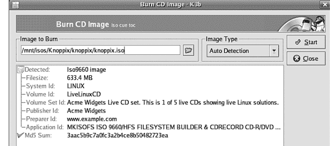

图 B-1 在 K3b 中显示的通过 `mkisofs` 添加到卷头中的信息。

如你所见，系统自动填充了镜像类型（Iso9660 镜像）、镜像大小（633.4MB）和系统 ID（LINUX）。系统 ID、卷 ID、卷集 ID、发行者 ID 和制备 ID 均来自你描述的 `mkisofs` 选项。其他信息包括应用程序 ID（指示 `mkisofs` 创建了 ISO）和 MD5SUM（当 K3b 读取 ISO 镜像时会进行检查）。

如果你正在准备大量的光刻 CD——例如，为你的公司或组织——你可能希望在制作的所有光刻 CD 中包含相同的的卷头信息。你可以使用 `.mkisofsrc` 文件来设置这些值。`mkisofs` 命令会检查当前目录、你的主目录以及命令所在的目录以寻找 `.mkisofsrc` 文件。

此 `.mkisofsrc` 文件示例包含了可以替代 `mkisofs` 命令行选项的标签。要查看如何使用这些标签提供图 B-1 所示的相同信息，已将这些信息添加到此处显示的标签中：

```
PREP="www.example.com"
PUBL="Acme Widgets"
VOLI="LiveLinuxCD"
VOLS="Acme Widgets Live CD set. This is 1 of 5 live CDs showing live Linux solutions."
```

你在 `.mkisof` 文件中可以作为管道使用的其他标签包括 `APPI`（用于设置多达 128 个字符的应用程序标识）、`COPY`（添加最多 37 个字符的版权信息）、`ABST`（识别磁盘上包含磁盘内容摘要的文件）、`BIBL`（最多 37 个字符的文献引用信息）以及 `SYSI`（将 SYSI 更改为 LINUX 除的任何内容）。

这里是你可能需要的 `mkisofs` 命令的最后一个额外用途：如果你打算将 `mkisofs` 的输出直接管道到 `cdrecord`，某些 CD 刻录机（以及写入模式）需要提前知道 ISO 镜像的大小。那么该命令的格式将如下所示：

```bash
# mkisofs options | cdrecord options
```

除了你输入的其他 `mkisofs` 和 `cdrecord` 选项外，你还需要使用 `size=#s` 选项将镜像的大小传递给 `cdrecord`，其中 `#` 被替换为生成的 ISO 镜像的大小数字。要获取 `cdrecord` 需要的数字（2048 字节扇的数量），请在你即将运行的 `mkisofs` 命令中添加 `print-size` 选项。例如：

```bash
# mkisofs -R -b isolinux/isolinux.bin -c isolinux/boot.cat \
-no-emul-boot -boot-load-size 8 -boot-info-table -print-size \
Using ".mkisofsrc"

Total extents scheduled to be written = 324323
```

使用此示例，当你运行 `cdrecord`（或当将 `mkisofs` 的输出管道到 `cdrecord` 时），你可以在 `cdrecord` 命令行中添加以下值：

```
size=324323s
```

`mkisofs` 命令还有许多其他可用选项。要读取这些选项，请参阅 `mkisofs` 的 man 页 (`man mkisofs`)。或者，你可以运行带有 `-help` 选项的 `mkisofs` (`mkisofs -help`)。

# 附录 B 构建、测试和刻录 ISO

## 使用 QEMU 测试 ISO 镜像

通过模拟 PC 处理器和系统组件，QEMU 处理器模拟器 (`http://fabric.bellar.free.fr/qemu`) 可以启动磁盘镜像，以便你可以在 Linux 桌面面的窗口上运行早期的可启动操作系统。

被模拟的系统可以是带有 IDE 总线的标准 PC，也可以是带有 ISA 总线的 PC（通过添加 `-M ispc` 选项）。

QEMU 可以在用户模式（允许其在不同的 CPU 类型上运行为一种 CPU 创建的进程）或全系统模拟（CPU 和外设）下运行。人们经常在用户模式下将 QEMU 用于 `WINE`，允许他们安装并运行 Windows 应用程序，或用于 `DOSEMU` 以运行 DOS 应用程序。然而，为了测试光刻 CD 镜像的目的，本书描述了全系统模拟模式下的 QEMU。

对于书中描述的 Linux 发行版，QEMU 提供了预发布二进制文件。有了 Internet 连接，你可以使用以下命令分别从 Debian/Knoppix、Fedora 和 Gentoo 安装 QEMU 二进制包：

- 基于 Debian 的系统：`# apt-get install qemu`
- 基于 Fedora 的系统：`# yum install qemu`
- Gentoo 系统：`# emerge qemu`

如果你愿意，也可以从源代码安装 QEMU。QEMU 源代码可以从 QEMU 下载页面获取 (`http://fabric.bellar.free.fr/qemu/download`)。

## 启动 QEMU

使用带有 `-boot` 选项的 QEMU 命令非常简单。例如，对于启动 镜像：

```bash
# mkisofs -R -b isolinux/isolinux.bin -c isolinux/boot.cat \
-no-emul-boot -boot-load-size 8 -boot-info-table -print-size \
Using ".mkisofrc"

Total extents scheduled to be written = 324323
```

### 现场 Linux CD

监视器（来自 QEMU 文档）包括移除和插入可移动介质（CD、DVD 或软盘）、从磁盘文件恢复虚拟机状态（在冻结和取消冻结虚拟机后），以及使用外部调试器检查虚拟机。

你可以配合 QEMU 监视器使用一些命令。在显示监视器（按下 Ctrl+Alt+2）时，你可能想尝试这些命令：

- `- help`—列出所有可用命令。
- `- info ??`—将 `??` 替换为组件名称以查看关于该组件的附加信息。你可以了解与网络设备 (`network`)、块设备 (`block`)、CPU 寄存器 (`registers`)、命令行历史 (`history`)、模拟 PCI 设备 (`pci`)、虚拟 USB 总线上的设备 (`usb`) 以及 USB 主机设备 (`usbhost`) 相关的 VLAN 信息。你还可以查看 QEMU 版本号 (`version`)。
- `- screendump file.ppm`—将目标系统的显示（换句话说，就是你输入 Ctrl+Alt+1 时看到的内容）捕获到当前目录下的 pnm 文件。将 `file.ppm` 替换为你想要使用的名称。
- `- eject`—弹出与指定设备关联的介质。例如，将 `device` 替换为 `cdrom` 以弹出从你的 CD 驱动器运行的现场 Linux，或替换为 `fd` 以弹出你的软盘。
- `- savevm`—将整个虚拟机状态保存到文件。
- `- loadvm file`—从文件恢复整个虚拟机状态。
- `- quit`—关闭现场 CD 并退出 QEMU。

QEMU 监视器还提供其他命令。要了解其他命令，请参考 QEMU 页面 (`man qemu`) 或 QEMU CPU 模拟器用户文档 (`http://fabricrice.bellard.free.fr/qemu/qemu-doc.html`)。

# 在 Windows 中使用 QEMU

假设你有一个完成或下载好的现场 CD 镜像，并希望从运行的 Windows 系统中启动它。关于你的硬盘，QEMU 网站引用了一个 Windows 页面（`http://www.dion.ne.jp/~qemu-win`），你可以在那里下载一个包含 QEMU linux-test 软件包中 Small Linux 的二进制文件。

我使用了以下步骤将 QEMU 下载到 Windows，以便我从 Windows 桌面启动 Linux 现场 CD。我是在带有互联网连接的 Windows XP 上执行此步骤：

1. 使用 Windows 上的浏览器（或其他下载工具）从 `http://www.dion.ne.jp/~qemu-win` 下载 `qemu-windows.zip` 文件。（当我访问该网站时，该文件名为 `qemu-0.8.2-windows.zip`）。
2. 右键点击 qemu zip 包并选择“提取 (Extract)”。
3. 提示时，选择一个文件夹存储提取出的 qemu。
4. 将 ISO 文件保存到 Windows 系统上可访问的文件夹中。我将其保存在保存 qemu 文件夹的父目录中。
5. 运行 qemu 命令启动现场 CD。在我的示例中，我打开了一个命令提示符 (DOS) 窗口并进入提取 qemu 的目录。然后我运行了以下命令，从当前目录的父目录启动 Small Linux：

```
qemu.exe -L -boot d -cdrom dsl-3.0.iso
```


图 B-3 显示了在 Windows 桌面的 QEMU 窗口中显示的 Small Linux 示例：

图 B-3 使用 QEMU 在 Windows XP 中测试 linux。

# 附录 B 构建、测试和刻录 ISO

## 使用 VMware 测试 ISO 镜像

`VMware Player` (`www.vmware.com/products/player`) 是一款流行的工具，你可以用它代替 QEMU 在电脑桌面上测试 ISO 镜像。该播放器免费下载，允许你启动虚拟机并在窗口中运行一个完全独立的操作系统。由于它可以在 Windows、Linux 和其他基于 PC 的系统中运行，因此你无需重启即可测试 ISO 镜像。

你可以从 `www.vmware.com/download/player` 下载 VMware Player。由于 VMware Player 不是开源软件，因此无法与 Linux 发行版一起发布。让它运行起来可能有点复杂。对于 Fedora Core，我使用了描述让其工作：`http://www.vmware.com/go/2006/livecd-player-virtual-machine.html`。在 VMware 运行后，下一个技巧是在虚拟机中播放 CD。来自 VMware.com 的任何一个小软件都可以帮助你将 livecd iso 复制到某个目录，通过在解压 `Generic-LiveCD-Virtual-Machine` 后，可以从该目录启动：

```
vmplayer Generic-LiveCD-Virtual-Machine.vmx
```

如果你切换到另一个现场 CD（将新的一个复制为 iso），请确保将 VMware 偏好（`Player → Preferences`）设置为在关闭时关闭虚拟机。否则，关闭旧 CD 将仅仅是挂起，因此下次启动 VMware 时它会重新打开。图 B-4 显示了我使用上述 VMware 软件在播放器窗口中运行制作的现场 CD 的启动屏幕。

## 使用 cdrecord 或 K3b 刻录 ISO 镜像

当你完成一个 ISO 镜像后，可以使用许多 Linux 和 Windows 工具将该 ISO 镜像刻录到 CD 或 DVD。本节介绍了每个主流 Linux 发行版都提供的两种流行的 CD 和 DVD 刻录工具：`cdrecord` 和 `K3b`。

### 使用 cdrecord 刻录 CD 和 DVD

`cdrecord` 命令是一个易用工具，你可以用它将镜像刻录到 CD 或 DVD。通过支持 ATA 数据包接口 (`ATA Packet Interface`)，`cdrecord` 可以与 IDE 驱动器工作，使用 ATAPI 标准。图 B-4 使用 VMware Player 在 Windows 上启动 CD。

`cdrecord` 命令是一个易用工具，你可以用它将镜像刻录到 CD 或 DVD。每个 Linux 发行版（包括 Red Hat Linux 和 SuSE）都包含 `cdrecord`。

使用默认设置（在 `/etc/cdrecord.conf` 中），默认驱动器是 `/dev/cdrom`。如果你的 ISO 镜像在当前目录并命名为 `livecd.iso`，你需要向驱动器插入一张空白 CD 并执行以下：

```
cdrecord livecd.iso
```

在上述示例中，当 `cdrecord` 完成，你可以弹出 CD 或 DVD。如果这不起作用，或者你想对过程有更多控制，可以使用许多选项。

在继续之前，你可以通过多种方式获取可写驱动器的信息。如果你有多个 CD 或 DVD 驱动器，可能需要指定你想写入的是哪一个。可以使用设备名称（例如 `/dev/cdrom`）来指示驱动器。要确定可写 CD 和 DVD 的设备名称，可以使用如下 `scanbus` 选项：

```
cdrecord -scanbus
```

```
cdrecord-clone 2.01 (i686-linux-gnu)
Copyright (C) 1995-2004 Jörg Schilling
scsideo: 'ATA'
devname: 'ATA'
scsibus: target 2 lun: 2
Linux sg version: 3.5.27
Using libscg version '0.8'.
scsibus:
0,0 100 'LITE-ON DVDRW SOHW-1633S' Removable CD-ROM
1,1 101
1,2 102
1,3 103
1,4 104
1,5 105
1,6 106
1,7 107
```

在此示例中，只发现了一个 CD/DVD 刻录机，其 SCSI 地址为 1,0,0。这意味着 SCSI 总线 1、目标 0 和 LUN 0。因此使用 `dev=` 选项，可以在 `cdrecord` 命令行上将其标识为 `dev=1,0,0` 或 `dev=/cdrom`。

当没有速度选项时，`cdrecord` 会尝试使用它检测到的适用于该驱动器和介质的最大速度。有时这个值可能是不正确的，或者你可能会遇到写入错误并想自行更改速度。

已正确检测；你可能需要手动设置最大写入速度。要将速度设置为最低值，请使用 `speed=0`。

`cdrecord` 命令的其他常用选项包括详细输出 (`-v`) 和退出选项 (`-eject`)。如果你不熟悉正在使用的驱动器，可以使用 `-dummy` 选项进行测试。使用带有 `-dummy` 的 `cdrecord` 会执行 `cdrecord` 命令行上请求的所有动作，但不会启动激光，也不会意外刻录光盘。这个命令行示例包含了你描述的几个选项：

```
# cdrecord dev=/dev/cdrom1 speed=4 -eject -dummy mylivecd.iso
```

在刚刚的示例中，`cdrecord` 使用了第二个 CD 驱动器 (`/dev/cdrom1`) 和 4 倍速度（即音频速度的四倍）。随着记录的进行，将显示详细输出。当整个镜像刻录到 CD/DVD 后，光盘会自动退出。

你可以选择几种写入模式。1997 年之后的大多数驱动器都符合多媒体命令集 2 (`MMC-2`) 规范，因此它们应该至少支持所述的写入模式之一。请考虑以下示例：

> 在后文提到的情况下，如果你在开始刻录之前需要知道每个轨道的精确大小，可以在使用 `mkisofs` 命令创建 ISO 镜像时确定该大小。添加 `-print-size` 选项即可产生你需要的信息。

- `-sao` 一次会话（Session At Once）模式仅对支持此模式的 MMC 驱动器可用。要使用此模式，`cdrecord` 必须知道每个轨道的精确大小。这种模式有时被称为磁盘一次写入（Disk At Once，你可以使用 `-dao` 代替 `-sao`）。
- `-tao` 轨道一次写入（Track Once）模式是 `cdrecord` 的默认模式。如果你正在多次刻录，则需要此模式。
- `-raw` 某些固件不良的 CD 刻录机无法在 `-sao` 或 `-tao` 模式下工作。在这些情况下，你可能需要使用 `-raw` 写入模式。当指定 `-raw` 时，默认认为 `-raw96`。`-raw96` 模式使用 2448 字节扇区（由 2352 字节扇区和 96 字节原始 P-W 子通道数据组成）。其他原始方法包括 `-raw16`（2368 字节扇区大小，由 2352 字节扇区加 16 字节 P-Q 子通道数据组成）和 `-raw96p`（与 -raw9r 大小相同，仅用于少数 CD 刻录机）。在想要以原始模式写入时，大多数情况下应使用 `-raw96r` 或 `-raw16`。

如果你在使用可重写 CD 介质（这在反复测试 live CD 时是个好主意），可以使用 `cdrecord` 的 `blank` 选项来擦除你的 CD 重刻录。要擦空整块磁盘，请使用 `blank=all`、`blank=disc` 或 `blank=disk`。若要用更快速但不彻底的方法擦除磁盘，可以使用 `blank=fast` 或 `blank=minimal` 擦除 PMA、TOC 和 prepag。以下是完全擦除与 `/dev/cdrom` 关联磁盘的命令示例：

```
# cdrecord dev=/dev/cdrom blank=all
```


`cdrecord` 命令提供的许多其他选项也可能让你感兴趣。要了解更多信息，请参考 `cdrecord` 手页（输入 `man cdrecord`）。

# 使用 K3b 刻录 CD 和 DVD

如果你更习惯使用 GUI 而不是命令行，你可能想使用 Linux 提供的几种图形 CD/DVD 刻录工具。这里描述的工具称为 K3b。如果你从 KDE 桌面使用 Linux，K3b 可能已经安装了。通常，你可以从 KDE 菜单的“多媒体”子菜单，或 GNOME 的“应用程序”菜单中的“音频与视频”中选择它。

通过 K3b，`cdrecord` 部分描述的大多数选项都可以通过窗口中的选择来实现。以下步骤将引导你完成使用 K3b 的一次简单的 CD 刻录过程：

- 1. 将空白 CD 或 DVD 介质插入你的可写 CD/DVD 驱动器中。
- 2. 打开 K3b 窗口（可以从 KDE 的“多媒体”菜单或 GNOME 的“音频与视频”菜单打开）。
- 3. 选择 到 (To) -> 刻录 CD 镜像 (Burn CD Image)。如果你正在刻录 DVD 镜像，请选择 刻录 DVD ISO 镜像 (Burn DVD ISO image)。
- 4. 在 镜像 (Image) 中，输入（或浏览）你想刻录到磁盘的 ISO 镜像。B-5 显示了选择名为 lived.iso 的 live CD 镜像后的窗口。注意窗口显示了关于镜像的信息、镜像类型、大小、系统和卷 ID、创建它的应用程序 (`mkisofs`) 以及镜像的 MD5SUM。
- 5. 在开始过程之前更改你选择的任何设置。特别是，如果你认为速度没有正确检测，可能想更改速度。如果你有多个 CD/DVD 刻录机，可以选择使用哪一个。你可以将写入模式设置为 DAO、TAO 或 RAW。若要进行测试运行，你可以选择模拟 (Simulate) 选项。

选择 开始 (Start)。K3b 开始将你的 ISO 镜像刻录到 CD 或 DVD。你可以随着记录的进行观察缓冲区。当整个镜像刻录到 CD/DVD 后，光盘会自动退出。

在后文提到的情况下，如果你在开始刻录之前需要知道每个轨道的精确大小，可以在使用 `mkisofs` 命令创建 ISO 镜像时确定该大小。添加 `-print-size` 选项即可产生你需要的信息。

## 引导加载程序, 31-32, 116-117

Extlinux, 135

GRUB, 32, 150-151, 292-295

Isolinux
- 启动标签, 146-148
- 启动界面, 142-146
- boot.cat 文件, 148
- boot.msg 文件, 148
- 属性, 135-136
- 与 El Torito 的兼容性, 136
- isolinux.bin 文件, 148
- isolinux.cfg 文件, 137-142
- 内内核文件, 149
- logo.ie 文件, 149
- minirt.gz 文件, 149
- 无仿真模式, 136
- splash.ls 文件, 149

概览, 133-134

Pxelinux, 135

Syslinux, 135

## 启动顺序, 110-111

启动过程。参见 启动 CD

启动记录, 115, 136

启动界面, 创建创建
- 颜色, 142
- 图像, 143-146
- 文本模式, 146
- boot.cat 文件, 148
- boot.msg 文件, 148

可启动 ISO 镜像。参见 ISO

启动媒体, 148

启动活盘 CD, 30-44

BackTrack
- 启动组件, 256-257
- 自定义启动过程, 258
- isolinux.cfg 文件, 255-256
- linuxrc 脚本, 257-258

## BIOS

检查, 110-112

职责, 110

从...启动, 113-116
更新, 112-113

启动目录, 115, 136

启动镜像, 115

引导加载程序, 116-117
Extlinux, 135

全统一引导加载程序 (GRUB), 149-153

Isolinux, 135-149
概览, 133-134
Pxelinux, 135
Syslinux, 135

启动选项, 68-70
- 更改, 211-214
- 查看, 130-131

启动顺序, 110-111

启动记录, 115, 136

启动时间, 37

检查配置, 130-131

自定义文件/设置, 96-97

Devil Linux, 348-349
从 DVD 启动, 376-378

初始化进程, 122-125

初始 RAM 磁盘 (initial RAM disk), 118-119

Knoppix, 41, 70-71, 125-129
Linux 内核, 118-119
linuxrc 脚本, 120-122

越界, 108-109

POST (上电自检), 114

PuppetXi LD, 237-288
示例输出, 129-130

## bootparam man 手页, 130

## 暴力破解漏洞检测器, 275

## bsqbf.pl 脚本, 280

## Bugsquish, 310

## 索引

- 构建系统要求
- 用于重新制作 Gentoo CD, 225-226
- 用于重新制作 Knoppix CD, 168-169

- 制作活盘 CD, 22-23. *另见*
- 重新制作活 CD
- 基础 Linux 系统, 24
- 构建环境, 241-242
- 构建系统要求
- 用于重新制作 Gentoo CD, 225-226
- 用于重新制作 Knoppix CD, 168-169

- 带有 Catalyst 的 Gentoo CD, 29-30, 163, 223, 240-249
- 配置 catalyst.conf 文件, 242
- 创建 stage1 tar 包, 243-246
- 创建 stage2 tar 包, 246-249
- 目录结构, 243
- 构建环境, 241-242

- Knoppix 和基于 Debian 的活 CD, 24-246
- Linux From Scratch, 159
- Linux Live Scripts, 159
- 预封装软件, 158
- 通过重新制作 Knoppix, 160
- rpm 命令, 160-162
- 软件工具和仓库, 158
- yum 命令, 160-162

- emerge 命令, 162

Fedora CD, 26-28, 193
- 添加安装后脚本, 220
- 刻录镜像到 CD, 207
- 更改启动/启动界面, 211-214
- 更改脚本/配置文件, 209-210
- 创建 kickoff 文件, 215-220
- 创建测试构建, 203-207
- 自定义 CD, 208-220
- 安装 Fedora Core, 196-197
- 安装 Kali 工具, 197-198
- 准备, 196
- 选择软件包, 221-222
- 设置 Fedora 仓库, 198-203
- 步骤, 14-196

Fedora 项目, 163
- CD 镜像, 189, 205
- CD/DVD
- 使用 ddrecord 命令, 394-398
- 使用 Kali, 398-399
- 活 CD, 35-36

Bash, 52, 306, 310
- 卡片游戏, 58, 38-319
- carpet 命令, 279

- 目录 (启动), 115, 136
- 制作 Gentoo CD, 220, 240-249
- 配置 catalyst.conf 文件, 242
- 创建 stage1 tar 包, 243-246
- 创建 stage2 tar 包, 246-249
- 目录结构, 243
- 构建环境, 241-242
Catalyst 项目, 163
catalyst.conf 文件, 242
- 资源, 240

CD 驱动器, 访问, 39, 42
- CD 镜像, 创建, 239-240
- cdrecord 命令, 35, 394-398
- 使用 ddrecord 命令, 394-398
- 使用 Kali, 398-399
- 活 CD, 35-36

music CD
- 使用 Re, 65
- 使用 Movie, 61
- 使用 X, 65

Cega, 50
- 检查 BIOS, 110-112
- 启动选项, 130-131
- 选择 Knoppix 发行版, 167-168
- 软件包, 221-222

chroot 环境
- 重新制作 Gentoo CD, 231-238
- 重新制作 Knoppix CD, 173-185

Circus Linux, 311
- cisco-copy-config.pl 脚本, 279
- cisco Exploiter, 279
- cisco Router 工具, 279
cisco Torch, 279
- cisco-torch.pl 脚本, 279
fuzzy.py 程序, 275
loop 技术, 153, 156-157
集群活 (Parallelnoppix), 13
优势, 359
集群计算, 361
高可用性 (HA), 360
高性能计算 (HPC), 360-361
负载均衡, 360
概览, 359

Parallelnoppix
- 添加节点到集群, 367-368
- 应用, 364
- 配置存档, 364-365
- 重新制作, 369-371
- 在 Qemu 下运行, 365-366
- 启动, 361-363
- 启动集群, 366-367
- 交换空间, 363-364
- 测试集群, 368-369

集群, 359
添加节点到, 367-368
集群计算, 361

filesnarf, 278
firewalk, 267
fragoute, 276
fragrouter, 276
fuzz.pl, 275
entoo, 40
growisof, 35
helomoto, 279
httpprint, 270
hwdetect, 33
ike-scan, 272
iptraf, 277
sturls.py, 270
itrace, 267
john, 274
kadischi, 27, 163
kioskool, 381

Isolinux 启动界面, 142
主题, 76

aimsniffer, 277
aireplay-ng, 279
amap, 272
apt-get, 34, 160
arpoof, 276
ass, 267
backtrack, 40
bed, 275
bluesfer, 279
carwhisper, 279
cdrecord, 35, 394-398
create_compressed_fs, 32, 156
curl, 269
dd, 280
ddrescue, 231
dhcpd, 264
dhcpx, 276
dig, 266
dimit, 270
dnspoof, 276
dnswalk, 266
dpkg, 34, 160
dsl, 40
emerge, 30, 34, 131
ettercap, 278
fdisk, 349
knoppix, 40
snapshot, 281
llg, 40
macchanger, 278
mailnarf, 277-278
memtest, 146
kmisofs, 384-386
- boot-info-table 选项, 385
- boot-load-size 选项, 385
- graft-points 选项, 386
- m 选项, 385
- no-emul-boot 选项, 385
- o 选项, 384
- p 选项, 386
- publisher 选项, 386
- r 选项, 385
- volset 选项, 386
mount, 131
msgsnarf, 278

nbtscan, 268
net, 268
压缩文件系统镜像,
nikto, 274
创建, 184-185
nmap, 267
nmapfe, 267
技术, 32-33
nmblookup, 268
onesixtone, 269

archiving, 94-96
poof, 276
catalyst.conf, 242
pasco, 280
更改, 209-210
passwd, 260
pbnj, 272
pivot_root, 120
ppntolss, 144
archiving, 94-96
psk-crack, 273
catalyst.conf, 242
qemu, 389
更改, 209-210
RelayScanner.pl, 269
isolinux.cfg, 137-142
uselivemd, 282
ALLOWOPTIONS, 141
verfy.pl, 269
APPEND, 139
webfuzz, 275
comments, 141
wifitap, 279
DEFAULT, 138
xprobe2, 267
DISPLAY, 138
xspy, 278
KERNEL, 139
yersinia, 279
LABEL, 139
yum, 340, 160-162
label names, 141
comments (isolinux.cfg file), 141
ONTIMEOUT, 141
PROMPT, 138

SERIAL, 140
TIMEOUT, 138
TOTALTIMEOUT, 138

# 索引

## 49

- 服务器定制，75
- 防火墙，86-88
- 远程登录服务器 (sshd), 88
- thttpd Web 服务器，88-90
- 更新/添加/移除软件，175-177

- 定制，75
- 自启动应用程序，80
- 锁定 KDE，81-84
- 菜单，78-79
- 系统级设置，80-81
- 这里的，76-78

## D

### 守护进程 (daemons)
- sshd (secure shell 守护进程)，88
- thttpd Web 服务器，88-90

- 桌面文件，81
- 桌面启动选项 (Knoppix)，71
- 桌面实时版光盘，11-12
- 桌面调度器 (Knoppix)，45-46
- 检测硬件，33
- 开发/测试实时版光盘，16-17
- Devil Linux 防火墙光盘，16, 379

- Damn Small Linux (DSL)，12, 380
- 添加到，99
- 添加到 USB 闪盘，101-104
- 备份数据文件，98-99
- 定制，98-100
- 重新制，291-292
- 恢复，99-100

- 优势，346-347
- 替代发行版，356-357
- 启动，348-349
- 配置，394-354
- 配置，350-354
- 文件系统，349
- 分区，350
- 自制光盘，创建，355-356

- 数据库分析工具，280
- deffld 命令，280
- dd 命令，280
- ddrescue 命令，281
- 基于 Debian 的实时版光盘，24-26
- Debian 非官方软件包包网站，328

- 防火墙规则，354-355
- 硬件要求，345-384
- 登录，349
- 获取，347-348
- 概览，345
- 版本，347

- 调试标签 (Knoppix)，327
- DeCss，327
- DEFAULT 行 (isolinux.cfg)，138
- 描述包，列出，161
- 桌面，35
- BackTrack 实时版光盘，261
- BackTrack 菜单，226-263
- 桌面环境对比窗口管理器，262
- KDE 设置，263
- 配置，178-182

- dhped 命令，264
- dhpcp 命令，276
- dig 命令，266
- 数字图像
- 使用 MoVi 显示，62
- 使用 Dynabolic 编辑，65

- 数字千年千年版权法案 (DMCA)，326
- dimitry 命令，270

### 目录 (directories)
- * /etc, 122
- * /etc/issue, 260
- * /etc/profile, 260
- * /etc/skel, 260
- * /etc/sysconfig, 81
- * /home/knoppix!/.kde/Autostart, 30
- * /modules, 118
- * /proc, 120
- * /proc/cmdline, 130
- * /root, 260
- * /static, 118
- * /sys, 120

- DSL (Damn Small Linux)，12, 380
- * 向其添加应用程序，99
- * 添加到 USB 闪盘，101-104
- * 备份数据文件，98-99
- * 定制，98-100
- * 重新制，291-292
- * 恢复文件，99-100

- dsl 命令，40
- dsniff 命令，277

- DVDs，39
- DVDs，19
- 灾难中心实时版光盘，17
- 磁盘空间，99
- DISPLAY 行 (isolinux.cfg 文件)，338

- DistroWatch 基于光盘的 Linux
- 发行版，30

- DMCA (数字千年版权法案)，326
- denum pl 实用，266
- dnsspoof 命令，276
- dnswalk 命令，266

- 文档，排除，296
- 域名，266
- Doom，306
- DOSBox，50, 304
- dpkg 命令，34, 160
- Driftnet，277
- 驱动程序，283

### 驱动程序 (drivers)
- * CD 驱动器，39, 42
- * DVD 驱动器，39
- * 启用，110
- * 软驱驱动器，42
- * USB 内存驱动
- * 添加 Damn Small Linux (DSL)，101-104
- * 使用 Knoppix 访问，42

- 启动实时版光盘，从，376-378
- 使用 cdrecord 命令，394-398
- 使用 K3b，398-399

- Dynebolic，14, 59, 62-65, 338-340
- 音频应用程序，341-343
- 定制，100-101
- GNU Krell 监器，63
- 图像处理应用程序，343
- 菜单，63
- 多媒体应用程序，64-86
- 存储设备，62
- 视频应用程序，340-341

- 电子邮件，269
- 数字图像，65
- 音乐，65, 64

- El Torito，114-116, 136
- emerge 命令，30, 34, 162
- 模拟器 (游戏)，49-50, 388-393
- 启用驱动器，110
- /etc 目录，122
- /etc/issue 目录，260
- /etc/profile 目录，260
- /etc/skel 目录，260
- /etc/sysconfig 目录，81
- 以太网连接，131
- 加密，AES (高级加密标准)，93
- 枚举工具，266-270
- 专家 (Knoppix)，70
- 漏洞利用，270-272
- Extlinux 引导加载，135

## F
- 故障标签 (Knoppix)，70
- Falcon's Eye，308
- Fedora 光盘，构建，26-193
- 刻录镜像到 CD，207
- 更改启动参数/启动屏，211-214
- 更改脚本/配置文件，209-210
- 创建 kickstart 文件，215-220
- 创建测试，203-207
- 定制 CD，208-220
- 安装 Fedora Core，196-197
- 安装 Kadiski 工具，197-198
- 选择软件包，221-222
- 建立 Fedora Core 仓库，198-203
- 步骤，194-196
- 安装 Fedora Core 仓库，196-197
- 设置，198-203
- Fedora Kadische 项目，163
- Fedora 软件 命令，160-162
- yum 命令，160-162

- 文件管理器，Conquer，46-47
- 文件系统，32-33
- cloop 技术，153-157
- 压缩，156
- Devil Tools，349
- 图像工具，280-281
- noppix 支持，43
- 挂载，66, 133, 153
- SquashFS，154, 157
- UnionFS，122, 156-153
- 视图，131
- 另见文件系统

## G
- failsafe 标签 (Knoppix)，70
- Falcon's Eye，308
- Fedora 光盘，构建，26-193
- 刻录镜像到 CD，207
- 更改启动参数/启动屏，211-214
- 更改脚本/配置文件，209-210
- 创建 kickstart 文件，215-220
- 创建测试，203-207
- 定制 CD，208-220
- 安装 Fedora Core，196-197
- 安装 Kadiski 工具，197-198
- 选择软件包，221-222
- 建立 Fedora Core 仓库，198-203
- 步骤，194-196

## gentoo 命令, 40

+ Gentoo Linux
- 配置, 229
- 安装, 226-230
- 概述, 224-229
- 资源, 224
- Gentoo 现场 CD, 29-30
- 使用 Catalyst 构建, 163, 223, 240-249
- 配置 catalyst.conf 文件, 242
- 创建 stage1 压缩包, 243-246
- 创建 stage2 压缩包, 246-249
- 目录结构, 243
- 设置构建环境, 241-242
- emerge 命令, 162
- Gentoo LiveCD, 31, 380
- 重制, 223
- chroot 环境, 231-238
- 创建 CD 镜像, 239
- 安装 Gentoo, 226-230
- 安装软件包, 230-231
- 准备工作, 225-226
- 测试 CD 镜像, 239-240

## H

+ HA (高可用性), 360
- 硬盘模式 (El Torito),

# 索引

+ 硬盘
- 访问, 38
- 分区, 43
硬件
- 配置, 10
- 检测, 33
- 要求, 4, 40–41
- 测试, 8
头 (ISO 镜像), 386-388
elheloto 命令, 270
Heroes, 311
高可用性 (HA), 360
高性能计算 (HPC), 360-361
/home/knoppix/.kde/Autostart 目录, 80
howtos
- 配置 Gentoo, 229
- 重制 Knoppix CD, 190
HPC (高性能计算), 360-361
HTTPD 服务, 281
httprint 命令, 270
Htprint GUI, 270
hwdetect 命令, 33
Hydra, 275

+ ISO 镜像, 375
BIOS 更新, 113
构建, 384-385
使用 cdrecord 刻录, 394-398
使用 K3b 刻录, 398-399
包含/排除文件, 385-386
概述, 383
使用 QEMU 测试, 388-393
使用 VMware Player 测试, 394
卷头, 386-388

## N

- nbtscan 命令, 268
- Nessus, 67
- 嵌套 (Nests), 38
- net 命令, 268
- NetHack, 53-56
- 网络接口, 配置, 263-264
- 网络嗅探器, 276-278

## O

- 离线密码攻击, 274–275
- Ogg Vorbis, 327
- onesightone 命令, 269
- 在线密码攻击, 275
- ONTIMEOUT 关键字 (isolinus.cfg 文件), 141
- OpenOffice, 25
- 操作系统, 确定, 266-267
- 优化现场光盘性能, 18-21

## P

- p0f 命令, 267
- 软件包
- 正在, 230-231
- 列出内容, 161
- 列出描述, 161
- 列出已安装软件包, 161
- 搜索, 162
- 选择, 221-222

## Q

- qemu 命令, 389
- QEMU 处理器模拟器, 365-366
- QTParted, 281
- Quake, 306

## R

- Race, 312
- Rainbow Crack 工具, 275
- /ramdisk 分区, 131
- rc.M 脚本, 259
- rc.S 脚本, 259
- 录视频, 64

## S

- Samba 共享, 查找, 268-269
- SameGame, 318
- 保存文件, 38
- 从现场光盘运行 Linux, 102

## T

- 任务栏 (Knoppix), 45–46
- tetrace 命令, 267
- 终端窗口，重命名, 232
- 测试构建，创建, 203–207

## U

- Ubuntu 现场版 CD, 31, 381
- UFO: 外星入侵, 306
- unionctl 命令, 156
- UnionFS 文件系统, 122, 133, 153–156
- 卸载文件系统, 43
- 更新
- BIOS, 112–113
- 软件, 175–177
- urlsnarf 命令, 278
- USB 内存驱动器, 19
- 使用 Knoppix 访问, 82

## V

- 任务栏 (Knoppix), 45–46
- 变量
- Knoppix_DIR, 121
- Knoppix_NAME, 121

## 索引

- 启动选项, 130-131
- 文件系统, 131
- 已加载的软件包, 131
- 软件包内容, 131, 161
- 版权信息, 326
- 卷头, 341
- 菜单, 341
- 图像描述, 161
- 图像编辑, 341
- 图像播放, 341
