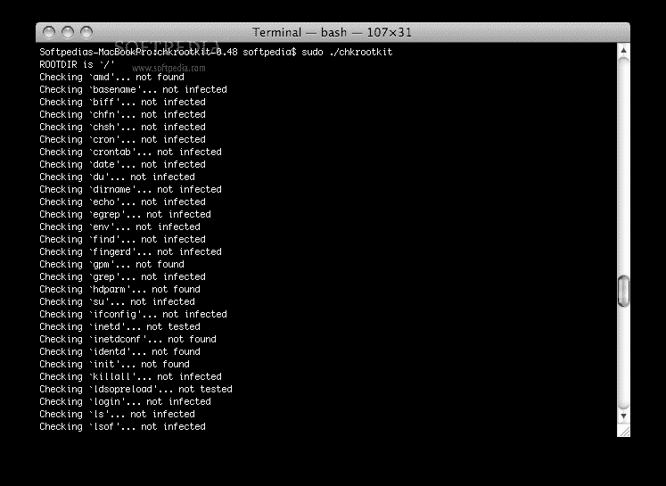
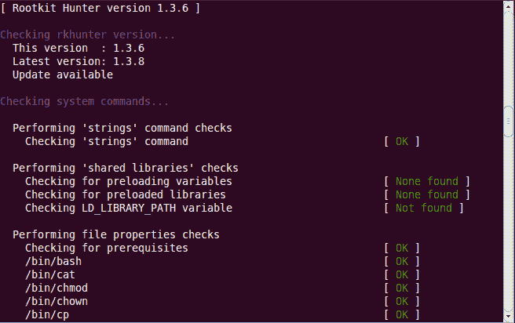
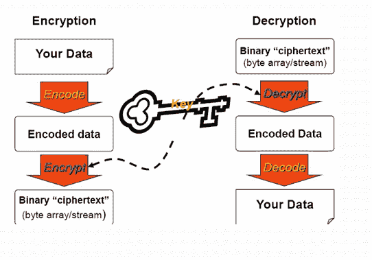
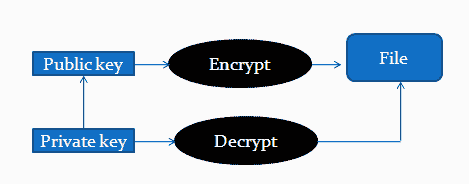
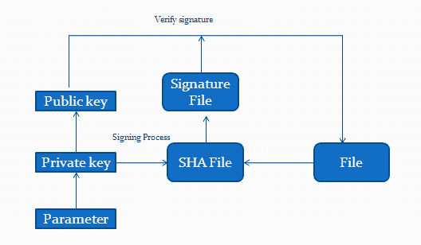

# 工业领域中的 Linux 生活指南

## 关于作者


Elaiya Iswera Lallan 先生在过去的 12 年中一直从事 IT 行业。他是 Blue Micro Solutions 的董事总经理，该公司位于 SIRIM Bhd（政府机构）。

Lallan 先生在 IT 行业拥有丰富的经验。他曾获得“联邦领地企业家”奖。在 2001 年从 Kolej Bandar Utama（与诺丁汉大学合作办学项目）获得计算机与电子工程学士学位后，他加入了一名为 MIR 的公司担任信息技术顾问。

他曾负责计算机编程任务，随后加入一家名为 Neural Manufacturing Sdn Bhd 的新公司担任软件工程师。他在为公司的旗舰产品 e-Jari（一种生物识别安全设备）创建软件技术时获得了最出色的经历。他为该设备创建了一个企业级考勤系统，该系统可供中小企业到政府部门的各类公司使用。使用该考勤系统的公司包括吉隆坡的土地局（PejabatTanah & Galian）、马来西亚合作社、Bernama 和 ITIS。他还利用 e-Jari 创建了守卫巡逻和入侵检测系统，并参与了公司的 ISO9000:2001 认证工作。凭借其丰富的工作经验和处理政府部门大型 IT 项目的良好记录，Lallan 先生于 2010 年 2 月加入了 SIRIM Bhd 下的孵化器计划。借此，Lallan 先生将 Blue Micro Solutions 的业务搬到了 SIRIM 大楼。他获得了马来西亚财政部的软件领域认证，使其能够参与政府 IT 项目的招标。他还开始雇用员工开展 IT 项目，并进军私企业、政府机构和理工学院的 IT 培训，例如 SKALI Bhd、巴生的社区学院、怡保的 Ungku Omar 理工学院以及砂拉越的古晋理工学院。他已使 Blue Micro Solutions 成为马来西亚公司认证的人力资源基金（HRDF）培训提供商。凭借其在 IT 工业和教育领域的卓越实绩，Lallan 先生近期被授予与马来西亚开放大学（OUM）合作的机会，向公众提供价格实惠的 IT 学位课程。目前，Lallan 先生正在为他的公司 Blue Micro Solutions 申请 MSC 。

随着 Blue Micro Solutions 公司向正确的方向发展，Lallan 先生开始探索海外扩张业务的机会。通过进军加拿大，他成功开设了名为 Blue Micro Canada Incorporated 的分公司。他还在多伦多的加拿大政府成功注册了该公司，并因此受邀参加政府 IT 项目招标。他还看到了通过网络研讨会进行 IT 培训的机会。他获得了 Adobe 美国公司的许可，可以使用工具 Adobe Connect 在加拿大和美国举办网络研讨会。

## 序言

本书介绍了 Linux Shell 脚本的编写以及某些工业用途重要工具的安装。

涵盖主题包括 Shell 脚本中的命令和快捷键使用、内存和 CPU 使用率监控、SSL 实现、数据跟踪以及 Linux 环境下的 Web 服务器。

本书基于真实的工业经验和实际应用编写。此外，在本书出版之前，我们丰富的 Linux 实践者已对多个组织进行过多次高级 Linux 培训。

## 第一章：Linux 基础命令

以下命令仅供新用户或初学者参考。目的是让你更加熟悉 Shell 脚本，其次是你在 Shell 脚本中需要其中一些命令。

```
$ date --help
```

查看与 `ls` 命令相关的帮助或选项（这里你将逐屏查看帮助信息，因为 `ls` 命令的帮助很大，一个屏幕无法显示完）

```
$ ls --help | more
```

语法：

```
$ ls
info bash
```

### Linux 命令列表

- `ls`: 列出文件和目录
- `ls -a`: 列出所有文件和目录
- `mkdir`: 创建目录
- `cd`: 进入目录
- `cd ~`: 进入主目录
- `cd ..`: 进入上级目录
- `pwd`: 显示当前目录路径
- `cp file1 file2`: 复制 `file1` 到 `file2`
- `mv file1 file2`: 移动或重命名 `file1` 为 `file2`
- `rm`: 删除文件
- `rmdir`: 删除目录
- `cat`: 显示文件
- `less`: 分页查看文件
- `head`: 显示文件前几行
- `tail`: 显示文件后几行
- `grep 'keyword' file`: 在文件中搜索关键词
- `wc`: 统计行数、字、字符
- `command > file`: 将标准输出重定向到文件
- `command >> file`: 将标准输出追加到文件
- `command < file`: 从文件重定向标准输入
- `command1 | command2`: 将 `command1` 的输出传递给 `command2` 的输入
- `cat file1 file2 > file0`: 合并 `file1` 和 `file2` 到 `file0`
- `sort`: 排序数据
- `who`: 列出当前用户

通常 shell（外壳）是交互式的。这意味着 shell 接受用户的命令并执行它们。但如果用户一个接一个使用命令，用户可以将这一系列命令存储到文本文件中，并告诉 shell 执行该文本而不是手动输入命令。这被称为 shell 脚本（shell script）。

### 1. 编写并执行脚本

### 2. 基础命令

### 3. 快捷方式

## 理解 Linux 内核

内核是 Linux 操作系统的核心。它处理 Linux 操作系统的资源。资源是指 Linux 中可用的设施，例如：存储数据的设施、在打印机上打印数据、内存、文件管理等。内核分配谁使用这些资源、使用多久以及何时使用。它执行你的程序以及 Linux 的驻留部分。它执行以下任务：

1) I/O 管理
2) 进程管理
3) 设备管理
4) 文件管理
5) 内存管理

## 理解 Linux Shell

计算机理解由 0 和 1 组成的语言，称为二进制。在计算早期，指令是使用二进制语言提供的，这对于我们所有人来说都难以阅读和编写。因此，在操作系统中有一个名为 Shell 的特殊程序。Shell 接受你用英语编写的指令或命令，并将其翻译成计算机的二进制语言。

你输入命令，shell 会根据其提供的用户交互环境进行转换。Shell 是一种命令语言解释器，用于从标准输入设备（键盘）或文件中读取并执行命令。Linux 可能使用以下最流行的 shell 之一（在 MS-DOS 中，Shell 的名称是 `COMMAND.COM`，用途相同，但它没有我们的 Linux Shell 强大！）

## 如何运行 Shell 脚本

由于文件的安全性，在 Linux 中，Shell 脚本的创建者默认没有执行权限。因此，如果我们想运行 shell 脚本，必须执行以下两件事：

(1) 如下使用 `chmod` 命令为我们的脚本赋予执行权限

语法：`chmod +x shell-script-name`

或者语法：`chmod 777 shell-script-name`

(2) 如下运行我们的脚本

语法：`./your-shell-program-name`

例如：

$ `./first`

在这里 `.`（点）是命令，与 shell 脚本配合使用。点(`.`) 表示当前 shell，点(`.`）之后的命令必须在同一个 shell 中执行，即无需在内存中加载另一个 shell。你也可以尝试使用以下语法来运行 Shell 脚本

语法：`bash your-shell-program-name`

或者 `/bin/sh your-shell-program-name`

例如：

$ `bash first`

$ `/bin/sh first`

注意，要运行脚本，你需要在创建脚本的同一目录下，如果你在不同的目录，脚本将无法运行（因为路径设置的原因）。例如，你的主目录是（使用 `$pwd` 查看当前工作目录）`/home/vivek`。然后你创建了一个名为 'first' 的脚本，创建后你移动到了另一个目录，假设是 `/home/vivek/Letters/Personal`。现在如果你尝试执行脚本，它将无法运行，因为脚本 'first' 在 `/home/vivek` 目录下。为了解决这个问题有两种方法：首先，每当你从其他目录运行时，指定脚本的完整路径，例如输入以下命令：

$ `/bin/sh /home/vivek/first`

## 与 Shell 相关的命令

(1) `echo [options] [string, variables...]`

在屏幕上显示文本或变量值。

选项

- `-n` 不输出末尾的新行符。
- `-e` 启用对字符串中后续反斜杠转义字符的解释：
  - `\a` 警告（铃声）
  - `\b` 退格
  - `\c` 抑制末尾的新行符
  - `\n` 新行
  - `\r` 回车
  - `\t` 水平制表
  - `\\` 反斜杠

例如：$ `echo -e "An apple a day keeps away \a\t\tdoctor\n"`

(2) 关于引号更多

有三种引号

- `"` 即双引号
- `'` 即单引号
- `` ` `` 即反引号

1. `"双引号"` - 双引号内的任何内容都会取消其字符的含义（`\` 和 `$` 除外）。
2. `'单引号'` - 单引号内的内容保持不变。
3. `` `反引号` `` 用于执行命令。

例如：

$ `echo "Today is date"`

无法打印带有今天日期的消息。

$ `echo "Today is `date`".`

现在它将打印今天的日期，如 Today is Tue Jan ..，可以看到 `date` 语句使用了反引号（另见 Shell 算术备注）。

(3) Shell 算术

Linux Shell 脚本教程

(5/19)

用于执行算术运算。例如：

$ `expr 1 + 3`

$ `expr 2 - 1`

$ `expr 10 / 2`

$ `expr 20 % 3` # 余数读作 20 mod 3，余数为 2

$ `expr 10 \* 3` # 乘法使用 `\*` 而不是 `*`，因为它是通配符

$ `echo `expr 6 + 3``

针对最后一条语句，而不是以下几点：

1) 首先，在 `expr` 关键字之前，我们使用了 `` ``（反引号）符号而不是（单引号即 `'`）符号。反引号通常位于 PC 键盘上波浪号 (`~`) 下方的按键，或者 TAB 键上方。
2) 第二，`expr` 同样也结尾。
3) 这里 `expr 6 + 3` 求值结果为 9，然后执行 `echo`

```bash
if [ $# -eq 0 ]
then
  echo "Error - Number missing form command line argument"
  echo "Syntax : $0 number"
  echo " Use to print multiplication table for given number"
  exit 1
fi

n=$1
i=1

while [ $i -le 10 ]
do
  echo "$n * $i = `expr $i \* $n`"
  i=`expr $i + 1`
done
```

保存并尝试运行：

`$ chmod +x nt1`

`./nt1 7`

## Case 语句

`case` 语句是多级 `if-then-else-fi`语句的良好替代方案。它允许你将一个变量与多个值进行匹配。它更易读易写。

### 语法：

```bash
case $variable-name in
  pattern1) command
    ...
    ..
    command;;
  pattern2) command
    ...
    ..
    command;;
  patternN) command
    ...
    ..
    command;;
  *) command
    ...
    ..
    command;;
esac
```

`$variable-name` 与模式进行比较，直到找到匹配项。然后 shell 将执行到两个相邻分号为止的所有语句。默认值是 `*)`，如果没有找到匹配项，则执行它。例如，创建如下脚本：

`$ cat > car`

```bash
#
### 如果没有给出车辆名称
### 即 -z $1 被定义且为空
#
### 如果没有命令行参数
if [ -z $1 ]
then
  rental="*** 未知车辆 ***"
elif [ -n $1 ]
then
  # 否则，将第一个参数作为租赁车辆
  rental=$1
fi

case $rental in
  "car") echo "For $rental Rs.20 per k/m";;
  "van") echo "For $rental Rs.10 per k/m";;
  "jeep") echo "For $rental Rs.5 per k/m";;
  "bicycle") echo "For $rental 20 paisa per k/m";;
  *) echo "Sorry, I can not gat a $rental for you";;
esac
```

按下 CTRL+D 保存：

`$ chmod +x car`

`$ car van`

`$ car car`

`$ car Maruti-800`

## If 语句

现在你将看到，`if` 条件用于 shell 脚本中的决策判断。如果给定的条件为真，则执行 `command1`。

### 语法：

```bash
if condition
then
  command1 # 如果条件为真或 }的退出状态为 0（零）
  ...
  ...
fi
```

这里的 condition 无非是两个值之间的比较，为了进行比较，我们可以使用 `test` 或 `[expr ]` 语句，甚至也可以使用退出状态。一个表达式无非是值、关系运算符（如 `>`, `<`, `<>` 等）和数学算术运算符（如 `+`、`-`、`/` 等）的组合。

以下是所有表达式示例：

`5 > 2`

`3 + 6`

`3 * 65` ...

输入以下命令（假设你有一个名为 `foo` 的文件）：

`$ cat foo`

`$ echo $?`

`cat` 命令在成功时返回零(0)，这可以如下所示用于 `if` 条件，编写 shell 脚本：

`$ cat > showfile`

```bash
#!/bin/sh
#
### 打印文件的脚本
#
if cat $1
then
  echo -e "\n\nFile $1, found and successfully echoed"
fi
```

现在运行它：

`$ chmod +x showfile`

`./showfile foo`

`./showfile foo`

### 条件执行

控制运算符是 `&&`（读作 AND）和 `||`（读作 OR）。一个 AND 列表具有：

### 语法：

`command1 && command2`

在这里，当且仅当 `command1` 返回零退出状态时，才会执行 `command2`。一个 OR 列表具有：

### 语法：

`command1 || command2`

在这里，当且仅当 `command1` 返回非零退出状态时，才会执行 `command2`。你可以这样使用两者：

`command1 && comnd2 如果退出状态为零 || command3 如果退出状态为非零`

在这里，如果 `command1` 执行成功，则 shell 将运行 `command2`；如果 `command1` 执行失败，则执行 `command3`。例如：

`$ rm myf && echo File is removed successfully || echo File is not removed`

如果文件 (`myf`) 成功删除（退出状态为零），则执行 `"echo File is removed successfully"` 语句，否则执行 `"echo File is not removed"` 语句（因为退出状态为非零）。

### I/O 重定向与文件描述符

如你所知，I/O 重定向用于将命令输出发送到文件或从文件中读取输入。（参见输入/输出重定向）。现在考虑以下示例：

`$ cat > myf`

这是我的文件

^D

上述命令将 `cat` 命令的输出发送到 `myf` 文件。

`$ cal`

上述命令在屏幕上打印日历，但如果你将此日历存储到文件中，请给出命令：

`$ cal > mycal`

在这里，`sort` 命令从键盘获取输入并对数字进行排序，如果我们希望从文件获取输入，请如下所示给出命令：

`$ cat > nos`

10

-20

11

2

^D

`$ sort < nos`

-20

2

10

11

我们首先创建了文件 `nos`，然后从文件中获取输入，`sort` 命令打印排序数字。这被称为输入重定向。

### 用户界面与对话工具

良好的程序/shell 脚本必须与用户交互。实现这一点有两种方法：一种是在需要输入时使用命令行，另一种是使用类似 `echo` 和 `read` 的语句从提示符读取输入到变量。例如，编写脚本：

`$ cat > user`

```bash
#
### ... (脚本内容)
```

使用 `echo` 和 `read` 从提示符读取输入到变量。

### 工作日期间的 Cron 任务

此示例在每个工作日（即排除周六和周日）的上午 9 点至下午 6 点工作时间内检查数据库状态。

```bash
00 09-18 * * 1-5 /home/ramesh/bin/check-db-status
```

- `00` – 第 `0` 分（整点）
- `09-18` – 上午 9 点、10 点、11 点、中午 12 点、下午 1 点、2 点、3 点、4 点、5 点、6 点
- `*` – 每天
- `*` – 每月


- `1-5` - 周一、周二、周三、周四和周五（每个工作日）

## 如何查看 Crontab 条目？

### 查看当前登录用户的 Crontab 条目我是 goaichat 研发的智能大模型，可以为你提供智能问答、分析和创作服务。如下段代码所示，在 Linux Shell终端输入`crontab -l`来查看您的 crontab 条目。

## 第4章：端口检查Linux 拥有许多工具可以检查哪些端口开启的，最常用的是`nmap`，它一个命令行工具，但如果用户有需要，也存在它的图形化界面。

1. TCP 和 UDP 协议的基础知识2. 查找哪个进程使用哪个端口号、目录、所有者等的技术3. rootkits 概述，用于查找真实运行的进程###了解 TCP 和 UDP端口如你所知，互联网上的每台计算机或设备都必须分配有一个唯一的数字，称为 IP 地址。这个 IP 地址用于在数百万台连接到互联网的其它计算机中识别出您的特定计算机。当信息通过互联网发送到您的计算机时，您的计算机如何接收这些信息的呢？它通过使用`TCP`或`UDP`端口来接收信息。

理解端口的一种简单方法将 IP 地址想象成一个电缆盒，而端口就是电缆盒上的不同频道。电缆公司根据与盒子相关的唯一序列号（`IP Address`）将电缆发送到您的电缆盒，然后您在不同的频道（`Ports`）接收各个节目。

端口的工作原理相同。您有一个 IP 地址，该 IP 地址上有许多端口。您总共拥有65,535 个`TCP`端口和另外65,535 个`UDP`端口。当计算机上的程序通过互联网发送或接收数据时，它会将数据发送到远程计算机的 IP 地址和特定端口，并在自己的计算机通常的随机端口上接收数据。如果它使用`TCP`协议发送接收数据，它将连接并绑定到`TCP`端口。如果它使用`UDP`协议发送接收数据，它将使用`UDP`端口。下方的图1 IP 地址拆分为许多`TCP`和`UDP`端口的表示。注意，一旦应用程序绑定到特定端口，该端口就不能被任何其他应用程序使用。先来后到。

## 网络映射器（NMAP）

`NMAP`（"Network Mapper"）是一种用于网络发现和安全审计的免费开源实用。许多系统和网络管理员还发现它对于网络清单、管理服务升级计划以及监控主机或服务的运行时间等任务非常有用。`NMAP`以新的方式使用原始 IP 数据包来确定网络上有哪些主机、这些主机提供哪些服务（应用程序名称和版本）、它们运行什么操作系统（以及操作系统版本）、使用了什么类型的数据包过滤器/防火墙，以及数十种其他特征。它的设计旨在快速扫描大型网络，但单个主机也同样有效。`NMAP`运行在所有主要的计算机操作系统上，并为 Linux、Windows 和 Mac OS X 提供了官方二进制包。

### NMAP 的安装步骤1. 安装`libpcap`库```bashwget http://www.tcpdump.org/release/libpcap-0.9.4.tar.gz./configure --prefix=/usr && makemake install```

#### 什么 libpcap？

监控软件可能使用`libpcap`捕获通过网络传输的数据包，并在较新版本中在链路层向网络传输数据包，以及获取供`libpcap`可能使用的网络接口列表。

2. 安装 NMAP 和命令用法```bashrpm -vhU http://nmap.org/dist/nmap-4.68-1.i386.rpmnmap -sS127.0.0.1```

### NMAP 扫描命令类型- `-sS`（TCP SYN 扫描）
- `-sT`（TCP连接扫描）
- `-sU`（UDP 扫描）
- `-sY`（SCTP INIT 扫描）
- `-sN; -sF; -sX`（TCP NULL、FIN 和 Xmas 扫描）
- `-sA`（TCP ACK 扫描）
- `-sW`（TCP Window 扫描）
- `-sM`（TCP Maimon 扫描）
- `-sZ`（SCTP COOKIE ECHO 扫描）
- `-sI <zombie host>[:<probeport>]`（空主机扫描）
- `-sO`（IP 协议扫描）
- `-b <FTP relay host>`（FTP继扫描）

### NMAP 工具的示例输出```text[root]# nmap -sS127.0.0.1Starting Nmap4.01 at2006-07-0617:23 BSTInteresting ports on chaos (127.0.0.1):
(下方未显示的已扫描的1668 个端口状态为: closed)

PORT STATE SERVICE21/tcp open ftp22/tcp open ssh631/tcp open ipp6000/tcp open X11```

最后通过输入以下内容执行`arp-scan`工具：

```bashchkrootkit -x | less- 查找疑字符串sudo chkrootkit -p /mnt/safe```

### CHKROOTKIT 示例输出

## RKHUNTER`RKHUNTER`一个 shell 脚本，对本地系统进行各种检查，尝试检测已知的 rootkits 和恶意软件。它还会检查命令是否被修改、系统启动文件是否被改动，并网络接口进行各种检查，包括监听应用程序的检查。

### RKHUNTER 的安装步骤在 Linux终端输入以下命令：

```bashsudo yum install rkhunter```

最后通过输入以下内容执行`arp-scan`工具：

```bashsudo rkhunter --check```

### RKHUNTER 示例输出

## 第5章：SSL证书的处理用于 TLS/SSL 使用和实现的`OpenSSL`。`OpenSSL`的`ssl`库实现了安全套接层（`SSL v2/v3`）和传输层安全（`TLS v1`）协议。

- 什么 SSL 和 TLS？
- 在 Linux 中安装 OpenSSL 软件包- 通用 OpenSSL 命令这些命令允许生成 CSR、证书、私钥并执行其他杂任务。

###1) 使用 Open SSL进行检查如果需要检查`Certificate`、`CSR`或`Private Key`中的信息，请使用这些命令；它也可以使用在线工具检查`CSRs`和证书。

###2) 使用 OpenSSL进行调试如果收到私钥与证书不匹配或安装到网站的证书不受信任的错误，请使用这些`open ssl`命令进行调试。

## 什么 OpenSSL？

`OpenSSL`一个加密工具包，实现了安全套接层（`SSL v2/v3`）和传输层安全（`TLS v1`）网络协议以及它们相关的加密标准。

## OpenSSL 用- 私钥、公钥和参数的创建与管理- 公钥加密操作- 创建`X.509`证书、`CSRs`和`CRLs`
- 使用`Ciphers`进行加密和解密- SSL/TLS 客户端和服务器测试## 加密算法类型### AES`AES` 已被美国政府采用并在全球范围内使用。它取代了数据加密标准（`DES`）。`AES`描述的算法称算法，这意味着加密和解密数据使用相同的密钥。

### DSA`DSA` 用于签名者数据生成数字签名，并用于验证者验证签名的真实性。每个签名者都有一个公钥和一个私钥。私钥用于签名生成过程，公钥用于签名验证过程。对于签名生成和验证，数据（称为消息）都通过安全哈希算法（`SHA`）进行简化。

### RSA`RSA` 涉及一个公钥和一个私钥。公钥所有人知的，用于加密消息。使用公钥加密的消息只能使用私钥解密。

## 什么称密钥加密？

称密钥算法是一类加密算法，使用相同的加密密钥明文加密和密文解密。

以下称密钥加密的图：



##称示例命令### Open SSL 工具的安装命令```bashwget http://www.openssl.org/source/openssl-fips-ecp-2.0.1.tar.gz./configmakemake install```

注意：如果你已经安装了`OpenSSL`工具，无需重复上述步骤。

对于称加密，你可以在 Linux终端输入以下命令：

加密：

```bashopenssl aes-256-cbc -salt -a -e -in plaintext.txt -out encrypted.txt```

解密这些内容可以使用：

```bashopenssl aes-256-cbc -salt -a -d -in encrypted.txt -out plaintext.txt```

## 什么非称密钥加密在非称加密方案中，任何人都可以公钥加密消息，但只有配私钥的持有者才能解密。安全性取决于私钥的秘密性。

以下非称密钥加密的图：



### DSA 示例命令#### Open SSL 工具的安装命令```bashwget http://www.openssl.org/source/openssl-fips-ecp-2.0.1.tar.gz./configmakemake install```

注意：如果你已经安装了`OpenSSL`工具，无需重复上述步骤。

现在，对于非称加密，你必须首先生成私钥并提取公钥。以下命令利用了`DSA`的加密概念。

```bashopenssl dsaparam1024 < /dev/random > dsaparam.pem```

生成私钥：

```bashopenssl gendsa dsaparam.pem -out dsa_priv.pem```

生成公钥：

```bashopenssl dsa -in dsa_priv.pem -pubout -out dsa_pub.pem```

将文本插入`foo.txt`：

```bashecho "foobar" > foo.txt```

加密`foo.txt`：

```bashsha1sum < foo.txt | awk '{print $1}' > foo.sha1```

生成签名文件：

```bashopenssl dgst -dss1 -sign dsa_priv.pem foo.sha1 > sigfile.bin```

验证签名文件：

```bashopenssl dgst -dss1 -verify dsa_pub.pem -signature sigfile.bin foo.sha1```

### DSA 签名步骤

## RSA 示例命令### Open SSL 工具的安装命令```bashwget http://www.openssl.org/source/openssl-fips-ecp-2.0.1.tar.gz./configmakemake install```

注意：如果你已经安装了`OpenSSL`工具，无需重复上述步骤。

现在，对于非称加密，你必须首先生成私钥并提取公钥。以下命令利用了`RSA`的加密概念。

```bashopenssl genrsa -des3 -out private123.key4096```

```bashopenssl rsa -in private123.key -pubout > public123.key```

一旦生成了私公钥，就可以使用加密和解密命令。

加密：

```bashopenssl rsautl -encrypt -pubin -inkey public123.key -in plaintext.txt -out encrypted.txt```

解密：

```bashopenssl rsautl -decrypt -inkey private123.key -in encrypted.txt -out plaintext1.txt```

`X.509`证书将名称与公钥值绑定在一起。证书的作用将公钥与`X.509`证书中包含的身份关联。

### 公钥的完整性安全应用程序的身份验证取决于应用程序证书中公钥值的完整性。如果伪造者用自己的公钥替换掉公钥，它就可以冒充真实的应用程序并获取安全数据。

为了防止此类攻击，所有证书都必须由认证机构（`CA`）签名。`CA`一个受信任的节点，用于确认证书中公钥值的完整性。

### 数字签名`CA`通过在证书上添加其数字签名证书进行签名。数字签名用`CA`的私钥编码的消息。`CA`的公钥通过分发`CA`证书提供给应用程序。应用程序通过`CA`的公钥解码`CA`的数字签名，来验证证书是否已有效签名。

##生成证书的命令以下使用`openssl`工具生成和练习制作证书的步骤和命令。

#### 第1 步：生成私钥```bashopenssl genrsa -des3 -out server.key1024```

#### 第2 步：生成 CSR（证书签名请求）

```bashopenssl req -new -key server.key -out server.csr```

#### 第3 步：生成自签名证书```bashopenssl x509 -req -days365 -in server.csr -signkey server.key -out server.crt```

### 如何验证私钥是否匹配证书？

要验证私钥是否与其证书匹配，你需要比较证书的模数与私钥的模数。

请执行以下命令查看证书的模数：

```bashopenssl x509 -noout -modulus -in server.crt | openssl md5```

请执行以下命令查看私钥的模数：

```bashopenssl rsa -noout -modulus -in server.key | openssl md5```

#### 从密钥中移除密码：

```bashcp server.key server.key.orgopenssl rsa -in server.key.org -out server.key```

## 第6章：网络包追踪数据包嗅探获取通过本地网络传输的任何数据，并寻找可能间谍活动有用信息的过程。系统管理员通常使用数据包嗅探来排除网络问题（例如，找出为什么网络流量如此缓慢），或检测入侵或被破解了密码的工作站（例如，在没有连接 IRC 客户端的情况下，工作站持续连接到端口6667 的远程机器），这就是为什么这种分析最初为网络扫描设计的。

### 什么 WiresharkWireshark一种网络数据包分析器。网络数据包分析器会尝试捕获网络数据包，并尽可能详细地显示包数据。你可以将网络数据包分析器想象为用于检查电缆内部情况的测量设备，就像电工使用电压表来检查电缆内部情况一样。

过去，这类工具要么非常昂贵，要么专利所有的，或者两者都是。然而，随着 Wireshark 的出现，这一切都改变了。Wireshark可能目前最好的开源数据包分析器之一。

### 一些预期用途以下人们使用 Wireshark 的一些示例：

- 网络管理员用它来排除网络问题- 网络安全工程师用它检查安全问题- 开发者用它来调试协议实现- 人们用它学习网络协议内部原理### Wireshark 的安装步骤在 Linux终端输入以下命令：

```bashwget http://sourceforge.net/projects/wireshark/files/src/all -versions/wireshark-1.0.3.tar.gz/downloadgunzip -d wireshark-1.0.3.tar.gztar -xvf wireshark-1.0.3.tar.gz```

最后通过输入以下内容执行`wireshark`工具：

```bashtcpdump -i eth1```

## 第7章：IPV6 与 IPV4 概述互联网地址已经耗尽。也许你听过新闻：最后的`IPv4`网络地址块已经分配完毕。自互联网诞生以来支持互联网协议地址的基础底层技术即将耗尽。

不过，一项新技术将取代它。`IPv4`的继承者`IPv6`，这个系统不仅提供多得数值地址，还将简化地址分配和额外的网络安全功能。

尽管，从`IPv4`到`IPv6`的过渡可能艰难的。大多数人并不熟悉`IPv4`和`IPv6`，更不用说切换到`IPv6`他们生活可能产生的影响。

###介绍 IPV6这是一个典型的`IPv4`地址：

`192.168.0.1`

作为32 位值的`IPv4`地址（2 的4 次方）。

这是一个`IPv6`地址格式：

`2001:0db8:0000:0000:a526:2962:3960:c0e1`

`IPv6`地址的大小为128 位到512 位（2 的8 次方）。

### IPv6 零压缩省略以下`IPv6`地址的导导零：

`2001:0db8:0000:0000:0007:0062:0060:0e1`

变为：

`2001:db8:0:0:7:62:60`

为了进一步缩短地址，我们可以压缩零：`2001:db8:0:0:7:62:60`。

### IPv6 前缀


`IPv6` 的开头被称为网络前缀。`2001:0db8:0000:0000:a526:2962:3960:c0e1` 是一个示例。`IPv6` 地址的大小为 128 位。`2001:0db8:0000:0000:0007:0062:0060:0e1` 变为 `2001:db8:0:0:7:62:60`。

`IPv6` 地址的大小为 128 位。`2001:0db8:0000:0000:0007:0062:0060:0e1` 变为 `2001:db8:0:0:7:62:60`。

`IPv6` 地址的大小为 128 位。`2001:0db8:0000:0000:0007:0062:0060:0e1` 变为 `2001:db8:0:0:7:62:60`。

`IPv6` 地址的大小为 128 位。`2001:0db8:0000:0000:0007:0062:0060:0e1` 变为 `2001:db8:0:0:7:62:60`。

`IPv6` 地址的大小为 128 位。`2001:0db8:0000:0000:0007:0062:0060:0e1` 变为 `2001:db8:0:0:7:62:60`。

`IPv6` 地址的大小为 128 位。`2001:0db8:0000:0000:0007:0062:0060:0e1` 变为 `2001:db8:0:0:7:62:60`。

### IPv6 网络地址

在处理 `IPv6` 地址时，`IPv6` 前缀表示网络。`IPv6` 地址的大小为 128 位。`IPv6` 是 `IPv4` 的事实继承者。`IPv6` 地址的大小为 128 位。`IPv6` 是标准。

`2001:0db8:0000:0000:0007:0062:0060:0e1` 变为 `2001:db8:0:0:7:62:60`。

### IPv6 全局地址

`IPv6` 地址的大小为 128 位。`2001:0db8:0000:0000:0007:0062:0060:0e1` 变为 `2001:db8:0:0:7:62:60`。

### IPv6 站点地址

`IPv6` 地址的大小为 128 位。`2001:0db8:0000:0000:0007:0062:0060:0e1` 变为 `2001:db8:0:0:7:62:60`。

### IPv6 链路本地地址

`IPv6` 地址的大小为 128 位。`2001:0db8:0000:0000:0007:0062:0060:0e1` 变为 `2001:db8:0:0:7:62:60`。

### IPv6 组播地址

`IPv6` 地址的大小为 128 位。`2001:0db8:0000:0000:0007:0062:0060:0e1` 变为 `2001:db8:0:0:7:62:60`。

### IPv6 唯一本地地址

`IPv6` 地址的大小为 128 位。`2001:0db8:0000:0000:0007:0062:0060:0e1` 变为 `2001:db8:0:0:7:62:60`。

### IPv6 任播地址

`IPv6` 地址的大小为 128 位。`2001:0db8:0000:0000:0007:0062:0060:0e1` 变为 `2001:db8:0:0:7:62:60`。

- `www.linuxquestions.org/questions/linux-networking-3/trouble-generating-ssl-certificates-116973/`
- `blog.didierstevens.com/2008/12/30/howto-make-your-own-cert-with-openssl/`
- `www.devco.net/archives/2006/02/13/public_-_private_key_encryption_using_openssl.php`
- [http://bsdsupport.org/2007/01/q-how-do-i-use-openssl-to-encrypt-files/](http://bsdsupport.org/2007/01/q-how-do-i-use-openssl-to-encrypt-files/)

封面 Logo 由 Larry Ewing 绘制
