# LPI Linux Essentials 学习指南


> “铁磨不成刃，彼此彼此切。” 箴言 27:17

## 致谢

首先，感谢 `Syex` 团队的辛勤工作。感谢 `Kevin Lewis` 提供的建议和指导。感谢 `Stephanie Barton` 提供的建议，让内容更具可读性。感谢技术编辑 `Jason Eckert` 的所出的卓越工作。感谢 `Carole at Waters Productions` 的安排。感谢 `Christine` 提供的工作。感谢她的开发编辑 让我们提供了机会。感谢她的丈夫 `Timothy` 提供的鼓励和乐于倾听。

## 关于作者

`Christine Bresnahan` 在 30 多年前就开始在 IT 行业担任系统管理员。她是 `Ivy Tech College` 的兼职教授，在那里教授 `Linux` 和 `Python` 课程。她还撰写了书籍。

`Richard Blum` 已经在 IT 行业工作了 30 多年，担任系统和网络管理员。他是 `Linux` 的在线讲师。当不是电脑迷时，`Rich` 喜欢和他的妻子 `Barbara` 以及两个女儿 `Katie` 和 `Jessica` 在一起。

## 内容

### 简介

#### 第 1 章 选择操作系统

- 什么是操作系统？
- 什么是内核？
- 还有哪些可以识别操作系统？
- 调查用户界面
- 使用文本模式用户界面
- 使用图形用户界面
- `Linux` 在操作系统世界处于什么位置？
- `Linux` 与 `Unix` 的对比
- `Linux` 与 `macOS` 的对比
- `Linux` 与 `Windows` 的对比
- 什么是发行版？
- 创建完整的 `Linux` 操作系统
- `Linux` 发行版总结
- 理解发布周期
- 嵌入式 `Linux`
- 云端 `Linux`
- 什么是云计算？
- 什么是云服务？
- 总结
- 考试要点
- 复习题

#### 第 2 章 理解软件许可

- 调查软件许可
- 探索版权保护与软件
- 使用许可修改版权条款
- 查看自由软件基金会
- 理解 `FSF` 哲学
- 自由软件和 `GPL`
- 查看开源倡议
- 理解开源哲学
- 定义开源软件
- 查看知识共享许可
- 使用开源许可
- 理解开源许可
- 理解开源商业模式

#### 第 3 章 调查 Linux 的原理与哲学

- 历久 `Linux`
- 理解 `Linux` 的起源
- 观察当今的 `Linux` 世界
- 使用开源软件
- 理解基础开源原理
- 作为软件集成器的 `Linux`
- 理解操作系统的角色
- 观察嵌入式计算机
- 探索桌面级和笔记本电脑
- 调查服务器计算机
- 总结
- 考试要点
- 复习题

#### 第 4 章 使用常用的 Linux 程序

- 使用 `Linux` 桌面环境
- 选择一个桌面环境
- 启动程序
- 使用文件管理器
- 使用生产力软件
- 为工作寻找合适的工具
- 使用网络浏览器
- 使用邮件客户端
- 使用办公工具
- 使用多媒体应用
- 使用 `Linux` 进行云计算
- 使用移动应用
- 使用服务器程序
- 识别常见的服务器协议和程序
- 专注于 `Web` 服务器
- 安装和启动服务器
- 加固服务器
- 管理编程语言
- 选择编译型语言还是解释型语言
- 识别常见的编程语言
- 处理软件包
- 理解软件包
- 识别常见的包工具
- 总结
- 考试要点
- 复习题

#### 第 5 章 熟悉命令行

- 启动命令行
- 启动终端
- 登录文本模式控制台
- 运行程序
- 理解文本模式程序的语法
- 运行文本模式程序
- 运行 `GUI` 程序
- 在后台运行程序
- 使用 `Shell` 特性
- 使用命令补全
- 使用命令历史
- 使用 `Man Pages` 获取帮助
- 理解 `Man Pages` 的用途
- 按节号定位 `Man Pages`
- 搜索 `Man Page`
- 阅读 `Man Pages`
- 使用 `less`
- 使用 `Info Pages` 获取帮助
- 理解 `Info Pages` 的用途
- 阅读 `Info Pages`
- 查找额外的文档
- 在电脑上定位程序文档
- 在线定位程序文档
- 咨询专家
- 总结
- 考试要点
- 复习题

#### 第 6 章 管理硬件

- 了解你的 `CPU`
- 理解 `CPU` 家族
- 识别你的 `CPU`
- 识别主板功能
- 确定你的电源尺寸
- 理解磁盘问题
- 磁盘接口
- 分区磁盘
- 理解文件系统问题
- 使用可移动磁盘和光盘
- 管理显示器
- 理解 `X` 的角色
- 使用常用的显示硬件
- 处理 `USB` 设备
- 管理驱动程序
- 理解驱动程序的类型
- 定位并安装驱动程序
- 总结
- 考试要点
- 复习题

#### 第 7 章 管理文件

- 理解文件的去向
- 用户文件与系统文件
- 文件系统层次级标准
- 重要的目录及其内容
- 探索文件和目录
- 获取文件列表
- 切换目录
- 使用绝对和相对文件引用
- 操作文件
- 创建文件
- 复制文件
- 移动和重命名文件
- 使用链接
- 删除文件
- 使用通配符
- 理解大小敏感性
- 操作目录
- 创建目录
- 删除目录
- 管理目录
- 总结
- 考试要点
- 复习题

#### 第 8 章 搜索、提取和存档数据

- 使用正则表达式
- 搜索并提取数据
- 使用 `grep`
- 使用 `find`
- 使用 `wc`
- 使用 `cut`
- 使用 `sort`
- 使用 `cat`
- 重定向输入和输出
- 使用基础重定向运算符
- 使用管道
- 生成命令行
- 存档数据
- 使用 `tar`
- 使用压缩
- 使用 `zip`
- 总结
- 考试要点
- 复习题

#### 第 9 章 探索进程和数据

- 理解进程管理
- 使用包管理
- 管理 `Linux` 系统
- 管理 `Debian` 系统
- 理解层次结构
- 识别运行中的进程
- 使用 `top`
- 使用 `ps`
- 内存使用
- 使用日志
- 使用内核
- 使用缓冲区
- 总结
- 考试要点
- 复习题

#### 第 10 章 编辑文件

- 理解编辑器
- 选择编辑器
- 使用 `nano`
- 使用 `vi`
- 理解模式


## 第3章 调查 Linux 的原理与哲学

- 使用开源软件
- 理解基础开源原理
- 作为软件集成器的 `Linux`
- 理解操作系统的角色
- 观察嵌入式计算机
- 探索桌面级和笔记本电脑
- 调查服务器计算机
- 总结
- 考试要点

## 第4章 使用常用的 Linux 程序

- 识别常见的包工具
- 总结

## 第5章 熟悉命令行

## 第6章 管理硬件

- 了解你的 `CPU`
- 理解 `CPU` 家族
- 识别你的 `CPU`
- 识别主板功能
- 确定你的电源尺寸
- 理解磁盘问题
- 磁盘接口
- 分区磁盘
- 理解文件系统问题
- 使用可移动磁盘和光盘
- 管理显示器
- 理解 `X` 的角色
- 使用常用的显示硬件
- 处理 `USB` 设备
- 管理驱动程序
- 理解驱动程序的类型
- 定位并安装驱动程序
- 总结
- 考试要点
- 复习题

## 第7章 管理文件

- 理解文件的去向
- 用户文件与系统文件
- 文件系统层次级标准
- 重要的目录及其内容
- 探索文件和目录
- 获取文件列表
- 切换目录
- 使用绝对和相对文件引用
- 操作文件
- 创建文件
- 复制文件
- 移动和重命名文件
- 使用链接
- 删除文件
- 使用通配符
- 理解大小敏感性
- 操作目录
- 创建目录
- 删除目录
- 管理目录
- 总结
- 考试要点
- 复习题

## 第8章 搜索、提取和存档数据

- 使用正则表达式
- 搜索并提取数据
- 使用 `grep`
- 使用 `find`
- 使用 `wc`
- 使用 `cut`
- 使用 `sort`
- 使用 `cat`
- 重定向输入和输出
- 使用基础重定向运算符
- 使用管道
- 生成命令行
- 存档数据
- 使用 `tar`
- 使用压缩
- 使用 `zip`
- 总结
- 考试要点
- 复习题

## 第9章 探索进程和数据

- 理解进程管理
- 使用包管理
- 管理 `Linux` 系统
- 管理 `Debian` 系统
- 理解层次结构
- 识别运行中的进程
- 使用 `top`
- 使用 `ps`
- 内存使用
- 使用日志
- 使用内核
- 使用缓冲区
- 总结
- 考试要点
- 复习题

## 第10章 编辑文件

- 理解编辑器
- 选择编辑器
- 使用 `nano`
- 使用 `vi`
- 理解模式
- 使用 `vi`
- 保存 `vi`
- 退出 `vi`
- 编辑文件
- 总结
- 考试要点
- 复习题

## 第11章 创建脚本

- 启动脚本
- 使用参数
- 使用变量
- 使用条件表达式
- 使用循环
- 使用函数
- 总结
- 考试要点
- 复习题

## 第12章 理解基础安全

- 理解安全
- 理解安全性
- 理解权限
- 理解文件权限
- 理解 `root`
- 理解 `root` 权限
- 总结
- 考试要点
- 复习题

## 第13章 创建用户和组

- 创建用户
- 设置密码
- 创建组
- 管理用户
- 管理组
- 删除用户
- 删除组
- 总结
- 考试要点
- 复习题

## 第14章 设置所有权权限

- 设置所有权
- 设置权限
- 在文件管理器中设置所有权
- 在 `Shell` 中设置所有权
- `umask`
- 使用特殊位
- 使用粘滞位
- 使用特殊权限
- 隐藏文件
- 查看目录
- 总结
- 考试要点
- 复习题

## 第15章 管理网络连接

- 配置网络功能
- 图形化工具
- 命令行工具
- 基础网络排查
- 发送数据
- 查找主机信息
- 高级网络排查
- `netstat` 命令
- 检查接字
- 总结
- 考试要点
- 复习题

# 引言

你手中的这本书为 `Linux` 操作系统提供了一个坚实的入门介绍。正如其书名所示，它将为你提供开始使用和管理这一强大操作系统（`OS`）的必备知识，这个操作系统在当今的计算世界中是至关重要的。

`Linux` 专业协会（`Linux` Professional Institute，简称 `LPI`，`lpi.org`）提供了一系列 `Linux` 认证。这些认证旨在为雇主提供技能水平证明；如果你通过了某项认证，说明你有能力在 `Linux` 计算机上执行相关任务。`LPI` 考试包括 `Linux` Essentials、`LPIC-1`、`LPIC-2` 和 `LPIC-3` 系列。正如名称所示，`Linux` Essentials 是四项考试中级别最低的一项，涵盖了使用和管理 `Linux` 计算机的最基础任务。

本书的目的是帮助你通过 2019 年 1.6 版本的 `Linux` Essentials 考试。`Linux` Essentials 考试旨在证明你具备以下能力：

- 理解开源行业
- 了解最流行的开源应用程序知识
- 理解 `Linux` 的主要组件
- 能够在 `Linux` 命令行下工作
- 具备安全和管理相关概念的基础知识
- 知道去哪里寻求帮助

# 为什么要获得 Linux 认证？


随着 `Linux` 的日益普及（以及 `Linux` 相关岗位的增加），炒作也随之而来。在围绕 `Linux` 的各种炒作中，雇主很难区分员工是精通 `Linux` 的用户，还是仅仅会背术语的人。这正是 `Linux` 认证大显用场的地方。

获得 `Linux Essentials` 认证，你将证明自己是一个熟悉 `Linux` 平台及其应用程序的 `Linux` 用户，并可以使用任何类型的 `Linux` 系统。`LPI` 创建 `Linux Essentials` 是为了让雇主有信心，确信他们通过考试的员工将具备完成工作所需的技能。

# 如何获得认证

任何通过 `LPI Linux Essentials` 强制性考试的人员都可以获得该认证。考试的当前版本为 `1.6` 版本，代号为 `010-160`。

考试由 `Pearson VUE` 管理。你可以在任何 `Pearson VUE` 考试中心参加考试。如果你通过了，将通过邮件收到一份证明你已通过考试的证书。

要向 `Pearson VUE` 注册考试，请访问 `home.pearsonvue.com` 进行在线注册。你需要提供你的姓名。

# 谁应该买这本书

你可能是为了正在修读的课程被分配了这本书，但如果没有，它对于自学或作为其他资源的补充仍具有价值。如果你是 `Linux` 新手，这本书涵盖了你从零开始学习该操作系统所需的材料。如果你从未用过 `Linux`，可以拿起这本书并从中学习。如果你已经熟悉 `Linux`，那么在这些页面中描述的许多主题上，你将已经占先机。

本书的编写假设是你对计算机有基本的常识，例如如何使用键盘、如何将磁盘插入光驱驱动器等。你甚至可能已经以大量的方式使用过计算机——也许作为一个普通用户——或者可能使用过 `Windows` 或 `macOS`。我们并不假设你拥有如何使用 `Linux` 系统的知识。

准备一个可用的 `Linux` 系统进行同步也将帮助。每一章都包含一个简单的练习，将引导你了解本章介绍的基础概念。这为你提供了至关重要的实践经验，无论是为了通过考试，还是为了在 `Linux` 世界中取得良好表现。

尽管 `LPI Linux Essentials` 考试不取决于特定的 `Linux` 发行版，但要编写适用于所有 `Linux` 发行版的练习是不可能的。尽管如此，书中的练习假设你拥有一个与附录 B “设置 `Linux` 环境”中描述类似的学习环境。

# 本书的结构

本书由 `15` 章组成，外还有引言以及引言后的评估测试。章节的安排如下：

- 第一章“选择操作系统”提供了对操作系统世界的俯景视角。本章将帮助你准确理解 `Linux` 到底是什么，以及你可能想要使用它的什么情况。

- 第二章“理解软件许可”描述了版权法，以及 `Linux` 和非 `Linux` 操作系统均用于扩展或限制用户使用复制软件权利的许可协议。

- 第三章“研究 `Linux` 的原理和哲学”涵盖了 `Linux` 的历史以及 `Linux` 和其他系统的常用方式。

- 第四章“使用 `Linux` 程序”查看了 `Linux` 软件的主要类别，并对一些最流行的 `Linux` 程序提供了提示。

- 第五章“认识命令行”探讨了如何使用命令控制 `Linux`。虽然许多新用户发现这个话题令人生畏，但命令行控制是非常重要的。

- 第六章“硬件管理”提供了关于如何在 `Linux` 中选择和使用硬件的建议。具体主题从中央处理器（`CPU`）到设备驱动程序。

- 第七章“文件管理”描述了如何移动、重命名和编辑文件。目录只是特殊类型的文件，因此在这里也被涵盖了。

- 第八章“搜索、提取和归档数据”总结了你可以在计算机上查找数据的工具，以及你如何为了数据传输和备份目的操作归档文件。

- 第九章“探索进程和进程数据”描述了如何在 `Linux` 中安装程序，以及如何调整运行程序的优先级或终止选定的程序。

- 第十章“编辑文件”引入了编辑文本文件的主题。这包括 `nano` 和 `vi` 文本模式编辑的基本功能，以及一些常见的配置文件和格式化文本规范。

- 第十一章“创建脚本”描述了如何创建脚本，脚本是运行的程序。你可以使用脚本来自动化手动任务。

- 第十二章“理解基础安全”引入了安全主题，这对于理解 `Linux` 多用户性质非常重要。它还涵盖了 `Linux` 用于大多数管理任务的超级权限。

- 第十三章“创建用户和组”涵盖了用于创建、修改和删除账户和组的程序。

- 第十四章“设置所有权和权限”描述了如何控制哪些用户可以访问文件。用户和组、所有权和权限控制着你计算机的安全。

- 第五章“管理网络连接”涵盖了使用网络的关键主题，以及一些基础网络措施。

每一章的开头都列出了所涵盖的目标。书中并没有按照顺序涵盖这些目标。因此，不要对书中的某些顺序感到奇怪。在每一章的末尾，你会发现一些可以准备考试的元素：

`章节要点` 本部分总结了章节涵盖的信息。

`习题` 如果你不能正确回答这些问题的 `80%`，请回顾该章节，或者至少回顾你感到困难的部分。

书中的习题、评估测试以及其他测试元素并非源自实际考试，因此不要死记这些问题的答案，也不要假设这样做就能让你通过考试。你应该学习书中描述的基础知识。这将让你能够回答书中提出的问题并通过考试。学习基础知识在工作中受益——这也是认证最终的目标。

为了充分利用这本书，你应该从头到尾阅读每一章，并通过章节末的元素检查你的掌握程度和理解情况。即使你已经熟悉某个主题，也不应该跳过该章节；`Linux` 的复杂性决定了完成任务通常有多种方法，即使你在该领域很精通，也可能学到新东西。

## 本书使用的约定

本书使用了某些排版样式，以帮助你快速识别重要信息，并避免对屏幕提示等词汇的含义产生混淆。请关注以下样式：

- *斜体文本* 用于标识章节中首次详细描述的关键词术语。（斜体也用于强调）。

- *等宽字体* 表示配置文件的内容、在文本模式 `Linux` 提示符中显示的消息、文件名、文本模式下的命令名称以及 `Internet` `URL`。

- *斜体等宽字体* 表示变量——即在不同系统或命令之间存在差异的信息，例如客户端计算机的名称或 `ID` 号。

- **粗体等宽字体** 表示你需要输入到计算机中的信息，通常在 `Linux` 提示符下。这些文本也可以是斜体，以表示你应该为你的系统替换适当的值。（当命令单独成行显示时，命令前会有非粗体的等宽 `$` 或 `#` 命令行提示符，分别表示以普通用户或系统管理员身份使用）。

除了这些可以应用于单个单词或整个段落的文本外，还有一些约定用于突出显示文本段落：

> 注释（`Note`）表示有用或有趣的信息，但这些信息与正文关系较小。例如，注释可能与少数网络有关，或者可能引用了一个已过时的功能。

> 提示（`Tip`）提供了可以节省你的时间或避免沮丧的信息，这些信息可能并不显而易见。提示可能会描述如何绕过限制，或如何使用某项功能执行特殊任务。

> 警告（`Warnings`）描述了潜在的陷阱或危险。如果你忽视警告，可能会花费大量时间修复错误，甚至可能需要从头开始恢复整个系统。

## 练习 (EXERCISE)

练习是你应该在自己的计算机上尝试的程序，以帮助学习章节中的内容。不过，不要局限于练习中描述的程序！尝试其他的命令和程序，以真正学习 `Linux`。

## 考试目标

在每一个计算机行业考试的背后，你都可以找到考试目标——即考试开发人员希望确保你具备能力的广泛主题。官方考试目标列在此处（它们也打印在涵盖这些内容的章节开头）。

> 考试目标可能会根据 `LPI` 的决定随时更改，恕不另行通知。请访问 `LPI` 网站 (`lpi.org`) 获取最新的考试目标列表。

## 考试 010-160 目标

以下是你通过 `Linux Essentials 010-160` 考试必须掌握的领域。该考试分为五个主要主题，每个主题有三到八个目标。每个目标都有一个相关的权重，这反映了其对整个考试重要性。请参考 `LPI` 网站查看与每个目标相关的权重。五个主要主题如下：

## 学科领域 (Subject Area)

- `1` `Linux` 社区与开源职业

- `2` 在 `Linux` 系统中寻找路径

- `3` 命令行行的力量

- `4` `Linux` 操作系统

- `5` 安全与文件权限

## 主题 1：Linux 社区与开源职业

### 1.1 Linux 演进与主流操作系统 

（第 `1` 章和第 `3` 章）

- `Linux` 开发和主要发行版的知识

- 关键知识领域：

  - 发行版

  - 嵌入式系统

  - 云端 `Linux`

### 1.2 主要开源应用程序（第 4 章）

- 对主流应用程序及其用途和开发的认知

- 关键知识领域：

  - 桌面应用程序

  - 服务端应用程序

  - 开发工具

  - 软件包管理工具与存储库

### 1.3 开源软件与许可（第 2 章）

- 开源社区与用于业务的开源软件许可

- 关键知识领域：

  - 开源哲学

  - 开源许可

  - 自由软件基金 (`FSF`)、开源倡议 (`OSI`)

### 1.4 ICT 技能与在 Linux 中工作（第 4 章和第 5 章）

- 基础信息通信技术 (`ICT`) 技能与在 `Linux` 中工作

- 关键知识领域：

  - 桌面技能

  - 进入命令行

  - `Linux` 的行业用途、云计算与虚拟化

## 主题 2：在 Linux 系统中寻找路径

### 2.1 命令行基础（第 5 章、7 章和第 11 章）

- 使用 `Linux` 命令行的基础

- 关键知识领域：

  - 基础 `Shell`


- 命令行语法

- 变量

- 引用符号 (Quoting)

### 2.2 使用命令行获取帮助（第 5 章）

- 运行帮助命令以及在各种帮助系统中导航

- 关键知识领域：

  - 手册页 (Man pages)

  - Info 页 (Info pages)

### 2.3 使用目录和列出文件（第 7 章）

- 在家目录和系统目录之间导航并列出各种位置的文件

- 关键知识领域：

  - 文件、目录

  - 隐藏文件和目录

  - 家目录

  - 绝对路径与相对路径

### 2.4 创建、移动和删除文件（第 7 章）

- 在家目录下创建、移动和删除文件及目录。

- 关键知识领域：

  - 文件、目录

  - 大小敏感

  - 简单通配符 (Globbing)

## 主题 3：命令行行的力量

### 3.1 在命令行上归档文件（第 8 章）

- 在命令行上进行归档

- 关键知识领域：

  - 文件、目录

  - 压缩

### 3.2 搜索与提取数据（第 5 章和第 8 章）

- 搜索并提取数据

- 关键知识领域：

  - 管道 (Pipes)

  - I/O 重定向

### 3.3 将命令转换为脚本（第 10 章和第 11 章）

- 将命令转换为简单脚本

- 关键知识领域：

  - Shell 脚本

  - 变量

## 主题 4：Linux 操作系统

### 4.1 选择操作系统（第 1 章）

- 主流操作系统和发行版的知识

- 关键知识领域：

  - Windows、OS X 与 Linux 的区别

  - 生命周期

### 4.2 理解硬件（第 6 章）

- 对组件的熟悉程度

- 关键知识领域：

  - 主板、处理器、电源、外围设备

  - 硬盘、固态硬盘

### 4.3 数据存储位置（第 7 章和第 9 章）

- Linux 系统中各种类型信息的存储

- 关键知识领域：

  - 进程

  - 内存地址

### 4.4 网络中的计算机（第 15 章）

- 局域网 (LAN) 计算机的基础

- 关键知识领域：

  - 路由器

  - DNS 配置

## 主题 5：安全与文件权限

### 5.1 识别用户类型（第 12 章）

- Linux 系统中的各种用户类型

- 关键知识领域：

  - Root 用户与标准用户

### 5.2 创建用户与组（第 13 章）

- 在 Linux 系统中创建用户和组

- 关键知识领域：

  - 用户命令

### 5.3 管理权限与所有权（第 14 章）

- 理解并操作文件权限与所有权

- 关键知识领域：

  - 文件权限与所有权

  - 目录权限与所有权

### 5.4 特殊目录与文件（第 7 章）

- 包含特殊权限的特殊目录和文件

- 关键知识领域：

  - 临时文件和目录

  - 符号链接

## 测试

1. Linux 发行版包含哪些使其独独特的元素？（多选）

A. 内核

B. 应用程序

C. 用户组账户

D. GNU 工具

E. 软件包管理工具

2. Linux 支持哪些图形界面？（多选）

A. macOS

B. GNOME

C. KDE Plasma

D. Metro

E. Cinnamon

3. 对或否：自由软件基金 (FSF) 倡导自由软件，这意味着你不应该为软件付费。

4. 下列哪些是开源软件许可？（多选）

A. MIT

B. GPL

C. BSD

D. Creative Commons

E. Apache

5. Linux 系统的三种常见类别是什么？

A. 嵌入式

B. 图形

C. 桌面

D. 工业

E. 服务器

6. Linux 最近有哪些哪些变化？（多选）

A. 内核的改进

B. 支持工具的改进

C. 创建了新的支持工具

D. 创建了新的发行版

E. 现在安装 Linux 需要付费。

7. 以下哪些软件包件允许你使用 Linux 搭建私有云？（选择所有项）

- A. Nextcloud

- B. Zoho

- C. ownCloud

- D. Castero

- E. Kdenlive

8. 正确或错误：`dpkg` 和 `rpm` 包管理工具都是低级工具。

9. 正确或错误：在终端中工作时，普通用户的 `shell` 提示符通常以美元符号（`$`）或大于号（`>`）结尾。

10. 以下哪些命令允许搜索 `man` 页（帮助手册）中的关键词 `copy`？（选择所有项）

- A. `apropos copy`

- B. `man -k copy`

- C. `whereas copy`

- D. `what copy`

- E. `locate copy`

11. 原始 `ext` 文件系统的当前版本是？

- A. `extfs`

- B. `ext2fs`

- C. `ext3fs`

- D. `ext4fs`

- E. `btrfs`

12. 哪些命令可以显示运行在你的 Linux 系统上的 `CPU` 信息？（选择所有项）

- A. `uname -a`

- B. `lusb`

- C. `lspci`

- D. `lscpu`

- E. `man cpu`

13. `/usr` 文件夹中通常存储什么类型的文件？

- A. 用户数据文件

- B. 配置文件

- C. 关键系统文件

- D. 非关键系统程序和数据文件

- E. 程序库文件

14. 哪个通配符可以匹配任意字符或一组字符？

- A. `*`

- B. `?`

- C. `[]`

- D. `-`

- E. `.`

15. 以下哪些字符被认为可以用于正则表达式匹配规则？（选择所有项）

- A. `*`

- B. `[]`

- C. `>`

- D. `?`

- E. `.`

16. 哪个 `tar` 选项用于使用 `xz` 压缩将归包压缩为 `tarball`？

- A. `-X`

- B. `-j`

- C. `-z`

- D. `-v`

- E. `-J`

17. 你可以使用哪些命令查看 `MySQL` 数据库服务器是否正在你的系统上运行？（选择所有项）

- A. `ls`

- B. `ps`

- C. `top`

- D. `free`

- E. `yum`

18. 哪个命令行显示你 Linux 系统的整体内存使用情况？

- A. `ps`

- B. `top`

- C. `free`

- D. `ls`

- E. `yum`

19. 在基于文本的 `tty` 终端命令行上你可以使用以下哪些文本编辑器？（选择所有项）

- A. `vi`

- B. `nano`

- C. `edit`

- D. `Kate`

- E. `emacs`

20. `shell` 脚本的第一行是 `#!/bin/bash`。这意味着什么？

- A. 脚本不会在大多数 Linux 系统上运行。

- B. 脚本需要 `Bash` `shell` 运行。

- C. 脚本需要 `C` `shell` 运行。

- D. 脚本可以在 `Unix` 系统上运行。

- E. 脚本可以在不指定脚本文件完整路径的情况下运行。

21. 你可以使用哪个变量在脚本完成后查看退出状态？

- A. `$?`

- B. `$0`

- C. `$1`

- D. `$PATH`

- E. `$exit`

22. 以下哪一项在现代 Linux 发行版中通常持有账户密码？

- A. `/etc/passwd`

- B. `/bin/bash`

- C. `/etc/shadow`

- D. `/etc/group`

- E. `/sbin/nologin`

23. A(n) `____` 账户是大多数普通用户作为其账户类型的。

- A. `home`

- B. `system`

- C. `administrative`

- D. `standard`

- E. `root`

24. 当你使用 `useradd` 工具创建新账户时，如果你没有用选项设置密码，该账户将被锁定。你应该使用什么带有超级用户权限的命令来解锁它？

- A. `usermod -u username`

- B. `password username`

- C. `passwd username`

- D. `useradd -p password username`

- E. `unlock username`

25. 正确或错误：创建用户时，系统会自动为其分配一个主组。

26. 你可以使用哪个命令更改文件所属的组？（选择所有项）

- A. `chmod`

- B. `chgrp`

- C. `chage`

- D. `chown`

- E. `groupadd`

27. 你使用哪个命令将文件 `myfile.txt` 变为隐藏文件 `.myfile.txt`？

- A. `chmod 755 myfile.txt`

- B. `mv myfile.txt -myfile.txt`

- C. `cp myfile.txt ./myfile.txt`

- D. `mv .myfile.txt myfile.txt`

- E. `mv myfile.txt .myfile.txt`

28. 如果你的 Linux 服务器没有安装图形化桌面，你可以使用哪两个工具从命令行配置网络设置？

- A. `nmcli`

- B. `ifconfig`

- C. `ip`

- D. `netstat`

- E. `ping`

29. 哪个工具允许你向远程主机发送 `ICMP` 消息以测试网络连接性？


## 选项

- `netstat`
- `ifconfig`
- `ping`
- `iwconfig`
- `ss`

## 评估测试答案

1. `A`、`B`、`D` 和 `E`。`Linux` 发行版整合了 `Linux` 内核、`GNU` 工具、应用程序和包管理工具，使其具有独特性。用户账户在所有 `Linux` 系统中是通用的，选项 `C` 是错误的。

2. `B`、`C` 和 `E`。`Linux` 支持 `GNOME`、`KDE Plasma` 和 `Cinnamon` 界面。`Linux` 不支持专有的 `macOS`，选项 `A` 和 `D` 是错误的。

3. 错误。`FSF` 倡导自由软件，但它是根据对软件的操作自由来定义的，而不是软件的价格。

4. `A`、`B`、`C` 和 `E`。`MIT`、`GPL` 和 `Apache` 都是开源许可证。`Creative Commons` 是一个提供系列许可的组织，但并非针对软件。

5. `A`、`C` 和 `E`。`Linux` 常用于嵌入式系统、桌面、工作站以及服务器环境。“图形化（`Graphical`）”并不是 `Linux` 的一个类别，所以选项 `B` 是错误的。

6. `A`、`B`、`C` 和 `D`。在 `Linux` 世界中，内核和支持工具得到了改进。`Linux` 根据开源许可发布，不收取费用，因此选项是错误的。

7. `A` 和 `C`。`Nextcloud` 和 `iCloud` 都是允许使用 `Linux` 搭建私有云的软件。`Zoho` 是一个办公套件，不属于私有云工具。

8. 正确。普通用户的 `shell` 提示符通常以美元符号（`$`）或大于号（`>`）结尾。

9. `A`、`B`、`C` 和 `E`。`apropos copy`、`man -k copy` 和 `locate copy` 都可以搜索 `man` 页中的关键词 `copy`。`whereas` 命令搜索受限位置的文件而不是关键词，选项 `C` 是错误的。

10. `D`。原始 `ext` 文件系统的当前版本是 4，即 `ext4`，所以选项 `D` 是正确的。

11. `A`、`D`。`uname -a` 命令显示主机系统信息，`lscpu` 命令提供了有关 `CPU` 的详细信息。`lusb` 提供有关 `USB` 设备的信息，而不是 `CPU`，所以选项 `B` 是错误的。

13. `D`。`Linux` 在 `/usr` 目录中安装非关键应用程序（如文字处理器和浏览器），因此选项正确。

14. `A`。星号（`*`）通配符在文件名通配中匹配一个或一组字符，选项正确。

15. `A`、`B`、`D`、`E`。`(*)`、`[ ]` 和 `-` 都是可以创建正则表达式规则的字符。因此，选项 `A`、`B` 和 `D` 是正确的。`>` 用于基础重定向，不用于正则表达式，选项 `C` 是错误的选择。

16. `E`。`tar` 的 `-J` 选项用于 `xz` 压缩将归包压缩为 `tarball`。

17. `B`、`C`。你可以使用 `ps` 或 `top` 命令查看 `MySQL` 数据库服务器是否正在系统上运行。`ls` 用于列出文件，`yum` 是包管理器。

18. `C`。`free` 命令显示你 `Linux` 系统的整体内存使用情况。

19. `A`、`B`、`E`。在基于文本的 `tty` 终端命令行上你可以使用 `vi`、`nano` 或 `emacs`。`edit` 和 `Kate` 是图形界面编辑器。

20. `B`。脚本需要 `Bash` `shell` 运行。

21. `A`。你可以使用变量 `$?` 在脚本完成后查看其退出状态。

22. `C`。在现代 `Linux` 发行版中，`/etc/shadow` 通常持有账户密码。

23. `D`。标准（`standard`）账户是大多数普通用户作为账户类型。

24. `C`。你应该使用带有超级用户权限的 `passwd username` 命令来解锁。

25. 正确。创建用户时，系统会自动为其分配一个主组。

26. `B`。你可以使用 `chgrp` 命令更改文件所属的组。

27. `E`。你使用 `mv myfile.txt .myfile.txt` 命令将 `myfile.txt` 变为隐藏文件。

28. `A`、`C`。你可以使用 `nmcli` 或 `ip` 工具从命令行配置网络设置。

29. `C`。`ping` 工具允许你向远程主机发送 `ICMP` 消息以测试网络连接性。

## 评估测试答案详解

17. `B`、`C`。在 `Linux` 系统上运行的程序是进程。`ps` 命令允许你显示运行进程的快照，而 `top` 命令可生成运行进程的实时显示，因此选项 `B` 和 `C` 是对的。`ls` 命令显示文件和目录，而不是运行中的进程，因此选项 `A` 是错误的。`free` 命令显示内存使用情况，因此选项 `D` 是错误的。`yum` 命令是一个用于安装和删除软件包的包管理工具，因此选项 `E` 是对的。

18. `C`。`free` 程序显示 `Linux` 系统当前的内存使用情况、空闲、空闲内存和交换空间，因此选项 `C` 是正确的。`ps` 和 `top` 命令显示系统上运行进程的信息，因此选项 `A` 和 `B` 是错误的。`ls` 命令显示文件和目录信息，因此选项 `D` 是错误的。`yum` 是一个用于安装和删除软件包的包管理工具，因此选项 `E` 是对的。

19. `A`、`B`、`E`。`vi`、`nano` 和 `emacs` 都是可以在 `tty` 等基于文本的终端的 `Linux` 上使用的文本编辑器。因此，选项 `A`、`B` 和 `E` 是正确答案。`edit` 和 `kate` 编辑器是仅限 `GUI` 的编辑器，无法在基于文本的终端上使用。选项 `C` 和 `D` 是错误的。

20. `B`。`shebang` 指定 `Linux` 系统应该使用什么来处理脚本。`/bin/bash` 路径表示使用 `Bash` `shell`，因此选项 `B` 是正确的。`Bash` `shell` 是大多数系统上的默认 `shell`，因此此脚本必须在 `Linux` 系统上运行。`shell` 的指定使用 `/bin/bash` 或 `/bin/tcsh` 来实现，取决于使用哪种 `shell`，因此选项 `C` 是错误的。大多数 `Unix` 系统不支持 `Bash` `shell`，因此选项 `D` 是错误的。`shebang` 指定的是 `shell` 的路径，而不是脚本文件的路径，因此选项 `E` 是错误的。

21. `A`。特殊变量 `$?` 包含 `shell` 脚本中上一个语句的状态，或者如果 `shell` 脚本以 `exit` 语句结束，则包含该结果，因此选项 `A` 是正确的。`$0` 变量包含 `shell` 脚本的名字，因此选项 `B` 是错误的。`$1` 变量包含 `shell` 脚本启动时命令行上的第一个参数，而不是退出状态，因此选项 `C` 是错误的。`PATH` 变量包含 `Linux` 应该搜索以查找执行文件的目录列表，而不是 `shell` 脚本的退出状态，因此选项 `D` 是错误的。`$?` 变量是一个用户变量，可以在脚本中或全局定义，但在 `shell` 中它没有特殊含义，因此选项 `E` 是错误的。

22. `C`。在现代 `Linux` 发行版中，`/etc/shadow` 文件通常持有用户账户密码，因此选项 `C` 是正确的。多年前，`/etc/passwd` 文件持有账户密码，现在它不持有（也不应该持有）文件权限，因此选项 `A` 是错误的。`/bin/bash` 是一个 `shell` 程序，而不是账户文件，并且通常是分配给每个用户账户的默认 `shell`。这一点选项 `B` 也是错误的。`/etc/group` 文件包含组信息以及属于各个组的用户账户，因此选项 `D` 是错误选择。`/sbin/nologin` 是一个程序（不是账户文件），有助于防止系统账户登录系统。因此，选项 `E` 是错误的。

23. 大多数普通用户的账户类型为标准（`standard`），因此选项 `D` 是正确答案。没有家（`home`）这种类型的账户类型，因此选项 `A` 是错误的。系统账户是供守护进程（`daemons`）使用的，而不是供普通用户使用的，因此选项 `B` 是错误选择。管理账户不是给普通用户的，也不是 `root` 账户，因为他们使用用户权限执行安装软件或更改其他账户等任务，选项 `C` 和 `E` 也是错误的。

24. 选项 `C` 中的 `passwd username` 命令将允许你为 `username` 用户账户设置密码并解锁。因此，选项 `C` 是正确答案。`-u` 命令修改账户的 `UID` 但不解锁，因此选项 `A` 是错误的。选项 `B` 中的 `password` 命令不存在，选项 `D` 是错误的。如果你使用了选项 `D` 中的 `userid -p password username` 命令来创建账户（出于安全考虑不建议这样做），那么账户将不会被锁定。然而，你不能对已存在的账户重新发布 `userid` 命令，因此 `D` 是错误选择。没有名为 `lock` 的标准命令，因此选项 `E` 是错误的。

25. 正确。当创建一个用户时，会自动分配一个主组。

26. `B`。`vi`、`nano` 和 `emacs` 都是可以在 `tty` 等基于文本的终端的 `Linux` 上使用的文本编辑器。因此，选项 `A`、`B` 和 `E` 是正确答案。`edit` 和 `kate` 编辑器是仅限 `GUI` 的编辑器，无法在基于文本的终端上使用。选项 `C` 和 `D` 是错误的。


27. E. shebang 指定 Linux 系统应该使用什么来处理脚本。`/bin/bash` 路径表示使用 Bash shell，因此选项 B 是正确的。Bash shell 是大多数系统上的默认 shell，因此此脚本必须在 Linux 系统上运行。shell 的指定使用 `/bin/bash` 或 `/bin/tcsh` 来实现，取决于使用哪种 shell，因此选项 C 是错误的。大多数 Unix 系统不支持 Bash shell，因此选项 D 是错误的。shebang 指定的是 shell 的路径，而不是脚本文件的路径，因此选项 E 是错误的。

28. A. shebang 指定 Linux 系统应该使用什么来处理脚本。`/bin/bash` 路径表示使用 Bash shell，因此选项 B 是正确的。Bash shell 是大多数系统上的默认 shell，因此此脚本必须在 Linux 系统上运行。shell 的指定使用 `/bin/bash` 或 `/bin/tcsh` 来实现，取决于使用哪种 shell，因此选项 C 是错误的。大多数 Unix 系统不支持 Bash shell，因此选项 D 是错误的。shebang 指定的是 shell 的路径，而不是脚本文件的路径，因此选项 E 是错误的。

# 什么是操作系统 (OS)？

内核并不是通用的；Linux 内核与 Apple 工作站和笔记本电脑使用的 macOS 内核不同，与微软兼容的工作站和笔记本电脑使用的 Windows 内核也不同。这些内核使用不同的内部设计，并为程序提供不同的软件接口。因此，每个操作系统都是从内核开始构建，并使用自己的一套程序来进一步定义每个操作系统的特性。

有些程序可以在多个内核上运行，但大多数程序需要针对特定操作系统进行微调。程序员会为每个操作系统创建二进制文件——即针对特定处理器和内核的程序文件。你需要运行为运行运行程序的该特定操作系统所创建的二进制文件。

Linux 使用一个名为 Linux 的内核——事实上，从技术上说，这个词仅指代内核。你可能与 Linux 关联的大多数功能是由非内核程序提供的，这些程序在其他平台上也可用，正如后文“还有什么可以识别操作系统？”中所描述的那样。

学生 Linus Torvalds 在 1991 年创建了 Linux 内核。从那以后，Linux 发生了巨大的变化。今天，它运行在各种 CPU 和其他硬件上。学习 Linux 最简单的方法是在桌面或笔记本电脑上使用它，这样你就是符合书中强调的配置类型。然而，Linux 内核运行在从微型手机到强大的超级计算机的所有设备上。

# 还有什么可以识别操作系统？

内核是任何操作系统的核心，但它是大多数用户不直接操作的组件。相反，大多数用户与许多其他软件组件交互，其中许多组件与特定的操作系统紧密相关。这些程序包括：

**命令行 Shell（Command-Line Shells）**：多年前，用户通过在接受此类命令的程序（称为 shell）中输入命令来与计算机交互。这些命令可以重命名文件、启动程序等。虽然今天许多计算机用户不再使用文本模式，但它们对于中、高级 Linux 用户来说仍然重要，因此我们在第 5 章“熟悉命令行”中详细描述了它们，后续章节很少依赖于你使用文本模式 shell 的。有很多不同的 shell 可用，且可用性和流行程度因操作系统不同而异。在 Linux 中，一种名为 Bourne Again Shell (`Bash`) 的 shell 非常流行。

**图形界面（Graphical Interfaces）**：图形用户界面 (`GUI`) 是文本模式的改进，至少从初者的角度来看是。`GUI` 依赖于图标、菜单和鼠标指针，而不是输入命令。Windows 和 macOS 都有各自特定的、操作系统特定的 `GUI`，称为 X Window 系统，简称为 `X`。`X` 是一个非常基础的 `GUI`，因此 Linux 还使用桌面环境程序套件，例如 GNU Shell 环境 (`GNOME`) 或 K 桌面环境 (`KDE`)，以提供更完整的用户体验。当你开始使用 Linux 时，Linux 桌面环境与 Windows 或 macOS 中的 `GUI` 之间的差异可能会让你感触最深。

## 第 1 章 ■ 选择操作系统

现代操作系统不可避免地带有各种简单的实用程序——计算器、日历表、文本编辑器、磁盘维护工具等。程序在不同操作系统之间有所不同。甚至程序的名称和启动方法在操作系统之间也可能不同。幸运的是，你通常可以通过浏览主桌面环境中的菜单来找到你需要的程序。

**库（Libraries）**：除非你是程序员，否则你可能不会直接库交互；尽管如此，我们仍然将它们包含在列表中，因为它们为程序提供了关键服务。库是编程函数的集合，可以被各种程序使用。例如，Linux 大多数程序运行在一个名为 `libc` 的库上。其他库提供与 `GUI` 关联的功能，或帮助程序解析传递给它们的命令行选项。Linux 存在许多库，这丰富了软件格局。

**生产力程序（Productivity Programs）**：主要的生产力程序——网络浏览器、文字处理器、图形编辑器等是使用计算机的通常原因。虽然这些程序在技术上通常与操作系统分离，但它们有时与特定的操作系统相关。即使一个程序在许多操作系统上可用，由于不同的 `GUI` 和其他特定操作系统的特性，它在每个操作系统上可能会有不同的“感觉”。

> 你可以在像 `www.linux.com` 这样的流行开源软件网站上搜索流行的 macOS 或 Windows 程序的 Linux 等品。


除了运行在操作系统上的软件外，其他几个特性也可以区分操作系统，例如用户账户的细节、文件命名的规则以及计算机启动的技术细节。这些特性都由作为操作系统一部分软件控制，有时由内核控制，有时由非内核软件控制。


## 调查用户界面

之前，我们注意了文本模式和图形用户界面的区别。虽然大多数用户因为易于使用而喜欢 `GUI`，但 Linux 保留了强大的文本模式传统。第 5 章更详细描述了 Linux 的文本模式工具，第 4 章“使用常用程序”涵盖了 Linux `GUI` 操作的基本原理。你现在对文本模式和图形用户界面的基本原理有一定的了解是非常重要的，因为用户界面问题在中间的章节中会出现。

## 使用文本模式用户界面

在过去，甚至在今天，Linux 计算机也以文本模式启动。在系统完全启动后，屏幕将显示一个简单的文本模式登录提示，它可能如下所示：

认证目标 (Certification Objective)

Fedora 30 (Workstation)

Kernel 5.4.0-100.fc30.x86_64

login: 

> 要尝试文本模式，你必须输入有效的用户名和密码。此类提示的细节在不同系统中不同。此示例包含了几项：

- 操作系统名称和版本：Fedora 30
- 计算机：essential
- 设备名称：tty1
- 提示本身：login:

如果你使用图形登录，你可以在窗口内使用文本模式 shell，作为一个终端。在常见的 Linux `GUI` 中，你可以启动一个终端程序，它提供了一个 shell 提示符和运行文本模式程序的手段。

如果你输入了有效的用户名，系统可能会显示一条消息，然后是 shell 提示符：

```
$
```

在本书中，当示例命令单独成行时，我们会省略提示符。我们为普通用户命令保留美元符号 ($)。某些命令必须以 root 用户身份输入。我们将提示符改为井号 (#)。

第 13 章“创建用户和组”将更详细地描述 Linux 账户，包括 root 用户。

## 使用图形用户界面

大多数用户更习惯使用图形用户界面（`GUI`）而不是命令行。因此，许多现代 Linux 系统默认以 `GUI` 模式启动，显示出与图 1.2 所示类似的登录界面。你可以从列表中选择用户名或输入用户名，然后输入密码进行登录。

## 认证目标

> 某些 Linux `GUI` 登录界面在在你输入有效用户名之前，不会提示你输入密码。

图 1.2 Linux 上的图形登录界面与 Windows 或 macOS 的界面相似。


与 Windows 和 macOS 不同，Linux 许多不同的桌面环境供你选择。你使用哪一个取决于你正在使用的 Linux 具体变体、你在安装时选择的软件选项以及你自己的个人偏好。常见的选择包括 `GNOME`、`KDE Plasma`、`Cinnamon` 和 `Xfce`。还有许多其他选项可用。许多图形桌面都内置了辅助技术功能。在图 1.2 中，Linux 窗口右上角的头像图标允许你选择辅助技术（如屏幕阅读器或屏幕键盘）来辅助登录输入。

Linux 桌面环境看起来可能完全不同，但它们都提供了相似的功能。图 1.3 显示了 Mint 18.3 安装上的默认 Cinnamon 桌面，其中运行着几个程序。第 4 章将更详细地描述常见的桌面环境及其特征，但现在你应该知道它们都提供以下功能：


- **程序启动器**：你可以通过从菜单或列表中选择程序来启动程序。通常，一个或多个菜单位于屏幕的顶部、底部或侧边。在图 1.3 中，你可以点击屏幕左下角的 `Mint` 叶子图标，产生图中显示的图标。

- **文件管理器**：`Linux` 提供了与 `Windows` 或 `macOS` 类似的 `GUI` 文件管理器。图 1.3 的中心打开了其中一个文件管理器的窗口。

- **窗口控制**：你可以通过点击并拖动标题栏来移动窗口，通过点击并拖动来调整窗口大小，等等。

- **多桌面**：大多数桌面环境允许你保持虚拟桌面处于激活状态，每个桌面都有自己的一程序。此功能可以帮助你在同时运行多个程序时保持屏幕整洁。通常，菜单中的一个图标允许你在虚拟桌面之间切换。

- **注销选项**：你可以注销会话，从而关闭计算机或让其他用户登录。

图 1.3 `Linux` 桌面环境提供了用户期望的 `GUI` 控制类型。

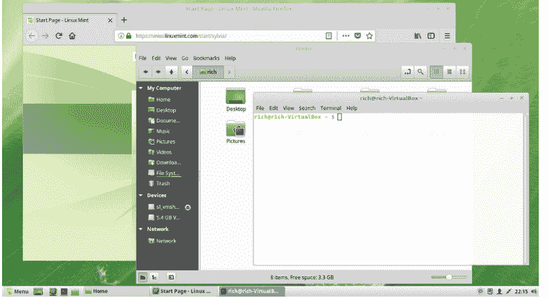

在公共计算环境中，注销是非常重要的。如果你没有注销，可能会有陌生人利用你的账户进行恶意活动。

# `Linux` 在操作系统世界处于什么位置？

随着你对 `Linux` 的深入了解，你会发现 `GUI` 环境是非常灵活的。如果你发现你不喜欢发行版的默认环境，可以更改它。尽管它们提供了相似的功能，但某些人对桌面环境有强烈的偏好。`Linux` 在这个问题上为你提供了 `Windows` 或 `macOS` 不具备的选择，因此请尽管尝试多个桌面环境。

> 你可能需要安装额外的桌面环境才能使用它们。本书未涵盖此主题。

# `Linux` 在操作系统世界处于什么位置？

本章的标题暗示了一种比较，而由于这本书是关于 `Linux` 的，这种比较必须与非 `Linux` 操作系统进行。因此，我们将 `Linux` 与其他三个操作系统或家族进行比较：`Unix`、`Apple macOS` 和 `Microsoft Windows`。

> 如后文在“什么是发行版？”中所述，`Linux` 可以被视为一个操作系统家族。因此，你可以将一个 `Linux` 版本与另一个进行比较。

## 将 `Linux` 与 `Unix` 进行比较

如果你想为操作系统画一张“族谱”，你会非常头疼。这是因为操作系统设计者经常模仿他人的特征，有时会将他人的代码整合到自己的操作系统作品中。结果可能是操作系统之间存在错综复杂的相似之处，原因从巧合到“借用”不一。尝试映射这些影响可能是困难的。但在 `Linux` 和 `Unix` 的情况下，可以给出一个宽泛的说法：`Linux` 是 `Unix` 之后修改的。`Unix` 于 1969 年在 `AT&T 贝尔实验室` 创建。`Unix` 的历史非常复杂，涉及多次分支（即将代码拆分为两个或更多独立项目）和完全独立的重写。现代 `Linux` 系统在设计上是克隆 `Unix` 原始源代码的开源项目的产物。

> 开源软件是你不仅可以自己运行、修改和重新分发的软件。第 3 章“研究 `Linux` 原与哲学”涵盖了有关开源软件的哲学和法律问题。

- **`Linux` 内核**：`Torvalds` 在 1991 年出于爱好创建了 `Linux` 内核，但它很快就远超于此。`Linux` 内核的设计目的是与其他内核兼容，因为它在源代码中使用了相同的接口。这使得在 `Unix` 变体上使用开源程序变得简单。

- **`GNU` 项目**：`GNU` 项目是自由软件基金会（`FSF`）的努力，旨在开发操作系统核心元素的开源替代品。1991 年，`FSF` 已经替换了最重要的工具，而 `Linux` 内核也日益流行。专有工具的替代品包括为 `BSD` 变体开发的开源工具。

> 开源软件是你不仅可以自己运行、修改和重新分发的软件。第 3 章“研究 `Linux` 原与哲学”涵盖了有关开源软件的哲学和法律问题。

- **`Xorg-X11`**：`Wayland` 是一个较新的软件包，它在 `Linux` 中替代了 `X11`。许多 `Linux` 变体。

- **桌面环境**：`GNOME`、`KDE Plasma`、`Xfce` 等许多桌面环境都内置了辅助技术。

## 第 1 章 ■ 选择操作系统

`Apple` 仅为其自己的电脑提供 `macOS`。其许可条款禁止在非 `Apple` 硬件上安装，而且撇开许可问题不说，在非 `Apple` 硬件上安装 `macOS` 也是一项非易易的任务。`macOS` 的变体被称为 `iOS`，运行在 `Apple` 的 `iPad` 和 `iPhone` 设备上，同样无法移植到其他设备。因此，`macOS` 在很大程度上限于 `Apple` 硬件。相比之下，`Linux` 可以在各种硬件上运行，包括大多数 `PC`。你可以在 `Macintosh` 电脑上安装 `Linux`。

## 比较 `Linux` 和 `Windows`

大多数桌面和笔记本电脑运行 `Microsoft Windows`。因此，如果你正在考虑运行 `Linux`，最可能的比较对象就是 `Windows`。广而言之，`Linux` 和 `Windows` 具有相似的能力；然而，在细节上存在显著差异。这些包括以下内容：


- **许可** Linux 是一个开源操作系统，而 Windows 是专源操作系统。第 2 章“理解软件许可”将更详细地介绍开源软件，但现在你已经知道开源软件比专源软件赋予了你对计算机更大的控制权——至少在理论上是如此。在实践中，你可能需要大量的专业知识来利用开源的优势。如果你工作的机构只习惯以更传统的方式销售软件，那么专源软件可能更合适。（尽管某些 Linux 变体也以类似的方式销售，即带有服务合同。）

- **成本** 许多 Linux 变体是免费提供的，如果你试图削减成本，它们非常有吸引力。然而，安装和维护 Linux 安装所需的专业知识可能比安装和维护 Windows 安装所需的专业知识更多，因此也更贵。关于 Linux 和 Windows 总成本问题的不同研究结论不一，但大多数倾向于 Linux。

- **硬件兼容性** 大多数硬件都需要操作系统的支持，通常以驱动程序的形式存在。大多数硬件制造商为其设备提供驱动程序，或与微软合作以确保 Windows 包含驱动程序。尽管某些制造商也提供 Linux 驱动程序，但对于大多数 Linux 社区，必须由整个供应商提供驱动程序。这意味着在设备可用后，Linux 驱动可能需要几周或几个月才会出现。同时，Linux 开发者维护旧硬件驱动的时间比制造商支持其旧硬件的时间更长。因此，现代 Linux 在旧硬件上的运行效果可能比最新版本的 Windows 好。Linux 也倾向于更低资源消耗，因此在旧硬件上使用 Linux 时你可以获得更高的效率。

- **软件可用性** 某些桌面应用（如 Microsoft Office）在 Windows 上可用，但在 Linux 上不可。尽管有 LibreOffice 这样的 Linux 替代方案，但它们并没有在公众中流行。在某些领域，情况恰恰相反。流行的服务器程序，如 Apache Web 服务器，是为 Linux 或 Unix 开发的。虽然许多此类程序在 Windows 上可用，但它们在 Linux 上运行更高效。如果你有一个必须运行的特定程序，可能需要研究它在你考虑的任何平台上的可用性和实用性。

- **用户界面** 像 macOS 一样，Windows 使用其独特的界面界面。这一事实导致了操作系统之间糟糕的移植性。（尽管存在工具可以帮助弥补这一差距；适用于 Windows 的 X 系统实现以及在 Linux 中运行 Windows 程序的工具。）某些用户倾向于 Windows 用户界面而非任何 Linux 桌面环境，而另一些用户则偏好 Linux 桌面环境。

``

微软在 Windows 8 中引入了名为 Metro 的新用户界面。Metro 背后的理念是它适用于从智能手机到桌面电脑的所有设备。然而，该用户界面很快变得不再流行，因为它让经验丰富的 Windows 用户难以操作，因此从 Windows 10 开始它被移除作为默认用户界面，但仍提供给那些偏好它的人。

- **可配置性** Linux 是一个比 Windows 可配置性更高的操作系统。虽然两个系统都提供了启动时运行特定程序、更改用户界面主题等手段，但 Linux 的开源特性意味着你可以跟踪任何感兴趣的细节。此外，你可以挑选任何喜欢的 Linux 变体，以便按照你自己的设想从头设置系统。

- **安全性** 每个操作系统的支持者都声称它比其他系统更安全。他们之所以这样做是因为他们专注于安全问题。Windows 面临的许多威胁来自病毒，这些病毒很大程度上针对 Windows 及其庞大的安装用户群。病毒对于 Linux 来说几乎不存在；安全威胁主要来自涉及配置不当服务器或不可信任的本地服务器的入侵。

十多年来，Windows 主导了桌面领域。在家庭和办公室，用户已经熟悉了 Windows，并习惯了使用 Microsoft Office 等 Windows 应用程序。尽管 Linux 可以在此类环境中使用，但由于各种原因，它并不是一个受欢迎的选择——它的陌生感、大多数 PC 预装 Windows 的事实，以及对大多数用户来说缺乏具有吸引力的 Linux 应用。

通常情况下，Linux 则已经主导了服务器市场。Linux 驱动着 Web 服务器、数据库服务器、电子邮件服务器等，这些构成了互联网，许多企业也依赖它提供本地网络服务。因此，大多数人每天使用 Linux。

## 什么是发行版？

到目前为止，我们把 Linux 描述成一个单一操作系统，但事实并非如此。我们已经描述了构成 Linux 操作系统的部分内容，但某些细节需要重申：

- **Linux 内核** Linux 内核是任何 Linux 操作系统的核心。我们将此项描述为 Linux 内核是因为该内核在不断演进。发行版可能会使用略不同的内核。发行版维护者还会内核进行补丁——即修复错误或添加功能。

- **核心单元** 这如 GNU 工具集、X Window 系统以及管理磁盘的工具对于 Linux 系统的正常运行至关重要。大多数 Linux 发行版包含类似的工具，但在版本和补丁上有所不同。

- **补充软件** 附加软件（如主要服务器、桌面环境和生产力工具）随大多数 Linux 发行版一起提供。与核心软件一样，大多数 Linux 发行版提供类似的选项。发行版有时会提供自己的“品牌”，特别是在桌面环境中。

- **启动脚本** 发行版的“性格”在很大程度上取决于其管理启动的方式。Linux 使用脚本和工具来启动连接网络、显示登录提示等几十个程序。这些脚本和工具在发行版之间不同，这意味着它们具有不同的功能并可能以不同的方式配置。

- **安装程序** 每个都必须安装，大多数 Linux 发行版都提供了独特的安装软件来帮助你管理此任务。因此，两个发行版的安装方式可能不同，并在磁盘布局和初始用户账户创建等关键功能提供选项。

通常，Linux 发行版可以从其网站下载。你通常可以下载 `CD-R` 或 `DVD` 镜像文件，然后将其刻录到光盘。当你启动系统时，安装程序会运行并安装操作系统。你也可以使用相同的镜像创建可启动的 `USB` 闪盘，如果你的电脑没有光驱的话。许多 Linux 发行版还有云版本，允许你下载完整的 Linux 系统并运行在私有虚拟机或商业云（如亚马逊云服务 `AWS` 或 `Google` 云平台）中。

## 什么是发行版？

如果你好奇想尝试 Linux 但手头没有专用的工作站或笔记本电脑，可以安装诸如 `VMware` 或 `VirtualBox` 这样的虚拟机软件软件包，这允许你在 `macOS` 或 `Windows` 工作站环境内运行一个 Linux 操作系统，而无需更改现有系统。

某些 Linux 安装程序已经完整包含了你可能需要的所有软件。另一些安装程序则只包含最少的软件，并要求你拥有良好的 `Internet` 连接，以便安装程序下载额外的软件。如果你的计算机没有连接互联网，请务必获取正确类型的安装程序。

## 常见 Linux 发行版概述

根据计算方式的不同，大约有十种用于桌面、笔记本电脑和服务器集群的 Linux 发行版，此外还有数百种用于特定目的的发行版。表 1.1 总结了最重要发行版的特征。

表 1.1 主要 Linux 发行版的特征

| 发行版 | 可用性 | 软件包格式 | 发布周期 | 管理员技能要求 |
|---|---|---|---|---|
| `Arch` | 免费 | `pacman` | 滚动更新 | 专家 |
| `CentOS` | 免费 | `RPM` | 约 2 年 | 中级 |
| `Debian` | 免费 | `Debian` | 2 年 | 中级到专家 |
| `Fedora` | 免费 | `RPM` | 约 6 个月 | 中级 |
| `Gentoo` | 免费 | `ebuild` | 滚动更新 | 专家 |
| `Mint` | 免费 | `Debian` | 6 个月 | 初级到中级 |
| `openSE` | 免费 | `RPM` | 8 个月 | 中级 |
| `Red Hat Enterprise` | 商业 | `RPM` | 约 2 年 | 中级 |
| `Slackware` | 免费 | `tarballs` | 不定期 | 专家 |
| `SUSE Enterprise` | 商业 | `RPM` | 2–3 年 | 中级 |
| `Ubuntu` | 免费 | `Debian` | 6 个月 | 初级到中级 |

# 第 1 章 选择操作系统

这些特征需要进一步解释：

**可用性** 大多数 Linux 发行版都是完全开源或免费软件；然而，某些版本包含专有组件并进行出售，通常附带支持合同。`Red Hat Enterprise Linux` (`RHEL`) 和 `SUSE Enterprise` 是这种类型最著名的两个例子。这两者的内核完全免费的。对于 `RHEL`，`CentOS` 是一个几乎完全克隆的版本，它省略了 `Slackware`，而 `Fedora` 是一个开放版本，作为最终可能包含在 `RHEL` 中的技术的测试平台。对于 `SUSE Enterprise`，`openSUSE` 是一个免费的替代方案。


# 软件包格式

大多数 Linux 发行版通过 `软件包`（packages）分发软件，软件包是将许多文件集合在一起的。软件包软件管理一个已安装文件的本地数据库，使得升级和卸载变得简单。`RPM` 软件包管理器 (RPM) 系统是 Linux 世界最流行的系统，尽管 `Debian` 软件包也非常常见。其他的软件包系统运行良好，但它们是针对特定发行版的，例如 `Arch` 中的包管理系统。`Slackware` 的特殊之处在于它使用 `tarballs`（压缩包）作为其软件包。软件包文件是由标准的 `tar` 工具创建的，该工具用于备份副本和分发源代码等。`Slackware` 在软件包中使用的 `tarballs` 有助于管理，这是不寻常的，因为它的软件包系统是基于从源代码编译大多数软件的。这非常耗时，但让经验丰富的管理员能够调整配置选项，以针对他们自己的硬件和环境优化软件包。

> `Tarballs` 类似于 Windows 上常见的 `zip` 文件。第 8 章“搜索、提取和存档数据”描述了如何创建和使用 `tarballs`。

# 发布周期

我们将在“理解发布周期”中更详细地描述发布周期。作为一个一般规则，发布周期较短的发行版有助于提供尽可能稳定的环境。而那些发布周期较长的发行版力求在偶数年的 4 月提供最稳定的长期支持 (LTS) 版本。它们的其他发布版本则提供最新的软件。

# 管理员技能要求

表 1.1 的最后一列提供了我们对管理发行版所需技能水平的个人估算。如你所见，我们将大多数 Linux 发行版描述为需要“中级”技能来管理。然而，某些发行版在用户友好的 GUI 管理方面要求较低。`Ubuntu` 特别易于使用和管理。

> 不要被大多数发行版的“中级”分类吓到。本书的目的是帮助你管理这些发行版。

## 什么是发行版？

Linux 发行版至少适用于两种平台——即 CPU 类型：`x86`（也称为 `IA32`、`i86` 及变体）和 `x86-64`（也称为 `AMD64`、`x64`）。2007 年之前 `x86` 计算机是最常见的类型，但现在 `x86-64` 已成为标准。如果你有一台 `x86-64` 计算机，你可以运行 `x86` 或 `x64` 发行版，后者提供了一些改进。更多奇特的平台，如 `ARM`（用于平板电脑）、`PowerPC`、`Alpha` 和 `SPARC`（将在后文介绍）。

## 真实世界场景

- 使用哪种发行版？

面对众多不同的 Linux 发行版，新手最经常的问题之一是尝试哪一个。某些 Linux 发行版如 `Red Hat` 和 `Oracle` 专注于商业安装并提供客户支持。这些发行版可能昂贵，对新手来说通常难以安装和使用。

第二类 Linux 发行版面向高级 Linux 用户。`CentOS`、`Slackware` 和 `Gentoo` 发行版属于此类。它们要求你了解如何安装和配置软件及硬件。高级用户喜欢使用这些发行版，因为他们可以进行自定义。

第三类 Linux 发行版面向新手。流行的 `Fedora`、`Ubuntu` 和 `Mint` 属于此类。

## 理解发布周期

总结了一些发行版的发布周期。例如，`Ubuntu` 每六月发布一个新版本。在发布后，发行版通常会支持几个月到一年或更久。在这一支持期内，你可以找到


## 嵌入式 Linux 系统

除了主流 PC 发行版外，还有几种用于更特殊目的的 Linux 发行版。“嵌入式系统”一词描述的是在小型微计算机（如手机或监控设备）上运行小型精简版 Linux 系统。嵌入式 Linux 系统的常见用途包括

- **Android**：许多手机使用名为 `Android` 的基于 Linux 的操作系统。它的界面与其他手机相似，但底层是 Linux 内核以及你在 PC 上发现的大量 Linux 基础设施。手机并不使用 `X` 或典型的桌面应用程序；相反，它们运行为手机设计的专用程序。

> 注意：`Android` 以手机操作系统闻名，但也可以用于其他设备。例如，某些平板电脑和电子阅读器就运行 `Android`。

- **网络设备**：许多宽带路由器、打印服务器以及其他插入本地网络以执行特殊任务的设备都运行 Linux。你有时可以替换标准的操作系统，或者是你为了给设备添加功能而使用的定制化系统。`Tomato` (`www.polarcloud.com/tomato`) 和 `OpenWrt` (`openwrt.org`) 是此类自定义发行版的两个示例。不要随心所欲地安装东西，如果安装不当或在错误的内核上，可能会导致设备无法使用！

## IoT 设备

近年来，物联网（IoT）在新闻和课堂中都爆发式增长。物联网涉及创建一个小型设备网络，这些设备可以感知物理状态并控制系统。运行专用操作系统的微处理器会监控来自传感器的数据（如温度、湿度、光照或运动），并使用这些数据来控制电机、锁和开关。诸如 `Arduino` 和 `Beagle Bones` 等嵌入式控制器，以及比树莓派更强大的控制器，在学校和制造环境中非常风靡。像树莓派这样较大的控制器通常运行精简版的 Linux，以在应用程序中提供更强的灵活性，例如针对特定的传感器条件发送电子邮件警报。

`TiVo` 这种流行的数字录像机（DVR）使用 Linux 内核和大量的标准程序，以及专有的驱动程序和 DVR 软件。虽然许多人并没有意识到，但它们在底层是基于 Linux 的计算机。

大多数嵌入式 Linux 系统通常要求用户进行很少或没有管理工作，但这与本书中的方式不同。相反，这些设备具有固定的基本配置和引导式设置工具，帮助缺乏经验的用户理解基本选项，例如网络设置和时区。

## 云端 Linux

云技术极大地改变了计算机世界的格局。将计算机资源和应用程序移动到共享网络环境中改变了许多公司业务和向客户提供服务的方式。Linux 在云世界扮演着重要角色，因此定义什么是云以及它提供什么类型的资源是一个很好的主意。本节介绍了云计算的基础知识。

### 什么是云计算？

“云”一词最早出现在 1977 年原始 `ARPANET` 网络环境的中，它是现代互联网的前身。在当时的文档中，云符号通常用于表示地理分散的互连服务器大网络。然而，在这种环境中，每个服务器都是自包含且自给自足的——并没有分布式计算。

云计算这一术语与分布式计算有关。在分布式计算中，资源在两个或多个服务器之间共享以完成单一任务（例如运行应用程序）。这种环境成为了我们今天所熟知的云计算的前身，并由亚马逊云服务 (`AWS`)、谷歌云平台 (`Google Cloud Platform`) 和微软 `Azure` 等公司普及。

云计算提供了跨互联网交付计算资源的能力。现在客户可以根据需要从云计算供应商购买硬件和软件资源。这包括服务器、存储空间、数据库、网络、操作系统甚至单个应用程序。图 1.4 展示了提供云计算的三种方法。

### 图 1.4 云计算方法

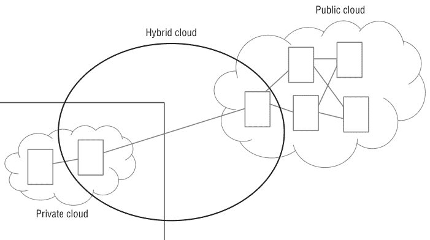

如图 1.4 所示，提供云计算环境主要三种方法：

- **公有**：在公有云计算环境中，由第三方提供组织之外的所有计算资源。这些资源通常在多个组织之间共享。
- **私有**：在私有云计算环境中，每个独立组织构建自己的云计算资源来为内部提供资源。
- **混合**：在混合云环境中，计算资源在组织内部提供，但同时也连接到外部公有云，以便在需要时补充资源。

### 什么是云服务？

云计算环境可以根据每个客户的需求定制提供给客户的资源水平。本节介绍了你从云计算供应商找到的三种最流行的资源水平提供模型。

### 基础设施即服务 (IaaS)

在基础设施即服务 (`IaaS`) 模型中，云计算供应商提供低级服务器资源来为组织托管应用程序。这些低级资源包括物理服务器所需的所有物理组件，包括 `CPU` 时间、内存空间、存储空间和网络资源，如图 1.5 所示。

**图 1.5** `IaaS` 云模型

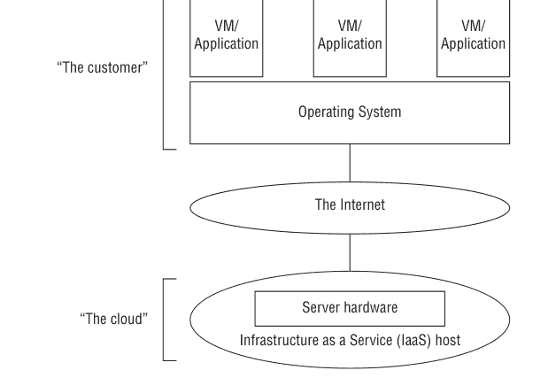

服务器资源可能提供在单台服务器上，也可能分布在几台服务器上。在分布式环境中，服务器可能共同位于同一个设施内，也可能分在位于不同城市的多个设施中。这有助于提高可用性。

如图 1.5 所示，在 `IaaS` 模型中，客户提供其运行所需的操作系统和任何应用程序。大多数 `IaaS` 环境支持多种种不同的操作系统，包括 Linux 和 Windows 服务器。客户负责操作系统所需的任何系统管理工作，以及任何应用程序管理。云计算供应商维护物理基础设施环境。

### 平台即服务 (PaaS)

在平台即服务 (`PaaS`) 模型中，云计算供应商向客户提供物理服务器环境以及操作系统环境，如图 1.6 所示。

图 1.6 “客户”

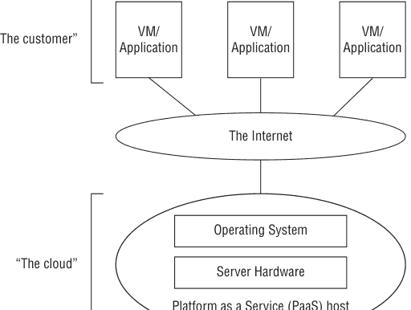

在 `PaaS` 模型中，云计算供应商对物理组件和操作系统管理负责。它提供系统管理支持，以确保操作系统得到正确的补丁，并使用当前版本和安全功能进行更新。这允许客户主要专注于 `PaaS` 环境内的应用程序开发。

### 软件即服务 (SaaS)

在软件即服务 (`SaaS`) 模型中，云计算供应商提供完整的应用程序环境，例如邮件服务器、数据库服务器或 Web 服务器。供应商提供物理服务器环境、操作系统以及执行功能所需的应用程序软件。这如图 1.7 所示。


## 图 1.7 SaaS 云模型

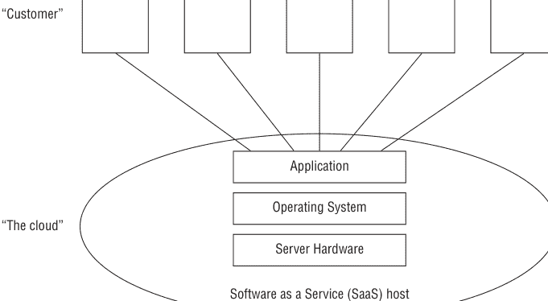

## 总结

`Linux` 是一种强大的操作系统，你可以将其用于从手机到超级计算机的任何设备。`Linux` 的核心是它的内核，它管理计算机硬件。在内核之上构建了各种工具（来自 `GNU` 项目）和用户应用程序。`Linux` 是 `Unix` 操作系统的克隆，与它共享许多程序。`Apple` `macOS` 是另一个 `Unix` 操作系统，尽管具有完全不同的用户界面。尽管 `Windows` 与 `Unix` 共享许多功能，但 `Linux` 和 `Windows` 之间的软件兼容性有限。`Linux` 有许多种类，被称为发行版，这使得你可以根据易用性、发布周期和其他独特特性选择最适合你的 `Linux` 版本。由于其可定制特性和较小的体积，`Linux` 是一种流行的操作系统。同样的可定制特性也使其适用于支持全球应用程序的大型云计算环境。

## 考试重点

描述 `Linux` 发行版以及为什么会有这么多。`Linux` 发行版是运行 `Linux` 系统所需的组件包。这包括 `Linux` 内核以及通常包含用于管理系统的工具、应用程序软件和包

## 第 1 章 ■ 选择操作系统

`Linux` 是一种用于安装和卸载软件的管理系统。不同的 `Linux` 用户有不同的需求，例如桌面办公自动化、多媒体制作、数学模拟，或服务器功能（如 `Web` 服务器或数据库服务器）。不同的 `Linux` 发行版经过定制，以支持特定的功能，这些功能无需你自己完成。

解释 `Linux` 在嵌入式系统中的应用。 嵌入式系统通常使用精简版的 `Linux`，专门用于控制特定的硬件。`Android` 手机、`IoT` 记录器等设备都使用定制的 `Linux` 系统，仅执行这些设备所需的功能。

解释 `Linux` 在云环境中的应用。 云环境需要一个可以根据需要扩展的分布式计算环境。`Linux` 服务器提供了一个廉价且易于修改的平台。

描述 `Linux` 与更流行的 `macOS` 和 `Windows` 环境之间的基本区别。 `Linux` 与 `macOS`、`Windows` 环境之间的基本区别在于选择。对于操作系统的几乎每一个功能，`Linux` 都不会将你锁定在特定的环境中，而是提供多个选项供你选择。这包括桌面功能、应用程序软件，甚至包括你为软件支持支付的费用。

解释 `Linux` 发行版的生命周期管理。 每一个操作系统都需要定期更新，以跟上技术、改进功能、修复软件漏洞并防止安全漏洞。生命周期管理涉及操作系统更新的频率。某些操作系统定期更新，而另一些则根据需要更新。不同的 `Linux` 发行版根据其用户群支持不同的生命周期。某些 `Linux` 发行版产生长期支持（`LTS`）版本，这些版本可维护三到五五年，对于不想为数十万员工更改操作系统版本的企业环境来说是理想的。

## 复习题

你可以在附录 `A` 中找到答案。

1. 下列哪项是 `Linux` 内核的功能？（多选）
   A. 为程序分配内存内存
   B. 为程序分配 `CPU` 时间
   C. 在 `GUI` 程序中创建菜单
   D. 控制对硬盘的访问
   E. 允许程序使用网络
2. 下列哪项是嵌入式操作系统的示例？
   A. `Android`
   B. `CentOS`
   C. `Fedora`
   D. `Mint`
   E. `Red` `Hat`
3. 下列哪项是 `Linux` 与 `macOS` 之间的显著区别？
   A. `Linux` 可以运行 `GNU` 程序，而 `macOS` 不能。
   B. `Linux` 的 `GUI` 基于 `X` `Window` 系统，而 `macOS` 不是。
   C. `Linux` 无法在 `Apple` `Macintosh` 上运行，而 `macOS` 只能在 `Apple` 硬件上运行。
   D. `Linux` 严重依赖 `BSD` 软件，而 `macOS` 不使用 `BSD` 软件。
   E. `Linux` 支持文本模式命令，而 `macOS` 是仅限 `GUI` 的操作系统。
4. `Linux` 内核来自哪里？
   A. 它源自 `Microsoft` `Windows`。
   B. 它源自 `Apple` `macOS`。
   C. 它源自 `AT&T` `Unix`。
   D. 它源自 `BSD` `Unix`。
   E. 它是由 `Linus` `Torvalds` 创建的。
5. 正或错：如果你以图形模式登录 `Linux` 系统，你无法在该会话中使用文本模式命令。
6. 正或错：`CentOS` 是一个发布周期较长的 `Linux` 发行版。
7. `Linux` 文本模式登录提示显示为 ________
   A. `login:`
   B. `welcome:`
   C. `Enter:`
   D. `userid:`
   E. `Enter` `your` `userid:`
8. `Windows` 中一个常见的安全问题，在 `Linux` 上几乎不存在的是 ________
   A. 商业软件
   B. 网络防火墙
   C. 网络路由器
   D. 病毒
   E. 软件管理包
9. 可能包含漏洞的预发布软件被称为 ________ 和 ________
   A. 第一和第二
   B. 主要和次要
   C. `Alpha` 和 `beta`
   D. 开发和生产
   E. 开发和测试
10. 没有版本号而是以持续方式发布升级的 `Linux` 发行版被称为（n） ________ 发布。
   A. 滚动 (`rolling`)
   B. 阶梯
   C. 非正式
   D. 系统的
   E. 偶然的

## 第 2 章

## 理解软件

目标：

1.3 开源软件

软件是一种受版权保护的知识产权。正如其名称所示，版权是法律承认的创作某物的权利。通常来说，开源软件很大归功于三个组织：自由软件基金会（`FSF`）、开源倡议（`OSI`）和知识共享（`CC`）。然而，开源软件并非没有版权。

在许多国家，软件算法无法获得专利。人们正努力改变软件与专利之间的关系——既要在无法获得专利的国家使软件可以专利化，要在已经在可以获得专利的国家限制或消除软件专利。

版权法已经存在了几个世纪，因此它适用于软件。因为大多数版权法是在计算机出现很久编写的，禁止复制，但如果没有这些复制，计算机程序是无用的。

## 探索保护与软件

版权是知识产权的一个例子，但还有许多其他。其中之一是专利。版权保护单一的创作作品，可以被视为思想的表达，但专利保护思想本身。专利通常适用于发明，例如著名的“捕鼠器”。

## 调查许可协议

为了运行程序而必须复制或出于安全考虑而建议复制的副本包括：

* 从安装介质到硬盘的程序复制
* 从硬盘到计算机随机存储器（`RAM`）的程序复制
* 从 `RAM` 到交换空间（`swap` `space`）的复制
* 从 `RAM` 到主板或 `CPU` 上各种缓存的复制，以提高性能
* 用于防止磁盘故障的一个或多个磁盘备份

交换空间是作为 `RAM` 补充的磁盘空间。例如，当 `RAM` 满了，操作系统（`OS`）开始将数据交换到交换空间。

在过去，复制通常根据“合理使用”原则被忽略——即允许复制部分材料的例外。合理使用的其他例子包括评论或新闻报道中的引用，以及用于研究或教学的摘录。今天，版权法明确承认了为了使用软件而复制的需要，至少在美国。

## 现实场景

## 专利、商标与软件

版权是知识产权的一个例子，但还有许多其他。其中之一是专利。版权保护单一的创作作品，可以被视为思想的表达，但专利保护思想本身。专利通常适用于发明。

在美国，软件专利是合法的。虽然你不能对思想专利，但你可以对程序使用的算法专利。这种专利既常见又有争议。一些开源程序不使用某些格式，因为使用这些格式所需的算法已专利，且专利持有者威胁未经授权的用户。软件专利的批评者认为，大多数专利都是微不足道或显而易见的。公司有时利用软件专利阻止另一公司销售产品，或向销售产品的公司要求付款。

在许多其他国家，软件算法无法获得专利。人们正努力改变软件与专利之间的关系——既要在无法获得专利的国家使软件可以专利化，要在已经在可以获得专利的国家限制或消除软件专利。

商标是另一种类型的知识产权。它们是特定公司或产品的名称、标志和类似的标识符。软件及其生产软件的公司经常使用商标，硬件公司也是如此。一位与 `Linux` 社区参与较际的个人在 1994 年将 `Linux` 这一名称注册为商标，并试图对该名称收取特许费。在经过诉讼后，商标被转让给了 `Linux` 基金会，即 `LMI`（`www.linux-foundation.org/programs/legal/trademark`）。

作为终端用户，你可能不需要处理软件专利或商标。软件和商标问题通常在公司层面解决。这与版权问题形成对比，版权问题可能会影响到违反版权法的个人。然而，如果你在一家发布软件的公司工作，专利法和商标法可能会影响到你。如果你的软件可能违反了某个软件专利或商标，情况尤为如此。如果你认为可能存在这种情况，应该咨询律师。

## 使用许可协议修改版权条款


尽管软件受版权法的保护，但大多数软件在发布时都会附有许可协议，这是一份声称修改了版权法所授予权利的法律文件。在大多数情况下，你不需要签署许可协议，但在某些情况下，你必须点击按钮来接受许可条款。在过去，许可协议有时打印在分发软件的盒子上。这些许可协议通常被称为最终用户许可协议（EULA）、点击式许可、收缩封装许可或点击确认许可。开源软件通常随带一个许可文件，通常被命名为 `COPYING`。

> 法院维护了点击式许可及类似许可的执行力，尽管这种结果并非普遍适用。

软件许可协议可以通过使条款更具或不具限制性来修改版权。例如，`Linux` 内核所使用的许可协议——通用公共许可证（GPL），授予了你重新分发软件的权利，包括源代码和二进制文件。这代表了对版权法所提供限制的放宽。

从一般规则来说，专有软件的许可协议限制了你在版权法下的权利，而开源许可协议则授予你额外的权利。这一规则也存在例外；例如，站点许可（site license）是一种针对专有程序的许可，它授予一个组织制作该程序数量副本的权利——例如，为公司的所有计算机复制 100 份文字处理器。

## 查看自由软件基金会

自由软件基金会（FSF）是开源世界的一股关键力量。`FSF` 由 `Richard Stallman` 于 1985 年创立，它是前章节描述的“GNU 不是 Unix（GNU）”项目的驱动力。`FSF` 拥有一套特定的哲学（见下文描述），这种哲学体现在 `GPL` 中，而 `GPL` 是 `FSF` 倾向的软件许可协议。

## 理解 FSF 哲学

`FSF` 倡导其所谓的“自由软件”（free software），将其定义为自由地在软件上任何你想做的事情，而不是软件的价格。一个用来明确这一区别的常用短语是“如言论般自由，而非啤酒般免费（free as speech, not free as beer）”。


`FSF` 定义的自由软件与免费软件（freeware）不同。免费软件通常指的是不收费的软件，但不一定意味着在自由上的自由。

`FSF` 定义了四种特定的软件自由：

- 为任何目的使用软件的自由
- 检查源代码并根据你的意愿修改它的自由
- 重新分发软件的自由
- 重新分发你修改后的软件的自由

这些自由与稍后描述的 `OSI` 提出的原则相似。然而，正如你很快就会看到的，在解释上存在一些重要的差异。`FSF` 在 `gnu.org/philosophy/free-sw.html` 详细阐述了每项原则的含义及其相互作用。

在理想的世界里，根据 `FSF` 的标准，所有软件将是自由的——随源代码和所有列出的自由一起分发。某些 `Linux` 发行版符合这一要求。许多设备使用受限的启动过程来防止未经授权的内核，而 `GPL3` 禁止了这种行为。`Linux` 内核本身保持未。。

## 第 2 章理解软件许可

软件。许多人确实采用了它，但往往是如此不情愿、甚至是不经意的的——系统管理员在极低预算的压迫下履行职责时，会静静地安装 `Linux`、`Apache`、`Samba` 以及其他免费软件，以避免为昂贵的商业替代品付费。

`FSF`（自由软件基金会）的倡议努力（过去和现在）基于一种强大的道德准则——在 `FSF` 看来，软件应该是自由的，“自由”被定义为自由权（freedom）。这种方法吸引了人们，但其他人——特别是那些想要通过销售开源软件获利的企业——发现这种倡议策略会将他们的组织定性为倡导自由软件的工具。

出于这些原因，`OSI`（开源软件 way）的创建者设计了开源——并且根据 `FSF` 的某些道德准则，`OSI` 的目标是在商业世界推广开源软件。`FSF` 道德准则在语气上的差异可以在 `OSI` 网站（`opensource.org`）上的一条主要声明中看到：“开源实现了一种软件开发方法，其带来了更高的质量、更好的可靠性、更大的灵活性、更低的成本，并结束了掠夺性的供应商锁定。”

`FSF` 和 `OSI` 之间最大的哲学差异体现在 `GPL` 的要求上，即派生作品也必须在 `GPL` 下分发。`OSI` 认证了许多许可为开源，包括 `GPL`；然而，这些许可中的许多允许类似的限制，并且在这些许可下，软件实际上已经进入了闭源产品。`OSI` 并不反对这种路径，只要软件是以允许这种方式进行许可的。相反，`FSF` 在其 `GPL` 中明确禁止了此类用于专有用途的挪用。


## 宽松性许可（Permissive）

几种经 `OSI` 批准的许可证被称为“宽松性许可”（permissive licenses）。这些包括 `Apache` 许可证、`BSD` 许可证和 `MIT` 许可证（在本章介绍）。与版权许可类似，宽松性许可允许用户复制、共享和修改软件。然而，宽松性许可并不像“拷贝左”（copyleft）那样具有限制性。版权要求任何从受许可程序衍生出的修改程序必须在相同的许可条款下分发，而宽松性许可对软件重新分发的要求极低。属于宽松性许可范下的许可证可能允许对被许可软件增加额外的或不同的许可条款条件。因此，宽松性许可有时被称为非互惠许可（nonreciprocal licensing）。


今天，在 `FSF` 意义上的自由软件纯主义者与更务实的开源社区之间存在某些紧张关系。但在大多数情况下，这两个目标是足够的，以至于它们的差异微乎其微。事实上，自由和开源软件（`FOSS`）以及自由自由开源软件（`FLOSS`）有时被用作统术语，涵盖这两类软件和开发。

## 定义开源软件

开源定义出现在 `opensource.org/definition`。它由 10 条原则组成，此处对其进行了改写：

- 自由重新分发（Free Redistribution）：许可必须允许重新分发，包括作为更大作品的一部分进行分发。
- 源代码可用性（Source Code Availability）：作者必须提供源代码，并允许源代码和（如适用）二进制代码的重新分发。
- 允许衍生作品的权利（Permission to Derive Works）：许可必须允许他人修改软件，并在与原始程序相同的许可下分发此类修改。
  > 注意：开源定义允许但并不要求许可必须在原始许可下进行重新分发。
- 尊重源代码的完整性（Respect for Source Code Integrity）：许可可以限制修改后的源代码的重新分发，但只有在随原始源代码一起分发补丁文件时才如此。许可可以要求派生作品更改软件的名称或版本号。
- 不对个人或群体歧视（No Discrimination Against Persons or Groups）：许可不得歧视任何个人或群体。
- 不对努力领域歧视（No Discrimination Against Fields of Endeavor）：许可不得禁止在任何领域使用该程序，例如商业领域。
- 自动分发（Automatic Distribution）：许可必须允许在分发时（包括作为销售或赠送的一部分）进行重新分发。
- 不针对特定产品的限制（Lack of Specificity）：许可不能限制在特定产品或分发中进行重新分发。
- 对其他软件的无限制（Lack of Restrictions on Other Software）：许可不得对其他软件施加限制。
- 技术中性（Technology Neutrality）：许可不得针对特定技术。
- 完整文档（Complete Documentation）：许可必须要求分发程序时附带一份文档。
- 不禁止未经授权的修改（No In Against Against Modification）：许可不得禁止用户对程序进行修改。

（注：上述部分包含原文中对定义的多次重复性表述，翻译时已保持其结构）

- ...：
  > 注意：开源定义允许但并不要求许可必须在原始许可下进行重新分发。
- ...：
- ...：
- ...：
- ...

（注：上述部分包含原文中对定义的多次重复性表述，翻译时已保持其结构）

## 理解开源许可

每个开源许可都有其独特的特征。事实上的标准开源许可包括：

- `GNU GPL` 和 `LGPL`：如前所述，`Linux` 内核使用 `GPL`，许多其他 `Linux` 工具使用 `GPL`。
- `BSD`：伯克利软件发行（`BSD`）许可证用于操作系统和各种组件。与 `GPL` 不同，`BSD` 许可证允许在其他许可下分发修改。 `BSD` 许可证有两种：三条款和二条款。二条款 `BSD` 许可证有时被称为简化版 `BSD` 或 `FreeBSD` 许可证。三条款版本被称为新 `BSD` 许可证。
- `MIT`：麻诸理工学院（`MIT`）是 `X` 窗口系统（`X`）的原始推动者，`MIT` 许可证继续用于 `Xorg`——几个 `Linux` 发行版中的 `X` 实现。然而，某些 `Linux` 发行版从 `X` 迁移到了 `Wayland`，后者也使用 `MIT` 许可证。


- **Apache**：与 **BSD** 和 **MIT** 类似，**Apache** 许可证允许在相同或其他许可下分发。如果原始作品带有 `NOTICE` 文件，则必须包含在衍生作品中。这使得原始开发者能够向深度修改版本的用户提供联系方式或其他信息。**Apache** 许可证的原始版本（`1.0`）创建于 1995 年。当前版本是 `2.0`，因此有时被称为 **Apache 2**。正如其名所示，**Apache** 许可证源于 **Apache** 浏览器；但它也被许多其他项目使用。

许多许可符合 **OSI** 的要求。你可以在开源许可证网站上找到完整列表。各种开源许可的细节对大多数系统管理员来说并不重要。你可以根据意愿使用和重新分发任何开源程序。你还应该意识到某些 **Linux** 发行版可能包含不符合开源定义的软件。其中一些是商业软件，另一些则属于变体类别。

# 第 2 章 • 理解软件许可

某些开源许可的组合彼此之间是不兼容的，这意味着你无法在法律上组合代码并发布修改后的版本。


描述软件许可时的最后一个考虑是 **Linux** 整体的许可。当你下载镜像文件或购买 **Linux** 软件包时，你获得的软件使用了许多许可——`GPL`、`BSD` 许可、`MIT` 许可等。其中大多数是开源的，但并非全部如此。许多发行版附带少量的共享软件或非完全开源的软件包，例如 `XV` 图形程序。出于这个原因，如果你购买了 **Linux** 软件包，除非你研究过该问题并发现复制是可以的，否则你不应该复制它。如果发行者提供了免费下载链接，则可能允许复制。

**Linux** 发行版包含安装程序、配置程序等。在版权方面，这些工具通常是发行版打包者所能声称的所有内容。大多数发行版维护者都在 `GPL` 或其他开源许可下编写他们的安装和配置程序，但情况并非总是如此。此类细节可能会使一个看似开源的操作系统变得并非完全开源。**Debian** 维护着仅在其主包集中集中使用开源软件的政策，尽管它会将可以自由分发但非开源的程序放入其“非自由（`non-free`）”包集中。

由于 **Linux** 发行版是由使用许多许可的组件组成的，因此谈论单一的版权或许可适用于整个操作系统是没有意义的。相反，你应该将 **Linux** 发行版视为一个产品集合，附带独特的安装工具。尽管如此，绝大多数程序都使用一种或另一种开源许可。

# 理解开源商业模式

某些 **Linux** 发行版（如 **Debian**）由志愿者或非营利组织维护。另一些（如 **Red Hat Enterprise**）则由一家预期盈利的公司维护。那么，如果公司的核心产品在互联网上免费提供，公司该如何盈利呢？从开源软件中盈利有多种方法，包括以下几种：

**服务与支持** 产品本身可以是开源的，甚至可以免费提供，公司销售服务和支持，例如培训和技术支持热电话。例如，某个游戏可能是开源的，但需要订阅在线服务以提供全套功能。

**双重许可** 公司可以创建产品的两个版本：一个是完全开源的，另一个增加了开源版本中不可用的功能。开源版本就类似于超市经常提供的免费样品——这是一种吸引付费客户的方式。

**多产品线** 开源产品可能只是该公司的产品之一，收入由其他产品线产生。这些其他产品线可能是其他软件或其他产品，例如手册。

**开源驱动程序** 上述方法的一种特殊情况是硬件供应商。他们可能会选择将驱动程序（或特定硬件的应用程序）作为开源发布，以此作为推广其硬件的手段。

当硬件供应商发布开源驱动程序时，代码会揭示有关该供应商硬件的编程信息。因此，某些供应商不愿发布开源驱动程序。


**赏金（Bounties）** 赏金通过对现有网站中的新软件或功能付费来驱动开源创作。像 **FOSS Factory** (`factory.org`) 和 **Bountource** (`bountsource.com`) 这样的网站帮助用户（这些用户个人可能无法提供资金来激励开发）与编写所需代码的程序员联系起来。通过赏金，第一个启动项目的程序员允许收集该项目的累计资金。

**捐赠** 许多开源项目接受捐赠以资助开发。虽然这在通常意义上不是商业资金模式，但它有助于像 **FSF** 这样的组织的运行。

除了这些机会之外，当然，大量的开源软件是在学术界、政府、非营利组织、爱好者等开发的。即使是公司也有动力回馈他们为自己所做的更改，因为囤积这些更改会给公司带来更多的内部工作——如果内部更改没有回馈给原始软件作者，公司将会在软件的每个新版本中重新应用该更改。

- 查找 `GPLv2`、`GPL3` 和 `BSD`

- `OSI` 使命 (`opensource.org/`)

- `FSF` (`fsf.org/`)

- 知识共享许可 (`CC`)

## 总结

许多知识作品都受益于版权。版权是一项法律认可的创建某物副本的权利。软件是一类知识产权，受版权（可能还有专利）的管辖。尽管这些法律并不是为了软件而创建的，但它们确实适用。通常情况下，专有软件的许可提供了更多限制，而开源许可赋予了你额外的权利。

## 复习题

你可以在附录 A 中找到答案。

- 1. 为了让软件被认证为开源，以下哪项不是必须的？

  A. 许可协议不得歧视个人或群体。

  B. 许可协议不得要求软件作为特定产品的一部分进行发行。

  C. 许可协议必须要求更改在相同的许可协议下发行。

  D. 程序必须附带源代码，或者作者必须在互联网上提供方便获取。

  E. 许可协议必须自动适用于任何获取软件的人。

- 2. 关于发行版整体，哪项表述是正确的？

  A. 它们根据发行版的不同，受 `GPL` 或 `BSD` 协议保护。

  B. 有时它们可能因为其包含的非开源软件而无法被复制。

  C. 在移除使用 `MIT` 许可的软件后，它们可能会被复制。

  D. 它们都符合开源运动的原则。

  E. 它们都符合 `FSF` 术语中的“自由”定义。

- 3. 下列哪项是 `FSF` 哲学的核心部分？

  A. 开发人员应该使用最新版本的 `FSF GPL`。

  B. 用户应该有权修改自由软件并在商业许可下分发它。

  C. 开发人员应该只为 `GNU/Linux` 等自由操作系统编写软件。

  D. 用户应该通过复制专有软件来参与公民不抗运动。

  E. 用户必须有权按照自己的意愿使用软件。

- 4. 正确或错误：版权法管理着大多数国家的软件分发。

- 5. 正确或错误：`FSF` 的自由软件定义和 `OSI` 的 10 项开源原则都认为用户有能力编写软件的工作原理——即其源代码。

- 6. 正确或错误：由于硬件设计是专有的，硬件供应商无法为其产品发布源代码驱动程序。

- 7. 由 `FSF` 创建并经常用于库的许可是 `______`

  A. `BSD`

  B. `Apache`

  C. `GPL`

  D. `LGPL`

  E. `MIT`

- 8. 一个致力于在视频和音频录制等领域推广类开源原则的组织是 `__________`

  A. 知识共享 (`Creative Commons`)

  B. `GNU`

  C. `FSF`

  D. `MIT`

  E. `OSI`

- 9. `FSF` 的一般原则被术语 `__________` 总结，该术语指的是以某些违背版权初衷的目的使用版权法。

  A. 专利

  B. 版权

  C. 拷贝左 (`copyleft`)

  D. 自由

  E. 商标

- 10. 用户可以通过向第一个完成项目的人提供(n) `__________` 来激励程序员从事开源项目。

  A. 捐赠

  B. 工资

  C. 礼物

  D. 荣誉

  E. 赏金

# 第三章

## 研究 Linux 的原则与哲学

目标：

- 1.1 `Linux` 演进与流行操作系统

- 1.3 开源软件与许可


你可以经常纯粹基于务实考虑选择某种产品或技术——哪种操作系统适用于特定任务，哪种软件套件最便宜等。

尽管如此，理解技术背后的原则和哲学有时是有用的，而且了解这些可能会引导你的选择。

对于某些 `Linux` 用户来说确实如此；我们在第一章中介绍的 `Linux` 开源模型（即“选择操作系统”）具有影响 `Linux` 工作方式的。此外，`Linux` 世界中的有些人非常热衷这些原则。了解他们的观点可以帮助你欣赏在工作、在线、会议等地看到的 `Linux` 文化。

本章涵盖了这些问题，从 `Linux` 的起源到其的发展。然后我们描述了开源原则以及它们如何影响开源操作系统。最后，我们描述了 `Linux` 的某些角色——作为嵌入式操作系统、桌面操作系统或服务器操作系统。

# Linux 的历史演变

尽管 `Linux` 出于 1991 年从历史标准来看很最近，但在计算机世界，25 年是一个永恒。尽管如此，1990 年初的软件和文化传承到了今天。最后，我们所使用的东西建立在过去创建的基础之上。因此，观察 `Linux` 的起源将帮助你理解 `Linux` 的现状。

# 理解 Linux 的起源


1991 年，同样如此，计算机按大小和能力进行分类。计算机可以属于若干类别中的任何一种，从桌面个人电脑 (`PC`) 到超级计算机。基于 `x86` 的计算机（现代 `PC` 的直接祖先）统治了 1991 年的 `PC` 市场；然而也有其他类型的 `PC`，包括 `Mac` 计算机。此类计算机通常使用不同的 `CPU` 并运行自己的操作系统。

# Linux 的历史演变

今天的计算机分类方式与 1991 年相似，尽管某些细节发生了变化。值得注意的是，智能手机中的嵌入式计算机。

1991 年，大多数 `PC` 运行的微软磁盘操作系统 (`MS-DOS`、`PC-DOS` 或 `DOS`) 在今天的标准来看非常局限；它是一个单任务操作系统（一次只能运行一个程序），没有充分利用当时的内存或 `CPU`。1991 年提供的微软 `Windows` 版本运行在 `DOS` 之上。虽然早期版本的 `Windows` 帮助解决了 `DOS` 的一些局限性，但它们并没有从根本上解决任何问题。这些早期的 `Windows` 版本采用协作多任务，例如，程序可以自愿将 `CPU` 时间交给其他程序。`DOS` 内核无法控制占用 `CPU` 的程序。

在 `PC` 级别，`Unix` 与当时的 `Windows` 相比是一种常见的操作系统，`Unix` 是一种复杂的操作系统。`Unix` 支持多账户并提供了真正的多任务，如果程序不自愿放弃控制，内核就可以为程序调度 `CPU` 时间。这些特性对于许多服务器和小型多用户计算机来说是实际需要的。

## 真实世界场景

1991 年，同样如此，计算机按大小和能力进行分类。计算机可以属于若干类别中的任何一种，从桌面个人电脑 (`PC`) 到超级计算机。基于 `x86` 的计算机（现代 `PC` 的直接祖先）统治了 1991 年的 `PC` 市场；然而也有其他类型的 `PC`，包括 `Mac` 计算机。此类计算机通常使用不同的 `CPU` 并运行自己的操作系统。

今天的计算机分类方式与 1991 年相似，尽管某些细节发生了变化。值得注意的是，智能手机中的嵌入式计算机。

1991 年，大多数 `PC` 运行的微软磁盘操作系统 (`MS-DOS`、`PC-DOS` 或 `DOS`) 在今天的标准来看非常局限；它是一个单任务操作系统（一次只能运行一个程序），没有充分利用当时的内存或 `CPU`。1991 年提供的微软 `Windows` 版本运行在 `DOS` 之上。虽然早期版本的 `Windows` 帮助解决了 `DOS` 的一些局限性，但它们并没有从根本上解决任何问题。这些早期的 `Windows` 版本采用协作多任务，例如，程序可以自愿将 `CPU` 时间交给其他程序。`DOS` 内核无法控制占用 `CPU` 的程序。

在 `PC` 级别，`Unix` 与当时的 `Windows` 相比是一种常见的操作系统，`Unix` 是一种复杂的操作系统。`Unix` 支持多账户并提供了真正的多任务，如果程序不自愿放弃控制，内核就可以为程序调度 `CPU` 时间。这些特性对于许多服务器和小型多用户计算机来说是实际需要的。

## 微内核之争

`Linux` 是一个单内核，即在一个进程中完成所有内核应该完成的任务。1991 年，一种竞争性的内核设计——微内核正处于风靡。微内核比单内核小得多；它们将尽可能多的任务移动到非内核进程，并管理进程之间的通信。

在 `Linux` 发布后不久，`Torvalds` 与 `Andrew Tanenbaum` 进行了公开辩论，后者是 `Torvalds` 用作早期开发平台的 `Minix` 的创建者。`Tanenbaum` 认为 `Linux` 的单内核设计是过时的。


# 观察今天的 Linux 世界

到 20 世纪 90 年代中期，今天 `Linux` 的最重要的特征已经建立。自那以后的变化包括以下内容：

*   `Linux` 内核的改进：自 1991 年以来，`Linux` 内核发生了巨大的变化，当时它还缺乏许多我们现在所依赖的功能。改进包括网络功能的添加、不可逾越的硬件驱动程序、对电源管理功能的支持以及对许多非 `x86` `CPU` 的支持。
*   支持工具的改进：正如 `Linux` 内核的工作进展一样，它所依赖的支持程序也得到了改进——包括编译器、`GUI`、壳（`shell`）等。
*   新支持工具的创建：多年来出现了许多新的支持工具。这些工具从简单的微型实用到大型桌面环境应有尽有。事实上，某些工具（就像现代桌面环境一样）对用户来说比内核本身要明显得多。
*   新发行版的创建：如前所述，`Slack` 可以追溯到 1993 年，红帽（`Red Hat Linux`、`CentOS` 和 `Fedora` 的前身）起源于 1995 年。在此期间还出现了其他发行版，它们具有一些非常独特的特性。例如，用于智能手机和平电脑的 `Android` 操作系统在过去的十年中变得非常有影响力。

`Linux` 的根源仍然属于 20 世纪 80 年和 90 年代的开源软件。尽管典型的桌面或嵌入式 `OS` 用户可能通过 `GUI` 的视角来感知操作系统，但表面下发生的很多事情都是由于 `Linux` 内核和开源工具，其中许多工具已经存在了几十年。

## 使用开源软件

许多 `Linux` 软件开发的基础哲学与驱动 `Windows` 软件开发的哲学不同。这些不同的哲学影响了你如何获取软件、你能用它做什么，以及它如何随时间变化。本节描述了这些原则，以及 `Linux` 如何作为一种“磁铁”，将来自许多来源的软件整合到一处。

# 理解基本的开源原则

广义来说，软件可以描述为几种不同的形式，每种形式对支付、重新分发和用户权利有不同的预期。分类的数量取决于分析的深度以及进行分类人员的偏见。然而，作为一个起点，四类就足够了：

*   **商业软件**：个人或公司开发商业软件的目的是为了盈利出售。开发者通常保留商业源软件的源代码，这意味着用户通常无法对软件进行更改，除非更改软件支持的配置设置。过去，商业软件在商店或通过邮购出售，但今天它通常通过互联网下载出售。重新分发商业软件通常是非法的。`Microsoft Windows` 和 `Microsoft Office` 都是商业软件的常见例子。
*   **共享软件**：从法律角度来看，共享软件与商业软件相似，它们拥有版权且作者要求付费。区别在于共享软件通过互联网或其他方式分发并在开放系统上“销售”——如果你在试用期之外使用该软件，你应该向作者付费。共享软件在 1991 年很常见，今天仍然可用，但已经罕见得多。
*   **免费软件**：免费软件像共享软件一样免费提供。与共享软件作者不同，免费软件作者不收费。有时，免费软件是更完整的商业程序的精简版版本。在其他情况下，作者将其免费是为了推广另一种产品。例如用于硬件设备的 `Windows` 驱动程序或用于阅读边界文档格式（`PDF`）的 `Adobe Reader` 程序。
    > 免费软件不应与自由软件混淆，后者与开源软件相关。第 2 章“理解软件许可”将更详细地描述免费软件。
*   **开源软件**：开源软件由一组 10 条原则定义，可在 `opensource.org/docs/osd` 获取。这些原则中最重要的包括：用户有权重新分发程序、必须提供源代码，以及用户有权制作并分发程序的更改版本。这些原则意味着用户可以根据自己的需要更改开源程序，以原作者不支持的方式或出于其他目的。

在这些每个类别中都存在变体，以及不符合任何一类别的混合体。例如，开源倡议（`Open Source Initiative`）维护了一份符合其标准的许可列表（`opensource.org/licenses`）；然而，开发者有时会根据不符合这些标准的许可发布软件。

开源软件背后的基本思想是，以透明方式开发的软件可能比以封闭方式开发的软件更优。这种优越性（以及反对它的论点）通过几种方式体现出来：

*   **更好的代码**：将源代码暴露给社区意味着任何感兴趣的方都可以对其进行审查和改进。在漏洞在闭源产品中长期存在并引起问题之前，可能会被发现并消灭。
*   **更高的灵活性**：通过向用户提供源代码，开源项目允许用户根据自己的需求定制软件。如果用户将更改提交给软件的维护者，或将其作为项目的新分支发布，那么所有人都能从这些更改中受益。
*   **缺乏成本**：虽然开源定义并不禁止收费，但重新分发的要求意味着开源软件最终是免费的。然而，如果你想要支持，可能需要购买支持合同，这可能会减少或消除成本优势。
*   **缺乏厂商锁定**：某些产品（特别是热门产品）的开发者可以通过使用专有格式和标准来使竞争产品变得困难。开源工具较少受到此类问题的影响，因为它们可以修改以支持开放标准，即使最初没有这样做。但从实际角度考虑，即使专有格式和协议通常也会被逆向工程，因此厂商锁定是临时的而不是永久。

当然，`Linux` 社区的共识是，这些因素都是 `Linux` 以及整个开源软件的真实优势；缺点通常被认为是的。第 2 章将详细介绍开源许可。

# 作为软件整合器的 Linux

`Unix` 创建后，`OS` 碎片为一系列松散关联的 `OS`。这些 `OS` 在二进制级别是不兼容的，但在源代码级别是可比的。今天仍然如此。你可以将同一个程序编译为 `FreeBSD`、`macOS` 和 `Linux`，它将在所有平台上运行——但为一个平台编译的二进制文件无法在其他平台上运行。

这一规则也有例外。某些程序依赖于仅在某些 `Unix` 类 `OS` 上可用的功能。其他程序具有某些特性，导致无法在某些 `OS` 上编译。如果一个程序被弃用，它可能在较新的 `OS` 上无法使用，因为其

## 理解操作系统的角色


这依赖于已经变化的编译器或操作系统的特性。此类问题往往会随着时间的推移而解决，它们会周期性地消失。由于 `Linux` 的流行，大多数开源 `Unix` 程序在 `Linux` 上的编译和运行运行良好。`Linux` 也存在许多商业级程序，尽管其中大多数是鲜为人知或用于特定用途的。无论如何，`Linux` 已经成为大多数开源 `Unix` 程序必须支持的操作系统。这种影响是如此强大，以至于许多项目将 `Linux` 视为首选平台。

计算机在世界中扮演着许多角色，随着计算机变得越来越普及且价格越来越便宜，这些角色也成倍增加。`Linux` 可以作为这些大多数角色的操作系统，每个角色都利用其自有的支持工具子集。其中某些角色还需要对内核本身进行调整。我们简要描述了这三个角色之一：嵌入式计算机、台式电脑和笔记本电脑以及服务器计算机。

## 查看嵌入式计算机

如第 1 章所述，嵌入式计算机是实现特定目的的专用设备。示例包括：

- **手机** - 现代手机使用的计算机操作系统从简单到复杂不等。`Linux` 驱动了其中一些手机，通常以 `Android` 的形式存在。
  > `Apple`、`Microsoft` 和其他供应商为手机提供了自己的操作系统。

- **电子书阅读器** - 这些设备与手机一样，是专用计算机，并使用操作系统来驱动。对于许多电子书阅读器来说，操作系统是 `Linux`——无论是自定义版本还是 `Android`。

- **IoT 监控器** - 物联网（`IoT`）由小型嵌入式系统组成，用于监控物理状况（如温度、湿度、光或运动），并使用这些数据控制电机、开关、摄像头和其他设备。

- **DVR** - 数字视频录像机（`DVR`）录制电视节目以供以后观看，是带有专用软件的计算机。其中一些（包括流行的 `TiVo` 型）运行 `Linux`。
  > `MyTV` 软件包 (`mythtv.org`) 可以将普通 `PC` 转换为基于 `Linux` 的 `DVR`，尽管你需要一个电视调谐器和其他特定的硬件才能让它工作。

## 理解操作系统的角色

汽车计算机 - 多年来，汽车一直包含了计算机。这些计算机大多被隐藏在隐蔽处，用于监控和控制引擎和其他汽车系统；然而，现代汽车越来越多地配备了用户更容易识别为计算机的计算机。它们管理全球定位系统（`GPS`）导航系统、管理碰撞规避、调节紧急制动、控制音频系统，甚至提供互联网访问。

家电器 - 电视、冰箱和其他家电器越来越多地使用计算机下载软件更新、监控能源消耗以及用于其他目的。

你可能还会认为平板电脑也属于这一类，尽管它们可能与台式电脑或笔记本电脑非常相似。区别主要在于它们对操作系统的控制程度；嵌入式设备由终端用户使用，而不是维护。书中描述的系统管理任务是在工厂完成的或使用更简单、更专业的用户界面完成。

## 探索台式电脑和笔记本电脑

`Linux` 起于台式电脑，尽管 `Linux` 尚未完全主导市场，但台式电脑是学习 `Linux` 的良好方法。从系统管理的角度来看，笔记本电脑与台式电脑相似；两类计算机通常都被少数人用于生产力任务，如文字处理、网页浏览和管理数字照片。为了简洁起见，我们从现在开始将使用“台式”一词来指代这两种计算机。


> 台式电脑与另一类被称为工作站的计算机相似。工作站往往更强大且更专门，并且它们运行 `Unix` 或 `Linux`。

用于此类任务的 `Linux` 软件广泛可用且非常出色，尽管一些人更倾向于商业对应品，例如 `Microsoft Office` 或 `Adobe Photoshop`，而这些在 `Linux` 上不可用。这种对少数特定产品的偏好是 `Windows` 持续主导桌面市场的原因之一。一些人认为，开源开发模型不适合创建 `GUI` 应用，因为软件开发者倾向于过于技术导向。

流行的 `GUI` 软件包括：

- **图形界面系统** -
- **桌面环境** - 如 `GNOME`、`KDE`、`Xfce` 或 `Unity`
- **办公套件** - 如 `LibreOffice` 或 `OpenOffice`
- **网页浏览器** - 如 `Mozilla Firefox`
- **邮件客户端** - 如 `Thunderbird`
- **图形编辑器** - 如 `GIMP`


- **网页浏览器** - 如 `Mozilla Firefox`
- **邮件客户端** - 如 `Thunderbird`
- **图形编辑器** - 如 `GIMP`
- **办公套件** - 如 `OpenOffice`

（注：由于提供的原文文本存在大量字符重复，以上部分仅翻译了可理解的语义内容。）

网络应用程序，如 `Web` 服务器、数据库服务器和电子邮件服务器。它们几乎从不包含图形桌面界面，并且需要使用命令行工具执行所有功能。

解释向客户提供软件的四种模式。软件分发的四种模式是商业软件、共享软件、免费软件和开源软件。对于商业软件，公司仅收取费用发布可执行程序文件。客户没有查看源代码的权利，只有运行可执行程序的权利。共享软件模式允许程序作者向公众发布可执行文件并请求付费，但不强制要求付费。免费软件模式允许免费获得程序保证或对程序的的权利。在共享软件和免费软件模式中，原始程序源代码均由作者保护。开源软件模型允许作者免费发布可执行程序文件以及构建程序所需的所有源代码文件。客户可以根据需要自由修改和重新编译源代码。

描述微内核和单体内核的区别。微内核将内核函数分成多个独立的程序，这些程序在后台交互以创建操作系统环境。单体内核将所有内核函数包含在一个单一程序中，该程序在后台运行以创建操作系统环境。单体内核允许你自定义内核支持的功能，但当你删除了某个功能时，在不重新编译内核的情况下无法将其加回来。微内核模型通常允许你根据需要从运行的内核中添加和删除内核功能。

## 复习题

你可以在附录 `A` 中找到答案。

- 1. Linux 使用什么类型的多任务？
    - A. 抢占式
    - B. 多服务器
    - C. 协作式
    - D. 单任务
    - E. 单用户
- 2. 下列哪项是所有开源软件的特征？
    - A. 软件不能盈利；必须免费分发。
    - B. 它必须同时带有源代码和二进制文件分发。
    - C. 用户被重新分发原始软件的修改版本。
    - D. 软件最初是在学院或大学编写的。
    - E. 软件必须用不需要编译的解释型语言编写。
- 3. 哪个程序最可能安装在运行 Linux 的桌面电脑上并经常使用？
    - A. Apache
    - B. Postfix
    - C. Android
    - D. Evolution
    - E. BIND
- 4. 正确或错误：在 Linux 创建时，VMS 是 x86 PC 上的常用操作系统。
- 5. 正确或错误：作为服务器使用的 Linux 计算机通常不需要 X。
- 6. 正确或错误：Linux 使用（__________）内核设计，与微内核设计相比。
    - A. exo
    - B. 单体
    - C. 混合
    - D. 分布式
    - E. 统一
- 8. 一种免费分发但在人们使用时需要根据信誉系统付费的软件被称为 ________________
    - A. 开源
    - B. 商业
    - C. 免费软件
    - D. 共享软件
    - E. 病毒
- 9. ________________ 计算机可能会运行文字处理器和网络浏览器。
    - A. 服务器
    - B. 桌面
    - C. 分布式
    - D. 客户端
    - E. 笔记本电脑
- 10. ________________ 软件包是为 Linux 服务器环境编写的 Web 服务器的示例。
    - A. MySQL
    - B. LibreOffice
    - C. Firefox
    - D. GIMP
    - E. Apache

## 第 4 章

## 使用常用的 Linux 程序

目标：

- 1.2 主要开源应用
- 1.4 ICT 技能与在 Linux 中工作


本章开始对 Linux 进行更实用的观察，而不是之前章节中介绍的较为抽象的信息。它从查看 Linux 桌面环境开始，包括关于最常见的桌面环境及其基本用途的信息。如果你正在使用桌面环境，很有可能是你是为了运行生产力软件；在这一章中，你将学习一些 Linux 的生产力包。此外，你可能需要安装额外的生产力软件，本章末尾将简要介绍软件包管理。

另一个主要用途是将 Linux 作为网络服务器使用，因此本章涵盖了你可能会遇到的几个常用服务器程序。虽然你可能不需要编写程序，但你可能需要从源代码编译程序，因此你还应该熟悉本章描述的常用 Linux 编程工具。

# 使用 Linux 桌面环境

你第一次接触运行的 Linux 系统很可能涉及桌面环境。桌面环境是一组控制屏幕的程序，它还提供小型实用程序来执行如管理文件等任务。Linux 提供了几种桌面环境选项，所以如果你不喜欢其中一个，可以选择另一个。除了介绍可用桌面环境的信息外，本节还描述了一些你可以用于启动程序和管理文件的工具。

# 选择桌面环境

取决于你的 Linux 发行版和安装选项，你的系统很有可能有多个可用的桌面环境。最常见的桌面环境如下：

**KDE Plasma** K Desktop Environment (KDE) Plasma (`kde.org`) 是一个流行的桌面环境。它是 `openSUSE` 的默认环境。它包含了许多运行良好的工具，并使用 `Qt` 构建。

## 使用桌面环境


小部件集（widget set）是处理 GUI 特性（如菜单和对话框）的库。`Qt` 和 `GTK+`（GNU 项目的一部分）是今天 Linux 的两种流行的部件集。

`GNOME` GNOME (`gnome.org`) 也很流行。它是 `Fedora` 和 `Ubuntu` 的默认环境。`GNOME` 追求优雅和易用，并包含了许多强大的工具。

`Cinnamon` 最初基于 `GNOME`，`Cinnamon` 桌面环境最初在 `Linux Mint` 发行版中可用，但现在也受其他版本的支持。它的易用性、灵活性、简洁的外观和良好的体验使得 `Cinnamon` 成为一个很棒的环境。

`LXDE` Lightweight X11 Desktop Environment（`LXDE`）正如其全名所示，旨在消耗少量资源，适用于旧或现代计算机。它也基于 `GTK+` 构建。

`Xfce` 这种流行的轻量级桌面环境可以在 `xf.org` 找到，最初以名为 `CDE` 的桌面环境为模型，使用 `GTK+` 构建。`Xfce` 比 `GNOME` 具有更多的配置性。它加载和运行应用程序速度快，但比其他桌面环境消耗更资源。

## 构建自己的

你可以根据喜好的组件构建自己的桌面环境。由于这可能是一个复杂的任务，最好从详细的指导开始。打开你喜欢的网页搜索引擎，输入“如何创建你自己的 Linux 桌面环境”来查找构建自定义桌面的特定信息。你至少需要一个窗口管理器。然而，对于构建真正的桌面环境，你还需要其他组件，如文件管理器和小型生产力工具。

# 第 4 章 ■ 使用常用的 Linux 程序

在决定坚持使用某个特定的桌面环境之前，你可能想尝试其中的两个或三个。在大多数情况下，你可以通过包管理器安装多个环境，这在本章的稍后部分会有描述，并在第 9 章“探索进程和进程数据”中会有详细介绍。

安装完额外的桌面环境（环境）后，你可以在登录计算机时通过菜单来选择它。图 4.1 中的示例显示了 `Linux Mint` 的登录界面。

## 图 4.1 典型的 Linux 登录界面，你可以在此处选择用户账户


要在 `Linux Mint` 上选择桌面环境，必须点击用户名旁的山峰按钮。生成的菜单示例如图 4.2 所示。

## 图 4.2 GUI 登录管理器通常提供可供选择的桌面环境。


你 Linux 系统上的菜单选项会有不同，取决于默认安装了哪些桌面环境以及哪些是手动添加的。如何选择桌面环境在不同的发行版之间也不同，因此你可能需要浏览登录界面的选项，以选择你想要的环境。

# 启动程序

大多数桌面环境提供了多种启动程序的方法。不同环境之间的细节会有很大差异。然而，实用的示例包括以下：

- **桌面菜单 (Desktop Menu)**：许多桌面环境在屏幕的顶部、底部或侧面提供菜单。这些菜单中的一个或多个项目可以让你访问一组预先选择的应用程序。
- **桌面图标 (Desktop Icons)**：在某些桌面环境中，你可以将图标放置在桌面的主区域。点击或双击这些图标即可启动应用程序。这种方法通常需要自定义。某些默认配置会在桌面主区域内放置几个应用程序。
- **面板 (Panels)**：某些桌面环境提供了面板，常用应用程序会显示在其中；通常位于屏幕侧边。`GNOME Shell`（`GNOME` 桌面环境的一个版本）默认使用此类配置——只有当你点击屏幕左上角的“活动 (Activities)”条目时，面板才会出现。
- **右键菜单 (Context Menu)**：你有时可以右键点击屏幕的闲闲区域，以获取包含各种选项的右键菜单，其中可能包括运行程序的选项。


- **搜索程序 (Searching for Programs)**：某些桌面环境提供了搜索功能，你可以通过名称查找程序。此搜索功能可能在主屏幕上，也可能在桌面菜单中。通常，你输入程序名称的一部分，名称对应的程序就会出现在列表中。然后你就可以从列表中选择你想要运行的程序。

- **终端 (Terminals)**：你可以启动一个名为`终端 (terminal)`的程序，它在窗口内提供了一个文本模式的用户界面。然后你可以通过输入其文件名来运行文本模式或 GUI 程序。这种方法在第 5 章“了解命令”中会有详细介绍。

为了帮助澄清这些方法中的一些，有必要举几个例子。首先，你将在 `Fedora 30` 工作站版上使用 `GNOME Shell` 桌面环境启动 `Firefox` 浏览器。

按照以下步骤登录系统：

1. 点击屏幕左上角的“活动 (Activities)”条目。结果是在屏幕左侧出现一个面板（称为“收藏 (Favorites)”），如图 4.3 所示。
2. 将鼠标移动到 `Firefox` 图标上，该图标是图 4.3 中顶部的图标。
3. 点击 `Firefox` 图标。稍等后，一个 `Firefox` 窗口将会打开。

### 图 4.3 通过面板，你可以在 GNOME 和一些其他桌面环境中启动常用程序。


除了面板外，还有其他方法，例如在 `Linux Mint` 中通过搜索字段输入程序。由于 `GNOME Shell` 默认显示某些应用程序，因此有以下几种方法：

- **收藏 (Favorites)**：在屏幕左侧的面板（称为“收藏”）中显示，如图 4.4 所示。
- **收藏 (Favorites)**：在 `GNOME Files` 的侧边栏显示（如图 4.4 所示）。
- **搜索 (Search)**：通过搜索功能找到它（图 4.4）。
- **应用程序 (Applications)**：在应用程序列表中找到它并点击 `Firefox`。
- **打开方式 (Open With)**：在“打开方式”选项卡中关联文档类型与应用程序。

### 图 4.4 GNOME Files 允许将类型与应用程序关联。


除了面板外，还有其他方法，例如在 `Linux Mint` 中通过搜索字段输入程序。由于 `GNOME Shell` 默认显示某些应用程序，因此有以下几种方法：

- **主目录 (Home)**：在屏幕左侧的面板中显示（如图 4.4 所示）。
- **主目录 (Home)**：在 `GNOME Files` 的侧边栏显示（如图 4.4 所示）。
- **收藏 (Starred)**：在 `GNOME Files` 的“收藏”面板中添加书签。
- **收藏 (Starred)**：你也可以收藏文件。

## 使用文件管理器 (File Manager)

如果你习惯 `Windows` 或 `macOS`，你一定使用文件管理器来访问文件。`Linux` 当然提供了文件管理器。例如，`GNOME Files`（以前称为 `Nautilus`）是默认的文件管理器。

### 图 4.5 刚安装状态下 GNOME Files 的运行界面。


除了 `GNOME` 的，其他文件管理器还包括 `Nemo`（`Cinnamon` 的）、`Thunar`（`Xfce` 的）和 `Dolphin`（`KDE Plasma` 的）。

由于 `GNOME Files` 与文件管理器类似，你可能很容易地使用它的主要功能。有几个项目值得注意：

- **主目录 (Home)**：主目录指的是你的`主目录 (home directory)`——即你存储用户文件的目录。通常，你会在主目录中创建所有个人文件。`GNOME Files` 启动时的默认视图是主目录，如图 4.5 所示。右侧面板显示主目录的文件和子目录。
- **收藏 (Starred)**：你可以为主面板未显示的位置添加书签（在 `GNOME Files` 中称为“收藏 (Starred)”）。导航到目标文件夹，右键点击文件夹图标打开下拉菜单（如图 4.6 所示）。点击菜单列表上的“星标”选项。新添加的书签会出现在 `GNOME Files` 的“收藏”面板位置。

### 图 4.6 你可以收藏文件夹以便快速访问感兴趣的目录。


如果你双击某个位置，`GNOME Files` 将尝试访问它。

- **文档属性 (Document Properties)**：你可以右键点击文件并从生成的下拉菜单中选择“属性”。这将产生一个属性对话框，如图 4.7 所示。“打开方式”选项卡允许将文档类型与应用程序关联。

## 使用生产力软件

生产力软件的领域极其广泛。存在着数百甚至数千个生产力应用程序，并且针对其中许多应用都编写了专门的书籍。因此，在本章中，我们仅提供少数常用类别生产力工具的名称和简要描述。常用工具包括网络浏览器、电子邮件客户端、办公工具、多媒体应用、云计算和移动端应用。在描述这些工具之前，最好回顾一下如何在 `Linux` 中查找执行特定任务的程序的几个技巧。

# 为任务寻找合适的工具

`Linux` 提供了许多大类别的生产力应用，但如果你对该领域并不熟悉，可能很难找到它们。情况尤为如此，因为很多应用程序并没有明确标出它们的用途。

有一些技术可以帮助你找到合适的应用程序：

- **使用桌面菜单**：你可以使用桌面环境中的菜单或其他应用程序显示，以有效的方式对生产力应用进行分类。例如，`KDE Kickoff` 启动器（之前的图 4.4 所示）将应用程序分为类别（附件、图形、互联网等）和子类别（例如，“图形”类别下的摄影和扫描）。搜索可以帮助你找到应用程序，但前提是它已经安装。
- **使用搜索功能**：你可能可以使用桌面环境或网络浏览器中的搜索功能来定位合适的应用程序。输入一个关键词或短语，如果你在进行网络搜索，结合 `Linux` 一词可能帮助你找到办公应用（文字处理器、电子表格等）。
- **使用等效对应表**：如果你通常使用某个 `Windows` 应用程序，可以通过咨询等效应用表找到它的 `Linux` 替代品，例如 `linuxquestions.org/wiki/Linux_software_equivalent_to_windows_software` 上的表格。
- **利用他人的专业知识**：你可以向他人（同事、朋友或在线论坛上的人）寻求帮助以寻找合适的应用程序。如果你已经执行了基础搜索但没有找到符合标准的程序，这种技术就特别有用。

这些技术中的某些（如使用桌面菜单）只能找到已安装的软件。其他技术（如网络搜索）可以找到你尚未安装的程序。你通常可以在发行版软件包系统的帮助下安装软件。

# 使用网络浏览器

`Linux` 支持多种网络浏览器，包括以下：

- **Chrome**：`Google` 的 `Chrome` 浏览器 (`google.com/chrome`) 旨在做到快速且易用。自 2008 年推出以来，它的人气迅速上升。虽然 `Chrome` 从技术上来说是一个商业项目，但它是免费提供的。此外还有名为 `Chromium` 的开源版本。
- **Firefox**：该程序可以在 `mozilla.org` 找到。它是 `Linux` 上最受欢迎的浏览器，在 `Windows` 和 `macOS` 上也很流行。它是一个完整的浏览器，因此会消耗大量内存，所以在较旧或配置较弱的电脑上，它可能不是最佳选择。
- **Web**：这个程序称为 `Epiphany`，位于 `wiki.gnome.org/Apps/Web`，作为 `GNOME` 桌面的网络浏览器，它的设计目标是简单易用。
- **Konqueror**：`Konqueror` 具有双重功能：它既是网络浏览器也是文件管理器。`Konqueror` 处理大多数网站时表现良好。它非常轻量，因此值得尝试，特别是当你使用 `KDE Plasma` 时。你可以在 `kde.org/applications/internet/org.kde.konqueror` 了解更多信息。
- **Lynx**：大多数网络浏览器都是 GUI 程序，可以使用多种字体显示文本、内联图形等。`Lynx` (`lynx.browser`) 则很寻常，因为它基于文本的浏览器。如果你在文本模式下运行 `Linux` 或者你不想被图形困扰，这是一个非常有用的选择。当你为视障人士开发网页时，`Lynx` 也是一个实用的浏览器。
- **Opera**：这是一个不寻常的商业竞争者，`Opera` (`opera.com`) 声称非常快。虽然 `Opera` 是商业性的，但你可以免费下载。值得注意的是，列表中缺少 `Microsoft` 浏览器。遗憾的是，有些网站无法与 `Microsoft` 浏览器配合。其他网站有些挑剔，但至少可以使用两个浏览器。网络浏览器让用户访问世界信息——遗憾的是，网络也有阴暗面，问题包括：

- 网站使用用户数据，可以在营销或其他方式中进行。
- 基于网络的内容是动态的，这意味着你的网络浏览器运行的小程序。这些内容可能是无害的，但越来越多被用于递送恶意软件。


恶意网站会欺骗用户交出敏感数据，伪装成信任的网站。这种技术被称为钓鱼（`phishing`）。

有些网站是不安全的。数据可以在不同的电脑间传输。大多数网站（尤其是银行和在线零售商）会加密敏感数据，但你在发送此类数据时应保持小心。

由于安全考虑，大多数网站的密码可能会被窃取。这可能导致一个困境，因为很难记住所有的网站密码。

# 第 13 章，创建用户

有些网站是不安全的。数据可以在不同的电脑间传输。大多数网站（尤其是银行和在线零售商）会加密敏感数据，但你在发送此类数据时应保持小心。由于安全考虑，大多数网站的密码可能会被窃取。这可能导致一个困境，因为很难记住所有的网站密码。

## 使用电子邮件

有些网站是不安全的。数据可以在不同的电脑间传输。大多数网站（尤其是银行和在线零售商）会加密敏感数据，但你在发送此类数据时应保持小心。由于安全考虑，大多数网站的密码可能会被窃取。这可能导致一个困境，因为很难记住所有的网站密码。

## 使用办公工具

有些网站是不安全的。数据可以在不同的电脑间传输。大多数网站（尤其是银行和在线零售商）会加密敏感数据，但你在发送此类数据时应保持小心。由于安全考虑，大多数网站的密码可能会被窃取。这可能导致一个困境，因为很难记住所有的网站密码。

一个程序的分叉（`fork`）当单个项目拆分为两个项目时产生，这通常是因为不同的开发者小组有不同的目标。

这些结果中的大多数支持开放文档格式（`ODF`），这是一组开放的文件格式，正逐渐成为文字处理器、电子表格和办公文件的标准。尽管 `ODF` 旨在实现跨应用程序的文件轻松传输，但应用程序特定的假设往往会阻碍这种传输。

# 使用多媒体应用

`Linux` 作为一种强大的服务器平台拥有极盛誉，但其作为多媒体操作系统的能力尚不足。这很大程度上是因为缺乏多媒体应用。在过去的几十年里，多媒体应用的列表已大幅增加。目前的选择包括：

- `` `Audacity` `` 这款音频编辑器可以在 `sourceforge.net/audacity` 找到，类似于其他平台的 `Sound Forge` 等商业产品。你可以用它裁剪音频文件、均衡音量、消除不需要的噪音、应用音频效果等。

`Blender` 你可以使用这个 3D 创建套件创建复杂的 3D 图像，包括静态图像和动画。你可以在 `blender.org` 了解更多关于 `Blender` 的信息。

# 第 4 章 使用常用的 Linux 程序

## GIMP

`GNU` 图像处理程序（`GIMP` (`gimp.org`)) 是一款静态图像处理程序，在大框架上与 `Adobe Photoshop` 类似。（`GTK+` 工具包是 `GNOME` 以及许多其他程序的底部，最初是为 `GIMP` 创建的。）

`ImageMagick` 是一套图形程序，但其独特之处在于：你通常通过命令行使用 `ImageMagick` 程序。你可以用它来转换格式、为图像添加帧、调整图像大小等。你可以在 `imagemagick.org` 了解更多信息。

`Open Broadcast Software` (`OBS`) Studio 可以通过 `OBS` Studio 进行直播。此外，该应用程序允许你在 `Linux` 桌面面上录制视频并捕捉音频。它是一个强大的程序，提供了许多可配置的功能，需要一些时间学习，并且在多麦设置下效果最佳。你可以从 `obsproject.com` 获取它。

> 一些使用了通过 `Linux` 渲染特效的电影包括《泰坦尼克号》、《史瑞》和《阿凡达》。很多动画片完全是用 `Linux` 渲染的，包括 `Netflix` 的《心灵幻世代》，它是完全使用 `Blender` 创建的。

## Kdenlive

如果你需要用 `OBS` 编辑视频，`Kdenlive` (`kden.org`) 是解决方案。它允许你执行从基础视频编辑到专业剪辑的所有操作。任何录制的音频或视频格式都可以在 `Kdenlive` 中使用——无需转换或解码。

鉴于这些多媒体应用，你可以用 `Linux` 一切事情——从裁剪你两岁孩子生日派对的照片，到为大大片渲染特效。如果你有非常特殊的需求，深入挖掘可能会发现其他内容——这只是列表的开始！

## 使用 Linux 进行云计算

`公共云计算`是在互联网上存储计算机软件和/或数据，而不是存储在你的计算机本地上。在这个术语中，“云”代表互联网，而“计算”是指你在互联网上进行的操作。在某些情况下，用户通过网络浏览器访问云计算资源。从理论上说，`Linux` 充当云计算客户端平台——启动网络浏览器访问云计算提供商，你就可以了。

在实践中，当你访问公共云计算服务时会产生复杂的情况。例如，云计算提供商可能要求你使用特定的网络浏览器或拥有特定的浏览器插件。在某些情况下，在 `Linux` 中可能无法满足这些；但是，如果提供商支持广泛的浏览器作为客户端，那么使用云计算资源就不会有问题。

一些著名的云计算资源包括：

- 按需流媒体媒体，例如 `Netflix` (`netflix.com`)

- 文件存储服务，例如 `Dropbox` (`dropbox.com`)

- 办公生产力套件，例如 `Zoho Office` (`zoho.com`)

- 基于 Web 的电子邮件，例如 `Gmail` (`mail.google.com/`)

`私有计算`与云技术略有不同，云是你的公司（或家里）的网络及其本地资源，而不是互联网。因此，私有云有时被称为企业云或内部云。使用这种云提供了更高的安全性，但需要更多的本地管理和资源。

使用 `Linux`，你可以通过以下套件资源之一设置文件托管私有云：

- `ownCloud` (`owncloud.org`)

- `Nextcloud` (`nextcloud.com`)

- `FileCloud` (`filecloud.com`)

这些软件套件提供了类似于 `Dropbox` 的服务，但文件不是远程存储在公共云环境中，而是存储在本地（称为自托管）。然而，通过允许在安装在云提供商（如 `Amazon Web Services` (`AWS`)、`Google Cloud` 和 `Microsoft Azure`）上的操作系统上集成文件托管，你可以让这些私有云软件套件变得花哨。安装在云提供商上的操作系统通常被称为基础设施即服务 (`IaaS`)。


云计算资源通常托管在名为云提供商的公司的服务器上。一个例子是流行的社交媒体应用 `Twitter`，它运行在 `Google Cloud` 上。云提供商利用强大的硬件服务器为他们的客户提供单个虚拟机（看起来和运行起来像物理机器的模拟计算机系统）。通常，它们使用 `Linux`；有趣的是，`Linux` 往往是硬件服务器的操作系统。但真正有趣的是，`Linux` 往往也是客户端虚拟化计算机的操作系统。

## 使用移动应用程序

尽管 `Android` 是一个基于 `Linux` 的操作系统，但在大多数情况下，它的应用程序与 `Linux` 的桌面或服务器实现版本完全不同。这是可以理解的——你可能不想用手机写长篇文档（如书籍）。大型办公程序中的许多功能，如 `LibreOffice` 的 `Write`（文字处理），在移动计算设备上将是浪费的。

相反，移动计算通常被称为 `app` 的小型程序。在 `Android` 的情况下，你可以使用一个名为 `Google Play` 的应用程序下载 `app`。（Web 版本可在 `play.google.com/store` 获取。）`App` 通常提供快速且专门的计算，通常利用手机的功能。例如，一个 `app` 可以计算你骑自行车时消耗的热量，或检索你所在地区的天气预报。这两个例子都使用了你手机的 `GPS` 功能来识别手机（以及你的位置）。

尽管大多数桌面和服务器计算机的 `Linux` 应用是开源且免费提供的，但某些 `Android` `app` 并不免费。在下载 `app` 之前务必检查费用。

`Android` `app` 日益成为恶意软件的源头 

## 使用服务器程序

`Linux` 是一个运行服务器的强大操作系统，因此在本节中涵盖常用协议以及使用它们的程序并不令人意外。

## 识别常用协议和程序

网络（包括互联网）按功能分类。大多数协议在一个或多个标准中描述。此外，还有关于服务器安全的基本信息。

表 4.1 总结了常用的端口号、与其相关的协议以及经常使用的 `Linux` 程序。许多端口和协议与多个程序相关。这是因为 `Linux` 提供

### 表 4.1 常用服务器端口号及其用途

| 端口号 | 协议 | 常用服务器程序 | 解释 |
| --- | --- | --- | --- |
| 20–21 | `FTP` | `oftpd`, `ProFTPD`, `Pure-FTPd`, `vsftpd` | 文件传输协议 (`FTP`) 是一种通过网络传输文件的旧协议。它支持匿名和密码验证访问。`FTP` 的异常之处在于它使用两个端口。 |
| 22 | `SSH` | `OpenSSH` | 安全 Shell (`SSH`) 是一种加密远程访问工具。它支持文件传输和其他协议的加密。 |
| 23 | `Telnet` | `telnetd` | `Telnet` 是一种旧的未加密登录协议。现在很少使用，但其客户端程序 `Telnet` 可以作为一种网络诊断工具。 |


| 25 | SMTP | Postfix, qmail, sendmail | 简单邮件传输协议 (`SMTP`) 是互联网移动电子邮件的主要协议。发送方发起 `SMTP` 传输。 |

| 53 | DNS | dnsmasq, named | 域名系统 (`DNS`) 允许通过主机查找 `IP` 地址，反之亦然。如果没有它，你将通过 `IP` 地址而不是名称来引用所有计算机。 |

| 67 | BOOTP, DHCP | dnsmasq, dhcpd | 引导启动协议 (`BOOTP`) 和其后代动态主机配置协议 (`DHCP`) 均允许局域网上的计算机帮助自动配置其他计算机使用网络。 |

> `/etc/services` 文件将常用端口号链接到其他配置文件经常使用的短名称。

## 表 4.1 常见端口号及其用途（续）

| 端口号 | 协议 | 常见服务器程序 | 解释 |
|---|---|---|--|
| 80 | HTTP | Apache HTTP, NGINX | 超文本传输协议（`HTTP`）是万维网（`WWW`，或简称为网页）的基础。 |

| 109–110 | POP2 and POP3 | Courier, IMAP, Dovecot, UW IMAP | 邮局协议（`POP`）已经经过了多次修订，每个版本都有自己的端口。该协议允许接收者发起电子邮件传输，或者它通常被用作邮件从服务器到接收者的最后一段路程。 |

| 118 | SQL | MySQL, PostgreSQL, MariaDB | 结构化查询语言（`SQL`）是一种支持网络的数据库接口。当你在网络上运行 `SQL` 服务器时，客户端计算机可以访问并修改该数据库。 |

| 137–139 | SMB/CIFS | Samba | 微软使用服务器消息块（`SMB`）通用互联网文件系统（`CIFS`）协议进行文件和打印机共享，而 `Samba` 在 `Linux` 中实现了这些协议。 |

| 143, 200 | IMAP | Courier, Cyrus IMAP, Dovecot, UW IMAP | 互联网访问协议（`IMAP`）是另一种由接收者发起的电子邮件传输，类似于 `POP`。尽管如此，`IMAP` 让接收者更容易在服务器上永久地存储和管理电子邮件。 |

| 389 | LDAP | OpenLDAP | 轻量级目录访问协议（`LDAP`）是一种用于访问目录的网络协议，在此上下文中，目录是数据库的一种。`LDAP` 通常用于存储网络登录信息等。 |

| 443 | HTTPS | Apache HTTP, NGINX | 该协议是 `HTTP` 的安全（加密）变体。 |

| 2049 | NFS | NFS | 网络文件系统（`NFS`）是一种协议，也是一种同名的服务器，用于 `Unix` 和类 `Unix` 操作系统之间的文件共享。 |

表 4.1 并不完整；它仅总结了部分最重要的协议以及提供这些服务的服务器。还存在许多其他协议和服务器，其中许多用于处理非常专门的任务。

> 第 15 章“管理网络连接”更详细地描述了网络配置。

某些协议经常用于局域网。例如，`DHCP` 的本质旨在通过让配置计算机变得更容易来帮助你管理自己的本地网络——只需告诉计算机使用 `DHCP` 即可。`SMB/CIFS` 通常也只用于让用户能够更方便地访问他人的文件和打印机。相比之下，`HTTPS` 等协议通常用于整个互联网，尽管它们也可以用在局域网上。

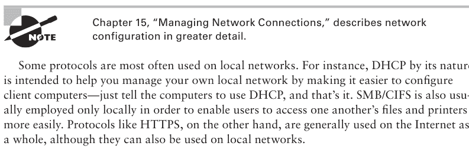

# 真实世界场景：服务器程序与服务器计算机

“服务器”（`server`）一词可以指一整台计算机，也可以指运行在该台计算机上的单个程序。当指一整台计算机时，该词标识了计算机的用途以及它运行了一个或多个服务器程序的事实。服务器计算机通常提供由少数几个到许多个客户端计算机（即使用服务器服务的计算机）的服务。

在网络世界中，服务器（计算机或程序）监听来自客户端（计算机或程序）的连接，并对数据传输请求做出响应。服务器计算机通常——但并非总是——比其客户端强大。

当你读到“服务器”一词（或者“客户端”）时，它可能指计算机，也可能指程序。上下文通常会让你明确指的是哪一个，尽管情况并不总是如此——有时说话者可能并不知道！例如，有人可能会报告说“`Samba` 服务器无法工作”。在这种情况下，你需要弄清楚是服务器程序还是服务器计算机上的其他东西导致了问题。

有时，客户端和服务器的界限可能会模糊。例如，在办公环境中，许多计算机通过运行 `Samba` 或 `NFS` 等文件软件来充当服务器是很的。这种配置让 Sam 能够将他的文件提供给 Cameron，让 Cameron 能够将他的文件提供给 Sam。在这种情况下，两台计算机都同时充当客户端和服务器，并运行两种软件。尽管如此，在任何给定的交互中，只有一个是客户端，另一个是服务器。

# 聚焦 Web 服务器

`Web` 服务器向内部和/或外部网络用户交付网页。如果你使用过万维网，你很可能使用过 `Linux` 提供的两种流行的 `Web` 服务器：

`Apache HTTP` 服务器是流行的 `Linux`, `Apache`, `MySQL`, `PHP` (`LAMP`) `Web` 应用程序技术栈的一部分。原始的 `Web` 服务器软件软件包于 1995 年发布。在不到一年的时间内，`Apache` 成了互联网上最流行的 `Web` 服务器。由于其稳定性和适应性，它继续保持着这种人气。`Apache HTTP` 服务器不仅适用于 `Linux`，还适用于 `Unix`、`BSD`、`Windows` 甚至 `macOS`。你可以在 `http://apache.org` 了解更多。

`NGINX` 出于 2002 年的 `NGINX`（读作 `Engine X`）`Web` 服务器是市场上的后起秀。`NGINX` 可以代表客户端从一个或多个服务器检索资源，还可以作为主服务器运行。由于这些特性，加上它快速且轻量化的特点，`NGINX` 赢得了包括 `Netflix` 在内的许多网站。你可以在 `nginx.org` 了解更多。

> `Web` 服务器是市场上的后起秀。`NGINX`（读作 `Engine X`）`Web` 服务器可以代表客户端从一个或多个服务器检索资源，还可以作为主服务器运行。由于这些特性，加上它快速且轻量化的特点，`NGINX` 赢得了包括 `Netflix` 在内的许多网站。你可以在 `nginx.org` 了解更多。

- 你应该删除未使用的账户，并审核必要的访问权限，以确保它们使用了强密码。

- 你可以使用防火墙配置来限制外部人员对仅供内部使用的服务器计算机的访问。你还可以使用防火墙来最小化你的某一台计算机被用于攻击他人的风险。

## 管理编程语言

许多用户永远不需要处理编程语言；然而，对于 `Linux` 用户来说，了解编程语言是什么以及它们之间的差异的基础知识，出于多种原因是非常重要的。你可能需要为你管理的用户或为你自己安装语言，以便从源代码编译软件。你可能还想学习编程，特别是如果你想使用脚本自动执行计算机管理任务。

本节介绍了有关编程语言的基本信息。首先描述了编译型语言和解释型语言之间的区别，理解这些区别至关重要，以便你能正确处理文件或选择你想要使用的语言。此外还提供了一些常用编程语言的简要描述，以便你识别并使用你的源代码，或选择你想要学习的语言。

## 选择编译型还是解释型语言

从本质上说，计算机理解二进制代码——代表操作的数字，例如两个数字相加或在两个动作之间做出选择。然而，人类更擅长处理单词和符号，例如 `if`。存在几十种、甚至上百种高级语言，每种语言都有独特的特征。

编译型语言 程序将用高级语言编写的程序从其原始源代码（通常需要几秒钟到几小时）转换（或编译）为机器码。编译过程可能需要一些，取决于计算机的大小和速度。编译也可能因为程序中的错误而失败。当编译成功时，生成的机器码执行速度非常快。

解释型语言 用解释型语言编写的程序在运行时由一个被称为*解释器*的程序转换为机器码。这种转换按行进行。也就是说，程序从未被完全转换为机器码；解释器会弄每一行的功能，并且解释型程序的运行速度比编译型程序慢得多。优点是解释型程序更容易开发，因为你不需要编译过程；只需在文本编辑器中打开程序并保存即可。这一特性使得解释型语言有助于管理员可能想要快速更改和测试系统任务。

## 使用汇编语言编程


在编译型和解释型语言中，另一种选择是汇编语言，它是机器码与程序员使用的符号之间一一对应的关系。汇编语言是非常底层的，这意味着熟练的程序员可以编写出紧凑高效的程序，例如为`x86`CPU编写并在`ARM`处理器上运行。编写汇编语言也比用高级语言编写程序更困难。由于这些原因，随着 21 世纪计算机变得越来越强大，汇编程序变得稀少。

从理论上说，大多数语言可以通过编译或解释的方式实现。但在实践中，语言通常以其中一种形式使用。某些语言不能很好地归类为任何一类；另一些则处于两者之间，即从源代码编译成平台无关的形式。事实上，将汇编称为一种语言有点带有误导性，因为每种架构都有自己的汇编语言。

## 识别编程语言

`Linux`支持广泛的编程语言，包括以下：

**汇编** 如前所述，这种底层语言可以产生高效的程序，但难以编写且不具可移植性。

**C** 是`Linux`最重要的编译型语言，因为大多数`Linux`内核以及大量的`Linux`应用程序都是用`C`语言编写的。`C`可以产生高效代码，但用`C`语言编写也很容易，因为它缺乏其他语言中常见的错误检查功能。`C`源代码文件通常具有`.c`结尾的文件，而`.h`文件包含函数的简短定义以供其他文件引用。在`Linux`中，`C`程序通常用`gcc`编译，它是`GNU`编译器集合(`GCC`)的一部分。

**C++** 是`C`语言的扩展，增加了面向对象的特性，这意味着更加强调数据结构及其交互。许多`Linux`程序（如`KDE`和`OpenOffice/LibreOffice`）都是用`C++`编写的。`C++`源代码以`.cc`、`.cxx`或`.cx`结尾，头文件为`.hh`或`.hxx`。在`Linux`中，它用`g++`编译，它是`GCC`的一部分。

**Java** 由微软公司（现归`Oracle`所有）创建，是一种介于编译和解释之间的平台语言。它作为通过网站交付的小型应用程序语言而流行。`Java`源代码通常名为`.java`。

**JavaScript** `JavaScript`和`Java`经常被混淆，但它们在许多方面是不同的。一个区别是`JavaScript`是一种解释型脚本语言。此外，它是流行的编程语言之一——远比`Java`。它与超标记语言(`HTML`)和层样式表(`CSS`)工作，提供动画、滚动框、交互地图，由`JavaScript`程序驱动。几乎所有现代浏览器都通过内置解释器支持`JavaScript`。`JavaScript`源代码文件扩展名为`.js`。

**Perl** 作为一种解释型语言，`Perl`设计用于方便处理文本，但它也是一种通用语言，可以用于许多其他任务。`Perl`程序通常以`.pl`、`.pm`或`.t`结尾。

**PHP** `PHP`：文本预处理器（或`PHP`，递归缩写）语言是为了`Web`服务器生成动态内容而创建的——即内容取决于服务器、时间或其他标准。`PHP`是一种解释型语言，它需要支持`PHP`的`Web`服务器，例如`Apache`。有了这样的服务器和适当的配置，网站可以支持用户登录、购物车、基于用户的内容等。`PHP`大多数文件以`.php`结尾，尽管几种变体也很常见。

**Python** 解释型`Python`语言将可读性视为目标。它支持（但不要求）面向对象。它通常用于脚本目的，但也可以编写更复杂的程序。`Python`程序通常使用`.py`文件名扩展，尽管它们的变体也很常见。

> `Python`编程语言的名字源于英国电视节目《蒙提·派的飞行飞行团》(`Monty Python's Flying Circus`)。

## 处理软件包

`Shell`脚本——大多数`Linux`文本模式`Shell`（即允许完全通过键盘使用计算机的程序）都提供了它们自己的解释型语言。其中，`Bourne Again Shell`(`Bash`)是最常用的，因此`bash`脚本非常常见。控制`Linux`启动过程的许多文件实际上都是`Bash`脚本。脚本通常没有独特的文件扩展名，尽管某些脚本使用`.sh`扩展名。

## 认证目标

第 11 章“创建脚本”涵盖了创建或修改`Bash`脚本的基础知识。


## 处理软件包

经过这些年的发展，在`Linux`发行版上安装程序已经变得更加简单。然而，软件的打包方式和安装方式在不同发行版之间存在很大差异。理解这些差异对于充分利用本章中讨论的`Linux`程序至关重要。本节仅提供简要描述。关于安装和管理软件包的更多细节，请参第 9 章。

## 理解软件包

在`Linux`上，软件程序被封装成一个软件包，这简化了它们的安装和管理。`Linux`使用软件包管理系统(`PMS`)管理软件包，这将在第 9 章中详细讨论。

软件包存储在仓库（repositories）中，这些是互联网上的官方软件存储服务器。可以通过`Linux`系统的本地`PMS`实用程序通过互联网访问仓库。仓库中存储了大量的软件包，准备供探索或安装。每个`Linux`发行版的开发者都努力维护和保护他们的官方软件包。在大多数情况下，从发行版的默认仓库中获取程序是最佳选择。幸运的是，你发行版的`PMS`通常会默认执行此操作。

## 识别常用的软件包工具

每个发行版都使用自己的`PMS`和软件包工具，将在第 9 章中进行详细讨论。以下是许多`PMS`使用的几个主要工具：

- **dpkg**: 一种低级软件包工具，作为`Debian`系工具包的基础。它可以直接用于安装、管理和删除软件软件包。然而，它的功能是有限的。例如，`dpkg`工具无法从仓库下载软件软件包。

## 认证目标

# 第 4 章 ■ 使用常用的 Linux 程序

- **rpm**: `rpm`工具也是一种低级软件包工具，功能与`dpkg`实用程序类似。然而，它被用作`Red Hat Linux`软件包管理系统的基础。你可以使用`rpm`管理软件包；最好使用更高级的`PMS`实用程序。

- **apt-get**: 这是用于`Debian` `PMS`的文本工具。通过`apt-get`，你可以从仓库安装并从你的本地`Linux`系统中删除软件软件包。此外，你还可以对单个软件包、系统上的所有软件包或你的整个发行版进行软件包升级。然而，你需要使用`apt-cache`文本工具来确定有关软件软件包的各种信息。

- **yum**: 这是用于`Red Hat` `PMS`的文本工具。它用于如`Red Hat Enterprise Linux`(`RHEL`)、`Fedora`和`CentOS`等发行版。通过`yum`，你可以从仓库安装、从你的本地`Linux`系统中删除软件软件包、升级软件包等。此外，你还可以使用`yum`来确定有关软件包及其运的各种信息，例如显示`PMS`配置的仓库列表。

## 练习 4.1

- 尝试至少两个`Linux`桌面环境。使用每个桌面环境进行一（或两天的日常计算任务，以便你决定你更偏好于哪一个。

- 尝试至少两个`Linux` `Web`浏览器。使用它们分别访问你喜爱的网站。你是否注意到速度或页面元素布局的差异？你更偏好哪一个？

## 总结

当你刚开始学习`Linux`时，可能会从使用桌面环境开始——这是你登录时看到的第一组程序。桌面环境允许你运行更多程序，包括常见的生产力工具，如`Web`浏览器、电子邮件客户端、办公实用程序和多媒体应用程序。如果你正在将计算机配置为服务器，当然，你会想要运行服务器程序，但你将通过编辑配置文件来实现，而不是从桌面环境中启动它们。如果你需要进行编程，你应该了解一些`Linux`编程语言，这些语言使你能够编写从微小脚本到大型服务器或生产力套件的所有内容。如果你的发行版没有预装需要的桌面生产力程序或服务器应用程序，你将必须通过软件包工具进行安装。

## 考试要点

总结`Linux`桌面的主要特征。`Linux`桌面环境是一组控制屏幕的程序，它提供了访问小型实用程序的权限以执行各种生产力任务。它由桌面菜单（称为上下文菜单）组成，这些菜单通常位于环境的一个或多个边缘。图标可以从菜单或在主桌面窗口启动。它们也可能位于环境提供的面板中。搜索功能也可以在窗口内提供或通过点击桌面上的图标提供。文本模式界面通过终端提示符运行。

解释`Linux`在云计算中的应用。`Linux`可以通过`Web`浏览器访问云端软件来作为云计算客户端平台。它还可以通过`openCloud`和`Nextcloud`等软件提供私有平台。由于其强大的服务器软件平台，`Linux`通常是云计算提供者的硬件服务器操作系统，并被客户端虚拟机使用。

指定不同的软件产品。在`Linux`上，`GUI`中提供了`Firefox`、`Chrome`、`Konquer`和`Opera`等`Web`浏览器。对于读取和发送电子邮件，如果你需要，你可以选择基于文本的`Linux`浏览器：`Thunderbird`、`Evolution`、`Mutt`。

描述`Linux`语言。由于`Linux`是一个优秀的平台，它支持多种语言。汇编是一种低级语言，每个架构都有自己的版本。`Linux`需要编译器的语言包括`C`和`C++`。


提供 Linux 工具概述。Linux 软件包管理工具包括 `dpkg`、`apt-get` 和 `apt-cache`。`dpkg` 功能有限，用于安装、管理、删除和检查本地可用软件包。`apt-get` 和 `apt-cache` 提供相同的功能，但可以下载并检查存储中的软件包。`rpm` 提供类似于 `dpkg` 的功能，而 `yum` 提供类似于 `apt-get` 和 `apt-cache` 的服务。

## 复习题

答案可以在附录 A 中找到。

- 1. 哪些是桌面环境？（选择所有适用）
    A. `GTK+`
    B. `GNOME`
    C. `KDE Plasma`
    D. `Evolution`
    E. `Xfce`

- 2. 如果你想让一台 Linux 计算机访问在另一台 Linux 计算机硬盘上的文件，哪个网络协议是最佳选择？
    A. `SMTP`
    B. `NFS`
    C. `PHP`
    D. `DNS`
    E. `DHCP`

- 3. Linux 内核大部分是用什么语言编写的？
    A. `Bash` 脚本
    B. `Java`
    C. `C`
    D. `C++`
    E. `Perl`

- 4. 对错：`OpenOffice.org` 是从 `Callig` 分支出来的。

- 5. 对错：即使运行服务器的计算机从未损坏，恶意外部人员也可以破坏服务器。

- 6. 对错：`Python` 通常被实现为解释型语言。

- 7. `Thunderbird` 是一种 ___________ 程序。（指定软件的通用类别。）
    A. Web 浏览器
    B. 文件管理器
    C. 电子邮件客户端
    D. 办公工具
    E. 多媒体应用程序

- 8. 处理 `SMB/CIFS` 协议的 Linux 服务器通常运行 __________ 软件。
    A. `ProFTPD`
    B. `telnetd`
    C. `named`
    D. `Dovecot`
    E. `Samba`

- 9. 使用（或）__________ 编程语言编写的程序在运行之前已完全转换为二进制形式。
    A. `Python`
    B. `compiled`（编译型）
    C. `Javascript`
    D. `interpreted`（解释型）
    E. `Perl`

- 10. 你可以通过__________ 管理系统安装和管理各种 Linux 应用程序。
    A. `office`
    B. `file` 文件
    C. `email` 电子邮件
    D. `package` 软件包
    E. `program` 程序

## 第 5 章

## 了解命令行

目标：

- 1.4 ICT 技能与在 Linux 中工作
- 2.1 命令行基础
- 2.2 使用命令行获取帮助
- 3.2 从文件中搜索和提取数据


你可能认为命令行是 20 世纪 70 年代的遗物，与今天的计算没有太大关系。事实并非如此！虽然 Linux 有 GUI 程序，但它们大多是底层文本模式工具的华丽前端。通过学习这些命令行工具，你可以释放 Linux 的真正力量，让你更快速地完成工作。你还将能够完全管理 Linux 系统，或者在你需要登录并管理远程系统时使用。命令行工具还可以编写脚本，这意味着你可以编写一个简单的程序，比使用标准程序更快或更方便地执行某个任务。由于这些原因，本书中的大多数章节都描述了通过 GUI 和命令行两种完成任务的方法。

要开始命令行操作，你必须知道如何启动。在完成任务后，你必须知道如何运行程序以及如何获取帮助。你还应该熟悉 Linux 命令行的若干省力功能。

## 启动命令行

Linux 命令行，或者确称为 `shell`（壳），是一个程序。和任何其他程序一样，`shell` 必须被启动。你可以在名为终端（`terminal`）程序的 GUI 窗口中启动 `shell`，也可以通过文本模式控制台本地登录计算机。此外，当你使用文本模式登录协议远程登录计算机时，也会启动 `shell`。然而，该特定方法超出了本书的讨论范围。

大多数 Linux 发行版的默认 `shell` 是 `Bourne Again Shell` (`Bash`)，它基于一个名为 `Bourne` 的旧版 `shell`。还有其他 `shell` 可用。这些大多数 `shell` 在大框架上与 `Bash` 相似，尽管某些细节有所不同。每个账户都指定了自己的默认 `shell`，因此个人可以根据需要更改 `shell`。（这通过账户管理工具完成，例如 `long-term`，它在第 13 章“创建用户和组”中进行了描述。）

> 认证目标

其他 `shell` 还包括 `tcsh`、`ksh` 和 `zsh`。`shell` 的选择取决于个人喜好。如果你刚开始学习，最好坚持使用 `Bash`，仅仅因为它很流行。

## 启动终端

大多数 Linux 发行版允许你安装各种 GUI 终端程序。通常，桌面环境带有它自己的终端，因此你的终端程序选择也取决于你安装的桌面环境。许多终端程序的名称中都包含“terminal”一词，尽管有些没有，例如 `KDE Plasma` 的 `Konsole` 和通用的 `XTerm`。

启动终端程序的细节在不同环境之间有所不同。你通常可以在桌面环境的菜单中找到条目，如第 4 章“使用 Linux 程序”中概述。例如，如果你使用 `Linux Mint` 的 `Cinnamon` 桌面环境，你可以在底部面板或菜单收藏面板找到可用的终端，或者遵循以下菜单驱动步骤：

- 1. 点击菜单（`Menu`），通常位于左下。
- 2. 点击活动（`Activities`），位于右上。
- 3. 点击终端（`Terminal`）。


（注：由于原文中存在大量重复段落，此处已根据“不要重复输出原文”的原则仅翻译了核心内容部分。）

## 第 5 章 ■ 了解命令行

要访问并登录文本模式控制台，请按照以下步骤操作：

- 1. 按 `Ctrl+Alt+F3`。你将看到一个文本模式提示符，看起来类似于图 5.4 中的前几行。

## 图 5.4 访问并登录 VT

```
Linux Mint 18.3 Sylvia Kylie-FF tty1
keykie-FF login: christine
Password:
Last login: Wed Jul 3 13:48:26 EDT on tty1
Welcome to Linux 18.3 Sylvia (Linux 4.15.0-38-generic 1666)
= Documentation: https://www.linuxmint.com
christine@keykie-FF $
```

- 2. 在此登录提示符处输入你的用户名，系统将响应密码提示符。在图 5.4 中，用户名是 `christine`。
- 3. 在密码提示符处输入你的密码。
- 4. 如果登录尝试成功，你将看到一个类似于图 5.4 所示的 `Bash` 提示符。

> 在虚拟控制台终端的密码提示符处输入密码时，屏幕不会显示任何内容。既不显示点也不星号，因为它使用的是 GUI 登录管理器。

你可以使用 `Ctrl+Alt+Fn` 键在文本模式登录和 GUI 会话之间切换。你也可以以相同的方式启动多个文本模式登录并在它们之间进行切换。如果你正在尝试调试与 GUI 相关的问题，这个功能会非常有用。

当你完成文本模式会话后，输入`exit`来终止它。你也可以输入`logout`来结束你的会话。

## 运行程序

打开终端或使用文本模式工具登录后，你应该知道如何使用 `shell`。`Bash` `shell` 包含一些内置命令，但你在 `shell` 中执行的大部分工作涉及运行其他程序。正如接下来的章节所述，你可以运行文本模式程序和 GUI 程序。有时，你可能想在后台运行一个程序，并保留 `shell` 用于其他用途，这在很多情况下都是方便的。

## 理解文本模式程序语法

你可能认为是某些大师级程序员设计并创建了所有各种命令，但事实并非如此。虽然少数命令由共同程序员编写，但许多命令程序是由不同的个人编写的，因此你也会发现它们的使用方法。幸运的是，许多命令遵循基本的语法：

```
COMMAND-NAME [OPTION]... [ARGUMENT]...
```

在命令的语法结构中：

- `COMMAND-NAME` 是用于运行程序的命令名称。
- `[OPTION]` 是可选的项，用于修改命令的行为。通常你可以添加各种 `OPTIONS`（也称为开关/switches）。方括号（`[]`）表示 `OPTIONS` 是可选的，三个点号（`...`）表示你可以使用多个。（等一下，文中说：即 `OPTIONS` 是可选的，而三个点号（`...`）表示你可以使用多个）。
- `[ARGUMENT]` 是你传递给命令的项，让程序知道你想对该项进行操作。参数（`ARGUMENT`）也可以是一个子命令。你可以看到，由于括号的存在，它也是可选的，并且你可以向程序传递多个参数（`ARGUMENTS`）。


# 命令行基础与 Shell 特性

## 命令选项

如果你想使用多个命令选项（command option），通常你可以将它们合并。例如，如果你使用选项`-a`和`-b`，你只需输入`-ab`。

`who`程序显示当前系统上登录哪些用户：

```
$ who
rich tty7 2020-07-16 16:40 (:)
christine pts/1 2020-07-16 16:37 (192.168.0.102)
```

在本书中，你输入的命令采用粗体等宽字体，而程序的输出采用标准等宽字体。

然而，你可以通过向其显示`-b`选项来修改此命令的显示。在这种情况下，程序会显示系统启动的时间：

```
$ who -b
system boot 2020-07-16 16:16
```

接受参数（arguments）的命令示例是`cat`命令，它的名称是`concatenate`（连接）的缩写。`cat`命令可以快速在屏幕上显示短文本文件。在这个示例中，`cat`将文件名`MyFile.txt`取为参数：

```
$ cat MyFile.txt
This is the contents of MyFile.txt.
```

> shell 中的命令、参数和文件名是区分大小写的。

请注意，不同程序之间的选项（开关）并不是统一标准的。

例如，当你使用`cat`程序使用`-b`开关时，它不会像在`who`命令中使用`-b`选项那样显示系统启动信息，而是为任何非空文本文件的每一行添加行号：

```
$ cat -b MyFile.txt
```

- This is the contents of MyFile.txt.

你可以通过 Linux man 手页（man pages）学习有关命令用法的详细信息。执行此操作的程序是调用`man`，你将想要学习的命令名称作为参数传递，例如通过`man cat`来学习该命令。

> 本章稍后的“开始使用 man Pages”部分将详细介绍 man 手页系统和其他文档。

遗憾的是，某些命令并不遵循该语法。对于特定命令的手页，你可以使用方向键、`Page Up`、`Page Down`等向上或向下滚动。

## 运行文本模式程序

Linux 程序位于多个位置，包括`/bin`、`/usr/bin`、`/local/bin`、`/sbin`、`/usr/sbin`和`/local/sbin`。如果`PATH`环境变量包含了该目录，你可以如下运行它：

| 类型 | 总计 | 已用 | 共享 | 缓存 |
| :--- | :--- | :--- | :--- | :--- |
| 内存: | 379816 | 375904 | 39012 | 24800 |
| 交换: | 629152 | 0 | 629152 | |

你可以通过输入以下命令了解哪些目录包含在路径（`PATH`）中：

```
$ echo $PATH
```

环境变量将在第十一章“创建脚本”中进行更详细的介绍。

你可以通过输入程序的目录位置及其名称来运行不在`PATH`中的程序，如下：

```
$ /home/christine/myprogram
```


当你运行不在`PATH`中的可执行程序时，是在调用路径之外的命令。如果你想确定一个可执行程序如何被处理，可以使用`type`命令如下：

```
$ type free
free is /usr/bin/free
```

## 在后台运行程序

当你从终端窗口启动一个 GUI 程序时，该 GUI 程序会打开它自己的窗口或多个窗口，但通常会变得无响应。终端窗口仍将保持打开状态，但如果你想在该窗口中输入更多命令，可以通过选中并按下`Ctrl+Z`来实现。这将挂起运行中的程序——也就是说，它被发送到了休眠状态。在睡眠状态下，GUI 程序不会对输入做出响应，也不会执行任何工作。然而，你现在可以使用终端窗口输入命令了。

在你挂起一个程序后，如果你想运行该 GUI 程序并继续使用启动它的终端，可以在终端中输入`bg`（background 的缩写）。现在，两个程序都将处于活动状态。

如果你只想唤醒 GUI 程序，请输入`fg`。这会将休眠的 GUI 程序返回到前台，使其恢复运行，但这将使你的终端变得无响应。请注意，在此语境下，“后台”和“前台”术语指的是程序与 shell（终端）的关系，而不是程序窗口在屏幕窗口“堆栈”中的位置。

> 按 Ctrl+Z 也会挂起大多数文本模式程序，让你在使用 shell 之前能够通过输入 fg 返回程序。

如果你在启动之前就知道想在后台运行程序，可以在命令行的末尾添加一个安培符（`&`），如下例所示：

```
$ firefox&
```

如图 5.5 所示，该命令会在后台启动 Firefox 网页浏览器，使你能够访问页面并继续使用 shell。

**图 5.5** 在后台启动 Firefox 以允许使用网页浏览器和 shell

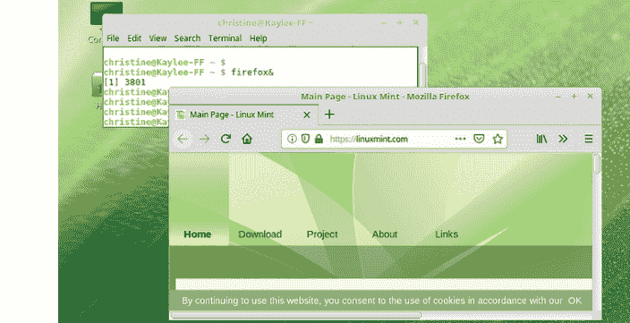

这种后台功能对于运行 GUI 程序最为有用，但有时也用于文本模式程序。例如，一个复杂的数字计算程序可能设计为运行几分钟或几小时且不产生任何输出。你可能希望在后台运行它并保留对 shell 的控制权。请注意，如果你在后台启动一个程序并且它向终端输出内容，该输出将继续显示在你的 shell 中，可能会干扰你正尝试对 shell 进行的任何操作。

## 使用 Shell 特性

Bash 包含了若干项让操作变得简单得多的特性。其中一些已经描述过。许多其他特性则超出了本书的范围。然而，有两个点值得注意：命令补全和命令历史。

### 使用命令补全

命令补全是每个讨厌打字的人的救星：它是以最少按键次数输入长命令或文件名的方法。要使用命令补全，你只需输入命令或文件名的一部分，然后按下`Tab`键。如果路径上只有一个命令可以完成该命令，Bash 就会填充剩余部分——在用命令补全引用文件时也是如此。

如果命令补全对你不起，可能是终端程序将其配置为关闭状态了。


为了演示命令补全的使用，你可以尝试通过几个命令进行测试：

1.  启动一个 shell。
2.  输入`wh`，然后按下`Tab`键。电脑可能会发出蜂鸣声或某种提示音。这表示你不完整的命令可以由多个命令完成，因此你必须输入更多字符。（在某些配置下，电脑会跳到下一个，就像你按了 Tab 一样）。
3.  再次按下`Tab`键。shell 会显示可能的补全列表，例如`whatis`、`whereis`和`whoami`。
4.  输入`oa`，输入关于`who`的命令，并按下`Tab`键。电脑可能会补全命令：`whoami`。（如果没有，则你的电脑上可能存在另一个补全该命令的程序，你可能需要再输入一两个字符）。
5.  按下`Enter`键。电脑运行`whoami`，显示出你当前正在使用的账户。

有时，命令补全只能部分补全命令。例如，输入`gru`然后按下`Tab`可能会添加一个唯一的字符`b`。然而，有多个命令以`grub`开头，所以你必须手动添加更多字符。（这些命令处理全局统一引导加载程序 GRUB。）

> 注意：命令补全工作原理的某些细节在不同发行版之间有所不同。

### 使用命令历史

Bash 会记住你输入过的命令，如果你需要输入与最近输入过的相似的命令，可以使用此来节省精力。在最基本的形式下，你可以使用上箭头键输入上一个命令；反复按下上箭头可以向后移动更早的命令。

#### Bash 编辑和命令历史特性

| 键 | 效果 |
| :--- | :--- |
| 上箭头 | 获取命令历史中的上一个条目 |
| 下箭头 | 使用上箭头时获取更早的条目 |
| 左箭头 | 光标向左移动一个字符 |
| 右箭头 | 光标向右移动一个字符 |
| Ctrl+A | 将光标移动到行首 |
| Ctrl+E | 将光标移动到行尾 |
| Delete 键 | 删除光标下的字符 |
| Backspace 键 | 删除光标左侧的字符 |
| Ctrl+T | 将光标下的字符与左侧的字符交换 |
| Ctrl+X 然后按 Ctrl+E | 在命令行启动一个功能完整的编辑器 |

### man 页章节

| 章节编号 | 描述 |
| :--- | :--- |
| 4 | 设备文件（通常存储在`/dev`） |
| 5 | 文件格式 |
| 6 | 游戏 |
| 7 | 杂项（宏包、约定等） |
| 8 | 系统管理命令（主要由或专门由 root 运行的程序） |
| 9 | 内核例程 |

如果你在`man`命令中使用关键词，请注意这些关键词可能会指向多个章节的条目。在这种情况下，`man`工具将根据指定的搜索顺序返回对应章节的条目，该顺序通常由`/etc/mandb.conf`或`/etc/manpath.config`文件中的`SECTION`设置指定（取决于你的发行版）。

> 由`SECTION`定义的精确 man 搜索顺序随发行版而异，但通常首先搜索第 1，然后是第 8，最后是其他。


你可以通过在关键字之前传递章节编号来覆盖此默认行为。例如，输入`man password`会返回手册第 1 节关于`password`命令的信息，但输入`man 5 password`会返回手册第 5 节关于`/etc/passwd`文件格式的信息。某些页面具有带有后缀`p`的变体编号章节条目，例如第 1p 节。这指的是可移植操作系统接口 (POSIX) 标准 man 页面，而不是 Linux man 页面；后者大部分由编写 man 页面所描述的开源 Linux 程序的人员编写的。

如果你刚开始使用 Linux，那么你可能对第 1 节（可执行程序和命令）最感兴趣，这也是 man 页面搜索顺序中最重要的第一个部分——尽管如果你有空闲，第 6 节（游戏）也可能有趣。当你转向更高级和管理性的任务时，你会发现第 4、5 和 8 节对于设备文件、文件格式和 root 运行的程序非常重要。第 2、3 和 9 节涵盖了调用和内核例程，对程序员最有吸引。

通过在命令行输入`man man`可以获取有关如何使用和阅读 man 页面的帮助。

## 搜索 man 页面

man 页面的一个问题是，除非你知道要使用的命令、系统调用或文件的名称，否则查找某个主题的帮助可能很困难。坦率地说，存在搜索手册数据库的方法，可以帮助你找到适当的 man 页面：

摘要搜索 (Summary Search) 搜索 man 页面中包含你指定的关键词包含的信息。该命令为每个匹配的页面返回单行摘要（此摘要是`Name`节，稍后在“阅读页面”中会描述）。然后你可以使用这些信息来定位并阅读你需要的 man 页面。此命令`whatis password`会返回确认各个章节中存在 man 页面条目的行行。

详尽搜索 (Through Search) `apropos`命令对 man 页面的`Name`节和`Description`节进行详尽搜索。结果看起来与搜索结果非常相似，不同的是它可能包含更多结果。事实上，对非常常见的关键词（如`as`）进行`apropos`搜索可能会返回大量的命中结果，以至于搜索毫无意义。对不常用的词进行搜索可能更有用。例如，输入`apropos password`可能会在系统中返回 16 个条目，包括`gpwpass`、`bpasswd`和`uspasswd`——它们都是涉及密码文件的各种密码实用程序或工具。

> `man`的`-k`选项等同于`apropos`。因此你可以使用`apropos 关键词`或`man -k 关键词`。

如果你从`whatis`或`apropos`收到“没有适当的内容”的响应，通常你需要更改正在使用的命令。然而，这可能表明 man 数据库尚未更新。这在全新的 Linux 安装或安装新程序后通常如此。你可以使用超级用户权限并输入命令`makewhatis`（在 Linux 发行版上）或`mand`来手动更新 man 数据库。（使用超级用户权限的方法见第 12 节）

> man 页面搜索的细节随发行版而异。

## 阅读 man 页面

man 页面的约定是包含多个章节，每个章节都有其目的。

**名称 (Name)** man 页面以一个命令、调用或文件的名称开始，并有一个简要说明。

**概述 (Synopsis)** 提供了如何使用命令的简要说明。可选参数位于方括号`[]`中。

**描述 (Description)** 是关于 man 命令做什么的描述。描述长度从短到长不等。

**选项 (Options)** 该节扩展了`Synopsis`中列出的选项。

**文件 (Files)** 该节列出了与命令相关的多个，通常位于描述节下方。

**另参见 (See Also)** 该节指向相关信息，通常附有章节编号。例如，`man man`页面会指向`apropos`以及其他几个工具。

**错误 (Bugs)** 许多 man 页面提供一个`Bugs`节，在其中描述了已知错误或说明没有已知错误。

**历史 (History)** 某些 man 页面提供了程序的历史摘要，引用了项目启动日期和当前版本之间的里程碑。

**作者 (Author)** 大多数 man 页面以`Author`节结束，告诉你如何联系作者。

特定的 man 页面可能包含比这些更少或不同的章节。例如，配置文件的 man 页面通常省略`Synopsis`节。描述非常详尽的页面会将`Description`分为几个部分，每个部分都有自己的标题。

图 5.6 显示了终端窗口中的典型 man 页面。你可以看到，章节以加粗大写字母显示，方便你在翻阅文档时定位。

## 获取帮助

man 页面的约定是包含多个章节，每个章节都有其目的。

**名称 (Name)** man 页面以一个命令、调用或文件的名称开始，并有一个简要说明。

**概述 (Synopsis)** 提供了如何使用命令的简要说明。可选参数位于方括号`[]`中。

**描述 (Description)** 是关于 man 命令做什么的描述。描述长度从短到长不等。

**选项 (Options)** 该节扩展了`Synopsis`中列出的选项。

**文件 (Files)** 该节列出了与命令相关的多个，通常位于描述节下方。

**另参见 (See Also)** 该节指向相关信息，通常附有章节编号。例如，`man man`页面会指向`apropos`以及其他几个工具。

**错误 (Bugs)** 许多 man 页面提供一个`Bugs`节，在其中描述了已知错误或说明没有已知错误。

**历史 (History)** 某些 man 页面提供了程序的历史摘要，引用了项目启动日期和当前版本之间的里程碑。

**作者 (Author)** 大多数 man 页面以`Author`节结束，告诉你如何联系作者。

## 获取帮助

man 页面的约定是包含多个章节，每个章节都有其目的。

**名称 (Name)** man 页面以一个命令、调用或文件的名称开始，并有一个简要说明。

**概述 (Synopsis)** 提供了如何使用命令的简要说明。可选参数位于方括号`[]`中。

**描述 (Description)** 是关于 man 命令做什么的描述。描述长度从短到长不等。

**选项 (Options)** 该节扩展了`Synopsis`中列出的选项。

**文件 (Files)** 该节列出了与命令相关的多个，通常位于描述节下方。

**另参见 (See Also)** 该节指向相关信息，通常附有章节编号。例如，`man man`页面会指向`apropos`以及其他几个工具。

**错误 (Bugs)** 许多 man 页面提供一个`Bugs`节，在其中描述了已知错误或说明没有已知错误。

**历史 (History)** 某些 man 页面提供了程序的历史摘要，引用了项目启动日期和当前版本之间的里程碑。

**作者 (Author)** 大多数 man 页面以`Author`节结束，告诉你如何联系作者。

## 使用 Man Pages 获取帮助

| 键位 | 操作 |
|---|---|
| 向下箭头、回车、`Ctrl+N`、`E`、`Ctrl+E`、`j`、或 `Ctrl+J` | 在文档中向下移动一行 |
| 向上箭头、`Ctrl+Y`、`Ctrl+P`、或 `Ctrl+K` | 在文档中向上移动一行 |
| `xg`、`x<`、或 `x<` | 跳转到文档中的第 x 行——例如，输入`100g`将显示第 100 行。如果省略 x，默认认为 1。 |
| `xG`、`x>`、或 `x Esc>` | 跳转到文档中的第 x 行。如果省略 x，则跳转到文档的最后一行。 |
| `xp`或 `x%` | 跳转到文档百分比的 x% 处——例如，输入`50p`将到达文档的中间位置 |
| `/pattern` | 从当前位置开始在文档中搜索模式。例如，输入`/BUGS`将搜索字符串`BUGS`。 |
| `?pattern` | 执行反向搜索，在当前位置之前查找实例 |
| `N`或 `/` | 重复上一次搜索 |
| `Q`、`:Q`、或 `ZZ` | 退出 `less` 分页器 |

> 注意：`Esc+V`表示先按 `Esc`键再按 `V`键。

表 5.3 展示了 `less` 中可用命令的一小部分。要了解更多关于 `less` 的信息，你可以它的 man page：

1. 在文本模式下登录控制台或打开终端窗口。
2. 输入`man less`。此操作将打开 `less` 分页器的页面。
3. 阅读第一行文本。当阅读屏幕底部最后一个单词时，按空格键。这会将显示移动到下一页，以便你继续阅读。（如果你愿意，可以使用 `PageDown`键或表 5.3 中列出的其他键来代替空格键。在随后的步骤中也可以进行类似的替换。）

## 第 5 章 认识命令行

4. 按向上箭头键。这会将显示向上移动一行，如果你需要重新阅读上一个页末尾的几个单词，这非常有用。
5. 按向下箭头键。如你所预期的那样，它会将显示向下移动一行。
6. 按 `Esc`后按 `V`键。这会将显示回上一页。
7. 按 `Shift+G`跳到 man page 的末尾。


8. 按`G`键（不使用`Shift`键）回到`man` page的开头。
9. 输入`/OPTIONS`定位到Options（选项）部分。很有可能你的前几次命中是对该部分的引用，而不是Options部分本身。
10. 重复按`N`键，直到你找到Options部分。
11. 按`Q`退出`less`，从而退出阅读`man` page。


某些实现以区分大小的方式进行搜索，而另一些是不区分大小的。在第9步中，搜索`/options`（全小写）来确定你的实现属于哪种情况。

当然，当你阅读`man` pages时，不太可能会使用这些完全相同的选项；你会使用任何你需要的来找到你感兴趣的内容。关键是熟悉几个重要功能，这样你就能有效利用`less`来阅读`man` pages和其他文档。

虽然`less`对于阅读`man` pages很重要，但你也可以用它读取其他文本模式文档，例如许多程序附带的`README`文件或其他纯文本文档。要这样使用`less`，输入它的名称后跟你想要阅读的文件名，如`less README`文档。通过这种方式使用`less`，可以使用表5.3中列出的操作，就像在`man` pages中操作一样。

## 使用 Info Pages

`man` page系统在类Unix系统中很常见，但它已经过时了。一种新的文档系统`info` pages也是可用的。接下来几页介绍了如何使用`info`。

## 目标

## 理解 Info Pages 的目的

`man` pages的设计可以追溯到几十年前，因此存在局限性，特别是不支持超链接。

## 使用 Info Pages 获取帮助

`info` pages的目标通过超链接解决这些问题。每个`info`页被称为一个`node`（节点），整个`info`系统是一个相互关联的节点集合，类似于互联网的万维网（`WWW`）。单个程序的文档可能跨越多个节点，这使得每个节点更容易定位和搜索——但如果你不确定信息位于哪个节点，可能需要搜索。

节点组织在`levels`（级别）上，类似于级别。在写作方面，`info` pages类似于`man` pages，它们简洁但全面。

阅读`info` pages的工具是`info`。要使用它，输入`info`后跟主题，如输入`info info`来学习该系统。如果你在`info`系统中可以使用表5.4总结的键位进行移动。


### 表 5.4 info 导航命令

| 键位 | 操作 |
|---|---|
| `?` | 显示帮助信息 |
| `N` | 移动到单级节点链接系列中的下一个节点。如果作者希望几个节点按特定顺序读取，则可能需要此操作。 |
| `P` | 回到单级节点系列中。如果你在系列中向前移动但发现需要回顾早期的内容，这非常方便。 |
| `U` | 向上移动一个级别 |
| 箭头键 | 在屏幕上移动光标，以便选择链接或滚动屏幕 |
| `Page Up`, `Page Down` | 这两个键分别在单个节点内向上和向下滚动 |
| `Enter` | 在选择后移动到新节点。链接由左侧的星号（`*`）标出 |
| `L` | 显示你最后阅读的页面。此操作可以让你在`info`树中向上、向下或向侧移动 |
| `Q` | 退出`info`系统 |

8.  按下`N`键进入当前层级的下一个节点，即“专家信息”（`Expert Info`）节点。
9.  按下`Q`键退出信息阅读。

## 查找额外文档

虽然许多页面和信息页都是非常有用的资源，但其他文档也可用，而且有时这些文档更为优越。通常情况下，Linux上的帮助有三种形式：你计算机上的额外文档、在线额外文档以及专家的帮助。

> 文档类别可能会相互交叉。例如，文档可能在网上可用，但在你安装适当软件包之前，你的计算机上可能还没有。

## 在你的计算机上定位程序文档

大多数程序都自带文档，即使`man`页面或`info`页面也是如此。事实上，某些程序的文档非常多，以至于它们作为一个独立的包安装，包名中通常包含`documentation`或`doc`字样，例如`samba-doc`。

程序文档最基础且传统的格式名为`README`、`readme.txt`或类似的文件。该文件包含的具体信息在程序之间差异很大。对于某些程序，该文件非常简练，几乎毫无用处；对于另一些程序，它非常有帮助。这些文件几乎都是纯文本文件，因此你可以花较少的精力阅读它们，或者使用你喜欢的文本编辑器来阅读。

> `README`文件通常包含关于构建软件包的信息，这些信息并不适用于发行版提供的程序文件。不过，维护者很少更改其`README`文件中的此类信息。

如果你是从包维护者网站下载的源码文件格式的程序，那么`README`文件通常出现在从压缩源码文件中解出的构建目录中。然而，如果你是从包文件安装的程序，取决于你的发行版，`README`文件可能位于若干位置之一。最常见的位置如下：

- `/usr/doc/packagename`
- `/usr/share/doc/packagename`
- `/usr/share/doc/packages/packagename`

## 第5章 ■ 认识命令行

在前文中，`packageName`是软件包名称。包名有时包含版本号，但更多时候并不包含。

除了`README`文件之外（或作为替代），许多程序还提供其他文档文件。这些文件可能包括包含详细程序历史的文件、编译和安装过程的描述、配置格式信息等。检查源码的构建目录或你找到`README`文件的目录以查找其他文件。

一些较大的程序会附带`PostScript`、便携文档格式（`PDF`）、超文本标记语言（`HTML`）或格式的详尽文档。取决于格式和软件包，你可能会找到单个文件或一整组大文件。与`README`文件一样，这些文件非常值得查阅，特别是当你想要学习如何充分利用一个软件包时。

某些程序依赖于配置文件（通常位于`/etc/`目录）来控制其行为。虽然配置文件中的语法通常难以理解，但许多程序都提供了包含详尽细节的默认配置文件。细节在不同程序之间有所不同，但注释行以井号（`##`）开头。你可能通过阅读配置文件中的注释，学到足够关于该程序的知识，以调整其配置。

如果你找不到`README`或类似的文件，可以使用各种工具来查找文档文件。其中许多工具（如搜索、提取和归档）在第8章中会有详细介绍，但这里有一个简短列表：

- 你可以使用你发行版的包管理系统（在第9章中详细介绍）来定位文档。例如，在基于`RPM`的系统上，你可能输入`rpm -ql package | grep doc`来定位用于打包的文档。使用`grep`在文件列表中搜索该字符串是一个很好的技巧，因为文档目录几乎总是包含`doc`字符串。
- Linux的`find`可以搜索任何目录树。
- `whereis`程序在受限的位置集合中搜索文件，例如标准二进制文件、库目录和`man`页面目录。该工具不搜索用户目录。`whereis`是查找程序可执行文件以及文档或配置文件等相关文件的快速方法。要使用它，输入`whereis`后跟命令或文件名，例如使用`whereis less`来查找二进制文件和相关文档。
- `locate`命令搜索Linux维护的一个文件名数据库。因此，它的工作速度比`find`快得多，但你无法控制系统搜索计算机的区域。输入`locate`后跟你想要查找的字符串，例如`locate xterm`以查找任何与`XTerm`终端程序相关的文件。


## 查找额外文档

`locate`数据库通常每隔24小时更新一次。如果你正在使用一个新安装的发行版，或者正在搜索新安装的软件包文件，则在使用`locate`命令之前，需要以超级用户权限运行`updatedb`命令来手动更新`locate`数据库。

找到文档文件后，你必须知道如何阅读它们。当然，细节取决于文档的文件格式。你可以使用`less`读取许多文件。大多数发行版对`less`的配置使其能够解释`HTML`等常见文件格式，并自动解压缩存储为压缩格式的文件以节省磁盘空间。

如果你想以原始格式查看格式化文本文件（如`HTML`文件），可以使用`less`的`-L`选项，例如`-L file.html`。

表 5.5 总结了常见的文件格式以及你可以用于读取它们的程序。

| 文件扩展名 | 描述 | 程序 |
| :--- | :--- | :--- |
| `.1` 到 `.9` | Unix `man` 页面 | `man`, `info`, `less` |
| `.gz`, `.xz` 或 `.bz2` | 使用 `gzip`, `xz` 或 `bzip2` 压缩的文件 | `gunzip`, `unxz`, `bunzip2` |
| `.txt` | 纯文本 | `less` 或任何文本编辑器 |
| `.html` 或 `.htm` | `HTML` | 任何浏览器 |


| 扩展名 | 描述 | 常用工具 |
| :--- | :--- | :--- |
| `.odt` | 文档文本 | OpenOffice.org, LibreOffice 或文字处理器 |
| `.pdf` | 便携文档格式 (PDF) | Evince, Okular, Adobe Reader, `xpdf` |
| `.tif`, `.png`, `.jpg` | 图形文件 | GIMP, Eye of GNOME (`eog`) |

## 在线定位程序文档

手动使用 `gunzip`、`unxz` 或 `bunzip2` 解压可能需要解压后的版本写入磁盘，因此你可能需要将其复制到家目录。详见第 8 章。

除了你在计算机上找到的文档外，你可以在网上定位文档。大多数软件包都有关联网站，这些网站会在手册、页面、`README` 文件或其他文档中提到。检查这些页面以查找文档。

网上有一些 Linux 文档资源。然而，这些网站提供的文档往往已经过时。通常发行版会有自己的提供最新文档的站点：

- Linux 文档项目 LDP (`tld.org`)
- Red Hat 产品文档 (`access.redhat.com/documentation`)
- Ubuntu 官方文档 (`help.ubuntu.com`)
- openSUSE 文档 (`doc.opensuse.org`)
- Fedora 文档 (`docs.fedaproject.org`)
- Linux Mint 文档 (`linuxmint.com/documentation.php`)

> 注意，LDP 上的项目可能已经过时。在使用之前务必检查项目的修订日期！

许多 Linux 发行版使用社区来编写和/或改进文档。这些志愿者的实践经验增加了发行版文档的准确性和深度，使得这些网站成为宝贵的资源。

## 请专家

无论什么问题让你查找文档，你都不是第一个这样做的人。在某些情况下，寻求他人的帮助可以节省大量时间。某些特定资源包括：

`程序作者` 许多开源作者乐于回答问题或提供有限的支持，特别是当 `bug` 导致你的问题时。较大的项目（包括 Linux 发行版）有许多作者，这些项目通常提供网络论坛或邮件列表来帮助用户和开发者进行交流。

# 查找额外的文档

`网络论坛和邮件列表` 这些资源的格式虽不同，但用途相似；它们允许用户之间进行通信并分享经验。许多发行版都有专门的网络论坛；可以尝试搜索你的发行版名称加论坛来找到适合你的。邮件列表对于单个程序来说更为常见。搜索该程序的主网站查找有关邮件列表的信息。

`IRC` 互联网实时聊天（Internet Relay Chat）是一种用于小组成之间实时文本模式通信的工具。要使用 `IRC`，请使用 `IRC` 程序，例如 `Irssi` (`irssi.org`)、`Hexchat` (`github.com/hex/`) 或 `Smux` (`smux.im/`)。然后你可以加入一个 `IRC` 通道，在其中实时交换消息。

`付费顾问` 对于某些棘手的问题，支付一些咨询费用可能是值得的，特别是当你面临“时间就是金钱”的情况时，因为解决问题的延迟将直接让你花费更多资金。网络搜索可以找到许多咨询公司。

`网络搜索` 搜索引擎索引了许多 Linux 资源，包括手册页（`man` pages）、程序文档网站、网络论坛，甚至是 `IRC` 通道。网络搜索可以让你在无需直接联系专家的情况下获得专家的答案。


> 谨慎使用这些资源可以帮助你解决许多 Linux 问题，无论这些问题仅仅是因为你缺乏知识、配置错误、程序漏洞，还是某些可怕的灾难（例如软件更新导致你的计算机无法启动）。

现在的问题是，通常有大量信息可用；从无关（或纯粹糟糕的）信息中筛选出有用的建议可能是困难的。为了克服这一点，具体化可能会有所帮助。你可以通过向问题添加不常用的相关的关键词来缩小网络搜索范围。搜索中发现的单词在这方面可以提供帮助。如果你在网络论坛上发布问题或向程序作者发送 `bug` 报告，请尽可能具体。包含你正在使用的发行版、软件版本以及程序运行情况的具体细节。如果程序显示错误信息，请准确引用它们。这些细节将有助于专家解决问题。

## 练习 5.1

- 启动一个 GUI 程序（例如 `firefox`），且末尾不加 ampersand (`&`)。当你不加 `&` 符号启动它时，使用 `Ctrl+Z` 将其置于后台，观察程序对鼠标点击的反应。使用 `fg` 将其返回前台，然后重复此过程但使用 `bg` 让程序在后台运行。看看当你退出 GUI 程序时，终端中发生了什么。

## 第 5 章 认识命令行

## 练习 5.1（续）

- 在 shell 中，输入单个字母（如 `m`）并按 `Tab` 键。发生了什么？如果你输入一个不常用的字母（如 `z`）然后按 `Tab` 键会发生什么？

- 尝试命令行。使用它来搜索既出现在你使用过的命令名又出现在文件名中的字符串。使用表 5.1 中描述的箭头键和编辑功能来编辑以前使用过的命令。

- 阅读以下内容的页面：`man`、`less`、`where`、`find` 和 `locate`。查看它们的 Synopsis（概览）部分以理解它们的命令语法。关于这些命令，除了书中的描述外，你还学到了什么？

- 搜索 `/usr/doc` 以查找你经常使用的重要程序的文档，例如 GIMP、Firefox 或 GNOME。

- 检查你发行版的网站或进行网络搜索，找到支持你发行版的网络论坛。阅读一些讨论帖以了解可能出现的话题。

## 总结

命令行是 Linux 中强大的工具；它们是许多友好型 GUI 工具的基础。可以在没有 GUI 帮助的情况下访问它们，并且可以对其编写脚本。要使用本书其他章节描述的文本模式工具，你应该熟悉 Linux shell 的基础知识。这些包括如何启动 shell 以及如何使用 shell 的省时功能。

当你需要学习某个程序以有效地使用它，或者解决运行异常的程序问题时，寻求帮助通常是必要的。Linux 为此类情况提供了几种文档资源。其中第一个是 `man` 系统，它记录了大多数文本模式命令、配置文件和系统调用。`info` 页面系统与 `man` 手页类似，但采用了更高级的带有超链接的文件格式。如果你需要比 `man` 或 `info` 页面提供的更丰富的教程信息，你可以从计算机和互联网上以扩展的官方用户手册、网页和其他文档的形式获取帮助。最后，与专家进行互动可以帮助解决问题，因此你可以利用许多现场和在线资源来获取所需的帮助。

## 考试要点

- 描述如何进入命令行。大多数 Linux 发行版都有默认的 GUI 终端程序，允许你进入命令行。某些发行版可能通过按 `Ctrl+Alt+T` 打开终端应用程序，而另一些则在桌面上有图标或在菜单系统中有终端应用程序名称。要进入不在桌面环境内的虚拟终端，按 `Ctrl+Alt+Fn`（其中 `Fn` 通常是 `F2` 和 `F6`），并登录以进入命令行。命令提示符由 shell 提供，普通用户通常以美元符号 (`$`) 结尾，而 `root` 用户则以井号 (`#`) 结尾。

- 说明如何在命令行运行程序。如果一个可执行文件位于 `PATH` 中，你可以通过输入它的名称以及任何所需的选项来运行它。如果程序不在 `PATH` 中，你必须输入它的位置。

## 复习题

答案见附录 A。

1. 在 `Bash` 中输入命令时，哪个按键可以将光标移动到行首？

    - A. `Ctrl+A`
    - B. 左箭头键
    - C. `Ctrl+T`
    - D. 右箭头键
    - E. `Ctrl+E`

2. 从 shell 启动程序时，如何在后台运行程序？（多选）

    - A. 输入 `start` 命令运行，其中 `command` 是你想运行的程序。
    - B. 输入 `bg` 命令运行，其中 `command` 是你想运行的程序。
    - C. 在命令行末尾添加 ampersand (`&`)。
    - D. 正常启动程序，在 shell 中按 `Ctrl+Z`，然后在 shell 中输入 `bg`。
    - E. 正常启动程序，在 shell 中按 `Ctrl+Z`，然后在 shell 中输入 `fg`。

3. 下面哪个命令是 `more` 的改进版本？

    - A. `grep`
    - B. `html`
    - C. `cat`
    - D. `less`
    - E. `man`

4. 错误：在 GUI 中按 `Alt+F3` 会弹出一个你可以用于登录 Linux 的文本模式显示。

5. 错误：你可以通过在搜索名称前加上章节号来强制 `man` 显示特定章节的 `man` 手页，例如 `man 5 passwd`。

6. 错误：`info` 页面是一种基于 Web 的文档格式。

7. 错误：`/usr/share/doc` 树下的 Linux 文档几乎都是 OpenDocument 格式。

8. 输入 `logout` 或结束文本模式终端会话。

    - A. `end`
    - B. `bye`
    - C. `whoami`
    - D. `exit`
    - E. `man`

9. 信息页面中的每份文档被称为 ______________

    - A. `pager`
    - B. `site`
    - C. `node`
    - D. `link`
    - E. `level`

10. ____________ 命令在文件名数据库中进行搜索，使你能够快速识别名称与你指定的术语匹配的文件。

    - A. `find`
    - B. `whereis`
    - C. `grep`
    - D. `rpm`
    - E. `locate`


## 第 6 章

### 硬件管理

**目标：**

- 4.2 理解计算机硬件


尽管 Linux 是软件，但它的运行依赖于硬件。你硬件的能力和局限性将影响运行在该硬件上的 Linux 的能力和局限性。因此，对于你经常使用或计划购买的任何计算机，你都应该了解这些特性。

在本章中，你将学习并对硬件执行基本的管理任务。我们将从低级问题开始，例如中央处理器（CPU）和主板的本质。电源经常被忽视，但如果功率不足或运行异常，就会导致问题，因此我们也涵盖了这部分。接下来，本章将探索工作站和服务器中常见的各种硬盘类型，并讨论它们在设置时需要的特殊维护。之后，本章将关注显示器和显示驱动程序，这是 Linux 中的一个常见难题。今天，大多数外部设备通过通用行总线（USB）连接，因此本章将探索这些类型的设备。最后，本章涵盖了驱动问题，驱动是控制硬件设备的软件组件。

### 了解你的 CPU

你的 CPU（有时称为处理器）是计算机的“大脑”——它负责计算机的大部分实际计算。我们在前面的章节中提到 CPU 是为了发行版的可用性——为了在给定的 CPU 上运行，大多数软件必须针对该 CPU 重新编译。因此，了解不同的 CPU 家族，以知道它们的优缺点并确定你的计算机需要什么类型的 CPU，是非常重要的。

- 许多设备具有更专门的计算电路。最显著的是视频卡包含了图形处理器（GPU），用于执行专门的图形计算。


### 理解 CPU 家族

CPU 制造商倾向于通过对其产品进行定期改进来创建产品线。改进从微小（例如以更快的时钟运行 CPU，就像以更快的速度运行引擎）、中等重新设计以提高速度（就像换挡以获得更好的速度），再到彻底重新设计（就像更大或更高效的引擎，但基于原始设计）。所有这些类型的更改仍然留在单个 CPU 家族内，因此它们可以运行与前代相同的代码。CPU 家族之间仍然存在更激进的差异；不同家族的两个 CPU 通常无法运行彼此的二进制程序，尽管这一规则也有例外，包括我稍后将描述的一个非常重要的例外。

在桌面计算机上，有两种 CPU 家族是常见的：

- `x86`: 这种 CPU 类型源于 Intel 的 8086 CPU，但第一个能够运行 Linux 的型号是 80386（也称为 386）。开发一直通过 80486（也称为 486）、`Pentium` 以及其他 Intel CPU（如 `Celeron`）继续。`AMD`、`Cyrix`、`VIA` 等也发布了兼容 Intel 设计的 CPU。
- `x86-64`: 其他模型包括 `AMD64`、`x64` 和 `EM64`，这些架构是 `x86` 的 64 位扩展。Intel 有自己的 64 位架构称为 `IA64`，但 `AMD` 的实现更为常见。对于桌面计算机，有常见的 CPU 系列：
    - `i3`: 最便宜的 CPU，提供低端性能。
    - `i5`: 中端 CPU，提供中间性能。
    - `i7`: 高端 CPU，提供高级性能。

### CPU 位深

CPU 的位深是指 CPU 一次处理的数据量。32 位 CPU 可以寻址 $2^{32}$ 字节，即 4GB 内存。64 位 CPU 可以寻址 $2^{64}$ 字节，这是一个大得内存。大多数现代 CPU 是 64 位的，因为许多现代应用程序需要超过 4GB 的内存。

除了 `x86` 和 `x86-64`，还有其他架构可用。其中大多数用于嵌入式应用或高端服务器。以下是你可能会遇到的几种：

- `ARM`: `Advanced RISC Machine` 处理器处理器出现于 1985 年，但最近作为平板电脑等小型设备的主处理器大受欢迎。名称中的 `RISC` 代表精简指令集，这意味着芯片中需要的晶体管更少，意味着功耗更低。这使得 `ARM` 处理器成为小型设备的理想选择。
- `PowerPC`: 这种 CPU 由 `Apple`、`IBM` 和 `Motorola` 共同创建，在 1994 年至 2006 年间是 `Apple` 的选择，今天用于游戏机、嵌入式设备和服务器。这种架构有 32 位和 64 位版本。`PPC` 是这种架构的常见缩写。
- `Itanium`: Intel 创建了 `Itanium`（或 `IA64`）作为 `x86` 系列的 64 位替代品；它在服务器领域的渗透率不高。

Linux 可以运行在 `ARM`、`PowerPC` 和 `Itanium` 上，也可以运行在其他架构上，如流水线微处理器（`MIPS`）和可扩展处理器架构（`SPARC`）；然而，你对发行版的选择可能会受到限制。由于软件必须在新架构上重新编译和测试，为每个架构准备发行版需要花费精力，许多发行版维护者不愿意为 `x86` 和 `x86-64` 以外的架构花费这些精力。

`Debian` 发行版支持许多架构，因此如果你需要在各种 CPU 上运行 Linux，使用 `Debian` 可能是合理的。

许多 CPU 是多核模型。这些 CPU 将两个或多个 CPU 的电路封装在一个单元中。当插入主板时，该 CPU 在操作系统看来就像是多个 CPU。优点是 Linux 可以运行与你核心数相同数量的 CPU 密集型程序，而它们不会通过竞争 CPU 资源而互相拖慢。

某些高端主板还支持多个 CPU，因此你可以使用例如两个 4 核 CPU 来获得单 8 核 CPU 系统的性能。

### 识别你的 CPU

如果你有一个运行 Linux 系统，可以通过 shell 提示符下的三个文本模式命令来学习关于你的 CPU 的大量知识：

- `uname -a`: 输入 `uname` 会显示内核和 CPU 的基本信息。例如，我的其中一个系统返回了 `x86_64 AMD Phenom II X3 700e Processor` 等信息，这指示了 CPU 的制造商和型号数字。
- `lscpu`: `lscpu` 命令返回包含约 20 行输出的额外信息。其中许多信息具有很强的技术性，例如 CPU 支持的缓存大小。另一些信息技术性较低，例如架构以及 CPU 或核心的数量。
- `cat /proc/cpuinfo`: `cat /proc/cpuinfo` 仍然返回更多信息。你可能可能不需要这些信息，但开发者或技术人员可能需要其中一些来帮助调试问题。

需要注意的是，现代 `x86-64` CPU 可以运行为较旧版 `x86` 架构编译的软件。因此，你可能在 64 位 CPU 上运行 32 位的 Linux 发行版。在这种情况下，这些命令的输出可能会令人困惑。例如，这里是 `lscpu` 在某个系统上显示的部分内容：

```
Architecture:   i686
CPU op-mode(s): 64-bit
```

架构行暗示了一个 `x86` CPU（`i686` 是该架构的一个特定变体），但 `CPU op-mode(s)` 行表示该 CPU 支持 64 位操作。如果你在解释此输出时遇到困难，可能可以通过在制造商网站上查找 CPU 型号来找到答案。然而，制造商倾向于将此类信息埋在难以阅读的规格表中，因此请准备仔细阅读。

### 识别主板功能

如果说 CPU 是计算机的大脑，那么主板就是枢神经系统的其余部分。主板是计算机内部的一块大型电路板。它由芯片组主导，芯片组是一个或多个用于为计算机提供关键功能的芯片——它们帮助 CPU 与硬盘接口、USB 接口、网络设备等建立接口。某些芯片组包含视频显的视频电路，尽管此功能有时是独立的，而有时它又集成在 CPU 中。


主板有时被称为母板（`mainboards`）。


除了芯片组，主板还包括关键组件的插槽接口：

- 一个或多个计算机 CPU 插槽
- 随机存储器（`RAM`）插槽
- 插入外围部件接口（`PCI`）或其他卡的插槽
- 内部硬盘的连接器，例如串行高级技术附件（`SATA`）接口
- 背面板连接器，为 `USB` 设备、键盘、显示器等提供外部接口
- 其他设备的连接器，例如前面板 `USB` 插口；此类设备通过短线连接。

某些主板——通常用于较大的台式机和服务器计算机——具有许多用于用途的连接器。此类主板具有高度的可扩展性，但它们大到需要笨重的机箱。其他主板小得多，可用于紧凑型计算机，但不具备扩展性。笔记本电脑也有主板，但大多数是小型种类，内部扩展的机会很小。

主板上的大多数连接器都由其主芯片组管理。某些高端主板提供了其主芯片组之外的功能连接器。某些功能需要二级芯片组，例如用于网络端口的以太网芯片组或用于硬盘接口的额外 `SATA` 芯片组。

无论功能是由主芯片组还是二级芯片组提供的，你都可以通过 `lspci` 命令了解主板的功能，该命令显示 `PCI` 设备的信息。输出看起来像这个简短的示例：

```
$ lspci
```


## 硬件与存储管理基础

```
00:00.0 Host bridge: Advanced Micro Devices [AMD] RS780 Host Bridge
00:11.0 SATA controller: ATI Technologies Inc SB780/SB880 SATA controller
Controller [IDE mode]
00:12.0 USB controller: ATI Technologies Inc SB780/SB880 USB OHCI0
Controller
00:14.1 IDE interface: ATI Technologies Inc SB780/SB880 IDE Controller
00:14.2 Audio device: ATI Technologies Inc SB8x0 Azalia (Intel HDA)
01:05.0 VGA compatible controller: ATI Technologies Inc Radeon HD 3200m
Graphics
01:05.1 Audio device: ATI Technologies Inc RS780 Azalia controller
02:00.0 Ethernet controller: Realtek Semiconductor Co., Ltd.
RTL8111/8168 PCI Gigabit Ethernet controller (rev 02)
03:06.0 Ethernet controller: Intel Corporation 82559 InBusiness 10/100m
(rev 08)
```

### 理解磁盘问题

你可能无法理解输出内容，但你应该从中获取信息。例如，计算机拥有许多`ATI`设备——`SATA`控制器、`USB`控制器、显卡等。存在两个以太网设备——一个由`Realtek`制造，另一个由`Intel`制造。从输出并不明显`Realtek`网络适配器集成在主板上，而`Intel`设备位于插卡上。

### 确定电源容量

计算机的电源将来自插座的交流电（`AC`）转换为主板及其所有连接设备使用的直流电（`DC`）。笔记本电脑和小型台式机使用电源适配器“砖”，而较大的台式机则拥有内部电源单元。这些内部单元在物理尺寸和功率输出上更大。

每个电源都有直流电输出限制。这很重要，因为插入计算机的每个设备都会消耗一定的功率。如果你的制造商偷工减料，电源可能恰好满足交付时计算机的需求。如果你增加一个硬盘或高功耗插卡，你可能会超过电源能够提供的功率。结果可能是运行不稳定——计算机可能会崩溃或行为异常，并可能损坏数据或文件。

### 磁盘分区

你可以将硬盘想象为一组扇区（`sectors`），每个扇区存储少量数据——通常为`512`字节，尽管某些磁盘的扇区更大。除了提供读写扇区的手段外，磁盘硬件对组织磁盘上的数据几乎没有帮助。磁盘上的管理由操作系统（`OS`）负责。分区和文件系统是施加在磁盘上的两个组织层次，用于帮助管理它们存储的数据。

分区就像文件柜中的抽屉。将单个磁盘想象成一个文件柜，上面最多有多个抽屉。这种比喻仅止于此。与文件柜抽屉不同，分区可以在磁盘大小的限制内按方便的任何大小和数量创建。一个典型的硬盘有一个十几个分区，尽管你可以创建更多。

磁盘分区的存在是为了帮助将磁盘划分为不同用途的区块，例如用于不同操作系统的分区，或同一操作系统内用于不同类型数据的分区。例如，为交换空间（当内存耗尽时使用）、用户数据以及操作系统本身创建独立的分区是常见做法。

硬盘和磁盘分区经常出现在类似图 6.1 的图中。该图显示的磁盘分区大小与其在磁盘上的真实大小大致成比例。因此，在图 6.1 中，你可以看到`/root`比分配的内存交换空间大。如图所示，分区是磁盘上不连续的区域——它们不能位于另一个分区内部。

磁盘分区通常被可视化为硬盘内部的框。

| 主分区 (Primary) | /dev/sda |
| :--- | :--- |
| /dev/sda1 | /dev/sda2 |
| root (/) | swap |
| | /dev/sda5 |

某些分区工具以垂直堆叠的形式而非水平链的形式表示分区。但原理是相同的。

`x86`和`x86-64`计算机常用的分区方案多年来经历过各种变化，包括主引导记录（`MBR`）、`MS-DOS`和`BIOS`分区。它支持三种类型的分区：

- **`Primary`（主分区）**：这是最简单的分区类型。一个磁盘可以有二到四个主分区，其中一个最多可以是扩展分区。

- **`Extended`（扩展分区）**：这是一种特殊的主分区，作为逻辑分区的占位符。一个磁盘最多有一个扩展分区。

- **`Logical`（逻辑分区）**：这些分区包含在扩展分区内部。理论上，一个磁盘可以拥有数十亿个逻辑分区，突破了四个主分区的限制，但在实践中，你不太可能看到超过十几个。

### 管理硬件

`MBR`使用三种分区类型既笨拙又具有局限性，这种惯性使其维持了三十年。不过，`MBR`分区有一个硬性限制：在假设如今几乎通用的`512`字节扇区的情况下，它不支持大于`2 TiB`（二进制兆字节）的磁盘。

全局唯一标识符分区表（`GPT`）是`MBR`的继者。`GPT`支持高达`8 ZB`（二进制泽字节）的磁盘，这大约是`MBR`限制的`4`倍。`GPT`默认还支持高达`128`个分区，且不区分主分区、扩展分区和逻辑分区。在这些方面，`GPT`是比`MBR`更优的分区系统；然而，它在不同操作系统之间的支持程度不同。`Linux`都支持这两个系统。当计算机使用基本输入输出系统（`BIOS`）时，`Windows`只能从`MBR`启动；当计算机基于统一扩展固件接口（`UEFI`）时，它可以从`GPT`启动。因此，如果你使用`Windows`进行双启动，可能需要仔细选择你的分区系统。

为了解决这一冲突，电气与电子工程师学会（`IEEE`）定义了一组新前缀作为`IEEE-1541`。在该系统中，新的单位和前缀描述基`2`的值。其中几个是：

- `1`千兆字节（`KiB`）是`2¹⁰`（`1024`）字节。

- `1`兆字节（`MiB`）是`2²⁰`（`1,048,576`）字节。

- `1`吉兆字节（`GiB`）是`2³⁰`（`1,073,741,824`）字节。

- `1`太兆字节（`TiB`）是`2⁴⁰`（`1,099,511,627`）字节。

在书中，我们在描述用该系统表示的特征（如分区大小限制）时使用`IEEE-1541`单位。大多数`Linux`磁盘工具都能正确使用`SI`和`IEEE-1541`单位，但使用哪种取决于程序作者。请注意这种差异，特别是在处理大数字时——注意，一个太兆字节（`TiB`）比一个比特字节（`TB`）几乎大`10%`。

还存在其他分区系统，但你可能遇到其中大多数。一个例外是苹果分区映射（`APM`），苹果在切换到`Intel` CPU 之前在其计算机上使用它。

### 磁盘工具

涉及到磁盘分区时，`Linux`支持三类工具：

- **`fdisk`系列**：`fdisk`、`cfdisk`和`sfdisk`工具是用于`MBR`磁盘和某些更特殊的分区表类型的简单文本分区工具。这些工具运行良好，并提供了从某些磁盘错误中恢复的手段，但它们基于文本的性质可能会让不熟悉分区的人感到畏惧。

- **基于`Libparted`的工具**：这些工具使用`libparted`库处理`MBR`、`GPT`以及其他几种分区表类型。其中某些工具，如`GNU Parted`，可以处理`MBR`、`GPT`以及其他。

### 文件系统

大多数分区包含文件系统，文件系统是帮助计算机组织目录和文件的数据结构。在`Windows`中，每个文件系统都有自己的驱动器号。在软盘很常用的年代，驱动器号`A:`和`B:`留给软驱器，这一标准一直延续至今。`C:`盘用于第一个硬盘分区（通常是启动分区）以及外部磁盘。在`Linux`中，所有文件系统都是单一目录树的一部分。主文件系统称为根（`/`）文件系统。如果磁盘有多个文件系统，每个文件系统都会挂载在根（`/`）文件系统的挂载点——也就是说，附加文件系统的内容特定目录可用，例如`/home`（存储用户数据）或`/boot`（存储启动文件）。`Linux`文件系统有很多，每个都有其独特的特征：

- **`Ext2fs`**：第二扩展文件系统（`ext2fs`）曾被使用，但现在很少使用，因为它缺乏日志（`journal`），日志是在停电或系统崩溃后出现的文件系统功能。尽管日志会占用磁盘空间，`ext2fs`在小磁盘上仍然有用。例如，你可能想将它用于`/boot`分区，因为此类分区很小。它的`Linux`系统类型是`ext2`。

- **`Extfs`**：原始扩展文件系统（`extfs`）用于`20`世纪`90`年代初，但很快被`ext2fs`取代。`Extfs`不再被支持。

- **`Ext3fs`**：第三扩展文件系统（`ext3fs`）本质上带有日志的`ext2fs`。直到大约`2010`年，它都是非常流行的文件系统，但`ext4fs`取代了它的位置。它支持高达`2 TiB`的文件和高达`16 TiB`的文件系统（`ext2fs`有相同的限制）。它的`Linux`类型代码是`ext3`。


如果你使用的是预装系统，可能不需要对其进行分区。在 Linux 中为磁盘分区，这些文件名通常是 `/dev/sda`、`/dev/sdb` 等。分区从 1 开始编号，因此你可能会引用 `/dev/sda2`、`/dev/s6` 等。当使用 MBR 时，分区 1 到 4 留给主分区或扩展分区，而逻辑分区从 5 开始。

## 理解磁盘问题

`ext4fs` 扩展文件系统 (ext4fs) 是 ext 文件系统的进一步发展。它改进了速度，并增强了处理更大的文件和磁盘的能力——文件大小可达 16 TiB，文件系统大小可达 1 EiB (2⁶⁰ 字节)。Linux 工具称之为 `ext4`。

`reiserfs` 这种文件系统在 Linux 中被称为 `reiserfs`，其功能与 `ext3fs` 类似，具有 8 TiB 的文件大小限制和 16 TiB 的文件系统大小限制。它最大的特点是能够高效利用小文件（大小在低千 KiB 范围的文件）的磁盘空间。`reiserfs` 的开发已经放缓，但它仍然很有用。

`jfs` IBM 为其 AIX 操作系统开发了日志文件系统 (JFS)，其代码最终被引入 Linux。JFS 支持最大 4 PiB 的文件和 32 PiB 的文件系统大小（1 Pi 等于 1024 TiB），JFS 不像许多其他文件系统那样流行。Linux 工具使用 `jfs` 作为其类型代码。

`xfs` 硅谷图形公司为其 IRIX 操作系统开发了扩展映像文件系统 (XFS；Linux 类型 `xfs`)，后将其代码捐赠给了 Linux。XFS 支持高达 8 EiB 的文件和 16 EiB 的文件系统，使其非常适合大磁盘阵列。XFS 处理大型多媒体文件和备份文件表现良好。

`btrfs` 这种文件系统（读音为 "better-eff-fs" 或 "better-eff-fs"）旨在下一代 Linux 文件系统。它支持高达 16 EiB 的文件和文件系统。它还提供了许多高级功能，例如将多个磁盘合并为单个文件系统。目前，`btrfs` 还是实验性的，但一旦完成，它可能会提供最佳的整体性能。它的 Linux 类型代码是 `btrfs`。

如果你计划安装新的 Linux，应该考虑将 `ext4fs`、`btrfs` 或 `xfs` 作为你的文件系统。目前，`ext4fs` 提供了最好的整体功能和性能，而 `btrfs` 和 `xfs` 分别适用于存放部分小文件和部分大文件的卷。尽管如此，`ext4fs` 是存放大文件的卷的良好选择，不过你也可以将 `ext4fs` 用于那些要求不高的事务，特别是在通用计算机上。

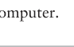

在单次安装中使用多个文件系统，可以利用每个文件系统针对不同文件组的优势。

除了 Linux 原生文件系统外，操作系统还支持所有其他文件系统，其中某些在特定情况下非常重要：

`fat` 文件分配表 (FAT) 文件系统是 DOS 到 Windows Me 期间的标准。几乎所有的操作系统都支持它。它的兼容性也使其成为在单台电脑上双启动的两个操作系统之间交换数据的良好选择。与大多数文件系统不同，FAT 有两个 Linux 类型代码：`mdos` 和 `vfat`。使用 `mdos` 会导致 Linux 将文件系统作为 DOS 使用，使用最多为 8 个字符的短文件名加上 3 个字符的扩展名（.8 文件名）；而当你使用 `vfat` 时，Linux 在 FAT 上支持长文件名。

FAT 的简单性和广泛的支持使其成为 USB 闪存、、手机、电子书读读器、数字相机介质等非常流行的文件系统。

`ntfs` 微软为 Windows NT 开发了新技术文件系统 (NTFS)，它是最近版本 Windows 的默认文件系统。早期的 Linux 只提供受限的 NTFS 读取驱动程序，但现在 `ntfs-3g` 软件 (tuxera.com)提供了读写驱动程序。你可能在双启动配置中的 Windows 启动分区或较大的外部硬盘上遇到它。在 Linux 下，旧的内核驱动被称为 `ntfs`，而 `ntfs-3` 驱动被称为 `ntfs-3g`。

Linux 的 `ntfs-3g` 驱动基于内核，这使其运行速度很快。与大多数文件系统不同，`ntfs-3g` 驱动不是基于内核的，因此速度没有那么快，并且需要额外的处理能力。

`hfs` Apple 在 9.x 版本的 Mac 中使用了其层级文件系统 (HFS)，并在 macOS 中仍然支持它。

`hfsplus` Apple 的层级文件系统+ (HFS+) 是 HFS 的扩展，增加了对日志的支持。自 OS X 10.3.3 以来，它是 Mac 的默认文件系统。Linux 通过 `hfsplus` 驱动支持 HFS+，但写入支持通常很复杂或有限。

`iso9660` ISO 9660 标准定义了 CD-ROM 的文件系统。它支持各种扩展，如 Joliet（用于长文件名）和 Rock Ridge（用于 Unix 权限和所有权）。

`udf` 通用磁盘格式 (UDF) 是一种用于 DVD 和蓝光光片的现代标准。它是 ISO-9660 的替代方案，支持更大的文件大小和更好的元数据。

## 第 6 章 管理硬件

图 6.3 Linux 文件管理器允许你卸载可移动介质。

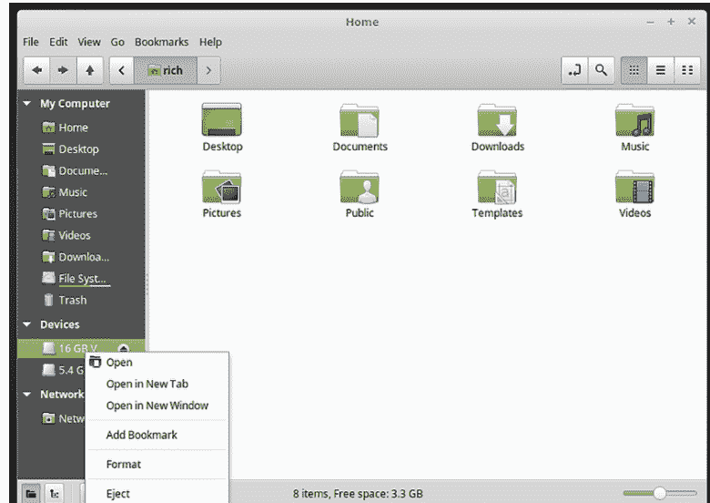

## 管理显示

Linux 提供了两种显示模式：文本模式和 GUI。文本模式显示非常直观，几乎不需要或无需管理。GUI 显示更为复杂。在 Linux 中，X Window 系统（简称 X）负责管理 GUI 显示。本节描述了 X 是什么，以及它如何与常见的显示硬件交互。

### 理解 X 的作用

大多数人对电脑显示器背后的软件并不太在意；它们运行得非常顺利。当然，在后台，管理显示的任务是非常复杂的。在任何平台上，软件必须执行的任务中，包括以下：

- 初始化显卡，包括设置其分辨率。
- 分配显示区域以存放属于应用程序的窗口。
- 管理重叠的窗口，以便只显示“最上方”窗口的内容。
- 管理用户通过鼠标或类似设备控制的指针。
- 将键盘的用户输入重定向到任何活跃的应用程序。
- 根据用户程序的请求在窗口内显示文本和形状。
- 管理窗口内部，如显示任务栏和滚动条。

在 Linux 中，前六项任务由 X 处理，但第七项由一个名为窗口管理器（window manager）的程序处理，第八项由称为组件集（widget sets）的 GUI 库处理。第六项任务中的字体显示元素由 X 处理，但近年来许多程序开始使用名为 Xfr 的库执行此任务。因此，处理显示的工作分布在多个程序中，尽管 X 处理了大部分底层任务。

桌面环境包含窗口管理器，也可以没有桌面环境的窗口管理器。


现代 Linux 发行版使用两种流行的 X 软件包之一：

- X.org
- Wayland

这两个软件包都提供了一个版本的 X，它可以自动检测你的硬件——包括显卡、显示器、键盘和鼠标——并自动进行配置。结果是软件通常可以在没有任何显式配置的情况下正常工作。尽管如此，有时这种配置会失败。当发生这种情况时，你必须手动编辑 X 配置文件。对于 X.org 包，请查看 `/etc/X11/xorg.conf` 文件；对于 Wayland，配置设置存储在每个独立用户账户的 `~/.config/xsettings.ini` 文件中。如果缺少 X.org 配置文件，你可以通过 root 身份输入以下命令（在 X 未运行的情况下）来生成一个示例文件：

```bash
## Xorg --configure
```


第 10 章“编辑文件”描述了 `name` 和 `vi` 文本模式编辑器。

结果是产生名为 `/root/xorg.conf.new` 的新文件。你可以将此文件复制到 `/etc/X11/xorg.conf` 并开始编辑以满足你的需求。这项任务复杂且超出了本书的范围，但知道文件名可以帮助你开始——你可以检查该文件并通过搜索该名称查找额外的文档。

## 使用常用显示硬件

处理视频设备时的很大挑战在于管理涉及的视频芯片组的驱动程序。大多数现代计算机使用几种视频驱动程序：

- 与 NVIDIA 视频硬件配合的 `nv`、`nouveau` 和 `nvidia`。
- 与 AMD/ATI 视频硬件配合的 `ati` 和 `fglrx`。
- `intel` 与 Intel 视频硬件配合。
- `fbdev` 和 `vesa` 驱动是通用驱动程序，适用于多种硬件，但可能提供次优的性能。

`nvidia` 和 `fglrx` 驱动程序是制造商提供的私有驱动。检查制造商的网站以获取详情。`nouveau` 驱动程序是这些显示器提供的某些非源驱动程序。在某些情况下，这些驱动程序可以改进性能。在某些语境下，这些驱动程序并不支持某些显示器。

过去，使用 VGA（视频图形）连接显示器。今天，HDMI（高定义媒体接口）线很常见。LED（发光二极管）显示器的优势。


# 显示器分辨率
显示器分辨率通常以水平和垂直像素测量。过去，低至 `640x480`、`1280x1024`、`1366x768` 或 `1920x1080` 的分辨率很常见，但现在为了适应 `16:9`、`4:3` 或 `1:1` 的显示模式。

在大多数情况下，`Linux` 将自动检测并设置所需的分辨率。遗憾的是，有时通过 `KVM`（键盘/鼠标/视频切换器）连接会干扰。为了设置显示器的任何值，你可能需要进行涉及 `/etc/X11/xorg.conf` 的高级调整。

**图 6.4** 桌面环境提供 `GUI` 工具帮助你设置显示器的分辨率。


## 处理 `USB`
大多数现代计算机使用 `USB` 作为外围设备的主要接口。键盘、鼠标、摄像头、存储、硬盘、网络适配器、打印机大部分通过 `USB` 连接。具体的包括：

**人机接口设备** 软件通常管理任何键盘、鼠标、平板电脑和类似设备。如果你遇到问题，可能需要调整配置，但这超出了本书的范围。

**磁盘存储** 我们将 `USB` 闪盘、外部硬盘和其他存储设备归入此类。正如早些在“使用移动磁盘和光盘”中描述的，在拔掉电缆之前卸载磁盘至关重要。未能这样做可能会导致数据损坏。

**手机、摄像头、电子书阅读器和音乐播放器** 你经常可以使用这些设备像磁盘设备一样传输照片、音乐或其他文件。你可能需要激活设备上的某个选项。完成后，卸载设备并禁用接口模式。

**扫描仪** 使用 `SANE` (`Scanner Access Now Easy`); `sane-project.org/software` 处理大多数扫描仪。尽管如此，少数设备需要私有软件。

**打印机** 大多数发行版在插入 `USB` 打印机时会自动配置打印队列。如果你需要调整配置，请在计算机的网络浏览器中输入 `http://localhost:631` 以访问主 `CUPS` 界面。这样做会打开一个基于 `Web` 的打印配置工具。某些发行版还提供特定驱动程序的打印配置工具。

## 管理驱动程序
大多数设备都需要特殊的软件组件才能使用。与硬件通信的软件部分被称为驱动程序，因此你应该了解驱动程序在 `Linux` 中如何工作。本节首先描述了你在 `Linux` 环境中可能需要的几大类驱动程序，并探索了如何为硬件查找并安装驱动程序。

### 理解驱动程序类型
`Linux` 需要驱动程序是因为不同的硬件——即使是功能非常相似的设备——工作方式也完全不同。也就是说，初始化和使用两个网络适配器的方法可能完全不同。为了提供通用接口以便 `Firefox` 浏览器等程序可以使用任何网络适配器，`Linux` 内核使用驱动程序作为硬件无关接口与硬件之间的桥梁。

> 事实上，网络硬件和 `Firefox` 等程序之间存在多个层；驱动程序只是这些层之一。

泛泛来说，驱动程序存在于两个位置之一：

- 内核
- 外部库或应用程序，事实上 `Linux` 内核的大部分由驱动程序组成。内核驱动程序处理大多数计算机内部的设备，如硬盘、网络接口和 `USB` 接口。内核托管大部分

## 管理驱动程序
驱动程序是因为驱动程序通常需要对硬件进行特权访问，而这正是内核的作用。

某些驱动程序位于内核外部的库或应用程序中。示例包括：

- `SANE`，处理扫描仪
- `Ghostscript`，将打印输出转换为特定打印机可以理解的格式
- `X`，管理显示器

`X` 的特殊之处在于，它是一个非内核元素，能够与视频硬件进行多或少的直接通信。相比之下，`SANE` 和 `Ghostscript` 均通过由内核处理的接口（如 `USB` 端口）与外部设备通信。这意味着你至少两个两个程序来处理此类设备。例如，要打印到 `USB` 打印机，你需要使用内核的 `USB` 驱动程序和 `Ghostscript` 打印机驱动程序。理想情况下，大多数用户不会意识到这种复杂性，但在出现问题时，你可能需要熟悉它。

## 定位和安装驱动程序
大多数驱动程序随 `Linux` 内核本身提供，或者带有该类型硬件的库或应用程序。例如，大多数安装都包含一组视频驱动程序，以便你使用显卡。由于这个原因，很少需要为常见硬件查找并安装额外的驱动程序。但存在例外，如下文所示：

**新硬件** 如果你的硬件非常新（意味着型号是新的，而不仅仅是你最近购买了它），那么它可能需要尚未进入你所使用的任何发行版的驱动程序。

**不常见的硬件** 如果你在使用奇特的硬件（例如专门的科学数据采集设备），你可能需要查找它的驱动程序。

**专有驱动程序** 某些制造商为他们的硬件提供专有驱动程序。例如，`nvidia` 和 `vgl` 驱动程序（在“使用常用硬件”中提到）可以提高基于 `NVIDIA` 或 `ATI/AMD` 芯片组的视频显示性能。某些硬件需要专有驱动程序。这在某些奇特硬件中特别常见。

**错误修复** 驱动程序和其他软件一样可能会有 `Bug`。如果你遇到问题，可能想要查找最新的驱动程序以获取错误修复。

修复新的内核内核驱动程序的一种方法是升级内核，内核升级可以为现有驱动程序和全新的驱动程序提供错误修复。同样，升级 `SANE`、`Ghostscript` 或 `X` 等软件可以升级或为这些软件包处理的设备添加新驱动程序。

如果你正在使用奇特硬件或需要其他难以找到的驱动程序，你的任务将更加困难。你可以咨询制造商或进行网络搜索来寻找驱动程序。

如果你获取了不是内核（或处理设备的软件包）部分的驱动程序，你应该阅读随驱动程序附的说明。不同驱动程序之间的安装过程略有不同，因此无法提供一种适用于所有情况的简单分步安装程序。某些驱动程序带有实用程序，但另一些则要求你遵循涉及输入命令的程序。如果你非常不幸，驱动程序将以内核补丁的形式出现。这是在主内核源码包中添加或更改文件的方法。你必须重新编译内核——这项任务已超出了本书的范围。

## 总结
软件和硬件以多种方式交互，以决定计算机的能力。你的 `CPU` 是决定计算机速度的因素之一，它还规定了你可以运行哪个版本的 `Linux`。`CPU` 安装在主板上，主板包含用于管理硬盘、显示器和其他设备的关键电路。你的硬盘在使用之前必须被划分为一个或多个文件系统。视频硬件（包括显示器和计算机内部的视频电路）决定了你的桌面环境的外观，以及计算机管理窗口和播放视频的速度。`USB` 管理绝大多数外部设备，如键盘、鼠标和外部磁盘。软件管理所有这些硬件设备。

## 考试要点
解释 `Linux` 必须与桌面或服务器计算机交互的主要硬件组件。任何计算机系统的主要组件都是主板。主板包含 `CPU` 处理器、内存、电源以及连接硬盘、显示器和其他设备的接口。你的硬盘在使用之前必须被划分为一个或多个文件系统。`USB` 管理绝大多数外部设备，如键盘、鼠标和外部磁盘。软件管理所有这些硬件设备。

## 习题
答案见附录 A。

- 1. 哪个命令提供了关于主板最多的信息？

   A. `lscpu`

   B. `xorg -configure`

   C. `fdisk -l /dev/sda`

   D. `lspci`

- 2. 你为什么可能对磁盘分区？（多选）

   A. 安装多个操作系统

   B. 使用 `ext4` 而不是 `ReiserFS`

   C. 隔交换空间

   D. 数据

   E. 文件

- 3. 以下哪项不是通过 `USB` 连接的？

   A. 视频器

   B. 键盘

   C. 外部磁盘

   D. 打印机

   E. 扫描仪

- 4. 对：`i7` 能够运行 `Linux`。

- 5. 对：`UDF` 是一个良好的文件系统

- 6. 对：内核包含网络适配器的驱动程序，等等。

- 7. ________ 使用位架构。

   A. `8`

   B. `32`

   C. `64`

   D. `128`

   E. `256`

- 8. 电源将电转换为 ________

   A. 直流

   B. 三相电

   C. 磁电

   D. 静态电

   E. 太阳能

- 9. ________ 是一种现代视频接口。

   A. `VGA`

   B. `LED`

   C. `SVGA`

   D. `HDMI`

   E. `SDI`

- 10. 目前流行的桌面环境是 ________ 和 ________

   A. `xFree`

   B. `X.org`

   C. `Wayland`

   D. `GNOME`

   E. `KDE Plasma`

# 理解文件的去向
云计算服务器。这台计算机的绝大多数用户对 `Linux` 系统管理的细节并不熟悉——他们只想使用自己的文字处理程序、电子邮件客户端和其他应用程序。这些用户不需要处理系统配置文件，因为赋予此类文件的访问权限——尤其是写权限——可能会导致灾难性的后果。在一台拥有 1,000 个用户的计算机上，如果每个人都能更改系统配置，那么总会有人由于无知或恶意而做出导致计算机崩溃的更改。

当然，保护计算机免受其用户影响的涉及问题只是更通用的用户账户问题的一个特例——在在那台有 100 个用户的计算机上，你可能也不希望用户能够以（受限制的方式之外）读写彼此的文件。因此，正如第 13 章“创建用户和组”和第 14 章“设置所有权和权限”中所述，你可以对文件设置权限以防止未经授权的访问。

系统文件控制计算机的运行方式。它们包括以下内容：

- 系统启动脚本，启动服务器和其他重要的守护进程（`daemons`）

- 程序文件，包括二进制文件和脚本

- 程序支持文件，如字体和图标


# 理解文件的去向

云计算服务器。这台计算机的绝大多数用户对 Linux 系统管理的细节并不熟悉——他们只想使用自己的文字处理程序、电子邮件客户端和其他应用程序。这些用户不需要处理系统配置文件，因为赋予此类文件的访问权限——尤其是写权限——可能会导致灾难性的后果。

系统文件控制计算机的运行方式。它们包括以下内容：

- 系统启动脚本，启动服务器和其他重要的守护进程（daemons）
- 程序文件，包括二进制文件和脚本
- 程序支持文件，如字体和图标
- 定义系统工作方式的配置文件（网络配置设置、磁盘布局等）
- 大多数服务器服务和其他守护进程的配置文件
- 系统程序的数据存储，例如描述安装了哪些程序的数据库
- 系统日志文件，记录正常的系统活动


显然，非技术型用户不应该能够修改系统文件，除非是间接的修改（例如）。用户必须能够读取某些类型的系统文件，例如他们使用的字体和图标，但某些系统文件应该受到保护以免被读取——例如，`root` 用户不应读取 `/etc/shadow` 文件，因为其中存储了加密后的密码。

为了实现限制普通用户访问系统文件的目标，文件通常由 `root` 或另一个目的更有限的系统账户所有。例如，许多服务器程序根据其自身的系统账户设置进行读取。根据需求，通过某种适当的方式设置权限，可以保护系统文件免受意外的访问。普通用户无法向大多数系统文件写入内容，从而保护这些文件免受损坏。`root` 可以读取和写入任何文件，你必须获得 `root` 权限才能执行大多数系统维护任务。

在安装 Linux 之后，它包含的大多数文件都是系统文件，而且全新 Linux 安装中的绝大多数目录和子目录都是系统目录。正如稍后描述，少数目录（如 `/home` 和 `/tmp`）是为用户留的，尽管这些目录在结构或配置上也是为了防止多用户访问出现问题。

用户的家目录传统上位于 `/home`，而 `/tmp` 是所有用户都可以访问并存放临时文件的。

系统文件和用户文件之间的区别即使存在于单用户 Linux 计算机上，例如你的个人笔记本电脑。这看起来可能很奇怪，甚至让人感到沮丧；毕竟，如果你是唯一的用户，并且拥有 `root` 访问权限，为什么要纠结系统文件和用户文件之间的区别呢？答案是它提供了一层防止意外或恶意损坏的保护。如果由于拼写错误、病毒或恶意软件导致要“删除计算机上的所有文件”，如果此操作是由普通用户而非 `root` 执行的——删除计算机上的所有文件，那么损害将会被限制在范围内。因此，这两种账户类型（以及此类，两类文件）之间的区别即使在单用户计算机上也是有用的。

## 文件系统层次结构标准 (FHS)

每个 Linux 发行版都有其定义内容的独特方式，它们的开发者意识到在目录布局上标准化的必要性。例如，程序应该在所有发行版中一致地在相同的位置定位配置文件。如果不这样做，依赖此类特性的程序将变得复杂，并且无法在所有发行版上运行。为了满足这一需求，建立了文件系统层次结构标准（Filesystem Hierarchy Standard，简称 `FHS`）。

> `FHS` 衍生自早期的 Unix 标准。

## 探索文件和目录

文件。还有许多此类文件。事实上，你会发现 `/etc` 下的子目录包含多个用于复杂子系统和服务器的配置文件，例如 `/etc/X11`（用于 X 窗口系统）和 `/etc/amba`（用于 Samba 服务器）。

### 可执行程序

程序文件位于 `/sbin`、`/bin`、`/usr/sbin` 和 `/usr/bin` 中。（在某些系统上，额外的目录也可以存放程序文件。最值得注意的是，`/usr/local/sbin` 和 `/usr/local/bin` 包含了编译后的程序）。

### 库目录

库是编程函数的集合，可以被许多程序使用。它们被存储在文件中，以便在程序运行时节省磁盘空间和内存（`RAM`），并且允许在不重新安装所有依赖于它们的程序的情况下轻松地更新库。大多数库位于 `/lib` 和 `/usr/lib` 中，尽管在某些系统上，它们也位于其他地方（如 `/usr/local/lib`）。


如果你安装过 Windows 计算机，你应该意识到 Windows 和 Linux 之间的一个重要区别：在 Windows 中，程序二进制文件、其配置文件及其所有支持文件通常位于属于该程序的单一目录中，例如 `C:\Program Files\SomeProgram`。相比之下，在 Linux 中，程序的大部分密钥位于与其他程序共享的标准目录并分散在各处。例如，程序的可执行文件可能在 `/usr/bin`，相关的库在 `/usr/lib`、`/etc` 或用户的家目录等。这种机制之所以运行良好，是因为 Linux 使用了软件包系统（在第 9 章“探索进程和数据”中会有详细描述）。跟踪一个包的许多文件的去向，可以让你轻松地删除或升级一个包。Linux 的优势在于简化了路径，即程序文件所处的目录列表。（不过，如果你习惯于在程序特定的位置查找文件，这些路径也存在，尽管适应 Linux 系统可能会很别扭。关键是使用你的软件包系统来识别包文件所在的位置；例如，输入 `rpm -ql someprogram` 可以显示基于 RPM 的系统中 `someprogram` 包中的每一个文件。）


> 软件包系统不管理用户配置文件，因此在您删除程序后，这些文件可能仍然存在。

除了消耗磁盘空间外，这不会造成任何伤害。


## 探索文件和目录

当你对 `Linux` 文件的布局了如指掌时，你就准备好进行一些探索了。在接下来的几页中，我们将描述你的硬盘上存在哪些文件、如何在目录之间切换、如何引用不在当前目录中的文件，以及如何使用最常用的文件操作命令。

## 获取文件列表

为了操作文件，了解它们是什么很有帮助。`ls` 命令（名称是 `list` 的缩写）可以为你提供这些信息。`ls` 命令显示目录中


文件的名称。如果你不传递任何选项，它将显示当前目录下的文件；然而，你也可以传递选项以及文件或目录指定参数。此命令支持大量的选项；详情请咨询其帮助页（`man` 页）。表 7.3 汇总了最重要的 `ls` 选项。

### 表 7.3 常用 `ls` 选项

| 选项（长格式） | 选项（短格式） | 描述 |
| :--- | :--- | :--- |
| `--all` | `-a` | 显示点文件。通常，`ls` 会忽略文件名以点（`.`）开头的文件。这些点文件（也称为隐藏文件）通常会被忽略。 |
| `--color` | `N/A` | 以不同的颜色区分不同的文件类型。某些 `Linux` 发行版默认配置此选项。 |
| `--directory` | `-d` | 将 `ls` 的行为变为仅列出目录本身。通常当你输入目录名称时。 |
| `N/A` | `-l` | 详细列表，包括文件的权限、所有者、组、大小和创建日期等信息。 |
| `--file-type` | `-F` | 在文件名末尾添加指示符，以便知道它是什么类型。 |
| `--recursive` | `-R` | 使 `ls` 递归地显示目录。也就是说，如果目标目录包含子目录，`ls` 将显示其内容。 |

## 探索文件和目录

你可以选择提供一个或多个文件或目录名称，在这种情况下，`ls` 显示这些文件或目录，如下例所示：

```bash
$ ls -F /usr
```

```text
/usr/
bin/
doc/
etc/
include/
lib/
```

此输出显示了 `/usr` 及其 `/bin/` 的内容。但要注意，许多发行版只显示当前目录的最后部分，而不是 `/usr/`。

> 注意：在书中，我们将大多数提示符简化为单个字符，例如 `$`，用于显示命令。

## 切换目录

`cd` 命令更改你当前工作的目录。虽然你的当前目录对于许多命令并不重要，但在引用文件时是重要的。正如在下一节“使用绝对和相对引用”中描述的，某些引用取决于你的当前目录。

当你更改目录时，你的 `shell` 提示符可能会改变（取决于你的发行版），如下：

```bash
rich@essentials]$ /usr/bin
@essentials bin$
```

如果你需要当前位置的完整路径，可以使用 `pwd`：

```bash
$ pwd
/usr/bin
```

`Linux` 使用斜杠（`/`）作为目录分隔符。如果你熟悉 `Windows`，可能知道 `Windows` 使用反斜杠（`\`）出于此目的。不要混淆它们！在 `Linux` 中，反斜杠用作“引号”或“转义”字符，以便将字符（如空格）作为文件名的一部分。此外，请注意 `Linux` 文件名中这不是合法字符。

## 使用绝对和相对引用

正如第 6 章“管理硬件”所描述的，`Linux` 使用统一的目录树，这意味着所有文件都可以相对于根目录定位。如果你的磁盘包含分区，这些设备中的一个将成为根文件系统，其他将挂载到整个目录树的某些位置。当你挂载 `USB` 盘、`DVD` 或其他可移动磁盘设备时也会发生相同的情况。结果可能类似于图 7.1，它显示了典型 `Linux` 安装中的子目录，以及几种移动介质类型。通常情况下，移动介质显示为 `/media` 目录的子目录，但某些 `Linux` 发行版倾向于使用 `/run/media`。子目录可以拆分为单独分区，甚至放在不同的磁盘上。在图 7.1 中，`/home` 目录是一个单独分区，即使它是根（`/`）分区的一部分，访问方式也是完全相同的。

> 警告：不要混淆根目录 (`/`) 和 `/root` 目录，后者是 `root` 用户的家目录。

## 探索文件与目录

**图 7.1** 在 `Linux` 中，所有文件都是相对于单个根 (`/`) 目录进行引用的。

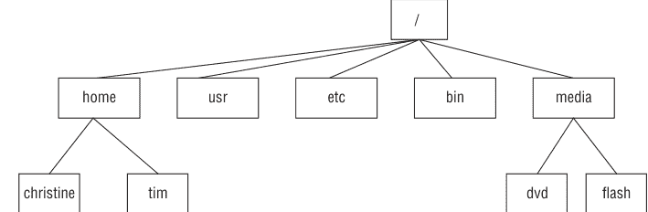

在命令中指向文件和目录时，你可以通过三种方式来引用它们：

**绝对引用** 绝对文件引用是相对于根 (`/`) 目录的，例如使用 `/home/fred/a.txt` 指向 `Fred` 家目录下的路径。引用始终以斜杠 (`/`) 字符开头。

**家目录** 波浪号（`~`）字符代表当前用户的家目录。如果文件名以该字符开头，就等同于替换了用户家目录的路径。因此，对于 `Fred` 来说，`~/a.txt` 等同于 `/home/fred/a.txt`。

**相对引用** 相对文件引用是相对于当前目录。因此，如果 `Fred` 正在他的家目录工作，`a.txt` 指的就是 `/home/fred/a.txt`。相对引用可以包含子目录，例如 `somedir/another.txt`。在 `Linux` 中，每个目录都包含一个特殊的隐藏目录（`.`），它指向其父目录。因此，如果 `Sally` 在 `~/sally` 工作，她可以使用 `../fred/a.txt` 来引用 `Fred` 的 `a.txt` 文件。


> 文件权限可能会阻止你访问其他用户的文件，这个问题在第 14 章中会有描述。

为了更好地理解这些概念，请尝试以下操作：

1. 启动一个新的 `shell`，或使用现有的 `shell`。
2. 输入 `cd` – 进入你的家目录。
3. 输入 `cat /etc/fstab` 使用绝对引用查看此配置文件。它的内容应该显示在你的终端中。
4. 输入 `pwd` 查看你当前的目录。它可能是 `/home/yourusername`，其中 `yourusername` 是系统推断出的——`yourusername`。
5. 输入 `cat ../etc/fstab` 使用相对引用查看此配置文件。命令中的第一个 `..` 指向 `/home`，第二个指向根 (`/`) 目录。如果你的家目录位于不寻常的位置，你可能需要调整命令中 `..` 元素的数量，这就是为什么我们在上一步中用 `pwd` 来查找你当前的目录。
6. 输入 `cat ../../etc/fstab` 使用家目录引用查看此配置文件。

## 第 7 章：管理文件

当然，步骤 5 和 6 使用了相当笨拙的文件引用；在现实生活中，你可能会直接从家目录使用对 `/etc/fstab` 的绝对文件引用。不过，如果你在 `/etc` 的某个子目录下，输入 `../../fstab` 会比输入 `/etc/fstab` 稍微简单；而输入 `~/file.txt` 会比输入家目录的完整路径更简单。

## 操作文件

如果你用过 `Windows` 或 `macOS`，很有可能你用过 `GUI`（图形用户界面）文件管理器来操作文件。这些工具在 `Linux` 中也是可用的，正如第 4 章“使用常用 `Linux` 程序”中所提到的，你完全可以使用文件管理器来完成许多常见任务。`Linux` 中的文本模式（如 `Bash`）提供了简单但强大的文件操作工具。这些工具可以简化某些任务，例如处理所有名称包含字符串 `'v16'` 的文件。你应该熟悉这些文本模式命令。

为了开始此任务，我们描述了如何创建文件。对于文件，你可以将它们从一个位置复制到另一个位置。你有时可能想要移动或重命名文件，因此我们解释了如何操作。`Linux` 允许你创建链接，这是通过多个名称引用同一个文件的方法。

## 创建文件

为了开始此任务，我们描述了如何创建文件。对于文件，你可以将它们从一个位置复制到另一个位置。你有时可能想要移动或重命名文件，因此我们解释了如何操作。`Linux` 允许你创建链接，这是通过多个名称引用同一个文件的方法。

## 操作文件

执行归档复制：`-a` 或 `--archive` 选项类似于 `-R`。


执行更新复制：`-u` 或 `--update` 选项告诉 `cp` 仅在原始文件比目标文件新，或者目标文件不存在时才复制文件。

> `cp` 选项列表并不完整，但涵盖了最实用的选项。有关其他 `cp` 选项的信息，请参阅 `cp` 的 man 页。

## 移动和重命名文件

在文本模式下，你使用相同的命令 `mv` 来移动和重命名文件及目录。这与 `cp` 类似；例如，如果你想将 `outline.pdf` 移动到 `~/publication`，你可以执行：

```bash
$ mv outline.pdf ~/publication
```

如果你在指定目标的同时指定了文件名，文件将在移动时被重命名。如果你指定的目标目录与源目录相同，文件将被移动但不会被[重命名]。在其他情况下，`mv` 的效果与 `cp` 非常相似，不同之处在于新文件会替换（而非补充）原始文件。

在幕后，`mv` 执行了以下操作：

- 当源和目标位于同一个文件系统时，`mv` 会重写目录条目，而不会实际移动文件数据。

> Linux 使用 `mv` 来重命名文件，是因为当源和目标目录相同时，这两个操作是相同的。

- 当你将文件从一个文件系统移动到另一个文件系统时，`mv` 会复制文件然后删除原始文件。

`mv` 命令带有许多与 `cp` 相同的选项。在之前的列表中，`--preserve`、`--recursive` 和 `--archive` 不适用于 `mv`，但其他选项均适用。

## 使用链接

有时，通过多个名称引用单个文件是非常方便的。与其创建该文件的副本，不如为该文件创建多个链接。Linux 支持两种类型的链接，它们都通过 `ln` 命令创建：

### 硬链接

硬链接是目录条目的副本。这两个条目都指向同一个文件。由于它们通过绑定底层文件系统数据结构来工作，硬链接只能存在于单个文件系统中。在硬链接的情况下，任何一个文件名都不对另一个具有优先级；它们都直接绑定文件的数据结构和数据。输入 `ln original linkname`（其中 `original` 是原始名称，`linkname` 是新链接的名称）来创建硬链接。

### 符号链接

符号链接（又称软链接）是一个通过名称引用另一个文件的文件。也就是说，符号链接是一个包含另一个文件名称的文件，当你告诉程序从符号链接读取或写入时，Linux 会将访问重定向到原始文件。由于符号链接通过文件名引用工作，它们可以跨越文件系统的边界。输入 `ln -s original linkname` 来创建符号链接。

符号链接类似于 Windows 桌面上的*快捷方式*。


你可以通过两种方式在长目录列表（使用 `ls -l` 选项）中识别链接。以下示例说明了了：

```bash
$ ln report.odt hardlink
$ ln -s report.odt softlink
$ ls -l
total 192
-rw-r--r-- 2 rich users 94720 Sep 10 11:53 hardlink.odt
-rw-r--r-- 2 rich users 94720 Sep 10 11:54 softlink.odt -> report.odt
lrwxrwxrwx 10 rich users
```

此示例从单个文件 `report.odt` 开始。前两个命令创建了两个链接：一个硬链接（`hardlink.odt`）和一个符号链接（`softlink.odt`）。输入 `ls -l` 显示了所有三个文件。原始文件和硬链接可以通过 `ls -l` 输出的第二列中的值来识别为链接；该列标识指向该文件的文件条目数，因此大于 1 的值表示存在硬链接。符号链接在 `softlink` 权限的第一列（`lrwxrwxrwx`）中用小写字母 `L` 表示，而不是数字 `1`。此外，符号链接的权限包含一个指向多个目录的指针。

这两种类型的链接对于通过多个名称引用文件都是有用的。如果你在写一封需要发送给多个收件人的信，在那种情况下，你可能需要在目录中存储副本以触达每个收件人，任何一种链接都可以正常工作，但它们各自都有影响。最重要的是，如果你使用符号链接，删除原始文件将导致文件完全无法访问；符号链接仍然存在但指向一个不存在的文件。相反，如果你使用硬链接，你必须删除文件的所有副本才能删除文件本身。这是因为硬链接是指向同一个文件的副本目录条目，而符号链接是通过名称引用原始文件的独立文件。

如果你通过访问其软链接或任何硬链接链接来修改链接，那么你使用的程序将修改原始文件。某些程序会创建原始文件的备份，以便在你发现更改错误时恢复原始文件。大多数编辑器执行此操作的方式是备份是一个新文件，并将更改写入原始文件，从而影响它以及链接。然而，某些程序会重命名原始文件并向新文件写入更改。如果程序这样做且你通过链接访问了文件，那么被链接的文件将[失效]。

如果你删除了原始文件，符号链接将[失效]。只要存在一个硬链接，删除硬链接文件依然可用。

## 删除文件

要删除文件，使用 `rm` 命令。例如，要删除 `file.txt`，输入：

```bash
$ rm file.txt
```

要删除多个文件，将它们列为参数：

```bash
$ rm file1.txt file2.txt file3.txt
```

要删除目录（为空），使用 `rdir` 命令：

```bash
$ rdir directoryname
```

要删除目录及其所有内容，使用 `-r` 选项：

```bash
$ rm -r directoryname
```

> `-r` 选项是危险的，因为它会在不询问确认的情况下删除所有内容。请极其谨慎使用。

## 操作目录

Apple 的层级文件系统+ (`HFS+`) 同时支持区分大小写和不区分大小写的变体。Apple 默认使用不区分大小写的模式。

大小写敏感主要是文件系统的功能，而不是操作系统的功能。因此，如果你使用非 Linux 文件系统（在可移动磁盘上、双启动计算机的非 Linux 分区上，或使用网络文件系统），你可能会发现适用于不区分大小写的规则。这在访问文件分配表 (`FAT`) 和新技术文件系统 (`NTFS`) 卷时尤其常见，这些卷在 Windows 计算机、外部硬盘和 USB 闪存上非常常见。进一步复杂之处在于，许多 Linux 程序即使在不区分大小的文件系统上也假设是大写敏感的。在第 5 章“了解命令行”中描述的命令补全等功能，只有在你使用与文件名记录时一致的大小写的情况下才能工作，即使在不区分大小的文件系统上也是如此。

通常情况下，大小写敏感会产生真实的问题，特别是当你使用允许通过点击选择文件的 GUI 时。然而，在将文件或目录复制到 `FAT`、`NTFS`、`HFS+` 或不区分大小的文件系统时，你应该意识到这些问题。如果你想要复制一个包含名称仅大小写不同的文件的目录，你最终得到的磁盘将只包含其中一个冲突的文件。

## 操作目录

你可能熟悉目录的概念，尽管你可能把它们想成“文件夹”，因为大多数 GUI 文件管理器使用文件文件夹图标来表示目录。自然，Linux 提供了文本模式命令来操作目录。这些包括用于创建和删除目录的特定目录命令，以及使用之前描述的一些文件管理命令来管理目录。

## 创建目录

你可以使用 `mkdir` 命令创建目录。通常情况下，你会在输入命令后输入一个或多个目录的名称来使用该命令：

```
$ mkdir newdir
$ mkdir dirone newdir/dirtwo
```

第一个示例仅创建了一个新目录 `newdir`，它将位于当前目录中。第二个示例创建了两个目录：`dirone` 和 `newdir/dirtwo`。在这个示例中，`mkdir` 在上一个命令创建的 `newdir` 目录内部创建了 `dirtwo`。

## 第 7 章 ■ 管理文件

第 5 章包含了如何指定当前目录以外的位置的信息，以及如何使用 `cd` 命令更改当前目录的信息。

在大多数情况下，你会使用不带目录名称之外选项的 `mkdir`，或者你可以通过以下几种方式修改其行为：

- **设置模式**：`-m mode` 或 `--mode=mode` 选项会导致新目录具有指定的权限模式，用八进制数表示（第 14 章更详细地描述了这些主题）。

- **创建目录**：通常，如果你指定创建一个不存在的目录，`mkdir` 会返回“没有此类文件或目录”的错误且不创建目录。如果你包含 `-p` 或 `--parents` 选项，`mkdir` 将创建必要的目录。例如，如果 `first` 不存在，输入 `first/second` 会返回错误消息，但输入 `mkdir -p first/second` 则会成功，同时创建 `first` 及其子目录 `second`。

## 删除目录

`rmdir` 命令与 `mkdir` 相相反；它销毁目录。要使用它，你通常在输入命令后输入想要删除的一个或多个目录的名称：

```
$ rmdir drone
```

```
$ rmdir newdir/dirto newdir
```

这些示例删除了之前通过 `mkdir` 命令创建的三个目录。

与 `mkdir` 一样，`rmdir` 支持选项，最重要的用于处理这些任务的：


- **忽略非空目录的失败**：通常，如果目录包含文件或其他目录，`rmdir` 不会删除它并返回错误消息。使用 `--ignore-fail-on-empty` 选项，`rmdir` 仍然不会删除该目录，但它不会返回错误消息。

- **删除树**：`-p` 或 `--Parents` 选项允许 `rmdir` 删除整个目录。例如，输入 `rmdir -p newdir/dirto` 会导致 `rmdir` 删除 `newdir/dirto`，然后删除 `newdir`。你可以使用此命令而不是之前显示的命令来同时删除这两个目录。

你应该理解 `rmdir` 可以删除空目录；如果目录包含任何文件，它将无法工作。（不过，你可以使用 `-p` 选项来删除一组嵌套目录，只要其中任何一个目录都不包含非目录的内容。）当然，在现实生活中，你可能想要删除包含文件的目录树。在这种情况下，你可以使用之前在“删除文件”中描述的 `rm` 命令以及它的 `-r`（或 `-R`，或 `--recursive`）选项：

```
$ rm -r newdir
```

此命令删除 `newdir` 以及它可能包含的任何文件或子目录。这一事实使得 `rm` 及其 `-r` 选项具有潜在危险性，因此在使用时应格外小心。


## Linux 安全特性

当你作为普通用户登录时，如果你使用 `rm` 或其他各种命令，可能会意外删除自己的文件。然而，你无法对 Linux 安装造成严重破坏。这是因为 Unix 被设计为考虑了多用户安全性的操作系统，而且由于 Linux 是 Unix 的克隆，Linux 继承了这些特性。这些特征中包括文件所有和文件权限的概念。

## 管理目录

目录只是特殊文件；它们持有其他文件。这意味着你可以使用之前描述的大多数文件工具来操作目录。有一些限制：

- 你可以使用 `touch` 更新目录的时间戳，但你不能创建目录；`mkdir` 处理此任务。

- 你可以使用 `cp` 复制目录，但是你可以使用 `-r`、`-R` 或 `--recursive` 选项来复制目录及其内容。

- 你可以使用 `mv` 移动或重命名目录。

- 你可以使用 `ln` 配合 `-s` 选项创建目录的符号链接。没有常用的文件系统支持目录的硬链接。

作为一个示例，假设你有一个名为 `Satchmo` 的目录，其中包含 `Armstrong` 的音乐文件。你想重新组织目录，让文件以表演者的姓出现，但你希望保留以 `Satchmo` 命名访问这些文件，因为你的音乐播放器是这样使用的。你可以输入以下命令来实现这个目标：

```
$ cd Music
$ mv Satchmo Armstrong
$ ln -s Armstrong Satchmo
```

或者，你可以省略 `mv` 和 `ln` 命令的第一部分。指定它们之间的路径。前两个命令将 `~/Music/Satchmo` 重命名为 `~/Music/Armstrong`。最后一个命令创建一个指向 `~/Music/Armstrong` 的符号链接 `~/Music/Satchmo`。

## 总结

## 考试要点

描述在 Linux 系统上哪里找到应用程序。普通用户运行的关键应用程序通常存储在 `/bin` 目录中。主要由管理员使用的关键应用程序存储在 `/usr` 目录中。非关键应用程序通常存储在 `/tmp` 目录中。

解释创建、复制、移动或删除文件的基本命令。你可以使用 `touch` 创建空文件。在 Linux 中你可以使用 `cp` 命令复制文件，或使用 `mv` 命令移动文件到新文件名。删除文件使用 `rm` 命令。

描述 `/tmp` 目录以及 Linux 用它做什么。`/tmp` 目录用于不需要保存的临时文件。理论上，Linux 系统在重启时可以清除 `/tmp` 中的任何文件，尽管 Linux 发行版并没有这样做。然而，永远不要期望存储在 `/tmp` 中的文件在下次系统重启后仍然存在。

## 复习习题

你可以在附录 A 中找到答案。

1. 使用以下哪个命令可以将 `newfile.txt` 重命名为 `afile.txt`？

    A. `mv newfile.txt afile.txt`

    B. `cp newfile.txt afile.txt`

    C. `ln newfile.txt afile.txt`

    D. `rn newfile.txt afile.txt`

    E. `touch newfile.txt afile.txt`

2. 你想将目录 `MyFiles` 拷贝到使用 FAT 文件系统的 USB 闪盘中。`MyFiles` 的内容如下：

    ```
    $ ls MyFiles/

    contract.odt

    outline.pdf

    Outline.PDF
    ```

    USB 闪盘挂载在 `/media/usb`，因此你输入 `cp -a MyFiles/media/usb`。当你尝试复制这些文件时会发生什么问题？

    命令失败了，因为它尝试创建链接。

    A. 命令失败

    B. `MyFiles` 目录会被复制，但其中没有任何文件会被复制。

    C. USB 闪盘上将缺少一个文件。

    D. 复制过程中一个文件的名称将被更改。

    E. 一切正常；命令将正确运行。

3. 你输入 `mkdir one/two/three` 并收到一条错误信息，部分内容为“No such file or directory”。你可以做什么来解决这个问题？（选择所有适用项。）

    A. 在 `mkdir` 命令中添加 `--parents` 参数。

    B. 分别执行命令：`mkdir one`，然后是 `mkdir one/two`，最后是 `mkdir one/two/three`。

    C. 输入 `/bin/mkdir` 以确保 `mkdir` 程序文件存在。

    D. 输入 `rmdir one` 以清除目标目录树的干扰基目录。

    E. 输入 `rm -r one` 以清除整个干扰目录树。

4. 正确或错误：你可以从一个低级文件系统向另一个创建符号链接。

5. 正确或错误：在登录普通账户时，通过误输 `rm` 命令可能会损坏你的 Linux 安装。

6. 正确或错误：你可以使用 `touch` 命令设置目录的时间戳。

7. 你想将一个文件（`origfile.txt`）复制到 `backups` 目录，但如果 `backups` 目录已存在名为 `origfile.txt` 的文件，只有当源位置的文件比备份中的文件新时，才继续复制。执行此操作的命令是 `cp __`

    A. `-f`

    B. `-r`

    C. `-s`

    D. `-u`

    E. `-v`

8. 你输入 `rmdir junk` 来删除 `junk` 目录，但该命令失败了，因为 `junk` 包含处理文件。有效的命令是

    A. `rmdir -r junk`

    B. `rmdir -P junk`

    C. `rmdir -v junk`

    D. `rm -r junk`

    E. `rm -f junk`

9. 通配符 `__` 匹配文件名中的任何符号。

    A. `?`

    B. `_` (下划线)

    C. `*`

    D. `.` (点)

    E. `-` (连字符)

10. 哪个目录主要包含系统配置文件？

    A. `/bin`

    B. `/etc`

    C. `/usr`

    D. `/var`

    E. `/sbin`

## 第 8 章

## 数据的搜索、提取与归档

目标：

- 3.1 在命令行上归档文件

- 3.2 从文件中搜索和提取数据


任何操作系统（包括 Linux）的工作重要部分都是数据的存储、管理和分析。数据之所以有价值，是因为可以从中汲取知识，因此你需要能够正确地搜索和提取它，并保护它。本章涵盖了你可以用于搜索、提取和归档数据的某些工具。

本章从**正则表达式**开始，这是一种描述你可能想要查找的模式的方法。你可以在许多命令中使用正则表达式，其中两个（`find` 和 `grep`）会有更详细的描述。本章还涵盖了你可以用于重定向输入和输出的工具，这是很多情况下非常有用的技巧。最后，描述了创建归档文件的工具，这些工具在网络传输文件或创建备份时非常有用。

## 使用正则表达式

许多 Linux 程序采用正则表达式，它是用于在文本中表示模式的工具。正则表达式与第 7 章“管理文件”中描述的用于指定多个文件名的通配符相似。在简单的情况下，正则表达式可以是未经装饰的纯文本，尽管某些字符被用来表示模式。

> 注意

> 文档有时使用缩写 `regexp` 来指正则表达式。


正则表达式有两种形式：基础和扩展。形式取决于程序。某些程序只接受一种表达式形式，而另一些可以使用类型（取决于传递给程序的选项）。基础和扩展正则表达式形式之间的差异可能是复杂且微妙的，但它们的基本原理是类似的。

最简单的正则表达式类型是……（此处 OCR 文本似乎重复或重叠，将根据提供的内容进行处理）。

可选的开关（选项）、一个正则表达式以及可选的文件名规范。`grep` 命令支持大量的选项，其中最常见的出现在表 8.1。

### 表 8.1 常见的 `grep` 选项

| 选项（长格式） | 选项（短格式） | 说明 |
|---|---|---|
| `--count` | `-c` | 显示匹配项的行数，而不是包含正则表达式匹配项的行 |
| `--file=file` | `-f` | 从指定的文件而不是命令行获取模式输入。`grep` 命令是该项的快捷方式。 |
| `--ignore-case` | `-I` | 执行不区分大小的搜索，而不是默认的区分大小搜索 |
| `--recursive` | `-R` 或 `-r` | 在指定的目录及其所有子目录中搜索，而不仅仅是指定的目录。`grep` 命令是该选项的快捷方式。 |
| `--extended-regexp` | `-E` | 传递此选项使用扩展正则表达式。或者，你可以调用 `egrep` 而不是 `grep`；此变体命令默认使用扩展正则表达式 |

> 如果你不指定文件名，`grep` 使用标准输入。这可以与管道配合使用，稍后将在“重定向输入和输出”中描述。

`grep` 的一个简单示例使用了没有特殊组件的正则表达式：

```
$ grep -r bash /etc/
```

此示例在 `/etc` 中查找所有包含字符串 `bash`（Bash Shell）的文件。该示例包含了 `-r` 选项，它会递归搜索，因此 `grep` 会搜索 `/etc` 子目录下的文件，以及 `/etc` 本身中的文件。对于每个匹配的文本文件，都会打印包含该字符串的行行。

> 普通用户无法读取 `/etc` 中的某些文件。如果你以非超级用户输入此命令，你将看到关于 `grep` 无法打开文件的错误信息。

## 第 8 章 ■ 搜索、提取和归档数据

假设你想定位 `/etc` 中所有包含字符串 `bash` 或 `dash` 的文件。你可以输入以下命令，该命令使用括号正则表达式来指定两种变体设备：

```
$ grep -r [bd]ash /etc/
```

一个复杂的示例仅搜索 `/etc/passwd` 文件，查找包含单词 `games` 或 `mail`，且在同一行稍后包含 `noglogin` 单词的行。此任务需要扩展正则表达式表示法；命令看起来如下：

```
$ grep -E "games mail).*noglogin" /etc/passwd
```


如果你在计算机上输入此命令，可能会因为你的目录配置而找到匹配项。尝试在括号内的 `games` 和 `mail` 尝试其他单词，例如 `nobody` 或 `lp`。


你可以将 `grep` 与产生大量输出的命令结合使用，以便从这些输出中筛选对你重要的材料。（本书中的几个示例都使用了这种技术。）要实现这一点，你需要使用输入和输出重定向。该主题将在接下来的章节“重定向输入和输出”中介绍（以及另一个 `grep` 示例）。

## 使用 `find`

`find` 实用程序实现了一种暴力方法来查找文件。该程序通过遍历指定的目录树、检查文件名、文件创建日期等来查找符合指定标准的文件。由于这种操作，`find` 往往很慢。然而，它是灵活的，并且只要你寻找的文件存在，它很可能会成功。要使用 `find`，输入它的名称，可选地跟随一个目录路径（有时称为起始目录）和一系列选项，其中某些选项使用了与正则表达式类似的规范。


在实践中，你必须在使用 `find` 时使用目录路径或搜索标准，通常是两者都用。你可以指定 `find` 应该操作的一个或多个路径；程序将其操作限制在这些路径。`find` 的帮助页包含了关于搜索标准的信息，表 8.2 总结了常见标准。

### 表 8.2 常见的 `find` 搜索标准

| 选项 | 说明 |
|---|---|
| `-name pattern` | 使用文件名通配符模式查找文件。如第 7 章所述。 |
| `-perm mode` | 要查找具有特定权限的文件，使用 `-perm mode`。模式可以以符号形式或八进制形式表示。如果在模式前加 `+`，则查找任何指定权限位的文件；如果在模式前加 `-`，则查找所有指定权限位的文件。（第 14 章，“所有权和权限”）。 |
| `-size n` | 根据大小查找文件。通常，`n` 以 512 字节块为单位，但你可以通过给数值加上字母如 `c`（字节）或 `k`（千字节）来修改。 |
| `-group name` | 查找属于指定组的文件。 |
| `-gid` | 查找组 ID (GID) 设置。 |
| `-user name` | 查找指定用户的文件。 |
| `-uid number` | 按用户 ID (UID) 查找文件。 |
| `-maxdepth levels` | 限制搜索子目录的深度。 |

许多变体和附加选项；`find` 是一个强大的命令。作为一个在所有 `/home` 目录下查找所有以 `.py` 结尾的文件的示例，你可能会执行以下命令：

```
# find /home -name "*.py"
```

结果将列出位于 `/home` 目录树内且名称以 `.py` 结尾的文件。注意使用了引号，因为星号（`*`）对 shell 有特殊含义。

> 如果缺少列出目录内容的权限，`find` 将返回错误信息“Permission denied”。

## 使用 `wc`

文件的字节大小（由 `ls` 显示）是一个很有用的指标。该值对于文本文件几乎有用，尽管你可能需要知道文件中有多少单词或行——例如，为了发现新创建文件的信息：

```
$ wc file.txt
37 59 1990
```

此输出显示 `file.txt` 包含 37 行、59 个单词和 1990 字节。默认情况下，我们显示传递给它的每个文件的行、单词计数。你可以传递选项来限制或扩展 `wc` 输出，如表 8.3 所示。表 8.3 的选项中，`-l`、`-w` 和 `-c` 是默认值，输入 `wc file.txt` 等于输入 `wc -lw file.txt`。程序的主页描述了更多选项，但你可能会使用表 8.3 中的选项。

### 表 8.3 常见选项

| 选项（长格式） | 选项（短格式） | 说明 |
|---|---|---|
| `--bytes` | `-c` | 显示文件的字节计数 |
| `--chars` | `-m` | 显示文件的字符计数 |
| `--lines` | `-l` | 显示文件的换行计数 |
| `--words` | `-w` | 显示文件的单词计数 |
| `--max-line-length` | `-L` | 显示文件中最长的行长度 |

> 部分文本文件使用多字节编码，这意味着一个字符可以占用多个字节。因此，`-c` 和 `-m` 选项可能不会产生相同的结果，尽管通常如此。

请注意 `wc` 在纯文本文件上运行正常，但在格式化文本文件（如 HTML 文件或文字处理器文件）上可能会产生错误或无意义的结果。你最好使用文字处理器或其他专用编辑器查找此类文件的单词数和其他统计数据。

## 使用 `cut`

在提取数据时，`grep` 有助于提取整个文件行（记录）。但是，有时你需要文件记录的一部分。在这种情况下，`cut` 命令可以帮助。它经常用于从内容高度模式化的文件中提取变量信息。

表 8.4 显示了你使用 `cut` 命令时可能需要的选项。查看其帮助页以获取更多选项和 `cut` 命令的完整描述。

### 表 8.4 `cut` 命令的常见选项

| 选项（长格式） | 选项（短格式） | 说明 |
| --- | --- | --- |
| `--characters` | `-c` | 只选择指定的字符位置 |
| `--delimiter` | `-d` | 使用指定的分隔符作为字段分隔符，而不是默认分隔符（制表符） |
| `--fields` | `-f` | 只选择指定的字段 |
| `--only-delimited` | `-s` | 不打印没有分隔符的行（默认在使用 `-f` 选项时打印它们）。 |

要使用 `cut`，你传递一个或多个指定你所需的选项，然后是一个或多个文件名。例如，用户的家目录出现在 `/etc/passwd` 文件的第六个冒号分隔字段中。因此，要仅提取目录名执行此命令：

```
$ cut -f 6 -d":" /etc/passwd
```

你可以使用输出重定向将 `cut` 命令的结果捕获到文件中。重定向将在章节稍后的部分“重定向输入和输出”中介绍。

> 当使用 `cut` 命令时，提取的信息将显示在屏幕上。但请注意，指定的文件保持不变。

## 使用 `sort`


在处理大量数据时，能够对数据进行排序通常非常有用。`sort` 命令正是此功能。然而，你需要了解它的特性以获得预期的结果。

对于一个仅包含单词的简单数据列表，你可以不带任何选项地使用 `sort` 来按字母顺序进行排序，如下所示：

```bash
$ cat pets.txt
fish
cat
dog
bird
```

```bash
$ sort pets.txt
bird
cat
dog
fish
```

> 与 `cut` 命令一样，在使用 `sort` 时，不会对文件数据进行任何更改。仅对输出进行排序。

在对数值数据进行排序时，可能需要使用选项来获得预期的结果。图 8.1 中的示例显示了使用 `sort` 命令对数值数据列表进行排序时的情况。在使用 `-n` 选项之前，数字不会按照数值顺序正确排序。

## 图 8.1 排序数值数据列表

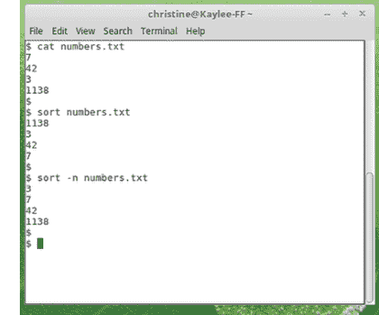

图 8.1 显示了使用适当的 `sort` 命令选项以获得所需结果的重要性。表 8.5 列出了一些常用的 `sort` 选项。

### 表 8.5 常用 sort 选项

| 选项（长格式） | 选项（短格式） | 描述 |
| :--- | :--- | :--- |
| `--dictionary-order` | `-d` | 仅考虑空格和字母数字；不考虑特殊字符 |
| `--ignore-case` | `-f` | 忽略大小写（默认考虑大小写并将大写字母排在前） |
| `--numeric-sort` | `-n` | 按字符串数值值排序 |
| `--output=file` | `-o` | 将结果写入指定文件 |
| `--reverse` | `-r` | 按降序排序（默认按升序排序） |

除了表 8.5 列出的选项外，还有许多实用的 `sort` 选项。要探索其他选项，请查阅 `sort` 的帮助手册页（man pages）。

## 使用 cat

第 5 章“了解命令行”引入了 `cat` 命令。虽然 `cat` 通常用于在屏幕上显示短文本，但它可以合并文件。图 8.2 中的示例显示了 `cat` 的这两个用法。

注意图 8.2，当使用单个文件作为参数执行命令时，它会在屏幕上显示文件内容，正如你预期的那样。然而，当使用两个文件作为参数时，文件内容会被合并。文件本身没有被修改；只有输出被合并。这非常有用。本章的“重定向输入和输出”部分详细介绍了如何保留此输出以备后之用。

**认证目标**


要只显示文件的前 10 行，请使用 `head` 命令代替 `cat`。要只显示文件的最后 10 行，`tail` 命令会很有帮助。通过查看它们的帮助手册页，了解如何使用这些命令显示较少或额外的文件行。

## 重定向输入和输出

如果你想保存程序的输出以供参考，可以将其重定向到文件。你也可以从文件中重定向输入到程序。虽然输入重定向听起来很奇怪，但某些程序依赖此功能来处理数据，例如通过搜索模式的程序馈送原始文本。除了重定向输出到文件或从输入之外，你还可以一个程序的输出作为另一个程序的输入传递。相关技术涉及 `xargs` 命令，它允许你从其他程序生成命令行选项。

## 使用基础重定向

重定向是通过重定向操作符实现的，重定向操作符是出现在命令及其参数之后的短字符串。表 8.6 显示了最常见的重定向操作符。注意输出有两种类型：

- **标准输出（Standard Output）**：用于普通消息。
- **标准错误（Standard Error）**：包含错误消息。

图 8.2 使用 cat 显示并合并文件

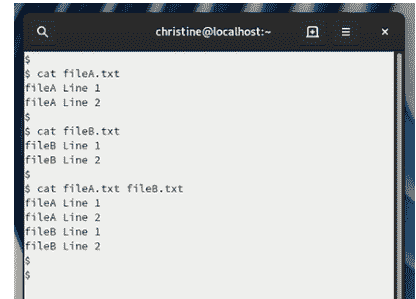

**认证目标**

## 表 8.6 常用重定向操作符

| 重定向操作符 | 效果 |
| :--- | :--- |
| `>` | 创建一个包含标准输出的新文件。如果指定的文件存在，则覆盖它。 |
| `>>` | 将标准输出追加到现有文件。如果指定的文件不存在，则创建它。 |
| `2>` | 创建一个包含错误消息（标准错误）的新文件。如果指定的文件存在，则覆盖它。 |
| `2>>` | 将标准错误追加到现有文件。如果指定的文件不存在，则创建它。 |
| `&&` | 创建一个包含标准输出和标准错误的新文件。如果指定的文件存在，则覆盖它。 |
| `<` | 将指定文件的内容作为标准输入。 |
| `<<` | 接受后续行的文本作为标准输入。 |
| `<>` | 使指定的文件同时用于标准输入和标准输出。 |

作为重定向输出的示例，考虑使用 `grep` 命令在 `/etc/` 目录下的所有配置文件中搜索特定用户的信息。如果没有重定向，此类命令可能如下：

```bash
grep -r christine /etc/
```

假设使用了超级权限，此命令将返回一系列如下的输出行：

```bash
grep -r christine /etc/
```

（注：此处原文未提供具体输出内容，仅为示例结构）

（注：此处根据上下文逻辑，原文应有后续具体的输出示例，但提供的文本文本在此处中断，以下为根据逻辑逻辑的翻译）

假设使用了超级权限，此命令将返回一系列如下的输出行：

...（此处省略原文未提供的具体输出行）

（注：由于提供的原文文本在 `grep -r christine /etc/` 之后似乎不完整，翻译已根据提供的文本内容结束。）

## 创建自定义工具

当你配合重定向使用如 `grep`、`cut` 和 `wc` 等过滤命令时，你可以创建强大的定制化实用程序。通过这些实用程序，你可以进行安全审计、创建使用报告、分析基于文本的日志文件等。你的限制仅在于你对命令行的了解和想象力。

在第 11 章“创建脚本”中，你将学习如何创建程序来自动化许多必要且例常的系统管理任务。当你理解了如何在 shell 提示符下使用这些工具后，以后就可以在 shell 脚本中快速调用它们。

## 生成命令行

管道（Pipelines）对于处理复杂任务非常有用。例如，假设你想删除目录树中所有以波浪号 (~) 结尾的文件。这种文件名命名约定表示由文本编辑器创建的备份文件。对于大型目录，这项任务可能会令人生望而畏之。通常的文件删除命令（`rm`，在第 7 章中描述）并没有提供搜索并删除目录树中所有符合特定标准的每个文件的选项。`find` 命令可以完成搜索部分的工作（前文已详细描述），但不能完成删除操作。

解决方案是将 `find` 的输出结合起来，使用 `rm` 创建一系列命令行。这可以通过三种主要方式实现：

### xargs

该命令在管道中的作用是根据其标准输入构建一个命令。该命令的基本语法如下：

```bash
xargs [OPTIONS] [INITIAL-ARGUMENTS]
```

`COMMAND` 是你想要执行的命令，`INITIAL-ARGUMENTS` 是你想要传递给该命令的参数列表。`[OPTIONS]` 是 `xargs` 的选项；它们不会被传递给 `COMMAND`。当你运行 `xargs` 时，它会为传递到标准输入的每个单词运行一次 `COMMAND`，并将该单词添加到 `COMMAND` 的参数列表中。如果你想向命令传递多个选项，可以通过引号将该组括起来来保护它们。

例如，考虑删除所有由波浪号字符表示的备份文件的任务。你可以通过将 `find` 的输出管道到 `xargs` 来实现，然后由其调用 `rm`：

```bash
$ find . -name "~*" | xargs rm
```

该管道的第一部分（`find . -name "~*"`）找到当前目录（`/`）或其子目录下所有以波浪号 (~) 结尾的文件。该列表被传递给 `xargs`，它为每个文件调用其自己的 `rm` 命令。查找并删除所有这些备份文件的困难任务就完成了。

**数据归档 183**

### 反引号

在许多方面与 `xargs` 相似的工具是反引号（`` ` ``），它是键盘上数字 1 键左侧的字符。反引号并不等于单引号字符（`'`），后者位于大多数键盘上分号（;）的右侧。

放置在反引号内的文本被视为一个独立的命令，其结果会被替换到命令行中。例如，要删除备份文件，你输入以下命令：

```bash
$ rm `find . -name "*"
```

像这样使用反引号被称为命令替换（command substitution），因为你正在为命令的其中一个参数提供替换。在上例中，`find` 命令的结果取代了文件名，作为 `rm` 命令的参数。

### () 格式

由于由于很容易将反引号（`` ` ``）与单引号（`'`）混淆，使用反引号进行命令替换通常正在逐渐流失。如果你的发行版支持，最好使用另一种形式的命令替换，即 `$()` 格式：

```bash
$ $(find . -name "*")
```

使用这种形式的命令替换结果是相同的，由于括号内包含了要执行的第一个命令，而不是小小的反引号（看起来像引号），因此它们通常更易读。

## 数据归档


文件归档工具将一组文件收集到一个单一“包”文件中，你可以轻松地在单个系统中移动它；备份到 `usb` 闪存盘或其他可移动介质；或者跨网络进行传输。`Linux` 支持多种归档方法，最著名的是 `tar` 和 `zip`。为了理解这些命令，你应该熟悉使用它们进行压缩的后果。

> 另一种归档程序 `cpio` 有时用于 `Linux` 中。它在原理上与 `tar` 相似，但在操作细节上不同。


## 使用 `tar`

`tar` 程序的名字代表 `tape archiver`（磁带归档器）。无论其名称如何，你都可以使用 `tar` 将数据备份到硬盘或其他介质（也称为 `archive`），而不只是磁带。`tar` 程序是一个流行的工具，用于将各种数据文件归档到一个单一文件中，称为归档文件（原始文件保留在你的磁盘上）。由于生成的归档文件可能很大，通常会通过 `tar` 程序在线压缩成一个 `tarball`（`tar` 包）。事实上，

### 认证目标

| 标识符（全称） | 标识符（缩写） | 说明 |
|---|---|---|
| `--directory` | `-C` | 切换目录 |

数据归档 185

| 标识符（全称） | 标识符（缩写） | 说明 |
|---|---|---|
| `--file` | `-f` | 使用文件作为 `archive` |
| `--listed-incremental` | `-g` | 执行增量备份或恢复 |
| `--one-file-system` | `-s` | 备份单个文件系统 |
| `--multi-volume` | `-M` | 创建多个卷 |
| `--same-permissions` | `-p` | 保留权限 |
| `--absolute-names` | `-P` | 保留绝对路径名 |
| `--verbose` | `-v` | 显示正在处理的文件 |
| `--verify` | `-W` | 写入后验证 |
| `--exclude` | `-X` | 排除文件 |
| `--exclude-from` | `-I` | 排除列出的文件 |
| `--gzip` | `-z` | 通过 `gzip` 压缩 |
| `--bzip2` | `-j` | 通过 `bzip2` 压缩 |
| `--xz` | `-J` | 通过 `xz` 压缩 |

## 创建归档

第 8 章 • 搜索、提取与归档

图 8.3 创建 `tar` 包


```
$ ls -l /home/christine/Project42
total 24
-rw-r--r-- 1 christine 1234 Jul 23 18:44 Weekly-Meeting.odt
-rw-r--r-- 1 christine 9560 Jul 23 18:52 P42.tgz
-rw-r--r-- 1 christine 2487 Jul 23 18:44 TeamMemberInfo.txt
-rw-r--r-- 1 christine 523 Jul 23 18:44 timeline.odt
```

在图 8.3 中，斜杠 `/` 会自动从归档文件名（称为 `member` 名称）中移除。这允许你轻松将文件提取到新位置。例如，如果你将图 8.3 中的闪存盘传输到另一个系统，你必须挂载它，`P42.tgz` `tar` 包文件，并想要提取归档，可以使用另一个命令：

```
$ -xzvf P42.tgz
```

该命令在当前目录 `/home/christine/Project42` 中创建一个子目录，并用 `tar` 包中的文件填充它。注意，在 8.3 使用的 `tar` 命令选项中，只需要一个：将 `c`（创建）被切换到了 `x`（提取）。

```
$ ls -l /media/christine/USB2FD/P42.tgz
-rw-r--r-- 1 christine 1345 Jul 23 18:52 /media/christine/USB2FD/P42.tgz
```

> `tar` 实用程序会保留 `Linux` 的所有权和权限信息，即使归档存储在不支持此类元数据的文件系统上。

如果你不知道归档中包含什么，在提取内容之前，使用 `--list` 命令进行检查是一个良好的习惯。虽然常见的做法是创建存储文件在单个子目录中的 `tar` 包，但有时 `tar` 包会将文件丢在当前工作目录，如果你在一个已经有很多文件的目录中运行命令，这可能会使它们难以追踪。

## 使用压缩

在 `Linux` 中，`gzip`、`bzip2` 和 `xz` 都可以对单个文件进行压缩。例如，你可能会像这样压缩一个大型图形文件：

```
$ xz biggraphics.tiff
```

结果是一个文件名与原文件相似的文件，但具有一个新的文件名扩展名，以识别其为压缩格式。在这种特定情况下，结果将是 `biggraphics.tiff.xz`。

大多数程序不会读取此类方式压缩的文件。要使用一个已经压缩的文件，你必须使用匹配的程序对其进行解压缩。要解压上例中压缩的 `biggraphics.tiff.xz` 文件，请使用此命令：

```
$ unxz biggraphics.tiff.xz
```

表 8.9 总结了压缩程序、对应的解压程序以及创建这些文件的扩展名。

| 压缩程序 | 解压缩程序 | 文件名扩展名 |
| --- | --- | --- |
| `gzip` | `gunzip` | `.gz` |
| `bzip2` | `bunzip2` | `.bz2` |
| `xz` | `unxz` | `.xz` |


> 一般而言，`gzip` 提供的压缩率最低，而 `xz` 提供的压缩率最高。这就是为什么 `Linux` 内内核现在使用 `xz` 进行压缩。

`tar` 程序对这三种压缩标准提供了明确支持，且 `tar` 包（`tarballs`）通常有其独特的扩展名，用于指示所使用的压缩类型：

有时 `tar` 包文件会使用两个扩展名，生成诸如 `my-work.tar.bz2` 的文件名。


- `.tgz` 用于用 `gzip` 压缩的 `tar` 包
- `.tbz` 或 `.bz2` 或 `.tb2` 用于用 `bzip2` 压缩的 `tar` 包
- `.txz` 用于用 `xz` 压缩的 `tar` 包

当你使用压缩来创建 `tar` 包时（使用 `z`、`j` 或 `J` 参数进行 `tar`）时，压缩程序是针对整个 `tar` 包及其所有文件进行工作的，而不是逐个压缩 `tar` 包内的每个文件。与先压缩单个文件再将其打包相比，这可以提高压缩率。然而，如果文件损坏，这会增加从中提取数据的难度。

通常，纯文本文件的压缩效果非常好，二进制程序文件的压缩效果中等，而预压缩数据（如大多数视频文件）的压缩效果差，或者在压缩时体积可能会增大。

`gzip`、`bzip2` 和 `xz` 压缩程序允许无损压缩，这意味着通过解压缩文件恢复的数据与输入的数据完全相同。某些图形、音频和视听文件允许有损压缩，即某些部分数据会被丢弃。绝不应对程序文件、系统配置文件或大多数用户数据文件使用有损压缩工具；此类文件中的任何丢失都可能是灾难性的。这就是为什么 `tar` 仅支持无损压缩。

# 使用 `zip`

在 `Unix` 和 `Linux` 世界之外，`zip` 文件格式是一种常用格式，起着类似于压缩的 `tar` 包的作用。`Linux` 提供了 `zip` 命令来创建 `zip` 文件，提供了 `zip` 工具来从 `zip` 归档中提取文件。`zip` 文件通常具有 `.zip` 扩展名。

在大多数情况下，你可以通过向工具传递目标 `zip` 文件的名称后跟文件名列表来创建一个 `zip` 归档：

```
$ zip newzip.zip afile.txt figure.tif
```

此命令创建了 `newzip.zip` 文件，其中包含 `afile.txt` 和 `figure.tif` 文件（原始文件保留在磁盘上）。在某些情况下，你可能需要使用 `zip` 选项来实现所需的结果。表 8.10 总结了最重要的 `zip` 选项；然而，该程序支持更多。详情请其帮助页（`man` 页）。

# 表 8.10 常用 `zip` 选项

| 选项（长格式） | 选项（短格式） | 说明 |
| --- | --- | --- |
| `N/A` | `-0` 到 `-9` | 设置压缩程度；`-0` 应用不压缩，`-1` 应用最小（但快速）的压缩，以此此类推直到 `-9`，后者应用最大（但缓慢）的压缩。 |
| `--delete` | `-d` | 从归档中删除指定的文件 |
| `--encrypt` | `-e` | 使用密码加密归档（`zip` 会提示输入密码） |
| `--freshen` | `-f` | 如果文件自原始归档创建以来发生更改，则更新归档中的文件 |
| `--fix` 或 `--fix` | `-F` 或 `-FF` | 对损坏的文件进行修复。`--fix`/`-F` 选项执行最小修复，而 `--fix`/`-FF` 则更彻底。 |
| `--filesync` | `-FS` | 如果文件自原始归档创建以来发生更改，则更新归档中的文件；如果文件在文件系统中已被删除，则从归档中删除 |


| `--grow` | `-g` | 将文件追加到现有归档 |

| `--help` | `-h` 或 `?` | 显示基本帮助信息 |

| `--move` | `-m` | 将文件移动到 `zip` 归档——即删除原始文件 |

| `--recurse-paths` | `-r` | 包含你指定的目录内部的文件和子目录 |

| `--split-size size` | `-s size` | 创建一个多文件归档，每个文件不大于 `size` 字节（可以附加 `k`、`m`、`g` 或 `t` 来指定更大的单位） |

| `--exclude files` | `-x files` | 排除指定的文件 |

| `--symlinks` | `-y` | 包含符号链接（通常情况下，`zip` 会包含指向的文件） |

在表 8.10 的选项中，`r` 选项可能是最重要的，至少如果你想压缩整个目录树的话。如果你没有使用此选项，你的归档将不包含任何子目录。考虑到现代 CPU 的速度，经常使用 `-9` 来实现最大压缩也是有意义的。

解压缩并提取 `zip` 归档文件中的文件，你可以使用 `unzip` 程序：

```
$ unzip anarchive.zip
```

此示例将 `anarchive.zip` 中的文件解压缩到当前目录。像 `zip` 一样，`unzip` 支持大量选项，其中最重要的选项出现在表 8.11 中。

### 表 8.11 常用 unzip 选项

| 选项 | 说明 |

| `--grow` | 将文件追加到现有归档 |
| `--help` | 显示基本帮助信息 |
| `--move` | 将文件移动到 `zip` 归档——即删除原始文件 |
| `--recurse-paths` | 包含你指定的目录内部的文件和子目录 |
| `--split-size size` | 创建一个多文件归档，每个文件不大于 `size` 字节（可以附加 `k`、`m`、`g` 或 `t` 来指定更大的单位） |
| `--exclude files` | 排除指定的文件 |
| `--symlinks` | 包含符号链接（通常情况下，`zip` 会包含指向的文件） |

*注：原文表格中 `unzip` 选项列表似乎有误，上述表格内容为 `zip` 命令选项。若需严格保留原文 `unzip` 选项列表，请参考下方修正版：*

| 选项 | 说明 |

| `-f` | 刷新归档中的文件——即仅提取在主文件系统中存在且在归档中的版本比主文件系统新的文件 |
| `-l` | 列出归档中的文件但不提取它们 |
| `-p` | 将文件提取到管道 |
| `-t` | 测试归档中文件的完整性 |
| `-u` | 更新文件；类似于 `-f` 但也会提取文件 |
| `-v` | 以详细模式列出归档文件 |
| `-L` | 将文件名转换为小写 |
| `-n` | 不覆盖现有文件 |
| `-o` | 覆盖现有文件而不提示 |


`zip` 文件通常包含“松散”的文件，所以你通常应该创建一个子目录来实现此目的。

一般而言，不使用任何选项使用 `unzip` 效果很好。`l` 选项对于查看内容特别有用。

## 练习 8.1

- 使用 `find` 和 `grep` 查找目录和整个计算机的文件。例如，在 `/etc` 配置文件中查找用户的引用。

- 使用 `gzip`、`bzip2` 和 `xz` 压缩一些文件，如数字照片。哪些文件类型压缩良好？哪种压缩工具效果最好？

总结用于搜索和提取数据的命令。使用 `grep` 命令在文件或文件目录中搜索特定的字符串或正则表达式模式。使用 `find` 工具可以根据大小、所有者、创建日期或其他数据在指定的目录树中 Find位文件。当你想要显示一个文件时，`cat` 命令可以提供帮助，它还可以将多个文件按顺序（连接）后显示在你的屏幕上。如果你只想查看文件的前 10 行，请使用 `head`；要查看最后 10 行，请使用 `tail` 命令。如果你想显示排序后的文件，请使用 `sort` 工具。如果你只想提取文本文件的部分内容，请使用 `cut` 命令。如果你想获取有关文件的某些统计信息，例如文件中包含的行数和字节数，那么应该使用 `wc` 工具。

解释如何重定向标准输入和输出。标准输出是程序发送消息的正常位置，而错误消息被发送到标准错误（用数字 `2` 表示）。要将命令的输出发送到文件并覆盖当前内容，请使用 `>` 运算符；使用 `>>` 则将输出追加到现有数据之后。对于标准错误，使用 `2>` 运算符将命令的标准错误消息发送到文件并覆盖文件的当前内容，使用 `2>>` 运算符追加另一个程序。在命令之间使用管道，即竖线（`|`）来实现。

详细介绍使用 `tar` 和 `zip` 归档数据。`tar` 工具将各种文件归档为一个文件，称为归档文件，该文件有时会同时压缩，生成 `tar` 包（tarball）。`tar` 有多个可用的选项，包括长选项、短选项，甚至是单字母风格的选项。`tar` 工具保留了 Linux 的所有权和权限信息，并使用特殊选项来解包（并在需要时反转压缩）归档文件。`zip` 工具也可用于创建类似 `tar` 包的归档文件。与 `tar` 程序不同，你不需要添加特殊选项来自动压缩归档文件。然而，你需要使用 `unzip` 程序来反转压缩并解包。

列出 Linux 上的压缩工具。`gzip`、`bzip2` 和 `xz` 工具可以配合 `tar` 使用或单独使用来压缩文件。最旧的是 `gzip`，提供压缩率最高的是 `xz`。要反转它们的压缩，请使用它们对应的“un”工具——`gunzip`、`bzip2` 和 `unxz`。

## 复习题

你可以在附录 A 中找到答案。

- 1. 下列哪个命令将打印 `world.txt` 文件中包含包含 `change` 或 `changed` 匹配项的行？

  A. `grep change [ds] world.txt`

  B. `tar change [d-s] world.txt`

  C. `find "change[d']s" world.txt`

  D. `cat world.txt changed`

  E. `find change [*ds] world.txt`

- 2. 下列哪个重定向运算符会将程序的标准输出追加到现有文件而不覆盖该文件的原始内容？

  A. `|`

  B. `2>`

  C. `&`

  D. `>`

  E. `>>`

- 3. 你从同事那里收到一个名为 `data79.tar` 的 `tar` 归档文件，但在提取之前，你想检查它包含的文件名。你会使用以下哪个命令来执行此操作？

  A. `tar uvf data79.tar`

  B. `tar cvf data79.tar`

  C. `tar xvf data79.tar`

  D. `tar tvf data79.tar`

  E. `tar Avf data79.tar`

- 4. 正确或错误：正则表达式 `[^]*lds` 匹配字符串 Linus Torvalds。

- 5. 正确或错误：`find` 命令允许你根据文件的大小定位文件。

- 6. 正确或错误：要压缩用 `zip` 归档的文件，你必须在管道中与 `zip` 一起使用如 `gzip` 或 `bzip2` 等外部压缩程序。

- 7. 正确或错误：表示行首的正则表达式是 _____

  A. `^`

  B. `$`

  C. `|`

  D. `(`

  E. `~`

- 8. 使用 `cut` 命令可以从文件中提取特定的字段。

  A. `grep`

  B. `cut`

  C. `sort`

  D. `find`

  E. `cat`

- 9. 补全以下命令将标准输出重定向到文件并覆盖文件的当前内容：_____

  A. `|`

  B. `2>`

  C. `&&`

  D. `>`

  E. `>>`

- 10. 下列哪个工具可以提供最高的压缩率：`gzip`, `bzip2`, _____

  A. `zip`

  B. `tar`

  C. `high`

  D. `lossy`

  E. `lossless`

## 第 9 章 探索进程与进程

**目标：**

- 1.2 开源应用程序
- 4.3 数据存储位置

最初，软件包系统是在本地运行的——也就是说，要在你的计算机上安装软件包，你首先需要从互联网下载包文件，或者通过其他方式获取。然后，你可以使用本地命令来安装该软件包。然而，当软件包有许多依赖项时，这种方法可能会非常繁琐——你可能会尝试安装，发现未满足的依赖项，下载几个包，又发现其中一个包还有未满足的包，以此类推。当你找到所有这些包时，你可能需要安装几十个或更多软件包，现代发行版提供了网络启用工具来帮助自动化这一过程。这些工具依赖软件存储库，工具可以自动下载软件包。这适用于不同的发行版之间，特别是基于 `RPM` 的发行版。

在实践中，在 Linux 中管理软件的过程是通过文本模式或 `GUI` 工具与软件存储库交互。典型的软件安装任务如下：

1. 你发布一个命令来安装程序。
2. 软件定位指定程序的依赖项，并通知你任何必须安装的额外软件。
3. 你对软件安装给予最终确认（或决定不安装，在这种情况下过程停止）。
4. 软件下载所有必要的包。

> 你可以配置大多数发行版使用本地介质代替或额外使用互联网存储库。

软件安装所有软件包。升级软件的方式类似，尽管升级不太可能需要下载依赖的包。当然，删除软件可以完全在本地完成。许多发行版会定期自动检查它们的存储库，并在可用更新时通知你。每当系统提示时，你可以通过点击几个按钮来保持系统为最新状态。例如，图 9.1 显示了 `Linux Mint 18.3` 中的软件实用程序（`Software Utility`），它显示了可用更新列表。

> 在安装发行版后立即，你可能会发现有大量的更新可用。

软件包管理不可避免地涉及 `root` 权限，这在第 13 章“创建用户和组”中有更详细的描述。如果你按照自动提示更新软件，可以在更新软件提示时输入 `root` 密码（或在某些发行版中输入你的普通密码）来保持系统为最新状态。

# 理解软件包管理


**图 9.1** 大多数 Linux 发行版会在软件更新可用时通知你。

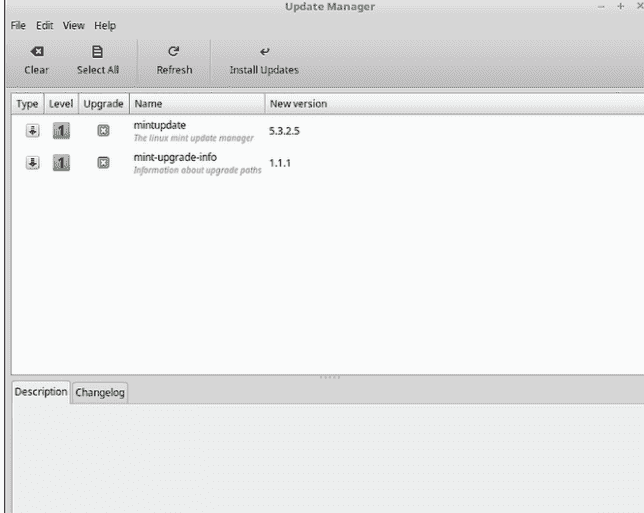

## 管理 Red Hat 系统

基于 `RPM` 的发行版包括 `Red Hat`、`Fedora`、`CentOS`、`SUSE Enterprise`、`openSUSE` 和 `Mandriva`。在这些发行版上安装软件的基本工具是文本模式 `rpm` 命令。但此程序作用于本地文件；要使用网络存储库，必须使用另一个工具，该工具随发行版而异：

*   `Red Hat`、`Fedora` 和 `CentOS` 使用文本模式 `yum` 或 `dnf`，或者它们的各种 `GUI` 前端，例如 `PackageKit` 和 `Yumex`。
*   `SUSE Enterprise` 和 `openSUSE` 使用 `zypper` 或 `YaST 2` 等 `GUI` 前端。

由于这些发行版之间的差异，特别是对于网络启用的更新，在这里提供所有这些工具的完整描述是不现实的。幸运的是，`GUI` 工具易用且易访问。即使是文本模式工具也相当直接，尽管你可能需要查阅它们的 man 页面来了解细节。通常，它们使用逻辑子命令，例如使用 `install` 来安装包，如下：

```
# dnf install yumex
```

你可能用此在 `Red Hat`、`Fedora` 或 `CentOS` 系统上安装 `GUI` `Yum` 工具。同样，你可以使用 `remove` 子命令删除特定包，或使用 `upgrade` 升级计算机的所有包：


如果你想升级软件并删除包，通常最好先删除软件。如果可以避免某些下载，将节省时间。

```
# dnf remove zsh
```

## dnf upgrade

此示例删除了 `zsh` 包并升级了系统上的剩余包。两个命令都会产生若干行输出，你可能被要求验证操作。参考 `yum`（或你使用的任何包管理软件）的 man 页面获取更多关于该工具的信息。如果你需要处理 `RPM` 文件，应该意识到它们是 `.rpm`。这些文件还包含了架构代码（例如 `i386` 或 `x86_64`）以及目标发行版代码（例如 `Fedora`）。例如，`samba-10.2-0.fc30.x86_64` 是 `samba` 包的文件，版本为 `10.2`，发布为 `0`，适用于 `x86_64` 平台。使用 `rpm` 命令安装它：

```
# rpm -Uvh samba-10.2-0.fc30.x86_64.rpm
```

使用 `yum` 命令，因为你需要知道文件名。

## 管理 Debian 系统

`Debian GNU/Linux` 发行版创建了自己的软件包系统，基于 `Debian` 的发行版（如 `Ubuntu` 和 `Mint`）使用相同的系统。`Debian` 软件包系统之上是高级软件包工具 (`APT`)，它提供了对网络存储库的访问。


许多基于 `RPM` 的发行版也存在 `APT` 的第三方实现。详见 `apt.sourceforge.net`。至少有一个 `RPM` 发行版原生使用 `APT`。

# 理解软件包管理

`dpkg` 命令是 `Debian` 软件包系统的底层接口；它大致相当于基于 `RPM` 系统的 `rpm` 工具。配合 `rpm` 工具使用 `dpkg` 命令知道要安装的包名：

```
# dpkg -i samba_4.9.5+dfsg-5ubuntu_amd64.deb
```

`dpkg` 之上提供了文本模式和图形界面，其中最重要的是 `apt-get`、较新的 `apt` 以及 `GUI` 工具 `Synaptic`。`apt-get` 和 `Synaptic` 提供了对存储库的访问。图 9.2 显示了 `Synaptic` 的用法：

**图 9.2** `Synaptic` 允许你在基于 `Debian` 的系统中搜索、选择、安装和卸载。

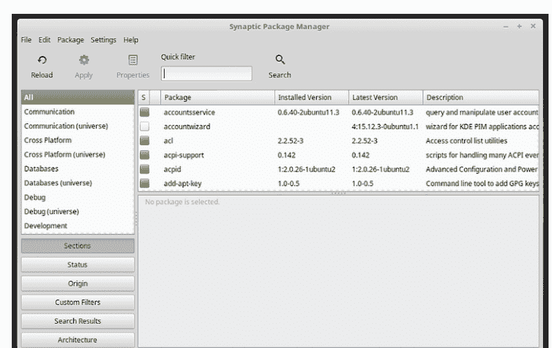

`Debian` 软件包文件名为 `.deb`。与 `RPM` 包一样，这些名称通常包含了软件版本和架构（例如 `i386` 或 `amd64`）。例如，`samba_3.6.1-3_amd64.deb` 是 `samba` 包的文件，版本为 `3.6.1`，修订为 `3`，适用于 `AMD64 (x86-64)` `CPU`。你可以使用 `dpkg` 或 `apt-get` 安装此类包，或者使用 `apt-get` 的 `install` 命令从互联网下载包及其依赖项：

```
# apt install samba
```

像 `RPM` 包一样，你也可以删除包或升级计算机的软件：

```
# apt remove zsh
## apt upgrade
```

`APT` 是一个强大的工具，底层 `dpkg` 也是。你应该查阅这些程序的 man 页面以了解更多关于如何使用这些程序的信息。

## 理解进程层次结构

`Linux` 内核是 `Linux` 安装的核心。内核管理内存，为软件提供磁盘访问权限，分配 `CPU` 时间，并执行其他关键的低级任务。内核在启动过程中早期加载，负责管理运行的 `Linux` 计算机上的每一个其他软件。

内核排序可能混乱的运行软件集以创建某种层次结构的一种方法。当它启动时，内核只运行一个程序——通常是 `init/systemd/init`。这些进程负责启动 `Linux` 必须运行的所有基础程序，例如管理登录和始终运行服务器的程序。此类程序如果直接由 `systemd` 或 `init` 启动，被称为子进程。子进程可以启动它们自己的子进程。这发生在你登录 `Linux` 时。启动给定进程的进程被称为其父进程。


> 你可以在引导程序的内核选项行中添加 `init=` 来更改作为第一个运行的程序，例如 `init=/bin/bash` 来运行 `bash`。

该系统的结果是进程的树形层次结构，如图 9.3 所示（计算机科学中的树通常是倒着画的）。图 9.3 显示了典型 `Linux` 安装上运行的进程的一个子集：仅几个与文本模式登录相关的进程，包括管理登录的登录工具、几个 `ash shell` 和几个用户程序。运行良好的 `Linux` 系统可能有几十个或数百个运行的进程。我正在输入这些字的机器上有 `213` 个进程同时运行！

**目标**


偶尔，进程会终止但留下子进程。当这种情况发生时，`init` 会“收养”这些子进程。

每个进程都有与其关联的进程 ID (`PID`) 数字。这些数字从 `1` 开始，所以 `init` 的 `PID` 是正常的 `1`。每个进程还有一个父进程 ID (`PPID`)。

数字，它指向其父进程。许多管理进程的工具都依赖这些数字，特别是 `PID` 数字。

**图 9.3** `Linux` 进程按分级树结构排列。

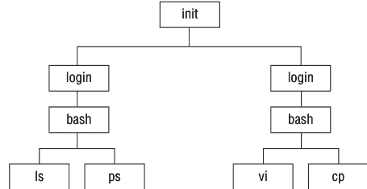

在内部，内核在 `process`（进程）表中维护进程信息。诸如 `ps` 和 `top`（稍后将描述）等工具允许你查看和操作此表。

## 识别运行中的进程

在管理进程之前，你必须能够能够识别它们。`ps` 和 `top` 实用程序可以帮助你识别进程。无论在哪种情况下，你都可以通过多种方式搜索进程，例如通过名称或资源使用情况。你可能还想识别进程正在消耗哪些资源，这可以通过 `free` 命令来实现。

## 使用 ps 识别进程

识别进程的最简单工具是 `ps`，它会生成一个进程列表。列表 9.1 显示了 `ps` 运行的一个示例。在这个示例中，`-u` 选项将输出限制为指定用户（`rich`）拥有的进程，而 `--forest` 则会创建一个显示父/子关系的显示。

**列表 9.1：** `ps -u rich --forest` 的输出

```
$ ps -u rich --forest

PID TTY             TIME CMD

2451 pts/3          00:00:00 bash

2551 pts/3          00:00:00 ps
```


### 列表 9.1：`ps -u rich --forest` 的输出（续）

| | | | | | | | |
|---|---|---|---|---|---|---|---|
| 2496 ? | 00:00:00 | | | | | | |
| 2498 pts/1 | 00:00:00 | `bash` | | | | | |
| 2505 pts/1 | 00:00:00 | `nedit` | | | | | |
| 2506 ? | 00:00:00 | `csh` | | | | | |
| 2544 ? | 00:00:00 | | `xeyes` | | | | |
| 19221 ? | 00:00:01 | `dfm` | | | | | |

列表 9.2 显示了 `ps` 的第二个示例。在这个示例中，`-u` 选项提供了额外的列，而 `-u` 将其限制为 rich 拥有的进程。`ps` 命令支持大量的选项（详情请咨询其 man 页）。


大多数 Linux 发行版中使用的 `ps` 版本结合了早期实现的功能。结果是产生了大量的有时是冗余的选项。

### 列表 9.2：`ps u U rich` 的输出（注：根据上下文从 OCR 修正）

| USER PID %CPU %MEM VZ RZ TTY STAT START TIME COMMAND |
|---|---|---|---|---|---|---|---|---|---|---|---|
| 19221 | 0.0 | 1.5 | 4484 | | | S | Sep07 | 0:01 | `dfm` |
| 2451 | 0.0 | 0.8 | 1856 | 1048 | pts/3 | S | 16:13 | 0:00 | `-bash` |
| 2496 | 0.2 | 3.2 | 6232 | | | S | 16:17 | 0:00 | `/opt/kd` |
| 2498 | 0.0 | 0.8 | 1860 | 1044 | pts/1 | S | 16:17 | 0:00 | `bash` |
| 2505 | 0.1 | 2.6 | 4784 | 1334 | pts/1 | S | 16:17 | | `nedit` |
| 2506 | 0.0 | 0.7 | 2172 | | | S | 16:17 | 0:00 | `/bin/cs` |
| 2544 | 0.0 | 1.0 | 2576 | 1368 | | | S | 16:17 | | `xeyes` |
| 2556 | 0.0 | 0.7 | 2588 | 916 | pts/3 | R | 16:18 | 0:00 | `ps u U` |

由于 `ps` 选项非常多，用户可能有自己喜欢的使用该程序的方法。一种选项组合是 `-ax`，它产生大多数系统管理员所需的信息，包括计算机上所有进程的 PID 值和命令名称（包括命令行选项）。使用 `-aux`（在 `ps aux` 中）会添加用户名、CPU 负载和一些其他小细节。然而，产生的信息范围之大可能会让人应不从心。缩小范围的一种方法是将结果传递给 `grep`，这会消除不包含你指定的搜索准则的行。例如，如果你想知道 `gedit` 进程的 PID 数字，可以这样做：

```
$ ps ax | grep gedit

27946 pts/8 Sl  0:00 gedit

27950 pts/8 S+  0:00 grep --color=auto
```

因为 `ps` 会产生带有选项的命令，因此使用 `grep` 在输出中搜索字符串也会返回被搜索的命令。该命令揭示了 27946 的 PID。当你使用 `ps` 更改进程优先级或终止它时，这通常是最重要的信息。

## 使用 `top` 识别进程

虽然 `ps` 只能返回单一瞬间的状态，但 `top` 是 `ps` 的交互版本。如果你想找到消耗内存的进程，或者你想研究资源使用如何随时间变化，另一个工具更合适：图 9.4 显示了在 GNOME 中运行的 `top`。

```
top -VirtualBox-12:52:06 up 1 min, load average: 0.16, 0.79, 0.42

Tasks: 101 total, 2 running, 99 sleeping, 0

Cpu(s): 0.0 user, 0.0 sy, 0.0 ni, 0.0 id

Mem: 815864 total, 268952 used
```


# 负载平均

在具有多个 CPU 或 CPU 核心的计算机上，在开始竞争 CPU 时间之前，负载平均就可以达到 CPU 或核心的数量。例如，在配备四核 CPU 的系统上，负载平均为 4.0 意味着进程所需的 CPU 时间恰好等于计算机可用的所有时间。

如今大多数计算机都是多核模型，但如果你在较旧系统上运行 Linux，在 2006 年之前，单核模型曾主导市场。使用 `lscpu` 命令查看你的系统包含多少个 CPU。

负载平均在检测“失控进程”（runaway processes）时非常有用。例如，如果一个系统的正常负载平均为 0.5，但突然卡在 2.5，则可能有几个占用大量 CPU 的进程已经挂起——即变得无响应。挂起的进程有时会消耗大量的 CPU 时间。你可以使用 `top` 来定位这些进程，并在必要时停止它们。

> 第 13 章描述的命令可以告诉你整个终端会话消耗了多少 CPU 时间。

## 测量内存使用

进程会消耗许多系统资源，最重要的是 CPU 时间和内存。如所述，`top` 默认按 CPU 时间对进程进行排序，你可以识别出消耗最多 CPU 时间的进程。你可以在 `top` 中按 `M` 键按内存使用进行排序，识别出消耗内存最多的进程。然而，通过 CPU 时间，你不能因为一个进程位于列表顶端就说它消耗了大量内存；尽管程序确实会消耗大量内存。尽管如此，程序可能因为代码效率低下或内存泄漏而消耗了过多内存——内存泄漏是一种 bug，即程序向内核请求内存并在完成后未能将其归还。内存泄漏的程序会增加内存占用，直到达到干扰到其他程序的程度。作为短期解决方案，你可以终止程序并重新启动它，这将重置程序的内存消耗，就像放掉装满漏水水龙头水的水槽一样。问题会再次出现，但如果内存泄漏足够小，你至少在此期间能够完成工作。

内核授予一组内存地址的访问权限，程序随后可以使用这些地址。当程序完成后，它应该将内存释放回内核。

## 第 9 章 ■ 探索进程和进程数据

如果你想检查计算机的整体内存，`free` 命令非常有用。该程序会生成关于计算机总内存状态的报告：

```bash
$ free
```

| | total | used | shared | buffers | cached |
|---|---|---|---|---|---|
| Mem: | 791488 | 773456 | 180432 | 0 | 190656 | 3244720 |
| -/+ buffers/cache: | 6291452 | 1083736 | 2650716 | | |

该行显示了总随机存储器（RAM），包括总内存（减去主板和内核使用的部分）、已用内存和空闲内存。此示例显示计算机内存正在使用。这种状态是正常的，因为 Linux 将未使用的内存作为缓冲区和缓存，这有助于加速磁盘访问。`free` 行显示的是最常用的部分；相反，你应该使用 `/buffers/cache:` 行，它显示了计算机程序使用的总内存。在此示例中，有 4,291,888 KiB 正在使用，3,615,803 KiB 空闲。换句话说，大约有一半的计算机内存被使用，因此没有内存相关的性能问题。

`swap` 行显示了 Linux 使用了多少交换空间。交换空间是设置在内存相邻的磁盘空间。Linux 在 RAM 耗尽或认为 RAM 更好地用于缓冲区或缓存以存放非活动程序时使用交换空间。在此示例中，1030,726 KiB 的交换空间正在使用，总共 6,291,452 KiB（260,716 空闲）。交换空间使用率较低，如果它大幅上升，可能会遇到性能问题。从长远来看，增加计算机 RAM 通常是解决这些问题的最佳方案。如果你因为过度使用交换空间而遭受性能问题并需要立即缓解，终止占用内存的程序会有帮助。之前描述的内存泄漏会导致此类问题，终止泄漏的程序可以恢复性能到正常。

`free` 命令支持许多选项，可能会修改其显示格式。其中可用的是 `-m`，它使显示使用兆字节（MiB）而不是默认的千基字节（KiB）。

## 使用日志文件

许多在后台运行的程序（即守护进程，daemons）会将它们的正常操作信息写入日志文件，日志文件是记录此类通知的文件。查看日志文件可以是诊断守护进程问题的重要部分。这一步是定位你的日志文件。在某些情况下，你可能需要让程序产生更详细的输出以追踪问题，因此本节提供了如何操作的一些提示。本节描述了内核日志，它在技术上不是日志文件，但可以为内核信息起到类似的作用。

## 定位日志文件

Linux 将大多数日志文件存储在 `/var/log` 目录树中。某些日志文件位于目录，但某些服务器会创建整个子目录来存储自己的日志文件。表 9.2 总结了一些常见的日志文件：

| 日志文件 | 内容 |
|---|---|
| `boot.log` | 启动期间的服务 |
| `cron.log` | 定期运行的进程 |
| `cups/log` | 打印信息 |
| `gdm.log` | GNOME 显示管理器信息 |
| `messages` | 通用日志 |
| `secure.log` | 安全相关消息 |
| `Xorg.log` | 窗口系统信息 |

此外，许多文件在发行版之间有所不同，表 9.2 总结了一些日志文件。注意，并非所有程序都会记录消息。通常只有守护进程才会这样做；普通用户程序不会。如果你认为某个程序正在记录某些数据但找不到，请查阅其文档。或者，你可以使用 `grep` 来找到程序发送消息的日志文件。例如，输入 `grep ssh /var/log/*` 可以找到包含 `ssh`（守护进程名称）的文件。


增加日志文件输出详细程度的方法在不同程序之间有所不同。通常，你必须在程序的配置文件中设置一个选项。你应该查阅程序的文档以学习如何操作。

## 检查内核环形缓冲区

内核环形缓冲区（kernel ring buffer）类似于内核的日志文件；但与其他日志文件不同，它存储在内存中而不是磁盘文件中。与普通日志文件一样，它的内容随着计算机的运行不断变化。要检查内核环形缓冲区，你可以输入 `dmesg`。这样做会产生大量的输出，因此通常会将输出通过到 `less` 进行处理：


由于内核环形缓冲区的大小有限，如果计算机运行时间很长或者产生了大量条目，最早的条目可能会丢失。

```bash
$ dmesg | less
```

或者，如果你知道与特定字符串相关的信息，可以使用 `grep` 进行搜索。例如，要查找关于第一个硬盘 `/dev/sda` 的内核环形缓冲区消息，你可能输入以下内容：

```bash
$ dmesg | grep sda
```

内核环形缓冲区的消息可能特别晦涩；然而，在诊断硬件和驱动程序问题时，它们也可能是无价之宝，因为硬件接口是内核的职责。如果硬件设备运行异常，你可以尝试搜索内核环形缓冲区。即使你不理解找到的某消息，也可以尝试将该消息输入网络搜索引擎搜索，或将其传递给更具知识的同事寻求建议。

某些发行版在系统首次启动时会将内核环形缓冲区的一个副本存放在 `/var/log/dmesg` 或类似的文件。如果计算机运行时间足够长，导致最早的条目已经丢失，你可以查阅此文件。如果你想默认创建这样的文件，可以编辑 `/etc/rc.local` 文件并在末尾添加以下行：

```bash
dmesg > /var/log/dmesg
```


## 总结

运行 Linux 的计算机可以被认为是由运行中的程序组成的——即进程。管理进程始于管理计算机上安装的程序，这是一个你可以使用 `rpm` 或 `dpkg` 等包管理工具完成的任务。你可以使用 `ps` 和 `top` 等工具了解哪些进程正在运行。日志文件可以帮助你了解守护进程（daemons）的行为，它们可能无法通过其他程序生成的文本模式或 GUI 输出传递错误消息。

## 考试要点

**解释包管理如何让软件安装变得简单。** 包管理将单个安装过程所需的所有文件封装在一起。当你使用包管理系统安装应用程序时，它会自动将文件放置在正确的位置，并跟踪应用程序所需的每个文件的版本。如果有应用程序的更新版本，包管理软件可以通知你，并将更新应用程序文件变为一个简单的单步过程。

**描述你如何查看 Linux 系统上运行的程序。** Linux 系统上运行的程序被称为进程。你可以使用 `ps` 或 `top` 命令查看当前运行的进程。`ps` 命令提供了运行命令时正在运行进程的快照视图。它有许多选项，允许你自定义显示的信息。`top` 命令生成运行进程的实时图表，允许你根据不同的标准（如 CPU 使用率、内存使用率或进程名称）对图表数据进行排序。

**描述你如何查看内核生成的错误消息。** Linux 将内核生成的消息存储在内核环形缓冲区中，这是内存中预留的一个缓冲区区域。当新消息进入缓冲区区域时，旧消息会被删除以腾出空间。使用 `dmesg` 命令查看当前存储在内核环形缓冲区中的消息，但任何旧消息丢失且无法检索。

## 复习题

你可以在附录 A 中找到答案。

- 1. 下列工具最适合在 Debian 上安装软件包及其所有依赖项？
    - A. `yum`
    - B. `zypper`
    - C. `dmesg`
    - D. `rpm`
    - E. `apt-get`

- 2. 除了 Linux 内核自身外，作为 Linux 内核运行的第一个进程两个常用程序是什么？（选择两个）
    - A. `init`
    - B. `bash`
    - C. `systemd`
    - D. `login`
    - E. `grub`

- 3. 大多数日志文件位于 Linux 的哪个位置？
    - A. `/var/log`
    - B. `/etc/logging`
    - C. `/usr/log`
    - D. `/home/log`
    - E. `/log/usr`

- 4. 正确或错误：使用适当命令时，只要有互联网连接，你通常可以安装程序并确保其所依赖的所有软件也会被安装。

- 5. 正确或错误：默认情况下，`top` 中列出的第一个进程当前消耗了最多的 CPU 时间。

- 6. 正确或错误：计算机运行几周后，`dmesg` 命令产生的输出可能与首次启动时不同。

- 7. 大多数 Linux 发行版维护关于安装了哪些软件包信息
    - A. 内核
    - B. 包数据库
    - C. 图形桌面
    - D. `/usr/lib` 目录
    - E. 软件更新器

- 8. 你正在使用 `Bash` 并输入 `emacs` 来启动 `emacs` 编辑。在这种情况下，`Bash` 是 ______
    - A. 子进程
    - B. 父进程
    - C. 服务
    - D. 客户端
    - E. 并行的

- 9. 普通消息可能位于 `/var/log` 中，取决于
    - A. `secure`
    - B. `syslog`
    - C. `mail`
    - D. `tmp`
    - E. `wtmp`

- 10. 你用于读取启动期间生成的消息的命令是 ______
    - A. `ls`
    - B. `pwd`
    - C. `chmod`
    - D. `cat`
    - E. `dmesg`

## 编辑文件

**目标：**

- 3. 转换为 `ASCII`


- 4. 格式化文本


- 5. `ASCII`


增加日志文件输出详细程度的方法在不同程序之间有所不同。通常，你必须在程序的配置文件中设置一个选项。你应该查阅程序的文档以学习如何操作。

## 检查内核环形缓冲区

内核环形缓冲区类似于内核的日志文件；但与其他日志文件不同，它存储在内存中而不是磁盘文件中。与普通日志文件一样，它的内容随着计算机的运行不断变化。要检查内核环形缓冲区，你可以输入 `dmesg`。这样做会产生大量的输出，因此通常会将输出通过到 `less` 进行处理：


由于内核环形缓冲区的大小有限，如果计算机运行时间很长或者产生了大量条目，最早的条目可能会丢失。

```bash
$ dmesg | less
```

或者，如果你知道与特定字符串相关的信息，可以使用 `grep` 进行搜索。例如，要查找关于第一个硬盘 `/dev/sda` 的内核环形缓冲区消息，你可能输入以下内容：

```bash
$ dmesg | grep sda
```

内核环形缓冲区的消息可能特别晦涩；然而，在诊断硬件和驱动程序问题时，它们也可能是无价之宝，因为硬件接口是内核的职责。如果硬件设备运行异常，你可以尝试搜索内核环形缓冲区。即使你不理解找到的某消息，也可以尝试将该消息输入网络搜索引擎搜索，或将其传递给更具知识的同事寻求建议。

某些发行版在系统首次启动时会将内核环形缓冲区的一个副本存放在 `/var/log/dmesg` 或类似的文件。如果计算机运行时间足够长，导致最早的条目已经丢失，你可以查阅此文件。如果你想默认创建这样的文件，可以编辑 `/etc/rc.local` 文件并在末尾添加以下行：

```bash
dmesg > /var/log/dmesg
```


## 总结

运行 Linux 的计算机可以被认为是由运行中的程序组成的——即进程。管理进程始于管理计算机上安装的程序，这是一个你可以使用`rpm`或`dpkg`等包管理工具完成的任务。你可以使用`ps`和`top`等工具了解哪些进程正在运行。日志文件可以帮助你了解守护进程的行为，它们可能无法通过其他程序生成的文本模式或 GUI 输出传递错误消息。

## 考试要点

**解释包管理如何让软件安装变得简单。** 包管理将单个安装过程所需的文件封装在一起。当你使用包管理系统安装应用程序时，它会自动将文件放置在正确的位置，并跟踪应用程序所需的每个文件的版本。如果有应用程序的更新版本，包管理软件可以通知你，并将更新应用程序文件变为一个简单的单步过程。

**描述你如何查看 Linux 系统上运行的程序。** Linux 系统上运行的程序被称为进程。你可以使用`ps`或`top`命令查看当前运行的进程。`ps`命令提供了运行命令时正在运行进程的快照视图。它有许多选项，允许你自定义显示的信息。`top`命令生成运行进程的实时图表，允许你根据不同的标准（如 CPU 使用率、内存使用率或进程名称）对图表数据进行排序。

**描述你如何查看内核生成的错误消息。** Linux 将内核生成的消息存储在内核环形缓冲区中，这是内存中预留的一个缓冲区区域。当新消息进入缓冲区区域时，旧消息会被删除以腾出空间。使用`dmesg`命令查看当前存储在内核环形缓冲区中的消息，但任何旧消息丢失且无法检索。

## 复习题

你可以在附录 A 中找到答案。

- 1. 下列工具最适合在 Debian 上安装软件包及其所有依赖项？
  A. `yum`
  B. `zypper`
  C. `dmesg`
  D. `rpm`
  E. `apt-get`

- 2. 除了 Linux 内核自身外，作为 Linux 内核运行的第一个进程两个常用程序是什么？（选择两个）
  A. `init`
  B. `bash`
  C. `systemd`
  D. `login`
  E. `grub`

- 3. 大多数日志文件位于 Linux 的哪个位置？
  A. `/var/log`
  B. `/etc/logging`
  C. `/usr/log`
  D. `/home/log`
  E. `/log/usr`

- 4. 正确或错误：使用适当命令时，只要有互联网连接，你通常可以安装程序并确保其所依赖的所有软件也会被安装。

- 5. 正确或错误：默认情况下，`top`中列出的第一个进程当前消耗了最多的 CPU 时间。

- 6. 正确或错误：计算机运行几周后，`dmesg`命令产生的输出可能与首次启动时不同。

- 7. 大多数 Linux 发行版维护关于安装了哪些软件包信息在
  A. 内核
  B. 包数据库
  C. 图形桌面
  D. `/usr/lib` 目录
  E. 软件更新器

- 8. 你正在使用 `Bash` 并输入 `emacs` 来启动 `emacs` 编辑。在这种情况下，`Bash` 是
  A. 子进程
  B. 父进程
  C. 服务
  D. 客户端
  E. 并行的

- 9. 普通消息可能位于 `/var/log/` 中，取决于
  A. `secure`
  B. `syslog`
  C. `mail`
  D. `tmp`
  E. `wtmp`

- 10. 你用于读取启动期间生成的消息的命令是
  A. `ls`
  B. `pwd`
  C. `chmod`
  D. `cat`
  E. `dmesg`

## 编辑文件

**目标：**

- 3. 转换为 ASCII


- 4. 格式化文本


- 5. ASCII


增加日志文件输出详细程度的方法在不同程序之间有所不同。通常，你必须在程序的配置文件中设置一个选项。你应该查阅程序的文档以学习如何操作。

## 检查内核环形缓冲区

内核环形缓冲区类似于内核的日志文件；但与其他日志文件不同，它存储在内存中而不是磁盘文件中。与普通日志文件一样，它的内容随着计算机的运行不断变化。要检查内核环形缓冲区，你可以输入`dmesg`。这样做会产生大量的输出，因此通常会将输出通过到`less`进行处理：


由于内核环形缓冲区的大小有限，如果计算机运行时间很长或者产生了大量条目，最早的条目可能会丢失。

```bash
$ dmesg | less
```

或者，如果你知道与特定字符串相关的信息，可以使用`grep`进行搜索。例如，要查找关于第一个硬盘`/dev/sda`的内核环形缓冲区消息，你可能输入以下内容：

```bash
$ dmesg | grep sda
```

内核环形缓冲区的消息可能特别晦涩；然而，在诊断硬件和驱动程序问题时，它们也可能是无价之宝，因为硬件接口是内核的职责。如果硬件设备运行异常，你可以尝试搜索内核环形缓冲区。即使你不理解找到的某消息，也可以尝试将该消息输入网络搜索引擎搜索，或将其传递给更具知识的同事寻求建议。

某些发行版在系统首次启动时会将内核环形缓冲区的一个副本存放在`/var/log/dmesg`或类似的文件。如果计算机运行时间足够长，导致最早的条目已经丢失，你可以查阅此文件。如果你想默认创建这样的文件，可以编辑`/etc/rc.local`文件并在末尾添加以下行：

```bash
dmesg > /var/log/dmesg
```


## 总结

运行 Linux 的计算机可以被认为是由运行中的程序组成的——即进程。管理进程始于管理计算机上安装的程序，这是一个你可以使用 `rpm` 或 `dpkg` 等包管理工具完成的任务。你可以使用 `ps` 和 `top` 等工具了解哪些进程正在运行。日志文件可以帮助你了解守护进程的行为，它们可能无法通过其他程序生成的文本模式或 GUI 输出传递错误消息。

## 考试要点

**解释包管理如何让软件安装变得简单。** 包管理将单个安装过程所需的文件封装在一起。当你使用包管理系统安装应用程序时，它会自动将文件放置在正确的位置，并跟踪应用程序所需的每个文件的版本。如果有应用程序的更新版本，包管理软件可以通知你，并将更新应用程序文件变为一个简单的单步过程。

描述你如何查看 Linux 系统上运行的程序。** Linux 系统上运行的程序被称为进程。你可以使用 `ps` 或 `top` 命令查看当前运行的进程。`ps` 命令提供了运行命令时正在运行进程的快照视图。它有许多选项，允许你自定义显示的信息。`top` 命令生成运行进程的实时图表，允许你根据不同的标准（如 CPU 使用率、内存使用率或进程名称）对图表数据进行排序。

描述你如何查看内核生成的错误消息。** Linux 将内核生成的消息存储在内核环形缓冲区中，这是内存中预留的一个缓冲区区域。当新消息进入缓冲区区域时，旧消息会被删除以腾出空间。使用 `dmesg` 命令查看当前存储在内核环形缓冲区中的消息，但任何旧消息丢失且无法检索。

## 复习题

你可以在附录 A 中找到答案。

- 1. 下列工具最适合在 Debian 上安装软件包及其所有依赖项？
  A. `yum`
  B. `zypper`
  C. `dmesg`
  D. `rpm`
  E. `apt-get`

- 2. 除了 Linux 内核自身外，作为 Linux 内核运行的第一个进程两个常用程序是什么？（选择两个）
  A. `init`
  B. `bash`
  C. `systemd`
  D. `login`
  E. `grub`

- 3. 大多数日志文件位于 Linux 的哪个位置？
  A. `/var/log`
  B. `/etc/logging`
  C. `/usr/log`
  D. `/home/log`
  E. `/log/usr`

- 4. 正确或错误：使用适当命令时，只要有互联网连接，你通常可以安装程序并确保其所依赖的所有软件也会被安装。

- 5. 正确或错误：默认情况下，`top` 中列出的第一个进程当前消耗了最多的 CPU 时间。

- 6. 正确或错误：计算机运行几周后，`dmesg` 命令产生的输出可能与首次启动时不同。

- 7. 大多数 Linux 发行版维护关于安装了哪些软件包信息在 __________
  A. 内核
  B. 包数据库
  C. 图形桌面
  D. `/usr/lib` 目录
  E. 软件更新器

- 8. 你正在使用 `Bash` 并输入 `emacs` 来启动 `emacs` 编辑。在这种情况下，`Bash` 是 ______
  A. 子进程
  B. 父进程
  C. 服务
  D. 客户端
  E. 并行的

- 9. 普通消息可能位于 `/var/log__/` 中，取决于
  A. `secure`
  B. `syslog`
  C. `mail`
  D. `tmp`
  E. `wtmp`

- 10. 你用于读取启动期间生成的消息的命令是 ______
  A. `ls`
  B. `pwd`
  C. `chmod`
  D. `cat`
  E. `dmesg`

## 编辑文件

**目标：**

- 3. 转换为 `ASCII`


- 4. 格式化文本


- 5. `ASCII`


## 文本文件的作用

`ASCII` 虽然有限，但大多数程序使用字符。行尾编码在 Unix 和 Windows 之间不同，但大多数编辑器可以处理两者。

## 文本文件的作用

非英语语言。`ASCII` 并没有足够的字符来处理所有非英语语言的需求。多年来，`ASCII` 的扩展和变体被用于支持额外的字符。这种此的方法是使用代码页（code page）指定一种字母。`Unicode` 是一种更现代的方法。它提供了更大的字符集，允许编码任何使用的字母，包括中文和日语等语言使用的巨大表意文字系统。`Unicode` 的问题是它需要更多位，并且有多种编码方法。`Unicode` 转换格式（`UTF`）方案相比代码页数量有限。某些方案如 `UTF-8`，其前面的字节与 `ASCII` 相同，`ASCII` 文件也是有效的 `UTF-8` 文件。许多编辑器今天自动使用 `UTF-8`（或其他 `Unicode` 格式），因此可以使用文本编辑器编写你喜欢的任何语言的文件。你可能仍然需要设置本地化选项来告诉 Linux 使用什么键盘以及对于依赖代码页的程序默认什么代码页。

如果你的文本文件是用 `ASCII` 编码的，它也是用 `Unicode` 编码的。`ASCII` 编码是 `Unicode` 的子集。

文本文件由长度从 0 个字符到整个文件大小的行组成，你可能想要创建或编辑其中某些文件；其他文件对管理 Linux 系统非常重要。主要文件类型包括：

* 人类语言文件
* 编程语言文件
* 格式化文本文件
* 程序和系统配置文件
* 程序日志

头部（headers）描述了源计算机和目的计算机，以及消息如何从一个站点传输到另一个站点的信息，这类似于格式化文本或日志文件数据。

## 选择编辑器

所有的 Linux 发行版都自带了许多文本编辑器。广而言之，文本编辑器分为两类：文本模式和 GUI（图形界面）。初学者通常更习惯 GUI 编辑器，而对于专家来说，GUI 可能更方便使用。但在没有 GUI 的情况下，你可能不得不使用文本编辑器。因此，你应该熟悉至少一种文本模式编辑器。

一些流行的文本模式编辑器包括：

- `vi`：`vi` 是 Unix 的基石。它体积很小且通常是默认安装的，因此你可以确定它存在于任何 Linux 计算机上。然而，按照现代标准来看，它非常奇特——它使用了多种编辑模式，你必须在这些模式之间切换以完成各种任务。许多资深 Unix 和 Linux 管理员喜欢 `vi` 的灵活性、强大功能和精巧。

> 大多数 Linux 发行版使用一个名为“改进版 vi”（vi improved）的版本，即 `vim`；你通常可以通过输入 `vi` 来启动它。

- `emacs`：`emacs` 编辑器是另一个 Unix 的基石。它是一个功能极其丰富的型编辑器，因此不太可能被默认安装，特别是在小型、轻量级的发行版中。它的操作模式更像初学者熟悉的文本编辑器，但它的命令看起来可能很怪异。

> `Bash` 的文本编辑命令是模仿 `emacs` 建模的，因此学习 `emacs` 可以提高你在 `Bash` shell 中工作的能力。

- `nano`：有几个小型编辑器是模仿 `emacs` 建模的，但为了简化编辑器，它们省略了一些高级功能。其中一个编辑器就是 `nano`，它小巧、轻量级且易于使用。

考虑到其使用场景，`nano` 编辑器可能是最好的起点。如果 `nano` 尚未安装，它通常在大多数发行版的软件仓库中都可以找到。（如果你在发行版中没有找到安装的 `nano`，请参阅第 9 章“探索进程和进程数据”以帮助安装 `nano` 包。）图 10.1 显示了 `nano` 在文本模式登录会话中的操作，正在编辑一个名为 `pets.txt` 的文件。

### 图 10.1 `nano` 编辑器允许你以文本模式编辑文本文件。

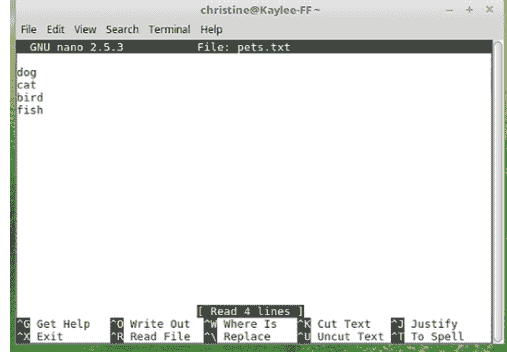

同样的文本编辑器还有：

- `gedit`：GNOME 桌面环境关联了一个名为 `gedit` 的文本编辑器。它是一个非常小的文本编辑器，通常是默认安装的。

- `KWrite` 和 `Kate`：正如 `gedit` 关联 GNOME 一样，`KWrite` 和 `Kate` 是与 K 桌面环境（KDE）关联的编辑器。`KWrite` 比 `gedit` 稍微复杂一些，`Kate` 增加了一些功能，但两者都不像后者——

- `Geany`：该编辑器不绑定到任何特定的桌面，它非常轻量而且相当强大。如果你想用一个编辑器用于多个平台，它可以在 Linux 之外的操作系统（如 Windows）下运行。

对于新的 Linux 用户来说，这些中的任何一个都是很好的 GUI 编辑器；它们都提供了文本文件编辑所需的各种功能。你的选择可能取决于安装了哪种系统。从长期来看，你可能应该尝试各种编辑器，找到你最喜欢的一个。

## 使用 nano 编辑文件

如果你熟悉文本模式文本编辑器，那么学习 `nano` 可能不会遇到什么问题。如果你只使用 GUI 编辑器编辑文本，你将需要学习一些规范。例如，你必须使用键盘而不是鼠标在文档移动。你可以插入、替换和删除文本，就像在 GUI 文本编辑器或文字处理器中一样。

第 10 章 编辑文件

如果你的系统中没有安装 `nano`，你可以使用第 9 章的信息来安装 `nano` 包。你可以从命令行启动 `nano` 文本编辑器。你可以以普通用户身份执行此操作，使用你的默认权限编辑文本。要编辑系统文件，你需要使用超级用户（`root`）权限。第 12 章“理解基础安全”描述了以后如何获取超级用户权限来编辑文件。此示例启动了：当它打开时，你会看到与图 10.1 类似的显示，但由于你没有指定文件名，窗口大部分将是空的。相反，如图 10.2 所示，顶行的中心将显示 Buffer（缓冲区）。你可以开始输入所需的文本。当你保存文件时（如后文“保存你的更改”部分所述），`nano` 会要求输入文件名。`nano` 编辑器在启动时没有提供文件名。

图 10.2

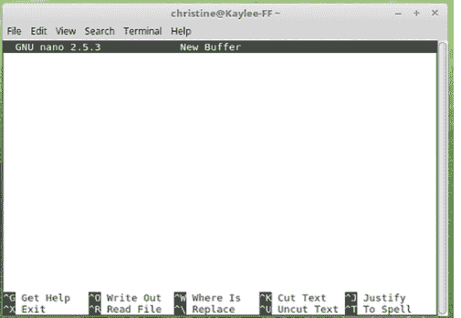

或者，你可以在启动文本编辑器时按如下方式提供文件名：此示例打开并显示 `great_american_novel.txt`。如果文件不存在，`nano` 在屏幕底部显示 New File（新文件），这在图 10.1 中显示 Read lines（读取行）的地方。如果你在第三行看到 Warning: no permission（警告：无权限），说明你加载了一个无权限更改的文件。如果你想保存修改后的文件内容，你需要使用超级用户权限运行 `nano` 或修改文件权限，如第 14 章“所有权和权限”所述。如果你拼错了某个预存在文件的文件名，`nano` 将显示一个空文件。因此，如果你看到空文件而不是你预期的文件，你可能拼错了文件名。

## 使用文本编辑器规范

每个文本编辑器都有其自己的规范，用于移动、显示、搜索等操作。如果你只使用 GUI 编辑器编辑文本，你将需要学习一些规范。例如，你必须使用键盘而不是鼠标在文档移动。你可以插入、替换和删除文本，就像在 GUI 文本编辑器或文字处理器中一样。

- Title Bar（标题栏）：GNOME 桌面环境关联了一个名为 `gedit` 的文本编辑器。它显示当前打开的文件。
- Status Bar（状态栏）：显示当前状态，如行号或文件名。
- Shortcut List（快捷键列表）：显示常用的命令快捷键。

每个文本编辑器都有其自己的规范，用于移动、显示、搜索等操作。如果你只使用 GUI 编辑器编辑文本，你将需要学习一些规范。例如，你必须使用键盘而不是鼠标在文档移动。你可以插入、替换和删除文本，就像在 GUI 文本编辑器或文字处理器中一样。

- Title Bar（标题栏）：显示当前打开的文件。
- Status Bar（状态栏）：显示当前状态，如行号或文件名。
- Shortcut List（快捷键列表）：显示常用的命令快捷键。

每个文本编辑器都有其自己的规范，用于移动、显示、搜索等操作。如果你只使用 GUI 编辑器编辑文本，你将需要学习一些规范。例如，你必须使用键盘而不是鼠标在文档移动。你可以插入、替换和删除文本，就像在 GUI 文本编辑器或文字处理器中一样。

- Title Bar（标题栏）：显示当前打开的文件。
- Status Bar（状态栏）：显示当前状态，如行号或文件名。
- Shortcut List（快捷键列表）：显示常用的命令快捷键。

每个文本编辑器都有其自己的规范，用于移动、显示、搜索等操作。如果你只使用 GUI 编辑器编辑文本，你将需要学习一些规范。例如，你必须使用键盘而不是鼠标在文档移动。你可以插入、替换和删除文本，就像在 GUI 文本编辑器或文字处理器中一样。

- Title Bar（标题栏）：显示当前打开的文件。
- Status Bar（状态栏）：显示当前状态，如行号或文件名。
- Shortcut List（快捷键列表）：显示常用的命令快捷键。

每个文本编辑器都有其自己的规范，用于移动、显示、搜索等操作。如果你只使用 GUI 编辑器编辑文本，你将需要学习一些规范。例如，你必须使用键盘而不是鼠标在文档移动。你可以插入、替换和删除文本，就像在 GUI 文本编辑器或文字处理器中一样。

- Title Bar（标题栏）：显示当前打开的文件。
- Status Bar（状态栏）：显示当前状态，如行号或文件名。
- Shortcut List（快捷键列表）：显示常用的命令快捷键。

每个文本编辑器都有其自己的规范，用于移动、显示、搜索等操作。如果你只使用 GUI 编辑器编辑文本，你将需要学习一些规范。例如，你必须使用键盘而不是鼠标在文档移动。你可以插入、替换和删除文本，就像在 GUI 文本编辑器或文字处理器中一样。

- Title Bar（标题栏）：显示当前打开的文件。
- Status Bar（状态栏）：显示当前状态，如行号或文件名。
- Shortcut List（快捷键列表）：显示常用的命令快捷键。

每个文本编辑器都有其自己的规范，用于移动、显示、搜索等操作。如果你只使用 GUI 编辑器编辑文本，你将需要学习一些规范。例如，你必须使用键盘而不是鼠标在文档移动。你可以插入、替换和删除文本，就像在 GUI 文本编辑器或文字处理器中一样。

- Title Bar（标题栏）：显示当前打开的文件。
- Status Bar（状态栏）：显示当前状态，如行号或文件名。
- Shortcut List（快捷键列表）：显示常用的命令快捷键。

## 探索 nano 过程

为了学习 `nano`，请考虑以下操作。如果你只使用 GUI 编辑器编辑文本，你将需要学习一些规范。例如，你必须使用键盘而不是鼠标在文档移动。你可以插入、替换和删除文本，就像在 GUI 文本编辑器或文字处理器中一样。

### 10.1 示例 pets.txt 文件

dog
cat
bird

为了学习 `nano`，请考虑以下操作。如果你只使用 GUI 编辑器编辑文本，你将需要学习一些规范。例如，你必须使用键盘而不是鼠标在文档移动。你可以插入、替换和删除文本，就像在 GUI 文本编辑器或文字处理器中一样。

为了学习 `nano`，请考虑以下操作。如果你只使用 GUI 编辑器编辑文本，你将需要学习一些规范。例如，你必须使用键盘而不是鼠标在文档移动。你可以插入、替换和删除文本，就像在 GUI 文本编辑器或文字处理器中一样。

为了学习 `nano`，请考虑以下操作。如果你只使用 GUI 编辑器编辑文本，你将需要学习一些规范。例如，你必须使用键盘而不是鼠标在文档移动。你可以插入、替换和删除文本，就像在 GUI 文本编辑器或文字处理器中一样。

为了学习 `nano`，请考虑以下操作。如果你只使用 GUI 编辑器编辑文本，你将需要学习一些规范。例如，你必须使用键盘而不是鼠标在文档移动。你可以插入、替换和删除文本，就像在 GUI 文本编辑器或文字处理器中一样。

为了学习 `nano`，请考虑以下操作。如果你只使用 GUI 编辑器编辑文本，你将需要学习一些规范。例如，你必须使用键盘而不是鼠标在文档移动。你可以插入、替换和删除文本，就像在 GUI 文本编辑器或文字处理器中一样。

为了学习 `nano`，请考虑以下操作。如果你只使用 GUI 编辑器编辑文本，你将需要学习一些规范。例如，你必须使用键盘而不是鼠标在文档移动。你可以插入、替换和删除文本，就像在 GUI 文本编辑器或文字处理器中一样。

### 10.2 示例 pets.txt 及其后的文件

```text


`dog`

`cat`

`bird`

`fish`

`reptile`


# 使用 `nano` 编辑文件

6. 按 `Ctrl+N` 跳到文件的下一行。你的光标应该在鱼形指示线下方。

7. 输入 `rodent` 来添加另一种宠物类型。

> 要保存你用 `nano` 创建的新 `pets.txt` 文件，请阅读接下来的章节，“从 `nano` 中保存更改”。

你可以以类似的方式进行额外的更改。虽然 `nano` 缺乏图形界面（`GUI`）版本，但它的大部分规则与 `GUI` 文本编辑器和文字处理器相同；你只需要知道激活所需功能的按键组合即可。

按下 `Ctrl+G` 会显示帮助文档，它概述了程序的特性。如果你已经熟悉该编辑器，这可能会有点困难。以下是一些你可能想要使用的额外功能：

**移动到文件开头或结尾** 你可以使用方向键、`PageUp`、`PageDown`、`Home` 和 `End` 键，以与其他编辑器常用的方式移动光标。要移动到文件开头，按 `M-A`；要移动到文件末尾，按 `M-L`。（记住 `M` 代表本章“使用文本编辑器约定”中提到的组合键。）

**复制或移动行** 如果你需要复制或移动连续的行，可以重复 `M-6` 或 `Ctrl+K` 操作；`nano` 会保留你复制或剪切的所有行，当你按下 `Ctrl+U` 时，所有行都会被粘贴。

**插入文件** 按下 `Ctrl+R` 或 `F5` 可以在当前光标位置将另一个文件插入到当前文件中。

**搜索字符串** 按下 `Ctrl+W` 或 `F6` 激活搜索功能。激活后，`nano` 会提示你输入搜索词。输入并按回车键，`nano` 将找到文件中该词的下一个实例。当你再次按下 `Ctrl+W` 或 `F6` 时，默认搜索是上一次使用的，因此你可以通过按回车键反复搜索同一个词。或者，`M-W` 可以重复上一次搜索。

**替换字符串** 你可以通过按 `Ctrl+\` 或 `M-R` 将一个字符串替换另一个。程序会提示你输入搜索词和要替换的词。随后开始搜索，`nano` 会要求你确认每次替换。如果你想在不提示的情况下替换所有出现的地方，可以在第一次提示时按下 `A` 键。

## 从 `nano` 保存更改

对文件进行更改后，你可能想保存它们。实现此目的的一种方法是使用 `Ctrl+O`。（那是字母 O，不是数字 0。）当你按下此键时，`nano` 会询问你以下内容：

```
写入文件：
```

通常，提示将包含文件的原始名称，你可以按回车键使用该名称保存文件。如果你想使用不同的名称，可以删除旧名称并输入新名称。如果你启动 `nano` 时没有指定文件名，可以在此处输入一个。

保存文件的另一种方法是按 `Ctrl+X`。此命令会退出 `nano`，但如果你修改了文件，它会产生以下提示：

```
保存修改过的缓冲区 ("否" 将破坏更改) ?
```

在此提示处输入 `y` 保存文件。程序随后会显示你在按下 `Ctrl+O` 时看到的文件名提示，你可以根据需要更改文件名。`nano` 保存文件后将终止。

如果你正在自己的系统上同步操作，创建并编辑本章的 `pets.txt` 文件，以下是保存更改并退出 `nano` 文本编辑器的步骤：

1. 在显示 `pets.txt` 文件的 `nano` 文本编辑器中，按 `Ctrl+O` 开始保存文件。
2. 按回车键保存文件。你应该能在状态栏看到类似“已写入 6 行”。
3. 按 `Ctrl+X` 退出 `nano` 文本编辑器并返回命令行提示符。

为了获得更多经验，尝试用 `nano` 编辑 `pets.txt` 文件并进行各种更改。务必查看帮助功能，使用 `Ctrl+G` 访问帮助并使用 `Ctrl+X` 退出帮助文档。

# 使用 `vi` 编辑文件


`vi` 是 `vi` 的第一个屏文本编辑器。它的设计非常小，足以用于旧式的、微小的基于软卡的启动系统。后来，创建了一个带有若干改进的新版本，被称为“改进版 `vi`”或“`vim`”。即使大多数 Linux 发行版都带有 `vi`，它仍然被称为 `vi` 编辑器。`vi` 与 `vi` 编辑器向上兼容，启动 `vi` 的命令通常是 `vi`——尽管某些发行版使用的是 `vim` 命令。本章介绍的信息适用于 `vi` 和 `vim`。

虽然 `vi` 编辑器用于编辑配置文件，但它编辑程序文件（如 shell 脚本）时表现出色。因此，学习 `vi` 编辑器将让你受益，尽管许多人认为是最复杂的编辑器。

# 理解 `vi` 模式

要使用 `vi`，你应该首先理解它运行的模式。然后你可以开始学习 `vi` 实现的文本编辑过程。在任何时刻，`vi` 都处于三种模式之一：

## 命令模式
命令模式接受命令，通常以单个字母输入。例如，`i` 和 `a` 进入插入模式，但稍后描述的方式略有不同。

## Ex 模式
要使用 `vi`，你应该首先理解它运行的模式。然后你可以开始学习 `vi` 实现的文本编辑过程。在任何时刻，`vi` 都处于三种模式之一：

## 插入模式
命令模式接受命令，通常以单个字母输入。例如，`i` 和 `a` 进入插入模式，但稍后描述的方式略有不同。

屏幕左侧表示文件结束。图 10,3 中的文件是新加载的，因此底一行显示了最后一条命令的状态——这是一个隐式的加载加载命令，它从 `pets.txt` 文件添加了 4 行和 18 个字符。

# 图 10.3 `vi` 显示界面的最后一行是状态行，显示程序的信息。

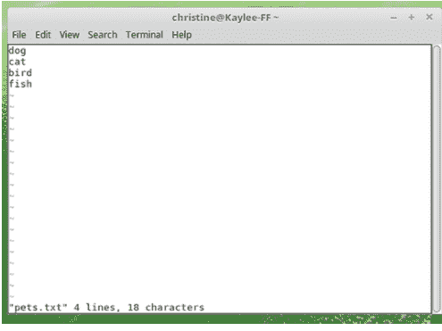

> 注意：在文本编辑器中尝试文字处理器的快捷键可能很有诱惑，例如使用 `Ctrl+S` 保存文件。这不是明智的做法，因为组合键可能会可能会导致你的终端冻结。如果你这样做了，可以按 `Ctrl+Q` 来解除终端冻结。

像 `nano` 一样，你可以使用 `vi` 为 `pets.txt` 添加新条目，或者完整输入新行，或者复制现有行并进行修改。要输入新行，请遵循以下步骤：

1. 使用方向键将光标移动到 `bird`（鸟）所在行的开头。
2. 按 `O` 键（字母 O，不是数字 0）。这会在当前行下方立即打开新行，将光标移动到该行并进入插入模式。
3. 输入新条目：`reptile`（爬行动物）。
4. 按 `Esc` 键从插入模式返回命令模式。

为了练习通过修改条目，请遵循以下步骤：

1. 如必要，使用方向键将光标移动到你刚刚创建的行开头。你应该看到光标停留在 `reptile` 的 `r` 上。
2. 现在你将复制（yank）一行文本。yank 一词的使用频率就像在大多数文本编辑器中使用 copy 一样频繁——你将文本复制到缓冲区中，稍后可以将其粘贴回文件。要 yank 文本，请使用 `yy` 命令，并在前面加上想要复制的行数。因此，输入 `yyy`（但不要按回车键）。看起来似乎什么都没有发生，但此组合键将光标所在的行复制到了缓冲区中。
1. 将光标移动到 `bird` 行，即你希望新行出现的位置的前的一行。
2. 输入 `p`（同样，不要按回车键）。.`vi` 会从光标所在行的下一行开始粘贴缓冲区（`reptile`）的内容。文件现在应该有两个相同的 `reptile` 行。光标应该停留在第一行的开头。
3. 如果光标不在那里，将光标移动到你刚刚粘贴的行中 `reptile` 单词的 `r`。你可以删除此行。
4. `dd` 命令非常好，但它会在删除行的同时也将其复制到缓冲区中。使用 `dd` 删除 `reptile` 行。文件现在应该只有一条 `reptile` 行。
5. 输入 `ZZ` 保存文件并退出。此命令等于 `:wq`。


如果你需要将文件的换行符编码从 Windows 方法更改为 Unix/Linux 方法，请在 `vi` 编辑器中打开文件并输入命令 `set ff=unix`。

还有许多其他额外的命令你可能在某些情况下想要使用。以下是一些亮点：

**更改大小写** 假设你想更改文件中某个单词的大小写。你不需要进入插入模式并重新输入该单词，而是可以使用命令模式下的波浪线 (`-`) 键来更改大小写。将光标置在你想要更改的第一个字符上，反复按 `-` 直到完成。

**撤销** 要撤销任何更改，在命令模式下输入 `u`。

**打开文本** 在命令模式下，输入 `o`（小写字母 O）可以打开文本——即在当前行下方立即插入一个新行并在该行进入插入模式。

**搜索** 要在文件中向前搜索文本，在命令模式下输入 `/`，然后跟上要定位的文本。输入 `?` 则是向后搜索而不是向前搜索。

**更改文本** `c` 命令可以在命令模式下更改文本。你可以像调用 `d` 或 `y` 命令一样调用它，例如用于更改下一个单词，或使用 `cc` 更改整行。

**跳转到行** `G` 键将你带到指定的指定的行号。`H` 键会将光标带到——即将光标移动到屏幕顶端。`L` 键会将光标带到屏幕底部。

**全局替换** 要将一个字符串的所有出现替换为另一个，使用 `%s/original/replacement/g`，其中 `original` 是原始字符串，`replacement` 是它的替换内容。起始行号、逗号和结束行号用于在较小的行范围内执行此更改。如果 `original` 在文件的每行中只出现一次，则不需要命令末尾的 `/g`。

`vi` 提供的深度比这里介绍的得多；该编辑器非常强大，一些 Linux 用户非常迷恋它。关于 `vi` 有整整本书的书。请咨询这些书籍之一或 `vi` 网页（如 `.vim.org`）以获取更多信息。

## 在 `vi` 中保存更改

要在不退出编辑器的情况下保存文件更改，请在命令模式下输入 `:w`。这会运行 `w` 命令。

* **编辑新文件**：`:e` 创建新文件。
* **包含文件**：`:r` 包含内容。
* **执行外部命令**：`:` 执行命令。
* **退出**：`:q` 退出。
* **保存并退出**：`:wq` 保存并退出。
* **保存不退出**：`:w` 保存文件。
* **不保存退出**：`:q!` 不保存退出。

## 复习习题

你可以在附录 A 中找到答案。

1. 对于哪种类型的文件，`nano` 最可能不利于查看或编辑？
A. Unicode 编码的文本文件
B. Shell 脚本文件
C. ASCII 编码的文本文件
D. LibreOffice 文字处理文档
E. Linux 配置文件

2. 哪些键键调用 `nano` 的搜索功能？（选择所有适用项。）
A. `F3`
B. `F6`
C. `Esc-S`
D. `Ctrl+F`
E. `Ctrl+W`

3. 使用 `vi` 时，你如何从文件中删除两行文本？
A. 在命令模式下，将光标置于第一行并输入 `2dd`。
B. 在命令模式下，将光标置于最后一行并输入 `2yy`。
C. 在插入模式下，将光标置于第一行开头，按住 `Shift` 键同时按两次向下箭头，然后按键盘上的 `Delete` 键。
D. 在插入模式下，将光标置于第一行开头并按两次 `Ctrl+K`。
E. 使用鼠标选择文本，然后从菜单中选择 ▷ 删除。

4. 对或错：Unicode 适用于编码大多数欧洲语言，但不适用于亚洲语言。

5. 对或错：ASCII 的 `GUI` 文本编辑器优于文本模式 ASCII 文本编辑器，因为 `GUI` 编辑器支持下划线、斜体和字体。

6. 对或错：如果你从未用过文本编辑器，`nano` 文本编辑器通常是最适合先学习的。

7. ASCII 支持 ______ 个字符（不包括控制字符）：
A. 64
B. 128
C. 512
D. 1024
E. 2048

8. 在 `nano` 中可以启动搜索并替换操作的三个键是 ____
A. `Esc+R`
B. `F6`
C. `F14`
D. `Ctrl+F`
E. `Ctrl+\`

9. 在 `vi` 的命令模式下，你可以输入 ____ 来撤销更改。
A. `~`
B. `:wq`
C. `ZZ`
D. `u`
E. `/`

10. 要在命令模式下保存文件并退出 `vi` 文本编辑器，输入 ____ ____
A. `~`
B. `?`
C. `ZZ`
D. `cw`
E. `/`

## 第 11 章

## **目标：**

### 3.3 将命令转换为脚本


脚本是用解释型语言编写的程序，通常与 shell 或或其他主要目的不是解释型语言的程序相关。

在 Linux 中，许多脚本是 shell 脚本，它们与 `Bash` 或另一个 shell 关联。（如果你熟悉 DOS 或 Windows 中的批处理文件，脚本的作用类似的。）你可以编写 shell 脚本来帮助自动化重复任务或执行更复杂的任务。Linux 的许多启动功能是由脚本完成的，因此掌握脚本编写将帮助你管理启动过程。

本章涵盖了 `Bash` 脚本，任务是创建一个新的脚本文件。它描述了若干项重要的脚本特性，这些特性可以帮助执行逐步复杂的脚本编写。

与任何编程任务一样，shell 脚本可能非常复杂。本章仅触及了通过 shell 脚本可以完成内容的边缘。欲需更多信息，请参考有关该主题的书，例如我们的《Linux命令行与Shell脚本 Bible》，第三版（Wiley, 2015）。


## 开始编写 Shell 脚本

脚本是纯文本文件，因此你可以按照第 10 章“编辑文件”所述，在 `vi`、`nano` 或 `pico` 等文本编辑器中编辑它们。你不应该使用标准的文字处理程序（如 `LibreOffice` `Writer`）来创建脚本，因为它们默认会在最终文档中插入二进制代码以指示字体、字体大小和特殊字符。这些二进制代码会混淆 Linux shell。

脚本以一行识别你要运行的任务开头，其格式如下：

```


`#!/bin/bash`

前两个字符是特殊代码，告诉 Linux 内核这是一个脚本，并使用行的其余部分作为解释该脚本程序的路径。（这一行有时被称为 shebang、hasbang、hasplining 或 pound bang 行。）Shell 脚本语言使用哈希字符（`#`）作为注释字符，因此脚本工具会忽略这一行，但内核不会。在大多数系统上，`/bin/sh` 是指向 `/bin/bash` 的符号链接，但它也可以指向某些其他 shell。指定脚本使用 `/bin/bash` 可以确保任何 Linux 系统都有一个 shell 程序来运行脚本，但如果脚本使用了任何特定于 shell 的特性，你应该指定该 shell——例如，使用 `/bin/bash` 或 `/bin/tcsh` 而不是 `/bin/sh`。

这里描述的是 Bash shell 脚本。简单的 Bash 脚本可以在其他 shell 中运行，但更复杂的脚本更有可能具有 shell 特异。当你编写脚本时，应该让它具有可执行性。你通过 `chmod` 命令实现这一点，该命令在“设置所有权”中会有详细描述。例如，要为用户添加执行权限，执行：

```bash
chmod +x my-script
```

你可以通过路径变化找到该脚本。

- Linux 文件层次结构标准（FHS）为不同类型的文件定义了特定的目录，例如用于可执行程序的 `/usr/bin`。许多 Linux 发行版在其目录层次结构中整合了 FHS。

## 使用命令

Shell 脚本最基本的功能之一是运行命令。你可以使用 shell 内置命令和外部命令。完整的命令列表是不可能的，因为你可以运行任何安装在 Linux 中的程序——甚至是另一个脚本。脚本中常用的命令如下：

**普通文件操作命令** 脚本中文件操作命令有 `ls`、`mv`、`cp` 和 `rm`。你可以使用这些命令帮助自动化文件维护任务。

**find** `find` 命令通过文件名、所有权和相似特征进行搜索。第 8 章涵盖了该命令。

**cut** `cut` 命令从文件中提取字段。它经常被用于从高度模式化的文件中提取信息。使用它时，你传递一个或多个指定你想要信息的选项，然后是一个或多个文件名。例如，用户的家目录出现在 `/etc/passwd` 文件的第六冒号分隔字段中。你可以输入 `cut -f 6 -d ":" /etc/passwd` 来提取这些信息。脚本中的相同命令也会提取这些信息，你可能会将其保存到变量中或传递给后续命令。

启动多个程序在启动和某些情况下可能需要时间，脚本还经常用于运行一系列程序以某种方式处理数据。此类脚本在命令末尾不包含符号，因为一个命令必须在另一个命令之后运行，甚至可能取决于第一个命令的输出。11.1 中的每个程序启动行都以符号（`&`）结尾。这个字符告诉 shell 跳到下一行而无需等待第一个程序完成。如果你省略了 11.1 中的符号，效果将是在第一个脚本关闭之前，第二个脚本不会打开。同样，KMail 在第二个脚本终止之前不会启动。列表 11.1 展示了一个启动程序的简单脚本：

```bash
#!/bin/bash
/usr/bin/xterm &
/usr/bin/xterm &
/usr/bin/kmail &
```

## 使用参数

**sed** `sed` 程序提供了许多传统文本编辑器的功能（如查找和替换操作），但它是通过在命令行提示符输入或在脚本中输入的命令来实现的。

**echo** `echo` 命令是脚本必须向用户提供消息时使用的工具。你可以向 `echo` 传递各种选项，或者只传递一个显示给用户的字符串。例如，`echo "Press the Enter key"` 会导致脚本显示指定的字符串。你还可以使用 `echo` 显示变量的值（稍后将在“使用变量”部分中描述）。

**the mail** `mail` 命令可以从脚本内部发送电子邮件。向它传递 `-s subject` 参数来指定主题行，并提供一个电子邮件地址作为最后一个参数。如果你在命令行上使用它，则输入消息并按 `Ctrl-D` 键结束。如果从脚本中使用它，你可以完全省略脚本，或者使用输入重定向将外部文件作为消息传递。你可能希望使用此命令来替代启动脚本或基于自动化运行的脚本的操作。

# 第 8 节介绍了输入重定向。

这些示例中的许多都是复杂的，完全描述它们超出了本章的范围。你可以查阅这些命令的 man 页来获取信息。正如它们的描述中所提到的，其中一些在本书的其他地方也有描述。

即使你完全掌握了如何使用某些外部命令，仅仅在命令行提示符输入命令时执行命令的用处也是有限的。许多管理任务要求你根据其他命令的信息修改你在命令行上输入的内容，甚至修改你使用的命令。由于原因，脚本语言包含了额外的功能来帮助你让脚本更有用。

## 使用参数

变量可以帮助扩展脚本的实用性。变量是值的占位符，该值将在脚本运行时被确定。变量的值可以作为参数传递给脚本、在脚本内部生成，或从脚本的环境中提取。（环境是任何程序都可以访问的变量集。环境包括当前目录和运行程序的搜索路径等内容。）

传递给脚本的变量通常被称为参数（arguments）。它们在脚本中用美元符号（`$`）后跟一个从 0 到 `$9` 的数字表示。`$0` 代表脚本名称，`$1` 是脚本的第一个参数，`$2` 是第二个参数，依此类推。为了理解这可能有用，请考虑添加用户的任务。正如第 13 节“创建用户和组”所述，为新用户创建账户通常涉及至少两个命令——`useradd` 和 `passwd`。

## 第 11 节 • 创建脚本

你可能还需要运行额外的特定站点的命令，例如创建用户主目录之外的异常用户所有目录的命令。

作为带有参数变量的脚本如何帮助此类情况的示例，请考虑列表 11.2。当你运行脚本时，你必须在命令行上提供用户账户作为参数。脚本使用 `$1` 变量获取该值，并使用 `useradd` 命令根据该值创建账户。然后使用 `passwd` 命令更改账户密码（当你运行脚本时，脚本会提示你输入密码）。它在 `/shared` 目录树中创建一个与账户对应的目录，并从新用户的主目录设置到该目录的符号链接。它还调整了所有权和权限，根据你的系统所有权和权限策略，这可能有用。

# 列表 11.2：一个减少账户创建繁琐程度的脚本

```bash
#!/bin/bash
useradd -m $1
passwd $1
mkdir -p /shared/$1
chown $1:users /shared/$1
chmod 775 /shared/$1
ln -s /shared/$1 /home/$1/shared
chown $1:users /home/$1/shared
```

如果你使用列表 11.2，你只需要输入三个内容：脚本名、目标用户名和密码（两次）。例如，如果脚本名为 `mkuser`，你可以这样使用它：

```bash
# mkuser rblum
Changing password for user rblum
New password:
Retype new password:
passwd: all authentication tokens updated successfully
```

脚本的大多数程序在遇到问题之前都是静默运行的（包括输入密码时不会显示在屏幕上，这只是 `passwd` 命令的结果）。实际上，列表 11.2 的脚本将七行命令替换为一行。这些行中的每一行都使用了用户名，通过运行此脚本，你减少了拼写错误导致问题的概率。

## 使用变量

另一种可以从命令输出设置的变量类型也通过开头的美元符号标识，但通常给出一个以字母开头的名字，例如 `$Addr` 或 `$Name`。（当将值分配给变量时，会省略美元符号，如后所示）。你可以像命令参数一样配合普通命令使用这些变量，但变量的值会被传递给命令。

考虑列表 11.3，它通过 `ping` 工具检查计算机路由器是否在线。此脚本使用了两个变量。第一个是 `$ip`，它是从 `route` 命令的输出中通过 `grep`、`tr` 和 `cut` 命令提取的。当你从命令输出中赋值给变量时，该命令应该包含在反引号（`` ` ``）中，反引号在大多数键盘上与波浪号（`~`）在同一个键上。没有单引号（`'`），单引号在大多数键盘上与双引号在同一个键上。第二个变量 `$ping` 仅指向 `ping` 程序。它可以被轻松使用，通过后续使用 `$ping` 或简单地通过 ping 该变量来找到程序。这样的变量有时用于在将来创建或修改脚本。例如，如果调用 `$ping`，你只需要修改脚本的一行。变量可以与条件语句配合，以确保脚本在更多系统上运行。

# 列表 11.3：演示变量赋值和使用的脚本

```bash
#!/bin/bash
ip=$(route -n | grep default | cut -d " " -f2)
echo "Checking if $ip is up..."
ping -c 5 $ip
```


除了几条命令外，`ip` 行使用反引号（`` ` ``）将该命令的输出分配给变量名。结果应该是消息 `Checking to see if 192.168.1.1 is up...` 连同 `ping` 链的输出，它应该尝试向路由器发送五个数据包。如果路由器在线并配置为响应 `ping`，你会看到五个返回数据包和摘要信息，如下：

```text
Checking to see if 192.168.1.1 is up...

PING 192.168.1.1 (56 bytes of data)

64 bytes from 192.168.1.1: icmp_seq=1 ttl=64 time=0.523 ms

64 bytes from 192.168.1.1: icmp_seq=2 ttl=64 time=0.481 ms

64 bytes from 192.168.1.1: icmp_seq=3 ttl=64 time=0.485 ms

64 bytes from 192.168.1.1: icmp_seq=4 ttl=64 time=0.479 ms

64 bytes from 192.168.1.1: icmp_seq=5 ttl=64 time=0.492 ms

---

5 packets transmitted, 5 received, 0% packet loss, time 4005ms

rtt min/avg/max/mdev = 0.479/0.484/0.523/0.015 ms
```

（注：原文中提到 `ip` 行使用反引号将该命令的输出分配给变量名。结果应该是消息 `Checking to see if 192.168.1.1 is up...` 连同 `ping` 链的输出，它应该尝试向路由器发送五个数据包。如果路由器在线并配置为响应 `ping`，你会看到五个返回数据包和摘要信息，如下：）

如果路由器离线，你会看到类似主机不可达的消息。

列表 11.3 实用性有限且存在 Bug。例如，该脚本仅仅通过输出中是否存在字符串 `default` 来识别路由网关。如果计算机有两个路由器，它将无法正常工作，结果是脚本行为异常。列表 11.3 的目的是演示如何赋值和使用变量，而不是作为一个完美的脚本。

除了使用赋值运算符 (`=`) 设置变量外，你可以使用 `read` 从标准输入读取变量，作为后续访问的输入。这种变量赋值方法对于与用户交互的脚本有用。例如，你可以从命令行提示用户输入用户名。列表 11.2 可以修改为提示用户输入。列表 11.4 显示了结果。使用此脚本时，你输入脚本名而不需要在命令行上输入用户名。脚本会提示用户名，在你输入后，脚本将尝试使用该名称创建账户。

### 列表 11.4：采用用户交互的列表 11.2 修改版本

```bash
#!/bin/bash

echo -n "Enter username: "

read name

useradd -m $name

passwd $name

mkdir -p /shared/$name

chown $name:users /shared/$name

chmod 775 /shared/$name

ln -s /shared/$name /home/$name

chown $name:users /home/$name
```

一种特殊类型的变量是环境变量，它的赋值和访问方式与 shell 变量一样。区别在于设置环境变量的脚本使用 Bash 的 `export` 命令，使变量的值对于从赋值的 shell 或脚本中启动的程序可见。

## 使用条件表达式

你使用的脚本可以访问这些变量。例如，如果你的脚本调用了 X 个程序，它可能会检查有效的 `$DISPLAY` 环境变量是否存在，如果发现该变量未设置，则中止执行。按照惯例，环境变量全部全大写，而非环境变量的脚本变量则全小写或大小写混合。

有一个特殊变量值得注意：该变量保存了最近执行的命令的退出状态（或返回值）。退出状态是一个整数值，你可以通过检查它来判断命令是否正确完成。大多数程序在正常终止时返回值 0，并返回另一个值来指定错误。你可以使用 `echo` 显示此值，或在条件表达式（下文描述）中使用它，让你的脚本执行特殊的错误处理。

查阅程序的帮助页（man page）以了解其返回值的含义。

## 使用条件表达式

脚本语言支持多种类型的条件表达式。这些表达式允许脚本根据某些条件（通常是变量的值）执行多个动作中的一个。一种使用条件表达式常用命令是 `if`，它允许系统根据某个条件是否真来采取两个动作之一。`if` 的条件表达式出现在 `if` 之后的括号中，可以有许多形式。条件表达式使用选项和运算符来定义具体要检查的条件。例如，条件：

```
[ -f file ]
```

使用 `-f` 选项，如果文件存在且是一个普通文件则为真；而条件：
`[ -s file ]` 使用 `-s` 选项，如果文件存在且大小大于 0，则为真。你也可以在条件中使用字符串运算符。例如：
`[ string1 == string2 ]`
使用 `==` 运算符，如果两个字符串值相同，则为真。为了更好地理解条件的用法，请考虑以下代码片段：

```
if [ -s /tmp/tempstuff ]
then
  echo "/tmp/tempstuff found; aborting!"
  exit
fi
```

### 第 11 章 • 创建脚本

此片段会导致脚本在 `/tmp/tempstuff` 文件存在时退出。`then` 关键字标记了一系列行的开始，这些行只有在条件为真时才会执行，而 `fi`（`if` 的反写）标记了 `if` 块的结束。如果脚本创建了然后删除此文件，这种代码可能很有用，因为它的存在表明脚本的上一次运行没有成功或仍在进行中。

条件表达式的另一种形式使用 `test` 关键字而不是在条件周围使用方括号：

```
if test -s /tmp/tempstuff
```

你也可以通过将命令作为条件来测试命令的返回值：

```
if [ command ]; then
  additional-commands
fi
```

在这个示例中，只有当 `command` 成功完成时，才会运行 `additional-commands`。如果 `command` 返回错误代码，`additional-commands` 将不会运行。条件表达式可以通过 `else` 子句进行扩展：

```
if [ conditional-expression ]; then
  commands
else
  other-commands
fi
```

这种形式的代码允许根据程序的不同，执行 `command` 或 `other-command`，但精确地规定了在某些条件下应该发生什么。例如，你可能想根据用户的输入启动两个不同的归档程序之一。

如果可能出现超过两种结果，该怎么办——例如，如果用户可能提供四种可能的输入之一？你可以嵌套多个 `if/then/else` 子句，但这可能会变得很笨拙。一种简洁的方法是使用 `case`：

```
case word in
  pattern1 command(s) ;;
  pattern2 command(s) ;;
esac
```

对于 `case` 语句，`word` 可能是一个变量，每个 `pattern` 都是该变量的一个可能值。模式可以像文件名一样进行扩展，使用通配符和扩展规则（`*` 代表任何字符串，例如）。你可以通过这种方式匹配任意数量的模式。每组命令必须以双分号（`;;`）结束，整个 `case` 语句以字符串 `esac`（`case` 的反写）结束。

使用星号（`*`）、问号（`?`）等的路径扩展有时被称为通配（globbing）。

执行时，bash 执行与匹配 `word` 的第一个模式相关的命令。执行随后跳转到 `esac` 语句之后的行；中间的任何命令都不会执行。如果没有模式匹配 `word`，则 `case` 语句中的任何代码都不会执行。如果你希望有一个默认条件，请使用 `*` 作为最后一个模式，该模式匹配任何单词，因此如果没有其他模式匹配，则将执行它的命令。

## 使用循环

条件表达式有时用于循环。循环是告诉脚本重复执行任务直到某些条件满足（或直到某些条件不再满足）的结构。例如，列表 11.5 显示了一个播放目录下 WAV 音频文件的循环。

`aplay` 命令是一个基础音频播放器。在某些系统上，你可能需要使用 `play` 或其他命令代替 `aplay`。

### 列表 11.5：在目录中每个匹配文件上执行命令的脚本

```bash
#!/bin/bash

for d in `ls *.wav`; do
  aplay $d
done
```


这里使用的循环为 `ls *.wav` 生成的列表中的每个项目执行一次。这些项目（文件名）中的每一个都被分配给变量 `d`，并传递给 `aplay` 命令。

`seq` 命令在创建循环（以及其他方式）中也很有用。该命令生成一个从第一个参数开始到最后一个参数的数字列表。例如，输入 `seq 1 10` 会生成 10 行，每行都有一 1 到 10 之间的数字。你可以在循环中使用 `seq` 命令来遍历一系列数字：

```bash
for x in `seq 1 10`; do
  echo $x
done
```

循环执行 10 次，`x` 的值每次迭代都会递增。如果你只向 `seq` 传递一个参数，它将该数字解释为终点，起始点为 1。如果你向 `seq` 传递三个值，它将它们解释为起始值、增量和结束值。

## 使用函数

另一种类型的循环是 `while` 循环，只要其条件为真就会一直执行。这种循环类型的基本形式为：

```bash
while [ condition ]
do
  commands
done
```

`until` 循环的形式相似，但只要其条件为假，它就会继续执行——即直到条件变为真为止。

函数是脚本的一部分，用于执行特定的子任务，并可以从脚本的其他部分通过名称进行调用。函数通过在函数名后放置括号并将构成构造的行括在在大括号内来定义：

```bash
myfn() {
  commands
}
```

`function` 关键字可选地位于函数名之前。无论何种情况，通过名称调用函数，就像它是普通命令一样。函数在模块化脚本中非常有用。例如，如果你的脚本需要执行若干不同的计算，你可以将每个计算放在函数中，然后顺序调用。列表 11.6 展示了在接受目标和目标文件名的简单脚本中使用函数。列表 11.6：使用函数的脚本

```bash
#!/bin/bash
doit() {
  cp $1 $2
}
function check() {
  if [ -s $2 ]
    then
      echo "Target file exists! Exiting!"
      exit
    fi
}
check $1 $2
doit $1 $2
```

脚本第一次运行时因为 `dest.txt` 不存在而成功。但在第二次运行时，文件存在，因此带有错误消息终止。注意，函数并不是按照它们在脚本中顺序直接运行的。只有在脚本主体中被调用时才会运行。

# 管理员 脚本

## 实际场景

Linux 管理员的工作有时会很枯燥。有很多不同的日志文件需要管理员每天检查，以确保运行正常且没有发生安全漏洞。完成这项任务可能需要长时间。然而，许多 Linux 管理员使用脚本来帮助消除检查日志的枯燥工作。

与其手动查看日志，管理员编写脚本，使用文本处理工具（如 `grep` 和 `cut`）在日志文件中搜索错误和警告，将这些错误和警告复制到单独的文本文件中，并将结果通过电子邮件发送给自己。他们调度脚本每天晚上运行，这样他们在第二天早上上班时就能获得系统问题的总结。这样他们就可以把精力放在解决问题上，而不仅仅是寻找问题！

## 设置脚本的退出值

默认，脚本的退出状态与所调用的脚本相同——即脚本返回 `$?`。你可以通过使用 `exit` 命令控制退出值，或在任何点退出脚本。在不带任何选项的情况下，`exit` 会立即终止脚本，并返回标准的退出值 `$?`。这在错误处理或由于任何原因中止正在进行的操作时非常有用——如果脚本检测到错误或用户选择退出选项，你可以调用 `exit` 退出。

如果你向 `exit` 传递一个 0 到 255 之间的数值，脚本将终止，并将指定的值作为脚本自身的退出值返回。你可以使用此功能向可能调用你脚本的其他脚本发送错误信号。你可能需要包含额外的代码来跟踪异常终止的原因。例如，你可以留出一个变量（`$termcause`）来存储脚本终止的代码。在脚本开始时将其设置为 0，如果脚本检测到会导致终止的问题，则将 `$termcause` 重置为某个非 0 值（你可以使用任何数值代码；这些代码没有特殊含义）。在退出时，务必将 `$termcause` 传递给 `exit`：

```
exit $termcause
```


## 总结 (Summary)

Linux 用户和管理员必须至少对 shell 脚本有基本的了解。事实上，任何配置文件和启动文件实际上都是 shell 脚本，能够读取并可能修改它们将帮助你管理系统。能够创建新脚本是非常重要的，因为通过将多个程序组合在一起以实现你的目标，可以简化繁琐的任务并创建特定于脚本的工具。Linux shell 允许你将标准 shell 命令与一些特殊的编程命令（如条件表达式、循环和函数）相结合，以实现大型规模程序中常见的逻辑功能。

## 考试要点 (Exam Essentials)

### 描述基础 shell 脚本文件的格式
shell 脚本必须是纯文本文件；不能使用文字处理应用程序生成。shell 脚本的第一行应该是 shebang 组合（`#/bin/sh`）。这指示了运行脚本时应使用的 shell。shell 脚本的其余部分是按 shell 执行顺序排列的命令或 shell 语句列表。虽然不是必须，但在 shell 脚本末尾使用 `exit` 语句来控制 shell 的退出状态是常见的，特别是当 shell 因任何类型的错误条件退出时。

### 解释使用变量对编写 shell 脚本有什么帮助
shell 脚本使用变量来存储数据或其他信息，以便稍后脚本中使用。你使用等号 (`=`) 将数据分配给变量。数据可以是任何类型的文本或数值数据，或者通过在命令周围加上反引号将命令输出重定向存储到变量中。在 shell 脚本内部引用变量值时，在变量前加美元符号（`$`）。你可以在 shell 命令和 shell 语句中引用变量。

### 解释如何向 shell 脚本传递数据
shell 脚本可以使用参数（或参数）从命令行向 shell 脚本传递数据。在启动 shell 脚本时，只需在命令行中包含数据参数即可。在 shell 脚本内部，你可以通过位置变量获取任何命令行参数。`$` 位置变量是特殊的；它引用启动 shell 脚本时使用的 shell 命令。位置变量 `$1` 引用命令行上输入的第一个参数，变量 `$2` 引用第二个参数，依此类推。

### 描述你可以在 shell 脚本中使用的编程功能类型
shell 脚本可以使用条件语句来评估数据并根据评估结果做出编程决策。`if` 和 `case` 语句是你可以用于该目的的两种条件语句。`if` 语句可以与 `else` 语句配对，以创建一个真/假情景，当条件为真时执行一组语句；而 `case` 语句允许你指定一个可能的取值范围进行评估，并为每种可能的值执行单独的语句集。除了条件语句外，shell 脚本可以使用循环根据一系列值或一个条件多次迭代一组语句。最后，shell 脚本还支持定义函数，函数是一组封装在一起的语句，可以需要从 shell 脚本的任何地方调用。

## 复习题 (Review Questions)

你可以在附录 A 中找到答案。

- 1. 使用文本编辑器创建 shell 脚本后，在尝试通过输入名称使用脚本之前，你应该采取哪个步骤？
   A. 使用 `chmod` 设置一个或多个可执行位。
   B. 将脚本拷贝到 `/bin` 目录。
   C. 使用 `bash scriptname` 编译，其中 `scriptname` 是脚本名称。
   D. 对脚本运行病毒扫描。
- 2. 描述以下短脚本在作为 `cp1 big.cc` 调用时的效果：
   ```
   #!/bin/bash
   cp $2 $1
   ```
   A. 与 `cp big.cc` 相同。
   B. 将 `big.c` 复制到 `big.cc`。
   C. 将 `big.c` 的内容复制到 `big.cc`。
   D. 将 `big.c` 转换为 `big.cc`。
   E. 脚本无效。
- 3. shell 脚本中条件的目的是？
   A. 防止脚本执行。
   B. 显示有关脚本的信息。
   C. 允许脚本采取不同的操作。
   D. 根据条件启用脚本。
   E. 导致脚本在特定时间运行。
- 4. 错误。shell 中的循环语句包括 `for`、`while` 和 `until`。
- 5. 错误。以下脚本什么都不做：
- 6. 错误。以下脚本启动实例：
   ```
   #!/bin/bash
   terminal
   ```
- 7. 错误。为了确保脚本运行，第一行应该是：
   A. `/bin/sh`
   B. `/usr/sh`
   C. `#/bin/sh`
   D. `bash`
   E. `#bash`
- 8. 错误。帮助管理员使用系统资源的功能：
   A. `case`
   B. `while`
   C. `if`
   D. `echo`
   E. `exit`
- 9. 错误。帮助用户根据以下使用计算机的功能：
   A. `case`
   B. `while`
   C. `if`
   D. `echo`
   E. `exit`
- 10. 错误。跟踪谁在使用系统资源的命令：
   A. `case`
   B. `while`
   C. `if`
   D. `echo`
   E. `exit`

## 理解账户特性

大多数账户特性定义在 `/etc/passwd` 文件中，该文件由冒号分隔的行组成，每行（或记录）定义一个单一账户。一个条目可能如下：

```
rich:1001:1001:Richard Blum:home/rich:/bin/bash
```

此记录字段中包含的信息包括以下内容：

**用户名** 账户的用户名是最相关的特征。大多数 Linux 账户的用户名由小写字母组成，偶尔也可能像 `rich` 或 `thx1138` 那样。在某些发行版的用户名中，下划线（`_`）和连字符（`-`）也是有效字符。

**密码** 用户账户通常受密码保护，登录计算机时需要密码。大多数系统账户的直接登录都是被禁用的，它们没有密码。（在某些发行版中，`root` 账户是一个重要的例外；它可能有密码。）`/etc/passwd` 文件中的密码字段通常包含一个 `x`，这是一个代码，表示密码存储在 `/etc/shadow` 中（稍后会描述）。

**UID** 实际上，用户名只是计算机显示用来数值化管理人类的标签。计算机使用用户标识（UID）来跟踪账户，UID 数字从 0 开始（代表 `root` 账户）。在许多发行版中，用户账户的 UID 从 1000 及以上，较小的数字留给系统账户。

> 某些发行版的用户账户从 500 开始编号，而不是其他数字。

**GID** 账户绑定到一个或多个组，这些组在许多方面与账户相似；然而，组是账户的集合。组的主要目的之一是允许用户让其他用户访问其文件，同时防止不在指定组中的用户访问这些文件。每个账户都通过组 ID（上例中的 100）直接绑定到一个主组。通过将账户包含在组定义中，账户可以像第 13 章“创建用户和组”那样绑定到多个组。

文件所有权和权限在第 14 章“设置所有权和权限”中描述。

**注释字段** 注释字段通常持有用户的全名（本例中的 Richard Blum），尽管该字段可以包含除用户名之外或之外的其他信息。

**主目录** 用户账户以及某些系统账户拥有主目录（本例中的 `/home/rich`）。主目录是账户的“大本营”。通常，账户主目录的所有权属于该账户。某些工具和程序使用户能够轻松访问其主目录；例如，波浪号（`~`）在文件名开头指代用户的主目录。

**默认 Shell** 每个账户都关联有一个默认 shell。在 Linux 中，此 shell 仅仅是 `Bash` (`/bin/bash`)，但个人用户可以根据喜愿更改它。非 `root` 系统将默认 shell 设置为 `/usr/sbin/nologin`（或 `/sbin/nologin`）作为额外的安全措施——此程序会显示一条说明该账户不可用的消息。`/bin/false` 的工作方式类似，但不带解释性消息。

你可能会猜想 `/etc/passwd` 持有密码信息。现在不是这样了，尽管很多年前是。出于历史原因，`/etc/passwd` 必须对所有用户可读，因此将密码存储在那里（即使经过加盐和哈希处理）也是危险的。


> 密码使用加盐哈希存储，这是一种带有额外随机输入（盐）的单向数学过程，产生对人类看来是无意义的内容。当用户输入密码时，会对其进行加盐和哈希，如果加盐后的哈希值匹配，则允许访问。

密码存储在另一个文件 `/etc/shadow` 中，普通用户无法读取。该文件将加盐哈希的密码以及其他信息与账户关联。这可以在一段时间后禁用账户，或者如果用户在规定时间内未更改密码时禁用账户。一个典型的 `/etc/shadow` 条目如下：

```
$6$/moFeT5UntQ3kZuuoA4f4l2pUoIc[...]:18114:5:30:14:-1
```


该文件中每个冒号分隔的字段的含义如下：

* **用户名** 每一行都以用户名开头。注意 `/etc/shadow` 中不使用 `UID`；用户名将此文件中的条目与 `/etc/passwd` 链接起来。
* **密码** 密码以加盐哈希的形式存储，因此与实际密码没有明显的相似之处。星号（`*`）或感叹号（`!`）表示没有密码的账户（即该账户不接受登录——它被锁定）。这对于系统本身使用的账户很常见。
* **最后更改密码日期** 日期（本例中的 `18214`）是上次更改密码的日期。该日期以自 `1970` 年 `1` 月 `1` 日以来的天数形式存储。

Epoch 时间（也称为 POSIX 时间）是自 `1970` 年 `1` 月 `1` 日以来的秒数，`/etc/shadow` 文件以天表示。它与 Unix 和 Linux 系统有很久的历史。你不需要掏出计算器来确定某个字段的日期。Epoch 时间在 `2038` 年可能会在 `32` 位系统上产生问题。`/etc/shadow` 文件以天表示。


## 理解账户

* **更改天数** 此字段（本例中的 `5`）是允许更改密码的天数。
* **强制更改的天数** 此字段（本例中的 `30`）是必须更改密码的天数。
* **过期前的警告天数** 如果你的系统配置了密码过期，你可以设置在过期日期临近时发出警告。`7` 是一个典型值。
* **过期到禁用的天数** 这允许账户过期到完全禁用之间留出间隔。过期的账户要么无法使用，要么用户可以在登录后立即更改密码。在任何情况下，其密码保持完好。禁用的账户被删除，除非系统管理员重新激活否则无法使用。此字段中的 `-1` 表示该功能已禁用。
* **过期日期** 此字段显示账户过期的日期。与最后更改密码日期一样，该日期以自 `1970` 年 `1` 月 `1` 日以来的天数表示。此字段中的 `-1` 表示该功能已禁用。
* **特殊标记** 此字段预留备用，通常不使用或包含无意义的值。在上例中此字段为空。

对于计数相关的字段，值为 `-1` 或 `9999` 或无值（空白）表示相关功能已禁用。

## 第12 章 • 理解基础安全

账户的操作可能不仅仅是维护一两个文件。因此，存在各种实用程序来创建、管理和删除账户，这在本章的其余部分和第 `13` 章中会有描述。

存储在用户目录之外的用户文件示例可能包括 `/var/spool/mail` 中的邮件和 `/tmp` 中的临时文件。

> 注意

## 识别账户

识别账户的一种方法是使用 GUI 账户管理工具。此类工具在不同的发行版之间有所不同。一个例子是 Linux Mint 系统上的“用户和组”账户工具。你可以点击主窗口中的“菜单”，并在搜索框中输入 `user` 来进入该工具，如图 `12.1` 所示。

图 `12.1` 在 Linux Mint 上查找“用户和组”账户工具

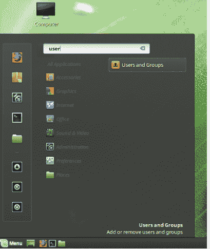

访问此选项会产生与图 `12.2` 所示类似的窗口，但前提是你拥有超级用户权限并提供了正确的密码。该工具仅显示用户账户，不显示系统账户。它允许通过点击项目来更改某些功能（例如用户密码），但其作为账户管理工具的实用性有限。

## 理解账户

在 GUI 环境中，密码通常显示为点或星号，作为一种安全特性。

# 图 12.2 “用户和组”账户工具提供了基本的账户信息。

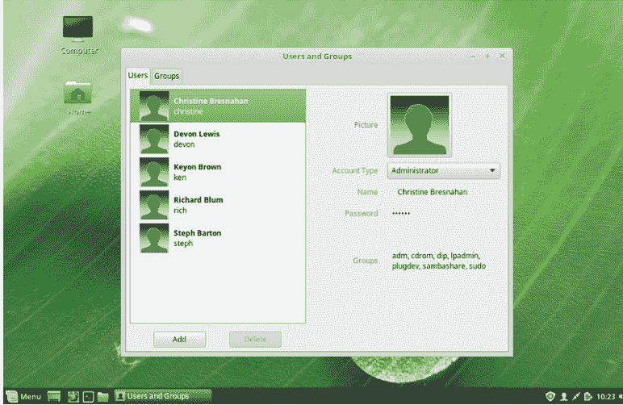

你可以通过 `cat` 查看 `/etc/passwd` 文件的内容来识别计算机的所有账户。这将显示所有账户，包括系统账户和用户账户。

或者，如果你正在查找特定账户的信息，可以使用 `grep` 在 `/etc/passwd` 中查找，例如 `grep rich /etc/passwd` 以查找与用户名 `rich` 的用户相关的任何账户信息。（此特定示例假设字符串 `rich` 出现在 `passwd` 文件中，即 `rich`。）

你也可以使用 `getent` 命令提取单独的记录。只需在命令末尾添加用户名——例如，`getent passwd rich`。

另一种类似于查阅 `/etc/passwd` 的方法是输入 `getent passwd`。`getent` 命令从管理数据库中检索条，包括 `/etc/passwd` 文件。在大多数情况下，输入 `getent passwd` 产生的结果与输入 `cat /etc/passwd` 的结果相同；然而，有时两者并不相同。`/etc/passwd` 文件只定义本地用户账户。可以配置 Linux 使用网络账户数据库来定义部分或全部账户。如果你使用此类配置，输入 `getent passwd` 将同时返回本地账户和定义在网络服务器上的账户。

## 现实世界场景

## 网络账户数据库

许多网络采用网络账户数据库。此类系统可能包括轻量级目录访问协议 (LDAP)、Kerberos 域和 Active Directory (AD) 域。所有这些系统都将账户数据库管理转移到单个中央计算机（通常带有一个或多个备份系统）或分布在指定的系统中。优点是，用户和管理员不需要处理在几十个（甚至成百或数千）台不同的计算机上维护账户。单一账户数据库可以处理日常账户，并简化用户的生活。使用此类系统意味着大多数用户账户不会出现在 `/etc/passwd` 和 `/shadow` 中，组可能不会出现在 `/etc/group` 中（稍后在“理解组”中描述）。尽管如此，这些文件仍将保留本地系统账户和组的信息。

Linux 可以参与这些系统。事实上，某些发行版提供了在操作系统安装时启用支持的选项。通常，你必须知道托管网络账户数据库的服务器名称或 `IP` 地址，并且必须知道系统使用的协议。你可能还需要密码或某些特定协议的信息，并且服务器可能配置为接受来自你正在配置的 Linux 系统的访问。

在安装 Linux 后激活使用网络账户数据库是一个复杂的话，本书未涵盖。此类系统通常会改变 `passwd` 和 `usermod`（在第 `13` 章描述）等工具的行为，方式微妙或不微妙。如果你需要使用此类系统，将必须咨询打算使用的服务的特定文档。

## 理解组

如前所述，组是定义在 `/etc/group` 文件中的账户集合。与 `/etc/passwd` 一样，`/etc/group` 文件包含冒号分隔的行（记录），每行定义一个组。示例看起来所示：

```
users:x:100:games,christine
```

## 使用账户工具

`/etc/group` 中的字段如下：

**组名** 第一个字段，在上例中的 `users`，是组的名称。你在大多数访问或操作组数据的命令中使用它。

**密码** 组和用户一样，可以有密码。值 `x` 表示密码在其他处定义（但可能被禁用），空密码字段则意味着该组没有密码。


> 组密码的使用和管理是一个超出本书范围的话题。然而，组密码通常是...

**GID** 组 ID 是组的数字标识符。

**用户列表** 最后一个字段是该组组成员的逗号分隔列表。

## 发现你的身份

如果你维护多个账户，且不记得使用哪一个登录的，你可能会对自己的状态感到困惑。在这种情况下 `whoami` 命令可以大派用场。使用你的当前用户 ID：

```
$ whoami
```

`christine`

此示例显示了当前账户是 `christine`。如果你需要更多信息，可以使用 `id` 工具：

```
$ id

uid=1002(christine) gid=100(users) groups=100(users)
```

此示例显示了关于用户和组的信息：

* 你的用户 ID 和用户名：此示例中的 `uid=1002(christine)`
* 你的当前组：此示例中的 `gid=100(users)`
* 所有组关系：此示例中 `groups=` 之后的项

## 学习在线用户

Linux 允许多个用户同时访问计算机。通常情况下，这是通过远程访问服务器（例如安全 Shell SSH）实现的；然而，你也可以使用 Linux 的虚拟终端（VT）功能，通过同一个键盘和显示器登录多次。有时，你可能想知道谁在使用这些计算机。例如，你可能会在关机之前这样做，以确保不会给他人带来不便。要学习查看在线用户，你可以使用以下命令：

```bash
$ who

christine tty7 2019-08-06 10:14 (::)

steph tty2 2019-08-06 10:57

rich pts/0 2019-08-06 10:56 (192.168.0.102)

devon tty3 2019-08-06 10:57

ken tty4 2019-08-06 10:57
```


此示例显示了五次登录：`christine`、`steph`、`rich`、`devon` 和 `ken`。默认输出提供的信息包括：

- **用户名 (Username)**：`who` 输出的第一列显示你的用户名。
- **终端标识符 (Terminal Identifier)**：`who` 输出的第二列显示与终端相关的代码。在此示例中，`christine` 的首次登录显示为 `tty7`，这是一个本地 GUI 登录，但某些发行版使用 `as` 作为 GUI 标识符。其余登录的终端标识符均为 `pts/#` 或 `tty#`，表示文本会话。文本会话可以在 GUI、文本模式控制台登录或通过 SSH 或其他协议远程登录启动。
- **登录日期和时间**：`who` 显示每次登录的日期和时间。你可以看到 `christine` 的会话在她登录之前就已经开始了：
- **远程主机 (Remote Host)**：`who` 输出的最后一列（如果存在）显示登录来源。控制台登录（包括文本模式和基于 GUI 的登录）不包含来源。形如 `#.#` 或 `:#` 的来源通常表示在 GUI 中打开，例如 `christine` 的来源：`)`。在 `rich` 的会话中，主机名或 IP 地址表示来自指定的计算机。

默认情况下，该命令从 `/var/run/utmp` 文件中提取数据。

你可以通过为 `who` 添加选项获取附加信息，其中大部分信息是晦涩或专业的。比其他选项更有用的可能是 `--count (-q)`，它会产生更紧凑的数据摘要：

```bash
$ who -q

christine steph rich devon
## users=5
$
```

# 第 12 章 • 理解基础安全

此输出仅包含用户名和一行指定会话总数的行。请注意，用户计数会将具有多次登录的用户计入多次。

> 注意
> 不同的发行版对 `who` 命令的细微细节有所不同。然而，主要元素是相同的。

与 `whoami` 命令类似但显示更多信息，通过向 `who` 命令传递 `am` 参数可以仅显示你当前用户 ID 的信息：

```bash
$ who am i

rich pts/0 2019-08-06 10:56 (192.168.0.102)
$
```

> 注意
> 当前用户账户为 `rich`，在某些发行版中，它会忽略 `am` 参数并返回空内容。如果你的系统接受这些参数，为了幽默起见，可以使用 `likes` 代替 `am`。

在此示例中，当前用户账户是 `rich`，他已登录到 `pts/0` 终端会话。有关其他选项和参数的信息，请参阅其手册页（man page）。

`w` 的替代方案，它与 `who` 类似但输出更详详细：

```bash
$ w

11:17:26 1:10, 5 users, load average: 0.00, 0.03, 0.04

USER TTY FROM LOGIN0 IDLE JCPU PCPU

christin tty7 : 10:14 1:09m 17.12s 0.64s cinnamon[...]
steph tty2 10:57 4:30 0.21s 0.16s -bash
rich pts/0 192.168.0.102 10:56 1.00s 0.21s -bash
devon tty3 10:57 20:05 0.21s 0.15s -bash
ken tty4 10:57 19:58 0.23s 0.16s -bash
$
```

如你所示，`w` 显示了与 `who` 大部分相同信息，包括标识符（TTY）和登录时间（格式不同）。此外，`w` 还显示了进一步的信息：

- 会话空闲时间 (idle) 告诉你用户上次与此会话交互以来多久了。此信息可以帮助你识别用户可能遗弃的会话。
- `JCPU` 列标识与会话相关的 CPU 时间总量。如果计算机因为失控的进程而变得缓慢，这可能是非常有用的调试信息。
- `PCPU` 列标识与会话中运行的当前进程相关的 CPU 时间总量。同样，此信息可以帮助你追踪失控的进程。
- `WHAT` 列告诉你正在运行什么。

## 以 root 身份工作

当你需要执行需要 root 权限的命令行任务时，可以通过以下三种方式之一进行操作：

- **以 root 身份登录**：你可以在文本 shell 中登录 root，或者使用如 SSH 类的远程登录工具。在某些发行版中，你甚至可以以 root 身份登录 GUI 模式。某些发行版不允许 root 直接登录。
- **使用 su**：`su` 命令允许你在 shell 中更改身份。输入 `su username` 将你的身份更改为指定用户名的身份。如果你省略了 `root`，则假设 `su` 成功让你变成了 root。

  你必须知道目标账户（root 或其他）的密码才能使此命令生效。在获取 root 权限后，你可以用这种方式运行你喜欢的任何 root 命令。完成后，输入 `exit` 放弃用户状态。

  你也可以使用 `su` 以 root 身份运行单个命令。使用 `-c` 选项，例如 `su -c command` 来以 root 身份运行命令。

  如果你在命令中使用折号（—），例如 `su -` 或 `su - Luke`，程序将打开一个运行目标用户登录脚本的会话。这很重要，因为脚本通常会设置 `$PATH` 等环境变量。
- **使用 sudo**：`sudo` 命令与 `su` 类似，但它一次处理一个命令，你输入 `sudo` 类似于使用 `su -c`。例如，`sudo cat /etc/shadow` 允许你查看 `/etc/shadow` 文件的内容，普通用户无法读取。在使用此程序时，根据 sudo 配置，你今天必须输入自己的密码或 root 密码。（在使用 `sudo -c` 时，你必须输入 root 密码）。你输入的下一个命令将使用你的普通权限执行。某些发行版（如 `Ubuntu` 和 `Fedora`）高度依赖 `sudo`，并且默认不允许直接登录 root。

## 现实场景

如果你的 Linux 系统位于工作场所，确定公司关于获取 root 权限的策略至关重要。直接登录到 root 账户或使用命令获取 root 权限会建立一种所谓的“可信赖环境”（reputation environment）。在这种环境中，一个人可以否认任何操作；在这种情况下，此人可以否认他们以 root 身份登录。这种环境可能允许 root 用户执行非法或麻烦的活动，然后在法律上否认对这些活动负责。这是一个潜在的危险情况。

许多公司都有（或应该）一项政策，坚持任何需要获取 root 权限的人都使用 `sudo` 命令。`sudo` 命令会跟踪并记录用户的活动，因此建立了所谓的“不可否认性环境”（nonrepudiation environment），在这种环境下，操作无法在法律上被否认。

> 现代传统不允许你登录 root 账户。然而，如果你可以通过直接以 root 身份登录或使用 `sudo -` 获取 root 权限，你的提示符将会发生变化：

```bash
[rey@jakku]$ su -
Password:
[root@jakku]#
```

始终使用 `su -` 而不仅仅是使用 `sudo` 命令是一个好主意。横杠 (`--`) 会正确设置用户账户环境。如果你不使用横杠，可能会遇到命令问题。

在这个示例中，用户名已从 `rey` 变为 `root`，且提示符的最后一个字符从美元符号 ($) 变为井号 (#)。因为在本书中单独行打印的大多数示例中，只使用了提示符字符，因此这些示例会显式地指定某个命令是否需要使用 root 权限使用。例如，考虑之前提到的访问 `/etc/shadow` 文件：

```bash
# cat /etc/shadow
```


# 使用井号（`#`）表示你必须使用 root 权限输入此命令

在 `Linux Mint` 和 `Fedora Workstation` 中，你必须在命令前加上 `sudo`（如 `sudo cat /etc/shadow`），或者输入 `sudo su` 以获取一个更持久的 root shell 会话。

- 问问自己是否真的需要 root 访问。有时，可以在不使用超级用户权限的情况下目标，或者以比你最初计划更受限的方式使用这些权限。例如，你可能会发现只有 root 可以写到移动磁盘。此类问题通常可以通过某种方式调整磁盘的权限来克服，从而限制 root 的使用。
- 在以 root 身份输入任何命令后（或点击以 root 身份运行的 GUI 程序中的任何确认按钮）之前，手离开键盘和鼠标，仔细检查命令，并验证它在各个方面都是正确的。一个简单的拼写错误就会导致巨大的痛苦。

永远不要以 root 身份运行程序。在多用户系统中，不法的用户可能会试图欺骗管理员运行会执行有害操作或赋予攻击者 root 权限的程序。原则上，从随机互联网网站下载的程序都会损害你的安全，当你以 root 身份运行时，此类程序会危险得多。

如果程序要求你输入密码或 root 密码，且它不是你信任的管理员级程序，请保持怀疑！在提供密码之前，先研究该程序！

- 尽可能短地使用权限。如果你需要以 root 身份输入一两个命令，请执行，然后在 shell 中输入 `exit` 注销或回到你的普通权限。更好的方法是使用 `sudo` 运行命令。人们很容易忽略自己正在使用 root shell 的事实，因此输入不需要权限的 root 命令。每一个以 root 身份输入的命令都是一种风险。
- 永远不要让其他人可以访问到 root shell。如果你正在执行 root 维护任务并被叫走，在离开电脑之前，请在 root shell 中输入 `exit`。
- 小心 root 密码。不要与他人共享密码，并在公共区域或他人可能从你背后观察时输入密码要小心。如果你专业地使用 Linux，你的雇主可能拥有关于谁可以拥有计算机 root 权限的指南。学习这些规则并遵守它们！务必选择一个强力的 root 密码。

## 第 13 章描述了如何选择强密码

遵循这些准则可以帮助你避免损坏计算机或赋予他人计算机 root 权限。

## 练习 12.1

- 输入 `whoami` 后面接 `id` 以检查你的普通用户账户状态。`id` 可能会显示你是各种用户组的成员。执行网络搜索以学习每个组的作用。
- 读取 `/etc/passwd` 文件或使用 `getent passwd` 来查看计算机上定义了哪些账户。除了你自己，还有其他普通用户账户（取决于你的发行版，UID 在 500 或 1000 以上）吗？尝试进行网络搜索以了解几个系统账户（取决于你的发行版，UID 在 500 或 1000 以下）的目的。

## 总结

账户对于 Linux 的正常运行至关重要。通常，你在 Linux 计算机上执行的大多数任务都需要标准用户的权限，你会使用自己的账户来处理这些任务。你可以使用 `whoami`、`id`、`who` 等工具来识别你的账户并确定还有谁可能在使用计算机。有时，你需要执行需要 root 账户权限的管理任务，这些权限可以读写任何普通文件、以底层访问硬件、重新配置网络并执行普通用户不被允许的任务。由于 root 如此强大，你应该谨慎地使用这种力量，并在使用时极度小心，以免拼写错误或其他意外导致严重问题。

## 考试要点

解释各种 Linux 账户之间的区别。用户账户通常分为三类：root 用户、系统账户和普通账户。root 账户的 UID 为 0，在现代 Linux 发行版中通常被禁用，以便没有人能直接登录它。这是因为 root 可以读写计算机上的每一个文件，使其成为一个相当危险的用户。此外，如果多个人共用 root 账户，就会建立一个不安全的管理环境。

系统为用户提供每个账户以执行生产性工作。他们通常拥有普通权限，但执行特殊管理系统职责的人可以通过 `sudo` 等命令获得超级用户权限。这些账户的 UID 根据发行版配置从 500 或 1000 开始。

系统账户帮助保持计算机运行。你无法登录这些账户，因为它们锁定了密码，并且它们的默认 shell 通常被设置为 `/sbin/nologin`。系统账户的 UID 是小于用户账户配置基准数的数字。

描述涉及 Linux 账户配置的文件。`/etc/passwd` 文件为系统上的每个账户都有一条记录。这些记录由以下字段组成：用户名-密码、UID、GID、注释、主目录和默认 shell。

`/etc/shadow` 文件包含以下字段：用户名、加盐并哈希后的密码（如果为账户设置了密码）、Epoch 格式的最后密码更改日期、允许修改密码的天数、需要更改密码的天数、密码过期前的警告天数、账户过期到停用之间的天数、账户过期日期以及一个特殊标记。

`/etc/group` 文件为系统中定义的每个组都有一条记录。这些记录由以下字段组成：组名、组密码、GID 以及组的用户列表。

比较显示系统内登录用户的工具。`whoami` 命令将显示当前使用的账户名。要获取更多信息，可以使用 `id` 命令。要了解你之外还有谁在线，`who` 工具有效，`w` 命令提供了更多信息。

总结获取超级用户访问的方法。你可以在允许此类访问的发行版上直接登录 root 账户以获取超级用户访问，但由于安全问题，这通常是不受欢迎的。`su` 命令只要你有密码就可以到另一个账户；这包括允许此类使用的 root 账户。`sudo` 命令是获取超级用户权限的首选。在需要权限的命令前输入 `sudo` 并按回车。如果最近没有使用，它会要求输入密码。

## 复习题

你可以在附录 A 中找到答案。

- 1. UID 为 0 的系统账户目的是什么？
    - A. 它是系统管理账户。
    - B. 它是第一个普通用户的账户。
    - C. 无；UID 0 是被故意留空未定义的。
    - D. 它因发行版的不同而异。
    - E. 它是某些服务器默认使用的低权限账户。

- 2. 你在 `/etc/passwd` 中会找到关于普通用户账户的哪些信息？（选择所有适用项）
    - A. 用户 ID (UID) 数字
    - B. 用户所属每个用户组的完整列表
    - C. 账户主目录的路径
    - D. 账户默认 GUI 桌面环境的路径
    - E. 账户默认文本模式 shell 的路径

- 3. 你想以 root 身份运行 `/etc/shadow` 命令，但你是以普通用户身份登录的。假设系统已配置通过适当的命令赋予你超级用户权限，以下哪个命令可以完成任务？
    - A. `sudo cat /etc/shadow`
    - B. `root cat /etc/shadow`
    - C. `passwd cat /etc/shadow`
    - D. `su cat /etc/shadow`
    - E. `admin cat /etc/shadow`

- 4. 对或错：`whoami` 提供的信息比 `id` 更多。

- 5. 对或错：Linux 在 `/etc/groups` 文件中存储关于组的信息。

- 6. 对或错：作为一般原则，以 root 身份运行程序时应该格外小心。

- 7. Linux 中将用户名与 UID 数字关联的文件是 `________`
    - A. `/etc/shadow`
    - B. `/etc/group`
    - C. `/etc/uid`
    - D. `/etc/passwd`
    - E. `/etc/users`

- 8. 要了解当前谁登录了计算机以及他们正在运行哪些程序，你可以输入 `_____`
    - A. `who`
    - B. `w`
    - C. `whoami`
    - D. `who -q`
    - E. `id`

- 9. UID 0 以上且低于 500 或 1,000（取决于发行版）的 UID 预留给 `______` 账户使用。
    - A. 管理员
    - B. 标准
    - C. 无特权
    - D. root
    - E. 系统

- 10. `______` 环境意味着个人无法否认其行为，`sudo` 命令有助于建立这种环境。
    - A. 安全
    - B. 标准
    - C. 不否认性
    - D. 否认性
    - E. 锁定

# 第 13 章 创建用户和组

**目标：**

- 5.2 创建用户和组


Linux 是一个多用户操作系统，这意味着一台 Linux 计算机可以支持许多用户，每个用户都有一个唯一的账户。这种能力意味着需要管理用户账户，本章将介绍你将用于执行此操作程序。

本章从如何创建账户的信息开始。创建账户后，你还需要知道如何修改这些账户，并在必要时删除它们。最后，组在许多方面与账户相似，因此你将学习如何创建组。

## 创建新账户

在许多环境中，添加账户的任务是非常常见的。大型企业聘用新员工，大学招收新学生，慈善机构获得新的志愿者。因此，你必须学会如何创建新账户。首先，本节将探讨有关决定如何使用组以及选择良好密码的重要问题。然后你将学习如何使用 GUI 和文本模式工具创建账户。

### 决定组策略

如第 12 章“理解基础安全”所述，Linux 组是用户的集合。你可以使用组来控制谁可以访问特定文件。正如第 14 章“设置所有权和权限”将描述的，个人可以更改自己文件的组所属关系和权限。因此，你使用组的方式可能会影响计算机的整体策略。有两种方法：

**用户组** 每个用户都有一个账户组；例如，用户 `Luke` 有一个名为 `Luke` 的组。该用户随后可以将文件的组所有者设置为 `/Luke` 或将组权限设置为所需的范围，而系统管理员可以将用户添加到 `Luke` 组。`Luke` 组的成员可以使用用户 `Luke` 指定的权限访问该组中的文件。

**项目组** 在这种方法中，你根据工作项目、部门隶关系或其他现实世界的分类创建组。例如，你可能有一个名为 `sales` 的组用于销售部门。该组中想要与其他组成员共享文件的成员将适当地分配组所有权和权限，并将文件存储在约定的位置。这种方法在计算机由许多在易定义组中协作的人使用时效果最好。

### 创建新账户

这两种方法并不是互斥的；你可以混合使用或创建你自己的方法。你还应该意识到用户可以是多个组的成员。事实上，为了让用户组方法生效，这是必须的——否则，组将无法


默认情况下，某些发行版使用用户组，另一些使用项目组策略。

### 选择良好的密码

当你创建账户时，选择一个你容易记忆但他人难以猜到的密码是很重要的。一个常见的错误是使用容易获取的信息。


- 用户账户可能被用作攻破整台计算机的第一步，或作为攻击其他计算机的起点。
- 用户**绝不应**向他人泄露密码，即使是那些声称是系统管理员的人。这是一种常见的骗局，因为真正的系统管理员用户的密码。
- 不应在多个系统上使用同一个密码，因为这样做会将其中某一台计算机上被攻破的账户迅速变成所有计算机上被攻破的账户。
- 将密码写下来或通过电子邮件发送都是高风险做法。将密码写在贴在电脑显示器上的便利贴上尤为愚蠢。

告诉你的用户这些事情将帮助他们理解你所关心的原因，并且很可能促使至少一部分用户选择良好的密码。

### 不要使用这些密码！

如果你在网络上搜索**常用密码**或类似的短语，你会发现一些网站提供了调查结果，显示了安全研究人员发现的最典型、最容易被猜到的密码。详细信息在不同调查之间有所差异，但通常常用密码包括以下内容：

- `123456`
- `password`
- `12345678`
- `qwerty`
- `111111`
- `sunshine`
- `iloveyou`
- `princess`
- `football`
- `password1`

此类密码很容易被暴力破解密码的程序发现，并包含在互联网上分发的密码合集中。使用此类密码几乎比不使用密码好不了多少。为自己帮个忙吧，创建一个更好的密码吧！

### 使用 GUI 工具创建账户

现在你已经对想要使用的组策略类型以及如何创建良好的密码有了些概念性认识，你可以开始创建账户了。某些发行版允许你通过 GUI 工具至少部分地完成此任务。此类工具在不同发行版之间有所不同。重要的区别包括你如何访问这些工具以及它们的名称。使用桌面的搜索实用，你可以输入 `user` 来找到适当的账户创建功能。在其他发行版中，你需要通过桌面菜单找到正确的工具。该实用工具的名称可能类似于 `Users`（用户）、`User Accounts`（用户账户）或 `User and Groups Administration`（用户和组管理）。

在 `Linux Mint` 上启动 `Users and Groups Administration` 实用程序时会出现一个对话框，提示你在继续之前输入你的账户。如果你拥有超级用户权限，你将看到图 13.1 所示的实用程序界面。

这是一个 GUI 账户管理工具的示例，图 13.1 显示了 `Linux Mint` 的 `User and Groups Administration` 实用程序。使用此实用程序你可以比添加账户多得多。然而，这里的重点是创建账户。

**图 13.1** `Linux Mint User and Groups Administration` 实用程序提供了许多配置和管理账户的选项。

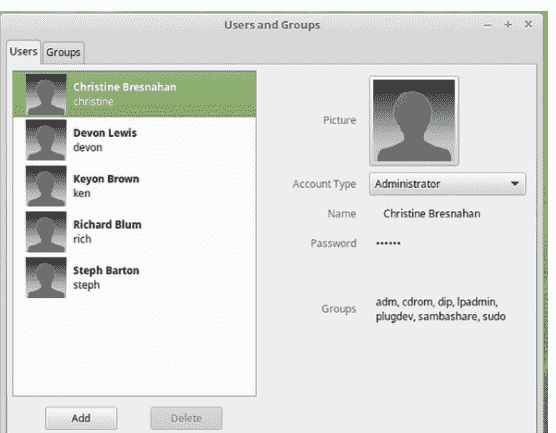

要使用 `User and Group Administration` 添加用户，请遵循以下步骤：

1. 点击 `Add` 按钮。结果是图 13.2 所示的对话框。

    **图 13.2** 你可以使用此对话框输入所有的基本账户信息。

    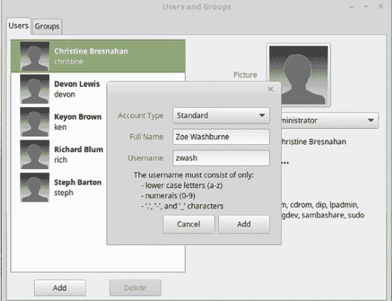

2. 在 `User's Full Name`（用户全名）字段输入用户的全名。此条目存储在 `/etc/passwd` 的注释字段中，例如，当用户登录桌面时，它会出现在某些桌面环境中。
3. 在 `Username`（用户名）字段输入用户名。这是用户在 Linux 登录提示符处将输入的内容。
4. 点击 `Add` 按钮完成账户创建。
5. 点击用户名，然后点击账户描述中的“no password set”（未设置密码），打开图 13.3 所示的 `Change Password`（更改密码）对话框。
6. 输入两次密码，一次在 `Password`（密码）字段中，再次在 `Confirm Password`（确认密码）字段中。
7. 当实用程序认为密码足够强大时，`Change`（更改）按钮将可用（不是灰色），你可以点击以修改密码。

新账户将出现在 `Users` 标签页。随后你可以按照本章后部分的描述对其进行修改或删除。

**图 13.3** 使用 `Change Password` 对话框设置用户账户密码。

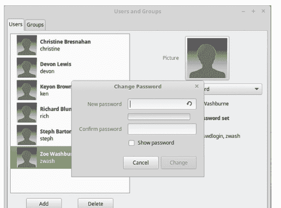

### 从 Shell 创建账户

在任何发行版中，都可以使用 `useradd` 实用程序从命令行创建账户。要使用它，你需要输入你的姓名以及你想与新账户关联的用户名。你还可以在 `useradd` 和用户名之间包含选项，如表 13.1 所示。`useradd` 命令除了表 13.1 所示的选项外还支持其他选项；详情请参考其 man page（手册）。

#### 表 13.1 `useradd` 选项

| 选项名称 | 选项缩写 | 效果 |
| :--- | :--- | :--- |
| `--comment comment` | `-c` | 为用户指定注释字段。（GUI 工具通常将其称为“全名”）。 |
| `--home home-dir` | `-d` | 指定账户的家目录。 |
| `--expire expire-date` | `-e` | 设置账户过期日期，格式为 `YYYY-MM-DD`。 |
| `--inactive` | `-f` | 设置账户禁用后禁用的天数。 |
| `--gid default-group` | `-g` | 设置用户的 GID。 |
| `--groups` | `-G` | 设置用户所属的组名，组用逗号分隔。 |
| `--create-home` | `-m` | 为用户创建家目录。 |
| `--skel-dir` | `-k` | 指定从哪个目录复制骨架文件。 |
| `--shell` | `-s` | 设置用户的登录 shell。默认是 `/bin/bash`。 |
| `--uid` | `-u` | 指定用户 ID 值。 |
| `--non-unique` | `-o` | 允许重用 UID。 |
| `--system` | `-r` | 指定系统账户。 |
| `--no-user-group` | `-N` | 禁止创建组。 |

## 第 13 章 用户和组

在基于 `Debian` 的发行版（如 `Ubuntu` 和 `Linux Mint`）中，你可以通过输入 `adduser` 使用更友好的 `useradd` 前端。请注意，在某些发行版（如 `Fedora`）中，`adduser` 命令并不是 `useradd` 的前端，而是它的一个链接。

某些选项在你使用 GUI 工具创建账户时无法直接访问，具体取决于不同的 GUI 工具。在某些情况下，可以在创建账户后在 GUI 工具中设置。

一个完整的 `useradd` 命令（包含一些选项）如下：

```
```


```bash
$ useradd -m c "Noburn Washburne" -u 1006 hwash
[sudo] password for christine:
```

此示例创建了一个名为`hwash`的账户，包含家目录、包含用户全名的注释字段以及`1006`的UID。注意在上例中使用了`sudo`命令来获取用户权限，这是成功完成此命令的要求。

你可能希望指定UID，以便在通过网络文件系统（NFS）共享文件的计算机之间保持这些值的一致性。

当你使用`useradd`创建账户时，它将处于锁定状态——用户无法登录。要解锁它，你必须使用下文“修改账户”部分提到的`password`命令。

你可以通过`useradd`命令的`-p`选项添加密码。然而，出于安全考虑，不建议这样做。最好使用本章后部分介绍的`password`命令。

在后台，`useradd`（或其GUI前端）会修改以下文件的内容（在第12章有详细描述）：

* `/etc/passwd`
* `/etc/shadow`
* `/etc/group`

如果你使用`--create-home`或`-m`（或者这是你发行版的默认设置），程序将创建一个家目录并将`/etc/skel/`中的文件复制到该位置。创建账户通常还会创建一个邮件池文件，用户的入站邮件将存储其中。（在许多桌面系统中，该文件可能派不上用，但如果你在计算机上运行邮件服务器软件，它是非常重要的。）

## 修改账户

正如你所学的，在创建账户时你可以指定许多影响账户的选项，例如为账户指定特定的UID号。然而，有时在账户创建后，有必要对账户选项进行更改。幸运的是，Linux提供了GUI和文本模式工具来帮助你完成操作。在深入研究这些工具的操作细节之前，你应该了解在何时可能需要对账户进行更改，并知道如何检查用户是否已登录。

### 决定何时修改账户

在理想的世界里，你每次都能完美地创建账户；然而，有时这是并非可能的。你可能缺少创建完美账户所需的必要信息（例如员工在公司工作的时间），或者你的需求在账户创建后发生了变化。更改账户的一些常见原因包括（但不限于）以下情况：

* 账户过期数据可能需要更新。例如，合同工的合同可能会延长。有时，必须启用一个已过期的账户。
* UID号可能需要与其他计算机同步，以便于共享帐户或其他原因。
* 用户的家目录可能会发生变化，因为你增加了磁盘空间，必须将某些用户的家目录移动到新位置。
* 用户可能会忘记密码。系统管理员可以在不知道原始密码的情况下更改任何账户的密码，因此系统管理员经常需要帮助记忆力故障的用户。

在GUI环境下工作时，上述许多更改可以由发行版的GUI账户管理工具处理。在文本模式shell中工作时，你需要掌握几个程序来处理这一范围的账户修改。

### 检查登录用户

请注意，如果在执行操作时用户正登录，某些更改可能会导致中断。特别是更改账户的用户名和家目录可能会导致问题。因此，你应该只在用户注销后进行账户更改。几个工具可以帮助检查谁正在使用电脑并避免问题：

* `who`：该工具在第12章中描述，可生成当前登录到计算机的用户列表，以及他们登录会话的一些详细信息，例如终端和登录日期。
* `w`：该命令同样在第12章中描述，大致与`who`相似，但它提供了不同的细节。最显著的是，它识别了每个会话中当前运行的程序。
* `users`：为了快速简单地查看谁正在使用电脑，大多数发行版还提供了`users`命令。
* `last`：该程序生成最近登录会话的列表，包括开始和结束时间，或者用户已登录的通知：

```bash
$ last

| christin | pts/2 | 192.168.0.102 | Tue Aug 20 11:46 | still logged in |
| reboot   | system boot | 4.10.0-38-generi | Tue Aug 13 10:09 - 11:22 | (01:12) |
| ken      | tty4 | | Tue Aug 6 6:57 - 11:40 | (00:43) |
| devon    | tty3 | | Tue Aug 6 6:57 - 11:40 | (00:43) |
| steph    | tty2 | | Tue Aug 6 6:57 - 11:40 | (00:43) |
| rich     | pts/0 | 192.168.0.102 | Tue Aug 6 6:56 - 11:40 | (00:43) |
| christin | tty2 | | Tue Aug 6 6:34 - 10:57 | (00:22) |
```

`last`的一个局限性是它只包含文本模式的登录。这对于正在使用电脑的用户来说，其实用性有限，因为这些用户可能正在通过GUI会话登录。

> `lastb`命令显示与`last`类似的信息，但它只显示失败的登录尝试，并从`/var/log/btmp`获取数据。

`last`命令显示存储在`/var/log/wtmp`文件中的数据。你应该意识到，某些发行版默认并不创建此文件。更多信息请参阅`last`的帮助页面。

### 使用 GUI 工具修改账户

与添加账户不同，使用GUI工具修改账户的过程在不同发行版之间不同。大多数GUI工具提供类似的选项，尽管某些比其他更完整。在本节中，你将学习如何使用Linux Mint的用户和组管理实用程序修改账户。

要进行此类更改，在打开用户和组管理实用程序后，点击账户名称，然后点击“要修改的项目”（Item To Modify）。如图13.4所示。

#### 图 13.4 用户和组管理实用程序允许你编辑几个账户属性。

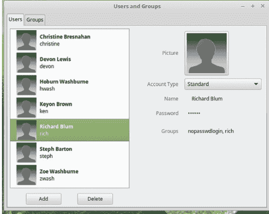

此对话框显示了几个账户属性。四个项目中的每个提供了访问特定类型数据的数据：

* **账户类型**：用户Richard Blum的账户在图13.4中显示为“标准”（Standard）。标准账户也称为*非特权用户账户*（`unprivileged user account`），在第12章中首次描述。如果你想要此账户
* **名称**：用户Richard Blum的账户在图13.4中显示为“标准”。标准账户也称为*非特权用户账户*（`unprivileged user account`），在第12章中首次描述。如果你想要此账户
* **密码**：用户Richard Blum的账户在图13.4中显示为“标准”。标准账户也称为*非特权用户账户*（`unprivileged user account`），在第12章中首次描述。如果你想要此账户
* **组**：用户Richard Blum的账户在图13.4中显示为“标准”。标准账户也称为*非特权用户账户*（`unprivileged user account`），在第12章中首次描述。如果你想要此账户

### 从 Shell 修改账户

最频繁的账户修改之一是更改密码，可以是创建账户的一部分，也可以是因为用户忘记了密码。

```bash
sudo passwd

Enter new password:

Retype new password:

passwd: password updated
```


出于安全考虑，当你输入密码时，屏幕上不会回显。如果密码不匹配，程序将拒绝更改并提示你重新输入一对密码。程序还会检查密码的强度，如果新密码看起来很弱，它可能会拒绝接受新密码。注意前面的示例使用了 `sudo` 命令，这表明更改密码的人具有访问超级权限，这是完成此命令所必需的。

## 图 13.5 用户和组管理实用程序允许你编辑几个账户属性。

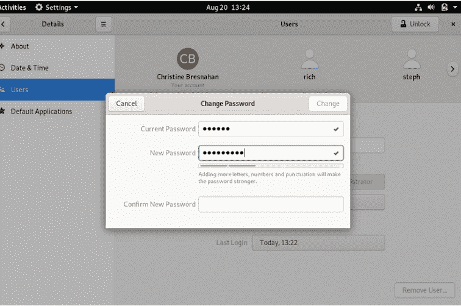

## 表 13.2 usermod 选项（续）

| 选项名称 | 选项缩写 | 效果 |
| -- | -- | -- |
| `--groups group[... ]` | `-G` | 设置用户所属组的名称或 `GID`——可以通过逗号分隔来指定多个组。 |
| `--login username` | `-l` | 将账户用户名更改为指定的值。 |
| `--lock` | `-L` | 锁定账户密码，防止登录。 |
| `--move-home` | `-m` | 当此选项与 `--home` (`-d`) 一用时，`usermod` 将用户现有的家目录移动到新位置。 |
| `--shell shell` | `-s` | 使用此选项设置用户默认 `shell` 的名称。 |
| `--uid UID` | `-u` | 将账户的 `UID` 号更改为指定的值。 |
| `--unlock` | `-U` | 解锁被锁定的账户 |

例如，考虑以下 `usermod` 的用法：
`sudo usermod -u 1072 -m /home2/hwash`
此命令对 `hwash` 账户进行了三处更改：

- 它将 `UID` 值更改为 `1072`。
- 它将账户的家目录更改为 `/home2/hwash`。
- 它将账户原始家目录的内容移动到其新位置。

如果你正在将用户账户迁移到挂载在 `/home2` 的 `NFS` 服务器，你可能会执行如下命令。此类更改可能需要一个新的家目录，并需要更改 `UID` 值以与 `NFS` 服务器上使用的 `UID` 匹配。

> 注意 更改 `UID` 值时要加小心，虽然 `usermod` 会更改常用位置（如用户家目录和邮件文件）中文件的 `UID` 值，但它可能会漏掉异常位置上的用户文件。

如果你需要进行需要添加新组的组更改，请参阅接下来的“管理组”章节以获取该主题的信息。

## 删除账户

删除账户有时与修改账户一样重要。未使用的账户可能会被滥用，可能是由原所有者使用，也可能是由其他在密码密码时进入账户的人使用。因此，你应该定期删除未使用的账户。在删除之前，你应该了解删除账户时会发生什么，并精确决定如何操作，以免以不恰的方式删除账户而产生问题。掌握了这些知识后，你可以使用 `GUI` 或文本模式工具删除账户。

## 避免账户删除陷阱

删除账户听起来可能很简单，但错误可能会在现在或未来引起问题。除了意外删错账户等显而易见的问题，还要考虑以下两个因素：

- 用户文件保护：用户文件对于用户或拥有该计算机的组织来说都可能极具价值。在考虑是否删除用户家目录或对其进行处理时，你应该检查你公司的文件留存策略，因为你正将它移动到另一个用户的家目录并更改文件的权限。用户的邮件队列也是如此（通常存储在 `/var/spool/mail/username`，其中 `username` 是账户名）。

> 考虑将已删除账户的家目录归档到长期备份介质中。这种策略将使你在这些文件未来变得有价值时能够恢复它们。

- `UID` 和 `GID` 重用：当账户被删除时，该账户的 `UID` 和 `GID` 变得可以重用。在许多情况下，这些数字不会被重用，因为某些 `Linux` 发行版基于当前最大值来生成这些值。如果你删除了编号最大的用户，那么该用户的旧 `UID` 和 `GID` 数字将被重用，除非中间的账户也被删除。尽管如此，如果 `UID` 被重用，以前由旧用户拥的文件突然看起来属于新用户。这可能会导致任何问题，但可能会引起关于谁创建了文件的困惑。在某些情况下，它甚至可能导致对新用户错误行为的怀疑（如果旧文件包含新用户没有的信息，或者如果文件位于新用户本应访问的目录中）。

为了避免对新用户产生任何困惑或误指，或避免 `GID` 重用，你可以使用 `find` 命令（在第 8 章“搜索、提取和归档数据”中详细介绍）来定位所有具有特定 `UID` 或 `GID` 值的文件。你必须使用 `-uid` 和 `-gid` 选项，如下：

```
$ sudo find / -uid 1004
```

## 第 13 章 • 创建用户和组

虽然可以在没有超级用户权限的情况下执行此命令，但它会返回错误并可能漏掉某些文件。因此，最好以超级用户权限这样使用 `find`。

我们之前的示例查找了计算机上 `UID` 为 `1004` 的所有文件。（搜索 `GID` 的原理相同，但使用 `-gid` 选项。）然后你可以通过 `chown` 命令（在第 14 章中介绍）重新分配这些文件的所有权，或删除它们。通常，你会在删除或重新分配用户家目录后执行此命令，因为该目录可能包含了太多的文件。

## 避免删除账户

删除账户听起来可能简单，但错误可能会在现在或未来引起问题。除了意外删错账户等显而易见的问题外，还要考虑以下两个因素：

- 用户文件保护：用户文件对于用户或拥有该计算机的组织来说都可能极具价值。在考虑是否删除用户家目录或对其进行处理时，你应该检查你公司的文件留存策略，因为你正将它移动到另一个用户的家目录并更改文件的权限。用户的邮件队列也是如此（通常存储在 `/var/spool/mail/username`，其中 `username` 是账户名）。

> 考虑将已删除账户的家目录归档到长期备份介质中。这种策略将使你在这些文件未来变得有价值时能够恢复它们。

- `UID` 和 `GID` 重用：当账户被删除时，该账户的 `UID` 和 `GID` 变得可以重用。在许多情况下，这些数字不会被重用，因为某些 `Linux` 发行版基于当前最大值来生成这些值。如果你删除了编号最大的用户，那么该用户的旧 `UID` 和 `GID` 数字将被重用，除非中间的账户也被删除。尽管如此，如果 `UID` 被重用，以前由旧用户的文件突然看起来属于新用户。这可能会导致任何问题，但可能会引起关于谁创建了文件的困惑。在某些情况下，它甚至可能导致对新用户错误行为的怀疑（如果旧文件包含新用户没有的信息，或者如果文件位于新用户本应访问的目录中）。

为了避免对新用户产生任何困惑或误指，或避免 `GID` 重用，你可以使用 `find` 命令（在第 8 章“搜索、提取和归档数据”中详细介绍）来定位所有具有特定 `UID` 或 `GID` 值的文件。你必须使用 `-uid` 和 `-gid` 选项，如下：

```
$ sudo find / -uid 1004
```

## 第 13 章 • 创建用户和组

虽然你可以在没有超级用户权限的情况下执行此命令，但它会返回错误并可能漏掉某些文件。因此，最好以超级用户权限这样使用 `find`。

我们之前的示例查找了计算机上 `UID` 为 `1004` 的所有文件。（搜索 `GID` 的原理相同，但使用 `-gid` 选项。）然后你可以通过 `chown` 命令（在第 14 章中介绍）重新分配这些文件的所有权，或删除它们。通常，你会在删除或重新分配用户家目录后执行此命令，因为该目录可能包含了太多的文件。

## 使用 GUI 删除账户

与其他账户管理任务一样，使用 `GUI` 是直观的，但不同发行版之间存在差异。例如，在 `Linux Mint` 的用户和组管理工具中，打开工具后点击“组”选项卡。这将产生类似于图 13.6 的对话框。确认操作后，点击“删除”按钮。

> 图 13.6 用户和组管理工具允许管理组以及用户。
> 

如果用户当前登录，工具通常会提示此。

## 从命令行删除账户

`userdel` 命令以文本模式删除账户。在最简单的形式下，使用超级用户权限并指定用户名：

由于该程序默认会删除用户的家目录。为了强制执行，可以传递 `-r` 选项。

如果用户当前登录，`userdel` 会通知你。为了即使也删除，你可以传递两个选项：

```
$ sudo userdel -rf zwash
```


```
userdel: 用户 zwash 正被进程使用
```

## 管理组

在许多方面，组与账户相似。它们在类似的文件中定义，并使用类似的工具进行管理。组也与账户关联，到目前为止，我们假设你在创建账户时定义了组。然而，有时你需要为了特定目的创建、删除或修改组，例如使用组策略。像账户管理一样，你可以使用 GUI 或文本模式工具。

## 使用 GUI 管理组

许多 GUI 账户维护工具（如 Linux Mint 的用户和组管理工具）提供了与用户管理工具类似的组管理工具。参考图 13.1，你会看到用户和组窗口包含用户和组两个选项卡。要管理组，点击“组”选项卡。这产生了类似于图 13.7。

> 图 13.7 用户和组管理工具允许管理组以及用户。
> (`img/85a584ad3fbd69446d0029bba855_331.png`)

你可以以类似于添加、修改和删除账户的方式添加、修改和删除组，尽管可用选项可能少得多。组没有家目录、注释字段、登录 shell 等。你可能从一开始就想要特定的用户成为新组的成员。为此，请按照以下步骤操作：

1. 在“组”选项卡上点击“添加”按钮创建一个组。
2. 在生成的对话框中指定组名。
3. 点击“确定”添加组。
4. 通过选择“用户”选项卡、选择用户名并点击“组”字段中的当前组来打开对话框添加组成员。
5. 在对话框中勾选新组复选框使该账户成为成员，如图 13.8 所示，并点击“确定”。

> 你不需要一次添加一个账户。可以在对话框中点击多个组将账户添加到多个组。

或者，你可以通过单独更改每个用户的组关系来管理组关系，如下文“从命令行管理组”部分所述。

某些发行版允许你在安装操作系统时将用户账户添加到`wheel`（轮组/管理员组）中。请注意，这种表述并不常用；相反，安装程序会询问你是否想将该账户添加到`管理员组`或类似的术语中。

## 从终端管理组

你可以使用`groupadd`命令从终端创建组，该命令的工作原理与用于用户的`useradd`命令非常相似，但包含的选项较少，其中最重要的选项如表 13.3 所示。关于更冷门选项的信息，请参阅该程序的主页。

表 13.3 `groupadd` 选项

| 选项名称 | 选项缩写 | 效果 |
| --- | --- | --- |
| `--gid` `GID` | `-g` | 提供特定的`GID`。如果省略了它，`groupadd`将使用下一个可用`GID`。 |
| `--system` | `-r` | 指示`groupadd`创建一个系统组，即`GID`小于 500 或 1,000 的组（取决于发行版）。非系统组通常用于用户组。 |
| `--force` | `-f` | 通常情况下，如果你尝试创建一个已存在的组，`groupadd`会返回错误信息。此参数会抑制该错误信息。 |

使用`groupadd`命令（包含选项）的形式如下：

```
groupadd -g 1001 consultants
```

此示例创建了一个`GID`为 1001 组名为`consultants`的组。注意在上一个示例中显示了`#`提示符，表示使用了该账户获取超级用户权限以成功完成了此命令。

添加组后，可以向组中添加新成员。这需要使用`usermod`命令和超级用户权限，如下：

```
usermod -aG consultants rich
```

```
groups rich
```

```
rich: users consultants
```


联合使用 `-ag` 选项是为了将账户 `rich` 添加到新的 `consultants` 组中。如果没有使用 `-a` 选项，在某些发行版中，该账户将从其当前的组成员关系中移除，并仅属于 `consultants` 组。因此，默认使用 `-ag` 是明智的。

> 你可以检查账户的主组。使用超级用户权限，在命令行输入 `id -gn username` 即可显示账户的主组。


另一个良好的习惯是使用 `groups` 命令检查修改是否成功。`groups` 命令显示指定用户账户的所有组成员身份。

要修改组本身，你可以使用 `groupmod` 命令。表 13.3 中的 `--gid (-g)` 和 `--non-unique (-u)` 选项可以配合此命令使用，还有 `--new-name name (-n name)` 选项，它可以更改组的名称。

从终端删除组涉及使用 `groupdel` 命令，它接受组名作为单个选项，例如使用 `groupdel consultants` 来删除 `consultants` 组。

## 练习 13.1

- 使用你发行版提供的 GUI 工具创建一个测试账户，然后登录到你创建的账户以验证其运行是否符合预期。
- 使用 `useradd` 创建另一个账户，但不要使用 `passwd` 设置其密码。你能登录吗？使用 `passwd` 为新测试账户创建一个密码并尝试再次登录。

## 总结

在 GUI 环境中，你可以使用 GUI 工具执行大多数常用的账户维护任务，这些工具允许你通过从菜单列表中选择选项来添加、修改和删除账户。某些操作需要你使用命令行工具，如 `useradd`、`usermod`、`userdel` 和 `passwd`。（`groupadd`、`groupmod` 和 `groupdel` 命令组具有类似的功能。）即使你不需要使用文本模式工具提供的更冷门的功能，它们的使用也比你熟悉的工具更快。

## 考试重点

涉及账户创建和管理的文件。当 Linux 系统上创建账户时，`/etc/passwd` 和 `/etc/shadow` 文件会为该账户生成新记录。`/etc/passwd` 文件还会为新创建的账户接收新记录，因为会创建一个与账户同名的默认组。当对账户进行某些修改时，这三个文件中的记录会发生变化。

创建账户时，还会生成一个主目录，并将 `/etc/skel/` 目录中的文件复制到其中。该主目录通常命名为 `/home/username`，但名称可以根据发行版的账户创建配置而有所不同。

总结用于账户创建和管理的工具。用于创建、修改和删除账户的工具分别是 `useradd`、`usermod` 和 `userdel`。`passwd` 命令也会修改或设置账户的密码。

概述用于组创建和管理的实用程序。用于创建、修改和删除组的工具分别是 `groupadd`、`groupmod` 和 `groupdel`。`groups` 命令允许你查看特定账户的所有各种组成员身份。`id -gn` 命令显示用户的当前主组。

描述用于确定登录用户的命令。在修改账户之前，确保账户用户当前没有登录系统是一个好主意。要了解除你之外还有谁在线，`who` 实用程序可以工作，但 `last` 命令提供了更多信息。`last` 命令将显示任何仍登录在系统的用户，以及开始和结束时间。

## 复习题

你可以在附录 A 中找到答案。

1. Linux 系统管理员应该做什么来删除账户及其主目录？
A. `userdel`
B. `userdel -f`
C. `userdel -r`
D. `rm /home`
E. `rm`

2. 在下列选项中，哪项是？
A. `groups`
B. `passwd`
C. `group`
D. `system`
E. `group`

3. 假设执行以下命令，其影响是：
A. `groupadd` 创建了一个名为 `group` 的组。
B. `group` 将账户关联到组。
C. `group` 获取了文件信息。
D. `group` 更改了文件的所有者。
E. `group` 处理组成员身份。

4. 错误或对：账户具有更高的 `UID` 数字。

5. 错误或对：用户通常使用 `usermod` 修改密码。

6. 错误或对：删除账户后，属于该账户的文件仍然存在。

7. 你想创建一个 `UID` 为 1000 的组，命令是：
A. `useradd -u`
B. `groupadd -g`
C. `useradd -g`
D. `usermod -u`
E. `groupadd -r`

8. 你想更改账户的用户名而不更改其他任何内容，你需要：
A. `useradd -n`
B. `usermod -n`
C. `useradd -l`
D. `usermod -l`
E. `groupadd`

9. 为了创建一个系统组，你必须向 `groupadd` 传递：
A. `-system`
B. `-s`
C. `--system`
D. `-r`
E. `--r`

10. 关于各种组的信息（如组名、`GID`）存储在文件中：
A. `/etc/passwd`
B. `/etc/shadow`
C. `/etc/group`
D. `/etc/groups`
E. `/etc/gid`

# 第 14 章 设置所有权和权限

**目标：**

- 2.3 使用目录和列出文件
- 5.3 管理文件权限和所有权
- 5.4 特殊目录和文件


作为一个多用户操作系统，Linux 提供了保护文件免受未经授权访问的工具——毕竟你不希望其他用户意外或故地读取或删除你的文件！Linux 通过文件和目录的两个功能来处理这些任务：它们的*所有权*和*权限*。每个文件都有所有者（即与其关联的账户以及关联的组）。三组权限定义了文件的所有者、组成员以及其他用户对文件可以做什么。因此，所有权和权限是交织的，尽管你使用不同的文本命令来操作它们。GUI 工具通常会将两者结合。

## 设置所有权

Linux 的安全模型基于 Unix，后者被设计为多用户操作系统。这种安全模型假设计算机上存在多个用户，并提供了将文件与创建它们的用户关联的方法——即文件有*所有者*。你应该彻底理解这个概念，并后你可以使用 GUI 管理器或命令行命令来保护你的文件。

所有权也适用于运行中的程序（即*进程*）。你运行的大多数程序都与你使用的账户绑定。这种身份结合了文件的所有权和权限，决定了程序是否可以修改文件。

## 在文件管理器中设置所有权

正如第 4 节“使用常用 Linux 程序”所描述，你可以使用文件管理器来操作文件。你可能对 Windows 或 macOS 中的文件管理器非常熟悉。不过，Linux 的所有权和权限与 Windows 不同，但你可能想知道如何使用 Linux 文件管理器来检查并可能更改某些功能。如第 4 节所述，在 Linux 中你有多种文件管理器可供选择。大多数文件管理器在总体框架上相似，但在某些细节上有所不同。在本节中，我们将以 `GNOME Files` 文件管理器作为示例。

如果你想更改所有者，必须以 `root` 身份运行 `Files`，但你可以将文件的组更改为你作为普通用户所属的任何组。执行此任务的步骤如下：

1. 启动终端窗口。
2. 在终端窗口中，输入 `su` 以获取 `root` 权限。

> 
> 某些 Linux 发行版不允许你使用 `su` 命令来获取 `root` 权限。例如，如果你正在使用 `GNOME` 版本的 `Ubuntu`，你可能需要使用 `sudo` 从命令行启动 `GNOME Files`。

3. 在终端窗口中，输入 `nautilus` 启动 `GNOME Files`（在 `GNOME` 之前的版本中，`Files` 应用被称为 `Nautilus`，这个名称一直保留了下来）。你可以选择性包含你想让 `Files` 的目录路径。如果不包含路径，它将从显示 `/root` 目录的内容开始。

> `/root` 目录是账户的家目录。

4. 找到你想调整所有权的文件并右键点击它。
5. 在弹出的菜单中，选择“属性”（Properties）。将出现属性对话框。
6. 在属性对话框中，点击“权限”（Permissions）选项卡。结果如图 14.1 所示。
7. 要更改文件的所有者，在“所有者”（Owner）字段中选择新所有者。只有以 `root` 运行 `GNOME Files` 才能执行此操作。
8. 要更改文件的组，在“组”（Group）字段中选择新组。如果你以普通用户运行 `GNOME Files`，你可以选择你所属的任何组；但如果你以 `root` 身份运行 `GNOME Files`，你可以选择任何组。
9. 当调整完想要更改的功能后，点击标题栏中的 X 关闭窗口。

如果你想更改文件的组但不更改其所有者，并且你是目标组的成员，你可以以普通用户身份启动 `GNOME Files`。然后你可以从第 4 步继续之前的操作。

# 第 14 节 • 设置所有权和权限

图 14.1 Linux 文件管理器让你访问文件的所有权和权限元数据。

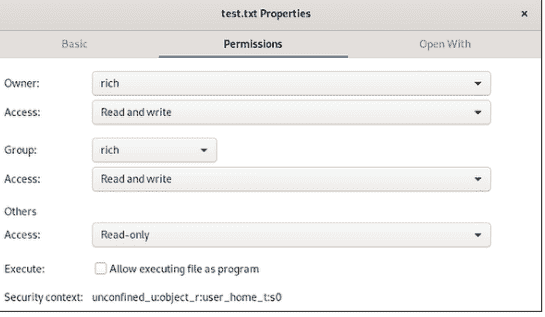

以 `root` 身份运行 `GNOME Files` 时要极其小心。如果你忘记自己正是以 `root` 身份运行此程序，你可以很容易地以 `root` 身份创建新文件，这将导致以后更改文件所有权或权限都需要 `root` 权限。也很容易无意中删除关键系统文件，而这些文件作为普通用户是无法删除的。由于这些原因，我建议你使用文本模式 shell 来调整文件所有权。提示符的改变让你更容易注意到你正在以 `root` 身份运行，而且如果你在使用 GUI，从文本模式 shell 以 `root` 身份启动额外程序的概率会比通过 `GNOME Files` 小。

## 在 Shell 中设置所有权

以首选的文本模式更改文件所有权的命令是 `chown`。在最基础的形式中，你传递文件名，后跟一个用户名：

> `chown` 命令的名字代表 change owner（更改所有者）。

```bash


# `chown` 命令基础

`chown` 命令示例将 `targetfile` 的所有者更改为 `rich`。如果你想同时更改所有者和组，可以使用 `chown user:group` 格式：

```bash
# chown rich:group targetfile
```

此命令将 `targetfile` 的所有者更改为 `rich`，并将组更改为 `group`。如果你只想更改组，可以使用 `chown :group` 格式：

```bash
# chown :group targetfile
```

此命令将 `targetfile` 的组更改为 `group`。如果你想递归更改目录及其内容的所有权，可以使用 `-R` 选项：

```bash
# chown -R rich:group /directory
```

此命令将递归地将 `/directory` 及其目录下所有文件的所有者更改为 `rich`，组更改为 `group`。

# 设置所有权

另一种方式，更改文件所有权的命令是 `chown`。在最基础的形式中，你传递文件名，后跟一个用户名：

> `chown` 命令的名字代表 change owner。

```bash
# chown rich targetfile
```

此命令示例将 `targetfile` 的所有者更改为 `rich`。如果你想同时更改所有者和组，可以使用 `chown user:group` 格式：

```bash
# chown rich:group targetfile
```

此命令将 `targetfile` 的所有者更改为 `rich`，并将组更改为 `group`。如果你只想更改组，可以使用 `chown :group` 格式：

```bash
# chown :group targetfile
```

此命令将 `targetfile` 的组更改为 `group`。如果你想递归更改目录及其内容的所有权，可以使用 `-R` 选项：

```bash
# chown -R rich:group /directory
```

此命令将递归地将 `/directory` 及其目录下所有文件的所有者更改为 `rich`，组更改为 `group`。

# 设置权限

更改文件权限的命令是 `chmod`。在最基础的形式中，你传递一个数字模式（mode），后跟文件名：

```bash
# chmod 755 filename
```

此命令将 `filename` 的权限设置为 `755`（所有者有读写执行权限，组和其他用户有读和执行权限）。你也可以使用符号模式（symbolic mode）来更改权限：

```bash
chmod u+x filename
```

此命令为所有者（`u`）添加 `filename` 的执行（`x`）权限。你也可以移除某些权限：

```bash
chmod g-w filename
```

此命令从组（`g`）中移除 `filename` 的写（`w`）权限。你还可以设置特定权限：

```bash
chmod o=r filename
```

此命令将其他用户（`o`）的权限精确设为只读（`r`）。如果你想递归地更改目录及其内容的权限，可以使用 `-R` 选项：

```bash
chmod -R 755 /directory
```

此命令将递归地将 `/directory` 及其目录下所有文件的权限设置为 `755`。

# 理解权限

要理解 Unix（以及这里的 Linux），你可能希望从 `ls` 命令开始，它列出目录中的文件，并结合其 `-l` 选项创建一个详细列表。例如，要查看文件的详细列表，必须输入：

```bash
$ ls -l test
-rwxr-xr-x 1 rich users 111 Oct 13 13:48 test
```


这一行由多个部分组成，提供了关于文件的各种信息：

- **权限**：第一列（示例中的 `-rwxr-xr-x`）是文件的权限。
- **链接数**：下一列（示例中为 `1`）显示文件的硬链接数量——即用于访问该文件的唯一文件名数量。
> 第 7 节“管理文件”更详细地介绍了链接。
- **用户名**：下一列（示例中为 `rich`）通过用户名识别文件的所有者。
- **组名**：文件的组（示例中为 `users`）在随后。
- **文件大小**：示例文件的大小非常小——111 字节。
- **时间戳**：时间戳（示例中为 `Oct 13 13:48`）标识了文件最后修改的时间。
- **文件名**：最后，`ls -l` 显示文件的文件名——示例中的 `test`。

此输出开头的字符串（在本例中为 `-rwxr-xr-x`）是权限字符串的符号表示。图 14.2 显示了该字符串如何被分为四个部分：

# 图 14.2 文件权限的符号表示被分为四个部分。

| 文件类型 | 所有者权限 | 组权限 | 全人权限 |
| --- | --- | --- | --- |
| | r | w | x | r | w | x | r | w | x |
| 读取 | 写入 | 执行 | 读取 | 写入 | 执行 | 读取 | 写入 | 执行 |

**文件类型代码**是文件的类型，代表文件的具体类型，如表 14.1 所示。当文件类型不相关或通过其他方式识别时，描述中有时会省略此类型字符。

| 代码 | 名称 | 含义 |
| --- | --- | --- |
| `-` | 普通数据文件 | 可能是文本、可执行程序、图形、压缩数据，或任何其他类型的数据。 |
| `d` | 目录 | 磁盘目录在本质上也是文件，但它们包含文件名以及指向这些命名文件数据结构的指针。 |
| `l` | 符号链接 | 符号链接文件包含另一个文件或目录的名字。当 Linux 访问符号链接时，它会尝试读取链接的文件。 |
| `p` | 命名管道 | 管道允许两个运行中的 Linux 程序以单向方式相互通信。 |
| `s` | 套接字 | 接字类似于命名管道，但它允许网络和双向链接。 |
| `b` | 块设备 | 对应于硬件设备的块设备文件，数据以大于一个字节的块进行传输。磁盘设备（硬盘、软盘、CD-ROM 等）。 |
| `c` | 字符设备 | 对应于硬件设备的字符设备文件，数据以字节为单位进行传输。示例包括并行端口和 RS-232 串口设备。 |

## 第 14 章 • 设置所有权和权限

> 你将操作的大文件都是普通文件、目录和符号链接。

**所有者权限**这些权限决定了文件的所有者可以对文件执行的操作。

**组权限**这些权限决定了文件所在组的成员（非所有者）可以对文件执行的操作。

**全员（或“其他”）**这些权限决定了既不是文件所有者也不是其组成员的用户可以对文件执行的操作。

在三组权限中的每一组，字符串标识了三种访问类型的存在或缺失：读取、写入和执行。读取和写入权限非常直观易懂。如果存在执行权限，意味着在权限字符串中用横杠 (`-`) 表示。权限的缺失则用字母 `r`（读取）、`w`（写入）或 `x`（执行）来指示。

当然，在非程序文件上设置执行位并将其变成程序；它只是表示用户可以运行一个作为程序的文件。

因此，示例权限字符串 `r-wx-r-*` 意味着该文件是一个普通数据文件，其所有者、文件组成员以及所有其他用户都可以读取和执行该文件。只有文件所有者拥有对文件的写入权限。

权限还有另一种表示方法。这种方法很紧凑，但有点困惑；它将权限字符串中的三个权限分组（类型代码）中的每一个转换为 0 到 7 之间的数字（即基 8 进制或八进制）。结果是一个三位八进制。每个数字的构造是从值 0 开始，然后：

- 如果存在读取权限，则加 4
- 如果存在写入权限，则加 2
- 如果存在执行权限，则加 1

生成的三位代码代表所有者、组和全员的权限。表 14.2 显示了一些常用权限及其含义的示例。

这些过程涉及二进制数字和逻辑，而不是算术运算。尽管如此，算术描述更容易理解。

# 表 14.2 权限示例及其解释

| 权限字符串 | 八进制代码 | 含义 |
|---|---|---|
| `rwxrwxrwx` | `777` | 所有用户具有读取、写入和执行权限 |
| `rwxxr-xr-` | `755` | 所有用户的读取和执行权限。文件所有者也具有写入权限。 |
| `rwxr-x----` | `750` | 所有者和组具有读取和执行权限。文件所有者也具有写入权限。其他用户无法访问该文件。 |
| `rwx------` | `700` | 仅文件所有者具有读取、写入和执行权限；所有其他人无法访问。 |
| `rw-rw----` | `666` | 所有用户的读取和写入权限。任何人都没有执行权限。 |
| `rw-rw-r--` | `664` | 所有者和组具有读取和写入权限。所有其他人只有读取权限。 |
| `rw-w----` | `660` | 所有者和组具有读取和写入权限。没有全员权限。 |
| `rw-r--r--` | `644` | 所有者具有读取和写入权限。所有其他人只有读取权限。 |
| `rw-r-----` | `640` | 所有者具有读取和写入权限，组具有读取权限。其他人没有权限。 |
| `rw------` | `600` | 所有者具有读取和写入权限。其他人没有权限。 |
| `r--------` | `400` | 所有者只有读取权限。其他人没有权限。 |

由于有 512 种组合，因此表 14.2 是不完整的。

## 第 14 章 • 设置所有权和权限

以下情况适用于：

**目录执行位**目录的执行位允许用户进入目录。

**目录写入权限**目录的写入位允许用户在目录中创建、删除或重命名文件。

**符号链接**符号链接的权限适用于链接本身，而不是它指向的文件。

**root**`root` 用户具有特殊权限，可以绕过标准的权限检查。

使用符号模式配合 `chmod` 可能会令人混乱：

相比之下，符号模式由三个部分组成：
- 一个指示你想修改的权限的代码——`u` 表示用户（即所有者），`g` 表示组，`o` 表示其他用户，以及表示所有权限
- 一个指示你是想添加 (`+`)、删除 (`-`) 还是等于 (`=`) 所述的值的符号
- 一个指定权限是什么的代码，例如常用的 `r`、`w` 或 `x` 符号，或其他用于更高级操作的符号

## 第 14 章 · 设置所有权与权限

与 `chown` 和 `chgrp` 命令一样，你可以使用 `-R`（或 `--recursive`）选项让 `chmod` 作用于整个目录树。

表 14.3 使用 `chmod` 的符号权限示例

| 命令 | 初始权限 | 最终权限 |
| --- | --- | --- |
| `chmod a+x bigprogram` | `rw-r--` | `rwx-xr-x` |
| `chmod ug=rw report.txt` | `r------` | `rw-----` |
| `chmod o-rw bigprogram` | `rwx-rw-x` | `rwx-rw--` |
| `chmod g-w,o-rw report.txt` | `rw-fw-rw-` | `rw-r---` |

## 设置 umask

`umask`（用户掩码）决定了新文件和目录的默认权限。在创建新文件时，`umask` 是从 `666` (`rw-rw-rw-`) 权限中移除的值；创建新目录时，它是从 `777` (`rwxrwxwx`) 权限中移除的值。如果 `umask` 为 `022`，则创建的文件默认具有 `644` 权限，新目录将具有 `755` 权限。注意，移除操作并非简单的减法，而是位运算移除。这意味着，`umask` 中的值 `7` 会移除对应的 `rwx` 权限，但对于起始点为 `rw-` 的文件，结果是 `---` (`0`)，而不是 `-1`（这是没有意义的）。

你可以使用 `umask` 命令来调整 `umask`，该命令接受 `umask` 值，例如 `umask 022`。通常，此命令出现在系统级文件（如 `/etc/profile`）或用户配置文件（如 `~/.bashrc`）中。

## 使用特殊权限位和文件特性

当你研究 Linux 目录树时，会遇到某些需要特殊关注的文件类型。有时你可能只想了解这些文件是如何处理的，它们的处理方式与你根据第 8 章提供的信息所做的预期有所不同。在其他情况下，你可能需要调整 `ls` 或其他命令的使用来处理这些文件和目录。这些特殊情况包括“粘滞位”（`sticky bit`）、隐藏文件、获取目录列表以及使用特殊的执行权限。

## 使用粘滞位 (Sticky Bits)

在深入研究什么是粘滞位之前，先解释为什么我们需要它们会更简单。考虑以下命令，它们在一个按特定方式布局了若干文件和子目录的系统上执行：

这些命令建立了当前配置；有效用户 ID 为 `rich`，当前目录有一个名为 `subdir` 的子目录，由 `rich` 所有，所有系统用户对该目录都有完全的读写权限。该子目录有一个文件 `report.txt`，由 `root` 所有，`rich` 没有访问权限。你可以通过尝试使用 `touch` 命令删除它来验证 `rich` 无法写入该文件：

```
$ touch subdir/report.txt
```


`touch: cannot touch subdir/report.txt: Permission denied`

此错误信息证实了 `rich` 无法删除 `subdir/report.txt`。你可能会认为该文件是防篡改的。别太快！尝试这个：

```bash
$ rm subdir/report.txt
$ ls -l subdir/
total 0
```

`rm` 命令没有返回错误，随后对 `subdir` 的检查证实它现在是空的——也就是说，`rich` 在没有写入权限的情况下删除了该文件！这看起来像是一个漏洞——毕竟，如果你无法写入一个文件，你可能会认为你应该能够删除它。记住，目录只是一种特殊类型的文件，包含了其他文件以及指向其低级数据结构的名称。修改文件需要对文件有访问权限，但创建或删除文件需要对其所在的目录有写权限。在这个示例中，`rich` 对 `subdir` 有写权限，但对目录内的 `report.txt` 文件没有。因此，`rich` 可以删除文件但不能修改它。这个结果并不是漏洞，只是不符合直觉。

尽管 Linux 文件系统设计为这样工作，但这种行为并不总是理想。创建更直观结果的方法是使用粘滞位，这是一种改变这种行为的特殊权限。在目录上设置粘滞位后，Linux 只有在你拥有该文件或该目录时才允许你删除文件；仅对目录有写权限是不够的。你可以通过以下方式设置粘滞位：

使用进制代码：在四位进制代码的首位中，将领先值设置为 4 以设置 SUID 位，或设置为 6 以同时设置两个位。例如，`4755` 为可执行文件设置了 SUID 位，但不设置 SGID 位。

使用符号代码：使用符号代码并结合 `u` 来指定 SGID 位，或同时设置两个位。例如，`chmod u+s` 为 `myprogram` 设置了 SUID 位，而 `chmod ug-s` 移除了 SUID 和 SGID 位。

通常，你不需要移除这些位；必要时，管理程序会在安装或升级程序时正确地设置这些位。如果这些位在文件上被错误地设置或移除，你可能需要更改它们。在某些情况下，如果需要，你可能对从源代码编译的程序文件调整这些值。不过，在这样做时要小心。如果你对普通程序设置了 SUID 或 SGID 位，它将以更高的权限运行。如果程序包含漏洞，这些漏洞将造成更大的破坏。如果你不小心删除了这些权限，结果同样糟糕——像 `password`、`sudo` 等所有程序都依赖于其 SUID 设置，移除此功能会导致它们停止工作。

### 设置用户 ID (SUID)

设置用户 ID (SUID) 允许你以所有者的权限运行程序，而不是运行用户的权限。如果一个文件归 `root` 所有并设置了 SUID 位，该程序将以 `root` 身份运行。SUID 程序通过权限字符串中所有者执行位置的 `s` 来标识，例如 `rwxr-sr`。

### 设置组 ID (SGID)

设置组 ID (SGID) 选项类似于 SUID 选项，但它将运行程序的组设置为文件的组。它通过权限字符串中组执行位置的 `s` 来标识，例如 `rwxr-xs`。设置在目录上时，SGID 确保在该目录中创建的所有文件都被设置为目录的组，而不是创建文件的用户的组。

## 第 14 章 · 设置所有权与权限

### 隐藏文件

如果你习惯了 Windows，你可能熟悉“隐藏位”（hidden bit）的概念，通过该位，可以使文件在文件管理器、Windows `DIR` 命令以及大多数程序中对用户不可见。如果你在 Linux 中寻找类似的机制，你将找不到，至少在专门的文件系统形式上是找不到。相反，Linux 使用文件命名约定来从查看工具中隐藏文件；例如 `ls`，如果文件或目录的名称以点（.）开头，它们就会被隐藏。因此，`ls` 会隐藏 `file.txt`，但不会隐藏 `.file.txt`。大多数文件管理器在处理这些文件时也会隐藏点文件，因为它们通常被称为隐藏文件；然而，这种做法并非通用的。

许多用户程序利用这一特性来防止其配置文件弄乱你的显示。例如，`~/.bashrc` 是一个 Bash 配置文件，Evolution 的配置文件位于 `~/.evolution` 目录，而 `~/.fonts.conf` 则存储了用户特定的配置信息。

你可以根据具体的程序以多种方式查看文件。某些 GUI 工具在配置选项中有一个复选框，你可以设置它来强制程序显示文件。在命令行下，你可以对 `ls` 使用 `-a` 选项：

```bash
$ ls -l
total 0
drwxr-xr-x 2 root 80 Dec 14 18:25 subdir

$ ls -la
total 385
drwxr-xr-x 3 kirk users 104 Dec 14 18:44 .
drwxr-xr-x 3 kirk users 528 Dec 14 18:21 ..
-rw-r--r-- 1 kirk users 309588 Dec 14 18:44 .report.txt
drwxr-xr-x 2 root 80 Dec 14 18:25 subdir
```

这个示例显示了当前目录下的隐藏文件 `.report.txt`。它还显示了两个隐藏目录。第一个 `.` 指代当前目录。第二个 `..` 指代父目录。

> 回想第 6 章“管理硬件”，`.` 是一个相对目录引用。这个隐藏条目就是它能生效的原因。

注意，重命名文件使其以点开头会将其隐藏，但此操作也会让任何使用原始文件名的程序无法访问它。也就是说，如果你将 `report.txt` 重命名为 `.report.txt`，如果另一个程序通过 `report.txt` 引用该文件，那么该引用将不再有效。在对隐藏文件的任何引用中，你必须包含前面的点。

### 查看目录

第 6 章引入了 `ls` 命令，包括它的许多选项。其中一个选项在此时值得详细阐述：`-d`。如果你在一个包含许多子目录的目录中工作，并且在 `ls` 中使用通配符匹配一个或多个子目录，你可能会得到一个意之外的结果；输出将显示匹配到的子目录中的文件，而不是子目录本身的信息——例如，从包含两个子目录 `subdir1` 和 `subdir2` 的目录开始操作：

```bash
$ ls -l subdir*

subdir1:
total 304
-rw-r---- 1 kirk 309580 Dec 14 18:54 report.txt

subdir2:
total 84
-rw-r---- 1 kirk 86016 Dec 14 18:54 mypaper.doc
```

如果你想获取子目录的信息，而不是子目录的内容，可以包含 `-d` 选项：

```bash
$ ls -ld subdir*
drwxr-xr-x 2 kirk 80 Dec 14 18:54 subdir1
drwxr-xr-x 2 kirk 80 Dec 14 18:54 subdir2
```


## 总结

文件安全对于像 `Linux` 这样的多用户操作系统非常重要，而安全拼图的碎片之一就是所有权。在 `Linux` 中，每个文件有一个所有者和一个关联组。超级用户可以使用 `chown` 设置所有者，所有者或管理员都可以使用 `chgrp` 设置文件的组。所有权本身是没用的，`Linux` 支持文件权限的概念，该概念控制了哪些用户可以访问文件，以及以何种方式访问。你可以使用 `chmod` 实用程序设置权限。你可以使用 `ls` 命令的 `-l` 选项查看所有权、权限和一些额外的文件特征。

## 考试要点

**描述 `Linux` 如何跟踪文件和目录的所有权。** `Linux` 文件系统中的每个文件和目录都分配有一个所有者和一个主组。你可以使用带有 `-l` 选项的 `ls` 命令查看文件或目录的所有者组。你可以使用 `chown` 命令更改分配给文件或目录的所有者和主组，或者仅使用 `chgrp` 命令更改组。

**解释 `Linux` 如何跟踪文件和目录的权限。** `Linux` 在三级层次结构上为文件和目录分配权限——分配给文件或目录的主组，以及系统上的其他所有人。要查看文件或目录的权限，使用 `ls -l` 命令，权限将显示为一组九字符，由三组 `r`（读）、`w`（写）和 `x`（执行）组成，按 `rwx` 排序。如果未设置权限，它将显示为连字符（`-`）。第一组是所有者的权限，第二组是组权限，第三组是分配给所有不是所有者且不在文件或目录主组的其他用户的权限。你可以通过 `chmod` 命令更改分配给文件或目录的权限。你可以使用符号字符 `r`、`w` 和 `x`，也可以使用八进制数字。

# 配置网络功能

值得注意的是，当今世界有两种类型的 `IP` 网络地址方案。旧的地址方案在技术上被称为 `IPv4`，但通常直接称为 `IP`。它使用 32 位来表示主机地址。这 32 位通常被分为四个 8 位的值，用十进制数值表示，并用点分隔（例如 `192.168.1.1`）。由于全球范围内用于分配给 `Internet` 主机的唯一 32 位地址即将耗尽，因此 `IPv6` 应运而生。它使用 128 位作为地址长度。这些值通常表示为八组四位十六进制数字，用冒号分隔（例如 `2500:08b2:1ce0:e9b0:a5a1:0fa10:cf33`）。

## 认证目标


# 图形化工具

`Network Manager` 是许多 `Linux` 发行版常用的流行程序，用于为定义网络连接提供图形界面。`Network Manager` 在启动时自动运行，并以图标的形式出现在桌面系统的托区域。如果你的系统检测到有线连接，该图标将显示为带有连接块的微型网络。如果你的系统检测到无线网络连接，该图标将显示为空的无线信号。当你点击该图标时，你将看到网卡检测到的可用无线网络列表（如图 15.1 所示）。

图 15.1 显示无线网络连接的 `Network Manager`

| 以太网网络 (`Intel(R)` `Centrino(R)` Advanced `N` + `WIMAX` 6250) 已断开 | | |
| :--- | :--- | :--- |
| 以太网网络 (`Realtek` `RTL8131E`/`RTL8102E` PCI Express Fast Ethernet controller) 已断开 | | |
| Wi-Fi 网络 已断开 | | |
| 2WI2050 | | |
| 2WIRE102 | | |
| 2WIRE202 | | |
| 2WIRE3238 | | |
| 更多网络 | | |
| ✓ 连接隐藏的 Wi-Fi 网络... 创建新的 Wi-Fi 网络... | | |
| VPN 连接 ✓ 启用网络连接 | | |
| ✓ 启用 Wi-Fi | | |
| 连接信息 编辑连接... | | |

点击你的接入点从列表中选择它。如果你的接入点经过了加密，系统将提示你输入密码以访问网络。

当你的系统连接到无线接入点后，图标将显示为无线信号。点击图标并选择“编辑连接”（`Edit Connections`）来编辑系统的网络连接设置，如图 15.2 所示。

## 图 15.2 网络连接对话框

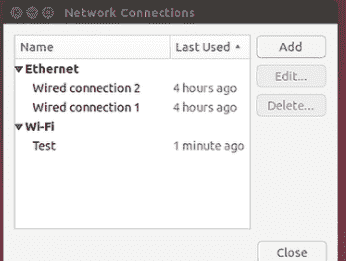

选择你想要配置的网络连接（有线或无线），然后点击“编辑”（`Edit`）按钮更改当前配置。`Network Manager` 允许你通过手动配置选项指定主机地址、网络子网地址、默认网关和 DNS 服务器名称，或者通过动态主机配置协议（`DHCP`）来确定设置。`Network Manager` 会根据更新后的设置自动更新相应的网络配置。

## 现实世界场景

### 手动 DNS 配置

`Linux Essentials` 考试确实要求你了解网络配置文件的一个主题是 `DNS`。你可以手动定义 `DNS` 服务器，以便系统可以使用 `DNS` 主机名。遗憾的是，这是所有 `Linux` 系统都遵循的标准，且该标准在 `/etc/resolv.conf` 文件中处理：

```
domain mydomain.com
search mytest.com
nameserver 192.168.1.1
```

`domain` 条目定义了分配给网络的域名。默认情况下，系统会在你指定的任何主机名后附加此域名。`search` 条目定义了用于查找主机名的任何额外域名。`nameserver` 条目是你指定为网络分配 `DNS` 服务器的地方。某些网络可以有多个 `DNS` 服务器；只需在文件中添加多个 `nameserver` 条目即可。但要留意，取决于你的 `Linux` 发行版的配置，此文件在下次启动 `Linux` 系统时可能会被重置。为了加快与常用主机的连接，请在 `Linux` 系统的 `/etc/hosts` 文件中手动输入它们的主机和 `IP` 地址。`/etc/nsswitch.conf` 文件定义了 `Linux` 系统是在 `DNS` 之前还是之后检查此文件来查找主机名。

# 命令行工具

如果你不在图形桌面客户端环境中工作，将需要使用 `Linux` 命令行工具来设置网络配置信息。你有许多不同的命令行工具可供。本节涵盖了你最可能遇到的工具（以及你在 `Linux Essentials` 考试中最可能看到的工具）。

## Network Manager 命令行工具

`Network Manager` 提供了两个命令行工具：

- `nmtuui` 提供了一个简单的基于文本的菜单工具
- `nmcli` 提供了一个纯文本的命令行工具

这两个工具都能帮助你完成设置 `Linux` 系统所需网络信息的过程。`nmtuui` 显示图形化工具的精简版本，你可以在其中选择网络接口并为其分配网络属性，如图 15.3 所示。

图 15.3 `Network Manager` `nmtuui` 命令行工具

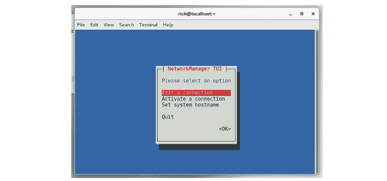

`nmcli` 工具不尝试使用任何图形功能——它提供了一个可以查看和更改网络设置的命令行界面。默认情况下，该命令显示网络设备及其设置，如列表 15.1 所示。

### 列表 15.1：nmcli 命令的默认输出

```
$ nmcli
enp0s3: connected to enp0s3
"Intel 82540 Gigabit Ethernet Controller (PRO/1000 Desktop)"
ether (08:00:27:73:1C:6D), hw, mtu 1500
ip4 default
inet4 10.0.2.15/24
route4 0.0.0
```

`nmcli` 命令使用选项来设置网络：

```
# nmcli connection add type eth ifname enp0s3 ip4 10.0.2.10/24 gw 10.0.2.1
```

在此示例中，我们将 `IP` 地址设置为 `10.0.2.10`，子网掩码设置为 `/24`，默认网关设置为 `10.0.2.1`。

## 传统工具

如果你的 `Linux` 发行版不支持 `Network Manager` 工具，可以使用四个传统工具之一：

- `ethtool`——显示以太网设置
- `ifconfig`——显示或设置 `IP` 地址和掩码
- `ip`——显示或设置网络设置
- `iwconfig`——显示或设置 `SSID` 和密钥
- `route`——显示或设置默认网关

`ethtool` 命令允许你查看网卡内部并更改与交换机通信所需的任何属性。默认情况下，`ethtool` 命令显示网络接口的当前配置，如列表 15.2 所示。

### 列表 15.2：ethtool 输出

```
$ ethtool enp0s3:
Supported ports: ]
Supported link modes: 10baseT/Half 10baseT/Full 100baseT/Half 100baseT/Full 1000baseT/Full
Supported pause frame use: No
Supports auto-negotiation: Yes
```


Supported `FEC` modes: Not reported

Advertised link modes: `10baseT/Half` `10baseT/Full` `100baseT/Half` `100baseT/Full` `1000baseT/Full`

Advertised pause frame use: No

Advertised auto-negotiation: Yes

Advertised `FEC` modes: Not reported

Speed: `1000Mb/s`

Duplex: Full

Port: Twisted Pair

`PHYAD`: 0

Transceiver: internal

Auto-negotiation: on

`MDI-X`: off (auto)

```

```

# 表 15.1 `ip` 工具的命令选项

| 参数 | 描述 |
|--- | --- |
| `address` | 显示或设置设备上的 `IPv4` 或 `IPv6` 地址。 |
| `addrlabel` | 定义配置标签。 |
| `l2tp` | 基于 `IP` 的以太网隧道 (Tunnel Ethernet over `IP`)。 |
| `link` | 定义网络设备。 |
| `maddress` | 定义系统监听的组播地址。 |
| `monitor` | 监听 `netlink` 消息。 |
| `mroute` | 在组播路由缓存中定义项。 |
| `mrule` | 在组播路由策略数据库中定义规则。 |
| `neighbor` | 管理地址解析协议 (`ARP`) 或邻居发现 (`NDISC`) 缓存。 |
| `netns` | 管理网络命名空间。 |
| `ntable` | 管理邻居缓存操作。 |
| `route` | 管理路由表。 |
| `rule` | 管理路由策略数据库中的条目。 |
| `tcpmetrics` | 管理接口上的 `TCP` 指标。 |
| `token` | 管理标记的接口标识符。 |
| `tunnel` | 基于 `IP` 的隧道 (Tunnel over `IP`)。 |
| `tuntap` | 管理网络隧道 (`TUN`) 或网络桥接 (`TAP`) 设备。 |
| `xfrm` | 管理安全连接的 `IPSec` 策略。 |

每个命令选项都使用参数来定义执行的操作，例如显示网络设置或修改现有网络设置。列表 15.3 展示了如何使用 `show` 参数显示当前网络设置。

## 列表 15.3：`ip address show` 输出

```
$ ip address

1: lo: <LOOPBACK,UP,LOWER_UP> mtu 65536 qdisc noqueue state UNKNOWN group

default qlen 1000

link/loopback 00:00:00:00:00:00 brd 00:00:00:00:00:00

inet 127.0.0.1/8 scope host

    valid_lft forever preferred_lft forever

inet6::128 scope host

    valid_lft forever preferred_lft forever

2: enp03:<BROADCAST,MULTICAST,LOWER_UP> mtu 1500 qdisc pfifo_fast

state group default qlen 1000

link/eth8:00:08:27:73:1c:6d brd ff:ff:ff:ff:ff:ff

inet 10.0.2.15/24 brd 10.0.2.255 scope global dynamic

    valid_lft 8411sec preferred_lft 8411sec

inet6 fe80::5432:eddb:5ea1:fb44/64 scope link noprefixroute

    valid_lft forever preferred_lft forever

```

列表 15.3 显示了 Linux 系统上的两个网络接口：

- `lo`—本地回环接口
- `enp03`—一个有线网络接口

本地回环接口是一个虚拟网络接口。任何本地程序都可以使用它与其他程序进行通信，就像它们跨越了网络一样。这可以简化数据传输程序的编写。
`enp03` 是 Linux 系统的有线网络连接。
`ip` 命令显示分配给接口的 IP 地址（同时分配了 IP 和 IPv6 本地地址）、子网掩码值以及关于接口数据包的一些基本统计信息。

如果输出没有显示分配给接口的网络地址，可以使用 `ip` 命令为接口指定主机地址和子网掩码值：

```bash
# ip address add 10.0.2.15/24 dev enp03
```

然后，你可以使用 `ip` 命令为网络接口设置默认路由器：

```bash
# route add default via 192.168.1.254 dev enp03
```

最后，使用 `link` 选项使网络接口激活：

```bash
# ip link set enp03 up
```


# 第 15 章 • 管理网络连接

## 认证目标

虽然 `ip` 命令是更改网络设置的一站式方法，但为你的网络指定设置的另一种方法是使用 `route` 命令：

```bash
# route add default gw 192.168.1.254 dev enp03
```

你也可以单独使用 `route` 命令来查看系统配置的当前默认路由器：

```bash
$ route
```

| Destination | Gateway | Genmask | Flags | Metric | Ref | Iface |
| --- | --- | --- | --- | --- | --- | --- |
| 192.168.1.0 | 192.168.1.254 | 0.0.0.0 | U | 0 | 0 | enp03 |
| | | 255.255.255 | U | 1 | | |

Linux 系统的默认路由器是 192.168.1.0，且通过 `enp03` 网络接口可用。输出还显示了连接的本地网络。如果你的网络通过多个路由器连接到多个网络，你可以使用 `route` 命令的 `add` 或 `del` 命令行选项在系统中手动创建路由表。格式如下：

```bash
route [add|del] gw gateway
```

其中 `target` 是目标主机，`gateway` 是路由器地址。

如果你的网络使用 DHCP，请确保 Linux 系统上运行着另一个 DHCP 客户端。该程序在后台与 DHCP 服务器通信并分配网络交互所需的 IP 地址。Linux 可用的 DHCP 客户端有：
- `dhcpcd`
- `dhclient`
- `pump`

`dhcpcd` 程序是最流行的，但在某些 Linux 发行版中也会看到另外两个。

在使用 `ip` 命令为无线接口分配地址之前，必须使用 `iwconfig` 命令分配 SSID 和密钥值：

```bash
# iwconfig wlan0 ssid "MyNetwork" key password
```

`ssid` 参数接入点名称，`key` 参数允许你指定连接所需的 ASCII 字符加密密钥。如果你不知道本地无线连接的名称，可以使用 `iwlist` 命令显示所有无线信号。只需指定无线设备并使用 `scan` 选项：

```bash
$ iwlist scan
```

## 真实场景

### 获取 Wi-Fi 驱动

遗憾的是，Linux 对 Wi-Fi 硬件的支持有限。如果你在尝试配置时没有看到 Wi-Fi 硬件，可能需要跟踪驱动。你可以使用第 6 章中描述的 `lspci` 工具开始这项任务，带有某些选项来查看可用硬件列表——例如，笔记本电脑的 `lspci` 输出包含了：

```
03:00.0 Network controller: Realtek Co., Ltd. RTL8191SE Wireless LAN (rev 10)
```


`WiFi` 适配器识别为 `RTL8191`。在 `Realtek` 网站上搜索可以编译本地驱动，但这出了本书的范围。你可能没有足够幸运通过这种方法找到驱动。

使用原生 `Linux` 驱动的替代方案是使用名为 `ndiswrapper` 的包（`http://ndiswrapper.sourceforge.net`），它允许你在 `Linux` 中安装 `Windows` `WiFi` 驱动。并不是所有的发行版包都提供 `ndiswrapper`，但你可以在附加仓库找到它。

如果所有选项都失败了，你可能需要购买新的硬件。有很多 `USB` `WiFi` 适配器可用，但你应该研究一个支持良好的。你也可以替换某些笔记本电脑上的内置适配器。

### 基本网络故障排除

安装内核后，你可以采取几个步骤检查运行是否正常。本节介绍了你应该了解的监控网络活动的命令，包括观察哪些进程在监听网络以及哪些连接是活跃的。

### 发送测试包

测试网络连通的一种方法是向已知主机发送包。`Linux` 提供了 `ping` 和 `ping6` 命令来完成操作。`ping` 和 `ping6` 命令使用 `IP` (`ping`) 或 `IPv6` (`ping6`) 协议向远程主机发送互联网控制消息协议 (`ICMP`) 包。`ICMP` 包在后台跟踪连通性并在系统间的控制消息。如果远程主机支持 `ICMP`，它在收到 `ping` 包时会发送响应包。

`ping` 的基本格式是指定远程主机的 `IP` 地址：

```bash
# ping 10.0.2.2
```

```
PING 10.0.2.2 (10.0.2.2) 56(84) bytes of data.

64 bytes from 10.0.2.2: icmp_seq=1 ttl=63 time=14 ms

64 bytes from 10.0.2.2: icmp_seq=2 ttl=63 time=13 ms

64 bytes from 10.0.2.2: icmp_seq=3 ttl=63 time=15 ms

64 bytes from 10.0.2.2: icmp_seq=4 ttl=63 time=14 ms

---

 10.0.2.2 ping statistics ---
```

`ping` 命令会持续发送包直到你按下 `Ctrl+C`。你也可以使用 `-c` 选项指定发送的一组包并停止。如果你使用 `IPv6` 本地地址，还需要告知通过哪个接口发送包：

```bash
# ping -c 4 fe80::c418:2ed0:aead:bcce%enp0s3
```

```
PING fe80::c418:2ed0:aead:bcce%enp0s3 (fe80::c418:2ed0:aead:bcce%enp0s3) 56 data bytes

64 bytes from fe80::c418:2ed0:aead:bcce%enp0s3: icmp_seq=1 ttl=128 time=1.47 ms

64 bytes from fe80::c418:2ed0:aead:bcce%enp0s3: icmp_seq=2 ttl=128 time=0.48 ms

64 bytes from fe80::c418:2ed0:aead:bcce%enp0s3: icmp_seq=3 ttl=128 time=0.777 ms

64 bytes from fe80::c418:2ed0:aead:bcce%enp0s3: icmp_seq=4 ttl=128 time=0.659 ms

---

 fe80::c418:2ed0:aead:bcce%enp0s3 ping statistics ---

4 packets transmitted, 4 received, 0% packet loss, time 3003ms

rtt min/avg/max/mdev = 0.478/0.847/1.475/0.378 ms
```

`%enp0s` 告诉系统通过 `enp0s` 网络接口为链路本地地址发送 `ping` 数据包。

如今，许多主机不再支持 `ICMP` 数据包，因为这些包可以被用于对主机进行拒绝服务（`DOS`）攻击。如果你尝试 `ping` 远程主机但没有收到响应，不要感到意外。


# 查找主机信息

有时问题不在于网络连接，而在于 `DNS` 主机系统。你可以使用 `host` 命令测试主机名：


```
$ host www.linux.org

www.linux.org is an alias for linux.org.

linux.org has address 107.170.40.56

linux.org mail is handled by 20 mx.iqemail.net.

$
```

`host` 命令查询 `DNS` 服务器以确定分配给指定主机名的 `IP` 地址。某些主机在负载均衡配置下由多个服务器支持。`host` 命令将显示与这些服务器关联的所有 `IP` 地址：

```
$ host www.google.com

www.google.com has address 74.125.138.104

www.google.com has address 74.125.138.105

www.google.com has address 74.125.138.147

www.google.com has address 74.125.138.99

www.google.com has address 74.125.138.103

www.google.com has address 74.125.138.106

www.google.com has IPv6 2607:f8b0:4002:c8cc::67

$
```

你也可以为 `host` 命令指定一个 `IP` 地址，它将尝试查找其对应的主机名：

```
$ host 107.170.40.56

56.40.170.107-in.arpa domain name pointer idig11.iqection.com.

$
```

但注意，`IP` 地址通常会解析为托管网站的通用服务器主机名，而不是网站别名，如 `www.linux.org` 地址的情况所示。

# 第 15 章 • 管理网络连接

另一个强大的工具是 `dig` 命令。`dig` 命令显示与特定主机或网络关联的所有 `DNS` 记录。例如，你可以查询特定主机名的信息：

```
$ dig www.linux.org

; << DIG 9.9.4-RedHat-9.9.4-18.el7_1.5 << www.linux.org

; global options: +cmd

; Got answer:

; -->>HEADER opcode: QUERY, status: NOERID, id: 45314

; flags: qr rd ra; QUERY: 1, ANSWER: 2, AUTHORITY: 0, ADDITIONAL: 1

; OPT PSEUDOSECTION:

; EDNS: version: 0, flags;; udp: 4096

; QUESTION SECTION:

www.linux.org. IN A

; ANSWER SECTION:

www.linux.org. 14400 IN CNAME linux.org.

linux.org. 3600 IN A 107.170.40.56

; Query time: 75 msec

; SERVER: 192.168.1.254#53(192.168.1.254)

; WHEN: Sat Feb 06 17:44:29 EST 2016

; MSG SIZE rcvd: 72
```

或者你可以查询与特定网络服务（如邮件服务器）关联的 `DNS` 数据记录：

```
$ dig linux.org MX

; << DIG 9.9.5-ubuntu0.5-Ubuntu << linux.org MX

; global options: +cmd

; Got answer:

; -->>HEADER opcode: QUERY, status: NOERID, id: 16202

; flags: qr rd ra; QUERY: 1, ANSWER: 1, AUTHORITY: 0, ADDITIONAL: 1

; OPT PSEUDOSECTION:

; EDNS: version: 0, flags;; udp: 4096

; QUESTION SECTION:

linux.org. IN MX

; ANSWER SECTION:

linux.org. 3600 IN MX 20 mx.iqemail.net.
```


```
;; Query time: 75 msec
;; SERVER: 127.0.0.1#53(127.0.0.1)
;; WHEN: Tue Feb 09 12:35:43 EST 2016
;; MSG SIZE rcvd: 68
$
```

如果你需要查询多个服务器或域名的 DNS 信息，`nslookup` 命令提供了一个交互式界面，你可以在其中输入命令：

```
$ nslookup
> www.google.com
Server: 192.168.1.254
Address: 192.168.1.254
Non-authoritative answer:
Name: www.google.com
Address: 172.217.22
> wikipedia.org
Server: 192.168.1.254
Address: 192.168.1.254
Non-authoritative answer:
Name: wikipedia.org
Address: 208.80.153
> exit
```

你也可以动态指定另一个 DNS 服务器地址进行查询，以判断是否是 DNS 解析失败。

# 高级网络排除

除了上一节所示简单测试外，Linux 还有一些高级程序可以提供有关网络环境的复杂信息。查看系统中哪些连接是活跃的解决方法有两种：`netstat` 命令和 `ss`。

# netstat 命令

`netstat` 命令可以为你提供大量信息。默认情况下，它列出所有打开的网络连接：

```
netstat
Active Internet connections (w/o servers)
Proto  Recv-Q  Send-Q   Local Address           Foreign Address       State
unix      2       DGRAM   10825                 /run/dbus/notify      
unix      2       DGRAM   10933                 /run/systemd/shutdown
unix      6       DGRAM   6609                  /run/systemd/socket
unix      25      DGRAM   6611                  /dev/log
tcp      0       STREAM  25693                 0.0.0.0:*               0.0.0.0:*      ESTABLISHED
tcp      0       STREAM  20770                 0.0.0.0:*               0.0.0.0:*      ESTABLISHED
tcp      0       STREAM  19511                 0.0.0.0:*               0.0.0.0:*      ESTABLISHED
tcp      2       DGRAM  24125                 0.0.0.0*               0.0.0.0*      ESTABLISHED
tcp      3       STREAM  19335                 0.0.0.0*               0.0.0.0*      ESTABLISHED
tcp      3       STREAM  18357                 0.0.0.0*               0.0.0.0*            ABLISHED
tcp      3      STREAM  22358                 /run.0...socket      ESTABLISHED
unix      3      STREAM  24818                 /run.dbus/socket
```

`netstat` 命令产生输出日志，因为 Linux 系统通常有多个程序在使用网络服务。你可以通过 `-t` 选项将输出限制为 TCP 连接，通过 `-u` 为 UDP 连接：

```
$ netstat -t
Active Internet connections (w/o servers)
Proto  Recv-Q  Send-Q   Local Address           Foreign Address       State
tcp      1       10.0.2.15:58633        localhost               CLOSE_WAIT
tcp6      1      ip6-localhost:57782     localhost CLOSE_WAIT
```

你可以使用 `-l` 选项获取监听网络端口的应用程序列表：

```
$ netstat -l
Active Internet connections (only servers)
Proto  Recv-Q  Send-Q   Local Address           Foreign Address       State
tcp       0               linux.domain           *:*               LISTEN
tcp       0               localhost              LISTEN
tcp6      0               ipv6-localhost         [::*    LISTEN
udp       0               *                      *::*
udp       0               *:mdns                 *::*
udp       0               *:36355               *::*
udp       0               linux.domain           *::*
udp       0               *:bootp                *::*
udp       0               *:12461               *::*
pdp6      0               [::]:64294             [::*]
pdp6      0               [::]:60259             [::*]
udp       0               *:mdns                 *::*
...
```

你可以看到，仅仅标准的 Linux 工作站后台有大量的活动在等待连接。`netstat` 命令的另一个伟大功能是 `-s` 选项显示系统在网络上使用的不同类型包的统计信息：


```
netstat -s

Ip:
      240762 total packets received
               0 forwarded
               0 incoming packets discarded
      246747 incoming packets delivered
      206940 requests sent out
          32 dropped because of missing route

Icmp:
          57 ICMP messages received
               0 input ICMP message failed.
ICMP input histogram:
          12 destination unreachable
          38 timeout in transit
               7 echo replies
           7 ICMP messages sent
               0 ICMP messages failed
ICMP output histogram:
               7 echo request

IcmpMsg:
InType0: 7
InType3: 12
InType1: 38
OutType8: 7

Tcp:
+   * 286 active connections
* passive connection openings
* failed connection attempts
* connection resets received
* connections established
* 239933 segments received
* 206091 segments sent out
* segments retransmitted
* bad segments received.
* resets sent

Udp:
+   * 757 packets received
* packets to unknown port received.
* packet receive errors
* 840 packets sent
* receive buffer errors
* send buffer errors

TcpExt:
+   * 219 TCP sockets finished time wait in fast timer
*       15 delayed acks sent
*       26 delayed acks further delayed because of locked socket
*       Quick ack mode was activated 1 times
*      229343 packet headers predicted
*      289 acknowledgments not containing data payload
*      301 predicted acknowledgments

TCPRCvCoalesce: 72755

IpExt:
+   * InRoutes: 2
* InMcastPkts: 13
* OutMcastPkts: 15
* InOctets: 410722578
* OutOctets: 8363083
* InMcastOctets: 2746
* OutMcastOctets: 2826
```

网络统计输出可以让你大致了解你的`Linux`系统在网络上的繁忙程度，或者安装的某个协议是否存在问题。

## 检查套接字 (Sockets)

`netstat`工具提供了丰富的网络信息，通常很难确定是哪个程序正在监听开放的端口。`ss`命令可以帮助你解决这个问题。

程序到端口的连接被称为套接字（`socket`）。`ss`命令可以帮助你关联哪些进程正在使用哪些活跃的网络套接字：

```
$ ss -anpt
State    Recv-Q  Send-Q  Local Address:Port      Peer Address:Port
LISTEN   0       100             127.0.0.1:25           *:*
LISTEN   0               :111                   *:*
LISTEN   0       5       192.168.122.153        *:*
LISTEN   0               :22                    *:*
LISTEN   0       128             127.0.0.1:631           *:*
LISTEN   0               :25                    *:*
LISTEN   0       128             :111                   *:*
LISTEN   0               :22                    *:*
LISTEN   0       128             :631                   *:*
ESTAB    0               :122                   ::1:40490
ESTAB    0       0               :1:40490               ::1:22
```

`users:(("ssh",pid=15176,fd=3))`

`-antpt`选项同时显示监听和已建立的`TCP`连接，以及它们相关的进程。此输出显示`ssh`端口（`22`端口）有一个已建立的连接，并由进程`ID`15176（即`ssh`程序）控制。

## 总结

如果你拥有正确的工具，将`Linux`系统连接到网络并不是件痛苦的事。要连接`Linux`系统，你需要一个`IP`地址、默认网关、主机名和`DNS`服务器。如果你不知道分配给系统的`IP`地址，可以使用`DHCP`自动获取这些值。

`Network Manager`是绝大多数`Linux`发行版中用于配置网络设置的最流行的图形化工具。它允许你从图形化窗口配置有线和无线网络设置。如果你必须从命令行配置网络设置，你需要使用几个工具。对于无线连接，使用``ifconfig``设置无线接入点和`SSID`密钥。对于有线和无线连接，均使用``ifconfig``或``ip``命令为接口设置`IP`地址和网络掩码值。你可以使用``route``命令定义本地网络的默认网关。

当网络配置完成后，你可能需要对网络问题进行额外的故障排除。``ping``和``ping6``命令允许你向远程主机发送`ICMP`包以测试基本连通性。如果你怀疑主机名存在问题，可以使用``host``和``dig``命令查询`DNS`服务器获取主机名。对于更高级的网络故障排除，你可以使用``netstat``和``ss``命令显示系统上哪些应用程序正在使用哪些网络端口。

## 考试要点

**描述用于配置和操作以太网网络接口所需的命令行工具。** 要在以太网接口上设置`IP`和掩码地址，使用``ifconfig``或``ip``命令。要为网络设置默认网关（`gateway`），使用``route``命令。某些安装了`Network Manager`的`Linux`发行版可以使用``nmtui``或``nmcli``命令，它们可以配置这三个值。

**解释如何配置对无线网络的的基本访问。**`Linux`使用``iw``命令列出网卡检测到的所有无线接入点。你可以使用``ifconfig``命令配置连接到特定无线网络的设置。至少，你需要配置接入点`SSID`值，并且必须指定加密密钥值以连接到接入点。

**描述如何操作 Linux 系统上的路由表。**``route``命令用于显示`Linux`系统使用的现有路由表。你可以使用``add``选项添加新路由，或使用``del``选项删除现有路由。通过命令中的``default``关键字指定网络的默认网关。

**总结用于分析网络设备状态所需的工具。**``ifconfig``和``ip``命令显示系统上所有网络接口的当前状态。你可以使用``netstat``或``ss``命令显示所有监听网络端口的统计信息。

**解释如何测试网络连通性。**``ping``和``ping6``命令允许你向远程主机发送`ICMP`消息并显示收到的响应。


**描述如何使用 `Network Manager` 在 Linux 中配置网络设置。** `Network Manager` 提供了一个用于更改网络接口设置的图形界面。`Network Manager` 以图标形式出现在桌面面板区域。如果你的 Linux 系统使用无线网卡，图标将显示为无线信号，而有线网络连接显示为微型网络图标。当你点击图标时，它会显示当前网络状态，对于无线接口，还会显示检测到的接入点列表。当你打开 `Network Manager` 界面时，它允许设置静态 IP 地址信息或配置网络使用 `DHCP` 服务器动态设置网络配置。

## 复习题

你可以在附录 A 中找到答案。

- 1. 哪两个可以使用命令行设置接口的 IP 地址、子网掩码和默认网关信息？（选择两个）
  - A. `netstat`
  - B. `ping`
  - C. `nmtui`
  - D. `ip`
  - E. `route`

- 2. 哪个命令显示以太网卡的双工模式设置？
  - A. `ethtool`
  - B. `netstat`
  - C. `iwconfig`
  - D. `iwlist`
  - E. `route`

- 3. 哪个命令显示 Linux 系统上哪些进程在使用哪些端口？
  - A. `iwconfig`
  - B. `ip`
  - C. `ping`
  - D. `nmtui`
  - E. `ss`

- 4. 哪个网络设置定义了用于远程网络的设备？
  - A. Default router
  - B. Netmask
  - C. Host name
  - D. IP address
  - E. DNS server

- 5. 哪个设备设置定义了将主机名映射到 IP 地址？
  - A. Default router
  - B. Netmask
  - C. Host name
  - D. IP address
  - E. DNS server

- 6. 什么用于自动为客户端分配 IP 地址？
  - A. Default router
  - B. `DHCP`
  - C. ARP table
  - D. Netmask
  - E. `ifconfig`

- 7. 使用哪个命令来查找域名的邮件服务器？
  - A. `dig`
  - B. `netstat`
  - C. `ping6`
  - D. `host`
  - E. `ss`

- 8. 哪个 `ifconfig` 格式正确为 `eth0` 接口分配 IP 地址和掩码？
  - A. `ifconfig eth0 up 192.168.1.50 netmask 255.255.255.0`
  - B. `ifconfig eth0 192.168.1.50 netmask 255.255.255.0`
  - C. `ifconfig eth0 up 192.168.1.50 255.255.255.0`
  - D. `ifconfig up`
  - E. `ifconfig down`

- 9. 哪个命令显示所有可用无线网络？
  - A. `iwlist`
  - B. `iwconfig`
  - C. `ifconfig`
  - D. `ip`
  - E. `arp`

- 10. 哪个命令可以同时显示和设置 IP 地址、掩码和默认网关？
  - A. `ifconfig`
  - B. `iwconfig`
  - C. `router`
  - D. `ifup`
  - E. `ip`

## 第 2 章：理解软件许可

- 9. C. Alpha 版本（alpha release）是应用程序或发行版的第一个测试版本，尚未在所有环境中经过充分测试，并且很可能包含漏洞。Beta 版本软件发布已经在某些环境中经过了测试，但并非所有环境，且它在您的特定环境中可能包含漏洞。因此，选项 C 是正确的。选项 A、B、D 和 E 中的建议术语不用于表示软件包的标准第一个和第二个版本。

- 10. A. 滚动发行（rolling release）是根据需要提供的 Linux 发行版，没有特定的发布日期或版本号。因此，选项 A 是正确的。选项 B、C、D 和 E 中使用的术语通常用于指示版本类型。

## 第 2 章：理解软件许可

- 1. C. 选项 C 没有描述开源要求，因此它是正确答案。开源定义规定用户能够分发更改，但并没有规定许可要求在相同许可的条款下进行分发。选项 A、B、D 和 E 转述了实际的开源许可条款。

- 2. B. 某些发行版（特别是收费的“企业级”版本）包含了既不是开源也不是可自由分发的软件，因此选项 B 是正确的。发行版整体使用了许多许可，而不仅仅是一个，所以选项 A 是错误的。`MIT` 许可是多种开源许可之一；此类软件并不会成为复制发行版的阻碍，因此选项 C 是错误的。虽然某些发行版（如 `Debian`）的目标是使其系统完全符合开源标准，但并非所有发行版都是如此，因此选项 D 是错误的。同样，并非所有发行版都是 `FSF` 所使用的完全的“自由软件”（free free software）。

- 3. E. E 转述了 `FSF` 哲学中的四个关键点之一，因此是正确的。对于选项 A，`FSF` 的哲学并不强制使用 `GPL`，更不用说其最新版本，尽管 `GPL` 是 `FSF` 优选的许可。选项 B 符合 `FSF` 的立场，即自由软件应该保持自由；然而，这与 `OSI` 的哲学相反。尽管 `FSF` 提倡自由软件，但选项 C 并不是他们哲学的明确部分，因此是错误的。虽然自由想要一个由自由软件主导的世界，但它并不提倡软件盗版，因此选项 D 是错误的。

- 4. 正确。法院和法律明确承认计算机软件是受版权保护的创作作品。在某些国家，专利法也适用于软件，尽管全球范围内并非如此。

- 5. 正确。这一原则是自由软件和开源软件定义的核心。

## 附录 A：复习题答案

- 6. 错误。硬件供应商通常为他们的产品提供开源驱动程序。需要注意的是，发布开源驱动程序必然会使硬件的某些编程接口开放，而某些硬件供应商不愿这样做。

- 7. D. 较小通用许可证 (`LGPL`) 是自由软件基金会 `GPL` 的变体。开发者经常在库（供其他程序使用的代码集合）中使用 `GPL`。

- 8. A. 知识共享（`Creative Commons`）有助于促进 `FSF` 和 `OSI` 所关注的自由类型，而且是在更广泛的范围内。它的许可通常针对音频录制、视频录制、文本作品以及计算机程序。

- 9. C. “自由左版”（free copyleft）一词是对“版权”（copyright）一词的戏，反映了版权条款被用于确保某些自由，这些自由在某些情况下与版权的初衷完全相反——即保证用户复制软件的自由，而不是限制该权利。`Copyleft` 通常用于反映 `FSF` 许可及其灵感。

- 10. E. 赏金机制（bounty）是一种众筹方法，可以帮助聚集资金（每个人单独可能都无法提供足够的资金来激励开发），以诱导程序员编写所需的代码。通过赏金机制，第一个完成项目的程序员被允许收集项目的累积资金。

## 第 3 章：研究 Linux 原理与哲学

- 1. A. Linux 的多任务处理是抢占式的，这意味着内核可以根据情况向任何进程分配 CPU 时间，可能会中断（或抢占）其他进程。因此，选项 A 是正确的。Linux 是一个多任务操作系统，但 multitask 并不是多任务的一种类型，所以选项 B 是错误的。在协作式多任务操作系统，选项必须自愿相互放弃 CPU 时间。虽然 Linux 程序可以向操作系统发送信号，但调度由内核管理。

- 2. B. 单内核（monolithic kernel）将所有的内核函数整合到一个单一程序中，而微内核设计将内核函数分成更小的程序。选项 B 是正确的。外内核（exernel）设计在内核中提供极少的支持，依赖外部程序处理一切，因此选项 A 是错误的。

## 第 3 章：研究 Linux 原理与哲学

- 3. D. Linux 系统通常使用图形界面环境来运行如文字处理器和网络浏览器之类的图形程序，因此选项 D 是正确的。

- 4. 错误。Linux 创建于 1991 年。

- 6. 大多数服务器程序不需要 `GUI`，因此服务器管理员经常完全删除它以节省空间和内存。

- 8. D. 共享软件（Shareware）允许程序在不付费的情况下向公众发布二进制执行文件，但在程序在使用时要求付费。因此，选项 D 是正确的。

- 10. E. `Apache`。`Apache` 软件包是专门为 Linux 服务器编写的 Web 服务器，利用了 Linux 处理多个应用程序的进程和内存的方式。因此，选项 E 是正确的。

# 第 4 章：使用常用 Linux 程序

- 1. B, C, E。`GNOME`、`KDE Plasma` 和 `Xfce` 都是 Linux 桌面环境，因此选项 C 和 E 都是正确的（`LXDE` 也是一个桌面环境）。`GIMP Toolkit` (`GTK+`) 是一个 `GUI` 编程库。虽然 `GNOME` 和 `Xfce` 都是基于 `GTK+` 构建的，但它不是桌面环境，因此选项 A 是错误的。`Evolution` 是一个 Linux 客户端，而不是桌面环境，因此选项 D 是错误的。


2. 网络文件系统 (NFS) 正是为了为问题中描述的任务设计的，选项 B 正确。简单邮件传输协议 (SMTP) 允许向另一台计算机发送电子邮件，或者说它是实现上述的的糟糕选择，因此选项 A 是错误的。PHP：超文本处理器 (PHP) 语言用于为网页生成动态内容，因此选项 C 是错误的。域名系统 (DNS) 是一种用于主机名与计算机 IP 地址之间映射的协议，否则它无法实现上述目标，因此选项 D 是错误的。动态主机配置协议 (DHCP) 允许一台计算机通过网络链路向另一台计算机提供网络配置信息，因此选项 E 是错误的。

3. Linux 内核的主要语言是 C，因此选项 C 正确。虽然 Bash 脚本控制着 Linux 启动过程，但这些脚本不是内核的一部分，因此选项 A 是错误的。Java 通常用于基于 Web 的应用程序，但它没有用于 Linux 内核，因此选项 B 是错误的。C++ 是 C 的派生版本，为语言添加了特性，但 Linux 使用的是普通的 C 而不是 C++，因此选项 D 是错误的。Perl 是一种流行的解释型语言，特别适用于涉及文本处理的任务，但它不是 Linux 内核的语言，因此选项 E 是错误的。

4. 错误。LibreOffice 是 Apache 版本的 OpenOffice.org 分叉出来的。Calligraph 源自 KO 办公套件，该套件已不再维护。

5. 正确。拒绝服务 (DoS) 攻击可以通过向服务器程序（甚至只是运行其上的计算机）发送海量数据来中断服务器的运行。即使服务器管理得完美无缺，事实如此。

6. Python 与 JavaScript、Perl、PHP 和 shell 语言一样是解释型的。这与常见的编译语言 C 和 C++，以及处于两者之间的 Java 形成了对比。

7. 电子邮件客户端程序允许你读取和编写电子邮件消息，这可以访问你自己计算机上的邮箱，或者使用电子邮件网络协议在网络上发送和接收电子邮件。Thunderbird 是一个常用的 Linux 电子邮件客户端。其他的包括 Evolution、KMail 和 Mutt。

8. 微软使用 SMB/CIFS 协议进行文件和打印机共享。在 Linux 上，Samba 软件实现了该协议。

# 第 5 章：了解命令行

9. B。程序员必须将用编译语言编写的程序从其原始源代码转换为机器码形式。机器码稍后运行。用解释型语言（如 Python、Javascript 和 Perl）编写的程序在运行时，由一个程序解释器逐行转换为机器码。

10. D。软件程序在 Linux 上被封装成预先构建的软件包（package），这简化了它们的安装和管理。随后在 Linux 上使用管理系统 (PMS) 对软件包进行管理。

1. A。在 Bash 中编辑命令时，按下 `Ctrl+A` 可将光标移动到行首，因此选项 A 是正确的。左箭头键将单个字符向左移动，`Ctrl+T` 遍历两个字符，上箭头在历史记录中向上移动一项，`Ctrl+E` 移动到行尾。

2. C, D。选项 C 和 D 描述了如何从 shell 在后台运行程序，因此选项 C 和 D 都是正确的。`start` 或 `bg` 都不是在后台启动程序的命令。`fg` 命令将程序返回前台，意味着它将恢复到睡眠状态，这并不是题目所要求的。

3. D。`less` 和 `more` 一样分页显示文本文件。`less` 工具还包含了在文本文件中翻页、搜索内容以及 `more` 无法执行的功能。因此，选项 D 是正确的。`grep` 命令在文件中搜索指定的字符串，因此它执行的任务与 `more` 不同，导致选项 A 是错误的。超文本标记语言 (HTML) 是一种格式，通常以文件扩展名 `.html` 表示，常用于 Web。因此它不是 `more` 的更好版本，因此选项 B 是错误的。`cat` 可以连接两个或多个文件，或在屏幕上显示单个文件。在后一种功能上，`cat` 的能力不如 `more`。因此，选项 C 是错误的。`man` 命令显示 Linux 手册页。虽然许多人默认使用 `less`，但 `man` 并不是 `more` 的改进版本，因此选项 E 是错误的。

4. 错误。在 GUI 中时，必须使用 `Ctrl` 进行 VT 切换快捷键，因此情况下正确的快捷键是 `Ctrl+Alt+F3`。

5. 正确。当你想要搜索时，要指定 `man` 部分、文件名或要搜索的内容。

6. 错误。`info` 页像网页一样，使用超链接将相关文档连接在一起，`info` 页存储在计算机的硬盘上；不需要 Internet 访问。

7. D。`logout` 和 `exit` 命令都会退出终端。

8. C。每个 `info` 页被称为一个节点（node），`info` 系统是关联节点的集合。

9. E。`locate` 命令搜索一个文件名数据库，该数据库每天更新一次。因此，`locate` 生成结果比 `find` 命令快。

# 第 6 章：硬件管理

1. D。`lspci` 命令显示 PCI 设备的信息。由于许多主板功能以 PCI 设备的形式出现，它提供了关于主板的大量信息，因此 D 正确。`cpuinfo` 命令提供 CPU 信息但没有其他信息。`Xorg` 程序提供显示环境的信息而不是主板，因此选项 B 正确。`fdisk` 命令显示系统硬盘的信息而不是主板，因此选项 C 正确。CUPS 管理网页 `localhost:631` 帮助你管理打印机，但不会告诉你关于主板的任何信息，因此选项 E 正确。

2. A, D。磁盘分区允许将数据划分数据。这样做的原因包括安装多个操作系统以及分离分区和交换空间。选项 A 和 D 都正确。选项 B 中的 `ext4fs` 和 `ReFS` 都是分区类型，与分区无关，无法通过分区相互转换。因此选项 B 是错误的。硬盘并不分离硬盘缓存；那是硬盘内部的功能，因此选项 E 是错误的。

3. A。显示器使用标准的视频接口（如 `VGA` 或 `HDMI`）连接到显卡，而不是 `USB` 接口，因此 A 是正确选择。键盘、外部硬盘、打印机和扫描仪都可以通过 `USB` 接口连接到主板，因此选项 B、C、D 和 E 都是错误的。

# 第 7 章：文件管理

5. 错误。通用磁盘格式 (UDF) 是一种主要用于光盘的文件系统，而不是硬盘。在硬盘上使用它进行 Linux 安装会很别扭，甚至可能无法实现。Linux 特有的文件系统（如 `ext4`、`ReiserFS` 或 `btrfs`）是在硬盘上安装 Linux 的实用选择。

6. 正确。在 Linux 中，大多数驱动程序（包括指定的）都是作为内核的一部分提供的。其他驱动（例如特殊显卡、打印机和扫描仪的驱动）存在于内核之外，尽管它们可能也依赖内核驱动来执行工作。

7. x86 硬件架构指的是 32 位微处理器寄存器，因此选项 B 正确。8 位微处理器用于 8080 微处理器芯片，该芯片不支持触控功能，因此选项 A 错误。64 位微处理器在 Linux 中通常被称为 `amd64`，因为 AMD 是第一个推出它的开发商，因此选项 C 错误。目前 Linux 不支持 128 位或 256 位微处理器，因此选项 D 和 E 错误。

8. 计算机硬件需要直接电力才能运行，因此选项 A 正确。三相电通常用于大型电机，而不是计算机硬件，因此选项 B 错误。磁电通过旋转磁铁产生，不用于电源，因此选项 C 错误。静电是通过两个或多个物体相互摩擦产生摩擦产生的，不用于计算机电源，因此选项 D 错误。太阳能通过将太阳产生的能量转换为电能使用，通常不用于计算机供电，因此选项 E 错误。

9. `HDMI` 标准是向显示器发送数字视频信号的传输。`VGA`、`SVGA` 和 `SDI` 是向显示器发送模拟信号的旧标准，因此选项 A、C 和 E 都是错误的。`LED` 标准定义了图像如何在显示器上显示，而不是视频接口的标准，因此选项 B 错误。

10. B 和 C。X.org 和 Wayland X 软件包目前被使用在 Linux 发行版中，因此选项 B 和 C 均正确。Free8 软件包是 Linux 的原始 X 软件包，但已不再使用，因此选项 A 错误。GNOME 和 KDE Plasma 包是图形化桌面管理包，而不是 X 软件包，因此选项 D 和 E 均正确。

- A. `mv` 命令移动或重命名文件，因此选项 A 正确。`cp` 命令复制文件使原始文件仍然保留，因此选项 B 错误。`ln` 命令在两个文件之间创建链接，因此选项 C 错误。选项 D 中的 `rn` 命令是虚构的，因此该选项错误。`touch` 命令创建一个新的空文件或调整现有文件的时间戳，因此选项 E 错误。

# 附录 A：复习题答案


# 文件系统与命令基础

- **C.** 因为两个文件（`outline.pdf` 和 `Outline.pdf`）的名称大小写不同，而 `FAT` 是不区分大小写的文件系统，因此在复制时其中一个将会丢失。（两个文件都会被复制，但第二个复制的将覆盖第一个。）因此，选项 C 正确。指定的 `cp` 命令不创建链接，因此选项 A 错误。指定的 `cp` 命令包含了 `-option` 选项，它执行递归复制；所有文件将被复制，连同目录本身，因此选项 B 错误。要复制所有文件，你必须更改一个文件的名称；然而，`cp` 不会自动执行，因此选项 D 错误。因为选项 C 正确，所以选项 E 不正确。

- **A.** 如果你尝试创建一个不存在的目录，`mkdir` 会返回“没有文件或目录”的错误。`--p` 参数告诉 `mkdir` 在这种情况下自动创建必要的目录，因此选项 A 正确。你可以通过单独创建每个目录来手动完成，因此选项 B 也是正确的。选项 C 将不起作用；最多，如果你将其作为普通文件使用，它会更改 `mkdir` 文件的时间戳，但如果你尝试，它可能无法工作。选项 D 和 E 都基于这样一个前提：你必须删除已存在的你想要使用的名称目录，但这并非事实，所以这些选项是错误的。

- 正确。符号链接通过在符号链接中存储链接文件的名称来工作。`Linux` 读取此文件名并透明地替换为链接的文件。此过程在单个文件系统和文件系统之间有效，因此该陈述是正确的。相比之下，硬链接通过提供指向单个文件的多个目录项来实现。这种创建链接的方法在底层文件系统中无法工作。

- 错误。`Linux` 的安全功能可以防止当你作为普通用户操作时发生意外损坏。当你获取 `root` 权限执行系统维护时，你必须小心。

- 正确。`touch` 命令更新文件的时间戳，出于此目的，目录被视为一个文件，因此该陈述是正确的。

- **D.** `cp` 命令的 `-u --update` 选项用指定的文件更新文件，因此选项 D 正确。`-f` 选项在目标无法打开时强制复制，但不会检查文件日期，因此选项 A 错误。`-r` 选项复制目录，它不检查文件日期，因此选项 B 错误。`-s` 选项创建文件复制的符号链接，因此选项 C 错误。`-v` 选项显示冗长输出，它不检查文件日期，因此选项 E 错误。

- **D.** `rm` 命令的 `-r`、`-R` 和 `--recursive` 命令行选项将递归地删除目录中的文件，因此选项 D 正确。`rmdir` 命令只能删除目录，不能删除目录内部的文件，因此选项 A、B 和 C 都是错误的。`rm` 命令的 `-f` 选项仅忽略不存在的文件，并且在删除文件前不提示，它不会递归地删除目录中的文件，因此选项 E 错误。

- **A.** 问号 `?` 通配符匹配文件名中的一个字符或一组字符，因此选项 A 正确。星号 `*` 匹配零、一个或多个字符，而不仅仅是单个字符，因此选项 C 错误。下划线、点和破折号不被作匹配文件名的通配符，选项 B、D 和 E 都是错误的。

- 10. 大多数 `Linux` 将其配置文件存储在 `/etc` 目录结构中。通常，这些文件仅供 `root` 或启动应用程序的用户访问。

# 第 8 章：搜索、提取和归档数据

- 1. **A.** `grep` 工具在文件中查找文本并打印这些行。它接受正则表达式，这意味着你可以在括号中放置你所查找的单词中不同的字符。选项 A 显示了执行此操作的正确语法。`tar` 工具创建或处理归档文件，选项 B 的语法对于任何 `tar` 用法都是错误的，因此选项错误。`find` 工具根据文件名、大小和其他功能查找文件。此外，选项 C 和 E 都提供了 `find` 的错误语法，因此是错误的。选项 D 的 `cat` 命令显示或连接文件，因此无法达到预期效果，该选项是错误的。

- 2. `>>` 运算符将标准输出附加到文件，因此选项 E 正确。竖线 `|` 是管道字符；它将一个程序的标准输出连接到另一个程序的标准输入，因此选项 A 错误。`2>` 重定向标准错误而非标准输出，并且会覆盖目标文件，因此选项 C 错误。

- 3. 使用 `tar -list (t)` 命令用于读取归档文件并显示其内容。`--verbose (v)` 选项创建文件列表，而 `-f (f)` 指定了文件名 `data79.tar`。选项 D 使用了所有这些功能，因此符合题目要求。选项 A、B、C 和 E 都是 `--list` 的其他命令，是题目要求的，因此所有选项都是正确的。

- 4. 特殊字符 `[x]` 匹配除 `x` 以外的任何字符，而 `.*` 匹配任何字符序列。字符串 `Torvalds` 是匹配指定正则表达式的许多字符串之一。

- 5. 你可以在 `find` 命令中使用 `-size n` 根据文件大小查找文件。

- 6. 错误。`zip` 工具创建或处理归档文件。这种文件类型直接支持压缩，`zip` 程序也是如此。因此，没有必要涉及另一个压缩程序来使用 `zip` 压缩文件。

- 7. 当不在正则表达式的括号内使用时，脱字符 `^` 代表文本行的开头。例如，`^172` 仅当 `172` 位于字符行开头时匹配。

- 8. `cut` 命令可以很有帮助；在这种情况下，它可以从文件记录的指定字段中提取并显示它们。然而，对文件没有进行任何修改。

- 9. **C.** `&&` 组合将命令或程序的输出和标准错误都重定向到指定的文件（或位置）。

- 10. 无损压缩正如其名一样——数据没有丢失，经过解压缩过程后，压缩后的数据将与原始未压缩数据完全匹配。

## 第 9 章：探索进程与进程数据

- 1. `apt-get` 命令用于在基于 `Debian` 的 `Linux` 系统上安装软件包，因此选项 E 是正确的。`yum` 和 `rpm` 命令是包管理命令，但它们用于基于红帽（`Red Hat`）的 `Linux`，因此选项 A 和 D 都是错误的。`zipper` 命令是一个包管理应用程序，但它被用于基于 `openSE`（注：原文为 `openSE`）的系统，而不是基于 `Debian` 的系统，因此选项 B 是错误的。`dmesg` 命令用于查看内核环形缓冲区的内容，但选项 C 是错误的。

- 2. **A, C**。内核运行的第一个进程的名称在引导程序配置文件中设置。该程序通常是 `systemd` 或 `init`，因此选项 A 和 C 是正确的。`bash` 程序创建一个交互式 shell，因此选项 B 是错误的。`login` 程序在终端上创建一个提示符，允许用户登录系统，因此选项 D 是错误的。`grub` 引导程序由计算机 `BIOS` 或 `UEFI` 系统启动，因此选项 E 是正确的。

- 3. **A.** 大多数遵循文件系统层次结构（`FSH`）的 `Linux` 发行版将日志存储在 `/var/log` 目录中，因此选项 A 是正确的。使用 `FSH`，`/etc` 目录用于存储应用程序文件，而不是日志，因此选项 B 是错误的。`/home` 目录用于存储用户数据，因此选项 D 是错误的。`FSH` 没有规定日志目录，因此大多数 `Linux` 系统都不会创建它，这使得选项 E 是错误的。

- 4. 正确。启用网络的包管理程序提供了一种方法，确保在安装应用程序之前，该程序所需的任何依赖项已安装在系统上。如果没有，包管理系统会自动安装它们，或提示你安装它们。

- 5. 正确。`top` 命令允许你通过任何数据字段对进程数据进行排序，但默认情况下它显示按 `CPU` 使用率排序的数据。

- 6. 正确。`dmesg` 命令显示内核环形缓冲区的内容。内核缓冲区在有限的空间内存储旧的日志消息。当空间填满时，旧的日志消息会被删除为新消息留出空间。因此，内核环形缓冲区的内容（以及 `dmesg` 输出）会随着 `Linux` 内核中发生新事件而变化。

## 第 10 章：编辑文件

- 7. **B.** 包数据库维护了包管理程序安装的所有软件包的列表，使得选项 B 是正确的。内核与系统硬件接口，它不管理已安装的软件包，选项 A 是错误的。图形化桌面创建一个图形环境来与 `Linux` 系统交互，但并不维护软件包，选项 C 是正确的。`/usr/lib` 目录包含程序使用的文件，但不管理软件包，选项 D 是错误的。软件不是软件管理系统的一部分，但它维护已安装软件包的信息，选项 E 是错误的。

- 8. **A.** 当你在 `Bash` shell 中启动应用程序时，它将成为 shell 的子进程，因此选项 A 是正确的。父进程是启动新程序的进程，而不是程序本身，因此选项 B 是正确的。客户端和服务器用于一个程序从另一个程序获取信息的环境，而不是进程环境，因此选项 C 和 D 是错误的。并行进程从同一个父进程启动。由于每个进程都是从 `bash` 启动的，它们不是并行进程，因此选项 E 是错误的。

- 9. **C.** `/var/log/secure` 文件是放置通用系统消息的常见位置，选项 C 是正确的。`secure` 文件用于跟踪用户登录信息，而不是其他，选项 A 是错误的。`dmesg` 程序显示内核记录到内核缓冲区中的消息；它不是一个包含通用系统消息的文件，选项 B 是错误的。`mail` 文件包含系统上邮件程序的消息，而不是通用系统消息，选项 D 是错误的。


- 10. E. `dmesg` 命令显示内核环形缓冲区中的消息，因此选项 E 是正确的。`ls` 命令显示目录列表，而不是内核消息，因此选项 A 是错误的。`pwd` 命令显示当前工作目录，而不是内核消息，因此选项 B 是错误的。`chmod` 命令更改文件和目录权限，因此不显示内核消息，选项 C 是错误的。`cat` 命令显示文本文件，但内核环形缓冲区不是你无法使用它显示的文本文件，因此选项 D 是错误的。

- 1. D. LibreOffice 与大多数处理器一样，使用二进制格式，无法使用 ASCII 或 Unicode 文本编辑器正确解析。`nano` 在检查此类文档时没有用，使得选项 D 是正确的。文本编辑器可以处理 ASCII 或 Unicode 格式，因此选项 A 和 C 中描述的文本文件是正确的。选项 B 和 E 中描述的其他文档类型很可能或肯定以 ASCII 或 Unicode 格式存储，这使得它们是错误的。

- 2. B, E。`F6` 和 `Ctrl+W` 键都会调用搜索功能，因此选项 B 和 E 是正确的。`F3` 键将当前缓冲区写入磁盘，因此选项 A 是错误的。`Esc+S` 键组合是一个冷门键；它可以启用或禁用平滑滚动，因此选项 C 是错误的。`Ctrl+F` 向移动一个字符，因此选项 D 是错误的。

## 附录 A 问题解答

- 3. A 在 `vi` 编辑器中，`dd` 删除行。在此命令前加上数字可以删除该数量的行。因此选项 A 是正确的。虽然 `yy` 类似，但它是复制（提取）文本而不是删除，选项 C 适用于文本编辑器但不适用于 `vi`。选项 E 适用于 GUI 编辑器但不适用于 `vi`。

- 4. 错误。Unicode 为世界上大多数字母提供。

- 5. 错误。下划线、斜体、多种字体等高级功能存在于处理器中，而不是文本编辑器。

- 6. 正确。由于使用了 `nano`，它通常是比较适合学习的编辑器。

- 7. ASCII 是一种 7 位编码，意味着它最多支持 128 个字符。尽管在实践中，ASCII 使用 8 位，因此有额外的 128 个字符，可以编码各种字符。

- 8. A, C. 在 `nano` 中，`ESC-R` 和 `Ctrl-R` 组合以及按下 `F4` 键将启动搜索替换活动。

- 9. D. 在命令模式下输入 `u` 可以撤销你所做的更改，这非常有用。

- 10. C. 当你处于命令模式时，`ZZ` 组合将保存任何修改并退出 `vi` 编辑器。

## 第 11 章：创建脚本

- 1. D 在从命令行直接运行 shell 脚本之前，你需要为自己允许执行权限，因此选项 A 是正确的。你不需要将脚本文件位于特定目录，只要你可以访问该目录，因此选项 B 是错误的。输入 `bash script` 将运行脚本而不是编译它，因此选项 C 是错误的。病毒在 Linux 中极罕见，而且由于是你刚刚创建的脚本，它可能包含病毒的唯一可能是你的系统已经被感染或者你是一个病毒，因此选项 D 是错误的。大多数拼写检查器是为了英语或其他语言设计的，因此它们缺乏检查 Bash 命令的能力，例如。此外，如果每个关键字拼写正确，脚本仍可能包含逻辑错误。因此，选项 E 是错误的。

- 2. `cp` 命令是脚本中调用的唯一复制文件的命令。脚本将参数（1 和 2）反向传递给 `cp` 命令，它们的效果是反的；由于 `cp` 将其第一个参数复制到第二个名称，该 cp 脚本将第二个参数复制到第一个名称。选项 C 描述了这种效果。选项 A 忽略了参数的反向顺序，因此该选项是错误的。`cp` 命令与编译 C 或 C++ 程序无关，使得选项 B 和 D 错误的。脚本的第一行是有效的 shebang 行，指示了运行脚本的 shell，因此选项 E 是错误的。

## 第 11 章：创建脚本

- 3. C. 条件表达式返回真或假响应，使脚本能够执行一组指令或另一组指令以继续或终止循环；因此，选项 C 是正确的。条件表达式与许可条件无关，因此选项 A 是错误的；它们也与显示环境信息无关，因此选项 B 是错误的。条件表达式本身并不实现帕甫洛夫条件反射（你可以编写脚本来实现，但条件表达式本身做不到）。条件表达式也不会导致脚本在一天中的某个指定时间运行——你需要使用 Linux 系统上的 `at cron` 函数来实现这一点——所以选项 E 是正确的。

- 4. 错误。`$0` 变量包含脚本名称，在本例中它将是我本身。第一个参数 (laser.txt) 将存储在 `$1` 位置参数中。

- 5. 正确。你可以使用它来执行固定次数的循环，而另一个则等待测试条件不再满足或满足。

- 6. 错误。终端命令没有取和符 (`&`) 符号来表示它们在后台模式下运行，因此它们将串行执行，一次一个。题 ID：

- 7. A. 脚本应该包含 shebang 行，以指示运行该 shell 所需的脚本。shebang 行包含 `#` 字符，因此选项 A 是正确的。选项 B 和 D 都是正确的，因为它们指定的是 shell 而不是 shebang 字符。选项 C 是错误的，因为它只使用了井号（#），这使得该行变成了一条注释。选项 E 是错误的，因为它没有指定 shell 的完整路径。

- 8. `echo` 命令用于向用户显示文本，因此选项 D 是正确的。`case` 命令比较多个值，而不是显示，因此选项 A 是错误的。`while` 命令对代码块执行循环，并且不会显示代码块，它不会在 shell 中显示内容，因此选项 C 是正确的。`exit` 命令停止正在运行的脚本并返回到 shell，传递的是一个数值值，而不是一个要显示的值，因此选项 E 是错误的。

- 9. A. `case` 命令可以将变量与多个值进行比较，并根据匹配到的值执行不同的代码块，因此选项 A 是正确的。`while` 命令执行循环，它不会将变量与多个值进行比较，因此选项 B 是错误的。`if` 命令将变量与单个条件进行比较，而不是多个值，因此选项 C 是错误的。`echo` 命令向用户显示文本；它不比较多个值，因此选项 D 是错误的。`exit` 命令停止脚本并返回到 shell，它不会将变量与多个值进行比较，因此选项 E 是错误的。

- 10. E. `exit` 命令停止脚本并向 shell 返回一个指定的值，因此选项 E 是正确的。`case` 命令将变量与多个值进行比较，它不控制脚本的返回值，因此选项 A 是错误的。`while` 命令对代码块执行循环，但不控制脚本的返回值，因此选项 B 是错误的。`if` 语句允许你测试变量与某个值的比较关系，但不能控制脚本的返回值，因此选项 C 是错误的。`echo` 语句为脚本用户显示文本，但不控制脚本的返回值，因此选项 D 是错误的。

## 第 12 章：理解基础安全

- 1. A. UID 0 预留给系统管理员账户，也称为 `root`，因此选项 A 是正确的。第一个普通用户账户不是系统账户，其 UID 通常为 500 或 1000，取决于发行版，选项 B 是正确的。因为 A 是正确的，所以 C 不可能是正确的。在 Linux 中，管理任务关联 UID 0 是非常基础，你不会发现这方面的差异，因此选项 D 是错误的。由于 `root` 账户不是低权限账户，选项 E 也是错误的。

- 2. A, C., E. `/etc/passwd` 文件指定了用户名、加密密码（或用 `x` 表示 shadow 密码，这更常见）、UID 号（选项 A）、单个默认 GID 号、通常包含用户全名的注释字段、账户家目录的路径（选项 C）以及该账户默认文本模式的路径（选项 E）。B 是错误的，因为尽管 `/etc/passwd` 包含了用户的所属组，但该用户可能属于定义在其他地方的额外组。选项 D 是错误的，因为 `/etc/passwd` 中没有定义用户的默认桌面环境。

- 3. A. `sudo` 命令是以 `root` 身份执行单个命令的常用方法，选项 A 提供了题目指定的正确用法语法。没有标准的 `root` 命令，选项 B 是错误的。`password` 命令用于更改密码，选项 C 是错误的。虽然你可以使用 `sudo` 以 `root` 身份执行单个命令，但你必须配合 `-c "cat /etc/shadow"` 使用，所以选项 D 是错误的。选项 E 的 `admin` 是一个虚拟命令，所以这个选项是错误的。

- 4. 错误。`whom` 命令显示你的用户名。`id` 命令显示你的用户名、UID 号、主组名、主 GID 号以及所有组的组名和 GID。

- 5. 错误。组数据文件的名称是 `/etc/group`，而不是 `/etc/groups`。

- 6. 正确。作为 `root` 用户对计算机造成的破坏可能比作为普通用户更多。在使用仅限 `root` 的受信任程序时应该倍小心，双倍检查命令是否有错误等。

- 7. D. `/etc/passwd` 文件包含用户名、UID、GID、shell 和家目录。B 是错误的，因为尽管 `/etc/passwd` 包含了用户的所属组，但该用户可能属于定义在其他地方的额外组。选项 D 是错误的，因为 `/etc/passwd` 中没有定义用户的默认桌面环境。


- 8. B. `/etc/passwd` 文件包含用户名、UID、GID、shell 和家目录。B 是错误的，因为尽管 `/etc/passwd` 包含了用户的所属组，但该用户可能属于定义在其他地方的额外组。选项 D 是错误的，因为 `/etc/passwd` 中没有定义用户的默认桌面环境。

- 9. E. 系统账户的 UID 在 0 到某个数字之间（通常为 499 或 999），而用户账户的 UID 在该数字以上（通常从 500 或 1000 开始）。

- 10. C. `/etc/passwd` 文件包含用户名、UID、GID、shell 和家目录。

## 第 13 章：创建用户和组

- 1. A. `groupadd` 命令如选项 A 所示创建一个新组，因此该选项是正确的。将用户添加到组如选项 B 所示，你需要使用 `usermod` 工具。没有标准命令像选项 C 建议那样从文件中导入信息（网络用户管理工具提供此类功能）。更改默认组或附加组列表需要使用 `usermod`，因此选项 D 和 E 都是正确的。

- 2. B. 密码由大小写字母、数字和符号组合，且不包含任何明显的单词。此外，它是一个很长的密码。

- 3. D. `useradd` 命令配合 `-u 2019` 会创建一个名为 `thor` 的新用户账户，并赋予其 UID 2019。

- 4. B. 为了将名为 `carol` 的用户账户修改为 `marvel`，你必须使用超级用户权限执行 `usermod -l carol` 命令。

- 9. 使用 `-r` 选项配合 `groupadd` 命令可以允许你创建一个系统组（只要你拥有超级权限）。

- 10. `/etc/group` 文件包含了组数据，如组名、GID 以及组成员的列表。

## 第 14 章：设置所有权和权限

- 1. D. `chmod` 命令更改文件的所有者。你先列出所有者，然后是文件名，因此 D 正确。你不能使用 `chmod` 命令更改所有权，因此 B 和 E 错误。新的所有者必须列在前面，因此 A 和 C 正确。

- 2. C. 开头的 `d` 模式是一个目录。第一组权限 (`rwx`) 表示该目录具有读、写和执行权限。第二组和第三组权限 (`r-x` 和 `r-x`) 表示组用户和其他用户具有读和执行权限，因此 C 和 D 错误。开头的 `l` 表示文件是一个符号链接，因此 A 正确。开头的 `-` 表示对象是一个文件，但由于第一个字符是 `d`，因此 B 错误。为了让组拥有写权限，第二组权限必须包含 `w` 字符，而它并没有，因此 E 正确。

- 3. E. `chmod` 命令允许你更改所有者和组，因此 E 正确。`chown` 命令更改文件的所有者，因此 A 正确。`groupadd` 命令允许你在系统中添加一个新组，而不是修改文件的组定义，因此 B 错误。`chmod` 允许你更改分配给文件的权限，而不是组的权限，因此 C 正确。`ls` 命令使用 `-l` 选项显示所有者、组和权限，但它不允许你更改组的权限，因此 D 错误。

- 4. 正确。八进制模式 `755` 代表符号模式 `-rwxr-xr-x`。第三组权限字符表示系统上所有用户的权限，因此所有用户对该文件具有读权限。

- 5. 错误。`chmod` 命令允许用户更改分配给文件或目录的权限。任何用户都可以更改其拥有的文件和目录的权限；因此，任何用户都可以使用 `chmod` 命令。

- 6. 正确。普通用户可以使用 `chmod` 将文件的组更改为所属的另一个组，但普通用户无法更改文件的所有权——只有 `root` 用户可以这样做。

## 第 15 章：管理网络连接

- 7. B. `-R`（或 `--recursive`）选项允许 Linux 递归地更改目录及其所有文件和目录的所有权，因此 B 正确。`-L` 选项允许 Linux 跟踪目录中遇到的任何符号链接，递归地更改整个目录，因此 A 错误。`-H` 选项告诉 Linux，如果符号链接作为命令行参数列出，则跟踪它，递归地更改整个目录的所有权，因此 C 正确。`-P` 选项告诉 Linux 不要跟踪目录中的任何符号链接，目录树中的所有权，因此 D 错误。`-f` 选项告诉 Linux 抑制任何错误信息，递归地更改整个目录树的所有权，因此 E 正确。

- 8. C. 符号权限由三字符字符串 `rwx` 表示。如果不存在某种权限，该字符会被连字符 `-` 替换，所以要移除权限你会使用字符 `x-`。`-wx` 符号表示写和执行权限，因此 A 错误。`-x` 符号表示没有读和写权限，只有执行权限，因此 B 正确。`rw` 符号表示读和写权限但没有执行权限，因此 D 错误。`rwx` 符号表示读、写、执行权限，因此 E 错误。

- 9. E. `chmod` 命令使用字符表示对所有用户的权限。要添加权限，你使用符号 `(+)`，要设置执行权限，你使用字符 `x`。因此，E 正确。`u+x` 符号为用户添加执行权限，而不是所有用户，因此 A 错误。`u-x` 符号从所有者处移除执行权限且不会更改所有人的权限，因此 B 错误。`+` 符号向所有用户添加权限，而不是分配给文件的权限，因此 C 错误。`-` 符号从所有用户中移除权限，因此 D 错误。

- 10. A. 为了向目录添加写权限，你需要 `w` 字符（只要你有权限），因此 A 正确。`w` 字符表示组的权限，而不是目录的所有位位，因此 B 和 E 错误。

## 第 15 章：管理网络连接

- 1. C. `ifconfig` 命令提供网络接口的设置，`ip` 命令提供了设置网络参数的命令行工具，因此 C 和 D 正确。`stat` 命令显示关于连接的信息但没有设置网络参数，因此 A 错误。`ping` 命令通过发送 ICMP 数据包测试远程主机，但没有设置网络参数，因此 B 错误。`route` 命令显示路由信息但没有设置 IP 地址，因此 E 错误。

## 附录 A：复习答案

- 2. `ethtool` 命令显示网卡的功能，因此 A 正确。`netstat` 命令显示连接，因此 B 错误。`ifconfig` 和 `iwlist` 命令用于设置网络参数而不是以太网设置，因此 C 和 D 错误。`route` 命令显示路由信息。

- 3. `ss` 命令显示与进程的开放端口列表，因此 E 正确。`ifconfig` 命令设置网络信息而不是开放端口，因此 A 错误。

- 4. 正确。默认路由器用于从本地网络向远程网络发送数据，要与远程主机通信你需要定义默认路由器地址，因此 A 正确。`netstat` 仅定义本地网络，因此 B 错误。主机名和 IP 地址定义主机的特征，因此 C 和 D 错误。而 DNS 服务器根据主机名检索主机的 IP 地址，因此你需要在网络配置中定义 DNS 服务器才能在应用程序中使用主机名。

- 5. DNS 服务器将主机名映射到 IP 地址，因此你必须在网络配置中定义 DNS 服务器才能使用主机名。因此 E 正确。默认路由器只定义如何向远程主机发送数据包——不映射主机到 IP 地址——因此 A 错误。掩码值定义了网络地址而不是主机的 IP 地址，因此 B 错误。主机名和 IP 地址定义主机的特征，因此 C 和 D 错误。

8. `ifconfig` 命令必须指定网络接口、IP 地址，然后在子掩码地址之前指定子掩码选项。你可以使用 `up` 或 `down` 选项将网卡默认设置为活动或非活动状态，但这并非强制的。选项 A 是唯一按正确顺序使用正确值的选项。选项 C 接近正确，但未能指定网络接口。选项 D 和 E 均未列出必要的配置设置。

9. `iflist` 命令显示由无线网卡检测到的可用无线网络访问点，因此选项 A 是正确的。`ifconfig` 配置网卡连接到特定的访问点，但它没有列出所有检测到的访问点，因此选项 B 是错误的。选项 C 指明了 `ifconfig` 命令，它用于为无线网卡分配 IP 地址，但没有列出访问点。选项 D 中指定的 `ip` 命令同样可以设置网卡的 IP 地址，但它会列出 IP 地址以便你找到重复的 IP 地址。选项 E 即 `arp` 命令，将网络上的硬件地址映射到 IP 地址，但它没有列出无线访问点。

10. `ip` 命令允许你同时显示和设置网络接口的 IP 地址、子掩码和默认路由值，因此选项 E 是正确的。`ifconfig` 命令可以设置 IP 地址和子掩码值，但不能设置默认路由。`wifi` 命令可以设置无线访问点设置，`router` 命令用于设置默认路由，但不能设置 IP 地址或子掩码值。`ifup` 命令仅激活网络接口——它无法设置地址值。

## 目录 B

## 设置 Linux 环境


如果你没有运行 Linux 的系统来准备 Linux Essentials 认证考试，可以考虑在笔记本电脑或桌面电脑上建立自己的学习空间。你的学习空间需要一个让你自由探索 Linux 及其各种发行版（简称为 `distros`）的环境。


## 创建虚拟化学习空间

为你的 Linux 学习空间创建一个虚拟化环境是理想的。这种设置将允许你同时启动多个 Linux 发行版（前提你有足够的计算机资源），让你能够在它们之间快速切换，并进行对比体验。此外，你可以在这样的环境中彻底探索网络实用。

对于虚拟化环境，你需要创建一个虚拟机。虚拟机可以使用笔记本电脑或桌面电脑上的软件应用程序创建。我们推荐使用 Oracle VirtualBox (`virtualbox.org`)，它是免费的并提供准确的 Linux 体验。你可以在 Windows 或 macOS 系统上获取并安装 VirtualBox。VirtualBox 网站上有非常有用的文档，并设有社区论坛帮助你创建 Linux 学习空间。此外，`youtube.com` 上的视频可以帮助你在计算机上安装 VirtualBox 软件。

对于本书，主要使用的发行版是带有 Cinnamon 桌面的 Linux Mint 18.3 LTS (`linuxmint.com`) 和 Fedora 30 Workstation (`fedora.org`)。你可以从这些网站获取 ISO 文件并找到有用的文档。

> 随着时间的推移，会有新版本的 Linux Mint 和 Fedora 发行版发布。虽然获取最新、最强大的版本总是很有吸引力，但在你的学习空间中使用它并无益。请记住，LPI Essentials 认证考试目标是静态的——直到下一次认证考试更新。因此，使用认证考试创建时可用的发行版是明智之举。

你需要从这些网站上下载至少一个发行版的安装文件（称为 ISO 文件，其文件扩展名为 `.iso`）。我们了解到这些更新每六个月到一年更新一次软件。因此，如果你在发行版的下载页面上找不到 ISO 文件，请尝试以下位置：

- Fedora 30 Workstation: `linux.fedaproject.org/pub/fedora/linux/releases/30/Workstation/`
- Linux Mint 18.3 LTS: `linuxmint.com/download_all.php`

当你获得 ISO 后，将其安装到 VirtualBox 中。如果你在完成这项最后任务时需要帮助，请在连接互联网的计算机系统上打开你最喜欢的浏览器，并在搜索引擎中输入

**如何使用 VirtualBox 安装 Linux。** 你应该可以找到几个带有有用信息的网站来帮助你构建学习环境。


## 索引

(\backslash): 表达式, 169

(括号), 表达式, 170 278–280

/(slash) 字符, 152

表达式中的 *asterisk*, 169

# (hash mark) 提示符, 5

$ (dollar sign) 提示符, 5

| (bar) 字符串, 169

# A

账户, 252

注释字段, 253

创建

GUI 工具,

密码, 275–277

om shell, 252

默认 shell, 254

删除

文件保护和, 289

GID 条目, 289

GUI 工具, 290

从 shell, 291

UID 条目, 289

`userid` 命令, 291

GID (组 ID), 253

家目录, 253–254

`id` 命令, 260

识别, 256–258

锁定的, 282

登录日期, 261

修改

使用, 283

已登录用户, 283–284

从 shell, 286

`with` 命令, 284

`who` 工具, 283

网络数据库, 258

密码, 235–277

盐哈哈希, 214

远程主机, 261

`root`, 252, 265

获取权限, 264–266

管理任务, 263

系统账户, 252

终端标识符, 261

`who`, 261–263

`home`, 260

类型, 252

UIDs (用户识别), 253

User and Groups 工具 (Mint), 256–257

用户类型, 263–264

`add` 命令, 280–282

用户名, 253, 261

AD (Active Directory) 域, 258

管理任务, `root` 账户, 263

管理员脚本, 25

Adobe Reader, 48

Apache HTTPD, 76

Apache OpenOffice, 69

APM (Apple 分区), 128

嵌入式计算机, 51

APT (软件包工具), 200

`apt-get` 工具, 82

Aqua, 11

Arch, 15

归档, 157–183

复习题, 351–352

`tar` 提示符, 183–184

命令, 184

ARM (Advanced RISC Machine) 处理器, 122

ASCII (信息代码)

交换, 216–217

汇编语言, 79

AT&T, 64

Audacity, 69

汽车计算机, 51

AWS (Amazon Web Services), 14, 71

Azure (Microsoft), 71

背景，运行程序, 96–97

Base (Base OpenOffice), 69

Base (LibreOffice), 69

`base` 数字, 306

# Bash (Bourne Shell)

Bash (Bourne Shell), 88

`ed`, 98–99

历史, 98–99

批文件, 234

`/bin`, 149

二进制代码, 11

二进制位 (bits), 121

二进制包, 197

BIND (Berkeley Internet Name Domain), 52

位, 121

`dev`, 69

块设备, 305

边界, 39

括号表达式, 169

浏览器, 67

Firefox, 67

Konquestor, 67

Microsoft, 67–68

Opera, 67

Web, 67

云计算, 19

分布式计算和 20

混合, 20

方法, 20

私有的, 20, 71

供应商, 71

公共, 20–71

aaS (基础设施服务), 21–22

PaaS (平台服务), 22

SaaS (软件服务), 22–23

Co, 11

代码

可用性, 35

二进制代码, 11

开源软件和, 49

源代码, 11

命令补全, 97–98

`history` 命令, 96–99

命令行, 另见 shell

`ip`, 324–327

现实, 182–183

复习题答案, 347–348

启动, 88

命令替换, 183

命令行工具

Network Manager, 323–324

网络

`ethtool`, 324–325

`ifconfig`, 324, 325

`ip`, 325–327

`uconf`, 324

`route`, 324–327

命令

参数, 93

`cat`, 93–94, 123

`chgrp`, 303

`chmod`, 235–310

`chmod`, 302–303

`cp`, 155

`cut`, 236

`diff`, 332

`dnk`, 201

`echo`, 237

`find`, 110, 236

`get`, 过的, 257–258

`grep`, 236

`history`, 99

`host`, 331

`id`, 260

`install`, 200

`locate`, 110

`ls`, 6, 149–150, 304

`lscpu`, 123

`mail`, 237

`man`, 页, 94

# C

C, 79

`gcc`, 79

C++, 80

Calc (Apache OpenOffice), 69

Calc (LibreOffice), 69

Calligraph suite, 68–99

`case` 文件管理, 160–161

`case` 语句, 242–243

`caster`, 69

`cat` 命令, 93, 94–178

CC (Creative Commons), 28

CentOS, 15

字符设备, 305

`chgrp` 命令, 303

子程序, 202

`chiplet`, 123

`chmod` 命令, 235, 309–310

Chrome, 67

Cinnamon, 7, 10, 59

`terminal`, , 89

`clients`, 75

`clock rate`, 120

# 注释字段 – dig 命令 367

- `mkdir`, 161–162
- `mv`, 157
- `netstat`, 334–336
- `ps`, 203–205
- `rm`, 191
- `rmdir`, 162–163
- `rpm`, 199–206
- 运行, 235
- 搜索
    - `cat`, 177–178
    - `cut`, 15
    - `find`, 172–173
    - `grep`, 170–172
    - `sort`, 176–177
    - `wc`, 174
    - `sed`, 217
- 选项, 94
- 语法, 93
- 名称, 123
- `top`, 205–207
- `useradd`, 237, 280–282


- `userdel`, 29
- `whereis`, 110
- `who`, 264–265
- `xargs`, 182–183

**注释字段**, 253

**编译语言**, 78

**编译器**, 11

**压缩文件**, 187–188

**无损**, 188

**有损**, 188

**提示**, 188–190

**计算机**, 50–51

**条件表达式**, 241–242

- `case` 语句, 242–243
- `if` 关键字, 241–242

**循环**, 243–244

**文本命令**, 242

**配置目录**, 148–149

**右键菜单**, 61

**多任务处理**, 45

**复制文件**, 155

**归档**, 157

**资源**, 156

**更新**

**共享版权**, 32

**版权法**, 28–30

- `cp` 命令, 155

**CPUs**, 120

- `MIPS` (无互锁流水线阶段微处理器), 122
- `PowerPC`, 122
- `SPARC` (可扩展处理器架构), 122
- `x86`, 121
- `x86-64`, 121

**知识共享许可** (`Creative Commons`), 36

- `CUPS` (通用 `Unix` 打印系统), 52
- `cut` 命令, 175, 236

# D

**守护进程**, 76

**系统日志**, 52

**数据库**

- `MySQL`, 2
- 网络账户数据库, 258

**Debian**, 15

**软件包管理**, 200–202

**默认路由器**, 320

**默认** `shell`, 254

**默认路径**, 95

**删除文件**, 159

**衍生作品**, 35

**桌面式电脑**, 51–52

**桌面环境**, 7, 10, 58

**自行构建**, 59

**Cinnamon**, 10, 59

**右键菜单**, 61

**多个桌面**, 8

**文件管理器**, 8

**GNOME**, 59

**GNU** (GNU 对象模型环境), 7

**图标**, 61

**KDE Plasma**, 7, 58

**查找选项**, 8

**LXDE**

**菜单**, 61

**面板**, 61

**程序启动器**, 8

**问答**, 346–347

**搜索**, 61

**终端**, 61

**窗口控制**, 8

**Xfce**, 59

**桌面**

**菜单**, 66

**多个**, 8

**设备**, `USB`, 137–138

**DHCP** (动态主机配置协议), 322, 328–329

**服务器**, 52

**ARM** (高级 `RISC` 机器), 122

**位**, 121

**时钟频率**, 120

**Intel Core**, 121

**Itanium**, 122

**dig** 命令, 332

# 目录 – 编辑器

**目录**

**配置目录**, 148–149

**可执行文件**, 149

- `/bin`, 149
- `/etc`, 148–149
- `/usr`, 149
- `/usr/bin`, 149
- `/usr/local/bin`, 149
- `/usr/local/sbin`, 149
- `/usr/sbin`, 149
- `/var/log`, 209–210

**创建**, 161–162

**删除**, 162–163

**家目录**, 64, 253–254

**库目录**, 149

**管理**, 163–164

**路径**, 95

**起始目录**, 172

**查看**, 315

**磁盘**, 125–126

**接口**, 126

- `NVMe` (非易失性内存表达式), 126
- `APM` (应用程序分区表), 128
- `GPT`, 128
- `ufs` 工具, 129
- `PATA` (`ATA`), 126
- `SATA` (串行 `ATA`), 126
- `SCSI` (小型计算机接口), 126

**光**, 133–134

**分区**, 128

**扩展分区**, 127

**文件系统包含**, 130–133

**逻辑分区**, 127

**主分区**, 127

**可移动式**, 133–134

**扇区**, 127

**显示**

**比例**, 136

**硬件**, 136–137

- `X Window` 系统, 134–135

**分布式计算**, 20

**发行版**

**技能要求**, 196

- `Arch`, 15
- `CentOS`, 15
- `Debian`, 15
- `Fedora`, 15
- `Gentoo`, 15
- `Mint`, 15
- `openSUSE`, 15
- `Red Hat Enterprise`, 15
- `Slackware`, 15
- `SUSE Enterprise`, 15
- `Ubuntu`, 15

**新**, 47

**软件包**, 16

**发布周期**, 16–178

**选择**, 17

**类型**, 17

**DNS** (域名系统)

**配置**, 322–323

**服务器**, 52

**文档**

**作者**, 112

**构建目录**, 109

**顾问**, 113

**文件格式**, 111–112

**表格**, 113

**IRC** (网络中聊天), 113

**加载**, 109–112

**邮件列表**, 113

**在线资源**, 113

**美元符号** (`$`) 提示符, 5

**DOS**, 45

**DoS** (拒绝服务攻击), 77

**点文件**, 314

**dpkg** 命令, 201

**dpkg** 工具, 81

**Draw** (`ApacheOffice`), 69

**Draw** (`LibreOffice`), 69

**驱动程序**

- `glx`, 136
- `nvidia`, 136

**安装**, 139–140

**内核与用户**, 138–139

**定位**, 139

**DVR** (数字视频), 19

# E

**电子书阅读**, 50

**编辑器**

- `echo` 命令, 237
- `emacs`, 218, 219
- `Geany`, 219
- `gedit`, 219
- `Kate`, 219
- `KWrite`, 219
- `nano`, 218
- `vi`, 218

**复习问题**, 353–354

**emacs** 编辑器 — 文件系统

**选择**, 218–219

**emacs** 编辑器, 218, 219

**电子邮件**

- `Evolution`, 68
- `KMail`, 68
- `Mutt`, 68
- `Thunderbird`, 68

**嵌入式电脑**, 50–51

**嵌入式系统**, 18

- `Android`, 19
- `TiVo`, 19

**网络设备**, 18–19

**入密密哈希**, 255

**环境设置**, 364

**环境**, 240–241

**否认环境**, 265

**表达式**, 169

**etc**, 148–149

- `/etc/shadow`, 254–256

**ethtool**, 324–325

**FDL** (自由文档许可), 30

**Evolution**, 68

**可执行目录**, 149

**执行权限**, 213

**退出状态**, 变量, 241

**退出脚本**, 245–246

**表达式**

**条件**, 241–242

- `case` 语句, 242

**条件循环**, 243–244

**正则表达式**, 168–170

**括号表达式**, 242–243

**转义**, 169

**括号**, 170

**接收**, 169

**重复操作**, 169

**单个字符**, 169

**行首/行尾**, 169

**字符串**, 168

**多个**, 169

**文本行**, 169

**扩展分区**, 127

**扩展正则表达式**, 168

**文件管理**

**FHS** (文件系统层次结构), 146–147

**复习问题**, 349–351

**系统文件**, 144–146

**用户文件**, 144

**文件管理器**, 8, 63–64

**家目录**, 64

**属性**, 65

**Starred**, 64

**权限设置**, 308–309

**文件服务器**, 72

**文件类型**, 305

**绝对引用**, 152–154

**归档文件**, 183–184

**批处理**, 234

**大小写敏感**, 160–161

**更改**, 151–152

**压缩**, 187

**无损**, 188

**糟糕的**, 188

**错误**, 188–190

**复制**, 155–157

**创建**, 155

**删除**, 157

**格式**, 111–112

**隐藏**, 314

**ISO** 文件, 364

**硬链接**, 157–158

**符号链接**, 158

**列表**, 149–151

**旋转**, 208

**移动**, 157

**相对引用**, 152–154

**重命名**, 157

**可共享**, 146

**静态**, 146

**文本文件**, 216

**编辑器选择**, 218–219

**提取**, 175

**复习问题**, 353–354

**角色**, 216–218

**文本排序**, 176

**Unicode**, 216

**变量**, 146

**字数计数**, `wc` 命令, 174


# 文件系统

- `nfs`, 131
- `ext2fs`, 130

# F

- 公平使用，版权, 29
- `FDL` (自由文档许可), 33
- `Fedora`, 15
- `git` 驱动, 136
- `FHS` (文件系统层次结构), 146–147, 236
- 目录, 178–149

## `find` 命令 — 主机信息

- `ext3fs`, 130
- `ext4fs`, 131
- `FAT` (文件分配表), 131
- `HFS` (分层文件系统), 132
- `ISO-960`, 132
- `JFS` (日志文件系统), 132
- `NTFS` (新技术文件系统), 131
- `reiserfs`, 130
- 根, 152
- `UDF` (通用磁盘格式), 132
- `XFS`, 131

- `GNU` 项目, 10
- `Google` 云, 71
- `Google` `Play`, 72
- `GPL` (通用公共许可), 30, 32–33
- `LGPL` (较小 `GPL`), 33
- `GPS` (全球定位系统), 51
- `GPU` (图形处理器), 120
- 图形工具, 321–323
- `grep` 命令, 170–172, 236
- 组, 258–259, 300

## 字段

- `find` 命令, 110, 172–173, 236

- `Fireros`, 67
- `FLOSS` (自由及开源软件), 34
- `Flow` (花字体), 69
- `for` 循环, 24
- 前台, 96
- `FOSS` (自由开源软件), 34
- 自由软件, 31
- 免费软件, 48
- 自由自由软件, 38
- `FSF` (自由软件基金), 97
- `FLOSS` (自由及开源软件), 34
- `FOSS` (自由开源软件), 34
- 自由软件, 31
- 信息页面, 37
- 函数关键字, 244
- 函数, 244
- `GID`, 259
    - 名称, 259
    - 密码, 259
    - 用户列表, 259

## 管理

- `GUI` 工具，以及 291–293
- 从 `shell` 中, 294–295
- 教授组, 274
- 复习问题, 357–358
- 用户组, 274

- `GRUB` (分组引导加载程序), 97
- `GUIs` (全局用户界面), 3, 4
    - 桌面环境, 7
    - 程序，运行, 95
    - 工具，账户创建, 278–280
- `Gip`, 187

## 混合云计算 – 许可 371

- 混合云计算, 20
- 链接, 手页, 106–107
- `KDE` `Plasma`, 7, 10
- `Kdenlive`, 70
- `Kerberos` 域, 258
- 内核环形缓冲区, 211
- 内核, 2
    - 驱动, 138–139
    - 改进, 47
    - 互操作性, 6
    - `Linux`, 3, 14
    - 微内核, 46
    - 单内核, 46
    - 补丁, 14
    - 进程层次结构, 202–203
    - 复习题答案, 346
- `Kex` (书法), 69
- 关键词

# I

- `i3` `CPUs`, 121
- `s5` `CPUs`, 121
- `IaaS` (基础设施即服务), 21–22, 71
- `ICMP` (互联网控制消息协议), 330–331
- 图标, 61
- `tid` 命令, 260
- `IEEE` (电气电子工程师学会), 128
- `if` 关键字, 241–242
- `ifconfig`, 324
- `ImageMagick`, 70
- `Impress` (`Ache` `OpenOffice`), 69
- `Impress` (`LibreOffice`), 69
- `info` 页, 106
    - `FSF` (自由软件基金会), 107
    - 节点, 106–107
    - 阅读, 107–109
- 安装, 200
    - 安装
        - 驱动, 139–140
        - 服务器, 76–77
        - 安装, 14
- `Intel` `Core` `CPUs`, 121
- 解释型语言, 78–79
- 解释器, 11
- `IoT` 物联网
    - 设备, 19
    - 显示器, 50
- `ip`, 324, 325–327
- `ip`, 239
- `IP` 地址, 方案, 321
- `IPv6`, 330
- `ISC` (互联网软件联盟), 52
- `ISO` 文件, 364

# L

- 笔记本电脑, 51–52
- `LaTeX`, 69
- 启动程序, 61–63
- `LDAP` (轻量级目录访问协议), 258
- `Less,` `Lawrence`, 36
- `LGPL` (较宽 `GPL`), 37
- 库, 4
- 目录, 149
- 包, 196
- `LibreOffice`, 69

## 许可

- 互惠许可, 32
- 版权条款, 30
- 双重许可, 368
- `EUAS`, 30
- `FDL` (自由文档许可), 33
- `GPL`, 30
- `GPL` (通用公共许可证), 32–33
- `LGPL` (较宽 `GPL`), 33
- 开源许可, 36–37
    - `Apache`, 37
    - `BSD`, 37
    - `GNU` `GPL`, 37
    - `LGPL`, 37
    - `MIT`, 37
- 宽松的, 34
- `Titanium` 处理器, 122
- `sweconfig`, 324

# J

- `Java`, 80
- `JavaScript`, 80

# K

- `Kate` 编辑器, 219
- `KDE` (`K` 桌面环境), 3

## 372 链接 `nano` 文本编辑器

- 互惠许可, 32
- 复习题答案, 343–344
- 站点许可, 30
- `Windows`, 12

## 链接, 文件

- 硬链接, 157–158
- 符号链接, 158

## `Linux`

- 历史, 44–46
- 内核, 3, 14
- 操作系统, 14–15
- 红帽, 47
- 软件集成, 49–50
- `Unix` 比较, 9–11
- `Windows` 比较, 12–13

- `Linux` 内核, 10
- `linux,` `macos` 比较, 11–12
- 负载平均, 206
- 本地回环接口, 327
- `create` 命令, 110

## 日志文件

- 日志文件, 208
- 创建, 210
- 条目, 详细, 210–211
- `kext` 环形缓冲区, 211
- 定位, 209–210
- 轮, 209
- `syslog` 守护进程, 210
- 登录, 文本模式, 5
- 逻辑分区, 127
- `for`, 243
- `while`, 244
- 无损压缩, 188
- 损压缩, 188
- `ls` 命令, 6, 149–150, 304
- `LXDE` (轻量级 `X11` 桌面环境), 59
- `less`, 104–106
    - `name`, 103
    - 选项, 100
    - 目的, 100
    - 阅读, 102–104
    - 节, 100–101
    - 概要, 103
    - `what's`, 100, 102

## `Math`

- `Math` (`Apache` `OpenOffice`), 69
- `Math` (`LibreOffice`), 69

## 泄漏

- 泄漏, 207–208
- 进程, 207–208
- 交换空间, 208
- 微内核, 46
- 微软, 67–68
- `Minix` 操作系统, 46
- `mint`, 15
- `MIPS` (无互锁流水线微处理器), 122
- `MIT` (麻省省理工学院), 37
- 移动应用, 71–72
- 移动手机, 50
- 主板, 123–125
- 移动文件, 157
- `MS-DOS`, 45
- 多核处理器, 122

## 多媒体应用

- `Audacity`, 69
- `Blender`, 69
- `Caster`, 69
- `GIMP`, 70
- `ImageMagick`, 70
- `Kdenlive`, 70
- `OBS` (广播软件), 70
- 协作式多任务, 45
- 抢占式多任务, 45

- `macOS,` `Linux` 比较, 11–12
- `nail` 命令, 237

## `man` 页

- `man` 页, 99–100
    - `apropos` 工具, 100
    - 错误, 103
    - 命令, 94
    - 描述, 103
    - 文件, 103
    - 历史, 103
    - 链接, 106–107

# N

- `nano` 文本编辑器, 218, 219–221
    - 约定, 221
    - 创建条目, 222–223

## `nautilus` – 输出 373

- `+` 键组合, 221
- `Meta` 键, 221
- 元字符, 221
- 保存更改, 223–224
- 快捷列表, 221
- 状态栏, 221
- 标题栏, 221
- `nautilus`, 301
- `netstat` 命令, 334–336
- 网络帐户, 258
- `Network` `Manager`, 321–323

## 网络地址子集

- `DHCP` (动态主机配置协议), 328–329
- `DNS` (域名系统), 321
- 网关, 321
- 图形化工具, 321–323
- `host` 命令, 331
- 主机信息, 331–333
- `IP` 地址, 321
- 本地回环接口, 327
- `netstat` 命令, 334–336
- `ping`, 330
- `ping6`, 330
- 复习题答案, 359–362
- 路由器, 321
- 套接字, 321
- 测试包, 330–331
- 无线, 321
- `Wi-Fi` 驱动, 329
- `NFS` (网络文件系统), 52
- 复习题答案, 346
- `NGINX`, 323–324
- `nmcli`, 323–324
- 节点信息页, 107
- 非信任环境, 265
- `NTP` (网络时间协议), 52
- `nvidia-` 驱动, 136

# O

- 面向对象编程语言, 80
- `OBS` (广播软件), 70
- 八进制数, 306
- 粘滞位, 312


## ODF
`ODF`（Open文档格式）, 69

## 办公包
`Apache OpenOffice`, 69
`Callig`, 68–69
`LibreOffice`, 69

## 开源代码
`开源代码`, 34
`商业软件及`, 47–48
`概述`, 47–49

### 开源代码项目
`桌面环境`, 10
`GNU 项目`, 10
`Linux 内核`, 8
`服务器程序`, 10
`用户程序`, 10
`Xorg`, 10

### 开源许可
`开源许可`, 36–37
`BSD (伯克利源码发行)`, 37
`GNU GPL`, 37
`LGPL`, 37
`MIT (麻省理工学院)`, 37
`宽松的许可`, 34

### 开源驱动
`开源驱动`, 39

### 开源软件
`开源软件`, 48
`代码及`, 49

## 操作
`操作`, 2

### 业务模型
`业务模型`, 38–39

### 定义
`定义`, 35–36

### 光光盘
`光光盘`, 133–134

## Opera
`Opera`, 67

## 重定向
`重定向`, 178–181
`运算符`, 178–181
`管道/管道`, 181–182

## 374

## 所有权 – 处理器
+ `所有权`, 300

### 命令
`chgrp`, 303
`chown`, 302–303

### 权限
`权限`, 300

### 复习题答案
`复习题答案`, 358–359

### 文件管理器
`文件管理器`, 301–303
`在 shell 中`, 302–303

# P
`PaaS (平台即服务)`, 22

### 包数据库
`包数据库`, 197

### 包管理
`包管理`, 197
`APT (高级包工具)`, 200
`Debian 系统`, 202

### 包系统
`包系统`, 197–198
`红帽系统`, 199–200
`Synaptic`, 201
`包系统`, 197–198
`存储库`, 198

### 包
`包`, 17
`库包`, 196

### 面板
`面板`, 61

### 父程序
`父程序`, 202

### 磁盘分区
`磁盘分区`, 127
`APM (应用程序分区表)`, 128
`扩展分区`, 127
`ext4 伪`, 129
`文件系统问题`, 130–133
`GPT (GUID分区表)`, 128
`基于分区的工具`, 129
`逻辑分区`, 127
`主分区`, 127

### 密码
`密码`, 253, 275
`盐哈`, 254

### 选择
`选择`, 255–277
`case`, 276
`堆栈增长`, 276
`在 shell 中`, 276
`标点符号`, 276
`反转顺序`, 276
`存储`, 254
`VTS (虚拟终端)`, 91

### 补丁
`补丁`, 144

### 专利
`专利`, 29

### 路径
`路径`, 95

### PC-DOS
`PC-DOS`, 45

### Perl
+ `Perl`, 80

### 权限
`权限`, 304
`目录执行位`, 308
`目录写入权限`, 308
`执行, 特殊`, 313
`文件类型`, 305
`组`, 309
`ls 命令`, 304
`八进制代码`, 313
`复习题答案`, 358–359
`root`, 308
`--rw-xr-x`, 306
`文件管理器`, 308–309
`在 shell 中`, 309–310
`UID (用户 ID)`, 313
`粘滞位`, 311–312
`符号代码`, 313
`符号链接`, 308
`符号表示`, 305
`umask`, 310
`宽松许可`, 34

### PHP
`PHP`, 80

### ping
`ping`, 330
`ping6`, 306

### 管道/管道重定向
`管道/管道重定向`, 181–182

### PMS
`PMS (包管理系统)`, 81

#### 工具
`apt-get`, 82
`dpkg`, 81
`rm`, 82

### 端口
`端口`, 72

### POSIX 时间
`POSIX 时间`, 254
`Posixft`, 252
`being`, 234

### 电源
`电源`, 125
`PowerPC`, 122
`抢占式多任务`, 45
`主分区`, 127

### 打印服务器
`打印服务器`, 52

### 私有云配置
`私有云配置`, 20, 71

### 进程
`top 命令`, 205–207
`层次结构`, 202–207
`识别`, 205–207
`ps 命令`, 203–205
`复习题答案`, 352–353
`运行`, 203–255
`识别`, 205–207
`内存使用`, 207–208

### 处理器
`处理器: CPU`

### PDF
`PDF (便携文档格式)`, 48

## 效率程序 – 脚本 375
+ `效率程序`, 375
`效率程序`, 375
`混合云计算`, 20

### 脚本
#### 编程语言
`汇编语言`, 79
`C`, 79
`编译`, 78
`解释型`, 78–79
`Java`, 80
`JavaScript`, 80
`面向对象`, 80
`Perl`, 80
`PHP`, 80
`Python`, 80

`脚本`, 375
`背景`, 72
`属性`, 61
`项目`, 10

### 协议
`协议`, 72
`混合云计算`, 20
`脚本`, 375
`运行`, 203–25
`脚本`, 375
`字符串`, 106
`脚本`, 375
`文本模式语法`, 93–94

## 开放
`开放`, 10

### 桌面环境
`桌面环境`, 10
`GNU 项目`, 10
`Linux 内核`, 8
`服务器程序`, 10
`用户程序`, 10
`Xorg`, 10

### 开源许可
`开源许可`, 36–37
`BSD (伯克利源码发行)`, 37
`GNU GPL`, 37
`LGPL`, 37
`MIT (麻省理工学院)`, 37
`宽松的许可`, 34

### 开源驱动
`开源驱动`, 39

### 开源软件
`开源软件`, 48
`代码及`, 49

### 操作
`操作`, 2

### 业务模型
`业务模型`, 38–39

### 定义
`定义`, 35–36

### 光光盘
`光光盘`, 133–134

## Opera
`Opera`, 67

## 重定向
`重定向`, 178–181
`运算符`, 178–181
`管道/管道`, 181–182

## R
+ `RAM`, `交换空间`, 29
`范围异常`, 169
`互惠许可`, 32
`递归缩写`, 10
`红帽企业`, 15
`红帽 Linux`, 47
`红帽系统`, `包管理`, 199–200
`重定向`, 178–181
`运算符`, 178–181
`管道/管道`, 181–182

### 发行
`发行`, 35

### 正则表达式
`正则表达式`, 168–170
`中括号表达式`, 169
`转义`, 169
`括号`, 170
`范围表达式`, 169
`重复`, 169
`重复运算符`, 169
`单字符`, 169
`行首/行尾`, 169

# S
+ `SaaS (软件即服务)`, 22–23

### 盐哈
`盐哈`, 254

### Samba
`Samba`, 52

### /sbin
`/sbin`, 149

### 脚本
`脚本`, 234
`& (连符)`, 236
`管理员脚本`, 245
`参数`, 237
`命令`, 235
`cut`, 236
`find`, 236
`grep`, 236
`用户代理代理`, 237
`退出值`, 245–246
`表达式`, `条件`, 241–242
`函数`, 244

### 搜索 – SUSE Enterprise
`pound bang (井号)`, 234
`复习题答案`, 355–355
`shebang`, 234
`启动`, 234–235
`启动脚本`, 14
`变量`, 237, 238
`赋值`, 239–240
`环境变量`, 240–241
`退出状态`, 241
`$ip`, 239

### 搜索
`搜索`, 61

#### 命令
- `cat`, 177–178
- `cut`, 175
- `find`, 172–175
- `grep`, 170–172
- `sort`, 176–177
- `wc`, 174

### 生产力软件
`生产力软件`, 66

### 复习题答案
`复习题答案`, 351–352

### 安全
- `DoS(拒绝服务)攻击`, 77
- `复习题答案`, 356
- `服务器`, 77–78
- `发送命令`, 237
- `恶意软件`, 52
- `服务器计算机`, 52–53, 75
- `服务器程序`, 10
- `程序`, 72–75
- `协议`, 72–75

### 服务器
- `客户端`, 75
- `文件服务器`, 76–77
- `安装`, 76–77
- `启动`, 76–77
- `安全`, 77–78
- `Web 服务器`, 76
- `SGID(设置组 ID)`, 313
- `共享文件`, 146
- `恶意软件`, 88
- `shebang`, 234
- `Shatters (书法)`, 68
- `shell`, 3

#### Bash
`Bash (Bourne Again Shell)`, 88
`命令自动补全`, 97–98
`命令历史`, 98–99
`默认 shell`, 254
`ksh`, 88
`权限,设置`, 309–310
`脚本` (`见 scripts`)
`启动`, 88
`tsh`, 88
`zsh`, 88

`shell 引用`, 172

### SL 单位
`SL 单位`, 128

### 站点许可
`站点许可`, 30

### Slackware
`Slackware`, 15

### tarballs
`tarballs`, 305, 337

### 软件
`软件`, 12
- `alpha`, 18
- `beta`, 18

#### 浏览器
- `Chrome`, 67
- `Firefox`, 67
- `Konqueror`, 67
- `Lynx`, 67
- `Microsoft`, 67–68
- `Opera`, 67
- `版权法`, 28–30

#### 邮件
- `Evolution`, 68
- `KMail`, 68
- `Mutt`, 78
- `Thunderbird`, 68
- `免费软件`, 48

#### 多媒体应用
- `Audacity`, 69
- `Blender`, 69
- `Gaster`, 69
- `GIMP`, 70
- `ImageMagick`, 70
- `Kdenlive`, 70
- `OBS (开源广播软件)`, 70

#### 办公套件
- `Apache OpenOffice`, 69
- `Calligraphy`, 68–69
- `LibreOffice`, 69
- `包`, 81
- `存储库`, 81
- `生产力`, 66
- `恶意软件`, 48
- `源代码`, 11
- `sort 命令`, 167–177


- `SPARC` (可扩展处理器架构), 122
- `SSH` (安全 shell), 52
- `Stage` (书法), 68
- 标准用户, 263
- 起始目录, 172
- 启动脚本, 14
- 静态文件, 146
- 粘滞位 (`sticky bits`), 311–312
- 字符串, 168
- `grep` 命令, 170–172
- `SUID` (设置用户 ID), 313
- 用户服务器, 77
- 支持工具, 47
- `SUSE Enterprise`, 15

# 交换空间 – 用户生产力程序

- 交换空间, 29, 208
- 开关, 94
- 符号链接, 158
- 粘滞位, 312
- `synaptic`, 201
- 语法, 命令, 93
- 系统帐户, 252
- 系统文件, 144–146
- 系统主机 `nano`, 320
- 系统守护进程, 210
- 系统消息, 210
- 系统用户, 263
- 程序, 运行, 94–95
- `root` 用户, 5
- 终端, 6
- `Thunderbird`, 68
- `rime` 服务器, 52
- `TiVo`, 50
- `tomato`, 19
- 工具, 包管理
    - `apt-get`, 82
    - `dpkg`, 81
    - `rpm`, 82
    - `yum`, 82
    - `top` 命令, 205–207
- `Torvalds`, `Linux`, 3, 45–46
- 标记, 30

# T

- 等式表, 66
- `Tanenbaum, Andrew`, 46
- `tar` 程序, 183–184
    - 命令, 184
    - 修饰符, 184–185
- `tarballs`, 16, 183–184
- `bash shell`, 88
    - 启动, 88
- 选项卡, 91
- 文本模式, 6
- `VTs` (虚拟终端), 91
    - 启动, 88
    - 终端, 61
- 文本关键字, 24
- 数据包, 330
- 提取, 175
- 排序, 176
- 文本, 216
- 编辑器
    - `emacs`, 218
    - `geed`, 219
    - `git`, 219
    - `nano`, 219
    - 选择, 218
    - 查看, 218
    - 复习题答案, 253–354
    - 文本, 218
    - `Unicode`, 216
- 文本模式, 6
- `#`, 5
- `$`, 5
- 登录, 6
- 登录, 91

# U

- `Ubuntu`, 15
- `UEFI` (可扩展固件接口), 122
- `UID`, 253
- `UID`, 300
- `Unicode`, 216
- `Unix`, 9
    - 桌面环境, 10
    - `GNU`, 10
    - 内核, 10
    - 程序, 10
    - `Xorg`, 10
- `Unix`, 24
- 用户帐户, 252–257
- 共享文件, 146
- 复习题答案, 365
- 标准用户, 263
- 用户系统, 263
- 用户, 263
- 用户文件, 146
- 用户组, 274
- 文本模式, 6
- 程序, 10
- 用户类型, 264
- `useradd`, 280
- `/usr`, 149
- `/usr/bin`, 149
- `/usr/local/bin`, 149
- `var/log`目录, 209–210
- `UTF` (Unicode 格式), 217
- 工具, 5
- `VNC` (虚拟网络计算), 52
- `VTs` (虚拟终端), 91

# W

- `we` 命令, 174
- `Web`, 67
- `Web` 服务器, 76
    - `Apache HTTPD`, 26
    - `NGINX`, 76
- `who is`, 100
- `who is` 命令, 110
- `while` 循环, 244
- `who` 命令, 261–263
- `whoami`, 修改帐户, 283
- `who` 工具, 260–267
- 小部件, 59
- `Wi-Fi` 驱动, 329
- 通配符, 文件, 160
- 窗口控制, 8
- `Windows` 与 `Linux` 的, 12–13
- 无线网络, 321
- `Wi-Fi` 驱动, 329
- 单词, 68
- 工作站, 51
- `Writer` (Apache OpenOffice), 69
- `Writer` (LibreOffice), 69

# V

- 变量文件, 146
- 变量, 237, 238
    - 赋值, 239–240
    - 环境变量, 240–241
    - 退出状态, 241
    - `$ip`, 239
- `var/log` 目录文件, 209–210
- `VGA` (视频图形阵), 136
- `vi` 编辑器, 218
    - `case`, 228
    - 模式, 224
    - 冒号命令, 225
    - 命令模式, 225
    - 编辑, 225
    - 输入, 225
    - `Ex` 模式, 225
    - 插入模式, 225
    - 普通模式, 223
    - 打开文本, 228
    - 保存更改, 229
    - 搜索, 228, 355
    - 文本编辑步骤, 226–229
    - 撤销, 228
    - `vi` 编辑器, 225–226
- 虚拟网络, 本地环回接口, 327
- 虚拟化环境, 364
- `VMS` (虚拟内存系统), 45

# X-Y-Z

- `X Window` 系统, 3, 10
- `x86` `CPUs`, 121
- `x86-64` `CPUs`, 121
- `xargs` 命令, 182–183
- `Xfce`, 7, 10, 59
- `xXget`, 211, 10
- `xz`, 187
- `yum` 包工具, 82
- `zsh` shell, 88
