# LPIC-1／CompTIA Linux+ 认证一体化考试指南（考试 LPIC-1／LX0-101 与 LX0-102）

本书献给那些在我生活中产生重大影响的所有人。献给我的父亲，他培养了我对教学以及所有机械事物的热爱。献给我的母亲，她教会我努力工作和奉献的价值。献给我的导师 `Dennis Simmons`，他教会我在所做的一切中追求卓越。献给我的妻子兼挚友，她在我写这本书的过程中给予我支持和爱。

—`Robb H. Tracy`

---

## 作者简介

`Robb H. Tracy`（`CNA`、`CNE`、`CNII`、`A+`、`Network+`、`Linux+`）自 1996 年起一直从事专业科技教学和课程开发工作。他为主要的硬件和软件供应商设计并实施了技术培训和课程，包括 `Novell`、`Micron Technology`、`TestOut`、`Messaging Architects`、`Caselle`、`MoveNetworks`、`Makau`、`Cymphonex` 和 `NextPage`。`Robb` 曾任 `CompTIA Network+` 顾问委员会成员，协助制定构成 `CompTIA Network+` 认证的目标。他是 `Nebo Technical Institute, Inc.` 的联合创始人之一，该公司是领先的 IT 培训和咨询服务提供商。`Robb` 是 *`Novell Certified Linux Engineer (Novell CLE) Study Guide`*（`Novell Press`、2005）、*`Novell Certified Linux Engineer 9 (CLE 9) Study Guide`*（`Novell Press`、2006）和 *`Linux+ Certification Study Guide`*（`Certification Press`、2008）的作者。`Robb` 还是 *`SUSE Linux 10 Unleashed`*（`Sams Publishing`、2006）的合作作者之一。

## 技术编辑简介

`Brian Barber`（`Linux+`、`MCSE`、`MCSA`、`MCP+I`、`MCNE`、`CNE`、`CNA-GW`）是加拿大存款保险公司（`CDIC`）的监控与报告系统经理。他最早是在家用 `Red Hat 5.1` 上开始使用 Linux 的，从此他便成为商业和住宅环境中开源软件的坚定倡导者；自 2001 年以来，他一直是加拿大渥太华 Linux 用户组（`OCLUG`）的成员。他的主要兴趣领域是操作系统、多协议集成、目录服务和企业消息传递。过去，他曾担任 `Sierra Systems Group` 的首席顾问、`LGS Group`（现为 `IBM Global Services` 的一部分）的高级技术协调员以及加拿大 `MetLife` 的高级技术分析师。`Brian` 是 15 多部技术书籍的主笔作者、合作作者或技术编辑。

## 关于 LearnKey

`LearnKey` 提供自学进度学习内容以及多媒体传输解决方案，以提升个人技能和业务生产力。`LearnKey` 拥有最丰富的流媒体培训内容库，通过动态的多媒体丰富教学（包含视频片段、音频、全动态图形和动画插图）吸引学习者。您可以在 `www.LearnKey.com` 上找到 `LearnKey`。

---

## CompTIA

### CompTIA Linux+ 由 LPI 提供支持

`CompTIA Linux+` 认证（由 `LPI` 提供支持）被许多组织中的许多 IT 人员持有：在跨行业垂直领域的美国组织随机样本中，25% 的 IT 人员持有 `CompTIA Linux+` 认证。

- `CompTIA Linux+` 由 `LPI` 提供支持，验证初级 Linux 管理员所需的基础知识和技能。考试涵盖系统架构、GNU 和 UNIX 命令、用户界面和桌面，以及 Linux 安装和包管理。
- 候选人职位包括初级 Linux 管理员、初级网络管理员、系统管理员、Linux 数据库管理员和 Web 管理员。
- 可选择双重认证。通过获得 `CompTIA` 考试 `LX0-101` 和 `LX0-102` 获得的 `CompTIA Linux+` 由 `LPI` 提供支持的认证，还可以获得 `LPIC-1` 认证。
- 起始薪资 `CompTIA Linux+` 由 `LPI` 提供支持的认证持证人的平均薪资为 76,000 美元（美国）。
- 全球组织强制/推荐 `Dell`、`HP`、`IBM`、`Lenovo` 和 `Xerox` 等公司推荐或要求拥有 `CompTIA Linux+` 认证。


### 获得认证是有回报的

在数字世界中，数字素养是基本的生存技能。认证证明你具备解决几乎任何商业环境中的业务问题的知识和技能。认证是高价值的资历，能让你获得工作资格、更高的薪酬和晋升机会。

### 认证如何帮助你的职业发展


### CompTIA 职业发展路径

`CompTIA` 提供了一系列认证，为您的技术职业生涯奠定基础，并帮助您追求特定的专业领域。无论您选择哪条发展路径，`CompTIA` 认证都能帮助您在技能和知识上进行积累，支持您整个职业生涯的学习。

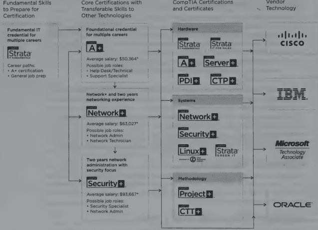

*来源：2010 年 `Computerworld` 薪资调查——仅限美国薪资*

### 获得认证的四个步骤

1. 审查考试目标。审查认证目标，以确保您了解考试涵盖的内容。 `http://www.comptia.org/certifications/testprep/examobjectives.aspx`
2. 练习考试。在您为认证学习之后，参加一次免费评估和样题测试，以了解考试可能出现的题型。 `http://www.comptia.org/certifications/testprep/practicetests.aspx`
3. 购买考试凭证。在 `CompTIA` 商城（网址：`www.comptiastore.com`）购买考试凭证。
4. 参加考试！选择一个认证考试提供商，并安排时间参加考试。您可以在以下链接找到考试提供商：`http://www.comptia.org/certifications/testprep/testingcenters.aspx`

### 加入专业社区

免费的 `IT Pro` 在线社区为学生和专业人士提供有价值的内容。

职业 IT 职位资源包括

- IT 入门指南
- 职业评估
- 薪资趋势
- 美国职位板

加入 `IT Pro` 社区，获取以下权限：

- 网络、安全、计算和前沿技术论坛
- 访问行业专家撰写的博客
- 前沿技术的最新信息
- 访问与 IT 和 IT 职业相关的各种行业资源链接和文章


### 内容质量印章

本课程材料贴有 `CompTIA` 批准的质量内容印章。该印章表明此内容涵盖了 100% 的考试目标，并实施了重要的教学设计原则。`CompTIA` 建议结合多种学习工具，以帮助提高对学习目标的覆盖范围。

### 为什么选择 CompTIA？

- **全球认可** `CompTIA` 在全球范围内被公认为领先的 IT 非营利行业协会，并拥有极高的信誉。此外，`CompTIA` 的认证是厂商中立的，提供了可跨技术通用的基础知识的证明。
- **受招聘经理青睐** 招聘经理重视 `CompTIA` 认证，因为它是独立于厂商和技术的技能验证。
- **政府和企业的推荐或要求** 许多政府机构和公司要么推荐要么要求技术人员获得 `CompTIA` 认证。（例如：`Dell`、`Sharp`、`Ricoh`、美国国防部以及其他众多机构）
- **三项 CompTIA 认证位列前十名** 根据 `DICE` 对 17,000 名技术专业人士的研究，认证有助于在所有经验水平上获得更高的薪资。

### 如何获取更多信息

#### 访问 CompTIA 在线网站

访问 `www.comptia.org` 了解有关获得 `CompTIA` 认证的更多信息。

#### 联系 CompTIA

请致电 866-835-8020，转 5，或发送电子邮件至 `questions@comptia.org`。

#### 社交媒体

在 `Facebook`、`LinkedIn`、`Twitter` 和 `YouTube` 上找到我们。

#### 加入 IT Pro 社区

访问 `http://itpro.comptia.org` 加入 IT 社区，获取相关的职业信息。

#### CAQC 免责声明

`CompTIA` 批准质量课程体系项目的徽标，以及本培训材料或其他培训材料在 `CompTIA` 批准课程体系下的“已批准”状态，意味着在 `CompTIA` 看来，该培训材料涵盖了 `CompTIA` 相关认证考试的内容。`CompTIA` 未审查或批准此培训材料内容的准确性，并明确否认任何关于商品性或特定用途适用性的保证。`CompTIA` 不保证任何使用此类“已批准”或其他培训材料准备 `CompTIA` 认证考试的人员会取得成功的考试成绩。

## 第 3 章 使用 vi 文本编辑器


# vi 文本编辑器
- vi 文本编辑器的角色和功能
- 在 vi 中编辑文本文件
  - 在 vi 中打开文件
  - vi 模式
  - 在插入模式下工作
  - 在命令行模式下工作
- 在命令模式下工作
- 章节回顾
  - 快速回顾
  - 问题
  - 答案

## 第 4 章 管理 Linux 文件和目录
- Linux 文件系统与文件系统层级标准 (`FHS`)
  - Linux 文件系统的角色
  - Linux 文件系统的层级结构
  - Linux 使用的文件类型
- 在 Linux 文件系统中查找文件
  - 使用 `find`
  - 使用 `locate`
  - 使用 `which`
  - 使用 `whereis`
  - 使用 `type`
- 从命令行管理目录
  - 浏览文件系统
  - 查看目录内容
  - 创建新目录
  - 复制、移动和删除目录
- 从命令行管理文件
  - 创建新文件
  - 查看文件内容
  - 删除文件
  - 复制和移动文件
  - 确定文件类型
- 使用链接文件
- 查找文件内的内容
- 章节回顾
  - 快速回顾
  - 问题
  - 答案

## 第 5 章 安装 Linux
- 设计 Linux 安装
  - 进行需求评估
  - 选择发行版
  - 验证系统要求和硬件兼容性
  - 规划文件系统
  - 选择软件包
  - 指定用户账户
  - 收集网络信息
  - 选择安装源
- 安装 Linux
  - 配置区域设置
  - 配置时区设置
    - Linux 上的时间工作原理
    - 配置时区
- 章节回顾
  - 快速回顾
  - 问题
  - 答案

## 第 6 章 管理 Linux 启动过程
- Linux 启动过程
  - `BIOS` 阶段
  - 引导加载器阶段
  - 内核阶段
- 配置引导加载器
  - 配置 `LILO`
  - 配置 `GRUB`
- 管理 Linux 运行级别
  - 运行级别的工作机制
  - 管理运行级别和 `init` 脚本
- 关闭系统
- 章节回顾
  - 快速回顾
  - 问题
  - 答案

## 第 7 章 管理图形环境
- `X` 环境的工作原理
- 配置 `X` 环境
  - 配置 `X` 服务器
  - 配置 `X` 字体服务器
- 配置显示管理器
  - 试用桌面环境
  - 配置显示管理器
- 配置无障碍功能
  - 键盘无障碍
  - 鼠标无障碍
  - 屏幕阅读器
  - 屏幕放大镜
  - 盲文设备
  - 高对比度、大文本主题
- 章节回顾
  - 快速回顾
  - 问题
  - 答案

## 第 8 章 管理 Linux 软件
- 使用 `RPM` 管理软件
- 使用 `RPM` 安装软件
- 使用 `RPM` 管理已安装的软件
- 使用 `yum` 安装 `RPM` 软件包
- 从源代码安装软件
  - 准备安装文件
  - 编译可执行文件
  - 安装可执行文件
  - 卸载从源代码编译的软件
- 管理 Debian 软件包
  - Debian 软件包命名
  - 使用 `dpkg` 安装软件包
  - 使用 `apt-cache` 查看软件包信息
  - 使用 `apt-get` 安装软件包
  - 使用 `aptitude`
- 管理共享库
  - 共享库的工作原理
  - 管理共享库依赖项
- 章节回顾
  - 快速回顾
  - 问题
  - 答案

## 第 9 章 管理 Linux 用户和组
- 理解 Linux 用户和组
  - Linux 用户账户
  - Linux 组
- 章节回顾
  - 快速回顾
  - 问题
  - 答案

## 第 10 章 管理 Linux 文件系统
- 管理磁盘分区
  - 使用 `fdisk` 管理磁盘分区
  - 使用 `mknfs` 构建文件系统
  - 理解 `LVM`
- 使用 `mount` 命令挂载分区 ..... 368
- 维护 Linux 文件系统 ..... 371
- 挂载可移动介质 ..... 381
- 使用软盘 ..... 381
- 使用光盘设备 ..... 382
- 使用 `USB` 和 `FireWire` 设备 ..... 383
- 备份数据 ..... 384
- 选择备份介质 ..... 385
- 选择备份策略 ..... 386
- 使用 Linux 备份实用程序 ..... 389
- 章节回顾 ..... 394
- 快速回顾 ..... 396
- 问题 ..... 398
- 答案 ..... 401

## 第 11 章 管理所有权、权限和配额 ..... 403
- 管理所有权 ..... 403
- 所有权如何工作 ..... 403
- 从命令行管理所有权 ..... 404
- 管理文件和目录权限 ..... 407
- 权限如何工作 ..... 407
- 使用 `chmod` 从命令行管理权限 ..... 409
- 使用默认权限 ..... 413
- 使用特殊权限 ..... 415
- 实施磁盘配额 ..... 417
- 章节回顾 ..... 422
- 快速回顾 ..... 424
- 问题 ..... 425
- 答案 ..... 427

## 第 12 章 在 Linux 下管理硬件 ..... 429
- 管理 `PC` 硬件 ..... 429
- 识别大容量存储设备 ..... 430
- 使用可移动硬件接口 ..... 441
- 管理系统资源 ..... 444
- 管理集成设备 ..... 449
- 管理无外部外设的系统 ..... 451
- 使用 Linux 驱动程序 ..... 451
- 驱动程序究竟是什么？ ..... 452
- 驱动程序在 Linux 下的实现方式 ..... 454
- 管理内核模块 ..... 455
- 使用热插拔和冷插拔设备 ..... 462
- 章节回顾 ..... 463
- 快速回顾 ..... 466
- 问题 ..... 469
- 答案 ..... 473

## 第 13 章 管理 Linux 进程 ..... 475
- Linux 如何处理进程 ..... 475
- 进程究竟是什么？ ..... 476
- Linux 进程的遗传性 ..... 478
- 管理正在运行的进程
- 启动系统进程 ..... 482
- 查看正在运行的进程 ..... 484
- 进程优先级管理 ..... 489
- 管理前台和后台进程 ..... 491
- 终止正在运行的进程 ..... 494
- 在注销后保持进程运行 ..... 495
- 计划任务
- 使用 `at` 守护进程 ..... 498
- 使用 `cron` 守护进程 ..... 501
- 章节回顾
- 快速回顾 ..... 509
- 问题 ..... 512
- 答案 ..... 515

## 第 14 章 编写 Shell 脚本 ..... 517
- 使用 Shell 脚本
- Shell 脚本的组成部分 ..... 517
- Shell 脚本如何执行 ..... 518
- 创建一个基本脚本
- 在屏幕上显示文本 ..... 520
- 向脚本中添加命令 ..... 520
- 从用户读取输入 ..... 521
- 在脚本中使用控制结构
- 使用 `if/then` 结构 ..... 523
- 使用 `case` 结构 ..... 525
- 使用循环结构 ..... 527
- 处理文本流
- `cut` ..... 530
- `expand` 和 `unexpand` ..... 530
- `fmt` ..... 531
- `join` 和 `paste` ..... 532
- `nl` ..... 533
- `od` ..... 533
- `pr` ..... 535
- `sed` 和 `awk` ..... 535
- `sort` ..... 539
- `split` ..... 539
- `tr` ..... 540
- `uniq` ..... 540
- `wc` ..... 541
- 使用命令替换和 Shell 函数 ....... 542
- 使用命令替换 ....... 542
- 使用 Shell 函数 ....... 543
- 章节回顾 ....... 544
- 快速回顾 ....... 548
- 问题 ....... 549
- 答案 ....... 553

## 第 15 章 管理 Linux 网络设置 ....... 555
- `IP` 网络概述 ....... 556
- 什么是协议？ ....... 557
- `IP` 地址如何工作 ....... 561
- 子网掩码如何工作 ....... 564
- 指定 `DNS` 服务器和默认网关路由器地址 ....... 566
- 配置网络寻址参数 ....... 568
- 安装以太网板 ....... 569
- 配置 `IP` 参数 ....... 570
- 配置路由参数 ....... 576
- 配置名称解析设置 ....... 578
- 故障排除网络问题 ....... 581
- 使用标准化的故障排除模型 ....... 581
- 使用 `ping` ....... 583
- 使用 `netstat` ....... 585
- 使用 `traceroute` ....... 585
- 使用名称解析工具 ....... 587
- `host` ....... 588


# 第 16 章 管理 Linux 网络服务

- 使用 CUPS 配置打印
- Linux 打印如何工作
- 安装 CUPS
- 配置 CUPS
- 使用行式打印机守护进程 (`lprd`)
- 故障排除打印问题
- 维护系统时间
- 使用 `hwclock` 设置硬件时钟
- 使用 `ndate` 同步时间
- 使用 NTP 同步时间
- 管理 MTA
- 电子邮件如何工作
- 在 Linux 上使用 MTA 管理命令
- 管理 SQL 数据
- 数据库如何工作
- 安装 MySQL
- 管理 SQL 服务器中的数据
- 章节回顾
- 快速回顾
- 问题
- 答案

# 第 17 章 保障 Linux 安全

- 保障 Linux 安全
- 保护系统
- 保护物理环境
- 保护操作系统访问权限
- 控制用户访问
- 是否使用 `root` 用户？
- 实施强密码策略
- 配置用户限制
- 禁用用户登录
- 审计文件
- 防御网络攻击
- 减轻网络漏洞风险
- 使用 `iptables` 实施防火墙
- 管理系统日志
- 配置日志文件
- 使用日志文件排查问题
- 使用日志文件检测入侵者
- 配置 `xinetd` 和 `inetd`
- 配置 `xinetd`
- 配置 `inetd`
- 章节回顾
- 快速回顾
- 问题
- 答案

# 第 18 章 使用加密

- 使用加密
- 加密如何工作
- 对称加密
- 非对称加密
- 使用 `OpenSSH` 加密远程访问
- `OpenSSH` 如何工作
- 配置 `OpenSSH`
- 通过 SSH 隧道传输流量
- 配置 SSH 使用公钥认证
- 加密 Linux 文件
- `GPG` 如何工作
- 使用 `GPG` 加密文件
- 章节回顾
- 快速回顾
- 问题
- 答案

# 附录 A 考试目标参考

- LX0-101 考试
- LX0-102 考试

# 附录 B 关于 CD

- 系统要求
- 访问 Linux 中的 `MasterExam` 模拟试卷
- 安装和运行 `MasterExam`
- `MasterExam`
- 视频培训剪辑
- 书籍的 PDF 副本
- 帮助
- 删除安装
- 技术支持
- `LearnKey` 技术支持
- 索引

# 前言

祝贺您做出获得 `LPIC-1`/`CompTIA Linux+` 认证的决定！通过购买本书，您已经迈出了获得业内最热门认证之一的第一步。获得 `LPIC-1`/`CompTIA Linux+` 认证使您在当今 IT 就业市场中拥有独特的优势。当您获得 `LPIC-1`/`CompTIA Linux+` 认证后，您可以向您的雇主、同事以及您自己证明您真正精通 Linux。

这是一个大问题。多年来，我有机会为组织中的空缺职位面试许多求职者。我很快就意识到，不能依赖求职者简历中的“技能和知识”部分来准确了解求职者的实际能力。例如：几年前，我们小组有一个职位空缺，要求具备极强的技术背景。职位发布中列出的要求之一是“具有计算机硬件和网络方面的丰富背景”。

我面试的一位候选人在简历中声称在这些领域拥有丰富背景。事实上，在面试中，此人声称是该领域的专家。我必须承认，简历看起来确实很 impressive（令人印象深刻）。

然而，随着面试的进行，我开始产生了一些怀疑。此人的言谈举止并不像真正的技术人员，所以我决定在面试中施加一个小测试。我让她将一个存储设备连接到工作站。对于“专家”来说，这不是一个很容易的任务吗？结果，这位求职者做不到。事实上，她甚至不知道从哪里开始。

长话短说，尽管我有顾虑，但高层管理最终还是雇用了这位求职者。情况并不理想。她不具备所需的背景，随后在工作中表现非常糟糕，最终在一年后就辞职了。这种情况的关键问题在于对“计算机硬件和网络专家”的定义存在冲突。我们的团队需要的是一个人，她需要能够安装扩展卡、硬盘和操作系统，以及设置计算机网络。

另一方面，这位求职者对“计算机硬件和网络专家”有着非常不同的定义。她认为自己是一位专家，因为她知道如何使用 `Microsoft Word`、`Excel` 和 `PowerPoint`。她只知道如何使用用户名和密码登录网络。从本质上讲，她是一名专家级最终用户，但她并不是我们寻找的专家级系统管理员。

如果我的公司在职位要求中列出了具体的认证，而不是仅仅要求“具有计算机硬件和网络方面的丰富背景”，这种情况本可以避免。认证有助于参与招聘过程的所有相关人员。通过要求求职者具备 `LPIC-1`/`CompTIA Linux+` 认证，潜在雇主可以筛选出那些确实不具备特定职位所需技能和知识的求职者。拥有您的 `LPIC-1`/`CompTIA Linux+` 认证也有助于您向潜在雇主证明，您在简历中所声称的 Linux 背景属实，从而使您比其他未获得认证的求职者更具优势。

本书的目标是帮助你达到这种认证“ nirvana（圆满境界）”。`LPIC-1`/`CompTIA Linux+` 认证是理想的起点。通过将两个广受欢迎的行业权威认证（`LPIC-1` 和 `Linux+`）合并，`CompTIA` 创造了理想的入门级 Linux 认证。`LPIC-1`/`CompTIA Linux+` 是通往全面掌握 Linux 之路上的第一块基石。在利用你的 `LPIC-1`/`CompTIA Linux+` 认证获得一些实际工作经验后，你可以进一步获取 `LPIC-2` 和备受推崇的 `LPIC-3` 认证，从而提升你的技能和声誉。

让我们开始第一级（Level 1）的学习吧！

## 致谢

本书的扉页将 `Robb H. Tracy` 列为作者。然而，这种署名具有误导性。这绝不是一个单枪匹马就能完成的工作。每一本书的背后都有一支团队，他们很少得到应有的认可。他们是默默无闻的英雄，确保工作得以完成。

首先，我也想感谢参与本书制作团队的付出。这些人是将所有内容凝聚在一起的“胶水”。感谢 `Timothy Green` 给予我编写这本书的机会，感谢你对我的信任！感谢 `Stephanie Evans` 管理开发流程。无论何时，`Steph` 总是能及时提供我所需的信息。谢谢，`Steph`！也要感谢 `Emilia Thiuri` 帮助我完成最后的审阅过程。正是她经验丰富的眼睛让这本书呈现出良好的面貌。

最后，我要向 `Brian Barber` 致以巨大的感谢。`Brian` 对书中的每一个字和每一个练习步骤都进行了技术准确性审核。他的努力让我保持严谨，极大地提高了本书的整体质量。`Brian` 花费了许多深夜测试书中的实验练习，确保你能获得成功的体验。谢谢，`Brian`！

## 简介

我们首先需要向你介绍本书以及 `LPIC-1`/`CompTIA Linux+` 认证程序的基础知识。让我们看看以下内容：

- 本书适合谁
- 本书的组织结构
- `All-in-One` 认证系列图书的特色功能
- `LPIC-1`/`CompTIA Linux+` 认证考试
- 在 `LPIC-1`/`CompTIA Linux+` 认证考试中取得成功的技巧

让我们先从讨论本书适合谁开始。

### 本书适合谁

在开始阅读本书之前，你需要知道我在写作时有两个主要目标：

- 帮助你准备并通过由 `CompTIA` 提供的 `LPIC-1`/`CompTIA Linux+` 考试。
- 为你提供认证后在工作中取得成功所需的额外技能和知识。

本质上，当我们结束时，我希望你不仅仅能够背诵事实。我希望你能够言行一致，即真正具备工作能力，一旦受雇就能实际胜任工作。

为了实现这一目标，我们将重点介绍 `LPIC-1`/`CompTIA Linux+` 认证所要求的、本书中涵盖的核心 Linux 知识和技能。在开始之前，你需要已经具备扎实的计算机背景知识，包括：

- 管理计算机硬件。你应该能够安装新的外设设备、配置系统资源以及排除基本的硬件相关问题。例如，如果有人给你几个内存模块并要求你将其安装到 PC 系统中，你应该确切知道该怎么做。你应该熟悉以下内容：
    - PC 机箱和电源
    - 主板
    - 扩展插槽和扩展卡
    - `CPU` 和内存
    - 存储设备，如硬盘、软驱、光驱和 `USB` 驱动器


- 显卡和显示器
- 外设设备，如打印机、扫描仪和数码相机

- 实施和管理计算机网络。你应该能够设置网络交换机，安装和配置网卡，并使用线缆将所有设备连接起来。我将假设你熟悉以下内容：
  - 常见的网络拓扑结构（如星型、总线型和环型）
  - 常见的网络组件，如网卡、线缆、路由器和集线器/交换机
  - 常见的网络协议（如 `IP`、`TCP`、`UDP` 和 `NetBIOS`）
  - 常见的网络服务，如 `FTP` 服务器、`Web` 服务器和邮件服务器

如果可能，`CompTIA` 建议你在开始本书之前已经获得 `A+` 和 `Network+` 认证（或具备该领域的同等经验）。这两个认证项目将为你在 `LPIC-1`/`CompTIA Linux+` 认证项目中取得成功提供所需的硬件和网络背景知识。

如果你具备这样的背景，你就准备就绪了！让我们接下来讨论本书是如何组织以实现其主要目标的。

### 本书的组织结构

我喜爱 `CompTIA` 的认证项目。它们额外付出努力，确保其认证真正反映信息技术行业的当前趋势，`LPIC-1`/`CompTIA Linux+` 认证也不例外。`CompTIA` 与 `Linux` 专业协会（`LPI`）合作，通过发布列出认证人员应具备的技能和知识的目标，从而定义了 `Linux+` 认证。

这些目标，按当前发布的方式，是按主题组织的。它们并没有按逻辑的教学流程排列。在阅读本书时，你会很快注意到，我处理 `LPIC-1`/`CompTIA Linux+` 目标的顺序与 `CompTIA` 发布的顺序不同。虽然涵盖了所有目标；但我对它们进行了重新组织，使我们要先从最基本的 `Linux` 概念开始。然后，随着课程的推进，我们将逐步处理更高级的 `Linux+` 目标，建立在前面章节涵盖的技能和知识之上。

### All-in-One 认证系列图书的特色功能

为了让我们的考试指南更有用且更易于阅读，我们设计 `All-in-One` 认证系列图书包含若干约定俗成的惯例。

#### 图标

为了提醒你重要的建议、快捷方式或陷阱，你会偶尔在文本中看到分散的“说明”、“技巧”、“注意事项”和“考试技巧”。


`说明` “说明”提供特别有用的资讯碎片、背景解释和信息。它们偶尔也会定义术语。


`技巧` “技巧”提供建议和细微差别，帮助你学会精细地完成工作。采纳我们的建议并仔细阅读“技巧”。


`注意事项` 当你看到“注意事项”时，请特别留心。当你必须做出关键选择，或即将从事某件可能产生你未能立即预见的后果的事情时，会出现“注意事项”。现在就阅读它们，以免日后后悔。


`考试技巧` “考试技巧”提供特别建议，或提供专门与准备考试本身相关的信息。

#### 章节末尾复习和章节测试

本书的重要组成部分位于每章末尾，在那里你会发现要点的简要复习，以及一系列问题和这些问题的答案。每个问题都是多项选择题。提供的答案还包括一小段讨论，解释为什么正确的答案确实是正确的。

这些问题是为读者和未来的 `LPIC-1`/`CompTIA Linux+` 考试考生提供的学习辅助工具。显然，我们不能保证如果你正确回答了我们的所有问题，就绝对会通过认证考试。相反，我们可以保证的是，这些问题会让你了解你为考试做好了多少准备。

#### 光盘

*LPIC-1/CompTIA Linux+ Certification All-in-One Exam Guide (LPIC-1/LX0-101 & LX0-102)* 提供了一张包含更多测试问题及其答案的光盘，以帮助你准备认证考试。有关配套光盘的更多信息，请参阅附录 B。

## LPIC-1/CompTIA Linux+ 认证考试

既然你已经了解了本书的组织结构，现在是时候让你熟悉 `LPIC-1`/`CompTIA Linux+` 认证计划及其相关考试了。让我们回顾以下内容：

- 关于 `LPIC-1`/`CompTIA Linux+` 认证
- 参加 `LPIC-1`/`CompTIA Linux+` 考试
- 考试补考

### 关于 LPIC-1/CompTIA Linux+ 认证

`LPIC-1`/`CompTIA Linux+` 认证是一个绝佳的计划！这是一个由计算机技术工业协会（`Computing Technology Industry Association`，亲切地被称为 `CompTIA`）设计和管理的**厂商中立**认证。当前版本是通过合并两个非常流行且备受尊敬的 `Linux` 认证而来的：`LPI` 的 `LPIC` 认证和 `CompTIA` 的 `Linux+` 认证。由于它们基本上是同一个认证，因此你会看到我在整本书中都使用“`LPIC-1`/`CompTIA Linux+` 认证”这一术语。事实上，如果你通过了 `Linux+` 考试，你只需将成绩提交给 `LPI`，就可以同时获得 `LPIC` 认证。

`LPIC-1`/`CompTIA Linux+` 认证之所以被认为是厂商中立的，是因为其考试不基于任何特定厂商的硬件或软件。这在信息技术行业中 somewhat 独特。许多 `IT` 认证计划都围绕某个特定厂商的硬件或软件，例如微软的认证系统工程师（`MCSE`）认证、`Novell` 的认证 `Linux` 工程师（`CLE`）认证，或红帽（`Red Hat`）的认证工程师（`RHCE`）认证。

另一方面，`LPIC-1`/`CompTIA Linux+` 认证旨在验证你对 `Linux` 操作系统的通用知识和技能，而不是针对任何特定的发行版。根据 `CompTIA` 的说法：

> *“由 `LPI` 支持的 `CompTIA Linux+` 是一项高风险、厂商中立的认证，旨在验证初级 `Linux` 管理员所需的基础知识和技能……候选人的职位名称包括初级 `Linux` 管理员、初级网络管理员、系统管理员、`Linux` 数据库管理员和 `Web` 管理员。`Dell`、`HP`、`IBM`、`Lenovo` 和 `Xerox` 等公司推荐或要求持有 `CompTIA Linux+` 认证。”*

为了验证你的知识，`CompTIA` 要求你参加两门考试才能获得认证：`LX0-101` 和 `LX0-102`。`LX0-101` 考试涵盖以下一般知识领域：

- `Linux` 系统架构
- `Linux` 安装和包管理
- `GNU` 和 `UNIX` 命令
- 硬件设备
- `Linux` 文件系统和文件系统层次标准（`Filesystem Hierarchy Standard`）。

`LX0-102` 考试涵盖以下一般知识领域：

- `Shell`
- 脚本编写和数据管理
- 用户界面和桌面
- 管理任务
- 基本系统服务
- 网络基础
- 安全

`CompTIA` 已经发布了这两门考试的目标集，这些目标共同定义了 `LPIC-1`/`CompTIA Linux+` 认证。这些目标规定了初级 `Linux` 系统管理员应该知道并能够执行的内容。你可以在 `http://certification.comptia.org/` 查看 `LPIC-1`/`CompTIA Linux+` 的目标。`Linux+` 考试中的所有题目都基于这些目标。如果你要获得 `LPIC-1`/`CompTIA Linux+` 认证，那么你必须能够完成这些目标中包含的任务。随着我们深入阅读本书，你会发现完整的 `LPIC-1`/`CompTIA Linux+` 目标列表非常详尽。

在最新版 `LPIC-1`/`CompTIA Linux+` 认证中，你可以选择将考试成绩转发给 `Linux` 专业协会（`Linux Professional Institute`，简称 `LPI`）。同时通过 `LX0-101` 和 `LX0-102` 考试，你不仅可以获得 `Linux+` 认证，还可以获得 `LPIC` 1 级认证。

让我们详细谈谈这些考试。

### 参加 LPIC-1/CompTIA Linux+ 考试

`LPIC-1`/`CompTIA Linux+` 考试是定时考试，通过电子方式在计算机上交付。每门考试由 60 道题目组成，每门考试你有 90 分钟的时间完成。

> **注意** 你可能会看到多于 60 道题目。如果出现这种情况，是因为 `CompTIA` 在考试中混入了一些 `beta` 测试项目以进行评估。在这种情况下，你应该自动获得额外的考试时间来适应这些额外项目。


考试界面相当简单明了。题目在屏幕上逐条显示。你会看到一道问题以及一系列选项。你标记相应的选项，然后进入下一题。

每门考试主要由选择题组成。这种测试形式会给你一个问题，并要求你从选项列表中选出正确答案。大多数选择题只需要一个答案；然而，有些问题要求你从显示的列表中选择一个或多个正确答案。如果是这种情况，测试题目将以文本 “(Choose x.)” 结尾，其中 x 是你应该标记的选项数量。


完成考试后，电脑会立即进行评估，并打印出你的分数。要通过考试，你至少需要得到 800 分中的 500 分。希望你第一次就能通过考试。但是，如果没有通过，你的分数打印件将列出你答错题的目标领域。你可以利用这些信息复习并准备重考。

为了使考试在全球范围内可用，`CompTIA` 通过两家测试合作伙伴管理 `LPIC-1/CompTIA Linux+` 考试：

- `Prometric` `www.prometric.com`
- `Pearson VUE` `www.vue.com`

要报名参加 `LPIC-1/ Linux+` 考试，请选择其中一家测试合作伙伴并访问其网站。在那里，你会找到一个链接，帮助你找到附近的测试中心。大多数社区学院和技术学院都是授权的测试中心。只需指定你要参加的考试和你所在地的信息。然后，你会收到附近测试中心的列表，如图 1 所示。

然后，你可以使用 `Prometric` 或 `VUE` 的网站来安排考试并支付费用。你也可以直接拨打任一提供商的电话，通过电话安排考试。请注意，在他们给你报名之前需要验证你的身份，因此准备好在你致电或登录时提供你的社会安全号码。测试提供商会发送一封确认电子邮件，列出你考试的日期、时间和地点。

在考试当天，请确保预留足够的通勤时间。你永远不知道什么时候会遇到交通拥堵。此外，你应尽早到达，以便找到停车位并步行到测试中心。如果你在某个社区大学参加测试，你可能会发现从停车场到举行考试的建筑物有很长的距离要走。你在考试前最需要的不是感到匆忙和紧张！

### 图 1

查找附近的测试中心

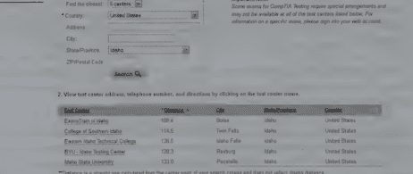

1. 通过定义下方的搜索条件并点击搜索，输入你附近的测试中心。（查看搜索提示）

   - 查找最近的
   - 5 个中心位于
   - 国家 美国
   - 城市
   - 地址
   - 州/省 爱达荷州
   - `ZIP/邮政编码`
   - 搜索
   - `登录说明`
   - `CompTIA` 测试的某些考试需要特殊安排，可能并非在所有列出的测试中心均可用。关于特定考试的信息，请登录你的账户。

2. 通过点击测试中心名称查看测试中心的地址、电话号码和路线指引。

| 测试中心 | 距离：英里 | 城市 | 州/省 | 国家 |
| :--- | :--- | :--- | :--- | :--- |
| `Eagle/Port of Idaho` | 117.4 | `Boise` | 爱达荷州 | 美国 |
| `College of Southern Idaho` | 114.5 | `Twin Falls` | 爱达荷州 | 美国 |
| `Eastern Idaho Technical College` | 126.3 | `Custer`, 爱达荷州 | 爱达荷州 | 美国 |
| `Brite - Idaho Testing Center` | 136.3 | `Pocatello` | 爱达荷州 | 美国 |
| `Idaho State University` | 133.0 | `Pocatello` | 爱达荷州 | 美国 |

*距离是从你的搜索条件中心点计算的直线距离，不代表驾车距离。*

在测试中心签到时，你需要出示两种形式的身份证明，其中一种必须附有你的照片。以下可接受的身份证件包括：

- 驾驶执照
- 社会保障卡
- 信用卡
- 学生证
- 军人证件
- 州签发的身份证

请注意，签到时，你必须将手机、`iPod`、平板电脑、笔记本电脑或任何其他电子设备交给监考人员。你不允许将任何参考资料带进考场，包括空白纸张。大多数测试中心会提供你记笔记所需的材料，这些材料必须保留在考试进行所在的房间内。一些测试中心会提供纸和铅笔；另一些则可能提供一块小型白色书写板和一支可擦除的笔。

现在，让我们来看看 `LPIC-1/ Linux+` 考试的构成。

## 考试构成

每场考试都分为几个类别，`CompTIA` 称之为域（`domains`）。第一场考试的编号为 `LX0-101`。第一场考试涵盖的知识域如表 1 所示。

第二场考试涵盖的知识域如表 2 所示。从表中可以看出，某些域的测试比重比其他域更大。在学习时，请务必特别注意那些考试题目占比最高的域！

考虑到这一点，我们现在来讨论如何为 `LPIC-1/CompTIA Linux+` 考试做准备。

| 域 | 考试占比 |
| :--- | :--- |
| `101` 系统架构 | 14 |
| `102` Linux 安装和包管理 | 18 |
| `103` GNU 和 UNIX 命令 | 43 |
| `104` 设备、Linux 文件系统、文件系统层次结构标准 | 25 |
| 总计 | 100 |

**表 1** `LX0-101` 考试域

| 域 | 考试占比 |
| :--- | :--- |
| `105` Shell、脚本编写和数据管理 | 17 |
| `106` 用户界面和桌面 | 8 |
| `107` 管理任务 | 20 |
| `108` 基本系统服务 | 17 |
| `109` 网络基础 | 23 |
| `110` 安全性 | 15 |
| 总计 | 100 |

**表 2** `LX0-102` 考试域

## 通过 Linux+ 认证考试的建议

我永远忘不了上世纪 90 年代初第一次参加 IT 认证考试时的场景。我当时紧张得几乎无法正常工作。幸运的是，考试进行得非常顺利，我轻松通过了。在过去十年里，我帮助很多人准备了各种各样的认证考试。我自己甚至编写过一些行业认证考试。因此，我学到了一些方法，可以提高你通过考试的概率。我们将在这里讨论以下内容：

- 考试准备
- 参加考试

让我们首先了解你如何为 `LPIC-1/CompTIA Linux+` 考试做准备。

### 考试准备

为 `LPIC-1/CompTIA Linux+` 考试做准备，你能做的最重要的事情就是彻底学习。没有提示、没有技巧、没有策略能弥补学习的不足。目标是将你通过考试所需的信息转移到你的长期记忆中。以下是一些学习技巧，可以帮助你为认证考试做准备。

### 考试前一到两个月

- 安排你的 `LPIC-1/CompTIA Linux+` 考试。理想情况下，你应该安排在开始阅读本书后 30–60 天举行考试。如果你不给自己设定一个截止日期，你很可能永远不会“抽出时间”去学习和参加考试。
- 控制好节奏。不要在考试前一晚试图突击复习。这是许多学生常犯的一个非常普遍的错误。（我自己在大学时也这样做过。）突击复习很少有效，因为你的短期记忆只能容纳有限数量的信息。你试图塞进短期记忆的所有内容都会丢失。相反，成功的考生花费大量时间将信息加载到长期记忆中。你可以通过设定目标——每天阅读一定数量的页数或章节并坚持执行——来实现这一点。
- 做笔记！当你阅读每一章时，写下对你来说突出的重要信息。写下来有助于强化信息，将其从短期记忆转移到大脑中的长期记忆。它还为你提供了一个有价值的复习资源。
- 完成实验练习，即使是简单的练习。做实验练习有助于你学习每章中介绍的概念性技能和知识的实际操作。
- 完成每章的练习题。读完一章后，拿一张白纸，浏览问题，并在纸上记录你的答案。（不要在书上写！你希望书保持完好，以便稍后的复习。）核对你的答案并复习你错过的主题。
- 在完成每章后，复习摘要和快速复习部分。

### 考试前两到三天

- 复习你的笔记。
- 复习每章末尾的练习题。复习你仍然感到困难的主题。
- 重复每章的实验练习。不过，这一次，尝试在不查看书中步骤的情况下完成练习。

### 考试前一晚

- 放松！睡眠充足是你在考试中表现良好的关键。不要因紧张和兴奋得无法入睡。在合理的时间上床睡觉。
- 复习你的笔记。
- 再次复习每章的摘要和快速复习部分。重复是记忆的关键！

### 考试当天早上

- 吃一顿丰盛的早餐。你的大脑需要大量的卡路里来运作。给它所需的东西！
- 复习你的笔记。
- 再次复习每章的摘要和快速复习部分。我提过重复是记忆的关键吗？
- 再次浏览每章的练习题。
- 留出足够的时间到达测试中心。不要因迟到而紧张。

我们要做的是通过重复和练习，将你通过考试所需的信息上传到你的长期记忆中。然后，在考试前不久，我们通过检索存储的信息并将其带到你的思想前沿来锻炼大脑（就像将数据从硬盘加载到系统 `RAM` 中一样），以便在考试时它们处于准备就绪且可用的状态。

考虑到这一点，让我们回顾一下认证考生关于 `LPIC-1/CompTIA Linux+` 考试观察到的某些关键“陷阱”：

- 考试因对命令选项吹毛求疵而声名狼藉。事实上，一些考生批评考试过于关注那些不常用且模糊或晦涩的命令选项。我们在这本书中尽力涵盖了我们认为你会被测试的命令选项。然而，我们显然无法获取考试题库，因此我们不能保证你在考试中看到的所有命令选项都在这里有所涉及。涵盖所有命令的所有选项是不现实的，因为这很容易使本书的页数翻倍（并且让你昏昏欲睡）。因此，我强烈建议你复习我们在这本书中涵盖的所有命令的 `man` 页面及其各种选项。
- 在你的 `LPIC-1/CompTIA Linux+` 考试中，你必须了解 `RPM` 和 `Debian` 包管理系统。在认证的早期版本中，你可以选择你想接受测试的是哪一种。现在不行了。你被期望熟悉两者。


- 关于是一次考一门还是同时考两门最好，存在一些争议。普遍共识是，`LX0-101` 考试比两者中更困难。相应地，我的建议是你分开参加考试，并且先考 `LX0-101` 考试。如果你不得不重考 `LX0-101` 才能通过，请不要惊慌。现实是，很少有考生第一次就能通过。然而，许多考生在通过 `LX0-101` 考试后报告说，`LX0-102` 考试明显难度较低。为了获得认证，你必须在五年内完成这两门考试。


> **考试提示** 根据我们的观察，那些研究其 `shell` 命令及相关选项（尤其是一些更晦涩的选项）的 `LPIC-1`/`CompTIA Linux+` 认证考生就是那些通过考试的人！

接下来，让我们谈谈你在实际参加考试时应记住的一些策略。

## 参加考试

如前所述，除了为行业认证考试开发培训材料外，我还参加了多场此类考试。由于我有这样的经历，我对考试出题者那些狡猾的思维过程有了一些见解。我将在此与你们分享这些见解。

- 仔细阅读每个问题的题干（即 `stem`）。题干中的一些信息是多余的，目的是分散你的注意力。然而，题干通常包含一两个关键信息点，这些信息点会影响正确答案。如果考场为你提供了书写材料（他们应该会提供），我建议快速记下题干中的要点。

- 仔细阅读全文中的每个选项。不要只是略读。命题人会故意设置那些几乎正确但并不完全正确的选项（我们称之为“红鲱鱼”）。其目的是将你的注意力从真正正确的答案上引开。我知道这听起来很狡猾，但他们的意图是让考试变得具有挑战性，如果你不真正掌握专业知识，就无法区分出正确的答案。

- 排除明显错误的选项。每个题目都有一个或多个明显错误的选项。（通常是因为出题者想不出更好的干扰项。）排除这些答案，只关注可能正确的选项。

- 做出最佳选择，然后继续下一题。根据我的经验，你的第一印象通常是正确的。如果你在上面纠结太久，可能会过度思考问题，最终选错答案。你还会浪费宝贵的时间。在仔细阅读问题和每个选项后，跟随你的直觉，然后继续下一题。

- 如果你在一个特别难的题目上卡住了，不要花太多时间试图找出正确答案。你可以跳过该题，稍后再回来解决。许多学生会对找出特别难问题的正确答案产生执念，结果导致没有足够的时间回答试卷上的其余题目。先回答你能答的题，然后再回到那些需要更多时间的难题上。

考完试后，你的成绩会自动打印出来。报告将由监考人员封存，以认证结果。切勿丢失这些报告；这是你唯一能获得的纸质副本！我听说有些考生因为技术问题导致考试成绩未能正确传输，不得不将考试成绩报告的纸质副本寄回给 `CompTIA`。

报告将显示你在考试各个部分的表现。`LPIC-1`/`CompTIA Linux+` 考试是及格/不及格制。如果你的分数达到 500 分或更高，你就及格了！得分 577 分的考生和得分 798 分的考生拥有同等程度的认证资格。

如果你没有及格，你可以利用报告上的信息找出需要补强的领域。如果你愿意，可以立即重考。但是，在这样做之前，有两点需要你记住：

- 重考需要支付全额费用。

- 重考的题目可能与第一次不同。`CompTIA` 发布了多个版本的 `LPIC-1`/`CompTIA Linux+` 考试试卷。

但是，如果你再次未通过，你必须等待至少 14 天后才能允许第三次参加考试。

如果你失败了，我建议你先退后一步，深呼吸，回家，复习你漏掉的那些题目。然后在一天或两天内安排重考。如果等待的时间更长，你的记忆可能会变“冷”，你可能需要从头开始重新走一遍整个准备过程。

## 引言与 Linux 简介

在本章中，你将了解：

- `Linux` 的作用和功能

- `Linux` 的历史发展

- `Linux` 发行版

- `Linux` 常见的角色

`Linux` 的引入和采用过程是一部引人入胜的戏剧，值得观察。当 `Linux` 在 20 世纪 90 年代初首次推出时，大家只是反应平淡。当时主要的操作系统供应商，包括 `Microsoft`、`IBM`、`Oracle` 和 `Novell`，甚至几乎没有注意到它。在那个时候，`Linux` 被视为爱好者的小玩意，只有最极客的极客才会使用。

然而，自那以后，`Linux` 在全球越来越多的组织中稳步进入服务器机房。事实上，它的普及程度已经引起整个信息技术行业的关注，包括刚才提到的那四大巨头。

`Linux` 甚至开始渗透进桌面市场，在许多情况下，它取代了众多组织中员工使用的 `Microsoft Windows` 操作系统。自 90 年代初引入以来，`Linux` 已从程序员的个人爱好项目发展成为信息技术行业中一股主要的变革力量。

因此，对能够实施、维护和支持 `Linux` 操作系统的网络管理员的需求正在不断增长。如果你有任何 `Linux` 使用经验，你就知道它与大多数用户熟悉的操作系统（如 `Microsoft Windows`）非常不同。从这些系统迁移到 `Linux` 需要一定的专业知识。读完本书后，你将具备实现这一目标所需的知识和技能。你还将能够通过 `LPIC-1`/`CompTIA Linux+` 考试！

在我开始讨论如何安装和配置 `Linux` 之前，你需要对 `Linux` 的起源、获取方式、它在网络中可以扮演的角色以及可用于与该操作系统交互的工具有一个扎实的理解。

### Linux 的作用和功能

在学习 `Linux` 时，你必须首先理解 `Linux` 在计算机系统中的作用。`Linux` 是一个*操作系统*，而不是应用程序。所有操作系统，包括 `Linux`，在计算机系统中提供五个关键功能：

- **应用平台** 操作系统提供了一个平台，让应用程序可以运行，并管理它们对 `CPU` 和系统内存的访问。

- **硬件中介** 操作系统还充当运行中的应用与系统硬件之间的调解者。大多数应用程序并没有直接编写代码来访问计算机硬件。相反，大多数操作系统都包含预先编写的代码，应用程序可以调用这些代码来访问系统硬件，如内存、硬盘和通信端口。这一特性使程序员的开发工作变得轻松很多。他们不必在每个程序中编写完成这些任务的代码，只需重用操作系统提供的现有代码即可。它还确保系统中运行的一个应用程序不会试图使用另一个应用程序正在使用的内存，并且应用程序不会占用过多的 `CPU` 时间。


> **提示** 操作系统通过为每个应用程序分配其可使用的内存范围来管理应用程序。操作系统管理内存访问，以确保一个应用程序不会试图使用另一个应用程序正在使用的内存。操作系统还控制对 `CPU` 的访问。

- **数据存储** 操作系统还负责提供高效且可靠的信息存储方式。通常，这是通过使用某种存储设备（如已格式化特定文件系统类型以将信息组织为易于检索格式的硬盘驱动器）来完成的。

- **安全性** 操作系统负责为存储在其中的数据提供一定程度的安全性。系统管理员可以创建规则并授予权限，以决定谁可以访问哪些信息。一些操作系统，如 `Linux` 和后来版本的 `Windows`，在这方面做得非常好。较旧的操作系统，如 `DOS` 或 `Windows 98`，提供的安全性很少或没有。

- **连接性** 操作系统通过各种网络介质和接口管理计算机之间的连接，包括红外线、以太网、`RS-232` 和 `802.11x` 无线。

信不信由你，我偶尔会遇到不理解 `Linux` 在计算机系统中作用的人。他们错误地认为 `Linux` 是一种杀手级应用程序，可以在工作站的 `Windows` 下运行。

这通常是因为大多数用户都是在电脑上使用微软 `Windows` 操作系统长大的。他们的家用电脑预装了 `Windows`；他们工作用的电脑很可能也运行 `Windows`。正因为如此，他们往往将电脑的操作系统和硬件视为不可分割的结合体。

你可能经常听到有人把他们的电脑称为“`Windows` 电脑”。

实际上，计算机硬件和操作系统是相互独立的。这是因为现代 `PC` 具有模块化特性。`Windows` 操作系统可以轻松移除，任何兼容的操作系统（包括 `Linux`）都可以安装在其上。

> **提示** 你还可以调整硬盘上现有分区的大小，并将 `Linux` 安装在产生的空闲空间中，从而创建一个 `Windows`/`Linux` 双启动系统。

`Linux` 操作系统由以下组件组成：

- **Linux 内核** 这是 `Linux` 的核心；因此被称为内核。内核就是实际的操作系统本身。它是履行上述关键操作系统职责的组件。

- **库** 库是预写的代码元素，应用程序开发人员可以在他们的程序中使用。正如前文所述，这可以节省大量时间。想象一下，如果你是程序员，却必须在应用程序中包含代码，使其能与当前市场上所有类型的硬盘驱动器接口配合工作，那将是何等繁重的任务！有了库，程序员就不必关心系统中安装的是 `SCSI`、`IDE` 还是 `SATA` 硬盘。他或她只需调用适当的库，并告诉操作系统要将数据写入驱动器或从驱动器读取数据。操作系统会处理其余部分。

- **实用工具** `Linux` 包含各种各样的实用工具，你可以使用它们来执行操作系统管理任务，例如维护文件系统、编辑文本文件、管理正在运行的进程以及安装新的软件包。

- **用户界面** 当然，作为最终用户，你需要某种方式来与操作系统进行交互。`Linux` 同时包含命令行界面 (`CLI`) 和可选的图形用户界面 (`GUI`)。我们将在本书后面探讨这两种界面。


> **提示** 你可以在编程代码中链接到操作系统库，并调用其中的函数，从而轻松创建文件、向其中写入数据，并在完成后关闭文件。

接下来，让我们回顾一下 Linux 是如何诞生的。

## Linux 的历史发展

Linux 在软件开发行业中略显独特。大多数软件产品，无论是应用程序还是操作系统，都是作为有组织的设计和开发工作的一部分开发的。我在软件开发行业工作了很多年，亲眼目睹了其运作方式。在大多数公司中，情况是这样的：

1. 组织识别客户需求。
2. 组建设计团队，通常由程序员、项目经理和市场营销人员组成。
3. 设计团队制定产品需求文档 (PRD)，明确指定产品的具体功能。
4. PRD 中识别出的任务分配给程序员团队，他们编写各自负责的部分代码。
5. 完成后，代码被检入，产品经过一系列测试周期。
6. 当产品中的错误得到解决（或者至少解决了大部分错误）后，成品会交付给客户。
7. 客户使用该产品一段时间后，通常会发现初始测试中遗漏的错误。此外，他们通常还会识别出希望增加的新功能和特性。
8. 软件公司收到客户反馈，循环重新开始。

大多数商业软件产品都是这样开发的。有趣的是，Linux 在最初开发时并不符合这一循环。相反，Linux 内核最初是由芬兰赫尔辛基大学的一名研究生开发的。这个人就是 Linus Torvalds。

在 20 世纪 90 年代初，Torvalds 对一款名为 Minix 的免费软件产品产生了兴趣。Minix 由 Andrew S. Tanenbaum 开发，是商业 UNIX 操作系统的克隆。Tanenbaum 是一位大学教授，在荷兰教授计算机编程。当时，主要有三种普遍可用的操作系统：

- DOS
- Mac OS
- UNIX

当时 Windows 也正处于萌芽阶段。然而，它只是一个运行在 DOS 之上的外壳。它并不是一个真正的操作系统。这些操作系统都是商业开发的。因此，每个产品的源代码都受到专利和版权的严格保护。大多数操作系统的最终用户许可协议 (EULA) 中都有一个章节，禁止用户逆向编译操作系统以访问源代码。


> **注意** 有应用程序可以逆向编译二进制程序文件。此过程将程序的源代码重新提取为文本文件。生成的源代码并非原始源代码的完全副本，而是一个近似值，可能非常接近原始源代码。

然而，在某段时间内，UNIX 操作系统的源代码实际上已提供给大学用于教学目的。但是，这种做法后来停止了，导致 Tanenbaum 缺少向学生解释操作系统内部运作机制的有效工具。

尽管面临挑战，Tanenbaum 仍着手开发自己的操作系统用于课堂教学。他开发了一个名为 Minix 的小型 MINIX 内核克隆。其目标是向学生提供一个真实的操作系统及其随附的源代码。Tanenbaum 甚至将 Minix 的源代码收录在他的教科书 *Operating Systems: Design and Implementation*（《操作系统：设计与实现》，Prentice Hall，1987 年）中。

受 Tanenbaum 和 Minix 的启发，Torvalds 在 1991 年开发了自己的 UNIX 克隆，并将其命名为 *Linux*。如今，这个第一版 Linux 本质上极其精简。它并不是一个包含应用程序和实用工具的完整操作系统。相反，1991 年 10 月 5 日发布的 Linux 0.02 版本仅由 Linux 内核和三个实用工具组成：

- *bash* 一个命令行界面
- *update* 一个用于刷新文件系统缓冲区的实用工具
- *gcc* 一个 C++ 编译器

在一个前所未有的举动中，Torvalds 将他 Linux 操作系统的源代码发布在互联网上，并免费提供给任何想要下载的人。企业软件开发模式已被彻底打破。Torvalds 甚至更进一步。他邀请其他程序员修改他的 Linux 源代码并对其进行增强。Linux 形成了自我发展，成为一个全球性的协作开发项目。没有秘密。没有严密的版权保护。任何人都可以访问 Linux 源代码。

Linux 的这个协作开发项目持续了几年。1994 年，Linux 1.0 版本准备发布。自那以来的成果令人惊叹。

那么，Torvalds 为什么要将 Linux “免费”提供给想要的人？他为什么不遵循标准的企业开发模式并试图赚取巨额利润？要理解这一点，你需要熟悉 *GNU's Not UNIX* (GNU) 运动。在 20 世纪 80 年代初，麻省理工学院的一位名叫 Richard Stallman 的程序员提出了企业标准软件开发模式的替代方案。他反对这种流程和产品的专有性质。

1983 年，Stallman 启动了 *GNU 项目*。GNU 的核心思想是，应用程序和操作系统的所有者代码应免费分发给任何想要的人。他认为，程序的源代码不应受任何阻止复制、修改和重新分发的限制。Stallman 希望允许世界各地的程序员修改应用程序的源代码，从而产生更高质量的软件。

GNU 项目逐渐站稳脚跟。在 GNU 之下开发了许多有用的应用程序，例如 GNU C 编译器（gcc）。Torvalds 深受 GNU 项目的影响，最终将他的 Linux 操作系统内核的源代码向全世界发布。

如今，通过 GNU，许多功能强大的应用程序都可以运行在 Linux 上。这些强大的应用程序阵列是一个关键因素，它帮助 Linux 从一个程序员的爱好项目变成了一个适合在现代组织中广泛部署的健壮工具。

Linux 本身在 *GNU 通用公共许可证（GPL）* 下授权。关于 GPL 需要记住的关键点是，它要求源代码保持自由可用，任何人想要都可以获取。结果是，你可以下载 Linux 内核的源代码，修改它，重新编译它并运行它。你甚至可以创建你自己的 Linux 定制版本或发行版。

接下来，让我们讨论一下 Linux 发行版。

## Linux 发行版

对于许多 Linux 新手来说，*发行版* 这个概念可能令人困惑。理解发行版最好的方法是将 Linux 与冰淇淋进行比较。冰淇淋有各种口味；然而，冰淇淋本身的基本配方是一样的。大多数冰淇淋由以下成分制成：

- 奶油
- 牛奶
- 糖
- 鸡蛋

销售冰淇淋的公司接受这个基本的冰淇淋配方，并通过添加额外的成分来定制它，例如巧克力、香草、水果、饼干、坚果和糖果。通过这样做，他们创造了自己独特的冰淇淋口味。

Linux 发行版以非常相似的方式运作。由于 Linux 内核的源代码可以自由分发，软件供应商可以自由地下载它。以这种方式，内核源代码类似于冰淇淋的基本配方。它是操作系统的核心，其他一切都在其周围运行。

然后，供应商可以修改和增强源代码，创建一个定制的内核。他们还可以为操作系统添加专用工具、实用程序和应用程序，以增强其有用性，就像冰淇淋公司为基本冰淇淋配方添加额外成分一样。结果就是一个 Linux 发行版。

你可能已经知道有许多不同的 Linux 发行版可用。这是 Linux 区别于其他操作系统的又一个独特特征。几乎其他所有操作系统都由单一供应商开发并推销。例如，开发并销售 OS X 的唯一供应商是苹果有限公司（Apple, Inc.）。你不能去 Novell 购买他们的 Mac OS 版本，也不能去微软购买他们的 Mac OS 版本。同样，你也无法从苹果或甲骨文（Oracle）获得 Windows 的副本。

想象一下，如果其他操作系统也像 Linux 一样开发，世界会是什么样子。假设你想购买最新版本的 Windows 副本。如果 Windows 是在 GPL 下授权的，你会访问当地的电脑商店，发现有许多不同的 Windows 发行版，来自各种各样的软件供应商，其中只有一个是微软的。每个发行版都会有所不同，尽管它们仍然基于同一个内核。你将能够浏览不同的发行版，并找到最适合你的那一个。

就 Windows 而言，这种场景非常不太可能。然而，对于 Linux，这正是你所拥有的。许多不同的软件开发商已经接受了基本的 Linux 内核并对其进行修改，以适应某些特定目的。他们可能还捆绑了许多功能强大的应用程序。一些发行版可能被定制为向远程终端用户提供高端网络服务。另一些可能被定制为在终端用户的桌面上提供出色的生产力应用程序。无论哪种方式，结果都是一个定制的 Linux 发行版。

如今，实际上有数百种不同的发行版可用。一些更受欢迎的 Linux 发行版包括：

- openSUSE Linux
- Ubuntu Linux
- Fedora Linux
- Red Hat Enterprise Linux
- Debian Linux
- Mandriva Linux
- Gentoo Linux
- Slackware Linux
- CentOS


> **注意**：在 [http://en.wikipedia.org/wiki/Comparison_of_Linux_distributions](http://en.wikipedia.org/wiki/Comparison_of_Linux_distributions) 上提供了一个很好的表格，提供了大多数 `Linux` 发行版的概述和比较。[http://distrowatch.com/](http://distrowatch.com/) 网站也是获取所有可用 `Linux` 发行版信息的绝佳资源。

那么，哪个发行版最好？这是一个危险的问题。通常，爱好和平的系统管理员和程序员在争论哪个发行版最好时可能会动起手来。这是因为对你来说效果最好的发行版可能无法满足其他人的需求。关键在于尝试几种发行版，并选择你喜欢的那一个。

就个人而言，我越来越喜欢 `SUSE Linux`。你可以从 [opensuse.org](http://opensuse.org/) 下载这个发行版的副本。它已成为我首选的 `Linux` 发行版。我也非常喜欢 `Red Hat` 的 `Fedora` 以及 `Ubuntu`。你可以从 [http://fedora.redhat.com](http://fedora.redhat.com/) 下载 `Fedora` 的副本，从 [ubuntu.com](http://ubuntu.com/) 下载 `Ubuntu` 的副本。

现在让我们讨论 `Linux` 系统在你的计算机网络中可以扮演的多种角色。

## 常见的 `Linux` 角色

由于 `Linux` 是在 `GPL` 下分发的，软件供应商已经能够调整和定制操作系统，使其在多种角色中运行。虽然这些角色的数量实际上没有限制，但对于 `Linux+` 考试，你需要熟悉以下角色：

- `Linux` 作为桌面
- `Linux` 作为服务器
- `Linux` 作为防火墙

让我们从讨论桌面上的 `Linux` 开始。

### `Linux` 作为桌面

`Linux` 可以被优化为极其出色地作为桌面系统运行。然而，`Linux` 在这个市场中的进展相对缓慢。对此有两个重要原因。

首先，历史上缺乏可用的桌面生产力应用程序。用户需要在桌面上使用文字处理、电子表格和演示软件来进行日常工作。直到最近，生产力应用程序对 `Linux` 用户来说并不容易获得。然而，`OpenOffice.org` 生产力套件的发布纠正了这一情况，并真正使 `Linux` 成为桌面的可行选择。

第二个（也是最令人烦恼的）问题是，普通终端用户往往觉得 `Linux` 令人望而生畏。对于像你和我这样的“技术专家”来说，这不是一个问题。我们很适应新的应用程序和操作系统。我们可以快速学习并有效地使用它们。不幸的是，大多数组织中的普通终端用户最初学习如何使用计算机可能是通过 `Windows` 版本。因此，他们对 `Windows` 最为熟悉，并且倾向于抵制学习新的操作系统。


> **考试提示**：开发 `LPIC-I` 和 `Linux+` 认证的业界专家使其保持供应商中立。你不会针对某一个特定的发行版进行测试。然而，预计你需要了解如何使用基于 `Slackware` 的发行版（如 `openSUSE`）、基于 `Red Hat` 的发行版（如 `Fedora`）和基于 `Debian` 的发行版（如 `Ubuntu`）的功能。我建议在准备考试时，设置三个独立的系统，并在每个系统上安装其中一个发行版。

使 `Linux` 在桌面上可行的关键在于：

- 向用户提供完成工作所需的应用程序。
- 使用户界面简单且直观，这样从 `Windows` 到 `Linux` 的迁移尽可能无痛。


**提示**：由于 `Linux` 对普通终端用户来说可能令人望而生畏，你应该考虑实施一个广泛的培训计划，作为整体部署计划的不可或缺的一部分。

许多供应商一直在致力于开发面向桌面的 `Linux` 发行版，力求做到这一点。他们已优化 `Linux`，使其作为桌面系统运行高效且快速。他们还随其发行版捆绑了 `OpenOffice.org` 等应用程序套件。此外，他们优化了他们的 `Linux` 窗口管理器，为终端用户提供一个易于使用的图形界面。一些更受欢迎的桌面 `Linux` 发行版包括以下：

- `Ubuntu Desktop Edition`
- `openSUSE`
- `Fedora Desktop Edition`

在桌面上使用 `Linux` 的一个关键优势是，`Linux` 系统免疫于当今流传的大多数病毒。如果你曾经负责管理计算机网络，你知道病毒防护可能是一项多么艰巨的任务。使用基于 `Windows` 的电子邮件客户端和浏览器会使你的网络暴露于各种病毒、蠕虫和间谍软件威胁之中。你可能花费大量的时间和金钱部署防病毒软件，以防止你的网络系统被感染。

然而，大多数病毒、蠕虫和间谍软件应用程序无法在 `Linux` 上运行。通过在桌面上部署 `Linux`，你可以通过消除对防病毒软件的需求来节省宝贵的时间和金钱。

除了桌面操作系统外，`Linux` 也可以部署为服务器操作系统。

### `Linux` 作为服务器

`Linux` 作为服务器非常出色。事实上，`Linux` 在服务器室正经历着广泛的接受程度，比在桌面上更多。这是因为 `Linux` 可以承担多种服务器角色，包括以下内容。

- **文件服务器**：使用网络文件系统（`NFS`）或 `Samba` 服务，可以配置 `Linux` 来提供用户文件的网络存储。`NFS` 对 `Linux` 或 `UNIX` 客户端系统非常有效，但对 `Windows` 客户端效果不佳。`Samba` 是 `Windows` 客户端系统的更好选择。使用 `Samba`，你的 `Linux` 服务器甚至可以配置为充当 `Windows` 域控制器。
- **打印服务器**：使用通用 `UNIX` 打印系统（`CUPS`）和 `Samba` 服务，可以配置 `Linux` 来为网络用户提供共享打印。
- **数据库服务器**：`Linux` 可以被配置为强大的数据库服务器。`Linux` 有多种可用的数据库服务，包括 `MySQL` 和 `PostgreSQL`。
- **Web 服务器**：`Linux` 已被广泛用作 `Web` 服务器。事实上，当前在 `Linux` 上使用的最流行的 `Web` 服务是 `Apache Web` 服务器。
- **电子邮件服务器**：`Linux` 有各种各样的电子邮件服务，可以将你的系统变成企业级邮件服务器。

`Linux` 作为服务器的广泛流行有几个原因。首先，`Linux` 极其稳定。简单来说，`Linux` 服务器极少崩溃。它只会持续运行，一直运行下去。其他服务器操作系统在定期崩溃方面名声不佳。

其次，`Linux` 服务器非常快。许多基准测试都将 `Linux` 服务器与其他服务器操作系统进行对比。每一次，`Linux` 服务器的表现都与在类似工作负载下运行类似服务的可比操作系统一样好，甚至更好。

第三，拥有 `Linux` 服务器的成本往往更低。大多数服务器操作系统收取昂贵的按席位授权费，这使得在大型组织中部署它们非常昂贵。大多数 `Linux` 发行版并非如此。事实上，取决于你选择的发行版，你可能只需要为服务器硬件、支持合同以及管理系统的员工付费。

虽然你可以配置几乎任何 `Linux` 发行版来提供网络服务，但如果你打算在大型组织中部署 `Linux` 服务器，应使用专为服务器功能优化的发行版。`Red Hat` 提供 `Red Hat Enterprise Linux Server` 发行版，其作为企业级服务器有着经过验证的业绩记录。同样，你也可以使用 `SUSE Linux Enterprise Server (SLES)` 发行版，它也是为服务器角色优化的。

最后，`Linux` 也可以用作防火墙。接下来我们将讨论这一点。

## `Linux` 作为防火墙

在当今互联的世界中，你必须时刻保持警惕，防范来自外部网络的威胁。大多数组织实施网络防火墙，以保护内部计算机网络免受外部公共网络（如互联网）威胁的影响。

那么，防火墙到底是什么？防火墙是一种特殊的计算机系统，位于你的网络和另一个网络之间。它通常安装有两个或更多网络接口。一个网络接口连接到内部网络，第二个接口连接到公共网络。这如图 1-1 所示。

防火墙的工作是分析在内部网络和外部网络之间流动的所有网络流量，包括入站和出站流量。防火墙被配置了规则，定义了允许通过和不允许通过的流量类型。任何违反规则的网络流量都不允许通过，如图 1-2 所示。


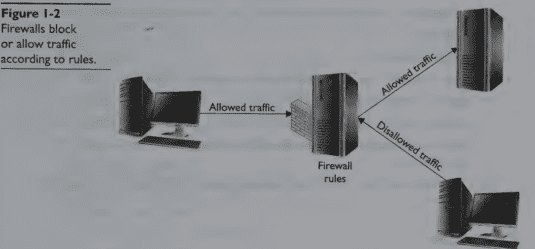

`Linux` 可以定制和配置为在你的网络中作为防火墙运行。使用 `netfilters` 和 `iptables`，你可以创建在数据包级别过滤网络流量的规则。使用 `Squid`，你还可以在 `Linux` 系统上创建应用层网关。

### 章节回顾

在本章中，我们介绍了 `Linux` 操作系统。首先讨论了什么是操作系统。还讨论了构成 `Linux` 操作系统的组件。我强调了一个事实，即现代计算机系统和操作系统是模块化的。你可以在任何兼容的计算机上安装 `Linux`。


然后我花了一些时间回顾了 Linux 的历史发展。我回顾了典型的企业软件开发模式，并讲述了 Linux 是如何在这种规范之外开发的。我谈到了 GNU 和 GPL。我讨论了 Linux 是在 GPL 下开发的，任何人都可以免费访问源代码这一事实。

我回顾了 Linux 发行版的创建过程，并审视了几个更流行的发行版。还讨论了 Linux 在典型组织中可以扮演的不同角色，包括服务器、桌面和防火墙。

#### 加速回顾

- `Linux` 是一个操作系统。
  - 操作系统提供四个关键功能：
    - 应用平台
    - 硬件协调器
    - 数据存储
    - 安全性
    - 连接性
  - `Linux` 由以下组件组成：
    - 内核
    - 库
    - 实用工具
    - 用户界面

`Linus Torvalds` 在 20 世纪 90 年代初首次开发了 `Linux`。

`Linux` 在 `GPL` 许可下发布。

任何人都可以下载和修改 `Linux` 内核源代码。

不同的软件公司开发独特的 `Linux` 版本，称为发行版。

`Linux` 可以在计算机网络中作为服务器、桌面系统或防火墙运行。

#### 问题

1. 贵公司最近购买了 12 台新的计算机系统。这些计算机拥有 `Intel Pentium D 2.8 GHz` CPU 和 500MB 硬盘。你的部署计划要求在它们上安装 `Linux`，但申请这些计算机的部门经理担心无法做到这一点，因为它们已经预装了 `Windows 7`。这可能吗？
   - A. 是的，但你必须为 `Linux` 安装一个新的硬盘。
   - B. 不，硬件可能为 `Windows` 优化，不支持 `Linux`。
   - C. 不，现代主板硬编码识别你的 `Windows` 授权证书。如果找不到，系统将无法启动。
   - D. 是的，你可以擦除硬盘并安装 `Linux`。
2. 以下哪一项代表了 `Linux` 系统中的实际操作系统组件？
   - A. 库
   - B. 内核
   - C. 桌面环境
   - D. `bash` shell 函数
3. 以下哪一项提供了程序员在编写 `Linux` 程序时可以调用的预写代码元素？
   - A. 内核
   - B. 内核模块
   - C. 库
   - D. `bash` shell 配置文件
4. `Andrew Tanenbaum` 编写的 `UNIX` 克隆体的名称是什么？
   - A. `CPM`
   - B. `DR-DOS`
   - C. `Linux`
   - D. `Minix`
   - E. `Solaris`
5. `Linus Torvalds` 对 `Linux` 的源代码做了什么？
   - A. 他将其卖给了 `IBM`。
   - B. 他免费将其交给了 `Microsoft`。
   - C. 他开发了 `Minix`。
   - D. 他为其申请了专利和版权。
   - E. 他将其发布在互联网上，供任何想要副本的人下载。
6. 谁发起了 `GNU` 项目？
   - A. `Richard Stallman`
   - B. `Andrew Tanenbaum`
   - C. `Linus Torvalds`
   - D. `Richard Berkley`
7. 你是一名计算机程序员。你的主管要求你下载最新 `Linux` 内核的源代码，并对其进行修改以支持贵公司正在开发供内部使用的自定义应用程序。你可以做到吗？
   - A. 不，`Linux` 的源代码不再在互联网上可用。
   - B. 不，源代码的版权不允许这样做。
   - C. 可以，但你必须向 `GNU` 项目支付版税。
   - D. 可以，你可以创建一个新的 `Linux` 版本，甚至重新分发它，只要源代码保持自由可用即可。
8. 你被要求为拥有 150 人组织的电子邮件服务器进行设置。你正在考虑使用 `Linux` 系统来做这件事。这可能吗？
   - A. 是的，`Linux` 可以配置为提供电子邮件服务。
   - B. 不，虽然 `Linux` 可以配置为提供电子邮件服务，但不推荐用于超过 25 个用户。
   - C. 是的，但你必须购买与 `Linux` 兼容的特殊电子邮件软件。
   - D. 不，目前没有可用的商用群件软件套件移植到 `Linux` 上运行。
9. 哪些 `Linux` 服务可用于配置 `Linux` 服务器上的共享网络打印，既适用于 `Linux` 也适用于 `Windows` 客户端工作站？（选择两项。）
   - A. `MySQL`
   - B. `NFS`
   - C. `CUPS`
   - D. `Samba`
   - E. `NIS`
   - F. `OpenPrint`
10. 哪些服务可用于配置 `Linux` 服务器上的共享文件存储，供使用 `Windows` 或 `Linux` 工作站的网络用户使用？（选择两项。）
    - A. `MySQL`
    - B. `NFS`
    - C. `PostgreSQL`
    - D. `Samba`
    - E. `NIS`
    - F. `FileManager`
11. 可以在 `Linux` 上安装哪些服务来将系统配置为数据库服务器？（选择两项。）
    - A. `MySQL`
    - B. `NFS`
    - C. `PostgreSQL`
    - D. `Samba`
    - E. `NIS`
    - F. `Microsoft SQL`
12. 哪些服务可用于将 `Linux` 系统转变为应用层网关？
    - A. `MySQL`
    - B. `NFS`
    - C. `Samba`
    - D. `NIS`
    - E. `Squid`

#### 答案

- 1. D. 硬件和操作系统是模块化的。只要硬件受到支持，你就可以安装任何针对你的特定 CPU 架构设计的操作系统。
- 2. B. `Linux` 内核是处理操作系统功能的组件。
- 3. C. 库包含预编写的代码，程序员可以在其应用程序中复用这些代码。
- 4. D. 当大学不再被允许访问 `UNIX` 源代码时，`Andrew Tanenbaum` 编写了 `Minix` 操作系统。
- 5. E. `Linus Torvalds` 将其 `Linux` 内核的源代码发布到互联网上，并邀请其他程序员对其进行修改和增强。
- 6. A. `Richard Stallman` 倡导了 `GNU` 背后的自由分发源代码概念。
- 7. D. 在 `GPL`（通用公共许可证）下，你可以自由下载 `Linux` 源代码并进行修改。
- 8. A. `Linux` 提供了一系列功能强大的电子邮件软件包，使其非常适合大型组织使用。
- 9. C, D. `CUPS` 服务为其他 `Linux` 系统提供网络打印功能。当与 `Samba` 结合使用时，网络打印功能可以扩展到 `Windows` 系统（以及任何支持 `Samba` 的操作系统，包括 `Linux` 和 `Mac OS X`）。
- 10. B, D. `NFS` 服务可用于为运行 `NFS` 客户端的系统提供文件共享。`Samba` 服务也可用于支持兼容 `Samba` 的客户端，例如 `Windows`、`Mac OS X` 和 `Linux` 系统。
- 11. A, C. `MySQL` 和 `PostgreSQL` 都是功能强大的 `Linux` 数据库服务。
- 12. E. `Squid` 服务可以将 `Linux` 系统转变为应用层网关。

## 使用 Linux Shell

在本章中，你将学习以下内容：

- `Linux` shell 的工作原理
- 使用 shell 提示符
- 获取 `Linux` shell 命令的帮助
- 处理环境变量
- 处理别名
- 使用重定向和管道

为了使操作系统有用，它必须提供某种方式让用户与其通信。用户需要一种方法来告诉操作系统需要完成哪些任务，例如运行程序、复制文件或关闭系统。这些命令通过用户界面下达。`Linux` 提供两种类型的用户界面：

- **命令行界面 (CLI)** 通过命令行界面，用户通过在命令提示符下输入命令来与 `Linux` 操作系统通信，如图 2-1 所示。
- **图形用户界面 (GUI)** 除了命令行界面，`Linux` 还为用户提供了一个易用的图形用户界面。虽然大多数系统管理员熟悉 `Linux` CLI，但许多最终用户并不熟悉。他们更习惯使用 GUI。由于 `Microsoft Windows` 在家庭计算机市场的主导地位，大多数最终用户从未使用过命令行类型的界面。为了简化生活，`X` 窗口系统被开发出来，以便在 `Linux` 操作系统上提供基于窗口的 GUI。使用 `X` 窗口系统以及窗口管理器和桌面环境（如 `GNOME` 或 `KDE`），用户可以使用鼠标与 `Linux` 内核进行交互。`GNOME` 图形界面如图 2-2 所示。


**图 2-1** Linux 命令行界面


在本章中，我们将重点介绍如何使用 `Linux` CLI。`Linux` GUI 的使用和配置将在后续章节中讨论。

### Linux Shell 的工作方式


虽然图形用户界面通常更容易使用，但管理和支持 Linux 系统所需的许多任务必须通过命令行完成。基本上，最终用户使用的是 GUI，而管理员使用的是命令行。

> **考试提示** 在 LPIC-1 和 Linux+ 考试中，你对使用 Linux CLI 管理系统的能力将接受非常严格的测试。

因此，我们将在本书中花费大量时间研究 Linux 命令行界面。我们将讨论以下主题：

- Linux shells

- 管理 shell 配置文件

让我们从讨论常用的 Linux shells 开始。

### Linux Shells

要完全理解 Linux 下命令行界面是如何工作的，你需要理解 shell 的概念。Shell 是一个命令解释器，允许你在键盘上输入命令，这些命令会被发送到操作系统内核。

在 Windows 出现之前，大多数计算机用户别无选择，只能熟悉命令行 shell。在当时的各种 DOS 版本中，你与操作系统通信的唯一方式是通过一个名为 `COMMAND.COM` 的命令行解释器输入命令。

Linux 也使用命令行 shell。然而，与 DOS 不同，Linux 允许你从多种 shell 中进行选择。与 Linux 的许多其他方面一样，你可以尝试几种不同的命令行 shell，并选择你最喜欢的那一个。一些更流行的 shell 包括：

- `sh` (Bourne Shell)：`sh` shell 是最早的 shell，于 20 世纪 70 年代末为 UNIX 开发。虽然它在 Linux 系统上并不广泛使用，但它仍在 UNIX 系统上频繁使用。

- `bash` (Bourne-Again Shell)：`bash` shell 是 `sh` shell 的改进版本，是当今最流行的 shell 之一。事实上，它是大多数 Linux 发行版默认使用的 shell。如果你在 Linux 系统上使用命令行界面，很可能你正在使用 `bash` shell。

- `csh` (C Shell)：`csh` shell 最初是为 BSD UNIX 开发的。它使用与 C 编程非常相似的语法。

- `tsh`：`tsh` shell 是 C shell 的改进版本。它是 FreeBSD 系统中使用的默认 shell。

- `zsh` (Z Shell)：Z shell 是 `bash` shell 的改进版本。

当你首次启动 Linux 系统并登录时，你的默认 shell 会被加载。你可以通过在命令提示符下输入 `echo $SHELL` 来识别你正在使用哪个 shell。`echo` 命令用于在屏幕上显示文本。在 `echo` 命令中添加 `$SHELL` 告诉 `echo` 显示当前登录用户的 `SHELL` 环境变量的内容。图 2-3 展示了一个示例，其中 `bash` shell 被设置为 `rtracy` 用户账户的默认 shell。


然而，你并不局限于默认 shell。如果你想切换到不同的 shell，只需在提示符下输入该 shell 的命令名称即可。例如，如果你当前使用 `bash` shell 并想改用 `zsh`，只需在提示符下输入 `zsh`。若要停止使用新 shell 并返回到原始 shell，请输入 `exit`。

> **考试提示** 你还可以通过修改用户账户详细信息来指定要使用的默认 shell。我们将在本书的后续章节中讨论如何执行此操作。LPIC-1 和 Linux+ 考试仅要求你熟悉 `bash` shell。因此，本章将仅涉及 `bash`。

Linux 能够同时运行多个 shell 会话。每个会话都可以运行自己的程序，且全部同时运行。如果你有一个程序在运行，然后需要访问命令提示符，这将非常有用。只需按 `ALT-Fx`（其中 `x` 是 2 到 6 之间的数字）即可打开新会话。例如，要切换到第三个备用控制台屏幕，请按 `ALT-F3`。然后，你可以通过按 `ALT-F1` 返回到原始会话。

与 Windows 一样，你还可以在 Linux GUI 中运行终端会话。这是通过运行 `Konsole` 或 `GNOME Terminal` 等终端程序来实现的。要运行多个命令行会话，只需打开两个或更多终端窗口。每个 shell 会话独立于其他会话运行其程序。如图 2-4 所示。

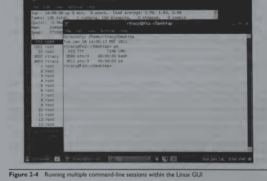

这也可以通过另一种方式实现。当你在 Linux GUI 中时，按 `CTRL-ALT-Fx`（其中 `x` 是 1 到 6 之间的数字）。这将把你切换到基于文本的 shell 提示符。要切换回你的 GUI 环境，请按 `ALT-F7`（在大多数发行版上）。

**注意** 在 Fedora 系统中，按 `ALT-F1` 可返回到图形用户界面环境。

### 练习 2-1：使用 Linux Shell

**视频** 如需了解更多信息，请观看`练习 2-1`。

在本练习中，你将学习如何访问 shell 提示符、切换 shell 以及切换控制台屏幕。请完成以下操作：

1.  启动 Linux 系统至 shell 提示符。

2.  在登录提示符处，向系统进行身份验证。

3.  在提示符处输入 `echo $SHELL` 以查看默认 shell。屏幕上将显示你的默认 shell。在大多数系统中，这将是 `/bin/bash`。

4.  按 `ALT+F2` 打开备用控制台窗口。此时将显示新的登录提示符。

5.  再次向系统进行身份验证。

6.  通过选择 `ALT+F1` 返回第一个控制台屏幕。

7.  在提示符处输入 `sh` 加载 `sh` shell。

8.  在提示符处输入 `exit` 返回默认 shell。

**注意** 如果系统启动进入了图形化系统，请先登录，然后按 `CTRL+ALT+F1`。

既然你已经知道如何访问 `bash` shell，那么接下来谈谈如何配置它。

### 管理 Shell 配置文件

你可以使用多个配置文件来自定义你的 `bash` shell 环境。实际上用于配置 shell 的文件取决于你使用的是登录 shell 还是非登录 shell。如果你的 Linux 系统启动到基于文本的登录屏幕，并且你使用 CLI 登录系统，则正在使用登录 shell。图 2-5 展示了这种类型的一个 shell 示例。


**注意** 如果你的系统启动到运行级别 3，那么你就正在使用登录 shell。我们将在本书后续详细讨论运行级别。

即使系统配置为启动到图形环境（运行级别 5），在启动时仍会创建登录 shell；你只是看不到它而已。但是，如果你在桌面环境中打开终端窗口，则不是在使用登录 shell。相反，你正在运行非登录 shell。图 2-6 展示了这种情况。

这种区分很重要，因为你使用的 shell 类型决定了用于自定义 shell 环境的配置文件。这些文件实际上是包含特定待运行命令的基于文本的 shell 脚本。当运行配置文件时，文件中的所有命令将按照其在文件中出现的顺序执行。


**注意** shell 脚本类似于其他操作系统中的批处理文件。

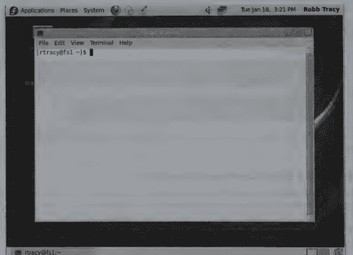

**图 2-6** 使用非登录 shell

| bash 配置文件 | Shell 类型 | 功能 |
| :--- | :--- | :--- |
| `/etc/bashrc` 或 `/etc/bash.bashrc` | 非登录 shell | 包含系统范围的 shell 函数和别名。 |
| `~/.bashrc` | 非登录 shell | 存储用户特定的函数和别名。（尽管许多发行版中的登录 shell 也使用此文件。它通常由下面列出的某个配置文件调用。） |
| `/etc/profile` 和 `/etc/profile.d` 中的文件 | 登录 shell | 包含系统范围的 shell 环境配置参数。 |
| `~/.bash_profile` | 登录 shell | 存储用户特定的 shell 偏好设置。 |
| `~/.bash_login` | 登录 shell | 存储用户特定的 shell 偏好设置。 |
| `~/.profile` | 登录 shell | 存储用户特定的 shell 偏好设置。 |
| `~/.bash_logout` | 登录 shell | 存储用户特定的 shell 偏好设置。 |

**表 2-1** bash Shell 配置文件

表 2-1 列出了常用的 shell 配置文件。

如果你使用的是非登录 shell，情况相当简单。`bash` shell 首先运行 `/etc/bashrc` 以执行系统范围的函数和别名，然后运行用户主目录中的 `~/.bashrc` 进行用户特定的自定义。


如果你使用的是登录 `shell`，`bash` 首先运行 `/etc/profile` 并应用该文件中指定的配置。然而，在那之后，事情变得稍微复杂一些。正如你可能在表 2-1 中注意到的，列出的几个文件听起来做的事情完全一样。没错，确实如此。这里的问题是没有任何发行版使用所有这些文件。例如，`Fedora` 系统使用 `~/.bashrc`、`~/.bash_profile` 和 `~/.bash_logout`。相反，`openSUSE` 系统使用 `~/.bashrc` 和 `~/.profile`。

当运行登录 `shell` 时，`bash` `shell` 程序按以下顺序搜索配置文件：

1. `~/.bash_profile`
2. `~/.bash_login`
3. `~/.profile`

它使用找到的第一个文件，并忽略其余所有文件。在 `SUSE` 和 `Fedora` 上这不是一个大问题。请记住，`bash` 在加载登录 `shell` 时不会读取 `.bashrc`（尽管它可能由 `.bash_profile` 或 `.profile` 调用）。因此，在读取 `/etc/profile` 之后，`Fedora` 系统上的 `bash` `shell` 读取 `.bash_profile`。同样，在 `openSUSE` 系统上，`bash` 在读取 `/etc/profile` 之后读取 `.profile`。

**警告** 如果你希望修改 `bash` `shell` 环境，以便在 Linux 系统上打开登录 `shell` 时应用于所有用户，你可以修改 `/etc/profile` 文件。但是，如果在操作系统应用更新，你所做的更改可能会丢失。大多数发行版建议你修改 `/etc/profile.local` 文件以防止这种情况发生。

`.bash_logout` 文件仅在你从登录 `shell` 注销时使用。大多数发行版默认不在用户主目录中包含此文件。然而，大多数发行版确实允许用户创建自己的 `.bash_logout` 文件，并用自己的命令进行自定义，以便在注销时运行。

既然你理解了 `shell` 的作用和功能，现在你准备好学习如何使用它来运行程序了。

### 使用 Shell 提示符

在本章的这一部分，你将学习如何执行以下操作：

- 在 `shell` 提示符下输入命令
- 使用命令历史
- 使用 `Tab` 键补全

让我们从讨论如何在 `shell` 提示符下输入命令开始。

#### 在 Shell 提示符下输入命令

从 `shell` 提示符运行程序或命令相对容易。其方式与 DOS 或 Windows 中的命令窗口中相同。你只需在 `shell` 提示符处输入命令、脚本文件名或程序文件名，然后按 `ENTER`。在此示例中，在 `shell` 提示符处输入了 `ls` 命令：

```bash
[rtrec@efs2 ~]$ ls
bin      Documents     Music    public_html    Templates
Desktop  Download      Pictures resources.odp    Videos
docs     Maildir       Public   schedule.txt     widget_project.doc
[rtrec@efs2 ~]$ 
```

`ls` 命令等同于 DOS 和 Windows 下的 `DIR` 命令。它显示当前目录下文件和目录的列表。

使用 `shell` 提示符时，有一个问题需要你注意。事实上，这是我看到新 Linux 管理员最挣扎的关键问题之一。这就是 Linux 处理可执行文件路径的方式与 Windows 或 DOS 不同。

在 DOS 或 Windows 命令窗口中，命令解释器首先在当前目录中查找你在提示符处输入的可执行文件名。如果当前目录中没有找到该文件，命令解释器会读取 `PATH` 环境变量。它会搜索 `PATH` 变量中列出的每个目录，寻找在命令提示符处输入的可执行文件名。如果找到文件，它将运行该可执行文件。如果没有找到，屏幕上会显示一条错误信息供用户查看。

Linux 也使用 `PATH` 环境变量。然而，Linux 不会检查当前目录。这对新的 Linux 管理员和用户来说可能是一个真正的绊脚石。由于在其他操作系统中的先验经验，他们期望能够切换到可执行文件所在的目录并从命令行运行它。

在 Linux 下，这行不通。相反，Linux 仅在当前用户的 `PATH` 变量中的目录内搜索要运行的文件。本示例展示了一个典型的 Linux `PATH` 环境变量：

```bash
rtracy@fs2:-> echo $PATH
/usr/lib/gpi:/gcc/openmpi/bin:/home/rtracy/bin:/usr/local/bin:/usr/bin:/bin:/usr/bin/X11:/usr/X11R6/bin:/usr/games:/usr/lib/jvm/jre/bin:/usr/lib/mit/bin:/usr/lib/mit/sbin
```


**考试提示** 你也可以通过在命令提示符处输入 `env` 来查看当前用户的 `PATH` 变量。

请注意，`PATH` 环境变量包含由冒号（`:`）分隔的目录列表。

即使相关的可执行文件位于当前目录中，如果当前目录不在 `PATH` 变量中，Linux 也无法找到它。相反，`shell` 将返回错误。在以下示例中，名为 `runme.sh` 的可执行脚本文件位于 `rtracy` 用户的主目录中。这是使用 `ls` 命令验证过的。

```bash
rtracy@fs2:-> ls
bin       Documents        Music        public_html      schedule.txt     widget_project.doc
Desktop   Download         Pictures     resources.odp
maildir   Public           runme.sh     Videos

rtracy@fs2:-> runme.sh
If 'runme.sh' is not a typo you can use command-not-found to lookup the package that contains it, like this:
  cnd runme.sh
rtracy@fs2:->
```

如你所见，当在 `shell` 提示符处输入 `runme.sh` 时，`shell` 找不到该文件。这是因为 `rtracy` 的主目录（`/home/rtracy`）未列在 `PATH` 环境变量中。

处理这种情况有三种方法。首先，你可以输入可执行文件的完整路径。对于刚才显示的示例，你可以在 `shell` 提示符处输入 `/home/rtracy/runme.sh` 来执行该文件。

其次，你可以切换到可执行文件所在的目录。然后在命令前添加 `./`。在前面的示例中，你首先应验证

当前目录为 `/home/rtracy`；然后你可以在 `shell` 提示符下输入 `./runme.sh`。`./` 字符指定了当前目录。通过在命令开头添加这些字符，你告诉 `shell` 在当前目录中查找该命令指定的文件。

最后，你可以将可执行文件所在的目录添加到 `PATH` 环境变量的目录列表中。我们将在本章稍后讨论如何执行此操作。

除了路径问题外，你还需要意识到 Linux 文件名和目录名是区分大小写的！这意味着 Linux 命令也是区分大小写的。如果你要运行的可执行文件名为 `runme.sh`，那么你必须确切地在 `shell` 提示符下输入 `runme.sh`。输入 `Runme.sh`、`RUNME.SH` 或 `RunMe.SH` 是行不通的。`shell` 会将这些名称解释为不同的文件。

这条规则同样适用于目录名。如果你正在调用 `/home/rtracy/runme.sh`，那么你在使用确切的大小写时输入命令。`/Home/Rtracy/Runme.sh` 将会将 `shell` 指向文件系统中的另一个完全不同的位置。

随着你在使用 Linux 方面获得经验，你会发现它包含了一些非常强大的命令和工具，你会反复使用它们。其中一些包括以下内容：

- `halt`: 此命令会关闭操作系统，但只有 `root` 用户可以运行它。
- `reboot`: 此命令会关闭并重新启动操作系统。它也只能由 `root` 运行。
- `init 0`: 此命令也会关闭操作系统，且只能由你的 `root` 用户运行。
- `init 6`: 此命令也会关闭并重新启动操作系统。它也只能由 `root` 运行。
- `shutdown`: 此命令可用于关闭或重启系统。
- `exit`: 此命令终止当前正在运行的进程，包括当前的 `shell` 会话。例如，如果你在 Linux GUI 中打开一个终端会话并在 `shell` 提示符下输入 `exit`，则终端会话会关闭。同样，如果你正在 CLI 中工作并输入 `exit`，当前 `shell` 会话将结束，并注销登录。


- `su`: 此命令将当前用户切换到新的用户账户。例如，如果你以 `rtracy` 身份登录，并且需要切换到用户账户 `doug.hanour`，你可以在 shell 提示符下输入 `su doug.hanour`。此命令最常用于切换到超级用户 `root` 账户。实际上，如果你不提供用户名，该实用程序会假设你要切换到 `root` 账户。如果你输入 `su -`，那么你将切换到 `root` 用户账户，并应用 `root` 的所有环境变量。完成后，输入 `exit` 以返回到原始用户账户。

> **提示** 许多人认为“`su`”代表“超级用户（superuser）”。并非如此。它代表“切换用户（switch user）”。

- `env`: 此命令显示当前登录用户的环境变量。

- `echo`: 此命令用于在屏幕上回显一行文本。它经常用于显示环境变量。例如，如果你想查看 `PATH` 变量的当前值，你可以输入 `echo $PATH`。


> **考试提示** `$` 字符告诉 `echo` 其后跟随的文本是一个变量，而不是一个字符串字面量，并且它应该使用该变量的当前值。如果你省略了 `$`，`echo` 命令将只是在屏幕上显示“`PATH`”。

- `top`: 此命令是一个非常有用的命令，它显示当前在系统上运行的所有应用程序和进程的列表。你可以按 CPU 使用率、内存使用率、进程 ID 号以及由哪个用户拥有它们进行排序。

- `which`: 此命令用于显示 shell 命令或工具的完整路径。例如，如果你想知道 `ls` 命令的完整路径，你可以输入 `which ls`。

- `whoami`: 此命令显示当前登录用户的用户名。

- `netstat`: 此命令显示网络状态，包括当前连接、路由表等。

- `route`: 此命令用于查看或修改系统的路由表。

- `ifconfig`: 此命令用于管理系统中安装的网络板。它可以用于显示或修改你的网络板配置参数。此命令只能由 `root` 用户运行。

- `uname`: 此命令使用几个不同的选项返回关于你的 Linux 系统的信息，包括：

  - `-s`: 显示 Linux 内核的名称
  - `-n`: 显示系统的主机名
  - `-r`: 显示 Linux 内核的发布编号
  - `-v`: 显示 Linux 内核的版本号
  - `-m`: 显示系统的硬件架构（例如 `x86_64`）
  - `-p`: 显示处理器类型
  - `-i`: 显示硬件平台
  - `-o`: 显示操作系统
  - `-a`: 显示所有这些信息

这里列出的命令仅旨在让你熟悉常见的 Linux 命令和工具。为了通过你的 LPIC-1 和 Linux+ 考试，你需要非常熟悉这些命令以及许多其他命令。书中后续的章节将涵盖更多的命令和工具。

除了直接从 shell 提示符运行命令外，你还可以使用 `exec` 命令来运行程序。例如，如果你有一个 Linux 应用程序，其可执行文件名为 `myapp`，你可以通过在 shell 提示符下输入 `exec myapp` 来执行它（假设 `myapp` 文件的路径包含在你的 `PATH` 环境变量中）。

实际上，这个命令并不经常使用，因为通常直接从 shell 提示符运行命令同样容易，正如前面所讨论的。

然而，`exec` 命令确实有一个有用的功能。要使用此功能，你首先需要理解，当你直接从 shell 提示符执行命令（不使用 `exec`）时，由该命令创建的新进程与 shell 进程并行运行。但是，如果你使用 `exec` 执行命令，由该命令创建的新进程实际上替换了启动它的 shell 进程。当你退出该应用程序时，就好像 shell 本身被终止了一样。例如，如果你在 shell 提示符下输入 `exec vi`，则 `vi` 文本编辑器会被加载。然后，当你退出 `vi` 编辑器时，整个会话将终止，因为 shell 进程已被编辑器进程替换。

让我们在下面的练习中练习使用常见的 Linux 命令。

### 练习 2-2：使用 Linux 命令

**视频**：欲了解更多信息，请观看 练习 2-2。

在本练习中，你将学习如何从 shell 提示符使用常见的 Linux 命令。完成以下操作：

1. 将你的 Linux 系统启动到 shell 提示符。如果你的系统启动到了图形界面，请登录然后按 `CTRL-ALT-F1`。
2. 在登录提示符处，对系统进行身份验证。
3. 在 shell 提示符下，通过输入 `pwd` 确定你的当前目录。当前目录是什么？
4. 通过输入 `whoami` 确定当前用户。当前用户是谁？
5. 通过输入 `ls` 创建当前目录中文件的目录列表。
6. 通过在 shell 提示符下输入 `man ls` 获取有关 `ls` 工具的更多信息。
7. 使用 `PGDN` 键滚动 man 页。你可以使用哪个选项与 `ls` 一起使用以采用长列表格式？
8. 按 `q`。
9. 通过在 shell 提示符下输入 `ls -l` 使用 `ls` 命令创建长列表。

#### 使用命令历史

bash shell 支持命令历史。每次你在 shell 提示符下输入一个命令，该命令都会保存在主目录中的 `~/.bash_history` 文件中。这个文件只是一个简单的（隐藏的）文本文件，包含你之前输入的所有 shell 命令，每行一个。这个文件每次你输入时都会持续更新。

#### 评估 .bash_history 中的 shell 命令

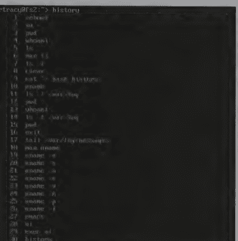

你可以通过在 shell 提示符下输入 `history` 来显示 `.bash_history` 文件的内容。图 2-7 展示了一个示例。

如果在 shell 提示符下按下 `Up` 箭头键，bash 将读取此文件并显示你最后输入的指令。如果你反复按下 `Up` 箭头键，你可以滚动查看最近使用的指令列表。当你找到想要执行的指令时，只需按下 `ENTER` 键即可执行该指令。我非常喜欢这个功能，特别是在我需要重新输入一个非常长且复杂的指令时。只需按下 `Up` 箭头键直到显示所需的指令，然后按下 `ENTER` 键！

如果你不想通过遍历所有过去的指令来找到你想要的那一个，你还可以输入所需指令的一部分，然后按下 `CTRL-R`。bash shell 将搜索你的指令历史记录并显示最近匹配的指令。

你可以使用几个环境变量来管理历史记录文件中的条目：

- `HISTSIZE` 或 `HISTFILESIZE` 配置你的历史记录文件的大小。在大多数发行版中，此值设置为 1000 条条目。你可以通过更改此变量的值来自定义历史记录文件的大小。
- `HISTCONTROL` 控制你的指令历史是如何存储的。你可以将此变量设置为 `ignoreboth`、`ignorespace`、`ignoredups` 或 `eraseboth`。值为 `ignorespace` 会告诉 shell 忽略历史记录中以空格开头的指令。值为 `ignoredups` 会告诉 shell 忽略历史记录中的重复指令。值为 `ignoreboth` 同时指定 `ignorespace` 和 `ignoredups`。你还可以将此变量设置为 `eraseboth`，以删除历史记录文件中所有重复的条目。

**注意** 我们将在本章的后面部分更深入地讨论环境变量。

让我们通过以下练习来实践使用指令历史。

#### 练习 2-3：使用指令历史

**视频** 欲了解更多信息，请观看 练习 2-3。

在这个练习中，你将在 bash shell 中练习使用指令历史。请完成以下步骤：

1. 启动你的 Linux 系统至 shell 提示符。如果你的系统启动进入图形界面，请登录然后按下 `CTRL-ALT-F1`。
2. 对你的系统进行身份验证。
3. 在 shell 提示符下，输入 `ls -l /var/log`。
4. 在 shell 提示符下，输入 `pwd`。
5. 在 shell 提示符下，输入 `whoami`。
6. 按下 `Up` 箭头键三次，然后按下 `ENTER` 键，再次运行第 3 步中的 `ls` 指令。
7. 使用 `Up` 箭头键再次运行 `pwd` 指令。
8. 使用 `Up` 箭头键再次运行 `whoami` 指令。

除了指令历史，bash shell 还提供指令补全功能。让我们接下来讨论这个功能。

#### 使用指令补全

除了指令历史，我也非常热爱 bash shell 提供的指令补全功能。当你需要在命令行中输入一个非常长的文件名时，这个功能极其有用。指令补全功能允许你在 shell 提示符下输入指令时简单地按下 `TAB` 键。这样做时，bash shell 会“猜测”你想输入的内容，然后自动为你完成该指令。


例如，假设 `/tmp` 目录下存在一个名为 `vmware-linux-tools.tar.gz` 的文件。我需要解压这个 `tar` 包归档，以便安装其中包含的应用程序。如果我想的话，我可以输入完整指令 `tar -zxvf /tmp/vmware-linux-tools.tar.gz` 在 shell 提示符下，`tar` 就会为我解压该文件。

**注意** 我们将在本书的后面部分详细讨论 `tar` 指令的工作方式。

然而，如果你像我一样，你的手指并不总是听从你的指挥。我在输入指令时倾向于犯很多拼写错误，尤其是在处理像本例中这样长的文件名时。为了防止这种情况，我可以使用指令补全来代替我输入。在这个例子中，我会在 shell 提示符下输入 `tar -zxvf /tmp/vmw`，然后按下 `TAB` 键。这样做时，`bash` shell 会查看 `/tmp` 目录下以 `vmw` 开头的文件，并判断我大概是指 `vmware-linux-tools.tar.gz` 文件。然后它会将该文件名附加到指令末尾。然后我只需要按下 `ENTER` 键。指令补全太棒了！

#### 练习 2-4：使用指令补全


在这个练习中，你将在 `bash` shell 中练习使用指令补全。请完成以下步骤：

1. 启动你的 Linux 系统至 shell 提示符。如果你的系统启动进入图形界面，请登录然后按下 `CTRL-ALT-F1`。

2. 对你的系统进行身份验证。

3. 通过输入 `su -` 后跟你的 `root` 用户密码来切换到你的 `root` 用户账户。

4. 在 shell 提示符下，输入 `tail /var/log/m`，但先不要按 `ENTER` 键。

5. 按下 `TAB` 键两次。应该会显示 `/var/log/` 下所有以 `m` 开头的文件列表。

6. 在指令后添加一个 `e`，但先不要按 `ENTER` 键。你的指令提示符应显示 `tail /var/log/me`。

7. 按下 `TAB` 键。指令应自动显示为 `tail /var/log/messages`。

8. 按 `ENTER` 键执行该指令。

#### 获取 Linux 指令的帮助

Linux 的一个伟大之处在于，你可以轻松找到大量的文档和帮助信息。挑选任何 Linux 操作系统任务或工具，你很可能都能找到教你如何实现所需操作的文档。在本章中，我们将教你如何使用两种在 Linux 中获取帮助的极佳资源。

然而，在此之前，你需要理解关于 Linux 文档材料的几个关键点。首先，提供你的 Linux 发行版的厂商可能提供一些通用的系统文档供你使用。然而，这些系统文档可能非常简略。（对于某些发行版，它们可能根本不存在。）

这是因为你在 Linux 发行版上安装的每个服务或应用程序通常都包含该特定程序的文档。如果你考虑到 Linux 分发的所有不同软件包，你就会发现，让 Linux 厂商试图开发描述如何使用所有这些软件包的自有文档将是一项极其艰巨的任务。相反，他们依靠开源社区中的其他人来记录可用于 Linux 的各种应用程序和服务。

这引出了你在使用 Linux 文档时需要记住的第二个要点：编写特定服务或工具的程序员很可能也是编写相关文档的人。只有少数的 Linux 软件文档确实是由专业技术写作者编写的。这意味着不同软件之间文档的质量差异很大。一些程序员非常擅长编写文档。他们写得很好，并且知道如何以易于理解的方式组织信息。不幸的是，其他程序员并不擅长编写文档。事实上，他们在记录软件方面可能非常糟糕。他们犯的主要错误是假设读者拥有与他们相同知识水平。（这在某种程度上是一个矛盾。如果读者拥有与作者相同的知识水平，那么他们就不需要文档了，对吧？）这种文档往往不完整，通常无助于解决问题。

**注意** 如果你遇到这种情况并且有些额外的时间，大多数程序员会很高兴有人自愿帮助编写他们的产品文档。正如我们将在本章后面看到的，大多数 Linux 帮助源包含一个你可以用来联系作者的电子邮件地址。

你需要记住的第三个要点是，大多数 Linux 文档资源不是基于纸质的。在 Linux 的早期，许多发行版确实包含一本厚厚的纸质手册。我在 1995 年安装的第一本 Linux 发行版（`Caldera OpenLinux` 1.0 版）就包含这样的手册。然而今天，纸质手册已成为稀有之物。正如你可以想象的那样，印刷如此规模的手册非常昂贵，且消耗大量纸张。因此，几乎当前你的 Linux 发行版的所有文档资源都以电子格式提供。

**考试提示** 知道如何在使用 Linux 时获取帮助是 Linux 管理员工作职责的关键部分。当问题发生时，你需要能够快速找到答案。因此，在 `LPIC-1` 和 `Linux+` 考试中，你需要展示你知道如何使用可用的各种工具来查找帮助。你需要非常熟悉使用 `man` 和 `info` 来查找信息。你需要知道如何启动这些工具，导航显示的信息，以及退出。

在本章的这一部分，我们将向你介绍在使用 Linux 时获取帮助的各个资源。以下内容将被涵盖：

- 使用 `man` 页

#### 使用 `man` 手册页

维护 Linux 系统文档的主要方式之一是通过使用手册（`man`）页。这些手册页包含关于操作系统本身以及系统中安装的任何*应用程序*的文档。这些 `man` 页使用称为 `man` 的实用程序进行查看。

`man` 实用程序最初由 UNIX 操作系统开发并使用。它已被移植到 Linux，并提供与 UNIX 系统相同的功能。它可以用于显示特定 Linux 命令、实用程序或文件的手册页。

在管理 Linux 系统时，`man` 实用程序是一个极其有用的工具。想一想，即使是最基本的 Linux 系统也有许多可用的命令和实用程序。一些命令和实用程序经常使用；其他的使用非常罕见。对于普通的 Linux 管理员来说，记住每个可能的命令和实用程序使用的语法和选项是非常困难的，尤其是那些你不经常使用的。

`man` 实用程序确实是救星。如果你发现自己在处理某个特定命令或实用程序时不知所措，你可以使用 `man` 显示相应的手册页，以提醒自己如何使用它。我们喜欢 `man`！

除了系统命令和实用程序外，系统中大多数软件包也维护有 `man` 页。每当你在 Linux 上安装软件包时，包含软件文档的 `man` 页也会随之安装。这允许你也使用 `man` 来查看这些软件包的文档。

在本章的这一部分，我们将回顾以下与 `man` 相关的主题：

- `man` 目录结构
- 手册章节
- 使用 `man` 查看文档

##### `man` 目录结构

`man` 显示的实际页面维护在 `MANPATH` 环境变量指定的目录下的多个目录中。在一个 64 位 `openSUSE Linux` 11.3 系统上，`MANPATH` 变量被设置为 `/usr/lib64/man:/usr/lib64/gcc/x86_64-suse-linux/4.6/man:/usr/local/man:/usr/share/man` 目录。你可以通过在 shell 提示符下输入 `echo $MANPATH` 来检查系统上 `MANPATH` 变量的值。这样做时，会显示一个环境变量列表。`MANPATH` 变量列出了包含 `man` 页的目录，每个目录由冒号分隔，如图 2-8 所示。


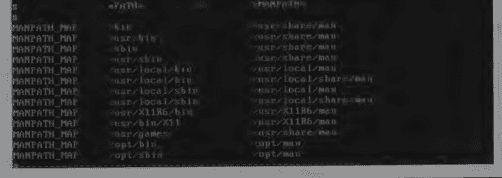

需要注意的是，`man` 实用程序在不同的 Linux 发行版中可能以不同的方式实现。例如，`Fedora` 发行版默认不使用 `MANPATH` 环境变量。相反，它使用 `/etc/man_db.conf` 文件中的 `MANPATH_MAP` 指令来指定存储 `man` 页的目录。此配置文件的示例如图 2-9 所示。

在 `MANPATH` 变量中指定或 `/etc/man_db.conf` 文件中 `MANPATH_MAP` 指令中指定的目录下，有一系列用 `man1`、`man2`、`man3` 等表示的目录，如图 2-10 所示。图 2-10 中显示的一些目录不用于手册章节。诸如 `hu`、`it` 和 `jp` 这样的目录用于本地化为英语以外的语言的 `man` 页。

##### 手册章节

包含在各个 `man` 目录中的所有 `man` 页共同组成手册。图 2-10 中显示的每个目录代表手册的一个章节。`man` 页作者使用的标准将手册划分为表 2-2 中所示的章节。

`man` 页根据其关联的软件类型进行分类并存储在适当的目录中。本课程中你将使用的许多 `man` 页将存储在章节 1：Shell 命令和章节 8：管理实用程序中。

| 章节 | 内容 |
| :--- | :--- |
| 1 | 任何用户可使用的程序和 shell 命令 |
| 2 | Linux 内核提供的系统函数 |
| 3 | 库函数 |
| 4 | `/dev` 中找到的特殊文件 |
| 5 | 文件格式描述和约定 |
| 6 | 游戏 |
| 7 | 杂项约定 |
| 8 | `root` 用户使用的管理实用程序 |
| 9 | 内核例程文档 |


### 表 2-2 man 页中使用的章节

#### 使用 man 查看文档

使用 `man` 查找信息真的很容易。你只需要输入 `man` 后跟你需要信息的实用程序名称。

例如，`ls` 命令是一个非常实用的 shell 命令，你可以使用它来显示目录中文件的列表。它可以与各种选项一起使用，这些选项定制了其工作方式及其返回数据的显示方式。你怎么知道这些选项是什么以及如何使用它们？你使用 `man` 实用程序显示 `ls` 命令的手册页。为此，只需在 shell 提示符下输入 `man ls`。这样做时，会显示如图 2-11 所示的屏幕。


特定的 `man` 页由几个元素组成，如图 2-11 所示。一些 `man` 页将包含许多章节；其他页仅包含少数几个。大多数 `man` 页将包含以下内容：

- `Title`：标题章节是 `man` 页的第一行。它列出了 `man` 页中讨论的实用程序、命令或文件的名称，后跟章节号。在图 2-11 中，注意第一行写着 `LS(1)`。这表明 `man` 页描述了 `ls` 实用程序，并位于手册的第 1 章。记住表 2-2，手册的第 1 章包含 Linux 系统上所有用户都可以使用的命令和实用程序的手册页。


图 2-11 查看 `ls` 实用程序的 `man` 页

- `NAME`：名称章节简单地显示命令、文件或实用程序的名称以及关于其功能的简短摘要。在图 2-11 中，名称章节表明 `ls` 实用程序用于列出目录内容。

- `SYNOPSIS`：概要章节提供了使用特定命令或实用程序语法的简要描述。如果手册页记录的是配置文件，如 `smb.conf`，则概要章节提供该文件用途的简要概述。在图 2-11 中，`ls` 实用程序的 `man` 页的概要章节显示了从 shell 提示符使用该命令的语法。它告诉你可以在其后输入一系列可能的选项和文件名。

- `DESCRIPTION`：描述章节提供了手册页的核心内容。此部分详细描述了命令、文件或实用程序的工作方式。它还提供了可使用的选项列表。例如，在图 2-11 中，`man` 页规定你可以使用 `-a` 或 `--all` 选项与 `ls` 实用程序一起使用，以在文件系统中显示隐藏目录和文件，以及普通文件和目录。如果没有 `man` 页，你很可能永远不知道可以在 `ls` 中使用 `-a` 选项！


- `AUTHOR`：作者章节显示了编写 `man` 页中引用的命令、实用程序或服务的程序员的名字。图 2-12 中展示了 `ls` 实用程序的这种情况。

- `REPORTING BUGS`：报告错误章节提供了一个电子邮件地址，你可以用它来报告你在实用程序或文档中发现的任何错误，如图 2-12 所示。

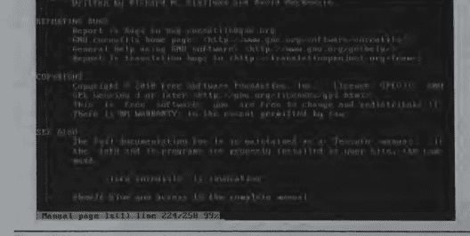

图 2-12 查看 `ls` 实用程序的其他 `man` 页章节

- `COPYRIGHT`：版权章节提供了关于 `man` 页中引用的命令、实用程序或服务的版权所有者的详细信息。它还提供了再分发信息，如图 2-12 所示。

- `SEE ALSO`：另请参阅章节提供了一个与当前 `man` 页相关的 `man` 页或其他资源列表。例如，在图 2-12 中，另请参阅章节引导用户使用 `info` 查看 `ls` 命令的完整文档。

- `VERSION` 和修订日期：`man` 页的最后一行显示程序的版本号和修订日期。

除名称章节外的所有章节都是可选的。如果特定程序需要，作者可以自由添加新章节，这些章节不在前面的列表中。你可能会看到其他实用程序或服务的 `man` 页包含诸如 `OPTIONS`、`FILES`、`ENVIRONMENT` 或 `DIAGNOSTICS` 这样的章节。

当你使用 `man` 显示手册页时，显示窗口的最底部会显示一个状态指示器。此状态指示器告诉你正在显示哪个手册页、当前显示的行以及你在文档中的位置。此状态指示器如图 2-12 所示。在此示例中，状态指示器显示正在显示 `ls(1)` 手册页。它还表明第 224 行是当前显示的最上面的行，并且当前显示的文本位于整个文档的大约 99% 处。

显示 `man` 页后，你可以使用表 2-3 中显示的按键在页面内导航。

一些 `man` 页简短而简洁；其他页则相当长且详尽。在处理 `man` 页时，你可能需要在页面本身中搜索特定术语。

例如，如果你正在使用 `ls` 命令，你可能需要查看文件系统中文件和目录的扩展信息。注意在图 2-11 中，默认情况下 `ls` 仅显示当前目录中文件或目录的名称。如果你需要查看扩展信息，如权限、所有权、文件大小或修改日期怎么办？这被称为长列表格式。哪个 `ls` 选项可以以这种方式格式化输出？

### 表 2-3

`man` 页中使用的按键

| 按键 | 功能 |
| :--- | :--- |
| 下箭头 | 在页面中向下滚动一行。 |
| 上箭头 | 在页面中向上滚动一行。 |
| 向下翻页（`PAGE DOWN`） | 在页面中向下滚动 14 行。 |
| 向上翻页（`PAGE UP`） | 在页面中向上滚动 14 行。 |
| 空格键 | 在页面中向下滚动 26 行。 |
| 主屏幕键（`HOME`） | 将你移动到页面开头。 |
| 末尾键（`END`） | 将你移动到页面末尾。 |
| `Q` | 卸载当前 `man` 页并退出 `man` 实用程序。 |


```
$ ls -l | grep long
long: page 1/1 : long(7Z-258
$
```

您可以通过输入前向斜杠 (`/`) 后跟要搜索的术语，在手册页中搜索特定信息。例如，要了解如何从 `ls` 获取长列表格式，请输入 `man ls` 来加载 `ls` 的手册页。然后，输入 `/long` 以在手册页中搜索文本字符串 "long"。如图 2-13 所示。

当您按下 `ENTER` 键时，会在手册页中定位到第一个 "long" 实例。要找到下一个实例，只需按 `N` 键。在多次按下 `N` 键后，即可定位到您想要找到的实例，如图 2-13 所示。如您所见，将 `-l` 选项与 `ls` 实用程序一起使用会以长格式显示其输出，该格式显示文件和目录的权限、所有权、大小和修改日期。

很多时候，您需要搜索某个实用程序手册页中的信息，但又无法完全记住命令的确切拼写。请记住，要查看相关的手册页，`man` 要求您知道命令、实用程序或文件的名称。如果由于某种原因您无法记住，可以使用两种不同的工具跨手册页进行搜索：

- `man -k`：使用 `man` 的 `-k` 选项可以跨所有手册页的名称和描述进行搜索，以查找特定关键字。例如，假设您想从文件系统中删除一个目录，但您不记得使用哪个实用程序来完成此操作。您可以在 shell 提示符下输入 `man -k "remove empty"` 来查看包含短语 “remove empty” 的手册页列表。如图 2-14 所示。此外，在图 2-14 中，您可以看到可以使用 `rmdir` 命令来删除目录。既然您知道了该命令的名称，您可以输入 `man rmdir` 来了解如何使用它。

- `apropos`：`apropos` 实用程序基本上执行与 `man -k` 命令相同的功能。您可以使用此实用程序跨手册页的名称和描述搜索文本字符串。例如，要搜索文本中包含字符串 "remove empty" 的手册页，您可以输入 `apropos remove`。

鉴于此，让我们在下面的练习中练习使用 `man`。


```
$ man -k "remove empty"
rmdir (1)     Removes empty directories.
```

#### 练习 2-5：使用 man 页

`VIDEO` 更多信息请参阅练习 2-5 的视频。

在本练习中，您将练习使用 `man` 实用程序查看 Linux 实用程序的手册页。请完成以下步骤：

1. 将您的 Linux 系统引导至 shell 提示符。如果您的系统启动到了图形环境，请登录后按 `CTRL-ALT-F1`。
2. 对您的系统进行身份验证。
3. 在 shell 提示符下，输入 `man cp`。
4. 回答以下问题：
   - `cp` 实用程序的作用是什么？
   - 当与 `cp` 一起使用时，`-r` 选项的作用是什么？
   - 谁编写了 `cp` 实用程序？
   - 您可以将发现的任何错误发送到哪个电子邮件地址？
   - `cp` 手册页位于哪个 `man` 章节中？
   - 如果您希望 `cp` 实用程序在覆盖现有文件之前提示您，您会使用什么选项？
5. 按 `q` 键关闭 `man`。

#### 使用 info


除了 `man` 之外，您还可以使用 `info` 实用程序来查看 Linux 系统上命令、实用程序、服务和文件的文档。您可能会问：“既然我已经有 `man` 了，为什么还需要 `info`？”这两个实用程序的作用类似；然而，它们的工作方式不同。

`man` 实用程序是一个“直截了当”的参考工具。`man` 页包含大量信息，但它们并非以指导性为主。本质上，`man` 说的是：“这是该实用程序及其语法。您可以自行摸索如何使用。”

另一方面，`info` 实用程序更像是一个学习工具。大多数 `info` 节点包含与 `man` 页相同的信息。然而，`info` 节点通常更详尽，实际上可以教您如何使用特定的 Linux 工具。

`**注意**` 我们不再称其为页面，而是将 `info` 实用程序显示的信息单元称为节点。您将在本章后面了解为什么称它们为节点。

启动 `info` 的方式与 `man` 非常相似。您只需输入 `info`，后跟您需要了解其信息的命令、实用程序、服务或文件的名称。例如，在本章前面，您使用 `man` 来查看有关 `ls` 实用程序的信息。

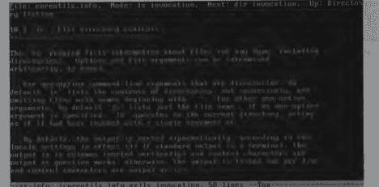

##### 图 2-15 使用 `info` 查看有关 `ls` 实用程序的信息

要使用 `info` 了解 `ls` 实用程序，您只需输入 `info ls`。这样做时，将显示图 2-15 中的信息。

您会立即注意到 `man` 和 `info` 之间的几处差异。`ls` 的 `man` 页中提供的信息相对较少。相反，`info` 中提供的信息则详尽得多。该 `info` 节点解释了 `ls` 实用程序的作用以及使用它时的预期结果。

请注意，在图 2-15 中，`info` 显示的最顶行显示了当前显示页面的信息。包含该信息的文件名为 `coreutils.info`。在 `coreutils.info` 文件中，当前正在显示的是 `ls invocation` 节点。文件中的下一个节点名为 `ls invocation`。

要在 `info` 界面中导航，您可以使用表 2-4 中所示的键盘快捷键。`info` 和 `man` 的一个主要区别在于，`info` 将信息划分为节点，而 `man` 在单个页面上显示与特定实用程序或命令相关的所有信息。您可以使用表 2-4 中列出的键盘快捷键在节点之间导航。

| 按键 | 功能 |
| :--- | :--- |
| 下箭头 | 每次向下滚动一行。 |
| 上箭头 | 每次向上滚动一行。 |
| `PAGE DOWN` | 每次向下滚动一页。 |
| `PAGE UP` | 每次向上滚动一页。 |
| 空格键 | 每次向下滚动一页。 |
| `DEL` 或 `BACKSPACE` | 每次向上滚动一页。 |
| `HOME` | 将光标移动到节点开头。 |
| `END` | 将光标移动到节点末尾。 |
| `N` | 跳转到下一个节点。 |
| `P` | 跳转到上一个节点。 |
| `Q` | 卸载当前 `man` 页并退出 `info` 实用程序。 |

**表 2-4 在 `info` 中导航的按键**

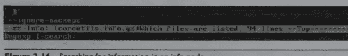

**图 2-16** 在 `info` 节点中搜索信息

就像可以使用 `man` 实用程序搜索信息一样，您也可以使用 `info` 搜索信息。如果您想搜索当前显示节点内的信息，请按下 `Ctrl-s`。这样做时，将显示 `i-search` 提示符，如图 2-16 所示。在 `i-search` 提示符下，输入您要搜索的文本并按 `ENTER`。将显示当前光标位置之后输入文本的第一个实例。再次按下 `Ctrl-s` 将跳转到您输入的字符串的下一个实例。

让我们在下面的练习中练习使用 `info`。

##### 练习 2-6：使用 `info`

**VIDEO** 更多信息请参阅练习 2-6 的视频。

在本练习中，您将练习使用 `info` 实用程序来查看您的 Linux 系统的文档。请完成以下步骤：

1. 如果尚未完成，请启动您的 Linux 系统并登录。
2. 如有必要，请启动一个终端会话。
3. 在 shell 提示符下，输入 `info rm`。
4. 回答以下问题：
   - `rm` 实用程序的作用是什么？
   - 当与 `rm` 一起使用时，`-v` 选项的作用是什么？
   - `rm` 文档位于哪个节点中？
   - 哪个节点在当前节点之前？
   - 哪个节点在当前节点之后？
   - 如果您希望 `rm` 实用程序在删除每个文件之前提示您，您将使用哪个选项？
   - 如果您想确保已删除的文件无法恢复，`rm` 是合适的实用程序吗？
5. 按 `Q` 键关闭 `info`。

既然您已经知道如何使用 `bash` shell，让我们谈谈您需要学会在 `bash` shell 中完成的某些任务。我们要处理的下一个话题是操作环境变量。

### 处理环境变量

每次启动 `bash` shell 时，都会使用多个不同的变量来定义 shell 正常运行所需的关键参数。由于这些变量定义了 shell 环境，因此它们被称为环境变量。在本章的这一部分，我们将花些时间来学习环境变量。具体来说，我们将涵盖以下主题：

- 什么是环境变量
- 管理环境变量
- 创建用户自定义变量

让我们从回顾什么是环境变量开始。

#### 什么是环境变量？

在你理解什么是环境变量之前，你首先必须理解变量本身是什么。描述变量的最佳方式是想象一个桶，里面可以存储各种物质。这个桶有一个名字，例如 "MyStuff"，你可以往里装沙子、石头、水、泥土等。如果桶里已经装满了某种物质，例如沙子，你就必须先把它倒空，然后才能装入另一种物质，例如石头。

Linux 系统中的变量基本上就是这样工作的。它是系统 RAM 中预留的一块区域，用于存储你想要放入的任何值。本质上，它就像内存中的一个“桶”。正如你必须在倒入新物质之前倒空真正的桶一样，你也不能在对变量分配新值之前将其清空。

在你的 Linux 系统中，你可以定义和使用两种不同类型的变量：

- 用户自定义变量
- 环境变量

用户自定义变量就是这样。它们是你自己在内存中创建的“桶”。你可以随意为用户自定义变量命名。你还可以将任何你想要的内容分配给它们。在编写 shell 脚本时（本书稍后会讨论），用户自定义变量非常有用。

另一方面，环境变量最初是由操作系统本身创建、命名和填充的。顾名思义，环境变量用于配置系统的计算环境。从 shell 提示符运行的程序经常访问和使用环境变量。利用这些变量中存储的信息，可以使这些程序更加灵活和稳健。

例如，假设你在 shell 提示符下输入了 `cd ~` 命令。无论当前登录的是哪个用户，该命令都会将 shell 的当前目录切换为家庭目录。


> `**注意**` 我们将在本书后面深入讨论文件和目录管理命令。


例如，假设我以 `tracy` 用户账户登录到我的 Linux 系统。默认情况下，我的家庭目录是 `/home/tracy`。如果我以 `tracy` 身份登录并输入 `cd ~` 命令，当前目录将更改为 `/home/tracy`。请注意，在命令的任何地方我都没有指定路径 `/home/tracy`。`cd` 命令只是“知道” `~` 指向 `/home/tracy`。但是，如果我以 `ksanders` 用户登录，同样的 `cd ~` 命令不会带我去 `/home/tracy`。相反，当前目录将更改为 `/home/ksanders`。

问题是，`cd` 命令如何知道要切换到文件系统目录中的哪一个？`cd` 命令检查了名为 `HOME` 的环境变量的值。正如你在图 2-17 中看到的，`HOME` 环境变量的值设置为当前用户的家庭目录路径。

由于 `tracy` 当前已登录，因此 `HOME` 的值设置为 `/home/tracy`。但是，如果我以名为 `ksanders` 的用户登录，系统会将 `HOME` 环境变量的值更改为 `/home/ksanders`。这在图 2-18 中有所展示。

你的 Linux 系统定义了许多类似于我们刚刚查看的 `HOME` 变量的环境变量。表 2-5 列出了大多数 Linux 发行版中常用的一些更相关的环境变量。

既然你已经知道环境变量是什么以及 Linux 系统中常用变量的名称，让我们接下来讨论一下如何管理你的环境变量。

#### 管理环境变量

在大多数情况下，系统分配给你的环境变量的值对于大多数任务来说通常都是足够的。然而，在某些时候，你需要操纵分配给你的环境变量的值。为此，你需要知道如何管理它们。在本节中，我们将讨论如何做到这一点。将讨论以下主题：

- 查看变量及其值
- 设置变量的值
- 使变量持久化

让我们从讨论如何查看变量的值开始。


| 环境变量 | 存储内容 | 默认值 |
| :--- | :--- | :--- |
| `BASH` and `SHELL` | shell 可执行文件的完整路径 | `/bin/bash` |


| CPU | 系统中安装的 CPU 类型 | 取决于你的系统。Intel Pentium IV 计算机的值将为 i686 |
| DISPLAY | X Window 显示应发送到的位置 | 0.0（本地视频卡和监视器） |
| ENV | bash 读取以配置其环境的文件名 | /etc/bash.bashrc |
| EUID | 当前用户的用户 ID（UID） | 当前用户的 UID 编号 |
| HISTFILE | bash 命令历史文件的路径 | ~/bash_history |
| HISTSIZE | 保存在命令历史文件中的命令数量 | 1000 |
| HOME | 当前用户的家庭目录路径。 | 当前用户的家庭目录 |
| HOST and HOSTNAME | 系统的主机名 | 你安装系统时分配的主机名 |
| LOGNAME | 当前用户的用户名 | 当前用户的用户名 |
| MAIL | 当前用户的邮箱文件路径 | /var/spool/mail/username 或 /var/mail/username |
| MANPATH | 系统 man 程序的路径 | 取决于发行版 |
| OLDPWD | 前一个当前目录的路径 | 取决于你的前一个当前目录是什么 |
| OSTYPE | 当前正在运行的操作系统类型 | Linux |
| PATH | 从 shell 提示符运行命令时要搜索的目录列表 | 取决于你的发行版 |
| PS1 | 用于创建 shell 提示符的字符 | 取决于你的发行版 |
| PWD | 当前工作目录的路径 | 取决于你当前的目录是什么 |

**表 2-5 常用环境变量**

### 查看变量及其值

如果你需要查看系统中分配给变量的值，你可以从 shell 提示符使用多种不同的命令。如果你需要查看单个变量的值，可以使用 `echo` 命令。语法是 `echo variable`。例如，如果我想要查看 `PATH` 变量的值，我会在 shell 提示符下输入 `echo $PATH`。这在图 2-19 中有所展示。


如你在图 2-19 中看到的，`PATH` 变量的内容显示在屏幕上。请注意，当你使用 `echo` 命令时，必须在变量名称前加上 `$`。这非常重要。`$` 字符告诉 `echo` 命令，后面的文本不是字面字符串，而是变量的名称，并且 echo 应该检索该变量的值并将其显示在屏幕上。如果你省略了 `$` 字符，`echo` 命令将在屏幕上显示你的变量名称。例如，如果你在 shell 提示符下输入 `echo PATH`，`echo` 命令将仅在屏幕上显示 “PATH”。这是因为它不知道 “PATH” 是一个变量的名称。`echo` 命令认为你想要显示文本字符串 “PATH”。在使用 `echo` 处理变量时，不要忘记 `$` 字符！

正如你刚才看到的，`echo` 命令非常适合在屏幕上显示变量的内容。但是，你只能显示你指定的变量。这意味着你必须知道你想要查看的变量的名称。如果你不知道变量的确切名称怎么办？如果你想一次性查看所有变量怎么办？在这些情况下，你可以使用其他 shell 命令来查看你的变量及其相关值。其中之一是 `set` 命令。如果你在 shell 提示符下输入 `set`，屏幕上会显示你所有的变量，包括环境变量和用户自定义变量。由于 `set` 的输出可能非常长，你应该使用 `set` 配合重定向来暂停输出，以便逐页显示。（我们将在本章后面讨论重定向。）例如，在图 2-20 中，在 shell 提示符下发出了 `set | more` 命令。

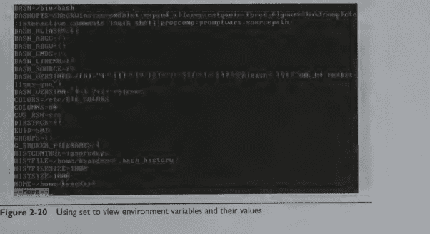

如您所见，每个变量都与其关联的值一起显示。除了 `set` 命令外，您还可以使用 `env` 命令来查看系统的环境变量。与 `set` 一样，`env` 的输出可能非常长，因此您应该在命令后附加 `| more` 以每次暂停显示一页。在图 2-21 中，已发出 `env` 命令。

与 `set` 一样，`env` 命令显示每个变量及其当前值。然而，请注意 `env` 不会对变量进行排序。实际上，`set` 命令会按字母顺序对变量进行排序，我非常喜欢这一点！

这些命令——`echo`、`set` 和 `env`——都可以用于显示变量及其值。但是，如果需要更改分配给变量的值怎么办？让我们接下来谈谈如何实现这一点。

### 设置变量的值

正如我们之前讨论的，Linux 系统上使用的大多数环境变量使用系统分配给它们的值工作得很好。事实上，有许多环境变量您不应该更改！例如，更改 `HOSTNAME` 变量的值可能会导致系统中运行的许多服务出现问题。

然而，有时您需要更改分配给环境变量的值。例如，您可能需要在 `PATH` 变量的末尾添加一个额外的目录。这是一种让使用者（以及您自己）的生活更轻松的好方法。此外，您可能需要编辑 `DISPLAY` 变量以配置 X Window 系统将其显示发送到远程计算机。同样，您可能希望修改 shell 提示符以显示不同的信息。

要执行这些任务，您需要更改环境变量的值。这相对容易。只需在 shell 提示符处输入 `variable=value`。例如，假设您在 `/var/opt/mydb` 安装了一个名为 `mydb` 的应用程序。该路径当前不存在于您的 `PATH` 变量中，您希望添加它，这样在您想要运行该程序时就不必使用完整路径。为此，您可以在 shell 提示符处输入 `PATH=$PATH:/var/opt/mydb`。

```text
PATH=/usr/spool/mail:/ksanders
PS1='\u@h:\w\$ ' OLDPWD=/home/ksanders/gtk
cd:/home/ksanders
LS_COLORS=
HOME=/home/ksanders
PATH=/usr/bin:/usr/sbin:/bin:/usr/sbin
LANG=en_US.UTF-8
TERM=VT300_C0
COLUMNS=80
LINES=24
```

**图 2-21 使用 `env` 查看环境变量及其值**

请注意，我在变量赋值中指定了 `$PATH`。这在新值分配中包含了 `PATH` 变量的当前值。然后我将 `/var/opt/mydb` 附加到现有路径列表的末尾。如果在重新赋值中不包含 `$PATH`，那么您 `PATH` 变量中的当前目录将被擦除并由命令中指定的新路径替换！当这种情况发生时，您的系统将开始遇到一系列问题！


> **注意** 请记住，设置环境变量的值会擦除其当前内容。如果您想保留当前内容，请使用刚才显示的技术。如果您确实想要擦除变量的内容并用新值替换，则只需在 shell 提示符处输入 `variable=value` 即可。

然而，我们仍有一项任务要完成。我们将 `PATH` 的值分配为包含一个额外的目录。但是，`PATH` 变量的新值仅适用于当前的 shell 会话。如果我打开另一个终端会话，我对 `PATH` 所做的更改将不会生效。这在图 2-22 中有所展示。

如您所见，尽管我以同一用户登录到新的 shell 会话，但 `PATH` 的值并不包含 `/var/opt/mydb`。要使该分配应用于所有 shell，我需要导出变量的新值。为此，我在 shell 提示符处输入 `export variable`。在本例中，我需要在 shell 提示符处输入 `export PATH`。这样做后，分配给 `PATH` 的新值可供其他所有 shell 使用，包括当前 shell 创建的任何子 shell。

### 使变量持久化

然而，在这个过程中您会遇到一个问题，即您添加到环境变量的任何新值在系统重启后都会丢失。如果所做的更改需要在系统重启期间持久化，则需要编辑章节开头讨论的 bash 配置文件之一，并将变量赋值命令添加到该文件中。

在上面的例子中，我可能希望新的 `PATH` 变量赋值在系统每次重启时都自动执行。我不想每次系统重启时都手动设置 `PATH` 的值并导出它。

为此，我可以使用设置 `PATH` 值以包含 `/var/opt/mydb` 以及导出 `PATH` 变量的命令，将其添加到以下某个 bash 配置文件中：

- `~/.bashrc`
- `/etc/profile`
- `~/bash_profile`
- `~/bash_login`
- `~/profile`

```text
[kanders@0f53 ~]$ echo $PATH
/usr/lib64/qt1/bin:/usr/lib64/teec/bin:/usr/lib64/bin:/usr/bin:/bin:/usr/sbin:/sbin:/usr/bin:/bin
$echo $usr/bin/shbin.sh /home/kanders/bin
[kanders@0f53 ~]$
```


> **提示** 将命令添加到诸如 `/etc/profile` 这样的全局 `bash` 配置文件将导致更改应用于所有用户。如果您只想将更改应用于单个用户，则应使用该用户主目录中相应的 `bash` 配置文件。

您需要确定您的特定发行版使用哪些文件。例如，您可以修改 `ksanders` 用户主目录中 `~/.bash_profile` 文件中的以下命令：

```text
PATH=${PATH}:${HOME}/bin:/var/opt/mydb
export PATH
```

现在，每当系统启动且 `ksanders` 登录时，`/var/opt/mydb` 路径会自动添加到他的 `PATH` 环境变量中。由于我们将该命令添加到 `ksanders` 用户主目录中的 `~/.bash_profile` 文件，因此它不会添加到其他任何用户的 `PATH` 变量中。

让我们在以下练习中练习操作环境变量。

##### 练习 2-7：操作环境变量

**视频** 如需更多信息，请观看练习 2-7。

在本练习中，您将在 `bash` shell 中练习操作环境变量。请完成以下操作：

- 1. 如果您尚未执行此操作，请启动 Linux 系统并登录。

- 2. 如有必要，启动一个终端会话。

- 3. 通过输入 `su -` 并随后输入 `root` 密码，将切换到 `root` 用户账户。

- 4. 在 shell 提示符处，通过输入以下命令查看以下环境变量的值：

    ```text
    echo $PWD
    echo $HOME
    echo $EUID
    echo $PATH
    echo $PS1
    ```

- 5. 通过执行以下操作，将 shell 提示符更改为显示当前登录用户、Linux 主机名、当前时间、当前工作目录的完整路径以及冒号：

    - A. 在 shell 提示符处输入 `PS1="[\u@\h \t \w]:"`。提示符应立即更改。

    - B. 在 shell 提示符处，输入 `export PS1`。

    - C. 在您的 shell 提示符处，输入 `ls ~ -a`。如果您想让对 `PS1` 环境变量的更改持久化，在您的特定发行版中您会编辑哪个文件？

带着这些想法，我们现在来谈谈创建用户定义的变量。

##### 创建用户定义的变量

在上一主题中，我们专注于操作环境变量。这些变量在系统每次启动时都会自动为您定义。但是，您实际上也可以创建自己的自定义变量。这与管理环境变量的方式完全相同。只需在 shell 提示符处输入 `variable=value`。

例如，假设我想创建一个名为 `ME` 的变量并将其设置为“Robb Tracy”。我可以通过在 shell 提示符处输入 `ME="Robb Tracy"` 来做到这一点。一旦这样做，一个名为 `ME` 的变量就会被添加到我的系统中，并设置为 Robb Tracy。您可以使用 `echo` 命令查看 `ME` 变量的值，如下所示：

```text
rtrace@fs2:~> ME="Robb Tracy"
rtrace@fs2:~> echo $ME
Robb Tracy
rtrace@fs2:~> 
```

与环境变量一样，用户定义的变量仅对当前 shell 实例可用。要使其对其他 shell 可用（包括由当前 shell 创建的子 shell），您需要使用 `export` 命令导出它。在本例中，我会在 shell 提示符处输入 `export ME` 来执行此操作。除了 `echo` 之外，您还可以使用 `set` 或 `env` 来查看用户定义的变量，就像对待环境变量一样。

与环境变量一样，您也可以通过将相应的命令添加到前面讨论的某个 `bash` 配置文件中，使用户定义的变量持久化。在创建用户定义的变量时，请记住以下规则：

- 变量名可以包含字母或数字，但不能以数字开头。

- 变量名可以包含连字符 (-) 或下划线字符 (\_)。

- 虽然并非强制要求，但在命名变量时应尝试使用全大写字母。请注意，当您输入 `set` 或 `env` 时，您的系统的所有环境变量都使用大写名称。您也应该这样做。

我们需要解决的下一个主题是别名。让我们接下来讨论别名是如何工作的。

### 使用别名

别名非常实用。别名基本上是指向你 Linux 系统上其他文件或命令的快捷方式。当系统启动时，系统会自动为你创建一系列别名。你可以在 shell 提示符下输入 `alias` 来查看这些别名。示例如下：

```bash
rtracy@fs2:~$ alias
alias += 'pushd '
alias -='popd'
alias ..='cd ..'
alias ...='cd ../..'
alias beep='echo "\em "\007"'
alias cd-="cd .."
alias dir='ls -l'
alias l='ls -alF'
alias la='ls -la'
alias ll='ls -l'
alias ls='ls $LS_OPTIONS'
alias lsl='ls -l'
alias md='mkdir -p'
alias c='less'
alias rd='rmdir -f'
alias rehash='hash -r'
alias umount='echo "Error: Try the command: umount 1>&2; false'
alias yast='if test "$UID" = 0 ; then /sbin/yast2 online_update ; else su - -c "/sbin/yast2 online_update" ; fi'
rtracy@fs2:~$
```

请注意，这里列出了一系列命令，它们其实并不是真正的命令。相反，它们是指向实际 shell 命令的别名。例如，如果你在 shell 提示符下输入 `dir`，`alias` 的输出会告诉我们实际运行的是 `ls -l` shell 命令。同样，输入 `..` 实际上会执行 `cd ..` 命令。

你也可以创建自己的别名。要做到这一点，只需在 shell 提示符下输入 `alias name="command"` 即可。例如，假设你希望在 shell 提示符下输入 `ldir` 来查看目录的长列表。你可以在 shell 提示符下输入 `alias ldir="ls -l"`。示例如下：

```bash
rtracy@fs2:~> alias ldir="ls -l"
rtracy@fs2:~> alias
...
alias dir='ls -l'
alias l='ls -alF'
alias la='ls -la'
alias ldir='ls -l'
...
rtracy@fs2:~>
```

现在，如果我在 shell 提示符下输入 `ldir`，`ls -l` 命令将会被执行，其输出将显示在屏幕上。示例如下：

```bash
rtracy@fs2:~> ldir
total 40
drwxr-xr-x 2 rtracy users 4096 2011-01-19 10:41 bin
drwxr-xr-x 2 rtracy users 4096 2011-01-19 10:42 Desktop
drwxr-xr-x 2 rtracy users 4096 2011-01-19 10:42 Documents
drwxr-xr-x 2 rtracy users 4096 2011-01-19 10:42 Downloads
drwxr-xr-x 2 rtracy users 4096 2011-01-19 10:42 Music
drwxr-xr-x 2 rtracy users 4096 2011-01-19 10:42 Pictures
drwxr-xr-x 2 rtracy users 4096 2011-01-19 10:42 Public
drwxr-xr-x 2 rtracy users 4096 2011-01-19 10:41 public_html
drwxr-xr-x 2 rtracy users 4096 2011-01-19 10:42 Templates
drwxr-xr-x 2 rtracy users 4096 2011-01-19 10:42 Videos
rtracy@fs2:~>
```

你可以在单个别名中包含多个命令。要做到这一点，请在别名命令行中使用分号 (;) 分隔这些命令。例如，如果你想创建一个别名，该别名将挂载插入 CD 驱动器中的 CD，然后生成其包含文件的长列表，你可以输入以下内容：

```bash
alias mtcd="mount -t iso9660 /dev/cdrom /media/cdrom;ls -l /media/cdrom"
```

完成此操作后，你可以输入 `mtcd` 来挂载 CD 并生成其文件列表。

与变量类似，使用 `alias` 命令定义的任何别名都不是持久的。如果你重启系统，当系统再次启动时，它们将不复存在。与变量一样，你可以将别名添加到 `bash` 配置文件中（系统级或用户特定级别）以使别名持久化。


让我们在以下练习中练习使用别名。

#### 练习 2-8：使用别名


**视频** 欲了解更多信息，请观看`练习 2-8`。

在本练习中，你将练习在 `bash` shell 中创建别名。请执行以下操作：

1. 如有必要，启动你的 Linux 系统并以标准用户身份登录。
2. 输入 `su -` 并跟随你的 root 密码，切换到 root 用户账户。
3. 在 shell 提示符下输入 `alias log="tail /var/log/messages"`，创建一个名为 `log` 的别名，该别名将显示 `/var/log/messages` 文件的最后几行。
4. 在 shell 提示符下输入 `alias`，并验证别名已创建。
5. 通过在 shell 提示符下输入 `log` 来测试你的别名。
6. 验证 `/var/log/messages` 文件的最后几行已显示。
7. 在你的 shell 提示符下输入 `ls -a`。如果你想使该别名持久化，你会编辑哪个特定于你分发的文件？

既然你已经知道如何管理变量，现在该讨论如何重定向 shell 命令的输出。让我们在下文中进行探讨。

### 使用重定向和管道

`bash` shell（以及大多数其他 Linux shell）功能极其强大且灵活。使其具备这一特性的一个特征是其操纵命令输入和输出的能力。在本章的这一部分，我们将探讨如何做到这一点。具体而言，我们将涵盖以下内容：

- 标准 `bash` 文件描述符
- 重定向 shell 命令的输出和输入
- 管道传输信息

让我们从回顾 `bash` shell 文件描述符开始。

#### 标准 `bash` 文件描述符

在你学习如何重定向或管道传输 `bash` 命令的输出之前，你必须首先理解`bash shell 文件描述符`。对于你在 shell 提示符下输入的每个命令，都有三个可用的文件描述符。这些描述符在**图 2-23**中展示。

这三个文件描述符包括以下内容：

- `stdin` 该文件描述符代表`标准输入`。标准输入是提供给特定命令进行处理的数据。命令的 `stdin` 由数字 0 表示。
- `stdout` 该文件描述符代表`标准输出`。标准输出仅仅是特定命令的输出。例如，由 `ls` 命令生成的目录列表就是其 `stdout`。命令的 `stdout` 由数字 1 表示。
- `stderr` 该文件描述符代表`标准错误`。标准错误是命令生成的错误代码（如果有）。命令的 `stderr` 由数字 2 表示。

并非所有命令都会使用这三个描述符中的全部，但许多命令确实会使用。让我们看一些例子。假设我通过在 home 目录中输入 `cat ~/test2.txt` 来显示文件内容，示例如下：

```bash
rtracy@fs2:~> cat ~/test2.txt
This is a text file named test2.txt.
rtracy@fs2:~>
```

`cat` 命令在屏幕上显示文件内容。这是 `cat` 命令的 `stdout`。现在假设我输入相同的命令，但指定了一个不存在的文件，示例如下：

```bash
rtracy@fs2:~> cat ~/test1.txt
cat: /home/rtracy/test1.txt: No such file or directory
rtracy@fs2:~>
```

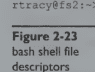

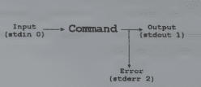

由于文件不存在，`cat` 命令生成了一个错误。这是 `cat` 命令的 `stderr`。了解这些描述符后，你可以重定向每个描述符在命令执行时的去向。让我们在下文中讨论如何执行此操作。

#### 重定向 shell 命令的输出和输入

使用这三个描述符，你可以操纵命令从何处获取输入以及它将输出发送到何处。在本章的这一部分，我们将复习如何在命令行中实现此操作。我们将讨论以下内容：

- 重定向输出
- 重定向输入

让我们先讨论如何重定向输出。

##### 重定向输出

`bash` shell 允许你在生成输出后操纵命令输出的去向。默认情况下，它显示在屏幕上。但是，你可以指定将其发送到其他地方。例如，将命令的输出从屏幕重定向到文件系统中的一个文本文件是非常常见的，特别是当命令的输出非常长时。

重定向是使用命令行中的 `>` 字符完成的。重定向输出的语法是 `command > filename` 或 `device`。例如，假设我们要使用 `tail` 命令查看系统日志文件 `/var/log/messages` 的最后几行，并希望将输出保存为当前目录中名为 `lastmessages` 的文件。我们可以通过输入 `tail /var/log/messages > lastmessages` 来完成此操作。这告诉 shell 将 `stdout` 重定向到名为 `lastmessages` 的文件。命令的输出确实被重定向了。它完全不会显示在屏幕上。所有 `stdout` 文本都被发送到指定的文件。这在图 2-24 中展示。

如果你没有在命令中输入文件描述符编号，shell 将假定你只想重定向命令的 `stdout`。在图 2-24 的示例中，你可以输入 `tail /var/log/messages > lastmessages` 并得到相同的结果。

你可以使用相同的技术将 `stderr` 从屏幕重定向到文件。例如，如果我使用 `cat` 命令尝试显示一个不存在的文件，我可以通过输入 `cat myfile.txt 2> errorfile` 将生成的任何错误消息重定向到文件。由于文件不存在，`cat` 命令生成错误消息（`stderr`）而不是常规输出（`stdout`）。这在图 2-25 中展示。

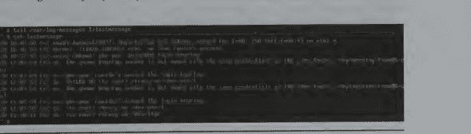

##### 重定向输出

```
fs2:\> cat myfiles.odt 2>errorfile
fs2:\> cat errorfile
cat: myfiles.odt: No such file or directory
fs2: \>
```

该命令指定将 `cat` 命令的 `stderr`（标准错误流，编号为 2）重定向到当前目录下名为 `errorfile` 的文件。由于进行了重定向，`stderr` 的输出不会显示在屏幕上，而是被写入到指定的文件中。

当您重定向输出到一个不存在的文件时，`bash` shell 会自动为您创建该文件。上述示例中发生的就是这种情况。但是，如果文件已经存在，请注意，shell 默认会擦除现有文件并用新的输出替换它。如果您希望在不清除现有内容的情况下将新输出追加到现有文件中，则应使用 `>>` 而不是 `>`。例如，如果您希望将 `ps` 命令的 `stdout`（标准输出）写入名为 `myprocesses` 的文件，而不覆盖该文件的现有内容，则应输入 `ps >> myprocesses`。您甚至可以同时将 `stderr` 和 `stdout` 重定向到文本文件。要做到这一点，您需要在命令中添加两条重定向指令，一条用于 `stdout`，另一条用于 `stderr`。其语法为 `command 1> stdout_filename 2> stderr_filename`。这将把 `stdout` 发送到一个文件，而把 `stderr` 发送到另一个文件。例如，如果您希望将 `mount` 命令的 `stdout` 写入名为 `mntok` 的文件，将 `stderr` 写入名为 `mnterr` 的文件，则应输入 `mount 1> mntok 2> mnterr`。您也可以将两种输出发送到同一个文件。要做到这一点，请使用语法 `command 1> /filename 2>&1`。这种语法先使 `stdout` 被发送到指定文件，然后将 `stderr`（2）输出重定向到 `stdout` 文件（`&1`）。如果您打算使用此选项，非常重要的一点是记住在 `1` 之前使用 `&` 符号。这告诉 shell 随后的字符是一个文件描述符，而不是文件名。如果您省略了这个字符，shell 会将 `stderr` 输出写入一个名为 `1` 的单独文件。现在您已经知道如何重定向命令的输出，接下来我们需要讨论如何重定向命令的输入。让我们继续下一步。

###### 重定向输入


正如您可以指定命令的输出发送到哪里一样，您也可以指定命令的输入（`stdin`，标准输入）来自哪里。要做到这一点，只需反转我们之前用于重定向输出的字符即可。您使用的语法是 `command < input_text_or_file`。例如，我可以在 `shell` 提示符下输入 `tail < /var/log/messages`。这将文本字符串 `"/var/log/messages"` 作为输入发送给 `tail` 命令。然而，对于大多数命令来说，这不是一个特别有用的选项。在上面的示例中，简单地输入 `tail /var/log/messages` 可能更容易。当您需要向期待输入的某个命令发送大量文本时，这个选项才真正大放异彩。例如，您可以将文本文件中的单词列表发送给 `sort` 命令，让它为您进行排序。接下来，我使用文本编辑器创建了一个名为 `words` 的文件，其中包含几行文本：

```
rtracy@fs2:~> cat words
Who
What
Why
Where
```

创建好此文件后，我可以指定将其作为 `sort` 命令的输入。这是在 `shell` 提示符下输入 `sort < words` 来实现的。排序后的输出随后显示在屏幕上，如下所示：

```
rtracy@fs2:~> sort < words
How
What
Where
Who
Why
rtracy@fs2:~>
```

让我们在下面的练习中实践重定向操作。

##### 练习 2-9：重定向输入和输出


**视频** 欲知更多信息，请观看 `练习 2-9`。

在这个练习中，您将练习重定向输入和输出。请完成以下步骤：

1. 如有必要，启动您的 Linux 系统并以标准用户身份登录。

2. 通过输入 `su -` 并跟随您的 root 密码切换到 root 用户账户。

3. 使用 `tail` 查看 `/var/log/messages` 文件的最后几行，并通过输入 `tail /var/log/messages 1> lastlines` 将标准输出重定向到您主目录下的一个文本文件。

4. 输入 `ls l*` 并验证 `lastlines` 文件是否已创建。

5. 在 `shell` 提示符下输入 `cat lastlines`，使用 `cat` 命令查看 `lastlines` 文件。

6. 在 `shell` 提示符下输入 `tail /var/log/firewall 1>> lastlines`，将 `/var/log/firewall` 日志文件内容的最后几行追加到 `lastlines` 文件中。

7. 在 `shell` 提示符下再次输入 `cat lastlines`，使用 `cat` 命令查看 `lastlines` 文件。您应该能看到防火墙日志文件的行已添加到文件末尾。

8. 在 `shell` 提示符下输入 `tail /var/log/mylog 2> errorout`，将标准错误发送到一个日志文件。

9. 在 `shell` 提示符下输入 `cat errorout` 查看 `errorout` 文件。为什么上面的命令会产生错误？

10. 在 `shell` 提示符下输入 `sort < lastlines`，将 `lastlines` 文件发送给 `sort` 命令的 `stdin`。`sort` 命令应按字母顺序将文件中的单词发送到 `stdout`（屏幕）。

除了重定向命令的输入或输出外，您还可以管道化（`pipe`）输出。接下来我们将讨论如何做到这一点。

#### 管道传递信息

重定向非常好，但它有一个弱点。它只允许我们将输出重定向到文件系统或系统设备中的文件，或者从这些源读取。如果需要将一个命令的输出重定向到另一个命令的输入怎么办？这能做到吗？该如何实现？这是通过使用管道来实现的。在本章的这一部分，我们将解释如何做到这一点。

管道在 `shell` 提示符下工作时极其有用。例如，我们在本章前面提到过，您可以将 `more` 与 `set` 或 `env` 命令一起使用。命令中使用的管道字符 (`|`) 告诉 `shell` 获取第一个命令的输出并将其发送给指定的第二个命令的输入。

例如，如果我在 `shell` 提示符下输入 `cat /var/log/messages | more`，`cat` 命令读取 `/var/log/messages` 文件的内容并将其发送到 `stdout`。通常情况下，这会显示在屏幕上。然而，由于我们使用了管道，`shell` 知道它不应该在屏幕上显示 `cat` 的 `stdout`。相反，它获取 `cat` 的 `stdout` 并将其作为下一个列出的命令——在这种情况下是 `more` 命令——的 `stdin`。然后 `more` 命令获取 `cat` 的输出并对其进行操作，即将文本逐行显示在屏幕上。

管道可用于任何产生某种输出并接受某种输入的命令。`grep` 命令就是一个很好的例子。当然，您可以在命令行单独使用 `grep`。然而，当它与另一个命令一起在管道中使用时，非常方便。其语法为 `command | grep expression`。这样做会将第一个命令的输出管道传输到 `grep` 的输入，`grep` 然后搜索与指定表达式匹配的信息。

例如，假设您正在使用 `cat` 命令在屏幕上显示 `/var/log/messages` 文件的内容。您只对在系统网络接口启动时创建的日志文件条目感兴趣。您可以通过将其管道传输到 `grep` 并搜索 `cat` 输出中的表达式 `ifup` 来过滤 `cat` 的输出。要做到这一点，您可以输入 `cat /var/log/messages | grep ifup`，如下所示：

```
fs2:~ # cat /var/log/messages | grep ifup
Jan 19 10:39:42 linux ifup: lo
Jan 19 10:39:42 linux ifup: lo
Jan 19 10:39:42 linux ifup: IP address: 127.0.0.1/8
Jan 19 10:39:42 linux ifup:
Jan 19 10:39:42 linux ifup: IP address: 127.0.0.2/8
Jan 19 10:39:42 linux ifup: eth0 device: Intel Corporation 82545EM Gigabit Ethernet Controller (Copper) (rev 01)
Jan 19 10:39:43 linux ifup-dhcp: eth0 Starting DHCP+DHCP6 client
Jan 19 10:39:43 linux ifup-dhcp: .
```

请注意，只有 `cat` 输出中匹配表达式 `ifup` 的条目由 `grep` 显示在屏幕上。

> **注意** 请记住，当您在管道传递信息时，只有管道中的最后一个命令实际上会在屏幕上显示输出。所有其他命令的输出都被重定向到管道中下一个命令的输入，并且不会显示在屏幕上。

在本例中，实际上匹配条目过多，无法在一屏内显示完毕。你可以怎么做？实际上，你可以在管道中包含多个命令。在这种情况下，我们需要使用 `cat` 来生成初始输出，然后将其通过 `grep` 进行过滤，以找出仅包含 `ifup` 的那些条目，再将 `grep` 的输出发送给 `more` 命令，以便显示屏每次暂停显示一屏。要做到这一点，你可以在 `shell` 提示符下输入 `cat /var/log/messages | grep ifup | more`。

偶尔，你可能需要某个命令的输出同时显示在屏幕上并写入文件。这可以使用 `tee` 命令来实现。使用 `tee` 的语法是 `command | tee file_name`。例如，如果我希望将 `ls -l` 命令的标准输出（`stdout`）显示在屏幕上并写入名为 `output.txt` 的文件，我可以使用以下命令：

```
ls -l | tee output.txt
```

让我们通过下面的练习来实践管道的使用。

#### 练习 2-10：使用管道


在这个练习中，你将练习使用管道将一个命令的标准输出（`stdout`）发送到另一个命令的标准输入（`stdin`）。请完成以下步骤：

1. 如有必要，启动你的 Linux 系统并以标准用户身份登录。

2. 如有必要，打开一个终端会话。

3. 通过输入 `su`（后跟你的 root 密码）切换到 root 用户账户。

4. 通过将 `cat` 的输出通过管道传递给 `grep`，查看系统日志中包含 `kernel` 一词的所有条目。在 `shell` 提示符下输入 `cat /var/log/messages | grep kernel` 来完成此操作。


- 5. 前一个命令的输出可能非常长。通过进入 `cat /var/log/messages | grep kernel | more`，将 `cat` 的输出通过管道传递给 `grep` 再传递给 `more`，以便分页显示。

- 6. 通过进入 `cat /var/log/messages | grep kernel | tee ~/kernel.txt`，将前一个命令的输出发送到屏幕以及主目录中名为 `kernel.txt` 的文件。

- 7. 通过进入 `cat ~/kernel.txt` 验证信息已写入 `kernel.txt`。


### 章节复习

本章首先回顾了大多数 Linux 发行版提供的两种用户界面：命令行界面和图形用户界面。我讨论了 `bash` 配置文件。我指出，Linux 系统上有两种类型的 shell：

- 登录 shell
- 非登录 shell

当运行登录 shell 时，首先读取 `/etc/profile` 以初始配置 shell 环境。然后，shell 按以下顺序在用户的主目录中搜索以下文件：

- `.bash_profile`
- `.bash_login`
- `.profile`

shell 将读取找到的第一个此类文件，并使用它为当前用户配置 shell 环境。不同的发行版会使用不同的 bash 配置文件。

然后，我讨论了 bash shell 的命令历史功能。使用命令历史，你可以按向上箭头键浏览之前输入的命令列表。这些命令保存在每个用户主目录中的 `.bash_history` 文件中。

bash shell 还提供了命令补全功能。使用命令补全，你可以输入命令的一部分，然后按 `TAB` 键自动完成命令。

接下来，我讨论了在使用 Linux shell 时如何获取帮助。我首先回顾了如何使用 `man` 实用程序查看手册页。我提到，你的 Linux 系统上的大多数命令和实用程序都有相关的手册页，其中包含关于它们的功能和使用方法的信息。我讨论了所有手册页共同组成手册这一事实。手册根据实用程序或命令的功能划分为不同的部分。组成手册的文件存储在 `MANPATH` 变量指定的目录或 `/etc/man_db.conf` 文件中的 `MANPATH` 指令所指定的目录中。

要使用 `man`，只需输入 `man` 后跟你需要了解更多信息的命令、实用程序、文件或服务名称即可。我回顾了大多数手册页中使用的不同部分。我还回顾了你可以用于在手册页内导航的按键。

我还讨论了如何搜索手册页。我指出，你可以输入 `/` 后跟文本字符串来搜索单个手册页中的单词。你还可以使用 `man -k` 或 `apropos` 实用程序跨手册页搜索文本。

在讨论完 `man` 实用程序后，我将注意力转向 `info` 实用程序。我指出，`info` 包含比 `man` 实用程序更广泛的文档。要查看关于命令或实用程序的信息，你输入 `info` 后跟你想了解的实用程序名称。我还讨论了你可以用于在 `info` 节点内和之间导航的按键。我还指出，你可以通过按 `CTRL-S` 并输入搜索模式来搜索 `info` 节点中的文本字符串。

在本章的这个阶段，我转向了环境变量的讨论。环境变量用于配置 shell 环境。这些变量在 `bash` shell 启动时自动填充，但在需要时你可以修改其中的许多变量。你可以使用以下实用程序查看环境变量的值：

- `echo`
- `set`
- `env`

要设置变量的值，你可以输入 `variable_name=value`。在将新值分配给环境变量后，你可以在 shell 提示符下输入 `export variable_name`，以便新值对其他 shell 可用，包括由当前 shell 启动的子 shell。

重要的是要记住，你对环境变量所做的任何更改都不是持久的。为了使更改持久化，你需要编辑本章讨论的某个 bash 配置文件，以便每次启动 shell 时都对该变量进行赋值。

我还指出，你可以从 shell 提示符创建自己的变量。这是使用与环境变量描述相同的技术完成的。与环境变量类似，用户定义的变量必须导出才能对其他 shell 可用。

然后，我将我们的讨论转向别名。别名是 Linux 系统上命令的快捷方式。大多数发行版在启动 shell 时通常会自动定义许多别名。你可以使用 `alias` 命令查看这些别名。你还可以通过在 shell 提示符下输入 `alias alias_name="command"` 来定义自己的别名。与变量一样，别名定义不是持久的。为了使它们持久化，你需要将适当的命令添加到你的某个 bash 配置文件中。

接着，我改变了方向，处理了管理 shell 命令输入和输出的问题。大多数 shell 命令有三个文件描述符：

- `stdin` (0)
- `stdout` (1)
- `stderr` (2)

你可以通过在任何命令中添加 `1> filename` 或 `2> filename` 将命令的标准输出和标准错误输出重定向到文件。如果指定文件不存在，shell 将创建它。如果文件存在，其内容将被覆盖。如果你想保留文件的现有内容，请使用 `>>` 代替 `>`。你还可以使用 `<` 字符将文件的输入发送到命令的标准输入。

除了重定向到文件外，你还可以使用管道将一个命令的标准输出重定向到另一个命令的标准输入。这是通过在 shell 提示符下输入 `command | command` 来完成的。事实上，你可以在同一个管道中包含许多不同的命令。

#### 加速复习

- Linux 同时提供命令行和图形用户界面。
  - Linux 命令行界面是由 shell 创建的。
  - `bash` shell 是大多数发行版的默认 shell。
  - Linux shell 在从命令提示符运行文件时不会搜索当前目录。
  - 用于登录系统的 shell 是登录 shell。
  - 用户登录后打开的 shell 是非登录 shell。
  - `.bashrc` 文件用于配置非登录 shell。
  - `/etc/profile` 文件是在创建登录 shell 时读取的第一个文件。
  - 读取 `/etc/profile` 文件后，`bash` shell 在用户的主目录中寻找以下配置文件之一：
    - `.bash_profile`
    - `.bash_login`
    - `.profile`
  - 找到的第一个文件将用于配置用户的 shell 环境。
  - `bash` shell 将你的命令历史保存在 `.bash_history` 中。
  - 按向上箭头键显示在 shell 提示符下最后输入的命令。
  - `bash` shell 使用 `TAB` 键提供命令补全。
  - 手册（`man`）页是维护 Linux 系统文档的主要手段之一。
  - 手册页使用 `man` 实用程序查看。
  - 系统上的大多数命令、实用程序、服务和配置文件都维护有手册页。
  - 文件系统中手册页的位置存储在 `MANPATH` 环境变量中，或存储在 `/etc/man.config` 文件中的 `MANPATH` 指令中。
  - 所有手册页共同组成手册。
  - 手册分为以下几个部分：
    - 第 1 部分：用户程序和 shell 命令
    - 第 2 部分：内核函数
    - 第 3 部分：库函数
    - 第 4 部分：在 `/dev` 中找到的特殊文件
    - 第 5 部分：文件格式描述和约定
    - 第 6 部分：游戏
    - 第 7 部分：其他约定
    - 第 8 节：`root` 用户使用的实用程序
    - 第 9 节：内核例程
  - 手册页被归类到不同的手册章节中。
  - 要查看手册页，请输入 `man`，后跟您需要了解信息的具体实用程序或命令名称。
  - 手册页分为不同的章节。
  - 一些常用的手册页章节包括以下内容：
    - 名称
    - 概要
    - 描述
    - 作者
    - 报告错误
    - 版权
    - 参见
  - 要在手册页中搜索文本，请输入 `/` 后跟您要搜索的文本。
  - 要在多个手册页中搜索文本，您可以使用以下命令之一：
    - `man -k`
    - `apropos`
  - 除了 `man`，您还可以使用 `info` 实用程序来查看系统文档。
  - `info` 实用程序显示的详细信息比 `man` 实用程序更多。
  - `info` 实用程序显示的信息称为节点。
  - 要使用 `info`，请在 shell 提示符后输入 `info`，然后输入您需要了解其信息的命令、实用程序或配置文件的名称。
  - 要在 `info` 中搜索信息，请按 `CTRL-S` 并输入您要搜索的术语。
  - 环境变量用于定义 shell 环境。
  - 您可以使用 `echo`、`set` 或 `env` shell 命令查看环境变量的值。
  - 当引用环境变量时，您必须使用 `$` 以指定该文本是变量名，而不是字符串。
  - 您可以在 shell 提示符后输入 `variable_name=value` 来设置环境变量的值。
  - 在设置变量值后，您必须使用 `export` 命令将其导出。
  - 您分配给环境变量的值不是持久的。


- 要使变量赋值持久化，您需要将适当的命令添加到一个 `bash` 配置文件中。

- 您还可以以与环境变量相同的方式创建用户定义变量。

- 用户定义变量需要被导出，以便其他 shell 可以使用它们。

- 您可以在系统上创建别名，以创建命令的快捷方式。

- 您可以使用 `alias` 命令查看现有的别名。

- 您可以通过输入 `alias alias_name=command` 来定义新的别名。

- 别名不是持久的。您必须将适当的命令添加到一个 `bash` 配置文件中才能使它们持久化。

- 大多数 Linux shell 命令都有三个标准文件描述符：
  - `stdin` (0)
  - `stdout` (1)
  - `stderr` (2)

- 您可以在命令后使用 `>` 字符将输出（`stdout` 和 `stderr`）从屏幕重定向到文件。

- 使用 `1> filename` 将 `stdout` 重定向到指定文件。

- 使用 `2> filename` 将 `stderr` 重定向到指定文件。

- 使用 `> filename` 会创建指定的文件（如果它不存在）。如果它存在，则文件的内容将被覆盖。

- 使用 `>>` 会保留指定文件的现有内容，并将新输出附加到文件末尾。

- 您可以使用 `<` 指定一个文件，作为命令的 `stdin`。

- 使用管道可以将一个命令的 `stdout` 移动到另一个命令的 `stdin`。

- 使用管道的语法是 `command1 | command2`。

- 您可以在单个管道中使用多个命令。

### 问题

1. 大多数 Linux 发行版的默认 shell 是什么？

   - A. `sh`
   - B. `csh`
   - C. `bash`
   - D. `zsh`

2. 您在一个仅含 CLI 的 Linux 系统上的 `bash` shell 中工作。您有一个程序当前正在运行，当您发现您需要访问 shell 提示符以执行另一项任务时，您不想暂停第一个程序。您可以怎么做？

   - A. 什么也做不了，您必须暂停第一个程序才能访问 shell 提示符。
   - B. 您可以按键盘上的 `CTRL-PAUSE`。这将暂停正在运行的程序，以便您访问 shell 提示符。
   - C. 您可以按 `ALT+F2` 打开备用控制台屏幕并访问一个新的 shell 会话。
   - D. 按 `CTRL-SHIFT+F6`。这将自动打开一个新的 shell 会话，而不会暂停正在运行的程序。

3. 您已从公司服务器将一个名为 `runupdate.sh` 的可执行文件复制到 Linux 系统的 `/tmp` 目录。您在 shell 提示符下切换到 `/tmp` 目录。当输入 `runupdate.sh` 时，shell 指示找不到该文件。您可以怎么做？

   - A. 输入全大写字母的文件名。
   - B. 在提示符下输入文件名时，在前面添加 `./`。
   - C. 输入不带 `.sh` 扩展名的文件名。
   - D. 将文件移动到主目录，然后执行它。

4. 您需要查明 Linux 文件系统中哪些目录包含在路径中。您可以使用什么命令？（选择两个。）

   - A. `env`
   - B. `show $PATH`
   - C. `man path`
   - D. `echo $PATH`
   - E. `writein PATH`

5. 您已从公司服务器将一个名为 `update1.sh` 的可执行文件复制到 Linux 系统的 `/tmp`。您打开 shell 并切换到 `/tmp` 目录。当输入 `./Update1.sh` 时，shell 指示找不到该文件。您可以怎么做？

   - A. 输入全小写字母的文件名。
   - B. 在提示符下输入文件名时，在前面添加 `./`。
   - C. 输入不带 `.sh` 扩展名的文件名。
   - D. 将文件移动到主目录，然后执行它。

6. 哪个 Linux 实用程序可用于显示系统上所有正在运行的进程的列表？

   - A. `env`
   - B. `procman`
   - C. `processes`
   - D. `top`
   - E. `echo $PROCESSES`

7. 哪个 Linux 实用程序可用于显示您的网卡配置？

   - A. `netstat`
   - B. `route`
   - C. `ifconfig`
   - D. `ipconfig`
   - E. `echo $NETWORK_CONFIG`

8. 哪个 Linux 实用程序可用于在 shell 提示符处切换到不同的用户帐户？

   - A. `user`
   - B. `chuser`
   - C. `swuser`
   - D. `su`

9. 当运行非登录 `bash` shell 时，读取哪个配置文件？

   - A. `.bashrc`
   - B. `.bash_profile`
   - C. `.bash_login`
   - D. `.profile`

10. 当运行登录 `bash` shell 时，首先读取哪个配置文件？

    - A. `./.bashrc`
    - B. `./.bash_profile`
    - C. `./.bash_login`
    - D. `./.profile`
    - E. `/etc/profile`

11. 哪个文件包含您最近输入的 shell 命令列表？

    - A. `./history`
    - B. `./bash_history`
    - C. `/etc/bash_history`
    - D. `./bash_commands`

12. 哪个按键用于 `bash` 的命令完成功能？

    - A. `ENTER`
    - B. `F1`
    - C. `TAB`
    - D. `UP ARROW`

13. 哪个实用程序用于查看手册页？

    - A. `man`
    - B. `manual`
    - C. `gman`
    - D. `kwrite`

14. 哪个环境变量包含手册页文件所在的目录？

    - A. `MANUAL`
    - B. `MANUALPATH`
    - C. `MANPAGEPATH`
    - D. `MANPATH`

15. 哪个文件可用于配置手册页文件的路径？

    - A. `/etc/man_db.conf`
    - B. `/etc/man.conf`
    - C. `/etc/man.txt`
    - D. `/etc/manual.conf`

16. 以下哪个手册章节包含 `root` 用户使用的管理实用程序的手册页？

    - A. 1
    - B. 3
    - C. 8
    - D. 9

17. 以下哪个手册章节包含任何用户都可以使用的实用程序和命令的手册页？

    - A. 9
    - B. 1
    - C. 3
    - D. 7

18. 您需要了解 `mkdir` 实用程序可用的选项。哪个命令将显示其手册页？

    - A. `gman mkdir`
    - B. `cat mkdir | man`
    - C. `manual mkdir`
    - D. `man mkdir`

19. 您需要了解 `chmod` 实用程序可用的选项。哪个命令将显示其手册页？

    - A. `gman chmod`
    - B. `manual chmod`
    - C. `man chmod`
    - D. `man display chmod`

20. 手册页中的哪个部分提供了特定命令或实用程序所使用的语法的简要回顾？

    - A. `REVIEW`
    - B. `SYNOPIS`
    - C. `DESCRIPTION`
    - D. `SYNTAX`

21. 手册页中的哪个部分提供了与特定命令或实用程序相关的手册页或其他资源的列表？

    - A. `DESCRIPTION`
    - B. `VERSION`
    - C. `SEE ALSO`
    - D. `REFERENCES`

22. 您正在使用 `man` 查看 `chown` 实用程序的手册页。哪个按键将卸载当前手册页并退出 `man`？

    - A. `CTRL-U`
    - B. `X`
    - C. `CTRL-X`
    - D. `Q`

23. 您正在使用 `man` 查看 `Samba` 守护进程的手册页。您可以使用哪些按键在手册页中搜索术语 “password”？

    - A. `/“password”`
    - B. `CTRL-S`
    - C. `/password`
    - D. `CTRL-F`

24. 在手册页中搜索术语后，您需要跳转到该术语在页面中的下一个实例。哪个按键可以执行此操作？

    - A. `Q`
    - B. `P`
    - C. `N`
    - D. `S`

25. 您需要搜索与 `Samba` 守护程序相关的手册页。哪个命令可以执行此操作？

    - A. `man -s samba`
    - B. `man -k samba`
    - C. `search samba | man`
    - D. `which samba`


# 练习题

## 问题

26. 你需要查找与 PAM 服务相关的 man 手册页。哪个命令可以执行此操作？

- A. `which pam`
- B. `man -s pam`
- C. `search pam | man`
- D. `apropos pam`

27. 你需要使用 `info` 查看有关使用 `smbpasswd` 实用程序的信息。哪个命令可以执行此操作？

- A. `info /smbpasswd`
- B. `info "smbpasswd"`
- C. `show info smbpasswd`
- D. `info smbpasswd`

28. 在查看 `info` 节点时，哪个按键可用于导航到下一个节点？

- A. `/next`
- B. `P`
- C. `N`
- D. `L`

29. 在查看 `info` 节点时，哪个按键可用于导航到上一个节点？

- A. `P`
- B. `/prev`
- C. `N`
- D. `/up`

30. 在查看 `info` 节点时，哪个按键可用于导航到节点的开始位置？

- A. `B`
- B. `/top`
- C. `HOME`
- D. `T`

31. 你想将 `/tmp` 目录添加到系统的 `PATH` 环境变量中。你希望确保不要覆盖路径中现有的目录，因此在 shell 提示符下输入了 `PATH=PATH:~/temp`。你这样做正确吗？

- A. 是的，该命令将正确工作。
- B. 不，你必须先导出变量，然后再设置它。
- C. 不，你必须使用 `$` 在每个 `PATH` 变量名之前。
- D. 不，你必须使用 `$` 在第二个 `PATH` 变量名之前。

32. 你可以使用哪些命令来查看当前分配给你的环境变量的值？（选择两项。）

- A. `set`
- B. `display`
- C. `var`
- D. `show`
- E. `env`

33. 你想查看当前在 Linux 系统上定义的别名列表。你在 shell 提示符下可以发出什么命令来执行此操作？

- A. `alias`
- B. `alias --l`
- C. `alias --a`
- D. `env alias`

34. 哪个文件描述符指代命令处理完成后在屏幕上显示的文本？（选择两项。）

- A. `stdin`
- B. `stdout`
- C. `stdisplay`
- D. `stdoutput`
- E. `stderr`

35. 你想将 `tail /var/log/firewall` 命令的标准输出和标准错误发送到当前目录中名为 `lastevents` 的文件。哪个命令可以执行此操作？

- A. `tail /var/log/firewall 1> lastevents 2> lastevents`
- B. `tail /var/log/firewall > lastevents`
- C. `tail /var/log/firewall 1> lastevents 2>&1`
- D. `tail /var/log/firewall 1>&2> lastevents`

36. 你想将当前目录中 `logfile.txt` 文件的内容发送到 `sort` 命令进行按字母排序，并将其显示在屏幕上。哪个命令可以执行此操作？

- A. `sort < ./logfile.txt`
- B. `sort -i /logfile.txt`
- C. `sort < ./logfile.txt -d "screen"`
- D. `sort < ./logfile.txt > screen`

# 答案

1. C. `bash` 是大多数 Linux 发行版使用的默认 `shell`。
2. C. 按下 `ALT-F2` 将打开另一个控制台。你可以使用此控制台执行其他任务，而无需停止在第一个控制台屏幕上运行的程序。你可以通过按下 `ALT-F1` 切换回来。
3. B. 在文件名前添加 `./` 告诉 `shell` 该文件位于当前目录中。
4. A 和 D. 这两个命令都会将 `PATH` 环境变量打印在屏幕上。
5. A. Linux 是区分大小写的。题目中的命令使用了大写字母 `U`。
6. D. `top` 实用程序显示正在运行的进程。
7. C. `ifconfig` 命令用于查看和修改你的网卡配置。
8. D. `su` 命令可用于在 `shell` 提示符下切换到不同的用户账户。语法是 `su username`。如果你省略用户名，`su` 命令假定你想切换到 `root` 超级用户账户。
9. A. 非登录 `shell` 读取 `.bashrc` 文件以定义用户的 `shell` 环境。
10. E. 当 `bash` 登录 `shell` 首次打开时，会读取 `/etc/profile` 文件。
11. B. `.bash_history` 文件包含你最近的 `shell` 命令列表。
12. C. `TAB` 键用于命令补全。
13. A. `man` 实用程序用于查看 man 手册页。如果某个特定命令或实用程序没有可用的 `info` 节点，那么 `info` 实际上也可能显示 man 手册页。
14. D. `MANPATH` 环境变量存储大多数 Linux 发行版中 man 手册页的路径。
15. A. 你可以使用 `/etc/man_db.conf` 文件在某个 Linux 发行版上指定 man 文件的路径。
16. C. 手册的第 8 节包含 `root` 使用的实用程序和命令的 man 手册页。
17. B. 手册的第 1 节包含任何用户都可以使用的命令的 man 手册页。
18. D. `man mkdir` 命令将显示 `mkdir` 的 man 手册页。
19. C. `man chmod` 命令将显示 `chmod` 的 man 手册页。
20. B. man 手册页的 `SYNOPSIS` 部分提供了命令或实用程序所用语法的回顾。
21. C. man 手册页的 `SEE ALSO` 部分提供了相关资源列表。
22. D. 按下 `Q` 将退出 `man`。
23. C. 要在 man 手册页中搜索表达式“password”，你输入 `/password`。
24. C. 输入搜索词后，按下 `N` 将带你进入 man 手册页中该词的下一个实例。
25. B. 输入 `man -k samba` 将在 man 手册页中搜索术语“samba”。
26. D. 输入 `apropos pam` 将在 man 手册页中搜索术语“pam”。
27. D. 输入 `info smbpasswd` 将导致 `info` 显示有关 `smbpasswd` 实用程序的信息。
28. C. 按下 `N` 将跳转到下一个节点。
29. A. 按下 `P` 将跳转到上一个节点。
30. C. 按下 `HOME` 键将带你进入 `info` 节点的第一行。
31. D. 你必须在 `=` 号后使用 `$PATH` 来引用 `PATH` 变量。否则，`PATH` 将被解释为文本字面量字符串。
32. A 和 E. 你可以使用 `set` 命令或 `env` 命令来查看你的变量。
33. A. `alias` 命令用于查看你系统上的别名。
34. B 和 E. `stdout` 和 `stderr` 文件描述符代表大多数命令（默认）在屏幕上显示的输出。
35. C. `tail /var/log/firewall 1> lastevents 2>&1` 命令将把 `stdout` 和 `stderr` 都发送到同一个文件。
36. A. `sort < ./logfile.txt` 命令将把文件发送到 `sort` 命令的 `stdin`。

# 使用 vi 文本编辑器

在本章中，你将了解：

- `vi` 文本编辑器的角色和功能
- 在 `vi` 中编辑文本文件

在使用任何 Linux 系统时（以及为了你的 Linux+ 和 LPIC-1 考试），你需要的一项关键技能是有效使用文本编辑器的能力。Linux 中的大多数系统配置任务都是使用文本编辑器编辑文本文件来完成的，无论是配置操作系统本身还是配置在系统上运行的服务。

这代表了 Linux 与其他操作系统（如 `Windows`）之间的重大差异。在 `Windows` 下，你的大多数配置设置都存储在一个名为 `Registry`（注册表）的数据库中。这些信息存储在一个称为 `keys`（键）的逻辑部分中。这些键存储在一个层次结构中；给定的键可以包含许多子键。这些键包含存储系统配置信息的值。例如，在图 3-1 中，`Wallpaper` 值被设置为 `Wallpaper1.bmp` 文件。此值设置用于 `Windows` 桌面背景的图片。

注册表是一个很好的概念，但它的一个主要问题是它不是为最终用户设计的。虽然 `Windows` 提供了名为 `Regedit.exe` 的注册表编辑器，但不建议你手动编辑注册表中的值。相反，你应该让操作系统以及安装在系统上的应用程序对注册表进行任何和所有更改。

另一方面，Linux 不使用像 `Windows` 注册表这样的中央数据库来存储所有系统配置信息。相反，你的所有配置信息都存储在文本文件中。这些文件中的大多数都存储在你的 Linux 系统的 `/etc` 目录中。例如，用于配置网络时间协议 (NTP) 的文本文件


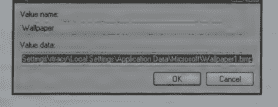

## 图 3-2

查看`/etc/ntp.conf`文件

```
logfile /var/log/ntp
### 备用日志文件
### logconfig =syscatstat + sysevents
### logging= all

### statdir /tmp        # 统计文件所在目录
### filegen peerstats file peerstats type day enable
### filegen loopstats  file loopstats type day enable
### filegen clockstats file clockstats type day enable

# 
### 认证相关配置
#
### keys /etc/ntpd.keys
### 密钥文件路径
### trustedkey 1
### 定义受信任的密钥
### requestkey 1
### server bigben.cac.washington.edu iburst
### restrict
### restrict bigben.cac.washington.edu

### key (?): 用于访问服务器变量
### controlkey 15      # 用于访问服务器变量的密钥 (6)
```

系统中的守护进程（用于将系统时间与其他网络计算机同步）依赖于`/etc/ntp.conf`文件，如图 3-2 所示。

`Linux`并不会像`Windows`对待注册表那样阻止你手动编辑这些配置文件，相反，`Linux`*期望*你知道如何编辑这些文件以自定义系统的运行方式。因此，你必须学会使用`Linux`文本编辑器来管理系统。

## `vi`文本编辑器的角色和功能

此时，你可能会想：“我知道如何在使用其他操作系统的文本编辑器。我可以`Windows`上的记事本。为什么这本书要专门花一整章来讨论文本编辑器？”原因有二：

- 学会使用文本编辑器对于管理`Linux`系统至关重要。如果你不会使用文本编辑器，在学习本书其余部分的内容时就会感到吃力。

- 坦率地说，对于大多数新用户而言，`Linux`编辑器很难上手，尤其是如果你来自`Windows`背景。


对于`Linux+`和`LPIC-1`考试，你只需要熟悉`vi`文本编辑器。因此，你应该特别关注`vi`。你需要非常熟悉如何在`vi`中打开文件、编辑文件以及保存更改。

因此，在这一章中，我们将花费大量时间来学习如何使用各种`Linux`文本编辑工具。不过请注意，目前越来越多的前端界面应运而生，允许你直接修改配置文件，而无需使用文本编辑器手动编辑配置文件。在我看来，目前可用的最佳前端之一是`Yet another Setup Tool (YaST)`，它预装在`openSUSE Linux`中。`YaST`前端界面如图 3-3 所示。

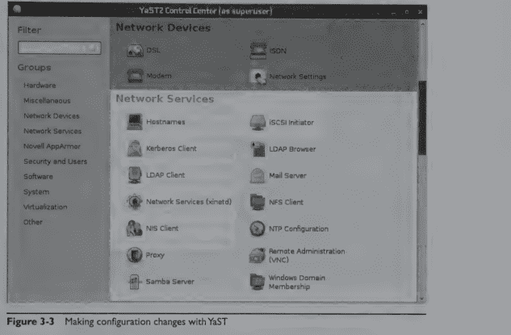

图 3-3 使用`YaST`进行配置更改

使用`YaST`，你可以安装软件、管理硬件设置、分区硬盘、配置引导加载程序、配置网卡、配置用户和组，以及配置系统中正在运行的服务的设置。

许多其他发行版也使用配置前端。例如，`Fedora`提供了几种不同的实用工具，可用于配置系统设置、网络设置、服务和用户。这些工具如图 3-4 所示。

坦白说，我喜欢使用这些图形前端。然而，在`Linux`早期，这些工具并不存在。所有的配置更改都必须通过文本编辑器完成。随着这些工具的成熟和普及，越来越多的`Linux`管理员开始使用它们作为手动编辑配置文件的替代方案。

那么，为什么我们要花整整一章来讨论文本处理工具呢？原因有两个：

- `Linux+`和`LPIC-1`考试并不涵盖这些图形配置实用工具。如果你想通过这些考试，你必须熟悉基于文本的配置文件以及用于管理它们的文本编辑器。

- 大多数`Linux`管理员使用图形前端仅仅是为了`convenience`（便利）。他们并不依赖它们。换句话说，优秀的`Linux`管理员应该对图形界面背后的配置文本文件了如指掌，而不仅仅是熟悉界面本身。

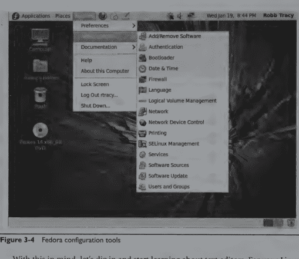

基于此，让我们开始深入学习文本编辑器。对于`Linux+`和`LPIC-1`考试，你需要熟悉`vi`文本编辑器。`vi`编辑器是一个非常基础的程序，可用于编辑`Linux`系统上的文本文件。`vi`编辑器已经存在相当长的时间，我敢说它是`Linux`管理员使用最广泛的文本编辑器之一。

实际上有两个版本的`vi`。旧版本直接称为`vi`。新版本称为`vim` (`Vi Improved`)。在较旧的系统中，当你在`shell`提示符下输入`vi`时，可能实际使用的是`vi`。然而，在大多数现代`Linux`发行版中，你使用的可能是较新的`vim`版本的`vi`。

`vi`程序的可执行文件是系统硬盘上的一个名为`vim`的文件。在大多数发行版中，`vim`可执行文件位于`/bin`目录中。在`/usr/bin`目录下放置了一个名为`vi`的符号链接文件，它指向`/bin/vim`可执行文件。这如图 3-5 所示。


请注意图 3-5 中，在`/usr/bin`中还有一个名为`vim`的文件，它同样只是一个指向`/bin/vim`可执行文件的符号链接。

**注意** 符号链接是一个快捷方式文件，指向文件系统中的其他文件。我们将在本书后面详细讨论符号链接。


结果是，无论你在`shell`提示符下输入什么命令（`vi`或`vim`），加载的都是`vim`编辑器。例如，在图 3-6 中，在`Fedora`系统的`shell`提示符下输入了`vi`命令。然而，请注意，加载的是`vim`编辑器，如欢迎屏幕所示。

基于此，让我们讨论如何在`vi`中编辑文本文件。

## 在 `vi` 中编辑文本文件

第一次运行`vi`时，你会立刻注意到它的用户界面与你习惯的其他文本编辑器非常不同。为了帮助你熟悉`vi`，我们将在此讨论以下主题：

- 在`vi`中打开文件

- `vi`模式

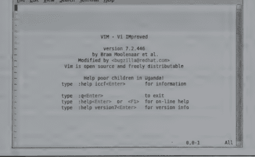

**图 3-6** 使用`vim`

- 在插入模式下工作

- 在命令行模式下工作

- 在命令模式下工作

## 在 `vi` 中打开文件

要在`shell`提示符下打开一个文件以便在`vi`中操作，只需输入`vi *文件名*`。例如，假设你的用户主目录中有一个名为`myfile.txt`的文件。如果该文件位于当前目录，你可以在`shell`提示符下简单输入`vi myfile.txt`来将此文件加载到`vi`编辑器中。如果该文件位于当前目录以外的目录，则需要包含该文件的完整路径。例如，如果当前目录是`/tmp`，你需要在`vi`中打开`/home/tracy/myfile.txt`文件，则应在`shell`提示符下输入`vi /home/tracy/myfile.txt`。

也可以使用`vi`创建新的文本文件。要做到这一点，只需在`shell`提示符下输入`vi`以及你要创建的文件名。如果文件名不包含路径，该文件将在当前目录中创建。如果你指定了路径，该文件将在该目录中创建。

例如，在图 3-7 中，当前目录是`/home/tracy`，在`shell`提示符下输入了命令`vi yourfile.txt`。请注意，在`vi`编辑器界面中打开了一个空白文件，屏幕底部的`[New File]`文本表明了这一点。重要的是要注意，当使用`vi`创建新文件时，文件实际上在你保存之前并不会在磁盘上创建。在保存之前，你在`vi`界面中输入的所有文本行都仅保存在内存缓冲区中。如果你不保存文件，就会丢失它！

现在，让我们讨论`vi`的模式。


## `vi` 模式

到目前为止，一切都还不错，对吧？我教过的大多数学生都能应对在`vi`中打开文件或创建新文件。然而，一旦文件被打开，事情开始变得有点令人困惑。这是因为`vi`使用四种不同的操作模式：

- 命令模式 (`Command mode`)

- 命令行模式 (`Command-line mode`)

- 插入模式 (`Insert mode`)

- 替换模式 (`Replace mode`)

默认情况下，`vi`以命令模式（有时也称为*普通*模式）打开或创建文件。你可能在前面的图中注意到，`vi`界面不包含任何用于对当前文件执行操作（如写入、搜索或关闭）的下拉菜单。相反，你必须使用命令（以及命令行）模式下的命令来完成这些任务。


对我大多数学生来说，令人困惑的一点是，当处于命令模式或命令行模式时，你实际上无法编辑文件！除非你碰巧按对了某个键，否则如果你尝试更改文件中的文本，屏幕上不会发生任何事情。要做到这一点，你必须首先进入插入模式。要进入插入模式，你可以按下键盘上的以下任意一个键：

- `I`

- `INSERT`

- `S`

- `O`

- `A`

按下这些键之一后，你就可以实际编辑文件中的文本了。通过 `vi` 界面底部显示的 `~INSERT~` 文本，你可以判断自己处于插入模式。这在图 3-8 中有所展示。

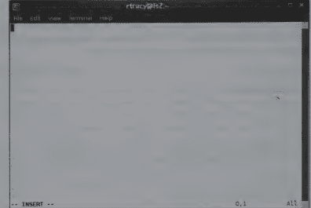

**图 3-8** 处于插入模式的 `vi` 编辑器

第二次按下 `INSERT` 键会使 `vi` 切换到替换模式。插入模式类似于在文字处理器中使用插入模式。你输入的任何文本都会插入到光标在文件中所处的位置。光标之后可能已经存在的所有文本都会为每个输入的字符向下移动一个空格。

另一方面，替换模式类似于改写模式（`overtype mode`）。当你输入新字符时，新字符会覆盖现有的任何字符。你可以再次按下 `INSERT` 键切换回插入模式。

在插入模式下，你可以向文件添加文本、更改文本或删除文本。但是，你不能执行任何文件操作。例如，如果你对文件进行了更改并想保存它们，你不能在插入模式下这样做。要做到这一点，你必须首先切换回命令模式。这是通过按下 `ESC` 键完成的。在图 3-9 中，我们通过按下 `ESC` 从插入模式切换回命令模式。

在命令模式下，你可以输入各种不同命令来删除文本行或搜索文件中的特定单词。你还可以进入命令行模式来保存当前文件或退出编辑器。我们将在本节后面回顾这些命令。要切换回插入模式，只需按下 `I`、`INSERT` 或 `S`。

现在你知道如何在 `vi` 中打开文件以及如何在模式之间切换，让我们讨论如何在插入模式下编辑文本。

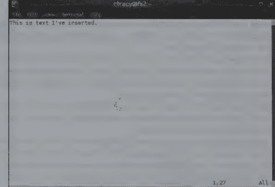

**图 3-9** 在 `vi` 中切换回命令模式

## 在插入模式下工作

一旦你在 `vi` 中打开一个文件并进入插入模式，你可以像使用其他任何文本编辑器一样编辑文本。请注意，在屏幕的左侧，你会看到几行波浪号（`~`）。这些字符实际上并不在文件中。这些字符仅仅表示这些行在文件中不存在。在向文件中添加行之后，你会发现波浪号会一个一个消失。

你可以通过按下方向键以及 `PAGE UP`、`PAGE DOWN`、`HOME` 和 `END` 键来导航到文件中不同的插入点。你只需在键盘上输入字符即可添加文本。你可以通过按 `DELETE` 或 `BACKSPACE` 键来删除文本。

完成文本编辑后，你可以按下 `ESC` 键切换回命令模式。从命令模式，你还可以进入命令行模式。让我们接下来讨论你在命令行模式下可以做什么。

## 在命令行模式下工作

正如我们之前讨论的，`vi` 编辑器不提供菜单来完成常见的文件任务。相反，你必须在命令行模式下输入命令。在本主题中，我们将回顾你可以使用的一些命令及其功能。

要在 `vi` 中进入命令行模式，你必须首先进入命令模式（如果你之前处于插入模式），然后输入冒号（`:`）。当你这样做时，屏幕底部会显示一个命令提示符，如图 3-10 所示。

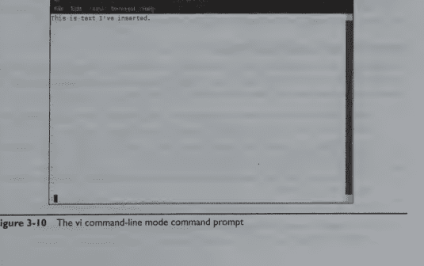

然后你可以在此提示符下输入命令来完成与文件相关的任务。显然，你在命令模式下需要完成的最重要任务之一是将文件写入磁盘。这是通过命令提示符下输入 `w` 来实现的。请务必在输入命令后按 `ENTER`。在命令提示符下输入 `w` 后，屏幕底部会显示一条消息，指示文件已写入磁盘，如本例所示：

```
"yourfile.txt" [New] 1L, 28C written 1,26 All
```

在命令提示符下输入 `w *filename*` 会将文件写入不同的文件名。你还可以在命令行提示符下输入以下其他命令：

- `:exit` — 写入当前文件，然后关闭 `vi`

- `:wq` — 写入当前文件，然后关闭 `vi`

- `:q` — 不保存当前文件而关闭 `vi`。这仅适用于文件尚未更改的情况。如果文件已更改，则必须输入 `:q!`

- `:w!` — 覆盖当前文件

- `:e!` — 放弃自上次写入以来的更改

`vi` 编辑器的另一个实用功能是它提供了一个非常有用的语法检查器。当编写脚本或编辑配置文件时，这个功能可以真的救命。没有什么比因为遗漏了某个分号或右括号而导致脚本或守护进程无法工作更令人沮丧的了。可以使用 `:syntax` 命令行命令启用或禁用语法检查器。按下 `ESC` 进入命令模式，然后输入 `:syntax on | off`。例如，要启用语法检查器，你需要输入以下内容：

```
:syntax on
```

当你这样做时，脚本或配置文件中的不同元素会以不同的颜色表示。如果你犯了一个语法错误，错误会以另一种颜色突出显示，使你能够轻松发现。图 3-11 展示了在编辑守护进程配置文件时使用 `vi` 语法检查器的示例。


**图 3-11** 使用 `vi` 语法检查器

除了在命令行提示符下输入的命令外，你还可以在命令模式下输入命令。让我们接下来讨论这些命令。

## 在命令模式下工作

命令模式下的命令不是在命令提示符下输入的。相反，这些命令是在*没有*先输入 `:` 的情况下输入的。如果你处于插入模式，请按下 `ESC` 返回到命令模式。然后你可以输入以下命令：

- `dw` — 删除光标紧接其后的单词，包括单词后面的空格。文本保存在内存缓冲区中。

- `de` — 删除光标紧接其后的单词，不包括空格。文本保存在内存缓冲区中。

- `d$` — 从插入点删除到行尾。文本保存在内存缓冲区中。

- `dd` — 删除当前整行。文本保存在内存缓冲区中。

- `p` — 在当前位置后插入上次删除操作中删除的文本。

- `u` — 撤销上一个操作。

- `D` — 从光标位置删除当前行的其余部分。

- `yy` — 复制光标所在行到缓冲区。

- `a` — 在光标后追加。

- `A` — 在行尾追加。

- `C` — 更改到行尾。

- `cw` — 更改当前单词为新的文本，从光标下的字符开始，直到按下 `ESC`。

- `cc` — 更改整行。

- `ZZ` — 保存当前文件并退出 `vi`。

- `h` — 将光标向左移动一个字符。

- `j` — 将光标向下移动一行。

- `k` — 将光标向上移动一行。

- `l` — 将光标向右移动一个字符。（注：原文此处可能为 `I` 但根据 `vi` 标准快捷键及上下文“将光标向右移动”，此处应修正为 `l`。原 OCR 误将小写 `l` 识别为大写 `I`。）

- `0` — 将光标移动到当前行开头。

- `CTRL-G` — 在界面底部显示状态行。这显示了文件名称、文件状态、文件中的总行数以及当前光标位置。结果显示如下例：

```
"yourfile.txt"(Modified) 2 lines ~100%~ 2,29 All
```

- `/search_term` — 搜索指定术语的下一个实例。例如，输入 `/init` 会搜索光标之后文本 `init` 的下一个实例。

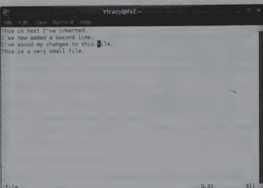

**图 3-12** 在 `vi` 中搜索文本

在执行搜索后按 `N` 键，将搜索搜索词的下一次出现实例。在图 3-12 中，在命令模式下输入了 `/file` 命令。作为结果，`file` 的第一个实例被高亮显示。

- `?/search_term` 搜索指定词条的上一个实例。

如您所见，`vi` 是一个简单但功能相当强大的文本编辑器。我对 `vi` 唯一的抱怨是，其用户界面可能较难上手。然而，一旦您使用 `vi` 一段时间后，它将变得如同您的本能反应一样自然。因此，让我们在以下练习中花些时间练习使用 `vi`。

## 练习 3-1：使用 `vi` 编辑器

> **视频** 欲了解更多信息，请观看练习 3-1 视频。

在本练习中，您将练习使用 `vi` 编辑器来创建和操作文本文件。请完成以下操作：

1. 如果尚未操作，请启动您的 `Linux` 系统并使用您的标准（非 `root`）用户账户登录。

2. 如有必要，打开一个终端会话。

3. 当前目录应为用户的主目录。您可以在 shell 提示符下输入 `pwd` 来检查这一点。在此示例中，用户账户名为 `tracy`，因此当前目录显示为 `/home/tracy`：

```
tracy@fss2:~> pwd
/home/tracy
```

4. 在 shell 提示符下输入 `vi test.txt`。`vi` 编辑器应会启动，并将 `test.txt` 作为新文件打开。

5. 按键盘上的 `INSERT`（插入）键。此时您应处于插入模式。

6. 在文件中输入以下文本：


```
Ueu agam legere delicata ut, per democritum scriptorem an. Nec te ioxzil posam timedunt, at qui proho mucue quibergen. Ea medi Paulo cetero oportere, at pertainx liberavi sse pri.
```

7. 通过完成以下操作来保存您的文件：

   a. 按 `ESC` 返回到命令模式。

   b. 输入 `:w`。您应该看到一条指示文件已写入的消息。

8. 输入 `:exit` 退出 `vi`。

9. 在 shell 提示符下输入 `vi test.txt`，在 `vi` 中重新加载 `test.txt`。

10. 在命令模式下按 `CTRL-G` 显示状态行。

11. 使用方向键将光标移动到文件第一行第一个单词的开头。

12. 通过完成以下操作来搜索文本 `at` 的所有出现位置：

   a. 在命令模式下，输入 `/at`。第一个实例应被高亮显示。

   b. 按 `n` 键找到下一个实例。

   c. 按 `N` 键找到剩余的实例，直到到达文件末尾。

13. 通过执行以下操作来练习删除文本：

   a. 在命令模式下，使用方向键将光标放置在单词 `legere` 的第一个字母上。

   b. 按 `dw` 删除单词 `legere` 及其后面的空格。

   c. 使用方向键将光标移动到最后一行末尾的句号处。

   d. 输入 `p` `p` 将内存缓冲区中的内容插入到句号之后。

14. 输入 `:q!` 退出不保存更改的文件

现在您已具备使用 `vi` 管理典型 Linux 系统所需的技能！

### 章节回顾

在本章中，您学习了如何使用 `vi` 文本编辑器。我首先强调了文本编辑器在 Linux 系统管理中发挥的重要作用。与其他使用数据库来存储系统和应用程序设置的操作系统不同，Linux 将这些信息存储在文本文件中。因此，为了配置 Linux 系统，您需要知道如何编辑这些文件。通常我们不会花太多时间学习如何使用文本编辑器。然而，由于 `vi` 文本编辑器比其他操作系统上的文本编辑器更难使用，我们花了额外时间来学习如何操作它。我指出，现在有各种图形化前端可用，以使系统配置任务更加容易。但是，我也指出，优秀的系统管理员需要理解这些工具所操纵的底层配置文件。要做到这一点，您需要知道如何使用文本编辑器。

最常用且您将在 Linux+ 和 LPIC-1 考试中接受测试的 Linux 文本编辑器是 `vi` 编辑器。尽管 `vi` 是一个相对简单的编辑器，但它体积小巧，不需要图形环境，甚至能装在一张软盘上。这使得它非常适合在紧急修复情况下使用，例如当您需要从软盘引导故障系统时。

若要运行 `vi`，只需在 shell 提示符下输入 `vi`。若要运行 `vi` 并加载文件，请在 shell 提示符下输入 `vi filename`。如果您指定的文件名不存在，`vi` 将为您创建一个新的文件。

接着，我讨论了 `vi` 可以操作的四种不同模式。在命令模式下，您不能直接编辑文件的文本。若要这样做，您需要通过按 `INSERT`、`S`、`O` 或 `I` 键切换到插入模式或替换模式。要返回到命令模式，只需按 `ESC` 键。一旦处于插入模式或替换模式，您就可以像使用大多数典型文字处理器一样编辑文本文件。

然后，我讨论了您在命令行模式下可以输入以执行文件相关操作的命令。要进入命令行模式，您首先切换到命令模式（如有必要），然后输入完整的冒号 (:)。这将显示一个命令行提示符，您可以使用它输入 `vi` 命令，包括以下内容：

- `w` 将当前文件写入磁盘。

- `exit` 写入当前文件，然后关闭 `vi`。

- `wq` 也将当前文件写入磁盘并关闭 `vi`。

- `q` 不保存当前文件即关闭 `vi`。

- `q!` 即使文件已被修改，也不保存当前文件即关闭 `vi`。

- `w!` 覆盖当前文件。

- `e!` 丢弃自上次写入以来的更改。

然后，我们讨论了您在命令模式下可以输入以执行文本操作命令。这些命令输入时不需要加冒号 (:)。您可以输入以下命令：

- `dw` 删除紧接在光标后的单词，包括单词后的空格。

- `de` 删除紧接在光标后的单词，但不包括其后的空格。

- `d$` 删除从插入点行尾的内容。

- `dd` 删除当前整行。

- `p` 在当前光标位置后插入删除的文本。

- `u` 撤销最后一个操作。

- `/term` 在文件中搜索指定的词。

- `D` 从光标位置删除当前行的剩余部分。

- `yy` 将光标所在行复制到缓冲区。

- `a` 在光标后追加。

- `A` 在行尾追加。

- `C` 更改到行尾。

- `cc` 更改整行。

- `ZZ` 保存当前文件并结束 `vi`。

- `h` 将光标向左移动一个字符。

- `j` 将光标向下移动一行。

- `k` 将光标向上移动一行。

- `l` 将光标向右移动一个字符。

- `0` 将光标移动到当前行的开头。

#### 加速回顾

- 您必须能够使用文本编辑器来管理 Linux 系统。

- Linux 使用文本文件来存储操作系统和应用程序的配置设置。

- 大多数您的配置文件位于 `/etc` 目录下。

- 如今大多数 Linux 发行版都有许多图形配置工具可用；然而，您仍然需要熟悉使用文本编辑器手动编辑配置文件。

- `vi` 编辑器是最常用的 Linux 文本编辑器之一。

- `vi` 的旧版本称为 `vi`；最新版本称为 `vim` (`Vi Improved`)。

- 您可以通过输入 `vi filename` 使用 `vi` 打开文件。如果文件不存在，将创建一个新的文件。

- `vi` 编辑器默认在命令模式下打开。

- 在 `vi` 的 `command` 模式下，您不能直接编辑文件。

- 要切换到插入模式，请按 `i`, `s`, 或 `INSERT`。

- 在插入模式下，您可以直接编辑文件的文本。

- 在插入模式下按 `INSERT` 将导致 `vi` 切换到替换模式。

- 要切换回命令模式，请按 `ESC`。

- 在命令模式下，您可以输入完整的冒号 (:) 切换到命令行模式。

- 在命令行模式下，您可以输入文件相关命令：

  - 输入 `:w` 会将当前文件写入磁盘。

  - 输入 `:exit` 会将当前文件写入磁盘并退出 `vi`。

  - 输入 `:q` 将退出 `vi`。

  - 输入 `:q!` 将退出 `vi`，且不会保存对已修改文件的更改。

- 你可以在 `vi` 的命令模式下输入文本操作命令。

  - 输入 `dw` 删除光标紧随其后的单词，包括该单词后面的空格。

  - 输入 `de` 删除光标紧随其后的单词，但不包括空格。

  - 输入 `d$` 从插入点删除到行尾的内容。

  - 输入 `dd` 删除整个当前行。

  - 输入 `p` 在光标后插入上次删除操作中删除的文本。

  - 输入 `u` 撤销上一步操作。

  - 按下 `CTRL-G` 会在界面底部显示状态行。

  - 输入 `/search_term` 或 `?search_term` 会搜索指定的术语。

- 除了 `vi` 编辑器，你还可以使用 `Emacs`。

#### 问题

1. 在 Linux 系统中，操作系统和应用配置参数如何存储？

    - A. 在文本文件中

    - B. 在注册表中

    - C. 在 `.ini` 文件中

    - D. 在系统数据库中

2. Linux 文件系统中的大多数配置文件存储在哪里？

    - A. `/boot`

    - B. `/var`

    - C. `/usr`

    - D. `/etc`

3. 在大多数 Linux 发行版中，你可以在哪里找到 `vi` 符号链接文件？

    - A. `/usr/bin`

    - B. `/usr`

    - C. `/sys`

    - D. `/sbin`

4. 哪个命令行命令可以在使用 `vi` 编辑器编辑时启用脚本的语法检查？

    - A. `-syntax_checking on`

    - B. `-syntax=enabled`

    - C. `-syntax=script`

    - D. `-syntax on`

5. 你在 Linux 系统上打开了一个终端窗口，当前目录是 `/tmp`。你需要使用 `vi` 编辑系统 `/etc/xinetd.d` 目录中名为 `vnc` 的文本文件。以下哪个命令可以实现这一目标？

    - A. `vi vnc`

    - B. `vi /tmp/vnc`

    - C. `vi /etc/xinetd.d/vnc`

    - D. `vi /etc/xinetd.d`

6. 你在 Linux 系统上打开了一个终端窗口，当前目录是你的用户主目录。你需要使用 `vi` 在主目录中创建一个名为 `resources.txt` 的新文件。以下哪个命令可以实现这一目标？

    - A. `vi resources.txt -new`

    - B. `vi resources`

    - C. `vi ~/resources`

    - D. `vi resources.txt`

7. `vi` 默认以哪种模式打开？

    - A. 命令行模式

    - B. 插入模式


- C. 命令模式
- D. 替换模式

8. 你已在 `vi` 中打开了一个名为 `list.txt` 的文本文件。你使用方向键将光标移动到文件中需要做出几处更改的位置。你尝试输入，但什么也没有发生。这是为什么？

- A. `vi` 编辑器处于插入模式。你需要切换到命令模式。
- B. `vi` 编辑器处于命令模式。你需要切换到插入模式。
- C. `vi` 编辑器处于插入模式。你需要切换到替换模式。
- D. 文本文件已损坏。

9. 哪个按键可以将 `vi` 从命令模式切换到插入模式？（选择两项。）

- A. `DELETE`
- B. `ESC`
- C. `INSERT`
- D. `s`
- E. `F1`

10. 你正在使用 `vi` 以插入模式编辑文本文件。由于你对文件所做更改的性质，你需要切换到替换模式。哪个按键可以实现这一目标？

- A. `ESC`
- B. `CTRL-X CTRL-R`
- C. `:`
- D. `INSERT`

11. 你正在使用 `vi` 以插入模式编辑文件。你需要切换回命令模式。哪个按键可以实现这一目标？

- A. `INSERT`
- B. `:`
- C. `ESC`
- D. `BACKSPACE`

12. 你正在使用 `vi` 以命令模式编辑文件。你尝试使用 `BACKSPACE` 键删除一个单词，但什么也没有发生。系统出了什么问题？

- A. 你需要切换到普通模式。
- B. 你需要按 `CTRL-BACKSPACE`。
- C. 没有问题。`BACKSPACE` 在命令模式下不起作用。
- D. 你需要切换到命令行模式。

13. 你已使用 `vi` 创建了一个新文件，现在需要在不退出编辑器的情况下保存该文件。哪个命令可以实现这一目标？

- A. `:s`
- B. `:w`
- C. `:save`
- D. `:exit`

14. 你已使用 `vi` 创建了一个新文件，需要将文件保存到磁盘并退出程序。哪个命令可以实现这一目标？（选择两项。）

- A. `:w`
- B. `:e!`
- C. `:wq`
- D. `:exit`
- E. `:q`

15. 你已使用 `vi` 对配置文件进行了多处更改。你意识到自己犯了许多错误，并希望退出不保存更改，以便重新开始。哪个命令可以实现这一目标？

- A. `:q!`
- B. `:exit`
- C. `:q`
- D. `:exit!`

16. 你正在 `vi` 中以命令模式处理一个文件。你在文件中定位了一个需要删除的单词，并将光标放在该单词的开头。哪个命令可以删除这个单词而不删除该单词后面的空格？

- A. `dw`
- B. `de`
- C. `d$`
- D. `dd`

17. 你正在 `vi` 中以命令模式查看一个配置文件。你需要在文件中定位一个名为 `server` 的指令。然而，文件非常长，你不想逐行扫描。在命令模式下，你可以使用什么命令来搜索这个术语？

- A. `/server`
- B. `search=server`
- C. `//'server''`
- D. `find "server"`

#### 答案

1. A. Linux 使用文本文件来存储操作系统以及运行在系统上的应用或服务配置参数。
2. D. 大多数 Linux 配置文件存储在 `/etc` 目录中或 `/etc` 的子目录中。
3. A. 取决于你的发行版，`vi` 程序本身或指向 `vim` 程序的符号链接将存储在 `/usr/bin` 中。
4. D. `:syntax on` 命令用于在 `vi` 编辑器中开启语法检查。
5. C. 由于要加载的文件不在当前目录中，因此在启动 `vi` 时，你必须提供该文件的完整路径及其文件名。
6. D. 由于你没有指定路径，`vi` 将在当前目录中创建该文件，这正是你想要的。
7. C. 默认情况下，`vi` 以命令模式打开。
8. B. `vi` 编辑器默认以命令模式打开。你必须按下 `INSERT` 键切换到插入模式才能开始编辑文件。
9. C, D. 按下 `INSERT` 或 `i` 键可以将 `vi` 从命令模式切换到插入模式。
10. D. 在插入模式下按下 `INSERT` 键会将 `vi` 切换到替换模式。
11. C. 在插入模式下按下 `ESC` 键会将 `vi` 切换到命令模式。
12. C. `BACKSPACE` 键在命令模式下不起作用。你必须先切换到插入或替换模式。
13. B. 输入 `:w` 会将当前内存缓冲区保存到磁盘，而不退出编辑器。
14. C, D. 输入 `:exit` 会使 `vi` 保存当前文件并退出程序，输入 `:wq` 也会产生同样的效果。
15. A. 输入 `:q!` 将退出 `vi`，而不保存对当前文件的更改。
16. B. 在命令模式下输入 `de` 将使 `vi` 删除该单词，而不删除该单词后面的空格。
17. A. 在命令模式下输入 `/server` 将在文件中搜索表达式 `server`。

## 第 4 章 管理 Linux 文件和目录

在本章中，你将学习以下内容：

- Linux 文件系统和文件系统层次结构标准（`FHS`）
- 在 Linux 文件系统中查找文件
- 从命令行管理目录
- 从命令行管理文件
- 使用链接文件
- 查找文件内的内容

是时候深入挖掘并开始处理 Linux 文件和目录了！如果你是从 Windows 背景转向 Linux 的，这一章对你来说可能具有挑战性。Linux 文件系统在许多方面与 DOS 或 Windows 文件系统相似，但在许多其他方面却截然不同。根据我接触新 Linux 学生的经验，两者之间有足够的相似性，会让他们在刚开始操作文件系统时产生一种虚假的安全感。然后，当我们深入探讨并开始处理更高级的任务时，他们开始感到沮丧。

希望我们能尽量让本章内容易于理解。如果我能强调一件能让你的生活更轻松的事，那就是记住 Linux 文件和目录名称是区分大小写的！新 Linux 用户在 Linux 文件系统的这一方面往往真的会感到吃力。当你在本书的示例或练习中看到某个命令或文件名时，请记住你必须使用正确的大小写；否则，你不会得到相同的结果！

> **考试提示** 在 LPIC-1/CompTIA Linux+ 考试中，请做好在本章接受大量测试的准备。如果你还没有搭建一个用于练习的实验系统，我强烈建议你在继续之前这样做。然后反复练习完成本章中介绍的示例和练习，直到你感觉对相关任务和实用程序非常熟悉为止。当你参加考试时，可能会遇到一个假设场景，并要求你提供完成所需任务的正确命令。你必须熟悉本章的内容，以便能立即做出反应。做到这一点的唯一方法是练习、练习、再练习！

## Linux 文件系统与文件系统层次标准 (FHS)

在本章的这一部分中，我们将总体讨论 Linux 文件系统。具体而言，我们将回顾以下内容：

- Linux 文件系统的作用
- Linux 文件系统的层次结构
- Linux 文件类型

让我们先讨论一下文件系统的作用。

## Linux 文件系统的作用

Linux 系统（或任何其他操作系统）上文件系统的通用作用究竟是什么？我们讨论的是一个在存储设备上以特定方式存储信息的系统，其目的是：

- 数据可以以逻辑方式保存。
- 数据经过组织且易于查找。
- 数据可以在稍后的时间点检索以资使用。
- 数据完整性得以保持。

换句话说，如果你将文件保存到存储设备上，你之后应该能够找到并检索它，同时确信其内容将与保存时完全相同。无论你是在软盘、硬盘还是 USB 驱动器上保存数据，目标都是一样的。为了实现这一目标，你必须使用某种文件系统来管理存储的数据。

> **提示**
>
> 术语 **文件系统** 在 Linux 世界中实际上有多种含义。你可能会听到 “`ext2`”、“`ext3`”、“`ext4`” 和 “`Reiser`” 被称为 **文件系统**。这种用法是正确的；它们确实是文件系统。然而，更准确的称呼是 **磁盘文件系统**。它们用于定义数据在 Linux 系统硬盘驱动器上的存储方式。磁盘文件系统是通用文件系统的特定实现。关于每种文件系统的具体细节将在第 5 章中讨论。

让我们回顾一下 Linux 文件系统如何使用文件系统层次标准 (`FHS`) 来组织数据，以便数据易于定位和检索。

## Linux 文件系统的层次结构

Linux 文件系统使用层次结构来组织和存储数据。这如图 4-1 所示。

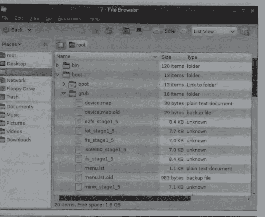

**图 4-1** Linux 文件系统的层次结构

结构中最顶层的目录是 `/` 目录，也称为根目录，顺便说一下，这与你的 `root` 用户账户没有关系。它仅仅表示这是你的层次文件系统树的最高层目录（即“根”）。


根目录下有许多子目录。关于这些目录如何命名的规范包含在 `FHS` 中。`FHS` 为 Linux 软件开发人员和系统管理员提供了文件系统的标准目录结构，确保系统和发行版之间的一致性。你能想象如果每个发行版都使用其专有的文件系统结构会是怎样的一场混乱吗？那将是一场灾难！你将无法找到任何东西。


**注意** 你可以在 `www.pathname.com/fhs/` 查看有关 `FHS` 的更多信息。

幸运的是，我们有 `FHS` 来保持规范。`FHS` 定义了根目录 `/` 下应出现的目录，以及 `/usr` 和 `/var` 目录下应出现的目录。这些目录包括：

- `/bin`：该目录包含管理和运行 Linux 系统所需的可执行文件，包括 shell（如 `bash`）以及文件系统管理实用程序，如 `cp` 和 `rm`。

- `/boot`：该目录包含你的引导加载器文件，这些文件是引导系统所必需的。

- `/dev`：该目录包含用于表示系统中安装的各种硬件设备的特殊文件。例如，你系统中的第一个硬盘驱动器称为 `sda`，第二个称为 `sdb`，以此类推。每个驱动器上的分区通过在磁盘文件名末尾添加额外数字来标识。例如，系统中第一个硬盘上的第一个分区是 `sda1`，第二个分区是 `sda2`，以此类推。表示这些设备的文件存储在 `/dev` 中，如图 4-2 所示。请注意，图中 `/dev` 中存储了两种类型的设备文件：

    - **字符设备文件**：这些文件用于按顺序一次发送或接收一个字符的数据设备，如打印机、鼠标或磁带驱动器。这些设备通常不支持对其管理的数据进行随机访问。

    - **块设备文件**：这些文件用于以块为单位管理数据的设备，如软盘和硬盘。块设备通常支持对其管理的数据进行随机访问。

许多类型的硬件设备由 `/dev` 中的设备文件表示。表 4-1 显示了一些示例。需要理解的关键事实是，Linux 系统中的物理硬件是通过在系统上运行的应用程序和服务经由 `/dev` 中的文件进行寻址的。需要向磁盘保存文件？它通过 `/dev` 中相应的文件进行。需要向打印机发送打印任务？它通过 `/dev` 中的一个文件进行。需要从 DVD 打开文件？它通过 `/dev` 中的一个文件传入。


> **注意**
>
> 在旧版本的 Linux 内核中，`SCSI`、`USB` 和 `SATA` 硬盘驱动器用 `sdX` 表示，而较旧的 `PATA` (`IDE`) 硬盘驱动器用 `hdx` 表示。现在情况已不再如此。现在所有硬盘都用 `sdX` 表示。

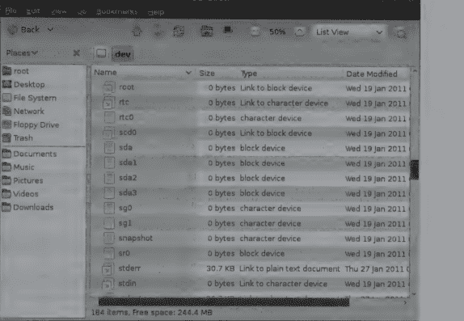

**图 4-2** 使用 `/dev` 中的文件寻址硬件设备

> **提示**
>
> `/dev` 中的设备文件还可以用于访问与任何物理硬件设备没有连接的系统资源，例如随机数生成器 `/dev/random`。

**表 4-1** `/dev` 中由文件表示的硬件

| 设备 | /dev 中的设备文件 |
| :--- | :--- |
| 软驱 | `/dev/fd0` |
| 光驱 (CD 或 DVD) | `/dev/scd0` |
| 串行端口 | `/dev/ttyS0` |
| 并行端口 | `/dev/lp0` |

- `/etc`：该目录包含系统以及系统中运行的服务所使用的基于文本的配置文件。你可以使用文本编辑器编辑这些文件以自定义 Linux 的行为。该目录中一些更重要的文件包括表 4-2 中所示的那些。

- `/home`：该目录包含充当 Linux 系统上每个用户账户主目录的子目录。

- `/lib`：该目录包含 `/bin` 和 `/sbin` 中程序使用的代码库。你的内核模块也存储在 `/lib` 的 `modules` 子目录中。

- `/media`：该目录被某些 Linux 发行版（如 `openSUSE` 和 `Fedora`）用于挂载外部设备，包括光驱、`USB` 驱动器以及软盘（如果你还在使用它们）。这是通过一系列子目录完成的，如图 4-3 所示。

- `/mnt`：该目录被某些 Linux 发行版用于挂载外部设备，包括 `CD` 驱动器、`DVD` 驱动器、`USB` 驱动器和软盘。与其他发行版上的 `/media` 目录一样，使用一系列子目录来完成此操作。

**表 4-2** `/etc` 中的一些配置文件

| 文件 | 功能 |
| :--- | :--- |
| `/etc/aliases` | 包含一个用于将邮件重定向到本地收件人的表格。 |
| `/etc/exports` | 配置要导出到远程 `NFS` 客户端的文件系统。 |
| `/etc/fstab` | 列出系统启动时将自动挂载的分区和文件系统。 |
| `/etc/ftpusers` | 控制用户访问系统中运行的 `FTP` 服务。 |
| `/etc/group` | 包含本地组定义。 |
| `/etc/grub.conf` | 包含 `GRUB` 引导加载器的配置参数。 |
| `/etc/hosts` | 包含一个主机名到 `IP` 地址映射列表，系统可以使用它来解析主机名。 |
| `/etc/inittab` | 包含 `init` 进程的配置参数。 |
| `/etc/init.d/` | 一个包含系统中安装的服务启动脚本的子目录。在 `Fedora` 或 `Red Hat` 系统上，这些位于 `/etc/cldinit.d`。 |
| `/etc/modules.conf` | 包含你的内核模块的配置参数。 |
| `/etc/nsswitch.conf` | 配置用于解析主机名以及存储用户、组和密码的服务。 |
| `/etc/passwd` | 包含你的系统用户账户。 |
| `/etc/resolv.conf` | 指定系统使用的 `DNS` 服务器和域后缀。 |
| `/etc/services` | 将端口号映射到系统中的命名服务。 |
| `/etc/shadow` | 包含你的用户账户的加密密码。 |
| `/etc/X11` | 包含 `X Window` 配置文件。 |

`/opt` 此目录包含你在系统上安装的一些程序的文件。

`/proc` 此目录与本列表中的其他目录略有不同。`/proc` 并不实际存在于文件系统中。相反，它是一个伪文件系统，每当被访问时都会动态创建。它用于从 Linux 内核访问进程和其他系统信息。

在 `/proc` 内部有多个不同的子目录，如图 4-4 所示。请注意，这些子目录中的每一个都是用数字而非名称来标识的。这些数字对应于系统上运行的相关进程的进程 ID（`PID`）号。在图 4-5 中，顶部正在运行的程序用于显示系统上正在运行的进程。

图 4-4 `/proc` 的子目录


```
fs2:/proc # ls
1   1087 2728   35  775  9166  925-7  ipcstats  schedstat
4   12068 2840   36  777  9194  6c4b0   irq     scsi
10040 18888 24   39  797  8898    keymaps  self
10056 10861 2521 39  7971 9204  9270   kcore slabinfo
10150 1999 2621 4  79  9485  9289    kpid softirqs
10159 19   27   419 8   8888  9323   kpg_user sgi
10170 1074 2754 4256 38  9230  xtpi  kmsg stat
10179 1937 2795 4487 9540 49/15 asound  keystep swaps
10140 1954 2756 4583 9880 59/9  buddyinfo kpageflags sys
1.  .  2752 5  8888 9888   bus latency_stats sysrq_trigger
2/ 280   2758 584 4   9686 cmdline  loadavg ttyss
1/443 2016 2759 6   9825  9283 config.gz  locks timer_list
1/445 7932 21  680 9549  9/3/7 crypto  modules timer_stats
1/+ 2867 273 988  8243 cryptof  mpt mpt
1/511 2874 297 6876 9686 9246 devices  msr uptime
10058 21  888 635 9888 925/2 devices  mtd version
/4   2427 284 3   9136 9451 dma mounts vmallocinfo
1/0 22   3  70  9145 9253 driver  mpt wstat
1/411 2640 38  71.15 9149 9254 execdomains mtr x86
15  2347 885  73  9118 9426 interrupt8 8s
1/6   2852 81  72  9168 9254 fsystems  pagetypeinfo
/7/05 3258 32  726 9162 9888 1s partitions
810  7493 33  73  9198 9436 interrupts reserve_info
1/98/ 29  84  74  9172 9265 iomen  sched_debug
fs2:/proc #
```

显示的最左侧一列为 `PID` 列，列出了每个进程的 `PID` 号。创建进程所使用的实际命令名称显示在显示的最右侧一列中。例如，与 `top` 程序本身相关的进程的 `PID` 为 `10178`。因此，如果你查看 `/proc/10178` 目录，你就可以查看有关在系统上运行的 `top` 进程的信息，如图 4-6 所示。

`/root` 此目录是 `root` 用户的家目录。请注意，它与其他用户位于 `/home` 中的家目录是分开的。

`/sbin` 此目录包含重要的系统管理和系统管理文件，例如 `fdisk`、`fsck`、`ifconfig`、`init`、`mkfs`、`shutdown` 和 `halt`。

`/srv` 此目录包含子目录，系统上运行的服务（例如 `http` 和 `ftpd`）在此处保存其文件。

`/sys` 此目录包含有关你系统硬件的信息。

`/tmp` 此目录包含由你或系统创建的临时文件。

> **提示** 系统会定期删除 `/tmp` 目录中的旧文件。不要在 `/tmp` 中保存任何你想要保留的内容！

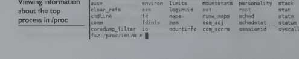

`/usr` 此目录包含应用程序文件。事实上，你的系统上使用的大多数这些应用程序文件都保存在 `/usr` 的子目录中。这些子目录包括表 4-3 中所示的内容。

表 4-3 `/usr` 的子目录

| 子目录 | 内容 |
| :--- | :--- |
| `bin` | 大多数可执行程序 |
| `lib` | 库文件 |
| `lib64` | 64 位库文件 |
| `local` | 你自行创建的本地安装软件（用于防止在系统更新期间被覆盖） |
| `sbin` | 系统管理程序 |
| `share` | 文档和 `man` 页面文件 |

`/var` 此目录包含可变数据，包括你的系统日志文件。表 4-4 展示了 `/var` 中包含的一些典型子目录。

考虑到这种结构，我们接下来讨论 Linux 文件系统使用的文件类型。

## Linux 使用的文件类型

在使用 Linux 时，你需要意识到文件系统中使用了多种不同的文件类型。这是 Linux 文件系统与 Windows 文件系统存在显著差异的另一个方面。在 Windows 文件系统中，你基本上有两种条目类型：

- 目录
- 文件

当然，你可以拥有普通文件、隐藏文件、快捷方式文件、文字处理文件、可执行文件等等。然而，这些都是基本 Windows 文件的简单变体。

然而，在 Linux 上，文件系统使用了多种不同的文件类型。这些包括表 4-5 中列出的文件类型。

表 4-4 `/var` 的子目录

| 子目录 | 内容 |
| :--- | :--- |
| `lib` | 由系统上运行的各种服务和应用程序创建的库文件 |
| `log` | 来自你的系统以及系统上运行的服务的日志文件 |
| `spool` | 打印队列 |

表 4-5 Linux 文件类型

| 文件类型 | 描述 |
| :--- | :--- |
| 常规文件 | 这些文件与其他操作系统（例如，可执行文件、文字处理文件、图像、文本文件等）的文件系统所使用的文件类似。 |
| 链接 | 这些文件是指向文件系统中其他文件的指针。 |
| `FIFO` | `FIFO` 代表先进先出。这些是特殊文件，用于将数据从一个运行中的进程传递到系统上的另一个进程。`FIFO` 文件基本上是一个队列，其中添加到队列中的第一块数据是从队列中移除的第一块数据。数据只能通过 `FIFO` 单向移动。 |
| 套接字 | 套接字类似于 `FIFO`，因为它们用于在进程之间传输信息。然而，与 `FIFO` 不同，套接字可以双向移动数据。 |

在对 Linux 文件系统有了这个介绍之后，你准备好开始学习如何完成常见的文件系统任务了。就像任何其他操作系统一样，你需要能够创建、复制和移动 Linux 文件系统中的文件和目录。在本章的这一部分，我们将花一些时间回顾这是如何完成的。

如果你在其他操作系统（如 `DOS` 或 `Windows`）中与命令行打过交道，你可能会认为这些任务本质上很简单。信不信由你，当许多学生初次学习如何使用 Linux 时，这些任务对他们来说可能很难。我看到的关键错误是学生在使用 Linux 提示符下的文件系统时，试图使用 `Windows`（和 `DOS`）命令。我甚至有时也会犯这种错误。最近我在给学生做演示时需要在一个 Linux 系统上复制一些文件。不知不觉间，我在提示符下输入了 `copy` 而不是 `cp`，当然，它不起作用。我当时脸红得像个苹果！学生们在接下来的整堂课里都拿这件事取笑我！

与 `Windows` 一样，你可以从 shell 提示符或从 Linux GUI 中执行文件系统操作任务。许多从 `Windows` 背景转向 Linux 的人倾向于仅使用大多数发行版提供的 GUI 实用程序来执行这些任务。

虽然这些图形实用程序既方便又易于使用，但你仍然需要学习如何从 shell 提示符执行这些任务。我意识到这与 `Windows` 系统的标准做法背道而驰。我接触过很多 `Windows` 用户，他们甚至不知道他们的系统上存在命令提示符。然而，在 Linux 中，你需要首先熟练掌握 shell 命令，然后为了方便再使用 GUI 实用程序。我这样说是基于以下原因：

- 如果你不能从 shell 提示符管理系统，大多数雇主和同事不会将你视为严肃的 Linux 管理员。这是行业惯例。
- 许多 Linux 系统，尤其是作为服务器部署的系统，不运行 GUI。运行 GUI 环境需要大量的 CPU 开销。任何服务器管理员都更愿意将这些 CPU 周期分配给系统服务，而不是在屏幕上移动鼠标光标或运行屏幕保护程序。在这种情况下，你需要知道如何从 shell 提示符进行操作。

你需要知道如何从 Shell 提示符完成这些任务，才能通过你的 `LPIC-1/CompTIA Linux+` 考试。

**考试提示** 在考试中，你必须熟练掌握大量的文件系统操作命令。你需要能够从 Shell 提示符执行以下操作：

- 导航文件系统
- 管理文件和目录
- 运行可执行文件
- 搜索文件系统

我强烈建议你练习使用这些命令，直到它们成为你的第二天性。当你参加考试时，你会庆幸自己这样做了！

让我们从学习如何使用 Shell 提示符命令在文件系统中查找文件开始。

## 在 Linux 文件系统中查找文件


我一生中一个巨大的弱点就是我记忆力极差。你可以给我打电话传达一些重要的信息，而我几乎肯定会在挂电话之前就把你告诉我的事忘得一干二净。当遇到我认识并共事多年的人时，如果我连对方的名字都想不起来，这个问题可能会非常尴尬。

不幸的是，这种易错性也延伸到了我的工作中。我无法告诉你有多少次我创建了一个文件，保存了它，然后立刻忘记了保存在哪里。为了帮助像我这样的人，`Linux` 包含了你可以用来搜索文件系统中文件的实用工具。在本章的这一部分，你将学习以下内容：

- 使用`find`
- 使用`locate`
- 使用`which`
- 使用`whereis`
- 使用`type`

让我们首先学习如何使用`find`实用工具。

### 使用 find

`find`实用工具是一个很棒的地工具，你可以用它来搜索`Linux`文件系统。要使用`find`，只需在 Shell 提示符下输入`find path -name "filename"`。将`path`替换为你想要在文件系统中开始查找的位置。将`filename`替换为你想要搜索的文件名。

你可以使用正则表达式，例如`*`，来扩大搜索结果。例如，假设你想查找文件系统中所有扩展名为`.log`的日志文件。你可以输入`find / -name "*.log"`。然后`find`实用工具将定位所有扩展名为`.log`的文件，从文件系统的根目录开始，并搜索所有子目录。这如图 4-7 所示。

`find`实用工具非常灵活。它还可以使用`-user` `username`选项来搜索特定用户拥有的文件，或者使用`-size` `size`选项来搜索指定大小的文件。你可以在大小值前使用`+`号来搜索大于指定大小的文件，或者使用`-`号来搜索小于指定大小的文件。`find`实用工具还有许多其他选项。

除了`find`，你还可以使用`locate`实用工具来搜索文件系统中的文件。

## 使用 locate

`locate`实用工具的功能与`find`非常相似。然而，它比`find`有一个明显的优势。情况是这样的：每次使用`find`进行搜索时，它会手动遍历你在命令中指定的路径中的每个目录以查找匹配的文件。这个过程可能需要很长时间，特别是当你从文件系统根部进行自上而下的搜索时。

相比之下，`locate`实用工具的工作方式要高效得多。它不会在你每次运行搜索时遍历文件系统，而是构建文件系统中文件的索引。然后，当你运行搜索时，`locate`只是查询索引。它并不直接搜索文件系统。结果是，`locate`在大多数情况下运行得比`find`快得多。


```
fs2:/ # find / -name "*.log"
/home/.tracay/.local/share/qfs-metadata/LABEL-NVwareX20Ftonle-29d:10696.log
/home/.tracay/.local/share/qfs-metadata/root:5069c477.log
/home/.tracay/.local/share/qfs-metadata/home:de19f88d.log
/home/.tracay/.local/share/tracker/tracker-mner-fs.log
/home/.tracay/.local/share/tracker/tracker-extract.log
/home/.tracay/.local/share/tracker/tracker-store.log
/home/.tracay/.config/tomboy/tomboy-panel.log
/home/.tracay/.config/tomboy/tomboy.log
/root/.local/share/tracker/tracker-extract.log
/root/.local/share/tracker/tracker-mner-fs.log
/root/.local/share/qfs-metadata/root-5d8f3e98.log
/root/.local/share/qfs-metadata/root-7ad93cbb.log
/root/.config/tomboy/tomboy-panel.log
/root/.config/tomboy/tomboy.log
```

要使用`locate`，你首先必须在系统上安装`findutils-locate`软件包。图 4-8 展示了在`openSUSE Linux`系统上使用`YaST`实用工具进行此操作的过程。

> **注意** 我们将在本书的后续章节中更详细地讨论如何安装软件包。

安装该软件包后，将在`/var/lib`中创建文件系统中所有文件的索引（名为`locate.db`）。该索引每天会更新一次，以反映文件系统的最新更改。但是，你也可以使用 Shell 提示符下的`updatedb`命令手动更新索引。请注意，`updatedb`为`locate`实用工具做了大量的后台工作；它可能需要一些时间才能完成，并且在此过程中会使用大量的系统资源。

更新索引后，你只需在 Shell 提示符下输入`locate filename`即可搜索文件。例如，如果你想搜索名为`snmp.conf`的文件，你可以输入`locate snmp.conf`。示例如下：

```
fsg2:1: $ locate snmp.conf
/etc/cups/snmp.conf
/usr/share/man/man5/cups-snmp.conf.5.gz
fsg2:1: $
```

请注意，`locate`找到了两个文件名中包含文本字符串`snmp.conf`的文件。

考虑到这一点，让我们接下来讨论如何使用`which`。

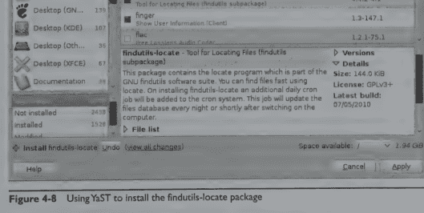

**图 4-8** 使用`YaST`安装`findutils-locate`软件包

### 使用 which

`which`命令用于显示 Shell 命令或实用工具的完整路径。例如，如果你想知道`ls`命令的完整路径，你会在 Shell 提示符下输入`which ls`。当你这样做时，屏幕上会显示`ls`的完整路径，示例如下：

```
fs2: /# which ls
/bin/ls
fs2: /#
```

除了`which`，你还可以使用`whereis`。接下来让我们谈谈如何使用这个实用工具。

### 使用 whereis

`whereis`命令查找指定文件的源代码、二进制文件和手册页。`-b`选项返回指定命令的二进制文件位置。`-m`选项返回命令的手册页位置。要查看命令源代码的位置，请在`whereis`命令中使用`-s`选项。如果不使用任何选项，则返回所有信息。

例如，如果你在 Shell 提示符下输入`whereis -b ls`，则返回`ls`命令的二进制可执行文件的位置。示例如下：

```
fs2: /# whereis -b ls
ls: /bin/ls
```

同样，`whereis -m ls`命令返回`ls`命令的手册页文件位置；如下所示：

```
fs2: /# whereis -m ls
ls: /usr/share/man/man1/ls.1p.gz /usr/share/man/man1/ls.1.gz
```

### 使用 type

`type`命令返回当你输入命令时执行的命令类型。返回的值将是以下之一：

- 该命令硬编码在 Shell 本身中。例如，`cd`命令是一个内置的 Shell 命令：

  ```
  fs2: /# type cd
  cd is a shell builtin
  ```

- 由 Shell 调用的外部命令。如果该命令最近在 Shell 中运行过，`type`的输出会说该命令已被哈希。这表明该外部命令在文件系统中的位置已存储在 Shell 的哈希表中。如果你再次运行相同的命令，Shell 将直接执行它，而不会在`PATH`环境变量中的目录中搜索它。示例如下：

  ```
  fs2: /# type cat
  cat is hashed (/bin/cat)
  ```

- 一个别名。别名基本上是`Linux`文件系统中另一个文件的快捷方式。别名常用于常用命令，如`ls`命令。示例如下：

  ```
  fs2:/ # type ls
  ls is aliased to 'ls $LS_OPTIONS'
  ```

  > **注意** 我在第 2 章中讨论了别名。

- 一个函数。`bash` Shell 允许你通过定义自己的 Shell 函数来创建新的内部命令。

你还可以在`type`命令中使用`-a`选项。此选项使`type`返回文件系统中标有该命令的所有实例。例如，输入`type -a ip`命令显示有两个名为`ip`的可执行文件：

```
fs2:/ # type -a ip
ip is /sbin/ip
ip is /bin/ip
```


让我们在下面的练习中练习使用 Linux 搜索工具。

## 练习 4-1：使用 Linux 搜索工具

> **视频** 欲了解更多信息，请观看 `练习 4-1`。

在这个练习中，你将练习使用 Linux 搜索工具。完成以下步骤：

1. 验证你是否已登录到你的 Linux 系统。

2. 如有必要，打开一个终端会话。

3. 通过在 Shell 提示符下输入 `su -` 并输入你的 root 用户密码，切换到你的 root 用户账户。

4. 通过在 Shell 提示符下输入 `find / -name "resolv.conf"` 搜索名为 `resolv.conf` 的文件。该文件位于哪里？

5. 使用 `locate` 执行相同的搜索，在 Shell 提示符下输入 `locate resolv.conf`。

> **注意** 如果系统上未安装 `findutils-locate` 软件包，`locate` 命令将无法工作。如果情况如此，请不要担心；你将在本书的后面学习如何安装它。

6. 通过在 Shell 提示符下输入 `which init` 查找 `init` 可执行文件的位置。它位于哪里？

7. 在 Shell 提示符下输入 `whereis init`。包含 `init` 命令手册部分的文件位于哪里？

## 从命令行管理目录

既然你已经理解了 Linux 文件系统的结构以及如何搜索文件，现在你准备好开始管理文件系统了。在本章的这一部分中，我们将重点讨论如何从 Shell 提示符管理目录。涵盖的主题包括：

- 导航文件系统
- 查看目录内容
- 创建新目录
- 复制、移动和删除目录

让我们首先讨论如何从 Shell 提示符导航文件系统。

### 导航文件系统

当你从 Shell 提示符操作 Linux 文件系统时，最常见的一项任务就是在存储设备上的不同目录之间移动。你的 Linux 系统提供了以下 Shell 命令，你可以使用它们来执行此操作：

- `pwd`
- `cd`

让我们先学习如何使用 `pwd` 命令。

### 使用 pwd 命令

`pwd` 命令是一个相对简单的实用工具。它仅仅在屏幕上显示当前目录。


如果你的 Shell 配置文件没有设置为在 Shell 提示符中显示当前目录，那么这个实用工具会很有用。要使用 `pwd`，只需在 Shell 提示符下输入 `pwd`；如下所示：

```
ztracy@fs2:~> pwd
/home/ztracy
```

在这个例子中，你可以看到当前目录设置为 `/home/ztracy`。

> **提示** Shell 提示符中的 `~` 字符指向当前用户的 home 目录。因为在上述示例中，我是以 `tracy` 用户身份登录的，所以 `~` 指向 `/home/tracy` 目录。

如果你在使用 `pwd` 命令时使用 `-P` 选项，`pwd` 将显示物理目录而不包含符号链接。我们稍后会在本章中讨论链接文件。此时，你已经知道了如何确定你所在的目录。很可能，你稍后需要更改到文件系统中的另一个目录。让我们接下来讨论如何做到这一点。

### 使用 cd 命令

`cd` 命令用于从 Linux Shell 提示符更改文件系统中的目录。要使用此命令，只需输入 `cd` 后跟你要切换到的目录名称。你可以用两种方法来完成此操作。如果你输入 `cd` 然后输入目录名称而未指定目录的完整路径，`cd` 将假设该目录是当前目录的子目录。在下面的示例中，已经发出了 `cd Documents/` 命令：

```
tracy@fs2:~> cd Documents/
tracy@fs2:~/Documents>
```

由于命令是从 `/home/tracy` 发出的，`cd` 将目录更改为 `/home/tracy/Documents`。这被称为使用相对路径。命令指定的路径是相对于文件系统中的某个其他点，在本例中为 `/home/tracy` 目录。

你也可以在 `cd` 命令中使用绝对路径。当你使用绝对路径时，你需要指定从 `/` 开始的完整路径，指向你想要更改到的目录，如下例所示：

```
tracy@fs2:~> cd /var/log
tracy@fs2:/var/log>
```

因为我指定了一个绝对路径 (`/var/log`)，`cd` 命令知道 `/var/log` 目录并不存在于当前目录中。相反，路径是从根目录 (`/`) 确定的，并将当前目录更改为该路径。

> **提示** 如果你在 Shell 提示符下输入 `cd` 而不指定路径，它将自动更改为当前登录用户的 home 目录。

你还可以使用 `cd` 命令在文件系统层次结构中向上移动。你可以通过输入 `cd ..` 来实现这一点。这将把当前目录更改为层次结构中上一级目录。考虑以下示例：

```
tracy@fs2:~/var/log> cd ..
tracy@fs2:/var>
```

在这个例子中，发出了 `cd ..` 命令，从 `/var/log` 更改到了 `/var` 目录。若要向上移动两个目录，你可以在 Shell 提示符下输入 `cd ../..` 命令：

```
tracy@fs2:/var/log> cd ../..
tracy@fs2:/>
```

> **提示** 你还可以使用 `..` 别名向上移动一层，使用 `...` 别名向上移动两层。大多数发行版会在你的 `bash` 配置文件中自动为你定义这些别名。

接下来让我们看看 `ls` 命令。

## 查看目录内容

到目前为止，你学会了如何查看当前目录并更改到文件系统中的其他目录。现在你需要学习如何列出目录中可能存在的文件和子目录。这是通过使用 `ls` 命令完成的。如果你在 Shell 提示符下输入 `ls`，当前目录的内容将显示在屏幕上，如下所示：

```
tracy@fs2:~> ls
bin Documents Music Public Templates test.txt words
Desktop Downloads Pictures public_html test2.txt Videos yourfile.txt
tracy@fs2:~>
```

与 `cd` 命令一样，在使用 `ls` 时你也可以提供绝对路径。这将导致 `ls` 显示你指定的目录的内容。考虑这个例子：

```
tracy@fs2:~> ls /var/log
cups mail ntp Xorg.0.log.old
apparmor faillog mail.err pk_backend.zypp YaST2
audit firewalld mail.info pm-powersave.log zypp
boot.log gdm mail.warn samba zypper.log
boot.msg krb5 messages warn
boot.msgx lastlog NetworkManager wtmp
ConsoleKit localmessages news Xorg.0.log
tracy@fs2:~>
```

在这个例子中，发出了 `ls /var/log` 命令，导致 `/var/log` 的内容被显示。在使用 `ls` 时，你可以使用各种选项来自定义其工作方式。这些选项中的一些包括以下内容：

- `-a` 显示所有文件，包括隐藏文件。在下一个示例中，在 `/home` 目录下发出了 `ls -a` 命令：

  ```
  tracy@fs2:~> ls -a
  . .xsd_auth .inputrc .test2.txt
  .. .fontconfig .local test.txt
  .bash_history .fonts .mozilla .themes
  .bashrc bin .cache .config .dbus Desktop .dircache
  Documents Downloads .emacs .gconfd .gnucmd .gnome2
  .gnome2_private .profile .gstreamer-0.10 .gtk-bookmarks .gvfs
  Pulse .lxsession .ICEauthority .Icons Music .nauticus
  Pictures public public_html Pulse .pulse-cookies recently-used.xbel
  Templates .thumbnails Videos .viminfo .vimrc words
  .xml.template .xinitrc.template .xsession-errors
  .xsession-errors.old yourfile.txt
  tracy@fs2:~>
  ```

- `-h` 以人类可读的格式显示文件大小，例如 `1K` 而不是 `1024` 字节。它与 `-l` 选项结合使用时很有用。

- `-l` 以长格式显示文件（包括权限、所有者、大小、日期）。

- `-t` 按修改时间对文件进行排序，最新的排在前面。

- `-u` 显示或按用户访问时间排序。

- `-n` 使用数字用户和组 ID 列表，而不是名称。

- `-r` 反向排序顺序。

- `-R` 递归进入子目录。


- `-s` 显示每个文件分配的空间量。这包括使用的磁盘块，可能大于实际文件大小。

- `-i` 打印每个文件的 inode 号（唯一 ID）。

- `-d` 列出目录本身，而不是目录的内容。

- `-S` 按文件大小排序，最大的排在前面。

`-l` 显示目录内容的长列表。这是一个非常实用的选项。你可以用它来查看文件名、所有权、权限、修改日期和大小。示例如下所示：

```
tracy@fs2:~> ls -l
total 56
drwxr-xr-x 2 tracy users 4096 2011-01-19 10:41 bin
drwxr-xr-x 2 tracy users 4096 2011-01-19 10:42 Desktop
drwxr-xr-x 2 tracy users 4096 2011-01-19 10:42 Documents
drwxr-xr-x 2 tracy users 4096 2011-01-19 10:42 Music
drwxr-xr-x 2 tracy users 4096 2011-01-19 10:42 Pictures
drwxr-xr-x 2 tracy users 4096 2011-01-19 10:42 Public
drwxr-xr-x 2 tracy users 4096 2011-01-19 10:41 public_html
drwxr-xr-x 2 tracy users 4096 2011-01-19 10:42 Templates
-rw-r--r-- 1 tracy users 37 2011-01-20 11:04 test2.txt
-rw-r-r-- 1 tracy users 182 2011-01-21 11:48 test.txt
-rw-r--r-- 2 tracy users 4096 2011-01-19 10:42 Videos
-rw-r--r-- 1 tracy users 23 2011-01-20 11:32 words
-rw-r--r-- 1 tracy users 121 2011-01-21 11:46 yourfile.txt
tracy@fs2:~>
```

`-R` 递归显示目录内容；也就是说，它显示当前目录的内容以及所有子目录的内容。根据目录中条目数量的多少，你可能希望在此选项后附加 `| more`。这将导致 `more` 实用程序每次暂停显示一页。图 4-9 中显示了一个示例，其中从 `/var/log` 目录发出了 `ls -R` 命令。

这份列表只是你可以与 `ls` 一起使用的不同选项的示例。你可以查看 `ls` 的手册页或 `info` 节点以了解更多信息。

> **提示** 大多数发行版定义了你可以用于 `ls` 命令的特殊别名。例如，在 openSUSE 上，`dir` 或 `l` 别名运行 `ls -l` 命令，而 `la` 别名运行 `ls -la` 命令。

让我们在下面的练习中练习导航文件系统。

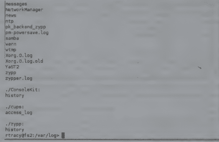

图 4-9 使用 `ls` 命令的 `-R` 选项

## 练习 4-2：浏览文件系统

**视频** 如需更多信息，请观看练习 4-2。

在这个练习中，你将练习使用 shell 命令来浏览 Linux 文件系统。请完成以下步骤：

- 启动你的 Linux 系统并以标准用户身份登录。

- 如有必要，打开一个终端会话。

- 通过在 shell 提示符下输入 `pwd` 来确定当前的工作目录。当前目录是什么？

- 通过在 shell 提示符下输入 `cd /etc` 更改目录至 `/etc`。

- 通过在 shell 提示符下输入 `ls` 生成当前目录的列表。

- 通过在 shell 提示符下输入 `ls -l` 生成当前目录的详细列表。

- 通过在 shell 提示符下输入 `ls -l | more` 生成详细列表，并逐页暂停输出。翻阅列表的每一页。

- 通过在 shell 提示符下输入 `cd ~` 切换回你的主目录。

- 输入 `ls`。

- 通过在 shell 提示符下输入 `ls -a` 查看用户主目录中的隐藏文件。`ls -a` 显示了哪些 `ls` 未显示的文件？

现在让我们转换一下思路，讨论一下你可以用来管理 Linux 文件系统中目录的 shell 命令。首先看看如何创建新目录。

### 创建新目录

你可以使用 shell 命令来创建新目录。这是通过 `mkdir` 命令完成的。你在 shell 提示符下输入 `mkdir`，后跟你想要创建的目录名称。在下一个示例中，`mkdir MyFiles` 命令是在 `tracy` 用户的主目录中执行的。

```bash
tracy@fs2:~$ mkdir MyFiles
tracy@fs2:~$ ls
   bin       Downloads    Pictures     Templates     Videos
   Desktop   Music        Public       test2.txt     words
   Documents MyFiles     public_html  test.txt      yourfile.txt
tracy@fs2:~$
```

请注意 `ls` 命令的输出，一个新的名为 `MyFiles` 的目录已在 `/home/tracy` 中创建。当然，如果你想在当前目录以外的地方创建目录，可以使用绝对路径加上目录名称。例如，如果你想在 `/tmp` 目录中创建一个名为 `backup` 的新目录，你会在 shell 提示符下输入 `mkdir /tmp/backup`。

> **提示** 在许多发行版中，shell 配置文件中定义了一个名为 `md` 的别名，它执行 `mkdir -p` 命令。`-p` 选项指定，如果命令中指定的整个目录路径不存在，则可以创建它。例如，`md ~/temp/backups/daily` 将在创建 `daily` 目录之前，创建 `temp` 和 `backups` 目录（如果它们尚不存在）。

### 复制、移动和删除目录

除了创建和查看 Linux 文件系统中的目录外，你还可以使用 shell 命令来复制、移动或删除它们。你使用以下实用工具来完成这些任务：

- `cp`

  该实用工具用于将完整的目录结构从文件系统中的位置复制到另一个位置。

要复制完整的目录结构，你需要包含 `-R` 选项，该选项指定递归复制目录内容。在下面的示例中，`tracy` 用户的主目录中执行了 `cp -R ~/MyFiles ~/backup` 命令。这导致 `MyFiles` 目录及其所有文件和子目录被复制到用户主目录中的 `backup` 目录。

> **注意** 由于 `cp` 复制了目录，原始目录保持完好。

```bash
tracy@fs2:~$ cp -R ~/MyFiles ~/backup
tracy@fs2:~$ ls
   backup     Documents     MyFiles     public_html     test.txt      yourfile.txt
   bin        Downloads     Pictures    Templates     Videos
   Desktop    Music         Public      test2.txt     words
tracy@fs2:~$
```

- `mv`

  `mv` 命令的使用方式与 `cp` 类似。然而，它将该指定的目录复制到文件系统中的新位置，然后删除原始目录。例如，要将名为 `backup` 的目录从主目录移动到 `/tmp`，你会输入 `mv ~/backup /tmp`。`mv` 命令也可以用于重命名目录。只需输入 `mv`，后跟要重命名的目录，然后输入新的目录名称。例如，要将主目录中的 `backup` 目录重命名为 `temp`，你会输入 `mv ~/backup ~/temp`。

- `rmdir`

  此实用工具可用于删除现有的目录。要使用它，只需输入 `rmdir directory_name`——例如，`rmdir MyFiles`。但请注意，`rmdir` 要求目录在删除前必须为空。

> **提示** 在许多发行版中，你的 shell 配置文件中定义了一个名为 `rd` 的别名，它执行 `rmdir` 命令。

- `rm`

  `rm` 实用工具是一个功能更强大的删除工具，可用于删除包含文件的目录。要删除目录，请输入 `rm -r directory_name`。

所以，这就是你从 shell 提示符管理目录的方法。考虑到这一点，我接下来需要讨论如何从 shell 提示符管理这些目录中的文件。让我们继续。

## 从命令行管理文件

除了管理文件系统中的目录外，还有许多时候你需要管理它们包含的文件。在本章的这一部分，你将学习如何完成以下任务：

- 创建文件

- 查看文件内容

- 删除文件

- 复制和移动文件


### 确定文件类型

让我们首先看看如何在文件系统中创建新文件。

#### 创建新文件

时不时地，你需要在 `Linux` 文件系统中创建新文件。使用 `shell` 提示符中的 `touch` 命令可以创建文件。要使用 `touch`，输入 `touch` 后跟你要创建的文件名。在下一个示例中，命令 `touch my_file.txt` 是在 `rtracy` 用户的主目录中执行的：

```bash
rtracy@fs2:~> touch my_file.txt
rtracy@fs2:~> ls -l my*
-rw-r--r-- 1 rtracy users 0 2011-02-01 11:36 my_file.txt
rtracy@fs2:~>
```

在输入 `touch` 后，输入了 `ls` 命令。你可以看到一个名为 `my_file.txt` 的 0 字节文件在 `/home/rtracy` 中创建。如果你想在文件系统的其他位置创建该文件，你可以使用绝对路径加上文件名。

#### 查看文件内容

正如我们之前讨论的，你的 `Linux` 系统及其上运行的服务是使用存储在（通常）在文件系统 `/etc` 目录中的简单文本文件进行配置的。此外，许多系统日志文件也保存为文本文件。由于 `Linux` 使用文本文件来配置和管理几乎所有内容，你经常需要查看文件的内容。

在前一章中，你学习了如何使用文本编辑器打开文件进行查看和编辑。这效果很好。但是，会有许多场合你只是想快速在屏幕上查看文本文件，而不需要或不想加载文本编辑器。`Linux` 提供了多种命令行工具供你使用，包括以下工具：

- `cat`

  `cat filename` 命令会在屏幕上显示指定的文本文件。例如，如果你需要查看 `/etc/xinetd.conf` 配置文件，你会在 `shell` 提示符下输入 `cat /etc/xinetd.conf`。

  > **提示** `cat` 命令不会暂停输出，因此如果你使用它来查看长文件，可能需要将其管道传输到 `more` 程序（`| more`）以逐页暂停输出。

- `less`

  `less filename` 命令也可用于在屏幕上显示指定的文本文件，类似于 `cat`。然而，`less` 命令会自动逐页暂停长文本文件。你可以使用空格键、`Page Up`、`Page Down` 和方向键在输出中导航。

- `head`

  `head filename` 命令用于在屏幕上显示文本文件的前几行。

- `tail`

  `tail filename` 命令用于在屏幕上显示文本文件的最后几行。`tail` 命令在显示日志文件时特别有用。查看日志文件时，通常只需要看到文件的末尾。你可能不关心几天或几周前添加的日志条目。你可以使用 `tail` 来查看添加到文件末尾的最后几个日志条目。

`tail` 命令还包含 `-f` 选项，该选项非常有用。你可以使用它来监控命令中指定的文件。如果新内容被添加到文件的末尾（例如日志文件），新行将显示在屏幕上。在图 4-10 中，已发出 `tail -f /var/log/messages` 命令以监控文件的新条目。

在排查系统中行为异常的服务或配置问题时，将 `-f` 与 `tail` 命令一起使用会非常有帮助。完成后，你可以通过按下 `CTRL-C` 来中断 `tail` 命令。

除了创建和查看文件外，你还需要了解如何删除现有文件。接下来我们将讨论其操作方法。

### 删除文件

与目录一样，有时你需要从 `Linux` 文件系统中删除现有文件。可以使用 `rm` 命令来删除文件。这就是我们之前用来删除目录的同一命令。`rm` 实用工具是一个功能强大的删除工具，可用于删除文件或已填充内容的目录。要删除文件，只需输入 `rm filename`。在下一个示例中，使用 `rm` 命令删除 `myfile.txt` 文件：

```
tracy@fs2:~$ rm myfile.txt
tracy@fs2:~$
```

在使用 `rm` 实用工具时必须非常小心！如前一个示例所示，它不会提示你确认删除操作。它假定你真的打算删除文件或目录，并执行此操作。顺便说一下，被删除的文件不会被移动到回收站。如果你使用 `rm` 删除文件或目录，它就彻底消失了！如果你希望 `rm` 在删除文件或目录前进行提示，请包含 `-i` 选项。

接下来让我们看看如何在 `shell` 提示符下复制和移动文件。

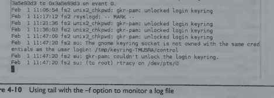

**图 4-10** 使用带 `-f` 选项的 `tail` 命令监控日志文件

### 复制和移动文件

除了在 `Linux` 文件系统中创建和删除文件，你还可以复制或移动它们。你使用与管理目录相同的实用工具来复制或移动文件：

- `cp` 此实用工具用于将文件从文件系统中的一个位置复制到另一个位置。例如，要将名为 `/tmp/schedule.txt` 的文件复制到你的主目录，你需要输入 `cp /tmp/schedule.txt ~`。请记住，`cp` 会创建文件的副本，因此原文件保持不变。你可以使用 `cp` 的 `-R` 选项来递归复制文件。

- `mv` `mv` 命令将文件复制到文件系统中的新位置，然后删除原始文件。例如，要将名为 `mylog.txt` 的文件从 `/tmp` 移动到 `/var/log`，你需要输入 `mv /tmp/mylog.txt /var/log`。

与目录一样，`mv` 命令也可以用于重命名文件。只需输入 `mv`，后接要重命名的文件名，然后输入新文件名。例如，要将 `schedule.txt` 重命名为 `schedule.old`，你需要输入 `mv schedule.txt schedule.old`。

### 确定文件类型

你可以在 `shell` 提示符下使用 `file` 命令来确定文件的类型。请注意，在 `Linux` 中，文件扩展名（如 `.txt`）并非必需。因此，仅从文件名可能无法立即看出你正在查看的是哪种类型的文件。

可以在 `shell` 提示符下使用 `file` 命令获取文件信息。该命令的输出不仅会告诉你文件的通用类型（如目录、命名管道、链接等），还可以提供有关文件的详细信息。为此，它会将命令中指定的文件与包含在 `/usr/share/misc/magic`、`/usr/share/misc/magic.mgc` 和 `/etc/magic` 中的文件签名进行比较。

在下一个示例中，可以看到 `file` 命令已识别出主目录中的 `words` 文件是 `ASCII` 文本文件，而 `resources` 文件是 `OpenOffice.org` 文档：

```
rtracy@fs2:~> ls
bin           Downloads       MyFiles       public_html   Templates     Videos
Desktop       hs_err_pid7458.log  Pictures    resources     test2.txt     words
Documents     Music           Public        temp          test.txt      yourfile.txt
rtracy@fs2:~> file words
words: ASCII text
rtracy@fs2:~> file resources
resources: OpenDocument Text
rtracy@fs2:~>
```

到目前为止，我们主要在 `Linux` 文件系统中处理文件、目录和别名。然而，还有第四种 `Linux` 文件类型被大量使用，你需要熟悉这种类型。这些文件被称为 `links`（链接）。让我们接下来讨论它们的工作原理。

### 处理链接文件

正如本章前面所讨论的，`Linux` 文件系统支持一种称为 `link file`（链接文件）的文件类型。链接文件不包含常规文件那样意义上的内容。相反，它们是指向文件系统中其他文件或目录的重定向。在 `Linux` 上，你可以创建两种不同类型的链接文件：

- `Hard`（硬链接） 硬链接是直接指向另一个文件 `inode` 的文件。`inode` 存储有关 `Linux` 文件中文件的基本信息，包括其大小、设备、所有者和权限。由于两个文件使用相同的 `inode`，在创建硬链接后，你实际上无法分辨哪个文件是指针，哪个文件是被指向的对象。这就像两个文件是同一个文件一样，即使它们可能存在于文件系统中的不同位置。

- `Symbolic`（符号链接） 符号链接文件也指向文件系统中的另一个文件。然而，符号链接拥有自己的 `inode`。由于指针文件拥有自己的 `inode`，因此可以轻松识别文件系统中的指针和被指向的对象。例如，在前一章中，你看到 `/usr/bin/vi` 文件实际上是一个指向 `/bin/vim` 文件的符号链接。这在此示例中展示：

```
fe2@usr/bin $ ls -l vi
lrwxrwxrwx 1 root root 8 Jan 19 10:24 vi -> /bin/vim
fe2@usr/bin $
```


# 链接文件

要创建链接文件，请使用 `ln` 命令。语法为 `ln pointee_file pointer_file`。不带任何选项使用它会创建硬链接。如果你想创建符号链接，请使用 `-s` 选项。在下面的示例中，使用 `ln` 命令在用户主目录的 `bin` 子目录中名为 `myapp` 的文件与位于 `/var/opt` 中名为 `myapp` 的可执行文件之间创建了一个符号链接：

```
rtracy@fe2:~bin $ ln -s /var/opt/myapp myapp
rtracy@fe2:~bin $ ls -l
total 0
lrwxrwxrwx 1 rtracy users 14 2011-02-01 13:15 myapp -> /var/opt/myapp
rtracy@fe2:~bin $ cd ..
rtracy@fe2:~ $ myapp
This is my new executable script file.
rtracy@fe2:~ $
```

使用 `ls -l` 命令，你可以看到 `myapp` 实际上指向 `/var/opt/myapp` 可执行文件。如果 `/var/opt/myapp` 程序是你经常需要使用的，这可以是一个有用的技巧。由于 `/var/opt` 目录不在用户的 `PATH` 环境变量中，每次想运行 `myapp` 可执行文件时，都需要提供完整路径（或者先切换到 `/var/opt` 目录）。然而，主目录中的 `bin` 目录会由 `bash` 配置文件自动添加到 `PATH` 环境变量中。通过将符号链接放置在此目录中，只需在 shell 提示符下输入 `myapp` 即可运行 `/var/opt/myapp` 可执行文件。符号链接文件将 shell 重定向到 `/var/opt` 中的相应文件并在那里运行它。这在前面的示例中已展示。


> **注意** 本书稍后部分将讨论符号链接在 `init` 进程初始化你的 Linux 系统时发挥的关键作用。

让我们在下面的练习中实践文件管理。

## 练习 4-3：管理文件和目录


> **视频** 欲了解更多信息，请观看 `Exercise 4-3`。

在此练习中，你将使用 shell 命令练习管理文件和目录。完成以下操作：

1. 在 Linux 系统运行并以普通用户身份认证的情况下，打开终端会话，并在 shell 提示符下输入 `cd` 切换到你的主目录。
2. 输入 `mkdir MyFiles` 在你的主目录中创建一个新目录。
3. 输入 `ls` 并验证新目录是否存在。
4. 输入 `touch ~/MyFiles/myfile.txt` 在 `MyFiles` 目录中创建一个名为 `myfile.txt` 的新文件。
5. 输入 `ls ~/MyFiles` 并验证该文件是否存在。
6. 输入 `su -` 并输入你的 `root` 用户密码，以切换到你的 `root` 用户账户。
7. 输入 `cat /var/log/messages | more` 查看系统日志文件。
8. 翻过几页文件，然后按下 `CTRL-C` 中断并返回到 shell 提示符。
9. 输入 `tail /var/log/messages` 查看日志文件的最后几条条目。
10. 在停止和启动服务的同时监控你的 `/var/log/messages` 日志文件，操作方法如下：
    1. 在 shell 提示符下输入 `tail -f /var/log/messages`。你应该会看到日志文件现在正在被 `tail` 监控。
    2. 打开一个新的终端窗口，使用 `su -` 命令和你的 `root` 用户密码切换到 `root` 用户账户。
    3. 在 shell 提示符下输入 `ifdown eth0` 禁用系统的网络卡。
    4. 切换到正在运行 `tail` 的终端会话。当网络板被禁用时，你应该会看到新行被添加到文件中。
    5. 切换回第二个 shell 提示符并输入 `ifup eth0`。再次，当网络板在第一个终端窗口中被重新启用时，你应该会看到新行被添加到文件中。
    6. 输入 `exit` 两次以关闭第二个终端窗口。
    7. 切换到正在运行 `tail` 的终端会话，并按下 `CTRL-C` 以终止 `tail`。
11. 通过输入 `exit` 切换回你的普通用户账户。
12. 通过输入 `rm -r ~/MyFiles` 删除主目录中的 `MyFiles` 目录。
13. 输入 `ls`，验证该目录及其内容已消失。
14. 通过输入 `cp -R ~/ /tmp/` 将主目录中的文件和子目录复制到 `/tmp`。
15. 通过输入 `ls /tmp/` 查看 `/tmp` 的内容。验证你的主目录已被复制。
16. 通过执行以下操作来练习使用符号链接：
    1. 通过输入 `ln -s /usr/share/doc/ ~/docs`，创建从主目录中名为 `docs` 的目录指向 `/usr/share/doc` 目录的符号链接。
    2. 输入 `ls -l`。验证 `docs` 文件指向 `/usr/share/doc/`。
    3. 输入 `cd docs`。
    4. 输入 `pwd`。你当前在哪个目录中？
    5. 输入 `ls`。尽管你仍然在 `~/docs` 中，但你应该能看到 `/usr/share/doc/` 目录的内容。

## 在文件内查找内容

在本章前面的部分中，我们讨论了可用于在文件系统中搜索文件的 shell 命令。然而，Linux 还提供了一种名为 `grep` 的工具，你可以使用它在文件内部搜索特定内容。`grep` 工具极其有用；事实上，我敢断言大多数 Linux 管理员每天都使用它。使用 `grep`，你可以搜索文件中的特定文本字符串。当你想要在一个非常大的日志文件中搜索特定消息，或者需要在一个配置文件中查找特定指令时，这会非常有帮助。你甚至可以使用 `grep` 同时搜索多个文件以定位特定表达式。

要使用 `grep`，你需要在 shell 提示符下输入 `grep 搜索表达式 文件名`。例如，假设你想在 `/var/log/messages` 文件中搜索与在 Linux 系统上运行的 `VNC` 服务相关的任何日志条目。你会输入 `grep vnc /var/log/messages`。然后，`grep` 工具将显示文件中包含搜索词的每一行，如下所示：

```text
fs2:~ # grep vnc /var/log/messages
Feb 1 13:47:25 fs2 xinetd[7134]: Reading included configuration file:
/etc/xinetd.d/vnc [file=/etc/xinetd.d/vnc] [line=15]
fs2:~ #
```

同样，如果你需要在 `/etc/ntp.conf` 文件中查找包含指令 "server" 的行，你可以输入 `grep server /etc/ntp.conf` 在 shell 提示符下。这在下一个示例中展示了：

```text
fs2:~: $ grep server /etc/ntp.conf
#### server 127.127.0.0 mode 5 prefer
server 127.127.1.0
#### # ntpct addserver cyourserver
server bigben.cac.washington.edu iburst
#### key (7) for accessing server variables
#### controlkey 15
#### key (6) for accessing server variables
fs2:~: $
```

在命令行使用 `grep` 时，你可以使用以下选项：

- `-i` 在搜索搜索文本时忽略大小写。
- `-l` 仅显示包含匹配文本的文件名称。它不显示实际匹配的文本行。
- `-n` 显示匹配行的行号。
- `-r` 递归搜索指定路径的子目录。
- `-v` 显示所有不包含搜索字符串的行。

`grep` 工具在你需要在文件中搜索特定文本字符串时表现非常出色。然而，有时你需要搜索更复杂的模式。在这种情况下，你可以使用 `egrep` 命令代替。

> **注意** `egrep` 命令等同于使用 `grep -E` 命令。

`egrep` 的关键优势在于它可以搜索文件中的扩展正则表达式。正则表达式是由元字符和字面量组成的字符串。

> **注意** 字面量是指普通字符（A–Z，a–z）和数字。

元字符是不代表自身而是代表其他字符的字符。它们也可以用于指定字符在文本字符串中的位置。一些常用的正则表达式列在表 4-6 中。更多信息请参阅 `regex(7)` 手册页。

除了 `egrep`，你还可以使用 `fgrep`（固定字符串 grep）工具来搜索文件内的内容。

> **注意** 运行 `fgrep` 等同于运行 `grep -F`。


| 元字符 | 功能 | 示例 |
| :--- | :--- | :--- |
| `*` | 匹配任意数量的任意字符。 | `Myfile*` 将匹配 `Myfile1`、`Myfile2`、`Myfiles`、`Myfiles23` 等。 |
| `.` | 匹配单个字符 | `Myfile.` 将匹配 `Myfile1`、`Myfile2` 和 `Myfiles`，但不匹配 `Myfiles23`。 |
| `^` | 如果表达式出现在行的开头，则匹配该表达式。 | `^server` 将匹配 `"server"` 的任何实例，只要它出现在行的开头。 |
| `$` | 如果表达式出现在行的末尾，则匹配该表达式。 | `server$` 将匹配 `"server"` 的任何实例，只要它出现在行的末尾。 |
| `\|` | 匹配管道字符两侧的表达式。 | `Server\|server` 将匹配 `"Server"` 或 `"server"`。 |
| `[nnn]` | 匹配花括号之间的任意一个字符。 | `[xyz]` 将匹配 `"x"`、`"y"` 或 `"z"` 中的任何一个。 |
| `[^nnn]` | 匹配不包含指定字符中任意一个的表达式。 | `[^aei]` 将不匹配字符 `"a"`、`"e"` 或 `"i"`。 |
| `[n-n]` | 匹配范围内的任意单个字符。 | `[1-5]` 将匹配 `1` 和 `5` 之间的任何数字。 |

##### 表 4-6 正则表达式

`grep` 工具搜索文件中匹配固定字符串的行。与 `egrep` 不同，它不执行正则表达式搜索。相反，`fgrep` 使用直接的字符串比较来查找输入中的匹配文本行。语法是 `fgrep 模式 文件名`。例如，运行 `fgrep *.c` 命令将在当前目录中搜索文件名扩展名为 `".c"` 的所有文件中的字符串 `"server"`。（注：原文此处逻辑可能有误，`fgrep` 是固定字符串匹配，若模式为 ``*.c` 则是在文件内容中搜索字面量 ``*.c`，或者原文意指使用 shell 通配符传递文件给 `grep`，但此处翻译保留原意，指出搜索字符串 `"server"` 在 ``*.c` 文件中，可能是原文表述有误，通常 `fgrep pattern file_list`，若按原文直译则保持原样）

让我们在下面的练习中练习使用 Linux 搜索工具。

#### 练习 4-4：使用 `grep`

在这个练习中，你将练习使用 Linux 搜索工具。完成以下操作：

1. 在你的 Linux 系统运行并作为普通用户认证的情况下，通过输入 `su -` 并在 shell 提示符下输入你的 root 用户密码来切换到 root。
2. 通过输入 `grep initab /var/log/messages` 在你的系统日志文件中定位对 `initab` 文件的引用。你能从 `grep` 的输出中了解到关于这个文件的什么信息？
3. 在 shell 提示符下输入 `egrep init* /var/log/messages`，使用 `egrep` 在你的系统日志文件中查找关于 `init` 进程的信息。
4. 再次使用 `egrep`，在 shell 提示符下输入 `egrep eth[0-3] /var/log/messages`，查找系统中安装的所有以太网接口的信息。
5. 在 shell 提示符下输入 `grep Enabled$ /var/log/messages`，找出系统日志文件中所有以 `"Enabled"` 结尾的行。

现在你是一个文件系统专家了！知道这么多知识，你得保持谦虚！

## 第 4 章：管理 Linux 文件和目录


**提示** `/etc/updatedb.conf` 文件用于配置 `updatedb` 工具的行为。你可以将此文件中的 `PRUNEFS` 变量设置为你不希望 `updatedb` 扫描的文件系统类型。你还可以将此文件中的 `PRUNEPATHS` 变量设置为你希望 `updatedb` 在扫描时跳过的文件系统中的目录列表。

## 第 4 章回顾

在本章中，我回顾了与管理 Linux 文件系统相关的各种主题。我首先向你介绍了 Linux 文件系统。首先，我区分了通用文件系统和特定磁盘文件系统（如 Reiser 或 `ext4`）之间的区别。然后，我指出 Linux 文件系统的作用是组织数据，以便可以轻松定位和检索，并可靠地保存。

接着，我提到 Linux 使用分层文件系统。这个层级的最顶层目录是根目录 (`/`)。我们讨论了在一个典型的 Linux 系统中，根据文件系统层次标准（FHS）指定的各个标准目录的作用。这些包括

- `/bin`
- `/boot`
- `/dev`
- `/etc`
- `/home`
- `/lib`
- `/media`
- `/mnt`
- `/opt`
- `/proc`
- `/root`
- `/sbin`
- `/srv`
- `/sys`
- `/tmp`
- `/usr`
- `/var`

我还讨论了在 Linux 系统中使用的四种不同类型的文件：普通文件、链接、FIFO（先进先出队列）和套接字。

掌握这些背景信息后，我将我们的注意力转向了常见的 Linux 文件系统任务。我强调，虽然大多数这些任务都可以使用图形工具完成，但 `LPIC-1`/`CompTIA Linux+` 考试要求你能够从 shell 提示符完成这些任务。

我首先讨论了一些可用于在 Linux 文件系统中搜索文件或目录的实用工具。我复习了如何使用 `find` 和 `locate` 命令来查找特定的文件或目录。我指出，`find` 通过手动遍历文件系统层级结构来执行搜索，这可能会比较慢。作为替代方案，`locate` 实用工具会创建文件系统中的文件数据库。当你使用 `locate` 进行搜索时，它查询的是其数据库而不是遍历文件系统层级结构，因此速度要快得多。

我还指出，你可以使用 `which` 命令来查找系统实用工具（例如 `ls`、`cp` 和 `man`）的可执行文件在文件系统中的位置。我还查看了 `whereis` 命令，该命令可以显示特定 shell 命令的信息，如可执行文件、源文件和 man 手册页文件的位置。我还复习了如何使用 `type` 命令来确定文件的类型。

接下来，我复习了如何使用 `pwd` 和 `cd` 命令在 Linux 文件系统中导航。然后我讨论了如何管理文件和目录。我指出，你可以使用 `touch` 命令创建新文件。你还可以使用 `mkdir` 命令创建新目录。

我还复习了可用于删除文件和目录的实用工具，包括 `rmdir` 和 `rm`。要复制和移动文件和目录，你可以使用 `cp` 和 `mv` 实用工具。我指出，`mv` 还可以用于重命名文件或目录。我还讨论了链接文件。我指出，链接文件指向文件系统中的其他文件或目录。我介绍你可以使用 `ln` 命令创建硬链接或符号链接。

然后我讨论了可用于在屏幕上查看文本文件内容的实用工具。我指出，你可以使用 `cat`、`less`、`head` 或 `tail` 来执行此操作。我还指出，你可以使用 `tail` 的 `-f` 选项来监视文本文件（如日志文件）在发生更改时的状态。最后，我通过讨论如何使用 `grep` 在文本文件中查找内容结束了本章。

#### 加速复习

- 文件系统的角色是存储和组织数据，以便可以轻松定位和检索。
- 文件系统还必须保持数据完整。
- Linux 使用分层文件系统。
- Linux 文件系统层级基于文件系统层级标准 (FHS)。
- 顶层目录是 `/`。
- 在 `/` 下方创建的其他标准目录承担 FHS 中定义的功能。
- Linux 文件系统使用常规文件、链接、FIFO 和套接字。
- 大多数文件系统管理任务都可以通过图形化或命令行工具完成。
- 你可以使用 `find` 实用工具在文件系统中定位文件或目录。
- `find` 实用工具通过手动遍历文件系统层级结构来搜索文件。
- 你可以使用 `locate` 搜索文件或目录。
- `locate` 实用工具维护文件系统中所有文件的数据库。
- 当 `locate` 执行搜索时，它搜索的是数据库而不是文件系统。
- `which` 命令用于显示文件中文件的位置。
- `whereis` 命令显示关于命令的可执行文件、源代码文件和 man 手册页文件的信息。
- `type` 命令显示文件的类型。
- `pwd` 命令用于显示当前目录。
- `cd` 命令用于更改目录。
- `ls` 命令用于显示目录内容。
- 使用 `ls` 配合 `-l` 选项会显示关于文件和目录的更多详细信息。
- 使用 `ls` 配合 `-R` 选项会递归显示目录内容。
- `touch` 命令用于创建新文件。
- `mkdir` 命令用于创建新目录。
- 你可以使用 `cat` 在屏幕上查看文本文件。
- 你也可以使用 `less` 在屏幕上查看文本文件。
- `less` 命令每次暂停显示一行。
- `head` 命令可用于显示文本文件的前几行。
- `tail` 命令可用于显示文本文件的最后几行。
- 使用 `-f` 选项的 `tail` 命令可以监视文本文件的变化。
- 你可以使用 `rmdir` 删除空目录。
- 你可以使用 `rm` 删除包含内容的目录或文件。
- `cp` 命令用于复制文件。


- `mv` 命令用于移动文件。

- Linux 文件系统允许你创建指向文件系统中其他文件或目录的链接文件。

- 硬链接直接指向另一个文件的 inode。

- 符号链接拥有自己的 inode。

- 链接是使用 `ln` 命令创建的。

- 你可以使用 `grep` 在文件中搜索文本。

#### 问题

1. 以下哪些是 Linux 文件系统的角色？（选择两项。）
   - A. 创建系统数据的自动备份。
   - B. 使数据易于定位。
   - C. 保持数据完整性。
   - D. 为用户提供命令行界面。
   - E. 为用户提供图形用户界面。

2. 哪个目录包含 `cp` 或 `rm` 等文件系统管理实用工具？
   - A. `/bin`
   - B. `/dev`
   - C. `/var`
   - D. `/usr`

3. 哪个目录是一个在访问时动态创建的伪文件系统？
   - A. `/var`
   - B. `/opt`
   - C. `/proc`
   - D. `/srv`

4. 当与文件系统命令一起使用时，`~` 字符代表哪个目录？
   - A. `/var`
   - B. 当前目录
   - C. 当前用户的家目录
   - D. root 用户的家目录

5. 你需要生成 `/var` 目录内文件和目录的列表，包括子目录中的文件。哪个命令可以执行此操作？
   - A. `ls /var`
   - B. `ls -l /var`
   - C. `ls -f /var`
   - D. `ls -R /var`

6. 你需要查看 `/var/xinetd.log` 文件的最后几行。哪个命令最适合执行此操作？
   - A. `tail /var/xinetd.log`
   - B. `cat /var/xinetd.log | more`
   - C. `head /var/xinetd.log`
   - D. `less /var/xinetd.log`

7. 你需要删除用户家目录中的 `Temp` 目录。假设 `Temp` 中有文件，哪个命令最适合执行此操作？
   - A. `rmdir Temp`
   - B. `rmdir ~/temp`
   - C. `rm Temp`
   - D. `rm -r ~/Temp`

8. 你需要将用户家目录中的 `Documents` 目录复制到 `/tmp` 目录。假设 `Documents` 中包含文件和子目录，哪个命令是正确的？
   - A. `cp ~/Documents /tmp`
   - B. `cp -R ~/Documents /tmp`
   - C. `cp ~/Documents ~/tmp`
   - D. `cp -R ~/Documents ~/tmp`

9. 你想在你的家目录中创建一个符号链接，将 `manual` 文件链接到 `/usr/share/doc/manual` 目录。哪个命令是正确的？
   - A. `ln -s /usr/share/doc/manual ~/manual`
   - B. `ln /usr/share/doc/manual ~/manual`
   - C. `ln -s ~/manual /usr/share/doc/manual`
   - D. `ln ~/manual /usr/share/doc/manual`

10. 你需要在 Linux 文件系统中的某处查找名为 `myfile.txt` 的文件。哪个命令是正确的？
    - A. `find / -name "myfile.txt"`
    - B. `find "myfile.txt"`
    - C. `find / -n myfile.txt`
    - D. `find -name "myfile.txt"`

11. 你需要查找 `/var/log/messages` 文件中所有包含术语 "ssci" 的条目。哪个命令是正确的？
    - A. `grep /var/log/messages "ssci"`
    - B. `grep -find "ssci" /var/log/messages`
    - C. `grep /var/log/messages ssci`
    - D. `grep ssci /var/log/messages`

#### 答案

1. B 和 C。文件系统的角色是使数据易于定位并保持其完整性。

2. A。文件系统实用工具位于 `/bin` 中。

3. C。`/proc` 文件系统是一个伪文件系统。

4. C。`~` 字符指向当前用户的家目录。

5. D。`ls -R /var` 命令将生成 `/var` 及其子目录的列表。

6. A。`tail` 实用工具是显示文件最后几行的最佳选择。

7. D。`rm -r` 命令将删除 `Temp` 目录及其内容。

8. B。`cp -R ~/Documents /tmp` 命令递归地从用户家目录中的 `Documents` 目录复制数据到 `/tmp` 目录。

9. A。`ln -s /usr/share/doc/manual ~/manual` 命令创建了一个符号链接，将你在家目录中的 `manual` 文件链接到 `/usr/share/doc/manual` 目录。

10. A。`find / -name "myfile.txt"` 命令使用了正确的语法。

11. D。`grep ssci /var/log/messages` 命令使用了正确的语法。

## 安装 Linux

在本章中，您将学习关于：

- 设计 Linux 安装方案
- 安装 Linux
- 配置本地设置
- 配置时区设置

要获得 LPIC-1/CompTIA Linux+ 认证，您需要了解如何执行 Linux 发行版的干净安装。Linux 极其灵活，可以承担组织中的多种角色。因此，在安装操作系统时，您需要做出许多重要决策。大多数 Linux 发行版都期望您在开始安装前对 Linux 系统有扎实的理解。

在过去几年中，安装 Linux 变得容易多了。20 世纪 90 年代中期可用的发行版安装起来可能颇具挑战性。硬件支持有限；如果存在安装向导的话，它也非常原始。我第一次安装 Linux 发行版是在 20 世纪 90 年代中期，当时我在安装完成之前几乎想把脚穿过显示器。它花了整整两天时间才解决所有奇怪的问题。

幸运的是，大多数现代 Linux 发行版都使用易于使用的图形安装向导来简化安装过程。例如，openSUSE 使用的安装向导称为 YaST（Yet Another Setup Tool，又一种配置工具），如图 5-1 所示。

### Linux 安装程序与 LPIC-1/CompTIA Linux+ 考试

由于实现新的 Linux 系统既有正确的方法也有错误的方法，因此预计您在 LPIC-1/CompTIA Linux+ 考试中会对 Linux 安装主题非常熟悉。大约 20% 的考试题目将由 Linux 安装和包管理问题组成。考试将期望您熟悉部署规划主题，而不仅仅是安装过程本身。

CompTIA 和 LPIC 面临的一个问题是各种 Linux 发行版使用的安装程序种类繁多。LPIC-1/CompTIA Linux+ 考试无法涵盖所有安装程序。考试也不合理地期望您熟悉所有安装程序。发行版实在是太多了。因此，您需要熟悉所有发行版共有的通用安装概念和任务。

> 我们在本书中没有时间和空间来涵盖安装所有发行版。写起来那会是一场噩梦！所以，我只会选择一种发行版，专注于安装 openSUSE。但是，您在此处通过安装 openSUSE 学到的原理可以毫不费力地转移到其他发行版上。

为了正确安装 Linux，您需要在实际开始安装过程之前花一些时间规划安装。因此，我们将在本章开始时讨论如何规划新的 Linux 系统。

### 设计 Linux 安装方案

如果您正在阅读这本书，您很可能是一个技术爱好者。您热爱计算机，并且不被新技术所吓倒。您喜欢探索硬件和软件的新创新并尝试它们。您一周中最亮眼的时刻，就是那辆棕色的大型送货卡车到达您的工作地点，卸下一批新硬件的时候。您面带大大的微笑，连续几天加班将一切设置好并运行起来。我经历过那种情况，朋友；我感同身受。

成为一个技术爱好者可以很有趣。然而，技术爱好者们以共享一组共同特征而闻名，包括以下几点：

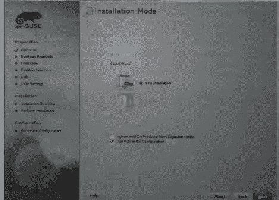

**图 5-1** openSUSE 安装向导

- 技术爱好者从不阅读任何东西的文档。自己尝试和弄清楚要有趣得多。而且，我们反正已经知道自己在做什么，对吧？
- 技术爱好者讨厌在纸上规划任何东西，尤其是硬件或软件部署。这会减少玩那些酷炫新东西的乐趣。而且，反正都在我们脑子里，对吧？
- 技术爱好者讨厌记录任何东西。当三年后某样东西出问题时，我们总会记得自己做过什么，对吧？

在部署 Linux（或任何其他系统）时，您必须克服这些倾向，并以正确的方式行事。如果您不改变您的习惯，您以后将会花大量时间修复错误。如果您坚持这样做足够长的时间，您也会花大量时间修改您的简历。


如果您在家或在实验室环境中测试系统，通常可以按技术爱好者般的方式实施 `Linux`。犯错可能没有真正的风险。事实上，这可能是一次很好的学习体验。时间允许时，我强烈推荐这样做，因为您可以真正学到很多东西。

然而，当您在组织的生产环境中部署系统时，技术爱好者般的方法是完全不可接受的。您的错误将导致系统停机。停机会给组织带来时间和金钱损失，并很可能导致您失业。

与其以杂乱无章、无序的方式部署系统，您应该在购买硬件和安装软件之前制定部署计划。这样做将帮助您防止昂贵的错误（并可能保住您的工作）。

作为一个自认的技术爱好者，我知道这个过程可能有多痛苦。当被要求部署新的 `Linux` 系统时，您的第一冲动通常是打电话给您的硬件供应商并开始订购。抵制这种冲动！相反，如果您遵循本章概述的流程，在开始订购硬件和软件之前实际上规划实施，那么对您和那些追随您脚步的人来说，生活都会美好很多。

让我给您一个我在谈论的事例。多年前，我在一家主要的网络软件供应商工作。我所在部门的一个功能小组希望实施一个新的应用程序，以便简化他们的工作。在审查系统要求时，他们发现该软件需要特定版本的 `Windows` 服务器软件，而我们目前没有。实施该应用程序首先需要安装一台新服务器。他们没有为新的服务器部署制定计划，而是完全随意行事。他们订购了一台新服务器，并自行设置软件，没有告诉任何人。

您觉得这不是什么大事？请考虑以下事实：该小组以及我所在组的所有关键数据都存储在这台服务器上。这些数据代表了数千小时的工作，价值数百万美元。我团队中没有人对此多加考虑，直到几年后我们发现公司的信息系统团队甚至不知道网络上存在这台服务器。没有人曾经对该服务器上的数据执行过一次备份。没有人给它连接了不间断电源（`UPS`）。没有人负责修补操作系统。价值数百万美元的信息完全处于无保护状态。电力线路上一个简单的电力尖峰就可能彻底摧毁我们多年来努力工作的所有内容，且无法恢复。此外，只有一个人拥有管理用户账户的密码。如果他辞职或被裁员，我们将失去对该系统的管理访问权限。

在这个故事中，故障点在哪里？没有为这台新服务器制定实施计划。如果有人规划了部署，他们会在服务器安装之前注意到这些问题并相应地加以规划。

## 本章内容概述

在本章的这一部分，我们将讨论如何规划 `Linux` 安装。将讨论以下主题：

- 进行需求评估
- 选择发行版
- 验证系统要求和硬件兼容性
- 规划文件系统
- 选择软件包
- 确定用户账户
- 收集网络信息
- 选择安装源

任何部署计划的第一步都是进行需求评估。让我们首先讨论这个主题。

### 进行需求评估

进行需求评估是制定 `Linux` 部署计划最重要的方面之一。它也是最常被跳过的一步。不幸的是，即使执行了这一步，通常也是做得不好的。

那么，需求评估究竟是什么？它是确定`为什么`要进行 `Linux` 部署、预期`什么`结果以及预期`何时`完成的过程。完成需求评估需要您摘下技术人员帽子，戴上项目经理帽子。

在这个角色中，您需要与各种不同的人会面并收集关于部署的数据。是的，这意味着您必须与碳基生命体打交道。您可以做到！我相信您！您的调查结果应记录在文字处理文档中，以便其他人轻松分发和审查。完成后，您部署计划中的需求评估部分应包含以下信息（至少包含）：

- 项目的目标是什么？您应该找出请求实施的原因。这次安装将解决什么问题？实施后的最终结果是什么？实施将实现哪些组织目标？当您列出项目目标时，务必使用清晰且可衡量的语言。

#### 案例研究

在确定目标时，务必与所有相关人员沟通。如果不这样做，你无法清晰地了解预期要求，并且很可能无法达成特定目标。让我举个例子。几年前，我受一家金融机构的委托，在其新总办事处部署一台 `Linux` 服务器，并实施所有必要的布线工作，以提供网络连接到每位员工的办公室。在进行需求评估时，我花了相当多的时间采访其中一位所有者。完成后，我觉得自己对他们的需求有了相当清晰的理解。

长话短说，我接好了办公室的线路，然后实施了 `Linux` 服务器。我对部署的顺畅感觉得很好。就在我收拾东西准备离开时，所有者走进服务器室，递给我一张 `CD`，里面包含一个流行的基于网络的财务软件应用程序。他告诉我，他的员工需要使用这款软件来完成日常工作。当我查看系统要求并发现它需要一台 `Windows` 服务器时，我吓了一跳。

我哪里做错了？我没有花时间与办公室中将会使用新服务器的员工交谈。只与一个人交谈是不够的。在最初的需求评估采访中，所有者并不知道需要这个特定的软件包。如果他知道了，我本可以在计划中考虑这个软件，并且那天晚上就能按时回家了。

- **`who`：谁是该项目的利益相关者？** 作为需求评估的一部分，你应该识别所有以某种方式受项目影响的个人。你应该提出以下问题：

  - 谁提出了新系统的需求？
  - 系统安装后谁将使用它？
  - 谁有权批准项目的资金？
  - 谁有权分配你的时间来处理该项目？
  - 在该项目开始之前，谁必须给予最终批准？
  - 项目实施后，谁将负责系统的维护和支持？
  - 新系统是否符合我们当前的技术环境和战略方向？

这些是任何项目开始前必须回答的极其关键的问题。你可能会惊讶于公司中有多少员工会试图绕过既定政策，试图让你在没有适当批准的情况下为他们做事。

不要犯这样的错误：仅仅因为有人要求你为他们工作，就假设该项目已获批准并得到资助。（相信我，这种情况经常发生。）如果你识别出项目的所有利益相关者，你可以确保在首次下单之前，该项目已获批准，并且必要的资金已得到分配。

- **`when`：何时需要该系统？** 你应该提出的关键问题是项目应在何时完成。在你为项目创建时间表之前，你需要了解你的利益相关者期望何时完成项目。

通过在需求评估中收集这些数据，你可以定义安装计划中最关键的组成部分之一：项目范围。项目范围确切地定义了做什么、何时做以及由谁来做。如果你以前管理过项目，你知道每个项目都是在以下三者之间的三方拉锯：

- 进度计划
- 资源
- 规模

这种微妙的平衡行为如图 5-2 所示。要成功管理任何项目，你必须保持这三个要素的平衡。如果进度计划过短，那么你要么增加分配给项目的资源数量，要么缩小项目的规模。例如，假设你的安装项目涉及部署 300 台 `Linux` 台式机，而你是唯一分配到该项目的资源。只要进度计划允许足够的时间，你可以完成这项任务。然而，如果进度计划规定项目必须在一周内完成，你可能需要向项目添加更多资源，减少包含在项目中的台式机数量，或者消除你吃东西和睡觉的生理需求。

我将这种关系称为“项目管理的三条腿凳子”。如果三条腿凳子上的所有腿长度不一，凳子就会失去平衡。项目管理也是如此。如果你的进度计划、规模和资源不平衡，项目可能会以某种方式失败。

在我职业生涯的大多数时间里，我都负责管理项目，这个类比在许多场合都帮了大忙。这里的问题是，你的项目发起人通常会要求你在不切实际的时间内，用太少的资源完成远超可行性的工作。

在我的职业生涯早期，我想给经理们留下深刻印象，因此我经常同意承担包含不可能参数的项目。这不是一个明智之举。无情的压力和长时间的工作会对你的健康造成极大的损害。结果，我学会了必须抵制压力，以使这三个参数达到平衡。我发现，使用如图 5-2 所示的简单图表或三条腿凳子的类比，可以是一种非常有效的工具，用来向项目发起人传达平衡的需求。

使用项目管理软件可以帮助你精确计算项目需要多长时间，这非常有帮助。使用项目管理软件，你可以将特定任务分配给特定资源并分配持续时间。此外，你还可以定义依赖关系。依赖关系用于指定哪些任务必须在其他任务开始前完成。一个带有依赖关系的项目示例如图 5-3 所示。


项目管理软件的一个巨大优点是它可以为你计算进度计划。通过输入任务和持续时间，并将它们与特定资源相关联，你可以轻松看到项目需要多长时间。你还可以调整各种参数（记住三条腿凳子）以查看影响。例如，你可以向项目中添加一个额外资源，并查看它对整体进度计划的影响。你还可以查看将工作日定为九小时而不是八小时的影响。

然而，在操纵项目时务必运用常识。我与许多项目经理共事过，当他们发现通过操纵各种参数可以大幅缩短项目进度计划时，他们会非常兴奋。然而，他们所做的调整并不现实。例如，你可以通过为所有涉及资源指定 18 小时的工作日来真正缩短项目进度计划。然而，大多数人无法长期承受这么长时间的工作。家庭生活受到影响，个人健康受损，倦怠随之而来，生产力急剧下降。简而言之，对你的进度计划进行现实检查。请记住，纸面上看起来美好的东西在现实生活中可能行不通。

随着项目范围的定义，你准备好进入项目计划的下一个组成部分了。让我们接下来讨论如何选择发行版。

### 选择发行版

正如我们书前部分所讨论的，`Linux` 有多种口味，称为发行版。你的部署计划的关键部分之一是指定将在系统中使用这些发行版中的哪一个。哪一个是最好的？这取决于你的偏好以及你希望系统做什么。以下是一些用于选择正确发行版的指南：

*系统是否作为工作站或服务器运行？* `Linux` 的一个很酷的事实是，你几乎可以将任何发行版实现为工作站或服务器。这在操作系统中是独特的。大多数操作系统被设计为要么作为服务器运行，要么作为工作站运行，但不会两者兼得。相反，大多数 `Linux` 发行版都可以用于任一角色。


然而，请注意，有一些 Linux 发行版是专门设计和优化为作为服务器运行的，而其他一些则作为工作站。例如，红帽（Red Hat）提供红帽企业 Linux（Red Hat Enterprise Linux）发行版，该版本专为中大型组织提供网络服务而设计，且服务利用率很高。

红帽还提供两个专门设计用于桌面系统的发行版：

- **`Red Hat Client`** 此发行版专为普通最终用户在完成日常工作的桌面系统上使用而设计。
- **`Red Hat Enterprise Linux Workstation`** 此发行版旨在供高端用户（如工程师或图形设计师）使用，他们需要高端桌面硬件来完成更高级的计算任务。

同样，Novell 销售两个版本的 SUSE Linux：

- **`SUSE Linux Enterprise Server`** 此发行版专为非常大型组织中的高端服务器系统使用而设计。
- **`SUSE Linux Enterprise Desktop`** 此发行版专为最终用户在其桌面工作站上使用而设计。

还有特定用途的发行版，用于使用标准 PC 硬件创建基于 Linux 的专用设备（`appliance`）。例如，你可以使用 `SmoothWall`、`IPCop` 或 `Cybero Linux` 等发行版创建强大的网络防火墙。

*发行版是否提供支持？* 一些供应商为其 Linux 发行版提供技术支持，而另一些供应商提供有限的支持或根本不提供支持。如果系统将在企业环境中使用，你应该实施一个支持良好的发行版。如果在系统安装后的某个时间点出现问题，你需要能够解决问题并尽快使系统恢复生产。你不会有时间去互联网上寻找解决方案。你需要能够立即给某人打电话得到答案。

请注意，虽然发行版本身可能是免费或近乎免费的，但你必须为技术支持付费。供应商之间支持的价格各不相同，因此货比三家是值得的。

目前行业内对同一供应商的不同 Linux 发行版之间的差异存在大量混淆。通常一个版本是免费的；另一个版本需要收费。例如，你可以购买一份红帽企业 Linux 桌面版（`Red Hat Enterprise Linux Desktop`）的副本，或者你可以免费下载一份 `Fedora` 的副本。关键差异之一是支持。如果你购买一份红帽企业 Linux 桌面版的副本，你有权获得红帽的技术支持。你付得越多，你获得的支持水平就越高。

## 验证系统要求和硬件兼容性

`SUSE Linux` 也是如此。你可以从 `Novell` 购买一份 `SUSE Linux Enterprise` 的副本，或者从 `www.opensuse.org` 下载一份免费的 `openSUSE`。同样，区别在于支持级别。如果你购买副本，就可以获得技术支持。如果你下载免费副本，则必须利用网站、论坛和新闻组来自助。

为了节省你辛苦赚来的血汗钱，本书将使用 `Fedora`、`openSUSE` 和 `Ubuntu`。然而，如果你打算在生产环境中部署 Linux，我强烈建议你购买一个受支持的 Linux 版本。

> 你所需的应用程序能在该发行版上运行吗？在选择特定发行版之前，你应该评估想要运行的软件，并验证操作系统是否支持它。

除了这些考虑因素外，你还应验证想要使用的发行版是否能在你的系统硬件上运行。让我们接下来讨论这一因素。

作为一个技术人员，你可能喜欢订购硬件。如果你的雇主买单，那就更有趣了！正因为如此，在你的 Linux 部署计划完成之前，你可能会有强烈的冲动去浏览供应商网站，以订购你的新系统。

务必抵制这种冲动！在你下载或购买 Linux 发行版之前，你需要确保它实际上能在你的硬件上运行。与我共事过的大多数系统管理员都忽视了这个流程。事实上，我也承认自己曾这样做过。这是一种糟糕的做法，你几乎可以肯定在某个时候会遭遇尴尬时刻。这是因为你可能会得到与操作系统不兼容的硬件。当这种情况发生时，你的项目进度将面临风险，很多人也不会对你感到满意。退还并重新订购硬件可能需要大量时间。如果发生这种情况，你将有幸在主管的办公室里度过美好时光，解释为什么项目会延误。

在本主题中，我们将讨论你可以做的两件事来避免这种情况发生：

- 检查硬件兼容性
- 验证系统要求

让我们从讨论硬件兼容性开始。

### 检查硬件兼容性

在 Linux 的早期，硬件兼容性是一个问题，特别是如果你试图在笔记本或拥有大量专有硬件的其他系统上安装 Linux。当时编写 Linux 驱动程序的开发者不够多。如果你在一台使用常见硬件组件的通用系统上安装 Linux，通常都能顺利安装并正确运行。然而，如果你的系统使用了非典型或专有硬件，例如高端视频卡，那么 Linux 可能无法正确运行。

当时，大多数硬件供应商不为他们的设备提供 Linux 设备驱动程序。他们不认为 Linux 是一个广泛使用的操作系统，也不愿意花时间精力为其开发设备驱动程序。相反，你不得不依赖世界某处开发者的善意，为你的特定硬件编写驱动程序。如果你的设备没有驱动程序，那就倒霉了。

如今，这个问题不太严重了。自从我在互联网上费力寻找 Linux 驱动程序以来，已经过了很长时间。大多数供应商现在都提供其硬件的 Linux 版本驱动程序。此外，大多数常见 PC 硬件的驱动程序现已包含在各个 Linux 发行版中。

然而，为了保险起见，检查你的发行版网站并验证你的系统硬件是否列在发行版的硬件兼容性列表（`HCL`）上仍然是一个非常好的主意。尽管 Linux 的硬件支持在过去十年中变得好多了，但仍有一些设备不受支持。你可以使用你的发行版的 `HCL` 来验证你的系统设备是否受支持。

`HCL` 通常出现在两个位置。首先，大多数发行版在 `DVD` 上的文本文件中包含受支持硬件的列表。然而，我很少使用 `HCL` 的这个版本。因为它是光盘上的静态文档，自光盘压制以来就不再更新。如果你计算机中的某个设备是在光盘烧录后的某个时间点发布的，你就不知道它是否受支持。

相反，我更喜欢使用大多数发行版网站上维护的 `HCL`。`HCL` 的这个版本通常包含关于受支持硬件的最新数据。例如，如果你选择在系统中安装 `openSUSE` 发行版，你可以使用 web 浏览器访问其 `HCL`，地址为 `http://en.opensuse.org/Hardware`。到达那里后，你可以搜索你特定的系统硬件，查看其是否受支持。在图 5-4 中，展示了 `openSUSE` 针对视频卡的 `HCL`。

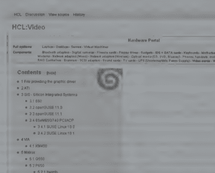

**图 5-4** 使用 `openSUSE` `HCL`

如果你选择使用 `Red Hat` 发行版，你同样可以检查 `Red Hat` 网站（`https://hardware.redhat.com`）上的 `HCL`，以验证你的系统硬件是否受支持。该网站如 图 5-5 所示。大多数发行版在其网站上包含某种 `HCL`，但并非全部。一些发行版供应商没有时间和资源进行广泛的硬件测试，以验证市场上可用的众多 PC 设备。


**注意** 驱动程序的可用性是我在生产环境中部署时倾向于坚持使用知名且受良好支持的 Linux 发行版的原因之一。当然，我会在家里或工作场所的实验室环境中尝试支持较差的发行版。如果出现任何问题，这种情况并无损失。然而，我作为生产环境中 Linux 系统管理员的关键角色之一是保护数据并确保系统以最高效率运行。在这种情况下，我需要知道我的硬件受支持。我负担不起花时间在互联网上搜索驱动程序，也不想浪费时间排查表现不规则的系统。

除了检查 `HCL` 外，你还需要检查你的发行版的系统要求。让我们接下来讨论这个问题。

### 验证系统要求

在 Linux 的早期，我们并不太担心各个发行版的系统要求。这是因为早期版本的 Linux 可以在极其简陋的硬件上运行。它们对内存、磁盘空间或处理能力的要求并不高。

然而，随着 Linux 在过去几年中的成熟，大多数发行版现在开始需要更多的宿主系统硬件以提供可接受的性能级别。你如何知道系统要求是什么？再次，检查你的发行版供应商的网站。例如，如果你访问 `www.novell.com/documentation/opensuse113`，你可以查看 `openSUSE` 的系统要求。这如 图 5-6 所示。

在制定部署计划时，务必指定所选发行版所需的硬件。

你系统要求的一个关键方面是你 PC 的 `CPU` 体系结构。下载你的 Linux 发行版时，务必为你的系统 `CPU` 选择正确的体系结构。多年来，我们并不太担心这个问题，因为我们真的只使用一种体系结构：`Intel` 的 32 位 `x86` 体系结构。尽管大多数早期发行版都有 `x86` 和 `Alpha` `CPU` 体系结构的版本，但普通系统管理员没有多少 `Alpha` 机器。我们处理的几乎每台系统都运行在 `x86` 体系结构的某个变体上。


### 硬件体系结构
然而，如今，作为系统管理员，我们有更多可用的硬件选项。我们仍然有久经考验的 `x86` 和 `Alpha` 体系结构，但我们还有较新的 64 位 `x86` 体系结构。此外，`Intel` 生产用于其 `Itanium` CPU 的 `IA-64` 体系结构。每种体系结构都需要不同版本的 `Linux`。事实上，许多 `Linux` 发行版甚至被移植以在 `Apple Computer` 的 `Power PC` (`PPC`) 体系结构上运行。其他发行版可用于 `IBM` 的 `iSeries`、`pSeries` 和 `RS/6000` 服务器。

重要的点是要确保为你的发行版选择适当的体系结构。例如，如果你选择 `Ubuntu` 作为你的发行版，并在互联网上访问该发行版的下载页面，你会看到 `图 5-7` 中显示的选项。

无论你选择哪个发行版，请确保下载适合你系统体系结构的正确版本。例如，如果你打算在 `Intel Pentium 4 524 HT` CPU 上安装 `Linux`，那么你需要你发行版的 `x86`（32位）版本。如果你的硬件使用 `AMD Phenom` CPU，那么你需要发行版的 `x86-64`（64位）版本。如果你选错了，大多数 `Linux` 安装程序会生成错误，你无法完成安装。

硬件问题解决后，你现在可以前进到你的计划的下一个组件，在那里你将指定 `Linux` 文件系统将如何配置。让我们接下来讨论这个主题。

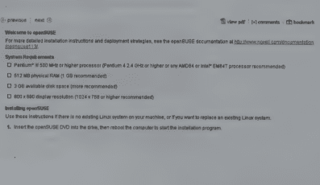

**图 5-6** `SUSE` `Linux` 系统要求

### 图 5-7 `Ubuntu` 架构
获取 `Ubuntu` 桌面版下载

您可以在线完全免费地下载 `Ubuntu` 桌面版。


## 文件系统规划

在规划 `Linux` 实现时，您需要包含关于如何在系统的硬盘驱动器上创建和维护文件系统的具体说明。这是 `Linux` 操作系统的另一个独特之处。在实施其他操作系统，如 `Microsoft` `Windows` 时，通常只创建单个磁盘分区并使用 `NTFS` 文件系统对其进行格式化。

然而，在 `Linux` 中，您拥有更多的选择。您可以自定义磁盘的分区方式以及所使用的文件系统。在本章的这一部分，我们将讨论以下内容：

- 选择文件系统
- 规划您的分区

让我们首先讨论文件系统。

## 选择文件系统

既然您是一名技术人员，您已经知道硬盘驱动器是如何工作的。驱动器由多个铝制磁盘组成，每个磁盘都有两个读写磁头，用于读取和写入数据。在进行磁盘 `I/O` 操作时，操作系统需要知道数据存储在何处、如何访问数据，以及在哪里可以安全地写入新信息。

这是文件系统的职责所在。它可靠地将数据存储在硬盘驱动器上，并以易于访问的方式对其进行组织。当您使用文件浏览器浏览硬盘驱动器上的目录并打开文件时，正是文件系统使整个过程成为可能。

大多数 `Linux` 发行版提供多种可供选择的文件系统。在本主题中，我们将回顾一些最广泛使用的类型：

- `ext2`
- `ext3`
- `Reiser`
- `ext4`

> **注意** 您还可以在 `Linux` 上使用许多其他文件系统。例如，您可以使用来自 `Silicon Graphics` 的 `XFS` 文件系统。您甚至可以使用 `VFAT` 或 `NTFS` 文件系统，尽管 `NTFS` 支持尚未完全成熟。我们将在第 10 章中讨论创建 `VFAT` 和 `XFS` 文件系统。

让我们开始讨论 `ext2` 文件系统。

#### `ext2`
`ext2` 文件系统是仍可用的最古老的 `Linux` 文件系统之一。缩写 `ext2` 代表“第二扩展文件系统”。最初于 1993 年引入，`ext2` 以大多数其他文件系统使用的标准分层方式存储数据。数据存储在`文件`中；文件存储在目录中。目录可以包含文件或子目录。

`ext2` 文件系统支持的最大文件大小为 2 太字节 (`TB`)。一个 `ext2` 卷最大可为 4`TB`。文件名最长可达 255 个字符。`ext2` 文件系统支持 `Linux` 文件系统用户、组和权限（称为 `POSIX` 权限）。它还支持文件压缩。

`ext2` 文件系统是一个非常出色的文件系统。它已经存在足够长的时间，大部分 `bug` 都已解决。事实上，它可能是有史以来使用最广泛的 `Linux` 文件系统。它也以其是可用最快的 `Linux` 文件系统而闻名。

然而，`ext2` 有一个关键弱点，导致了其他文件系统的发展。这就是 `ext2` 在系统突然关闭时需要很长时间才能恢复。在关闭 `Linux` 系统时，操作系统首先干净地卸载文件系统，确保所有待处理的文件系统事务在系统关机前写入磁盘。

问题出现在系统未执行此干净卸载程序就停止工作时。例如，假设发生停电，`Linux` 系统在没有经过正确关机程序的情况下突然关闭。当这种情况发生时，待处理的磁盘事务可能未完成。

> **提示** 您正在使用不间断电源来防止这种情况发生，对吗？如果没有，请这么做！我曾在一次停电中丢失数据，我发誓绝不让它再次发生。

为了清理文件系统，下一次系统启动时，`ext2` 文件系统将自动运行一个名为 `e2fsck` 的程序。此实用程序试图修复因系统未正确卸载磁盘而导致的任何问题。如果它发现未分配的文件或未认领的数据块，它会将此信息写入一个名为 `lost+found` 的目录。通过这样做，`ext2` 试图确保尽管发生了不当关机，数据完整性仍得到维护。

这里的问题是，当这种情况发生时，`e2fsck` 将分析整个文件系统，而不仅仅是最后几个正在修改中的文件。在一个基本的 `Linux` 系统上，这可能需要 10 到 15 分钟。在一个拥有大量文件系统数据的庞大系统（如网络文件服务器）上，此过程可能需要几个小时。系统意外停机已经够糟糕了，现在你还得等几个小时让它重新启动！

由于这个问题，其他 `Linux` 文件系统开始取代 `ext2`。其中第一个是 `ext3`。让我们接下来讨论此文件系统。

##### `ext3`
`ext3` 文件系统是 `ext2` 的更新版本。事实上，`ext3` 代表“第三扩展文件系统”。两者非常相似，大多数 `ext2` 使用的文件系统实用程序也被 `ext3` 使用。您可以轻松地将 `ext2` 文件系统升级到 `ext3`。您甚至可以将 `ext3` 文件系统降级为 `ext2`。

然而，`ext3` 文件系统提供了一个关键优势，使其比 `ext2` 更受欢迎：`日志记录`。请记住，`ext2` 的关键缺点是在系统不干净地关闭时必须检查`整个`文件系统。日志记录消除了这个问题。

在将事务提交到`硬盘驱动器`之前，`ext3` 文件系统将该事务记录到日志中并将其标记为`未完成`。在磁盘事务完成后，`ext3` 文件系统将该事务在日志中标记为`完成`。通过这样做，`ext3` 文件系统可以维护最近文件事务的日志（一个`日志`），以及这些事务是否确实已完成。

在发生停电等导致系统在没有正确卸载磁盘的情况下关机的事件中，`ext3` 文件系统在系统恢复时将重放日志。这使得文件系统能够验证磁盘上的数据，并使用日志中存储的信息将其恢复到一致状态（如果可能）。与 `ext2` 不同，`ext3` 文件系统无需检查整个文件系统。因为它在日志中拥有最近事务的日志，`ext3` 文件系统只需检查列为`未完成`的事务。

使用日志记录，在不当关机后的磁盘恢复时间比使用 `ext2` 时大大减少。`ext3` 文件系统只需几秒或几分钟即可重放日志，即使文件系统非常大，也不需要花费数小时。

`ext3` 的缺点是日志记录过程使用更多的系统内存，并略微减慢磁盘 `I/O` 操作。然而，由于它更好地确保了数据完整性并执行得更快，尽管性能略有下降，大多数系统管理员更喜欢 `ext3` 而不是 `ext2`。

## Reiser
`Reiser` 文件系统是 `ext3` 文件系统的替代方案。与 `ext3` 一样，`Reiser` 利用日志记录使崩溃恢复非常快速。然而，`Reiser` 与 `ext2` 和 `ext3` 是完全不同的文件系统，使用截然不同的内部结构。这使得 `Reiser` 文件系统支持更大的最大文件大小 8`TB` 和最大卷大小 16`TB`。此外，`Reiser` 的结构使其性能比 `ext2` 或 `ext3` 快得多。

##### `ext4`
`ext4` 文件系统于 2008 年末发布。正如您可能猜测的那样，`ext4`（第四扩展文件系统）是 `ext3` 的更新版本。就像 `ext3` 与 `ext2` 向后兼容一样，`ext4` 与 `ext3`（以及 `ext2`）向后兼容。`ext4` 文件系统支持最大 1 艾字节大小的卷和最大 16 太字节大小的文件。在一个 `ext4` 文件系统中，您可以拥有最多四十亿个文件。与 `ext2` 以及 `ext3`，文件或目录名称的最大长度为 256 字节。`Ext4` 还使用校验和来验证日志文件本身。这有助于提高系统的整体可靠性，因为日志文件是磁盘上最常使用的文件之一。如您所见，`ext4` 代表了相较于 `ext3` 和 `Reiser` 的巨大飞跃。

大多数发行版允许您在安装系统分区硬盘驱动器时选择要实施的文件系统。在到达那个阶段之前，您应该已经知道想要使用哪个文件系统。因此，在规划您的 `Linux` 实施时，您应该在部署计划中指定要使用这些文件系统中的哪一个。

那么应该使用哪种文件系统呢？这取决于您的个人偏好以及部署需求。多年来，我的选择一直是 `Reiser` 文件系统。然而，最近 `ext4` 成为了我的首选文件系统。


除了指定将使用哪种文件系统外，您还需要在部署计划中指定系统硬盘如何分区。让我们接下来谈谈这是如何完成的。

## 规划分区

*分区* 是硬盘的逻辑划分。利用硬盘内部的读写磁头，分区工具可以在磁盘盘片上创建磁性区域，将其划分为不同的部分。一个硬盘可以只有一个涵盖整个硬盘的分区，也可以有很多个分区。

在安装其他操作系统（如 `Microsoft Windows`）时，大多数人通常不太在意分区。通常会创建一个涵盖整个硬盘的单一分区。

然而，对于 `Linux` 来说，情况并非如此。在 `Linux` 系统中，至少会使用两个分区，但您可以创建更多分区。这些分区需要在系统初始安装期间定义。系统安装后更改磁盘分区是可以做到的，但这具有挑战性且耗时。因此，在开始安装过程之前，规划如何对系统硬盘进行分区是一种最佳实践。

默认情况下，大多数 `Linux` 发行版在安装过程中建议两个或三个分区，如图 5-8 所示。

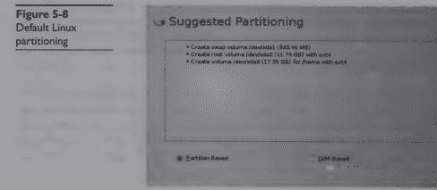

- **`swap`**：该分区供 `Linux` 操作系统用于虚拟内存。本质上，`Linux` 将像使用系统 `RAM` 一样使用交换分区中包含的硬盘空间。当系统 `RAM` 负载过重时，操作系统可以将已加载到 `RAM` 中但当前未使用的信息移动到交换分区。这被称为 *交换*（`swapping`），即将内存页移动到硬盘上预配置的交换分区的过程。

当数据再次需要时，它将从交换分区移回 `RAM`。本质上，这允许系统同时运行比其物理 `RAM` 能支持的更多的程序。

交换分区的适当大小取决于系统的使用方式。对于桌面系统，一般的经验法则是使用两倍于系统 `RAM` 大小的交换分区。这是因为桌面系统通常运行大量应用程序，这些应用程序可以轻松地交换到磁盘。例如，如果您的桌面安装了 2GB 的 `RAM`，那么应该有一个大约 4GB 大小的交换分区。对于服务器系统，实际上并不需要那么多交换空间。通常，大约与已安装 `RAM` 大小相同的交换分区就足够了。

> **提示** 在 `Linux` 中，您也可以使用 *`swap 文件`* 代替 *`swap 分区`*。我们将在本书后面讨论具体操作方法。

- **`/`**：该分区挂载在 `Linux` 文件系统的根目录（`/`）下。所有用户数据、程序、日志文件和配置文件都包含在这个单一的磁盘分区中。

尽管这是大多数 `Linux` 发行版在安装期间提出的默认分区建议，但您应该考虑创建比默认创建的两个或三个更多的分区。要了解为什么要这样做，您首先需要理解 `Linux` 使用单一的文件系统结构来表示对 `Linux` 系统可用的所有存储空间。这如图 5-9 所示。

不同的分区可以挂载在该层级结构中的不同位置。例如，在图 5-10 中，在系统中的第一个 `SATA` 硬盘驱动器（`/dev/sda`）上创建了一个额外的分区（`/dev/sda3`），它被挂载在 `/home` 目录下。

当您在 `Linux` 文件系统层级中导航并双击 `/home` 目录时，实际上您会被重定向到硬盘上的另一个分区。如果系统中有多个硬盘，甚至可以将挂载在 `/home` 的分区放在完全不同的硬盘上。对于最终用户来说，分区是完全透明的。

我鼓励您在规划 `Linux` 分区时，在硬盘上创建许多分区。这样做可以为您的 `Linux` 系统增加一定程度的容错能力。在一个分区中遇到的问题与系统中的其他分区是隔离的。例如，假设您在安装 `Linux` 时使用了默认分区建议，并将整个文件系统挂载在根目录（`/`）下。如果一个用户

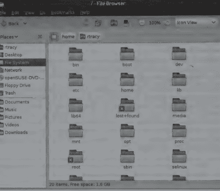

### 图 5-9 Linux 文件系统层级

通过向 `/home` 目录中的他的主目录复制巨大文件而消耗了分区上所有可用空间，这可能会导致整个系统崩溃，因为操作系统将无法再向磁盘写入关键系统文件。

另一方面，如果您为 `/home` 创建了一个单独的分区，且该用户再次通过向他的主目录复制非常大的文件而消耗了 `/home` 分区上所有可用的磁盘空间，系统仍将继续运行。包含系统文件、日志文件和应用文件的分区不会受到影响，因为问题被隔离在单个分区内。

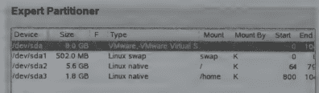

### 图 5-10 将 `/dev/sda3` 挂载在 `/home`

## 案例研究

几年前，我接到一个客户的电话，表示他们的 `Linux` 服务器没有正常工作，办公室里的任何人都无法访问他们的文件。不用说，他非常恐慌。经过调查，我发现控制系统日志轮换的配置文件存在几个错误。结果多年来没有任何系统日志文件被轮换！系统日志文件变得如此之大，以至于消耗了硬盘上所有剩余的空间。

这种情况下的问题是双重的。首先，定制日志轮换配置的人应该在走开并让它运行之前验证其是否实际有效。其次，该服务器使用了默认的磁盘分区方案，即一个交换分区和一个挂载在 `/` 下的第二个分区。如果最初的实施者为 `/var` 目录（大多数系统日志文件存储的地方）创建了一个单独的分区，故障将被隔离到该分区，用户仍然可以完成他们的工作。

在规划 `Linux` 分区时，您应该考虑为表 5-1 中列出的目录创建单独的分区。

| 挂载点 | 建议 |
| :---------- | :------------- |
| `/` | 为根目录创建分区。此分区至少应为 4GB 大小。我建议它应该大得多；以容纳在系统生命周期稍后期间将安装的软件更新。 |
| `/boot` | 为 `/boot` 目录创建分区，其中包含您的 `Linux` 系统文件。此分区不需要太多空间。通常 100~200MB 就足够了。 |
| `/home` | 为用户文件创建分区。您应该分配足够的空间以容纳用户的数据。当然，无论您为此分区分配多少空间，似乎总是不够。 |
| `/opt` | 为安装到 `/opt` 的应用文件创建分区。您应该分配足够的空间以容纳使用该目录的应用程序。 |
| `/tmp` | 为存储在 `/tmp` 中的系统临时文件创建分区。您应该为此分区分配至少 1GB 或更多。 |
| `/usr` | 为存储在 `/usr` 中的系统实用程序创建分区。您应该为此分区分配至少 5GB。根据您选择安装的软件包，可能需要分配更多。 |
| `/var` | 为存储在 `/var` 中的日志文件创建分区。因为日志文件可以变得相当大，将它们隔离在自己的分区中是个好主意。您应该为此分区分配至少 3GB 的空间。我个人会分配更多。 |

表 5-1 推荐的 `Linux` 分区

**注意** `/boot` 分区必须创建在硬盘的前 1024 个柱面内。为了安全起见，我创建此分区时，总是让它从 0 柱面开始。

使用这些推荐的分区方案将为您的系统增加一层稳定性。不幸的是，这种分区方案并不能高效地利用磁盘空间。例如，您的 `/home` 分区可能会用完空间，导致用户无法保存额外数据，尽管磁盘上的其他分区可能还有大量可用空间。然而，所增加的稳定性足以弥补这种低效率。我经常听到人们说，硬盘很便宜而数据是无价的，我相信这是真的。

一旦您规划好分区，接下来需要完成的任务是指定您想要安装到 `Linux` 系统上的软件。让我们接下来讨论如何进行这一操作。

## 选择软件包

我非常喜欢 `Linux` 的一点是它具有广泛的开源软件库。您的 `Linux` 发行版可能包含相当广泛的软件包样本，您可以指定将这些软件包与操作系统一起安装。实际上，正是这些额外软件的包含才使得您的安装集变得如此庞大。大多数发行版需要 6–8 张 `CD` 或一张完整的 `DVD` 来存储您可以安装的所有软件包。

当您第一次看到可用软件列表时，您会惊叹不已。例如，`openSUSE` 单独就提供了大约 30 种不同的游戏可供安装，如图 5-11 所示。

作为一个新手，您可能想安装几乎所有的东西。这是免费软件！但是，您不应该这样做。您会安装一些功能非常强大的软件，而您的最终用户可能并不需要访问这些软件。例如，您不希望最终用户从桌面托管自己的网站，但您却安装了 `Apache` web 服务器。此外，在这些系统上安装过量的软件可能会打开潜在的隐藏访问通道，造成安全问题。


一种更好的方法是使用您的部署计划来确定系统将要扮演的角色。（我们在本章前面已经讨论过如何执行此操作。）有了这些信息，您可以审阅发行版提供的软件包，并准确指定需要在安装中包含哪些软件包。一般的经验法则是：仅安装完成工作任务所需的软件，不再多安装。

例如，如果系统将作为提供域身份验证、文件和打印服务的网络服务器运行，您需要安装 `Samba` 和 `CUPS`（通用 `UNIX` 打印系统）软件包。如果它是一个将作为 web 和电子邮件系统的网络服务器，则您可能需要安装 `Apache`、`Tomcat`、`Postfix` 和 `IMAP` 软件包。如果系统将用作桌面系统，您可能希望安装 `OpenOffice.org`，为最终用户提供文字处理、电子表格和演示软件。

重点在于：确保您安装所需的软件包，并避免安装不需要的软件。如果在安装系统后，您确定需要额外的软件包，您可以轻松地在事后安装它们。我将在后续章节中向您展示如何执行此操作。


大多数图形化 Linux 安装程序的一个良好特性是它们会自动为您计算依赖项。依赖项是另一个软件包运行所需的一个特定软件包。大多数在 Linux 安装期间安装的软件包都会有许多与之相关的依赖项。

在 Linux 的早期，您必须手动确定哪些软件包有哪些依赖项，并确保将它们包含在安装中。随着依赖项层层叠叠，这可能变得相当混乱，如图 5-12 所示。

好消息是，大多数发行版使用的安装程序现在会自动为您计算软件包依赖项，并在安装中包含必要的依赖软件包。

完成计划的这部分内容后，您接下来需要指定将在系统上创建的用户。

## 指定用户账户

Linux 是一个真正的多用户操作系统。这意味着一个单一系统可以包含多个用户账户。实际上，多个用户可以通过网络连接同时使用同一个系统。

因此，在规划安装 Linux 系统时，您应该确定系统上所需的用户账户。大多数 Linux 发行版使用的安装工具为您提供在安装过程中创建这些账户的能力。无论使用什么发行版，您都将在安装过程中创建 `root` 用户账户和一个标准用户账户。

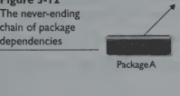


`root` 用户账户是 Linux 系统的超级用户账户。`root` 账户可以在 Linux 系统中做任何它想要做的事。`root` 用户账户功能非常强大，必须谨慎使用。坦率地说，如果您做错了事，您的系统真的会陷入混乱。由于您是以 `root` 身份登录的，系统会假设您知道自己在做什么并会允许您这样做。出于安全和安保原因，您不应该使用 `root` 账户进行日常工作。相反，您应该为这些任务创建一个标准用户账户。当确实需要超级用户权限完成任务时，您可以切换到 `root` 用户账户。任务完成后，您应该切换回标准用户账户。

当您安装 Linux 时，系统将提示您为 `root` 用户账户提供密码。您还将有机会在系统上创建额外的用户账户。在您的部署计划中，指定您计划创建哪些用户账户。与软件包一样，如果安装完成后需要添加或删除用户账户，这也不是问题。Linux 提供了一整套用于管理用户账户和密码的工具。我将在后续章节中向您展示如何执行此操作。

一旦在计划中包含这些信息，您就准备好进入下一步：收集网络信息。让我们接下来回顾如何进行此操作。

## 收集网络信息

在当今的网络化世界中，您将处理的大多数 Linux 系统都可能连接到某种类型的计算机网络。因此，在开始安装之前，您需要收集系统连接到网络所需的必要网络信息，并将其包含在部署计划中。以下是您需要回答的问题列表：

- 系统的网络配置是动态分配的，还是需要进行手动配置？

如今，大多数 IP 网络使用动态主机配置协议（`DHCP`）服务器，当工作站在网络中启动时，动态向其分配 IP 地址和各种其他网络参数。大多数将作为桌面工作站运行的 Linux 系统可能会使用此选项。如果是这种情况，您不需要对配置网络参数做太多工作。该信息将在系统每次启动时动态分配给系统。

然而，如果 Linux 系统将作为网络中的服务器运行，您不应该使用 `DHCP` 动态分配网络配置信息。如果使用 `DHCP`，系统每次启动时可能会收到不同的 IP 地址。虽然这对工作站没有影响，但它会给服务器带来大量问题。因此，网络服务器通常被分配一个不会更改的静态 IP 地址。

如果您的系统需要分配静态 IP 地址，则需要收集以下参数：

- IP 地址
- 子网掩码
- 路由器地址
- DNS 服务器地址

将分配给系统的主机名是什么？每个 Linux 系统都需要被分配一个主机名。此主机名在网络上应是唯一的，这意味着网络上的其他系统不应被分配相同的主机名。在安装过程中，系统将提示您提供主机名。

系统所在的 `DNS` 域名是什么？很可能您的组织有自己的 `DNS` 域，如 `mycorp.com`。在安装过程中，您将被要求提供组织的域名。

系统需要配置主机防火墙吗？大多数 Linux 发行版都包含一个主机防火墙，该防火墙在安装过程中默认会被启用。主机防火墙可以成为组织安全的宝贵资产。从本质上讲，基于主机的防火墙可以防止网络上的其他系统与该系统建立连接。

对于工作站系统，您应该启用此防火墙并阻止您的所有 IP 端口和服务。您也应该在服务器系统上启用主机防火墙。然而，大多数服务器系统运行的应用程序会为网络上的其他主机提供基于网络的服务。因此，您需要打开防火墙中必要的 IP 端口，以允许网络主机连接到相关服务。

如果您正在安装服务器系统，应该在部署计划中列出它将要提供的网络服务及其相关端口号。此列表将为您提供所需的信息，以便在防火墙配置中做出必要的例外。例如，如果您正在安装将作为 `web` 服务器运行的 Linux 系统，则需要在主机防火墙中打开端口 `80` 和 `443`，以允许客户端连接到在系统上运行的 `httpd` 服务。

在指定了网络配置信息后，您就准备好进入部署计划的最后一部分：选择安装源。让我们接下来讨论如何进行此操作。

## 选择安装源

大多数 Linux 发行版为您提供许多不同的选项来安装系统。这些选项包括：

- 从本地光盘安装
- 从网络服务器远程安装
- 使用 `VNC` 完成远程安装

让我们首先讨论如何从本地光盘完成安装。

## 从光盘本地安装

安装 Linux 的常见方法之一是从一套安装 `CD` 或 `DVD` 进行本地安装。使用此方法，您只需将相应的光盘插入系统的光驱，并从光盘启动系统。

对于大多数发行版，您可以直接从供应商的网站下载安装光盘镜像的副本。例如，如果您想安装 `Fedora`，可以打开网页浏览器并导航到 `http://fedora.project.org`，然后选择“下载”链接。选择您的系统架构后，您将连接到包含该发行版的互联网镜像站点，如图 5-13 所示。

大多数发行版允许您下载包含所有发行版文件的单个 `DVD` `ISO` 镜像，或者下载五个或更多单独的 `CD` `ISO` 镜像。您可以选择其中一种，但不需要两种都选。如果您使用的是快速、可靠的互联网连接，我推荐使用 `DVD` 选项。您只需下载单个文件，并且在安装过程中无需更换光盘。当我执行 Linux 部署时，我经常需要同时安装多台系统。我希望能够启动安装后离开系统，转而处理其他系统。我不希望被迫照看安装过程，在多台中不断更换光盘。

请注意，图 5-13 中显示的文件扩展名为 `.iso`。这些被称为 `ISO` 镜像。下载好相应的 `.iso` 文件或文件后，您可以使用 `CD` 或 `DVD` 刻录软件将 `ISO` 镜像刻录到实体 `CD` 或 `DVD` 上。大多数光盘刻录软件都支持将 `ISO` 镜像刻录到光盘。请查阅您的文档，了解如何在您的特定软件包中执行此操作。

> **注意** 从互联网下载非常大的 `ISO` 文件后，建议检查 `md5sum` 校验值，以确保其完整无损。我们将在后续章节中讨论如何执行此操作。

> 如果您要在 `VMware` 虚拟机中安装 Linux，则无需将 `ISO` 镜像刻录到光盘。相反，您可以配置虚拟机直接连接 `ISO` 镜像本身。虚拟机将认为该镜像是实际的 `CD` 或 `DVD`，并从中进行安装。使用此方法安装 Linux 会快得多，因为数据存储在硬盘上而不是光盘上，访问速度更快。

除了从光盘安装外，您还可以通过网络连接远程安装 Linux。接下来我们将讨论如何实现这一点。


图 5-13 下载 `ISO` 镜像

## 从网络服务器安装

安装 Linux 系统的另一个不错选择是从网络服务器安装。您可以从配置为安装源的 Linux 服务器进行安装，该服务器使用 `SMB`、`NFS`、`HTTP` 或 `FTP` 协议。您甚至可以直接从互联网上的 `FTP` 或 `HTTP` 服务器进行安装。

> **注意** 并非所有 Linux 发行版都支持基于网络的安装。

执行 Linux 网络安装的关键优势在于，您可以同时安装大量系统，而无需为每个系统刻录一张 `DVD`。这种方法的缺点是，安装通常比 `DVD` 安装运行得更慢。通过互联网进行的安装可能非常缓慢。

要完成网络安装，您必须首先完成几个准备工作。首先，如果您打算从本地服务器通过网络进行安装，您需要将 Linux 安装文件从 `DVD` 复制到服务器上的目录中。或者，您也可以将 `DVD` 挂载到网络客户端可以访问的文件系统中。然后，您需要选择用于访问这些文件的协议。例如，如果您想使用 `SMB` 协议访问安装文件，则必须在服务器上安装并配置 `Samba` 服务。完成后，您必须为存放安装文件的目录创建一个共享。您也可以配置服务器上的 `HTTP`、`NFS` 或 `FTP` 服务来完成相同任务。

一旦安装源服务器设置完毕，下一步您需要下载基本安装 `CD` 镜像。例如，如果您想完成 `SUSE` Linux 的网络安装，您将使用浏览器导航到 `http://en.opensuse.org` 并选择“下载”链接。在显示的页面上，您可以下载网络引导镜像，如图 5-14 所示。

您需要将此镜像刻录到磁盘，然后从该磁盘启动系统。在这里，我们将查看如何使用 `openSUSE` 执行此操作。大多数其他支持网络安装的发行版也将使用类似的过程。


> **提示** 如果您正在安装 Fedora 系统，您可以从安装 DVD 的 `/images` 目录中适当的镜像文件刻录网络光盘，并从中启动系统。然后，您可以选择备用安装源。

在第一个安装屏幕上，按 `F4` 键指定安装源，如图 5-15 所示。


图 5-14 下载网络引导镜像

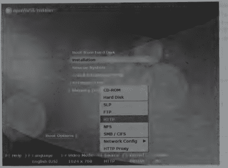

**图 5-15** 选择安装源

如果您选择 `SMB/CIFS`，必须指定安装服务器地址、存放安装文件的共享和目录名称、域名名称，以及具有访问该共享权限的用户的用户名和密码。这如图 5-16 所示。

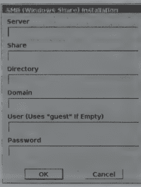

**图 5-16** 使用 `SMB` 协议配置网络安装

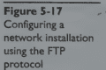

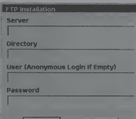

如果您选择 `FTP`，必须指定安装服务器的 `IP` 地址或 `DNS` 名称、存放安装文件的目录，以及授权访问远程服务器上 `FTP` 服务的用户名和密码。远程服务器可以是本地网络上的服务器，也可以是互联网上的 `FTP` 服务器。请查看您的发行版网站，获取基于 `FTP` 的网络安装存储库的列表。`FTP` 安装服务器配置界面如图 5-17 所示。

如果您选择 `HTTP`，必须指定安装服务器的 `URL` 以及远程服务器上存放安装文件的目录。与 `FTP` 安装类似，`HTTP` 安装服务器可以位于本地网络上，也可以位于互联网上的某个位置。请查看您的发行版网站，获取基于 `HTTP` 的网络安装存储库的列表。在图 5-18 中，安装程序已配置为通过互联网从 `SUSE HTTP` 服务器执行安装。

如果您选择 `NFS`，必须指定安装服务器的 `IP` 地址或 `DNS` 名称以及远程服务器上存放安装文件的目录。这如图 5-19 所示。

选定安装源后，从主菜单中选择“安装”，安装程序将使用远程服务器上的安装文件继续安装过程。

您还可以使用 `VNC` 连接完成安装。接下来我们将回顾其操作方法。

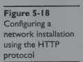

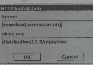

**图 5-19** 使用 `NFS` 协议配置网络安装

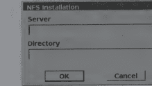

## 使用 VNC 完成远程安装

`VNC` 代表虚拟网络计算（Virtual Network Computing）。基本上，`VNC` 允许您将视频输出从一个系统重定向到另一个系统。使用 `VNC` 协议，您可以在目标系统上启动安装，然后使用另一台系统上的网页浏览器或 `VNC` 客户端软件查看安装屏幕。

在 `openSUSE` 系统上，您可以在第一个安装屏幕的“启动选项”字段中输入 `vnc=1`，如图 5-20 所示。

启动安装后，系统会提示您提供创建 `VNC` 连接所需的各种网络参数。安装系统加载后，屏幕上将显示您可以用来访问该系统的 `IP` 地址。您可以使用网页浏览器或 `VNC` 客户端软件远程访问安装屏幕。例如，您可以在另一台系统上打开网页浏览器并导航到 `http://IP_address_of_system:5801`。如果我在初始 `VNC` 配置屏幕中为系统分配了 `IP` 地址 `192.168.1.126`，我可以通过在浏览器中打开 `http://192.168.1.126:5801` 来访问它，如图 5-21 所示。

您也可以使用 `VNC` 客户端软件访问安装过程。大多数 `Linux` 发行版都包含用于连接 `VNC` 服务器的 `vncviewer` 实用程序。同样，在 `Windows` 系统上，您可以使用 `RealVNC` 的 `VNC Viewer`。使用 `VNC` 查看器实用程序时，您需要指定正在安装系统的 `IP` 地址以及要访问的显示编号——例如，`192.168.1.126:1`。

使用此 `VNC` 连接，您可以舒适地坐在自己的办公室里完成安装过程。

**图 5-20** 配置 `VNC` 安装

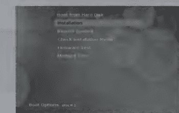

# 第 5 章：安装 Linux

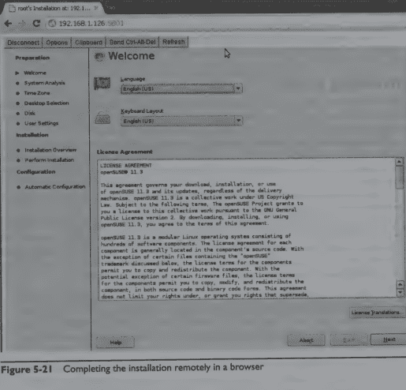

对于您的部署计划，您需要确定将使用哪个安装源，并视情况准备先决条件系统。

完成此步骤后，您的 `Linux` 部署计划即告完成。此时，您应该已经拥有了以有条理、高效且可衡量的方式完成安装所需的数据。一旦安装完成，请将您的部署计划归档到安全的地方。这些信息对于日后可能需要维护您系统的其他系统管理员来说，将是无价之宝。

在我的工作中，我以合同工身份为许多不同的公司服务。当他们遇到问题时，他们会打电话给我，我则前往现场修复他们的系统。大多数情况下，这对所有相关人员都有利。然而，时不时地，我不得不前往一家未记录其网络或计算机系统的公司现场。这可能是一段极其令人沮丧的经历。作为一名顾问，我不知道系统是如何设置的，也不知道它为什么被配置成那样。对最初的实施者显而易见的东西，对稍后在系统上工作的其他人来说却一点也不明显。本应花费两到三小时完成的工作结果却花了两到三天。这给我的客户造成了大量的额外费用，并极大地增加了我的血压。

至此，您已经准备好订购硬件、下载发行版并实际开始安装 `Linux` 系统了。接下来让我们回顾一下操作方法。

## 安装 Linux

终于到了开始安装 `Linux` 系统的时候了！在花了数小时制定 `Linux` 部署计划后，大多数技术人员在终于拿到新软件并开始安装时会松了一口气。这是我们生活的意义所在！

在安装新系统时，我强烈建议您设置一个隔离的实验室环境并在那里安装系统。这将让您有机会观察系统，并确保在让用户使用之前，一切运行正常。

一旦您确定一切工作正常，就可以将它们从实验室环境移动到用户的生产环境中。

正如我在本章开头提到的，`Linux` 发行版种类繁多，无法将它们全部纳入 `LPIC-1/CompTIA Linux+` 考试或本章中。在本章中，我们将回顾如何安装 `openSUSE 11.3`。为了完成此练习，我强烈建议您选择以下选项之一：

- 准备一台可供您实验的实验室系统。该系统应不包含重要数据。本章的练习要求您将硬盘格式化并在其上安装 `Linux`。如果没有先备份重要数据，切勿执行此操作！否则，数据将永远丢失。

- 从 `www.vmware.com` 下载 `VMware Workstation` 的副本。这将允许您在现有的 `Linux` 或 `Windows` 系统之上安装多个虚拟 `Linux` 系统，而无需重新划分硬盘。`VMware Workstation` 提供 30 天的免费评估期，但如果其价格在那之后过高，您也可以下载 `VMware Server` 的副本。此版本的 `VMware` 是免费的。虽然它未获官方支持用于非服务器系统，但我已成功地在许多此类系统上使用过它。

一旦您准备好了一台可以安装 `Linux` 的系统，您就可以开始了。让我们从讨论如何安装 `SUSE Linux` 开始。

### 练习 5-1：安装 Linux 系统


**视频** 欲了解更多信息，请观看练习 5-1。

在本练习中，我们将安装一个 `openSUSE` 工作站。在此书撰写时，`SUSE Linux 11.3` 是当时可用的最新版本。当您阅读本书时，可能已发布了更新版本，因此您可能需要调整此处介绍的步骤以适应更新的软件。

要完成这些练习，您需要一台物理系统或一台在 `VMware Workstation` 中运行的虚拟机，且满足以下要求：

- **CPU** `Pentium III 500 MHz` 或更快的处理器（建议 `Pentium 4 2.4 GHz` 或更高，或任何 `AMD/64` 或 `Intel EM64T` 处理器）

- **内存** `512MB` 内存（建议 `1GB`）

- **硬盘** `16GB` 或更大

- **光盘驱动器** `DVD`

- **显示** `800 × 600` 显示分辨率（建议 `1024 × 768` 或更高）

- **鼠标和键盘**

- **声卡**（可选）

- **网卡**（可选但强烈建议）


> **注意** 如果系统已安装操作系统，请在安装前务必备份任何重要数据！

1. 在一台带有 `DVD` 光驱的工作站上，打开网页浏览器并导航至 `www.opensuse.org/`，选择“获取它”。

2. 按照网页上的说明下载适合您 `CPU` 架构的最新 `SUSE Linux` 发行版。

3. 使用您的刻录软件，将您的映像文件刻录到光盘上。请遵循刻录软件文档中关于刻录 `ISO` 映像的说明。

4. 将您的安装 `DVD` 插入目标系统的光驱。


5. 配置目标系统，使其首先从 CD/DVD 驱动器启动。

   a. 启动目标系统并访问 CMOS 设置程序。您的启动屏幕应显示一条消息，指示访问设置程序所需的按键。
   b. 使用您的 CMOS 设置程序配置系统，使其首先从光驱启动。
   c. 保存您的更改并重启系统。计算机现在应从 SUSE Linux 安装光盘启动。屏幕上将显示图 5-22 所示的画面。

6. 选择“安装”。等待 YaST 安装程序启动。

7. 在“语言”屏幕中，选择您的 `语言`。

8. 阅读许可协议；然后选择 `下一步`。

9. 确认已标记 `新安装`。

**图 5-22**

启动 SUSE Linux 安装

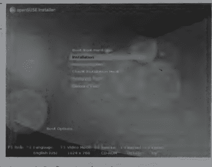

10. `取消选中“使用自动配置”`；然后选择 `下一步`。

11. 在 `时钟和时区` 屏幕中，选择您的 `区域` 和您的 `时区`。

12. `取消选中“硬件时钟设置为 UTC”`（因为您的硬件时钟可能不是 UTC）。

13. 如果屏幕右下角显示的当前日期和时间不正确，请选择 `更改` 并进行必要的调整；然后选择 `应用`。

14. 选择 `下一步`。将显示桌面选择屏幕，如图 5-23 所示。

**图 5-23**

选择您的桌面

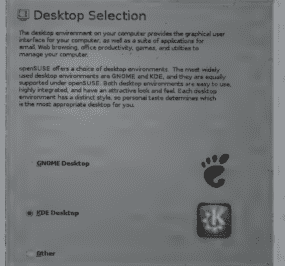

15. 在桌面选择屏幕中，选择 `GNOME` 桌面。如果您不喜欢使用 `GNOME`，还可以从以下桌面选项中选择：

    - `KDE` `KDE` 是一个类似于 `GNOME` 的图形桌面环境。
    - `其他` 此选项允许您配置一个最小化图形系统或仅文本系统。

16. 选择 `下一步`。

17. 通过完成以下步骤来自定义您的磁盘分区：

    a. 选择 `创建分区设置`。
    b. 选择 `自定义分区`；然后选择 `下一步`。将显示专家分区器屏幕，如图 5-24 所示。
    c. 在系统视图下的设备列表中浏览并选择您的硬盘驱动器。注意，`Linux` 将系统中的第一个硬盘称为 `/dev/sda`。如果您有两个硬盘，第二个将被标记为 `/dev/sdb`。
    d. 选择 `添加`。
    e. 选择 `主分区`；然后选择 `下一步`。
    f. 标记 `自定义大小`。
    g. 在 `大小` 字段中，输入 `100 MB`；然后选择 `下一步`。

**图 5-24** 自定义分区方案

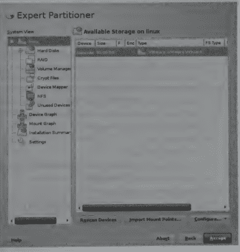

h. 确认已选中 `Format Partition`（格式化分区），并且 `File System`（文件系统）下拉列表已设置为 `Ext4`。
i. 在 `Mount Point`（挂载点）下拉列表中，选择 `/boot`。
j. 选择 `Finish`（完成）。新创建的分区应该会显示出来。新分区应标记为 `/dev/sda1`，这表明它是第一块硬盘上的第一个分区。
k. 选择 `Add`（添加）。
l. 选择 `Primary Partition`（主分区）；然后选择 `Next`（下一步）。
m. 在 `Size`（大小）字段中，输入等于系统已安装内存（`RAM`）容量两倍的数值。例如，如果你安装了 `1 GB` 的内存，则应输入 `2 GB`。
n. 选择 `Next`（下一步）。
o. 在 `File System`（文件系统）下拉列表中，选择 `Swap`（交换分区）。
p. 选择 `Finish`（完成）。
q. 选择 `Add | Primary Partition`（添加 | 主分区）；然后选择 `Next`（下一步）。
r. 在 `Size`（大小）字段中，输入 `8 GB`；然后选择 `Next`（下一步）。
s. 在 `Mount Point`（挂载点）下拉列表中，选择 `/`。
t. 确认已选中 `Format Partition`（格式化分区），并且 `File System`（文件系统）下拉列表已设置为 `Ext4`；然后选择 `Finish`（完成）。你应该会看到类似图 5-25 所示的分区列表。
u. 选择 `Add | Primary Partition`（添加 | 主分区）；然后选择 `Next`（下一步）。
v. 在 `Size`（大小）字段中，输入 `3 GB`；然后选择 `Next`（下一步）。
w. 在 `Mount Point`（挂载点）下拉列表中，选择 `/var`。
x. 确认已标记 `Format Partition`（格式化分区），并且 `File System`（文件系统）下拉列表已设置为 `Ext4`；然后选择 `Finish`（完成）。此时，你应该会看到一个与图 5-25 类似的分区列表。
y. 选择 `Accept | Next`（接受 | 下一步）。将显示 `Create New User`（创建新用户）屏幕。

18. 在 `Create New User`（创建新用户）屏幕中，输入以下内容：

- 用户全名：`Tux Penguin`
- 用户名：`tux`
- 密码：`M31inux273`
- 将此密码用作系统管理员密码：已选中
- 接收系统邮件：未选中
- 自动登录：未选中

19. 选择 `Next`（下一步）。可能会收到警告称密码过于简单。没关系，请继续使用此密码。对于实验系统来说，它的安全性已经足够了。

**图 5-25**

对硬盘进行分区

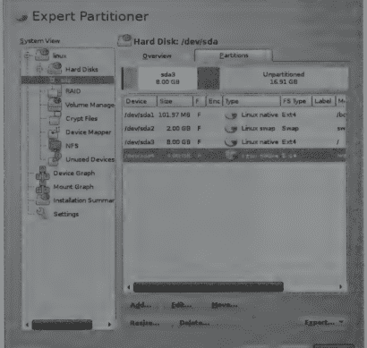

20. 通过完成以下操作来自定义将安装的软件包：

- a. 选择 `Software`（软件）。
- b. 在 `Development`（开发）下，勾选 `C/C++ Development`（`C/C++` 开发）。这将安装我们稍后在本书中使用的 `gcc` 编译器。
- c. 选择 `Details`（详细信息）。
- d. 在左列中，高亮显示 `Games`（游戏）。
- e. 在右列中，选择 `csmash`。
- f. 选择 `Accept`（接受）。
- g. 在 `Changed Packages`（已更改的软件包）屏幕中，选择 `Continue`（继续）。

21. 在 `Installation Settings`（安装设置）屏幕中，选择 `Install`（安装）。

22. 当提示确认安装时，选择 `Install`（安装）。此时，你可以休息一下，放松身心，等待 `Linux` 安装完成。安装程序会显示一个进度计，让你能够跟踪安装过程的进度，如图 5-26 所示。


23. 软件包复制完成后，系统将重启，并显示 `Hostname and Domain Name`（主机名和域名）屏幕。

24. 在 `Hostname`（主机名）字段中，输入主机名 `ws1`。

25. 在 `Domain Name`（域名）字段中，输入你所在组织的 `域名`。

26. 取消选中 `Change Hostname via DHCP`（通过 `DHCP` 更改主机名），然后选择 `Next`（下一步）。将显示 `Network Configuration`（网络配置）屏幕。

27. 在 `Firewall`（防火墙）下，选择 `Open`（开放）以解除 `SSH` 端口的阻塞。我们将在后续章节中需要打开 `SSH` 端口。

28. 查看 `Network Configuration`（网络配置）屏幕中显示的其他信息；然后选择 `Next`（下一步）。我们将在后续章节中花更多时间处理网络配置。

> **注意** 此处假设你的系统已连接到网络，并且你的网络上有一个 `DHCP` 服务器正在运行。

29. 当提示测试互联网连接时，如果你的系统通过 `LAN` 或以太网/`DSL` 调制解调器连接到互联网，请选择 `Yes`（是）；否则，请选择 `No`（否）。

30. 选择 `Next`（下一步）。

31. 当显示测试结果时，选择 `Next`（下一步）。如果你的网络连接配置正确，最新的发行说明将下载到你的新系统中。

32. 查看发行说明；然后选择 `Next`（下一步）。将显示硬件配置屏幕。

33. 我们将在本书后续部分讨论如何配置系统硬件。现在，只需选择 `Next`（下一步）。等待系统配置完成。

34. 在 `Installation Completed`（安装完成）屏幕中，选择 `Finish`（完成）。系统将重新启动。

35. 当系统完成重启后，你将看到登录屏幕。使用密码 `M31inux273` 以用户 `tux` 的身份进行身份验证。


如果你选择使用 `VMware` 安装 `Linux` 系统，你需要安装名为 `VMware Tools` 的服务。该服务可优化视频、键盘和鼠标以在虚拟机中正常工作。打开网络浏览器并导航至 `www.vmware.com/support` 以查看关于如何执行此操作的最新说明。你也可以使用 `VMware` 中的“帮助”菜单查看说明。

恭喜！你现在拥有一个正在运行的 `Linux` 系统。随着我们继续本书的其余部分，你将学习如何配置和管理该系统。

## 配置区域设置

当你安装 `Linux` 系统时，通常会在安装过程中配置系统的区域设置（`locale`）。系统的区域设置决定了：

- 屏幕上显示文本的语言和编码
- 你的字符类别
- 默认排序顺序
- 默认数字格式
- 默认货币格式
- 日期和时间的显示方式

你的区域设置由分配给以下环境变量的值决定：

- `LC_CTYPE` 配置默认的字符类型和编码。
- `LC_MESSAGES` 配置自然语言消息。
- `LC_COLLATE` 配置你的排序规则。
- `LC_NUMERIC` 配置你的数字格式。
- `LC_MONETARY` 配置你的货币格式。
- `LC_TIME` 配置日期和时间显示。
- `LC_PAPER` 配置默认纸张大小。
- `LC_NAME` 配置默认个人姓名格式。
- `LC_ADDRESS` 配置默认地址格式。
- `LC_TELEPHONE` 配置默认电话号码格式。
- `LC_MEASUREMENT` 配置默认计量单位。
- `LC_ALL` 覆盖所有其他 `LC` 环境变量。
- `LANG` 指定所有 `LC_` 变量的默认区域设置值。
- `LANGUAGE` 覆盖 `LC_MESSAGES`。

可以使用以下语法为 `LC_CTYPE` 区域设置变量分配区域设置值：`language_territory.codeset@modifier`。此语法使用这些值：

- `language` 指定要使用的 ISO 639 语言代码（指定为小写）。
- `territory` 指定要使用的 ISO 3166 国家/地区代码（指定为大写）。
- `codeset` 指定要使用的字符集。
- `modifier` 指定其他区域设置属性，如方言或货币。

考虑以下示例：

- `en_US` 美国英语的语言和地区
- `en_CA` 加拿大英语的语言和地区
- `fr_CA` 加拿大法语的语言和地区

你也可以在区域设置中指定编码。例如，你可以使用 `en_US.UTF-8` 来配置使用 `UTF-8` 字符编码（也称为 `Unicode` 编码）的美国英语默认区域设置。

安装 `Linux` 系统时，你的区域设置是根据你在安装过程中的选择自动为你定义的。要在 shell 提示符下查看它们，你可以使用 `echo` 命令。以下是一个示例：

```
ws1:~ $ echo $LC_CTYPE
en_US.UTF-8
ws1:~ $
```

正如在这个例子中看到的，`LC_CTYPE` 变量在此系统安装期间已被填充。此变量定义了系统上使用的默认字符类型和编码。可以看到，此系统使用带有 `Unicode` 文本编码的美国英语区域设置。

顺便说一句，你还可以使用名为 `C` 的区域设置。如果你在 shell 提示符下创建大量 shell 脚本，这个区域设置非常有用。它配置了以下默认区域设置：

- `ASCII` 编码
- `POSIX` 字符类
- 美国英语的时间、日期、数字和货币格式

如果出于某种原因，你需要将 `Linux` 系统本地化为安装时配置的非默认区域设置，你只需更改相应环境变量的值。通常，所有这些变量都将设置为相同的值（或者使用 `LC_ALL` 或 `LANG` 变量来指定所有变量的默认区域设置）。但是，如有必要，你也可以将它们独立设置为不同的值。

然而，如果你这样做，请注意并非所有 `LC_` 变量都具有相同的优先级。`Linux` 使用以下规则来确定使用哪个区域设置：

1. 如果定义了 `LC_ALL` 变量，则使用其值，并且不会检查分配给所有其他 `LC` 变量的值。
2. 如果 `LC_ALL` 未定义，则检查相关的特定 `LC` 变量。如果该特定 `LC` 变量有值，则使用该值。
3. 如果相关的 `LC` 变量的值为空，则使用 `LANG` 环境变量。

如果你希望所有 `LC` 变量使用相同的值，你可以设置 `LC_ALL` 变量，从而无需设置每个单独的变量。但是，如果你希望为 `LC` 变量使用不同的值，则必须先将 `LC_ALL` 设置为空值。实际上，许多发行版正是出于这个原因而保持 `LC_ALL` 未定义。相反，它们设置 `LC_CTYPE` 的值来定义默认编码，并设置 `LANG` 的值为你的其他 `LC_` 变量提供默认值。但是，由于 `LANG` 的优先级排第三，你可以手动设置某个 `LC_` 变量的值而不影响其他 `LC_` 变量。

要查看你当前的所有区域设置，请在 shell 提示符下输入 `/usr/bin/locale` 命令。以下是一个示例：

```
wsl:~ # locale
LANG=POSIX
LC_CTYPE=es_UN.UTF-8
LC_NUMERIC="POSIX"
LC_TIME="POSIX"
LC_COLLATE="POSIX"
LC_MONETARY="POSIX"
LC_MESSAGES="POSIX"
LC_PAPER="POSIX"
LC_NAME="POSIX"
LC_ADDRESS="POSIX"
LC_TELEPHONE="POSIX"
LC_MEASUREMENT="POSIX"
LC_IDENTIFICATION="POSIX"
LC_ALL=
wsl:~ #
```

在此示例中，实际上只有 `LANG` 和 `LC_CTYPE` 变量被定义了。其他 `LC_` 变量会自动填充为分配给 `LANG` 的值。你还可以在 Shell 提示符下输入 `local charmap` 以查看所使用的编码类型。例如：

```bash
ws1:~$ local charmap
UTF-8
ws1:~$
```

如果你需要通过更改区域设置（`locale`）或编码来本地化系统，首先必须确定你的系统上已安装了哪些区域设置。为此，请使用 `locale` 命令的 `-a` 选项来生成所有可用区域设置的列表。你还可以使用 `locale` 命令的 `-m` 选项来查看可用编码的列表。示例如下：

```bash
ws1:~$ locale -a
C
POSIX
aa_DJ
aa_DJ.utf8
aa_ER
aa_ER.utf8
...
ws1:~$ locale -m
ANSI_X3.110-1983
ANSI_X3.4-1968
ARMSCII-8
...
```

请注意，如果你更改系统使用的编码，且某些文件是使用不同的编码创建的，你可能在正确查看这些文件时遇到问题。你可以在 Shell 提示符下使用 `iconv` 命令将编码从一种编码转换为新编码。其语法为：`iconv -f source_encoding -t destination_encoding -o output_filename input_filename`

除了配置 `Linux` 系统的区域设置外，你可能还需要配置系统的时间区设置。让我们接下来看看这是如何完成的。

### 配置时区设置

如果将 `Linux` 系统移动到不同的物理位置，你可能需要同时配置时区设置和局部设置。这看似简单，但 `Linux` 系统上的时间管理方式与你可能熟悉的其它操作系统不同。在本章的这一部分，我们将回顾以下主题：

- `Linux` 上时间的工作原理
- 配置时区

### Linux 上时间的工作原理

在管理 `Linux` 时区之前，你需要了解 `Linux` 上时间是如何工作的。首先需要理解的是，`Linux` 系统中有两个主要时钟：

- **硬件时钟** 该时钟始终独立运行，即使系统关机也是如此。硬件时钟有多种称呼，包括实时时钟（`RTC`）或 `BIOS`/`CMOS` 时钟。


**提示** 你可以在 Shell 提示符下使用 `hwclock` 命令来设置硬件时钟中的时间。

- **系统时间** 该时钟通过 `Linux` 内核内部的软件运行。它由 `ISA` 定时器中断驱动。系统时间被测量为自 1970 年 1 月 1 日 `00:00:00 UTC` 以来经过的秒数。

需要牢记的关键点是，硬件时钟和系统时间可能并不相同。在管理 `Linux` 系统时，我们更关注系统时间，而不是硬件时钟报告的时间。硬件时钟的作用非常基础，它的任务是在系统关机时保持时间记录。系统时间会在 `Linux` 操作系统启动时与硬件时钟时间进行同步。启动后，`Linux` 仅使用系统时间，而忽略硬件时钟。在设置硬件时钟时间时，你应该将其设置为以下其中之一：


## 协调世界时 (UTC)
UTC 是世界协调时间的标准。UTC 是英国伦敦格林尼治皇家天文台的当前平太阳时。因此，UTC 也被称为`格林尼治标准时间`（GMT）。你的本地时间是通过从 UTC 加上或减去每个时区差一小时或零来确定的。例如，我居住的地方距离格林尼治七个时区，所以我的时间是 UTC –7。因此，当我本地时间是上午 10:58 时，UTC 时间是下午 5:58。如果你的硬件时钟设置为 UTC 而非本地时间，你需要将`/etc/sysconfig/clock`文件中的`HWCLOCK`指令设置为`–u`。你的 Linux 系统将根据你的本地时区自动计算夏令时偏移量。


**注意** 对于 Linux 系统，实际上建议你将硬件时钟设置为 UTC 而非本地时间。

## 本地时间
在大多数你会遇到的系统中，硬件时钟默认设置为本地时间。如果情况如此，`/etc/sysconfig/clock`文件中的`HWCLOCK`指令将被设置为`–localtime`。

在处理 Linux 系统时，将硬件时钟设置为 UTC 是首选选项。使用 UTC 使计算时区差异变得更加容易。事实上，如果你在 Linux 系统上安装某些群件应用程序，可能会要求你将硬件时钟设置为 UTC，因为这便于在位于不同时区的众多计算机之间协调时间戳。

### 配置时区
在初始安装 Linux 系统时，系统会提示你指定系统所在的时区。在某些发行版（如 Ubuntu）中，你指定的时区保存在`/etc/timezone`文件中。你可以在 Shell 提示符下使用`cat`命令显示该文件的内容，以查看系统的当前时区。例如：

```bash
tracy@ws1:~$ cat /etc/timezone
America/Denver
```

其他发行版（如 openSUSE）则将此信息保存在`/etc/sysconfig/clock`文件中。该文件中的`TIMEZONE=`指令用于配置要使用的区域文件，如下所示：

```bash
TIMEZONE="America/Boise"
```

你也可以通过在 Shell 提示符下输入`date`来查看当前时区，如下所示：

```bash
ws1:~ # date
Wed Feb  9 11:40:05 MST 2011
ws1:~ #
```

如果需要在安装后更改时区，你可以在 Shell 提示符下使用`tzselect`或`tzconfig`命令。基于 Debian 的发行版使用`tzconfig`命令，而其他发行版（如 openSUSE 和 Fedora）使用`tzselect`命令。此命令必须以 root 用户身份运行。示例如下：

```bash
ws1:~ # tzselect
Please identify a location so that time zone rules can be set correctly.
Please select a continent or ocean.
1) Africa
2) Americas
3) Antarctica
4) Arctic Ocean
5) Asia
6) Atlantic Ocean
7) Australia
8) Europe
9) Indian Ocean
10) Pacific Ocean
11) none - I want to specify the time zone using the Posix TZ format.
```

`tzselect`命令首先显示大陆和海洋列表。请输入你想要切换到的时区所在地区的相应数字。输入后，将显示该地区国家的列表。请输入系统所在国家的数字；然后输入相应时区的数字。系统会提示你确认时区更改，如以下示例所示：

```bash
The following information has been given:
    United States
    Mountain Time

Therefore TZ='America/Denver' will be used.
Local time is now:  Wed Feb  9 11:50:10 MST 2011.
```

Universal Time is now: Wed Feb 9 18:50:10 UTC 2011.

- 1) Yes
- 2) No
- #?

如果更改正确，请输入 1 进行确认。注意，在上述示例中，`tzselect`通过设置`TZ`环境变量的值来切换时区。实际上，你可以在不使用`tzselect`的情况下，通过设置`TZ`环境变量的值并将其导出，从 Shell 提示符下更改时区。这在以下情况下非常有用：你没有系统的 root 密码，或者你想为你的账户使用不同的时区，而不改变其他用户使用的时区。语法为`export TZ=time_zone`。可用时区的列表可以在`/usr/share/zoneinfo/`目录中找到，如下所示：

```bash
ws1:~ # ls /usr/share/zoneinfo/
Africa        Canada        Factory       Iceland     MST7MDT     Portugal    Zulu
America       Chile         GB            Indian      Mexico      ROK         iso3166.tab
Antarctica    Cuba          GB-Eire       Iran        Mideast     Singapore   posix
Arctic        EET           GMT           Israel      NZ          Turkey      posixrules
Asia          EST           GMT+0         Jamaica     NZ-CHAT     UCT         right
Atlantic      EST5EDT       GMT-0         Japan       Navajo      US          zone.tab
Australia     Egypt         GMT0          Kwajalein   PRC         UTC
Brazil        Eire          Greenwich     Libya       PST8PDT     Universal
CET           Etc           HST           MET         Pacific     W-SU
CST6CDT       Europe        Hongkong      MST         Poland      WET
ws1:~ #
```

请注意，此更改不是持久的。如果你重启系统，时区更改将会丢失。你可以将以下行添加到用户主目录中的`.profile`文件，使时区更改对你的用户账户保持持久化：

```bash
export TZ='America/Denver'
```

你还可以使用`/etc/localtime`文件以及我们在前面看过的`/usr/share/zoneinfo`中的各种区域文件来更改时区。为此，请从`/etc/localtime`创建一个指向`/usr/share/zoneinfo`中相应时区文件的符号链接。例如，如果你想切换到美国的山区标准时间（MST）时区，你将在 Shell 提示符下输入`ln -sf /usr/share/zoneinfo/MST /etc/localtime`。

> **注意** 常用的文本编码包括`iso8859`（也称为 Latin-9 编码），它专为西欧语言设计；`ASCII`，使用基于英语的字符编码方案；以及`Unicode`，它旨在处理来自世界各地语言的字符集。


### 章节复习
在本章中，我强调了在实施新的 Linux 系统时创建部署计划的重要性。该计划中的第一个组件是进行需求评估。在进行需求评估时，你应首先确定项目目标并识别利益相关者。在实际启动项目之前，你应获得所有相关方的批准。你应该利用需求评估中收集的信息来制定项目范围，确切地说明

项目范围包括项目时间表、分配给项目的资源以及需要完成的任务范围。我指出，任何项目都涉及在进度、资源和规模三者之间进行三向平衡。这些因素中任何一项的变化都会导致另外两项的变化。


### 部署计划中的下一个组成部分是选择要安装的 Linux 发行版

我强调，你必须评估系统的角色以确定最佳发行版。如果系统将为客户端系统提供网络服务，那么优化为服务器功能的 Linux 发行版将是最佳选择。如果系统将用作桌面系统，那么优化为工作站功能的发行版将是最佳选择。我还强调了技术支持的重要性。不受支持的发行版可能是实验实验室系统的绝佳选择，但对于将在生产环境中使用的系统，受支持的发行版是更好的选择。

### 部署计划中的下一个组成部分是验证您的硬件与您所选的 Linux 发行版是否兼容

我指出，大多数发行版都包含某种形式的硬件兼容性列表。您应该对照此列表检查您的硬件。您还应该验证您的硬件是否满足您发行版的最小系统要求。我强调，您必须为您的 CPU 架构下载正确版本的发行版。

### 验证硬件后，接下来应该规划您的文件系统

我强调，Linux 文件系统需要比其他操作系统中的文件系统更多的深思熟虑和规划。我指出，在实施 Linux 系统时，您可以从 `ext2`、`ext3`、`Reiser` 或 `ext4` 文件系统中进行选择。我讨论了每种文件的优点和缺点。我还指出，Linux 系统中的硬盘应该有多个分区。我讨论了交换分区的尺寸指南。我还强调，您应该考虑为 `/`、`/boot`、`/home`、`/opt`、`/tmp`、`/usr` 和 `/var` 目录创建单独的分区。

### 接下来，您需要指定将安装在您的 Linux 系统上的软件

我强调，在实施 Linux 系统时，有许多软件包供您选择。但是，您应该只安装系统所需的软件。我还指出，大多数软件包都有依赖项，在安装 Linux 系统时必须考虑这些依赖项。

### 指定软件后，您的部署计划接下来应该指定需要在系统上创建哪些用户帐户

我指出，所有 Linux 系统都有一个名为 `root` 的超级用户帐户。我强调，`root` 应仅用于管理任务。您应该创建一个额外的标准用户帐户来完成日常任务。其他将使用系统的人员也将需要用户帐户。

### 接下来，您需要收集系统的网络信息

您首先需要指定系统是使用静态还是动态 IP 地址。如果系统使用静态寻址，则需要收集网络相应的 IP 地址、子网掩码、路由器地址和 DNS 服务器地址。您还需要定义系统将使用的主机名以及系统将驻留的 DNS 域。我还指出，大多数发行版都包含基于主机的防火墙，用于防止网络上的其他系统连接到您的系统。如果系统作为服务器运行，您需要确定需要在主机防火墙中打开哪些 IP 端口，以允许网络客户端连接到系统提供的服务。

### 接下来，您需要在部署计划中识别安装源

我指出，大多数系统管理员使用 `DVD` 安装 Linux。我讨论了如何从 Linux 供应商的网站下载 `ISO` 镜像并将其刻录到光盘上。我还指出，可以将安装文件复制到网络服务器上，从而允许您使用 `SMB`、`NFS`、`HTTP` 或 `FTP` 协议通过有线网络完成安装。此策略还允许您直接从互联网上的安装仓库安装 Linux 系统。我还指出，您可以使用 `VNC` 从运行在另一台计算机上的 Web 浏览器远程安装 Linux。

### 收集了这些信息后，您的部署计划就完成了

我强调，在手边保留这些文档在系统后期需要维护时可能非常有价值。手持部署计划，您就准备好安装 Linux 系统了。

### 您练习安装了 openSUSE 系统

然后我讨论了如何通过更改本地设置和时区来本地化已安装的系统。

#### 加速复习

- 安装 Linux 需要比其他操作系统更多的规划。

- 系统管理员不喜欢规划或记录他们的工作。

- 正确规划和记录 Linux 部署从长远来看将节省时间和金钱。

- Linux 部署计划中的第一个组成部分是需求评估。

- 在需求评估中，您应该问以下问题：

  - 项目的目标是什么？

  - 利益相关者是谁？

  - 项目的范围是什么？

- 项目范围由三个必须保持平衡的因素组成：

  - 进度

  - 资源

  - 规模

- 使用项目管理软件可以帮助您规划和管理部署。

- 您的部署计划应指定您将使用哪个发行版。

- 在选择发行版之前，您应该确定系统的角色。

- 用于生产环境的系统应提供技术支持。

- 在部署之前，您应该验证您的软件是否能在您选择的发行版上运行。

- 您应该检查发行版的 `HCL` 以确定您的硬件是否兼容。

- 您应该验证您的硬件是否满足发行版的最小系统要求。

- 在下载发行版之前，您需要确定您的 `CPU` 架构。

- 您需要在部署计划中规划您的文件系统。

- 您应该选择以下文件系统之一：

  - `ext2`

  - `ext3`

  - `Reiser`

  - `ext4`

- 您应该为文件系统中的不同目录创建单独的分区，以确保系统稳定性。

- 交换分区的最佳尺寸取决于系统的用途。

- 您的实施计划应指定您打算在系统上安装的软件包。

- 您应该只安装所需的软件包。

- 安装软件时，您需要记住软件包依赖项。

- 您的部署计划应指定将在系统上创建哪些用户帐户。

- `root` 用户帐户是超级用户。

- 您应该仅将 `root` 用于管理任务。

- 您应该创建一个标准用户帐户用于日常任务。

- 您的部署计划应包括网络参数。

- 系统的 IP 地址信息可以动态或静态分配。

- 您需要确定在部署计划中如何配置基于主机的防火墙。

- 您的部署计划应指定将使用什么安装源来安装 Linux。

- 您可以从 Linux 供应商的网站下载 `ISO` 镜像并将其刻录到 `DVD` 上。

- 您可以将 Linux 安装文件复制到网络服务器，并使用 `SMB`、`NFS`、`HTTP` 或 `FTP` 协议跨网络安装。

- 您可以使用 `HTTP` 或 `FTP` 协议直接从互联网安装。

- 您可以配置 `VNC`，以使用 Web 浏览器从远程工作站完成安装。

- 为了练习安装 Linux，您应该购买一个实验室系统或使用 `VMware`。

#### 问题

1. 在进行需求评估时，你应该问哪些问题？（选择两项。）

   A. 这次安装将解决什么问题？

   B. 我应该使用哪个发行版？

   C. 哪里能买到价格最低的新服务器？

   D. 是谁要求新的系统？

2. 以下哪项是需求评估中陈述得当的目标？

   A. `Mike` 的老板想要一台新服务器，所以我们要安装它。

   B. 我们将在所有人的桌面上安装 Linux。

   C. 我们需要一台新的 Linux 服务器。

   D. 新的 Linux 系统将提供一个网络数据库，预计提高文档团队 20% 的生产力。

3. 假设来自客服部门的 `Karen` 找你，要求为她的团队提供一台新的 Linux 服务器。作为需求评估的一部分，你还应该与谁沟通？（选择两项。）

   A. `Karen` 的老板

   B. `Karen` 的同事

   C. 技术支持主管

   D. 你的硬件供应商

4. 以下哪些是你项目范围的组成部分？（选择两项。）

   A. 客户需求

   B. 管理决策

   C. 时间表

   D. 规模

5. 你负责在你的组织的技术支持部门实施五台新的 Linux 服务器。技术支持主管要求在项目增加另外四台服务器。由于时间限制，他不允许你调整原定的时间表。以下哪项是最适当的回应？

   A. 忽略该请求。

   B. 告知主管，项目必须增加额外的资源。

   C. 愤而辞职以示抗议。

   D. 愉快地同意请求，然后错过截止日期。

6. 你正在安装新的 Linux 系统，这些系统将供软件工程师开发高级计算机辅助设计应用程序使用。对于此部署，以下哪些发行版是最佳选择？（选择两项。）

   A. `Red Hat Enterprise Linux`

   B. `Red Hat Client`

   C. `Red Hat Enterprise Linux Workstation`

   D. `SUSE Linux Enterprise Server`

   E. `SUSE Linux Enterprise Desktop`

7. 你正在安装新的 Linux 系统，该系统将供行政助理用于输入文档、创建演示文稿和管理电子邮件。对于此部署，以下哪个发行版是最佳选择？（选择两项。）

   A. `Red Hat Enterprise Linux`

   B. `Red Hat Client`

   C. `Red Hat Enterprise Linux Workstation`

   D. `SUSE Linux Enterprise Server`

   E. `SUSE Linux Enterprise Desktop`

8. 你正在安装新的 Linux 服务器，该服务器将用于托管关键任务的数据库应用程序。该服务器每天会被大量用户大量使用。对于此部署，以下哪些发行版是最佳选择？（选择两项。）

   A. `Red Hat Enterprise Linux`

   B. `Red Hat Client`

   C. `Red Hat Enterprise Linux Workstation`

   D. `SUSE Linux Enterprise Server`

   E. `SUSE Linux Enterprise Desktop`

9. 你计划在由备用部件组装的系统上安装 Linux。该系统中的几个组件未列在你的发行版的 `HCL`（硬件兼容性列表）上。该系统将供你团队的行政助理管理员工日程、收发电子邮件和记录员工工时。你应该怎么做？

   A. 无论如何都安装该发行版，并期待最好的结果。

   B. 安装该发行版，然后安装最新的产品更新。

   C. 将不兼容的部件更换为受支持的硬件。


D. 花三天时间在网上搜寻驱动程序。

10. 你计划在一个使用 `Pentium 4 Celeron` `CPU` 的系统上安装 `Fedora`。你应该下载哪个发行版架构？

    A. `IA-64`

    B. `x86-Celeron`

    C. `x86-64`

    D. `x86`

    E. `PPC`

11. 你计划在一个使用 64 位 `AMD Phenom` 多核 `CPU` 的系统上安装 `Fedora`。你应该下载哪个发行版架构？

    A. `IA-64`

    B. `x86-AMD`

    C. `x86-64`

    D. `x86`

    E. `PPC`

12. 你正在安装新的 `Linux` 系统。该系统将供土木工程师模拟地震期间建筑物和桥梁的行为。该系统必须尽可能快地运行。如果系统意外停机，它必须保护数据的完整性。如果确实停机，系统需要尽快恢复运行。以下哪个文件系统是最佳选择？

    A. `VFAT`

    B. `FAT32`

    C. `ext4`

    D. `ext3`

    E. `ext2`

13. `Linux` 系统使用哪个分区作为虚拟内存？

    A. `pagefile`

    B. `swap`

    C. `/swap`

    D. `/boot`

    E. `/tmp`

14. 如果你的系统安装了 `1GB` 的 `RAM`，你的交换分区应该多大？

    A. `256MB`

    B. `1GB`

    C. `512GB`

    D. 取决于系统将用于什么用途。

15. 以下哪些目录应该有自己独立的分区？（选择三项。）

    A. `/bin`

    B. `/boot`

    C. `/etc`

    D. `/usr`

    E. `/home`

    F. `/root`

    G. `/dev`

16. 你正在安装新的 `Linux` 服务器。该系统将作为你组织的电子邮件服务器。你应该在其主机防火墙上开放哪些端口？（选择三项。）

    A. `110`

    B. `80`

    C. `25`

    D. `143`

    E. `443`

17. 你需要在工作站上安装 `Linux`。硬盘已被清空并准备好安装新的操作系统。你将 `Linux` 安装 `DVD` 插入光驱并启动系统。然而，安装程序没有启动，屏幕显示了一条错误消息，指示未找到操作系统。问题最可能的原因是什么？

    A. 你的 `Linux` `DVD` 已损坏。

    B. 硬盘故障，需要更换。

    C. 光驱故障。

    D. `BIOS` 中的启动设备顺序设置错误。

18. 你的 `Linux` 系统使用两个 `SATA` 硬盘驱动器。以下哪项指系统中的第二个 `SATA` 驱动器？

    A. `/dev/sda`

    B. `/dev/sdc`

    C. `/dev/sdb`

    D. `/dev/sdd`

19. 你的 `Linux` 系统使用单个 `IDE`（`PATA`）硬盘驱动器。以下哪项指该驱动器上的第一个分区？

    A. `/dev/sda1`

    B. `/dev/sdb1`

    C. `/dev/sda2`

    D. `/dev/pdb2`

20. 你的 `Linux` 系统使用单个 `IDE`（`PATA`）硬盘驱动器。以下哪项指该 `IDE` 驱动器上的第二个分区？

    A. `/dev/sda1`

    B. `/dev/hdb1`

    C. `/dev/sda2`

    D. `/dev/hdb2`

21. 你的 `Linux` 系统使用两个 `SCSI` 硬盘驱动器。第一个驱动器分配了 `SCSI` `ID` `0`；第二个驱动器分配了 `SCSI` `ID` `1`。以下哪项指系统中第二个 `SCSI` 驱动器上的第一个分区？

    A. `/dev/sda1`

    B. `/dev/sdc1`

    C. `/dev/sdb1`

    D. `/dev/sdd1`

22. 哪个区域设置环境变量配置了你的默认字符编码？

    A. `LC_NUMERIC`

    B. `LC_CTYPE`

    C. `LC_MEASUREMENT`

    D. `LC_CHAR`

23. 哪个区域设置值指定使用 `Unicode` 编码的加拿大法语？

    A. `en_US.UTF-8`

    B. `fr_CA.UTF-8`

    C. `fr_CA.ASCII`

    D. `en_CA.ASCII`

24. 哪个区域设置变量覆盖所有其他区域设置变量？

    A. `LC_ALL`

    B. `LANG`

    C. `LANGUAGE`

    D. `LC_CTYPE`

25. 如果你正在使用美国中部时区的标准时间，而 `UTC` 是下午 `5:00`，当地的时间是多少？

    A. 上午 `10:00`

    B. 下午 `12:00`

    C. 上午 `11:00`

    D. 下午 `11:00`

#### 答案

1. `A`, `D`。你应该确定为什么需要新系统以及谁将使用它们。

2. `D`。该选项明确陈述了项目目标，并且是可衡量的。

3. `A`, `B`。凯伦的老板和她的同事是项目中的关键干系人。

4. `C`, `D`。项目范围由进度、规模和资源组成。

5. `B`。针对这种情况的最佳回应是与干系人进行坦率的讨论，并指出该决定的后果。要么必须缩小规模，要么必须向项目添加更多资源才能在相同的时间框架内完成它。

6. `C`, `E`。在技术上，任何 `Linux` 发行版都可以用于此角色。然而，选项 `C` 和 `E` 是专门为这些类型的任务优化的。

7. `B`, `E`。`Red Hat` `Client` 和 `SLED` 针对诸如文字处理等基本工作站任务进行了优化。

8. `A`, `D`。这些发行版是为高需求网络服务器设计的。

9. `C`。最佳方法是使用受支持的硬件。

10. `D`。奔腾 `4` 赛扬 `CPU` 使用 `Intel` `x86` 架构。

11. `C`。`64` 位 `AMD` `CPU` 使用 `64` 位 `x86` 架构。

12. `C`。`ext4` 文件系统是最快的，它使用增强型日志记录来加快崩溃恢复速度，同时保持系统的整体完整性。

13. `B`。`Linux` 系统默认使用专用的交换分区作为虚拟内存。

14. `D`。交换分区的最佳大小取决于系统的使用目的。同时运行大量应用程序的工作站需要较大的交换分区。提供网络服务的服务器可能不需要如此大的交换分区。

15. `B`, `D`, `E`。你应该考虑为 `/boot`、`/usr` 和 `/home` 创建单独的分区。

16. `A`, `C` 和 `D`。端口 `110` 由 `POP3` 电子邮件协议使用。端口 `25` 由 `SMTP` 电子邮件协议使用。端口 `143` 由 `IMAP` 电子邮件协议使用。

17. `D`。这个问题最可能的原因是系统被设置为首先从硬盘启动。当它无法在硬盘上找到操作系统时，就会显示错误消息。

18. `C`。`/dev/sdb` 指向系统中安装的第二个硬盘。

19. `A`。`/dev/sda1` 指向系统中第一个硬盘上的第一个分区。

20. `C`。`/dev/sda2` 指向系统中第一个硬盘上的第二个分区。

21. `C`。`/dev/sdb1` 指向系统中第二个硬盘上的第一个分区。

22. `B`。`LC_CTYPE` 环境变量配置默认字符编码。

23. `B`。`fr_CA.UTF-8` 区域设置值指定使用 `Unicode` 编码的加拿大法语。

24. `A`。`LC_ALL` 区域设置变量覆盖所有其他区域设置变量。

25. `C`。当 `UTC`/`GMT` 时间为下午 `5:00` 时，`CST` 时间为上午 `11:00`，因为 `CST` 比 `UTC` 晚六个时区。

26. `A`。`/etc/sysconfig/clock` 文件中的 `TIMEZONE` 指令指定 `Linux` 系统使用的时区。

27. `C`。`TZ` 环境变量可用于设置 `Linux` 系统的当前时区。

## 第 6 章

## 管理 Linux 启动过程

在本章中，你将学习以下内容

- `Linux` 启动过程
- 配置引导加载程序
- 管理 `Linux` 运行级别
- 关闭系统

在前一章中，你学习了如何安装 `Linux`。现在，既然你已经拥有一台运行正常的 `Linux` 系统，你需要学习如何管理其启动方式，以及如何启动和停止系统中的服务。在本章中，我们将深入探讨 `Linux` 启动过程以及如何管理运行级别。


> **考试提示** 为了通过 `LPIC-I`/`CompTIA` `Linux+` 考试，你需要对 `Linux` 启动过程的工作原理有扎实的理解。如果你能画出该过程的示意图，那么你在考试中就会处于很好的状态。此外，你需要非常熟悉 `LILO` 和 `GRUB` 引导加载程序。
>
> 对于给定的特定 `Linux` 系统，你需要能够识别它正在使用哪个引导加载程序，并知道如何配置它。你还需要知道如何管理 `Linux` 运行级别。你需要知道如何从 `shell` 提示符更改运行级别。你应该知道如何使用 `inittab` 文件来指定系统的默认运行级别。你还必须知道如何指定在每个运行级别下默认运行哪些服务。

让我们从讨论 `Linux` 启动过程是如何工作的开始本章。

### Linux 启动过程

作为 `Linux` 管理员，你需要理解的一个关键概念是操作系统本身是如何启动的。`Linux` 启动过程比你可能已经熟悉的其他操作系统使用的启动过程稍复杂一些。因此，我们将在本章的开头花费一些时间来概述该过程是如何工作的。理解启动过程将对你在本章后面讨论如何配置引导加载程序、运行级别和 `init` 脚本大有裨益。


注意 我们在本章中讨论的启动过程具有通用性。大多数 `Linux` 发行版都将遵循相同的基本过程，尽管该过程的具体实现可能因发行版而异。该过程也随 `Linux` 内核的较旧版本和较新版本的差异而不同。


在 20 世纪 90 年代中期，我第一次启动 Linux 系统时，随着系统启动，屏幕上显示了一串令人费解的信息（至少对我来说是这样）。我在 DOS 和 NetWare 上起步；我完全不知道这些信息在说什么。这个叫 `vmlinuz` 的东西到底是什么？

如今，大多数流行的发行版通过启动画面隐藏了大多数 Linux 操作系统的启动消息，如图 6-1 所示。

这些启动画面使界面更美观，并且对新手用户来说不那么令人生畏，但它们也隐藏了大量有用的信息。幸运的是，在大多数发行版中，当显示启动画面时按下 `ESC` 键仍然可以查看这些消息。图 6-2 显示了一个示例。


**提示** 启动消息往往滚动得太快而无法阅读。你可以在 shell 提示符下输入 `dmesg | more` 来回顾启动过程中显示的消息。

我强烈建议你在读完本章的这一部分后亲自做一遍。这将有助于巩固我们将要回顾的启动过程概念。为了使


**图 6-1 Linux 启动画面**

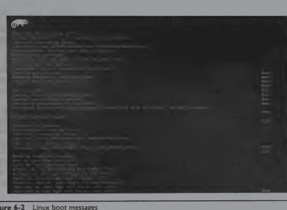

Linux 启动过程更易于消化，我们将把它分解为以下几个阶段：

- `BIOS` 阶段
- 引导加载程序阶段
- 内核阶段

让我们从讨论 `BIOS` 阶段开始。

### `BIOS` 阶段

无论你使用什么操作系统，当你第一次给 `x86` 或 `x86-64` 个人计算机加电时，系统 `BIOS` 是负责启动过程的第一个组件。系统 `BIOS` 是集成在主板上的一块 `ROM` 芯片，包含一系列非常小的程序和驱动程序，允许 `CPU` 与基本系统设备（如键盘、`I/O` 端口、系统扬声器、系统 `RAM`、软盘驱动器和硬盘）进行通信。关于你系统的可变信息，例如安装的 `RAM` 数量、硬盘的几何形状以及安装的软盘类型，都存储在 `CMOS` 芯片中。`BIOS` 使用 `CMOS` 芯片中的数据来寻址这些设备。

`BIOS` 在启动过程中扮演两个关键角色。首先，它测试各种系统组件并确保它们正常工作。这被称为加电自检，也被亲切地称为 `POST`。如果 `BIOS` 在 `POST` 过程中遇到任何系统设备问题，它要么在

...屏幕或播放一系列蜂鸣声代码。您可以使用 `BIOS` 文档——通过搜索主板型号或 `BIOS` 制造商，轻松在互联网上找到，有时也包含在主板的说明书中——来解读这些消息，以确定系统具体出了什么问题。

`BIOS` 承担的第二个角色是选择用于启动操作系统的存储设备。大多数 `CMOS` 系统设置程序允许您配置 `BIOS` 查找可启动介质的顺序。如图 6-3 所示，系统被配置为首先查找可移动设备，然后是本地硬盘驱动器，最后是可光盘驱动器。

`BIOS` 将从列表中找到的第一个可启动设备启动。回想前一章中，我告诉您务必确保 `BIOS` 设置为首先从光盘驱动器启动；否则，您可能无法加载 Linux 安装程序。这就是为什么会出现这种情况。如果 `BIOS` 在列表中更高位置找到了一个可启动设备，它就不会去启动您想要使用的光盘。

那么 `BIOS` 如何知道一个设备是否可启动呢？它会查看设备的第一扇区，这被称为*引导扇区*。在硬盘驱动器上，引导扇区包含主引导记录（`MBR`）。让我们在引导加载程序阶段讨论一下 `MBR` 的作用。

## 引导加载程序阶段

在运行 `POST` 之后，`BIOS` 实际上没有太多事情要做了。它已经完成了自己的任务，并准备将系统的控制权移交给其他组件。为了做到这一点，它需要知道可以接管系统的程序驻留在哪里。为了获知这一点，它会查找系统硬盘驱动器上的 `MBR`。


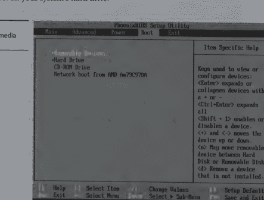

`MBR` 驻留在系统硬盘驱动器的引导扇区中。它在启动 Linux 系统的过程中起着关键作用。`MBR` 告诉系统引导加载程序驻留在哪里。引导加载程序有一个非常重要的任务。这里的问题是，您的计算机需要某种类型的操作系统来访问硬盘驱动器并从中将数据加载到 `RAM` 中。在启动过程的这个阶段，我们需要将操作系统本身从硬盘驱动器加载到内存中。如果您需要有一个操作系统才能从硬盘驱动器加载数据，那么您如何从硬盘驱动器将操作系统加载到内存中呢？

这就是引导加载程序的工作。引导加载程序是 `BIOS` 可以从硬盘驱动器的 `MBR` 加载的软件，它允许 `CPU` 访问磁盘并将操作系统加载到 `RAM` 中。为了做到这一点，引导加载程序被配置有操作系统文件在硬盘驱动器上的位置。

引导加载程序软件本身可能实际上位于 `MBR` 中，也可能不位于 `MBR` 中。正如我们稍后在本章中会看到的，您可以将某些引导加载程序安装在 `MBR` 中，或者将它们安装在硬盘驱动器其他位置的某个分区中，并在 `MBR` 中放置一个指针。其他引导加载程序实际上同时驻留在两个位置。

在将引导加载程序软件加载到内存后，`BIOS` 将系统的控制权移交给引导加载程序。引导加载程序可能被配置为自动从硬盘驱动器加载操作系统，也可能被配置为提供菜单，让最终用户选择要加载哪个操作系统。

在较新的 Linux 内核中，引导加载程序还可能在系统 `RAM` 中创建一个临时的虚拟文件系统，称为 `ramdisk`。这个文件系统被称为 `initrd` 映像。


> **注意** 术语 `initrd` 代表“初始 RAM 磁盘”。

该映像包含一个基本的文件系统，可用于完成各种启动任务。使用 `initrd` 映像的原因是，Linux 系统可以使用多种类型的设备作为根（`/`）文件系统。一些设备可以从软件 `RAID` 阵列创建；一些设备甚至可能位于另一台计算机上，并通过 `NFS`、`Samba` 或 `iSCSI` 服务进行访问。这些类型的文件系统无法由内核挂载，除非加载了特殊软件，而该软件当然驻留在这些文件系统中。这是无法做到的！

为了使系统在这些情况下正确启动，引导加载程序在内存中创建一个小的虚拟硬盘驱动器，称为 `ramdisk`，并将临时根文件系统从 `initrd` 映像传输到其中。然后，Linux 内核可以使用这个临时文件系统来加载软件并完成在这些其他类型的设备上挂载真实文件系统所需的任务。

# 内核阶段

在选择了要运行的操作系统后，引导加载程序将操作系统内核从硬盘驱动器加载到 `RAM` 中。就我们的目的而言，引导加载程序将 Linux 内核加载到 `RAM` 中。Linux 内核位于文件系统的 `/boot` 目录中，如下所示：

```
fs2:/boot # ls -l
total 19412
-rw-r--r-- 1 root root 1996824 Jul 5 2010 System.map-2.6.34-12-desktop
-rw------- 1 root root 512 Jan 19 10:37 backup.mbr
lrwxrwxrwx 1 root root 1 Jan 19 10:23 init -> init
-rw-r--r-- 1 root root 1236 Jul 1 2010 boot.rwade
-rw-r--r-- 1 root root 111090 Jul 5 2010 config-2.6.34-12-desktop
drwxr-xr-x 2 root root 4096 Jan 19 10:37 grub
lrwxrwxrwx 1 root root 24 Jan 19 10:37 initrd -> initrd-2.6.34-12-desktop
-rw-r--r-- 1 root root 8286727 Jan 19 10:37 initrd-2.6.34-12-desktop
-rw-r--r-- 1 root root 418816 Jan 19 10:37 message
-rw-r--r-- 1 root root 187496 Jul 5 2010 swmemu-2.6.34-12-desktop.gz
-rw-r--r-- 1 root root 4751262 Jul 5 2010 vmlinux-2.6.34-12-desktop.gz
lrwxrwxrwx 1 root root 25 Jan 19 10:26 vmlinux -> vmlinux-2.6.34-12-desktop
-rw-r--r-- 1 root root 4098208 Jul 5 2010 vmlinux-2.6.34-12-desktop
fs2:/boot #
```

您的内核是位于此目录中的 `vmlinuz-version.gz` 文件。您可能已经注意到内核是一个 `.gz` 文件。这是因为内核作为压缩文件驻留在硬盘驱动器上。您可能已经注意到，当您首次启动 Linux 系统时，屏幕上有时会显示一条类似“正在解压缩 Linux”的消息。现在您知道原因了！

在内核加载之后，会发生几件重要的事，包括以下内容：

- 内核使用 `BIOS` 和 `CMOS` 芯片中的各种设置来初始化系统中的基本硬件。


- 内核搜索并使用 `initrd` 文件系统来运行 `lnxrc` 程序以设置系统。

- 当 `lnxrc` 执行完毕后，`initrd` 文件系统被卸载，`ramdisk` 被销毁。

- 内核探测新硬件并加载相应的驱动程序模块。

- 真实的根（`/`）文件系统被挂载。

- 内核加载 `init` 进程。

正如您在前面一节所学到的，`init` 进程是运行系统其余部分所需的关键、至关重要的进程。在启动过程的这个阶段，`init` 使用 `/etc/inittab` 文件中的配置参数来加载系统进程，并使系统启动并运行。当 `init` 完成时，您就可以登录并使用该系统了。

图 6-4 展示了启动过程的概述。

考虑到这些信息，您已准备好学习关于配置引导加载程序的知识。让我们接下来讨论这是如何完成的。


**图 6-4** Linux 启动过程的概述

### 配置引导加载程序

如您所见，引导加载程序在 Linux 启动过程中扮演着极其重要的角色。如果没有引导加载程序，BIOS 将无法从系统硬盘驱动器中加载操作系统。因此，深刻理解如何配置 Linux 使用的引导加载程序是非常重要的。

与 Linux 的许多方面一样，您可以从许多不同的引导加载程序中选择用于您的 Linux 系统。您甚至可以使用 Windows 引导加载程序来加载您的 Linux 内核，反之亦然！不过，对于您的 LPIC-1/CompTIA Linux+ 考试，您只需要熟悉两种引导加载程序：`LILO` 和 `GRUB`。因此，在本章的这一部分，我们将花费一些时间来查看如何执行以下操作：

- 配置 `LILO`

- 配置 `GRUB`

让我们首先学习如何使用 `LILO` 引导加载程序。

#### 配置 LILO

`LILO` 引导程序存在的时间已经非常久了。`LILO` 是 “Linux LOader”（Linux 引导器）的缩写。`LILO` 是一个功能非常灵活的引导程序，它可以用来从计算机硬盘启动几乎任何操作系统，包括 Linux、Windows 或 DOS。

当使用 `LILO` 作为默认引导程序时，`LILO` 引导菜单会显示给最终用户，允许他们选择想要启动的操作系统内核。图 6-5 展示了一个 `LILO` 引导菜单的示例。

> **注意** 许多 Linux 发行版可能会以图形化方式呈现 `LILO` 菜单，而不是像图 6-5 中那样显示文本菜单。

早期的许多 Linux 发行版都使用 `LILO` 作为默认引导程序。正因为如此，`LILO` 可能是部署最广泛的 Linux 引导程序之一。因此，一名优秀的 Linux 管理员需要了解如何与 `LILO` 协同工作。

> **注意** 虽然 `LILO` 曾经被广泛使用，但许多当前的 Linux 发行版不再支持 `LILO`。大多数发行版使用 `GRUB` 引导程序代替 `LILO`。

这里我们将探讨以下关于 `LILO` 的主题：

- 安装 `LILO`

- 配置 `LILO`

- 关于 `ELILO`

让我们首先讨论如何安装 `LILO` 引导程序。


#### 安装 LILO

安装 `LILO` 引导程序有两种不同的方式。首先，对于仍然支持 `LILO` 的 Linux 发行版，你可以指定在正在安装的系统中使用 `LILO` 引导程序。例如，在图 6-6 中，`openSUSE` 安装程序允许你在“引导加载器设置”界面将引导程序从默认的 `GRUB` 更改为 `LILO`。

你可以选择将 `LILO` 引导程序安装在 `MBR` 中，或者安装在启动分区内。这两种选项似乎工作效果都一样好。你也可以通过先在系统中安装 `LILO` 软件包，然后在 shell 提示符下输入 `lilo` 命令，将在已经配置了其他引导程序的 Linux 系统上安装 `LILO` 引导程序。

> **注意** 我们将在本书后面讨论安装软件包。

这将覆盖现有的引导程序并安装 `LILO` 引导程序。然而，在做此操作之前，你需要先配置 `/etc` 目录下的 `LILO` 配置文件。接下来让我们讨论如何执行此操作。

#### 配置 LILO

`LILO` 引导程序是通过 `/etc` 目录下一个名为 `lilo.conf` 的文件进行配置的。下面展示了一个来自 `SUSE Linux Enterprise Server 10` 系统的 `lilo.conf` 文件示例：

```bash
$4: # cat /etc/lilo.conf
menu-scheme = Wb:Kw:Wb:Wb
timeout = 80
lba32
change-rules
reset
read-only
prompt
default = SLES_10_SP3
message = /boot/message
boot = /dev/sda2

image = /boot/vmlinuz-2.6.16.60-0.54.5-emp
###Don't change this comment - YAST2 identifier: Original name: linux##
  label = SLES_10_SP3
  append = "  resume=/dev/sda1 splash=silent showopts"

vga = 0x317
initrd = /boot/initrd-2.6.16.60-0.54.5-smp
root = /dev/sda2

image = /boot/vmlinuz-2.6.16.60-0.54.5-smp
###Don't change this comment - YaST2 identifier: Original name: failsafe###
label = Failsafe
append= "showopts ide=nodma apm=off acpi=off noresume edd=off 3"
vga = 0x317
initrd = /boot/initrd-2.6.16.60-0.54.5-smp
root = /dev/sda2

fs4:~ #
```

第一部分包含适用于文件中所有其他部分的全局选项。最后两部分包含特定于每个菜单项的选项。你可以查阅表 6-1 来了解每个选项的作用。表 6-1 中列出的选项并非包罗万象。你在 `/etc/lilo.conf` 文件中可以使用更多选项。我们没有时间或空间在这里涵盖所有选项。要查看完整列表，请参阅 `lilo.conf` 的手册页。

`lilo.conf` 文件只是一个文本文件。你可以使用任何 Linux 文本编辑器来修改它。修改完文件并退出编辑器后，你必须记得在 shell 提示符下运行 `lilo` 命令。否则，你对配置文件的更改将不会生效。这在此处展示如下：

```bash
fs4:~ # lilo
Added SL55_10_SP3 *
Added Failsafe
fs4:~ #
```

请注意，`lilo` 命令的输出表明已添加这两个映像。你可能已经注意到，我们刚才用来更新配置的 `lilo` 命令与安装 `LILO` 的命令是相同的。它完全就是同一个命令。实际上，每次你对 `LILO` 配置文件做出更改时，都必须使用 `lilo` 命令重新安装 `LILO`。这里我们应该指出，你可以在 `lilo` 命令中使用 `-b` 选项来指定引导程序应该安装在哪里。如果你指定一个设备，例如 `/dev/sda`，那么引导程序将安装在该设备的 `MBR` 中。如果你指定一个分区，例如 `/dev/sda1`，那么它将安装在该分区中，并且在 `MBR` 中放置一个指针。

在转换话题讨论 `GRUB` 引导程序之前，我们需要先回顾一下 `LILO` 的一个变体，称为 `ELILO`。接下来我们就这样做。

#### 关于 ELILO

`ELILO` 的工作方式与 `LILO` 大致相同。然而，它被设计为运行在不兼容标准版本 `LILO` 的计算机硬件上。例如，它可以在 `IA-64` (`IPF`) 和 `IA-32` (`x86`) 基于 `EFI` 的硬件平台上启动 Linux 内核。`ELILO` 还向后兼容标准的 `Intel x86` 硬件。然而，目前只有少数 Linux 发行版使用它。

`LILO` 就到此为止！现在是时候开始使用 `GRUB` 了！

| 章节 | 选项 | 描述 |
| :--- | :--- | :--- |
| 全局选项 | `menu-scheme` | 描述 `LILO` 引导菜单中使用的颜色。语法为：`text_color`:`highlight_color`:`border_color`:`title_color`。每个值使用两个字符。第一个字符是前景色，第二个是背景色。请参阅 `lilo.conf` 手册页以获取此选项可用所有颜色及其相关字符的列表。 |
| | `timeout` | 设置默认菜单项自动运行前的超时周期（以十分之一秒为单位）。例如，如果此选项设置为 `80`，则给用户八秒时间选择菜单项。 |


| | `lba32` | 指示 `LILO` 忽略硬盘的物理几何结构并使用逻辑块寻址。这使得 `LILO` 能够处理拥有超过 1023 个柱面的磁盘（所有现代硬盘都具备）。 |

| | `change-rules` | 定义启动时对分区类型号进行的更改。 |

| | `reset` | 指定删除所有默认的 `change-rules`。 |

| | `read-only` | 指定根（`/`）文件系统最初以只读方式挂载。在检查文件系统的完整性后，内核通常会以读写模式重新挂载该文件系统。 |

| | `prompt` | 指定显示 `boot:` 提示符。 |

| | `default` | 指定如果用户未做出选择，将加载的默认映像。 |

| | `message` | 指定 `LILO` 在启动时显示的图像文件的位置。 |

| | `boot` | 指定包含引导扇区的设备。例如，要将 `LILO` 配置为使用第一个硬盘上的第一个分区，你将此选项设置为`/dev/sda2`。 |

| 映像选项 | `image` | 指定 Linux 内核引导映像的路径。 |

| | `label` | 为映像指定一个名称。 |

| | `append` | 将指定选项附加到由 `LILO` 传递给内核的参数中。这通常仅在使用内核难以自动检测的硬件的系统上使用。 |

| | `vga` | 指定系统启动时应使用的 VGA 文本模式。 |

| | `initrd` | 指定要加载的内核初始 ramdisk 映像。通常，如果你正在启动 Linux 内核，这会被设置为`/boot/initrd`或`/boot/initrd-version`。 |

| | `root` | 指定应挂载为根的设备。例如，如果你想要将第一个硬盘上的第二个分区配置为应挂载为根分区的分区，你会将此参数设置为`/dev/sda2`。 |

**表 6-1** `/etc/lilo.conf` 配置选项

##### 配置 GRUB

GRUB。真是一个给引导加载器起的怪名字！GRUB 这个缩写听起来可不太吸引人，是吧？然而，作为引导加载器，GRUB 非常出色。GRUB 的全称是 Grand Unified Bootloader（通用大统一引导加载器）。与 `LILO` 类似，GRUB 是一种可用于启动系统硬盘上 Linux 内核（或者实际上任何其他操作系统内核）的引导加载器。

`LILO` 引导加载器曾非常流行，并被广泛使用了好几年。然而，在过去几年里，大多数发行版和许多 Linux 系统管理员一直在稳步地从 `LILO` 转向 GRUB。因此，你需要对 GRUB 的工作原理及其配置方法有扎实的理解。

在本章的这一部分中，我们将讨论以下 GRUB 主题：

- GRUB 的工作原理
- 安装 GRUB
- 配置 GRUB

让我们首先来讨论一下 GRUB 是如何工作的。

##### GRUB 的工作原理

还记得我们之前说过 `LILO` 可以安装在启动硬盘的主引导记录（MBR）或引导分区中吗？GRUB 有点不同。GRUB 引导加载器被分为几个独立的块，称为阶段（stages）。包括以下几个部分：

- 阶段 1：GRUB 的这个阶段通常存储在 MBR 中。它唯一真正的作用是指向阶段 1.5 或阶段 2 的位置。
- 阶段 1.5：GRUB 的这个阶段位于硬盘的前 30KB 内，紧接在 MBR 之后，但在第一个分区之前。阶段 1.5 包含加载阶段 2 所需的任何驱动程序。


> **提示** 阶段 1 可以跳过阶段 1.5 并直接加载阶段 2，但通常配置为先加载阶段 1.5。

- 阶段 2：GRUB 的这个阶段存储在一个磁盘分区中。当被阶段 1 或阶段 1.5 加载时，阶段 2 会在屏幕上显示一个图形菜单，允许用户选择应该加载的内核镜像。与 `LILO` 一样，你可以为 GRUB 配置默认镜像和超时值。如果用户未在超时期间内选择选项，系统将自动启动默认内核镜像。图 6-7 展示了一个典型的 GRUB 菜单。


> **注意** 与 `LILO` 类似，GRUB 也允许将阶段 1 安装在引导分区中。


图 6-7 GRUB 引导菜单

有了这个概述，让我们来谈谈如何安装 GRUB。

###### 安装 GRUB

我对 GRUB 非常喜欢的一点是，当你进行小配置更改时，你不需要重新安装引导加载器。在安装之后，你可以修改你的配置文件，并且由于阶段 2 直接从磁盘上的配置文件读取，这些更改将在 GRUB 下次加载时生效。

为了初始安装 GRUB，你首先需要验证 `grub` 软件包是否已安装在系统上。在基于 rpm 的发行版上，可以在 shell 提示符下输入`rpm -q grub`来执行此操作，如下所示：

```
fs2:~ # rpm -q grub
grub-0.97-171.1.x86_64
fs2:~ #
```

此输出告诉我们 GRUB 软件包已安装。如果你没有看到该命令的任何输出，就知道 GRUB 尚未安装，必须在继续之前进行安装。

要安装 GRUB 引导加载器本身，请在 shell 提示符下输入`grub-install _device_`。`_device_`选项是你要安装阶段 1 的 MBR 的设备名称。例如，如果你想将 GRUB 阶段 1 安装在系统第一个硬盘的 MBR 中，你会输入`grub-install /dev/sda`，如下例所示：

```
fs2:~ # grub-install /dev/sda
Installation finished. No error reported.
This is the contents of the device map /boot/grub/device.map.
Check if this is correct or not. If any of the lines is incorrect, fix it and re-run the script 'grub-install'.

(fd0)    /dev/fd0
(hd0)    /dev/sda
fs2:~ #
```

安装好 GRUB 后，你准备好配置它了。让我们接下来讨论如何进行配置。

##### 配置 GRUB

要配置 GRUB，你需要编辑一个基于文本的配置文件，其方式与我们之前讨论的 `LILO` 引导管理器非常相似。然而，对于 GRUB，你需要编辑的文件名称可能因发行版而异。表 6-2 列出了按发行版划分的常见实现方式。

一些发行版（如 Fedora）将`/boot/grub/menu.lst`符号链接到`/boot/grub/grub.conf`文件，因此无论编辑哪个文件，你都在正确的位置进行更改。Fedora 还将`/etc/grub.conf`文件符号链接到`/boot/grub/grub.conf`，因此你也可以将文件加载到编辑器中以更改你的 GRUB 配置。找出应该使用哪个文件来配置 GRUB 的最简单方法只是切换到`/boot/grub`目录并寻找`grub.conf`或`menu.lst`文件，如下所示：


```bash
fs2: # ls /boot/grub/ -l
total 216
-rw------- 1 root root   30 Jan 19 10:37 device.map
-rw-r--r-- 1 root root   29 Jan 19 10:24 device.map.old
-rw-r--r-- 1 root root  8608 Jul  5  2010 e2fs_stage1_5
-rwxr-xr-x 1 root root  7872 Jul  5  2010 fat_stage1_5
-rwxr-xr-x 1 root root  7136 Jul  5  2010 ffs_stage1_5
-rwxr-xr-x 1 root root  7136 Jul  5  2010 iso9660_stage1_5
-rwxr-xr-x 1 root root  8576 Jul  5  2010 jfs_stage1_5
-rw------- 1 root root  1088 Jan 19 10:37 menu.lst
-rw-r--r-- 1 root root   983 Jan 19 10:24 menu.lst.old
-rwxr-xr-x 1 root root  7236 Jul  5  2010 minix_stage1_5
-rwxr-xr-x 1 root root  9632 Jul  5  2010 reiserfs_stage1_5
-rwxr-xr-x 1 root root   512 Jul  5  2010 stage1
-rw-r--r-- 1 root root 10226 Feb 11 12:18 stage2
-rwxr-xr-x 1 root root  7456 Jul  5  2010 ufs2_stage1_5
-rwxr-xr-x 1 root root  6680 Jul  5  2010 vfatfs_stage1_5
-rwxr-xr-x 1 root root  9280 Jul  5  2010 xfs_stage1_5
fs2: #
```

无论你的 `GRUB` 配置文件使用哪个文件，它都会使用标准的结构。请记住，你的 `LILO` 配置文件使用了一个全局部分，然后是一个或多个特定镜像的部分。`GRUB` 配置文件以非常相似的方式工作。`GRUB` 配置文件的第一部分包含应用于所有菜单项的全局选项。然后它有一个或多个 `title` 部分，用于启动特定的操作系统。这里展示了一个典型的 `GRUB` 配置文件：

### 表 6-2：`GRUB` 配置文件

| `GRUB` 配置文件 | 发行版 |
| :-- | :-- |
| `/boot/grub/grub.conf` | `Fedora` |
| `/boot/grub/menu.lst` | `SUSE Linux`, `Debian` |

```bash
fs2:~ # cat /boot/grub/menu.lst
###### Modified by YaST2. Last modification on Wed Jan 19 10:37:45 MST 2011
###### THIS FILE WILL BE PARTIALLY OVERWRITTEN by perl-Bootloader
###### Configure custom boot parameters for updated kernels in /etc/sysconfig/
bootloader

default 0
timeout 8
#YaST - generic_mbr
gfxmenu (hd0,1)/Boot/message
##YaST - activate

###Don't change this comment - YaST2 identifier: Original name: linux##
title Desktop -- openSUSE 11.3 - 2.6.34-12
root (hd0,1)
kernel /boot/vmlinuz-2.6.34-12-desktop root=/dev/sda2 resume=/dev/sda5
splash=silent quiet showspec vga=0x317
initrd /boot/initrd-2.6.34-12-desktop

###Don't change this comment - YaST2 identifier: Original name: failsafe##
title Failsafe -- openSUSE 11.3 - 2.6.34-12
root (hd0,1)
kernel /boot/vmlinuz-2.6.34-12-desktop root=/dev/sda2 showopts apm=off
nomodeset edd=off powersaved=off nohpet=off highres=off processor.max_cstate=1
initrd /boot/initrd-2.6.34-12-desktop

###Don't change this comment - YaST2 identifier: Original name: floppy##
title Floppy
rootnoverify (fd0)
chainloader +1
fs2:~ #
```

在我们探索这个示例 `GRUB` 配置文件中的条目之前，我们需要回顾一下 `GRUB` 的术语。首先，`GRUB` 引用系统中磁盘和分区的方式可能令人不熟悉。在处理 `LILO` 时，我们使用 `/dev` 中的设备文件来引用设备和分区，例如 `/dev/sda1`。`GRUB` 以不同的方式引用这些设备。`GRUB` 不使用 `/dev` 条目，而是使用以下语法：

```
(hd#ive_number,partition_number)
```

例如，第一个硬盘上的第一个分区（`/dev/sda1`）被 `GRUB` 称为 `hd0,0`。无论第一个磁盘是 `IDE`、`SATA` 还是 `SCSI` 驱动器——`GRUB` 都将其称为 `hd0`。

另一件可能会让你困惑的事情是，`GRUB` 创建了自己的“根”，称为 `GRUB` 根。这并不一定是挂载在 `/` 处的根文件系统。相反，它是 `/boot` 目录所在的分区（阶段 2 安装的位置）。这里令人困惑的部分是：如果你最初分区硬盘时没有为 `/boot` 创建独立的分区，那么 `GRUB` 将使用完整路径来引用 `GRUB` 根，通常是 `/boot/grub`。另一方面，如果你为 `/boot` 创建了独立的分区（这是一个很好的做法），那么这个分区就变成了 `GRUB` 根。`GRUB` 在引用 `GRUB` 根中的文件时不包含 `/boot` 路径。这会让你抓狂，直到你习惯它为止。在继续之前，你需要理解这两个事实；否则，`GRUB` 配置文件中的许多条目将毫无意义。

### 表 6-3 `GRUB` 配置文件选项

表 6-3 逐步解析了 `GRUB` 配置文件中的行，并描述了每行函数的作用。

| 部分 | 选项 | 描述 |
| :--- | :--- | :--- |
| 全局 | `Color` | 指定在 `GRUB` 菜单中使用的颜色。 |
| | `default` | 指定如果用户未进行手动选择，将自动引导的菜单项。在本章所示的示例中，如果用户未另外指定，第一个菜单选项 `(1)` 将被自动引导。 |
| | `timeout` | 指定等待自动引导默认菜单项的秒数。在本章所示的示例中，超时时间设置为 `8` 秒。 |
| | `gfxmenu` | 指定用于显示图形化 `GRUB` 引导菜单的图像文件位置。在本章所示的示例中，将使用第一块硬盘 (`hd0`) 的第二个分区 `(1)` 上的 `/boot/message` 文件作为 `GRUB` 引导菜单。 |
| 标题 | `title` | 指定 `GRUB` 引导菜单中菜单项的标题。 |
| `root` | | 指定要挂载为 `GRUB` 根目录的分区位置。在本章的示例中，这是 `hd0,1`，它指定了第一块硬盘 (`hd0`) 的第二个分区 `(1)`。 |
| | `kernel` | 指定 `Linux` 内核的位置。在本章所示的示例中，`GRUB` 菜单指向 `/boot/vmlinuz-2.6.34-12-desktop`。某些发行版仅指向 `/boot/vmlinuz` 文件，该文件实际上是指向真实内核文件的符号链接。 |
| | | `root=` 选项指定要挂载为根文件系统的分区。`vga=` 选项指定系统在引导期间应使用的 `VGA` 模式。`resume=` 选项指向系统的交换分区。 |
| | `initrd` | 指定 `GRUB` 在引导过程中用于创建初始 `ramdisk` 映像的 `initrd` 映像。在本章所示的示例中，指定了 `/boot/initrd-2.6.34-12-desktop`。某些发行版仅指向 `/boot/initrd` 映像。请记住，与 `vmlinuz` 一样，`/boot` 中的 `initrd` 文件实际上是真正的 `initrd` 映像文件的链接。 |


GRUB 的一个很棒的地方在于，你可以交互式地管理引导过程。这是 LILO 无法很好做到的事情。你不必局限于 `menu.lst` 或 `grub.conf` 文件中配置好的内容，你可以随时定制自己的引导过程。要做到这一点，请完成以下操作：

- 在 GRUB 菜单中，按 `esc` 键。
- 当提示你正在离开图形化引导菜单时，选择确定。这样做时，将显示基于文本的 GRUB 菜单，如图 6-8 所示。

**图 6-8**

基于文本的 GRUB 菜单


- 如果你想要编辑菜单项，请按 `E`。这样做时，将显示图 6-9 中的屏幕。

在此屏幕上，你可以使用向上或向下箭头选择适当的行，然后再次按 `E` 进行编辑。如果你想要添加一行，请按 `O`。按 `D` 删除一行。当你准备好开始引导过程时，请按 `B`。你也可以按 `ESC` 返回到 GRUB 菜单。

**图 6-9**

编辑 GRUB 菜单项


- 你还可以通过按 `c` 访问 GRUB 提示符。这样做时，将显示图 6-10 中的屏幕。


你可以在 `grub>` 提示符下输入 `help` 来显示有关从 `grub>` 提示符创建 GRUB 菜单行的信息。你还可以按 `TAB` 查看可以在 `grub>` 提示符下输入的命令列表。你也可以按 `ESC` 返回到 GRUB 菜单。

> **注意** 你也可以从正在运行的 Linux 系统中访问 `grub>` 提示符。要做到这一点，只需在 shell 提示符下输入 `grub` 即可。

GRUB 菜单可以是一个极其有用的工具。在大多数发行版中，GRUB 菜单中默认显示引导选项字段。示例如图 6-11 所示。

你可以使用此字段向 Linux 内核发送未包含在 GRUB 菜单项中的引导选项，以定制内核的工作方式。要做到这一点，你首先选择所需的 GRUB 菜单项，然后在引导选项字段中输入想要使用的适当内核选项。例如，如果你的 Linux 系统由于某种未知原因无法再引导，你可以使用引导选项字段来告诉内核在启动时不要加载 `init` 进程，而是加载另一个程序。

> **注意** 我们将在本章后面更详细地讨论 `init` 进程。

要做到这一点，你在引导选项字段中输入 `init=program_name`。例如，要跳过加载 `init` 进程并改为加载 `bash` shell，你需要在引导选项字段中输入 `init=/bin/bash`。当你引导系统时，`bash` shell 会被加载，你将拥有对系统的完整 `root` 级别访问权限，允许你诊断和修复导致系统无法正常引导的问题。这如图 6-12 所示。

> **提示** 系统不会提示你提供 `root` 密码。因此，如果你忘记了 `root` 用户的密码，可以使用此技术来救援系统。

**图 6-12**

用 `bash` shell 替换 `init`


然而，请注意，在某些发行版中，根 (`/`) 文件系统将以只读模式挂载。如果是这种情况，你需要在 shell 提示符下输入 `mount -o remount,rw,sync -t filesystem device_name mount_point` 以将其重新挂载为读写模式，然后才能修改配置文件。进行必要的更改后，你可以通过在 shell 提示符下输入 `exec /sbin/init` 来让内核通过 `init` 恢复正常的引导过程。

虽然定制 GRUB 及其菜单项的能力非常有用，但也可能存在一些安全风险。如上所述，它可能会在无需提供密码的情况下赋予任何知道如何操作的人 `root` 级别的系统访问权限。这可能是一件非常糟糕的事情，尤其是在可能包含敏感或专有信息的 Linux 系统上。

为了提高 GRUB 菜单的安全性，你可以添加 GRUB 密码。一旦配置完毕，只有在提供正确的密码后，你才能修改 GRUB 引导选项。最简单的方法是编辑 GRUB 配置文件（`menu.lst` 或 `grub.conf`）并输入以下内容：

```
password password
```

例如：

```
password natasxa01
```

请注意，在配置文件中添加此参数将导致 GRUB 以纯文本模式显示其菜单。示例如图 6-13 所示。

当 GRUB 以这种方式配置时，用户仍然可以在没有密码的情况下选择任何菜单项，但编辑任何 GRUB 菜单项都将要求他们输入你指定的密码。如果你还想要求用户在选择菜单项之前输入密码，你需要在 GRUB 配置文件中适当的 `title` 元素内添加 `lock` 参数，如本例所示：

```bash
fs2:~ $ cat /boot/grub/menu.lst
###### Modified by YaST2. Last modification on Wed Jan 19 10:37:45 MST 2011
###### THIS FILE WILL BE PARTIALLY OVERWRITTEN by perl-Bootloader
###### Configure custom boot parameters for updated kernels in
/etc/sysconfig/bootloader

default 0
timeout 8
##YaST - generic_mbr
gfxmenu (hd0,1)/message
##YaST - activate
password natsas80l

###Don't change this comment -- YaST2 identifier: Original name: linux###
title Desktop -- openSUSE 11.3 -- 2.6.34-12
  lock
  root (hd0,1)
  kernel /boot/vmlinuz-2.6.34-12-desktop root=/dev/sda2 resume=/dev/sda1
  splash=silent quiet showopts vga=0x317
  initrd /boot/initrd-2.6.34-12-desktop
###Don't change this comment -- YaST2 identifier: Original name: failsafe###
title Failsafe -- openSUSE 11.3 -- 2.6.34-12
  lock
  root (hd0,1)
  kernel /boot/vmlinuz-2.6.34-12-desktop root=/dev/sda2 showopts sppm=off
  nomresume edd=off powersaved=off nohz=off highres=off processor.max_cstate=1
  nomodeset x11failsafe vga=0x317
  initrd /boot/initrd-2.6.34-12-desktop
###Don't change this comment -- YaST2 identifier: Original name: floppy###
title Floppy
  lock
  rootnoverify (fd0)
  chainloader +1
fs2:~ $
```

**图 6-13**

在 GRUB 配置文件中使用密码


在此配置中，用户必须输入你指定的密码才能选择一个 GRUB 菜单项。这是通过按下 `P` 键然后输入相应密码来完成的。如果他们不这样做，将会显示图 6-14 中所示的屏幕。

请注意在前述示例中，`password` 指令放置在文件的全球部分（global section）。这定义了其后所有 `title` 指令的密码。在此配置中，所有 GRUB 菜单项都使用相同的密码。如果你想为每个 GRUB 菜单项定义不同的密码，你可以将 `password password` 指令放置在每个 `title` 元素内。

同样请注意在前述示例中，密码是以明文形式存储在 GRUB 配置文件中。这稍微有些不安全。如果用户获取了 GRUB 配置文件的读取权限（默认情况下不应该如此，但事故确实会发生），那么他们就可以轻松获取你设置的 GRUB 密码。

为了使配置更加安全，你可以加密配置文件中的 GRUB 密码。这样，即使用户访问了 GRUB 配置文件，他们也无法读取你指定的密码。要加密密码，请执行以下操作：

1. 打开一个终端会话并切换到 `root`。
2. 在 shell 提示符下，输入 `grub-md5-crypt`。


3. 根据提示，输入你想要分配给 `GRUB` 菜单的密码。完成后，屏幕上将显示密码的哈希形式。示例如下：

```
fs2:~$ grub-md5-crypt
Password:
Retype password:
$1$WLZwz/$DP3wgbtInPlkJOL.Wg3t00
fs2:~$
```

4. 使用文本编辑器打开 `GRUB` 配置文件。

> 提示 在 `gedit` 中复制和粘贴更容易，但也可以在 `vi` 中完成此操作。

5. 在 `GRUB` 配置文件中，输入 `password --md5 hashed_password`。示例如下：

```
password --md5 $1$WLZwz/$DP3wgbtInPlkJOL.Wg3t00
```

6. 将更改保存到文件并重新启动系统。

让我们在下述练习中练习使用 `GRUB` 引导加载程序。


#### 练习 6-1：使用 `GRUB`


**视频** 如需更多信息，请观看练习 6-1。

在本练习中，你将练习自定义 `GRUB` 菜单。本练习假设你已安装 `SUSE Linux` 或 `Fedora` 等使用 `GRUB` 作为默认引导加载程序的发行版。请完成以下操作：

1. 启动你的 `Linux` 系统并以标准用户身份登录。如果你使用了上一章中的实验练习来安装系统，你可以使用用户名 `tux` 和密码 `M31linux273` 登录。

2. 打开一个终端会话。

3. 通过输入 `su -` 并跟随你的 `root` 用户密码来切换到你的 `root` 用户账户。

4. 在 `shell` 提示符下，输入 `ls -l /boot/grub`。确定你的发行版是使用 `grub.conf` 还是 `menu.lst` 文件来配置 `grub`。

5. 通过在 `shell` 提示符下输入 `grub-md5-crypt` 为你的 `GRUB` 菜单创建加密密码。

6. 根据提示，为你的 `GRUB` 菜单输入一个密码。

7. 记录屏幕上显示的哈希密码。

8. 在 `shell` 提示符下，根据系统使用的文件，输入 `vi /boot/grub/menu.lst` 或 `vi /boot/grub/grub.conf`。

9. 按下 `INSERT`。

10. 向下滚动到 `timeout` 行，并在其前面加一个 `#` 以禁用此功能。由于我们需要密码才能启动，我们不想让 `GRUB` 自动尝试启动系统。

11. 在 `gfxmenu` 行下方，通过输入 `password --md5 hashed_password` 为 `GRUB` 菜单添加一个全局密码。

12. 在你的 `GRUB` 配置文件中，为每个 `title` 元素添加 `lock` 指令。这将使 `GRUB` 在选择菜单项时要求输入密码。

13. 按下 `ESC`。

14. 将更改保存到文件，并通过输入 `:quit` 退出 `vi`。

15. 在 `shell` 提示符下，输入 `reboot`。等待系统重启。

16. 注意在 `GRUB` 菜单中，你现在必须输入密码才能启动系统。

17. 按下 `p`，然后输入你的密码。

18. 选择适当的 `GRUB` 菜单项以启动系统。

### 管理 `Linux` 运行级别

如果你以前使用过 `Linux`，你可能听说过运行级别（`runlevel`）这个术语。我注意到运行级别的概念对于许多新用户来说很难理解。在本章的这一部分，我们将回顾什么是运行级别以及如何管理系统中的运行级别。以下内容将得到涵盖：

- 运行级别是如何工作的
- 管理运行级别和 `init` 脚本

让我们从讨论运行级别是如何工作开始的。

#### 运行级别是如何工作的

要管理 `Linux` 系统，你需要对运行级别是如何工作的有一个清晰的了解。在本章的这一部分，我们将讨论以下内容：

- 什么是运行级别？
- 在 `/etc/inittab` 中定义运行级别

让我们从讨论什么是运行级别开始。

#### 什么是运行级别？

那么，运行级别到底是什么意思呢？听起来很复杂，但归根结底，其实并不是这样。运行级别代表你的 `Linux` 系统可以运行的几种不同模式之一。`Linux` 系统上的运行级别在许多方面类似于 `Windows` 系统上的启动模式。如果你使用过 `Windows`，你知道在系统启动时按下 `F8` 键可以选择几种启动模式之一。例如，如果你在 `Windows` 系统中的某个特定设备或驱动程序上遇到问题，你可以以安全模式启动它，这将仅加载最少数量的驱动程序来启动操作系统，以便你可以排查问题。

`Linux` 的运行级别与此类似。像 `Windows` 启动模式一样，`Linux` 运行级别允许你指定希望系统运行的模式。`Linux` 使用七个默认运行级别供你选择，如表 6-4 所示。

如表 6-4 所示，`Linux` 运行级别和 `Windows` 启动模式之间有很多不同之处。首先，切换到运行级别 `0` 实际上会停止系统，而切换到运行级别 `6` 会重启系统。此外，你可以指定系统每次开启时进入的默认运行级别。你甚至可以在系统运行时动态地在运行级别之间切换。在 `Windows` 中做不到这一点！

这些运行级别通过 `/etc/inittab` 文件定义。让我们接下来回顾一下这个文件是如何工作的。

| 运行级别 | 描述 |
|---|---|
| `0` | 停止系统。 |
| `1` | 以单用户模式运行 `Linux`。使用命令行界面。 |
| `2` | 以多用户模式运行 `Linux`，且禁用网络。使用命令行界面。 |
| `3` | 以多用户模式运行 `Linux`，且启用网络。使用命令行界面。 |
| `4` | 默认未定义。实际上可以编辑 `/etc/inittab` 文件并使用运行级别 `4` 定义你自己的自定义运行级别。 |
| `5` | 以多用户模式运行 `Linux`，且启用网络。使用图形用户界面。 |
| `6` | 重启系统。 |


#### 使用 `/etc/inittab` 定义运行级别

`init` 进程是 `Linux` 系统上所有其他进程的祖先进程。它是内核在启动时运行的第一个进程，负责加载使 `Linux` 正常工作的所有其他系统进程。`init` 进程在 `/etc/inittab` 文件中配置。典型的 `openSUSE` 系统的 `inittab` 文件摘录如下：

```
fe2:~/ # cat /etc/inittab
##### /etc/inittab
id:5:initdefault:
##### First script to be executed, if not booting in emergency (-b) mode
si::bootwait:/etc/init.d/boot
10:0:wait:/etc/init.d/rc 0
11:1:wait:/etc/init.d/rc 1
12:2:wait:/etc/init.d/rc 2
13:3:wait:/etc/init.d/rc 3
14:4:wait:/etc/init.d/rc 4
15:5:wait:/etc/init.d/rc 5
16:6:wait:/etc/init.d/rc 6
##### what to do in single-user mode
ls:S:wait:/etc/init.d/rc S
::Sysrq:/sbin/syslog
##### what to do when CTRL-ALT-DEL is pressed
ca:ctrlaltdel:/sbin/shutdown -r -t 4 now
##### special keyboard request (Alt-UpArrow)
##### look into the Kbd-0.90 docs for this
kb:kbrequest:/bin/echo "Keyboard Request -- edit /etc/inittab to let this work."
##### what to do when power fails/returns
pf:powerwait:/etc/init.d/powerfail start
pi:powerfailnow:/etc/init.d/powerfail now
pn:powerfail:/etc/init.d/powerfail now
po:powerokwait:/etc/init.d/powerfail stop
...
##### end of /etc/inittab
```

`inittab` 中定义的第一个参数指定系统的默认运行级别。该参数的形式为 `id:5:initdefault`。该命令告知 `init` 进程默认启动到运行级别 `5`。请记住，运行级别 `5` 会以多用户模式运行 `Linux`，并启用网络和图形用户界面桌面。

接下来，`inittab` 文件指示 `init` 进程运行 `/etc/init.d/boot` 脚本：


...[/content]”中

## 示例

原文：

[content]
进入 /path/to/xxx 目录，找到 xxx.json。

在表达式 cvar = avar + bvar 中，加法运算符（+）将 avar 与 bvar 相加，得到它们的和 cvar

在 List.of(arg0, arg1, arg2) 中，List 接口的工厂方法 of() 接受一系列的元素，返回包含它们的只读列表。

之后我们这样调用 cmd 命令：cmd arg0 arg1 arg2。

if (condVar > someVal) {console.log("xxx")}
[/content]

排版后：

[content]
进入`/path/to/xxx`目录，找到`xxx.json`。

在表达式`cvar = avar + bvar`中，加法运算符（`+`）将`avar`与`bvar`相加，得到它们的和`cvar`

在`List.of(arg0, arg1, arg2)`中，`List`接口的工厂方法`of()`接受一系列的元素，返回包含它们的只读列表。

之后我们这样调用`cmd`命令：`cmd arg0 arg1 arg2`。

```
if (condVar > someVal) {console.log("xxx")}
```
[/content]

## 以下是需要排版的文本

[content]
```
s1:bootwait:/etc/init.d/boot
```

`bootwait` 参数指示 `init` 运行此脚本，并在继续启动过程之前等待其完成。

此外，`inittab` 文件还定义了在每个运行级别中运行的 `init` 脚本。这是通过以下行完成的：

```
10:0:wait:/etc/init.d/rc 0
11:1:wait:/etc/init.d/rc 1
12:2:wait:/etc/init.d/rc 2
13:3:wait:/etc/init.d/rc 3
#14:4:wait:/etc/init.d/rc 4
15:5:wait:/etc/init.d/rc 5
16:6:wait:/etc/init.d/rc 6
```

`inittab` 文件中命令的语法是 `identifier:runlevel:action:command`。在这些命令中指定的 `wait` 操作指示 `init` 进程等待指定运行级别的脚本运行完成后再继续。另外，请注意运行级别 4 的定义被注释掉了。在我使用过的每个 Linux 发行版中，运行级别 4 默认都未定义。

`/etc/inittab` 文件还定义了按下 `CTRL`-`ALT`-`DEL` 组合键时应发生什么。默认情况下，`inittab` 文件会导致系统在按下这些键时重启，如下所示：

```
ca:ctrlaltdel:/sbin/shutdown -r -t 4 now
```

如果你想更改按下这些键时系统的行为，只需使用文本编辑器编辑 `/etc/inittab` 并修改此行，以指定应运行的命令即可。

> **注意** 编辑 `inittab` 文件时要非常小心。如果你犯了错误，系统可能无法启动。

在 `inittab` 示例中请注意，还定义了单用户模式（`S`）：

```
##### what to do in single-user mode
S:8:wait:/etc/init.d/rc 6
::respawn:/sbin/sulogin
```

单用户模式在排除系统问题时非常有用。当你进入单用户模式时，会运行 `/sbin/sulogin` 登录命令，允许你以 `root` 身份登录并修复任何导致系统无法正常运行的问题。要在系统运行时进入单用户模式，请在 shell 提示符下输入 `init S`。执行此操作后，系统会提示你提供 `root` 用户密码。输入后，你将在单用户模式下获得系统的 `root` 访问权限。这如图 6-15 所示。


图 6-15 进入单用户模式

你也可以在系统启动时进入单用户模式，只需在 `GRUB` 菜单的 `Boot Options` 字段中输入 `S` 即可。

`inittab` 文件的下一块内容告知 `init` 进程在发生电源故障时应如何操作。根据故障的性质，`/etc/init.d` 中不同的脚本文件将被运行：

```
##### what to do when power fails/returns
pf:powerwait:/etc/init.d/powerfail start
pn:powerfailnow:/etc/init.d/powerfail now
#pn:powerfail:/etc/init.d/powerfail now
po:powerokwait:/etc/init.d/powerfail stop
```

`inittab` 文件中还有一个块，告知 `init` 在登录时启动哪个运行级别的登录进程（称为 `Get TTY` 或 `getty` 进程），以提示用户输入用户名和密码。如下所示：

```
1:2345:respawn:/sbin/mingetty tty1
2:2345:respawn:/sbin/mingetty tty2
3:2345:respawn:/sbin/mingetty tty3
4:2345:respawn:/sbin/mingetty tty4
5:2345:respawn:/sbin/mingetty tty5
6:2345:respawn:/sbin/mingetty tty6
```

如本例所示，登录进程在运行级别 2、3、4（如果已定义）和 5 中创建。

如果你对 `inittab` 文件进行了任何更改，你需要告知 `init` 已发生更改且需要重新读取其配置。为此，请在 shell 提示符下输入 `init q` 命令。

基于这些背景知识，你已准备好学习如何管理系统中的运行级别。让我们接下来进行这一步。

### 管理运行级别和 init 脚本

管理运行级别是管理 Linux 系统的重要方面。你需要知道如何配置默认运行级别，以及指定在特定运行级别自动启动哪些系统进程和服务（守护进程）。

回顾前一章，我提到过，安装新的 Linux 系统后我做的第一件事之一，就是检查并关闭所有不需要的自动运行的服务。这可以节省内存和 CPU 利用率，同时也堵住了系统中的安全漏洞。在本章的这一部分，我们将讨论如何实现这一点。我们将涵盖以下主题：

- 关于 `init` 脚本
- 配置默认系统运行级别
- 从 shell 提示符更改运行级别
- 配置服务在指定运行级别默认运行

让我们从了解 `init` 脚本开始。

#### 关于 init 脚本

你的 Linux 系统上的系统进程通过 `init` 脚本启动和停止。`init` 脚本由 `init` 进程在系统启动时以及当前运行级别变更时用于启动进程。这些脚本存储在你的 Linux 系统上的特定目录中。它们存储的目录取决于你的 Linux 发行版。大多数 Linux 发行版使用两种类型的 `init` 脚本之一：

- **System V** 使用 `System V` `init` 脚本的 Linux 发行版将它们存储在 `/etc/rc.d` 目录中。在 `/etc/rc.d` 中有一系列名为 `rc0.d` 到 `rc6.d` 的子目录。这些目录中的每一个都与特定的运行级别相关联。这些子目录中的每个目录都包含指向系统守护进程的 `init` 脚本的符号链接，这些脚本位于 `/etc/rc.d/init.d` 中。`Red Hat Linux` 和 `Fedora` 使用 `System V` 类型的 `init` 脚本。

- **BSD** 使用 `BSD` 风格 `init` 脚本的 Linux 发行版将它们存储在 `/etc/init.d` 目录中。在 `/etc/init.d` 中有一系列名为 `rc0.d` 到 `rc6.d` 的目录。与 `System V` `init` 脚本一样，这些目录与特定的运行级别相关联。这些目录包含指向 `/etc/init.d` 中 `init` 脚本的链接。`SUSE Linux` 使用这种类型的 `init` 脚本。

除了使用 `init` 进程运行这些脚本外，你还可以从命令提示符运行这些脚本。只需在 shell 提示符下输入 `/etc/init.d/script_name`（在 `BSD` 风格系统上）或 `/etc/rc.d/init.d/script_name`（在 `System V` 风格系统上）即可。如果你不确定应该使用哪个脚本名称，可以使用 `ls` 命令生成 `init` 脚本目录中脚本的列表，如下所示：

```bash
f62:/etc/init.d # ls
...
aacpvntd          boot.lvm              lm_sensors           rpmconflycheck
acpid             boot.md               mcelog               rcined
aliasd            boot.multiptah        mdadm                setterial
ard               boot.proc             multipathd           single
audtd             boot.rootfack         network              skelelon
autofs            boot.startpreload     network-remotefs     skelton.compat
autoyast          boot.swap              nfs                 smarthd
avahi-daemon      boot.sysctl           nmb                  smb
```


## 系统服务与初始化脚本

以下列出了常见的系统服务守护进程：

```
avahi-daemond   boot.udev        nscd            smolt
bluez-coldplug    boot.udev_retry ntp             splash
boot              cifs            openvpm         splash_early
boot.apparmor     cron            pm-profiler     sshd
boot.cleanups     cups            postfix         stopreload
boot.clock        dbus            powerd          svnserv
boot.crypto       dnsmasq         poverfail       syslog
boot.crypto-early earlysyslog     random          vmtcond
boot.cycle        earlyixdm       raw             xdm
boot.d            ghost           rc              xfs
boot.device-mapper gpm             rc0.d           xinetd
boot.dmdraid      haldaemon      rc1.d           xpbind
boot.fuse         halt            rc2.d
boot.ipconfig     halt.local     rc3.d

fs2:/etc/init.d #
```

`init` 目录中的实际脚本取决于你在特定系统上安装了哪些服务。每次使用 `rpm` 工具在系统上安装服务时，对应的 `init` 脚本会自动安装在你的 `init` 脚本目录中。安装完成后，你可以通过在命令提示符下直接运行来执行任何脚本。语法如下（在 BSD 风格系统上）：

```
/etc/init.d/`script_name` start | stop | restart
```

在运行 `init` 脚本时可以使用以下参数：

- `start`：使用此参数启动关联的服务。
- `stop`：使用此参数停止关联的服务。
- `status`：使用此参数查看服务的状态，例如当前是否正在运行。
- `restart`：使用此参数停止然后启动关联的服务。如果你对服务进行了大量的配置更改，并且需要重启服务以应用更改，这是一个非常有用的选项。
- `reload`：使用此参数重新读取服务的配置文件，而无需重启服务本身。并非所有守护进程都支持此选项。

例如，要运行 `smb` 服务，请在 shell 提示符下输入 `/etc/init.d/smb start`。要停止它，请输入 `/etc/init.d/smb stop`。要重启它，请输入 `/etc/init.d/smb restart`。

在某些发行版中，例如 SUSE Linux，你还可以使用 `rc` 脚本来启动、停止或重启服务进程，而无需指定脚本文件的完整路径。语法为 `rc_script_name start | stop | restart`。例如，要启动 `smb` 服务，可以在 shell 提示符下输入 `rcsmb start`。要停止它，可以输入 `rcsmb stop`。你也可以使用 `restart` 选项来重启它。

当系统启动时，`init` 会运行 `/etc/inittab` 中定义的脚本，以进入特定的运行级别。例如，如果你的系统配置为启动到运行级别 5，那么 `init` 将运行包含在 `/etc/rc.d/rc5.d` 或 `/etc/init.d/rc5.d` 中的脚本，具体取决于你的特定发行版。典型的 openSUSE 系统的运行级别 5 脚本如图 6-16 所示。

```text
fasz:/etc/init.d/rc5.d $ ls -l
total 0
lrwxrwxrwx 1 root root 22 Jan 19 10:37 K01bluez_firewall_setup -> ../bluez_firewall_setup
lrwxrwxrwx 1 root root 8 Jan 19 10:24 K01bsdstd -> ../bsdstd
lrwxrwxrwx 1 root root 17 Jan 19 10:24 K01bluez-rc-setup -> ../bluez-rc-setup
lrwxrwxrwx 1 root root 7 Jan 19 10:24 K01crond -> ../crond
lrwxrwxrwx 1 root root 12 Jan 19 10:24 K01dhcpdemon -> ../dhcpdemon
lrwxrwxrwx 1 root root 15 Jan 19 10:24 K01irq_balance -> ../irq_balance
lrwxrwxrwx 1 root root 8 Jan 19 10:25 K01elog -> ../elog
lrwxrwxrwx 1 root root 7 Jan 19 10:25 K01mcd -> ../mcd
lrwxrwxrwx 1 root root 9 Jan 19 10:24 K01random -> ../random
lrwxrwxrwx 1 root root 9 Jan 19 10:25 K01smartd -> ../smartd
lrwxrwxrwx 1 root root 15 Jan 19 10:24 K01slash_early -> ../slash_early
lrwxrwxrwx 1 root root 7 Jan 19 10:37 S03rsrd -> ../rsrd
lrwxrwxrwx 1 root root 14 Jan 19 10:31 S03slapd -> ../slapd
lrwxrwxrwx 1 root root 11 Jan 19 10:31 K01unfsload -> ../unfsload
lrwxrwxrwx 1 root root 6 Jan 19 10:24 K01zfs -> ../zfs
lrwxrwxrwx 1 root root 9 Feb 1 13:47 K01zfsinit -> ../zfsinit
lrwxrwxrwx 1 root root 8 Jan 19 10:24 K01zpool -> ../zpool
lrwxrwxrwx 1 root root 12 Jan 19 10:40 K01zpool-send -> ../zpool-send
lrwxrwxrwx 1 root root 15 Jan 19 10:24 K01zboot_sabaton -> ../zboot_sabaton
lrwxrwxrwx 1 root root 7 Jan 19 10:36 K01zfs -> .../zfs
```


正如你在图 6-16 中看到的，实际用于启动和停止服务的脚本并不位于 `rc5.d` 子目录中。相反，`rc5.d` 中的文件是指向包含在 `init` 目录（在这种情况下是 `/etc/init.d`）中的实际脚本文件的符号链接。

除了初始化脚本外，在 `/etc/init.d` 或 `/etc/rc.d/init.d` 中还有几个你需要了解的重要脚本。这些脚本如表 6-5 所示。

### 表 6-5 `/etc/init.d` 中的重要文件

| 文件 | 初始化类型 | 功能 |
| :--- | :--- | :--- |
| `rc` | BSD 和 System V | 此脚本用于在系统运行时在运行级别之间切换。 |
| `halt` | BSD | 此脚本可以停止或重启你的系统。如果当前运行级别更改为 0 或 6，则运行此脚本。 |
| `boot` | BSD | 此脚本由 `init` 在系统首次启动时运行。它运行 `/etc/init.d/boot.d` 中包含的脚本。这些脚本执行各种启动任务，例如加载内核模块、验证文件系统以及设置系统时钟。 |
| `boot.local` | BSD | 此脚本也由 `init` 在启动时运行。它包含额外的启动命令。此脚本非常有用。如果你想让系统在启动时自动运行特定命令，你可以使用文本编辑器将命令插入此文件中。 |
| `rc.sysinit` | System V | 此脚本的功能类似于 BSD 类型系统上的 `boot` 脚本。它用于设置路径、检查文件系统错误、设置系统时钟等。 |
| `rc.local` | System V | 此脚本的功能类似于 BSD 类型系统上的 `boot.local` 脚本。你可以将自己的命令添加到此脚本中，以确保每次系统启动时都会运行它们。 |

总而言之，在初始化 BSD 类型系统时，`init` 进程完成以下任务：

- 运行 `/etc/init.d/boot` 脚本来准备系统。
- 处理 `/etc/inittab` 以确定合适的运行级别和脚本。


- 运行 `/etc/init.d` 中合适运行级别目录中的脚本。

- 运行 `/etc/init.d/boot.local` 脚本。

在 `System V` 类型系统上，`init` 进程在使系统启动并运行时执行以下操作：

- 运行 `/etc/rc.d/sysinit` 脚本来准备系统。

- 处理 `/etc/inittab` 以确定合适的运行级别和脚本。

- 运行 `/etc/rc.d` 中合适运行级别目录中的脚本。

- 运行 `/etc/rc.d/rc.local` 脚本。

#### 配置系统默认运行级别

正如本章前面所述，系统的默认运行级别在 `/etc/inittab` 文件中指定。你只需将命令中的第二个值更改为你想要使用的运行级别，即可更改默认运行级别。例如，假设我想将系统从默认的运行级别 5 更改为 3。我只需用文本编辑器打开 `/etc/inittab` 并将值 5 更改为 3。保存文件并重启后，系统将在运行级别 3 下启动。

除了更改启动时的运行级别外，你还可以在使用系统时实时更改它们。下面我们讨论如何执行此操作。

#### 从 Shell 提示符更改运行级别

如果你认为更改默认运行级别很简单，那么实时更改运行级别就更简单了。这是通过 `init` 命令完成的。使用 `init` 的语法是 `init runlevel`。例如，如果我的系统正在运行级别 5 下运行，我想切换到运行级别 3，我只需在 `Shell` 提示符下输入 `init 3`。输入命令后，系统会切换到运行级别 3，如图 6-17 所示。


> **提示** 在你运行 `init` 命令之前，必须切换到你的 `root` 用户账户。

当你使用 `init` 命令更改运行级别时，`init` 进程运行 `rc` 脚本并通知它切换到相应的级别。`rc` 脚本读取 `/etc/inittab` 以获取当前运行级别，并使用 `init` 目录中相应运行级别目录中的脚本停止与该运行级别关联的所有服务。然后，`rc` 脚本读取 `/etc/inittab` 并运行 `init` 目录中新运行级别目录中的相应启动脚本。


图 6–17 实时切换到运行级别 3

如果你查看发行版 `init` 目录内的 `rcx.d` 目录，你会发现每个系统进程都有两个脚本。一个以 `S` 开头，一个以 `K` 开头。以 `S` 开头的脚本用于启动进程，而以 `K` 开头的脚本用于停止（终止）进程。当 `init` 进程调用 `rc` 并发送要更改的运行级别时，`rc` 进程运行相应 `rcx.d` 目录中的所有脚本，以便适当地启动和停止要进入的运行级别的服务。这些脚本用于实时在运行级别之间切换，正如前面所述。

尽管我们称这些文件为“脚本”，但它们实际上并不是。它们实际上是指向 `init` 脚本目录中实际脚本文件的符号链接。这使得更新你的 `Linux` 系统变得更加容易。如果单独的 `init` 脚本维护在每个 `rcx.d` 目录中，并且需要对特定服务应用更新，则必须单独更新每个 `rcx.d` 目录中的每个 `init` 脚本。这是一项多么繁重的工作！出现错误和不一致的可能性会非常大！

相反，由于各种 `rcx.d` 目录中的所有文件都只是 `init` 目录中服务 `init` 脚本的一个副本的符号链接，因此需要应用的任何更新都只需在一个文件中完成。

`rc5.d` 目录中脚本的示例如图 6–16 所示。`S` 文件使用 `start` 参数调用其关联的 `init` 脚本，而 `K` 文件使用 `stop` 参数调用其关联的 `init` 脚本。

另外，注意图 6–16 中 `K` 或 `S` 字母后面跟着一个数字，然后是 `init` 脚本的名称。文件名中的数字非常重要。当 `init` 调用 `rc` 脚本切换运行级别时，`rc` 脚本首先查看当前运行级别的 `rcx.d` 目录，并将其与要切换到的运行级别的 `rcx.d` 目录进行比较。如果当前运行级别的 `rcx.d` 目录中该服务的终止脚本和新运行级别的 `rcx.d` 目录中同一服务的启动脚本都存在，`rc` 脚本会保持该服务运行，因为它在两个运行级别中都应该运行。

另一方面，如果当前运行级别的 `rcx.d` 目录中该服务的终止脚本存在，但新运行级别的 `rcx.d` 目录中没有同一服务的启动脚本，`rc` 脚本会运行终止脚本以停止该服务。相反，如果新运行级别的 `rcx.d` 目录中该服务的启动脚本存在，但当前运行级别的 `rcx.d` 目录中没有同一服务的启动脚本，`rc` 脚本会运行启动脚本以启动该服务。

终止或启动脚本文件名中的编号在此时起作用。该编号决定了脚本运行的顺序。这确保了其他服务所依赖的服务会首先启动。例如，被分配编号为 01 的脚本将在被分配编号为 02 的脚本之前运行。这意味着，位于 `rc5.d` 目录中的 `S02network` 文件将在 `S01dbus` 之后运行，但在 `S03syslog` 之前运行。

为了阐明这一点，让我们通过一个示例来进行说明。假设你需要将系统从运行级别 3 切换到运行级别 5。以下是发生的过程：

- 1. 你在 `shell` 提示符下输入 `init 3`（作为 `root` 用户）。

- 2. `init` 进程检查 `/etc/inittab` 配置文件，该文件通常指定运行 `/etc/init.d` 目录下的 `rc` 脚本，并指示其将系统切换到运行级别 5。

- 3. `rc` 进程在当前运行级别目录中运行终止脚本，以关闭在新运行级别中应被禁用的正在运行的服务。

- 4. `rc` 进程在新运行级别目录中运行启动脚本，以启动当前未运行但在新运行级别中应运行的服务。

> **注意** 如果你在 `shell` 提示符下输入 `init 0` 或 `init 6`，系统将停止（`init 0`）或重启（`init 6`）。你还可以使用 `telinit` 命令代替 `init` 来更改运行级别。功能和语法是相同的。

你还可以通过让引导加载程序将所需的运行级别作为内核选项发送给 `Linux` 内核，在系统启动时更改运行级别。例如，在 `openSUSE` 系统上，你只需在 `GRUB` 引导菜单的 `Boot Options`（启动选项）字段中，将想要启动进入的运行级别作为最后一个参数添加即可。例如，在图 6-18 中，数字 3 被添加为最后一个启动选项。这个数字会被传递给 `init` 进程，并告知 `init` 启动到哪个运行级别。

接下来，让我们回顾一下将服务配置为在特定运行级别运行的流程。

#### 配置服务在指定运行级别默认运行

如果你希望配置系统服务在启动时自动运行，你必须将其与系统运行级别关联，并指定该服务是关闭还是开启。

每当安装一个守护进程（`daemon`）时，无论是在系统安装过程中还是通过 `rpm` 工具，`init` 脚本都会被复制到你的 `init` 目录（`/etc/init.d` 或 `/etc/rc.d/init.d`）中。你可以使用 `insserv` 或 `chkconfig` 命令来配置每个 `init` 脚本关联的运行级别。


`insserv` 命令读取 `init` 脚本中 `INIT INFO` 块的信息，以确定关联的服务默认应在哪些运行级别中运行。`openSUSE` 系统中 `ntp` `init` 脚本的 `INIT INFO` 块如本例所示：

```
##### BEGIN INIT INFO
###### Provides:      ntp ntpd xntpd
###### Required-Start: $remote_fs $syslog $named
###### Required-Stop:  $remote_fs $syslog
###### Should-Start: network-remoteofs
###### Should-Stop: network-remoteofs
###### Default-Start:  3 5
###### Default-Stop:   0 1 2 6
###### Short-Description: Network time protocol daemon (ntpd)
###### Description:     Start network time protocol daemon (NTPD).
##### END INIT INFO
```

正如你在本例中看到的，`INIT INFO` 块为给定的 `Linux` 守护进程提供了几个关键信息：

- `init` 脚本管理的服务（`Provides`）

- 在此服务启动前必须启动的服务（`Required-Start`）

- 守护进程应默认运行的运行级别（`Default-Start`）

- 守护进程不应默认运行的运行级别（`Default-Stop`）


`Default-Start` 和 `Default-Stop` 参数被 `insserv` 命令用于确定应在哪些运行级别目录中创建相应的启动和终止脚本链接。使用前例中显示的 `INIT INFO` 块，`insserv` 命令将在 `rc3.d` 和 `rc5.d` 目录中创建启动脚本链接，同时在 `rc1.d` 和 `rc2.d` 目录中创建终止脚本链接。

使用 `insserv` 的语法是 `insserv service_name`。该命令会在服务 init 脚本的 `INIT INFO` 块中 `Default-Start` 指令所列的运行级别上启用指定的守护进程。它还会在 `INIT INFO` 块中 `Default-Stop` 指令所列的运行级别上禁用该守护进程。

`insserv` 工具还可以用于禁用服务（从而移除各种 `rcx.d` 目录中该服务的所有链接），并在其当前正在运行时停止该服务。执行此操作的语法是 `insserv -r service_name`。

如果某个服务已经被启用，而你希望更改其默认运行级别，可以使用 `insserv` 来实现更改。请执行以下操作：

- 1. 在你的 init 脚本目录中打开相应的 init 脚本，并编辑 `INIT INFO` 块中的 `Default-Start` 和 `Default-Stop` 参数。
- 2. 保存你对文件的更改。
- 3. 在 shell 提示符下输入 `insserv -d service_name`。

执行此操作时，`insserv` 命令会在各种 `rcx.d` 目录中重新创建相应的启动和终止脚本链接。

你也可以使用 `insserv` 启用守护进程，但完全忽略其 init 脚本中的 `Default-Start` 和 `Default-Stop` 参数。要做到这一点，请采取以下步骤：

- 1. 如果该守护进程已在默认运行级别上启用，请在 shell 提示符下输入 `insserv -r service_name` 以移除所有启动和终止脚本链接。
- 2. 通过输入 `insserv service_name,start=comma-separated_list_of_runlevels` 创建新的自定义启动和终止脚本链接。例如，`insserv ntp,start=3,5`。

除了 `insserv`，你还可以使用 `chkconfig` 命令来管理守护进程的运行级别。如果你想查看服务的当前运行级别配置，请在 shell 提示符下输入 `chkconfig -l daemon_name`。你还可以输入 `chkconfig -l` 来查看系统上安装的所有守护进程的状态。在下面的示例中，使用 `chkconfig` 命令查看 `ntp` 守护进程的运行级别配置。

```
ws1:/etc/init.d # chkconfig -l ntp
ntp                     0:off 1:off 2:off 3:off 4:off 5:off 6:off
ws1:/etc/init.d #
```

如你在此处所见，`ntp` 服务未配置为在任何运行级别启动。如果你希望配置守护进程在其默认运行级别启动，你可以输入 `chkconfig daemon_name on`。你也可以使用 `chkconfig` 命令精确指定希望守护进程在哪些级别启动。例如，假设我们希望 `ntp` 守护进程在运行级别 3 和 5 中运行。我们可以通过输入 `chkconfig -s ntp 35` 来实现这一点。这指定了 `ntp` 服务（由 `-s` 选项指定）在运行级别 3 和 5 上启用。显示如下：

```
ws1:/etc/init.d # chkconfig -s ntp 35
ws1:/etc/init.d # chkconfig -l ntp
ntp                     0:off 1:off 2:off 3:on  4:off 5:on  6:off
ws1:/etc/init.d #
```

要禁用服务，请输入 `chkconfig service_name off`。例如，要禁用之前启用的 `ntp` 服务，你会输入 `chkconfig ntp off`：

```
ws1:/etc/init.d # chkconfig ntp off
ws1:/etc/init.d # chkconfig -l ntp
ntp                     0:off 1:off 2:off 3:off 4:off 5:off 6:off
ws1:/etc/init.d #
```

你还可以通过简单地输入 `chkconfig -l` 来使用 `chkconfig` 查看系统上安装的所有服务的运行级别配置，如下所示：

```
ws1:/etc/init.d # chkconfig -l
SUBFirewall12_init      0:off 1:off 2:off 3:on  4:on  5:on  6:off
SUBFirewall12_setup     0:off 1:off 2:off 3:on  4:on  5:on  6:off
aeventd                 0:off 1:off 2:off 3:off 4:off 5:off 6:off
acpid                   0:off 1:off 2:on  3:on  4:off 5:on  6:off
alsa sound              0:off 1:off 2:on  3:on  4:off 5:on  6:off
atd                     0:off 1:off 2:off 3:off 4:off 5:off 6:off
auditd                  0:off 1:off 2:off 3:on  4:off 5:on  6:off
autofs                  0:off 1:off 2:off 3:off 4:off 5:off 6:off
...
```

让我们在下方的练习中练习操作 Linux 运行级别。

### 练习 6-2：操作 Linux 运行级别


**视频** 要了解更多信息，请观看 `Exercise 6-2`。

在这个练习中，你将练习在你的 Linux 系统上操作运行级别。请完成以下操作：

1. 启动你的 Linux 系统并以标准用户身份登录。
2. 打开一个终端会话。
3. 通过输入 `su –` 后跟你的 root 用户密码，切换到你的 root 用户账户。
4. 通过执行以下操作，练习从 shell 提示符更改当前运行级别：
   1. 在 shell 提示符下输入 `runlevel` 查看当前运行级别。显示的第一个数字表示你系统之前的运行级别；第二个数字表示你系统当前的运行级别。
      - 如果你安装的是图形化系统，当前运行级别应为 5。如果你安装的是基于文本的系统，当前运行级别应为 3。如果你的第一个运行级别参数显示为 `N`，这意味着系统从未处于当前运行级别以外的其他运行级别。
   2. 在 shell 提示符下输入 `init 3` 切换到运行级别 3。
   3. 在提示时，以 root 用户身份登录。
   4. 在 shell 提示符下输入 `init 5` 切换回运行级别 5。
   5. 重新登录系统。
5. 通过执行以下操作，将默认运行级别更改为 3：
   1. 打开一个终端会话。
   2. 在 shell 提示符下，使用 `su –` 命令切换到 root 用户账户。
   3. 在 shell 提示符下，输入 `vi /etc/inittab`。
   4. 向下滚动到写着 `id:5:initdefault:` 的行。
   5. 按 `INSERT` 键。
   6. 将此行的数字 5 更改为 3。
   7. 按 `ESC`，然后输入 `exit`。
   8. 在 shell 提示符下输入 `init 6` 重启系统。
      - 你的系统应启动到基于文本的登录 shell。
   9. 以 root 用户身份登录。
   10. 在 shell 提示符处，使用 `vi` 编辑 `/etc/inittab` 文件，将默认运行级别改回 5。
   11. 在 shell 提示符处输入 `init 0` 以关闭系统电源。
   12. 重新开启系统电源，并以普通用户身份重新登录系统。
6. 练习在系统的运行级别 3 和 5 上启用 `ntp` 守护进程。`ntp` 守护进程用于将本地 Linux 系统的时钟与其他计算机系统的时钟进行同步。完成以下操作：
   1. 打开一个终端会话并切换到 root 用户账户。
   2. 在 shell 提示符处，使用 `rpm` 实用工具验证 `ntp` 包是否已安装在你的系统上，输入命令为 `rpm -q ntp`。如果 `rpm` 命令返回包名称和版本号，则 `ntp` 已安装。如果没有返回任何内容，则 `ntp` 包尚未安装。


**注意** 如果尚未安装，请使用第 8 章中介绍的步骤从发行版 DVD 安装 `ntp` 包。

c. 在 shell 提示符处，查看 `/etc/ntp.conf` 文件。

d. 向下滚动到如下所示的行：

```text
server 127.127.1.0 local clock (LCI)
fudge 127.127.1.0 stratum 10 #LCI is unsynchronized
```

e. 按下 INSERT（插入）键。

f. 在 `fudge` 行下方添加一个新行。

g. 在新行中添加以下指令：

```text
server bigben.cac.washington.edu
```

此指令配置 `ntp` 服务，使本地计算机时间与互联网上 `bigben.cac.washington.edu` 公共 `ntp` 服务器上的时间同步。

h. 按下 ESC；然后输入 `:wq`。

i. 通过在 shell 提示符处输入 `/etc/init.d/ntp restart` 或 `/etc/rc.d/init.d/ntp restart` 来启动 `ntp` 服务。你应该看到守护进程正在启动且正在从 `bigben.cac.washington.edu` 获取时间的消息，如下所示：

```text
ws1:~ # /etc/init.d/ntp restart
Shutting down network time protocol daemon (NTPD)            done
Time synchronized with bigben.cac.washington.edu
Starting network time protocol daemon (NTPD)                  done
ws1:~ #
```

j. 通过在 shell 提示符处输入 `chkconfig --s ntp 35` 来配置 `ntp` 守护进程，使其在运行级别 3 和 5 自动启动。

k. 通过在 shell 提示符处输入 `chkconfig -l ntp` 来检查 `ntp` 守护进程的状态。你应该看到运行级别 3 和 5 被设置为 `on`（开启），如下所示：

```text
ws1:~ # chkconfig -l ntp
ntp                    0:off   1:off   2:off   3:on   4:off   5:on    6:off
ws1:~ #
```

### 关闭系统

与其他操作系统一样，你需要正确关闭 Linux 系统。这确保在关闭系统电源之前，所有待处理的磁盘写入操作实际上已提交到磁盘。


**警告** 如果你意外关闭 Linux 系统电源，可能会引入文件系统的损坏和不一致。始终使用正确的关机程序。此外，我强烈建议在你的系统中配备不间断电源（UPS）。它们价格低廉，如果断电，能拯救你的系统。相信我，我知道。我有一次因为停电失去了一个未受保护的服务器，不得不通宵从备份磁带中恢复它。再也不要了！

你可以使用几个命令来正确关闭 Linux 系统，包括以下命令：

- `init 0`：将系统切换到运行级别 0，这会使系统停止运行。

- `init 6`：将系统切换到运行级别 6，这会重启系统。

- `halt`：关闭系统。

- `reboot`：重启系统。

除了这些命令外，你还可以使用 `shutdown` 命令来关闭或重启系统。与前面的命令相比，它具有几个主要优势：

- 你可以指定系统在指定时间段后关闭。这给了用户时间在系统关闭前保存其工作并注销。即使你不在场，也可以让你在指定时间关闭系统。

- 它允许你向所有已登录的用户发送消息，警告他们即将关机。

- 它不允许其他用户在待执行的关机之前登录。

使用 `shutdown` 的语法是 `shutdown +m -h -r message`。`+m` 选项指定关闭系统前的时间量（以分钟计）。你也可以使用 `now` 选项代替 `+m` 以指定系统立即关闭。如果你需要在特定时间关闭系统，可以用时间（以 `hh:mm` 格式输入）替换 `+m`，该时间即为应执行关机的时间。`-h` 选项指定系统停止运行，而 `-r` 选项指定系统重启。`shutdown` 的一些使用示例如下所示：

`shutdown +10 -b Please save your work and log out.`

当你输入此命令时，其他所有已登录的用户将看到以下消息：

```text
tux@ws1:~/Desktop> 
Broadcast message from root@ws1 (pts/3) (Thu Feb 17 10:29:59 2011): 

Please save your work and log out.
The system is going DOWN for system halt in 10 minutes!
```

如果你使用 `shutdown` 命令计划了关机，但后来需要取消关机，请在 shell 提示符处输入 `shutdown -c`。

干得漂亮！你正在迈向 LPIC-1/CompTIA Linux+ 认证的路上！让我们回顾一下你在本章中学到的内容。

### 章节复习

在本章中，你学习了如何管理 Linux 启动过程。我在本章开始时回顾了 Linux 启动过程是如何工作的。我将启动过程分解为三个阶段：

- BIOS 阶段

- 引导加载程序阶段

- 内核阶段

在 BIOS 阶段，计算机的 BIOS 芯片控制着系统。它的主要任务是设置系统中的基本硬件，使用上电自检（POST）例程测试硬件，然后找到带有启动文件的设备。

在引导加载程序阶段，BIOS 将系统控制权交给引导加载程序。引导加载程序的关键任务是定位并加载你的操作系统内核。引导加载程序可以位于引导设备的主引导记录（MBR）中，也可以位于驱动器上的引导分区中。Linux 引导加载程序可以配置菜单，为最终用户提供几个引导操作系统的选项。甚至可以配置为加载非 Linux 操作系统，例如 Windows。

Linux 引导加载程序在你的系统 RAM 中创建一个虚拟硬盘（称为 ramdisk），并将基本根文件系统复制到其中。你的 Linux 内核可以使用这个虚拟文件系统来加载访问真实存储设备所需的软件，检查它们并挂载它们。这个虚拟文件系统称为 `initrd` 映像。

在内核阶段，引导加载程序从硬盘或其他引导设备将操作系统加载到你的系统 RAM 中。你的 Linux 内核位于文件系统中的 `/boot` 目录下，名为 `vmlinuz-version.gz`。在内核加载后，内核阶段会发生以下事件：

- 内核使用 BIOS 和 CMOS 芯片中的各种设置初始化系统中的基本硬件。

- 内核搜索并使用 `initrd` 文件系统运行 `linuxrc` 程序以设置系统。

- 当 `linuxrc` 执行完成后，`initrd` 文件系统被卸载，ramdisk 被销毁。

- 内核探测新硬件并加载适当的驱动程序模块。

- 真正的根（`/`）文件系统被挂载。

- 内核加载 `init` 进程。

然后我们将注意力转向配置 Linux 引导加载程序。我们查看的第一个 Linux 引导加载程序是 LILO 引导加载程序。LILO 曾经是最多 Linux 发行版使用的默认引导加载程序。最近，大多数发行版已经从 LILO 转向 GRUB 引导加载程序。如果你的系统当前使用 GRUB 并且你想切换到 LILO，你必须首先创建一个 `/etc/lilo.conf` 配置文件。然后在 shell 提示符处简单地输入 `lilo`。默认情况下，这会在引导设备的 MBR 中用 LILO 覆盖 GRUB。

你可以使用 `lilo` 命令的 `-b` 选项来指定 LILO 安装的位置。如果你指定一个存储设备，例如 `/dev/hda`，则 LILO 将安装在指定设备的 MBR 中。如果你指定设备上的一个分区，例如 `/dev/hda1`，则 LILO 将安装在该分区中。

一旦安装了 LILO，你可以使用 `/etc/lilo.conf` 文件来自定义其工作方式。在此文件中做出任何配置更改后，必须在 shell 提示符处输入 `lilo` 重新安装 LILO。

某些类型的硬件将要求你使用 ELILO 代替 LILO。ELILO 是 LILO 的增强版本。ELILO 还与标准的 Intel x86 硬件向后兼容，因此你也可以在你的传统 Linux 系统上使用 ELILO 代替 LILO。

在讨论完 LILO 后，我接着讨论了 GRUB 引导加载程序。我指出，大多数当前的 Linux 发行版都使用 GRUB 引导加载程序。我指出，GRUB 分为几个阶段：

- `Stage 1`：通常存储在 MBR 中。它指向 `Stage 1.5` 或 `Stage 2` 的位置。

- `Stage 1.5`：存储在 MBR 之后的前 30KB 中。它指向 `Stage 2` 的位置。


### Stage 2

存储在磁盘分区内。向最终用户呈现一个菜单以选择要引导的操作系统。

我接着指出，用于配置 `GRUB` 的文件取决于你的发行版。一些发行版使用 `/boot/grub/grub.conf`；其他使用 `/boot/grub/menu.lst`。`GRUB` 将系统中的硬盘称为 `hdX`，其中 `X` 是系统中驱动器的编号。`SCSI`、`SATA` 和 `IDE` (`PATA`) 驱动器以此方式引用。驱动器上的分区被称为 `hdX,Y`，其中 `Y` 是驱动器上分区的编号。

如果你在文件系统中为 `/boot` 目录创建了单独的分区，那么 `GRUB` 将使用此作为 `GRUB` 根，并在引用 `/boot/grub` 内的文件时不包含 `/boot` 路径。如果你的 `/boot` 目录没有自己的分区，那么 `GRUB` 将使用完整路径来引用 `/boot/grub/` 文件。

`GRUB` 的一个酷炫功能是它允许你交互式地管理引导过程。你可以修改系统启动时的引导菜单项，以定制系统的启动方式。你还可以通过访问 `grub>` 提示符交互式地创建新的引导菜单项。我们还讨论了如何为你的 `GRUB` 引导菜单中的项目添加加密密码。

在讨论了 `GRUB` 之后，我随后将注意力转向在 `Linux` 上管理运行级别。我首先讨论了运行级别是如何工作的。`Linux` 定义了七个运行级别（`0`–`6`），它们的作用如下：

- `0` 停止系统。
- `1` 以单用户模式运行 `Linux`。
- `2` 以多用户模式运行 `Linux`，并禁用网络。
- `3` 以多用户模式运行 `Linux`，并启用网络。
- `4` 未使用。
- `5` 以多用户模式运行 `Linux`，并启用网络。使用图形用户界面。
- `6` 重新启动系统。

`/etc/inittab` 文件用于配置每个运行级别中发生的事情。该文件还定义了系统启动时将进入的默认运行级别。系统的 `init` 目录包含一系列名为 `rc.0` 到 `rc.6` 的子目录，每个目录都包含指向应在相应运行级别中运行的 `init` 脚本的符号链接。

在 `BSD` 类型系统中，`init` 进程在初始化系统时完成以下任务：

- 运行 `/etc/init.d/boot` 脚本以准备系统。
- 处理 `/etc/inittab` 以确定适当的运行级别和脚本。
- 运行 `/etc/init.d` 中适当运行级别目录内的脚本。
- 运行 `/etc/init.d/boot.local` 脚本。

在 `System V` 类型系统中，`init` 进程在使系统运行起来时执行以下操作：

- 运行 `/etc/rc.d/sysinit` 脚本以准备系统。
- 处理 `/etc/inittab` 以确定适当的运行级别和脚本。
- 运行 `/etc/rc.d/` 中适当运行级别目录内的脚本。
- 运行 `/etc/rc.d/rc.local` 脚本。

然后我们花了一些时间处理 `init` 目录中的 `init` 脚本。使用 `init` 脚本管理服务的方法是 `/etc/init.d/script_name start | stop | restart`。然后我改变话题，讨论了如何管理运行级别。我首先讨论了如何配置 `/etc/inittab` 中的默认系统运行级别。然后我讨论了如何即时更改运行级别。这是通过 `init` 命令完成的。你只需在 shell 提示符下输入 `init` 加上运行级别即可。当你这样做时，`init` 进程会运行 `rc` 脚本，该脚本关闭与当前运行级别相关的服务，并启动与你切换到的运行级别相关的脚本。

我在本章结束时讨论了如何指定哪些服务在每个运行级别运行。这是使用 `insserv` 和 `chkconfig` 命令完成的。`insserv` 命令读取 `init` 脚本中 `INIT INFO` 块内的信息，以确定关联服务默认应在哪些运行级别中运行。使用 `insserv` 的语法是 `insserv service_name`。

除了 `insserv` 之外，你还可以使用 `chkconfig` 命令来管理守护程序的运行级别。输入 `chkconfig -l` 将列出所有服务及其配置为运行的运行级别。要将服务配置为在特定运行级别启动，请输入 `chkconfig -s service_name runlevels`。要关闭服务，请输入 `chkconfig service_name off`。

#### 加速复习

- 在 `BIOS` 阶段，计算机的 `BIOS` 芯片控制着系统。
- `BIOS` 使用加电自检（`POST`）例程测试系统硬件，然后查找包含引导文件的存储设备。
- 在引导加载器阶段，`BIOS` 将系统控制权移交给引导加载器。
- 引导加载器指向并加载操作系统的内核。
- 引导加载器可以驻留在引导设备的主引导记录（`MBR`）中，或者驻留在磁盘上的引导分区中。
- `Linux` 引导加载器还可以在系统 `RAM` 中创建一个虚拟硬盘，称为 `ramdisk`，并将基本的根文件系统复制到其中。
- 这个虚拟文件系统（称为 `initrd` 映像）被 `Linux` 内核用来加载其访问、检查和挂载实际存储设备所需的软件。
- 在内核阶段，引导加载器从硬盘或其他引导设备将操作系统加载到系统 `RAM` 中。
- `Linux` 内核位于 `/boot` 中，名称为 `vmlinuz-version.gz`。
- `LILO` 曾是大多数 `Linux` 发行版使用的默认引导加载器。
- 如果你想要安装 `LILO`，你必须首先创建一个 `/etc/lilo.conf` 配置文件；然后在 shell 提示符下输入 `lilo`。
- 你可以在 `lilo` 命令中使用 `-b` 选项来指定 `GRUB` 安装的位置。
- 你使用 `/etc/lilo.conf` 文件来配置 `LILO`。
- 在该文件中做出任何配置更改后，你必须在 shell 提示符下输入 `lilo` 来重新安装 `LILO`。
- 如果你使用 `Intel Itanium` 或 `Apple Macintosh` 硬件作为你的 `Linux` 系统，你需要使用 `ELILO` 而不是 `LILO`。
- `ELILO` 也与标准的 `Intel x86` 硬件向后兼容，因此你也可以在传统的 `Linux` 系统上使用它来代替 `LILO`。
- `GRUB` 引导加载器被大多数当前的 `Linux` 发行版使用。
- `GRUB` 分为几个阶段：`Stage 1`、`Stage 1.5` 和 `Stage 2`。
- 一些发行版使用 `/boot/grub/grub.conf`；其他使用 `/boot/grub/menu.lst` 来配置 `GRUB`。
- `GRUB` 将系统中的硬盘称为 `hd(x`，其中 `x` 是系统中驱动器的编号。
- 驱动器上的分区被称为 `hd(x,y`，其中 `y` 是驱动器上分区的编号。
- 如果你为 `/boot` 目录创建了单独的分区，`GRUB` 将使用它作为 `GRUB` 根，并在引用 `/boot/grub` 内的文件时不包含 `/boot` 路径。
- 如果你的 `/boot` 目录没有自己的分区，则 `GRUB` 将使用完整路径来引用 `/boot/grub/` 文件。
- `GRUB` 允许你修改系统启动时的引导菜单项，以定制系统启动方式。
- `GRUB` 允许你通过访问 `grub>` 提示符交互式地创建新的引导菜单项。
- 你可以从 `GRUB` 菜单中将 `init` 进程替换为其他程序（如 `bash` shell）来排查无法启动的系统。
- 你可以为你的 `GRUB` 菜单添加加密密码以限制访问。
- `Linux` 定义了七个运行级别（`0`–`6`）：
  - `0` 停止系统。
  - `1` 以单用户模式运行 `Linux`。
  - `2` 以多用户模式运行 `Linux`，并禁用网络。
  - `3` 以多用户模式运行 `Linux`，并启用网络。
  - `4` 未使用。
  - `5` 以多用户模式运行 `Linux`，并启用网络。使用图形用户界面。
  - `6` 重新启动系统。
- `/etc/inittab` 文件用于配置每个运行级别中发生的事情。
- `/etc/inittab` 还定义了系统启动时将进入的默认运行级别。
- `Linux` 系统上的系统进程使用 `init` 脚本启动和停止。
- `init` 脚本被 `init` 进程用于在系统启动时启动进程，以及每当当前运行级别改变时。
- 大多数 `Linux` 发行版使用两种类型的 `init` 脚本之一：
  - `System V`
  - `BSD`
- 运行 `init` 脚本的语法是 `/etc/init.d/script_name start | stop | restart`。
- 系统的 `init` 目录包含一系列名为 `rc.0` 到 `rc.6` 的子目录，每个目录都包含指向应在相应运行级别中运行的 `init` 脚本的符号链接。
- 你可以通过在 shell 提示符下输入 `init` 加上运行级别来使用 `init` 命令即时更改运行级别。
- 当你更改运行级别时，`init` 进程会运行 `rc` 脚本，该脚本关闭与当前运行级别相关的服务，并启动与你切换到的运行级别相关的脚本。
- 你可以使用 `insserv` 或 `chkconfig` 命令配置服务在特定运行级别运行。
- `insserv` 命令读取 `init` 脚本中 `INIT INFO` 块内的信息，以确定关联服务默认应在哪些运行级别中运行。
- 使用 `insserv` 的语法是 `insserv service_name`。


- 输入 `chkconfig –l` 将列出每个服务及其配置为运行的运行级别。

- 要将服务配置为在特定运行级别启动，请输入 `chkconfig –s service_name runlevels`。

- 要关闭服务，请输入 `chkconfig service_name off`。

#### 问题

1. `BIOS` 在系统引导过程中的作用是什么？（选择两项。）

   - A. 它测试系统硬件。

   - B. 它在 `ramdisk` 中创建 `initrd` 映像。

   - C. 它查找可启动的存储设备。

   - D. 它提供一个菜单，让你选择要启动哪个操作系统。

   - E. 它指向你的操作系统内核。

2. 你的 Linux 引导加载器可以驻留在哪里？（选择两项。）

   - A. 在 `BIOS` 中

   - B. 在 `initrd` 映像中

   - C. 在存储设备的 `MBR` 中

   - D. 在可启动分区中

   - E. 在系统芯片组中

3. Linux 内核驻留在哪里？

   - A. 在 `/boot`

   - B. 在 `MBR`

   - C. 在 `/proc`

   - D. 在 `/kernel`

#### 考试题目

4. `/etc/lilo.conf` 文件中的哪个指令可用于指定如果用户未进行选择时自动加载的菜单项？

- A. `prompt`

- B. `default`

- C. `image`

- D. `boot`

5. `/etc/lilo.conf` 文件中的哪个指令可用于指定应挂载到 `/` 的设备？

- A. `root`

- B. `initrd`

- C. `image`

- D. `default`

6. 你刚刚完成了对 `/etc/lilo.conf` 文件的多处修改。接下来你应该做什么？

- A. 重启系统。

- B. 切换到运行级别 3。

- C. 在 shell 提示符下运行 `lilo`。

- D. 重启 `lilo` 服务。

7. 你想将 GRUB 安装到系统第一块 SATA 硬盘的第一个分区上。哪个 shell 命令可以完成此操作？

- A. `grub /dev/sda1`

- B. `grub-install /dev/sda1`

- C. `grub-install /dev/sda`

- D. `grub /dev/hda1`

8. 在支持 openSUSE Linux 系统时，哪个文件用于配置 GRUB 引导加载程序？

- A. `/etc/menu.lst`

- B. `/etc/grub.conf`

- C. `/boot/grub/grub.conf`

- D. `/boot/grub/menu.lst`

9. 以下哪个 GRUB 配置文件指令指向硬盘上 `/boot` 所在的分区？

- A. `root`

- B. `boot`

- C. `kernel`

- D. `partition`

10. 在配置 GRUB 配置文件时，以下哪项指向 SATA 硬盘上的 `/dev/sda2`？

- A. `hdl,2`

- B. `hd0,2`

- C. `sd0,2`

- D. `hd0,1`

11. 哪个运行级别默认使用图形用户界面？

- A. 2

- B. 3

- C. 4

- D. 5

12. 哪些运行级别默认使用命令行用户界面？（选择两项。）

- A. 0

- B. 2

- C. 3

- D. 5

- E. 4

13. 你可以向哪些文件添加希望在每次系统启动时执行的命令？（选择两项。）

- A. `rc`

- B. `boot.local`

- C. `rc.local`

- D. `rc.sysinit`

- E. `boot`

14. 在 Fedora Linux 系统上，`init` 脚本存储在哪里？

- A. `/etc/rc.d/init.d`

- B. `/etc/init.d`

- C. `/etc/init`

- D. `/etc/rc.d/init.d/rcx.d`

15. 哪个命令可用于在 openSUSE Linux 系统上启动 Secure Shell 服务器（`sshd`）守护进程？（选择两项。）

- A. `/etc/rc.d/init.d/ssh start`

- B. `/etc/init.d/ssh restart`

- C. `/etc/rc.d/init.d/ssh reload`

- D. `/etc/init.d/ssh start`

- E. `/etc/init.d/ssh reload`

- F. `/etc/rc.d/init.d/ssh restart`

16. 哪个文件用于设置 Linux 系统的默认运行级别？

- A. `/etc/inittab`

- B. `/etc/runlevel.conf`

- C. `/etc/init.conf`

- D. `/etc/sysconfig/init`

17. 哪个命令可用于在系统运行时切换运行级别？

- A. `runlevel`

- B. `chrun`

- C. `mode`

- D. `init`

18. 以下链接文件位于 `/etc/init.d/rc3.d` 目录中。如果系统配置为默认启动到运行级别 3，`init` 会在其他文件之前运行哪个文件？

- A. `S09cups`

- B. `S05cfs`

- C. `S06kbd`

- D. `S10cron`

19. 你的 openSUSE Linux 系统当前处于运行级别 5。你以 `root` 身份在 shell 提示符下输入 `init 3` 命令以切换到运行级别 3。在 `/etc/init.d/rc3.d` 目录中有一个针对 `cups` 服务的 `kill` 脚本，而在 `rc5.d` 目录中有一个针对同一服务的 `start` 脚本。随着运行级别的变化，`cups` 服务会发生什么情况？

- A. `rc` 脚本让服务继续运行，因为它被配置为在这两个运行级别中运行。

- B. `rc` 脚本运行 `kill` 脚本来停止服务，但不运行 `start` 脚本来启动它。

- C. `rc` 脚本运行 `start` 脚本来启动服务，但不运行 `kill` 脚本来停止它。

- D. `rc` 脚本运行 `kill` 脚本来停止服务，然后运行 `start` 脚本来重启服务。

20. 你的 Linux 系统上的 `ntp` 守护进程目前配置为在运行级别 3 和 5 中运行。你想删除各个 `rcxd` 目录中 `ntp` 守护进程的所有 `kill` 和 `start` 脚本。哪个命令可以完成此操作？

- A. `inserv ntp`

- B. `inserv -r ntp`

- C. `/etc/init.d/ntp stop`

- D. `chkconfig -l ntp`

- E. `chkconfig -s ntp 35`

#### 答案

1. A, C. `BIOS` 在 `POST`（加电自检）例程中测试系统硬件，然后查找可引导的存储设备。

2. C, D. Linux 引导加载程序可以存储在存储设备的 `MBR`（主引导记录）中，也可以存储在磁盘上的可引导分区中。

3. A. Linux 内核位于文件系统中的 `/boot` 目录中。

4. B. `default` 指令用于指定如果用户未进行选择，LILO 菜单标签将自动加载的项。

5. A. `lilo.conf` 中的 `root` 指令指定应挂载到 `/` 的设备。

6. C. 在对 `/etc/lilo.conf` 进行更改后，你需要在 shell 提示符下运行 `lilo` 以重新安装 LILO。

7. B. `grub-install /dev/sda1` 命令将 GRUB 安装到第一块硬盘驱动器的第一个分区。

8. D. 在 openSUSE 系统上，使用 `/boot/grub/menu.lst` 文件来配置 GRUB。

9. A. GRUB 配置文件中的 `root` 指令指定硬盘上 `/boot` 所在的分区。

10. D. GRUB 配置文件中的术语 `hd0,1` 指向系统中第一块硬盘的第二个分区。

11. D. 运行级别 5 默认使用图形用户界面。

12. B, C. 运行级别 2 和 3 默认使用命令行界面。

13. B, C. 你可以将在 BSD 类型系统中的 `boot.local` 或 System V 类型系统中的 `rc.local` 中输入的命令，以便在每次系统启动时自动运行。

14. A. Fedora 系统中的 `init` 脚本存储在 `/etc/rc.d/init.d` 中。

15. B, D. 在 openSUSE Linux 系统上，可以使用 `/etc/init.d/ssh restart` 或 `/etc/init.d/ssh start` 命令来启动 Secure Shell 服务器（`sshd`）守护进程。

16. A. `/etc/inittab` 文件用于设置 Linux 系统的默认运行级别。

17. D. `init` 命令可用于在系统运行时切换运行级别。

18. B. `S05cifs` 链接文件（启动 `cifs` 守护进程）由于分配给该文件的数字，会在其他文件之前运行。

19. A. 因为 `cups` 被配置为在这两个运行级别中运行（因此假设其当前正在运行），`rc` 脚本将不做任何操作。它只是让守护进程继续运行。


20. B. `insserv -r ntp` 命令将通过删除 init 脚本目录中所有 `rcx.d` 子目录中 `ntp` 守护进程的所有链接来禁用 `ntp` 服务。

## 管理图形环境

在本章中，你将了解：

- X 环境的工作原理
- 配置 X 环境
- 配置显示管理器
- 配置辅助功能

在前面的章节中，你主要学习了从 `bash` shell 提示符使用 Linux。但是，你也可以在 Linux 系统上实现强大的图形用户界面（GUI）。大多数系统和网络管理员都熟悉 Linux CLI。那些使用各种选项的长 shell 命令不会让我们感到恐惧。然而，我可以保证你的最终用户对命令行界面并不满意。坦率地说，大多数人讨厌它，并且可能会拒绝使用它。相反，大多数最终用户对 GUI 更感到舒适。

由于 Microsoft Windows 在家庭计算机市场的主导地位，大多数最终用户甚至从未使用过命令行界面。为了简化生活，你可以在 Linux 系统上实施 X，并配合窗口管理器和桌面环境（如 `GNOME` 或 `KDE`）。有了 GUI，你的用户可以使用鼠标而不仅仅是键盘与 Linux 内核交互。图 7-1 显示了 `GNOME` 桌面环境。


**考试提示** 为了应对 LPIC-I/CompTIA Linux+ 考试，请非常熟悉 X 窗口系统。确保你能识别特定系统正在使用哪个版本的 X 服务器。你应该知道如何使用 Linux 工具来配置 X 以配合你的视频硬件工作。你应该熟悉视频相关术语，如*同步速率*、*分辨率*和*色彩深度*。你还需要知道如何指定系统应使用哪个窗口管理器。

在本章中，我们将暂时离开 shell 提示符，学习如何使用 Linux GUI。让我们通过讨论 X 环境的工作原理来开始本章。

**图 7-1** `GNOME` 桌面环境

### X 环境的工作原理

正如前文所述，Linux 系统中的图形用户界面（GUI）是使用 X 窗口系统软件创建的。

> **注意** 你经常会听到 X 窗口系统被称为“X Windows”、“X11”或简称为“X”。

X 窗口系统为 Linux 上的图形界面提供了基础系统。它允许程序员在窗口中运行应用程序。它还允许用户移动屏幕上的窗口以及使用鼠标点击项目。基本上，你可以在 Linux 系统上实现一个图形用户界面，其工作方式与 Microsoft Windows 非常相似。你可能会在 Linux GUI 中发现许多你在 Windows 上熟悉的桌面组件。例如，在 `GNOME` 桌面上，有“计算机”、“主目录”和“回收站”图标，如图 7-2 所示。


**图 7-2** `GNOME` 桌面上的“计算机”、“主目录”和“回收站”图标

每当你在桌面环境中删除文件时，它都会被移动到回收站。你可以通过右键点击回收站并选择**清空回收站**来清空*回收站*。你也可以通过以下步骤恢复已删除的文件：

1. 双击桌面上的*回收站*图标。
2. 右键点击你想要恢复的*文件或目录*。
3. 在如图 7-3 所示的弹出菜单中选择**恢复**。


**图 7-3** 恢复已删除的文件

通过选择**网络**，你可以浏览网络上的其他计算机。将显示与图 7-4 类似的屏幕。


**图 7-4** 查看网络主机

此外，桌面还有一个带有启动图标的菜单，可用于启动应用程序。这相当于 Windows 系统中的开始按钮。如图 7-5 所示，你可以通过选择相应的菜单项来启动 `Firefox` 网页浏览器、启动 `Nautilus` 文件浏览器或运行 `OpenOffice.org`。

Linux GUI 还包括横跨桌面底部的任务栏，就像 Windows 系统一样。在菜单按钮的右侧，任务栏还包含用于启动常用应用程序的快捷图标。在这些按钮旁边是一个面板，用于显示活动应用程序的图标。在图 7-6 中，`OpenOffice.org` 已在桌面上启动。相应的图标出现在任务栏中。在任务栏的最右侧是系统小部件，允许你控制音频音量级别并配置显示设置。系统时钟也会显示在此处。


**图 7-5** `GNOME` 中的桌面快捷方式


**图 7-6** 任务栏中的应用图标

Linux GUI 的一大优点是它非常模块化。它由几个不同的部分组成，这些部分协同工作以创建图形界面。由于 GUI 是模块化的，你可以混合和匹配不同的组件来定制其工作方式。这提供了其他操作系统无法比拟的一定程度的灵活性。Linux GUI 由以下组件组成：

- **X 服务器** Linux GUI 的核心是 X 服务器软件。X 服务器软件是在显示屏幕上绘制窗口图形的组件。它还负责管理你的鼠标和键盘。我们称其为*服务器*，因为它不仅能在本地监视器上显示输出，还能在网络中同样运行 X 服务器软件的其他任何系统上显示输出。X 服务器软件发送输出的位置由 `DISPLAY` 环境变量控制。

  多年来，Linux 系统上实现了两种不同的 X 服务器软件包。这些包括：

  - **X.org_X11** `X.org` 是最常见的 X 服务器系统，也是大多数现代 Linux 发行版使用的默认 X 服务器。
  - **XFree86** 直到 2004 年左右，`XFree86` 是大多数 Linux 发行版使用的默认 X 服务器版本。它的工作方式与 `X.org` 几乎相同。事实上，`X.org` 的开发是基于 `XFree86` 的。不幸的是，`XFree86` 存在许可证问题，促使 Linux 社区转向 `X.org` 作为替代的 X 服务器。

- **窗口管理器** 虽然 X 服务器在 GUI 环境中创建窗口，但窗口管理器的任务是自定义窗口的外观和行为。目前有各种各样的窗口管理器可用于 Linux。每一个都为我们的 GUI 环境提供不同的外观和感觉。一些更流行的窗口管理器包括以下这些：

    - `enlightenment`
    - `fvwm`
    - `kwin`
    - `sawfish`
    - `twm`
    - `wmaker`

  哪个最好？其实没有最好的。这完全取决于你喜欢什么。一些窗口管理器功能复杂且功能齐全，例如 `enlightenment`、`kwin` 和 `sawfish`。事实上，`enlightenment` 和 `sawfish` 窗口管理器通常与 `GNOME` 桌面环境一起使用，而 `kwin` 窗口管理器通常与 `KDE` 桌面环境一起使用。

  其他窗口管理器则非常基础。这些包括简陋的虚拟窗口管理器（`fvwm`）、标签窗口管理器（`twm`）以及窗口制造者（`wmaker`）窗口管理器。根据用户偏好，我建议在你的系统上部署功能更齐全的窗口管理器，例如 `enlightenment`、`sawfish` 或 `kwin`。这些窗口管理器创建的外观和感觉与 Microsoft Windows 非常相似，使用户更容易过渡使用。

- **桌面环境** 桌面环境利用窗口管理器创建的外观和感觉，并添加一系列工具实用程序，使 GUI 真正有用。基本上，它将所有的 GUI 组件整合到一个连贯的环境中。桌面环境是可选的，但强烈建议使用。与 X 服务器和窗口管理器一样，桌面环境也是模块化的。你可以试用可用的环境并选择你最喜欢的。目前 Linux 系统主要使用两种桌面环境：

    - **KDE** `KDE` 是一个出色的桌面环境。它提供了与 Microsoft Windows 非常相似的功能。它是许多发行版的默认环境。图 7-7 展示了在 `Fedora` 系统上运行的 `KDE` 桌面的一个示例。
    - **GNOME** `GNOME` 桌面环境也非常出色。它也提供了令人联想到 Microsoft Windows 的外观和感觉。`GNOME` 是 `Red Hat Fedora` 和 `openSUSE` 等发行版使用的默认环境。图 7-8 展示了在 `Fedora` 系统上运行的 `GNOME` 桌面的一个示例。


**图 7-7** `KDE` 桌面环境


**图 7-8** `GNOME` 桌面环境。

这三个组件——X 服务器软件、窗口管理器和桌面环境——协同工作，在 Windows 系统上创建 GUI 环境。你可以在这三个不同组件之间进行混合和匹配，以定制系统以匹配你特定的品味和偏好。

让我们现在讨论一下如何配置你的图形环境。

### 配置 X 环境

由于你的图形环境由几个模块化组件组成，你需要完成多种任务来配置 Linux 系统上的 GUI。在本章的这一部分，我们将涵盖以下内容：

- 配置 X 服务器


# 配置 X 字体服务器

让我们从讨论如何配置 X 服务器开始。

## 配置 X 服务器

由于 X 服务器直接与你的视频卡和监视器工作，配置它是你所有 GUI 管理任务中最关键的一项。在你的配置中使用正确的设置至关重要。如果你操作不当，可能会损坏你的监视器。

我知道这一点，因为我曾经遇到过类似的情况。我将系统配置为使用过快于我使用的较旧 CRT 显示器同步速率。它正常工作了大约两个星期。然而，有一天晚上，我的显示器开始发出嘶嘶声、打火并冒烟。我让它运行得过快且时间过长，结果把它烧毁了。请务必查阅您的显示卡和显示器文档，以获取正确的规格参数。

在开始之前，您应该取出显示卡和显示器的文档，并识别以下信息：

- 显示卡制造商是谁？
- 显示卡的型号是什么？
- 显示卡上安装了多少内存？
- 显示卡的最大分辨率是多少？
- 显示卡的最大色彩深度是多少？
- 显示卡上安装了什么芯片组？
- 您的显示器支持的最大水平和垂直同步速率是多少？

掌握这些信息后，您需要检查发行版的硬件兼容性列表（HCL），并确保您的显示卡和显示器得到支持。相信我，在开始之前拥有这些信息可以为您省去很多麻烦。但是请警惕，您经常会发现较新的显示卡未列在 HCL 中。这是否意味着它不受支持且无法工作？也许，也许不是。以下是您可以采取的措施：

- 查看是否有旧版驱动程序可以支持您较新的显示卡，直到新驱动程序发布为止。大多数 X 服务器实现都包含一组通用驱动程序，能在某种程度上支持大多数显示卡。它可能看起来效果不佳，但至少可以让系统启动并运行。
- 检查显示卡制造商的网站，查看他们是否已为他们的板卡发布了未包含在您 X 服务器实现中的驱动程序。

收集到这些信息后，您就准备好开始配置 X 服务器了。这可以通过两种方式进行：

- 编辑 X 配置文件
- 使用 X 配置实用工具

让我们先看看 X 配置文件。

### 编辑 X 配置文件

就像 Linux 中的其他所有内容一样，您的 X 配置存储在 `/etc` 目录中的文本文件中。


**注意** 我的一位好友提出了一个恰当的公理：“在 Linux 中，一切都是文件。”您所有系统和服务的配置都存储在文件中。您甚至通过文件访问硬件设备。

如果您使用的是 `X.org`，您的配置设置保存在 `/etc/X11/xorg.conf` 中。如果您使用的是 `XFree86`，您的配置设置保存在 `/etc/X11/XF86Config` 中。以下是 `xorg.conf` 文件的示例片段：

```
Section "InputDevice"
 Driver "vmmouse"
 Identifier "VMware Mouse"
 Option "Buttons" "5"
 Option "Device" "/dev/input/mice"
 Option "Name" "IMS/2 Generic Wheel Mouse"
 Option "Protocol" "IMPS/2"
 Option "Vendor" "Sysp"
 Option "ZAxisMapping" "4 5"
 Option "Emulate3Buttons" "true"
EndSection

Section "Modes"
 Identifier "Modes[0]"
 Modeline "1024x768" 65.0 1024 1048 1184 1344 768 771 777 806 -hsync -vsync
 Modeline "1024x768" 61.89 1024 1080 1184 1344 768 769 772 794
EndSection
```

在此示例中请注意，`xorg.conf` 文件分为若干节，这些节以 `Section *名称*` 指令开始，以 `EndSection` 结束。


> **注意** `XF86Config` 文件的第 4 版及更高版本使用类似的结构。`XFree86` 的较旧版本使用略有不同的配置文件格式。

让我们看看典型 `xorg.conf` 文件中最常用的几个部分。首先是 `Files` 部分。这部分告诉 X 服务器在哪里可以找到它完成工作所需的文件，例如字体文件和输入设备文件。以下是 `Files` 部分的一个简略示例：

```
Section "Files"
 FontPath "/usr/X11R6/lib/X11/fonts/misc:unscaled"
 FontPath "/usr/X11R6/lib/X11/fonts/local"
 FontPath "/usr/X11R6/lib/X11/fonts/75dpi:unscaled"
 FontPath "/usr/X11R6/lib/X11/fonts/100dpi:unscaled"
 FontPath "/usr/X11R6/lib/X11/fonts/ttest"
 FontPath "/opt/kde3/share/fonts"
 InputDevices "/dev/gpmdata"
 InputDevices "/dev/input/mice"
EndSection
```

接下来是 `ServerFlags` 部分。这部分指定全局 X 服务器选项。这部分是可选的，其中指定的任何选项都可能被 `ServerLayout` 部分中列出的同名对应选项所覆盖。以下是 `xorg.conf` 文件中 `ServerFlags` 部分的示例：

```
Section "ServerFlags"
 Option "AllowMouseOpenFail" "on"
EndSection
```

在此示例中，`AllowMouseOpenFail` 选项设置为 `on`。这允许 X 服务器在鼠标未连接或无法初始化的情况下也能启动。

接下来是 `Module` 部分。这部分告诉 X 服务器在启动时加载特定的服务器扩展模块和字体光栅化器模块。示例如下：

```
Section "Module"
    Load      "dbe"
    Load      "type1"
    Load      "freetype"
    Load      "extmod"
    Load      "glx"
    Load      "v41"
EndSection
```

`Load *模块名称*` 指令告诉 X 服务器加载指定的模块。请注意，这里指定的是模块名称，而不是模块文件名。

接下来是 `InputDevice` 部分。这部分用输入设备配置 X 服务器。您可以使用多个 `InputDevice` 部分，每个输入设备对应一个。例如，您通常会看到用于键盘的 `InputDevice` 部分，以及用于鼠标的另一个部分。示例如下：

```
Section "InputDevice"
    Driver    "kbd"
    Identifier    "VMware Keyboard"
    Option    "Protocol" "Standard"
    Option    "XkbLayout" "us"
    Option    "XkbModel" "pc104"
    Option    "XkbRules" "xfree86"
EndSection
```

```
Section "InputDevice"
    Driver    "vmouse"
    Identifier    "VMware Mouse"
    Option    "Buttons" "5"
    Option    "Device" "/dev/input/mice"
    Option    "Name" "TMPS/2 Generic Wheel Mouse"
    Option    "Protocol" "IMPS/2"
    Option    "Vendor" "Sysp"
    Option    "ZAxisMapping" "4 5"
    Option    "Emulate3Buttons"   "true"
EndSection
```

> **注意** 这些部分来自作为 `VMware` 虚拟机运行的 Linux 系统。因此，指定的是通用 `VMware` 设备。在物理系统上，您将看到制造商特定的设备。

如前例所示，`InputDevice` 部分使用的语法如下：

```
Section "InputDevice"
    Identifier    "name"
    Driver    "driver_name"
    Option    "options"
EndSection
```

下一部分为 `Modes` 部分。配置文件中可以有一个或多个此类部分。它们定义了 X 服务器可能使用的视频模式。示例如下：


## Modes 部分

```
Section "Modes"
Identifier "Modes[0]"
Modeline "1024x768" 65.0 1024 1048 1184 1344 768 771 777 806 -hsync -vsync
Modeline "1024x768" 61.89 1024 1080 1184 1344 768 769 772 794
EndSection
```

`Modes` 部分的语法如下：

```
Section "Modes"
Identifier "name"
Modeline parameters
EndSection
```

`Modeline` 指令用于定义显示器的视频模式。它由四个组件组成：

- **像素时钟**：第一个组件指定像素时钟速率（单位：MHz）。在前例中的第一个 `Modeline` 中，此值为 65.0。
- **水平时序**：第二个组件是一组四个数字，指定水平时序：`hdisp`、`hsyncstart`、`hsyncend` 和 `htotal`。在示例中的第一个 `Modeline` 中，这些值分别为 1024、1048、1184 和 1344。
- **垂直时序**：第三个组件是一组四个数字，指定垂直时序：`vdisp`、`vsyncstart`、`vsyncend` 和 `vtotal`。在示例中的第一个 `Modeline` 中，这些值分别为 768、771、777 和 806。
- **标志**：第四个组件是一组用于配置视频模式的标志。在示例中的第一个 `Modeline` 中，列出了 `-hsync` 和 `-vsync` 标志。它们用于设置 `hsync` 和 `vsync` 信号的极性。

## Screen 部分

下一部分是 `Screen` 部分，它将您的显示卡绑定到显示器。示例如下：

```
Section "Screen"
Identifier "Screen[0]"
Device "VMware SVGA"
Monitor "vmware"
###### Don't specify DefaultColorDepth unless you know what you're
###### doing. It will override the driver's preferences which can
###### cause the X server not to run if the host doesn't support the
###### depth.
Subsection "Display"
###### VGA mode: better left untouched
Depth 4
Modes "640x480"
ViewPort 0 0
EndSubsection
Subsection "Display"
Depth 8
Modes "1024x768"
ViewPort 0 0
EndSubsection
Subsection "Display"
Depth 15
Modes "1024x768"
ViewPort 0 0
```

```
EndSubSection
```

```text
SubSection "Display"
   Depth     16
   Modes     "1024x768"
   ViewPort  0 0
EndSubSection
SubSection "Display"
   Depth     24
   Modes     "1024x768"
   ViewPort  0 0
EndSection
```

显示板由 `Device` 指令指定，而监视器由 `Monitor` 指令指定。`Screen` 部分中 `Device` 指令使用的 `device-id` 必须与文件 `Device` 部分内的 `Identifier` 指令匹配（该部分将在下文讨论）。语法如下：

```text
Section "Screen"
  Identifier  "name"
  Device      "device_id"
  Monitor     "monitor_id"
  SubSection  "Display"
  ...
    EndSubSection
  ...
EndSection
```

正如前例所示，每个 `Screen` 部分可以包含多个 `Display` 子部分。你可以在每个 `Display` 子部分中使用以下指令：

- **`Depth depth`**：指定颜色深度，单位为每像素位数。大多数视频驱动支持 8、15、16 和 24 位颜色深度。
- **`Modes mode_name`**：指定要使用的视频模式列表（包含在引号中）。每个模式必须与 `Monitor` 部分中的相应条目匹配。
- **`ViewPort x y`**：设置显示区域的左上角坐标。

## Device 部分

你需要熟悉的下一部分是 `Device` 部分。系统中安装的每个视频适配器都必须有一个 `Device` 部分。以下是一个 `Device` 部分的示例：

```text
Section "Device"
  Identifier  "VMware SVGA"
  Driver      "vmsware"
EndSection
```

`Identifier` 指令为视频适配器定义一个唯一名称。`Driver` 指令指定应为此视频适配器使用哪个驱动程序。

## Monitor 部分

你需要熟悉的下一部分是 `Monitor` 部分，它定义了连接到显示适配器的监视器的参数。以下是一个 `Monitor` 部分的示例：

```text
Section "Monitor"
Identifier "vgaware"
VendorName "VMware, Inc"
HorizSync 1-10000
VertRefresh 1-10000
EndSection
```

你可以在 `Monitor` 部分中使用以下指令：

- **`Identifier name`**：为监视器定义一个唯一名称。
- **`VendorName vendor`**：指定监视器制造商。
- **`ModelName model`**：指定监视器型号。
- **`HorizSync sync_range`**：定义监视器支持的横向同步频率范围，单位为 KHz。
- **`VertRefresh refresh_rate`**：定义监视器支持的垂直同步频率范围，单位为 KHz。

## ServerLayout 部分

我们在这里要看的最后一部分是 `ServerLayout` 部分。这是一个关键部分。它将前面所有部分“粘合”在一起，形成一个完整的配置。`ServerLayout` 部分使用以下语法：

```text
Section "ServerLayout"
Identifier "name"
Screen "screen_id"
InputDevice "input_dev_id"
Options ...
EndSection
```

`ServerLayout` 部分将一个或多个 `Screen` 部分和一个或多个 `InputDevice` 部分绑定在一起，如下例所示。

```text
Section "ServerLayout"
Identifier "Layout[all]"
Option "Clone" "Off"
Option "Xinerama" "Off"
Screen "Screen[0]"
InputDevice "VMware Keyboard" "CoreKeyboard"
InputDevice "VMware Mouse" "CorePointer"
EndSection
```

你可以在 `ServerLayout` 部分中使用以下指令：

- **`Identifier name`**：为服务器布局定义一个唯一名称。
- **`Screen "screen_id"`**：指定用于服务器布局的屏幕参数。
- **`InputDevice "input_device_id"`**：指定用于服务器布局的输入设备。每个输入设备需要一个指令（通常一个是鼠标，一个是键盘）。
- **`Option "option_name"`**：可以在 `ServerFlags` 部分中使用的任何选项也可以在此处指定。如果同一选项在两个地方都指定，`ServerLayout` 部分中指定的选项将覆盖 `ServerFlags` 部分中列出的选项。

## 使用 X 配置实用程序

现在你已经理解了 X 服务器配置文件的结构，接下来你需要学习如何使用 X 配置实用程序对其进行配置。

与大多数 Linux 服务一样，X 服务器配置文件是一个基于文本的文件，可以使用 `vi` 等简单文本编辑器进行修改。然而，我强烈建议除非绝对必要，否则不要这样做。这个配置文件非常复杂，简单的错误可能会损坏你的硬件。相反，你应该使用随发行版提供的配置实用程序来配置 X 服务器设置。例如，在 `openSUSE` 系统上，你可以使用图 7-9 中显示的“监视器首选项”小工具。这个小工具允许你配置屏幕分辨率和刷新率。在 `openSUSE 11.2` 及更早版本中，你还可以从 Shell 提示符运行 `sax2` 命令。这为你提供了一个非常方便的界面，你可以用它来配置视频子系统的几乎每个方面。如果你在图形环境中运行 `SaX2`，将显示图 7-10 中所示的界面。


你可以使用 `SaX2` 实用程序配置系统视频适配器、监视器、分辨率和颜色深度。我喜欢 `SaX2` 的一点是你可以在纯文本环境（例如，当视频设置错乱到你必须启动到运行级别 3 才能使系统运行时）中运行它。如果 `SaX2` 无法使图形环境运行（由于配置错误），它将加载其自身的通用 X 服务器，探测你的视频子系统，并自动生成一组建议的设置。

> **注意** `SaX2` 也在许多其他发行版中使用。然而，`openSUSE 11.3`（及后续版本）不再使用 `SaX2` 来配置视频系统。

##### 图 7-9

监视器首选项小工具


##### 图 7-10

使用 `SaX2` 配置视频子系统


其他发行版，如 `Fedora`，使用其他实用程序和命令来配置 X 服务器系统。以下是一组实用程序的示例：

- `system-config-display` 运行显示设置实用程序，你可以用它来配置视频板、监视器类型、分辨率和颜色深度
- `system-config-keyboard` 运行键盘实用程序，允许你选择键盘布局
- `system-config-mouse` 运行鼠标实用程序，允许你配置鼠标

请注意，刚才提到的工具往往是发行版特定的。它们可能在一个发行版上可用，但在另一个发行版上不可用。为了提供跨发行版的功能，`X.org`（和 `XFree86`）提供了几种通用的配置实用程序，你可以用来配置 X 服务器设置。在 `X.org` 上，你可以在基于文本的环境中使用 `xorgconf` 实用程序来配置视频板、监视器、分辨率、颜色深度等。该实用程序如图 7-11 所示。

`xorgconf` 的妙处在于它尝试自动检测你的硬件（就像 `SaX2` 实用程序那样）。如果你不太清楚系统中安装了什么，这可能是一个真正的救星。事实上，如果你在 shell 提示符下输入 `X –configure`，这个实用程序会自动检测你的所有硬件，并为你创建一个名为 `/root/xorg.conf.new` 的配置文件。然后你可以通过在 shell 提示符下输入 `X -config /root/xorg.conf.new` 来测试配置，然后再提交它。如果一切看起来正常，将文件重命名为 `/etc/X11/X11.xorg.conf` 以开始使用新配置。

`X.org` 还提供图形版本的 `xorgconf` 实用程序，通过从 shell 提示符输入 `xorgcfg` 启动。该实用程序绘制你的监视器、视频板、键盘和鼠标，如图 7-12 所示。要修改组件，右键单击适当的图标并选择“配置”。


许多服务器有一个自动执行此功能的实用程序。运行以下脚本：

```bash
##### make -Cxorg1-driver
##### configure --prefix=/usr --x-includes=/usr/include --x-libdir=/usr/lib
##### make World -j4
##### make install World -j4
##### configure --with-xorg --with-x-config-dir=/etc/X11
##### make World -j4
##### make install World -j4
##### cd /usr/local
##### make -C xorg1-driver install -j4
##### ln -s /usr/local/lib/X11/libXfont.so /usr/lib
##### ln -s /usr/local/lib/X11/libfontenc.so /usr/lib
```

此配置会在 `/usr/X11R6/etc/X11/xorg.conf` 目录中生成一个 `xorg.conf` 文件。它是一个标准文本文件，因此你可以使用文本编辑器对其进行更改。大多数更改都是不言自明的。

输入一个协议编号：

如果你的发行版仍然使用 `XFree86` X 服务器，则可以使用以下实用程序完成相同任务：

- `XFree86 –configure` 检测你的硬件并创建一个名为 `/etc/X11/XF86Config.new` 的文件，你可以将其重命名为 `XF86Config`
- `xf86config` 基于文本的 X 服务器配置实用程序
- `xf86cfg` 图形化的 X 服务器配置实用程序


在对 X 服务器配置进行任何更改后，请留意以下几点：

- 配置实用程序会提示您测试新设置以确保其正常工作。您应该始终执行此操作。如果在配置的某处犯了错误，这将节省大量时间。
- 测试配置后，您必须重新启动 X 服务器以应用更改。最简单的方法是直接注销，然后重新登录。重启系统也能达到相同的效果。您还可以通过切换到您的 init 目录并使用其 init 脚本（例如 `xdm`）重启桌面管理器来重启桌面环境。
- 如果配置有误且 X 服务器软件挂起，您可以按 `CTRL-ALT-BACKSPACE` 将其终止。
- 如果您想微调 X 服务器配置，请在 shell 提示符下运行 `xvidtune` 实用程序。该实用程序允许您自定义显示器的水平和垂直同步。然而，请务必极端谨慎。请记住，使用超出显示器能力的同步参数最终会损坏它。
- 如果您处于运行级别 3 并希望启动 Linux GUI，只需在 shell 提示符下输入 `startx`（这是 `xinit` 的一个简单 shell 脚本封装）或仅输入 `X`。

接下来，让我们看看如何配置 X 字体服务器。

### 配置 X 字体服务器

X 字体服务器允许您配置网络中某台 Linux 系统上的 X 服务器字体，然后让其他 Linux 系统上的 X 服务器连接到它。以这种方式设置字体使您能够从单一中心位置为整个组织配置字体。


> **注意** 坦率地说，我怀疑您可能永远不会实际设置一个 X 字体服务器。在过去十多年里，我没有发现设置一个的必要性。但是，这是您在 `LPIC-1/CompTIA Linux+` 考试中需要能够完成的任务，因此我们在这里讨论如何完成它。

为此，您需要完成以下任务：

- 在 X 字体服务器上配置字体。
- 配置远程 X 服务器以访问字体服务器。

让我们从讨论如何在 X 字体服务器上配置字体开始。

#### 在 X 字体服务器上配置字体

如果您想在 X 字体服务器上安装除随 X 服务器默认安装的字体之外的字体，那么在配置 X 字体服务器时，您需要做的第一件事实际上是安装您想要分发的字体。如果您的 Linux 发行版运行的是 `X.org`，那么您的字体需要安装到 `/usr/share/X11/fonts` 目录或 `/usr/share/fonts` 目录。以下是一个示例：

```bash
fs2:/usr/share/fonts # ls
100dpi  75dpi  Speedo  Type1  URW  cyrillic  encodings  misc  truetype
```

Linux 字体有两种类型：

- **位图字体**

  位图字体是 Linux 中最古老的字体类型。顾名思义，位图字体使用一系列像素来表示屏幕上的字符。它们易于使用，在屏幕上显示时不需要太多的计算能力。然而，它们有一个明显的弱点：缩放效果差。基本上，对于每个屏幕分辨率和每个字体点数，您都需要同一字体的不同版本。换句话说，在您的 Linux 系统上安装一个位图字体可能需要您安装多个字体文件。

  在上面的示例中，您可以看到字体目录中有一个名为 `100dpi` 的目录和另一个名为 `75dpi` 的目录。大多数 X 服务器默认安装数量有限量的位图字体。

- **可缩放字体**

  可缩放字体，顾名思义，是可以缩放的。它们不使用像素来表示字符，而是使用根据需要动态调整的矢量线。因此，每种字体只需要一个字体文件。

  可缩放字体有两种常用格式：

  - `PostScript Type 1`：在上面的示例中，这些字体存储在 `Type1` 子目录中。
  - `TrueType`：在上面的示例中，这些字体存储在 `truetype` 子目录中。

要安装字体，请将字体文件复制到系统字体目录的相应子目录中。对于 `Type1` 字体，您需要复制该字体的 `.pfa` 或 `.pfb` 文件。对于 `TrueType` 字体，您需要复制该字体的 `.ttf` 文件。位图字体文件需要放入 `100dpi` 和/或 `75dpi` 目录中。


然后，您需要为该字体创建一个字体描述文件并将其注册到系统中。为此，打开一个终端会话并（作为`root`）切换到字体目录，输入`mkttfonscale`命令，随后输入`mkfontdir`命令。这些命令为`X`服务器创建可缩放（以及位图）字体文件的索引。

接下来，您需要打开`X`字体服务器防火墙中的`7100`端口。

> **提示** 如果您将字体安装在字体目录中除默认目录（`Type1`或`truetype`）之外的其他目录中，您必须手动编辑`X`配置文件（如`xorg.conf`），并在您的`Files`部分中为新目录添加`FontPath`指令。

您需要做的下一件事是告知`X`字体服务（`xfs`）字体已经存在，并且应该可供远程`X`服务器客户端使用。这是通过编辑`/etc/X11/fs/config`文件来实现的，其样本如下：

```bash
fs2:/etc/X11/fs $ cat ./config
no-listen = tcp
port = 7100
client-limit = 10
clone-self = on
use-syslog = on
deferglyphs = 16
catalogue = /usr/share/fonts/misc:unscaled,
    /usr/share/fonts/75dpi:unscaled,
    /usr/share/fonts/100dpi:unscaled,
    /usr/share/fonts/japanese:unscaled,
    /usr/share/fonts/baekmuk:unscaled,
    /usr/share/fonts/Type1,
    /usr/share/fonts/URW,
    /usr/share/fonts/Speedo,
    /usr/share/fonts/CID,
    /usr/share/fonts/PEX,
    /usr/share/fonts/cyrillic,
    /usr/share/fonts/latin2/misc,
    /usr/share/fonts/latin2/75dpi,
    /usr/share/fonts/latin2/100dpi,
    /usr/share/fonts/latin2/Type1,
    /usr/share/fonts/latin7/75dpi,
    /usr/share/fonts/kwintv,
    /usr/share/fonts/truetype,
    /usr/share/fonts/uni,
    /usr/share/fonts/ucs/misc,
    /usr/share/fonts/ucs/75dpi,
    /usr/share/fonts/ucs/100dpi,
    /usr/share/fonts/hellas/misc,
    /usr/share/fonts/hellas/75dpi,
    /usr/share/fonts/hellas/100dpi,
    /usr/share/fonts/hellas/Type1
###### in decipoints
default-point-size = 120
default-resolutions = 75,75,100,100
###### font cache control, specified in KB
cache-hi-mark = 2048
cache-low-mark = 1433
cache-balance = 70
fs2:/etc/X11/fs $
```

找到`no-listen = tcp`行并用`#`号将其注释掉。然后检查`catalogue =`部分，验证您的字体目录是否已列出。完成后，保存您对文件的更改并退出文本编辑器。

此时，您需要启动`X`字体服务器。这是通过切换到您的`init`脚本目录并在`shell`提示符下输入`./xfs start`（作为`root`）来实现的。如果需要，使用`insvsvr`或`chkconfig`命令配置`xfs`守护进程，使其在系统每次启动时启动。然后重启您的`X`服务器。

##### 配置远程 X 服务器以访问字体服务器

一旦配置了`X`字体服务器，您就可以配置各个客户端系统上的`X`服务器来使用它。打开每个`X`服务器配置文件（通常是`xorg.conf`）并找到`Files`部分。在此部分中，为`X`字体服务器添加一个新的`FontPath`指令。这是使用以下语法完成的：

```
Section "Files" 
.... 
FontPath "tcp/server_address:7100" 
.... 
EndSection
```

与`X`字体服务器一样，您必须在主机防火墙上打开`7100`端口。然后重启`X`服务器。

鉴于此，让我们接下来讨论如何指定特定的窗口管理器或桌面环境。

###### 配置显示管理器

对于您的`LPIC-1/CompTIA Linux+`考试，您还需要熟悉如何配置显示管理器和桌面环境。在本章的这一部分，您将学习如何做到这一点。将涉及以下主题：

- 试用桌面环境
- 配置显示管理器

让我们从讨论如何在`Linux`上试用不同的桌面环境开始。

##### 试用桌面环境

请记住，我们说过您的`Linux`系统使用的窗口管理器和桌面环境组件是模块化的。您可以试用各种窗口管理器和桌面环境，看看哪一种适合您。为此，请执行以下操作：

1. 使用`rpm`实用程序（或其他软件包安装实用程序）安装您想要试用的窗口管理器或桌面环境。
2. 完成后，注销。在登录屏幕上，您应该看到一个名为**Session Type**的选项。选择此选项时，将显示系统中安装的窗口管理器和桌面环境列表，如图 7-13 所示。选择您想要使用的窗口管理器或桌面环境。

图 7-13 选择桌面管理器


此时，你的系统将加载你指定的窗口管理器或桌面环境。如果你满意当前看到的内容，可以将其设为永久配置。如果你的系统默认启动到运行级别 `3`，并且你使用`startx`命令加载`Linux GUI`，那么你需要在用户主目录中找到一个名为`.xinitrc`的隐藏脚本文件（使用`ls -a`）。在文本编辑器中打开此文件，找到内容为`exec $WINDOWMANAGER`的那一行，如下所示：

```
###### finally start the window manager
#
unset WINDOW_MANAGER_STARTUP
exec $WINDOWMANAGER
###### call failsafe
exit 0
```

将`$WINDOWMANAGER`替换为你要使用的窗口管理器或桌面环境的名称。请使用以下路径：

- KDE `/usr/bin/startkde`
- GNOME `/usr/bin/gnome`


> 注意，`$WINDOWMANAGER`引用的是`WINDOWMANAGER`环境变量。除了编辑你的`.xinitrc`文件，你也可以直接将`WINDOWMANAGER`变量的值设置为你想使用的窗口管理器的路径和可执行文件。

保存文件并运行`startx`。

如果你的系统默认启动到运行级别 `5`，那么你需要对主目录中的`.Xsession`、`.Xdefaults`或`.Xclients`文件进行相同的更改，具体取决于你的发行版使用的是哪一个。

接下来，让我们看看如何配置显示管理器。

###### 配置显示管理器

正如本章前面所讨论的，`Linux`显示管理器是一种专门用于与`X`服务器协作的客户端应用程序，它提供窗口控制元素、管理虚拟桌面，并提供窗口边框功能（例如，改变窗口大小或在屏幕上移动窗口）。`X`服务器不链接到任何特定的窗口管理器，因此也不链接到任何特定的外观和感觉。对于你的`LPIC-1/CompTIA Linux+`考试，你需要知道如何使用显示管理器执行以下操作：

- 启用或禁用显示管理器
- 配置显示管理器
- 配置对显示管理器的远程访问

###### 启用或禁用显示管理器

你可以使用初始化脚本来启用或禁用显示管理器。使用哪个脚本取决于你正在使用的`Linux`发行版。在许多`Linux`发行版中，例如`openSUSE`，显示管理器由位于`/etc/init.d`目录中的`xdm`初始化脚本管理。其他发行版可能使用`GNOME`显示管理器（`gdm`）或`KDE`显示管理器（`kdm`）。要手动管理显示管理器，请在`shell`提示符下输入`/etc/init.d/init_script stop`或`start`。

**提示** 你也可以使用`rccxdm stop`或`start`来达到同样的效果。


由于显示管理器是使用初始化脚本管理的，因此你可以使用`chkconfig`命令控制系统启动时是否加载显示管理器。例如，要配置`xdm`显示管理器不在启动时加载，请输入`chkconfig xdm off`。你可以通过在 shell 提示符下输入`chkconfig xdm -l`来验证它已被禁用。以下是示例：

```
ws1: # chkconfig xdm off
ws1: # chkconfig xdm -l
xdm 0:off 1:off 2:off 3:off 4:off 5:off 6:off
ws1: #
```

或者，要配置显示管理器在系统启动时自动加载，请输入`chkconfig xdm on`。同样，输入`chkconfig xdm -l`以验证显示管理器已配置为在运行级别 5 时自动启动，如下所示：

```
ws1: # chkconfig xdm on
ws1: # chkconfig xdm -l
xdm 0:off 1:off 2:off 3:off 4:off 5:on 6:off
ws1: #
```

### 配置显示管理器

你可以通过编辑相应的配置文件来配置显示管理器：

- `xdm`：`/etc/X11/xdm/xdm-config`
- `kdm`：KDE 显示管理器实际上是基于`xdm`的，通常使用`xdm`配置文件。然而，某些发行版会将你的`kdm`设置存储在`/etc/kde/kdm`或`/etc/X11/kdm`中。在这种情况下，你将使用这些目录之一的`kdmrc`文件进行大多数配置更改。
- `gdm`：`/etc/X11/gdm`

**注意** 本章将重点介绍如何配置`xdm`显示管理器。

**提示** `openSUSE Linux`发行版中的许多显示管理器配置设置都存储在`/etc/sysconfig/displaymanager`文件中。

除了`xdm-config`之外，你还可以使用`/etc/X11/xdm`目录中的其他文件来自定义`xdm`显示管理器的行为。示例如下：

```
wsl:/etc/X11/xdm # ls
GiveDevices         README.SuSE       README.security   wsl:/etc/X11/xdm #
RunChooser          TakeDevices       Xaccess           Xresources        Xservers            Xsetroot            Xservers        Xsetup
Xreset              Xservers          Xsession          Xwilling          sys.xsession
Xstartup            pixmaps           xdmrc             authdir         xdm-config
```

例如，你可以使用`Xresources`文件来自定义系统启动后由`xdm`管理器向用户呈现的登录界面。每次`xdm`显示管理器启动时都会读取`Xresources`文件。可以在该文件中配置的一些指令列在**表 7-1**中。

`Xresources`文件是一个简单的文本文件，因此你可以使用`vi`等文本编辑器修改这些指令。进行任何更改后，你必须使用`/etc/init.d/xdm`脚本重启显示管理器才能使更改生效。

你还可以使用`/etc/X11/xdm`目录中的`Xservers`文件来更改显示管理器的默认颜色深度。在文本编辑器中打开该文件，找到以下行：

```
: 0 local /usr/bin/X -nolisten tcp -br vt7
```

**提示** 你需要`root`权限才能修改此文件。

| 指令 | 描述 |
| :--- | :--- |
| `xlogin*Foreground` | 指定登录框的默认前景颜色。 |
| `xlogin*Background` | 指定登录框的默认背景颜色。 |
| `xlogin*greetColor` | 指定登录框中问候语的颜色。 |
| `xlogin*failColor` | 指定当输入的用户名或密码无效时使用的颜色。 |
| `xlogin*login.Font` | 指定用于用户名的字体。 |
| `xlogin*login.greetFont` | 指定用于问候语的字体。 |
| `xlogin*login.promptFont` | 配置用于用户名和密码提示的字体。 |
| `xlogin*login.failFont` | 指定登录失败时使用的字体。 |
| `xlogin*greeting` | 在登录框中显示欢迎问候语。你可以在问候语中包含`CLIENTHOST`变量，这将显示系统的主机名作为问候语的一部分。 |
| `xlogin*namePrompt` | 指定显示的用户名提示。 |
| `xlogin*fail` | 指定登录不成功时显示的文本。 |

**表 7-1** `Xresources`指令

要手动设置`xdm`显示管理器的默认颜色深度，请在该行末尾添加`--bpp color_depth`。你可以指定 8、16 或 24 的值。例如，要将默认颜色深度设置为 16 位，请使用以下指令：

```
:	local /usr/bin/X -nolisten tcp -br vt7 :bpp 16
```

与`Xresources`文件一样，你必须使用`/etc/init.d/xdm`初始化脚本重启显示管理器，以应用你对文件的更改。

接下来，让我们讨论如何配置显示管理器以支持远程`X`终端。

### 配置对显示管理器的远程访问

许多组织为其最终用户使用瘦客户端系统。瘦客户端是一种最小的计算机系统，它使用`X`服务器软件通过网络连接连接到远程`X`服务器并运行显示管理器。这使得显示管理器呈现的远程`X`服务器输出可以在瘦客户端的本地显示器上显示。这种实现方式允许这些组织使用少量高端`xdm`系统和大量廉价的瘦客户端，向所有用户提供完整的图形桌面。

> **注意** 某些瘦客户端系统极其简陋。它们甚至可能没有硬盘驱动器。连接到`xdm`主机所需的最小`Linux`操作系统和`X`服务器软件嵌入在瘦客户端系统的固件中。

要在你的`xdm`主机上配置对显示管理器的远程访问，你需要配置它以监听来自网络中瘦客户端上的`X`服务器软件的传入连接请求。这些请求使用端口 177 上的`Xdm Control Protocol (XDMCP)`。请执行以下操作：

1. 如果你的主机正在运行`xdm`或`kdm`，请编辑`/etc/X11/xdm/Xservers`文件，并找到以`": 0"`开头的行，如下所示：

```
:	local /usr/X11R6/bin/X -nolisten tcp -br vt7
```

移除`-nolisten tcp`选项；然后保存你对文件的更改并重启系统。

2. 如果你的系统正在运行`gdm`，请编辑`/etc/X11/gdm/gdm.conf`文件并将`DisallowTCP=`设置为`false`。

3. 如果你正在运行`openSUSE`，你需要编辑`/etc/sysconfig/displaymanager`文件并进行以下更改：

```
DISPLAYMANAGER_REMOTE_ACCESS="yes"
DISPLAYMANAGER_XSERVER_TCP_PORT_6000_OPEN="yes"
```

4. 在`xdm`主机的防火墙中打开端口 177。

5. 在`xdm`主机上用文本编辑器打开`/etc/X11/xdm/Xaccess`文件。此文件用于配置`XDMCP`连接的访问控制。

若要启用远程访问，请为每个将访问主机上`xdm`服务的远程瘦客户端系统添加一条条目。您可以单独添加每个系统的主机名，也可以允许整个域访问。

例如，若要来自`mydomain.com`域的所有系统访问`xdm`服务，请在文件中添加`*.mydomain.com`。

若要限制特定瘦客户端访问主机上的`xdm`服务，请将其主机名前加感叹号添加到文件中。例如，若要防止`ws1.mydomain.com`主机访问`xdm`服务，请在文件中输入`!ws1.mydomain.com`。

本章我们需要讨论的最后一个主题是配置辅助功能设置。接下来，让我们看看如何执行此操作。

### 配置辅助功能

为了支持多元化的劳动力，您需要熟悉如何在所管理的`Linux`系统上配置辅助功能设置。在本章的这一部分中，您将学习如何使用以下工具为身体或视力残障用户配置辅助功能设置：

- 键盘辅助功能
- 鼠标辅助功能
- 屏幕阅读器
- 屏幕放大器
- 盲文设备
- 桌面主题


然而，在使用这些工具中的许多之前，您需要启用辅助技术。为此，您需要访问您的辅助技术首选项应用程序。在 Fedora 系统上，通过选择 `系统 | 辅助技术`，然后勾选 `启用辅助技术` 来完成此操作。如图 7-14 所示。

选择 `关闭` 并重启系统后，您便已启用了辅助技术。此时，您可以配置 Linux 系统上的各种辅助功能工具。让我们从使用 `AccessX` 提供键盘辅助功能开始。


### 键盘辅助功能

大多数 Linux 发行版都包含各种辅助功能工具，以帮助那些因身体残疾而难以使用传统鼠标或键盘的用户。您可以使用的工具之一是 `AccessX`。`AccessX` 是随大多数 Linux 桌面管理器附带的应用程序，允许您配置各种键盘辅助功能设置。这些设置旨在使身体残障用户能够使用传统键盘。您可以配置以下选项：

- `StickyKeys`（粘滞键）允许用户锁定 `CTRL` 和 `SHIFT` 等修饰键。这使他们能够仅用一根手指完成通常需要两根或更多手指的键盘任务。

- `MouseKeys`（鼠标键）允许使用按键序列来移动屏幕上的鼠标光标并发送鼠标点击。

- `SlowKeys`（慢速键）配置键盘，使得用户必须在发送实际按键之前按住按键指定的一段时间。这有助于用户避免发送意外的按键。

- `ToggleKeys`（切换键）如果 `CAPS LOCK` 键或 `NUM LOCK` 键处于开启状态，会发出声音警报。

- `RepeatKeys`（重复键）配置键盘，允许用户在发送多次按键之前有额外的时间来松开按下的键。

- `BounceKeys`（弹跳键）和 `Delay Keys`（延迟键）在按键之间插入短暂的延迟，以防止键盘发送非预期的按键。

要配置 `AccessX` 设置，请访问系统首选项并选择配置键盘首选项的选项。例如，在 Fedora 系统上，您应选择 `系统 | 首选项 | 辅助技术 | 键盘辅助功能`。此时，将显示图 7-15 中所示的屏幕。


> **提示** 在 Fedora 上，您可以通过选择 `系统 | 首选项 | 键盘 | 辅助功能` 来访问相同的对话框。

对于无法使用传统键盘的身体残障用户，Linux 提供了使用 `屏幕键盘` 的选项。屏幕键盘允许用户使用任何指向设备（如鼠标）来选择虚拟键盘上的按键。常用的屏幕键盘应用程序包括 `GOK`（GNOME Onscreen Keyboard）和 `GtkKeyboard`。图 7-16 显示了 `GOK` 屏幕键盘。

#### 图 7-15

配置键盘辅助功能设置


您使用辅助技术 `applet` 来配置屏幕键盘。在 Fedora 系统上，您应选择 `系统 | 首选项 | 辅助技术 | 首选应用程序`。此时将显示图 7-17 中所示的屏幕。在 `移动性` 下拉列表中，选择用户想要使用的屏幕键盘应用程序。勾选 `启动时运行`，然后选择 `关闭`。


#### 图 7-16

`GOK` 屏幕键盘


### 鼠标辅助功能

除了键盘辅助功能之外，辅助技术还为身体残障用户提供了鼠标辅助功能选项。例如，在 Fedora 系统上，您应选择 `系统 | 首选项 | 辅助技术 | 鼠标辅助功能`。此时将显示图 7-18 中的屏幕。


在此屏幕上，您可以配置以下选项：

- `模拟二级点击` 此选项允许您通过按住主鼠标按钮指定的时间来发送双击。

- `停留点击` 此选项在鼠标指针停止移动指定时间时发送鼠标点击。

- `鼠标手势` 鼠标手势相当于键盘快捷键。鼠标手势允许您以特定方式移动鼠标来完成特定任务。您可以为以下每种鼠标手势配置所需的操作：

  - 单击
  - 双击
  - 拖拽点击
  - 二级点击

对于每种手势，您可以配置以下操作之一：

- 向左移动
- 向右移动
- 向上移动
- 向下移动

鉴于此，我们现在来看一下可供视力残障用户使用的几种辅助功能选项。

### 屏幕阅读器

可供视力残障用户选择的一种选项是 `屏幕阅读器`。屏幕阅读器会“朗读”显示在屏幕上的文本。一些屏幕阅读器可以使用计算机的声音接口，而另一些则需要专门的语音合成器硬件。`Orca` 应用程序可能是最常用的屏幕阅读器。与许多其他屏幕阅读器不同，`Orca` 可以读取 GNOME 桌面上的文本。许多其他屏幕阅读器（如 `emacspeak`）仅支持基于文本的终端屏幕。

`Orca` 还包括屏幕放大选项。接下来，让我们讨论这项技术的工作原理。

### 屏幕放大器

`屏幕放大器` 允许视力残障用户放大屏幕上的区域，就像使用真正的放大镜一样。您可以从各种屏幕放大器中选择，包括 `Orca`、`GNOME Magnifier` 和 `KDE Magnifier`。其中，`Orca` 可能是最流行的，主要因为它既可以作为屏幕阅读器，也可以作为屏幕放大器。

要将 `Orca` 配置为屏幕阅读器和屏幕放大器，请执行以下操作：

1. 访问您的辅助技术应用程序并选择 `首选应用程序`。
2. 在 `视觉` 下拉列表中，选择 `Orca with Magnifier`（带放大器的 Orca），如图 7-19 所示。

#### 图 7-19

配置 `Orca`


3. 勾选 `启动时运行`；然后选择 `关闭`。

> **注意** 您也可以在 shell 提示符下输入 `orca -e magnifier` 来启动 `Orca`。

首次运行 `Orca` 时，您需要配置该应用程序的功能。为此，请完成以下步骤：

4. 在 `Orca` 窗口中选择 `首选项`。
5. 如果希望 `Orca` 朗读当前鼠标位置下的文本，请在 `常规` 选项卡中选择 `朗读鼠标下的对象`，如图 7-20 所示。
6. 选择 `应用`。

#### 图 7-20

配置 `Orca` 朗读鼠标下的文本


### 配置 Orca 语音和盲文设置

1. **若要配置 Orca 如何朗读屏幕上的文本**，请选择 `Speech`（语音）选项卡。此时将显示如图 7-21 所示的屏幕。
2. **若要启用语音功能**，请勾选 `Enable Speech`（启用语音）。
3. **配置以下语音选项：**

    - `Speech System`（语音系统）：Orca 将使用的语音系统。`GNOME Speech Services` 是常用选项。
    - `Speech Synthesizer`（语音合成器）：Orca 将使用的语音合成器，例如 `Festival GNOME Speech Driver`。
    - `Voice Settings`（语音设置）：用于识别超链接或大写文本的语音。
    - `Punctuation Level`（标点级别）：合成器将朗读的标点符号。
    - `Verbosity`（详细程度）：将朗读的信息量级别。
    - `Table Rows`（表格行）：Orca 朗读表格信息的方式（按单元格或按行）。
    - `Progress Bar Updates`（进度条更新）：朗读进度条更新。
    - `Speak Multicase Strings As Words`（将多大小写字符串作为单词朗读）：将混合大小写的单词拆分为独立的单词。
    - `Break Speech Into Chunks Between Pauses`（在停顿之间将语音分段）：在朗读的信息片段之间插入短暂的停顿。
    - `Speak Blank Lines`（朗读空行）：朗读空行。
    - `Speak Indentation and Justification`（朗读缩进和对齐）：朗读对齐和缩进信息。
    - `Speak Child Position`（朗读子项位置）：如果当前项位于菜单或列表中，朗读其位置。
    - `Speak Tutorial Messages`（朗读教程消息）：朗读教程消息。

4. 选择 `Apply`（应用）以保存您的更改。
5. 选择 `Magnifier`（放大镜）选项卡以配置 Orca 如何放大屏幕。此时将显示如图 7-22 所示的屏幕。
6. 如果您希望启用 Orca 放大镜，请勾选 `Enable Magnifier`（启用放大镜）；然后配置以下放大选项：


- **Zoomer Settings（缩放设置）**：`Orca` 应使用的放大级别。

- **Border Settings（边框设置）**：是否启用放大镜的窗口边框及其像素大小。

- **Cursor Settings（光标设置）**：放大镜光标的大小和颜色。

- **Cross-Hair Settings（十字光标设置）**：放大镜的区域定位光标。

- **Color Settings（颜色设置）**：放大区域的颜色。

- **Tracking and Alignment Settings（跟踪和对齐设置）**：鼠标光标跟踪。

7. 选择 **Apply（应用）** 以保存您的更改。
8. 完成后，选择 **OK（确定）**。


**图 7-21** 配置 `Orca` 语音功能

### 盲文设备

视障 Linux 用户也可以使用盲文硬件设备。支持多种类型的盲文显示器和盲文打印机。若要与这些类型的设备交互，Linux 系统必须正在运行 `brltty` 守护进程。


**图 7-22** 配置 `Orca` 屏幕放大镜


我们一直在使用的 `Orca` 实用程序可用于支持盲文设备。请在 `Orca` 首选项中选择 Braille（盲文）选项卡。此时将显示如图 7-23 所示的屏幕。

根据您的偏好和盲文设备，适当配置以下盲文选项：

- **Enable Braille Support（启用盲文支持）**：配置 `Orca` 使用盲文显示器。
- **Enable Braille Monitor（启用盲文监视器）**：在常规显示器上配置一个盲文监视器，允许您直观观察盲文显示设备上正在发生的事情。
- **Enable Contracted Braille（启用简写盲文）**：使用简写盲文。
- **Abbreviated Role Names（缩写角色名称）**：在盲文显示器上缩写角色名称。
- **Disable End of Line Symbol（禁用行尾符号）**：不向盲文显示器发送 `$!` 行尾字符。
- **Verbosity（详细程度）**：控制发送到盲文显示器的信息量级别。
- **Selection Indicator（选区指示器）**：屏幕上的选中文本在盲文显示器上如何显示下划线。
- **Hyperlink Indicator（超链接指示器）**：屏幕上的超文本在盲文显示器上如何显示下划线。

选择 **OK（确定）** 以保存您对 `Orca` 盲文配置的更改。

### 高对比度、大文本主题

我们要查看的最后一个可见性辅助功能选项涉及高对比度、大文本桌面主题。具体操作方式取决于您使用的发行版。例如，在 Fedora 系统上，您会选择 **System | Preferences | Appearance（系统 | 首选项 | 外观）**。在 openSUSE 系统上，您会选择 **Computer | Control Center | Look and Feel | Appearance（计算机 | 控制中心 | 外观 | 外观）**。向下滚动列表，识别使用高对比度或大号字体的主题。图 7-24 中显示了一些示例。选择您想要使用的主题；然后选择 **Close（关闭）**。


### 练习 7-1：使用辅助功能设置

> **视频** 欲了解更多信息，请观看 *练习 7-1*。

通过执行以下操作在您的 Linux 系统上启用辅助功能设置：

1. 启动您的 Linux 系统并以标准用户身份登录。如果您使用了上一章的实验室练习来安装系统，则可以用户名 `tux` 和密码 `M31inux273` 登录。
2. 如果您安装的是 openSUSE 系统，请选择 **Computer | Control Center | Personal | Assistive Technologies（计算机 | 控制中心 | 个人 | 辅助技术）**。
3. 勾选 **Enable Assistive Technologies（启用辅助技术）**。
4. 选择 **Keyboard Accessibility（键盘辅助功能）**。
5. 在 Sticky Keys（粘滞键）下，勾选 **Simultaneous Keystrokes（同时按键）**；然后选择 **Close（关闭）**。
6. 在 **Assistive Technologies Preferences（辅助技术首选项）** 窗口中，选择 **Close（关闭）** 和 **Log Out（注销）**。
7. 使用用户名 `tux` 和密码 `M31inux273` 重新登录。
8. 打开一个终端窗口并选择 **View（查看）** 菜单。请注意，增大窗口中文字大小的按键组合是 `CTRL+`。
9. 点击终端窗口以关闭 View 菜单。
10. 按下 `CTRL` 键然后松开；接着按下 `SHIFT+`。请注意，尽管您没有按住 `CTRL` 键，但文字大小还是增加了。

**考试提示** `xwininfo` 命令可用于显示图形桌面上打开窗口的信息。您可以运行该命令，然后点击您想要获取其信息的窗口。您也可以使用 `-id` 选项直接指定想要获取信息的窗口 ID。`xdpyinfo` 命令可用于显示服务器的能力、客户端与服务器通信时使用的各种参数，以及可用的不同屏幕模式。

## 本章回顾

在本章中，我讨论了如何配置 Linux 系统上的图形 X 环境。我指出，Linux 图形环境由以下组件组成：

- X 服务器
- 窗口管理器
- 桌面环境

这些组件都是模块化的。您可以从各种软件包中进行选择，以自定义您的图形环境，使其符合您的喜好。

接下来我们查看了配置 X 环境的过程。我注意到，在配置中使用正确的设置至关重要。如果配置错误，您可能会损坏监视器。在开始之前，您应该取出视频卡和监视器的文档，并识别以下信息：

- 视频卡的生产商是谁？
- 视频卡的型号编号是什么？
- 视频卡上安装了多少内存？
- 视频卡的最大分辨率是多少？
- 视频卡的最大色深是多少？
- 视频卡上安装的是什么芯片组？
- 您的监视器支持的最大水平和垂直同步速率是多少？

就像 Linux 中的其他所有内容一样，您的 X 配置存储在 `/etc` 目录下的一个文本文件中。如果您使用的是 X.org，您的配置设置将保存在 `/etc/X11/xorg.conf` 中。如果您使用的是 XFree86，您的配置设置将保存在 `/etc/X11/XF86Config` 中。`xorg.conf` 文件分为多个部分，这些部分以 `Section name` 指令开始，以 `EndSection` 结束。该文件由以下几个部分组成：

- **Files（文件）**：此部分告知 X 服务器在哪里查找其完成任务所需的文件，例如字体文件和输入设备文件。
- **ServerFlags（服务器标志）**：此部分指定全局 X 服务器选项。
- **Module（模块）**：此部分告知 X 服务器在启动时加载特定的服务器扩展和字体光栅器模块。

### X Server 配置段

本节用于配置 X 服务器应使用的输入设备。

- **InputDevice**
- **Modes** 本节定义 X 服务器可使用的视频模式。
- **Screen** 本节将您的显卡绑定到显示器。
- **Monitor** 本节定义连接在显示适配器上的显示器的参数。
- **ServerLayout** 本节将上述所有部分整合成一个完整的配置。

我指出你应该避免直接编辑 X 服务器配置文件。相反，你应该使用配置实用工具来避免那些可能会损坏硬件的错误。根据你所使用的发行版，你可以使用以下其中一个实用工具：

- `YaST`
- `SaX2`
- `system-config-display`
- `system-config-keyboard`
- `system-config-mouse`
- `xorgconfig` 或 `xorgcfg`
- `Xorg -configure`
- `XFree-86 -configure`
- `xf86config` 或 `xf86cfg`
- `xvidtune`

若要指定默认的窗口管理器，你需要编辑用户主目录中的一个隐藏配置文件。该文件的名称取决于你的发行版和默认的运行级别：

- `.xinitrc` (运行级别 3)
- `.Xsession` (运行级别 5)
- `.Xdefaults` (运行级别 5)
- `.Xclients` (运行级别 5)

你也可以将 `WINDOWMANAGER` 环境变量的值设置为你想要使用的桌面环境。


接下来我讨论了如何配置 X 字体服务器。X 字体服务器允许你从一个中心位置为整个组织配置字体。你需要做的第一件事是在 X 字体服务器上安装你要共享的字体。我讨论了位图字体和可缩放字体之间的区别。然后我讨论了字体的安装位置：

- `Type 1` `/usr/share/fonts/Type1`
- `TrueType` `/usr/share/fonts/truetype`

将字体文件复制到相应的目录后，你下一步需要运行 `mfktfonts` 和 `mkfontdir` 命令来创建字体描述文件并对字体建立索引。然后你需要在 X 服务器主机的防火墙上打开端口 7100。接下来你要做的是告诉 X 字体服务 (`xfs`) 字体已存在，并应通过编辑 `/etc/X11/fs/config` 文件使其可供远程 X 服务器客户端使用。在该文件中，你需要注释掉 `no-listen tcp` 行，然后验证在 `catalogue =` 下列出了适当的字体路径。

完成后，你需要启动 `xfs` 守护进程，并配置其在每次系统启动时自动启动。然后重启你的 X 服务器。

此时，我讨论了如何配置远程 X 服务器以使用 X 字体服务器提供的字体。这是通过在 `xorg.conf` 文件的 `files` 部分添加一个新的 `FontPath` 指令，并使用以下语法指向 X 字体服务器来实现的：

```
FontPath "tcp/server_address:7100"
```

然后我讨论了你如何配置显示管理器。你可以使用 `init` 脚本目录中的 `xdm` 初始化脚本来启用或禁用显示管理器。你可以使用 `chkconfig` 命令在系统启动时启用或禁用该初始化脚本。你可以通过编辑相应的配置文件来配置显示管理器：

- `xdm` `/etc/X11/xdm/xdm-config`
- `kdm` `KDE` 显示管理器实际上是基于 `xdm` 的，通常使用 `xdm` 配置文件。然而，某些发行版将 `kdm` 设置存储在 `/etc/kde/kdm` 或 `/etc/X11/kdm` 中。
- `gdm` `/etc/X11/gdm`

你还可以使用 `/etc/X11/xdm` 目录中的其他文件来自定义 `xdm` 显示管理器的行为：

- `Xresources` 自定义显示管理器在系统启动后呈现给用户的登录界面
- `Xservers` 更改显示管理器的默认颜色深度

然后我讨论了如何配置对本地显示管理器的远程访问权限。首先，你需要允许远程访问你的显示管理器。具体做法取决于你的发行版和正在使用的显示管理器。如果你的主机运行 `xdm` 或 `kdm`，请编辑 `/etc/X11/xdm/Xservers` 文件，找到以 `:0` 开头的行，并移除 `–nolisten tcp` 选项。如果你的系统运行 `gdm`，请编辑 `/etc/X11/gdm/gdm.conf` 文件并将 `DisallowTCP=` 设置为 `false`。如果你正在运行 `openSUSE`，请编辑 `/etc/sysconfig/displaymanager` 文件并进行以下更改：

```
DISPLAYMANAGER_REMOTE_ACCESS="yes"
DISPLAYMANAGER_XSERVER_TCP_PORT_6000_OPEN="yes"
```

然后在 `xdm` 主机的防火墙上打开端口 177。完成后，你接下来在文本编辑器中打开 `xdm` 主机上的 `/etc/X11/xdm/Xaccess` 文件，并为每个将访问主机上 `xdm` 服务的远程系统添加一条条目。

我通过讨论如何在 Linux 系统上配置辅助功能设置结束了本章。为此，你需要启用辅助技术 (`Assistive Technologies`)。你可以使用的工具之一是 `AccessX`，它允许你配置多种键盘辅助功能设置，使行动不便的用户也能使用传统键盘：

- `StickyKeys`
- `MouseKeys`
- `SlowKeys`
- `ToggleKeys`
- `RepeatKeys`
- `BounceKeys`
- `Delay Keys`

对于无法使用传统键盘的行动不便用户，Linux 提供了使用屏幕键盘的选项，该选项允许用户使用任何指点设备（如鼠标）在虚拟键盘上选择按键。

除了键盘辅助功能外，辅助技术还为行动不便的用户提供了鼠标辅助功能选项。你可以配置以下功能：

- 模拟次要点击
- 停留点击
- 鼠标手势

接下来我们查看了使用屏幕阅读器来协助视障用户。屏幕阅读器“读取”屏幕上显示的文本，并以音频形式播放给用户听。`Orca` 应用程序可能是最常用的 Linux 屏幕阅读器。`Orca` 还提供屏幕放大镜。屏幕放大镜允许视障用户放大屏幕区域，仿佛他们正在使用真正的放大镜。

然后我们查看了使用 Linux 上的盲文设备来支持视障用户。支持多种类型的盲文显示器和压印机。要与这些类型的设备接口，Linux 系统必须运行 `brltty` 守护进程。`Orca` 应用程序也可以用于与盲文设备进行接口。

为了协助视障用户，你还可以实施高对比度、大文本的桌面主题。

#### 加速复习

- Linux 图形环境由以下组件组成：
  - X 服务器
  - 窗口管理器
  - 桌面环境
- Linux 系统上实现了两种不同的 X 服务器软件包：
  - `X.org-X11`
  - `XFree86`
- 一些更受欢迎的窗口管理器包括以下：
  - `enlightenment`
  - `fvwm`
  - `kwin`
  - `sawfish`
  - `twm`
  - `wmaker`
- 如今，两种桌面环境在 Linux 系统上占主导地位：
  - `KDE`
  - `GNOME`
- 在 Linux 上实现显卡/显示器组合之前，你需要检查你发行版的硬件兼容性列表 (`HCL`)，并确保你的显卡和显示器受到支持。
- 你的 X 配置存储在 `/etc` 目录中的一个文本文件中：
  - `XFree86` `/etc/X11/XF86Config`
  - `X.org` `/etc/X11/xorg.conf`
- `xorg.conf` 文件分为以 `Section` 指令开头并以 `EndSection` 结尾的部分。
- 典型的 `xorg.conf` 中最常用的部分包括：
  - `Files` 告诉 X 服务器在哪里找到它完成工作所需的文件
  - `ServerFlags` 指定全局 X 服务器选项
  - `Module` 告诉 X 服务器在启动时加载某些服务器扩展和字体光栅化模块
  - `InputDevice` 配置 X 服务器应使用的输入设备
  - `Modes` 定义 X 服务器可使用的视频模式
  - `Screen` 将你的显卡绑定到你的显示器
  - `Monitor` 定义连接在你的显示适配器上的显示器的参数
  - `ServerLayout` 将上述所有部分整合成一个完整的配置
- 你应该使用配置实用工具来配置你的 X 服务器软件，以避免那些可能会损坏硬件的错误。
- 你可以使用以下其中一个实用工具来配置你的 X 服务器软件：
  - `YaST`
  - `SaX2`
  - `system-config-display`
  - `xorgconfig` 或 `xorgcfg`
  - `Xorg` `--configure`
  - `XFree-86` `--configure`
  - `xf86config` 或 `xf86cfg`
  - `xvidtune`
- X 字体服务器允许你从单个中心位置为整个组织配置字体。
- 你需要在 X 字体服务器上安装你要共享的字体。
- 字体安装在以下目录中：
  - `Type 1`：`/usr/share/fonts/Type1`
  - `TrueType`：`/usr/share/fonts/truetype`
- 你需要运行 `mkfontscale` 和 `mkfontdir` 命令来创建字体描述文件并索引字体。
- 你需要在 X 服务器主机的防火墙中打开端口 7100。
- 你需要通过编辑 `/etc/X11/fs/config` 文件，告知 X 字体服务 (`xfs`) 应将字体提供给远程 X 服务器客户端。
- 注释掉 `no-listen = tcp` 行，并验证 `catalogue =` 下列出了适当的字体路径。
- 启动 `xfs` 守护进程，并配置它在每次系统启动时自动运行。
- 要配置远程 X 服务器以使用 X 字体服务器提供的字体，你必须在 `xorg.conf` 文件的 `Files` 部分中添加一个新的 `FontPath` 指令，指向 X 字体服务器。
- 你可以从多种软件包中选择，以自定义你的图形环境。
- 你可以编辑用户主目录中的隐藏配置文件，以指定默认的窗口管理器：
  1. `.xinitrc`（运行级别 3）
  2. `.Xsession`（运行级别 5）
  3. `.Xdefaults`（运行级别 5）
  4. `.Xclients`（运行级别 5）
- 你可以将 `WINDOWMANAGER` 环境变量的值设置为你要使用的桌面环境。
- 你可以使用初始化脚本目录中的 `xdm` 初始化脚本来启用或禁用显示管理器。


- 你可以使用 `chkconfig` 命令在系统启动时启用或禁用初始化脚本。

- 你可以通过编辑相应的配置文件来配置显示管理器：

  1. `xdm`：`/etc/X11/xdm/xdm-config`
  2. `kdm`：`KDE` 显示管理器实际上基于 `xdm`，通常使用 `xdm` 配置文件。但是，某些发行版将 `kdm` 设置存储在 `/etc/kde/kdm` 或 `/etc/X11/kdm` 中。
  3. `gdm`：`/etc/X11/gdm`

- 你可以使用 `/etc/X11/xdm` 目录中的其他文件来自定义 `xdm` 显示管理器的行为：

  1. `Xresources`：自定义系统在启动后显示管理器呈现给用户的登录界面。
  2. `Xservers`：更改显示管理器的默认颜色深度。

- 你可以配置对本地显示管理器的远程访问：

  1. 首先，你需要允许对显示管理器的远程访问：

     - 如果你的主机正在运行 `xdm` 或 `kdm`，请编辑 `/etc/X11/xdm/Xservers` 文件，找到以 `:0` 开头的行，并删除 `-nolisten tcp` 选项。
     - 如果你的系统正在运行 `gdm`，请编辑 `/etc/X11/gdm/gdm.conf` 文件并将 `DisallowTCP=` 设置为 `false`。
     - 如果你正在使用 `openSUSE`，请编辑 `/etc/sysconfig/displaymanager` 文件并进行以下更改：

       ```
       DISPLAYMANAGER_REMOTE_ACCESS="yes"
       DISPLAYMANAGER_XSERVER_TCP_PORT_6000_OPEN="yes"
       ```

  2. 在 `xdm` 主机的防火墙中打开端口 `177`。

  3. 在 `xdm` 主机上用文本编辑器打开 `/etc/X11/xdm/Xaccess` 文件，并为每个将访问主机上 `xdm` 服务的远程系统添加一个条目。

- 你可以通过启用辅助技术（Assistive Technologies）来配置 Linux 系统上的无障碍设置。

- `AccessX` 允许你配置各种键盘无障碍设置，使身体残障用户能够使用传统键盘：

  - `StickyKeys`（粘滞键）
  - `MouseKeys`（鼠标键）
  - `SlowKeys`（慢速键）
  - `ToggleKeys`（切换键）
  - `RepeatKeys`（重复键）
  - `BounceKeys`（弹跳键）
  - `Delay Keys`（延迟键）

- Linux 提供使用屏幕键盘的选项，允许使用任何指点设备（如鼠标）的用户在虚拟键盘上选择按键。

- 辅助技术还为身体残障用户提供鼠标无障碍选项。你可以配置以下内容：

  - 模拟副击（`Simulated secondary click`）
  - 停留点击（`Dwell click`）
  - 鼠标手势（`Mouse gestures`）

- 你可以配置屏幕阅读器来帮助视障用户。

- 屏幕阅读器会“大声读出”屏幕上显示的文本供用户收听。

- `Orca` 应用可能是最常用于 Linux 的屏幕阅读器。

- `Orca` 还提供屏幕放大功能，允许视障用户像使用真正的放大镜一样放大屏幕区域。

- 你可以使用盲文设备与 Linux 配合使用，以支持视障用户。

- 支持多种类型的盲文显示器和压凸机。

- Linux 系统必须正在运行 `brltty` 守护进程。

- `Orca` 应用也可以用于与盲文设备交互。

- 为了帮助视障用户，你还可以实施高对比度、大字体桌面主题。

#### 问题

1. 下列哪一项在显示上绘制图形窗口？

   A. `KDE`
   B. `fvwm`
   C. `sawfish`
   D. `X.org`

2. 你的 Linux 系统使用 `X.org` 作为其 X 服务器。哪个配置文件用于配置此服务？

   A. `/etc/X11/XF86Config`
   B. `/etc/X11/x11.conf`
   C. `/etc/X11/XFree86.conf`
   D. `/etc/X11/xorg.conf`

3. 在 Fedora Linux 系统上，你可以使用哪些工具来配置 X 服务器？（选择两项。）

   A. `system-config-display`
   B. `xf86config`
   C. `YaST`
   D. `xorgcfg`
   E. `xf86cfg`

4. 你的系统默认配置为启动到运行级别 3。你使用 `startx` 命令启动你的图形环境。你可以编辑主目录中的哪个文件来指定默认的窗口管理器？

   A. `.xinitrc`
   B. `Xsession`
   C. `Xdefaults`
   D. `Xclients`

5. `xorg.conf` 文件的哪个部分告诉 X 服务器在哪里找到字体文件？

   A. `Files`
   B. `Fonts`
   C. `InputDevice`
   D. `Modes`

6. `xorg.conf` 文件的哪个部分为 X 服务器定义视频模式？

   A. `Files`
   B. `Screen`
   C. `Monitor`
   D. `Modes`

7. `xorg.conf` 文件的哪个部分用于定义 X 服务器使用的键盘和鼠标？

   A. `Modes`
   B. `InputDevice`
   C. `Module`
   D. `Monitor`

8. `xorg.conf` 文件的哪个部分将所有各个部分粘合为一个完整的 X 服务器配置？

   A. `ServerLayout`
   B. `Module`
   C. `Files`
   D. `Modes`

9. 哪个命令会自动检测你的所有视频子系统硬件，并为你创建一个名为 `/root/xorg.conf.new` 的配置文件？

   A. `Xorg -configure`
   B. `XFree-86 -configure`
   C. `Xorgcfg`
   D. `system-config-display`

10. 你想在你的 Linux X 字体服务器上安装一个字体文件。该字体文件的扩展名为 `.pfa`。应该将其复制到哪里？

    A. `/usr/share/fonts/100dpi`
    B. `/usr/share/fonts/truetype`
    C. `/usr/share/fonts/Type1`
    D. `/usr/share/fonts/75dpi`

11. 你想配置 Linux 系统作为远程 X 服务器客户端系统的 X 字体服务器。`/etc/X11/fs/config` 文件中的哪一行需要注释掉以启用此功能？

    A. `no-listen = tcp`
    B. `clone-self = on`
    C. `deferglyphs = 16`
    D. `catalogue = /usr/share/fonts/misc:unscaled,`

12. 在大多数 Linux 发行版中，可以使用哪个环境变量来配置你想使用的显示管理器？

    A. `WINDOWMANAGER`
    B. `DISPLAYMANAGER`
    C. `X11`
    D. `XORG`

13. `xdm` 显示管理器使用哪个配置文件？

    A. `/etc/kde/kdm`
    B. `/etc/X11/kdm`
    C. `/etc/X11/xdm/xdm-config`
    D. `/etc/X11/gdm`

14. 哪个 `xdm` 配置文件用于在显示管理器启动后自定义呈现给最终用户的登录界面？

    A. `Xlogin`
    B. `Xresources`
    C. `Xstartup`
    D. `Xsession`

15. 可以在 `Xservers` 文件中添加哪个参数，以将显示管理器使用的默认颜色深度更改为 24 位颜色？

    A. `colors=24`
    B. `--depth=24`
    C. `-color_depth 24`
    D. `-bpp 24`

16. 在运行 `xdm` 显示管理器的系统上，要启用对 X 服务器的远程访问，必须从 `Xservers` 文件中移除哪个参数？

    A. `-nolisten tcp`
    B. `-remote on`
    C. `DisallowTCP=false`
    D. `DISPLAYMANAGER_REMOTE_ACCESS="yes"`

17. 哪个 `xdm` 显示管理器文件用于配置 `XDMCP` 连接的访问控制？

    A. `Xaccess`
    B. `Xsession`
    C. `xdm-config`
    D. `Xresources`

18. 哪个键盘辅助功能选项允许用户锁定修饰键，从而让他们仅用一根手指就能完成通常需要两根或多根手指才能完成的键盘任务？

    A. `MouseKeys`
    B. `SlowKeys`
    C. `StickyKeys`
    D. `ToggleKeys`


### 题目与解答

19. 哪个鼠标辅助功能选项允许你通过以特定方式移动鼠标来完成特定任务？
    - A. `MouseKeys`
    - B. `Mouse Gestures`
    - C. `Dwell Click`
    - D. `Simulated Secondary Click`

20. 为了允许 `Orca` 与盲文设备通信，必须加载哪个 Linux 守护进程？
    - A. `brailed`
    - B. `brltty`
    - C. `orcad`
    - D. `braillettyd`

#### 答案

1. D. `X.org` `X` 服务器在显示器上图形化绘制窗口。
2. D. `X.org` 使用 `/etc/X11/xorg.conf` 配置文件。
3. A, D. 可以使用 `system-config-display` 和 `xorgcfg` 工具来配置 Fedora 系统上的 `X`。
4. A. 主目录中的 `.xinitrc` 文件用于在 `startx` 命令被使用时指定默认的窗口管理器。
5. A. `xorg.conf` 文件中的 `Files` 部分告诉 `X` 服务器在哪里找到字体文件。
6. D. `xorg.conf` 文件中的 `Modes` 部分定义了 `X` 服务器的视频模式。
7. B. `xorg.conf` 文件中的 `InputDevice` 部分用于定义 `X` 服务器使用的键盘和鼠标。
8. A. `xorg.conf` 文件中的 `ServerLayout` 部分将各个部分粘合在一起，为 `X` 服务器形成完整的配置。
9. A. `Xorg -configure` 命令将自动检测所有视频子系统硬件并创建一个名为 `/root/xorg.conf.new` 的配置文件。
10. C. 文件名为 `.pfa` 或 `.pbx` 扩展名的字体文件是 PostScript Type 1 字体，应复制到 `/usr/share/fonts/Type1`。
11. A. `/etc/X11/fs/fs/config` 文件中的 `no-listen = tcp` 指令需要被注释掉，以便 `X` 字体服务器允许远程 `X` 服务器连接。
12. A. 在大多数 Linux 发行版中，`WINDOWMANAGER` 环境变量可用于配置想要使用的显示管理器。
13. C. `/etc/X11/xdm/xdm-config` 配置文件被 `xdm` 显示管理器使用。
14. B. `Xresources` 配置文件用于自定义显示管理器启动后呈现给最终用户的登录界面。
15. D. 可以将 `-bpp 24` 参数添加到 `Xservers` 文件，以将默认颜色深度更改为 24 位色。
16. A. 在运行 `xdm` 显示管理器的系统上，必须从 `Xservers` 文件中移除 `-nolisten tcp` 参数，以启用对 `X` 服务器的远程访问。
17. A. `Xaccess` 文件用于配置 `XDMCP` 连接的访问控制。
18. C. `StickyKeys` 允许用户锁定修饰键，从而让他们仅用一根手指就能完成通常需要两根或多根手指才能完成的键盘任务。
19. B. 鼠标手势允许你通过以特定方式移动鼠标来完成特定任务。
20. B. 必须加载 `brltty` 守护进程，以便 `Orca` 能够与盲文设备通信。

## 管理 Linux 软件

- 使用 `RPM` 管理软件
- 从源代码安装软件
- 管理 `Debian` 软件包
- 管理共享库

作为一名 Linux 系统管理员，你需要知道如何安装和管理 Linux 系统上的软件。“哈！”你可能正在想。“安装软件能有多难？我可以闭着眼睛在 Windows 系统上安装软件！”实际上，对于刚接触此操作系统的人来说，在 Linux 上安装软件可能颇具挑战性。这并不是说在 Linux 上安装软件比在其他操作系统上更难。只是它有所不同。

如果你有安装 Windows 应用程序的经验，你需要暂时搁置你已经知道的关于安装软件的知识，并准备好从新的角度来接近这个过程。我过去的经验是，如果新接触 Linux 的学生过于紧抓他们的“Windows 方式”做事，他们在处理 Linux 软件时会真的非常吃力。它们之间的相似性太少。另一方面，如果你放下 Windows 的思维并学习如何以新方式做事，你会没事的。

> **考试提示** 准备好在参加 `LPIC-1` / `CompTIA Linux+` 考试时回答中等数量的安装相关题目。确保你知道用于管理 `RPM` 和 `Debian` 包的 shell 命令，包括如何安装包、卸载包以及查询有关已安装包的软件包数据库信息。

让我们开始讨论如何使用 `RPM` 在 Linux 系统上管理软件。

### 使用 RPM 管理软件

在 Linux 系统上安装软件时，你本质上只有两种选择：

- 从软件包安装预编译的应用程序或服务。包包含为特定硬件架构和/或 Linux 发行版预先编译和配置的可执行文件（和其他文件）。
- 从源代码安装。当你从源代码安装时，你使用编译器将应用程序的源代码编译成可以在你的硬件和发行版上运行的可执行文件。

要从源代码安装软件，你的 Linux 系统必须已安装编译器（例如 `gcc`）。要从包安装软件，你必须安装有包管理器。许多发行版，包括 `openSUSE` 和 `Fedora`，使用 `Red Hat Package Manager (RPM)` 来安装和管理系统上的 `RPM` 包。其他发行版，如 `Ubuntu`，使用 `Debian` 包管理系统。无论你的发行版使用哪种包管理器，它们都执行类似的任务，包括以下内容：

- 安装软件
- 更新已安装的软件
- 卸载软件
- 查询已安装软件
- 验证已安装软件的完整性

为了跟踪所有这些信息，`RPM` 在 `RPM` 数据库文件 `/var/lib/rpm` 中存储有关已安装包的信息。每当你安装、更新或卸载包时，都会在 `RPM` 数据库中创建相应的条目。

> **提示** 我偶尔见过这个数据库文件损坏。真让人头疼！如果发生这种情况，尝试使用 shell 提示符下的 `rpm --rebuilddb` 命令（作为 `root`）重建 `RPM` 数据库。

在本章的这一部分，我们将查看以下内容：

- 使用 `RPM` 安装软件
- 使用 `RPM` 管理已安装的软件
- 使用 `yum` 安装 `RPM` 包

### 使用 RPM 安装软件

如我们在本书中讨论的许多其他任务一样，你可以使用各种工具在 Linux 系统上安装和管理软件。其中一些工具从 shell 提示符运行；其他是可以在 `KDE` 或 `GNOME` 桌面环境中使用的图形实用程序。例如，`openSUSE` 发行版在 `YaST` 配置实用程序中包含软件管理模块。这显示在图 8-1 中。


图 8-1 使用 `YaST` 软件管理模块

软件管理模块允许你执行各种软件管理任务，如安装、更新或删除包。其他发行版提供类似的图形实用程序。例如，在 `Fedora` 上，你可以从 `GNOME` 桌面选择 `System | Administration | Add/Remove Software` 来启动包管理器图形实用程序，如图 8-2 所示。

这些图形实用程序有许多优势。除了易于使用的界面外，大多数还能自动检测并为你解决包依赖关系。我们将在本章稍后讨论依赖关系是如何工作的。

在本章中，我们不会花太多时间处理这些实用程序。这是出于多种原因。首先，正如我们在本章中讨论的大多数其他任务一样，一个好的 Linux 管理员需要知道如何从命令行管理软件（真正理解图形实用程序“幕后”发生了什么（它们通常只是命令行实用程序的图形前端））。

此外，大多数图形管理实用程序只能管理软件包。你将在 Linux 系统上安装的许多程序需要从源代码包安装。这些类型的程序必须解包并编译。唯一的方法是从 shell 提示符进行。最后，`LPIC-1` / `CompTIA Linux+` 考试要求你知道如何从 shell 提示符管理软件。

### 获取 Linux 软件

我最喜欢 Linux 的一点，就是系统拥有来自各种渠道的丰富软件资源，其中大部分成本极低甚至免费。在 Linux 早期，情况并非如此。事实上，缺乏应用程序（特别是办公生产力应用）是阻碍 Linux 在早期获得广泛采用的主要障碍之一。

然而，如今这一切都已改变。只要你指出需要在 Linux 系统上完成的具体任务，你就很可能找到能处理该工作的应用程序或服务。

*注：原文中“## 图 8-2”及后续关于“使用包管理器实用工具”的章节标题似乎被截断或格式混乱，根据内容逻辑，上述“图 8-2”描述后应继续讨论“获取 Linux 软件”。此处已根据语义将“获取 Linux 软件”修正为三级标题 `###` 以匹配上层结构，并移除了冗余的中间标题碎片。*


在我看来，OpenOffice.org 生产力套件的可用性在 Linux 在桌面上的接受和推广方面发挥了非常重要的作用。Linux 在服务器机房一直具有优势。其可靠性、可扩展性和灵活性使其成为服务器房机的天然选择。但是，Linux 在桌面上的普及速度要慢得多。其中一个关键问题是，对于计算机经验较少的用户，他们需要一个类似 Windows 的桌面环境，以及类似 Microsoft Office 提供的生产力套件。随着 KDE 和 GNOME 桌面的出现，第一个条件已得到解决。随着 OpenOffice.org 套件的推出，第二个条件也已得到解决。虽然目前尚未完全达到那个水平，但我预测，在未来五到十年内，你会看到用户的办公桌上出现大量 Linux 系统。

那么，你在哪里可以获取 Linux 软件？正如我们在此书中前面讨论过的，Linux 的开发模式违背了大多数被接受的规范。在其他操作系统中，你通过访问当地的计算机商店并购买所需应用的盒装版本来获取软件。许多供应商也允许你在线购买应用并下载副本。

然而，对于 Linux，情况通常并非如此。在撰写本文时，我访问了一家知名大型电脑零售商的网站，看看他们为 Linux 提供多少盒装应用。你猜有多少？只有三个！实际上，这三个中的两个是 Linux 发行版，而不是应用程序。重点在于，你的大多数 Linux 软件来自其他渠道。让我们在这里看看其中几个。

## Linux 软件的来源

除了计算机商店，你还可以从各种来源获取 Linux 系统的软件。你应该了解的第一个来源（也是许多 Linux 用户常常忽视的一个来源）是你的发行版 CD 或 DVD。许多发行版包含大量可安装的应用程序和服务。例如，`openSUSE 11.3` 安装 DVD 在 `suse` 目录的子目录中包含了数百个应用程序和服务的 RPM 包，如图 8-3 所示。


图 8-3 发行版 DVD 上的应用程序和服务

除了发行版光盘，你还可以从互联网上的众多网站为你的 Linux 系统下载软件。大多数开源应用程序都有自己的网站，你可以在那里了解软件信息并下载最新版本。例如，你可以访问 `http://www.pureftpd.org` 来了解并下载 `pure-ftpd` 服务，该服务用于在你的 Linux 系统上配置 FTP 服务。该网站如图 8-4 所示。


图 8-4 从开源项目网站获取软件

除了单个项目的网站外，你还可以使用其他几个提供许多不同程序链接的网站，让你从一个地点获取多个程序的链接。我最喜欢的网站之一是 `http://www.rpmfind.net`。该网站提供了一个你可以搜索的 RPM 仓库，以便查找并下载适用于你 Linux 系统的 RPM 包。

另一个获取 Linux 软件的优秀来源是 SourceForge（`http://sourceforge.net`）。SourceForge 网站是开源软件的中央仓库。截至本文撰写日期，该网站上可获得超过 100,000 种不同的程序。与 `rpmfind` 网站一样，你可以搜索 SourceForge 来查找并下载特定的包。例如，在图 8-5 中，我搜索了上面提到的 `pure-ftpd` 包。结果显示带有链接，允许你下载相应的程序。


图 8-5 在 SourceForge 网站上搜索软件

正如你所见，你可以从这些网站下载几乎你需要的一切。此外，你还可以使用以下网站下载适用于你的 Linux 系统的软件：

-   `Tucows` `http://linux.tucows.com`
-   `Freshmeat` `http://www.freshmeat.net`

对于某些发行版，你也可以直接访问发行版的网站，并从中下载包。例如，你可以访问 `http://software.opensuse.org` 并下载适用于你特定版本的 `openSUSE` 的包。如图 8-6 所示。


图 8-6 在 `openSUSE` 网站上搜索软件

重点在于，软件很容易获取供你在系统上使用。花些时间浏览这些站点上可用的内容。你会庆幸自己这么做的！

当你从这些站点之一下载程序时，你应该检查你的下载文件，并验证它在传输过程中是否没有损坏。让我们接下来谈谈如何做到这一点。

## 验证你的下载

大部分情况下，从互联网下载的文件会完整地到达你的本地系统。然而，损坏是可能发生的。没有什么比下载文件（尤其是发行版 ISO 镜像）后发现文件在传输过程中某处受损更令人沮丧的了。你还需要确保文件是真实的，并且未被篡改。

好消息是，你可以在文件下载后检查它们，以验证你本地系统上的副本与你从中下载的服务器的副本是否相同。这可以通过生成并比较文件的校验和值与源文件来完成。校验和是通过使用 MD5（消息摘要 5）算法计算文件内容生成的值。例如，如果你正在从 `http://www.opensuse.org` 下载 DVD ISO 镜像，你可以使用下载页面上提供的链接查看该文件的校验和。这将显示源文件的校验和值，如图 8-7 所示。

> **图 8-7**
>
> 查看源文件校验和值
>
> 许多应用程序可以验证下载的校验和。验证你的下载可能很重要，因为它验证你确实获得了想要下载的 ISO 文件，而不是某个未知版本。你可以在下载时验证文件。例如，如果你在上方字段中选择 `Wikimark` 并使用 `Firefox` 中的 `DownThemAll+` 插件，将自动使用校验和（`SHA256`）。我们提供三种不同的校验和：
>
> - `gpg` 签名提供最高安全性，因为你可以验证签名者。它应该不错。两倍大小 `sec3`，错误，错误，`24` 位，`28` 位等。
>
> - `md5` 校验和仍然是最常用的校验和。许多 ISO 烧录器在烧录前直接显示它
>
> - `sha1` 校验和是比 `md5` 更不常见但更安全的校验和

下载文件后，你可以使用 shell 提示符下的 `sum` 命令来计算本地文件副本的校验和。为此，你只需输入 `sum path/filename`。例如，如果你从 `~/Downloads` 目录下载了 `pure-ftpd-1.0.29-1.1.x86_64.rpm` 文件，你会输入 `sum ~/Downloads/pure-ftpd-1.0.29-1.1.x86_64.rpm`。`sum` 实用工具读取该文件，生成文件的校验和值并将其显示在屏幕上。以下是一个示例：

```
tux@wsl:~$ sum ~/Downloads/pure-ftpd-1.0.29-1.1.x86_64.rpm
56738 205
```

然后，你可以比较网站上原始文件的校验和本地文件的校验和。如果校验和相同，你就没问题。这意味着文件是相同的。传输过程中没有发生损坏。

但是，如果校验和不同，这表明两个文件副本在某些方面存在差异。最有可能的是，在下载过程中发生了某些事情导致副本损坏。在这种情况下，不要试图挽救本地副本。删除它，下载一个新副本，并再次验证校验和值。

让我们在下面的练习中练习使用网络资源获取 Linux 软件。

## 练习 8-1：使用网络资源获取 Linux 软件


**视频** 如需更多信息，请观看练习 8-1 的视频。

在这个练习中，您将练习使用网络资源下载 Linux 软件。以下步骤在本书撰写时是准确的。由于 Web 不断变化，随着新版本的软件发布和网站更新，您可能需要修改这些步骤。

鉴于此，请完成以下操作：

1. 启动您的 Linux 系统并登录为标准用户。如果您使用第 3 章中的实验室练习安装了系统，可以登录为 `tux`，密码为 `M3!linux273`。

2. 打开网络浏览器并导航到 `http://www.sourceforge.net`。


> **注意** 这些步骤是使用 `Firefox` 编写的。

3. 在 SourceForge 主页的搜索框中，输入 `pure-ftpd`；然后选择搜索。

4. 在搜索结果列表中定位 Pure-FTPD 立即下载链接并选择它。

5. 下载适用于您的发行版和架构的最新版本的 Pure-FTPD，格式为 `tar.gz`，并将其保存到家目录（`~/`）中的 `Downloads` 目录中。（您的浏览器可能会提示您使用图形化归档实用程序打开该文件。请勿选择此选项。）

6. 在您的浏览器中，导航到 `http://www.rpmfind.net/`。

7. 在搜索框中，输入 `gftp`；然后选择搜索。

8. 在搜索结果列表中，确定适用于您的发行版和架构的适当 RPM 软件包。


> **提示** 您可以按下 `CTRL+F` 并在页面中搜索您的发行版和架构。

- 9. 选择合适的链接下载适用于您系统的正确 RPM，并将文件保存到 `~/Downloads`。

- 10. 关闭您的浏览器窗口。

现在您可以开始安装文件了。让我们接下来回顾一下这是如何进行的。

## 安装软件包

您也可以使用 `软件包` 在您的 Linux 系统上安装预编译、预配置的应用程序和服务。使用软件包时，源代码已针对特定的系统架构进行了预构建和配置，在某些情况下，还针对特定的 Linux 发行版进行了配置。

`RPM` 的一大优点是，它使得安装和管理软件变得容易（比我们稍后在本章中讨论的源代码选项更容易），特别是对于新或初级 Linux 用户来说。坦率地说，您必须精通 Linux 才能安装和编译源代码。您可能会发现，所需的技能和知识远远超出了大多数终端用户的水平。

`RPM` 软件包相当容易安装。大多数 `RPM` 软件包都下载为一个单文件，您可以直接处理。您只需在 shell 提示符下使用 `rpm` 实用程序来安装软件包文件。

在我向您展示如何做之前，我首先需要讨论 `RPM` 软件包所使用的命名约定。这非常重要，因为 `RPM` 软件包是为特定的 CPU 架构构建的，有时甚至是为特定的 Linux 发行版构建的。与源代码安装不同，后者在安装过程中为特定架构定制程序，`RPM` 软件包是为特定架构预编译的。这意味着可能会有多个版本的特定 `RPM` 可供使用，以适应不同的平台。

重要的要点是确保您正在下载和安装适用于您特定系统的给定 `RPM` 的正确版本。您可以通过查看 `RPM` 软件包的名称来检查这一点。考虑以下示例：

```
gftp-2.0.19-7.1.x86_64.rpm
```

此 `RPM` 用于安装 `gFTP` 软件。它提供了一个图形化 FTP 客户端应用程序，用户可以用于访问 FTP 服务器上的文件。文件名的不同部分用于指示关于软件包的不同信息，包括以下内容：

- `软件包名称` 文件名的这部分简单地标识了软件包的名称。在此示例中，软件包的名称是 `gftp`。

- `版本号` 文件名的这部分指定了软件包中软件的版本。在这种情况下，软件版本是 `2.0.19`。

- `发布号` 文件名的这部分指示当前软件版本的发布号。有时，在创建 `RPM` 软件包的过程中会遇到错误。当为相同版本的软件提供新的软件包发布以修复错误时，发布号会增加。在刚才显示的示例中，发布号是 `7.1`。该字段还可能包括一个可选的发行版指定符，指示该软件包已针对特定的 Linux 发行版进行了编译。指定符包括

- `fcx` 指定该软件包用于 `Fedora Core` 版本 `x`。例如，`fc4` 表示该软件包用于 `Fedora Core 4`。

- `rhx` 指定该软件包用于 `Red Hat Linux` 版本 `x`。

- `susexx` 指定该软件包用于 `SUSE Linux` 版本 `xx`。例如，`suse101` 表示该软件包用于 `SUSE Linux 10.1`。

- `架构类型` 文件名的这部分指定了软件包内的软件将运行的 CPU 架构。在上面的示例中，架构指定为 `x86_64`。这意味着软件将在 64 位 `x86` CPU 上运行。您还可能在软件包的文件名中看到以下架构：

    - `i386` 指定软件将在 `Intel 80386` 或后续 CPU 上运行

    - `i586` 指定软件将在 `Intel Pentium` 或后续 CPU 上运行

    - `i686` 指定软件将在 `Intel Pentium 4` 或后续 CPU 上运行

    - `x86_64` 指定软件将在 64 位 `x86` CPU 上运行

    - `athlon` 指定软件旨在 `AMD Athlon` CPU 上运行

    - `ppc` 指定软件旨在 `PowerPC` CPU 上运行

    - `noarch` 指定该软件包不依赖架构

`RPM` 软件包可以位于您的发行版安装 CD 或 DVD 上，也可以位于 Internet 上的各种位置。在下载 `RPM` 软件包后，您应该使用 `sum` 命令生成校验和，并将其与原始文件的校验和进行比较，正如我们之前讨论的那样。

此外，您还可以使用 `rpm` 命令检查软件包的真实性。这样做可以知道您下载的软件包是直接来自负责维护该软件的组织，还是已被第三方以某种方式修改。这是通过输入 `rpm --checksig package_filename` 来完成的。此命令将查询软件包的数字签名密钥。如果有人修改了该软件包，密钥将变得无效。

在下一个示例中，`pure-ftpd` 软件包已从 Internet 下载。为了验证软件包的完整性，您首先切换到存储软件包文件的目录。然后输入 `rpm --checksig pure-ftpd-1.0.29-1.4.x86_64.rpm` 来检查应用的数字签名：

```
tux@wsl1:~/Downloads> rpm --checksig pure-ftpd-1.0.29-1.4.x86_64.rpm
pure-ftpd-1.0.29-1.4.x86_64.rpm: rsa sha1 (md5) pgp md5 OK
```

请注意，命令的输出显示签名正常，表明该软件包自创建以来未被任何人修改。

一旦您确信软件包已完整到达您的本地系统，您可以再次使用 `rpm` 命令来安装它。这是通过输入 `rpm -i package_filename` 来完成的。`-i` 选项告诉 `rpm` 实用程序安装指定的软件包。例如，您可以先切换到包含软件包文件的目录，然后输入（作为 `root`）`rpm -i gftp-2.0.19-7.1.x86_64.rpm` 来安装之前下载的 `gftp` 软件包。展示如下：

```
tux@ws1:~> su -
Password:
ws1:~ # cd /home/tux/Downloads/
ws1:/home/tux/Downloads # rpm -i gftp-2.0.19-7.1.x86_64.rpm
ws1:/home/tux/Downloads #
```

软件现在已安装在系统上，随时可以使用。这很容易！


如果您知道要安装的软件包的完整 URL，您可以直接从 Internet 安装它，只需输入 `rpm -i url\filename.rpm`。

在上面的示例中，您会注意到 `rpm` 实用程序在安装软件包时没有提供太多的反馈。一些 Linux 管理员喜欢这样；另一些则更喜欢看到一些视觉队列，指示安装的进度。可以使用 `rpm` 的 `-ihv` 选项来实现这一点，示例如下：

```
ws1:/home/tux/Downloads $ rpm -ihv gftp-2.0.19-7.1.x86_64.rpm
Preparing...                  ########################################### [100%]
 1:gftp
ws1:/home/tux/Downloads $ ########################################### [100%]
```

`-h` 选项告诉 `rpm` 在屏幕上打印井号作为进度指示器。`-v` 选项告诉 `rpm` 以详细模式运行，将输出打印到屏幕上。

个人而言，当我使用 `rpm` 时，我更喜欢 `-ihv` 选项。在安装小软件包时，这不是什么大问题。然而，安装大型 `RPM` 软件包可能需要几分钟。如果您不使用 `-ihv` 选项，会话将在那里等待安装过程运行。这会让您感到不安，因为我不知道一切是否正在正确处理。如果花费的时间太长，我开始怀疑是否有事情导致 `rpm` 挂起。我更喜欢看到视觉进度指示器，即使只是一堆井号，以让我知道一切正在正常进行。如果您是属于那种对细节着迷的人类型，您可以使用 `rpm` 实用程序的 `-i-vv` 选项获取有关安装的更多信息。

`rpm` 实用程序的一个极佳功能是它自动为您计算依赖性。您需要理解，给定的 Linux 软件包可能依赖于系统中的另一个软件包首先安装，才能正常工作。如果是这种情况，依赖的软件包称为依赖项。当您运行 `rpm` 实用程序时，它会查询您想要安装的软件包，并自动检查您是否已安装依赖软件包。如果没有，它将生成一个错误，并提示您安装软件正常工作所需的必要软件包。

如果您想检查依赖项而不实际安装软件，可以使用 `rpm` 实用程序的 `--test` 选项。如果有任何依赖项测试失败，它们将打印在屏幕上，允许您安装必要的软件。您可以使用 `rpm` 的 `--nodeps` 选项完全跳过依赖项测试，即使依赖软件不存在也安装软件包（顺便说一句，这不是一个好主意）。

**注意** 我喜欢图形化软件管理工具（如 `YaST`）的一点是，它们不仅会为你计算依赖项，还会自动为你安装它们。而使用命令行 `rpm` 工具时，你必须手动安装所有依赖包。


运行 `rpm` 之后，你就可以使用已安装的软件了。某些软件包会在你的 KDE 或 GNOME 桌面环境中创建菜单项或图标，你可以使用它们来启动应用程序。例如，我们之前安装的 `gFTP` 软件包在 openSUSE 系统中是通过选择 **计算机** | **更多应用程序** | **互联网** | **gFTP** 来启动的。如图 8-8 所示。

其他软件包，特别是那些安装系统服务的，必须从 Shell 提示符使用启动脚本或通过运行可执行文件名称来启动。例如，你也可以在 Shell 提示符输入 `gftp` 来启动我们安装 `gFTP` 客户端。

让我们在下面的练习中练习从 `RPM` 软件包安装软件。


**图 8-8** 运行从 `RPM` 软件包安装的软件

在这个练习中，你将练习安装本章第一个练习中下载的 `gFTP` 客户端。请完成以下步骤：

1. 在系统运行的情况下，打开一个终端会话。

2. 如有必要，通过输入 `su -` 后跟随 root 用户的密码切换到 root 用户账户。

3. 使用 `cd` 命令切换到保存 `gFTP` `RPM` 文件的目录。

4. 在 Shell 提示符输入 `rpm -ihv gftp-version.architecture.rpm`。请将 `version` 和 `architecture` 替换为你下载的 `RPM` 软件包的当前版本号和处理架构。

5. 在 Shell 提示符输入 `gftp &` 来运行 `gFTP` 客户端。

6. 如果你的网络已连接到互联网，在主机（Host）字段输入 `ftp.openssl.org`，在用户（User）字段输入 `Anonymous`；然后连接。你应该看到已连接到 OpenSSL FTP 服务器，如图 8-9 所示。

7. 关闭你的 `gftp` 窗口。

既然你知道如何从 `RPM` 软件包安装软件，让我们转换思路，讨论如何使用 `rpm` 管理你系统上已安装的软件。

## 使用 `RPM` 管理已安装的软件

如果你使用电脑很久了，你会知道偶尔需要修复甚至从系统中卸载软件。Linux 也是如此。在本章的这一部分，我们将花几页内容学习如何管理当前安装在系统上的软件。我们将讨论以下内容：

- 卸载软件
- 更新软件
- 查询软件包
- 验证软件包
- 从软件包中提取文件

让我们从讨论如何在 Linux 上卸载软件开始。

## 卸载软件

信不信由你，作为 Linux 系统管理员，你可能需要卸载大量软件。这并不是因为软件本身有什么问题，而是因为大多数 Linux 发行版在作为基础安装提案的一部分时，会在给定系统上安装大量软件包。除非你在安装过程中花费时间手动指定要安装的确切软件，否则你的系统上很可能安装了许多不需要的软件包。最好情况下，这些不必要的软件包占用了磁盘空间；在最坏情况下，它们可能会在系统中打开安全漏洞。

安装任何 Linux 系统后，我强烈建议你花几分钟审查包含在安装中的软件。如果系统上有不必要的软件，请卸载它！

与安装 `RPM` 软件包类似，卸载软件包的过程相对简单明了。为此，请在 Shell 提示符输入 `rpm -e package_name`。`-e` 选项告诉 `rpm` 工具删除指定的软件包。例如，我们之前使用 `rpm` 安装了 `gFTP` 软件包。你可以通过在 Shell 提示符输入 `rpm -e gftp` 来卸载此同一软件包，如下例所示：

```
ws1:/home/tux/downloads # rpm -e gftp
ws1:/home/tux/downloads #
```

请注意，`rpm` 工具在卸载和安装操作时都会检查依赖项。如果系统上安装了依赖于你试图卸载的软件包的其他软件，将显示一条列出依赖软件包的消息。在你继续之前，必须先卸载这些软件包。让我们在下面的练习中练习卸载 `RPM` 软件包。

## 练习 8-3：卸载 `RPM` 软件包


在这个练习中，你将练习卸载在之前的练习中安装的 `gftp` 客户端。请完成以下步骤：

1. 在系统运行的情况下，打开一个终端会话。

2. 如有必要，通过输入 `su -` 后跟随 root 用户的密码切换到 root 用户账户。

3. 在 Shell 提示符输入 `rpm -e gftp`。你应该看到一条表明 `gftp` 已被删除的消息。

接下来，让我们讨论如何更新 `RPM` 软件包。

## 更新软件

`rpm` 工具管理依赖项的能力是真正的省时利器。然而，这引出了更新的问题。如果你安装了一个需要更新的软件包，但有许多其他软件包依赖于它怎么办？你难道必须卸载所有那些软件包后才能更新该软件包？那将非常麻烦！

幸运的是，情况并非如此。`rpm` 工具可用于更新现有软件包，而无需卸载其所有依赖软件包。这是通过在使用 `rpm` 时使用 `-U` 选项来实现的。使用此选项，`rpm` 工具将删除任何现有的旧软件包，然后安装该软件包的新版本。例如，假设你的系统上安装了旧版本的 `gftp`，你想升级到版本 `2.0.19`。为此，你需要在 Shell 提示符输入 `rpm -U gftp-2.0.19-7.1.x86_64.rpm`。以下是一个示例：

```console
ws1:/home/tux/Downloads # rpm -Uhv gftp-2.0.19-7.1.x86_64.rpm
Preparing...                          ########################################### [100%]
   1:gftp                               ########################################### [100%]
ws1:/home/tux/Downloads #
```

> **提示** 如果你尝试使用 `-U` 选项更新一个实际上尚未安装的软件包，`rpm` 将只是安装它。实际上，无论我是安装还是更新软件包，我都一直使用 `-U`。你还可以将 `-h` 和 `-v` 选项与 `-U` 一起使用以显示进度指示器。

接下来，让我们讨论如何查询你系统上已安装的软件包。

## 查询软件包

除了安装和升级系统上的软件包外，`rpm` 命令还可用于查询软件包的信息。这可以通过使用 `rpm` 配合 `-q`（代表 *query*，即查询）选项来完成。使用 `-q` 选项，你可以列出系统上安装的所有软件包，查看系统上安装的特定软件包的版本和发行版号，或查看有关软件包的详细信息。

`-q` 选项要求你明确指定要查询的内容。例如，如果你想生成系统上所有已安装软件包的列表，你可以输入 `rpm -qa`。然后屏幕上将显示已安装软件包的列表，如下例所示：

```
ws1:~ # rpm -qa
xorg-x11-libXau-7.5-1.9.x86_64
libsqlite3-0-3.6.23-4.1.x86_64
libnuma1-2.0.4.rc2-1.2.x86_64
libtasgigue1-0.1.13.1.x86_64
libdaemon0-0.13-8.2.x86_64
libaio-0.3.107-4.1.x86_64
pftp-1.7.2-28.1.x86_64
libssl-c-1.1-2-1.1.10-5.2.x86_64
perl-DataAMT4-0.17-4.2.x86_64
perl-XMl-Parser-2.36-67.1.x86_64
libtmp8-1.0.3-1.7.x86_64
perl-X500-DN-0.29-85.1.x86_64
libuuid1-2.17.2-5.3.x86_64
hwinfo-17.3-3.1.x86_64
wgert-1.11.4-12.2.x86_64
libidn-1.15-4.1.x86_64
...
```

请注意，该列表将非常长！如果你需要有关特定软件包的信息，可以将以下选项与 `-q` 一起使用：

- `-i` 此选项显示有关特定软件包的摘要信息。例如，你可以输入 `rpm -qi postfix` 来显示关于系统上安装的 `postfix` 软件包的信息，如下所示：


```
ws1:~ # rpm -qi postfix
Name : postfix 
Relocations: (not relocatable)
Version : 2.7.1 
Vendor: openSUSE
Release : 2.2.1 
Build Date: Tue Sep 14 08:07:39 2010
Install Date: Wed Mar 9 11:36:14 2011 
Build Host: e133
Group : Productivity/Networking/Email/Servers 
Source Rpm: postfix-2.7.1-2.2.1.src.rpm
Size : 2760578 
License: IBM Public License ...
Signature : RSA/8, Tue Sep 14 08:08:16 2010, Key ID b88b2f4d3dcdc284
Packager : https://bugs.opensuse.org
URL : http://www.postfix.org/
Summary : A fast, secure, and flexible mailer
Description : Postfix aims to be an alternative to the widely-used sendmail program.

Authors:
---------
 Wietse Venema wietse@porcupine.org
Distribution: openSUSE 11.3
ws1:~ #
```

注：图 8-9 的图片在原始 OCR 中位于第 332 页，但在第 331 页的文本中被引用。它已逻辑地放置在此处，紧随引用它的练习之后。


**图 8-9** 使用 `gFTP` 客户端访问 FTP 服务器

## 验证软件包

除了查询软件包，`rpm` 实用程序还可用于验证您系统中的软件包。正如您可能（痛苦地）意识到的，无论操作系统如何，任何计算机系统中的软件都可能会损坏、被删除或出现其他故障。您可以使用 `rpm` 实用程序来验证已安装的软件包，以确保一切按预期正常工作。这是通过使用 `-V` 选项来完成的。

您可以通过指定软件包名称来使用 `-V` 验证单个软件包，例如 `rpm -V gftp`。您也可以通过输入 `rpm -Va` 来验证系统中的所有软件包。无论您选择哪个选项，如果未找到错误，`rpm` 将不返回任何输出。在下述示例中，在命令提示符下执行了 `rpm -V gftp` 命令。由于该软件包没有错误，屏幕上未显示任何内容，`rpm` 实用程序随即退出。

```bash
ws1:~ # rpm -V gftp
ws1:~ #
```

如果确实发生错误，`rpm` 会打印出错误消息及相关文件名，如下所示：

```bash
ws1:~ # rpm -Va
S.5....T.  c /etc/xinetd.d/vnc
S.5.....T.  c /etc/sane.d/dll.conf
S.5.....T.  c /etc/maven/maven2-demap.xml
-M......  c /etc/cups
S.5....T.  c /etc/environment
....L....  c /etc/pam.d/common-account
....L....  c /etc/pam.d/common-auth
....L....  c /etc/pam.d/common-password
....L....  c /etc/pam.d/common-session
```

验证过程中生成的错误消息遵循 `SMD5DLUGT` c `filename` 的语法。

错误消息中的参数含义如下：

- S 表示文件大小存在问题
- M 表示文件模式（权限）存在问题
- 5 表示文件的 MD5 校验和存在问题
- D 表示文件的修订号（设备号/主/次号）存在问题
- L 表示文件的符号链接存在问题
- U 表示文件的所有者存在问题
- G 表示文件的组存在问题
- T 表示文件的修改时间存在问题
- c 表示指定文件是配置文件
- `filename` 指定验证失败的文件名

在我们之前查看的示例中，输出中上述任何一个字母都由一个句点（.）表示；这表示指定文件的该参数未发现问题。如果显示了一个字母，则表示指定文件的该特定参数存在问题。例如，`/etc/xinetd.d/vnc` 文件出现了 S、5 和 T 错误，表示该文件的大小、校验和以及修改时间存在问题。由于该行还包含一个 c，我们也知道它是一个配置文件。

在示例中，请注意 `rpm` 遇到的大多数错误都与配置文件相关。这实际上并不是问题。配置文件自然会经常修改，因此可能会验证失败。

然而，如果其他文件（如可执行文件）验证失败，则您应该更加关注。根据 `rpm -V` 的输出，您可以确定需要修复已安装的软件包。您也可以使用 `rpm` 来完成此操作，使用 `--U --replacepkgs` 选项。例如，如果我确定需要重新安装 `gFTP` 软件包，我可以在 shell 提示符下输入 `rpm --U --replacepkgs gftp-2.0.19-7.1.x86_64.rpm`，以强制 `rpm` 从原始的 `rpm` 包安装 `gFTP` 软件包，即使它已经安装。

## 从软件包中提取文件

时不时地，您可能需要从软件包文件中提取一个或多个单个文件。执行此操作的一个选项是 `rpm2cpio` 实用程序。此命令接收一个 RPM 软件包文件并将其转换为 cpio 归档文件。


> 注意 我们将在第 10 章中讨论如何使用 cpio 归档文件。现在，只需将 cpio 归档文件视为 tar 归档文件或 zip 文件的等价物即可。

使用 `rpm2cpio` 的语法如下：

```bash
rpm2cpio package_name > archive_filename
```

例如，如果您需要从 `gFTP` rpm 软件包中获取文件，可以使用以下命令将其转换为 cpio 归档文件：

```bash
rpm2cpio gftp-2.0.19-7.1.x86_64.rpm > gftp.cpio
```

然后，您可以使用 `cpio` 实用程序从创建的 cpio 归档文件中提取您需要的文件。我们将在稍后的练习中讨论如何做到这一点。

让我们在以下练习中练习管理 RPM 软件包。

### 练习 8-4：管理 RPM 软件包


> 视频 欲了解更多信息，请观看`练习 8-4`。

在此练习中，您将练习管理系统上安装的 RPM 软件包。请完成以下操作：

1. 在系统运行的情况下，打开一个终端会话。
2. 如有必要，通过输入 `su` 后跟您的 root 用户密码来切换到 root 用户帐户。
3. 在 shell 提示符下输入 `rpm -qa` 以列出系统上安装的所有 RPM 软件包。
4. 输入 `rpm -qi rpm` 以查看关于 `rpm` 实用程序本身的信息。
5. 通过输入 `rpm -q --whatrequires rpm` 来标识需要 rpm 软件包的软件包。哪些软件包需要 rpm？
6. 通过输入 `rpm -q --requires rpm` 来标识 `rpm` 实用程序所需的组件。rpm 需要什么？
7. `rpm` 所需的组件之一是 `libz.so.1`。通过输入 `rpm -q --whatprovides libz.so.1` 来确定提供此组件的软件包。哪个软件包提供了此组件？

### 使用 yum 安装 RPM 软件包

除了 `rpm`，您还可以在 shell 提示符下使用 `yum` 命令来安装 RPM 软件包。`yum` (Yellowdog Updater Modified) 命令只是 `rpm` 的一个前端，但它比单独使用 `rpm` 有几个关键优势：

- 它允许您使用单个命令安装一个软件包*以及*其所有依赖项。这太重要了！在使用 `rpm` 安装软件包时，管理依赖项可能是一个真正的问题。这被称为“依赖地狱”。以下是发生的情况：您决定在 shell 提示符下使用 `rpm` 安装软件包 `X`。然而，当您运行命令时，您被告知软件包 `X` 依赖于软件包 `Y` 和 `Z`；您必须先安装这些软件包。于是，您下载并尝试使用 `rpm` 安装软件包 `Y` 和 `Z`。再次操作时，您发现 `Y` 依赖于软件包 `A`、`B` 和 `C`，而软件包 `Z` 依赖于软件包 `E`、`F` 和 `G`。当然，您随后发现软件包 `A`、`B`、`C`、`E`、`F` 和 `G` 也都有它们自己的依赖项。不知不觉间，您正在安装 20 个或更多独立的软件包，仅为了让软件包 `X` 安装到您的系统上。真是噩梦！这就是 `yum` 真正大放异彩的地方！`yum` 命令通过自动为您计算并安装所有依赖软件包，让您摆脱依赖地狱。


它通过搜索互联网上的一个或多个仓库为您定位软件包。再次，这是 `yum` 的一个关键优势。我无法告诉你（在我了解 `yum` 之前）花了多少小时试图找到特定软件包的 3.5 版本以满足依赖要求，却只能找到 3.3 版本。使用 `yum`，您不再需要在网上四处翻找以找到解决依赖问题的正确软件包。它为您处理一切。

一旦开始使用 `yum`，您可能就再也不会使用 `rpm` 了！从命令提示符运行时，`yum` 会找到请求软件包的最新版本，下载它，安装其依赖项，然后安装请求的软件包本身。

> **警告** `yum` 实用程序并非由所有发行版支持。它最初是为 Red Hat 系统开发的，因此在 Red Hat 和 Fedora 上得到了很好的支持。openSUSE 默认未安装 `yum`，但可以手动安装。

使用 `yum` 的基本语法如下：

```bash
yum option command package_name
```

表 8-1 中列出了常见的 `yum` 命令。

例如，在图 8-10 中，在 shell 提示符下输入了 `yum install gcc` 命令，以在 Fedora 系统上安装 GNU C 编译器软件包。`yum` 实用程序搜索其配置使用的仓库，定位最新的 `gcc` 软件包，计算依赖项，安装依赖项，然后安装 `gcc` 软件包。

#### 表 8-1 yum 命令

| 命令 | 描述 |
|---|---|
| `yum install package_name` | 该命令用于安装指定的软件包。 |
| `yum remove package_name` | 该命令用于卸载指定的软件包。 |
| `yum list all` | 该命令用于列出软件仓库中的所有软件包以及系统中已安装的软件包。 |
| `yum list installed` | 该命令用于列出系统中已安装的所有软件包。 |
| `yum list installed package_name` | 该命令用于检查指定软件包是否已安装在系统中。 |
| `yum list package_name` | 该命令用于在已配置的软件仓库中搜索指定的软件包。 |
| `yum list available` | 该命令用于显示已配置软件仓库中所有可安装软件包的列表。 |
| `yum list updates` | 该命令用于生成所有已安装软件包的更新列表。 |
| `yum list update package_name` | 该命令用于检查指定软件包的更新情况。 |
| `yum info package_name` | 该命令用于显示指定软件包的信息，包括其版本和依赖关系。 |
| `yum whatprovides path/filename` | 该命令用于识别提供指定文件的 RPM 软件包。 |
| `createrepo /path` | 该命令用于定义软件包仓库的路径。 |

如果只想下载文件而不想安装它，可以使用 `yumdownloader` 命令代替 `yum`。其语法为 `yumdownloader package_name`。`yumdownloader` 工具会从已配置的仓库列表中查找软件包的最新版本并将其下载到系统中。然后，你可以随时手动安装它。

##### 图 8-10 使用 yum 安装 gcc 软件包


当然，`yum` 和 `yumdownloader` 并不能神奇地知道去哪里查找你要安装的 RPM 软件包。你需要使用两个配置文件来告诉它们查找的位置：

- `/etc/yum.conf`：`yum.conf` 文件是 `yum` 的配置文件。该文件定义了诸如软件仓库 URL 及其名称（`yum` 将在其中搜索软件包的位置）、下载的保存目录（`cachedir`）以及 `yum` 日志文件（`logfile`）的保存位置等信息。

这是一个来自 Fedora 系统的示例 `yum.conf` 文件：

```bash
[root@fs3 ~]# cat /etc/yum.conf
[main]
cachedir=/var/cache/yum/$basearch/$releasever/server
keepcache=0
debuglevel=2
logfile=/var/log/yum.log
exactarch=1
obsoletes=1
gpgcheck=1
plugins=1
installonly_limit=3
color=never
##### metadata_expire=90m

##### PUT YOUR REPOS HERE OR IN separate files named file.repo
##### in /etc/yum.repos.d
[root@fs3 ~]#
```

- `/etc/yum.repos.d/`：请注意，在上面的示例中，仓库信息可以存储在此文件中，或者存储在 `/etc/yum.repos.d` 目录下名为 `filename.repo` 的单独文件中。虽然允许将仓库配置信息放在 `yum.conf` 文件中，但通常不会这样做。相反，你会为每个仓库创建一个单独的文件，为其命名并保存到此目录中。以下是我们示例 Fedora 系统的仓库列表：

```bash
[root@fs3 yum.repos.d]# ls
fedora.repo          fedora-updates-testing.repo
fedora-updates.repo  packagekit-media.repo
[root@fs3 yum.repos.d]#
```

如本例所示，此 Fedora 系统配置了四个 `yum` 仓库用于搜索软件包。下面是一个用于存储 Fedora 更新的仓库配置文件的示例：

```bash
[root@fs3 yum.repos.d]# cat fedora-updates.repo
[updates]
name=Fedora $releasever - $basearch - Updates
failovermethod=priority
baseurl=http://download.fedoraproject.org/pub/fedora/linux/updates/$releasever/$basearch/
mirrorlist=https://mirrors.fedoraproject.org/metalink?repo=updates-released-$releasever&arch=$basearch
enabled=1
gpgcheck=1
gpgkey=file:///etc/pki/rpm-gpg/RPM-GPG-KEY-fedora-$basearch

[updates-debuginfo]
name=Fedora $releasever - $basearch - Updates - Debug
failovermethod=priority
baseurl=http://download.fedoraproject.org/pub/fedora/linux/updates/$releasever/$basearch/debug/
mirrorlist=https://mirrors.fedoraproject.org/metalink?repo=updates-released-debug-$releasever&arch=$basearch
enabled=0
gpgcheck=1
gpgkey=file:///etc/pki/rpm-gpg/RPM-GPG-KEY-fedora-$basearch

[updates-source]
name=Fedora $releasever - Updates Source
failovermethod=priority
baseurl=http://download.fedoraproject.org/pub/fedora/linux/updates/$releasever/SRPMS/
mirrorlist=https://mirrors.fedoraproject.org/metalink?repo=updates-released-source-$releasever&arch=$basearch
enabled=0
gpgcheck=1
gpgkey=file:///etc/pki/rpm-gpg/RPM-GPG-KEY-fedora-$basearch
[root@fs3 yum.repos.d]#
```

该仓库配置文件包含几个关键元素，如表 8-2 中所述。

#### 从源代码安装软件

除了使用包管理器安装软件外，你还可以从源代码在 Linux 上安装软件。事实上，你将在 Linux 系统中安装的应用程序和服务中，许多都会以源代码形式提供，而不是以二进制可执行文件的形式提供。当你在本地系统上安装软件时，实际上是将安装文件中的源代码编译成可运行的二进制可执行文件。

##### 表 8-2 yum 仓库配置文件信息

| 元素 | 描述 |
| :--- | :--- |
| `[repo_name]` | 定义一个仓库。 |


| `name=` | 为仓库定义一个名称。 |

| `baseurl=` | 定义文件所在的 URL。在正文给出的示例中，仓库位于互联网上。但是，你也可以定义本地仓库，无论是在网络上的仓库服务器上，甚至是在本地文件系统中。在这些情况下，`baseurl=` 的语法是 `protocol://path_to_repo`。例如，如果仓库位于本地硬盘的 `/var/repos` 目录中，你需要使用 `file:///var/repos` 作为 `baseurl`。 |

| `enabled=` | 启用 (1) 或禁用 (0) 仓库。 |

| `gpgcheck=` | 启用 (1) 或禁用 (0) GPG 安全密钥检查以验证仓库文件。 |

| `gpgkey=` | 指定 GPG 安全密钥的位置。 |

例如，假设你想在本地 Linux 系统上安装并配置 FTP 服务。你进行了一些研究并确定 Pure-FTPd 服务是你想用来设置 FTP 服务器的服务。当你下载并解压缩安装文件时，你会注意到创建了一个名为 `src` 的目录。在此目录内，有许多包含 Pure-FTPd 服务源代码的文本文件。该服务的一个源代码文件示例如下所示：

```c
ws1:/home/tux/Downloads/pure-ftpd-1.0.29/src # cat main.c
#include <config.h>
#include "ftpd.h"

int main(int argc, char *argv[])
{
  return pureftpd_start(argc, argv, NULL);
}
```

以这种方式分发软件有许多优点。其中最主要的是，你不需要为每种交付架构和平台创建单独的可执行文件和安装包。你会注意到安装过程会检测正在安装软件的操作系统类型，并相应地编译软件。这种方法的缺点是使安装过程变得更加复杂。用户必须在系统上安装编译器；否则，他们将无法将源代码编译成二进制可执行文件。此外，用户还必须知道编译源代码并安装生成的可执行文件的正确步骤。

幸运的是，大多数开发人员都采用了一套标准流程来完成此任务。该流程由以下元素组成：

- 准备安装文件
- 编译可执行文件
- 安装可执行文件
- 卸载从源代码编译的软件

让我们首先讨论如何准备安装文件。

### 准备安装文件

从源代码安装应用程序的第一步是从互联网下载相应的安装文件。例如，如果你想要安装我们在前面的示例中使用的 `pure-ftpd` 服务，你需要访问相应的网站并下载安装文件。

你会发现，用于从源代码安装的安装文件通常以 tarball 文件（打包并 gzip 压缩）的形式分发。Tarball 文件通常带有 `.tar.gz` 扩展名。由于这些应用程序以 tarball 形式分发，因此在从互联网下载后，你必须先解压并 untar 它们，然后才能执行其他操作。这是使用 `tar` 命令完成的。`tar` 命令用于创建存档文件。它还可以用于从诸如 tarball 之类的存档中提取文件。


**注意** 我们将在本书的后续章节中详细讨论 tar。

要在你的系统上执行此操作，请使用 shell 提示符下的 `cd` 命令切换到下载 tar 包的目录。然后输入 `tar -xzvf filename`。`-x` 选项告诉 `tar` 从解压缩的归档文件中提取文件。`-z` 选项告诉 `tar` 先使用 `gzip` 解压缩 tar 包。`-v` 选项告诉 `tar` 以详细模式运行，在处理每个文件时在屏幕上显示该文件。`-f` 选项告诉 `tar` 要提取的文件名。

例如，假设你下载了 `pure-ftpd-1.0.29.tar.gz` 文件。要提取此文件，你需要在 shell 提示符下输入 `tar -xzvf pure-ftpd-1.0.29.tar.gz`。文件将被提取到当前目录下名为 `pure-ftpd-1.0.29` 的目录中。该目录包含用于创建可执行程序的源代码文件。它还包含创建可执行文件所需的多种实用工具。显示如下：

```bash
ws1:/home/tux/Downloads/pure-ftpd-1.0.29 # ls
AUTHORS                 README.Donations      decomp
CONTACT                 README.LDAP           gui
COPYING                 README.MacOS-X        install-sh
ChangeLog               README.MySQL          m4
FAQ                     README.Postgresql     man
HISTORY                 README.TLS            missing
INSTALL                 README.Virtual-Users  pam
Makefile.am             README.Windows        pure-ftpd.png
Makefile.gui            THANKS                pure-ftpd.spec
Makefile.in             aclocal.m4            pure-ftpd.spec.in
NEWS                    compile               puredbg
README                  config.h.in           pureftpd-ldap.conf
README.Authentication-Modules configuration-file pureftpd-mysql.conf
README.Configuration-File configure         pureftpd-pgsql.conf
README.Contrib          configure.ac          pureftpd.schema
README.Debian           contrib               src
```

提取文件后，下一步是需要准备安装文件以便编译。这是使用上述示例中显示的 `configure` 命令完成的。要运行此命令，首先确认你位于解压 tar 包时创建的目录中；然后在 shell 提示符下输入 `./configure`，如下所示：

```bash
ws1:/home/tux/Downloads/pure-ftpd-1.0.29 # ./configure
checking for a BSD-compatible install... /usr/bin/install -c
checking whether build environment is sane... yes
checking for thread-safe mkdir -p... /bin/mkdir -p
checking for gawk... gawk
checking whether make sets $(MAKE)... yes
checking for ranlib... ranlib
checking for gcc... gcc
checking whether the C compiler works... yes
checking for C compiler default output file name... a.out
...
```

`configure` 文件是一个脚本，运行时它做两件事。首先，它检查你的系统，以确保所有编译程序所需的必要组件都可用。它检查的最重要的事情之一是是否存在与 C 编程语言兼容的编译器。如果你没有 C 编译器，例如 GNU C 编译器（`gcc`）或 GNU C++ 编译器（`gcc-c++`），`configure` 命令将在屏幕上显示错误，指示你安装编译器并重新运行 `configure`。它还验证你的整体系统环境是否与你将要安装的程序兼容。

其次，它还会创建一个非常重要的文件，称为 `Makefile`。由于大多数源代码应用程序被设计为部署在各种发行版和架构上，安装程序需要知道如何定制源代码文件，以便生成的可执行文件能在你的特定系统上运行。`configure` 脚本执行的最后一步之一是创建一系列 `Makefile` 文件。`Makefile` 文件包含关于如何将可执行文件编译以在你的平台上运行的具体说明。

虽然并非必须，但在运行 `configure` 后检查 `Makefile` 通常是个好主意，以验证程序将按你想要的方式安装。如果你看到想要修改的内容，可以使用文本编辑器进行相应的更改并保存文件。

一旦运行了 `configure` 并且 `Makefile` 已准备就绪，该过程的下一步就是实际编译可执行文件。让我们接下来讨论这是如何完成的。

### 编译可执行文件


在此过程的这个阶段，你要安装的程序在文件系统中仅以源代码形式存在。在运行之前，你必须将基于文本的源代码转换为二进制可执行文件。这是使用`make`命令完成的。`make`命令调用你系统的C编译器（如`gcc`），并指示其读取源代码文件，使用`Makefile`文件中列出的规范和选项，并生成编译后的可执行文件。这是通过在你仍处于解压`tar`包文件时创建的目录下，在shell提示符下输入`make`（不带任何选项）来实现的。示例如下：

```bash
ws1:/home/tux/Downloads/pure-ftpd-1.0.29 $ make
make all-recursive
make[1]: Entering directory `/home/tux/Downloads/pure-ftpd-1.0.29'
Making all in puredb
make[2]: Entering directory `/home/tux/Downloads/pure-ftpd-1.0.29/puredb'
Making all in src
make[3]: Entering directory `/home/tux/Downloads/pure-ftpd-1.0.29/puredb/src'
gcc -DRAVE_CONFIG_H -I.. -I../ -I/usr/local/include -DCONFDIR="/etc/" -DSTATE_DIR="/var" -g -O2 -MP puredb_read.c -MT -o .deps/puredb_read.Tpo -c puredb_read.o
mv -f .deps/puredb_read.Tpo .deps/puredb_read.Po
rm -f libpuredb_read.a
ar cru libpuredb_read.a puredb_read.o
...
```

然而请注意，`make`只创建可执行文件。在使用它之前，需要实际将其安装到系统上；这将把可执行文件、启动脚本和文档文件复制到文件系统中的适当目录。让我们接下来讨论这是如何完成的。

### 安装可执行文件

要实际将程序安装到系统中，你第二次使用`make`命令。但是，这次你使用`make install`指定目标。这告诉`make`使用`Makefile`文件中INSTALL部分指定的信息来安装程序。

为此，确保你仍然处于解压`tar`包文件时创建的目录中。然后在shell提示符下输入`make install`。`make`实用程序将按照`Makefile`文件中的说明安装应用程序，如下所示：

```bash
ws1:/home/tux/Downloads/pure-ftpd-1.0.29 $ make install
Making install in puredbg
make[1]: Entering directory '/home/tux/Downloads/pure-ftpd-1.0.29/puredbg'
Making install in src
make[2]: Entering directory '/home/tux/Downloads/pure-ftpd-1.0.29/puredbg/src'
make[3]: Nothing to be done for `install-exec-am'.
make[3]: Nothing to be done for `install-data-am'.
...
```

此时，应用程序或服务已准备好运行。只需在shell提示符下输入适当的命令即可。

让我们在下面的练习中练习从源代码安装软件。

### 练习 8-5：从源代码构建软件

**视频** 欲了解更多信息，请观看练习 8-5。

在本练习中，你将练习从之前练习中下载的`tar`包安装Pure-FTPD软件。请完成以下步骤。

1. 在系统运行时，打开一个终端会话。

2. 输入`su`并跟随你的root用户密码，切换到你的root用户账户。

3. 使用`cd`命令更改到保存Pure-FTPD `tar`包文件的目录。

4. 在shell提示符下输入`tar -zxvf ./pure-ftpd-version.tar.gz`。将`version`替换为你下载的`tar`包的当前版本号。

   **提示** 你可以使用 Linux 的标签补全功能使输入这些命令更轻松。要使用标签补全，输入`tar -zxvf ./pure-`然后按`TAB`。文件名的其余部分将自动为你填充！

5. 使用`cd`命令更改到由`tar`创建的目录。这应该是`pure-ftpd-version`。

6. 输入`ls`查看从`tar`包中提取的文件。

7. 在shell提示符下输入`./configure`。`configure`脚本将检查你的系统并验证软件是否可以安装。你的系统中必须安装C编译器。如果你按照第3章安装练习中介绍的步骤操作，你应该已经安装了此编译器。如果`configure`报告你缺少编译器，请在你的发行版CD上查找`gcc` RPM包，通过在shell提示符下输入`rpm -i`进行安装。但请注意，`gcc`有很多依赖项，因此你可能希望使用`yum`或图形化软件安装工具来加快安装速度！

8. 当`configure`脚本完成后，在shell提示符下输入`make`来编译可执行文件。

9. 编译完成后，在shell提示符下输入`make install`来安装可执行文件。

10. 在shell提示符下输入`/usr/local/sbin/pure-ftpd &`来启动服务。

11. 在shell提示符下输入`ftp localhost`来测试系统。

12. 当提示时，输入用户名`anonymous`。此时你应该已登录到FTP服务器。

13. 输入`quit`关闭连接。

此时，你的Linux系统上已经有一个功能正常的FTP服务器在运行！

> **注意** 其他工作站还无法访问它，因为你的系统主机防火墙可能正在阻止FTP协议使用的IP端口的流量。

除了从源代码安装软件外，你还可以卸载它。让我们接下来讨论这是如何完成的。

### 卸载从源代码编译的软件

卸载此类软件的过程与安装过程非常相似。

对于大多数使用我们之前讨论的标准构建过程安装的应用程序或服务，你（在大多数情况下）必须能够访问你的安装文件才能卸载相关的软件。这里的问题是，许多Linux管理员在安装过程完成后会删除安装源文件以节省磁盘空间。如果你这样做，你就删除了将来如果决定卸载软件所需的文件。我建议在文件系统中创建一个受保护的目录，仅允许root访问，并将你的源安装文件保存在其中。是的，这确实占用了一点磁盘空间，但如果需要卸载，你将拥有所需的文件。

卸载过程可能会因产品而异。某些应用程序或服务可能会在从`tarball`提取的包含一个卸载脚本。如果这种情况发生，你可以执行此脚本以从系统中卸载应用程序。

其他产品可能在它们的`Makefile`文件中包含UNINSTALL目标。如果这种情况发生，你必须先从最初提取下载的`tarball`文件时创建的目录运行`configure`，就像你第一次安装软件时那样。然后，代替运行`make install`，你运行`make uninstall`。这将使`make`工具按照`Makefile`文件中卸载部分的指令从系统中移除软件。例如，你可以使用`make uninstall`命令从系统中移除Pure-FTPd服务。

你如何知道该使用哪种方法？你下载的`tarball`应该包含某种`README`文件，记录了你正在处理的具体软件的安装和卸载过程。先检查此文件。如果没有相关信息，那么请查看生成该软件的组织网站上常见问题解答或知识库。这些资源之一应该提供你需要的软件卸载步骤。

现在是时候转换方向，看看如何管理Debian软件包。

#### 管理 Debian 软件包

并非所有发行版都使用RPM来管理软件包。基于Debian发行版的系统使用Debian包管理器（`dpkg`）来代替。Ubuntu可能是使用`dpkg`而不是RPM来管理软件的基于Debian的最流行的发行版之一。Debian包在功能上与RPM类似，但在实现方式上完全不同。

> **注意** 有时我会遇到误认为RPM和Debian包具有跨平台兼容性的用户。它们并不兼容。你只能在基于RPM的系统中安装RPM包，并在基于Debian的系统中安装Debian包。

在本章的这一部分，我们将讨论如何管理Debian软件包。将涉及以下主题：

- Debian包命名
- 使用`dpkg`安装包
- 使用`apt-cache`查看包信息
- 使用`apt-get`安装包
- 使用`aptitude`

让我们从查看Debian包使用的命名约定开始。

##### Debian 包命名

Debian包使用的命名约定与RPM包使用的命名约定类似。语法如下：


## Debian 包文件结构

```
packagename_version_architecture.deb
```

例如：`3dchess_0.8.1-16_i386.deb`。

以下是 Debian 包文件名解读的分解：

- `packagename`：与 RPM 包名称类似，这只是提供包的名称。在示例中，包中应用程序的名称为 `3dchess`。
- `version`：指定包的版本号。在本例中，它是 `0.8.1-16`。
- `architecture`：指定包将运行的硬件架构。在此示例中，`i386` 表示包将在 Intel 80386 或更高级的 CPU 上运行。

与 RPM 包一样，Debian 包包含依赖信息。在给定的包能够被安装之前，它所依赖的所有其他包必须首先安装。

> **提示** 你可以从 [http://packages.debian.org](http://packages.debian.org) 下载大量的 Debian 包。

鉴于此，让我们讨论如何安装 Debian 包。

### 使用 dpkg 安装包

与 RPM 包一样，在大多数发行版上，你都有两个选项来安装 Debian 包。第一个是使用一个优秀的图形工具。例如，在 Ubuntu 上，你可以通过选择“应用程序 | Ubuntu 软件中心”来使用 Ubuntu 软件中心。此工具允许你使用 GUI 菜单系统来管理你的 Debian 包，如图 8-11 所示。

正如我们之前看到的 RPM 图形工具，Ubuntu 软件中心允许你安装新包、移除已安装包和更新已安装包。它从已配置的存储库下载包。它还会自动计算包依赖关系并为你安装它们。

然而，尽管这些图形包管理工具再好，它们也没有在 LPIC-1/CompTIA Linux+ 考试中涵盖。要通过此考试，你必须知道如何使用命令行工具来管理包。


**图 8-11 使用 Ubuntu 软件中心安装包**

用于管理 Debian 包的关键命令行工具是 `dpkg`。使用 `dpkg` 的语法是：

```
dpkg 选项 操作 包名称或包文件名
```

你可以使用表 8-3 和 8-4 中列出的操作和选项与 `dpkg` 命令一起使用。

**表 8-3 dpkg 命令操作**

| 操作 | 描述 |
| :--- | :--- |
| `-i` | 安装指定的包。 |
| `-r` | 卸载指定的包但不删除其配置文件。 |
| `-P` | 卸载指定的包并删除其所有配置文件。 |
| `--configure` | 重新配置指定的包（也可以使用 `dpkg-reconfigure` 完成）。 |
| `-p` | 显示关于指定包的信息。该包必须已经安装。 |
| `-I` | 显示关于当前系统中未安装的包的信息。 |
| `-l` | 列出系统上所有已安装的包。 |
| `-L` | 列出系统上由指定包安装的所有文件。 |
| `-S filename` | 识别安装指定文件的包。 |

**表 8-4 dpkg 命令选项**

| 选项 | 相关操作 | 描述 |
| :--- | :--- | :--- |
| `-B` | `-r` | 当卸载其他包所依赖的包时，此选项禁用那些包。 |
| `-G` | `-i` | 此选项告诉 `dpkg`，如果相同包的新版本已安装，则不要安装指定的包。 |
| `-E` | `-i` | 此选项告诉 `dpkg`，如果相同版本的该包已安装，则不要安装指定的包。 |
| `-ignore` | `-i` 或 `-r` | 此选项使 `dpkg` 在安装或移除包时忽略依赖信息。 |
| `-no-act` | `-i` 或 `-r` | 此选项告诉 `dpkg` 在安装或移除包时检查问题，例如未解决的依赖关系。 |
| `-recursive` | `-i` | 此选项允许你使用命令中包文件名部分的 `*` 一次安装多个包。当前目录及子目录中所有匹配的包都将被安装。 |

例如，如果你下载了一个名为 `3dchess_0.8.1-16_i386.deb` 的包并希望安装它，你将首先使用 shell 提示符中的 `cd` 命令更改到该文件所在的目录。然后，作为 root，你在 shell 提示符中输入 `dpkg -i 3dchess_0.8.1-16_i386.deb`，如下例所示：

```
rtracy@Ubuntu-Desktop:~$ su -
Password:
root@Ubuntu-Desktop:~# cd /home/rtracy/Downloads
root@Ubuntu-Desktop:/home/rtracy/Downloads$ ls
3dchess_0.8.1-16_i386.deb
root@Ubuntu-Desktop:/home/rtracy/Downloads# dpkg -i 3dchess_0.8.1-16_i386.deb
(Reading database ... 138218 files and directories currently installed.)
Unpacking 3dchess (from 3dchess_0.8.1-16_i386.deb) ...
Setting up 3dchess (0.8.1-16) ...

Processing triggers for desktop-file-utils ...
Processing triggers for man-db ...
root@Ubuntu-Desktop:/home/rtracy/Downloads$
```

注意在此命令中，由于尚未安装该包，我必须输入完整的包文件名。安装包之后，你可以仅通过包名来引用它。例如，要查看我们刚刚安装的 3dchess 包的信息，你将输入 `dpkg -p 3dchess`，如下例所示：

```
root@Ubuntu-Desktop:/home/rtracy/Downloads$ dpkg -p 3dchess
Package: 3dchess
Priority: optional
Section: games
Installed-Size: 144
Maintainer: Debian Games Team <pkg-games-devel@lists.alioth.debian.org>
Architecture: i386
Version: 0.8.1-6
Depends: libc6 (>= 2.7-1), libx11-6, libxext6, libxmu6, libxpm4, libxt6, xaw3dg
(>= 1.5+R-1)
Size: 34932
Description: 3D Chess for X11
 3 dimensional chess game for Xl1R6. There are three boards, stacked
 vertically. 96 pieces of which most are the traditional chess pieces with
 just a couple of additions; 26 possible directions in which to move. The
 AI isn't wonderful, but provides a challenging enough game to all but the
 most highly skilled players.
```

同样，你可以使用 `dpkg -r 3dchess` 命令卸载 3dchess 包，如下所示：

```
root@Ubuntu-Desktop:/home/rtracy/Downloads# dpkg -r 3dchess
(Reading database ... 138218 files and directories currently installed.)
Removing 3dchess ...
Processing triggers for man-db ...
Processing triggers for desktop-file-utils ...
root@Ubuntu-Desktop:/home/rtracy/Downloads#
```

既然你知道如何使用 `dpkg` 管理包，让我们接下来看看 `apt-cache` 命令。

### 使用 apt-cache 查看包信息

除了 `dpkg`，你还可以使用几个 apt（高级包工具）工具来管理基于 Debian 的系统的包。你需要熟悉的第一个 apt 工具是 `apt-cache`。此命令类似于 `rpm -q` 命令，因为它用于从 Debian 包数据库（称为 *包缓存*）查询包信息。常见的 `apt-cache` 命令如表 8-5 所示。

**表 8-5 常见的 apt-cache 命令**

| 常见的 apt-cache 命令 | 描述 |
| :--- | :--- |


| `apt-cache showpkg package_name` 或 `apt-cache show package_name` | 显示关于包的信息。 |
| `apt-cache stats` | 显示已安装包的数量、依赖信息以及其他包缓存统计。 |
| `apt-cache unmet` | 报告包缓存中任何缺失的依赖关系。 |
| `apt-cache depends package_name` | 显示包的所有依赖关系。 |
| `apt-cache pkgnames package_name` | 检查系统上是否安装了某个包。省略包名将显示系统上所有已安装包的列表。 |
| `apt-cache search keyword` | 在包描述中搜索指定的关键字。 |

### 第 8 章：管理 Linux 软件

例如，若要查看之前使用过的 `3dchess` 软件包是否已安装在系统中，你可以在 shell 提示符下输入 `apt-cache pgnames 3dchess`，如下例所示：

```
root@Ubuntu-Desktop:~# apt-cache pgnames 3dchess
3dchess
root@Ubuntu-Desktop:~#
```

若要查看有关 `3dchess` 软件包的信息，你可以在 shell 提示符下输入 `apt-cache showpkg 3dchess`，如下所示：

```
root@Ubuntu-Desktop:~# apt-cache showpkg 3dchess
Package: 3dchess
Versions:
0.8.1-16 (/var/lib/apt/lists/us.archive.ubuntu.com_ubuntu_dists_karmic_universe_binary-i386_Packages)
 Description Language:
 File: /var/lib/apt/lists/us.archive.ubuntu.com_ubuntu_dists_karmic_universe_binary-i386_Packages
MD5: c8da6150501b2caae45e59fac61bb2a2a
0.8.1-16 (/var/lib/dpkg/status)
 Description Language:
 File: /var/lib/dpkg/status
MD5: c8da6150501b2caae45e59fac61bb2a2a
Reverse Depends:
Dependencies:
0.8.1-16 - libc6 (2.2.4) libx11-6 (0 (null)) libxext6 (0 (null)) libxmu6 (0 (null)) libxpm4 (0 (null)) libxt6 (0 (null)) xaw3dg (2 1.5+R-1)
0.8.1-16 - libc6 (2.2.7-1) libx11-6 (0 (null)) libxmu6 (0 (null)) libxpm4 (0 (null)) libxt6 (0 (null)) xaw3dg (2 1.5+R-1)
Provides:
0.8.1-16 -
0.8.1-16 -
Reverse Provides:
root@Ubuntu-Desktop:~#
```

若要查看 `3dchess` 软件包的依赖信息，你需要在 shell 提示符下输入 `apt-cache depends 3dchess`，如下所示：

```
root@Ubuntu-Desktop:~# apt-cache depends 3dchess
3dchess
 Depends: libc6
Depends: libx11-6
Depends: libxext6
Depends: libxmu6
Depends: libxpm4
Depends: libxt6
Depends: xaw3dg
root@Ubuntu-Desktop:~#
```

既然你已了解如何使用 `apt-cache`，接下来你需要学习 `apt-get` 的相关知识。

#### 使用 apt-get 安装软件包

除了 `apt-cacher`，`apt` 工具套件还包括 `apt-get` 实用程序，它是 RPM 系统中 `yum` 实用程序的对应物。它会自动为你下载并安装软件包（连同所有依赖的软件包）。

`/etc/apt/sources.list` 文件定义了 `apt-get` 可以从中安装软件包的仓库。与 `yum` 一样，这些仓库可以位于本地光盘（如安装盘）、本地硬盘驱动器或通过 HTTP 或 FTP 协议访问的互联网服务器（服务器）上。以下是一个 `sources.list` 文件的示例：

```
root@Ubuntu-Desktop:/etc/apt# cat sources.list
#deb cdrom:Ubuntu 9.10 _Karmic Koala_ - Release i386 (20091028.5)/ karmic main restricted
deb http://us.archive.ubuntu.com/ubuntu/ karmic main restricted
deb-src http://us.archive.ubuntu.com/ubuntu/ karmic main restricted
deb http://us.archive.ubuntu.com/ubuntu/ karmic universe
deb-src http://us.archive.ubuntu.com/ubuntu/ karmic universe
deb http://us.archive.ubuntu.com/ubuntu/ karmic-multiverse
deb-src http://us.archive.ubuntu.com/ubuntu/ karmic-multiverse
deb http://us.archive.ubuntu.com/ubuntu/ karmic-updates universe
deb-src http://us.archive.ubuntu.com/ubuntu/ karmic-updates universe
deb http://security.ubuntu.com/ubuntu karmic-security main restricted
deb-src http://security.ubuntu.com/ubuntu karmic-security main restricted
deb http://security.ubuntu.com/ubuntu karmic-security universe
deb-src http://security.ubuntu.com/ubuntu karmic-security universe
deb http://security.ubuntu.com/ubuntu karmic-security multiverse
deb-src http://security.ubuntu.com/ubuntu karmic-security multiverse
```

在此文件中，软件包仓库通过前缀 `deb` 标识，而源文件仓库通过 `deb-src` 标识。在前缀之后，指定了仓库的 URL。

使用 `apt-get` 的语法非常简单直接：

```
apt-get options command package_name
```

常用的 `apt-get` 命令和选项分别列在表 8-6 和 8-7 中。

| `apt-get` 命令 | 描述 |
| :------------ | :-------------------------------------------- |
| `install` | 安装指定软件包的最新版本。 |
| `remove` | 删除指定软件包。 |
| `update` | 显示关于你配置的仓库中所有可用软件包的更新信息。 |
| `upgrade` | 将所有已安装的软件包升级到最新版本。 |
| `dist-upgrade` | 将所有已安装的软件包升级到最新版本，但避免在升级会破坏依赖项时进行升级。 |
| `check` | 验证已安装软件包及软件包数据库的完整性。 |
| `clean` | 从软件包数据库中移除过时信息。 |

表 8-6 常用 `apt-get` 命令

| `apt-get` 选项 | 关联命令 | 描述 |
| :--- | :--- | :--- |
| `-d` | `upgrade` `install` | 下载指定软件包但不安装它。 |
| `-s` | 所有命令 | 模拟指定命令的相关操作，但实际不执行。 |
| `-f` | `install` `remove` | 检查未满足的依赖项并在可能时修复它们。 |
| `-q` | 所有命令 | 抑制进度信息。 |
| `-y` | 所有命令 | 对操作中显示的任何提示发送默认的“是”回答。 |
| `--no-upgrade` | | 告诉 `apt-get`，如果已安装该软件包的旧版本，则不升级该软件包。 |

表 8-7 常用 `apt-get` 选项


例如，如果你想使用`apt-get`安装新软件包，你会输入（作为`root`）`apt-get install package_name`。如果你想安装`Blender` 3D建模软件，你会在系统的`shell`提示符下输入`apt-get install blender`。以下是一个示例：

```
root@Ubuntu-Desktop:~$ apt-get install blender
Reading package lists... Done
Building dependency tree
Reading state information... Done
The following packages were automatically installed and are no longer required:
linux-headers-2.6.31-14 kvm3dg linux-headers-2.6.31-14-generic
Use 'apt-get autoremove' to remove them.
The following extra packages will be installed:
cvs gettext liba1 libavcodec52 libavcodec52 libavformat52 libavutil149
libc6-i394-22 libffi52 libgsm1 libopenal1 libopenjpeg2 libschroedinger-1.0-0
libswscale0 ttf-dejavu ttf-dejavu-extra
Suggested packages:
yafaray gettext-doc
The following NEW packages will be installed:
blender cvs gettext liba1 libavcodec52 libavdevice52 libavformat52
libavutil149 libc6i394-22 libffi52 libgsm1 libopenal1 libopenjpeg2
libschroedinger-1.0-0 libswscale0 ttf-dejavu ttf-dejavu-extra
0 upgraded, 17 newly installed, 0 to remove and 276 not upgraded.
Need to get 23.2MB of archives.
After this operation, 61.0MB of additional disk space will be used.
Do you want to continue [Y/n]? Y
```

如本例所示，`apt-get`在其配置的仓库之一中找到了`Blender`软件包，计算了依赖关系，然后提示用户在安装之前开始下载所需的软件包。这有多简单？以下是一些更多`apt-get`命令的示例：

- `apt-get upgrade package_name` 将软件包升级到最新版本
- `apt-get remove package_name` 卸载指定软件包
- `apt-get dist-upgrade` 升级系统中安装的所有软件包

接下来，让我们看看如何使用`aptitude`实用程序。

### 使用`aptitude`

在本章中我们迄今为止看到的`apt`工具都是命令行实用程序。然而，该工具套件还提供了一个基于文本、菜单驱动的软件包管理实用程序，称为`aptitude`，它非常实用。你只需在`shell`提示符下输入`aptitude`即可运行`aptitude`。这样做时，将显示图8-12中所示的界面。

你可以使用`aptitude`做几乎任何可以用`dpkg`或`apt-get`做的事情。你可以安装软件包、卸载软件包和更新软件包。例如，要安装新软件包，你需要向下箭头选择并选择“未安装的软件包”；然后浏览到你想要安装的软件包并按`G`。你还可以按`CTRL-T`来访问`aptitude`菜单，如图8-13所示。`aptitude`实用程序也可以使用表8-8中所示的语法在命令行模式下使用。

既然你已了解如何在`Linux`系统中管理`RPM`和`Debian`软件包，那么你现在需要学习如何管理共享库。让我们接下来进行该步骤。

**图 8-12**

使用`aptitude`管理软件包


### 管理共享库

除了检查软件包依赖项外，你可能还需要验证系统是否正确配置以访问应用程序运行所需的库。在本章的这一部分中，你将学习如何执行此操作。以下内容涉及的主题包括：

- 共享库的工作原理
- 管理共享库依赖项

让我们首先讨论一下共享库是如何工作的。

#### 管理共享库

| `aptitude` 命令 | 描述 |
| :--- | :--- |
| `aptitude install package_name` | 下载并安装指定的软件包。 |
| `aptitude remove package_name` | 卸载指定的软件包。 |
| `aptitude purge package_name` | 卸载指定的软件包，并删除其关联的配置文件和数据文件。 |
| `aptitude update` | 更新可用软件包列表。 |
| `aptitude full-upgrade` | 将系统上安装的所有软件包升级到最新版本。 |
| `aptitude search search_term` | 搜索包含指定搜索词的匹配项。 |

**表 8-8** 命令行`aptitude`命令

#### 共享库的工作原理

在`Linux`中，在系统上运行的应用程序可以共享称为*共享库*的代码元素。这非常有用。共享库使得软件开发人员无需每次编写新程序时都重新发明轮子。

仔细想想，许多功能在许多程序中都是通用的。例如，无论使用什么应用程序，打开文件、保存文件和关闭已打开文件的过程都是相同的。如果没有共享库，程序员将不得不在他们编写的每个应用程序中包含完成这些基本任务的代码。这是对时间和资源的浪费！

相反，使用共享库，软件开发人员可以专注于特定应用程序中独特的代码元素。对于在应用程序间共享的通用元素，它们可以简单链接到共享库中的预写代码，而无需担心重写代码。


`Linux`中的共享库的工作方式与`Windows`系统中的动态链接库（`DLLs`）非常相似。

使用共享库有很多好处。显然，它极大地加快了开发速度。它还使得编写的程序更小、更精简。

`Linux`上有两种类型的共享库：

- **动态**：动态共享库以文件的形式存在于`Linux`文件系统中。程序员只需在其程序代码中插入指向这些共享库中函数的链接。函数在程序运行时从动态共享库中被调用，而不是集成到程序本身中。系统上的一个配置文件包含已安装动态共享库的列表及其在文件系统中的位置。使用动态共享库会减小编译后可执行文件的整体大小。然而，它们会产生依赖性问题。如果程序调用的动态共享库中的函数未安装在系统上（或因某种原因变得不可用），那么应用程序将会故障。
- **静态**：与动态共享库相反，静态共享库在编译时被静态链接到程序中。本质上，使用静态库时，被调用函数的实际代码元素直接集成到应用程序本身中。显然，这会导致应用程序体积变大。然而，其优点是使应用程序独立于系统上是否安装了共享库（这是动态库的情况）。

哪种类型最好？这取决于应用程序。你日常生活中使用的大多数应用程序都使用动态共享库。这使它们能够以相对较小的硬盘占用空间提供大量功能。然而，有许多应用程序使用静态库，特别是那些旨在帮助你救援故障系统的应用程序。这些应用程序不像动态共享库（在系统救援场景中可能不可用）那样链接，而是完全自包含的，可以在最小化的`Linux`环境中运行。


共享库文件使用特殊的命名格式来帮助你识别共享库的类型。该语法为：

```
libname.type.version
```

请注意，所有共享库的文件名都以`lib`开头。其后是共享库的名称。文件名的类型部分标识共享库的类型。这里的字符`so`表示该文件是动态共享库，而`a`表示该文件是静态库。文件名的版本部分指定库的版本号。例如，`libfreetype.so.6.4.0`是一个动态共享库。

考虑到这一点，让我们来讨论如何管理共享库依赖项。

#### 管理共享库依赖项

如前所述，`Linux`使用一个配置文件来告知在系统上运行的应用程序它们可以在哪里找到系统上的动态共享库文件。使用这种配置为应用程序开发人员提供了一定程度的独立性。他们不必担心程序运行时共享库将驻留在哪里。让配置文件告诉程序它们在哪里，无论它们在特定的`Linux`系统中处于何种状态。

动态共享库配置文件是`/etc/ld.so.conf`。以下是一个示例：


## 提示
`/lib/` 和 `/usr/lib/` 目录始终被认为包含共享库，因此它们不在 `/etc/ld.so.conf` 文件中列出。

要查看 Linux 系统上所有可用共享库的列表，请在 shell 提示符下输入 `ldconfig -p`。以下是一个示例：

```
ws1:~ # ldconfig -p
1423 libs found in cache '/etc/ld.so.cache'
libzypp.so.7.06 (libc6,x86-64) => /usr/lib64/libzypp.so.7.06
libzio.so.0 (libc6,x86-64) => /usr/lib64/libzio.so.0
libz.so.1 (libc6,x86-64) => /lib/libz.so.1
libz.so.1 (libc6) => /lib/libz.so.1
libz.so (libc6,x86-64) => /usr/lib64/libz.so
libzy2util.so.4 (libc6,x86-64) => /usr/lib64/libzy2util.so.4
libzy2.so.2 (libc6,x86-64) => /usr/lib64/libzy2.so.2
libyui.so.3 (libc6,x86-64) => /usr/lib64/libyui.so.3
libyycpvalues.so.3 (libc6,x86-64) => /usr/lib64/libycpvalues.so.3
...
```

## 注意
如果你不是以 root 身份登录，则必须在命令中指定 `ldconfig` 的完整路径（`/sbin/ldconfig`）。

你还可以使用 `ldd` 命令查看特定应用程序所需的共享库。语法为：`ldd -v executable_filename`。例如，如果你想查看 `ip` 命令（用于管理网络连接）需要哪些共享库，你将在 shell 提示符下输入 `ldd -v /sbin/ip`。

## 注意
使用 `ldd` 命令时，你需要指定可执行文件的完整路径以及可执行文件的文件名。

以下是一个示例：

```
ws1:~ # ldd -v /sbin/ip

[linux-vdso.so.1 => (0x00007ffe4ab20000)

libdl.so.2 => /lib64/libdl.so.2 (0x00007f7c07e7d000)

libc.so.6 => /lib64/libc.so.6 (0x00007fc081d000)

/lib64/ld-linux-x86-64.so.2 (0x00007fc08081000)

Version information:
/sbin/ip:
libdl.so.2 (GLIBC 2.2.5) => /lib64/libdl.so.2
libc.so.6 (GLIBC 2.7) => /lib64/libc.so.6
libc.so.6 (GLIBC 2.4) => /lib64/libc.so.6
libc.so.6 (GLIBC 2.3.4) => /lib64/libc.so.6
libc.so.6 (GLIBC 2.2.5) => /lib64/libc.so.6
/lib64/ld-linux-x86-64.so.2:
ld-linux-x86-64.so.2 (GLIBC PRIVATE) => /lib64/ld-linux-x86-64.so.2
libc.so.6 (GLIBC PRIVATE) => /lib64/libc.so.6
libc.so.6 (GLIBC 2.2.5) => /lib64/libc.so.6
/lib64/libc.so.6:
ld-linux-x86-64.so.2 (GLIBC PRIVATE) => /lib64/ld-linux-x86-64.so.2
ld-linux-x86-64.so.2 (GLIBC 2.3) => /lib64/ld-linux-x86-64.so.2
ws1:~ #
```

`ldd` 命令的关键用途之一是检查共享库依赖项。它确定该应用程序所需的所有库是否都已安装。如果已安装，你不会看到任何错误消息，如前面的示例所示。如果缺少库文件，将显示错误消息。然后你可以定位并安装缺少的库，一切都会好起来。

## 应用程序如何定位共享库？

那么，应用程序如何知道在尝试定位共享库时要查看哪些目录？应用程序实际上并不检查 `/etc/ld.so.conf` 配置文件。相反，它们检查库缓存和 `LD_LIBRARY_PATH` 环境变量。库缓存是 `/etc/ld.so.cache`。该文件包含所有系统库的列表，并在系统初始启动时刷新。

这一点很关键。如果你向 `/etc/ld.so.conf` 文件中添加一个新的动态库目录，当你尝试运行链接到该目录中库的应用程序时，你会感到非常沮丧。这是因为库缓存尚未用新信息更新。要解决此问题，你有两个选项：

- 使用 `ldconfig`。`ldconfig` 命令用于手动重建库缓存。
- 设置 `LD_LIBRARY_PATH`。你还可以将路径添加到 `LD_LIBRARY_PATH` 环境变量中。你可能希望将新路径添加到变量中可能已经存在的目录列表末尾，因此你应该使用以下命令：

```
set LD_LIBRARY_PATH=$LD_LIBRARY_PATH:new_path
export LD_LIBRARY_PATH
```

一般来说，首选第一个选项。这确保了即使系统重新启动，共享库也始终对需要它们的应用程序可用。我通常只在以下情况下设置 `LD_LIBRARY_PATH` 的值：我在不同的目录中安装了同一共享库的两个版本，并且希望使用其中一个版本而不是另一个。

### 练习 8-6：处理共享库


如需了解更多信息，请观看练习 8-6。

在本练习中，您将练习管理共享库。请完成以下操作：

1. 在系统运行状态下，打开一个终端会话。
2. 如有必要，通过输入 `su -` 并随后输入您的 root 用户密码，切换到 root 用户账户。
3. 在 shell 提示符下输入 `ldd -v /bin/ping`，查看系统中 ping 可执行文件所使用的共享库。您应该会看到 ping 需要 `libc.so.6` 共享库。
4. 在 shell 提示符下输入 `find / -name libc.so.6`，查找系统中 `lib64/libc.so.6` 库文件的位置。在 32 位系统上，您应该会看到该文件位于 `/lib` 中。在 64 位系统上，它通常位于 `/lib64` 中。
5. 在 shell 提示符下输入 `ldconfig -p`，查看系统的库缓存。
6. 在 shell 提示符下输入 `ldconfig -v`，重建库缓存。

本章到此结束！像 `apt`、`tarball` 和 `rpm` 这样的术语不再让您感到害怕，因为您知道如何有效地管理 Linux 系统上的软件！

### 章节回顾

在本章中，我讨论了如何在 Linux 系统上管理软件。我首先指出，您可以使用图形化或命令行工具来管理 Linux 系统上的软件。我强调，优秀的 Linux 管理员不应依赖于图形化工具来管理软件。他或她还应知道如何使用命令行软件管理工具。我还指出，并非所有软件都可以使用图形化工具进行管理。事实上，LPIC-1/CompTIA Linux+ 考试严格侧重于命令行实用工具。

我们首先查看了 RPM 软件包的管理。我指出，RPM 将有关已安装软件包的信息存储在 RPM 数据库文件（`var/lib/rpm`）中。我花了些时间回顾供您获取 Linux 软件的各种可用资源。这些包括以下内容：

- 您的安装 CD 或 DVD
- 开源项目网站
- `http://www.rpmfind.net`
- `http://www.sourceforge.net`
- `http://linux.tucows.com`
- `http://www.freshmeat.net`
- `http://www.linux.org`


我指出，在可能的情况下，您应该使用校验和来验证您的下载。您可以使用 `sum` 命令对您下载的文件生成校验和，并将其与您在获取该文件的网站上提供的校验和进行比较。

然后，我们回顾了使用 RPM 软件包安装软件的过程。我指出，您必须使用软件包管理器来管理预封装软件，例如 Red Hat 软件包管理器（`RPM`）。RPM 软件包是预编译的软件包，软件包管理器可以将它们安装到您的系统中。由于它们是预编译的，因此在安装之前，您需要验证特定软件包是否与您的系统兼容。为此，您需要查看软件包文件名。软件包文件名包含以下信息：

- 软件包名称
- 版本号
- 发行版号
- 兼容的发行版（可选）
- 体系结构类型

您可以输入 `rpm --checksig` 在安装 `RPM` 软件包之前验证其数字签名。然后，您可以输入 `rpm -i` 实际将软件包文件安装到您的系统中。我指出，许多 `RPM` 软件包依赖于系统中已安装的其他软件包才能正常运行。如果这些软件包不存在，软件将无法运行。`rpm` 实用工具会在安装新软件包之前自动检查是否已安装依赖软件。您还可以运行 `rpm -test` 在安装前检查依赖关系。

然后，我讨论了从 Linux 系统中卸载软件需要遵循的过程。要卸载 `RPM` 软件包，请输入 `rpm -e`。

我还指出，您可以使用 `rpm` 命令将现有软件包更新到较新版本。这是使用 `rpm -U` 命令完成的。`rpm` 命令也可用于查询和验证 `RPM` 软件包。要查询软件包，请使用 `rpm` 的 `-q` 选项。要验证软件包，请使用 `-V` 选项。如果您确定某个软件包已损坏，可以通过输入 `rpm -U --replacepkgs` 重新安装现有软件包。

接下来，我们查看了使用 `yum` 命令作为 `rpm` 的替代方案。我指出，`yum` 允许您通过单个命令下载并安装软件包及其所有依赖项。我们查看了一些常用的 `yum` 命令，例如 `yum install packagename` 和 `yum remove packagename`。如果您只想下载文件而不安装它，可以使用 `yumdownloader` 命令代替 `yum`。我们查看了 `yum.conf` 文件，它是 `yum` 的配置文件。它定义了 `yum` 搜索软件包的软件仓库 URL 及其名称、下载的软件包将保存的目录（`cachedir`），以及 `yum` 日志文件（`logfile`）将保存的位置。我还指出，仓库信息可以存储在此文件中，或者存储在 `/etc/yum.repos.d` 目录中名为 `filename.repo` 的单独文件中。

然后，我讨论了从源代码安装软件需要遵循的过程。我指出，以这种方式安装的大多数软件都以 tarball 格式分发。下载文件后，您需要使用 `tar -xzvf` 命令从 tarball 文件中提取文件。提取后，您切换到提取 tarball 时创建的新目录并运行 `./configure`。此脚本检查您的系统并创建 `Makefile` 文件。然后，您运行 `make` 命令，使用 `Makefile` 文件中提供的说明，从源代码文本文件创建二进制可执行文件。完成后，您使用 `make install` 命令将可执行文件安装到系统上。从源代码安装的软件将使用原始安装文件中的卸载脚本，或者使用通过 `make uninstall` 命令调用的 `Makefile` 文件中的卸载目标。

然后我们转换话题，查看了管理 Debian 软件包。基于 Debian 发行版的系统使用 Debian 软件包管理器（`dpkg`）。Debian 软件包使用与 RPM 软件包相似的命名约定：`package_name_version_architecture.deb`。与 RPM 软件包一样，Debian 软件包包含依赖信息。

然后，我们查看了使用 `dpkg` 命令安装、卸载、查询和验证 Debian 软件包。我们还查看了 `apt-cache` 命令，它用于从 Debian 软件包数据库（称为软件包缓存）中查询软件包信息。我还回顾了如何使用 `apt-get`，它是基于 RPM 的系统中 `yum` 的对应工具。它会自动为您下载并安装软件包（以及所有依赖软件包）。`/etc/apt/sources.list` 文件定义了 `apt-get` 可以从中安装软件包的仓库。我通过查看 `aptitude` 实用工具结束了本章的 Debian 部分，该实用工具使用基于文本的菜单驱动界面来管理 Debian 软件包。

我通过讨论如何管理共享库结束了本章。我指出，在系统上运行的应用程序可以共享称为共享库的代码元素。共享库使得软件开发人员在编写新程序时无需每次都重新发明轮子。Linux 应用程序可以使用动态或静态共享库。动态共享库配置文件是 `/etc/ld.so.conf`。它包含文件系统路径列表，共享库文件存储在这些路径中。要在 shell 提示符下查看 Linux 系统上所有可用共享库的列表，请输入 `ldconfig -p`。

您还可以使用 `ldd` 命令查看特定应用程序所需的共享库。语法是：`ldd -v executable_filename`。库缓存是 `/etc/ld.so.cache`。此文件包含所有系统库的列表，并在系统最初启动时刷新。如果您将库文件添加到未列在 `ld.so.conf` 文件中的目录中，您必须添加它们，然后使用 `ldconfig` 命令手动重建库缓存。您还可以将该路径添加到 `LD_LIBRARY_PATH` 环境变量中。

#### 快速复习

- 您可以使用图形化或命令行工具来管理 Linux 软件。

- 优秀的 Linux 管理员可以使用这两种类型的实用工具。

- 大量软件可免费用于 Linux 系统。

- 您的发行版 CD 或 DVD 是 Linux 软件的极佳资源。

- 各种网站可供下载 Linux 软件。

- 在可能的情况下，您应该通过将使用 `sum` 命令创建的校验和值与您获取文件的网站上指定的校验和值进行比较来验证您的下载。

- `RPM` 软件包使用红帽包管理器（`rpm`）进行安装。

- `RPM` 软件包针对特定的架构编译，有时还针对特定的 Linux 发行版编译。

- 您可以通过查看文件名来了解软件包文件所针对的架构，其中包含以下信息：

  - 软件包名称

  - 版本号

  - 发行号

  - 兼容的发行版（可选）

  - 架构类型

- 在安装 `RPM` 软件包之前，您可以输入 `rpm --checksig` 来验证其数字签名。

- 您可以输入 `rpm -i` 在系统上安装软件包文件。

- 要卸载 `RPM` 软件包，请使用 `rpm -e` 命令。

- 您可以使用 `rpm -U` 命令将现有软件包更新到新版本。

- 要查询软件包，请使用 `rpm` 的 `-q` 选项。

- 要验证软件包，请使用 `rpm` 的 `-V` 选项。

- 如果您确定某个软件包已损坏，可以通过输入 `rpm -i --replacepkgs` 重新安装现有软件包。

- `yum` 工具允许您通过一条命令下载并安装软件包及其所有依赖项。

- `yum install packagename` 命令用于安装软件包。

- `yum remove packagename` 命令用于卸载软件包。

- `yum.conf` 文件是 `yum` 的配置文件。

- `yum.conf` 文件定义了 `yum` 将搜索软件包的软件仓库 URL 及其名称、下载软件包将保存的目录（缓存目录），以及 `yum` 日志文件（`logfile`）将保存的位置。

- 仓库信息可以存储在 `yum.conf` 中，或存储在 `/etc/yum.repos.d` 目录中名为 `filename.repo` 的单独文件中。

- 要从源代码安装，首先请下载并解压 tarball 文件。

- 在安装目录中，运行 `configure`、`make` 和 `make install`。

- `configure` 命令检查系统以验证兼容性并创建 `Makefile` 文件。

- `make` 命令使用 `Makefile` 文件中的规范，根据源代码文本编译二进制可执行文件。

- `make install` 命令安装编译后的可执行文件。

- `make uninstall` 命令通常用于卸载从源代码安装的可执行文件。

- 基于 Debian 发行版的发行版使用 Debian 包管理器（`dpkg`）。

- Debian 软件包使用的命名约定与 RPM 软件包使用的类似。

- Debian 软件包包含依赖项信息。

- 您使用 `dpkg` 命令以与 `rpm` 命令类似的方式安装、卸载、查询和验证 Debian 软件包。

- `apt-cache` 命令用于从 Debian 软件包数据库（称为软件包缓存）中查询软件包信息。

- `apt-get` 命令自动为您下载并安装软件包（连同所有依赖软件包）。

- `aptitude` 工具使用基于文本的菜单驱动界面来管理 Debian 软件包。

- 在 Linux 系统上运行的应用程序可以共享称为共享库的代码元素。

- Linux 应用程序可以使用动态或静态共享库。

- 动态共享库配置文件是 `/etc/ld.so.conf`。

- `/etc/ld.so.conf` 文件包含文件系统路径列表，这些路径存储了共享库文件。


- 要在 shell 提示符下输入 `ldconfig -p` 以查看 Linux 系统上可用的所有共享库列表。
- 要在 shell 提示符下输入 `ldd -v executable_filename` 以查看特定应用程序所需的共享库。
- 库缓存是 `/etc/ld.so.cache`。
- `ld.so.cache` 文件包含所有系统库的列表，并在系统最初启动时刷新。
- 如果您将库文件添加到未列在 `ld.so.conf` 文件中的目录中，必须添加它们，然后使用 `ldconfig` 命令手动重建库缓存。
- 您还可以将新的库文件路径添加到 `LD_LIBRARY_PATH` 环境变量中。

#### 问题

1. 可以使用图形化软件实用程序（如 `YaST`）管理哪种类型的软件？（选择两项。）
   A. RPM 软件包
   B. 基于文本的脚本文件
   C. 从下载的源代码编译的软件
   D. Debian 软件包

2. 您刚刚在 Linux 系统的 `/home/tux` 目录下载了一个名为 `FC-6-i386-DVD.iso` 的文件。您将使用什么命令生成校验值？
   A. `checksum /home/tux/FC-6-i386-DVD.iso`
   B. `sum /home/tux/FC-6-i386-DVD.iso`
   C. `verify /home/tux/FC-6-i386-DVD.iso`
   D. `rpm -V /home/tux/FC-6-i386-DVD.iso`

3. 您刚刚下载了一个名为 `FC-6-i386-DVD.iso` 的文件并生成了一个校验值。生成的值与下载网站上显示的值略有不同。这意味什么？
   A. 下载的副本与原始文件不同，但只要差异很小，下载仍然可用。
   B. 文件下载时版本号增加了 1。
   C. 下载的副本与原始副本不同，不应使用。
   D. 下载的副本与原始副本完全相同。

4. 您刚刚将一个名为 `BitTorrent-5.0.1.tar.gz` 的文件下载到了您的主目录。假设当前目录是 `~`，您在 shell 提示符下输入什么命令可以从此归档中提取所有文件？
   A. `gzip -d ./BitTorrent-5.0.1.tar.gz`
   B. `tar -axvf ./BitTorrent-5.0.1.tar.gz`
   C. `tar -xvf ./BitTorrent-5.0.1.tar.gz`
   D. `tar -zxvf ./BitTorrent-5.0.1.tar.gz`

5. RPM 将其已安装软件包的数据库存储在哪里？
   A. `/var/lib/rpm`
   B. `/etc/rpm`
   C. `/var/rpmdb`
   D. `/tmp/rpm`

6. 您刚刚将一个名为 `evolution-2.6.0-41.i586.rpm` 的 RPM 软件包文件下载到了您的主目录。假设当前目录是 `~`，您可以使用什么命令来检查下载文件的数字签名，以验证其未被篡改？
   A. `rpm --checksig evolution-2.6.0-41.i586.rpm`
   B. `rpm --verify evolution-2.6.0-41.i586.rpm`
   C. `rpm --tamperproof evolution-2.6.0-41.i586.rpm`
   D. `rpm --signature evolution-2.6.0-41.i586.rpm`

7. 您刚刚将一个名为 `evolution-2.6.0-41.i586.rpm` 的 RPM 软件包文件下载到了您的主目录。假设当前目录是 `~`，您可以使用什么命令在系统上安装该软件包，并在安装完成时显示进度指示器？（选择两项。）
   A. `rpm -i evolution-2.6.0-41.i586.rpm`
   B. `rpm -ihv evolution-2.6.0-41.i586.rpm`
   C. `rpm -U evolution-2.6.0-41.i586.rpm`
   D. `rpm --install --progress evolution-2.6.0-41.i586.rpm`
   E. `rpm -Uhv evolution-2.6.0-41.i586.rpm`

8. 您刚刚将一个名为 `evolution-2.6.0-41.i586.rpm` 的 RPM 软件包文件下载到了您的主目录。假设当前目录是 `~`，您可以使用什么命令来检查该软件的依赖项？（选择两项。）
   A. `rpm -i evolution-2.6.0-41.i586.rpm`
   B. `rpm -i --test evolution-2.6.0-41.i586.rpm`
   C. `rpm -V evolution-2.6.0-41.i586.rpm`
   D. `rpm --deps evolution-2.6.0-41.i586.rpm`
   E. `rpm --checkdeps evolution-2.6.0-41.i586.rpm`

9. 您需要从 Linux 系统上卸载 `Pure-FTPd` 服务。您已经切换到原始安装文件所在的目录。您需要输入的第一个命令来卸载该软件包是什么？
   A. `./configure`
   B. `make`
   C. `make remove`
   D. `make uninstall`

10. 您在 Linux 系统上安装了一个名为 `evolution-2.6.0-41.i586.rpm` 的 RPM 软件包文件。您将使用什么命令来卸载此软件包？
    A. `rpm -U evolution`
    B. `rpm -U --remove evolution`
    C. `rpm -i --remove evolution`
    D. `rpm -e evolution`

11. 您当前在 Linux 系统上安装了一个名为 `evolution-2.2.0-2.i586.rpm` 的 RPM 软件包文件。您最近从 `http://www.sourceforge.net` 下载了 `evolution-2.6.0-41.i586.rpm` 软件包。您将使用什么命令来安装该较新版本的软件包？
    A. `rpm -U evolution-2.6.0-41.i586.rpm`
    B. `rpm -i evolution-2.6.0-41.i586.rpm`
    C. `rpm -i --upgrade evolution-2.6.0-41.i586.rpm`
    D. `rpm -e evolution-2.2.0-2.i586.rpm`

12. 你目前的 Linux 系统上安装了一个名为 `evolution-2.6.0.41.i586.rpm` 的 RPM 软件包文件。你应该输入什么命令来显示该软件包的摘要信息？
    A. `rpm -s evolution`
    B. `rpm -qs evolution`
    C. `rpm -qi evolution`
    D. `rpm -V --summary evolution`

13. 你使用带有 `-q --requires` 选项的 `rpm` 命令来确定 RPM 软件包所需的组件。其中一个所需组件是 `/usr/bin/perl`。你应该输入什么命令来找出提供此组件的 RPM 软件包？
    A. `rpm -q --whatprovides /usr/bin/perl`
    B. `rpm -qs --requires /usr/bin/perl`
    C. `rpm -qi --requires /usr/bin/perl`
    D. `rpm -q --provides perl`

14. 你使用带有 `-V` 选项的 `rpm` 命令来验证系统上已安装的 RPM 软件包。命令输出的结果列出了以下错误代码：
    `S.5...T c /opt/kde3/share/config/kdm/kdmrc`
    这个错误代码表示什么？（选择两项。）
    A. 文件大小存在问题。
    B. 文件模式（权限）存在问题。
    C. 文件时间戳存在问题。
    D. 文件的修订号存在问题。
    E. 文件的所有权存在问题。

15. 你需要从一个 RPM 软件包中提取单个文件。可以使用哪个实用工具来完成此操作？
    A. `tar`
    B. `rpm`
    C. `dpkg`
    D. `rpm2cpio`

16. 你需要在系统上安装 `GNU C 编译器` (`gcc`) 软件包。哪个 `yum` 命令可以执行此操作？
    A. `yum gcc`
    B. `yum install gcc`
    C. `yum update gcc`
    D. `yum installpkg gcc`

17. 哪个 `yum` 命令可以生成 Linux 系统上所有已安装软件包的可用更新列表？
    A. `yum list updates`
    B. `yum info`
    C. `yum list available`
    D. `yum list all`


### 18. 在应用程序的安装目录中，`configure` 脚本执行什么功能？（选择两项。）

- A. 它将源代码编译为二进制可执行文件。
- B. 它检查本地系统，以验证必要的组件是否可用。
- C. 它将二进制可执行文件及其他文件（如文档）复制到文件系统中的适当目录。
- D. 它创建 `Makefile` 文件。
- E. 它验证安装文件未被损坏或篡改。

### 19. 在安装来自源代码的应用程序时，`make` 命令执行什么功能？

- A. 它将源代码编译为二进制可执行文件。
- B. 它检查本地系统，以验证必要的组件是否可用。
- C. 它将二进制可执行文件及其他文件（如文档）复制到文件系统中的适当目录。
- D. 它创建 `Makefile` 文件。
- E. 它验证安装文件未被损坏或篡改。

### 20. 在安装来自源代码的应用程序时，`make install` 命令执行什么功能？

- A. 它将源代码编译为二进制可执行文件。
- B. 它检查本地系统，以验证必要的组件是否可用。
- C. 它将二进制可执行文件及其他文件（如文档）复制到文件系统中的适当目录。
- D. 它创建 `Makefile` 文件。
- E. 它验证安装文件未被损坏或篡改。

### 21. 当与 `dpkg` 命令一起使用时，哪个操作可以卸载指定的软件包并删除其所有配置文件？

- A. `-r`
- B. `-p`
- C. `-P`
- D. `-U`

### 22. 你想使用 `apt-get` 在你的 Linux 系统上下载并安装 `3dchess` 软件包。你可以使用哪个命令来完成此操作？

- A. `apt-get install 3dchess`
- B. `apt-get -d install 3dchess`
- C. `apt-get upgrade 3dchess`
- D. `apt-get -s install 3dchess`

### 23. 哪种类型的共享库在最初编译时会被直接集成到可执行文件中？

- A. 动态
- B. 共享
- C. 静态
- D. 链接

### 24. 应用程序在启动时检查哪个文件以确定 Linux 系统上共享库的位置？

- A. `/etc/ld.so.conf`
- B. `/etc/ld.so.cache`
- C. `/lib/ld.so`
- D. `/usr/lib/ld.so`

### 答案

1. A, D. 大多数图形化软件管理工具都可以管理 `RPM` 或 `Debian` 软件包文件。
2. B. `sum /home/tux/FC-6-i386-DVD.iso` 命令将为指定的文件生成校验和值。
3. C. 校验和值的差异表明这两个文件副本在某些方面存在不同。在这种情况下你不应该使用该文件，因为它可能已损坏。
4. D. 要提取文件，你需要输入 `tar -xzvf ./BitTorrent-5.0.1.tar.gz`。
5. A. `RPM` 数据库存储在 `/var/lib/rpm` 中。
6. A. `rpm --checksig evolution-2.6.0-41.i586.rpm` 命令可用于检查文件的数字签名。
7. B, E. `rpm -ihv evolution-2.6.0-41.i586.rpm` 命令或 `rpm -Uhv evolution-2.6.0-41.i586.rpm` 命令都可以安装该文件，并在安装过程中在屏幕上显示由哈希符号组成的进度指示器。
8. A, B. `rpm -i evolution-2.6.0-41.i586.rpm` 命令和 `rpm --test evolution-2.6.0-41.i586.rpm` 命令都会自动检查软件包的必需依赖项，如果缺少任何依赖项则提示用户。
9. A. 首先使用 `./configure` 命令来生成 `Makefile` 文件。该文件包含 `UNINSTALL` 目标，然后可以使用 `make` 实用工具来卸载该软件。
10. D. 要从系统中删除 `rpm`，你需要输入 `rpm -e evolution`。
11. A. `rpm -U evolution-2.6.0-41.i586.rpm` 命令会将现有的 `rpm` 升级到较新版本。
12. C. `rpm -qi evolution-2.6.0-41.i586.rpm` 命令将查询软件包并在屏幕上显示摘要信息。
13. A. `rpm -q --whatprovides /usr/bin/perl` 命令显示提供此组件的软件包名称。
14. A, C. 错误代码中的 `S`、`5` 和 `T` 表示文件大小、`MD5` 校验和以及时间戳存在问题。`c` 表示该文件是配置文件，因此这些错误可能重要也可能不重要。
15. D. 可以使用 `rpm2cpio` 实用工具从 `RPM` 软件包创建 `cpio` 归档文件。然后可以使用 `cpio` 实用工具从归档中提取单个文件。
16. B. `yum install gcc` 命令可用于在 Linux 系统上下载并安装 `gcc` 软件包，包括它所依赖的所有软件包。
17. A. `yum list updates` 命令可用于生成 Linux 系统上所有已安装软件包的可用更新列表。
18. B, D. `configure` 脚本用于检查本地系统，以确保其具有安装和运行软件所需的组件。它还创建 `Makefile` 文件。
19. A. `make` 命令将基于文本的源代码编译为可在系统上运行的二进制可执行文件。
20. C. `make install` 命令实际上将程序及其相关的支持文件（如文档和配置文件）安装到文件系统中的适当目录。
21. C. 与 `dpkg` 命令一起使用的 `-P` 选项可以卸载指定的软件包并删除其所有配置文件。
22. A. `apt-get install 3dchess` 命令可用于在你的 Linux 系统上下载并安装 `3dchess` 软件包，以及它所依赖的所有其他软件包。
23. C. 静态共享库在最初编译时会被直接集成到可执行文件中。
24. B. `/etc/ld.so.cache` 文件在应用程序启动时被检查，以确定 Linux 系统上共享库的位置。

## 管理 Linux 用户和组

在本章中，你将了解以下内容：

- 理解 Linux 用户和组
- 管理 Linux 用户账户
- 管理 Linux 组账户

Linux 的一个伟大之处在于它是一个真正的多用户操作系统。单个 Linux 系统可以配置有一个、两个、五个、十个或更多用户账户。系统中的每个用户都被分配一个对该用户来说是独特的计算环境。例如，在图 9-1 中，当前用户的名称为 `ksanders`。


请注意，`ksanders` 在 `/home` 目录下拥有名为 `ksanders` 的独立目录。在她的家目录中，她拥有多种子目录，其中包括以下目录：

- `Desktop`：包含显示在 `ksanders` 桌面上的文件和图标
- `Documents`：包含 `ksanders` 的文档
- `public_html`：包含 `ksanders` 的个人网页
- `bin`：包含 `ksanders` 可能需要运行的可执行文件和脚本。此目录会自动添加到 `ksanders` 用户的 `PATH` 环境变量中，因此她无需指定存储在此处的任何可执行文件的完整路径
- `Downloads`：包含 `ksanders` 通过 Web 浏览器从 Internet 下载的文件
- `Music`：包含 `ksanders` 的音乐文件
- `Pictures`：包含 `ksanders` 的图像文件
- `Videos`：包含 `ksanders` 的视频文件

当 `ksanders` 登录系统时，她自己的桌面首选项会被加载，并且她可以访问存储在 `/home/ksanders` 中的文件。如果其他用户登录，则会加载其桌面首选项，并允许访问该用户的家目录。如果系统已配置为在计算机网络上运行，则用户可以从远程登录系统，并访问他们的桌面和家目录，就像他们坐在计算机前一样。在这种场景下，多个用户可以在同一时间登录并使用同一台计算机。

由于 Linux 是一个多用户操作系统，我们需要某种方式来控制谁在系统中拥有什么访问权限。例如，假设你有一个拥有五个用户账户的 Linux 系统：

- `ksanders`
- `jelison`
- `hsaez`
- `ebuchannan`
- `aebbert`

你需要某种方法来确保这些用户中的每一个都能访问文件系统中他或她所需的内容，且不能访问更多内容。例如，你需要确保 `hsaez` 可以访问她的文件，但不能访问 `jelison` 的文件和目录。试想一下，如果一个系统用户能够访问并篡改属于另一个用户的文件，那将是一场多么可怕的噩梦。


在我职业生涯早期，我曾经有过这样一次经历，这种情况确实发生了。我大学毕业后的第一份工作在一家微芯片制造商。这家雇主每天运行几个班次。为了省钱，白班员工使用的办公隔间和计算机与夜班员工共享。在海军中，他们把这称为“hot-bunking”（共享床位/设备）。因此，我是一名夜班员工的共享办公椅和计算机系统者。我早上 `8:00` 开始轮班，他在早上 `7:00` 结束轮班。我们共享的计算机系统是一个速度极快的 `486 DX2 66` 系统，运行 `Windows 3.1`。

现在，早期的 `Windows` 版本并不是真正的多用户操作系统。事实上，使用 `Windows 3.1` 时，你甚至不需要登录。这意味着在任何给定时间点使用计算机的人对*整个*文件系统拥有完全的无限制访问权限。

在我这种“hot-bunking”的工作环境中，我的夜班搭档对我的文件拥有完全的无限制访问权限，同样，我在白天也拥有对他文件的访问权限。

起初，我们相当成功地避免了互相干扰。然而，随着时间推移，这成为一个真正的问题。问题在于，在那个时候，`500MB` 硬盘被认为是“尖端”的，而首批 `1GB` 硬盘驱动器才刚刚开始上市（尽管它们对我们大多数人来说太贵，买不起）。

由于我们局限于 `500MB` 的硬盘，我们总是面临磁盘空间不足的问题。你大概可以猜到接下来发生了什么。白天，我需要在我们共享的系统上更多的磁盘空间，我会在文件系统中四处查找可以删除的文件。我的搭档在夜间做同样的事情。没过多久，我们就开始删除彼此的重要文件。正如明智的哲学家 `George Carlin` 指出的那样：“你有没有注意到，你的垃圾是宝贝，而别人的宝贝是垃圾？”好吧，我不得不稍微编辑了一下这段引用。毕竟这是一本适合全家的书。无论如何，我的夜班搭档会删除我的“垃圾”，以便保存他的“宝贝”。我在白天也会做同样的事情。

这个故事寓意是，你必须实施某种文件系统访问控制，以防止用户访问他们不应该访问的“宝贝”。`Linux` 通过使用用户、组、所有权和权限来执行此操作。在这一章中，我们将讨论以下主题：

让我们通过介绍 `Linux` 用户和组来开始这一章。

`考试提示` 要通过你的 `Linux+` 考试，你必须深入了解 `Linux` 用户、组、所有权和权限。这些概念对于 `Linux` 系统管理至关重要。如果你不理解它们，你很可能无法通过考试。为了做好充分准备，你应该理解 `Linux` 上如何实现用户，系统和常规用户之间的区别，以及如何从命令行管理账户。你还应该知道组在 `Linux` 上的用途，以及如何从命令行管理它们。你还应该理解三个 `Linux` 权限以及它们如何影响用户对文件系统中文件的访问。你应该知道如何使用命令行实用程序来修改分配给文件或目录的权限。你还应该知道如何使用命令行实用程序来管理文件所有权。

## 理解 Linux 用户和组

为了控制对 `Linux` 系统及其包含数据的访问，我们需要做两件事：

- 我们需要要求用户在获得系统访问权限之前提供一组凭证。

- 我们需要访问控制，以指定单个用户在登录后可以如何处理文件系统中的文件和目录。

我们将在本章中解决第一个条件。为了控制对系统本身的总体访问，我们需要实现用户和组。（第二个条件将在后续章节中解决。）在本章的这一部分，我们将讨论如何做到这一点。具体来说，我们将涵盖以下内容：

- `Linux` 用户账户

- `Linux` 组

让我们首先讨论 `Linux` 用户账户如何工作。

## Linux 用户账户

我在本章开头描述的那种工作环境中的一个关键问题是，我的 `Windows 3.1` 系统没有实现独立的用户账户。无论谁坐在计算机前并打开它，都可以无密码地完全访问硬盘上的所有数据。无论是我自己、同事、老板、清洁工，或者（更令人担忧的）来自竞争对手的商业间谍，都无所谓。这是该操作系统的巨大弱点。

为了弥补这个问题，我需要一个使用真正用户账户的工作站操作系统。幸运的是，“无用户”操作系统的日子几乎一去不复返了。大多数现代操作系统都包含基于用户账户的某种用户身份验证系统。`Linux` 在这方面表现得特别好。在本章的这一部分，我们将讨论以下内容：

- `Linux` 用户账户如何工作

- `Linux` 用户账户存储在哪里

- 从命令行创建和管理用户账户

让我们首先讨论 `Linux` 用户账户如何工作。

## Linux 用户账户如何工作

在我们完成本课程的各种练习时，你很可能已经注意到，在使用 `Linux` 系统之前必须登录。这被称为身份验证。为了进行身份验证，你必须提供以下凭证：

- 用户名

- 密码


> 注意 `Linux` 系统有多种其他身份验证方法可用。除了手动输入用户名和密码外，你还可以配置 `Linux` 使用智能卡、感应卡、生物特征读取器等。这是通过 `Linux` 使用可插拔身份验证模块（`PAM`）来管理系统身份验证而实现的。`PAM` 使 `Linux` 身份验证极其灵活。

登录完成后，系统会为你的用户创建唯一的系统环境。如图 9-2 所示，`ksanders` 用户已登录到本地系统。她的自定义桌面偏好设置已加载，并且她已被授予对 `/home/ksanders` 中其主目录的访问权限。

如果另一个用户登录到同一系统，则加载的是该用户的偏好设置，而不是 `ksanders` 的偏好设置。同样，该用户也会被授予访问其主目录的权限。一个需要牢记的重要点是：保存在某用户主目录中的文件受保护，系统上的所有其他用户均无法访问。例如，如果 `ksanders` 在 `/home/ksanders` 中保存文件，则该系统上的 `tux` 用户将无法访问这些文件。

默认情况下，所有用户的主目录都在 `/home` 目录下创建和维护。例如，在图 9-3 中，`Linux` 系统上创建了两个用户账户：`tux` 和 `ksanders`。

这两个用户都在 `/home` 中创建了主目录。不过，这一规则有一个例外。请记住，所有 `Linux` 系统都使用一个名为 `root` 的超级用户账户。请注意，在图 9-3 中，`/home` 下并没有为 `root` 用户账户创建主目录。`root` 是无家可归的吗？实际上并非如此。`root` 用户账户也有一个主目录。然而，它并不在 `/home` 中维护。相反，`root` 用户的主目录位于


图 9-2 ksanders 的系统环境

`/root`。如果你仔细查看图 9-3，你会发现文件系统顶部有一个名为 `root` 的目录。这就是 `root` 的主目录，当然，只有 `root` 才能访问它。

你可以使用 shell 提示符下的 `finger username` 命令查看系统中任何用户账户的信息。例如，如果我想查看 `Linux` 系统上 `ksanders` 账户的信息，我会输入 `finger ksanders`。执行该命令后，将显示关于 `ksanders` 账户的有用信息，如下所示：

```
wsl:~/Desktop # finger ksanders
Login: ksanders          Name: Kimberly Sanders
Directory: /home/ksanders     Shell: /bin/bash
Last login Thu Mar 10 16:44 (MST) on :0 from console
No Mail.
No Plan.
```

请注意，`finger` 显示了关于 `ksanders` 账户的以下信息：

- `Login`：这是用于向系统进行身份验证的用户名。

- `Name`：这是用户的完整姓名。

- `Directory`：这是用户的主目录。

- `Shell`：这是由用户启动的默认 shell。

- `Last Login`：这显示了用户上次登录的时间及来源。

除了被分配主目录和默认 shell 之外，每个用户账户在创建时还会被分配一个唯一的用户 ID (UID) 号。系统中的两个用户账户不会具有相同的 UID。要在 shell 提示符下查看特定用户账户的 UID，可以使用 `id username` 命令。例如，要查看 `tux` 用户账户的信息，可以在 shell 提示符下输入 `id tux`。该命令的输出如下：

```
wsl:~/Desktop # id tux
uid=1000(tux) gid=100(users) groups=100(users),33(video)
```

请注意，在该系统上，`tux` 用户账户被分配了 UID 1000。在 `SUSE Linux` 系统中，系统上创建的第一个常规用户账户总是被分配 UID 1000。下一个用户账户将被分配 UID 1001，依此类推。然而，其他发行版可能使用不同的 UID 编号方案。例如，`Fedora` 系统中的 UID 从 500 开始，而不是 1000。接下来，你可以看到在该 `Fedora` 系统上，`rtracy` 用户的 UID 为 500，因为它是创建的第一个标准用户账户：

```
[root@fs3 ~]# id rtracy
uid=500(rtracy) gid=500(rtracy) groups=500(rtracy)
```


请注意，前面段落中指的是分配给标准用户账户的 `UID`。那么 `root` 用户呢？在大多数 `Linux` 发行版中，`root` 用户账户总是被分配 `UID 0`。如下所示：

```
[root@fs3 ~]# id root
uid=0(root) gid=0(root) groups=0(root),1(bin),2(daemon),3(sys),4(adm),6(disk),10(wheel)
```

操作系统实际使用的是 `UID` 来控制对文件系统中文件和目录的访问。我们将在后续章节中更详细地讨论这一点。然而，目前我们需要讨论的是 `Linux` 用户账户在系统中的存储位置。下面让我们继续探讨这个问题。

## `Linux` 用户账户的存储位置

`Linux` 是一个非常灵活的操作系统。其灵活特性之一是系统中用户账户的位置。当你最初安装系统时，你的发行版可能提供了几个选项，让你选择希望将用户账户存储在哪里。例如，图 9-4 显示了 `SUSE Linux Enterprise Server` 安装程序中的用户身份验证方法选择屏幕。


图 9-3 `/home` 中的用户账户

请注意，此屏幕允许你从以下身份验证方法中进行选择：

- **`Local`**：此选项将用户账户存储在 `/etc/passwd` 文件中。这是多年来 `Linux` 系统使用的默认配置。

- **`LDAP`**：这是许多 `Linux` 管理员开始越来越多地采用的一种选项。与将用户账户存储在文件系统中的文件不同，用户账户存储在目录服务中，并通过轻量级目录访问协议 (`LDAP`) 进行访问。与将账户存储在简单平面文件中的本地身份验证不同，目录服务具有层次结构，允许你按位置、功能或部门对用户账户进行分类和组织。目录数据库还可以在不同的 `Linux` 系统之间复制，提供容错能力。此选项的关键优势是，它允许你维护一组单一的用户账户，可用于向许多不同的 `Linux` 系统进行身份验证。

- **`NIS`**：此选项代表 `Network Information Service`。当拥有多个需要相同用户账户的系统时，`NIS` 也旨在提供集中的用户账户管理。为此，`NIS` 将所有系统配置为使用通用的 `passwd` 和 `shadow` 文件。

- **`Windows Domain`**：如果你的网络中有 `Windows` 域控制器（或运行 `Samba` 服务的其他 `Linux` 服务器），你可以配置 `Linux` 系统使用域中的用户账户来对本地系统进行身份验证。

> **注意**：本质上，`LDAP` 选项使 `Linux` 朝着使用本地身份验证的其他服务器操作系统方向发展，例如 `Novell` 的 `eDirectory` 或 `Microsoft` 的 `Active Directory`。


> **考试提示**：为了参加 `LPIC-1/CompTIA Linux+` 考试，你需要关注 `Local` 选项。所有 `Linux` 发行版都可以使用 `/etc/passwd` 和 `/etc/shadow` 文件进行身份验证。

这些选项中哪一个最好？这取决于你需要系统做什么。如果系统是一个独立的工作站，`Local` 选项通常就足够了。你也可以选择使用 `LDAP` 选项。

如果系统将在一个网络中参与，其中许多不同的用户需要访问该系统，那么你可能需要考虑使用 `LDAP`、`NIS` 或 `Windows Domain` 身份验证。

在此处，我们将关注 `Local` 选项。此选项在文件系统的以下文件中存储用户和组信息：

- `/etc/passwd`：该文件包含系统的用户账户信息。

- `/etc/shadow`：该文件包含用户账户的密码。

- `/etc/group`：该文件包含系统的组。（我们将在本章后面讨论组。）

让我们先看看 `/etc/passwd` 文件。

337

## `/etc/passwd` 文件

如果配置为使用本地身份验证，`/etc/passwd` 文件包含系统的用户账户。系统中的每个用户账户都由文件中的单行表示，如下例所示：

```
ws1:~ # cat /etc/passwd
...
root:x:0:0:root:/root:/bin/bash
sshd:x:100:102:SSH daemon:/var/lib/sshhd:/bin/false
ucup:x:10:14:Unix-to-Unix CoPy system:/etc/ucup:/bin/bash
wwwrun:x:30:8:WWW daemon apache:/var/lib/wwwrun:/bin/false
ksanders:x:1001:100:Kimberly Sanders:/home/ksanders:/bin/bash
tux:x:1000:100:Tux Pengquin:/home/tux:/bin/bash
```

每个账户记录由行中几个不同的字段组成，由冒号 (`:`) 分隔。它们按以下方式组织：

`Username:Password:UID:GID:Full_Name:Home_Directory:Default_Shell`

例如：

`ksanders:x:1001:100:Kimberly Sanders:/home/ksanders:/bin/bash`

这些字段包含的内容如下：

- **`Username`**：`Username` 字段仅标识用户在登录系统时提供的用户名。在此示例中，它是 `ksanders`。

- **`Password`**：这是一个遗留字段。曾经，用户的密码以加密形式存储在 `passwd` 文件的该字段中。然而，出于安全原因，密码已从 `/etc/passwd` 移至 `/etc/shadow`。（我们稍后会更详细地查看该文件。）因此，该字段中仅显示字符 `x`。

- **`UID`**：这是用户账户的用户 `ID`。我们之前在本章中讨论了 `UID`。在此示例中，`ksanders` 账户的 `UID` 为 `1001`。

- **`GID`**：此字段引用用户默认组的组 `ID` 号。在此示例中，`ksanders` 账户的 `GID` 为 `100`。正如我们将在本章后面看到的那样，这引用的是 `users` 组。

- **`Full_Name`**：此字段包含用户的完整姓名。在此示例中，它是 `Kimberly Sanders`。

- **`Home_Directory`**：此字段包含用户主目录的路径。在这种情况下，主目录是 `/home/ksanders`。

- **`Default_Shell`**：此字段指定默认使用的 `shell`。对于 `ksanders`，这是 `/bin/bash` (`Bourne-Again Shell`)。

实际上，在任何 `Linux` 系统的 `/etc/passwd` 文件中都列出了许多用户账户，即使你只创建了一两个账户。所有其他用户账户都是系统用户账户。这里显示了三个系统用户账户的示例：

```
sshd:x:100:102:SSH daemon:/var/lib/sshhd:/bin/false
ucup:x:10:14:Unix-to-Unix CoPy system:/etc/ucup:/bin/bash
wwwrun:x:30:8:WWW daemon apache:/var/lib/wwwrun:/bin/false
```

系统用户账户不用于登录。相反，它们由系统中运行的服务使用。当这些服务中的某一个需要在 `Linux` 文件系统中执行某些操作时，它会以从 `/etc/passwd` 中关联的用户账户身份进行。请注意，与标准用户账户相比，系统用户账户的 `UID` 数字要低得多。通常情况下，`0` 到 `499` 之间的 `UID` 是为系统账户保留的，具体取决于发行版。

例如，假设我以匿名用户 `anonymous` 的身份登录到我 `Linux` 系统上的 `ftp` 服务并上传了一个文件。该文件需要被写入文件系统中 `ftp` 服务的默认目录。在写入时，它以 `ftp` 用户的身份进行。通过这样做，我们可以使用权限（本章后面会讨论）来控制特定服务可以或不可以做什么。

接下来，让我们看看 `/etc/shadow` 文件。

## `/etc/shadow` 文件

在大多数使用本地认证的 `Linux` 发行版中，用户密码以加密格式存储在 `/etc/shadow` 文件中。该文件与我们之前讨论的 `/etc/passwd` 文件相关联。`/etc/passwd` 中列出的每个用户账户在 `/etc/shadow` 中都有一个对应的条目，如本例所示：


```
ws1:~ # cat /etc/shadow
...
root:$2a$05$9hO3HEGGFS12l8G1oToYGyreBe1OHLHc:/:2/KxyQGF7RS0:/TdLOrdDja:15035::::::
ssh:!!:14796::0:99999:7:::
uucp:*:14796::::::
wwwrun:*:14796:::
ksanders:$2a$05$85KKL1DbTbqSEMI1.2FoI3ue4bdYr.el6GMKs7MU6.n2I5SCC7/
REUS:15043::0::99999:7:::
taxu:$2a$05$4550SUO1Ol8JewMlPV5881exLKa4MD9p3T25VePcICdieiHxVp.yJhw-
pc:15041::0::99999:7:::
```

与 `/etc/passwd` 一样，`/etc/shadow` 文件中的每个用户账户由一行表示。每个记录由以下字段组成，每个字段之间用冒号分隔：

```
Username:Password:Last_Modified:Min_Days:Max_Days:Days_Warn:Disabled_Days:Expire
```

例如，`ksanders` 的记录如下：

```
ksanders:$2a$05$85KKL1DbTbqSEMI1.2FoI3ue4bdYr.el6GMKs7MU6.n2I5SCC7/
REUS:15043::0::99999:7:::
```

以下是这些字段分别包含的内容：

- **Username** 这是来自 `/etc/passwd` 的用户登录名。
- **Password** 这是用户的加密格式密码。在前面的例子中，`ksanders` 的密码是 `M3linux273`。但是，为了防止某人访问 `/etc/shadow` 文件并从中获取用户密码，密码以加密格式存储。您可能会注意到，所有系统用户账户在此字段中都有一个简单的星号（`*`）。这表示这些账户不允许登录到系统。例如，如果我试图以 `ftp` 身份登录到我的系统，即使 `ftp` 用户账户存在，我也会被拒绝访问。
- **Last_Modified** 此字段显示自 1970 年 1 月 1 日以来密码最后一次更改的天数。在本例中，是 15,043 天。
- **Min_Days** 此字段显示在可以更改密码之前所需的最小天数。在本例中，设置为 0 天。
- **Max_Days** 此字段显示在必须更改密码前的最大天数。在本例中，设置为 99,999 天。实际上，这意味着不需要更改密码。
- **Days_Warn** 此字段显示在密码过期前多少天用户会被警告即将过期。在此情况下，设置为 7 天。
- **Disabled_Days** 此字段显示密码过期后等待多少天再禁用账户。在本例中，设置为空值。
- **Expire** 此字段显示自 1970 年 1 月 1 日起多少天后账户将被禁用。在本例中，设置为空值，表示账户永不过期。

如您所见，这两个文件保持同步非常重要。如果它们不同步，则用户可能无法登录，或者服务可能无法正确访问文件系统。

好消息是，这些文件通常无需管理员干预就能保持应有的同步状态。我见过的这两个文件失去同步的唯一情况是，管理员决定使用文本编辑器手动编辑这些文件。我强烈反对这种做法。您的 Linux 系统包含各种用于管理系统中用户账户和密码的工具。（我们将在本章后面讨论如何使用这些工具。）您应该始终使用这些工具而不是文本编辑器来管理用户账户。这样做可以确保两个文件被适当地编辑并相互保持同步。

要验证您的 `/etc/passwd` 和 `/etc/shadow` 文件，您可以在 shell 提示符下使用 `pwck` 命令。此工具将验证这两个文件中的每一行，并确保它们有效。任何错误都会显示在屏幕上，如下例所示：

```
ws1:/ # pwck
Checking `/etc/passwd`
User `pulse`: directory `/var/lib/pulseaudio` does not exist.
User `suse-ncc`: directory `/var/lib/YaST2/suse-ncc-fakehome` does not exist.
Checking `/etc/shadow`.
```

如您所见，`pwck` 发现为 `pulse` 和 `suse-ncc` 系统用户账户指定的主目录不存在。其他一切均检查无误。如果出于某种原因，`/etc/passwd` 和 `/etc/shadow` 文件不同步，您可以在 shell 提示符下使用 `pwconv` 命令来修复这些文件。此工具会将 `/etc/passwd` 中任何缺失的用户账户添加到 `/etc/shadow` 中。

接下来，我们将讨论如何管理用户账户。

### 从命令行创建和管理用户账户

正如我们在本书中讨论的许多其他任务所遇到的那样，您可以通过图形化工具或从命令行来管理 Linux 系统上的用户账户。例如，openSUSE 包含 YaST 用户和组管理模块（如图 9-5 所示），用于管理用户账户。

同样，Fedora 包含用户管理器（User Manager）工具，也可以用于以图形方式管理用户账户。此工具如图 9-6 所示。

与其他所有内容一样，这些图形化工具使用起来完全没问题。我承认我大部分时间都使用它们。但是，为了成为一名真正高效的 Linux 管理员并通过 `LPIC-1/CompTIA Linux+` 考试，您必须知道如何使用命令行用户管理工具。因此，本章将重点介绍命令行工具。一旦您对它们感到熟悉，请随意尝试它们的图形化对应工具。

在本章中，我们将介绍以下工具：

- `useradd`
- `passwd`
- `usermod`
- `userdel`

让我们从学习如何使用 `useradd` 开始。

`useradd` 顾名思义，`useradd` 工具用于向 Linux 系统添加用户。`useradd` 的语法是 `useradd options username`。例如，假设我想使用默认参数创建一个名为 `lmorgan` 的用户账户。我会在 shell 提示符下输入 `useradd lmorgan`，如下所示：

```
ws1:~$ useradd lmorgan
```


#### 图 9-6 使用用户管理器管理用户账户

`lmorgan` 账户是使用以下配置文件中的默认参数创建的：

- `/etc/default/useradd` 此文件包含 `useradd` 工具使用的默认值。以下是示例：

```
ws1:/ # cat /etc/default/useradd
GROUP=100
HOME=/home
INACTIVE=-1
EXPIRE=
SHELL=/bin/bash
SKEL=/etc/skel
GROUPS=video
CREATE_MAIL_SPOOL=no
UMASK=022
ws1:/ #
```

请注意，此文件指定新用户的默认组是 GID 为 100 的组（即 `users` 组）。它还指定在 `/home` 中为用户创建主目录。非活动账户参数设置为 `-1`，并且账户设置为永不过期。默认 shell 设置为 `/bin/bash`。此外，除了默认组之外，用户还被添加到 `video` 组中。骨架目录是 `/etc/skel`，并且不会为用户创建邮件暂存目录。与任何 Linux 配置文件一样，如果您不喜欢这些值，您可以简单地使用文本编辑器编辑 `useradd` 文件以按您的喜好进行定制。

TIP 您也可以在 shell 提示符下输入 `useradd -D` 来查看新用户默认值。

#### `/etc/login.defs`

该文件包含在使用 `useradd` 创建账户时可用于 GID 和 UID 参数的值。它还包含在 `/etc/shadow` 中创建密码的默认设置。该文件的一部分如下所示：


```
ws1:/ # cat /etc/login.defs
##### /etc/login.defs - putils 包的配置控制定义。
##### 注释行（以 '#' 开头的行）和空白行将被忽略。
##### 请阅读手册页以获取更多信息（login.defs.5）。
DEFAULT_HOME                 yes
...
PASS_MAX_DAYS         99999
PASS_MIN_DAYS            0
PASS_WARN_AGE            7
SYSTEM_UID_MIN          100
SYSTEM_UID_MAX          499
UID_MIN                1000
UID_MAX                60000
SYSTEM_GID_MIN           100
SYSTEM_GID_MAX           499
GID_MIN                 1000
GID_MAX                60000
UMASK                     022
GROUPADD_CMD         /usr/sbin/groupadd.local
USERADD_CMD        /usr/sbin/useradd.local
USERDEL_PRECMD     /usr/sbin/userdel-pre.local
USERDEL_POSTCMD    /usr/sbin/userdel-post.local
ws1:/ #
```

请注意，该文件指定了我们在本章节前面回顾过的`/etc/shadow`中每个用户账户字段的默认值。它还指定了当`useradd`为新账户分配`UID`时使用的默认值。请记住，在本章前面，我们提到 SUSE Linux 从 1000 开始使用`UID`，而 Fedora 从 500 开始使用`UID`。这种行为就源自于此文件。它还定义了系统用户账户的`UID`数值范围。它还定义了当你在 shell 提示符下运行`useradd`或`userdel`时应运行的可执行文件。如果你不喜欢这些默认值，你始终可以编辑此文件以符合你的偏好。

#### /etc/skel

当你创建新用户时，`useradd`命令会从骨架目录（默认为`/etc/skel`）中将文件复制到新创建的主目录中。通常，`/etc/skel`还包含一些用户配置文件，例如`.bashrc`和`.profile`。以下是一个示例：

```
ws1:/ # ls /etc/skel
.bash_history bin        .fonts    .mozilla       public_html    .xim.template
.bashrc       .emacs     .inputrc  .profile       .vimrc         .xintrc.template
ws1:/ #
```

你可以在此目录中添加任何你希望每个用户在系统上创建其账户时默认拥有的文件和目录。

在运行`useradd`时，你可以通过在命令行中指定选项列表来覆盖这些默认值。你可以使用以下选项：

-   `-c` 包含用户的完整姓名
-   `-e` 指定用户账户将被禁用的日期。日期格式为`yyyy-mm-dd`。
-   `-f` 指定密码过期后多少天禁用账户。使用值`-1`可禁用此功能，例如`useradd -f -1 jmcarthur`。
-   `-g` 指定用户的默认组
-   `-G` 指定用户将被加入的其他附加组
-   `-M` 指定创建用户账户时不创建主目录
-   `-m` 指定用户的主目录
-   `-n` 仅用于 Red Hat 或 Fedora 系统。默认情况下，这些发行版在每次创建账户时都会创建一个与用户同名的新组。使用此选项将关闭该功能。
-   `-p` 指定用户的加密密码。你可以使用`openssl passwd -crypt`命令对你想要使用的密码进行加密。运行该命令并输入你希望分配给用户账户的密码。该命令将在屏幕上输出密码的加密版本。然后，你可以在`useradd`和`usermod`命令的`-p`选项中使用该加密密码。
-   `-r` 指定正在创建的用户为系统用户
-   `-s` 指定用户的默认 shell
-   `-u` 手动为指定用户指定`UID`

例如，假设我想在一个 Linux 系统上为一名名为 Jackie McArthur 的用户创建一个新的用户账户。进一步假设，我想指定用户名为`jmcarthur`，全名为 Jackie McArthur，密码为` tux123`，并且要创建主目录。为此，我将首先使用`openssl passwd -crypt`命令对` tux123`密码进行加密，该命令返回`q1GXAOXnhfHU`作为该密码的加密版本。然后我将在 shell 提示符下输入`useradd -c "Jackie McArthur" -m -p "q1GXAOXnhfHU" -s "/bin/bash" jmcarthur`。完成此操作后，账户将在`/etc/passwd`中创建，如下所示：

```
ws1:/ # useradd -c "Jackie McArthur" -m -p "q1GXAOXnhfHU" -s "/bin/bash" jmcarthur
ws1:/ # cat /etc/passwd
...
jmcarthur:x:1003:100:Jackie McArthur:/home/jmcarthur:/bin/bash
ws1:/ #
```

请注意，`useradd`使用了我们在命令行中指定的参数。对于未指定的参数（例如`GID`和`UID`），则使用了`/etc/default/useradd`中的默认值。

#### passwd

`passwd`实用程序用于更改现有用户的密码。例如，我们之前使用`useradd`创建了一个名为`lmorgan`的新用户。但是，由于我们在命令行中没有使用`-p`选项，`lmorgan`账户没有密码且处于锁定状态。你可以使用`passwd`的`-S`选项来查看这一点。例如，我们可以在 shell 提示符下输入`passwd -S lmorgan`，如下所示：

```
ws1:/ # passwd -S lmorgan
lmorgan LK 03/14/2011 0 99999 7 -1
```

请注意，输出中显示了`LK`。这表明账户已被锁定。其余参数是各种其他密码参数，例如最后一次密码更改的日期、更改密码前所需的最少天数、更改密码前所允许的最大天数、在密码过期之前警告用户即将到来的过期的天数，以及密码过期后禁用账户等待的天数。

简而言之，该账户目前无法使用。为了启用此账户，我们需要添加一个密码。我们可以使用`passwd`来完成此操作。语法为`passwd 用户名`。在这种情况下，你需要输入`passwd lmorgan`（以 root 身份）。执行此操作时，系统会提示你为指定用户输入密码，如下所示：

```
ws1:/ # passwd lmorgan
Changing password for lmorgan.
New Password:
Reenter New Password:
Password changed.
ws1:/ #
```

在提示符处输入你希望使用的密码。完成后，你可以再次输入`passwd -S lmorgan`以查看账户状态，如下所示：

```
ws1:/ # passwd -S lmorgan
lmorgan PS 03/14/2011 0 99999 7 -1
```

请注意，账户状态设置为`PS`，表示密码已设置且有效。在使用`passwd`时，你还可以使用以下选项：

-   `-l` 锁定用户账户。此选项会使用户的密码失效。
-   `-U` 解锁用户账户
-   `-d` 删除用户密码
-   `-n` 设置更改密码前所需的最少天数
-   `-x` 设置更改密码前所允许的最大天数
-   `-w` 设置在密码过期之前警告用户即将到来的过期的天数
-   `-i` 设置在密码过期后禁用账户等待的天数

现在你知道如何创建新用户以及如何设置用户密码了，接下来让我们回顾一下如何修改现有用户账户。

#### usermod

时不时地，你需要修改现有的用户账户。可以使用`usermod`实用程序从命令行完成此操作。`usermod`的语法与`useradd`非常相似。你在 shell 提示符下输入`usermod 选项 用户名`。`usermod`的选项也与`useradd`使用的选项类似。它们包括以下内容：

-   `-c` 编辑用户的完整姓名
-   `-e` 设置用户账户将被禁用的日期。日期格式为`yyyy-mm-dd`。
-   `-f` 设置密码过期后多少天禁用账户。使用值`-1`可禁用此功能。
-   `-g` 设置用户的默认组
-   `-G` 指定用户将被加入的其他附加组


*   `-l` 更改用户名

*   `-L` 锁定用户账户。此选项会使用户的密码失效。

*   `-m` 设置用户的主目录

*   `-p` 设置用户密码。与 `useradd` 命令一样，在使用 `usermod` 的 `-p` 选项时必须指定加密密码。你可以使用 `openssl passwd -crypt` 命令生成可用于此选项的加密密码。

*   `-s` 指定用户的默认 shell

*   `-u` 设置用户的 UID

*   `-U` 解锁已锁定的用户账户

例如，假设我的 `jmcarthur` 用户最近结婚并将姓氏改为 Sanders。我可以通过在 shell 提示符下输入 `usermod -l janders -c "Jackie Sanders" jmcarthur` 来更新她的用户账户以反映这一变更。执行此操作后，用户的账户信息将在 `/etc/passwd` 中更新，如下所示：

```text
ws1:~$ usermod -l janders -c "Jackie Sanders" jmcarthur
ws1:~$ cat /etc/passwd
...
janders:x:1003:100:Jackie Sanders:/home/jmcarthur:/bin/bash
ws1:~$
```


> **提示** 如果名称中包含空格，则在使用 `usermod` 命令时需要将其用引号括起来。例如，我们使用了 `usermod -c "Jackie Sanders" jmcarthur` 命令来设置用户的完整姓名。

我们在这里需要讨论的最后一个与用户相关的主题是删除用户账户。接下来让我们讨论如何执行此操作。

#### `userdel`

时不时地，你还可能需要从 Linux 系统中移除用户账户。可以使用 `userdel` 实用程序从 shell 提示符完成此操作。要删除

对于用户，只需输入 `userdel username`。例如，如果我们要删除之前创建的 `lmorgan` 账户，我们会在 shell 提示符下输入 `userdel lmorgan`。

需要注意的是，默认情况下，`userdel` 不会从文件系统中删除用户的家目录。如果您希望在删除用户时移除家目录，需要在命令行中使用 `-r` 选项。例如，输入 `userdel -r lmorgan` 将删除该账户并删除其家目录。

让我们通过以下练习来实践用户管理。

#### 练习 9-1：从命令行管理用户账户


在这个练习中，您将在 Linux 系统的 shell 提示符下练习创建和修改用户账户。请完成以下步骤：

1.  启动您的 Linux 系统并以标准用户身份登录。如果您使用第 3 章中的实验室练习安装了系统，您可以使用密码 `M3linux273` 以 `tax` 用户身份登录。

2.  打开一个终端会话，通过在 shell 提示符下输入 `su -` 并输入您的 root 用户密码来切换到 root 用户账户。

3.  通过执行以下操作为自己创建一个用户账户：
    a. 确定一个 `username`（用户名）和 `password`（密码）用于您自己。一种常见的约定是使用您的名首字母加上姓氏。使用 `openssl passwd -crypt` 命令对您的密码进行加密。
    b. 在 shell 提示符下，输入 `useradd -c "your_full_name" -m -p "your_encrypted_password" -s "/bin/bash" username`。
    c. 在 shell 提示符下，输入 `tail /etc/passwd`。验证您的新用户账户是否已创建。

4.  通过在 shell 提示符下输入 `useradd dtracy`，使用系统的默认设置创建一个用户账户。

5.  在 shell 提示符下，输入 `tail /etc/passwd`。验证您的新用户账户是否已创建。注意新用户缺少许多参数。通过执行以下操作添加这些参数：

6.  通过在 shell 提示符下输入 `usermod -c "Richard Tracy" dtracy`，为 `dtracy` 用户账户输入全名。

7.  在 shell 提示符下，输入 `tail /etc/passwd`。验证全名是否已添加到 `dtracy` 账户中。

8.  通过在 shell 提示符下输入 `passwd dtracy`，为 `dtracy` 设置密码。

9.  当被提示时，为 `dtracy` 输入一个新的 `password`（密码）。

既然您已经知道如何管理用户，我们需要讨论如何管理组。让我们接下来进行这项内容。

### Linux 组

与其他操作系统一样，Linux 使用组来简化系统管理。在本章的这一部分，我们将讨论以下内容：

*   Linux 组的工作原理
*   从命令行管理组

让我们从讨论 Linux 组的工作原理开始。

#### Linux 组的工作原理

组让系统管理员的生活更轻松！为了理解原因，让我们看一个场景。假设您在 Linux 系统上有七个用户。在这七个用户中，五个用户需要对文件系统中的文件拥有几乎相同的访问权限级别。如果没有组，您需要分别为这五个用户账户单独分配必要的权限。这意味着您需要重复执行完全相同的任务五次。这听起来可能不算太糟，但请试想一下，如果您有 100 个用户都需要相同级别的访问权限，那将是多么浪费时间！

相反，您可以在 Linux 系统上实施组。使用组，您将权限分配给该组，然后使所有需要该相同访问权限级别的用户成为该组的成员。这更容易得多！您只需要进行一组分配。如果所需的访问权限级别发生变化，您只需要对该组进行一次更改。所有组成员随后会自动接收该更改。再次强调，这比替代方案容易得多！

如果您的 Linux 系统配置为使用本地认证，您的组定义在 `/etc/group` 文件中。此文件的样本如下：

```bash
wal: # cat /etc/group
...
mail:x:12:
maildrop:!:59:
man:x:62:
messagebus:!:104:
modem:x:43:
news:x:13:
nobody:x:65533:
nogroup:x:65534:nobody
ntadmin:!:71:
ntp:!:103:
polikuser:!:111:
postfix:!:51:
public:x:32:
pulse:!:108:
pulse-access:!:109:
root:x:0:
rtkit:!:107:
shadow:x:15:
ssh:!:102:
suse-ncc:!:106:
sys:x:3:
tapes:!:101:
trusted:x:42:
tty:x:5:
utmp:x:22:
uucp:x:14:
video:x:33:ksanders,tux,lmorgan,jsanders,rtracy,dtracy
wheel:x:10:
www:x:8:
xck:x:41:
users:x:100:
wl1:~ $#
```

与 `/etc/passwd` 和 `/etc/shadow` 文件一样，`/etc/group` 中的每一行都是代表一个组的单独记录。每个记录由以下四个字段组成：

`Group:Password:GID:Users`

例如，在上面的示例中，video 组的记录如下：

`video:x:33:ksanders,tux,lmorgan,jsanders,rtracy,dtracy`

*   **Group**（组）指定组的名称。在示例中，组的名称是 "video"。

*   **Password**（密码）指定组密码，如果已分配的话。

*   **GID** 指定组的组 ID (GID) 编号。在此示例中，video 组的 GID 为 33。

*   **Users**（用户）列出组成员。在这种情况下，`ksanders`、`tux`、`lmorgan`、`jsanders`、`rtracy` 和 `dtracy` 用户是 video 组的成员。

某些发行版使用额外的组文件来存储组密码。就像 `/etc/shadow` 用于存储 `/etc/passwd` 中定义用户的加密密码一样，`/etc/gshadow` 文件用于定义 `/etc/group` 中定义的组的组密码。以下是一个 `/etc/gshadow` 文件的样本：

```bash
[root@fs3 -]$ cat /etc/gshadow
root:::root
bin:::xroot,bin,daemon
...
nobody:::
users:::
...
[root@fs3 -]$
```

与 `/etc/shadow` 一样，`/etc/gshadow` 中的每一行代表单个组的记录。每个记录由以下字段组成：

`Group_Name:Password:Group_Admin:Group_Members`


考虑到这一点，让我们回顾一下如何使用命令行工具管理您的组。

#### 从命令行管理组

与用户一样，您也可以使用命令行或图形工具来管理组。例如，`YaST`和`用户管理器`都可以用于在您的 Linux 系统上创建、修改和删除组以及用户账户。

然而，出于前面指定的原因，我们将在本章中专注于从 shell 提示符管理组。我们将回顾以下工具：

- `groupadd`
- `groupmod`
- `groupdel`

让我们首先看看 `groupadd`。

##### `groupadd`

正如您可能从名称推测的那样，`groupadd` 实用程序用于向您的 Linux 系统添加组。在 shell 提示符下使用 `groupadd` 的语法相对简单。只需输入 `groupadd` `options` `groupname`。例如，如果我想要添加一个名为 `dbusers` 的组，我会在 shell 提示符下输入 `groupadd dbusers`。当我这样做时，使用 `/etc/login.defs` 中指定的默认参数，该组将被添加到 `/etc/group` 中。

使用 `groupadd` 时，您可以覆盖 `/etc/login.defs` 中的默认值，并使用以下选项定制组的创建方式：

- `-g` 为新组指定 `GID`
- `-p` 为组指定密码。与 `useradd` 命令一样，您必须首先使用 `openssl passwd -crypt` 命令加密您希望使用 `groupadd` 的 `-p` 选项的密码。
- `-r` 指定正在创建的组是系统组

接下来，让我们看看 `groupmod`。

##### `groupmod`

您可能已经注意到，`groupadd` 命令没有为新组添加一个关键组件：用户！如果没有用户占用组，组有什么好处呢？

要修改组，包括向组成员中添加用户，您需要使用 `groupmod` 实用程序。使用 `groupmod` 的语法与 `usermod` 使用的类似。在 shell 提示符下输入 `groupmod` `options` `group`。您可以使用该命令的以下选项：

- `-g` 更改组的 `GID` 编号
- `-p` 更改组的密码。与 `usermod` 命令一样，您必须首先使用 `openssl passwd -crypt` 命令加密您希望使用 `groupmod` 的 `-p` 选项的密码。
- `-A` 将用户账户添加到组中
- `-R` 将用户账户从组中移除

例如，如果我们想要将 `ksanders` 添加到 `dbusers` 组，我们会输入 `groupmod -A "ksanders" dbusers` at the shell prompt。最后，让我们看看如何删除组。

**使用 `groupdel`**

如果你因为某种原因需要删除系统中的现有组，可以在 shell 提示符下使用 `groupdel` 命令来实现。例如，要删除 `dbus` 用户组，你可以输入 `groupdel dbus.users`。

让我们在下面的练习中实践组的管理。

##### 练习 9-2：从命令行管理组


**视频** 更多信息请观看练习 9-2。

在这个练习中，你将在 Linux 系统的 shell 提示符下练习创建和修改组。

假设你的公司正在组建一个新的研发团队，他们将使用你的 Linux 系统。你需要为将作为该团队成员的 `users` 创建一个新组。请完成以下操作：

- 1. 验证你已登录到系统。
- 2. 如有必要，使用 `su -` 命令切换至你的 `root` 用户账户。
- 3. 通过以下步骤创建一个名为 `research` 的新组：
    - a. 在 shell 提示符下，输入 `groupadd research`。
    - b. 在 shell 提示符下输入 `groupmod -A "dtracy,your_username" research`，将你的用户账户和 `dtracy` 用户账户（在上一个练习中创建）添加到 `research` 组。
    - c. 在 shell 提示符下输入 `tail /etc/group`，验证用户是否已添加到组中。你应该看到以下内容：

```
research::1000:dtracy,tracy
```

### 章节复习

在本章开头，我讨论了在 Linux 系统上建立基本文件系统安全需求的必要性。我回顾了一种场景，其中同一系统上的多个用户可以相互访问对方的文件，并讨论了由此引发的问题。预防这些问题的方法是首先控制谁可以访问系统，然后控制他们进入系统后可以访问什么。

第一部分是使用 Linux 用户账户来实现的。使用用户账户时，用户必须在被允许访问系统之前提供有效的用户名和密码（称为凭证）。这被称为“登录”或“身份验证”。我指出，Linux 操作系统将根据登录用户的用户名定制系统环境。用户将能够访问他们自己的主目录和定制化的桌面环境。我指出，默认情况下，用户主目录位于 `/home`，但 `root` 用户除外，其主目录位于 `/root`。你可以在 shell 提示符下使用 `finger username` 命令查看特定用户的详细信息。

我还指出，每个 Linux 用户账户都有一个唯一的 ID 编号，称为 `UID`。在同一系统上，没有两个用户拥有相同的 `UID`。某些发行版（如 `openSUSE`）默认将标准用户的 `UID` 从 `1000` 开始。其他发行版（如 `Fedora`）则从 `500` 开始。无论你使用什么发行版，`root` 用户的 `UID` 始终设置为 `0`。你可以使用 `id username` 命令查看用户的 `UID`（以及组成员身份）。

然后我讨论了在 Linux 系统上保存用户账户的各种位置。使用本地身份验证时，用户账户保存在 `/etc/passwd` 和 `/etc/shadow` 中。使用 `LDAP` 身份验证时，用户账户保存在符合 `LDAP` 标准的目录服务中。使用 `NIS` 身份验证时，用户账户文件使用 `NIS` 服务分布在多个系统中。使用 `Windows` 域身份验证时，用户账户存储在一个中央数据库中，该数据库位于 `Windows`（或 `Linux Samba`）域控制器上。

我指出，对于 `LPIC-1/CompTIA Linux+` 考试，你只需要熟悉本地身份验证方法。在此配置中，`/etc/passwd` 文件包含你的用户账户信息，而 `/etc/shadow` 文件包含用户的加密密码。`/etc/passwd` 文件按以下格式存储用户账户：

```
Username:Password:UID:GID:Full_Name:Home_Directory:Default_Shell
```

我还指出，`/etc/passwd` 文件包含标准用户账户和系统用户账户。标准用户账户用于登录。系统用户账户不能用于登录。相反，当系统服务需要访问文件系统时，它们会使用这些账户。

`/etc/shadow` 文件按以下格式存储用户密码信息：

```
Username:Password:Last_Modified:Min_Days:Max_Days:Days_Warn:Disabled_Days:Expire
```

`/etc/passwd` 和 `/etc/shadow` 文件必须保持同步。为此，应避免使用文本编辑器直接编辑这些文件。相反，你应该使用系统上的各种用户和密码管理工具。要检查你的文件，可以使用 `pwck` 命令。如果你怀疑文件不同步，可以使用 `pwconv` 命令将 `/etc/passwd` 中的账户添加到 `/etc/shadow`。

然后我讨论了你可以从 shell 提示符使用的不同实用工具，用于管理 Linux 系统上的用户账户。要添加用户，使用 `useradd` 实用工具。如果在创建用户时未提供任何选项，则使用 `useradd` 时，将使用 `/etc/default/useradd` 和 `/etc/login.defs` 文件中包含的默认值。

要在 shell 提示符下设置用户密码，可以使用 `passwd` 实用工具。要查看用户账户的状态，可以使用带有 `-S` 选项的 `passwd`。要修改现有的用户账户，使用 `usermod` 实用工具。要删除用户账户，使用 `userdel` 实用工具。默认情况下，`userdel` 在删除账户时不会删除用户的主目录。如果你想删除用户的主目录，可以使用带有 `-r` 选项的 `userdel`。

然后我转换思路，讨论了 Linux 组的作用。组通过将需要文件系统中文件和目录的相同访问级别的用户分组在一起，从而简化管理工作。Linux 组存储在 `/etc/group` 中。`/etc/group` 中的组记录使用以下语法表示：

```
Group:Password:GID:Users
```


某些发行版在 `/etc/group` 中存储组密码。其他发行版将它们存储在 `/etc/gshadow` 中的一个单独文件（加密格式）中，就像用户账户存储在 `/etc/passwd` 和 `/etc/shadow` 中一样。你使用 `groupadd` 命令在 Linux 系统中创建组。如果你在 `groupadd` 命令中未指定任何选项，则组将使用 `/etc/login.defs` 中找到的默认参数创建。

要在 shell 提示符下将用户添加到组，必须使用带有 `-A` 选项的 `groupmod` 命令。你还可以使用 `groupdel` 命令删除组。

#### 快速复习

- 你需要控制谁可以访问 Linux 系统，以及他们进入系统后可以对文件系统中的文件和目录做什么。

- 要在系统中进行身份验证，用户必须提供用户名和密码（称为凭证）。

- 当用户登录时，Linux 恢复用户特定的信息，例如主目录和桌面环境。

- 用户主目录默认在 `/home` 中创建。

- `root` 用户的主目录是 `/root`。

- 可以使用 `finger` 命令查看用户账户的信息。

- 每个 Linux 用户账户都分配有一个唯一的用户 ID（UID）编号。

- `root` 用户的 UID 是 `0`。

- 某些发行版中标准用户的起始 UID 是 `1000`，其他发行版是 `500`。

- 可以使用 `id` 命令查看用户的 UID。

- 你可以在 Linux 系统上使用多种不同的身份验证方法。

- 对于你的 LPIC-1/CompTIA Linux+ 考试，你需要知道如何使用本地身份验证。

- 使用本地身份验证时，用户账户存储在 `/etc/passwd` 和 `/etc/shadow` 中。

- `/etc/passwd` 文件存储用户账户信息。

- `/etc/shadow` 文件存储加密的用户密码。

- 可以使用 `pwck` 实用工具验证 `/etc/passwd` 和 `/etc/shadow` 是否同步。

- 可以使用 `pwconv` 实用工具将 `/etc/passwd` 中缺失的用户复制到 `/etc/shadow`。

- 可以使用 `useradd` 实用工具向 Linux 系统添加用户。

- 当不使用任何选项时，`useradd` 使用包含在 `/etc/default/useradd` 和 `/etc/login.defs` 中的系统默认值创建用户账户。

- 可以使用 `passwd` 实用程序来设置用户密码。

- `passwd` 实用程序还可以用于检查用户账户的状态。

- 可以使用 `usermod` 实用程序来修改现有的用户账户。

- 可以使用 `userdel` 实用程序来删除现有的用户账户。

- 默认情况下，`userdel` 不会删除用户的主目录，除非您在命令中指定了 `-r` 选项。

- Linux 组可以通过将类似的用户账户归类在一起来简化管理工作。

- 用户账户存储在 `/etc/group` 中。

- 某些发行版将组密码存储在 `/etc/gshadow` 中。

- 您使用 `groupadd` 实用程序向系统添加新组。

- 您使用 `groupmod` 实用程序向现有组添加或移除用户。

- 您使用 `groupdel` 实用程序删除现有组。

#### 问题

1. 在 shell 提示符下输入以下哪个命令可以显示名为 `dcoughanour` 的用户的 UID？

    - A. `id dcoughanour`
    - B. `finger dcoughanour`
    - C. `UID dcoughanour`
    - D. `info dcoughanour`

2. 在配置为使用本地身份验证的 Linux 系统中，以下哪个文件用于存储用户账户？

    - A. `/etc/shadow`
    - B. `/etc/users`
    - C. `/etc/passwd`
    - D. `/etc/local/accounts`

3. 在配置为使用本地身份验证的 Linux 系统中，以下哪个文件用于存储用户密码？

    - A. `/etc/shadow`
    - B. `/etc/users`
    - C. `/etc/passwd`
    - D. `/etc/local/accounts`

4. 考虑 `/etc/passwd` 中的以下条目：

```
ksanders:x:1001:100:Kimberly Sanders:/home/ksanders:/bin/bash
```

该用户的主组是什么？（选择两项。）

    - A. `ksanders`
    - B. `home`
    - C. `1001`
    - D. `100`
    - E. `users`
    - F. `video`

5. 考虑 `/etc/shadow` 中的以下条目：

```
ksanders:$2a$05$9f2eL5v9uk3iiLluispxwkKuCEPg502hF8kxqy12H%7SDERJooEJ
TC:13481:30:60:7:-1:::
```

该用户必须多久更改一次密码？

    - A. 每 `30` 天
    - B. 每 `60` 天
    - C. 每 `7` 天
    - D. 此功能已禁用。用户不需要更改密码。

6. 您需要在一个 Linux 系统上为 `Mike Huffman` 创建一个名为 `mhuffman` 的新用户账户。`Mike` 的密码应设置为 `"3X.N3pL9U8HNM"`，并且需要在 `/home/mhuffman` 中创建主目录。以下哪个命令可以完成此操作？

    - A. `useradd -c "Mike Huffman" -m -p "3X.N3pL9U8HNM" mhuffman`
    - B. `usermod "Mike Huffman" -p "3X.N3pL9U8HNM" mhuffman`
    - C. `useradd mhuffman`
    - D. `useradd mhuffman -c "Mike Huffman" -m -p 3X.N3pL9U8HNM`

7. 一位名叫 `Diana Grow` 的用户最近结婚了，并将姓氏改为 `Nelson`。您需要更改她在 Linux 系统上的用户名。哪个命令可以完成此操作？

    - A. `usermod -l "fgrow" -c "Diana Nelson" dnslon`
    - B. `usermod -l "dnslon" -c "Diana Nelson" dgrow`
    - C. `useradd dnslon`
    - D. `usermod -c "dgrow" -l "dnslon" Diana Grow`

8. 您需要从 Linux 系统中删除一个名为 `jcarr` 的用户账户，并删除其主目录内容。以下哪个命令可以完成此操作？

    - A. `userdel jcarr`
    - B. `usermod --delete --rmhome jcarr`
    - C. `userdel -r jcarr`
    - D. `userdel --rmhome jcarr`

9. 在配置为使用本地身份验证的 Linux 系统中，哪个文件用于存储组信息？

    - A. `/etc/groups`
    - B. `/etc/local/group`
    - C. `/etc/grouplnfo`
    - D. `/etc/group`

10. 在 Linux 系统上，以下哪个命令可用于将用户 `mhuffman`、`dnelson` 和 `jcarr` 添加到名为 `editors` 的组中？

    - A. `groupadd -A "mhuffman,dnelson,jcarr" editors`
    - B. `groupmod -A "mhuffman,dnelson,jcarr" editors`
    - C. `groupmod editors -A "mhuffman,dnelson,jcarr"`
    - D. `groupmod -R "mhuffman,dnelson,jcarr" editors`

11. 以下哪个命令可以将名为 `dnelson` 的用户从名为 `editors` 的组中移除？

    - A. `groupadd -R "dnelson" editors`
    - B. `groupmod -A "dnelson" editors`
    - C. `groupmod editors -R "dnelson"`
    - D. `groupmod -R "dnelson" editors`

#### 答案

1. A. 输入 `id dcoughanour` 将显示该用户账户的 UID。

2. C. `/etc/passwd` 文件存储用户账户信息。

3. A. `/etc/shadow` 文件存储用户密码。

4. D, E. `ksanders` 主组的 GID 是 `100`。在大多数发行版中，这是 `users` 组。

5. B. 该用户必须每 `60` 天更改一次密码。记录中显示的 `60` 值指定了密码的最大年龄为 `60` 天。在此之后，用户必须更改为新密码。


6. A. 输入`useradd -c "Mike Huffman" -m -p "3X.N3pL9U8HNM" mhuffman`将创建`mhuffman`用户账户，将注释字段设置为`"Mike Huffman,"`，创建主目录(`-m`)，并将用户的加密密码设置为`3X.N3pL9U8HNM`。

7. B. 在shell提示符下输入`usermod -l "dnelson" -c "Diana Nelson" dgrow`将把`dgrow`用户账户重命名为`dnelson`。

8. C. 输入`userdel -r jcarr`将删除`jcarr`的账户并删除其主目录。

9. D. `/etc/group`文件存储组信息。

10. B. 在shell提示符下输入`groupmod -A "mhuffman,dnelson,jcarr" editors`将把`mhuffman`、`dnelson`和`jcarr`用户账户添加到`editors`组中。

11. D. 输入`groupmod -R "dnelson" editors`将把`dnelson`用户账户从`editors`组中移除。

## 管理 Linux 文件系统

在本章中，您将要学习：

- 管理磁盘分区
- 挂载可移动媒体
- 备份数据

是时候深入挖掘并真正开始操作 Linux 了！本章之前的所有章节都旨在构建您将在本书其余部分中使用的知识和技能基础。在本章中，我们将应用您迄今为止所学的知识，学习如何在 Linux 系统上管理分区和文件系统。

> **考试提示** 请做好充分准备，在 LPIC-1/CompTIA Linux+ 考试中，本章可能会受到非常严格的考察。根据您参加测试时获得的考试形式不同，您可能会发现仅本章就占考试题目的 15–20 百分比。

让我们从讨论如何管理 Linux 磁盘分区开始本章的内容。

## 管理磁盘分区

当您最初安装 Linux 系统时，您在硬盘上定义了一系列分区来托管您的文件系统。根据您安装的发行版不同，您很可能使用了某种图形界面或菜单驱动的分区实用程序来完成此任务。

系统使用一段时间后，您很可能在某个时间点需要增加更多的存储空间。如果您在系统中安装了新的硬盘，您将需要对其进行分区并在其上创建文件系统。为此，大多数发行版都为您提供某种图形分区实用程序。例如，在 OpenSUSE 系统上，您可以使用`YaST`分区模块来管理系统上的分区。该实用程序如图 10-1 所示。


图 10-1 使用`YaST`管理磁盘分区

这些实用程序非常有效；但是，为了通过 LPIC-1/CompTIA Linux+ 认证考试，您必须知道如何从命令行管理分区。在本章的这一部分，您将学习以下内容：

- 使用`fdisk`管理磁盘分区
- 使用`mkfs`构建文件系统
- 理解 LVM
- 使用`mount`挂载分区
- 维护 Linux 文件系统

让我们开始学习如何使用`fdisk`。

### 使用 fdisk 管理磁盘分区

`fdisk`实用程序用于在 shell 提示符下通过命令行查看、创建或删除分区。若要使用`fdisk`创建新分区，首先打开一个终端会话。然后，在 shell 提示符下，通过输入`su -`并随后输入您的 root 用户密码来切换到 root 账户。

在 shell 提示符下，输入`fdisk 设备`。例如，如果您想管理系统中第一个硬盘上的分区，您将输入`fdisk /dev/sda`。此时，您需要输入一个命令来告诉`fdisk`您希望对硬盘做什么。

> **提示** 您可以在命令提示符下输入`m`来显示所有可用命令的列表。

例如，要查看硬盘上分区的列表，您可以输入`p`。如以下示例所示：

```
wsl: ~ # fdisk /dev/sda
WARNING: DOS-compatible mode is deprecated. It's strongly recommended to switch off the mode (command 'c') and change display units to sectors (command 'u').

Command (m for help): p

Disk /dev/sda: 42.9 GB, 42949672960 bytes
255 heads, 63 sectors/track, 5221 cylinders
Units = cylinders of 16065 * 512 = 8225280 bytes
Sector size (logical/physical): 512 bytes / 512 bytes
I/O size (minimum/optimal): 512 bytes / 512 bytes
Disk identifier: 0x00095821

Device Boot Start End Blocks Id System
/dev/sda1 * 14 103424 83 Linux
Partition 1 does not end on cylinder boundary.
/dev/sda2 14 274 2096128 82 Linux swap / Solaris
Partition 2 does not end on cylinder boundary.
/dev/sda3 274 1319 8386560 83 Linux
/dev/sda4 1319 1711 3148000 83 Linux

Command (m for help):
```

> **注意** 您也可以在 shell 提示符下输入`fdisk 设备 -l`来显示指定硬盘的分区表。输出类似于此处显示的内容。

在下一个示例中，系统中安装了新的硬盘（`/dev/sdb`），并且正在使用`fdisk`创建分区：

```
tur@wsl:~/Desktop> su -
Password:
wsl: ~ # fdisk /dev/sdb
Device contains neither a valid DOS partition table, nor Sun, SGI or OSF disklabel
Building a new DOS disklabel with disk identifier 0x165e0d41.
Changes will remain in memory only, until you decide to write them.
After that, of course, the previous content won't be recoverable.

Warning: invalid flag 0x0000 of partition table 4 will be corrected by w(rite)
```

#### 使用 mkfs 构建文件系统

尽管我们已使用`fdisk`创建了分区，但目前还无法使用它。这是因为该分区尚未使用文件系统格式化。这需要借助若干命令之一来完成。在本章的这一部分中，我们将探讨以下主题：

- 使用`mkfs`
- 使用`mkreiserfs`
- 创建`xfs`和`vfat`文件系统
- 使用`mkswap`

##### 使用 mkfs

`mkfs`实用程序用于在分区上创建`ext2`、`ext3`或`ext4`文件系统。你甚至可以使用它在分区上创建`FAT`文件系统（Windows 和 DOS 使用的文件系统）。该实用程序实际上只是用于创建每种特定类型文件系统的真实命令的前端：

- `/sbin/mkfs.minix`
- `/sbin/mkfs.ntfs`
- `/sbin/mkfs.bfs`

警告：DOS 兼容模式已弃用。强烈建议关闭该模式（命令`c`）并将显示单位更改为扇区（命令`u`）。

命令 (`m` 表示帮助):

请注意，由于这是系统中的新磁盘，必须使用磁盘标签对其进行初始化。当你加载程序时，`fdisk`实用程序会帮你完成此操作。但是，除非你写入磁盘，否则这些更改不会生效。

在`fdisk`运行时，你会看到一个`Command:`提示符，可以使用它来输入`fdisk`命令。此时，最好做的事情之一就是输入`m`来查看`fdisk`帮助。这样做时，会显示一个命令列表，你可以使用这些命令通过`fdisk`执行操作。本示例中展示了这些命令：

```text
Command (m for help): m
Command action
a	切换可引导标志
b	编辑 bsd 磁盘标签
c	切换 dos 兼容性标志
d	删除一个分区
l	列出已知的分区类型
m	打印此菜单
n	添加一个新分区
o	创建一个新的空 DOS 分区表
p	打印分区表
q	退出不保存更改
s	创建一个新的空 Sun 磁盘标签
t	更改分区的系统 id
u	更改显示/输入单位
v	验证分区表
w	将表写入磁盘并退出
x	额外功能 (仅限专家)
```

命令 (`m` 表示帮助):


> **注意** 你可以输入`d`来删除现有分区。使用此操作时务必非常小心。该分区上的任何数据都将丢失！一旦更改提交到磁盘，它们就无法逆转。你可以通过输入`q`来撤销使用`fdisk`所做的更改，而无需将更改提交到磁盘。在`fdisk`中，`q`是你的朋友！

在创建分区之前，你应该输入`p`来查看磁盘上任何现有的分区。这将帮助你判断是否有足够的空间，如果有，需要为新创建的分区分配什么编号。

要创建新分区，你输入`n`。然后你可以指定希望创建主磁盘分区还是扩展磁盘分区。系统中的任何硬盘都最多可以在其分区表中定义四个分区。这些可以是主分区或扩展分区。如果你打算创建四个或更少的分区，可以简单地使用主分区。

然而，如果你想在磁盘上创建超过四个分区，则必须创建至少一个扩展分区。扩展分区非常强大。在一个扩展分区内，你可以创建许多逻辑分区。这使你能够规避四个分区的限制。一般的经验法则是先创建你的主分区，然后使用驱动器上剩余的空间创建扩展分区，并在其中创建逻辑分区。

要创建主分区，在提示时输入`p`。要创建扩展分区，输入`e`。然后你会被提示指定分区编号，如下例所示：

```text
Command (m for help): n
Command action
     e   扩展
     p   主分区 (1-4)
P
分区编号 (1-4): 1
```

你需要为正在创建的分区指定下一个可用的分区编号。换句话说，如果你的磁盘上已有两个分区，你就输入`3`。在上面的示例中，当前驱动器上不存在任何分区，所以我输入`1`来创建第一个主分区。如果你尝试输入一个已被现有分区使用的分区编号，`fdisk`实用程序会报错！

此时，你必须指定分区的大小。这通过指定起始和结束磁柱来完成。首先指定你希望分区开始所在的磁柱。默认情况下，`fdisk`显示下一个可用的磁柱。如果磁盘上没有分区，这将是磁柱`1`。如果磁盘上已有分区，则列出下一个未使用的磁柱。指定起始磁柱后，你有几种选项来指定分区的总体大小，如下所示：

```text
分区编号 (1-4): 1
第一磁柱 (1-1044, 默认 1): 1
最后磁柱, +磁柱数 或 +大小[K,M,G] (1-1044, 默认 1044):
```

你可以：

- 输入分区中要使用的最后磁柱。
- 通过输入`size`G以`GB`为单位指定分区大小。例如，你可以输入`80G`来创建一个`80GB`的分区。

指定大小后，你应该通过输入`p`来验证你的新分区。这将显示磁盘的所有分区，如下一个示例所示：

```text
Command (m for help): p

磁盘 /dev/sdb: 8589 MB, 8589934592 bytes
255 磁头, 63 扇区/磁道, 1044 磁柱
单位 = 16065 * 512 = 8225280 字节的磁柱
扇区大小 (逻辑/物理): 512 bytes / 512 bytes
I/O 大小 (最小/最佳): 512 bytes / 512 bytes
磁盘标识符: 0x165e0dd4

设备  引导  起始  结束  块数  Id  系统
/dev/sdb1  1  8  64228+  83  Linux

Command (m for help): 
```

需要注意的是，此时分区尚未写入磁盘。所有更改在提交到磁盘之前都保存在内存中。这允许你在实际提交更改之前调整分区。

然而，在将分区提交到磁盘之前，你可能需要更改分区类型。注意前面的示例中，正在创建的分区默认是一个标准的`Linux`分区。通常，这就足够了。但是，假设你正在创建一个交换分区。你需要使用不同类型的分区。这通过输入`t`然后输入你要更改的分区类型的`ID`来完成。如果你不知道你想使用的分区类型的`ID`编号，可以输入`l`（小写`L`）来列出所有有效的分区类型及其关联的`ID`编号，如下所示：


例如，`Linux`交换分区的`ID`是`82`。要更改分区类型，你可以输入`t`并指定分区`ID`为`82`，如果你想要将分区更改为交换分区。

你也可以使用`fdisk`删除分区。为此，在命令提示符处输入`d`，然后指定要删除的分区编号。请记住，一旦你将更改提交到磁盘，驻留在该分区上的任何数据都将丢失！

此时，你已准备好将分区提交到磁盘。如果你对分区方案不满意，你始终可以输入`q`退出不应用新分区。如果你满意，你可以通过输入`w`应用更改。这将把分区提交到磁盘并退出`fdisk`，如下例所示：

```text
Command (m for help): w
分区表已更改！

正在调用 ioctl() 以重新读取分区表。
正在同步磁盘。

wsl:~ #
```

需要注意的是，在此，在`Linux`内核识别你使用`fdisk`所做的分区更改之前，你必须重新启动系统。但是，你也可以在`shell`提示符处使用`partprobe`命令强制内核识别新的分区表，而无需重新启动。语法是`partprobe -s`。`-s`选项使`partprobe`命令显示设备及其分区的摘要，如下例所示：

```text
wsl:~ # partprobe -s
警告: WARNING: 内核无法重新读取 /dev/sda 上的分区表
(设备或资源忙)。因此，在重启之前，它可能不会反映你所有的更改。

/dev/sdb: msdos 分区 1
wsl:~ #
```

关于`/dev/sda`的警告消息显示是因为我的`shell`会话中的当前目录（`/root`）位于`/dev/sda3`上，因此该设备处于忙碌状态。但在这种情况下我真正并不在意，因为我的新分区位于`/dev/sdb`，该分区已正确更新。

现在你知道了如何使用`fdisk`管理分区，让我们接下来学习如何使用`mkfs`创建文件系统。

#### 使用 mkfs 构建文件系统

尽管我们已使用`fdisk`创建了分区，但目前还无法使用它。这是因为该分区尚未使用文件系统格式化。这需要借助若干命令之一来完成。在本章的这一部分中，我们将探讨以下主题：

- 使用`mkfs`
- 使用`mkreiserfs`
- 创建`xfs`和`vfat`文件系统
- 使用`mkswap`

##### 使用 mkfs

`mkfs`实用程序用于在分区上创建`ext2`、`ext3`或`ext4`文件系统。你甚至可以使用它在分区上创建`FAT`文件系统（`Windows`和`DOS`使用的文件系统）。该实用程序实际上只是用于创建每种特定类型文件系统的真实命令的前端：

- `/sbin/mkfs.minix`
- `/sbin/mkfs.ntfs`
- `/sbin/mkfs.bfs`
- `/sbin/mkfs.ext4`
- `/sbin/mkfs.msdos`
- `/sbin/mkfs.cramfs`
- `/sbin/mkfs.ext3`
- `/sbin/mkfs.ext2`
- `/sbin/mkfs.vfat`
- `/sbin/mkfs.xfs`

**注意** 如果需要，你可以在`/sbin`目录下运行`mkfs.x`实用程序来创建特定的文件系统。但是，大多数`Linux`管理员只是使用`mkfs`前端。你也可以在`Shell`提示符下使用`mke2fs`命令来创建`ext2`或`ext3`文件系统。如果你需要了解如何创建特定的文件系统，请在`Shell`提示符下输入`man mkfs.x`。

在创建`xfs`文件系统之前，必须向`Linux`内核添加`xfs`支持。在某些发行版（如`Fedora`）安装过程中，默认会添加对`xfs`的支持。然而，其他发行版（如`OpenSUSE`和`Ubuntu`）并不包含此支持。

你通过输入`-t`选项和文件系统类型来指定想要使用的文件系统。例如，如果你想在系统的第二个硬盘驱动器上的第一个分区上创建`ext4`文件系统，你可以输入`mkfs -t ext4 /dev/sdb1`。以下是一个示例：


```bash
ws1:~$ mkfs -t ext4 /dev/sdb1
mke2fs 1.41.12 (14-Mar-2010)
Filesystem label= OS type: Linux
Block size=4096 (log=2)
Fragment size=4096 (log=2)
Stride=0 blocks, Stripe width=0 blocks
524288 inodes, 2096474 blocks
104823 blocks (5.00%) reserved for the super user
First data block=0 Maximum filesystem blocks=2147483648
64 block groups
32768 blocks per group, 32768 fragments per group
8192 inodes per group
Superblock backups stored on blocks:
32768, 98304, 163840, 229376, 294912, 819200, 884736, 1605632
Writing inode tables: done
Creating journal (32768 blocks): done
Writing superblocks and filesystem accounting information: done
This filesystem will be automatically checked every 36 mounts or
180 days, whichever comes first. Use tune2fs -C or -i to override.
ws1:~$ 
```

你可以使用 `mkfs` 的多个选项（除 `-t` 外）来自定义你在指定分区上创建的文件系统：

- `-b blocksize`: 指定文件系统的数据块大小。允许的值为 `1024`、`2048` 和 `4096`。

- `-N inodes`: 指定在文件系统上创建的 inode 数量。

  > **注意**：请记住，在 Linux 文件系统中，inode 存储有关文件的基本信息，包括其大小、设备、所有者和权限。每个文件都有一个 inode（硬链接除外）。因此，指定确切的 inode 数量实际上限制了可以在文件系统中创建的文件总数。

- `-i bytes_per_inode`: 设置 inode 的大小。对于 `bytes_per_inode`，你可以使用与块大小可用的相同值。

- `-j`: 在文件系统上创建日志。这可以用于向现有的 ext2 文件系统添加日志，从而有效地将其转换为 ext3 文件系统。

如果在运行 `mkfs` 命令时不包含任何选项，则会根据分区的大小为你计算最优的数据块大小和可选的 inode 数量。在上面的示例中，为我们计算了以下内容：

- `Block size=4096`: 这指定块大小为 `4KB`。如果按此示例创建文件系统，该值被确定为适合小型 `8GB` 分区的最优值。较小的分区将具有较小的块大小。

- `524288 inodes, 2096474 blocks`: 文件系统最多有 524288 个 inode 和 2096474 个块。这意味着即使它们的总大小小于可用空间总量，该分区上也最多可以容纳 524288 个文件。如果你将块总数（`2096474`）乘以块大小（`4096`），你可以计算出分区的总大小（在这种情况下，约为 `8GB`）。

- `Superblock backups stored on blocks 32768, 98304, 163840, 229376, 294912, 819200, 884736, 1605632`: 超级块 是分区开头（0）包含文件系统结构信息的块。在此文件系统中，超级块的冗余副本存储在指定的块中。

### 使用 `mkreiserfs`

`mkreiserfs` 实用程序用于在分区上创建 Reiser 文件系统。例如，如果你想在系统的第二个硬盘驱动器上的第一个分区上创建 Reiser 文件系统，你需要输入 `mkreiserfs /dev/sdb1`。执行此操作后，会显示一个屏幕并呈现一个提案。

> **提示**：你还可以在 Shell 提示符下运行 `mkfs -t reiserfs device` 来创建 Reiser 文件系统。

这些参数中的许多可以通过 `mkreiserfs` 选项进行自定义。有关更多信息，请参阅该实用程序的 man 页。不过，通常默认参数就非常好用了。当提示继续时，输入 `y` 来格式化分区。

### 创建 xfs 和 vfat 文件系统

除了创建 ext2/3/4 和 Reiser 分区外，你还可以使用 `mkfs` 来创建 xfs 和 vfat 分区。Extents File System (xfs) 文件系统最初是由 Silicon Graphics (SGI) 为其 IRIX 操作系统创建的。它是一个非常快且非常灵活的文件系统。它也被移植到 Linux 上运行，但在我看来，它在 Linux 下的表现不如在 IRIX 下那么好。判断你的 Linux 内核是否启用了 xfs 支持的一个简单方法是打开一个 Shell 提示符并以 root 身份输入 `find / -name mkfs.*`。如果已向内核添加 xfs 支持，你应该会在系统上看到安装了 `mkfs.xfs` 实用程序，如图 10-2 所示。

创建 xfs 文件系统非常容易。其操作方式与使用 `mkfs` 命令创建 ext3 文件系统完全相同。首先，使用 `fdisk` 创建标准 Linux 分区（类型 83）。然后，在 Shell 提示符下输入 `mkfs -t xfs device`。在图 10-3 中，`/dev/sdb1` 分区使用 xfs 文件系统进行了格式化。

此外，你还可以使用 `mkfs` 命令在 Linux 分区上创建非 Linux 文件系统，例如 FAT。首先，使用 `fdisk` 创建标准 Linux 分区（类型 83）。然后只需在 Shell 提示符下输入 `mkfs -t vfat device` 即可。以下是一个示例：

```bash
wa1:~ # mkfs -t vfat /dev/sdb2
mkfs.vfat 3.0,9 (31 Jan 2010)
wa1:~ #
```

### 使用 `mkswap`

目前为止一切顺利，但如果你需要将刚创建的分区格式化为交换分区而不是数据分区怎么办？不用担心，你也可以在 Shell 提示符下使用 `mkswap` 命令来实现这一点。就像数据分区一样，用于交换的分区必须使用 `mkswap` 命令进行准备。

> **提示**：Linux 系统可以拥有多个交换分区。实际上，在重载系统上，将多个交换分区分布在几个硬盘上可以真正提高性能。

此命令的语法是 `mkswap device`。例如，`mkswap /dev/sdb2`。


> **警告**：首先必须使用 `fdisk` 实用程序将分区类型设置为 82！

示例如下：

```bash
ws1:~ # mkswap /dev/sdb2
Setting up swapspace version 1, size = 1959924 KiB
no label, UUID=1f51a8d7-ac55-4572-b68a-7a3f179aac61
ws1:~ #
```

配置完分区作为交换分区后，你在 Shell 提示符下使用 `swapon` 命令来启用它。其语法是 `swapon device`。例如：`swapon /dev/sdb2`。

你可以通过在 Shell 提示符下输入 `swapoff device` 来禁用现有的交换分区。例如：`swapoff /dev/sdb2`。


> **提示**：如果你想一次性激活所有交换分区，可以输入 `swapon -a`。`swapon` 实用程序将搜索你的 `/etc/fstab` 文件以识别所有定义的交换分区并挂载它们。要停用所有当前已启用的交换分区，请在 Shell 提示符下输入 `swapoff -a`。

### 理解 LVM


逻辑卷管理（LVM）是分区 Linux 硬盘驱动器时可以使用的一个选项。它提供了一种替代传统创建磁盘分区流程的方法。相反，你使用系统中的存储设备创建卷组。从卷组中，你为特定的存储卷分配空间，这些空间由逻辑卷管理器管理。你不需要挂载分区，而是在文件系统的挂载点上挂载存储卷。这为你在系统中分配空间提供了极大的灵活性。例如，如果你在`/usr`挂载一个卷，在`/home`挂载一个卷，并且`/home`目录开始空间不足，你可以将挂载在`/usr`的卷中的空间重新分配给挂载在`/home`的卷。这在传统磁盘分区中是非常难以做到的！

此外，`LVM`允许你动态地向系统添加空间。例如，假设你的`/home`卷空间不足。要添加容量，你只需在系统中安装一个新的硬盘驱动器，然后将其空间分配给`/home`卷即可。瞧！卷的大小增加了。你不需要像传统分区那样备份数据并恢复它。

我们在这里不会花费太多时间讨论`LVM`。不幸的是，它未包含在`LPIC-1/CompTIA Linux+`认证目标中。只需知道它是可用的，并且它是一个强大的存储管理系统。

#### 使用 `mount` 挂载分区

一旦分区已使用文件系统格式化，您必须在挂载它之后才能使用它。接下来，让我们回顾一下如何执行此操作。

`Linux`与其他操作系统（如`Windows`）之间的一个关键区别在于，您需要先挂载文件系统才能使用它。这是新手`Linux`管理员容易掉入的又一个“陷阱”。您甚至需要挂载 CD、DVD、软盘和 USB 驱动器才能使用它们！我们将在本章的后面部分讨论可移动介质的挂载。

好消息是，挂载分区的过程相对简单。这是通过使用`mount`命令完成的。`mount`实用程序将分区挂载到文件系统中的现有目录。当您切换到该目录时，实际上您就切换到了该分区。

新晋的`Linux`管理员有时会对这个概念感到困惑。其他操作系统，如`Windows`，默认使用驱动器字母（如`C:`或`D:`）来引用磁盘上的分区。

例如，如果你在`Windows`系统中有一个硬盘，上面有两个分区，第一个分区将通过驱动器字母`C`访问。第二个分区将通过驱动器字母`D`访问。每个驱动器字母都有自己独立的文件和目录层次结构。

`Linux`不是这样！相反，`Linux`使用虚拟文件系统（VFS），创建一个包含系统中所有存储设备上所有分区的单一层次结构。切换到分区挂载所在的目录，你就切换到了该分区。


> **注意** 较新版本的`Windows`也允许您将分区挂载在目录中。然而，在我看来，这远不如在`Linux`下操作的那样优雅。

要使用`mount`来挂载分区，首先使用`su`切换到根账户。然后在 shell 提示符下输入`mount -t file_system_type device mount_point`。我知道这看起来很复杂，但其实并没有那么难。例如，假设你在系统第二个硬盘的第一个分区上创建了`ext4`文件系统，现在你想将其挂载到一个名为`/mnt/exaspace`的目录中。为此，你需要在 shell 提示符下输入`mount -t ext4 /dev/sdb1 /mnt/exaspace`，如下所示：

```
ws1:~ # mount -t ext4 /dev/sdb1 /mnt/exaspace/
ws1:~ #
```

现在，每当你在文件系统中切换到`/mnt/exaspace`目录时，你就切换到了新的分区（`/dev/sdb1`）。如果你不知道分区使用的文件系统类型，你可以在`mount`命令中使用`-a`选项而不是`-t`。这将使`mount`尝试使用所有支持的文件系统类型来挂载分区，直到其中一种成功为止。

在大多数发行版中，`/mnt`目录是挂载本地和远程文件系统的默认目录。当然，你不必使用它。你可以将分区挂载到任何你想要的目录。但是，根据惯例，`/mnt`用于此目的。

在一些发行版中，它也是挂载可移动设备的默认位置。其他发行版，如`OpenSUSE`和较新版本的`Fedora`，使用`/media`作为挂载可移动介质的默认位置。

你还可以在`mount`命令中使用`-o`选项来包含各种挂载选项。例如，你可以使用`-ro`将分区以只读方式挂载。请参见`mount`的 man 页面以获取所有可用选项的完整列表。


> **提示** 我喜欢`mount`命令的一点是，它可以用来在文件系统中挂载 ISO 镜像，从而允许你访问其中的文件，而无需先将其刻录到光盘上。语法是`mount -o loop filename.iso mount_point`。

挂载分区后，你可以使用不带开关的`mount`命令查看所有已挂载的文件系统，如下所示：

```
ws1:~ # mount
/dev/sda3 on / type ext4 (rw, acl, user_xattr)
proc on /proc type proc (rw)
sysfs on /sys type sysfs (rw)
debugfs on /sys/kernel/debug type debugfs (rw)
devtmpfs on /dev type devtmpfs (rw, mode=0755)
tmpfs on /dev/shm type tmpfs (rw, mode=1777)
devpts /dev/pts type devpts (rw, mode=0620, gid=5)
/dev/sda1 /boot type ext4 (rw, acl, user_xattr)
/dev/sda4 /var type ext4 (rw, acl, user_xattr)
securityfs /sys/kernel/security type securityfs (rw)
none on /proc/fs/vmblock/mountPoint type vmblck (rw)
fusectl on /sys/fs/fuse/connections type fusectl (rw)
gvfs -fuse-daemon /home/tux/.gvfs type fuse. gvfs =fuse-daemon
(rw, nosuid, nodev, user-tux)
/dev/sdb1 /mnt/extraspace type ext4 (rw)
ws1:~ #
```

如果你查看`mount`输出的最后一行，你会发现`/dev/sdb1`已挂载在`/mnt/extraspace`上，并使用了`ext4`文件系统。

此外，每当你挂载或卸载分区时，`/etc/mtab`文件都会更新为已挂载文件系统的列表。你还可以通过查看此文件来了解已挂载文件系统的列表，如下面的示例所示：

```
ws1:~ $ cat /etc/mtab
/dev/sda3 / ext4 rw, acl, user_xattr 0 0
proc /proc proc rw 0 0
sysfs /sys sysfs rw 0 0
debugfs /sys/kernel/debug debugfs rw 0 0
devtmpfs /dev devtmpfs rw, mode=0755 0 0
tmpfs /dev/shm tmpfs rw, mode=1777 0 0
devpts /dev/pts devpts rw, mode=0620, gid=5 0 0
/dev/sda1 /boot ext4 rw, acl, user_xattr 0 0
/dev/sda4 /var ext4 rw, acl, user_xattr 0 0
securityfs /sys/kernel/security securityfs rw 0 0
none /proc/fs/vmblock/mountPoint vmblck rw 0 0
fusectl /sys/fs/fuse/connections fusectl rw 0 0
gvfs -fuse-daemon /home/tux/.gvfs fuse. gvfs =fuse-daemon
rw, nosuid, nodev, user-tux 0 0
/dev/sdb1 /mnt/extraspace ext4 rw 0 0
ws1:~ $
```

> **注意** 你还可以查看`/proc/mounts`以获取已挂载文件系统的列表。另一个用于查看已挂载分区的有用实用程序是`df`。此实用程序显示你的分区、挂载位置、已使用空间以及剩余可用空间。

如果出于某种原因，你需要卸载分区，可以使用`umount`命令。要卸载分区，只需输入`umount`后跟设备或分区的挂载目录。例如，要卸载上一个示例中显示的`/dev/sdb1`分区，你可以输入`umount /dev/sdb1`或`umount /mnt/extraspace`，如下所示：

```
ws1:~# umount /dev/sdb1
```

> **提示** 请注意，该命令是"`umount`"，而不是"`unmount`"。这是另一个`Linux`陷阱！


这引发了在 Linux 上工作的另一个问题。仅因为你使用`mount`挂载了文件系统，并不意味着系统重启后它会保持挂载状态。只要系统保持运行，分区就会保持挂载状态。然而，如果你重启，系统重新启动时分区不会重新挂载。

你可以使用`/etc/fstab`文件来解决这个问题。此文件包含操作系统每次启动时挂载的文件系统列表。典型的`/etc/fstab`文件如下：

```
ws1:~$ cat /etc/fstab
/dev/sda2          swap           swap          defaults                  0 0
/dev/sda3          /boot          ext4          acl,user_xattr            1 1
/dev/sda1          /              ext4          acl,user_xattr            1 2
/dev/sda4          /var           ext4          acl,user_xattr            1 2
proc               /proc          proc          defaults                  0 0
sysfs              /sys           sysfs         noauto                    0 0
debugfs            /sys/kernel/debug debugfs    noauto                    0 0
devpts             /dev/pts       devpts        mode=0620,gid=5           0 0
ws1:~$
```

我知道这个文件一开始看起来有点令人困惑，但实际上并不太难。`/etc/fstab`文件中的每一行都指定在启动时要挂载的独立文件系统。每一行由六个字段组成，如表 10-1 所示。

请注意，我们之前创建的`/dev/sdb1`分区并未列在示例`fstab`文件中。这意味着系统重启后，它不会挂载在`/mnt/extraspace`。我们可以通过将该分区添加到`fstab`文件来修复此问题。使用编辑器（如`vi`）打开`/etc/fstab`，然后添加以下行：

```
/dev/sdb1  /mnt/extraspace  ext4  acl,user_xattr  1  2
```

这指定使用`ext4`文件系统将`/dev/sdb1`分区挂载在`/mnt/extraspace`。它还指定为该文件系统启用访问控制列表（这是一件非常好的事情！），并为该文件系统启用扩展用户属性。现在，每次重启系统时，分区都会自动挂载。

#### 表 10-1 /etc/fstab 文件中的字段

| 字段 | 功能 |
| :--- | :--- |
| 1 | 指定要挂载的设备或分区——例如，`/dev/sda3`。 |
| 2 | 分区要挂载到的目录（挂载点）。 |
| 3 | 分区的文件系统类型。 |
| 4 | 各种挂载选项。您可以使用以下选项：<br>- `**rw**`：以读写模式挂载文件系统。<br>- `**ro**`：以只读模式挂载文件系统。<br>- `**sync**`：启用同步 I/O。更改会立即写入。通常用于软盘等可移动设备。<br>- `**async**`：启用异步 I/O。更改先被缓存，然后在系统不忙时写入。通常用于硬盘。<br>- `**atime**`：指定在文件的 inode 中更新文件访问时间。<br>- `**noatime**`：指定不更新文件的 inode 中的文件访问时间。此选项通常能提供更好的整体文件系统性能。<br>- `**nodev**`：防止将 `/dev` 中的设备文件解释为块特殊设备。<br>- `**dev**`：将 `/dev` 中的设备文件解释为块特殊设备。<br>- `**noexec**`：阻止执行分区上的二进制文件。<br>- `**exec**`：允许执行分区上的二进制文件。<br>- `**nosuid**`：阻止使用 suid 和 sgid 位。<br>- `**suid**`：启用使用 suid 和 sgid 位。<br>- `**auto**`：在启动时自动挂载文件系统。<br>- `**noauto**`：在启动时不自动挂载文件系统。<br>- `**user**`：允许用户挂载文件系统。<br>- `**nouser**`：只有 root 用户可以挂载文件系统。<br>- `**defaults**`：实现默认选项 rw、suid、dev、exec、auto、nouser 和 async。 |
| 5 | 指定是否应该转储（dump）文件系统。0 表示不转储。1 表示转储。 |
| 6 | 指定在重启时 fsck 应该检查文件系统的顺序。根分区应设置为 1。其他分区应设置为 2。 |

在结束关于分区的讨论之前，让我们来谈谈维护 Linux 文件系统。

##### 维护 Linux 文件系统

就像其他操作系统一样，您需要监控和维护 Linux 文件系统。在本章的这一部分，我们将通过涵盖以下主题来学习如何做到这一点：

- 检查分区和文件使用情况
- 检查文件系统完整性
- 检查打开的文件
- 识别正在使用文件的进程

###### 检查分区和文件使用情况

在维护 Linux 文件系统时，您需要避免的关键问题之一是磁盘空间耗尽。Linux 提供了`df`和`du`实用工具，帮助您跟踪分区上使用了多少空间以及哪些文件占用了这些空间。

`df`实用工具显示您的硬盘分区、光驱和其他存储设备（如 U 盘）在文件系统中的挂载位置。它还显示设备的总大小以及使用了多少空间。不带任何选项运行`df`会显示所有已挂载文件系统的信息，如下所示：

```
ws1:~ # df
Filesystem              1K-blocks     Used Available Use% Mounted on
/dev/sda3               8254904    4399540   3436036  57% /
devtmpfs                 250408        208    250200   1% /dev
tmpfs                    251048       232    251612   1% /dev/shm
/dev/sda1                100184     25217    69760  27% /boot
/dev/sda4               3099352    199767    2742152   7% /var
/dev/sdb1               6321524    143608    5856620   3% /mnt/extraspace
ws1:~ #
```

您也可以在 shell 提示符下输入`df filename`。这将使`df`显示指定文件所在分区的信息，例如下面的示例：

```
ws1:~ # df /mnt/extraspace/myfile.txt
Filesystem              1K-blocks     Used Available Use% Mounted on
/dev/sdb1               6321524    143608    5856620   3% /mnt/extraspace
ws1:~ #
```

请注意，在上面的示例中，默认情况下，`df`以块为单位显示空间统计信息。如果您是个技术极客，喜欢通过块数来计算可用磁盘空间，那这就没问题。但我不喜欢。因此，我总是在`df`命令中使用`-h`选项。这会使`df`以人类可读格式（如 KB、MB 和 GB）显示空间统计信息。下面使用`-h`选项展示了前面示例中相同信息的另一个示例：

```
ws1:~ # df -h
Filesystem              Size     Used Avail Use% Mounted on
/dev/sda3               7.9G     4.2G  3.3G  57% /
devtmpfs                245M     208K  245M   1% /dev
tmpfs                   240M     232K  240M   1% /dev/shm
/dev/sda1               98M      25M   69M  27% /boot
/dev/sda4               3.0G     196M  2.7G   7% /var
/dev/sdb1               6.1G     141M  5.6G   3% /mnt/extraspace
ws1:~ #
```

好多了！如果您想查看每个分区使用的文件系统类型，您还可以添加`-T`选项，如下所示：


```
ws1:~ # df -hT
Filesystem     Type         Size     Used Avail Use% Mounted on
/dev/sda3      ext4         7.9G     4.2G  3.3G  57% /
devtmpfs       devtmpfs     245M     208K  245M   1% /dev
tmpfs          tmpfs        246M     232K  246M   1% /dev/shm
/dev/sda1      ext4         98M      25M   69M    27% /boot
/dev/sda4      ext4         3.0G     196M  2.7G   7% /
/dev/sdb1      ext4         6.1G     141M  5.6G   3% /mnt/extraspace
ws1:~ #
```

您可以在`df`中使用的另一个有用选项是`df -i`，它列出inode使用情况信息，而不是磁盘空间使用情况。回忆一下本章前面提到的，当在分区上创建文件系统时，会分配固定最大数量的inode。如果文件系统存储了大量非常小的文件，那么即使仍有大量可用磁盘空间，inode也可能耗尽。您可以使用`df -i`命令监控inode使用情况，如下所示：

```
ws1:~ # df -i
Filesystem      Inodes IUsed  IFree IUse% Mounted on
/dev/sda3      5242188 155903 368385 30% /
/dev/sda5        62602   687  61915  2% /dev
tmpfs           62961   12   62949  1% /dev/shm
/dev/sda1        25896   40   25856  1% /boot
/dev/sda4       196800  1345 195455  1% /var
/dev/sdb1       402192   12   402180 1% /mnt/extraspace
ws1:~ #
```

您可以使用另一种实用工具`du`来监控磁盘空间使用情况。它的作用是递归地为指定目录提供每个文件的磁盘空间使用摘要。语法是`du directory`。您可以在`du`中使用的一些有用选项包括：

- `-c` 计算总计。
- `-h` 以人类可读格式显示。
- `--exclude filename_or_pattern` 排除所有匹配指定文件名或模式的文件。

据我经验，`-h`选项是最有用的。以下是以人类可读格式查看`/tmp`目录中文件占用空间的示例：

```
ws1:~ # du -h /tmp
4.0K /tmp/tracker-tux
4.0K /tmp/.ICE-unix
4.0K /tmp/virtual-tux.F5Cebv
36K /tmp/hsperfdata_root
4.0K /tmp/tracker-root
4.0K /tmp/pulse-lqlPdtp8gsL
4.0K /tmp/pulse-las83DyyhRR
4.0K /tmp/.esd-1001
4.0K /tmp/unique
4.0K /tmp/orbit2-gdm
4.0K /tmp/virtual-tux.ZKQpyRR
4.0K /tmp/.esd-107
4.0K /tmp/virtual-tux.J6cNKY
4.0K /tmp/.esd-0
4.0K /tmp/pulse-Iuf4flp9j9NB
4.0K /tmp/X11-unix
4.0K /tmp/virtual-tux.u5tda2
4.0K /tmp/.esd-1000
20K /tmp/orbit-tux
4.0K /tmp/virtual-tux.nLzYkA
4.0K /tmp/pulse-10mAAMKMQPh
4.0K /tmp/orbit-ksanders
4.0K /tmp/keyring-7KhnPb
4.0K /tmp/virtual-root.gzFxl1
4.0K /tmp/keyring-EcumbEs
8.7M /tmp/PackageModues
4.0K /tmp/virtual-tux.fhECo8
4.0K /tmp/tracker-ksanders
4.0K /tmp/virtual-ksanders.jG4OyZ
4.0K /tmp/orbit-root
4.0K /tmp/lWhareDbD
6.0K /tmp/virtual-tux.i8xrUm
58M /tmp
ws1:~ #
```

### 检查文件系统完整性

就像其他操作系统一样，Linux分区有时会遇到问题。这些问题可能由多种条件引起；然而，根据我的经验，分区损坏问题的头号来源是电力中断导致系统非正常关机。如果您的系统在没有正确卸载已挂载分区的情况下关机，很可能会发生数据损坏。


> 注意 这是一个在系统中实施不间断电源（UPS）的有力论据。Linux 不喜欢意外关机！

如果发生这种情况，您需要检查文件系统是否存在错误并在必要时进行修复。这使用文件系统检查实用工具（`fsck`）来完成。要使用此实用工具，您必须先卸载要检查的文件系统。然后在 shell 提示符下输入`fsck device`。例如，如果您想检查系统第二块硬盘的第一个分区上的文件系统，您需要输入`fsck /dev/sdb1`。然后该实用工具将检查文件系统并报告遇到的任何错误（或没有错误）。以下是`fsck`的示例输出：

```
ws1:~ # umount /dev/sdb1
ws1:~ # fsck /dev/sdb1
fsck from util-linux-ng 2.17.2
e2fsck 1.41.11 (14-Mar-2010)
/dev/sdb1: clean, 12/402192 files, 61153/1605632 blocks
ws1:~ #
```

如果遇到错误，将显示一个代码，代表遇到的错误之和：

- `0` 没有错误
- `1` 文件系统错误已修复
- `2` 系统应重启

### 文件系统错误与实用工具

- `4`：未修复的文件系统错误
- `8`：操作错误
- `16`：使用或语法错误
- `32`：用户请求取消`fsck`
- `128`：共享库错误

请注意在这个示例中运行了`e2fsck`。这是因为`fsck`实际上是以下实用工具的前端：

- `/sbin/fsck.msdos`
- `/sbin/fsck.cramfs`
- `/sbin/fsck.ext3`
- `/sbin/dosfsck`
- `/sbin/fsck.ext2`
- `/sbin/fsck`
- `/sbin/e2fsck`
- `/sbin/fsck.ext4`
- `/sbin/fsck.vfat`
- `/sbin/fsck.minix`
- `/sbin/fsck.reiserfs`

如果在不带任何选项的情况下运行`fsck`，它将查询你的`/etc/fstab`文件以确定你想要检查的分区文件系统类型，然后加载该文件系统的适当模块。正如你在前面的列表中看到的，Reiser、ext2、ext3 和 ext4 文件系统都有`fsck`的版本。


> **注意** `fsck.reiserfs` 实用工具可以使用 `reiserfsck` 前端运行。

检查完成后，你可以使用`mount`命令重新挂载该分区。

`e2fsck`的一个非常有用的功能是它能够在 ext2/3/4 文件系统上恢复损坏的超级块。请记住，本章早些时候我们指出，超级块是分区开头处的一个块，其中包含有关文件系统结构的信息。我们还指出，大多数 Linux 文件系统会在分区的各个位置保留超级块的备份副本。如果超级块损坏，你可以使用其中一个备份副本来恢复它。语法为`e2fsck -f -b backup_superblock device`。`-f`选项告知`e2fsck`强制进行检查，即使文件系统看起来是干净的。`-b`选项告知`e2fsck`它应该使用哪个超级块副本。

#### 其他有用的文件系统管理实用工具

其他有用的文件系统管理实用工具包括以下内容：

- `tune2fs`

    此实用工具用于调整 ext2/3/4 文件系统的各种文件系统参数。以下是一些你可以使用的选项：

    - `-c n` 设置在文件系统被`fsck`自动检查之前可以挂载的次数（`n`）。
    - `-i interval d|m|w` 设置文件系统检查之间的最大时间，以天（d）、月（m）或周（w）为单位。
    - `-j` 为 ext2 文件系统添加日志。


#### 工具详解

- `tune2fs` 的 `-L volume_label` 选项用于设置文件系统的卷标。

下面是一个示例：

```bash
ws1:/ # tune2fs -L NewVol /dev/sdb1
tune2fs 1.41.11 (14-Mar-2010)
ws1:/ #
```

- `reiserfstune`

这是 Reiser 文件系统对应的 `tune2fs` 实用工具。

- `dumpe2fs`

显示关于 `ext2/3/4` 文件系统的许多有用信息。使用 `-h` 选项可以使输出更易读。示例如下：

```bash
ws1:/ # dumpe2fs -h /dev/sdb1
dumpe2fs 1.41.11 (14-Mar-2010)
Filesystem volume name:  NewVol
Last mounted on:		/mnt/extra space
Filesystem UUID: 95b5b6cc-19aa-49fe-972a-9a1f734906b0
Filesystem magic number:	0x38655
Filesystem revision #: 1 (dynamic)
Filesystem features: has_journal ext_attr resize_inode dir_index filetype extent flex_bg sparse_super large_file huge_file unix_flags extra_isize
Default mount options: (none)
Filesystem state:  clean
Errors behavior: Continue
Filesystem OS type:  Linux
Inode count: 402192
Block count: 1605632
Reserved block count: 80324
Free blocks: 1544479
Free inodes: 402180
First block: 0
Block size: 4096
Fragment size: 4096
Reserved GDT blocks: 391
Blocks per group: 32768
Fragments per group: 32768
Inodes per group: 8208
Inode blocks per group: 513
Flex block group size: 16
Filesystem created: Wed Mar 16 11:50:04 2011
Last mount time: Wed Mar 16 14:27:42 2011
Last write time: Wed Mar 16 14:49:50 2011
Mount count: 2
Maximum mount count: 28
Last checked: Wed Mar 16 11:50:04 2011
Check interval: 15552000 (6 months)
Next check after: Mon Sep 12 11:59:04 2011
Lifetime writes: 228 MB
Reserved blocks uid: 0 (user root)
Reserved blocks gid: 0 (group root)
First inode: 11
Inode size: 256
Required extra isize: 28
Desired extra isize: 28
Journal inode: 8
Default directory hash: half_md4
Directory Hash Seed: dc2b79fe-1a2d-4511-84c4-ec421c1154e0
Journal backup: inode blocks
Journal features: (none)
Journal size: 128M
Journal length: 32768
Journal sequence: 0x00000005
Journal start: 0
wsl:1: /#
```

- `debugfs`

`debugfs` 程序是一个交互式文件系统调试器。它可以用于检查甚至更改 `ext2/3/4` 文件系统的状态。语法为 `debugfs device`。当你运行此命令时，将显示 `debugfs:` 提示符，如下所示：

```bash
ws1:/sbin # debugfs /dev/sdb1
debugfs 1.41.12 (14-Mar-2010)
debugfs:
```

默认情况下，文件系统以只读模式打开。如果你需要对文件系统做出更改，你需要包括 `-w` 选项以读写模式打开它。你可以在 `debugfs:` 提示符下输入的一些命令包括以下内容：

- `show_super_stats`：显示与 `dumpe2fs` 显示的信息等效的信息。

- `write_in_file out_file`：允许你将文件从文件系统复制到另一个文件系统。在试图从损坏的文件系统中抢救重要文件的情况下，这可能非常有用。

- `stat_file_or_directory.name`：显示有关指定文件或目录的扩展信息。以下是一个名为 `myfile2.txt` 的文件示例：

  - `Inode`: 12

  - `Type`: regular

  - `Mode`: 0644

  - `Flags`: 0x80000

  - `Generation`: 556089601

  - `Version`: 0x00000000:00000001

  - `User`: 0

  - `Group`: 0

  - `Size`: 0

  - `File ACL`: 0

  - `Directory ACL`: 0

  - `Links`: 1

  - `Blocksize`: 0

  - `Nbr`: 0

  - `Fragments`: Address: 0, Num: 0, Size: 0

  - `cTime`: 0x4d812f93:d2d91b5c -- Wed Mar 16 15:45:55 2011

  - `aTime`: 0x4d812f93:d2d91b5c -- Wed Mar 16 15:45:55 2011

  - `mTime`: 0x4d812f93:d2d91b5c -- Wed Mar 16 15:45:55 2011

  - `crTime`: 0x4d812f93:d2d91b5c -- Wed Mar 16 15:45:55 2011

  - `Size of extra inode fields`: 28

  - `EXTENTS`: lines 1-12/12 (END)

- `list_deleted_inodes`

显示文件系统中已删除 inode 的列表。你可以使用 `debugfs` 做很多事情。我们没有时间或篇幅在这里涵盖所有内容。请查看 `debugfs` 手册页以获取更多信息。

- `xfs_admin`

这是 `tune2fs` 的 xfs 对应工具。此实用工具实际上使用 `xfs_db` 可执行文件来修改 xfs 文件系统的各种参数。在进行任何更改之前，必须卸载文件系统。你可以与此实用工具一起使用的一些选项包括以下内容：

- `-j`：启用版本 2 日志格式，这是一种支持更大日志缓冲区的日志格式。

- `-l`：显示文件系统的标签。

- `-u`：显示文件系统的通用唯一标识符（UUID）。

- `-L label`：设置文件系统的标签。

- `-U uuid`：设置文件系统的 UUID。

- `xfs_info`

显示有关 xfs 文件系统的有用信息。

- `xfs_metadump`

将 xfs 文件系统元数据（如文件名和文件大小）转储到文件中。

#### 检查打开的文件

接下来让我们看看如何在 Linux 文件系统上识别打开的文件。


你可以在 shell 提示符下使用 `lsof` 命令来显示打开文件的列表。在 shell 提示符下不带任何选项输入 `lsof` 会列出系统中所有活动进程拥有的所有打开文件。你可以与 `lsof` 一起使用的有用选项包括以下内容：

- `-s`：显示文件大小。
- `-1`：指定 `lsof` 应产生简洁输出，仅包含进程标识符且无标题。如果你将 `lsof` 的输出管道传输到 `kill` 命令，这将非常有用。
- `-u user_name`：仅显示与指定用户关联的打开文件。

在下一个示例中，`lsof` 显示了与系统中的 `tux` 用户关联的打开文件列表：

```
wsl:/sbin$ lsof -u tux | more
lsof: WARNING: can't stat() fuse-gvfsd-fuse-daemon file system /home/tux/.gvfs
Output information may be incomplete.

COMMAND PID USER FD TYPE DEVICE SIZE/OFF NODE NAME
gnome-key 3860 tux cwd DIR 8,3 4096 2 /
gnome-key 3860 tux rtd DIR 8,3 4096 2 /
gnome-key 3860 tux txt REG . 8,3 873828 409704 /usr/bin/
gnome-key ring-daemon
gnome-key 3860 tux mem REG 8,3 19114 411496 /lib64/
libdl-2.11.2.so
```

`gnome-key 3860 tux_mem REG 8,3 122160 393375 /lib64/libselinux.so.1`

接下来，让我们看看如何识别哪些进程正在使用某个文件。

#### 识别使用文件的进程

除了列出打开的文件外，你可能还需要识别在你的 Linux 系统上正在使用文件系统中特定文件的进程。`fuser` 命令会显示使用指定文件或文件系统的进程的 PID（进程 ID）。默认情况下，每个文件名后都会跟随一个字母，指示以下含义：

- `c` 当前目录
- `e` 正在运行的可执行文件
- `f` 一个打开的文件
- `F` 一个以写模式打开的文件
- `r` 根目录
- `m` 内存映射文件或共享库

该命令可以使用以下选项：

- `-a` 显示所有指定的文件。默认情况下，只显示被至少一个进程访问的文件。
- `-k` 终止访问该文件的进程。
- `-i` 在终止进程前询问用户确认。
- `-u` 在每个进程 ID（PID）后添加进程所有者的用户名。

在以下示例中，你可以看到 `tux` 用户正在运行 `/usr/bin/top` 可执行文件，且使用该文件的进程 PID 为 `9823`：

```
ws1:/sbin # fuser -u /usr/bin/top
/usr/bin/top:               9823e(tux)
ws1:/sbin #
```

既然你已经知道如何在 Linux 系统上管理分区，让我们在接下来的练习中进行实践。

#### 练习 10-1：管理 Linux 分区


`视频` 欲了解更多详细信息，请观看 `练习 10-1`。

在这个练习中，你将练习操作 Linux 分区。如果你使用的是标准硬件，你需要向系统添加第二个硬盘驱动器才能完成此练习。请务必确保磁盘上没有你希望保存的内容，因为该磁盘将被擦除！

`注意` 如果你使用的是 VMware，只需关闭虚拟机，然后选择 `编辑|虚拟机设置|添加|硬盘` 即可向系统添加一个新的虚拟磁盘。

完成以下操作：

1. 关闭你的系统。
2. 向你的系统添加新的硬盘驱动器，或向你的 VMware 虚拟 Linux 系统添加一个新的虚拟磁盘。
3. 开启系统并登录为你的常规 Linux 用户。
4. 通过输入 `su -` 并输入你的 root 密码切换到 root 用户账户。
5. 在 shell 提示符处输入 `fdisk /dev/device`。将 `device` 替换为你系统上相应的设备，例如 `sdb`。
6. 输入 `p` 查看该设备上的现有分区。如果你没有足够的空闲空间来创建分区，请输入 `d` 删除现有分区。务必确保磁盘上没有你想要保存的数据！删除分区将擦除所有数据！
7. 输入 `n` 创建一个新的分区。
8. 输入 `p` 指定一个主分区。
9. 输入 `1` 在磁盘上创建第一个分区。
10. 指定第一个柱面为 `1`。
11. 按 `ENTER` 使用默认的最后一个柱面。
12. 输入 `p` 验证你的新分区。
13. 输入 `w` 将分区写入磁盘。
14. 输入 `mkfs -t ext4 /dev/device` 使用 ext4 文件系统格式化新分区。将 `device` 替换为你系统上相应的分区，例如 `sdb1`。
15. 等待文件系统创建完成。
16. 输入 `mkdir /mnt/newdisk` 在 `/mnt` 下创建一个名为 `newdisk` 的新目录。
17. 输入 `mount -t auto /dev/device /mnt/newdisk` 在此目录中挂载新的文件系统。
18. 输入 `mount` 验证磁盘已挂载。
19. 在 shell 提示符处输入 `vi /etc/fstab` 配置该文件系统在每次系统启动时自动挂载。
20. 向文件中添加以下行：

```
/dev/device /mnt/newdisk ext4 acl,user_xattr 1 2
```

21. 保存更改并退出 vi。
22. 通过先卸载新文件系统来检查它。在 shell 提示符处输入 `umount /mnt/newdisk`。
23. 在 shell 提示符处输入 `fsck /dev/device`。`fsck` 实用程序应报告该文件系统是干净的。
24. 重新挂载该设备。
25. 输入 `exit` 返回你的常规用户账户。

让我们改变焦点，讨论一下如何在 Linux 系统上使用可移动介质。

### 挂载可移动介质

对于从 Windows 转向 Linux 的用户来说，使用 Linux 系统的一个较难方面就是如何使用可移动介质，包括软盘、CD 和 DVD。在 Windows 系统上使用这些类型的存储非常简单。你只需插入光盘，一切就能正常工作。

相反，在 Linux 系统上使用可移动介质需要稍多一些努力。但是，经过一点练习，这将变得习以为常。在本章的这一部分，你将学习如何让这一切正常工作。具体来说，我们将讨论以下任务：

- 使用软盘
- 使用光驱设备
- 使用 USB 和火线（FireWire）设备

让我们首先讨论一下如何使用老式软盘驱动器。

#### 使用软盘

我永远无法忘记多年前（1990 年代中期）我第一次尝试在 Linux 系统上使用软盘的情景。我把软盘插入驱动器，然后……什么也没发生！我花了大半天的时间试图弄清楚我做错了什么。为什么我无法访问软盘上的文件？！

问题出在哪？我不知道在 Linux 系统上使用软盘之前必须将其挂载。Linux 不使用驱动器字母来引用软盘等可移动设备。相反，这些设备像硬盘上的分区一样，被挂载到文件系统中的目录中。正如我们之前讨论的，`mount` 命令用于在 Linux 上挂载文件系统。它也用于挂载软盘上的文件系统。

要从 shell 提示符挂载软盘，你必须首先使用 `su` 命令切换到 root 账户。然后输入 `mount -t vfat device mount_point`。例如，如果你想将 `A:` 驱动器中的软盘挂载到 `/media/floppy`，你需要输入 `mount -t vfat /dev/fd0 /media/floppy`。这里显示了该操作：

```
ws1:/sbin # mount -t vfat /dev/fd0 /media/floppy
ws1:/sbin # mount
...
/dev/fd0 on /media/floppy type vfat (rw)
ws1:/sbin #
```

请注意，在此 `mount` 输出中，最后一行显示 `/dev/fd0` 以 `vfat` 文件系统类型挂载在 `/media/floppy` 上。当你在文件系统中切换到 `/media/floppy` 目录时，你访问的就是软盘上的文件系统。

> `注意` 在某些发行版中，软盘的默认挂载点是 `/mnt/floppy`。

然而，挂载软盘还有更简单的方法。看看 `/etc/fstab` 文件中的这个条目：

```
/dev/fd0 /media/floppy auto noauto,user,sync 0 0
```

这一行指定软盘默认挂载到 `/media/floppy`。`auto` 参数指定系统自动检测介质的文件系统。因此，你只需在 shell 提示符处输入 `mount /dev/fd0`，软盘就会使用这些参数自动挂载。


#### 使用光驱设备

正如你挂载分区或软盘一样，你在使用光盘（如 CD 或 DVD）之前也必须先挂载光驱。唯一的实质区别在于使用的挂载点和文件系统类型。对于 CD 和 DVD，你可以使用 `mount` 命令配合 `iso9660` 文件系统类型。你可以根据你的发行版将光盘挂载到以下目录之一：

- `/media/cdrom`
- `/media/cdrecorder`
- `/media/dvd`
- `/mnt/cdrom`
- `/mnt/dvd`

> **注意** 你还可以在系统中实现一项名为 `autofs` 的服务，以帮助挂载可移动介质。当配置并运行时，它会自动检测可移动介质的插入并为你挂载。在这种情况下，光盘会挂载在 `/media` 下以光盘卷命名命名的目录中。

要在 Linux 系统中挂载光盘，请将其插入光驱。切换到 `root` 账户，然后输入 `mount -t iso9660 device mount_point`。例如，如果你希望将光盘挂载到 `/media/dvd`，则需输入 `mount -t iso9660 /dev/cdrom /media/dvd`，如下所示：

```
ws1:/ # mount -t iso9660 /dev/cdrom /media/dvd/  
mount: block device /dev/sr0 is write-protected, mounting read-only
```

> **注意** `/dev/cdrom` 文件是一个指向 `/dev/sr0` 的符号链接。


与软盘一样，你可以通过在 `/etc/fstab` 文件中添加条目来简化光驱设备的挂载过程。请考虑以下配置：

```
/dev/cdrom /media/dvd iso9660 noauto,user,sync 0 0
```

添加此行后，你只需输入 `mount /dev/cdrom` 即可挂载光驱设备。与任何已挂载的文件系统一样，在弹出 CD 或 DVD 之前，你应该使用 `umount` 命令将其卸载。

#### 处理 USB 和 FireWire 设备

大多数 Linux 发行版都兼容使用 USB 或 FireWire 接口的`外部存储设备`。由于 Linux 支持即插即用功能，当你连接外部存储设备（如闪存盘或外部硬盘）时，系统应能自动检测新设备。

大多数 Linux 发行版会将这些设备视为 `SCSI 设备`。你的外部设备通过 `/dev/sdX` 进行寻址。`X` 的值取决于系统中已安装了多少个硬盘。它始终被寻址为系统中的最后一个 SCSI 设备。例如，如果你有一个 SATA 硬盘和一个 SATA DVD 驱动器，那么你的外部 USB 或 FireWire 设备将是 `/dev/sdX`。

为了验证这一点，你可以在连接设备后检查 `/var/log/messages` 文件。你应该能看到一条内核消息，指示已连接新的 SCSI 磁盘。如有必要，你可以使用前面讨论过的相同流程在该设备上创建分区，然后创建文件系统。如果设备上已经创建了文件系统，你只需要挂载它即可。

你挂载 USB 或 FireWire 设备的方式与挂载典型硬盘分区的方式相同。这里出现的一个问题是，你可能无法完全确定外部设备上使用的文件系统是什么，特别是当该驱动器在运行不同操作系统的多台计算机之间共用时。因此，我建议使用 `mount` 命令的 `-t auto` 选项。这将使 `mount` 尝试为你检测设备上使用的文件系统。

除此之外，挂载 USB 或 FireWire 设备相对简单。只需输入 `mount -t auto device mount_point` 即可。例如，如果我想将一个外部闪存盘（假设它是系统中的第四个设备）挂载到 `/media/THUMBDRIE` 目录中，我会输入 `mount -t auto /dev/sdd /media/THUMBDRIE`。


> **注意** 同样，如果系统中正在运行 `autofs`，它将自动检测 USB 或 Firewire 设备的插入并为你挂载它们。在这种情况下，这些设备默认挂载在 `/media` 中一个以设备卷名命名的目录里。

与其他任何设备一样，你可以向 `/etc/fstab` 文件中添加条目以简化流程。此外，在从系统中移除设备之前，你必须使用 `umount` 命令卸载该设备。

##### 练习 10-2：挂载可移动介质


> **视频** 如需了解更多信息，请观看练习 10-2。

在本练习中，你将练习挂载可移动介质。请完成以下步骤：

1. 在系统启动并运行后，打开一个终端会话。
2. 切换到 `root` 用户账户。
3. 将一张格式化过的软盘插入系统的软驱。
4. 使用 `mkdir` 命令在 `/media` 中创建一个名为 `floppy` 的目录（如果该目录尚不存在）。
5. 在 Shell 提示符下，输入 `mount -t vfat /dev/fd0 /media/floppy`。
6. 通过输入 `cd /media/floppy` 或 `cd /mnt/floppy` 切换到软盘。
7. 通过输入 `ls` 获取磁盘上文件的列表。
8. 通过输入 `cd` 切换到你的主目录。
9. 通过输入 `umount /dev/fd0` 卸载软盘。
10. 通过输入 `exit` 切换回你的普通用户账户。

既然你已经了解了 Linux 文件系统的工作方式以及如何完成常见的文件系统任务，让我们谈谈如何对文件系统进行备份。

### 备份数据

作为 Linux 系统管理员，你必须执行的一项关键角色就是确保你负责的 `systems` 上的数据得到保护。做到这一点的最佳方式之一是备份数据。拥有备份会为数据创建一个冗余副本，这样如果发生灾难，数据就可以被恢复。

请记住，在 Linux 系统中，数据主要存储于机械设备上。硬盘包含马达和其他运动部件，这些部件会随时间逐渐磨损。事实上，制造商通常会为硬盘分配一个平均无故障时间（MTBF）值。这个 MTBF 基本上给出了硬盘在发生故障前能持续使用多长的估计值。基本上，硬盘迟早会失败，问题不在于是否失败，而在于何时失败。

我提到这一点是因为希望你认真对待备份工作。坦率地说，许多系统管理员在运行备份时变得非常懒散。这是一项容易松懈的任务，你会想着“我明天再运行备份……”。不知不觉间，距离上次运行备份已经过去几周了。

如果你受雇于一个组织维护其系统，并且你未能运行备份，我几乎可以保证，一旦灾难发生，你将会丢掉工作。几年前，我参与了一次支持呼叫，当时一位系统管理员的服务器完全崩溃了。他作为最后的手段叫我们过去，希望我们能有一些魔术般的解决方案让他找回数据。当我们告诉他我们无法做到，他必须重装系统并从备份中恢复时，电话那头沉默了很长一段时间。他有点哽咽，低声说“我没有任何备份。我会因此丢掉工作的。”请听取我的建议，制定一个备份计划并严格遵守它。

备份计划包含几个组成部分。在本章的这一部分中，我们将讨论以下内容：

- 选择备份介质
- 选择备份策略
- 使用 Linux 备份实用工具

让我们从讨论如何选择备份介质开始。

#### 选择备份介质

回到 `旧时代`，备份数据的选择其实只有两种：软盘或磁带驱动器。软盘容量很小且以不可靠而闻名，因此大多数系统管理员选择了磁带驱动器。

如今，许多管理员仍然使用磁带驱动器来备份数据。磁带驱动器使用磁性磁带，很像 8 毫米摄像机中使用的磁带，来存储数据。磁带驱动器可以存储大量数据，而且相对便宜。它们是 Linux 系统数据备份的一个极佳选择。

然而，磁带驱动器有几个局限性。首先，它们会磨损。磁带驱动器有许多机械部件，这些部件会随时间磨损。磁带本身在磁带驱动器的读写磁头顶部运行，因此也会因摩擦而随时间磨损。其次，磁带速度相对较慢。备份大量数据可能需要数小时。因此，许多管理员一直在探索其他介质来备份系统数据。有一段时间，读写 CD 和 DVD 在备份方面很流行。只要硬盘没有变得比 4–8GB 大太多，它们就工作得很好。然而，在过去五年中，硬盘的尺寸呈戏剧性增长。如今用 DVD 备份一个 1TB 的硬盘，就像 15 年前用软盘备份一个 100MB 的硬盘一样 `ago`。 是的，可以做到，但这是一个痛苦且耗时的过程。除非你要备份的数据量相对较小，否则我不推荐这种选项。


另一个许多系统管理员正在探索的方案（我个人也非常喜欢）是使用可移除的 `USB` 或 `FireWire` 硬盘。回想过去，我们使用磁带驱动器来备份硬盘，因为当时硬盘的价格极其昂贵。在 20 世纪 90 年代初，购买硬盘的一个经验法则是“每兆字节 1 美元”。用硬盘进行备份实在太贵了。此外，当时没有支持硬盘热插拔的外部接口。因此，磁带是少数可行的选择之一。

然而，如今硬盘价格已经大幅下降。你可以用每千兆字节不到 0.10 美元的价格买到一个可移除的 `USB` 或 `FireWire` 硬盘。使用外部硬盘进行备份有两个明显的优点。首先，它们比磁带快得多。在磁带驱动器上需要数小时的备份任务，在硬盘上只需几分钟。其次，硬盘通常比磁带驱动器更可靠。

当然，使用硬盘进行备份并不是完美的解决方案。其中一个主要缺点是，必须将磁盘分区挂载到可移除驱动器上才能运行备份。如果在可移除驱动器连接期间，主系统发生损坏主要硬盘上数据的意外情况，这可能会同时破坏可移除驱动器上的数据。

无论使用哪种备份介质，在决定使用外部硬盘进行备份时，你都必须权衡其优缺点。


> **提示** 就个人而言，我更喜欢热备份解决方案而非标准备份。我在至关重要的 `Linux` 系统上使用 `rsync` 工具，将数据同步到网络上的第二个 `Linux` 系统，实际上创建了一个镜像系统。在我的办公室，我每小时同步一次；但你可以根据需要更频繁或不那么频繁地执行此操作。如果我的主系统宕机，我只需切换到备份系统即可。我几秒钟就能恢复运行！

无论如何，你首先需要选择要使用的备份介质，购买相应的设备，并将其连接到你的系统。一旦这些准备工作就绪，你接下来需要选择一个备份策略。

#### 选择备份策略

在创建备份计划时，关于如何执行备份，你有几种不同的选择。你需要考虑以下事项：

- 选择备份类型
- 选择备份时间表
- 确定备份什么

让我们从选择备份类型开始。

##### 选择备份类型

取决于你选择使用的备份工具，通常你至少有三种不同的备份类型可以使用（有时更多）。这些包括以下内容：

- **完全备份** 在完全备份中，所有指定的文件都会被备份，无论它们自上次备份以来是否被修改。备份完成后，每个文件会被标记为已备份。
- **增量备份** 在增量备份期间，仅备份自上次备份（完全或增量）以来已修改的文件。备份完成后，每个文件会被标记为已备份。
- **差异备份** 在差异备份期间，仅备份自上次完全备份以来已修改的文件。尽管这些文件在差异备份期间已被备份，但涉及的文件不会被标记为已备份。

为了确定你的备份策略，你需要从上述备份类型中进行选择。例如，你可以每次都运行完全备份。这种策略详尽且彻底。当需要从备份中恢复数据时，这也是最快的策略。

然而，完全备份可能需要很长时间才能完成。这是因为每个文件都会进行备份，无论其自上次备份以来是否发生过变化。因此，许多管理员将完全备份与增量或差异备份混合使用。

如果你使用完全/增量策略，你会每周运行一次完全备份，通常是在系统负载最轻的时候，例如周五晚上。然后，在一周中的其他六天运行增量备份。使用这种策略，你每周应该会得到一份完全备份和六份增量备份。这种策略的主要优点在于速度。因为增量备份仅备份自上次完全或增量备份以来发生变化的文件，所以它们通常运行非常快。这种策略的缺点是，你必须严格按照正确的顺序恢复六份备份。先恢复完全备份，然后是第一个增量备份，接着是第二个增量备份，以此类推。这可能是一个缓慢的过程。

或者，你也可以使用完全备份配合差异备份。在这种策略中，通常会在周五晚上运行完全备份。然后，在一周中的其他夜晚运行差异备份。请记住，差异备份仅备份自上次完全备份以来发生变化的文件，而不是自上次差异备份以来的文件。因此，每天的备份量会逐渐增大。这种策略的主要优点是恢复速度非常快。只需恢复两个备份——先恢复最后一次的完全备份，然后恢复最后一次差异备份（而不是其他备份）。这种方法的缺点是，差异备份开始时非常快，但在周期接近尾声时，其耗时可能几乎与完全备份一样长。


**警告** 无论你选择哪种方式，都不要将增量备份和差异备份混在一起！你的备份将会遗漏数据，因为待备份的文件会被不一致地标记。

无论选择哪种策略，你都应确保保留一套轮换的备份。许多管理员会轮换他们的备份介质，以便手头保存三到四周的历史备份。你永远不会知道两周前删除的文件何时会突然再次被需要！

此外，你应确保验证你的备份。大多数备份工具提供了在备份完成后将其与原始文件进行对比检查的选项。如果你不这样做，你的备份中可能存在错误。

既然你已经选择了备份类型，接下来你需要设置备份时间表。

##### 选择备份时间表

你可以使用最适合你的任何备份时间表。然而，正如前文所述，大多数管理员采用每周轮换制。选定一天进行完全备份，然后在一周剩下的几天进行增量或差异备份。

你还应安排备份在系统负载最轻的时候进行。根据你组织的日程安排，深夜或清晨通常是最合适的。

最后，你需要指定要备份的内容。让我们接下来讨论这个问题。

##### 确定备份内容

你将要处理的大多数 `Linux` 系统，根据你安装的软件包，可能会消耗相当大量的磁盘空间。你需要决定其中有多少磁盘空间将被备份。

一个选项是备份整个系统。这是一个安全且彻底的选项。然而，由于涉及的数据量巨大，它也有点慢。许多管理员选择不这样做。相反，他们只备份系统中的关键数据，例如用户数据和配置信息。这种策略背后的理论是，万一发生灾难，只需重新安装一个新系统，然后将关键数据恢复到该系统中即可。如果你选择这种策略，则应考虑备份 `Linux` 文件系统中的以下目录：

- `/etc`
- `/home`
- `/opt`
- `/root`
- `/var`
- `/srv`

请注意，这种策略并不备份你的 `Linux` 系统或其实用工具。它只备份你的配置文件、用户数据、日志文件以及 `web/ftp` 文件。

一旦你确定了要备份的内容，计划的下一部分就是确定用什么工具来备份。

#### 使用 Linux 备份工具

在使用 `Linux` 时，你有多种不同的工具可供选择以执行备份任务。许多工具随操作系统预装，而其他工具则可以从第三方获取。对于你的 `LPIC II` `CompTIA Linux+` 考试，你需要熟悉大多数发行版中常见的工具，并且知道如何从 `shell` 提示符运行它们。在本章的这一部分中，我们将查看以下内容：

- 使用 `tar`
- 使用 `cpio`
- 使用 `dd` 复制数据

让我们首先从久负盛名的 `tar` 工具开始。

##### 使用 tar

`tar` 工具已经存在了很长时间，是一种使用非常广泛的 `Linux` 备份工具。缩写“`tar`”代表磁带归档（`tape archive`）。`tar` 工具接受指定的文件列表，并将它们复制到单个归档文件（`.tar`）中。然后可以使用 `Linux` 系统中的 `gzip` 工具压缩 `.tar` 文件，生成带有 `.tar.gz` 扩展名的文件。这被称为 `tarball`（`tar` 包）。

`tar` 工具可用于将备份作业发送到多种备份介质，包括磁带机和可移动硬盘。使用 `tar` 创建备份的语法是 `tar -cf filename directory`。`-c` 选项告诉 `tar` 创建一个新的归档。`-v` 选项告诉 `tar` 以详细模式运行，在屏幕上显示正在备份的每个文件。`-f` 选项指定要创建的 `tar` 归档的名称。

例如，如果你想要创建一个名为 `backup.tar` 的 `/home` 目录备份，并存储到挂载在 `/media/usb` 的外部 `USB` 硬盘上，你应该输入 `tar -cf /media/usb/backup.tar /home`，如下例所示：

```bash
wsl:/ # tar -cvf /media/usb/backup.tar /home
tar: Removing leading '/' from member names
/home/
/home/tux/
/home/tux/.gftp
/home/tux/.gftp/gftp.log
/home/tux/.gftp/bookmarks
/home/tux/.gftp/gftp.rsc
/home/tux/.nautilus/
/home/tux/.local/
/home/tux/.local/share/
...
```

请注意，在此示例中，显示了消息 `tar: Removing leading '/' from member names`（`tar`：移除成员名称中的前导 `/`）。当创建 `tar` 归档时，绝对路径默认会被转换为相对路径。结果是，前导的 `/` 被移除。

你可以使用 `tar` 配合表 10-2 中显示的选项。

| 选项 | 功能 |
| :--- | :--- |
| `-A` | 将 `tar` 文件追加到现有归档中。 |
| `--concatenate` | |
| `-C` | 创建一个新的归档文件。 |
| `--create` | |
| `-d` | 识别归档文件和文件系统文件之间的差异。 |
| `--compare` | |
| `-P` | 使 `tar` 不剥离文件名中的前导 `/`。 |
| `--absolute-names` | |


| 短选项 | 说明 | 长选项 |
| :--- | :--- | :--- |
| `-r` | 将文件添加到 tar 归档的末尾。 | `--append` |
| `-t` | 列出归档文件的内容。 | `--list` |
| `-u` | 仅当文件比归档中的现有文件更新时才追加文件。 | `--update` |
| `-x` | 从归档中提取文件。 | `--extract` |
| `-z` | 执行以下两项操作之一。在创建归档时，它通过运行 `gzip` 工具压缩新的 tar 归档。在提取时，它首先使用 `gunzip` 工具解压 tar 归档。 | `--gzip` / `--gunzip` |
| `-j` | 执行以下两项操作之一。在创建归档时，它通过运行 `bzip2` 工具压缩新的 tar 归档。在提取时，它首先使用 `bzip2` 工具解压 tar 归档。 | `--bzip2` |
| `-X filename` | 使 tar 排除在指定文本文件中列出的文件。 | `--exclude-from` |

**表 10-2 tar 命令选项**

> **注意** 你也可以使用 `gzip` 和 `gunzip` 工具或 `bzip2` 和 `bunzip2` 工具直接从 shell 提示符压缩/解压 tar 归档（或者事实上任何其他文件）。使用 `bzip2` 而非 `gzip` 压缩的归档文件通常具有 `.bz2` 扩展名，而不是 `.gz`。


如果你想要备份到磁带机而不是 USB 驱动器，你可以通过将 `tar` 命令中的 `filename` 参数替换为磁带机的设备名称来实现这一点。在大多数发行版中，系统中的第一个 SCSI 磁带机通过 `/dev/st0` 进行引用。因此，如果你想运行与上一个示例相同的备份，但将其发送到 SCSI 磁带机，你可以输入 `tar -cvf /dev/st0 /home`。

要恢复 tar 归档，只需输入 `tar -xvf filename`。例如，要提取我们刚刚创建的归档，你需要输入 `tar -xvf /media/usb/backup.tar`。这将把归档提取到当前工作目录。如果归档已被 `zip` 压缩，你还可以使用 `-z` 选项在提取之前解压归档。

除了 `tar`，你还可以使用 `cpio` 来创建备份。接下来，让我们讨论一下如何使用 `cpio`。

### 使用 cpio

`cpio` 工具也可以像 `tar` 一样创建归档文件。`tar` 和 `cpio` 之间的一个关键区别在于，你必须通过标准输入向 `cpio` 提供要备份的文件和目录列表。这可以通过使用 `cat` 显示文件内容，或使用 `find` 或 `ls` 生成列表来完成。

例如，假设你想备份 Linux 系统上 `/home/tux/myproject` 目录的内容。要使用 `cpio` 完成此操作，你必须以某种方式生成该目录中文件和目录的列表，并将其发送到 `cpio`。然后你必须将 `cpio` 的输出重定向到一个文件。这可以使用前面讨论的 `find` 工具来完成。你可以切换到 `/home/tux/myproject`，然后输入 `find -print -depth | cpio -ov > /media/usb/backup.cpio`。`find` 工具将生成当前目录中所有文件的列表。因为使用了 `-print` 选项，`find` 会将每个文件的完整名称打印到屏幕（标准输出）上。因为也使用了 `-depth` 选项，`find` 在处理目录本身之前会检查每个目录的内容。

> **提示** 如果 `MyProjects` 目录中没有子目录，更简单的方法是输入 `ls | cpio -ov > /media/usb/backup.cpio`。

这里的关键事实是，我们将 `find` 的标准输出通过管道传输到 `cpio` 的标准输入。`cpio` 工具将此作为要归档的文件和目录列表使用。`-o` 选项告诉 `cpio` 创建一个新的归档。`-v` 选项只是告诉 `cpio` 以详细模式运行，在处理过程中显示每个文件和目录的名称。最后，我们必须将 `cpio` 的标准输出（即归档）重定向到文件系统中的一个文件。这是通过输入 `>` 后跟归档文件名来实现的。

你还可以通过在管道中添加 `gzip` 工具来压缩 `cpio` 归档。例如：`ls | cpio -ov | gzip > /media/usb/backup.cpio.gz`。

要从 `cpio` 归档中恢复文件，你从 shell 提示符运行 `cpio` 并使用 `-i` 选项，指定要处理的归档名称。执行此操作时，归档文件将被提取到当前工作目录。例如，我们可以通过输入 `cpio -iv < /media/usb/backup.cpio` 来提取我们刚刚创建的归档，如下所示：

```bash
ws1:/tmp # cpio -iv < /media/usb/backup.cpio
acpidump
accessdb
acpirc

341 blocks
ws1:/tmp #
```

如果 `cpio` 归档已使用 `gzip` 压缩，你必须先通过 `gunzip` 命令解压归档，然后才能使用 `cpio` 从中提取文件。这显示如下：

```bash
ws1:/media/usb # ls
backup.cpio.gz  backup.cpio.tar
```

```bash
ws1:/media/usb # gunzip backup.cpio.gz
ws1:/media/usb # ls
backup.cpio  backup.tar
ws1:/media/usb
```

如你所见，`backup.cpio.gz` 文件被 `gunzip` 命令解压为 `backup.cpio` 文件，该文件现在可以使用 `cpio` 命令进行操作。另一种方法是给 `gunzip` 命令添加 `-c` 选项，然后将结果通过管道传输到 `cpio -i`。`-c` 选项告诉 `gunzip` 将命令的输出写入标准输出，保留原始文件不变。本质上，这将未压缩的文件名写入标准输出，然后将其发送到 `cpio` 进行处理。这里是一个示例：

```bash
ws1:/media/usb # ls
backup.cpio.gz  backup.tar
ws1:/media/usb # gunzip -c backup.cpio.gz | cpio -i
341 blocks
ws1:/media/usb # ls
accesdb  acpidump  acpiscr  backup.cpio.gz  backup.tar
ws1:/media/usb #
```

如你所见，`gunzip` 命令提取了 `gzip` 归档中压缩文件的名称，并将其发送到 `cpio -i` 命令，该命令随后将三个文件从归档中提取到本地目录。

在结束本章之前，我们需要查看 `dd` 工具。让我们接下来做这件事。

### 使用 dd 复制数据

你可以使用 `dd` 命令来转换和复制文件。你可以使用此命令复制各种 Linux 数据，包括整个分区。你可能会想，“有什么大不了的，我已经知道如何使用 `cp` 和 `mv` 了。” 实际上，`dd` 工具非常有用。`dd` 与其他文件复制工具的关键区别在于，它使用记录来复制数据。记录的默认大小为 512 字节。

让我们首先看看如何使用 `dd` 复制文件。语法是 `dd if=input_file of=output_file`。使用 `if=`（输入文件）选项指定要复制的文件。使用 `of=`（输出文件）选项指定新文件的名称。这里是一个示例：

```bash
ws1:/ # dd if=/home/tux/MyProject/acpidump of=/home/tux/acpidump.copy
29+1 records in
29+1 records out
15112 bytes (15 kB) copied, 0.000263333 s, 57.4 MB/s
ws1:/ #
```


> **注意** 你可以使用 `bs=block_size` 选项修改默认记录大小。

`dd` 的一个酷功能是，因为它使用记录，所以可以将整个分区复制到单个文件中。这非常强大。本质上，`dd` 是一个简单的命令行工具，你可以使用它来实现某种形式的驱动器映像。我有个朋友（他是一位超级 Linux 管理员），他在脚本中使用 `dd` 创建自己的映像应用程序。很酷的东西！

要复制整个分区，请在 shell 提示符下输入 `dd if=device_file of=output_file`。分区的设备文件将用作输入文件。分区的所有内容都会写入指定的输出文件。在下面的示例中，使用 `dd` 命令将 `/dev/sdb1` 分区复制到根用户主目录中名为 `partitionbackup` 的文件：

```bash
ws1:~ # dd if=/dev/sdb1 of=/root/partitionbackup
dd: writing to `/root/partitionbackup':
7500249+0 records in
7500249+0 records out
3840126976 bytes (3.8 GB) copied, 108.441 s, 35.4 MB/s
ws1:~ #
```


`dd` 命令甚至可以为整个硬盘创建映像文件。语法同样是 `dd if=device_file of=output_file`。区别在于，您只需指定硬盘本身的设备文件，而不是分区。在下一个示例中，整个 `/dev/sdb` 硬盘被归档到 `drivebackup` 文件中：

```
ws1:~ # dd if=/dev/sdb of=/mnt/bigdrive/drivebackup
16777216+0 records in
16777216+0 records out
8589934592 bytes (8.6 GB) copied, 157.931 s, 54.4 MB/s
ws1:~ #
```

`dd` 的另一个有用功能是可以创建硬盘主引导记录（`MBR`）和分区表的备份副本。这之所以可行，是因为它将数据视为记录。语法为 `dd if=device_file of=output_file bs=512 count=1`。这指示 `dd` 仅获取硬盘的前 512 字节块，您的 `MBR` 和分区表就位于此处。以下示例展示了这一操作：

```
ws1:/tmp # dd if=/dev/sda of=/root/mbrbackup bs=512 count=1
1+0 records in
1+0 records out
512 bytes (512 B) copied, 0.0123686 s, 41.4 kB/s
ws1:/tmp #
```

让我们在下面的练习中实践备份。

##### 练习 10-3：备份数据


> **视频** 欲了解更多信息，请观看练习 10-3 的视频。

在本练习中，您将练习备份数据。此练习假设您已完成之前的练习。如果没有，则您需要选择一条替代路径来保存备份文件。完成以下步骤。

-   1. 在系统运行状态下，打开一个终端会话。
-   2. 切换到您的 `root` 用户账户。
-   3. 在 shell 提示符下输入 `tar -cvf /mnt/newdisk/backup.tar /home`。
-   4. 输入 `ls /mnt/newdisk`。验证备份文件是否存在。
-   5. 通过在 shell 提示符下输入 `cd /tmp`，切换到 `/tmp` 目录。
-   6. 通过在 shell 提示符下输入 `tar -xvf /mnt/newdisk/backup.tar`，将 tar 文件解压到当前目录。
-   7. 使用 `ls` 命令验证 tar 归档中的文件是否已解压到当前目录。
-   8. 通过输入 `exit` 切换回您的普通用户账户。

您正在成为真正的 Linux 专家！

### 章节复习

在本章中，我复习了与 Linux 文件系统管理相关的各种主题。我讨论的第一个主题是如何管理磁盘分区。我指出，在 Linux 系统中使用磁盘之前，必须先对磁盘进行分区。这需要使用 `fdisk` 实用程序完成。我复习了使用此命令创建新分区的步骤。我强调，在磁盘实际写入您创建的新分区之前，必须先将更改提交到磁盘。

随后，我讨论了如何使用文件系统格式化分区。这需要使用 `mkfs` 实用程序完成。我提到使用 `mkfs` 创建文件系统。该实用程序实际上是创建各种特定类型文件系统（`ext2`、`ext3`、`ext4`、`msdos`、`vfat` 等）的实际命令的前端。`mkreiserfs` 实用程序用于创建 `Reiser` 文件系统。您还可以在 shell 提示符下使用 `mke2fs` 命令来创建 `ext4` 文件系统。

通过输入 `-t` 选项和文件系统类型来指定要使用的文件系统。我指出，在创建 `xfs` 文件系统之前，必须将 `xfs` 支持添加到 Linux 内核。

如果需要格式化交换分区，请在 shell 提示符下使用 `mkswap` 命令。首先必须使用 `fdisk` 将分区类型切换为 `82`。然后在 shell 提示符下输入 `mkswap device`。接着，使用 `swapon` 命令启用新的交换分区。您可以使用 `swapoff` 命令禁用现有的交换分区。

分区格式化完成后，可以使用 `mount` 命令将其挂载。我指出，Linux 将在同一文件系统内的目录中挂载所有分区。它不像 Windows 和 DOS 那样使用驱动器号。切换到文件系统中分区已挂载的目录，即切换到该设备。我讨论了使用 `mount` 挂载分区的语法。我指出，`mount` 也可用于显示已挂载的分区。要卸载分区，请使用 `umount` 命令。

我讨论了 `/etc/fstab` 文件的作用。我指出，如果 `/etc/fstab` 文件中没有相应条目，那么已挂载的文件系统在系统重启后将不会保持挂载状态。我复习了每个 `fstab` 条目使用的六个字段。我还讨论了如何添加新条目，以确保文件系统启动时挂载。

随后，我转换话题，讨论了如何维护 Linux 文件系统。我首先查看了使用 `df` 和 `du` 实用程序检查分区、目录和文件所占用的空间。

接着，我提到分区偶尔可能会损坏。如果发生这种情况，可以使用 `fsck` 实用程序检查和修复分区。我指出，`fsck` 实际上是各种特定文件系统修复实用程序的前端。我讨论了如何使用 `e2fsk` 实用程序恢复损坏的超级块。

随后，我查看了几个文件系统维护实用程序，包括

-   `tune2fs`
-   `reiserfstune`
-   `dumpe2fs`
-   `debugfs`
-   `xfs_admin`
-   `xfs_info`
-   `xfs_metadump`

我还查看了使用 `lsof` 命令检查文件系统中的打开文件。我还提到，可以使用 `fuser` 命令显示使用指定文件或文件系统的进程的 `PID`。

随后，我复习了 `mount` 也可用于在文件系统中挂载可移动介质。正如分区挂载在目录中一样，可移动设备也挂载在文件系统的目录中。通过它们挂载所在的目录（称为挂载点）访问这些设备。我复习了挂载软盘、光盘、`USB` 设备和 `FireWire` 设备的步骤。我指出，如果您不知道可移动设备使用哪种文件系统，可以使用 `-t auto` 选项让 `mount` 实用程序自动确定要使用的正确参数。

我通过讨论如何备份 Linux 文件系统结束了本章。我强调了定期执行备份的重要性。随后，我讨论了为系统创建备份计划所需的要素。第一步是选择备份介质。我讨论了磁带驱动器、可记录光盘驱动器和可移动硬盘的优缺点。

下一步是选择备份策略。我讨论了完全备份、增量备份和差异备份的工作原理，以及如何结合它们来设计您自己的备份策略。我还强调了轮换备份介质以及验证备份的重要性。

下一步是确定备份时间表，然后决定备份什么。我复习了文件系统中通常被备份的目录，包括 `/etc`、`/home`、`/opt`、`/root`、`/var` 和 `/srv`。

我通过复习一些可用于备份系统的 Linux 备份实用程序结束了本章。我首先复习了使用 `tar` 的语法，包括针对硬盘和磁带驱动器。随后，我复习了使用 `cpio` 创建文件归档的语法。我讨论了如何使用 `gzip` 和 `bzip2` 压缩/解压 `tar` 和 `cpio` 归档。我还讨论了如何使用 `dd` 复制文件，甚至从整个磁盘分区创建映像文件。

#### 快速复习

- 在将磁盘挂载到 Linux 文件系统之前，必须对磁盘进行分区和格式化。
- `fdisk` 实用程序用于对磁盘进行分区。
- 在对磁盘进行分区时，必须设置分区类型。
- 分区更改仅保存在内存中，直到将其提交到磁盘。
- 对磁盘进行分区后，需要使用 `mkfs` 或 `mke2fs` 对其进行格式化。
- 对磁盘进行格式化后，可以使用 `mount` 命令将其挂载。
- 可以使用 `/etc/mtab` 文件查看已挂载的文件系统。
- 也可以使用 `/proc/mounts` 查看已挂载的文件系统。
- 可以使用 `umount` 命令卸载已挂载的文件系统。
- 在关闭 Linux 之前，必须卸载所有文件系统。
- 除非在 `/etc/fstab` 文件中有条目，否则重启时不会重新挂载已挂载的文件系统。
- `/etc/fstab` 文件指定了特定设备的挂载点和其他选项。
- 可以使用 `df` 和 `du` 实用程序监控磁盘空间和使用率。
- `fsck` 实用程序用于检查和修复文件系统。
- `e2fsck` 可用于恢复 `ext2/3/4` 文件系统中损坏的超级块。
- `tune2fs` 实用程序用于调整 `ext2/3/4` 文件系统中的各种文件系统参数。
- `reiserfstune` 实用程序是 `tune2fs` 实用程序的 `Reiser` 等效工具。
- `dumpe2fs` 实用程序可以显示有关 `ext2/3/4` 文件系统的许多有用信息。
- `debugfs` 实用程序是一个交互式文件系统调试器。
- `xfs_admin` 实用程序是 `tune2fs` 的 `xfs` 等效工具。
- `xfs_info` 实用程序显示有关 `xfs` 文件系统有用信息。
- `xfs_metadump` 实用程序将 `xfs` 文件系统元数据（如文件名和大小）转储到文件。
- 你可以在 shell 提示符下使用 `lsof` 命令显示打开文件列表。
- `fuser` 命令显示使用指定文件或文件系统的进程的 `PID`。
- 可移动设备必须先挂载到 Linux 文件系统才能被访问。
- `mount` 命令可用于挂载软盘。


- 软盘通常使用 `vfat` 文件系统类型。

- 系统中的第一个软盘是 `/dev/fd0`。

- 可以使用 `/etc/fstab` 自动挂载软盘。

- 在从系统中移除软盘之前，必须使用 `umount` 将其卸载。

- 光盘必须先挂载到文件系统中才能被访问。

- 光盘使用 `iso9660` 文件系统类型挂载。

- 光盘通常挂载在 `/media/cdrom`、`/media/cdrecorder`、`/media/dvd` 或 `/mnt/cdrom`。

- `Linux` 将 `USB` 和 `FireWire` 设备视为 `SCSI` 设备。

- `USB` 和 `FireWire` 设备使用 `mount` 进行挂载。

- 如果你不知道 `USB` 或 `FireWire` 设备上使用的文件系统类型，可以使用 `-t auto` 让 `mount` 尝试确定正确的文件系统类型。

- 定期备份系统是绝对至关重要的。

- 磁带驱动器通常用于备份数据。

- 磁带驱动器可以存储大量数据，且相对便宜。

- 磁带驱动器速度较慢，且容易磨损。

- 可重写 `CD` 和 `DVD` 可用于备份，但它们真的无法容纳足够的信息。

- 可移动硬盘正在成为一种流行的备份方案。

- 可移动硬盘速度非常快且能存储大量数据；然而，它们也容易受到与被备份硬盘相同的数据损坏问题的影响。

- 完全备份会备份所有文件，并将文件标记为已备份。

- 增量备份会备份自上次完全备份或增量备份以来所有已修改的文件，并将文件标记为已备份。

- 差异备份会备份自上次完全备份以来所有已修改的文件。它不会将文件标记为已备份。

- 你可以将完全备份与增量或差异备份混合使用，但不能混合使用增量和差异备份。

- 你应该保留三到四周的备份轮换。

- 你应该验证你的备份。

- 你应该为你的备份设定时间表。

- 你应该仔细确定要备份哪些目录。

- 你应该考虑备份 `/etc`、`/home`、`/opt`、`/root`、`/var` 和 `/srv`。

- 你可以使用 `tar` 创建备份文件。

- `tar` 实用程序适用于大多数备份介质。

- 你也可以使用 `cpio` 来归档数据。

- 你可以使用 `dd` 命令来转换和复制文件。

- `dd` 实用程序可以将整个分区甚至整个硬盘复制到单个文件。

#### 问题

1. 你需要使用 `fdisk` 为系统中的第四个 `SATA` 硬盘创建分区。以下哪个是正确的命令？

   - A. `fdisk /dev/hdd`

   - B. `fdisk /dev/sdcd`

   - C. `fdisk /dev/sda4`

   - D. `fdisk /dev/sdb2`

2. 你使用 `fdisk` 在 `Linux` 系统的第二个硬盘上创建了一个新分区。你希望将该分区用作系统的第二个交换分区。你需要将其更改为哪种分区类型？

   - A. `83`

   - B. `82`

   - C. `85`

   - D. `1`

   - E. 你不能在同一系统上使用两个交换分区。

3. 你需要使用 `ext3` 文件系统格式化次级 `IDE` 通道从驱上的第一个分区。以下哪个是正确的命令？

   - A. `mke2fs /dev/sdd1`

   - B. `mkfs -t ext3 /dev/sdd1`

   - C. `mkfs -t ext3 /dev/sda4`

   - D. `mkreiserfs -t ext3 /dev/sdd1`

4. 在 `ext4` 文件系统中，分区超级块的第一份冗余副本默认存储在第几个块？

   - A. `0`

   - B. `32768`

   - C. `98304`

   - D. `163840`

5. 你使用 `fdisk` 实用程序创建了一个新的交换分区（`/dev/sdb1`）。你需要格式化和启用该分区。应该使用哪些命令来执行此操作？（选择两项。）

   - A. `mkswap /dev/sdb1`

   - B. `mkfs -t swap /dev/sdb1`

   - C. `swapon /dev/sdb1`

   - D. `swapon -a`

   - E. `mkfs -t vfat /dev/sdb1`

   - F. `swapon --enable /dev/sdb1`

6. 你在系统第二个硬盘的第一个分区上创建了一个 `ext4` 文件系统，现在需要在 `/mnt/extra space` 中以读写模式挂载它。哪些命令可以实现此操作？（选择两项。）

   - A. `mount -t ext4 /dev/sda1 /mnt/extra\ space/`

   - B. `mount -t ext4 /dev/sdb1 /mnt/extra\ space/`

   - C. `mount -a /dev/sdb1 /mnt/extra\ space/`

   - D. `mount -t ext4 /dev/sdb1 /mnt/extra\ space/`

   - E. `mount -t ext4 -o ro /dev/sdb1 /mnt/extra\ space/`

7. 你的主目录中有一个名为 `disc image.iso` 的 `ISO` 映像文件，你想将其挂载到 `Linux` 文件系统的 `/mnt` 目录中，以便从中提取几个文件。哪个命令可以实现此操作？

   - A. `mount ~/disc\ image.\ iso /mnt`

   - B. `mount -a ~/disc\ image.\ iso /mnt`

   - C. `mount -t iso9660 ~/disc\ image.\ iso /mnt`

   - D. `mount -o loop ~/disc\ image.\ iso /mnt`

8. 你已经将 `/dev/sdb1` 分区挂载在 `/mnt` 目录中，现在需要卸载它。哪些命令可以实现此操作？（选择两项。）

   - A. `umount /mnt`

   - B. `unmount /mnt`

   - C. `umount /dev/sdb1`

   - D. `mount --unmount /dev/sdb1`

   - E. `unmount /dev/sdb1`

9. 哪个文件用于在系统初始启动时自动挂载文件系统？

   - A. `/etc/mtab`

   - B. `/proc/mounts`

   - C. `/etc/inittab`

   - D. `/etc/fstab`

10. 哪个 `fstab` 挂载选项会导致挂起的磁盘写入立即提交？

    - A. `async`

    - B. `sync`

    - C. `rw`

    - D. `auto`

    - E. `exec`

11. 哪个命令将为你提供 `/dev/sda2` 分区上 `inode` 消耗的摘要？

    - A. `df -i`

    - B. `df -h`

    - C. `df -hT`

    - D. `du -inode`

    - E. `df /dev/sda2`

12. 你的 `Linux` 系统上的 `/dev/sda1` 分区当前没有卷标签。已知它是一个 `ext4` 分区，哪个命令将把标签设置为“`DATA`”？

    - A. `dump2fs -L DATA /dev/sda1`

    - B. `tune2fs -L DATA /dev/sda1`

    - C. `lsOF /dev/sda1 --label "DATA"`

    - D. `mkfs -t ext4 -L "DATA" /dev/sda1`

13. 你担心包含一个重度使用的 `ext3` 磁盘分区（`/dev/sda2`）的硬盘状况。为了确保数据完整性，你想增加自动 `fsck` 检查的频率。你应该使用哪个实用程序来配置此设置？

    - A. `dump2fs`

    - B. `debugfs`

    - C. `e2fsck`

    - D. `fsck`

    - E. `tune2fs`

14. 你需要在 `/media/dvd` 中挂载光盘。哪个命令可以实现此操作？

    - A. `mount -t iso9660 /dev/cdrom /media/dvd`

    - B. `mount -t dvd /dev/cdrom /media/dvd`

    - C. `dvdmount -t iso9660 /dev/cdrom /media/dvd`

    - D. `mount -t iso9660 /dev/cdrom ~/dvd`

15. 你注意到你的 `Linux` 服务器上安装了一个流氓可执行文件，并且它目前正在运行。你需要：1) 识别使用该文件的进程以便杀死它，以及 2) 确定用于运行它的用户账户。你应该使用哪些 `fuser` 命令选项来执行此操作？（选择两项。）

    - A. `--a`

    - B. `--k`

    - C. `--i`

    - D. `--u`

    - E. `--p`

16. 你需要在 `Linux` 系统中挂载一个 `USB` 闪存盘。鉴于你的 `Linux` 系统当前已安装了一块 `SATA` 硬盘，哪个设备文件代表该闪存盘？


- A. `/dev/hdb`

- B. `/dev/usb0`

- C. `/dev/sdb`

- D. `/dev/sda`

- E. `/dev/sdc`

17. 哪种类型的备份会备份自上次全量备份以来所有已修改的文件，并且不标记这些文件已备份？

- A. 全量

- B. 增量

- C. 差异

- D. 部分

18. 你需要将 `/etc` 备份到一个挂载在 `/mnt/USB` 的可移动硬盘上。哪个 `tar` 命令可以实现此操作？

- A. `tar -cf /mnt/USB/backup.tar /etc`

- B. `tar -xfv ~/backup.tar /etc`

- C. `tar -xzcf /mnt/USB/backup.tar /etc`

- D. `tar -cfv /mnt/USB/backup.tar ~/etc`

19. 你想创建一个包含家庭目录中 `Projects` 目录下所有文件的压缩 `cpio` 归档，并将其保存至 `/mnt/usbdrive/Projectsbackup.cpio.gz`。哪个命令可以实现此操作？

- A. `cpio -ov ~/Projects | gzip > /mnt/usbdrive/Projectsbackup.cpio.gz`

- B. `ls ~/ Projects | cpio -ovz | > /mnt/usbdrive/Projectsbackup.cpio.gz`

- C. `ls ~/ Projects | cpio -ov | gzip > /mnt/usbdrive/Projectsbackup.cpio.gz`

- D. `cpio -ovz ~/Projects > /mnt/usbdrive/Projectsbackup.cpio.gz`

20. 哪个命令可用于创建 `/dev/sda2` 分区的映像，并将其存储在 `/mnt/usb/volback` 文件中？

- A. `dd if=/dev/sda2 of=/mnt/usb/volback`

- B. `cp /dev/sda2 /mnt/usb/volback`

- C. `dd if=/mnt/usb/volback of=/dev/sda2`

- D. `dd if=/dev/sda of=/mnt/usb/volback`

#### 答案

1. B. `fdisk /dev/sdd` 命令使用了正确的语法，用于在系统的第四块 SATA 硬盘上创建分区。

2. B. 类型 `82` 定义的是 Linux 交换分区。

3. B. `mkfs -t ext3 /dev/sdd1` 命令使用了正确的语法，使用 `ext3` 文件系统格式化次级 IDE 通道上从驱的第一个分区。

4. B. 在 `ext4` 文件系统中，分区超级块的第一份冗余副本默认存储在块 `32768` 上。

5. A, C. `mkswap /dev/sdb1` 命令用于创建交换文件系统，而 `swapon /dev/sdb1` 命令将其启用为交换分区。

6. B, C. 要么使用 `mount -t ext4 /dev/sdb1 /mnt/extra/` 命令，要么使用 `mount -a /dev/sdb1 /mnt/extra/` 命令，都可以将 `/dev/sdb1` 分区挂载到 `/mnt/extra/`。

7. D. `mount -o loop ~/discimage.iso /mnt` 命令将映像文件挂载到 `/mnt` 目录。

8. A, C. 要么 `umount /mnt` 命令，要么 `umount /dev/sdb1` 命令，都可以将该分区从文件系统中卸载。

9. D. `/etc/fstab` 文件用于在启动时自动挂载文件系统。

10. B. `sync` 选项会使待处理的磁盘写入立即执行。

11. A. `df -i` 命令显示所有已挂载文件系统的 `inode` 使用情况摘要。

12. B. `tune2fs -L DATA /dev/sda1` 命令将卷标签设置为 `DATA`。

13. E. `tune2fs` 命令配合 `-o` 选项可用于自定义自动 `fsck` 检查的频率。

14. A. `mount -t iso9660 /dev/cdrom /media/dvd` 命令在大多数发行版中使用正确的语法；假设已创建一个名为 `/dev/cdrom` 的符号链接指向 `/dev/sr0`。

15. B, D. `fuser` 命令的 `-k` 选项用于终止进程，而 `-u` 选项显示哪个用户拥有该进程。

16. C. 由于系统中还有另一块硬盘，该设备将由 `/dev/sdb` 引用。

17. C. 差异备份会备份自上次全量备份以来所有已修改的文件，并且不标记这些文件已备份。

18. A. `tar -cfv /mnt/USB/backup.tar /etc` 命令使用了正确的语法。

19. C. `ls ~/Projects/ | cpio -o | gzip > /mnt/usrdrive/Projectsbackup.cpio.gz` 命令将生成 `~/Projects` 目录中文件的列表，将该列表发送到 `cpio` 命令以创建归档，并将归档发送到 `gzip` 进行压缩。

20. A. `dd if=/dev/sda2 of=/mnt/usb/volbackup` 命令将 `/dev/sda2` 分区的映像创建在 `/mnt/usb/volbackup` 文件中。

## 管理所有权、权限和配额

在本章中，你将学习：

- 管理文件所有权
- 挂载文件和目录权限
- 管理磁盘配额

回想一下，在之前的章节中，我们确定了在管理 Linux 系统用户访问时需要完成的两个任务：

- 控制谁可以访问系统。
- 定义用户在登录系统后能做什么。

我们之前讨论了第一点。我们通过实施用户和组来控制谁访问系统。在本章的这一部分，我们将讨论第二点。我们需要定义用户在登录系统后能做什么。让我们从讨论文件和目录的所有权开始。

## 管理所有权

为了有效地控制谁可以在文件系统中执行什么操作，首先需要考虑谁“拥有”文件和目录。在这方面，我们将讨论以下内容：

- 所有权如何运作
- 从命令行管理所有权

让我们从讨论所有权如何运作开始。

### 所有权如何运作

每当用户创建新文件或目录时，其用户账户会被指定为该文件或目录的“所有者”。例如，假设用户 `ksanders` 登录到她的 Linux 系统，并使用 OpenOffice.org 在她的家目录中创建一个名为 `contacts.odt` 的文件。由于她创建了这个文件，`ksanders` 自动成为 `contacts.odt` 的所有者。通过在系统的图形用户界面上右键单击该文件并选择 `属性 | 权限`，你可以查看谁拥有该文件。如图 `11-1` 所示。


请注意，在图 `11-1` 中，`contacts.odt` 实际上有两个所有者。第一个是拥有该文件的用户名称。在这种情况下，它是 `ksanders`。此外，`users` 组也拥有该文件。这是因为 `users` 是 `ksanders` 所属的主组。

你还可以使用 `ls -l` 命令从命令行查看文件所有权。在本示例中，这是在 `ksanders` 的家目录中执行的：

```
ksanders@wsl:~> ls -l
total 40
drwxr-xr-x 2 ksanders users 4096 2011-03-10 16:43 bin
-rw-r-- 1 ksanders users 0 2011-03-18 08:02 contacts.odt
drwxr-xr-x 2 ksanders users 4096 2011-03-10 16:44 Desktop
drwxr-xr-x 2 ksanders users 4096 2011-03-10 16:44 Documents
drwxr-xr-x 2 ksanders users 4096 2011-03-10 16:44 Downloads
drwxr-xr-x 2 ksanders users 4096 2011-03-10 16:44 Music
drwxr-xr-x 2 ksanders users 4096 2011-03-10 16:44 Pictures
drwxr-xr-x 2 ksanders users 4096 2011-03-10 16:44 Public
drwxr-xr-x 2 ksanders users 4096 2011-03-10 16:43 public_html
drwxr-xr-x 2 ksanders users 4096 2011-03-10 16:44 Templates
drwxr-xr-x 2 ksanders users 4096 2011-03-10 16:44 Videos
ksanders@wsl:~>
```

请注意，输出的第三列显示文件或目录所有者的名称（`ksanders`），而第四列显示拥有它的组的名称（`users`）。虽然文件和目录的所有权在创建时是自动分配的，但它可以被修改。让我们接下来讨论如何执行此操作。

### 从命令行管理所有权


文件和目录的所有权并非固定不变。尽管所有权在创建时是自动分配的，但它可以被修改。你可以指定不同的用户和/或组作为给定文件或目录的所有者。要更改拥有文件的用户，你必须以`root`身份登录。要更改拥有文件的组，你必须以`root`身份登录，或以当前拥有该文件的用户身份登录。

这可以通过图形化工具或命令行工具来完成。为了符合本书的形式，我们将专注于命令行实用程序，包括以下内容：

- 使用`chown`
- 使用`chgrp`

让我们从学习如何使用`chown`开始。

### 使用 chown

`chown`实用程序可用于更改拥有文件或目录的用户或组。使用`chown`的语法是`chown user.group file_or_directory`。例如，假设我在`/tmp`中有一个名为`myfile.txt`的文件，由`root`拥有。如果我想将文件的所有者更改为`ksanders`用户，我会输入`chown ksanders /tmp/myfile.txt`，如下所示：

```
wsl:~$ ls -l /tmp/myfile.txt
-rw-r--r-- 1 root root 0 Mar 18 09:38 /tmp/myfile.txt
wsl:~$ chown ksanders /tmp/myfile.txt
wsl:~$ ls -l /tmp/myfile.txt
-rw-r--r-- 1 ksanders root 0 Mar 18 09:38 /tmp/myfile.txt
wsl:~$
```

请注意，该命令将拥有该文件的用户更改为`ksanders`。但也要注意，拥有该文件的组仍然是`root`。这是在创建文件时分配的，因为`root`的主组名为`root`。如果我想将其更改为`users`组（`ksanders`是该组的成员），我会输入`chown .users /tmp/myfile.txt`。请注意，我在组名之前使用了一个句点（`.`），以告诉`chown`指定的实体是一个组，而不是用户账户。执行此命令后，拥有组更改为`users`，如下所示：

```
wsl:~$ chown .users /tmp/myfile.txt
wsl:~$ ls -l /tmp/myfile.txt
-rw-r--r-- 1 ksanders users 0 Mar 18 09:38 /tmp/myfile.txt
wsl:~$
```

实际上，我可以使用单个`chown`命令同时更改拥有该文件的用户和组。在本示例中，我可以输入`chown ksanders.users /tmp/myfile.txt`。这告诉`chown`要将所有权更改为用户`ksanders`，将组更改为`users`。


> **注意** 你可以使用`chown`的`-R`选项递归地一次性更改多个文件的所有权。

让我们也看看`chgrp`实用程序。

## 使用 chgrp

除了`chown`，你还可以使用`chgrp`来更改文件或缺失目录所属的组。只需输入`chgrp group file or directory`即可。例如，要将前几个示例中讨论的`/tmp/myfile.txt`文件的组所有权从`root`更改为`users`，你可以输入`chgrp users /tmp/myfile.txt`。

让我们在下面的练习中练习管理所有权。

## 练习 11-1：管理所有权


**视频** 欲了解更多信息，请观看练习 11-1。

在这个练习中，你将练习从 Linux 系统的 shell 提示符修改文件和目录的所有权。请完成以下步骤：

1. 验证你已登录到系统。
2. 打开一个终端会话。
3. 如有必要，使用`su -`命令切换到你的`root`用户账户。
4. 通过以下步骤验证你的用户账户是`research`组的成员：
    - **注意** `research`组是在第 9 章练习 9-2 中配置的。
    - a. 在 shell 提示符下，输入`cat /etc/group`。
    - b. 验证你的当前用户是`research`组的成员，如下所示：`research::1000:dtracy,tracy,tux`
    - c. 如果你的用户不是`research`组的成员，请使用`groupmod`命令添加它。
5. 在 shell 提示符下输入`cd /`切换到`/`目录。
6. 在 shell 提示符下输入`mkdir RandD`创建一个名为`RandD`的新目录。
7. 在 shell 提示符下输入`ls -l`。注意，`root`用户账户和`root`组是新目录的所有者。
8. 在 shell 提示符下输入`chown your_username.research RandD`，将该目录的所有权更改为你的用户账户和`research`组。
9. 再次在 shell 提示符下输入`ls -l`。验证`RandD`目录的所有权已更改为你的用户账户和`research`组。如下所示：

```
wsl: /# ls -l
total 105
drwxr-xr-x 2 tux research 4096 Mar 18 09:45 RandD
```

既然你了解了用户、组和所有者，终于准备好开始处理 Linux 文件系统权限了。让我们接下来讨论一下这是如何做到的。

## 管理文件和目录权限

管理所有权仅代表控制 Linux 文件系统中文件和目录访问权限所需工作的一部分。所有权仅指定谁拥有什么。它没有说明你可以或不可以对文件和目录做什么。为此，你需要设置和管理权限。你需要理解以下内容：

- 权限是如何工作的
- 从命令行管理权限
- 处理默认权限
- 处理特殊权限

让我们从解释权限是如何工作的开始。

## 权限是如何工作的

与所有权不同，权限用于指定特定用户可以对文件系统中的文件和目录执行的确切操作。这些权限可能允许用户查看文件，但不允许修改。它们可能允许用户打开并修改文件。它们甚至可能允许用户运行可执行文件。可以配置权限以防止用户查看目录中的文件。

你 Linux 文件系统中的每个文件或目录都存储了分配给它的特定权限。这些权限共同构成了文件的模式。任何文件或目录在其模式中都可以拥有表 11-1 中显示的权限。

这些权限被分配给文件系统中的每个文件和目录的三种不同实体：

- **所有者** 这是被指定为文件或目录所有者的用户账户。分配给所有者的权限仅适用于该用户账户。
- **组** 这是被指定拥有该文件或目录的组。分配给组的权限适用于该组的所有用户账户成员。
- **其他** 此条目指已成功认证到系统的所有其他用户。分配给此实体的权限适用于这些用户账户。

| 权限 | 符号 | 对文件的影响 | 对目录的影响 |
|---|---|---|---|
| 读取 | `r` | 允许用户打开和查看文件。不允许文件被修改或保存。 | 允许用户列出目录的内容。 |
| 写入 | `w` | 允许用户打开、修改和保存文件。 | 允许用户向目录中添加或删除文件。 |
| 执行 | `x` | 允许用户运行可执行文件。 | 允许用户进入目录。 |

**表 11-1 Linux 权限**

请注意，权限是累加的。这意味着一个用户账户可以接收分配给多个实体的权限。例如，假设我将读取和写入权限分配给文件的`Owner`，并将执行权限分配给`Group`。如果`klanders`是文件的所有者，`users`是组，且`klanders`是`users`的成员，那么`klanders`将接收分配给`Owner`和`Group`的权限。她的有效权限将是`rwx`！

此外，关于你分配给`Others`的权限，务必非常小心。基本上，系统上的每个用户都属于`Others`；因此，你授予`Others`的任何权限都会分配给成功认证到系统的任何人。在某些情况下，这非常有用。然而，在其他情况下，这可能会给你带来很多麻烦！在分配权限之前，请自问：“我真的希望每个人都拥有对该文件或目录的这种访问权限吗？”

你可以使用`ls -l`命令查看文件系统中任何文件或目录分配给这些实体的权限。请考虑图 11-2 中所示的示例。

显示的第一列是每个文件和目录的模式。第一个字符是`d`或`--`。这仅仅指示关联的条目是目录还是文件。你可以看到，`contacts.odt`是一个文件，而`Desktop`是一个目录。


**图 11-2 使用 `ls -l` 查看文件模式**


接下来的三个字符是分配给条目所有者的权限。例如，`contacts.odt` 的所有者（即 `skanders` 用户）被分配了 `tw-`。这意味着 `skanders` 对该文件具有读取和写入权限，但没有执行权限。由于该文件不是可执行文件，因此无论如何都不需要该权限。如果该文件是可执行文件且分配了执行权限，则该模式部分的 `-` 将被 `x` 替换。由于所有者对该文件具有读取和写入权限，`skanders` 可以打开文件、编辑文件并保存更改。

接下来的三个字符是分配给拥有组的权限。在这种情况下，它是 `users` 组。系统中任何 `users` 组的成员都被授予对 `contacts.odt` 文件的 `r--` 访问权限。这意味着他们具有读取权限，允许他们打开文件并查看其内容，但不允许他们保存对文件的任何更改。

模式中的最后三个字符是分配给 `others` 的权限，这意味着系统中任何合法认证的用户，既不是所有者也不是拥有组的成员。在这个示例中，这些用户也被授予对 `contacts.odt` 文件的 `r--` 权限，再次赋予他们读取访问权限。

在我们继续之前，你应该知道每个实体的权限也可以数值表示。这是通过为每个权限分配一个值来实现的，如表 11-2 所示。

使用这些值，你可以用一个数字来表示分配给 `Owner`、`Group` 或 `Others` 的权限。只需将每个权限的值相加即可。例如，假设 `Owner` 被分配了文件的读取和写入权限。要确定此分配的数值，只需将读取和写入的值相加 ($4 + 2 = 6$)。很多时候，你会看到文件或目录的模式由三个数字表示。请考虑图 11-3 中所示的示例。

在这个示例中，关联的文件所有者具有读取和写入权限（6），拥有组具有读取权限（4），其他用户也具有读取权限（4）。使用 `ls -l` 命令，该模式表示为 `-rw-r--r--`。

如果这些权限不正确，你该怎么办？你使用 `chmod` 实用工具来修改它们！让我们接下来讨论这是如何做到的。

### 使用 chmod 从命令行管理权限

我知道我听起来像个坏掉的唱片，但正如本章的大多数其他任务一样，你可以通过图形界面或从命令行修改权限。例如，使用 GNOME 桌面环境中的文件浏览器，你可以

**表 11-2**

**分配给权限的数值**

| 权限 | 值 |
| :--- | :--- |
| 读取 | 4 |
| 写入 | 2 |
| 执行 | 1 |


右键单击任何文件或目录，然后选择“属性 | 权限”。此时将显示如图 11-4 所示的屏幕。

随后，你可以使用“所有者”、“用户组”和“其他人”的下拉列表来指定每个条目对该文件或目录可以执行的操作。当你应用更改时，文件或目录的模式会随之改变，以匹配你指定的设置。

然而，在参加 LPIC-1/CompTIA Linux+ 考试时，你必须能够使用命令行工具完成相同的任务。你使用 `chmod` 来修改权限。为此，你必须拥有该文件，或者必须以 `root` 用户身份登录。其他用户将不被允许执行此操作。

`chmod` 有几种不同的语法可以使用。第一种是在 shell 提示符下输入 `chmod 实体=权限 文件名`。在命令的实体部分，你分别用 `u` 代表所有者，`g` 代表用户组，`o` 代表其他人。在命令的权限部分，你分别用 `r`（读）、`w`（写）和/或 `x`（执行）作为替换。例如，假设我想将 `contacts.odt` 的模式更改为 `rw- rw- r--`（给予所有者和用户组读写权限，而仅给予其他人读权限）。我会在 shell 提示符下输入 `chmod u=rw,g=rw,o=r contacts.odt`（假设该文件位于当前目录中）。执行此操作后，模式将调整为由 `chmod` 分配的权限，如下所示：

```
ws1:/home/ksanders $ chmod u=rw,g=rw,o=r contacts.odt
ws1:/home/ksanders $ ls -l contacts.odt
-rw-rw-rw- 1 ksanders users 0 Mar 18 08:02 contacts.odt
ws1:/home/ksanders $
```

你还可以使用 `chmod` 通过 `+` 或 `-` 符号来开启或关闭特定权限。例如，假设我想关闭刚才授予 `contacts.odt` 文件用户组的写权限。我可以在 shell 提示符下输入 `chmod g-w contacts.odt`。执行后，指定的权限将被关闭，如下所示：

```
ws1:/home/ksanders $ chmod g-w contacts.odt
ws1:/home/ksanders $ ls -l contacts.odt
-rw-r-rw- 1 ksanders users 0 Mar 18 08:02 contacts.odt
ws1:/home/ksanders $
```

如果我想重新开启该权限，我会输入 `chmod g+w contacts.odt`。你还可以使用 `u` 或 `o` 来修改文件所有者和其他人对文件或目录的权限。

最后，你也可以使用数字权限配合 `chmod`。这是我使用频率最高的选项。你可以仅用三个字符同时修改所有三个实体。为此，请输入 `chmod 数字权限 文件名`。

回到我们之前的例子，假设我想授予所有者和用户组读和写权限，但移除其他人的所有权限。这意味着所有者和用户组的权限在数字上将表示为 6。因为其他人没有权限，其权限将表示为 0。我可以在 shell 提示符下输入 `chmod 660 contacts.odt` 来实现这一目标。执行后，相应的更改会生效，如下所示：

```
ws1:/home/ksanders $ chmod 660 contacts.odt
ws1:/home/ksanders $ ls -l contacts.odt
-rw-rw---- 1 ksanders users 0 Mar 18 08:02 contacts.odt
ws1:/home/ksanders $
```

> **提示** 你可以使用 `chmod` 的 `-R` 选项递归地一次性更改多个文件的权限。

让我们通过以下练习来实践权限管理。

# 练习 11-2：管理权限


在这个练习中，你将练习在你的 Linux 系统 shell 提示符下修改权限。你将为你的假设研究与设计团队创建一份设计文档，并修改其权限以控制访问。

请完成以下操作：

1. 验证你是否已登录到系统。
2. 如有必要，使用 `su` 命令切换到 `root` 用户账户。
3. 在 shell 提示符下输入 `cd /RandD`，切换到 `/RandD` 目录。
4. 为你的团队创建一份设计文档并通过以下操作限制对其的访问：
    1. 在 shell 提示符下输入 `touch design_doc.odt`，创建一个名为 `design_doc.odt` 的新文件。
    2. 在 shell 提示符下输入 `ls -l`。注意，`root` 用户账户和 `root` 用户组是新文件的所有者。
    3. 使用 `chown` 命令将文件的所有权更改为你的用户账户和 `research` 用户组。
    4. 再次在 shell 提示符下输入 `ls -l`。验证文件的所有者是否已更改为你的用户账户和 `research` 用户组。注意，所有者对该文件具有 `rw-` 权限，但用户组仅具有 `r--` 权限。
    5. 在 shell 提示符下输入 `chmod g+w design_doc.odt`，授予用户组 `rw-` 权限。
    6. 再次在 shell 提示符下输入 `ls -l`。注意，现在所有者和用户组都对该文件具有读写访问权限。
    7. 注意其他人对该文件具有读访问权限。你需要保持此文档的机密性，因此在 shell 提示符下输入 `chmod 660 design_doc.odt` 以移除此访问权限。
    8. 再次输入 `ls -l`。验证其他人是否已没有对该文件的权限。
5. 接下来，你需要使用权限来控制对 `research` 目录本身的访问。执行以下操作：
    1. 在 shell 提示符下输入 `cd ..`
    2. 在 shell 提示符下输入 `ls -l`。注意，所有者对 `RandD` 目录具有完全访问权限，但用户组缺少对该目录的写权限。还要注意，其他人可以读取目录内容（`r`）并且可以进入目录（`x`）。
    3. 在 shell 提示符下输入 `chmod 770 RandD`，授予用户组对该目录的完全访问权限，并完全移除其他人对该目录的访问权限。
    4. 在 shell 提示符下输入 `ls -l`。验证所有者和用户组是否具有完全访问权限，而其他人是否没有访问权限。

接下来，让我们讨论一下如何处理默认权限。

### 使用默认权限

你可能已经注意到，当我们在本课程中完成各种练习和示例时，每当你在文件系统中创建新文件或目录时，都会自动分配一组默认权限，而无需你进行任何干预。


默认情况下，Linux 在文件系统中创建每个文件时都会分配 `rw-rw-rw-` (666) 权限。它还为文件系统中创建的每个目录分配 `rwxrwxrwx` (777) 权限。然而，这些并不是文件或目录最终实际拥有的权限。让我们看一个例子。

假设 `ksanders` 在她的家目录中创建了一个名为 `revenue` 的新目录，并在 `revenue` 目录中创建了一个名为 `projections.odt` 的文件。根据我们刚才讨论的内容，`revenue` 目录的模式应该是 `rwxrwxrwx`，而 `projections.odt` 文件的模式应该是 `rw-rw-rw-`。然而，事实并非如此，如下所示：

```
ksanders@ws1:~> ls -1
total 44
drwxr-xr-x 2 ksanders users 4096 2011-03-10 16:43 bin
-rw-rw---- 1 ksanders users 0 2011-03-18 08:02 contacts.odt
drwxr-xr-x 2 ksanders users 4096 2011-03-10 16:44 Desktop
drwxr-xr-x 2 ksanders users 4096 2011-03-10 16:44 Documents
drwxr-xr-x 2 ksanders users 4096 2011-03-10 16:44 Downloads
drwxr-xr-x 2 ksanders users 4096 2011-03-10 16:44 Music
drwxr-xr-x 2 ksanders users 4096 2011-03-10 16:44 Pictures
drwxr-xr-x 2 ksanders users 4096 2011-03-10 16:44 Public
drwxr-xr-x 2 ksanders users 4096 2011-03-10 16:43 public_html
drwxr-xr-x 2 ksanders users 4096 2011-03-18 11:06 revenue
drwxr-xr-x 2 ksanders users 4096 2011-03-10 16:44 Templates
drwxr-xr-x 2 ksanders users 4096 2011-03-10 16:44 Videos
ksanders@ws1:~> cd -1 r
ksanders@ws1:~> ls -l r*
total 0
-rw-rw-r-- 1 ksanders users 0 2011-03-18 11:06 projections.odt
ksanders@ws1:~>
```

注意 `revenue` 目录的模式为 `rwxr-xr-x` (755)。这意味着目录所有者对该目录具有读、写和执行权限。用户组和其他人对该目录具有读和执行权限。同样，注意 `projections.odt` 文件的模式为 `rw-r-r--` (644)。所有者具有读和写权限，而用户组和其他人仅具有读权限。

这些并不是 Linux 应该分配的默认权限！这是怎么回事？这是因为默认权限过于宽松。想想看。默认的目录模式将允许系统上的任何人进入任何目录并删除他们想要的任何文件！同样，默认的文件模式将允许系统上的任何用户修改你创建的文件。这将是一场噩梦！

为了提高系统的整体安全性，Linux 使用一个名为 `umask` 的变量，每当在文件系统中创建文件或目录时，自动从默认模式中移除权限。`umask` 的值是一个三位数字，如下所示（忽略第一个 0）：

```
ws1:~ # umask
0022
ws1: #
```

对于大多数 Linux 发行版，`umask` 的默认值为 `022`。每个数字代表一个要从默认权限中移除的数字权限值。第一位数字对应——你猜对了——所有者（Owner），第二位对应组（Group），最后一位对应其他人（Other）。由于所有者对应的是 `0`，因此文件或目录的所有者的默认模式不会移除任何权限。然而，由于组和其他人对应的是 `2`，因此在文件系统中创建文件或目录时，默认模式中的写权限会被移除。`umask` 的功能如图 11-5 所示。

`umask` 的默认值适用于大多数 Linux 管理员。但是，可能存在需要收紧或放宽在文件系统中创建文件或目录时分配的权限的情况。要做到这一点，你可以更改分配给 `umask` 的值。

这可以通过两种方式实现。首先，如果你只需要临时更改 `umask`，可以在 shell 提示符下输入 `umask` 值。例如，如果你希望在创建新目录时自动移除分配给其他人的执行权限，你可以输入 `umask 023`。这将导致在创建时移除组的写权限 (2)，以及其他人的写权限 (2) 和执行权限 (1)。这将有效地禁止任何人进入新的目录，只有目录所有者或拥有组的成员除外。展示如下：

```
ws1:~ # umask 023
ws1:~ # umask
0023
ws1:~ # mkdir /home/ksanders/temp
ws1:~ # ls -l /home/ksanders
...
drwxr-xr-x 2 ksanders users  4096 Mar 10 16:43 bin
-rw-rw---- 1 ksanders users      0 Mar 18 10:02 contacts.odt
drwxr-xr-x 2 ksanders users  4096 Mar 10 16:43 public.html
drwxr-xr-x 2 ksanders users  4096 Mar 18 11:06 revenue
drwxr-xr-- 2 root    root    4096 Mar 18 11:14 temp
ws1:~ #
```

请注意，由于 `umask` 的值发生了变化，当创建 `temp` 目录时，模式中的其他人（Others）被移除了执行权限 (`x`)。

这种修改 `umask` 的方法效果很好；然而，它并不是持久性的。如果你重启系统，`umask` 将恢复为其原始值。这是因为每次系统启动时，`umask` 的值都会根据 `/etc/profile` 文件或 `/etc/login.defs` 文件中的 `umask` 参数自动设置，具体取决于你的发行版。


如果你希望永久更改 `umask`，只需使用文本编辑器编辑相应的配置文件，并将 `umask` 的值设置为你想要的值。接下来，让我们看看特殊权限。

### 处理特殊权限

你在使用权限时完成的大多数任务将涉及读、写和执行权限。然而，你还有几种其他特殊权限可以分配给文件系统中的文件和目录。这些如表 11-3 所示。

这些特殊权限被视为添加在文件或目录模式开头的额外数字。与常规权限一样，这些特殊权限中的每一个都被分配了一个数值，如下所示：

- `SUID`：4
- `SGID`：2
- 粘滞位 (Sticky Bit)：1

| 权限 | 描述 | 对文件的影响 | 对目录的影响 |
|:---|:---|:---|:---|
| `SUID` | 设置用户 ID。只能应用于二进制可执行文件（不能用于 shell 脚本）。 | 当运行设置了 `SUID` 的可执行文件时，运行该文件的用户暂时成为该文件的所有者。 | 无。 |
| `SGID` | 设置组 ID。可以应用于二进制可执行文件（不能用于 shell 脚本）。 | 当用户运行设置了 `SGID` 的可执行文件时，该用户暂时成为该文件拥有组的成员。 | 当用户在设置了 `SGID` 的目录中创建文件时，文件的所有者设置为用户的账户（同正常情况）。但是，分配给新文件的拥有组被设置为父目录的拥有组。 |
| 粘滞位 (Sticky Bit) | | 无。 | 当目录被分配了粘滞位时，用户只能删除他们是文件所有者或目录本身的文件。这抵消了目录写权限的影响，否则写权限可能允许用户删除不属于他或她的目录中的文件。 |

表 11-3 特殊权限

你可以使用 `chmod` 将这些特殊权限分配给文件或目录。只需在模式开头添加一个额外的数字，该数字引用你要与文件或目录关联的特殊权限。

例如，假设你希望对一个名为 `runme` 的文件应用 `SUID` 和 `SGID` 权限，该文件应由所有者和组可读且可执行。你可以在 shell 提示符下输入 `chmod 6554 runme`。这指定该文件被分配 `SUID` (4) 和 `SGID` (2) 权限（第一位数字总和为 6）。它还指定所有者和组被分配读权限 (4) 和执行权限 (1)（第二和第三位数字总和为 5）。它还指定允许其他人读取 (4) 该文件，但不能修改或运行它（最后一位数字总和为 4）。

让我们在下面的练习中练习管理默认权限和特殊权限。

### 练习 11-3：管理默认权限和特殊权限

**视频** 更多信息请观看练习 11-3。


在这个练习中，你将练习使用 `umask` 修改默认权限并创建文件。你还将练习为目录添加特殊权限。请完成以下操作：

1. 验证你是否已登录到系统。


2. 如有必要，使用`su --`命令切换到你的 root 用户账户。

3. 在 shell 提示符下输入`cd /RandD`更改到`/RandD`目录。

4. 你需要在`RandD`目录中创建几个研发（Research and Development）文档。然而，你需要确保这些文档免受窥视者的查看。回想一下前一个练习，当你创建文件时，其他人（Others）会自动被授予读访问权限。你不希望这种情况发生。你需要让其他人对创建的文档完全没有访问权限。执行以下操作：

   a. 在 shell 提示符下输入`umask 027`更改默认权限。

   b. 在 shell 提示符下输入`umask`验证`umask`的值。它应显示`0027`。

   c. 在 shell 提示符下输入`touch schedule.odt`创建一个名为`schedule.odt`的新文件。

   d. 在 shell 提示符下输入`ls -l`。验证所有者有`rw-`权限，组有`r--`权限，其他人有`--`权限。

5. 在一个之前的练习中，我们授予了所有者和组对`RandD`目录的`rwx`权限。然而，目录的写权限允许研发组中的任何人删除目录中的任何文件。我们希望配置目录，使得研发组中的用户只能删除他们实际拥有的文件。执行以下操作：

   a. 在 shell 提示符下输入`cd .`。

   b. 在 shell 提示符下，通过输入`chmod 1770 RandD`为`RandD`目录添加粘滞位 (Sticky Bit) 权限。

   c. 在 shell 提示符下输入`ls -l`。注意，`RandD`目录模式中其他人部分的最后一位数字中已添加了`T`。这表明已设置了粘滞位：

```
wsl:/ # ls -l
total 105
drwxrwx--T  2 tux    research    4096 Mar 18 11:25 RandD
...
```

6. 通过以系统中不同的用户身份登录并测试这些权限允许你做什么以及不允许你做什么，来实验你刚刚添加的新权限。

7. 在一个之前的练习中，我们创建了一个名为`dtracy`的用户。然而，由于我们在创建他时没有使用`-m`选项，他没有主目录。利用你学到的知识，执行以下操作：

   a. 在`/home`下为`dtracy`创建相应的主目录。

   b. 查看其他主目录并确定应分配的所有权和权限。

   c. 使用命令行实用工具设置`dtracy`主目录的所有权和权限。

   d. 完成后运行`pwck`以验证账户是否配置正确。

让我们通过讨论磁盘配额来结束本章。

### 实现磁盘配额

磁盘配额是管理 Linux 系统时非常有价值的管理工具。这里的问题是，由于 Linux 是一个多用户系统，一个或两个用户完全独占文件系统中所有可用磁盘空间的情况是有可能发生的。在当今的网络世界中，这尤其是一个问题，因为用户正在从互联网下载大型音乐文件甚至更大的电影文件。你如何防止这些用户消耗超过他们公平份额的磁盘空间？你使用磁盘配额。

简而言之，磁盘配额为系统上的用户建立了空间限制。你可以指定每个用户只允许使用一定量的磁盘空间或 inode（配额）。用户不允许超过此配额。

要在你的 Linux 文件系统中实现配额，你首先需要在系统上安装`quota`软件包。某些发行版，特别是服务器发行版，会将此软件包作为基础安装的一部分进行安装。然而，大多数发行版会要求你在系统设置后单独安装它。要查看你的系统上是否已安装`quota`，请在 shell 提示符下输入`rpm -qi quota`。如果未安装，请使用`rpm`或其他适当的包管理实用工具进行安装。

安装完软件包后，请完成以下操作以建立配额：

- 打开终端会话，并使用`su`切换到根用户账户。

- 通过执行以下操作来配置已挂载的文件系统以使用配额：

  - 使用文本编辑器打开`/etc/fstab`文件。

  - 为您要建立配额的文件系统的挂载选项添加`usrquota`和`grpquota`参数。在以下示例中，已为`/`文件系统建立了配额：

```
/dev/sda2 swap swap defaults 0 0
/dev/sda3 / ext4 acl,user_xattr,usrquota,grpquota 1 1
/dev/sda4 /boot ext4 acl,user_xattr 1 2
/dev/sda4 /var ext4 acl,user_xattr 1 2
proc /proc proc defaults 0 0
sysfs /sys sysfs noauto 0 0
debugfs /sys/kernel/debug debugfs noauto 0 0
devpts /dev/pts devpts mode=0620,gid=5 0 0
/dev/sdb1 /mnt/newdisk ext4 acl,user_xattr 1 2
```

  - 保存您对文件的更改并退出编辑器。

  - 重新启动系统以使更改生效。

- 系统重启后，通过执行以下操作来创建您的配额文件：

  - 打开终端会话并使用`su`切换到根用户账户。

  - 在 shell 提示符下，输入`quotacheck -amug`。

`quotacheck`实用程序用于扫描文件系统的磁盘使用情况以及创建配额文件。与`quotacheck`一起使用的上述选项执行以下操作：

- `-a` 检查所有已挂载的文件系统。

- `-m` 强制检查已挂载的文件系统。

- `-u` 检查用户。

- `-g` 检查组。

- `-v` 以详细模式操作。

当`quotacheck`完成后，应在已挂载文件系统的挂载点中创建两个名为`aquota.user`和`aquota.group`的文件，如下所示：

```
ws1:# ls
RandD bin etc lib64 mnt root srv usr
aquota.group boot home lost+found opt sbin sys var
aquota.user dev lib media proc selinux tmp
ws1:#
```

- 在 shell 提示符下输入`quotaon -av`在文件系统中启用配额。

- 在 shell 提示符下输入`repquota -av`查看当前用户使用的磁盘空间。屏幕上会显示一份报告，展示每个用户消耗了多少空间，如下所示：

```
ws1:/ # repquota -av
*** Report for user quotas on device /dev/sda3
Block grace time: 7days; Inode grace time: 7days
User used soft hard grace used soft hard grace
games -- 416 0 0 3 0 0
sdm -- 12 0 0 32 0 0
lp -- 12 0 0 3 0 0
man -- 208 0 0 2 0 0
news -- 4 0 0 1 0 0
polkituser -- 24 0 0 2 0 0
root -- 4236032 0 0 154678 0 0
uucp -- 4 0 0 1 0 0
ksanders -- 680 0 0 505 0 0
tux -- 108844 0 0 742 0 0
jsanders -- 52 0 0 14 0 0
tracy -- 52 0 0 14 0 0
#10000 -- 2688 0 0 211 0 0
Statistics:
Total blocks: 8
Data blocks: 1
Entries: 13
Used average: 13.000000
```

请注意，在此报告中未为任何用户配置限制。

- 通过执行以下操作为您的用户创建磁盘配额：

  - 在 shell 提示符下，输入`edquota -u username`。将显示一个类似于下方为`tracy`用户所示的屏幕：

```
Disk quotas for user tracy (uid 1004):
Filesystem blocks soft hard inodes soft hard
/dev/sda3 52 0 0 14 0 0
```

在此示例中，正在为`tracy`设置配额。请注意，配额文件已在`vi`编辑器中打开。此外请注意，您可以为块和 inode 设置硬配额和软配额。软配额是可以暂时超过的。硬配额不能超过。块配额指定用户可以在磁盘上消耗多少个块。inode 配额指定用户可以拥有多少个文件。

  - 使用`vi`编辑器设置块和/或 inode 的软配额和硬配额。

  - 保存您的更改并退出编辑器。

  - 对每个用户重复此过程。


- 通过执行以下操作为您的组创建磁盘配额：

  - 在 shell 提示符下，输入`edquota -g groupname`。

  - 使用`vi`编辑器设置块和/或 inode 的软配额和硬配额。


- 保存您的更改并退出编辑器。

- 在前面的步骤中，您为块和/或 inode 创建了软配额。默认值允许用户超过其软配额最多七天。这是 `宽限期`。您可以通过执行以下操作来更改它：
  - 在 shell 提示符下，输入 `edquota -t`。将显示以下内容：

```
Grace period before enforcing soft limits for users:
Time units may be: days, hours, minutes, or seconds
```

```
Filesystem                      Block grace period          Inode grace period
/dev/sda3                       7days                       7days
```

  - 编辑您的宽限期设置。
  - 保存您的更改并退出 `vi`。

- 通过在 shell 提示符下输入 `repquota -av` 来检查您的新配额。现在您应该可以看到已为您的用户建立了配额。在以下示例中，已为 `tracy` 用户建立了配额：

```
wsl1: # repquota -av
*** Report for user quotas on device /dev/sda3
Block grace time: 7days; Inode grace time: 7days
                        File limits
User            used     soft  hard  grace   used  soft  hard  grace
----------------------------------------------------------------------
games      ---    416     0     0     .      3     0     0     .
gdm        ---     12     0     0     .      3     0     0     .
lp         ---     12     0     0     .      3     0     0     .
man        ---    208     0     0     .      2     0     0     .
news       ---      4     0     0     .      1     0     0     .
polkituser ---     24     0     0     .      1     0     0     .
root       ---  423628   0     0     .   154678    0     0     .
uucp       ---      4     0     0     .      1     0     0     .
ksanders  ---    6680   0     0     .     505     0     0     .
tux       ---   108856   0     0     .     745     0     0     .
jsanders  ---     52     0     0     .     14     0     0     .
tracy      ---     52 10000 15000    .      14   800  1000   .
#10000     ---    2688   0     0     .     211     0     0     .

Statistics:
Total blocks: 8
Data blocks: 1
Entries: 13
Used average: 13.000000
```

您的系统现在受到了免受磁盘空间占用者的保护！让我们在下面的练习中练习建立磁盘配额。

#### 练习 11-4：建立磁盘配额


`视频 有关更多信息，请观看练习 11-4。`

在本练习中，您将练习在您的 Linux 系统上实施磁盘配额。请完成以下操作：

- 验证您已登录到系统。
- 如有必要，使用 `su -` 命令切换到根用户账户。
- 通过执行以下操作来配置已挂载的文件系统以使用配额：
  - 使用文本编辑器打开 `/etc/fstab` 文件。
  - 为 `/` 文件系统的挂载选项添加 `usrquota` 和 `grpquota` 参数。
  - 保存您对文件的更改并退出编辑器。
  - 重新启动系统以使更改生效。
- 系统重启后，通过执行以下操作来创建您的配额文件：
  - 打开终端会话并使用 `su -` 命令切换到根用户账户。
  - 在 shell 提示符下，输入 `quotacheck -amvug`。
- 当 `quotacheck` 完成后，应该在 `/` 中创建两个名为 `quota.user` 和 `quota.groups` 的文件。
- 在 shell 提示符下输入 `quotaon -av` 在文件系统中启用配额。
- 在 shell 提示符下输入 `repquota -av` 查看当前用户使用的磁盘空间。屏幕上会显示一份报告，展示每个用户消耗了多少空间。请注意，未为任何用户配置限制。
- 通过执行以下操作为您的用户创建磁盘配额：
  - 在 shell 提示符下，输入 `edquota -u your_username`。
  - 使用 `vi` 编辑器设置以下内容：
    - 块硬配额：15000
    - 块软配额：10000
    - inode 硬配额：1000
    - inode 软配额：800
- 保存更改并退出编辑器。
- 对剩余用户重复此过程。
- 在 shell 提示符下输入 `repquota -av` 以检查新配额。此时你应该能看到已为用户建立的配额。
- 输入 `exit` 以退出 root 用户账户。
- 验证你当前登录的是一个已设置配额的普通用户账户。
- 在 shell 提示符下输入 `time dd if=/dev/zero of=bigfile.bin bs=1024 count=10000` 创建一个大型文件。你应该会看到一个错误，表明配额已被超出。

现在，你已经是 Linux 用户、组和权限管理的专家了！

### 章节回顾

在本章中，我讨论了所有权、权限和配额。我指出，用户和组仅控制谁可以访问系统。它们并不控制用户可以对文件系统中的文件或目录执行哪些操作。为了实现这一点，我需要实施所有权和权限机制。

我指出，每当用户创建文件或目录时，该用户会自动被指定为其所有者。此外，用户所属的组将成为该文件或目录的组所有者。这些默认值可以更改；不过，你必须以 `root` 身份登录才能更改文件或目录的所有者，或者以所有者身份登录才能更改其组。

若要修改所有权，请使用 `chown` 命令。此命令可以更改拥有文件或目录的用户和/或组。如果你只想更改组，也可以使用 `chgrp` 命令。

接着，我指出仅凭所有权无法控制用户对文件和目录的访问。为了完全控制访问权限，我需要使用 Linux 文件系统权限。权限定义了用户对给定文件或目录可以执行和不可以执行的操作。Linux 使用以下权限：

- 读取
- 写入
- 执行

Linux 将权限分配给以下实体：

- 所有者
- 组
- 其他人

分配给所有者、组和其他人的权限共同构成了文件或目录的模式。我还强调，Linux 权限是可累加的。如果某用户既是所有者又是拥有组的成员，那么他或她将接收分配给该文件或目录的所有者权限和组权限。

然后，我指出权限可以用数值表示，针对所有者、组和其他人，使用以下值：

- 读取：4
- 写入：2
- 执行：1

通过累加分配给特定实体的每个权限，你可以用一个数字表示所有已分配的权限。例如，值 7 表示已分配所有权限。值 5 表示已分配读取和执行权限。

接着，我讨论了用于从 shell 提示符管理权限的 `chmod` 工具。`chmod` 实用程序可以使用以下任何语法为所有者、组和/或其他人分配权限：

- `chmod u=rw,g=rw,o=r file_or_directory`
- `chmod u+rw,g+rw,o+r file_or_directory`
- `chmod 664 file_or_directory`

在此时，我开始讨论默认 Linux 权限。我们指出，默认情况下，Linux 在创建时自动为新文件分配 `rw-rw-rw-` 权限，为新目录分配 `rwxrwxrwx` 权限。然而，为了增加安全性，`umask` 变量被用于自动移除某些权限。默认 `umask` 值为 022，它在创建文件或目录时移除组和其他人的写入权限。我指出，你可以在 shell 提示符下输入 `umask value` 来更改 `umask` 的值。


我还简要讨论了你可以分配的特殊权限，包括：

- `SUID`：`4`
- `SGID`：`2`
- 粘滞位：`1`

我指出，你可以通过在命令中所有者数字前添加一位数字（使用上述值）并用 `chmod` 来分配这些权限。

最后，我通过讨论如何实施磁盘配额结束了本章。我指出，磁盘配额用于防止用户使用过多的磁盘空间。要实施配额，你必须先在 Linux 系统上安装 `quota` 软件包。然后，我们回顾了为已挂载的文件系统设置配额文件的步骤。我指出，你可以为用户允许消耗的块数（磁盘空间）和/或用户可能消耗的 `inode` 数（文件数量）设置配额。对于这两个参数，你都可以设置硬性限制和软性限制。用户可以在你定义宽限期的一段时间内暂时超出软性限制。用户不得超出硬性限制。你可以在 shell 提示符下输入 `repquota -av` 命令，以查看显示硬性和软性限制以及当前用户空间使用情况的报告。

#### 快速回顾

- 所有权定义了文件系统中哪个用户和组拥有特定文件或目录。
- 你可以使用 `ls -l` 命令查看所有权。
- 你可以使用 `chown` 实用程序配置文件或目录的用户和组所有权。
- 你可以使用 `chgrp` 实用程序更改组所有权。
- 你必须以 `root` 身份登录才能更改用户所有权。
- 你必须以 `root` 身份或文件/目录所有者身份登录才能更改组所有权。
- 权限用于定义用户对文件系统中的文件或目录可以或不可以执行的操作。
- Linux 对文件和目录使用读取、写入和执行权限。
- Linux 权限分配给所有者、组和其他人。
- Linux 权限是可累加的。
- 分配给所有者、组和其他人的权限构成了文件或目录的模式。
- 权限可以用数值表示：读取=`4`，写入=`2`，执行=`1`。
- 累加分配给实体（如所有者）的所有权限，允许你用单个数字表示所有已分配的权限。
- 你使用 `chmod` 实用程序修改权限。
- Linux 默认为新文件分配 `rw-rw-rw-` 权限，为新目录分配 `rwxrwxrwx` 权限。
- 这些权限在大多数情况下过于宽松，因此使用 `umask` 变量从默认值中减去特定权限。
- `umask` 的默认值为 `022`，它从组和其他人中减去写入权限（`2`）。
- 你可以修改 `umask` 的值以更改创建时分配的默认权限。
- Linux 还包括三个默认的特殊权限：粘滞位、`SUID` 和 `SGID`。
- 你通过在命令中所有者数字前添加一位额外数字，使用 `chmod` 分配特殊权限。
- 你可以使用 `quota` 软件包在文件系统中实施磁盘配额。
- 配额防止用户消耗过多的磁盘空间。
- 你可以为用户允许消耗的块数（磁盘空间）和用户可能消耗的 `inode` 数（文件数量）设置配额。
- 你可以设置硬性限制和软性限制。
- 用户可以在你定义宽限期的一段时间内暂时超出软性限制。
- 用户不得超出硬性限制。
- 你可以在 shell 提示符下输入 `repquota -av` 命令，以查看显示硬性和软性限制以及当前用户空间使用情况的报告。

#### 问题

1. 你需要将名为 `/var/opt/runme` 的所有者从用户组成员 `mireland` 更改为编辑组成员 `dnelson`。假设你想同时更改用户和组所有者，哪个命令可以实现此操作？
    - A. `chown mireland dnelson /var/opt/runme`
    - B. `chown -u "dnelson" -g "editors" /var/opt/runme`
    - C. `chown dnelson /var/opt/runme`
    - D. `chown dnelson.editors /var/opt/runme`

2. 当应用于文件系统中的目录时，哪种权限将允许用户进入该目录？
    - A. 读取
    - B. 写入
    - C. 执行
    - D. 访问控制

3. 用户需要打开一个文件，编辑它，然后保存更改。他需要哪些权限来执行此操作？（选择两项。）
    - A. 读取
    - B. 写入
    - C. 执行
    - D. 修改

4. 名为 `employees.odt` 的文件模式为 `rw-r--r--`。如果 `mhuffman` 不是该文件的所有者，但是拥有该文件的组的成员，他可以对该文件做什么？
    - A. 他可以打开文件并查看其内容，但他无法保存任何更改。
    - B. 他可以打开文件，进行更改并保存文件。
    - C. 他可以更改文件的所有权。
    - D. 如果它是可执行文件，他可以运行该文件。

5. 一个名为 `myapp` 的文件权限模式为 `755`。如果 `nelson` 既不是该文件的所有者，也不是文件所属组的成员，她能对该文件做什么操作？
    - A. 她可以更改文件所属的组。
    - B. 她可以打开文件，进行更改并保存该文件。
    - C. 她可以更改文件的所有权。
    - D. 她可以运行该文件。

6. 你需要更改名为 `schedule.odt` 的文件权限，使得文件所有者可以编辑该文件，文件所属组的成员可以编辑它，而非所有者且不属于所属组的用户只能查看但不能修改。哪个命令可以实现此功能？
    - A. `chmod 664 schedule.odt`
    - B. `chmod 555 schedule.odt`
    - C. `chmod 777 schedule.odt`
    - D. `chmod 644 schedule.odt`

7. 你的 Linux 系统的 `umask` 变量当前设置为 `077`。名为 `jcarr`（`users` 组的成员）的用户创建了一个名为 `mythoughts.odt` 的文件。`users` 组的成员可以对该文件执行什么操作？
    - A. 他们可以查看文件，但不能修改或保存。
    - B. 他们可以打开、修改并保存该文件。
    - C. 他们可以打开、修改并保存该文件。如果它是可执行文件，他们还可以执行它。
    - D. 他们对该文件完全没有访问权限。

8. 一个可执行文件设置了 `SUID` 权限。如果在系统中运行此文件，谁将是该文件的所有者？
    - A. 创建该文件的用户仍然是所有者。
    - B. 运行该文件的用户将成为该文件的永久所有者。
    - C. 运行该文件的用户将成为该文件的临时所有者。
    - D. `root` 用户将成为该文件的所有者。

9. 一个目录由 `users` 组拥有，且该组被分配了 `rwxrwxr---` 权限。它还设置了 `Sticky Bit`（粘滞位）权限。这对目录中的文件有什么影响？
    - A. `users` 组的成员只能删除目录中他们拥有的文件。
    - B. 不允许任何用户删除此目录中的文件。
    - C. `users` 组的成员可以删除目录中的任何文件。
    - D. 其他用户可以进入目录并删除目录中他们拥有的文件。

10. 需要在 `/etc/fstab` 中包含哪些挂载选项才能在文件系统挂载时启用配额？（选择两项。）
    - A. `groupquota=on`
    - B. `usrquota`
    - C. `grpquota`
    - D. `userrquota=on`
    - E. `fsquota`

11. 在安装了 `quota` 包的 Linux 系统上，你可以在文件系统中为哪些参数设置配额？（选择两项。）
    - A. 块（`Blocks`）
    - B. 权限（`Permissions`）
    - C. `inode`
    - D. 所有权（`Ownership`）
    - E. 用户数量（`Number of Users`）
    - F. 组数量（`Number of Groups`）

12. 用于为已启用配额的文件系统创建配额文件的命令是哪个？
    - A. `quotacheck -amvug`
    - B. `quotaon -av`
    - C. `repquota -av`
    - D. `edquota -u`

#### 答案

1. D. 输入 `chown dnelson:editors /var/opt/runme` 会将 `runme` 文件的所有者和组所有者更改为 `dnelson` 和 `editors`。

2. C. 执行权限允许用户进入文件系统中的一个目录。

3. A, B. 用户必须具有读和写权限才能打开和修改文件。

4. A. 在所示模式中，`Group` 仅被授予读权限。由于 `mnhuffman` 是该组的成员，他只能打开和查看文件内容。他不能修改和保存该文件。

5. D. 因为 `dnelson` 不是所有者，也不是所属组的成员，所以她被授予分配给 `Others` 的权限，即读（`4`）和执行（`1`）。这允许她运行该文件。

6. A. 输入 `chmod 664 schedule.odt` 将授予 `Owner` 和 `Group` 读（`4`）和写（`2`）权限。它还授予 `Others` 读（`4`）权限。

7. D. 因为 `umask` 设置为 `077`，从 `Group` 和 `Others` 中移除了所有权限（读=`4`，写=`2`，执行=`1`）。因此，所属组的成员无法访问该文件。

8. C. `SUID` 权限使得运行该文件的用户临时成为该文件的所有者。

9. A. `Sticky Bit` 权限抵消了组写权限的效果。结果是，`users` 组的成员只能删除目录中他们拥有的文件。

10. B, C. 你需要为文件系统添加 `usrquota` 和 `grpquota` 挂载选项。


11. A, C. `quota`包可以在文件系统中为块（blocks）和inode设置配额。

12. A. `quotacheck -amvug`命令用于为已启用配额的文件系统创建配额文件。

## 在 Linux 下管理硬件

在本章中，你将学习：

- 管理PC硬件

- 使用Linux驱动程序

这将是一个有趣的章节！正如我在此书前面提到的，我内心是一个真正的技术爱好者。我喜欢折腾PC硬件。我花了太多时间浏览硬件厂商的目录，花了太多钱订购新部件。（我当地的`UPS`快递员已经知道我名字了。）我拥有的每台电脑都是由来自许多不同来源的各种部件组成的“弗兰肯斯坦”系统。

在本章中，我将讨论如何管理你系统中的硬件并配置`Linux`以支持它。


> **考试提示**对于`LPIC-1`/`CompTIA Linux+`考试，你需要非常熟悉在`Linux`环境中操作PC硬件。预计会看到几个关于加载内核模块和安装编解码器（codecs）的问题。请务必了解内核模块在系统中的存储位置以及用于管理它们的命令。

让我们通过讨论如何管理PC硬件来开始这一章。

# 管理 PC 硬件

为了通过`LPIC-1`/`CompTIA Linux+`考试，你需要非常熟悉与管理PC硬件相关的任务和程序。在此处我将做一个假设，即你已经对PC硬件的基础知识有了相当好的理解，我不需要对基本PC硬件进行复习。对于本章，我将假设如果我打开一个PC机箱展示给你看，我可以让你指出组成系统的各个组件，包括以下内容：

- 主板

- `CPU`

- 内存

- 硬盘

- 光驱

- 扩展槽

- 电源

- 各种主板连接器

- 等等...

相应地，在本章中，我们将重点介绍`LPIC-1`/`CompTIA Linux+`考试目标中指定的硬件技能任务和任务。以下主题将被涉及：

- 识别大容量存储设备

- 使用可移动硬件接口

- 管理系统资源

- 管理集成设备

- 管理没有外部外设的系统

让我们开始学习如何识别各种类型的大容量存储设备。

## 识别大容量存储设备

正如你已经知道的，`随机访问内存`（`RAM`）是计算机系统中存储当前正在使用的程序和数据的地方。`RAM`的主要优点是它非常快。`RAM`中的数据可以被非常快速地访问，因为`CPU`可以在任何时间直接访问任何内存位置。这使得它成为需要被`CPU`操作的数据的理想存储设备。

例如，假设你需要创建一个文字处理文档。你需要做的第一件事是打开你的文字处理应用程序。当你这样做时，应用程序的代码从硬盘加载到`RAM`中。当你在应用程序中打开一个文字处理文件时，你正在处理的数据也被加载到`RAM`中。

虽然`RAM`速度很快，但它有一个关键的缺点。它必须每隔几毫秒不断刷新电流。如果系统未能做到这一点，那么存储在`RAM`中的数据和程序将永远丢失。我们用于系统内存的`DRAM`非常快，但它不是`持久的`。为了使`PC`系统真正可用，我们需要某种长期的、持久的存储介质，即使在系统断电后也能保留数据。

在本主题中，我们将回顾几种可以做到这一点的存储设备。我们将涵盖以下内容：

- 软盘

- 硬盘驱动器

- 固态硬盘

- 光盘驱动器

- 闪存驱动器

让我们从软盘驱动器开始。

## 软盘

`PC`系统中使用最早的一种持久存储设备是软盘驱动器。自第一台`PC`诞生以来，软盘几乎没有发生变化。那时候，计算机没有硬盘驱动器。相反，它们从软盘启动，从软盘加载程序，并将数据保存在软盘上。事实上，如果你是一个真正的电脑迷，你会在系统中安装第二个软盘驱动器，这样你就不会那么频繁地更换软盘。

如今，软盘几乎已经从计算机系统中消失。它们之所以能存在这么久，是因为它们仍然有用。它们提供了一种在系统之间移动文件的便捷方式，并且可用于启动故障系统以进行修复。尽管有这些好处，软盘驱动器的时代基本上已成为历史。

偶尔，你可能仍会看到装有软盘驱动器的系统。软盘使用涂有氧化物的聚酯薄膜（`Mylar`）盘片来存储数据。如图`12-1`所示。

这种聚酯薄膜盘片是软盘中的“软”的部分。盘片实际上被封装在一个保护它的刚性塑料套中。塑料套在两侧各有一个孔，由一个金属滑片覆盖，该滑片允许软盘驱动器中的磁头访问盘片表面以读取或写入数据。这些磁头可以同时读取或写入盘片表面的两侧。软盘驱动器中的电机使磁头前后移动，而主轴电机则使盘片本身旋转，从而可以访问盘片表面的不同区域。


多年来，软盘以各种尺寸和容量生产。包括以下类型：

- 5.25英寸单面双密度：180KB

- 5.25英寸双面双密度：360KB

- 5.25英寸双面高密度：1.2MB

- 3.5英寸双面双密度：720KB

- 3.5英寸双面高密度：1.44MB（这是目前最常用的类型。）

软盘有三个主要缺点，导致其被淘汰：

- 它们慢得令人头痛。

- 它们的存储容量很小。

- 它们在短时间内就会退化并丢失数据。

## 硬盘驱动器

由于软盘驱动器的局限性，硬盘驱动器是`PC`系统中使用的主要持久存储类型。硬盘驱动器比软盘快得多，存储大量数据，并且比软盘可靠得多。

硬盘驱动器将磁信息读取到并写入旋转的铝制盘片，称为盘片（`platters`）。这些如图`12-2`所示。

大多数硬盘驱动器使用多个盘片。盘片上涂有一层磁性表面材料，允许硬盘磁头向驱动器读取和写入磁信息。


**注意**不要像图`12-2`中那样打开硬盘驱动器。硬盘是密封单元，含有exceptionally纯净的空气。如果你打开驱动器，灰尘会进入系统，划伤盘片表面，使其无法使用。

**图 12-2**

硬盘驱动器盘片


每个盘片有两个磁头。一个读取盘片的顶部，另一个读取底部。磁头本身实际上并不接触盘片表面。当盘片旋转时，其表面会形成一层薄薄的气垫。磁头实际上就漂浮在这层气垫上。

硬盘盘片旋转速度非常快。低端驱动器旋转速度约为`5400 RPM`。大多数工作站硬盘旋转速度为`7200 RPM`。高端服务器驱动器旋转速度为`10,000 RPM`或更快。盘片旋转越快，驱动器读取或写入数据的速度就越快。

每个硬盘驱动器都有几个参数，这些参数统称为驱动器的几何结构（`Geometry`）。这些参数被系统`BIOS`（或硬盘接口卡上的`BIOS`）用于确定如何访问驱动器以及数据可以存储的位置。组成驱动器几何结构的参数包括：

- **磁头（Heads）**：指驱动器中读/写磁头的数量

- **柱面（Cylinders）**：指硬盘驱动器中所有盘片所有侧面上的同心平行磁道。想象一个贯穿硬盘中所有盘片的空心圆柱。根据圆柱的宽度，你可以放入一定数量的逐渐变宽的圆柱，从盘片中心开始，向外延伸到边缘，位于驱动器盘片内。

- **每磁道扇区数（Sectors Per Track）**：指盘片被划分成的楔形部分数量。除了在驱动器中创建虚拟圆柱外，你还可以将每个盘片切分成虚拟的pie形楔块。

很多时候，你会听到驱动器几何参数简单地被称为`CHS`（柱面、磁头和每磁道扇区数）。在“过去”的日子里，每当我们在系统中添加新驱动器时，都必须在`CMOS`设置程序中手动配置这些参数。如今，这不再是个大问题。你的`BIOS`仍然需要知道这些参数才能寻址磁盘。但是，大多数`CMOS`设置程序默认配置为在每次系统启动时查询硬盘，并自动更新`BIOS`中的驱动器几何结构。

目前，你在`PC`系统中可以使用三种硬盘驱动器家族：`IDE`、`SATA`和`SCSI`。让我们首先简要回顾一下`IDE`。

### IDE 硬盘驱动器

从20世纪90年代初到21世纪50年代中期，大多数消费级计算机系统使用一种集成驱动器电子（或`IDE`）硬盘驱动器。当时，`IDE`驱动器是最广泛使用的硬盘驱动器类型，如今虽然偶尔仍有应用，但远不如以前普遍。`IDE`驱动器价格便宜，存储大量数据，且速度相对较快，使其成为大多数系统的理想选择。

多年来使用了不同版本的`IDE`硬盘驱动器。最初的驱动器仅称为普通的`IDE`。后来的驱动器被称为`增强型 IDE`（`EIDE`）。最后一代`IDE`驱动器被称为`并行 ATA`（`PATA`）驱动器。然而，人们通常将所有这些驱动器统称为“`IDE`”。

如前所述，`IDE`代表集成驱动器电子（`Integrated Drive Electronics`）。这个名称源于`IDE`驱动器将硬盘控制器硬件实现在驱动器本身，而不是单独的扩展板上。一个驱动器上的单个控制器可以控制总共两个不同的`IDE`设备。

大多数带有集成`IDE`控制器的桌面主板包含两个独立的`IDE`通道，分别称为主通道（`Primary`）和副通道（`Secondary`）。由于一个控制器可以管理两个`IDE`设备，因此每个通道最多可以安装两个`IDE`驱动器。每个通道使用`40`针、`80`线的扁平电缆将每个设备连接到主板进行配置。


较旧的 IDE 驱动器使用 40 针、40 线连接器。请确保不要在新 ATA 系统上使用这些较旧的电缆。

同一通道上的 IDE 设备以主/从关系运行。如果 IDE 硬盘驱动器被设置为主驱动器，则其集成驱动器控制器被启用，并将接管该通道上所有 IDE 设备的控制权。如果 IDE 驱动器被设置为从驱动器，其控制器被禁用，必须由该通道上另一驱动器上的控制器来控制。主/从关系通常通过设置或移除驱动器本身上一组引脚上的跳线来建立。

系统中的每个 IDE 通道可以有一个主驱动器和一个（可选的）从驱动器。你不能在同一通道上配置两个主驱动器，也不能配置两个从驱动器。然而，在主 IDE 通道上实现单个主驱动器，并在副 IDE 通道上实现第二个主驱动器是可以接受的。


PC 技术人员在处理 IDE 驱动器时最常犯的错误是忘记正确设置主/从关系。因此，许多制造商包含了一种称为“电缆选择”（`Cable Select`）的第三种设置，它允许控制器自动配置主/从关系。

处理 IDE 驱动器时，需要记住的一件重要事实是，主通道上的主硬盘驱动器将被系统 BIOS 默认用作启动驱动器。如果你想更改此设置，必须访问 CMOS 设置程序并手动指定哪个 IDE 驱动器应作为启动驱动器。例如，在图 12-3 中，我使用了 CMOS 设置程序（在该系统中通过按下 `F2` 键启动时访问），并将其设置为从系统第一个 SCSI 硬盘启动，而不是主通道上的主 IDE 驱动器。


图 12-3 是使用 `VMware Workstation` 虚拟机生成的，因此设备是 `VMware` 虚拟 SCSI 和虚拟 IDE 驱动器。但是，无论驱动器是虚拟的还是物理的，其原理是相同的。

## SATA 硬盘驱动器

ATA 驱动器比旧式的 IDE 硬盘驱动器速度快得多。它们有四种不同的速度规格：

- `ATA 33`
- `ATA 66`
- `ATA 100`
- `ATA 133`

现在让我们来看看 SATA 驱动器。

大约到 2008 年，一种被称为 `Serial ATA`（`SATA`，串行 ATA）的新型 IDE 驱动器几乎完全取代了大多数桌面系统中的 `PATA` 驱动器。`SATA` 驱动器的速度远快于最快的 `ATA` 驱动器。此外，`SATA` 驱动器不受 `ATA` 驱动器所遵循的主/从（`master/slave`）配置规则的限制。相反，系统中的每个 `SATA` 驱动器都拥有自己专用的硬盘通道，这极大地提升了速度和吞吐量。

`SATA` 的布线比 `PATA` 简单得多，它使用 7 针连接器，而非 `PATA` 驱动器所使用的 40 针或 80 针线缆。之所以使用这种更简单的线缆，是因为它采用了串行总线架构，克服了限制 `PATA` 总线最大速度的电气约束。`SATA` 总线使用两个通道：

- 一条信号路径，用于逐位串行传输数据
- 第二条串行通道，用于向发送方返回接收确认

由于 `SATA` 使用点对点连接拓扑结构，每个设备都有自己专用的线缆。每个通道独立工作，因此驱动器之间不存在争用，也不会共享接口带宽。这种拓扑结构还意味着 `SATA` 设备无需使用主/从跳线设置。`SATA` 设备的数据传输速率从早期的 150 MBps/sec 到最高 600 MBps/sec 不等。


> **提示** 大多数现代操作系统（包括 `Linux`）会将 `SATA` 设备识别为 `SCSI` 设备。

请注意，连接到系统主板 `SATA0` 接口的 `SATA` 驱动器默认会被系统 BIOS 用作启动驱动器，因为它会被分配 ID 0。（连接到 `SATA1` 接口的驱动器将被分配 ID 1，以此类推。）如果你想使用其他驱动器，你需要在 CMOS 设置程序中手动指定启动驱动器。

除了 `ATA` 驱动器，你还可以在 PC 中使用 `SCSI` 驱动器。接下来我们来谈谈 `SCSI`。

## SCSI 硬盘驱动器

`SCSI` 是“`Small Computer System`”（小型计算机系统）接口的缩写。然而，在行业内，人们通常只称其为“`skuzzy`”。`SCSI` 是一种通用接口，可用于将多种不同类型的设备连接到 PC 系统，包括：

- 硬盘驱动器
- `CD/DVD` 驱动器
- 磁带驱动器
- 扫描仪
- `RAID` 阵列
- 打印机

`SCSI` 功能强大且非常灵活。但是，你在桌面 PC 系统中可能不太会见到许多 `SCSI` 硬盘驱动器。这是因为 `SCSI` 硬盘驱动器比同等规格的 `SATA` 驱动器昂贵得多。`SCSI` 硬盘驱动器通常保留用于高端服务器系统。

`SCSI` 实现了一个通信链，将一系列设备连接在一起。`SCSI` 链通过布线将设备彼此连接。这些设备可以在服务器内部实现，并通过扁平电缆连接在一起；也可以在外部实现，使用线缆连接。无论哪种方式，`SCSI` 控制器都控制链中的所有设备。`SCSI` 控制器通常作为扩展板实现，安装在主板的扩展插槽中。它通常有两个连接器：

- `Internal` 内部连接器用于通过 `SCSI` 扁平电缆连接内部 `SCSI` 设备。
- `External` 外部连接器用于将外部 `SCSI` 设备连接到控制器。

早期的 `SCSI` 控制器支持链中多达八个设备（包括 `SCSI` 控制器本身）。许多较新的 `SCSI` 控制器支持多达 16 个设备（再次说明，包括 `SCSI` 控制器）。控制器使用 `SCSI ID` 来确定应将哪些数据发送到链中的哪个设备。`SCSI` 链中的每个设备必须有一个 0 到 7 之间的唯一 ID 号（在较新的控制器上是 0 到 15）。

## 第 12 章：在 Linux 下管理硬件

每当我讲授涵盖 `SCSI` 的课程时，我总会在此处强调，分配给设备的 `SCSI ID` 与其在 `SCSI` 链中的物理位置毫无关系。它只是我们分配的一个逻辑编号。然而，`SCSI ID` 确实执行着一个关键功能：它定义了设备在 `SCSI` 链中的优先级。分配给设备的 `SCSI ID` 越高，其优先级就越高。默认情况下，`SCSI` 控制器被分配高优先级的 `SCSI ID` 7。`SCSI` 硬盘驱动器通常被分配较低优先级的 ID 0 或 1。`CD/DVD` 驱动器通常被分配较低优先级的 `SCSI ID` 4 或 5。

但是，设备 ID 也用于确定启动顺序，其运作方式正好相反。ID 编号越低，设备在启动顺序中的优先级越高。例如，如果你有一个 ID 为 0 的 `SCSI` 硬盘驱动器连接到 `SCSI` 控制器，而在同一总线上第二个硬盘驱动器被分配了 ID 1，那么你的 BIOS 会首先尝试从 ID 为 0 的设备启动。这在图 12-4 中有所展示。

注意每个 `SCSI` 设备的 ID 由两个数字组成：`x.n`。参数 `x` 标识该设备所连接的 `SCSI` 控制器的 ID。系统中的第一个控制器 ID 为 0，第二个 ID 为 1，以此类推。参数 `n` 标识该控制器总线上设备的 ID。因此，`0:0` 表示该驱动器是第一个 `SCSI` 控制器上的第一个 `SCSI` 设备（默认情况下将是第一个启动设备）。若要更改启动顺序，你可以进入 CMOS 设置程序并手动更改启动顺序，或者更改你希望作为启动目标的那个设备的 `SCSI ID`。

> **提示** 请记住，同一总线上任意两个 `SCSI` 设备不能共享相同的 ID 号。

设置 `SCSI ID` 的方式因设备而异。大多数 `SCSI` 硬盘驱动器使用三个跳线来设置 ID 值。这三个跳线具有以下值：

- 跳线 1 = 1
- 跳线 2 = 2
- 跳线 3 = 4


`SCSI ID` 通过将所有安装了跳帽的跳线值相加来确定。例如，如果你完全没有使用跳帽（换句话说，没有跳线被闭合），那么 `SCSI ID` 设置为 `0 + 0 + 0 = 0`。如果在跳线 2 上安装跳帽，则 `SCSI ID` 设置为 `0 + 2 + 0 = 2`。如果在跳线 2 和 3 上安装跳帽，则 `SCSI ID` 设置为 `0 + 2 + 4 = 6`。


> **注意** 根据设备不同，`SCSI ID` 也可以通过软件设置。

除了 `SCSI ID`，在设置 `SCSI` 链时，你还需要关注 `termination`。`SCSI` 链的两端都必须安装终止电阻器以吸收数据信号。这可以防止信号沿总线反射回来。

在 `SCSI` 链上，终止可以通过多种方式实现。一些终止器是通过在内部 `SCSI` 扁平电缆末端附加终止器来实现的。对于外部设备，终止器可能是一个特殊的插头，插入 `SCSI` 链中最后一个外部设备上的第二个 `SCSI` 端口。

终止也可以在 `SCSI` 设备本身上进行。这可以通过以下方式实现：

- 电阻包 电阻包插入 `SCSI` 设备的电路板中以启用终止。
- 跳线 带有跳帽的跳线通常用于在设备上启用终止。


软件 `SCSI` 控制器板通常包含一个从控制器板 `BIOS` 运行的软件设置程序，可用于打开或关闭终止。

**主动终止** 许多 `SCSI` 设备使用主动终止。通过主动终止，设备会检查自己是否是链上的最后一个设备。如果是，它会自动启用终止电阻器。

在配置 `SCSI` 终止时，记住*两端*的 `SCSI` 总线都必须终止，而中间的任何部分都不能终止，这一点非常重要。`SCSI` 链中位于终止器之后的任何设备都将对控制器不可见。


> **注意** 根据我的经验，处理 `SCSI` 时遇到的问题中，约 95% 是由 `SCSI ID` 或终止器配置错误造成的。

多年来，引入了各种各样的 `SCSI` 标准。对所有标准进行详细审查超出了本主题的范围。需要整整一章专门介绍各种 `SCSI` 标准才能涵盖可用的所有 `SCSI` 变体。对于我们要达到的目的，只需确保 `SCSI` 链中的所有设备（包括 `SCSI` 控制器）都使用相同的 `SCSI` 标准。例如，如果你是使用 `Wide Ultra SCSI III` 硬盘驱动器时，你需要使用 `Wide Ultra SCSI III` 控制器。

接下来，我们需要看一种新的存储设备，称为*固态硬盘*。

## 固态硬盘

最近，固态硬盘（`SSD`）正在逐步进入桌面 `PC` 系统。固态硬盘是一种存储设备，其功能与标准硬盘驱动器非常相似，使用相同的基于块的 I/O 操作。然而，与传统硬盘不同，`SSD` 使用闪存来存储数据。如本主题前面所讨论的，传统硬盘驱动器是机械设备，使用电动机、旋转磁盘和位于执行器臂上的可移动读写头。另一方面，`SSD` 使用闪存，并且没有移动部件。

由于没有移动部件，`SSD` 较不易受到物理冲击的损坏，并且比传统硬盘安静得多。此外，据称 `SSD` 比典型的硬盘驱动器快得多。不幸的是，这些好处是有代价的，因为 `SSD` 也比硬盘昂贵得多。


> **注意** 使用过这两种类型的驱动器后，我并不完全相信与 `SSD` 相关的性能优势值得其成本。时间将证明与 `SSD` 相关的成本效益比是否会达到平衡。

`SSD` 的一个很酷的特点是，它们使用与传统硬盘驱动器相同的 `SATA` 接口。这使得在典型的 `PC` 系统中切换到这种类型的驱动器变得非常容易。因此，我在讨论 `SATA` 硬盘时之前提到的相同的 `ID` 编号和启动顺序问题也适用于 `SSD`。

既然你明白了硬盘驱动器是如何实现的，接下来我们需要谈谈光盘存储设备。

## 光盘存储设备

除了软盘和硬盘外，你还可以使用光盘存储介质在 `PC` 系统中存储数据。目前，你可以在计算机中使用 `CD` 或 `DVD` 光驱设备。

光盘存储介质就像任何其他存储设备一样存储二进制数据。然而，其存储数据的方式非常不同。与软盘和硬盘不同，光驱不使用磁性。相反，它们以反射光的形式存储数据。`CD` 或 `DVD` 的底面使用一系列凹坑和平面进行编码。凹坑不反射光；平面反射光。通过让激光束在 `CD` 或 `DVD` 的底面上反射，我们可以通过捕获由凹坑和平面产生的反射和非反射，以 0 和 1 的形式重建二进制计算机数据。

`CD`（紧凑光盘）直径为 120 毫米，厚度为 1.2 毫米。`CD` 可存储 650–700 `MB` 的二进制计算机数据或 74 分钟的数字音频。`DVD`（数字多用光盘）与 `CD` 具有相同的尺寸。然而，由于 `DVD` 上的轨道更细且更靠近，`DVD` 可以比 `CD` 存储多得多的数据（4.7 `GB`）。

使用光盘介质在 `PC` 中存储数据的关键优势如下：

- 它们可以存储相对大量的数据。
- 它们具有高度的便携性。
- 它们的制造成本非常低廉。

`CD` 和 `DVD` 最初是作为只读介质在 `PC` 中引入的。为了编码存储二进制 `PC` 数据的凹坑和平面，`CD` 或 `DVD` 必须在制造工厂进行压制。一旦压制完成，就不能再向盘中添加数据。

如今，这一切都已改变。在现代 `PC` 系统中，你可以实现可写和可重写 `CD` 和 `DVD` 驱动器（通常称为**刻录机**）。光学刻录机除了标准的读取激光器外，还实现了一个第二高强度激光器。这个第二激光器用于将信息写入可刻录 `CD` 或 `DVD` 的底面。一次性写入的 `CD` 或 `DVD` 使用在盘片底面的特殊光反应染料。当光学刻录机中的高强度激光器照射到这种染料时，它会改变颜料的颜色，使其变暗。通过这样做，我们可以使用明暗斑点在盘片上编码二进制数据，其工作原理类似于工厂压制的 `CD` 或 `DVD` 上的凹坑和平面。

在使用 `CD-R` 或 `DVD-R` 光驱刻录时，数据一旦刻录就会固定。之后你不能擦除或修改数据。为了能够做到这一点，你需要使用可重写光驱（称为 `CD-RW` 或 `DVD-RW`）。可重写刻录机就像 `CD-R` 或 `DVD-R` 一样使用高强度次要激光器。然而，`CD-RW` 盘片的底面使用光反应晶体涂层。这些盘片可以像 `CD-R` 一样用明暗斑点进行编码。它们也可以被擦除。使用正确的强度和高频激光器，`CD-RW` 驱动器可以将盘片底面的晶体重置回其原始状态，从而允许你刻录新数据。

`CD` 刻录机有两种类型：

- **`CD-R`** `CD-R` 可以一次性向 `CD-R` 盘片写入数据。它们还可以读取标准 `CD-ROM` 以及已刻录的 `CD-R`。
- **`CD-RW`** `CD-RW` 可以一次写入 `CD-R` 盘片或可擦除 `CD-RW` 盘片的数据。它们还可以读取 `CD-R`、`CD-RW` 和 `CD-ROM`。

`DVD` 刻录机使用更广泛的标准数组：

- **`DVD-R`** `DVD-R` 盘片使用与 `CD-R` 类似的有机染料技术。`DVD-R` 与大多数 `DVD` 驱动器和播放器兼容。
- **`DVD+R`** `DVD+R` 是 `DVD+RW` 的一次性写入变体。
- **`DVD-RW`** `DVD-RW` 使用晶体相变涂层，允许擦除和重写。`DVD-RW` 在许多 `DVD` 驱动器和播放器中可播放。
- **`DVD+RW`** `DVD+RW` 是基于 `CD-RW` 技术的一种可擦除磁盘格式。`DVD+RW` 盘片在许多现有的 `DVD` 驱动器和播放器中可读。

## 闪存驱动器

本章我们需要讨论的最后一种存储设备是闪存驱动器。闪存驱动器不使用磁编码盘片或光盘来存储数据，而是使用存储芯片。与 `SSD` 硬盘一样，闪存驱动器使用闪存。闪存可以电子擦除和重新编程。闪存也是持久的。一旦写入，即使切断电流，它也会保留其内容。

这种组合使闪存驱动器成为 `PC` 非常有用且功能强大的存储解决方案。它们可以在非常小的包装中存储大量数据。事实上，大多数闪存驱动器都非常小，可以挂在钥匙链上。由于体积小，你经常听到人们将闪存驱动器称为拇指驱动器。

基本上，闪存驱动器不过是一块安装了闪存芯片并连接到 `USB` 接口的印刷电路板。一旦将闪存驱动器插入计算机上的 `USB` 端口，你的系统就可以像读取小型硬盘驱动器一样从中读取信息或向其写入信息。

该主题到此结束。我们涵盖了广泛的 `PC` 组件。在本章结束之前，我们需要再涵盖一个主题：可移动硬件。

### 使用可移动硬件接口

近年来，针对 `PC` 引入了新的硬件接口，彻底改变了我们将外部设备连接到系统的方式。在这些接口出现之前，你仍然可以使用串行端口、并行端口、键盘端口和鼠标端口将外部设备连接到系统。然而，为了使大多数这些外部设备正常工作，你必须确保在开启 `PC` 系统本身之前，它们已正确连接并通电（如果适用）。如果没有这样做，系统通常无法识别该设备已连接。此外，当系统运行时，你不能拔出一个外部设备并连接一个新的。这种更改通常需要完全系统重启。

有了可移动硬件接口，一切都改变了。现在，我们可以在系统运行时添加或移除外部设备，并且让 `PC` 自动识别更改。在本主题中，我们将审查以下可移动硬件接口：

- 通用串行总线 (`USB`)
- `IEEE 1394`（例如，`FireWire`）
- `PCMCIA`

让我们从讨论 `USB` 开始。

#### 通用串行总线

通用串行总线 (`USB`) 是一种高速可移动硬件接口，几乎取代了 `PC` 上的串行、并行、鼠标和键盘端口。大多数 `PC` 系统如今，主板中集成了 `USB` 接口。`USB` 可用于连接各种外部设备，包括：

- 外部硬盘
- 外部 `CD` 和 `DVD` 驱动器
- 打印机
- 扫描仪
- 数码相机
- 鼠标
- 键盘
- 闪存盘

`USB` 将这些设备连接到一个总线上。单个 `USB` 总线最多可包含 127 个外部设备。总线上的所有设备都被归入以下三类之一：

- **集线器**：`USB` 集线器是 `USB` 设备的中心连接点。`USB` 使用星型拓扑结构。总线上的所有设备都连接到 `USB` 集线器。你电脑中的 `USB` 接口，无论是扩展板还是集成在主板上，都充当你 `USB` 总线上的根集线器。`USB` 的一个显著优点是你可以级联多个 `USB` 集线器，以将更多设备连接到总线上。只需将一个 `USB` 集线器插入另一个集线器上的 `USB` 端口即可实现这一点。这使得 `USB` 具有极高的可扩展性。
- **功能**：功能是指单个外部 `USB` 设备，例如打印机、扫描仪、硬盘、键盘和鼠标。
- **集线器和功能**：有些 `USB` 设备既是功能设备又是集线器。例如，许多 `USB` 键盘都包含几个 `USB` 端口，你可以使用它们来连接其他 `USB` 设备。这类设备既是功能设备又是集线器。


由于所有 `USB` 设备最终都通过 `USB` 接口中的根集线器连接到电脑，`USB` 消除了为支持多个外部设备而需要多个接口的需求。这是 `USB` 的一个非常酷的特性。在串行端口和并行端口的“旧”时代，你每想连接一个设备，就必须实现一个单独的接口。例如，如果你想将两台并行打印机连接到同一台电脑，你必须购买并安装一个额外的并行端口接口用于第二台打印机。在 `USB` 中这不是问题。单个 `USB` 接口可以支持许多 `USB` 设备。某些 `USB` 设备，如闪存盘，甚至可以直接从 `USB` 总线获取运行所需的电力。其他 `USB` 设备，如外部 `DVD` 驱动器，则需要独立的电源适配器插入墙壁插座。

此外，`USB` 设备是自配置、自识别和热插拔的。你可以在系统运行时连接 `USB` 设备。当你这样做时，设备会向电脑通告其存在，电脑将为其分配运行所需的必要资源。当你使用完设备后，你可以停止该设备并将其断开，而不会导致系统停止。

`USB` 已经实现了两个不同的版本：

- **`USB 1.1`**：这是最古老的 `USB` 版本。它以 12 Mbps 的速率传输数据。

- **`USB 2.0`**：这是当前的 `USB` 版本。它比早期版本快得多。它可以以 480 Mbps 的速度传输数据。

需要记住的重要一点是，整个总线的整体速度设定为最慢设备的速度。例如，如果你有一个 `USB 2.0` 接口并连接了一个 `USB 1.1` 硬盘，整个系统都会减速到 12 Mbps。

除了 `USB`，还有一种称为 `FireWire` 的第二种可移除硬件接口常与 `PC` 一起使用。让我们接下来回顾一下这个标准。

### `IEEE 1394`

`IEEE 1394` 与 `USB` 非常相似。它旨在支持外部设备与你 `PC` 系统之间的高速数据传输。`IEEE 1394` 没有 `USB` 那样普及。如今销售的大多数 `PC` 系统不包含 `IEEE 1394` 接口。要使用 `IEEE 1394` 设备，你可能需要在系统主板的扩展插槽中安装一块 `IEEE 1394` 扩展板。

> **注意**：`IEEE 1394` 也称为 `FireWire` 或 `iLink`。

与 `USB` 一样，`IEEE 1394` 设备兼容 `PnP`（即插即用）并支持热插拔。它们常用于：

- 外部硬盘

- 外部 `CD` 和 `DVD` 驱动器

- 数码相机

- 数码摄像机

`IEEE 1394` 速度极快。它可以以 400 Mbps 的速度传输数据。与 `USB` 不同，`IEEE 1394` 不使用星型拓扑结构。相反，`IEEE 1394` 以真正的总线方式连接设备，通过运行电缆从一个设备到下一个设备，形成一条链。最多可以将 63 个设备以这种方式连接在一起。

本章我们要讨论的最后一种可移除硬件接口是 `PCMCIA`。

### `PCMCIA`

`PCMCIA` 代表“个人计算机存储卡国际协会”（`Personal Computer Memory Card International Association`）。该协会是由 300 家行业制造商组成的联合体，它定义了一套标准，用于笔记本电脑中信用卡大小的扩展板。

笔记本电脑系统面临着一个特殊的挑战。我们希望笔记本像桌面 `PC` 系统一样具有模块化。然而，其小巧的尺寸使这一点很难实现。标准尺寸的扩展板根本无法放入笔记本电脑中。

为了同时保持笔记本的小巧和模块化，`PCMCIA` 联合体制定了 `PC` 卡（`PC Cards`）的规范。这些卡的功能很像桌面 `PC` 系统中的扩展板。例如，如果你想在笔记本电脑中添加 `IEEE 1394` 功能，你可以将一块 `IEEE 1394` `PC` 卡安装在 `PCMCIA` 插槽（也称为 `CardBus` 插槽）中。

与 `USB` 和 `FireWire` 设备一样，`PC` 卡兼容 `PnP` 并支持热插拔。如果你将一张 `PCMCIA` 卡插入笔记本电脑，该卡会向系统通告自身。系统将分配该卡运行所需的资源，使其可供使用。使用完毕后，你可以停止该卡并将其移除，而不会导致系统停止。

早期的 `CardBus/PC Card` 版本的 `PCMCIA` 最近已被一种称为 `ExpressCard` 的新版本所取代。`ExpressCard` 相比 `PC Card` 的主要改进是带宽增加。`ExpressCard` 设备通过 `PCI Express` 和 `USB 2.0` 接口直接连接到宿主系统的总线。旧的 `CardBus/PC Card` 设备使用 `PCI` 接口。

考虑到这一点，让我们接下来看看如何管理 `PC` 系统中各个组件使用的系统资源。

## 管理系统资源

为了通过你的 `LPIC-1/CompTIA Linux+` 考试，你需要熟悉管理系统资源的过程。`PC` 系统中的每个设备都必须配置一组系统资源，以告知该设备可以使用哪些通信通道和地址。要有效地管理 `Linux` 系统，你必须深入了解这些系统资源是什么以及它们是如何工作的。在本章的这一部分，我们将讨论以下内容：

- 中断请求通道

- 输入/输出端口

- `DMA` 通道

- 即插即用（`Plug and play`）

让我们从讨论中断开始。

### 中断请求通道

你需要熟悉的第一个系统资源是中断请求通道。中断请求通道也被称为`IRQs`或简称为`中断`。

当设备安装到 `PC` 系统中时，它需要一种让 `CPU` 知道何时需要关注它的方法。你 `PC` 中的许多设备需要大量的 `CPU` 时间；而其他设备偶尔才需要 `CPU`。我们需要一种方法，以确保繁忙的设备获得它们所需的关注，同时不在那些不需要这么多关注的设备上的浪费时间。这是通过中断来实现的。

你系统中的 `CPU` 上有一根名为中断（`INT`）的线。如果在该线上施加电流，`CPU` 将停止其正在做的事情并处理在该线上施加电流的设备。如果线上没有电流，那么 `CPU` 将继续处理分配给它的任何处理任务。

`PC` 中的中断系统非常类似于典型的教室。在教室环境中，讲师通常向学生们展示她准备好的材料。如果一名学生有问题，他可以举手打断讲师的演示。在问题得到解答后，讲师恢复演示。

`PC` 中断的工作方式非常类似。与讲师一样，`CPU` 忙于处理事务，直到被打断。一旦被打断，`CPU` 就将注意力转移到引发中断的设备上。一旦该设备的请求得到满足，`CPU` 就会回到之前正在做的事情上。

使用中断路径的优势在于，`CPU` 只在系统设备需要时才为它们提供服务。它不会在空闲设备上的浪费时间。

然而，我们刚刚讨论的场景提出了一个问题。在典型的教室中，有许多学生，而不仅仅是一个。同样，`PC` 系统有许多不同的设备，它们不时都需要引起 `CPU` 的注意。与我们刚才讨论的假设讲师不同，`CPU` 只有一根 `INT` 线。如果系统中只安装了一个设备，这就足够了。但事实并非如此。我们需要一种方法，允许许多不同的设备使用同一根 `INT` 线。这是通过`可编程中断控制器`（`PIC`）芯片实现的。

`PIC` 芯片有九个引线。一个连接到 `CPU` 上的 `INT` 线。另外八个连接到主板扩展插槽中的中断线。当扩展插槽中的设备需要关注时，它会在其中断线上施加电流。`PIC` 通过此事件得到警报，并在 `CPU` 的 `INT` 线上施加电流。`CPU` 确认该中断，然后 `PIC` 告诉 `CPU` 哪个中断编号被激活。`CPU` 然后可以为该设备提供服务。

早期 `PC` 只有八个中断和一个 `PIC`，正如刚才所述。然而，现代 `PC` 有 16 个中断。为了获得额外的中断，实际上将两个 `PIC` 芯片级联在一起。也就是说，通常连接到一个 `PIC` 的 `CPU INT` 线的线，改为连接到第一个 `PIC` 芯片上的第二个中断线（其 `INT` 线连接到 `CPU`）。第二个 `PIC` 上的第二个中断线，本应编号为 `INT 9`，实际上在扩展插槽中连接到了 `INT 2`。你有没有听说过有人说 `INT 2` 和 `INT 9` 是同一个中断？现在你知道原因了！

在处理中断时，有一些重要的事实你应该牢记：

- `PC` 中的每个设备都必须分配一个中断。

- 两个 `ISA` 设备不能共享一个中断。

- 两个 `PCI` 设备可以共享中断。

- `PCI` 设备不能与 `ISA` 设备共享中断。

- 由于 `INT 2` 和 `INT 9` 实际上是 `PIC` 芯片上的同一根线，你只能将其中一个分配给系统中的一个设备，但不能同时分配两个。

### 系统中断与 I/O 地址

某些系统设备默认分配了中断。其中一些可以更改或禁用，但许多不能：

- `IRQ 0` - 系统定时器

- `IRQ 1` - 键盘

- `IRQ 3` - `COM 2`

- `IRQ 4` - `COM 1`

- `IRQ 5` - `LPT 2`

- `IRQ 6` - 软盘驱动器

- `IRQ 7` - `LPT 1`

- `IRQ 8` - 实时时钟

中断 0、1 和 8 是硬连线的。在任何情况下，都不能将这些中断用于系统中的其他设备。

如果具有默认中断分配的设备未安装在系统中或被禁用，则可以将其中断用于其他设备。

除了中断之外，设备在 `PC` 系统中正常运行还需要 `I/O` 地址。接下来我们谈谈 `I/O` 地址。

#### 输入/输出地址

输入/输出（`I/O`）地址在 `PC` 系统中有多种名称。你可能会听到它们被称为 `I/O` 端口、端口地址，或简单地称为端口。

`I/O` 地址允许 `PC` 中的设备与操作系统之间进行通信。`I/O` 地址与信箱非常相似。要给某人寄信，你必须知道他的邮寄地址。你在信上写上他们的地址，邮递员将信送到该地址的信箱中。同样，你写信的人可以回复你的信，并将其放在她的信箱中，供邮递员取走。


I/O 地址的工作方式大致相同。它们充当系统中安装的设备信箱。数据可以留在设备的 I/O 地址中。设备的数据可以留在 I/O 地址中，供操作系统取用。

在个人计算机中，只有 16 个中断可供分配给系统设备（这有时可能是一个严重的限制）。然而，I/O 地址则绰绰有余。PC 有 `65,535` 个端口地址供设备使用。

> **考试提示** I/O 地址使用十六进制表示法。我们在日常工作中使用的十进制编号系统是基 10 编号系统。计数时，我们从 0 开始，到 9，然后重新开始从 10。或者，十六进制是基 16 编号系统。与十进制数一样，十六进制从 0 开始，到 9。然而，十六进制不会重新开始，而是继续用字母 A 到 F 表示另外六个数字。因此，如果你用十六进制计数，你会说：0, 1, 2, 3, 4, 5, 6, 7, 8, 9, A, B, C, D, E, F。因为十六进制和十进制数字有时容易混淆，我们通常在任何十六进制数字前后加上 `h`。

### 处理 I/O 地址的重要事实

在处理 I/O 地址时，请记住以下几点重要事实：

- 所有设备必须分配一个 I/O 地址。
- 大多数设备将使用一系列 I/O 地址。
- 设备必须使用唯一的 I/O 端口。
- 默认 I/O 端口分配：
    - `0000h` – DMA 控制器
    - `0020h` – PIC 1
    - `0030h` – PIC 2
    - `0040h` – 系统定时器
    - `0060h` – 键盘
    - `0070h` – CMOS 时钟
    - `00C0h` – DMA 控制器
    - `00F0h` – 数学协处理器
    - `0170h` – 次级 IDE 硬盘控制器
    - `01F0h` – 主 IDE 硬盘控制器
    - `0200h` – 游戏杆
    - `0278h` – LPT2
    - `02E8h` – COM4
    - `02F8h` – COM2
    - `0378h` – LPT1
    - `03E8h` – COM3
    - `03F0h` – 软盘驱动器控制器
    - `03F8h` – COM1

### 直接内存访问通道

除了中断和 I/O 地址外，某些设备还需要配置直接内存访问（DMA）通道。DMA 通道用于高吞吐量设备直接与 RAM 通信，而不涉及 CPU。绕过 CPU 可以显着提高设备的数据传输速率。

并非所有设备都需要 DMA。然而，其他设备如果不能使用 DMA，将受到严重限制。这些设备包括：

- 声卡
- 软盘驱动器
- 某些硬盘驱动器

DMA 在母板上通过 DMA 控制器芯片（`DCC`）实现。`DCC` 与我们之前回顾的 `PIC` 芯片非常相似。`DCC` 有四条引线，它们将其连接到内存控制器芯片（`MCC`）和扩展总线插槽。每条引线被称为一个 DMA 通道。来自扩展插槽的数据通过 `DCC` 路由到 `MCC`，从而允许直接访问系统内存。

在处理 DMA 时，你应该记住以下几点：

- 没有两个设备可以使用同一通道。
- 现代系统使用两个级联的 DMA 控制器。正如我们将两个 `PIC` 级联在一起以获得 16 个中断一样，我们也可以将两个 `DCC` 级联在一起以获得 8 个 DMA 通道。正如中断 2 和 9 由于级联实际上是同一条中断一样，DMA 通道 0 和 4 实际上是同一条 DMA 通道。
- 系统中的软盘驱动器默认分配 DMA 通道 2。

在结束讨论系统资源之前，我们需要讨论它们如何在扩展板上进行配置。接下来我们就这样做。

### 即插即用（Plug and Play）

在 `ISA` 的“旧日子”，我们必须手动配置扩展板在扩展槽中使用的系统资源。大多数 `ISA` 板都有一系列跳线或 `DIP` 开关，用于配置板的中断、I/O 地址和 DMA 通道。这在理论上听起来并不难，但在实际操作中可能非常困难。

问题在于，大多数扩展板为了降低制造成本，无法配置为系统中可用的 16 个中断或 `65,536` 个端口地址中的任何一个。相反，大多数板只提供两个或三个中断和 I/O 地址范围的选择。问题是，大多数板制造商做出了完全相同的中断和 I/O 地址范围选择。你很容易耗尽资源。例如，你的系统中可能有中断 2 和 3 可用，但你想安装的板只能配置为使用中断 4、5 或 7。为了实施该板，你必须手动重新配置系统中的其他设备，以尝试释放它可能使用的中断。

在 20 世纪 90 年代中期，手动配置的板开始被软件配置的板取代。你首先将这样的板安装在可用的扩展插槽中。然后运行随板提供的软盘上的程序，并用它来指定将使用什么系统资源。这更好了，但我们仍然必须处理资源短缺的问题。

当即插即用（`PnP`）标准在 20 世纪 90 年代后期引入时，所有问题都解决了。`PnP` 很棒！事实上，它今天仍在使用。`PnP` 标准旨在自动为你配置每次启动系统时扩展板使用的系统资源。它使系统管理员的生活变得容易得多。你只需将板安装在可用的插槽中并打开系统。没有跳线，没有 `DIP` 开关，没有放错位置的配置软盘。

`PnP` 系统需要系统中存在三个组件：

- `PnP` 兼容的 `BIOS`
- `PnP` 兼容的设备
- `PnP` 兼容的操作系统

当系统通电时，`PnP BIOS` 与 `PnP` 扩展板进行协商，以确定它将使用什么中断、I/O 地址和 DMA 通道。如有必要，操作系统也可以添加它的输入，关于它认为应该分配什么资源。

> **注意** 在 `PnP` 的最早版本中，系统并不总是正确运行。系统管理员称之为“plug-n-pray”（插上用祈）。

`PnP` 用于所有现代扩展板。在 20 世纪 90 年代后期，甚至有一些 16 位 `ISA` 母板和卡也支持 `PnP`。

接下来，让我们看看如何管理集成 PC 设备。

### 管理集成设备

在旧日，典型的 PC 主板在设计上相当简陋。基本上，你有 `CPU` 插座、芯片组组件、扩展插槽，并没有其他什么。如果你想将串行或并行设备连接到板上，你必须将适当的板安装在扩展插槽中。如果你实际上想看到视频输出，你也必须将视频板安装在扩展插槽中。要将系统连接到网络，你必须（你猜对了）将网络接口安装在扩展插槽中。哦，顺便说一下，如果你想使用任何类型的软盘或硬盘，你还必须将磁盘控制器板安装在扩展插槽中。我甚至不想开始谈论在这些旧系统中如何让声卡工作。

今天，情况大不相同。大多数主板在板上包含大量集成设备，包括：

- I/O 端口（包括串行、并行、`USB` 和 `FireWire`）
- 视频接口
- 网络接口
- 声卡
- 存储控制器
- 等等...

集成外设很好。它们降低了构建系统的总体成本，因为你不必单独购买所有这些设备。由于组件（通常）都能良好协同工作，且支持设备所需的所有驱动程序都随板附带，因此管理起来也更容易。

然而，假设你系统中的主板集成的视频、网络或声音接口在你看来不够好？也许你是个游戏玩家，并且你需要一块性能卓越的显卡来支持你的使用习惯。也许你的系统会被用作网络服务器，你需要安装特定的网络接口卡来支持将安装在服务器上的操作系统或应用程序。


> **注意** 例如，基于 `Linux` 的 `VMware ESX` 和 `ESXi` 虚拟化平台都需要在安装它们之前，先安装非常特定的网卡和磁盘控制器。

此外，某些组织（尤其是政府机构）所采用的安全要求可能会规定必须禁用某些类型的外设。一个很好的例子就是 `USB` 接口。虽然 `USB` 接口非常实用，但对于高安全级别的组织来说，它也是一个安全噩梦。想象一下，如果有人拿着一个 U 盘获得了对一个无人看管系统的访问权限，将会被拷走多少数据！

好消息是，你并不需要让集成的外设始终处于启用状态。你可以非常方便地启用或禁用它们。一旦禁用了某个集成外设，你就可以在扩展插槽或 `USB` 端口中安装任何你想使用的替换外设。在较旧的系统中，这通常是通过主板上的跳线和分流器来完成的。然而如今，这几乎总是通过使用 `BIOS` 中的 `CMOS` 设置程序来完成的。具体操作方式因系统而异，因为目前市场上有许多 `BIOS` 制造商使用各种各样的设置程序。


> **注意** 我们将在本章的后面部分详细讨论 `CMOS` 设置程序的作用。

通常，当你启动系统时，你会看到一个消息，指示可以使用哪些按键组合来访问设置程序。在图 12-5 所示的示例中，你按下 `F2` 键进入设置程序。

进入设置程序后，你需要找到合适的菜单选项以访问集成外设菜单。同样，由于正在使用的设置程序种类繁多，这个菜单可能位于各种不同位置。在图 12-6 所示的示例中，用于启用或禁用集成到系统中的 I/O 设备的选项位于“高级（`Advanced`）”菜单下。

做出相应的更改后，按下指示的相应按键（或选择合适的菜单选项）以将更改保存到 `BIOS` 中。在图 12-6 所示的示例中，你按下 `F10` 键来执行此操作。完成后，你所修改的外设将在主板上相应地被启用或禁用。

在我们继续之前，我们还需要讨论如何管理没有外部外设的系统。


##### 管理无外部外设的系统

根据你的工作角色，你可能需要管理那些没有任何外部外设（甚至连键盘都没有）的系统。许多服务器都是以这种方式管理的，许多运行在虚拟化平台（`hypervisor`）上的虚拟化系统也是如此。

对于管理这类系统，你有几种选择。如果系统具备集成的管理接口（如高端服务器系统通常配备的那种），你通常可以使用 `Web` 浏览器访问此接口，并执行各种管理任务，包括访问系统显示、关闭系统，甚至开启系统电源。

如果系统没有集成的管理接口，那么你有另外两个选择：

- **`SSH`** 使用 `SSH`，你可以安全地访问系统的 `shell` 提示符，并像在系统前一样运行命令。你还可以通过 `SSH` 连接隧道传输 `X` 服务器流量，从而安全地访问系统的图形桌面。

- **`VNC`** 你也可以使用虚拟网络计算（`VNC`）来远程访问系统的图形桌面。`VNC` 很好用，但它缺乏 `SSH` 隧道提供的安全性，因此通常仅用于安全网络中。

我们将在后续章节中讨论如何配置 `SSH`。我们还将讨论如何配置 `xinetd` 以在 `Linux` 系统上启用 `VNC`。目前，你只需要理解这些是你用来访问未安装任何外部外设的系统的选项即可。

基于这种硬件背景，接下来让我们看看 `Linux` 驱动程序是如何工作的。

#### 使用 Linux 驱动程序

在 `Linux` 的*早期*，与硬件打交道最好也只是时好时坏。如果你安装的是知名厂商常用的硬件，它通常会工作正常。然而，如果你安装的是专用硬件或来自知名度较低的厂商的硬件，该设备在 `Linux` 下很可能无法工作。

为什么？关键问题在于驱动程序支持。在那些年代，`Linux` 并未被严肃对待，因此大多数硬件厂商没有花费时间去为其硬件开发 `Linux` 驱动程序。除非你有能力自己编写驱动程序，否则你只能依靠世界上某处的软件开发者愿意花时间为你的硬件编写一个驱动程序。

幸运的是，在当今的 `IT` 环境中，情况发生了巨大变化。`Linux` 不再被视为业余爱好者的“玩物”。它正迅速被接受为一个可靠的、企业级的操作系统。因此，`Linux` 的驱动程序支持相对较好。它还不是完美的，但每年都在改进。我预测，在不久的将来，`Linux` 硬件驱动程序将像当前的 `Windows` 驱动程序一样普及。

如果你将要负责管理 `Linux` 系统，理解驱动程序在该操作系统上是如何工作是非常重要的。如果你使用过 `Windows` 系统，你很可能已经熟悉加载驱动程序或支持某个硬件部件所需的过程。然而，驱动程序在 `Linux` 下的工作方式有些不同。

为了确保你熟练掌握 `Linux` 驱动程序，我们将在本章的这一部分涵盖以下主题：

- 到底什么是驱动程序？
- 驱动程序在 `Linux` 下是如何实现的
- 热插拔（`hotplug`）和冷插拔（`coldplug`）设备的使用

为了有效地管理 `Linux` 下的驱动程序，你首先需要理解驱动程序到底是什么。让我们从定义驱动程序是什么以及驱动程序在 `Linux` 上是如何工作开始。

##### 到底什么是驱动程序？

在讨论驱动程序时，你需要理解的一个核心概念是：你主板上的 `CPU` 天生并不知道如何与安装在你系统中的其他硬件设备进行通信。它不知道如何将视频数据发送到显卡；它不知道如何将数据保存到硬盘；它也不知道如何将数据发送到声卡。

为了做到这些，`CPU` 需要以软件形式存在的指令来告诉它如何与这些设备通信。软件的类型及其存储位置取决于 `CPU` 需要通信的设备类型。一般来说，`PC` 硬件设备可以分为三类：

- **几乎总是存在且没有可配置参数的设备** 此类别中的设备通常存在于大多数 `PC` 系统中。它们没有可配置参数，也不太可能升级。此类别中的设备包括系统扬声器、系统时钟和键盘。`CPU` 与此类设备通信所需的软件存储在你的主板 `BIOS` 芯片中。你无法直接配置或修改此软件。更新此软件的唯一方法是下载并安装 `BIOS` 更新。这个过程称为*刷写*（`flashing`）`BIOS`。你的 `BIOS` 芯片由闪存组成，即使系统断电，数据也是持久的。但是，它可以被擦除并用新信息重写。

- **几乎总是存在但具有可配置参数的设备** 这些设备包括系统 `RAM`、硬盘驱动器以及软盘驱动器。系统中存在的 `RAM` 数量可能变化，硬盘的大小和几何形状可能变化，安装的软盘驱动器类型也可能变化。单靠 `BIOS` 无法处理这些类型的设备。每种类型设备的相关软件都必须被烧录到 `BIOS` 芯片中，这是不现实的。相反，我们在集成到 `BIOS` 中的互补金属氧化物半导体（`CMOS`）芯片中配置这些设备的参数。`CMOS` 芯片是一个可以被动态写入和擦除的 `RAM` 芯片。存储在 `BIOS` 中的程序之一是 `CMOS` 设置程序。在系统启动时，你按下特定的按键组合来加载设置程序，该程序允许你指定此类硬件设备的参数，如图 12-7 所示。配置完成后，`BIOS` 中的软件可以读取存储在 `CMOS` 芯片中的参数，以获取使 `CPU` 能够与这些设备通信所需的参数。

- **在某些系统中可能存在也可能不存在的设备** 此类别中的设备包括网卡、声卡、火线（`FireWire`）卡等。`CPU` 仍然需要软件来与这些设备通信。然而，这些设备有如此多种类和型号，要在 `BIOS` 芯片中存储所有最后一种设备所需的所有软件是完全不可行的。相反，我们将 `CPU` 通信所需的软件存储在系统的硬盘上。当系统启动时，操作系统将软件（称为*驱动程序*）从硬盘加载到 `RAM` 中。完成后，`CPU` 就拥有了与相应硬件通信所需的指令。


在本章中，我们主要关注与该最后类别硬件相关的驱动程序。在 `Linux` 下，这些驱动程序的实现有两种不同的方式。接下来让我们讨论一下这是如何做到的。

##### Linux 下的驱动程序实现方式

在 `Linux` 中，为 `PC` 系统中的特定硬件实现设备驱动程序有两种不同的方式。首先，驱动程序可以作为*内核模块*加载。一旦在上一章中审查过的启动过程中，`Linux` 内核被加载到内存中，就可以配置加载内核模块，从而允许 `CPU` 和操作系统处理系统中安装的硬件。

内核模块具有 ``.ko`` 或 ``.o`` 扩展名，并存储在 `Linux` 系统的 `/lib/modules/kernel_version/kernel/drivers` 目录中。在此目录中有一系列子目录，实际存储您硬件设备的内核模块就位于这些子目录中。如图 12-8 所示。

例如，用于支持 `PATA` 和 `SATA` 存储设备的那些内核模块存储在与 `ata` 子目录中，如图 12-9 所示。


在 `Linux` 中实现硬件支持的第二种方式实际上是直接在内核中编译必要的驱动程序支持。这样做要求您手动从源代码重新编译内核，并指定希望在过程中直接集成到内核中的哪些硬件支持。这样做之后，那些设备的内核模块就不再需要，因为操作系统现在在内核本身中已经拥有了所需的所有软件。

听起来这是一个相当不错的做法，对吧？那么我们为什么不在内核中直接编译系统中所有硬件的驱动程序呢？对于一些驱动程序来说，这是一个好策略；然而，作为一个经验法则，您应该将编译到内核中的驱动程序限制在仅包括系统启动所需的驱动程序（键盘驱动程序、存储驱动程序等）。其余的应作为内核模块加载。

这样做有几个很好的原因。首先，您编译到内核中的每个驱动程序都会增加内核的总体大小。您应尽可能保持内核的精简和干净。其次，配置内核是一个更复杂的操作，需要关于硬件以及每个配置元素提供的功能的深入信息。

最后，模块化问题也起作用。如果您从不修改、升级或重新配置您的计算机系统，那么将更多驱动程序直接编译到内核中可能是有意义的。然而，对于像我这样的 `PC` 维护人员来说，这没有意义。我不停地在 `PC` 中添加、移除和重新配置硬件。通过加载内核模块，我可以从命令行快速添加或移除对硬件设备的支持。如果将它们编译到内核中，我可能会得到一个臃肿的内核，其中包含已不再存在于系统中的硬件支持。从本质上讲，内核模块使您的系统具有更高的动态性。

在本章中，我们将主要关注内核模块。接下来，让我们讨论如何管理您的内核模块。

###### 管理内核模块

当 `Linux` 还很年轻的时候，我刚开始在了解管理内核模块时，真的被吓到了。听起来非常困难。然而，与 `Linux` 的许多其他方面一样，它其实非常简单。在本章的这一部分，我们将讨论如何在您的系统上管理内核模块。我们将涵盖以下主题：

- 查看已安装的硬件
- 使用 `shell` 命令管理内核模块

让我们先从讨论如何查看系统中安装的硬件开始。

####### 查看已安装的硬件

作为 `Linux` 系统管理员，您需要具备的一项重要技能是知道如何查看系统中当前安装的硬件。用于此目的的最佳工具之一是古老而可靠的 `/proc` 目录。我们在前面向您介绍了 `/proc`。请记住，`/proc` 目录实际上并不存在于文件系统中。相反，它是一个伪文件系统，在每次访问它时动态创建。如图 12-10 所示，`/proc` 目录包含系统上每个正在运行的进程的子目录。

**图 12-10**


# 使用 `/proc` 目录


然而，也请注意，图 12-10 中 `/proc` 还包含许多其他文件。一些更有用的文件包括以下：

- `cpuinfo`：包含关于系统中安装的 CPU 的详细信息。您可以使用 `cat`、`less`、`more` 或任何文本编辑器查看此文件的内容。此文件的一个示例如下所示：

```text
processor          : 0
vendor_id          : AuthenticAMD
cpu family         : 16
model              : 2
model name         : AMD Phenom(tm) 8450e Triple-Core Processor
stepping           : 3
cpu MHz            : 2095.579
cache size         : 512 KB
fpu                : yes
...
```

- `devices`：包含系统中安装的设备列表。

- `dma`：包含系统中 `dma` 通道分配列表。

- `interrupts`：包含系统中 `IRQ` 分配列表。示例如下所示：

```text
                       CPU0      CPU1
0:                 344         0   IO-APIC-edge      timer
1:                  31       301   IO-APIC-edge      18042
3:                   0         0   IO-APIC-edge
4:                   0         0   IO-APIC-edge
5:                   7         1   IO-APIC-edge      floppy
6:                   0         0   IO-APIC-edge      parport0
7:                   0         0   IO-APIC-edge      rtc0
8:                   1         0   IO-APIC-edge
9:                   0         0   IO-APIC-edge      acpi
12:               1589       107   IO-APIC-edge      18042
14:                   0         0   IO-APIC-edge      ata_pia
15:               4111      1246   IO-APIC-edge      ata_pia
16:                 659         0   IO-APIC-fasted    vmcl, Ensoniq AudioPCI
...
```

- `iomem`：包含系统中 `I/O` 端口分配列表。

- `modules`：包含系统当前使用的所有内核模块列表。示例如下所示：

```text
fuse 75897 3 - Live 0xffffffffa01c0000
p6t_LOG 5898 8 - Live 0xffffffffa02f0000
xt_tcpudp 2859 10 - Live 0xffffffffa01f0000
xt_pkttype 1288 3 - Live 0xffffffffa01e3000
ipt_LOG 6067 8 - Live 0xffffffffa00f7000
xt_limit 2559 16 - Live 0xffffffffa00d0000
mvsyn 4288 0 - Live 0xffffffffa0082000
wrmblock 13824 1 - Live 0xffffffffa0065000
...
```

- `version`：包含关于系统中运行的 Linux 内核版本的信息。

- `/scsi/`：如果您正在使用 `SCSI` 适配器，则包含有关系统中 `SCSI` 设备信息的文件。

- `/bus/devices`：包含系统中 `USB` 设备的信息。

- `/ide/`：包含有关系统中 `IDE` 设备信息的文件。

## 除了 `/proc` 之外，`/sys/` 目录也提供了关于系统中安装的硬件的信息

文件系统按硬件总线、硬件设备及其相关驱动程序的树状结构组织。`/sys/` 目录的顶级包含许多子目录，包括

- `/sys/block`：包含系统中每个块设备的符号链接文件。

- `/sys/bus`：包含系统中每个数据总线的目录，包括 `ISA`、`PCI`、`SCSI` 和 `USB` 总线。

每个总线目录都有两个子目录：`devices` 和 `drivers`，如下所示：

```bash
wsl: /sys/bus/scsi # ls
devices drivers drivers_autoprobe drivers_probe uevent
```

`devices` 子目录包含该总线上每个设备的条目，而 `drivers` 目录包含为该总线上设备加载的每个驱动程序的子目录。

- `/sys/class`：包含所有可用的设备类。

- `/sys/devices`：包含每个已发现设备的条目。

- `/sys/module`：包含加载到内核中每个模块的子目录，如下所示：

```text
wsl: /sys/module # ls
6250      acpi
ac97_bus  acpi_apm
ata_generic ata_pix
        ip6t_LOG
        ip6t_REJECT
        ip6table_filter
        ip6table_mangle
        ip6table_raw
        ip_tables
        ipt_LOG

nf_conntrack_ipv6
nf_conntrack_netbios_ns
nf_defrag_ipv4
parport
parport_pc
pci_hotplug
pcie_aspm

snd_seq
snd_seq_device
snd_seq_midi
snd_seq_midi_event
snd_timer
soundcore
spurious
```

## 使用命令行工具查看硬件信息

大多数 Linux 发行版还包含多种命令行工具，你可以使用这些工具来查看系统硬件信息。其中一些工具实际上是直接从 `/proc` 目录中提取信息的。你可以使用以下命令：

- `hdparm /dev/device` 显示硬盘信息。将 `device` 替换为 `sda`、`sdb` 等。示例如下：

```bash
ws1:/proc # hdparm /dev/sdb
/dev/sdb:
HDIO_DRIVE_CMD(identify) failed: Invalid argument
readonly = 0 (off)
readhead = 256 (on)
geometry = 1044/255/63, sectors = 16777216, start = 0
```

- `sg_scan` 扫描 `SCSI` 总线并列出所有连接到 `SCSI` 控制器的设备

- `sginfo -l` 同样列出所有连接的 `SCSI` 设备

- `lsusb` 显示连接到 Linux 系统的 `USB` 设备信息

- `hwinfo` 显示系统硬件的综合概览。它会探测系统硬件并生成系统概览报告。以下是示例报告摘录：

```text
Floppy 0 type : 3.5'' 1.44M
Floppy 1 type : none
HD 0 type : none
HD 1 type : none
HD type 48 data: 53760/255/12 C/H/S, precomp 10, 1r 0
HD type 49 data: 273/128/201 C/H/S, precomp 0, 1r 7168
DOS base memory: 640 kB
Extended memory : 64512 kB (configured), 64512 kB (tested)
GPU adapter : G54, VGA, ... (with BIOS)
FPU : installed
...
```

如果你不指定任何选项，该命令可能会生成相当长的报告。不过，你可以使用 `-device` 选项将报告限制在单个设备子系统中。请参阅 `hwinfo` 手册页，以查看你可以与此选项一起使用的设备列表。

- `lspci` 列出系统中安装的所有 `PCI` 设备。你可以使用 `-k` 选项与该命令配合使用，以查看与每个设备关联的内核模块。

有了这些信息，你现在准备好学习如何从 shell 提示符管理内核模块了。让我们继续下一部分。


## 使用 Shell 命令管理内核模块

与大多数其他操作系统一样，你可以手动列出、加载或卸载 Linux 内核模块。虽然有许多可用的图形化工具可以做到这一点，但我们将重点介绍如何从 shell 提示符完成这些任务。

### 查看已加载模块

要查看当前已加载的所有内核模块，你可以使用`lsmod`命令。该命令从`/proc/modules`文件中提取数据并重新格式化以在屏幕上显示。要使用此命令，只需在 shell 提示符处输入`lsmod`，如这里的示例所示：

| 模块 | 大小 | 被使用次数 |
| :--- | :--- | :--- |
| `lp` | 10913 | 0 |
| `parport_pc` | 37547 | 1 |
| `af_packet` | 23229 | 0 |
| `joydev` | 11942 | 0 |
| `st` | 41564 | 0 |
| `fuse` | 75897 | 3 |
| ... | | |

要查看特定已加载模块的更多信息，你可以使用`modinfo`命令。你可以先用`lsmod`找到相关模块的名称，然后在 shell 提示符处输入`modinfo module_name`。在上面的示例中，`lsmod`显示的模块之一是`joydev`。这是你系统的摇杆内核模块。要查看此特定模块的更多信息，你可以在 shell 提示符处输入`modinfo joydev`，如这里的示例所示：

```bash
ws1:~ # modinfo joydev
filename:	/lib/modules/2.6.34.7-0.7-desktop/kernel/drivers/input/joydev.ko
license:	GPL
description:	Joystick device interfaces
author:	Vojtech Pavlik vojtech@ucw.cz
serverversion:	B57DA6AAE9B8102A01E91
alias:	input:b*tv*p*e-*e*1,*k*r*C0,*r*t*a*m*1*g*f*w*
alias:	input:b*tv*p*e-*e*1,*k*r*130,*r*t*a*m*1*g*f*w*
alias:	input:b*tv*p*e-*e*1,*k*r*120,*r*t*a*m*1*g*f*w*
alias:	input:b*tv*p*e-*e*3,*k*r*r*a*6,*m*1*g*f*w*
alias:	input:b*tv*p*e-*e*3,*k*r*r*a*8,*m*1*g*f*w*
alias:	input:b*tv*p*e-*e*3,*k*r*r*a*0,*m*1*g*f*w*
depends:
vermagic:	2.6.34.7-0.7-desktop SMP preempt mod_unload modversions
```

### 加载内核模块

要加载内核模块，你首先需要在 shell 提示符处运行`depmod`命令。该命令用于构建一个名为`modules.dep`的文件，该文件存储在`/lib/modules/kernel_version/`中，如这里所示：

```bash
ws1:/lib/modules/2.6.34.7-0.7-desktop # ls
kernel			modules.builtin.bin	modules.order		systemtap
modules.alias	modules.dep		modules.soortdep	vdsoc
modules.alias.binmodules.dep.bin	modules.symbols	weak-updates
modules.builtin	modules.devname	modules.symbols.bin
```

在此文件中，`depmod`列出了模块之间的依赖关系。这有助于其他内核模块管理实用程序确保在加载模块时，依赖的模块也会被加载。

创建`modules.dep`文件后，你可以继续加载内核模块。你可以使用两种不同的命令之一来做到这一点。第一种是`insmod`命令。`insmod`的语法是`insmod module_filename`。模块文件名通常是位于`/lib/modules/kernel_version/kernel/`子目录中的内核模块。例如，如果你想加载标准 PC 并口驱动程序，你可以在 shell 提示符处输入`insmod /lib/modules/version/kernel/drivers/parport/parport_pc.ko`。

除了`insmod`，你还可以使用`modprobe`命令。大多数 Linux 管理员更喜欢`modprobe`而非`insmod`。这里的关键问题是`insmod`命令没有考虑到由`depmod`确定的模块依赖关系。

使用`modprobe`的语法是`modprobe module_name`。与`insmod`一样，使用`modprobe`加载的模块位于`/lib/modules/kernel_version/kernel/`的子目录中。例如，`/lib/modules/kernel_version/kernel/drivers/net`目录包含各种网络板卡的内核模块，如这里所示：

```bash
ws1:/lib/modules/2.6.34.7-0.7-desktop/kernel/drivers/net $ ls
3c59x.ko che1o3.ko hampicni.ko hamadio at2m6.ko qige sthunit.ko
8139cp.ko enic.ko hampicni.ko at76cbo.ko
8139coo.ko cxgb3 hp1o.ko ne2k-pci.ko r6o4o.ko tg3.ko
...
```

如果我想加载`3c590`网络板卡的内核模块，我会在 shell 提示符处输入`modprobe 3c590`。即插即用板卡，此命令通常就足够了。然而，如果你正在加载较旧的 ISA 板卡的内核模块，你可能需要指定设备配置为使用的`IRQ`和`I/O`端口。要这样做，只需在命令中包含`irq`和`io`选项。语法是`modprobe module_name irq=IRQ_number io=I/O_port`。`I/O_port`参数必须用十六进制表示法指定。

此时你可能在想，使用`modprobe`加载模块后，模块是否会跨越系统重启持久存在。答案是否定的（除非该设备在启动期间被自动检测到）。但是，`modprobe`在内核每次加载时都会自动运行。它读取`/etc/modprobe.conf`文件中包含的信息来确定启动时应加载哪些内核模块。


> **提示** 如果`/etc/modprobe.conf`文件不存在，`modprobe`将使用`/etc/modprobe.d`目录中的文件来确定启动时加载的内核模块。

`modprobe.conf`文件使用以下指令：

- `install module_name` 告知`modprobe`加载指定的模块。它也可以用于运行任何有效的 shell 命令，从而在加载模块时提供高度的灵活性。
- `alias alias_name module_name` 给内核模块一个别名，该别名可用于从 shell 提示符引用它
- `options module_name options` 给`modprobe`一个选项列表（例如`irq=`或`io=`），这些选项应在特定内核模块加载时使用

你可能会注意到，文件开头有一个大大的注意事项，警告你不要直接修改`/etc/modprobe.conf`。相反，如果你需要手动指定在系统启动时加载特定内核模块，你应该使用刚才指定的`modprobe.conf`指令将其输入`/etc/modprobe.conf.local`文件。

**注意** 作为替代方案，你也可以将`modprobe module_name`命令插入到`.rc.local`或`boot.local`文件中，以确保模块在系统启动时加载。然而，根据我的经验，你很少需要这样做。大多数发行版在系统启动时都会运行某种硬件检测例程，扫描新硬件并自动加载相应的内核模块。

### 卸载内核模块

如果你需要卸载当前已加载的内核模块，可以在 shell 提示符下使用`rmmod module_name`命令。警告是，如果该模块所服务的设备正在使用中，此命令将无法工作。如果设备正在使用，该命令将不会移除模块。与`insmod`一样，`rmmod`不会考虑模块依赖关系，也不会对其进行任何处理。如果你想要移除一个模块并考虑依赖关系，你应该使用`modprobe`。使用`modprobe`移除模块的语法是`modprobe -r module_name`。

### 练习 12-1：操作内核模块

让我们在下面的练习中实践操作内核模块。


**视频** 如需了解更多信息，请观看`练习 12-1`。

在这个练习中，你将练习查看有关内核模块的信息。完成以下步骤：

1. 启动你的 Linux 系统并以标准用户身份登录。
2. 打开一个终端会话。
3. 输入`su -`后跟你的 root 用户密码，切换到 root 用户账户。
4. 在 shell 提示符下输入`lsmod | less`查看系统内核模块的状态。
5. 翻阅内核模块列表。完成后，按`q`。
6. 在 shell 提示符下输入`modinfo parport`查看`parport`内核模块的信息。
7. 在 shell 提示符下输入`depmod`创建模块依赖列表。
8. 使用`less`或`more`实用程序查看刚刚在`/lib/modules/kernel_version/`中构建的依赖文件（`modules.dep`）。
9. 在 shell 提示符下输入`lsmod | grep joydev`。你应该会在输出行看到一个 0，表示模块已加载但硬件未被使用。
10. 在 shell 提示符下输入`rmmod joydev`移除`joydev`模块。
11. 在 shell 提示符下再次输入`lsmod | grep joydev`验证`joydev`内核模块已被卸载。你应该看不到任何输出，表示模块未加载。
12. 在 shell 提示符下输入`modprobe joydev`重新加载摇杆模块。
13. 再次在 shell 提示符下输入`lsmod | grep joydev`。你应该再次在输出行看到一个 0，表示模块已加载，但硬件未被使用，如下所示：

```bash
ws1:/etc/modprobe.d # lsmod | grep joydev
joydev    11942 0
```

## 处理热插拔和冷插拔设备

在处理 Linux 下的 PC 硬件和内核模块时，需要记住你的 PC 硬件可以分成两个不同的类别：

- **冷插拔设备**：冷插拔设备只能在系统断电时物理连接到或断开连接 PC 系统。CPU、RAM、扩展卡和存储设备等 PC 组件是内部冷插拔设备的例子。并行打印机和外部 SCSI 设备等外设是外部冷插拔设备的例子。关于冷插拔设备的关键点是，如果系统在运行时插入它们，系统可能不会检测并识别它们。如果在系统关闭时正确连接它们，然后在系统运行时尝试拔掉它们，你很可能在电气上损坏组件（或系统本身）。默认情况下，只有运行在内核空间的进程允许直接与系统硬件通信。

> **注意**：内核空间进程是内核本身的一部分。用户空间进程是由最终用户运行的程序。

为了允许用户空间进程访问硬件，提供了`/dev`目录。正如我们在本书前面讨论的那样，Linux 系统中的硬件通过`/dev`中的设备文件进行访问。冷插拔设备（如你的硬盘驱动器）就是这样被访问的。

- **热插拔设备**：另一方面，热插拔设备被设计为在系统正常运行时动态连接和断开。Linux 系统上的软件会检测这些类型设备连接和断开时对系统的变化。当设备连接时，系统将识别该设备并加载适当的模块。USB 和 FireWire 设备是热插拔设备的例子。

处理热插拔设备的问题在于它们如何被访问。请记住，冷插拔设备通过`/dev`中的设备文件进行访问。热插拔设备也可以这样访问吗？是的，但这个过程需要一些帮助。一种选择是为系统中可能连接的任何设备在`/dev`中创建设备文件。这将允许系统上的应用程序在热插拔硬件连接到系统时通过适当的设备文件访问它们。

虽然这种方法可行，但它也很混乱。更好的方法是在热插拔设备连接时动态在`/dev`中创建设备文件，并在设备断开时移除它。为了让这起作用，新硬件必须被操作系统识别，必须在`/dev`中创建适当的设备文件，并且必须通知系统中正在运行的进程新硬件可用。

需要几个 Linux 组件来完成此任务。第一个组件是 sysfs。该组件提供了我们在本章前面讨论的`sysfs`虚拟文件系统。其工作是导出系统硬件设备（包括热插拔和冷插拔）的信息，以便在系统上运行的应用程序和实用程序可以访问它们。

第二个组件是硬件抽象层（HAL）守护进程（`hald`）。该守护进程在启动时自动运行。其工作是为在系统上运行的应用程序提供有关系统中可用硬件（热插拔和冷插拔）的信息。

下一个组件是桌面总线（`dbus`）。它也在 Linux 系统上作为守护进程运行，提供几个关键功能。不过，就我们这里的用途而言，你需要记住的是，是`dbus`守护进程在热插拔设备连接到系统或从系统断开时通知正在运行的进程。

最后，Linux 还使用`udev`。`udev`守护进程创建一个挂载在`/dev`的虚拟文件系统。它通过`uevent`接口与 Linux 内核通信。当添加或删除热插拔设备时，内核发送出一条 uevent 消息，由`udev`接收，并基于`/etc/udev/rules.d`目录中文件定义的规则执行以下操作：

- 它初始化设备。
- 它在`/dev`目录中创建适当的设备文件。
- 如果新设备是网络接口，它使用`ifup`实用程序对其进行配置。
- 如果新设备是存储设备，它使用`/etc/fstab`中的信息对其进行挂载。
- 它向正在运行的进程通报新设备。

### 章节复习

在本章中，我讨论了如何管理系统中的硬件以及配置 Linux 内核模块以支持各种已安装的设备。

我首先讨论了 PC 系统中使用的各种类型的存储设备，从软盘驱动器开始。然后，我复习了 IDE、SATA、SCSI 和固态硬盘驱动器的工作方式及其配置方法。我强调大多数硬盘故障排查问题都可以追溯到 IDE 驱动器的不正确主/从设置以及 SCSI 驱动器的终结/ID 设置。我还指出了如何通过操作分配给存储设备的硬件 ID 来配置引导设备。我还讨论了光学存储设备和闪存存储设备的工作原理。

然后，我复习了用于将外部设备连接到 PC 的可移动硬件接口。我们首先看了 USB。我指出 USB 使用集线器创建级联星型拓扑，可以连接多达 127 个外部设备。然后，我复习了 IEEE 1394 如何使用菊花链总线拓扑完成类似的任务。最后，我复习了用于为笔记本 PC 系统创建信用卡大小的扩展板的 PCMCIA 标准。

然后，我们看了管理系统资源。我复习了中断、I/O 地址和 DMA 通道的角色和功能。我还复习了 PnP 系统的工作原理，强调 PCI 扩展卡使用 PnP，并且可以配置为共享中断路径。

然后，我们将注意力转向管理集成设备。我指出，你可以使用系统 BIOS 中的 CMOS Setup 程序启用或禁用集成设备。我指出，访问 Setup 程序所使用的按键组合以及启用或禁用集成设备所使用的确切菜单选项因制造商而异。

然后，我们看了管理没有安装任何外部外设（包括键盘或视频显示器）的系统。这些类型的系统可以使用 VNC 或 SSH 进行管理，其中 SSH 是两者中更安全的选项。

接下来，你学习了如何管理和配置驱动程序以启用 Linux 系统中的硬件。我解释驱动程序是加载到 RAM 中的小型程序，使 CPU 能够与特定硬件组件通信。对于基本组件，BIOS 提供此软件。对于其他组件，驱动程序存储在硬盘上，必须由操作系统内核加载到 RAM 中。在 Linux 上，驱动程序可以通过两种方式加载。首先，它们可以在操作系统启动后作为内核模块加载。其次，它们可以直接编译到内核本身中。我解释了一般经验法则，只有系统启动所需的驱动程序才应直接编译到内核中。其他硬件的驱动程序应作为内核模块加载。这将使你的内核保持精简。

然后，我复习了你可以用来查看 Linux 系统硬件信息的一些工具。在`/proc`目录中，你可以在以下文件和目录中查看硬件信息：

- `cpuinfo`
- `devices`
- `dma`
- `interrupt`
- `iomem`
- `modules`
- `version`
- `/scsi/`

#### /sys

除了`/proc`之外，`/sys/`目录还提供关于系统中安装的硬件的信息。`/sys`目录的顶层包含许多子目录，包括：

- `/sys/block`
- `/sys/bus`
- `/sys/class`
- `/sys/devices`
- `/sys/module`

你还可以使用以下命令行工具来查看系统中硬件的信息：

- `hdparm /dev/device`
- `sg_scan`
- `sginfo -l`
- `lswinfo`
- `lsusb`
- `lspci`

随后，我们将目光转向用于管理内核模块的 shell 命令。这些命令包括：

- `lsmod` 查看已加载的内核模块
- `modinfo` 查看模块信息
- `depmod` 构建模块依赖列表
- `insmod` 安装一个不纳入模块依赖关系的内核模块
- `modprobe` 在考虑模块依赖关系的同时安装或移除内核模块
- `rmmod` 移除内核模块

我指出，每次系统启动时都会运行`modprobe`。它使用`/etc/modprobe.conf`来确定启动时应加载哪些内核模块。


本章以冷插拔和热插拔设备作为结束。冷插拔设备只能在 PC 系统断电时物理连接或断开。如果系统在运行时插入它们，系统可能无法检测到并识别它们。如果在系统关闭时正确连接它们，然后在系统运行时尝试断开连接，很可能会损坏该组件。冷插拔设备通过 `/dev` 中的设备文件进行访问。

另一方面，热插拔设备被设计为在系统运行期间动态连接和断开。Linux 系统上的软件在这些设备插入和移除时检测系统变化。系统会在连接时识别该设备并加载适当的模块。这需要多个 Linux 组件配合完成：

- `sysfs`
- `dbus`
- `hald`
- `udev`

#### 加速复习

- PC 系统需要持久的长期存储介质来存储信息。
- 软盘在涂有涂层的聚酯薄膜磁盘上保存数据。
- 软盘驱动器几乎已完全被淘汰。
- 硬盘使用涂有涂层的铝制盘片来存储数据。
- 驱动器几何结构由以下参数组成：
  - 磁头
  - 柱面
  - 每磁道扇区数
- `IDE` 硬盘将磁盘控制器集成在驱动器本身内部。
- `IDE` 使用主盘和从盘驱动器。
- 一个 `IDE` 通道只能有一个主驱动器。
- 大多数 PC 提供两个 `IDE` 通道（主通道和次通道）。
- `SATA` 几乎完全取代了 `IDE` 存储设备。
- `SATA` 驱动器比最快的 `ATA` 驱动器快得多。
- `SATA` 驱动器不受主/从配置规则的限制。
- 系统中每个 `SATA` 驱动器都有自己专用的硬盘通道，极大地提高了速度和吞吐量。
- `SATA` 电缆简单得多，使用七针连接器。
- `SATA` 设备的数据传输速率可从 150 MBps/sec 到最高 600 MBps/sec。
- 连接到系统主板 `SATA0` 连接器的 `SATA` 驱动器默认将用作引导驱动器，因为它将被分配 ID 0。
- `SCSI` 硬盘主要用于服务器系统。
- `SCSI` 设备以链式方式连接。
- 链中的每个 `SCSI` 设备都被分配一个 `SCSI` ID。
- `SCSI` ID 越低，设备优先级越低。
- ID 号码越低，设备在引导顺序中的位置越高。
- `SCSI` 链的两端必须终止，中间不能有任何东西。
- 固态硬盘是一种功能类似标准硬盘驱动器的存储设备，使用相同的基于块的 I/O 操作。
- `SSD` 使用闪存存储数据。
- `SSD` 使用传统硬盘驱动器所用的相同 `SATA` 接口。
- 光盘驱动器使用凹坑和陆地来表示二进制 0 和 1。
- 可写光盘使用特殊的光敏涂层，可用于编码二进制数据。
- 闪存盘使用闪存永久存储数据。
- `USB` 允许你连接到 PC 多达 127 个外部设备。
- `USB` 设备可自配置且支持热插拔。
- `USB` 集线器可以级联。
- `IEEE` 1394 允许你连接多达 63 个设备。
- `IEEE` 1394 设备可自配置且支持热插拔。
- `IEEE` 1394 设备以菊花链方式连接。
- `PCMCIA` 定义了用于笔记本电脑的小型扩展板和插槽。
- `PCMCIA` 设备可自配置且支持热插拔。
- 中断用于通知 `CPU` 某设备需要关注。
- PC 中的每个设备都必须分配一个中断。
- 两个 `ISA` 设备不能共享一个中断。
- 两个 `PCI` 设备可以共享中断。
- `PCI` 设备不能与 `ISA` 设备共享中断。
- I/O 地址就像 PC 设备的邮箱。
- I/O 地址用十六进制表示。
- 所有设备都必须分配一个 I/O 地址。
- 大多数设备将使用一段 I/O 地址范围。
- 设备必须使用唯一的 I/O 端口。
- `DMA` 通道允许设备在不使用 `CPU` 的情况下直接与系统 `RAM` 通信。
- 设备必须使用唯一的 `DMA` 通道。
- `PnP` 允许设备在 PC 启动时自动使用系统资源进行配置。
- `PnP` 系统需要三个组件：
  - `PnP` 兼容的 `BIOS`
  - `PnP` 兼容的设备
  - `PnP` 兼容的操作系统
- 大多数主板都集成了许多板载集成设备。
- 使用 `BIOS` 中的 `CMOS` 设置程序可以轻松启用或禁用集成外设。
- 你可能需要管理没有外部外设（包括键盘）的系统。
- 管理这类系统有两种选择：
  - `SSH`
  - `VNC`
- 驱动程序是加载到 `RAM` 中的小程序，使 `CPU` 能够与特定硬件组件通信。
- 对于基本系统组件，驱动软件存储在 `BIOS` 中。
- 其他组件要求将存储在硬盘上的驱动加载到 `RAM` 中。
- 在 Linux 上，驱动可以通过两种方式加载：
  - 在操作系统启动后作为内核模块加载
  - 直接编译到内核本身中
- 你可以在 `/proc` 目录内查看系统硬件信息。
- 你可以使用以下命令行工具查看系统中硬件的信息：
  - `hdparm -a /dev/device`
  - `sg_scan`
  - `sginfo -l`
  - `pnpdump`
  - `lsusb`
- 你可以使用以下命令行工具管理内核模块：
  - `lsmod` 查看已加载的内核模块
  - `modinfo` 查看模块信息
  - `depmod` 构建模块依赖列表
  - `insmod` 安装内核模块，但不考虑模块依赖关系
  - `modprobe` 在考虑模块依赖关系的同时安装或移除内核模块
  - `rmmod` 移除内核模块
- `modprobe` 使用 `/etc/modprobe.conf` 文件来确定启动时应加载哪些内核模块。
- 冷插拔设备只能在 PC 系统断电时物理连接或断开。
- 另一方面，热插拔设备被设计为在系统运行期间动态连接和断开。
- Linux 系统上的软件在这些设备插入和移除时检测系统变化。
- 系统在连接时识别设备并加载适当的模块。
- 管理热插拔设备需要多个 Linux 组件：
  - `sysfs`
  - `dbus`
  - `hald`
  - `udev`

#### 问题

1. 以下哪个硬盘参数指的是硬盘驱动器中所有盘片所有侧面的一组同心平行磁道？

   A. 柱面
   B. 磁头
   C. 每磁道扇区数
   D. 写入预补偿
   E. 着陆区

2. 在次级 `IDE` 通道上可以配置多少个从驱动器？（选择两项。）

   A. 0
   B. 1
   C. 2
   D. 4
   E. 6
   F. 8

3. 如果主 `IDE` 通道上有两个硬盘，该通道必须配置多少个主驱动器？

   A. 0
   B. 1
   C. 2
   D. 无限制

4. 假设你有一个 `IDE` DVD 光驱和一个 `IDE` 硬盘连接在次要 `IDE` 通道上。DVD 光驱连接到扁平电缆的第一个连接器；硬盘连接到第二个连接器。哪个设备必须设置为主设备？

   A. DVD 光驱
   B. 硬盘
   C. 任一设备都可以设为主设备。
   D. 如果同一 `IDE` 通道连接了不同类型的设备，则两个设备都不能设为主设备。

5. 同一 `SATA` 总线最多可以共享多少个设备？

   A. 1
   B. 2
   C. 4
   D. 因制造商而异

6. 哪个 `SCSI` ID 具有最高优先级？

   A. 0
   B. 1
   C. 3
   D. 5
   E. 7

7. 假设你有一条 `SCSI` 链路，通过内部扁平电缆连接了四个设备：内部硬盘（`hd0`）位于电缆末端，其次是第二个硬盘（`hd1`），然后是内部 CD 光驱（`cd0`），最后是 `SCSI` 控制器（`sc0`）。哪些设备应启用终结器？（选择两项。）

   A. `hd0`
   B. `hd1`
   C. `cd0`
   D. `sc0`

8. 以下哪些参数用于配置固态硬盘？（选择两项。）

   A. 主盘（`Master`）
   B. 从盘（`Slave`）
   C. 主通道（`Primary`）
   D. 次通道（`Secondary`）
   E. 柱面（`Cylinders`）
   F. 每磁道扇区数（`Sectors per track`）

9. 哪类 `USB` 类别包括打印机、扫描仪和硬盘等设备？

   A. 集线器（`Hub`）
   B. 功能（`Function`）
   C. 集线器和功能（`Hub and Function`）
   D. 终端设备（`Terminal Device`）

10. 单个 `USB` 总线最多可以连接多少个 `USB` 设备？

    A. 8
    B. 24
    C. 63
    D. 127
    E. 256

11. FireWire 数据传输速率是多少？

    A. 12 Mbps
    B. 64 Mbps
    C. 400 Mbps
    D. 480 Mbps

12. 你当前有一个外部 FireWire 硬盘连接到计算机的 FireWire 端口。你需要断开硬盘连接，并将一个 FireWire 数字摄像机连接到你的 FireWire 端口。你能在不重启系统的情况下完成此操作吗？

    A. 不能，你必须停止系统才能执行此操作。
    B. 不能，无法将 FireWire 数字摄像机连接到由外部硬盘使用的 FireWire 端口。
    C. 可以，你可以关闭硬盘并连接摄像机。


- D. 可以，但你必须为每个设备使用不同的端口。

#### 13. 你正在较旧的 PC 系统中安装两个 ISA 扩展板。一个是声卡，另一个是网卡。系统中有 `INT 2` 和 `INT 9` 可用。你可以将这些中断分配给这两个板卡吗？

- A. 可以，任一板卡都可以使用任一中断。
- B. 可以，但声卡必须使用 `INT 2`，网卡必须使用 `INT 9`。
- C. 不能，声卡不能使用 `INT 2` 或 `INT 9`。
- D. 不能，网卡不能使用 `INT 2` 或 `INT 9`。
- E. 不能，`INT 2` 和 `INT 9` 不能同时使用。

#### 14. 在 `x86` 系统上，`IRQ 0` 的默认分配是什么？

- A. 系统定时器（System Timer）
- B. 键盘（Keyboard）
- C. `COM 1`
- D. 软盘驱动器（Floppy Drive）

#### 15. PC 系统中哪些中断是硬连的？（选择两项。）

- A. 0
- B. 1
- C. 2
- D. 3
- E. 4
- F. 5

#### 16. 在 PC 系统中，默认分配给主 IDE 硬盘控制器的 I/O 地址是多少？

- A. `0040h`
- B. `0060h`
- C. `0170h`
- D. `01F0h`

#### 17. 你刚在你的 `Linux` 系统中安装了一块较旧的 `ISA` 网卡。内核未自动检测到此新设备。你如何为该网卡加载驱动程序？（选择两项。）

- A. 从 `BIOS` 加载相应的驱动程序。
- B. 插入相应的内核模块。
- C. 重新编译内核并配置以支持该板卡。
- D. 使用模拟模式加载该板卡的 `Windows` 驱动程序。
- E. 将驱动程序嵌入板卡本身的 `ROM` 芯片中。

#### 18. 在哪个目录中你可以找到你的内核模块？

- A. `/lib/modules/version/kernel/drivers`
- B. `/lib/modules/version/drivers`
- C. `/boot/`
- D. `/usr/modules/version/drivers/kernel`

#### 19. 在哪个目录中你可以找到系统中 `IRQ` 通道分配的信息？

- A. `/proc/devices`
- B. `/proc/dma`
- C. `/proc/interrupt`
- D. `/proc/ideem`

#### 20. 你需要获取系统中 `SATA` 硬盘的特定信息。你可以在 shell 提示符下使用哪个命令来执行此操作？

- A. `satadump`
- B. `lsusb`
- C. `sg_scan`
- D. `hdparm`

#### 21. 哪些命令可用于插入内核模块？（选择两项。）

- A. `insmod`
- B. `modinfo`
- C. `modprobe`
- D. `rmmmod`
- E. `depmod`

#### 答案

- 1. A. 柱面由硬盘驱动器所有盘片所有侧面上同心、平行的磁道组成。
- 2. A, B. 任何 `IDE` 通道可以有 0 或 1 个从设备。如果通道上没有实现主设备，则不能实现任何从设备。如果实现了主设备，则该通道可以有一个从设备。
- 3. B. 如果 `IDE` 通道上有两个硬盘，其中一个必须设置为主设备。另一个必须是从设备。
- 4. C. 在 `IDE` 电缆上的位置与设备是主设备还是从设备无关。
- 5. A. 每个 `SATA` 设备都有其自己的专用数据通道到 `SATA` 控制器。然而，控制器本身可能提供多个 `SATA` 数据通道以支持多个设备。
- 6. E. `SCSI` ID 越高，设备优先级越高。
- 7. A, D. 由于第一个硬盘和 `SCSI` 控制器位于 `SCSI` 链路的末端，它们必须启用终结器。中间的设备不应启用终结器。
- 8. E, F. 由于 `SSD` 是通常使用 `SATA` 接口的块设备，它们使用与机械硬盘相同的驱动器几何设置（CHS）进行寻址。
- 9. B. `USB` 功能包括不集线器功能的终端设备，如打印机、扫描仪和硬盘。请注意，这些设备中某些制造商确实集成了集线器功能，使其成为集线器和功能设备。
- 10. D. 通过级联多个 `USB` 集线器，你可以创建一个最多可容纳 127 个设备的 `USB` 总线。请注意，用于创建总线的集线器（包括根集线器）每个都算作一个设备。
- 11. C. `FireWire` 总线以 `400 Mbps` 的速度传输数据。
- 12. C. `FireWire` 设备是自识别、自配置的，并支持热插拔。
- 13. E. 由于系统中 `PIC` 芯片级联的方式，`INT 2` 和 `INT 9` 实际上是同一条中断。
- 14. A. 在 PC 系统中，系统定时器硬连到中断 0。
- 15. A, B. 在 PC 系统中，中断 0、1 和 8 是硬连的。它们不能分配给任何其他设备。
- 16. D. 在 PC 系统中，端口 `01F0h` 默认分配给主 `IDE` 硬盘控制器。
- 17. B, C. 你可以插入相应的内核模块，或者重新编译内核并包含对该板卡的支持。
- 18. A. 你的内核模块存储在 `/lib/modules/version/kernel/drivers` 中。
- 19. C. 关于 `IRQ` 分配的信息在 `/proc/interrupt` 中找到。
- 20. D. `hdparm` 实用程序可用于获取硬盘信息。
- 21. A, C. 你可以使用 `insmod` 或 `modprobe` 来插入内核模块。


## 管理 Linux 进程

在本章中，你将学习关于：

- 了解 `Linux` 如何处理进程
- 管理正在运行的进程
- 调度进程

到目前为止，你在本书中已经学到了很多关于 `Linux` 的知识。我们一开始很简单，学习了 `Linux` 的历史起源及其在你的组织中扮演的不同角色。随着我们每一章的进展，我们接触到了越来越具挑战性的 `Linux` 概念和技能。在上一章中，当我们讨论管理内核模块时，确实把难度提高了一个档次。在本章中，我们将查看 `Linux` 操作系统在运行可执行程序和脚本时如何处理它们。然后我们将花一些时间学习如何在这些可执行文件在系统上运行时管理它们。


> **考试技巧** 对于你的 `Linux+`/`LPIC-1` 考试，你需要非常熟悉 `Linux` 如何处理正在运行的进程。你需要理解 `Linux` 进程的继承性以及用户进程和系统进程（守护进程）之间的区别。你应该知道如何使用 shell 命令查看系统上正在运行的进程。你需要知道如何在前台和后台运行进程。你还应该知道如何从命令行终止进程。你还需要知道如何让一个进程在启动它的用户注销后继续运行。最后，你需要知道如何使用 `at` 和 `cron` 配置服务以便将来自动运行。

让我们从讨论 `Linux` 如何处理进程开始本章。

# Linux 如何处理进程

能够有效管理 `Linux` 进程的关键在于首先理解进程在操作系统内如何运作。在本章的这一部分，我们将讨论以下内容：

- 进程到底是什么？
- `Linux` 进程的继承性

让我们从讨论什么是进程开始。

## 进程究竟是什么？

那么，究竟什么是“进程”？在计算机行业中，这个术语的使用方式多种多样，因此有时很难准确界定其确切含义。在本章的这一部分，我们将通过讨论以下内容来帮助你理解进程的概念：

- 进程的定义
- 进程的类型

### 进程的定义

就我们在此的目的而言，`进程` 是指一个已经从长期存储设备（通常是硬盘驱动器）加载到系统内存中，并正由主板上的 `CPU` 处理中的程序。

许多不同类型的程序可以被执行以创建进程。在你的 `Linux` 系统中，表 13-1 中列出的程序类型都可以被加载到内存中并由 `CPU` 执行。

请记住，`Linux` 操作系统可以在单个 `CPU` 上“并发”运行许多进程。根据你的 `Linux` 系统的使用方式，在某一时间点可能只有少数进程在运行，也可能有数百个进程并发运行。

**表 13-1 可创建进程的 Linux 程序**

| **程序类型** | **描述** |
| :--- | :--- |
| **二进制可执行文件** | 这些程序最初是使用编程语言（如 `C` 或 `C++`）创建的文本文件。然后，该文本文件通过编译器生成一个二进制文件，该文件可由 `CPU` 处理。 |
| | 还记得你在前一章中学到的如何从源代码安装应用程序吗？你当时使用的是编译器（`gcc`）将你下载的文本文件编译为二进制可执行文件。 |
| **内部 shell 命令** | 你在 shell 提示符下输入的一些命令实际上是文件系统中的二进制文件，它们会被加载并由 `CPU` 运行。例如，当你在 shell 提示符下输入 `rpm` 时，你就将 `rpm` 二进制文件加载到了内存中。 |


然而，其他命令并不是二进制可执行文件。相反，它们是集成在 shell 程序本身的命令。例如，如果你在 shell 提示符下输入 `exit`，你实际上是在运行一个内部 shell 命令。文件系统中没有名为“exit”的可执行文件。相反，与 exit 功能相关的计算机代码存储在 shell 程序代码本身中。

| Shell 脚本 | 这些是通过 shell 本身执行的文本文件。你可以在任何 shell 脚本的文本中包含用于运行二进制可执行文件的命令。你将在后续章节中学习如何创建 shell 脚本。 |

在前一段中，我将术语 *并发* 加上了引号，因为大多数 CPU 实际上无法同时运行多个进程。相反，Linux 操作系统会在 CPU 上运行的各个进程之间快速切换，从而使得 CPU 看起来像是在并发处理多个进程。然而，CPU 实际上每次只执行单个进程。当前所有其他“正在运行”的进程都在后台等待它们的执行机会。操作系统维护着一个调度表，决定每个进程何时可以访问 CPU。这就是 **多任务处理**。由于进程之间的切换速度非常快，至少对你和我来说，它看起来就像是 CPU 正在同时执行多个进程。

> **注意** 多核 CPU 确实可以同时执行多个进程。因为 CPU 内部有两个核心，一个核心可以执行一个进程，而另一个核心处理另一个进程。超线程 CPU 也可以同时处理多个进程。

Linux 操作系统使用几种不同类型的进程。让我们接下来了解一下这些类型。

### 进程的类型

你 Linux 系统上的所有进程都不完全相同。一些进程是由终端用户在从 shell 提示符或通过 X 图形界面执行命令时创建的。这些进程被称为 **用户进程**。用户进程通常与系统上运行的某种终端用户程序相关联。

例如，如果你从 shell 提示符运行 OpenOffice.org 套件 (`oofromtemplate`)，就会为 OpenOffice.org 程序创建一个用户进程。这如图 13-1 所示。

关于用户进程，需要记住的关键点是它们是从 shell 内部调用的，并与该 shell 会话相关联。

然而，在你的系统上运行的所有进程并不都是用户进程。事实上，在特定的 Linux 系统上执行的大多数进程可能是另一种称为 *系统进程* 或 **守护进程** 的类型。与用户进程不同，系统进程（通常）不为终端用户提供应用程序或接口。相反，它们被用于提供系统服务，例如 Web 服务器、FTP 服务器、像 Samba 这样的文件服务、像 CUPS 这样的打印服务、日志服务等。这些进程在后台运行，通常不提供任何形式的用户界面。

例如，请考虑图 13-2 中显示的进程。

> **注意** 一些（但并非所有）系统进程的名称末尾有一个 d，代表 **守护进程**（`daemon`）。


### 图 13-2 系统进程

请注意，系统有许多系统进程在运行。系统进程通常（但不总是）在系统启动时由系统本身加载。因此，它们不与特定的 shell 实例相关联。这是用户进程和系统进程之间的另一个关键区别。用户进程与其调用的特定 shell 实例绑定。另一方面，系统进程则不然。

默认情况下，大多数 Linux 发行版在启动时会配置许多守护进程以自动启动。其中一些守护进程对于系统的整体运行至关重要；另一些则不然。

> **提示** 在我实施新的 Linux 系统（无论是作为服务器还是工作站）后做的第一件事之一，就是关闭所有不需要的守护进程。运行不必要的守护进程会消耗内存和 CPU 时间。更严重的是，这还可能为系统打开巨大的安全漏洞。你需要非常清楚你负责的任何 Linux 系统上正在运行哪些系统服务！

为了了解哪些守护进程对系统整体功能至关重要，哪些不是，你需要理解 Linux 进程的“传承”关系。让我们接下来讨论这一点。

### Linux 进程的传承关系

现在，你可能在想，“Linux 进程的‘传承’到底是什么？这家伙在说什么？” 听起来很复杂，但其实并不是。在本章的这一部分，我们将回顾以下内容：

- 进程之间的父子关系

- 进程的传承

让我们首先看看存在于所有进程之间的父子关系。

### 进程之间的父子关系

请理解，在 Linux 系统上运行的任何进程都可以启动额外的进程。启动新进程的进程被称为父进程。新进程本身被称为子进程。

这种父子关系构成了 Linux 进程的传承。因为任何进程，包括子进程，都可以启动额外的进程，所以系统中可能会出现许多代的进程。这如图 13-3 所示。

在图 13-3 中，第一个父进程派生了三个子进程。这三个子进程中的每一个又派生了自己的子进程，使第一个父进程成为了“祖父母”！现在你明白为什么我们称之为进程的“传承”了吗？

因此，对于 Linux 系统上的任何进程，我们都需要能够唯一地识别它及其传承关系。每当在 Linux 系统上创建进程时，都会被分配两种资源：

- 进程 ID (`PID`) 号码：这是分配给每个进程以在系统中唯一识别它的编号。

- 父进程 ID (`PPID`) 号码：这是该进程的父进程的 `PID`。

通过为每个进程分配这两个编号，我们可以追踪系统中任何进程的传承关系。鉴于此，让我们接下来讨论 Linux 上进程传承的结构。

### 进程的传承

请注意在图 13-3 中，我描绘了一个“祖父母”进程，它派生了所有其他进程。该图是从概念角度绘制的，旨在说明进程之间的父子关系的性质。然而，它也可以用于描述 Linux 系统中进程（代际）的层级关系。实际上确实存在一个“祖父”进程，它派生了所有其他进程。这就是 `init` 进程。内核在启动过程中会自动加载 `init` 进程。随后，`init` 进程会启动子进程，例如登录 shell，这些子进程进而又会启动其他进程，比如 `vi` 实用程序所使用的进程，如图 13-4 所示。


虽然其他进程的 `PID` 是从操作系统可用的 `PID` 号表中随机分配的，但 `init` 进程始终被分配 `PID` `1`。这一点引出了一个有趣的话题。如果 `init` 进程是所有其他进程的共同祖先，那么它的 `PPID`（父进程 ID）是什么？它甚至拥有 `PPID` 吗？实际上，它确实有。由于 `init` 进程直接由 Linux 内核启动（内核始终拥有 `PID` `0`），因此 `init` 进程的 `PPID` 始终为 `0`。这一点在图 13-5 中有所展示。


`init` 进程负责启动所有被配置为在开机时自动启动的系统进程。它还创建一个用于登录的 shell。

这一点引出了一个重要的问题。请注意在图 13-4 中，我在登录 shell 下方放置了第二个 `bash` shell。你可能会问：“难道不能直接在登录 shell 中运行 `vi` 吗？必须启动第二个 `bash` shell 吗？”

实际上，在这个图中，`vi` 确实是从登录 shell 启动的。那么，为什么在 `vi` 进程和登录 shell 之间显示了一个第二个 shell 呢？这是因为任何时候你在任意 shell（无论是登录 shell 还是标准 shell 会话）中运行命令时，都会创建一个名为 *子 shell（`subshell`）* 的第二个 shell 会话，而你输入的命令的进程就会在其中运行。子 shell 本身是一个独立的进程，并被分配了自己的 `PID`。子 shell 的 `PPID` 就是输入命令的那个 shell 的 `PID`。

只要你在 shell 提示符处输入的命令正在使用中，子 shell 进程就会保持活动状态。该命令的进程在子 shell 内运行，并被分配了专属的 `PID`。理所当然地，该命令进程的 `PPID` 是它所在的子 shell 的 `PID`。当命令进程完成并退出后，子 shell 也会被终止，控制权将返回到原始的 shell 会话。这种创建新子 shell 并在其中运行命令进程的过程被称为 *分支（`forking`）*。

例如，在图 13-6 中，用户在 `bash` shell 的提示符处输入了 `vi` 命令。一个新的子 shell 被创建，`vi` 进程在其中运行。当用户退出 `vi` 时，该子 shell 被销毁，控制权返回到原始的 shell 实例。


现在，既然你理解了 Linux 进程的工作原理，你就准备好开始管理它们了。接下来让我们这样做。

### 管理正在运行的进程

你需要完成的关键任务之一，就是管理你在支持的 Linux 系统上运行的进程。在本章的这一部分，我们将回顾如何做到这一点。我们将讨论以下主题：

- 启动系统进程

- 查看正在运行的进程

- 设置进程优先级

- 管理前台和后台进程

- 终止正在运行的进程

- 在注销后保持进程运行

让我们先从学习如何启动进程开始。

#### 启动系统进程


在 Linux 系统上启动进程有两种基本方法。对于用户进程，你只需在 shell 提示符处输入命令或脚本名称即可。例如，要运行`vi`程序，你只需在 shell 提示符处输入`vi`即可。当你这样做时，`vi`进程就会被创建，如下所示：

```bash
tux@wa2:~>Desktop> ps -a
PID TTY          TIME CMD
3523 pts/3      00:00:00 vi
4782 pts/0      00:00:00 ps
```

然而，对于系统进程，你需要使用`init`脚本。`init`脚本由`init`进程用于在系统启动时启动进程。这些脚本存储在你的 Linux 系统中的特定目录中。它们存储在哪个目录取决于你的 Linux 发行版。大多数 Linux 发行版使用以下两种类型的`init`脚本之一：

- **System V**：使用 System V `init`脚本的 Linux 发行版将它们存储在`/etc/rc.d`目录中。在`/etc/rc.d`中有一系列名为`rc0.d`到`rc6.d`的子目录。这些目录中的每一个都与特定的运行级别（runlevel）相关联。在这些子目录中，存在指向系统守护进程的`init`脚本的符号链接，这些脚本位于`/etc/rc.d/init.d`中。Red Hat Linux 和 Fedora 使用 System V 类型的`init`脚本。

- **BSD**：其他 Linux 发行版使用 BSD 风格的`init`脚本。这些脚本位于`/etc/init.d`目录中。在`/etc/init.d`中有一系列名为`rc0.d`到`rc6.d`的目录。与 System V `init`脚本一样，这些目录也与特定的运行级别相关联。这些目录包含指向`/etc/init.d`中`init`脚本的链接。OpenSUSE 使用这种类型的`init`脚本。

除了使用`init`进程来运行这些脚本外，你还可以从命令提示符运行这些脚本。只需在 shell 提示符处输入`/etc/init.d/script_name`（在 BSD 风格的系统上）或`/etc/rc.d/init.d/script_name`（在 System V 风格的系统上）。如果你不确定应该使用哪个脚本名称，可以使用`ls`命令生成`init`脚本目录中脚本的列表。这如图 13-7 所示。


图 13-7 `/etc/init.d`中的 Init 脚本

你的`init`目录中实际的脚本取决于你在特定系统上安装了哪些服务。每次你使用`rpm`实用程序在系统上安装服务时，对应的`init`脚本会自动安装到`init`脚本目录中。一旦安装完毕，你只需从命令提示符运行即可执行任何脚本。其语法如下（在 BSD 风格的系统上）：

```
/etc/init.d/script_name start | stop | restart
```

例如，要运行`smb`服务，你只需在 shell 提示符处输入`/etc/init.d/smb`start。要停止它，请输入`/etc/init.d/smb`stop。要重启它，请输入`/etc/init.d/smb`restart。

在某些发行版中，你还可以使用`rc`脚本来启动、停止或重启服务进程，而无需指定脚本文件的完整路径。语法为`rcscript_name start | stop | restart`。例如，要启动`smb`服务，你可以在 shell 提示符处输入`rcsmb start`。要停止它，你可以输入`rcsmb stop`。你也可以使用`restart`选项来重启它。

现在既然你知道如何启动和停止系统进程，让我们讨论一下如何查看正在运行的进程。

### 查看正在运行的进程

在本章的这一部分，我们将讨论如何查看系统上正在运行的进程。我们将涵盖以下工具：

- 使用`top`
- 使用`ps`

让我们先来看看`top`实用程序。

#### 使用 top

Linux 提供了多种用于查看系统上正在运行的进程的工具。其中我最喜欢的是久负盛名的`top`实用程序。你只需在 shell 提示符处输入`top`即可运行`top`。当你这样做时，将显示图 13-8 中所示的界面。


在图 13-8 中，你可以看到`top`显示了部分正在运行的进程，每个进程占一行。以下各列用于显示有关每个进程的信息：

- **PID**：进程的进程 ID。
- **USER**：拥有该进程的用户名称。
- **PR**：分配给进程的优先级。（我们将在本章稍后讨论进程优先级。）
- **NI**：这是进程的`nice`值。（我们将在本章稍后解释其含义。）
- **VIRT**：进程使用的虚拟内存量。
- **RES**：进程正在使用的物理 RAM 量（其驻留大小），以千字节为单位。
- **SHR**：进程使用的共享内存量。
- **S**：进程的状态。可能的值包括：
    - **D**：不可中断地休眠
    - **R**：正在运行
    - **S**：休眠
    - **T**：被跟踪或已停止
    - **Z**：僵尸状态


> **注意** 僵尸进程是指进程已执行完毕并退出，但其父进程未收到完成通知且未释放子进程 PID 的进程。僵尸进程最终可能会自行清除。如果没有，你可能需要手动终止父进程。我们将在本章稍后讨论如何执行此操作。

- **%CPU**：进程使用的 CPU 时间百分比。
- **%MEM**：进程使用的可用物理 RAM 百分比。
- **TIME+**：进程自启动以来消耗的 CPU 总时间。
- **COMMAND**：启动该进程时输入的命令名称。

我之所以喜欢`top`，关键在于它是动态的。屏幕不断更新，以反映每个进程的最新信息。你还可以对信息进行排序。在`top`运行期间，按 H 键可以显示帮助屏幕，该屏幕提供了按特定类别排序所需的按键。这个帮助屏幕如图 13-9 所示。

此屏幕还展示了如何使用`top`的其他选项。例如，你可以按 f 键显示可以添加到显示中的列列表，如图 13-10 所示。

将显示的字段用星号（*）表示。要添加或移除某个字段，只需按相应的字母即可。这将切换星号的显示或隐藏，以决定该字段是否显示。你还可以按 u 键指定仅显示与特定用户关联的进程。

我真的很喜欢`top`。它唯一让我觉得不足的地方是，它只显示系统上排名靠前的几个进程。有时你需要查看系统上运行的所有进程。在这种情况下，`top`就显得力不从心了。你需要使用`ps`实用程序。


图 13-9 查看`top`的辅助屏幕

#### 使用 ps

`ps`工具可用于显示系统上正在运行的进程。与动态显示进程的`top`不同，`ps`显示的是当前正在运行的进程快照。


图 13-10 向`top`显示界面添加列

只需输入`ps`，即可查看与*当前* shell 关联的进程，如下所示。

```
ws2:~ # ps
PID TTY TIME CMD
8359 pts/2 00:00:00 su
8363 pts/2 00:00:00 bash
8396 pts/2 00:00:00 ps
ws2:~ #
```

在此示例中，`ps`显示了以下进程：

- `su`：此 shell 内部正在使用`su`工具切换到`root`用户账户。
- `bash`：当前的`bash` shell 会话。
- `ps`：由于`ps`正在用于列出当前进程，因此其自身进程也被列出。

注意，默认显示以下信息：

- **PID**：进程的进程 ID。
- **TTY**：进程所运行的终端会话（shell）的名称。
- **TIME**：进程使用的 CPU 时间量。
- **CMD**：创建该进程所输入的命令名称。

请注意，列表中仅包含三个进程。在前述示例中运行`ps`的系统上，有许多不同的进程正在运行。我在另一个 shell 中运行了`top`。此外，X 服务器和 GNOME 桌面环境也在运行。为什么它们没有出现在列表中？这是因为默认情况下，`ps`仅显示与当前 shell 关联的进程。因此，仅显示了 shell、`su`和`ps`进程。

要查看系统上运行的所有进程，需要使用`-e`选项配合`ps`。示例如下：


## 查看进程

```
ws2:~ # ps -e
PID TTY TIME CMD
1 ? 00:00:02 init
2 ? 00:00:00 kthreadd
3 ? 00:00:00 migration/0
4 ? 00:00:00 ksoftirqd/0
5 ? 00:00:00 watchdog/0
6 ? 00:00:00 migration/1
7 ? 00:00:00 ksoftirqd/1
8 ? 00:00:00 watchdog/1
9 ? 00:00:00 events/0
10 ? 00:00:00 events/1
11 ? 00:00:00 netns
...
```

如本示例所示，`-e` 选项使得 `ps` 命令显示更多的进程。还要注意，大多数显示的进程在 `TTY` 列中都带有 `?`。这表明该进程是系统进程。请记住，系统进程（守护进程）是在启动时由 `init` 进程加载的，因此不与任何 shell 关联。因此，在 `ps` 的输出中，`TTY` 列会显示 `?`。

在前两个示例中，您可能还会注意到与 `top` 相比，`ps` 显示的详细信息相当有限。可以使用 `-f` 选项与 `ps` 配合使用以显示更多详细信息。在下一个示例中，`ps` 命令中同时使用了 `-e` 和 `-f` 选项，以显示关于系统上运行的每个进程的扩展信息：

```
ws2:~ # ps -ef
UID     PID  PPID     C    STIME TTY           TIME CMD
root       1     0   0 11:09 ?        00:00:02 init [5]
root       2     0   0 11:09 ?        00:00:00 [kthreadd]
root       3     2   0 11:09 ?        00:00:00 [migration/0]
root       4     2   0 11:09 ?        00:00:00 [ksoftirqd/0]
root       5     2   0 11:09 ?        00:00:00 [watchdog/0]
root       6     2   0 11:09 ?        00:00:00 [migration/1]
root       7     2   0 11:09 ?        00:00:00 [ksoftirqd/1]
root       8     2   0 11:09 ?        00:00:00 [watchdog/1]
root       9     2   0 11:09 ?        00:00:00 [events/0]
root      10     2   0 11:09 ?        00:00:00 [events/1]
root      11     2   0 11:09 ?        00:00:00 [netns]
...
```

使用 `-f` 选项，现在可以查看额外信息，包括以下内容：

- `UID` 进程所有者的用户 ID。
- `PPID` 进程的父进程 `PID`。
- `C` 进程使用的处理器时间量。
- `STIME` 进程启动的时间。

如果您真的想深入挖掘，还可以使用 `ps` 命令的 `-l` 选项。`-l` 选项显示 `ps` 输出的长格式。示例如下：

```
ws2:~ # ps -efl
F S UID     PID  PPID  C PRI  NI ADDR      SZ WCHAN    STIME TTY          TIME CMD
4 S root       1     0  0  80  0 -   3101  3559  11:09 ?        00:00:02 init
1 S root       2     0  0  80  0 -    0 kthre 11:09 ?        00:00:00 [kth]
1 S root       3     2  0  80  0 -    0 migrat 11:09 ?        00:00:00 [mig]
1 S root       4     2  0  80  0 -    0 run_k 11:09 ?        00:00:00 [kso]
5 S root       5     2  0  40 - -    0 watchdo 11:09 ?        00:00:00 [mig]
1 S root       6     2  0  80  0 -    0 migrat 11:09 ?        00:00:00 [wat]
1 S root       7     2  0  80  0 -    0 run_k 11:09 ?        00:00:00 [kso]
5 S root       8     2  0  40 - -    0 watchdo 11:09 ?        00:00:00 [wat]
1 S root       9     2  0  80  0 -    0 worker 11:09 ?        00:00:00 [eve]
1 S root      10     2  0  80  0 -    0 worker 11:09 ?        00:00:00 [eve]
1 S root      11     2  0  80  0 -    0 worker 11:09 ?        00:00:00 [net]
...
```

使用 `-l` 选项，可以查看系统上运行进程的以下信息：

- `F` 与进程相关的标志。此列使用以下代码：
  - `1` 已 `fork` 但未执行
  - `4` 使用了 `root` 权限
- `S` 进程的状态。此列使用以下代码：
  - `D` 不可中断睡眠
  - `R` 运行中
  - `S` 可中断睡眠
  - `T` 已停止或被跟踪
  - `Z` 僵死进程
- `PRI` 进程的优先级。
- `NI` 进程的 `nice` 值。我们将在下一节讨论其含义。
- `ADDR` 进程的内存地址。
- `SZ` 进程的大小。
- `WCHAN` 进程正在睡眠的内核函数名称。如果进程当前正在运行，此列将显示破折号（–）。

现在既然知道了如何查看正在运行的进程，接下来我们需要讨论如何对系统上运行的进程进行优先级排序。让我们继续吧。

### 进程优先级排序

回想本章第一部分提到的，`Linux` 是一个多任务操作系统。它在系统上运行的每个进程之间轮换 `CPU` 时间，营造出所有进程都在并发运行的错觉。

由于 `Linux` 是一个多任务操作系统，您可以为每个进程指定优先级级别。这样做决定了给定进程相对于系统上其他进程能获得多少 `CPU` 时间。

默认情况下，`Linux` 试图使系统上所有进程获得的 `CPU` 时间量相等。然而，有时您可能需要调整分配给进程的优先级。根据系统的部署方式，您可能希望某个进程比其他进程具有更高的优先级。这可以使用几个 `Linux` 工具来实现。在本章的这一部分，我们将回顾以下内容：

- 使用 `nice` 设置优先级
- 使用 `renice` 设置正在运行的进程的优先级

让我们从学习如何使用 `nice` 工具开始。

#### 使用 nice 设置优先级

`nice` 工具可用于在 `Linux` 上以不同的优先级级别启动程序。回想我们之前关于 `top` 和 `ps` 的讨论，系统上运行的每个进程都有关联的 `PR` 和 `NI` 值。这在图 13-11 中有所展示。


`PR` 值就是进程的内核优先级。数字越高，进程的优先级越低。数字越低，进程的内核优先级越高。`NI` 值是进程的 `nice` 值。`nice` 值作为内核计算进程优先级的因子。任何 `Linux` 进程的 `nice` 值可以在 `-20` 到 `+19` 的范围内。`nice` 值越低，进程优先权越高。

虽然我们不能直接改变进程的优先级，但我们可以改变进程的 `nice` 值。最简单的做法是当初始运行启动进程的 `command` 时设置它的 `nice` 值。这是使用 `nice` 命令实现的。使用 `nice` 的语法是 `nice -n nice_level command`。

举例来说，假使我想启动 `vi` 程序，并且在我的系统上增加它的优先级到 `80`，那么，`vi` 运行到 `nice` 为 `-15` 的值。我可以通过进入 shell 提示输入 `nice -n -15 vi` 来实现该优先级调整，这样 `vi` 的优先级和 `nice` 值就降低了，增加了 `vi` 在我的系统上的优先级。如下例所示：

```
ws2:~ # ps -el | grep vi
0 S 1000 8435 8425 2 80 0 - 6823 - pts/0 00:00:00 vi
```


注意 `vi` 进程的默认 `nice` 值为 0，而内核用这个值来计算进程的总优先级。在这个例子中，总优先级为 80。通过输入 shell 提示下的 `nice -n -15 vi`，我们可以调整该进程的优先级到较高的级别。这样做后，该进程的优先级和 `nice` 值降低，增加了该进程在系统中的优先级。如下例所示：

```
ws2:~ # ps -el | grep vi
4 S 0 8488 8455 0 65 -15 - 6533 - pts/0 00:00:00 vi
```

请注意，`nice` 值已降低至 −15。这导致进程的整体优先级被降低至 65。

请注意，Linux 不情愿允许你降低系统中运行进程的 `nice` 值。由于 Linux 是一个真正的多用户操作系统，同一系统上的多个用户都可以调整自己进程的 `nice` 值。自然地，系统上的每个用户都认为自己的进程比其他任何人的都更重要，并且可能会受到诱惑，将他们运行的大多数进程的 `nice` 值降到 −20。

为了防止这种情况发生，除非你以 `root` 身份登录，否则 Linux 不会允许你将进程的 `nice` 值调整到 0 以下。基本上，如果你不是 `root`，就不允许你在 `nice` 命令中使用负数。

`nice` 命令在修改启动进程的命令的 `nice` 值时效果很好。但如果你想修改的进程已经在运行，你能做什么呢？在这种情况下，你不能使用 `nice`。你必须改用 `renice` 命令。让我们接下来讨论 `renice` 的工作方式。

####### 使用 renice 设置运行中进程的优先级

你不必终止进程并使用 `nice` 重启它来设置其 `nice` 值，可以使用 `renice` 命令调整当前在系统上运行的进程的 `nice` 值。使用此命令的语法是 `renice nice_value PID`。

例如，在上一个示例中，`vi` 进程的 `PID` 为 8488。如果我想在不卸载程序的情况下将 `vi` 进程的优先级调整到更低的级别，我可以在 shell 提示符下输入 `renice 4 8488`，如下例所示：

```bash
ws2i:~ $ renice 4 8488
8488: old priority -15, new priority 4
ws2i:~ $ ps -elf | grep vi
4 S root      8488 8455 0  84  4 -  6533 -  08:40 pts/0  00:00:00 vi
```

如本例所示，`vi` 进程的 `nice` 值从 −15 增加到了 4。这导致进程的整体优先级从 65 变为 84，降低了进程的整体优先级级别。与 `nice` 一样，你必须以 `root` 身份登录才能将运行中进程的 `nice` 级别调整为负数。

让我们现在换个话题，讨论前台和后台进程。

##### 管理前台和后台进程

在本章的这一部分，我们需要讨论在前台和后台运行进程。我们将讨论以下主题：

- 在后台运行进程

- 在后台和前台之间切换进程

###### 在后台运行进程

回想我们之前关于进程的讨论，当你在 shell 提示符下输入任何命令时，会创建一个子 shell，并且进程在其中运行。一旦进程退出，子 shell 就被销毁。在进程运行期间，父 shell 的 shell 提示符消失。除非你打开一个新的终端会话，否则你无法在 shell 提示符下做任何事情。

这发生在进程在前台运行时。当从 shell 提示符运行图形应用程序时，这种行为更为明显。在图 13-12 中，`OpenOffice.org` 应用程序已使用 `oofromtemplate` 命令从 shell 提示符启动。


**图 13-12** 在前台启动图形应用程序

请注意图 13-12 中，shell 中的光标不可用。在 `OpenOffice` 关闭之前，它将保持这种状态。只有那时，才能在此 shell 提示符下输入额外的命令。

这是在所有 shell 提示符下输入的所有命令的默认行为，无论程序是基于文本的 shell 程序还是图形 X Window 程序。但是，可以在后台运行该程序。如果你这样做，你启动的程序将正常运行。然而，控制会立即返回到 shell。然后你可以使用 shell 启动其他程序或执行其他 shell 任务。

在后台运行程序非常容易。你只需在命令后添加一个 `&` 字符。这告诉 shell 在后台运行该程序。在图 13-13 中，`OpenOffice` 应用程序再次被启动。然而，这次在命令末尾添加了一个 `&`，使其在后台运行。


请注意图 13-13 中，在进程在后台运行后，屏幕上显示了两个值。第一个值 `[1]` 是分配给后台作业的后台作业 ID。第二个值是进程的 `PID`。你可以在 shell 提示符下输入 `jobs` 来查看系统上运行的所有后台作业，如下所示：

```bash
tux@s2:~/Desktop> jobs
[1]+ Done
oofromtemplate
tux@s2:~/Desktop>
```

在这个例子中，`jobs` 命令的输出显示了作业的状态以及创建该后台作业所运行的命令的名称。接下来，让我们讨论如何将作业从后台移动到前台，反之亦然。

###### 在后台和前台之间切换进程

仅仅因为进程是在后台或前台启动的，并不意味着它必须留在那里。你可以在进程运行期间在后台和前台之间切换它。这是使用以下命令完成的：

- `fg`：此命令将后台进程移动到前台。语法是 `fg job_ID`。

- `bg`：此命令将前台进程移动到后台。要使用此实用工具，你必须首先为前台作业分配一个后台作业 ID。这是通过按 `CTRL-Z` 完成的。这样做时，你会看到进程停止，并分配了一个后台作业 ID 给该进程。然后你可以输入 `bg job_ID` 将进程移动到后台。

在下一个示例中，`vi` 程序像往常一样加载到前台。然后使用 `CTRL-Z` 将其停止，并被分配了一个作业 ID 1。然后使用 `bg 1` 命令将其发送到后台。

```shell
tux@ws2:~/Desktop> vi
[1]+ Stopped vi
tux@ws2:~/Desktop> bg 1
[1]+ vi 6
tux@ws2:~/Desktop>
```

接下来，让我们讨论如何终止一个正在运行的进程。

##### 终止正在运行的进程

截至本章的这一部分，我们对 Linux 系统上的进程几乎做了你能想到的一切。我们加载它们、查看它们、设定它们的优先级，并将它们移动到后台或前台。我们尚未涵盖的一个任务是终止在系统上运行的进程。

通常，你使用几乎编码在所有程序中的 `exit` 函数来终止正在运行的进程。例如，你输入 `:exit` 退出编辑器并结束其进程。然而，有时进程会挂起，无论你怎么做，都无法让它们正常关闭。在这种情况下，你可能需要手动终止挂起的进程。这可以通过两种方式完成：

- 使用 `kill`

- 使用 `killall`

让我们先看看如何使用 `kill` 命令。

###### 使用 `kill`

`kill` 命令用于终止进程。使用 `kill` 的语法是 `kill –signal PID`。`PID` 参数是你想要 `kill` 的进程的 `PID`。你还可以向进程发送特定的 `kill` 信号。这是我对 `kill` 喜爱的一点。你实际上可以发送大约 64 种不同的 `kill` 信号给进程。其中最有用的包括以下几个：

- `SIGHUP`：这是 `kill` 信号 1。此信号重启进程。重启后，进程将具有与之前完全相同的 `PID`。对于在配置文件中做了更改的服务重启，这是一个非常有用的选项。

- `SIGINT`：这是 `kill` 信号 2。此信号向进程发送 `CTRL-C` 键序列。

- `SIGKILL`：这是 `kill` 信号 9。这是一个蛮力信号，强制终止进程。如果进程严重挂起，此选项将强制其停止。但是，如果使用此信号，进程可能不会清理自身。分配给进程的资源可能会保持分配状态，直到系统重启。

- `SIGTERM`：这是 `kill` 信号 15。此信号告诉进程立即终止。这是 `kill` 在命令行中省略信号时默认发送的信号。此信号允许进程在退出前清理自身。

在使用 `kill` 时，你可以使用信号的文本，如 `SIGTERM`，或者使用信号的编号，如 15。你需要先使用 `ps` 或 `top` 来确定 `PID`

在完成这些操作之前，你可以使用 `kill` 来停止该进程。例如，在这里，`vi` 进程正在运行，其 `PID` 为 8312。

```
ws2:~ $ ps
PID TTY TIME CMD
8278 pts/0 00:00:00 su
8279 pts/0 00:00:00 bash
8312 pts/0 00:00:00 vi
8313 pts/0 00:00:00 ps
ws2:~ $ kill -SIGTERM 8312
ws2:~ $
```


在这个例子中，我输入了 `kill -SIGTERM 8312` 来终止 `vi` 进程。我也可以输入 `kill -15 8312` 来达到完全相同的效果。由于 `SIGTERM` 信号允许进程在退出前返回其资源，因此 `vi` 进程会正常结束。

这引出了一个我在许多新手 Linux 管理员使用 `kill` 时经常看到的错误。他们常常在没有先尝试温和信号的情况下就“直奔要害”（直接强行终止）。是的，使用 `SIGKILL` 可以解决问题，但最好先尝试更温和的信号。只有当这些信号失效时，你才应该尝试更严厉的信号。如果你遇到需要终止的挂起进程，我建议你使用以下顺序：

1. 先发送 `SIGINT`。如果没有响应，则继续执行步骤 2。
2. 发送 `SIGTERM`。通常，这将解决问题并允许进程正常退出。如果没有效果，则继续执行步骤 3。
3. 发送 `SIGKILL`。

除了 `kill`，你还可以使用 `killall` 来终止进程。让我们接下来看看具体是如何做的。

`killall` 命令与 `kill` 命令非常相似。其语法几乎相同。关键区别在于，`killall` 使用要终止的进程的命令名称，而不是其 PID。例如，如果我想用 `killall` 而不是 `kill` 来终止前一个例子中的 `vi` 进程，我会输入 `killall -15 vi`。该命令向名为 `vi` 的进程发送 `SIGTERM` 信号。

我强烈建议你花一些时间查看 `killall` 的手册页。内容非常详尽，包含出色的信息。例如，它会向你展示如何使用 `-u` 选项与 `killall` 一起使用，以终止特定用户拥有的进程。

###### 在注销后保持进程运行

我们在该目标中要讨论的最后一个话题是：如何在你从系统注销后，让你启动的进程继续保持运行。正如我们之前讨论过的，可以向运行中的进程发送信号，以指示系统事件已发生且进程需要做出响应。

一个非常常用的信号是挂起信号（`SIGHUP`）。Linux 会跟踪哪个终端会话正在运行哪些进程，如本章之前所述。当用户从终端会话注销时，Linux 会向与该终端会话关联的所有程序发送 `SIGHUP` 信号。

通常，每个进程在接收到 `SIGHUP` 时会按预期进行响应。然而，也可以告知某个进程忽略 `SIGHUP` 信号，这将使其即使在你注销 Shell 会话后也能保持运行。这是通过使用 `nohup` 实用工具来运行程序实现的。这会使由命令创建的进程忽略所有 `SIGHUP` 信号。

例如，假设你创建了一个名为 `updatedatymdb` 的 Shell 脚本，该脚本自动使用来自外部数据源的信息更新数据库。这个脚本运行时间很长（通常是一夜），你不希望在它运行期间保持系统登录状态。你可以在 Shell 提示符下输入 `nohup updatedatymdb &`，然后注销。如果该命令生成通常发送到 `stdout` 的输出，`nohup` 会将输出重定向到 `~/nohup.out` 文件。

重要的是要注意，在 `nohup` 下运行的命令仅对 `SIGHUP` 信号免疫。所有其他终止信号仍然有效。例如，你可以使用 `kill` 和 `SIGTERM` 信号在程序运行时终止它。

让我们在以下练习中练习操作 Linux 进程。

##### 练习 13-1：操作 Linux 进程


如需更多信息，请观看 `Exercise 13-1`。

在这个练习中，你将练习使用 Shell 命令来管理系统上运行的进程。请完成以下操作：

1. 启动你的 Linux 系统并以标准用户身份登录。
2. 打开一个终端会话。
3. 通过输入 `su -` 并随后输入你的 root 用户密码，切换到 root 用户账户。
4. 通过执行以下操作练习启动系统进程：
   - a. 在 Shell 提示符下输入 `rcstat status`。`atd` 守护程序的状态是什么？（对于大多数发行版，`atd` 守护程序默认未配置为运行。）
   - b. 通过在 Shell 提示符下输入 `rcstat start` 来启动 `atd` 守护程序。
   - c. 再次在 Shell 提示符下输入 `rcstat status`。现在 `atd` 服务应显示为正在运行。
5. 通过执行以下操作练习使用 `top`：
   - a. 在 Shell 提示符下输入 `top`。
   - b. 查看你正在运行的进程。
   - c. 按 `H` 键访问 `top` 的帮助屏幕。哪个按键组合可以按照 CPU 统计信息对显示进行排序？
   - d. 按 `T` 键按照 CPU 统计信息对显示进行排序。你系统中哪些进程使用的 CPU 时间最多？
   - e. 按 `M` 键按照内存使用情况对显示进行排序。哪些进程使用的内存最多？
   - f. 按 `F` 键添加列。
   - g. 按 `B` 键将 `PPID` 列添加到显示中，然后按空格键。你现在应该能看到每个进程的 `PPID` 被添加到显示中。
   - h. 按 `Q` 键退出 `top`。
6. 通过执行以下操作练习使用 `ps` 实用工具查看进程：
   - a. 在 Shell 提示符下输入 `ps`。当前 Shell 会话关联的是哪些进程？
   - b. 在 Shell 提示符下输入 `ps -ef | more` 查看系统上所有正在运行的进程。
   - c. 按空格键直到找到 `atd` 服务。`atd` 在哪个用户名下运行？（在大多数发行版中，它应该在 `at` 用户下运行。）
   - d. 在 Shell 提示符下输入 `ps -el | less`。
   - e. 找到 `Status (S)` 列。
   - f. 按空格键直到找到 `atd` 服务。该服务的状态是什么？（因为它目前没有在使用，所以可能处于睡眠状态。）
7. 通过完成以下操作练习管理进程优先级：
   - a. 在 Shell 提示符下输入 `top`。
   - b. 与顶部进程关联的优先级 (`PR`) 和 nice (`NI`) 值是多少？（对于大多数发行版，这些值应该是 16 和 0。）
   - c. 按 `q` 键停止 `top` 进程。
   - d. 在 Shell 提示符下输入 `nice -n -20 top`。现在 `top` 进程的 `PR` 和 `NI` 值是多少？
   - e. 记录 `top` 进程的 PID。
   - f. 打开一个新的终端窗口并 `su` 切换到 root。
   - g. 在 Shell 提示符下，通过输入 `renice 1 <top_PID>` 来调整正在运行的 `top` 进程的 nice 值。
   - h. 切换回 `top` 正在运行的第一个终端会话。它的 `PR` 和 `NI` 值现在是多少？
   - i. 按 `q` 键退出 `top`。
8. 通过执行以下操作练习在前景和背景之间切换进程：
   - 通过在 Shell 提示符下输入 `top` 再次加载 `top`。
   - 在 `top` 正在运行的终端中，按 `CTRL-Z`。
   - 记录分配给该进程的背景作业 ID 号。
   - 在 Shell 提示符下输入 `bg <background_job_ID>`。`top` 的输出消失，而进程在后台运行。
   - 按 `CTRL-C`。
   - 在 Shell 提示符下输入 `fg <background_job_ID>`。随着进程现在在前景运行，`top` 的输出重新出现。
9. 通过完成以下操作练习终止进程：
   - a. 确保 `top` 仍在运行。
   - b. 切换到你以 root 身份登录的另一个终端会话。
   - c. 在 Shell 提示符下输入 `ps -e | grep top`。
   - d. 记录 `top` 进程的 PID。
   - e. 在 Shell 提示符下输入 `kill -SIGTERM <top_PID>`。
   - f. 切换回 `top` 正在运行的终端会话。验证 `top` 是否已退出。
   - g. 在 Shell 提示符下再次加载 `top`。
   - h. 切换回你以 root 身份登录的另一个终端会话。
   - i. 通过输入 `killall -15 top` 终止 `top` 进程。
   - j. 切换回你的第一个终端窗口，并验证 `top` 是否已退出。

是时候进行一次量子飞跃并改变话题了！接下来我们需要讨论如何调度你 Linux 系统上的进程。

### 调度进程


在本章迄今的内容中，你已经学习了如何从 Shell 提示符执行和管理 Linux 系统上的进程。然而，会有许多时候你需要进程在没有你干预的情况下自动运行。备份就是一个很好的例子。备份的一个关键问题并不是系统管理员执行得不对；而是他们完全忘记执行！在你的备份策略中最糟糕的事情之一就是依赖某人记住去运行它们。

相反，你可以配置你的 Linux 系统为你自动运行程序。这从方程式中消除了人为因素，并确保指定的程序定期且准时执行。有两个关键实用工具可用于调度进程在未来运行。我们将在本章的这一部分讨论以下内容：

- 使用 `at` 守护程序
- 使用 `cron` 守护程序

让我们从学习如何使用 `at` 守护程序开始。

#### 使用 `at` 守护程序

使用 `at` 是调度进程在未来某个时间运行一次的好方法。`at` 服务是一个在你的系统后台运行的系统守护程序（称为 `atd`）。大多数 Linux 发行版在初始安装过程中为你安装此服务，如果没有，您可能需要使用 `rpm` 实用程序从您的安装存储库手动安装它。

用于启动 `atd` 守护进程的启动脚本位于您的 init 脚本目录中，该目录根据您特定的发行版可能是 `/etc/init.d` 或 `/etc/rc.d`。如图 13-14 所示，该脚本的名称为 `atd`。

在尝试使用 `at` 之前，您需要确保 `atd` 守护进程正在运行。您可以通过在 shell 提示符下输入 `rcat start` 来实现这一点。您也可以运行带有完整路径并后跟 `start` 的 rc 文件，在 shell 提示符下完成相同任务。使用 `insserv` 或 `chkconfig` 命令确保 `atd` 守护进程在启动时自动启动。

您还需要指定哪些用户可以创建 `at` 作业，哪些用户不可以创建。这可以通过编辑以下文件来完成：

- `/etc/at.allow`：列在此文件中的用户允许创建 `at` 作业。
- `/etc/at.deny`：列在此文件中的用户不允许创建 `at` 作业。

若要使用 `at` 在将来的时间调度命令执行，请完成以下操作：

1. 在 shell 提示符下输入 `at time`。`at` 守护进程在如何指定此命令中的时间值方面非常灵活。请观察表 13-2 中显示的语法。输入 `at` 命令和表 13-2 中的时间值后，将显示 `at>` 提示符，如下所示：

```
ws2:~ # at now +10 minutes
warning: commands will be executed using /bin/sh
at>
```

2. 在 `at>` 提示符下，输入您希望 `at` 为您执行的命令。需要注意的是，如果您的命令在 shell 提示符下的屏幕上显示输出，当 `at` 运行这些命令时，您将不会看到输出。您可以查看输出有两个不同的选项。首先，如果您没有指定任何其他选项，`at` 会将输出电子邮件发送至您的本地用户帐户。

或者，您也可以将输出重定向到文件。您在本书前面已经学习了如何做到这一点。例如，如果要在 `at>` 提示符下运行 `tail /var/log/messages > ~/atoutput.txt`，将命令的输出发送到主目录中名为 `atoutput.txt` 的文本文件。


**图 13-14 `atd` 守护进程启动脚本**

| 参考类型 | 语法 | 描述 |
|---|---|---|
| 固定 | `HH:MM` | 指定应运行命令的确切小时和分钟。除非该时间已经过去，否则 `at` 守护进程假设指定的是今天的小时和分钟；如果时间已过，则假设为明天。您还可以在值后添加 `am` 或 `pm` 以指定上午或下午。 |
| | `Noon` | 指定在 12:00 下午运行命令。 |
| | `Midnight` | 指定在 12:00 凌晨运行命令。 |
| | `Teatime` | 指定在 4:00 下午运行命令。 |
| | `MMDDYY` 或 `MM/DD/YY` 或 `MM.DD.YY` | 指定运行命令的确切月份、日期和年份。 |
| | `HH:MM MMDDYY` | 指定运行命令的确切月份、日期、年份和时间。 |
| 相对 | `now` | 指定立即运行命令。 |
| | `now + value` | 指定在将来的特定时间运行命令。例如，您可以输入以下内容：<br>`now + 5 minutes`<br>`now + 2 hours`<br>`now + 3 days` |
| | `today` | 指定今天运行命令。您可以将此值与上述固定类型之一中的固定值混合使用，例如 `2 pm today`。 |
| | `tomorrow` | 指定明天运行命令。您也可以将此值与固定值混合使用，例如 `2 pm tomorrow`。 |

**表 13-2 `at` 命令时间语法选项**

3. 如果希望添加更多命令，请按 `ENTER`。您可以在同一作业中运行多个命令。每个命令应位于单独的行上。

4. 完成输入命令后，按 `CTRL-D`。执行此操作时，`at>` 提示符将消失，作业将被调度，并分配一个作业编号，如下所示：

```
ws2:~ # at now +10 minutes
warning: commands will be executed using /bin/sh
at> tail /var/log/messages > ~/atoutput.txt
at> ^D
job 3 at 2011-04-02 08:57
ws2:~ #
```

配置好作业后，可以使用 `atq` 命令查看待处理的 `at` 作业列表。如下所示：

```
ws2:~ # atq
3 2011-04-02 08:57 a root
ws2:~ #
```

如果您以普通用户身份登录，`atq` 命令将仅显示与当前用户帐户相关的作业。如果您以 `root` 身份登录，`atq` 将显示所有用户的所有待处理作业。如果需要从列表中移除待处理作业，可以使用 `atrm job_number` 命令。

除了 `at` 守护进程，还可以使用 `cron` 守护进程来调度未来作业。接下来我们将讨论如何做到这一点。

#### 使用 `cron` 守护进程

`at` 守护进程非常出色；然而，它有一个主要缺点。它只能调度作业在未来运行一次。如果您只想让作业运行一次，这不是问题。但是，有许多时候您希望作业在将来的定期计划中运行。例如，您可能需要在每天特定时间运行进程，如备份实用程序。在这种情况下，`at` 守护进程就不够用了。我们需要一个能够处理重复调度的工具。

`cron` 守护进程可以做到这一点。与 `at` 不同，`cron` 可以根据您指定的计划运行命令。这是一个非常强大且非常有用的服务。我偶尔使用 `at`。然而，`cron` 是我一直使用的服务。事实上，没有它我很难完成工作。我大多数客户的办公室离我的办公室都有许多英里。每天去所有客户处运行备份将占用我所有的时间。当然，我不敢信任客户的管理人员确保每天进行备份。相反，我设置 `cron` 守护进程为我运行备份。这样，我知道备份在定期计划中进行，并且已经发出创建备份的正确命令。

在本章的这一部分中，我们将讨论以下内容：

- `cron` 如何工作
- 使用 `cron` 管理计划系统作业
- 使用 `cron` 管理计划用户作业

让我们从了解 `cron` 服务如何工作开始。

##### `cron` 如何工作

`cron` 守护进程是一个在系统后台持续运行的服务，每分钟检查一个称为 `crontab` 文件的特殊文件，以查看是否有应运行的计划作业。`cron` 守护进程使用 init 目录中的 `cron` init 脚本进行管理，如图 13-15 所示。

默认情况下，在大多数 Linux 发行版中，`cron` 守护进程配置为在每次系统启动时自动运行。如果没有，您需要使用系统 init 目录中的 `cron` init 脚本手动启动它。

您可以配置 `cron` 运行系统作业或特定用户作业。让我们先谈谈运行系统作业。


**图 13-15** 查看 `cron` init 脚本。

##### 使用 `cron` 管理计划系统作业

对于 Linux 系统管理员来说，使用 `cron` 运行计划系统作业是一个极其有用的工具。您可以配置系统自动定期执行各种任务，从而为您节省大量时间和精力。

还记得我提到定期运行备份的问题吗？在 `cron` 中创建在定期计划上运行备份的系统作业为我节省了大量时间。如果我在某一天没有时间去客户现场，我不必担心。我知道 `cron` 会在预配置的时间运行备份。我只需要时不时去确认一切仍然正常工作，并可能轮换备份介质。我喜欢 `cron`！

要运行系统作业，`cron` 服务使用 `/etc/crontab` 文件（如下所示）来配置要运行的作业。


```bash
ws2:/etc/init.d # ls
.
depend.boot
depend.halt
depend.start
depend.stop
ifup-restart init2
ifup-restart init2_setup
ifup-restart2
test
...
cron

boot.idcconfig
boot.leadmodules
boot.local
boot.localnet
boot.md
boot.multipath
boot.proc
boot.netsch
boot.startpreload
boot.swap
boot.systcl
boot.uudev
boot.uudev_retry
cron

irq-balancer
joystick
kbd
kexec
keyscapsd
knockd
lirc
lirc_sensors
misclog
modmd
multiplathd
mySQL
network
network-rmnetns
nfs
nmb
nscd
ntp

rcs.d
rcs.d
rcs.d
rcs.d
reboot
rpcbind
rpcapckd
rpcstat
setwall2
tgla
stalemon
skeleton.compat
smartd
swd
snapt
spand
spandd
```

```bash
ws2:/etc # cat ./crontab
SHELL=/bin/sh
PATH=/usr/bin:/usr/sbin:/usr/bin:/bin:/usr/sbin:/usr/lib/news/bin
MAILTO=root
#
###### check scripts in cron.hourly, cron.daily, cron.weekly, and cron.monthly
#
*/15 * * * * root test -x /usr/lib/cron/run-crons && /usr/lib/cron/run-crons
< /dev/null 2>&1
ws2:/etc #
```

如您在此示例中看到的，`/etc/crontab`文件包含用于运行位于四个不同目录中的脚本的命令：

- `/etc/cron.hourly`：包含每小时运行的 cron 脚本。
- `/etc/cron.daily`：包含每天运行的 cron 脚本。
- `/etc/cron.weekly`：包含每周运行一次的 cron 脚本。
- `/etc/cron.monthly`：包含每月运行一次的 cron 脚本。

位于这些目录中的任何脚本都会根据指定的计划由 cron 自动运行。例如，`/etc/cron.daily`目录包含各种脚本，用于每天清理系统并轮换日志一次。这些脚本如下所示：

```
ws2:/etc/cron.daily $ ls
logrotate
suse-do_mandb
suse.de-check-battery
packagekit-background.cron
suse.de-backup-rc.config
suse-clean-cattan
suse.de-backup-rpmdb
suse.de-clean-tmp
suse.de-cron-local
ws2:/etc/cron.daily $
```

如果你有系统任务需要在上述四个计划之一中运行，你只需按照本书后续章节介绍的方法创建一个脚本文件，并将其复制到 `/etc` 中适当的 cron 目录即可。

然而，如果你的系统任务需要在 cron 目录使用的四个计划之外的其他计划上运行怎么办？没问题。cron 守护进程已经为你考虑到了。除了刚才介绍的四个目录外，`/etc/`下还有一个名为 `cron.d` 的第五个目录。

如果你需要系统任务在自定义计划上运行，你可以在此目录中创建一个 crontab 文件，该文件将由 cron 守护进程读取并执行。

如何创建 crontab 文件？这看起来很难，但实际上并不复杂。crontab 文件只是一个文本文件，每个任务使用一行。每一行包含六个字段，用制表符分隔，如表 13-3 所示。

在许多情况下，你会在给定的 crontab 文件的一个或多个字段中遇到星号（`*`）。这个通配符意味着“匹配所有”。

例如，假设我想使用 `tar -cvf /media/usb/backup.tar /home` 命令运行 `tar` 命令，每天对 `/home` 目录进行备份，除了星期日（每天每月），在晚上 11:05。我可以在 `/etc/crontab.d` 中创建一个 crontab 文件，并添加以下行：

```
5      23    *    1-6    /bin/tar -cvf /media/usb/backup.tar /home
```

crontab 文件中的这行指定该命令在每月(`*`)每天(`*`)晚上 11:00 (`23`) 过 5 分钟，从星期一 (`1`) 到星期六 (`6`) 运行。

系统 cron 任务以 root 用户身份运行！


| 字段 | 描述 |
| --- | --- |
| 1 | 分钟。此字段指定命令应在该小时过的多少分钟运行时执行。 |
| 2 | 小时。此字段指定命令应在一天中的哪个小时运行。cron 守护进程偏好使用军用时间（24小时制），因此在此字段中你应该使用 `0` 到 `23` 的值。 |
| 3 | 日。此字段指定命令应在月中的哪一天运行。 |
| 4 | 月。此字段指定命令应在一年中的哪个月运行。 |
| 5 | 星期。星期日为 `0`，星期六为 `6`。 |
| 6 | 要运行的命令名称，包括完整路径。 |

除了系统 cron 任务外，个人用户还可以创建自己的 cron 任务。接下来我们将回顾这是如何完成的。

### 使用 cron 管理计划用户任务

你系统中的用户可以使用与其用户账户关联的 crontab 文件来创建自己的计划。与保存在 `/etc` 中的系统 crontab 计划不同，用户 crontab 文件存储在 `/var/spool/cron/tabs` 中。如果用户创建了 crontab 文件，它将保存在该目录下其用户名之下。

在继续之前，我应该指出，并非所有 Linux 系统管理员都允许他们的用户这样做。如果允许用户创建自己的 crontab 计划并按计划运行程序让你感到不安，你可以锁定系统以防止他们这样做。为此，你可以使用一种类似于在处理 at 守护进程时所用的方法。

cron 守护进程启动时会读取 `/etc/cron.allow` 和 `/etc/cron.deny` 文件，以确定谁可以创建 crontab 计划，谁不可以。默认情况下，只有 `/etc/cron.deny` 文件被自动创建，并且默认仅包含对 `guest` 用户账户的一项限制。所有其他用户都被允许创建 crontab 文件来安排任务。如果你创建一个 `/etc/cron.allow` 文件，那么只有该文件中的用户才被允许创建 crontab 文件；其他所有用户都将被拒绝。

解决了这个问题后，让我们讨论用户如何创建自己的 crontab 文件。为此，他们可以使用 `crontab -e` 命令。输入此命令后，`vi` 编辑器会打开并加载一个新的空白 crontab 文件。

在此文件中，用户只需使用我们之前复习的语法为每个想要运行的任务添加行即可。例如，在图 13-16 中，`tar` 命令每天下午 5:10 运行，将用户的 home 目录备份到名为 `~/homebak.tar` 的文件。

该文件使用标准的 `vi` 命令和按键进行编辑，这些内容你已在本书前面学到。（我告诉过你知道如何使用 `vi` 会很方便！）完成后，退出 `vi` 并保存文件。这样做之后，会在 `/var/spool/cron/tabs` 中为用户创建一个新的 crontab 文件，如下例所示。此外，cron 服务会重新加载以便应用新配置。

```
ws2:~ # ls /var/spool/cron/tabs/
tux
ws2:~ # cat /var/spool/cron/tabs/tux
####### DO NOT EDIT THIS FILE - edit the master and reinstall.
####### (/tmp/crontab.XXXbbslZGE installed on Sat Apr  2 09:15:16 2011)
####### (Cron version V5.0 - I;id: crontab.c,v 1.12 2004/01/23 18:56:42  vxlie  Exp $)
10      17      *       *       *       /bin/tar -cvf ~/homebak.tar ~
ws2:~ #
```


在此示例中，我使用`cat`命令查看`tux`用户的`crontab`文件。但是，你也可以使用`crontab -l`命令显示你的用户的`crontab`文件。你还可以使用`crontab -r`命令删除你的用户的`crontab`文件。让我们在下面的练习中练习处理`Linux`进程。

##### 练习 13-2：计划 Linux 进程


在这个练习中，你将练习使用`cron`和`at`命令来计划你的系统中的进程在未来运行。请完成以下操作：

1. 启动你的`Linux`系统并以标准用户身份登录。
2. 打开一个终端会话。
3. 通过输入`su -`后跟你的`root`用户密码，切换到你的`root`用户账户。
4. 通过执行以下操作来练习使用`at`守护进程：
   a. 在`shell`提示符下，输入`atd status`。
   b. 确认`at`守护进程正在运行。如果没有，在`shell`提示符下输入`atd start`。
   c. 在`shell`提示符下，输入`now + 5 minutes`。
   d. 在`at`提示符下，输入`ps -ef > ~/psoutput.txt`。
   e. 按`CTRL-D`。
   f. 通过输入`atq`生成待处理`at`任务的列表。你应该能看到你刚刚创建的任务。
   g. 等待待处理的`at`任务完成。
   h. 检查`~/psoutput.txt`文件并验证`ps`命令的输出是否已正确生成。
   i. 在`shell`提示符下，输入`2pm tomorrow`。
   j. 在`at`提示符下，输入`ps -ef > ~/psoutput.txt`。
   k. 按`ENTER`。
   l. 按`CTRL-D`。
   m. 通过输入`atq`生成待处理`at`任务的列表。你应该能看到你刚刚创建的任务。记下其任务编号。
   n. 通过输入`atrm job_number`删除待处理任务。
   o. 再次输入`atq`。待处理任务应该已经消失。
5. 通过完成以下操作来练习使用`cron`：
   a. 通过输入`exit`注销你的`root`用户账户。
   b. 在`shell`提示符下，输入`crontab -e`。
   c. 按`INSERT`。
   d. 通过输入以下内容，配置你的系统每天下午`5:05`创建你的用户`home`目录的备份：
   ```
   05  17  *  *  *  /bin/tar -cvf ~/mybackup.tar ~/ 
   ```
   如果你不想等到下午`5:05`，你可以指定一个仅在两到三分钟后的时间值。
   e. 按`ESC`。
   f. 输入`exit`。你应该在屏幕上看到一条消息，指示已安装新的`crontab`。
   g. 输入`crontab -l`并验证任务是否正确创建。
   h. 等待直到你在`crontab`文件中指定的时间，然后检查你的用户`home`目录并验证`mybackup.tar`文件是否已创建。
   i. 在`shell`提示符下输入`crontab -r`以删除你的用户的`crontab`文件。

做得好！现在你知道如何管理你系统中的`Linux`进程了！很少有人能这样声称。现在让我们回顾一下你在本章中学到的内容。


### 章节复习

在本章中，你学习了如何管理`Linux`进程。我们从复习什么是进程开始。我们确立了，每当你在`shell`提示符下运行命令或`init`运行守护进程时，系统都会创建一个进程，因为关联程序的代码被加载到`RAM`中并由`CPU`执行。我指出`Linux`是一个多任务操作系统。尽管`CPU`一次只能运行一个进程，但`Linux`不断在加载到`RAM`中的许多进程之间切换`CPU`时间，使其看起来像是`CPU`正在并发处理多个进程。

我还指出，当`init`进程使用`init`脚本加载守护进程时，会创建一个系统进程。当最终用户在`shell`提示符下输入命令时，会创建一个用户进程。用户进程与`shell`会话相关联；系统进程则不关联。

然后我们讨论了`Linux`进程的遗传性。我指出，`Linux`进程可以生成其他`Linux`进程。生成另一个进程的进程是被称为父进程。由第一个进程创建的新进程被称为子进程。每个`Linux`进程都有一个父进程。所有`Linux`进程都可以将其血统追溯至`init`进程，`init`进程是系统启动时内核加载的第一个进程。

每个`Linux`进程都会被分配一个进程标识符（`PID`），用于在系统中唯一识别该进程。进程还会被分配一个`PPID`，即该进程的父进程的`PID`。每当您在`shell`提示符下运行命令时，就会创建一个新的`shell`（称为子`shell`），命令将在其中执行。当进程完成时，子`shell`被销毁，控制权返回到原始`shell`。

然后，我们将注意力转向管理`Linux`进程。我们首先讨论了如何创建进程。用户进程只需在`shell`提示符下输入命令即可创建。系统进程是通过从系统的`init`目录运行守护进程启动脚本来创建的。某些发行版使用`System V init`脚本，这些脚本存储在`/etc/rc.d/init.d`中。其他发行版使用`BSD init`脚本，这些脚本存储在`/etc/init.d`中。

接下来，我们讨论了如何查看正在运行的进程。我们首先查看的工具是`top`工具。通过在`shell`提示符下输入`top`来加载`top`。当`top`运行时，您可以按下`H`键查看帮助屏幕，该屏幕将向您展示如何按特定列排序，甚至向显示界面添加数据列。

您也可以使用`ps`命令来查看正在运行的进程。默认情况下，`ps`命令仅显示与当前`shell`会话关联的正在运行的进程。要查看所有正在运行的进程，请在`ps`命令中使用`-e`选项。您还可以使用`-f`和`-l`选项与`ps`命令配合使用，以查看扩展的进程信息。

接着，我们讨论了如何对系统中的进程进行优先级设置。进程的总优先级主要受其`nice`值影响。`Nice`值的范围从`-20`到`+19`。`Nice`值越低，进程的优先级越高。要在进程加载时调整其`nice`值，您可以使用`nice`命令。语法为`nice -n nice_value command`。除非以`root`用户登录，否则您不能使用低于`0`的`nice`值。您还可以在不卸载正在运行的进程的情况下调整其`nice`值。这是通过使用`renice`命令完成的。语法为`renice nice_value PID`。

然后，我们讨论了如何在前景和后台运行进程。默认情况下，您从`shell`提示符启动的进程在前景运行。在这种情况下，`shell`提示符会被锁定，直到进程完成。您还可以在后台运行进程。在这种情况下，程序会运行，但在后台进行，控制权返回到`shell`提示符，允许您运行额外的命令。只需在命令末尾添加`&`字符即可实现这一点。当您这样做时，后台进程会被分配一个任务`ID`号。

您可以通过在`shell`提示符下输入`fg job_ID`将正在后台运行的进程移动到前景。您也可以将前景进程移动到后台。为此，首先按`CTRL-Z`停止该进程。然后，该进程将被分配一个任务`ID`号。您可以输入`bg job_ID`将进程移动到后台。

最后，我们讨论了如何从`shell`提示符终止正在运行的进程。您可以使用`kill`命令或`killall`命令来执行此操作。这两个命令都使用多种终止信号。一些最有用的信号包括：

- `SIGHUP` (1)
- `SIGINT` (2)
- `SIGKILL` (9)
- `SIGTERM` (15)

`kill`的语法是`kill –signal PID`。`killall`的语法是`killall –signal process_name`。在处理挂起的进程时，您应该在使用更激进的终止信号（如`SIGKILL`）之前，先尝试使用不那么激进的终止信号，如`SIGINT`和`SIGTERM`。我还指出，您可以使用`nohup`命令运行进程，使其忽略用户注销时发送的`SIGHUP`信号。这允许进程在用户不再登录系统后继续运行。


在本章的这个阶段，我们改变了节奏，讨论了如何安排进程在未来自动运行。如果您只需要进程在未来运行一次，可以使用 `at` 守护进程。在使用 `at` 之前，您需要确保 `at` 守护进程在系统中正在运行。然后，您可以进入 shell 提示符并输入 `at time`。时间值可以是固定时间，例如 `10:00`，也可以是相对时间，例如 `tomorrow`（明天）。随后，您将看到一个 `at>` 提示符，您可以在其中输入要运行的一组命令。完成后按 `CTRL-D`。您可以使用 `atq` 命令查看待处理的 `at` 任务列表。您也可以使用 `atrm` 命令删除待处理的 `at` 任务。

如果您需要安排进程定期运行，则需要使用 `cron` 守护进程而不是 `at`。`Cron` 守护进程可以运行系统任务或用户任务。系统 `cron` 任务是通过在以下目录之一中创建脚本文件来创建的：

- `/etc/cron.hourly`
- `/etc/cron.daily`
- `/etc/cron.weekly`
- `/etc/cron.monthly`

您还可以创建 `crontab` 文件并将其保存在 `/etc/cron.d` 目录中。`Crontab` 文件为每个要运行的命令包含一行。每行包含六个字段：

- 1 分钟
- 2 小时
- 3 日
- 4 月
- 5 星期几
- 6 要运行的命令

除了系统任务外，您还可以使用 `cron` 创建用户任务。用户 `cron` 任务存储在 `/var/spool/cron/tabs` 中。用户可以通过在 shell 提示符下输入 `crontab -e` 来创建 `crontab` 文件。然后，用户使用上述语法为每个计划命令创建一行。创建 `crontab` 文件后，您可以使用 `crontab -l` 命令查看您的 `crontab` 文件。您也可以使用 `crontab -r` 命令删除您的 `crontab` 文件。

### 加速复习

- 每当您在 shell 提示符下运行命令时，系统中都会创建一个进程。
- 当进程加载时，程序代码被加载到 `RAM` 中并由 `CPU` 执行。
- `Linux` 是一个多任务操作系统。
- 大多数 `CPU` 一次只能运行一个进程。
- `Linux` 不断在加载到 `RAM` 中的众多进程之间切换 `CPU` 时间，使得 `CPU` 看起来像是在并发处理许多进程。
- 当 `init` 进程从 `init` 脚本加载守护进程时，会创建一个系统进程。
- 当最终用户在 shell 提示符下输入命令时，会创建一个用户进程。
- 用户进程与 shell 会话相关联；系统进程则不是。
- `Linux` 进程可以生成其他 `Linux` 进程。
- 生成另一个进程的进程被称为父进程。
- 由第一个进程创建的新进程被称为子进程。
- 每个 `Linux` 进程都有一个父进程。
- 所有 `Linux` 进程都可以将其血统追溯至 `init` 进程，`init` 进程是系统启动时内核加载的第一个进程。
- 每个 `Linux` 进程都会被分配一个进程标识符（`PID`），用于在系统中唯一识别该进程。
- 进程被分配一个 `PPID` 值，即该进程父进程的 `PID`。
- 每当您在 shell 提示符下运行命令时，都会创建一个子 shell，命令将在其中执行。
- 当进程完成时，子 shell 被销毁，控制权返回到原始 shell。
- 当您在 shell 提示符下输入命令时，会创建用户进程。
- 当您从系统的 `init` 目录运行守护进程启动脚本时，会创建系统进程。
- 某些发行版使用 `System V` `init` 脚本，这些脚本存储在 `/etc/rc.d/init.d` 中。
- 某些发行版使用 `BSD` `init` 脚本，这些脚本存储在 `/etc/init.d` 中。
- 您可以使用 `top` 工具查看系统进程。通过在 shell 提示符下输入 `top` 来加载 `top`。
- 当 `top` 运行时，您可以按下 `H` 键查看帮助屏幕，该屏幕将向您展示如何配置 `top` 显示的数据。
- 您可以使用 `ps` 命令查看正在运行的进程。
- 默认情况下，`ps` 命令仅显示与当前 shell 会话关联的正在运行的进程。
- 您可以使用 `-e` 选项与 `ps` 命令配合使用，以查看所有正在运行的进程。
- 您可以使用 `-f` 和 `-l` 选项与 `ps` 命令配合使用，以查看扩展的进程信息。
- `Linux` 允许您对系统中的进程进行优先级设置。
- 进程的总优先级主要受其 `nice` 值影响。
- `Nice` 值的范围从 `-20` 到 `+19`。
- `Nice` 值越低，进程的优先级越高。
- 您可以在进程加载时使用 `nice` 命令调整其 `nice` 值。
- 使用 `nice` 时，您输入 `nice -n nice_value command`。
- 除非以 `root` 用户登录，否则您不能分配低于 `0` 的 `nice` 值。
- 您也可以使用 `renice` 命令在不卸载正在运行的进程的情况下调整其 `nice` 值。
- 使用 `renice` 的语法是 `renice nice_value PID`。
- 默认情况下，您从 shell 提示符启动的进程在前景运行。
- 前景进程会锁定 shell 提示符，直到进程完成。
- 您可以在后台运行 `Linux` 进程。
- 后台进程会将控制权返回到 shell 提示符。
- 您可以通过在命令末尾添加 `&` 字符来在后台运行进程。
- 当您将进程加载到后台时，该进程会被分配一个任务 `ID` 号。
- 您可以通过在 shell 提示符下输入 `fg job_ID` 将正在后台运行的进程移动到前景。
- 您可以通过按 `CTRL-Z` 停止进程，然后输入 `bg job_ID` 将进程移动到后台，从而将前景进程移动到后台。
- 您可以使用 `kill` 或 `killall` 命令来终止正在运行的进程。
- 可以使用 `kill` 或 `killall` 发送许多终止信号；一些最有用的包括：
  - `SIGHUP (1)`
  - `SIGINT (2)`
  - `SIGKILL (9)`
  - `SIGTERM (15)`
- 使用 `kill` 终止进程时，在 shell 提示符下输入 `kill -signal PID`。

### 进程管理与调度

- 要使用 `killall` 终止进程，请输入 `killall -signal process_name`。
- 在尝试使用更强的终止信号（如 `SIGKILL`）之前，应使用较温和的终止信号，例如 `SIGINT` 和 `SIGTERM`。
- 你可以使用 `nohup` 命令加载程序，使该进程忽略在用户注销时发送的 `SIGHUP` 命令，从而允许进程继续运行。
- 如果只需要进程在未来运行一次，应使用 `at` 守护进程。
- 在使用 `at` 之前，你需要加载 `atd` 守护进程。
- 通过在 shell 提示符下输入 `rcsd start` 可以加载 `atd`。
- 要使用 `at` 调度命令在未来运行，请在 shell 提示符下输入 `at time`。
- `at` 的时间值可以是固定时间，例如：
  - `HH:MM`
  - `Noon`（正午）
  - `Midnight`（午夜）
  - `Teatime`（下午茶时间）
  - `MMDDYY, MM/DD/YY, 或 MM.DD.YY`
- `at` 的时间值也可以是相对时间，例如：
  - `now`（现在）
  - `now +x` 分钟、小时或天
  - `today`（今天）
  - `tomorrow`（明天）
- 在 `at>` 提示符下，输入要运行的命令列表；完成后按 `CTRL-D`。
- 如果没有将命令的输出重定向到文件，输出将通过电子邮件发送到你的本地用户账户。
- 你可以使用 `atq` 命令查看待处理的 `at` 任务列表。
- 你可以使用 `atrm` 命令删除待处理的 `at` 任务。
- 如果需要定期调度进程运行，应使用 `cron` 守护进程而不是 `at`。
- `cron` 守护进程可以运行系统任务或用户任务。
- 通过在以下目录中创建脚本文件来创建系统 `cron` 任务：
  - `/etc/cron.hourly`
  - `/etc/cron.daily`
  - `/etc/cron.weekly`
  - `/etc/cron.monthly`
- 你也可以通过在 `/etc/cron.d` 目录中创建 `crontab` 文件来创建系统 `cron` 任务。
- `crontab` 文件包含每行对应一个待运行命令；每行包含六个字段：
  1. 分钟
  2. 小时
  3. 日
  4. 月
  5. 星期几
  6. 要运行的命令
- 你可以使用 `cron` 创建用户任务。
- 用户 `cron` 任务存储在 `/var/spool/cron/tabs` 中。
- 用户可以在 shell 提示符下输入 `crontab -e` 来创建 `crontab` 文件。
- 创建 `crontab` 文件后，你可以使用 `crontab -l` 命令查看 `crontab` 文件内容。
- 你可以使用 `crontab -r` 命令删除你的 `crontab` 文件。

### 问题

1. 下列哪一项最能描述多任务操作系统？

   A. 能够在多个 `CPU` 上并发运行多个任务的操作系统

   B. 能够在多个 `CPU` 上并发运行单个任务的操作系统


C. 在单个 CPU 上并发运行多个任务的操作系统

D. 在已加载的进程之间不断切换 CPU 时间的操作系统

2. 你刚在 shell 提示符下输入了`vi`。在你的 Linux 系统上创建了哪种类型的进程？

A. 用户进程

B. 系统进程

C. 守护进程

D. System V 进程

3. 你当前的 shell 会话的 PID 为 3456。你运行`su`命令切换到 root 用户账户。`su`进程的 PID 为 3457。然后你以 root 身份从 shell 提示符运行`vi`。`vi`进程的 PID 为 3458。`vi`进程的 PPID（父进程 ID）是多少？

A. 3456

B. 3457

C. 3458

D. 3459

4. 哪个进程是你 Linux 系统上所有正在运行的进程的祖父进程？

A. `bash`

B. `init`

C. `sh`

D. `ps`

5. 你正在运行一个使用 System V init 脚本的 Fedora Linux 系统。这些脚本在你的文件系统中存储在哪里？

A. `/etc/init.d`

B. `/etc/rc.d/init.d`

C. `/etc/sysv/init.d`

D. `/etc/init.d/rc.d`

6. 你想使用`ps`仅显示与当前终端会话相关的进程的扩展信息。哪个命令可以做到这一点？

A. `ps`

B. `ps -e`

C. `ps -f`

D. `ps -ef`

7. 什么是僵尸进程？

A. 一个已执行完但父进程尚未释放子进程 PID 的进程

B. 一个正在等待用户输入而停止执行的进程

C. 一个正在被另一个进程跟踪的进程

D. 一个已休眠且无法被中断的进程

8. 哪个`ps`选项可用于显示所有当前运行的进程？

A. `-c`

B. `-e`

C. `-f`

D. `-l`

9. `myapp`进程的 nice 值为 1。下列哪个 nice 值会增加`myapp`进程的优先级？（选择两项。）

A. `-15`

B. `5`

C. `19`

D. `0`

E. `2`

10. 下列哪个 shell 命令会以 `~-5` 的 nice 值加载`myapp`程序？

A. `myapp -n -5`

B. `nice -5 myapp`

C. `renice -5 myapp`

D. `nice -n -5 myapp`

11. `myapp`进程（PID 2345）当前正在你的系统上运行。下列哪个命令会在不卸载该进程的情况下将其 nice 值重置为 `~-5`？

A. `myapp -n ~-5 -p 2345`

B. `renice -n ~-5 2345`

C. `renice -5 2345`

D. `nice -n ~-5 2345`

12. 你想从 shell 提示符加载`myapp`程序并在后台运行它。哪个命令可以做到这一点？

A. `myapp -b`

B. `myapp &`

C. `myapp -bg`

D. `load myapp into background`

13. 哪个 kill 信号向正在运行的进程发送 CTRL+C 按键序列？

A. `SIGHUP`

B. `SIGINT`

C. `SIGKILL`

D. `SIGTERM`

14. 你需要终止一个挂起的进程。你知道它的进程名称，但不知道它的 PID。你可以使用哪个实用工具？

A. `killall`

B. `kill`

C. `hangup`

D. `SIGKILL`

15. 你想运行`rsync`命令将你的 home 目录与网络上的另一台服务器同步。你知道该命令需要几个小时才能完成，并且你不想在这段时间内保持系统登录状态。你可以使用哪个命令在注销后让`rsync`继续运行？

A. `SIGHUP`

B. `nohup`

C. `stayalive`

D. `kill -NOHUP`

16. 现在是下午 1:00。你想调度`myapp`程序在明天下午 12:00 自动运行。你可以使用下列哪个 at 命令？（选择两项。）

A. `at 12 pm tomorrow`

B. `at tomorrow -1 hour`

C. `at now +1 day`

D. `at today +23 hours`

E. `at now +23 hours`

17. 下列哪一行 crontab 配置会导致`/usr/bin/myappcleanup`进程在每月第一天的凌晨 4:15 运行？

A. `15  1  *  *  *  /usr/bin/myappcleanup`

B. `15  4  *  1  *  /usr/bin/myappcleanup`

C. `1  4  15  *  *  /usr/bin/myappcleanup`

D. `4  1  *-*  *  15  /usr/bin/myappcleanup`

#### 答案

1. D。多任务操作系统在已加载的进程之间不断切换 CPU 时间，从而营造出 CPU 正在并发执行进程的假象。

2. A。因为命令是从 shell 提示符输入的子进程，所以创建了一个用户进程。

3. A。因为命令是从 shell 提示符输入的，其父进程是`bash`进程，其 PID 为 3456。

4. B。`init`进程是系统中所有其他 Linux 进程的祖父进程。所有其他进程都可以追溯到`init`。

5. B。使用 System V init 脚本的发行版的 init 脚本存储在`/etc/rc.d/init.d`中。

6. C。`ps -f`命令将显示与当前 shell 会话相关的进程的扩展信息。

7. A。僵尸进程是指进程已执行完，但父进程未收到通知，因此未释放子进程的 PID 的情况。

8. B。`ps -e`命令可用于显示系统中所有运行进程的列表。

9. A, D。nice 值越低，进程的优先级越高。因此，nice 值 `0`和`-15`会增加`myapp`进程的优先级。

10. D。`nice -n -5 myapp`命令将以`-5`的 nice 值加载`myapp`。

11. C。`renice -5 2345`命令会在`myapp`进程运行时重置其 nice 值。

12. B。`myapp &`命令会使`myapp`在后台运行。

13. B。`SIGINT`kill 信号向指定进程发送 CTRL-C 按键序列。

14. A。`killall`实用工具使用命令行中的进程名称，并可用于在此场景中终止该进程。

15. B。`nohup`命令可用于加载程序，使其忽略用户注销时发送的`SIGHUP`信号，从而允许进程保持运行。

16. A, E。你可以输入`at 12 pm tomorrow`或`at now +23 hours`，以便让`atd`守护进程在第二天 12:00 运行指定命令。

17. A。`15 4 1 * * /usr/bin/myappcleanup`的 crontab 行将导致`myappcleanup`进程在每月第一天的凌晨 4:15 运行，无论星期几。

## 编写 Shell 脚本

在本章中，你将了解以下内容：

- 使用 shell 脚本

- 创建简单的 shell 脚本

- 在脚本中使用控制结构

- 处理文本流

- 使用命令替换和 shell 函数

Linux 的一个酷特点是它允许你创建自己的强大`shell 脚本`，并且你可以直接在 shell 提示符下运行它们。`Shell`脚本是一个文本文件，其中包含一系列由 shell 执行的命令。`Shell`脚本可用于同时运行多个命令。它们还可以用于从最终用户或 shell 命令读取输入，并基于这些输入做出决策。

> **考试提示** Shell 脚本的范围从非常简单到极其复杂不等。对于你的 Linux+/LPIC I 考试，你不需要成为脚本高手，但你确实需要知道如何从头创建一个脚本，如何在脚本内使用控制结构，以及如何在脚本中处理文本流。如果你掌握了本章涵盖的主题，你应该就能很好地应对考试了。

让我们从讨论 shell 脚本是如何工作的开始。

### 使用 Shell 脚本

要了解 shell 脚本是如何工作的，你需要知道以下内容：

- Shell 脚本的组成部分

- Shell 脚本是如何执行的

让我们从讨论 shell 脚本的组成部分开始。

#### Shell 脚本的组成部分

如前所述，shell 脚本是一个简单的文本文件，其中包含了一系列从上到下执行的命令。下面是一个名为`runme`的示例 shell 脚本：

```bash
#!/bin/bash
#A simple script that displays the current date and time
echo "The current date and time is:"
date
exit 0
```


请注意，这个脚本包含几个部分：

- `#!/bin/bash`：任何 shell 脚本的第一行必须指定该脚本是在哪个 shell 下编写并运行的。在这种情况下，指定了 `/bin/bash` shell。当脚本运行时，将使用此处指定的 shell 创建一个子 shell，并在其中处理脚本内容。

- `#A simple script that ...`：脚本的这部分是一个描述脚本功能的注释。请注意，脚本的这部分以 `#` 字符开头，以指示其后的文本是注释。因为它是注释，所以当脚本运行时，这部分内容不会显示在屏幕上。注释是可选的。没有注释，脚本也能正常运行。然而，在脚本的开头 shell 声明之后包含一个描述脚本功能（可选地还包括编写者）的注释被认为是良好的惯例。

- `echo, date`：脚本中的这些元素是通常在 shell 提示符下使用的简单命令。`echo` 命令用于在屏幕上显示文本。`date` 命令用于在屏幕上显示当前日期和时间。

- `exit 0`：脚本的这部分是结尾。它告诉 shell 在执行完脚本中的命令后该做什么。在这种情况下，它告诉 shell 退出脚本。

当我们运行这个脚本时，屏幕上会显示图 14-1 中所示的输出。请注意，这个脚本首先显示了由 `echo` 命令指定的文本。然后处理下一个命令，该命令指示 shell 运行 `date` 命令。当脚本完成后，shell 退出脚本并返回命令行提示符。


#### Shell 脚本是如何执行的

请注意，在图 14-1 中，要运行脚本，我必须调用 shell（`/bin/bash`），然后告诉它要执行哪个脚本（`./runme`）。这是运行脚本的一种选择。但是，运行 shell 脚本还有第二种选择（在我看来这是更好的选择）。还记得在前一章中我们讨论权限时的内容吗？回想一下，你可以分配给文件的文件权限之一是名为 `execute`（执行）的权限。分配了 `execute` 权限后，任何文件（包括文本文件）都可以被允许从 shell 提示符执行。这对于让最终用户轻松运行脚本是一个很好的选项。

要做到这一点，只需为所有者（Owner）、组（Group）和/或其他用户（Others）启用 `execute` 属性即可。正如你之前所学，这是使用 `chmod` 命令完成的。在我们这里处理的示例中，我可以在 shell 提示符下输入 `chmod u+x runme` 来配置 `runme` 文件以允许文件所有者执行它。然后，我只需在 shell 提示符下输入该名称即可运行 `runme` 脚本，就像使用其他系统命令一样。这显示在下一个示例中：

```bash
tux@ws2:~> chmod u+x runme
tux@ws2:~> ls -l runme
-rwxr-xr-x 1 tux users 118 2011-04-07 15:29 runme
tux@ws2:~> ./runme
The current date and time is:
Thu Apr 7 15:36:02 MDT 2011
tux@ws2:~>
```

如有必要，我也可以将执行权限赋予组和/或其他用户。

在处理脚本时，你需要了解的一个其他问题是路径问题。请注意，在前面的示例中，我不得不在 shell 提示符下输入 `./runme`。尽管文件位于当前目录（在这种情况下是 `/home/tux`），但这个目录并不在我的 `PATH` 环境变量中。

如果你正在为自己创建脚本，那么这大概不会成为一个问题。到目前为止，你应该已经足够熟悉 Linux 了，以至于理解为什么你需要在 shell 提示符下指定文件的路径，并且知道如何做到这一点。然而，如果你正在为你的最终用户创建要运行的脚本，这可能会有问题。为了让自己免于烦恼，你应该考虑将脚本放在 `PATH` 的一部分目录中，或者将该目录添加到你现有的 `PATH` 中。

你可以使用的一个选项是每个用户主目录中的 `~/bin` 目录。大多数 Linux 发行版会自动为每个用户创建一个名为 `~/bin` 的目录。然后，bash 配置文件之一（在前一章中讨论过）会在 shell 启动时自动将 `~/bin` 添加到 `PATH` 环境变量中。这在图 14-2 中有所展示。


**图 14-2** 将脚本放入 `~/bin`

因为它在 `PATH` 中，你放入 `~/bin` 的任何文件都可以在 shell 提示符下运行，而无需指定文件的完整路径。当然，你也可以创建自己的目录，并手动编辑你的 bash 配置文件以将其添加到你的用户 `PATH` 环境变量中。

基于这个背景，让我们花些时间讨论如何创建一个基本的 shell 脚本。

#### 创建基本脚本

如前所述，shell 脚本的范围可以从极其简单到极其复杂。我们之前审查的示例是一个非常简单的脚本。它在屏幕上回显文本并运行一个命令。对于你的 Linux+/LPIC 1 考试，你需要能够创建比这复杂得多的脚本。因此，在本章的这一部分，我们将涵盖以下主题：

- 在屏幕上显示文本

- 向脚本添加命令

- 从用户读取输入

让我们从讨论如何在 shell 脚本中在屏幕上显示文本开始。

##### 在屏幕上显示文本

这个任务相当简单。正如你在我们之前审查的早期示例中看到的那样，你可以使用 `echo` 命令在 shell 脚本中在屏幕上显示文本。使用 `echo` 的语法是简单地输入 `echo "text_to_be_displayed"` 在脚本文件中。

在我们之前看的简单脚本示例中，我输入了 `echo "The current date and time:"` 以在屏幕上显示相关文本。因为 shell 脚本只是调用并运行 `echo` 命令，所以你可以使用如果你直接在 shell 提示符下运行 `echo` 时会使用的所有选项。查看 `echo` 的 man 页面以了解可用的选项。

除了在屏幕上显示文本外，你还可以从脚本中运行命令。让我们接下来回顾一下这是如何做到的。

##### 向脚本添加命令

要从脚本内部运行 shell 命令，只需在脚本中输入适当的命令及其你想要包含的所有选项即可。在我们之前看的简单脚本示例中，我使用 `date` 命令显示当前日期和时间。你可以在 shell 脚本中包含几乎任何你想要的命令。请记住，除非你使用管道在命令之间移动数据，否则请将每个命令放在单独的行上。

让我们通过讨论如何在脚本中收集用户输入来让事情变得更有趣一点。

#### 从用户读取输入

到目前为止，我们的脚本都是非交互式的，这意味着用户只需在 shell 提示符下输入命令，而脚本则执行其预设的任务。

然而，你可以通过使脚本具备交互性来增加其灵活性，这意味着脚本可以询问用户问题，并捕获他们的输入进行处理。这是通过将之前讨论过的 `echo` 命令与 `read *变量*` 命令结合使用来实现的。`echo` 命令用于向用户展示问题。`read *变量*` 命令用于暂停脚本，在屏幕上显示提示符，并将用户提供的信息读取到你定义的一个变量中。请考虑以下示例：

```bash
#!/bin/bash
#A script for adding a directory to the PATH environment variable
echo "What directory do you want to add to the PATH?"
read MYNEWPATH
echo "You want to add " $MYNEWPATH
exit 0
```

在这个脚本中，用户会被提示输入他或她想添加到 `PATH` 环境变量中的目录名称。`read` 命令向用户提供了输入目录名称的提示符。当用户按下回车键时，他或她输入的值会被赋名为 `MYNEWPATH` 的变量。

一旦变量被存储到内存中，`echo` 命令被第二次使用以在屏幕上显示 `MYNEWPATH` 的值。现在，我们实际上还没有修改 `PATH` 变量。为了做到这一点，我们需要向 shell 脚本添加更多命令。解决这个问题的最佳方式是问自己：“如果我从 shell 提示符开始做这件事，我需要哪些命令？”然后在脚本中输入这些命令并尝试运行。

在这个例子中，我们需要将用户指定的目录添加到 `PATH` 中，然后导出 `PATH`。这可以通过使用本示例中显示的命令来完成：

```bash
#!/bin/bash
#A script for adding a directory to the PATH environment variable
echo "What directory do you want to add to the PATH?"
read MYNEWPATH
echo "Adding the " $MYNEWPATH " directory to PATH."
PATH=$PATH:$MYNEWPATH
export PATH
echo "Your PATH environment variable is now:"
echo $PATH
exit 0
```


如果你做过任何编程，你可能已经注意到我们在脚本的任何地方都没有声明 `MYNEWPATH` 变量。在许多脚本和编程语言中，你必须先声明变量，设置其大小，并指定它将包含什么类型的信息（文本字符串、实数、整数、布尔值等）。`bash` shell 稍微宽容一些。`bash` shell 会通过 `read` 命令动态地在内存中为你创建变量，并将用户的输入分配为其值。

当然，如果你愿意，`bash` 允许你声明和定义变量类型。这是通过脚本中的 `declare` 命令完成的。如果你希望用户在 `read` 命令中输入数字，这会很有用。这里的问题是，`bash` shell 将 `read` 命令输入的任何内容都解释为文本，即使用户输入的是数字。请考虑以下脚本：

```bash
#!/bin/bash
#A script that adds variables together.
echo "Enter a number:"
read NUM1
echo "Enter a second number:"
read NUM2
TOT=$NUM1+$NUM2
echo "The sum of these numbers is " $TOT
exit 0
```

运行时，此脚本要求用户输入两个数字，将它们相加并将结果赋名为 `TOT` 的变量，并在屏幕上回显 `TOT` 的值。注意图 14-3 中脚本运行时会发生什么。

因为我们没有声明 `NUM1`、`NUM2` 或 `TOT` 变量，`bash` 将它们都视为简单文本。没有进行算术运算；每个变量的文本值被连接成一个单一的文本字符串。然而，如果我们声明这些变量并将它们定义为整数，情况将大不相同。请看下面这个修订版的脚本：

```bash
#!/bin/bash
#A script that adds variables together.
declare -i NUM1
declare -i NUM2
declare -i TOT
echo "Enter a number:"
read NUM1
echo "Enter a second number:"
read NUM2
TOT=$NUM1+$NUM2
echo "The sum of these numbers is " $TOT
exit 0
```

注意 `NUM1`、`NUM2` 和 `TOT` 在脚本开头使用 `-i`（整数）选项进行了声明。现在 `bash` shell 会将用户的输入解释为整数，而不是文本。当我们在脚本中变量上使用 `+` 运算符时，它们实际上被相加，而不仅仅是连接，如图 14-4 所示。

##### 图 14-3

未声明变量的结果


你做得很好！我们已经从相对简单的脚本过渡到稍微复杂一点的脚本。让我们再进一步，为我们的脚本添加一些控制结构。

### 在脚本中使用控制结构

除了交互性之外，在 shell 脚本中添加控制结构也非常有益。到目前为止，我们的脚本一直是从头到尾顺序执行。这没问题，但如果我们需要脚本做出一些决定呢？基于用户输入或命令输出，你可能希望脚本确定一个行动方向。这是通过在脚本中实现控制结构来完成的。我们将讨论这种脚本元素的以下内容：

- 使用 `if/then/else` 结构
- 使用 `case` 结构
- 使用循环结构

让我们从复习 `if/then` 语句开始。

#### 使用 `if/then` 结构

在 shell 脚本中使用 `if/then/else` 结构赋予脚本根据特定条件是真还是假来执行不同命令的能力。其结构如下所示：

```bash
if condition then
    commands
else
    commands
fi
```

`if` 部分告诉 shell 确定指定条件是评估为真还是假。如果为真，则执行 `then` 部分下的命令。如果条件评估为假，则执行 `else` 部分下的命令。

例如，在本章的这一部分中，我们一直在处理的脚本中，我们要求用户输入他或她想添加到 `PATH` 环境变量的目录名称。当我们把目录添加到 `PATH` 时，shell 并不检查用户输入的目录是否实际存在。运行一个快速测试以验证指定目录是否存在将是有益的。如果存在，我们应该继续将其添加到 `PATH` 变量中。如果不存在，我们应该在屏幕上发布错误消息，告诉用户发生了什么。下一个示例中显示的脚本正好做了这件事：

```bash
#!/bin/bash
#A script for adding a directory to the PATH environment variable
echo "What directory do you want to add to the PATH?"
read MYNEWPATH
if [ -e "$MYNEWPATH" ]; then
    echo "The $MYNEWPATH" directory exists.
    echo "Adding the "$MYNEWPATH" directory to PATH."
    PATH=$PATH:$MYNEWPATH
    export PATH
    echo "Your PATH environment variable is now:"
    echo $PATH
else
    echo "$MYNEWPATH" doesn't exist."
fi
exit 0
```

在这个例子中，`[ -e "$MYNEWPATH" ]` 条件调用了一个名为 `test` 的实用程序，并指示它检查 `MYNEWPATH` 变量中包含的目录是否存在（由 `-e` 选项指定）。如果 `test` 返回 `TRUE` 值，则立即执行 `if` 语句下的步骤。然而，如果 `test` 程序返回 `FALSE` 值，则执行结构 `else` 部分下的语句。在这种情况下，将显示一条错误消息，指出该目录不存在。当我们运行此脚本并提供一个有效目录时，将显示图 14-5 中的输出。

除了在 `if/then/else` 结构中使用 `-e` 选项来测试条件外，你还可以直接使用 `test` 命令本身。你可以将以下选项与 `test` 一起使用：

- `-d` 检查指定目录是否存在。
- `-e` 检查指定文件是否存在。
- `-f` 检查指定文件是否存在且是否为常规文件。
- `-G` 检查指定文件是否存在且是否由指定的组拥有。
- `-h` 或 `-L` 检查指定文件是否存在且是否为符号链接。
- `-O` 检查指定文件是否存在，以及该文件是否由指定的用户 ID 拥有。
- `-r` 检查指定文件是否存在，以及是否被授予了读取权限。
- `-w` 检查指定文件是否存在，以及是否被授予了写入权限。
- `-X` 检查指定文件是否存在，以及是否被授予了执行权限。


例如，以下结构用于测试位于 `/home/tracy` 目录中名为 `myfile` 的文件是否存在：

```bash
if test -f /home/tracy/myfile; then
   echo "myfile exists"
else
   echo "myfile does not exist"
fi
```

除了测试文件是否存在之外，你还能使用 `test` 命令执行更多操作。下面展示了一些可以用 `test` 评估的示例条件。

如果文本相同则为真：

```bash
test "text1" = "text2"
```

如果字符串不相等则为真：

```bash
test "text1" != "text2"
```

如果两个数字相同则为真：

```bash
test num1 -eq num2
```

如果 `num1` 小于 `num2` 则为真：

```bash
test num1 -lt num2
```

如果 `num1` 大于 `num2` 则为真：

```bash
test num1 -gt num2
```

你还可以在脚本中使用一种称为 `case` 的相关结构。接下来我们将讨论如何使用它。

#### 使用 `case` 结构

`case` 语句实际上只是一个美化版的 `if/then` 语句。如果条件可以在两种方式之一中进行评估，`if/then` 语句工作得完美无缺。在前面的例子中，条件可以被评估为真或假。但是，如果你有一个可以在许多不同方式中进行评估的条件，但你还希望脚本根据其评估结果采取某些特定操作，该怎么办呢？此时你应该使用 `case` 语句。


**提示** 你也可以使用一系列 `if/then` 语句来代替 `case` 语句。然而，这样可能会变得非常混乱，而且被认为是不好的编程形式。如果有一个条件可以评估并返回两个以上的响应，你应该使用 `case` 语句。

使用 `case` 结构的语法如下：


```bash
case variable in
    response_1 ) commands
        ;;
    response_2 ) commands
        ;;
    response_3 ) commands
        ;;
esac
```

本质上，`case` 语句将列出的变量值与 `case` 语句内的响应列表进行比较。如果找到匹配项，则执行与该响应关联的命令。其他列表项的命令将被忽略。

例如，我们可以编写一个脚本，询问用户出生在几月。根据他们给出的回答，你可以利用 `case` 语句让脚本提供定制化的响应。下面是一个执行此功能的示例脚本：

```bash
#!/bin/bash
##### A simple script to demonstrate the case structure.
echo "What month were you born in?"
read MYMONTH
case $MYMONTH in
    December | January | February ) echo "Being born in $MYMONTH, you were born during the winter in the Northern Hemisphere."
        ;;
    March | April | May ) echo "Being born in $MYMONTH, you were born during the spring in the Northern Hemisphere."
        ;;
    June | July | August ) echo "Being born in $MYMONTH, you were born during the summer in the Northern Hemisphere."
        ;;
    September | October | November ) echo "Being born in $MYMONTH, you were born during the fall in the Northern Hemisphere."
        ;;
    * ) echo "Sorry, I'm not familiar with that month!"
        ;;
esac
exit 0
```

此脚本询问用户出生在几月，然后使用 `case` 结构确定其出生季节。提供了五个选项：

- 十二月、一月或二月
- 三月、四月或五月
- 六月、七月或八月
- 九月、十月或十一月

请注意，同一行上的不同术语使用管道符 (`|`) 分隔。这意味着“或”。如果用户的回答匹配其中某个术语，则执行与其所在行关联的命令。在图 14-6 中，脚本已运行，用户回答的出生月份为六月。

由于 `$MYMONTH` 变量的值匹配了 `case` 语句中六月的行，因此针对六月、七月或八月响应的 `echo` 命令被执行了。请注意，我们在 `case` 语句末尾使用星号 (`*`) 添加了一个额外的响应选项。此选项允许我们在用户提供的回答不匹配 `case` 语句中列出的其他任何项目时，向用户提供反馈。

#### 使用循环结构

`if/then/else` 和 `case` 结构被称为分支结构。根据条件的评估结果，脚本会向一个方向或另一个方向分支。你也可以在 shell 脚本中使用循环控制结构。循环结构有三种变体：`while` 循环、`until` 循环和 `for` 循环。`while` 循环会反复执行，直到指定条件不再为真。`while` 循环的结构如下：

```bash
while condition
do
    script commands
done
```

`while` 循环会持续处理，直到条件评估为假。

除了 `while` 循环，你还可以在脚本中使用 `until` 循环。它的工作方式相反。只要条件为假，`until` 循环就会反复运行。一旦条件为真，它就停止。`until` 循环的结构如下：

```bash
until condition
do
    script commands
done
```

你还可以使用 `for` 循环，它的工作方式与 `until` 或 `while` 循环不同。`until` 和 `while` 循环会无限循环，直到满足指定条件。而另一方面，`for` 循环会循环特定的次数。


在 `for` 循环内使用 `seq` 命令来生成决定循环次数的数字序列是非常常见的。使用 `seq` 创建数字序列有三种选项：

- 如果你指定单个值，序列从 1 开始，增量为 1，结束于指定值。
- 如果你指定两个值，序列从第一个值开始，增量为 1，结束于第二个值。
- 如果你指定三个值，序列从第一个值开始，增量为第二个值，结束于第三个值。

考虑以下示例：

```bash
seq 5 15
```

此命令创建一个从 5 开始、增量为 1、结束于 15 的数字序列。以下是使用 `for` 循环中 `seq` 的示例：

```bash
for i in $(seq 15)
do
    echo "The current number in the sequence is $i."
done
exit 0
```

循环结构最大的危险在于可能会陷入无限循环。这发生在条件从未改变为能打破循环的值时。在这种情况下，脚本会“挂起”，因为它反复运行相同的循环结构，并会继续这样做，直到你手动使用 `CTRL-C` 键跳出循环。

让我们在下面的练习中练习处理基本的 shell 脚本。

#### 练习 14-1：创建一个基本的 Shell 脚本


> **视频** 有关更多信息，请观看 *练习 14-1*。

在本练习中，你将练习创建一个基本的 shell 脚本。该脚本将向用户索取一系列三个数字。然后它会询问用户是想将这三个数字求和还是求平均值。你还需要为该文件添加执行权限，以便允许文件所有者运行它。完成以下步骤：

1. 如果需要，启动你的 Linux 系统并登录为标准用户。
2. 切换到 `~/bin` 目录。
3. 在 shell 提示符下输入 `vi domath`。
4. 输入以下脚本：

```bash
#!/bin/bash
#A script to do some simple math.
clear
declare -i A
declare -i B
declare -i C
declare -i ANSWER
echo "Enter the first number:"
read A
echo "Enter the second number:"
read B
echo "Enter the third number:"
read C
echo "What would you like to do with these numbers?"
echo "F: Add them up!"
echo "V: Average them!"
echo "Enter your choice:"
read CHOICE
case $CHOICE in
    P|p) ANSWER=A+B+C
        ;;
    V|v) ANSWER=A+B+C
        ANSWER=$ANSWER/3
        ;;
esac
echo "Your answer is $ANSWER."
exit 0
```

5. 保存对脚本的更改并退出 `vi`。
6. 通过输入 `chmod u+x domath` 使脚本对文件所有者可执行。
7. 通过在 shell 提示符下输入 `domath` 来测试脚本。
8. 测试脚本并验证其是否正常工作。

### 处理文本流

在处理脚本中的文本流或在 shell 提示符下通过管道传输输出时，有时你需要过滤某个命令的输出，以便只有文本流的特定部分实际传递给下一个命令的 `stdin`。你可以使用多种工具来完成此任务。在本章的最后部分，我们将介绍使用以下命令：

- `cut`
- `expand` 和 `unexpand`
- `fmt`
- `join` 和 `paste`
- `nl`
- `od`
- `pr`
- `sed` 和 `awk`
- `sort`
- `split`
- `tr`

##### `uniq`

##### `wc`

让我们从查看 `cut` 命令开始。

#### `cut`

`cut` 命令用于将文件中指定列或字段的值打印到标准输出。默认情况下，制表符（Tab）被用作分隔符。可以使用以下选项与 `cut` 配合使用：

- `-b list` 仅选择这些字节。
- `-c list` 仅选择这些字符。
- `-d delim` 使用指定字符替代 Tab 作为字段分隔符。
- `-f list` 仅选择指定的字段。除非指定了 `-s` 选项，否则任何不包含分隔符字符的行都会被打印。
- `-s` 不打印不包含分隔符的行。


例如，你可以使用`cut`命令显示`/etc/group`文件中的所有组名。请记住，每个组的名称包含在文件每一行的第一个字段中。然而，`group`文件使用冒号作为字段之间的分隔符，因此你必须指定冒号而不是Tab作为分隔符。执行此操作的命令是`cut -d: -f1 /etc/group`。示例如图 14-7 所示。

接下来让我们看看`expand`和`unexpand`命令。

### expand 和 unexpand

`expand`命令用于处理文本流，删除所有制表符（Tab）字符，并将其替换为指定数量的空格（默认为八个）。你可以使用`-t number`选项来指定不同的空格数量。语法为`expand -t number filename`。在图 14-8 中，`tablefile.txt`文件中的制表符被替换为五个空格。


你还可以使用`unexpand`命令。`unexpand`命令的工作方式与`expand`命令相反。它将文本流中的空格转换为制表符。默认情况下，八个连续的空格会被转换为制表符。但是，你可以使用`-t`选项来指定不同的空格数量。

值得注意的是，默认情况下，`unexpand`只会转换每行开头的空格。要强制将所有正确数量的空格转换为制表符，你必须在`unexpand`命令中包含`-a`选项。在图 14-9 中，使用`expand`命令创建的`table6.txt`文件的第二行和第三行开头的五个空格，使用`unexpand`命令被转换回制表符。

接下来，让我们看看使用`fmt`命令重新格式化文本。

### fmt

你可以使用`fmt`命令来重新格式化文本文件。它通常用于将文件中长行的换行调整为更可管理的宽度。使用`fmt`的语法是`fmt option filename`。

例如，你可以使用`fmt`命令的`-w`选项通过输入`fmt -w 80 filename`将文件的文本宽度缩小到 80 列。示例如图 14-10 所示。

接下来让我们看看`join`和`paste`命令。


### join 和 paste

`join`命令打印两个指定输入文件中连接字段相同的行。第一个字段是默认的连接字段，由空白符分隔。你可以使用`-j field`选项指定不同的连接字段。

例如，假设有两个文件。第一个文件（名为`firstnames`）包含以下内容：

- 1 Mike

- 2 Jenny

- 3 Joe

第二个文件（名为`lastnames`）包含以下内容：

- 1 Johnson

- 2 Doe

- 3 Jones

你可以通过输入`join -j 1 firstnames lastnames`使用`join`命令连接每个文件中的对应行。这里展示了结果：

```txt
tux@ws2:-> join -j 1 firstnames lastnames
1 Mike Johnson
2 Jenny Doe
3 Joe Jones
tux@ws2:->
```

`paste`命令的工作方式与`join`命令非常相似。它将一个或多个文件中的对应行粘贴在一起形成列。默认情况下，使用制表符来分隔列。你可以使用`-d`选项指定不同的分隔符字符。你还可以使用`-s`选项将每个文件的内容放入单行中。

例如，你可以通过输入`paste firstnames lastnames`使用`paste`命令连接`firstnames`和`lastnames`文件中的对应行。示例如下：

```txt
tux@ws2:-> paste firstnames lastnames
1 Mike    1 Johnson
2 Jenny 2 Doe
3 Joe 3 Jones
tux@ws2:->
```

接下来，让我们看看`nl`命令。

### nl

`nl`命令用于确定文件中的行数。运行该命令时，输出的结果会在文件每一行的开头添加行号。语法为`nl filename`。

例如，在下面的示例中，`nl`命令被用于在`tablefile.txt`文件的每一行开头添加数字。

```
tux@ws2:-> nl tablefile.txt
1     This file uses tabs.
2             This line used a tab.
3             This line used a tab.
4 After using expand, the tabs will be replaced with spaces.
tux@ws2:->
```

### od

`od`（八进制转储）命令用于转储文件，包括二进制文件。该实用工具可以以多种不同格式转储文件，包括八进制、十进制、浮点数、十六进制和字符格式。`od`的输出是纯文本，因此你可以使用我们之前介绍的其他流处理工具对其进行进一步过滤。

`od`命令非常有用。例如，你可以转储文件以定位文件中的多余字符。假设你使用另一个操作系统（如 Windows）上的编辑器创建了一个脚本文件，然后试图在 Linux 上运行它。根据你使用的编辑器，脚本文本中可能包含一些文本编辑器不显示的隐藏格式化字符。然而，当你试图运行脚本时，`bash` shell 会读取这些字符，从而导致错误。当你在编辑器中查看脚本时，一切看起来都正常。

你可以使用`od`命令查看脚本的转储，以隔离导致问题的字符在文件中的位置。使用`od`的语法是`od options filename`。一些更常用的选项包括：

- `-b` 八进制转储

- `-d` 十进制转储

- `-x` 十六进制转储

- `-c` 字符转储

例如，在图 14-11 中，一个简单的“Hello World”脚本是在 OpenOffice.org 文字处理器中创建的，并保存为`.odt`文件。因此，其中嵌入了大量的隐藏字符。


图 14-11 在 OpenOffice.org 中创建脚本

这些字符显然无法在 OpenOffice 中查看。但是，可以使用`od -c helloworld.odt`命令来查看它们。这在图 14-12 中展示了。

接下来，让我们复习一下`pr`命令。


图 14-12 使用 od 创建字符转储

### pr

`pr`命令用于格式化文本文件以便打印。它以分页、页眉和列的格式格式化文件。页眉包含日期和时间、文件名和页码。可以使用以下选项与`pr`配合使用：

- `-d` 输出双倍行距。

- `-l page_length` 将页面长度设置为指定的行数。默认值是 66。

- `-o margin` 用指定的空格数偏置每一行。默认边距是 0。

接下来，我们需要看看`sed`和`awk`。

### sed 和 awk

`sed`命令是一个流文本编辑器。与你在本书中已经学会使用的交互式文本编辑器（如`vi`）不同，流编辑器以文本流作为其`stdin`，然后执行你指定的操作。接着，`sed`将结果发送到`stdout`。你可以使用以下命令与`sed`配合使用：

- `s` 将指定文本字符串的实例替换为另一个文本字符串。使用`s`命令的语法是`s/_term1_/_term2_/`。例如，在图 14-13 中，我使用`cat`命令显示了`tux`用户主目录下名为`lipsum.txt`的文件。然后我使用`cat`读取`lipsum.txt`，并将`stdout`管道传输到`sed`命令的`stdin`，指定将术语“ipsum”替换为“ISMUM”。


图 14-13 使用 sed 替换文本

#### sed

- `d` 删除指定的文本。例如，要删除标准输入中所有包含术语“eos”的行，你需要输入`sed /eos/d`。

请记住，`sed`实际上不会修改信息的来源——在本例中，即`lipsum.txt`文件。它接收其标准输入，进行更改，并将其发送到标准输出。如果你想保存`sed`所做的更改，则你需要使用`>`将其标准输出重定向到一个文件。


> **注意** 本章讨论的 `sed` 和 `awk` 命令非常强大。我们在这里的空间仅够涵盖你通过 Linux+/LPIC I 考试所需的基础知识。你应该查阅这两个命令的手册页（`man page`），并利用这些信息去探索可用的可能性。

除了 `sed`，你还可以使用 `awk` 来操作输出。与 `sed` 类似，`awk` 也可以用于接收来自其他命令的输出作为其标准输入，并按照你指定的方式对其进行操作。然而，`awk` 执行此操作的方式略有不同。`awk` 命令将其接收到的每一行文本视为一条记录。该中的每个单词（由空格或制表符分隔）被视为记录内的一个独立字段。

例如，考虑 `lipsum.txt` 文件：


根据 `awk`，该文件有 7 条记录，因为它有 7 行独立的文本。每行文本末尾都有一个回车/换行符，用于创建新行。这是 `awk` 用来定义记录结束位置的字符。第一条记录有 8 个字段；第二条记录有 11 个字段，以此类推。这些如表 14-1 所示。

| 行 | 字段1 | 字段2 | 字段3 | 字段4 | 字段5 | 字段6 | 字段7 | 字段8 | 字段9 | 字段10 |
|---|---|---|---|---|---|---|---|---|---|---|
| 1 | lorem | ipsum | dolor | sit amet | consectetur adipiscing elit | id | ut labore et | dolore magna | aliqu | a |
| 2 | sed | do | eiusmod | tempor | incididunt | uc | | | | |


请注意，分隔字段的是空白字符，而不是标点符号。每个字段引用为 `Field_number`（字段_数字）。例如，任何记录的第一个字段引用为 `$1`，第二个引用为 `$2`，等等。

使用 `awk`，我们可以指定某条特定记录中的某个字段并以某种方式进行操作。使用 `awk` 的语法是 `awk 'pattern {manipulation}'`。例如，我们可以输入 `cat lipsum.txt | awk 'print $1,$2,$3'` 来打印每一行（“记录”）的前三个单词（“字段”）。因为我们没有指定要匹配的模式，`awk` 简单地打印出每一行的前三个单词。这如图 14-14 所示。


```bash
tunbw@2:> cat lipsum.txt | awk '{print $1,$2,$3}'
Lorem ipsum dolor
sed do eiusmod
ut enim ad
nisi ut aliquip
reprehenderit in voluptate
deserunt sunt occaecat
deserunt mollit anim
tunbw@2:> 
```

你还可以包含一个模式来指定确切要搜索哪些记录。例如，假设我们只想显示任何包含文本“do”的行的前三个字段。为此，你在命令中添加模式 `/do/`。这如图 14-15 所示。


```bash
tunbw@2:> cat lipsum.txt | awk '{print $1,$2,$3}'
Lorem ipsum dolor
sed do eiusmod
ut enim ad
nisi ut aliquip
reprehenderit in voluptate
deserunt sunt occaecat
deserunt mollit anim
tunbw@2:> cat lipsum.txt | awk '/do/{print $1,$2,$3}'
Lorem ipsum dolor
sed do eiusmod
nisi ut aliquip
reprehenderit in voluptate
tunbw@2:> 
```

你还可以向输出中添加自己的文本。只需将其添加到命令的操作部分，并用引号括起来。事实上，你甚至可以向输出中控制字符。你可以使用以下选项：

*   `\t` 插入制表符字符。
*   `\n` 添加换行符字符。
*   `\f` 添加换页符字符。
*   `\r` 添加回车符字符。

例如，在图 14-16 中，我输入了：


```bash
cat lipsum.txt | awk '/do/ {print "Field 1: "$1"\t", "Field 2: "$2"\t",
"Field 3: "$3"\t"}'
```

这会导致每个字段被标记为 `Field 1`、`Field 2` 和 `Field 3`。它还在每个字段之间插入一个制表符字符。与 `sed` 一样，`awk` 不会修改原始文件。它将其输出发送到标准输出（屏幕）。如果你想将其发送到文件，你可以使用 `>` 进行重定向。

考虑到这一点，接下来让我们看看 `sort` 命令。

#### sort

`sort` 命令按字母顺序对文本文件的行进行排序。输出写入标准输出。`sort` 命令的一些常用选项包括：

*   `-f` 将小写字母转换为大写字母。
*   `-M` 按月份排序。
*   `-n` 按数值排序。
*   `-r` 反转排序顺序。

例如，`sort -n -r firstnames` 命令将 `firstnames` 文件中的行按数值逆序排序。这如图 14-17 所示。

可以使用 `sort` 命令对其他命令（如 `ps`）的输出进行排序，方法是将第一个命令的标准输出管道传输到 `sort` 命令的标准输入。

接下来，让我们看看 `split` 命令。

#### split

`split` 命令将输入文件拆分为一系列文件（而不改变原始输入文件）。默认情况下，将输入文件拆分为每段 1000 行。你可以使用 `-n` 选项指定不同的行数。

例如，`split -1 firstnames outfile` 命令可用于将 `firstnames` 文件拆分为三个独立的文件，每个文件包含单行内容。这如图 14-18 所示。


**图 14-18**

拆分文件


接下来，让我们看看 `tr` 命令。

#### tr

`tr` 命令用于转换或删除字符。然而，请注意该命令不适用于文件。若要将其用于文件，你必须首先使用 `cat` 等命令将文本流发送到 `tr` 的标准输入。其语法是 `tr *options* X Y`。`tr` 命令的一些常用选项包括：

*   `-c` 使用所有不在 `X` 中的字符。
*   `-d` 删除 `X` 中的字符；不进行转换。
*   `-s` 将 `X` 中列出的每个重复字符的输入序列替换为该字符的单个出现。
*   `-t` 首先将 `X` 截断为 `Y` 的长度。

例如，要将 `lastnames` 文件中所有小写字母转换为大写字母，你可以输入 `cat lastnames | tr a-z A-Z`，如下例所示：

```bash
tux@ws2:~$ cat lastnames | tr a-z A-Z
1 JOHNSON
2 DOE
3 JONES
tux@ws2:~$
```

接下来，让我们看看 `uniq` 命令。

#### uniq

`uniq` 命令报告或省略重复的行。其语法是 `uniq *options input output*`。你可以使用以下选项配合 `uniq` 命令：

*   `-d` 仅打印重复行。
*   `-u` 仅打印唯一行。

例如，假设我们的 `lastnames` 文件包含重复条目：

```text
1 Johnson
1 Johnson
2 Doe
3 Jones
```

你可以使用 `uniq lastnames` 命令来删除重复行。这如下例所示：

```bash
tux@ws2:-> uniq lastnames
1 Johnson
2 Doe
3 Jones
tux@ws2:->
```

请注意，只有当重复的行彼此相邻时，`uniq` 命令才能正常工作。如果你需要处理的文本流包含不相邻的重复行，你可以使用 `sort` 命令首先使它们相邻，然后将输出管道传输到 `uniq` 的标准输入。

最后，让我们看看 `wc` 命令。

#### wc

`wc` 命令打印文件中的换行符、单词和字节数。其语法是 `wc *options files*`。你可以使用以下选项配合 `wc` 命令：

*   `-c` 打印字节计数。
*   `-m` 打印字符计数。
*   `-l` 打印换行符计数。
*   `-L` 打印最长行的长度。
*   `-w` 打印单词计数。


例如，要打印 `firstnames` 文件的所有计数和总计，你可以使用 `wc firstnames` 命令，如下例所示：

```bash
tux@ws2:-> wc firstnames
3 6 21 firstnames
tux@ws2:->
```

让我们在下面的练习中练习处理文本流。

#### 练习 14-2：处理文本流


> **视频** 如需更多信息，请观看`练习 14-2`。

在这个练习中，你将练习处理文本流。请完成以下操作：

1. 如有必要，启动你的 Linux 系统并登录为标准用户。
2. 在 shell 提示符下，使用 `ls` 命令验证我们在第 3 章练习 3-1 中创建的 `test.txt` 文件是否仍存在于你的主目录中。

如果它不存在，请使用 `vi` 创建该文件，并输入以下内容作为其内容：

```text
Uu aqam legere delicta ut, per domostrictum scripitorem an. Nec
te zzril possim tincidunt, at qui proba mucius cubergren. Ea mei
paulio cetero oportere, at pertinax liberavisse pri.
```

3. 在 `vi` 编辑器中打开 `test.txt`。
4. 在每行文本的末尾添加一个回车符（如果尚不存在）。
5. 保存你的更改并退出 `vi`。
6. 使用 `sed` 将单词 "oportere" 替换为 "democrimum"，并将输出发送到名为 `tested.txt` 的新文件中，通过完成以下步骤来实现：
   - 在 shell 提示符下，输入 `cat ~/test.txt | sed s/oportere/democrimum/ 1>tested.txt`。
   - 使用 `cat` 命令验证 `tested.txt` 文件中的单词是否已被替换。
7. 使用 `awk` 打印 `test.txt` 文件中包含字符 "us" 的每一行的第二个单词。在 shell 提示符下输入 `cat ~/test.txt | awk '/us/{print $2}'`。
8. 哪一行匹配了条件，并且随后在屏幕上打印了哪个单词？

### 使用命令替换和 Shell 函数

让我们通过讨论 bash shell 环境的以下特性来结束本章：

- 使用命令替换
- 使用 shell 函数

#### 使用命令替换

bash shell 允许你使用命令替换，这允许你运行一个命令并将其输出粘贴回命令行，作为另一个命令的参数。本质上，命令替换允许你一次执行多个任务。

命令替换的工作原理是首先创建一个子进程来运行第一个命令。然后，该命令的 `stdout` 会管道传输回 bash shell。shell 将第一个命令的输出解析为由空格分隔的单词。当第一个命令的管道关闭后（表示第一个命令运行完成），shell 启动另一个子进程，使用第一个命令的 `stdout` 作为参数来运行第二个命令。

例如，假设你想使用 `tail` 命令查看 `/etc` 中包含文本 "192.168" 的所有文件的最后几行。你可以使用以下命令替换：

```
tail $(grep -l 192.168 /etc/*)
```

首先，运行 `grep -l` 命令，在 `/etc` 目录中的所有文件中搜索文本字符串 "192.168"。使用 `grep` 的 `-l` 选项会使命令仅返回文件名列表，而不返回实际匹配的文本文本。然后，这个文件列表会被管道传输到 `tail` 命令，该命令随后显示其接收到的每个文件的最后几行。

你可以在 bash shell 中使用 `xargs` 命令来完成类似的任务。例如，如果第一个命令管道传输了太多结果给第二个命令，命令替换可能会失败。在这种情况下，你会遇到“参数列表过长”的错误，如下所示：

```
Argument list too long
```

由于 Linux 内核的限制，bash 命令行的最大长度为 128KB。如果出现这种情况，你可以使用 `xargs` 代替命令替换。`xargs` 命令将长的命令行分解为 128KB 的块，并将每个块作为参数传递给 `xargs` 命令行中列出的命令。例如，假设你想从主目录中删除所有备份文件（通常以 ~ 字符结尾）。你可以使用以下命令：

```
find ~ -name "*~" | xargs rm
```

`find` 命令首先生成匹配文件的列表，然后将其管道传输到 `xargs` 命令的输入，`xargs` 随后每次处理 128KB 的文本流并将其发送到 `rm` 命令的 `stdin`。

让我们通过查看如何使用 shell 函数来结束本章。

#### 使用 Shell 函数

bash shell 允许你定义函数，这些函数可以从 shell 提示符或脚本内部使用。当你定义一个函数时，你本质上定义了一个新的“命令”，你可以像使用标准内部或外部命令一样调用和使用它。函数包含你希望运行的一组命令；就像我们之前讨论过的脚本一样。然而，函数不会保存在文件中；它只存在于内存中。这意味着如果你关闭当前 shell 会话，它就会消失。当然，你可以将函数定义添加到你的 bash 配置文件中以使其持久化。函数的语法如下所示：

```
function_name()
{
command1
command2
command3
}
```

让我们看一下在 shell 提示符下的一个简单函数示例。这个功能并没有做什么特别的事情；它只是显示你作为函数参数指定的目录的内容：

```
rtracy@WS6:~$ show()
> {
> ls -l $1
> }
rtracy@WS6:~$ show /tmp
total 84
drwxr-xr-x 2 rtracy users 4096 2011-04-30 04:00 keyring-eiv350
drwxr-xr-x 2 rtracy users 4096 2011-06-24 11:40 keyring-zGEjnd
drwxr-xr-x 2 gdm gdm 4096 2011-06-24 11:40 orbit-gdm
```

注意，当我调用 `show` 函数时在命令行上指定的第一个参数，被作为 `$1` 变量传递给 `ls -l` 命令。如果我在调用函数时指定了多个参数，它们将被传递到相应编号的变量（`$1`, `$2`, `$3`，等等）。

函数也可以在 shell 脚本中定义。当用于脚本中反复发生的任务时，函数可以大大节省时间。你不必多次重写相同的代码，只需在脚本开头定义一次函数，然后在脚本的其余部分需要的地方通过名称调用它即可。

例如，你可以在脚本的开头声明一个函数，用于检查文件是否存在。示例如下所示：

```
function isithere () { if [ -s $1 ] then echo $1 "file exists!" else echo $1 "file does not exist!" fi }
```

然后，你可以在脚本其余部分的任何需要的地方调用 `isithere` 函数。例如，你可以使用 `read` 语句提示用户输入文件名，并将输入写入名为 `MYFILE` 的变量。然后你可以使用以下语句将该变量传递给函数：

```
isithere $MYFILE
```

然后，函数将读取 `MYFILE` 的值，将其传递给 `$1`，并使用其 `if/then/else` 语句来检查文件是否存在。

你现在已经是经验丰富的 bash shell 用户了！让我们回顾一下本章你学到的内容。

**考试提示** 你也可以在脚本中包含环境变量。例如，你可以在脚本中包含 `MAILTO=root` 行，以便将通知事件或其他条件事件通过邮件发送到 `root` 超级用户账户。你甚至可以通过向脚本中添加 `PATH=list_of_paths` 来定义自定义的 `PATH` 环境变量。

### 本章复习

在本章中，你学习了如何在 Linux 系统上创建基本的 shell 脚本。Shell 脚本是由 bash shell 解释和运行的文本文件。Shell 脚本包含一系列命令，用于为你自动执行任务和处理信息。Shell 脚本由以下部分组成：

- `#!/bin/bash`
- `#Comments`
- shell commands
- `exit 0`

Shell 脚本可以用任何文本编辑器编辑。它们可以通过以下两种方式之一执行：

- 输入 `/bin/bash script_filename`。
- 使用 `chmod` 实用程序为脚本文件添加执行权限，并在 shell 提示符下输入脚本文件名。

此外，你还可以将 shell 文件的路径添加到你的 `PATH` 环境变量中，这样用户就不必记住文件的完整路径即可使用它。或者，你也可以将脚本文件移动到已经位于用户 `PATH` 环境变量中的目录中，例如 `/bin`。


除了从脚本中运行命令外，你还可以使用脚本中的 `read variable_name` 命令从用户那里读取输入并将其分配给变量。如果你要将文本读取到脚本变量中，则不需要声明这些变量。但是，如果你想读取数字到一个将被实际视为数字的变量中（例如，以便执行算术函数），那么你需要先使用脚本中的 `declare -i variable_name` 命令来声明它们。

你还可以在脚本中使用控制结构。控制结构允许你配置脚本，使其基于你提供的条件进行分支或循环。要创建向两个方向分支的脚本，你可以在脚本中使用 `if/then/else` 结构。如果你在结构中指定的条件为真，则执行一组命令（在 `then` 之下）。如果条件为假，则执行结构 `else` 部分下的命令。在脚本中使用 `if/then/else` 结构的语法如下：

```
if condition then
    commands
else
    commands
fi
```

你可以在 `if/then/else` 结构中使用 `test` 命令来测试条件。你可以使用以下选项与 `test` 配合使用：

- `-d` 检查指定的目录是否存在。
- `-e` 检查指定的文件是否存在。
- `-f` 检查指定的文件是否存在，以及它是否是一个常规文件。
- `-G` 检查指定的文件是否存在，以及它是否由指定的组拥有。
- `-h` 或 `-L` 检查指定的文件是否存在，以及它是否是一个符号链接。
- `-O` 检查指定的文件是否存在，以及它是否由指定的用户 ID 拥有。
- `-r` 检查指定的文件是否存在，以及是否授予了读取权限。
- `-w` 检查指定的文件是否存在，以及是否授予了写入权限。
- `-x` 检查指定的文件是否存在，以及是否授予了执行权限。

如果你的脚本中需要超过两个分支，就可以使用 `case` 结构。`case` 结构是一种高级的 `if/then/else` 语句。使用 `case` 结构，你可以评估多个条件，并根据哪个条件为真来执行一系列命令。`case` 结构是脚本中替代多个 `if/then/else` 语句的一种便捷方式。使用 `case` 结构的语法如下所示：

```bash
case variable in
    condition_1 ) commands
    ;;
    condition_2 ) commands
    ;;
    condition_3 ) commands
    ;;
esac
```

你还可以在 shell 脚本中使用循环控制结构。循环结构有三种类型：`while` 循环、`until` 循环和 `for` 循环。

`while` 循环会重复执行，直到指定条件不再为真。`while` 循环的结构如下：

```bash
while condition
do
    script commands
done
```

只要条件评估结果为假，`while` 循环就会不断重复处理。

你也可以在脚本中使用 `until` 循环。只要条件为假，`until` 循环就会反复运行。一旦条件变为真，它就停止。`until` 循环的结构如下所示：

```bash
until condition
do
    script commands
done
```

你还可以使用 `for` 循环，它会循环特定次数。在 `for` 循环中，使用 `seq` 命令来创建数字序列以确定循环次数是非常常见的。使用 `seq` 创建数字序列有三种选项：

- 如果你指定一个值，序列从 1 开始，每次递增 1，并在指定值处结束。
- 如果你指定两个值，序列从第一个值开始，每次递增 1，并在第二个值处结束。
- 如果你指定三个值，序列从第一个值开始，每次递增第二个值，并在第三个值处结束。

接着，我们讨论了如何处理文本流，以在脚本或管道中操作和修改文本。我们查看了以下实用工具：

- `cut`：`cut` 命令用于将文件中你指定的列或字段打印到标准输出。默认情况下，Tab 字符用作分隔符。
- `expand` 和 `unexpand`：`expand` 命令用于处理文本流，删除所有 Tab 字符实例，并将其替换为指定数量的空格（默认为 8 个）。`unexpand` 命令的作用与 `expand` 命令相反。它将文本流中的空格转换为 Tab 字符。
- `fmt`：你可以使用 `fmt` 命令来格式化文本文件。
- `join` 和 `paste`：`join` 命令打印来自两个指定输入文件的行，这些行具有相同的连接字段。第一个字段是默认的连接字段，以空格分隔。`paste` 命令的工作方式与 `join` 命令非常相似。它将一个或多个文件中对应的行粘贴成列。默认情况下，使用 Tab 字符来分隔列。
- `nl`：`nl` 命令确定文件中的行数。运行该命令时，输出会写出，并在文件的每行开头添加行号。
- `od`：`od`（八进制转储）命令用于转储文件，包括二进制文件。该实用工具可以以多种不同格式转储文件，包括八进制、十进制、浮点数、十六进制和字符格式。
- `pr`：`pr` 命令用于格式化文本文件以便打印。它对文件进行分页、页眉和列的格式化。页眉包含日期和时间、文件名以及页码。
- `sed` 和 `awk`：`sed` 实用工具是一个流编辑器。它可以用于编辑来自另一个命令标准输出（stdout）的文本。你可以使用命令行选项来搜索并替换或删除文本，并将它们显示在屏幕上或写入文件。`awk` 命令也可以用来操作文本流。`awk` 实用工具将到达其标准输入（stdin）的每一行视为一条记录。行中的每个单词都被视为一个字段。你可以使用 `awk` 引用特定记录（行）中的特定字段（单词）。
- `sort`：`sort` 命令按字母顺序对文本文件的行进行排序。
- `split`：`split` 命令将输入文件分割成一系列文件（不改变原始输入文件）。
- `tr`：`tr` 命令用于转换或删除字符。
- `uniq`：`uniq` 命令报告或省略重复的行。
- `wc`：`wc` 命令打印文件中的换行符、单词和字节的数量。

最后，我们通过讨论命令替换和函数结束了本章。我提到，bash shell 允许你运行一个命令，并将其输出粘贴回命令行，作为另一个命令的参数。这就是命令替换。在从第一个命令发送到第二个命令的数据量过多的情况下，你可以使用 `xargs` 命令将输出解析为可管理的 128KB 块进行处理。

我们也查看了函数。bash shell 允许你定义函数，这些函数可以从 shell 提示符或脚本内部使用。当你定义一个函数时，你定义了一个新命令，你可以像调用标准内部或外部命令一样调用和使用它。函数包含你想运行的一组命令。你可以在函数内部使用脚本结构（如 `if/then/else`）。

#### 快速复习

- Shell 脚本是包含多种命令的文本文件，可用于自动化任务和处理信息。
- 所有 shell 脚本都以 `#!/bin/bash` 开头，以指定应使用 bash shell 来运行该脚本。
- 你应该在每个脚本的开头包含一个注释，描述其功能。
- 你的 shell 脚本应以 `exit 0` 结尾，以告知脚本退出。
- 你可以通过运行 `/bin/bash script_filename` 或给脚本文件添加执行权限来运行 shell 脚本。
- 你可以通过在脚本中使用 `read variable_name` 来读取用户输入。
- 为了使你的脚本更强大，你可以在脚本中添加分支结构。
- 控制结构允许你配置脚本，使其根据你提供的条件进行分支或循环。
- 如果要创建一个双向分支的脚本，你可以在脚本中使用 `if/then/else` 结构。
- 如果你在结构中指定的条件为真，则执行一组命令（在 `then` 下方）。
- 如果条件为假，则执行结构中 `else` 部分下的命令。
- 你可以在 `if/then/else` 结构中使用 `test` 命令来测试条件。
- 如果你的脚本中需要超过两个分支，就可以使用 `case` 结构。
- 使用 `case` 结构，你可以评估多个条件，并根据哪个条件为真来执行一系列命令。
- 你还可以在 shell 脚本中使用循环控制结构。
- 循环结构有三种类型：`while` 循环、`until` 循环和 `for` 循环。
- `while` 循环会重复执行，直到指定条件不再为真。
- 你还可以在脚本中使用 `until` 循环。
- 只要条件为假，`until` 循环就会反复运行。一旦条件为真，它就停止。
- 你还可以使用 `for` 循环，它会循环特定次数。
- 在 `for` 循环中，使用 `seq` 命令来创建数字序列以确定循环次数是非常常见的。
- 使用 `seq` 创建数字序列有三种选项：
    - 如果你指定一个值，序列从 1 开始，每次递增 1，并在指定值处结束。
    - 如果你指定两个值，序列从第一个值开始，每次递增 1，并在第二个值处结束。


- 如果你指定三个值，序列从第一个值开始，每次递增第二个值，并在第三个值处结束。
- 你可以处理文本流，以在脚本或管道中操作和修改文本。
- 你可以使用以下实用工具来处理文本流：
  - `cut`
  - `expand`
  - `unexpand`
  - `fmt`
  - `join`
  - `paste`
  - `nl`
  - `od`
  - `pr`
  - `sed`
  - `awk`
  - `sort`
  - `split`
  - `tr`
  - `uniq`
  - `wc`

#### 问题

1. 以下哪个元素必须包含在每个 shell 脚本的开头？
   A. `#Comment`
   B. `#!/bin/bash`
   C. `exit 0`
   D. `#begin script`

2. 你已在用户主目录中创建了一个名为 `myscript` 的 Shell 脚本。如何执行它？（选择两项。）
   - A. 在 Shell 提示符下输入 `bin/bash ~/myscript`。
   - B. 在 Shell 提示符下输入 `myscript`。
   - C. 在图形桌面中选择“计算机 | 运行”；然后输入 `~/myscript` 并选择“运行”。
   - D. 在 Shell 提示符下输入 `run ~/myscript`。
   - E. 输入 `chmod u+x ~/myscript`；然后在 Shell 提示符下输入 `~/myscript`。

3. 哪个命令可以创建一个名为 `TOTAL` 的新变量并将其类型设置为“整数”？
   - A. `variable -i TOTAL`
   - B. `declare -i TOTAL`
   - C. `declare TOTAL -t integer`
   - D. `TOTAL=integer`

4. 你需要在 Shell 脚本中在屏幕上显示文本“Hello world”。哪个命令可以实现这一点？
   - A. `echo "Hello world"`
   - B. `read Hello world`
   - C. `writeln "Hello world"`
   - D. `print 'Hello world'`

5. 在 Shell 脚本内部，你需要提示用户输入他们的电话号码。你需要将他们输入的值分配给名为 `$PHONE` 的变量。哪个命令可以实现这一点？
   - A. `read "What is your phone number?" $PHONE`
   - B. `read $PHONE`
   - C. `read PHONE`
   - D. `? "What is your phone number?" PHONE`

6. 哪个命令可以在 `if/then/else` 结构中用于评估指定条件是否为真？
   - A. `eval`
   - B. `==`
   - C. `test`
   - D. `<>`

7. 在 Shell 脚本的 `if/then/else` 结构中，如果变量 `num1` 小于变量 `num2`，哪个命令的求值结果为 `True`？
   - A. `eval num1 < num2`
   - B. `test num1 < num2`
   - C. `test num1 -lt num2`
   - D. `test "num1" != "num2"`
   - E. `eval "num1" != "num2"`

8. 在 Shell 脚本中，你需要提示用户从使用 `echo` 命令列出的七个不同选项中选择一个。哪种控制结构最适合评估用户的输入并运行相应的命令组？
   - A. `while` 循环
   - B. `for` 循环
   - C. `until` 循环
   - D. `if/then/else`
   - E. `case`

9. 哪种控制结构会不断重复处理，直到指定条件求值为假为止？
   - A. `while` 循环
   - B. `for` 循环
   - C. `until` 循环
   - D. `if/then/else`
   - E. `case`

10. 哪些控制结构被认为是分支结构？（选择两项。）
    - A. `while` 循环
    - B. `for` 循环
    - C. `until` 循环
    - D. `if/then/else`
    - E. `case`

11. 哪种控制结构会不断重复处理，只要指定条件求值为假？
    - A. `while` 循环
    - B. `for` 循环
    - C. `until` 循环
    - D. `if/then/else`
    - E. `case`

12. 哪种控制结构会处理指定次数？
    - A. `while` 循环
    - B. `for` 循环
    - C. `until` 循环
    - D. `if/then/else`
    - E. `case`

13. 考虑以下 `seq` 命令的使用方式：“`seq 3 9`”。该命令将生成什么数字序列？
    - A. 3, 4, 5, 6, 7, 8, 9
    - B. 3, 6, 9
    - C. 1, 4, 7, 10, 13, 16, 19, 22, 25
    - D. 9, 18, 27

14. 哪个命令可用于将文件中你指定的列或字段使用 `Tab` 字符作为分隔符打印到标准输出？
    - A. `cut`
    - B. `pr`
    - C. `fmt`
    - D. `sort`

15. 哪个命令可用于处理文本流并删除所有 `Tab` 字符实例并用八个空格替换？
    - A. `cut`
    - B. `replace -t 8`
    - C. `expand`
    - D. `unexpand`

16. 哪个命令可以处理文件或文本流，并在每一新行的开头添加一个数字？
    - A. `join`
    - B. `paste`
    - C. `fmt`
    - D. `nl`

17. 你想将当前目录下 `logfile.txt` 文件的内容发送到 `sort` 命令以按字母顺序排序并在屏幕上显示。哪些命令可以实现这一点？（选择两项。）
    - A. `sort < logfile.txt`
    - B. `sort logfile.txt`
    - C. `sort < logfile.txt -o "screen"`
    - D. `sort < logfile.txt > screen`
    - E. `sort -n logfile.txt`

18. 你想在屏幕上显示 `/var/log/messages` 文件中包含 `syslog` 一词的行的第六、第七和第八个单词。以下哪个命令可以实现这一点？
    - A. `cat /var/log/messages | awk '/syslog/ {print $6,$7,$8}'`
    - B. `cat /var/log/messages | awk '/syslog/ {print 6,7,8}'`
    - C. `cat /var/log/messages | awk '/syslog/ {print $6,$7,$8}`
    - D. `cat /var/log/messages | awk '/syslog {print 6,7,8}'`

#### 答案

1. B. 每个 `bash` Shell 脚本的开头都必须包含 `#!/bin/bash` 元素。
2. A, E. 你可以输入 `/bin/bash ~/myscript` 或 `chmod u+X ~/myscript` 来使脚本可执行。
3. B. `declare -i TOTAL` 命令将创建 `TOTAL` 变量并将其类型定义为整数。
4. A. `echo 'Hello world'` 命令将在 Shell 脚本中的屏幕上显示文本 `'Hello world'`。
5. C. Shell 脚本中的 `read PHONE` 命令将用户输入的值分配给名为 `$PHONE` 的变量。
6. C. `test` 命令可以在 `if/then/else` 结构中用于评估指定条件是否为真。
7. C. 如果变量 `num1` 小于变量 `num2`，`test num1 -lt num2` 命令在 `if/then/else` 结构中的求值结果为 `True`。
8. E. `case` 结构是评估用户多项选择并运行相应命令组的最优选项。
9. A. `while` 循环会不断重复处理，直到指定条件求值为假。
10. D, E. `if/then/else` 和 `case` 结构被认为是分支结构，因为它们根据指定条件的求值结果将脚本分支到几个方向之一。
11. C. `until` 循环控制结构会不断重复处理，只要指定条件求值为假。
12. B. `for` 循环控制结构会处理指定次数。
13. A. `seq 3 9` 命令将生成以下数字序列：3, 4, 5, 6, 7, 8, 9。第一个数字指定起始数字，第二个数字指定序列中的结束数字。由于未指定增量，序列以 1 为增量递增。
14. A. `cut` 命令可用于使用 `Tab` 字符作为分隔符将文件中你指定的列或字段打印到标准输出。
15. C. `expand` 命令可用于处理文本流并删除所有 `Tab` 字符实例并用八个空格替换。
16. D. `nl` 命令可用于处理文件或文本流，并在每一新行的开头添加一个数字。


17. A, B. `sort < logfile.txt` 命令和 `sort logfile.txt` 命令都将把 `logfile.txt` 文件的内容发送到 `sort` 命令，按字母顺序对其行进行排序并在屏幕上显示。

18. A. `cat /var/log/messages | awk '/syslog/ {print $6,$7,$8}'` 命令将在 `cat` 的标准输出中找到 'syslog' 的实例，并打印每个匹配行的第六、第七和第八个单词。

## 管理 Linux 网络设置

在本章中，你将学习

- 理解 IP 网络
- 配置网络寻址参数
- 排除网络故障

到目前为止，在这本书中，我们一直专注于将 `Linux` 配置和用作独立的计算机系统。然而，`Linux` 也可以配置为在网络环境中运行。与许多操作系统不同，`Linux` 在设计之初就考虑了网络功能。

我喜欢 `Linux` 的一点是，你可以几乎拿任何发行版并配置它以填充网络中的各种角色，而且成本很低或免费。例如，你可以将 `Linux` 系统配置为以下任何一种：

- 网络工作站
- 文件和打印服务器
- 数据库服务器
- `DHCP` 服务器
- `DNS` 服务器
- `Web` 服务器
- 电子邮件服务器
- 域控制器
- `LDAP` 目录服务器
- 网关路由器
- 数据包过滤、有状态或应用层防火墙

`Linux` 是不是很棒？在其他操作系统中，你需要花费大量资金才能获得这种功能。使用 `Linux`，你几乎拥有设置非常复杂的网络所需的一切。在本章中，我们将专注于启用你的 `Linux` 系统的基本网络功能。在下一章中，我们将讨论如何设置多种 `Linux` 服务。


**考试提示** 在参加 `Linux+`/`LPIC-1` 考试之前，请确保你非常熟悉 `Linux` 网络基础知识。考试假定你对互联网协议（`IP`）有扎实的理解。务必了解 `IP` 寻址的工作原理。你应该能够查看任何给定的 `IP` 地址，并识别它是 `A` 类、`B` 类还是 `C` 地址。你还应该能够使用子网掩码识别地址中的网络部分和节点部分。你应该知道在 `Linux` 系统上配置网络设置时，`DNS` 服务器地址和默认网关路由器地址的用途。你还应该知道如何在系统中安装网络接口，包括以太网卡和调制解调器。你应该知道如何使用 `ifconfig` 命令来管理系统中安装的网络接口。你还应该知道如何使用 `ping`、`netstat` 和 `traceroute` 等命令来排除网络配置故障。

让我们从回顾 `IP` 协议如何用于实现联网系统之间的通信开始本章。

## IP 网络概述

在配置你的 `Linux` 系统参与计算机网络之前，你必须首先安装某种网络接口，然后将其配置为在特定的网络上工作。在早期的网络时代，你可以从多种网络接口和网络协议中进行选择。例如，当我开始管理计算机网络时，我的网络基础设施主要有三个选择：

- `Archnet`
- 令牌环
- 以太网

在网络协议方面，你可以选择互联网分组交换（`IPX`）协议或互联网协议（`IP`），以及一些上层协议，如 `NetBIOS`。

`Archnet` 已经消亡一段时间了。它已从网络领域完全消失。我怀疑你永远都不会遇到 `Archnet` 网络。同样，令牌环也几乎消失了，尽管你可能仍然在一些有限的网络上发现它。迄今为止，你将处理的大多数网络都将是以太网网络。

网络协议的情况也是如此。曾经有一段时间，许多网络运行 `IPX` 协议。然而，如今，`IPX` 几乎已经消失。如果你要处理现代网络，你很可能会使用 `IP` 协议。

鉴于这种情况，`Linux+`/`LPIC-1` 考试重点集中在 `Linux` 系统中使用配置了 `IP` 协议的以太网板。我们将花费本章的第一部分学习如何做到这一点。

为了通过 `Linux+`/`LPIC-1` 考试，你需要精通 `IP` 协议。你需要知道什么是 `IP` 地址，什么是子网掩码，以及如何配置协议以使系统能够参与网络。为了确保你拥有所需的信息，我们将在本章的这一部分简要回顾 `IP` 寻址。我们将涵盖以下主题：

- 什么是协议？
- `IP` 地址如何工作
- 子网掩码如何工作
- 指定 `DNS` 服务器和默认网关路由器地址

让我们从讨论什么是协议开始。

### 什么是协议？

那么，协议到底是什么？严格来说，协议是一组规则，在网络语境中，协议是管理两个系统之间通信的一组规则。对于协议的一个很好的类比是人类语言。在两个人能够沟通之前，他们必须说同一种语言；否则，信息无法在他们之间传递。例如，假设你给一个不说你语言的人打电话。即使他们拿起了听筒并在听你发送的信息，他们也不明白你在说什么。为什么？因为你们没有共同的语言。

计算机系统也是如此。在它们能够共享信息之前，必须配置为使用相同的协议。协议指定了信息如何编码并在网络上发送，以便接收系统能够解释它并重建最初发送的数据。

如前所述，在计算机网络上可以使用许多不同的协议。然而，对于你的 `Linux+`/`LPIC-1` 考试，你需要熟悉 `IP` 协议，这是互联网使用的网络协议。`IP` 与其他协议协同工作，如传输控制协议（`TCP`）或用户数据报协议（`UDP`），将网络上传输的信息分成块。

要理解这个过程如何工作，你需要对 `OSI` 参考模型有扎实的理解。`OSI` 参考模型是 `1983` 年由主要计算机和电信公司的代表设计的。目标是设计一个模块化的网络通信模型，以便不同厂商的产品能够互操作。在此之前，网络解决方案往往是专有的，迫使实施者从同一家厂商购买所有组件。通过定义 `OSI` 参考模型，行业创建了一个标准，允许你从各种厂商中选择组件。

`OSI` 参考模型将两个主机之间的通信过程分为层。这如图 `15-1` 所示。


这些层将整体通信过程分解为具体的任务。信息在发送系统中向下通过各层，然后在网络介质上传输。然后，信息在接收端向上通过各层。

`OSI` 参考模型有七层：

1. 物理层：在主机之间传输电信号
2. 数据链路层：定义访问物理层的规则和程序。它定义主机如何在网络上被识别以及网络介质如何被访问。它还指定如何验证从物理层接收的数据没有错误。从上层接收的信息被组织成数据报。
3. 网络层：实现数据的路由。它指定如何识别相邻节点和路由器的地址。它还指定如何确定应将数据包转发到的下一个网络点。互联网协议（`IP`）和互联网控制消息协议（`ICMP`）在此层运行。
4. 传输层：在发送主机上，传输层从 `OSI` 模型的上层接收信息，并将其分成称为数据包的小的可传输块。在接收主机上，传输层将从 `OSI` 模型下层接收的数据报重新组装成数据包。传输层提供错误检查机制，以确保数据完整地到达目的地主机。传输控制协议（`TCP`）和用户数据报协议（`UDP`）在此层运行。
5. 会话层：负责建立和维护源网络主机和目的地网络主机之间的连接。这些连接被称为会话。
6. 表示层：负责确保通过 `OSI` 层传递的信息被正确格式化，以供目的地系统上的应用程序使用。
7. 应用层：负责为应用程序提供访问网络的方式。

`IP` 协议本身仅用于确保每个数据包到达目的地系统。`TCP` 或 `UDP` 协议与 `IP` 一起使用，将发送主机的数据片段化，然后在到达目的地系统时重新组装和重新排序。这如图 `15-2` 所示。

互联网协议（`IP`）是互联网使用的协议。它是一个无连接协议，旨在确保数据到达其目的地主机。`IP` 协议依赖于信息被 `TCP` 或 `UDP` 协议分解为可传输的块（数据包）。每个数据包被 `IP` 视为独立的数据单元，独立于其他数据单元。关于 `IP` 的关键要记住的是，它不关心片段化或重新排序。它只关心确保每个数据包到达目的地。

跟踪单个数据包的工作属于传输控制协议（`TCP`）。`TCP` 是 `IP` 协议套件的两个原始组件之一。整个套件通常被称为 `TCP/IP`，但这在技术上是不正确的，因为 `UDP` 也可以与 `IP` 一起使用。

`TCP` 协议确保数据在两个网络主机之间可靠地直接交换。它通过要求接收者确认从发送者发送到接收者的每个数据包来实现这一点。由于 `IP` 协议的工作方式，数据包可能会丢失、重复或乱序交付。`TCP` 检测这些问题，请求重新传输丢失的数据包，并重新排序乱序接收的数据包。本质上，`TCP` 确保在接收系统上最终重新组装的数据是原始传输数据的完美副本。

使用 `TCP` 与 `IP` 有点像是在使用快递公司时要求签收确认。当你发送包裹时，快递公司要求接收者签署包裹，以便发送者可以验证包裹已正确接收。`TCP/IP` 的工作方式与此非常相似。

**图 15-2**

使用 `IP` 协议传输数据


`TCP` 协议被那些需要高数据完整性的上层应用程序使用，包括：

- `Web` 服务器
- 电子邮件服务器
- `FTP` 服务器


然而，TCP 提供的数据保真度是有代价的，主要形式是延迟。TCP 需要相当多的网络和处理器开销。并非所有网络应用程序实际上都需要 TCP 提供的高数据保真度。某些上层应用程序需要更低的延迟，并且可以接受较低的可靠性。这些应用程序使用用户数据报协议（UDP）代替 TCP。UDP 的功能方式类似于 TCP；然而，它是一个无连接协议。在使用 UDP 时，IP 数据包是未经确认发送的。它通常用于实施每次发送极少量数据的应用程序。它假定错误检查和纠正要么是不必要的，要么将由应用程序执行，从而避免了处理开销。

在这方面，UDP 类似于通过邮件向某人发送明信片。明信片不包含多少数据，并且接收者无需签收。基本上，发送者假定邮件运营商是相对可靠的，且明信片上的信息重要程度不足以需要接收者签收。UDP 的工作方式也大同小异。一些使用 UDP 的上层应用程序包括

- 音频和视频流媒体

- VoIP（网络电话）

除了 IP、TCP 和 UDP 之外，为了通过你的 `Linux`/`LPIC-1` 考试，你还需要熟悉互联网控制消息协议（ICMP）。ICMP 是 IP 协议套件中的另一个核心协议。它与 TCP 和 UDP 在目的上不同，后两者是传输协议。ICMP 的主要角色是测试和验证主机之间的网络通信。

例如，为了测试网络连接，`ping` 实用工具会向远程主机发送 ICMP 回显请求数据包。如果主机接收到这些数据包，它会向发送者回应一个 ICMP 回显响应数据包。如果接收到 ICMP 回显响应数据包，发送者就知道在发送者和接收者之间存在一个可行的网络连接，并且接收者正在响应网络请求。如果没有收到 ICMP 回显响应数据包，发送者就知道某些地方出了问题，并且可以开始排查通信问题。

对于你的 `Linux`/`LPIC-1` 考试，你还需要理解 IP 端口的概念。端口由 TCP 和 UDP 协议在传输层提供。本质上，端口是由 TCP 和 UDP 为上层协议提供的逻辑连接。端口允许拥有单个 IP 地址的单个主机提供多个网络服务。每个服务使用相同的 IP 地址，但使用不同的 TCP 或 UDP 端口号运行。

例如，假设你有一个网络服务器，其分配的 IP 地址为 `192.168.1.1`。你可以同时在该服务器上配置 Web 服务器和 FTP 服务器运行。每个服务将在分配了 IP 地址 `192.168.1.1` 的接口上监听请求。然而，Web 服务器在 `80` 端口上运行，而 FTP 服务器在 `20` 和 `21` 端口上运行。发送到 `80` 端口的请求由 Web 服务处理，而发送到 `20` 和 `21` 端口的信息则由 FTP 服务处理。


> **注意** FTP 服务有点独特，因为它使用两个端口。一个是用于控制连接（端口 `21`），而另一个（端口 `20`）用于实际传输数据。大多数服务只使用单个端口。

你应该熟悉用于组织 IP 端口的各种类别。端口号的范围可以从 `0` 到 `65536`。这些端口的管理方式由互联网名称与数字地址分配机构（ICANN）规定。IP 端口被归类为三个不同的类别：

- **知名端口**

  知名端口是为特定服务保留的，其编号从 `0` 到 `1023`，例如：

  - 端口 `20` 和 `21`：FTP

  - 端口 `23`：Telnet

  - 端口 `25`：SMTP

  - 端口 `80`：HTTP

  - 端口 `110`：POP3

  - 端口 `119`：NNTP（新闻）

  - 端口 `137`、`138`、`139`：NetBIOS

  - 端口 `443`：HTTPS

- **注册端口**

  ICANN 保留了 `1024` 到 `49151` 的端口用于特殊实现。组织可以创建自己的网络服务，然后申请分配一个注册端口号。

- **动态端口**

  动态端口也称为私有端口。`49152` 到 `65535` 的端口被指定为动态端口。它们可供任何网络服务使用。它们经常由需要建立临时连接的网络服务使用。例如，服务可能会与客户协商一个动态端口。然后它将在会话期间使用该端口。当会话完成时，该端口将关闭。

为了使这一切正常工作，你需要为网络上的每个主机分配一个 IP 地址。让我们接下来讨论这是如何完成的。

### IP 地址的工作原理

IP 网络上的每个主机都必须具有唯一的 IP 地址。IP 地址是分配给网络主机的网络层（第 3 层）逻辑地址。由于 IP 地址是逻辑地址，因此它不是永久的。它可以随时更改。

IP 地址不同于 MAC 地址。MAC 地址是数据链路层（第 2 层）硬件地址，它被烧录在世界销售的每个网卡上的 ROM 芯片中。MAC 地址是硬编码的，无法更改。

> **注意** ARP 协议用于将分配给系统的逻辑 IP 地址映射到其硬编码的 MAC 地址。

一个 IP 地址由四个用点分隔的数字组成。有效 IP 地址的示例包括：

- `12.34.181.78`

- `192.168.1.1`

- `246.270.3.8`

> **注意** IPv4 地址有时被称为“点分四元组”地址。

在十进制表示法中，每个数字必须在 `0` 和 `255` 之间。例如，`192.168.1.1` 是一个有效的 IP 地址。无效 IP 地址的示例包括：

- `256.78.1.3` 不能使用大于 `255` 的值

- `10.3.4` 必须使用四个值

地址中的每个数字实际上是一个八位二进制数，称为八位组。由于每个八位组是一个二进制数，它可以表示为 `0` 和 `1`。例如，地址 `192.168.1.1` 可以二进制形式表示为：

```
11000000.10101000.00000001.00000001
```

有几种简单的方法可以在八位二进制地址和 IP 地址的三位十进制版本之间进行转换。一种选择是使用大多数 Linux 发行版（甚至 Windows）中附带的计算器软件的科学模式。要将十进制 IP 地址数字转换为二进制，输入十进制版本，然后单击“Bin”（二进制）选项。

你还可以通过在“Bin”模式下输入一个二进制数，然后切换到“Dec”（十进制）模式，将二进制数转换为其十进制等效值，从而进行反向操作。

如果你是数学型的人，你也可以手动进行转换。使用以下内容来确定二进制数中每个位的值：

- 位 `1` = `128`

- 位 `2` = `64`

- 位 `3` = `32`

- 位 `4` = `16`

- 位 `5` = `8`

- 位 `6` = `4`

- 位 `7` = `2`

- 位 `8` = `1`

例如，`11000000` = `128` + `64` = `192`。

某些 IP 地址是保留的，不能分配给主机。例如，主机 IP 地址中的最后一个八位组不能是 `0`。这是为该主机所在网络段本身的地址保留的。例如，分配 IP 地址为 `192.168.1.1` 的主机的网络地址是 `192.168.1.0`。

此外，分配给主机的 IP 地址的最后一个八位组不能是 `255`。这是为向该段上的所有主机发送广播保留的。在前面的示例中，IP 地址为 `192.168.1.1` 的主机的广播地址将是 `192.168.1.255`。

你务必理解，IP 网络上的每个主机都必须被分配一个唯一的 IP 地址。同一 IP 网络上的两个主机不能具有相同的 IP 地址。如果主机位于公共网络（如互联网）上，它必须使用全局唯一的 IP 地址。你可以向互联网号码分配机构（IANA）申请一组注册的 IP 地址。一旦分配，世界上任何人都不能将该 IP 地址用于公共网络。

这实际上引出了 IP 版本 4 的一个关键问题。IPv4 使用的 `32` 位寻址方案最多允许 `40` 亿个可能的唯一地址。在最初定义 IPv4 时，这似乎是一大量的地址。然而，今天，这种有限数量的可用地址正在迅速耗尽。

为了解决这个问题，提出了一种新的 IP 版本，称为 IP 版本 6（IPv6）。预计在未来十年内，IPv6 将取代 IPv4。与 `32` 位不同，IPv6 定义了 `128` 位 IP 地址。这允许最多 `3.4` × `10`³⁸ 个唯一 IP 地址！（希望这足以满足需求！）

IPv6 地址由八个四位十六进制数字组成，用冒号而不是点分隔。例如，一个有效的 IPv6 地址可能是 `355B:FA77:4898:DAFC:200C:FBCC:A007:8973`。大多数 Linux 发行版都支持 IPv4 和 IPv6。

IPv6 的采用实际上比最初预期的要慢。早在 20 世纪 90 年代初，IPv6 被称为 IP 下一代（IPNG），并预测将在很短的时间内取代 IPv4。显然，情况并非如此。关键原因之一是，当所有人都在致力于 IPv6 时，出现了一个相当优雅的临时解决方案：使用带有网络地址转换（NAT）的私有网络。

使用网络地址转换，你可以使用 NAT 路由器向公共网络呈现单个注册的 IP 地址，同时在后面的网络中使用私有 IP 地址。这在图 15-3 中有所展示。

使用 NAT 路由器具有许多优势。其中关键的一点是，你可以在一个（或两个）公共接口后面隐藏一个巨大的私有网络。这使得大型组织能够实现其网络，同时只需要相对少量的全局唯一公共 IP 地址。


**图 15-3** 使用 NAT 路由器隔离公共网络与私有网络


在每个 `IP` 地址类别中，都有一些被称为*私有*或*保留* `IP` 地址的地址块。这些地址未被分配，任何希望使用它们的人都可以使用。这允许你在本地网络上使用私有地址，同时仍能连接到公共网络（例如互联网）。来自你私有网络的所有流量看起来都源自 `NAT` 路由器公共侧配置的已注册 `IP` 地址。

私有 `IP` 地址范围如下：

- `10.0.0.0`–`10.255.255.255`（`A` 类）
- `172.16.0.0`–`172.31.255.255`（`B` 类）
- `192.168.0.0`–`192.168.255.255`（`C` 类）

这些是不可路由地址，这意味着如果你尝试在公共网络（如互联网）上使用它们，`IP` 路由器不会向它们转发数据，也不会从它们那里接收数据。这通过 `NAT` 路由器将地址转换为公共 `IP` 地址来处理。这使得世界上任何人都可以使用这些私有 `IP` 地址范围，即使使用多个实例也不担心冲突。`NAT` 使这一切成为可能！

除了分配 `IP` 地址外，在 `Linux` 系统上配置 `IP` 协议时，你还需要分配子网掩码。接下来我们将讨论如何执行此操作。

## 子网掩码的工作原理

如果你曾经配置过带有 `IP` 地址的系统，你可能也注意到了必须分配一个*子网掩码*。你是否曾经好奇过这个参数是什么？现在正是学习它的时候了。

要理解子网掩码如何工作，你首先需要了解 `IP` 地址被分为两部分：

- 网络地址
- 节点地址

`IPv4` 地址的一部分用于标识主机所在的网络。其余部分则唯一标识网络上的特定主机（节点）。需要记住的关键点是，同一网络段上的每个系统必须在地址的网络部分拥有完全相同的数字。然而，它们各自必须拥有唯一的节点部分。这在图 15-4 中有所展示。


地址中有多少用于网络，多少用于节点，由子网掩码定义。默认子网掩码包括以下内容：

- `255.0.0.0`
- `255.255.0.0`
- `255.255.255.0`

任何包含 `255` 的子网掩码八位位组都标识 `IP` 地址中用于网络地址的部分。请记住，操作系统以二进制表示法查看 `IP` 地址。它也以二进制表示法查看子网掩码。如果你的 `IP` 地址是 `192.168.1.1`，子网掩码是 `255.255.255.0`，则子网掩码指定该地址的前三个八位位组是网络部分，最后一个八位位组是节点部分。这在图 15-5 中有所展示。

`IP` 地址分为五个不同的类别。每个地址类别都有自己特定的默认子网掩码。就我们这里的讨论目的而言，你只需要关注前三个地址类别：

- `A` 类：第一个八位位组的十进制值必须在 `1` 到 `126` 之间。在 `A` 类地址中，第一个八位位组是网络地址，后三个八位位组是节点地址。因此，默认子网掩码是 `255.0.0.0`。`A` 类允许总共 `126` 个可能的网络（这并不多），但它们每个网络提供 `1670` 万可能的节点地址（这确实很多！）。
- `B` 类：第一个八位位组的十进制值必须在 `128` 到 `191` 之间。在 `B` 类地址中，前两个八位位组是网络地址，后两个八位位组是节点地址。因此，默认子网掩码是 `255.255.0.0`。使用 `B` 类寻址允许 `16,384` 个可能的网络，每个网络包含 `65,534` 个节点。
- `C` 类：第一个八位位组的十进制值必须在 `192` 到 `233` 之间。在 `C` 类地址中，前三个八位位组是网络地址，最后一个八位位组是节点地址。因此，默认子网掩码是 `255.255.255.0`。由于地址的大部分用于网络地址，因此可用的 `C` 类网络数量巨大（`2,097,152` 个可能的网络）。然而，在任何给定的 `C` 类网络上，只能存在有限数量的主机（最多 `254` 个）。


子网掩码有时使用一种简写符号来表示。这是通过在 `IP` 地址后添加斜杠（`/`）和掩码中使用的位数来实现的。例如：`192.168.1.1/24`。`/24` 参数表示使用 `24` 位作为子网掩码，如果用完整写法表示即为 `255.255.255.0`。

你不必使用这些默认子网掩码。例如，你可以为 `A` 类地址定义 `255.255.0.0` 的子网掩码。你也可以仅使用八位位组的一部分作为网络地址。这被称为*部分子网化*。例如，你可以为 `B` 类地址定义 `255.255.252.0` 的子网掩码。除了第一个和第二个八位位组外，该掩码还将第三个八位位组的前六位（共八位）包括在地址的网络部分中。实质上，是从可用的节点地址中“借用”位用于网络地址，从而增加额外的子网。这允许你创建更多的网络，但减少了每个网络中可用的主机地址数量。

需要记住的重要一点是，同一网络段上的两个主机若要通信，它们必须具有完全相同的网络地址，这意味着它们必须具有完全相同的子网掩码。例如，假设你有如图 15-6 所示的三个系统。

主机 `1` 和主机 `2` 具有完全相同的网络地址和子网掩码。这两个主机可以在 `IP` 网络段上通信。然而，主机 `3` 使用的子网掩码是 `255.255.252.0`，而不是 `255.255.255.0`。因此，主机 `3` 的网络地址与主机 `1` 和主机 `2` 不同，在没有网络路由器的情况下将无法与它们通信。

最后，让我们讨论 `DNS` 服务器地址和默认网关路由器地址。

## 指定 DNS 服务器和默认网关路由器地址

到目前为止，我们已经讨论了在 `Linux` 系统上配置 `IP` 协议栈时需要指定的 `IP` 地址和子网掩码参数。然而，你还应该指定 `DNS` 服务器地址和默认网关路由器地址。


如果你使用过互联网，你就知道可以使用域名（如 `www.google.com`）来访问网络上的特定主机。然而，你的系统实际上无法处理字母数字域名。它完全不知道 `www.google.com` 在哪里，也不知道它提供什么。

为了让这起作用，你的本地系统需要将域名解析为 `IP` 地址。实现这一点的方法之一是将域名提交给 `DNS` 服务器。当 `DNS` 服务器接收到名称解析请求时，它会匹配提交的域名与 `IP` 地址，并将其返回给请求系统。例如，在图 15-7 中，`DNS` 服务器已将域名 `www.google.com` 解析为 `IP` 地址 `74.126.224.81`。

为了让这个系统运行，你需要向你的系统提供你要使用的 `DNS` 服务器的 `IP` 地址。我们将在本章的后面部分更多地涉及 `DNS`。

此外，你还需要指定你的网络中默认网关路由器的 `IP` 地址。`IP` 协议从设计之初就考虑了网际互连。在网际网络中，多个网络段通过路由器连接在一起。如果一个段上的系统试图向一个不位于同一网络上的主机发送数据，`IP` 协议会将数据包重定向到该段的默认网关路由器。然后，路由器将使用多种路由协议来确定数据包应发送到哪里以到达目的地。这在图 15-8 中有所展示。

在图 15-8 中，发送系统 `192.168.1.1` 正在向 `10.0.0.1` 发送数据。然而，`10.0.0.1` 位于 `10.0.0.0` 网络段，而不是 `192.168.1.0` 网络段。因此，发送系统上的 `IP` 协议栈将数据重定向到连接这两个段的路由器。路由器上的路由软件知道 `10.0.0.0` 网络段的位置，并将数据包转发到该网络，在那里它们被交付给接收系统。

## 图 15-7 将域名解析为 IP 地址

```
luc@w2:~/Desktop
$ dig www.google.com
;; Global options: +cd
;; Got answer:
;; ->>HEADER<- opcode: QUERY, status: NOERROR, id: 50615
;; flags: qr rd ra; QUERY: 1, ANSWER: 6, AUTHORITY: 4, ADDITIONAL: 0

;; QUESTION SECTION:
;www.google.com.              IN      A

;; ANSWER SECTION:
www.google.com.      604/782 IN  CNAME   www.l.google.com.
www.l.google.com.    284 IN  A       74.125.224.81
www.l.google.com.    284 IN  A       74.125.224.82
www.l.google.com.    284 IN  A       74.125.224.83
www.l.google.com.    284 IN  A       74.125.224.84
www.l.google.com.    284 IN  A       74.125.224.80

;; AUTHORITY SECTION:
google.com.         172/780 IN  NS      ns1.google.com.
google.com.         172/780 IN  NS      ns2.google.com.
google.com.         172/780 IN  NS      ns3.google.com.
google.com.         172/780 IN  NS      ns4.google.com.
```


这个系统非常强大。它让你能够连接到互联网，并从世界其他地方的服务器上下载网页。然而，为了让它正常工作，你的本地系统需要知道路由器的 IP 地址，以便在数据包地址指向不驻留在本地网络段上的系统时，可以将数据包转发给该路由器。每次在 Linux 系统上配置网络设置时，你都需要配置此参数。如果你没有配置它，系统就只能与同一本地网络段上的系统通信。

带着这些背景知识，我们现在来讨论如何在 Linux 系统中配置以太网接口。

## 配置网络寻址参数

在 Linux 系统中，你将要处理的最常见的网络接口是以太网接口。请注意，在 Linux 下，当我们提到“网络接口”时，我们指的是：

- 安装在系统中的物理网络接口卡（NIC）硬件
- 加载以支持物理 NIC 的内核模块（驱动程序）
- 分配给接口的 IP 网络配置参数

要在你的系统中安装以太网网络接口，你需要完成以下任务：

- 安装以太网板
- 配置 IP 参数
- 配置路由参数
- 配置名称解析器设置

让我们先从讨论如何在系统中安装以太网板开始。

## 安装以太网板

显然，在配置以太网接口时，你需要做的第一件事是在系统中安装 NIC 硬件。为此，请完成以下操作：

1. 关闭系统电源。
2. 将以太网板安装在可用的扩展槽中。
3. 使用适当的跳线将以太网板连接到你的网络交换机或集线器。
4. 重新开启系统电源。如果你安装的是 PCI 以太网板，Linux 操作系统通常会在启动时检测到它并自动加载所需的内核模块。但这并不总是如此。请记住以下一般准则：

    - `PCI` 以太网板：如果 Linux 识别出该板卡，并且相应的内核模块可用，它将自动为你加载适当的内核模块。否则，你可能需要从板卡制造商的网站下载相应的模块并手动加载它。
    - `ISA` 以太网板：Linux 可能不会自动检测较旧的 ISA 板卡。你很可能需要使用 `modprobe` 手动加载适当的内核模块。加载内核模块时，你还需要指定板卡使用的 `IRQ` 和 `I/O` 端口。更好的做法是，干脆去买一个 `PCI` NIC 并使用它。

5. 系统启动后，你应该检查你的模块配置文件，并验证适当的内核模块已加载，并且为新板卡创建了别名。你的 Linux 系统中的以太网适配器使用以下别名：

    - `eth0`：你系统中的第一个以太网适配器
    - `eth1`：你系统中的第二个以太网适配器
    - `eth2`：你系统中的第三个以太网适配器，依此类推...

要检查的文件取决于你的发行版。一些发行版使用 `/etc/modprobe.conf` 或 `/etc/modules.conf` 文件，而另一些发行版使用 `/etc/modprobe.d` 中的配置文件。例如，我的 `openSUSE` 系统（安装在一个 `VMware` 虚拟机中）使用 `/etc/modprobe.d/50-vmnics.conf` 文件，如图 15-9 所示。


此时，你的网络接口已加载并处于活动状态。然而，在使用它之前，你必须使用 IP 协议对其进行配置。接下来我们将讨论如何做到这一点。

### 配置 IP 参数

请记住，为了使系统参与基于 IP 的计算机网络，你需要使用四个参数配置你的网络接口。这些包括以下内容：

- IP 地址
- 子网掩码
- 默认网关路由器地址
- DNS 服务器地址

有两种不同的方法可以做到这一点。这在表 15-1 中进行了讨论。

| 选项 | 描述 | 优点 | 缺点 |
| :--- | :--- | :--- | :--- |
| 静态地址分配 | 在这种配置中，你手动为网络主机配置 IP 地址参数。 | 特定主机使用的地址永远不会改变。此选项通常用于网络中的服务器。 | 无论系统是开机还是关机，主机都会消耗该地址。此策略还需要系统管理员付出大量努力。他或她必须访问网络中的每台计算机并手动指定 IP 参数。 |
| 动态地址分配 | 在这种配置中，网络主机在启动时会联系动态主机配置协议（DHCP）服务器。DHCP 服务器动态为主机分配一个 IP 地址，持续一段称为租约的时间。 | 此选项使得为大量网络主机配置 IP 参数变得非常容易。只需打开系统电源，它就能获取 IP 地址信息。它还节省了 IP 地址的使用。已关闭电源的系统所使用的地址可以被重新分配给其他网络主机。 | 在使用此选项之前，必须安装并配置 DHCP 服务器。此外，分配给特定主机的地址可能会经常变化，使其成为网络基础设施系统（如服务器）的不合适选项。因此，此选项通常用于工作站。 |

**表 15-1 IP 地址分配选项**

如果你想要为 Linux 系统静态分配 IP 地址参数，你可以使用 `ifconfig` 命令。如果输入 `ifconfig` 且不带任何选项，它会显示系统中所有网络接口的当前状态，如图 15-10 所示。

请注意，在图 15-10 中显示了两个网络接口，`eth0` 和 `lo`。`eth0` 接口是系统中安装的以太网网络接口。`lo` 接口是本地回环虚拟网络接口。`lo` 接口对于许多 Linux 服务正确运行是必需的，所以不要乱动它。请注意，在图 15-10 中，`ifconfig` 还显示了关于每个网络接口的详细信息。一些更重要的参数包括表 15-2 中显示的那些。

| `ifconfig` 参数 | 描述 |
| :--- | :--- |
| `HWaddr` | 网络板的 MAC 地址 |
| `inet` `addr` | 分配给接口的 IP 地址 |
| `Bcast` | 网络段的广播地址 |
| `Mask` | 分配给接口的子网掩码 |
| `RX` `packets` | 接收的数据包统计信息 |
| `TX` `packets` | 发送的数据包统计信息 |
| `Collisions` | 检测到的以太网冲突数量 |
| `RX` `bytes` | 接口自启动以来接收的数据字节数 |
| `TX` `bytes` | 接口自启动以来发送的数据字节数 |

除了显示特定网络接口的信息外，`ifconfig` 还可以使用之前讨论的 IP 地址参数对其进行配置。使用 `ifconfig` 的语法是 `ifconfig interface ip_address netmask subnet_mask broadcast broadcast_address`。例如，假设我想为 `eth0` 接口分配 IP 地址 `192.168.1.1`，子网掩码 `255.255.255.0`，广播地址 `192.168.1.255`。我将在 shell 提示符下输入 `ifconfig eth0 192.168.1.1 netmask 255.255.255.0 broadcast 192.168.1.255`。

重要的是要记住，这种 IP 地址分配不是持久性的。如果你重启系统，它将丢失。要使其持久，你需要配置 `/etc/sysconfig/network` 目录中的一个特殊文件。例如，某些发行版中用于配置第一个以太网接口的文件名为 `ifcfg-eth0`。


此文件用于在系统通电时配置接口。此接口的示例参数如下所示：

```bash
[root@localhost /etc/sysconfig/network]# cat ifcfg-eth0
BOOTPROTO='static'
BROADCAST=''
ETHTOOL_OPTIONS=''
IPADDR='192.168.1.81/24'
MU=''
NAME='82545EM Gigabit Ethernet Controller (Copper)'
NETMASK=''
NETWORK=''
REMOTE_IPADDR=''
STARTMODE='auto'
USERCONTROL='no'
LABEL_0=''
IPADDR_0='2607:f0d0:1002:0011:0000:0000:0000:0003'
PREFIXLEN_0='64'
```

表 15-3 列出了你可以在此配置文件中使用的部分配置选项。如果 `BOOTPROTO` 设置为“dhcp”，则 `IPADDR`、`NETMASK`、`NETWORK` 和 `BROADCAST` 行不是必需的。`/etc/hostname` 文件配置你的 Linux 系统的主机名。

在对这些文件进行任何更改后，你需要重启网络接口以应用更改。为此，只需输入 `ifdown interface`，然后输入 `ifup interface`，其中 `interface` 是接口的别名，例如 `eth0`。

如果你想要使用静态地址分配，这一切都很好，但如果你想要从 DHCP 服务器动态获取地址怎么办？你可以使用 shell 提示符下的 `dhclient` 命令来配置你的网络接口以执行此操作。使用此命令的语法是 `dhclient interface`。例如，你可以输入 `dhclient eth0`，指定你的 `eth0` 接口从 DHCP 服务器动态获取 IP 地址信息。如图 15-11 所示。

| 选项 | 描述 | 其他可能的值 |


| `BOOTPROTO="static"` | 此选项指定接口使用静态 IP 地址分配。 | 设置为`dhcp`以动态分配地址。 |
| `STARTMODE="auto"` | 此选项指定接口在系统启动时上线。 | 设置为`manual`以手动启动接口。某些发行版使用`onboot`代替`auto`。 |
| `IPADDR="192.168.1.81/24"` | 将 IP 地址`192.168.1.81`分配给接口，子网掩码为`255.255.255.0`。 | |
| `NETMASK="subnet_mask"` | 如果未在`IPADDR`参数中分配子网掩码，你可以使用`NETMASK=`为接口分配子网掩码。 | |
| `NETWORK="192.168.1.0"` | 指定接口所连接网段的网络地址。 | |
| `BROADCAST="192.168.1.255"` | 指定接口所连接网段的广播地址。 | |
| `REMOTE_IPADDR=` | 指定点对点类型连接中远程节点的 IP 地址。 | |
| `MTU=` | 指定最大传输单元（在以太网网络中默认为`1500`）的大小。 | 如果你的网络使用巨型帧，可以将此参数设置为`9000`。 |
| `ETHTOOL_OPTIONS=` | 指定`ethtool`实用工具使用的命令参数。 | |
| `LABEL_0='0' IPADDR_0='2607:f0d0:1002:0011:0000-0000:0000-0003' PREFIXLEN_0='64'` | 这些参数用于为`eth0`接口分配`IPv6`地址。 | |


请注意图 15-11，`dhclient`工具在`eth0`接口上广播了一个`DHCPREQUEST`数据包。作为响应，IP 地址为`192.168.1.1`的`DHCP`服务器发送了一个`DHCPACK`数据包，将 IP 地址`192.168.1.131`分配给`eth0`接口。

除了本文讨论的命令行实用工具外，大多数 Linux 发行版都提供了某种图形界面，你可以用它来配置网络接口。例如，在 SUSE Linux 中，你可以使用“网络设置”`YaST`模块来配置你的网卡以及分配给它的 IP 地址信息。该模块如图 15-12 所示。

在 Red Hat Fedora 发行版中，你可以使用“网络配置”工具来配置你的网卡和 IP 寻址信息。该工具如图 15-13 所示。


让我们在以下练习中实践使用`ifconfig`命令。

#### 练习 15-1：操作网络接口

欲了解更多信息，请观看 **练习 15-1**。

在本练习中，你将练习使用`ifconfig`命令来管理网络接口。本练习假设你的 Linux 系统中已安装以太网网卡。完成以下操作：

1. 启动你的 Linux 系统并以标准用户身份登录。
2. 打开一个终端会话。
3. 输入`su` – 后跟你的 root 用户密码，切换到 root 用户账户。
4. 在 shell 提示符处，输入`ifconfig`。记录关于你的以太网接口的以下信息：
    - MAC 地址
    - IP 地址
    - 广播地址
    - 子网掩码
5. 在 shell 提示符处，使用`cd`命令切换到`/etc/sysconfig/network`目录。
6. 使用`ls`命令识别你网卡的配置文件。
7. 使用`cat`命令查看以太网网卡接口配置文件的内容。
8. 在 shell 提示符处输入`ifdown eth0`来关闭你的接口。
9. 在 shell 提示符处输入`ifup eth0`来重新启用你的接口。
10. 在 shell 提示符处输入`ifconfig eth0 192.168.1.100 netmask 255.255.255.0 broadcast 192.168.1.255`，将分配给你的以太网接口的 IP 地址更改为`192.168.1.100`。
11. 再次输入`ifconfig`并验证更改是否已应用。
12. 再次使用`ifconfig`命令将你的 IP 配置参数恢复为原始值。
13. 如果你的网络网段中有`DHCP`服务器，请修改你的网络接口配置以使用`DHCP`，然后在 shell 提示符处输入`dhclient eth0`动态为你的网卡分配 IP 地址。

#### 配置路由参数

你可能注意到，在本章前面的主题中，我们没有配置两个重要的 IP 参数：默认网关路由器地址和 DNS 服务器地址。

使用 IP 协议，路由器正是如其名称所示：它们跨多个网络路由数据以将信息传递到目标主机。路由器在网络层工作，用于连接各个网络。

路由器通常与网关结合实施。路由器硬件本身可能只是一个安装了两个`NIC`的计算机系统，也可能是专门用于路由的专用硬件设备。

路由器执行的关键任务之一是确定将信息传递到正确目标主机的最佳方式。为此，路由器维护一张可用路由的路由表。路由器使用一种算法来评估距离、成本和网络状态，以确定到目标主机的最佳路由。即使未被配置为路由器，每个 Linux 系统都在`RAM`中维护一张路由表，用于确定在网络上将数据发送到哪里。

在 Linux 系统上配置网络参数时，你需要执行的关键任务之一是配置默认路由器地址。默认路由器是数据包被发送到的默认位置，前提是该数据包是发送给一个不驻留在本地网络网段上的主机。你的默认网关路由器地址存储在`/etc/sysconfig/network/routes`文件中，如下所示：

```
ws1:~ # cat /etc/sysconfig/network/routes
default 192.168.1.1 1 - -
```

在此文件中指定默认路由的语法是`default router_IP_address`。请注意，在上面的示例中，默认网关路由器地址被设置为`192.168.1.1`。


**提示** 如果你安装了多个`NIC`，并且每个接口都需要自己的路由配置（例如，如果每个`NIC`连接到不同的网络），你可以在`/etc/sysconfig/network/`中定义一个额外的路由配置文件，命名为`ifroute-interface_name`。例如：`ifroute-eth1`。

向`routes`文件添加路由的语法如下所示：

```
DESTINATION   GATEWAY   NETMASK   INTERFACE   [TYPE]
```

第一列包含路由的目标。它可以包含网络或主机的 IP 地址或`DNS`主机名。在此列中键入`default`表示该路由是默认网关。


**注意** 我建议你在此文件中使用 IP 地址，而不是`DNS`名称。如果你的`DNS`服务器宕机或变得不可达，路由将失效！

第二列包含默认网关或可以访问主机或网络的网关。在此列中，指定能够将该信息路由到远程网络或主机的路由器的 IP 地址。

第三列包含网关后面网络或主机的子网掩码。第四列将路由应用于特定接口。如果未指定，路由将应用于所有接口。


**注意** 如果你想让此文件中的某一列保持空白，请务必输入一个破折号（`-`）。

第五列是可选的。它用于指定路由类型。你可以输入以下值之一：

- `unicast`：该路由指定到目标路由的实际路径。
- `local`：目标是`localhost`（本地主机）。发送到该路由的数据包会被循环返回并交付给本地机器。
- `broadcast`：目标是广播地址。发送到该路由的数据包将以链路广播形式发送。
- `multicast`：用于多播路由。这种类型的路由通常不用于大多数路由表。
- `unreachable`：将路由目标配置为不可达。发送到该路由的数据包将被静默丢弃。

以下是`routes`文件中的一个示例条目：

```
207.68.156.51   207.68.145.45   255.255.255.0   eth1
```

对路由文件进行任何更改后，你需要通过输入`ifdown interface`然后输入`ifup interface`来重启网络接口。


为了参加你的 LPI-C-1/CompTIA Linux+ 考试，你还需要熟悉如何在 shell 提示符下使用 `route` 命令来管理路由。你使用 `route` 命令来显示或修改 Linux 主机上的路由表。如果你不加任何选项直接输入 `route`，它只会显示当前的路由表，如本示例所示：

```text
wsl:~# route

Kernel IP routing table
Destination     Gateway         Genmask         Flags Metric Ref    Use Iface
192.168.1.0     *                 255.255.255.0     U     0      0      0 eth0
link-local    *                 255.255.0.0       U     0      0      0 eth0
loopback      *                 255.0.0.0         U     0      0      0 lo
default       192.168.1.1     0.0.0.0             UG    0      0      0 eth0
```

你可以通过在 shell 提示符下输入 `route add -net network_address netmask netmask gw router_address` 向主机的路由表中添加路由。例如，假设你需要通过 IP 地址为 192.168.1.254 的路由器添加一条到 192.168.2.0/24 网络的路由。你可以在 shell 提示符下输入 `route add -net 192.168.2.0 netmask 255.255.255.0 gw 192.168.1.254` 来执行此操作。

你还可以使用 `route` 命令从 Linux 主机的路由表中删除现有路由。这是在 shell 提示符下输入 `route del -net network_address netmask netmask gw router_address` 来实现的。例如，假设你想删除上一段中刚刚添加的路由。你可以在 shell 提示符下输入 `route del -net 192.168.2.0 netmask 255.255.255.0 gw 192.168.1.254` 来执行此操作。

你还可以使用 `route` 来设置默认路由。这是在 shell 提示符下输入 `route add default gw router_address` 来实现的。例如，如果你想将 192.168.1.254 添加为你的默认网关路由器，你只需在 shell 提示符下输入 `route add default gw 192.168.1.254`。


> **提示** 使用 `route` 命令所做的更改不是持久性的！如果你希望路由更改在重启后保持有效，你需要将它们添加到你的 `/etc/sysconfig/network/routes` 文件中。

#### 配置名称解析器设置

在配置网络接口的 IP 设置时，你还必须指定系统的主机名以及 DNS 服务器的 IP 地址。因为你很可能是一名熟练的互联网用户，所以你知道可以使用域名来访问网络上的特定主机。然而，你的 Linux 系统（或者任何其他操作系统）实际上无法处理我们习惯使用的字母数字域名。

例如，当你打开浏览器窗口并在 URL 字段中输入 `http://www.google.com` 时，你的浏览器、IP 协议栈和操作系统并不知道去哪里获取请求的信息。为了使这得以工作，你的本地系统需要首先将这些域名解析为 IP 地址。

在过去，基本的主机名到 IP 地址的解析是由 `/etc/hosts` 文件执行的，该文件包含 IP 地址到主机名的映射。


> **注意**
>
> Linux 系统上仍然存在 `/etc/hosts` 文件。事实上，它是大多数发行版默认使用的第一个名称解析器。只有当请求的域名记录不存在于 hosts 文件中时，操作系统才会尝试使用 DNS 来解析主机名。因此，你必须非常仔细地管理你的 hosts 文件。许多网络攻击利用了操作系统的这一功能。恶意网站或恶意软件可能会尝试重写你的 hosts 文件，加入指向互联网上看似你喜爱的拍卖或银行网站但实际上是精心设计的网络钓鱼网站的名称映射，以窃取你的个人信息。

hosts 文件每行包含一条主机记录。其语法如下：

```text
IP_address host_name alias
```

例如，考虑以下 hosts 文件条目：

```text
192.168.1.1 mylinux.mydom.com mylinux
```

该记录将 `mylinux.mydom.com` 的完整限定 DNS 名称或别名（CNAME）`mylinux` 解析为 IP 地址 `192.168.1.1`。通常，该文件仅包含本地系统的 IP 地址和主机名。但你也可以添加其他条目。

使用 hosts 文件来解析主机名效果很好；然而，作为唯一的名称解析手段，它实际上并不可行。为了解析互联网上主机使用的所有域名，该文件必须非常大。此外，每当互联网上的域名发生变化时，你都必须手动在文件中添加、删除和修改主机名映射。这简直是场噩梦！你能想象管理一个包含众多用户网络的此类 hosts 文件吗？

更好的选择是将域名提交给 DNS 服务器。当 DNS 服务器接收到名称解析请求时，它将提交的域名与 IP 地址进行匹配，并将其返回给请求系统。然后，你的系统可以使用该 IP 地址联系指定的主机。以下是其工作原理：

1. 需要解析主机名的系统向其配置使用的 DNS 服务器的 IP 端口 53 发送请求。如果该 DNS 服务器是请求主机名所在区域的权威服务器，它会响应相应的 IP 地址。如果不是，过程将继续进入步骤 2。


> **注意**
>
> 如果 DNS 服务器在其名称映射数据库中有被请求域名的记录，则被认为具有权威性。

2. DNS 服务器向根级 DNS 服务器发送请求。互联网上有 13 个根级 DNS 服务器。每个 DNS 服务器都自动配置了这些服务器的 IP 地址。这些根级 DNS 服务器配置有记录，这些记录解析为每个顶级域名（`.com`, `.gov`, `.edu`, `.au`, `.de`, `.uk` 等）的权威 DNS 服务器。
3. 根级 DNS 服务器使用你尝试解析的域名所属顶级域的权威 DNS 服务器的 IP 地址响应你的 DNS 服务器。
4. 你的 DNS 服务器将名称解析查询发送到主机名顶级域（例如 `.com`）的权威 DNS 服务器。
5. 顶级域 DNS 服务器使用你需要解析的主机名所在 DNS 区域的权威 DNS 服务器的 IP 地址响应你的 DNS 服务器。
6. 你的 DNS 服务器向你尝试解析的主机名所在区域的权威 DNS 服务器发送名称解析请求。
7. 权威 DNS 服务器使用主机名的 IP 地址响应你的 DNS 服务器。
8. 你的 DNS 服务器使用映射到主机名的 IP 地址响应你的系统，并使用该 IP 地址联系相应的系统。

> **注意** 一旦针对特定名称映射执行过此过程一次，大多数 DNS 服务器将在一段时间内缓存该映射。这样，如果再次收到相同主机名的解析请求，它就可以直接响应客户端，而无需再次经历整个流程。

因此，为了使此系统正常工作，你必须向你的系统提供你希望其使用的 DNS 服务器的 IP 地址。这是在 `/etc/resolv.conf` 文件中配置的。该文件定义了要使用的搜索前缀和名称服务器。以下是来自我的 openSUSE 系统的 resolv.conf 文件示例内容：

```text
search mydom.com
nameserver 192.168.1.1
nameserver 192.168.1.2
```

正如你在这个例子中看到的，该文件包含两种类型的条目：

- **search**: 指定用于补全不完整主机名的域名。例如，如果你试图解析主机名 `WS1`，该名称将自动转换为完整限定域名 `WS1.mydom.com`。语法为 `search domain`。
- **nameserver**: 指定你希望用于名称解析的 DNS 服务器的 IP 地址。你可以配置最多三个 DNS 服务器。如果第一个服务器失败或不可达，则使用下一个 DNS 服务器。语法为 `nameserver DNS_server_IP_address`。

你可以使用 `/etc/nsswitch.conf`（名称服务切换）文件来定义用于名称解析的服务顺序。该文件中你需要关注的这两行是：


```text
hosts: files dns
networks: files dns
```

这两个条目指定在解析名称时，首先会查阅 `/etc/hosts` 文件。如果没有适用的条目，查询将发送到 `resolv.conf` 文件中指定的 DNS 服务器 (`dns`)。

TIP

你可以在 shell 提示符下使用 `hostname` 命令来显示或设置系统的主机名。你还可以使用 `dnsdomainname` 命令来显示系统的 DNS 域名。

考虑到这一点，让我们接下来看看一些你可以在 Linux 上用于排除网络故障的工具。

#### 故障排除网络问题

安装好网络接口只是战斗的一半。为了启用通信，你需要使用各种测试和监控工具来确保网络本身运行正常。我们将在本章的这一部分讨论如何做到这一点。我们将涵盖以下主题：

- 使用标准化的故障排除模型

- 使用 `ping`

- 使用 `netstat`

- 使用 `traceroute`

- 使用名称解析工具

让我们从讨论如何使用标准化的故障排除模型开始。

##### 使用标准化的故障排除模型

成为一名优秀的故障排除者是成为一名高效的 Linux 系统管理员的关键部分。我已经教授新系统管理员 16 年了，这是有些人最难掌握的技能之一。一些新管理员似乎天生就具备如何排除故障的直觉；而另一些则不然。在我看来，原因是故障排除在某种程度上是一种艺术形式。正如我们中的一些人（包括我！）很难学会绘画、雕塑或绘画一样，我们中的一些人也很难学会如何排除故障。

然而，我注意到，经过一点训练和大量的练习，大多数新管理员最终都能学会如何有效地排除故障。要做到这一点有三个关键：

- 使用一套扎实的故障排除程序

- 获得对故障排除工具的工作知识

- 获得大量排除故障的经验

最后一点超出了本书的范围。获得故障排除经验的唯一方法是花几年时间在一线工作。不过，我们可以利用前两点。在本章的最后部分，我们将专门关注排除网络问题。然而，我们将在这里讨论的程序可以广泛地应用于任何系统问题。

网络问题可能由各种问题引起，我甚至无法在这里全部涵盖。相反，我想专注于使用标准化的流程来排除网络问题。通过使用标准化的流程，我们可以适应、应对和解决各种网络问题。我在这里介绍的模型绝不是包罗万象的。你可能需要根据你的具体情况添加、删除或重新组织步骤。不过，我希望它能给你一个良好的起点。

许多新系统管理员在排除系统或网络问题时犯了一个关键错误。他们没有使用有条理的故障排除方法，而是草率行事，在没有真正了解问题是什么之前就开始尝试实施修复。我称其为“霰弹枪式故障排除”。管理员尝试了一个又另一个修复措施，希望其中一个能修复问题。

这是一种非常危险的做法。我见过系统管理员这样做，结果制造了比解决的问题更多的问题。有时他们甚至会造成灾难性的问题。举一个例子：几年前，我在网络中设置几台服务器。其中一台服务器配置错误，在与其他系统同步信息时遇到了麻烦。当我试图找出问题的根源时，我的同事（让我们叫他 Syd）开始以霰弹枪式的方式实施一个又一个修复措施，试图让该服务器与其他服务器同步。在这个过程中，他成功地把所有服务器都搞得一团糟！实际问题相对较小，只需要大约 20 分钟就能修复。相反，我们不得不花了一整天和一部分夜晚重新从头安装每台服务器并恢复数据。

不要使用霰弹枪式故障排除，你应该使用标准化的故障排除模型。故障排除模型的目标是在你开始修复之前具体确定问题的来源。我知道这听起来很简单，但许多系统管理员在这个概念上 struggle。这里是一个建议的故障排除模型，你可以用它来发展你自己的个人故障排除方法论：

- 步骤 1：收集信息。这是一个关键的步骤。你需要确切地确定发生了什么。症状是什么？是否显示了任何错误消息？它们说了什么？问题的范围有多大？它是局限于单个系统，还是许多系统都遇到相同的问题？

- 步骤 2：确定发生了什么变化。在这一步中，你应该确定系统中发生了什么变化。是否安装了新软件？是否安装了新硬件？用户是否更改了什么？你是否更改了什么？

- 步骤 3：创建假设。根据前几个步骤收集的信息，制定几个可能解释问题的假设。为此，你可能需要做些研究。你应该检查互联网上可用的常见问题解答 (`FAQs`) 和知识库。你还应该与同行咨询以验证你的假设。利用你获得的信息，将结果缩小到最可能的一或两个原因。

- 步骤 4：确定适当的修复方法。下一步是使用修复方法、`FAQs`、知识库和你自己的经验来确定解决该问题所需的步骤。在这样做时，务必识别实施修复可能带来的后果并加以考虑。很多时候，修复措施可能产生与原始问题同样严重甚至更严重的副作用。

步骤 5：实施修复。此时，你准备好实施修复了。请注意，在这个故障排除模型中，我们在实施修复之前做了大量的研究！这样做大大提高了成功的几率。实施修复后，务必验证该修复确实解决了问题，并且问题不会再次出现。

步骤 6：确保用户满意。这是许多系统管理员犯的一个关键错误。我喜欢教学生这句格言：“如果用户不高兴，你也不高兴。”我们系统管理员众所周知是糟糕的沟通者。如果问题影响用户，你需要向他们说明问题的性质，并确保他们知道问题已得到解决。如适用，你还应该教育他们如何防止问题在未来发生。你还应该与用户的上级沟通，并确保他们知道问题已得到解决。

步骤 7：记录解决方案。最后，你需要记录问题的解决方案。这样，当这个问题在一两年后再次发生时，你或其他系统管理员可以迅速识别问题以及如何修复它。

如果你使用这种方法论，随着在现实世界中获得实践经验，你可以学会成为一名非常有效的故障排除者。

除了使用故障排除方法论，对于你的 `Linux+/LPIC-1` 考试，你还需要知道如何使用各种网络故障排除工具。让我们首先讨论如何使用 `ping` 实用工具。

##### 使用 ping

`ping` 实用工具是我的好朋友。它是我网络虚拟工具箱中最方便的工具之一。我经常使用 `ping` 来测试通过网络的主机之间的连接性。`ping` 通过从源系统向目标系统发送 ICMP 回显请求数据包来工作。目标系统随后用 ICMP 回显响应数据包进行响应。此过程如图 15-14 所示。

如果发送系统收到 ICMP 回显响应数据包，你就知道三件事：

- 你的网络接口工作正常。

- 目标系统正在运行且工作正常。

- 你的系统和目标系统之间的网络硬件工作正常。


**注意** 请注意，许多操作系统默认使用的基于主机的防火墙被配置为不响应 ICMP 回显请求包。这是为了防止各种利用大量 Ping 请求发起的拒绝服务（DoS）攻击。这种配置可能会给人目标系统已宕机的错误印象。实际上，系统运行良好；只是主机上的防火墙阻止了 Ping 包到达操作系统。

这是很有价值的信息！使用 `ping` 的基本语法是 `ping destination_IP_address`。这会导致向指定主机发送 ICMP 回显请求包。例如，你可以输入 `ping 192.168.1.1` 来 Ping 该地址的主机。这在图 15-15 中展示。

注意在图 15-15 中，每次发送的 Ping 结果都显示在一行上。每行显示回显响应包的大小（64 字节）、它来自哪里（`192.168.1.1`）、其生存时间值（127）以及往返时间（0.162 毫秒至 0.769 毫秒）。

**注意** 生存时间（TTL）值指定了数据包在被丢弃之前允许跨越的路由器数量。

默认情况下，`ping` 实用程序将继续向指定主机发送 Ping 请求，直到你按下 `CTRL-C` 停止为止。你可以使用 `ping` 命令的 `-c` 选项来指定 Ping 的次数。例如，你可以输入 `ping -c 10 192.168.1.1` 来 Ping 十次然后退出。

你也可以通过主机名而不是 IP 地址进行 Ping。只要你的系统配置了有效的 DNS 服务器地址，`ping` 就会将主机名解析为 IP 地址并向其发送 Ping 请求。这在图 15-16 中展示。

使用主机名进行 Ping 是一个很有价值的故障排除工具。它让你知道 DNS 服务器是否存在问题。例如，如果通过 IP 地址 Ping 有效但通过主机名 Ping 无效，那么你就知道你的基本网络配置和连接运行正常，但 DNS 服务器存在问题。

##### 图 15-15

通过 IP 地址 Ping 主机


##### 图 15-16

通过主机名 Ping


```
Terminal
ns1:~$ ping www.google.com
PING www.l.google.com (74.125.224.82) 56(84) bytes of data.
64 bytes from 74.125.224.82 (icmp_seq=1 ttl=55 time=51.7 ms
64 bytes from 74.125.224.82 (icmp_seq=2 ttl=55 time=51.6 ms
64 bytes from 74.125.224.82 icmp_seq=3 ttl=55 time=61.3 ms
64 bytes from 74.125.224.82 (icmp_seq=4 ttl=55 time=60.5 ms
64 bytes from 74.125.224.82 (icmp_seq=5 ttl=55 time=62.4 ms
---
--- www.l.google.com ping statistics ---
5 packets transmitted, 5 received, 0% packet loss, time 4084ms
rtt min/avg/max/mdev = 51.360/61.776/62.450/3.982 ms
ns1:~$ #
```

除了`ping`，你还应该熟悉`netstat`命令。接下来我们来看看它。

#### 使用`netstat`

`netstat`实用程序是你虚拟工具箱中的另一个强大工具。该实用程序可以执行以下操作：

- 列出网络连接
- 显示你的路由表
- 显示有关你网络接口的信息

使用`netstat`的语法是在`shell`提示符下输入`netstat`选项。你可以使用表`15-4`中列出的选项。

| 选项 | 描述 |
|---|---|
| `-a` | 列出所有监听和非监听套接字。 |
| `-i` | 显示你的网络接口的统计信息。 |
| `-l` | 列出监听套接字。 |
| `-s` | 显示每个协议的摘要信息。 |
| `-r` | 显示你的路由表。 |

除了`netstat`，你还应该熟悉`traceroute`。接下来让我们看看这个实用程序。

#### 使用`traceroute`

`traceroute`实用程序真的很酷。请记住，如果你尝试向一个不在你本地网段上的`IP`主机发送信息，数据包将被发送到你的默认网关路由器。然后，该路由器将使用多种路由协议来确定如何将数据包发送到目标系统。在此过程中，数据包可能需要在路由器之间传递，从一个到另一个再到另一个，才能到达目的地。这在图`15-17`中展示。


这是基于`IP`的网络的美妙之处之一。你可以使用路由器将多个网络连接在一起，并在它们之间传输数据。正是这种功能使得互联网得以存在。你可以使用网络浏览器向位于世界某处的`Web`服务器发送`HTTP`请求数据包，并让响应你想查看的`Web`页面。路由器使用的路由协议根据系统负载动态确定数据包的最佳路径。随着网络条件的变化，所采取的路径也会发生变化。

`traceroute`实用程序可用于跟踪数据包必须通过的路由器路由以到达目的地。它使用与`ping`实用程序相同的`ICMP`回显请求和`ICMP`回显响应包来执行此操作。每次数据包跨越路由器时，`ICMP`回显响应包都会发送回源系统，为你提供显示源系统和目标系统之间路由的列表。

如果你在 experiencing 网络连接通信问题，此实用程序可以是一个非常有用的工具。`traceroute`实用程序可以帮助你查明路由中的哪个路由器工作不正常。使用该实用程序的语法是`traceroute destination_hostname_or_IP_address`。当你运行时，`traceroute`会为数据包在前往目标系统过程中跨越的每个路由器创建一行。这在图`15-18`中展示。


```
Terminal
ms1: # traceroute www.google.com
traceroute to www.google.com (74.125.83.99), 30 hops max, 48 byte packets using UDP
1 192.168.1.1 (192.168.1.1) 0.748 ms 0.375 ms 0.178 ms
2 192.168.0.1 (192.168.0.1) 1.678 ms 1.375 ms 1.478 ms
```

正如你在图`15-18`中看到的那样，路由器的`IP`地址与往返时间统计信息一起显示。


**注意** 你还可以使用`tracepath`命令来跟踪到远程网络主机的路由。其语法、功能和输出与`traceroute`几乎相同。

接下来让我们看看几个你可以用来测试网络名称解析的工具。

#### 使用名称解析工具

使用`DNS`进行名称解析效果非常好，除非它没有正确工作。那时，它可能对你来说是非常不便，因为你的最终用户将无法查看他们的股票价格或管理他们的梦幻棒球队。幸运的是，有几个工具可用于排查网络上的名称解析问题：

- `dig`
- `host`

##### `dig`

你可以使用域信息分组器（`dig`）实用程序对你的`DNS`服务器执行`DNS`查找，并显示有关正在解析的主机名以及`DNS`服务器本身的详细信息。如果你没有使用`dig`命令指定特定的`DNS`服务器，则将使用`resolv.conf`文件中配置的`DNS`服务器。语法是`dig @dns_server_hostname`。示例如图`15-19`所示。

`dig`的输出比其他`DNS`故障排除工具（如`nslookup`或`host`）显示的更为详尽。`dig`命令在`ANSWER SECTION`（回答部分）中返回与主机名关联的`IP`地址。它还在`AUTHORITY SECTION`（权限部分）中列出主机名和区域的授权名称服务器。`dig`可以使用以下选项：

- `a`：解析记录信息
- `ptr`：解析`ptr`记录
- `cname`：解析`cname`记录信息
- `in`：解析互联网记录信息
- `mx`：解析`mx`记录信息
- `soa`：解析权限起始信息

##### `host`

你还可以使用`host`命令来解析主机名。虽然`dig`命令提供广泛的名称解析信息，但`host`提供简单、快速的信息。语法与`dig`使用的类似。你在`shell`提示符下输入`host hostname DNS_server`。同样，如果你没有指定`DNS`服务器，则使用在`/etc/resolv.conf`中指定的默认`DNS`服务器。使用`host`的示例如图`15-20`所示。让我们在下述练习中练习使用网络命令。


##### 练习`15-2`：使用网络命令


**视频** 更多信息请观看练习`15-2`。

在本练习中，你将练习使用网络命令来管理和故障排除你的网络接口。本练习假设你的`Linux`系统中已安装以太网网络板，并且已连接到互联网。请完成以下步骤：

1. 启动你的`Linux`系统，并以标准用户身份登录。
2. 打开一个终端会话。
3. 通过输入`su -`并随后输入你的`root`用户密码，切换到你的`root`用户账户。
4. 通过在`shell`提示符下输入`ping www.google.com`来测试连接性。你的系统应将主机名解析为`IP`地址，并向该地址发送`ICMP`回显请求数据包。（如果你的系统未连接到互联网，此步骤将无法正常工作。）
5. 通过在`shell`提示符下输入`netstat -s | more`来显示网络接口的摘要信息。查看显示的信息。
6. 通过在`shell`提示符下输入`traceroute www.google.com`来追踪到`www.google.com`的路径。注意当你的数据包穿越互联网到达`www.google.com`时经过的各个路由器。
7. 通过在`shell`提示符下输入`dig www.google.com`来生成关于`www.google.com`的扩展名称解析信息。

### 章节复习

在本章中，你学习了如何在`Linux`系统中设置网络。我首先指出，在大多数现代组织中，你最有可能使用的是以太网网络板和`IP`协议。我指出，协议是一种通用的网络“语言”，必须配置它才能让两个主机通信。


我指出，互联网协议（`IP`）与传输控制协议（`TCP`）或用户数据报协议（`UDP`）协同工作，对网络数据进行分片、传输、重组和重新排序，以实现主机之间的通信。我们还讨论了互联网控制报文协议（`ICMP`）。`ICMP` 是 `IP` 协议套件中的另一个核心协议。其用途与 `TCP` 和 `UDP` 不同，后两者是传输协议。`ICMP` 的主要作用是测试和验证主机之间的网络通信。

我回顾了 `OSI` 参考模型的作用和功能。我说明了 `OSI` 模型层将整体通信过程分解为具体的任务。信息在发送系统上向下流经各层，然后在网络介质上传输。然后信息在接收端向上流经各层。`OSI` 参考模型有七层：

- 物理层
- 数据链路层
- 网络层
- 传输层
- 会话层
- 表示层
- 应用层

然后我讨论了 `IP` 端口的概念。端口由传输层的 `TCP` 和 `UDP` 协议提供。本质上，端口是 `TCP` 和 `UDP` 为上层协议提供的逻辑连接。端口允许具有单个 `IP` 地址的单个主机提供多个网络服务。每个服务使用相同的 `IP` 地址，但使用其自己的不同 `TCP` 或 `UDP` 端口号运行。端口号范围可以从 `0` 到 `65536`。这些端口的使用方式受互联网名称与数字分配机构（`ICANN`）的监管。`IP` 端口被归入以下三个不同类别：

- 知名端口
- 注册端口
- 动态端口

为了使此过程正常工作，网络上的每个主机必须分配一个配置正确的、唯一的 `IP` 地址。它还必须分配正确的子网掩码。子网掩码定义了给定主机的 `IP` 地址中有多少部分是网络地址，多少部分是主机地址。当以二进制形式查看时，子网掩码中任何为 `1` 的位都代表 `IP` 地址中的网络地址位。任何为 `0` 的位代表主机地址。`IP` 地址分为几个类别。前三个类别各自分配了一个默认子网掩码：

- `A` 类：`255.0.0.0`
- `B` 类：`255.255.0.0`
- `C` 类：`255.255.255.0`

同一网络段上的主机必须具有相同的网络地址才能通信。因此，必须为每个主机分配相同的子网掩码。

为了将域名解析为 `IP` 地址，你的 Linux 系统还必须配置你组织 `DNS` 服务器的 `IP` 地址。此外，你还必须配置网络段默认网关路由器的 `IP` 地址，以便它能与其他网络段上的主机通信。

我们还查看了 `IPv6`。`IPv6` 地址由八个四位十六进制数组成，用冒号而不是句点分隔。例如，有效的 `IPv6` 地址可以是 `35BC:FA77:4898:DAFC:200C:F8BC:A007:8973`。大多数 Linux 发行版都支持 `IPv4` 和 `IPv6`。

我们还查看了公共和私有 `IP` 寻址的概念。公共网络使用全球唯一的、注册的 `IP` 地址。私有网络使用不可路由的、未注册的、非唯一的 `IP` 地址。你可以使用 `NAT` 路由器将一个私有网络隐藏在一个或多个公共接口后面。这使得你只需使用相对少量的全球唯一公共 `IP` 地址即可实现其网络。在每个 `IP` 地址类别中，都有一组被称为私有或保留 `IP` 地址的地址块。这些地址未分配，任何想要使用它们的人都可以使用。私有 `IP` 地址范围如下：

- `10.0.0.0-10.255.255.255` (`A` 类)
- `172.16.0.0-172.31.255.255` (`B` 类)
- `192.168.0.0-192.168.255.255` (`C` 类)

然后我转换方向，讨论了如何在 Linux 系统中配置以太网网络接口。你需要完成的第一项任务是在系统中安装网络板并将其连接到你的网络。然后你需要为该板加载适当的内核模块。对于较新的板，这会自动发生。对于较旧或不常见的网络板，你可能需要手动执行此操作。完成后，应为网络板创建一个名为 `eth0` 的别名。后续的网络板应创建名为 `eth1`、`eth2`、`eth3` 等别名。

板安装好之后，你需要使用 `ifconfig` 命令或 `dhclient` 命令配置网络接口，使用适当的 `IP` 配置参数。当你在 shell 提示符下输入 `ifconfig` 且不带任何参数时，将显示已安装网络接口的详细信息。要分配 `IP` 信息，请在 shell 提示符下输入 `ifconfig interface ip_address netmask subnet_mask broadcast broadcast_address`。为了使分配持久化，你需要在 `/etc/sysconfig/network` 目录内的适当文件中输入你的 `IP` 配置参数。但是，你不能使用 `ifconfig` 来分配 `DNS` 服务器地址或默认网关路由器地址。要执行此操作，你需要编辑几个配置文件：

| 配置项 | 文件路径 |
| :--- | :--- |
| `DNS` 服务器地址 | `/etc/resolv.conf` |
| 默认网关路由器地址 | `/etc/sysconfig/network/routes` |

要关闭网络接口，你可以在 shell 提示符下输入 `ifdown`。要启用它，请输入 `ifup`。要使用 `DHCP` 服务器动态将 `IP` 地址信息分配给 Linux 主机，请在 shell 提示符下输入 `dhclient interface`。

我在本章末尾讨论了你可以用来测试和监控网络的几个命令行实用工具。你可以使用 `ping` 命令来测试系统之间的连接性。其语法为 `ping destination_host`。你可以使用 `netstat` 命令通过 `-a`、`-i`、`-l`、`-s` 和 `-r` 选项查看各种网络定价信息。你也可以使用 `traceroute` 实用工具来追踪你的数据包到达远程系统时必须遵循的路径。使用 `traceroute` 的语法是 `traceroute destination_host`。我们还查看了你可以用来测试名称解析的工具，包括 `dig` 和 `host`。

#### 加速复习

- 在管理 Linux 系统时，你最有可能使用的是以太网网络板和 `IP` 协议。
- 协议是一种通用的网络语言，必须配置它才能让网络主机通信。
- 互联网协议（`IP`）与 `TCP` 或 `UDP` 协同工作，对网络数据进行分片、传输、重组和重新排序。
- 互联网控制报文协议（`ICMP`）用于测试和验证主机之间的网络通信。
- `OSI` 参考模型由层组成，这些层将整体通信过程分解为具体的任务：
    - 物理层
    - 数据链路层
    - 网络层
    - 传输层
    - 会话层
    - 表示层
    - 应用层
- 端口由传输层的 `TCP` 和 `UDP` 协议提供。
- 端口是 `TCP` 和 `UDP` 为上层协议提供的逻辑连接。
- 端口允许具有单个 `IP` 地址的单个主机提供多个网络服务。
- `IP` 端口被归入以下三个不同类别：
    - 知名端口
    - 注册端口
    - 动态端口
- 网络上的每个主机必须分配一个唯一的 `IP` 地址以及正确的子网掩码。
- 子网掩码定义了给定主机的 `IP` 地址中有多少部分是网络地址，多少部分是主机地址。
- `IP` 地址分为几个类别，每个类别都分配了一个默认子网掩码：
    - `A` 类：`255.0.0.0`
    - `B` 类：`255.255.0.0`
    - `C` 类：`255.255.255.0`
- 同一网络段上的主机必须具有相同的子网掩码，并且必须为每个主机分配。
- 网络主机必须配置 `DNS` 服务器的 `IP` 地址，以便将域名解析为 `IP` 地址。
- 为了与其他网络段的主机通信，网络主机必须配置该网段默认网关路由器的 `IP` 地址。
- `IPv6` 地址由八个四位十六进制数组成，使用冒号而不是句号作为分隔符。
- 公共网络使用全球唯一、已注册的 `IP` 地址。
- 私有网络使用不可路由、未注册、非唯一的 `IP` 地址。
- 在每类 `IP` 地址中，都有一组称为私有或保留 `IP` 地址的地址块。
    - `10.0.0.0–10.255.255.255`（`A` 类）
    - `172.16.0.0–172.31.255.255`（`B` 类）
    - `192.168.0.0–192.168.255.255`（`C` 类）
- 你可以使用 `NAT` 路由器将一个或多个公共接口隐藏在一个私有网络之后。
- 要在 Linux 系统中安装以太网接口，首先需要将网络板卡安装到系统中并将其连接到网络介质。
- 接下来，你需要为该板卡加载适当的内核模块。
- 应为该网络板卡创建别名为 `eth0` 的别名。
- 额外的板卡将被分配 `eth1`、`eth2` 等别名。
- 你可以在 shell 提示符下输入 `ifconfig` 来查看已安装网络接口的详细信息。
- 要为网络接口分配 `IP` 地址，请在 shell 提示符下输入 `ifconfig interface IP_address netmask subnet_mask broadcast broadcast_address`。
- 要使 `IP` 地址分配持久化，请将其输入 `/etc/sysconfig/network` 目录中的适当文件。
- 在 `/etc/resolv.conf` 文件中输入你所在组织的 `DNS` 服务器地址。
- 在 `/etc/sysconfig/network/routes` 文件中输入你所在网段的默认网关路由器地址。
- 在 shell 提示符下输入 `ifdown` 以下载网络接口。
- 输入 `ifup` 以重新启用网络接口。


- 要为 Linux 主机动态分配 IP 地址，请在 shell 提示符下输入`dhclient interface`。

- Linux 包含各种用于测试和监控网络的命令行实用程序。

- 使用`ping`测试系统之间的连接性。语法是`ping destination_host`。

- 使用`netstat`命令并结合`-a`、`-l`、`-s`和`-r`选项来查看各种网络接口信息。

- 使用`traceroute`实用程序来追踪数据包到达远程系统时所遵循的路由。语法是`traceroute destination_host`。

- 使用`route`命令或`netstat -r`命令来查看系统的路由表。

- 使用`route`命令添加或从路由表中删除路由。

- 你可以使用`dig`和`host`命令来测试 DNS 名称解析。

#### 问题

1. 关于 MAC 地址，以下哪些说法是正确的？（选择两项。）

   - A. 它硬编码在网络板卡中。
   - B. 它由操作系统逻辑分配。
   - C. MAC 地址是全球唯一的。
   - D. 网络管理员可以配置其值。
   - E. 它由 DNS 服务器用于解析域名。

2. 对于需要极低延迟且能容忍一定不可靠性的网络应用程序，使用哪种传输层协议？

   - A. 用户数据报协议 (UDP)
   - B. 传输控制协议 (TCP)
   - C. 互联网协议 (IP)
   - D. 互联网控制报文协议 (ICMP)

3. OSI 模型中哪一层实现了数据的路由？

   - A. 数据链路层
   - B. 网络层
   - C. 传输层
   - D. 会话层
   - E. 应用层

4. 你刚刚在 Linux 系统上设置了一台电子邮件服务器，并启用了`SMTP`和`POP3`守护进程，以允许用户发送和接收邮件。要在系统的主机防火墙中允许此功能，必须打开哪些端口？（选择两项。）

   - A. 20
   - B. 21
   - C. 25
   - D. 110
   - E. 119
   - F. 80

5. 以下哪些是有效且可以分配给网络主机的 IP 地址？（选择两项。）

   - A. 192.168.254.1
   - B. 11.0.0.0
   - C. 257.0.0.1
   - D. 192.345.2.1
   - E. 10.200.0.200

6. B 类网络的默认子网掩码是多少？

   - A. 255.255.0.0
   - B. 255.0.0.0
   - C. 255.255.255.0
   - D. 255.255.255.252

7. 你已使用以下 IP 地址和子网掩码配置了网络上的三个主机：

   | 主机 | IP 地址 | 子网掩码 |
   | :--- | :--- | :--- |
   | 主机 A | 23.0.0.1 | 255.0.0.0 |
   | 主机 B | 23.0.0.3 | 255.255.0.0 |
   | 主机 C | 23.0.0.4 | 255.255.0.0 |

   该网络配置是否正确？

   - A. 是，该网络配置正确。
   - B. 否，主机 A 使用的 23.0.0.1 IP 地址是保留 IP 地址。
   - C. 否，主机 A 使用了错误的子网掩码。
   - D. 否，主机 B 和主机 C 必须使用默认的 A 类子网掩码。

8. 你的网络接口被分配了 IP 地址 10.0.0.1。这个十进制地址的二进制等价形式是什么？

   - A. 10001010.00000000.00000000.00000001
   - B. 00001010.00000001.00000001.00000001
   - C. 10100000.00000000.00000000.00000001
   - D. 00001010.00000000.00000000.00000001

9. 在某些发行版中，你可以检查哪些文件以验证是否已加载内核模块并为新安装的网络板卡创建了别名？（选择两项。）

   - A. `/etc/syctl.conf`
   - B. `/etc/modprobe.conf`
   - C. `/etc/modules.conf`
   - D. `/etc/drivers`
   - E. `/etc/aliases`

10. 你刚刚在 Linux 系统中安装了第二块以太网板卡。默认情况下，该接口被分配的别名是什么？

    - A. `eth0`
    - B. `eth1`
    - C. `eth2`
    - D. `eth3`

11. 你需要使用`ifconfig`将 IP 地址 176.23.0.12 和子网掩码 255.255.0.0 分配给你的`eth0`接口。以下哪个命令可以做到这一点？

    - A. `ifconfig eth0 176.23.0.12 netmask 255.255.0.0`
    - B. `ifconfig 176.23.0.12 netmask 255.255.0.0`
    - C. `ifconig eth0 176.23.0.12 mask 255.255.0.0`
    - D. `ifconfig dev=eth0 ipaddr=176.23.0.12 subnetmask=255.255.0.0`

12. 你需要为 MAC 地址为 00:0C:29:B1:50:A4 的`eth0`网络接口进行永久的静态 IP 地址分配。根据你的特定发行版，你需要编辑哪个文件来执行此操作？（选择两项。）

    - A. `/etc/sysconfig/network/eth0/ifcfg-eth-id-00:0C:29:B1:50:A4`
    - B. `/etc/sysconfig/network/00:0C:29:B1:50:A4/eth0`
    - C. `/etc/sysconfig/network/ifcfg-eth0`
    - D. `/etc/sysctl/network/ifcfg-eth-id-00:0C:29:B1:50:A4`
    - E. `/etc/sysctl/network/ifcfg-eth-id-00:0C:29:B1:50:A4`

13. 在你的`eth0`网络接口配置文件中，你应该使用哪个选项来配置网卡以从 DHCP 服务器动态获取 IP 地址信息？

    - A. `STARTMODE`
    - B. `BOOTPROTO`
    - C. `IPADDR`
    - D. `DHCP`

14. 要在`eth0`网络接口配置文件中为主机分配 IPv6 地址，需要哪些参数？（选择两项。）

    - A. `ETHTOOL_OPTIONS`
    - B. `PREFIXLEN`
    - C. `IPADDR`
    - D. `MTU`
    - E. `REMOTE_IPADDR`
    - F. `USERCONTROL`

15. 你在`vi`编辑器中打开了`/etc/sysconfig/network/routes`文件。你想指定默认网关路由器地址为`10.200.200.254`。要在该文件中实现此目的，你会输入以下哪个指令？

    - A. `default 10.200.200.254`
    - B. `gw_addr 10.200.200.254`
    - C. `gateway 10.200.200.254`
    - D. `router 10.200.200.254`

16. 你在`vi`编辑器中打开了`/etc/sysconfig/network/resolv.conf`文件。你想指定 DNS 服务器地址为`10.200.200.1`。要在该文件中实现此目的，你会输入以下哪个指令？

    - A. `host 10.200.200.1`
    - B. `resolver 10.200.200.1`
    - C. `dnsserver 10.200.200.1`
    - D. `nameserver 10.200.200.1`

17. 你想使用你所在组织的 DHCP 服务器为你的`eth0`网络接口动态分配 IP 地址。要在 shell 提示符下执行此操作，你会输入以下哪个命令？

    - A. `dhcp eth0`
    - B. `dhclient eth0`
    - C. `get address dynamic eth0`
    - D. `ip address=dhcp dev=eth0`

18. 你想暂时禁用 Linux 系统中的第二个接口。要在 shell 提示符下执行此操作，你会输入以下哪个命令？

    - A. `ifdown eth1`
    - B. `ifdown eth0`
    - C. `ifdown eth2`
    - D. `ifconfig disable dev eth1`

19. 你需要验证主机名为`fs1.mycorp.com`的远程主机是否正在运行。要在 shell 提示符下执行此操作，你会输入以下哪个命令？


#### 19. 你的用户无法访问由第三方供应商托管的组织电子邮件服务器。你怀疑组织内部的某台路由器可能已宕机。假设电子邮件服务器的主机名为 `pop.mymail.com`，你将在 Shell 提示符下输入以下哪些命令来测试此问题？（选择两项。）

A. `tracertoute pop.mymail.com`

B. `netstat -r pop.mymail.com`

C. `finger pop.mymail.com`

D. `verify pop.mymail.com`

E. `tracerath pop.mymail.com`

#### 20. 你的用户无法访问由第三方供应商托管的组织电子邮件服务器。你怀疑组织内部的某台路由器可能已宕机。假设电子邮件服务器的主机名为 `pop.mymail.com`，你将在 Shell 提示符下输入以下哪些命令来测试此问题？（选择两项。）

A. `tracertoute pop.mymail.com`

B. `netstat -r pop.mymail.com`

C. `finger pop.mymail.com`

D. `verify pop.mymail.com`

E. `tracerath pop.mymail.com`

#### 21. 以下哪个命令会在你的路由表中添加默认网关路由器地址 `10.200.200.254`？

A. `route 10.200.200.254`

B. `route add default gw 10.200.200.254`

C. `netstat -a default 10.200.200.254`

D. `gateway 10.200.254`

#### 答案

- 1. A, C。MAC 地址被硬编码在每个以太网网卡的固件中。理论上，世界上不应该有两个网卡具有相同的 MAC 地址。有几种类型的网卡确实允许你手动配置 MAC 地址。

- 2. A。用户数据报协议（UDP）是一种无确认、无连接的协议，它发送数据包时不请求确认接收。这使其成为需要极低延迟但可以容忍一定不可靠性的网络应用程序的理想选择，例如流式视频。

- 3. B。OSI 模型的网络层实现了数据在网络之间的路由功能。在 IP 网络中，此功能由互联网协议（IP 本身）提供。

- 4. C, D。SMTP 守护进程默认使用端口 `25`，而 POP3 守护进程默认使用端口 `110`。

- 5. A。`192.168.254.1` 和 `10.200.0.200` 都是有效的 IP 地址，可以分配给网络主机。

- 6. A。`255.255.0.0` 是 B 类网络的默认子网掩码。

- 7. C。该网络配置不当，因为主机 A 使用了错误的子网掩码。

- 8. D。第一个八位组（`10`）的二进制等价形式是 `00001010`。第二和第三个八位组（`0`）的二进制等价形式都是 `00000000`。第四个八位组（`1`）的二进制等价形式是 `00000001`。

- 9. B, C。你可以在某些发行版的 `/etc/modprobe.conf` 或 `/etc/modules.conf` 文件中进行检查，以验证是否加载了正确的模块并创建了别名。

- 10. B。你的 Linux 系统中的第二块以太网板默认被分配了别名 `eth1`。

- 11. A。`ifconfig eth0 1.76.23.0.12 netmask 255.255.0.0` 命令将为 `eth0` 接口分配 IP 地址和子网掩码。

- 12. C, D。根据你使用的发行版不同，你可以使用 `/etc/sysconfig/network/ifcfg-eth0` 或 `/etc/sysconfig/network/ifcfg-eth-id-00:0C:29:B1:50:A4` 文件来实现持久化的 IP 地址分配。

- 13. B。`BOOTPROTO` 选项用于指定接口是使用静态还是动态 IP 地址分配。

- 14. B, C。在网络接口配置文件中，`PREFIXLEN` 和 `IPADDR` 指令与 `LABEL` 指令一起使用，以向同时也分配了 IPv4 地址的网卡（NIC）分配 IPv6 地址。

- 15. A。默认的 `10.200.200.254` 指令指定了默认网关路由器地址 `10.200.200.254`。

- 16. D。`nameserver 10.200.200.1` 指令指定了 IP 地址为 `10.200.200.1` 的 DNS 服务器。

- 17. B。`dhclient eth0` 命令将从 DHCP 服务器获取 IP 地址信息并配置 `eth0` 接口。

- 18. A。`ifdown eth1` 命令将禁用系统中的第二个以太网接口。

- 19. B。`ping fs1.mycorp.com` 命令将测试你的系统与指定主机之间的通信。

- 20. A, E。`traceroute pop.myemail.com` 和 `tracert pop.myemail.com` 命令将列出源主机和目的地主机之间的所有路由器，从而允许你识别出工作不正常的路由器。

- 21. B。`route add default gw 10.200.200.254` 命令将指定的 IP 地址添加为默认网关路由器。

## 在 Linux 上管理网络服务

在本章中，你将学习以下内容：

- 使用 CUPS 配置打印
- 维护系统时间
- 管理 MTA（邮件传输代理）
- 管理 SQL 数据

这将是一章非常棒的内容！准备好迎接一段狂野的旅程吧！我将教你如何在系统中配置各种网络服务。在我看来，这正是 Linux 真正大放异彩的地方。你可以拿几乎任何 Linux 发行版，在其上启用网络服务，将其配置为在你的网络中扮演各种强大的角色。需要 Web 服务器？没问题！Linux 可以做到。需要 Windows 域控制器？Linux 也可以做到。那网络防火墙呢？再次强调，Linux 可以填补这个角色。需要数据库服务器？你搞定它！

这些角色是通过使用 Linux 守护进程实现的。要在你的系统上启用一个服务，你需要首先使用你选择的安装工具（如 `yum` 或 `rpm`）从你的发行版的安装介质中安装适当的守护进程。安装完成后，你可以使用文本编辑器修改守护进程的配置文件（通常保存在 `/etc/` 中），以配置其行为。你可以使用系统中的 `/etc/init.d` 或 `/etc/rc.d/init.d` 目录中适当的初始化脚本来启动、停止或重新加载服务。

请警惕，我们需要在本章中涵盖大量主题。因此，我不会对其中任何一个深入探讨。我将在本章中介绍的大多数网络服务都非常复杂。关于其中大多数服务都已写成了整本书。我们在本书中没有时间或空间去这样做。为了让你为 Linux+/LPIC-1 考试做好准备，我将向你介绍每个主题，然后教你如何进行基本配置。


> **考试提示** 尽量不要被本章吓到！我们将涵盖许多网络服务，但你不需要精通它们。只需熟悉此处涵盖的每项服务（打印、时间、电子邮件和 SQL 数据库）的基础知识即可。

让我们通过讨论如何在 Linux 系统上配置打印来开始本章。

### 使用 CUPS 配置打印

无论你使用什么操作系统，它提供的最重要服务之一就是将打印作业发送到打印机的能力。如果你不信，只需拔掉办公室的打印机一小时，看看随之而来的混乱。好吧，真的不要拔掉办公室的打印机。你的同事可能会对你造成身体伤害。

重点是打印对大多数用户至关重要。因此，你需要非常熟悉 Linux 打印。在本章的这一部分，我们将涵盖以下主题：

- Linux 打印的工作原理
- 安装 CUPS
- 配置 CUPS
- 使用线路打印守护进程（LPD）
- 排除打印故障

让我们先讨论 Linux 打印的工作原理。

#### Linux 打印的工作原理

目前最常见的 Linux 打印系统是通用 UNIX 打印系统（CUPS）。CUPS 从底层设计开始，旨在使 Linux 打印尽可能简单，无论是打印到本地连接的打印机还是远程网络打印机。CUPS 服务由 CUPS 守护进程提供，该守护进程会自动在本地网络上宣告其打印队列的可用性。CUPS 客户端系统监听这些宣告，允许用户选择他想使用的打印机，而无需具备多少网络知识。此外，CUPS 支持通过 `互联网打印协议（IPP）` 在 `631` 端口上进行网络打印。

CUPS 系统由几个组成部分构成。

第一个是 `CUPS 调度器`。CUPS 调度器是一个 Web 服务器，专门用于处理来自 CUPS 客户端的 IPP 打印请求。由于 CUPS 调度器运行在 IP 端口 `631` 上，它可以与同一系统上运行的 Apache Web 服务器共存。事实上，CUPS 配置文件看起来甚至像 Apache Web 服务器的配置文件。除了处理打印作业外，CUPS 调度器还作为一个典型的 Web 服务器运行，在浏览器界面中提供文档以及 CUPS 管理工具。


你需要熟悉的下一个组件是 CUPS 过滤器。现代打印机使用各种各样的`*页面描述语言（PDL）*`。在 Linux 系统中，大多数应用程序使用 Adobe 的 PostScript PDL 生成打印作业。如果你拥有兼容 PostScript 的打印机，这将运行得很好。然而，由于打印机制造商必须向 Adobe 支付许可费，这可能会显著增加设备的成本，因此并非所有打印机都包含 PostScript 支持。相反，许多打印机制造商，如惠普（Hewlett-Packard），使用打印机控制语言（PCL）PDL。其他制造商，如爱普生（Epson），使用 `ESC/P` PDL。

如果你的打印机不支持 PostScript，你将使用 CUPS 过滤器通过打印机 PDL 将打印作业从 PostScript 转换为适当的格式，并发送到目标打印机。这些过滤器位于`/usr/lib/cups/filter`目录中。

你需要了解的下一个组件是 CUPS 后端。后端负责提供调度器与实际打印机硬件之间的接口。CUPS 后端位于`/usr/lib/cups/backends`目录中。CUPS 为各种打印机接口提供了后端，包括并行、串行、USB 等。每次`cupsd`启动时，它都会查询系统上安装的每个后端。后端会响应守护进程，报告是否有打印机连接。如果有打印机连接，它们会报告有关打印机的信息，例如制造商和型号。

你需要熟悉的下一个 CUPS 组件是 PPD（PostScript 打印机描述）文件。PPD 用于`cupsd`确定打印机的功能。这些 PPD 文件存储在`/etc/cups/ppd`目录中。

你需要熟悉的最后一个 CUPS 组件是基于 Web 的管理工具。CUPS 调度器提供基于 Web 的管理接口。可以使用 CUPS 管理工具来设置打印机和管理打印作业。要访问 CUPS 基于 Web 的管理工具，只需打开一个 Web 浏览器并导航到`http://your_server_address:631`。此时，将显示图 16-1 中的屏幕。

当打印作业提交到 CUPS 服务器时，图 16-2 中描述的流程会发生。


#### 图 16-2

发送打印作业


首先，客户端系统上的应用程序生成打印作业并将其发送到服务器上的`cupsd`守护进程。守护进程将该作业保存到`spooling`目录。打印作业中的打印队列和过滤器信息保存在`/var/spool/cups`中。该文件以`c`开头，后跟`cupsd`分配的打印作业编号进行命名。要打印的文档也保存在`/var/spool/cups`中。不过，此时该文件以`d`开头，后跟`cupsd`分配的打印作业编号进行命名。

接下来，打印作业被发送到过滤器以转换为适当的 PDL。完成后，转换后的打印作业从过滤器发送到后端，后端再将作业转发到其连接的打印机。在将作业发送到打印机后，后端通知`cupsd`守护进程，并从打印队列中删除该打印作业。

现在你知道 CUPS 打印是如何工作的，我需要讨论如何在你的 Linux 系统上安装该服务。我们接下来就做这件事。

#### 安装 CUPS

与本章前面介绍过的服务不同，你的 Linux 发行版默认情况下安装了提供 CUPS 打印所需的软件包的可能性相当大。正如我们前面所说，CUPS 是大多数现代 Linux 发行版使用的默认打印系统。

如果你的发行版因某种原因没有安装 CUPS，请使用你喜欢的软件包安装工具安装以下软件包（以及任何依赖软件包）：

- `cups`
- `cups-client`（可选）
- `cups-drivers`
- `cups-libs`
- `libgnomecups`（可选）

> 注意 你最终安装的实际软件包列表可能因你的发行版而异。

软件包安装后，提供 CUPS 服务的二进制文件是位于`/usr/sbin`中的`cupsd`可执行文件。该服务使用`/etc/init.d`或`/etc/rc.d/init.d`中的`cups`初始化脚本启动和停止，如图 16-3 所示。

一旦在你的系统上安装了 CUPS 软件包，你就可以配置并在服务器上启动 CUPS 服务了。让我们接下来学习如何做到这一点。

#### 配置 CUPS

CUPS 服务看起来很复杂，从内部机制来看也确实如此。幸运的是，编写 CUPS 的开发者使配置和管理变得非常简单。在本章的这一部分，我们将通过学习以下主题来了解如何配置 CUPS：

- 配置 CUPS 服务
- 配置 CUPS 打印机
- 使用命令行工具管理 CUPS

让我们首先学习如何配置`cupsd`守护进程。

##### 配置 CUPS 服务

CUPS 服务使用`/etc/cups`目录内的几个文本文件进行配置。`/etc/cups/cupsd.conf`文件是你将用于配置`cupsd`守护进程（称为调度器）的主要配置文件。请记住，`cupsd`也是一个 HTTP 服务器，就像 Apache 一样。因此，`cupsd.conf`文件与 Apache Web 服务器配置文件非常相似。图 16-4 显示了一个示例`cupsd.conf`文件。


##### 图 16-4

使用`cupsd.conf`文件配置 CUPS


图 16-4 仅显示了`cupsd.conf`文件中很小的一部分，该文件相当长。`cupsd.conf`文件由许多服务器指令组成，这些指令指定`cupsd`如何操作。我们没有时间或空间在这本书中介绍`cupsd.conf`中的所有配置选项。这里我只将介绍最重要的部分。欲了解更多信息，请查看`cupsd.conf`的手册页（man page）。你也可以在 Linux 系统的浏览器中打开`http://local-host:631/help/`查看`cupsd.conf`指令的详尽列表，或者访问`http://www.cups.org/?documentation.php#ref-cupsd-conf.html`。一些更有用的`cupsd.conf`指令包括表 16-1 中显示的那些。

你配置`cupsd.conf`的方式很大程度上取决于你实施该系统的特定网络。好消息是，为了配置提供本地打印的基本实施，你不需要对`cupsd.conf`做太多更改。

然而，如果你希望其他 Linux 系统能够通过你的 CUPS 打印机进行打印，你必须启用`BrowseAddress`，否则 CUPS 不会在网络中宣布其打印机。许多发行版默认情况下未启用此指令。此指令的示例配置包括以下内容：

```
BrowseAddress 255.255.255.255:631
BrowseAddress 192.168.1.255:631
BrowseAddress mydom.com:631
BrowseAddress @LOCAL
```

`BrowseAddress`指令通常设置为`@LOCAL`的值。这会导致 CUPS 向系统中的所有本地网络接口发送打印机通告广播。你可以将此指令设置为`@If(接口名称)`，将广播限制到特定的网络接口。

在对`cupsd.conf`进行任何更改后，务必使用其初始化脚本重启`cupsd`守护进程。配置完`cupsd.conf`文件后，下一步你需要设置一个 Linux 用户帐户，用作 CUPS 管理员。CUPS 不使用 Linux 系统使用的`/etc/`用户帐户。相反，CUPS 被配置为使用`/etc/cups/passwd.md5`文件来存储用户帐户。要在`passwd.md5`文件中创建一个名为`root`的管理员用户，且该用户是名为`sys`的 CUPS 管理组的成员，你需要输入`lppasswd -g sys -a root`。

###### 表 16-1 `cupsd.conf`配置指令

| 指令 | 描述 |
|---|---|
| `ServerName` | 指定通告给 CUPS 客户端的服务器名称。 |
| `ServerAdmin` | 指定用户用于联系 CUPS 管理员的电子邮件地址。 |
| `DocumentRoot` | 指定`cupsd`向客户端提供文档所在目录。默认情况下，这是`/usr/share/doc/packages/cups`。 |
| `LogLevel` | 指定存储在日志文件中的详细程度。你可以使用的一些值包括以下内容：<br>`- none`：不记录日志<br>`- error`：仅记录错误<br>`- warn`：记录错误和警告<br>`- info`：记录错误、警告和打印请求（默认）<br>`- debug`：记录几乎所有`cupsd`消息<br>`- debug2`：记录所有`cupsd`消息 |
| `MaxCopies` | 设置单个打印作业的副本数限制。默认为 100。 |
| `MaxJobsPerUser` | 限制每个用户的活跃打印作业数量。 |


| User | 指定 `cupsd` 运行的用户。默认情况下，`cupsd` 以 `lp` 用户身份运行。 |
| Group | 指定 `cupsd` 组。默认情况下，这是 `lp` 组。 |
| MaxClients | 设置并发客户端连接数的限制。默认情况下，设置为 `100`。 |
| Browsing | 指定 `cupsd` 是否使用网络广播通告其打印机。默认值为 `on`。 |
| BrowseAddress | 指定 `cupsd` 应用来通告其打印机的广播地址。你应该将此指令设置为你的网络段的广播地址。在某些发行版中，此指令可能默认被禁用。在你启用它之前，`cupsd` 不会通告其打印机。如果客户端看不到你的 `CUPS` 打印机，应该首先检查此指令。 |
| BrowseAllow 和 BrowseDeny | 指定接受或拒绝传入打印机信息包的位置。你可以指定以下值之一：
- `all`
- `none`
- `主机名.域名`
- `* 域名`
- `ip_address/子网掩码`
- `@LOCAL` |
| BrowseInterval | 指定打印机通告之间的间隔。默认为 `30` 秒。 |

现在你已配置了一个管理员用户，你的下一个任务是配置 `CUPS` 打印机和队列。我们接下来讨论如何做到这一点。

#### 配置 CUPS 打印机

所有 `CUPS` 打印机都在 `/etc/cups/printers.conf` 文件中定义。虽然你可以手动编辑此文件，但建议你使用 `CUPS` 基于 Web 的管理工具。使用该工具配置 `CUPS` 打印机非常简单。你可以配置 `CUPS` 以服务本地连接的打印机（并可选地使其对其他网络用户可用），或者通过网络连接到 `CUPS` 打印机。例如，若要配置 `CUPS` 使用本地连接的打印机，请执行以下操作：

1. 在你的 `Linux` 系统上，启动 Web 浏览器并导航至 `http://localhost:631`。
2. 选择`管理`。将显示图 16-5 中的屏幕。
3. 在`打印机`下，选择`添加打印机`。
4. 按提示，登录为你之前创建的管理用户。将显示图 16-6 中的屏幕。
5. 在`本地打印机`下选择一个本地连接的`打印机类型`，然后选择`继续`。将显示类似图 16-7 所示的屏幕。

> **提示** 你也可以在此屏幕选择网络打印机。所有在其他网络主机上广播的 `CUPS` 打印机都列在`发现的网络打印机`下。要向其中一台打印机发送打印任务，只需选择它即可。

6. 在`名称`字段中，输入打印机的`名称`。
7. 在`描述`字段中，输入打印机的`描述`。

**图 16-5**

`CUPS` 管理屏幕


8. 在`位置`字段中，输入打印机的`位置`。
9. 如果你想与其他网络用户共享打印机，请勾选`共享此打印机`。
10. 选择`继续`。将显示图 16-8 中的屏幕。
11. 选择`打印机制造商`；然后选择`继续`。
12. 在`型号`字段中，选择你的`打印机型号`；然后选择`添加打印机`。


13. 配置你的`默认选项`，例如纸张尺寸、色彩模式、介质来源、打印质量、双面打印等。完成后，选择`设置默认选项`。

此时，将显示一个页面，指示你的打印机已添加。当前打印机的状态将显示出来，类似于图 16-9 所示。

从打印机状态页面，你可以管理你的 `CUPS` 打印机。你可以发送测试页、停止打印机、终止打印任务、修改打印机配置，或者完全`删除`打印机。

此时，你可以向打印机发送打印任务。如果你使用的是图形应用程序，只需选择`文件 | 打印`；然后选择打印机并单击`确定`。你也可以从命令行向打印机发送打印任务。这是通过使用 `lp` 命令完成的，该命令将指定文件发送到打印机。使用 `lp` 的语法是 `lp -d printer_name filename`。例如，如果我想将当前目录中的 `myfile` 文件打印到我刚刚创建的 `HPLJ2` 打印机，我会在 shell 提示符下输入 `lp -d HPLJ2 ./myfiles`，如下所示：

```bash
ws1:~: $ lp -d HPLJ2 ./myfiles
request id is HPLJ2-2 (1 file(s))
ws1:~: $
```

如本例所示，任务已创建并被分配一个 ID，在本例中为 `HPLJ2-2`。该任务被添加到打印队列并发送到打印机。除了 `-d` 之外，`lp` 实用程序还包括多种用于创建打印任务的选项，包括以下内容：

- `-n x` 打印 x 份副本
- `-m` 当任务打印完成时，向本地用户账户发送电子邮件确认消息
- `-q` 设置打印任务的优先级
- `-o landscape` 以横向而非纵向打印文件
- `-o sides=2` 在支持双面打印的打印机上将文件双面打印

你还可以配置其他 `Linux` 系统向 `CUPS` 打印机打印。只需配置一台新打印机，但指定其监听 `CUPS` 广播。你配置的 `CUPS` 打印机应在 `30` 秒内显示出来。选择它之后，所有发送到该打印机的打印任务都将通过网络连接重定向到你的 `CUPS` 打印机。

此外，如果你已在系统上安装了 `Samba`，则你的 `CUPS` 打印机会自动共享。你可以从 `Windows` 工作站连接并发送打印任务。真酷！

接下来让我们讨论如何使用命令行工具来管理你的 `CUPS` 打印机。

##### 使用命令行工具管理 CUPS

除了 `CUPS` 基于 Web 的管理工具外，你还可以使用各种命令行工具来配置 `CUPS`。要查看 `CUPS` 打印机信息，你可以使用 `lpstat` 实用程序。你可以与 `lpstat` 一起使用的最有用选项之一是 `-t`。

这将导致 `lpstat` 显示系统中所有 `CUPS` 打印机的所有信息，如下一个示例所示：

```bash
ws1:~: $ lpstat -t
scheduler running
no system default destination
device for HPLJ2: parallel:/dev/lp0
HPLJ2 accepting requests since Fri 13 May 2011 10:57:13 AM MDT
printer HPLJ2 is idle, enabled since Fri 13 May 2011 10:57:13 AM MDT
      Printer is now online.
ws1:~: $
```

这显示了默认 `CUPS` 打印机（`HPLJ2`）、它的连接方式（`/dev/lp0`）、当前正在处理的打印任务（如果有）以及待处理打印任务的列表。

要取消待处理的打印任务，你可以使用 `cancel` 命令。语法是 `cancel job_ID`。例如，假设我发送了一个巨大的打印任务（来自 `/usr/share/doc/manual/` 的 `Linux` 用户手册），并被分配了打印 ID `HPLJ1-4`。在打印过程中，我决定这是真正的浪费纸张。我可以在 shell 提示符下输入 `cancel HPLJ2-4` 来终止该任务并将其从打印队列中移除。这也可以在 `CUPS` 基于 Web 的管理工具中完成。只需转到`任务`标签并选择`显示活动任务`。找到需要取消的任务并选择`取消任务`，如图 16-10 所示。

如果连接了多台 `CUPS` 打印机，你可以使用 `lpoptions -d printer` 命令指定默认打印机。例如，要将 `HPLJ5` 打印机设置为默认，我会输入 `lpoptions -d HPLJ5`。这将设置系统中所有用户的默认打印机。但是，单个用户可以通过在其家庭目录中创建一个名为 `.lpoptions` 的文件并添加以下指令来覆盖此设置：

```text
default printer_name
```

如果你想查看你的打印机配置设置，可以在 shell 提示符下输入 `lpoptions -l`。

除了 `lpoptions` 命令外，你还可以使用 `cupsaccept printer_name` 和 `cupsreject printer_name` 命令来启用或禁用打印机的打印队列。例如，我可以在 shell 提示符下输入 `cupsreject HPLJ2` 来禁用打印机的打印队列，如本例所示：


```bash
ws1:~ # cupsreject HPLJ2
ws1:~ # lpstat -t
scheduler is running
system default destination: HPLJ2
device for HPLJ2: parallel:/dev/lp0
HPLJ2 not accepting requests since Fri 13 May 2011 11:03:07 AM MDT -
Rejecting Jobs
printer HPLJ2 is idle. enabled since Fri 13 May 2011 11:03:07 AM MDT
HPLJ2 is Rejecting Jobs
ws1:~ #
```


打印机本身将继续处理队列中的打印任务，但 `cupsd` 将不允许任何新任务进入队列。在最新版本的 CUPS 中，`cupsdisable` 命令现在包括 `-hold` 选项，它在当前任务完成后停止打印。若要再次启用队列，我会在 shell 提示符下输入 `cupsaccept HPLJ2`。

若要禁用打印机本身（而非队列），我可以在 shell 提示符下输入 `cupsdisable HPLJ2`，如本例所示：

```bash
wsl:~$ cupsdisable HPLJ2
wsl:~$ lpstat -t
scheduler is running
system default destination: HPLJ2
device for HPLJ2: parallel:/dev/lp0
HPLJ2 accepting requests since Fri 13 May 2011 11:15:28 AM MDT
Printer HPLJ2 disabled since Fri 13 May 2011 11:15:28 AM MDT -
Paused
wsl:~$ 
```

打印队列将继续接受任务，但在我在 shell 提示符下输入 `cupsenable HPLJ2` 之前，它们都不会被打印。在最新版本的 CUPS 中，`cupsenable` 命令现在包括 `--release` 选项以释放待打印的任务。

##### 使用行打印机守护进程 (lpd)

迄今为止，CUPS 是现代 Linux 发行版首选的打印系统。然而，多年以前，首选的打印系统是`行打印机守护进程`(`lpd`)。你可能很少使用`lpd`，但 LPI C-1/CompTIA Linux+ 考试仍然期望你知道一些用于管理此守护进程的命令。大多数`lpd`命令的功能与 CUPS 命令提供的功能类似，如表 16-2 所示。

作为一个有趣的旁注，这些命令也可以与`cupsd`配合使用。例如，你可以在 shell 提示符下输入 `lprpc status`，如果安装的是 CUPS 而不是`lpd`，它将返回你的 CUPS 打印机的状态。

##### 排查打印问题

问任何系统管理员他们最常收到哪种类型的用户投诉，我敢打赌 90% 的人都会列出两个主要问题：

- 我无法登录。
- 我无法打印。

| 任务 | lpd 命令行实用程序 |
|---|---|
| 打印文档。 | `lpr -P printer_name filename` |
| 查看打印机状态。 | `lpc status` |
| 查看待处理的打印任务。 | `lpq` |
| 从队列中删除待处理的打印任务。 | `lp rm job_number` |

**表 16-2** `lpd` 命令

要管理 Linux 系统，你需要能够排查各种各样的打印问题。显然，我们没有时间和精力在此涵盖所有可能的打印问题。相反，我将分享我在多年来支持用户及其打印任务过程中获得的一些关键经验。根据我的经验，这些经验将覆盖你遇到的 80–90% 的问题。让我们来看一下：

- 始终使用前一章中介绍的标准故障排除模型。是的，它不仅适用于网络，也适用于打印。在你没有对问题所在及问题范围有深刻理解之前，不要盲目尝试多种解决方案。回想一下，我建议使用的模型包含以下步骤：

  - 步骤 1：收集信息。这是一个关键步骤。你需要确定到底发生了什么。症状是什么？是否显示过任何错误消息？它们的内容是什么？问题的范围有多大？是仅限于单个系统，还是许多系统都遇到了同样的问题？
  - 步骤 2：识别发生的变化。在这一步中，你应该找出系统中发生了什么变化。是否安装了新软件？是否安装了新硬件？用户是否更改了什么？你是否更改了什么？
  - 步骤 3：提出假设。利用前几步收集的信息，提出几个可能解释问题的假设。为此，你可能需要进行一些研究。你应该查阅互联网上可用的常见问题解答（FAQ）和知识库。你还应该与同行咨询以验证你的假设。利用你获得的信息，将结果缩小到最可能的一个或两个原因。
  - 步骤 4：确定适当的修复方法。下一步是使用同行经验、FAQ、知识库和你自己的经验来确定修复问题所需的步骤。在此过程中，务必确定实施修复可能带来的影响并加以考虑。很多时候，修复措施产生的副作用可能比原始问题更糟糕或同样糟糕。
  - 步骤 5：实施修复。此时，你准备实施修复了。请注意，在这个故障排除模型中，我们在实施修复之前做了大量的研究！这样做大大提高了成功的可能性。实施修复后，务必验证该修复确实解决了问题，且问题不会再次出现。
  - 步骤 6：确保用户满意。你需要向用户沟通问题的性质，并确保他们知道问题已得到解决。你还应该教育他们如何防止问题再次发生。你还应与用户的上级沟通，确保他们知道问题已得到解决。
  - 步骤 7：记录解决方案。最后，你需要记录问题的解决方案。这样，当问题在一年或两年后再次发生时，你或其他系统管理员可以快速识别问题及其修复方法。

- 记录打印任务的流程。它们从哪里产生？是通过网络连接发送的，还是本地发送的？它们最终如何到达打印机？

- 首先检查显而易见的问题：

  - 打印机缺纸了吗？（是的，这种情况经常发生！）
  - 打印机开机了吗？
  - 如果是网络打印机，它连接到网络了吗？网络正常运行吗？你能从用户的工作站`ping`通打印机吗？
  - 用户发送打印任务时选择了正确的打印机吗？根据我的经验，这是用户打印问题的头号原因。如果用户配置了多个打印机，他们可能不了解它们之间的区别，或者根本没有注意到任务发送到了哪台打印机。当任务没有出现在他们的打印机上时，他们会打电话给你。你很可能会发现他们刚刚把一份 100 页的文档重复打印了 80 份，并发送到了别人的打印机上。
  - 打印机是否配置了正确的打印驱动程序？使用错误的驱动程序会导致向打印机发送数百页乱码。

鉴于此，让我们在下面的练习中练习配置 CUPS。

##### 练习 16-1：配置 CUPS


在这个练习中，你将在 Linux 系统上安装并配置 CUPS。此练习假设你的系统中已安装并配置了以太网网卡。它还假设你有一台可用的打印机，可以连接到系统的 USB 或并口。完成以下操作：

- 关闭 Linux 系统的电源并物理连接打印机。
- 启动 Linux 系统并登录为标准用户。
- 打开一个终端会话。
- 通过输入 `su -` 后跟你的 root 用户密码，切换到你的 root 用户账户。
- 使用 `rpm -q cups` 命令验证适用于你的发行版的`cups`软件包是否已在系统上安装。
- 通过完成以下操作创建一个名为`boss`的 CUPS 管理用户：

  - 在 shell 提示符下，输入 `lppasswd -g sys -a root`。
  - 当提示输入密码时，输入 `M31inux273`。

- 通过完成以下操作创建一个 CUPS 打印机：

  - 打开网络浏览器并导航至`http://localhost:631`。
  - 选择 Administration（管理）。
  - 在 Printers（打印机）下，选择 Add Printer（添加打印机）。
  - 当提示进行身份验证时，使用密码`M31inux273`以`root`身份登录。
  - 在 Local Printers（本地打印机）下，选择你的打印机类型；然后选择 Continue（继续）。
  - 在 Name（名称）字段中，输入打印机的名称。
  - 在 Location（位置）字段中，输入打印机的位置。
  - 在 Description（描述）字段中，输入打印机的描述。
  - 通过在网络上共享打印机，勾选 Share This Printer（共享此打印机）；然后选择 Continue（继续）。
  - 在 Make（制造商）字段中，选择打印机的制造商；然后选择 Continue（继续）。
  - 在 Model（型号）字段中，选择打印机的型号；然后选择 Continue（继续）。此时应该已经创建了打印机。

- 通过执行以下操作向打印机发送打印任务：

  - 打开一个终端会话并生成用户主目录中的文件列表。
  - 选择一个文本文件进行打印。


### 维护系统时间

既然你已经知道如何在 Linux 系统上设置打印机，我们需要换个话题，谈谈如何保持系统时间同步。让我们接下来进行这项工作。

回想一下，当你最初设置 Linux 系统时，系统会提示你配置系统时间和时区。你可能没有认为这些设置对系统的整体运行至关重要。我遇到过许多系统管理员，他们的想法也是如此。他们系统的时间总是错乱的，这让我抓狂！

然而，在使用 Linux 时，保持正确的系统时间实际上非常重要，特别是当系统正在提供网络服务时。你需要确保文件时间戳准确。如果你的系统参与了某种目录服务（例如 Novell 的 `iDirectory`），那么保持正确的系统时间绝对至关重要。

在本书第 5 章中，当我们讨论管理区域设置时，我们讨论了如何设置时区。在本章中，我们将讨论以下主题：

- 使用 `hwclock` 设置硬件时钟
- 使用 `ntpdate` 同步时间
- 使用 NTP 同步时间

让我们从讨论如何使用 `hwclock` 管理时间开始。

#### 使用 hwclock 设置硬件时钟

回想第 5 章中提到的，Linux 系统使用两个时间源：

- **硬件时钟**：这个时钟集成在你的 Linux 系统主板的 CMOS 芯片中。它一直运行，即使系统处于关机状态。
- **系统时间**：这个时钟通过 Linux 内核内的软件运行。它由 ISA 定时器中断驱动。系统时间以自 1970 年 1 月 1 日 00:00:00 UTC 以来的秒数来衡量。

需要记住的关键点是，硬件时钟和系统时间可能不同。在管理 Linux 系统时，我们更关注系统时间，而不是硬件时钟报告的时间。硬件时钟的作用相当基础。它的任务是在系统关机时保持时间。当 Linux 操作系统启动时，系统时间会与硬件时钟时间同步。引导后，Linux 仅使用系统时间。硬件时钟会被忽略。

要管理系统上的硬件时钟，你可以在 shell 提示符下使用 `hwclock` 命令。它可以执行以下操作：

- 显示当前时间
- 设置硬件时钟时间
- 将硬件时钟同步到系统时间
- 将系统时间同步到硬件时钟

> **注意** 在某些 Linux 发行版中，你还可以通过查看 `/proc/driver/rtc` 文件的内容来查看硬件时钟的当前时间。

在大多数 Linux 发行版中，你可以使用表 16-3 中显示的选项配合 `hwclock` 使用：

| `hwclock` 选项 | 描述 |
| :--- | :--- |
| `-r` 或 `--show` | 从硬件时钟读取当前时间并在屏幕上显示。 |
| `--set --date=date_string` | 将硬件时钟设置为 `--date` 选项指定的时间。例如，`hwclock --set --date="9/16/11 08:00:00"` 会将日期设置为 2011 年 9 月 16 日，时间设置为上午 8:00。参数采用本地时间，即使您将硬件时钟设置为协调世界时 (UTC)。 |
| `-s` 或 `--hctosys` | 将系统时间设置为硬件时钟的当前时间。 |
| `-w` 或 `--syshtoc` | 将硬件时钟设置为当前的系统时间。 |
| `--utc` 或 `--localtime` | 指定硬件时钟时间配置为使用 UTC 或本地时间。 |

**表 16-3 `hwclock` 命令选项**

如你所见，`hwclock` 的功能范围仅限于本地计算机系统。在网络上，你可能需要确保 Linux 系统上的系统时间保持同步。你可以使用的工具之一是 `ntpdate`。让我们接下来看看这是如何完成的。

#### 使用 ntpdate 同步时间

您可以使用 `ntpdate` 命令通过网络将本地系统的时间与时间服务器上的时间进行同步。其语法为 `ntpdate time_server`，其中 `time_server` 是网络上另一台运行时间服务的 Linux 系统的 IP 地址或 DNS 名称，该服务默认配置为监听 UDP 端口 37 以接收时间请求。时间服务器可以是本地局域网内部的提供方，也可以是基于互联网的时间提供方。


> **注意** 实际上，您可以使用 `ntpdate` 命令指定多个时间服务器。如果这样做，将比较从各个时间服务器返回的时间。最常被返回的时间值将被认为是最准确的，并被应用于系统时间。

在使用 `ntpdate` 同步系统时间后，您可能希望使用前面讨论的 `hwclock --syshtoc` 命令将系统时间与硬件时钟同步。重要的是要注意，`ntpdate` 仅同步一次时间。如果您的系统时间发生漂移（这必然会发生的），您可能需要定期运行 `ntpdate`（以及可能的 `hwclock --syshtoc`）来保持时间同步。这可以使用 `cron` 任务自动完成。然而，这并不是最佳选择。在定期保持时间同步的更好方式是使用网络时间协议 (NTP)。让我们接下来回顾一下 NTP 的工作原理。

#### 使用 NTP 同步时间

使用 `ntpdate` 在 `cron` 任务中保持时间同步的主要问题是，`ntpdate` 会突然调整时间。它不会逐渐调整时间以达到同步点。时间服务器上的任何时间都是本地系统上系统时间被设置的时间。此外，`ntpdate` 可能会根据本地系统时钟的漂移情况向前或向后调整时间。这会严重扰乱本地文件的时间戳，并可能导致某些 Linux 服务完全崩溃。

网络时间同步的更好选择是使用网络时间协议 (NTP) 与网络时间提供方同步时间。与 `ntpdate` 相比，NTP 以更整洁的方式管理时间。NTP 调整时间的方式更加温和。如果时间提供方和时间消费者（您的本地系统）之间存在时间差异，它会逐渐进行小幅度的调整，直到时间最终同步。

NTP 也得到大多数操作系统的广泛支持。`ntpdate` 选项仅适用于 Linux/UNIX 时间提供方的时间服务。另一方面，NTP 允许在异构网络环境中的系统之间同步时间。它支持：

- Linux
- Windows
- NetWare
- UNIX
- 等等。

NTP 比 `ntpdate` 稍微复杂一些。因此，要实施 NTP，您需要熟悉以下内容：

- NTP 的工作方式
- 配置 `ntpd` 守护进程
- 监控 NTP 操作

让我们从讨论 NTP 如何工作开始。

##### NTP 如何工作

您可以在 Linux 上使用 `ntpd` 守护进程与另一个 NTP 时间提供方同步时间。实际上，运行 `ntpd` 的系统可以同时在充当 *时间消费者* 和 *时间提供方*。NTP 协议在 IP 端口 123 上运行。时间消费者通过端口 123 向时间提供方发送时间同步请求。时间提供方将其时间发送给消费者，消费者上的系统时间根据 NTP 算法进行调整。


由于 NTP 旨在跨全球网络同步时间，它假设所有相关系统都配置为使用 UTC 时间。

您需要熟悉以下几个关键的 NTP 概念：

- **Stratum（层级）** NTP 使用 *stratum*（层级）的概念来定义 NTP 服务器的层次结构：
    - **Stratum 1（第一层级）** 第一层级时间服务器从参考时间源获取时间，例如海军原子钟。（更多信息请参阅 `tycho.usno.navy.mil`。）
    - **Stratum 2（第二层级）** 从第一层级服务器获取时间的服务器
    - **Stratum 3（第三层级）** 从第二层级服务器获取时间
    - **Stratum n（第 n 层级）** NTP 服务器可以继续到 256 个层级的深度。

虽然互联网上可以获取到第一层级服务器，但您可能不被允许访问第一层级服务器。然而，有许多公开可用的第二层级服务器。为了减少对这些公共时间源的负载，您应该在内部网络上配置非常有限数量的系统来与公共时间提供方同步时间。实际上，许多组织在其网络上仅配置单个第三层级服务器，该服务器从互联网上公开的 Second Stratum 服务器获取时间。然后，它们配置所有内部主机从该服务器获取时间。在更大的网络上，您可能需要配置几个第四层级服务器，并配置它们从第三层级服务器获取时间，然后配置网络中的其余主机从第四层级服务器获取时间。这在图 16-11 中有所展示。

**步进和拨动（Stepping and Slewing）** NTP 协议最初大约每分钟在时间消费者和时间提供方之间同步一次时间。然而，一旦提供方和消费者之间的时间紧密同步，间隔会逐渐增加到每 17 分钟一次。基本上，较大的调整相对快速发生，但之后只有在较长的时间间隔内进行小幅调整。

##### 图 16-11 NTP 层级


如果提供方和消费者之间的时间差很小（小于 128 毫秒），则 NTP 会逐渐调整消费者上的时间。这被称为 *slewing*（拨动/微调）。另一方面，如果提供方和消费者之间的时间差相对较大，则在消费者上进行更快的时间调整。这被称为 *stepping*（步进/突变）。


- **疯狂时间（Insane Time）** 如果提供方和消费者之间的时间差超过 17 分钟，`NTP` 守护进程 (`ntpd`) 会认为时间是“疯狂”的，并且不会调整时间。

- **漂移（Drift）** `NTP` 测量并纠正偶发的时钟频率误差（称为 `drift`，漂移）。它将当前频率值写入 `/var/lib/ntp/drift/` 目录中的 `ntp.drift` 文件。如果您停止然后重新启动 `NTP` 守护进程，它将使用此文件中的值初始化时钟频率。这防止 `ntpd` 必须重新学习与您的系统时钟相关的频率误差。这是一个 `ntp.drift` 文件的示例：

```
ws1:/var/lib/ntp/drift # cat ./ntp.drift
0.000
ws1:/var/lib/ntp/drift #
```

- **Jitter（抖动）** 抖动是自上次时间轮询以来消费者和提供方之间估计的时间差异。

在此背景下，让我们讨论如何配置系统使用 `NTP` 从时间提供方获取时间。

### 配置 NTP

为了使用 `NTP` 与 `NTP` 时间提供方配置系统时间，您必须首先在您的 Linux 系统上安装 `ntpd` 守护进程。您可以在 shell 提示符下使用 `rpm -q ntp` 命令来执行此操作，如下所示：

```
ws1:~ # rpm -q ntp
ntp-4.2.4p8-7.2.x86_64
ws1:~ #
```

`NTP` 通常默认安装在大多数 Linux 系统上。如果没有，您可以使用您选择的软件包管理工具来安装它。完成后，接下来需要编辑 `/etc/ntp.conf` 文件。您需要做的第一件事是确保以下条目存在，这些条目用于本地时钟（如果在时间服务器不可用时使用）：

```
server 127.127.1.0 # 本地时钟 ( LCL )
fudge 127.127.1.0 stratum 10 # LCL 未同步
```

这些指令告诉 `ntpd` 守护进程在无法到达任何配置的 `NTP` 时间提供方时，从本地时钟获取时间。

接下来，您需要向文件添加条目，用于您希望系统同步时间的网络时间提供方。以下是语法：

`server time_server_IP_address_or_DNS_name`

您可以指定任何希望使用的 `NTP` 时间提供方的 IP 地址或 DNS 名称。它可以是以下任一类型：

- 网络上的 `NTP` 时间提供方

- 互联网上的公共 `NTP` 时间提供方。您可以访问 `http://support.ntp.org/bin/view/Servers/WebHome` 查看互联网上可用的公共 `NTP` 时间提供方列表。如有需要，您可以使用 `NTP 池时间服务器`。`pool.ntp.org` 域名使用 DNS 轮询机制，从自愿加入池中的时间提供方池中随机选择一个。这样，就不会有任何一个公共 `NTP` 服务器因处理时间同步请求而负载过重。若要使用此功能，只需在刚才讨论的本地时钟服务器指令之外，添加以下服务器指令：

  `server pool.ntp.org`

完成后，保存您的更改并关闭文件。但在实际启动 `ntpd` 守护进程之前，您需要与 `NTP` 时间提供方进行一次快速的、一次性的同步。这里的问题是“疯狂时间”（insane time）。如果您的系统时间与 `NTP` 时间提供方的时间偏差超过 17 分钟，在 `NTP` 正常工作之前，您必须将这两个系统的时间差异缩小到该时间窗口之内。


> **提示** 根据我的经验，“疯狂时间”是 Linux 管理员在配置 `NTP` 时遇到的头号问题。他们安装了 `NTP` 软件并正确配置，但却无法弄清楚为什么启动守护进程后时间始终不同步。

通过在 shell 提示符下输入 `ntpdate address_of_time_provider` 可以消除疯狂时间问题。这将执行初始同步，以便在启动守护进程之前使时间接近同步。如果您的系统和 `NTP` 时间提供方的时间差异很大，您可能实际上需要多次运行该命令。


> **提示** 在运行 `ntpdate` 命令之前，必须停止 `ntpd` 守护进程！

在新版本的 Linux 发行版上的 `NTP` 新版本中，也允许您使用 `ntpd` 守护进程本身的 `ntp-timeset` 选项来实现相同的功能。您不需要通过守护进程的 init 脚本指定 start、stop 或 restart，而是输入（在 openSUSE 系统上）`/etc/init.d/ntp ntp-timeset` 或在 shell 提示符下输入 `rntp ntp-timeset`。这样做时，会与时间提供方进行一次快速的时间同步，如下例所示：

```text
ws1:/ # rntp ntp-timeset
Time synchronized with pool.ntp.org
ws1:/ #
```

完成后，您可以使用发行版在相应 init 脚本目录中使用的 init 脚本启动 `ntpd` 守护进程。如果您的系统使用 rc 脚本，只需在 shell 提示符下输入 `rcntp start`，如下所示：

```text
ws1:/ # rcntp start
Time synchronized with pool.ntp.org
Starting network time protocol daemon (NTPD)                    done
ws1:/ #
```

您应该使用 `inserv ntp` 命令配置 `ntpd` 守护进程，以便在系统每次启动时自动启动。启动守护进程后，您可以使用 `tail` 命令检查 `ntp` 日志文件，以验证是否发生了错误。

`NTP` 守护进程启动后，您可以使用两个命令来跟踪 `ntpd` 守护进程的工作状态：

- `ntpq -p` 此命令查询 `ntpd` 守护进程的状态。以下是示例：

```text
ws1:/ # ntpq -p
     remote           refid            st when poll reach  delay  offset  jitter
==============================================================================
*LOCAL(0)          .LOCAL.             10 1   30  64   77  0.000   0.000  0.001
 199.249.223.123  129.7.1.66             2 u   26  64   77 105.307 -29.759  4.627
ws1:/ #
```

输出中的列包括以下内容：

- `remote` 指定时间提供方的主机名或 IP 地址

- `refid` 指定参考源的类型

- `st` 指定时间提供方的 `stratum`（层级）

- `when` 指定距上次时间轮询的秒数

- `poll` 指定两次时间轮询之间的秒数

- `reach` 显示在上次轮询中是否访问了该时间服务器。每次成功的轮询都会使此字段增加 1。

- `delay` 指定时间提供方响应请求所花费的时间（以毫秒为单位）

- `offset` 指定本地系统时钟与时间提供方之间的时间差（以毫秒为单位）

- `jitter` 指定时间偏差的大小（以毫秒为单位）

- `ntrace` `ntrace` 实用工具追踪时间消费者如何从提供方接收时间。它列出时间提供方的名称、其 `stratum` 以及其相对于本地系统时钟的时间偏移量。

让我们在下面的练习中实践 `NTP` 的操作。

624

### 练习 16-2：配置 NTP

**视频** 有关更多信息，请观看练习 16-2。

在这个练习中，您将练习配置 `NTP` 以从 `us.pool.ntp.org` 获取时间。为了完成这个练习，您的 Linux 系统必须能够访问互联网。请完成以下操作：

1. 打开一个终端会话，并使用 `su –` 切换到您的 `root` 用户账户。

2. 在 shell 提示符下，使用您的发行版适当的包管理实用程序验证系统上是否已安装 `ntp` 包。如果尚未安装，请使用适当的步骤从您的发行版 DVD 或网站安装 `ntp` 包。

3. 在 shell 提示符下，输入 `vi /etc/ntp.conf`。

4. 向下滚动到以下行：

```text
server        127.127.1.0 #local clock (LCL)
fudge         127.127.1.0 stratum 10 #LCL is unsynchronized
```

5. 按 INSERT。

6. 在 `fudge` 行下方添加一个新行。

7. 在新行上添加以下指令：

```text
server us.pool.ntp.org
```

该指令用于配置 `ntp` 服务，使您本地计算机的时间与互联网上公共 `ntp` 服务器的时间同步。

8. 按 ESC；然后输入 `:exit`。


9. 通过在 `shell` 提示符下输入 `ntpdate us.pool.ntp.org` 执行一次性同步。如果 `ntpdate` 在您的发行版中不受支持，请在您的 `init` 脚本目录中运行带有 `ntp-timeset` 参数的 `ntp` `init` 脚本。例如，`rcntp ntp-timeset`。

10. 通过在 `shell` 提示符下输入 `/etc/init.d/ntp restart`、`/etc/rc.d/init.d/ntp restart` 或 `rcntp restart` 启动 `ntp` 服务。您应该看到守护进程正在启动以及它正在从 `us.pool.ntp.org` 获取时间的消息。

11. 通过在 `shell` 提示符下输入 `chkconfig –s ntp 35` 配置 `ntp` 守护进程，使其在运行级别 3 和 5 时自动启动。

12. 通过在 `shell` 提示符下输入 `chkconfig –l ntp` 检查 `ntp` 守护进程的状态。您应该看到运行级别 3 和 5 设置为 `ON`。

这就是 `NTP` 的全部内容。接下来，我们将讨论如何在 `Linux` 上管理电子邮件。

### 管理 `MTA`

在大多数现代组织中，电子邮件已成为通信的支柱。如果您有任何怀疑，只需访问任何邮件服务器已宕机的组织。所有富有生产力的工作都会陷入停滞。

由于电子邮件已成为大多数网络中不可或缺的一部分，您需要了解如何管理邮件服务器。此外，许多 `Linux` 服务，如 `cron`，依赖本地邮件服务器向本地用户发送消息。因此，为了您的 `Linux+/LPIC-1` 考试，您需要熟悉在 `Linux` 系统上管理邮件传输代理 (`MTA`)。在本章的这一部分，我们将讨论以下主题：

- 电子邮件的工作方式

- 在 `Linux` 上使用 `MTA` 管理命令

让我们从讨论电子邮件的工作方式开始。

#### 电子邮件的工作方式

要理解 `MTA` 如何工作以及如何部署它，您必须首先理解电子邮件流程本身是如何工作的。

您必须理解的第一件事是，电子邮件系统由几个模块化组件组成。每个组件在向收件人投递消息的过程中扮演不同的角色。当电子邮件消息从发件人发送到收件人时，会发生以下步骤。这些步骤在图 16-12 中展示。

``

##### 电子邮件消息流

1. 首先，用户使用电子邮件客户端撰写消息。电子邮件客户端软件被称为 `邮件用户代理（MUA，Mail User Agent）`。常见的 `MUA` 包括 `Evolution`、`Mozilla Thunderbird` 和 `Mutt`。关键要记住的一点是，`MUA` 并不知道如何将消息送达最终收件人。相反，它被配置为将发件消息发送到邮件服务器。

2. 当用户选择“发送”时，`MUA` 使用简单邮件传输协议（`SMTP`）将发件消息发送到配置的电子邮件邮件服务器。`SMTP` 是一种基于 `IP` 的高层协议，运行在 `25` 端口。`SMTP` 的唯一目的是在邮件代理之间传输电子邮件消息。

3. 消息从 `MUA` 传输到邮件服务器上的 `邮件传输代理（MTA，Mail Transfer Agent）`。然后，`MTA` 决定如何处理该消息。如果消息是发送给同一组织内的其他用户的，消息将由本地 `MTA` 保留，以便交付给收件人的 `MUA`。然而，如果消息是发送给不同域中收件人的，`MTA` 将通过 `Internet` 使用 `SMTP` 将消息转发给收件人使用的 `MTA`。

4. 目标 `MTA` 将电子邮件消息传输到收件人所在系统的 `邮件投递代理（MDA，Message Delivery Agent）`，也称为 `消息存储（Message Store）`。`MDA` 的工作是将消息存储起来，直到收件人的 `MUA` 请求获取该消息。

5. 收件人使用电子邮件客户端软件（另一个 `MUA`）连接到消息存储并拉取消息。为此，可以使用邮局协议（`POP`）第 3 版或互联网消息访问协议（`IMAP`）。大多数 `MDA` 和 `MUA` 都支持这两种协议。`POP3` 使用 `110` 端口下载消息，并且消息会从消息存储中删除。`IMAP` 在 `143` 端口上执行相同操作。然而，`IMAP` 比 `POP3` 有几个优势。首先，`IMAP` 允许你下载整个消息或仅消息头。`IMAP` 还允许你在消息存储中保留消息的副本。它还允许你在消息存储中创建自定义文件夹以整理消息。

``

`注意` 大多数 `Linux` `MTA` 不包含任何 `POP3` 或 `IMAP` 功能。若要使用大多数 `Linux` `MTA` 与最终用户 `MUA` 配合，你必须安装并配置一个 `POP3/IMAP` 守护进程，该守护进程负责从 `MTA` 获取消息并通过适当的协议将其投递给 `MUA`。

所有 `Linux` 发行版都默认在系统上运行一个 `MTA`。`Linux` 上常见几种 `MTA` 实现。

- `sendmail`：`sendmail` 守护进程是 `Linux` 上最古老的 `MTA`，但它仍然是许多发行版默认的 `MTA`。它已被广泛使用多年。关于 `sendmail` 的关键记忆点是它是单体结构；它是一个单一的可执行文件。然而，与其他 `Linux` `MTA` 相比，`sendmail` 的配置可能有些困难。

- `postfix`：`postfix` 守护进程是一种流行的 `MTA`，已在许多 `Linux` 发行版（如 `openSUSE`）上取代了 `sendmail`。`postfix` 相比 `sendmail` 的一个关键优势在于它是模块化的，这意味着它由多个程序组成，而不是单个可执行文件。每个程序都有自己负责的任务。它使用主守护进程与多个工作守护进程协同工作，这些工作守护进程仅在需要时才启动。当任务完成后，主守护进程会自动将它们关闭。实际上，主守护进程和工作守护进程作为一个整体单位协同工作，通过 `MTA` 处理电子邮件消息。该过程如图 16-13 所示。

1. 如果电子邮件消息由远程 `MTA` 或远程 `MUA` 发送到 `Postfix` `MTA`，它将由 `smtpd` 工作守护进程接受进入系统。`smtpd` 守护进程将消息转发给清理守护进程。

2. 如果电子邮件消息由使用本地系统 `shell` 提示符的用户发送到 `Postfix` `MTA`，则发生以下情况：

   - 它由 `postdrop` 守护进程接受进入系统，`postdrop` 也是 `postfix` 的一个工作守护进程。

   - `postdrop` 守护进程将电子邮件消息放置在 `/var/spool/postfix` 中的 `maildrop` 目录。

``

- `pickup` 守护进程将消息从 `maildrop` 目录传输并转发给清理守护进程。

3. 电子邮件消息，无论其来源是远程还是本地系统，随后都由清理守护进程处理。

4. 清理守护进程将电子邮件消息传入队列，该队列也位于 `/var/spool/postfix`。

5. 清理守护进程通知队列管理守护进程（`qmgr`）一条消息已被添加到传入队列。

6. `qmgr` 守护进程将电子邮件消息移动到五个消息队列之一，它们都位于 `/var/spool/postfix`：

   - `incoming`：此队列包含已由清理守护进程处理的传入消息。

   - `active`：此队列包含完整到达、处理正确且准备转发到下一个 `MTA` 或 `MDA` 的消息。

   - `hold`：此队列包含由于某种原因投递被搁置的消息。

   - `deferred`：此队列包含首次尝试未能投递的消息。`qmgr` 守护进程会等待一段时间；然后它将进行多次额外的投递尝试。

   - `corrupt`：此队列包含在传输过程中某处损坏且不再可读的消息。

7. `qmgr` 守护进程随后调用 `trivial-rewrite` 守护进程，该进程识别消息应发送到的下一个 `MTA` 或 `MDA`。

8. `qmgr` 守护进程随后将消息传递给适当的投递代理。如果消息是发给本地用户帐户的，则使用本地代理。如果消息是发给另一个 `MTA` 或 `MDA` 的，则使用 `smtp` 代理。

9. 选定的代理将电子邮件消息传输到适当的系统。

- `qmail`：`qmail` `MTA` 也是一种模块化的 `MTA` 守护进程，常被用作 `sendmail` 的替代品。`qmail` `MTA` 的独特之处在于它从底层设计时就将安全性纳入考量。本质上，其模块架构由互不信任的组件组成。这意味着 `MTA` 中的每个模块（如 `SMTP` 监听器）都将使用其独有的凭据集。没有两个模块使用相同的凭据。许多管理员认为，与 `postfix` 一样，`qmail` 比 `sendmail` 更容易管理。然而，由于它包含受专有许可协议保护的组件，它并非任何 `Linux` 发行版的默认 `MTA`。尽管如此，`qmail` 深受其用户喜爱。我的侄女嫁给了一位系统管理员，他极力推崇 `qmail`。你需要意识到 `qmail` 实现了另外两种邮件协议：

  - `快速邮件排队协议（QMQP）`：允许在不同的 `MTA` 之间共享电子邮件队列

  - `快速邮件传输协议（QMTP）`：一种类似于 `SMTP` 的传输协议，但被认为速度更快


## 关于 Exim

**Exim** 为了通过 LPIC-1/CompTIA Linux+ 考试，你还需要熟悉 `Exim` MTA。`Exim` 是一种非模块化 MTA，仅由单个程序组成（类似于 `sendmail`）。然而，它被认为比 `sendmail` 更容易配置和管理。少数 Linux 发行版使用 `Exim` 作为默认 MTA。

如前所述，这些 MTA 可以用于通过 SMTP 接收来自 MUA 的已发送电子邮件消息。但是，它们无法通过 POP3 或 IMAP 向电子邮件客户端下载消息。为此，你必须使用你选择的软件管理工具在系统上安装 `imap` 软件包。该软件包安装 IMAP 和 POP3 守护进程，你可以使用它们将消息从 MTA 传输到你的电子邮件客户端软件。

这两个守护进程都使用 `xinetd` 守护进程进行管理。你可以通过 `/etc/xinet.d/imap` 文件启用这些守护进程。完成后，重启 `xinetd` 守护进程。

**注意** 我们将在下一章中更详细地讨论 `xinetd`。

无论你选择使用哪个 MTA，每个 MTA 都使用你 init 目录中适当的 init 脚本进行管理。例如，`postfix` 的 init 脚本适当地命名为 `postfix`，而 `sendmail` 的 init 脚本为 `sendmail`。

现在，既然你了解了电子邮件的工作原理和 MTA 的角色，让我们接下来看看可用于在 Linux 上管理 MTA 的命令。

### 在 Linux 上使用 MTA 管理命令

让我们首先看看阅读存储在本地 MTA 中的消息。当你登录 shell 会话时，如果有邮件消息在等待你，你将收到通知。你可以使用 shell 提示符下的 `mail` 命令，直接从命令行阅读本地 MTA 中本地用户的消息。当你这样做时，会显示消息列表。示例如图 16-14 所示。

**注意** Linux 上运行的某些服务被配置为向 `root` 用户发送通知消息。


这些消息存储在您的用户邮件队列中，该队列位于 `/var/spool/mail/` 目录。`mail` 实用程序直接从用户队列文件中读取消息。由于您在队列所在的同一系统上运行 `mail` 实用程序，因此无需配置 POP3 或 IMAP 支持。您可以在 `!` 提示符下输入表 16-4 中显示的邮件命令。

图 16-15 展示了使用 `t` 命令查看接收消息的示例。

要发送消息，也可以在 shell 提示符下输入 `mail 收件人地址`。然后，您可以输入主题行和消息正文。完成后按 `CTRL-D` 以实际发送消息。这样，消息将由本地 MTA 投递到另一用户的邮件队列中。

要查看邮件队列中未读消息的列表，可以在 shell 提示符下输入 `mailq`。

除了 `mail` 之外，还有许多其他软件包可供安装，用于从 shell 提示符读取邮件。需要记住的关键点是，用户必须从本地 shell 提示符运行 `mail` 命令。如果用户未使用本地计算机系统，则必须通过 `ssh` 登录系统才能读取邮件。

**注意** 我们将在本书的最后一章中讨论 `ssh`。


您还可以为在 Linux 系统上运行的 MTA 配置别名。邮件别名将发送给某一用户的邮件重定向到另一用户的账户。您使用 `/etc/aliases` 文件来配置别名。此文件每行定义一个别名。您定义的别名必须指向一个现有的电子邮件地址。此文件的语法如下：

```
alias: 真实电子邮件地址列表（以逗号分隔）
```

| 邮件命令 | 描述 |
| :--- | :--- |
| `t` | 要读取消息，请在 `!` 提示符下输入 `t message_number`。 |
| `d` | 您可以通过在 `!` 提示符下输入 `d message_number` 来删除消息。 |
| `u` | 您可以通过在 `!` 提示符下输入 `u message_number` 来恢复已删除的消息。 |
| `n` | 输入 `n` 以显示队列中的下一条消息。 |
| `e` | 输入 `e message_number` 以编辑消息。 |
| `R` | 您可以通过在 `!` 提示符下输入 `R message_number` 来回复消息发送者。 |
| `r` | 您可以通过在 `!` 提示符下输入 `r message_number` 来回复所有收件人。 |
| `m` | 您可以通过在 `!` 提示符下输入 `m recipient` 来发送新消息。 |
| `q` | 输入 `q` 以退出 `mail`。 |

**表 16-4** 邮件命令

**图 16-15** 查看邮件队列中的消息

```
[rtracy@c1 mail]
"Heirloom mailx version 12.2 81/87/87 Type ? for help.
[/var/spool/mail/rtracy: 1 message 1 new
 1h 1 root@mydomain.com Mon May 16 14:18 18/691 Greetings Robo tty
Message 1:
From root@mydomain.com Mon May 16 14:18:39 2011
X-Original-To: rtracy
Delivered-To: rtracy@c1.mydomain.com
Date: Mon, 16 May 2011 14:18:39 +0500
To: rtracy@c1.mydomain.com
Subject: Greetings Robo
User-Agent: Heirloom mailx 12.2 81/87/87
MIME-Version: 1.0
Content-Type: text/plain; charset=us-ascii
Content-Transfer-Encoding: 7bit
From: root@c1.mydomain.com (root)
This is a message for Robo.
?
```

例如，在大多数 Linux 发行版中，此文件中必须存在以下两个别名：

```
postmaster: root
mailer-daemon: postmaster
```

这些别名使得发送给 `postmaster` 的电子邮件消息自动重定向到 `root` 用户。同样，发送给 `mailer-daemon` 的电子邮件消息将重定向到 `postmaster`（然后重定向到 `root`）。根据您的发行版不同，您可能会发现默认已为您定义了许多别名。以下是一个示例：

```
###### General redirections for pseudo accounts in /etc/passwd.
administrator: root
daemon: root
lp: root
news: root
uucp: root
games: root
man: root
at: root
postgres: root
mdom: root
amanda: root
ftp: root
wwwrun: root
squid: root
msql: root
gnats: root
nobody: root
###### "bin" used to be in /etc/passwd
bin: root
```

当然，如有需要，您可以输入自己的自定义别名。只需在文本编辑器中打开别名文件并添加相应的别名，每行一个。完成别名配置后，您必须以 `root` 身份在 shell 提示符下运行 `newaliases` 命令以启用它们。

您还可以使用用户主目录中的 `~/.forward` 文件来配置转发。大多数 Linux MTA 会检查用户主目录中是否存在此文件以配置消息转发。您可以使用文本编辑器打开/创建该文件，并输入您要转发电子邮件的电子邮件地址。如果您正在转发给本地用户，只需输入用户名即可。如果您正在转发给远程用户账户，请输入 `username@domain.com`。如果需要将消息转发给多个收件人，请用逗号分隔。


> **注意** MTA 会将您在此文件中输入的地址视为别名。这会导致所有电子邮件都被转发到转发电子邮件地址。消息不会被投递到原始用户的邮箱。

现在，既然您已经熟悉了在 Linux 系统上管理电子邮件，让我们通过讨论管理 SQL 服务器数据来结束本章。

### 管理 SQL 数据

对于您的 Linux+/LPIC-1 考试，您需要熟悉如何管理 SQL 数据库内的数据。实施和管理 SQL 数据库是一个巨大的主题，超出了我们在此探讨的时间或空间范围。然而，我将为您提供一些基本的安装步骤，并展示如何向数据库添加信息以及如何从数据库中检索信息。为了实现这一点，本章的这一部分将讨论以下主题：

- 数据库的工作原理
- 安装 MySQL
- 管理 SQL 服务器中的数据


让我们从讨论 SQL 数据库的工作原理开始。

#### 数据库如何工作

数据库是组织好的信息集合，使得数据可以根据您创建的搜索查询快速选择和检索。在过去的 20 年里，数据库已成为全球商业、通信和政府的骨干。数据库允许我们在极小的物理空间中存储大量信息，而不是维护装满纸质文件的大房间。

数据库服务运行在客户端/服务器模型上。通常，您在数据库服务器上安装客户端和服务器部分。然后，您可以在将用于访问数据库中信息的客户端系统上安装客户端软件。Linux 上通常实现两种数据库服务：

- `MySQL`
- `PostgreSQL`

通过安装其中一种数据库服务，您将安装使用 SQL（结构化查询语言）运行、操作和管理数据库所需的软件，SQL 是访问和操作数据库的标准语言。SQL 定义了可用于检索和更新数据库中数据的语句，例如 `SELECT`、`UPDATE`、`DELETE`、`INSERT` 和 `WHERE`。

这两种数据库服务都是关系型数据库，它们在本质上是层次化的。关系型数据库专门用于组织和存储大量数据。它们还设计为具有高度可扩展性，使其能够随时间增长。

关系型数据库使用字段、记录和表进行组织。字段是单一的信息片段。记录是一组完整的字段，而表是记录的集合。每个表由一个名称标识，例如 `Customers`。每个表包含记录（每条记录是单行），这些记录包含一个或多个字段，进而包含实际的数据库数据。例如，假设我们要定义一个名为 `Customers` 的表并创建以下三条记录：

| 姓 | 名 | 地址 | 城市 | 州 | 邮编 |
| :--- | :--- | :--- | :--- | :--- | :--- |
| Tracy | Leah | 1234 W. Longfellow | Bone | Idaho | 83401 |
| Morgan | Ken | 3456 W. 100 S. | Rigby | Idaho | 83442 |

使用 SQL 语言，您可以创建查询以从数据库中选择和检索特定数据。例如，假设您创建了以下查询：

```
SELECT Last FROM Customers
```

数据库将返回以下数据：

```
Last
Tracy
Morgan
```

您可以使用以下命令来管理 SQL 数据库中的数据：

- `SELECT` 从表中检索信息
- `UPDATE` 修改表中的信息
- `DELETE` 删除表中的信息
- `INSERT INTO` 向表中添加新数据
- `CREATE TABLE` 创建新表
- `ALTER TABLE` 修改现有表
- `DROP TABLE` 删除现有表

关系型数据库的一个关键特性是您可以创建表之间的关系，这允许您创建相互关联的数据集。

考虑到这一点，让我们看看如何在 Linux 系统上安装 SQL 数据库。

##### 安装 MySQL

虽然在 Linux 上您可以安装几种不同的 SQL 数据库服务，但本章我们将重点讨论使用 `MySQL`。`MySQL` 是一个开源的 SQL 数据库服务器，它包含在大多数发行版的安装介质中。它也相对容易安装，并便于开始创建数据库。

`MySQL` 可能已默认安装在您的 Linux 发行版中，也可能没有。如果系统中未安装，请使用您选择的包管理工具安装以下软件包：

- `mysql`
- `mysql-client`
- `mysql-shared`

> **注意** 您实际安装的软件包取决于您使用的 Linux 发行版以及正在安装的 MySQL 版本。

安装完 `MySQL` 软件包后，接下来需要设置 `MySQL` 服务器的授权表。所有 `MySQL` 访问控制都在 `MySQL` 服务内部进行管理。重要的是要理解 `MySQL` 在其授权表中定义了一套独特的用户账户；它不使用 Linux 系统上定义的账户。在 `MySQL` 数据库中实现了五张表来完成此功能：

- `user` 指定用户是否被连接到 `MySQL` 服务器
- `db` 定义用户被允许访问哪些数据库
- `host` 指定哪些主机被允许访问特定数据库
- `tables_priv` 定义特定表的访问权限
- `columns_priv` 指定特定表中特定数据列的访问权限

在使用 `MySQL` 之前，必须初始化这些表。通过更改到 `/usr/bin` 目录并在 shell 提示符下运行 `mysql_install_db` 命令来完成此操作。执行后，授权表即可就绪。初始安装 `MySQL` 后，您只需运行一次 `mysql_install_db`。该命令会创建两个名为 `root` 和 `anonymous.user` 的 `MySQL` 用户账户。

创建授权表后，接下来需要使用位于 init 脚本目录中的 `mysql` init 脚本来启动数据库服务。您可以使用 `inserv` 或 `chkconfig` 命令确保数据库服务在每次系统启动时都启动。要验证服务器是否正在运行，可以在 shell 提示符下输入 `mysqladmin version` 命令。您应该看到类似以下输出：

```text
WS3:~ # mysqladmin version
mysqladmin Ver 8.4.1 Distrib 5.0.26, for suse-linux on i686
Copyright (C) 2000 MySQL AB & MySQL Finland AB & TCX DataKonsult AB
This software comes with ABSOLUTELY NO WARRANTY. This is free software,
and you are welcome to modify and redistribute it under the GPL license

Server version		5.0.26
Protocol version	10
Connection		Localhost via UNIX socket
UNIX socket		/var/lib/mysql/mysql.sock
Uptime:		15 sec

Threads: 1  Questions: 1  Slow queries: 0  Opens: 11  Flush tables: 1  Open tables: 6  Queries per second avg: 0.067
WS3:~ #    mysqlshow
+-----------------+
|   Databases     |
+-----------------+
| information_schema |
| mysql        |
| test         |
+-----------------
WS3:~ # 
```

服务启动后，现在可以执行几项测试来验证 `MySQL` 服务器是否正常运行。例如，可以在命令提示符下输入 `mysqlshow` 来查看当前服务器上的数据库。您应该会看到此处显示的数据库：

您还可以使用 `mysqlshow table_name` 命令查看输出中显示的任何数据库内的表。

现在 `MySQL` 已正常运行，您需要为 `MySQL` 用户账户分配密码。运行 `mysql_install_db` 后，您的 `root` 数据库用户账户已创建，但尚未分配密码。为解决此问题，请在 shell 提示符下输入 `mysqladmin -u root password 'your_new_password'`。然后通过在 shell 提示符下输入 `mysqladmin -u root -h system_hostname password mysql_root_user_password` 将 `root` 访问限制为运行 MySQL 的系统。

此时，您的 `MySQL` 服务器系统已上线并运行。现在可以使用它来管理 SQL 数据！接下来让我们谈谈如何操作。

##### 在 SQL 服务器中管理数据

为了管理 `MySQL` 服务器上的数据，必须使用某种类型的 SQL 客户端进行连接。您可以选择众多不同的客户端。然而，对于您的 Linux/LPIC-1 考试，最好熟悉基于命令行的 `MySQL` 客户端。如果您能使用该工具操作 SQL 服务器数据，那么使用其他所有客户端对您来说将易如反掌。

通过输入 `mysql` 在 shell 提示符下运行命令行 `MySQL` 客户端。语法为 `mysql -h hostname -u username -p`。例如，要以 `root` 身份连接到在本地 Linux 系统上运行的 MySQL 服务，请输入 `mysql -h localhost -u root -p`。这如 图 16-16 所示。

此时，您已连接到数据库，可以执行任何受支持的 SQL 命令构造。让我们在下面的练习中练习这样做。


###### 练习 16-3：管理 SQL 数据


# 视频
如需更多信息，请观看 `Exercise 16-3`。

# 练习步骤
在此练习的情景中，您将创建一个名为 `customers` 的新数据库并填充数据。为此，请完成以下操作（命令中的分号必须保留）：

1. 在您的系统上安装 `mysql` 软件包及其任何必需的依赖项。
   根据您的发行版，您可能需要安装以下内容：
   - `mysql`
   - `mysql-client`
   - `mysql-shared`
2. 使用 `su-` 命令切换到 `root`。
3. 通过更改到 `/usr/bin` 目录并在 shell 提示符下运行 `mysql_install_db` 命令来设置 MySQL 服务器的授权表。
4. 使用发行版 `init` 目录中的 `mysql` init 脚本启动 MySQL 服务。
5. 通过在 shell 提示符下输入 `mysqladmin version` 命令来验证服务器是否正在运行。
6. 通过在 shell 提示符下输入 `mysqladmin -u root password 'your_new_password'` 为您的 MySQL `root` 用户账户分配密码。
7. 通过在 shell 提示符下输入 `mysql -h localhost -u root -p` 从命令行连接到 MySQL 服务器。
8. 在 `mysql` 提示符下输入 `CREATE DATABASE customers;`。您应该会收到数据库已创建的提示。
9. 要使用新数据库，请在 `mysql` 提示符下输入 `USE customers;`。
10. 要查看新数据库中默认定义的表，请在 `mysql` 提示符下输入 `SHOW TABLES;`。您应该看到没有定义任何表。此时，情况变得稍微复杂一些。您需要使用 `CREATE TABLE` 命令创建表，但您还需要在命令中定义表的列。因此，您首先需要定义想要包含在表中每条记录中的字段。您还需要决定每个字段将存储什么类型的数据以及表将有多长。在我们这里构建的表中，需要四个列：
    - `first`
    - `last`
    - `phone`
    - `lastpurchase`
    我们知道 `first` 和 `last` 字段将包含长度不一的字母字符。`phone` 字段将包含十个数字和两个连字符（`area_code-prefix-number`）。`lastpurchase` 列将包含每位客户最后一次购买的日期。
11. 在 `mysql` 提示符下输入 `CREATE TABLE active (first VARCHAR(15), last VARCHAR(15), phone CHAR(12), lastonctact DATE);` 在数据库中创建一个新表。
12. 在 `mysql` 提示符下输入 `DESCRIBE active;` 验证表和列是否创建正确。您应该会看到 `active` 表及其字段已创建，如图 16-17 所示。定义表后，现在可以插入数据。
13. 要为名为 Robb Tracy 的客户添加一条记录，请输入 `INSERT INTO active VALUES ('Robb','Tracy','801-756-5555','2010-07-01');`
14. 要查看刚刚添加到表中的数据，请使用语法：
    `SELECT *field*[] FROM table [WHERE conditions] [ORDER BY *field*]`
    例如，要查看 `active` 表中的所有内容，请在 `mysql` 提示符下输入 `SELECT * FROM active;`。您应该会看到图 16-18 中显示的数据。
    您也可以输入 `SELECT first, phone FROM active;` 来查看每条记录中的特定字段。另一个例子是 `SELECT * FROM active WHERE last='Tracy';`，用于查看 `last` 字段中包含字符串 `Tracy` 的记录。
    您还可以从表中删除数据。语法如下：
    `DELETE FROM table WHERE conditions`
    例如，要从表中删除 Robb Tracy 的记录，可以在 `mysql` 提示符下输入 `DELETE FROM active WHERE last='Tracy';`。不过，在删除之前，您应该先使用等效的 `SELECT` 命令来查看具体要删除的内容！例如，首先运行 `SELECT FROM active WHERE last='Tracy';`，然后运行 `DELETE FROM active WHERE last='Tracy';`


### 图 16-18
使用 SQL 命令查看数据

```
mysql> SELECT * FROM active;
+-----------+----------+---------------+
| first | last | phone | lastpurchase |
+-----------+----------+---------------+
| Robb | Tracy | 801-756-5555 | 2010-07-04 |
+-----------+----------+---------------+
1 row in set (0.00 sec)
mysql>
```

你也可以使用 `UPDATE` 命令修改现有数据。语法如下：

`UPDATE table_name SET column = new_value WHERE condition`

> **提示**：你还可以使用 `JOIN` 命令合并来自两个不同表的字段。

> **考试提示**：你可以使用 `GROUP BY` 语句按一个或多个列合并 `SELECT` 语句的结果。它常与 `SUM()` 语句一起使用。例如，假设 `active` 表包含两个额外的列，分别命名为 `quantity` 和 `custid`，并使用这些信息来记录个人订单。在这种情况下，每个客户在表中可能有多个记录；每个订单对应一个记录。执行 `SELECT custid, SUM(quantity) AS "Total" FROM active GROUP BY custid;` 将为每个唯一的客户 ID 聚合出单个结果，在新列“Total”中显示每个客户购买的总数量。

## 章节回顾

在本章中，我们探讨了几种可以在 Linux 上实现的网络服务。首先，我们研究了如何使用 `CUPS` 配置打印。`CUPS` 服务由 `cupsd` 守护进程提供。`CUPS` 可以在本地网络上宣告其打印机的可用性。其他 Linux 系统可以监听这些宣告，连接到 `CUPS` 服务，并向其打印机发送打印作业。`CUPS` 系统由以下组件组成：

- `CUPS` 调度器
- `CUPS` 过滤器
- `CUPS` 后端
- `PPD` 文件
- 基于 Web 的配置实用程序
- 打印队列 (`/var/spool/cups`)

`CUPS` 服务使用 `/etc/cups/cupsd.conf` 文件进行配置。配置 `CUPS` 时需要完成的任务之一是配置 `CUPS` 管理员。为此，请在 shell 提示符下输入 `lppasswd -g sys -a user_name`。完成此操作后，你可以使用基于 Web 的配置实用程序创建打印机。你需要打开 web 浏览器并导航至 `http://localhost:631` 来完成此操作。

创建打印机后，你可以选择通过图形界面 Linux 应用程序中的“文件 | 打印”选项来发送打印作业。你也可以使用 `lp` 命令从 shell 提示符发送打印作业。你可以使用以下命令行实用程序来管理你的 `CUPS` 系统：

- `lpstat -t` 显示系统中 `CUPS` 打印机的信息
- `cancel` 取消打印作业
- `lpoptions -d` 设置系统的默认打印机
- `cupsaccept`/`cupsreject` 启用或禁用 `CUPS` 打印队列
- `cupsenable`/`cupsdisable` 启用或禁用 `CUPS` 打印机

你还可以使用行打印机守护进程（`lpd`）来管理 Linux 打印。你可以使用 `lpd` 命令执行以下操作：

- `lpr -P printer_name filename` 打印文档
- `lpc status` 查看打印机状态
- `lpc print` 查看待处理的打印作业
- `lprm job_number` 从队列中删除待处理的打印作业

这些命令也适用于 `CUPS` 打印机和打印队列。

我还回顾了一个你可以用来排查打印问题的标准化流程。我们还查看了一些常见的打印问题及其解决方法。

随后，我们转向了 Linux 时间管理。我首先回顾了 Linux 上硬件时钟和系统时间之间的区别以及它们各自的用途。然后我们研究了如何使用 `hwclock` 命令来管理硬件时钟。


为了在联网的 Linux 系统之间同步时间，你可以在 shell 提示符下使用 `netdate` 命令。语法为 `netdate time_server`，其中 `time_server` 是网络上另一个运行在 UDP 端口 37 上的时间服务的 Linux 系统的 IP 地址或 DNS 名称。使用 `netdate` 同步系统时间后，你可能需要使用 `hwclock -s -sysclock` 命令将系统时间与硬件时钟同步。

`netdate` 命令在网络上同步时间方面表现相当不错。但是，按照定期计划保持时间同步的更好方法是使用网络时间协议（NTP）。NTP 比 `netdate` 以更整洁的方式管理时间。NTP 以温和的方式调整时间。如果时间提供者和时间消费者（你的本地系统）之间存在时间差异，它会逐渐以小的增量调整时间，直到最终时间同步。NTP 也得到大多数操作系统的支持。

你可以使用 Linux 上的 `ntpd` 守护进程与另一个 NTP 时间提供者同步时间。运行 `ntpd` 的系统可以同时作为时间消费者和时间提供者。NTP 协议在 IP 端口 123 上运行。时间消费者在端口 123 上向时间提供者发送时间同步请求。时间提供者向消费者发送其时间，消费者上的系统时间根据 NTP 算法进行调整。

你需要熟悉的关键 NTP 概念包括以下各项：

- 层级（Stratum）
- 步进和微调（Stepping and slewing）
- 疯狂时间（Insane time）
- 漂移（Drift）
- 抖动（Jitter）

一旦在你的系统上安装了 NTP，你就可以在文本编辑器中编辑 `/etc/ntp.conf` 文件以指定应从哪个系统获取时间。语法如下：

```
server time_server_IP_address_or_DNS_name
```

如果需要，你可以使用 NTP 池时间服务器。`pool.ntp.org` 域使用 DNS 轮询从自愿加入该池的时间提供者池中随机选择一个。

在你实际启动 `ntpd` 守护进程之前，你需要与你的 NTP 时间提供者进行一次快速的、一次性的同步，以避免疯狂时间问题。这通过在 shell 提示符下输入 `ntpdate address_of_time_provider` 来完成。这将执行初始同步，以便在启动守护进程之前使时间接近。如果你的系统和 NTP 时间提供者之间的时间差异很大，你可能实际上需要多次运行该命令。完成后，你可以使用发行版使用的适当 init 脚本目录中的 init 脚本启动 `ntpd` 守护进程。

NTP 守护进程启动后，你可以使用两个命令来跟踪 `ntpd` 守护进程的工作情况：

- `ntpq -p`
- `ntptrace`

在掌握了 NTP 之后，我们随后查看了 Linux MTA 管理。我从回顾电子邮件是如何工作的开始。我们查看了 MUA、MTA 和 MDA 的角色，以及 IMAP 和 POP3 守护进程。然后我们查看了几种常用的 Linux MTA：

- `sendmail`
- `postfix`
- `qmail`
- `Exim`

这些 MTA 可以通过 SMTP 接收从 MUA 发送的电子邮件消息。但是，它们不能通过 POP3 或 IMAP 将消息下载到电子邮件客户端。为此，你必须在你的系统上安装 `imap` 软件包。

然后我们查看了 `mail` 命令行实用程序，你可以使用它在 shell 提示符下读取存储在本地 MTA 中的电子邮件。要发送消息，你可以在 shell 提示符下输入 `mail recipient_address`。要查看邮件队列中未读消息的列表，你可以在 shell 提示符下输入 `mailq`。

你还可以配置在 Linux 系统上运行的 MTA 的别名。邮件别名将寻址给一个用户的邮件重定向到另一个用户的账户。你使用 `/etc/aliases` 文件来配置别名。此文件每行定义一个别名。你定义的别名必须指向一个现有的电子邮件地址。该文件的语法如下：

```
alias: list of real e-mail addresses
```

完成别名配置后，你必须在 shell 提示符下以 `root` 身份运行 `newaliases` 命令以启用它们。

你还可以使用用户主目录中的 `~/.forward` 文件来配置转发。大多数 Linux MTA 会检查用户主目录中此文件是否存在，以配置消息转发。你可以在文本编辑器中打开/创建该文件，并输入你要转发电子邮件到的地址。

至此，我们将注意力转移到 SQL 数据管理。我从讨论数据库如何存储信息开始。Linux 上通常实现两种数据库服务：

- `MySQL`
- `PostgreSQL`

SQL 定义了可用于检索和更新数据库中数据的语句，例如 `SELECT`、`UPDATE`、`DELETE`、`INSERT` 和 `WHERE`。关系数据库使用字段、记录和表进行组织。字段是单个信息片段。记录是一组完整的字段，而表是记录的集合。每个表由一个名称标识，例如 `Customers`。每个表包含记录（每个记录为单行），记录包含一个或多个字段，字段进而包含实际的数据库数据。你可以使用以下命令来管理 SQL 数据库中的数据：

- `SELECT`
- `UPDATE`
- `DELETE`
- `INSERT INTO`
- `CREATE TABLE`
- `ALTER TABLE`
- `DROP TABLE`

然后我回顾了如何在 Linux 上实现 MySQL 数据库服务。安装完成后，你可以使用 SQL 客户端来管理 SQL 服务器中的数据。我回顾了如何使用 shell 提示符下的 `mysql` 命令来执行此操作。语法为 `mysql -h host_name -u user_name -p`。然后我讨论了如何在 `mysql` 客户端中使用以下命令：

- `CREATE DATABASE`
- `USE`
- `SHOW TABLES`
- `CREATE TABLE`

### 快速回顾

大多数 Linux 发行版使用 CUPS 来提供本地和网络打印功能。

CUPS 服务由 `cupsd` 守护进程提供。

CUPS 可以宣布其打印机在本地网络上的可用性。

其他 Linux 系统可以监听这些广播，连接到 CUPS 服务，并向其打印机发送打印任务。

CUPS 系统由 CUPS 调度器、CUPS 过滤器、CUPS 后端、PPD 文件、基于 Web 的配置实用程序以及打印队列（`/var/spool/cups`）组成。

CUPS 服务通过 `/etc/cups/cupsd.conf` 文件进行配置。

若要允许其他 Linux 系统通过您的 CUPS 打印机进行打印，您必须取消 `/etc/cups/cupsd.conf` 文件中 `BrowseAddress` 指令的注释。

在 shell 提示符下使用 `lpusers -g sys -a user_name` 命令创建一个 CUPS 管理员用户。

您使用基于 Web 的配置实用程序来配置您的打印机。可以通过 `http://localhost:631` 访问该实用程序。

创建好 CUPS 打印机后，您可以通过在图形 Linux 应用程序中选择“文件” | “打印”来发送打印任务。

您可以在 shell 提示符下使用 `lp` 命令发送打印任务。

您可以使用以下命令行实用程序来管理您的 CUPS 系统：

- `lprstat -t`
- `cancel`
- `lpoptions -d`
- `cupsaccept` / `cupsreject`
- `cupsenable` / `cupsdisable`

您还可以使用行打印机守护进程（`lpd`）来管理 Linux 打印。

您可以使用 `lpd` 命令执行以下操作：

- `lpr -P printer_name filename`
- `lpc status`
- `lpq`
- `lprm job_number`

您应该使用标准化的流程来排查打印问题。

您应该记录打印任务的流程，以帮助排查打印问题。

常见的打印问题包括：

- 打印机缺纸了吗？
- 打印机通电了吗？
- 如果是网络打印机，它连接到网络了吗？
- 网络正常吗？
- 您可以从用户工作站 `ping` 打印机吗？
- 用户在发送打印任务时选择了正确的打印机吗？
- 是否为打印机配置了正确的打印机驱动程序？

您可以使用 `hwclock` 命令管理硬件时钟。

要在网络连接的 Linux 系统之间同步时间，您可以在 shell 提示符下使用 `ntdate` 命令。

语法为 `ntdate time_server`，其中 `time_server` 是网络上另一台正在 UDP 端口 37 上运行时间服务的 Linux 系统的 IP 地址或 DNS 名称。

使用 `ntdate` 同步系统时间后，您可能希望使用 `hwclock --systohc` 命令将系统时间与硬件时钟同步。

定期保持时间同步的一种更好方法是使用网络时间协议（NTP）。

NTP 以比 `ntdate` 更干净的方式管理时间。

如果时间提供者和时间消费者（您的本地系统）之间存在时间差异，它会通过小增量逐步调整时间，直到最终实现同步。

NTP 得到大多数操作系统的广泛支持。

运行 `ntpd` 的系统可以同时充当时间消费者和时间提供者。


`NTP` 协议在 `IP` 端口 `123` 上运行。时间消费者在端口 `123` 上向时间提供者发送时间同步请求。

时间提供者向消费者发送其时间，并根据 `NTP` 算法调整消费者的系统时间。

您需要熟悉以下几个关键的 `NTP` 概念：

- 层级（`Stratum`）

- 步进和微调（`Stepping` and `slewing`）

- 异常时间（`Insane time`）

- 漂移（`Drift`）

- 抖动（`Jitter`）

您可以在文本编辑器中编辑 `/etc/ntp.conf` 文件，以指定应从哪个系统获取时间。

`pool.ntp.org` 域使用 `DNS` 轮询从自愿加入池中的时间提供者池中随机选择一个。

在实际上启动 `ntpd` 守护进程之前，您需要通过在 `shell` 提示符下输入 `ntpdate address_of_time_provider` 与您的 `NTP` 时间提供者进行快速的一次性同步，以避免异常时间问题。

您可以使用发行版使用的相应 `init` 脚本目录中的 `init` 脚本来启动 `ntpd` 守护进程。

电子邮件消息使用 `MUA`、`MTA` 和 `MDA` 以及 `IMAP` 或 `POP3` 守护进程创建和传输。

几种常用的 `Linux` `MTA` 包括：

- `sendmail`

- `postfix`

- `qmail`

- `Exim`

`MTA` 无法通过 `POP3` 或 `IMAP` 将消息下载到电子邮件客户端。

为此，您必须在系统上安装 `imap` 包。

您可以使用 `mail` 命令行实用程序在 `shell` 提示符下读取存储在当地 `MTA` 中的电子邮件。

要发送消息，您可以在 `shell` 提示符下输入 `mail recipient_address`。

要查看邮件队列中未读消息的列表，您可以在 `shell` 提示符下输入 `mailq`。

您可以配置运行在您的 `Linux` 系统上的 `MTA` 的别名。

邮件别名将发给一个用户的邮件重定向到另一个用户的账户。

您使用 `/etc/aliases` 文件来配置别名。

此文件每行定义一个别名。

您定义的别名必须指向一个现有的电子邮件地址。

完成别名配置后，您必须以 `root` 身份在 `shell` 提示符下运行 `newaliases` 命令以启用它们。

您还可以使用用户主目录中的 `.forward` 文件来配置转发。

大多数 `Linux` `MTA` 会检查用户主目录中是否存在此文件以配置消息转发。

您可以在文本编辑器中打开/创建该文件，并输入您想要转发邮件的电子邮件地址。

`Linux` 上常见的两种数据库服务是：

- `MySQL`

- `PostgreSQL`

`SQL` 定义了可用于检索和更新数据库中数据的语句，例如 `SELECT`、`UPDATE`、`DELETE`、`INSERT` 和 `WHERE`。

关系数据库使用字段、记录和表进行组织。

字段是单个信息片段。

记录是一组完整的字段，而表是记录的集合。

每个表都由名称标识，例如 `Customers`。

每个表包含记录（每个记录为单行），这些记录包含一个或多个字段，而这些字段又包含实际的数据库数据。

您可以使用以下命令管理 `SQL` 数据库中的数据：

- `SELECT`

- `UPDATE`

- `DELETE`

- `INSERT INTO`

- `CREATE TABLE`

- `ALTER TABLE`

- `DROP TABLE`

您可以使用 `shell` 提示符下的 `mysql` 命令连接到 `MySQL` 数据库。

语法为 `mysql -h host_name -u user_name -p`。

您可以在 `mysql` 客户端内使用以下命令：

- `CREATE DATABASE`

- `USE`

- `SHOW TABLES`

- `CREATE TABLE`

- `DESCRIBE`

- `SELECT`

- `FROM`

- `WHERE`

- `DELETE`

- `UPDATE`

- `JOIN`

#### 问题

1. 以下哪个命令可以将 `/home/tux/employees.txt` 文件打印两份到名为 `MIN2300W` 的 `CUPS` 打印机？

A. `lp -d MIN2300W -n 2 /home/tux/employees.txt`

B. `lp -p MIN2300W -c 2 /home/tux/employees.txt`

C. `lp /home/tux/employees.txt`

D. `lp -d MIN2300W /home/tux/employees.txt`

2. 以下哪个命令将 `Linux` 系统上的默认打印机设置为名为 `MIN2300W` 的打印机？

A. `lpoptions MIN2300W`

B. `lpstat -d MIN2300W`

C. `lp default = MIN2300W`

D. `lpoptions -d MIN2300W`

3. 哪个 `CUPS` 组件处理来自 `CUPS` 客户端的 `IPP` 打印请求？

A. `CUPS` 调度器

B. `PDLs`

C. `CUPS` 后端

D. `PPDs`

4. 您的 `Linux` 系统 `IP` 地址为 `192.168.1.20`。您应该在浏览器中使用哪个 `URL` 来访问 `CUPS` 基于 `Web` 的管理实用程序？

A. `http://192.168.1.20`

B. `https://192.168.1.20`

C. `http://192.168.1.20:631`

D. `http://192.168.1.20/cups`

5. `/etc/cups/cupsd.conf` 文件中的哪个指令指定 `cupsd` 是否使用广播在网络上宣布其打印机？

A. `BrowseAddress`

B. `BrowseAllow`

C. `Broadcast`

D. `Browsing`

6. 哪个命令可以将 `Linux` 系统上的硬件时钟设置为系统时间？

A. `hwclock -w`

B. `hwclock -s`

C. `hwclock -set`

D. `hwclock -r`

7. 你想使用 `netdate` 命令将本地系统时间与 `DNS` 名称为 `time.mydom.com` 的时间服务器同步。哪个命令可以实现这一点？

A. `netdate time.mydom.com`

B. `netdate -utc time.mydom.com`

C. `netdate -u time.mydom.com`

D. `netdate --sync time.mydom.com`

8. `NTP` 守护进程使用哪个 `IP` 端口来同步时间？

A. `636`

B. `80`

C. `443`

D. `123`

E. `25`

9. 哪个 `NTP` 概念指的是当时间提供者与消费者之间的时间差小于 `128` 毫秒时发生的逐步时间调整？

A. 层级 (`Stratum`)

B. 步进 (`Stepping`)

C. 平滑调节 (`Slewing`)

D. 漂移 (`Drift`)

10. 哪个 `NTP` 概念指的是消费者时间与提供者时间相差 `17` 分钟以上的情况？

A. 疯狂时间 (`Insane time`)

B. 平滑调节 (`Slewing`)

C. 漂移 (`Drift`)

D. 抖动 (`Jitter`)

11. 电子邮件过程中的哪个组件用于创建或读取电子邮件消息？

A. `MTA`

B. `MDA`

C. `MUA`

D. 消息存储 (`Message Store`)

12. 哪个 `Postfix` 守护进程接受由本地系统用户使用 `shell` 提示符发送给 `Postfix` `MTA` 的电子邮件消息？

A. `postdrop`

B. `pickup`

C. `cleanup`

D. `qmgr`

13. 哪个 `qmail` 协议允许在多个 `MTA` 之间共享电子邮件队列？

A. `QMTP`

B. `QSNMP`

C. `QPOP`

D. `QMQQ`

E. `QMTA`

14. 在运行 `Postfix` 的 `Linux` 系统上，用户邮件队列存储在哪里？

A. `/var/queues/mail`

B. `/opt/postfix/mail/queues`

C. `/var/mail/queues`

D. `/var/spool/mail`

15. 你需要向 `Linux` 系统上的 `ksanders` 用户发送一条消息。考虑到你的用户账户和 `ksanders` 账户都位于同一系统上，可以使用什么命令来做到这一点？

A. `mail ksanders`

B. `send ksanders`

C. `mailq ksanders`

D. `newmail ksanders`

16. 哪个文件用于配置电子邮件别名？

A. `/etc/mail/aliases`

B. `/var/spool/mail/aliases`

C. `/etc/aliases`

D. `/etc/postfix/aliases`

17. 哪个 `SQL` 命令可用于从数据库表中检索信息？

A. `QUERY`

B. `SELECT`

C. `FIND`

D. `UPDATE`

18. 哪个命令可用于查看 `MySQL` 服务器上定义的所有数据库？

A. `mysqlshow`

B. `mysqladmin`

C. `mysql_install_db`

D. `mysqldatabase`


19. 你想查询名为`clients`的MySQL数据库表，并找到所有姓氏（包含在`last`列中）为Jones的记录。哪个SQL命令可以做到这一点？

A. `SELECT * FROM clients WHERE last='Jones';`

B. `SELECT * FROM clients last='Jones';`

C. `QUERY * FROM clients WHERE last='Jones';`

D. `SELECT last='Jones' FROM clients;`

20. 你想删除名为`clients`的MySQL数据库表中所有状态为`Inactive`（包含在`status`列中）的记录。哪个SQL命令可以做到这一点？

A. `DELETE * FROM clients;`

B. `DELETE FROM clients status='Inactive';`

C. `DELETE * status='Inactive' FROM clients;`

D. `DELETE FROM clients WHERE status='Inactive';`

#### 答案

1. A. `lp -d MIN2300W -m 2 /home/tux/employees.txt` 命令会将 `/home/tux/employees.txt` 文件打印两份到名为 MIN2300W 的 CUPS 打印机上。

2. D. `loptions -d MIN2300W` 命令会将 Linux 系统上的默认打印机设置为名为 MIN2300W 的打印机。

3. A. CUPS 调度器处理来自 CUPS 客户端的 IPP 打印请求。

4. C. `http://192.168.1.20:631` URL 可用于访问 IP 地址为 192.168.1.20 的 Linux 系统上的 CUPS 管理工具。

5. D. `/etc/cups/cupsd.conf` 文件中的 Browsing 指令指定 cupsd 是否将通过网络广播宣布其打印机。

6. A. `hwclock -w` 命令可用于将 Linux 系统上的硬件时钟设置为系统时间。

7. A. `netdate time.mydom.com` 命令可用于将本地系统时间与 DNS 名称为 `time.mydom.com` 的时间服务器同步。

8. D. NTP 守护进程使用 123 端口来同步时间。

9. C. NTP 中的平滑调节（slewing）概念指的是当时间提供者与消费者之间的时间差小于 128 毫秒时发生的逐步时间调整。

10. A. NTP 中的疯狂时间（insane time）概念指的是消费者时间与提供者时间相差 17 分钟以上的情况。

11. C. 消息用户代理（Message User Agent, MUA）指的是在电子邮件过程中用于创建或读取电子邮件消息的电子邮件客户端软件。

12. A. `postdrop` 守护进程接受由本地系统用户使用 shell 提示符发送给 Postfix MTA 的电子邮件消息。

13. D. QMQP qmail 协议允许在多个 MTA 之间共享电子邮件队列。

14. D. 在运行 Postfix 的 Linux 系统上，用户邮件队列存储在 `/var/spool/mail` 中。

15. A. `mail ksanders` 命令可用于向 Linux 系统上的 ksanders 用户发送消息。

16. C. `/etc/aliases` 文件用于配置电子邮件别名。

17. B. `SELECT` 命令可用于从 SQL 数据库表中检索信息。

18. A. `mysqlshow` 命令可用于查看 MySQL 服务器上定义的所有数据库。

19. A. `SELECT * FROM clients WHERE last='Jones';` SQL 命令可用于查询名为 `clients` 的 MySQL 数据库表，并找到所有姓氏（包含在 `last` 列中）为 Jones 的记录。

20. D. `DELETE FROM clients WHERE status='Inactive';` SQL 命令可用于删除名为 `clients` 的 MySQL 数据库表中所有状态为 `Inactive`（包含在 `status` 列中）的记录。

## 保护 Linux 安全

在本章中，你将学习以下内容：

- 保护系统
- 控制用户访问
- 防御网络攻击
- 管理系统日志
- 配置 `xinetd` 和 `inetd`

在当今世界，安全几乎是每个组织的关键问题。作为一名 Linux 系统管理员，你需要非常了解影响你实施环境的安全问题。在本章中，我将花一些时间讨论如何提高你的 Linux 系统和网络的安全性。

> **考试提示**：计算机和网络安全是不断演变、持续变化的主题。去年的安全问题如今已是陈年旧事。你会在 Linux+/LPIC-I 考试中看到这一点。不要过分关注具体的安全威胁。相反，应关注关键的安全原则和实践。

让我们通过讨论如何物理保护你的 Linux 系统来开始本章。

### 保护系统

Linux 安全中最重要的、也是最常被忽视的方面之一是保护系统本身。我将在这里涉及以下主题：

- 保护物理环境
- 保护操作系统的访问

让我们从讨论如何保护物理环境开始。

#### 保护物理环境

作为一名顾问，我与各种各样的客户合作。在任何一个周，我可能会访问三到四个不同的组织，帮助他们处理网络问题或帮助他们开发计算产品（如此书）的培训材料。在这种角色中，我有机会观察到广泛多样的系统实施情况。我反复看到的常见错误之一是没有正确保护对组织计算机系统的物理访问。

我所合作的大多数大型组织都非常注重安全，并正确保护了对他们系统的访问。然而，我所合作的许多小型组织并没有做到这一点。你可能会惊讶地发现，有多少组织将包含敏感或关键任务数据的计算机系统放置在容易访问的区域。例如，几年前我为一家客户工作，他们把服务器放在办公室后面一个无人的隔间里，因为它“不碍事”。那个隔间没有门。任何有权进入办公室的人都可以简单地拿起服务器并带出门外。因为它被放在一个隐蔽的地方，组织里的任何人可能都不会看到作案者拿着服务器离开。世界上没有任何防火墙能保护你免受这种威胁。

作为一名 Linux 管理员，你能做的最重要的事情之一是限制谁可以访问你的系统。访问权限的水平取决于涉及的系统类型。请记住以下几点：

- **服务器**：服务器应具有最高级别的物理安全性。没有任何人（我是说*任何人*）来自公众应能物理访问你组织的服务器。事实上，只有组织内极少数员工应该能够访问你的服务器。服务器不应放置在无人的隔间或网络管理员的办公桌上。相反，它们应存放在只有系统管理员和极少数其他人有权限进入的锁定的服务器机房中。你应该评估你的情况，看看某人获取你的服务器访问权限有多容易。我听说过入侵者伪装成复印机技术人员、水管工、电工甚至自动售货机维修人员以进入组织的案例。一旦进入，他们就自由地在各处走动，并能够带走关键计算设备。因为他们看起来很正式，没有人质疑他们在做什么。关键理念是，入侵者必须突破多层安全防线才能接触到服务器系统。至少，某人必须穿过一个受保护的前门，经过前台接待员或保安，并通过一扇锁着的门才能到达你的服务器。我所合作的大多数大型组织使用接近锁（proximity lock），需要 ID 卡才能进入其服务器机房，从而将访问限制在组织内的特定人员。我最近走进一家小商店，发现后面（无人的）服务器机房的门大开。更糟糕的是，服务器机房的门紧挨着后侧紧急出口。如果我愿意，我可以抓起服务器跑向紧急出口，在商店里的任何人知道发生了什么之前就能溜走。

- **工作站**：保护工作站访问权要困难得多。关键问题在于现代工作环境中隔间的广泛使用。如果你曾在一片隔间海洋中工作过，你可能已经猜到问题所在了。是的，你说对了。隔间没有门。任何有权进入办公室的人都可以访问每个人的计算机系统。正如服务器一样，

这使得入侵者能够伪装身份潜入办公室，并带走工作站系统。如果操作得当，他们甚至可以在走出前门时不被盘问。你能做的最好方法就是保护办公室本身的访问权限。同样，近距离门锁和身份证在这个场景中非常有效。只有持有授权卡片的人才能进入工作区域进行物理访问。


> 市面上有一些很酷的生物识别系统，通过扫描视网膜、指纹甚至声音来控制对房间的访问。

除了控制办公室的访问权限外，你还可以通过保护操作系统的访问权限来进一步保护组织的工作站和服务器。

#### 保护操作系统访问

在物理上保护了对计算机系统的访问之后，你的下一道防线是 Linux 操作系统本身内置的访问控制。当然，Linux 使用用户帐户和密码来控制谁能对系统做什么。这是一件非常好的事情。事实上，我们将在本章稍后讨论密码管理。


然而，大多数组织每天都面临一个关键问题。在一天中，用户不断进出他们的办公隔间或办公室。在任何给定时刻，发现一台或多台工作站已登录但无人看管的情况非常普遍。用户有会议、休息、去午餐和上厕所。在这些时候，他们系统上的数据极易受到攻击。一个设法进入办公室的入侵者（记住之前提到的复印机技术员和自动售货机维修工）现在可以访问给定用户帐户在系统和网络上拥有访问权限的一切。这个机会窗口可能只持续几分钟，也可能长达几个小时。将大量关键敏感数据复制到闪存盘上并不需要多长时间！更糟糕的是，入侵者可能会在系统上加载一个或多个可以破坏安全的程序，例如记录击键软件或病毒。

那么你可以做什么来保护你的系统呢？首先，你可以实施屏幕保护密码。这将要求入侵者提供密码才能访问系统控制台。这有帮助，但根据屏幕保护程序的非活动期设置时长不同，系统会在一段时间内保持易受攻击的状态。

更好的做法是，你应该训练用户在离开哪怕最短的时间之前注销或锁定他们的工作站。大多数 `Linux` 图形桌面环境都提供了锁定操作系统的选项。例如，在 `KDE` 中，你可以选择 `K` 菜单 | `锁定会话`来锁定系统。然后，你必须重新验证身份才能再次使用系统。这在图 17-1 中展示。


> 你永远不应该让服务器处于登录状态。我经常看到系统管理员这样做！如果你没有使用服务器控制台，请注销！


图 17-1 锁定桌面

如果你使用的是基于文本的环境，用户离开座位时应该注销，返回时再重新登录。许多用户，尤其是软件开发者，喜欢在 `Linux` 系统处理大型任务（如编译程序、下载数据库更新等）时休息一下。如果用户在这些进程正在运行时从 shell 提示符处注销，这些进程会被自动停止。为了允许用户注销并离开而不终止重要进程，你可以使用 `nohup` 命令来初始加载它。由 `nohup` 加载的任何进程都会忽略收到的挂起信号，例如从 shell 提示符注销时发送的信号。使用 `nohup` 的语法是 `nohup command &`。例如，在图 17-2 中，`find -name named &` 命令是使用 `nohup` 加载的，允许它即使 shell 已注销也能继续运行。

我的经验是，这个问题归结为最终用户培训。作为系统管理员，你能做的保护个别工作站的工作有限。

图 17-2 使用 nohup

```
alex@ / # nohup find / -name named &
[1] 5882
alex@ / # nohup: ignoring input and appending output to `nohup.out'
```

如果最终用户不配合，情况不会有多大不同。教育用户了解危险并教会他们如何缓解它。

在这条线上，你还需要配置用户访问控制来保护你的 `Linux` 系统。接下来让我们讨论如何做到这一点。

##### 控制用户访问

`Linux` 工作站和 `Linux` 服务器安全的一个关键方面是实施和使用用户访问控制来限制用户可以对系统做什么。在本书前面部分，我们讨论了如何创建和管理用户、组和权限来实现这一点。然而，你可以采取额外措施来提高系统的安全性。在本章的这一部分，我们将回顾以下内容：

- 是否使用 `root`？

- 实施强密码策略

- 配置用户限制

- 禁用用户登录

- 审计文件

让我们首先讨论如何妥善管理和维护 `root` 用户帐户。

###### 是否使用 `root`？

正如我们在本书前面讨论过的，每个 `Linux` 系统，无论是工作站还是服务器，都包含一个名为 `root` 的默认超级用户帐户。该帐户对系统的每个方面都有完全访问权限。因此，应谨慎使用。在本章的这一部分，我们将讨论以下内容：

- 正确使用 `root` 用户帐户

- 使用 `su`

- 使用 `sudo`

让我们首先讨论正确使用 `root` 用户帐户的方式。

####### 正确使用 `root` 用户帐户

新手 `Linux` 用户犯的一个关键错误是过度使用 `root` 用户帐户。使用 `root` 用户帐户是有时机的，但大多数在 `Linux` 系统上的工作都应该作为非 `root` 用户帐户进行。你应该遵循的经验法则是：仅在绝对必要时使用 `root`。如果一项任务可以作为非 `root` 用户完成，那么就应该这样做。

为什么正确使用 `root` 用户帐户令人担忧？在几页之前，我们讨论了让登录系统无人看管的风险。想象一下，如果入侵者碰巧发现一个以 `root` 身份登录且无人看管的系统，会造成多大的破坏！系统上的所有数据都可以被访问和复制。对运行在系统上的守护进程进行重大配置变更是可能的。天知道能安装什么样的恶意软件。

简而言之，以 `root` 身份登录的系统代表了严重的安全风险。让这样一个系统无人看管代表了关键的安全风险。每个人，包括系统管理员（就是你！），都应该有一个标准用户帐户，并始终使用该帐户登录系统。

如果你发现在系统上工作时需要 `root` 级访问权限，可以使用 `su` 命令临时获取系统的 `root` 级特权。接下来让我们讨论如何做到这一点。

###### 使用 `su`

到目前为止，你应该已经知道 `su` 是如何工作的。我们在本书的练习中无数次使用过它。这个命令允许你在 shell 提示符处切换到不同的用户帐户。使用 `su` 的语法是 `su options user_account`。如果命令中未指定用户帐户，`su` 假设你想切换到 `root` 用户帐户。你可以与 `su` 一起使用的一些更实用的选项包括：

- `-` 加载用户的环境变量。注意，我们总是使用 `su -` 命令切换到 `root` 用户帐户。这切换到 `root` 并加载 `root` 的环境变量。

- `-c command` 切换到用户帐户并运行指定的命令。

- `-m` 切换到用户帐户但保留现有的环境变量。

`su` 命令将是 `Linux` 管理员最好的朋友。然而，有时其他用户可能需要 `root` 级访问权限。你可以使用 `sudo` 给他们有限的 `root` 访问权限。接下来让我们讨论 `sudo` 是如何工作的。

###### 使用 `sudo`

假设你的 `Linux` 系统上有一个高级用户。这个用户可能是程序员、项目经理或数据库管理员。这类用户可能需要频繁运行一些 `root` 级命令。但你真的想把你的 `root` 密码给他们吗？可能不会。你希望他们能够运行少量需要 `root` 特权的命令，但不希望他们拥有完整的 `root` 访问权限。这可以通过 `sudo` 来实现。

`sudo` 命令允许给定用户以不同的用户帐户身份运行命令。与 `su` 一样，可以是系统上的任何用户帐户；然而，它最常用于以 `root` 身份运行命令。`sudo` 命令使用 `/etc/sudoers` 文件来确定哪个用户被授权运行哪些命令。此文件使用以下别名来定义谁可以做什么：

- `User_Alias` 指定允许运行命令的用户

- `Cmd_Alias` 指定允许用户运行的命令

- `Host_Alias` 指定允许用户在其上运行命令的主机

- `Runas_Alias` 指定命令可以以其身份运行的用户名

要编辑你的 `/etc/sudoers` 文件，你需要以 `root` 用户身份运行 `visudo` 命令。`/etc/sudoers` 文件会在你的默认编辑器中加载，通常是 `vi`。你的更改会写入 `/etc/sudoers.tmp`，直到提交为止。这如图 17-3 所示。

在大多数发行版中，`sudoers` 文件默认配置为用户在使用 `sudo` 时必须提供 `root` 密码。显然，这种配置并没有实现任何目的。如果用户已经知道 `root` 密码，那么配置 `sudo` 的意义何在？此配置由 `sudoers` 中的以下行指定：

```
# 在默认（未配置）配置中，sudo 要求输入 root 密码。
# 这允许使用普通用户账户来管理新安装的系统。在配置 sudo 时，请删除以下
# 两行：
Defaults targetpw # 要求输入目标用户（即 root）的密码
ALL ALL=(ALL) ALL # 警告！只能与 'Defaults targetpw' 一起使用！
```

要修复此问题，请注释掉 `sudoers` 文件中此处指定的两行。然后你开始在文件中配置 `sudoers`。首先，你需要使用 `User_Aliases` 来定义一个包含你想允许运行命令的用户账户（用逗号分隔）的别名。语法是：

```
User_Alias alias = users
```

例如，要创建一个名为 `PWRUSRS` 的别名，其中包含 `tux`、`tracy` 和 `ksanders` 用户账户，你需要在 `/etc/sudoers` 文件中输入以下内容：

```
User_Alias PWRUSRS = tux, ksanders, tracy
```


###### 提示

所有别名名称必须以大写字母开头！


接下来，你需要使用 `Cmd_Alias` 来定义一个包含你希望刚才定义的用户能够运行的命令（使用完整路径）的别名。多个命令之间用逗号分隔。例如，如果你的用户是需要能够终止进程的程序员，你可以定义一个名为 `KILLPROCS` 的别名，其中包含你的 `kill` 命令，如下所示：

```
Cmd_Alias KILLPROCS = /bin/kill, /usr/bin/killall
```

然后，你需要使用 `Host_Alias` 来指定用户可以在哪些系统上运行这些命令。例如，要让他们在名为 `WS1` 的系统上运行命令，你可以使用以下内容：

```
Host_Alias MYHOSTS = WS1
```

最后，你需要将这些别名连接起来以定义具体将发生什么。语法是

```
User_Alias Host_Alias = (user) Cmd_Alias
```

使用刚才定义的别名，你可以通过输入以下内容允许指定用户在指定主机上以 `root` 身份运行指定命令

```
PWRUSRS MYHOSTS = (root) KILLPROCS
```

此完整配置如图 17-4 所示。


图 17-4 配置 `/etc/sudoers`

要退出编辑器，按 `ESC` 键，然后输入 `:exit`。`visudo` 实用程序将检查你的语法，并告知你如果有任何错误。此时，你定义的用户可以通过在 shell 提示符下输入 `sudo command` 以 `root` 身份执行你指定的命令。例如，`tracy` 用户可以通过在 shell 提示符下输入 `sudo killall vmware-toolbox` 来终止名为 `vmware-toolbox`（由 `root` 拥有）的进程。在 `tracy` 用户提供她的密码后，该进程将被终止。

除了正确使用 `root` 用户账户外，你还应该实施强大的密码策略。接下来让我们讨论如何做到这一点。

### 实施强密码策略

多年来我观察到的另一个严重的安全弱点是使用弱密码。弱密码是指容易被猜测或破解的密码。以下是一些示例：

- 你的姓氏
- 你配偶的名字
- 你母亲的娘家姓
- 你孩子的名字
- 你的生日
- 你的宠物的名字
- 任何可以在字典中找到的单词
- 使用 `password` 作为你的密码
- 单字符密码
- 空白密码

你会惊讶于用户经常使用这些类型的密码。不好！你需要训练你的用户使用更强的密码。强密码使用：

- 六个或更多字符（越长越好！）
- 数字和字母的组合
- 大写和小写字母
- 字典中找不到的单词
- （可选）非字母数字字符，例如标点符号

例如，我们在本书前面为 `tux` 用户创建的密码 `M31inux273` 是一个相对较强的密码，因为它满足上述标准。大多数 Linux 发行版附带的密码管理实用程序默认配置为检查你的用户密码，以确保它们满足强密码的标准。例如，如果你尝试使用 `passwd` 命令使用弱密码，系统会提示你使用更强的密码，如下所示：

```
WS6:~ # passwd ksanders
Changing password for ksanders.
New Password:
Bad password: too simple
Reenter New Password:
```

除了使用强密码外，你还应该配置用户账户，使密码在一段时间后过期。这被称为密码老化。为什么要对密码进行老化？用户使用相同密码的时间越长，密码被泄露的可能性就越大。通过强制用户定期更换密码，你可以让入侵者猜测。即使他们设法获得了用户的密码，该密码最终也会变得无效。给定密码允许的时间长度因组织而异。更注重安全的组织可能会强制密码老化时间为 30 天或更短。不那么多疑的组织可能会使用 60 天甚至 90 天的老化时间。

你可以使用 `chage` 命令来配置密码老化。使用 `chage` 的语法是 `chage` `option` `user`。你使用以下选项与 `chage` 一起：

- `-m days` 指定两次密码更改之间的最少天数
- `-M days` 指定两次密码更改之间的最大天数
- `-W days` 指定在要求更改密码之前的警告天数

例如，在图 17-5 中，使用 `chage` 命令为 `ksanders` 用户指定了最小密码老化时间为五天，最大密码老化时间为 90 天，以及七天警告期。

此外，你的 Linux 系统不应配置为在 `/etc/passwd` 文件中存储密码。Linux 系统中运行的许多进程需要访问 `/etc/passwd` 以完成各种任务。在该文件中存储密码会向这些进程暴露它们，并打开一个严重的安全漏洞。大多数系统管理员都意识到在 `/etc/passwd` 中存储密码是一个非常糟糕的主意，因此你可能不会再遇到许多这样配置的系统。但是，如果你确实遇到了这样的系统，你可以使用 `pwconv` 命令将用户密码从 `/etc/passwd` 移动到 `/etc/shadow`。

你还应该训练你的用户在使用密码时使用良好的常识。我经常看到的一个安全漏洞是用户将密码写在便利贴上，然后贴在桌上的某个地方。我甚至见过系统密码写在便利贴上，直接贴在显示器或键盘上。我知道，想到写下来并公开展示的密码会让你感到恶心，但我反复看到这种情况。一些用户试图将他们的便利贴藏在键盘下或抽屉里，但这仍然是一个重大的安全问题。入侵者所要做的只是观察用户登录时的情况，并注意她隐藏密码的地方，使他的工作变得轻而易举。


我孩子所在中学最近发生了一个此类事件。考勤秘书将她的密码写在键盘旁边的便利贴上。一名学生注意到了这一点，一天放学后登录了她的电脑，并使用学校的考勤跟踪软件向全校所有学生的家长发送自动恶作剧电话。这个“漏洞利用”相当无害，但它让你了解如果用户写下密码并将便签放在显眼位置，击败复杂安全系统是多么容易。

“便利贴现象”是执行良好物理安全的另一个原因。不轨之徒可以利用公开张贴的密码轻松访问公司信息。一旦完成，追溯入侵者可能会非常困难。

最后，你应该训练你的用户如何应对社会工程学尝试。这实际上是入侵者工具包中最简单且最有效的工具之一。社会工程学利用的是人的弱点，而不是系统的技术弱点。以下是典型的社会工程学漏洞利用是如何运作的。

入侵者冒充另一名员工，打电话给组织的员工。入侵者告诉员工他是来自销售部门的“Fred”，正在客户现场出差。他需要从服务器中获取一个非常重要的文件，但不记得他的密码。然后他问员工是否可以用他的或她的密码“仅此一次”来获取他所需的文件。

大多数员工希望成为团队合作者，并在紧急情况下提供帮助。他们太愿意交出他们的密码，从而让入侵者轻松访问系统。一些社会工程学尝试不那么直接。入侵者不是打电话索要密码，而是翻找公司垃圾，寻找写有用户密码的黄色小便利贴。一些社会工程学尝试更“公然”。入侵者翻找垃圾，以找到公司高层领导人的名字。然后他冒充该人打电话给员工，要求员工透露他的或她的密码，如果不服从就威胁要解雇他们。相当狡猾，不是吗？

对抗社会工程学的最佳方法是，再次，训练你的用户。教他们不要写下密码。教他们不要将敏感数据扔进垃圾桶——而是将其粉碎！教他们关于社会工程学电话以及如何应对。大多数组织只是简单地告诉员工，将任何索要密码的电话转接给帮助台（那就是你）。很可能，他们只会听到另一端的一声点击声。

除了配置密码老化外，你还可以通过限制登录和资源来增加 Linux 系统的安全性。接下来让我们回顾如何做到这一点。

### 配置用户限制

你可以限制用户在 Linux 系统中登录的次数、可以消耗的 CPU 时间以及可以使用的内存量。这可以通过两种方式进行：

- 使用 `pam_limits` 来限制对资源的访问
- 使用 `ulimit` 来限制对资源的访问

### 使用 pam_limits 限制资源访问

你可以使用名为 `pam_limits` 的可插拔身份验证模块（PAM）来限制用户对 Linux 系统资源的访问，该模块通过 `/etc/security/limits.conf` 文件进行配置。该文件包含可以使用以下语法进行配置的资源限制：

```
domain type item value
```

此语法解释如下：

- `domain`：描述该限制适用的实体。你可以使用以下其中一个值：
  - `user`：标识特定的 Linux 用户
  - `@group_name`：标识特定的 Linux 组
  - `*`：指定所有用户
- `type`：定义硬限制或软限制。硬限制不能被超过。软限制可以临时被超过。
- `item`：指定被限制的资源。你可以使用表 17-1 中显示的值。
- `value`：指定限制的值

例如，要为 `tracy` 用户配置 15 分钟的软 CPU 限制，你需要用文本编辑器打开 `/etc/security/limits.conf` 文件，然后输入以下内容：

```
tracy soft cpu 15
```

| 资源 | 描述 |
| :--- | :--- |
| `core` | 限制核心文件的大小（以 KB 为单位）。 |


| 资源 | 描述 |
| :--- | :--- |
| `data` | 限制程序在 RAM 中的数据区大小（以 KB 为单位）。 |
| `fsize` | 限制用户创建的文件大小（以 KB 为单位）。 |
| `nofile` | 限制用户可同时打开的数据文件数量。 |
| `stack` | 限制栈的大小（以 KB 为单位）。 |
| `cpu` | 限制单个进程的 CPU 时间（以分钟为单位）。 |
| `nproc` | 限制用户可同时运行的进程数。 |
| `maxlogins` | 设置用户的同时登录最大数量。 |
| `priority` | 设置运行用户进程的优先级。 |
| `locks` | 设置锁定文件的最大数量。 |
| `nice` | 设置用户允许将进程提升到的最大 `nice` 优先级。 |

**表 17-1 配置资源限制**

如果用户正在运行占用大量 CPU 周期、从而影响其他用户的 CPU 密集型程序，此限制可能很有用。同样，你也可以通过在文件中输入以下内容，将 `tracy` 用户的同时登录次数限制为最多两次：

```
tracy    hard    maxlogins    2
```

这将阻止在最初两次登录成功后，以 `tracy` 用户身份再次登录系统。

除了使用 `pam_limits`，你还可以使用 `ulimit` 来限制用户对系统资源的访问。接下来让我们看看这是如何实现的。

### 使用 ulimit 限制资源访问

你还可以使用 `ulimit` 命令来配置系统资源的限制。但是，请注意，使用 `ulimit` 配置的限制仅应用于从 shell 提示符启动的程序。使用 `ulimit` 的语法是 `ulimit options limit`。你可以将以下选项与 `ulimit` 一起使用：

- `--c`：设置核心文件最大大小的限制（以块为单位）。如果你将此限制设置为 0 值，则禁用系统上的核心转储。
- `--f`：设置 shell 创建的文件最大大小（以块为单位）的限制
- `--n`：设置打开的文件描述符最大数量的限制
- `--t`：设置进程可使用的最大 CPU 时间（以秒为单位）的限制
- `--u`：设置单个用户可用的最大进程数的限制
- `--d`：设置进程中 RAM 数据段最大大小（以 KB 为单位）的限制
- `--m`：设置进程中 RAM 最大常驻大小（以 KB 为单位）的限制
- `--s`：设置最大栈大小（以 KB 为单位）的限制
- `--H`：设置硬资源限制
- `--S`：设置软资源限制

你可以使用 `-a` 选项与 `ulimit` 命令一起查看所有资源限制的当前值。如图 17-6 所示。


**图 17-6** 使用 `ulimit` 查看当前资源限制

你还可以使用 `ulimit` 设置资源限制。例如，要设置 50 个进程的软限制，你可以在 shell 提示符下输入 `ulimit -S -u 50`。然后，当前用户拥有的并发 shell 进程不得超过 50 个。

### 禁用用户登录

偶尔，你可能需要完全禁用所有对你 Linux 系统的登录。例如，你有一个需要解决的重大问题，并且需要在一段时间内阻止所有人进入。为此，你首先需要注销所有当前用户。

你可以使用 `w` 命令查看所有当前已登录用户的列表。例如，在图 17-7 中，当前有两个用户已登录：`root` 和 `rtracy`。


既然你知道了谁登录了，你可以使用 `pkill -9 -u user_name` 命令强制注销每个用户。例如，在图 17-8 中，使用 `pkill` 命令注销了 `rtracy` 用户。

此时，你可以禁用所有未来的登录。这其实很容易做到。你只需要在 `/etc` 目录下创建一个名为 `nologin` 的文件即可。只要该文件存在，除了 `root` 之外的任何人都无法登录。此外，你在 `nologin` 文件中输入的任何文本，如果用户尝试登录，都会被显示出来。在图 17-9 所示的示例中，`/etc/nologin` 文件中输入了文本“系统当前无法登录。”因此，当用户尝试登录时，就会显示此错误消息。


这种行为实际上是在 `/etc/pam.d/login` 文件中配置的，如本例所示：

```
#%PAM-1.0
auth        requisite     pam_nologin.so
auth    [user_unknown=ignore success=ok ignore=ignore auth_err=die
default=bad] pam_securetty.so
auth        include       common-auth
account   include       common-account
password  include       common-password
session   required      pam_loginuid.so
session   include       common-session
session   required      pam_lastlog.so
session   optional      pam_mail.so standard
session   optional      pam_ck_connector.so
```

阅读 `auth requisite pam_nologin.so` 的行会导致 PAM 检查 `/etc` 中是否存在名为 `nologin` 的文件。如果存在，则 PAM 不允许普通用户登录。完成后，你可以通过删除或重命名 `nologin` 文件来重新启用登录。例如，你可以在 shell 提示符下将其重命名为 `/etc/nologin.bak`。

接下来，让我们讨论如何通过定位设置了 SUID 或 SGID 权限的文件来审计文件。

### 审计文件

除了禁用用户登录，你需要熟悉的另一个用户安全相关问题是审计设置了 SUID root 权限的文件。正如你在第 11 章中学到的那样，SUID 代表 Set User ID。当运行设置了 SUID 权限的可执行文件时，该进程被授予以拥有该可执行文件的用户身份访问系统，而不是实际运行该命令的用户。如果文件由 `root` 拥有，这是一个严重的问题。当 `root` 用户拥有设置了 SUID 权限的文件时，它允许由该文件创建的进程以 `root` 身份执行操作，而启动它的用户通常不被允许这样做。同样的问题也适用于由 `root` 组拥有并设置了 SGID 权限的文件。

请注意，Linux 系统上有一小部分由 `root` 拥有的文件确实需要设置这些权限。然而，其他由 `root/root` 拥有且使用 SUID/SGID 权限集的文件代表了系统上的安全漏洞。许多漏洞利用是使用设置了此权限的文件来促成的。在 shell 提示符下使用 `ls` 命令列出的设置了 SUID 权限的文件如下所示：

`-rwsr-xr-x`

在 shell 提示符下使用 `ls` 命令列出的设置了 SGID 权限的文件如下所示：

`-rw-r-s-r-x`

因此，你应该考虑运行定期审计，以识别任何由 `root` 拥有并设置了这些权限之一的文件。除了最小必需文件之外的任何文件都应仔细检查，以确保它们不是某种漏洞利用的一部分。你可以通过在 shell 提示符下以 `root` 用户身份使用以下命令来搜索你的 Linux 系统中设置了 SUID 权限的文件：

```
find / -type f -perm -u=s -ls
```

以下是一个示例：

```
WS3:/etc $ find / -type f -perm -u=s -ls
36406 32 -rwsr-xr-x 1 root root 31848 Sep 5 2009 /bin/su
30659 36 -rwsr-xr-x 1 root root 35796 May 3 2007 /bin/ping
84596 20 -rwSr-xr-x 1 root audio 20252 Jun 16 2006 /bin/eject
85642 324 -rwsr-xr-x 1 root root 330402 Sep 5 2009 /bin/mount
30661 36 -rwsr-xr-x 1 root root 35716 May 3 2007 /bin/ping6
85644 120 -rwsr-xr-x 1 root root 121111 Sep 5 2009 /bin/umount
```


`-perm` 选项告诉 `find` 匹配具有指定权限分配给模式的文件；在这种情况下，S 权限分配给用户。你还可以使用以下命令识别设置了 SGID 权限的任何文件：

```
find / -type f -perm -g=s -ls
```

当你这样做时，会显示所有设置了 SGID 权限的文件列表。以下是一个示例：

```
S3:~ $ find / -type f -perm -g=s -ls
94451 12 -rwxr-sr-x 1 root tty 10588 May 18 2007 /opt/gnome/lib/vte/gnome-ply-helper
85710 12 -rwxr-sr-x 1 root tty 10404 Sep 5 2009 /usr/bin/wall
```

让我们在以下练习中练习如何控制用户对 Linux 系统的访问。

### 练习 17-1：管理用户访问


在这个练习中，你将练习设置用户密码的有效期限制。你还将配置 `sudo`，以便允许标准用户以 `root` 用户的身份终止系统中的进程。请完成以下操作：

1. 启动你的 Linux 系统并以标准用户身份登录。

2. 打开一个终端会话。

3. 通过在 shell 提示符下输入 `su -` 并接着输入你的 `root` 用户密码，切换到你的 `root` 用户账户。

4. 通过完成以下操作来练习配置有效期限制：
   a. 使用 `cat` 或 `less` 实用程序查看 `/etc/passwd` 文件。识别出你想要为其配置密码有效期限制的系统用户。
   b. 通过在 shell 提示符下输入 `chage -m 3 -M 60 -W 7 username`，将最小密码有效期设置为 3 天，最大密码有效期设置为 60 天，到期前警告天数设置为 7 天。

5. 通过执行以下操作来配置 `sudo`，允许系统中的用户以 `root` 用户身份终止进程：
   a. 识别出你想授权其以 `root` 身份终止进程的系统用户。
   b. 作为你的 `root` 用户，在 shell 提示符下输入 `visudo`。你应看到 `/etc/sudoers` 文件在 vi 文本编辑器中加载。
   c. 按下 `ins` 键。
   d. 向下滚动到示例中所示的行，通过在每行开头插入 `#` 字符来注释掉这些行。

```
Defaults targetpw # ask for the password of the target user i.e., root
ALL ALL=(ALL) ALL # WARNING! Only use this together with 'Defaults targetpw'!
```

   e. 将以下行添加到 sudoers 文件的末尾：

```
User_Alias PWRSRS = tux, ksanders, itrcay
Cmnd_Alias KILLPROCS = /bin/kill, /usr/bin/killall
Host_Alias MYHOSTS = WS1
PWRSRS MYHOSTS = (root) KILLPROCS
```

   f. 按下 `ESC` 键，然后输入 `:exit` 以保存对 sudoers 文件的更改。
   g. 作为你的 `root` 用户在 shell 提示符下运行 `top`。
   h. 打开一个新的终端会话，并（作为你的标准用户）输入 `ps -elf | grep top`。你应该看到一个由 `root` 用户拥有的正在运行的 `top` 进程。
   i. 通过在 shell 提示符下输入 `sudo killall top` 来以你的标准用户身份终止该进程。
   j. 在提示时，输入你的用户密码。
   k. 再次在 shell 提示符下输入 `ps -elf | grep top`。你应该看到由 `root` 用户拥有的那个 `top` 进程已被终止。

现在你已经确保了用户的安全，接下来让我们讨论如何防御网络攻击。

### 防御网络攻击

如果生活在一个我们可以将网络连接在一起，并且能够信任他人尊重我们系统的世界中，那将是很美好的。不幸的是，这样的世界并不存在。如果你的 Linux 系统连接到网络，你需要非常关注网络攻击。如果你的网络连接到公共网络，例如互联网，那么你需要极度关注网络攻击。

正如本书讨论的大多数主题一样，网络安全是一个庞大的主题，可以写满许多卷书。我们在这里真的没有时间和空间来充分阐述这个主题。相反，我将讨论一些你可以做的防御网络攻击的基本事项。我将讨论以下内容：

- 减轻网络漏洞
- 实施防火墙

让我们从讨论一些你可以做的减轻网络漏洞的事项开始。

#### 减轻网络漏洞

好消息是，有一些简单的事情你可以做，以减轻网络攻击对你 Linux 系统的威胁。这些包括以下内容：

- 了解当前的威胁
- 卸载不必要的服务
- 安装更新

让我们首先讨论如何了解当前的网络威胁。

#### 了解当前的威胁

网络安全威胁最大的问题之一在于，我们总是比那些戴黑帽子的人落后一步。我们还没来得及实施修复措施来保护我们的系统免受最新漏洞利用的攻击，他们就用新的攻击手段袭击我们。因此，保持与最新网络威胁的同步至关重要。你很快就会看到，这些威胁每周甚至在每天都在变化！你确保系统安全的唯一方法是了解当前的威胁是什么。

做到这一点的最佳方法是定期访问与安全相关的网站。这些网站会告知你最新的漏洞利用以及如何防御它们。最值得访问的网站之一是 `www.cert.org`，该网站由卡内基梅隆软件工程研究所（Carnegie Mellon Software Engineering Institute）的计算机应急响应小组（`CERT`）维护。`CERT` 网站包含指向最新安全公告的链接。

另一个优秀的资源是 `www.us-cert.gov`。由美国政府的计算机应急准备小组（`US-CERT`）维护，`US-CERT` 网站提供了关于当前网络攻击的大量信息。

当然，还有数百个其他与安全相关的网站。然而，我在此列出的网站是最权威的网站之一。大多数其他与安全相关的网站的内容都源自这些网站。如果你虔诚地访问这些网站，你就可以了解安全界正在发生的事情，并希望防止你的系统遭受攻击。

除了保持与这些网站的同步之外，你还应该审查你的系统，以确认其提供的所有服务是否真的必要。接下来我们将谈谈如何做到这一点。

#### 卸载不必要的服务

减轻网络攻击威胁最简单的事情之一，就是简单地卸载你系统上不需要正在运行的网络服务。根据你使用的发行版及其安装方式，你的系统上可能有许多你甚至不知道存在且并不需要的服务在运行。你可以通过在 shell 提示符下输入 `chkconfig` 来查看已安装服务的列表及其是否正在运行。此命令将列出每个服务及其状态，如图 17-10 所示。


> **注意** `chkconfig` 实用程序并非在所有发行版上都可用。它最初是一个 Red Hat 实用程序，已被移植到许多其他发行版，如 SUSE Linux。但是，如果你使用的是 Debian，你会发现它不可用。

然而，作为一个警告，除非你知道某个服务实际是做什么的，否则不要禁用它。某些守护进程是系统正常运行所必需的。如果你不知道某个特定服务是什么，请使用 `man` 实用程序、`info` 实用程序或互联网对其进行研究，以确定它是否必要。

除了 `chkconfig`，你还可以使用 `nmap` 命令来查看你的 Linux 系统上开放的 IP 端口。这些信息真的很有用。你的 Linux 系统上的每个开放端口都代表一个潜在的漏洞。某些开放端口是必要的。然而，其他端口可能并不必要。你可以通过卸载使用它的服务来关闭该端口。


```
ws1:~ # chkconfig
suSEfirewall2_init  off
suSEfirewall2_setup off
sserdnt           on
acpid             on
alsasound         on
ald               off
auditd            on
autofs            off
autovs1           off
avahi-daemon      on
avahi-dnsconfd    off
bluez-coplug      on
chargen           off
chargen-udp       off
ctts              on
cron              on
cups              off
cups-lpd          off
cvs               off
day/time          off
day/time-udp      off
dbus              on
discard           off
```


> 注意 你在使用 `nmap` 命令之前需要安装 `nmap` 软件包。

使用 `nmap` 的语法对于 TCP 端口扫描是 `nmap -sT host_IP_address`，对于 UDP 端口扫描是 `nmap -sU host_IP_address`。在图 17-11 中，`nmap` 实用程序被用于扫描开放的 TCP 端口。

正如你在图 17-11 中所看到的，被扫描的主机上正在运行许多服务。你可以使用此输出来确定哪些服务应该和哪些不应该保留在系统中运行。要禁用服务，你可以使用 `init` 目录中的 `init` 脚本将其关闭。你还应该使用 `chkconfig` 命令配置该服务，使其不会自动启动。


> 提示 你应在本地和从另一个系统针对同一主机运行 `nmap`。这将告诉你哪些端口在你的系统上是开放的，以及哪些服务被允许通过你的主机防火墙。


```
ws1:~ # nmap -sT 192.168.1.84
Starting Nmap 5.00 ( http://nmap.org ) at 2011-05-23 14:40 MDT
Interesting ports on ws1.mydomain.com (192.168.1.84):
Not shown: 996 closed ports
PORT     STATE SERVICE
22/tcp   open  ssh
111/tcp  open  rpcbind
139/tcp  open  netbios-ssn
445/tcp  open  microsoft-ds

Nmap done: 1 IP address (1 host up) scanned in 8.28 seconds
```

### 表 17-2 `netstat` 选项

| `netstat` 选项 | 描述 |
| :--- | :--- |
| `-a` | 列出所有监听和非监听套接字。 |
| `-i` | 显示网络接口的统计信息。 |
| `-I` | 列出一个监听套接字。 |
| `-s` | 显示每种协议的摘要信息。 |
| `-r` | 显示路由表。 |

除了 `nmap` 工具外，你还可以使用 `netstat` 工具来扫描开放端口。`netstat` 工具是你虚拟工具箱中另一个强大的工具。使用 `netstat` 的语法是在你想要扫描的系统的 shell 提示符下输入 `netstat 选项`。你可以使用表 17-2 中列出的选项。

在 Linux 主机上使用 `-l` 选项配合 `netstat` 查看监听套接字列表的示例如图 17-12 所示。

除了卸载不需要的服务外，你还应该安装操作系统更新。接下来让我们讨论一下如何进行这一操作。

### 安装更新

为防范网络攻击，你能做的最重要事情之一就是定期安装操作系统更新。我们在 IT 领域必须面对的一个简单事实是，软件并不是完美无缺的。大多数程序和服务都存在某些缺陷。即使是你的 Linux 内核也有缺陷。其中一些缺陷无关紧要，有些只是令人烦恼，而另一些则代表严重的安全风险。

随着软件发布和使用，这些缺陷会被系统管理员、用户以及（不幸的是）黑客发现。随着它们的被发现，用于修复这些缺陷的更新会被编写并正式发布。对于大多数发行版，你可以配置操作系统自动访问互联网并定期检查更新是否可用。例如，在 SUSE Linux 中，你可以使用 `YAST` 在线更新模块（如图 17-13 所示）来执行此操作。你可以配置系统为你自动安装更新，或者提示你进行安装。用于更新系统的工具会因你使用的 Linux 发行版而异。

> **提示** 为保护网络通信，你应该做的另一件事是使用 `OpenSSH` 来加密在系统之间传输的敏感数据。使用 `OpenSSH` 是一个很大的话题，我们将在下一章中更详细地介绍。


#### 图 17-13 更新系统

你还应该实施基于主机的防火墙来保护你的 Linux 系统。接下来让我们讨论一下如何进行这一操作。

## 使用 `iptables` 实施防火墙

如今，大多数组织将公司网络连接到互联网。这样做增强了通信能力，并提供了访问丰富信息的途径。不幸的是，这也使你的网络暴露于严重的安全威胁之中。如果你的用户可以访问互联网，那么除非你采取措施防止这种情况，否则来自互联网的未授权人员也可以进入你的网络。为此，你需要实施网络防火墙，并在每个系统上实施基于主机的防火墙。

网络防火墙与基于主机的防火墙非常不同。基于主机的防火墙控制单个计算机系统的进出流量。另一方面，网络防火墙用于控制网段或整个网络的进出流量。

在这一章的这一部分，我们将花些时间学习如何在两种角色下使用 Linux。我们将讨论以下主题：

- 防火墙如何工作
- 实施数据包过滤防火墙

让我们从讨论防火墙如何工作开始。

### 防火墙如何工作

那么，防火墙到底是什么？防火墙是硬件和软件的组合，它像守门人一样在你的网络和另一个网络之间起作用。通常，防火墙安装有两个或更多网络接口。一个连接到内部网络；另一个连接到公共网络，其作用很像路由器。然而，防火墙并不是路由器（尽管它可以与路由器结合实施）。

防火墙的工作是监控在两个网络之间流动的流量，包括入站和出站流量。你使用规则配置防火墙，这些规则定义了允许通过的流量类型。任何违反规则的流量都不被允许通过，如图 17-14 所示。

防火墙可以通过多种方式实施。其中最常见的类型之一是数据包过滤防火墙。在数据包过滤防火墙中，在私有网络和公共网络之间移动的所有流量都必须通过防火墙。在此过程中，防火墙捕获所有传入和传出数据包，并将其与你配置过的规则进行比较。

防火墙可以根据源地址、目标地址、源端口、目标端口、使用的协议或数据包类型来过滤流量。如果数据包遵守规则，它将被转发到下一个网络。如果不遵守，它将被丢弃，如图 17-15 所示。

数据包过滤防火墙不一定非要实施在你的网络和互联网之间。它们也可以实施在网段和骨干段之间，以增加内部网络的安全性。

要使用数据包过滤防火墙，你必须熟悉特定服务默认使用的端口号。IP 端口 0 到 1023 由 IANA 组织分配给网络服务，称为知名端口。表 17-3 展示了一些你需要熟悉的更常见的端口分配。


#### 图 17-15 使用数据包过滤防火墙

数据包过滤防火墙被广泛使用。它们的成本比其他类型的防火墙更低。它们还需要相对较少的处理能力。数据通过得很快，使它们比其他防火墙快得多。

> **提示** 你还可以实施状态防火墙以及应用层网关，这两者都在 OSI 模型的更高层运行。不幸的是，我们没有时间和空间在这里介绍它们的工作方式。

#### 表 17-3 常见端口分配

| 端口 | 服务 |
| --- | --- |
| 20, 21 | FTP |
| 22 | OpenSSH |
| 23 | Telnet |
| 25 | SMTP |
| 53 | DNS |
| 80, 443 | HTTP 和 HTTPS |
| 110 | POP3 |
| 119 | NNTP |
| 137, 138, 和 139 | SMB 和 NetBIOS（由 Samba 使用） |
| 143 | IMAP |
| 161 和 162 | SNMP |
| 177 | X 显示管理器控制协议 (`xdmcp`) |


| 389, 636 | LDAP（不安全和安全） |

| 631 | IPP |

有了这些背景知识，让我们回顾一下如何在 Linux 上实施数据包过滤防火墙。

#### 实施数据包过滤防火墙

就像 Linux 可以充当路由器一样，它也可以配置为充当防火墙。事实上，它可以用来配置非常健壮、非常强大的防火墙。

在 Linux 系统上设置数据包过滤防火墙的第一步是设计你的实施方案。你应该在防火墙设计中回答以下问题：

- 你是否默认允许所有传入流量，并建立规则以阻止你不希望允许进入的特定类型流量？

- 你的防火墙是否除了你希望允许的特定类型流量外，拒绝所有传入流量？

- 你是否默认允许所有传出流量，仅阻塞特定类型或目的地？

- 你是否除了特定类型或目的地外，阻塞所有传出流量？

- 必须在防火墙上打开哪些端口才能允许外部流量通过？例如，你是否打算实施一个需要位于防火墙后且公开可访问的 Web 服务器？如果是这样，你需要在边界防火墙上打开端口 80 以及可能的 443。

你决定如何配置防火墙取决于你组织的安全策略。然而，我建议你谨慎行事。如果有选择，我宁愿处理一个用户因为防火墙不允许他通过互联网分享盗版音乐文件而生气的问题，也不愿处理已经深入我的网络的主要攻击。

一旦设计好了防火墙，你就准备就绪可以实施它了。在安装和配置所需的网络板卡后，你可以使用 `iptables` 工具在 Linux 系统上配置防火墙。许多 Linux 发行版包含用于 `iptables` 的图形前端，你可以使用它们来构建防火墙。这些前端通常不如命令行工具灵活，但它们使设置过程更快、更容易！

Linux 防火墙的核心是 `iptables` 软件包。大多数发行版都包含它。如果你的没有，可以从 `www.netfilter.org` 下载。Linux 内核 2.4 之前的版本使用 `ipchains` 而不是 `iptables`。如果你访问 Linux 文档项目 `www.tldp.org`，你会发现许多防火墙 HOWTO 文档仍然是为帮助这些较旧的软件包编写的。

Linux 内核本身在 Linux 上完成数据包过滤任务。为了使用 `iptables`，你的内核必须符合 `netfilter` 基础设施。`netfilter` 基础设施在大多数发行版安装时默认包含。

`netfilter` 基础设施使用表和链的概念来创建防火墙规则。链就是你实施的一条规则，用于确定防火墙将如何处理传入的数据包。`netfilter` 基础设施使用 `filter` 表来创建数据包过滤规则。`filter` 表内有三个默认链：

- `FORWARD` 链包含关于通过 Linux 系统在两个网络之间传输的数据包的规则。

- `INPUT` 链包含发往本地 Linux 系统的包的规则。

- `OUTPUT` 链包含从本地 Linux 系统发出的包的规则。

如果在 `iptables` 工具中未明确指定表名，它将默认使用 `filter`（过滤）表。`filter` 表中的每个链都有四种可配置的策略：

- `ACCEPT`（接受）

- `DROP`（丢弃）

- `QUEUE`（入队）

- `REJECT`（拒绝）

你可以使用 `iptables` 在链中创建规则。一个链可以包含多条规则。链中的每条规则都会被分配一个编号。你添加的第一条规则被分配编号 1。`iptables` 工具可以添加规则、删除规则、插入规则和追加规则。使用 `iptables` 的语法为 `iptables -t table command chain options`。你可以使用以下命令配合 `iptables`：

- `-L` 列出链中的所有规则

- `-N` 创建一个新链

你可以使用前面列出的默认链，也可以创建自己的链。通过输入 `iptables -N chain_name` 来创建自己的链。你只需使用 `-A` 选项即可向链中添加规则。你还可以使用这里列出的其他选项之一：

- `-I` 将规则插入到链中

- `-R` 替换链中的规则

- `-D` 从链中删除规则

- `-F` 从链中删除所有规则（称为清除/flushing）

- `-P` 设置链的默认策略

你还可以使用以下选项配合 `iptables`：

- `-p` 指定规则要检查的协议。你可以指定 `all`, `tcp`, `udp` 或 `icmp`。如果你指定了 `tcp` 或 `udp`，还可以使用以下扩展进行匹配：

    - `-sports` 指定要匹配的源端口

    - `-dports` 指定要匹配的目标端口

- `-s ip_address/mask` 指定要检查的源地址。如果你要检查所有 IP 地址，请使用 `0/0`。

- `-d ip_address/mask` 指定要检查的目标地址。如果你要检查所有 IP 地址，请使用 `0/0`。

- `-j target` 指定如果数据包匹配该规则时采取的操作。你可以指定 `ACCEPT`, `REJECT`, `DROP` 或 `LOG` 操作。

- `-i interface` 指定接收数据包的接口。这仅适用于 `INPUT` 和 `FORWARD` 链。

- `-o interface` 指定发送数据包的接口。这仅适用于 `OUTPUT` 和 `FORWARD` 链。


> **注意** 这里展示的选项仅代表你可以使用 `iptables` 执行的操作示例。要查看所有可用选项，请参阅 `iptables` 的 man 手册页。

学习如何使用 `iptables` 的最佳方法是查看一些示例。表 17-4 提供了一些你可以开始使用的 `iptables` 命令示例。

你可以使用 `iptables` 创建一组复杂的规则，以控制数据通过防火墙的流向。大多数管理员使用 `iptables` 的 `-P` 选项来设置防火墙的默认过滤规则。一旦默认设置就位，然后使用 `iptables` 配置你的特定网络所需的默认行为例外。

| `iptables` 命令 | 功能 |

| :--- | :--- |

| `iptables -L` | 列出现有规则。 |

| `iptables -D FORWARD !` | 删除 `FORWARD` 链中的第一条规则。 |

| `iptables -t filter -F` | 从 `filter` 表中删除所有规则。 |

| `iptables -P INPUT DROP` | 为 `INPUT` 链设置默认策略，丢弃所有传入数据包。 |

| `iptables -P FORWARD DROP` | 配置你的 `FORWARD` 链以丢弃所有数据包。 |

| `iptables -A INPUT -s 0/0 -p icmp -j DROP` | 配置防火墙忽略所有发往本地 Linux 系统的传入 PING 数据包。 |

| `iptables -A FORWARD -t tcp -s 0/0 -sport 80 -j ACCEPT` | 配置防火墙允许 HTTP 流量。 |

| `iptables -A INPUT -i eth0 -s 192.168.2.0/24 -j DROP` | 配置防火墙丢弃来自 192.168.2.0 网络并经由 `eth0` 进入的所有传入数据包。 |

表 17-4 `iptables` 命令

请记住，使用 `iptables` 创建的任何规则都不是持久化的。如果你重启系统，它们默认会被丢失。为了保存你的规则，你使用 `iptables-save` 命令将你的表写入文件。然后你可以使用 `iptables-restore` 命令从你创建的文件恢复表。

让我们在下面的练习中练习在 Linux 系统上实施网络安全措施。

#### 练习 17-2：在 Linux 上实施网络安全措施


在这个练习中，你将练习扫描开放的 IP 端口并实施一个简单的基于主机的防火墙。此练习假设你已成功完成上一章的练习。你还需要第二个系统来测试你的配置。鉴于此，请完成以下操作：

1. 启动你的 Linux 系统并以标准用户身份登录。

2. 打开一个终端会话。

3. 通过输入 `su -` 后跟你的 root 用户密码，切换到你的 root 用户账户。

4. 通过完成以下操作扫描系统的开放端口：

    a. 在 shell 提示符下，使用你选择的包管理工具验证是否已安装 `nmap` 包。如果没有，请从你的发行版媒体或 Internet 存储库中安装它。

    b. 在 shell 提示符下，输入 `nmap -sT your_IP_address`。你的系统上哪些 TCP/IP 端口正在使用？

    c. 在 shell 提示符下，输入 `nmap -sU your_IP_address`。你的系统上哪些 UDP/IP 端口正在使用？

5. 通过执行以下操作使用 `iptables` 配置一个简单的防火墙：

    a. 使用你选择的包管理工具验证是否已在你的系统上安装 `iptables` 包。

    b. 从远程系统 ping 你的 Linux 系统并验证其是否响应。


c. 打开一个终端会话。
d. 在 shell 提示符下，使用 `su -` 切换到 root。
e. 在 shell 提示符下输入 `modprobe iptable_filter` 以配置内核使用 `iptables` 过滤器。
f. 在 shell 提示符下输入 `iptables -t filter -L` 以列出 filter 表的当前规则。
g. 在 shell 提示符下输入 `iptables -t filter -A INPUT -s 0/0 -p icmp -j DROP`。

此命令创建一条规则，该规则将丢弃来自任何源、使用 ICMP 协议并 destined 给本地系统的所有传入数据包。

h. 在 shell 提示符下输入 `iptables -t filter -L` 以查看你的新规则。你应该看到以下规则被添加到你的 INPUT 链中：

```
DROP           icmp     anywhere         anywhere
```

i. 使用你的远程系统 ping 你的 Linux 系统的 IP 地址。数据包应该被丢弃，如以下示例输出所示：

```
Pinging 192.168.1.10 with 32 bytes of data:
Request timed out.
Request timed out.
Request timed out.
Request timed out.
```

既然你了解了如何保护你的网络，让我们花点时间来学习如何管理你的系统日志。

### 管理系统日志

日志文件对于系统管理员来说是信息的宝库。你可以使用日志文件来检测入侵你系统的入侵者。日志文件也可以用于排查系统问题。在本章的这一部分，我将教你如何管理和使用你的系统日志文件。我将涵盖以下主题：

- 配置日志文件
- 使用日志文件排查问题
- 使用日志文件检测入侵者

让我们从讨论如何配置日志文件开始。

#### 配置日志文件

你的系统日志文件存储在 `/var/log` 目录中，如图 17-16 所示。

注意图 17-16，在 `/var/log` 中有许多子目录，其中系统守护进程（如 `mysqld`、`apparmor`、`audit`、`samba` 和 `cups`）存储它们的日志文件。其中一些日志文件是可以使用文本处理工具读取的简单文本文件。其他则是二进制文件，需要使用特殊工具，如 `lastlog`。正如你在图 17-16 中看到的，`/var/log` 及其子目录中有相当多的文件。和其他事物一样，有些日志文件比其他日志文件有用得多。表 17-5 列出了其中一些更重要的日志文件。


##### 17.5 系统日志管理

###### 表 17-5 有用的日志文件

| 日志文件 | 描述 |
| --- | --- |
| `boot.log` | 包含启动期间守护进程启动时的日志条目。 |
| `boot.msg` | 包含系统启动过程中显示在屏幕上的所有消息。当尝试修复启动问题时，这可以是一个非常有用的故障排除工具。屏幕上显示的消息通常一闪而过，难以阅读。 |
| `faillog` | 包含失败的认证尝试记录。 |
| `firewall` | 包含防火墙日志条目。 |
| `lastlog` | 包含用户的最后登录信息。 |
| `mail` | 包含由 `postfix` 或 `sendmail` 守护进程生成的消息。 |
| `messages` | 包含大多数运行中进程的消息。这可能是所有日志文件中最有用之一。您可以使用它来排查无法启动的服务、看似工作不正常服务等。 |
| `warn` | 包含警告消息。 |
| `wtmp` | 包含已对系统进行身份验证的用户列表。 |
| `xinetd.log` | 包含来自 `xinetd` 守护进程的日志条目。 |

> **注意** 表 17-5 中显示的文件是 SUSE Linux 系统使用的日志文件。其他发行版可能默认使用不同的文件。您可以使用下一节讨论的 `syslog.conf` 文件来自定义您的日志记录。

Linux 系统上的日志记录由 `syslogd` 守护进程处理。而不是每个守护进程维护自己的独立日志文件，大多数 Linux 服务默认配置为将日志条目写入 `/dev/log`。这个设备文件由 `syslogd` 守护进程维护。当服务写入此套接字时，输入由 `syslogd` 捕获。然后 `syslogd` 守护进程使用 `/etc/syslog.conf` 文件中的条目（如图 17-17 所示）来确定信息应放置的位置。

> **注意** 一些 Linux 发行版使用 `syslog-ng` 或 `rsyslogd` 而不是 `syslogd` 来管理日志记录。您的系统使用的日志守护进程在 `/etc/sysconfig/syslog` 中由 `SYSLOG_DAEMON=` 指令进行配置。

`syslog.conf` 文件的语法如下：

```
facility.priority   file
```

`facility`（设施）指的是提供消息的子系统。在您的 Linux 系统上使用 `syslog` 进行日志记录的每个进程都被分配给以下设施之一：

- `authpriv` 所有与系统安全或授权相关服务使用的设施
- `cron` 接受来自 `cron` 和 `at` 日志消息的设施
- `daemon` 可用于没有自己设施的守护进程的设施
- `kern` 用于所有内核日志消息的设施
- `lpr` 处理来自打印系统消息的设施
- `mail` 来自邮件 MTA（如 `postfix` 或 `sendmail`）日志消息的设施
- `news` 来自 `news` 守护进程日志消息的设施
- `syslog` `syslog` 守护进程自身内部消息的设施
- `user` 用户相关日志消息（如登录失败尝试）的设施
- `uucp` 来自 `uucp` 守护进程日志消息的设施
- `local0-local7` 您可以使用这些设施来捕获您自己开发的应用程序的日志消息

除了设施之外，`syslogd` 守护进程还提供您可以用来自定义系统中日志记录方式的优先级。在大多数发行版上，优先级由作为 `syslogd` 客户端运行的 `klogd` 守护进程处理。您可以使用以下优先级配合 `syslogd`：

- `debug` 所有信息
- `info` 信息性消息
- `notice` 值得关注但尚未成为问题的情况
- `warn` 非关键错误
- `err` 严重错误
- `crit, alert, or emerg` 关键错误

例如，在图 17-17 中，`syslog.conf` 文件将 `cron` 设施的所有优先级级别（`*`）的消息引导至 `/var/log/cron` 文件。如果需要，您可以自定义 `syslog.conf` 文件，将不同优先级级别的消息拆分到不同的文件。您的 Linux 发行版还应包含一个名为 `logrotate` 的工具。`logrotate` 工具默认由系统中的 `cron` 守护进程每天运行。您可以使用 `/etc/logrotate.conf` 文件来自定义日志文件的轮转方式，该文件如图 17-18 所示。此文件包含 `logrotate` 用于确定如何以及何时轮转日志文件的默认全局参数。然而，可以使用 `/etc/logrotate.d/` 目录中定位的配置文件针对特定守护进程覆盖这些默认值。例如，在图 17-19 中，`/etc/logrotate.d/apache2` 文件用于自定义 `apache2` 守护进程的日志记录。


**图 17-17** `/etc/syslog.conf 文件`


###### Log all kernel messages to the console.
###### Logging much rFmsg clutters up the screen.
#kern.*                                        /dev/console
###### Log anything (except mail) of level info or higher.
###### Don't log private authentication messages!
*.info;mail.none;authpriv.none;cron.none      /var/log/messages
###### The authpriv file has restricted access.
authpriv.*                                      /var/log/secure
###### Log all the mail messages in one place.
mail.*                                          -/var/log/maillog
###### Log cron stuff
cron.*                                          /var/log/cron
###### Everybody gets emergency messages
*.emerg                                         *
###### Save news errors of level crit and higher in a special file.
ucp,news.crit                                   /var/log/spooler

**图 17-18** `*/etc/logrotate.conf` 文件

```
###### see "man logrotate" for details
###### rotate log files weekly
weekly
###### keep 4 weeks worth of backlogs
rotate 4
###### create new (empty) log files after rotating old ones
create
###### use date as a suffix of the rotated file
dateext
###### uncomment this if you want your log files compressed
#compress
###### comment these to switch compression to use gzip or another
###### Compression scheme
compresscmd /usr/bin/bzip2
uncompresscmd /usr/bin/bunzip2
###### former versions had to have the compressext set accordingly
#compressext .b2z
###### RPM packages drop log rotation information into this directory
include /etc/logrotate.d
###### no packages own wtmp and btmp -- we'll rotate them here
/var/log/wtmp {
###### monthly
###### create 0664 root utmp
###### minsize 1M
###### rotate 1
}
#
###### /var/log/btmp {
###### missingok
###### monthly
###### create 0600 root utmp
###### rotate 1
}
```

**图 17-19** 配置 Apache Web 服务器日志记录

```
/var/log/apache2/access_log {
    compress
    dateext
    maxage 365
    rotate 99
    size=+4096k
    notifempty
    missingok
    create 644 root root
    postrotate
        /etc/init.d/apache2 reload
    endscript
}

/var/log/apache2/error_log {
    compress
    dateext
    maxage 365
    rotate 99
    size=+0.924k
    notifempty
    missingok
    create 644 root root
    postrotate
        /etc/init.d/apache2 reload
    endscript
}
```

在图 17-19 中，`/var/log/apache2/access_log` 文件将被压缩。其最大年龄为 365 天，之后将被删除（`maxage 365`）。旧版本的文件将使用日期扩展名进行归档（`dateext`）。日志文件在删除之前将经过 99 次轮转（`rotate 99`）。如果文件大小超过 4096KB，它将进行轮转（`size=+4096k`）。如果文件为空，则不会进行轮转（`notifempty`）。如果文件缺失，将不会生成错误消息（`missingok`）。该文件将以 644 权限创建，拥有者设为 `root` 用户，所属组为 `root` 组（`create 644 root root`）。轮转日志文件后，将执行 `/etc/init.d/apache2 reload` 命令（`postrotate /etc/init.d/apache2 reload`）。

> **注意** 在 `logrotate` 配置文件中可以使用许多其他指令。请参阅 `logrotate` 手册页。

`syslogd` 守护进程的一个不错功能是它支持向远程主机记录日志。将日志文件从本地系统转移到网络上的另一台计算机可以是一项非常有价值的管理和安全措施。例如，您可以将网络上所有 `Linux` 系统的日志记录重定向到单个日志主机。这样，当用户报告问题时，您可以立即访问日志主机上的他们的日志文件。

此外，远程日志记录提高了系统的安全性。缺乏经验的入侵者往往会在您的日志文件中留下大量踪迹。然而，熟练的入侵者会尝试在访问系统后修改日志文件以抹去他们的踪迹，这使得检测入侵变得非常困难。然而，如果您重定向日志记录，入侵者就无法如此轻易地掩盖他们的踪迹。要重定向日志记录，请完成以下步骤：

1. 打开终端会话并 `su -` 切换到 `root`。

2. 在文本编辑器中打开 `/etc/syslog.conf`。

3. 在文件开头添加以下一行：`*.* @IP_address_of_loghost`

例如，要将所有消息重定向到 IP 地址为 `192.168.1.10` 的日志服务器，你应输入 `*.* @192.168.1.10`

4. 保存文件并退出编辑器。

5. 重启 `syslog` 守护进程。

6. 若要配置日志服务器以接收来自其他系统的日志消息，请完成以下操作：

   a. 在文本编辑器中打开 `/etc/sysconfig/syslog`。

   b. 找到 `SYSLOGD_PARAMS` 指令。

   c. 将 `SYSLOGD_PARAMS` 指令的值设置为 `-r`。

   d. 保存更改并退出文件。

   e. 重启 `syslogd`。


> 你可以使用 `logger` 工具来测试你的日志配置。这个命令行工具允许你手动在日志系统中创建条目。其语法为 `logger -p facility.priority "log_message"`

基于上述背景，接下来我们将讨论如何实际查看和使用你的日志文件。

### 使用日志文件排查问题

正如我在本章前面提到的，你的日志文件在排查 `Linux` 问题时可以是宝贵的资源。如果内核或服务遇到问题，它会被记录在日志文件中。审查这些日志文件可以为你提供大量屏幕上未显示的信息。

某些日志文件是二进制文件，必须使用特殊工具读取。然而，大多数日志文件是简单的文本文件，你可以使用标准的文本处理工具进行查看。在本书的前文中，你已学习了如何使用 `cat`、`less` 和 `more` 工具在 `Linux` 系统上查看文本文件。当然，这些工具也可以用于查看基于文本的日志文件。但是，这些工具存在一个问题：日志文件通常太长，无法用这些工具有效查看。

例如，`/var/log/messages` 文件可能有 10,000 行甚至更多！那是大量的文本！`less` 工具一次只显示 24 行。你需要按很多次空格键才能到达文件末尾！


有两种策略可以绕过这个问题。你可以将`cat`命令的输出重定向到`grep`命令，以过滤日志文件中的特定术语。例如，假设你想在`/var/log/messages`中定位与登录相关的信息。你可以在 shell 提示符处输入`cat /var/log/messages | grep login | more`。这样，只有包含术语“login”的条目才会被显示。

```
ws1:~$ # head /var/log/messages
Mar 2 16:40:28 linux kernel: tkllog 5.4.8: log source=/proc/kmsg started.
Mar 2 16:40:28 linux syslogd: [origin software="syslogd" swVersion="5.4.8" x-pid="2097"
xs-info="http://www.rsyslog.com"] start
Mar 2 16:48:12 linux kernel: [ 14.51.6578] type=1505 audit(1299169224.975:2): operation
="profile_load" pid=1312 name=/sbin/dnsmasq-ng
Mar 2 16:48:24 linux kernel: [ 14.573248] type=1585 audit(1299169235.832:3): operation
="profile_load" pid=132 name=/usr/sbin/named
Mar 2 16:48:28 linux kernel: [ 14.648404] type=1585 audit(1299169235.144:4): operation
="profile_load" pid=1129 name=/usr/sbin/syslogd-ng
Mar 2 16:48:28 linux kernel: [ 14.799933] type=1585 audit(1299169235.250:5): operation
="profile_load" pid=1339 name=/usr/sbin/syslogd
Mar 2 16:48:28 linux kernel: [ 14.999544] type=1585 audit(1299169235.369:6): operation
="profile_load" pid=1323 name=/usr/sbin/avahi-daemon
Mar 2 16:48:28 linux kernel: [ 15.010294] type=1585 audit(1299169235.478:7): operation
="profile_load" pid=1323 name=/usr/sbin/crontab
Mar 2 16:48:24 linux kernel: [ 15.13.7712] type=1585 audit(1299169235.576:8): operation
="profile_load" pid=1333 name=/usr/sbin/mssd
Mar 2 16:48:28 linux kernel: [ 15.252927] type=1585 audit(1299169235.636:9): operation
="profile_load" pid=1134 name=/usr/sbin/ssmcd
```

图 17-20 使用`head`查看日志文件

除了`grep`，你还可以使用`head`和`tail`工具来查看日志文件条目。要知道，大多数日志文件按时间顺序记录条目；通常是从旧到新。如果你想查看日志文件的开头，可以在 shell 提示符处输入`head filename`来显示文件的前几行。例如，在图 17-20 中，`/var/log/messages`文件的开头部分已通过`head`显示出来。

`tail`工具的工作方式与`head`相反。它不是显示文件的前几行，而是显示文件的最后几行。这非常有用。通常，在排查问题时，你只需要查看日志文件的最后几行。为此，在 shell 提示符处输入`tail filename`。在图 17-21 中，`/var/log/messages`文件正使用`tail`进行查看。

`tail`工具提供`-f`选项，我在排查问题时经常使用。使用`-f`选项时，`tail`会像往常一样显示日志文件的最后几行。然而，它在初始显示屏幕文本后不会退出。相反，它会监视正在显示的文件，并在新行添加到日志文件时显示它们。例如，你可以使用`tail -f /var/log/messages`命令来监控你的系统日志文件中的错误消息，以排查系统问题。

`tail`命令监控`/var/log/messages`文件，等待添加新行。如果系统中发生某些生成消息的事件，例如停止然后重启网络接口，结果会立即显示在屏幕上，无需再次运行`tail`。你可以通过按`CTRL-C`退出文件监控。

```
ws1:~$ # tail /var/log/messages
May 23 16:21:19 ws1 smbd[2387]: Could not find child 11341 - ignoring
May 23 16:34:28 ws1 smbd[2387]: (2811/09.23 16:34:28 144389, 0) smbd/server.c:201(remove_child_pids)
May 23 16:34:28 ws1 smbd[2387]: Could not find child 11428 - ignoring
May 23 16:46:48 ws1 CRITICAL: [0952.03295] VCM[21]: updating context id from 0x79aa5823 to 0x79aa5923 on event 0.
May 23 16:47:31 ws1 smbd[2387]: (2811/09.23 16:47:31 25, 0x2959, 0) smbd/server.c:201(remove_child_pids)
May 23 16:47:31 ws1 smbd[2387]: Could not find child 114489 - ignoring
May 23 16:49:15 ws1 kernel: [16975.605222] ISO 9660 Extensions: Microsoft Joliet Level 3
May 23 16:49:15 ws1 kernel: [16975.034171] ISO 9660 Extensions: RRIP_1991A
May 23 17:08:12 ws1 smbd[2387]: (2811/09.23 17:08:12 55, 0x55903, 0) smbd/server.c:281(remove_child_pids)
May 23 17:09:12 ws1 smbd[2387]: Could not find child 12168 - ignoring
ws1:~$ 
```

图 17-21 使用`tail`查看日志文件

你可以检查表 17-5 中列出的某个系统日志文件来排查问题。然而，表 17-5 中的文件是 SUSE Linux 使用的默认日志文件。在其他发行版（如 Fedora）中，你可能需要查看其他日志文件，包括：

- `cron` 包含`cron`守护进程的条目

- `dmesg` 包含硬件检测信息

- `maillog` 包含`sendmail`守护进程生成的条目

- `secure` 包含关于访问网络守护进程的信息

- `rpmqgs` 包含已安装`rpm`包的列表

要排查与应用或服务相关的问题，你可能需要检查专为该服务维护的日志文件。例如，在 SUSE Linux 系统上，你会检查`mail`、`mail.err`、`mail.info`或`mail.warn`文件，或者在 Fedora 系统上检查`maillog`文件，以排查`postfix`或`sendmail`守护进程的问题。如果你遇到`mysqld`守护进程的问题，你会查看`/var/log/mysql`目录中的`mysqld.log`文件。要排查 Apache Web 服务器的问题，你会调查`/var/log/apache2`目录中的各种日志文件。

除了使用日志文件排查 Linux 系统上的问题，你还可以使用它们来检测未授权的入侵企图。让我们接下来看看这是如何做到的。

#### 使用日志文件检测入侵者

检测入侵者涉及寻找他们遗留在系统中的线索。在这方面，你最好的资源之一是你的 Linux 系统为你维护的日志文件。就像 CSI 侦探一样，你需要通过实践和经验培养一种直觉，让你知道何时某事看起来可疑。培养这种直觉的最佳方法是花大量时间审查你的日志文件。这将帮助你培养对系统“正常”状态的感知。一旦你知道什么是正常的，你就能发现什么是不正常的。


怀着这种想法，让我们来看看几个你可以分析以识别可疑活动的日志文件。第一个是 `/var/log/wtmp` 文件。这个日志文件包含所有已验证到系统的用户列表。该文件以二进制格式保存。你不能使用 `cat`、`less` 或文本编辑器（如 `vi`）来查看它。相反，你必须在 shell 提示符处使用 `last` 命令。`last` 工具的输出显示在图 17-22 中。

`last` 工具显示用户账户、登录时间、注销时间以及用户验证的来源。审查此文件时，寻找任何看似异常的内容——例如，在没人工作的半夜发生的登录就值得怀疑。

你也可以查看 `/var/log/faillog` 文件。这个日志文件包含验证失败尝试的列表。这个文件对于检测字典攻击非常有效，这些攻击运行

### 第 17 章：保护 Linux


图 17-22 使用 `last` 查看登录历史

系统会尝试遍历字典中的词条，将它们作为用户账户的密码进行测试。与 `wtmp` 一样，`faillog` 也是一个二进制文件。要查看它，需要使用 `faillog` 实用工具。该工具会显示尝试进行身份验证的用户、该用户登录失败的次数以及最后一次失败尝试发生的时间。你可以使用 `-u` 选项查看特定用户账户的登录尝试，如图 17-23 所示。

在审查此日志文件时，请查找异常的登录尝试，例如异常大量的登录失败，特别是在深夜发生的情况时。你还可以使用 `faillog` 实用工具来指定系统如何处理登录失败尝试。这是通过 `faillog` 命令的以下选项来实现的：

- `-I seconds` 在登录失败尝试后，锁定账户指定秒数
- `-m number` 设置用户账户被禁用前的最大登录失败尝试次数

下一个日志文件是 `/var/log/lastlog`。该文件包含系统中所有用户的列表及其最后登录时间。与我们之前查看的其他日志文件一样，你不能使用 `less`、`cat` 或文本编辑器来查看 `lastlog`。要查看 `lastlog`，你必须在 shell 提示符下使用 `lastlog` 实用工具，如图 17-24 所示。


图 17-23 使用 `faillog` 查看失败的登录尝试

你可以用于检测入侵尝试的最后一个日志文件是 `/var/log/messages`。如前所述，该日志文件包含系统上所有运行服务的消息。因此，它包含大量数据，这些数据可能与入侵尝试有关，也可能无关。你可以使用 `grep` 来隔离相关条目。例如，你可以使用 `cat /var/log/messages | grep login | more` 命令来查看文件中的登录相关条目。

除了查看日志文件，你还可以使用多种命令行工具来查看谁正在使用系统。首先是 `who` 命令。你可以使用 `who` 来查看谁当前登录到了你的系统。在图 17-25 中，你可以看到 `tracy` 和 `root` 用户登录到了系统。`tracy` 用户登录到第一个 X 服务器会话 (`:0`)，并有一个开放的终端会话 (`:0,0`)。`root` 用户登录到第二个 X 服务器会话 (`:1`)，并有一个开放的终端会话 (`:1,0`)。你还可以使用 `finger` 实用工具来查看谁当前登录到了系统，如图 17-25 所示。

接下来，我们需要查看如何配置 `xinetd` 和 `inetd`。

### 配置 xinetd 和 inetd

在本章的这一部分，你将学习如何配置 Linux 超级守护进程。大多数 Linux 发行版在系统安装过程中会安装各种网络服务。其中大多数服务，如 Telnet，非常实用并提供了有价值的服务。然而，它们在大多数时候并不需要。我们需要一种方法来在请求时提供这些服务，但在不需要时卸载它们，从而节省内存，降低 CPU 利用率，并提高系统的整体安全性。


根据你所使用的发行版，有两种方法可以实现这一点。这里讨论以下选项：

- 配置 `xinetd`
- 配置 `inetd`

#### 配置 xinetd

许多 Linux 发行版包含一个名为 `xinetd` 的特殊守护进程，可用于管理多种不同的网络服务。在本章的这一部分，你将学习如何配置和使用 `xinetd`。我们将讨论以下主题：

- `xinetd` 的工作原理
- 配置 `xinetd` 网络服务
- 使用 TCP Wrappers

让我们先来讨论 `xinetd` 守护进程是如何工作的。

##### xinetd 的工作原理

`xinetd` 守护进程是一个超级守护进程。之所以称为超级守护进程，是因为它在请求网络服务的用户和系统上提供实际服务的守护进程之间充当中介。这在图 17-26 中有所展示。

当针对 `xinetd` 管理的某个网络服务的请求到达系统时，它是由 `xinetd` 接收和处理的，而不是由被请求的网络守护进程处理。然后，`xinetd` 守护进程启动所请求服务的守护进程，并将请求转发给它。当请求得到满足且不再需要网络服务时，`xinetd` 从内存中卸载该守护进程。


`xinetd` 管理的部分网络服务包括以下内容：

- `charger`
- `daytime`
- `echo`
- `ftp`
- `pop3`
- `rsync`
- `smtp`
- `telnet`
- `tftp`
- `time`
- `vnc`

接下来，让我们讨论如何配置由 `xinetd` 管理的服务。

##### 配置 xinetd 网络服务

与我讨论过的所有网络服务一样，`xinetd` 的配置文件存储在 `/etc` 中。`xinetd` 守护进程本身是使用 `/etc/xinetd.conf` 文件进行配置的。通常来说，你不需要对此文件进行许多更改。默认配置通常运行良好。在这个文件的末尾，你会注意到一条指令，内容为

```
includedir /etc/xinetd.d
```

该行告诉 `xinetd` 守护进程使用 `/etc/xinetd.d` 中的配置文件。这些文件告诉 `xinetd` 在请求时如何启动每个服务。这些文件中的每一个都用于配置由 `xinetd` 管理的特定服务的启动。例如，`/etc/xinetd.d` 中的 `vsftpd` 文件用于配置 `vsftpd` FTP 服务器守护进程。该文件中 `vsftpd` 的 `xinetd` 配置设置如下所示：

```
service ftp
(
    socket_type        = stream
    protocol           = tcp
    wait               = no
    user               = root
    server             = /usr/sbin/vsftpd
    # server_args      =
    # log_on_success   = += DURATION USERID
    # log_on_failure   = += USERID
    # nice             = 10
    disable            = yes
)
```

该文件并不配置守护进程本身。它只是告诉 `xinetd` 如何启动守护进程。`vsftpd` 守护进程本身的实际配置文件位于 `/etc/vsftpd.conf`。`/etc/xinetd.d/vsftpd` 文件中最重要参数之一是 `disable` 指令。该指令指定是否允许 `xinetd` 在请求时启动守护进程。在上面的示例中，该指令设置为 `yes`，这意味着守护进程在请求时不会被启动。实际上要启动的守护进程由 `server =` 指令指定。在示例中，`xinetd` 将启动 `/usr/sbin/vsftpd` 守护进程。要启用此守护进程，你需要编辑此文件并将 `disable` 参数更改为 `no`。在更改 `/etc/xinetd.d` 中任何文件的值后，你需要使用 `/etc/rc.d/init.d` 中的 init 脚本重启 `xinetd` 守护进程。

> **提示** 如果你启用由 `xinetd` 提供的服务，你需要在 Linux 系统的主机防火墙中创建一个例外，以允许该守护进程使用的 IP 端口的流量。

##### 使用 TCP Wrappers

如果你使用 `/etc/xinetd/` 目录中的配置文件启用了特定服务，那么任何主机都可以通过 `xinetd` 连接到它。然而，根据你的系统部署方式，你可能需要控制对这些网络服务的访问。你可能希望将访问限制在特定的主机集合，并拒绝其他人访问。如果是这种情况，你需要配置这些服务以使用 TCP Wrappers。`xinetd` 使用 TCP Wrappers 通过一组指定谁可以访问服务以及谁不能访问服务的配置文件来启动和运行服务器服务。

要使用 TCP Wrappers，你首先需要启用 `/etc/xinetd/` 中每个服务配置文件中的此功能。请执行以下操作：

1. 验证 `tcpd` 包是否已安装在你的 Linux 系统上。
2. 使用文本编辑器打开相应的配置文件。
3. 注释掉文件中现有的 `server =` 行。
4. 添加以下行：


`server = /usr/sbin/tcpd`

这将导致`xinetd`启动`tcpd`守护进程，而不是服务守护进程本身。

5. 添加以下行：

`server_args = path_to_daemon`

这告诉`tcpd`守护进程随后运行所请求的网络守护进程。在此处显示的示例中，`/etc/xinetd.d/telnet`文件已被配置为在`TCP wrapper`中运行`vsftpd`守护进程：

```
service ftp
{
    socket_type     = stream
    protocol        = tcp
    wait            = no
    user            = root
    server          = /usr/sbin/vsftpd
    server          = /usr/sbin/tcpd
    server_args
```

`log_on_success += DURATION USERID`

`log_on_failure += USERID`

`nice = 10`

`disable = no`

6. 保存文件并重启`xinetd`守护进程。

接下来，你需要创建访问控制。`tcpd`守护进程使用`/etc/hosts.allow`和`/etc/hosts.deny`文件来指定谁可以访问其所管理的服务。`/etc/hosts.allow`中的条目表示允许访问；而`/etc/hosts.deny`中的主机则不允许访问。这两个文件的语法如下：

`service: host_addresses`

控制访问的最佳策略是首先在`/etc/hosts.deny`文件中明确拒绝所有主机对该服务的访问。例如，若要拒绝所有主机访问`vsftpd`服务，你应创建如下条目：

`vsftpd: ALL`

接着，你需要配置`/etc/hosts.allow`文件以允许特定主机访问。以下示例中的条目授予 IP 地址为`192.168.1.10`和`192.168.1.102`的主机访问`vsftpd`服务的权限。

`vsftpd: 192.168.1.10, 192.168.1.102`

请注意，`hosts.deny`先于`hosts.allow`被读取和应用。这意味着`hosts.allow`中的任何指令都会优先于`hosts.deny`中任何冲突的指令。如果未经授权的主机尝试连接，该请求将会失败。

某些发行版使用`inetd`守护进程而非`xinetd`。这个守护进程的工作方式与`xinetd`非常相似。接下来，我们将学习它是如何工作的。

#### 配置 `inetd`

`inetd`守护进程是一个类似`xinetd`的超级守护进程，但它通常用于较旧的 Linux 发行版。与`xinetd`一样，`inetd`守护进程充当运行在 Linux 主机上的网络服务连接请求的中介。它接受来自客户端系统的连接请求，启动所需的服务，然后将来自客户端的请求转发给新启动的守护进程。当交易完成且来自客户端的连接终止时，该守护进程在 Linux 主机上停止运行。

正如我们在`xinetd`部分讨论的那样，以这种方式管理 Linux 主机上的网络服务既有优势也有劣势。其中关键的一点是它节省了系统内存和 CPU 资源。网络守护进程仅在需要时才启动。当不需要时，它会从内存中移除，直到再次被请求。然而，这种好处是以延迟为代价的。当客户端请求某项服务时，客户端必须等待一小段时间，以便加载必要的守护进程并建立连接。因此，`inetd`（以及`xinetd`）仅应用于管理系统中偶尔才需要的网络服务。

`inetd`守护进程通过`/etc/inetd.conf`文件进行配置。与`xinetd`守护进程不同，`inetd`管理的所有服务都在这个单一的配置文件中配置。该文件中的每一行配置由`inetd`管理的单一服务。`inetd.conf`中使用的语法如下所示：

`service_name socket_type protocol flags user executable arguments`

该行中每个参数的描述见下表 17-6。

以下是`inetd.conf`中针对`vsftpd`守护进程的一个示例条目：

`ftp stream tcp nowait ftp /usr/sbin/tcpd vsftpd`

请注意，在这个示例中，你可以像在`xinetd`中使用`TCP wrappers`一样在`inetd`中使用它们。在这个例子中，当客户端尝试与此 Linux 主机建立 FTP 连接时，`inetd`守护进程将启动`tcpd`守护进程，并将实际要启动的守护进程的名称（`vsftpd`）作为服务器参数传递给它。与`xinetd`一样，在`inetd`中使用`TCP wrappers`允许你使用`/etc/hosts.allow`和`/etc/hosts.deny`文件来控制对主机上运行的网络服务的访问。

| 配置参数 | 描述 |
| :--- | :--- |
| `service_name` | 指定要管理的服务名称，如`/etc/services`文件中所包含的那样。`/etc/services`文件将端口号和协议映射到特定的服务名称。`inetd.conf`中的`service_name`参数随后将这些服务名称之一映射到特定的守护进程。默认情况下，`inetd`在所有活动的网络接口上监听指定服务的请求。如果你想将对该服务的访问限制在单个接口上，请将该接口的 IP 地址添加到服务名称中（用冒号分隔）。例如，若要限制对 IP 地址为`192.168.1.10`的网络接口的`vsftpd`请求，应使用服务名称`192.168.1.10:vsftpd`。 |
| `socket_type` | 指定网络套接字的类型。对于大多数网络服务，此参数通常设置为值`stream`。 |
| `protocol` | 指定正在启动的守护进程所使用的协议，如在`/etc/protocols`中规定的。对于大多数服务，此参数通常设置为值`tcp`或`udp`。 |
| `flags` | 指定指定协议的相应标志。如果你指定了`tcp`协议，此参数可以使用值`nowait`。如果你指定了`udp`协议，此参数可以使用值`wait`。 |
| `user` | 指定服务将作为哪个用户和组运行。使用`user:group`的语法。 |
| `executable` | 指定`inetd`在收到对指定服务的连接请求时要运行的可执行文件名（包括完整路径）。 |
| `arguments` | 指定当`inetd`启动服务时传递给该服务的参数。 |

表 17-6 `inetd`配置文件参数

让我们在下面的练习中实践配置超级守护进程。

#### 练习 17-3: 配置 `xinetd`

在这个练习中，你将通过启用由这个超级守护进程管理的多个服务中的一个来练习使用`xinetd`。


> **注意** 此练习需要使用第二台 Linux 系统来测试你的配置。两台系统都需要连接到同一个网络段，并且配置正确以参与该网络段。此外，如果你的 Linux 发行版使用的是`inetd`而不是`xinetd`，你需要根据本章内容调整步骤。

你将通过`xinetd`在 Linux 主机上启用`time`服务。完成后，你的 Linux 主机可以作为一个时间提供者服务于时间客户端。请完成以下操作：

1. 启动你的 Linux 系统并以标准用户身份登录。
2. 打开一个终端会话。
3. 通过输入`su`并跟随你的`root`用户密码切换到你的`root`用户账户。
4. 在 shell 提示符下，使用`cd`命令切换到`/etc/xinetd.d`目录。
5. 在 shell 提示符下，输入`vi /time-udp`以打开`time`服务的`xinetd`配置文件。你应该看到类似于以下的配置设置：

```
service time
{
    type                = INTERNAL UNLISTED
    id                  = time-dgram
    socket_type         = dgram
    protocol            = udp
    user                = root
    wait                = yes
    disable             = no
    port                = 37
    FLAGS               = IPv6 IPv4
}
```


> **提示**`time`服务有两个不同的配置文件。`time`文件配置`time`使用`TCP`，而`time-udp`配置`time`使用`UDP`。

> 确保你编辑的是正确版本的文件！注意，`type`参数指示`time`服务是一个*内部*服务。这意味着`time`服务是`xinetd`守护进程本身的一部分。这个守护进程没有外部可执行文件。

6. 按`INS`键；然后将`disable`参数的值设置为`no`。

7. 按`ESC`键；然后输入`:exit`以保存你对文件的更改。

8. 通过在`shell`提示符下输入`service xinetd restart`来重启`xinetd`守护进程。

9. 配置系统防火墙以允许`UDP`端口`37`上的流量。使用适用于你的`Linux`发行版所用的防火墙软件的相应步骤。

10. 在`shell`提示符下，输入`ifconfig`并记下分配给你系统的`IP`地址。

11. 启动你的第二台`Linux`系统并以标准用户身份登录。

12. 在第二台系统上打开一个终端会话。

13. 通过输入`su`并跟随你的`root`用户密码，在第二台系统上切换到你的`root`用户账户。

14. 通过在第二台`Linux`系统的`shell`提示符下输入`ping IP_address_of_first_system`来验证两台`Linux`系统之间是否存在网络通信。

15. 通过在第二台系统的`shell`提示符下输入`ndate IP_address_of_first_system`，利用第一台`Linux`系统上的`time`服务更新第二台`Linux`系统的时间。你应该看到第二台系统的系统时间现在与运行`time`服务的系统的时间同步。示例如下：

```
WS4:~ # ndate 192.168.1.125
Trying 192.168.1.125...
192.168.1.125 - 0.548     Tue May 31 12:20:27.000
```

哇！你现在对`Linux`安全了解了很多！让我们回顾一下本章所学的内容。

### 章节回顾

在本章中，你接触到了影响`Linux`系统的多种安全问题。我从讨论物理上保护你的`Linux`系统的重要性开始这一章。我指出，许多组织忽视了这一非常重要问题。许多组织将系统放置在不受保护的区域，使得入侵者可以轻松窃取系统并离开。

我指出，服务器需要最高级别的物理安全。服务器应锁定在服务器机房中。对服务器机房的访问应受到严格控制。工作站由于其本质，比服务器需要更高程度的访问权限。应对工作区域本身进行保护，以防止未经授权的人员访问用户的工作站。

然后我讨论了你可以采取的措施来保护操作系统本身。大多数组织中工作站的一个问题是，用户倾向于在无人看管时保持登录状态。为了防止未经授权访问，你应该

#### LPIC-1/CompTIA Linux+ 认证全面考试指南

应考虑实施屏幕保护密码。你还应该培训用户，让他们在离开系统时锁定工作站或完全注销。为了方便操作，用户可以执行`nohup`命令来加载进程。这将允许进程即使用户从`shell`提示符注销也能继续运行。

然后，我讨论了你可以在系统中使用的用户访问控制，以限制用户能做什么和不能做什么。用户、组和权限是控制系统访问的主要手段。但是，你还可以做其他事情来提高系统的安全性。首先，你需要明智地使用你的`root`用户账户。`root`用户应仅用于完成需要`root`权限的任务。所有其他任务都应使用标准用户账户完成。当`root`用户登录时，系统绝不应无人看管。当你需要完成需要`root`级别访问权限的任务时，可以使用`su`命令切换到`root`用户账户。完成后，可以使用`exit`命令切换回你的常规用户账户。

如果你有一些用户偶尔需要以`root`身份运行命令，但你不想给他们你的`root`密码，你可以使用`sudo`命令。你使用`/etc/sudoers`文件来指定哪些用户可以以`root`身份运行哪些命令。你使用`visudo`实用工具来编辑此文件。该实用工具将在`vi`编辑器中加载`/etc/sudoers`文件。当你退出`vi`时，它会检查你的语法，以确保你没有在文件中犯语法错误。

接下来，我谈到了实施强密码策略。需要培训用户避免使用容易猜测的密码，例如配偶的名字、孩子的名字或宠物的名字。用户需要被培训使用强密码，这些密码使用：

- 六个或更多字符
- 除了字母还有数字
- 大写和小写字母
- 字典中未找到的单词

你还应该使用`chage`命令配置密码老化。你可以指定两次密码更改之间的最少天数，两次密码更改之间的最多天数，以及在需要更改密码之前的警告天数。

你还应验证你的`Linux`系统是否使用影子密码（`shadow passwords`）。将密码存储在`/etc/passwd`中是不安全的。你可以使用`pwconv`命令将密码从`/etc/passwd`迁移到`/etc/shadow`。

此外，你需要培训用户遵循适当的安全程序。你不应该让他们写下他们的密码。你还应该培训他们如何应对社会工程学攻击。用户还应该粉碎重要文件，而不是仅仅把它们扔进普通的垃圾桶。

然后我们查看了配置用户限制。你可以限制用户在`Linux`系统中登录次数、他们可以消耗的`CPU`时间和他们可以在`Linux`系统中使用的内存量。实现方法之一是使用可插拔认证模块（`PAM`）系统的`pam_limits`模块。限制是在`/etc/security/limits.conf`文件中通过以下语法配置的：

```
domain type item value
```

例如，你可以通过在文件中输入以下内容来限制`tracy`用户最多两个并发登录：

```
@tracy hard maxlogins 2
```

你还可以使用`ulimit`命令来配置应用于从`shell`提示符启动的程序的系統资源限制。使用`ulimit`的语法是`ulimit options limit`

你可以使用以下选项与`ulimit`：

- `-c`设置核心文件最大大小（以块为单位）的限制
- `-f`设置由`shell`创建的文件的最大大小（以块为单位）的限制
- `-n`设置打开文件描述符最大数量的限制
- `-t`设置进程可使用的最大`CPU`时间（以秒为单位）的限制
- `-u`设置单个用户可用的最大进程数的限制
- `-d`设置进程中`RAM`数据段最大大小（以`KB`为单位）的限制
- `-m`设置进程中`RAM`最大驻留大小（以`KB`为单位）的限制
- `-s`设置最大堆栈大小（以`KB`为单位）的限制
- `-H`设置硬性资源限制
- `-S`设置软性资源限制

然后，我审查了如何完全禁用用户登录到`Linux`系统。你可以使用`w`命令查看当前登录用户列表。然后你可以使用`pkill --KILL --user_name`命令强制注销每个用户。此时，你可以通过在`/etc`中创建一个名为`nologin`的文件来禁用所有未来的登录。只要此文件存在，除了`root`之外，任何人都不允许登录。

除了禁用用户登录之外，你需要熟悉的另一个与安全相关的问题是审计具有`SUID`或`SGID` `root`权限设置的文件。你可以使用以下命令在`shell`提示符上作为`root`用户搜索你`Linux`系统中具有`SUID`权限设置的文件：

```
find / -type f -perm -u+s -ls
```

你还可以使用以下命令识别具有`SGID`权限设置的文件：

```
find / -type f -perm -g+s -ls
```

然后，我将重点转移到来自网络攻击的威胁。我指出，将你的网络连接到互联网会使你的`Linux`系统面临各种网络攻击。为了缓解这些威胁，你需要了解当前的威胁。一些优秀的资源包括`www.cert.org`和[http://us-cert.gov](http://us-cert.gov)网站。

你还应该检查你的系统，看看是否有不必要的守护进程在运行。你可以使用`chkconfig`和`nmap`实用工具来做到这一点。不必要的服务可以使用适当的初始化脚本轻松卸载。你还应该使用`chkconfig`防止不必要的服务在系统启动时加载。

为了进一步保护你的系统免受网络攻击，你应该定期安装操作系統更新，以修补安全漏洞。大多数发行版提供某种在线更新功能，你可以使用它来自动执行此任务。

然后，我向前迈了一大步，讨论了如何使用`iptables`实施一个简单的包过滤防火墙。我指出，防火墙是你网络中关键的安全组件。防火墙位于你的网络和另一个网络之间。它捕获所有网络流量并将其与你定义的一组规则进行比较。如果流量符合规则中的条件，则允许通过。如果没有，则被拒绝。规则可以基于源地址、目标地址、源端口、目标端口、使用的协议或包类型。


然后，我讨论了如何使用 Linux 系统实施防火墙。第一步是设计它将如何工作。一旦确定了将允许什么类型的流量以及将拒绝什么流量，你可以使用`net-filter`基础设施实施防火墙，这通常默认编译到 Linux 内核中。`net-filter`基础设施使用表、链和规则的概念。`filter`表用于创建包过滤规则。`filter`表包括`FORWARD`、`INPUT`和`OUTPUT`链。`filter`表中的每个链都可以配置为`ACCEPT`、`DROP`、`QUEUE`和`REJECT`策略。这是使用`iptables`命令完成的。使用`iptables`创建防火墙时，通常做法是使用`-P`选项设置默认规则，这些规则通常相当严格。然后你使用`iptables`来配置对默认规则的例外。

除了基线之外，你还可以使用系统日志文件来排查系统中的问题。你的系统日志文件存储在`/var/log`中。此目录中一些重要的日志文件包括：

- `boot.log`
- `boot.msg`
- `fail.log`
- `firewall`
- `last.log`
- `mail`
- `messages`
- `warn`
- `wtmp`
- `xinetd.log`
- `cron`
- `dmesg`
- `mail.log`
- `secure`
- `rpmlogs`

并非所有发行版都使用相同的日志文件。在 Linux 系统中，日志记录由`syslogd`守护进程处理。`syslogd`管理日志文件的方式可以使用`/etc/syslog.conf`文件进行自定义。大多数 Linux 发行版配置为定期自动轮转日志文件，以防止它们增长过大。`cron`守护进程定期运行`logrotate`实用工具来执行此操作。`logrotate`如何轮转特定日志文件是使用`/etc/logrotate.conf`文件和位于`/etc/logrotate.d/`中的各个服务的配置文件进行配置的。

你可以配置`syslogd`将所有日志记录事件发送到运行在另一台 Linux 系统上的`syslogd`守护进程。许多管理员会在他们的网络中设置一台系统作为日志主机，所有 Linux 管理员都会将他们的日志文件发送到这里。这样做将集中你的日志文件，并且使得入侵者更难以修改日志文件来掩盖他们的踪迹。你通过在`/etc/syslog.conf`文件的开头添加以下命令来配置远程日志记录：

```
*.*    @IP_address_of_loghost
```

你还需要将日志主机上`/etc/sysconfig/syslog`文件中`SYSLOGD_PARAMS`指令的值设置为`-r`。

然后，我讨论了可用于查看基于文本的日志文件的实用工具。虽然你可以使用`less`、`cat`和`more`，但`tail`和`head`实用工具可以更有效地查看日志文件。`tail`实用工具显示文件的最后几行。`head`实用工具显示文件的第一几行。你还可以使用`grep`在日志文件内搜索内容。你可以使用`tail`的`-f`选项来监控日志文件中的新条目。

然后，我讨论了如何使用 Linux 日志文件检测入侵尝试。你应该定期查看你的日志文件，寻找表明入侵尝试的异常。最适合此任务的日志文件包括：

- `/var/log/wtmp`
- `/var/log/faillog`
- `/var/log/lastlog`
- `/var/log/messages`

你还可以使用`who`和`finger`实用工具查看谁正在使用 Linux 系统。

我通过讨论如何配置`xinetd`和`inetd`结束了这一章。`xinetd`和`inetd`都是超级守护进程。它们管理系统中的其他网络服务守护进程。当请求网络服务时，`xinetd`（或`inetd`）守护进程启动该服务并将请求转发给它。当请求完成且不再需要该服务时，`xinetd`（或`inetd`）将其从内存中卸载。

`xinetd`守护进程使用`/etc/xinetd.conf`文件进行配置。`xinetd`管理的各个服务可以使用位于`/etc/xinetd.d`目录中的适当配置文件进行启用或禁用。

为了增加额外的安全性，你可以使用 TCP Wrappers 来控制对你的网络服务的访问。使用 TCP Wrappers，`xinetd`守护进程运行`tcpd`守护进程，而不是网络服务本身。`tcpd`守护进程检查`/etc/hosts.deny`和`/etc/hosts.allow`文件，以确定请求主机是否被允许使用该服务。如果是，`tcpd`加载请求的守护进程。

`inetd`守护进程使用`/etc/inetd.conf`文件进行配置。所有由`inetd`管理的服务都在这一个配置文件中配置。该文件中的每一行配置一个由`inetd`管理的服务。在`inetd.conf`中使用的语法如下所示：

```
service_name socket_type protocol flags user executable arguments
```

你可以像使用`xinetd`一样使用 TCP 包装器（TCP wrappers）配合`inetd`。这允许你使用`/etc/hosts.allow`和`/etc/hosts.deny`文件来控制对主机上运行的网络服务的访问。

### 快速复习

- 许多组织忽视物理安全，将系统放置在未受保护的区域。
- 服务器需要最高级别的物理安全，应锁定在严格管控物理访问的服务器机房中。
- 工作站需要比服务器更高程度的访问控制。
- 应保护工作区域本身的访问权限，以防止未经授权的人员访问用户的工作站。
- 由于用户倾向于在系统无人看管时保持工作站登录状态，因此应实施屏幕保护程序密码。
- 应培训用户在离开系统前锁定工作站或完全注销。
- 你可以使用`nohup`命令加载进程，使它们即使你从`shell`提示符注销后也能继续运行。
- 用户、组和权限是控制系统访问的主要手段。
- 根用户（`root`）应仅用于完成根任务；所有其他任务都应使用标准用户账户完成。
- 在根用户登录期间，系统绝不应处于无人看管状态。
- 当你需要完成需要根级访问的任务时，可以使用`su`命令切换到根用户账户。
- 你可以使用`exit`命令切换回你的常规用户账户。
- 你可以使用`sudo`命令允许特定用户以`root`身份运行命令，而无需向他们提供你的`root`密码。
- 你使用`/etc/sudoers`文件来指定哪些用户可以以`root`身份运行哪些命令。
- 使用`visudo`实用程序编辑`/etc/sudoers`，该程序会检查你的语法，以确保你未在文件中犯语法错误。
- 需要培训用户避免使用容易猜到的密码。
- 应培训用户使用强密码，强密码使用：
    - 六个或更多字符
    - 数字加上字母
    - 大写字母和小写字母
    - 字典中找不到的单词
- 你可以使用`chage`命令配置密码老化。


-   `chage` 实用程序允许你指定两次密码更改之间的最小天数、两次密码更改之间的最大天数，以及密码更改前所需的警告天数。

-   验证你的 Linux 系统是否使用影子密码（shadow passwords）。

-   将密码存储在 `/etc/passwd` 中极不安全。

-   你可以使用 `pwconv` 命令将密码从 `/etc/passwd` 迁移到 `/etc/shadow`。

-   你不应该允许用户写下他们的密码。

-   你应该培训用户如何应对社会工程学攻击企图。

-   用户应粉碎重要文档，而不是将其扔进普通垃圾桶。

-   你可以使用 `pam_limits` 模块对用户可以登录的次数、他们可以消耗的 CPU 时间以及他们可以使用的内存量施加限制。

-   限制在 `/etc/security/limits.conf` 文件中配置。

-   你还可以使用 `ulimit` 命令配置应用于从 shell 提示符启动的程序的系统资源限制。

-   使用 `ulimit` 的语法是 `ulimit 选项 限制值`。

-   你可以完全禁用用户登录到 Linux 系统。

-   首先使用 `w` 命令查看所有当前已登录用户的列表，然后使用 `pkill -KILL -u user_name` 命令强制注销每个用户。

-   此时，你可以在 `/etc` 中创建一个名为 `nologin` 的文件来禁用所有未来的登录。

-   只要此文件存在，除了 root 以外，没有人允许登录。

-   你可以使用 `find / -type f -perm -u=s -ls` 命令在 shell 提示符下以你的 root 用户身份搜索你的 Linux 系统中设置了 SUID 权限的文件。

-   你还可以使用 `find / -type f -perm -g=s -ls` 命令识别设置了 SGID 权限的任何文件。

-   将你的网络连接到互联网会使你的 Linux 系统暴露于多种网络攻击中，因此你需要了解当前的威胁。

-   你应该定期访问 `www.cert.org` 和 `http://us-cert.gov` 网站查看最新问题。

-   你应该使用 `chkconfig` 和 `nmap` 实用程序检查你的系统，查看是否有任何不必要的守护进程正在运行。

-   可以使用适当的初始化脚本卸载不必要的服务。

-   你还应该使用 `chkconfig` 防止不必要的服务在系统启动时加载。

-   你应该定期安装操作系统更新以修补安全漏洞。

-   大多数发行版提供某种在线更新功能，你可以使用它自动安装补丁。

-   防火墙是你网络中的关键安全组件。

-   防火墙位于你的网络和另一个网络之间。

-   防火墙捕获所有网络流量并将其与你定义的一组规则进行比较。

-   如果流量满足规则中的条件，则允许通过；如果流量不满足规则，则被拒绝。

-   规则可以基于源地址、目标地址、源端口、目标端口、使用的协议或数据包类型。

-   你首先应该设计防火墙的工作方式。

-   你可以使用 `netfilter` 基础设施在 Linux 上实现防火墙，它通常默认编译到你的 Linux 内核中。

-   `netfilter` 基础设施使用表、链和规则的概念。

-   过滤表用于创建数据包过滤规则。它包括 FORWARD、INPUT 和 OUTPUT 链。

-   可以使用 `iptables` 命令为过滤表中的每个链配置 ACCEPT、DROP、QUEUE 和 REJECT 策略。

-   使用 `iptables` 创建防火墙时，通常的做法是使用 `-P` 选项设置默认规则，然后配置默认规则的例外。

-   你可以使用你的系统日志文件（存储在 `/var/log`）来排除系统问题。

-   该目录中一些更重要的日志文件包括 `boot.log`、`faillog`、`firewallog`、`lastlog`、`mail`、`messages`、`warn`、`wtmp`、`xinetd.log`、`cron`、`dmesg`、`maillog`、`secure` 和 `rnmpdgs`。

-   并非所有发行版都使用相同的日志文件。

-   日志记录由 `syslog` 守护进程处理，可以使用 `/etc/syslog.conf` 文件进行自定义。

-   大多数 Linux 发行版配置为定期自动轮换你的日志文件，防止它们变得过大。

-   `cron` 守护进程定期运行 `logrotate` 实用程序来轮换日志文件。

-   `logrotate` 如何轮换特定日志文件是使用 `/etc/logrotate.conf` 文件和位于 `/etc/logrotate.d/` 中的单个服务的配置文件进行配置的。

-   你可以配置 `syslog` 将所有日志事件发送到在另一个 Linux 系统上运行的 `syslogd` 守护进程。

-   许多管理员会在其网络中设置一个系统作为日志主机，所有 Linux 管理员都会将他们的日志文件发送到该处。

-   虽然你可以使用 `less`、`cat` 和 `more`，但 `tail` 和 `head` 实用程序可以更有效地查看日志文件。

-   `tail` 实用程序显示文件的最后几行。

-   `head` 实用程序显示文件的前几行。

-   你还可以使用 `grep` 在日志文件中搜索内容。

-   你可以将 `-f` 选项与 `tail` 一起使用，以监视日志文件的新条目。

-   Linux 日志文件可用于检测入侵企图。

-   你应该定期审查你的日志文件，寻找表明入侵企图的异常：

    -   `/var/log/wtmp`
    -   `/var/log/faillog`
    -   `/var/log/lastlog`
    -   `/var/log/messages`

-   你可以使用 `who` 和 `finger` 实用程序查看谁正在使用 Linux 系统。

-   `xinetd` 和 `inetd` 守护进程都是超级守护进程，管理系统的其他网络服务守护进程。

-   当请求网络服务时，`xinetd`（或 `inetd`）守护进程启动该服务并将请求转发给它。

-   当请求完成且不再需要该服务时，`xinetd`（或 `inetd`）将其从内存中卸载。

-   `xinetd` 守护进程使用 `/etc/xinetd.conf` 文件进行配置。

-   可以使用位于 `/etc/xinetd.d` 目录中的相应配置文件启用或禁用由 `xinetd` 管理的单个服务。

-   你可以使用 TCP 包装器来控制对你的网络服务的访问。

-   使用 TCP 包装器时，`xinetd` 守护进程运行 `tcpd` 守护进程而不是网络服务。

-   `tcpd` 守护进程检查 `/etc/hosts.deny` 和 `/etc/hosts.allow` 文件以确定请求主机是否允许使用该服务。如果是，`tcpd` 加载所请求的守护进程。

-   `inetd` 守护进程使用 `/etc/inetd.conf` 文件进行配置。

##### 关于 inetd 配置的关键点

- inetd 管理的所有服务都通过这个单一配置文件进行配置。

- 此文件中的每一行配置一个由 inetd 管理的服务。

- 你可以像使用 xinetd 一样，使用 TCP 包装器（TCP wrappers）配合 inetd，通过 `/etc/hosts.allow` 和 `/etc/hosts.deny` 文件来控制对主机上运行网络服务的访问。

#### 问题

1. 以下哪个是放置 Linux 服务器最安全的位置？

   - A. 接待员的前台
   - B. 首席信息官（CIO）的办公室
   - C. 无人使用的隔断间
   - D. 锁住的房间

2. 以下哪些可以用于保护用户的工作站？（选择两项。）

   - A. 屏幕保护程序密码
   - B. 会话锁定
   - C. 较长的屏幕保护程序超时时间
   - D. 写在便签上并藏在抽屉里的密码
   - E. 容易记忆的密码

3. 以下哪个命令将加载 `updatedb` 进程，即使在用户退出 shell 后它仍会继续运行？

   - A. `updatedb`
   - B. `updatedb &`
   - C. `updatedb –nohup`
   - D. `nohup updatedb &`

4. 以下哪个命令可以切换到 root 用户帐户并加载 root 的环境变量？

   - A. `su –`
   - B. `su root`
   - C. `su root –e`
   - D. `su –env`

5. 以下哪个是强密码？

   - A. `Bob3`
   - B. `TuxP3nguin`
   - C. `penguin`
   - D. `Castle`

6. 你需要为 `ksanders` 用户帐户设置密码年龄限制。你希望最小密码年龄为一天，最大密码年龄为 45 天，并在密码到期前五天警告用户。哪个命令可以做到这一点？


7. 你需要扫描 IP 地址为 `10.200.200.1` 的 Linux 系统，以确定当前开放了哪些端口。你可以在 shell 提示符下使用哪些命令来完成此操作？（选择两项。）

   - A. `nmap -sT 10.200.200.1`
   - B. `scan 10.200.200.1 -TCP`
   - C. `scan 10.200.200.1 -UDP`
   - D. `nmap -sU 10.200.200.1`
   - E. `nmap 10.200.200.1 -scan`

8. 你需要配置你的 `/etc/hosts.allow` 文件，以仅允许 `linux1`、`linux2` 和 `linux3` 系统访问你系统上的 `vsftpd` 守护进程。以下文件中的哪一行可以实现此功能？

   - A. `vsftpd: ALL`
   - B. `vsftpd: linux1, linux2, linux3`
   - C. `vsftpd: ALL EXCEPT linux1, linux2, linux3`
   - D. `vsftpd linux1, linux2, linux3`

9. 你需要配置 Linux 防火墙，以允许所有发往本地系统 DNS 服务的网络流量。哪个命令可以实现此功能？

   - A. `iptables -t filter -A INPUT -s 0/0 -p tcp -dport 53 -j DROP`
   - B. `iptables -t filter -A OUTPUT -s 0/0 -p tcp -dport 53 -j ACCEPT`
   - C. `iptables -t filter -A INPUT -s 0/0 -p tcp -dport 80 -j DROP`
   - D. `iptables -t filter -A INPUT -s 0/0 -p tcp -dport 53 -j ACCEPT`

10. 哪个日志文件包含所有已身份验证到 Linux 系统的用户列表、他们的登录时间、登出时间以及登录来源？

    - A. `/var/log/faillog`
    - B. `/var/log/last`
    - C. `/var/log/wtmp`
    - D. `/var/log/login`

11. 哪个日志文件包含登录失败尝试的列表？

    - A. `/var/log/faillog`
    - B. `/var/log/last`
    - C. `/var/log/wtmp`
    - D. `/var/log/login`

12. 哪个日志文件包含系统中所有运行服务的消息？

    - A. `/var/log/faillog`
    - B. `/var/log/messages`
    - C. `/var/log/wtmp`
    - D. `/var/log/services`

13. 你可以使用哪个实用程序来查看你的 `/var/log/lastlog` 文件？

    - A. `cat`
    - B. `last`
    - C. `grep`
    - D. `lastlog`

14. 你需要查看 `/var/log/boot.msg` 文件的前几行。以下哪个命令可以实现此功能？（选择两项。）

    - A. `head /var/log/boot.msg`
    - B. `tail /var/log/boot.msg`
    - C. `grep -1 10 /var/log/boot.msg`
    - D. `less /var/log/boot.msg`
    - E. `cat /var/log/boot.msg`

15. 你正在配置 `/etc/logrotate.d/ntp` 文件，以自定义系统中网络时间协议（NTP）守护程序的日志记录。你希望旧的、归档的日志使用当前日期作为文件名扩展名保存。`ntp` 文件中的哪个指令可以实现此功能？

    - A. `notifempty`
    - B. `dateext`
    - C. `rotate`
    - D. `create`

16. 当与 `tail` 命令一起使用时，哪个选项会让该实用程序监视日志文件的新条目？

    - A. `--`
    - B. `-l`
    - C. `-m`
    - D. `-f`

17. 以下哪个目录包含 `xinetd` 守护进程用于管理网络守护进程（默认情况下）的配置文件？

    - A. `/var/lib/xinetd.d`
    - B. `/etc/xinetd.d`
    - C. `/etc/xinetd`
    - D. `/srv/xinetd.d`

18. 你需要扫描你的 Linux 文件系统，以查找所有设置了 SUID 或 SGID 权限的文件。你可以使用哪些命令来做到这一点？（选择两项。）

    - A. `find / -type f -perm -u=s -ls`
    - B. `find / -type f -perm -g=s -ls`
    - C. `audit -p=SUID`
    - D. `audit -p=SGID`
    - E. `find / -p=s`
    - F. `find / -p=g`

19. 哪个文件的存在会阻止所有除 `root` 外的用户登录到 Linux 系统？

    - A. `/root/nologin`
    - B. `/etc/nologin`
    - C. `/var/log/nologin`
    - D. `/tmp/nologin`
    - E. `/usr/sbin/nologin`

20. 你想使用 `pam_limits` PAM 模块配置你的 Linux 用户允许消耗的系统资源限制。你需要编辑哪个文件来设置这些限制？

    - A. `/etc/limits.conf`
    - B. `/etc/pam_limits.conf`
    - C. `/etc/security/limits.conf`
    - D. `/etc/security/pam_limits.conf`
    - E. `/etc/sysconfig/limits.conf`

#### 答案

1. D。锁住的房间是放置 Linux 服务器最安全的位置。

2. A、B。屏幕保护程序密码以及 KDE 和 GNOME 提供的会话锁定功能可用于保护用户的工作站。

3. D。`nohup updatedb &` 命令将加载 `updatedb` 进程，即使在用户退出 shell 后它仍会继续运行。

4. A。`su` 命令切换到 `root` 用户帐户并加载 `root` 的环境变量。

5. B。`TuxP3nguin` 密码符合强密码的基本要求。

6. D。`chage -m 1 -M 45 -W 5 ksanders` 命令将最小密码年龄设置为一天，最大密码年龄设置为 45 天，并在密码到期前五天警告用户。

7. A、D。`nmap -sT 10.200.200.1` 命令扫描开放的 TCP 端口。`nmap -sU 10.200.200.1` 命令扫描开放的 UDP 端口。

8. B。假设在 `/etc/hosts.deny` 中已配置拒绝所有访问，则 `/etc/hosts.allow` 中的 `vsftpd: linux1, linux2, linux3` 行将配置 `tcpd` 守护进程以仅允许这些主机访问 `vsftpd` 守护进程。

9. D。`iptables -t filter -A INPUT -s 0/0 -p tcp -dport 53 -j ACCEPT` 命令配置你的 Linux 防火墙，以允许所有发往本地系统 DNS 服务的网络流量。

10. C。`/var/log/wtmp` 日志文件包含所有已身份验证到 Linux 系统的用户列表、他们的登录时间、登出时间以及登录来源。

11. A。`/var/log/faillog` 日志文件包含登录失败尝试的列表。

12. B。`/var/log/messages` 日志文件包含系统中所有运行服务的消息。

13. D。`lastlog` 命令可用于查看你的 `/var/log/lastlog` 文件。

14. A、D。`head /var/log/boot.msg` 和 `less /var/log/boot.msg` 命令将在屏幕上显示文件的前几行。

15. B。`dateext` 指令将导致旧的、归档的日志文件使用当前日期作为文件名扩展名保存。

16. D。与 `tail` 一起使用时，`-f` 选项将导致它监视文件的变化并在屏幕上显示它们。

17. B。`/etc/xinetd.d` 目录包含 `xinetd` 守护进程用于管理网络守护进程的配置文件。

18. A、B。`find / -type f -perm -u=s -ls` 命令查找所有设置了 SUID 权限的文件。`find / -type f -perm -g=s -ls` 命令查找所有设置了 SGID 权限的文件。


19. B。`/etc/nologin` 文件的存在会阻止所有除 `root` 外的用户登录到 Linux 系统。

20. C。由 `pam_limits` 模块执行的用户限制在 `/etc/security/limits.conf` 文件中配置。

## 使用加密

在本章中，你将了解以下内容：

- 加密的工作原理

- 使用 OpenSSH 加密远程访问

- 加密 Linux 文件

正如前一章开头所提到的，信息安全几乎是每个组织都面临的关键问题。如果它不是，那也应该是。二十年前，我们在 IT 行业并没有太担心信息安全。这是因为当时社会整体上也没有太担心信息安全。让我给你举两个例子。

首先，当我在 20 世纪 80 年代末和 90 年代初读本科时，我的教授们常常在办公室外的走廊里张贴考试成绩，并使用学生的社会安全号码（SSN）来标识。回想起这样做的原因时，我忍不住发笑；那是为了保护学生的隐私。天哪，你千万别将名字与考试成绩联系起来，我们就直接用他们的 SSN 吧！

州和联邦政府对此类做法也并非免疫。同样，当我在大学时，我所在的州使用你的社会安全号码作为你的驾照号码。他们直接把它印在驾照上。因此，每次你使用驾照作为身份证明时，你就暴露了你的 SSN。更糟糕的是，那时我们使用支票比现在多得多。猜猜每个商店职员在每张支票上写的是什么？没错，他们记录你的驾照号码。这意味着我在大学期间写的每张支票上都记录了我的 SSN 和我的银行账号。天哪！

如今，我们认为这样做简直是疯狂的。而当时，我们对此习以为常。在当今安全意识浓厚的世界里，这一切都改变了。那些戴黑帽子的人（黑客）已经发现，少量的信息可以带来巨额利润，他们会不择手段地获取这些秘密。因此，我们这些戴白帽子的人（安全专家）必须对信息安全几乎达到痴迷的程度。

信息安全专注于保护组织和用户有价值的电子数据。因此，对于懂得如何保护网络和计算机的 IT 专业人员的空前需求正在增长。作为一名 Linux 系统管理员，你需要非常了解影响你实施环境的安全问题。在前一章中，我们花了一些时间研究了一些可以帮助你保护系统安全的政策和实践。在本章中，我们将扩展上一章所学的内容，讨论如何使用加密来提高你的 Linux 系统和网络的安全性。

> **提示** 信息安全是一个庞大的主题，我们无法在这本书中充分探讨。我强烈建议你通过获得 CompTIA 的 `Security+` 认证来提升你的知识。IT 世界已经成为美国历史上“狂野西部”的现代等价物。你需要知道如何彻底保护你的数据免受恶意黑帽攻击者的侵害！

### 加密的工作原理

让我们首先讨论一下加密是如何工作的。

如果你愿意，请和我一起回想一下你在小学的日子。你曾向朋友传过纸条吗？我知道在移动设备和短信的现代时代，这似乎很原始；但当我还是个孩子时，纸条是学校里至关重要的沟通手段。毕竟，你有重要的事情要办，对吧？

如果你的学校和我的一样，这种非正式的沟通形式在课堂上是被严格禁止的。如果老师截获了一张处理不当的传条，你可以肯定它会在全班面前被大声朗读，那可能是比死还惨的命运（尤其是如果纸条上写着谁现在喜欢谁的信息时）。

为了防止这种情况，我和我的伙伴们制定了密码来加密我们的纸条。如果其中一张被截获，我们可以放心，因为老师无法将其读给全班同学听。作为四年级学生，我们的编码机制很原始。大部分时候，我们使用两种代码。第一种涉及将字母表向下偏移一两个字母，如下所示：

```
ZABCDEFGHIJKLMNOPQRSTUVWXYZ
ABCDEFGHIJKLMNOPQRSTUVWXYZ
```

> **注意** 这种简单的加密技术被称为 `字母移位`。

我们会使用底线作为明文，使用顶线作为密文。例如，明文“JAKE LIKES PAM”编码后变成“LIZD KHJFR OZL”。最终，我们的老师开始对这种代码有所察觉，并设法破解了它。因此，我们切换到使用数字和字母的不同代码，如下所示：

```
 2  6  1  2  3  4  5  6  7  8  9 10 11....
A  B  C  D  E  F  G  H  I  J  K  L ...
```

使用这种代码，我朋友 Jake 的名字会被编码为 `9 26 10 4`。这种使用密钥来打乱和解乱消息的基本概念也可以用于编码网络通信。在当今安全意识浓厚的世界里，加密网络通信内容的需要尤为突出。使用网络监控工具（如前一章中讨论的 `nmap`），恶作剧者相对容易嗅探网络传输并读取内容。如果它们包含敏感信息，如用户名、密码、财务数据、信用卡号码或个人信息，我们就可能会面临真正的问题。

为了保护这些信息，我们需要加密关键的网络通信。与我在四年级使用的简单代码不同，今天的网络加密使用了更复杂的编码机制。有两种一般方法来实现这一点：

- 对称加密

- 非对称加密

让我们首先看看使用对称加密。

### 对称加密

为了让我的四年级加密系统正常工作，我和我的伙伴都必须拥有完全相同的密钥来加密和解密我们的消息。如果在发送端或接收端使用了错误的密钥，结果将是乱码。这种系统被称为 `对称加密`。在对称加密中，用于加密消息的密钥与用于解密消息的密钥相同。这意味着发送方和接收方必须都拥有完全相同的密钥。这如图 18-1 所示。


对称加密运行得非常好。它的主要优点之一是速度。它比非对称加密（稍后讨论）快得多。然而，与对称加密相关的一个困难是如何安全地将密钥分发给所有需要相互通信的各方。例如，如果你曾经配置过无线网络上的 `WEP` 密钥，你就知道你必须在无线接入点上创建密钥，将其复制到 USB 拇指驱动器，通过“徒步搬运”（`sneaker-net`）将每个无线客户端带上，并在无线网卡的配置中粘贴 `WEP` 密钥。使用对称加密的密码标准示例包括以下：

- **`三重数据加密标准 (3DES)`**：`3DES` 被许多 Linux 服务常用。`3DES` 在三个阶段加密数据。它使用 112 位或 168 位的密钥。

- **`高级加密标准 (AES)`**：`AES` 是 `3DES` 的改进版本。它支持 128 位、192 位和 256 位的密钥。

- **`Blowfish`**：`Blowfish` 使用可变长度的密钥，最长可达 448 位。

在选择任何加密方案时，需要考虑的一个重要因素是用于编码数据的位数。较旧的加密方案仅使用 40 或 56 位来编码数据。在当今的计算机世界中，这显然不够强大。一家当地折扣零售商提供的快速 PC 可以在相对较短的时间内破解 40 位加密。在选择加密方案时，你应该选择一个至少支持 128 位的方案。基本上，密钥越长，数据越安全。

由于密钥分发方面的困难，当今常用另一种称为 `非对称加密` 的加密机制。接下来我们看看它是如何工作的。

### 非对称加密

与对称加密不同，非对称加密使用两个密钥而不是一个：公钥和私钥。使用公钥编码的数据只能用私钥解码。使用私钥编码的数据只能用公钥解码。因此，非对称加密经常被称为公钥密码学。`Rivest Shamir Adleman (RSA)` 和 `数字签名算法 (DSA)` 是使用非对称加密的密码标准示例。


> **注意** 私有/公钥对应该比对称加密使用的密钥长得多。它们应该是 1024 位或更长。

这种类型的加密用于加密网络通信的内容，以及生成数字签名。在数字签名中，消息的内容不被加密。相反，发送方使用私钥创建消息的加密哈希值。这个哈希值随消息一起发送给接收方。接收方生成消息自己的哈希值。然后，它使用公钥解密随消息发送的哈希值。如果两个哈希值相同，接收方可以确信消息在传输途中未被篡改。

由于其灵活性，公钥密码学是加密数据的广泛使用的方法。它允许你轻松地打乱并通过公共网络（如互联网）发送敏感信息。如果你曾经从电子商务网站在线购买过任何东西，你就已经使用了公钥密码学。当你发送你的信用卡号码时，零售商的网站应该已经对你的数据进行加密，并使用 `HTTPS` 发送，以便好奇的眼睛无法读取。

非对称加密的一个主要缺点是速度。对称加密比非对称加密快得多。因此，你会经常看到使用这两种机制混合的实现。非对称加密用于

一次初始密钥交换，以将秘密密钥安全地复制到会话中的双方。完成此操作后，双方就拥有相同的密钥，并可以为会话的剩余部分切换到对称加密。

与公钥密码学相关的另一个问题是如何验证公钥是合法的。为此，我们使用 `证书颁发机构`（`CA`）。`CA` 是一个负责颁发和管理加密密钥的网络服务。当从 `CA` 请求密钥对时，它会使用指定的加密方案（例如 `RSA` 或 `DSA`）同时生成一个公钥和一个私钥。

密钥对中的私钥仅提供给请求方。它不与任何人共享。另一方面，密钥对中的公钥可以向任何需要它的人提供。`CA` 的主要角色是验证参与加密交换的各方确实是其所声称的身份。`CA` 通过颁发 `公钥证书` 来实现这一点。公钥证书是一个用私钥签名的数字消息，它在公钥和拥有该私钥的组织之间提供了密码学绑定。

证书包含以下信息：

- 组织名称

- 组织的公钥

- 证书的过期日期

- 证书的序列号

- 签署该证书的 `CA` 名称

- 来自 `CA` 的数字签名

你需要熟悉两种类型的 `CA`：


- `内部 CA` 是由组织维护并用于内部用途的 CA。在大多数 Linux 发行版中，`OpenSSL` 包会自动安装，并用于在你的系统上创建 CA。此 CA 用于为服务器上运行的服务创建密钥和颁发证书。然而，这个 CA 不是一个 `受信任的 CA`。如果其他系统通过安全连接连接到你系统中的服务器，远程系统上的用户将在其客户端软件中收到警告。该消息将表明接收到的证书是有效的，但它并非来自受信任的 CA。这是因为该证书来自你自身系统中的 CA。对于内部通信而言，这并不构成严重问题。我们信任我们自己。但是，如果你要处理外部各方，`内部 CA` 将是不够的。

- `外部 CA` 外部各方需要来自受信任、客观第三方的保证，以确保他们收到的证书是合法的，并且你确实是其所声称的身份。这是通过使用外部 CA 来实现的，例如 `VeriSign` 或 `GTECybertrust`。这些组织执行与内部 CA 相同的功能。然而，它们在 global 范围内受信任。例如，假设你使用 `Firefox` 网络浏览器访问互联网上的一个安全网站。如果该网站使用外部 CA，你不会看到在使用内部 CA 时出现的警告。这是因为你的浏览器已经预配置了一份受信任 CA 的列表，如图 18-2 所示。


让我们看一个例子，了解公钥密码学是如何工作的。假设你正在使用网络浏览器访问 `www.mydomain.com`，并发现了一些你绝对离不开的产品。你已将其放入购物车，并正在在线商店结账。当你向电子商务 Web 服务器提交信用卡信息时，图 18-3 所示的过程会发生。

1. 你的浏览器从外部 CA 请求 `www.mydomain.com` 的公钥。
2. CA 将公钥返回给浏览器，然后浏览器使用该密钥对消息进行加密。
3. 浏览器将加密后的消息发送到 `www.mydomain.com`。
4. 另一端的 Web 服务器随后使用其私钥解密传输的数据。


这个过程之所以有效，是因为只有私钥才能解密由公钥编码的消息。例如，黑客可以轻松拦截图 18-3 中交易使用的公钥。但这并不是问题，因为它不能用于解密用相同公钥加密的信息（在这种情况下是信用卡提交信息）。这只能由私钥完成，而私钥安全地保存在 Web 服务器上，且从不公开传输。

由于你的 Linux 系统在最初安装时已安装了自己的 CA，你可以使用它来铸造自己的证书，并用来加密网络传输和文件系统中的文件。接下来让我们回顾一下这是如何完成的。

### 使用 `OpenSSH` 加密远程访问

在 UNIX/Linux 的早期，我们使用各种工具在系统之间建立网络连接。你可以使用 `Telnet`、`login` 或 `rsh` 访问远程系统的 shell 提示符。你可以使用 `rcp` 和 `FTP` 在系统之间来回复制文件。然而，这些实用程序存在一个明显的弱点。像 `Telnet`、`login`、`rcp`、`rsh` 和 `FTP` 这样的网络服务以明文形式传输数据。任何运行嗅探器的人都可以轻松捕获用户名和密码以及传输内容。

例如，假设我通过 `Telnet` 远程访问了我的 Linux 系统。在认证到远程系统后，我决定需要使用 `su` 命令切换到 `root` 用户以完成几项任务。如果有人在我这样做时嗅探网络线路，他们将能够轻松获取以下信息：

- 我的用户名和密码
- `root` 用户的密码

这可不是好事！攻击者现在拥有了获取对我的 Linux 系统不受限制访问所需的一切。

为了防止这种情况发生，你可以使用 `OpenSSH` 包来完成这些相同的管理任务，同时使用加密。在本章的这一部分，你将学习如何使用 `OpenSSH`。以下是涉及的主题：

- `OpenSSH` 如何工作
- 配置 `OpenSSH`
- 通过 `SSH` 隧道传输流量
- 配置 `SSH` 使用公钥认证

让我们从讨论 `OpenSSH` 如何工作开始。

#### `OpenSSH` 如何工作

`OpenSSH` 提供 `Telnet`、`login`、`rsh`、`rcp` 和 `FTP` 的功能，但它使用加密来实现。为此，`OpenSSH` 提供以下支持加密的组件：

- `sshd` 这是允许远程访问 shell 提示符的 `ssh` 守护进程。
- `ssh` 这是用于连接到另一系统中的 `sshd` 守护进程的 `ssh` 客户端。
- `scp` 此实用程序可用于在系统之间安全地复制文件。
- `sftp` 此实用程序可用于在系统之间安全地 `FTP` 文件。
- `slogin` 此实用程序也可用于远程访问 shell 提示符。

为了建立安全连接，`OpenSSH` 实际上同时使用私钥/公钥加密和秘密密钥加密。首先，`SSH` 客户端与运行 `SSH` 服务器的系统建立连接，IP 端口为 `22`。`SSH` 服务器随后将其公钥发送给 `SSH` 客户端。`SSH` 服务器使用主机密钥对来存储其私钥和公钥，这些密钥标识运行 `SSH` 服务器的主机。密钥存储在以下文件中：

- 私钥 `/etc/ssh/ssh_host_key`
- 公钥 `/etc/ssh/ssh_host_key.pub`

客户端系统从 `SSH` 服务器接收公钥，并检查它是否已经有该密钥的副本。`SSH` 客户端将来自其他系统的密钥存储在以下文件中：

- `/etc/ssh/ssh_known_hosts`
- `~/.ssh/known_hosts`

默认情况下，如果这些文件中没有服务器的公钥，它将要求用户添加它。完成此操作后，客户端现在信任服务器系统并生成一个 `256` 位的秘密密钥。然后它使用服务器的公钥加密新的秘密密钥并将其发送到服务器。因为它是用公钥加密的，服务器可以使用其私钥解密它。完成此操作后，两个系统拥有相同的秘密密钥，现在可以使用对称加密进行 `SSH` 会话期间的通信。用户会看到登录提示符，并且现在可以安全地进行身份验证，因为她输入的所有内容都以加密格式发送。


在 `SSH` 版本 `2` 中，几件事有些不同。首先，服务器上使用的 host key 文件是不同的。使用 `/etc/ssh/ssh_host_rsa_key` 和 `/etc/ssh/ssh_host_dsa_key` 文件（连同其关联的公钥）而不是 `/etc/ssh/ssh_host_key`。使用的密钥对取决于客户端和服务器配置使用的加密机制（`RSA` 或 `DSA`）。此外，秘密密钥实际上没有从客户端传输到服务器系统。相反，使用 `Diffie-Hellman` 密钥协商来协商用于会话的秘密密钥，而实际并不通过网络介质发送它。

在此安全通道协商完成且用户通过 `SSH` 服务器完成身份验证后，数据可以在两个系统之间安全传输。

既然你已经理解了 `SSH` 连接是如何建立的，那么你需要学习如何配置 `OpenSSH`。

#### 配置 `OpenSSH`

要使用 `ssh`，你首先必须从你的发行版介质中在你的系统上安装 `openssh` 包。该包包含 `sshd` 守护进程和 `ssh` 客户端。大多数 Linux 发行版通常默认安装 `OpenSSH`。你可以使用你选择的包管理工具来验证它是否已安装在你的系统上。

配置 `OpenSSH` 的过程涉及配置 `SSH` 服务器和 `SSH` 客户端。你使用 `/etc/ssh/sshd_config` 文件配置 `sshd` 守护进程。另一方面，`ssh` 客户端使用 `/etc/ssh/config` 文件或 `~/.ssh/ssh_config` 文件进行配置。

让我们先看看配置 `SSH` 服务器（`sshd`）的部分。`/etc/ssh/sshd_config` 文件中有许多指令。好消息是，在安装 `openssh` 包之后，默认参数在大多数情况下工作得非常好。为了启动并运行 `sshd`，你可能不需要对 `sshd_config` 文件进行许多更改。该文件中一些更有用的参数包括表 18-1 中所示的那些。

| 选项 | 描述 |
| :--- | :--- |
| `AllowUsers` | 将登录到 `SSH` 服务器限制为仅列出的用户。指定用空格分隔的用户列表。 |
| `DenyUsers` | 阻止列出的用户通过 `SSH` 服务器登录。指定用空格分隔的用户列表。 |
| `HostKey` | 指定 `SSH` 应使用的私有主机密钥文件。如前所述，`SSH` 版本 `1` 的默认私有密钥文件是协议版本 `1` 的 `/etc/ssh/ssh_host_key`，而 `SSH` 版本 `2` 可以使用 `/etc/ssh/ssh_host_rsa_key` 和 `/etc/ssh/ssh_host_dsa_key` 文件。你可以配置 `sshd` 使用多个主机密钥文件。请注意，如果密钥文件被分配了组或其他人的读取或写入权限，`sshd` 将拒绝使用它。 |
| `ListenAddress` | 如果运行 `sshd` 的主机分配了多个 IP 地址，你可以使用此参数将 `sshd` 限制为仅监听特定地址。语法为 `ListenAddress IP_address:port`。 |


| `PermitRootLogin` | 指定你是否可以作为 `root` 通过 SSH 服务器进行身份验证。 |

| `Port` | 指定 `sshd` 守护进程将监听 SSH 请求的端口。 |

| `Protocol` | 指定要使用的 SSH 版本。指定以下之一：<br>- `1` 配置 SSH 版本 1。<br>- `2` 配置 SSH 版本 2。<br>- `2,1` 配置 `sshd` 支持两种 SSH 版本，但优先选择版本 2。 |

表 18-1 `sshd_config` 文件中的选项

Linux 系统上的 `ssh` 客户端使用`/etc/ssh/ssh_config`文件进行配置。`/etc/ssh/ssh_config`文件用于指定在该系统上运行 `ssh` 的所有用户的默认参数。用户可以使用其主目录中的`~/.ssh/ssh_config`文件覆盖这些默认设置。`ssh` 客户端配置设置的优先级如下：

1. 包含在 shell 提示符下 `ssh` 命令中的任何命令行选项

2. `~/.ssh/ssh_config` 文件中的设置

3. `/etc/ssh/ssh_config` 文件中的设置

与 `sshd` 守护进程一样，`ssh_config` 文件中使用的默认参数通常不需要大量自定义即可正常工作。然而，你可以使用的一些更有用的参数，用于自定义 `ssh` 客户端的工作方式，列在表 18-2 中。

当然，在你能连接到 SSH 服务器之前，你必须打开运行 `sshd` 的系统的基于主机的防火墙中的 `22` 端口。例如，在图 18-4 中，已在 SUSE Linux Enterprise Server 10 系统上加载了 VaST 防火墙模块，并配置为允许 SSH 流量通过。

配置好防火墙后，你可以在本地计算机上加载 `ssh` 客户端，并通过输入`ssh -l user_name ip_address`连接到远程 Linux 系统上的 `sshd` 守护进程。

| 选项 | 描述 |

| :--- | :--- |

| `Port` | 指定在 SSH 服务器系统上要连接的端口号以发起 SSH 请求。 |

| `Protocol` | 指定要使用的 SSH 版本。指定以下之一：<br>- `1` 配置 SSH 版本 1。<br>- `2` 配置 SSH 版本 2。<br>- `2,1` 配置 `ssh` 客户端支持两种 SSH 版本，但优先选择版本 2。 |

| `StrictHostKeyChecking` | 当你发起 SSH 连接时，SSH 服务器会将它的公钥发送给 SSH 客户端。默认情况下，第一次连接到给定的 SSH 服务器时，你会在客户端端被提示接受服务器的公钥。但是，你可以使用 `ssh_config` 文件中的 `StrictHostKeyChecking` 参数更改此行为。如果你将其设置为值 `yes`，则客户端只能与公钥已添加到`~/.ssh/known_hosts`或`/etc/ssh/ssh_known_hosts`文件的 SSH 服务器建立连接。请注意，如果你这样做，然后想要连接到新的 SSH 服务器，你必须手动将该服务器的密钥添加到上述文件之一中。 |

| `User` | 指定要登录到 SSH 服务器作为的用户。 |

表 18-2 `ssh_config` 文件中的选项

#### 第 18 章：使用加密


> **提示** 别忘了 `-l` 参数。如果你不这样做，SSH 客户端将尝试使用你用于身份验证到本地系统的相同凭据来将你身份验证到远程系统。如果客户端和服务器系统上的凭据相同，你仍然可以身份验证。但如果它们不同，你将无法身份验证。

例如，如果我想要以用户 `tracy` 的身份连接到主机名为 `WS3`（其 IP 地址为 `192.168.1.125`）的远程 Linux 系统，使用本地计算机系统上的 `ssh` 客户端，我会在 shell 提示符下输入`ssh -l tracy WS3`。这如图 18-5 所示。

注意图 18-5 中，我被提示接受来自 `WS3` 的公钥，因为这是我第一次连接到这个特定的 SSH 服务器。完成后，我以 `tracy` 用户身份身份验证到了远程系统（注意 shell 提示符的变化）。此时，我完全访问 `WS3` 上的 shell 提示符，并且我可以完成任何如果我坐在远程系统控制台前可以完成的任务。要关闭连接，只需在 shell 提示符下输入`exit`。

> **提示** Windows 工作站不提供 `ssh` 客户端。你可以从互联网下载`PuTTY.exe`ssh 客户端，并使用它从 Windows 工作站连接到 Linux SSH 服务器。

让我们在下面的练习中练习使用 SSH。


```
tracy@WS1:~$ ssh -l tracy ws3
The authenticity of host 'ws3 (192.168.1.125)' can't be established.
RSA key fingerprint is 44:31:21:06:37:21:63:38:90:77:08:10:35:74:97:85.
Are you sure you want to continue connecting (yes/no)? yes
Warning: Permanently added 'ws3,192.168.1.125' (RSA) to the list of known hosts
Password:
Last login: Mon May 16 15:52:49 2011
tracy@WS3:~$ 
```

#### 练习 18-1：使用 SSH


**视频** 欲了解更多信息，请观看练习 18-1。

在这个练习中，你将设置你的 Linux 系统上的 `sshd` 守护进程，然后使用另一个 Linux 系统上的 SSH 客户端连接到它。显然，对于这个以及本章剩余的练习，你至少需要两个 Linux 系统。完成以下操作：

1. 通过执行以下操作配置 SSH 服务器系统：

    - a. 启动你希望作为 SSH 服务器运行的 Linux 系统并以标准用户身份登录。

    - b. 打开一个终端会话。

    - c. 通过输入`su -`后跟你的 `root` 用户密码，切换到你的 `root` 用户账户。

    - d. 在 shell 提示符下，使用你选择的包管理工具确保`openssh`包已安装。

    - e. 在 shell 提示符下，输入`vi /etc/ssh/sshd_config`。

    - f. 找到 `PermitRootLogin` 设置。

    - g. 按 INS；然后将 `PermitRootLogin` 设置为 `no`。

    - h. 按 ESC；然后输入`:exit`保存你的更改并退出编辑器。

    - i. 在 shell 提示符下，输入`service sshd restart`重启 SSH 服务并应用更改。

    - j. 如有必要，打开运行 SSH 服务器的系统的主机防火墙中的 `22` 端口。这样做步骤将取决于你的特定发行版。

2. 通过执行以下操作从客户端系统创建 SSH 连接：

    - a. 启动你的第二台系统，它将作为 SSH 客户端，并以标准用户身份登录。

    - b. 打开一个终端会话。

    - c. 通过在 shell 提示符下输入`ssh -l user_name IP_address_of_SSH_server`与第一个 Linux 系统打开一个 SSH 会话。例如，要以 `tracxy` 用户身份连接到 IP 地址为 `192.168.1.125` 的系统，我会在 shell 提示符下输入`ssh -l tracxy 192.168.1.125`。

    - d. 如果被提示，输入`yes`接受来自 SSH 服务器的公钥。

    - e. 输入你在 SSH 服务器系统上指定的用户的密码。

    - f. 在 shell 提示符下输入`exit`从远程系统注销。

3. 通过执行以下操作从你的客户端系统练习使用 SSH 实用工具：

a. 在 shell 提示符处输入`ssh -l user_name IP_address_of_SSH_server /sbin/ifconfig`，通过 SSH 在远程系统上运行`ifconfig`命令。

b. 在提示时输入远程用户的密码。您应该会看到分配给远程系统各个接口的网络配置。请注意，一旦命令执行完毕，连接会自动关闭。

c. 使用安全 SSH 连接复制文件，请执行以下操作：

    - i. 在 shell 提示符处输入`echo "This is my new file." > ~/mystestfile.txt`，在用户主目录中创建一个新文件。


### 使用 scp 命令复制文件

- ii. 在 shell 提示符处输入 `scp ~/mystestfile.txt user_name@ IP_address_of_SSH_server:`，将此新文件复制到 SSH 服务器系统上远程用户账户的主目录中。
- iii. 在提示时输入远程用户的密码。您应该会看到文件已被复制。
- iv. 使用 `ssh` 命令再次与 SSH 服务器系统建立 SSH 连接，使用之前输入的相同用户名来复制文件。
- v. 验证该文件是否存在于远程用户的主目录中。
- vi. 输入 `exit` 以关闭连接。

### 使用 sftp 命令下载文件

使用 `sftp` 命令从 SSH 服务器系统将 `mystestfile.txt` 文件下载到本地 `/tmp` 目录，请执行以下操作：

- i. 在工作站系统的 shell 提示符处，输入 `sftp user_name@ IP_address_of_SSH_server`。
- ii. 在提示时输入远程用户的密码。
- iii. 在 `sftp>` 提示符处，输入 `get mystestfile.txt /tmp/`。
- iv. 在 `sftp>` 提示符处，输入 `exit`。
- v. 在 shell 提示符处，输入 `ls /tmp`。您应该会看到从 SSH 服务器系统复制下来的 `mystestfile.txt` 文件。

现在您已经知道了如何使用 SSH 服务器和 SSH 客户端，接下来可以通过学习如何通过 SSH 连接对未加密流量进行隧道传输来进一步提升您的知识水平。

#### 通过 SSH 进行流量隧道传输

作为系统管理员，您必须应对的关键安全问题之一是许多常用网络协议以明文形式传输信息。我们前一章讨论的 `POP3` 和 `IMAP` 守护进程就是一个很好的例子。我们指出，为了让您的 `Linux` `MTA` 将电子邮件消息下载到客户端系统，您必须首先通过 `xinetd` 启用 `POP3` 或 `IMAP` 守护进程。完成后，最终用户可以使用电子邮件客户端通过适当的协议连接到 `MTA` 并下载他们的邮件。然而，问题在于这两个守护进程都以明文形式传输数据。这意味着用户发送到 `MTA` 进行身份验证的用户名和密码与其电子邮件消息的所有内容一样，都是以明文形式发送的。这使得任何拥有嗅探器的人都可以捕获数据包并查看传输内容。

好消息是，`SSH` 可以通过将其通过 SSH 连接进行隧道传输来加密明文流量。当被隧道协议（例如使用 `POP3` 的电子邮件客户端）的客户端软件与本地 `SSH` 客户端建立连接时，流量会使用 `SSH` 进行加密，并通过隧道传输到 `SSH` 服务器。在 `SSH` 服务器端，流量被解密，然后转发到适当的目标服务，在本例中是 `POP3` 守护进程。这非常好，因为即使在原始协议（在本例中为 `POP3`）不支持加密的情况下，信息在传输前已被加密。让我们通过一个示例来了解如何使用 `SSH` 对 `POP3` 流量进行隧道传输：

1. 确保在运行电子邮件客户端的本地系统上安装了 `ssh` 客户端。
2. 确保 `POP3` 服务器上安装并运行了 `sshd` 守护进程。
3. 确保运行 `sshd` 的服务器开放了 IP 端口 22。
4. 在运行 `sshd` 的系统中，切换到 `root` 用户并编辑 `/etc/ssh/sshd_config` 文件。
5. 找到 `AllowTcpForwarding` 参数，如有必要请取消注释，然后将其设置为 `yes`。示例如下：
   `AllowTcpForwarding yes`
6. 保存对文件的更改并退出编辑器。
7. 在 shell 提示符处（作为 `root`）输入 `service sshd restart` 以重启 `sshd` 守护进程。
8. 切换到客户端系统。
9. 使用以下命令从本地高 IP 端口（在本例中为端口 2345）到 `POP3` 服务器上的端口 110 创建一个本地 `ssh` 隧道（在提示时输入远程用户的密码）：
   `ssh -f -N -L 2345:pop3_host_address:110 user_name@pop3_host_address`

该命令中指定的选项执行以下操作：

- `-N` 和 `-f` 指示 `ssh` 不要在服务器上远程执行命令，并在提示输入远程用户密码后在后台运行
- `-L` 指定三件事：
  - 用于隧道客户端端的本地端口（在本例中为 2345）
  - 远程 `POP3` 服务器的主机名或 IP 地址
  - 用于隧道服务器端的远程服务器端口（在本例中为 110）

您不必使用端口 2345。如果希望，可以在两端使用相同的端口。但是，请注意，如果您想在隧道客户端一侧使用小于 1024 的端口号，则需要切换到 `root` 用户。这些被称为`特权`端口。

10. 建立隧道后，配置本地电子邮件客户端程序从本地系统在您为 `SSH` 隧道客户端端配置的端口上获取邮件。在本例中，您需要配置它从本地系统的 IP 地址的端口 2345 获取邮件。图 18-6 展示了使用 `Evolution` 电子邮件客户端执行此操作的示例。请注意，我在 `Server` 字段中使用了本地主机的名称，而不是 `POP3` 服务器。我还将隧道工作站端的端口号添加到了主机名的末尾。

此时，当客户端使用 `POP3` 协议下载新消息时，本地系统上的 `SSH` 客户端会对请求进行加密，并通过您建立的 `SSH` 隧道将其转发到 `SSH` 服务器。`SSH` 服务器将接收请求，对其进行解密，然后将数据传递给本地端口 110，`POP3` 守护进程正在该端口监听。这一过程的酷之处在于它对电子邮件客户端软件是完全透明的。就它而言，它正在从本地 `POP3` 服务器获取电子邮件。

您可以使用客户端端的 `telnet` 命令来测试您创建的隧道。语法为 `telnet localhost client_tunnel_port`。例如：

```
telnet localhost 2345
```

执行后，您应该会看到与运行 `POP3` 守护进程的远程系统建立了连接。图 18-7 给出了一个示例。

您还可以使用 `SSH` 连接将 `X` 服务器流量隧道传输到远程 `X` 客户端。这很重要，因为未加密的 `X` 流量会为攻击者提供大量可用于破坏您系统的信息。


```
tracy@ws1:~$ telnet localhost 2345
Trying :1 ... 
Connected to localhost.
Escape character is ' ^]'.
40K read <28591 13070387478W53_my.dom.com>
```

要配置`未`加密的远程 `X` 客户端，可以使用以下程序：

1. 在远程 `X` 客户端上，输入 `xhost +X_server_hostname`。这告诉客户端接受来自 `X` 服务器的连接。
2. 在 `X` 服务器上，输入 `DISPLAY=X_client_hostname:0.0`，然后输入 `export DISPLAY`。这告诉 `X` Server 在远程 `X` 客户端上显示其输出。
3. 从 `X` 客户端使用 shell 客户端访问 `X` 服务器上的 shell 提示符，然后运行您希望在 `X` 客户端上显示的图形应用程序。例如，您可以在 shell 提示符处输入 `gedit` 来远程显示 `gedit` 文本编辑器。您也可以输入 `office` 来远程显示 `OpenOffice.org` 套件。

此程序有效，但所有 `X` 流量都是未加密传输的。这并不好。相反，您应该使用 `SSH` 在 `X` 服务器和 `X` 客户端之间对 `X` 服务器流量进行隧道传输。您可以使用以下选项之一来实现：

- 在 `ssh` 客户端程序中使用 `X` 选项。
- 在 `X` 客户端系统的 `/etc/ssh/ssh_config` 文件中，将 `ForwardX11` 选项设置为 `yes`。

完成后，您还需要在 `X` 服务器系统的 `/etc/ssh/sshd_config` 文件中将 `X11Forwarding` 选项设置为 `yes`。

让我们在下面的练习中练习 `SSH` 隧道传输。

#### 练习 18-2：使用 SSH 隧道传输 X 流量

在本练习中，您将设置 `sshd` 守护进程和 `ssh` 客户端以将 `X` 流量从服务器隧道传输到客户端。请完成以下内容：

1. 通过执行以下操作配置客户端系统：
    - a. 以标准用户身份登录您的客户端系统。
    - b. 打开一个终端会话。
    - c. 在 shell 提示符处，输入 `xhost +X_server_IP_address`。这告诉客户端接受来自 `X` 服务器（运行 `sshd` 的地方）的连接。
2. 通过执行以下操作配置服务器系统：
    - a. 以标准用户身份登录您的服务器系统。
    - b. 打开一个终端会话，并使用 `su` 命令切换到 `root` 用户。


c. 在 shell 提示符下，输入 `DISPLAY=X_client_IP_address:0.0`；然后输入 `export DISPLAY`。这告诉 X 服务器将其输出显示在远程 X 客户端上。

d. 编辑 `/etc/ssh/sshd_config` 文件并将 `X11Forwarding` 选项设置为 `yes`。保存对文件的更改并退出编辑器。

### 3. 切换回你的客户端系统。

### 4. 在客户端系统的 shell 提示符下，输入 `ssh -X -l user_name IP_address_of_SSH_server`。

### 5. 当提示时，输入远程用户的密码。请注意，现在你已经登录到了服务器系统。

### 6. 在 shell 提示符下，输入 `gedit` 以启动 `gedit` 文本编辑器。请注意，尽管你登录的是远程服务器系统，但 X 应用程序却显示在本地桌面上。一个示例如图 18-7 所示。因为使用了 `-X` 选项，所以在系统之间传输的所有 X 流量都是加密的。

在我们结束关于 SSH 的讨论之前，我们需要查看如何配置 SSH 使用公钥认证，而不是用户名和密码。接下来我们将回顾这样操作的方法。


##### 配置 SSH 使用公钥认证

除了使用用户名和密码组合向 SSH 服务器进行身份验证外，你还可以配置 `sshd` 守护进程以允许使用 RSA 或 DSA 公钥进行身份验证。为了实现这一点，客户端系统上用户的公钥必须存储在你要作为其进行身份验证的服务器系统上的该用户主目录中的 `~/.ssh/authorized_keys` 文件中。为此，你需要将公钥从客户端系统安全地复制到服务器系统上。当然，私钥仍然保留在客户端系统上。

如果你配置 SSH 服务器使用公钥认证，当 SSH 会话最初建立时，SSH 客户端会告诉 SSH 服务器应该使用哪个公钥进行身份验证。然后，SSH 服务器检查它是否拥有该客户端的公钥；如果有，它会将生成一个随机数，并用该公钥对其进行加密。接着，它将加密后的数字发送给客户端，客户端使用与公钥关联的私钥对其进行解密。然后，客户端计算从服务器接收到的数字的 `MD5` 校验和。它通过 SSH 服务器系统将该校验和发回，服务器随后计算其原本发送的数字的 `MD5` 校验和。如果两个校验和匹配，则用户自动登录。

要配置公钥认证，首先需要做的是在客户端系统上创建公钥/私钥对，以便你可以将公钥发送到 SSH 服务器。可以使用 `ssh-keygen` 命令来完成此操作。请完成以下步骤：

1. 在客户端系统的 shell 提示符下，根据 SSH 服务器支持的加密方法，输入 `ssh-keygen -t rsa` 或 `ssh-keygen -t dsa`。为了安全起见，你可以简单使用这两个命令创建两个密钥对，一个用于 RSA 加密，另一个用于 DSA 加密。

2. 当提示保存私钥的文件名时，按 `ENTER` 键使用默认文件名 `~/.ssh/id_rsa` 或 `~/.ssh/id_dsa`。相应的公钥将分别保存为 `~/.ssh/id_rsa.pub` 或 `~/.ssh/id_dsa.pub`。

3. 当提示时，为密钥输入密码短语。使用密码短语非常重要。如果你不这样做，任何设法获取你密钥文件副本的人都可以无需输入密码短语即可向 SSH 服务器进行身份验证。为密钥分配密码短语意味着如果你不知道它，密钥就毫无用处。

此时，你的密钥对已经创建。下面展示了一个创建 RSA 密钥对的示例：

```
rtracy@wsl:~$ ssh-keygen -t rsa
Generating public/private rsa key pair.
Enter file in which to save the key (/home/rtracy/.ssh/id_rsa):
Enter passphrase (empty for no passphrase):
Enter same passphrase again:
Your identification has been saved in /home/rtracy/.ssh/id_rsa.
Your public key has been saved in /home/rtracy/.ssh/id_rsa.pub.
The key fingerprint is:
ba:14:a8:14:de:fd:42:40:f2:40:c8:b0:8b:03:a4:6d:fc rtracy@wsl
```

密钥的随机艺术图像如下：

```
+----[ RSA 2048]----+
| .   ..     |   |
|oo + =    |   |
| O +*+=.+ o|   |
|   O + + O .|   |
|    o E o S.|   |
|.       . o |   |
|        . O |   |
|   . o    . |   |
|     +.    ..   |
+----[RSA 2048]----+
rtracy@wsl:~>
```

接下来你需要做的是将你刚创建的公钥复制到 SSH 服务器。一种简单（且安全）的方法是使用本章前面介绍的 `scp` 命令。其语法是

```
scp ~/ssh/key_name.pub user_name@address_of_SSH_server:filename
```

在此处展示的示例中，本地 `WS1` 上 `rtracy` 用户的 RSA 公钥被复制到 `WS3` 上 `rtracy` 用户的主目录，并保存为名为 `keyfile` 的文件。

```
rtracy@ws1:~> scp ~/.ssh/id_rsa.pub ws3:keyfile
Password:
id_rsa.pub                                100%  392     0.4KB/s   00:00
rtracy@ws1:~>
```

此时，需要将你刚复制的密钥文件的内容追加到你要连接 SSH 服务器所使用用户的 `~/.ssh/authorized_keys` 文件末尾。一个简单的方法是使用标准的（基于密码验证的）SSH 会话连接到 SSH 服务器系统，然后使用 `cat` 命令将密钥文件的内容追加到用户主目录中 `~/.ssh/authorized_keys` 文件的末尾。如何执行此操作的示例如下所示。

```
rtracy@ws1:~> ssh -l rtracy ws3
Password:
Last login: Thu Jun 2 15:05:34 2011 from 192.168.1.84
rtracy@ws3:~> mkdir ~/.ssh
rtracy@ws3:~> cat keyfile >> ~/.ssh/authorized_keys
rtracy@ws3:~>
```

在此示例中，我通过 SSH 连接以远程 `rtracy` 用户身份登录到 `WS3` 系统，然后在该用户的主目录中创建隐藏的 `.ssh` 目录。之所以需要创建该目录是因为它尚不存在。如果 `.ssh` 目录已经存在，你可以跳过此步骤，直接将密钥文件的内容追加到 `authorized_keys` 文件的末尾。请注意，在此示例中，我使用带有 `>>` 重定向字符的 `cat` 命令将名为 `keyfile` 的文件的内容添加到 `authorized_keys` 文件的末尾。

在此示例中，`authorized_keys` 文件尚不存在，因此重定向过程自动为我创建了该文件。正因为如此，实际上我本来也可以使用单个 `>` 重定向字符，因为该文件尚不存在。

另一方面，如果 `authorized_keys` 文件已经存在，请记住使用 `>>` 重定向字符而不是 `>` 非常重要。记住，使用 `>>` 会将命令的输出追加到指定文件的末尾。使用单个重定向 `>` 字符会用命令的输出覆盖整个文件。如果 `authorized_keys` 文件中已经包含几个你想保留的密钥，这将是一件坏事。

现在你可以测试配置，看看公钥认证是否正常工作。如果你仍登录在 SSH 服务器上的 SSH 会话中，请退出该会话。然后与服务器建立一个新的 SSH 会话。你应该被提示输入密钥文件的密码短语，而不是用户名和密码，如图 18-9 所示。

输入密码短语后，你将被验证到 SSH 服务器。请注意在下一个示例中，建立 SSH 会话时并未要求密码：

```
rtracy@ws1:~$ ssh -l rtracy ws3
Last login: Thu Jun 2 16:13:39 2011 from 192.168.1.84
rtracy@WS3:~>
```

如果需要，你可以使用 `ssh-agent` 命令来消除每次建立 SSH 连接时都需要输入密码短语的需求。请完成以下步骤：

1. 在你的客户端系统的 shell 提示符下，输入 `ssh-agent bash`。

2. 在 shell 提示符下，根据你创建的是哪个密钥文件，输入 `ssh-add ~/.ssh/id_rsa` 或 `ssh-add ~/.ssh/id_dsa`。


3. 当提示时，输入密钥文件的密码短语。这样做后，你应该会收到身份已添加的提示。示例如下：

```text
rtracy@ws1:~$ ssh-agent bash
rtracy@ws1:~$ ssh-add ~/.ssh/id_rsa
Enter passphrase for /home/rtracy/.ssh/id_rsa:
Identity added: /home/rtracy/.ssh/id_rsa (/home/rtracy/.ssh/id_rsa)
rtracy@ws1:~>
```

完成后，`ssh-agent` 进程将密码短语存储在内存中。然后它会监听 SSH 请求，并在请求时自动为你提供密钥密码短语。让我们在下面的练习中实践配置 SSH 使用公钥认证：


### 练习 18-3：配置公钥认证

**视频** 欲了解更多信息，请观看练习 18-3 的视频。

在本练习中，你将生成一对 RSA 密钥，并将公钥复制到 SSH 服务器，以启用公钥认证。请完成以下操作：

1. 在你的客户端系统上生成一对 RSA 密钥，步骤如下：
    - a. 以标准用户身份登录到你的客户端系统。
    - b. 打开一个终端会话。
    - c. 在 shell 提示符下，输入 `ssh-keygen -t rsa`。
    - d. 当提示选择保存私钥的文件时，按 `ENTER` 键使用默认文件名 `~/ssh/id_rsa`。
    - e. 当提示输入时，为该密钥输入一个口令短语。

2. 配置服务器系统以使用公钥认证，步骤如下：
    - a. 通过输入 `scp ~/ssh/id_rsa.pub user_name@address_of_SSH_server:mykeyfile`，将你刚刚创建的公钥复制到你的 SSH 服务器系统。
    - b. 当提示输入时，输入远程用户的密码。
    - c. 使用以下命令与远程系统建立 SSH 会话，身份为你打算进行公钥认证的用户：`ssh -l user_name address_of_SSH_server`。
    - d. 当提示输入时，输入远程用户的密码。
    - e. 在远程系统的 shell 提示符下，通过输入 `ls -la` 检查 `.ssh` 隐藏目录是否已存在。如果 `.ssh` 目录不存在，请使用 `mkdir ~/.ssh` 命令创建它。否则，请继续下一步。
    - f. 在远程系统的 shell 提示符下，输入 `cat mykeyfile >> ~/.ssh/authorized_keys`。
    - g. 在 shell 提示符下输入 `exit` 以关闭 SSH 会话。

3. 通过以下步骤测试新配置：
    - a. 在你的客户端系统的 shell 提示符下，输入 `ssh -l user_name address_of_SSH_server`。
    - b. 当提示输入时，输入你分配给 RSA 私钥的口令短语。此时，你应该能够自动通过 SSH 服务器的认证。
    - c. 在 shell 提示符下输入 `exit` 以关闭会话。

4. 配置 `ssh-agent` 以记住你的私钥口令短语，步骤如下：
    - a. 在你的客户端系统的 shell 提示符下，输入 `ssh-agent bash`。
    - b. 在 shell 提示符下，输入 `ssh-add ~/.ssh/id_rsa`。
    - c. 当提示输入时，输入密钥文件的口令短语。执行此操作后，系统应提示身份已添加。
    - d. 在你的客户端系统的 shell 提示符下，输入 `ssh -l user_name address_of_SSH_server`。你应该能够自动通过 SSH 服务器的认证，而无需被提示输入私钥口令短语。

做得好！你现在是一名 SSH 专家了！在结束本章之前，我们还需要讨论另一个与加密相关的话题：加密文件。让我们接下来做这个。

### 加密 Linux 文件

正如你可以使用 OpenSSH 加密 Linux 系统之间的网络传输一样，你也可以使用加密来保护 Linux 文件系统中的文件。你可以使用各种工具来做到这一点。有些是开源的，有些则是专有的。为了应对你的 Linux+/LPIC-1 考试，你需要知道如何使用开源的 GNU Privacy Guard (`GPG`) 实用工具来加密文件。因此，我们将在此处使用这个工具。我们将讨论以下内容：

- `GPG` 的工作原理

- 使用 `GPG` 加密文件

让我们首先讨论 `GPG` 是如何工作的。

#### GPG 的工作原理

Gnu Privacy Guard (`GPG`) 是 OpenPGP 标准（RFC 4880）的一个开源实现。它允许你加密并对你数据和通信进行数字签名。例如，你可以加密 Linux 文件系统中的文件。你还可以加密和数字签名电子邮件消息。

`GPG` 提供了一个加密引擎，可以直接从 shell 提示符使用 `gpg` 命令行实用工具调用。它也可以从系统上运行的 shell 脚本或其他程序中调用。例如，`GPG` 支持已集成到几个流行的 Linux 电子邮件客户端中，如 `Evolution` 和 `KMail`。它也集成到了即时通讯应用程序中，如 `Psi`。

还有各种图形前端可供 `GPG` 使用。一些较流行的前端包括 `KGPG` 和 `Seahorse`。然而，为了应对你的 Linux+/LPIC-1 考试，你需要知道如何从 shell 提示符使用 `GPG`，因此本章我们将重点关注这一点。

接收者的公钥与使用对称密钥加密的消息一起发送。当接收者收到消息时，`GPG` 首先使用用户的私钥解密对称密钥。然后，`GPG` 使用解密后的对称密钥来解密消息的其余部分。

`GPG` 支持许多加密算法，包括以下内容：

- 对称加密：
    - `AES`
    - `3DES`
    - `Blowfish`

- 非对称加密：
    - `Elgamal`
    - `RSA`

- 哈希：
    - `MD5`
    - `SHA-1` 和 `SHA-2`
    - `RIPEMD-160`

- 数字签名：
    - `DSA`
    - `RSA`

现在你了解了 `GPG` 是如何工作的，让我们回顾一下如何使用 `GPG` 来加密文件。

#### 使用 GPG 加密文件

要使用 `GPG` 加密文件，请执行以下操作：

1. 使用 `GPG` 生成你的密钥。为此，请在 shell 提示符下输入 `gpg --gen-key`。下面是一个示例：

    ```text
    rtracey@WS3:~-> gpg --gen-key
    gpg (GnuPG) 1.4.2; Copyright (C) 2005 Free Software Foundation, Inc.
    This program comes with ABSOLUTELY NO WARRANTY.
    This is free software, and you are welcome to redistribute it
    under certain conditions. See the file COPYING for details.

    gpg: directory '/home/rtracey/.gnupg' created
    gpg: new configuration file '/home/rtracey/.gnupg/gpg.conf' created
    gpg: WARNING: options in '/home/rtracey/.gnupg/gpg.conf' are not yet
    active during this run
    gpg: keyring '/home/rtracey/.gnupg/secring.gpg' created
    gpg: keyring '/home/rtracey/.gnupg/pubring.gpg' created
    Please select what kind of key you want:
       (1) DSA and Elgamal (default)
       (2) DSA (sign only)
       (5) RSA (sign only)
    Your selection?
    ```

2. 选择你要创建的密钥类型。通常你使用默认选项（1），它使用 `DSA` 和 `Elgamal`。系统会提示你指定密钥的大小，如下所示：

    ```
    DSA keypair will have 1024 bits.

    ELG-E keys may be between 2024 and 4096 bits long.

    What keysize do you want? (2048)
    ```

3. 指定你要创建的密钥大小。使用默认大小 2048 位通常就足够了。系统会提示你配置密钥有效期，如下所示：


请指定密钥的有效期限。

*   `0` = 密钥永不过期
*   `<n>` = 密钥在 `n` 天后过期
*   `<n>w` = 密钥在 `n` 周后过期
*   `<n>m` = 密钥在 `n` 月后过期
*   `<n>y` = 密钥在 `n` 年后过期

密钥有效期？(0)

4. 指定密钥何时过期。如第 3 步所示，你可以指定密钥在指定的天数、周数、月数或年后过期。

5. 接下来，为你的密钥构建用户 ID。你需要指定的第一个参数是你的真实姓名。你指定的姓名非常重要，因为它将在稍后的加密过程中使用。在下述示例中，我为我的真实姓名输入了“rtracy”：

    你需要一个用户 ID 来识别你的密钥；软件根据真实姓名、注释和电子邮件地址构造用户 ID，格式如下：

    `"Heinrich Heine (Der Dichter) <heinrichh@duesseldorf.de>"`

    真实姓名：`rtracy`

6. 当提示输入时，输入你的电子邮件地址。

7. 当提示输入时，输入你选择的注释。系统会提示你确认你为密钥创建的用户 ID。下面是一个示例：

    你选择了此 USER-ID：

    `"rtracy (Hello World) <rtracy@sw3>"`

    更改 (N)ame, (C)omment, (E)mail 或 (O)Kay/(Q)uit?

8. 如果信息正确，请输入 `O` 以确认 ID。系统会提示你为该密钥输入一个口令短语，如下所示：

    你需要一个 Passphrase 来保护你的秘密密钥。

    输入 Passphrase：

9. 为该密钥输入一个独特的口令短语。这样做之后，在生成密钥期间，系统会提示你在系统上执行各种操作。下面是一个示例：

    我们需要生成大量的随机字节。在素数生成期间，执行其他操作（在键盘上打字、移动鼠标、利用磁盘）是个好主意；这给了随机数发生器更好的机会来获得足够的熵。

    `++,+++++ +++++ +++++ ++++++ +++++ +++++ +++++ ++++++++`

10. 移动鼠标，在键盘上输入字符，或者打开和关闭光盘驱动器门。`GPG` 使用这些操作来生成随机数以创建你的密钥。请注意，如果你提供的熵源不足（例如活动不够），系统会提示你增加活动以生成足够的熵来创建密钥。示例如下：

    可用随机字节不足。请执行其他操作，以便操作系统有机会收集更多的熵！（还需要 137 个字节）

此时，你的密钥对已生成！密钥文件存储在用户主目录下的 `~/gnupg` 目录中。该目录中创建了以下文件：

*   `secring.gpg`：此文件是 GPG 秘密密钥环。
*   `pubring.gpg`：此文件是 GPG 公钥环。
*   `trustdb.gpg`：此文件是 GPG 信任数据库。

你现在可以使用此密钥对来加密文件和消息。例如，如果你想要加密 Linux 文件系统中的某个文件，应执行以下操作：

1. 在 shell 提示符下，输入 `gpg -e -r key_user_name filename`。在下面的示例中，我使用之前生成的密钥对 `mystatfile.txt` 文件进行加密。`-e` 选项告知 `gpg` 加密指定的文件。请记住，在创建密钥用户 ID 时，我指定了密钥用户名为 `rtracy`，因此这里输入的就是该用户名。

    ```
    rtracy@WS3:~> gpg -e -r rtracy mystatfile.txt
    ```

2. 在 shell 提示符下，使用 `ls` 命令查看 gpg 创建的新加密版本文件。原始文件保持不变。新文件的文件名与原始文件相同，但添加了 `.gpg` 扩展名。在此示例中，新文件的名称为 `mystatfile.txt.gpg`。图 18-10 展示了原始文件与加密文件之间的差异。


文件加密后，可以使用 `gpg` 命令对其进行解密。语法为 `gpg --output output_filename --decrypt encrypted_filename`。例如，要解密之前创建的 `mytestfile.txt` 文件，我会输入 `gpg --output mytestfile.txt.decrypted --decrypt mytestfile.txt.gpg`。示例如下：

```
rtarcy@WS3:~> gpg --output mytestfile.txt.decrypted --decrypt mytestfile.txt.gpg

You need a passphrase to unlock the secret key for
user: "rtarcy (Hello World) <rtarcy@ws3>"
2048-bit ELG-E key, ID 28D32B0D, created 2011-06-03  (main key ID D1F58039)

gpg: gpg-agent is not available in this session
gpg: encrypted with 2048-bit ELG-E key, ID 28D32B0D, created 2011-06-03
    "rtarcy (Hello World) <rtarcy@ws3>"
rtarcy@WS3:~> cat mytestfile.txt.decrypted
This is my new file.
rtarcy@WS3:~>
```

如果你想将加密文件发送给其他人，你可以导出你的公钥并将其发送给他们。为此，在 shell 提示符下输入 `gpg --export key_user_name > public_key_filename`。例如，要导出之前创建的密钥对的公钥到名为 `gpg.pub` 的文件中，我会输入 `gpg --export rtarcy > gpg.pub`。示例如下：

```
rtarcy@WS3:~> gpg --export rtarcy > gpg.pub
```

然后，你可以将此密钥文件发送给希望打开你加密文件的用户。该用户可以使用 `gpg --import public_key_filename` 命令在 shell 提示符下将你的公钥导入到她的 GPG 密钥环中。在下面的示例中，我使用 `scp` 将公钥文件从 WS3 系统复制到 WS1 系统。然后使用 `gpg` 导入该公钥。

```
rtarcy@WS1:~> gpg --import gpg.pub
gpg: directory `/home/rtarczy/.gnupg' created
gpg: new configuration file `/home/rtarczy/.gnupg/gpg.conf' created
gpg: WARNING: options in `/home/rtarczy/.gnupg/gpg.conf' are not yet active during this run
gpg: keyring `/home/rtarczy/.gnupg/secring.gpg' created
gpg: keyring `/home/rtarczy/.gnupg/pubring.gpg' created
gpg: `/home/rtarczy/.gnupg/trustdb.gpg' created
gpg: key D1F58039: public key "rtarcy (Hello World) <rtarcy@ws3>" imported
gpg: Total number processed: 1
                  imported: 1
rtarcy@WS1:~>
```

可以使用 `gpg --list-keys` 命令查看你 `gpg` 密钥环中的文件，示例如下：


```
ztracey@ws1:~-> gpg --list-keys
/home/ztracey/.gnupg/pubring.gpg
-----------------------------------------------------------------
pub   1024D/01F5E039 2011-06-03
uid             rtracey (Hello World) <rtracey@ws3>
sub   2048g/28D32B0D 2011-06-03
ztracey@ws1:~->
```

在此示例中，你可以看到之前在 `WS3` 上创建的公钥现在已经导入到 `WS1` 上 `rtracey` 用户的 `gpg` 密钥环中。密钥环文件本身位于主目录下的 `~/.gnupg/` 目录中，名为 `pubring.gpg`。

> **注意** `gpg.conf` 文件也位于 `~/.gnupg` 目录中。你可以使用此文件来自定义 `gpg` 在系统中的工作方式。

导入公钥后，我现在可以解密来自 `WS3` 系统 `rtracey` 用户发送给我的文件。执行此操作的语法是 `gpg --output output_filename --symmetric encrypted_filename`。例如，如果我将 `mytestfile.txt` `gpg` 加密文档通过电子邮件（或 `scp`）从我的 `WS3` 系统发送到我的 `WS1` 系统，我会输入以下命令：

```
gpg --output mytestfile.txt.decrypted --symmetric mytestfile.txt.gpg
```

执行此操作时，系统会提示输入最初生成私钥时分配给该私钥的密码短语。这在图 18-11 中有所展示。

完成后，文件的解密版本将被创建，本地用户可以访问该文件。

让我们在下面的练习中实践 `GPG` 的使用。


#### 练习 18-4：使用 GPG 加密文件


**视频** 欲了解更多信息，请观看 `练习 18-4`。

在这个练习中，你将使用 `GPG` 加密文件并将其发送到第二台 Linux 系统。然后，你将导出你的公钥，将其复制到第二台 Linux 系统，并使用该密钥解密接收到的文件。请完成以下步骤：

1. 通过执行以下操作生成你的 `GPG` 密钥对：

   a. 启动你的第一台 Linux 系统并登录为标准用户。
   b. 打开终端会话。
   c. 在 shell 提示符下输入 `gpg --gen-key`。
   d. 当提示选择要创建的密钥类型时，按 `ENTER` 使用默认选项（1），该选项使用 `DSA` 和 `Elgamal`。
   e. 当提示指定密钥大小时，按 `ENTER` 使用默认大小 `2048` 位。
   f. 当提示指定密钥何时过期时，按 `ENTER` 选择默认选项（0），即指定密钥永不过期。
   g. 当提示确认此选择时，输入 `y`。

   

   > **注意** 我们这样做是为了演示目的。在现实世界中，你应该配置密钥在一段时间后过期。这样，如果你的密钥被泄露，它将在一段时间后失效。

   h. 通过首先指定一个至少五个字符长的用户名来构建密钥的用户 ID。写下你输入的用户名，因为你稍后会用到它。
   i. 当提示输入电子邮件地址时，输入你的电子邮件地址。
   j. 当提示输入注释时，输入你选择的注释。
   k. 当提示确认你为密钥创建的用户 ID 时，输入 `O` 确认。
   l. 当提示输入密钥的密码短语时，输入一个独特的密码短语。
   m. 当提示时，移动鼠标，在键盘上输入字符，或打开和关闭光盘驱动器门。完成后，你的密钥对即已生成！

2. 通过执行以下操作使用 `GPG` 加密文件：

   a. 在 shell 提示符下，输入 `gpg -e -r key_user_name mystxtfile.txt`。将 `key_user_name` 替换为你创建密钥时输入的真实名称。
   b. 你在练习 18-1 中创建了 `mystxtfile.txt` 文件。如果你没有这个文件，请创建一个名为此名称的新文件。

3. 在 shell 提示符下，使用 `ls` 命令验证 `mytestfile.txt.gpg` 文件是否已创建。

4. 通过执行以下操作来解密您刚刚创建的文件：

   a. 在 shell 提示符下输入 `gpg --output mytestfile.txt.decrypted --decrypt mytestfile.txt.gpg` 来解密该文件。
   b. 使用 `cat` 命令显示 `mytestfile.txt.decrypted` 文件的内容，并验证其是否与原文件的内容匹配。

5. 通过执行以下操作将加密文件发送到另一台系统并在该处解密：

   a. 如有必要，启动您的第二台 Linux 系统并作为标准用户登录。
   b. 使用 `ping` 命令验证其是否能通过网络与第一台 Linux 系统（即您导出 `GPG` 公钥的那台系统）进行通信。
   c. 切换回您的第一台 Linux 系统。
   d. 在第一台 Linux 系统的 shell 提示符下，输入 `gpg --export key_user_name > gpg.pub` 以导出您的公钥。
   e. 使用 `scp` 命令从您的第一台 Linux 系统将 `gpg.pub` 和 `mytestfile.txt.gpg` 文件复制到您的第二台 Linux 系统。
   f. 切换到您的第二台 Linux 系统。
   g. 验证 `gpg.pub` 文件是否已复制到您的用户主目录。
   h. 在 shell 提示符下输入 `gpg --import ~/gpg.pub`，将第一台 Linux 系统的公钥导入到 `GPG` 密钥环中。
   i. 在 shell 提示符下输入 `gpg --list-keys`，以验证公钥是否已导入。
   j. 在 shell 提示符下输入 `gpg --output mytestfile.txt.decrypted --symmetric mytestfile.txt.gpg`，以解密从第一台 Linux 系统复制过来的加密文件。
   k. 当被提示时，输入您在第一台系统上创建 `GPG` 密钥时指定的口令。
   l. 使用 `cat` 命令显示 `mytestfile.txt.decrypted` 文件的内容，并验证其是否与第一台 Linux 系统上的原文件内容匹配。

太棒了！您已经是 `SSH` 和 `GPG` 的专家了！让我们回顾一下在本章中学到的内容。

### 章节回顾

在本章中，您学习了如何使用加密技术在 Linux 系统上保护数据。我们首先查看了使用 `OpenSSH` 加密网络通信，然后查看了使用 `GPG` 加密 Linux 文件。

我们从回顾加密的工作原理开始。我们查看的第一种加密类型是对称加密。在对称加密中，用于加密消息的密钥与用于解密消息的密钥相同。这意味着发送方和接收方必须拥有完全相同的密钥。使用对称加密的主要优点之一是速度。它的处理速度比非对称加密快得多。与对称加密相关的一个难点是如何将所有需要互相通信的各方所需密钥安全地分发。使用对称加密的密码学标准示例包括：

- `3DES`
- `AES`
- 吹鱼（`Blowfish`）

在选择加密方案时，应选择支持最少 `128` 位的方案。密钥越长，数据的安全性越高。

随后，我们将注意力转向非对称加密。非对称加密使用两个密钥而不是一个：公钥和私钥。用公钥编码的数据只能用私钥解码。用私钥编码的数据只能用公钥解码。非对称加密通常被称为公钥密码术。常用的非对称加密机制包括：

- `RSA`
- `DSA`

私钥/公钥对的长度应远长于对称加密中使用的长度。它们应为 `1024` 位或更长。

您经常会看到使用对称和非对称加密混合的实现。对称加密用于初始密钥交换，以将秘密密钥安全地复制到会话中的双方。完成后，双方拥有相同的密钥，并且可以在会话的剩余部分切换到对称加密。

证书颁发机构（`CA`）负责颁发和管理加密密钥。当向 `CA` 请求密钥对时，它会同时生成公钥和私钥，并使用指定的加密方案，如 `RSA` 或 `DSA`。密钥对中的私钥仅提供给密钥所有者。另一方面，公钥可以提供给任何需要它的人。`CA` 的主要作用是验证参与加密交换的各方是否确实如他们声称的那样。您需要熟悉两种类型的 `CA`：

- 内部 `CA`
- 外部 `CA`

因为您的 Linux 系统在安装操作系统时安装了自己的内部 `CA`，我们可以用它来创建自己的证书，并使用它们来加密网络传输和文件系统中的文件。


然后，我讨论了如何使用 `OpenSSH` 加密 `Linux` 系统之间的远程访问会话。早期的 `Linux` 网络服务，如 `telnet`、`rlogin`、`rcp`、`rsh` 和 `FTP`，以明文传输数据，这使得用户名、密码和其他敏感数据容易受到嗅探器的攻击。另一方面，`OpenSSH` 提供了一组实用工具，可用于加密这些数据传输：

- `sshd`
- `ssh`
- `scp`
- `sftp`
- `slogin`

`OpenSSH` 使用私钥/公钥加密以及秘密密钥加密。首先，`SSH` 客户端在 `IP` 端口 `22` 上与运行 `SSH` 服务器的系统建立连接。然后，`SSH` 服务器将其公钥发送给 `SSH` 客户端。客户端系统接收来自 `SSH` 服务器的公钥，并检查它是否已经有该密钥的副本。默认情况下，如果这两个文件中没有服务器的公钥，它将要求用户添加它。完成后，客户端现在信任服务器系统并生成一个 `256` 位的秘密密钥。然后它使用服务器的公钥加密新的秘密密钥并将其发送给服务器。服务器使用其私钥解密。完成后，两个系统现在都可以在会话中使用对称加密。在 `SSH` 版本 `2` 中，秘密密钥实际上并不从客户端传输到服务器系统。相反，使用迪菲-赫尔曼（`Diffie-Hellman`）密钥协商来商定一个用于会话的秘密密钥，而不实际通过网络发送它。

配置 `OpenSSH` 的过程涉及配置 `SSH` 服务器和 `SSH` 客户端。使用 `/etc/ssh/sshd_config` 文件配置 `sshd` 守护进程。`ssh` 客户端使用 `/etc/ssh/ssh_config` 文件或 `~/.ssh/ssh_config` 文件进行配置。在您可以连接到 `SSH` 服务器之前，必须打开运行 `sshd` 的系统基于主机的防火墙中的端口 `22`。

您可以在本地计算机上加载 `ssh` 客户端，并通过输入 `ssh –l user_name ip_address` 连接到远程 `Linux` 系统上的 `sshd` 守护进程。

接下来，我们查看了如何将通过 `SSH` 隧道将默认未加密的网络流量安全地隧穿。当隧穿协议的客户端软件（例如使用 `POP3` 的电子邮件客户端）与本地 `SSH` 客户端建立连接时，流量使用 `SSH` 加密并通过隧道传输到 `SSH` 服务器。在 `SSH` 服务器端，流量被解密并转发到适当的目标服务（例如 `POP3` 电子邮件守护进程）。即使在原始协议（例如 `POP3`）不支持加密的情况下，信息在传输前也会被加密。

要配置 `SSH` 隧道，首先必须编辑运行 `sshd` 的系统的 `/etc/ssh/sshd_config` 文件，并将 `AllowTcpForwarding` 参数设置为 `yes`。然后，您从本地高 `IP` 端口创建本地 `ssh` 隧道到远程服务器上期望服务正在监听的端口（例如 `POP3` 服务器的端口 `110`）。这是通过使用以下命令完成的：

```
ssh –f –N –L high_port:remote_host_address:port user_name@remote_host_address
```

你可以在隧道客户端使用 `telnet` 命令来测试隧道。在 shell 提示符下输入 `telnet localhost_client_tunnel_port`。

你还可以通过 `SSH` 连接将 `X` 服务器流量隧道传输到远程 `X` 客户端。要做到这一点，你必须使用 `xhost +X_server_hostname` 命令配置客户端系统，使其接受来自 `X` 服务器的连接。然后，通过设置 `DISPLAY` 环境变量，配置 `X` 服务器将其图形显示重定向到客户端系统。语法为 `DISPLAY=X_client_hostname:0`。然后导出该变量的新值。

接下来，你需要在 `X` 服务器系统的 `/etc/ssh/sshd_config` 文件中将 `X11Forwarding` 选项设置为 `yes`。在客户端系统的 shell 提示符下，输入 `ssh -X -l user_name IP_address_of_X_server` 并登录到远程系统。然后输入适当的命令以启动图形应用程序。执行此操作后，该应用程序将在 `X` 服务器系统上运行，但会安全地显示在客户端系统的桌面上。

在讨论 `SSH` 的最后部分，我介绍了如何配置 `SSH` 以使用公钥认证代替用户名和密码。要做到这一点，客户端系统上用户的公钥必须存储在你要认证的服务器系统用户主目录中的 `~/.ssh/authorized_keys` 文件中。

在此配置中，当 `SSH` 会话最初建立时，`SSH` 客户端会告知 `SSH` 服务器应使用哪个公钥进行认证。`SSH` 服务器然后检查是否拥有该客户端的公钥；如果有，它将生成一个随机数并使用该公钥对其进行加密。然后它将加密后的数字发送给客户端，客户端使用与公钥关联的私钥对其进行解密。然后，客户端计算其从服务器接收到的数字的 `MD5` 校验和。它将校验和发送回 `SSH` 服务器系统，该系统计算其最初发送的数字的自己的 `MD5` 校验和。如果两个校验和匹配，则用户会自动登录。

要配置公钥认证，你必须执行以下操作：

1. 在客户端系统上使用 `ssh-keygen` 命令创建公钥/私钥对。
2. 使用 `scp` 命令将刚刚创建的公钥复制到 `SSH` 服务器。
3. 将刚复制的密钥文件的内容追加到你要连接的 `SSH` 服务器用户主目录中的 `~/.ssh/authorized_keys` 文件末尾。这可以通过将 `cat` 命令的输出重定向（`>>`）到 `authorized_keys` 文件来完成。

完成后，你可以从客户端系统连接到远程 `SSH` 服务器。认证时，不需要输入用户名和密码，系统会提示你提供私钥的密码短语。如果需要，你可以使用 `ssh-agent` 命令来消除每次建立 `SSH` 连接时输入密码短语的需要。

至此，我将话题转向了 `Linux/Unix` 环境下的文件加密。对于 `Linux+/LPIC-1` 考试，你需要知道如何使用开源的 `GNU` 隐私守护进程（`GPG`）实用程序来加密文件。`GPG` 是 `OpenPGP` 标准（`RFC 4880`）的开源实现，它允许你加密和数字签名你的数据和通信。

`GPG` 同时使用非对称加密和对称加密。`GPG` 首先生成一个随机对称密钥，并使用它来加密要传输的消息。然后，该对称密钥本身使用接收方的公钥进行加密，并与使用对称密钥加密的消息一起发送。当接收方收到消息时，`GPG` 首先使用用户的私钥解密对称密钥。然后 `GPG` 使用解密后的对称密钥解密消息的其余部分。`GPG` 支持许多加密算法，包括以下算法：

- 对称加密：
  - `AES`
  - `3DES`
  - 雪花算法（`Blowfish`）
- 非对称加密：
  - `Elgamal`
  - `RSA`
- 哈希：
  - `MD5`
  - `SHA-1` 和 `SHA-2`
  - `RIPEMD-160`
- 数字签名：
  - `DSA`
  - `RSA`

要使用 `GPG` 加密文件，请执行以下操作：

1. 在 shell 提示符下使用 `gpg --gen-key` 命令生成你的密钥。
2. 在 shell 提示符下使用 `gpg -e -r key_user_name filename` 命令加密文件。

文件加密完成后，可以使用 shell 提示符下的 `gpg --output output_filename --decrypt encrypted_filename` 命令对其进行解密。

如果你想将加密文件发送给其他人，你可以导出你的公钥并将其发送给他们。为此，你在 shell 提示符下输入 `gpg --export key_user_name > public_key_filename`。然后你可以将此密钥文件发送给希望打开你加密文件的用户。他们可以使用 shell 提示符下的 `gpg --import public_key_filename` 命令将你的公钥导入他们的 `GPG` 密钥环。你可以使用 `gpg --list-keys` 命令查看 `gpg` 密钥环中的文件。导入公钥后，你可以使用 `gpg --output output_filename --symmetric encrypted_filename` 命令解密由加密该文件的人发送给你的文件。

#### 加速回顾

- 在对称加密中，用于加密消息的密钥与用于解密消息的密钥是相同的。
- 发送方和接收方都必须拥有完全相同的密钥。
- 对称加密的处理速度比非对称加密快得多。
- 对称加密相关的困难之一是如何安全地将密钥分发给所有需要相互通信的各方。
- 对称加密标准包括：
  - `3DES`
  - `AES`
  - 雪花算法（`Blowfish`）
- 密钥越长，数据越安全。
- 非对称加密使用两个密钥而不是一个：公钥和私钥。
- 使用公钥编码的数据只能使用私钥解码。
- 使用私钥编码的数据只能使用公钥解码。
- 非对称加密通常被称为公钥密码术。
- 常用的非对称加密机制包括：
  - `RSA`
  - `DSA`
- 私钥/公钥对的长度应至少为 `1024` 位或更长。
- 你经常看到使用对称加密和非对称加密混合的实现。
- 非对称加密用于初始密钥交换，以在会话中的双方之间安全地复制密钥。
- 完成后，双方都拥有相同的密钥，并可以切换到对称加密以完成会话的其余部分。
- 证书颁发机构（`CA`）负责颁发和管理加密密钥。


- 当向 CA 请求密钥对时，它会使用指定的加密方案（如 `RSA` 或 `DSA`）同时生成公钥和私钥。
- 私钥仅交给密钥所有者。
- 公钥可以提供给任何需要它的人。
- CA 的主要角色是验证参与加密交换的各方确实是其所声称的身份。
- 早期的 Linux 网络服务，如 `Telnet`、`rlogin`、`rcp`、`rshell` 和 `FTP`，以明文传输数据，这使得用户名、密码和其他敏感数据容易受到嗅探器的攻击。
- `OpenSSH` 提供了一套你可以用来加密这些数据传输的实用程序：
  - `sshd`
  - `ssh`
  - `scp`
  - `sftp`
  - `slogin`
- `OpenSSH` 同时使用私钥/公钥加密和秘密密钥加密。
- `SSH` 客户端首先与运行 `SSH` 服务器的系统建立连接，端口为 `IP` 端口 `22`。
  - 然后 `SSH` 服务器将其公钥发送给 `SSH` 客户端。
  - 客户端系统从 `SSH` 服务器接收公钥，并检查其是否已拥有该密钥的副本。
  - 如果这些文件中没有服务器的公钥，它会提示用户添加它。
  - 客户端生成一个 `256` 位秘密密钥，使用服务器的公钥对其进行加密，并将其发送给服务器。
  - 服务器使用私钥对其进行解密。
  - 现在两个系统都可以使用对称加密进行会话。
- 你可以在本地计算机上加载 `ssh` 客户端，通过在 shell 提示符下输入 `ssh -l user_name ip_address` 连接到远程 Linux 系统上的 `sshd` 守护进程。
- 你可以通过 `SSH` 隧道安全地隧道传输未加密的网络流量。
  - 当被隧道协议的客户端软件与本地 `SSH` 客户端建立连接时，流量使用 `SSH` 加密并通过隧道传输到 `SSH` 服务器。
  - 在 `SSH` 服务器端，流量被解密，然后转发到适当的目标服务。
- 要配置 `SSH` 隧道，你必须：
  - 编辑运行 `sshd` 的系统上的 `/etc/ssh/sshd_config` 文件，并将 `AllowTcpForwarding` 参数设置为 `yes`。
  - 从本地高 `IP` 端口创建本地 `ssh` 隧道，到远程服务器上目标服务正在监听的端口。
- 你可以在隧道客户端使用 `telnet` 命令来测试隧道。
- 你还可以通过建立 `SSH` 连接将你的 X 服务器流量隧道传输到远程 X 客户端，操作如下：
  - 配置客户端系统以接受来自 X 服务器的连接。
  - 使用 `DISPLAY` 环境变量配置 X 服务器，将其图形显示重定向到客户端系统。
  - 导出该变量的新值。
  - 在 X 服务器系统上的 `/etc/ssh/sshd_config` 文件中将 `X11Forwarding` 选项设置为 `yes`。
  - 在客户端系统的 shell 提示符处，使用 `ssh` 命令的 `-X` 选项登录到远程系统。
  - 输入适当的命令以启动图形应用程序。
- 你可以配置 `SSH` 使用公钥认证，而不是用户名和密码。
  - 为此，客户端系统上用户的公钥必须存储在服务器系统中你要认证的用户主目录下的 `~/.ssh/authorized_keys` 文件中。
  - 要配置公钥认证，你必须执行以下操作：
    - 使用 `ssh-keygen` 命令在客户端系统上创建公钥/私钥对。
    - 使用 `scp` 命令将刚才创建的公钥复制到 `SSH` 服务器。
    - 将刚才复制的密钥文件的内容追加到你要连接到的 `SSH` 服务器上用户主目录下的 `~/.ssh/authorized_keys` 文件末尾。
- 如有需要，你可以使用 `ssh-agent` 命令来消除每次建立 `SSH` 连接时输入密码短语的必要性。
- 为了通过你的 `Linux+`/`LPIC-1` 考试，你需要知道如何使用开源 `GPG` Privacy Guard (`GPG`) 实用工具来加密文件。
  - `GPG` 同时使用非对称加密和对称加密。
    - `GPG` 首先生成一个随机对称密钥，并使用它来加密要传输的消息。
    - 然后，该对称密钥本身使用接收方的公钥进行加密，并与使用对称密钥加密的消息一起发送。
    - 当接收方收到消息时，`GPG` 首先使用用户的私钥解密对称密钥。
    - 然后，`GPG` 使用解密后的对称密钥解密消息的其余部分。
- 要使用 `GPG` 加密文件，请执行以下操作：
  - 使用 `gpg --gen-key` 命令生成你的密钥。
  - 使用 `gpg -e -r key_user_name filename` 命令加密文件。
- 一旦文件被加密，就可以使用 `gpg --output output_filename --decrypt encrypted_filename` 命令对其进行解密。
- 如果你想将加密的文件发送给他人，你可以导出你的公钥并将其发送给他们：
  - 输入 `gpg --export key_user_name > public_key_filename`。
  - 将此密钥文件发送给你希望能够打开你的加密文件的用户。
  - 他们可以使用 `gpg --import public_key_filename` 命令将你的公钥导入他们的 `GPG` 密钥环。
- 你可以使用 `gpg --list-keys` 命令查看你 `GPG` 密钥环中的文件。
- 导入公钥后，你可以使用 `gpg --output output_filename --symmetric encrypted_filename` 命令解密发送给你的文件。

#### 问题

1. 关于对称加密，下列哪项陈述是正确的？（选择两项。）

   A. 它使用私钥/公钥对。

   B. 发送方和接收方都必须拥有相同密钥的副本。

   C. `RSA` 是对称加密的一种形式。

   D. `Blowfish` 是对称加密的一种形式。

   E. 私钥被发送给接收方，用于解密使用公钥加密的信息。

2. 关于非对称加密，下列哪项陈述是正确的？（选择两项。）

   A. 私钥被发送给接收方。

   B. 公钥被发送给接收方。

   C. 使用公钥加密的信息只能用私钥解密。

   D. 使用公钥加密的信息可以用公钥解密。

   E. 使用私钥加密的信息可以用私钥解密。

3. 哪些主机密钥文件存储了 `SSH` 版本 `2` 服务器使用的私钥？（选择两项。）

   A. `/etc/ssh/ssh_host_key`

   B. `/etc/ssh/ssh_host_key.pub`

   C. `/etc/ssh/ssh_known_hosts`

   D. `/etc/ssh/ssh_host_rsa_key`

   E. `/etc/ssh/ssh_host_dsa_key`

4. `/etc/ssh/sshd_config` 文件中的哪个参数指定 `sshd` 守护进程应使用的 `SSH` 版本？

   A. `HostKey`

   B. `Protocol`

   C. `SSHVersion`

   D. `ListenAddress`

5. `/etc/ssh/ssh_config` 文件中的哪个参数配置 `ssh` 客户端仅与那些公钥已添加到 `~/.ssh/known_hosts` 或 `/etc/ssh/ssh_known_hosts` 文件中的 `SSH` 服务器建立连接？

   A. `StrictHostKeyChecking`

   B. `HostKey`

   C. `Protocol`

   D. `User`

6. `sshd` 守护进程默认监听哪个端口以接收传入的 `SSH` 连接？

   A. `20`

   B. `22`

   C. `389`

   D. `631`

   E. `80`

   F. `443`

7. 下列哪个 shell 命令将加载 `ssh` 客户端并以 `ksanders` 用户身份连接到 `IP` 地址为 `10.0.0.254` 的 `SSH` 服务器？

   A. `sshd -l ksanders 10.0.0.254`

   B. `ssh -- ksanders 10.0.0.254`

   C. `ssh -l ksanders 10.0.0.254`

   D. `ssh user=ksanders 10.0.0.254`

8. 你想在运行 `sshd` 守护进程的 `POP3` 邮件服务器和运行 `Mozilla Thunderbird` 邮件客户端的本地 `ssh` 客户端系统之间配置 `SSH` 隧道。`/etc/ssh/sshd_config` 文件中的哪个参数必须设置为 `yes` 才能启用该隧道？

   A. `AllowTcpForwarding`

   B. `AllowTcpTunneling`

   C. `AllowSSHTunnel`

   D. `AllowPop3Tunnel`

   E. `AllowPop3ImapForwarding`

9. 你想为 X 服务器流量建立安全的 `SSH` 隧道。X 客户端系统上的 `/etc/ssh/ssh_config` 文件和 X 服务器系统上的 `/etc/ssh/sshd_config` 文件中的哪个参数可用于启用此功能？

   A. `AllowTcpForwarding`


B. `AllowX11Tunnel`

C. `ForwardX11`

D. `AllowSSHFTunnel`

10. 你想配置你的 SSH 服务器使用公钥认证。你可以在 SSH 客户端系统的 shell 提示符下使用哪个命令来创建用于此目的的 RSA 私钥/公钥对？

A. `ssh-keygen -t rsa`

B. `ssh-keygen -t dsa`

C. `ssh-rsakeygen`

D. `rsakeygen -ssh`

11. 你刚刚创建了一个用于 SSH 公钥认证的 DSA 私钥/公钥对。公钥文件的名称是什么？

A. `~/.ssh/id_rsa`

B. `~/.ssh/id_dsa`

C. `~/.ssh/id_rsa.pub`

D. `~/.ssh/id_dsa.pub`

E. `~/.ssh_host_key.pub`

12. 你已经将你的 RSA 公钥复制到 SSH 服务器上用户的主目录中。为了启用公钥认证，你需要将公钥添加到哪个文件中？

A. `~/.ssh/authorized_keys`

B. `/etc/ssh/authorized_keys`

C. `~/.ssh/id_rsa`

D. `~/.ssh_host_key.pub`

E. `/etc/ssh/ssh_host_rsa_key.pub`

13. 你想使用 GPG 加密文件。你应该使用哪个命令来创建你的 GPG 私钥/公钥对？

A. `gpg -e -r key_user_name filename`

B. `gpg --gen-key`

C. `gpg --export key_user_name > public_key_filename`

D. `gpg --import public_key_filename`

14. 你需要将另一个用户的 GPG 公钥导入你的密钥环，以便解密她发送给你的文件。哪个命令可以实现这一点？

A. `gpg --gen-key`

B. `gpg --import public_key_filename`

C. `gpg --list-keys`

D. `gpg --export key_user_name > public_key_filename`

15. 一位同事刚刚发送给你一个使用 GPG 加密的文件，你需要对其进行解密。假设你已将这位同事的 GPG 公钥导入你的密钥环，你可以使用哪个命令来解密该文件？

A. `gpg --output output_filename --symmetric encrypted_filename`

B. `gpg --export encrypted_filename > output_filename`

C. `gpg --output output_filename --decrypt encrypted_filename`

D. `gpg --import encrypted_filename output_filename`

#### 答案

1. B, D。在对称加密中，发送方和接收方都必须拥有相同密钥的副本。`Blowfish` 是对称加密的一种形式。

2. B, C。在非对称加密中，公钥被发送给接收方。使用公钥加密的信息只能用私钥解密。

3. D, E。SSH 版本 2 服务器使用的私钥存储在 `/etc/ssh/ssh_host_rsa_key` 和 `/etc/ssh/ssh_host_dsa_key` 中。

4. B。`/etc/ssh/sshd_config` 文件中的 `Protocol` 参数指定 `sshd` 守护进程应使用的 SSH 版本。

5. A。`/etc/ssh/ssh_config` 文件中的 `StrictHostKeyChecking` 参数配置 `ssh` 客户端仅与那些公钥已添加到 `~/.ssh/known_hosts` 或 `/etc/ssh/ssh_known_hosts` 文件中的 SSH 服务器建立连接。

6. B。`sshd` 守护进程默认监听端口 22 以接收传入的 SSH 连接。

7. C。`ssh -l ksanders 10.0.0.254` 命令将加载 `ssh` 客户端并以 `ksanders` 用户身份连接到 IP 地址为 10.0.0.254 的 SSH 服务器。

8. A。`/etc/ssh/sshd_config` 文件中的 `AllowTcpForwarding` 参数必须设置为 `yes` 才能在 SSH 客户端和 SSH 服务器之间启用 SSH 隧道。

9. C。X 客户端系统上的 `/etc/ssh/ssh_config` 文件和 X 服务器系统上的 `/etc/ssh/sshd_config` 文件中的 `ForwardX11` 参数可用于为 X 服务器流量启用安全的 SSH 隧道。

10. A. 在 SSH 客户端可以使用 `ssh-keygen -t rsa` 命令来创建用于 SSH 公钥认证的 RSA 私有/公有密钥对。

11. D. `~/.ssh/id_dsa.pub` 文件是可用于 SSH 公钥认证的 DSA 公钥。

12. A. 如果你需要使用公钥认证来作为某个用户登录，你需要将公钥添加到该用户主目录下的 `~/.ssh/authorized_keys` 文件中。

13. B. `gpg --gen-key` 命令用于创建 GPG 私有/公有密钥对。

14. B. `gpg --import public_key_filename` 命令可用于将其他用户的 GPG 公钥导入到你的密钥环中，以便你可以解密她发送给你的文件。

15. A. `gpg --output output_filename --symmetric encrypted_filename` 命令可用于解密别人发送给你的文件（假设你已经将该用户的 GPG 公钥导入到了你的密钥环中）。

## 附录 A

### 考试目标参考

为了帮助你准备 Linux+/LPIC 1 考试，我们列出了每个考试目标及其在本书中对应内容的位置。该目标列表按认证中的每个考试进行细分：

- 考试 `LX0-101`
- 考试 `LX0-102`

#### 考试 LX0-101

`LX0-101` 考试的目标以及你在书中查找相关内容的位置在下表中列出。

| 官方目标 | 章节 | 页码 |
| :--- | :---: | :---: |
| **101 系统架构** | | |
| **101.1 确定并配置硬件设置** | | |
| 启用和禁用集成外设 | 12 | 449 |
| 配置带有或不带有键盘等外部外设的系统 | 12 | 451 |
| 区分各种类型的大容量存储设备 | 12 | 430 |
| 为不同设备，特别是启动设备设置正确的硬件 ID | 12 | 434, 436, 437 |
| 了解冷插拔和热插拔设备之间的区别 | 12 | 462 |
| 确定设备的硬件资源 | 12 | 444 |
| 列出各种硬件信息的工具和实用程序（例如，`lsusb`, `lspci` 等） | 12 | 455 |
| 操作 USB 设备的工具和实用程序 | 12, 10 | 455, 429, 455 |
| 以下是使用的文件、术语和实用程序的部分列表： | 12 | 455, 458 |
| • `/sys` | | |
| • `/proc` | | |
| • `/dev` | | |
| • `modprobe` | | |
| • `lsmod` | | |
| • `lspci` | | |
| • `lsusb` | | |

##### 101.2 启动系统

| 官方目标 | 章节 | 页码 |
| :--- | :---: | :---: |
| 在启动时向引导加载程序提供常用命令，并向内核提供选项 | 6 | 196 |
| 展示对从 BIOS 到启动完成过程的启动序列的了解 | 6 | 181 |
| 在日志文件中检查启动事件 | 6 | 182 |
| 以下是使用的文件、术语和实用程序的部分列表： | 17 | 684 |
| • `/var/log/messages` | 6 | 182 |
| • `dmesg` | | |
| • `BIOS` | | |
| • `bootloader` | | |
| • `kernel` | | |
| • `init` | | |

##### 101.3 更改运行级别以及关闭或重启系统

| 官方目标 | 章节 | 页码 |
| :--- | :---: | :---: |
| 设置默认运行级别 | 6 | 204, 210 |
| 在运行级别之间切换，包括单用户模式 | 6 | 205, 210 |
| 通过命令行关闭和重启 | 6 | 217 |
| 在切换运行级别或其他重大系统事件之前通知用户 | 6 | 217 |
| 正确终止进程 | 13 | 494 |
| 以下是使用的文件、术语和实用程序的部分列表： | | |
| • `/etc/inittab` | 6 | 204 |
| • `shutdown` | 6 | 217 |
| • `init` | 6 | 186 |


| • `/etc/init.d` | 6 | 207 |

| • `telinit` | 6 | 212 |

#### 102 Linux 安装和软件包管理

##### 102.1 设计硬盘布局

| 官方目标 | 章节 | 页码 |
| :--- | :---: | :---: |
| 将文件系统和交换空间分配到单独的分区或磁盘 | 5, 10 | 142, 366 |
| 根据系统的预期用途定制设计 | 5 | 128 |
| 确保 `/boot` 分区符合启动所需的硬件架构要求 | 5 | 146 |
| 以下是使用的文件、术语和实用程序的部分列表： | 5 | 145 |
| `* /` (root) 文件系统 | 5 | 145 |
| `* /var` 文件系统 | 5 | 145 |
| `* /home` 文件系统 | 5 | 145 |
| `*` 交换空间 | 5 | 145 |
| `*` 挂载点 | 5 | 145 |
| `*` 分区 | 5 | 145 |

##### 102.2 安装引导管理器

| 官方目标 | 章节 | 页码 |
| :--- | :---: | :---: |
| 提供替代的启动位置和备用启动选项 | 6 | 189–196 |
| 安装和配置如 `GRUB` 这样的引导加载程序 | 6 | 187 |
| 与引导加载程序交互 | 6 | 196 |
| 以下是使用的文件、术语和实用程序的部分列表： | 6 | 194–196 |
| `* /boot/grub/menu.lst` | 6 | 194 |
| `* grub-install` | 6 | 193 |
| `* MBR` | 6 | 184 |
| `* superblock` | 10 | 365 |
| `* /etc/lilo.conf` | 6 | 189 |
| `* lilo` | 6 | 188 |

##### 102.3 管理共享库

| 官方目标 | 章节 | 页码 |
| :--- | :---: | :---: |
| 识别共享库 | 8 | 314 |
| 识别系统库的典型位置 | 8 | 316 |
| 加载共享库 | 8 | 314 |
| 以下是使用的文件、术语和实用程序的部分列表： | 8 | 316–318 |
| `* ldd` | 8 | 318 |
| `* ldconfig` | 8 | 317 |
| `* /etc/ld.so.conf` | 8 | 317 |
| `* LD_LIBRARY_PATH` | 8 | 316 |

##### 102.4 使用 Debian 软件包管理

| 官方目标 | 章节 | 页码 |
| :--- | :---: | :---: |
| 安装、升级和卸载 Debian 二进制软件包 | 8 | 304 |
| 查找包含特定文件或库的软件包，这些软件包可能已安装也可能未安装 | 8 | 306, 307, 309 |
| 获取软件包信息，如版本、内容、依赖项、软件包完整性和安装状态（软件包是否已安装） | 8 | 306 |
| 以下是使用的文件、术语和实用程序的部分列表： | 8 | 305–312 |
| `* /etc/apt/sources.list` | 8 | 305 |
| `* dpkg` | 8 | 312 |
| `* dpkg-reconfigure` | 8 | 311 |
| `* apt-get` | 8 | 309 |
| `* apt-cache` | 8 | 308 |
| `* aptitude` | 8 | 310 |

##### 102.5 使用 RPM 和 YUM 软件包管理

| 官方目标 | 章节 | 页码 |
| :--- | :---: | :---: |
| 使用 `RPM` 和 `YUM` 安装、重新安装、升级和移除软件包 | 8 | 284–290 |
| 获取 `RPM` 软件包的信息，如版本、状态、依赖项、完整性和签名 | 8 | 285–292 |
| 确定软件包提供的文件，以及查找特定文件来自哪个软件包 | 8 | 291 |

以下是使用的文件、术语和实用程序的部分列表：

- `rpm`
- `rpm2cpio`
- `/etc/yum.conf`
- `/etc/yum.repos.d/`
- `yum`
- `yumdownloader`

#### 103 GNU 和 Unix 命令

##### 103.1 在命令行上工作

| 官方目标 | 章节 | 页码 |
| :--- | :---: | :---: |
| 使用单个 `shell` 命令和单行命令序列在命令行上执行基本任务 | 2 | 24 |
| 使用并修改 `shell` 环境，包括定义、引用和导出环境变量 | 2 | 21 |
| 使用和编辑命令历史 | 2 | 41 |
| 调用定义路径内外的命令 | 2 | 25 |

以下是使用的文件、术语和实用程序的部分列表：

- `.`
- `bash`
- `echo`
- `env`
- `exec`
- `export`
- `pwd`
- `set`
- `unset`
- `man`
- `uname`
- `history`

##### 103.2 使用过滤器处理文本流

| 官方目标 | 章节 | 页码 |
| :--- | :---: | :---: |
| 将文本文件和输出流通过文本实用过滤器进行处理，以使用 `GNU texutils` 包中发现的标准 `UNIX` 命令修改输出 | 14 | 529 |

以下是使用的文件、术语和实用程序的部分列表：

| 实用程序 | 章节 | 页码 |
| :--- | :---: | :---: |
| `cat` | 4 | 113 |
| `cut` | 14 | 530 |
| `expand` | 14 | 530 |
| `fmt` | 14 | 531 |
| `head` | 4 | 113 |
| `od` | 14 | 533 |
| `join` | 14 | 532 |
| `nl` | 14 | 533 |
| `paste` | 14 | 532 |
| `pr` | 14 | 535 |
| `sed` | 14 | 535 |
| `sort` | 14 | 533 |
| `split` | 14 | 533 |
| `tail` | 4 | 113 |
| `tr` | 14 | 540 |
| `unexpand` | 14 | 530 |
| `uniq` | 14 | 540 |
| `wc` | 14 | 541 |

##### 103.3 执行基本文件管理

| 官方目标 | 章节 | 页码 |
| :--- | :---: | :---: |
| 单独复制、移动和删除文件和目录 | 4 | 111, 115 |
| 递归复制多个文件和目录 | 4 | 111 |
| 递归删除文件和目录 | 4 | 111, 114 |
| 在命令中使用简单和高级通配符规范 | 4 | 120 |
| 使用 `find` 根据类型、大小或时间定位并操作文件 | 4, 17 | 101, 667 |
| `tar`、`cpio` 和 `dd` 的用法 | 10 | 389, 391, 392 |

###### 756

##### 103.4 使用流、管道和重定向

| 官方目标 | 章节 | 页码 |
| :--- | :---: | :---: |
| 重定向标准输入、标准输出和标准错误 | 2 | 53 |
| 将一个命令的输出管道传输到另一个命令的输入 | 2 | 56 |
| 将一个命令的输出用作另一个命令的参数 | 14 | 542 |
| 将输出同时发送到 `stdout` 和文件 | 2 | 58 |

**以下是所使用的文件、术语和实用程序的部分列表：**

- `tee`（第 2 章，第 56 页）
- `xargs`（第 14 章，第 542 页）

##### 103.5 创建、监控和终止进程

| 官方目标 | 章节 | 页码 |
| :--- | :---: | :---: |
| 在前台和后台运行作业 | 13 | 491 |
| 向程序发送信号以在注销后继续运行 | 13 | 496 |
| 监控活动进程 | 13 | 484 |
| 选择并排序进程以便显示 | 13 | 485–489 |
| 向进程发送信号 | 13 | 494 |

**以下是所使用的文件、术语和实用程序的部分列表：**

- `&`（第 13 章，第 492 页）
- `bg`（第 13 章，第 493 页）
- `fg`（第 13 章，第 493 页）
- `jobs`（第 13 章，第 493 页）
- `kill`（第 13 章，第 494 页）
- `nohup`（第 13 章，第 496 页）
- `ps`（第 13 章，第 486 页）
- `top`（第 13 章，第 484 页）
- `free`（第 13 章，第 506 页）
- `uptime`（第 13 章，第 506 页）
- `killall`（第 13 章，第 495 页）

##### 103.6 修改进程执行优先级

| 官方目标 | 章节 | 页码 |
| :--- | :---: | :---: |


| 了解新创建作业的默认优先级 | 13 | 490 |
| 以高于或低于默认值的优先级运行程序 | 13 | 490 |
| 更改运行中进程的优先级 | 13 | 491 |

**以下是所使用的文件、术语和实用程序的部分列表：**

- `nice`（第 13 章，第 489–491 页）
- `ps`（第 13 章，第 489–491 页）
- `renice`（第 13 章，第 489–491 页）
- `top`（第 13 章，第 489–491 页）

### 103.7 使用正则表达式搜索文本文件

| 官方目标 | 章节 | 页码 |
| :--- | :---: | :---: |
| 创建包含多个符号元素的简单正则表达式 | 4 | 119 |
| 使用正则表达式工具在文件系统或文件内容中执行搜索 | 4 | 119 |

**以下是所使用的文件、术语和实用程序的部分列表：**

- `grep`（第 4 章，第 118 页）
- `egrep`（第 4 章，第 119 页）
- `fgrep`（第 4 章，第 119 页）
- `sed`（第 14 章，第 435 页）
- `regex(7)`（第 4 章，第 119 页）

### 103.8 使用 vi 执行基本文件编辑操作

| 官方目标 | 章节 | 页码 |
| :--- | :---: | :---: |
| 使用 `vi` 导航文档 | 3 | 80 |
| 使用基本的 `vi` 模式 | 3 | 77 |
| 插入、编辑、删除、复制和查找文本 | 3 | 77, 80–82 |

**以下是所使用的文件、术语和实用程序的部分列表：**

- `vi`（第 3 章，第 75–82 页）
- `/`, `?`（第 3 章，第 75–82 页）
- `h`, `j`, `k`, `l`（第 3 章，第 75–82 页）
- `i`, `o`, `a`（第 3 章，第 75–82 页）
- `c`, `d`, `p`, `y`, `dd`, `yy`（第 3 章，第 75–82 页）
- `ZZ`, `:wq`, `:q`, `:q!`（第 3 章，第 75–82 页）

## 104 设备、Linux 文件系统、文件系统层次标准

### 104.1 创建分区和文件系统

| 官方目标 | 章节 | 页码 |
| :--- | :---: | :---: |
| 使用各种 `mks` 命令设置分区并创建各种文件系统，例如： | 10 | 363 |
| - `ext2` | 10 | 363 |
| - `ext3` | 10 | 363 |
| - `xfs` | 10 | 366 |
| - `reiserfs v3` | 10 | 365 |
| - `vfat` | 10 | 366 |

**以下是所使用的文件、术语和实用程序的部分列表：**

- `fdisk`（第 10 章，第 358 页）
- `mkfs`（第 10 章，第 363 页）
- `mkswap`（第 10 章，第 366 页）

### 104.2 维护文件系统完整性

| 官方目标 | 章节 | 页码 |
| :--- | :---: | :---: |
| 验证文件系统的完整性 | 10 | 374 |
| 监控可用空间和 `inode` | 10 | 372 |
| 修复简单的文件系统问题 | 10 | 374–379 |

**以下是所使用的文件、术语和实用程序的部分列表：**

- `du`（第 10 章，第 373 页）
- `df`（第 10 章，第 372 页）
- `fsck`（第 10 章，第 374 页）
- `e2fsck`（第 10 章，第 375 页）
- `mke2fs`（第 10 章，第 364 页）
- `debugfs`（第 10 章，第 377 页）
- `dumpe2fs`（第 10 章，第 376 页）
- `tune2fs`（第 10 章，第 376 页）
- `xfs` 工具（如 `xfs_mdumpp` 和 `xfs_info`）（第 10 章，第 378 页）

### 104.3 控制文件系统的挂载和卸载

| 官方目标 | 章节 | 页码 |
| :--- | :---: | :---: |
| 手动挂载和卸载文件系统 | 10 | 368 |
| 配置启动时的文件系统挂载 | 10 | 370 |
| 配置用户可挂载的可移动文件系统 | 10 | 381 |

**以下是所使用的文件、术语和实用程序的部分列表：**

- `/etc/fstab`（第 10 章，第 370 页）
- `/media`（第 10 章，第 369 页）
- `mount`（第 10 章，第 368 页）
- `umount`（第 10 章，第 370 页）

### 104.4 管理磁盘配额

| 官方目标 | 章节 | 页码 |
| :--- | :---: | :---: |
| 为文件系统设置磁盘配额 | 11 | 417 |
| 编辑、检查并生成用户配额报告 | 11 | 419 |

**以下是所使用的文件、术语和实用程序的部分列表：**

- `quota`（第 11 章，第 417–419 页）
- `edquota`（第 11 章，第 417–419 页）
- `repquota`（第 11 章，第 417–419 页）
- `quotaon`（第 11 章，第 417–419 页）

### 104.5 管理文件权限和所有权

| 官方目标 | 章节 | 页码 |
| :--- | :---: | :---: |
| 管理常规文件、特殊文件以及目录的访问权限 | 11 | 407 |
| 使用 `suid`、`sgid` 和粘滞位等访问模式来维护安全性 | 11 | 415 |
| 了解如何更改文件创建掩码 | 11 | 413 |
| 使用 `group` 字段授予组成员文件访问权限 | 11 | 409 |

**以下是所使用的文件、术语和实用程序的部分列表：**

- `chmod`（第 11 章，第 409 页）
- `umask`（第 11 章，第 413 页）
- `chown`（第 11 章，第 405 页）
- `chgrp`（第 11 章，第 406 页）

### 104.6 创建和更改硬链接与符号链接

| 官方目标 | 章节 | 页码 |
| :--- | :---: | :---: |
| 创建链接 | 4 | 116 |
| 识别硬链接和/或软链接 | 4 | 116 |
| 文件复制与链接的区别 | 6 | 211 |
| 使用链接支持系统管理任务 | 4 | 116 |

**以下是所使用的文件、术语和实用程序的部分列表：**

- `ln`（第 4 章，第 116 页）

### 104.7 查找系统文件并将文件放置在正确位置

| 官方目标 | 章节 | 页码 |
| :--- | :---: | :---: |
| 理解 `FHS` 下文件的正确位置 | 4 | 92 |
| 在 `Linux` 系统上查找文件和命令 | 4 | 101 |
| 了解 `FHS` 定义的重要文件和目录的位置及用途 | 4 | 94 |

**以下是所使用的文件、术语和实用程序的部分列表：**

- `find`（第 4 章，第 101 页）
- `locate`（第 4 章，第 102 页）
- `updatedb`（第 4 章，第 103 页）
- `whereis`（第 4 章，第 104 页）
- `which`（第 4 章，第 104 页）
- `type`（第 4 章，第 104 页）
- `/etc/updatedb.conf`（第 4 章，第 121 页）

## 考试 LX0-102

`LX0-102` 考试的目标以及你可以在书中找到相关内容的位置列在下表中。

### 105 Shell、脚本和数据管理

#### 105.1 自定义和使用 Shell 环境

| 官方目标 | 章节 | 页码 |
| :--- | :---: | :---: |
| 在登录时或生成新 `shell` 时设置环境变量（例如，`PATH`） | 2 | 25, 44–45 |
| 为常用命令序列编写 `BASH` 函数 | 14 | 543 |
| 为新用户账户维护骨架目录 | 9 | 341–342 |
| 使用正确的目录设置命令搜索路径 | 2 | 25, 44–45 |

**以下是所使用的文件、术语和实用程序的部分列表：**

- `/etc/profile`（第 2 章，第 23 页）
- `env`（第 2 章，第 27, 46 页）
- `export`（第 2 章，第 47 页）
- `set`（第 2 章，第 45 页）
- `unset`（第 2 章，第 57 页）
- `~/.bash_profile`（第 2 章，第 23 页）
- `~/.bash_login`（第 2 章，第 23 页）
- `~/.profile`（第 2 章，第 23 页）
- `~/.bashrc`（第 2 章，第 23 页）
- `~/.bash_logout`（第 2 章，第 23 页）
- `function`（第 14 章，第 543 页）
- `alias`（第 2 章，第 50 页）
- `lists`（第 14 章，第 526 页）


## 105.2 自定义或编写简单脚本

| 官方目标 | 章节 | 页码 |
| :--- | :---: | :---: |
| 使用标准 `sh` 语法（循环、测试） | 14 | 520–528 |
| 使用命令替换 | 14 | 542 |
| 测试命令提供的返回值是否成功、失败或其他信息 | 14 | 524 |
| 执行向超级用户的条件邮件发送 | 14 | 544 |
| 通过 `shebang` (`#!`) 行正确选择脚本解释器 | 14 | 518 |
| 管理脚本的位置、所有权、执行权限和 `suid` 权限 | 14 | 518 |

**以下是所使用的文件、术语和实用程序的部分列表：**

- `for`（第 14 章，第 527 页）
- `while`（第 14 章，第 527 页）
- `test`（第 14 章，第 524 页）
- `if`（第 14 章，第 523 页）
- `read`（第 14 章，第 521 页）
- `seq`（第 14 章，第 528 页）

## 105.3 SQL 数据管理

| 官方目标 | 章节 | 页码 |
| :--- | :---: | :---: |
| 基本 `SQL` 命令的使用 | 16 | 632 |
| 执行基本的数据操作 | 16 | 635 |

**以下是所使用的文件、术语和实用程序的部分列表：**

- `insert`（第 16 章，第 637–638 页）
- `update`（第 16 章，第 637–638 页）
- `select`（第 16 章，第 637–638 页）
- `delete`（第 16 章，第 637–638 页）
- `from`（第 16 章，第 637–638 页）
- `where`（第 16 章，第 637–638 页）
- `group by`（第 16 章，第 637–638 页）
- `order by`（第 16 章，第 637–638 页）
- `join`（第 16 章，第 637–638 页）

# 106 用户界面和桌面

## 106.1 安装和配置 `X11`

| 官方目标 | 章节 | 页码 |
| :--- | :---: | :---: |
| 验证显卡和显示器是否受 `X` 服务器支持 | 7 | 236 |
| 了解 `X` 字体服务器 | 7 | 245 |
| 对 `X Window` 配置文件的基本理解和知识 | 7 | 236 |

**以下是所使用的文件、术语和实用程序的部分列表：**

- `/etc/X11/xorg.conf`（第 7 章，第 237 页）
- `xhost`（第 18 章，第 724 页）
- `DISPLAY`（第 18 章，第 724 页）
- `xwininfo`（第 2 章，第 44 页）
- `xdpyinfo`（第 7 章，第 263 页）
- `X`（第 7 章，第 245 页）

## 官方目标

### 106.2 设置显示管理器

- 开启或关闭显示管理器
  - 章节：第 7 章，页码：250
- 更改显示管理器的欢迎语
  - 章节：第 7 章，页码：251
- 更改显示管理器的默认颜色深度
  - 章节：第 7 章，页码：252
- 配置显示管理器供 `X` 站点使用
  - 章节：第 7 章，页码：252
- 相关配置：
  - 章节：第 6 章，页码：204

以下是使用的文件、术语和实用工具的部分列表：

- `/etc/initab`
- `xdm` 配置文件
- `kdm` 配置文件
- `gdm` 配置文件

### 106.3 辅助功能

- 键盘辅助功能设置 (`AccessX`)
  - 章节：第 7 章，页码：254
- 视觉设置和主题
  - 章节：第 7 章，页码：261
- 辅助技术 (`ATs`)
  - 章节：第 7 章，页码：253

以下是使用的文件、术语和实用工具的部分列表：

- 粘滞/重复按键 (`Sticky`/`Repeat Keys`)
- 慢速/弹跳/切换按键 (`Slow`/`Bounce`/`Toggle Keys`)
- 鼠标按键 (`Mouse Keys`)
- 高对比度/大号字体桌面主题
- 屏幕阅读器 (`Screen Reader`)
- 盲文显示器 (`Braille Display`)
- 屏幕放大镜 (`Screen Magnifier`)
- 屏幕键盘 (`On-Screen Keyboard`)
- 手势操作 (例如在登录时使用，如 `gdm`)
- `Orca`
- `GOK`
- `emacsspeak`

# 107 管理任务

## 107.1 管理用户和组账户及相关系统文件

- 添加、修改和删除用户和组
  - 章节：第 9 章，页码：340-350
- 在密码/组数据库中管理用户/组信息
  - 章节：第 9 章，页码：340-350
- 创建和管理特殊用途及受限账户
  - 章节：第 9 章，页码：338

以下是使用的文件、术语和实用工具的部分列表：

- `/etc/passwd`
  - 章节：第 9 章，页码：337
- `/etc/shadow`
  - 章节：第 9 章，页码：338
- `/etc/group`
  - 章节：第 9 章，页码：347
- `/etc/skel`
  - 章节：第 9 章，页码：341–342
- `chage`
  - 章节：第 17 章，页码：660
- `groupadd`
  - 章节：第 9 章，页码：349
- `groupdel`
  - 章节：第 9 章，页码：349
- `groupmod`
  - 章节：第 9 章，页码：349
- `passwd`
  - 章节：第 9 章，页码：343
- `useradd`
  - 章节：第 9 章，页码：340
- `userdel`
  - 章节：第 9 章，页码：345
- `usermod`
  - 章节：第 9 章，页码：344

## 107.2 通过安排任务来自动化系统管理任务

- 管理 `cron` 和 `at` 任务
  - 章节：第 13 章，页码：498
- 配置用户访问 `cron` 和 `at` 服务
  - 章节：第 13 章，页码：499, 504

以下是使用的文件、术语和实用工具的部分列表：

- `/etc/cron.{d,daily,hourly,monthly,weekly}`
  - 章节：第 13 章，页码：502
- `/etc/at.deny`
  - 章节：第 13 章，页码：499
- `/etc/at.allow`
  - 章节：第 13 章，页码：499
- `/etc/crontab`
  - 章节：第 13 章，页码：502
- `/etc/cron.allow`
  - 章节：第 13 章，页码：504
- `/etc/cron.deny`
  - 章节：第 13 章，页码：504
- `/var/spool/cron/*`
  - 章节：第 13 章，页码：504
- `crontab`
  - 章节：第 13 章，页码：504
- `at`
  - 章节：第 13 章，页码：499
- `atq`
  - 章节：第 13 章，页码：500
- `atrm`
  - 章节：第 13 章，页码：501

## 107.3 本地化与国际标准化

- 区域设置 (`Locale settings`)
  - 章节：第 5 章，页码：163
- 时区设置
  - 章节：第 5 章，页码：166

# 108 基本系统服务

## 108.1 系统时间管理

- 设置系统日期和时间
  - 章节：第 16 章，页码：617
- 将硬件时钟设置为正确的 `UTC` 时间
  - 章节：第 16 章，页码：618
- 配置正确的时区
  - 章节：第 5 章，页码：166
- 基本 `NTP` 配置
  - 章节：第 16 章，页码：621
- 了解 `pool.ntp.org` 服务的使用
  - 章节：第 16 章，页码：622

以下是使用的文件、术语和实用工具的部分列表：

- `/usr/share/zoneinfo`
  - 章节：第 5 章，页码：169
- `/etc/timezone`
  - 章节：第 5 章，页码：168
- `/etc/localtime`
  - 章节：第 5 章，页码：169
- `/etc/ntp.conf`
  - 章节：第 16 章，页码：621
- `date`
  - 章节：第 5 章，页码：168
- `hwclock`
  - 章节：第 16 章，页码：617
- `ntpd`
  - 章节：第 16 章，页码：619
- `ntpdate`
  - 章节：第 16 章，页码：622
- `pool.ntp.org`
  - 章节：第 16 章，页码：622

## 108.2 系统日志记录

- `Syslog` 配置文件
  - 章节：第 17 章，页码：680
- `syslog`


# 108 第 108 章（推测缺失的上级标题，根据内容逻辑补全层级）

## 108.2 标准设施、优先级和操作
- 章节：第 17 章，页码：680

以下是使用的文件、术语和实用工具的部分列表：

- `syslog.conf`
  - 章节：第 17 章，页码：680
- `syslogd`
  - 章节：第 17 章，页码：680
- `klogd`
  - 章节：第 17 章，页码：681
- `logger`
  - 章节：第 17 章，页码：684

## 108.3 邮件传输代理 (MTA) 基础知识
- 创建电子邮件别名
  - 章节：第 16 章，页码：630
- 配置电子邮件转发
  - 章节：第 16 章，页码：631
- 了解常见的 MTA 程序 (`postfix`, `sendmail`, `qmail`, `exim`) 知识 (无需配置)
  - 章节：第 16 章，页码：626

以下是使用的文件、术语和实用工具的部分列表：

- `~/forward`
  - 章节：第 16 章，页码：631
- `sendmail` 仿真层命令
  - 章节：第 16 章，页码：629
- `newaliases`
  - 章节：第 16 章，页码：631
- `mail`
  - 章节：第 16 章，页码：629
- `mailq`
  - 章节：第 16 章，页码：630
- `postfix`
  - 章节：第 16 章，页码：627
- `sendmail`
  - 章节：第 16 章，页码：626
- `exim`
  - 章节：第 16 章，页码：629
- `qmail`
  - 章节：第 16 章，页码：628

## 108.4 管理打印机和打印
- 基本 CUPS 配置 (针对本地和远程打印机)
- 管理用户打印队列
  - 章节：第 16 章，页码：605–610
- 排查一般打印问题
  - 章节：第 16 章，页码：613
- 从配置的打印机队列中添加和删除任务
  - 章节：第 16 章，页码：611–613

以下是使用的文件、术语和实用工具的部分列表：

- CUPS 配置文件、工具和实用程序
  - 章节：第 16 章，页码：605–615
- `/etc/cups`
  - 章节：第 16 章，页码：605
- `lpd` 传统接口 (`lpr`, `lprm`, `lpq`)
  - 章节：第 16 章，页码：613

# 109 网络基础

## 109.1 互联网协议基础
- 展示对网络掩码的理解
  - 章节：第 15 章，页码：564
- 了解私有和公共“点分四组”IP 地址之间的区别
  - 章节：第 15 章，页码：563
- 设置默认路由
  - 章节：第 15 章，页码：566
- 了解常见 TCP 和 UDP 端口的知识 (20, 21, 22, 23, 25, 53, 80, 110, 119, 139, 143, 161, 443, 465, 993, 995)
  - 章节：第 15 章，页码：560
- 了解 UDP、TCP 和 ICMP 之间的区别和主要特征的知识
  - 章节：第 15 章，页码：557–561
- 了解 IPv4 和 IPv6 之间主要区别的知识
  - 章节：第 15 章，页码：563

以下是使用的文件、术语和实用工具的部分列表：

- `/etc/services`
  - 章节：第 4 章，页码：96
  - 章节：第 17 章，页码：693
- `ftp`
  - 章节：第 15 章，页码：561
- `telnet`
  - 章节：第 15 章，页码：561
- `host`
  - 章节：第 15 章，页码：588
- `ping`
  - 章节：第 15 章，页码：583
- `dig`
  - 章节：第 15 章，页码：587
- `traceroute`
  - 章节：第 15 章，页码：585
- `tracepath`
  - 章节：第 15 章，页码：587

## 109.2 基本网络配置
- 手动和自动配置网络接口
  - 章节：第 15 章，页码：572
- 基本 TCP/IP 主机配置
  - 章节：第 15 章，页码：572

以下是使用的文件、术语和实用工具的部分列表：

- `/etc/hostname`
  - 章节：第 15 章，页码：572
- `/etc/hosts`
  - 章节：第 15 章，页码：578
- `/etc/resolv.conf`
  - 章节：第 15 章，页码：580
- `/etc/nsswitch.conf`
  - 章节：第 15 章，页码：580
- `ifconfig`
  - 章节：第 15 章，页码：570
- `ifup`
  - 章节：第 15 章，页码：572
- `ifdown`
  - 章节：第 15 章，页码：572
- `route`
  - 章节：第 15 章，页码：578
- `ping`
  - 章节：第 15 章，页码：583

## 109.3 基本网络故障排除
- 手动和自动配置网络接口和路由表，包括添加、启动、停止、重启、删除或重新配置网络接口
  - 章节：第 15 章，页码：568-581
- 更改、查看或配置路由表，并手动更正设置不当的默认路由
  - 章节：第 15 章，页码：576
- 调试与网络配置相关的问题
  - 章节：第 15 章，页码：581

以下是使用的文件、术语和实用工具的部分列表：

- `ifconfig`
  - 章节：第 15 章，页码：570
- `ifup`
  - 章节：第 15 章，页码：572
- `ifdown`
  - 章节：第 15 章，页码：572
- `route`
  - 章节：第 15 章，页码：578
- `host`
  - 章节：第 15 章，页码：588
- `hostname`
  - 章节：第 15 章，页码：581
- `dig`
  - 章节：第 15 章，页码：587
- `netstat`
  - 章节：第 15 章，页码：585
- `ping`
  - 章节：第 15 章，页码：583
- `traceroute`
  - 章节：第 15 章，页码：585

## 109.4 配置客户端 DNS
- 展示在本地系统上使用 DNS
  - 章节：第 15 章，页码：566, 578
- 修改名称解析执行的顺序
  - 章节：第 15 章，页码：580

以下是使用的文件、术语和实用工具的部分列表：

- `/etc/hosts`
  - 章节：第 15 章，页码：578
- `/etc/resolv.conf`
  - 章节：第 15 章，页码：580
- `/etc/nsswitch.conf`
  - 章节：第 15 章，页码：580

# 110 安全

## 110.1 执行安全管理任务
- 审计系统以查找设置了 suid/sgid 位的文件
  - 章节：第 17 章，页码：665
- 设置或更改用户密码和密码老化信息
  - 章节：第 17 章，页码：660
- 能够使用 `nmap` 和 `netstat` 发现系统上的开放端口
  - 章节：第 17 章，页码：669
- 设置用户登录、进程和内存使用的限制
  - 章节：第 17 章，页码：667
- 基本的 `sudo` 配置和使用
  - 章节：第 17 章，页码：656

以下是使用的文件、术语和实用工具的部分列表：

- `find`
  - 章节：第 17 章，页码：666
- `passwd`
  - 章节：第 17 章，页码：659
- `last`
  - 章节：第 10 章，页码：378
- `nmap`
  - 章节：第 17 章，页码：669
- `chage`
  - 章节：第 17 章，页码：660
- `netstat`
  - 章节：第 17 章，页码：671
- `sudo`
  - 章节：第 17 章，页码：656
- `/etc/sudoers`
  - 章节：第 17 章，页码：656
- `su`
  - 章节：第 17 章，页码：656
- `usermod`
  - 章节：第 9 章，页码：344
- `ulimit`
  - 章节：第 17 章，页码：663

## 110.2 设置主机安全
- 了解影子密码及其工作原理
  - 章节：第 9 章，页码：338
  - 章节：第 17 章，页码：660
- 关闭未使用的网络服务
  - 章节：第 17 章，页码：669
- 理解 TCP 封装器的作用
  - 章节：第 17 章，页码：691

## 110.3 使用加密保护数据
- 执行基本的 OpenSSH 2 客户端配置和使用（第 18 章，第 718 页）
- 了解 OpenSSH 2 服务器主机密钥的作用（第 18 章，第 716 页）


执行基本的`GnuPG`配置和使用（第 18 章，第 730 页）

理解`SSH`端口隧道（包括`X11`隧道）（第 18 章，第 721 页）

以下是所使用文件、术语和实用程序的简要列表：

- `/etc/nologin`（第 17 章，第 664 页）
- `/etc/passwd`（第 9 章，第 337 页；第 17 章，第 660 页）
- `/etc/shadow`（第 9 章，第 338 页；第 17 章，第 660 页）
- `/etc/xinetd.d/*`（第 17 章，第 691 页）
- `/etc/xinetd.conf`（第 17 章，第 689 页）
- `/etc/inetd.d/*`（第 17 章，第 692 页）
- `/etc/inetd.conf`（第 17 章，第 693 页）
- `/etc/inittab`（第 6 章，第 204 页）
- `/etc/init.d/*`（第 6 章，第 207 页）
- `/etc/hosts.allow`（第 17 章，第 692 页）
- `/etc/hosts.deny`（第 17 章，第 692 页）
- `ssh`（第 18 章，第 718 页）
- `ssh-keygen`（第 18 章，第 726 页）
- `ssh-agent`（第 18 章，第 728 页）
- `ssh-add`（第 18 章，第 728 页）
- `~/.ssh/id_rsa`和`id_rsa.pub`（第 18 章，第 726 页）
- `~/.ssh/id_dsa`和`id_dsa.pub`（第 18 章，第 726 页）
- `/etc/ssh/ssh_host_rsa_key`和`ssh_host_dsa_key.pub`（第 18 章，第 716 页）
- `/etc/ssh/ssh_host_dsa_key`和`ssh_host_dsa_key.pub`（第 18 章，第 716 页）
- `~/.ssh/authorized_keys`（第 18 章，第 726 页）
- `/etc/ssh/known_hosts`（第 18 章，第 716 页）
- `gpg`（第 18 章，第 731 页）
- `~/.gnupg/*`（第 18 章，第 733 页）

## 关于光盘

随书附带的光盘包含完整的`MasterExam`模拟考试软件、作者的视频培训、`CompTIA`的`LX0-101`和`LX0-102`考试目标列表，以及本书的`PDF`副本。该软件易于在任何`Windows 2000/XP/Vista/Windows 7`计算机上安装，必须安装软件才能访问`MasterExam`功能。但是，您可以直接通过光盘浏览本书的`PDF`副本和视频培训，无需安装。要注册免费的`MasterExam`，只需点击主启动页面上的`Bonus MasterExam`链接，并按照说明进行免费在线注册。

### 系统要求

软件需要`Windows 2000`或更高版本、`Internet Explorer 6.0`或更高版本，以及完整安装所需的`20MB`硬盘空间。本书的`PDF`副本需要`Adobe Reader`。

### 在 Linux 中访问 MasterExam 模拟测试

`MasterExam`模拟测试以`PDF`格式提供在光盘中，供不愿安装`MasterExam`软件的`Linux`用户使用。`Linux`上有很多可用的`PDF`阅读器，包括以下：

- **Adobe Reader** `Adobe Reader`提供最佳的`PDF`文件支持。您可以从`http://get.adobe.com/reader/`下载副本。选择“您是否有不同的语言或操作系统？”；然后在步骤 1 下拉列表中选择`Linux`，在步骤 2 下拉列表中选择您的`语言`。从步骤 3 下拉列表中选择适合您发行版的软件包（`.rpm`、`.deb`、`.tar.gz`或`.tar.bz2`）。如果您选择了软件包，请使用您发行版相应的包管理实用程序进行安装，例如`rpm`、`yum`或`dpkg`。如果您选择了源码包文件，请使用本书第 8 章中的步骤从源码安装`Adobe Reader`。

- **Xpdf** `Xpdf`是一个极简的`PDF`阅读器应用程序，在某些发行版中默认安装。如果您想使用此`PDF`阅读器，请使用适当的包管理实用程序（例如`rpm`、`yum`或`dpkg`）从您的发行版介质或发行版网络仓库安装`xpdf-tools`软件包。

- **Evince** `Evince`是一个基于`GNOME`的`PDF`阅读器应用程序。与`Xpdf`一样，`Evince`在许多`Linux`发行版中通常默认安装。如果您想使用此`PDF`阅读器，请使用适当的包管理实用程序（例如`rpm`、`yum`或`dpkg`）从您的发行版介质或发行版网络仓库安装`evince`软件包及其所有依赖项。

- **KPDF** `KPDF`是一个功能更齐全的`PDF`阅读器应用程序，为`KDE`桌面环境开发。如果您想使用此`PDF`阅读器，请使用适当的包管理实用程序（例如`rpm`、`yum`或`dpkg`）从您的发行版介质或发行版网络仓库安装`kdegraphics`软件包及其所有依赖项。


> **注意** 请参阅本书第 8 章，查看使用`rpm`、`yum`和`dpkg`命令的具体说明。

您可以使用`Linux`访问光盘`/Programs/eBook/PracticeExams`目录中所有`PDF`格式的模拟测试。

### 安装和运行 MasterExam

如果您的计算机光驱设置为自动运行，插入光盘时光盘将自动启动。从打开的屏幕，您可以通过点击`MasterExam`链接来安装`MasterExam`。这将开始安装过程并创建一个名为`LearnKey`的程序组。要运行`MasterExam`，请使用`开始 | 所有程序 | LearnKey | MasterExam`。如果自动运行功能未启动您的光盘，请浏览到光盘并点击`LaunchTraining.exe`图标。

### MasterExam

`MasterExam`为您提供实际考试的模拟。题目数量、题目类型和允许时间旨在准确反映考试环境。您可以选择参加开卷考试（包括提示、参考答案和答案）、闭卷考试，或限时`MasterExam`模拟。

当您启动`MasterExam`时，屏幕右下角会出现一个数字时钟显示。时钟可以持续倒数至零，除非您选择在时间用尽之前结束考试。

### 视频培训片段

`MP4`视频片段以音频/视频格式详细展示了关键认证目标，内容直接来自本书作者。这些片段逐步指导您完成各种系统管理任务。您可以通过点击主启动页面上的`Videos`链接，直接从视频目录中访问这些片段。

### 本书的 PDF 副本

考试指南的全部内容均以`PDF`形式提供。光盘中包含了`Adobe Acrobat Reader`。

### 帮助

主页左下角的帮助按钮提供了一个帮助文件。`MasterExam`中也提供了单独的帮助功能。

### 删除安装

`MasterExam`安装在您的硬盘上。为了获得最佳的程序移除效果，请使用`开始 | 所有程序 | LearnKey | Uninstall`选项来移除`MasterExam`。

### 技术支持

如需咨询关于本书`PDF`副本内容、`MasterExam`或视频的问题，请访问`www.mhprofessional.com`或发送邮件至`customer.service@mcgraw-hill.com`。对于美国 50 个州以外的客户，请发送邮件至：`international_cs@mcgraw-hill.com`。

### LearnKey 技术支持

如需咨询软件的技术问题（安装、操作、删除安装），请访问`www.learnkey.com`，发送邮件至`techsupport@learnkey.com`，或拨打免费电话`1-800-482-8244`。

#### 索引

### 符号

- `/ (forward slash)`, 在`man`页中搜索信息，38
- `| (pipes)`. 参见`pipes`
- `& (ampersand)`, 用于在后台运行程序，492
- `$ (dollar sign)`字符，用于变量名的语法，45
- `* (asterisk)`, 搜索和匹配的通配符，102, 503
- `?/search_term`命令，`vi`文本编辑器，82

### 数字

- `0`命令，`vi`文本编辑器，81
- `1`命令，`vi`文本编辑器，81
- `3DES (Triple Data Encryption Standard)`，711, 731

#### A

- `a`命令，`vi`文本编辑器，81
- `A`命令，`vi`文本编辑器，81
- `absolute path`, 使用`cd`命令时，107
- `access control`. 另参见`user access`
    - in `account management`, 331–332
    - `controlling access to operating system`, 653–655
    - `Exam LX0-101`, 759
- `accessibility options`


- Braille devices, 260–261

- Exam LX0-102, 762

- exercise working with, 262–263

- high-contrast, large text themes, 261–262

- keyboard options, 254–256

- mouse options, 256–257

- overview of, 253

- screen magnifiers, 257–260

- screen readers, 257

- AccessX, 用于键盘无障碍功能，254

- account management

    - access control and, 331–332

    - Exam LX0-102, 762

    - group accounts. 参见 groups

    - overview of, 329–331

    - Q&A, 353–356

    - review, 350–353

    - user accounts. 参见 user accounts

- active termination, of SCSI devices, 438

- Adobe Reader, as PDF viewer, 769

- Advanced Encryption Standard (AES)

    - GPG supporting, 731

    - types of symmetric encryption, 712

- Advanced Package Tool, utilities. 参见 `apt (Advanced Package Tool) utilities`

- AES (Advanced Encryption Standard)

    - GPG supporting, 731

    - types of symmetric encryption, 712

- `alias name="command"`, 50

- aliases

    - configuring for MTA program, 630–632

    - using, 50–51

    - using with commands, 105

- `ALTER TABLE` 命令，SQL, 633

- anonymous-user account, MySQL, 634

- application layer, directory for, 99

- Application layer, of OSI Reference Model, 558

- application platform, functions of operating systems, 2

- `apropos` utility, searching man pages with, 38

- `apt (Advanced Package Tool) utilities`

    - commands, 308

    - installing packages with `apt-get`, 310–312

    - managing packages with `aptitude`, 312–313

    - viewing package information with `apt-cache`, 308–309

- `aptitude`, managing packages with, 312–313

- architecture

    - CPUs, 138, 285

    - Exam LX0-102, 751

- archive files

    - creating with `cpio` utility, 391–392

    - creating with `tar` utility, 389–390

    - overview of, 299

- ARP, mapping IP addresses to MAC addresses, 562

- asymmetric encryption

    - GPG and, 730–731

    - OpenSSH and, 716

    - overview of, 712–715

- ATA (AT Attachment) drives

    - PATA drives, 433

    - SATA drives, 435–436

    - speeds of, 435

- atd (at daemon)

    - Exam LX0-102, 763

    - scheduling processes, 498–501

    - starting, 496

- `atq` 命令

    - 列出挂起的任务，505

    - 查看挂起的任务，500

- `atrm` 命令，移除挂起的任务，501

- ATs（辅助技术）。另见“可访问性选项”，253

- 审计文件

    - LX0-102 考试，767

    - 概述，665-667

- 身份验证

    - 配置公钥身份验证，726-730

    - 定义，332

    - 组和，347

    - 用于用户帐户，335-336

- AUTHOR 部分，在手册页中，36

- `awk` 命令，用于处理另一命令的输出，536-539

### B

- 后台

    - LX0-101 考试，756

    - 练习：将进程切换到前台，497

    - 在后台运行进程，491-493

    - 在后台和前台之间切换进程，493-494

- 备份数据

    - `cpio` 实用程序，391-392

    - `dd` 命令用于转换和复制文件，392-393

    - 确定要备份的内容，388

    - 练习，393-394

    - 概述，384-385

    - 计划备份，388

    - 选择备份介质，385-386

    - 选择备份策略，386

    - 选择备份类型，387-388

    - `tar` 实用程序，389-390

    - 实用程序，389

- 备份实用程序

    - `cpio` 实用程序，391-392

    - `dd` 命令用于转换和复制文件，392-393

    - 概述，389

    - `tar` 实用程序，389-390

- bash（Bourne-Again Shell，Bash 壳）

    - Linux 第一版中的 bash 界面，4-5

    - 命令补全，31

    - 命令历史，30

    - 命令替换，542-543

    - 配置文件，23-24

    - 定义 shell 函数，543-544

    - LX0-102 考试，760

    - 练习：使用别名，51

    - 练习：使用环境变量，48-49

    - 文件描述符，52-53

    - 概述，19

- `bg` 命令，用于将进程移至后台，493

- `/bin`

    - 用于管理 Linux 系统的可执行文件，94

    - 将脚本放入 `/bin` 目录，519-520, 528

    - `/bin` 中的 `vim` 可执行文件，74

- 二进制可执行文件，使用它们创建进程，476

- 二进制文件，使用 `whereis` 命令定位，104

- 二进制格式，转储文件，533

- 二进制数，IP 地址转换，562-563

- 生物识别读取器，用于身份验证，332

- BIOS

    - 其中的 CMOS 设置程序，450-451

    - LX0-101 考试，752

    - 刷写，453

    - PnP 兼容，448

- BIOS 阶段，启动过程的一部分，183-184

- 位图字体，246

- Blowfish，GPG 对其的支持，731

- `/boot`

    - 其中的引导加载程序文件，94

    - 其中的 GRUB 第一阶段，192

    - 在其中安装 LILO，189

    - 规划分区，145

- 启动映像，下载网络启动映像，151

- 启动过程

    - BIOS 阶段，183-184

    - 引导加载程序阶段，184-185

    - 配置引导加载程序，187

    - LX0-101 考试，752, 753

    - GRUB 引导加载程序，752, 753

    - 内核阶段，185-186

    - LILO 引导加载程序，188-191

    - 概述，181-183, 187

    - 问答，223-228

    - 复习，218-223

    - 运行级别，218, 220

    - 关机，217-218

- 引导扇区，可启动设备的，184

- 引导加载程序

    - `/boot` 目录中的引导加载程序文件，94

    - 启动过程的引导加载程序阶段，184-185

    - 配置，187

    - ELILO 引导加载程序，190

    - LX0-101 考试，752

    - GRUB 引导加载程序，另见 GRUB

    - LILO 引导加载程序，188–191


+ BounceKeys，键盘可访问性选项，254–255

+ Bourne-again Shell。另见 `bash`（Bourne-Again Shell）

+ Bourne Shell（`sh`），19

+ 盲文设备，可访问性选项，260–261

+ 分支结构
    - `case` 结构，525–527
    - 定义，527
    - `if/then/else` 结构，523–525

+ `brltv` 守护进程，用于盲文设备，260

+ 广播路由，577

+ `BrowseAddress` 指令，配置 CUPS 打印机，606

+ BSD
    - 概述，207
    - 初始化中的任务，210
    - `init` 脚本类型，482

+ `bunzip2`，用于文件压缩，390

+ `bzip2`，用于文件压缩，390

#### C

+ C 命令，vi 文本编辑器，81

+ C Shell（`csh`），19

+ `cancel` 命令，用于挂起的打印任务，612

+ CardBus，PCMCIA 卡，444

+ CAs（证书颁发机构），在非对称加密中，713–714

+ 大小写敏感性，目录名的，26

+ `case` 结构，在 shell 脚本中使用，525–527

+ `cat` 命令
    - 显示文本文件，113
    - 查看配置文件内容，576

+ `cd` 命令
    - 用于更改目录，107–108
    - 练习：管理文件和目录，117–118
    - 练习：导航文件系统，110

+ 随书附带的 CD-ROM
    - 访问 MasterExam 模拟考试，769–770
    - 考试模拟和支持功能，770–771
    - 安装 MasterExam，770
    - 访问/使用软件的系统要求，769

+ 光盘（CDs）
    - 备份数据到光盘，385
    - 刻录机，440
    - 火线接口和 USB 的用途，443
    - 使用光学存储介质，439–440
    - 操作光驱设备，382–383

+ 中央处理器。另见 CPU（中央处理器）

+ CERT（计算机应急响应小组），669

+ 证书颁发机构（CAs），在非对称加密中，713–714

+ `chage` 命令
    - 配置密码时效性，660
    - 练习：设置密码时效性，667

+ 链，在数据包过滤中，675–676

+ 字符映射，区域设置和，166

+ 字符
    - 转储文件，533
    - 翻译/删除，540

+ 校验和值，用于验证下载的软件，282

+ `chgrp` 实用程序，用于更改拥有文件或目录的组，406

+ 子进程，在进程关系中的，479

+ `chkconfig` 命令
    - 检查运行中的服务列表，669
    - 检查运行级别配置，214

+ `chmod` 命令
    - 配置文件以便 Owner 运行，518–519
    - 修改权限，409–411

+ `chown` 实用程序
    - 用于更改拥有文件或目录的用户或组，405
    - 练习：管理所有权，406–407

+ CHS（柱面、磁头、每道扇区数），在硬盘几何结构中，433

+ A 类 IP 地址，565–566

+ B 类 IP 地址，565–566

+ C 类 IP 地址，565–566

+ CLI（命令行界面）
    - `bash`，4–5
    - 使用 `cd` 命令导航文件系统，107–108
    - 与 GUI 的比较，17–18
    - Linux 操作系统组件，3
    - 复制和移动文件，115
    - 创建新文件，112–113
    - 删除文件，114
    - 确定文件类型，115
    - DOS，19
    - LX0-101 考试，754
    - 文件系统操作任务，100
    - 管理 CUPS，611–613
    - 管理目录，106
    - 管理文件，112
    - 管理组，348–349
    - 管理所有权，404–405
    - 管理权限，409–411
    - 管理打印机，612–613
    - 管理用户帐户，340, 346
    - 导航文件系统，106–107
    - 从中运行文件进程，482–483
    - 在 GUI 和 CLI 之间切换，20
    - 查看文件内容，113–114
    - 使用 Linux shell。另见 shell

+ CLI（命令行界面），从中管理组
    - 添加组（`groupadd` 实用程序），349
    - 删除组（`groupdel` 实用程序），350
    - 修改组（`groupmod` 实用程序），349
    - 概述，348–349

+ CLI（命令行界面），管理所有权
    - `chgrp` 实用程序用于更改组所有权，406
    - `chown` 实用程序用于更改所有权，405
    - 练习，406–407
    - 概述，404–405

+ CLI（命令行界面），管理用户帐户
    - 添加用户（`useradd` 实用程序），340–343
    - 删除（`userdel` 实用程序），345–346
    - 练习，346
    - 管理密码（`passwd` 实用程序），343–344
    - 修改（`usermod` 实用程序），345
    - 概述，340

+ 客户端/服务器模型，在其上运行的数据库，632

+ 时钟。另见硬件时钟，617

+ CMOS（互补金属氧化物半导体）
    - BIOS 和，183–184
    - 在其中配置设备参数，453
    - 用于管理集成设备的 Setup 程序，450–451

+ CNAME，579

+ coldplug 设备
    - LX0-101 考试，751
    - 使用，462–463

+ 命令补全功能
    - 练习：使用，31

+ 命令历史功能
    - 练习：使用，30
    - 概述，28–29

+ 命令行。另见 CLI（命令行界面）

+ 命令文本模式，vi 文本编辑器，77, 79–80

+ 命令（普通）模式，vi 文本编辑器，77–78, 80–82

+ 命令替换
    - LX0-102 考试，760
    - 概述，542–543

+ `COMMAND.COM`，19

+ 命令
    - 添加到脚本中，520
    - 命令补全功能，30–31
    - 命令历史功能，28–30
    - 在 shell 提示符下输入，24, 26
    - 练习：使用，28
    - 获取有关帮助，31–33
    - 常用命令列表，26–28

+ Common UNIX Printing System。另见 CUPS（Common UNIX Printing System）

+ 通信，网络服务。另见 MTA（邮件传输代理）

+ 光盘。另见 CDs（光盘）

+ 兼容性，检查硬件兼容性，135–137

+ 编译可执行文件，301–302

+ 互补金属氧化物半导体。另见 CMOS（互补金属氧化物半导体）

+ 压缩。另见存档文件

+ 计算机应急响应小组（CERT），669

+ 配置文件
    - 在 `bash`（Bourne-Again Shell）中，23–24
    - 比较 Windows 注册表与 Linux 中使用文本文件，71–72

+ CUPS（Common UNIX Printing System），605–607
    - 动态共享库，315–317
    - 在 `/etc` 目录中，96
    - GRUB 引导加载程序，194–196
    - 登录 shell 与非登录 shell 及，21–22
    - shell 和，21–24
    - 用户帐户和，341–342
    - X 配置文件，236–242
    - `yum`（Yellowdog Updater Modified）命令，297

+ 配置实用程序
    - Fedora，73–74
    - `SAx2`，242–243
    - `X.org.X11`，243–244

+ `configure` 命令，为编译准备安装文件，300–301

### Linux 系统管理与网络

#### A

- 配置

- MTA 程序的别名，630–632

- 引导加载程序，187

- bootps 服务，605–607

- 显示管理器，250–253

- 由所有者运行的文件，518–519

- GRUB 引导加载程序，194–201

- `inetd`，692–693

- `init` 进程，204

- 网络接口的 IP 参数，570–575

- 内核使用 `iptables` 过滤器，678

- LILO 引导加载程序，189–191

- 本地设置，163–166

- 日志文件，679–684

- 名称解析，578–581

- 网络安装，152–153

- 网络接口，568

- 网络服务，689–695

- NIC 硬件，569

- NTP，621–624

- OpenSSH，717–719

- Orca，258–260

- 密码过期，660

- 打印机，608–611

- 打印，615–616


- 公钥认证，726–730

- 远程 X 客户端，724

- 路由参数，576–577

- 运行级别，210, 212–215

- `SSH` 服务器，717

- 时区设置，166–169

- 用户限制，661

- `X` 字体服务器，245–248

- `X` 服务器，235–236

- `xinetd`，689–692, 694–695

#### C

- 无连接协议，560

- 连接，使用 `netstat` 列出网络连接，585

- 连通性
  - 操作系统的功能，2
  - 用于测试的 `ping` 工具，583–585

- 连接器，`SCSI` 驱动器，436

- 控制结构
  - `case` 结构，525–527
  - `if/then` 结构，523–525
  - 循环结构，527–528
  - 概述，523

- 复制
  - 目录，111–112
  - 文件，115

- `man` 页中的 `COPYRIGHT`（版权）部分，37

- `cp` 实用工具
  - 复制目录，111–112
  - 复制文件，115
  - 使用 `man` 页，39

- 将 `RPM` 包文件转换为 `cpio` 归档，294

- `cpio` 实用工具
  - 使用它进行备份，391–392
  - Exam `LKO-101`，755

- `CPUs`（中央处理器）
  - `DMA` 通道绕过，447
  - 中断，445
  - 多任务，476
  - 进程优先级，489
  - 安装包时指定 `CPU` 架构，285
  - `Linux` 安装的系统要求，157
  - 验证系统要求，138

- `CREATE TABLE` 命令，`SQL`，633, 636–637

- 凭证
  - 访问控制，331
  - 认证方法，332

- `cron`
  - Exam `LKO-102`，763
  - 操作练习，505–506
  - 管理计划系统任务，502–504
  - 管理计划用户任务，504–505
  - 概述，501
  - 调度进程，501–505

- `crontab` 文件
  - 文件字段，503
  - 管理计划系统任务，502–503
  - 其中的计划任务，501

- 密码学。参见加密

- `csh`（`C` `Shell`），19

- `CTRL-ALT-DEL`，205

- `CTRL-G` 命令，`vi` 文本编辑器，81

- `CUPS` 管理实用工具，603

- `CUPS` 后端，603

- `CUPS`（通用 `UNIX` 打印系统）
  - 配置，605
  - 配置 `CUPS` 打印机，608–611
  - 配置 `CUPS` 服务，605–607
  - Exam `LKO-102`，765
  - 安装和配置练习，615–616
  - 工作原理，602–604
  - 安装，604–605
  - 使用命令行工具管理，611–613
  - 概述，602
  - 排除打印故障，613–615

- `CUPS` 过滤器，602

- `CUPS` 调度程序，602

- `cupsaccept`/`cupsreject` 命令，612

- 用于 `CUPS` 打印服务的 `cupsd` 守护进程，602

- `cupsd.conf`，`CUPS` 配置文件，605–607

- `cupsdisable`/`cupsenable` 命令，613

- `cut` 命令，用于将列或字段打印到标准输出，530

- `cw` 命令，`vi` 文本编辑器，81

- 柱面、磁头、每磁道扇区数（`CHS`），在硬盘几何结构中，433

#### D

- `Dd` 命令，`vi` 文本编辑器，80

- `D` 命令，`vi` 文本编辑器，81

- 守护进程。另见各类型
  - `super-daemon`（超级守护进程），688–694
  - 系统进程，477–478, 482–483

- `OSI` 参考模型中的数据链路层，558

- 数据存储，操作系统的功能，2

- 数据库服务器，`Linux` 服务器角色，9

- 数据库。另见 `SQL` 数据库，632

- 数据报，558

- `date` 命令，`shell` 脚本组件，518

- `dbus`（桌面总线），463

- `DCC`（`DMA` 控制器芯片），447–448

- `dd` 命令
  - 用于转换和复制文件，392–393
  - Exam `LKO-101`，755

- `di` 文本编辑器，80

- `de` 命令，`vi` 文本编辑器，80

- 基于 `Debian` 的系统
  - 使用 `apt-get` 安装包，310–312
  - 使用 `apt-cache` 查看包信息，308–309

- `Debian` 包管理器（`dpkg`）
  - 命令，306–307
  - Exam `LKO-101`，753
  - Exam `LKO-102`，305–306
  - 安装包，305
  - 包命名，305
  - 概述，304

- `debugfs` 实用工具，用于检查文件系统完整性，377–378

- 十进制表示法
  - 转储文件，304
  - `IP` 地址，562

- 十进制数系统，446

- 默认权限
  - 管理练习，416–417
  - 操作，413–415

- 默认路由
  - 为网关路由器配置，576–578
  - Exam `LKO-102`，765
  - 指定 `DNS` 服务器和默认网关路由器地址，566–568

- `DelayKeys`，键盘无障碍选项，254

- `DELETE` 命令，`SQL`，633, 637–638

- 删除
  - 目录，111–112
  - 文件，114, 231
  - 组（`groupdel` 实用工具），350
  - 分区，362
  - 用户（`userdel` 实用工具），345–346

- 依赖项
  - 使用 `rpm` 实用工具计算，286
  - 在项目管理中定义，133
  - 选择/解析，277
  - Exam `LKO-101`，754
  - 列出模块之间的依赖关系，459
  - 管理共享库依赖关系，315–317
  - 选择软件包，147

- 部署规划，亦用于安装 `Linux`
  - 需求评估，130–133
  - 选择软件包，146–147

- `depmod` 命令，用于列出模块之间的依赖关系，459

- `man` 页中的 `DESCRIPTION`（描述）部分，36

- 设计 `Linux` 安装，128–130

- 桌面总线（`dbus`），463

- 桌面系统
  - 比较 `KDE` 和 `GNOME`，234–235
  - 为其选择的发行版，134
  - Exam `LKO-102`，761
  - `Linux` 角色，8–9
  - 选择和试用，248–249
  - 用于 `Linux` 安装的选择，159

- `/dev`，94–95

- 设备部分，94–95

- `xorg.conf` 中的 `Device`（设备）部分，240

- 设备，外部。参见外部设备（`CD` 驱动器等）

- `df` 实用工具，用于检查分区和文件使用情况，372–373

- `DHCP`（动态主机配置协议）
  - 收集网络信息，148
  - 从 `DHCP` 服务器获取动态 `IP` 地址，572
  - `dhcpclient` 命令，572, 574

- 字典攻击，用于检测的日志文件，686–687

- 增量备份，387

- `dig`（域名信息获取工具）实用工具
  - 用于 `DNS` 查找，585–588
  - 网络命令操作练习，589

- 数码相机，`FireWire` 和 `USB` 的用途，443

- `DSA`（数字签名算法）
  - `GPG` 支持，731–732
  - 非对称加密类型，712

- 数字签名，由 `GPG` 支持，731

- 直接内存访问（`DMA`）通道，447–448

- 目录
  - 目录名的区分大小写，26
  - 用于导航的 `cd` 命令，107–108
  - 命令行管理，106
  - 复制、移动和删除，111–112
  - 创建新目录，111
  - 确定备份内容，388
  - Exam `LKO-101`，755
  - 导航练习，110
  - 其中的硬件相关信息，457
  - 其中的 `man` 页，33–34
  - 导航文件系统，106
  - 概述，91–92
  - 所有权。参见所有权
  - 权限。参见权限
  - 用于导航的 `pwd` 命令，106–107
  - 问答，124–126
  - 复习，121–123
  - 使用 `PATH` 变量搜索目录，25–26
  - 类型，93–99
  - `updatedb` 实用工具，121
  - 用户账户，330
  - 查看目录内容，108–110

- 磁盘驱动器
  - 硬盘。参见硬盘/硬盘驱动器
  - 管理磁盘空间。参见磁盘配额
  - 监控磁盘空间，373
  - 使用软盘，381–382
  - 使用光存储设备，382–383

- 磁盘文件系统，32

- 磁盘映像
  - 使用 `dd` 命令创建，392–393
  - 从中本地安装 `Linux`，150

- 磁盘分区。参见分区

- 磁盘配额


- 创建，419–420
- Exam LKO-101，759
- 建立练习，421–422
- 概述，417–418
- 问答，425–428
- 复习，422–425
- 查看，419, 421

### 显示管理器
- 配置，250–252
- 启用，250
- Exam LKO-102，762
- 概述，233–234
- 远程访问，252–253
- 选择和试用，248–249

### 显示
- `system-config-display`，243

### 发行版
- 其中的软件，279
- 其 CPU 架构，138
- 文件系统，142
- Linux，6–7
- 用于 Linux 安装的选择，133–135

- DMA 控制器芯片（DCC），447–448
- DMA（直接内存访问）通道，447–448
- `dmesg | more`，用于回顾启动过程中显示的消息，182

### DNS
- 使用 `dig` 实用工具进行 DNS 查找，587–588
- Exam LKO-102，767
- 使用 DNS 域名收集网络信息，149
- 使用 DNS 服务器进行名称解析，579–580
- NTP 及其关系，622
- 指定 DNS 服务器的 IP 地址，566–568

### 文档
- `info` 实用工具，39–41
- `man` 页。参见 `man` 页
- 技术人员及其关系，129

- 域名信息获取工具。参见 `dig`（域名信息获取工具）实用工具

### 域名
- 用于 Linux 安装，162
- 解析为 IP 地址，566–567

### DOS
- 命令行及其关系，19
- 将 Linux 文件系统与之比较，91

- 下载，验证，282
- `dpkg` 实用工具。参见 Debian 包管理器（`dpkg`）

- 漂移，NTP 时间，621
- 驱动器映像，使用 `dd` 命令，392

### 驱动程序
- 硬件兼容性，136–137
- 实现，454–455
- 概述，451–452
- 它们是什么，452–454

- `DROP TABLE` 命令，SQL，633

### DSA（数字签名算法）
- GPG 支持，731–732
- 非对称加密类型，712

- `du` 实用工具，用于监控磁盘空间使用情况，373
- `dump2fs` 实用工具，用于检查文件系统完整性，376–377

- 转储文件，使用 `od` 命令，533–534

### DVDs
- 将数据备份至 DVD，385
- 刻录机，440
- 从 DVD 本地安装 Linux，150, 157
- FireWire 和 USB 的用途，443
- 使用光盘存储介质，439-440
- 使用光驱设备，382-383

- `dw` 命令，`vi` 文本编辑器，80
- `dwell` 点击，鼠标辅助功能选项，257

- 动态主机配置协议。参见 `DHCP`（动态主机配置协议）
- 动态 IP 地址，570, 572
- 动态端口，561
- 动态共享库，314

#### E
### 电子邮件
- 考试 LX0-102，765
- 工作原理，625-629
- 网络服务。参见 `MTA`（邮件传输代理）

- 电子邮件服务器，Linux 服务器角色，10
- `e2fsck` 实用程序，140, 375

### `echo` 命令
- Shell 脚本的组件，518
- 使用 `echo $SHELL` 命令识别 Shell，19, 21
- 概述，27
- 使用交互式脚本，521-523
- 查看环境变量及其值，45

### 编辑文本文件
- 考试 LX0-101，757
- 文本流，535-536
- 使用 `vi` 文本编辑器，75-76

- `edquota` 命令，用于创建磁盘配额，419-421
- `egrep` 命令，用于搜索，119
- `EIDE`（增强型 IDE），433
- `Egalon`，GPG 支持，731-732
- `ELILO` 引导加载程序，190
- `emaspeak` 屏幕阅读器，257

### 加密
- 非对称加密，712-715
- 考试 LX0-102，768
- 文件加密。参见 `GPG`（GNU 隐私守护程序）
- 工作原理，710-711
- 概述，709
- 问答，745-749
- 远程访问加密。参见 `OpenSSH`
- 复习，737-745
- 符号链接，711-712
- 用户密码加密，338-339

- 最终用户许可协议（EULA），4
- 增强型 IDE（EIDE），433

### `env` 命令
- 概述，27
- 查看环境变量及其值，46

### 环境变量
- 考试 LX0-101，754
- 考试 LX0-102，760
- 操作练习，48-49
- 常用列表，44
- 区域设置，163-164
- 管理，43
- 持久性，47-48
- 设置值，46-47
- 查看，44-46
- 定义，43-46

#### /etc
- 其中的配置文件，71-72, 96
- 其中的动态共享库，315-317
- 其中的 X 配置文件，236-237
- 其中的 `yum` 配置文件，297

- `/etc/allow`，499
- `/etc/at.deny`，499
- `/etc/crontab` 文件，502-503
- `/etc/cups`，605
- `/etc/default/useradd`，341

### /etc/fstab
- 检查文件系统完整性时 `fsck` 查询，375
- 开机时挂载的文件系统列表，370-371
- 挂载软盘，382

- `/etc/group` 文件，347-348
- `/etc/hosts`，578, 581
- `/etc/inetd.conf`，693
- `/etc/init.d`，499
- `/etc/lilo.conf`，189-191
- `/etc/login.def`，342

### /etc/passwd 文件
- 本地身份验证方法，335
- 不在此存储密码，660
- 在此存储用户账户，337-338

- `/etc/rc/init.d`，499
- `/etc/shadow` 文件，338-339
- `/etc/skel`（骨架目录），342
- `/etc/sysconfig/sh`，718-719
- `/etc/sysconfig/sshd`，717
- `/etc/sudoers` 文件，657-658
- `/etc/xinetd.conf`，690

#### /etc/initab
- 204–206

#### 以太网接口
- 配置，568–569

#### EULA
- 最终用户许可协议，4

#### Evince
- 作为 PDF 查看器，770

#### Evolution
- 电子邮件客户端，受 GPG 支持，716

#### `exec` 命令
- 用于运行程序，28

#### 可执行文件
- 编译，301–302
- 安装，302
- 能够创建进程的程序，476

#### 执行权限
- 概述，407
- 用于从 shell 提示符运行文件，518
- 处理默认权限，413

#### `exim`
- 作为 MTA，629

#### `exit 0`
- 作为 shell 脚本的组件，518

#### `exit` 命令
- 26

#### `expand/unexpand` 命令
- 用于将 Tab 字符替换为特定数量的空格，530–531

#### `ExpressCard`
- PCMCIA 卡，444

#### `ext2`
- 在分区上构建文件系统，363
- 选择作为文件系统，140–141

#### `ext3`
- 在分区上构建文件系统，363
- 选择作为文件系统，141

#### `ext4`
- 在分区上构建文件系统，363
- 选择作为文件系统，141–142

#### 扩展分区
- 360–361

#### 外部 CAS
- 713–714

#### 外部设备
- （CD 驱动器、其他）
  - 将数据备份到外部驱动器，386
  - FireWire 和 USB 用作外部驱动器，443
  - 管理无外部外设的系统，451
  - 位于 `/media` 目录中，96
  - 位于 `/mnt` 目录中，96

#### F
- `facilites`，日志记录分配给，680–681
- 登录失败，监控，687

### `fdisk`
- 创建分区，359–363
- 删除分区，362
- 管理分区，358–359
- 使用其替换设备，380
- 指定分区大小，361
- 查看硬盘上的分区，359

### Fedora
- 配置工具，73–74
- 桌面版，9


# 索引

## A
- 管理组，348
- 网络配置实用程序，574–575
- 作为流行的 Linux 发行版，7–8
- 软件管理选项，277
- 用户管理器实用程序，340–341
- `yum` 存储库，297–298

## F
- `fg` 命令，用于将后台进程移至前台，493
- `fgrep` 命令，用于搜索，119–120
- FHS（文件系统层次标准）
  - 考试 `LX0-101`，759–760
  - 从文件系统组织和检索数据，92
- 字段，在关系数据库中，633
- FIFO（先进先出），100
- 文件描述符
  - `bash` shell，52–53
  - 重定向输入，54–55
  - 重定向输出，53–54
- 文件服务器，Linux 服务器角色，9
- 文件系统检查（`fsck`）实用程序，用于检查文件系统完整性，374–375, 381
- 文件系统
  - 将 Linux 与 DOS 或 Windows 进行比较，91
  - 根文件系统的设备选项，185
  - 其中的目录和文件，99
  - 考试 `LX0-101`，758
  - 导航练习，110
  - `ext2`，140–141
  - `ext3`，141
  - `ext4`，141–142
  - 层次结构，92–93
  - 导航，106–108
  - 所有权。参见所有权
  - 权限。参见权限
  - `Reiser`，141
  - 作用，92
  - 选择，139
  - `updatedb` 实用程序，121
- 文件系统管理
  - 数据备份，384–385
  - 备份实用程序，389
  - 检查文件系统完整性，374–378
  - 检查打开的文件，378–379
  - 检查分区和文件使用情况，372–374
  - 用于备份的 `cpio` 实用程序，391–392
  - 用于转换和复制文件的 `dd` 命令，392–393
  - 确定备份内容，388
  - 磁盘分区，357–358
  - 考试 `LX0-101`，755–756
  - 数据备份练习，393–394
  - 分区管理练习，379–381
  - 用于管理磁盘分区的 `fdisk`，358–363
  - 识别运行中的进程，379
  - LVM（逻辑卷管理），367–368
  - 维护，371–372
  - 用于构建文件系统的 `mkfs`，363–365
  - 用于构建 `xfs` 和 `vfat` 文件系统的 `mkfs`，366
  - 用于在分区上构建 `Reiser` 文件系统的 `mkreiserfs`，365–366
  - 用于准备交换分区的 `mkswap`，366–367
  - 挂载分区，368–371
  - 挂载可移动介质，381, 384
  - 概述，357
  - 问答，398–402
  - 复习，394–397
  - 计划备份，388
  - 选择备份介质，385–386
  - 选择备份策略，386
  - 选择备份类型，387–388
  - 用于备份的 `tar` 实用程序，389–390
  - 使用软盘，381–382
  - 使用光驱设备，382–383
  - 使用 USB 和 FireWire 设备，383–384
- 文件名，打开文件及其关联，76
- 文件
  - 检查打开的文件，378–379
  - 检查使用情况，372–374
  - 复制和移动，115
  - 创建，112–113
  - 用于转换和复制的 `dd` 命令，392–393
  - 删除，114
  - 确定行数，533
  - 确定类型，115
  - 加密，参见 GPG（GNU 隐私守护程序）
  - 在 `/etc/init.d` 中，209
  - 考试 `LX0-101`，755–756
  - 从 shell 提示符执行，518–519
  - 文件管理练习，117–118
  - 使用 `grep` 搜索工具练习，120–121
  - 使用 Linux 搜索工具练习，105–106
  - 从包中提取，294
  - `find` 实用程序，101–102
  - 查找内部内容，118–120
  - 文件系统层次结构，92–93
  - `locate` 实用程序，102–103
  - 从命令行管理，112
  - 使用 `vi` 编辑器打开，76
  - 查找选项，101
  - 概述，91–92
  - 所有权。参见所有权
  - 权限。参见权限
  - 问答，124–126
  - 复习，121–123
  - Linux 文件系统的作用，92
  - 将一个文件分离为一系列文件，539–540
  - 文本文件。参见文本文件
  - `type` 命令，104–105
  - 类型，99–101
  - 查看内容，113–114
  - `whereis` 命令，104
  - `which` 命令，104
  - 处理链接文件，116
- 文件系统层次标准（FHS）
  - 考试 `LX0-101`，759–760
  - 从文件系统组织和检索数据，92
- 过滤表，在包过滤中，675
- `find` 实用程序，用于查找文件，101–102
- `findutils-locate` 包，103
- `finger` 命令，查看用户账户信息（`finger username` 命令），334
- 防火墙
  - 实施网络安全措施练习，678–679
  - 主机防火墙，149
  - 实施包过滤防火墙，675–678
  - 使用 `iptables` 实施，672
  - Linux 安装，162
  - Linux 角色，10–11
  - 管理远程服务器对 `xfs` 的访问，247–248
  - 定义，673–675
- FireWire（IEEE 1394）
  - 将数据备份至，386
  - 可能存在也可能不存在的硬件设备，453
  - 概述，343
  - 使用，383–384
- 先进先出（FIFO），100
- 闪存驱动器，441
- 闪存
  - 使用闪存的闪存驱动器，441
  - SSD（固态硬盘）及，439
- 刷写 `BIOS`，453
- 浮点格式，转储文件，533
- 软盘/软盘驱动器
  - 将数据备份至，385

## F
- 具有可配置参数的硬件设备，453
- 概述，431–482
- 操作，381–382
- `fmt` 命令，用于格式化文本文件，531–532
- `for` 循环，在 Shell 脚本中的使用，527–528
- 前台
  - 考试 `LX0-101`，756
  - 练习将进程切换到后台，497
  - 在前台运行进程，492
  - 在后台和前台之间切换进程，493–494
- 派生，在子 Shell 中运行进程，481
- 格式化文本文件，531–532
- `FORWARD` 链，在包过滤中，675–676
- `free` 命令，用于显示可用内存，506
- 前端，用于处理配置文件，72–73
- `fsck`（文件系统检查）实用工具，用于检查文件系统完整性，374–375, 381
- `FTP`，*另见* `gFTP` 软件
- `FTP` 协议
  - 使用它配置网络安装，153
  - 从源代码安装 `FTP` 服务，299
  - 概述，560–561
- 完全备份，387
- 完全限定域名，580
- 函数
  - 定义 Shell 函数，105, 543–544
  - USB，442
- `fuser` 命令，显示进程 PIDs，379

## G
- 网关路由器
  - 配置其默认地址，576–578
  - 为其指定 IP 地址，566–568
- 网关，在 Linux 系统上创建应用层网关，11
- `gcc`（GNU C 编译器）
  - 编译可执行文件，301–302
  - 由 GNU 项目开发，6
  - 在 Linux 第一版中，5
- `gdm` 实用工具，用于配置显示管理器，250
- Get TTY（Getty）进程，runlevel 登录，206
- `gFTP` 软件
  - 下载，284–285
  - 安装，288–289
  - 卸载，289–290
  - 验证，292–293
- GNOME
  - 与 KDE 比较，234–235
  - 桌面图标，231
  - 作为 GUI，18
  - 在 Linux 安装时选择为桌面，159
  - 软件管理选项，277–278
  - 试用，249
- GNOME 放大镜，257
- GNOME 屏幕键盘（GOK），254–255
- GNOME 终端，20
- Gnu C 编译器（`gcc`），*另见* `gcc`（GNU C 编译器）
- GNU 通用公共许可证（GPL），6
- Gnu（非 UNIX）项目，其中的开源代码，5–6


- **Gnu 隐私保护**，另见 `GPG` (Gnu 隐私保护)

- 目标，在部署规划过程中确定项目目标，130–131

- `GOK` (GNOME 屏幕键盘)，254–255

- **`GPG`** (Gnu 隐私保护)
  - 加密文件，734, 737
  - 加密文件，733, 736–737
  - `Exam Lx0-102`，768
  - 导出加密文件，734, 737
  - 生成密钥对，731–733, 736
  - 工作原理，730–731
  - 列出加密文件，735
  - 概述，730

- `GPL` (GNU 通用公共许可证)，6

- **GRand Unified Bootloader**，另见 `GRUB` (GRand Unified Bootloader)

- **`grep`**
  - 使用 `grep` 搜索工具练习，120–121
  - 在文件中查找内容，118–119
  - 选项，119
  - 将命令输出重定向到另一个命令的输入，56–57

- `GROUP BY` 命令，SQL，638

- `groupadd` 实用工具，349

- `groupdel` 实用工具，350

- `groupmod` 实用工具，349

- **组**
  - 添加组 (`groupadd` 实用工具)，349
  - 更改文件或目录的所有权，405
  - 删除组 (`groupdel` 实用工具)，350
  - `Exam Lx0-102`，762
  - 工作原理，347–348
  - 从命令行管理，348–349
  - 修改组 (`groupmod` 实用工具)，349
  - 概述，347
  - 由其分配权限，408–409
  - 存储位置，336

### H

- **`GRUB`** (GRand Unified Bootloader)
  - 配置，194–201
  - `Exam LX0-101`，753
  - 操作练习，202–203
  - 工作原理，192–193
  - 安装，193–194
  - 概述，192
  - 单用户模式 (S)，206

- `GTKboard`，键盘无障碍选项，254

- **`GUIs`** (图形用户界面)
  - 无障碍选项，253
  - 盲文设备，260–261
  - 与 `CLI` 比较，17–18
  - Linux `GUI` 组件，233
  - Linux `OS` 组件，3
  - 配置显示管理器，250–252
  - 配置对显示管理器的远程访问，252–253
  - 配置 `X` 字体服务器，245–248
  - 配置 `X` 服务器，235–236
  - 编辑 `X` 配置文件，236–242
  - 启用显示管理器，250
  - 无障碍操作练习，262–263
  - 文件系统操作任务，100
  - 高对比度、大文本主题，261–262
  - `X` 环境如何工作，230–235
  - 键盘无障碍选项，254–256
  - 鼠标无障碍选项，256–257
  - 概述，229
  - 问答，270–274
  - 复习，263–270
  - 屏幕放大镜，257–260
  - 屏幕阅读程序，257
  - 选择和试用窗口管理器，248–249
  - 切换至/从 `GUI`，20
  - 使用 `X` 配置实用工具，242–245

- `gunzip` 实用工具，用于文件压缩，390

- `gzip` 实用工具，用于文件压缩，390

- `H`

- `h` 命令，`vi` 文本编辑器，81

- `HAL` (硬件抽象层)，463

- **`halt`** 命令
  - 概述，26
  - 关闭 Linux 系统，217

- **硬盘/硬盘驱动器**
  - 备份数据到外部驱动器，386
  - `Exam LX0-101`，752
  - 具有可配置参数的硬件设备，453
  - `IDE` 硬盘，433–435
  - 监控磁盘空间使用情况，373
  - 概述，432–433
  - 另见 分区
  - `SATA` 硬盘，435–436
  - `SCSI` 硬盘，436–439
  - `SSDs` (固态硬盘)，439，Linux 安装的系统要求，157

- 硬链接，116

- **硬件**
  - 类别，452–454
  - 兼容性，135–137
  - 配置 `X` 环境以配合视频硬件工作，229
  - `DMA` 通道，447–448
  - 驱动程序，451–454
  - `Exam LX0-101`，751
  - 内核模块操作练习，461–462
  - `FireWire` (`IEEE 1394`)，443
  - 闪存驱动器，441
  - 软盘驱动器，431–432
  - 硬盘驱动器，432–433
  - `I/O` 地址，446–447
  - `IDE` 硬盘，433–435
  - 实现驱动程序，454–455
  - 集成设备，449–451
  - `IRQs` (中断请求通道)，444–446
  - 内核模块，455, 458–461
  - 管理 `PC` 硬件，429–430
  - 管理没有外部外设的系统，451
  - 光存储设备，439–440
  - 概述，429
  - `PCMCIA`，443–444
  - `PnP` (即插即用)，448–449
  - 问答，469–474
  - 可移除硬件接口，441
  - 复习，463–469
  - `SATA` 硬盘，435–436
  - `SATA` 硬盘，435–439
  - `SSDs` (固态硬盘)，439
  - 存储设备，430–431
  - 相关信息所在的 `/sys` 目录，98
  - 系统资源及，444
  - `USB` 接口，441–443
  - 查看已安装项，455–458
  - 处理热插拔和冷插拔设备，462–463

### I

- 硬件抽象层 (`HAL`)，463

- **硬件时钟**
  - 配置时区设置，167
  - 概述，617
  - 设置，617–618

- 硬件兼容性列表 (`HCL`)，136–137

- 哈希，由 `GPG` 支持，731

- `HCL` (硬件兼容性列表)，136–137

- `hddparm` 命令，用于显示有关硬盘的信息，458

- **`head`** 命令
  - 在屏幕上显示文本文件的前几行，113
  - 使用它查看日志文件条目，685

- 磁头，硬盘，433

- **帮助**
  - 获取有关命令的帮助，31–33
  - 随书光盘上的帮助文件，771

- **进程的继承性**
  - 概述，479–481
  - 父/子关系，479

- 十六进制格式，转储文件，533

- 十六进制表示法，446

- 隐藏文件，显示，108

- 高对比度、大文本主题，作为无障碍选项，261–262

- `HISTCONTROL` 环境变量，29

- `HISTSIZE`/`HISTFILESIZE` 环境变量，29

- **`/home`**
  - 包含用户账户，96
  - 规划分区，145
  - 其中的子目录，330
  - 用户账户及，333

- `HOME` 变量，43

- 主机防火墙，149, 672

- `host` 实用工具，用于将名称解析为主机名，588

- **主机名**
  - 收集网络信息及，149
  - 用于解析的 `host` 命令，588
  - 用于 Linux 安装的主机，162
  - 通过它进行 `ping`，584
  - 解析为 `IP` 地址。另见 名称解析

- **热插拔设备**
  - `Exam LX0-101`，751
  - `FireWire`，443
  - `PCMCIA` 卡，444
  - `USB`，442
  - 操作，462–463

- `HTTP` 协议，使用它配置网络安装，153

- 集线器，`USB`，442

- `hwclock` 命令，用于设置硬件时钟，617–618

- `hwinfo` 命令，用于概览系统硬件，458

### I

- `i/O` 地址，446–447

- `i/O` (输入/输出)，为 `I/O` 操作选择文件系统，139

- `IANA` (互联网号码分配机构)，563

- `ICANN` (互联网名称与数字地址分配机构)，561

- **`ICMP`** (互联网控制消息协议)
  - `echo`，583
  - `Exam LX0-102`，765
  - 功能，560
  - 在 `OSI` 模型的网络层运行，558

- `id` 命令，用于查看用户账户 `ID`，334–335

- `IDE` 硬盘，433–435

- `IEEE 1394`。另见 `FireWire` (`IEEE 1394`)

- `if`/`then`/`else` 结构，523–525

- **`ifconfig`** 命令
  - 操作网络接口练习，575–576
  - 概述，27
  - 查看网络接口信息，571

- `ifdown` 命令，用于重启网络接口，572, 577


- `ifup` 命令，用于重启网络接口，577
- `IMAP`（互联网消息访问协议），626, 630
- 增量备份，387
- `inetd`，配置，692–693
- `info` 实用工具
  - 使用练习，41
  - 概述，39–41
- 信息安全，709
- `init 0` 命令
  - 概述，26
  - 关闭 `Linux` 系统，217
- `init 6` 命令
  - 概述，26
  - 关闭 `Linux` 系统，217
- `INIT INFO` 块，213
- `init` 运行级别
  - 配置，204
  - 作为所有进程的祖辈，480
  - 从命令提示符获取运行级别，482–483
- `init` 脚本
  - 启用显示管理器，250

### 索引

### I

- `init scripts`（初始化脚本）
  - （续），208–209
  - 位于 `/etc/init/rc5.d`，208–209
  - 初始化 `BSD` 和 `System V` 系统，210
  - 参数，208
  - 运行或生成列表，207–208
  - 关闭 `Linux` 系统，217
  - 类型，482
- `initial ramdisk (initrd)`（初始内存磁盘），185
- `inodes`（索引节点）
  - 考试 `LX0-101`，758
  - 硬链接，116
- `INPUT chain`（`INPUT` 链），在数据包过滤中，676
- `InputDevice section`（输入设备段），`xorg.conf`，238
- `inuse time`（使用时长），`NTP` 时间，621
- `INSERT INFO command`（插入信息命令），`SQL`，633
- `insert mode`（插入模式），`vi` 文本编辑器，77–79
- `inssmod command`（`inssmod` 命令），用于加载内核模块，459
- `insserv command`（`insserv` 命令），用于访问 `INIT INFO` 块中的信息，213–214
- `installation files`（安装文件），为编译做准备，299–301
- `installing`（安装）
  - `CUPS (Common UNIX Printing System)`（通用 `UNIX` 打印系统），604–605, 615–616
  - `GRUB` 引导加载器，193–194
  - `IILO` 引导加载器，189
  - `MySQL`，633–635
  - 从源代码安装软件。参见源代码，299–301
- `installing Linux`（安装 `Linux`）
  - 检查硬件兼容性，135–137
  - 配置区域设置，163–166
  - 配置时区设置，166–169
  - 设计安装方案，128–130
  - 练习安装 `SUSE Linux`，156–163
  - 收集网络信息，148–149
  - 需求评估，130–133
  - 概述，127–128
  - 规划分区，142–146
  - 问答，174–180
  - 使用 `VNC` 从远程位置安装，154–156
  - 复习，169–174
  - 选择发行版，133–135
  - 选择文件系统，139–142
  - 选择安装源，149
  - 选择软件包，146–147
  - 指定用户账户，147–148
  - 使用网络服务器作为源，151–154
  - 使用光盘作为源，150
  - 验证系统需求，137–139
- `installing packages`（安装包）
  - 使用 `apt-get`，310–312
  - 使用 `Debian` 包管理器，305–308
  - 练习安装 `RPM` 包，288
  - `RPM` 包，284–287
  - `yum` 命令用于安装 `RPM` 包，295–298
- `INT (interrupt) wire`（中断线），444
- `integrated devices`（集成设备），管理，449–451
- `Integrated Drive Electronics`（集成驱动器电子电路）。参见 `IDE` 硬盘
- `internal CAs`（内部证书颁发机构），713
- `Internet Assigned Numbers Authority (IANA)`（互联网数字分配机构），563
- `Internet Control Message Protocol`（互联网控制消息协议）。参见 `ICMP (Internet Control Message Protocol)`
- `Internet Corporation for Assigned Names and Numbers (ICANN)`（互联网名称与数字地址分配机构），561
- `Internet Message Access Protocol (IMAP)`（互联网邮件访问协议），626, 630
- `Internet Protocol`（互联网协议）。参见 `IP (Internet Protocol)`
- `InterNetwork Packet Exchange (IPX) protocol`（网际数据包交换协议），556
- `interrupt [INT] wire`（中断线），444
- `interrupt request channels (IRQs)`（中断请求通道），444–446
- `intruders`（入侵者）
  - 用于检测的日志文件，686–688
  - 社会工程学攻击，661
- `IP addresses`（`IP` 地址）
  - 二进制和十进制表示，562–563
  - 动态和静态分配，148–149
  - 考试 `LX0-102`，765
  - `NTP` 时间提供者的地址，622
  - 分配选项，570
  - 概述，561
  - 将域名解析为。参见名称解析
  - 分离公共网络和私有网络，563–564
  - 为 `DNS` 服务器和默认网关路由器指定，566–568
  - 子网掩码，564–566
  - 唯一性，563
- `IP (Internet Protocol)`（互联网协议）
  - 选择网络协议，556
  - 考试 `LX0-102`，765–766
  - 功能，559
  - 工作原理，557
  - `IPv4`，563, 766
  - `IPv6`，563, 766
  - 在 `OSI` 模型网络层运行，558
- `IP ports`（`IP` 端口）
  - 概述，560
  - 扫描开放端口，671
  - 类型，561
  - 查看开放端口，669
- `iptables`
  - 命令，677
  - 练习实施网络安全措施，678–679
  - 过滤表，676–677
  - 图形前端，675
  - 实现防火墙，672
  - 使用 `Linux` 作为防火墙，11

### J

- `j command`（`j` 命令），`vi` 文本编辑器，81
- `jitter`（抖动），`NTP` 时间，621
- `join command`（`join` 命令），用于合并两个输入文件的文本行，532
- `JOIN command`（`JOIN` 命令），`SQL`，638
- `journaling`（日志记录），在选择文件系统中，141
- `jumpers`（跳线），`SCSI` 设备的终结，438

### K

- `k command`（`k` 命令），`vi` 文本编辑器，81
- `KDE`
  - 与 `GNOME` 比较，234–235
  - 作为 `Linux` 安装的桌面选择，159
  - 试用，249
- `KDE Magnifier`（`KDE` 放大镜），257
- `kdm utility`（`kdm` 实用程序），用于配置显示管理器，250
- `kernel`（内核）
  - `Linux` 操作系统的组件，3
  - 引导过程中的内核阶段，185–187
- `kernel modules`（内核模块）
  - 练习操作，461–462
  - 将驱动程序作为模块加载，454
  - 管理，458–461
  - 概述，455
  - 查看已安装的硬件，455–458
- `keyboards`（键盘）
  - 无障碍选项，254–256
  - 考试 `LX0-102`，762


- 无配置参数的硬件设备，452
- `system-config-keyboard`，243

### 术语索引

#### K
- `keys`（键），Windows 注册表，71–72
- `keystrokes`（按键）
    - 导航 `info` 界面，40
    - 导航 `man` 页面，37
- `KGPG`，`GPG` 的前端，730

#### L
- `language`（语言）
    - 区域设置，164
    - `Linux` 安装中的选择，157
- `LDAP` (`Lightweight Directory Access Protocol`)（轻量级目录访问协议），336
- `lcddomfig command`（`lcddomfig` 命令），用于查看共享库，316
- `ldd command`（`ldd` 命令），用于查看共享库，316–317
- `lildir command`（`lildir` 命令），用于列出目录，50–51
- `LearnKey technical support`（`LearnKey` 技术支持），771
- `less command`（`less` 命令），显示文本文件，113
- `letter shift encryption technique`（字母移位加密技术），710
- `/lib`
    - 其中的代码库，96
    - 内核模块存储在 `/lib/modules`，454
- `libraries`（库）
    - `Linux` 操作系统的组件，3
    - 存储，96
- `Lightweight Directory Access Protocol (LDAP)`（轻量级目录访问协议），336
- `LILO (Linux LOader) bootloader`（`LILO` (`Linux` 引导加载器)）
    - 配置，189–191
    - 安装，189
    - 概述，188–189
    - `lilo.conf` 文件，`/etc/` 目录，189–190
- `links`（链接）
    - 描述，100
    - 考试 `LX0-101`，759
    - 操作链接文件，116
- `Linux, introduction to`（`Linux` 简介）
    - 作为桌面系统，8–9
    - 发行版，6–7
    - 作为防火墙，10–11
    - 历史发展，4–6
    - 概述，1
    - 问答，13–15
    - 复习，11–12
    - 角色和功能，2–3
    - 作为服务器，9–10
- `Linux Loader`（`Linux` 引导加载器）。参见 `LILO (Linux Loader)`
- `literals`（字面量），在正则表达式中，119
- `ln command`（`ln` 命令），用于创建链接文件，116
- `local routes`（本地路由），577
- `local time`（本地时间），配置时区设置，167
- `Locale settings`（区域设置）
    - 配置，163–166
    - 考试 `LXO-102`，763–764
- `locate utility`（`locate` 实用程序）
    - 练习使用，105–106
    - 查找文件，102–103
- `logging operating system`（日志记录操作系统），653
- `log files`（日志文件）
    - 配置，679
    - 检测入侵者，686–688
    - 考试 `LXO-102`，764–765
    - 有用列表，680
    - 使用 `syslogd` 管理，680–682
    - 重定向日志记录，683–684
    - 轮转，682–683
    - 故障排除，684–686
- `logger utility`（`logger` 实用程序），用于测试日志记录配置，684
- `logical partitions`（逻辑分区），在扩展分区上，360
- `Logical Volume Management (LVM)`（逻辑卷管理），367–368
- `login`（登录）
    - 检测失败尝试，687
    - 禁用用户登录，663–665
    - 考试 `LXO-102`，767
- `Get TTY (getty) processes`（获取 `TTY` (`getty`) 进程），206
- `login shells`（登录 `shell`），与非登录 `shell` 相比，21–22
- `logout`（注销）
    - 考试 `LXO-101`，756
    - 在注销后保持进程运行，495–496
    - 保护操作系统访问，653–654
- `logrotate`，682–683
- `looping structures`（循环结构），在 `shell` 脚本中使用，527–528
- `lp command`（`lp` 命令），用于将打印作业发送到打印机，610–611
- `lpd (line printer daemon)`（行式打印机守护进程），613
- `lpopations command`（`lpopations` 命令），用于管理打印机，612
- `lpstat utility`（`lpstat` 实用程序），用于查看 `CUPS` 打印机信息，611
- `ls command`（`ls` 命令）
    - 用于列出文件和目录，24–25
    - 验证文件存在，394
    - 查看目录内容，108–110
    - 查看文件所有权，404
    - 查看权限分配，408–409
- `lsmod command`（`lsmod` 命令），用于查看已加载的内核模块，458–459
- `lsOF command`（`lsOF` 命令），用于检查打开的文件，378–379
- `lspci command`（`lspci` 命令），用于列出系统中的 `PCI` 设备，458
- `lsusb command`（`lsusb` 命令），用于显示关于 `USB` 设备的信息，458
- `LVM (Logical Volume Management)`（逻辑卷管理），367–368

#### M
- `MAC addresses`（`MAC` 地址）。与 `IP` 地址比较，562
- `mail commands`（邮件命令），发送消息，630
- `Mail Delivery Agent (MDA)`（邮件传递代理），626
- `Mail Transfer Agent`（邮件传输代理）。参见 `MTA (Mail Transfer Agent)`
- `Mail User Agent (MUA)`（邮件用户代理），626
- `maintenance, file system`（维护，文件系统）
    - 检查文件系统完整性，374–378
    - 检查打开的文件，378–379
    - 检查分区和文件使用情况，372–374
    - 练习管理分区，379–381
    - 识别正在运行的进程，379
    - 概述，371–372
- `make command`（`make` 命令）
    - 将源代码转换为二进制可执行文件，301
    - 安装可执行文件，302
    - 卸载从源代码编译的软件，304
- `man directory structure`（`man` 目录结构），33–34
- `man pages`（`man` 页面）
    - 练习，39
    - 使用 `whereis` 命令定位，104
    - `man` 目录结构，33–34
    - 概述，33
    - 搜索，38
    - 章节，34
    - 查看文档，34–38
- `MANPATH environment variable`（`MANPATH` 环境变量），33–34
- `master boot record`（主引导记录）。参见 `MBR (master boot record)`
- `MasterExam`
    - 安装和运行，770–771
    - 移除，771
- `MBR (master boot record)`（主引导记录）
    - 包含在引导扇区中，184–185
    - 使用 `dd` 命令复制，393
    - 其中的 `GRUB` 第一阶段，182
    - 在其中安装 `LILO`，189
- `MCC (memory controller chip)`（内存控制器芯片），448
- `MD5 (message digest 5)`（`MD5` 摘要）
    - 支持的哈希，731
    - 公钥认证，726
    - 验证下载的软件，282


- `MDA (Mail Delivery Agent)`（邮件传递代理），626

##### 索引

###### M

- 平均故障间隔时间 (`MTBF`)，385

- 媒体

    - 存储在`/media`中的外部设备，96
    - 选择备份驱动器，385–386

- 内存控制器芯片 (`MCC`)，448

- 内存，`Linux` 安装的系统要求，157

- 消息摘要 5，参见 `MD5 (消息摘要 5)`

- 消息存储，626

- 元字符，在正则表达式中，119

- `Minix`，在 `Linux` 开发历史中，4–5

- `mkdir` 命令，创建新目录，111，380

- `mkfontdir` 命令，字体操作，246

- `mkfontscales` 命令，字体操作，246

- `mkfs` 命令

    - 用于构建文件系统，363–365
    - 用于构建`xfs`和`vfat`文件系统，366
    - 考试 `LX0-101`，758
    - 格式化新分区，380

- `mkreiserfs` 命令，用于在分区上构建 `Reiser` 文件系统，365–366

- `mkswap`，用于准备交换分区，366–367

- `/mnt`

    - 在其中创建新目录，380
    - 挂载文件系统的默认目录，368–369

- `Mode` 部分，`xorg.conf`，238–239

- `modinfo` 命令，用于获取已加载内核模块的信息，459

- `modprobe` 命令

    - 配置内核使用`iptables`过滤器，678
    - 用于加载内核模块，460–461

- `Module` 部分，`xorg.conf`，238

- `Monitor` 部分，`xorg.conf`，240–241

- 主板，管理集成设备，449

- `mount` 命令

    - 考试 `LX0-101`，758–759
    - 挂载软盘，381–382
    - 挂载光驱设备，383
    - 挂载分区，368–369
    - 挂载 `USB` 和 `FireWire` 设备，384
    - 验证已挂载的磁盘，380
    - 查看所有已挂载的文件系统，369

- 鼠标

    - 辅助功能选项，256–257
    - `system-config-mouse`，243
    - `Linux` 安装的系统要求，157

- 鼠标手势，辅助功能选项，257

- `MouseKeys`，辅助功能选项，254

- `MTA (邮件传输代理)`

    - 命令，629–632
    - 考试 `LX0-102`，765
    - 电子邮件如何工作，625–629
    - 概述，625

- `MTBF (平均故障间隔时间)`，385

- `MUA (邮件用户代理)`，626

- 多播路由，577

- 多任务处理

    - `CPU` 及此功能，476
    - 进程优先级及此功能，489

- `mv` 实用工具

    - 移动目录，112
    - 移动文件，115

- `MySQL`

    - `Linux` 上常用的数据库，632
    - 安装，633–635
    - 管理 `SQL` 数据，635–638
    - `mysqladmin` 版本命令，634
    - `mysql_install_db` 命令，634
    - `mysqlshow` 命令，635

###### N

- 名称解析

    - 配置，578–581
    - `dig` 实用工具执行 `DNS` 查找，587
    - 考试 `LX0-102`，767
    - `host` 命令用于解析主机名，588
    - 指定 `DNS` 服务器，566–567
    - 故障排除工具，587

- `NAME` 部分，在手册页中，36–37

- `nameserver`，在名称解析中，580

- 命名约定

    - 用于 `Debian` 软件包，305
    - 用于共享库，315

- `NAT (网络地址转换)`，563–564

- 需求评估，用于 `Linux` 安装，130–133

- `NetBIOS`，556

- `netdde` 命令

    - 与 `NTP` 的对比，619
    - 同步系统时间，618

- `netfilter`，使用 `Linux` 作为防火墙，11

- `netstat` 实用工具

    - 考试 `LX0-102`，767
    - 使用网络命令的练习，589
    - 概述，27
    - 扫描开放端口，671
    - 网络故障排除，585

- `Network Address Translation (网络地址转换)`，563–564

- 网络板

    - 可能存在也可能不存在的硬件设备，453
    - `Linux` 安装的系统要求，157

- 网络配置

    - `dig` 实用工具用于 `DNS` 查找，587–588
    - 考试 `LX0-102`，765–767
    - 使用网络命令的练习，589
    - 使用网络接口的练习，575–576
    - `FTP` 协议，560–561
    - `ICMP` 协议，560
    - 安装 `NIC` 硬件，569–570
    - `IP` 地址，561–564
    - 网络接口的 `IP` 参数，570–575
    - `IP` 端口，561
    - `IP` 协议，559
    - 名称解析问题，578–581
    - `netstat` 实用工具用于故障排除，588
    - 网络接口设置，568
    - `OSI` 参考模型与此相关，557–558
    - 概述，555–557
    - `ping` 实用工具用于连接测试，583–585
    - 其中的协议，557
    - 问答，594–599
    - 将名称解析为主机名，588
    - 复习，589–594
    - 路由参数，576–577
    - 指定 `DNS` 服务器和默认网关路由器地址，566–568
    - 子网掩码，564–566
    - `TCP` 协议，559–560
    - `traceroute` 实用工具用于故障排除，585–587
    - 故障排除模型，581–583
    - `UDP` 协议，560

- 网络连接，用于 `Linux` 安装，162–163

- 网络防火墙。另参见 防火墙，672

- 网络信息，用于 `Linux` 安装的收集，148–149

- `Network Information Service (网络信息服务)`，336

- 网络接口

    - 配置，568
    - 显示其信息，585
    - 使用它的练习，575–576
    - 安装 `NIC` 硬件，569–570
    - 其 `IP` 参数，570–571
    - 其持久参数，573
    - 重启，572
    - 查看网络接口信息，571

- 网络层，`OSI` 参考模型中，558

- 网络安全

    - 了解当前威胁，669
    - 实施网络安全措施的练习，678–679
    - 其中的防火墙，673–675
    - 实施数据包过滤防火墙，675–678
    - 安装更新，671–672
    - 减轻网络漏洞，668
    - 卸载未使用的服务，669–671

- 网络服务器，在从中安装 `Linux` 时，151–154

- 网络服务

    - 配置 `xinetd` 网络服务，690–692
    - `lp (行式打印机守护程序)`，613
    - 维护系统时间。参见 系统时间
    - 管理通信和电子邮件。参见 `MTA (邮件传输代理)`
    - 管理 `SQL` 数据。参见 `SQL` 数据库
    - 概述，601
    - 打印。参见 `CUPS (通用 UNIX 打印系统)`
    - 问答，646–650
    - 复习，638–645

- `Network Time Protocol (网络时间协议)`。参见 `NTP (网络时间协议)`

- 网络流量，防火墙及此相关，10

- `NI` 值，进程优先级及此相关，490

- `nice` 命令，用于设置进程优先级，489–491

- `NIS (Network Information Service, 网络信息服务)`，336

- `nl` 命令，用于确定文件中的行数，533

- `nmap` 命令

    - 考试 `LX0-102`，767
    - 实施网络安全措施的练习，678
    - 使用它进行网络嗅探，710–711

- `nohup` 命令，用于在不终止重要进程的情况下注销，654

- 非登录 `shell`，与登录 `shell` 相比，21–22

- `NTP (网络时间协议)`

    - 配置，621–624
    - 考试 `LX0-102`，764
    - 它如何工作，619–621
    - 同步系统时间，618–619

- `ntpd` 守护程序

    - 配置，623
    - 安装，621

###### O


- 八进制格式，转储文件，533

- 八位组，IP 地址的二进制表示，562

- `od` 命令，用于转储文件，533–534

- 屏幕键盘，254–256

- `Online Update` 模块 `YaST` (`Yet another Setup Tool`, 另一个安装工具)，671

- `OpenOffice.org`

    - 获取，278–279

    - 可与 Linux 一起使用的办公套件，8

- `OpenSSH`

    - 配置，717–719

    - 加密敏感数据，671

    - 考试 `LX0-102`，768

    - 使用它的练习，720–721

    - 它如何工作，715–717

    - 概述，715

    - 公钥认证，726–730

    - 通过 SSH 连接隧道传输未加密流量，721–725

- `openSUSE`

    - Linux 桌面发行版，9

    - 随其安装的 `YaST` 前端，72–73

    - `YaST` 分区工具，357–358

    - `YaST` 用户和组管理模块，340

- `vi` 文本编辑器的操作模式

    - 概述，77–78

    - 在命令行模式下工作，79–80

    - 在命令模式下工作，80–82

    - 在插入模式下工作，79

- `/opt`，其中的程序文件，97

- 光存储设备

    - 从中本地安装 Linux，150

    - 概述，439–440

    - Linux 安装的系统要求，157

    - 使用它们，382–383

- `Orca`

    - 盲文支持，261

    - 配置，258–260

    - 屏幕放大镜，257–258

    - 屏幕阅读器，257

- `OSI` 参考模型，557–558

- `OSS` (操作系统)

    - 控制对其的访问，653–655

    - 关键功能，2

    - 使用 `lilo` 启动，188

    - `PnP` 兼容，449

- 其他用户，权限分配，408–409

- `OUTPUT` 链，在数据包过滤中，676

- 所有者

    - 配置文件由其运行，519

    - 权限分配，407，409

- 所有权

    - `chgrp` 实用工具用于更改组所有权，406

    - `chown` 实用工具用于更改用户所有权，405

    - 考试 `LX0-101`，759

    - 管理练习，406–407

    - 它如何工作，403–404

    - 从命令行管理，404–405

    - 概述，403

    - 问答，425–428

    - 复习，422–425

### P

- `p` 命令，`vi` 文本编辑器，80

- 软件包缓存，`Debian` 软件包数据库，308

- 软件包管理器，`GNOME`，277–278

- 软件包。另参见 软件

    - `CUPS`，604–605

    - 自定义用于 Linux 安装，161

    - 考试 `LX0-101`，752

    - 安装，284–287

    - 使用 `Debian` 软件包管理器管理。参见 `Debian` 软件包管理器 (`dpkg`)

    - 使用 `RPM` 管理。参见 `RPM` 软件包

    - `MySQL`，633–636

    - 安装软件的选项，276

    - 为 Linux 安装选择软件包，146–147

    - 在 `rpm` 发行版上验证 `grub` 软件包的安装，193

- 数据包分发防火墙

    - 实施，675–678

    - 概述，673–674

- 页面描述语言 (`PDLs`)，602

- `PAM` (可插拔认证模块)

    - 使用它管理认证，332

    - `pam_limits` 用于限制资源访问，662

    - `pam_nologin.so` 用于禁用用户登录，665

- 并行 AT 附加 (`PATA`) 驱动器，433

- 参数，`init` 脚本的，208

- 父子关系，在进程之间，479

- 父进程 ID (`PPIDs`)，479–481

- 部分子集，566

- 分区

    - 检查其中的空间使用情况，372–373

    - 复制，392–393

    - 创建卷组作为其替代方案，367–368

    - 自定义，159–160

### L

- 分区（续）

  - 默认分区，143

  - `LXO-101` 考试，758

  - 管理练习，379–381

  - 使用 `fdisk` 进行管理，358–363

  - 在启动分区中安装 `LLIO`，189

  - 推荐列表，145–146

  - 管理，357–358

  - 使用 `mdfs` 构建文件系统，363–365

  - 使用 `mkreiserfs` 在分区上构建 `Reiser` 文件系统，365–366

  - 使用 `mswap` 准备交换分区，366–367

  - 挂载，143–144, 368–371

  - 规划，142

  - 重启以使 `fdisk` 更改生效，363

  - 卸载分区，370

- `partprobe` 命令，无需重启即可识别分区，363

- `passwd` 实用工具

  - 为其实施强策略，659

  - 管理用户密码，343–344

- 密码老化，660

- 密码

  - 创建用户账户及密码，148

  - 加密 `GRUB` 密码，201

  - `LXO-102` 考试，767

  - 实施强策略，659–661

  - 管理用户密码（`passwd` 实用工具），343–344

  - 屏幕保护程序密码，653

  - 将用户密码存储在 `/etc/shadow` 文件中，338–339

- `paste` 命令，用于将文件中的行组合成列，532–533

- `PATA`（并行 AT 附加）驱动器，433

- 路径，显示完整路径，104

- `PATH` 变量

  - 搜索文件目录，25–26

  - 设置环境变量值，46–47

- `PC` 卡，443–444

- `PCI` 以太网，569

- `PCL`（打印机控制语言），602

- `PCMCIA`（个人电脑内存卡国际协会），443–444

- 个人电脑（`PCs`），429–430

- `PDF`（便携式文档格式）

  - 本书的 `PDF` 版本，771

  - Linux 的 `PDF` 阅读器，769–770

- `PDLs`（页面描述语言），602

- 外设

  - 管理集成设备，449–450

  - 管理无外部外设的系统，451

- 权限

  - `LXO-101` 考试，759

  - 管理默认和特殊权限练习，416–417

  - 工作原理，407–409

  - 从命令行管理，409–411

  - 概述，407

  - 问答，425–428

  - 回顾，422–425

  - 使用默认权限，413–415

  - 使用特殊权限，415–416

- 环境变量的持久性，47–48

- 个人电脑内存卡国际协会（`PCMCIA`），443–444

- 个人电脑（`PCs`），429–430

- 物理环境，安全防护，651–653

- `OSI` 参考模型中的物理层，558

- `PIC`（可编程中断控制器）芯片，445

- `PIDs`（进程 ID），479–481

- `PIDs`（进程 ID）

  - 显示，379

  - 使用 `ps` 实用工具查看运行中的进程，487

  - 使用 `top` 实用工具查看运行中的进程，484

- `ping` 实用工具

  - 用于连接性测试，583–585

  - 网络命令操作练习，589

  - `ICMP` 回显请求数据包，560

- 管道（`|`）

  - `LXO-101` 考试，756

  - 使用练习，57

  - 将命令输出重定向到另一命令的输入，56–57

- 磁碟，硬盘，432–433

- 即插即用。参见 `PnP`（即插即用）

- 可插拔身份验证模块。参见 `PAM`（可插拔身份验证模块）

- `PnP`（即插即用）

  - `FireWire` 和 `USB` 以及，443

  - 概述，448–449

  - `PCMCIA` 卡，444

- `pool.log`，一项服务，622, 764

- `POP`（邮局协议），626, 722–723

- 便携式文档格式（`PDF`）

  - 本书的 `PDF` 版本，771

  - Linux 的 `PDF` 阅读器，769–770

### P

- 端口

  - `LXO-102` 考试，767

  - `I/O` 地址以及，446

  - `IP`，560–561

  - 特权端口，723

    - 扫描开放端口，671

    - 查看开放端口，669

    - 知名端口，673–674

- 邮局协议（`POP`），626, 630, 722–723

- `POST`（加电自检），在启动过程中，183–184

- `postfix`，Linux 上常见的 `MTA`，627–628

- `PostgreSQL`，Linux 上常用的数据库，632

- `PostScript`


##### Q

- qmail，Linux 上常见的 MTA，628–629
- QMQP（快速邮件队列协议），628
- QMTF（快速邮件传输协议），629
- 查询 RPM 包，290–292

##### R

- RAM（随机存取存储器）
  - 显示可用 RAM 数量，506
  - 具有可配置参数的硬件设备，453
  - `inirad`（初始 RAM 磁盘），185
  - 将操作系统内核加载到其中，185–186
  - 概述，430
- `rc` 脚本
  - 使用其管理进程，483
  - 用于启动、停止、重启服务进程，208
- 读取权限
  - 概述，407
  - 使用默认权限，413
- `reboot` 命令
  - 概述，26
  - 关闭 Linux 系统，217
- 记录
  - 复制数据以及，392
  - 在关系型数据库中，633
- Red Hat
  - 桌面选项，134
  - 提供支持的发行版，134–135
  - 企业 Linux 服务器发行版，10
  - Fedora。参见 Fedora
  - `HCL`（硬件兼容性列表），137
- Red Hat 客户端，134
- Red Hat 企业 Linux 工作站，134
- 重定向命令输入/输出
  - `LXO-101` 考试，756
  - 练习，55
  - 重定向输入，54–55
  - 重定向输出，53–54
  - 缺点，56
- 注册端口，IP 端口类别，561
- 注册表，比较 Windows 注册表与 Linux 中使用文本文件的方法，71–72
- 正则表达式
  - 用于扩大搜索结果，102
  - 定义，119
  - 函数和示例，120
- Reiser
  - 在分区上构建 Reiser 文件系统，365–366
  - 选择作为 Linux 安装的文件系统，141
- `reiserfstune` 命令，用于检查文件系统完整性，376
- 关系型数据库，633
- 相对路径，107
- 远程访问
  - 配置对显示管理器的远程访问，252–253
  - 使用 Open SSH 加密。参见 OpenSSH
  - 使用 VNC 进行远程安装，154–156
- 可移动硬件接口
  - `FireWire`（`IEEE 1394`），443
  - 概述，441
  - `PCMCIA`，443–444
  - `USB` 接口，441–443
- 可移动媒体
  - 挂载，381, 384
  - 处理软盘，381–382
  - 处理光驱设备，382–383
  - 处理 `USB` 和 `FireWire` 设备，383–384
- `renice` 实用工具，用于设置运行中进程的优先级，491
- `RepeatKeys`，辅助功能选项，254
- 替换模式，`vi` 文本编辑器，77
- “报告错误”章节，在手册页中，36
- `repquota` 命令，查看磁盘配额，419, 421
- 电阻器组，`SCSI` 设备的终结，438

###### 资源

- 确定项目范围，132–133
- 限制对其访问，662–663

###### 修订日期，在手册页中，37

`RIPEMD-160`，`GPG` 支持的哈希，731

`Rivest Shamir Adleman` (`RSA`)，参见 `RSA` (`Rivest Shamir Adleman`)

###### `rm` 命令，删除文件，114

`rmdir` 实用程序，删除目录，112

###### `rmmod` 命令，用于卸载内核模块，461

###### `root`（根）

- 设备选项，185
- 文件系统的根，93
- 规划分区，143, 145
- 作为用户主目录，98

###### `root` 用户账户

- 控制对其访问，655–656
- 为其主目录，333–334
- 在 `MySQL` 中，634
- 指定用户账户，147–148
- `root` 访问中的 `su` 命令，656
- `root` 访问中的 `sudo` 命令，656–659
- 切换至此账户，215

###### `route` 命令

- 概述，27
- 处理网络路由，578

###### 路由器/路由

- 为其配置默认路由，576–578
- 配置路由参数，576–577
- 概述，585–586
- 路由表，576, 585
- 跟踪数据包路由，586

###### `RPM` 包

- 考试 `LXO-101`，754
- 安装练习，288
- 管理练习，294


- 使用 `Web` 资源获取练习，283
- 从中提取文件，294
- 安装，284–287
- 获取软件，278–279
- 查询，290–292
- 软件来源，279–282
- 卸载，288–290
- 更新，290
- 验证，292–293
- 验证下载，282
- 用于安装的 `yum` 命令，295–298

###### `rpm` 实用程序
- 使用它计算依赖项，286
- 检查包真实性，285
- 安装包，285–286, 288
- 查询包，290–292
- 试用窗口管理器和桌面环境，248–249
- 卸载包，289–290
- 更新包，290
- 在 `RPM` 发行版上验证 `grub` 包的安装，193
- 验证包，292–293
- 查看磁盘配额，417
- 作为其前端的 `yum`，295

###### `rpm2cpio` 实用程序，用于将 `RPM` 包文件转换为 `cpio` 归档，294

###### `rpminfo.net`，作为软件来源，280

###### `RSA` (`Rivest Shamir Adleman`)
- 配置公钥认证，726–727, 729
- `GPG` 支持，731
- 非对称加密类型，712

###### `rsyslogd`，用于管理日志，680

###### 运行级别
- 从 `shell` 提示符更改，210–212
- 配置默认系统编号，210
- 配置服务在指定运行级别默认运行，212–215
- 使用 `/etc/initab` 定义，204–206
- 考试 `LXO-101`，752
- 操作练习，215–217
- 与 `init` 脚本的关系，207–210
- 管理，206–207
- 概述，203
- 其定义，203–204

###### `S`

###### `S`（单用户模式）
- 使用 `/etc/initab` 定义，205–206
- 考试 `LXO-101`，752

###### `S Windows` 系统，18

###### `sash` (`Stand-Alone Shell`)，315

###### `SATA` (`Serial ATA`) 硬盘，435–436

###### `Sax2`，`X` 窗口系统配置实用程序，242–243

###### `/sbin`，其中的系统管理文件，98

可扩展字体，246

###### 调度
- 备份，388
- 确定项目范围，132–133
- 考试 `LXO-102`，763

进程调度

- `at`（`at` 守护进程），498–501
- `cron`，501–505
- 练习，505–506

`sco`，确定项目范围，132–133

###### `scp` 命令
- 用其复制公钥，727, 729
- `OpenSSH` 启用加密的组件，716

屏幕放大功能，辅助功能选项，257–260

屏幕阅读器，辅助功能选项，257

`Screen` 章节，`xorg.conf`，239–240

`screen`，用于在屏幕上显示文本的 `shell` 脚本，520

屏保密码，653

###### 脚本
- 考试 `LXO-102`，760
- `init` 脚本，482–483
- 可以创建进程的程序，476
- 壳脚本。参见 `shell` 脚本

###### `SCSI` (`Small Computer System Interface`)
- 硬盘，436–439
- 与 `USB` 和 `FireWire` 设备，383

`Seahorse`，`GPG` 的前端，730

###### 搜索
- `info` 界面，38
- 手册页，41
- 在名称解析中，580

###### 搜索文件
- 考试 `LXO-101`，757
- 使用 `grep` 搜索工具的练习，120–121
- 使用 `Linux` 搜索工具的练习，105–106
- `find` 实用程序，101–102
- `locate` 实用程序，102–103
- 概述，101
- `type` 命令，104–105
- `whereis` 命令，104
- `which` 命令，104

`/search_term` 命令，`vi` 文本编辑器，81–82

辅助通道，`IDE` 硬盘，434

密钥加密。参见对称加密

磁头或轨道，硬盘，433

###### 安全
- 操作系统访问的安全，653–655
- 文件审计及相关事项，665–667
- 了解当前威胁，669
- 配置 `inetd`，692–693
- 配置日志文件，679–682
- 配置用户限制，661
- 配置 `xinetd`，689–692, 694–695
- 控制用户访问，655
- 检测入侵者，686–688
- 禁用用户登录，663–665
- 加密。参见 加密
- 考试 `LXO-102`，767–768
- 实施网络安全措施的练习，678–679
- 管理用户访问的练习，667–668
- 其中的防火墙，673–675
- 操作系统功能，2
- 实施数据包过滤防火墙，675–678
- 安装更新，671–672
- 缓解网络漏洞，668
- 概述，651
- 其中的密码策略，659–661
- 物理环境的安全，651–653
- 问答，704–708
- 限制对资源的访问，662–663
- 复习，695–704
- `root` 用户账户及其关系，655–656
- `root` 访问中的 `su` 命令，656
- `root` 访问中的 `sudo` 命令，656–659
- 使用日志文件进行故障排除，684–686
- 卸载不需要的服务，669–671

`sed` 命令，用于编辑文本流，535–536

“另请参阅”章节，在手册页中，37

`SELECT` 命令，`SQL`，633, 637

`sendmail`，`Linux` 上常见的 `MTA`，626

`set` 命令，在循环中指定数字序列，528

`Serial ATA` (`SATA`) 硬盘，435–436

`ServerFlag` 章节，`xorg.conf`，237

`Server/Logout` 章节，`xorg.conf`，241–242

###### 服务器
- 配置 `X` 字体服务器，245–248
- 配置 `X` 服务器，235–236
- 决定系统是作为工作站还是服务器运行，134
- 显示关于服务器功能的信息，263
- 从网络服务器安装 `Linux`，151–154
- `Linux` 角色，9–10
- 保护物理环境，652
- `X` 服务器，233

###### 服务
- 配置服务在指定运行级别默认运行，212–215
- 考试 `LXO-102`，764
- 网络服务。参见 网络服务
- 与其相关文件相关的 `/sw` 目录，98
- 卸载不需要的服务，669–671
- 管理中的 `xinetd`，689

`OSI` 参考模型的会话层，558

###### 会话
- 网络连接，558
- 同时运行多个会话，20

`set` 命令，用于查看环境变量及其值，45–46

`Set User ID` 权限。参见 `SUID`（`Set User ID` 权限）

###### `sfind-l`，列出所有连接的 `SCSI` 设备，458

`sftp`，`OpenSSH` 启用加密的组件，716

###### `SGID`
- 考试 `LX0-102`，767
- 与文件审计相关的安全风险，666–667
- 处理特殊权限，415–416

###### `sg_scan`，扫描 `SCSI` 总线，458

###### `sh` (`Bourne Shell`)，19

###### `SHA`，`GPG` 支持的哈希，731

###### 影子密码，338–339

###### 共享库
- 考试 `LX0-101`，753
- 操作练习，318
- 工作原理，314–315
- 管理依赖项，315–317
- 概述，313

###### `shell` 提示符
- 从此处更改运行级别，210–212, 215–216
- 启用显示管理器，250
- 在此处输入命令，24–28
- 从此处安装 `GRUB` 引导加载程序，193–194
- 在子 `shell` 中运行进程，481

###### `shell` 脚本
- 向脚本添加命令，520
- 用于处理另一命令输出的 `awk` 命令，536–539
- `case` 结构，525–527
- 命令替换，542–543
- 用于管理内核模块的命令，458–461
- 组成部分，517–518
- 其中的控制结构，523
- 用于打印列或字段的 `cut` 命令，530
- 定义 `shell` 函数，543–544
- 在屏幕上显示文本，520
- 考试 `LX0-101`，754
- 创建基本脚本练习，528–529
- 处理文本流练习，541–542
- 用于将制表符替换为特定数量空格的 `expand/unexpand` 命令，530–531
- 用于格式化文本文件的 `fmt` 命令，531–532
- 执行方式，518–520
- `if/then` 结构，523–525
- 用于连接合并字段的 `join` 命令，532
- 循环结构，527–528
- 用于确定文件中行数的 `nl` 命令，533
- 用于转储文件的 `od` 命令，533–535
- 概述，517


- 用于将文件中的行组合为列的`paste`命令，532–533
- 用于打印文本文件的`pr`命令，535
- 处理文本流，529–530
- 可以创建进程的程序，476
- 问答，549–554
- 读取用户输入，521–523
- 复习，544–549
- 用于编辑文本流的`sed`命令，533–536
- 用于按字母顺序对文本行排序的`sort`命令，539
- 用于将文件拆分为一系列文件的`split`命令，539–540
- 用于转换/删除字符的`tr`命令，540
- 用于报告或省略重复行的`uniq`命令，540–541
- 用于打印文件中换行符、单词或字节数的`wc`命令，541

###### 外壳

- 别名，50–51
- `bash` shell 文件描述符，52–53
- 命令补全功能，30–31
- 命令历史功能，28–30
- 配置文件，21–24
- 创建用户定义变量，49
- 文档手册（手册页），33
- 在 shell 提示符处输入命令，24–28
- 考试 LX0-102，760
- 重定向输入和输出练习，55
- 使用练习，21
- 使用`until`实用程序练习，41
- 使用 Linux 手册页练习，39
- 使用环境变量练习，48–49

###### 外壳 (续)

- `man` 目录结构，33-34
- 管理环境变量，43-44
- 管道，56-57
- 问答，62-70
- 重定向命令输入，54-55
- 重定向命令输出，53-54
- 复习，58-62
- `man` 页面的各部分，34
- 设置环境变量的值，46-47
- 环境变量的类型，42-43
- 用户界面选项，17-18
- 查看文档，34-38
- 查看环境变量及其值，44-46
- 处理环境变量，42
- 快捷方式图标，在 GNOME 桌面上，232
- `SHOW_TABLES` 命令，`SQL`，636
- `shutdown` 命令
  - 考试 LX0-101，752
  - 概述，26
  - 关闭 Linux 系统，217-218
- `SIGHUP` 信号，494-496
- `SIGINT` 信号，494
- `SIGKILL` 信号，494
- `SIGTERM` 信号，494, 496
- 模拟二次点击，鼠标辅助功能选项，257
- 单用户模式 (S)
  - 使用`/etc/initab`定义，205-206
  - 考试 LX0-101，752
- 骨架目录，342
- `slogin`，OpenSSH 启用加密的组件，716
- `SlowKeys`，键盘辅助功能选项，254-255
- Small Computer System Interface (`SCSI`)
  - 硬盘，436-439
  - 与 `USB` 和 `FireWire` 设备，383
- 智能卡，332
- `SMB` 协议，使用其配置网络安装，152
- 社会工程攻击，661
- 套接字，100
- 软件。**另见** 包
  - 自定义软件包以用于 Linux 安装，161
  - 图形化工具用于安装，277
  - 从源代码安装。**另见** 源代码，安装
  - 使用以下工具管理软件
    - Debian 包管理器。**另见** Debian 包管理器 (`dpkg`)
  - 使用 `RPM` 管理。**另见** `RPM` 包
  - 安装选项，276
  - 概述，275
  - 项目管理，133
  - 问答，322-328
  - 复习，318-322
  - 选择用于 Linux 安装的软件包，146-147
- 共享库。**另见** 共享库
- `SCSI` 设备的终止，438
- 软件管理模块，YaST (**Yet another Setup Tool**)，277
- 固态硬盘 (SSDs)，439
- `sort` 命令，用于对文本行排序，539
- 声卡
  - 可能存在的硬件设备，453
  - Linux 安装的系统要求，157
- 源代码
  - 使用`whereis`命令定位，104
  - Torvads 使 Linux 公开可用，5
  - 源代码，从源代码安装软件
    - 编译可执行文件，301-302
    - 练习：从源代码构建软件，302-309
    - 安装可执行文件，302
    - 软件安装选项，276
    - 概述，298-299
    - 准备安装文件，299-301
    - 卸载从源代码编译的软件，303-304
- SourceForge
  - 练习使用 Web 资源获取软件，283
- 软件来源，280-281
- 扬声器，452
- 特殊权限
  - 练习管理，416-417
  - 处理，415-416
- 语音选项，Oracle，259-260
- `split` 命令，用于将文件分割为一系列文件，539-540
- `SQL`
  - 数据库
    - 工作原理，632-633
    - 安装 `MySQL`，633-635
    - 在 `SQL Server` 中管理数据，635-638
    - 概述，632
  - 在 `SQL Server` 中管理数据，635-638
  - `SQL` (结构化查询语言)
    - 考试 LX0-102，761
    - 使用其管理数据库，632-633

Squid，在 Linux 系统上创建应用层网关，11

`/ssr`，其中的与服务相关的文件，98

`SSDs` (固态硬盘)，439

`SSH`。**另见** OpenSSH

- 配置公钥身份验证，726–730
- 配置 `SSH` 客户端，718–719
- 启用加密的组件，716
- 考试 LX0-102，768
- 管理没有外部外设的系统，451
- 通过 `SSH` 连接隧道传输未加密流量，721–724
- 通过 `SSH` 连接隧道传输 `X` 流量，724–725
- `ssh-agent` 命令，728, 730
- `ssh-keygen` 命令，配置公钥身份验证，726
- `sshd`
  - 配置 `SSH` 服务器，717, 720
  - 启用加密的组件，715
- `stages`，GRUB (`GRand Unified Bootloader`)，192
- 利益相关者，在需求评估过程中识别，131–132
- Stallman, Richard，5–6
- 独立外壳 (`sash`)，315
- 标准错误 (`stderr`)
  - 文件描述符，52
  - 重定向到文本文件，54
- 标准输入 (`stdin`)，52
- 标准输出 (`stdout`)，52
- 启动菜单，在 GNOME 桌面上，232
- 启动模式 (Windows OS)，与 `runlevels` 对比，203
- 启动脚本，499
- 静态 IP 地址，570
- 静态共享库，314–315
- `stderr` (标准错误)
  - 文件描述符，52
  - 重定向到文本文件，54
- `stdin` (标准输入)，52
- `stdout` (标准输出)，52
- 步进和拖拽，NTP 时间，620–621
- `Sticky Bit`，处理特殊权限，415–416
- `StickyKeys`，键盘辅助功能选项，254–255
- 存储设备
  - 考试 LX0-101，751
  - 用于管理存储数据的文件系统，92
  - 闪存盘，441
  - 软盘驱动器，431–432
  - 硬盘驱动器，432–433
  - `IDE` 硬盘，433–435
  - 光存储设备，439–440
  - 概述，430–431
  - `SATA` 硬盘，435–436
  - `SCSI` 硬盘，436–439
  - `SSDs` (固态硬盘)，439
- 操作系统的存储功能，2
- 存储位置，用户账户和组的概述，336
- 在`/etc/passwd`文件中存储用户账户，337–338
- 在`/etc/shadow`文件中存储用户账户，338–339
- 层级，NTP 服务器层次结构，619–620
- 流
  - 考试 LX0-101，756
  - 文本编辑器，535
- 字符串，元字符和字面量，119
- `su` 命令
  - 选项，656
  - 概述，26
  - 切换到 `root` 用户，678
- 子网掩码，564–566
- 子 shell
  - 在进程层次结构中，480–481
  - 与 shell 脚本，518
- `sudo` 命令
  - 分配对其他用户账户的访问权限，656–659
  - 考试 LX0-102，767
- `sudoers` 文件，657–658, 668
- `SUID` (设置用户 ID) 权限
  - 考试 LX0-102，761, 767
  - 与文件审计相关的安全风险，665–666
  - 处理特殊权限，415–416
- 超级守护进程
  - `inetd`，692–694
  - 概述，688
  - `xinetd`，688–692, 694–695
- SUSE Linux


###### 提供支持的分发版
134–135

###### 练习安装
156–163

###### HCL (硬件兼容性列表)
136–137

###### 流行的 Linux 发行版
7–8

###### 服务器和桌面发行版
134

###### SLES (SUSE Linux Enterprise Server) 发行版
10

###### SUSE Linux Enterprise Desktop
134

###### SUSE Linux Enterprise Server
134

###### 交换文件
作为交换分区的替代方案，143

####### T

####### Tab 字符
- 与命令配合使用的自动补全功能，302
- 替换为特定数量的空格，530–531

####### 表
- 创建新的，637
- `MySQL`，634
- 在包过滤中，675
- 在关系数据库中，633

####### `tail` 命令
- 在屏幕上显示文本文件的最后几行，113–114

###### S

####### 交换分区
- 将分区更改为，362
- 考试 `LX0-101`，752
- 使用 `mkswap` 准备交换分区，366–367
- 规划分区，143

####### 符号链接
- 定义，75
- 处理链接文件，116

####### 对称加密
- `GPG` 同时使用对称和非对称加密，730–731
- `OpenSSH` 同时使用非对称和对齐加密，716
- 概述，711–712

####### `man` 页面中的 `SYNOPSIS` 部分
36

`/sys`，其中的硬件相关信息，98, 457

`sysfs`，463

####### `syslogd`
- 考试 `LX0-102`，764
- 管理日志记录，680–684

####### 系统
- 用于系统管理文件的 `/sbin` 目录，98
- 配置默认系统运行级别，210
- 配置启动时的系统运行级别，212
- 考试 `LX0-101`，759
- 日志文件。**另见** 日志文件
- 系统信息的伪文件系统，97–98
- 验证 Linux 安装的系统要求，137–139

####### 系统小工具
在 GNOME 桌面上，232

####### 系统时钟
- 在 GNOME 桌面上，232
- 没有可配置参数的硬件设备，452

####### `system-config-display`
X 窗口系统的配置实用程序，243

####### `system-config-keyboard`
- X 窗口系统的配置实用程序，243
- 练习处理辅助功能选项，262–263

####### `system-config-mouse`
X 窗口系统的配置实用程序，243

系统进程。**另见** 进程
- 管理计划的任务，502–504
- 概述，477–478
- 启动，482–483
- 与用户进程对比，475

系统资源，管理 DMA 通道，447–448
`I/O` 地址，446–447
`IRQs` (中断请求通道)，444–446
概述，444
`PnP` (即插即用)，448–449

####### 系统安全
- 文件审计，665–667
- 配置用户限制，661
- 控制对操作系统的访问，653–655
- 控制用户访问，655
- 禁用用户登录，663–665
- 练习管理用户访问，667–668
- 其中的密码策略，659–661
- 限制对资源的访问，662–663
- `root` 用户账户，655–656
- 保护物理环境，651–653
- `root` 访问中的 `sudo` 命令，656–659

####### 系统时间
- 配置 `NTP`，621–624
- 配置时区设置，167
- 考试 `LX0-102`，764
- `NTP` 工作原理，619–621
- 概述，616–617
- 设置硬件时钟，617–618
- 使用 `ndate` 同步，618
- 使用 `NTP` 同步，618–619
- 系统用户时钟，617

系统用户账户，存储，337–338

####### `System V`
- `init` 脚本，207
- 初始化中的任务，210
- `init` 脚本类型，482

重定向输出，53
查看日志文件条目，685

Tanebaum, Andrew S.，4–5
磁带驱动器，向其中备份数据，385

###### `tar` 实用程序
- 使用其进行备份，389
- 命令选项，390
- 创建归档文件，299
- 考试 `LXO-101`，755
- 数据备份练习，393–394

###### `tarball`（`.tar.gz`）
- 从源代码构建软件，302–303
- 压缩 `.tar` 文件，389
- 安装文件，299–300

任务栏，在 GNOME 桌面上，232

`TCP/IP` 套件，559，766

###### TCP（传输控制协议）
- 考试 `LXO-102`，765
- 功能，559–560
- 在 OSI 模型传输层运行，558

###### `TCP` 封装器
- 配置 `xinetd` 网络服务，691–692
- 考试 `LXO-102`，767

技术人员（techies）的特征，129
技术支持，771

###### `tee` 命令
用于同时在屏幕和文本中显示输出，57

临时文件，98
终端，运行终端会话，20
`SCSI` 设备的终结，438

###### 文本编辑器
- 用于编辑文本流的 `sed` 命令，535–536
- `vi`。*参见* `vi` 文本编辑器

###### 文本文件
- 比较 Windows 注册表与 Linux 中文本文件的使用，71–72
- 创建新文件，76
- 使用 `vi` 文本编辑器编辑，75–76
- 使用 `vi` 编辑器练习，82–83
- 格式化，531–532
- 打印，535
- 在屏幕上显示的 `shell` 脚本，520
- 编写 `shell` 脚本。*参见* `shell` 脚本

###### 文本流
- 用于处理来自其他命令输出的 `awk` 命令，536–539
- 用于打印列或字段的 `cut` 命令，530
- 考试 `LXO-101`，755
- 练习，541–542
- 用于将制表符替换为特定数量空格的 `expand`/`unexpand` 命令，530–531
- 用于格式化文本文件的 `fmt` 命令，531–532
- 用于合并连接字段的 `join` 命令，532
- 用于确定文件行数的 `nl` 命令，533
- 用于转储文件的 `od` 命令，533–534
- 概述，529–530
- 用于将文件中的行合并为列的 `paste` 命令，532–533
- 用于打印文本文件的 `pr` 命令，535
- 用于编辑文本流的 `sed` 命令，535–536
- 用于按字母顺序对文本行进行排序的 `sort` 命令，539
- 用于将文件分割为一系列文件的 `split` 命令，539–540
- 用于转换/删除字符的 `tr` 命令，540
- 用于报告或省略重复行的 `uniq` 命令，540–541
- 用于打印文件中换行符、单词或字节数的 `wc` 命令，541

###### 主题
- 考试 `LXO-102`，762
- 高对比度、大文本文件，261–262

瘦客户端，配置对显示管理器的远程访问，252–253
威胁，了解当前网络威胁，669
U 盘，441

时间。*参见* 系统时间

###### 时区设置
- 配置，168–169
- 考试 `LXO-102`，763–764
- 工作原理，166–167

`TIT1E` 部分，在 `man` 手册页中，35

###### `/tmp`
- 规划分区，145
- 用于临时文件，98

`ToggleKeys`，键盘无障碍选项，254

###### `top` 实用程序
- 操作练习，496–498
- 概述，27
- 用于查看运行中的进程，484

Torvalds, Linux，4

###### `touch` 命令
创建新文件，112–113

###### `tr` 命令
用于转换/删除字符，540

###### `tracepath` 命令
587

###### `traceroute` 实用程序
- 网络命令操作练习，589
- 网络故障排除，585–587

字符转换，540
传输控制协议。*参见* `TCP`（传输控制协议）

`OSI` 参考模型的传输层，558
回收站图标，231
三重数据加密标准（`3DES`），711，731

###### 故障排除
- 使用日志文件，684–686
- 打印问题，613–615

###### 网络相关问题的故障排除
- `dig` 实用程序，587–588
- 考试 `LXO-102`，766–767
- 网络命令操作练习，589
- 用于此目的的 `host` 实用程序，588
- 用于此目的的模型，581–583
- `netstat` 实用程序，585
- `ping` 实用程序，583–585
- `traceroute` 实用程序，585–587

`TrueType` 字体，246
`tsch`，19
`tune2fs`，用于检查文件系统完整性，376

###### `type` 命令
返回命令类型，104–105

###### `tzselect` 命令
配置时区设置，168–169

###### U
`u` 命令，`vi` 文本编辑器，81

###### Ubuntu
- 桌面版，9
- 作为流行的 `Debian` 发行版，304
- 流行的 Linux 发行版，7–8

Ubuntu 软件中心，305


## UDP（用户数据报协议）

- 考试 LXO-102，765
- 功能，560
- 在 OSI 模型传输层运行，558
- `uvnet` 接口，463

## UID（用户 ID）

- 分配给用户账户，334–335
- `useradd` 实用程序及其关系，342

`ulimit`，限制对资源的访问，663–664

`umask` 命令，414

## `umount` 命令

- 考试 LXO-101，758–759
- 挂载/卸载可移动媒体练习，384
- 卸载新文件系统，381
- 卸载分区，370

`uname` 命令，27

`undef` 守护进程（`unde`），463

`unexpand`（`expand` 命令，用于将 Tab 字符替换为特定数量的空格），530–531

单播路由，577

`Unicode`，`UTF-8` 区域设置，164

## 卸载

- RPM 软件包，288–290
- 从源代码编译的软件，303–304

不间断电源（UPS），381–382

`uniq` 命令，用于报告或省略重复行，540–541

## 通用协调时间（UTC）

- 配置时区设置，167
- 考试 LXO-102，764

`UNIX`，4–5

不可达路由，577

`until` 循环，在 shell 脚本中使用，527

`UPDATE` 命令，SQL，633

`update` 实用程序，5

`updated` 实用程序，121

## 更新

- 安装，671–672
- RPM 软件包，290

`UPS`（不间断电源），381–382

`uptime` 命令，506

## `USB`（通用串行总线）

- 向其中备份数据，386
- 考试 LXO-101，751
- 概述，441–443
- U 盘，441
- 版本，443
- 操作，383–384

`USE TABLE` 命令，SQL，636

## 用户访问

- 审计文件及其关系，665–667
- 配置用户限制，661
- 控制，655
- 禁用用户登录，663–665
- 管理用户访问练习，667–668
- 其中的密码策略，659–661
- 限制对资源的访问，662–663
- `root` 用户账户及其关系，655–656
- `root` 访问中的 `su` 命令，656
- `root` 访问中的 `sudo` 命令，656–659

## 用户账户

- 添加用户（`useradd` 实用程序），340–343
- 身份验证方法，335–336
- 更改文件或目录的所有权，405
- 配置用户限制，661
- 创建新用户屏幕，160
- 删除（`userdel` 实用程序），345–346
- 考试 LXO-102，762
- 从命令行管理练习，346
- 用于其中的 `/home` 目录，96
- 权限的工作原理，407
- 工作原理，332–335
- 从命令行管理，340
- 管理密码（`passwd` 实用程序），343–344
- 修改（`usermod` 实用程序），345
- `MySQL`，634
- 概述，332
- `root` 用户账户的正确使用，655–656
- 指定，147–148
- 存储位置，336
- 存储在 `/etc/passwd` 文件中，337–338
- 存储在 `/etc/shadow` 文件中，338–339

用户数据报协议。参见 `UDP`（用户数据报协议）

## 用户定义变量

- 创建，49
- 概述，42

## 用户主目录，98

## 用户 ID（UID）

- 分配给用户账户，334–335
- `useradd` 实用程序及其关系，342

## 用户输入，用于读取的 shell 脚本，521–523

## 用户界面

- Linux OS 的组件，3
- 考试 LXO-102，761
- 选项，17–18

用户管理器实用程序，管理组，348

## 用户进程。另参见 进程

- 管理计划的用户任务，504–505
- 概述，477–478
- 与系统进程相比，475

## `useradd` 实用程序

- 添加用户，340–343
- 用户管理练习，346
- `userdel` 实用程序，删除用户，345–346
- `usermod` 实用程序，修改用户，345

## `/usr`

- 用于应用程序文件，99
- 规划分区，145
- 在 `/usr/bin/locale` 中查看区域设置，165

## `UTC`（通用协调时间）

- 配置时区设置，167
- 考试 LXO-102，764

## `UTF-8`，区域设置，164

实用程序，Linux OS 的组件，3

## V

## `/var`

- 规划分区，145
- 系统日志文件存储在 `/var/log` 中，679
- `/var/spool/mail` 目录，630
- 用于可变数据，99

## 变量

- 表示变量的 `$`（美元符号）字符，45
- 用于可变数据的目录，99
- 环境变量。参见 环境变量
- 类型，42
- 用户定义。参见 用户定义变量
- 变量值，设置环境变量的值，46
- 版本号，在 man 手册页中，37
- `vfat` 文件系统，366

## `VFS`（虚拟文件系统），368

## `vim`（Vi 增强版）。另参见 `vi` 文本编辑器，74

## `vi` 文本编辑器

- 创建新文件，76
- 使用其编辑文本文件，75–76
- 考试 LXO-101，757–758
- 使用练习，82–83
- 操作模式，77–78
- 概述，71–72
- 问答，86–90
- 回顾，83–86
- 角色和功能，72–75
- 在命令行模式下操作，79–80
- 在命令模式下操作，80–82
- 在插入模式下操作，79

视频，配置 X 环境以与视频硬件协同工作，229

随附 CD 上的视频教程剪辑，771

## `vim`（Vi 增强版）。另参见 `vi` 文本编辑器，74

虚拟文件系统（`VFS`），368

## V

### 虚拟网络计算 (VNC)

- 管理无外部外设的系统，451
- 使用远程安装，154–156

### 可视性无障碍选项

- 盲文支持，260–261
- 考试 LXO-102，762
- 高对比度、大字体主题，261–262
- 屏幕放大器，257–260
  - 屏幕阅读器，257

### VMware Workstation

- 下载副本，156
- Linux 安装的系统要求，157

### VNC（虚拟网络计算）

- 管理无外部外设的系统，451
- 使用远程安装，154–156

### 漏洞，缓解网络漏洞，668

## W

### `wc` 命令，用于打印文件中的换行符、单词或字节数量，541

### Web 资源，通过其获取软件，283

### Web 服务器，Linux 服务器角色，10

### 网站

- 使用 Web 资源获取软件的练习，283
- 软件来源，280–281

### 知名端口

- `IP` 端口分类 561
- 包过滤防火墙及其关系，673–674

### `whereis` 命令，定位源代码、二进制文件和 man 页面，104

### `which` 命令

- 使用其显示完整路径，104
- 概述，27

### `while` 循环，在 shell 脚本中的使用，527

### `whoami` 命令，27

### 窗口管理器。参见 显示管理器

- `$WINDOWMANAGER`，249

### Windows 域，用户账户的验证方法，336

### Windows OSS

- 比较 Linux 文件系统与其，91
- 比较 Windows 注册表与 Linux 中文本文件的使用，71–72
- 启动模式与 Linux 运行级别的比较，203

### 工作站

- 决定系统将作为工作站还是服务器运行，134
- 保护物理环境，652–653

### 写入权限

- 概述，407
- 处理默认权限，413

## X

### X 客户端，724

### X 配置实用工具，242–245

### X 字体服务器。参见 `xfs`（X 字体服务器）

### X 服务器

- 配置，235–236
- 考试 LXO-102，761
- 概述，233

### X 服务器配置文件

- `Device` 部分，240
- `InputDevice` 部分，238
- `Modes` 部分，238–239
- `Module` 部分，238
- `Monitor` 部分，240–241
- 概述，236–237
- `Screen` 部分，239–240
- `ServerFlags` 部分，237
- `ServerLayout` 部分，241–242

### X 窗口系统。另参见 `GUI`（图形用户界面）

- 配置 X 字体服务器，245–248
- 配置 X 服务器，235–236
- 编辑 X 配置文件，236–242


- 工作原理，230–235
- 将 X 流量从服务器隧道传输到客户端，724–725
- 使用 X 配置实用工具，242–245
- `xdm` 命令，250
- XDMCP（X 显示管理器控制协议），252–253
- `xdisplay` 命令，显示关于服务器能力的信息，263
- `xf86cfg`，244
- XF86Config。另参见 X 服务器配置文件，237，244
- `XFree-86-configure`，244
- XFree86
  - 配置设置，237
  - 配置实用工具，244
  - X 服务器系统，233
- `xfs`（X 字体服务器）
  - 配置字体，245–247
  - 考试 LXO-102，761
  - `mkfs` 用于构建 `xfs` 和 `vfat` 文件系统，366
  - 概述，245
  - 移除 X 服务器对该访问权限，248
- `xfs_admin`，检查文件系统完整性，378
- `xfs_info`，检查文件系统完整性，378
- `xfs_metadump`，检查文件系统完整性，378
- `xined`
  - 配置，694–695
  - 配置网络服务，690–691
  - 工作原理，689–690
  - 概述，689
  - TCP wrappers 及其关系，691–692
- X.org:X11
  - 配置设置，237–242
  - 配置实用工具，243–244
  - X 服务器系统，233
- `x.org.conf`。另参见 X 服务器配置文件，237
- `xorgconfig` 实用工具，243–244
- Xpdf，作为 PDF 查看器，769
- Xresources 文件，251–252
- `xwinfo` 命令，显示桌面打开窗口的相关信息，263

### Y

- YaST（Yet Another Setup Tool，另一个安装工具）
  - 用于处理配置文件的图形前端，72–73
  - 安装 `findutils-locate` 软件包，103
  - 管理用户组，348
  - 网络设置模块，574
  - 在线更新模块，671
  - openSUSE 安装向导，128
  - 分区工具，357–358
  - 软件管理模块，277
  - YaST 用户和组管理模块，340
- `yum`（Yellowdog Updater Modified，改良版 Yellowdog 更新程序）命令
  - 与 `rpm` 一起使用的优势，295
  - 命令，296
  - 配置文件，297
  - 考试 LXO-101，754
  - 用于安装 RPM 软件包，295–298
  - Fedora 中的存储库，297–298
- `yy` 命令，`vi` 文本编辑器，81

### Z

- `zsh`（Z Shell），19
- `ZZ` 命令，`vi` 文本编辑器，81

### 备考的众多方式

### 成功！


All-in-One——完整的考试指南和上岗参考


学习指南——排名第一的经课堂验证的 IT 培训和考试准备工具


模拟测试——通过最有效的自我测试程序获得更高分数


套装——两本书和三张 CD-ROM 的高性价比套装——仅套装附赠额外的 CD-ROM


Mike Meyers 认证护照——简明涵盖通过考试所需知道的内容


Mike Meyers 的 CompTIA 认证应用已在 Apple App Store 上线

提供印刷版和电子书版。

*电子书提供多种格式，包括学习指南的 `Kindle` 版本，内含音频/视频*

关注 `@MHComputing`

了解更多：`MHPROFESSIONAL.COM`

探索更多：[McGraw Hill 标志]


### 面向 IT 专业人员的新型在线资源！

**认证展示您的 IT 能力——现在分享它**

加入 IT 专业人员社区，与全球专业人士建立联系并进行互动。您还可以在 CompTIA IT 招聘版块发布简历——这是一个专为 CompTIA 认证专业人员设计的就业网站。突出显示您的认证状态，以便雇主搜索合格候选人时您能排在前面。

**参与进来。增长智慧。**

**踏上成功之路。**

**立即加入！**

iIT 专业人员社区 `http://itpro.comptia.org`

CompTIA IT 招聘版块 `http://itcareers.comptia.org`


### 许可协议

本产品（“产品”）包含由 McGraw-Hill Companies, Inc.（“McGraw-Hill”）及其许可方拥有的专有软件、数据和信息（包括文档）。您使用产品的权利受本协议条款和条件的约束。

许可：在本许可协议中，“您”指的是打开此包装的个人或实体。在遵守以下条款的前提下，授予您一项非排他性且不可转让的产品使用许可：

- (i) 如果您许可的是单用户版本的产品，该产品仅可在单台计算机（即单个 CPU）上使用。如果您许可并支付了适用于局域网或广域网版本产品的费用，则您受以下子条款 (ii) 的约束。
- (ii) 如果您许可的是局域网版本，您可以将产品用于由该局域网服务的、由您选定的单一建筑物内未定义数量的工作站上。如果您许可的是广域网版本，您可以将产品用于由该广域网服务的、由您选定的同一站点内多个建筑物中未定义数量的工作站上；但是，如果某栋建筑物与站点中包含的任何建筑物之间的距离超过五（5）英里，则该建筑物不被视为位于同一站点内。此外，您仅可在单一服务器上许可或网络版本的产品。如果您希望在多台服务器上使用该产品，您必须获得 McGraw-Hill 的书面授权并支付额外费用。
- (iii) 您可以复制一份产品仅用于备份目的，并且您必须始终准确记录备份的存放位置。

**版权；使用和转让限制：** 产品的所有权利（包括版权）归 McGraw-Hill 及其许可方所有。您不得复制记录有该产品的光盘。您不得使用、复制、分解、拆卸、逆向工程、修改、复制、创建衍生作品、传输、分发、分许可、存储在数据库或检索系统中、租赁或转让产品或产品的任何部分，无论以何种形式或方式（包括电子方式或其他），除非本许可协议中明确规定。您必须在本协议允许您制作的备份副本上复制 McGraw-Hill 及其许可方出现在产品上的版权声明、商标声明、图例和标志。产品中的任何未在此明确授予的权利均由 McGraw-Hill 及其许可方保留。

**期限：** 本许可协议在终止前有效。如果您未遵守本许可协议的任何条款或条件，本协议将终止。终止后，您有义务向 McGraw-Hill 归还该产品及其所有副本，并清除包含在任何计算机设施中的产品所有副本。

**免责声明：** 产品及备份副本按“原样”许可。McGRAW-HILL、其许可方及作者对产品使用所获得的结果、其中包含的任何信息或数据以及/或在此提供的任何技术支持服务（如有）（“技术支持服务”）不提供任何明示或默示的保证。McGRAW-HILL、其许可方及作者对产品不提供任何明示或默示的销售性或特定用途/使用适用性保证。McGRAW-HILL、其许可方及作者不保证您能通过任何审查。您完全免除因使用本产品而产生的任何索赔。McGRAW-HILL、其任何许可方或作者不保证产品中包含的功能将满足您的要求，或不保证产品的运行不间断或无错误。您自行承担产品质量和性能的完全风险。

**光盘有限保证：** 仅针对原始被许可人，McGraw-Hill 保证记录有产品的随附光盘在正常使用和服务下，自购买之日起九十（90）天内无材料和工艺缺陷。如果光盘出现上述保证范围内的缺陷，McGraw-Hill 将更换该光盘。

**责任限制：** McGRAW-HILL、其许可方或作者对因使用或无法使用产品而产生的任何间接、特殊或后果性损害不承担责任，包括但不限于预期利润或利益的损失，即使其中任何一方已被告知此类损害的可能性。本责任限制适用于任何索赔或原因，无论此类索赔或原因是源于合同、侵权或其他。某些州不允许排除或限制间接、特殊或后果性损害，因此上述限制可能不适用于您。


**美国政府有限权利：**产品中包含的任何软件均带有有限权利，受`48 C.F.R. 52.227-19`中商业计算机软件-有限权利条款中的子条款`(c),(1)`和`(2)`的约束。适用于产品中数据使用条款的是`McGraw-Hill`向公众提供数据的条款。除本文件规定外，不得授予对包含在中的数据复制、使用或披露的权利，也不授予修改或基于任何此类数据创建衍生作品的权利。

**一般条款：**本许可协议构成双方之间关于产品的完整协议。任何采购订单的条款对本许可协议的条款无效。`McGraw-Hill`在任何时候未坚持严格遵守本许可协议不构成对其下任何权利的放弃。本许可协议应根据纽约州法律进行解释和管辖。如果本许可协议的任何条款被认定与法律相悖，该条款将在法律允许的最大限度内强制执行，其余条款将保持完全效力。


### 你了解多少？


### 使用随书光盘中的 LearnKey 互动学习工具！

你将能够：

- 发现你在理解测试目标方面的优势和不足
- 建立知识和信心，以便在考试日发挥最佳水平
- 练习使用考试中会出现的同类问题和场景
- 将学习重点放在关键主题上
- 评估你参加认证考试的准备情况


### 另外！

### 奥斯本（Osborne）客户专享的 LearnKey 培训优惠！

由于您购买了附带集成测试光盘的奥斯本学习指南，您有权享受`LearnKey`培训课程的大幅优惠。

### 最高立省 60% 的 LearnKey 多媒体培训费用！

- 媒体丰富的课件
- 富有激励性的指导
- 具有挑战性的实验室
- 参考材料
- 实用且经过验证


### 限时优惠 - 请勿延误

今天就访问`learnkey.com/osborne`吧！

### “一站式满足你所需。”

### LPIC-1/CompTIA Linux+™ 认证

#### 一站式考试指南

#### 考试 LPIC-1/LX0-101 和 LX0-102

- 涵盖所有考试主题，包括
- 如何：
    - 使用`Linux shell`
    - 使用`vi`文本编辑器
    - 管理`Linux`文件和目录
    - 安装`Linux`并管理启动过程
    - 配置图形环境
    - 管理软件和硬件
    - 管理用户、组、文件系统和进程
    - 管理所有权、权限和配额
    - 编写`shell`脚本
    - 管理网络设置和服务
    - 保护`Linux`并使用加密

在这本全面的资源中，完整覆盖`LPIC-1`以及`CompTIA LX0-101`和`LX0-102`考试包含的所有目标。本书由`Linux`专家和技术培训师撰写，*LPIC-1/CompTIA Linux+ 认证一站式考试指南*包含每章开头的学习目标、考试提示、练习考试题目以及深入的解释。旨在帮助你轻松通过全部三项考试，这本综合指南也是一份必不可少的在职参考书。

### 关于作者

`Robb Tracy`持有`CNE®`、`CompTIA A+`、`CompTIA Network+®`、`CompTIA Linux+®`认证，他已为主流硬件和软件供应商（包括`Novell`、`Micron Technology`和`Messaging Architects, Inc.`）设计和实施过技术培训产品和课程。他还曾参与行业范围内的认证委员会，并是`Info Technical Institute, Inc.`的创始人，该公司是领先的信息技术培训和咨询提供商。`Robb`是*CompTIA Linux+ 认证学习指南*及其他书籍的作者。


### 光盘功能：

- 150+ 道练习考试题
- 书籍`PDF`副本
- 50+ 段来自作者的培训视频


