# LPIC-2：Linux Professional Institute 认证学习指南（考试 201 和 202）

包含真实世界场景、实操练习以及领先的考试备考软件，其特点包括：

- 兼容 Linux 的自定义测试引擎
- 数百道示例题
- 电子抽闪卡
- PDF 格式术语表


考试目标由 LPI 根据其自行决定随时不事先通知进行更改。请访问 LPI 网站 (`http://www.lpi.org`) 获取最新的 LPI 目标列表。


# 致谢

虽然这本书是以我的名字作为作者出版的，但许多其他人都对它的创作做出了贡献。没有他们的帮助，这本书将无法存在，或者最多只能以简陋的形式存在。Jeff Kellum 是策划编辑，他帮助了这本书的启动。开发编辑 Jennifer Leland 和制作编辑 Liz Britten 在书书进展的每一个阶段都负责了监督工作。Ralph Bonnell 是技术编辑，他检查了文本中的技术错误和遗漏——但任何遗留的错误都是我自己的责任。文字润色编辑 Kim Wimpsett 帮助保持了文本的语法正确且易于理解。校对员 Jen Larsen 和技术校对员 Don Corbet 检查了文本中的拼写错误。我还想感谢 Studio B 的 Neil Salkind 等人，他们帮助我与 Wiley 建立联系并编写这本书。

# 关于作者

Roderick W. Smith 拥有 LPIC-2、LPIC-1、CompTIA Linux+ 认证，是一位 Linux 顾问、作者和开源程序员。他编写二十多本关于 Linux 其他开源技术的书籍，包括由 Sytex 出版的《LPIC-1 Study Guide, 2nd Edition》、《Linux+ Complete Study Guide》以及《Linux Administrator Street Smarts》。

- 探索启动过程 4
- 启动 Linux 6
- 配置 GRUB 6
- 配置 GRUB 2 9
- 安装 GRUB 引导加载程序 11
- 在启动时与 GRUB 交互 11
- 定制化系统启动 12
- 理解运行级别 (Runlevels) 13
- 配置 SysV 启动脚本 14
- 配置 Upstart 19
- 检查你的运行级别 20
- 在运行的系统上更改运行级别 21
- 从源码编译并安装程序 23
- 理解源码问题 23
- 准备源代码 24
- 编译软件 26
- 安装软件 29
- 卸载或升级软件 30
- 通知用户系统相关问题 32
- 发送登录消息 33
- 实时发送消息 34
- 总结 35
- 考试要点 35
- 复习题 37
- 复习题答案 41

### 第2 章 Linux 内核配置 45

- 理解内核 46
- 获取并安装内核 46
- 读取内核文档 48
- 定位内核二进制文件 49
- 准备内核 50
- 应用内核补丁 50
- 配置内核源码 51
- 编译内核 59
- 构建内核 59
- 安装内核二进制文件 60
- 安装内核模块 61
- 准备初始内存磁盘 (RAM Disk) 62
- 准备内核包 64
- 将内核添加到 GRUB 65
- 在运行时管理内核模块 68
- 获取关于内核及其模块的信息 68
- 加载内核模块 72
- 移除内核模块 74
- 维护内核模块 77
- 总结
- 考试要点 79
- 复习题 81
- 复习题答案 85

### 第3 章 基础文件系统管理 89

- 使文件系统可用 90
- 识别文件系统类型 91
- 挂载文件系统一次 94
- 永久挂载文件系统 98
- 使用自动挂载器 (Automounter) 101
- 确定已挂载的内容 105
- 卸载文件系统 105
- 维护文件系统 107
- 创建文件系统 107
- 检查文件系统错误 110
- 调优文件系统 111
- 操作交换空间 (Swap Space) 118
- 管理光盘 120
- Linux 光盘工具 121
- Linux 光盘示例 121
- 创建跨平台光盘 122
- 读写 UDF 格式光盘 124
- 使用 udev 管理设备 124
- 理解 udev 125
- 准备创建 udev 规则 127
- 创建 udev 规则 130
- 监控 udev 活动 131

### 第4 章 高级磁盘管理 143

- 总结 132
- 考试要点 133
- 复习题 135
- 复习题答案 140
- 分区磁盘 144
- 理解分区 144
- 配置分区 146
- 配置 RAID 148
- 准备 RAID 150
- 构建 RAID 阵 152
- 使用 RAID 列 155
- 配置卷管理器 (LVM) 157
- 理解卷管理器 157
- 创建物理卷 159
- 创建卷组 162
- 创建逻辑卷 164
- 使用 LVM 快照 166
- 调优磁盘 168
- 检查磁盘 170
- 交换空间 171
- 准备磁盘 173
- 检查磁盘 175
- 恢复磁盘 177
- 恢复磁盘 179
- 准备磁盘 RAID 180
- 故障排除 182
- 总结 183
- 考试要点 184
- 复习题 185
- 复习题答案 188

### 第5 章 网络配置 205

- 基础配置 206
- 启动 Linux 207
- 配置 DHCP 208
- 设置网络选项 209
- 配置动态地址 210
- 配置静态地址 211
- 使用自动挂载器 212
- 确定已挂载的内容 213
- 卸载文件系统 214
- 检查运行级别 215
- 实时发送消息 216
- 总结 217
- 考试要点 217
- 复习题 218
- 复习题答案 222

### 第6 章 DNS 服务器配置 225

- 理解 DNS 226
- 运行缓存 DNS 服务器 227
- 修改 BIND 配置 228
- 修改区域文件 229
- 更新旧版本 BIND 231
- 检查更改 232
- 创建并维护区域 233
- 测试 测试区域 235
- 运行从从服务器 237
- 配置主从服务器 238
- 安全区域传输 239
- 增加安全性 240
- 在沙箱中运行 BIND 241
- 配置分区域 DNS 243
- 总结 244
- 考试要点 244
- 复习题 245
- 复习题答案 249

# 目录

- 配置 NFS 服务器 377
- 设置 NFS 前提条件 377
- 设置基础导出选项 379
- 动态管理导出 382
- 提高 NFS 安全性 388
- 使用 Linux 作为 NFS 客户端 388
- 配置 FTP 服务器 390
- 选择 FTP 服务器 391
- 理解 FTP 基础 392
- 配置 Pure-FTPd 393
- 配置 vsftpd 394
- 总结 396
- 考试要点 396
- 复习题 398
- 复习题答案 402

# 第 9 章 配置 Web 和电子邮件服务器 405

- 理解 Web 服务器 406
- 设置 Apache 基础选项 407
- 配置 Apache 托管您的网站 409
- 设置 Apache 用户和组 410
- 更改网页位置 411
- 服务虚拟域名 414
- 配置脚本 416
- 启用加密 418
- 限制 Apache 访问 421
- 控制 Apache 423
- 使用 apache2ctl 424
- 管理 Apache 日志 426
- 实现代理服务器 427
- 选择代理服务器 427
- 配置 Squid 428
- 调整访问规则 429
- 配置客户端使用代理服务器 430
- 理解电子邮件 431
- 配置推送式邮件服务器 433
- 配置域名接收邮件 433
- 选择电子邮件服务器 434
- 运行 Sendmail 435
- 运行 Postfix 440
- 管理电子邮件 444
- 检查日志文件 447

目录 xv

- 配置 Procmail 448
- 理解邮件存储格式 448
- 编写 Procmail 规则 449
- 观察 Procmail 运行 451
- 配置 POP 和 IMAP 服务器 453
- 选择 POP 或 IMAP 服务器 453
- 配置 Courier 456
- 配置 Dovecot 457
- 总结 458
- 考试要点 459
- 复习题 461
- 复习题答案 465

# 第 10 章 安全 469

- 使用 PAM 验证用户身份 470
- 理解 PAM 原理 471
- 编辑 PAM 栈 472
- 检查示例配置 478
- 调整名称服务切换 (NSS) 480
- 启用 TCP Wrappers 481
- 理解 TCP Wrappers 原理 482
- 使用 TCP Wrappers 限制访问 483
- 调用 TCP Wrappers 485
- 在其他程序中使用类似功能 487
- 处理端口和数据包 489
- 扫描并处理开放端口 490
- 监控网络流量 492
- 跟进安全问题 497
- 总结 499
- 考试要点 500
- 复习题 502
- 复习题答案 506

# 第 11 章 系统故障排除 I：启动和内核问题 511

- 处理问题 512
- 排除启动问题 513
- 初始化硬件 514
- 识别您的引导加载程序 514
- 定位引导加载程序文件和代码 516
- 解释引导加载程序错误信息 519
- 处理初始内存磁盘 (initrd) 问题 523
- 修复操作系统启动早期阶段 524
- 排除杂杂问题 524
- 解释启动时显示 528
- 检查内核环形缓冲区 528
- 识别硬件 530
- 识别已加载的内核模块 539
- 检查日志文件 542
- 追踪软件问题 548
- 总结 552
- 考试要点 553
- 复习题 555
- 复习题答案 559

# 第 12 章 系统故障排除 II：系统资源和用户环境 563

- 排除系统初始化问题 564
- 管理初始化过程 564
- 处理本地启动脚本 568
- 管理登录进程 569
- 调整内核选项 572
- 修复账户问题 574
- 处理密码问题 574
- 调整用户 Shell 576
- 修复用户/组关联问题 576
- 调整 UID 和 GID 577
- 调整登录变量 579
- 排除 Shell 问题 579
- 调查 bash 登录脚本 579
- 使用特殊 Shell 581
- 调查正在运行的进程 582
- 查找正在运行的进程 582
- 检查日志选项 585
- 处理库问题 590
- 处理计划进程 592
- 管理计划进程 593
- 调查问题 596
- 总结 597
- 考试要点 599
- 复习题 600
- 复习题答案 604

# 引言

为什么要学习 Linux？它是一个快速发展的操作系统，而且廉价且灵活。Linux 也是中小型服务器领域的主要参与者，并在工作站和桌面日益日益行的平台。通过了解 Linux，你可以在寻找工作或晋升时获得优势。即使你已经熟悉 Windows 或 Mac OS，且你的雇主仅使用这些系统，了解 Linux 也会让你受益。

Linux 专业协会 (LPI) 开发了 LPIC-2 认证，针对希望进一步职业发展的人的中级认证。考试旨在证明个人具备安装、操作和排除 Linux 系统的技能，并熟悉 Linux 特有的硬件。本书的目的是帮助你通过 LPIC-2 考试（201 和 202）。这些考试涵盖了 Linux 内核、启动、文件系统、设备、网络选项、系统维护、服务器、客户端管理和安全性。你将学习管理 Linux 系统以及如何对其进行常用配置。即使在你通过了 LPIC-2 考试后，本书具有参考价值。

# 什么是 Linux？

Linux 是 Unix 操作系统 (OS) 的克隆，多年来在学术界和许多企业中流行。以前专门用于大型机，现在 Unix 和 Linux 可以在小型计算机上运行——这些计算机比几年前的大型机强大得多。由于历史原因，Unix（因此 Linux）很好地胜任当今复杂的科学、工程和网络服务器任务。

Linux 由内核（核心软件）以及许多依赖内核提供用户交互功能的库和工具组成。该操作系统以多种发行版的形式存在，这些发行版是特定内核的集合。

# 为什么要获得 LPI 认证？

获得 LPI 认证有很多很好的理由。LPI 网站列了以下主要优势：

- 相关性：LPI 考试根据 Linux 专业人员的需求设计。这是通过对 Linux 管理员进行调查以了解他们工作中实际需要的内容。
- 质量：LPI 考试经过了心理测量标准的测试和验证。结果是能够区分合格管理员和需要学习材料的人。
- 中立性：LPI 是一个非营利组织，不销售任何 Linux 发行版。这消除了为了营销特定发行版而创建考试的动机。
- 支持：LPI 考试得到了 Linux 世界主要者的支持。LPI 服务 Linux 社区。

# 如何获得 LPI 认证

LPI 认证适用于通过测试的人。你不需要为特定的公司工作。它不是秘密协会。

要参加 LPI 考试，你必须先向 LPI 注册以获取 ID。你可以在 `https://www.lpi.org/learn/exam/register` 在线操作。拿到 ID 后，你可以向管理考试的两个机构之一注册：Thomson Prometric 或 Pearson VUE。考试可以在任何 Thomson Prometric 或 Pearson VUE 的测试中心进行。如果你通过了，你将收到一封证明你已通过的邮件。要找到你附近的 Thomson Prometric 测试中心，请拨打 (800) 294-3926。Pearson VUE 信息请联系 (877) 619-2096。或者，可以在 `https://secure.prometric.com` 为 Thomson Prometric 或 `http://www.vue.com/lpi/` 为 Pearson VUE 在线注册。无论你采用何种方式，你都需要提供姓名、邮寄地址、电话号码、雇主、你想考试的地方（即哪个测试中心）以及你的信用卡号（必须在注册时安排付款）。

# 谁应该买这本书

任何想通过 LPIC-2 考试的人都可以从书中受益。你应该已经熟悉 Linux 和 LPIC-1 考试涵盖的内容。如果你还没有准备好，在处理这本书之前，应该先从我的 LPIC-1 学习指南开始。这本书接了我的 LPIC-1 学习指南的内容，提供你所需的知识，达到足以通过 LPIC-2 201 和 202 考试的熟练水平。如果你已经熟悉书中涵盖的 Linux 主题，它可以作为对你可能不完全熟悉的信息的复习和温习课程。无论哪种，阅读这本书都将帮助你通过 LPIC-2 考试。

即使你不计划参加 LPIC-2 考试，这本书也可以作为中级 Linux 主题的有用工具和参考。像使用其他计算机书籍一样使用它，忽略章节末的内容或如果你喜欢的话就使用它。

本书的编写假设你对 Linux 有中等程度的。你应该熟悉操作系统的命令行使用，包括常用的命令如 `mv`, `cp`, `ls`, `cat`, `less`, `ps`, `free` 和 `uptime` 等。

# 引言

你应该至少熟悉一种 Linux 文本编辑器，例如 Vi、Emacs 或 NEdit。

你应该能够启动网络接口，并理解服务器配置的原理，即使某些特定服务器的细节仍然模糊。

作为一种实用的方法，你需要一台 Linux 计算机，以便通过手操作的方式进行练习和学习。你可以安装许多个人用 Linux 发行版之一，例如 Fedora、Ubuntu、OpenSUSE、Mandriva、Debian、Slack 和 Gentoo。请咨询 `http://distrowwatch.com` 获取其他发行版的信息和链接。请注意，某些 LPIC-2 的材料描述的配置文件位置在不同发行版之间是不一样的。选择一个流行的发行版（如 Fedora 或 Ubuntu）会增加你的系统与 LPIC-2 考试开发人员所使用的系统相似的可能性。

- 第 1 章“系统启动与高级系统管理”涵盖了 Linux 的启动过程、与引导加载程序的交互以及启动脚本的配置。随后介绍了如何从源代码编译软件以及如何向你的用户提供信息。
- 第 2 章“Linux 内核配置”描述了如何从源代码配置和安装 Linux 内核，以及在完成配置后如何调整内核选项。
- 第 3 章“基础文件系统管理”侧重于创建、使用和维护文件系统，包括硬盘文件系统、光盘文件系统以及管理硬件访问的 udev 文件系统。
- 第 4 章“高级磁盘管理”涵盖了高级磁盘访问方法，包括 RAID、LVM、磁盘硬件调优以及备份服务器的流程。
- 第 5 章“网络配置”描述了用于启动和管理网络的工具，包括无线（Wi-Fi）工具、基本路由选项、VPN 配置和网络诊断。
- 第 6 章“DNS 服务器配置”描述了如何设置和管理 DNS 服务器，包括仅缓存配置、管理区域文件、运行从服务器以及 DNS 安全考量。
- 第 7 章“高级网络配置”描述了各种网络服务器和工具，包括 DHCP 服务器配置、LDAP 服务器的使用、NAT 和防火墙功能以及 SSH 服务器的设置。
- 第 8 章“配置文件服务器”侧重于 Linux 的 Samba 和 NFS 服务器，这些服务器分别用于向 Windows 和 Unix/Linux 系统提供服务。本章还了跨平台 FTP 服务器。
- 第 9 章“配置 Web 和电子邮件服务器”涵盖了这两种重要的服务器类型，包括 Apache Web 服务器、Web 代理服务器、sendmail 和 Postfix SMTP 服务器、Procmail 实用以及 Courier 和 Dovecot POP/IMAP 服务器。


# 第 10 章“安全”

涵盖了 PAM 认证系统、TCP Wrappers、保护端口和管理网络数据包的工具以及安全信息资源。

# 第 11 章“系统故障排除 I：启动与内核问题”

涵盖了解决涉及引导加载、内核以及各种软件问题的工具和技术。

# 第 12 章“系统故障排除 II：系统资源与环境”

涵盖了系统启动过程后期的问题、账户和 shell 的困难、研究运行进程的工具以及用于以后运行程序的 `cron` 系统。

第 1 至第 6 章涵盖 LPIC 201 考试，第 7 至第 12 章涵盖 LPIC 202 考试。它们分别构成了书的第一部分和第二部分。每章开头都列出了该章节涵盖的目标列表。本书并没有按顺序涵盖目标。因此，对于书中某些目标排序的奇特，你不必报警。在每章的末尾，你会找到可以用于准备考试的元素：

**考试要点** 此部分总结了章节中涵盖的重要信息。你应该复习该章的内容。

**复习题** 每个章节末尾都有一些你可以用于准备考试的元素：你可以对这些元素进行复习，以确保你掌握了这些内容。

**考试必备知识** 每个章节结束时都有复习题，你可以利用这些进行练习。

**电子复习卡** 所有的章节都以复习卡格式提供（一个问题后附有正确答案）。

在每一项计算机行业考试的背后，你都可以找到考试目标——即考试开发者希望确保你具备的能力的宽泛主题。这里列出了针对 LPIC 201 和 202 考试的官方 LPI 目标。（它们也打印在所涵盖相关内容的章节开头。）

考试目标可能会在任何时候更改，且不另行通知，并以 LPI 的最终解释和裁量权为准。请访问 LPI 网站上的 LPIC 认证页面（`http://wiki.lpi.org/wiki/LPIC-2_objectives`）以获取最新的考试目标列表。

本书开头及每个章节开头的目标列表仅包含基本目标标题。在参加考试之前，你应该查阅完整的 LPI 考试列表，以了解你应该熟悉哪些命令、文件和程序。

## 主题 201：Linux 内核

- `201.1` 内核组件
- `201.2` 编译内核
- `201.3` 为内核打补丁
- `201.4` 自定义、构建并安装自定义内核及内核模块
- `201.5` 在运行时管理/查询内核及内核模块

## 主题 202：系统启动

- `202.1` 定制系统启动和引导过程
- `202.2` 系统恢复

## 主题 203：文件系统与设备

- `203.1` 运行 Linux 文件系统
- `203.2` 维护 Linux 文件系统
- `203.3` 创建和配置文件系统选项
- `203.4` `udev` 设备管理

## 主题 204：高级存储设备管理

- `204.1` 配置 RAID
- `204.2` 调整存储设备访问
- `204.3` 逻辑卷管理器 `LVM`

## 主题 205：网络配置

- `205.1` 基础网络配置
- `205.2` 高级网络配置与故障排除
- `205.3` 故障排除网络问题
- `205.4` 系统相关问题通知用户

## 主题 206：系统维护

- `206.1` 从源码制作并安装程序
- `206.2` 备份操作

## 主题 207：域名系统服务器

- `207.1` 基础 DNS 服务器配置
- `207.2` 创建并维护 DNS 区域
- `207.3` DNS 服务器的安全防护

# LPIC-202 考试

## 主题 208：Web 服务

- `208.1` 实现 Web 服务器
- `208.2` 维护 Web 服务器
- `208.3` 实现代理服务器

## 主题 209：文件共享

- `209.1` SAMBA 服务器配置
- `209.2` NFS 服务器配置

## 主题 210：网络客户端管理

- `210.1` DHCP 配置
- `210.2` PAM 认证
- `210.3` LDAP 客户端使用

## 主题 211：电子邮件服务

- `211.1` 使用电子邮件服务器
- `211.2` 管理本地邮件投递
- `211.3` 管理远程邮件投递

## 主题 212：系统安全

- `212.1` 配置路由器
- `212.2` 保护 FTP 服务器
- `212.3` 安全 Shell `SSH`
- `212.4` TCP Wrapper
- `212.5` 安全任务

## 主题 213：故障排除

- `213.1` 识别引导阶段并故障排除引导加载程序
- `213.2` 通用故障排除
- `213.3` 系统资源故障排除
- `213.4` 环境配置故障排除

# 评估测试

1. 你想在对 `postfix` 配置进行某些更改时临时停止该服务器。以下命令中，由 `root` 用户输入时，至少在某些发行版中可以实现此操作？（选择所有适用项。）

- A. `stop postfix`
- B. `kill -9 postfix`
- C. `xinetd postfix stop`
- D. `/etc/rc.d/postfix stop`

2. 你如何检查计算机上最近与第二个以太网设备 `eth1` 相关的内核消息？

- A. 输入 `cat /proc/sys/eth1/km`。
- B. 输入 `ifconfig --messages`。
- C. 输入 `dmesg | grep eth1`。
- D. 输入 `ifconfig eth1 show`。

3. GRUB 配置中 `initrd` 行的目的是什么？

- A. 它告诉内核磁盘使用了初始精简磁盘格式（Initial Reduced Disk format），这是 Linux 和某些 FreeBSD 系统中常见的一种压缩类型。
- B. 它将 Linux 内核应作为其第一个进程启动的程序（通常为 `initrd`）的名称从 GRUB 传递给内核。
- C. 它告诉 GRUB 在向硬盘写入其第 0 阶段引导加载程序时使用哪些初始化工具，从而影响它所支持的磁盘类型。
- D. 它告诉 GRUB 在哪里找到初始内存磁盘（RAM disk），该磁盘包含了内核在挂载基于磁盘的文件系统之前所使用的内核模块和配置文件。

4. 你的计算机的交换空间分布在两个硬盘上，其中一个明显比另一个快。你如何调整两个交换分区的 `/etc/fstab` 条目以优化交换分区性能？

- A. 在每个交换分区上使用 `pri-priority` 选项，为性能较好的磁盘分配较低的值。
- B. 在每个交换分区上使用 `priority` 选项，为性能较好的磁盘分配较高的值。
- C. 在 `/dev/sda` 和 `/dev/sdb` 之间调整，将性能较好的磁盘放在靠前。
- D. 在 `/dev/sda` 和 `/dev/sdb` 之间调整，将性能较好的磁盘放在最后。

# 考试目标

在每一项计算机行业考试的背后，你都可以找到考试目标——即考试开发者希望确保你具备的能力的宽泛主题。这里列出了针对 LPIC 201 和 202 考试的官方 LPI 目标。（它们也打印在所涵盖内容的章节开头。）

考试目标可能会在任何时候更改，且不另行通知，并以 LPI 的最终解释和裁量权为准。请访问 LPI 网站上的 LPIC 认证页面（`http://wiki.lpi.org/wiki/LPIC-2_objectives`）以获取最新的考试目标列表。

本书开头及每个章节开头的目标列表仅包含基本目标标题。在参加考试之前，你应该查阅完整的 LPI 考试列表，以了解你应该熟悉哪些命令、文件和程序。

## 主题 201：Linux 内核

- `201.1` 内核组件
- `201.2` 编译内核
- `201.3` 为内核打补丁
- `201.4` 自定义、构建并安装自定义内核及内核模块
- `201.5` 在运行时管理/查询内核及内核模块

## 主题 202：系统启动

- `202.1` 定制系统启动和引导过程
- `202.2` 系统恢复

## 主题 203：文件系统与设备

- `203.1` 运行 Linux 文件系统
- `203.2` 维护 Linux 文件系统
- `203.3` 创建和配置文件系统选项
- `203.4` `udev` 设备管理

## 主题 204：高级存储设备管理

- `204.1` 配置 RAID
- `204.2` 调整存储设备访问
- `204.3` 逻辑卷管理器

## 主题 205：网络配置

- `205.1` 基础网络配置
- `205.2` 高级网络配置与故障排除
- `205.3` 故障排除网络问题
- `205.4` 系统相关问题通知用户

## 主题 206：系统维护

- `206.1` 从源码制作并安装程序
- `206.2` 备份操作

## 主题 207：域名系统服务器

- `207.1` 基础 DNS 服务器配置
- `207.2` 创建并维护 DNS 区域
- `207.3` DNS 服务器的安全防护

## 主题 208：Web 服务

- `208.1` 实现 Web 服务器
- `208.2` 维护 Web 服务器
- `208.3` 实现代理服务器

## 主题 209：文件共享

- `209.1` SAMBA 服务器配置
- `209.2` NFS 服务器配置

## 主题 210：网络客户端管理

- `210.1` DHCP 配置
- `210.2` PAM 认证
- `210.3` LDAP 客户端使用

## 主题 211：电子邮件服务

- `211.1` 使用电子邮件服务器
- `211.2` 管理本地邮件投递
- `211.3` 管理远程邮件投递

## 主题 212：系统安全

- `212.1` 配置路由器
- `212.2` 保护 FTP 服务器
- `212.3` 安全 Shell `SSH`
- `212.4` TCP Wrapper
- `212.5` 安全任务

## 主题 213：故障排除

- `213.1` 识别引导阶段并故障排除引导加载程序
- `213.2` 通用故障排除
- `213.3` 系统资源故障排除
- `213.4` 环境配置故障排除

# 评估测试

15. 你想将笔记本电脑连接到公共 Wi-Fi 网络，但你不知道它的名称或其他相关数据。你可以输入什么命令来获取这些信息？（假设你的无线网络接口为 `wlan0`。）

- A. `iwlist wlan0 search`
- B. `iwlist wlan0 find`
- C. `iwlist wlan0 discover`
- D. `iwlist wlan0 scanning`

16. 在以下哪种情况下，使用 NAT 最符合逻辑？

- A. 你的网络上的计算机需要能够运行客户端程序并访问互联网，但你没有运行任何应该从互联网访问的服务器。
- B. 你拥有一大块 IPv6 地址，并想使用它们为许多种协议托管大量服务器。
- C. 你运行着一个高度安全的私有网络，内部有服务器，除了一个运行 Web 服务器的系统需要外部访问外，其他不需要外部访问。
- D. 以上都不是；NAT 是一个危险且不安全的协议，应该尽可能避免。

17. 除了 IP 地址外，DHCP 服务器还可以向客户端递送哪些类型的信息？（选择所有适用）。

- A. 为 Web 浏览器建议的默认 Web 页
- B. 网关计算机的 IP 地址
- C. Windows NetBIOS 名称服务器的 IP 地址
- D. 客户端的以太网硬件地址

18. 你的出邮件服务器运行 `Postfix`，你在其配置文件中发现以下行。这一行的作用是什么？

```
myorigin = luna.edu
```

- A. `Postfix` 将接受发给 `luna.edu` 域内用户的邮件，并拒绝发往其他域的转发邮件。
- B. 如果邮件客户端在出站邮件的返回地址中发送主机名，则地址中的用户名后将附加 `@luna.edu`。
- C. 出站邮件中的所有返回地址都将被更改，使其看起来来自指定的用户，但属于 `luna.edu` 域。
- D. `Postfix` 检查当前计算机的域名，如果该域名不是 `luna.edu`，则拒绝运行。

19. 你正在为一个站点配置 `Dovecot`，该站点使用 `mailirdir` 格式处理传入邮件，将电子邮件存储在用户目录下的 `Mail` 文件夹中。你可以在配置中设置哪个选项来告诉 `Dovecot` 使用此目录？

- A. `mail_location = mailirdir:~/Mail`
- B. `set_directory = ~/Mail`
- C. `mail_directory = ~/Mail;format=mailirdir`
- D. `inmail = ~/Mail=mailirdir`

20. 你正在接手一台运行 `Pure-FTPd` 并通过本地启动脚本启动服务器的计算机的管理。你在本地启动脚本中发现了 `--chrorooteveryone` 选项（其他选项），它是 `Pure-FTPd` 二进制文件的一个选项。该选项的作用是什么？

- A. 服务器将 `root` 用户以外的所有用户锁定在 `chroot` 监狱中。
- B. 服务器将包括 `root` 在内的所有用户锁定在 `chroot` 监狱中。
- C. 服务器将匿名用户以外的所有用户锁定在 `chroot` 监狱中。
- D. 服务器将除运行服务器的账户以外的所有用户锁定在 `chroot` 监狱中。

21. `Xorg-X11` X 服务器日志文件的文件名是什么？

- A. `/var/log/X11.log`
- B. `/var/log/Xorg.0.log`
- C. `/var/log/Xorg.X11.log`
- D. `/var/log/Xorg.X11.log`

22. 在 `/etc/profile.d` 目录下可以找到什么？

- A. ProFile 文件管理器软件的配置选项
- B. 关于用户的扩展信息（配置文件）
- C. 补充主登录 `bash` 脚本的脚本
- D. 文件系统挂载点和挂载选项


### 23. 在使用 SysV 初始化系统的计算机上，文本模式虚拟终端的登录过程是如何处理的？

- A. `/etc/init.d` 中存在一个针对所有虚拟终端的主 SysV 启动脚本，特定运行级别（runlevel）的目录持有指向该文件的链接。
- B. 每个虚拟终端在 `/etc/init.d` 中都有自己的 SysV 启动脚本，特定运行级别的的持有指向指向这些文件的链接。
- C. `/etc/ittab` 中的行将 `getty` 程序与每个虚拟终端关联，这些进程启动了登录程序。
- D. 内核直接控制每个虚拟终端；启动加载程序告诉它要激活多少个虚拟终端以及使用何种登录程序。

### 24. 你正在向现 Windows (NetBIOS) 域 PICTURE 添加 Samba 服务器。你将使用哪行 `smb.conf` 配置来通知 Samba Windows 域的名称？

- A. `workgroup = PICTURE`
- B. `domain PICTURE.COM`
- C. `domain = PICTURE`
- D. `security = PICTURE`

### 25. 假设计算机上运行着 NFS 服务器，在 `/etc/exports` 中发现以下配置会导致什么结果？

`/home helpman(no_root_squash,rw)`

- A. 名为 `helpman` 的计算机上的 root 用户将无法挂载服务器上的 `/home` 导出。
- B. 名为 `helpman` 的计算机上的 root 用户能够读写服务器上的每个文件。
- C. 名为 `helpman` 的计算机上的所有用户都能读写服务器 `/home` 目录下的每个文件。
- D. 名为 `helpman` 的计算机可能可以在任何根（/）上直接挂载服务器的 `/home` 导出。

### 26. 如果在 `lan.example.com` 计算机上有一个账户 `samuel`，在 `tesla.luna.edu` 计算机上有另一个账户 `mark`。一旦登录 `lan.example.com`，假设系统上运行着 SSH 服务器，该用户如何使用 SSH 登录 `tesla.luna.edu` 账户 `mark`？

- A. `ssh tesla.luna.edu`
- B. `ssh mark@luna.edu`
- C. `ssh user@mark.luna.edu`
- D. `ssh mark`

### 27. 哪种类型的可能使用未修改的 GRUB 版本？

- A. 带有 Intel x86 CPU、SATA 硬盘和 BIOS 的 PC
- B. 带有 AMD x86-64 CPU、SATA 硬盘和 BIOS 的 PC
- C. 带有 Intel x86-64 CPU、PATA 硬盘和 BIOS 的 PC

### 28. `apache2ctl` 的 `stop` 和 `graceful-stop` 选项之间的区别是什么？

- A. `stop` 选项在任何情况下都会终止 Apache，而 `graceful-stop` 只在网络设备运行时才终止服务器。
- B. `stop` 选项在不清理日志文件的情况下终止 Apache，而 `graceful-stop` 则会。
- C. `stop` 选项终止 Apache，而 `graceful-stop` 只有在网络设备正常运行时才终止。
- D. Postfix 检查当前计算机的域名，如果该域名不是 luna.edu，则拒绝运行。

### 29. 除了 IP 地址外，DHCP 服务器还可以向客户端递送哪些类型的信息？（选择所有适用）。

- A. 为 Web 浏览器建议的默认 Web 页
- B. 网关计算机的 IP 地址
- C. Windows NetBIOS 名称服务器的 IP 地址
- D. 客户端的以太网硬件地址

### 30. 在以下哪种情况下，使用 NAT 最符合逻辑？

- A. 你的网络上的计算机需要能够运行客户端程序并访问互联网，但你没有运行任何应该从互联网访问的服务器。
- B. 你拥有一大块 IPv6 地址，并想使用它们为许多种协议托管大量服务器。
- C. 你运行着一个高度安全的私有网络，内部有服务器，除了一个运行 Web 服务器的系统需要外部访问外，其他不需要外部访问。
- D. 以上都不是；NAT 是一个危险且不安全的协议，应该尽可能避免。

### 31. 你的出邮件服务器运行 Postfix，你在其配置文件中发现以下行。这一行的作用是什么？

```
myorigin = luna.edu
```

- A. Postfix 将接受发给 luna.edu 域内用户的邮件，并拒绝发往其他域的转发邮件。
- B. 如果邮件客户端在出站邮件的返回地址中发送主机名，则地址中的用户名后将附加 @luna.edu。
- C. 出站邮件中的所有返回地址都将被更改，使其看起来来自指定的用户，但属于 luna.edu 域。
- D. Postfix 检查当前计算机的域名，如果该域名不是 luna.edu，则拒绝运行。

### 32. 你正在为一个站点配置 Dovecot，该站点使用 `mailirdir` 格式处理传入邮件，将电子邮件存储在用户目录下的 `Mail` 文件夹中。你可以在配置中设置哪个选项来告诉 Dovecot 使用此目录？

- A. `mail_location = mailirdir:~/Mail`
- B. `set_directory = ~/Mail`
- C. `mail_directory = ~/Mail;format=mailirdir`
- D. `inmail = ~/Mail=mailirdir`

### 33. 你正在接手一台运行 Pure-FTPd 并通过本地启动脚本启动服务器的计算机的管理。你在本地启动脚本中发现了 `--chrorooteveryone` 选项（其他选项），它是 Pure-FTPd 二进制文件的一个选项。该选项的作用是什么？

- A. 服务器将 root 用户以外的所有用户锁定在 `chroot` 监狱中。
- B. 服务器将包括 root 在内的所有用户锁定在 `chroot` 监狱中。
- C. 服务器将匿名用户以外的所有用户锁定在 `chroot` 监狱中。
- D. 服务器将除运行服务器的账户以外的所有用户锁定在 `chroot` 监狱中。

### 34. Xorg-X11 X 服务器日志文件的文件名是什么？

- A. `/var/log/X11.log`
- B. `/var/log/Xorg.0.log`
- C. `/var/log/Xorg.X11.log`
- D. `/var/log/Xorg.X11.log`

### 35. 在 `/etc/profile.d` 目录下可以找到什么？

- A. ProFile 文件管理器软件的配置选项
- B. 关于用户的扩展信息（配置文件）
- C. 补充主登录 bash 脚本的脚本
- D. 文件系统挂载点和挂载选项

### 36. 在使用 SysV 初始化系统的计算机上，文本模式虚拟终端的登录过程是如何处理的？

- A. `/etc/init.d` 中存在一个针对所有虚拟终端的主 SysV 启动脚本，特定运行级别（runlevel）的目录持有指向该文件的链接。
- B. 每个虚拟终端在 `/etc/init.d` 中都有自己的 SysV 启动脚本，特定运行级别的的持有指向指向这些文件的链接。
- C. `/etc/ittab` 中的行将 `getty` 程序与每个虚拟终端关联，这些进程启动了登录程序。
- D. 内核直接控制每个虚拟终端；启动加载程序告诉它要激活多少个虚拟终端以及使用何种登录程序。

### 37. 你 正在向现有的 Windows (NetBIOS) 域 PICTURE 添加 Samba 服务器。你将使用哪行 `smb.conf` 配置来通知 Samba Windows 域的名称？

- A. `workgroup = PICTURE`
- B. `domain PICTURE.COM`
- C. `domain = PICTURE`
- D. `security = PICTURE`

### 38. 假设计算机上运行着 NFS 服务器，在 `/etc/exports` 中发现以下配置会导致什么结果？

`/home helpman(no_root_squash,rw)`

- A. 名为 `helpman` 的计算机上的 root 用户将无法挂载服务器上的 `/home` 导出。
- B. 名为 `helpman` 的计算机上的 root 用户能够读写服务器上的每个文件。
- C. 名为 `helpman` 的计算机上的所有用户都能读写服务器 `/home` 目录下的每个文件。
- D. 名为 `helpman` 的计算机可能可以在任何根（/）上直接挂载服务器的 `/home` 导出。

### 39. 如果在 `lan.example.com` 计算机上有一个账户 `samuel`，在 `tesla.luna.edu` 计算机上有另一个账户 `mark`。一旦登录 `lan.example.com`，假设系统上运行着 SSH 服务器，该用户如何使用 SSH 登录 `tesla.luna.edu` 账户 `mark`？

- A. `ssh tesla.luna.edu`
- B. `ssh mark@luna.edu`
- C. `ssh user@mark.luna.edu`
- D. `ssh mark`

### 40. 哪种类型的可能使用未修改的 GRUB 版本？

- A. 带有 Intel x86 CPU、SATA 硬盘和 BIOS 的 PC
- B. 带有 AMD x86-64 CPU、SATA 硬盘和 BIOS 的 PC
- C. 带有 Intel x86-64 CPU、PATA 硬盘和 BIOS 的 PC

### 41. `apache2ctl` 的 `stop` 和 `graceful-stop` 选项之间的区别是什么？

- A. `stop` 选项在任何情况下都会终止 Apache，而 `graceful-stop` 只在网络设备运行时才终止服务器。
- B. `stop` 选项在不清理日志文件的情况下终止 Apache，而 `graceful-stop` 则会。
- C. `stop` 选项终止 Apache，而 `graceful-stop` 只有在网络设备正常运行时才终止。
- D. Postfix 检查当前计算机的域名，如果该域名不是 luna.edu，则拒绝运行。

## 评估答案

1. C
2. A
3. B
4. C
5. B
6. A
7. A
8. B
9. A
10. D
11. B
12. C
13. A
14. C
15. A
16. B
17. B
18. C
19. A
20. D
21. B
22. C
23. C
24. C
25. B
26. D
27. A
28. C
29. A
30. B

## 评估测试答案

6. 在大多数情况下，可以通过安装适当的开发包来解决此类信息，如选项 B 所示。此类包包含了编译软件所需的头文件，且其名称中通常包含 `-dev`、`-devel` 或类似的字符串。如选项 A 所示，安装二进制库可能无于事，因为软件包通常缺少这些缺失的头文件。（尽管在软件完成编译后运行该软件时，你可能需要这样的包。））选项 C 指定了一个虚构的配置选项；但是，有时可以使用 `--with-thought-PACKAGE` 选项（例如 `--with-that`）来规避此类问题。然而，这仅在软件使用该库选项时才有效，而且即使是 `--with-that` 也无法保证能被支持。或者如果存在 `configure` 脚本，`Makefile` 可能非常难以手动编辑；即使你完成了这项任务，更改也将无法编译，因为源代码在相当基础的面上依赖于该库。因此，选项 D 是错误的。

7. 使用 `-r` 或 `--kernel-release` 参数来 uname 内核版本，如问题所示，选项 A 是正确的。与直觉相反的是，`-v` 或 `--kernel-version` 参数并不提供此类信息；相反，它提供了额外数据，例如内核是否包含多处理（SMP）支持以及它的编译日期和时间。选项 B 是错误的。使用 `-s` 或 `--kernel-name` 参数进行 uname 输出 `Linux` 内核，选项 C 是正确的。使用 `-o` 或 `--operating-system` 参数进行 uname 在 Linux 系统上通常显示为 `GNU/Linux`，因此选项 D 是错误的。

8. `Reiserfsune` 程序调整 ReiserFS 的特性，包括文件系统标签，选项 C 提供了问题所描述的操作的正确语法。选项 A将在分区上创建一个标签为 `MyStuff` 的新文件系统；然而，因为这创建了新的文件系统，现有数据将被销毁，而这是题目所禁止的。选项 B 提供了在包含 `ext2`、`ext3` 或 `ext4` 文件系统的分区上执行操作的正确语法，但问题指定该磁盘使用的是 ReiserFS。选项 D 的标签是虚构的。

9. 选项 D 执行了指定的任务。选项 A 不合适，因为该命令对普通文件系统文件操作；即使它能够将 `/dev/hddb2` 的内容复制到 `/dev/sdc1`，这也是一个低级拷贝，会损坏 `/dev/sdc1` 上的物理卷数据。`vgconvert` 命令将 LVM 版本 1 组转换为新的版本 2 格式。选项 B 中的语法也是错误的。选项 C 提供了准备 `/dev/sdc1` 上卷组数据的正确语法，而问题指定此操作已经完成。

10. `dd` 无法直接写入光盘；要写入光盘，你需要诸如 `cdrecord`、`growsfs` 或内核的包写入支持和 UDF 驱动程序的工具。`dd` 实用无法直接写入光盘，选项 A 是错误的。此外，`dd` 本身不会创建 tar 包；你需要 `tar` 来完成此操作，选项 B 是错误的。选项 C 中提到的增量备份需要特定的 `tar` 选项或其他备份工具，而 `dd` 并不擅长执行增量备份。

## 评估测试答案

11. D. 指针（PTR）记录允许 DNS 服务器在接收到 IP 地址时返回主机名，这是反向区域文件的功能。因此，这些记录位于反向区域文件中，而不在正向区域文件中，所以选项 D 是正确的。起始权威（SOA）和名称服务器（NS）记录在区域文件中都需要，因此选项 A 和 B 都是错误的。地址（A）记录位于正向区域文件中，但不在反向区域文件中，因此选项 C 是错误的。

12. C. `listen` 指令的作用如问题所示，因此选项 C 是正确的。（如果路由器连接了两个网络，服务器可能仍然对另一个网络开放。如果必须遵循 `iptables` 规则来进一步保护服务器。）选项 A 误用了 `zone` 指令，该指令通常用于识别服务器具有权威性的区域，并指向相关的区域文件。选项 B 提供了 `allow-transfer` 指令的正确语法，它用于启用向从服务器的传输；允许传输到服务器自身的 IP 地址意义不大。选项 D 同样没有意义；此 `forward` 语句告诉服务器应该将 DNS 请求转发到自身！

13. C. Linux 内核中的 `clean` 目标清理旧的临时文件并移除配置文件，如问题所示，因此选项 C 是正确的。`clean` 目标移除旧的临时文件，如问题所示，但不移除配置文件，如问题所示，因此选项 A 是错误的。`modules` 目标构建内核模块但不是主内核文件，因此选项 B 是错误的。`bImage` 以常见的 `bImage` 格式构建内核，但不构建内核模块，因此选项 D 是错误的。

14. B. 选项 B 显示了 RAID 阵列使用的文件名，是正确的。选项 A 显示了传统上用于第二、第三、第四和第五 RAID 数组的文件名，而不是第一个 RAID 数组的分区。选项 C 指定了第四块物理硬盘（如果存在）的设备文件名。与选项 D 的断言相反，对软件 RAID 数组进行分区是合法的。

15. D. `wifi` 工具可以扫描 Wi-Fi 网络。要做到这一点，你需要传递接口名称和子命令 `scanning`，如选项 D 所示。其余选项呈现了错误的子命令；`search`、`find` 和 `discover` 都是无效的名称。

16. A. 网络地址转换（NAT）是一种使用较大网络上的单个 IPv4 地址将多台计算机连接到较大网络的方法。它防止了外部系统访问保护网络上的服务器（除非有特殊配置），但它允许系统访问更广泛的网络。这组功能使其非常适合选项 A 描述的情况。选项 B 涉及 IPv6 地址和运行在该地址块中的服务器，不适合使用 NAT，因此选项 B 是错误的。因为高度安全的网络除了一台计算机外不需要入站或出站网络访问，因此除了 Web 服务器外完全没有 Internet 访问会更好；因此选项 C 是错误的。与选项 D 相反，NAT 对安全有巨大的好处。

17. B, C. DHCP 服务器通常交付客户端的 IP 地址、子网掩码、网关（路由器）、DNS 服务器地址、主机名和域名。DHCP 服务器还可以交付更多数据，包括 NetBIOS 名称服务器和网络时间协议（NTP）服务器的 IP 地址。选项 B 和 C 与这些信息是准确的，因此也是正确的。DHCP 不提供浏览器默认页面的建议，因此选项 A 是错误的。计算机的以太网硬件地址是在工厂设置的，通常不会更改。虽然 DHCP 依赖此地址进行所有通信，但该协议没有提供更改的方法，因此选项 D 是错误的。

18. 选项 B 描述了 Postfix 主配置文件中 `myorigin` 的效果，因此选项 B 是正确的。选项 A 描述了 `mydestination` 选项的效果。选项 C 描述了伪装（masquerading）的效果，Postfix 提供了各种选项。选项 D 描述了一个虚构的功能，因此是错误的。

19. A. 你使用 `mail_location` 告诉 Dovecot 在何存储入站邮件以及使用什么格式，选项 A 提供了问题所需的正确语法，因此选项 A 是正确的。选项 B、C 和 D 都是虚构的名称，因此是错误的。

20. A. `--chroot` 允许 Pure-FTpd 执行选项 A 所示的操作；在使用此选项时，root 是例外。因为选项 A 是正确的，匿名用户和启动服务器的账户是规则的例外，与选项 C 和 D 相。


21. B. Xorg 服务器将其当前日志文件存储在 `/var/log/xorg.log`，因此选项 B 是正确的。其余选项都是虚构的。

22. 主全局登录脚本是 `/etc/profile`，此脚本经常执行 `/etc/profile` 中的脚本，允许软件包通过向该目录添加启动脚本为 bash 添加功能。因此，选项 C 是正确的。选项 A 和 B 描述的是虚构软件，因此是错误的。选项 D 是 `/etc/fstab` 文件内容的部分描述。

23. C. 在基于 SysV 的发行版中，文本模式虚拟终端由选项 C 管理。虚拟终端不通过 SysV 启动脚本管理，因此选项 A 和 B 是错误的。（尽管 GUI 登录有时通过 SysV 启动脚本管理。）虽然内核最终负责每个虚拟终端的输入/输出，但内核并不以 D 所示的方式告知内核如何使用它们。

24. A. `sm conf` 配置中的 `workgroup` 设置 NetBIOS 组或域名。（注意 NetBIOS 域名与 DNS 域名无关。）因此，选项 A 是正确的。选项 B 可能是 `/etc/resolv.conf` 中的一个正确条目，用于设置计算机的域名，如果该域名是 `picture.com`；然而，问题是关于 Samba 和 Windows/NetBIOS 域，而不是 DNS 域。因此，选项 B 是错误的。设置工作组或域名时，必须使用 `workgroup` 参数而不是 `domain`，所以选项 C 是错误的。要告诉服务器使用域控制器，必须使用 `security` 参数；它接受 `Server`、`Domain` 或 `ADS` 选项，而不是域名称，因此选项 D 是错误的。

25. B. `no_root_squash` 选项会导致客户端的 root 权限在服务器上被保留（通常情况下，root 在服务器上被赋予限制性权限）。因此，客户端（即该人的）root 将能够读写 `/home` 下的所有文件，如选项 B 所示。选项 A 是错误的，因为在指定的选项中没有一个可以阻止 root（或任何其他授权用户）挂载导出。选项 C 是错误的，因为 NFS 服务器会保留普通用户的权限；它们的权限将保持有效（UID 和 GID 可能会发生变化，这会改变权限的应用方式）。指定的选项中没有一个会影响客户端可以导出的位置，因此选项 D 是错误的。

26. B. 选项 B 提供了使用不同于客户端系统的用户名进行登录的正确语法。（或者，使用 `ssh tesla.luna.edu -1 mark` 也可以生效。）选项 A 的效果是使用与 `tesla.luna.edu` 相同的用户名，这将行不通。选项 C 将尝试登录到计算机用户 `--mark` 并运行命令 `tesla.luna.edu`，这将行不通。选项 D 接近另一种指定用户名的替代方法（你应该使用 `-1` 而不是 `--user`）。

27. D. GRUB Legacy 适用于任何制造商的 32 位或 64 位 x86 或 x86-64 CPU，以及固件可以读取的任何类型的磁盘。在所有问题中提到的唯一与 GRUB Legacy 不兼容的因素是可扩展固件接口 `EFI`；GRUB Legacy 设计用于与（更常见的）基本输入输出系统 `BIOS` 固件工作。因此，选项 D 是正确的；这样的计算机无法启动未修改的 GRUB Legacy。（较新的 GRUB 2 同时兼容 BIOS 和 EFI）。GRUB Legacy 适用于选项 A、B 和 C 描述的任何系统，没有任何阻碍因素会导致问题。

28. C. 选项 C 正确描述了这两个 `apache2ctl` 命令之间的区别。其余选项都是虚构的。

29. A. `use_first_pass` 选项被许多在 `auth` 中执行基于密码认证的模块识别。因此，如问题所示，选项 A 是正确的。`likeauth` 选项被许多模块识别，导致模块在作为密码栈的一部分被调用时，返回与在 `auth` 栈中调用相同的信息。这并不是问题所指定的，选项 B 是错误的。选项 C 与问题要求的非常相似，但如果较早模块收集的密码失败，该模块将收集一个新密码。由于这与要求的有所偏差，该选项是错误的。选项 D 描述了一个虚构的选项。

30. C. `iptables` 程序接受可以应用于客户端或服务器的入站或出站数据包标识。相比之下，TCP Wrappers 仅作用于与服务器的初始连接。因此，选项 C 是正确的。选项 A 反反了；`iptables` 没有根据用户名进行匹配的能力，但 TCP Wrappers 有。与选项 B 相，TCP Wrappers 和 `iptables` 无法导致攻击者的计算机关机——而且如果真的可以，从伦理和法律角度来看使用这种功能也是可疑的。`iptables` 和 TCP Wrappers 都可以限制对特权端口和非特权端口的访问，因此选项 D 是错误的。

# LPI 201 考试（60分）

## 第一部分

## 第1章

## 系统启动与高级系统管理

本章涵盖了以下 Linux 专业人士协会 `LPI` 目标：

- `202.1` 自定义系统启动和引导过程（权重：4）
- `202.2` 系统恢复（权重：4）
- `205.4` 就系统相关问题通知用户（权重：1）
- `206.1` 从源码编译并安装程序（权重：4）

研究高级 Linux 系统管理的一个恰当起点是计算机的启动方式。因此，本章涵盖了该主题，包括引导程序配置以及 Linux 用于启动其自身核心进程的工具的用法。由于计算机在没有安装任何软件的情况下无法启动，因此本章将继续介绍如何从源代码安装软件，而不是使用你可能已经熟悉的包系统。最后，本章描述了你可以使用的工具，来通知用户重要的系统事件，例如由于主要软件包升级而可能导致的运行缓慢，或者由于正在进行的备份操作。

### 探索启动过程

虽然一旦按下计算机的电源按钮，过程通常会顺利进行，但启动计算机涉及大量的步骤，范围从硬件初始化到启动可能的几十个程序不等。其中一些启动时任务包括：

1. CPU 自身自初始化。
2. CPU 检查一个特定的内存地址以运行。该地址对应于计算机固件的一部分，其中包含了如何继续执行的指令。
3. 固件初始化计算机的主要硬件子系统，执行硬件检查。
4. 固件将计算机引导至存储设备，如硬盘或光盘。
5. 引导程序加载操作系统。
6. 内内核寻找它的第一个进程。
7. `init` 进程读取一个或多个配置文件。
8. Linux 系统通常启动脚本。

在启动过程中，计算机在 `/etc/fstab` 的指导下使用 `mount` 工具挂载磁盘。它还可能使用 `fsck` 执行磁盘检查。对这些过程的控制将在第 3 章“文件系统管理”中详细描述。

从 `init` 指导的启动开始（第 7 和第 8 步），Linux 系统通常启动登录工具，如文本模式登录或 X 显示器管理器 `XDM` 登录界面。这些程序允许用户登录。虽然 Linux 发行版的设计是在安装后能够正确启动，但你必须知道如何更改这些配置。例如，你可能需要调整引导程序配置以启动新内核或更改引导程序传递给内核的选项。

### 现实世界场景

### 计算机固件选项

自 20 世纪 80 年代以来，大多数 x86 和 x86-64 计算机使用被称为基本输入输出系统 `BIOS` 的固件。然而，这种固件已经过时，因此正在转向新的系统，称为可扩展固件接口 `EFI`。自 2005 年以来，`EFI` 的统一 `EFI` `UEFI` 变体已可用。截至2010 年底，基于 `EFI` 的系统仍然很少见，尽管已经有了基于 Intel 的 Mac 和一些基于 `UEFI` 的 x86-64 系统。一些硬件制造商预计从 2011 年开始在更多系统中使用 `UEFI`。使用常见 x86 和 x86-64 CPU 的计算机使用非 `BIOS` 固件，例如 OpenFirmware 或 `EFI`。

### 启动 Linux

正如前面描述的，计算机在操作系统（如 Linux）接管控制权之前必须经过一系列步骤。Linux 系统与运行 Windows、Mac OS 或其他操作系统的计算机相比，第一个可能不同的步骤是引导加载程序 `boot loader`，它负责将内核加载到内存中。多种引导加载程序可以加载 Linux，包括全局引导加载程序 `GRUB`、Linux 加载器 `LILO` 和 SysLinux。大多数 Linux 安装使用 `GRUB`，它还可以直接加载非 Linux 内核，或将引导重定向到 Windows 的引导加载程序。因此，如果计算机安装了多个操作系统，`GRUB` 可以启动其中的任意一个。要配置 `GRUB`，你必须编辑它的配置文件。你也可以在启动时与引导加载程序交互，既用于选择操作系统，也用于即时更改——你可能需要一次性地自定义操作系统的启动方式。

### 配置 GRUB

目前存在两个版本的 `GRUB`：原始的 `GRUB`（现在被称为 `GRUB Legacy`）已冻结在 0.97 版本；而新版本 `GRUB 2` 在我写这段文字时版本为 1.98。`GRUB Legacy` 不再进行活跃开发。`GRUB 2` 正在活跃开发中，在你阅读这里时，某些功能可能会发生变化。这两个版本在宏观细节以及用户在启动时的交互方式上是类似的；但在某些重要的配置细节上存在差异。因此，我将先描述 `GRUB Legacy`，然后描述 `GRUB 2` 与 `GRUB Legacy` 的区别。

### 配置 GRUB Legacy

`GRUB Legacy` 配置文件的默认加载路径是 `/boot/grub/menu.1st`。某些发行版（如 Fedora、Red Hat 和 Gentoo）使用 `grub.conf` 而不是 `menu.1st`。`GRUB Legacy` 可以在启动时读取其配置文件，这意味着当你更改配置文件时，不需要将引导加载程序重新安装到引导扇。`GRUB Legacy` 配置文件分为全局部分和每个镜像部分，每个部分都有自己的所有者。在进入部分细节之前，你应该了解一些 `GRUB` 的特性。

### GRUB Legacy 术语与特性

列表 1.1 显示了一个 `GRUB Legacy` 配置文件的示例。它可以启动多个操作系统和内核——位于 `/dev/hda5` 的 Fedora、位于 `/dev/hda6` 的 Debian 以及位于 `/dev/hda2` 的 Windows。Fedora 和 Debian 共享一个 `/boot` 分区 `(/dev/hda1)`，`GRUB` 配置就位于其中。

### 列表 1.1：一个 GRUB legacy 配置文件的示例

```
# grub.conf/menu.1st
#
### 全局选项
#
default=0
timeout=15
splashimage=/grub/bootimage.xpm.gz
#
### 内内核镜像选项
#
title Fedora (2.6.32)
root (hd0,0)
kernel /vmlinuz-2.6.32 ro root=/dev/hda5 mem=2048M
initrd /initrd-2.6.32
title Debian (2.6.36-experimental)
root (hd0,0)
kernel (hd0,0)/bzImage-2.6.36-experimental ro root=/dev/hda6
#
### 其他操作系统
#
title Windows
rootverify(hd0,1)
chainloader +1
```

`GRUB Legacy` 用 `hd` 字符串前跟括号内的数字来表示硬盘驱动，例如 `(hd0)` 表示 `GRUB` 检测到的第一块硬盘。`GRUB` 不区分并行高级技术接口 `PATA`、串行 `ATA` `SATA` 和 `SCSI` 驱动器。在混合系统中，`ATA` 通常会恢复较低的数字，尽管情况并非总是如此。`GRUB Legacy` 的驱动器映射可以在 `/boot/grub/device.map` 文件中找到。

此外，`GRUB Legacy` 定义硬盘上的分区号从 0 开始，而不是 Linux 使用的 1。`GRUB` 用逗号分隔分区号和硬盘号，例如 `(hd0,0)` 表示第一块硬盘上的第一个分区，或 `(hd0,4)` 表示第一块硬盘上的第一个逻辑分区。软磁盘设备被称为 `(fd0)`，如果你有多个软盘驱动器，则可能是 `(fd1)`。软磁盘没有分区，因此它们没有分区号。

`GRUB Legacy` 定义了自身的根分区，该分区可能与 Linux 的根分区不同。`GRUB` 的根分区是存放其配置文件 `menu.1st` 或 `grub.conf` 所在的分区。该文件通常位于 Linux 的 `/boot/grub/` 目录下；如果不使用独立的 `/boot` 或 `/boot/grub` 分区，则 `GRUB Legacy` 的根分区将与 Linux 的根分区相同。如果你将 `/boot` 拆分为独立分区（这是相当常见的），那么 `GRUB` 的根分区将与 Linux 的 `/boot` 分区相同。在引用 `GRUB` 配置目录中的文件时，你必须记住这种差异。

### 核心 GRUB Legacy 全局选项

`GRUB Legacy` 的全局部分位于每个镜像配置之前。有几个 `GRUB Legacy` 配置选项是最：

- **默认操作系统**：`default=` 选项告诉 `GRUB Legacy` 启动哪个操作系统。列表 1.1 中的 `default=0` 选择列出的第一个操作系统进行启动（记住，`GRUB` 索引从 0 开始）。如果你想启动列出的第二个操作系统，请使用 `default=1`，以此类推，直到你所有的操作系统。
- **超时**：`timeout=` 选项定义了在启动系统之前等待用户输入的时间（秒为单位）。
- **背景**：`splashimage=` 行指向要显示的背景图像。
- **内核**：`kernel` 行指定内核的位置和任何选项。

### 核心每个镜像 GRUB Legacy 选项

`GRUB Legacy` 的每个镜像选项通常在 `title` 行之后缩进：

- **标题**：`title` 行为你的配置提供一个唯一的显示名称。
- **GRUB 根**：`root` 选项指定内核所在的分区（如果存在独立分区）。
- **内核规范**：`kernel` 行描述内核的位置以及传递给它的任何选项。
- **初始内存磁盘**：使用 `initrd` 选项指定初始内存磁盘。大多数发行版使用内存磁盘存储可加载内核模块以及进程早期使用的基础工具。
- **非 Linux 根**：`root` 选项与 root 选项类似，区别在于 `GRUB` 不访问该分区上的文件，例如 DOS 和 Windows。
- **链式加载**：`chainloader` 告诉 `GRUB Legacy` 将控制交给另一个引导加载程序。通常使用 `+1` 选项加载根分区的第一个扇并将执行权交给该次级引导加载程序。

如果你只是想添加或更改单个操作系统条目，你会发现最重要的更改是针对镜像的选项。列表 1.2 显示了与列表 1.1 中镜像选项对应的 `GRUB 2` 等写法。

### 列表 1.2：GRUB 2 镜像配置示例

### 内核镜像选项：

```bash
menuentry "Fedora (2.6.32)" {
    set root=(hd0,1)
    linux /vmlinuz-2.6.32 root=/dev/hda5 mem=2048M
    initrd /initrd-2.6.32
}
```

`menuentry "Debian (2.6.36-experimental)" {`

    `set root=(hd0,1)`

    `linux (hd0,1)/bzImage2.6.36-experimental root=/dev/hda6`

`}`

### 其他操作系统

```bash
menuentry "Windows" {
    set root=(hd0,2)
    chainloader +1
}
```

与 `GRUB Legacy` 相比，重要的更改包括：

- `title` 关键字被 `menuentry` 取替。
- 菜单标题包含在引号中。
- 菜单标题后跟着左大括号 `{`，每个条目以右大括号 `}` 结束。
- `set` 关键字位于 `root` 关键字之前，并用等号 `=` 隔开 root 与分区规范。
- `rootnever` 关键字已被消除；现在改用 `root`。
- 分区编号从 1 开始而不是 0。磁盘编号的类似更改未实现。这种更改可能会非常困惑。`GRUB 2` 的最新版本还支持更复杂的分区识别方案，以指定分区类型或嵌入其他分区中的分区...（BSD）操作系统安装。

`GRUB 2` 进行了进一步的更改，它使用了一组脚本和其他工具来自动维护 `/boot/grub/grub.cfg`。目的是让系统管理员永远显式式编辑此文件。相反，你应该编辑 `/etc/grub.d` 中的文件以及 `/etc/default/grub` 文件来更改你的 `GRUB 2` 配置。

### 启动 Linux

`/etc/grub.d` 中的文件控制特定的 `GRUB OS` 探测。这些脚本扫描系统中的特定操作系统和内核，并将 `GRUB` 条目添加到 `/boot/grub/grub.cfg` 以支持这些操作系统。你可以像列表 1.2 所示，将自定义内核条目添加到 `40_custom` 文件中，以支持你本地编译的内核或 `GRUB` 无法自动检测的非常寻常的操作系统。

`/etc/default/grub` 文件控制由 `GRUB 2` 配置脚本创建的默认值。例如，如果你想调整超时时间，你可能会更改以下行：

```bash
GRUB_TIMEOUT=10
```

设计为使用 `GRUB 2` 的发行版（如较新版本的 Ubuntu）会在某些操作后自动运行配置脚本，例如使用发行版的包管理器安装新内核。如果你需要自己进行更改，可以在编辑 `/etc/default/grub` 或 `/etc/grub.d` 中的文件后输入 `update-grub`。该命令会重新读取这些配置文件并写入全新的 `/boot/grub/grub.cfg` 文件。

### 安装 GRUB 加载程序

安装 `GRUB Legacy` 和 `GRUB 2` 的命令是 `grub-install`。此外，在安装引导加载程序时，你必须通过设备名称指定引导区。基本命令如下：

```bash
### grub-install /dev/hda
```

或

```bash
### grub-install '/dev/hda(0)'
```


任一命令都会将 GRUB 安装到你第一块硬盘的第一个扇区。在许多系统中，第一个示例中你会使用 `/dev/sda` 而不是 `/dev/hda`。在第二个示例中，你需要在设备名称周围加上单引号。如果你想将 GRUB 安装在分区的引导区而不是 MBR，你需要包含分区标识符，例如 `/dev/hda1` 或 `(hd0,0)`。然而，此选项在 GRUB 2 中并不总是有效。

记住，在更改配置文件后你不需要重新安装 GRUB！（尽管在更新 GRUB 2 的基于 `/etc` 的配置文件后，你可能需要运行 `update-grub`。）只有当你对磁盘配置进行某些更改时（例如重新调整大小或移动 GRUB root 分区、将安装移动到新硬盘或重新安装 Windows（这往往会擦掉基于 MBR 的引导加载程序）），你才需要安装 GRUB。在这些某些情况下，你可能需要通过备份引导加载程序启动 Linux，例如安装在软磁盘上的 GRUB。（输入 `grub-install /dev/fd0` 来创建，然后对其标记并存储在安全的地方。）

### 在启动时与 GRUB 交互

GRUB Legacy 或 GRUB 2 加载程序显示的第一个屏幕列出了你在 GRUB 配置文件中通过 `title` 或 `menuentry` 选项指定的所有操作系统列表。你可以等待超时过期以启动默认操作系统。要选择备用方案，使用方向键高亮你想启动的操作系统。一旦选中了你的选项，按 Enter 键开始启动。

当你想要更改或为你的操作系统添加额外选项时，请遵循以下步骤：

- 1. 使用方向键高亮与你需求最匹配的操作系统。
- 2. 按 'e' 编辑条目。
- 3. 根据需要修改内核参数。
- 4. 按 F4 使用修改后的参数启动。

## 第 1 章 • 系统启动与高级系统管理

> 警告
>
> 不要将默认运行级别（`runlevel`）设置为 0 或 6。如果你这样做，系统在完成上电后将立即关机或重启。运行级别 1 理上可以作为默认级别，但取决于你的发行版和对系统的用途，你很可能希望将 2、3 或 5 作为默认运行级别。

从一般范围内，各个发行版一直倾向于采用 Red Hat 的运行级别设置；然而，也有一些例外和坚持者，例如 Debian 和 Ubuntu。Gentoo 值得特别关注。尽管它核心使用数字化的运行级别，但 Gentoo 通过启用任意数量的*命名*运行级别在这一点弥补了不足。默认运行级别的命名恰得其分，Gentoo 系统允许你创建足够的运行级别，例如将笔记本电脑连接到六个网络，每个网络都有自己独特的网络配置需求。……正如“在运行的系统中更改运行级别”中所描述的。

本章描述的许多文件和位置都是基于 Linux 标准基础（LSB），LSB 是关于文件位置、特定库的存在等各种标准的规范。LSB 的设计是为了确保常见 Linux 发行版之间最低的兼容性。

## 配置 SysV 启动脚本

过去，大多数 Linux 发行版使用 System V (SysV) 启动脚本，这些脚本以其起源的 System V Unix 版本命名。在 Linux 的 SysV 启动脚本实现中，内核启动一个名为 `init` 的进程，它读取其配置文件，并按照指令启动一系列脚本，这些脚本在不同运行级别之间可能不同。正如后文“配置 Upstart”中所描述的，一种竞争性的启动系统在 Linux 上变得越来越常见。

### 识别运行级别中的服务

有两种主要方法可以影响进入新运行级别时运行的程序。第一种是在 init 的配置文件 `/etc/initab` 中添加或删除条目。典型的 `/etc/initab` 文件包含许多条目，除了少数特殊情况外，检查或更改此文件的内容最好交给专家。一旦你运行级别的 `/etc/initab` 中的所有所有条目执行完毕，启动过程即完成，你就可以登录。更改给定运行级别中程序的另一种方法是编辑 SysV 或 Upstart 启动脚本。

### 编辑 /etc/initt 文件

`/etc/initt` 中的条目遵循简单的格式。每行由四个由冒号分隔的字段组成：

`id:runlevels:action:process`

这些字段都有特定含义，详见表 1.2。在传统配置中，`/etc/initt` 包含了启动每个运行级别的 SysV 启动脚本的行（稍后将描述）。

### 表 1.2 /etc/initt 条目的内容

| 代码 | 目的 |
| --- | --- |
| id | 该字段由一到四个字符的序列组成，用于标识条目的功能。 |
| runlevels | 该字段由该条目应用的运行级别列表组成。例如，34 意味着该条目适用于运行级别 3、4 和 5。 |
| action | 该字段中的特定代码告诉 init 如何处理进程。例如，`wait` 表示在进入运行级别时等待 init 启动一次进程并等待进程终止；`respawn` 表示每当进程终止时都等待 init 重新启动进程（这对于登录进程非常有用）。还有其他操作可用；详情请参阅 `initt` 的 man页。 |
| process | 该字段指定了该条目要运行的进程，包括任何所需的选项和参数。 |

> 接下来的章节“检查并更改你的默认运行级别”描述了如何告诉 init 在系统启动时进入哪种运行级别。

如果你修改了 `/etc/initt` 文件，更改在重启计算机或输入诸如 `telnet 0` 的命令读取此文件并实施其更改之前将不会生效。因此，在进行更改时，你应该保持其简单或测试其效果，以防在日后你忘记了对该文件的更改后出现问题。

### 理解 SysV 启动脚本

`/etc/init.d/rc` 或 `/etc/rc.d/rc` 脚本执行了运行所有与运行级别相关脚本的关键任务。特定运行级别的脚本存储在 `/etc/rc.d/rc?d`、`/etc/init.d/rc?d`、`/etc/rc.d` 或类似的位置。（具体位置随发行版而异。）在所有这些情况下，`?` 是运行级别数字。当进入运行级别时，`rc` 向所有名称以大写 S 和大写 K 开头的脚本传递 `start` 参数。这些 SysV 启动脚本根据接收到的参数启动或停止服务，脚本的命名控制了在进入运行级别时是启动还是停止。这些脚本也是编号的，例如 `S0network` 和 `K35smb`；数字控制服务启动或停止的顺序。

程序按数字顺序运行 SysV 启动脚本。此功能允许发行版生成器通过赋予适当的数字来控制脚本运行的顺序。这种控制是非常重要的，因为某些服务依赖于其他服务。例如，网络服务器必须在目录链接建立之前正常启动。

实际上，SysV 运行级别目录中的文件是主脚本的符号链接，主脚本通常存储在 `/etc/rc.d`、`/etc/init.d` 或类似的位置。（具体位置随发行版而异。）在所有这些情况下，`?` 是运行级别数字。当进入运行级别时，`rc` 向所有名称以大写 S 和大写 K 开头的脚本传递 `start` 参数。这些 SysV 启动脚本根据接收到的参数启动或停止服务，脚本的命名控制了在进入运行级别时启动还是停止。这些脚本也是编号的，例如 `S0network` 和 `K35smb`；数字控制服务启动或停止的顺序。

### 管理运行级别服务

SysV 运行级别目录中的文件是主脚本的符号链接，主脚本通常存储在 `/etc/rc.d`、`/etc/init.d` 或类似的位置。（具体位置随发行版而异。）在所有这些情况下，`?` 是运行级别数字。当进入运行级别时，`rc` 向所有名称以大写 S 和大写 K 开头的脚本传递 `start` 参数。这些 SysV 启动脚本根据接收到的参数启动或停止服务，脚本的命名控制了在进入运行级别时启动还是停止。这些脚本也是编号的，例如 `S0network` 和 `K35smb`；数字控制服务启动或停止的顺序。

### 定制系统启动

SysV 运行级别目录中的文件是主脚本的符号链接，主脚本通常存储在 `/etc/rc.d`、`/etc/init.d` 或类似的位置。（具体位置随发行版而异。）在所有这些情况下，`?` 是运行级别数字。当进入运行级别时，`rc` 向所有名称以大写 S 和大写 K 开头的脚本传递 `start` 参数。这些 SysV 启动脚本根据接收到的参数启动或停止服务，脚本的命名控制了在进入运行级别时启动还是停止。这些脚本也是编号的，例如 `S0network` 和 `K35smb`；数字控制服务启动或停止的顺序。

### 使用 chkconfig

要列出服务及其适运行级别，请使用 `chkconfig`：

```
### chkconfig --list
pnp 0:off 1:off 2:off 3:on 4:on 5:off 6:off
nfs-common 0:off 1:off 2:off 3:on 4:on 5:off 6:off
sxprint 0:off 1:off 2:off 3:on 4:on 5:off 6:off
setserial 0:off 1:off 2:off 3:on 4:on 5:off 6:off
```

此输出显示了所有运行级别下的服务状态。例如，可以看到 `nfs-common` 在运行级别 0–2 中处于空闲，在 3–5 中激活，在运行级别 6 中禁用。

> 注意：在 Red Hat、Fedora 以及其他发行版上，`chkconfig` 可以可以管理由 `xinetd` 处理的服务，也可以管理 SysV 启动脚本。`xinetd` 管理的服务出现在列表的末尾。

如果你对特定服务感兴趣，可以指定其名称：

```
### chkconfig --list nfs-common
nfs-common 0:off 1:off 2:off 3:on 4:on 5:off 6:off
```

要修改服务的运行级别，可以使用如下命令：

```
### chkconfig --level 2 nfs-common on
```

> 注意：上述示例适用于 Debian 系系统。在 Red Hat 和类似的系统上，你可能希望使用 `--level 345` 而不是 `--level 2`。

你可以将脚本设置为 `on`（激活）、`off`（禁用）或 `reset`（重置为默认值）。

如果你已向主 SysV 启动脚本目录添加了启动脚本，可以让 `chkconfig` 注册它并在运行级别目录中添加适当的启动和停止链接。当你执行时，`chkconfig` 会检查脚本中的特殊注释以指示默认运行级别。如果文件中包含这些注释且你认可建议的级别，可以使用如下命令将其添加到这些运行级别：

```
### chkconfig --add nfs-common
```

### 使用 update-rc.d

`update-rc.d` 程序在 Debian 及其某些衍生发行版中最为常见。它的作用与 `chkconfig` 相似；然而，其操作细节又完全不同。它的基本语法为：

```
update-rc.d [options] name action
```

最常用的选项是 `-n`，它会让程序报告将要执行的操作而不采取任何实际行动。`name` 是要修改的服务名称。`action` 是要执行的操作名称，以及任何特定操作的选项。常见操作总结在表 1.3 中。

### 表 1.3 /etc/inittab 条目内容

| 操作代码 | 效果 |
| :--- | :--- |
| remove | 移除运行级别特定目录中指向指定服务的链接。该服务的主脚本必须不存在。此选项用于在服务从系统中完全删除后清理 SysV 启动脚本。 |
| defaults | 在运行级别 2、3、4 和 5 创建启动服务的链接，并在运行级别 0、1 和 6 创建停止服务的链接。 |
| start NN runlevels | 使用序列号 NN 在指定的运行级别中创建启动服务的链接。 |
| stop NN runlevels | 使用序列号 NN 在指定的运行级别中创建停止服务的链接。 |
| enable [runlevel] | 修改现有的运行链接，以在指定的运行级别启用服务。如果没有指定运行级别，则修改运行级别 2、3、4 和 5。 |
| disable [runlevel] | 修改现有的运行链接，以在指定的运行级别禁用服务。如果未指定运行级别，则修改运行级别 2、3、4 和 5。 |

作为 `update-rc.d` 运行的示例，考虑以下两个命令：

```
### update-rc.d samba defaults
### update-rc.d gdm disable 234
```

## 自定义系统启动

这些示例中的第一个将 Samba 服务器设置为在默认运行级别运行。第二种情况导致 GNOME 显示管理器 (`GDM`) 登录服务器不在运行级别 2、3 和 4 中运行。

### 配置启动

许多现代 Linux 发行版（包括较新版本的 Ubuntu 和 Fedora）现在使用一种名为 Upstart (`http://upstart.ubuntu`) 的初始化进程，而不是古老的 SysV 启动系统。广义来说，Upstart 执行的工作与 SysV 脚本相同，但 Upstart 设计用于更好地处理当今动态变化的热插拔硬件，这些硬件可以在计算机运行时被连接或断开连接。Upstart 提供了 SysV 兼容性功能，因此你应该熟悉之前描述的 SysV 方法；它也有自己独特的脚本，并在许多方面与之一不同。特别是，Upstart 取消了 `/etc/init.ab`，取而提供了一套集成的启动脚本，这些脚本在原则上完全取代了 SysV 风格的 `/etc/init.ab` 和特定运行级别的启动脚本。Upstart 脚本还支持比 SysV 启动脚本更广泛的操作来启动或停止服务；例如，Upstart 可以在特定设备连接时启动服务。

### 使用 Upstart 原生方法

仅使用 Upstart 及其原生脚本的系统会将 `/etc/init.ab` 和特定运行级别的 SysV 启动目录替换为 `/etc/init` 目录中的脚本（该目录在较早版本的 Upstart 中被称为 `/etc/event`）。你可能想在你自己的基于 Upstart 的系统中检查该目录的内容。

> 在我写这些时，Upstart 正在进行密集开发，其配置格式可能会发生。因此，你可能会发现与这些页面描述的内容有所不同。

要更改特定服务运行的运行级别，你必须在文本编辑器中编辑其配置文件。找到脚本（通常为 `/etc/init/name.conf`，其中 `name` 是服务名称），并将其加载到文本编辑器。寻找包含 `start on` 和 `stop on` 文本的行，如下例：

```
start on (filesystem
and started hal
and tty-device-added KERNEL=tty7
and (graphics-device-added or stopped udevtrigger)

stop on runlevel [016]
```

找到任何预级别规范并根据你的需求进行调整。例如，你可能会将事件的 `stop on runlevel` 规范改为 `stop on runlevel [0126]`，以便将运行级别 2 包含在停止服务的运行级别列表中。

进行此类更改后，你可以使用 `start` 或 `stop` 命令立即启动或停止服务，例如 `stop shut down gdm` 服务器。在更改运行级别之前（稍后将在“在运行的系统中更改运行级别”中描述），你应该输入 `initctl reload` 以让 Upstart 重新读取其配置文件。

如果你升级了提供 Upstart 配置脚本的包，你可能需要重新配置它。

### SysV 兼容方法

由于 SysV 启动脚本系统已存在已久，大量的软件包都包含了 SysV 启动脚本。为了适应这些包，Upstart 提供了兼容模式：它在通常位置（`/etc/rc.d/rc.d`、`/etc/init.d/rc.d` 或类似位置）运行 SysV 启动脚本。因此，如果你成功安装了一个不包含 Upstart 配置脚本的包，它仍然会以通常方式启动。此外，如果你安装了如 `chkconfig` 等工具，你应该能够——

### 使用 shutdown 更改运行级别

尽管你可以使用 `init` 来关机或重启计算机，但这样做存在一些问题。一个问题是，对于此类操作来说，该命令并不直观。另一个问题是，使用 `init` 更改运行级别会导致系统立即切换到新的运行级别。这可能会给系统上的其他用户带来麻烦，因为他们不会收到任何关于关机的警告。因此，在多用户环境中，当你想要重启、关机或切换到单用户模式时，最好使用 `shutdown` 命令。该命令支持额外的选项，使其在这些环境中更加友好。

`shutdown` 程序还会向所有登录到系统的用户发送一条消息，并防止其他用户在更改运行级别的过程中再次登录。`shutdown` 命令还允许你指定生效运行级别的时间，以便用户有时间退出编辑器并安全地停止他们可能正在运行的其他进程。

当到达更改运行级别时，`shutdown` 会为你通知 `init` 进程。在简单的格式下，调用 `shutdown` 时带有时间参数：

```bash
### shutdown now
```

这会将系统切换到运行级别 1，即单用户或维护模式。`now` 参数导致更改立即发生。其他可能的时间格式包括 `hh:mm`（24 小时时制格式的时间，例如 6:00 表示早上 6:00，13:30 表示下午 1:30）以及 `-m m`（未来的 m 分钟后）。

你可以添加额外的参数来指定你想重启或停止（即关闭计算机）。具体而言，`-r` 重启系统，`-H` 停止运行（但不关闭电源），`-P` 关机。`-h` 选项可能会停止或关机计算机，但通常它是关机。例如，你可以输入 `shutdown -r +10` 在 10 分钟后重启系统。

为了让人们对即将到来的关机有所警示，你可以在命令末尾添加一条消息：

```bash
### shutdown -h +15 "system going down for maintenance"
```

如果你计划了关机但改变了主意，可以使用 `-c` 选项来取消。

```bash
### shutdown -c "never mind"
```

### 使用 halt、reboot 和 poweroff 命令更改运行级别


三个额外的快捷命令是 `halt`、`reboot` 和 `poweroff`。正如你所预期的，这些命令分别停止系统（关机但不关闭电源）、重启系统或关机（并在支持此功能的硬件上关闭电源）。通常，这三个命令中的两个是第三个命令的符号链接；单个二进制文件会根据调用它时使用的名称做出不同的响应。

## 从源码编译并安装程序

系统启动工具和用户都会运行软件，而这些软件必须以某种方式安装。LPI 第 1 级认证涵盖了 Linux 系统上安装软件的两种常用方法：RPM 软件包管理器 `RPM` 和 Debian 软件包。对于大多数软件包来说，这些工具是足够且方便的；然而，你有时可能需要安装无法以这些形式获取的软件。在某些情况下，你可能需要从其原始源代码编译并安装软件。接下来的页面将描述这一过程，包括这种方法的优点和缺点、获取和解压源码、编译软件、安装软件以及卸载或升级软件，这些都是都是必要的。

- 第 2 章“Linux 内核配置”更详细地描述了编译 Linux 内核。本章涵盖的许多步骤和问题适用于内核，但内核在配置、编译和安装方面有自己的特殊需求。

### 理解源码问题

大多数 Linux 软件以两种形式存在：源码（程序员编写并随后可以修改的代码）以及对象代码或二进制文件（计算机运行的代码）。（某些软件是用解释型计算机语言编写的，在这种情况下不存在这种区别。）软件通过名为编译器的程序从源码转换为二进制代码。理论上，源码中的软件可以编译并运行在任何提供必要的编译器和相关工具的计算机上。另一方面，二进制代码是为修改定制的；例如，为 x86-64 CPU 编写的二进制 Linux 程序无法在带有 PowerPC CPU 的计算机上运行，同样的二进制文件在 macOS X 上也无法运行，即使运行在 x86-64 CPU 上。

- 像 `QEMU` (`http://wiki.qemu.org/Main_Page`) 和 `Wine` (`http://www.winehq.org`) 等工具提供了打破某些限制的方法；它们可以在另一个 CPU 或操作系统上运行另一个 CPU 或操作系统的二进制文件。QEMU 等 CPU 模拟器运行是以速度为代价的；代码运行速度比在原生硬件上慢得多。WINE 仅适用于在 Linux 或其他 Unix 类操作系统下运行 Microsoft Windows 软件，它不支持所有的 Windows 软件。

如果你没有你计算机的二进制包但又想运行软件，你必须自己编译软件。这项活动带有以下几个前提条件：

- 你必须在系统中安装了适当的软件开发工具。通常这意味着需要安装 GNU 编译器集合 `GCC`，包括编写软件时用语言的 GCC 包，例如 C 或 C++。

- 你必须在计算机上安装了适当的开发库（也称为头文件）。注意，开发库通常与其二进制库对应文件分开安装；后者是二进制文件运行所需要的，但为了创建二进制文件，你需要单独的开发库。当你安装预编译的二进制包时，不需要开发库。

- 需要若干通用的支持工具，例如用于从源码包中提取文件的 `tar` 程序。这些工具在大多数 Linux 系统上默认安装，但可能存在例外。源码包包括文档，简要总结了其特定要求。不幸的是，编译软件时经常会出现问题。通常，这些问题可以通过安装缺失的包来解决。然而，有时问题是根本性的。旧程序可能依赖于不再提供的库；或者库已经更新，以至于程序无法在 Linux 下编译。如果在编译软件时遇到严重问题，应该研究任何错误信息。对错误信息进行网络搜索可以找到解决方案，或者至少帮助你理解发生了什么。幸运的是，在很多情况下并没有问题。

### 准备源码

编译源码的第一步是获取它。Tar 包通常构建为：当解压时，会创建一个与 tar 包同名的子目录，所有文件都位于该新目录下。这并非总是如此，对于 `.zip` 文件通常也不如此。如果你想确保 tar 包能整齐地解压到一个新目录中，而不是将其文件填充当前目录，可以使用 `-t`（`--list`）操作，例如 `tar tvfz program-1.2.3.tgz`，在提取之前查看其内容。

### 获取源码

如果你看到以 `.src.rpm` 结尾的 RPM 文件，并且拥有基于 RPM 的发行版，你可以下载它并生成二进制 RPM。源码 RPM 通过输入 `rpm --build 1.2.3.src.rpm` 二进制 RPM，其中 `1.2.3.src.rpm` 是源码 RPM。二进制 RPM 将存储在输出上方指定的位置。安装源码 RPM 时，你不应该遵循标准的源码编译和安装指令。

### 解压源码

要解压任何类型的 tar 包，请使用 `tar` 工具并传递 `-x`（或 `--extract`）操作名称，如果 tar 包经过压缩，则带有 `-z`（`-gzip`）或 `-j`（`-bzip2`），以及 `-f`（`--file`）指定文件名。你可能想添加 `-v`（`--verbose`）来查看提取的文件名列表。最终命令可能如下：

```bash
$ tar xvf program-1.2.3.tgz
```

在使用 `tar` 程序使用单字符选项时，可以且通常省略横杠 `-`。

有些人人倾向于单独调用 gzip 或 bzip2，通过管道将结果传递给 tar：

```bash
$ gzip -c program-1.2.3.tgz | tar xv
```

你可以将 tar 包解压到你的主目录并对其进行操作；然而，如果你打算在系统上安装一个程序供所有用户使用，你可能更倾向于将 tar 包解压到 `/usr/src` 的一个子目录下。该目录的存在是为了存放本地编译程序的源代码。然后，你可以将源代码留在该位置，以确保在需要卸载软件时，必要的工具仍然可用。（接下来的章节“卸载或升级软件”将描述如何安装本地编译的软件。）在默认情况下，`/usr` 通常只对 `root` 用户可写，因此你可能需要获取超级用户权限才能将 tar 包解压到此目录。通常你可以作为普通用户编译软件，因此你可能需要调整解压后目录的权限，以便你能够以非 root 用户身份向该目录进行写入。你将必须使用 `root` 权限来安装软件，至少如果你想将其安装到标准位置供所有用户使用的话。

## 阅读读文档

一旦你解压了源代码，就可以在源代码目录中输入 `ls` 来查看其包含的文件。在大多数情况下，你会发现几个文档文件。常见的文件包括：`COPYING`（许可协议文本）、`CHANGELOG`（软件技术变更历史）、`NEWS`（另一份变更历史，技术性较低）、`README`（通用文档）和 `INSTALL`（安装软件的说明）。某些软件包会附带额外文件，有时这些常见文件可能会缺少其中一个或多个。文档文件通常使用大写字母命名，但并非总是如此。

在进行任何源码编译或安装程序之前，你应该确保阅读了通用文档（`README`）和安装说明（`INSTALL`）。尽管大多数程序遵循类似的步骤，但所需的动作并不是完全标准化的。你可能会发现想要安装的软件需要一些不寻的步骤，例如手动编辑文件或在编译命令中使用不寻的语法。你还可能发现需要安装系统中尚未安装的开发库或工具。

> 有时程序会指定它们对特定 CPU 或特定内核有特殊要求或限制。你可以通过 `uname` 命令了解这些信息，该命令会显示当前 CPU、内核以及其他一些系统详细信息。通过向 `uname` 传递特定选项，你可以获取各种特定类型的信息，但传递 `-a` 可以显示该程序能显示的所有信息。内核版本号将显而易见。如果存在 `SMP` 字符串，则表示对称多处理（SMP）CPU。类似 `i386` 或 `x86_64` 的字符串分别用于在 x86/x86-64 平台上识别 32 位或 64 位内核。

### 编译软件

一旦你解压了源代码、阅读了其文档并安装了编译软件所需的任何额外工具，你就可以开始配置和编译软件了。这两个步骤中都可能出现问题，尽管只要满足了所有前提条件，大多数程序都能顺畅地编译和安装。

### 配置编译

简单的程序在配置方面几乎不需要或完全配置。然而，更复杂的程序带有一个工具，该工具会扫描你的系统中的可用工具和库，并根据你的特定计算机调整编译过程。

执行此任务最常见的方法是位于源代码目录下的名为 `configure` 的脚本。你可以输入 `./configure` 来运行此脚本。它将扫描你的系统并调整名为 `Makefile` 的文件（该文件控制编译过程），使其在你的系统上运行最优。

`configure` 脚本通常接受参数，允许你为软件设置编译时选项。这些选项在软件包之间各异；然而，表 1.4 显示了一些常见的 `configure` 选项。如果你认为程序包含错误，可能可以使用这些参数来启用调试功能，或者使用它们来设置程序特定的功能，如对特定第三方库的支持。

### 表 1.4 常见的 `configure` 脚本参数

| 参数 | 效果 |
| --- | --- |
| `--help` | 显示选项摘要。 |
| `--quiet` | 在脚本运行时显示较少的消息。 |
| `--prefix=directory` | 将体系无关文件的安装目录设置为 `directory`。默认值通常为 `/usr/local`。 |
| `--eprefix=directory` | 将体系相关文件的安装目录设置为 `directory`。默认值通常为 `/usr/local`。 |
| `--enable-FEATURE` | 启用命名的特征（程序特定）。 |
| `--disable-FEATURE` | 禁用命名的特征（程序特定）。 |
| `--enable-debug=ARG` | 设置调试符号。`ARG` 为 `yes`、`no` 或 `full`，默认值为 `no`。 |
| `--disable-debug` | 禁用调试输出。 |
| `--with-PACKAGE[ARG]` | 启用对特定库或外部工具 `PACKAGE` 的支持。默认情况下，`ARG` 为 `yes`。 |
| `--without-PACKAGE` | 禁用对特定库或外部工具 `PACKAGE` 的支持；等于 `--with-PACKAGE=no`。 |

## 第 1 章 - 系统启动与高级系统管理

当你运行 `configure` 脚本时，它会显示一系列总结其操作的行。这些行通常以 `checking` 一词开头，并报告检查状态。如果脚本发现你缺少某些头文件或软件组件，它将终止并显示错误信息，例如：

`checking for Qt... configure: error: Qt (>= Qt 3.0) (headers and libraries) not found. Please check your installation!`

有关此问题的更多详细信息，请查看 `config.log` 的末尾。

此类消息会告诉你缺少程序所需的什么，但它可能很晦涩或不完整。在许多情况下，你可以通过加载高级软件包管理工具（例如基于 Debian 系统的 `Synaptic` 或 Fedora/Red Hat 的 `Yum`）来解决问题，并搜索与缺失工具同名的软件包。例如，如果你看到前面的消息，你应该寻找 Qt 开发包。开发包名称中通常包含 `-dev`、`-develop` 或 `-library` 字符串。安装任何可能的软件包并重试。

有些程序使用其他方法编译源码。其中一种 Linux 内核使用的方法是输入 `make config` 或该命令的变体。在内核的情况下，此命令会启动一个允许你设置各种编译选项的工具。

少数程序建议你手动编辑 `Makefile` 来自定义程序。`Makefile` 是 `make` 程序的配置文件，它控制软件编译过程。通常，如果你自己编辑 `Makefile`，所需的更改很小，例如更改安装位置或启用一两个库。文档通常会描述如何执行此类更改；然而，某些开发者假设你具备基础编程知识。如果你对技术术语需要帮助或不理解描述，请尝试对这些术语进行网络搜索。

你编译的软件通常安装在 `/usr/local` 及其子目录下。在其他位置安装软件可能是危险的，因为你可能会很容易覆盖发行版软件包管理工具安装的文件；或者工具可能会将文件替换为本地编译的程序。验证软件是否配置为将其文件安装在 `/usr/local` 通常是一个好主意。

## 编译源码

一旦你运行了 `configure` 脚本且它无报错完成，你就可以输入 `make` 来编译软件。不使用 `configure` 的软件通常也以相同的方式编译，但你应该仔细检查文档以确保万无。根据程序的大小，编译过程可能需要几秒到几小时不等。在此过程中，你会看到屏幕上出现状态行。

取决于软件包的不同，这些行可能是安装编译命令及其输出或摘要。如果你注意到包含 `warning` 字符串的行，并伴有某些听起来很吓人的问题信息，请不要担心；当程序员以可能略有风险或未来可能不再支持的方式使用命令时，GCC 会生成此类警告。此类警告很少指示软件存在真实问题。如果由 `make` 创建的输出包含 `error` 单词并随后终止，这表明存在一个严重得多的问题。错误会阻止 GCC 编译软件，在找到问题源之前，继续安装是没有意义的。

要进行调查，请向上滚动直到找到第一个错误消息。通常情况下，一个错误会导致无所获，继而产生另一个错误，以此此类推。修复第一个错误可能会消除所有后续的错误。发布版软件中的编译时错误通常是由缺少头文件或其他程序引起的。理想情况下，`configure` 会发现问题，但有时它也会遗漏。如果错误消息提到了某个文件或命令，请尝试对该名称进行网络搜索，或者使用你所在发行版的包管理器搜索名称相似的软件包。如果运气好，这将带给你解决方案。

有时，发布版程序无法编译是因为开发工具发生了变化——GCC 可能已经停止支持程序员使用的特定语法，或者头文件的更改可能要求程序进行相应。如果你对编程有足够的了解，你可以自己解决此类问题。如果没有，你必须联系程序的作者或寻求具有编程经验的人的帮助来解决问题。

### 安装软件

一旦程序完成编译，你就可以安装它。通常，以 root 身份输入 `make install` 即可完成此操作：二进制程序将被复制到合适的位置，例如 `/usr/local/bin`，程序的 man页（帮助文档）和支持文件也将复制到合理的位置，通常在 `/usr/local` 目录下。如果该程序是普通用户程序，你应该能够通过输入它的名称来启动，就像你运行通过包管理器安装的程序一样。

某些程序没有为 `make` 提供 `install` 目标——也就是说，如果执行 `make install`，什么都不会发生。对于此类程序，你必须手动复制程序文件。你可能还需要复制许多页面或其他支持文件；详情请参阅程序的文档。通常，以 root 身份输入 `cp [文件名] /usr/local/bin` 即可复制二进制文件；然而，程序会自动执行复制工作，并自动调整二进制文件的所有权和权限。以 root 身份输入 `install program /usr/local/bin` 会将程序复制到 `/usr/local/bin`，将其所有权更改为当前用户 ID (`root`)，并将权限更改为 0755。表 1.5 总结了几个常用的安装选项。查看其 man 页以获取更高级的选项。

### TABLE 1.5 常用安装选项

| 选项 | 效果 |
| --- | --- |
| -b 或 --backup | 为每个目标文件创建备份。 |
| -g GROUP 或 --group=GROUP | 将安装文件的组更改为 GROUP而不是当前组 ID。 |
| -m MODE 或 --mode=MODE | 将安装文件的模式更改为 MODE。 |
| -o OWNER 或 --owner=OWNER | 将安装文件的所有者更改为 OWNER而不是当前用户 ID。 |
| -s 或 --strip | 剥除符号表；减小二进制文件的大小，但会增加调试难度。 |
| -T 或 --no-target-directory | 将目标位置视为文件而不是目录。 |
| -v 或 --verbose | 显示复制过程中所有文件和目录名称。 |

如果该程序是应该自动启动的服务器或其他系统实用程序，你需要执行额外的配置步骤。例如，你可能需要创建一个唯一的 SysV 启动脚本，通过 `/etc/local` 或其他通用系统启动脚本中的行启动程序，为程序创建一个 `inetd xinet` 条目，或者在 `/etc/profile` 或其他用户级启动脚本中创建一个条目以为单个用户启动程序。查阅程序的文档以确保你确定如何操作。它可能包含建议或供你为系统修改的示例配置。

安装软件后，你可以输入 `clean` 来移除编译过程中生成的文件。这可以节省磁盘空间；如果你需要重新安装软件，你需要从头开始编译。当然，你可以完全删除源代码目录以节省更多空间；然而，这样做将使你以后如果决定卸载软件时变得更加困难。

### 卸载或升级软件

如果你决定不再需要该软件，或者你决定从你发行版的二进制包安装它，就应该卸载它。许多源码包支持 `make` 的 `uninstall` 目标，你可以在原始源码目录下以 root 身份输入 `make uninstall` 来从计算机中移除软件。

输入 `make uninstall` 将移除软件，类似于使用 RPM 或 Debian 包管理器的卸载功能。然而，`make` 实用并不维护包数据库；它盲目地移除 `Makefile` 中指定的所有文件。因此，如果你使用的程序版本与安装的版本不同，它可能不会移除正确的文件。如果 `Makefile` 配置为从 `/usr/local` 安装程序，它可能不会移除正确的文件。

## 练习 1.1 从源码编译并安装软件

本练习提供了编译和安装软件的实践经验。要使用 `jed`，请遵循以下步骤：

1. 从 `http://space.mit.edu/davis/jed0.99.tar.bz2` 下载源码，并切换到主目录下一个方便的位置。输入 `tar xvjf ~/jed-0.99.tar.bz2` 解压文件。进入 `jed-0.99` 子目录。

2. 根据 `INSTALL` 文件的指示，使用你的包管理器确保安装 slang 开发库。这些可能是 `slang-devel`、`slang2-dev` 或类似的。

3. 输入 `./configure` 为你的环境进行配置。注意 `INSTALL` 文件指定了 `--prefix=/usr/local` 选项，但这是默认值。你可能需要通过 `--with-slang=/usr/include` 将脚本指向 slang 库。

4. 输入 `make clean` 以确保移除之前尝试产生的残留文件。


5. 输入 `make` 编译文本模式二进制文件。

6. 如果需要，输入 `make xjed` 编译一个极简 X 功能版本的程序。

7. 以 root 身份输入 `make install` 安装程序。

8. 使用该程序查看文本文件进行测试；例如，输入 `xjed 文件`。如果你在第 1 步删除了发行版提供的软件包，你可能需要输入程序的完整路径，例如 `/usr/local/bin/jed`。当你登出并重新登录后，将不再需要，因为 `/usr/local/bin` 在你的 `PATH` 中。

9. `JED` 的 `Makefile` 中没有提供 `uninstall` 目标，因此如果你想移除它，必须手动操作，删除 `/usr/local/jed` 目录树和 `/usr/local/bin` 中的二进制文件。

### 设置登录消息

当用户通过文本模式登录提示符登录时（无论是在控制台还是远程登录），计算机会显示各种消息。登录提示符本身就是其中一条消息，但你也可以操作其中的一些其他消息：

### 本地登录消息

`/etc/issue` 文件包含一条显示在文本模式控制台登录提示符上方的消息。通常，此条消息用于标识计算机。它可以包含某些变量，这些变量会被替换为计算机的主机名、内核版本、时间等，并如前所述进行处理。

### 网络登录消息

`/etc/issue.net` 文件与 `/etc/issue` 类似，但它包含的是 Telnet 服务器在向远程 Telnet 登录提示符之前显示的信息。然而，该文件不会影响通过安全外壳（SSH）服务器的登录。

### 当日事言（Message of the Day）

“今日事言”（MOTD）是存储在 `/etc/motd` 中的消息。如果该文件存在，通常包含你想要传达关于即将发生的事件或更改的信息，例如系统升级的计划停机时间或系统使用策略的变更。由于用户只有在登录时才能看到其内容，因此它对于通知用户在几分钟内将发生的事件非常有用。大多数文本模式登录方法（包括控制台登录、Telnet 和 SSH）都会显示 MOTD。GUI 登录方法通常不显示它。

### 幸运语（Fortunes）

一些系统管理员喜欢用精辟的格言来增加登录体验的趣味。你可以借助 `fortune` 程序来实现这一点。通过在 `/etc/bashrc` 文件中添加对该程序的调用，可以每天为用户提供一句新格言。你应该确保只在如列表 1.3 所示的 `if` 子句中调用 `fortune`；直接调用它会干扰到某些程序，例如 `scp`。请注意，`fortune` 程序并不在发行版中附带。

### 列表 1.3：从 /etc/bashrc 调用 fortune 的代码

```
if [ $TERM != "dumb" ]; then
  fortune
fi
```

> 警告 `fortune` 使用的数据库包含了一些某些人可能认为具有冒犯性的格言。最有可能被认为冒犯性的格言并不是默认生成的；只有当你对程序使用 `-a -o` 选项时它们才会出现。在使用这些选项时应非常谨慎，以免招致雇主、员工、客户或其他幸运语读者的愤怒（或诉讼）。

`/etc/issue` 和 `/etc/issue.net` 文件支持你可以使用的变量，你可以使用这些变量来替换可能在不同登录或不同系统之间变化的信息（从而允许你在多个系统上使用同一个文件）。这些变量包括 `\n`（计算机机机）、`\r`（内核版本号）、`\s`（操作系统名称—Linux）、`\m`（平台，如 x86）、`\t`（打印消息的时间）。

> 不要向系统消息中放入过多的信息，特别是在 `/etc/issue` 和 `/etc/issue.net` 中。对你的系统进行过多的广告（例如其内核版本号和平台）可能会向攻击者提供信息，他们可以利用这些信息获取你系统的权限。

所有这些通信方法的一个共同问题是，它们都是面向文本模式用户的。如果你的系统支持本地或远程的基于 X 的用户，这些方法将无法帮助你与他们通信。服务器（如 Web 服务器或邮件服务器）的用户也是如此。当然，你始终可以使用更具通用性的通信技术，例如电子邮件、即时消息工具、公告板、纸质备录，甚至口口。

### 实时向用户发送消息

有两个工具允许你实时向用户发送消息，而不是在他们登录计算机时发送：

**关机警报**一种特别重要的用户通信类型是关机警报。当你通过 `shutdown` 命令关闭系统时，可以向所有文本模式用户传递消息，正如前文“使用 shutdown 更改运行级别”中描述的那样。具体而言，所有其他参数之后的文本被视为关机警报消息。例如，`shutdown` 之后的内容会被视为关机警报。

**写入所有终端**一些系统管理员喜欢用精辟的格言来增加登录体验的趣味。你可以借助 `fortune` 程序来实现这一点。通过在 `/etc/bashrc` 文件中添加对该程序的调用，可以每天为用户提供一句新格言。你应该确保只在如列表 1.3 所示的 `if` 子句中调用 `fortune`；直接调用它会干扰到某些程序，例如 `scp`。请注意，`fortune` 程序并不在发行版中附带。

这些文件为系统提供了默认选项；然而，通过选择 GRUB 菜单选项并按下 E 键，用户可以一次性编辑默认选项。

总结 SysV 和 Upstart 之间的差异。传统的 V（SysV）启动脚本依赖于几个运行级别（runlevels），每个级别包含若干可以通过存储在特定目录中的固定启动脚本启动的服务。Upstart 为 SysV 启动脚本提供了后兼容性，Upstart 原生启动脚本允许根据更广泛的条件启用或停止服务，对于设计使用现代热插硬件的系统非常有帮助。

描述如何在 Linux 中更改运行级别。默认运行级别由 `/etc/inittab` 文件中的 id 行设置（如果该文件存在）。你可以通过将运行级别传递给 `telinit` 或 `init` 来临时更改运行级别，例如通过 `telinit 3` 将运行级别改为 3。

解释给定的 SysV 系统中运行哪些服务。`/etc/rc.rc.d/`, `/etc/rc.d/`, `/etc/rc.d/` 或类似位置中的脚本（或更常见的链接）决定了在任何给定运行级别下启动或停止哪些运行级别服务。这些目录中的脚本应重命名为 K 以在该运行级别中停止，或重命名为 S 以启动。`update-rc.d` 和 `chkconfig` 等工具可以简化此任务。

描述用于编译软件的重要目录。`/usr/src` 目录树是系统中已编译或正在编译安装的源码的通常位置，每个包都有自己的目录，例如 Samba 版本 3.5.4 对应 `/usr/src/samba-3.5.4`。二进制文件的工作副本可能在这里，但在软件安装后通常会删除这些文件以节省空间。二进制文件通常存储在 `/usr/local`；此目录包含功能子目录，例如用于二进制文件的 `/usr/local/bin` 和用于库的 `/usr/local/lib`。

总结用于与用户通信的工具`/etc/issue` 和 `/etc/issue-net` 文件包含在登录提示中分别显示本地和远程文本模式用户显示的文本，而 motd 则会在文本模式登录成功后显示消息。`shutdown` 命令包含一个选项，可以向用户传递消息解释系统即将关机，而 `wall` 允许即使系统未准备关机也能发送类似的消息。

### 复习题

- 1. 假设按照正常的 Linux 启动程序，内核本身运行时 Linux 内核运行的第一个程序是什么？

  - A. begin

  - B. startx

  - C. Startup

  - D. init

- 2. 你不小心重命名了系统的内核文件并重启了电脑，导致 GRUB 无法启动计算机。如果你记得重命名内核文件时使用的名称，如何以简单的方法启动计算机？

  - A. 在 GRUB 中选择错误的内核项，按下 D 键让其检测你的内核，并从列表中选择正确的项。

  - B. 在 GRUB 中选择错误的内核项，按下 E 键并编辑内核名称。

  - C. 启动时按住 Shift 键进入恢复控制台，并在工具中选择正确的内核。

  - D. 你不能；此错误足够严重，唯一的纠正措施是重新安装 Linux。

- 3. 如何直接以单用户模式启动 Linux？

  - A. 在 GRUB 中，选择你想要启动的内核镜像，按下 E，并在内核或 linux 行中添加 1 或 single。

  - B. 在 GRUB 中，选择你想要启动的内核镜像，按下 1 键并通过对提示回答 yes 来确认你的意图。

  - C. 在 GRUB 中，在 boot: 提示符输入 single 以通过参数 single 启动内核。

  - D. 在 GRUB 中，输入 boot-single-user; true; boot-now 以单用户模式启动。

- 4. 在 SysV 系统中，哪个文件指定了初始运行级别？

  - A. /etc/fstab

  - B. /etc/init.d/runlevel

  - C. /etc/inittab

  - D. /etc/runlevel

- 5. 如何进入 GRUB 的交互恢复模式？

  - A. 在 GRUB 主菜单下按下 I 键。

  - B. 在 GRUB 主菜单下按下 R 键。

  - C. 在 GRUB 主菜单下按下 M 键。

  - D. 在 GRUB 主菜单下按下 C 键。

- 6. 你编辑哪个文件向 GRUB 2 菜单添加一个特殊的操作系统？

  - A. /boot/grub/custom

  - B. /boot/grub/menu.1st

  - C. /etc/grub.d/40_custom

  - D. /boot/grub/grub.conf

- 7. Linux 文件的 `/etc/inittab` 文件中存在行：

```
id:3:initdefault:
```

  这说明什么？

  - A. 计算机启动到运行级别 3。

  - B. 计算机以文本模式启动。

  - C. 计算机启动时关机。

  - D. 计算机使用 Upstart 系统。

- 8. 在 `/etc/init.d` 目录下可能会找到？

  - A. Upstart 启动脚本

  - B. SysV 启动脚本

  - C. 用户登录脚本

  - D. 系统登录脚本

- 9. 在哪里可以找到特定的 SysV 启动脚本符号链接？（选择所有适用项）

  - A. /etc/inittab

  - B. /etc/init

  - C. /etc/init.d/rc.d

  - D. /etc/rc.d

- 10. 你想在 Fedora 系统上检查服务器在哪个运行级别运行的配置。你会做什么？

  - A. checkconfig

  - B. info

  - C. ps | grep

  - D. runlevel

- 11. 下列哪些项你可以合理使用？（选择所有适用项）

  - A. 0

  - B. 2

  - C. 3

  - D. 5

- 12. 一个 Debian 管理员输入了以下命令。结果是什么？

```
update-rc.d
```

  - A. 服务在运行级别 2 中启用。

  - B. 服务在运行级别 2 中禁用。

  - C. 服务在运行级别 3 中启用。

  - D. 服务在运行级别 3 中禁用。

- 13. 你找到了一个之前安装过的程序的源码。查找的最佳位置在哪里？

  - A. /etc/tmp/

  - B. /var/dist

  - C. /opt/

  - D. /usr/local/bin/

- 14. 一旦你找到了程序的源码，安装它的常用方法是？

  - A. 以 root 身份输入 -r。

  - B. 输入 make。

  - C. 以 root 身份输入 make。

  - D. 输入 root。

- 15. 你要在 Debian 系统上从源码编译并安装程序。根据文件名，这些文件中哪个可能是源码 tar 包？

  - A. theprogram-7.12.pkg

  - B. theprogram-7.12.zip

  - C. theprogram-7.12.tgz

  - D. theprogram-7.12.src

- 16. 下列哪个选项描述了从源码安装软件的最常见序列？

  - A. 解压 tar 包；输入 make install；输入 ./configure；以 root 身份输入 clean。

  - B. 解压 tar 包；输入 ./configure；输入 make；以 root 身份输入 install。

  - C. 解压 tar 包；输入 make；输入 makeconfig；以 root 身份输入 uninstall。

  - D. 解压 tar 包；输入 make；输入 install；以 root 身份输入 uninstall。

- 17. 你想从源码编译软件并将其安装在 /opt 目录树中。源码包含一个 configure 脚本。你如何运行此脚本来实现目标？

  - A. ./configure --prefix=/opt

  - B. ./configure --install=/opt

  - C. ./configure --dir=/opt

  - D. ./configure --goto=/opt

- 18. 源码包的 Makefile 不包含要做的 install 目标。你输入 make 创建了一个名为 theprog 的二进制文件。你如何安装该软件？

  - A. cp theprog /usr/local/bin

  - B. rpm -i theprog

  - C. install theprog /usr/local/bin

  - D. make install theprog

- 19. 你想向潜在的 Telnet 用户传递一条消息，说明你的系统供公司员工官方使用。在 Telnet 用户看到登录提示之前，你会编辑哪个文件来传递这条消息？

  - A. /etc/profile.net

  - B. /etc/profile

  - C. /etc/issue.net

  - D. /etc/issue

## 复习题答案

1. D. 默认情况下，内核启动 `/sbin/init` 程序作为其第一个进程，正如选项 D 指定所示。该程序处理系统启动的其他部分，包括启动 SysV 或 Upstart 脚本。选项 A (begin) 和 C (Startup) 都是虚构的程序。选项 B 的 startGRUB 是一个用户脚本，它在文本模式登录后直接启动 X 服务器；它没有参与系统启动过程。

2. B. GRUB 允许你通过选择并按下 E 键来一次性编辑其条目，正如选项 B 指定所示。选项 A 和 C 描述的都是虚构的过程。（虽然 Windows 了一个了一个名为恢复控制台的工具，但 Linux 并没有。）因为选项 B 是正确的，所以选项 D 不可能是正确的——尽管重新安装 Linux 可以解决该问题，但很难通过简单的方式实现。

3. A. 选项 A 描述了进入单用户模式的方法。（也可以为单用户模式创建一个永久的 GRUB 条目，你可以更直接地选择。）选项 B、C 和 D 描述的没有任何作用的虚构动作。（选项 C 描述的是启动提示符，这是旧版 Linux 加载器 LILO 的功能，而不是 GRUB 的。）

4. C. `/etc/inittab` 的 id:1 行指定了初始运行级别，正如选项 C 指定所示。`/etc/fstab` 文件文件系统和挂载点。选项 B 和 D 中的 `/etc/init.d/runlevel` 和 `/etc/runlevel` 文件都是虚构的。

5. 按下 C 键进入 GRUB 的交互模式，正如选项 D 指定所示。其他选项没有此效果。

6. 当系统使用 GRUB 2 时，鼓励系统管理员编辑 `/etc/grub.d/custom` 以为本地编译的内核或特殊的操作系统添加自定义 GRUB 配置。在进行此类更改后，你应该输入 `update-grub` 来更新 GRUB 运行时配置文件 `/boot/grub.cfg`。选项 A 是虚构的程序。选项 B 和 D 是 GRUB Legacy 配置的两个名称；编辑它们对 GRUB 2 没有影响。

7. `/etc/inittab` 中的该行指定了本例的运行级别为 3，正如选项 A 指定所示。虽然在 Red Hat 及其发行版中，运行级别 3 是仅限文本模式的运行级别，但 Debian、Ubuntu、Gentoo 等系统以默认运行级别以外的方式控制 X 的启动。因此，选项 B 不是正确答案。选项 C 描述了将默认运行级别设置为 0（不是 3）的效果，因此是错误的。`/etc/inittab` 文件是 SysV 启动系统的标准部分，它也存在于某些基于 Upstart 的系统中。因此，该文件的存在或该文件中指定行的存在，并不能作为基于 Upstart 系统的诊断依据，选项 D 是错误的。

8. `/etc/init.d` 目录在许多 Linux 系统上存有 SysV 启动脚本，正如选项 B 指定所示。Upstart 启动脚本位于 `/etc/init` 或 `/etc/event.d` 中，因此选项 A 是错误的。用户登录脚本存储在用户的家目录中，具有各种名称，因此选项 C 是错误的。系统登录名存在于 `/etc` 或其子目录中，通常以 shell 命名，但不在 `/etc/init.d` 中，因此选项 D 是错误的。

9. C. 选项 C 和 D 都指定了可能存放特定运行级别对应的 SysV 启动脚本符号链接的目录（? 代表运行数字），具体取决于所使用的发行版。`/etc/inittab` 是 SysV 启动系统中 init 的配置文件，它不包含符号链接，因此选项 A 是错误的。`/etc/init` 目录在基于 Upstart 的系统中存有 init 脚本，而不是 SysV 启动脚本或其链接，因此选项 B 是错误的。


10. `chk` 命令显示或修改由 SysV 启动脚本启动的服务状态。`--list` 通过指定的名称显示服务的状态，选项 A 按照题目要求。`info` 命令是一个系统文档工具；如果它是针对该命令的，选项 B 会显示信息页，但这并不是题目所要求的。选项 C 显示命令行中调用或包含该字符串的任何进程的进程信息。这不会显示这些进程在哪些运行级别下运行，因此选项 C 是错误的。`runlevel` 命令显示当前和之前的运行级别，但它不会告诉你在特定程序在哪些运行级别下运行，因此选项 D 是错误的。

11. B, C. 运行级别 2、3 和 5 都是合理的运行级别，因为它们对应于多用户工作模式。Debian 及其发行版通常使用运行级别 2 作为默认值，而在 Red Hat 及其发行版中，运行级别 3 和 5 通常用作没有 X 时的默认值。运行级别 0 不是合理的默认值，因为运行级别 0 对应系统关机；如果你将其设置为默认值，系统一启动就会关机。因此，选项 A 不是正确的。

12. D. `update-rc` 工具影响服务运行的运行级别。它接受服务名、选项和运行级别列表作为参数。`Enable` 是一个服务名（尽管容易误解），而 `disable` 是禁用服务的命令。该命令应用于运行级别 2 和 3。选项 D 描述了这种效果，而其他选项没有。

13. C. 本地编译的源代码通常被提取到 `/usr/src`，进入与要安装包同名的子目录。选项 C 是正确的。

20. A. `/etc/motd` 文件存储了每日消息（message of the day），用户在使用文本模式控制台或 SSH 等文本模式工具登录后显示。空的 `/etc/motd` 文件意味着不会出现此类消息，如选项 A 所描述。不存在选项 B 中提到的“莫顿自有的临时文档”。不存在标准的 `/etc/motd.conf` 文件，如选项 C 所描述。幽默格言是由 `fortune` 程序创建的，它通常以不涉及 `/etc/motd` 的方式调用。尽管它们可能不会选项 D 所示那样显示，但这与空的 `/etc/motd` 文件之间没有联系；格言通过其他方式启用或禁用。

# Linux 内核配置

本章涵盖了以下 Linux 职业认证目标：

- 201.1 内核组件（权重: 2）
- 201.2 编译内核（权重: 2）
- 201.3 补丁内核（权重: 1）
- 201.4 定制、构建和安装自定义内核及内核模块（权重: 2）
- 201.5 在运行时管理/查询内核和内核模块（权重: 3）

现代操作系统分层构建，从*内核*开始——内核是一种作为硬件与其他软件之间守门员的软件，它处理内存和 CPU 时间，管理文件系统和网络访问，并执行其他关键的低级任务。在 Linux 计算机上，内核被称为 Linux——从技术上说，这个词*仅*适用于内核。你可能认为是 Linux 一部分的任何内容，如 `bash`、X 窗口系统或 Samba 文件服务器，在大多数工具（包括上述提到的所有三个）中，在 FreeBSD 和 Solaris 等其他操作系统也可用。

由于内核处理低层硬件和其他关键任务，因此它的使用和配置异常重要。本章涵盖了这些任务，从获取和安装已更新的预构建内核开始。Linux 的开源特性允许你从源代码编译自己的内核。此任务与编译其他程序类似；正如第 1 节“系统启动和高级系统管理”所描述；然而，内核是一个足够复杂的软件，拥有足够的选项，值得专门考虑。本章以介绍内核模块结束——即可以在运行系统上加载和卸载的内核部分。许多 Linux 驱动程序以内核模块的形式存在。管理模块允许你调整 Linux 处理硬件以及其他内核级功能（如文件系统）的可用性。

## 理解内核

大多数 Linux 系统与发行版维护者提供的默认二进制内核运行良好。尽管即使在使用内核时，你也应该了解某些内核特性，例如你使用的是稳定内核还是开发版内核、特定内核提供了哪些驱动和其他功能，以及内核文件的名称是什么。

## 获取和安装内核

Linux 内核的主页是 Linux 内核存档网站 (http://www.kernel.org/)；然而，如果你使用的是发行版提供的预编译内核，你可能是通过发行版的安装介质获取的，或者通过 `APT`、`YUM` 或其他包维护工具从发行版的包站点下载的。

无论何种方式，Linux 内核都有三个或用点分隔的数字，例如 `2.6.35` 或 `2.6.35.4`。过去，内核有两种形式：稳定版和不稳定版（开发版）。稳定内核旨在用于服务器和桌面系统的日常工作，而不稳定内核包含实验性代码，以支持新硬件或实现新功能。稳定内核为偶数（如 2.4.x），而不稳定内核为奇数（如 2.5.x）。

随着 2.6.x 系列的发布，旧的/不稳定的区别变得模糊模糊了。某些个人和小组根据特定的内核版本（如 2.6.16 和 2.6.27）创建了他们所谓的“稳定”内核分支；然而，从主流开发的角度来看，数字不再是判断哪些是稳定的、哪些是不稳定的清晰指南。Linux 存档网站在主页上提供了一个显目的链接，允许用户下载最新的稳定内核。如果你想运行不稳定内核，则需要深入挖掘链接以查看所有内核文件的扩展列表。在当前的数字体系中，第三个数字的变化代表重大的新功能，而第四个数字的增加表示对该功能的错误修复。

由发行版维护者提供的内核通常会在主内核的基础上再增加另一个修订版本，以便跟踪发行版维护者的补丁，而不是作为标准 Linux 内核的一部分应用。

如果你想获取当前运行内核的源码，可以使用 `uname` 命令，它会返回当前内核和架构的信息。输入 `uname -r` 返回当前内核号，输入 `uname -a` 返回更多信息，包括关于你的 CPU 的各种细节、内核何时编译的等。

Linux 存档网站提供的内核也是解压缩的 tar 包。

由发行版维护者提供的内核通常会在主内核的基础上再增加另一个修订版本，以便跟踪发行版维护者的补丁，而不是作为标准 Linux 内核的一部分应用。

## 理解内核

49

对系统管理员非常有用。这类文档通常会指定在加载时传递给内核模块或在内核启动时传递给内核本身的选项。

### 定位内核二进制文件

与许多其他程序一样，内核源代码本身的作用有限。一旦编译完成，内核会生成几个文件，其中最重要的文件分为两类：

**主内核文件** 该文件包含内核的核心部分。它在计算机启动时由引导加载程序加载，因此它对系统的运行至关重要。

**内核模块** 内核模块存在主内核之外，通常位于 `/lib/modules` 目录树中。（该目录下的子目录对应不同的内核版本。在系统启动后，可以加载和卸载内核模块，这将在后文“运行时管理内核模块”中介绍）。

主内核文件位于 `/boot` 中，但有时会被放置在根目录 `/` 下。它可以具有多个名称之一，详细如表 2.1 所示。有时，表 2.1 中的名称随后会通过添加内核版本进行修改，例如 `bImage-2.6.35.4`。这种做法允许你将在计算机上准备好多个版本的内核，如果你不确定新内核是否能正常工作，这将非常有用——你可以在不破坏旧内核的情况下安装新内核，从而在出现问题时提供回退。

### 表 2.1 常见的内核名称

| 名称 | 说明 |
|---|---|
| `vlinux` | Linux 内核文件的未压缩版本；通常作为中间步骤生成，且不复制到 `/boot`。这种形式的内核无法直接启动，因为它缺少了一些功能。 |
| `vmlinuz` | `vlinux` 的变体，使用多种工具之一经过了压缩，并通过添加某些功能使其变得可启动。Linux 发行版供应商通常使用 `vmlinuz` 作为其预编译二进制内核的名称。 |
| `zImage` | 一种很大过时的格式，类似于 `vmlinuz` 格式。过去，本地编译的内核传统上以此命名。随着内核尺寸增大，`zImage` 在 x86 系统上变得不再够用，因为 `zImage` 的大小限制为 512 KiB。 |
| `bImage` | Linux 内核的压缩版本，类似于 `vmlinuz`。它的创建是为了克服 `zImage` 格式的技术局限性。本地编译的内核通常被以此命名。 |
| `kernel` | 某些使用 GRUB 2 引导加载程序的系统上使用的通用名称。它通常是一个 `bImage` 样式的二进制文件。 |

## 准备内核

如果你想编译自己的内核，必须先进行一些准备工作。其中第一步（并非总是必要的）是对内核进行补丁以添加新功能或升级其版本。第二步是至关重要的，即为你的硬件配置内核。

### 应用内核补丁

对内核进行补丁允许你对现有的内核源代码进行更改。补丁内核的原因之一是节省下载时间：你可以从 Linux 内核存档获取 `patch-version.gz` 或 `patch-version.bz2` 文件，并将其应用于你拥有的 Linux 源码目录。因为补丁文件比完整的内核 tar 包小得多，这种做法可以节省时间带网络带宽。然而，你必须将正确的补丁文件或多个文件应用于正确的内核版本。来自 Linux 内核存档的主流补丁应用于紧邻的上一个内核版本。例如，你可以将 `patch-2.6.35.4.bz2` 或 `patch-2.6.36.bz2` 补丁文件应用于 2.6.35 内核树（注意是三个而不是四个点分隔的版本号）。

应用补丁的另一个原因是使用第三方或实验性的驱动程序、错误修复或功能。此类代码最终可能会进入内核，但如果你现在就需要它，补丁内核可能是唯一的办法。在应用此类补丁时，务必阅读作者的文档；操作步骤可能与此处描述的略有不同（或大不相同！）。

要应用补丁，你应该进入 Linux 源码目录并输入以下两个命令之一，具体取决于你下载了哪一个：

```bash
### gzip -cd ../patch-version.gz | patch -pl
### bzip2 -dc ../patch-version.bz2 | patch -pl
```

如有必要，调整补丁文件的路径。与其手动完成这项工作，不如使用 `/usr/src/linux/scripts` 下的 `patch-kernel` 脚本：

```bash
### /usr/src/linux/scripts/patch-kernel linux
```

此命令在当前目录中查找补丁文件，并将它们应用于你指定的目录（此例中为 `linux`）中的内核。仔细监控命令的输出；它应该报告某些文件已更改或添加。如果你看到某些文件无法更改的消息，说明出问题了——也许你正尝试对不适当的内核版本应用补丁，或者你可能在 `patch` 命令中使用了错误的选项。

如果补丁操作失败，你可以通过在 `patch` 中包含 `-R` `--reverse` 选项来撤销，如在之前所示的完整命令中使用 `patch -pl -R`。

如果你有一个带有修复补的内核（例如 2.6.35.4）并想将内核补丁升级到另一个版本（例如 2.6.35.6 或 2.6.36），你可以使用 `-R` 选项反向应用你当前版本的补丁，然后在不使用 `-R` 选项的情况下，应用你想要版本的补丁。第一步是将内核“降级”到基础版本，第二步是将内核补丁到你想要的版本。如果你想升级超过一个版本（例如从 2.6.34 到 2.6.36），你必须应用多个补丁。

如果补丁过程成功完成，你就可以继续配置并构建内核。如果你应用了第三方补丁，请务必注意补丁文档中提到的任何配置选项。

从实际角度来看，应用补丁可以节省时间；然而，粗心应用补丁会导致问题。如果你应用了错误的补丁文件，特别是如果你没有正确修复此问题，你的内核源码可能会处于不一致的状态。如果你遇到麻烦，可以下载完整的内核树并解压重新开始。

### 配置内核

配置内核是一项艰巨的任务，因为有大量的内核选项可用——对于 2.6.35.4 版本。如果你是从发行版的内核版本开始的，可能不需要更改选项；你只需要专注于想要更改的选项以实现重新编译内核的目标即可。

### 调查你的硬件

在启动内核配置之前，你应该了解硬件情况。有几种方法可以解决这个问题：

- **使用说明书**：硬件的文档，甚至是包装盒上的广告都可能识别芯片组。注意制造商和型号数字；有时制造商会生产多个产品，每个产品都需要不同的内核。这种方法的一个问题是同一个设备可能有多个名称。
- **检查 PCI 设备**：如果你在 Linux 提示符输入 `lspci`，你将看到计算机上所有外围部件互连 (PCI) 和 PCI Express (PCIe) 设备的列表。计算机上的大多数设备使用 PCI 或 PCIe 总线，因此这是识别内容的好方法。
- **检查 USB 设备**：输入 `usb` 会显示连接到计算机的通用总线 (USB) 设备。如果主板内置或插入了 USB 设备，此命令将正常工作。
- **检查已加载模块**：如果你在 Linux 提示符输入 `lsmod`，你将看到当前加载的内核模块列表。由于大多数 Linux 发行版尽可能将硬件支持构建为模块，这可能接近系统所需的全部；模块名称（输出的第一列）有时可能是晦涩的。
- **使用工作内核作为模型**：如果你有一个工作内核的内核配置文件（内核源码目录下的 `.config`），可以使用该文件作为模型。下一节“使用内核 make ”将更详细地描述这种方法。
- **视觉检查**：你有时可以通过观察硬件来判断需要的驱动程序。这通常需要打开计算机并检查主板和任何插入硬件上标记的芯片名称和型号数字。遗憾的是，识别信息被标签或散热片遮挡了。由于这个问题以及打开计算机的需求，这种识别硬件的方法通常是最后的选择。

你应该特别关注硬盘控制器、以太适配器、USB 控制器和视频适配器的驱动程序。对于支持硬件，打印机、键盘、鼠标、网络集线器和宽带调制解调器很少需要特殊驱动程序，尽管规则也有例外。

某些设备（包括视频硬件、打印机和扫描仪）在内核之外使用驱动程序。对于视频硬件，内核驱动程序的存在是为了允许更改文本模式字体的大小和样式，或用于某些非 X 图形程序；然而，最重要的视频驱动程序是由 X Server 使用的，而不是内核。打印机和扫描仪需要用于接口硬件（如 USB 或并行口）的内核驱动程序，但特定型号设备的驱动程序位于内核外部——对于打印机，位于 Ghostscript 和通用 Unix 打印系统 `CUPS`；对于扫描仪，位于 Scanner Access Now Easy `SANE` 和其他扫描软件。

计算机的角色在决定构建哪些驱动程序时非常重要。例如，桌面系统可能需要音响硬件、高级视频设备等的驱动程序；但这些驱动程序对于服务器来说可能是不重要的。

### 使用内核 make Targets

一旦你确定了主要的硬件组件，就可以开始配置内核了。这是通过一个或多个 `make` targets 完成的，详见表 2.2。还有其他一些选项可用，详细信息请参见 `/usr/src/linux/README`。本章后续章节描述的额外 `make` targets 实际上用于构建内核并帮助你安装它。

| Target | Explanation |
| :--- | --- |
| `mrproper` | 删除旧的配置和临时文件。 |
| `oldconfig` | 更新旧的配置文件，仅更新新出的项目。 |
| `silentoldconfig` | 类似于 `oldconfig`，但减少了屏幕杂乱。 |
| `defconfig` | 使用你平台的默认值创建一个配置文件。 |
| `allmodconfig` | 创建一个尽可能使用模块化配置的配置文件。 |
| `config` | 使用文本界面配置内核中的每一项。对于现代内核来说，这种方法既缓慢又不实用。 |
| `menuconfig` | 使用文本菜单系统配置内核。在使用文本控制台时足够使用。 |
| `xconfig` | 与 `menuconfig` ，但使用基于 Qt 的 GUI 环境进行配置。 |
| `gconfig` | 与 `xconfig` ，但使用基于 GTK 的 GUI 环境。 |

## 第 2 章 · Linux 内核配置


> 在内核源码中输入 `make help` 会生成 `make` targets 列表以及每个每个的简要描述。此列表包含的内容比表 2.2 总结的配置目标多得多。

如果你想确保内核源码树处于纯净状态，应该开始输入 `make mrproper`。此操作会清理所有的临时文件和配置文件。如果你正在构建一个新内核，并且有一个可以运行的内核源码，可以将 `.config` 文件（存储内核配置）从运行中内核的源码树复制到当前目录，然后执行 `make oldconfig` 或 `silentoldconfig`。程序将向你提示各种新功能，例如：

询问开发和/或不完整的代码/驱动程序 (EXPERIMENTAL) [Y/n?] y

交叉编译器工具链前缀 (CROSS_COMPILE) []

如果你不知道如何回答某些查询，使用默认答案（在大多数情况下为大写字母）通常是最佳方法。大多数功能接受对其配置提示的 `yes (y)` 或 `no (n)` 回答。许多功能可以被编译为模块；你输入 `m` 来实现模块化编译。少数功能（例如上述示例中的交叉编译器）需要自由格式的响应。按回车键指定默认值，这通常是可以接受的。


如果你没有可以运行的内核源码作为模型，你可能想从输入 `make allconfig` 开始。结果是，如果你立即构建内核，将得到一个编译了尽可能模块的内核。在适当的初始 RAM 磁盘（稍后在“准备初始 RAM 磁盘”中描述），内核可以在大多数计算机上运行；但它可能不是最优的。编译优化后的内核需要更长时间，因为你正在为计算机上没有的海量数量硬件设备编译模块。

## 设置内核配置选项

此时，你可能应该通过使用 `menuconfig`、`xconfig` 或 `gconfig` target 进一步优化你的配置。图 2.1 显示了输入 `make xconfig` 创建的显示。内核选项按层次结构排列。在图 2.1 中，主类别显示在左侧面板，右上面板显示你所选任何类别的子选项。令人困惑的是，最高级别的类别在左面板中有展开的子类别，在右上面板也有可以访问的子选项。选项的说明性注释出现在右下面板。你可以通过点击来选择选项。钩号表示该选项将直接编译到内核中，而点号表示该选项将编译为模块。`gconfig` target 不支持此功能；你必须检查选择区域右侧的 Y、M 或 N 字符。（基于文本的 `menuconfig` 使用类似的约定。）并非所有选项都可以编译为模块；有些只能那样，而某些选项控制作为模块没有意义的功能。此类功能提供 Y 或 N 选项，但不提供 M。

### 图 2.1 通用的内核配置目标（如 xconfig）允许你查看并调整所有的编译时内核选项。

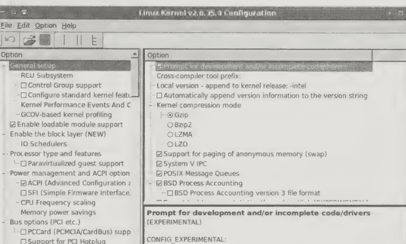

内核配置选项随着内核开发频繁变化，大量的选项使得无法描述所有它们。

### 通用设置 (General Setup)

内核配置选项随着内核开发频繁变化，海量的选项使得无法描述所有它们。内核配置选项随着内核开发频繁变化，大量的选项使得无法描述所有它们。

### 块层 (Block Layer)

内核配置选项随着内核开发频繁变化，大量的选项使得无法描述所有它们。

### 处理器类型和功能 (Processor Type and Features)

内核配置选项随着内核开发频繁变化，大量的选项使得无法描述所有它们。

### 电源管理和 ACPI (Power Management and ACPI)

内核配置选项随着内核开发频繁变化，大量的选项使得无法描述所有它们。

### 总线选项 (Bus Options)

内核配置选项随着内核开发频繁变化，大量的选项使得无法描述所有它们。

### 可执行文件格式 (Executable Formats)

内核配置选项随着内核开发频繁变化，大量的选项使得无法描述所有它们。

### 网络支持 (Networking Support)

内核配置选项随着内核开发频繁变化，大量的选项使得无法描述所有它们。

### 网络 (Networking)

内核配置选项随着内核开发频繁变化，大量的选项使得无法描述所有它们。

### 加密 API (Cryptographic API)

某些内核功能和非内核软件需要内核中存在加密模块。你可以在此这里启用或禁用它们。

### 设备驱动程序 (Device Drivers)

内核配置选项随着内核开发频繁变化，大量的选项使得无法描述所有它们。

### 文件系统 (File Systems)

内核配置选项随着内核开发频繁变化，大量的选项使得无法描述所有它们。

### 内核黑客 (Kernel Hacking)

你可以在此部分设置对内核开发者感兴趣的选项。偶尔非开发者也需要调整此区域的选项，特别是当你使用较旧的内核补丁时。（例如，启用**废弃逻辑**选项是某些第三方驱动程序所需要的）。

## 准备内核

虚拟化（Virtualization）此类类别提供了某些虚拟化功能的支持，用于在 Linux 运行时运行另一个操作系统。

库例程（Library Routines）此部分包含一些其他内核模块或用户空间程序使用的功能。除非你确定应该更改它们，否则请保持默认设置。

某些内核功能尤为重要，因此值得特别提及：

### 通用设置 本地版本 (General Setup Local Version)

你可以使用此选项向内核版本号添加一个字符串。如果你需要尝试内核选项，此功能会非常有用；你可以构建带有不同本地版本字符串的内核，以区分不同的设置，从而保持内核模块目录相互分离，并使用 `uname` 或类似的工具生成不同的内核标识符。

### 通用设置 初始 RAM 文件系统和 RAM 磁盘 (General Setup Initial RAM Filesystem and RAM Disk initramfs/initrd)

如果你打算使用初始 RAM 磁盘（稍后描述，“准备初始 RAM 磁盘”），请确保激活此项。

### 通用设置 启用可加载模块 (General Setup Enable Loadable Module)

除非你打算构建一个仅包含内置驱动程序的内核，否则请确保此选项已启用——对于当今典型的桌面或服务器配置来说，这是一种带有严重缺点的奇怪配置。

### 处理器类型和特性 对称多处理支持 (Processor Type and Features Symmetric Multi-Processing Support)

此选项启用对多个 CPU 或 CPU 核心的支持。大多数现代计算机都有两个或更多核心，因此除非你确定 CPU 只有一个核心，否则激活此项是有意义的。

### 处理器类型和特性 家族 (Processor Type and Features Family)

如果你正在为特定的计算机或一组相同的计算机构建内核，可以通过在此选项中设置 CPU 模型来获得一些额外的性能提升。

### 处理器类型和特性 高内存支持 (Processor Type and Features High Memory Support)

此选项适用于 x86 CPU，但不适用于 x86-64 CPU。你可以根据电脑内存的大小来优化性能。如果内存小于 1 GiB，请选择 `Off`；如果内存在 1 GiB 到 4 GiB 之间，请选择 `4GiB`；如果内存大于 4 GiB，请选择 `64GB`。选择不当可能导致无法使用系统的全部全部内存。

大多数现代计算机都配备了 64 位 x86-64 CPU。在这些计算机上，特别是当内存超过 4 GiB 时。虽然 Linux 在 32 位 x86 CPU 上支持高达 4 GiB 的内存，但这种配置会给内核带来额外负担，并为应用带来微妙的限制。相比之下，64 位 CPU 支持更多的内存，这就是为什么编译 64 位内核时没有“高内存支持”选项——它仅作为旧 32 位 CPU 的变通方案。

### 支持网络 (Supporting Networking)

网络选项 TCP/IP 网络 (Networking Options TCP/IP Networking)

所有现代计算机都需要此选项，因为传输控制协议/网协议 (TCP/IP) 是互联网的基础。此选项包含大量的子选项。请仔细浏览，并根据你对本地网络以及计算机在其中角色的理解，遵循建议或做出你的判断。特别是 IPv6 协议子选项，它控制对下一代 TCP/IP 的支持，这在某些领域已成为必要。

网络支持 > 网络选项 > 网络数据包过滤框架 (Networking Support > Networking Options > Network Packet Filtering Framework)

如果你想配置路由器或在计算机上启用防火墙，此选项至关重要。

网络支持 > 网络选项 > 无线 (Networking Support > Networking Options > Wireless)

如果你的计算机使用无线网络适配器，请确保启用此选项。

### 设备驱动 > SCSI 支持 (Device Drivers > SCSI Support)

小型计算机系统接口 (SCSI) 是一种标准的高端接口。（也用于扫描仪、打印机和其他设备。）虽然在现代计算机中很少见，但 Linux 为许多设备使用了 SCSI 仿真层，包括用于更常见的串行高级设备附件 (SATA) 磁盘接口和 USB 存储设备的驱动程序。因此，在大多数系统中必须启用 SCSI 支持，包括对 SCSI 磁盘的支持，通常还有 SCSI CD-ROM 支持。如果你的系统缺少 SCSI 设备，你通常可以排除 SCSI 低级驱动程序部分，从而在构建时省略大量的 SCSI 驱动程序。

设备驱动 > 串行 ATA 和并行 ATA (Device Drivers > Serial and Parallel ATA)

此部分包含了大多数现代 SATA 和并行 ATA 的驱动程序。在构建过程中，你需要启用这些选项以获取内核的驱动程序。许多 SATA 驱动程序是单独编译的。如果你正在为特定的计算机构建内核，建议将这些驱动程序编译进内核而不是模块。

设备驱动 > 图形支持 (Device Drivers > Graphics Support)

在大多数 x86 系统上，此功能是可选的；但是，为了获得文本控制台，你需要启用这些选项。在某些平台上，你需要直接编译这些驱动程序（将驱动程序编译为模块是安全的）。

设备驱动 > USB 支持 (Device Drivers > USB Support)

此区域包含了低级 USB 硬件的驱动程序（通常构建到主板中）以及某些 USB 设备或类别，例如 USB 质质设备支持。许多 USB 设备也需要内核其他区域的支持。

一旦你检查了所有想要查看的选项，就可以退出配置工具了。它将保存一个新的 `.config` 文件，然后将指导你编译哪些内核功能。

### 编译内核 (Compiling a Kernel)

配置完成后，你可以编译内核并准备系统使用。构建过程非常简单，但你必须将内核文件复制到 `/boot`，安装内核模块，准备初始 RAM 磁盘并修改 GRUB 配置以指向新内核。在某些情况下，你可能还需要准备软件包。

### 构建内核 (Building a Kernel)

要构建内核，请在内核源码目录输入 `make`。假设你已经安装了必要的开发工具且内核配置没有错误，构建过程将顺利进行。此过程不需要你的额外输入，但将花费很长时间——取决于计算机的速度以及你编译的内核功能数量。在进行期间，你会在屏幕上看到摘要行：

```
CC kernel/time/tick-sched.o
LD kernel/time/built-in.o
CC kernel/futex.o
```

这些行总结了正在执行的操作。在大多数情况下，你只需要关注编译正在进行。如果输出停止，可能出现了问题——或者正在编译的文件异常大。

> Linux 内核的默认目标会构建主内核文件和所有独立的内核模块。这等同于输入 `make all`。你可以通过输入 `make bImage` 构建内核或 `make modules` 构建模块来分别构建内核和模块。在某些平台上，你可以用 `make zImage` 代替 `make bImage`。

少数情况下，编译会失败，你会看到错误信息。这可能是因为你使用的编译器比 Linux 内核开发者使用的新或旧。

可能是预期的，也可能是配置中的故障导致的。处理方法没有固定的规则，但你可以尝试以下几种方法来解决问题：

- 如果错误在编译一个对系统并非绝对必需的功能时发生，你可以返回配置工具并将其删除。
- 如果该功能是必需的，你可能通过将其从编译为模块改为编译进内核（或反之）来获得更好的结果。
- 有时，你可能需要追踪某个失败的功能所依赖的另一个功能；通常情况下，开发者会标记此类依赖关系，但偶尔会有某些被遗漏。
- 如果你对内核打了补丁，请检查你的补丁程序。确保你已将补丁应用到正确的内核版本，并双重检查补丁是否成功应用。你可以尝试编译一个未打补丁的内核进行比较。
- 如果你安装了多个版本的 GNU 编译器集合 (GCC)，尝试使用不同的版本来编译内核。
- 尝试编译另一个版本的内核。即使你需要某个特定版本，在编译另一个内核时，你可能也会发现问题来源的线索。


> 你可以将 make 的输出通过 grep 传递来搜索字符串 error

内核编译成功后会在不输出任何消息的情况下终止。如果你输入了 `make bzImage`，你应该看到类似下面的消息：

```
Kernel: arch/x86/boot/bzImage is ready (#1)
```

如果你输入 `make` 来同时构建主内核文件和所有模块，该消息将会被没在输出的很靠后的位置，最后几行可能是与最后几个内核模块编译相关的简单状态消息。

### 安装内核二进制文件

内核编译完成后，你就可以安装它。换句话说，你可以将其从内核源码树中的位置复制到 `/boot` 目录。在大多数平台上，编译完成并就绪可用的内核二进制文件是 `bzImage`，但在某些平台上它可能具有其他名称。（详情请参阅表 2.1。）如果你正在为 x86 或 x86-64 系统编译内核，它将位于内核源码树的 `arch/x86/boot` 子目录下，如编译信息末尾指定的。在其他平台上，位置应该相似，尽管 x86 部分将反映你的 CPU 架构。

### 编译内核

某些发行版和管理员会维护一个独立的 `/boot` 分区，并在大多数时间内保持未挂载状态，以防止意外损坏关键启动文件。如果你的系统如此，请确保在复制新内核之前挂载 `/boot` 分区。如果不这样做，内核将不会位于它应该所在的位置，你的系统将无法正常启动。

你可以像复制其他文件一样将 `bzImage` 文件复制到 `/boot`，尽管你通常需要 root 权限才能执行此操作。你可能想要重命名该文件，添加其版本号，以便多个内核共存。

```
### cp arch/x86/boot/bzImage /boot/bzImage-2.6.35.4
```

记住你复制到内核文件的文件名，因为你之后在将内核添加到 GRUB 配置时会需要它。

除了内核文件，你可能还想复制 System.map 文件。该文件包含指向内核中函数的指针，用于调试内核问题。虽然复制不是至关重要的，但可能会有所帮助。如果系统正在运行，`/boot/System.map` 应该是指向 System.map 文件的符号链接。因此，完全复制并设置此文件需要三个命令：

```
### cp System.map /System.map-2.6.35.4
### rm /boot/System.map
### ln -s /boot/System.map-2.6.35.4 /boot/System.map
```

如果你愿意，可以将这些命令推迟到启动进入新内核后再执行。`make install` 是复制内核文件、复制 System map 文件、创建初始 RAM 磁盘以及为新内核修改 GRUB 配置的快捷方式。细节因发行版而异，因为 install 目标依赖于 `installkernel` 脚本，而许多发行版提供商对其进行了自定义。此选项可以是减少内核准备工作的有用方法；但是，如果你需要自定义安装或者你不确定你的发行版脚本的作用，你可能更倾向于手动执行这些任务。

### 安装内核模块

安装内核模块很简单：以 root 身份输入 `make modules_install`。该实用程序会在 `/lib/modules` 中创建一个以内核版本号命名的子目录，例如 `/lib/modules/2.6.35.4`，然后将内核模块复制到该子目录，并为某些模块创建额外的子目录层级。

如果你忘记安装内核模块，计算机可能无法启动到新内核。如果计算机启动了，任何由模块化驱动程序管理的硬件或其他功能将无法工作。

在运行时，Linux 需要内核模块之间依赖关系的信息。这些依赖关系存储在名为 `modules.dep` 的文件中，存储在内核模块目录。

## 第 2 章 · Linux 内核配置

你可以通过以 root 身份输入 `depmod` 为当前运行的内核重新生成此文件。作为内核安装的一部分，调用 `depmod` 为新内核生成 modules.dep。

> 目标：depmod 指的是 themod 命令。

## 准备初始 RAM 磁盘

初始 RAM 磁盘（又称 initramfs）是一系列引导加载程序访问的关键模块集合。initramfs 的工具随发行版而异；某些发行版提供名为 `genkernel` 的工具。

### 何时应该准备初始 RAM 磁盘？

如果系统使用高级存储（如 SAN 或 LVM），可能需要初始 RAM 磁盘。initramfs 的工具构建在内核。

### 使用 mkinitrd

`mkinitrd` 程序在 Red Hat、Fedora 相关发行版中很常见。使用它时，你必须传递一个初始磁盘名称和一个内核版本，例如：

```
### mkinitrd /boot/initrd-2.6.35.4 2.6.35.4
```

此命令使用 2.6.35.4 内核模块创建 `/boot/initrd-2.6.35.4` 文件。`mkinitrd` 工具支持许多选项，总结在表 2.3 中。

### 表 2.3 mkinitrd 选项

| 选项 | 解释 |
| --- | --- |
| --version | 显示 mkinitrd 版本。 |
| -v | 执行操作时显示详细信息。 |
| --preload=module | 在系统启动前加载模块。该选项可以多次使用。 |
| --with=module | 在系统启动后加载模块。该选项可以多次使用。 |
| --builtin=module | 使 mkinitrd 的行为就像指定的模块已构建进内核，即使它并没有。 |
| -f | 允许覆盖现有的镜像文件。通常，如果存在指定的镜像文件，mkinitrd 会终止操作。 |
| --fstab=filename | 探测文件名以确定哪些文件系统支持。如果省略此选项，则使用 `/etc/fstab`。 |
| --image-version | 在创建镜像之前向 initrd 路径附加内核版本号。 |
| --nocompress | 使镜像不压缩（通常使用 gzip 压缩）。 |
| --nivot | 使初始 RAM 磁盘*不使用* pivot_root 系统。这允许系统与旧的 2.2.x 内核配合，但某些文件系统（如 ext3fs）无法工作。该选项计划在未来删除。 |


| `--omit-lvm-modules` | 从镜像中排除 LVM 模块，即使 `/etc/fstab` 它们需要。 |

| `--omit-raid-modules` | 从镜像中排除 RAID 模块，即使 `/etc/fstab` 它们需要。 |

| `--omit-scsi-modules` | 从镜像中排除 SCSI 模块。 |

### 使用 mkinitramfs

如果你的系统没有包含 `mkinitrd`，它可能依赖于类似的 `mkinitramfs`。它的工作原理相似，不同之处在于你必须使用 `-o` 来指定 RAM 磁盘文件的输出文件名：

```bash
### mkinitramfs -o /boot/initramfs-2.6.35.4.img 2.6.35.4
```

与 `mkinitrd` 一样，有各种选项可以修改程序的行为。这些选项总结在表 2.4 中。

### 表 2.4 mkinitramfs 选项

| 选项 | 解释 |

| :--- | - |

| `-d confdir` | 设置程序的配置文件目录。默认为 `/etc/initramfs-tools`。 |

| `-k` | 导致程序保留创建镜像时使用的临时目录。（该目录通常在镜像创建后被删除）。 |

| `-o outfile` | 设置输出文件名。 |

| `-r root` | 设置 Linux 系统的根根分区。这通常由引导程序传递。 |

| `-V` | 在 `mkinitrd` 执行操作时创建详细的输出。 |

| `--supported-host-version=version` | 查询程序是否可以为运行的指定版本的内核创建 RAM 磁盘镜像。 |

| `--supported-target-version=version` | 查询程序是否可以为指定版本的内核创建 RAM 磁盘镜像。 |

| `version` | 设置内核版本号；在上例示例中为 2.6.35.4。如果省略此选项，将使用当前运行的内核版本。 |

## 准备内核包

如果你维护许多 Linux 系统，你可能想为所有系统准备一个内核。为了简化维护，你随后可以将内核打包成 RPM 软件包管理器 (`RPM`) 软件包或 Debian 软件包。这些任务可以通过 Linux 内核源码目录中的 `rpm-pkg`、`binrpm-pkg` 和 `deb-pkg` 目标来实现。这些目标分别创建一个源码 RPM 和二进制 RPM、一个仅二进制 RPM， 以及一个 Debian 二进制包。当然，这些目标要求计算机安装了适当的软件包工具。通过这种方式构建的包将位于你的 RPM 构建目录中（用于 RPM 构建目标），或者位于用于 Debian 目标的 `/usr/src` 目录中。

你可以将二进制包复制到任何具有兼容架构和硬件的计算机上，并像安装发行版维护者提供的二进制内核包一样安装它。然而，你应该确保内核包含了在你打算安装它的所有计算机上使用的所有必要驱动程序和功能。如果你维护的是相同的计算机，这项任务并不困难；你可以在一个系统上测试内核，如果运行正常，就将其打包以供其他系统使用。如果你维护的是具有不同主板、显卡、网络接口和其他功能的计算机，确保兼容性的任务就会更加困难。在这种情况下，内核完全可能在一台计算机上运行良好，但在另一台计算机上完全失败。

> 在基于 RPM 的系统上，使用 `rpm` 的 `-i` 选项安装新内核而不是 `-U`。使用 `-i` 会安装新内核而不替换旧内核。如果你使用 `-U`，旧内核将被删除，如果新内核缺少关键驱动程序，可能会导致系统无法启动。

## 将内核添加到 GRUB

当你的新内核构建完成且所有文件已就位后，是时候将你的新内核添加到你的引导程序配置中了。第 1 章描述了 GRUB Legacy 和 GRUB 2 引导加载器的配置过程，因此你应该参考该章节以了解各种启动选项的含义。

如果你从发行版的包管理器以二进制形式安装了内核，你可能不需要显式编辑你的引导程序配置。此类二进制二进制安装通常会自动更新你的 GRUB 配置。然而，如果你自己构建内核，你几乎肯定需要编辑引导程序配置以包含新内核。

## 将内核添加到 GRUB Legacy

作为一般规则，向 GRUB Legacy 配置中添加新内核最简单的方法是复制现有条目并针对你的新内核进行修改。一个典型的配置如下：

```text
title Fedora (2.6.32)
root (hd0,0)
kernel /vmlinuz-2.6.32 root=/dev/sda5
initrd /initrd-2.6.32
```

要添加新内核，你应该先复制此条目然后进行修改。特别注意以下三个细节：

- 修改标题行（title line），以便能够唯一识别你的新内核。
- 修改内核行上列出的内核文件名，以匹配你的新内核。记住，内核文件名是相对于分区根目录指定的，而不是相对于 Linux 文件系统的根目录。
- 如果新内核使用 RAM 磁盘，请调整 `initrd` 行以指向新文件；或者，如果原始条目中不存在 `initrd` 行，则添加一个 `initrd` 行。如果新内核不使用初始 RAM 磁盘，请确保删除模型条目中存在的任何 `initrd` 行。

发行版维护者提供的 GRUB 条目通常在内核行上包含额外选项或其他功能。大多数情况下，最好在你复制的条目中保留这些额外功能。移除你不理解的选项不会造成任何实际伤害；但有时这些选项对于系统启动至关重要。

你可以像之前在“阅读内核文档”中描述的那样，使用 Linux 内文档研究内核行上传递给内核的选项。

如第 1 章所述，GRUB Legacy 使用默认行来指定默认启动哪个内核。当你添加新内核时，可以将其放置在现有内核之前或之后，取决于你的安排。你可能需要修改默认行以指向新内核；但是，如果新内核无法工作，你需要在重启时手动选择另一个内核。

在你创建新内核时，不要替换最近一次的内核条目，如果新内核无法工作且没有其他选项，你的系统将难以恢复。

## 将内核添加到 GRUB 2

在进行任何 GRUB 2 操作之前，我建议备份 `/boot/grub.cfg`。如果你遇到严重问题，可以使用紧急磁盘恢复旧的配置。

在某些情况下，将内核添加到 GRUB 2 比添加到 GRUB Legacy 更容易。这是因为 GRUB 包含了如 `update-grub` 等扫描内核和非 Linux 系统的脚本。如果自动脚本没有检测到你的内核，有时你可以通过重命名内核以 `vmlinuz` 或 `kernel` 开头来解决问题。

如果你的系统缺少 `/etc/grub.d/40_custom` 文件，或者该文件不包含条目，你可以使用前面的示例作为基础模型，或者查阅 `/etc/grub.cfg` 获取模型。后者可能提供带有附加选项的更复杂模型，这些模型可能比这里显示的示例更好。如果有疑问，你可以创建两个或多个条目并尝试每一个，一旦确定了效果最好的，就可以删除无效或不必要的条目。

如果你现有的 `/etc/grub.d/40_custom` 文件已经包含了此类条目，请将其作为模型；复制它并修改 Linux 行上的内核文件名，以及 `initrd` 行上的 RAM 磁盘文件名——这就是你在适配 GRUB Legacy 条目时必须修改三个细节（尽管 GRUB 2 更改了识别这些条目的关键词）。一个示例条目如下：

```text
entry "Fedora (2.6.35.4)" {
  set root=(hd0,1)
  linux /vmlinuz-2.6.35.4 ro=/dev/sda5
  initrd /initrd-2.6.35.4
}
```

要更改默认内核，你必须编辑 `/etc/default/grub` 文件并更改 `GRUB_DEFAULT` 条目：

```bash
GRUB_DEFAULT=
```

遗憾的是，默认条目的编号在通过输入 `update-grub` 或 `grub-mkconfig` 生成 `/boot/grub/grub.cfg` 文件之前可能很难确定。因此，你可能需要执行此命令，在最终文件中计数条目以确定你想使用哪一个作为默认，然后修改 `/etc/default/grub`，最后再次执行。

再次运行 `update-grub` 或 `grub-mkconfig`。或者，你可以在 `/boot/grub/grub.cfg` 中找到默认项并直接修改它：

```
set default="0"
```

然而，当你（或某些自动化脚本）重新构建 `/boot/grub/grub.cfg` 文件时，这些修改不会被保留。

## 在运行时管理内核模块

早期的 Linux 内核由单个文件组成，由引导程序加载到内存中。虽然现代内核仍然使用这个主内核文件，但 Linux 已经支持内核模块多年了。将大多数驱动程序放在模块中有助于减小主内核文件的大小，允许许多计算机使用同一个“通用”内核而不会让内核体积变得过大，并让用户控制驱动程序何时以及如何被加载。尽管如此，这种方法也需要学习一些关于如何控制模块的。首先，你必须知道如何获取你的内核版本以及当前加载的模块的信息。加载模块对于它们的使用也同样重要，这项任务既可以通过为经常使用的模块配置启动文件完成，也可以通过使用一次性命令完成。同样，在某些情况下，卸载内核模块也可能。最后，某些工具可以帮助你维护内核模块，例如更改默认选项和更新关于可用模块的系统信息。

## 获取有关内核及其模块的信息

在调整内核模块之前，你应该了解一些内核和已安装的模块。这些信息可能非常有帮助，因为它们可以帮助你决定是否有必要加载新模块、其他模块正在使用哪些模块等。

## 学习内核

你可以通过 `uname` 命令获取关于内核的最重要信息：

```
$ uname -a
Linux ness 2.6.35.4 #3 SMP PREEMPT Sun Sep 26 23:32:11 EDT 2010 x86_64
AMD Athlon(tm) 64 X2 Dual Core Processor 5400+ AuthenticAMD GNU/Linux
```

该程序提供了多种类型的信息，你可以通过各种选项告诉它要提供什么信息，如表 2.5 所示。

### 表 2.5 uname 选项

| 短名称 | 完整名称 | 解释 |

| :--- | :--- | :--- |

| `-a` | `--all` | 提供所有可用信息。这通常是一个安全的选项，尽管如果你确切知道需要什么信息，可以使用更具体的选项或一组选项来减少显示内容。 |

| `-s` | `--kernel-name` | 生成内核名称，通常为 Linux。 |

| `-n` | `--nodename` | 显示网络节点的主机名（上一个示例中的 `ness`）。此名称是本地配置的；取决于网络域名系统（DNS）服务器配置和客户端选项，计算机可能无法通过此名称访问。 |

| `-r` | `--kernel-release` | 显示内核发布版本（上一个示例中的 2.6.35.4）。此信息非常重要，因为它可以影响内核可以使用哪些驱动程序模块。 |

| `-v` | `--kernel-version` | 显示额外的内核版本信息。不过，这些信息不包含 `-r` 选项所显示的内核版本号。它包含了内核的编译日期和时间（上一个示例中的 #3 SMP PREEMPT Sun Sep 26 23:32:11 EDT 2010）。 |

| `-m` | `--machine` | 显示 CPU 代码——上一个示例中的 `x86_64` 指的是 x86-64（即 AMD64 或 EM64T）。 |

| `-p` | `--processor` | 显示 CPU 的描述，如上一个示例中的 `AMD Athlon(tm) 64 X2 Dual Core Processor 5400+`。如果你需要知道使用的是特定的 CPU 硬件，这些信息通常非常有帮助。 |

| `-i` | `--hardware-platform` | 显示 CPU 提供的标识字符串——上一个示例中的 `AuthenticAMD`。 |

| `-o` | `--operating-system` | 显示操作系统名称（上一个示例中的 `GNU/Linux`）。这与内核名称（-k 选项）不同，因为它指的是整个操作系统，而不仅仅是内核。 |

| N/A | `--help` | 显示程序选项的摘要。 |

| N/A | `--version` | 显示 uname 版本号。 |

这些选项某些可能看起来很奇怪。毕竟，你可能完全清楚自己正在运行 Linux，为什么要用 `-k` 或 `-o` 选项呢？不过，`uname` 工具在非 Linux 的 Unix 类操作系统上也是可用的，它是跨平台脚本了解其运行操作系统信息的一种方便方法。脚本随后可以调整自身，以便在 Linux、FreeBSD、Solaris、Mac OS X 或其他环境中正确运行。如果你编写了这样的脚本，请注意某些操作系统只支持选项的完整形式（例如，`--operating-system` 而不是 `-o`），在可能运行于 Linux 系统的脚本中，你应该使用完整形式。

对你个人而言，内核发布信息可能是最重要的。第三方内核模块以预编译的形式出现，仅适用于某些内核，如果你的内核版本不匹配，参见前文的“编译内核”。你可能需要像之前描述的那样重新构建正确的版本。如果你不知道这些信息，架构和 CPU 数据也可能很重要。某些程序只适用于特定的 CPU，如果你需要评估一个以前用过的系统的速度，预编译的内核模块通常也适用于一种类型的 CPU。例如。

## 获取内核及其模块的信息

在调整你的内核模块之前，你应该了解一些内核和已安装的模块。这些信息可能非常有帮助，因为它们可以帮助你决定是否有必要加载新模块、其他模块正在使用哪些模块等。

## 学习内核

你可以通过 `uname` 命令获取关于内核的最重要信息：

```
$ uname -a
Linux ness 2.6.35.4 #3 SMP PREEMPT Sun Sep 26 23:32:11 EDT 2010 x86_64
AMD Athlon(tm) 64 X2 Dual Core Processor 5400+ AuthenticAMD GNU/Linux
```

该程序提供了多种类型的信息，你可以通过各种选项告诉它要提供什么信息，如表 2.5 所示。

### 表 2.5 uname 选项

| 短名称 | 完整名称 | 解释 |

| :--- | :--- | :--- |

| `-a` | `--all` | 提供所有可用信息。这通常是一个安全的选项，尽管如果你确切知道需要什么信息，可以使用更具体的选项或一组选项来减少显示内容。 |

| `-s` | `--kernel-name` | 生成内核名称，通常为 Linux。 |

| `-n` | `--nodename` | 显示网络节点的主机名（上一个示例中的 `ness`）。此名称是本地配置的；取决于网络域名系统（DNS）服务器配置和客户端选项，计算机可能无法通过此名称访问。 |

| `-r` | `--kernel-release` | 显示内核发布版本（上一个示例中的 2.6.35.4）。此信息非常重要，因为它可以影响内核可以使用哪些驱动程序模块。 |

| `-v` | `--kernel-version` | 显示额外的内核版本信息。不过，这些信息不包含 `-r` 选项所显示的内核版本号。它包含了内核的编译日期和时间（上一个示例中的 #3 SMP PREEMPT Sun Sep 26 23:32:11 EDT 2010）。 |

| `-m` | `--machine` | 显示 CPU 代码——上一个示例中的 `x86_64` 指的是 x86-64（即 AMD64 或 EM64T）。 |

| `-p` | `--processor` | 显示 CPU 的描述，如上一个示例中的 `AMD Athlon(tm) 64 X2 Dual Core Processor 5400+`。如果你需要知道使用的是特定的 CPU 硬件，这些信息通常非常有帮助。 |

| `-i` | `--hardware-platform` | 显示 CPU 提供的标识字符串——上一个示例中的 `AuthenticAMD`。 |

| `-o` | `--operating-system` | 显示操作系统名称（上一个示例中的 `GNU/Linux`）。这与内核名称（-k 选项）不同，因为它指的是整个操作系统，而不仅仅是内核。 |

| N/A | `--help` | 显示程序选项的摘要。 |

| N/A | `--version` | 显示 uname 版本号。 |

这些选项某些可能看起来很奇怪。毕竟，你可能完全清楚自己正在运行 Linux，为什么要用 `-k` 或 `-o` 选项呢？不过，`uname` 工具在非 Linux 的 Unix 类操作系统上也是可用的，它是跨平台脚本了解其运行操作系统信息的一种方便方法。脚本随后可以调整自身，以便在 Linux、FreeBSD、Solaris、Mac OS X 或其他环境中正确运行。如果你编写了这样的脚本，请注意某些操作系统只支持选项的完整形式（例如，`--operating-system` 而不是 `-o`），在可能运行于 Linux 系统的脚本中，你应该使用完整形式。

对你个人而言，内核发布信息可能是最重要的。第三方内核模块以预编译的形式出现，仅适用于某些内核，如果你的内核版本不匹配，参见前文的“编译内核”。你可能需要像之前描述的那样重新构建正确的版本。如果你不知道这些信息，架构和 CPU 数据也可能重要。某些程序只适用于特定的 CPU，如果你需要评估一个以前用过的系统的速度，预编译的内核模块通常也适用于一种类型的 CPU。例如。

### 真实世界场景

## 内核信息与控制

`/proc` 目录包含了许多提供内核信息并控制许多内核的文件。`/dev` 和 `/sys` 目录是其他虚拟文件系统的示例。你特别感兴趣的是 `/proc/sys/kernel`，它包含了许多允许你查看和调整设置的文件。`/proc` 并不是普通的目录；它是一个虚拟文件系统，意味着它。

## 学习内核模块

你可以通过 `lsmod` 命令了解你系统中当前加载的模块，如后文所述，产生输出如下：

$ lsmod

| 模块 | 大小 | 使用者 |

| :--- | :--- | :--- |

| usb1 | 9283 | 0 |

| e100 | 26134 | 0 |

| r8169 | 31795 | 0 |

| bridge | 40462 | 0 |

| snd_hda_intel | 17848 | 2 |

| sr_mod | 10922 | 0 |

| cdrom | 28375 | 1 sr_mod |

| dm_mirror | 10907 | 0 |


| dm_region_hash | 6280 | 1 dm_mirror |

| dm_log | 7344 | 2 dm_mirror,dm_region_hash |

> 此输出为了简洁进行了编辑。尽管在某些配置下会有这种输出，但很罕见。

`lsmod` 输出中最重要的列是第一列，标记为 Module；该列列出了当前加载的所有模块的名称。你可以通过 `modinfo`（后文介绍）了解更多这些模块，但有时它们的目的是显而易见的。例如，`cdrom` 模块提供了对光驱（或其他光盘）的访问。

`lsmod` 输出的 Used 列描述了正在使用该模块的内容。所有条目都有数字，表示使用该模块的其他模块或进程的数量。例如，在上一个示例中，`usb1` 模块（用于访问 USB 打印机）没有被使用，然而，`snd_hda_intel` 模块（用于访问音频硬件）正被另一个模块使用，如其值为2 所示。如果一个模块被另一个模块使用，该模块的名称将出现在 Used 列中。例如，`sr_mod` 依赖于 `cdrom` 模块，因此后者的模块 Used 列包含了 `sr_mod` 模块名称。这些信息在管理模块时可能非常有用。例如，如果你的系统产生了上述输出，你无法直接移除 `cdrom` 模块，因为它被 `sr_mod` 模块使用，但你可以先移除 `sr_mod` 模块，之后就可以移除 `cdrom` 模块了（不过，这两个模块都需要重新添加才能读取光盘）。

> `lsmod` 命令仅显示内核模块的信息，而不是直接编译到 Linux 内核中的驱动程序。因此，对于同一个硬件，在一个系统上可能需要加载模块，而在另一个系统上不需要，因为第二个系统可能将相关的驱动程序直接编译到了内核中。

你可以借助 `modinfo` 命令学习更多关于内核模块的知识。通常，你输入该命令并加上你感兴趣的模块名称：

```
$ modinfo sr_mod
filename: /lib/modules/2.6.35/kernel/drivers/scsi/sr_mod.ko
license: GPL
alias: scsi:t-0x04*
alias: scsi:t-0x05*
alias: block-major-1-*
license: GPL
description: SCSI cdrom (sr) driver
srcversion: 8817EBCBC63BD4B1608CC70
depends: cdrom
vermagic: 2.6.35 SMP preempt mod_unload modversions
parm: xa_test:int
```

返回的信息通常包括文件名、许可证名称、该模块已知的别名、简要描述、它所依赖的任何模块名称、某些内核版本信息以及传递给模块的参数。返回的确切信息取决于模块；虽然某些模块会省略其中一个或多个字段。如果你对某个字段感兴趣，可以使用 `-F fieldname` 选项指定它，例如使用 `modinfo -F description sr_mod` 来获取 `sr_mod` 模块的描述。`modinfo` 工具对于了解你在 `lsmod` 输出中看到但无法识别的模块非常有帮助。遗憾的是，许多模块缺少有用的描述字段，因此在实践中，`modinfo` 的作用往往没有那么大。

### 加载内核模块

Linux 通过两个程序加载内核模块：`insmod` 和 `modprobe`。`insmod` 程序将单个模块插入内核。此过程要求加载的模块所依赖的任何模块都已加载。相比之下，`modprobe` 程序会自动加载任何依赖模块，通常是执行此工作的首选方法。

在实践中，你可能不需要使用 `insmod` 或 `modprobe` 来加载模块，因为 Linux 可以自动加载它们。这种能力依赖内核的模块自动加载功能（该功能必须编译到内核中）以及各种配置文件（这些文件也是 `modprobe` 和某些其他工具所需的）。使用 `insmod` 和 `modprobe` 对于测试新模块或解决自动加载器的问题很有用。

在实践中，`insmod` 是一个非常易用的程序；你输入它并加上模块文件名：

```
# insmod /lib/modules/2.6.35/kernel/drivers/cdrom/cdrom.ko
```

# 在运行时管理内核模块

此命令加载 `cdrom.ko` 模块，你必须通过文件名指定它。模块也有模块名称，通常与不带扩展的文件名相同，例如 `cdrom.ko` 的模块名为 `cdrom`。遗憾的是，`insmod` 需要完整的模块文件名，这写起来很麻烦——甚至很难找到！你可以通过将额外的模块选项添加到命令行来向模块传递选项。模块选项具有高度特定性，因此你必须咨询该模块的文档以了解传递什么内容。例如，告诉串口驱动程序使用哪个中断来访问硬件，或告诉显卡驱动程序使用什么分辨率的选项。

某些模块依赖于其他模块。在这种情况下，如果你尝试加载一个依赖于其他模块的模块而这些模块尚未加载，`insmod` 将失败。发生这种情况时，你必须手动追踪依赖的模块或使用 `modprobe`。在最简单的情况下，你可以使用 `modprobe` 代替 `insmod`，传递一个模块名称：

```
### modprobe cdrom
```

与 `insmod` 一样，你可以在命令行末尾添加内核选项。与 `insmod` 不同，当你使用 `modprobe` 时，你通过名称而非文件名指定模块。通常来说，这使得 `modprobe` 更易使用，`modprobe` 自动加载依赖项也是如此。这种便利性意味着 `modprobe` 依赖于配置文件，正如“维护内核模块”中所描述的那样。这也意味着你可以使用选项（放在命令名和模块名之间）来修改 `modprobe` 的行为，如表 2.6 所示。

# 表 2.6 modprobe 的常用选项

| 短选项 | 长选项名称 | 解释 |

| :--- | :--- | :--- |

| -v | --verbose | 此选项显示 `modprobe` 操作的额外信息。通常包括对执行的每个操作的摘要。 |

| -C | --config filename | `modprobe` 程序使用名为 `/etc/modprobe.conf` 的配置文件。你可以通过使用此选项传递新文件来更改该文件，例如 `modprobe -C /etc/modprobe.conf cdrom`。 |

| -n | --dry-run | 此选项导致 `modprobe` 执行检查和除实际插入以外的所有操作。你可能会结合 `-v` 使用它以查看 `modprobe` 在不实际加载模块的情况下会做什么。这在调试时可能很有帮助，特别是当插入模块产生某些不利影响（例如禁用磁盘访问）时。 |

# 表 2.6 modprobe 的常用选项（续）

| 短选项 | 长选项名称 | 解释 |

| :--- | :--- | :--- |

| -r | --remove | 此选项反转 `modprobe` 的通常效果；它导致程序移除指定的模块及其依赖的任何模块（如果依赖的模块正在使用中，则不会被移除）。 |

| -f | --force | 此选项告诉 `modprobe` 强制加载模块，即使内核版本与模块指定的未匹配。此操作具有潜在危险，但在使用第三方纯二进制模块时有时需要。 |

| N/A | --show-depends | 此选项显示指定模块依赖的任何模块。 |

| -l | --list | 此选项列出匹配通配符的模块。例如，`modprobe -l v*` 显示所有以 `v` 开头的模块。 |

> 注意：表 2.6 的选项并不完整。其他选项相对冷门，你可能并不需要它们。请参考 `modprobe` 的手册页获取更多信息。

# 移除内核模块

在大多数情况下，你可以让模块无限加载；模块加载但未使用的唯一危害是消耗少量内存（`insmod` 显示每个模块消耗的内存）。尽管如此，有时你可能想要移除加载的模块。原因包括回收少量内存、卸载旧模块以便加载更新模块，以及移除你认为不可靠的模块。

卸载内核模块的工作由 `rmmod` 命令完成，它是 `insmod` 的相反。`rmmod` 命令接受名称而非文件名。

```
### rmmod cdrom
```

此示例命令卸载 `cdrom` 模块。可以通过多种方式修改 `rmmod` 的行为，如表 2.7 所示。

# 表 2.7 rmmod 的选项

| 短选项名称 | 长选项名称 | 解释 |

| :--- | :--- | :--- |

| -V | --verbose | 此选项导致 `rmmod` 显示有关其操作的额外信息。这在排查问题时可能很有帮助。 |

| -f | --force | 此选项即使模块被标记为在使用中也强制移除。自然地，这是一个非常危险的选项，但当模块以更危险的方式故障时，它很有用。只有在启用 `CONFIG_MODULE_FORCE_UNLOAD` 选项时，此选项才有效。 |

| -w | --wait | 如果模块在使用中，此选项导致 `rmmod` 等待模块变为闲而不是返回错误消息。一旦模块不再被使用（例如在尝试移除 `cdrom` 模块后卸出了光盘），`rmmod` 然后卸载模块并返回。在此之前，`rmmod` 不返回，看起来没有在做任何事情。 |

| -s | --syslog | 使用此选项可以将错误消息发送系统日志而不是标准错误输出。这对于在 cron 中运行的脚本可能有用。 |

| -V | --version | 此选项显示 `rmmod` 程序的版本号。 |

与 `insmod` 一样，`rmmod` 操作于单个模块。如果你尝试卸载一个被其他模块依赖或使用的模块，`rmmod` 将返回错误消息（`-w` 选项会修改此行为，正如前面所述）。如果该模块被其他模块依赖，这些模块将被列出，因此你可以决定是否卸载它们。如果你想

## 第 2 章 · Linux 内核配置

要卸载整个模块栈——即一个模块以及它所依赖的所有模块——你可以使用 `modprobe` 命令和 `-r` 选项，如之前在“加载内核模块”中描述的那样。

## 练习 2.1

### 管理内核模块

为了学习内核模块，实验非常有帮助。这个练习将为你提供一些实践经验。假设你有一台电脑，其 `cdrom` 驱动被编译为模块。如果你的电脑的光驱驱动程序是直接构建在内核中的，或者你没有光驱器，你可能需要选择不同的模块进行实验。

在开始之前，你应该找到一张光盘（根据你的硬件能力选择 CD-ROM、CD-R、DVD 或蓝光光）。按照目前的写法，音乐 CD 将无法用于此过程。拿着光盘后，按照以下步骤操作：

- 1. 将光盘插入驱动器并等待访问指示灯熄灭。

- 2. 通过以 root 身份登录或输入 root 密码获取 root 权限。你必须以 root 身份输入所有后续命令。

- 3. 以 root 身份输入 `mount /dev/cdrom /mnt/cdrom` 挂载光盘。根据电脑配置，你可能需要更改设备文件名或挂载点。此外，某些 Linux 系统配置为自动挂载光盘，因此此步骤可能是必要的。

- 4. 输入 `lsmod | grep cdrom` 查看与 `cdrom` 模块相关的 `lsmod` 输出，除非驱动程序被编译进主内核文件，否则它应该是使用状态的。此命令还将显示与光驱设备相关的总线驱动——`sr_mod` 或 `ide_cd_mod`。

- 5. 输入 `rmmod cdrom`。程序将显示 `cdrom` 正在被总线驱动使用。

- 6. 输入 `rmmod sr_mod`（将 `sr_mod` 更改为 `ide_cd_mod` 或步骤 #5 中确定的其他名称）。程序将响应该模块已加载，但不会说明原因。因为该模块正在被非模块子系统使用。

- 7. 输入 `umount /mnt/cdrom`，必要时更改挂载点。

- 8. 重复步骤 #5 和 #6。这一次，步骤 #6 将成功。然后你可以输入 `rmmod cdrom` 卸载模块，并将执行成功。此步骤说明了通过在每个单独模块上使用 `rmmod` 来移除模块栈的长路径方法。

- 9. 输入 `modprobe -v sr_mod` 再次加载光驱模块栈。（必要时为你的系统更改 `sr_mod`）。如 `-v` 选项生成的输出所示，`sr_mod` 和 `cdrom` 模块都将被加载。。

- 10. 再次挂载你的光盘并使用 `ls` 检查其内容以验证其运行正常。

### 在运行期间管理内核模块

- 11. 输入 `umount /mnt/cdrom` 卸载光盘。

- 12. 输入 `modprobe -v -r -sr_mod`（必要时更改 `sr_mod`）。此操作将同时卸载 `sr_mod` 和 `cdrom`，说明了快速卸载模块栈的方法。原则上，如果其他模块被 `sr_mod` 或 `cdrom` 使用且未被其他任何使用，它们也可能被卸载。

- 13. 输入 `lsmod | grep cdrom` 验证 `cdrom` 是否已卸载：输出将为空。

- 14. 输入 `modprobe sr_mod` 恢复光驱模块栈，以确保在你完成此练习后它能正常工作。

你当然可以对额外的内核模块进行实验；但是，要小心：某些模块对于系统的正常运行是必要的，绝不应该被移除。在大多数情况下，`rmmod` 或 `modprobe` 都不会允许你移除该模块，风险很低。然而，有时你会移除一个模块，结果发现它对于某些并非显而易见的事情是需要的。例如，如果你使用 `usbp`，你可能不会立即发现问题，但随后如果你尝试连接 USB 打印机，尝试可能会失败。在最坏的情况下，重启电脑应该使其恢复正常功能。较不激进的步骤，如重新加载模块并重启任何依赖于它的服务，通常可以解决问题。

## 维护内核模块

`lsmod`、`modprobe` 和 `rmmod` 等工具对于管理内核模块非常有用。然而，这些工具依赖于配置文件，了解如何维护这些文件对于保持你的模块顺利运行至关重要。这些大多数文件以及帮助修改它们的工具，只有在你集合中添加或删除模块后才需要操作。然而，有时你可能通过传递内核选项来更改模块的操作方式；如果你没有重新编译、添加、替换或删除模块，就可以这样做。

## 内核模块维护工具和文件

有两个文件帮助管理重要的内核模块功能：

**模块依赖** 模块依赖存储在 `modules.dep` 文件中，该文件位于你的主模块目录 `/lib/modules/version`，其中 `version` 是内核版本号。这个数字包含了特定发行版的代码。你通常不直接编辑此文件，而是使用 `depmod` 来处理。以 root 身份输入 `depmod` 将为当前内核目录中的模块重建 `modules.dep` 文件。此操作在安装内核模块时也会自动发生，如之前在“安装内核模块”中描述的。

**模块配置** 主模块配置文件为 `/etc/modules.conf` 或 `/etc/modprobe.conf`。该文件持有模块别名。旧的发行版称为 `/etc/modules`，但这个名称已过时。该文件的格式异常复杂，但大多数更改都相对简单，如稍后在“向内核传递选项”中所示。许多现代发行版将小文件放在 `/etc/modules.d` 或 `/etc/modprobe.d`。有时工具 `depmod` 会从目录生成 .conf 文件，但其他时候直接使用文件。

## 向内核传递选项

你可以通过 `insmod` 或 `modprobe` 向内核传递选项；然而，Linux 通常在你尝试使用设备时自动加载模块。当这种情况发生时，你无法向内核传递选项。相反，你必须编辑 `/etc/modules.conf` 或 `/etc/modprobe.conf`（或 `/etc/modules.d` 或 `/etc/modprobe.d` 中的文件）来告诉系统你想要的选项。为此，你必须添加一行选项，例如：

`options sisfb mode=1280x1024 rate=75`

此行为 `sisfb` 模块指定选项，它是 SiS 帧缓冲驱动——即处理某些 SiS 芯片组的文本模式。（帧缓冲区也可以通过 X 帧缓冲区使用，但更多是直接驱动硬件）。此示例向 `sisfb` 模块传递了两个选项：`mode=1280x1024` 和 `rate=75`。这些选项告诉驱动以 1280 × 1024 的分辨率和 75Hz 的刷新率运行。

遗憾的是，驱动选项是非常取决于驱动的。例如，如果你使用 `vesafb` 驱动（适用于许多 VESA 兼容显卡）而不是 `sisfb` 模块，你就不会使用 `mode` 和 `rate`；相反，你会使用 `vga`，它接受一个数值来设置视频模式。了解你想使用的选项的最佳方法是咨询该驱动的文档，如之前在“阅读内核文档”中描述的。如果你需要为没有标准内核的驱动传递选项，请咨询随附它的文档。

一旦你对此文件进行了更改，你应该输入 `depmod`，如果想要影响的模块行为已加载，则卸载它。当你重新加载它时，新选项应该生效。少数模块（例如帧缓冲区驱动）在加载后无法轻易移除，因此你可能需要重启电脑才能使更改生效。

## 总结

Linux 发行版通常提供预编译的内核，在大多数情况下你可以直接使用它们而无需进行修改；然而，有时有必要升级内核。如果你只需要获取一个修复 Bug 的更新，可以使用你的发行版提供商提供的内核来实现；但是，如果你需要新内核的功能，或者需要对某个特殊功能应用源码补丁，你就必须获取内核源码，对其进行编译，并手动安装。这项任务中最困难的部分是内核配置，因为有成千上万的内核选项。幸运的是，你可以可以使用正在运行的内核配置作为模板，当你的系统没有使用其中任何选项时，通常可以禁用大组的选项。内核配置完成后，构建和安装内核只需执行几个命令。将内核添加到 GRUB 配置中则需要更多努力；这项任务通常涉及复制一个配置然后针对新内核对其进行修改。

内核运行后，它仍然需要管理。你可以使用 `uname` 命令识别你正在使用的内核。你还可以使用 `insmod`、`modprobe` 和 `rmmod` 命令来加载和卸载内核模块，这些模块管理特定的硬件设备、文件系统和其他功能。模块有时需要选项来调整它们管理职责的方式。这些选项可以传递给 `insmod` 或 `modprobe` 命令行，也可以输入到模块配置文件中，例如 `/etc/modprobe.conf`、`/etc/modules.conf` 或位于 `/etc/modprobe.d` 或 `/etc/modules.d` 子目录下的文件。

### 考试要点


总结内核二进制文件的常见名称和位置。内核二进制文件通常位于 `/boot`，尽管有时也存储在根目录 `(/)` 中。预编译二进制通常被称为 `vmlinuz` 或 `vmlinuz-version`，其中 `version` 是内核版本号。本地编译的内核经常被称为 `zImage` 或 `zImage-version`（在冷门平台或非常旧内核上）或 `bImage` 或 `bImage-version`（在 x86 和 x86-64 系统上）。偶尔也会使用通用 `kernel-version`。`vmlinux` 文件是一个在过程后期生成的未压缩内核；它添加的特性很少，并且它会被压缩以创建其他形式。

描述你在哪里可以找到关于内核功能的文档。内核文档出现在 `/usr/src/linux/Documentation` 目录树中。这些文档大部分是高度技术性的编程信息，但其中一部分为系统管理员描述了内核和模块选项。大多数内核功能还包含简要的摘要描述，当你点击基于 X 的配置工具中的相关选项时（或在运行 `menuconfig` 时选择 Help 选项），这些描述就会出现。该配置工具对于决定是否编译某项功能或一组功能非常有用。

描述你为什么可能想要重新编译内核。重新编译内核允许你升级到最新内核，并为你的系统优化内核。本地编译的内核可以包含你切需要的那些驱动程序和其他功能，还可以根据 CPU 特性进行编译以适应你的系统。

解释内核补丁文件的功能。内核补丁文件是一个单一文件，编码了两个内核版本之间的更改。来自主站的补丁允许你快速、低带宽地下载内核更改，前提是你已经有了较新的版本并想升级到更新的版本。来自第三方的补丁允许你向内核添加不寻常或正在开发中的驱动程序或功能。

总结内核编译过程。要编译内核，你必须下载内核源码、解压源码、执行 `make xconfig`（或类似的命令）为你的系统配置内核、执行 `make` 构建内核、执行 `make modules_install` 安装内核模块，然后将内核文件复制到方便的位置（通常是 `/boot`）。你必须重新配置你的加载程序以启动新内核并重启系统。

描述 Linux 内核的常用目标。`mrproper` 移除所有临时和配置文件，而 `clean` 仅移除临时文件。`oldconfig` 更新你从一个构建复制的 `.config` 文件，以包含当前内核的选项。`config`、`menuconfig`、`xconfig` 和 `gconfig` 允许你调整将要构建的内核选项。`zimage` 和 `bImage` 目标构建内核本身，而 `modules` 构建内核模块。`modules_install` 将内核模块安装到 `/lib/modules/`。

解释如何创建初始内存磁盘。内存磁盘可以使用 `mkinitrd`、`initramfs` 或类似的工具创建。你必须向该工具传递内存磁盘的文件名和内核版本号，以及可选的控制程序活动的命令行选项。

总结用于加载和卸载内核模块的工具。`insmod` 和 `modprobe` 加载内核模块。`insmod` 工具通过文件名加载单个内核模块，而 `modprobe` 通过模块名加载模块及其所有依赖项。`rmmod` 命令移除单个内核模块，前提是它没有被使用；如果 `modprobe` 可以移除模块栈，则带有 `-r` 选项调用它。

描述如何学习模块接受什么内容。你可以使用 `modinfo` 工具获取模块的技术信息，包括它接受的选项。此工具列出的参数可能有点晦涩，为了获得更清晰的解释，你应该在 `/usr/src/linux/Documentation` 中查找文档。

解释系统中安装了哪些模块。`lsmod` 命令显示当前加载模块的信息，包括它们的名称、消耗的内存、是否在使用以及哪些模块依赖于它们。注意，直接构建在内核中的驱动程序不会出现在此列表中！

### 复习题

+ 1. 在 x86 系统上，本地编译的、启动的 Linux 内核的惯名称是什么？
  A. `/boot/vmlinuz`
  B. `/boot/bzImage`
  C. `/boot/vmlinuz own`
  D. `/boot/zImage`

+ 2. 关于 `/src/linux` 的下列陈述哪个正确？
  A. 它是已准备的符号链接。
  B. 它包含了其他架构的内核。
  C. 它持有内核的源码。
  D. 由于其内容敏感，不应被任何人访问。

+ 3. 你可以在哪个目录中查找可以应用的选项？
  A. `/boot/`
  B. `/lib/modules`
  C. `/share/`
  D. `/etc/modules.conf`

+ 4. 哪种类型的内核镜像在 x86 上被 bImage 取代了？
  A. `vmlinux`
  B. `zImage`
  C. `initramfs`
  D. `initrd`

+ 5. 在配置内核后，执行下列命令中的哪一个可以编译主内核及其模块？
  A. `make bzImage`
  B. `make modules`
  C. `make xconfig`
  D. `make`

+ 6. 下列哪些内核功能应该编译进内核？
  A. ATA 控制器或 SCSI 适配器驱动
  B. 根文件系统支持
  C. USB 端口驱动
  D. 显帧驱动

+ 7. 你编译并安装了新内核 2.6.35.4。你现在想准备一个内存磁盘。根据你的发行版，下列哪两个命令可以？
  A. `mkinitrd -o /boot/initrd-2.6.35.4`
  B. `mkinitrd /boot/initrd-2.6.35.4 2.6.35.4`
  C. `mkinitramfs /boot/initramfs-2.6.35.4 2.6.35.4`
  D. `mkinitramfs`

+ 8. 从旧内核拷贝配置文件后，在 /src/linux 中执行下列哪个命令，可以使用旧内核的选项并更新新内核的配置？
  A. `make config`
  B. `make allconfig`
  C. `make oldconfig`
  D. `make mrproper`

+ 9. 在下列种情况下，补丁内核意义最小？
  A. 你有最新的内核源码，并需要添加该版本没有的新内核功能。
  B. 你有最近的内核，但驱动程序有 Bug。修复程序在较后的内核中可用，并作为你当前内核的补丁可用。
  C. 你有 2.6.36 内核源码并想升级到 2.6.36.1。
  D. 你有来自发行版维护者的内核，并想为你的系统编译“通用”内核。

+ 10. 你下载了 `patch-2.6.35.4.bz2` 文件。在补丁操作中你会使用哪个程序来处理该文件的压缩？
  A. `bunzip2`
  B. `gunzip`
  C. `tar`
  D. `cpio`

11. 使用下列哪个命令可以利用交互式文本模式工具配置 Linux 内核？
- A. `make xconfig`
- B. `make menuconfig`
- C. `make config`
- D. `make textconfig`

12. 你已经配置并编译了新内核，版本 2.6.35.4。现在你输入 `modules_install`。你可以在哪里找到模块文件？
- A. `/lib/modules/`
- B. `/usr/src/linux/2.6.35.4`
- C. `/lib/modules/2.6.35.4`
- D. `/usr/lib/2.6.35.4`

13. Linux 内核源码树中的哪个文件存储了配置选项？
- A. `kernel.conf`
- B. `configure`
- C. `.config`
- D. `linux.conf`

14. 在复制现有的 GRUB Legacy 配置条目后，为了使新条目与新内核协同工作，最重要的是修改的三个功能是什么？
- A. 标题（title）、内核文件名和 initrd 文件名
- B. 标题、内核文件名和内核根节点（root entry）
- C. 内核选项（kernel options）、initrd 文件名和 initrd 选项。
- D. 内核文件名、内核选项和 initrd 选项。

15. 输入 `uname -a` 时，你会看到什么？
- A. 当前用户用户名的信息，包括用户的真实姓名
- B. 运行的系统信息，例如操作系统、内核版本和 CPU 类型
- C. 本地定义的计算机主机名信息
- D. 已加载模块的信息，包括它们所依赖的模块

16. `insmod` 和 `modprobe` 之间最重要的实际区别是什么？
- A. `insmod` 卸载单个模块，而 `modprobe` 加载单个模块。
- B. `insmod` 加载单个模块，而 `modprobe` 加载一个模块及其依赖的所有模块。
- C. `insmod` 不是一个 Linux 命令，但 `modprobe` 加载一个模块及其依赖的所有模块。
- D. `insmod` 加载单个模块，而 `modprobe` 显示有关模块的信息。

## 第 2 章 · Linux 内核配置

17. 你输入命令 `rmmod id_core`，但系统返回消息 `ERROR: Module id_core is in use via82cxxx, id_cd, id_de_disk`。此响应的含义是什么？
- A. `via82maxx`、`id_cd` 和 `id_disk` 模块都依赖 `id_core`，因此在不先卸载这些其他模块的情况下，无法卸载 `id_core`。
- B. `id_core` 模块依赖于 `via82cxxx`、`id_cd` 和 `id_disk` 模块，因此在不先卸载 `id_core` 的情况下，无法卸载它们。
- C. `id_core` 模块是核心模块，意味着它一旦加载就永远无法卸载。
- D. `id_core` 模块存在 Bug 或 `rmmod` 工具损坏了；它不应该返回错误消息。

18. 你可以编辑哪些文件来更改自动传递给内核模块的选项：（选择所有项）
- A. `/etc/modules.d` 目录下的文件
- B. `modules` 目录下的 `modules.dep`
- C. 内核目录下的 `.config`
- D. `/etc/modules.conf`

19. 你有两台计算机，它们具有相同的母板和 DVD 驱动器。它们都运行 2.6.35.4 内核，该内核在每个系统上独立进行了配置和编译。在其中一台（计算机）上，输入 `lsmod` 输出包含 `cdrom` 模块。在另一台（计算机）上，即使在使用 DVD 驱动器，输入 `lsmod` 产生也不包含名为 `cdrom` 的模块。这种差异的原因是什么？
- A. `cdrom` 驱动程序用于访问 CD-ROM 设备而非 DVD 驱动器，因此它在 computer a 上存在而在 computer b 上不存在并不重要。
- B. computer a 中的“DVD”驱动器显然是伪造的，因为它的使用不触发 `cdrom` 驱动程序的加载。
- C. `cdrom` 驱动程序在 computer a 上作为模块编译，但在 computer b 上它被编译进了主内核文件中。
- D. 在 computer b 上使用驱动器之前，必须输入 `insmod cdrom`，否则数据传输将损坏。

20. 下哪个文件包含输入 `-v` 可获得的相同信息？
- A. `/usr/src/linux/Documentation/variables`
- B. `/lib/modules/verbose`
- C. `/etc/kernel/verbose`
- D. `/proc/sys/kernel/version`

## 复习题答案

- 1. C. 本地编译的 Linux 内核通常称为 `/boot/bzImage` 或 `/boot/bzImage-version`，其中 version 是版本号。`vmlinux` 文件是一个完整但不可引导的内核镜像，用于生成其他格式的镜像，选项 A 是错误的 `/boot/vmlinux` 或 `/boot/vmlinux-version` 是发行版的内核，而不是本地编译的内核，选项 B 是错误的。`/usr/src/linux-version` 名称属于 Linux 内核源码目录，而不是编译文件，选项 D 是错误的。

- 2. A. 选项 A 正确描述了 `/usr/src/linux` 的状态。选项 B 是错误的，`/usr/src/linux` 通常指向 Linux 内核之一。选项 B 对于 `/usr/src` 可能是，但选项 C 是错误的，尽管它是 Linux 内核源码树。

- 3. C. `.config` 文件持有内核的配置选项。选项 A、B 和 D 都是虚构的。（注意，许多非内核包包含一个 `configure` 文件，但这是一个用于为你的系统配置软件的脚本。）

- 4. D. 内核文件名、内核选项和 initrd 选项。

- 5. C. `cdrom` 驱动程序在 computer a 上作为模块编译，但在 computer b 上它被编译进了主内核文件中。

- 6. B. `insmod` 加载单个模块，而 `modprobe` 加载一个模块及其依赖的所有模块。

- 7. A. `via82cxx`、`id_cd` 和 `id_disk` 模块都依赖 `id_core`，因此在不先卸载这些其他模块的情况下，无法卸载 `id_core`。

- 8. A, D. `/etc/modules.d` 目录下的文件和 `/etc/modules.conf` 用于更改自动传递给内核模块的选项。

- 9. C. `cdrom` 驱动程序在 computer a 上作为模块编译，但在 computer b 上它被编译进了主内核文件中。

- 10. D. `/proc/sys/kernel/version`

14. A. 应该更改标题，以便在启动时能够识别新内核，并且内核和 initrd（如果存在）的文件名也必须更改，以便使用正确的 RAM 磁盘镜像启动内核。因此，选项 A 是正确的。这三项中的某些项在选项 B、C 和 D 中重复出现，但没有一个选项包含了所有这些项，且每个选项都包含了通常不需要更改的项。内核的根条目和其他选项通常不需要调整，除了 RAM 磁盘的文件名外，initrd 条目通常没有选项。

15. B. `uname` 命令用于显示系统信息，而 `-a` 选项导致它显示所有其设计用于汇总的所有信息。选项 A、C 和 D 都是错误的，尽管其他工具会产生这些结果：`whoami`、`hostname` 和 `lsmod` 分别完成了选项 A、C 和 D的任务。

16. B. `modprobe` 选项总结了这两个命令的主要动作。这部分正确；`modprobe` 加载你指定的模块以及依赖于它的模块。选项 A 还声称 `insmod` 在需要时加载模块。选项 C 声称 `insmod` 不是一个真实的命令，但它确实是。选项 D 说 `modprobe` 显示有关模块的信息，但它并不会；该功能由 `modinfo` 处理。

17. A. `rmmod` 工具只能删除未被其他模块或其他系统软件使用的模块。在这种情况下，错误消息表明所指定的模块依赖于 `idle_core`，因此你无法通过卸载这些模块来导致该依赖关系被破坏。选项 B 反过来指定了这种依赖关系。虽然某些模块一旦加载就很难删除，但它们并不像选项 C 指定的那样被称为“核心模块”。`rmmod` 工具可以在你要求它执行无法执行的操作时返回错误信息，这与（原文缺失）相反。

18. D. `/etc/modules` 配置文件控制模块的自动加载以及自动给模块的选项。在许多发行版中，你不需要直接这样做；然而，某些发行版要求你编辑 `/etc/modules.d` 中的文件，然后输入 `modules-update` 来更新系统模块配置本身。选项 B 中提到的 `modules.dep` 文件指定了模块依赖关系，而不是给模块的选项。内核的 `.config` 文件控制编译哪些内核特性；它并没有指定给模块的选项。

19. C. `insmod` 命令显示内核模块的信息，但不是显示构建在内核文件中的驱动程序。根据问题中提供的证据，可以安全地得出 `cdrom` 驱动程序构建在主内核文件中，正如选项 C 指定。`cdrom` 驱动程序用于访问 CD-ROM 和 DVD 设备，与选项 A 和 B 相反。尽管如选项 D 建议输入 `insmod cdrom` 在某些情况下可能是必要的，但问题指明驱动器正在使用中，因此这在计算机上显然是不必要的。此外，如果有必要但输入 `insmod cdrom`，将导致无法访问驱动器，而不是数据损坏。

20. D. `/proc/sys/kernel` 目录包含了许多关键内核功能的信息。这些功能中的许多一个可以通过专用工具（包括 `uname`）进行访问和更改，指定的命令显示了选项 D 中指定的文件内容。选项 A、B 和 C 中指定的文件都是虚构的。

## 基本文件系统管理

本章涵盖了以下 LINUX 专业人士认证目标：

- `203.1` 运行 Linux 文件系统（权重: 4）
- `203.2` 维护 Linux 文件系统（权重: 3）
- `203.3` 创建和配置文件系统选项（权重: 2）
- `203.4` udev 设备管理（权重: 1）

Linux 文件存储在一个或多个文件系统中，文件系统是大型数据数据结构，允许通过名称访问存储的文件。文件系统需要投入精力来管理和维护。必须注意的特定领域包括挂载文件系统（即通过将磁盘文件系统附加到 Linux 目录来使其可用）、创建文件系统、修复文件系统错误以及对其进行调优以获得最佳性能。

还存在一些特殊文件系统和文件系统的变体。交换空间（Swap space）技术上不是文件系统，但它是磁盘空间，因此也被涵盖在。光盘使用自己特殊的文件系统，这些系统具有独特的配置方法。最后，Linux `udev` 工具创建一个用于访问硬件设备的特殊文件系统。你可以编写 `udev` 规则来调整 Linux 创建的名称和其他特征，以便程序访问硬件。


“文件系统（filesystem）”一词有两个含义。首先，正如上述描述，指的是与文件存储区域相关的低级磁盘数据结构。第二个含义是指整个 Linux 目录树，例如 Linux 文件系统中的 `/etc` 目录包含配置文件。并不是每一个低级数据结构意义上的文件系统都有这样的 `/etc` 目录，但每个高级 Linux 根文件系统都有一个目录。这种区别通常在上下文中很清楚，但在可能产生混淆时，使用额外或不同的术语来澄清问题；例如，我可能会使用“低级”或“高级”术语来指“文件系统”一词的具体含义。

### 使文件系统可用

“文件系统（filesystem）”一词有两个含义。首先，正如上述描述，指的是与文件存储区域相关的低级磁盘数据结构。第二个含义是指整个 Linux 目录树，例如 Linux 文件系统中的 `/etc` 目录包含配置文件。并不是每一个低级数据结构意义上的文件系统都有这样的 `/etc` 目录，但每个高级 Linux 根文件系统都有一个目录。这种区别通常在上下文中很清楚，但在可能产生混淆时，使用额外或不同的术语来澄清问题；例如，我可能会使用“低级”或“高级”术语来指“文件系统”一词的具体含义。

## 识别文件系统类型

Linux 支持相当多的系统，既有原生的也有为其他设计的。后者中的某些在 Linux 下运行良好，并且支持 Linux 期的所有功能。

Ext2fs 第二扩展系统（ext2fs 或 ext2）是传统的 Linux 文件系统。它是为 Linux 创建的，并在 90 年代是主流文件系统。Ext2fs 具有良好的声誉。它已被其他文件系统取代。特别是，ext2 可以作为你选择的小型 `/boot` 分区以及小型（小于 GB）移动磁盘的良好选择。在小型分区上，其他文件系统使用的日志大小可能是一个真正的问题，因此不带日志的 ext2 是更好的选择。（日志记录是一项能够在断电、系统崩溃或意外断开硬盘连接后实现更快速恢复的功能。）ext2fs 文件系统类型为 `ext2`。

Ext3fs 第三扩展系统（ext3fs 或 ext3）基本上是带有日志的 ext2fs。结果是一个与 ext2fs 一样可靠，但在断电和系统崩溃后恢复更快的文件系统。ext3 文件系统类型为 `ext3`。

Ext4fs 第四扩展系统（ext4 或 ext4）是该文件系统的下一代版本。它增加了处理非常大磁盘（超过 32 TB）或非常大文件（超过 2 TB）的能力，以及用于提高性能的扩展。它的文件系统类型为 `ext4`。

ReiserFS 该文件系统从零开始设计为 Linux 的日志文件系统，并在该领域是一个受欢迎的选择。它特别擅长处理包含大量小文件（小于 32KB）的文件系统，因为 ReiserFS 使用各种技巧将文件的末端挤进对方的未使用空间中。当文件很小时，这些微小的节省可以累积成文件大小的很大比例。你应该使用 `reiserfs` 作为该文件系统的类型代码。

JFS IBM 为 AIX 开发了日志文件系统，随后在 OS/2 上重新实现了它。OS/2 随后被赠送给了 Linux。JFS 是一种技术复杂的日志文件系统，如果你熟悉，可能会对它特别感兴趣

## 第 3 章 - 基础文件系统管理

如果你在使用 AIX 或 OS/2，或者想在带有这些操作系统之一的双启动系统中使用一种高级文件系统。正如你所预期，该文件系统的类型代码为 `jfs`。

Silicon Graphics (SGI) 为 IRIX 操作系统创建了扩展文件系统 (XFS)，后来像 IBM 一样，它将代码捐赠给了 Linux。与 JFS 类似，XFS 也是一个在技术上非常复杂的文件系统。XFS 在 IRIX 上以健壮性、速度和灵活性闻名，但某些使其在 IRIX 上非常灵活的 XFS 特性在 Linux 下的支持并不良好。请使用 `xfs` 作为该文件系统的类型代码。

Btrfs 该文件系统（读音为 "butter ess" 或 "bee tree ess"）是一种高级文件系统，其功能灵感源于 Sun 的兆字节文件系统 (ZFS)。与 ext4、JFS 和 XFS 一样，Btrfs 性能优异，并能够处理大磁盘。截至 2.6.34 内核，Btrfs 还被认为是实验性的；然而，它的高级特性使其成为当前文件系统的可能继任者。

在实践中，管理员选择 `ext3fs`、`ext4fs` 或 `ReiserFS` 作为主文件系统；然而，JFS 和 XFS 工作良好，某些管理员更倾向于它们，特别是在存储大文件的大型磁盘上。（Ext4 可以处理大文件，但它比 JFS 和 XFS 新，且使用较少）。关于每个文件系统优劣的硬性数据很难获得，即使有了，你仍可能持怀疑态度，因为文件系统的性能与许多其他因素相互作用。例如，正如前面提到的，ReiserFS 可以比其他文件系统在较小空间内挤入更多小文件，但如果你存储的是较大的文件，这个缺点并不重要。

> 如果你正在使用非 x86 或非 x86-64 平台，请务必检查该平台上的文件系统开发情况。一个文件系统在某个 CPU 上可能快速且可靠，但在另一个 CPU 上可能运行缓慢且不可靠。

除了这些 Linux 原生文件系统外，你可能偶尔需要处理其他一些文件系统，包括以下：

- FAT 文件分配表 (FAT) 文件系统老旧且无处不在。它是 DOS 和 Windows 9/Me 支持的唯一磁盘。由于这个原因，每个主流操作系统都理解 FAT，这使其成为在移动式磁盘上交换数据的极佳文件系统。FAT 在两个正交维度上变化：文件系统命名后 FAT 数据结构的大小（ 12 位、16 位或 32 位指针），以及对长文件名的支持（或不支持）。Linux 会自动检测 FAT 大小，因此你可能不需要担心这个。要使用原始的 FAT 文件名（所谓的 8.3 文件名），请使用 Linux 类型代码 `mdos`。要使用 Windows 风格的长文件名，请使用文件系统类型代码 `vfat`。一种名为 `umdos` 的仅限 Linux 的文件名系统支持额外的 Linux 特性——足以让你可以在 FAT 分区上使用 Linux。由于缺乏维护，umdos 驱动已在 2.6.11 版本中从 Linux 内核中移除。

- NTFS 新技术文件系统 (NTFS) 是 Windows NT/200x/XP/Vista 的优文件系统。遗憾的是，Linux 对 NTFS 的支持相当原始。截至 2.6.x 内核系列，Linux 可以可靠地写入 NTFS 并覆盖现有文件，但 Linux 内核无法向 NTFS 分区写入文件。

如果你必须为双启动系统拥有良好的 NTFS 读/写支持，请查看 NTFS-3G，它由 Tuxera (http://www.tuxera.com) 提供专有和开源（“社区版”）版本。这是一个位于用户空间而非内核空间的读/写 NTFS 驱动。它被某些 Linux 发行版作为默认 NTFS 驱动。

- HFS 和 HFS+ Apple 在其 Mac OS 中使用了层级文件系统 (HFS)，Linux 提供了 HFS 的读写支持。但这种支持没有 Linux 对 FAT 的读写支持那么可靠；在与 Mac 用户交换文件时，你可能想使用 FAT。Apple 有 HFS+（又扩展 HFS），它是 Mac OS 系统的默认文件系统。Linux 2.6.x 添加了有限的 HFS 支持；但写支持仅配合 HFS+ 日志才能工作。

- ISO-9660 光光（CD-ROM）的标准文件系统是 ISO-9660。该文件系统有几个级别。第 1 级类似于 FAT，只支持 8.3 文件名。第 2 级和第 3 级增加了对 32 字符文件名的支持。Linux 使用其 `iso9660` 文件系统类型代码支持 ISO-9660。Linux 的 ISO-9660 支持还支持 Rock Ridge 扩展，Rock Ridge 是 ISO-9660 的扩展，使其能够支持 Unix 风格的长文件名、权限、符号链接等。如果光盘包含 Rock Ridge 扩展，Linux 将自动检测并使用它们。

- Joliet 该文件系统的用法非常类似于 Rock Ridge，作为 ISO-9660 的扩展。Joliet 由微软为 Windows 创建的，但它强调文件系统特性而非 Linux 特性。Linux 将 Joliet 作为其 iso9660 驱动的一部分的一部分；如果光盘包含 Joliet 但没有 Rock Ridge，Linux 将使用 Joliet 文件系统。

- UDF UDF 是光盘的下一代文件系统。它通常用于 DVD-ROM。Linux 支持它，但读/写支持仍处于起步阶段。

### 使文件系统可用

除了这些磁盘文件系统外，还存在其他类型。网络文件系统，例如服务器块公共互联网文件系统 (SMB/CIFS) 和网络文件系统 (NFS)，允许一台计算机访问另一台的磁盘。这些协议在第 8 章“配置文件服务器”中描述。虚拟文件系统为内核功能或硬件提供了文件访问。正如“使用 udev 管理设备”章节所示，udev 是虚拟文件系统的重要示例。

## 挂载文件系统

Linux 提供 `mount` 命令将文件系统挂载到挂载点。在实践中，使用此命令通常很简单，但它支持许多选项。

### 理解 mount

`mount` 的语法如下：

```
mount [-a rsvw] [-t ftype] [device] [mountpoint]
```

参数支持许多功能，如表 3.1 所示。通常情况下，使用 `mount` 时需要一个设备文件名（如 `/dev/sda1`）和一个挂载点（如 `/mnt/odesisk`）。但正如后面提到的，这种规则也有例外。表 3.1 中的 `mount` 参数列表并不完整：请咨询 `mount` 的 man 页获取某些更冷门的选项。

表 3.1 mount 选项

| 短选项名称 | 长选项名称 | 解析 |
| --- | --- | --- |
| -a | --all | 此参数导致 `mount` 挂载 `/etc/fstab` 文件中列出的所有文件系统，该文件指定了常用的分区和设备。后续章节“永久挂载文件系统”将描述该文件的格式。 |
| -r | --read-only | 此参数导致 Linux 以只读方式挂载文件系统，即使它通常是读写系统。 |
| -v | --verbose | 与许多命令一样，此选项会产生详细输出——程序在操作发生时提供注释。 |
| -W | --rw | 此参数导致 Linux 尝试以读写模式挂载文件系统。大多数文件系统的默认设置，但某些实验性驱动默认为只读操作。-o rw 选项具有相同的效果 |

### 使文件系统可用

| 短选项名称 | 长选项名称 | 解释 |
| --- | --- | --- |
| -t filesystem | --types filesystem | 使用此参数指定文件系统类型。常见的文件系统类型在上文“识别文件系统类型”中已描述。如果省略此参数，Linux 将尝试自动检测文件系统类型。 |
| -L label | N/A | 如果你使用此选项，可以通过人类可读的标签而不是设备文件名来指定文件系统。 |
| -U uuid | N/A | 你可以使用此选项通过一个特殊的数字代码来指定文件系统。 |
| -o options | --options options | 你可以使用此参数传递额外的特定于文件系统的选项。 |

> 注意
>
> Linux 需要内核或作为内核模块的支持来挂载特定类型的文件系统。如果缺少此类支持，Linux 将拒绝挂载该文件系统。

`mount` 命令最常用的用法很少使用几个参数，因为 Linux 通常在检测文件系统类型方面做得很好，且默认参数工作得相当理想。例如，考虑这个示例：

```bash
# mount /dev/sdb7 /mnt/shared
```

该命令将 `/dev/sdb7` 的内容包含 `/mnt/shared`，自动检测文件系统类型并使用默认选项。通常，只有 root 用户可以发布挂载命令；但是，如果 `/etc/fstab` 中指定了 `user` 或 `owner` 选项，普通用户可以使用简化语法挂载文件系统，只需指定设备或挂载点，而不必同时指定。例如，如果 `/etc/fstab` 将 `/mnt/cdrom` 指定为挂载点并使用了 `user,users`，用户可以执行 `mount /mnt/cdrom` 来挂载 CD-ROM。

> 注意
>
> 大多数 Linux 发行版都带有自动挂载支持，这使得操作系统在插入可移动介质时自动挂载它们。在 GUI 环境中，插入磁盘后还可能打开一个文件浏览器。为了弹出磁盘，用户将需要使用 `umount` 卸载文件系统（稍后会描述），或者通过在桌面环境中选择一个选项。

挂载点通常是一个空目录。如果你指定一个带有文件的目录作为挂载点，当你将文件系统挂载到该目录时，这些文件似乎会消失。尽管如此，这些文件仍然存在，它们会被挂载的文件系统所隐藏。要访问这些隐藏文件，你必须卸载隐藏它们的文件系统。

## 了解 mount 选项

当你需要使用特殊参数时，通常是为了添加特定于文件系统的选项。表 3.2 总结了最重要的文件系统选项。其中某些选项仅在 `/etc/fstab` 文件中才有意义，该文件将在后文“永久挂载文件系统”中讨论。

**表 3.2** `mount` 命令的重要文件系统选项

| 选项 | 支持的文件系统 | 描述 |
| --- | --- | --- |
| defaults | 所有 | 导致此文件系统的默认选项。它主要用于 `/etc/fstab` 文件，以确保文件包含选项列。 |
| loop | 所有 | 允许你将一个文件挂载为类似于磁盘分区。例如，`mount -t vfat -o loop image.img /mnt/image` 将文件 `image.img` 挂载为类似于磁盘。 |
| auto or noauto | 所有 | 在启动时或 root 用户执行 `mount -a` 命令时挂载或不挂载文件系统。默认是 `auto`，但 `noauto` 适用于可移动介质。用于 `/etc/fstab`。 |
| user or nouser | 所有 | 允许或禁止普通用户挂载文件系统。默认是 `nouser`，但 `user` 通常适用于可移动介质。用于 `/etc/fstab`。当包含在此文件中时，`user` 允许用户输入 `mount /mountpoint`（其中 `/mountpoint` 是分配的挂载点）来挂载磁盘。只有挂载该文件系统的用户可以卸载它。 |
| users | 所有 | 与 `user` 类似，区别是一旦文件系统挂载，任何用户都可以卸载。 |
| owner | 所有 | 与 `user` 类似，区别是只有挂载该文件系统的用户可以卸载它。 |
| remount | 所有 | 在不重新挂载的情况下更改分区的的一个或多个挂载选项。 |
| ro | 所有 | 以只读模式挂载文件系统。 |
| rw | 所有 | 以读写模式挂载文件系统。 |
| uid=value | 所有 | 设置文件系统的所有者。 |
| gid=value | 所有 | 设置文件系统的组 ID。 |
| umask=value | 所有 | 设置默认权限掩码。 |
| dmask=value | 所有 | 设置目录权限掩码。 |
| fmask=value | 所有 | 设置文件的权限掩码，类似于 `umask`，但仅作用于文件。 |
| dmask=value | 所有 | 设置目录的权限掩码，类似于 `umask`，但仅作用于目录。 |
| conv=code | 大多数用于 Microsoft 和 Apple 系统的文件系统 | 如果 `code` 为 `b` 或 `binary`，Linux 不修改文件内容。如果 `code` 为 `text`，Linux 在 Linux 风格和 DOS 风格的换行符之间进行转换。如果 `code` 为 `a` 或 `auto`，除非是二进制格式，否则 Linux 应用转换。最好保持默认值，二进制文件转换可能会对某些应用程序和文件类型产生严重问题。 |
| norock | iso9660 | 禁用 ISO-9660 的 Rock Ridge 扩展。 |
| nojoliet | iso9660 | 禁用 ISO-9660 的 Joliet 扩展。 |


某些文件系统支持此处未描述的额外选项。`mount`的手册页涵盖了部分内容，但你可能需要查看文件系统的文档。这些文档可能出现在`/usr/src/linux/Documentation/filesystems/usr/`，其中`fname`是文件系统的名称。

## 永久挂载文件系统

`/etc/fstab`文件控制 Linux 如何提供分区和可移动设备的访问。Linux 支持统一的目录结构，其中每个磁盘设备（分区或可移动磁盘）都挂载在目录树的特定点。例如，你可以通过`/media/usb`访问 USB 驱动器。该树的根目录是`/`。根目录下的目录可以是其他分区或磁盘，也可以是普通目录。例如，`/etc`应该与`/`在同一个分区，但其他目录（如`/home`）可能对应独立的分区。`/etc/fstab`文件描述了这些文件系统的布局。（文件名`fstab`是`filesystem table`的缩写）。

`/etc/fstab`文件由一系列行组成，每行包含六字段；字段之间用一个或多个空格或制表符分隔。以井号（`#`）开头的行为注释，会被忽略。列表 3.1 显示了`/etc/fstab`文件的示例。

### 列表 3.1: /etc/fstab 示例

| 设备 | 挂载点 | 文件系统 | 选项 | dump | fsck |
| :--- | :--- | :--- | :--- | :--- | :--- |
| `/dev/sda1` | `/` | `ext3` | `defaults` | 1 | 1 |
| `UUID=3631a288-673e-40f5-92e6-6539fec468e9-` |  |  |  |  |  |
| `/usr /home` | `reiserfs` | `defaults` | 0 | 0 |
| `/dev/sdb5` | `/windows` | `vfat` | `uid=500,mask=0` | 0 |  |
| `/dev/cdrom` | `/media/cdrom` | `iso9660` | `users,noauto` | 0 | 0 |
| `/dev/sdb1` | `/media/usb` | `auto` | `users,noauto` | 0 | 0 |
| `server:/home` | `nfs` | `users,exec` | 0 |  |  |
| `//winsr/shr /other/win` | `cifs` | `users,credentials=/etc/creds` | 0 | 0 |
| `/dev/sda4` | `swap` | `defaults` | 0 | 0 |

该文件中每个字段的含义如下：

**设备 (Device)** 第一列指定设备。这些通常是设备文件名，通过标签（`LABEL`）或通用唯一标识符（`UUID`）引用硬盘、软磁盘和其他分区，例如列表 3.1 中的`LABEL=/home`和`UUID=3631a288-673e-40f5-92e6-6539fec468e9`条目。当 Linux 遇到此类条目时，它会尝试找到具有指定名称或 UUID 的分区并挂载它。这种做法有助于减少分区编号变化时产生的问题，但某些文件系统缺少这些标签。也可以链接网络驱动器，例如`server:/home`（它是计算机服务器上的 home 导出）；或`//winsr/shr`（它是 Windows 或 Samba 服务器上名为 winsr 的共享）。

理论上，每个文件系统的 UUID 在全球范围内都是唯一的，可以作为`/etc/fstab`中用作良好标识符。相比之下，设备文件名会在你重新划分磁盘、添加磁盘或删除磁盘时发生变化。`blkid`程序返回分区的 UUID 和文件系统类型，如果你想自己使用 UUID 规范，这会非常有用。类型`blkid`是一个设备规范，例如`/dev/sda1`。

**挂载点 (Mount Point)** 第二列指定挂载点；在统一的 Linux 文件系统中，这是分区或磁盘的挂载位置。这应该是另一个文件系统中的一个空目录。根（`/`）文件系统是一个例外。交换空间也是如此，它由`swap`条目指示。

**文件系统类型 (Filesystem Type)** 文件系统类型代码与使用`mount`命令挂载文件系统时使用的类型相同。你可以使用任何可以直接与`mount`命令使用的文件系统类型。`auto`文件系统类型代码允许内核自动检测文件系统类型，这对于可移动介质设备来说是一个方便的选项。尽管，自动检测并不适用于所有文件系统。

**挂载选项 (Mount Options)** 大多数文件系统支持挂载选项，这些选项修改内核处理文件系统的方式。你可以指定多个挂载选项并用逗号分隔，如列表 3.1 中`/media/cdrom`和`/media/usb`的`users`选项。表 3.2 总结了最常用的挂载选项。输入`*man mount*`或咨询特定文件系统的文档以获取更多信息。

**备份操作 (Backup Operation)** 倒数第二个字段包含 1，表示`dump`工具应该备份该分区；包含 0 则表示不需要。这在本质上没有意义（`dump`程序曾是一种常用的备份工具，但现在没那么流行了）。

**文件系统检查顺序 (Filesystem Check Order)** 在启动时，Linux 使用`*fsck*`程序检查文件系统的完整性。第一列指定了检查发生的顺序。0 表示`*fsck*`不检查文件系统。数字越大表示检查顺序越高。根分区的值应为 1，所有其他分区都应该检查。某些文件系统（如 ReiserFS）不应自动检查，其值应为 0。

如果你添加了新硬盘或重新划分现有的硬盘，你可能需要修改`/etc/fstab`。（使用`LABEL`和`UUID`代码可以消除更改的需要，这就是为什么许多现代发行版现在使用这些方法来指定分区。）你也可以编辑`/etc/fstab`来更改其某些选项。例如，在 Linux 中挂载 Windows 分区时，可能需要设置用户 ID 或 umask 以允许普通用户向分区写入。

### 现实场景

#### 管理用户可挂载介质

你可能希望赋予普通用户能够挂载某些分区或可移动介质（例如软磁盘、CD-ROM 和 USB 闪存）。为此，为文件系统创建一个`/etc/fstab`，但务必在选项列添加`user`、`users`或`owner`选项。表 3.2 描述了这三个选项之间的区别。列表 3.1 显示了用户可挂载介质的示例：`/media/cdrom`、`/media/usb`、`/other/home`和`/other/win`。

#### 使用文件器的自动挂载

当你将物理介质（如 DVD）插入 Linux 计算机时，桌面环境会接收有关硬件更改的消息。在更高层级，桌面环境（更准确地说，是文件管理器）接收有关硬件更改的消息。其配置文件决定了这一操作。

当音频 CD、相机和其他某些设备连接到计算机时，用于指定应用程序的对话框；点击相关标签页调整这些设置。

> 在 Thunar 的术语中，可移动媒体（removable media）是指如软盘、CD-ROM 和 DVD 等可以从驱动器插入和移除的介质。相比之下，可移动磁盘（removable disks）是指可以在计算机运行时连接或断开的硬盘或类似设备。示例包括 USB 闪存和外部硬盘。

广义来说，Thunar 和 KDE 的文件管理器 Konqueror 为配置自动挂载选项提供了最多的选项。GNOME 的默认文件管理器 Nautilus 会自动挂载所有介质，包括可移动和不可移动的磁盘；也就是说，如果你使用 GNOME，你可能会看到在 GNOME 中配置的硬盘分区出现在桌面上。

文件管理器的自动挂载程序通常在`/media`目录中创建挂载点，例如`/media/cdrom`；或在文件系统标签之后；或在文件系统的 UUID 之后。

如果你对自动挂载的文件系统使用 UUID 或其他有用名称，请考虑为设备添加文件系统标签。这在创建文件系统时最容易实现；然而，有时可以使用`tune2fs`等工具在事后更改文件系统标签。

文件管理器自动挂载程序挂载的文件系统可以由普通用户卸载，稍后在“卸载文件系统”中描述的那样。文件管理器通常提供某种卸载已挂载文件系统的方法，通常通过右键点击文件系统的图标并选择卸载、弹出或移除文件系统的选项。

##### 使用 autofs

网络文件系统（如 SMB/CIFS 和 NFS）允许一台计算机的用户访问存储在另一台计算机上的文件。这是一项非常有用的功能，但也伴随着某些风险和问题。问题之一是，如果在计算机启动时立即挂载远程文件系统并一直保持挂载状态，当服务器不可用时，可能会遇到奇怪的问题——如`df`等工具可能会长时间并反复轮询服务器。永久挂载远程文件系统会消耗一些网络带宽，如果服务器有大量客户端，这可能是无法接受的。

`autofs`自动挂载程序与 GUI 文件管理器的自动挂载程序不同，它默认是一个纯系统层级工具，没有用户级配置。它并不总是默认安装的，所以你应该首先确保已经在系统上安装了它。（意所料的是，它的包名通常为`autofs`。）

`/etc/auto.master`文件是`autofs`的主配置文件。你的发行版会有一个默认文件，它可能没有定义任何挂载点，尽管它可能包含指向包自带脚本文件`/etc/auto.smb`和`/etc/auto.net`的行。这些脚本设置了`/smb`和`/network`树，它们可以在各种网络上运行，如后文所述。要定义`autofs`应该监控用户活动的目录，你应该在`/etc/auto.master`的末尾为其指定一个基础目录和一个对应的配置文件：

```
/remote /etc/auto.servers --timeout=60
```

在此示例中，`/etc/auto.servers`文件控制`/remote`挂载点。服务器挂载后，它将在 60 秒后（超时值）被卸载。你现在必须创建`/etc/auto.servers`文件，该文件指定了子目录（相对于示例中`/etc/auto.master--remote`里的挂载点）以及它们连接的服务器：

```
music louis.example.com:/home/armstrong/music research -fstype=nfs4 albert.example.com:/home/einstein/data
```

这些示例结合先前的`/etc/auto.master`条目，允许通过`/remote/music`访问`louis.example.com` `/home/armstrong/music`目录，通过`/remote/research`访问`albert.example.com` `/home/einstein/data`目录。第一行使用 NFS 默认值，但第二行增加了强制使用 NFS4 的选项。

`/etc/auto.net`和`/etc/auto.smb`文件是可以像其他`autofs`配置一样调用的脚本。它们提供了动态配置，允许通过主机名和导出名称访问服务器。例如，假设你在`/etc/auto.master`中包含以下行：

```
/network /etc/auto.net
```

如果你的本地网络包含一个名为`multi`的服务器，它通过 NFS 导出`/opt`和`/home`目录，那么这些目录就可以分别作为`/network/multi/opt`和`/network/multi/home`访问，无需进一步配置。`/etc/auto.smb`文件理论上为 SMB/CIFS 共享提供了类似的功能；然而，SMB 安全模型需要用户名和密码，而大多数发行版自带的`auto.smb`文件缺乏对这种 SMB/CIFS 要求的支持。名为`auto.cifs`的 autof 变体可以在`http://www.howtoforge.com/accessing_windows_or_samba_shares_using_autofs`获得，并提供更好的用户名和密码支持。

尽管`autofs`主要用于管理网络系统，你也可以配置它来挂载本地硬件设备。大多数发行版的`/etc/auto.misc`文件提供了一些示例，例如：

```
boot -fstype=ext2 :/dev/hda1nfloppy -fstype=auto :/dev/fd0
```

### 使文件系统可用

要使用此类配置，你会在`/etc/auto.master`中引用`/etc/auto.misc`。这两行将导致`/dev/sda`在启动时挂载，`/dev/fd0`在插入软盘时挂载。在`autofs`运行时，你可以在不重启的情况下更改设备。

大多数发行版的`/etc/auto.misc`文件提供了一些示例，如：

```
boot -fstype=ext2 :/dev/hda1nfloppy -fstype=auto :/dev/fd0
```

（注：原文中包含大量由于 OCR 识别错误导致的重复和混乱文本，已根据技术文档模式和可用片段进行了清理重构。）

## 维护文件系统

你并不总是可以卸载文件系统。最常见的情况是如果文件系统上有任何文件处于打开状态，你的`umount`命令将失败：

```bash
### umount /home
umount: device is busy.
(在某些情况下，可以通过 lsof(8) 或 fuser(1) 找到关于使用该设备的进程有用信息)
```

如果你想卸载文件系统，你应该找到正在使用该系统的任何进程并终止它。错误信息提示，`lsof`和`fuser`命令有时对这项任务很有用；它们分别用于列出打开的文件和列出使用文件的进程。如果无法卸载文件系统，你有时可以使用`mount`命令的`remount`选项将其重新挂载为只读模式：

```bash
### mount -o remount,ro /home
```

如果操作成功，此操作将允许安全地使用某些文件检查实用程序，并降低磁盘在未卸载的情况下强制关机而遭受损坏的概率。

## 维护文件系统

文件系统并不是凭空产生的，也不会通过魔法自我维持；这些任务必须由实用程序完成，而且你必须知道如何操作这些程序。接下来的页面描述了这些任务，包括文件系统的创建、检查和修复文件系统错误，以及调优文件系统性能参数。我还描述了交换空间（swap space）的创建和使用，它在技术上不是文件系统，但是一个重要的数据结构，可以像文件系统一样存储在分区。

### 创建文件系统

大多数文件系统（包括所有 Linux Native文件系统）都有 Linux 工具可以在分区上创建文件系统。通常，这些工具的文件名采用`mkfs.fst`，其中`ftype`是文件系统类型。这些工具也可以通过名为`mkfs`的前端工具调用；你通过`-t`选项将文件系统类型传递给`mkfs`：

```bash
### mkfs -t ext3 /dev/sda6
```

> 对于 ext2、ext3 和 ext4 文件系统，通常使用`mke2fs`程序代替`mkfs`。`mke2fs`程序仅仅是`mkfs.ext2`的另一个名称。

此命令在`/dev/sda6`上创建 ext3 文件系统。取决于文件系统、磁盘速度和分区大小，此过程可能从几分之一秒到一分钟多不等。大多数文件系统工具支持额外的选项，其中某些选项会大大增加构建文件系统的时间。特别是`-c`选项被多个文件系统支持。该选项导致工具使用`badblocks`程序执行坏块检查——分区中的每个扇区都会被检查，以确保它可以可靠地存储数据。如果不能，该扇区将被标记为坏道且不再使用。

如果你执行了坏块检查并发现某些扇区是坏的，那么硬盘的寿命可能不长。有时这类问题由其他问题引起，例如电缆损坏。

在常见的 Linux 文件系统中，`ext2fs`、`ext3fs`和`ext4fs`在它们的`mkfs`工具中提供了最多的选项（事实上，这些工具是同一种；程序只是根据你想要的名称创建一个具有相应特性的文件系统）。你可以输入`mkfs.ext2`来学习这些选项，大多数选项处理的是晦涩或不重要的功能。其中一个值得关注的选项是`-m percent`，它设置了预留空间百分比。其理念是你你不希望磁盘被用户文件完全填；如果磁盘开始接近满，Linux 应该在磁盘真正满之前报告磁盘已满，这对于普通用户是合理的。这让 root 用户能够在有需要时登录并创建新文件以恢复系统。

`ext2fs/ext3fs/ext4fs`的预留空间默认为 5%，这在大磁盘上意味着相当大的空间。当你想要减少此空间时，可以通过传递`-m 2`将根（`/`）文件系统的比例降到 2%，可能在某些分区上（如`/home`）降得更低（1% 或 0%）。在可移动磁盘上设置`-m 0`是意义的，因为这些磁盘对于系统恢复可能不关键，且初始空间可能会拥挤。

如果文件系统在可移动媒体上，你可能想给它指定一个描述性标签，以便自动挂载程序可以使用标签作为挂载点，正如之前在“使用文件管理器自动挂载”中描述的那样。大多数特定文件系统的创建工具使用`-l`来设置文件系统标签。Reiserfs 和 FAT 是例外；`mkreiserfs`（也是`mkfs.reiserfs`）使用小写选项，例如`-l label`，而`mkdosfs`（也是`mkfs.msdos`或`mkfs.vfat`）使用`-n label`。

除了为 Linux Native 文件系统提供创建工具外，Linux 发行版通常还为各种非 Linux 文件系统提供此类工具。其中重要的一个可能是针对 FAT 的。此任务的主要工具称为`mkdosfs`，但它通常被链接到`mkfs.msdos`和`mkfs.vfat`名称。该程序根据设备大小自动将 FAT 数据结构的大小调整为 12、16 或 32 位。创建处理 Windows 风格（VFAT）长文件名的 FAT 文件系统不需要特殊选项；这些是由`mkfs.msdos`和`mkfs.vfat`工具创建的。

## 练习 3.1

### 创建文件系统

尝试在可移动磁盘上创建文件系统。以下步骤假设你有一个设备。要进行创建，请遵循以下步骤：

1. 以 root 身份登录。

2. 使用`parted`创建分区表。

3. 使用`fdisk`创建分区。

4. 使用`mkfs`创建文件系统。

5. 使用`mount`挂载文件系统。

6. 使用`df`检查文件系统。


7. 使用 `umount` 卸载文件系统。

8. 使用 `fsck` 检查文件系统。

9. 使用 `fsck` 修复文件系统。

10. 使用 `blks` 检查可用空间。

11. 使用 `tune2fs` 修改文件系统参数。

### 检查文件系统错误

人为错误、缺陷、断电、拔掉外部驱动器电缆和其他事件可能导致错误进入文件系统。当这种情况发生时，Linux 将拒绝挂载损坏的文件系统。为了尽量减少数据丢失，请使用以下工具：

- `fsck`: 检查和修复 Linux 文件系统的标准工具。
- `xfs_check`: 用于 XFS 文件系统。
- `btrfs`: 用于 Btrfs 文件系统。

此此目的的主要工具是 `fsck`。该程序是其他工具的前端，例如 `xfs_check`（检查问题）和 `xfs_repair`（修复问题）。`fsck` 的语法如下：

```bash
fsck [-SACVRTNP] [-t ftype] [--fsck-options]] filesystems
```

`fsck` 的常用参数允许你执行某些操作，如表 3.3 所示。通常，当你仅带设备名称运行 `fsck /dev/sda6` 时，你可以根据需要添加选项。查看 `fsck` 的手册页以获取较不常用的选项。

### 表 3.3 fsck 常用选项

| 选项名称 | 解释 |
| :--- | :--- |
| `-A` | 此选项导致 `fsck` 检查 `/etc/fstab` 中标记为要检查的文件系统。这通常用于系统启动脚本。 |
| `-C` | 此选项显示检查过程的文本进度指示器。大多数文件系统检查程序不支持此功能，但 `efsck` 支持。 |
| `-V` | 你可以通过此选项获取详细的进度摘要。 |
| `-N` | 此选项告诉 `fsck` 显示它通常会执行的操作，但不实际执行。 |
| `-t ftype` | 通常，`fsck` 会自动确定文件系统类型。你可以通过 `-t ftype` 标志强制指定。与 `-A` 结合使用时，会导致程序只检查指定的文件系统类型，即使其他类型被标记为要检查。如果 `ftype` 前带有 `no`，则检查除指定类型以外的所有文件系统。 |
| `fsck-options` | 特定文件系统的检查程序通常有自己的选项。`fsck` 命令将它不理解的选项或跟随双横杠 `--` 后的选项传递给底层检查程序。 |
| `filesystems` | 最后参数通常是要检查的文件系统或文件系统的名称，例如 `/dev/sda6`。 |

# 维护文件系统

仅在当前未挂载或以只读模式挂载的文件系统上运行 `fsck`。在正常读写操作期间写入磁盘的更改可能会误导 `fsck` 并导致文件系统损坏。

Linux 在启动时会在 `/etc/fstab` 中标记为需要检查的分区上自动运行 `fsck`，具体见“永久挂载文件系统”章节。`e2fsck` 的正常行为是，如果分区未正常卸载（unclean），它将进行粗略检查。结果是，除非系统没有正常关闭，否则 Linux 启动过程不会因为文件系统检查而延迟。不过，该规则有两个例外：如果磁盘距离上次检查已经过了特定时间（六个月），或者文件系统自上次检查以来挂载次数超过特定次数（20次），`e2fsck` 将强制进行检查。你可以使用 `tune2fs` 更改这些选项，具体见“调整可调文件系统参数”。因此，即使系统完全关闭，你有时仍会看到 ext2fs 和 ext3 分区的自动检查。

日志文件系统即使在计算机没有正常关闭的情况下，启动时也不需要进行文件系统检查。尽管如此，这些文件系统仍需要检查，以纠正由未检测到的故障、错误、硬件问题等引起的问题。如果你在使用日志文件系统遇到异常行为，可能会考虑卸载它并执行文件系统检查——但请务必先阅读文档。某些 Linux 发行版对某些文件系统检查程序采取了特殊处理。例如，Mandriva 使用从 `/sbin/fsck.reiserfs` 到 `/bin/true` 的符号链接。这种配置系统在启动时会检查标记为自动检查的 ReiserFS 分区，但如果你需要手动检查文件系统，这可能会引起困惑。如果是这种情况，请运行 `/sbin/reiserfsck` 完成工作。同样，`/sbin/fsck.xfs` 通常只是一个建议用户运行 `xfs_check` 或 `xfs_repair` 的脚本。

### 调文件系统

文件系统基本上就是数据结构——它们是一种在磁盘上存储数据的方法，以便以后更容易定位数据。像所有数据结构一样，文件系统包含设计上的折中。例如，某个设计特性可能会加速磁盘检查但会消耗磁盘空间。在许多情况下，你除了这些折中外没有选择，但某些文件系统包含工具，允许你设置影响性能的文件系统选项。这对于 ext2fs 以及相关的 ext3fs 和 ext4fs 尤其如此，尽管 XFS、ReiserFS 等也提供了相应的工具。接下来的页面描述了你可以使用的工具，用于获取文件系统信息、调优文件系统性能以及交互式调试文件系统。

# 获取文件系统信息

在开始调整文件系统参数之前，了解文件系统的当前状态通常很重要。各种实用程序可以帮助实现这一目标，对于 ext2fs/ext3fs/ext4fs、XFS 和 ReiserFS。

# 学习 Ext2、Ext3 或 Ext4 文件系统

你可以通过 `dumpe2fs` 命令学习许多关于 ext2、ext3 或 ext4 文件系统的知识。该命令的语法非常直观：

```
dumpe2fs [options] device
```

`device` 是文件系统设备。该命令接受几个选项，这些选项相当晦涩。最重要的选项可能是 `-h`，它导致实用程序省略关于组描述符（group descriptors）的信息（这些信息在高级文件系统调试中有用，但对于基础文件系统调优没有帮助）。更多选项请参阅 `dumpe2fs` 的帮助页。

除非你是文件系统专家并需要调试损坏的文件系统，否则你可能想配合 `-h` 选项使用 `dumpe2fs`。结果大约有几十行输出，每行指定一种文件系统类型，如下：

```
Filesystem volume name: <none>
Last mounted: <not available>
Filesystem UUID: 2e513a47-1e6a-4669-b6d3-07e89ab7ed1
Filesystem features: has_journal ext_attr resize_inode dir_index filetype
extent flex_bg sparse_huge_file uninit_bg dir_dlink extra_isize
Filesystem state: clean
Inode count: 128016
Block count: 512000
Last checked: Mon Sep 20 21:30:42 2010
Check interval: 15552000 (6 months)
Next after: Sat Mar 19 21:30:42 2011
```

这些选项的某些含义是非常是不而易懂的；例如，文件系统上次检查（使用 `fsck`，详见“检查文件系统”章节）是在 9 月 20 日。其他选项就不那么明显；例如，`Inode count`这一行可能会让人困惑。（它是文件系统支持的 inode 数量。每个 inode 包含一个文件的信息，因此 inode 的数量实际上限制了你可以存储的文件数量。）

本章的后半部分节描述了你可能想要更改的一些选项。现在，你应该知道如何使用 `dumpe2fs` 获取有关你文件当前配置的信息。在修改配置时可以使用这些信息；如果你当前的设置看起来合理，你可以置之不管，但如果它们看起来与你的配置不适应，你就可以更改它们。

除非你是文件系统专家并需要调试损坏的文件系统，否则你可能想配合 `-h` 选项使用 `dumpe2fs`。结果大约有几十行输出，每行指定一种文件系统类型，如下：

```
Filesystem volume name: <none>
Last mounted: <not available>
Filesystem UUID: 2e513a47-1e6a-4669-b6d3-07e89ab7ed1
Filesystem features: has_journal ext_attr resize_inode dir_index filetype
extent flex_bg sparse_huge_file uninit_bg dir_dlink extra_isize
Filesystem state: clean
Inode count: 128016
Block count: 512000
Last checked: Mon Sep 20 21:30:42 2010
Check interval: 15552000 (6 months)
Next after: Sat Mar 19 21:30:42 2011
```

# 学习 XFS

大多数文件系统缺乏等效工具，但 XFS 提供了。要调用它，请传递名称：

```
xfs_check [options] device
```

`xfs_check` 程序用于检查 XFS 文件系统的一致性。它应该在未挂载的文件上运行。如果它发现了错误，你可能需要使用 `xfs_repair` 来修复它们。

`xfs_repair` 程序用于修复 XFS 文件系统的错误。它应该只在未挂载的文件上运行。要小心，因为 `xfs_repair` 有时会导致数据丢失。

# 学习 ReiserFS

ReiserFS 提供了一个名为 `debugrefs` 的工具可以显示数据。该程序的语法为：

```
debugrefs [puqS] [B file] [-1 blocknum] device
```

### 表 3.4 debugrefs 常用选项

| 选项名称 | 解释 |
|---|---|
| `-J` | 显示日志头，包含各种文件系统细节。 |
| `-p` | 将文件系统元数据提取到标准输出。你可以将输出重定向到文件，如果你认为发现了 Bug 并发送给 ReiserFS 开发者。 |
| `-u` | 接受 ReiserFS 元数据镜像（通过程序的 -p 选项创建）插入设备。此选项通常用于开发者尝试重建用户的问题。 |
| `-q` | 修改 -p 的行为以抑制默认进度指示器。 |
| `-S` | 修改 -p 的行为以创建更完整的元数据镜像。 |
| `-B file` | 创建包含文件系统中标记为坏块的文件。 |
| `-1 blocknum` | 显示指定磁盘块的内容。 |

# 调整可调文件系统参数

`tune2fs` 程序允许你更改许多由 `dump2fs` 报告的文件系统参数。虽然默认值对于许多目的来说很好，但如果你有特殊需求，你可能需要调整这些选项。

## 表 3.5 tune2fs 的常用选项

| 选项名称 | 说明 |
| --- | --- |
| `-c mounts` | Ext2fs、ext3fs 和 ext4fs 需要使用 fsck 进行定期的磁盘检查。此检查旨在防止错误在未察觉的情况下渗透到磁盘。你可以通过此选项调整磁盘在进行检查之前的最大挂载次数，其中 mounts 是挂载次数。 |
| `-C mounts` | 你可以使用（大写的）-C mounts 选项欺骗系统，使其认为文件系统已经挂载了特定次数；这将计数器设置为 mounts。 |
| `-i interval` | 定期磁盘检查不仅基于时间，还基于挂载次数。你可以通过此选项设置检查之间的时间，其中 interval 是一个带有字符 d、w 或 m 的数字，分别指定天、周或月。 |
| `-j` | 此选项为文件系统添加一个日志文件（journal），从而有效地将 ext2 文件系统转换为 ext3 文件系统。 |
| `-m percent` | 此选项设置为 root 用户预留的磁盘空间百分比。默认值为 5，对于多 GB 的硬盘来说，这个值太大了，因此你可能想将其减小。在存储用户文件的可移动磁盘上，你可能想将其设置为 0。 |
| `-r blocks` | 此选项与 -m 类似，但它将预留块设置为绝对磁盘块数，而不是磁盘空间的百分比。 |
| `-L label` | 你可以使用此选项更改文件系统的标签。标签长度不能超过 16 个字符。 |
| `-U uuid` | 你可以将文件系统的 UUID 改为已知值（例如重新格式化之前的分区 UUID）；或者你可以清除 uuid 让 tune2fs 创建一个全为 0 的 UUID，使用 random 生成一个随机 UUID，或使用 time 根据当前时间生成一个 UUID。你不应该将 UUID 设置为另一个分区上正在使用的值。 |

与大多数低级磁盘工具一样，你不应该使用 tune2fs 来调整已挂载的文件系统。如果你想调整一个关键的挂载文件系统（例如你的根（/）文件系统），你可能需要启动一个紧急磁盘系统，例如 SystemRescueCd (http://www.sysrescd.org)。许多发行版的安装磁盘也可以用于此目的。

## 调整 XFS

如果你使用 XFS，xfs_admin 命令是 tune2fs 的大致等效物。表 3.6 汇总了你可能想要调整的一些 xfs_admin 选项。

## 表 3.6 xfs_admin 的常用选项

| 选项名称 | 说明 |
|---|---|---|
| `-j` | 此选项启用版本 2 日志（journal）格式，在某些情况下可以提高性能。 |
| `-l` | 你可以使用此选项查找文件系统的标签。 |
| `-L label` | 你可以使用此选项更改文件系统的标签。标签长度不能超过 12 个字符。 |
| `-u` | 此选项报告磁盘的 UUID 值（b1kid 工具也会报告任何使用 UUID 文件系统的 UUID）。 |
| `-U uuid` | 你可以使用此选项更改文件系统的 UUID 值。你通常会将 UUID 设置为已知值（例如重新格式化之前使用的分区的 UUID）；或者你可以使用 generate 作为 uuid，让 xfs_admin 创建一个新的 UUID。你*不应该将 UUID 设置为另一个分区上正在使用的值！*| | | |

在实际使用中，xfs_admin 看起来可能像这样：

```
### xfs_admin -L av_data /dev/sda7
writing all S8s
new label = `av_data`
```

此示例将 /dev/sda7 上的文件名称设置为 av_data。与 tune2fs 一样，xfs_admin 应该仅用于未挂载的文件系统。

### 调整 ReiserFS

用于调整 ReiserFS 特性的工具称为 reiserstune。它的用法类似于 tune2fs 或 xfs_admin，通过传递一个或多个选项和一个设备文件名。表 3.7 汇总了更有用的 reiserstune 选项。参考其页面以获取晦涩选项的说明。

## 表 3.7 reiserstune 的常用选项

| 短选项名称 | 长选项名称 | 说明 |
|---|---|---|
| `-u uuid` | `--uuid uuid` | 你可以使用此选项更改文件系统的 UUID 值。你通常会将 UUID 设置为已知值（例如重新格式化之前使用的分区的 UUID）。你*不应该将 UUID 设置为另一个分区上正在使用的值！* |
| `-l label` | `--label label` | 你可以使用此选项更改文件系统的标签。 |

## 维护文件系统

| 短选项名称 | 长选项名称 | 说明 |
| --- | --- | --- |
| `-m mounts` | `--max-mnt-count mounts` | ReiserFS 需要使用 fsck 进行定期的磁盘检查。此检查旨在防止错误在未察觉的情况下渗透到磁盘。你可以通过此选项调整磁盘在进行检查之前的最大挂载次数，其中 mounts 是挂载次数，使用 disable 禁用该功能，或使用 default 恢复编译时的默认值。此选项仅适用于内核 2.6.25 及更高版本。 |
| `-c interval` | `--check-interval interval` | 定期磁盘检查不仅基于时间，还基于挂载次数。你可以通过此选项设置检查之间的时间，其中 interval 是检查之间的最大时间，单位为天， |
| `-C timestamp` | `--timestamp timestamp` | 你可以使用此选项设置最后检查时间，其中 timestamp 是最后检查的时间。你可以使用 disable 禁用该功能，或使用 default 恢复编译时的默认值。此选项仅适用于内核 2.6.25 及更高版本。 |

## 交互式调试文件系统

debugfs 程序是 ext2、ext3 和 ext4 的交互式工具。要使用它，输入其名称后跟设备名：

```
### debugfs /dev/sda1
```

尽管名称相似，debugfs 和 debugiser 有很大不同。正如前面提到的，debugiser 是一个提供 ReiserFS 元数据的工具。使用它时你会看到：

```
debugfs /dev/sda1
```

在 debugfs 提示符下，你可以实现特定的目标：

### 显示文件系统超级块信息

你可以显示超级信息，类似于 dump 命令。

### Inode 信息

你可以通过 stat 显示 inode 数据，其中 filename 是文件名。

### 恢复文件

你可以通过 undelete inode 恢复文件，其中 inode 是 inode 编号。除非你知道文件的编号，否则此用途有限。

### 提取文件

你可以通过 write internal-file external-file 从文件系统提取文件，其中 internal-file 是文件系统的路径，external-file 是主系统上的文件名。此功能在文件系统损坏时非常有用。

### 操作文件

上述大多数命令都在 debugfs 内部运行。你可以使用 cd 切换目录，使用 ln 创建链接，使用 rm 删除文件，依此类推。

### 获取帮助

输入 list、help 或 ? 会产生可用命令摘要。

### 退出

输入 quit 退出程序。

此摘要仅触及 debugfs 能力的冰角。在专家的手中，这个程序可以帮助修复损坏的文件系统，或者至少从中提取关键数据。要了解更多信息，请查看帮助手册（man page）。


虽然 `debugfs` 是一个非常有用的工具，但它具有潜在的危险。除非必要，否则不要使用它，在使用时要非常小心。如果有疑问，请让专家处理。请注意 LPIC 201 考试目标包含 `debugfs`，

XFS 最接近的等效工具称为 `xfs_db`。与 `debugfs` 类似，`xfs_db` 提供了一个访问和操作文件系统的交互式工具；`xfs_db` 提供的适用于初级或中级用户的工具较少。相反，`xfs_db` 是 XFS 专家的工具。

## 管理交换空间

某些分区不存放文件。最著名的是 Linux 使用交换分区，它被视为内存的扩展。Linux 也可以使用交换文件，其工作方式相同。两者都是交换空间的示例。当你运行的程序填满了计算机内存时，Linux 将某些内存内容复制到交换空间，从而让你能够运行比通常多的程序。有时即使你有足够的内存来容纳所有程序，Linux 也会这样做，以释放内存用于磁盘缓冲区，这可以提高磁盘性能。

## 维护文件系统

访问时间。交换空间（swap space）的另一个用途是在使用挂起到磁盘（即休眠）模式时存储系统内存的镜像，这是一种不通过正常关机程序关闭电脑的方法。要使用此功能，你的交换空间至少要与系统内存一样大。

Linux 交换分区通常使用 MBR 类型代码 `0x82`。遗憾的是，Solaris for x86 也使用 `0x82` 这种 MBR 分区类型代码；在 Solaris 中，`0x82` 分区类型代码的这种重含义可能会引起混乱。这在安装操作系统时尤为如此。你可能需要使用 Linux 的 `fdisk` 临时更改分区类型代码，防止 Linux 尝试将 Linux 交换解释为交换空间或数据分区。

虽然交换空间*本身*并不包含文件系统，也不会像文件系统分区那样被挂载，但交换空间确实需要类似于创建文件系统之前的准备工作。此任务通过 `mkswap` 命令完成，通常可以通过传递设备标识符来使用：

```bash
### mkswap /dev/sda7
```

此示例将 `/dev/sda7` 转换为交换空间。存在多个选项，但大多数是晦涩或危险的。`-L` *label* 和 `-U` `uuid` 是你最可能使用的选项；这些选项允许你设置交换空间的标签和 UUID，以便你可以在 `/etc/fstab` 或其他地方通过标签或 UUID 引用交换空间。如果你不使用 `-U` 选项，`mkswap` 会生成一个 UUID。你可以使用 `blkid` 查找交换分区的 UUID。

虽然交换空间通常在分区上创建，但你可以使用 `mkswap` 在交换空间中创建一个普通文件。你可以按照稍后描述的那样，在 `/etc/fstab` 中引用该文件或通过 `swapon` 启用它。如果交换空间耗尽，交换文件会非常方便；你可以快速创建交换文件而无需调整系统。交换文件可以在大多数 Linux 原生文件系统上创建，但某些文件系统不适合存放交换空间。例如，NFS 无法存放交换文件。（即使可以，在网络挂载上放置交换空间也会导致非常糟糕的性能。）

如果你创建了交换文件并对其进行备份，请尽量避免备份该文件；这将浪费备份介质上的空间。同样，备份交换分区也没有意义。

要使用交换空间，你必须使用 `swapon` 命令激活它：

```bash
### swapon /dev/sda7
```

表 3.8 总结了几个交换选项。要永久激活交换空间，你必须在 `/etc/fstab` 中为其创建一个条目，如之前在“永久挂载文件系统”中所描述的。

### 表 3.8 swapon 常用选项

| 短选项名称 | 长选项名称 | 解释 |
| --- | --- | --- |
| -a | --all | 激活 `/etc/fstab` 中指定的所有交换设备。 |
| -e | --if-exists | | 跳过不存在的设备且不显示错误信息。 |
| -L label | N/A | 通过标签而非设备文件名挂载交换空间。 |
| -p priority | --priority priority | 设置从 0 到 32767 之间的优先级值。优先使用优先级较高的交换空间。如果你在不同速度的磁盘上有交换空间，可以使用此功能；为较快的磁盘设置更高的优先级将提高性能。可以通过在 `/etc/fstab` 中设置 `pri=priority` 选项来设置优先级。 |
| -s | --summary | 显示交换空间使用的摘要信息。 |
| -U uuid | N/A | 通过 UUID 而非设备文件名挂载交换空间。 |

要禁用交换空间，你可以使用 `swapoff`：

```bash
### swapoff /dev/sda2
```

你可以在 `swapoff` 中使用 `-a` 选项来禁用所有交换空间。如果你禁用了一个交换文件并打算再也不使用它，请记住删除它以节省磁盘空间。

### 管理光盘

光介质是交换中等大小文件的流行手段。大多数 CD-R 和 CD-RW 介质存储 700MB 文件（旧磁盘为 650MB），可刻录 DVD 格式的容量为 4.7–8.5GB，蓝光光容量为 25–50GB。普通的一次性 CD 和 DVD 价格在 0.10 美元到 1 美元之间，在存储妥当的情况下，可能保持数年到几十年的可读性。但你通常不会像对待软盘那样重命名光盘并向其写入文件；你必须创建一个完整的文件系统并将该文件系统复制（或“刻录”）到光盘上。（后续章节“读取和写入 UDF 光盘”描述了此规则的例外。）此过程需要使用两个工具，`mkisofs` 和 `cdrecord`，或者需要这些工具的变体或前端。

## Linux 光盘工具

Linux 光盘创建过程涉及三个步骤：

- 1. 收集源文件。你必须首先在一个位置收集源文件，通常是你家目录的子目录。
- 2. 创建文件系统。
- 3. 刻录光盘。

## 光盘示例

从 `mkisofs` 开始创建光盘的示例方法如下：

```bash
# mkisofs -J -R -V "volume name" ./
```

## 基础文件系统管理

`-J` `-R` 选项分别启用 Juliet 和 Ridge 扩展，`-V` 选项将卷名设置为你喜欢的任何内容。还有几十可用可用；请查看 `mkisofs` 的手册页。如果程序未设置 SUID 且所有者设置为 root，你必须以 root 身份运行它。

你可以使用 `loop` 选项在刻录之前验证镜像文件。例如，输入 `mount -t iso9660 -o loop image.iso /mnt/cdrom` 将镜像文件挂载到 `/mnt/cdrom`。然后你可以检查所有应该存在的文件。你必须使用 root 使用此选项，或者必须创建适当 `/etc/fstab` 条目。

在刻录 DVD 或蓝光光盘时，你可能需要使用 `growisofs`，它结合了 `mkisofs` 和 `cdrecord` 的功能：

```bash
# growisofs -speed=4 -Z /dev/dvdwr -J -R "volume name" ./
```

### 管理光盘

每个文件仅保留一份；文件系统的写入方式使得它们将唯一的目录结构指向相同的文件。因此，这种多平台光盘所需的额外空间非常极小。你可能希望在此类光盘上使用的功能包括以下内容：

### 跟进符号链接 `mkisofs` 中的 `-f` 选项会导致工具读取符号链接指向的文件并将其包含在 CD-R 中，而不是使用 Rock Ridge 扩展来写入符号链接。跟进符号链接会增加 CD-R 上使用的磁盘空间，但如果你希望符号链接在不支持 Rock Ridge 的操作系统（如 Windows）上产生合理的结果，则需要使用此选项。

### 长 ISO-9660 文件名

通常情况下，`mkisofs` 为基础 ISO-9660 文件系统创建短文件名。长文件名存储在 Rock Ridge或其他文件系统扩展中。你可以使用 `-l` 选项（小写字母 L）将原始 ISO-9660 名称长度增加到 31 个字符。

### Joliet 支持

如前所述，`mkisofs` 中的 `-J` 选项会创建一个带有 Joliet 扩展的镜像。这些扩展不会干扰从不支持 Joliet 的操作系统上读取光盘。

### Rock Ridge 支持

`-R` 和 `-r` 选项都会添加 Rock Ridge 扩展。`-R` 选项添加扩展，但它们使用原始的所有权和权限存储，这在其他计算机上可能是不恰的。使用 `-r` 的工作原理相同，但会将所有文件的所有权更改为 root，赋予所有用户访问文件的权限，并移除写权限。这些功能对于在原作者以外的任何计算机上使用的光盘通常是理想的。

### UDF 支持

你可以通过包含 `-ud` 选项添加对 UDF 文件系统的支持。UDF 是一种“新兴的”光盘文件系统，也是 DVD 的首选文件系统。大多数现代操作系统（包括最近版本的 Linux、Windows 和 Mac OS）都支持 UDF。

### HFS 支持

要创建一个包含 Mac OS HFS 支持的刻盘，请添加 `-hfs` 选项。当你将生成的光盘插入 Macintosh 时，计算机将读取 HFS 文件。这里有几个选项与此项相关：

### 可启动光盘

尽管这不是一个真正的跨平台问题，但可启动光盘非常重要。启动光盘的标准被称为 El Torito 规范。要创建一个 El Torito 光盘，你必须使用 `-b image-file` 选项向 `mkisofs` 传递一个启动镜像，其中 `image-file` 是相对于创建光盘镜像的目录的启动光盘镜像文件名。通常光盘是一个软磁盘镜像；当计算机启动时，它的表现就像你从软磁盘启动一样。如果启动镜像是一个完整的硬盘，请添加 `-hard-disk-boot` 参数；如果是磁盘分区，请使用 `-no-emul-boot` 参数。你可以通过 `dd` 从原始源拷贝创建光盘镜像文件，例如使用 `dd=/dev/fd0.img` 创建软磁盘镜像。

# 读取和写入 UDF 光盘

你可以像上面描述的那样使用 `mkisofs` 中的 `-udf` 选项创建 UDF 光盘；`mkisofs` 将 UDF 作为 ISO-9660 文件系统的补充，且必须使用创建 ISO-9660 光盘相同的基本过程创建。以这种方式创建的光盘可以作为 UDF 挂载，但它将是只读文件系统。

对光盘的完全读写访问（类似于你对 USB 闪存器或其他磁盘的访问）被称为数据包写入（packet writing）。为了获得这种支持，你可以使用 Linux 内核的 UDF 驱动程序、内核的数据包写入支持以及 `udtools` 的组合可以让你像访问普通硬盘一样访问 DVD+RW 驱动器。可以使用这些工具以读写方式挂载 CD-RW 质，尽管你也可以只读方式挂载它。

要开始使用数据包写入功能，你应该首先确保已安装了相关的内核驱动程序和 `udtools`（内核驱动程序包含在大多数发行版的标准内核中）。然后在你的 DVD+RW 光盘上创建一个 UDF 文件系统：

```bash
# mkudffs /dev/dvrw
```

根据需要更改设备文件名。然后你可以挂载光盘、向其拷贝文件、从其删除文件或像使用硬盘一样其他使用它。向 UDF 光盘写入可能非常慢，如果你正在向光盘拷贝许多或大文件，请做好等待的准备。像带有 Rock Ridge 的 ISO-9660 一样，UDF 支持 Linux 风格的所有权权限，因此如果光盘将在其他 Linux 或 UNIX 计算机上读取，你应该记住这一点并恰当地设置所有权和权限。

与使用 `mkisofs` 或 `growisofs` 创建的光盘不同，使用 `mkudffs` 创建的光盘不包含 ISO-9660 文件系统。因此，支持 UDF 的旧操作系统将无法读取 `mkudffs` 创建的光盘。同样，如果你在 `/etc/fstab` 中指定文件系统类型为 `iso9660` 的光盘挂载点，除非你手动指定文件系统类型或在其他位置挂载光盘，否则你无法在 Linux 中挂载此类光盘。你可以在 `/etc/fstab` 中使用 `udf` 或 `auto` 来确保 UDF 光盘可以被挂载。

# 使用 udev 管理设备

大多数文件系统提供访问存储在物理介质上的文件——硬盘、光盘、USB 闪存器等。然而，少数文件系统是虚拟的——它们以类文件的形式访问信息或非磁盘数据。你可能需要配置的一个虚拟文件系统是 `udev`，它控制 `/dev` 目录中的设备文件。这些文件让程序访问计算机硬件——键盘、鼠标、打印机，甚至是“原始”形式的硬盘和分区。

配置 `udev` 需要理解它的功能。然后你可以创建规则来修改 `udev` 的运行方式。如果你遇到问题，可能需要使用工具在连接/卸载设备或加载/卸载相关模块时监控 `udev` 的操作。

# 理解 udev

当 Linux 计算机启动时，内核扫描硬件以查看可用设备。`udev` 子系统会在 `/dev` 虚拟文件系统中大多数硬件设备创建条目。这种设备维护方法使系统能够适应各种硬件，并防止 `/dev` 目录变得杂乱——在 `udev` 之前，Linux 系统对所有常用设备拥有一组固定的 `/dev` 目录项，即使这些设备在计算机上并不。

并不是所有设备都有 `/dev` 目录条目。网络设备（如以太网和 WiFi 端口）是明显的例外。尽管如此，`udev` 处理这些设备；你可以它可以重命名网络设备或确保跨启动的网络设备命名一致。

`/dev` 中的设备命名存在标准。例如，大多数硬盘的名称为 `/dev/sdA` 形式，其中 A 是字母。硬盘上的分区采用相同的名称并增加数字。因此，`/dev/sda` 是第一块硬盘，`/dev/sdb` 是第二块磁盘，`/dev/sda1` 是硬盘上的第一个分区，而 `/dev` 目录还包含子目录，用于存放整个类别的设备文件。表 3.9 展示了一些重要的 Linux 设备文件。在表中，A 指字母，# 指数字，* 指完整的文件名或子目录。表 3.9 是不完全的；还有许多其他设备可用。此外，即使在相同的硬件上，不同发行版之间创建的设备节点也存在差异。

# 表 3.9 Linux Linux 设备文件名

| 设备文件名模式 | 解释 |
| --- --- |
| /dev/sdA | 一整块硬盘，可以通过小型计算机系统接口 (SCSI) 子系统访问。（现代计算机上的许多非 SCSI 磁盘也使用此子系统。） |
| /dev/sda | 一整块硬盘或光盘，可以通过集成设备电子设备 (IDE) 子系统访问。这种寻址方式正变得罕见。 |
| /dev/sda# | 使用 SCSI 子系统的磁盘上的硬盘分区。 |

# 表 3.9 常见的 Linux 设备文件名（续）

| 设备文件名模式 | 说明 |
| :--- | :--- |
| /dev/hda# | 使用 IDE 子系统的磁盘上的硬盘分区。 |
| /dev/fd# | 软盘。 |
| /dev/sr# | 光驱，通过 SCSI 子系统访问。可能还存在名为 /dev/cdrom、/dev/cdrw、/dev/dvd 和 /dev/dvdwr 的一个或多个符号。 |
| /dev/lp1# | 并口。 |
| /dev/usb/lp1# | USB 打印机。 |
| /dev/tty# | RS-232 串口。 |
| /dev/tty/ | 文本模式登录控制台。 |
| /dev/pts/# | 伪终端中的文本模式会、远程登录会、X 文本模式控制台或类似的登录工具。 |
| /dev/bus/usb/* | 此目录提供对 USB 设备的访问。名称通常不包含有用信息 |
| /dev/snd/* | 这些文件提供对你的声卡硬件的访问。 |
| /dev/input/* | 人类输入设备（主要是鼠标）通过这些文件访问。/dev/input/mice 访问所有鼠标，而 /dev/input/mouse# 访问特定的鼠标。 |
| /dev/zero | 读取时，此设备文件会产生一个无尽的二进制 0 值字符串。它可以被用于完全清空文件或分区。 |
| /dev/null | 此文件用于写入，但它连接到任何地方；发送到 /dev/null 的任何数据都会消失。 |

`/dev` 中的大多数设备是字符设备，这意味着你可以一次读取或写入一个字符（字节）数据。示例包括打印机端口、鼠标和控制台。某些设备是块设备，这意味着你必须分块地读取或写入数据。最常见的块设备是磁盘设备。大多数磁盘具有 512 字节的块，但某些磁盘使用更大的块大小。

与 Linux 中的所有文件一样，`/dev` 中的文件拥有所有者、组所有者和权限。这些特性控制着谁可以访问设备。在许多情况下，你不希望普通用户对原始设备具有完全的读/写访问；普通用户可能需要访问声卡硬件设备。`udev` 的一个关键特性是你可以

# 使用 udev 管理设备

可以更改与设备文件关联的默认所有权权限名称，从而将硬件访问权限赋予需要它们的用户。

# 准备创建 udev 规则

`/etc/udev/rules.d` 目录包含一个或多个包含 `udev` 规则的文件。这些文件的命名通常为 ##.rules 形式，其中 ## 是数字，描述是关于文件中包含的规则类型的简短描述。序列号控制了系统启动或设备连接/断开连接到计算机时 `udev` 规则的执行顺序。

要控制 `udev`，你需要了解你的硬件。学习相关属性名称的一种方法是使用 `udevadm` 命令，它有各种子命令可用于检查或操作 `udev` 子系统。特别相关的是 `info` 子命令，它可以配合各种参数显示与任何给定设备关联的属性。下面的命令演示了这种用法，产生与 `/dev/input/mouse` 关联的属性：

```bash
$ udevadm info -a -p -n /dev/input/mouse
```

`udev` 由 `devpath` 指定的设备开始，然后向上遍历父设备链。它会为找到的每个设备打印以 `udev` 规则键值格式的所有可能的属性。匹配规则可以由设备的属性和来自一个父设备的属性组成。

查看设备 '/class/input/'：

```bash
KERNEL==="mouse"
SUBSYSTEM="input"
DRIVER=""
```

查看父设备 '/class/input/'：


```bash
KERNELS==="input"
SUBSYSTEM==="input"
DRIVER=""
ATTR(name)==="Logitech Trackball"
ATTR(phys)==="usb-0000:01-3"
ATTR(uniq)===""
ATTR(modalias)==="input:b003v046e"
```

查看父设备 `/class/input/`：

```bash
KERNELS==="input"
SUBSYSTEM==="system"
DRIVER=""
```

旧版本的 udev 工具程序为每个 udev 操作使用一个独立的程序。`udevinfo` 命令取代了 `udevadm info`。如果你正在使用旧的发行版，可能需要进行这种替换。

如果你想微调 udev 规则，你应该找到将你想影响的设备与其他区分开来的特性。例如，在预测输出时，`ATTRS(name)` 字段在你的系统中必须是唯一的。某些设备会报告序列号、驱动程序名称、供应商 ID或其他特征，这些可以帮助你唯一地标识设备。udev 中的规则由一系列用逗号分隔的键/值对组成，键和值由运算符分隔，如表 3.10 所示。运算符有两种类型：匹配和赋值。匹配运算符用于为赋值运算符指定条件——即当且仅当所有匹配运算符都评估为真时，规则中的赋值运算符才会被激活。 # 表 3.10 udev 运算符

| 运算符 | 类型 | 说明 |
| :--- | :--- | :--- |
| `==` | 匹配 | 比较相等性 |
| `!=` | 匹配 | 比较不相等性 |
| `=` | 赋值 | 将值赋予键，替换旧值 |
| `+=` | 赋值 | 将值添加到键中 |
| `:=` | 赋值 | 将值赋予键 |

注意 `==` 匹配运算符与 赋值运算符之间的差异！这一点很容易被忽略，如果你错了，udev 规则将无法工作。表 3.11 常见的 udev 键

| 键 | 类型 |  |
| :--- | :--- | :--- |
| `LABEL` | 控制 | 用于重定向 udev 规则文件。 |
| `GOTO` | 控制 | 用于匹配的语句。 |
| `WAIT_FOR` | 控制 | 暂停匹配直到指定的文件创建。 |
| `ACTION` | 匹配 | udev 采取的动作，例如 add 用于设备。 |
| `KERNEL` | 匹配 | 设备的名称，例如 sd* 用于磁盘设备。 |
| `DEVPATH` | 匹配 | 设备的路径，例如 /devices/*。 |
| `SUBSYSTEM` | 匹配 | 设备系统的名称，例如 sound 或 net。 |
| `DRIVER` | 匹配 | 设备驱动程序。 |
| `PROGRAM` | 匹配 | 执行外部程序。与匹配键配合时，如果程序返回 0，则视为真。 |
| `RESULT` | 匹配 | 最近一次 PROGRAM 调用输出。 |
| `ATTR(string)` | 匹配或赋值 | 为设备设置任意名称。 |
| `NAME` | 赋值 | 在 `/dev` 中创建的名称（网络设备不创建 NAME 节点，但仍可指定设备名称）。 |
| `SYMLINK` | 赋值 | 在 `/dev` 中创建的符号链接。 |
| `OWNER` | 赋值 | 设备的所有者。 |
| `GROUP` | 赋值 | 设备的组。 |
| `MODE` | 赋值 | 设备的权限。 |
| `RUN` | 赋值 | 要执行的外部程序（全路径）。 |

### 创建 udev 规则

3.2 显示的简单示例演示了如何使用 udev 调整多个节点。你可以在 `/etc/udev/rules.d/99-my.rules` 创建这样的文件。在大多数情况下，你不应该修改标准的 udev 规则，因为它们可能会在系统升级时被替换。

列表 3.2：示例 udev 文件

```bash
SUBSYSTEM!="usb_device", ACTION!="add", GOTO="minolta_rules_end"

# MinoltaIMAGE Scan Elite 5400
ATTR(idVendor)==="0686", ATTR(idProduct)==="400e", SYMLINK+="scan540-"
MODE="0660", OWNER="isa", GROUP="scanner"

LABEL="minolta_rules_end"

# PCI 设备 0xb086:01e30 (e100)
SUBSYSTEM=="net", ACTION=="add", ATTR(address)==="00:03:47:b1:e3:d8"
KERNEL=="eth*", NAME="eth0"

# PCI 设备 0x1ec0:x8168 (r169)
SUBSYSTEM=="net", ACTION=="add", ATTR(address)==="00:e0:04:d3:22:c5"
KERNEL=="eth*", NAME="eth1"
```

#### 使用 udev 管理设备

设备节点的所有权、组所有权和权限，这允许用户 lisa 和 scanner 组的成员访问该设备。该规则还创建一个符号链接 `/dev/scan5400`，指向原始设备节点。请注意，`MODE`、`OWNER` 和 `GROUP` 键使用 `=` 运算符，因为文件只能有一个模式、所有者或组；`SYMLINK` 键使用 `+=` 运算符，因为多个符号链接可以指向同一个设备节点，如果你使用 `=`，你的规则将覆盖其他规则可能创建的任何符号链接——这可能不是你想要的。

接下来的两条规则彼此相似；它们使用硬件地址作为键，为特定的以太网设备指定名称。这种规则在具有多个同类型设备的计算机上很常见。如果没有这些规则，无法保证某个特定设备在每次计算机启动时都具有相同的标识符——也就是说，如果你明天重启电脑，eth0 可能会变成 eth1。虽然这种不一致对于某些设备来说不是问题，但对其他设备来说可能是灾难性的。例如，具有两个接口的计算机可能被用作路由器，你可能会在每个接口上配置特定的地址。其他设备可能需要通过光盘、硬盘、打印机、电视调谐器和扫描仪来区分这些。

> 现代 Linux 发行版通常为网络设备和光盘创建类似于列表 3.2 中最后两条规则的规则。这些规则通常出现在 `/etc/udev/rules.d` 中的 `70-persistent-net.rules` 和 `70-persistent-cd.rules` 文件中。如果你更换硬件，可能会得到新的以太网设备名称或光设备节点，这可能不是一个理想的结果。如果发生这种情况，你应该能够编辑这些文件以产生所需的节点命名（编辑规则，而不要编辑你发行版中预存在的 udev 规则）。这些文件未来可能会被更新，但你的更改通常会保留。

有时，你可能更倾向于创建一个具有独特名称的符号链接，而不是为设备指定常规名称。这种配置将非常类似于列表 3.2 中的 Minolta 扫描仪示例。你可以在软件中使用独特名称（如 `/dev/scan5400`）来引用该设备。

#### 监控 udev 活动

一旦你创建了新的 udev 规则，你就会想要测试它们。你不需要重启或重新任何程序来启用你的规则；只需保存新规则文件即可。然而，你必须重新加载设备使你的规则生效。如果设备是热插拔的（也就是说它可以安全地断开和重新连接），例如 USB 设备，你可以将其拔掉再插回，或者可能关闭电源再重新开启。如果设备不是热插拔的，你可能可以通过卸载和重新加载相关的内核模块来导致 udev 规则重新解释，如第 2 节“Linux 内核配置”所述。如果这是不可行的，你可能需要进入 S 级或 s 层，甚至重启计算机来测试新的 udev 配置。

如果你遇到问题，你可能可以使用 `udevadm` 找到一些线索，这次使用它的监控功能。（此操作可以通过独立的 `udevmonitor` 程序启用；LPI 目标对此如此称。）当你激活设备时，结果可能是一系列下面的几行：

```
KERNEL[1285302053.747336] add /class/input/input7 (input)
KERNEL[1285302053.747891] add /class/input/input7/mouse1 (input)
KERNEL[1285302053.748003] add /class/input/input7/event5 (input)
KERNEL[1285302053.748089] add /class/hidraw/hidraw1 (hidraw)
```

这些行总结了为每个设备创建的信息文件（在 `/class` 和 `/devices` 中，但不在 `/dev` 中）。当设备被移除时，会显示类似的行，但显示的是 `remove` 而不是 `add`。

### 总结

妥善管理 Linux 计算机的文件系统对于计算机的持续实用是必要的。这种管理的最基本的方面是使文件系统可用，这通常通过挂载它们来实现。`mount` 命令将文件系统挂载到挂载点，而 `umount` 命令则取消这种关联。你还可以通过编辑 `/etc/fstab` 文件来永久挂载文件系统，该文件控制计算机启动时挂载哪些文件系统。

当然，如果文件系统没有被创建或严重严重，你就无法挂载它，Linux 提供了工具允许你创建和修复文件系统。具体来说，`mkfs` 创建文件系统，而 `fsck` 检查错误并修复发现的任何错误。（这两个程序都是前端；实际工作是由特定于文件系统的工具完成的，如果你需要，可以直接调用它们。）各种特定于文件系统的工具允许你调整文件系统，例如调整为 root 预留的空间或更改日志功能。光盘上使用的文件系统（ISO-9660）及其扩展，以及新的 UDF 需要特别关注，它们是使用特殊工具（如 `mkiso`）创建的。这些文件系统还以特殊方式写入光盘，使用 `cdrecord` 或 `growisofs`，尽管由于它们已准备就绪，但光盘的挂载和使用方式与其他文件系统并无异。虽然交换空间（swap space）不是一个文件系统，但它是以类似的方式管理的，你应该熟悉 `mkswap`。

#### 考试要点

描述用于挂载的命令。`mount` 命令挂载文件系统。通常，只有 root可以使用此命令，尽管 `/etc/fstab` 包含了相关条目。

总结 `/etc/fstab` 文件。etc/fstab 文件由行组成，每行定义一个挂载。（可能也存在注释行，它们以井号开头。）每行由空格或制表符分隔的六字段组成：设备文件名、挂载点、文件系统类型代码、挂载选项、dump 代码和检查顺序。

解释如何卸载文件系统。`umount` 命令卸载文件系统。该命令接受设备名称或已挂载文件系统的挂载点作为参数。

描述如何创建文件系统。`mkfs` 工具用于创建文件系统。至少你需要使用 `-t` 选项传递文件系统类型代码和设备文件名。

描述如何检查文件系统的错误。`fsck` 工具检查文件系统的错误并修复发现的任何错误。

总结如何创建和管理交换空间。`mkswap` 程序创建交换空间。一旦创建，可以使用 `swapon` 激活或使用 `swapoff` 禁用。

描述用于创建光盘的工具。`mkisofs`（别名为 `genisoimage`）程序在文件中创建 ISO-9660 文件系统。

文件系统扩展或 HFS 或 UDF 文件系统。然后可以使用 `crecord` 或 `wodis` 程序（针对 CD 媒体）或 `growisofs` 程序（针对 DVD 和蓝光媒体）将镜像文件写入光盘。或者，`growisofs` 包含了 `mkisofs` 的功能，可以简化光盘的创建；或者你可以使用任何多个 GUI 前端，通过点击即可创建光盘。

### 解释 udev 如何配置的

你可以在 `/etc/udev/rules.d` 中找到 udev 配置文件，每个文件都以 `.rules` 结尾。这些文件包含由操作符分隔的键值对。操作符可以执行匹配任务（共同决定是否应用该规则），也可以表示赋值（在其中会创建或修改设备节点，或执行其他操作）。使用这些规则，你可以调整节点的权限、创建符号链接、运行外部辅助脚本或执行其他任务，以帮助管理系统的设备节点。

# 复习习题

- 1. 你应该将交换分区关联到哪个挂载点？

A. /

B. /swap

C. /boot

D. 无

- 2. 要访问 USB 闪盘上的文件，你以 root 身份输入 `mount /dev/sdc1 /media/pen`。假设内核支持该文件系统，此命令将挂载哪些类型的文件系统？

A. Ext2fs

B. FAT

C. HFS

D. 以上所有

- 3. 下列哪个 `/etc/fstab` 条目会在启动时将 `/dev/sdb2` 挂载到 `/home` 目录？

A. /dev/sdb2 reiserfs defaults 0 0

B. /dev/sdb2 /home reiserfs defaults 0 0

C. /home reiserfs /dev/sdb2 noauto 0 0

D. /home /dev/sdb2 reiserfs noauto 0 0

- 4. 你可以在 `/etc/fstab` 中指定哪些文件系统选项，使移动磁盘（USB 闪盘、Zip 磁盘、软盘等）可由用户挂载？（选择所有适用项）

A. user

B. users

C. owner

D. owners

- 5. 你的 `/etc/fstab` 文件包含以下条目：

`/dev/sdc5 / ext4 defaults 1 1`

不幸的是，你的三块硬盘的检测顺序每次启动都是随机的，这导致该条目出现问题。你如何更改该条目来解决这个问题？

A. 将 `/dev/sdc5` 替换为驱动器号指定，例如 `DRIVE=D:`，从 GNOME 文件浏览器 Nautilus 获取驱动器号。

B. 将 `/dev/sdc5` 替换为 UUID 规范，例如 `UUID=8b4cdbdd-b9b3-404a-9a54-c1691f1483`，使用 `b1kid` 获取 UUID 值。

C. 将挂载点替换为与设备无关挂载点规范 `/rootdevice/`；并将 `defaults` 改为 `rootdrive`。

D. 将挂载点 `/` 替换为适当的 `LABEL=` 指定，例如 `LABEL=root`，使用 `dumpe2fs` 获取 LABEL 值。

- 6. 你刚刚对一个非启动磁盘进行了重新分区，为其添加了交换分区（`/dev/sdb7`），在该分区上创建了交换空间，并在 `/etc/fstab` 中为新交换分区添加了合适的条目。你如何激活新的交换分区？（选择所有适用项）

A. `mount /dev/sdb7`

B. `mkswap /dev/sdb7`

C. `swapon /dev/sdb7`

D. `swapon -a`

- 7. `/etc/mtab` 文件的目的是什么？

A. 它描述当前已挂载的文件系统，语法与 `/etc/fstab` 类似。

B. 它控制自动挂载程序在响应访问空子目录尝试时挂载的文件系统。

C. 它提供了所有分区包含的 UUID 值和文件系统类型的信息。

D. 它总结了 Linux 内核当前可用的文件系统——即你可以挂载的。

- 8. 当你的 Linux 计算机访问 `/mnt/remote` 时，网络服务器变得不可用。现在你想卸载该共享，但由于服务器已消失，`mount` 报错了。以下哪个命令最可能成功卸载这个无响应的挂载点？

A. `mount -f /mnt/remote`

B. `mount -a`

C. `mount -o remount,ro /mnt/remote`

D. `ummount --kill /mnt/remote`

- 9. 以下命令实现了什么功能？

```
# mkfs.ext2 /dev/sda4
```

A. 它将 `/dev/sda4` 的分区类型代码设为 ext2。

B. 它将 FAT 分区转换为 ext2fs 分区，而不损坏分区现有的文件。

C. 它在 `/dev/sda4` 上创建一个新的 ext2 文件系统，覆盖任何现有的文件系统和数据。

D. 它检查 `/dev/sda4` 上 ext2 文件系统的错误，并修正发现的任何错误。

- 10. 下列哪个选项用于 `fsck` 以强制其使用特定的文件系统类型？

A. -A

B. -N

C. -t

D. -C

- 11. 日志文件系统与传统（非日志）文件系统相比，优势是什么？

A. 日志文件系统比非日志文件系统旧。

B. 日志文件系统永远不需要执行 `fsck`。

C. 日志文件系统支持所有权；非日志的不支持。

D. 日志文件系统在断电后需要检查。

- 12. 哪些功能可以通过 `tunefs` 调整？（选择所有项）

A. 日志的存在

B. 文件系统的大小

C. UUID

D. 所有者

- 13. 你不小心删除了 ext3 一个文件。要恢复它，你首先进入 `debugfs` 并指定分区。如何恢复该文件？

A. 从列表中恢复。

B. 输入 inode。

C. 输入 `path/filename`。

D. 输入 `path/filename`。

- 14. /sda3 上的 ext4 文件系统每次启动时都会被检查。你怀疑是某个值设置导致的。如何测试这一点？

A. 输入 `dumpfs maximum`。

B. 输入 `tunefs -c /sda3`。

C. 输入 `tunefs -c 26 /sda3`。

D. 输入 `resizefs /sda3`。

- 15. 如果你想让运行 Windows 7 的计算机读取光盘上的长文件名，你会为 `mkisofs` 使用哪个选项？（选择所有适用项）

A. -J

B. -r

C. -hfs

D. -udf

- 16. 你下载了发行版的最新版本，这是一个 4 GB 的镜像文件（dist.iso）。以下哪个命令会将该文件写入空白 DVD，假设 DVD 驱动器为 `/dev/dvdrw`？

A. `growisofs -Z /dev/dvdrw dist.iso`

B. `cdrecord /dev/dvdrw dist.iso`

C. `growisofs -Z /dev/dvdrw=dist.iso`

- 17. 你想几天内向 DVD-RW 磁盘写入文件，并保留随时在另一计算机上读取的能力。如何实现？

A. 使用 mkfs 在光盘上创建一个 ext2 文件系统，像对待硬盘一样挂载并写入。


### 题目

B. 使用 `growisofs` 的 `-J` 选项在光盘上创建一个 Joliet 文件系统，像对待硬盘一样挂载并写入。

C. 使用 `growisofs` 的 `-udf` 选项在光盘上创建一个 UDF 文件系统，像对待硬盘一样挂载并写入。

D. 使用 `mkudff` 在光盘上创建一个 UDF 文件系统，像对待硬盘一样挂载并写入。

18. `ganymede.example.com` 上的 `/etc/auto.master` 文件包含以下行：

```
/mnt/net /etc/auto.servers
```

`/etc/auto.servers` 文件包含以下行：

```
templates europa.example.com:/data/templates
```

`ganymede.example.com` 上的用户应该访问哪个文件来读取 `europa.example.com` 上的 `/data/templates/iceflow.txt` 文件？

A. `/mnt/net/iceflow.txt`

B. `/mnt/net/templates/iceflow.txt`

C. `/data/templates/iceflow.txt`

D. `/data/templates/mnt/net/iceflow.txt`

19. 将以下 udev 规则放在 `/etc/udev/rules.d/99-my.rules` 文件中，其作用是什么？

```
KERNEL="video*", DRIVER="saa7134", SYMLINK="video-A180"
```

- A. 它强制为存在名为 `/dev/video-A180` 符号链接的视频设备加载 `saa7134` 驱动程序。
- B. 它创建一个符号链接 `/dev/video-A180`，该链接指向具有名为 `saa7134` 驱动程序的视频设备的主设备文件。
- C. 它为所有视频设备注册一个名为 `saa7134` 的驱动程序名称。
- D. 它将现有的 `/dev/video-A180` 设备文件链接到由 `saa7134` 驱动管理的硬件。

20. 你正在使用一个第三方 Linux 驱动程序，它创建了名为 `/dev/pd-c0-ain`、`/dev/pd-c0-out`、`/dev/pd-c0-din` 以及多个此类格式的设备文件。你想让 `exper` 组的用户对这些设备具有完全的读写权限，同时防止其他用户访问它们。哪条 udev 规则可以实现这一目标？

- A. `KERNEL="pd-c-*"`, `GROUP="exper*"`, `MODE="0660"`
- B. `KERNEL="pd-c-*"`, `GROUP="exper*"`, `MODE="0660"`
- C. `KERNEL="pd-c-*"`, `GROUP="exper*"`, `MODE="0660"`
- D. `KERNEL="pd-c-*"`, `GROUP="exper*"`, `MODE="0666"`

### 复习题答案

- 1. Swap 区不是以文件系统的方式挂载的，因此它们没有关联的挂载点。
- 2. 在没有指定文件系统类型的情况下输入，`mount` 会尝试自动检测文件系统类型。如果介质包含任何指定的文件系统，它应该被检测到并挂载磁盘。
- 3. `/etc/fstab` 文件由若干行组成，包含设备标识符、挂载点、文件系统类型代码、文件系统挂载选项、dump 标志和文件系统检查频率。选项 B 以正确的顺序提供了这些信息并可以工作。选项 A 反转了第二和第三字段，但在其他方面是正确的。选项 C 和 D 弄乱了前三个字段的顺序，并且指定了 `noauto` 挂载选项，导致文件系统在启动时不自动挂载。
- 4. A, B, C。`user`、`users` 和 `owner` 选项的含义略有不同：`/etc/fstab` 中的 `user` 允许普通用户挂载文件系统，`users` 允许任何人挂载文件系统，且任何人都可以卸载；`owner` 则仅允许挂载点的所有者卸载它。任何一个选项都可能伴随着 `noauto`，这防止 Linux 在启动时尝试挂载文件系统。`owner` 参数导致选项 D 不存在。
- 5. 使用 UUID 指定文件系统的方法可以防止题目中描述的设备名称更改。选项 B 正确地描述了适当的变化，尽管你使用的具体 UUID 值取决于你的系统。Linux 不像 Windows 结构描述的那样识别驱动器号。因此，选项 A 是正确的。选项 C 是一个完全虚构的解决方案；然而，要使其正确，你需要替换设备规范（`/dev/sdc5`）而不是挂载点。选项 D 是对可能解决方案的扭曲；选项 D 是错误的。
- 6. C, D。`swap` 命令是激活交换空间的常用方法。选项 C 使用该命令激活了单个交换分区 `/dev/sd7`，并满足了题目的要求。选项 D 使用 `swapon` 激活了 `/etc/fstab` 中定义的所有交换空间。由于题目指定已创建了每个条目，D 也能工作。选项 A 的 `mount` 命令用于挂载文件系统；它对交换空间没有用处，选项 B 的 `mkswap` 命令创建交换空间，而题目规定已经执行了此操作。因此，选项 D 是没必要的，而且因为它没有激活交换空间，所以它是错误的。
- 7. 选项 A 描述了 `/etc/mtab` 的作用。选项 B 描述了 `/etc/auto.master` 和其他 autofs 配置文件的作用，因此该选项是正确的。选项 C 描述了可以从 `blkid` 工具获得的信息，但 `/etc/mtab` 会包含这些信息的部分内容（它将指定已挂载分区上使用的文件系统，所有的所有的，且不包含 UUID 信息）。因此，选项 D 没有描述在任何 Linux 配置文件中包含的信息；然而，输入 `insmod` 会加载内核模块（其他模块）。
- 8. `umount -f` 选项在远程服务器不可用时强制执行卸载操作，因此它是对 `/etc/fstab` 情况的适当响应。选项 B 的命令将卸载 `/etc/fstab` 中的所有文件系统，因为它在不使用 `umount /mnt/remote` 的情况下也不可能卸载 `/mnt/remote`。卸载所有文件系统也可能产生副作用。选项 C 的命令将以只读模式奖励网络文件系统。如果成功，这可能比保持原样好，但它不会卸载文件系统。选项 D 是虚构的；没有用于卸载的 `--kill`。
- 9. `mkfs` 命令创建一个新文件系统，覆盖任何现有数据并使现有文件失效。该命令没有在分区表中设置分区代码。`fsck` 工具及其辅助程序会检查文件系统的错误。
- 10. `fsck` 工具在检查文件系统错误时会尝试修复它们。`mount` 命令用于挂载文件系统。`umount` 命令用于卸载文件系统。`df` 命令用于显示磁盘空间使用。`du` 命令用于估算文件占用空间。`ls` 命令用于列出目录内容。`cat` 命令用于查看文件内容。`grep` 命令用于在文件中搜索模式。
- 11. 使用 UUID 指定文件系统的方法可以防止题目中描述的设备名称更改。选项 B 正确地描述了适当的变化，尽管你使用的具体 UUID 值取决于你的系统。Linux 不像 Windows 结构描述的那样识别驱动器号。因此，选项 A 是正确的。
- 12. 选项 B 描述了 `/etc/fstab`。
- 13. 选项 A 是正确的。
- 14. 选项 A 是正确的。
- 15. A, D。
- 16. D 是正确的。
- 17. D 是正确的。
- 18. 选项 是正确的。
- 19. 选项 B 是正确的。
- 20. 选项 A 的 udev 规则将实现该目标。选项 B 看起来几乎完全一样，但它在 `GROUP=""` 部分错误地使用了匹配运算符 `==` 而不是赋值运算符 `=`。选项 C 重复了同样的错误，并通过在 `MODE=="0660"` 中复制此错误来纠正它。选项 D 与选项 B 相似，但它使用了 0666 作为模式。即使 GROUP 比较没有错误，选项 D 也会设置错误的模式，允许所有用户访问硬件。

# 高级磁盘管理

本章涵盖了以下 Linux 专业人士认证（LPI）考试目标：

- 204.1 配置 RAID（权重: 2）
- 204.2 调整存储设备访问（权重: 1）
- 204.3 逻辑卷管理器（权重: 3）
- 206.2 备份操作（权重: 3）

第三章“基础文件系统管理”描述了如何创建和管理文件系统。管理文件系统的主题与包含它们的数据结构管理主题紧密相关。最常见的这些数据结构是分区——硬盘上连续的扇区集合。分区管理在 LPIC-1 考试中有所涉及，因此本章侧重于更高级的文件系统容器管理：独立冗余阵列（RAID），它允许将多个磁盘合并以提高性能或安全性；以及逻辑卷管理器（LVM），它能够比传统分区更灵活地合并分区或磁盘区域。LPIC-2 考试强调这些主题，由于它们依赖于简单分区，因此本章将从传统分区开始。

本章还涵盖了其他与磁盘相关的主题。其中第一个是调整硬件参数以获得最佳性能。Linux 在不经修改的情况下运行良好；然而，有时可以使用工具来改进性能。另一个重要主题是备份数据。如果没有备份，磁盘硬件故障或文件系统数据结构损坏可能会导致非常糟糕的后果，因此为此类问题做好准备极其重要。

## 磁盘分区

硬盘通常被分为段，称为分区，可用于各种用途。在 Linux 中，大多数分区（更准确地说，文件系统包含）挂载在特定的目录下。交换分区（Swap）是这一规则的例外；它们作为系统内存的补充被访问。虽然第三章描述了文件系统和交换空间管理，但并没有描述分区管理。接下来的几页将描述这一主题，包括重要的原理、分区类型以及用于创建分区的工具的基本操作。

### 理解分区

分区在一种通称为分区表的数据结构中描述。分区表存储在硬盘的一个或多个扇区中，其位置由分区表类型定义。多年来，已经开发了多种不同的分区表类型。在 2010 年，三种分区表类型最为重要：

主引导记录（MBR）这种分区类型在大小小于 2 TiB 的磁盘上最常见。它被微软的磁盘操作系统（DOS）使用，并被运行在 DOS 及其继任者 Windows 相同硬件上的操作系统采用。遗憾的是，MBR 存在许多局限性（后文将描述），因此正在逐渐被淘汰。MBR 还有许多其他名称，包括 MS-DOS 分区和 BIOS 分区。

Apple 分区映射（APM）Apple 在其基于 680x 和 PowerPC 的 Macintosh 上使用了这种分区类型，其他少量计算机也采用了它。由于 Mac OS 统治市场，除了旧 Mac 硬件 APM 并不常见。

GUID 分区表（GPT）这种分区表在可扩展固件接口（EFI）定义中描述，但它可以在非 EFI 系统上使用。Apple 在采用 Intel CPU 时，将其 Macintosh 计算机切换到了 GPT。GPT 克服了旧版 MBR 和 APM 分区表的许多问题，特别是大小限制，随着磁盘尺寸的增长，GPT 可能会变得越来越重要。

- Linux 计算机使用 MBR 分区；但如果你在基于 PowerPC 的 Mac 上运行 Linux，它会使用 APM。较新的 Mac 以及某些非 Mac 系统使用 GPT。

如所述，MBR 有许多局限性。其中最重要的是它使用 32 位指针来引用磁盘扇区。扇区大小为 512 字节，这会导致分区大小限制为 2 TiB（`$2^{32} \times 512 = 2.2 \times 10^{12}$` 字节，或 2 TiB）。APM 具有相同的限制。相比之下，GPT 使用 64 位指针，因此它可以处理高达 `$9.4 \times 10^{11}$` 字节——8 ZiB（二进制字节）的磁盘。

磁盘制造商开始从 512 字节扇区转向 4096 字节扇区。这一变化可能会延长 MBR 的寿命，因为使用 4096 字节扇区后，其限制被提高到 16 TiB。

MBR 还有其他值得注意的特性。第一个是原始 MBR 规范提供了四个分区。当这个限制带来麻烦时，人们设计了一种变通方案：四个分区中的一个（现在称为*主分区*）被分配为占位符（*扩展分区*），用于容纳任意数量的额外分区（逻辑分区）。虽然这是一个有效的变通方案，但它可能会产生局限。所有的逻辑分区都必须位于单个扩展分区内，这意味着主分区不能存在于逻辑分区之间。随着磁盘的使用，删除、添加、移动和调整分区大小是常见操作，而在处理主/扩展/逻辑分区的要求时，这些操作可能会变得笨拙。在 GPT 下，主分区、扩展分区和逻辑分区之间没有区别。GPT 支持固定数量的分区（默认为 128 个），它们都定义在主分区表中。相反，GPT 使用与 MBR 不同的元数据集。无论使用何种分区系统，都应该意识到分区的一个关键局限性：它们由连续的扇区组成。因此，如果你想更改分区的布局，可能需要移动一个或多个分区上的数据。

### 创建分区

Linux 中有多种工具可以对 MBR 和 GPT 磁盘进行分区：

`libparted` GNU 项目的 `libparted` (`http://www.gnu.org/parted/`) 带有 `parted` 文本界面，是一种可以处理 MBR、GPT 和其他分区表格式的工具。GUI 工具（如 GNOME 分区编辑器 GParted）基于 `libparted` 构建的。这些工具最大的优势是能够移动和调整分区及其包含的文件系统。它们也可以在创建分区的同时创建文件系统。

`fdisk` 以 DOS 的 FDISK 程序命名。尽管两者在操作上非常不同，但它们执行相同的任务：创建和操作分区表。在 Linux 中，`fdisk` 是基础程序，具有简单的文本模式交互用户界面。`sfdisk` 程序可以执行类似的工作，但它通过命令行选项设计用于非交互方式，因此在脚本中很有用。`cfdisk` 使用类似于文本编辑器的高级文本模式界面。这些程序随 `util-linux` 或 `util-linux-ng` 软件包发布。

GPT fdisk 该软件包由 `gdisk` 和 `sgdisk` 程序组成，被设计为 GPT 磁盘的 `fdisk` 替代品。`gdisk` 程序模仿 `fdisk`。虽然 `sgdisk` 设计用于 shell 交互，但其操作细节与 `sfdisk` 几乎没有相似之处。你可以在 `http://www.rodsbooks.com/gdisk/` 了解更多信息。

可以使用这些任何程序（或其他用于其他分区类型的程序）来创建、删除和其他操作分区。大多数情况下，你通过输入程序名称后跟磁盘文件名（如 `/dev/sda`）来启动程序。你会看到一个命令提示符，如下 `fdisk` 所示：

```
Command (m for help):
```

向 `fdisk` 传递 `-u` 选项使其使用扇区（sectors）而不是磁道（cylinders）作为默认测量单位。传递 `-c` 会影响 `fdisk` 开始第一个分区的位置。通常情况下，在现代磁盘上，这两个选项都是理想的，因此你通常应该运行 `fdisk -uc /dev/sda`（如有必要，更改设备文件名）。

表 4.1 总结了可以在提示符处输入的最重要的 `fdisk` 命令。这些命令中的某些一个不起任何作用，但另一些则需要进行交互。例如，输入 `n` 会导致一系列关于新分区类型（主分区、扩展分区或逻辑分区）、起始点以及大小或终点的提示。（如果你必须编辑 GPT 磁盘，`gdisk` 支持表 4.1 中所示的所有命令，但 `u` 除外，尽管后续交互的某些细节略有不同）。

#### 表 4.1 常用 fdisk 命令

| 命令 | 解释 |
|---|---|
| d | 删除分区 |
| l | 显示分区类型代码列表 |
| n | 创建新分区 |
| o | 破坏当前分区表，允许你重新开始 |
| p | 显示当前分区表 |
| q | 不保存更改并退出 |
| t | 更改分区的类型代码 |
| u | 在扇区和磁道之间切换单位 |
| v | 对磁盘数据结构的有效性进行检查 |
| w | 保存更改并退出 |

`l` 和 `t` 命令值得详细说明：MBR 为每个分区支持一个 1 字节的类型代码。该代码有助于识别分区上应该存储什么类型的数据。例如，在十六进制中，`0x07` 指向存储高性能性文件系统（HPFS）或新技术文件系统（NTFS）数据的分区，`0x82` 指向 Linux 交换分区，`0x83` 指向 Linux 数据分区。Linux 忽略分区类型代码；然而，Linux 安装程序和其他操作系统经常依赖于它们。因此，你应该确保你的分区类型代码设置正确。Linux `fdisk` 默认创建 `0x83` 分区，所以如果你创建了任何 Linux 分区，都应该更改代码。

> 如果你只想查看分区表，请输入 `fdisk -lu /dev/sda`。此命令使用扇区作为单位显示分区表，然后退出。当然，你可以针对你感兴趣的设备更改设备文件名。

GPT 也支持分区类型代码，但这些代码是 16 字节的 GUID 值，而不是 1 字节的 MBR 类型代码。GPT `fdisk` 根据 MBR 代码将 16 字节的 GUID 转换为 2 字节代码；例如，Linux 交换分区的 GPT 代码为 `0x8200`。遗憾的是，Linux 和 Windows 为它们的分区使用相同的 GUID 代码，因此 GPT `fdisk` 将其转换为 `0x0700`。基于 `libparted` 的程序不直接访问分区类型代码，尽管它们在内部使用了它们。几个 GPT 类型代码在基于 `libparted` 的程序中被称为“标记”（flags）；例如，“启动标记”指的是 GPT 磁盘上具有 EFI 系统分区类型代码的分区。

## 配置 RAID

在 RAID 配置中，多个磁盘被组合在一起以提高性能、可靠性或两者。接下来的页面将介绍 RAID 通用、Linux 的 RAID 子系统、为 RAID 准备磁盘、初始化 RAID 结构以及使用 RAID 磁盘。

### 理解 RAID

RAID 的目的取决于其具体的级别：

线性模式（Linear Mode）：这在技术上不是 RAID，但它由 Linux 的 RAID 子系统处理。在线性模式下，设备被组合在一起，将一个设备的空间附加另一个设备上。线性模式既不提供速度也不提供可靠性优势，但如果你需要创建一个巨大的文件系统，它是组合单磁盘设备的快速方法。线性模式的主要优势是你可以组合大小不相等的分区而不会丢失存储空间；而其他形式的 RAID 要求等大小的底层分区，如果输入不等大小的分区，它们会忽略部分空间。


# RAID 级别概述

- **RAID 0**（条带）：这种形式的 RAID 组合多个磁盘，呈现出一个与所有组合磁盘一样大的单一存储区域的幻象。磁盘以交错的方式组合，使得对 RAID 设备的单次访问（例如读取或写入大文件）会导致对所有组件设备的访问。这种配置可以提高整体磁盘性能；然而，如果任何一个磁盘故障，其余磁盘上的数据将变得毫无用。因此，与传统分区相比，使用 RAID 0 时可靠性实际上降低了。

> `LVM` 提供了类似于 RAID 0 的条带化功能。因此，如果你想使用条带和 `LVM`，可以跳过 RAID 配置而单独使用 `LVM`。如果你只对条带化感兴趣，可以使用 RAID 0 或 `LVM`。

- **RAID 1**（镜像）：这种形式的 RAID 在一个或多个其他磁盘上创建每个磁盘内容的精确副本。如果任何磁盘故障，其他磁盘可以接管，从而提高可靠性。缺点是磁盘写入时间更长，因为数据必须写入两个或多个磁盘中。额外的磁盘可以被分配为热备或热备用磁盘，当一个磁盘故障时，它们可以自动接管另一个磁盘（更高的 RAID 级别也支持备用磁盘）。

> 热备磁盘通常是不活跃的；它们只在另一个磁盘故障时才起作用。因此，如果发生故障，RAID 子系统必须将数据复制到热备磁盘上，这需要时间。

- **RAID 4**：更高级别的 RAID 试图同时获得 RAID 0 和 RAID 1 的优点。在 RAID 4 中，数据以类似于 RAID 0 的方式进行条带化；但有一个驱动器专门用于保存校验数据。如果任何一个磁盘故障，可以使用校验数据来恢复数据。校验驱动器不贡献整体数据量；实质上，如果你有 `$n$` 个等大小的磁盘，它们可以存储 `$n-1$` 个磁盘的数据。实现 RAID 4 需要至少三个等大小的磁盘。

- **RAID 5**：这种形式的 RAID 工作方式类似于 RAID 4，但没有专门的校验驱动器；校验数据交错在所有磁盘上。RAID 5 的大小计算与 RAID 4 相同；你需要至少三个磁盘，且 `$n$` 个磁盘存储 `$n-1$` 个磁盘的数据。

- **RAID 6**：如果两个驱动器同时故障？在 RAID 4 和 RAID 5 中结果是数据丢失。但 RAID 6 增加了校验数据的量，提高了对磁盘故障的抵抗力。然而，代价是更多磁盘：至少四个。在 RAID 6 中，`$n$` 个磁盘存储 `$n-2$` 个磁盘的数据。

- **RAID 10**：RAID 1 与 RAID 0 的组合，提供了类似于 RAID 4 或 RAID 5 的优点。Linux 为这种组合提供了明确支持。

存在其他的 RAID 级别；然而，Linux 内核明确支持上述 RAID 级别。如果你使用硬件 RAID 控制器（如后文在现实场景“软件 vs 硬件 RAID”中描述的那样），可能会遇到其他 RAID 级别。

通常情况下，硬件 RAID 的实现效率比软件 RAID 的实现更高。这对于 RAID 1 尤为如此；硬件 RAID 控制器可能会实现对两个磁盘驱动器的真正并行访问，且没有额外开销。硬件 RAID 还会计算更高 RAID 级别所需的校验和，从而减轻 CPU 的这部分负担。

请注意，许多主板声称具有内置 RAID 支持。然而，这些内核大多数实现的是它们自己的专有软件 RAID，某些人将其称为“伪 RAID”（fake RAID）。这些实现需要特殊的驱动程序，而这些驱动程序在 Linux 下可能可用。根据一般原则，最好使用 Linux 自身的软件 RAID 实现。如果你想获得真硬件 RAID 的优势，你可能需要购买一个新的磁盘控制器。请确保 Linux 内核支持你所选择的任何硬件 RAID 控制器。

如果你有一个真正的硬件 RAID 控制器，你应该咨询其文档以了解如何配置它。一旦它启动，它应该呈现出一个比你任何一个单独磁盘都更大的磁盘的幻象。你不需要应用 Linux 的软件 RAID 功能；你可以像使用普通磁盘一样对硬件 RAID 阵列进行分区和使用。

RAID 阵列中的磁盘按块访问，块的大小通常在 16 KiB 到 256 KiB 之间。这种块大小大于 512 字节扇区大小，这一事实可能会影响性能。特别是，如果分区不是从 RAID 阵列分配块的倍数开始，性能可能会下降 10–30%。最新版本的 Linux 分区软件提供了选项，将分区对齐到 1 MiB 边界，这对于此类设备是一个安全的默认值。如果你使用硬件 RAID 控制器，请务必使用此类选项。

## 为软件 RAID 准备磁盘

软件 RAID 配置的第一步是对对比磁盘进行分区。如前所述，你应该在 `fdisk` 或你使用的任何其他分区软件中为分区赋予正确的类型代码。RAID 分区有两种分区方法可用：

- 你可以在每个磁盘上创建一个单一的 RAID 分区，然后在定义了整个阵列后，像 RAID 阵列是一个块硬盘一样在其中创建分区。
- 你可以在底层磁盘设备上创建多个分区，将每个分区组合成一个独立的 RAID 设备，用于存储文件系统。

第一方法可以简化初始 RAID 配置，但第二种方法更灵活；使用第二种方法允许你使用不同的 RAID 级别，甚至将不同大小的磁盘组合到你的 RAID 配置中。

在定义 RAID 分区时，请确保多个磁盘上组合的分区大小尽可能相等。如果组件分区的大小不等，则只有最小分区中的空间会被用于所有其他分区。例如，如果你将一个磁盘上的 800 MiB 分区与另外两个磁盘上的 900 MiB 分区组合，你将在每个带有 900 MiB 分区的磁盘上浪费 100 MiB 的空间。如果你的磁盘大小略有不同，有时少量的浪费是可以接受的。如果浪费的空间很大，你可能希望将这些被浪费的空间用作常规（非 RAID）分区。

通常情况下，用于 RAID 组合的磁盘大小是相同的。如果你受限于大小不等的磁盘，你可以在较大的磁盘上在 RAID 阵列之外留出一些空间，或者在磁盘足够的情况下，找到从磁盘子集中组合段的方法。`Linear` 模式允许组合不同大小的磁盘。

如果你使用的是较旧的并行设备附件技术（`PATA`）磁盘，它允许两个磁盘通过单根电缆连接，最好将不同电缆上的设备组合成单个 RAID 阵列。这是因为 `PATA` 带宽在每个通道上是有限的，因此在单个通道上组合两个设备产生的性能收益比在不同通道上组合设备要小。较新的串行 ATA（`SATA`）磁盘没有这个问题，因为 `SATA` 支持每个通道一个。小型计算机系统接口（`SCSI`）设备即使在单通道上也能很好地处理多任务。

## 组装 RAID 阵列

如果你有一个真正的硬件 RAID 控制器，你应该咨询其文档以了解如何配置它。一旦它启动，它应该呈现出一个比你任何一个单独磁盘都更大的磁盘的幻象。你不需要应用 Linux 的软件 RAID 功能；你可以像使用普通磁盘一样对硬件 RAID 阵列进行分区和使用。

RAID 阵列中的磁盘按块访问，块的大小通常在 16 KiB 到 256 KiB 之间。这种块大小大于 512 字节扇区大小，这一事实可能会影响性能。特别是，如果分区不是从 RAID 阵列分配块的倍数开始，性能可能会下降 10–30%。最新版本的 Linux 分区软件提供了选项，将分区对齐到 1 MiB 边界，这对于此类设备是一个安全的默认值。如果你使用硬件 RAID 控制器，请务必使用此类选项。

软件 RAID 配置的第一步是对磁盘进行分区。如前所述，你应该在 `fdisk` 或你使用的任何其他分区软件中为分区赋予正确的类型代码。RAID 分区有两种分区方法可用：

- 你可以在每个磁盘上创建一个单一的 RAID 分区，然后在定义了整个阵列后，像 RAID 阵列是一个块硬盘一样在其中创建分区。
- 你可以在底层磁盘设备上创建多个分区，将每个分区组合成一个独立的 RAID 设备，用于存储文件系统。

第一方法可以简化初始 RAID 配置，但第二种方法更灵活；使用第二种方法允许你使用不同的 RAID 级别，甚至将不同大小的磁盘组合到你的 RAID 配置中。

在定义 RAID 分区时，请确保多个磁盘上组合的分区尽可能相等。如果组件分区的大小不等，则只有最小分区中的空间会被用于所有其他分区。例如，如果你将一个磁盘上的 800 MiB 分区与另外两个磁盘上的 900 MiB 分区组合，你将在每个带有 900 MiB 分区的磁盘上浪费 100 MiB 的空间。如果你的磁盘大小略有不同，有时少量的浪费是可以接受的。如果浪费的空间很大，你可能希望将这些被浪费的空间用作常规（非 RAID）分区。

通常情况下，用于 RAID 组合的磁盘大小是相同的。如果你受限于大小不等的磁盘，你可以在较大的磁盘上在 RAID 阵列之外留出一些空间，或者在磁盘足够的情况下，找到从磁盘子集中组合段的方法。`Linear` 模式允许组合不同大小的磁盘。

如果你使用的是较旧的并行设备附件技术（`PATA`）磁盘，它允许两个磁盘通过单根电缆连接，最好将不同电缆上的设备组合成单个 RAID 阵列。这是因为 `PATA` 带宽在每个通道上是有限的，因此在单个通道上组合两个设备产生的性能收益比在不同通道上组合设备要小。较新的串行 ATA（`SATA`）磁盘没有这个问题，因为 `SATA` 支持每个通道一个。小型计算机系统接口（`SCSI`）设备即使在单通道上也能很好地处理多任务。


- 你可以在每个磁盘上创建一个单一的 RAID 分区，然后在定义了整个阵列后，像 RAID 阵列是一个块硬盘一样在其中创建分区。
- 你可以在底层磁盘设备上创建多个分区，将每个分区组合成一个独立的 RAID 设备，用于存储文件系统。

第一方法可以简化初始 RAID 配置，但第二种方法更灵活；使用第二种方法允许你使用不同的 RAID 级别，甚至将不同大小的磁盘组合到你的 RAID 配置中。

在定义 RAID 分区时，请确保多个磁盘上组合的分区尽可能相等。如果组件分区的大小不等，则只有最小分区中的空间会被用于所有其他分区。例如，如果你将一个磁盘上的 800 MiB 分区与另外两个磁盘上的 900 MiB 分区组合，你将在每个带有 900 MiB 分区的磁盘上浪费 100 MiB 的空间。如果你的磁盘大小略有不同，有时少量的浪费是可以接受的。如果浪费的空间很大，你可能希望将这些被浪费的空间用作常规（非 RAID）分区。

通常情况下，用于 RAID 组合的磁盘大小是相同的。如果你受限于大小不等的磁盘，你可以在较大的磁盘上在 RAID 阵列之外留出一些空间，或者在磁盘足够的情况下，找到从磁盘子集中组合段的方法。（线性模式 `Linear` 允许组合不同大小的磁盘）。

如果你使用的是较旧的并行设备附件技术（`PATA`）磁盘（它允许两个磁盘通过单根电缆连接），最好将不同电缆上的设备组合成单个 RAID 阵列。这是因为 `PATA` 带宽在每个通道上是有限的，因此在单个通道上组合两个设备（即一个通道）产生的性能收益比在不同通道上组合设备要小。较新的串行 ATA（`SATA`）磁盘没有这个问题，因为 `SATA` 支持每个通道一个。小型计算机系统接口（`SCSI`）设备即使在单通道上也能很好地处理多任务。

## 组装 RAID 阵列

一旦你有一个真正的硬件 RAID 控制器，你应该咨询其文档以了解如何配置它。一旦它启动，它应该呈现出一个比你任何一个单独磁盘都更大的磁盘的幻象。你不需要应用 Linux 的软件 RAID 功能；你可以像使用普通磁盘一样对硬件 RAID 阵列进行分区和使用。

RAID 阵列中的磁盘按块访问，块的大小通常在 16 KiB 到 256 KiB 之间。这种块大小大于 512 字节扇区大小，这一事实可能会影响性能。特别是，如果分区不是从 RAID 阵列分配块的倍数开始，性能可能会下降 10–30%。最新版本的 Linux 分区软件提供了选项，将分区对齐到 1 MiB 边界，这对于此类设备是一个安全的默认值。如果你使用硬件 RAID 控制器，请务必使用此类选项。

软件 RAID 配置的第一步是对磁盘进行分区。如前所述，你应该在 `fdisk` 或你使用的任何其他分区软件中为分区赋予正确的类型代码。RAID 分区有两种分区方法可用：

- 你可以在每个磁盘上创建一个单一的 RAID 分区，然后在定义了整个阵列后，像 RAID 阵列是一个块硬盘一样在其中创建分区。
- 你可以在底层磁盘设备上创建多个分区，将每个分区组合成一个独立的 RAID 设备，用于存储文件系统。

第一方法可以简化初始 RAID 配置，但第二种方法更灵活；使用第二种方法允许你使用不同的 RAID 级别，甚至将不同大小的磁盘组合到你的 RAID 配置中。

在定义 RAID 分区时，请确保多个磁盘上组合的分区尽可能相等。如果组件分区的大小不等，则只有最小分区中的空间会被用于所有其他分区。例如，如果你将一个磁盘上的 800 MiB 分区与另外两个磁盘上的 900 MiB 分区组合，你将在每个带有 900 MiB 分区的磁盘上浪费 100 MiB 的空间。如果你的磁盘大小略有不同，有时少量的浪费是可以接受的。如果浪费的空间很大，你可能希望将这些被浪费的空间用作常规（非 RAID）分区。

通常情况下，用于 RAID 组合的磁盘大小是相同的。如果你受限于大小不等的磁盘，你可以在较大的磁盘上在 RAID 阵列之外留出一些空间，或者在磁盘足够的情况下，找到从磁盘子集中组合段的方法。（线性模式 `Linear` 允许组合不同大小的磁盘）。

如果你使用的是较旧的并行设备附件技术（`PATA`）磁盘（它允许两个磁盘通过单根电缆连接），最好将不同电缆上的设备组合成单个 RAID 阵列。这是因为 `PATA` 带宽在每个通道上是有限的，因此在单个通道上组合两个设备（即一个通道）产生的性能收益比在不同通道上组合设备要小。较新的串行 ATA（`SATA`）磁盘没有这个问题，因为 `SATA` 支持每个通道一个。小型计算机系统接口（`SCSI`）设备即使在单通道上也能很好地处理多任务。

| 长格式选项名 | 短格式选项名 | 模式 | 解释 |
| :--- | :--- | :--- | :--- |
| `--help` | `-h` | all | 显示基础帮助信息。 |
| `--version` | `-V` | all | 显示版本信息。 |
| `--verbose` | `-v` | all | 显示程序的额外信息。 |
| `--force` | `-f` | all | 更强制；可以覆盖某些可能导致操作中止的条件。 |
| `--assemble` | `-A` | 组装之前组装的阵列的组件。 |
| `--build` | `-B` | 从缺少元数据的设备构建阵列。 |
| `--create` | `-C` | 创建阵列。 |
| `--follow` | `-F` | 监控阵列的状态变化。 |
| `--grow` | `-G` | 增大、缩小或通过修改阵列。 |
| `--incremental` | `-I` | 添加单个设备到阵列。 |
| `--auto-detect` | N/A | 导致内核扫描 RAID 设备并激活任何可用的设备。 |

## 配置 RAID

| 长选项名称 | 短选项名称 | 适用的模式 | 解释 |
| --- | --- | --- | --- |
| `--remove` | `-r` | manage | 从阵列移除设备。该设备必须被标记为备用或故障。 |
| `--fail` or `--set-faulty` | `-f` | manage | 将设备标记为故障。 |
| `--stop` | `-S` | misc | 禁用阵列。 |

表 4.3 是不完整的；`mdadm` 是一个极其复杂的程序，具有许多选项，其中大多数选项具有高度的技术性。你应该查阅它的帮助页（man page）以获取更多细节。尽管 RAID 非常复杂，但其基本配置相当简单。要创建一个 RAID 阵列，你开始使用 `mdadm --create`。然后你必须传递 RAID 设备的名称（通常第一个设备为 `/dev/md0`）、RAID 级别、RAID 设备数量，以及所有组件设备的设备文件名：

```bash
# mdadm --create /dev/md0 --level=5 --raid-devices=3 \
/dev/sda6 /dev/sdc1 /dev/sdd1
```

此示例使用 `/dev/sda6`、`/dev/sdc1` 和 `/dev/sdd1` 作为组件设备创建一个 RAID 5 阵列。如果没有问题，你会看到一个 `/dev/md0` 出现，你可以像后面描述的那样像磁盘设备或分区一样使用它。

## 使用 RAID 阵列

一旦创建了 RAID 阵列，就可以开始使用它。如前所述（`/dev/md0` 等），你可以将你的 RAID 设备视作分区处理，或者通过在其上放置分区表或在 LVM 配置中将其作为物理卷使用来对其进一步细分。

## 在 RAID 阵列上创建文件系统

使用 RAID 阵列最简单的方法是直接使用：你可以像对待分区一样在上面创建文件系统。要此操作，使用 `mkfs`、`mount` 以及第 3 章中描述的其他文件系统相关工具将 RAID 设备文件视为设备文件：

```bash
# mkfs -t ext4 /dev/md0
# mount /dev/md0 /mnt
```

你还可以创建 `/etc/fstab` 条目，将 `/dev/md0` 和其他 RAID 设备文件名替换为分区文件名（如 `/dev/sda1`）。当你这样做时，重启电脑时你的 RAID 设备应该将自动挂载。

## 细分 RAID 阵列

如果你计划将关键系统文件（例如 `/usr` 的内容）移动到 RAID 设备上，你可能需要重建初始 RAM 磁盘（`initrd`），以便包含 RAID 支持。修改你的 `/etc/fstab` 文件以引用 RAID 设备并重建初始 RAM 磁盘。`initrd` 和 `initramfs` 工具应该会注意到 RAID 的使用并构建必要的工具。第 2 章详细描述了初始 RAM 磁盘的配置。

如果你创建了一个巨大的 RAID 阵列并打算对其进行进一步细分，现在就是操作时机。你可以使用 `fdisk` 或或其他分区工具在 RAID 阵列内部创建分区；你可以像后面描述的那样，将 RAID 设备文件作为 LVM 配置中的组件设备。

如果你使用分区细分你的 RAID 阵列，你应该会看到新的设备文件，其名称与父 RAID 设备文件相同，后跟 `p` 和分区号。例如，如果你在 `/dev` 上创建了三个分区，它们可能是 `/dev/md01`、`/dev/md02` 和 `/dev/md03`。你随后可以将这些 RAID 分区像硬盘上的分区一样对待它们。

细分 RAID 阵列的另一种方法是在上方部署 LVM。接下来的章节“配置 LVM”将描述如何通用地配置 LVM。你可以将 RAID 设备文件（如 `/dev/md0`）像 LVM 配置中的分区一样来使用。

## 检查 RAID 配置

一旦设置好 RAID 阵列，你就可以通过检查 `/proc/mdstat` 伪文件来查看细节。一个简单的示例如下：

```
Personalities : [raid6] [raid5] [raid4]
md0 : active raid5 sdd1[2] sdc1[1] sda6[0]
    321024 blocks level 5, 64k chunk, algorithm 2 [3/3] [UU]
unused devices: <none>
```

`Personalities` 行显示了设备使用的 RAID 级别；然而，如所示，此行将不同类型的 RAID 进行了分组。

在 `Personalities` 行之后，你会看到额外的行组，每个 RAID 设备有一组。此示例显示了 `md0 /dev/md0`。这里包含的信息包括状态（在此情况下）、精确的 RAID 类型（`raid5`）、组成阵列的设备（`sdd1`、`sdc1` 和 `sda6`）、阵列的大小（321024 blocks）以及额外的技术细节。括号中的数字紧随组件设备名称（此示例中的 `sdd1`、`sdc1` 和 `sda6`），表示设备在阵列中的角色。对于 RAID 5，基本功能需要三个设备，因此角色 0 到 2 是阵列的一部分。如果添加了第四个设备，它的数字将是 3，这将使其成为备用驱动——如果另一个驱动器故障，RAID 子系统将开始将数据拷贝到备用驱动并使用它。


## 配置逻辑卷管理器

LVM 在某些方面与 RAID 相似，但 LVM 提供了更大的灵活性。要使用 LVM，你通常创建分区，就像在不使用 LVM 时所做的一样；然而，使用 LVM 时创建的分区可能比传统设置中更少。你随后必须使用几种 LVM 工具来准备存放数据的物理卷，将物理卷“粘合”在一起形成一个卷组，并在你的卷组内创建逻辑卷。

# 配置逻辑卷管理器 (LVM)

读取 LVM 配置的工具必须存在于你的初始内存磁盘和内核中，否则在重启时它们将无法工作。

LVM 的另一个缺点是它们可能更危险。如果你在 LVM 中将多个磁盘组合在一起，其中一个磁盘的故障可能会导致整个 LVM 中的所有数据面临风险，这类似于线性 RAID 或 RAID 0 配置。即使在单磁盘配置中，LVM 数据结构对于访问存储在逻辑卷文件系统上的文件也是必不可少的。因此，如果 LVM 数据结构损坏，你可能会丢失对数据的访问。

在 RAID 1 配置之上构建 LVM 可以降低与 LVM 相关的风险。虽然这种配置也增加了复杂度，但对于大型服务器或其他具有显著或频繁变化存储需求的系统来说，配置磁盘空间是值得的。

尽管有这些变化，LVM 在增加灵活性方面的优势通常使其非常值得使用，特别是当你的系统受到文件系统变化的限制时——例如添加磁盘、更改文件系统大小等。

# 创建和操纵物理卷


如果你想使用 LVM，第一步是准备物理卷。这实际上有两个子步骤。第一个子步骤是将你的物理卷标记为供 LVM 使用。（如果你使用分区作为物理卷，这是必要的；但如果你使用整个未分区的磁盘或 RAID 设备，则不需要）。LVM 分区的 MBR 类型代码为 `0x8E`，因此如果你使用 `fdisk`，请确保你的物理卷的类型代码正确。如果你使用 GPT 磁盘并用 `gdisk` 对进行操作，请使用类型代码 `0xE800`。当你使用基于 `parted` 的工具处理 MBR 或 GPT 磁盘时，请设置 `lvm` 标记。

第二个子步骤是开始操纵已正确标记的物理卷的内容。这是通过一系列以 `pw` 开头的工具完成的，如表 4.4 所示。（或者，这些命令也可以作为 `lvm` 程序的子命令访问）。虽然对所有工具的完整描述超出了本书的范围，但你应该了解一些最常用命令的最重要用途。请参阅每个命令的 `man` 页以获取更多细节。

# 表 4.4 操纵物理卷的工具

| 命令 | 说明 |
|---|---|
| `pvchange` | 更改物理卷上的分配权限。如果你正在对其他卷进行更改并打算紧接着删除一个卷，则可能不允许新的分配。 |
| `pvck` | 检查物理卷是否有错误；类似于文件系统的 `fsck`。 |

# 表 4.4 操纵物理卷的工具（续）

| 命令 | 说明 |
| --- | --- |
| `pvcreate` | 初始化一个分区或其他设备供 LVM 使用；类似于文件系统的 `mkfs`。 |
| `pvdisplay` | 显示物理卷的信息，包括它所属的卷组名称、其容量以及其容量中有多少未被逻辑卷消耗。 |
| `pvmove` | 将数据从一个物理卷移动到另一个物理卷。你可能在退役磁盘之前使用它移动数据。 |
| `pvremove` | 从分区中删除物理卷数据结构；本质上是 `pvcreate` 的反操作。在将数据移出物理卷并将其从卷组移除（使用 `vgreduce`）之前，不要使用此命令。 |
| `pvresize` | 调整物理卷数据结构的大小。此命令不会调整其所在分区的大小；这必须在使用 `pvresize` 之前（扩大时）或之后（缩小时）完成，通常使用 `fdisk` 完成。 |
| `pvs` | 总结物理卷的信息。与 `pvdisplay` 类似，但更简洁。 |
| `pvscan` | 扫描磁盘分区中的 LVM 数据结构。 |

在准备 LVM 配置时，`pvcreate` 是最重要的命令。该命令支持许多选项，其中大多数具有高度的技术性。（请参阅其 `man` 页获取详细信息。）在大多数情况下，你需要向它传递磁盘设备设备的文件名：

```
# pvcreate /dev/sda2
```

此示例在 `/dev/sda2` 上创建一个物理卷。相应地，你必须在你打算在 LVM 设置中使用的所有分区或其他设备上创建物理卷。

在完成 LVM 配置后，你可能想要使用表 4.4 中的附加命令来监控和维护你的 LVM 设置。其中最重要的命令可能可能是 `pvdisplay` 和 `pvs`，用于确定你的物理卷中剩余多少未分配的空间；`pvmove` 用于在物理卷之间移动数据；以及在完全从卷组中移除一个物理卷后，使用 `pvmove` 进行清理。

`pvdisplay` 和 `pvs` 命令都可以在不带参数的情况下使用（此时它们会显示你所有物理卷的信息），也可以带有设备文件名指定，在这种情况下它们将只显示该设备的信息。`pvs` 命令显示更简单的信息：

### pvs

| PV VG Fmt Attr Size PFree |
|---|---|---|---|---|---|
| `/dev/sda` `speaker` `l1m2` `a-` `141.25g` `2.03g` |
| `/dev/sdb9` `speaker` `l1m2` `a-` `29.78g` `0` |

此示例显示了两个物理卷 `/dev/sda` 和 `/dev/sdb9`，它们共同组 `speaker` 卷组。卷的大小列在 PSize 列下，PFree 显示每个物理卷中存在多少空空间。从该输出中，你可以看到有超过 2 GiB 的空间可用，且都在 `/dev/sda` 上。

`pvdisplay` 完成了任务：

### pvdisplay /dev/sda

| --- 物理卷 --- |
| PV Name `/dev/sda` |
| VG Name `speaker` |
| PV Size `141.25g` |
| Allocatable `yes` |
| PE Size `141.25g` |
| Total PE `141.25g` |
| Free PE `2.03g` |

这些额外信息并不有用；然而，它是分区的倍数。如果你想从 LVM 中移除一个磁盘，应该先使用 `pvmove` 命令：

```
# pvmove /dev/sdb7 /dev/sda2
```

此示例将 `/dev/sdb7` 的数据移动到 `/dev/sda2`，前提是 `/dev/sda2` 足够。随后可以使用“创建和操纵卷组”中描述的 `vgreduce` 命令。完成后，你可以使用 `pvmove` 确保后续扫描不会发现它。

# 创建和操纵卷组

表 4.5 总结了操纵卷组的命令。请参阅各个命令的 `man` 页获取详细信息。

## 表 4.5 操纵卷组的工具

| 命令 | 说明 |
|---|---|
| `vgcfgbackup` | 备份卷组元数据，默认到 `/etc/lvm/backup`。 |
| `vgcfgstore` | 恢复卷组元数据，默认从 `/etc/lvm/backup`。 |
| `vgchange` | 更改某些卷组属性。重要的是它可以手动激活或禁用卷组。 |
| `vgck` | 检查卷组元数据；类似于文件系统的 `fsck`。 |
| `vgconvert` | 将卷组元数据从一个版本转换为另一个版本。LVM 版本 2 (`LVM2`) 是目前的版本，并且有一段时间了。 |
| `vgcreate` | 创建一个卷组，从你指定的一个或多个物理卷开始。 |
| `vgdisplay` | 显示卷组的信息，包括物理设备和逻辑卷的数量以及总空间和可用空间。 |
| `vgexport` | 使卷组对系统未知，以便将其移动到另一台计算机集成到其 LVM 配置中。 |
| `vxtend` | 将物理卷添加到现有的卷组中。 |
| `vgimport` | 使卷组对系统已知。 |
| `vgimportclone` | 卷组并重命名冲突的逻辑卷。当你为了备份目的克隆了卷组并发现需要访问备份时，可以使用此命令。 |
| `vgmerge` | 合并两个卷组，其中一个必须处于非活动状态。 |
| `vgmknodes` | 更新 `/dev` 中引用逻辑卷的设备文件。通常不需要手动调用。 |

## 配置逻辑卷管理器 (LVM)

| 命令 | 解释 |
| --- | --- |
| `vgreduce` | 从卷组中移除一个或多个已使用的物理卷。 |
| `vgremove` | 从计算机中完全删除卷组；实质上是 `vgcreate` 的相反操作。 |
| `vgrename` | 重命名卷组。 |
| `vgs` | 显示卷组的摘要信息；类似于 `vgdisplay`，但输出更简洁。 |
| `vgscan` | 扫描系统以查找卷组。通常不需要，但在热插新磁盘后可能有所帮助。 |
| `vgsplit` | 将一个卷组拆两个；实质上是 `vgmerge` 的相反操作。 |

表 4.5 中最常用的命令是 `vgchange`、`vgcreate`、`vgdisplay`、`vgextend`、`vgreduce`、`vgremove` 和 `vgs`。在创建卷组时，在你创建一个或多个物理卷后，自然会首先使用 `vgcreate`。该命令接受几个参数（详情请参阅其 `man` 页），但通常情况下，你传递一个卷组名称，后面跟着一个或多个物理卷的文件名：

```bash
vgcreate speaker /dev/sda8 /dev/sdb9
```

此示例创建一个名为 `speaker` 的卷组，使用物理卷 `/dev/sda8` 和 `/dev/sdb9` 作为组成。一旦创建了卷组，你就可以使用 `vgs` 和 `vgdisplay` 显示相关信息。与物理卷对应的命令一样，这些命令会显示卷组信息的简洁摘要和详尽摘要：

```bash
vgs
VG #PV #LV #SN Attr VSize VFree
speaker 2 6 0 wz--n- 171.03g 2.03g

vgdisplay ---
--- Volume group ---
Name speaker
System ID
Format l1vm2
Metadata Areas 2
Metadata Sequence No 33
VG Access read/write
VG Status resizable
MAX LV 0
Cur LV 6
Open LV 3
Max PV 0
Cur PV 2
Act PV 2
VG Size 171.03 GiB
PE Size 32.00 MiB
Total PE 5473
Alloc PE / Size 5408 / 169.00 GiB
Free PE / Size 65 / 2.03 GiB
VG UUID gQOoBr-xHM9-IOPd-d0vp-wooT-oknB-7vZZ1U
```

`vgxtend`、`vgreduce` 和 `vgremove` 命令分别用于增加、减小或完全删除卷组的大小。要使用 `vgxtend`，请传递一个卷组名称，后面跟着你想要添加的一个或多个物理卷的文件名：

```bash
vgxtend speaker /dev/sd2
```

`vgreduce` 命令类似，但物理卷设备文件名是可选的——如果你省略它，该命令将从卷组中移除所有空物理卷。`vgremove` 命令可以在不带任何参数的情况下使用；如果你定义了多个卷组，可以传递该名称来仅移除该卷组。

通常你使用 `vgchange` 命令；但在某些紧急情况下它是非常重要的。如果你需要从紧急启动 CD 访问卷组，你可能需要使用 `vgchange` 来激活你的卷组：

```bash
vgchange -ay
```

该命令使卷组的逻辑卷可用。如果不是由你显式执行或在系统启动脚本中执行，你将在 `/dev` 中找不到对应逻辑卷的设备文件，因此将无法访问它们。

# 创建和操作逻辑卷

一旦你创建了物理卷和卷组，就可以时候创建逻辑卷了。可以使用表 4.6 中列出的命令进行创建和操作。这些命令都支持多个选项；详情请参阅它们的 `man` 页。

### 表 4.6 逻辑卷操作工具

| 命令 | 解释 |
| --- | --- |
| `lvchange` | 修改逻辑卷的属性，例如是否必须分配到连续扇区，以及是否可以写入。 |
| `lvconvert` | 在线性、镜像和快照状态之间转换。 |
| `lvcreate` | 创建逻辑卷。 |
| `lvdisplay` | 显示逻辑卷的详尽信息。 |
| `lvextend` | 扩展逻辑卷的大小。（注意：这**不会**扩展包含的文件系统） |
| `lvreduce` | 缩小逻辑卷的大小。（注意：这**不会**缩小包含的文件系统） |
| `lvremove` | 删除逻辑卷。 |
| `lvrename` | 重命名逻辑卷。 |
| `lvresize` | 调整逻辑卷的大小；兼具 `lvextend` 和 `lvreduce` 的功能（注意：这**不会**缩小包含的文件系统）。 |
| `lvs` | 显示逻辑卷信息的摘要。 |
| `lvscan` | 扫描所有磁盘以查找逻辑卷。 |

要创建逻辑卷，你自然会使用 `lvcreate`。该命令接受许多选项，但你只需要几个：

```bash
lvcreate -L 20G -n deb_root speaker
```

此命令在 `speaker` 卷组上创建一个名为 `deb_root` (`-n deb_root`) 的 20 GiB 逻辑卷 (`-L 20G`)。另一个值得的选项是 `-i`（或 `--stripes`），该选项指定创建卷时的条带数。如果你的卷组跨越不同磁盘上的物理卷，你可以通过对逻辑卷进行条带化来提高性能。

# 创建和使用 LVM

练习 4.1 将引导你完成创建和使用 LVM 配置的整个过程，几乎是在小规模进行的。

为了进行此练习，你必须有一个空闲的硬盘分区。如果没有其他可用磁盘空间，USB 闪存上的存储空间也可以用。在继续之前，请确保已从要使用的分区中删除了所有重要数据。按照以下步骤设置 LVM：

- 1. 以 root 身份登录计算机，使用 `su` 获取 root 权限，或者准备好使用 `sudo` 执行命令。
- 2. 如果你使用的是 USB 闪存或外部硬盘，请将其连接到计算机并等待其活动灯停止闪烁。
- 3. 此操作假设你将使用 `/dev/sdb1` 作为目标分区。你必须首先使用 `fdisk` 将分区标记为正确的类型，因此请验证 `fdisk /dev/sdb` 到 mbr（如果你的磁盘使用的是 GPT 而不是 MBR，可以使用 `gdisk` 代替 `fdisk`）。
- 4. 在 `fdisk` 中，输入 `p` 并查看分区表以验证你是否使用了正确的类型。如果不是，输入 `q` 并尝试使用正确的磁盘重试。
- 5. 在 `fdisk` 中，输入 `t` 来更改要用分区的类型代码。如果磁盘有多个分区，系统会提示输入分区号；输入该编号。（如果你使用 `gdisk` 和 GPT 磁盘，输入 `8e 8e00`）。
- 6. 在 `fdisk` 中，再次输入 `p` 查看分区表。验证你想要使用的分区是否具有正确的代码。如果是，输入 `w` 保存更改并退出。
- 7. 在提示符处，输入 `pvcreate /dev/sdb1`（根据需要更改设备文件名）。程序应响应 `Physical volume "/dev/sdb1" successfully created.`。
- 8. 输入 `vgcreate /dev/sdb1`。程序应响应 `Volume group "testvg" successfully created.`。
- 9. 输入 `pvdisplay` 获取卷组信息，包括其大小。
- 10. 输入 `lvcreate -L 5G -n testvol testvg` 在 `testvg` 卷组中创建一个名为 `testvol` 的 5 Gi 逻辑卷（根据需要或必要更改逻辑卷的大小以适应你的卷组）。程序应响应 `Logical volume "testvol" created.`。
- 11. 输入 `ls /dev/mapper` 验证新卷组是否存在。你应该看到看到控制文件、一个名为 `testvg-testvol` 的文件，如果你的计算机已将 LVM 用于其他用途，可能还有其他文件。
- 12. 输入 `lvdisplay /dev/mapper/testvg-testvol` 查看逻辑卷信息。验证其大小是否正确。（如果你喜欢可以使用文件名代替 `/dev/mapper/testvg-testvol`）。
- 13. 输入 `mkfs -t ext3 /dev/mapper/testvg-testvol` 在新的逻辑卷上创建文件系统。（如果你喜欢可以使用其他文件系统）。此命令可能需要几秒钟完成，特别是当你使用 USB 2.0 磁盘设备时。
- 14. 输入 `mount /dev/mapper/testvg-testvol /mnt` 挂载你的新逻辑卷。（如果你喜欢可以使用 `/mnt` 以外的挂载点）。
- 15. 拷贝一些文件到逻辑卷，例如 `cp /etc/fstab /mnt`。使用 `less` 或工具读取文件以验证拷贝成功。
- 16. 输入 `df -h /mnt` 验证逻辑卷文件系统的大小。它应该是你在第 #10 步中指定的大小，可能稍微小一点。
- 17. 输入 `umount /mnt` 卸载逻辑卷。
- 18. 输入 `vgchange -an testvg` 禁用逻辑卷。
- 19. 如果你使用了 USB 磁盘，可以安全地断开连接。

如果你不想再在此磁盘上实验 LVM，可以使用 `vgremove`、`pvremove` 和 `mkfs` 移除 LVM 数据并在分区上创建普通文件系统。你还必须使用 `fdisk` 或 `gdisk` 将其类型代码改回 `0x83`（GPT 磁盘为 `0x700`）或适用于你所使用的任何文件系统的值。或者，如果你想在生产环境中使用 LVM，可以输入 `vgchange -ay` 激活卷组，创建合适的逻辑卷，并将它们添加到 `/etc/fstab`。

# 使用 LVM 快照

LVM 提供了一项名为快照（snapshot）的有用功能。快照是一个逻辑卷，用于保留另一个逻辑卷的状态，允许你在修改原始卷的同时保留该卷的原始状态。快照创建非常快，因此你可以使用它们备份某一时刻的磁盘，或者将快照作为“退路”，以防重大系统更改不起作用。例如，你可以创建一个快照，然后安装你怀疑可能会导致问题的重大包升级。如果包升级结果不符合你的预期，可以使用快照将系统恢复到原始状态。

> 最新的 Linux 文件系统 `Btrfs` 包含自身的快照功能。LVM 快照适用于任何存储在逻辑卷上的文件系统。

要创建快照，请使用 `lvcreate` 命令及其 `-s` (`--snapshot`) 选项：

```
# lvcreate -L 10G -n snappy /dev/speaker/PCLOS
```

# 第 4 章 • 高级磁盘管理

### SCSI 小型型计算机系统接口（SCSI）标准在物理上与 PATA 相似，其排线略宽一些，有 50 个引脚。根据 SCSI 版本的不同，每根电缆最多支持 8 个或 16 个设备，但计算机中的 SCSI 主机适配器也算一个设备，因此磁盘数量限制为七个或十五个。在过去，SCSI 是服务器和高端工作站的首选。今天，SCSI 的流行程度已经下降，但 SCSI 设备仍然可用。一种名为串行附加 SCSI（SAS）的下一代 SCSI 接口。除了下一代 SCSI 接口外，SAS 是整合 SCSI 和 ATA 线路的一步。

### USB 通用串行总线是连接外部设备的流行方法，包括便携式硬盘和 USB 闪存盘。第一代和第二代 USB 与所有相当老旧专用硬盘接口相比性能较差，但 USB 3.0 极大提高了 USB 速度。

除了这四个接口外，其他接口也或曾使用。替代接口要么是现代的或是罕见的（如 IEEE-1394，又称 FireWire），要么是过时的接口。

从 Linux 软件的角度来看，所有最晦涩的硬盘硬件都属于两种驱动程序之一：


# PATA 与 SCSI 磁盘设备命名

- PATA PATA 驱动程序在内核中标识为 ATA/ATAPI/MFM/RLL，在最新的内核中已正式弃用，这意味着这些驱动程序仍被支持但在将来可能会被移除。这些驱动程序通常用于 PATA 磁盘；然而，此驱动程序包含了对某些 SATA 硬件的支持。使用这些设备接收到的 `/dev/hda`、`/dev/hdb` 等名称。在 `/dev/hda` 中，第一个留给第一个控制器的主盘（master），`/dev/hdc` 是第一个控制器的从盘（slave），依此类推。因此，取决于磁盘如何连接，字母可能会跳过——计算机可以有 `/dev/hda` 和 `/dev/hdc`，但没有 `/dev/hdb`。PATA 光驱接收相同类型的标识符，尽管它们也可以作为 `/dev/cdrom` 和其他类似名称访问。

- SCSI Linux 内核的 SCSI 子系统最初供 SCSI 设备使用，现已缓慢采用其他设备类型，包括大多数 SATA 设备、USB 设备和许多 PATA 设备。由 Linux 的 SCSI 驱动程序管理的硬盘接收 `/dev/sda`、`/dev/sdb` 等名称。内部硬盘的序列中通常存在间隙，当移除 USB 或外部硬盘时也可能产生间隙。由这些驱动程序管理的光盘使用 `/dev/sr0`、`/dev/sr1` 等名称，符号链接使用 `/dev/cdrom`、`/dev/dvd` 和类似名称。

重要的是，Linux 磁盘是针对主板或磁盘卡上的控制器电路编写的；单个磁盘本身不需要特殊处理，因此磁盘硬件在每个类别中都是标准化的。然而，接几页中描述的技术和工具允许您在特定磁盘的需求未被正确自动检测时，对磁盘访问方法进行微调。

大多数现代计算机在主板上至少包含至少四个磁盘设备的连接器。在大多数情况下，主板的主芯片组提供了磁盘控制器电路。在某些情况下，特别是在支持四个以上磁盘的主板上，会使用两个不同的磁盘控制器。可以使用插卡来扩展计算机可以使用的磁盘设备数量或类型。

> 在某些情况下，将磁盘连接到不同的主板控制器端口可以克服性能问题。如果切换端口可以将磁盘从一个控制器移动到另一个控制器，那么这就是可能的；有时一个控制器的 Linux 驱动程序存在缺陷，或者可能存在阻碍性能的控制器硬件兼容性问题。一旦打开计算机机箱，这种交换通常很容易实现，因此如果你遇到磁盘问题，这可能是件好事。

## 识别磁盘资源使用

磁盘控制器像所有硬件设备一样，使用硬件资源来存储数据——硬盘上的盘片、磁光（MO）设备、固态设备（SSD）硬件或其他设备——这大多数并不重要。所有设备都向 Linux 呈现相同类型的接口，即 PATA 或 SCSI 驱动程序，以便内核和高级工具从磁盘磁盘读写数据。某些设备具有细微的特性，例如需要以特定方式对齐分区（在“真实世界场景：软件 vs. 硬件 RAID”中描述），但从根本上说它们是相同的。光驱（CD-ROM、DVD 和 蓝光光盘）是一个例外；如第 3 章所述，这些设备必须以不同的方式访问，特别是写入时。

从 Linux 配置的角度来看，用于存储数据的技术本质——硬盘上的盘片、磁光（MO）设备、固态设备（SSD）硬件或其他设备——大多数并不重要。所有设备都向 Linux 呈现相同类型的接口，即 PATA 或 SCSI 驱动程序，以便内核和高级工具从磁盘读写数据。某些设备具有细微的特性，例如需要以特定方式对齐分区（在“真实世界场景：软件 vs. 硬件 RAID”中描述），但从根本上说它们是相同的。光驱（CD-ROM、DVD 和 蓝光光盘）是一个例外；如第 3 章所述，这些设备必须以不同的方式访问，特别是写入时。

磁盘控制器像所有硬件设备一样使用硬件资源。在大多数情况下，使用由 Linux 内核自动管理；然而，你可能想要检查中断请求（IRQ）的使用，例如可移动磁盘事件。在传统的 x86方案中，IRQ 14–15 专用于主从控制器，但现代计算机通过查看 `/proc/interrupts` 支持更多。

| CPU |  |
| :--- | :--- |
| 0 | 175 |
| 1 | 127 |
| 2 | 95 |
| 3 | 81 |
| 4 | 23 |
| 5 | 76 |
| 6 | 21 |
| 7 | 54 |
| 8 | 36 |
| 9 | 12 |
| 10 | 0 |
| 11 | 0 |
| 12 | 0 |
| 13 | 0 |
| 14 | 0 |
| 15 | 0 |
| 16 | 0 |
| 17 | 0 |
| 18 | 0 |
| 19 | 0 |
| 20 | 0 |
| 21 | 0 |
| 22 | 0 |
| 23 | 0 |
| 24 | 0 |
| 25 | 0 |
| 26 | 0 |
| 27 | 0 |
| 28 | 0 |
| 29 | 0 |
| 30 | 0 |
| 31 | 0 |
| 32 | 0 |
| 33 | 0 |
| 34 | 0 |
| 35 | 0 |
| 36 | 0 |
| 37 | 0 |
| 38 | 0 |
| 39 | 0 |
| 40 | 0 |
| 41 | 0 |
| 42 | 0 |
| 43 | 0 |
| 44 | 0 |
| 45 | 0 |
| 46 | 0 |
| 47 | 0 |
| 48 | 0 |
| 49 | 0 |
| 50 | 0 |
| 51 | 0 |
| 52 | 0 |
| 53 | 0 |
| 54 | 0 |
| 55 | 0 |
| 56 | 0 |
| 57 | 0 |
| 58 | 0 |
| 59 | 0 |
| 60 | 0 |
| 61 | 0 |
| 62 | 0 |
| 63 | 0 |
|  |  |  |  |
| :--- | :--- | :--- | :--- |
| PATA | 16 | 43 | IO-APIC |
| SCSI | 18 | 18 | IO-APIC |
| USB | 19 | 29 | IO-APIC |
| SAS | 20 | 19 | IO-APIC |
| SATA | 21 | 20 | IO-APIC |
| MO | 22 | 44 | IO-APIC |
| SSD | 23 | 0 | IO-APIC |

你可能想要调整的另一种硬件资源是直接内存访问（DMA）分配。在 DMA 配置中，设备直接与内存区域进行数据传输，而不是通过计算机的 CPU 传递数据。DMA 可以加速

可以访问，但如果两个设备尝试使用同一个 DMA 通道，数据可能会损坏。你可以检查 `/proc/dma` 来查看 DMA 地址分配情况：

```
$ cat /proc/dma
3: parport0
4: cascade
```

在现代计算机上，DMA 问题极其罕见。然而，如果你需要调整它们，可以像处理 IRQ 冲突一样查看驱动程序文档和 `sysctl` 设置，以找到将设备重新分配到新 DMA 通道的方法。

## 测试磁盘性能

如果你怀疑磁盘有故障，应该首先尝试量化问题的本质。`hdparm` 工具对对此很有用。向它传递 `-t` 参数可以测试设备上的未缓存读取性能：

```
# hdparm -t /dev/sda
```

`/dev/sda` 读取：264 MB，用时 3.00 秒 = 87.96 MB/sec

> 使用大写的 `-T` 代替小写的 `-t` 测试的是磁盘缓存的性能，这在很大程度上衡量的是计算机内存的性能。虽然从真实的磁盘性能来看这个指标并不有趣，但许多人实际上会同时进行这两项，例如 `hdparm -T /dev/sda`。为了获得最佳结果，请在空闲的系统上运行 `hdparm` 测试两次或三次。

根据一般规律，2011 年的传统硬盘产生的性能数字应达到每秒几十兆字节及以上。你可以尝试从制造商处查找磁盘的规格；然而，磁盘制造商喜欢标出它们的接口速度，而这些速度总是高于它们的传输率（即其内部传输率）。即使你找到了驱动器的内部传输率，该数值也可能偏乐观。

SSD 的性能可以显著优于传统的旋转硬盘，至少在使用如 SATA 等真正的磁盘接口时是如此（USB 闪盘通常很慢）。如果你将 `hdparm` 应用于 RAID 0、4、5、6 或 10 阵列，你可能会看到非常出色的传输率。

请注意，实际性能可能低于 `hdparm` 产生的性能；该工具在不使用文件系统的情况下从驱动读取大块数据。在实际使用中，文件系统会参与其中，这将由于额外的 CPU 开销、磁头需要寻找各种位置来读取文件数据等因素导致性能下降。写入性能也可能低于读取性能。

## 调整磁盘参数

如果你通过 Linux PATA 驱动程序使用设备，可以使用 `hdparm` 工具来调整磁盘访问参数，而不仅仅是测量性能。表 4.7 总结了 `hdparm` 最重要的性能增强功能，其中包含一个节能功能。请咨询程序的 man 页面以获取更多 `hdparm` 选项。

### 表 4.7 用于增强性能的 hdparm 选项

| 选项 | 说明 |
| --- | --- |
| -dn | PATA 设备可以在程序输入/输出 (PIO) 模式或 DMA 模式运行。DMA 模式为磁盘访问产生较低的 CPU 负载。`-d0` 启用 PIO 模式，`-d1` 启用 DMA 模式。`-d1` 通常与 `-X`（稍后描述）结合使用。此选项并非所有系统上均有效；如果你想使用此项，Linux 要求对特定 ATA 芯片组的 DMA 模式有明确支持。 |
| -p mode | 此参数将 PIO 模式设置为 0 到 5。较高的 PIO 模式对应更好的性能。 |
| -c mode | 查询并设置 32 位传输状态。省略模式查询状态，将模式设置为 0 以禁用 32 位支持，设置为 1 以启用 32 位支持，或设置为 3 以使用某些芯片组所需的特殊序列启用 32 位支持。 |
| -S timeout | 此选项设置了一个节能功能：驱动将在进入低功耗状态之前将等待而不进行任何访问。驱动器从这种状态恢复需要几秒钟时间，因此许多台式电脑将其设置为 0，即禁用此功能。在笔记本电脑上，你可能想将超时设置为其他值。1 到 240 之间的值是 5 秒的倍数（例如，120 意味着 600 秒或 10 分钟的延迟）；241-251 表示 1-11 个 30 分钟单位；252 为 21 分钟超时；253 是驱动特定超时；255 是 21 分钟 15 秒的超时。 |
| -X transfermode | 此选项设置磁盘使用的 DMA 传输模式。`transfermode` 通常设置为 `sdmax`、`mdmax` 或 `udmax`。这些值分别设置简单 DMA、多字 DMA 或 Ultra DMA 模式。在所有情况下，`x` 代表 DMA 模式值，它是一个数字。在现代硬件上，你应该能够使用高位的 Ultra DMA 模式，例如 `-X udma5` 或 `-X udma6`。请谨慎使用此选项；设置不当模式会导致磁盘无法访问，从而损坏你的系统。 |

尽管 `hdparm` 对调节 PATA 磁盘很有用，但它的大多数选项对 SCSI 磁盘、USB 甚至使用 SCSI 接口用于 PATA 的 PATA 磁盘都没有影响。幸运的是，这不是问题，因为真正的 SCSI 磁盘和由 SCSI 子系统管理的较新设备通常默认配置好了。

`sdparm` 工具尽管名称与 `hdparm` 相似……（此处原文存在大量重复，已剔除）

## 监控磁盘故障

现代硬盘提供了一种名为 SMART（自我监控、分析和报告技术）的功能，这是一种你可以用来预测故障的自诊断工具。Linux 有多种 SMART 监控工具。其中一种是 `smartctl`；你可以通过输入 `smartctl -a /dev/sda` 获取磁盘的 SMART 报告，其中 `/dev/sda` 是磁盘设备名称。输出的大部分难以解释，但你可以寻找以下行：

SMART overall-health self-assessment result: PASSED

如果你更喜欢图形图形界面（GUI），GSmartControl 工具可能是你需要的。启动它，点击对应硬盘的图标，你将看到一个类似于图 4.3 的窗口。Identity 标签上的最后总结行显示了磁盘的健康状况。如果该行显示问题或你想查看详情，可以点击其他标签。Perform Tests 标签允许你对磁盘运行测试。

> 注意：`smartctl` 的输出比标准的 80 列要宽。如果你在至少 90 列宽的控制台中运行，你会发现它更容易解释。

> 警告：许多 SMART 功能允许向设备发送低级信号。这种能力具有潜在危险。你不应该随意尝试 `hdparm` 选项。

## 计算机的备份与恢复

如果 SMART 测试发现问题，你应该立即更换驱动器。你可以通过对新磁盘进行分区并在上面创建文件系统，然后使用 `tar` 或 `copy` 来传输数据，也可以使用如 CloneZilla (http://clonezilla.org) 等备份和数据传输工具。

## 备份策略概述

计算机可能会发生很多错误，例如意外执行了极具破坏性的命令、硬盘故障、你可能意外入侵了自己的系统，或者用户可能意外删除了文件，这只是其中的几种可能性。为了防止此类问题，维护良好的计算机备份至关重要。为了做到这一点，请选择合适的备份硬件，选择备份程序，并按照定期计划执行备份。你还应该有一个计划来恢复驱动器所需的部分或全部数据。

### 选择备份硬件

任何可以存储计算机数据并将其读回的设备都可以作为备份介质。最好的备份设备是廉价、快速、大容量且高可靠性的设备。不过，它们通常不需要是随机访问设备。随机访问设备能够快速访问任何部分数据。硬盘、CD-ROM 和 DVD 都是随机访问设备。这些设备与顺序访问设备形成对比，后者在访问所需组件之前必须读过所有中间数据块。磁带是最常见的顺序访问设备。表 4.9 总结了最常见备份设备类型的关键信息。对于某些设备（如磁带），还有更高（且更贵）的网络备份介质。

#### 表 4.9 常用备份设备的统计数据

| 设备 | 驱动器成本 | 介质成本 | 未压缩容量 | 速度 | 访问类型 |
| :--- | :--- | :--- | :--- | :--- | :--- |
| 磁带 | $150–$4000 | $0.25–$300/GB | 36GB–1.5TB | 3–140MB/s | 顺序 |
| 内部硬盘 | $100 (用于拆卸安装组件) | $0.20/GB (包含安装架) | 80GB–2TB | 50–100MB/s | 随机 |
| 外部硬盘 | $50–$7000 | $0.20–$2.00/GB | 80GB–16TB¹ | 12–100MB/s | 随机 |
| 光学 | $25–$200 | $0.04–$0.50/GB | 650MB–50GB | 1–45MB/s | 随机 |

¹外部硬盘的容量可能大于内部硬盘，因为某些外部硬盘在单个外壳内置了 RAID 控制器和多个物理磁盘。

数字为截至 2010 年后的近似值。所有存储介质的价格在历史上都在迅速下降，而容量一直在上升。未来容量可能会更低，价格可能会更高。

表 4.9 中出现的设备类型通常用于备份 Linux 系统。使用特定设备的优缺点如下：

- **磁带**：磁带驱动器在历史上一直是备份整台计算机最受欢迎的选择。其顺序访问的特性对某些应用程序是一个障碍，但对于常规备份来说并不是问题。磁带最大的问题是它们的可靠性低于备份介质，尽管可靠性在不同磁带之间存在很大差异，而且它们是相当可靠的。

- **硬盘**：可以使用硬盘进行备份。如果你的计算机配备了可以快速从计算机中取出驱动器的组件，你就可以根据需要更换硬盘并将它们移到异地进行存储。类似的方法也适用于外部硬盘。然而，没有可拆卸硬盘仓的内部硬盘很容易与它们要备份的计算机一起受损或损坏。

- **光学**：光学介质在短期内很可靠，但从长期来看没有以前认为的那么可靠。高质量的介质如果存储得当，理论上可以持续几十年；但在实践中，一年或两年后就会发生故障。某些光学介质足够大，可以备份小型系统，但对于大型任务，磁带或硬盘的高容量更具优势。需要使用 `cdrecord` 等特殊工具向光学设备写入数据可能会增加备份计划的复杂性，但这并不是不可越越障碍。

过去，备份整计算机和网络的最佳设备一直是磁带。磁带低成本和大容量使其非常适合对整台计算机进行多次备份。近年来，硬盘价格大幅下降，使得拆卸或外部硬盘在许多应用中比磁带更有吸引力。有时使用光学介质补充磁带或拆卸硬盘的备份是明智的。通常情况下，保留多个备份并将其中一些备份存储在它们要保护的计算机之外。异地存储可以在发生火灾、蓄破坏或其他严重的物理创伤时保护你的数据。保留几个备份可以让你在最近的备份介质失效时更有可能恢复出某些内容，即使是旧的备份。某些管理员喜欢遵循备份的 3-2-1 策略，这涉及在至少两种不同类型的介质上保留三份数据副本，并至少有一份放在异地。

## 选择备份软件


Linux 支持多种备份程序。有些设计用于备份单个文件、目录或计算机。基础备份程序包括 `tar`、`cpio`、`dump` 和 `dd`。ARKEA (http://www.arkeia.com) 和 BRU (http://www.tolisgroup.com) 是两个商业备份包。AMANDA (http://www.amanda.org)、Bacula (http://www.bacula.org) 和 BackupPC (http://backuppc.sourceforge.net) 是可以执行网络备份备份包。`rsync` 工具是一个用于网络传输的相对简单的程序。在处理磁带时，`mt` 程序对于控制磁带非常有用。

## 使用 tar

程序的名字代表“磁带归档员”（tape archiver）。尽管如此，你可以使用 `tar` 将数据归档到其他介质。事实上，tarball（由 `tar` 创建并通常用 gzip 或 bzip2 压缩的归档文件）经常用于在分发源码时一步传输多个文件。第一章描述了在这种情况下使用 tar。

`tar` 程序是一个带有许多选项的复杂软件包，但大多数操作可以使用常用的命令完成。表 4.10 列出了主要的 tar 命令，表 4.11 列出了修改命令的修饰符。每当你运行 tar 时，你只使用一个命令，并且通常会使用至少一个修饰符。

### 备份与恢复计算机

| 参数 | 缩写 | 描述 |
| --- | --- | --- |
| --listed-incremental file | g | 执行增量备份或恢复，使用文件作为先前归档文件的列表 |
| --one-file-system | 1 (在旧版本的 tar 中) | 仅备份或恢复一个文件系统（分区） |
| --multi-volume | M | 创建或提取多磁带归档 |
| --tape-length N | N | 每隔 N 千字节后更换磁带 |
| --same-permissions | p | 保留所有保护信息 |
| --absolute-paths | P | 保留文件名开头的 / |
| --verbose | v | 与 --list 配合使用时，列出所有读取或提取的文件；显示文件大小、所有者和时间戳 |
| --verify | W | 在写入后验证归档 |
| --exclude file | (none) | 从归档中排除该文件 |
| --exclude-from file | X | 从归档中排除该 file 中列出的文件 |
| --gzip or --unzip | z | 通过 gzip 处理归档 |
| --bzip2 | j (某些旧版本使用 I) | 通过 bzip2 处理归档 |

表 4.10 中列出的命令中最常用的是 --create、--extract 和 --list。表 4.11 中最有用的参数是 --file、--listed-incremental、--one-file-system、--same-permissions、--gzip、--bzip2 和 --verbose。如果你未能用 --file 参数指定文件名，tar 将尝试使用默认设备，该设备通常是（但并不总是）磁带设备。

## 使用 cpio

`cpio` 程序与 `tar` 类似，它们都能创建一个归档文件。该文件可以存储在磁盘上，也可以直接重定向到你的磁带设备。这是一种备份计算机的方便方法，因为不需要中间存储。要恢复数据，你使用 `cpio` 直接从磁带设备文件读取。

### 第 4 章 • 高级磁盘管理

`cpio` 工具有三种运行模式：

- **输出模式（Copy-Out Mode）** 此模式通过使用 `-o` 或 `--create` 选项激活，创建一个归档并将文件复制到其中。
- **输入模式（Copy-In Mode）** 你通过使用 `-i` 或 `--extract` 选项激活输入模式。此模式从现有归档中提取数据。如果你提供文件名或匹配模式，`cpio` 将仅提取名称与你提供的模式匹配的文件。
- **透传模式（Copy-Pass Mode）** 此模式通过 `-p` 或 `--pass-through` 选项激活。它结合了输出模式和输入模式，允许你将目录树从一个位置复制到另一个位置。

输出模式和输入模式的命名非常容易混淆。

除了用于选择模式的选项外，`cpio` 还可以接受许多其他选项，最重要的选项总结在表 4.12 中。要备份计算机，你将结合 `--create`（或 `-o`）选项与表 4.12 中的一个或多个选项使用；要恢复数据，你将执行相同的操作，但使用 `--extract`（或 `-i`）。在任何情况下，`cpio` 作用的对象都是你在控制台上输入的文件名。在实践中，你可能会使用重定向操作符 (`<`) 将文件名列表传递给程序。

### 表 4.12 cpio 选项

| 选项 | 缩写 | 描述 |
|---|---|---|
| --reset-access-time | -a | 读取文件后重置访问时间，使其看起来没有被读取过。 |
| --append | -A | 向现有归档中追加数据。 |
| --pattern-file=filename | -E filename | 使用 filename 的内容作为输入模式下要提取的文件列表。 |
| --file=filename | -F filename | 使用 filename 作为 cpio 归档文件；如果省略此参数，cpio 将使用标准输入或输出。 |
| --format=format | -H format | 为归档文件使用指定的格式。format 的常用值包括 bin（默认值，一种二进制格式）、crc（带有校验和的较新二进制格式）和 tar（tar 使用的格式）。 |

### 备份与恢复计算机

| 选项 | 缩写 | 描述 |
| --- | --- | --- |
| N/A | -I filename | 使用指定的*文件名* 代替标准输入。（与 -F 不同，此选项不重定向输出数据）。 |
| --no-absolute-filenames | N/A | 在输入模式下，相对于当前目录提取文件，即使归档中的文件名包含完整目录路径。 |
| N/A | -O filename | 使用指定的*文件名* 代替标准输出。（与 -F 不同，此选项不重定向输入数据）。 |
| --list | -t | 显示输入的目录列表。 |
| --unconditional | -u | 替换所有文件，而无需先请求验证。 |
| --verbose | -v | 在文件添加到归档或从归档提取时显示文件名。与 -t 配合使用时，显示额外的列表信息（类似于 ls -1）。 |

### 使用 dd

`dd` 工具是一个低级文件复制工具，具有同时应用某些转换的能力。作为一种备份工具，`dd` 可用于备份整个文件系统——即使是 Linux 不支持的或严重损坏的。表 4.13 总结了当你使用此工具备份文件系统时最可能使用的 dd 选项。请参考程序的 man 页（帮助手册）以获取更多选项。

### 表 4.13 常用 dd 操作数

| 操作数 | 描述 |
| --- | --- |
| bs=size | 每次对 *size* 字节大小的块块进行操作。 |
| count=blocks | 复制指定数量的块。 |
| if=file | 使用 *file* 作为源（输入）文件。如果省略此操作数，则使用标准输入。 |
| of=file | 将输出写入指定的 *file*。如果省略此操作数，则使用标准输出。 |

### 表 4.13 常用 dd 操作数（续）

| 操作数 | 描述 |
|---|---|---|
| skip= | 跳过输入中指定数量的块。 |
| seek= | 从输出中指定位置的块开始写入。 |
| conv-conversions | 应用列表中的转换规则。从备份的角度来看， |

### 第 4 章 · 高级磁盘管理

如果在恢复时出错，你可能会丢失一两个文件。如果你的磁带驱动器没有内置压缩功能，你不应该对备份进行压缩，也不应该使用其他工具（大多数工具通常不会遇到这个问题）。

要使用 `cpio` 备份一个副本，可以使用如下命令完成任务：

```
# find | cpio -oF /dev/st0
```

由于 `cpio` 期望接收标准输入的列表，此命令使用 `find` 命令和管道将这些信息传递给 `cpio`。`-o` 选项告诉 `cpio` 创建归档，而 `-F` 指定了创建的位置——在本例中，它使用 `/dev/st0` 在磁带设备上创建归档。

然而，此命令也有一些负影响。最显著的一点是它备份了所有内容，包括 `/proc` 文件系统的内容以及任何可能存在的挂载可移动磁盘。你可以使用 `-xdev` 选项来查找该程序从搜索中省略的目录，但这意味着你需要显式地指定每个想要备份的分区。例如，你可以使用像下面的命令来备份 `/home`、根目录 (`/`)、`/boot` 和 `/var` 分区：

```
# find /home /boot /var -xdev | cpio -oF /dev/st0
```

此命令按特定顺序出目录。由于磁带是顺序访问介质，系统将按照备份时的顺序恢复项目。因此，为了实现最快的部分恢复，请将你必须首先恢复的系统在前。在示例中，`/home` 排在第一个，因为用户有时会意外删除文件。因此，备份 `/home` 可以更快地恢复此类文件。

取决于你使用的文件系统，你可能会看到一系列截断索引节点（inode）的消息。这发生在你使用旧的 `cpio` 格式配合 inode 号大于 65536 的文件系统时。为了解决这个问题，请指定另一种格式，例如 `crc`，并使用 `-H`。

使用 `tar` 备份的过程也类似；`tar` 不需要管道传递文件列表；你可以在命令行上提供文件或目录的列表：

```
# tar cvf /dev/st0 --one-file-system /home /boot /var
```

通常情况下，`tar` 会遍历目录树；`--one-file-system` 选项可以防止这一点，类似于 `find` 的 `-xdev` 选项。

使用 `tar` 创建备份后，你可能想使用 `tar --diff`（也称为 `--compare`）命令将你刚刚写入的备份与文件进行对比验证。或者，你可以包含 `--verify` 修饰符以确保自动完成此操作。验证备份不能保证它是可读的，但它至少可以捕获由于磁带严重退化导致的重大错误。另一方面，验证几乎肯定会返回几个虚假错误，因为文件在写入和比较之间内容可能发生了变化。例如，日志文件可能会出现这种情况。

## 备份光介质

光光介质需要特殊的处理程序。正如第 3 章所述，需要 `cdrecord` 或 `growisofs` 等工具来向这些光盘写入数据。备份光盘的一种方法是使用 `mkisofs`，然后使用 `cdrecord` 将文件复制到 CD-R，或者使用 `growisofs` 将文件复制到 DVD 或蓝光光盘。然而，如果你以这种方式“原始”复制文件，你将丢失一些权限位。如果你在磁盘上创建一个 `cpio` 或 `tar` 文件，运气会更好，就像备份到磁带时一样。你会使用 `mkisofs/cdrecord` 将此文件复制到磁盘。结果将是一个 CD-R，你可以使用 `cpio` 或 `tar` 对其进行挂载和读取。一个更直接的选择是创建一个归档并使用 `cdrecord` 直接将其刻录到光盘上。此类磁盘无法以通常的方式挂载，但你可以直接通过光设备访问归档。在恢复时，它的工作类似于磁带恢复，但你指定的是光设备文件名（例如 `/dev/cdrom`）而不是磁带文件名。

## 使用 mt 控制磁带驱动器

在 `cpio` 和 `tar` 术语中，每个备份都是一个文件。类似于 RPM 包，归档文件是一个单一实体。如果你想在磁带上存储多个归档，可以使用非回绕磁带设备。例如，以下命令实现了与上一节所示命令相同的目标，但方式略有不同，结果也细有差别：

```
# tar cvlf /dev/nst0 /home
# tar cvlf /dev/nst0 /boot
# tar cvlf /dev/nst0 /var
```

执行这些命令后，磁带将包含四个文件。在写入它们后访问每个文件，你需要使用一个名为 `mt` 的特殊工具。该程序在磁带文件之间前后移动，并在其他方面控制磁带功能。它的语法如下：

`mt -f device operation [count] [arguments]`

`device` 参数是磁带设备文件名。`mt` 工具支持许多操作，如表 4.14 所示。

### 表 4.14 常用 mt 操作

| 操作 | 说明 |
| --- | --- |
| fsf | 向前移动 `count` 个文件。 |
| bsf | 向后移动 `count` 个文件。 |
| eod or seod | 移动到磁带数据的末尾。 |
| rewind | 回绕磁带。 |
| offline or rewind | 回绕并卸载磁带（在某些驱动器上卸载没有意义，但在其他驱动器上会弹出磁带）。 |
| retention | 回绕磁带，将其绕到末尾，然后再次回绕。此操作可以提高可靠性，当磁带闲置数天时。 |
| erase | 擦除磁带（此命令通常不会擦除数据；它标记磁带为空）。 |
| status | 显示磁带上的信息。 |
| load | 加载磁带。对于许多驱动器来说是不必要的。 |
| compression | 通过传递参数 1 或 0 来启用或禁用压缩。 |
| datcompression | 启用或禁用压缩。 |

> 注意 `compression` 和 `datcompression` 操作并不相同；有时磁带驱动器支持一个不支持另一个。

## 备份并恢复计算机

例如，假设你在 SCSI 磁带上创建了备份，现在你想在同一块磁带上创建另一个备份。你可以执行以下命令完成此任务：

```
# mt -f /dev/nst0 rewind
# mt -f /dev/nst0 fsf 1
# tar cvlf /dev/nst0 /directory/to/backup
# mt -f /dev/nst0 offline
```

这些命令回绕磁带，跳过第一个文件，创建备份，然后卸载磁带。这些命令在执行下文提到的量备份时特别有用。

## 制定备份计划

定期备份很重要，但具体频率因系统而异。如果计算机的内容几乎没有变化（例如专用服务器或文件服务器上的工作站），每月备份一次甚至更低也可以。对于关键服务器，每天一次也不太频繁。你必须自己决定系统需要备份的频率。考虑因素因素：数据变化的频率、数据的重要性、在没有当前备份的情况下恢复数据的成本以及制作备份的成本。成本可以用金钱、你自己的时间、用户的生产力以及可能的销售损失来衡量。

最狂热的备份倡导者承认，定期备份大型系统是一项枯燥的任务。取决于备份大小和硬件速度，备份可能需要几个小时。因此，大多数备份包（包括 `tar`）都支持增量备份。你可以使用 `tar` 的 `--listed-incremental` 文件限定符来创建这些备份，如下所示：

```
# tar cvlpf /dev/st0 --listed-incremental /root/inc /home
```

此命令将已备份的文件列表以及判断文件是否变化的识别信息存储在 `/root/inc`。下次执行相同命令时，它不会备份已经备份的文件；它将备份新文件。因此，你可以创建一个计划，偶尔对整个计算机进行完整备份——例如每周或每月一次。你可以通过删除增量文件并像往常一样运行备份来实现。在中间的周或天里，你可以执行增量备份，仅备份新和更改的文件。增量备份花费的时间相对较短。

因此，你可以在每次备份期间创建一个文件（可能是你的备份活动日志），并用它作为确定自上次备份以来哪些文件被修改过的方法。

你可以将增量备份配合 `mt` 使用，在一条磁带上存储多个增量备份。通常，一个备份集会有两张磁带：一个用于全量备份，另一个用于中间的增量备份。假设你在周一执行全量备份。周二，你插入增量磁带并执行第一次增量备份。周三，你插入此磁带并运行 `mt -f /dev/nst0 fs1` 跳过周二的增量备份，然后执行另一次增量备份。周四，你使用 `mt -f /dev/nst0 fs2`，以此此类推。

执行增量备份有几个缺点。其增加了恢复的复杂性。假设你在周一进行全备，每隔一天进行一次增量备份。如果系统在周五崩溃，你需要恢复全备和几个增量备份。其次，在恢复增量备份后，你的系统将包含自全备以来已删除的文件。如果文件在磁盘上的寿命很短，这可能会在需要执行时导致恢复大量的“死”文件。

尽管存在这些问题，增量备份仍然是使备份易于管理的有用工具。它们还可以减少磁带和磁带机的磨损，并且如果你知道需要备份的文件在增量磁带上，就可以缩短恢复文件所需的时间。

> 无论你是执行增量备份还是只进行全量备份，都应该维护多个备份。墨菲定律保证你的备份会在最需要它的时候失效，因此为你的备份准备备份（即使是周前或一个月前的）会有极大帮助。一个典型的备份计划包括一组循环使用的备份磁带。例如，你可能每周准备两张磁带——一张用于某天的全备，一张用于存放几个增量备份。八张磁带就可以维持四周。

# 为灾难做准备：备份恢复

创建备份是建议的，但这还不够的。你还必须具备某种方法在发生灾难时恢复备份。这项任务涉及两个方面：部分恢复和应急恢复。

部分恢复涉及仅恢复几个非核心文件。例如，用户可能会找你并要求你从他们的家目录恢复文件。你可以使用 `--extract (x) tar` 命令相当容易地完成，如下：

```
# cd /
# tar xvpf /dev/st0 home/username/filename
```

# 备份和恢复计算机

> 注意：此序列涉及切换到根目录并对必须恢复的文件或目录发布相对路径。这是因为 `tar` 正常会剥离它所备份的文件开头的 `/`，因此文件在存档中是以相对文件名记录的。如果你尝试使用绝对文件名恢复文件，它将不起作用。

使用 `cpio` 时，过程类似，但你使用 `--extract (-i)` 选项，以及其他选项来查找存档名称，并可能执行其他操作：

```
# cd /
# cpio -ivF /dev/st0 home/username/filename
```


> 注意：此 `cpio` 命令使用 `-F` 让 `cpio` 从指定的文件 `/dev/st0` 获取数据而不是标准输入。或者，你可以使用重定向来完成工作，如 `cpio -iv </dev/st0 home/username/filename`。

在使用 `tar` 或 `cpio` 时，你需要知道想要恢复的文件或目录的确切名称才能执行此操作。如果你不知道确切的文件名，可能需要使用 `cpio` 或 `tar` 的 `--list (t)` 命令来检查磁带的所有内容，或者至少检查直到看到想要恢复的文件。

> 如果你使用增量备份，可以使用增量文件列表来定位想要恢复的文件。

一个严重得的问题是恢复受严重损坏的系统。如果你的硬盘崩溃或系统被黑客入侵，你必须从头开始恢复整个系统，而没有正常安装的便利。你可以采取解决此问题的任何方法，包括以下方法：

- 发行版安装盘：大多数 Linux 发行版的安装盘都有某些应急恢复系统。这些通常是较小但功能完整的 Linux 安装，带有一些工具，如 `fdisk`、`mkfs`、`Vi` 和 `tar`。检查你发行版的文档或启动你的引导媒体并研究其选项以了解更多。

- 基于 CD 的 Linux 系统：现在有多种从 CD-ROM 或 DVD 启动的 Linux 系统。示例包括 Knoppix (http://www.knoppix.com)、SystemRescue (http://www.sysresccd.org) 和 PartMagic (http://partedmagic.com)。所有这些系统都可以帮助恢复或还原损坏的 Linux 安装。

- 移动式磁盘上的应急系统：你可以在可移动磁盘上创建自己的应急 Linux 系统，尽管它的性能不会像在 PATA、SATA 或 SCSI 硬盘上的安装那样快。

- **应急恢复分区**：如果你提前计划，你可以在常规安装旁边创建一个你偏好的发行版的小型应急安装。你不应该在 `/etc/fstab` 中挂载此系统。此系统对于恢复某些问题（如软件文件系统损坏）很有用，但对于其他问题（如硬盘完全故障）没有用。

- **部分重新安装**：你可以重新安装最小的 Linux 系统并使用它来恢复原始安装。这种方法与应急分区方法类似，但在灾难恢复时需要更多时间。另一方面，即使硬盘被完全毁，它仍然有效。

无论你选择哪种方法，都应该在需要之前对其测试。学习你计划使用的任何系统中可用工具的基础知识。如果你使用不常用的备份工具（例如商业备份软件），请确保将这些工具拷贝到你的应急系统或放在单独的移动设备上。如果你需要通过网络链接恢复客户端，请测试这些设置，因为你可能无法完成应急恢复工具。理想情况下，你应该启动工具、恢复系统并测试系统是否正常。如果你有备用硬件进行实验，这可能是可能的，但如果你缺乏这种奢侈，你可能不得不对几个文件进行测试恢复并测试应急启动程序——例如使用 Super GRUB Disk (http://www.supergrubdisk.org)。注意新恢复的系统是不可引导的，你需要像 Super GRUB Disk 的工具来启动第一个系统。

# 第4章 高级磁盘管理

## 总结

大多数 Linux 发行版的安装盘都有应急恢复系统。这些通常是较小但功能完整的 Linux 安装，带有一些工具，如 `fdisk`、`mkfs`、`Vi` 和 `tar`。检查你发行版的文档或启动你的引导媒体并研究其选项以了解更多。

现在有多种从 CD-ROM 或 DVD 启动的 Linux 系统。示例包括 Knoppix (http://www.knoppix.com)、SystemRescue (http://www.sysresccd.org) 和 PartMagic (http://partedmagic.com)。[此处重复内容省略...]

你可以在移动式磁盘上创建自己的应急 Linux 系统，尽管它的性能不会像在 PATA、SATA 或 SCSI 硬盘上的安装那样快。

如果你提前计划，你可以在常规安装旁边创建一个你偏好的发行版的小型应急安装。你不应该在 `/etc/fstab` 中挂载此系统。此系统对于恢复某些问题（如软件文件系统损坏）很有用，但对于其他问题（如硬盘完全故障）没有用。

你可以重新安装最小的 Linux 系统并使用它来恢复原始安装。这种方法与应急分区方法类似，但在灾难恢复时需要更多时间。另一方面，即使硬盘被完全毁，它仍然有效。

无论你选择哪种方法，都应该在需要之前对其测试。学习你计划使用的任何系统中可用工具的基础知识。如果你使用不常用的备份工具（例如商业备份软件），请确保将这些工具拷贝到你的应急系统或放在单独的移动设备上。如果你需要通过网络链接恢复客户端，请测试这些设置，因为你可能无法完成应急恢复工具。理想情况下，你应该启动工具、恢复系统并测试系统是否正常。如果你有备用硬件进行实验，这可能是可能的，但如果你缺乏这种奢侈，你可能不得不对几个文件进行测试恢复并测试应急启动程序——例如使用 Super GRUB Disk (http://www.supergrubdisk.org)。注意新恢复的系统是不可引导的，你需要像 Super GRUB Disk 的工具来启动第一个系统。

描述如何优化 PATA 磁盘访问速度。你可以使用 `hadparam` 程序来测试磁盘读取速度，并设置各种低级磁盘访问选项。这些包括使用 DMA 模式而非 PIO 模式，以及特定的 DMA 或 PIO 传输模式。这些选项仅对于使用最近废弃的 PATA 驱动程序的旧版 PATA 磁盘才有意义。

总结常见的备份硬件选项。磁带是传统的备份介质，对于大型安装仍然是一个良好的选择。对于小型系统来说，磁带非常昂贵；对于此类计算机，远程或外部硬盘是一个很好的替代方案。光纤介质（CD-RS、可刻录 DVD 和可刻录蓝光光片）可以是较小系统或少量数据的有用备份介质，但这些介质缺乏备份非常大型安装的容量。

总结常见的备份软件选项。`tar` 和 `cpio` 程序都是流行的基于文件的工具，适用于备份 Linux 安装。当备份 Linux 可能无法完全支持的特殊文件系统，或者在你尝试对重要文件系统进行修复或修改之前需要低级镜像时，`dd` 是一个很好的选择。商业和基于网络的工具，如 BRU、ARKEIA、AMDANDA、Bacula 和 BackupPC，对于备份大型系统或执行整个网络的备份非常有用。

解释常见的备份计划。全备备份计算机或目录树中的所有文件。此类备份容易恢复，但会消耗备份介质的大量空间。为了节省时间和空间，可以在两次全备之间执行增量备份。这些备份仅存储自上一次全备或增量备份以来更改的文件。通常，你会每隔一段时间执行一次全备（可能每月一次或每周一次），而增量备份的频率更高。最佳计划取决于许多因素，包括文件更改的频率、数据的价值以及可用的资源。

### 复习题

- 1. 在带有带有 MBR 磁盘的 Linux 计算机上输入 `fdisk -lu /dev/hda` 会产生四个分区的列表：`/dev/hda1`、`/dev/hda2`、`/dev/hda5` 和 `/dev/hda6`。以下哪是正确的？

    - A. 磁盘包含两个主分区和两个扩展分区。
    - B. `/dev/hda1` 或 `/dev/hda2` 中其中一个是扩展分区。
    - C. 分区表损坏；在 `/dev/hda5` 之前应该有一个 `/dev/hda3` 和 `/dev/hda4`。
    - D. 如果你用 `fdisk` 添加 `/dev/hda3`，`/dev/hda5` 将变为 `/dev/hda6`，而 `/dev/hda6` 将变为 `/dev/hda7`。

- 2. 一台新服务器将在周末到达。它将安装四个 1 TiB 驱动并配置为 RAID 5 阵列，没有备用驱动器。该阵列可以存储多少数据？
    - A. 4 TiB
    - B. 3 TiB
    - C. 2 TiB
    - D. 1 TiB

- 3. 你的经理告诉你，从测试实验室移动到生产环境的服务器内部的两个驱动器必须进行镜像。镜像使用的是哪种层级的 RAID？
    - A. RAID 6
    - B. RAID 5
    - C. RAID 1
    - D. RAID 0

- 4. 从 `/proc/mdstat` 中的以下行中，可以得出什么结论？

  ```
  md0 : active raid4 sdd[2] sdc[1] sda[0]
  ```

    - A. `/dev/md0` RAID 4 设备是由 `/dev/sda8`、`/dev/sdc1` 和 `/dev/sdd2` 分区构建的。
    - B. `/dev/md0` RAID 设备缺少一个分区；考虑到其 RAID 级别（4），它应该有四个组件分区。
    - C. `/dev/md0` RAID 设备配置严重错误；组件设备的分区号应该匹配。
    - D. 以上都不是。

- 5. 以下哪个命令正确地从组件设备 `/dev/sda` 和 `/dev/hda2` 组装 RAID 1 阵列？
    - A. `mdadm --create --level=1 --raid-devices=2 /dev/sda /dev/hda2`
    - B. `mdadm --level=1 --raid-devices=2 /dev/sda /dev/hda2`
    - C. `mdadm --level=5 --raid-devices=2 /dev/sda /dev/hda2`
    - D. `mdadm --create /dev/md0 --level=1 --raid-devices=2 /dev/sda /dev/hda2`

- 6. 一 Linux 启动后，你可以查看哪个文件来查看 Linux 计算机上使用了哪些 IRQ？
    - A. `/etc/interrupts`
    - B. `/boot/interrupts`
    - C. `/root/interrupts`
    - D. `/proc/interrupts`

- 7. 为什么在使用 `hdparm` 设置某些硬件不支持的硬件选项时应该小心，以免导致数据损坏？
    - A. 因为 `hdparm` 修改分区表，错误可能会丢失一个或多个分区及其所有数据。
    - B. 通过更改硬件设备文件映射，你可能会混淆哪个驱动器是 `/dev/hda` 哪个是 `/dev/hdb`。
    - D. `hdparm` 工具可能导致严重损坏。

- 8. 以下哪个工具用于初始化卷？
    - A. `vgchange`
    - B. `pvcreate`
    - C. `lvcreate`
    - D. 备份

- 9. 以下哪些项可能包含卷？
    - A. `/dev/st0`
    - B. `/dev/my1`
    - C. `/dev/sda`
    - D. `/dev/hdb`

- 10. 你的计算机崩溃了，必须使用紧急磁盘进行恢复。如何激活？
    - A. `vgscan`
    - B. `vgimport`
    - C. `vgchange`
    - D. `vgdisplay`

- 11. 你可能在哪里找到卷信息？
    - A. `/dev/mapper`
    - B. `/group`
    - C. `/dev`
    - D. `/lvm`

- 12. 增加文件系统的适当程序是什么？（假设空间足够）
    - A. 使用 `resize2fs`，然后是 `lvresize`。
    - B. 使用 `lvresize`，然后是 `resize2fs`。
    - C. 使用 GParted 调整卷。
    - D. 使用 `resize2fs` 调整卷。

- 13. 卷有一个 Debian 安装。你想安装一个新的 Fedora 版本以避免混淆。如何操作？
    - A. `vgname MyLVM -n fedora`
    - B. `vgrename MyLVM debian`
    - C. `mv /dev/MyLVM/debian`
    - D. `lvadjust`

- 14. 以下哪些命令通常用于创建文件？（多选）
    - A. `restore`
    - B. `tar`
    - C. `tape`
    - D. `cpio`

- 15. 以下哪个命令将 `/home` 目录备份到 ATAPI 驱动器？
    - A. `tar cvlpf /dev/st0`
    - B. `tar cvlpf /dev/ht0`
    - C. `tar cvf /dev/st0`
    - D. `tar cvf /dev/ht0`

- 16. 在已经有一个增量备份的磁带上记录增量备份的以下命令有什么问题？

  ```
  # mt -f /dev/st0 fsf 1
  # tar cvpf /dev/st0 --listed-incremental /root
  ```

    - A. `mt` 命令应该是 2 跳到磁带的第二个位置。
    - B. 备份 `/home` 时，备份文件必须位于 `/home` 而不是 `/root`。
    - C. 设备文件名应该是非回卷名称（例如 `/dev/nst0`），而不是回卷名称（`/dev/st0`）。

- 17. 以下哪个命令可以列出存储在 SCSI 磁带上的存档内容？
    - A. `cpio -itv > /dev/st0`
    - B. `cpio -otv > /dev/st0`
    - C. `cpio -otv < /dev/st0`
    - D. `cpio -itv < /dev/st0`

- 18. 你周一上班发现服务器崩溃了。所有迹象都指向崩溃发生在今天早上。脚本在周五晚上对服务器进行全备，其他晚上进行增量备份。你需要哪些磁带来在新服务器上恢复数据？
    - A. 周四的磁带
    - B. 周五的磁带
    - C. 周六的磁带
    - D. 周日的磁带

19. 一个 20 GiB 的分区 `/dev/sda1` 容载着你的主 Linux 安装，由于由于不当使用低级磁盘工具而导致损坏。在尝试用 `fsck` 修复它之前，你决定将其备份到当前未使用的 25 GiB 分区 `/dev/sdc6`。你应该如何操作？

- A. `dd dd=/=/dev/sda1 of=/dev/sdc6`
- B. `dd of=/dev/sda1 if=/dev/sdc6`
- C. `dd if=/dev/sda1 of=/dev/sdc6 bs=1024 count=2048`
- D. `dd of=/dev/sda1 if=/dev/sdc6 bs=1024 count=2048`

20. 下列哪项是顺序备份介质？

- A. 磁带
- B. 外部硬盘
- C. 可刻录 DVD
- D. 可刻录蓝光

## 复习题答案

- 1. B. 逻辑分区从 5 开始编号，并位于编号在 1 到 4 之间的扩展分区内部。因此，两个分区之一必须是容纳逻辑分区 5 和 6 的扩展分区。由于逻辑分区是从 5 开始编号的，如果随后添加 `/dev/hda3`，它们的编号也不会改变。该磁盘包含一个主分区、一个扩展分区和两个逻辑分区。

- 2. B. 在 RAID 5 阵列中，可以存储的数据量等于磁盘数量减 1，因为这部分空间将用于存储校验信息。（如果使用热备用驱动器，会进一步减少可用存储空间）。在这种情况下，总共有四块驱动器。减去 1 意味着数据空间量等于 1 TiB 磁盘大小的三倍，即总计为 3 TiB。

- 3. C. 在 RAID 1 阵列中，磁盘是镜像的。RAID 5 是带校验的磁盘条带实现，RAID 0 是不带校验的磁盘条带。RAID 6 是带校验的条带的实验性实现，可以同时承受两个磁盘的故障。

- 4. A. 选项 A 正确总结了指定行中编码的信息。（阵列也被标记为活动状态，且设备顺序编码在随其后的名称中。）选项 B 是错误的，因为 RAID 4 阵列最少可以用三个设备构建；RAID 级别没有规定组件设备的最小数量。选项 C 是错误的，因为 Linux 的软件 RAID 实现并不要求组件设备具有分区号。由于选项 A 是正确的，因此选项 D 不可能正确。

- 5. D. 选项 D 是完成问题所要求的正确命令。（这组装了阵列以便作为 `/dev/md0` 访问；问题没有指定目标设备，但你必须用 `mdadm` 指定它。）选项 A 是正确的，但缺少了 `--create` 选项的设备文件名。选项 B 和 C 完全缺少了必要的 `--create` 选项，且选项 C 错误地将 RAID 级别写为 5。

- 6. D. 一旦 Linux 启动，你可以通过检查 `/proc` 文件系统中的文件来消耗资源使用情况。特别是 `/proc/interrupts` 存储了 IRQ 使用信息。列出的其他选项在 Linux 中并不存在标准的、动态更新的文件。

- 7. A. `hdparm` 程序管理 ATA 磁盘控制器中的低级选项，例如 DMA 或 PIO 模式的使用。如果控制器有缺陷或不支持某种模式，结果可能是数据损坏或无法访问硬盘。该工具与分区表、设备映射、文件系统无关。

- 8. B. `pvcreate` 工具在物理卷上使用 LVM 所需的基础数据结构，选项 B 是正确的。`pvchange` 工具更改物理卷属性，但不会像问题要求那样准备分区。选项 C 和 D 都作用于逻辑卷而非物理卷：`lvcreate` 创建逻辑卷，`lvconvert` 在卷之间转换，例如将快照合并到父卷中。

- 9. A, B, C, D. 所有列出的设备都可以处于 LVM 配置中。虽然像选项 A 那样使用整个磁盘并不常见，但这是一个有效的选择。选项 B 代表 RAID 设备，如果你想结合 RAID 和 LVM 的优点，它可能包含在内。选项 C 和 D 分别是使用 SCSI 和 PATA 磁盘的分区的常规 LVM 选择。

- 10. C. `vg` 命令配合 `-ay` 可以激活卷组设备，选项 C 是正确的。`vgscan` 命令扫描卷组，但不会激活其包含的逻辑卷设备节点。`vgimport` 命令用于导入（激活）之前导出的（去激活的）卷组；但问题指定问题是由系统崩溃引起的，而不是未导出的卷组，所以选项 B 是错误的。`vgdisplay` 命令显示卷组信息；不会激活逻辑卷的设备节点。


- 11. A. `/dev/mapper` 目录存放逻辑卷的文件，选项 A 是正确的。这些文件将位于（`/dev/mapper/MyGroup-lvname`，其中 `lvname` 是卷名）。虽然 `/dev/mapper/groupname`（其中 `groupname` 是卷组名）通常包含逻辑卷设备节点的副本，但由于 Linux 使用大小写敏感的文件系统，选项 B 是错误的。`/dev/` 或 `/dev` 都不是逻辑卷设备节点的标准位置，因此选项 C 和 D 不是错误的。这些选项中没有可以通过创建自定义 dev 规则生成的；它们不是。

- 12. D. `/dev/mapper` 目录是逻辑卷设备节点的标准位置。其他选项不是。

- 12. D. `/dev/mapper` 目录是逻辑卷设备节点的标准位置。其他选项不是。

- 13. B. 选项 B 是完成请求的正确命令。A 的 `vgname` 是为了重命名组，并且是。选项 D 的命令是虚构的。

- 14. B, D. `tar` 和 `cpio` 命令是 Linux 创建的。恢复命令是恢复（但不是备份）数据；其备份工具是 `dump`。

- 15. D. ATAPI 磁带驱动器是 `/dev/ht0`；`/dev/st0` 指的是 SCSI 磁带驱动器。

- 16. A. `/dev/st0` 设备文件是磁带驱动器是标准的。

- 16. D. `/dev/st0` 设备文件是 `/dev/st0`。因此，第一个命令会跳过第一个备份并卷带。

- 17. C. 使用 `cpio` 工具时，`-i` 选项用于从外部源读取——这种情况下是来自 `/dev/st0`。`-tv` 选项用于显示磁带上的文件。

- 18. B, C. 为了恢复数据，你必须恢复最完整的备份——是在周五晚上完成的。在恢复后，你必须按照顺序恢复增量备份。在这种情况下，两个增量备份（周六和周日的）是在完整备份之后完成的，并且必须恢复。

- 19. A. 选项 A 是按指定的正确命令。选项 B 反转了 `if=` 和 `of=`，结果是将当前空的 `/dev/sd6` 复制到 `/dev/sda1`，完全抹除了你已经损坏的安装！选项 C 不必要地增加了块大小（`bs=` 和 `count=` 选项；更糟糕的是，它弄错了，导致只有 2048 KiB (2 MiB) 的 20 GiB 分区会被复制。

- 20. A. 磁带是顺序备份介质。硬盘、DVD 和蓝光碟都是随机访问介质，而不是顺序介质。

# 第 5 章

# 网络配置

本章涵盖了以下 LINUX 专业人员协会（LPI）目标：

- 205.1 基础网络配置（权重: 3）
- 205.2 高级网络配置与故障排除（权重: 4）
- 205.3 网络问题故障排除（权重: 5）


如今的计算机，如果没有网络，往往是毫无用处的。人们使用计算机浏览网页、交换电子邮件、在远程计算机上存储文档，甚至玩游戏。Linux 计算机可以配置为网络客户端（发起连接）、服务器（响应客户端的连接请求）或两者兼顾。因此，理解如何配置网络至关重要。

网络配置从启动网络接口并分配基本属性开始。更高级的配置涉及更复杂的诊断和路由配置，包括安全措施，这些措施允许用户在不安全的网络上交换敏感文档。由于网络配置经常出现问题，本章以网络诊断和故障排除作为结束。

> 注意
> 本章侧重于设置网络工具时使用的传输控制协议/网际协议 (TCP/IP)。TCP/IP 是目前最常见的网络类型，也是遍布全球互联网的基础。其他网络类型，如 AppleTalk、互联网数据包交换/顺序化数据包交换 (IPX/SPX) 和 DECNet 仍然存在，并在某些环境中在使用。Linux 支持许多此类所谓的“网络协议栈”，但它们的配置方式与本章及书本书其他地方描述的 TCP/IP 工具不同。

## 执行基础网络配置

在进行更高级的任务之前，必须配置若干基础网络功能，包括配置那些让你将计算机连接到网络的网络工具。（这些工具中的大多数使用无线（即 Wi-Fi）协议，这些任务的首要工作是建立这些无线连接。（在有线网络上，等效的任务仅仅是将电缆插入计算机即可。））一旦配置了底层的有线或无线硬件，你就可以继续连接网络（使用自动或手动 IP 地址设置）、设置基本路由选项并使用高级别的网络脚本。

### 连接到无线网络

要使用无线网络，你必须首先了解该网络。这些知识可能来自你设置网络时的工作、询问他人，或者通过扫描公共网络获得。掌握这些知识后，你就可以激活无线设备并将其连接到局域网。（尽管此操作并不会使网络功能完全可用；它仅仅类似于将电缆插入端口。）后续章节将描述如何激活 TCP/IP 网络。）

### 配置或学习网络

要开始此过程，你必须首先获取有关无线网络设置的信息。如果你使用的是他人设置的无线网络（例如你雇主的网络或公共访问点），你可以从其维护者处获取相关信息。如果你使用的是自己维护的网络（例如家庭网络或你为雇设置的网络），可以从无线接入点（WAP）或宽带路由器提供的配置工具中找到信息。这些信息通常可以通过设备上的 Web 服务器访问。例如，图 5.1 显示了一个宽带路由器的配置界面。在该型号中，“无线（Wireless）”选项包含多个表格，每个表格提供某些数据。请特别关注频段（图 5.1 中的 802.11g）、服务标识符（图 5.1 中的 SSID: NoWires）、通道（图 5.1 中的 Channel 1）、认证类型和认证密钥。（最后几项位于“安全（Security）”选项卡上，图 5.1 未显示。）

图 5.1 WAP 和宽带路由器提供了配置工具，你可以在其中为网络设置无线选项。

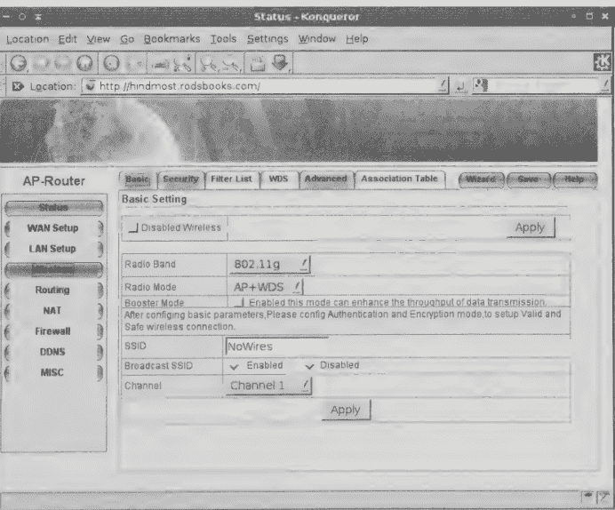

如果你正在配置自己的无线网络，请务必启用可能的最高安全性——Wi-Fi 保护访问2 (WPA2)。早期的安全系统，特别是无线等效隐私 (WEP)，极其脆弱。使用它们会让任何具有中等技能的人嗅探你所有的网络流量。根据你的本地安全设置，入侵者可能从建筑外部使用笔记本电脑轻松侵入你网络上的其他有线或无线计算机。

> 警告
> 在继续进行网络配置之前，你可能想使用 `iwlist` 工具扫描可用网络。如果你设置了自己的网络，理应在可用选项中看到它。如果你在途中，使用咖啡馆、酒店或其他方提供的无线访问，可以使用 `iwlist` 定位可用网络。将扫描命令传递给 `iwlist`，可选地加上网络设备（通常为 `wlan0`）：
> 
> - # `iwlist wlan0 scan`
> 
> wlan0 Scan completed:
> 
> Cell 01 - Address: 00:27:81:A5:0C:10
> 
> ESSID: 'NoWires'
> 
> Protocol:IEEE802.11N-24G
> 
> Mode:Master
> 
> Channel:11
> 
> Encryption key:on
> 
> Bit Rates:130 (Mb/s): 1 2 5
> 
> 如果你以普通用户身份运行此命令，它将仅显示已连接网络的信息；但如果你以 *root* 身份运行，iwlist 输出将包含所有附近的网络（在 iw 术语中称为 cells）。

## 执行网络配置

> 警告
> 仅仅可以使用开放网络并不意味着你应该这样做。人们有时会错误配置网络硬件导致不使用加密。另一方面，某些公共无线网络故意这样配置的。请记住，在未加密无线链路上发送的任何数据都可以被第三方轻易监控，因此你应该只对非敏感任务使用此类网络，或通过自带加密的工具（如 SSH 远程登录协议）。

除了扫描网络，`iwlist` 命令还可以提供有关 Wi-Fi 网络接口特征的信息。使用以下方式运行它，将 scan 替换为另一个子命令名称，如表 5.1 所示。还有一些额外的子命令，但它们要么非常冷门要么已弃（不再官方支持）。

### 表 5.1 常用 iwlist 子命令

| 子命令 | 功能 |
| | --- |
| scan or scanning | 列出所有可用网络（当作为普通用户运行时，列出已连接的网络） |
| freq, frequency, or channel | 列出设备的所有可用通道 |
| rate, bit, or bitrate | 列出设备支持的所有速率（比特率） |
| keys, enc, or encryption | 列出可用的加密密钥大小 |
| power | 列出电源管理模式 |
| txpower | 列出设备的所有传输功率设置 |
| retry | 列出当前的重试设置 |
| event | 列出设备支持的无线事件 |
| auth | 列出当前设置的认证参数 |
| wpa or wpackays | 列出设备中设置的 WPA 密钥 |
| modu or modulation | 列出设备使用的调制 |

### 将计算机连接到本地 Wi-Fi 网络

要启动与本地 Wi-Fi 网络的基本连接，你需要使用 `iwconfig` 命令，并通过 `ssid` 和 `channel` 等选项名称传递相关数据，在此之前是无线网络设备名称（通常为 `wlan0`）：

```bash
# iwconfig wlan0 ssid NoWires channel 1 managed key s:N1mP7mTNW
```

此示例设置了 `wlan0` 的选项，使其使用信道 1、SSID 为 `NoWires` 密码为 `N1mP7mTNW` 的托管网络。该密码需要几个额外的字符。通常，`iwconfig` 十六进制值字符串作为密码，每 2 个字节块之间可以有可选的横线，例如 `0123-4567-89AB`。然而，密码通常以文本字符串的形式给出。在这种情况下，`s:` 必须在密码之前，如示例所示。

有关 `iwconfig` 其他选项的详情（包括一些高技术性的选项），请参阅其帮助页（man page）。

一旦配置了无线接口，你可以使用不带选项的 `iwconfig` 或仅带接口名称来检查其设置：

```bash
# iwconfig wlan0
IEEE 802.11g SSID:"NoWires"
wlan0 Mode:Managed Frequency:2.462 GHz Access Point: 08:10:74:24:1B:D4
Rate=54 Mb/s Tx-Power=27 dBm
Retry min limit=7 RTS:off Fragment thr=2352 B
Encryption key:374E-05D0-6D37-47E8-08A [2]
Link Quality=100/100 Signal level=-32 dB Noise level=-94 dB
Rx invalid wmid:0 Rx invalid crypt:0 Rx invalid frag:0
Tx excessive retries:0 Invalid misc:0 Missed beacon:0
```

### 使用 Wicd

`iwlist` 和 `iwconfig` 工具可以管理 Wi-Fi 连接，但它们可能非常繁琐且令人沮丧——从提供或通过 `iwlist` 发现的信息中复制选项到 `iwconfig` 时的一个微小错误就可能导致无法连接网络。虽然 LPI 目标中没有提到，但一个可以极大简化 Wi-Fi 连接维护的工具是 [Wicd](http://wic.sourceforge.net)。该包提供了文本模式（`wic-cli` 和 `wic-curses`）和 GUI（`wic-gtk`）工具来管理网络连接。图 5.2 显示了 W Wic GUI。点击 `Connect` 或 `Disconnect` 按钮管理连接，或点击 `Properties` 按钮调整每个网络的细节。

除了提供设置信息外，`iwconfig` 还提供了一些诊断信息，例如链路质量、接收（Rx）错误、传输（Tx）错误等。

#### 图 5.2 Wicd 实现了类似于其他操作系统的点点式 Wi-Fi 管理。

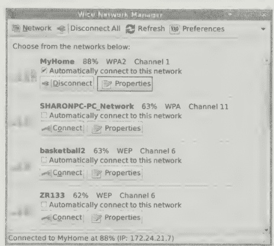

除了管理 Wi-Fi 特性外，Wicd 还可以管理高级的 TCP/IP 特性，例如 IP 地址、主机名和路由——这些特性将在接下来的几页中描述。此外，Wicd 还可以管理有线连接，包括根据可用性启用有线或无线网络的选项。

### 使用 DHCP 连接到网络

配置计算机使用 TCP/IP 网络网络的方法之一是使用动态主机配置协议（DHCP），它允许网络上的一台计算机管理许多其他计算机的设置。其工作原理如下：运行 DHCP 客户端的计算机启动时，它会发送一个广播来寻找 DHCP 服务器。服务器（仅使用客户端的硬件地址）回复客户端与网络上其他计算机通信所需的配置信息——最重要的是客户端的 IP 地址和掩码，以及网络的网关和域名系统（DNS）服务器地址。DHCP 服务器还可能给客户端一个主机名并提供其他网络细节。客户端然后使用这些参数进行自配置。IP 地址不是永久分配的；它被称为 DHCP 租约，如果不进行续约，DHCP 服务器可能会将租约给给另一台计算机。因此，客户端会定期检查 DHCP 服务器以续约租约。

> Linux 既可以作为 DHCP 服务器，也可以作为 DHCP 客户端运行。第 7 章“高级网络配置”描述了 DHCP 服务器配置。

Linux 上常用三种 DHCP 客户端：`pump`、`dhcpclient` 和 `dhcpd`（不要与 DHCP 服务器 `dhcpd` 混淆）。某些 Linux 发行版仅带其中之一，而另一些则带两个甚至全部。这三个都有默认的 DHCP 客户端——即在系统安装时告诉系统想要使用 DHCP 时安装的那个。带有多个客户端的发行版通常允许你通过简单地删除旧包并安装新包来切换客户端。

理想情况下，DHCP 客户端在系统启动时运行。这可以通过自己的 SysV 脚本或 Upstart 配置文件来处理，如第 1 章“系统启动和高级系统管理”所述。在其他情况下，DHCP 客户端可以作为主网络配置启动文件（通常是名为 `network` 或 `networking` 的 SysV 启动文件）的一部分运行。系统通常使用配置文件中的一行确定是否运行 DHCP 客户端。例如，Red Hat 和 Fedora 在文件 `/etc/sysconfig/network-scripts/ifcfg-eth0` 中设置此选项。

### 调整网络文件

网络配置文件的位置因发行而异。例如，Debian 使用 `/etc/network/interfaces`，而 Red Hat 和 Fedora 使用 `/etc/sysconfig/network-scripts/ifcfg-eth0`。

在 Debian 中，静态配置如下：

```text
iface eth0 inet static
    address 192.168.1.10
    netmask 255.255.255.0
    gateway 192.168.1.1
    dns-nameservers 8.8.8.8 8.8.4.4
```

在 Red Hat/Fedora 中，它看起来如下：

```bash
DEVICE=eth0
BOOTPROTO=static
ONBOOT=yes
IPADDR=192.168.1.10
NETMASK=255.255.255.0
GATEWAY=192.168.1.1
DNS1=8.8.8.8
DNS2=8.8.4.4
```

遗憾的是，这些配置细节在不同的发行版之间是不同的。例如，如果你使用 Ubuntu，你需要编辑的是 `/etc/network/interfaces` 而不是 `/etc/sysconfig/network-scripts/ifcfg-eth0`。这两个文件中信息的精确布局和格式有所不同，但它们都包含相同的基本信息。你可能需要考虑特定于特定发行版的文档来了解这些细节。或者，GUI 工具也比较容易上手，你可以去寻找它们。

如果你不确定在何输入基本网络值（IP 地址、网络网关地址和 DNS 服务器地址），你应该咨询你的网络管理员。不要输入随机值或与你网络上其他系统使用的值相似的值。这样做很可能完全不起作用，而且可以推想这可能会导致很多麻烦——例如，如果你误用了预留给另一台计算机的 IP 地址。

### 使用交互式命令

如前所述，`ifconfig` 程序对于设置 IP 地址和子网掩码至关重要。该程序还可以显示当前设置。使用 `ifconfig` 启动网络接口的基本用法类似于：

```
ifconfig interface up addr netmask mask
```

例如，以下命令使用地址 192.168.29.39 和掩码 255.255.255.255 启动 eth0（使用第一块以太网卡）。

```
# ifconfig eth0 192.168.29.39 netmask 255.255.255.255
```

此命令将指定的 IP 地址列在网卡上，计算机将响应该地址并在发送数据时声称是该地址。然而，它并没有为超出你当前网络的数据流量设置路由。对于这一点，你需要使用 `route` 命令：

```
# route add default gw 192.168.29.21
```

将你的网关地址替换为 192.168.29.1。`ifconfig` 和 `route` 都可以显示当前网络配置的信息。对于 `ifconfig`，请省略其之后的所有内容；对于 `route`，请省略 `add` 及其之后的所有内容。例如，要查看接口配置，你可能会执行以下命令：

```
# ifconfig eth0
eth0 Link:Ethernet Waddr:00:AC:CC:24:BA:02
inet addr:192.168.29.39 Bcast:192.168.29.255 Mask:255.255.255
UP BROADCAST MULTICAST MTU:1500 Metric:1
RX packets:104699 errors:0 dropped:0::0 frame:0 carrier:0
collisions:0 txqueuelen:100
RX bytes:1017326 (993.4 Kb) TX bytes:1084384 (1.0 Mb)
Interrupt:10 Base address=0xc80
```


当配置正确时，`ifconfig` 应该显示硬件地址 (`HWaddr`)、地址 (`inet addr`) 和额外的统计数据。接收 (`RX`) 和发送 (`TX`) 数据包的应该很少或没有错误、丢包或溢出。理想情况下，发生很少（如果没有）冲突，但如果你的网络使用集线器而不是交换机，那么某些冲突是不可避免的。如果冲突超过总发送和接收数据包的百分之几，你可能想要考虑将集线器替换为交换机。为了将 `route` 用于诊断目的，你可以尝试以下命令：

```bash
# route
```

内核 IP 路由表

| Destination | Gateway | Genmask | Flags | Ref | Use | Iface |
|---|---|---|---|---|---|---|
| 192.168.29.0 | * | 255.255.255.0 | U | 0 | 0 | eth0 |
| 127.0.0.0 | 255.0.0.0 | U | 0 | 0 | lo |
| default | 192.168.29.1 | 0.0.0.0 | UG | 0 | 0 | eth0 |

`route` 的 `-v` 选项会产生更详细的输出。这在以某些方式使用 `route` 时很有帮助，尽管对于像本示例所示的简单配置，它通常不会产生更多输出。

此命令显示通往 192.168.29.0（即任何 IP 地址在 192.168.29.1 和 192.168.29.254 之间的计算机）的数据直接通过 `eth0` 传输。127.0.0.0 是一个“环回”到源计算机的特殊接口。Linux 将其用于内部网络目的。最后一行显示默认路由的网关为 192.168.29.1。如果它缺失或配置错误，或者所有通往外部网络（如互联网）的流量无法离开你的本地网段，那么对于管理员来说，使用 GUI 工具设置静态 IP 地址总是更简易的。配置文件的确切位置在不同发行版之间是不同的，因此之前列出的示例不适用于你的系统。

# IPv6 的到来

本章强调的 IP 地址适用于 TCP/IP 的第 4 版本。这个版本已经持续了多年。然而，对 IP 的重大升级正在进行中，其名为 IPv6，它增加了若干项功能……

*(注：由于提供的英文文本从此处开始出现大量重复和乱码字符，上述翻译已根据提供的逻辑进行了尽可能处理。)*

## 现实场景

### 在 DSL 中使用 PPP

宽带用户，特别是那些使用数字用户用户线路（DSL）连接的用户，有时必须使用点对点协议（PPP）的变体来建立连接。PPP 是一种基于登录的接入接入方式——你使用 PPP 实用程序启动与远程计算机的连接，这包括用户名和密码的交换。十年前，PPP 被用于拨号上网接入（目前仍用于此用途），但某些 DSL 供应商也已根据其需求对 PPP 进行了调整。在 DSL 的情况下，这种配置被称为以太网上的 PPP（PPPoE）。

在很多情况下，使用 PPPoE 配置的最简单方法是购买宽带路由器。该设备连接到 DSL 调制调器并建立 PPPoE 连接。对于你的本地计算机来说，该宽带路由器就像普通的以太网或 Wi-Fi 路由器，因此你可以像配置任何其他网络一样配置 Linux。

如果你必须将 Linux 系统直接连接到使用 PPPoE 的 DSL 网络，你必须使用 Linux PPP 客户端。大多数发行版都带有此类客户端；但配置细节在不同发行版之间有所不同。最好的办法是寻找你发行版的 GUI 网络配置工具；很有可能，你能找到一组明确标记为适用于 DSL 或 PPPoE 的选项。

## 检查基本连通性

网络配置并初始化后，你可以使用 `ping` 命令对其运行进行基本测试。该命令向系统名称（通过 IP 地址或主机名）发送 Internet 控制消息协议（ICMP）数据包并等待回复。在 Linux 中，`ping` 会每秒持续发送一次数据包，直到你通过 Ctrl+C 键位中断它。（你可以通过 `-c num` 指定限制测试次数）。以下是其输出示例：

```
$ ping -c 4 speaker
PING speaker (192.168.1.1) 56(84) bytes of data.
64 bytes from speaker.example.com (192.168.1.1): icmp_seq=1 ttl=64 time=194 ms
64 bytes from speaker.example.com (192.168.1.1): icmp_seq=2 ttl=64 time=203 ms
64 bytes from speaker.example.com (192.168.1.1): icmp_seq=3 ttl=64 time=229 ms
64 bytes from speaker.example.com (192.168.1.1): icmp_seq=4 ttl=64 time=217 ms

--- ping statistics ---
4 packets transmitted, 4 received, 0% packet loss
rtt min/avg/max/mdev = 194/210/229/0 ms
```

该命令发送了四个数据包并等待它们返回，返回速度很快（平均为 210 ms），这是因为目标系统位于本地网络上。通过对本地和远程网络上的系统进行 ping，你可以隔离网络问题。例如，如果你可以 ping本地系统但不能 ping 其他系统，那么问题很可能是你的路由器配置。如果你可以 ping IP 地址但不能 ping 名称，那么问题出在 DNS 配置上。如果你遇到问题，请查阅“网络问题排除”。

在练习 5.1 中，你将熟悉一些用于配置网络设置的工具。你将使用这些工具来学习和更改你的网络配置。

### 练习 5.1

#### 配置网络连接

在本次练习中，假设计算机已正确配置为使用 IPv4 以太网网络，包括本地访问以及通过路由器访问更大的网络（互联网）。如果出现故障，此练习中的某些步骤可能会轻易破坏你的网络连通性。如果发生这种情况，输入 `ifdown` 然后 `ifup` 是恢复连接的一种方法。如果这失败了，重启计算机几乎可以解决，尽管这是一种激进的解决方案。要学习并修改你的系统网络配置，请遵循以下步骤：

- 1. 以普通用户身份登录 Linux 系统。
- 2. 如果你使用了 GUI 登录，请从桌面环境的菜单启动 `xterm`。
- 3. 获取 root 权限。你可以通过在 `xterm` 中输入、选择 `Session > New Console`，或使用 `sudo`（如果已配置）运行后续步骤中的命令。
- 4. 输入 `ifconfig`。此命令显示你所有网络接口的本地网络设置信息。大多数系统同时拥有回环接口 (`lo`) 和以太网接口 (`eth0`)。在以太网部分查找包含字符串 `addr:` 字符串的一行。随其后的数字是你的 IP 地址。记下它，以及你的子网掩码 (`Mask`) 值。也研究此输出中的其他信息，例如接收 (`RX`) 和发送 (`TX`) 数据包的数量、错误数量以及以太网适配器的硬件地址。
- 5. 输入 `route -n`。输出是你计算机的路由表信息。这通常包括关于回环地址 (`127.0.0.1`)、本地网络地址和默认路由（识别为针对 `0.0.0.0` 的路由）。某些系统可能会根据配置显示较少或更多的行。默认路由在 `Gateway`（网关）列下包含一个 IP 地址。记下该地址。

#### 练习 5.1（继续）

- 6. 使用 `ping` 测试到本地和远程计算机的连通性。你需要至少一台本地计算机和至少一台远程计算机（路由器之外）的名称或地址。输入 `ping address`，其中 `address` 是每个测试机器的名称或 IP 地址。对 `localhost` 和 `127.0.0.1`、你自己的机器（你在步骤 5 中记下的 IP 地址）、你的本地路由器以及一台远程计算机（如果你连接了互联网，可以使用可以访问互联网的站点，如 `www.linux.org`）进行此操作。所有这些 ping 测试应该是成功的。然而，请注意，某些系统被配置为忽略数据包，如果你遇到此类系统。你可以从管理员处了解本地系统的配置，但对于互联网站点，如果测试第一个失败，你可能想尝试另一个。
- 7. 输入 `ifconfig eth0 down` 关闭本地以太网连接。
- 8. 重复步骤 4–6。注意，输入 `ifconfig` 时不再显示 `eth0` 接口，与其相关的所有路由已从路由表中删除，且从该接口访问系统的 ping 不再有效（Linux 保留了关于其以前以太网链路的一些信息，你可能仍然可以通过以前的 `eth0` 地址 ping 通计算机）。
- 9. 输入 `ifconfig eth0 up address netmask` 恢复本地以太网连接，其中 `address` 是原始 IP 地址，`mask` 是原始子网掩码，均如步骤 4 中确定的那样。
- 10. 重复步骤 4–6。注意 `ifconfig` 命令自动将你的本地网络添加回路由表，但默认路由仍然缺失。结果是你无法访问任何位于本地网络之外的系统。如果你的 DNS 服务器是这样一个系统，这意味着默认情况下你甚至访问本地机器的能力可能受到影响。
- 11. 输入 `route add default gateway` 恢复默认路由，其中 `gateway` 是你在步骤 5 中确定的路由器。
- 12. 重复步骤 4–6。如果你的网络配置是典型的，所有连通性都应该得到恢复。

# 图 5.3 某些网络配置需要不寻常的路由配置。

192.168.5.0/24 网络

172.24.22.0/24 网络

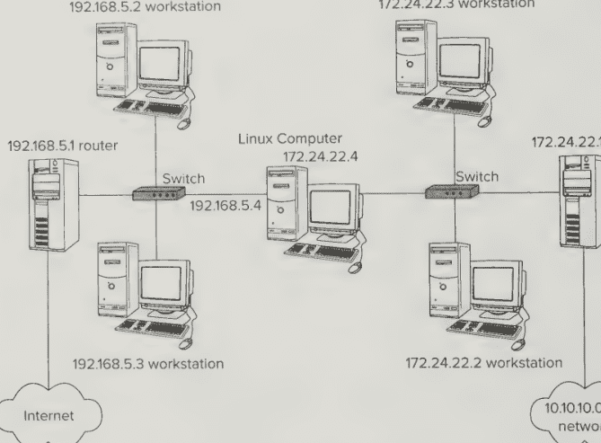

对于 192.168.5.0/24 网络上的计算机，建议采用类似的配置。以这种方式设置多条路由是有益的，但并不总是绝对必要的。如果子网的主路由器知道网络上任何二级路由器，则主路由器将把指向相关子网的数据包发送给二级路由器。例如，假设路由器 192.168.5.1 知道 192.168.5.4（图中中间的 Linux 计算机）连接到 172.24.22.0/24 和 10.10.10.0/24 网络。如果 192.168.5.0/24 网络上的一个工作站发送到 10.10.10.0/24 子网的数据包，192.168.5.1 路由器将正确重定向这些数据包。问题在于这浪费了带宽，因为相同的数据包通过两次 192.168.5.0/24 网络：从工作站到主路由器，再次从主路由器到二级路由器。因此，在相关计算机上设置额外的路由选项是有益的。

> 错误的路由表会导致严重问题，因为部分或所有计算机将不会响应。你可以通过单独输入 `route` 来检查路由表，并将结果与路由表应有的内容进行比较。（如果不确定路由表应该包含什么，请咨询网络管理员。）然后你删除错误的路由并添加新路由来替换它们（如果需要）。最终，更改配置文件是最佳解决方案，但在短期内输入几个命令即可解决问题。

如果计算机有多个网络接口但不应作为路由器运行，那么简单地添加多条路由是有。。对于具有有线和无线网络连接的笔记本计算机可能是事实，特别是当有线和无线网络没有通过其他方式连接时。

连接到两个网络的 Linux 计算机（如图中的 Linux 计算机）可以与这两个网络进行通信；然而，这种配置不会自动将两个网络连接在一起。也就是说，除非该 Linux 计算机配置为路由器，否则 192.168.5.0/24 和 172.24.22.0/24 网络上的计算机将无法相互通信。要启用此功能，你必须修改 `/proc/sys/net/ipv4/forwarding` 中的关键文件。

```bash
# echo "1" > /proc/sys/net/ipv4/forwarding
```

此命令启用 `ipv4` 转发。永久设置此选项需要修改配置文件。某些发行版在 `/etc/sysctl.conf` 中设置它：

```bash
net.ipv4.ip_forward = 1
```

其他发行版使用其他配置文件和选项，例如 `/etc/sysconfig/sysctl1` 及其 `IP_FORWARD` 行。如果你找不到它，尝试使用 `grep` 搜索 `ip_forward` 或 `IP_FORWARD`，或者修改本地启动脚本以添加执行该任务的命令。

## 检查地址解析

在底层，TCP/IP 依赖于名为地址解析协议（ARP）的协议。一个同名但全小写的 Linux 工具（`arp`）用于监控单台计算机上的 ARP 活动。

网络硬件设备（如以太网卡）具有内置硬件地址。你可以使用 `ifconfig` 确定网络接口的硬件地址；它在输出行中标记为 `Hwaddr:`：

```bash
# ifconfig eth0
eth0 Link encap:Ethernet Hwaddr 00:AA:CC:24:BA:02
```

在这个示例中，`eth0` 的十六进制（16进制）硬件地址为 `00:AA:CC:24:BA:02`——这是一个由冒号(:)表示并分隔的六字节序列。有时也会使用其他单独字符，如连字符。以太网硬件地址的前三个字节代表制造商，而后三个字节则以独特的方式分配给制造商，类似于序列号。

> 各种网站，如 http://www.techzoom.net/tools/check-mac.en 和 http://telecom.tbi.net/ethercode.cgi，允许你通过硬件地址识别以太网设备的制造商。这在追踪现实世界中的硬件时有时很有用。


当同一网络段上的两台计算机通信时，它们通过使用对方的硬件地址进行通信。当涉及路由器时，发送者将流量发送到路由器的硬件地址；路由器随后使用下一个路由器的硬件地址重新封装数据。

# 第 5 章 • 网络配置

然而，为了与硬件地址通信，计算机必须被转换成硬件地址。这是 ARP 的工作。计算机可以发送一条广播消息（即所有本地计算机都能接收的消息），请求具有特定 IP 地址的计算机回复。当目标计算机回复时，发送者存储该硬件地址。如果需要向 IP 地址发送数据包，它首先检查 ARP 缓存。目标计算机响应 ARP 请求，发送者更新其缓存。

## 表 5.2 常用 arp 选项

| 长选项 | 短选项 | 描述 |
| --- | --- | --- |
| --help | -h | 显示命令的帮助信息。 |
| 长选项名称 | 短选项名称 | 描述 |
| --- | --- | --- |
| - | -d | 删除 ARP 缓存中的指定地址。只有 root 用户可以执行此操作。 |
| - | -s | 将 IP 地址与主机关联。 |
| - | -a | 使用 BSD 风格输出。 |
| --verbose | -v | 额外输出。 |
| --numeric | -n | 以数字而不是主机显示 IP 地址。 |
| --hw-type | -t | 设置硬件类型，例如以太网 (eth)、环形网 (arc)、原始网络 (pro) 或 rom。 |
| --use-device | -D | 将硬件地址解释为设备。 |
| --device | -i | 将输出或操作限制在指定的接口，例如 eth0 或 eth1。 |
| --file | -f | 从指定文件获取信息。 |

为什么要查看或修改 ARP 缓存？有时为了配置服务器或其他工具。例如，你可能需要配置 DHCP 服务器（见第 7 章）。有时如果你更换了以太网卡，其硬件地址将会改变。在这种情况下，你可能需要清除其他计算机的 ARP 缓存，以确保指向更改后计算机的流量能够到达目的地。Linux 对 ARP 缓存项的保留有限，因此除非显式清除，否则像交换以太网这种情况只会中断网络通信。


## 使用全功能网络工具

作为许多目的的 `ifconfig`、`route` 以及其他各种命令的替代方案是 `ip`。它是网络命令的瑞士军刀。它的语法矛盾地简单：

```
ip [ OPTIONS ] OBJECT { COMMAND | help }
```

要理解 `ip`，你应该从 `OBJECT` 开始，它可以取表 5.3 所示的任何值。这些这些值都有其独特的选项和命令。使用 `ip` 可以执行的操作数量令人眼花缭乱。你应该咨询它的手册。

# 表 5.3 可能的 ip OBJECT 值

| OBJECT 名称 | 描述 |
| --- | --- |
| link | 对网络硬件执行操作；类似于某些 ifconfig 功能 |
| addr | 将设备与地址关联或取消关联；类似于某些 ifconfig 功能 |
| addrlabel | 调整 IPv6 网络地址 |
| route | 显示或调整路由表；类似于某些 route 功能 |
| rule | 显示或调整防火墙表规则；类似于某些 iptables 功能，见第 7 章 |
| neigh | 显示或调整 ARP 条目 |

## 表 5.3 可能的 OBJECT 值（续）

| OBJECT 名称 |  |
| --- | --- |
| tunnel | 显示或调整隧道功能，通过将许多网络协议封装在仅一个协议中，实现在网络之间传输数据 |
| addr | 显示或调整多播地址，这些地址用于同时与多台计算机通信 |
| mroute | 显示或调整多播路由 |
| monitor | 监控网络活动 |

以 `ip` 为例，考虑使用它来显示当前路由表：

```
172.24.21.0/24 dev eth1 proto kernel scope link src 172.24.21.2
192.168.1.0/24 dev eth0 proto kernel scope link src 192.168.1.2
127.0.0.0/8 dev lo scope link
default 192.168.1.1 dev eth0
```

此示例表明，`ip` 工具的工作方式与执行类似任务的独立工具并不完全相同——此输出与 `route` 命令的输出不同，后者也可以显示（或更改）路由表。在实际操作中，你可能想尝试使用它以及许多特定工具，以确定你对特定任务更倾向于使用哪一个。

## 配置 VPN


大多数网络在某种程度上依赖物理安全来保持安全。例如，以太网局域网（LAN）为例，除非物理接触网络电缆或网络上的某台计算机被攻破，否则流量本身无法被截获（如前所述，无线访问更容易受到攻击）。当网络必须通过不可信的中间承载商（如互联网）跨越多个位置时，安全性变成了一个更严重的问题。在这种情况下，通常会采用虚拟专用网络（VPN）配置。在 VPN 中，两个网络段通过路由器连接，该路由器会对发送到远程位置的数据进行加密。

自然地，Linux 提供了若干 VPN 选项。LPIC-2 认证仅涵盖其中一个：OpenVPN (`http://openvpn.net`)。该软件包随大多数发行版一起分发，因此你可能可以使用你的包管理器安装它。完成后，你应该处理一些初步准备工作，生成密钥、配置 VPN 并建立 VPN 连接。

## 为使用 VPN 做准备

与其他网络协议一样，OpenVPN 将一个路由器分类为客户端，另一个分类为服务器。在某些情况下，这似乎是显而易见的，因为一个（服务器）将连接到许多其他 OpenVPN 路由器（客户端）。在其他情况下，这可以任意决定。

通过 VPN 连接的网络本质上是私有的——它们对整个互联网的访问应该是没有或有限的。VPN 经常用于连接使用表 5.4 总结的私有地址的网络，这些地址在互联网标准文档 RFC-1918 中定义。这些地址可以被任何人使用，但除非通过网络地址转换 (NAT) 路由器或类似手段，否则不应被路由到互联网。不过，你可以根据自己的目的将尽可能多的此类网络连接在一起。

## 表 5.4 RFC-1918 私有地址块

| 类别 | 范围 | 前缀 |
|---|---|---|
| A | 10.0.0.0–10.255.255.255 | 10.0.0.0/8 |
| B | 172.16.0.0–172.31.255.255 | 172.16.0.0/12 |
| C | 192.168.0.0–192.168.255.255 | 192.168.0.0/16 |

你应该确保通过你的 VPN 连接的所有网络上使用的 IP 地址是唯一的。如果两个物理上独立的网络重复了对方的 IP 地址，就会导致问题。最好的方法是为每个子网分配一套自己的地址——例如，一个网络使用 `192.168.26/24`，另一个网络使用 `192.168.27/24`。你可以根据需要调整子网的大小，但要保持在 5.4 列出的限制范围内。

## 管理 VPN 密钥

与许多加密技术一样，OpenVPN 依赖密钥——用于编码或解码数据的巨大数字。OpenVPN 使用公钥加密，该加密依赖于私钥和公钥进行加密。正如其名称所示，私钥应该保持隐私（秘密），而公钥可以广泛分发。由一个密钥加密的数据可以用另一个密钥解密。因此，为了以安全的方式通信，两台计算机交换它们的公钥。每台计算机使用对方的公钥加密数据；只有接收者可以使用匹配的私钥解密数据。

在该公钥加密系统中增加了一个证书授权机构 (CA)，它是一台为其他计算机发布密钥的计算机。CA 在密钥中嵌入标识信息并对其进行数字签名，从而使 VPN 连接的双方都能验证对方持有来自同一 CA 的密钥，并且是可以信赖的。

为了增加安全性，CA 可以是一台没有网络连接的计算机。这种配置保证了它不会被远程攻破。

该系统相当复杂，你必须首先生成 CA。生成 CA 后，你会被要求提供各种信息。在执行这些命令后，系统会提示你输入值。大多数值的默认值都可以正常。此命令计算一个用于加密过程的大质数。

## 表 5.5 OpenVPN 密钥文件及用途

| 文件名 | 复制到 | 用途 | 密钥 |
|---|---|---|---|
| `ca.crt` | 服务器和所有客户端 | 证书 | 否 |
| `ca.key` | 仅用于密钥签名 | 密钥 | 是 |
| `dh1024.pem` | 仅用于服务器 | Diffie-Hellman 参数 | 否 |
| `server.crt` | 仅用于服务器 | 证书 | 否 |
| `server.key` | 仅用于服务器 | 密钥 | 是 |
| `client.crt` | 仅用于客户端 | 证书 | 否 |
| `client.key` | 仅用于客户端 | 密钥 | 是 |

## 配置 VPN

你必须编辑客户端和服务器配置文件。你可以在 `http://openvpn.net/index.php/open-source/documentation/howto.html#examples` 找到示例，或者可以在你计算机上的 `/usr/share/doc/openvpn` 或 `openvpn` 目录下找到它们。客户端和服务器配置文件应分别创建 `client.conf` 和 `server.conf`，并应放在 `/etc/openvpn`。然后你应该编辑这些文件，特别注意以下功能：

- 对于所有客户端，编辑 `ca`、`cert` 和 `key` 参数指向配置系统的密钥文件。你必须可以在服务器上设置 `dh` 参数。
- 如果客户端网络能够相互通信，取消服务器配置中 `client-to-client` 指令的注释。
- 取消服务器配置中 `user nobody` 和 `group nobody` 指令的注释以提高安全性。
- 在客户端上，编辑 `remote` 参数指向服务器。该行默认包含主机名和端口号（1194）。只有当你在服务器上使用 `port` 指令更改了端口，或者服务器受 NAT 路由器保护并将不同端口转发到服务器上的端口时，才更改端口号。

示例配置文件有良好的注释，因此你可以查阅它们以找到可能根据你的特定配置调整的其他选项。

## 建立 VPN 连接

配置服务器和客户端后，现在可以测试你的 VPN 了。要启动 VPN，输入 `openvpn config-file`，其中 `config-file` 是 VPN 配置文件的完整路径。

配置文件。此路径自然将指向服务器的服务器配置以及你每个客户端的客户端配置。你可以检查程序提供的输出以查看任何错误信息。输出应以消息 `Initialization Sequence Completed`（初始化序列完成）结束。如果一切看起来正常，你可以测试从客户端到服务器的基基础连通性：

```bash
ping 10.8.0.1
```

`10.8.0.1` 地址在默认配置文件中分配给服务器；如果你修改了此细节，请对其进行更改。如果此操作有效，你就可以开始扩展配置，以允许客户端和/或服务器端的其他计算机通过 VPN 进行通信。假设服务器位于 `10.66.0.0/24` 网络上。在服务器配置中，向配置添加以下行，以允许服务器端系统使用 VPN：

```
route 10.66.0.0 255.255.255.0
```

将地址更改以匹配更多路由目（route）。这将实通本地网络上的机器与远程（客户端）网络之间的链接。你还必须调整服务器端网络的路由器，以包含服务器 VPN 子网的适当路由（默认为 `10.0.0.0/24`）。如果 VPN 路由器也是该网络的常规路由器，则不需要此更改。注意，你不需要将流量路由到客户端子网；对于网络上的其他系统而言，隔离的 VPN 客户端将在 `10.8.0.0/24` 子网有一个地址。

如果你想让客户端作为 VPN 路由器，而不仅仅是作为连接自己的单个计算机，你必须进行更多更改。在服务器上，你必须创建一个名为 `/etc/openvpn/ccd` 的目录，并在服务器配置文件中设置以下指令：

```
client-config-dir ccd
route 192.168.4.0 255.255.255.0
```

为你的客户端网络调整路由行上的 IP 地址和网络掩码。在 `/etc/openvpn/ccd` 目录下，创建一个与 OpenVPN 客户端通用名称命名的配置文件。该文件应使用 `route` 关键字复制主配置文件中的路由行：

```
iroute 192.168.4.0 255.255.255.0
```

如果你想让 OpenVPN 服务器在不同的 VPN 客户端网络之间引导流量，请向服务器配置文件添加以下行（再次，根据你的网络适当更改地址）：

```
client-to-client
push "route 192.168.4.0 255.255.255.0"
```

最后，你必须对服务器和客户端网络的默认路由器配置进行更改，以将远程网络的流量通过各自的 VPN 系统引导。

完成更改后，重启客户端和服务器，并使用 `ping` 或其他工具测试你的连接。如果你遇到问题，请查阅 OpenVPN 网站，该网站包含扩展说明和故障排除信息。

许多发行版带有启动脚本，这些脚本会扫描 `/etc/openvpn` 目录下的客户端和服务器配置文件，并以相应的模式启动 `openvpn`。如果你的系统包含此类文件，你可以使用这些工具关闭并重启系统，并配置计算机在启动时自动启动 OpenVPN。

## 监控网络流量

存在多种网络监控工具可以帮助你验证网络正常运行、检查哪些程序正在使用网络以及监控网络流量。

## 使用 nc

`nc` 工具（也称为 netcat）是一个非常强大的通用网络工具。它可以发送任意数据、监控网络端口等。它的基本语法为：

```
nc [options] [hostname] [ports]
```

下表 5.6 总结了 `nc` 许多选项中最重要的部分。更多细节请参考其帮助页（man page）。`nc` 程序执行相当底层的访问并且可以编写脚本，这允许你使用 `nc` 创建脚本来扫描网络上的可用服务器或执行专门测试。

### 表 5.6 常用 nc 选项

| 选项 | 用途 |
| :--- | :--- |
| `-d` | 不从标准输入读取 |
| `-h` | 显示帮助信息 |
| `-i interval` | 在发送和接收文本之间插入延迟 |
| `-k` | 在当前连接结束后继续监听新连接。必须与 -l 配合使用 |
| `-l` | 监听入站连接而非建立出站连接 |
| `-n` | 不进行 DNS 查询 |
| `-p port` | 使用指定的出站端口建立连接。不能与 -l 同时使用 |
| `-r` | 随机选择端口号 |

### 表 5.6 常用 nc 选项（续）

| 选项 | 用途 |
| :--- | :--- |
| `-s ip-address` | 指定出站连接的 IP 地址。不能与 -l 同时使用。 |
| `-U` | 使用 Unix 域套字。 |
| `-u` | 使用 UDP 而非 TCP。 |
| `-v` | 生成详细输出。 |
| `-w timeout` | 如果连接空闲 timeout 秒则终止。 |
| `-X version` | 使用指定的代理版本；有效值为 4 (SOCKS v.4)、5 (SOCKS v5；默认值）和 connect (HTTPS 代理)。与 -x 配合使用。 |
| `-x address[:port]` | 通过指定的代理服务器建立连接。 |
| `-z` | 扫描监听守护进程 |

## 使用 netstat

另一个诊断工具是 `netstat`。它可以显示网络连接、路由表、接口统计等。它是网络排障的“瑞士军刀”。

### 接口信息

`netstat` 可以显示系统上的网络接口信息。使用 `-i` 选项显示每个接口的统计数据。

### 路由信息

`-r` 选项显示 IP 路由表，对于查看流量如何路由非常有用。

### 伪装信息

`-M` 选项显示关于 NAT（网络地址转换）映射的信息。如果你的系统充当路由器，这很有帮助。

### 程序使用

`-p` 选项显示每个连接的进程 ID (PID) 和程序名称。这对于识别哪些应用程序在使用网络资源至关重要。

## 设置附加网络选项

`netstat` 有许多修改其输出的选项。例如，`a` 选项显示所有连接和监听端口。`n` 选项显示数字地址而不是解析域名，可以加快命令执行。

### 所有连接

要显示所有活动连接和监听端口，请使用 `-a` 标记。

`-a` 选项显示所有连接和监听端口。`n` 选项显示数字地址而不是解析域名，可以加快命令执行。

```
netstat -an
```

下面的输出显示了所有活动连接和监听端口。

|  | Recv-Q | Send-Q | 本地地址 | 外地地址 | 状态 |
| :--- | :--- | :--- | :--- | :--- | :--- |
| tcp | 0 | 0 | 0.0.0.0:*22 | 0.0.0.0:* | LISTEN |
| tcp | 0 | 0 | 10.8.0.1:54321 | 192.168.1.10:44321 | ESTABLISHED |
| udp | 0 | 0 | 0.0.0.0:*53 | 0.0.0.0:* | |

> 下面的输出显示了所有活动连接和监听端口。我从之前的 `netstat` 输出中删减了大部分条目，以便作为一个示例。

## 第 5 章 • 网络配置

当你使用 `-p` 选项来获取使用端口运行的进程时，`netstat` 的输出比名称和 PID 宽得多，超过了 80 列。你可能需要打开一个更宽的终端窗口来处理此输出，或者可能想将其重定向到一个能够显示超过 80 列的文本编辑器文件中进行研究。（尽管，重定向输出有时会产生带有额外格式字符的文件，可能会引起混淆。）

要快速发现正在监听连接的服务器，可以将输出通过管道交给 `grep LISTEN` 命令，以过滤出监听状态。结果将显示所有正在监听连接的服务器，省略客户端连接和已经连接的特定服务器实例。

## 使用 tcpdump

`tcpdump` 实用是一个数据包嗅获器，它是一个可以拦截网络包并将其记录或显示在屏幕上的程序。数据包嗅获器是非常实用的诊断工具，因为它们允许你验证计算机实际上正在从其他计算机接收数据。它们还允许你以原始形式检查数据，如果你对协议的实现足够熟悉并能发现问题，这会非常有用。

> 虽然数据包嗅获器是有用的诊断工具，但它们也可能被滥用。例如，不法分子可以运行数据包嗅获器来捕他人通过网络发送的密码。根据你的网络配置，即使数据包嗅获器没有在发送或接收计算机上监听，这种技巧也可以生效。出于这个原因，许多组织都有规定，在有限的情况下外禁止使用数据包嗅获器。因此，必须先从授权授予此类权限的个人那里获得使用此类程序的许可。未这样做可能会导致你陷入严重的麻烦，可能导致失去工作甚至被起诉。

在最基本的形式下，你可以通过输入它的名称来使用 `tcpdump`：

```bash
# tcpdump
tcpdump: verbose output suppressed, -v or -vv for full protocol decode listening on eth0, link-type EN10MB (Ethernet), capture size 96 bytes
19:31:55.503759 IP speaker.example.com.631 > 192.168.1.255:631, UDP, length: 139
19:31:55.505400 IP ness.example.com.33513 > speaker.example.com.domain: 46276+ PTR 255.1.168.192-in-addr.arpa. (44)
19:31:55.506086 IP speaker.example.com.domain > ness.example.com.33513: 46276 NXDomain 0/1/0 (110)
```

关于此注释需要注意的第一点是你必须以 root 身份运行它；普通用户不允许以这种方式监控网络流量。一旦运行，`tcpdump` 会总结它正在做什么，然后开始为它监控的每个数据包打印行。（其中一些行可能很长，因此在你的显示器上可能会超过一行。）这些行包含了时间戳、堆栈标识符（所有这些都是 IP）、源系统名称或 IP 地址和端口、目标名称或 IP 地址和端口以及特定数据包的信息。通常，`tcpdump` 会无限显示包，因此你必须按 Ctrl+C 终止它。或者，你可以向它传递 `-c num` 选项来显示 `num` 个包后退出。

即使是这个基本选项也很有帮助。例如，考虑上述三个数据包的示例，它们是在 `nessess.example.com` 上捕获的。这台计算机成功接收了来自 `speaker.example.com` UDP 端口 631 的一个广播包（地址为 192.168.1.255）、一个发送到 `server.example.com` 的包以及一个来自系统指向 `nessess.example.com` 而不是广播的包。这一序列验证了这两台计算机之间至少存在最小的通信。如果你在建立连接时遇到问题，你可以根据这一证据排除一系列可能性，例如故障电或阻止流量的防火墙。

如果你需要更多信息，`tcpdump` 提供了几个可以增强或修改其输出的选项。这些包括 `-A` 以 ASCII 显示数据包内容、-D 显示 `tcpdump` 可以监听的接口列表、-n 以数字显示所有地址、-v（以及 -v 选项，最高到 -vv）以及 -w 将捕获的包写入文件。查阅 `tcpdump` 的 man 页面以获取这些选项的更多细节以及其他选项。

## 使用 Wireshark

Wireshark (`http://www.wireshark.org`)，以前被称为 Ethereal，是另一种数据包嗅获器。它具有对网络包进行深度分析的功能，这意味着该程序可以帮助你挖掘网络包以发现它们携带的含义，让你能够跟踪网络问题——例如，由于协议版本不匹配导致验证失败、密码错误、数据包丢失或其他问题？

> Wireshark 就像 `tcpdump` 一样，可以被滥用。在使用它之前，请从你的上级处获得许可，让他们执行禁止未经授权使用数据包嗅获器的政策。

Wireshark 最基本的用法是通过 `shark` 命令，它默认显示程序截获的原始数据包数据：

```bash
# tshark
```

以用户 'root' 和组 'root' 运行。这可能是危险的。

在 eth1 上捕获

```
000000 08:10:74:24:1b:d4 -> Broadcast
```

## 排除网络故障

本章的大部分内容描述了一个理想化的世界，在这个世界里没有任何出现过错误：命令按预期运行，网络电缆完美无缺，计算机从不崩溃，而且每个人的水平都高于平均值。遗憾的是，现实世界并非如此。任何 Linux 管理员的很大工作都是处理那些事物未按预期运行的情况。因此，本章的剩余部分将介绍识别和解决问题所需的工具和技能。涵盖的具体问题包括主机名、连接困难、路由问题以及与安全相关的问题。


在解决问题方面，现实世界的经验是无与比拟的。如果可能，你应该搭建一个真实的网络，最好使用运行不同 Linux 发行版和非 Linux 系统的计算机；这在或多程度上能保证你遇到必须解决的问题。如果这并不可行，可以尝试设置虚拟网络虚拟化软件，例如 [QEMU](http://wiki.qemu.org)、[VirtualBox](http://www.virtualbox.org) 或 [VMware](http://www.vmware.com)。在内存（RAM）和磁盘空间足够的情况下，你可以同时运行多个虚拟机并将它们连接到虚拟网络中，从而运行各种操作系统和配置。

## 识别问题点

网络故障排除的首要任务是诊断问题。这项任务可能是困难的，因为不同的问题可能有相似的症状。在接下来的几页中，我将描述几种工具、程序和经验法则，它们可以帮助你将问题范围缩小到可以处理的程度。

## 确定问题所在

网络可以被认为是分层构建的，从底层的物理硬件（电缆、网卡等）到高层的应用程序（Web 浏览器、SSH 服务器等）。层与层之间包括硬件驱动程序、实现 TCP 和 IP 等协议的内核功能等。这些层可以以多种方式分类，例如图 5.5 所示的开放系统连接（OSI）模型。TCP/IP 网络通常被描述为类似的四层模型，由链路层、网络层、传输层和应用层组成。每一层负责对与其通信的计算机对应层的数据封装或解包，并与本地系统的相邻层进行通信。通过这种方式，数据从发送者通过网络栈向下传输，从接收者通过网络栈向上传输。

### 图 5.5 OSI 模型通过几层硬件和软件描述了网络栈。

从网络栈的角度思考可以帮助隔离问题。你甚至不需要了解每层的具体细节，尽管你确实需要理解某些子系统的角色，例如硬件、驱动程序、网络接口、名称解析和应用程序。例如，网络电缆故障会干扰所有网络流量，而名称解析失败只会影响通过主机名（而非 IP 地址）寻址的流量。当你发现问题时，可以利用这些知识进行一些关键测试：

- 使用基础基础网络访问工具（如 `ping`）进行测试。如果目标系统有响应，你就知道哪些底层在正常工作，因为服务器不会为了 `ping` 工作。但请注意，`ping` 使用的 ICMP 包有时会被防火墙拦截。你应该尝试 ping 几台计算机。
- 同时测试本地计算机（在同一物理网络上并使用与源系统相同的地址块）和远程系统。如果本地计算机响应但远程计算机没有响应，那么问题可能是路由问题。
- 尝试同时通过主机名和 IP 地址访问计算机。如果主机名访问失败但 IP 地址访问成功，可能问题出在名称解析上。
- 如果可能，尝试使用多个高层协议。有时服务器对某一个协议的配置正确，但对另一个协议则不是。
- 使用之前在“监控网络流量”中使用的工具来隔离问题。`Wireshark` 特别有帮助，因为它可以帮助你分析单个网络包。你可以查看服务器是否对你的请求做了响应；如果是的话，问题最可能出在高层设置上，例如错误的密码或配置文件选项。如果服务器完全没有响应，可能是服务器配置不当，你可能正在尝试通过错误的端口访问它，或者防火墙可能阻止了访问。

本章的后续章节将详细阐述这些测试策略策略。

## 追踪路由

在之前的“检查基本连接性”中描述的 `ping` 命令是诊断网络问题非常有用的工具。比 `ping` 更进阶的是 `traceroute` 命令，它会向你的系统和指定目标之间的每台计算机发送系列三个测试包。结果如下所示：

```
$ traceroute -n 10.1.0.43
traceroute to 10.1.0.43 (10.1.0.43), 30 hops max, 52 byte packets
1 192.168.1.254 1.021 ms 36.519 ms 0.971 ms
2 10.9.8.181 17.250 ms 9.959 ms 6.659 ms
3 10.9.8.173 19.799 ms 9.501 ms 8.784 ms
4 10.9.8.133 21.050 ms 9.959 ms 11.231 ms
5 10.9.8.144 15.554 ms 8.982 ms 12.029 ms
6 10.9.8.145 * * *
7 10.9.8.143 * * *
```

`-n` 选项告诉 `traceroute` 显示 IP 地址而不是主机名。如果你在 DNS 上遇到问题，这可以加快速度。如果你的 `traceroute` 输出包含一或两行星号但一切看起来正常，说明某些路由器的配置使得 `traceroute` 不是一个有用的工具；这些路由器拦截了所有的 `traceroute` 数据，无论是针对它们自身的还是针对所有通过它们的数据包。

## 表 5.7 与网络诊断相关的常用 lsof 选项

| 选项 | 目的 |
| --- | --- |
| `-i [address]` | 选择使用网络访问的进程，可选限制为使用指定地址的进程。地址格式为 [46] [protocol]@[host name][hostaddr]:[service|port]，其中 46 指的是 IP 版本，protocol 是协议名称（TCP 或 UDP），hostname 是主机名，hostaddr 是 IP 地址，service 是服务名，port 是端口号。 |
| `-l` | 防止将用户 ID (UID) 数字转换为用户名。 |
| `-M` | 启用 (+) 或禁用 (-) 对端口映射器（port mapper）注册的报告，这些注册被用于网络文件系统 (NFS) 和某些其他服务器。默认行为是一个编译时选项。 |
| `-n` | 防止在输出中将 IP 地址转换为主机名。 |
| `-P` | 防止将端口号转换为服务名。 |
| `-t` | 仅显示进程 ID (PID) 数字；如果你想将输出传递给 kill 或其他操作 PID 数字的程序，则非常有用。 |
| `-X` | 跳过对 TCP、UDP 和 UDPLITE 信息显示。本质上，此选项将输出限制为非网络信息。因此，配合 -i 使用它是一个错误。 |

`lsof` 的基本用法是配合 `-i` 选项使用：

```
# lsof -i
Password:
COMMAND PID USER FD TYPE DEVICE SIZE/OFF NAME
cupsd 7584 root 6u IPv4 10405 0t TCP localhost:ipp-(LISTEN)
cupsd 7584 root 8u IPv4 10408 0t UDP **:ip
ntpd 7723 root 16u IPv4 10619 0t UDP **:ntp
ntpd 7723 root 17u IPv4 10623 0t UDP localhost:ntp
ntpd 7723 root 18u IPv4 10624 0t UDP -
essus2.example.com:ntp
```

此输出显示了两个使用网络的进程：`cupsd` 和 `ntpd`。这两个进程都以 root 身份运行，并有多个连接或正在监听传入的连接。

> 为了简洁起见，此输出已截断。请注意，如果作为普通用户运行 `lsof`，只会显示有限的网络进程列表；你必须以 root 身份运行以获取完整的网络进程列表。

## 检查日志文件

日志文件包含大量关于网络问题的信息。在实践中，你可能需要检查多个日志文件，并使用 `grep` 等工具帮助你理清这些文件中存储的海量信息。

第一个日志文件并不是文件；它是内核环形缓冲区（kernel ring buffer），是存储 Linux 内核生成消息的区域。你可以通过输入 `dmesg` 来访问内核环形缓冲区。结果是大量的消息，可能如下：

```
[ 14335985 ]8169 0000:02:00.0: eth0: RTL8186/811c at 0xfffc9001124200, - 00:e0:4ad:a3:24:a5, XID 1c200c0 IRQ 40
```

```
[ 1433594 ]udev renamed network interface to eth1
```

内核环形缓冲区包含远多于网络设备的信息，因此你可能需要将 `dmesg` 输出通过管道传递给 `grep` 来定位关键词。此外，内核环形缓冲区的大小有限，随着消息的累积，最早的消息可能会丢失。由于由于原因，许多发行版在系统启动后会将内核环形缓冲区的副本保存在 `/var/log/dmesg` 中。这个文件非常有价值，因为它可以显示当你的硬件设备被首次检测时发生了什么。

`/var/log` 中的其他文件也包含宝贵的调试信息。`/var/log/messages` 和 `/var/log/syslog` 文件尤为重要。这些文件通常包含来自服务器程序的消息，反映了服务器的正常操作以及故障（例如失败的登录尝试）。某些服务器会创建自己的日志文件，有时会在子目录下创建多个日志文件。例如，Samba 和通用 Unix 打印系统 (CUPS) 通常分别创建名为 `/var/log/samba` 和 `/var/log/cups` 的子目录。

你可以使用 `tail` 程序和 `-f` 选项来监控日志文件的变化。例如，执行 `tail -f /var/log/messages` 会立即向你显示 `/var/log/messages` 的最后几行。随着新消息的添加，它们会出现在屏幕上。如果你在测试网络功能时检查新消息，这非常有用。

## 解析主机名问题

主机名问题有多种形式，相应的也有几种可能的解决方案。在之前的“配置主机名”章节中，已经描述了主机名的配置。请记住，主机名必须在本地计算机和 DNS 服务器或其他主机名解析手段上设置。本地主机名设置影响计算机自身使用的主机名，例如 bash 提示符中或嵌入在发送给其他计算机的网络数据包中。另一方面，在你网络 DNS 服务器中设置的主机名影响其他计算机如何连接你的系统。

## 故障排除网络问题

日志文件包含大量关于网络问题的信息。在实践中，你可能需要检查多个日志文件，并使用 `grep` 等工具帮助你理清这些文件中存储的海量信息。

第一个日志文件并不是文件；它是内核环形缓冲区，是存储 Linux 内核生成消息的区域。你可以通过输入 `dmesg` 来访问内核环形缓冲区。结果是大量的消息，可能如下：

```
[ 14335985 ]8169 0000:02:00.0: eth0: RTL8186/811c at 0xfffc9001124200, - 00:e0:4ad:a3:24:a5, XID 1c200c0 IRQ 40
```

```
[ 1433594 ]udev renamed network interface to eth1
```

内核环形缓冲区包含远多于网络设备的信息，因此你可能需要将 `dmesg` 输出通过管道传递给 `grep` 来定位关键词。此外，内核环形缓冲区的大小有限，随着消息的累积，最早的消息可能会丢失。由于由于原因，许多发行版在系统启动后会将内核环形缓冲区的副本保存在 `/var/log/dmesg` 中。这个文件非常有价值，因为它可以显示当你的硬件设备被首次检测时发生了什么。

`/var/log` 中的其他文件也包含宝贵的调试信息。`/var/log/messages` 和 `/var/log/syslog` 文件尤为重要。这些文件通常包含来自服务器程序的消息，反映了服务器的正常操作以及故障（例如失败的登录尝试）。某些服务器会创建自己的日志文件，有时会在子目录下创建多个日志文件。例如，Samba 和通用 Unix 打印系统 (CUPS) 通常分别创建名为 `/var/log/samba` 和 `/var/log/cups` 的子目录。

你可以使用 `tail` 程序和 `-f` 选项来监控日志文件的变化。例如，执行 `tail -f /var/log/messages` 会立即向你显示 `/var/log/messages` 的最后几行。随着新消息的添加，它们会出现在屏幕上。如果你在测试网络功能时检查新消息，这非常有用。

## 解析主机名问题

主机名问题有多种形式，相应的也有几种可能的解决方案。在之前的“配置主机名”章节中，已经描述了主机名的配置。请记住，主机名必须在本地计算机和 DNS 服务器或其他主机名解析手段上设置。本地主机名设置影响计算机自身使用的主机名，例如 bash 提示符中或嵌入在发送给其他计算机的网络数据包中。另一方面在你网络 DNS 服务器中设置的主机名影响其他计算机如何连接你的系统。

### 调整 DNS 或其他

如果你认为你的 DNS 条目有问题，可以尝试调整它们。除非你控制 DNS 服务器，否则你必须联系管理员来完成此操作。（第 6 章，“服务器配置”）

### 调整 /etc/hosts

如果你的计算机是本地网络的一部分，可以编辑 `/etc/hosts`。此文件包含 IP 地址到主机名的映射，通常用于少量的计算机。注意，如果你需要修复通过名称无法访问的计算机，必须在能够访问它的计算机上调整 `/etc/hosts`。

### 修改本地主机名

你可以通过编辑 `etc/hostname` 或 `etcHOSTNAME` 文件来更改计算机的主机名。

深层的 DNS 问题可以使用 `dig` 工具进行调查。该工具查询 DNS 服务器获取单个主机或整个域名的信息。在最基本的形式下，它的用法与 `host` 类似。要查询特定的服务器，在主机名之前添加服务器的 IP 地址，并加上 @ 符号：

```
$ dig @10.20.102.7 example.com
```

`dig` 的输出比 `host` 更详细，在配置其他目的的服务器配置时更有用。因此，第 6 章将更详细地介绍 `dig`。

如果你的计算机似乎无法正确解析主机名，可以检查 `etc/hosts` 文件。如果此文件包含不应包含的条目，请删除它们；如果缺少应该包含的条目，请添加它们。你还可以检查 `/etc/resolv.conf` 文件。如之前在“调整网络配置”所示，此文件应包含一个指定默认域名的 `domain` 行以及最多三行指定 DNS 服务器 IP 地址的 `nameserver` 行：

```
domain example.com
nameserver 192.168.1.26
nameserver 10.9.16.30
nameserver 10.9.16.25
```

通过直接使用 `host` 或 `dig` 查询每个服务器来验证其工作正常。如果其中一个无法工作，请等一会儿重试，以防问题是暂时的。如果某个 DNS 服务器长时间没有响应，可能是其条目有误。正确设置域名对于解析持续的主机名至关重要

域组件。你可以通过添加列出附加域搜索行（用空格或制表符分隔）来搜索其他域。

> 如果你使用 DHCP 进行网络配置，DHCP 客户端每次启动或续租租时都会重写 `/etc/resolv.conf`。如果你发现错误信息不断返回此文件，你可能需要调整网络 DHCP 服务器上的配置，或联系维护该服务器的人员反映此问题。第 7 节描述了 DHCP 服务器配置。

## 解决连接问题

基本的连接性问题（即计算机无法发送或接收任何网络数据）通常是由硬件问题（如电缆未连接）或错误的配置参数引起的。之前的章节“使用静态 IP 地址连接网络”和“使用 DHCP 连接网络”描述了如何使用这些方法配置你的系统。

如果这些方法不起作用，你首先要验证你正在使用正确的方法——DHCP 还是静态 IP 分配。如果你尝试使用 DHCP 但无法工作，可以尝试以下方法来排故障或纠正问题：

- 其他电脑可以使用 DHCP 服务器吗？如果不能，可能是服务器配置错误。请参阅第 7 节以了解 DHCP 服务器配置。
- DHCP 服务器是否配置为对其客户端具有选择性？如果服务器仅处理具有已知硬件地址或其他特征的计算机的 IP 地址，你可能需要调整服务器配置使其识别你的计算机，或者你可能需要调整客户端配置——例如，通过向 DHCP 服务器传递特定名称。
- 你是否与 DHCP 服务器在同一网段内？通常情况下，DHCP 服务器只能管理其自身物理网段内的客户端。中间路由器通常不会在网段之间传递 DHCP 流量。
- 尝试不同的 DHCP 客户端。更换客户端比追踪晦涩的不兼容性要容易。
- 检查客户端和服务器上的日志。这些文件可能包含有关问题的线索。

无论你是使用 DHCP 还是静态 IP 分配，请按照本章前面介绍的方法，验证 `/etc/network/`、`/etc/sysconfig/network-scripts/` 或其他网络配置脚本文件中的正确设置。IP 地址、网络掩码或其他设置中的拼写错误可能会导致系统无法工作。

不要忽视硬件问题的可能性。损坏的电缆、故障的交换机或损坏的网卡可能会带来无数苦恼。尽管 Linux 对以太网设备的驱动支持非常好，但你可能有一张支持较差的网卡，升级驱动或更换为支持更好的网卡可能是值得的。遗憾的是，Linux 对 Wi-Fi 的支持比以太网更差。如果你遇到 Wi-Fi 运行不稳定的问题，应该咨询芯片制造商查看是否有更新的驱动程序。浏览互联网论坛也可能让你找到更新的驱动程序或解决问题的方案。

## 排除网络故障

路由问题通常可以通过 `traceroute` 进行诊断，如之前在“跟踪路由”中描述的那样。如果问题距离你的计算机很远，你可能无法解决。遗憾的是，路由问题会偶尔出现，你可能只能等待受影响路由器的负责人解决问题。不过，你可以尝试修复离家近的问题：

- 如果问题出在你认为受 ISP（互联网服务供应商）控制的路由器上，你可以联系你的 ISP。
- 重启你的调制器和你受控制的任何宽带路由器。有时这可以消除第一跳或宽带连接连接上的路由问题。
- 检查你的网络掩码（netmask）设置。如果你有错误的网络掩码，你的计算机可能会尝试路由它不应该路由的数据包，或直接连接到无法连接的计算机。
- 检查所有必要的路由都已设置。如果你的网络有多个路由器，未能为所有路由器设置显式路由会降低网络性能。
- 如果是你自己配置的路由器，请确保它们的配置正确。检查你的路由表、网络掩码以及 `/proc/sys/net/ipv4/ip_forward` 中的设置。

## 解决安全问题

有些问题与安全设置有关。一个导致奇怪问题的领域是防火墙设置。第 7 节更详细地描述了防火墙；但现在，你可以使用 `iptables` 的 `-L` 选项检查你的防火墙设置：


```
# -L
Chain INPUT (policy ACCEPT)
  target      prot opt source destination
Chain FORWARD (policy ACCEPT)
  target      prot opt source destination
Chain OUTPUT (policy ACCEPT)
  target      prot opt source destination
```

# 第5章 • 网络配置

此示例显示在 `INPUT` 或 `OUTPUT` 链下没有定义防火墙规则，你的计算机作为特定协议的客户端或服务器的功能将受到限制。同样，如果任何一个链将默认策略设置为 `DROP` 而不是 `ACCEPT`，这种配置并不一定是坏事；防火墙的目的是防止未经授权的访问。不过，防火墙规则将根据你使用计算机的情况进行定制。例如，你可能不想阻止进入邮件服务器的 SMTP 端口，除非是有限的——例如，防止外部访问仅用于处理本地计算机传出邮件的服务器。`FORWARD` 链影响路由器网络接口之间的数据包转发，此链只会影响配置为路由器的计算机。

另一个安全问题可能出现在 `/etc/hosts.allow` 和 `/etc/hosts.deny` 文件的设置中。这些文件主要由 TCP Wrappers 程序使用，第 7 节有详细描述。

...这些系统，但数据无法被中间路由器轻松解释，即使它们已被攻破。

总结可以分析网络流量和本地计算机能力的工具。`netstat` 实用程序可以显示本地计算机上哪些端口是开放的或正在使用的，而 `Nmap` 可以扫描远程计算机的开放端口。`Wireshark` 和 `tcpdump` 是数据包嗅探器——它们监控通过计算机端口传输的流量，这对于诊断目的非常有用。`nc`（又名 `netcat`）工具可以发送任意网络包，以测试远程系统的功能。这些许多工具可以被合法地使用，也可以被滥用，因此在部署它们时要加小心。

描述如何研究主机名解析问题。可以使用 `host` 和 `dig` 命令来执行主机名查找，从而揭示 DNS 配置中的问题。你可以通过 `hostname` 学习你的本地主机名。如果你的本地主机名与计算机的主机名不匹配，某些协议可能无法正常工作。

总结如何使用日志文件诊断网络问题。通过 `dmesg` 的内核环缓冲区包含有关硬件设备的低级内核消息。几个日志文件，其中最著名的是 `/var/log/messages` 和 `/var/log/syslog`，包含来自高级实用程序和服务器程序的信息。这些日志中的任何一个都可能包含问题的线索，例如驱动程序加载失败、通过 DHCP 获取网络地址失败或网络身份验证失败。

解释不正确的安全措施如何干扰网络。防火墙、TCP Wrappers 和其他安全措施都是为了通过拒绝对特定网络端口或计算机的访问或来自访问来保持系统安全。使用得当，这些措施可以挡住不法之徒；然而，如果安全措施编写得太宽泛，它们会拒绝合法用户的访问。

### 复习题

1. 你正尝试通过静态 TCP/IP 配置在本地网络上设置一台计算机，但你缺少网关地址。以下哪项是正确的？
- A. 因为网关地址是必要的，所以没有任何 TCP/IP 网络功能可以正常工作。
- B. TCP/IP 网络将正常工作，但你无法将主机名转换为 IP 地址，反之亦然。
- C. 你能够与本地网络段上的机器通信，但无法与其他系统通信。
- D. 计算机将无法判断哪些其他计算机是本地的，哪些是远程的。

2. `ifconfig eth0` 返回以下哪些类型的信息（请选择所有适用）。
- A. 使用 eth0 的程序名称
- B. 分配给 eth0 的 IP 地址
- C. eth0 的硬件地址（MAC地址）
- D. 与 eth0 关联的主机名

3. 在什么情况下你可能会使用 `ifconfig` 实用程序？
- A. 你必须诊断令牌环网（Token Ring）网络上的问题。
- B. 你需要启动或关闭以太网网络链路。
- C. 你需要将 Linux 系统连接到新的无线网络。
- D. 你必须诊断 PPP 网络上 DHCP 客户端的故障。

4. 以下哪些实用程序可以启动网络连接？（请选择所有适用）。
- A. `ifconfig`
- B. `netstat`
- C. `ifup`
- D. `ping`

5. 你应该使用哪条命令为主机 192.168.0.10 添加指向 192.168.0.1 的默认网关？
- A. `route add default gw 192.168.0.10 192.168.0.1`
- B. `route add default gw 192.168.0.1`
- C. `route add 192.168.0.10 default 192.168.0.1`
- D. `route 192.168.0.10 gw 192.168.0.1`

6. 在命令行提示符处输入 `arp -n`。你会看到什么类型的输出？
- A. 网络包错误摘要
- B. 路由表信息
- C. 你的 DNS 服务器 IP 地址
- D. IP 地址到 MAC 地址的映射

7. 以下哪些命令可能会启动 eth1 上的接口？（请选择所有适用）。
- A. 输入 `dhclient eth1`。
- B. 输入 `ifup eth1`。
- C. 输入 `ifconfig eth1`。
- D. 输入 `network eth1`。

8. `route` 命令中 `-n` 选项的目的是？
- A. 它不执行任何操作；如果省略 `-n`，`route` 将报告它将执行的操作。
- B. 它在设置路由时指定子掩码之前出现。
- C. 它导致在输出中通过 IP 地址而不是主机名来识别机器。
- D. 它强制将提供的地址解释为网络地址而不是主机地址。

9. 以下哪些程序可以监控进入计算机的网络流量，使你能够分析数据包的内容？
- A. OpenVPN
- B. `arp`
- C. `netstat`
- D. `Wireshark`

10. 以 root 身份输入以下命令时会实现什么？
```
# nmap -sU router.example.com
```
- A. 它通过 router.example.com 添加一条默认路由。
- B. 它监控来自 router.example.com 的 UDP 流量。
- C. 它映射了 router.example.com。
- D. 它扫描 router.example.com 的开放端口。

11. 你知道你的计算机正在运行 Web 服务器，但你不知道是哪个。你可以如何发现？
- A. 输入 `wget`。
- B. 输入 `lsof -i`。
- C. 输入 `ifconfig -p`。
- D. 输入 `netstat`。

12. 你的计算机位于域内，但你希望通过输入 neil 或 buzz 来连接 neil.luna.edu 和 buzz.luna.edu 服务器。你可以如何实现？（请选择所有适用）。
- A. 在脚本中添加 neil.luna.edu 和 buzz.luna.edu。
- B. 在 `/etc/hosts` 中将 neil 和 buzz 映射到你的 IP 地址。
- C. 在 `/etc/resolv.conf` 中添加 search luna.edu。
- D. 在 `/etc/resolv.conf` 中添加 nameserver luna.edu。

13. 以下哪些文件用于配置 TCP Wrappers？
- A. `/etc/allow` 和 `/etc/deny`
- B. `/etc/tcpd`
- C. `/etc/tcpwrap`
- D. `/etc`

14. 你如何知道哪些程序正在访问网络？
- A. 输入 `ifconfig -p`。
- B. 检查 `/proc/`。
- C. 检查 `/etc/inet.conf`。
- D. 输入 `netstat`。

15. `ping` 使用 IP 地址时有效，但使用主机名时无效。这可能是由什么引起的？（选择所有适用）。
- A. 目标计算机可能配置为忽略数据。
- B. 你的 DNS 配置有问题。
- C. 目标系统的 DNS 配置有问题。
- D. 你的计算机之间的路由可能错误。

16. 如果系统中存在 `/etc/hostname`，它的作用是什么？
- A. 它存储主机名。
- B. 它存储服务器列表。
- C. 它存储 IP 地址和主机名。
- D. 它存储网关。

# 第5章 网络配置

17. 以下哪些程序可以 DNS 查询？
- A. `host`
- B. `dnslookup`
- C. `pump`
- D. `ifconfig`

18. 你的计算机位于域内，但你希望通过输入 neil 或 buzz 来连接 neil.luna.edu 和 buzz.luna.edu 服务器。你可以如何实现？（请选择所有适用）。
- A. 在脚本中添加 neil.luna.edu 和 buzz.luna.edu。
- B. 在 `/etc/hosts` 中将 neil 和 buzz 映射到你的 IP 地址。
- C. 在 `/etc/resolv.conf` 中添加 search luna.edu。
- D. 在 `/etc/resolv.conf` 中添加 nameserver luna.edu。

19. `/etc/hosts` 文件中包含哪些内容？
- A. 允许远程访问的主机列表。
- B. IP 地址到主机名的映射。
- C. 允许远程访问的用户列表。
- D. 远程管理的密码。

20. 你的计算机 IP 地址为 192.168.21.102，网络掩码为 255.255.255.0。你可以 ping 192.168.21.7 和 192.168.21.98，但无法 ping 192.168.27.3 或 10.78.21.102。如果你知道这些地址都是有效的且计算机已开启并连接到网络，那么最可能的原因是什么？
- A. 192.168.21.102 上的 DNS 服务器设置错误。
- B. 192.168.21.102 上的默认路由设置错误。
- C. DHCP 服务器必须激活。
- D. 网络掩码设置错误。

## 复习题答案

- 1. **C.** 网关计算机是一个路由器，用于在两个或多个网段之间传输数据。因此，如果一台计算机没有配置使用网关，它将无法与其本地网段以外的计算机通信。（如果你的 DNS 服务器位于不同的网段，域名解析将无法工作，尽管其他类型的名称解析（如 `/etc/hosts` 文件）仍然有效。）

- 2. **B, C.** 当用于在接口显示信息时，`ifconfig` 显示接口的硬件地址和 IP 地址、绑定到接口的协议（如 TCP/IP）以及发送和接收数据包的统计信息。该命令不返回关于使用接口的信息或与接口关联的主机名。

- 3. **C.** `iwconfig` 用于配置 Linux (Wi-Fi) 连接，因此 C 是正确的。选项 A、B 和 D 指的是有线网络硬件，而 `ifconfig` 毫无用处。

- 4. **A, C.** `ifconfig` 命令是 Linux 中通过命令行提供的选项手动启动网络连接的基础命令，而 `ifup` 是一个根据网络配置文件的内容启动网络连接的实用程序。`netstat` 和 `ping` 都是常用的网络诊断工具，但它们不能启动网络连接。

- 5. **B.** 要添加 192.168.0.1 作为默认网关，命令应为 `route add default gw 192.168.0.1`，如选项 B 所示。指定主机系统的 IP 地址没有必要，实际上会混淆 `route` 命令。选项 A、C 和 D 都是正确答案的歪曲，无法正常工作。

- 6. **D.** `arp` 实用程序返回地址解析协议（ARP）表的数据，表包含 IP 地址到硬件（MAC）地址的映射。`-n` 选项以数字形式显示 IP 地址，而不是转换为主机名。选项 A 提到的网络数据包报告错误信息可以通过 `ifconfig` 获取，而不是 `arp`。选项 B 提到的路由表信息通常通过 `route` 或 `netstat -r` 获取。选项 C 提到的名称服务器（IP 地址）最容易通过通过显示 `/etc/resolv.conf` 的内容来获取。

- 7. **A.** `dhcpclient` 实用程序如果已安装，将使用 DHCP 服务器进行引导，启动作为选项传递给它的网络（如果没有提供选项，则启动所有网络）。虽然 A 可能有效，但如果没有可用的 DHCP 服务器，它将无法工作。选项 B 应用了使用发行版特定工具配置的任何网络选项。选项 A 和 B 都可能有效，尽管两者都不保证一定有效。选项 C 显示 `eth1` 的网络状态，但如果 `eth1` 尚未激活，它不会激活 `eth1`。Linux 中没有标准的网络实用程序。选项 C 和 D 无法工作。

- 8. 使用 `route` 显示当前路由表时使用 `-n` 选项，正如选项 C 指定的那样。没有行为如选项 A 指定的 `route` 参数。选项 B 描述了 `route` 命令中 `netmask` 参数的用途。选项 D 描述了 `route` 命令中 `-net` 参数的用途。

- 9. 选项 D，Wireshark 是一个数据包嗅探器，正如问题所指定的那样。它包含了复杂的数据包匹配和分析工具来帮助此任务。OpenVPN 用于在不安全的网络上通过安全方式连接两个网络。`arp` 实用程序允许检查和更改计算机的地址解析协议（ARP）缓存，该缓存将硬件地址与 IP 地址绑定。`netstat` 实用程序是一个通用的网络实用程序，可以显示或更改各种网络数据。

- 10. Nmap 执行端口扫描，`-su` 选项指定扫描 UDP 端口，因此选项 D 最可能是通过使用 `route` 工具或编辑配置文件创建的；Nmap 无法做到，因此选项 A 是错误的。选项 B 描述的任务最好由数据包嗅探器（如 `tcpdump` 或 `Wireshark`）完成；Nmap 无法做到。Wi-Fi 特性的发现是通过 `wllist` 实用程序完成的，而不是通过 Nmap，因此选项 C 是错误的。

- 11. `lsof` 返回打开的文件以及使用这些“文件”的进程的信息，其中文件文件的定义方式包含了网络。选项 B 提供了获取使用端口 80 的进程信息的正确语法，包括进程的命令名称，因此选项 B 是正确的。（必须以 root 身份运行以获取所需信息。）`wget` 命令将返回 Web 服务器的首页，但它不会返回关于哪个进程在做什么的信息，因此该选项是错误的。选项 C 和 D 中使用的 `ifconfig` 命令用于操作网络接口，但它不返回使用特定端口的进程信息，因此这些选项是错误的。（`ifconfig` 的 `-p` 和 `-q` 选项都是虚构的。`-s` 选项更改显示格式。）

- 12. A. 一旦连接，办公室的计算机将能够通过 IP 地址相互通信（或所有分支与总部通信）。如果任何两个办公室的 IP 地址重叠，会导致路由混乱，因此选项 A 是错误的。选项 B 是错误的，因为为 OpenVPN 配置密钥的最简单方法是从单个 CA 分配所有网络的密钥。每个网络上的计算机数量与 OpenVPN 配置无关，因此选项 C 是错误的。OpenVPN 不需要 DHCP，因此选项 D 是错误的。

- 13. `/etc/hosts.allow` 和 `/etc/hosts.deny` 被 TCP Wrappers 用于控制对服务的访问。（注：此处原文存在大量重复和 OCR 错误，已根据上下文清理。）

# 第 6 章

## DNS 服务器配置

本章涵盖了以下 LINUX 职业学院（LPI）的考试目标：

- 207.1 基础 DNS 服务器配置（权重: 2）
- 207.2 创建和维护 DNS 区域（权重: 2）
- 207.3 DNS 服务器的安全（权重: 2）

正如第 5 章“网络配置”中所描述的三个级别的网络地址至关重要：硬件地址、互联网协议（IP）地址和主机名。这些地址类型之间的转换对于网络的正常运行至关重要。硬件地址与 IP 地址之间的转换是通过地址解析协议（ARP）完成的，这种转换不需要显式配置。（然而，ARP 实用提供了监控和更改自动 ARP 活动的能力。）IP 地址与主机名之间的转换通常由域名系统（DNS）处理，DNS 是一个全球分布的服务器集合。如果你的网站非常大（甚至可能并不那么大），你可能需要维护一个 DNS 服务器，既为了外部站点的访问，也为了供内部使用。本章将介绍如何配置和维护你自己的 DNS 服务器。

本章从简要概述什么是 DNS 开始，包括 DNS 的组织结构以及 DNS 配置如何在 Linux 系统中拆分的概述。在了解这些基础知识的基础上，你可以查看设置 Linux DNS 服务器程序以以简单的仅缓存（caching-only）模式运行的细节。更高级的配置依赖于定义多个*区域*（zones）的配置文件，这些区域是由 DNS 管理的相关计算机集合。通过适当的区域文件，DNS 服务器可以管理你域名的名称解析。最后，本章将探讨 DNS 安全。

## 理解 DNS 的作用

正如第 5 章所述，计算机主机名解析可以通过多种方式实现，包括（但不限于）`/etc/hosts` 文件和 DNS。`/etc/hosts` 文件是管理少数计算机（例如只有两三三台机器的家庭网络）名称解析的便捷方法。因为每当任何机器的名称或 IP 地址发生变化，或者每当有计算机加入或退出网络时，`/etc/hosts` 都必须在每台计算机上更新，随着计算机数量的增加，这种方法的可行性迅速下降。

> 除了 `/etc/hosts` 和 DNS，还存在其他几种名称解析系统，包括网络信息服务（NIS）、Windows 互联网名称服务（WINS）等。此类配置相当冷门，且不属于 LPIC-2 考试范围。


DNS 数据库以分层的方式排列，如图 6.1 所示。层次结构的顶端称为根（`root`），写为一个点（`.`）。根之下是顶级域名（TLD），例如 `.com`、`.edu`、`.mil`、`.us` 和 `.uk`。某些 TLD 是国家顶级域名，例如 `.us`（代表美国）和 `.uk`（代表英国）。由于互联网起源于美国，某些 TLD 被预留给美国机构，例如用于美国军的 `.mil`。流行的 `.com`、`.org` 和 `.net` TLD 指的是个人企业、机构甚至甚至是个人，例如 `sybex` 或 `oberlin.edu`。在其他情况下，在个人注册者声称某个域名之前，会有另一个层级进行干预。例如，`.us` TLD 被划分为州级域名，例如代表罗德岛州的 `.ri`；而 `.uk` TLD 被划分为学术（`ac.uk`）、商业（`co.uk`）以及其他分组。一旦注册了域名，所有者可以选择对其进行细分，或者直接在域名名下为计算机命名。例如，`www` 用于 Web 服务器，因此 `www.oberlin.edu` 就是奥伯林学院（Oberlin College）的主 Web 服务器，这仅仅是一个例子。

**图 6.1** DNS 以分层的方式组织，每台计算机（最底部的点）在域名中都有名称，该域名本身具有附加组件，直到整个 DNS 层次结构的根。

DNS 服务器的排列方式在概念上与域名的排列相似。特别是，每个域名和子域名必须与对该域名具有权威性的服务器关联——也就是说，互联网的其他部分可以依靠这些服务器提供域名内计算机名称和 IP 地址的准确信息，并知道对其子域名具有权威性的服务器 IP 地址。例如，与 `.edu` 域名关联的名称服务器必须知道 `www.oberlin.edu` 计算机的 IP 地址。层次结构的顶端是根服务器，它们分发 TLD 名称服务器的地址。由于域名层次结构的根是一个点（`.`），在技术上，域名和主机名必须以该字符结尾，如 `www.oberlin.edu.`；然而，标准的名称解析程序会自动添加此功能；因此通常被省略了。

要查找主机名，过程从根名称服务器开始，例如“`www.oberlin.edu` 的 IP 地址是多少？”名称服务器可能不知道答案，并返回该服务器的地址。程序随后用该服务器重复查询，直到某个服务器知道答案或发生某些错误（如超时）。这种 DNS 查询可能花费很长时间。此外，考虑到计算机的速度，有几个限制因素。首先，服务器程序和如 `Apache` 和 `Firefox` 这样的用户程序不太可能执行完整查询，因为它们询问操作系统，由操作系统将查询传递给第 5 章描述的基础配置中指定的 DNS 服务器之一。是这台服务器（它可能位于不同的计算机上）执行了 DNS 并缓存了结果，这意味着它们会在一段时间内记住查询结果，通常为几小时到几天。如果你经常缓存某个喜爱的网站，你本地网络的 DNS 服务器将能够返回 IP 地址，而无需执行完整查询；只有当缓存过期时，才需要新的递归查询。

给定这种安排，运行 DNS 服务器有两种：

- 为你管理的域名提供权威数据
- 为你网络上的计算机执行递归 DNS 查询

在某些情况下，服务器执行这两项任务。在其他情况下，你只需要其中一种。

## 运行仅缓存名称服务器

假设你正在管理一个连接到互联网的网络。很有可能你的互联网服务提供商（ISP）提供了一个你的计算机可以使用 DNS 服务器；然而，当你网络上的多台计算机对用户经常使用的主机名进行相同的查找查询时，这种配置可能会产生比必要的更多的网络流量。配置你的 DNS 服务器来管理这些查询（包括结果）可以节省网络带宽。此外，它可以加速 DNS 查询，因为结果可以从本地计算机的缓存中提取，而不是通过你的链路到 ISP 的 DNS 服务器进行查询。如果 DNS 服务器不是任何域的权威服务器，它的配置可以相对简单。这被称为仅缓存名称服务器。

要配置仅缓存名称服务器，你必须首先编辑 BIND 配置文件。虽然服务器不会管理自己的区域，但你必须在服务器的区域配置文件中设置一些基本选项。在某些情况下，你可能需要从旧版本更新配置文件。最后，在更改生效后，你可以测试服务器的功能。

> 如果你需要管理自己的域名，你仍然应该从仅缓存 DNS 配置开始。管理自己的域名会增加仅缓存名称服务器的要求，但它并不会显著改变仅缓存配置的要素。

### 修改主 BIND 配置文件

在继续之前，请确保你的计算机上安装了 BIND。此程序通常安装在一个名为 `bind` 的包中。如有必要，使用你的包管理器安装它；或者从其网站（`http://www.isc.org/software/bind`）获取它并自行编译。

> 本章描述了 BIND 9 的配置，它是出版时最新的实验性版本，也是 LPIC-2 目标中强调的版本。一个实验性的 BIND 10 正在开发中。如果它已经变成了你所阅读的这种类型，你可以研究它的配置细节或使用较旧的 BIND 9。

BIND 配置文件是 `/etc/named.conf`。此文件控制服务器的整体运行，包括全局选项（以关键字 `options` 开头的部分）和一或多个区域部分，这些区域部分指向描述服务器管理器管理的域的文件。你可以通过三种方式之一配置仅缓存服务器：

- **仅转发服务器**：如果一个服务器将所有名称解析请求转发到一个或多个其他服务器，则称它是仅转发的。如果你有一个提供传统 DNS 服务器的 ISP，这种配置可能是有效的。仅转发配置可以提高 DNS 查询速度，因为它利用了外部 DNS 服务器的缓存，而该服务器可能比你的服务器更近。（不过，最后一点并不总是成立，或者它可能会被其他因素抵消，例如你的 ISP DNS 服务器上负载过重。）
- **执行全递归查找的服务器**：如果你的 ISP 不提供 DNS 服务，或者该服务不可靠或速度缓慢，你可以配置 BIND 对每个无法从其缓存中回答的查询进行全递归查找。属于 ISP 和大型 IT 部门的大多数 DNS 服务器都配置得良好。性能可能优于仅转发服务器，后者将受限于你 ISP DNS 服务器的可用性。
- **同时执行转发和全递归查找的服务器**：你可以配置 BIND 尝试转发查找，如果初始尝试失败，则回退到全递归查找。这种方法是一种折中方案，如果你的 ISP 提供 DNS 服务器但该服务器不可靠，这种方法可以起作用。

`named.conf` 的 `options` 部分如列表 6.1 所示，定义了 BIND 使用这三种方法中的哪一种。该文件中的大多数行以分号（`;`）结尾。（省略分号是该文件中常见的常见错误。）此标点符号表示配置选项的结束。注释由两个前导斜杠（`//`）指示。列表 6.1 中的某些行为了可读性进行了缩进，但 BIND 会忽略这一细节，所以你可以按喜欢的方式缩进行。

#### 列表 6.1：示例 BIND /etc/named.conf 配置

```
options {
  directory "/var/named";
  forwarders {
    10.9.16.30;
    10.13.16.30;
  };
  listen-on {
    192.168.1.1;
    172.24.21.1;
  };
  allow-transfer {"none";
  forward first;
}

logging {
  channel default_debug {
    file "data/named.run";
    severity dynamic;
  };
}
// Specify the root zone files
zone ".*" IN {
  type hint;
  file "named.ca";
}
include "/etc/named.rfc1912.zones";
```

该定义的关键点是 `options` 部分中的 `forwarders` 行和 `forward first` 行。`forwarders` 定义指定了 BIND 应该将接收到的查找请求转发到的 DNS 服务器。此示例指定了两个外部系统；BIND 将依次尝试每一个系统，并在收到回复时停止。`forward first` 行告诉 BIND，如果可能，它应该作为转发服务器运行，但如果失败，它应该执行全递归查找。如果你将其更改为 `forward only`，那么 BIND 将仅尝试获取答案。`listen-on` 告诉 BIND 它应该在哪些地址上监听。此选项在具有多个接口的服务器上最有用，你可以让 BIND 响应某些接口但不响应其他接口。`allow-transfer` 部分是 BIND 安全选项。6.1 中的 `logging` 和 `zone` 部分设置了日志选项并定义了一个区域。BIND 是一个强大且复杂的程序，它在 `/etc/named.conf` 中支持许多其他选项。在某些情况下，意外安装包时的配置旨在提供额外的安全性。例如，你可能会看到这些行：

```
listen-port 53 {127.0.0.1};
listen-on-v6 53 {::1};
allow-query {localhost};
```

这些行的效果是限制 BIND 使其仅对运行它的计算机有用。如果你想为网络运行服务器，则必须删除这些行。

### 修改区域文件

DNS 区域是一组相关的计算机，其名称/IP 映射由权威服务器管理。在某些情况下，区域与域基本等同。但在其他情况下，它们并不是，正如后文“创建和维护 DNS 区域”所示。

对于仅缓存服务器，你可能很少或不修改区域文件。仅转发服务器不需要区域维护。如果你的系统执行递归查找，你必须为 DNS 根包含一个 `.*` 部分，如列表 6.1 所示。你的发行版提供的默认配置很可能是有效的。但在某些情况下，你可能需要对其进行调整。

区域部分的 `file` 行指向 `options` 部分指定的目录——通常是 `/varnamed`。此区域文件定义了区域的内容，正如接下来的章节“创建和维护 DNS 区域”所示。尽管，你并不创建或维护根区域；那是其他人的工作。然而，为了执行全递归查找，你的服务器必须知道根服务器的 IP 地址。因此，根区域文件必须保持更新。幸运的是，根区域服务器的 IP 地址很少变化，所以你不需要频繁更新此文件。

如果根服务器发生变化，你现有的配置可能无法工作。你可以通过多种方式获取当前的根区域文件。一种方法是输入以下命令：

```
$ dig @.root-servers.net -ns > db.cache
```

另一种，你也可以从 `http://ftp.internic.net/domain/` 下载 `db.cache`。（注意，这是一个 FTP 站点，而不是 Web 站点）。一旦你获取了最新的区域文件，就可以替换旧文件（在前面的示例中命名为 `named.ca`）；你获取的文件名可能与你系统中使用的新文件名不匹配。

### 从旧版本的 BIND 进行更新

BIND 版本 8 和 9 使用的配置文件格式大体相同，因此如果你遇到一个运行 BIND 8 的系统并需要将其更新到 BIND 9，你应该不会遇到什么大问题。

然而，如果你恰好遇到旧版 BIND 4 的配置文件，你将面临一些挑战。（BIND 的编号从 BIND 4 直接跳到了 BIND 8）。BIND 4 使用 `/etc/named/named.boot` 配置文件，其语法与 BIND 8 和 9 的语法不同。最重要的是，在 BIND 4 中，你可以使用单独的不带标点符号的行来指定转发系统，并在另一行上指定转发选项：

```
forwarders 10.9.16.30 10.13.16.30
options forward-only
```

省略 `options` 行但保留 `forwarders` 行，将实现类似于 BIND 9 第一种转发的配置。省略这些行将创建一个完全递归查找配置。

### 检查更改

你可以使用标准的 SysV 或 Upstart 工具来启动、重启或重载你的 BIND 配置。如果你对已经运行的服务器进行了更改，通常 SysV 的 `reload` 关键字就足够了：

```
# /etc/init.d/named reload
```

此选项会导致 BIND 重新读取其配置和区域文件并实施任何更改，而不会丢缓存或中断服务。`restart` 选项更为激进；它会导致服务器关闭并使用新配置重新启动。你也可以向 BIND 服务器（通常称为 `named`）发送 `SIGHUP` 信号，以强制其重载配置文件：

```
# killall -s SIGHUP named
```

当然，你可以找到服务器的 PID 号并使用 `kill`：

```bash
# ps ax | grep named
2313 ? SsSl 0:00 /usr/sbin/named 0:00 named
2490 pts/0 R+ 0:00 grep named
# kill -s SIGHUP 2313
```

## 第 6 章 • DNS 服务器配置

一旦它运行，你就可以使用 `rndc` 工具来控制 `named` 服务器。你可以在命令行向该工具传递多个命令中的任意。例如，输入 `rndc reload` 会重新加载配置文件，`rndc stop` 会终止服务器，`rndc flush` 会刷新服务器缓存，而 `rndc status` 则显示服务器的状态信息。单独运行 `rndc` 会列出它接受的所有命令完整列表。

一旦你实施了更改，可以使用如 `host` 和 `dig` 等工具来确定你的服务器是否工作正常。这两个程序在第 5 章中都有简要描述，`dig` 在在本章稍后的“测试你的配置”部分中会有更详细的描述。可以通过执行 `host` 查找来测试基本功能，指定你的服务器 IP 地址为要使用的服务器：

```bash
$ host whitehouse.gov 192.168.1.8
```

使用域名服务器：

Name: 192.168.1.8

Address: 192.168.1.8#53

Aliases:

www.whitehouse.gov 是 www.whitehouse.gov.edgesuite.net 的别名。

www.whitehouse.gov.edgesuite.net 是 a1128.h.akamai.net 的别名。

a1128.h.akamai.net 的地址 72.215.224.35

a1128.h.akamai.net 的地址 72.215.224.75

此示例说明了使用 192.168.1.8 上的成功查找。如果你遇到错误信息，可能是你的服务器配置不正确。你可以尝试重试，省略服务器 IP 地址或替换另一个服务器的 IP 地址以比较结果。如有必要，请检查你的配置。在重载或重启服务器后，也可以检查 `/var/log/messages`；此文件可能提供关于配置中哪些部分不起作用提示。

## 创建和维护 DNS 区域

如果你的 DNS 服务器需要对任何区域具有权威性（authoritative），这项任务涉及向 `/etc/named.conf` 中添加新的区域定义，并创建一个定义每个新区域的文件。你还必须测试你的配置。

你可以在公共互联网上或私有网络上运行权威服务器。在后一种情况下，你的 DNS 服务器仅会被本地计算机访问，用于处理你自己网络上的名称解析。

### 添加新区域

默认的 `/etc/named.conf` 文件通常包含一个或多个区域文件引用，例如之前介绍的根区域的引用。这些引用以 `zone` 关键字开始，包含要管理的域名名称，并链接到另一个目录（通常是 `/var/named`）中的区域文件。

为了让你的系统为本地计算机提供 IP 地址，你必须创建正向和反向区域文件（稍后会详细描述），并将你的主 `named.conf` 指向你的新定义。修改 `named.conf` 相当简单；你的更改看起来大致如下：

```
zone "pangaea.edu" {
    type master;
    file "pangaea.edu";
}
zone "1.168.192.in-arpa" {
    type master;
    file "192.168.1";
```

### 配置区域文件

区域文件通常位于 `/var/named`，但此位置是在 `/etc/named.conf` 的 `options` 部分通过 `directory` 设置的（见列表 6.1）。区域文件名是通过相应的 `file` 选项设置的。最好使用现有文件作为模板开始新的区域文件。后续页面将展示正向和反向区域文件的示例，你可以将其作为模板。

#### 正向区域

正向区域文件创建主机到 IP 地址的映射。列表 6.2 显示了一个示例。该文件可能是引用的 `named.pangaea.edu` 文件。

**列表 6.2：示例正向区域配置**


```
TTL 1D               IN SOA dns1.pangaea.edu. admin.pangaea.edu. (
                    201102000           ; serial
                    3600                ; refresh
                    600                 ; retry
                    604800              ; expire
                    86400               ; default_ttl
)
dns1.pangaea.edu.      IN A      192.168.1.1
coelysis.pangaea.edu. IN A      192.168.1.2
peteinosaurus         IN A      192.168.1.3
                       IN A      192.168.1.4
pangaea.edu           IN A      192.168.1.5
dns1.wegener.pangaea.edu. IN A      172.24.25.2
www                   IN CNAME webhosting.example.com.
ftp                   IN CNAME plateinosaurus
@                     IN MX       10 mail.example.com.
@                     IN NS       dns1.pangaea.edu.
wegener               IN NS       dns1.wegener.pangaea.edu.
```

配置文件中的大多数行都采用以下形式：

`name IN record-type record-contents`

`*name*` 是计算机名称（在反向区域配置文件的情况下，是根据计算机地址派生的名称，稍后会详细描述）。你应该特别注意列表 6.2 中完全限定域名（FQDN）末尾的点（`.`）——即那些包含机器名和域名部分名称的。

## 创建和维护 DNS 区域

所有的 DNS 主机名都包含点，尽管在使用 Web 浏览器、电子邮件客户端以及大多数其他工具时通常可以省略这些点。但在区域文件中，当你指定主机名时，这些点是强制性的。当一个名称不以点结尾时，`BIND` 会将当前区域名称（在列表 6.2 中例为 `pangaea.edu.`）进行绑定。因此，你可以完全地指定主机名，如 `coelophysis.pangaea.edu.`，或者仅通过主机端口指定（例如在列表 6.2 中省略了名称如 `(192.168.1.184`，而列表 6.2 中的上一个主机名 `peteinosaurus.edu` 链接到两个 IP 地址（列表 6.2 中的 `192.168.1.3` 和 `192.168.1.4`））。DNS 服务器以轮询的方式分发所有链接的 IP 地址。这可以作为一种粗略的负载均衡形式，使两台服务器计算机共享它们都无法处理的负载。at 符号（`@`）是域名本身的占位符；它通常用于 NS 和 MX 记录，如列表 6.2 所示。

主机名之后是字符串 `IN`，它代表 *Internet*（互联网）。接下来是资源记录（RR）类型的代码。有几种 RR 类型是常见且重要的：

- `A` 记录（A record）将主机名列映射到一个 IPv4 地址。你可以将主机名指定为完全限定域名（FQDN）或之前描述过的不带域名的主机名。你也可以为域名分配一个 IP 地址（如列表 6.2 中的 `pangaea.edu`）。

- `AAAA` 记录这些记录是 `A` 记录的 IPv6 版本。

- `CNAME` 规范别名记录（CNAME record）将一个主机名链接到另一个主机名。你可以将*记录内容*指定为“裸”机器名或 FQDN。在后一种情况下，目标系统不需要与 SOA 记录指定的域名处于同一域内。例如，在列表 6.2 中，`www` 链接到外部系统。你可以为同一个 CNAME 创建多个记录，每条记录链接到另一台计算机，作为一种粗略的负载均衡形式。

- `NS` 服务器记录（NS record）提供了该域的 DNS 服务器的主机名。此记录主要由其他 DNS 服务器使用，当你的 DNS 服务器在整个互联网上运行时，它们会被定向到其他系统。NS 记录像 CNAME 记录一样，可以指向你自己的域。如果你提供了子域名称，NS 记录可以引用主域或子域，例如列表 6.2 中 `wenger.pangaea.edu` 子域的情况。这种配置将子域的控制权委托给另一个——在本例中为 `dns1.wenger.pangaea.edu.`。这种配置的一个特殊之处是，委托域的名称服务器必须是知的。为了满足这一要求，该服务器在父域有一个 A 记录，如列表 6.2 所示。

- `MX` 邮件交换器记录（MX record）指向该域的邮件服务器。远程邮件服务器访问此记录以学习如何向你的域发送邮件。这些记录的*记录内容*包括优先级（列表 6.2 中的 10 或 20）和计算机名称。与 CNAME 和 NS 记录一样，MX 可以指向其他域中的系统。由于必须配置邮件以接受该域的邮件，

- `PTR` 指针记录（PTR records）是 A 记录的相反；它们将 IP 地址链接到主机名。因此，它们在列表 6.2 中不存在。接下来的“配置反向区域”部分将更详细介绍这种记录。

- `SOA` 权威记录（SOA record）是列表 6.2 中的第一个。这种类型的记录足够复杂，我稍后会更详细描述它。

- `TXT` 记录此记录允许你设置与域相关的解释性文本。

大多数 Linux 的 `BIND` 软件包都包含一个或多个区域文件，例如用于本地主机名的区域文件，可能 true一个基础文件（称为 `name.empty` 或类似名称），你可以将其作为你自己的域的模板。你也可以使用列表 6.2 作为模板。

`SOA` 记录特别复杂。它为区域提供了各种管理细节。名称是该记录的域名，当在后续记录中出现不带尾部点（`.`）的机器名时，该名称被用作默认值。at 符号（`@`）作为域名的占位符；在这种情况下，将使用 `/etc/named.conf` 文件指定的区域。

`SOA` 记录的记录字段本身非常复杂。它包含了主服务器（它应该有自己的 NS 记录）、域管理员的电子邮件地址（但用点（`.`）代替 at 符号（`@`；列表 6.2 的邮箱为 `admin.pangaea.edu`），以及一组括号内的数字。这些数字是：

- 序列号（Serial Number）：这个数字在同时采用主 DNS 和从 DNS 服务器的网络上特别重要。从服务器通过检查区域文件中的此数字来确定是否更新其本地区域版本。如果序列号没有变化，从服务器将不会更新本地文件。如果你忘记更新从服务器，这一事实可能会导致混乱，区域文件的更改可能不会传播。你可以使用任何系统来创建序列号。列表 6.2 使用了带有附加修订版本-2011022003 的日期，指代 2011 年 2 月 20 日的第三次更改（03）。简单的递增数字也可以用（1）。

- 刷新时间（Refresh Time）：此值告诉从服务器多长时间返回一次主服务器以更新其记录。

- 重试时间（Retry Time）：此值告诉从服务器发生故障时如何重试连接主服务器。

- 过期时间（Expire Time）：此值告诉从服务器无法连接到主服务器时保留数据多久。时间分别以分钟、小时或周为单位。工作域的缓存通常在进行重大更改之前设置为小时。

## 配置反向区域

正向 DNS 查询的用处显而易见，但有时需要执行相反操作：根据 IP 地址查找主机名。反向查询允许服务器在日志文件中记录主机名而不是 IP 地址。它还使用 `traceroute` 等工具显示路由器。反向查询可以作为简单的身份测试：如果对 IP 地址进行反向查询后对结果主机名进行正向查询没有产生客户端的 IP 地址，那么会对客户端身份产生怀疑。这些问题可能是配置错误引起的，而不是恶意。同样，某些协议（如邮件传输协议 SMTP）在传输中嵌入主机名；如果这些与客户端 IP 地址的反向查询不匹配，则理由怀疑。出于各种原因，DNS 支持反向查询。

反向区域在概念上相似，但使用 `PTR` 记录而不是 `A` 记录，并且它们使用 `in-addr.domain`（IPv6 地址中的 `ip6.arp`）中的将 IP 地址映射到主机名。反向区域还缺少正向区域的一些常用功能，例如 MX 列表。列表 6.3 展示了一个反向 DNS 区域的示例。此列表可能与列表 10.3 结合使用。

### 列表 6.3：示例反向区域文件

```
$TTL 1D
1.168.192.in-addr.arpa. IN SOA dns1.pangaea.edu. admin.pangaea.edu. ( 
2010022003 ; serial
3600 ; refresh
600 ; retry
604800 ; expire
86400 ; default_ttl
))
1.168.192.in-addr.arpa. IN PTR dns1.pangaea.edu.
2 IN PTR coelophysis.pangaea.edu.
3 IN PTR peteinosaurus.pangaea.edu.
4 IN PTR plateosaurus.pangaea.edu.
5 IN PTR pangaea.edu.
@ IN NS dns1.pangaea.edu.
```

区域文件中 `name` 字段中的主机名是基于计算机的 IP 地址，正如前文“添加新区域”中所描述的那样。列表 6-3 提供了 `192.168.1.0/24` 域的列表，因此其 SOA 字段指定 `1.168.192.in-addr.arpa` 为域名。作为正向条目，`name` 字段可以是一个完整的主机名（包含末尾的点 `.`），也可以域名部分左侧的主机名部分。后者通常是 IP 地址中的一到三个数字，但顺序是反的。域名以 `in-addr.arpa`（针对 IPv4 地址）或 `ip6.arpa`（针对 IPv6 地址）结束。

反向区域文件条目的记录内容由 DNS 主机名组成，带有域名部分和末尾的点 `.`，如列表 6-3 所示。如果你的 DNS 主机名如此，记录将被误认为是反向区域文件定义的域名的一部分——在列表 6-3 的情况下为 `-1.168.in-addr.arpa`。

## 测试你的配置

配置好 `/etc/named.conf` 文件和所有区域文件后，你可以启动 DNS 服务器或告诉它重载配置文件。你通常通过 `systemd` 或启动重启脚本执行此，正如第 1 章“系统启动和高级系统管理”所述。这将启动 BIND 服务器，它通常称为 `named`。此时，你可能想要检查系统日志文件；配置错误导致 DNS 服务器无法启动或发生其他异常的情况并不罕见。此类问题通常会在日志文件中留下痕迹。如果服务器似乎正在运行，你可以使用 `host` 或 `dig` 检查其运行情况。正如第 5 章和稍后详细描述那样。`nslookup` 工具也可用于此目的。请务必使用计算机本身、本地网络上另一台配置为直接使用你的 DNS 服务器的计算机，如果适用，还有远程系统来测试系统。不过，远程计算机可能不会立即使用你的 DNS 服务器，因为 DNS 更改传播到整个 DNS 网络可能需要几分钟、几小时，有时甚至是几天。

## 使用 host

第 5 章描述了 `host` 的基本用法可以显示服务器上的 A、CNAME 和 PTR 记录，例如这些示例：

```
$ host coeloph.pangaea.edu 192.168.1.1
```

使用域名服务器：

Name: 192.168.1.1

Address: 192.168.1.1#53

Aliases:

```
$ host coeloph.pangaea.edu 192.168.1.2
$ host www.pangaea.edu 192.168.1.1
```

使用域名服务器：

Name: 192.168.1.1

Address: 192.168.1.1#53

Aliases:

www.pangaea.edu 是 webhosting.example.com 的别名。

webhosting.example.pangaea.edu 是 example.com 的别名。

example.com 的地址为 10.210.120.45

example.com 的邮件由 0 example.com 处理。

```
$ host 192.168.1.2 192.168.1.1
使用域名服务器：
Name: 192.168.1.1
Address: 192.168.1.1#53
```

别名：

2.1.168.192.in-addr.arpa 域名指针 colopys.pangaea.edu

前两个正向反向查找采用相同的形式，在不知道配置的情况下，你无法知道得到的是 `colopys` 的 A 回复还是像 `www.pangaea.edu` 那样的 CNAME 记录。

这些示例表明域名配置工作正常；对于正向和反向查找，至少对于受托管的主机名和地址都返回了预期的结果，如列表 6.2 和 6.3 定义所示。（与 webhosting.example.com 关联的 IP 地址在列表 6.1 中未指定；然而，因为服务器位于与该文件定义的不同的域。）

表 6.1 总结了 `host` 选项。你必须提供主机名或 IP 地址，但服务器主机名或 IP 地址是可选的（如果你省略了服务器地址，将使用该傻电脑的默认名称服务器）。这些许多选项可以用于确定你的名称服务器是否运行异常；例如，你使用 `-t` 检查特定的记录类型，并使用 `-l` 验证服务器能否向别名交付文件。表 6.1 并不完整；还有几个选项涉及高度专门化的设置或 IPv6 选项。

### 表 6.1 常用 host 选项

| 选项 | 说明 |
| :--- | :--- |
| `-C` | 显示域的 SOA 记录。 |
| `-d -v` | 生成带有附加信息的详细输出。 |
| `-1` | 对区域执行区域传输；仅当系统允许进行此类传输时有效。 |
| `-N num dots` | 设置名称中所需的点数，以便其被视为隐式绝对路径（带有末尾的点）；如果名称的点数少于此数，则在 `/etc/resolv.conf` 的 `search` 或 `domain` 指令中列出的域中搜索。 |
| `-R num` | 设置重试次数。 |

### 表 6.1 常用 host 选项（继续）

| 选项 | 说明 |
| :--- | :--- |
| `-r` | 使用 UDP 查询。 |
| `-T` | 使用 TCP 查询。 |
| `-t` | 设置查询类型（A、CNAME 等）。 |
| `-W seconds` | 等待回复的秒。 |
| `-w` | 无限等待。 |
| `-a` | 显示所有记录类型。 |
| `-4` | 仅执行 IPv4 查找。 |
| `-6` | 仅执行 IPv6 查找。 |

## 使用 nslookup

`nslookup` 工具已被弃用，这意味着它不再支持并可能随时从发行版中删除。它与 `host` 相似，但语法不同且包含交互模式：

```
$ nslookup coeloph.pangaea.edu 192.168.1.1
Server: 192.168.1.1
Address: 192.168.1.1#53
```

表 6.2 总结的选项可以在命令行前加加连字符，或在交互模式中使用关键字。除非另有说明，表 6.2 中的选项是默认值；你应该通过引导这些名称来更改其行为。

### 表 6.2 常用 nslookup 选项

| 选项 | 说明 |
| :--- | :--- |
| debug | 显示超时和额外的调试信息。调试模式默认禁用。 |
| d2 | 在 debug 之上显示额外的层调试信息。此选项默认禁用。 |
| defname | 如果名称不以点 `.` 结尾，添加默认域。 |
| search | 如果名称不以点 `.` 结尾，搜索 `/etc/resolv.conf` 中指定的每个域。 |
| recurse | 请求服务器执行递归搜索，类似于客户端的工作。nonrecursive 使 nslookup 像 DNS 服务器一样执行自己的递归搜索。 |
| vc | 使用 TCP 查询。默认行为是 UDP。 |
| ignoretc | 使 named 忽略截断包而不是使用 TCP 重试。 |
| port=num | 修改 named 查询的端口号。 |
| querytype=type | 设置查询类型（A、CNAME 等）。 |
| timeout=seconds | 设置超时时间；如果服务器在指定时间内未响应，nslookup 将查询并双倍超时时间。 |
| retry=num | 指定放弃查询前的尝试次数。 |
| root=root-server | 设置用于递归查找的根服务器。 |
| domain=domain | 当设置了 defname 时使用的域。 |
| srlist=domains | 当设置了 search 时使用的一个多个域。 |

## 使用 dig

该工具在第 5 章中也有简要描述，它比 host 具有更大的灵活性，因此可以使用 dig 来更彻底地测试名称服务器的配置。其基本语法为：

```
dig [@server] [options] [name] [type] [queryopt...]
```

## 第 6 章 · DNS 服务器配置

表 6.3 汇总了常用的 dig 选项。其中某些选项设计用于让 dig 从文件中读取查询请求，从而允许您通过单个命令执行一系列测试。`type` 是查询类型（A、MX、PTR 等），而 `queryopt` 是众多选项之一，用于微调程序执行工作的方式。有关 `queryopt` 的详细信息请参阅 dig 的主页。

### 表 6.3 常用的 dig 选项

| 选项 | 说明 |
| --- | --- |
| `-b address` | 设置用于查询的地址。主要适用于具有多个 IP 地址的主机。 |
| `-f filename` | 从文件名读取查询请求并执行查询。该文件的每行都应包含一次查询。 |


| `-p port` | 访问服务器上的指定端口，而非默认端口 (`53`)。 |

| `-t type` | 设置查询类型。注意 `-t` 字符串通常可以省略；但在查询某些顶级域名（TLD）时，为了避免歧义是必要的，因为这些域名可能会被误认为 `dig` 选项名。 |

| `-q name` | 设置要查询的主机或域名。通常情况下可以省略 `-q` 部分，但有时为了将名称与其他选项区分开。 |

| `-x addr` | 对指定的 IP 地址进行反向查询。 |

| `-4` | 仅执行 IPv4 查询。 |

| `-6` | 仅执行 IPv6 查询。 |

对单个计算机进行简单查询的 basic `dig` 输出通常相当冗长，如下所示所示（穿插了说明）：

```
$ dig @192.168.1.1 coelophysis.panganea.edu
; <> Di 9.4.3-P3 <> @192.168.1.1 coelophysis.panganea.edu
; (1 server found)
;; global options: printcmd
```

这些行显示了 `dig` 程序的版本、重复了命令并汇总了全局选项（在本例中为 `printcmd`；此选项默认开启）。

## 创建和维护 DNS 区域

```
;; Got answer:

;; >>HEADER<- opcode: QUERY, status: NOERROR, id: 4865
;; flags: qr rd ra; QUERY: 1, ANSWER: 1, AUTHORITY: 0, ADDITIONAL: 0
```

这些行提供了关于输出的技术细节。你可以通过包含 `+nocomments` 选项来禁用它们，这也会禁用其他几个注释头。

```
;; QUESTION SECTION:
;; coelysis.pangaea.edu.      IN    A
```

此部分汇总了查询——在这种情况下，它告诉你是搜索了对应于 `coelysis.pangaea.edu` 的 A 记录。你可以使用 `+noquestion` 选项禁用此输出。

```
;; ANSWER SECTION:
coelysis.pangaea.edu.      15    IN    A    192.168.1.2
```

你查询的答案出现在这里。输出随后恢复到定义 DNS 区域文件中计算机的所在行。你可以使用 `+noanswer` 选项禁用此输出，尽管这违背了运行 `dig` 的通常做法。

```
;; AUTHORITY SECTION:
pangaea.edu.                  27    IN    NS    dns1.pangaea.edu.
```

除了主信息（默认的 A 记录）外，`dig` 还会返回关于对域名具有权威性的服务器的信息。你可以使用这些信息直接查询这些服务器。你可以通过包含 `+noauthority` 选项来禁用它。

```
;; ADDITIONAL SECTION:
dns1.pangaea.edu.             27    IN    A    192.168.1.1
```

此部分包含了权威部分列出的服务器的 IP 地址。你可以通过包含 `+noadditional` 选项来禁用此部分。

```
;; Query time: 114 msec
;; SERVER: 192.168.1.1#53(192.168.1.1)
;; WHEN: Fri Dec 17 12:38:39 2010
;; MSG SIZE rcvd: 154
```

最后，`dig` 返回了关于查询本身的统计信息，包括所需的时间、服务器、日期以及返回数据包的大小。你可以通过包含 `+nostats` 选项来禁用这些信息。

如果查询没有返回你感兴趣的服务器，你可能可以通过包含用于禁用它的选项但去掉 `no` 部分来让它出现——例如使用 `+additional` 来让附加部分出现。如前所述，你可以指定查询类型以获取特殊的记录类型——例如用于获取域名的 MX 记录。

## 运行从服务器

许多站点运行多个 DNS 服务器。这种做法有助于分担负载并提供冗余——如果一台服务器宕机，另一台仍然可以处理管理名称解析的关键任务。如果两台服务器通过不同的路由连接到互联网，当其中一条路由完全失效时，域名的名称解析可以继续运行。

运行多个 DNS 服务器的问题在于保持它们同步——这是一件麻烦事，因为你必须在多台服务器上重新配置区域文件。因此，DNS 协议提供了一种自动处理此任务的方法。一台服务器称为主服务器（master），持有你需要在需要更改时编辑的区域文件。一个或多个额外的服务器称为从服务器（slave），会定期检查主服务器。

要配置从服务器，你必须在区域文件中指定主服务器：

```
zone "pangaea.edu" {
    type slave;
    master { 192.168.1.1; 192.168.1.2; };
}
```

此配置允许服务器从主服务器检索区域文件。你可以将此指令包含在区域部分，在这种情况下它仅适用于该区域。

## 区域传输安全

区域传输存在安全问题。假设主服务器接受来自任何计算机的传输请求。恶意攻击者就可以请求此类传输并获取主机名和 IP 地址。出于因此，BIND 提供了 `allow-transfers` 指令，在列表 6.1 中它用于拒绝所有区域传输：

```
allow-transfer "none";
```

如果你希望你的 DNS 服务器向从服务器传输数据，可以通过指定服务器将交付区域文件的 IP 地址，将此选项更改为更宽松的设置：

```
allow-transfer {192.168.23.1; 172.24.21.1 };
```

## 额外的安全改进

有一些杂项的安全功能值得关注。这些包括在 chroot 监狱中运行 BIND，这有助于防止有漏洞或被攻破的服务器损坏你系统的其他部分；以及使用拆分 DNS（split DNS）配置，即 DNS 解析可以根据客户端在网络中的位置而变化。

### 在监狱中运行 BIND

运行 BIND 时经常采用的一种安全特性是在 chroot 监狱中运行它。`chroot` 命令的名字代表“change root”（更改根目录），其理念是运行程序，使其认为计算机的根目录（`/`）是实际根目录以外的某个。结果是服务器只能访问此替代目录树中的文件，从而降低了被攻破的服务器用于修改与服务器本身无关文件的风险。

> 某些发行版自带了 BIND 启动脚本，可以自动或可选地在 chroot 监狱中运行服务器。如果你使用的是此类发行版，应该咨询其文档；你可能比这里描述的更少精力就能在监狱中运行服务器。

要开始此配置，你首先应该确保系统上存在一个合适的账户。检查你的 `/etc/passwd` 文件是否存在名为 `named` 的条目。如果不存在，请创建它。它看起来像这样：

```
named:x:200:200:Nameserver:/chroot/named:/bin/false
```

该账户的关键点在于它是专门针对 named 服务器的，并且是一个系统账户。不应使用用户账户；或者使用 `nobody` 账户，该账户运行着许多其他杂项进程。确保用户 ID（UID）和组 ID（GID）值是唯一的。用户目录（此示例中的 `/chroot/named`）必须存在；它将成为 chroot 监狱环境。最后，默认 shell 必须是不提供系统访问权限的——示例使用了 `/bin/false`。

为了准备 chroot 目录（例如 `/chroot/named`），你必须创建几个子目录和文件来镜像 Linux 文件系统的部分结构，但是在监狱目录内创建。首先，你应该创建 chroot 环境，包括其内部 `etc/named/slave` 和 `var/run` 子目录：

```bash
# mkdir -p /chroot/named
# cd /chroot/named
# mkdir -p dev etc/named/slave var/run
```

请注意，在最终命令的目录规范中不要包含前导斜杠（`/`），因为你想在 chroot 环境中创建这些目录。然后你必须将几个配置文件复制到新环境中，并为你新创建的账户调整它们的所有权：

```bash
# cp -p /etc/named.conf /chroot/named/etc/
# cp -a /var/named/* /chroot/named/etc/namedb/
# cp /etc/localtime /chroot/named/etc/
# chown -R named:named /chroot/named/db/slave
# chown named:named /chroot/named/var/run
```

最后，BIND 使用 `/dev/null` 和 `/dev/random` 设备节点，因此你需要在 chroot 环境中创建这些节点的副本，并赋予适当的权限：

```bash
# mknode /chroot/named/dev/null c 1 3
# mknode /chroot/named/dev/random c 1 8
# chmod 666 /chroot/named/dev/(null,random)
```

你现在必须修改配置文件以启动 `named -t /chroot/named` 选项；这将导致它在启动后立即将自己锁定在监狱中。你应该修改你的 SysV 或启动脚本来执行此项任务。

### 配置拆分 DNS

拆分 DNS（也称为拆分视界或双视界）DNS 配置通常用于具有独立的受高度保护和公共部分的网络。在某些情况下，网络的两个部分都使用相同的全局 IP 地址，目标是防止内部名称和 IP 地址信息被广为人知。在其他情况下，内部网络可能是私有地址空间的一部分，可能没有直接连接互联网，或者通过网络地址转换（NAT）配置连接。

无论何种，拆分 DNS 配置都涉及设置两个 DNS 服务器。位于外部网络的一个服务器配置为该域的普通权威服务器。然而，尽管是权威服务器，该系统仅包含公开访问计算机的信息；其区域文件省略了名称和 IP 地址……

> 从整个互联网的预留私有地址空间提供 IP 地址可能会产生负面和困惑的后果。如果远程客户端恰好位于另一个与你网络使用相同地址空间的 NAT 防火墙后，你的主机名将解析为对本地网络来说的 IP 地址。这在最好的情况下也是令人困惑的。

内部服务器的配置通常会将外部服务器指向转发器，如之前在“运行仅缓存名称服务器”中描述的那样；然而，内部服务器也将声称是该域的权威，或者至少对于你在内部使用的任何子域是权威的。因此，使用内部服务器的内部客户端将解析常规互联网主机名，并且它们能够解析这些从外部无法解析的内部系统的名称。

## 总结

DNS 是互联网基础的最基础协议之一，而 Linux 是……

### 复习题

- 1. 一名 Linux 管理员在运行 DNS 服务器的计算机的 root 命令提示符处输入 `rndc flush`。结果是什么？

- A. DNS 服务器程序将重启。

- B. DNS 服务器的所有区域文件都将被清空。

- C. DNS 服务器的缓存将被清除。

- D. DNS 服务器将重启。

- 2. 在运行 Linux DNS 服务器的系统中，DNS 区域文件通常存储在哪个目录下？

- A. `/etc/dns`

- B. `/var/dns`

- C. `/etc/named`

- D. `/var/named`

- 3. 与全递归查询（full-recursive lookup）配置相比，仅转发（forwarding-only）DNS 服务器配置的优点是？

- A. 即使你的 ISP DNS 服务器无响应，仅转发配置也能运行。

- B. 仅转发配置可以缓存 DNS 数据以供本地访问。

- C. 仅转发配置消除了对 ISP 的需求。

- D. 仅转发配置通常比全递归配置快。

- 4. 在 `etc/named.conf` 文件的 `options` 部分中找到的这一行的作用是什么？

`directory '/home/sam/bind/';`

- A. 它告诉 BIND 在 `/home/sam/bind` 目录中查找其区域文件。

- B. 它保证用户 sam 能够编辑 BIND 配置。

- C. 它配置 BIND 以用户 sam 的身份运行，提高服务器的安全性。

- D. 它将 BIND 锁定在位于 `/home/sam/bind` 的 chroot 监狱中。

- 5. 你如何使用 `kill` 命令让 BIND 重新加载其配置文件？假设服务器的 PID 为 2798。

- A. `kill 2798`

- B. `kill -9 2798`

- C. `kill -s SIGHUP 2798`

- D. `kill -s SIGTERM 2798`

- 6. 以下 `/etc/named.conf` 行的的作用是什么？

```
listen-on port 53 { 127.0.0.1; };
listen-on-v6 port 53 { ::1 };
```

- A. 服务器将仅能从运行它的计算机进行访问。

- B. 服务器将使用防火墙在端口 53 上运行。

- C. 服务器将通过 IPv4 和 IPv6 可远程计算机访问。

- D. 服务器将仅通过 IPv6 可远程计算机访问。

- 7. 以下哪项是仅缓存（caching-only）DNS 服务器可以帮助解决的问题？

- A. 你的 ISP DNS 服务器可靠但缓慢。

- B. 你需要管理 150 台计算机的主机。

- C. 你需要为你的域名提供第二个 DNS 服务器。

- D. 你的整个网络连接频繁断开。

- 8. `/etc/named.conf` 中以下几行的目的是？

```
zone '1.168.192.in-addr.arpa' {
  type master;
  file 'named.192.168.1';
}
```

- A. 它告诉 DNS 服务器使用名为 `192.168.1` 的文件来查找 `in-addr.arpa` 域内名称的 IP 地址。

- B. 它告诉 DNS 服务器在给定 IP 地址时使用名为 `192.168.1` 的文件查找主机名。

- C. 它告诉 DNS 服务器忽略 `192.168.1.x` IP 地址块中的请求（“zone out”）。

- D. 它告诉 DNS 服务器从主服务器获取用于相关域的 `192.168.1` 文件。

- 9. 以下哪种工具提供了执行 DNS 查询的交互式模式？

- A. `named`

- B. `nslookup`

- C. `dig`

- D. `host`

- 10. 以下哪些项是 DNS 区域文件中合法的记录类型？（选择所有适用项。）

- A. MX

- B. DNS

- C. Zf

- D. CNAME

- 11. 关于以下 DNS 文件条目，哪个选项是正确的？

```
example.net. IN SOA dns.pangaea.edu. fred.example.com. (
77 ; serial
3600 ; refresh
600 ; retry
604800 ; expire
86400 ; default_ttl
)
```

- A. 序列号 (7) 是无效的；此数字必须是基于日期的代码，例如 2011071101。

- B. 主 DNS 服务器条目 (dns.pangaea.edu) 是无效的；此服务器必须存在于主域 (example.net) 中。

- C. 关于 `example.net` 域的任何 DNS 相关问题，你应该向 `fred@example.com` 发送邮件。

- D. 该域正好有两个 DNS 服务器：`dns.pangaea.edu` 和 `fred.example.com`。

- 12. 你想允许用户通过 `linus.example.com` 访问 IP 地址为 192.168.17.198 的计算机。在 `example.com` 的区域文件中放置哪一行来完成此任务？

- A. `linus IN A 192.168.17.198`

- B. `linus IN MX 192.168.17.198`

- C. `198 IN TXT linus.example.com.`

- D. `198 IN PTR linus.example.com.`

- 13. 以下两个 DNS 条目的效果是什么？

```
tycho.luna.edu. IN A 192.168.23.5
www IN CNAME tycho.luna.edu
```

- A. 计算机 (192.168.23.5) 可以作为 `tycho.luna.edu` 或 `www` 被访问。

- B. 计算机 (192.168.23.5) 可以作为其中之一被访问。

- C. 发送到 `www` 的邮件将被送达。

- D. 服务器将无法启动，因为 `tycho.luna.edu.` 结尾出现了一个多余的点 (.)。

- 14. `luna.edu` 的区域文件包含以下行：

`imbrium IN NS dns1.luna.edu.`

还必须出现哪些其他信息才能使此行合法？

- A. `dns1.luna.edu.` 的 CNAME 记录。

- B. `imbrium` 的 MX 记录。

- C. `imbrium` 的 PTR 记录。

- D. `dns1.luna.edu.` 的 A 记录。

- 15. 运行 BIND 使用哪个账户是最安全的？

- A. nobody 账户

- B. 普通登录账户

- C. 服务器特定账户

- D. root 账户

- 16. DNSSEC 主要解决了以下哪种安全问题？

- A. 服务器上的入侵者

- B. 未授权的区域传输

- C. 缓存毒化

- D. 社会工程

- 17. 分 split DNS（split DNS）配置的特征是什么？

- A. 名称解析可以根据计算机的位置而不同。

- B. 仅在转发失败时才进行全递归。

- C. 主名到 IP 地址和 IP 地址到主名的查询在不同的服务器上进行。

- D. 主名可以解析为 IP 地址，但反之不行。

- 18. 在 chroot 监狱中运行 BIND 的优点是以下？

- A. BIND 加密到和从所有客户端的数据。

- B. 如果 BIND 发生故障或被破解，它损坏计算机其他部分的概率较小。


- C. `BIND` 可以验证自身到其他服务器，减少缓存毒化的机会。

- D. 服务器拒绝传输短列表以外的区域文件。

- 19. 你必须运行哪个程序为 DNSSEC 创建密钥？

- A. `keygen-dnssec`

- B. `genkey-dnssec`

- C. `dnssec-keygen`

- D. `dnssec-genkey`

- 20. 假设配置正确，关于在 `/etc/named.conf` 中具有以下行的 `BIND` 服务器，你可以说什么？

```
allow-transfer {10.23.98.102; 10.202.79.121};
```

- A. 它是从两台其他计算机传输数据的从。

- B. 它是一个允许向两台其他计算机传输区域的主或从。

- C. 它是一个向两台其他计算机传输数据的从。

- D. 它是一个在两个以太网接口上传输数据的从。

## 复习题答案

- 1. `rndc` 程序为 DNS 服务器程序 `named` 提供了一个控制接口。`rndc` 的 `flush` 选项会清除（冲刷）最近查询的缓存，因此选项 C 是正确的。

- 2. `/var/named` 运行 `named` 的典型 Linux DNS 服务器存储区域文件。选项 A、B 和 C 都是虚构的；这些位置通常不存在。

- 3. 通过将递归查询活动推给你的（通常连接更好的）ISP DNS 服务器，使用仅转发配置可以提高整体速度，因此选项 D 是正确的。选项 A 弄反了；依赖你的 ISP DNS 服务器确保了如果你的 ISP DNS 服务器无响应，DNS 查询将失败。仅转发和全递归都可以缓存 DNS 数据，因此选项 B 是错误的。两种类型的配置都不会消除对互联网服务提供商（ISP）的需求，因此选项 C 是错误的。

- 4. A 目录存储了查找其区域文件的位置，因此选项 A 是正确的。（当然，这是 BIND 区域文件的非常不寻常的位置，对于该位置可能是一个糟糕的选择。）选项 B 是错误的，因为 `/home/sam/bind` 目录及其包含的文件可能属于也可能属于 sam，因此可能可以编辑。然而，以非 root 身份运行 BIND 是一个很有用的安全选项，通常使用普通用户执行此操作，而指定的行并没有告诉 BIND 以 sam 的身份运行，因此选项 C 是错误的。此行没有将 BIND 锁定在 chroot 监狱中，因此选项 D 是错误的。

- 5. 向 BIND 发送 `SIGHUP` 信号会导致其重新读取配置文件，使得选项 C 是正确的。其他所有选项都没有向服务器发送 `SIGHUP` 信号，所以它们都是错误的。

- 6. 这两行告诉服务器仅通过 IPv4 和 IPv6 本地地址监听连接，有效地将访问限制在本地计算机，因此描述了选项 A。这些选项没有在任何端口上创建防火墙，因此选项 B 是错误的。选项 C 和 D 都是错误的，因为这些行确保远程计算机无论通过 IPv4 还是 IPv6 都无法访问服务器。

- 7. 仅缓存 DNS 服务器可以通过存储一段时间之前的之前的查询请求，并可选地跳过 ISP DNS 服务器执行自己的递归查询来加速 DNS。这两个功能都可以帮助解决选项 A 中描述的问题。选项 B 描述了一个对一个或多个域具有权威性的 DNS 服务器可以解决的问题，仅缓存服务器。选项 C 需要第二个权威服务器，可能配置为从服务器，而不是仅缓存服务器。虽然仅缓存服务器可以绕过缓慢或不可靠的 ISP 提供的 DNS 服务器，但如果整个网络断开，它帮助不大，因为真正的互联网访问使用的是 DNS 服务器未缓存的协议，因此选项 D 是错误的。

- 13. 以下两个 DNS 条目的效果是什么？

```
tycho.luna.edu. IN A 192.168.23.5
www IN CNAME tycho.luna.edu
```

- A. 计算机 (`192.168.23.5`) 可以作为 `tycho.luna.edu` 或 `www` 被访问。

- B. 计算机 (`192.168.23.5`) 可以作为其中之一被访问。

- C. 发送到 `www` 的邮件将被送达。

- D. 服务器将无法启动，因为 `tycho.luna.edu.` 结尾出现了一个多余的点 (.)。

- 14. `luna.edu` 的区域文件包含以下行：

`imbrium IN NS dns1.luna.edu.`

还必须出现哪些其他信息才能使此行合法？

- A. `dns1.luna.edu.` 的 `CNAME` 记录。

- B. `imbrium` 的 `MX` 记录。

- C. `imbrium` 的 `PTR` 记录。

- D. `dns1.luna.edu.` 的 `A` 记录。

8. `/etc/named.conf` 中的区域文件定义告诉 DNS 服务器去哪里查找 IP 地址到主机名（或反之）的映射。`in-addr.arpa` 伪域保留用于反向 DNS 查询——服务器在给定 IP 地址时返回主机名。该文件指向持有这些映射的服务器。因此，选项 B 是正确的。选项 A 是错误的，因为反向 DNS 查询返回的是主机名而不是 IP 地址。区域指令并非忽略网域或地址块的指令，这与选项 C 相反。`type master` 语句告诉服务器它是该区域的主 DNS 服务器，而不是从另一个主服务器处检索文件，因此选项 D 是错误的。

9. `nslookup` 工具虽然已弃用，但它提供了一个灵活的交互模式。BIND 服务器的可执行文件名为 `named`；这是一个 DNS 服务器，而不是用户级 DNS 客户端。`dig` 工具可以执行复杂的 DNS 查询任务，但它缺乏交互模式。`host` 工具通常被认为是 `nslookup` 的继任者，但它也缺乏交互模式。

10. 邮件交换器 (`MX`) 和规范别名 (`CNAME`) 记录在正向区域文件中很常见。并没有所谓的 DNS 和 ZR 记录。其他常见的记录包括类型 A (`A`)、名称服务器 (`NS`)、指针 (`PTR`) 和起始授权 (`SOA`) 记录。（`PTR` 记录用于反向区域文件。）

11. 选项 C 是正确的；管理员联系邮箱地址嵌入在 `SOA` 记录中，其中 at 符号 (@) 被替换为点号 (.)。选项 A 是错误的，因为序列号不需要基于日期，尽管基于日期的序列号很常见。选项 B 是错误的，因为一个域的主 DNS 服务器不需要是该域提供服务的一部分。选项 D 是错误的，因为 `SOA` 记录仅标识一个 DNS 服务器；其他服务器可以通过 `NS` 记录指定。

12. A. 提问是请求一个正向区域文件的地址 (`A`) 记录，而选项 A 提供了这样一个条目。选项 B 提供了一个有效的邮件交换器 (`MX`) 记录，但这并不是问题所要求的。选项 C 提供了一个文本 (`TXT`) 记录，该记录可能出现在反向区域文件中，但显得有些奇怪。选项 D 为反向区域文件提供了一个正确的指针 (`PTR`) 记录，但这并不是问题所要求的。

13. B. 规范别名 (`CNAME`) 记录创建了一种别名，使得名称可以访问已具有主机名的计算机。鉴于此示例中还出现的地址 (`A`) 记录，选项 B 正确地描述了 `CNAME` 记录在此示例中的作用。所显示的 `CNAME` 条目并没有创建 `www.tycho.luna.edu` 的名称，这与选项 A 相反。向域的邮件传递可以通过 `MX` 记录进行调整，但示例中没有包含此类记录；即使第二条记录是 `MX` 记录而非 `CNAME` 记录，选项 C 也不会描述其效果。`typo.luna.edu` 结尾的点标识了一个完整的主机名；它要么是必须的，要么必须省略名称域名部分（如第二行的 `www`），这与选项 D 相反。

14. D. 特定配置是域委托的一部分；`dns1.imbrium.luna` 为 `luna.edu` 的 `imbrium` 子域进行 DNS 查询。为了使此行具有意义，luna DNS 服务器 必须拥有 `dns1.luna` 的 IP 地址，这需要在 Luna 区域中出现一个 FDN 的 `A` 记录，正如选项 D 指定的那样。该主机的 `CNAME` 记录将毫无用处，子域的 `MX` 记录并非必需，而子域的 `PTR` 记录毫无意义。

15. C. 在运行仅使用 BIND 的系统时使用 BIND；因此选项 C 是正确的。虽然 `nobody` 用户权限较低，但许多其他程序使用它，导致在使用时出现安全漏洞。出于类似原因，普通登录用户不应运行 BIND。考虑到 root 的权限，以 root 运行 BIND 是极其危险的。

16. C. `DNSSEC` 为服务器提供了一种身份验证方法，减少了缓存中毒风险（攻击者向非权威解析器的缓存中插入错误数据）。因此，选项 C 是正确的。`DNSSEC` 不能直接防止入侵者进入计算机，因此选项 A 是错误的。区域传输通常通过 IP 地址限制谁可以传输数据，而不是通过 `DNSSEC`；因此，选项 B 是错误的。社会工程学是一种攻击者利用虚假身份或欺骗人类提供关键信息的技巧。`DNSSEC` 对社会工程攻击几乎没有或没有任何作用。

17. A. 选项正确地总结了分拆 DNS（split DNS）配置的含义。选项 B 描述了在配置了转发的名称服务器上使用“转发优先”策略的效果，但这不被称为分拆 DNS。选项 C 描述了 DNS 组织的常用方式，但该系统不被称为分拆 DNS。选项 D 描述了如果只定义了正向区域但不存在匹配的反向区域会发生什么，但这不被称为分拆 DNS。

18. B 正确总结了在 chroot 监狱中运行 `BIND`（或任何服务器）的优势之一。选项 B 基本上是虚构的。选项 C 描述了 `DNSSEC` 的作用。选项 D 描述了使用 `allow-transfer` 选项限制区域文件传输的效果。

19. B 是正确的程序；其他选项是该程序名称的乱码。

20. `allow-transfer` 选项告诉 `BIND` 哪些其他计算机可以访问其区域文件。虽然主服务器通常向从服务器传输数据，但从服务器之间也可以交换数据，因此此行可能出现在主从计算机上。因此，选项 B 是正确的。选项 A 是错误的，因为从服务器使用 `masters` 而非 `allow-transfer` 来指定从哪些计算机检索数据。虽然该计算机可能是从，但不确定选项 C 是否正确。选项 D 是错误的，因为不是 `allow-transfer` 选项，而是 `listen-on` 选项指定了 BIND 监听的以太网端口。

## LPI 202 考试

(60 分)

## 第二部分

## 第 7 章

## 高级网络配置

本章涵盖了以下 LINUX 职业学院目标：

- 210.1 DHCP 配置（权重: 2）

- 210.3 LDAP 客户端使用（权重: 2）

- 212.1 配置路由器（权重: 3）

- 212.3 安全 shell (SSH)（权重: 4）

### 配置 DHCP 服务器

小型办公室和家庭网络通常使用宽带路由器。这些设备是小型盒子，包含简单的网络地址转换 (NAT) 路由器、交换机，并以小型且易于配置的软件包提供额外功能。这些设备通常可以作为 DHCP 服务器使用。将它们用于此目的可以比使用 Linux DHCP 服务器更容易进行 DHCP 管理。另一方面，Linux DHCP 服务器比小型宽带路由器附带的 DHCP 服务器要灵活得多。

### 何时使用 DHCP

第 5 章对 DHCP 的描述建议我们——也就是说，如果你的网络使用 DHCP（配置计算机网络设置的协议）——是在有 DHCP 服务器可用的情况下使用它。反过来，是否运行 DHCP 服务器的问题取决于你是否想使用 DHCP 来配置你大多数计算机的网络功能。尽管这种逻辑在某种程度上是循环的，但打破这种循环的方法是将网络视为一个整体。是单独配置每台计算机的 IP 地址及相关信息，还是设置一台额外的服务器来完成这项工作更好？

确定 DHCP 价值的考虑因素之一是管理系统所投入的精力。在其他条件相同的情况下，设置 DHCP 服务器的平衡点大约在六到十二个客户之间。少于这个数量，通常使用静态 IP 地址更简单。多于这个数量，投入 DHCP 配置的精力就少于维护静态 IP 地址的额外精力。当然，其他因素还包括客户的高周转率或安装的操作系统（例如有很多笔记本电脑或重装系统的情况）、具有奇特或复杂配置的网络，以及由不需要固定 IP 地址的客户端主导的网络。静态 IP 地址分配在你的网络包含许多在 IP 地址上运行最佳的服务器时最有用。例如，考虑一个拥有多种操作系统的网络。使用静态 IP 地址维护这样的系统可能是复杂的，因为你必须知道如何为每个操作系统分配静态 IP 地址，包括该操作系统在这方面的任何特殊性；DHCP 可以帮助简化这种配置，尽管可能并不十分显著——毕竟，你仍然必须知道如何告诉每个操作系统去使用 DHCP。缺点是，特定的 DHCP 客户端和服务器可能会有交互上的怪癖，因此你可能会在使用 DHCP 配置某些更奇特的操作系统时遇到问题。（不过根据我的经验，Linux 的标准 DHCP 服务器与我用过的每一个客户端操作系统都能正常工作。）

如果你的网络包含某些必须使用固定 IP 地址运行的系统以及某些不需要固定地址的系统，你有三个选择。你可以静态分配所有 IP 地址，可以通过 DHCP 静态分配部分地址，或者你可以对所有计算机使用 DHCP 并配置 DHCP 服务器为至少某些计算机提供固定地址。混合使用 DHCP 和静态 IP 地址没有问题；你只需要为静态 IP 地址使用 DHCP 不会尝试分配的地址范围。事实上，DHCP 服务器本身可能被分配一个静态 IP 地址。

### 基本 DHCP 安装

Linux 的 DHCP 服务器包由互联网软件协会 (ISC; http://www.isc.org/software/dhcp) 编写。该服务器通常以 `dhcp`、`dhcp-server` 或 `dhcp3-server` 包的形式发行。（在出版时，最新的 DHCP 服务器版本为 4.2.0；大多数 Linux 发行版仍带有 3.x 版本的服务器。）ISC 还制作了一个 DHCP 客户端 `dhcdpd`，它随许多 Linux 发行版一起。然而，该客户端在 Linux 世界中没有像 ISC dhcp 服务器那样的统治地位。其他 DHCP 客户端（最著名的 `dhclient`）运行在许多系统上。ISC `dhcpd` 服务器可以与这些非 ISC 的 DHCP 客户端以及其他操作系统上的 DHCP 客户端协同工作。

> ISC 的 DHCP 服务器不是唯一的可用选择。一个显著的替代方案是 `Dnsmasq` (http://freshheat.net/projects/dnsmasq/)，它将 DHCP 和 DNS 功能整合在一个包中。`Dnsmasq` 的功能不如第 6 章描述的 ISC DHCP 服务器或 BIND DNS 服务器丰富；然而，它更容易配置，是需求简单的小型**的良好选择。

在添加 DHCP 客户端的同时，ISC DHCP 服务器还处理旧的启动引导协议 (`BOOTP`)。处理 `BOOTP` 不需要额外的配置，尽管某些选项仅适用于 DHCP。

通常，DHCP 服务器本身有一个静态 IP 地址。当需要声明服务器应该交付的 IP 地址范围时，你必须将服务器自身的 IP 地址从该范围排除。

如果你编译了自己的内核（如第 2 章“Linux 内核配置”所述），你应该意识到 DHCP 服务器所需的内核内核功能：数据包套字 (Packet Socket) 选项，在配置内核时可以通过“网络选项 (Networking Options)”子菜单访问。该子菜单从“网络支持 (Networking Support)”菜单访问，如图 7.1 所示（针对 2.6.35.4 内核）。

### 图 7.1 你必须启用某些内核选项以运行反应 DHCP 服务器

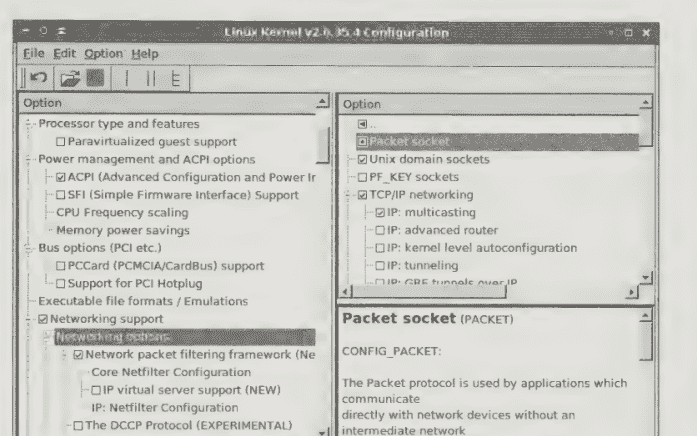

DHCP 服务器配置文件为 `dhcp.conf`，它可能位于 `/etc` 或 `/etc/dhcp3` 中。该文件可以包含注释，用开头的井号 (`#`) 表示。不是注释的行要么是参数（描述通用配置特征），要么是声明（描述网络计算机以及服务器可以交付给这些计算机的 IP 地址）。

某些 DHCP 客户端和服务器可能会有交互上的怪癖，因此你可能会在使用 DHCP 配置某些更奇特的操作系统时遇到问题。如果你的网络包含某些必须使用固定 IP 地址运行的系统以及某些不需要固定地址的系统，你有三个选择。你可以静态分配所有 IP 地址，可以通过 DHCP 静态分配部分地址，或者你可以对所有计算机使用 DHCP 并配置 DHCP 服务器为至少某些计算机提供固定地址。混合使用 DHCP 和静态 IP 地址没有问题；你只需要为静态 IP 地址使用 DHCP 不会尝试分配的地址范围。事实上，DHCP 服务器本身可能被分配一个静态 IP 地址。

DHCP 服务器配置文件为 `dhcp.conf`，它可能位于 `/etc` 或 `/etc/dhcp3`。该文件可以包含注释，用开头的井号 (`#`) 表示。不是注释的行要么是参数（描述通用配置特征），要么是声明（描述网络计算机以及服务器可以交付给这些计算机的 IP 地址）。

---

## 设置网络范围选项

大多数配置文件从一组设置全局选项的参数开始。列表 7.1 显示了一个典型的小型 `dhcp.conf`，包含了你可能使用的许多全局选项。这些选项中的许多并非全部以 `option` 关键字开头。所有参数行都以分号 (`;`) 结尾。

### 列表 7.1: 示例 `dhcp.conf`

```
default-lease-time 86400;
max-lease-time 172800;
option subnet-mask 255.255.255.255;
option routers 172.27.15.1;
option domain-name-servers 172.27.15.2,10.72.81.2;
option domain-name "example.com";
option netbios-name-servers 172.27.15.2;
option netbios-node-type 8;
get-lease-hostnames true;
```

```
subnet 172.27.15.0 netmask 255.255.255.0 (
range 172.27.15.50 172.27.15.254;
);
```


表 7.1 汇总你可能想要设置的一些常用全局选项。这些选项中的许多在列表 7.1 中已演示。

| 目标 | 网关 | 子网掩码 | 标志 | 引用 | 接口 |
| :--- | :--- | :--- | :--- | :--- | :--- |
| 255.255.255.255 | 0.0.0.0 | 255.255.255.255 | UH | 0 | 0 eth0 |

## 表 7.1 常用全局 DHCP 服务器参数

| 参数 | 值 | 描述 |
| --- | --- | --- |
| default-lease-time | 整数 | 设置以秒为单位的默认租约时间。客户端可以请求特定的租约时间用以覆盖此设置。典型的租约时间在几小时到几天之间——即几万或几十万秒。如果你计划在近期进行网络更改，或者网络变化频繁（例如，笔记本电脑连接一两个小时后就断开），则需要较短的租约时间。 |
| max-lease-time | 整数 | 设置服务器授予的最大租约时间（以秒为单位）。如果客户端请求的租约时间超过此值，服务器将授予该值的租约。如果服务器 正在响应 BOOTP 请求，则忽略此值。 |
| min-lease-time | 整数 | 设置服务器授予的最短租约时间（以秒为单位）。如果客户端请求的租约时间短于此值，服务器将授予该值的租约。 |
| get-lease-hostnames | 布尔值 | 如果为真，服务器将查找与 IP 地址关联的主机名并将该主机名返回给客户端，客户端可能会使用此值来设置自己的主机名。默认或当此参数为假时，服务器不会进行查找。 |
| use-host-decl-names | 布尔值 | 如果为真，服务器将客户端提供的主机名作为分配给客户端的主机名。 |
| ping-check | 布尔值 | 如果为真，服务器在向地址分配租约之前会先 ping 该地址。如果服务器收到响应，则不分配该地址。这可以确保服务器不会分配已经正在使用的地址（例如，某些系统错误配置了本不应使用的静态 IP 地址）。如果被 ping 的系统也配置为忽略 ping，则此检查将无法按预期工作。 |

## 表 7.1 常用全局 DHCP 服务器参数（续）

| 参数 | 值 | 描述 |
| --- | --- | --- |
| option subnet-mask | 子网掩码（点点四位格式） | 设置分配给客户端的子网掩码。 |
| option routers | IP 地址 | 子网路由器或多个路由器的 IP 地址。 |
| option domain-name-servers | IP 地址 | 客户端可能使用的 DNS 服务器的 IP 地址。 |
| option domain-name | 域名 | 客户端所在的域名。 |
| option netbios-name-servers | IP 地址 | NetBIOS 命名服务（NBNS）服务器（又称 Windows 互联网名称服务 WINS 服务器器）的 IP 地址。这些服务器可以是 Windows 为主导的网络中，服务器消息块/通用互联网文件系统（SMB/CIFS）文件共享的重要部分。 |
| option netbios-node-type | 二进制代码 | NetBIOS 尝试进行名称解析的代码。值为 1 使用广播，值为 2 使用 WINS 服务器，值为 4 先尝试广播后尝试 WINS 服务器，值为 8 先尝试 WINS 服务器后尝试广播。如果你已经通过 `option netbios-name-servers` 参数提供了 WINS 服务器，并且当然已将指定的系统配置为 WINS 服务器，那么最佳选项是 8。 |

> 表 7.1 远非完整，但它描述了最常见的选项。有关有关更多选项的信息，请查阅 `dhcp-options` 和 `dhcp-eval` 手页。某些选项（例如表 7.1 中的 NetBIOS 选项）设置的值会被许多 DHCP 客户端忽略。

表 7.1 中明显缺失了任何设置客户端应接收 IP 地址的方法。不过，此选项出现在列表 7.1 中，作为子网声明的一部分。接两个部分将更详细地介绍分配 IP 地址的选项。

## 配置动态地址的交付

列表 7.1 足够为多于 200 台的计算机分配 IP 地址。完成此任务的行是列表的最后三行：

```
subnet 172.27.15.0 netmask 255.255.255.0 {
  range 172.27.15.50 172.27.15.254;
}
```

这些行构成了一个声明。在这种情况下，该声明适用于声明第一行定义的 172.27.15.0/24 网络。大括号之间的参数仅适用于该地址块中的机器。如果你需要，可以创建多个子网声明，并做到这一点。例如，服务器可能具有多个网络接口，并需要为物理子网上的机器分配不同的 IP 地址。对于只有单个子网的网络，类似于列表 7.1 中的声明应该可以良好工作。它的第二行由 `range` 参数组成，定义了服务器交付的 IP 地址范围：172.27.15.50 到 172.27.15.254。当你启动 DHCP 客户端时，取决于服务器已经分配了哪些地址，可能会接收此范围内的任何地址。如果你的计算机多于此范围允许的数量，那么你应该扩展它（如果可能的话）或创建一个提供额外地址的子网声明。如果地址显著多于 255 个，扩展声明可能需要更改掩码。例如，使用 255.255.240.0 掩码允许你分配从 172.27.0.1 到 172.27.15.254 的地址（在这种情况下，你应指定 172.27.0.0 子网而非 172.27.15.0）。当然，你必须有权使用你所选择的任何地址。

> 给定 172.27.15.0/24 网络块，列表 7.1 仅预留了 205 个 IP 地址，这意味着前 49 个地址可用于静态分配。通常，这些地址中至少一个将分配给网络路由器（列表 7.1 中的 172.27.15.1），一个将用于 DHCP 服务器本身。其他的可能分配给名称服务器、邮件服务器或其他最适合静态 IP 地址运行的服务器。或者，你可以使用这些地址中的一些。

## 配置固定地址的交付

如果你想配置 DHCP 服务器分配固定不变的地址，这种做法通常需要执行以下两个操作之一：

- 将你的网络和 DNS 服务器关联，以便 DHCP 服务器交付正确的主机名。这种做法在本地可能是可行的，但如果你的设备被 DNS 服务器缓存，则可能不可靠。即使你为这些记录设置了短生存时间，客户端最终可能会使用过期的条目。这种配置还需要对 DHCP 和 DNS 服务器进行复杂的更改。由于这些原因，我没有在书中描述这种方法。
- 配置你的 DHCP 服务器分配固定的 IP 地址。此目标可以通过多种方式实现。在本节描述的方法涉及使用 DHCP 客户端的媒体访问控制（MAC）地址（又称硬件地址）来识别该系统并允许 DHCP 服务器分配固定 IP 地址。这有时被称为保留地址。

### 定位 MAC 地址

提供固定地址的第一步（至少在使用描述的 MAC 地址方法时）是定位 DHCP 客户端的 MAC 地址。对于以太网设备，此地址是一个 6 字节数字，通常以十六进制（十六进制）表示，通常使用冒号、连字符或其他符号分隔字节。你可以通过多种方式定位 MAC 地址：

硬件标签：某些网络接口卡（NIC）上贴有 MAC 地址的标签。内置以太网的计算机外壳可能有标签。如果你还没有安装网卡，通过这种方式定位 MAC 地址非常简单，但如果它已经在计算机内部，则可能不方便。许多网卡也没有这种标签。

Linux 客户端：在 Linux 客户端上，你可以输入 `ifconfig eth0`（或其他相应的接口名称）。此命令会产生网络接口的信息，包括第一行的硬件地址（标记为 `Hwaddr`）。此命令要求接口处于激活状态，尽管它可能尚未分配 IP 地址。

Windows 客户端：Windows 提供了一个类似于 Linux `ifconfig` 的工具用于显示网络接口信息。在命令提示符中输入 `IPCONFIG /ALL` 可以显示 MAC 地址。标记为 `Physical` 地址的行应该是

### 配置 DHCP 服务器

Mac OS DHCP 客户端：Mac OS X 提供 `ifconfig` 命令，其名称与 Linux 的命令名相似，尽管并不完全相同。尽管如此，你可以打开 OS 终端应用程序并使用 `ifconfig`。硬件地址可能会出现在 `en0` 部分，并标记为 `ether`；然而，情况并不总是如此，特别是对于 WiFi 硬件。

使用 GUI：大多数现代操作系统都提供了通过其 GUI 配置工具查找硬件地址的方法。具体方法因操作系统而异。例如，在 Windows 7 中，转到“控制面板 > 网络和共享中心”，然后点击窗口右侧显示连接状态的对话框。点击“详细信息”按钮获取“网络连接详细信息”对话框，该框与图 7.2 类似。MAC 地址在在该对话框中以“物理地址”行的形式显示。

图 7.2 大多数操作系统都提供了可以显示计算机硬件地址的 GUI 工具

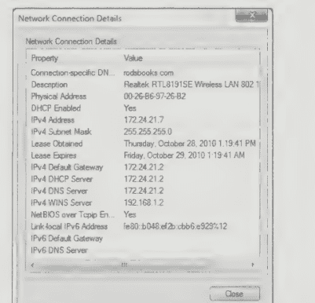

从 DHCP 服务器定位地址：无论客户端使用什么操作系统，你都可以通过几种方式从 DHCP 服务器定位 MAC 地址。一种方法是将 DHCP 客户端配置为使用 DHCP 并激活其网络接口。假设服务器已配置为按照前面的章节“配置动态地址的分配”的描述交付地址，那么 DHCP 客户端应该获取到一个地址。然后，你可以检查 DHCP 服务器的日志，寻找已授予该地址租约的证据。DHCP 租约文件（通常为 `/var/lib/dhcp/dhcpd.leases`）应该包含一个标识 IP 地址和 MAC.address 的多行条目。以 root 身份输入 `grep dhcpd /var/log/messages | tail -n 1` 或 `grep dhcpd /var/daemon.log | tail -n 1` 将显示一个包含相关 IP 地址和 MAC 地址的事件。如果在目标系统授予租约到你输入此命令之间发生了某些 DHCP 活动，该活动将会显示。将数字从 1 增加到 2 或更高以显示更早的条目。最后，你可以输入 `ping -c 1 ip.addr; /sbin/arp ip.addr`（其中 `ip.addr` 是 IP 地址）来获取计算机的 MAC 地址。这种最后方法在你临时为将来的 DHCP 客户端配置静态 IP 地址时同样有效。

## DHCP 服务器固定地址选项

一旦获取了 DHCP 客户端的 MAC 地址，就可以在 DHCP 服务器的 `dhcp.conf` 文件中为其添加一个条目。该条目可以放在子网声明内部（如列表 7.1 所示），也可以放在子网声明之后。无论何种方式，该条目看起来如下：

```
host calvin.example.com {
    hardware ethernet 00:80:C6:F9:3B:BA;
    fixed-address 172.27.15.25;
}
```

该声明告诉服务器你正在为特定的计算机定义参数。将计算机的主机放在关键字之后，并用左大括号结束该行。此行与右大括号之间的行定义的声明结束部分，仅适用于此主机。

`hardware` 参数提供了服务器识别主机的方法。该参数后面跟着一个硬件类型的关键字（在本例中为 `ethernet`，但 `token-ring` 也是有效的）以及 MAC 地址，使用冒号（`:`）分隔地址的字节。当然，`fixed-address` 行定义了要给此主机的 IP 地址。确保该地址也没有在任何子网声明的范围行中指定！

> 无线客户端通常通过无线接入点 (WAP) 或路由器连接到网络，从 DHCP 服务器的角度来看，它们似乎是以太网设备。宽带路由器总是包含自己的 DHCP 服务器，因此你可以选择使用宽带路由器的 DHCP 服务器，或禁用它并配置 Linux DHCP 服务器。

在你添加此条目并重启服务器后，它应该开始向该客户端交付你通过 `fixed-address` 参数指定的固定 IP 地址。当然，这在硬件地址保持不变的情况下才有效。如果你更换了计算机的 NIC，必须更新硬件行以反映更改。

## 配置 DHCP 继继代理

如果你的网络跨越多个网络段且段段之间有路由器，你必须对 DHCP 配置进行适当调整。可能包括：

- 运行多个 DHCP 服务器：你可以在每个子网上运行不同的 DHCP 服务器。当然，这种方法增加了你的配置工作量；但如果你可以在其中一个网络段上运行易于配置的 DHCP 服务器（例如宽带路由器内置的），那么可能是可以接受的。
- 在路由器上运行 DHCP 服务器：运行在路由器上或具有多个网络接口的某些计算机上的 DHCP 服务器可以为该计算机连接的所有网络服务。这种解决方案可以相当简单；但出于安全考虑，你可能不想在路由器上运行 DHCP 服务器。
- 配置路由器路由广播：某些路由器提供了将 DHCP 请求从一个子网中继到另一个子网的选项。例如，Cisco 的 `ip-helper` 地址选项不需要查阅你的路由器文档即可获得此方法的信息。
- 运行 DHCP 中继代理：ISC 的 DHCP 服务器软件包含一个程序 `dhcprelay` 或 `dhcp3`，可以将 DHCP 请求从一个子网中继到另一个子网。该程序必须安装在每个没有自己的 DHCP 服务器的子网计算机上。注意，`dhcprelay` 程序不需要运行在路由器或其他连接到两者的计算机上。

`dhcprelay` 程序可能包含在 DHCP 软件包中。最基本的用法是使用 DHCP 服务器的名称或地址：

```
# dhcprelay 172.27.15.25
```

中继代理将将其接收到的 DHCP 请求中继到指定的接口。你可以通过各种选项（例如 `-i` 指定接口）来精细调整服务器的行为。（查阅 `dhcprelay` 的手册页以获取更多信息）。在实践中，你可能希望让 `dhcprelay` 自动启动。要做到这一点，你必须在特定发行版的配置文件输入 DHCP 服务器地址。例如，在 Debian 和 Ubuntu 中，文件是 `/etc/default/dhcp3`，你编辑 `SERVER` 选项；在 Fedora 系统上，文件是 `/etc/sysconfig/dhcp3`，你编辑 `VERSION` 选项。

## 管理 LDAP

你应该已经熟悉使用工具 `useradd`、`usermod` 和 `passwd` 管理 Linux 帐户，以及文件 `/etc/passwd` 和 `/etc/shadow`。这些概念、工具和文件都是 LPIC-1 认证的一部分。对于账户较少的 Linux 计算机，此类配置是足够的。但在许多网络环境中，希望为大量的计算机提供大量的帐户。管理此类环境会迅速变成挑战；任何更改都需要在所有计算机上同步。这种问题的解决方案是部署网络登录协议。协议有很多，LDAP 就是之一。

> 注意：完全配置 LDAP 不在 LPIC-2 目标范围内，且超本书的范围。

### 管理 LDAP 账户

目录本质上是一个数据库，但它是一个按层次结构组织的数据库，且设计为读取频率高于写入频率。与文件系统目录一样，LDAP 目录有一个根（在 LDAP 术语中称为 base），信息相对于该基准进行存储。在接下来的页面中，根据上下文，“directory”（目录）一词的含义将明确是指文件系统目录还是 LDAP 目录。

### 准备使用 LDAP 工具的系统

你可以在任何正确配置为 LDAP 客户端的计算机上使用 LDAP 账户维护工具。至少对于其客户端，为了做到这一点，你必须安装 OpenLDAP 软件，或者 `/etc/openldap/conf` 文件。该文件指定了 LDAP 目录的基准、LDAP 服务器的位置，以及如果你的 LDAP 服务器使用了加密，所需的加密密钥：

```
BASE dc=pangaea,dc=edu
URI ldaps://ldap.pangaea.edu
TLS_CACERT /etc/openldap/ssl1/certs/ldap-cert.crt
```

### 使用 LDIF 文件

LDAP 使用 LDAP 数据交换格式 (LDIF) 作为数据传输的方式，进行 LDAP 账户维护需要对 LDIF 有基本的了解。LDIF 文件由一系列由冒号分隔的属性名和值组成。对于账户维护，这些文件必须包含与 `/etc/passwd` 和 `/etc/shadow` 中的条目等的数据。为了维护 Linux 组文件，必须提供等效于 `/etc/group` 的。列表 7.2 和 7.3 显示了密码和组的 LDIF 文件，分别持有单个用户和单个组的数据。

### 列表 7.2：持有用户数据的示例 LDIF 文件

```
dn: uid=maryann,ou=People,dc=pangaea,dc=edu
uid: maryann
cn: maryann
objectClass: account
objectClass: posixAccount
objectClass: top
objectClass: shadowAccount
userPassword: [SHA]dur1zOPZs1HC6AGGhxAhcYHpa7lqRG
shadowLastChange: 14262
shadowMax: 99999
shadowWarning: 7
loginShell: /bin/bash
gecos: maryann
uidNumber: 1010
gidNumber: 100
homeDirectory: /home/maryann
```

> 注意：列表 7.2 中的 `uid` 值对应于 Linux 用户名；UID 值显示在 `uidNumber` 行上。

### 列表 7.3：持有组数据的示例 LDIF 文件

```
dn: cn=users,ou=Group,dc=pangaea,dc=edu
objectClass: posixGroup
objectClass: top
cn: users
userPassword: [crypt]x
gidNumber: 100
memberUid: maryann
```

要添加或修改账户或组，你应该准备合适的 LDIF 文件。（或者，你可以直接输入信息，但将数据放在文件中会更简单。）每个文件可以包含多个条目，因此你可以通过创建一个定义多个用户的单个文件来一次性添加多个条目。确保用空行分隔不同账户的条目。


数据文件中的 `userPassword` 条目需要特别注意。该条目通常使用几种加密方案之一进行加密。在列表 7.2 中，使用了 SSHA 加密。你可以通过输入 `slapppasswd` 来创建一个加密密码，它会提示你输入密码（你必须输入两次），并显示一个你可以剪切并粘贴到 LDIF 文件中的字符串。额外的 `slapppwd` 选项将在稍后的“修改账户”部分描述。

如果账户目录是新的，你必须使用两个特殊条目来初始化它：

```
dn: dc=pangaea,dc=edu
objectClass: domain
dc: pangaea
```

```
dn: ou=People,dc=pangaea,dc=edu
objectClass: organizationalUnit
ou: People
```

你可以将这两个条目放在用于创建账户的第一个 LDIF 文件的开头，也可以将它们输入到单独的文件。当然，你应该修改它们，通过将 `pangaea` 和 `edu` 的引用更改为你站点的等效项来反映你自己的配置。初始化组目录也需要类似的条目：

```
dn: ou=Group,dc=pangaea,dc=edu
objectClass: organizationalUnit
ou: Group
```

### 现实场景

## 将用户数据库迁移到 LDAP

如果你有一台带有现有数据库的计算机，并想将其迁移到 LDAP，一组将标准 Linux 文件转换为 LDIF 格式的脚本可以提供帮助。这些脚本存在 `http://www.padl.com/OSS/MigrationTools.html`。该页面的大部分内容描述了脚本使用的各种变量的含义。下载链接出现在页面末尾；向下滚动并点击下载包含脚本的 tarball。

在下载并解压脚本后，你必须为你的站点编辑 `$DEFAULT_MAIL_DOMAIN` 和 `$DEFAULT_BASE` 变量。修改 `script_common.ph` 文件，使其分别引用你的 DNS 邮件主域名和 LDAP 基准。

在完成相应的自定义后，你可以在脚本目录下执行以下命令，为账户和组创建 LDAP 文件：

```
# ./migrate_passwd.pl /etc/passwd passwd.ldif
# ./migrate_group.pl /etc/group group.ldif
```

生成的 `passwd.ldif` 和 `group.ldif` 包含等效于 `/etc/passwd` 和 `/etc/group` 的内容。

# 添加账户

要添加账户，你使用 `ldapp` 命令。如果目录是空的，一个很好的起点是：

```
$ ldapp -f accounts.ldif
```

生成的 `passwd.ldif` 和 `group.ldif` 包含 `/etc/passwd` 和 `/etc/group` 的等效内容。`addadd` 重要选项总结在表 7.2 中。

### 表 7.2：ldadd 重要选项

| Option | Description |
| :--- | :--- |
| -c | 即使检测到错误也继续处理。 |
| -S | 创建 LDAP 输出。 |
| -n | 显示将执行的操作。 |
| -v | 产生详细输出。 |
| -d | 设置调试级别。 |
| -f | 从指定文件读取。 |
| -x | 使用默认认证方法而非 SASL。 |
| -D | 使用指定的命名目录 (DN) 绑定。 |
| -W | 提示身份验证。 |

# 管理 LDAP 账户

| Option | Description |
| :--- | :--- |
| -w | 指定密码。（通过这种方式传递密码是有风险的，因为它会被记录在 shell 中。） |
| -y | 从密码文件读取。 |
| -H | 访问指定的资源标识符 (URI)。旧版本使用 -h 而不是 -H。 |
| -P | 指定 LDAP 版本 (2 或 3)。 |
| -Z | 尝试启动 StartTLS（传输层安全）认证。使用 -ZZ 要求此操作成功。 |

# 修改账户

要修改账户，你使用 `ldmodify` 命令，它的工作方式与 `ldadd` 类似。（在许多系统中，一个命令是另一个的符号链接。）因此，表 7.2 中的选项也适用于 `ldmodify`。通常，你使用 `ldmodify` 来修改现有账户。你可以编辑现有的 LDIF 文件，然后通过 `ldmodify` 传递以更改账户。

你可能会更改的重要账户设置是密码。如果你想以哈希（单向加密）形式存储密码，需要在修改 LDIF 文件时对其进行加密。如所述，`slapppasswd` 工具可以完成这项工作。输入它的名称，它会提示你输入密码（不显示），随后程序打印哈希密码：

```
$ slapppasswd
```

新密码：

```
[SHA]2lutApB+/juGg5k2Vk3mYEctqsDRkkt
```

将剪切的值粘贴到 LDIF 文件中，然后通过运行它来更改密码。

`slapppasswd` 的各种选项会修改其操作，总结如表 7.3 所示。一些冷门的选项也存在；详情请咨询程序的 man 手页。

### 表 7.3：slapppasswd 的各种选项

| Option | Description |
| :--- | :--- |
| -a | 指定哈希算法。 |
| -b | 指定盐的长度。 |
| -c | 指定迭代次数。 |
| -h | 指定哈希类型。 |
| -l | 指定输出格式。 |
| -p | 指定密码文件。 |
| -s | 指定盐。 |
| -w | 指定密码。 |

## 表 7.3 重要 ldapppassd 选项

| 选项 | 说明 |
| --- | --- |
| -v | 显示详细输出。 |
| -s password | 创建指定密码的哈希值。 |
| -T file | 从文件内容创建哈希。 |
| -h scheme | 使用指定的方案对密码进行哈希。方案的选项有 (CRYPT)、(MD5)、(SM5)、(SHA) 和 (SHA)，其中 (SSHA) 为默认值。 |

虽然你可以使用 `ldapppassd` 和 `ldapmodify` 修改用户密码，但更简单的方法是使用 `ldapppassd`，它有效地将这两个命令合并为一，消除了处理中间 LDAP 文件的需要：

```
$ ldapppassd -D cn=manager,dc=pangaea,dc=edu -W -S --uid=maryann,ou=People,dc=pangaea,dc=edu
New password:
Re-enter new password:
Enter LDAP Password:
Result: Success (0)
```

此示例更改了 maryann 的密码。其之处在于，用户必须在输入用户新密码*之后*输入经理的密码。该命令有许多变体；例如，通过将用户的 DN 替换为用户的 DN，用户可以更改自己的密码。

除了 -C、-S、-f 和 -P 之外，表 7.2 中的选项均适用于 `ldapppassd`。此外，表 7.4 总结了 `ldapppassd` 特有的选项。请参阅程序的帮助页以获取更多选项。

## 表 7.4 重要 ldapppassd 选项（参见表 7.2）

| 选项 | 说明 |
| --- | --- |
| -A | 提示输入旧密码。 |
| -a password | 使用指定的*password*作为旧密码。 |
| -t file | 从*file*读取旧密码。 |

## 管理 LDAP 账户

| 选项 | 说明 |
| --- | --- |
| -n | 不设置密码（与 -v 或 -d 结合使用）。 |
| -S | 提示输入新密码。（注意 -S 在相关工具中的含义不同。） |
| -s new_password | 将新密码设置为 new_password。 |
| -T file | 从文件读取新密码。 |

在大多数情况下，用户可以在 LDAP 客户端系统可以使用 `passwd` 更改自己的密码，就像账户数据库是本地的一样。然而，这种能力取决于客户端可插认证模块（PAM）系统的配置。鉴于 `passwd` 相比 `ldappasswd` 更简单，这对于大多数用户来说是更好的。

## 删除账户

当然，你可能经常需要删除账户。你可以使用 `ldapdelete` 命令来实现，它可以删除单个账户，例如：

```
$ ldapdelete -D cn=manager,dc=pangaea,dc=edu -W cn=manager,dc=pangaea,dc=edu
```

该命令将从目录中删除新用户（更准确地说，是删除与 cn=name,dc=pangaea,dc=edu 规范相同的账户），前提是执行此命令的用户持有正确的密码！

`ldapdelete` 命令使用的选项与表 7.2 中的所有选项相同，但 -S 和 -C 除外ff 的含义也略有不同，-f 指定的文件包含要删除的 DN 列表。请参阅 `ldapdelete` 的手册页获取更多选项信息。

## 查询服务器账户信息

若干工具可以提供有关 LDAP 账户的信息。一个非常方便的工具是 `getent`。你可以向 `getent` 传递字符串 `passwd` 或 `group` 来获取账户或组列表。你还可以添加账户或组名称来获取特定账户或组的信息：

```
$ getent passwd maryann
maryann:x:101:100:maryann:/home/maryann:/bin/bash
```

此输出证实了 maryann 账户存在，并以 `/etc/passwd` 文件相同的格式显示了关于账户的各种信息。尽管如此，`getent` 工具从各种源返回信息，包括本地账户数据库；只有当客户端正确配置为使用 LDAP 进行账户管理时，它才能工作。使用 `-t s ldap` 选项会将搜索限制在 LDAP 源上。

一个 LDAP 特有的工具是 `ldapsearch`。使用此工具，你可以使用数据库中的任何字段搜索数据。通常情况下，使用它不需要太多的身份验证。例如，你可以通过输入以下内容搜索用户 maryann 的数据：

```
$ ldapsearch uid=maryann
```

程序将一个接一个地显示任何匹配的目录条目。当然，在这种情况下只有一个匹配的条目；然而，你可以搜索特定组的成员、使用特定 shell 的用户或其他非唯一的特征，以获取所有用户的信息。

LDAP 实用程序根据《请求意见稿》(RFC) 4515 文档（除其他位置外，还包括 `http://www.rfc-editor.org/rfc/rfc4515.txt`）中定义的标准或过滤器进行搜索。RFC 4515 过滤器可能非常复杂。它们在概念上类似于正则表达式（正则表达式被其他几个 Linux 工具使用），但 RFC 4515 过滤器的语法完全不同。例如，考虑

```
(the department)
```

该过滤器可以使用逻辑运算符如 AND (&)、OR (|) 和 NOT (!) 进行组合。例如，要查找销售部门中所有使用 bash shell 的用户，过滤器将是：

```bash
(&(department=sales)(shell=/bin/bash))
```

# 第 7 章 • 高级网络配置

必须意识到这一点是：并不是所有连接两个网络的计算机都是路由器。某些计算机具有两个网络接口，并可以在两个网络上运行相同的服务器，但仅凭这种配置本身并不会在网络之间传输数据（除非取决于服务器的配置，可能会以有限的方式进行）。某些设置采用代理服务器，这是系统为有限数量协议中继数据的方法，但代理服务器不是路由器，因为路由器会为各种协议转发数据包。

# 激活路由

要将计算机用作路由器，你必须首先像第 5 章描述的那样将其配置为两个或多个网络接口。然后，你必须通过在 `/proc/sys/net/ipv4/ip_forward` 伪文件中写入值 1 来链接这些接口：

```bash
# echo "1" > /proc/sys/net/ipv4/ip_forward
```

`/proc/sys/net/ipv4` 伪目录包含大量伪文件，控制着你 IPv4 连接的许多低级功能。除非你完全理解它们的用途和功能，否则不应调整这些伪文件中的大多数。在少数情况下，调整其中一个可能有助于提高性能或启用某功能。在路由器的 `ip_forward` 伪文件中放置 1 就是这样一种情况。

通过此更改，该计算机被配置为路由器。当然，其两个网络上的计算机都必须知道它的路由器状态——也就是说，Linux 路由器必须在每个网络接口上至少一个计算机的路由表中被列为网关。

# 配置防火墙规则

Linux 的数据包过滤防火墙规则使用名为 `iptables` 的工具实现。该程序允许你描述通过地址、端口号等标准匹配数据包的准则。匹配你指定标准的的数据包将通过，而其他将被拒绝，或反之，取决于你的默认设置。在接下来的页面中，我将描述基本的 iptables 原理，总结如何检查现有配置，解释 iptables 实用程序的语法，并展示一个示例配置。

Linux 内核版本 2.4.x 和 2.6.x 使用 `iptables`。较早的 2.0.x 和 2.2.x 内核分别使用了名为 `ipfwadm` 和 `ipchains` 的工具。如果你的系统使用 IPv6，则必须使用 `ip6tables` 工具。这些程序在原理上与 `iptables` 相似，但在许多细节上有所不同。特别是 `ipfwadm` 和 `ipchains` 工具的功能不如 `iptables` 强大。

# iptables 基础

Linux 内核使用一系列规则来决定如何处理其收到的任何给定数据包或由本地进程生成的数据包。这些规则按“链”（chains）排列，链提供了一系列模式，以及当数据包匹配模式时将采取的动作。第一个匹配到模式的规则决定了系统如何处理该数据包——接受它、拒绝它或将其传递给另一个链。链被进一步组织成“表”（tables），它们之间存在关系。最重要的表是 filter 表（过滤表），如图 7.3 所示。在该表中，INPUT 链处理发往本地程序的数据包，FORWARD 链处理系统应当转发的数据包（如路由器），OUTPUT 链处理源自本地并发往外部系统的数据包。任何给定的数据包只通过这些链中的一个。其他标准表还包括处理网络地址转换（NAT）的 nat 表，以及以特殊方式修改数据包的 mangle 表（修改表）。

图 7.3 Linux 使用一系列规则（这些规则定义在处理过程中的各种点调用的链中）来决定网络数据包的命运

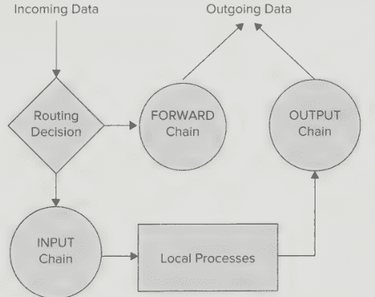

要创建一个数据包过滤防火墙，你必须为特定的表和链设计一系列规则。例如，你可能告诉 INPUT 链丢弃任何指向 80 端口（Web 服务器端口）且源自本地网络的数据包。另一组规则可能告诉 OUTPUT 链阻止所有本地进程发往 25 端口（SMTP 邮件服务器）的出站数据包，但指向你网络邮件服务器计算机的除外。路由器可能还会为 FORWARD 链包含一些特殊规则，以便独立于本地程序的访问来控制路由技术。

Linux 使用 `iptables` 实用程序来管理规则。该程序依赖于 Linux 内核中各种选项。最重要的是，你必须启用 Networking Support > Networking Options > Packet Filtering Framework (Netfilter) 选项。一旦完成此操作，你可以激活 Netfilter 配置子系统中的各种选项，特别是如图 7.4 所示的 IP Tables Support 选项。我建议你将几乎所有内容也至少以模块的形式进行构建。大多数 Linux 发行版都将这些选项中的大部分编译为模块并发布。

图 7.4 在构建数据包过滤防火墙之前必须启用 Linux内核选项

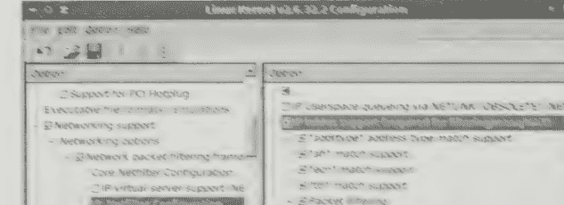

`iptables` 工具接受许多表和命令选项，其中最重要的总结在表 7.6 中。与规则相关的选项将在后的“iptables”章节中描述。附加选项在 `iptables` 的 man 页面中描述。

# 表 7.6 常见的 iptables 表和命令选项

| 长选项名称 | 短选项名称 | 描述 |
| :-- | :-- | :-- |
| --table table | -t table | 指定要操作的表。对于防火墙，这通常是 filter。 |
| --list [chain] | -L [chain] | 显示指定链的规则。 |
| --list-rules [chain] | -S [chain] | 显示指定链的规则，输出比 -L 更详细。 |
| --flush [chain] | -F [chain] | 清空指定链的规则。 |
| --policy chain target | -P chain target | 设置指定链的默认策略。 |
| --append chain rule | -A chain rule | 向指定链添加新规则。 |
| --delete chain rule | -D chain rule | 从链中删除现有规则。 |
| --insert chain [number] rule | -I chain [number] rule | 在指定链的指定位置插入新规则。 |
| --replace chain rule | -R chain rule | 用新规则替换指定位置的现有规则。 |

# 检查配置

`iptables` 程序对 -L 的响应是显示规则列表。你可以可选通过 -t 传递表名。例如，列表 7.4 显示了 filter 表。

# 列表 7.4：使用 iptables 查看防火墙配置的示例

```bash
# iptables -L -t filter
Chain INPUT (policy ACCEPT)
target     DROP  0  anywhere

Chain FORWARD (policy DROP)

Chain OUTPUT (policy ACCEPT)
```


默认表是 `filter`，因此在此命令中省略 `-t filter` 产生相同的输出。输出显示的表几乎为空；`FORWARD` 和 `OUTPUT` 链没有规则，而 `INPUT` 链只有一条规则——它丢弃所有输入。虽然 `iptables -L` 显示的信息格式与你创建规则时使用的格式不完全，但其相似性足以让你理解输出。

# 设置默认策略

设计防火墙时，一个至关重要的考虑是默认策略，即防火墙对于不匹配链中任何规则的数据包如何处理。事实上，在 `filter` 表中有三个默认策略，分别对应 `INPUT`、`FORWARD` 和 `OUTPUT` 链。默认策略对应于系统可以采取的动作。如表 7.7 所示，常见的有三个，尽管只有两种可以作为默认策略。

## 表 7.7 常见防火墙策略

| 策略 | 描述 |
| --- | --- |
| `ACCEPT` | `ACCEPT` 导致系统接受数据包并将其传递下一个链或系统。例如，如果 `INPUT` 链的默认策略是 `ACCEPT`，任何不匹配规则的数据包将传递给目标程序（假设有一个程序正在使用该端口）。 |
| `DROP` | 此动作导致系统忽略数据包——就像将其“丢在地上”一样。对于发送数据包的系统（取决于涉及的链，可能是远程计算机或本地程序）来说，数据包似乎由于路由错误或泄漏丢失了。 |
| `REJECT` | 这种动作与 `DROP` 非常相似，只是内核会向调用计算机或程序返回一个代码，指示数据包已被拒绝。这种行为类似于没有程序在使用目标端口时的情况。这种动作需要你将显式支持编译到内核中，无论是在主内核文件中还是作为模块。遗憾的是，`REJECT` 不能作为默认策略，但你可以将其作为更特定规则的目标。 |

### 配置路由器

输入 `iptables -L` 会显示默认策略，如列表 7.4 所示——例如 `INPUT` 和 `OUTPUT` 链的默认策略为 `ACCEPT`，而 `FORWARD` 链的默认策略为 `DROP`。要更改默认策略，你应该首先通过传递 `-F` 参数和链名称给 `iptables` 来清除该链中的所有规则。然后，你可以向 `iptables` 传递 `-P` 参数以及策略名称。在这两种情况下，你都可以选择包含 `-t` 和链名称：

```
# iptables -t filter -F FORWARD
# iptables -F INPUT
# iptables -P FORWARD DROP
# iptables -t filter -P INPUT
```

作为一般原则，最安全的默认策略是关闭的——即使用 `DROP`。当你使用这种默认策略时，必须通过防火墙规则显式地开放端口。这意味着如果你的电脑上在你不知情的情况下运行了一个服务器，它不会带来安全风险，因为数据包无法到达它也无法发送数据包。同样，如果你关闭了出站端口，恶意软件或个人可能无法对他人发起攻击，除非他们使用你已批准的协议。在路由器上对 `FORWARD` 链使用 `DROP` 作为默认策略，意味着你的网络将得到很好的保护，并且无法作为出站攻击的基础。另一方面，默认关闭策略意味着你必须非常仔细地设计防火墙规则；任何疏忽都会导致重要的客户端或服务器停止工作。

虽然你不能将默认策略设置为 `REJECT`，但你可以通过其他方法实现相同的效果。具体来说，你可以在链的末尾插入一条规则，对所有未被先前的规则匹配的数据包使用 `REJECT`。如果你这样做，通过 `iptables` 的 `-P` 选项设置的默认策略就变得无关紧要了。下一节“使用 `iptables`”描述了如何创建单独的规则。

如果你想要关闭策略，你必须在使用 `DROP`（直接使用）和 `REJECT`（通过上一个提示中描述的变通方法）之间做出选择。支持这两种规则都有充分的理由。`DROP` 是“隐身型”选项。如果你在每个端口和协议上都使用 `DROP`，许多网络扫描器将完全检测不到你的电脑；它看起来就像是不存在一样。当然，极端的策略会让网络变得毫无用；在实践中，你可能会允许某些流量通过，这经常会向破解者提供信息。例如，如果系统丢弃除了端口80 以外的所有访问，破解者就知道你在 80 端口上运行了 Web 服务器（或其他程序）。但由于计算机不会丢弃数据包，破解者也知道你正在运行一个带有默认 `DROP` 策略的防火墙。相比之下，`REJECT` 在从普通扫描中隐藏系统存在方面做得较差，但一旦破解者发现了你的系统，你是一个防火墙的这一点就不会那么明显了。

在偶尔，这些不同的策略会对协议产生影响。具体来说，许多协议的设计目的是在数据包丢失时不断尝试连接。如果你使用默认 `DROP` 策略，这种行为有时会导致相关协议出现连接延迟。例如，服务器可能会尝试连接你电脑的 113 端口，该端口被 `ident`（又名 `auth`）服务器使用。该服务器提供你的系统向哪些服务器发送连接请求的信息，目标是在日志文件中提供轨迹，以帮助追踪滥用行为的源。（`TCP Wrappers` 也可以使用 `ident` 服务器作为授权。）如果你的系统对 113 端口使用了 `INPUT DROP` 规则，当远程服务器使用你的 `ident` 服务器时，可能会导致连接延迟。当然，你可以根据具体情况通过向违规的链添加普通规则来克服此类问题，用 `REJECT` 规则覆盖默认的 `DROP` 规则，或者甚至覆盖 `ACCEPT` 规则。

如果你的电脑有两个网络接口，但不应作为路由器运行，请在 `FORWARD` 链上使用 `DROP` 策略。这样做将防止电脑作为路由器运行，即使你无意中将其配置为其他方式转发数据包。

## 使用 iptables

要向链中添加规则，你可以使用如下命令的 `iptables`：

```
# iptables -A CHAIN selection-criteria -j TARGET
```

此命令中的 `CHAIN` 是链名称——对于 `filter` 表，其为 `INPUT`、`OUTPUT` 或 `FORWARD`。`TARGET` 是处理数据包的防火墙目标，例如 `ACCEPT`、`REJECT` 或 `DROP`。你还可以指定 `LOG` 目标，它会记录有关数据包的信息然后尝试匹配下一条规则。还有其他各种目标可用；详情请参阅 `iptables` 文档。

此命令的困难之处在于 `selection-criteria` 组件。你可以指定许多不同的标准来匹配数据包的不同特征。如果你指定了多个标准，则所有标准都必须匹配，规则才会生效。一些可能的标准总结在表 7.8 中。还有许多额外的匹配匹配规则可用；更多信息请参阅 `iptables` 的帮助页面。

### 表 7.8 常见的 iptables 匹配标准

| 长选项名称 | 短选项名称 | 描述 |
| --- | --- | --- |
| `--match name` | `--m name` | 添加由命名模块提供的扩展匹配规则 |
| `--protocol protocol` | `--p protocol` | 设置规则中的协议 (tcp, udp, ud) |
| `--source port` | `--sport port` | 在规则中指定源端口 |
| `--destination port` | `--dport port` | 在规则中指定目的端口 |
| `--source address` | `-s address` | 在规则中指定源地址 |
| `--destination address` | `-d address` | 在规则中指定目的地址 |
| `--in-interface name` | `-i name` | 在规则中指定输入接口 |
| `--out-interface name` | `-o name` | 在规则中指定输出接口 |
| `--state state` | `-m state` | 匹配连接状态 (NEW, ESTABLISHED, RELATED, 等) |
| `--jump target` | `-j target` | 指定目标动作 (ACCEPT, REJECT, DROP) |
| `--goto chain` | `-g chain` | 跳转到另一个链 |

```
iptables -A INPUT -p tcp --dport 1024:65535 -m state \
  --state ESTABLISHED,RELATED -j ACCEPT
```

### 允许本地连接到本地 SSH 服务器

```
iptables -A OUTPUT tcp --sport 22 -s 172.24.1.0/24 -m state \
  --state ESTABLISHED,RELATED -j ACCEPT
```

```
iptables -A INPUT tcp --dport 22 -s 172.24.1.0/24 -m state \
  --state NEW,ESTABLISHED,RELATED -j ACCEPT
```

列表 7.5 开始于一系列六个 `iptables` 的调用，这些调用会清空防火墙规则链并设置默认策略。这些行确保了当你运行此脚本时，不会向现有的规则集添加重复规则，否则可能会导致链膨胀、降低性能并产生意之外的影响。剩余的行被分为四个部分，每部分包含两个 `iptables` 调用。这些部分与特定类型的流量有关：

**回环接口流量（Loopback Interface Traffic）**：这两行涉及 `127.0.0.1`，允许计算机通过回环接口（`lo`）与自身进行通信。对 `127.0.0.1` 的引用以及相关的 `-d` 和 `-s` 参数显得有些偏执；任何通过该接口进入的流量都应该来自此地址。

**DNS 查询（DNS Queries）**：大多数系统依赖 DNS 服务器将主机名翻译为 IP 地址。为了保持此系统运行，你必须启用与远程服务器的访问，这些服务器运行在 UDP 端口 53 上。列表 7.5 中的 DNS 规则实际上相当宽松，因为它们未能排序或限制*任何* DNS 服务器的通过。从理论上讲，不法分子可以在 UDP 端口 53 上运行 DNS 服务器以外的程序，以利用此规则绕过你的安全防护。但在实践中，这种滥用不太可能成功，因为它需要本地系统上运行非 DNS 类的程序来使用这种配置异常的外部客户端或服务器。如果你愿意，可以为这些行添加 IP 地址限制以提高安全性。

**客户端流量（Client Traffic）**：接下来的两个 `iptables` 调用创建了一组广泛的接受条件。网络客户端通常会产生大量的 TCP 连接——即编号在 1024 到 65535 之间的连接。然而，这些规则开放了双向访问的端口，但带有一个转折：这些规则使用状态检测来确保 `NEW`（新建）包仅在出站连接上允许。`INPUT` 链中省略了 `NEW` 状态，意味着运行在高端口上的服务器（普通用户可能为了尝试保护你的系统安全而尝试这样做）将无法接受连接。这两条规则还省略了 `INVALID`（无效）状态，这可以减少拦截和“劫持”已建立连接的概率。

**本地服务器流量（Local Server Traffic）**：最后两个 `iptables` 调用在防火墙上打开了一个漏洞，允许本地计算机连接到 SSH 服务器。该服务器运行在端口 22 上，因此发往该端口以及源自或目的于本地网络（`172.24.1.0/24`）的流量都会被接受。结合客户端流量规则，这些规则采用了状态检测作为额外的预防措施。`INVALID` 包在两个方向上被拒绝，而 `NEW` 包仅在输入包上被接受。

许多防火墙会定义包含主机机器 IP 地址和本地网络地址的变量，然后它们引用这些变量，而不是像列表 7.5 那样直接使用。这种做法在你的 IP 地址发生变化或脚本需要在多台计算机上运行时，极大地简化了修改脚本的步骤。

# 配置 NAT

如前所述，`NAT` 是保护网络和扩展有限 IP 地址预算的有用工具。一旦你决定使用 `NAT`，就可以使用 `iptables` 启用 `NAT` 功能。完成此后，你可能想要研究端口重定向选项，这些选项允许你克服 `NAT` 的某些局限性。

## 启用 NAT 功能

`NAT` 配置简单得令人惊讶。单条 `iptables` 命令即可启用 `NAT` 功能：

```bash
# iptables -t nat -A POSTOUTING -o eth0 -j MASQUERADE
```

此行告诉内核路由流量，使得通过 `eth0` 传递的数据被伪装（masqueraded）。也就是说，`eth0` 通常应该连接到互联网，而 `eth1`（或其他接口）应该连接到你想要保护的私有网络。当然，如有必要，你可以在此命令中更改网络规范。

## 重定向端口（Redirecting Ports）

通常情况下，`NAT` 的巨大优势之一是受互联网保护的计算机无法与 `NAT` 路由器建立联系。但有时，这种优势可能会变成问题。例如，假设你只需要访问网络上的某一台计算机。`NAT` 路由器现在变成了一个需要克服的障碍。

解决此问题的方案之一是将 `NAT` 路由器作为中间服务器。例如，你可以使用 `SSH` 登录 `NAT` 路由器，然后从 `NAT` 路由器访问目标计算机。这种方法在某些情况下是可以接受的，但在其他情况下可能很尴尬或完全不可接受。在这种情况下，提供了如端口转发（port forwarding）之类的解决方案。这种技术允许指向某个端口的流量转发到另一个端口、另一台计算机或另一台计算机上的另一个端口。端口转发通过 `--jump (-j)` `iptables` 规则实现，使用 `DNAT` 目标，例如所示：

```bash
# iptables -t nat -A PREROUTING -p tcp -i eth0 --dport 22 -j DNAT --to-destination 192.168.107.64:22
```

为了理解这条命令，我们逐条拆解：

- `-t nat` 指令告诉程序在 `nat` 表上工作。虽然可以在不作为 `NAT` 路由器的计算机上进行端口转发，但它使用了 `nat` 表。
- 大多数 `NAT` 操作在内核路由之后发生；而端口转发在路由之前发生，这就是使用 `PREROUTING` 选项的原因。
- 此特定示例转发了 `TCP` 流量 (`-p tcp`)；然而端口转发可以是其他类型。
- 指向 `eth0` 的包 (`-i eth0`) 将被转发。如果此计算机在“启用 `NAT` 功能”中进行了配置，这将重定向 `NAT` 路由器的外部接口。
- 指向端口 22 的流量 (`--dport 22`) 将被定向。
- `-j DNAT` 选项告诉内核对目标 (DN) 而非源 (SN) 地址执行 `NAT`。`NAT` 操作受限于其他规则。
- `--destination` 选项指定任何符合条件的访问尝试将到达 `192.168.107.64`。

此示例的效果是，从外部通过 `SSH` 访问 `NAT` 的尝试将转向 `192.168.107.64` 的 `SSH` 端口。你可以编写多条规则，有效地允许许多内部计算机作为服务器在互联网运行。但一个重要的局限性是，每个外部端口仍然有一个服务器。（高级负载均衡技术可以缓解这种局限性，但超出了本书范围。）如果你需要访问例如两台不同计算机的 `SSH` 服务器，你必须从非标准的外部端口转发其中一个的数据。

# 自动路由配置

之前的描述依赖于一次性命令，或者如列表 7.5 所示，使用单个脚本来实现防火墙和其他路由器功能。然而，这并不总是方便。通常希望在启动时自动设置防火墙规则。这可以通过将防火墙规则实现为启动脚本来实现，许多发行版默认提供了此功能。你可能还想研究一个名为 `routed` 的工具，它可以帮助维护全功能 路由器上的路由表。

## 自动恢复路由规则

`iptables` 工具是创建数据包过滤防火墙、`NAT` 配置和端口转发的灵活工具；然而，单个 `iptables` 命令通常只完成你想要完成的工作的一小部分。因此，创建一个脚本来设置你的配置是最好的。（你甚至可能创建两个或三个）

多个脚本，每个脚本处理工作的一部分（例如将端口转发与防火墙配置分离）。列表 7.5 是此类脚本的一个示例，尽管它是简单的。

让你的防火墙脚本自动运行的最简单方法是从系统启动脚本中调用它们。这些本地启动脚本的常见名称包括 `/etc/rc.local`（用于 Debian、Ubuntu 及相关发行版）、`/etc/rc.local`（用于 Red Hat、Fedora 及相关发行版）、`/etc/rc.local`（用于 OpenSENSE）以及 `/etc/conf.d/local.start`（用于 Gentoo）。在你发行版的本地启动脚本放置对防火墙脚本的调用，每当你启动计算机时它就会自动运行。

启动防火墙脚本另一种方法是为其创建一个 `SysV` 或 `Upstart` 脚本。这些脚本在第 1 章中描述；创建一个新脚本比修改现有脚本更困难。与在本地启动脚本中调用防火墙脚本相比，这样做的主要优势是获得了灵活性；你可以添加对启动、停止、重启或其他选项的支持（每个选项都需要其自己的支持防火墙），并且可以让防火墙只在某些运行级别下运行，从而缩短网络变为活跃且防火墙开始保护计算机期间的漏洞窗口。

许多发行版都提供了了自己的防火墙脚本，并通常带有配置工具。例如，在 Fedora 系统中输入 `system-config-firewall` 会启动其 GUI 防火墙配置实用。启用防火墙会在重启时激活它。此类工具可以作为方便的快捷方式，并且通常足够；然而，使用 `iptables` 编写自己的规则几乎肯定更灵活，如果你需要使用奇特性功能或创建不寻常配置，这可能是必要的。


> 发行版的防火墙工具和你自定义的 `iptables` 脚本会相互冲突。如果你编写了自己的 `iptables` 脚本，并发现重启时激活了完全不同的防火墙配置，那么可能是发行版的防火墙工具替换了你自定义脚本的设置。请追踪你发行版的工具，并禁用它或使用它创建你所需的配置。如果你选择后者，请确保禁用你的原始脚本以避免以后混淆。

### 使用 routed

本章的大部分路由器信息涉及防火墙、`NAT`、端口转发和相关主题；然而，另一个路由主题需要提及：路由路径确定。考虑图 7.5，它描绘了一个中型公司的网络。该网络包含五个部门，每个部门都有自己的子网和一个以环形结构连接到另外两个网络的路由器。假设研发网络上的一个用户需要访问人事部门网络上的某台计算机。假设路由器之间的连接同样良好，最佳路由经过营销路由；然而，如果该路由器宕机，仍然可以通过制造和客户支持路由器建立连接。但是，问题在于，研发路由器可能只指定了一条条通往人事部门的路由——可能是通过营销部门。因此，当营销路由宕机时，到人事部门的连接也将中断，尽管存在其他路由。

**图 7.5** 在中型网络中，两个子网之间通常存在多条路径


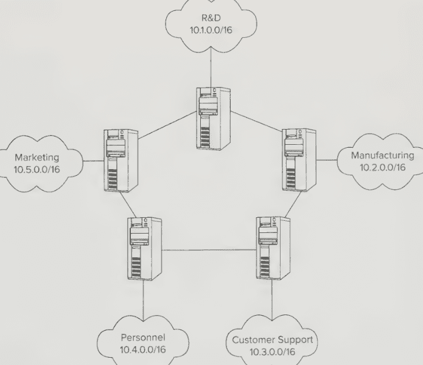

该问题的解决方案在于路由协议，它允许路由器之间相互通信以发现最佳路由并相应调整路由表。现有多种路由协议，但这里描述的是*路由信息协议 (RIP)*，它检测源和目的地之间的路由器数量，并调整路由表以使任何给定目的地的数量减少到最低。RIP 是一种相当简单的路由协议，最用于小型和中型网络，如公司和大学的网络；其技术局限性使其不适合用于整个互联网。

在 Linux 中，RIP 通过 `routed` 守护进程实现，该进程可以通过同名的包进行安装。此程序通常不需要配置；可以由系统启动脚本启动，随后调整所有接口上的路由表。它通过使用 RIP 广播并根据收到的回复调整计算机的路由表来实现。

请记住，`routed` 取决于它连接的路由器上是否存在其他 RIP 服务器。在图 7.5 中，描绘的所有五个路由器都必须运行 `routed`（或其他 RIP 实现）才能获得该协议的完整益处。

## 配置 SSH

过去，Telnet 是 Linux 和 Unix 系统上首选的远程文本模式登录协议。遗憾的是，Telnet 严重缺乏安全功能。因此，近年来 SSH 变得越来越流行，它实际上是首选的远程登录工具。SSH 还可以处理类似于文件传输协议 (FTP) 的文件传输。出于许多原因，知道如何配置 SSH 会很有帮助。这项要求对 SSH 的通用知识以及 Linux 下的 SSH 配置有所了解。我通过关于运行服务器的安全影响的信息来结束对 SSH 的介绍。


> SSH 足够复杂，在本章中无法涵盖超出基础的内容。请参考 OpenSSH 的文档或相关主题书籍，例如 Daniel J. Richard Silverman 和 Robert G. Bynes 出的 SSH, The Secure Shell: The Definitive Guide, Second Edition (O'Reilly, 2005)，或 Himanshu 的 SSH: Strategies for Optimizing (2003)。

### SSH 基础

过去，Telnet 是 Linux 和 Unix 系统上首选的远程文本模式登录协议。遗憾的是，Telnet 严重缺乏安全功能。因此，近年来 SSH 变得越来越流行，它实际上是首选的远程登录工具。SSH 还可以处理类似于文件传输协议 (FTP) 的文件传输。出于许多原因，知道如何配置 SSH 会很有帮助。这项要求对 SSH 的通用知识以及 Linux 下的 SSH 配置有所了解。我通过关于运行服务器的安全影响的信息来结束对 SSH 的介绍。

> SSH 足够复杂，在本章中无法涵盖超出基础的内容。请参考 OpenSSH 的文档或相关主题书籍，例如 Daniel J. Richard Silverman 和 Robert G. Bynes 出的 SSH, The Secure Shell: The Definitive Guide, Second Edition (O'Reilly, 2005)，或 Himanshu 的 SSH: Strategies for Optimizing (2003)。

### 为系统设置 SSH 选项

大多数情况下，SSH 在首次安装时运行良好良好，因此你可能不需要对其配置进行任何更改。不过，如果你确实需要进行更改，这些大部分通过主 SSH 配置文件 `/etc/ssh/ssh_config` 来。你也可以编辑一些额外的文件来限制对 SSH 服务的访问，或更改 SSH 管理登录过程的方式。

#### 配置基础 SSH 特性

`/etc/ssh/ssh_config` 文件主要由如下形式选项行组成：

Option value


> 不要将 `sshd_config` 文件与 `ssh_config` 文件混淆。前者控制 OpenSSH 服务，而后者控制 SSH 客户端程序 `ssh`。

除了配置行外，`sshd_config` 文件还包含注释，用井号 (`#`) 或分号 (`;`) 表示。大多数示例配置文件包含大量被注释的 SSH 选项；这些行指定了默认值，通过移除字符来取消这些行的注释而不改变其其他内容将不会产生影响。如果你想更改某个选项，请取消该行的注释并进行修改。大多数选项的默认值适用于大多数系统。表 7.9 包含你可能想要检查并可能更改的选项。

##### 表 7.9 重要 sshd_config 选项

| 选项 | 说明 |
|---|---|
| Protocol | 此选项指定了 OpenSSH 理解的协议级别。可能的值为 1 和 2。你可以通过用逗号将它们分开来配置 OpenSSH 支持两种协议，例如 `1,2` 或 `2,1`，它们是等价的。鉴于 OpenSSH 协议级别 1 已经被破解，最安全的配置是设置 `Protocol 2`。但这限制了服务器与旧版客户端通信的能力。 |
| PasswordAuthentication | 此选项指定是否支持通过密码进行身份验证。默认值为 `yes`。 |

### 配置 SSH

| 选项 | 说明 |
|---|---|
| PubkeyAuthentication | 此选项仅对 SSH 2 级有意义，指定是否支持公钥身份验证。在配置系统允许无密码登录时（如“配置无密码登录”所述），这种身份验证类型至关重要。默认值为 `yes`。 |
| UsePAM | 如果设置为 `yes`（默认值为 `no`），此选项允许 `sshd` 通过标准的 Linux 可插身份验证模块 (PAM) 系统验证用户，如果你启用了 LDAP 等不常用的身份验证工具，这可能是需要的。 |
| AllowUsers | 你可以使用此选项指定一组用户（名称用空格分隔），允许他们通过 SSH 登录。默认情况下，任何具有有效账户和身份验证方法的用户都可以登录。 |
| DenyUsers | 此选项的作用与 `AllowUsers` 类似但方向相反；使用此选项列出的用户将被拒绝登录。 |
| PermitRootLogin | 默认将此选项设置为 `yes`，允许 OpenSSH 接受 root 用户的直接登录。这比使用 Telnet 的简单配置更安全，但为了增加安全性，可以将此值设置为 `no`。结果将是任何想要以 root 身份执行远程工作的人都必须先作为普通用户登录，这意味着通过某种方式获得 root 密码的入侵者也需要一个普通用户名及其密码。 |
| X11Forwarding | 此选项指定 OpenSSH 的 X 隧道功能是否激活。如果你想允许远程用户通过 SSH 运行 X 程序，必须将此选项设置为 `yes`。然而，取决于某些其他选项，这样做可能会降低客户端 X 显示的安全性；这就是采用保守的默认值 `no` 的原因。 |
| AllowTcpForwarding | 当设置为 `yes`（默认值）时，服务器将接受隧道协议，如“任意协议隧道化”所述。 |

有关其他选项的信息，请参阅 `sshd_config` 的帮助页面。如果你对 SSH 配置进行了更改，请使用服务器的 SysV 启动脚本重启它。

### 生成 SSH 密钥

SSH 安全性的部分涉及加密用途。每个服务器系统和每个用户都有一个唯一的数字（或“密钥”）用于身份识别。事实上，SSH 使用了一套涉及两个密钥的安全系统：公钥和私钥。这两个密钥在数学上相关联，使得使用特定公钥加密的数据只能通过匹配的私钥解密。在建立连接时，双方都会向对方发送公钥。之后，双方使用对方的密钥对数据进行加密，确保数据只有目标接收者可以解密。在实践中，这只是过程的第一步，但它是至关重要的。此外，SSH 客户端通常保留它们联系过的服务器的公钥。这使得它们能够发现公钥的更改。此类更改可能是篡改的迹象。

大多数 OpenSSH 服务器脚本都包含查找存储的公钥和私钥的代码，如果不存在，它们会生成密钥。SSH 总支持四到六种加密工具。这些密钥通常存储在 `/etc/ssh` 中，私钥被称为 `ssh_host_rsa_key` 和 `ssh_host_dsa_key`，公钥则添加 `.pub` 文件扩展名。所有 `ssh_host_rsa_key` 及其关联的公钥都支持 SSH 1.x。如果你的系统没有这些密钥且你无法让 SSH 启动，可以使用 `ssh-keygen` 命令生成密钥：

```bash
# ssh-keygen -qt rsa -f /etc/ssh/ssh_host_rsa_key
# ssh-keygen -qt dsa -f /etc/ssh/ssh_host_dsa_key
```

（注：原文 OCR 代码块中存在乱码，已根据标准用法进行了修复）

### 无需密码登录

如果你在本地使用 SSH，或者在自动化工具中使用它，你无疑会因为每次连接都要输入密码而感到恼。有一种方法可以规避这一要求：你可以使用密钥设置 SSH 客户端，并将公钥提供给服务器计算机。通过这种配置，SSH 客户端计算机可以识别自己的身份，从而可能消除你输入密码的需求。

配置 SSH 在不使用密码的情况下运行虽然很方便，但它确实增加了安全风险。如果某个你不信任的人获取了你在 SSH 客户端系统上的访问权限，该人将无需你的密码即可登录 SSH 服务器系统。因此，你应该只在受良好保护的客户端上创建无密码登录（如果确实需要的话）。以这种方式配置 root 账户的访问是特别有风险的。


要配置 SSH 不需要密码，你必须在客户端系统上使用 `ssh-keygen` 生成自己的 SSH 密钥，将该密钥文件复制到服务器，并将其添加到 `~/.ssh/authorized_keys` 或 `~/.ssh/authorized_keys2` 文件。之后，从客户端到服务器的登录将不再需要密码。练习 7.1 将为你详细介绍这一过程。

#### 练习 7.1

配置无密码登录

本练习将引导你完成启用无密码 SSH 登录的过程。你需要两台计算机的访问权限：一台 SSH 客户端和一个 SSH 服务器。（在紧急情况下，你可以用一台计算机兼任这两个角色，但这会模糊哪些文件源自哪台计算机或存储在哪台计算机。）SSH 服务器必须已经配置为接受登录。

1. 以执行远程访问的用户身份登录 SSH 客户端系统。

2. 输入以下命令生成版本 2 的 SSH 密钥：

`$ ssh-keygen -q -t rsa -f ~/.ssh/id_rsa -C ''`

3. 步骤 2 生成了两个文件：`id_rsa` 和 `id_rsa.pub`。以任何方便的方法将其中第二个文件传输到 SSH 服务器计算机——通过 USB 闪存、使用 `scp` 或任何其他方法。将该文件以临时名称（如 `temp.rsa`）复制，以确保你不会意外覆盖服务器上同名的文件。

4. 登录 SSH 服务器系统。如果你使用 SSH，你需要输入密码。

5. 将你刚刚传输的文件内容添加到 `~/.ssh/authorized_keys` 的末尾。（此文件有时也被称为 `~/.ssh/authorized_keys2`，所以你应该检查一下哪一个存在。如果两个都不存在，你可能需要进行尝试）如果你将原始文件存储在 `~/temp.rsa`，那么输入 `cat ~/temp.rsa >> ~/.ssh/authorized_keys` 应该就能完成此任务。

如果你在步骤 2 中省略了 `-N` 参数，`ssh-agent` 将提示你输入密码语（passphrase）。然后你将需要输入此密码语来登录远程系统；这实际上是用基于客户端的密码语和 SSH 密钥交换取代了基于服务器的密码。

如果你退出 SSH 服务器系统并尝试从客户端通过 SSH 再次登录，你不应该被提示输入密码；两台计算机会自动处理身份验证。如果不起，请检查 `~/.authorized_keys` 文件是否需要另一个名称（如之前所述）。你可能还想检查该文件是否包含与客户端原始公钥文件匹配的行。某些客户端可能要求你通过包含 `-2` 选项来指定使用版本 2 的 SSH 协议：

```
$ ssh -2 server
```

### 使用 ssh-agent

另一种 SSH 验证选项是使用 `ssh-agent` 程序。该程序在启动连接时需要密码，因此比配置无密码登录更安全；但是 `ssh-agent` 会记住你的密码，所以你只需要每个本地会话输入一次。要使用 `ssh-agent`，请遵循以下步骤：

1. 遵循练习 7.1 中描述的无密码登录程序，但有一处变化：在步骤 2 的 `ssh-keygen` 命令中省略 `-N ''`。在这一步你会被要求输入密码语。此密码语将成为你通过 `ssh-agent` 管理的所有 SSH 登录的密钥。

2. 在客户端系统上，输入 `ssh-agent /bin/bash`。这会启动 `ssh-agent`，进而启动 bash。使用这个 bash 会话进行多次 SSH 登录。

3. 在你的新主机上，输入 `ssh-add ~/.ssh/id_rsa`。这会将你的 RSA 密钥添加到由 `ssh-agent` 管理的集合中。此时会被要求输入 SSH 密码语。

从现在起，每当你使用 SSH 连接到远程系统时，就不需要输入密码了。但是，当你登录计算机时，必须重复步骤 2 和 3，而且这些处仅适用于步骤 2 启动的 shell 或从该 shell 启动的任何 shell。

如果你使用了此功能，可以将 `ssh-agent` 插入到你的正常登录过程中。例如，你可以编辑 `/etc/passwd`，使得 `ssh-agent /bin/bash` 成为你的登录 shell。对于 GUI 登录，你可以重命名 GUI 登录脚本（例如将 `~/.xession` 改为 `~/.xession-nossh`），并创建一个新的 GUI 登录脚本，该脚本使用重命名后的脚本作为参数调用 `ssh-agent`。每个操作都会将 `ssh-agent` 插入到你的

### 使用登录脚本

通常，服务器运行在用户所在的计算机上，而不是远程计算机上。为了隧道化 X，SSH 服务器必须假装成一个 X 服务器以供其基于 X 的程序使用。然后 SSH 服务器可以将收到的 X 数据转发给 SSH 客户端，该客户端是

通常与用户的 X server 运行在同一台计算机上。（事实上，也可以通过任意数量的 SSH 连接来中继 X。）

与其他大多数协议的隧道相比，这种配置的管理起来要简单得多。在配置方面，你必须确保服务器的 `/etc/ssh/ssh_config` 文件包含以下行：

X11Forwarding yes

- 如果此行显示为 `no` 而不是 `yes`，请将其更改为 `yes`。

在客户端，`/etc/ssh/ssh_config` 文件应该设置以下选项：

ForwardX11 yes

此功能至关重要，但可以根据具体情况使用 `-X` 或 `-x` 选项分别启用或禁用 X 隧道，从而对其进行覆盖。在全局客户端配置文件中设置默认值仅仅是为了方便。

设置了这些选项，或者在服务器上启用了转发并在客户端使用了 `-X`，用户就可以从 SSH 客户端计算机启动托管在 SSH 服务器计算机上的基于 X 的程序，就就像运行本地程序一样。

> SSH 可以对数据进行压缩，这可以提高会话的性能。在客户端，通过在 `ssh` 命令中添加 `-C` 选项来启用压缩。在隧道化 X 或其他数据密集型协议时，添加压缩可以极大提高性能。我发现，当通过互联网使用 SSH 隧道传输图形密集型 X 应用时，使用 `-C` 速度提升可达 7 倍左右。具体的收益取决于网络连接速度、所传输数据的性质、两个系统的 CPU 速度以及两个系统的 CPU 负载。

## SSH 安全考量

SSH 旨在解决安全问题，而不是制造安全问题。事实上，总的来说，使用 SSH 进行远程登录优于使用 Telnet，且 SSH 可以接管类似 FTP 的功能并隧道化其他协议。因此，与安全性较低的工具相比，SSH 是一个很大的优势。

与所有服务器一样，如果不必要或不当运行 SSH，SSH 可能会成为安全隐患。理想情况下，你应该配置 SSH 只接受协议级 2 的连接，并拒绝直接 root 登录。如果启用了 X 转发，你应该禁用此功能。如果可能，使用 TCP Wrappers 或防火墙来限制可以访问 SSH 服务器的机器。对于所有服务器，你应该保持 SSH 为最新版本；因为始终存在导致问题的 bug。

## 总结 345

你应该考虑是否真的需要一个远程文本模式登录服务器。这样的服务器可以带来极大的便利——这种便利通常足以抵消所涉及的风险。然而，对于极高性的系统，仅从控制台使用计算机可能是适当的安全方法。

SSH 的一个异常问题是它的密钥。如前所述，私钥文件极其敏感，并受到防窥视的保护。记住保护这些文件的备份，因为——不要把系统备份带随手放在容易被盗的地方。

### 总结

Linux 最大的优势之一是其卓越的网络工具。本章介绍了了几种几种工具，从 ISC DHCP 服务器开始，该服务器通常被用于配置其他计算机的基本网络设置。虽然配置此服务器需要花费精力，但这样做可以节省在配置你网络中大量的 Linux 和非 Linux 计算机时花费的大更多精力。

Linux 还可以使用 LDAP 或各种其他工具作为网络登录服务器。虽然对 LDAP 配置的完整描述超出了本章的范围，但本章描述了若干种 LDAP 账户维护工具，为你提供了在 LDAP 服务器上添加、删除和修改用户账户的知识。这些工具可以补充，甚至在很大程度上取代标准的 Linux 账户维护工具。

路由是 Linux 表现出色的另一个领域；你可以将 Linux 配置为小型或大型网络的路由器。当你这样做时，你可能想要配置防火墙规则来保护路由器计算机本身以及连接的一侧或两侧的计算机。这些规则通过 `iptables` 工具实现，该工具可以微调 Linux 如何路由数据包。另一种路由配置是 NAT 路由器，通常用于将小型网络连接到整个互联网，作为一种安全措施，将该网络隐藏在互联网的窥探者之外。最后，由 Linux 中的路由守护进程实现的 RIP 路由协议，如果你的系统是中等复杂网络集合的一部分，它可以帮助你保持路由表为最新。


本章涵盖的最后一个杂杂主题是 SSH 服务器，它是目前大多数用途的优选远程登录协议。SSH 基本上是一种支持强加密的文本模式协议。几种变体配置（例如支持不使用密码登录的选项）可以增强其实用性。SSH 还可以用于隧道化其他协议，为任何需要的协议提供 SSH 的安全益处。

### 考试要点

概述 DHCP 的操作。当 DHCP 客户端启动或启动其网络时，它会向其本地网络网段发送广播，以寻找 DHCP 服务器。如果存在服务器，它将使用客户端的硬件地址回复客户端。然后两台计算机就可以通信以协商 DHCP 租约，租约是使用 IP 地址的时间限制权限。除了客户端 IP 地址信息外，DHCP 服务器还会告诉客户端子掩码、网关、DNS 服务器和其他常见的网络特征。

区分动态和静态 DHCP 租约。动态 DHCP 租约是从 IP 地址池按先来顺序分配的。分配了动态地址的 DHCP 客户端每次启动时可能会接收不同的 IP 地址。相比之下，静态 DHCP 租约是为特定计算机保留的（通过硬件地址或声明名称进行识别）；此类地址的接收者很少或从不看到其 IP 地址发生变化。此类更改通常保留给服务器计算机，以简化名称解析。

描述 LDAP 在何处部署用于账户管理最佳。许多用户需要账户的网络是 LDAP 账户管理的良好候选者。LDAP 可以集中账户管理，使管理员通过一次更改即可在网络上的所有计算机上添加、删除或修改账户。当计算机数量增长过大，或者即使只有几台计算机但账户更改频繁时，没有 LDAP 可能会变成噩梦。

总结最重要的 LDAP 账户管理命令。`ldapadd` 命令添加账户，`ldapdelete` 删除账户，`ldapsearch` 搜索账户信息，`ldapmodify` 和 `ldapspn` 都对 LDIF 文件进行操作，以标准格式汇总账户信息。

解释 NAT 的意义。网络地址转换（NAT）是一种技术，允许路由器成为整个网络出站网络流量的源头，从而从外部世界“隐藏”该网络。NAT 是一种非常有用的安全工具，因为它使得外部人员很难检测、攻击受保护网络上的服务器。NAT 还可以扩展有限的 IP 地址数量，受保护的网络可以使用不正式属于互联网的私有 IP 地址空间。

总结 Linux 中是如何实现防火墙的。Linux 防火墙是生成的脚本，通过重复调用 `iptables` 来实现。这些调用中的大多数会设置一条新规则来匹配特定类型的数据包，并更改系统处理该数据包的方式。（少数调用会清除链中的所有规则、设置默认策略，或对多个规则执行操作。）当完成的脚本执行时，它会实现一个新的防火墙配置，该配置由内核保留，直到它被更改或系统重启为止。

解释 SSH 的作用。安全外壳（SSH）从根本上对所有传输的数据进行加密。SSH 加密使其成为 Linux 中首选的远程登录协议。SSH 还提供了其他协议的隧道技术，可以将不安全的、未加密的协议转换为更安全的协议。

描述 SSH 配置文件。主要的 SSH 服务器配置文件是 `/etc/ssh/sshd_config`。此文件不应与 SSH 客户端配置文件 `/etc/ssh/ssh_config` 混淆。这两个文件都由包含选项/值对的行组成，用于设置 SSH 选项。

解释 SSH 加密密钥。SSH 服务器使用多个加密密钥，分为私钥和公钥。私钥是机密的，必须存储在服务器 `/etc/ssh/` 下并限制访问权限。公钥与其匹配的私钥具有相同文件名，但扩展名为 `.pub`。这些密钥必须允许任何 SSH 用户读取，并分发给 SSH 客户端。用户可以生成类似的密钥对以实现无密码登录或使用 `ssh-agent` 进行基于会话的登录。

总结 SSH 协议版本。SSH 1.3 和 1.5（称为 SSH 1.x 或 SSH 1）存在已知的安全问题，应尽可能避免。当前版本 SSH 2.0 或 SSH 2 要安全得多。如果你的 SSH 服务器仅与足够现代的客户端通信，可以在 `/etc/ssh/sshd_config` 中设置 `Protocol 2` 选项，将支持限制在 SSH 2 级客户端，以确保系统上不使用不安全的 SSH 1。

### 复习题

- 1. 以下在 ISC DHCP 服务器的 `/etc/dhcpd.conf` 文件中，子网声明有何错误？

```text
subnet 10.107.5.0 {
  range 10.107.5.1 10.107.5.200;
}
```

A. 它缺少域名数据。

B. 它缺少网络子网掩码数据。

C. 它缺少 DNS 服务器 IP 地址。

D. 它缺少网关 IP 地址。

- 2. ISC DHCP 服务器在何处存储已颁发租约的数据？

A. `leases.conf`，通常在 `/var/dhcp`

B. `leases.log`，通常在 `/var/log/dhcp`

C. `dhcpd.log`，通常在 `/var/dhcp/leases`

D. `dhcpd.leases`，通常在 `/var/lib/dhcp`

- 3. DHCP 配置文件中 `global-lease-time 3600` 选项的作用是什么？该配置的效果是什么？

A. DHCP 客户端将获得最长 1 小时（3600 秒）的租约，即使他们请求更长的租约也是。

B. DHCP 客户端将获得 1 小时（3600 秒）的租约，除非他们请求更长或更短的租约。

C. DHCP 客户端将获得至少 1 小时（3600 秒）的租约，即使他们请求更短的租约也是。

D. DHCP 客户端将获得最长 1 小时（3600 秒）的租约，除非它们配置了固定 IP 地址。

- 4. 在以下哪种计算机上你最有可能运行 `dhrelay` 程序？（选择两个）。

A. 在通过 NAT 路由器连接到互联网的子网上运行 `dhcpd` 的计算机。

B. 在一个完全隔离的网络上的计算机，该网络既没有路由器也没有自己的 DHCP 服务器。

C. 两个子网之间的路由器，其中一个子网有 DHCP 服务器而另一个没有。

D. 在没有自己的 DHCP 服务器的子网上的计算机，其配置了 DHCP 服务器来为附近子网上的第一个子网提供服务。

- 5. 用于管理 Linux 账户的 LDIF 文件中的以下条目有何错误？

`uid: tsparker`

A. 此条目应该使用用户名属性名，而不是 `uid`。

B. `uid` 属性需要完整的区分名称（DN）。

C. `uid` 属性需要数字型的 Linux 用户 ID (UID) 值。

D. 此条目没有错误。

- 6. 你准备了一个包含若干新定义的 LDIF 文件（`newers.ldif`），你想使用名为 `manager` 的管理账户将这些新用户添加到 `example.com` 的基于 LDAP 的账户目录中。假设你的小系统已正确配置以启用此类修改，你应该如何操作？

A. `ldapadd -D manager@example.com newers.ldif`

B. `ldapadd cn=manager,dc=example,dc=com newers.ldif`

C. `ldapadd -D manager@example.com -W -f newers.ldif`

D. `ldapadd -D cn=manager,dc=example,dc=com -W -f newers.ldif`

- 7. 你想从一台用户都通过 LDAP 服务器定义的计算机上删除 Z shell (zsh)。但在之前，你想检查这些用户中没有人依赖 zsh 作为默认 shell。你如何检查是否有用户这样做？

A. `ldapsearch -modify loginShell=/zsh`

B. `ldapsearch loginShell=/zsh`

C. `ldapsearch loginShell=/zsh`

D. `ldapsearch -filter loginShell=/zsh`

- 8. SSH 加密使用的是：

A. 明文

B. MD5

C. SHA

D.

- 9. 以下哪项是 SSH 的缺点？

A. 它可能仅用于服务器。

B. 它很难配置。

C. 它不用于客户端。

D. 它可能允许访问内部网络。

- 10. 你想配置路由器，使外部站点无法访问内部网络。应该使用哪个链来实现这一点？

A. INPUT

B. OUTPUT

C. FORWARD

D. ACCEPT

- 11. 关于 iptables，以下哪是正确的？

A. 它忽略数据包

B. 可以用于路由

C. 它允许转发

D. 它可能被应用

- 12. 一个防火墙脚本包含以下行。它们的目的是什么？

```text
iptables -A OUTPUT -d 127.0.0.1 -o lo -j ACCEPT
iptables -A INPUT -s 127.0.0.1 -i lo -j ACCEPT
```

A. 允许路由

B. 允许本地回环流量

C. 设置 OUTPUT 和 INPUT 的默认策略

- 13. 广而言，路由器上的 iptables 使用与工作站有何不同？

A. 路由器的 iptables 规则强调 FORWARD 链；而工作站强调 INPUT 和 OUTPUT 链。

B. 路由器的 iptables 规则可能使用 DROP 策略，而工作站使用 ACCEPT 策略。

C. 路由器的 iptables 规则通过脚本激活，而工作站通过 GUI 配置。

D. 路由器的 iptables 规则强调特权端口，而工作站强调非特权端口。

- 14. 使用什么程序可以生成无需密码登录远程服务器的密钥？

A. authorized_keys

B. ssh-keygen

C. sshpasswd

D

- 15. 你应该将服务器的主私钥分发给谁？

A. 仅你想通信的服务器

B. 仅已提供了自己的公钥的服务器

C. 任何提供匹配 SSH 公钥的人

D. 以上均非

- 16. 以下哪个命令创建了远程计算机（neptune）的加密登录，并允许运行远程计算机上的 X 程序并使用本地计算机的 X 服务器？（假设 neptune 已启用 X 转发。）

A. `ssh -X neptune`

B. `ssh neptune`

C. `ssh --ForwardX11 neptune`

D. `ssh -x neptune`

- 17. 激活 SSH 服务器后，你可能会考虑淘汰以下哪些服务器？（选择两个。）

A. SMTP

B. Telnet

C. FTP

D. NFS

- 18. 你发现 `/etc/ssh` 下的 `ssh_host_dsa_key` 文件的权限为 0666 (-rw-rw-rw-)。你的 SSH 服务器已运行了几个月。你应该担心吗？

A. 会

B. 不

C. 仅当 `ssh_host_dsa_key.pub` 文件也是世界可读时

D. 仅当你从超级服务器启动 SSH 时

19. 为了获得最佳 SSH 服务器安全性，你应该如何在 `/etc/ssh/sshd_config` 中设置 `Protocol` 选项？

- A. Protocol 1

- B. Protocol 2

- C. Protocol 1,2

- D. Protocol 2,1

20. 为什么允许 root 直接通过 SSH 登录是不明智的？

- A. 拥有 root 密码但没有其他密码的人可以入侵计算机。

- B. root 密码绝不应通过网络连接传输；这种方式允许 root 登录异于引来灾难。

- C. SSH 将所有登录信息（包括密码）存储在公共可读的文件中。

- D. 使用 SSH 登录时，root 的命令可以被不受欢迎的轻易拦截和复制。

## 复习题答案

1. B. 子网声明以关键字开始，随后是子网号、netmask 关键字和网络掩码值。因此，选项 B 是正确的；应该存在网络掩码数据。选项 A、C 和 D 都是正确的观察结果，但不是正确答案，因为这些信息可能在其他地方声明，实际上并不是严格必要的。

2. D. DHCP 租约信息存储在名为 `dhcpd.leases` 的文件中。该文件通常（但并非总是）存储在 `/var/lib/dhcp`，因此 D 是正确的。虽然选项 A、B 和 D 中指定的位置理论上都是可能的，但它们指定了错误的文件，因此是错误的。

3. A. 选项 A 正确描述了此选项的含义。（但注意，此选项对于使用 BOOTP 而非 DHCP 的客户端会被忽略。）选项 B 描述了 `default-lease-time` 选项的作用，选项 C 描述了 `min-lease-time` 选项的作用。选项 D 是错误的，因为固定 IP 地址配置不会覆盖租约时间。（尽管固定 IP 地址可以包含其自身的 `max-lease-time` 选项来覆盖全局选项。）

4. C, D. `dhclient` 程序充当位于其他地方 服务器的代理服务器；它响应 DHCP 客户端，但会将客户端的请求转发到另一个子网的 DHCP 服务器，并将服务器的响应传给客户端。`dhclient` 程序不需要与 DHCP 服务器在同一个子网内，但如果是的话（例如对于路由器），它将正常工作。因此，选项 C 和 D 都是运行完整 DHCP (`dhcpd`) 的计算机的有效位置。选项 A 是错误的，因为指定的计算机正在运行；如果它被用作备份或处理特殊配置中的几台计算机，它能够转发流量的唯一计算机将被 NAT 路由器隔离在网络之外。因此，这种配置充其量是奇怪的，最坏的情况下是糟糕的。选项 B 是错误的，因为 `dhclient` 无法使用静态 IP 地址而非 DHCP 来联系 DHCP 服务器，使得 `dhclient` 变得毫无意义。

5. D. LDAP `uid` 属性名称标识 Linux 用户名，因此它可以取任何合法用户名的值。由于 `tspparker` 是一个法的用户名，此条目没有问题，因此选项 D 是正确的。Linux 账户管理 LDAP 文件中没有用户名属性名称，选项 A 是错误的。`uid` 属性是 Linux 用户名，而不是区分名 (DN)，选项 B 是错误的。令人混淆的是，`uid` 属性名称指的是一个唯一的用户名；Linux UID 值通过 `uidnumber` 属性名称指定，因此选项 C 是正确的。

6. D. 选项 D 提供了执行问题中指定任务的正确语法。选项 A 和 C 都错误地表示了用于执行管理任务的账户区分名 (DN)，且选项 A 和 B 都包含了 `-W`（提示验证）和 `-f`（传递文件名）选项。

## 第 7 章 • 高级网络配置

7. D. `ldap search` 工具搜索指定的字段。选项 D 提供了使用 `/bin/zsh` 作为默认搜索账户的语法。`ldapmodify` 和 `ldapadd` 命令分别用于提交修改后的 LDIF 文件和更改密码；两者都不用于搜索记录。没有名为 `ldap` 的标准工具。

8. C. 默认情况下，LDAP 使用 SSH 进行密码加密。`Cleartext`、`MDS` 和 `CRYPT` 都是替代方案，尽管它们都不是默认值。（`Cleartext` 也非常不建议，因为这意味着没有任何加密）

9. 从本质上说，NAT 阻塞受保护网络的服务器。这一功能可以通过端口重定向来克服，但需要额外的配置工作；因此选项 D 是正确的。选项 A 和 B 描述了 NAT 的功能，但这些功能是 NAT 的优势而非缺点。选项 C 是错误的，因为 NAT 不影响在内部网络上为该网络的客户端运行服务器的能力；只影响对这些服务器的外部访问。

10. C. `forward` 链控制路由器在网络之间转发的数据包，这正是查询所描述的操作类型；因此选项 C 是正确的。`INPUT` 和 `OUTPUT` 链分别影响被计算机接受或发送的数据包，修改这些链将影响路由器本身。（可以使用基于 IP 地址或其他标准的规则通过这些链来实现所述目标，这增加了复杂性，使得这些链充其量是理想的）。没有标准的 `ACCEPT` 链，尽管这是一个常见的操作，意味着通过数据包。

11. B. `DROP` 策略导致计算机按选项 B 描述的方式响应。选项 A 描述的是 `REJECT` 策略。与选项 C 相，`DROP` 可用于任何客户端或服务器使用的端口。与选项 D 相，`DROP` 既可以作为默认策略，也可以逐端口使用。

12. C. Linux 使用 SSH 进行密码加密。`Cleartext`、`MDS` 和 `CRYPT` 都是替代方案，尽管它们都不是默认值。（`Cleartext` 也非常不建议，因为这意味着没有任何加密）

13. A. `forward` 链控制路由器在网络之间转发的数据包，这正是查询描述的操作类型；因此选项 C 是正确的。`INPUT` 和 `OUTPUT` 链分别影响被计算机接受或发送的数据包，修改这些链将影响路由器本身。（可以使用 IP 地址或其他规则通过这些链来实现所述目标，这增加了复杂性，使得这些链充其量是理想的）。没有标准的 `ACCEPT` 链，尽管这是一个常见的操作，意味着通过数据包。

14. B. `DROP` 策略导致计算机按选项 B 描述的方式响应。选项 A 描述的是 `REJECT` 策略。与选项 C 相，`DROP` 可用于任何客户端或服务器使用的端口。与选项 D 相，`DROP` 既可以作为默认策略，也可以逐端口使用。

15. C. Linux 使用 SSH 进行密码加密（等待）

16. D. 选项 D 提供了执行问题指定任务的正确语法。选项 A 和 C 都错误地表示了用于执行管理任务的账户区分名 (DN)，选项 A 和 B 都包含了 `-W`（提示验证）和 `-f`（传递文件名）选项。

17. D. `ldap search` 工具搜索指定的字段。选项 D 提供了使用 `/bin/zsh` 作为默认搜索账户的语法。`ldapmodify` 和 `ldapadd` 命令分别用于提交修改后的 LDIF 文件和更改密码；两者都不用于搜索记录。没有名为 `ldap` 的标准工具。

18. C. 默认情况下，LDAP 使用 SSH 进行密码加密。`Cleartext`、`MDS` 和 `CRYPT` 都是替代方案，尽管它们都不是默认值。（`Cleartext` 也非常不建议，因为这意味着没有任何加密）


### 19.
从本质上说，NAT 阻塞受保护网络的服务器。这一功能可以通过端口重定向来克服，但需要额外的配置工作；因此选项 D 是正确的。选项 A 和 B 描述了 NAT 的功能，但这些功能是 NAT 的优势而非缺点。选项 C 是错误的，因为 NAT 不影响在内部网络上为该网络的客户端运行服务器的能力；只影响对这些服务器的外部访问。

### 20.
C. `forward` 链控制路由器在网络之间转发的数据包，这正是查询描述的操作类型；因此选项 C 是正确的。`INPUT` 和 `OUTPUT` 链分别影响被计算机接受或发送的数据包，修改这些链将影响路由器本身。（可以使用 IP 地址或其他规则通过这些链来实现所述目标，这增加了复杂性，使得这些链充其量是理想的）。没有标准的 `ACCEPT` 链，尽管这是一个常见的操作，意味着通过数据包。

### 21.
B. `DROP` 策略导致计算机按选项 B 描述的方式响应。选项 A 描述的是 `REJECT` 策略。与选项 C 相，`DROP` 可用于任何客户端或服务器使用的端口。与选项 D 相，`DROP` 既可以作为默认策略，也可以逐端口使用。

### 22.
C. Linux 使用 SSH 进行密码加密（等待，根据提供的文本流对齐）。

*自纠：OCR 文本在页面之间存在重复/合并部分。我将根据提供的来源重新清理序列。*

# 配置文件服务器

本章涵盖了以下 LINUX 职业学会学习目标：

- `209.1` SAMBA 服务器配置（权重: 4）
- `209.2` NFS 服务器配置（权重: 4）
- `212.2` FTP 服务器安全防护（权重: 2）

在许多办公室中，Linux 的主要角色之一是文件服务器——这种计算机存储了文件，客户端计算机可以读取、修改和写入这些文件。文件服务器可以帮助为了管理和备份目的实现数据存储的集中，并通过允许用户共享或交换文档来促进协作。

Linux 非常适合担任文件服务器，因为它为最常见的协议都提供了出色的服务器程序：Samba 套件（http://www.samba.org）是一个功能强大且高度可配置的软件包，用于管理许多以 Windows 为主导的网络中使用的服务器块/通用互联网文件系统 (`SMB/CIFS`）；网络文件系统 (`NFS`) 协议是 Unix 的主导文件共享协议，由同名的服务器处理；此外还有几个 Linux 服务器程序用于处理文件传输协议 (`FTP`)，这是一种流行的跨平台文件共享方式，特别是在互联网上。

# 理解文件服务器的角色

在某种意义上，许多服务器都是文件服务器；例如，电子邮件消息和 Web 页面可以被视为文件并以此类索引存储在磁盘上。通常定义的文件服务器是允许用户访问文件本身。某些文件服务器协议（包括 `SMB/CIFS` 和 `NFS`）旨在为客户端提供常见的文件系统功能。这使得客户端能够像对待硬盘一样传输文件服务器，挂载并允许用户访问服务器上的文件，就像它们是本地文件一样。在 (`SMB/CIFS`) 中，以这种方式共享的目录被称为共享 (`shares`)；在 `NFS` 中，它们被称为导出 (`exports`)。这种文件服务器模型非常强大，因为它简化了用户体验；用户可以双击桌面上的网络共享图标，然后双击文件图标以启动与文件类型关联的应用程序，例如文字处理器或图形编辑器。

`SMB/CIFS` 在设计时考虑了 DOS、Windows 和 OS/2，因此它支持这些操作系统通用的文件功能。这一事实给 Samba 带来了某些挑战，因为 Samba 必须将微软风格的文件系统功能映射到最接近的 Linux 等效物上。在大多数情况下，这种工作运行良好，用户可以完全不察觉自己的文件存储在 Linux 计算机上。Samba 还支持在 `SMB/CIFS` 协议的 CIFS 部分实现的扩展，使其能够存储 Unix 风格的文件系统元数据，以便 Samba 可以作为 Unix 和 Linux 客户端的服务器，同时保留它们原生的文件系统元数据。由于 `NFS` 源于 Unix 世界，它更适合作为 Unix 和 Linux 客户端的服务器；`NFS` 直接将 Unix 风格的文件系统元数据映射到底层文件系统上。

> `SMB/CIFS` 最初实现在一种名为 NetBIOS 扩展用户界面 (`NetBEUI`) 的协议上。然而，标准的 Linux 内核不支持 `NetBEUI`，如今 `SMB/CIFS` 通常运行在处理大多数其他网络协议的相同传输控制协议/网协议 (`TCP/IP`) 栈上。尽管如此，`SMB/CIFS` 中仍有少量 `NetBEUI` 残留，例如使用 `SMB/CIFS` 的计算机可以选择 NetBIOS 名称而不是 TCP/IP 主机名。

`FTP` 的用法通常不同：该协议不支持挂载文件系统通常所需的文件系统功能。相反，`FTP` 服务器通常通过 `FTP` 客户端程序访问，例如文本模式的 `ftp` 或 `ncp` 或 `FTP` `gFTP`。Linux 提供了用户空间文件系统 (`FUSE`) `sourceforge.net` 项目中的 `FTP` 客户端，允许 `FTP` 站点能够像文件系统一样挂载，但在大多数情况下，`FTP` 调用的是专用的用户态客户端，而不是 `SMB/CIFS` 和 `NFS` 中常见的文件系统挂载。

### 现实场景

# SMB/CIFS、NFS 和 FTP 的替代方案

在某些情况下，你可能需要使用 `SMB/CIFS`、`NFS` 和 `FTP` 以外的文件服务器协议。另一种替代方案是超文本传输协议 (`HTTP`)，它是用于万维网（WWW 或简称 Web）的协议。第 9 章“配置 Web 和电子邮件服务器”描述了流行的 Apache Web 服务器的配置。尽管 `HTTP` 是很有用的协议，但它主要用于单向访问——用户检索页面，但向网站上传文档的能力非常有限。`HTTP` 还要求传输是自包含的，包括任何必要的身份验证，而 `SMB/CIFS`、`NFS` 和 `FTP` 建立的连接可以在更长的时间内反复使用。

本章描述的主要协议的另一个替代方案是 AppleShare（也称为 AppleShare 文件协议，或 `AFP`），它是 AppleTalk 协议套件的一部分。AppleShare 是以 Apple 计算机为主导的网络中非常常见的协议，Mac X 仍然支持它。在 Linux 中，Netatalk 程序包（http://netatalk.sourceforge.net）支持 AppleShare IP，它是 AppleShare 的一种变体，在 `TCP/IP` 上运行而不是大部分已过时的 AppleTalk 协议栈。由于 OS X 同时支持 `SMB/CIFF` 和 `NFS`，通常不需要在 Linux 计算机上部署 Netatalk；但是，如果你有旧的 Mac 客户端，Netatalk 可能会有所益。

# 配置 Samba 服务器

在每个部分中，选项使用以下格式赋值：

```
option = value
```

选项和大多数值都是大小写敏感的字符串（某些值是路径名或其他大小写敏感的字符串。）布尔值 1、True 和 Yes 等同，同样的 False 和 No。井号（`#`）和分号（`;`）都是注释字符；这些字符开头的行会被忽略。

# 设置基本全局选项

`[global]` 部分对 Samba 的运行至关重要。事实上，在你进行一或两个更改之前，你的 Samba 可能无法被使用。表 8.1 总结了你可能在此处更改的功能。由于本章中有类似的表格，表 8.1 是完整的。如果你遇到问题，可能需要咨询 Samba 文档或书籍了解更多选项。

# 理解配置部分

有三种类型的部分：

- **全局部分**：`samba.conf` 第一部分是 `[global]`。该部分定义了全局默认值和影响整体的选项。
- **文件共享**：文件共享允许 Samba 向客户端交付文件。
- **打印共享**：打印共享在许多方面与文件共享非常，但 Samba 将文件发送到本地队列。

# 表 8.1 常见 Samba 选项

| 选项 | 值类型 | 含义 |
| --- | --- | --- |
| `workgroup` | 字符串 | NetBIOS 组或 NetBIOS 域名名。通常但不总是与网络的 TCP/IP 域名名相关。 |
| `netbios name` | 字符串 | 计算机的 NetBIOS 名称。通常但不总是与计算机的 TCP/IP 主机名的域名部分相同。 |
| `printing` | 字符串 | 打印系统名称，例如 `LPRng` 或 `CUPS`。 |
| `printcap name` | 文件名 | `/etc/printcap` 文件或其替代（如 `cups`）。此选项对于 `[printers]` 共享的正确运行是必要的。 |
| `load printers` | 布尔 | 当存在 `[printers]` 共享时，是否让所有本地定义的打印机可用。值为 Yes。 |
| `hosts allow` 和 `hosts deny` | 主机名或 IP 地址 | 类似于 TCP Wrappers 或 `xinetd` 提供的基于主机的访问控制。 |

# 表 8.1 常用 Samba全局选项（续）

| 选项 | 值类型 | 含义 |
|---|---|---|
| `security` | `Share`, `User`, `Server`, `Domain`, 或 `ADS` | 指定 Samba 如何验证本地用户身份——通过按共享方式模拟 Windows 9x/Me 的方法（Share）、通过使用用户名和密码（User）、通过向另一台计算机发送身份验证请求（Server）、委托给 NT 域控制器（Domain）、或委托给活动目录 (AD) 域控制器（ADS）。 |
| `encrypt passwords` | 布尔值 | 指定是否需要使用加密密码。 |
| `smb password file` | 文件名 | 加密密码文件。 |
| `password server` | 主机名或 IP 地址 | 如前所述，用于标识网络的域控制器。 |
| `username map` | 文件名 | 存储 Windows 风格和 Linux 风格用户名映射的文件。 |
| `name resolve order` | `Imhosts`, `host`, `wins` 或 `bcast` 中的一个或多个 | 告诉 Samba 如何解析：Imhosts 使用名为 `/etc/samba/hosts` 的本地文件（类似于 `/etc/hosts` 文件）；host 表示使用标准的 DNS 名称解析；wins 表示使用通过 `wins server` 选项指定的 Windows 内部命名服务 (WINS) 服务器；而 bcast 表示使用 NetBIOS 名称广播。多个值可以用空格隔开。 |

> NetBIOS 域和 TCP/IP 域在概念上相似，但它们并不完全相同。为了简单起见，你可能希望配置网络，使得两种类型的域都使用同一个名称；但如果你在使用现有的网络，可能会发现某台计算机在 NetBIOS 域中使用名称，而在 TCP/IP 域中使用另一个名称。

# 设置密码选项

表 8.1 中的两个选项对大多数系统都非常重要。其中第一个选项是 `encrypt passwords`。自 Windows 95 OEM Service Release 2 (`OSR2`) 和 Windows NT 4.0 Service Pack 3 起的所有 Windows 版本均默认使用加密密码。如果将 `encrypt passwords` 设置为 No，Samba 将使用 Linux 用户名和密码数据库。

# 配置 Samba 服务器

在这种情况下，除非更改 Samba 或 Windows 客户端的配置，否则现代 Windows 将连接到 Samba。当 `encrypt passwords` 设置为 Yes 时，Samba 需要自己的密码数据库，该数据库独立于标准的 Linux 密码数据库。在这种情况下，现代 Windows 客户端将连接到 Samba 服务器。在实践中，使用加密密码通常是最简单且安全的。按照以下步骤操作：

- 1. 如果必要，将 `encrypt passwords` 设置为 Yes。
- 2. 以 root 身份在命令提示符处输入 `smpassword -a username`，其中 `username` 是具有访问 Samba 服务器权限的用户名。程序将提示你输入新密码，然后提示你再次输入。当你第一次执行此命令时，它会报错说 passdb 数据库不存在。你可以忽略此报错。
- 3. 对所有具有 Samba 权限的用户重复步骤 2。

如果你有许多用户，将他们全部添加到 Samba 加密密码数据库的过程可能会非常繁琐，但这是必要的。许多发行版包含一个名为 `smbpassword` 或 `mksmbpassword.sh` 的脚本，可以从 `/etc/smbpassword` 文件创建 Samba 密码文件。遗憾的是，Linux 和 Samba 使用不同的密码加密方法，因此无法转换实际密码。如果你使用加密密码运行一段时间，结果生成的 Samba 密码文件将包含很少或没有信息，此时你可以使用此脚本并使用 `update encrypted = Yes` 选项。随后 Samba 将在用户使用加密密码登录时将密码添加到其加密数据库中。（在此过程中，你必须运行 `encrypt passwords = No`。）如果你正在将网络从未加密密码迁移到加密密码，这种做法可能有用，但对于大多数安装来说，这不是一个选项。

所述，本地 Samba 密码依赖于安全选项的设置。该选项允许 Samba 维护自己的用户和密码列表，或如所述使用常规 Linux 账户数据库。另一种方法（后文描述）使用域控制器进行账户维护。第三方法以 `security = Share` 为例，允许模拟 Windows 9x/Me 服务器验证用户的方式：不使用用户名，而是每个共享使用一个唯一的密码。使用这种方法时，Samba 会通过一系列账户进行验证，包括客户端可能发送的任何用户名（尽管这不是要求的）、共享名称、客户端的 NetBIOS 名称以及共享中用户名 参数显式提供的任何用户名（如果存在）。这是一个拙劣的检查系统，因此大多数情况下，应使用用户级安全或依赖于域控制器的选项。

`smbpassword` 实用程序等于标准的 Linux 密码工具。当 Samba 配置为使用本地账户（即 `security = User`）时，用户可以使用 `smbpassword` 更改密码。当你加入域时（后文所述），用户可以使用 `-r` 选项指定远程域控制器，例如使用 `smbpassword -r central` 来更改计算机 `central` 上的密码。

# 设置工作组或域选项

你最可能需要从表 8.1 中调整的第二个选项是 `workgroup`。`SMB/CIF` 网络构建在 NetBIOS 工作组或域之上。如果你的 Samba 服务器工作组名称未设置正确，你的 Windows 客户端将无法找到它——至少不能轻易找到。如果你不知道自己的工作组名称，请尝试输入以下命令：

# 列表 8.1：一个 username.map 文件示例

列表 8.1 展示了用户名映射文件的若干项功能：

- 由于每个条目右侧使用空格来分隔用户名，因此必须使用引号（"*"）来指定带有空格的用户名。

  右侧的用户名可能不符合典型的 Linux 标准，例如 `Sam Lowry`；也可以是 Linux 标准的普通用户名，例如 `slowry`。
- 右侧名称开头的和符号（`&`）意味着将名称解码为本地或网络信息系统 (`NIS`) 组中的所有成员。列表 8.1 将 `heating` 组的所有成员转换为本地用户名 `turtle`。
- 星号（**）是一个通配符，可以匹配任何名称，用于将未知名称映射到本地用户。
- 通常情况下，在匹配成功后处理会继续。条目开头的感叹号（`!`）意味着如果匹配到名称，则在该点处停止。这在通配符之前的行中尤为重要，否则所有用户名都将转换为默认名称（列表 8.1 中的 `nobody`）。通过和符号（`&`）指定的组保护也可能同样。

当使用共享级或用户级安全时，用户名映射在身份验证之前应用，因为 Windows 风格的用户名在密码身份验证之前会被映射为 Linux 用户名。然而，当使用服务器级、域级或 ADS 级时，用户名映射在身份验证之后应用。这允许域控制器存储 Windows 风格的用户名，而 Samba 服务器可以在内部依赖其 Linux 用户名。

# 配置文件服务器

文件共享以方括号中的共享名称开始，一直持续到下一个共享定义或文件结束。通常，共享名称行之后的行会缩进，尽管这不是强制要求的。一个相当基础的文件共享看起来如下：

`[test]`

```
comment = Test share %L
path = /exports/shared
writeable = Yes
```

该共享在共享名称 `test` 下交付 `/exports/shared` 的内容。这些选项大部分不是必需的；它们为客户端提供额外信息（`comment` 选项）或设置共享的功能（`writable` 选项）。甚至 `path` 选项也可以省略——其默认值为 `/tmp`，但稍后描述的一个一个特殊情况除外。表 8.2 汇总了一些最常用的文件共享选项。

# 表格 8.2 常见的文件共享选项

| 选项 | 值类型 | 含义 |
| --- | --- | --- |
| `comment` | 字符串 | 共享的单行描述，出现在客户端查看共享的某些视图。 |
| `path` or `directory` | 目录名 | 要共享的目录。 |
| `browseable` or `browsable` | 布尔值 | 共享是否出现在浏览器中。默认值为 Yes。 |


| `writable`, or `write ok` | 布尔值 | 在具有适当权限的情况下，用户是否可以向共享写入。默认值为 No。 |

| `create mask` | 八进制权限字符串 | 分配给客户端创建的新文件的 Linux 权限。（尽管如此，执行权限位可能会被其他选项修改。） |

| `directory mask` | 八进制权限字符串 | 分配给客户端创建的新目录的 Linux 权限。（尽管如此，执行权限位可能会被其他选项修改。）

| `nt acl support` | 布尔值 | 是否将 Linux 文件所有权和权限映射到 Windows NTFS 风格的 ACL。默认是 Yes。 |

| `force user` | 用户名 | 对用户创建的新文件所分配的用户名进行覆盖。也会影响用户可以读取或写入的文件。 |

| `available` | 布尔值 | 共享是否活动；将此选项设置为 No 实际上禁用了共享。（注意，`valid` 类似，但更极端。Samba 开发者鼓励使用 `available = No` 而不是 `valid = No` 来禁用共享。） |

| `valid users` | 用户名列表 | 指定授权访问共享的用户。 |

许多 Samba 选项都有替代拼写或同义词。例如，`writeable`、`writable` 和 `write ok` 都是同义词。所有这些词的反义词是 `read only`；`read only = True` 等同于 `writable = False`。

许多 Samba 文件共享会影响 Samba 处理 Linux 所有权、权限、文件名与其他文件系统细节和功能与 DOS 和 Windows 在文件系统上的预期之间的转换。DOS 和 Windows 9x/Me 不支持 Linux 所有权和权限，因此 Samba 使用 `mask` 和 `directory` 来设置默认权限。Samba 使用挂载共享的个人用户名来设置新文件的所有者，除非 `force` 覆盖了该设置。现代版本的 Windows 支持所有权和访问控制列表 `ACL`。当客户端连接到 Samba 时，服务器会将 Linux 所有权和权限映射到有限的 ACL。如果你在的 Samba 软件包中使用启用 ACL 的共享，你将为客户端获得更好的 ACL 支持。

许多发行版中预定义了一个特殊的文件共享；`samba.conf` 文件中的 `[homes]` 共享是不寻常的，因为它映射到用户的家目录。例如，如果用户 `jill` 的家目录为 `/home/jill`，且此用户从 Windows 机器打开服务器的浏览器，`[homes]` 共享将以 `jill` 的名称出现。如果该用户打开此共享，它将从她的家目录中找到可可用内容。

要显示带有用户用户名的 `[homes]` 共享，用户必须已登录服务器。少数非 Windows 的 SMB/CIFS 浏览器不会提示密码，因此在用户选择打开共享之前，它们并没有完全登录。在这些浏览器中，`[homes]` 共享以该名称出现，但当用户访问该共享时，它会在用户的家目录上打开。

`[homes]` 共享在几个配置细节上是不寻常的。首先，它通常包含 `browse = No` 选项，这通常会让共享从浏览列表中消失。在 `[homes]` 的情况下，此选项会让共享名称在浏览列表中可见。其次，`[homes]` 共享通常缺少 `path` 选项。

# 配置打印机共享

Samba 打印机共享与文件共享相似。主要区别是 `printable = Yes` 选项，它告诉 Samba 将该共享视为打印机。（如果你想使用另一个打印队列，可以设置打印机选项。）

该共享可能看起来如下：

```
[printers]
comment = All Printers
browseable = no
path = /tmp
printable = yes
create mode = 700
```

## 配置 Samba 服务器

与其逐个定义打印机，许多 Samba 配置依赖于特殊的打印共享，类似于文件共享的 `[homes]`：`[printers]`。如果此共享存在且 `[global]` 部分没有包含 `load printers` 选项，Samba 会扫描你的打印机并为每个打印队列创建一个打印共享。此功能可能是一次性共享所有打印机的方便方法。

Samba 通过本地打印系统（BSD LPRng、CUPS 或你使用的其他系统）交付作业。`global` 选项定义了 Samba 如何提交作业，因此务必确保设置正确。在所有情况下，Samba 提交的作业格式必须是打印队列能够处理的。Samba 只是将从客户端接收的文件传递给服务器，这意味着客户端必须具有打印队列能够处理的输出的打印驱动程序。作为通用规则，Apple LaserJet 模型驱动适用于单色打印机，而 QMS 多色 PostScript 驱动适用于彩色机。如果你的打印机是 PostScript 模型，你可以尝试使用制造商提供的驱动。偶尔，这些驱动会创建混淆 Linux 打印队列的切换代码，因此可能需要另一个驱动。或者，你可以包含 `postscript = Yes` 选项；这告诉 Samba 将 PostScript 标识放在文件开头，使 Linux 打印队列正确识别输出为 PostScript。

如果你的打印机不是 PostScript 模型，你可以尝试使用其原生驱动。这种做法仅在 Linux 打印队列识别格式并在不修改的情况下将其传递给打印机时有效。尽管如此，如有必要，你可以创建一个“原始”打印队列来透传数据。

许多但并非所有无法从 Linux 的打印机仍然可以使用 Samba 和原始打印队列为 Linux 客户端提供。

在实践中，很难说哪种更好——是使用 Ghostscript 解析 PostScript 的 Linux 打印队列配合 Windows PostScript 驱动，还是使用打印机的原生驱动。

# 第 8 章 · 配置文件服务器

在 Windows 和原始队列中，PostScript 的方法可能会减少网络流量，但它会给打印服务器带来更大的 CPU 负载。原生驱动程序方法在打印时可能会增加网络流量，并将 CPU 负载转移到客户端。如果你使用的是与 PostScript 打印机配合效果最好的应用程序（例如桌面出版和图形工具），那么 PostScript 方法可能是理想的。原生驱动程序可以让你更方便地访问打印机功能，如分辨率调整。任何一种方法都可以产生优质的输出；最佳方法取决于相关的打印机（DR）和打印类型。我建议你尝试这两种方法。你可能想为每种方法创建一个队列。如果你的 Linux 队列足够智能识别文件类型，你只需要一个 Samba 打印服务器；你可以在客户端上创建多个打印到同一个 Samba 的队列。

## 检查你的配置并运行 Samba

一旦你对 `smb.conf` 文件进行了更改，就可以使用你的 SysV 或 Upstart 启动脚本重启或重新加载 Samba 服务器。在此之前，你可能想使用 `testparam`，它会扫描你的 `smb.conf` 文件并标记它发现的任何错误：

```
# testparam
Load smb config files from /etc/samba/smb.conf
WARNING: The 'printer admin' option is deprecated
Processing section '[homes]'
Processing section '[netlogon]'
Processing section '[profiles]'
Processing section '[smbdf]'
Processing section '[printers]'
Processing section '[print5]'
Loaded services OK.
Warning: Service smbd defines a print command, but parameter is ignored - when using CUPS libraries.
```

这些示例输出大部分仅仅是信息性的，例如 `Processing` 行和服务器角色行。尽管如此，这个示例产生了两个警告。第一个识别出一个已弃用的选项（`printer admin`），它仍然被尊重，但被标记为未来将移除。第二个识别了 `smbdf` 共享中被忽略的参数问题。本章并没有影响此 `testparam` 输出的 `smb.conf` 文件，因此我没有描述如何修正这些特定错误。你应该研究自己系统上出现的任何警告或错误，因为它们可能与你的配置有高度的特殊性。

一旦 Samba 运行，它由两个主要的服务器组成：`smbd` 和 `nmbd`。`smbd` 进程处理大部分文件共享职责；它响应与文件和打印机共享相关的连接尝试。`nmbd` 进程处理幕后的 NetBIOS “胶水”函数，例如名称解析（NetBIOS over TCP/IP 实现了它自己的独立于 TCP/IP 主机名的名称解析），并且它实现了如文件浏览等功能。这些职责由 `nmbd` 处理。

你可以使用 `nmblookup` 工具查询服务器的名称及相关的 NetBIOS 功能。前一节“设置工作组或域选项”展示了使用该工具定位本地工作组或域名的示例。它通常更多地被用作 `host` 工具，作为一种定位与 NetBIOS 名称关联的 IP 地址的方法：

```
$ nmblookup nessus
querying nessus on 192.168.1.255
192.168.1.2 nessus<0>
```

此输出显示 `nessus` 电脑的 IP 地址为 `192.168.1.2`。你可以向 `nmblookup` 传递额外的选项以执行更高级的查询。详情请参阅程序的 man 页面。

`smbstatus` 工具可以你 Samba 服务器的当前状态，包括连接到它的客户端和当前打开的文件：

```
$ smbstatus
Processing section "[homes"
Processing section "[logon]"
Processing section "[smbpdf]"
Processing section "[printers]"
Processing section "[print$]"
```

Samba 版本 3.4.9

| PID | Group | Machine |

| :--- | :--- | :--- |

| 20225 | samlowry | 172.24.21.5 (172.24.21.5) |

| 20209 | jill | helpman (172.24.21.9) |

| Service | pid | machine | Connected at |

| :--- | :--- | :--- | :--- |

| jill | 20209 | helpman | Sat Nov 13 13:24:22 2010 |

| samlowry | 20225 | 172.24.21.5 | Sat Nov 13 13:26:30 2010 |

锁定文件：

| Pid | Uid | Deny | Access |

| :--- | :--- | :--- | :--- |

| jill | 20209 | helpman | Sat Nov 13 13:24:22 2010 |

| samlowry | 20225 | 172.24.21.5 | Sat Nov 13 13:26:30 2010 |

## 配置 Samba 服务器

### 表 8.3 常见的 smclient 选项（续）

| 短选项名称 | 长选项名称 | 含义 |

| --- | --- | --- |

| `-U username [%password]` | `--user=username [%password]` | 连接到服务器时使用指定的用户名和可选的密码。如果省略此项，将使用你当前的登录用户名，程序将提示你输入密码，或者如果你在命令行中包含了密码，则使用指定的密码。 |

| `-n NAME` | N/A | 连接时将 NAME 作为计算机的 NetBIOS 名称传递。 |

| `-W WORKGROUP` | `--workgroup=WORKGROUP` | 将 WORKGROUP 作为工作组或或域名传递。 |

| `-c commands` | N/A | 接受命令作为 smclient 应运行的命令。（多个命令之间应用分号隔开。）你可以使用此功能创建与 SMB/CIFS 服务器交互的脚本。 |

例如，考虑以下交互操作：

```
$ smclient //SERVICES/jill -U jill
Enter jill's password: 
Domain=[CENTRAL] OS=[Unix] Server=[Samba 3.4.9]
smb: \> ls
D 0 Sat Nov 13 17:07:04 2010
..D 0 Sun Nov 29 00:34:30 2009
EFI D 0 Fri Oct 16 16:00:55 2009
linux-2.6.36.tar.bz2 70277083 Tue Nov 9 09:34:47 2010
Form27b-6.pdf 79081 Sun Oct 31 23:25:38 2010
smb: \> get Form27b-6.pdf
getting file /Form27b-6.pdf of size 79081 from Form27b-6.pdf (4542.8-KiloBytes/sec) (average 4542.8 KiloBytes/sec)
smb: \> exit
```

此序列以 jill 的身份登录到 SERVICES 服务器，获取文件列表并检索其中一个文件（Form27b-6.pdf）。

`-A` 选项允许你将身份验证凭据存储在文件中，这对于脚本非常有用。如果你使用此选项，请确保你创建的文件具有所需的最小权限（通常为 0600 甚至 0400）。它包含三行：

```
username = user
password = pass
domain = dom
```

## 挂载 SMB/CIFS 共享

挂载 SMB/CIFS 共享的常用方法是通过标准的 Linux `mount` 命令。它要求你通过 `-t` 参数指定文件系统类型为 `smbfs` 或 `cifs`，并指定服务器和共享名称而不是本地设备文件名：

```
# mount -t cifs //services/jill /jill /mnt/services
```

> 2.6.37 及以后的内核已删除了对 smbfs 的支持。因此，在最近的 Linux 安装中，你必须使用 cifs 而不是 smbfs。如果你正在升级旧系统，可能需要修改 `/etc/fstab` 或任何其他引用 smbfs 类型代码的文件。

输入此命令通常会提示密码。除非使用 `user=username` 选项设置另一个用户名，否则程序将使用环境变量 `USER` 的值作为用户名。此或其他选项可以通过 `mount` 的 `-o` 选项指定，例如 `mount -t cifs -o user=jill //services/jill /mnt/services`。表 8.4 汇总了一些更有用的选项。请参考 `mount.cifs` 和 `mount.smbfs` 页面。`credentials` 选项特别重要，因为它允许你自动挂载共享，而无需将敏感密码信息放在 `/etc/fstab` 中。凭据文件的格式与之前在 smbclient 中描述的类似；但如果你包含了工作组/域名，它应该通过 `workgroup` 关键字而不是 `domain` 来标识。

### 表 8.4 重要的 smbfs 和 cifs 挂载选项

| 挂载选项 | 含义 |

| --- | --- |

| `user=name` `username=name` | 将 name 作为访问服务器的用户名。 |

| `password=pass` | 使用 pass 作为访问服务器的密码。 |

| `credentials=filename` | 从指定文件中获取用户名和密码。 |

| `uid=UID` | 为存储在服务器上的文件设置默认 UID。对于大多数支持 CIFS Unix 扩展的服务器（如 Samba 服务器），不应使用。 |

| `gid=GID` | 为存储在服务器上的文件设置默认 GID。对于大多数支持 CIFS Unix 扩展的服务器（如 Samba 服务器），不应使用。 |

| `file_mode=mode` | 为存储在服务器上的文件设置默认文件模式。对于大多数支持 CIFS Unix 扩展的服务器（如 Samba 服务器），不应使用。 |

| `dir_mode=mode` | 为存储在服务器上的目录设置默认模式。对于大多数支持 CIFS Unix 扩展的服务器（如 Samba 服务器），不应使用。 |

## 配置 NFS 服务器

如果你的网络中有几个 Linux 或 Unix 客户端，你可能想要使用 NFS 代替或增加 Samba。由于 NFS 设计时考虑了 Unix 的所有权和权限，它在 Linux 服务器和 Unix 客户端之间比 SMB/CIFS 更自然，后者是为 DOS、Windows 和 OS/2 客户端设计的。（虽然有 Windows 和其他非系统的 NFS 客户端，但在提供服务时通常更好使用 Samba。）

要配置 NFS，首先应查看 NFS 前提条件。然后通过编辑 `/etc/fstab` 设置 NFS 导出。（回想 NFS 导出是 SMB/CIFS 共享的对应物。）你还应该如何对 NFS 配置进行临时更改并调整影响 NFS 安全的选项。最后，你应该如何在客户端系统中挂载 NFS 导出。

### 设置 NFS 前提条件

每个 Linux 发行版都带有一个名为 `rpc.nfsd` 的 NFS 服务器。在许多发行版中，它是 `nfs-utils` 包的一部分， Debian、Ubuntu 及相关发行版将其放在 `kernel-nfs-server` 包中。这些标准服务器依赖于内置的 NFS 服务器支持。旧的 NFS 服务器不依赖此支持，此类服务器在某些发行版中仍然可用。例如，Debian 的 `nfs-user-server` 完全在用户空间运行。


许多发行版在系统安装或安装 NFS 服务器包时提供激活服务器的选项。对于其他发行，你可能需要创建或激活 SysV、Upstart 或本地启动脚本，“系统启动和高级系统管理”。启动脚本在 Debian 和 Ubuntu 中称为 `nfs-kernel-server`（用户模式为 `nfs-user-server`），在 Mandriva 和 Red Hat 中称为 `nfsserver`。

要使用内核服务器，你的内核必须包含支持 NFS 特性的适当选项。挂载另一台的导出还需要其他内核功能。这两组选项都可以从 File Systems ➤ File Systems 内核配置菜单访问，如图 8.1 所示（2.6.37 内核）。第 2 章“Linux 内核配置”详细介绍了如何配置内核。）`NFS Client Support` 选项启用 NFS 客户端功能，`NFS Server Support` 选项激活 NFS 服务器功能。

## 图 8.1 Linux 内核在其 fact配置工具中提供了 NFS 支持

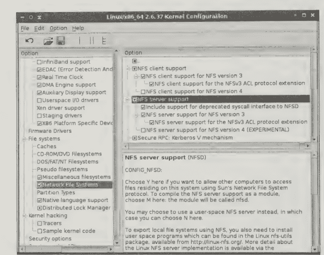

多年来，NFS 经历了多次修订。这些 NFS 版本号通常附加在 NFS 缩写之后，例如代表第 2 版的 `NFSv2`。这种级别是 Linux 内核的默认设置；要使用 `NFSv3` 或 `NFSv4`，你必须激活额外功能，这些功能如图 8.1 所示。从 2.6.37 内核开始，通过 `NFSv3` 的 NFS 支持已经相当稳定且完整。截至 2.6.37 内核（我所知的最新版本），`NFSv4` 服务器仍被认为是实验性的。建议避免使用实验性的 NFS 驱动程序，因为可能会导致性能低下的、文件丢失或其他问题。

所有发行版的内核默认都支持 NFS，尽管它有时会被编译为独立的模块——用于 NFS 客户端的 `nfs.o` 和用于 NFS 服务器的 `nfs.o`。当你尝试挂载远程导出项或启动 NFS 服务器时，相应的模块应该会自动加载。虽然 NFS 支持模块不是硬件驱动程序，但加载它们使用的是与你加载硬件驱动模块时相同的工具。发行版通常将这些支持编译到内核文件中，而不是作为模块提供。

Linux 的 NFS 实现依赖于几个额外的程序。这些程序应该随着 NFS 服务器一起自动安装。在大多数情况下，这些程序在后台运行，不需要特殊配置，但你应该意识到它们的存在。表 8.5 总结了这些程序。这些程序与远程调用（RPC）机制有关，RPC 是一种允许一台计算机触发另一台计算机上的函数激活的方法。NFS 依赖于 RPC，因此需要各种 RPC 辅助程序在运行。

## 表 8.5 NFS 的 RPC 支持程序

| 选项 | 含义 |

| --- | --- |

| `rpc.idmapd` | 该程序仅与 NFS4 及更高版本一起工作，用于映射系统之间的用户名和 UID。如果两台计算机都支持相同的用户，但对这些用户使用不同的 UID 号，此功能可能非常重要。 |

| `rpc.mountd` | 该程序运行在服务器上，帮助管理来自 NFS 客户端的请求。它与客户端通信并向它们发送有关导出的信息，并跟踪哪些客户端连接到了服务器。此程序有时被称为 mount。 |

| `rpc.nfsd` | 该程序是内核空间 `nfsd` 进程的用户空间前端，该内核进程承担了 NFS 服务器的大部分工作。 |

| `rpc.statd` | 该程序告诉客户端 NFS 服务器即将重启，帮助客户端管理此事件。 |

| `portmap` | 该程序（也称为 portmapper）运行在服务器上，并告诉客户端它们应该联系哪个端口号来使用 NFS 服务器或某些其他服务器。 |

## 设置基本导出选项

Linux 使用 `/etc/exports` 文件来描述 NFS 服务器导出的目录。该文件中的行可以是注释（以井号 `#` 开头），也可以是导出定义。每个导出定义均采用以下形式：

`/directory(options) [clientoptions]...`

`/directory` 是要提供的目录，例如 `/home` 或 `/opt/OpenOffice.org`。目录后面跟着的是一个或多个客户端规范。你可以通过几种方式列出客户端：

- 主机名（Hostnames）：你可以提供计算机的主机名，例如 `services.luna.edu`。如果你省略了域名，服务器将认为你指的是它所在域内的机计算机。

- 通配符（Wildcards）：如果你想向域内的所有计算机或其某些子集导出目录，可能可以使用星号（`*`）和问号（`?`）通配符。这些功能的作用与在 shell 中指定文件名时非常相似。但它们不匹配主机名。例如，`*.luna.edu` 匹配 `central.luna.edu` 和 `luna.edu`，但不匹配 `helpman.info.luna.edu`。

- IP 地址（IP Addresses）：你可以通过 IP 地址指定计算机，例如 `172.24.0.2`。这种方法人类难以理解主机名，但它具有安全优势，因为它不依赖域名系统（DNS）服务器将主机名转换为 IP 地址。如果你使用主机名，攻击者理论上可以通过接管 DNS 服务器来访问你的 NFS 服务器。

- 网络地址（Network Addresses）：你可以通过提供 IP 地址、斜杠和子掩码来通过 IP 地址范围指定网络。子掩码可以用点十进制形式指定，也可以用地址网络部分的位数指定。例如，`172.24.0.0/255.255.0` 和 `172.24.0.0/16` 是等效的。

- NIS 网络组（NIS Netgroups）：尽管现在很少使用，网络信息系统（NIS）允许你通过在名称前加上符号来指定 NIS 网络组，例如 `@tranquility`。

每个客户端规范后面是一跟用逗号分隔的选项列表。表 8.6 总结了这些选项中最常见的。你可以在 `exports` 的 man 中找到更多选项。

## 表 8.6 常见的 NFS 导出选项

| 选项 | 含义 |

| --- | --- |

| `secure` or `insecure` | 指定客户端必须从安全端口（编号 1024 以下的端口）连接（secure）或不需要连接（insecure）。默认值为 secure。 |

| `rw` or `ro` | 指定读写（rw）或只读（ro）。 |

| `sync` or `async` | 指定服务器应同步地还是异步地将数据写入磁盘。 |

## 配置 NFS 服务器

NFS 导出。表 8.7 总结了这些选项中最重要的。`exportfs` 的 man页提供了更多不冷门选项的详细信息。

### 表 8.7 常见的 exportfs 选项

| 选项 | 说明 |

| --- | --- |

| `-a` | 读取 `/etc/exports` 并导出其中列出的所有目录。（与 `-u` 一用时，取消取消所有目录。） |

| `-r` | 重新导出所有目录。其效果是导出 `/etc/exports` 中未列出的目录。 |

| `-o options` | 实现指定的选项，其格式与 `/etc/exports` 中的选项相同。 |

| `-u` | 取消导出一个或多个目录。 |

| `-f` | 刷新并重建导出表。 |

| `-v` | 在程序的输出中添加详细信息。 |

在使用 `exportfs` 添加或删除导出项时，你需要以 `client:/export/directory` 的格式指定客户端和目录。在导出新目录时，你不需要指定表 8.7 中的任何选项，但必须使用 `-u` 选项来取消导出目录。例如，假设你的 NFS 服务器目前将 `/var/www` 导出到 `192.168.23.0/24`，以便允许本地用户编辑服务器文件。你想将此目录移动到 `/var/apache/webfiles`。你可以通过输入以下命令来实现这些更改：

```
# exportfs -u 192.168.23.0/24:/var/www
# exportfs 192.168.23.0/24:/var/apache/webfiles
```

然而，这种更改是临时的；你可能先编辑 `/etc/exports` 然后输入 `exportfs -r`，从而实现你的更改。

## 识别已挂载导出

管理 NFS 的工具是 `showmount`，它显示当前 NFS 活动的信息。不带选项使用时，该工具会显示当前使用该服务器的计算机 IP 地址。表 8.8 总结了 `showmount` 最常用的选项。

### 表 8.8 常见的挂载点选项

| 选项 | 选项缩写 | same |

| --- | --- | --- |

| `--all` | `-a` | 显示客户端的 IP 地址和它们正在使用的目录。 |

| `--directories` | `-d` | 显示服务器当前共享的目录，但不显示客户端的身份。 |

| `--exports` | `-e` | 显示当前可用的导出（类似于 exports 的默认输出，但每个导出项使用一行输出）。 |

| `--help` | `-h` | 提供基本帮助信息。 |

| `--version` | `-v` | 打印程序的版本号。 |

| `--no-headers` | 无 | 抑制输出中的解释性头部。 |

在网络防火墙和安全选项允许的情况下，你可以使用 `showmount` 显示运行在任何计算机上的服务器的信息。默认情况下，程序显示本地计算机上 NFS 服务器的信息，但如果你添加了计算机主机名，结果将是该计算机的信息：

```
$ showmount -a central
All mount points on central:
172.24.21.5:/home
172.24.21.5:/home/jill/photos
192.168.1.4:/home
192.168.1.4:/home/turtle
```

在这个示例中，172.24.21.5 正在访问 `/home/jill/photos`（`/home` 导出的部分），192.168.1.4 正在访问 `/home/turtle`（也是 `/home` 导出的部分）。

## 测量 NFS 活动

`nfsstat` 工具提供了与 NFS 以及 RPC 客户端和服务器活动相关的统计数据。表 8.9 总结了一些重要的 `nfsstat` 选项。需要强调的是，`nfsstat` 同时提供客户端和服务器信息，因此你可以从 NFS 连接的任何一侧使用它，尽管每侧提供的信息是不完全相同的。

### 表 8.9 常见的 nfsstat 选项

| 短选项 | 长选项名称 | 含义 |

| --- | --- | --- |

| `-s` | `--server` | 仅显示服务器统计数据。 |

| `-c` | `--client` | 仅显示客户端统计数据。 |

| `-n` | `--nfs` | 仅显示 NFS 统计数据。 |

| `-r` | `--rpc` | 仅显示 RPC 统计数据。 |

| `-2`, `-3`, 或 `-4` | 无 | 显示指定 NFS 版本的统计数据。 |

| `-m` | `--mounts` | 显示挂载的 NFS 导出信息，包括它们的名称和当前挂载选项（无论是隐式的还是显式的）。 |

| `-o *facility*` | 无 | 显示指定的 *facility* 信息，该设施必须是 nfs, rpc, net, fh, rc 或 all 之一。 |

| `-Z` | `--sleep` | 对当前统计数据拍摄快照，暂停，然后在接收到 SIGINT 信号（当用户按下 Ctrl+C 时）后显示快照与系统状态之间的差异。 |

`nfsstat` 的大部分输出是晦涩的，但你可以从你理解的条目中获取一些信息。例如，标记为 read、write、create 和 mkdir 的列分别指定了读取和写入的文件以及目录数量。`-m` (--mounts) 选项的输出在 NFS 客户端上可能特别有用，因为你可以了解导出项是如何挂载的。这些信息可以为解决问题提供线索，例如，当用户无法创建新文件时。

## 检查 RPC

`rpcinfo` 程序对于确定主机上可用的 RPC 服务很有用。它可以用于检查远程服务器上运行的 NFS 服务。`rpcinfo` 的输出如下：

```
$ rpcinfo -p
204  udp 135 portmap-mapper
204  tcp 135 portmap-mapper
100  udp 200 nfs
100  tcp 200 nfs
139  udp 201 mountd
139  tcp 201 mountd
```

输出显示了每个 RPC 服务的程序、协议（udp 或 tcp）、端口号以及支持的版本号。

## 练习 8.1：配置 NFS 服务器

本练习演示了如何管理 NFS。如果你有服务器，请按照以下步骤操作：

1. 登录服务器。

2. 使用编辑器加载 `/etc/exports`。

3. 在编辑器中创建一个导出项。例如，你可能会创建 `/home 192.168.23.0/24(rw)`（根据需要将 192.168.23.0/24 替换为客户端 IP 地址）。

4. 以 root 身份运行 `exports -r` 重新加载 `/etc/exports`。

5. 在客户端上，尝试通过输入 `mount 192.168.23.0/24:/home /mnt`（根据需要替换 192.168.23.0/24 和 `/mnt`）来挂载共享。此尝试将失败。

6. 重复步骤 4。这次应该成功。

7. 运行 `showmount -s` 查看哪些客户端正在使用服务器，以及它们在使用哪些目录。你应该看到你的导出共享与客户端 IP 地址关联。

8. 运行 `nfsstat -s` 查看 NFS 服务器处理的请求统计数据。

9. 使用客户端在挂载导出中执行一些无害的操作，例如读取文件。

10. 重复步骤 8。比较两次 `nfsstat` 输出。你会发现某些值发生了变化。例如，如果你读取了文件，读取值应该增加。

11. 在客户端上以 root 身份运行 `umount /mnt` 以取消挂载导出的目录。

12. 以 root 身份运行 `exportfs -u 192.168.23.0/24:/home` 告知服务器停止提供 `/home` 导出。

13. 此时运行 `exports -r` 也可以；本练习要求你使用 `-u` 来查看它的工作原理。

## 提高 NFS 安全性

大多数服务器使用密码或某些身份验证工具来控制对文件的访问。NFS 的工作方式不同；NFS 服务器允许客户端系统控制对文件的访问。一旦目录通过 NFS 导出，任何在 `/etc/exports` 中被授权访问该目录的客户端计算机都可以按照 `/etc/exports` 定义允许的任何方式进行访问。其核心思想是：客户端计算机将有一个与服务器上用户群兼容的用户，并且该客户端计算机是可靠的。

在 NFS 创建时，这些假设并不是不合理，但在当今的计算环境中，它们具有了一定的风险。如果你使用无线网络，某个拥有笔记本电脑和无线网络硬件的人可能能够访问你的服务器，并伪装成另一台计算机。即使在有线网络中，被攻破的系统或物理访问也能让攻击者成为受信任的系统。攻击者可以控制受攻击计算机上的用户数据库，或使用不遵循常规规则的自定义 NFS 客户端程序，绕过 NFS 安全方案的意图。因此，你应该对 NFS 安全性保持谨慎。除非真的有必要，否则不要向 `/etc/exports` 中添加计算机；除非客户端需要，否则不要给客户端读/写权限。`no_root_squash` 选项特别危险。你可能还希望使用 IP 地址而不是主机名来在 `/etc/exports` 中指定计算机；这种做法会让伪装成受信任系统变得更加困难。

额外的预防措施是通过防火墙规则（如第 7 章所述）或 TCP Wrappers（如第 10 章“安全”所述）保护端口映射器或 NFS 服务器端口。每种方法都能防止未经的计算机访问 NFS 服务器。当然，Samba 和其他服务器也可以应该这样做。

## 使用 Linux 作为 NFS 客户端

Linux 的 NFS 客户端本质上是 Linux 内核本身。内核将另一计算机的 NFS 导出视为可以通过 `mount` 命令或 `/etc/fstab` 中的项挂载的文件系统。第 3 章详细描述了这些工具。使用 NFS 导出的规则与分区上普通文件系统的规则相似，尽管某些细节有所不同。要挂载 NFS 导出，你需要指定 NFS 文件系统类型。（如果客户端和服务器都支持，使用 `NFS4` 来强制使用 NFS4。）Linux 可以从上下文判断你指的是 NFS，因此你有时可以省略此选项。你不是指定 Linux 设备文件名，而是指定主机和导出名称。（为了防止 DNS 服务器被攻破或出于偏好，你可以使用 IP 地址而不是主机名。）例如，要将 `central.luna.edu` 的 `/home` 挂载到 `/morehome`，你可以输入以下命令：

```bash
# mount -t nfs central.luna.edu:/home /morehome
```

如果你不知道服务器提供了哪些导出，可以输入 `showmount -e servername`。结果是 `servername` 上可用的导出列表，以及连接到每个导出的客户端。

在前面的示例中，你可以省略 `-t nfs` 指定，如果你的客户端在 `luna.edu` 中，或者配置为通过 `/etc/resolv.conf` 中的搜索链接查找域，那么你可以将导出指定为 `central:/home` 而不是 `central.luna.edu:/home`。如果你想在计算机启动时挂载导出，或者赋予普通用户挂载导出的权限，可以通过向 `/etc/fstab` 添加条目来实现。例如，以下行在启动时导入一个导出：

```bash
central.luna.edu:/home /mnt/home nfs defaults 0 0
```

你可以添加许多标准挂载选项；例如，指定 `ro` 选项会导致只读挂载，即使服务器已授予了你的系统读/写权限。（不过，如果服务器只给你只读权限，你无法使用读/写权限。）此外还有几个 NFS 特有的挂载选项。其中最重要的可能是 `hard` 和 `soft`。如果你显式指定 `hard`，当服务器没有响应时，尝试访问 NFS 的程序将被阻塞（在等待输入时变得无响应）。当服务器可用时，程序将从上次停止的地方继续。


如果你指定 `soft`，内核的 NFS 客户端最终将超时并向客户端传递错误消息。如果你的网络或服务器不稳定，你可能更倾向于 `soft`，因为杀死因无法访问 NFS 导出而挂起的进程会更好。然而，如果你的网络运行正常，`hard` 是首选行为，因为指定 `soft` 在可能会良好的网络上可能会引发问题。

你可能想使用的另一个 NFS 特有的挂载选项是 `proto=transport`，其中 `transport` 是 `tcp` 或 `udp`。（或者，你可以将 `tcp` 或 `udp` 作为选项，并配合 `proto*` 使用。）NFS 最初是一个基于 UDP 的协议，在可靠的局域网上运行良好。使用 TCP 增加了在网络不可靠时提高可靠性的功能，但这些功能也增加了你可能希望避免的开销。你可能想对两种设置进行实验，看看哪种在你的网络上效果最好。

一旦挂载导出，所有普通用户都可以在文件所有权权限的限制内访问该导出。一个潜在的注意事项是NFS 使用用户 ID (`UID`) 和组 ID (`GID`) 来处理所有权和权限。如果用户在客户端和服务器上都有账户，那么他们在两个系统上的 `UID` 和 `GID` 必须匹配，否则用户将无法访问自己的文件。如果用户在访问同一服务器的两个或多个客户端上都有账户，也会出现类似的问题。已经部署了各种变通方法来解决这个问题，其中一些已经过时了。今天最好的三种方法是：

- **手动同步用户**：在用户较少的小网络中，你可以手动维护账户，使所有用户具有相同的 `UID` 和 `GID`。对于用户较多的较大的网络，这种方法非常繁琐。

- **使用 ID 映射器**：你可以使用前述的 `rpcmapd`，它可以自动映射用户名和 `GID`。该服务器必须在服务器和客户端上运行。

- **使用集中登录服务器**：如果你使用 `LDAP` 或其他集中登录服务器，问题就可以解决，因为由登录服务器管理的用户在网络中具有相同的 `UID` 和 `GID`。

注意，对于根本性的只读导出不需要 `UID` 同步；此外，如果服务器允许用户写入，请确保用户应该写入的目录开启写入权限。

## 配置 FTP 服务器

互联网上的任何人都可以向你的服务器上传文件，包括非法内容。如果其他人可以匿名检索这些文件，那么你的网站可能会变成一个无意中的盗版托管站点。

如果你确实需要启用匿名上传（例如，为了允许客户提交文件以支持错误报告），你可以通过赋予匿名上传目录 `733` (`rwxwx-wx`) 或 `777` (`rwxrwxrwx`) 权限，并将所有者设为 `root` 来将风险降至最低。如果你使用 `777` 权限，请将组所有权交给一个包含应该能够读取目录的用户的组，但要确保用于 FTP 服务器匿名访问的账户不在该组中！此配置将允许匿名用户向该目录上传文件，但不能从该目录下载文件。如果你使用现有目录，在实施此配置之前，请先运行 `chmod -R u-r /path/to/incoming/dir` 以确保该目录内的文件不会被随机用户读取。

## 选择 FTP 服务器

FTP 是一个协议，多年年来涌出了许多实现方案。这些服务器在许多细节上各不相同；它们都遵循相同的协议，并且看起来非常相似。Linux 的 FTP 服务器选项包括：

- **Pure-FTPD**：该服务器总部位于 http://www.pureftpd.org，是一个强调安全性的 FTP 服务器。许多发行版都附带了它，包名通常为 `pure-ftpd`。

- **vsftpd**：该服务器旨在安全、稳定性和速度方面表现卓越。为此，其开发者选择放弃了像 `ProFTPD` 等服务器的一些更高级的功能。如果你不需要这些功能，这种权衡是可以完全接受的。你可以从它的网站 http://vsftpd.beasts.org 了解更多信息。它在越来越多的 Linux 发行版中可用，通常包名为 `vsftpd`。

- **ProFTPd**：该服务器总部位于 http://proftpd.org，是极其复杂的 FTP 服务器中较受欢迎的之一。它与大多数主要的 Linux 发行版一起发布。它的配置文件以 Apache 的为模型，且服务器支持许多高级功能。因此，它的配置起来更加困难。

> 这个 FTP 服务器列表远非完备。拥有相当完整软件仓库的 Gentoo Linux 至少有两个不同的 FTP 服务器。还有许多非常冷门的服务器可用。如果你有特殊需求，你可能想调查一下这些替代方案。

由于 FTP 可能会为用户提供对系统的实质访问——在 Linux 所有权和权限限制范围内，读取或写入任何文件的能力——从安全角度来看，FTP 服务器异常敏感。因此，许多 FTP 服务器的网页都强调其开发者对安全性的关注。

FTP 服务器提供了将自己锁定在 `chroot` 监狱中的显式支持，正如第 6 章“DNS 服务器配置”中引用 DNS 服务器时所描述的那样。

对于较小的 FTP 站点，上述列表中的任何服务器可能都能良好工作。由于它们随多个 Linux 发行版发布，接下来的两个章节将关注 Pure-FTPd 和 vsftpd。

## 理解 FTP 基础

FTP 是一个老旧且奇特的协议，它带来了一些 FTP 特有的陷阱。这些很大程度上是客户端产生的问题，因此用户应该意识到它们；然而，如果你像第 7 章描述的那样配置了防火墙，你可能需要考虑这些问题中的第一个。

第一个 FTP 奇之处在于它管理端口的方式。有两个端口（TCP 端口 `20` 和 `21`）注册给 FTP。端口 `20` 是数据端口，用于数据传输；端口 `21` 是命令端口，用于发布命令。这种配置的大问题在于，在传统的 FTP 主动模式下，客户端发起到服务器的连接，然后服务器从其命令端口向客户端发起反向连接。这种服务器到客户端的连接会被某些防火墙拦截，因此 FTP 在没有显式配置允许此类连接的防火墙上经常会失败。解决此问题的客户端通方法是使用 FTP 被动模式（通过在 `ftp` 程序中输入 `passive` 或在 GUI 或其他 FTP 客户端中选择等效选项）。在被动模式下，客户端发起两个连接，这克服了防火墙的问题。被动模式使用服务器上的非特权端口进行数据传输，尽管它有时会导致故障。因此，你可能需要都尝试主动和被动模式，以确定哪种效果最好。你应该检查你的 FTP 客户端文档，以了解它默认使用哪种模式。

第二个 FTP 奇之处与传输模式有关。FTP 客户端默认使用 ASCII（纯文本）传输模式，在这种模式下，文件的传输方式会动态更改字符编码，以适应不同操作系统存储纯文本的方式（Linux/Unix、Windows 和原始 Mac OS 使用不同的行编码规范，某些更奇特的系统使用 ASCII 编码方法）。使用 ASCII 模式对于纯文本文件有效，但这种模式几乎总是会损坏二进制文件，因此请在 `ftp` 中使用 `binary` 选项或在其他 FTP 客户端中使用类似的选项来设置传输模式。如有疑问，请使用 `binary` 模式；现在的大多数编辑器都可以处理任何常见的行结束类型，以错误的格式检索文本文件只会产生最小或不产生问题。Linux 必须使用 Unix 风格的行结束符，因此如果你传输此类文件，你应该注意这一细节。

你还需要注意 FTP 服务器的启动方式。某些 FTP 服务器通过 SysV、Startup 或本地启动脚本启动；但另一些通过超级服务器（如 `inetd` 或 `xinetd`）启动时效果更好。你的发行版包可能包含了必要的启动脚本和配置文件，但你可能需要。

## 配置 Pure-FTPd

Pure-FTPd 主要设计为通过命令行参数而非配置文件来控制。表 8.11 总结了最重要的 Pure-FTPd 选项；然而还有更多可用——请咨询服务器的手页。

### 表 8.11 常见的 pureftd 选项

| 短选项 | 长选项 | 含义 |
| :--- | :--- | :--- |
| `-4` | `--ipv4only` | 仅接受 IPv4 连接 |
| `-6` | `--ipv6only` | 仅接受 IPv6 连接 |
| `-a` | `--trustedgid` | 导致指定组的用户不被 chroot |
| `-A` | `--chrooteone` | 导致 root 以外的所有访问都被 chroot |
| `-B` | `--daemonize` | 以守护进程启动服务器 |
| `-c num` | `--maxclients` | 接受最多 num 个连接。默认值为 50。 |
| `-C num` | `--maxclientsper` | 每个 IP 地址最多接受 num 个连接。此选项仅在独立模式下工作（超级服务器提供类似的功能）。 |
| `-e` | `--anonymousonly` | 仅支持匿名 |

### 表 8.11 常见的 pureftd 选项（续）

| 短选项 | 长选项 | 含义 |
| :--- | :--- | :--- |
| `-E` | `--noanonymous` | 仅支持非匿名（普通用户）访问 |
| `-i` | `--cantupload` | 禁用匿名用户的上传功能 |
| `-M` | `--createdirs` | 允许匿名用户创建目录 |
| `-N` | `--natmode` | 默认使用主动模式；在某些 NAT 路由器后非常有用 |
| `-u uid` | `--minuid` | 禁止访问 UID 编号低于 uid的用户 |

## 配置 vsftpd

在现代 Linux 系统上，另一种流行的 FTP 服务器是 `vsftpd`。通常，`vsftpd` 从系统服务器运行；但是，如果你愿意，它也可以从 SysV 或本地启动脚本运行。`vsftpd` 配置文件为 `/etc/vsftpd.conf` 或 `/etc/vsftpd/vsftpd.conf`。该文件包含以井号（`#`）开头的注释行，以及采用以下形式的指令行：

```
option=value
```

`vsftpd` 指令中的等号周围不能有多余的空格。表 8.12 总结了一些重要的 `vsftpd` 指令。此表没有涵盖所有可用的指令；请查看 `vsftpd.conf` 的手册页以获取更多指令的信息。

## 表 8.12 重要 vsftpd.conf 指令

| 指令 | 值或否 | 含义 |
|---|---|---|
| `listen` | YES 或 NO | 如果为 YES，`vsftpd` 将自身绑定到 FTP 端口以监听 IPv4 连接。如果从 SysV 或本地启动脚本运行 `vsftpd`，请将此值设置为 YES；如果从超级用户守护进程运行，则保持默认值（NO）。 |
| `listen_ipv6` | YES 或 NO | 此选项的作用与 `listen` 类似，但它适用于 IPv6 连接而非 IPv4 连接。 |
| `ftpd_banner` | 字符串 | 设置欢迎消息，当用户连接时会在其 FTP 客户端程序中显示该消息。 |
| `nopriv_user` | 用户名 | `vsftpd` 用于非特权操作的用户名。 |
| `ftp_username` | 用户名 | `vsftpd` 用于匿名访问的用户名。默认是 `ftp`。 |
| `local_enable` | YES 或 NO | 是否接受经过身份验证的本地用户登录。 |
| `anonymous_enable` | YES 或 NO | 是否接受匿名登录。 |
| `anon_root` | 目录名 | 设置用于匿名访问的根目录。除非 `anon_upload_enable` 为 YES，否则该目录通常对匿名用户不可写。默认值是 `/etc/passwd` 中指定的匿名用户家目录。 |
| `chroot_local_user` | YES 或 NO | 告诉 `vsftpd` 在接受用户登录时是否使用 `chroot`。 |
| `userlist_enable` | YES 或 NO | 如果为 YES，`vsftpd` 会检查由 `userlist_file` 指定的文件，并在要求密码之前拒绝这些用户的登录。 |
| `write_enable` | YES 或 NO | 授予或拒绝写入文件的能力——即允许用户在下载文件时同时上传文件。 |
| `anon_upload_enable` | YES 或 NO | 授予或拒绝匿名用户上传文件的能力。如果为 YES，则 `write_enable` 必须为 YES。 |

默认的 `vsftpd` 配置文件通常支持经过身份验证的本地用户登录和匿名登录。通常，`vsftpd` 对匿名用户执行 `chroot`，但对经过身份验证的本地用户则不会这样做。如果你想验证或更改这些功能，请检查配置文件中的以下行，并根据需要进行更改：

```
anonymous_enable=YES
local_enable=YES
```

你还可以添加与这些相关的额外选项，例如匿名根目录的位置 (`anon_root`) 以及在经过身份验证的用户登录时是否对其家目录进行 `chroot` (`chroot_local_user`)。

## 总结

文件服务器是许多网络中的关键组件，Linux 支持多种软件来处理此任务。本章描述了用于处理三种特定协议的服务器。`Samba` 服务器处理 `SMB/CIFS` 协议，这是 Windows 网络上的主文件共享协议。`Samba` 必须“翻译”功能以让 Windows 客户端满意，并且它工作得很好。为了满足 Linux 和 Unix 客户端，`Samba` 为这些客户端增加了更多功能，但 `NFS` 协议通常是更好的选择。与 `Samba` 不同，`NFS` 可以向其客户端提供文件系统的真实视图，这精简并简化了文件共享过程。本章描述的最后一种协议是 `FTP`，旨在供专用客户端程序使用，而不是将服务器视为可挂载文件系统的操作系统。Linux 可用的 FTP 服务器较少，但本章涵盖了两个最流行的：Pure-FTPD 和 `vsftpd`。这两台服务器都提供了多种选项，允许通过用户名和密码登录或允许匿名用户登录。由于 FTP 通常用于在整个互联网上传输文件（与 `SMB/CIFS` 和 `NFS` 更常见的本地使用不同），FTP 安全特别为重要，你应该确保尽可能以安全的方式配置你的 FTP 服务器。

### 考试要点

解释 Samba 中用户级安全和共享级安全的区别。共享级安全模拟了旧的 Windows 9x/Me 安全模型，在该模型中，密码与共享关联而非账户。用户级安全采用类似于 Linux 的安全模型，在该模型中账户拥有密码，客户端必须向服务器发送用户名以及密码。

描述两个主要的 Samba 守护进程。`nmbd` 守护进程处理 Samba 服务器的名称解析以及类似的后台和支持任务。`smbd` 守护进程处理 Samba 文件和打印机共享的大部分工作。对于一个功能完整的 Samba 安装，这两个守护进程都是必须的。

总结将 Linux 计算机作为 SMB/CIFS 客户端的两种方法。`smbclient` 程序连接到 SMB/CIFS 服务器，并提供一个类似于文本模式 `ftp` 程序的界面。用户可以传输文件、删除文件、重命名文件等。Linux 的 `mount` 命令结合适当内核文件系统支持和辅助程序，允许系统管理员（或适当的用户）通过 `/etc/fstab` 条目将 SMB/CIFS 服务器挂载为本地文件系统。用户随后可以使用普通的文件维护工具（`cp`、`mv` 等）对存储在本地文件系统上的文件进行任何操作。

描述 `smb.conf` 文件结构。Samba 的配置文件 `smb.conf` 分为若干部分，每个部分以括号中的名称开头。`[global]` 设置全局选项，大多数后续部分包含针对单个文件或打印机服务器的选项。`[homes]` 和 `[printers]` 共享定义分别根据所有用户和所有打印机创建多个共享。在每个部分中，选项的格式为 `option=Value`，其中 `option` 是选项名，`Value` 是其值。所有选项和值都不区分大小写。

描述 `/etc/exports` 文件结构。`/etc/exports` 文件用于指定哪些目录通过网络共享。每行以目录路径开头，随后是允许访问的主机列表，以及一组选项。

解释为什么访问限制如此重要。限制共享访问对于安全至关重要。它确保只有授权用户可以查看或修改数据。

总结如何在重启重启修改导出。通过使用 `exportfs -r` 命令可以在无需重启的情况下使 `/etc/exports` 的更改生效。

描述如何挂载导出。要挂载 NFS 共享，使用 `mount` 命令配合远程服务器路径和挂载点。或者，可以将这些条目添加到 `fstab` 文件中以便自动启动。

解释主动和被动 FTP 的。在主动模式下，服务器连接回客户端，这会导致防火墙问题。在被动模式下，客户端发起连接，这对防火墙更友好。某些客户端默认使用被动模式。

列出一些流行的 FTP 服务器。Pure-FTPD 和 `vsftpd` 都是功能齐全，但配置方式完全不同。ProFTPpd 是另一个流行的 FTP 服务器，它提供了更难配置的功能。

### 复习题

1. Samba 服务器 (`dance`) 包含 `[homes]` 定义，但没有 `[sammy]` 定义。假设账户存在，当客户端尝试访问 `\\dance\sammy` 会发生什么？

- A. 由于 `[sammy]` 共享不存在，会出现错误信息。

- B. 如果用户输入正确的密码，他将获得服务器家目录的访问权限。

- C. 用户无论是否输入密码都会获得 `/tmp` 目录的访问权限。

- D. 如果用户输入正确的密码，他将获得服务器上其家目录文件的访问权限。

2. 你正在配置 Samba 服务器以加入一个由 Windows 7 域控制器管理的现有域。你希望用户能够使用域控制器的账户数据库进行验证。你将如何设置 `smb.conf` 中的 `security` 选项来实现结果？（选择所有适用项。）

- A. `security = User`

- B. `security = Server`

- C. `security = Domain`

- D. `security = ADS`

3. `smb.conf` 文件中的以下行 `name order = lmhosts` 表示什么？

- A. Samba 优先使用 `lmhosts` 文件进行解析，但在必要时会使用其他方法。

- B. Samba 仅使用 `lmhosts` 文件进行解析，不回退到其他方法。

- C. Samba 在作为 NetBIOS 名称服务器时将 `lmhosts` 文件作为资源源。

- D. Samba 使用 `lmhosts` 文件的内容来确定给不同客户端解析请求的优先级。

4. 下面的 Samba 共享定义有什么问题？

```
[themes]

comment: 所有用户的主题

writable: 0

path: /usr/share/themes

public: 1
```


+   A. 共享定义内的行需要等号（`=`）而不是冒号（`:`）来分隔选项和值。
+   B. 共享定义行之后的行必须至少缩进一个空格。
+   C. 布尔选项（`writable` 和 `public`）需要 `No` 或 `Yes` 值，而不是 `0` 或 `1` 值。
+   D. 它没有问题。
+   5. 当你使用 `mount` 访问 SMB/CIFS 共享上的文件时，你可以执行以下哪项操作而这些操作是在通过 `smbclient` 访问时无法完成的？
+   A. 从服务器上删除文件。
+   B. 在文件位于服务器时使用 Emacs 编辑它。
+   C. 将文件从服务器复制到客户端。
+   D. 在文件位于服务器时重命名文件。
+   6. 你想在一个现有的 Windows 网络中添加 Samba 服务器，该网络中的用户习惯使用包含空格内的全名作为用户名。你会使用哪个字段让用户能够继续使用这些用户名，并将其转换为更常规、更短的 Linux 用户名？
+   A. `smb.conf` 中 `username map` 选项指向的文件
+   B. `/etc/samba/username.map` 文件
+   C. `smb.conf` 中 `pass file` 选项指向的文件
+   D. `/etc/samba/smbpasswd` 文件
+   7. 在启动 Samba 服务器之前，你该如何验证你的 `smb.conf` 文件不包含严重的语法错误？
+   A. 输入 `check-samba`。
+   B. 输入 `smbchconfig`。
+   C. 输入 `smbd --check smb.conf`。
+   D. 输入 `testparm`。
+   8. Samba 服务器的安全选项设置为 `Share` 意味着什么？
+   A. Samba 尝试模拟 Windows 9x/Me 风格的认证。
+   B. Samba 允许访问文件和打印机，而不是离线状态。
+   C. Samba 使用 SMB/CIFS 风格的文件共享，而不是 NFS 使用的 Export 风格。
+   D. Samba 在网络中既作为客户端又作为服务器运行。
+   9. NFS 服务器如何确定谁可以访问其导出的文件？
+   A. 它结合本地文件所有权和权限，以及客户端的用户认证和受信任客户端计算机列表。
+   B. 它使用以未加密格式跨越网络发送的密码。
+   C. 它使用以加密形式跨越网络发送的密码。
+   D. 它使用单个用户 `.login` 文件的内容来确定哪些客户端计算机可以访问共享。

# 第 8 章 • 配置文件服务器

10. 你想通过 NFS 将 `/home` 目录导出到两台计算机：`remington` 应该具有完全读写权限，而 `gentle` 应该具有只读权限。你如何在 `/etc/exports` 中配置这些？
+   A. `remington/(home, rw) gentle(/home,ro)`
+   B. `[homes] remington(readwrite) gentle(readonly)`
+   C. `/home remington(rw) gentle(ro)`
+   D. `remington/(home, readwrite) gentle(/home,readonly)`

11. 你想使用 NFS 临时导出 `/mnt/cdrom` 目录，以便 `reader .example.org` 无法写入该导出内容。假设 NFS 服务器已经在运行，你会在 shell 提示符下输入什么来实现此目标？
+   A. `exports -ro reader.example.org:/mnt/cdrom`
+   B. `showmount -ro reader.example.org:/mnt/cdrom`
+   C. `exports -ro reader.example.org:/mnt/cdrom`
+   D. `mount -ro reader.example.org:/mnt/cdrom`

12. 与大多数其他 Linux 服务器相比，Linux 最流行的 NFS 服务器有何不同？
+   A. Linux NFS 服务器要求对所有提供的文件设置权限。
+   B. Linux NFS 服务器不能为 Windows 或 Mac OS 客户端提供服务。
+   C. Linux NFS 服务器包含一个基于内核的组件。
+   D. Linux NFS 服务器必须从如 `inetd` 或 `xinetd` 等超级服务器运行。

13. `portmapper` 对于 NFS 的功能是什么？
+   A. 它监听 NFS 端口并将连接移交给 NFS 服务器。
+   B. 它创建 NFS 客户端的映射，以帮助服务器优化其速度。
+   C. 它告诉客户端 NFS 服务器运行在哪个端口。
+   D. 它维护本地文件系统及其与 NFS 导出之间关系的信息。

14. 以下挂载 NFS 导出的 `/etc/fstab` 条目有什么错误？
```
//central/jill /mnt/jill nfs users 0 0
```
+   A. 它使用了 SMB/CIFS 风格而非 NFS 风格的服务器/导出描述。
+   B. 在 `/etc/fstab` 的 NFS 条目中，`users` 选项无效的。
+   C. NFS 服务器不应该导出 `/jill`，而是导出 `/home/jill`。
+   D. NFS 挂载的 dump 代码应该是 1 而不是 0。

15. 为什么在 NFS 导出中应应谨慎使用 `no_root_squash` 选项？
+   A. 该选项赋予客户端系统上的 root 在服务器上导出目录内的 root 权限，如果客户端被攻破，这是危险的。
+   B. 该选项会导致 NFS 服务器跳出其 `chroot` 监狱，使其能够访问本不应访问的用户和系统文件。
+   C. 该选项赋予 root 在服务器上任何任何登录权限。
+   D. 该选项赋予 root 在服务器上没有客户端的登录权限。

16. 你知道 NFS 导出有一个共享，但不知道名称。你如何发现它？
+   A. `smbclient`
+   B. `showmount -ro`
+   C. `nfsclient`
+   D. `nfsstat`

17. 你应该编辑哪个配置文件来启用匿名访问？
+   A. `/etc/pureftd/`
+   B. `/etc/samba/smbpasswd`
+   C. `/etc/exports`
+   D. `/etc/samba/smb.conf`

18. 你应该设置哪个 Samba 选项来允许匿名？
+   A. `anonymous=yes`
+   B. `anonymous=no`
+   C. `anonymous=true`
+   D. `anonymous=no`

19. 启动 Samba 的最佳方式是什么？
+   A. 从本地服务器
+   B. 从超级服务器
+   C. 从本地账户
+   D. 无法

20. 这台防火墙保护了本地网络。关于 Samba 的以下哪说法是正确的？
+   A. ASCII 传输
+   B. 二进制传输
+   C. 被动传输
+   D. 主动传输

D. `testpalm` 程序会检查你的 `smb.conf` 文件是否存在简单类型的错误。（它无法检查所有错误，因此）选项 D 是正确的。`check-samba` 和 `smbchkconfig` 程序是虚构的，因此选项 A 和 B 是正确的。`smbd` 程序是主要的 Samba 服务器程序之一，但它没有 `--check` 选项，因此选项 C 是错误的。

共享级安全（Share-level security）指的是认证方法：Samba 尽可能地模拟 Windows 9x/Me 风格的认证，其中密码与共享关联而非用户关联，因此选项 A 是正确的。虽然 Samba 选项可以临时禁用文件和打印机访问，但对于 `security = Share` 并非如此，因此选项 B 是错误的。选项 C 是错误的。Samba 从根本上说是一个服务器，尽管 Linux 内核和一些辅助 Samba 程序（如 `smclient`）可以作为客户端。`smb.conf` 中的安全选项不会直接影响作为 Samba/CIFS 客户端的状态。

NFS 使用“信任主机”来策略化客户端自己的用户，包括对 NFS 服务器文件的访问，这正是选项 A 所描述的。NFS 不使用密码，因此选项 B 和 C 是错误的；它也不使用用户主目录下的 `.login` 文件，因此选项 D 是错误的。

C 提供了 `/etc/exports` 中实现所述目标的正确语法。选项 A 和 D 直接替换了每个客户端选项列表中的导出的目录。选项 B 使用了 `[homes]`（用户主目录的 Samba 名称）而非 `/homes`。选项 B 和 D 错误地将 `ro` 和 `rw` 代码 扩展为 `readonly` 和 `readwrite`。

`exports` 程序控制 NFS 服务器；它从服务器维护的列表中添加或删除目录和客户端，从而临时扩展或限制通常在 `/etc/exports` 中维护的列表。选项 C 提供了该程序列出服务器维护内容的正确语法，并没有标准的 `exports` 命令，因此选项 A 是错误的。选项 B 的 `showcommand` 显示正在使用服务器的客户端信息，但它不会更改导出列表。`mount` 命令挂载远程导出项；它不影响导出的内容，因此选项 D 是错误的。

Linux 基于内核的 NFS 服务器有助于提高其性能。大多数其他服务器不包含此类基于内核的帮助，因此选项 C 是正确的。选项 A 描述了 NFS 服务器的一个虚构需求。虽然很少有 Windows 拥有 NFS 客户端，但 Windows 客户端是提供的；且 OS X 包含了 NFS 客户端。因此，选项 B 是错误的。与选项 D 相反，Linux NFS 服务器直接运行，而不是从超级服务器运行。

C 总结了端口大师（portmaster）的作用。选项 A 描述了如 `inet` 或 `xinetd` 等超级服务器的功能，但超级服务器通常不用于 NFS 服务器。选项 B 和 D 是对不存在问题的虚构描述。

14. `/etc/fstab` 中 NFS 出的正确格式为 `server:/share`，因此此条目应该以 `central:/jill` 或 `central:/home/jill` 开始。该条目使用了 SMB/CIFS 风格的共享定义，如选项 A。与 B 相反，“users` 选项对于 `/etc/fstab` 中的 NFS 是完全有效的。虽然导出名为 `jill` 的目录并不寻常，但它并不非法，由于更严重的问题在于选项 A 的形式，因此选项 C 是正确的。`dump` 工具用于备份本地 ext2、ext3 和 ext4 文件系统，而不是 NFS 导出，因此 `/etc/fstab` 中 NFS 条目上的 `dump` 代码应为 0，与选项 D 相。

15. `no_root_squash` 选项的作用如 A 所示，这对于客户端需要访问服务器上的受限制文件很有用，但也带来了选项 A 中指定的风险。`no_root_squash` 选项与 `chroot` 监狱无关，因此选项 B 是错误的。C 描述了安全外壳 (SSH) 登录选项及其风险，但因为 NFS 不提供登录访问或使用密码，所以它是该题的错误答案。NFS 不允许用户以选项 D 建议的方式“登录”服务器，使得选项 D 是错误的。

16. `showutility` 显示你指定的服务器信息。详细信息随你使用的选项而异，但 `-e` 会生成服务器导出项列表，因此选项 B 是正确的。`smClient` 程序用于访问 SMB/CIFS 服务器，而非 NFS 服务器，且选项 A 用于发现 SMB/CIFS 服务器是错误的。`nfstat` 程序是虚构的。`nfstat` 程序显示与 NFS 使用相关的统计信息，尽管选项 D 是产生统计数据的有效命令，但它没有提供问题所需的服务器导出项信息。

17. Pure-FTPpd 没有标准配置文件；相反，它依赖命令行参数来更改其行为。遗憾的是，不同的发行版以不同的方式将这些参数传递给服务器，因此你需要了解发行版才能回答该问题，使得选项 D 是正确的。选项 A、B 和 C 都是正确的，但仅针对特定的发行版：Ubuntu、Fedora 和 Gentoo。

18. 选项 B 是正确的。选项 A 和 C 是虚构的，`neither` 或 `anonymous` 都不是有效的 `vsftppd.conf` 选项。选项 D 也不是有效的 `fftpd.conf` 选项，通过向 `pure-ftpd` 服务器传递 `--anonymous` 是通过该方式禁用匿名访问的一种方法。

19. FTP 服务器程序的设计各异；有些旨在从本地或系统启动脚本运行，另一些旨在从超级服务器运行，而另一些可以任一一方式启动。必须考虑站点的需求；例如，使用频率不高的 FTP 服务器可以从超级服务器启动，而 FTP 服务器最好从启动脚本启动。因此，选项 D 是正确的。选项 A、B 和 C 都是正确的。

20. FTP 服务器程序的设计各异；有些旨在从本地或系统启动脚本运行，另一些旨在从超级服务器运行，而另一些可以任一一方式启动。必须考虑站点的需求；例如，使用频率不高的 FTP 服务器可以从超级服务器启动，而 FTP 服务器最好从启动脚本启动。因此，选项 D 是正确的。选项 A、B 和 C 都是正确的。

## 设置 Apache 基础选项

在同一站点或其他站点上，HTTP 和 HTML 是不同的；你可以运行一个不托管任何 HTML 文件的 Web 站点（使用 HTTP），也可以在没有 Web 服务器的情况下运行 HTML 文件。然而，从实际操作角度来看，这两者通常是相关联的：Web 服务器的存在是为了将 HTML 文件交付给客户端，而这些文件在创建时已经考虑到了将 Web 服务器作为交付机制。本章附近的 PLI-2 教程书中都没有详细介绍 HTML；你只需要了解 HTML 是如何融入 HTTP 的即可。

如今的网站采用了了更复杂的文档类型，例如脚本和其他动态内容。基于此类文档构建的网站比十年前主导 Web 的传统静态 HTML 文件具有多多的交互性。存在多种类型的动态内容，每种内容都有其特定的配置选项。本章的“配置脚本”部分涵盖了 PHP 基础知识：超文本预处理器（PHP）以及 Web 上的 Perl 脚本。

从原理上讲，任何计算机都可以运行 Web 服务器。在互联网上，大多数 Web 服务器使用其各自域名或子域名中的主机名。不过，这仅仅是一种约定；出于或其他原因，许多人使用一个名称或在单个域名上运行多个 Web 服务器。

Linux 及其他平台都有许多 Web 服务器可选择。然而，最流行的是 Apache (`http://httpd.apache.org`)。本章描述了如何配置此软件以提供服务器 服务。如果你需要运行另一个服务器，应该查阅其文档。

> 在我编写本书时，Apache 2.2.17 是最新版本。在 1.3 系列和 2.x 系列之间，配置选项发生了变化。本章重点介绍较新的软件。如果你使用的是旧的 1.3.x 版本，可能需要偏离本章的描述。（1.3.x 系列仍在维护中，但大多数新安装程序应该使用 2.2.x 版本。）

## 设置 Apache 基础选项

Apache 配置文件称为 `apache.conf`、`httpd.conf`，或者（对于某些 Linux 发行版上的 Apache 2.x）`apache2.conf` 或 `httpd2.conf`。该文件通常位于 `/etc/apache`、`/etc/apache2`、`/etc/httpd` 或 `/etc/httpd.conf`。无论文件名或位置如何，该文件中的大多数行都是以井号（`#`）开头的注释，或者是采用以下形式的选项行：

# 指令 值

Directive（指令）是你想要调整的参数名称，Value（值）是赋予该参数的值。值可以是数字、文件名或任意字符串。

# 第 9 章 • 配置 Web 和电子邮件服务器

某些指令出现在命名块中，这些块以角括号括起来的代码开始和结束，如下所示：

```
<IfDefine APACHEPROXIED>
  Listen 8080
</IfDefine>
```

这个特定示例在 `APACHEPROXIED` 变量被定义时，将 `Listen` 指令设置为 `8080`。请注意，最后一行使用了第一行指定的名称，但前面有一个斜杠（`/`）。这种安排确保了选项块的开始和结束（在本示例中）都只包含一个选项。

Apache 采用模块化设计——其许多功能可以被编译为单独的模块并在运行时加载或卸载。具体哪些功能被编译为模块并编译进主 Apache 可执行文件（通常称为 `apache`、`apache2`、`httpd` 或 `http2`）视具体版本而异。要加载模块，你使用 `LoadModule` 指令，Apache 配置文件在文件开头有许多此类指令。在 Apache 1.3.x 中（但 Apache 2.x 不适用），你可能需要使用 `AddModule` 指令来激活编译进主二进制文件中的模块功能。你可能想浏览这些模块，以查看默认启用了哪些功能。

> 注释掉未用功能的 `LoadModule` 指令是一个很好的安全措施。例如，如果你不需要交付动态内容，注释掉 `cgi_module` 可以减少因意外配置错误或蓄意破解导致损坏的概率。遗憾的是，很难知道每个模块的作用，因此我建议在注释掉模块定义时要谨慎。

`Include` 指令加载额外文件，就像这些文件是主配置文件的一部分一样。某些发行版利用此特性将模块支持放在单独的文件中，通常位于 `mods-available` 和 `mods-enabled` 子目录中。`mods-enabled` 中的文件通过 `Include` 语句加载。这些文件实际上是指向 `mods-available` 中等效文件的符号链接。结果是，系统配置脚本可以通过在这些目录中创建或删除相应的符号链接来启用或禁用模块。

除了主配置文件外，还有几个额外文件至关重要：


- `access.conf`：并非所有的 Apache 配置都使用此文件，它本质上是一个补充文件，告诉 Apache 如何处理特定目录。许多系统将这些信息合并到主配置文件中。对于那些未合并的系统，主文件中的 `AccessConfig` 指令指向 `access.conf` 文件。

- `mime.types` 或 `apache-mime.types`：此文件定义了各种多用途互联网邮件扩展（MIME）类型，这些代码有助于识别文件类型。HTTP 传输通过 MIME 类型识别文件，但 Linux 文件系统本身并不原生地存储 MIME 类型信息。因此，Apache 使用此文件将文件名扩展名（如 `.html` 或 `.txt`）映射到 MIME 类型。默认文件处理了你可能在服务器上交付的多数常见文件，但如果你在服务器上放置了特殊文件类型，则可能需要添加 MIME 类型。

该文件的存在是为了支持确定文件 MIME 类型的第二种方法。它不仅依赖此文件，还包含了基于文件内容的许多文件类型的“指纹”。除非你有针对特定文件类型的精确指令，或者你对文件的内部格式有深入了解，否则不需要调整此文件。

这些文件通常位于与主配置文件相同的目录中。你最可能需要访问 `.conf`，但在你使用此选项的系统中。如果你交付不寻的文件类型，关联这些 MIME 类型的最佳方法通常是调整 `mime` 或 `apache-mime.types` 文件；修改 `magic` 文件要困难得多。

用户或站点管理员可以使用 Web 服务目录中的 `.htaccess` 文件来覆盖 Apache 配置选项。`.htaccess` 文件的格式与主配置文件相同，但该文件中的选项仅影响 `.htaccess` 文件所在的目录树。通常，这用于通过全局 `UserDir` 指令共享个人网页的用户，或拥有服务器主 Web 空间目录的多个子目录但没有完整管理权限编辑主配置文件的站点管理员。

## 配置 Apache 托管你的站点

Apache 配置文件通常至少可以工作。安装后，你可以在同一台计算机运行的 Web 浏览器中输入 `http://localhost` 作为位置来测试安装。你应该能看到一个通用页面，如图 9.1 所示，该图显示了 Ubuntu 10.10 系统的默认页面。发行版的细节有所不同，因此如果你的默认页面与图 9.1 不同，不要感到。你还应该从其他计算机访问服务器，以确保防火墙规则（在第 7 章“高级网络配置”中描述）或其他问题没有阻止访问。如果你无法访问服务器，请检查它正在运行。它在 `ps` 列表中应该显示为 `apache`、`apache2`、`httpd` 或 `httpd2`。

# 图 9.1 安装并运行后，默认 Apache 配置将显示通用的 Apache Web 页面或适用于你发行版的页面。

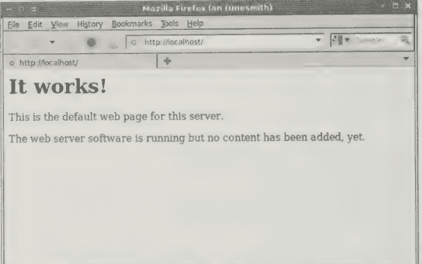

一旦服务器运行，你可能希望调整其某些默认设置。你可能想要更改的常见功能包括服务器的用户和组、服务器交付的 Web 页面位置以及虚拟域名。还有两个更高级的选项——提供安全的 Web 页面和提供动态内容——可能也需要调整。

## 设置 Apache 用户和组

与大多数使用 SysV、Upstart 或本地启动脚本的服务器一样，Apache 以 root 身份启动运行。Apache 支持两个指令，用于在启动后调整运行服务器的用户名和组名。这两个指令是 `User` 和 `Group`。例如，你可能包含以下行，以便 Apache 以名为 `again` 的组中的 `apache` 用户身份运行：

```
User apache
Group again
```

在你设置这些选项后，使用 `ps` 检查这些功能（如 `ps aux | grep apache` 或 `ps aux | grep httpd`）应该会发现大多数 Apache 实例都是以指定的用户和组运行的。不过，第一个实例将继续以 root 身份运行。尽管如此，该实例并不响应传入的请求。

### 现实世界场景

### 在 chroot 监狱中运行 Apache

确保 Apache 运行在低权限账户是一个良好的安全措施；然而，你可以进一步。正如第 6 章“DNS 服务器配置”中描述的伯克利互联网域名 (`BIND`) 服务器一样，你可以在 `chroot` 监狱中运行 Apache。这样做可以限制 Apache 在被破坏或运行编写不当的脚本时可能造成的破坏。不过，你需要进行额外的配置来实现这一点。

在 `chroot` 监狱中运行 Apache 的大部分任务与第 6 章描述的 `BIND` 类似。通常来说，你必须创建一个目录树来存放 Apache，将配置文件和支持库复制其中，并修改你的 Apache 启动脚本使用 `chroot` 命令启动服务器。（与 `BIND` 不同，Apache 没有实现此点的选项。）

如果你需要更多信息，许多 Web 页面详细描述了这一点；在 Web 上搜索 Apache chroot 就能找到它们。不过，你可能希望先检查你发行版的文档；它可能会提供一种简化的设置方法。

## 更改 Web 页面位置

作为常规，Apache 支持两种类型的静态 Web 页面：网站的 Web 页面和个人的 Web 页面。网站 Web 页面由系统管理员或指定的 Web Master维护；大多数普通用户都可以修改这些页面。多用户系统有时会为用户提供 Web 空间。这些页面通常从用户目录的子目录提供。自然地，Apache 为网站 Web 页面和个人 Web 页面的位置提供了工具。

## 理解 Web 地址

为了理解 Apache 如何返回 Web 页面，查看 HTTP 请求的结构很有帮助。人在 Web 浏览器的地址（Address）或位置（Location）字段中输入的此类请求通常格式是统一资源标识符 (`URI`)，如下所示：

```
http://www.example.com/products/biggie.html#orig
```

> `URI` 缩写是另一个缩写统一资源定位符 (`URL`) 的官方替代方案。虽然 `URL` 仍在在使用，但它是官方的“非正式”术语。

此 `URI` 由四个部分组成：

**协议 (The Protocol)** `URI` 的前几个字符指定协议——在本例中为 `http`。协议由冒号 (`:`) 结束，在许多情况下（包括 HTTP 传输的 `URI`）它后面跟着两个斜杠。`URI` 中常见的协议包括 `https`（安全 HTTP）、`ftp` 和 `email`。

**主机名 (The Hostname)** 在 HTTP `URI` 中，主机名位于协议名称之后，适用于其他类型的 `URI`，例如 FTP `URI`。在本例中，主机名是 `www.example.com`。

**文件名 (The Filename)** 在 HTTP `URI` 的主机名之后是要检索的文件——在本例中为 `products/biggie.html`。文件名可以是单个文件也可以是文件的路径，如本例所示。通常，文件名相对于服务器的文档根（document root），如下文“更改网站 Web 页面”部分所述。如果文件名以波浪号 (`~`) 开头，则它相对于指定的用户存储区域，如接下来的章节“启用 Web 页面”所描述。

*附加信息 (Additional Information)* 一某些 `URI` 包含附加信息。前面的示例在文件名之后显示了 `#orig`，这意味着浏览器应该在页面内定位标签 `orig` 并显示该点处的文本。动态内容使用 `URI` 的这部分来允许浏览器将数据传递给 Web 服务器进行处理。

这些中的许多可以省略或缩写。例如，如果你以主机名开始 `URI`，大多数 Web 浏览器会假设是 HTTP 传输。如果你省略了文件名，Web 服务器将提供默认文件名。在 Apache 中，你可以通过 `DirectoryIndex` 指令设置此。如果你为此指令提供多个值，Apache 会搜索所有值。大多数安装创建一个默认值，搜索 `index.htm`、`index.html` 或 `index.shtml` 中的一个或多个。如果你正在将一组现有的 Web 页面移动到 Apache 并设置了不同的默认索引文件名，你可以更改

## 更改网站 Web 页面

Apache 配置文件中最早的指令之一可能是 `DocumentRoot` 指令，它告诉 Apache 在何处查找它交付的 Web 页面。你可以在此位置找到默认 Web 页面，例如图 9.1 所示的。要使用 Apache 交付你自己的页面，你可以采取两种方法之一：

- 更改 `DocumentRoot` 指令指向存储网站的目录。

- 替换默认目录中的文件。

> 注意：与模块配置一样，某些 Apache 安装将站点数据放在 `sites-available` 中（在 `sites-enabled` 中有符号链接）。

## 配置 Apache 托管你的网站

通常，对这些目录设置全局权限是适当的；然而，如果 Apache 进程使用组运行，设置组权限是足够的。通常，Web Master 负责维护网站。Web Master 也可能是系统管理员，但并非总是如此。Web Master 通常对该目录具有完全访问权限，Web Master 可能是该目录及其所有文件的所有者。不过，默认目录并不是 Web Master 的家目录；这种配置将允许任何人下载 Web Master 的 `.bashrc` 文件。

## 启用用户页面

除了主页面，Apache 还可以交付个人的 Web 页面。要激活此功能，你必须设置 `UserDir` 指令，它接受用户目录内的目录名称作为参数。（此指令可能出现在 `mods-available/userdir.conf` 中，通过链接到 `mods-enabled` 目录中的文件来激活。）例如，你可以使用以下定义：

```
UserDir public_html
```

一旦设置了此目录，用户就可以创建名为 `public_html` 的目录并在其中存储个人 Web 页面。例如，假设一个远程用户输入 `http://www.example.com/~charlotte/page.html` 作为 `URI`。如果服务器配置的 `UserDir` 设置为 `public_html` 且用户家目录为 `/home/charlotte`，则 Apache 将尝试向客户端返回 `/home/charlotte/public_html/page.html`。

通向 `UserDir` 指定目录的目录以及该目录必须对运行 Apache 的账户开放。这包括读取位和执行位（在目录的情况下意味着遍历目录树的能力）。通常，对这些目录设置全局权限是适当的；然而，如果 Apache 进程使用组运行，设置组权限是足够的。

> 确保在设置 `UserDir` 指令和 root 用户家目录（通常为 `/root`）时，外部人员无法从 root 家目录检索文件。这种配置是一个潜在的安全威胁。

## 第 9 章章 配置 Web 和电子邮件服务器

Web 页面的交付依赖于 `userdir_module` 模块。如果你的网站不需要交付用户 Web 页面，你可能想要删除加载此模块的 `LoadModule` 指令。如果你删除了此指令，尝试使用 `UserDir` 指令将导致 Apache 启动失败，除非它包含在 `<IfModule mod_userdir.c>` 指令中以测试模块是否存在。如果你的安装使用了每个模块独立的目录配置文件，启用或禁用相关文件将自动启用或禁用相应的模块和 `UserDir` 指令。

## 托管虚拟域名

单个 Apache Web 服务器可以为多个域名提供页面。这种配置对于 Web 托管 ISP 来说极其重要，它们运行的 Web 服务器响应每个客户端的请求。例如，一个 ISP 可能会为 `www.example.com`、`www.pangea.edu` 等许多域名提供 Web 页面。为了在不为每个域名分配整台计算机和 IP 地址的情况下实现这一点，ISP 必须配置 Web 服务器根据 URL 中的主机名部分做出不同的响应。这种做法被称为配置虚拟域名。当然，如果你是一家托管虚拟域名的 ISP，本章的内容对你来说是不够的；你应该阅读几本关于 Apache 的书籍，或者聘请在运行 Apache 或其他 Web 服务器方面具有丰富经验的系统管理员。虚拟域名在较小的站点也有用。例如，一家小公司可能会更改名称，并希望其 Web 服务器对两个主机名做出不同的响应。个人或小企业也可以与另一个个人或小企业合作，在宽带连接上建立 Web 网站，尽尽地减少通过这种方式运行 Web 网站的成本。交付虚拟域名有两种方法：`VirtualDocumentRoot` 和 `VirtualHost`。

## 使用 VirtualDocumentRoot

`VirtualDocumentRoot` 指令的原理是告诉 Apache 根据客户端使用的主机名决定使用哪个目录作为文档根。`VirtualDocumentRoot` 的工作原理类似于标准的 `DocumentRoot` 指令，不同在于你在指令的值中包含了表 9.1 所示的变量。

### 表格 9.1 与 VirtualDocumentRoot 配合使用的变量

| 变量 | 含义 |

|---|---|

| `%%` | 目录名中的单个 `%`。 |

| `%N.M` | 名称的一部分。`N` 是一个数字，指代被点分隔的组件。例如，如果名称是 `www.example.com`，`%1` 表示 `www`，`%2` 表示 `example`，依此类推。负数从末尾计数；1 表示 `com`，`%-2` 是 `example`，依此类推。`N` 为 0 指代整个主机名。`M` 指的是名称内的字符数。例如，`%2.-4` 就是一个例子。负 `M` 值从组件的末尾计数，因此 `%2.-4` 将是 `mple`。 |

如果你想根据服务器的 IP 地址来设置虚拟域名（对于具有多个 IP 地址的服务器），你可以使用 `VirtualDocumentIP`，它的工作原理与 `VirtualDocumentRoot` 类似，但使用的是 IP 地址而不是主机名。

当你想要托管大量域名或域名频繁变化时，`VirtualDocumentRoot` 指令最为有用。你只需通过创建一个新的子目录就可以设置一个域名。例如，假设你想创建一个形如 `/home/http/tld/domain` 形式的目录结构，例如将 `/home/http/com/example` 作为 `www.example.com` 的文档根目录。适应此布局的配置看起来如下：

```
VirtualDocumentRoot /home/http/%-1-%2
```

或者，假设你想对域名进行字母排序，以便 `www.example.com` 的文档根目录位于 `/home/http/e/example`。这种安排可以使用以下目实现：

```
VirtualDocumentRoot /home/http/%-2-%1
```

> 某些配置可能会创建重复条目。例如，前面的条目将尝试将 `example.com` 和 `example.org` 的文档根放在同一个目录中。为了避免这个问题，请在路径中使用 `%0` 变量，它使用整个主机名。

每当你使用 `VirtualDocumentRoot` 时，都应该在 Apache 配置文件中设置以下行：

```
UseCanonicalNames Off
```

通常情况下（当 `UseCanonicalNames` 设置为 `On` 时），Apache 在 Web 站点内执行相对访问时会尝试使用运行它的机器的主机名——即当 Web 页面中的链接省略了 `URI` 的协议和主机名部分，仅提供文档文件名时。这种做法可能会导致“找不到文件”错误或返回错误的页面，因为 Apache 将查找错误的站点文档。然而，设置 `UseCanonicalNames Off` 会告诉 Apache 使用客户端原始访问时提供的主机名，从而实现正确的查找。

## 使用 VirtualHost

定义虚拟域的另一种方法是创建 `VirtualHost` 指令块。在文件中，这些块之前必须有一行定义了你想要定义虚拟主机的接口：

```
VirtualHost *
```

此示例告诉系统在所有接口上创建虚拟主机。如果系统有多个接口，而你只想在某个接口上创建虚拟主机，你可以指定 IP 地址而不是星号作为该指令的值。在 Apache 文档配置文件中，`NameVirtualHost` 指令之后的某个位置，是针对每个主机名的 `VirtualHost` 指令块：

```
<VirtualHost *
  ServerName www.example.com
  DocumentRoot /home/httpd/business
</VirtualHost>
```

```
<VirtualHost *
  ServerName www.luna.edu
  DocumentRoot /home/httpd/loonie
  ScriptAlias /cgi-bin/ */home/httpd/loonie/cgi-bin
</VirtualHost>
```

## 第 9 章 配置 Web 服务器和电子邮件服务器

你应该确保 `index.php` 出现在 `DirectoryIndex` 行中，并与其他任何其他用于索引文件的文件名一起。

除了这些全局选项外，存放 PHP 脚本的目录可能包含名为 `.ini` 的文件，这些文件设置了各种 PHP 解释器选项。有很多选项，例如 `user_dir`、`include_path` 和 `extension`。如果你需要调整 PHP 设置，我建议从示例文件开始，例如 `/etc/` 下的全局 `php.ini`。

`mod_perl` 方案允许 Apache 运行 Perl 脚本，而不是依赖原生的 CGI 工具来完成。你可能需要安装名为 `apache-mod-perl`、`libapache2-mod-perl12` 或类似的包来启用此支持。

安装了 `mod_perl` 支持后，你必须激活它。在大多数情况下，这是通过包含随包附带的配置文件来实现的，例如 `mods-available/perl.load` 或 `modules/25_mod_perl.conf`。如果没有此类文件，在你的主 Apache 配置文件中添加以下行即可达到效果：

```
LoadModule perl_module /usr/lib/apache2/modules/mod_perl.so
```

你可能需要根据你的安装情况修改 `mod_perl` 脚本。你还需要定义一个用于存放网站 Perl 脚本的目录：


```
<Directory /var/www/perl/
AllowOverride All
SetHandler perl-script
PerlRequestHandler ModPerl::Registry
PerlOptions+ParseHeaders
Options -Indexes FollowSymLinks MultiViews ExecCGI
Order deny
Allow from all
</Directory>
```

通常，此目录是主站目录的子目录（在本例中为 `/var/www/www`）。当用户访问 Perl 脚本时，结果就是该脚本。通常，脚本将生成动态内容。

无论你使用什么脚本工具，都可以通过其 SysV 启动脚本重启 Apache 以保持更新，或者让你的 Web 开发人员在网站上创建适当的动态内容。这是一个 LPIC-2 考试未涵盖的复杂主题。

## 启用加密

安全 HTTP 通过 URI 中的 `https://` 头部来表示。该协议是 HTTP 的变体，使用加密来保持数据传输的私密性。Apache 支持安全 HTTP 传输，但配置其执行此操作分为三个步骤：

- 1. 你必须安装启用加密的特殊版本 Apache 或附加包。
- 2. 你必须获取或创建一个证书，即加密密钥。
- 3. 你必须配置 Apache 监听安全 HTTP 端口，并使用加密响应该端口上的请求。

## 安装安全 Apache

安全 HTTP 依赖于名为安全套接层（SSL）的加密协议。要实现 SSL，你的系统需要一个 SSL 。今天，OpenSSL (`http://www.openssl.org/`) 是这项工作最常用的选择。在许多 Linux 发行版中，你可能从你的主安装介质安装它。

除了 SSL 之外，你必须安装启用 SSL 的 Apache 版本或 Apache 的 SSL 模块。发行版通常会发布适用于 Apache 2.x 的合适模块包，名称如 `apache-mod_ssl`。有时适当的模块会与主 Apache 包一起安装，或者在通用支持包中。如果你使用的是较旧的 Apache 1.3 安装，你可能需要使用特殊版本的 Apache，例如 Apache-SSL (`http://www.apache-ssl.org`)。

## 获取或创建证书

正如第 5 章“网络配置”中所描述的，仅仅通过虚拟专用网络（VPN），HTTPS 也依赖于密钥和证书来对双方进行身份验证。然而，对于 HTTPS 来说，通常服务器能够向客户端证明其身份，而两个系统之间之前没有任何接触。例如，考虑一个要求信用卡号的 Web 商户；用户想要确保服务器属于合法的商户而不是冒充者。在这种情况下，客户端的真实身份通常会丢失。

> 如果你需要在 Web 服务器和 Web 客户端之间建立双向信任，你可以这样做。你必须为两个系统都获取密钥（你可能可以自己生成客户端的密钥），并使用 `SSL` 指令将服务器指向允许连接的客户端的公钥。有关此类配置的更多详细信息，请参阅 Apache 文档。

为了提供这种程度的信任，HTTPS 依赖于由少数几个公开的证书机构（CA）签名的证书和密钥。每个现代 Web 浏览器都有签名列表，并可以验证网站的密钥是否由适当的 CA 签名，因此该网站确实是其声称的身份。这个系统并非绝对完美，但相当可靠。

为了保护你的证书，对于许多用途，最好的方法是从 CA 处购买一个。在 `http://www.apache-ssl.org/#certificates` 可以找到大约二十个 CA 的列表。在从 CA 获取证书之前，你应该研究这些公司的政策，并确定它们的证书签名被认可的程度。如果你的浏览器对未知签名生成警报，那么购买廉价证书就没有意义。你可以创建自己的证书，这将产生相同的结果。

如果你不在乎验证服务器的身份，或者这种身份验证仅在少数系统中需要，那么创建自己的证书是有意义的。例如，如果你要在小型本地网络上加密某些 Web 服务器访问，甚至在办公室地理位置分离的情况下，你也不需要去 CA。你可以告诉你的 Web 浏览器接受你自己的证书。无论是从 CA 获取证书还是在本地生成，你都必须告诉 Apache 使用它，例如 `/etc/ssl/`。配置由两个文件组成：证书（crt）和密钥（key）。

## 配置 Apache 使用加密

Apache 2.x 系统通常需要通过如下行配置来激活 SSL：

```
LoadModule ssl_module /usr/lib/apache2/modules/mod_ssl.so
```

你可能需要调整这些设置。表 9.2 汇总了一些 Apache 选项。

| 指令 | 含义 |
|---|---|
| Listen | 此选项将服务器绑定到特定端口。安全 HTTP 端口为 443。 |
| SSLEngine | 你可以将此选项设置为开启或关闭以启用或禁用 SSL。 |

## 配置 Apache 托管网站

| 指令 | 含义 |
|---|---|
| SSLRequire | Apache 通常向 HTTP 和安全 HTTP 提供文件。使用此选项告诉 Apache 只向建立安全连接的客户端提供文件。此指令不需要值，通常放在 `<directory>` 块中。 |
| SSLCertificate | 此指令指向 SSL 证书所在的目录，例如 `/etc/ssl/apache/`。 |
| SSLCertificateFile | 此指令标识证书文件，例如 `/etc/ssl/apache/server.crt`。 |

## 422 第9 章 • 配置 Web 和电子邮件服务器

针对性的方法。通过使用 `MaxClients`，你至少有一个控制计算机的机会，这将让你能够读取日志文件并在攻击进行时对其追踪。遗憾的是，`MaxClients` 以及其他选项的合适值很难确定；它们取决于服务器的正常负载、你网络连接的质量、计算机的内存大小以及硬盘速度等因素。你可能需要监控 Apache 日志文件并进行实验，以确定如何设置这些选项。

## 设置用户验证选项

尽管许多网站旨在让人在没有账户或密码的情况下免费访问，但某些网站需要身份验证。例如，网络论坛通常要求你在发帖之前输入用户名和密码。此类登录由 Apache 身份验证工具处理。使用这些工具时，你必须先加载 `mod_auth` 模块。你可以直接在主配置文件中加载：

```
LoadModule auth_module /usr/lib/apache2/modules/mod_auth.so
```

> `mod_auth` 模块在 Apache 2 之前的版本中可用。较新版本通过更专门的模块采用类似的功能，例如 `mod_auth_basic`（与早期的 `mod_auth` 类似）、`mod_auth_pam`（通过可插拔模块系统工作）以及 `mod_auth_ldap`（使用 LDAP 服务器进行身份验证）。

或者，如果你使用带有配置文件的独立目录安装模块，则可以创建适当的链接来加载相关模块。在加载了相应的模块后，你就可以生成密码文件。请确保你生成的文件位于 Web 服务器向客户端提供的目录之外；你不希望别人能够获取该密码文件。要创建该文件，请使用 `htpasswd` 并告诉它通过 `-c` 选项创建一个新文件，指定密码文件，并以要关联的用户名结尾结束命令：

```
# htpasswd -c /etc/apache/passwd/passwords charlotte
New password:
Re-type new password:
Adding password for user charlotte
```

要需要基本身份验证，你必须在 Apache 配置文件中指定多个选项。这些选项可以位于主配置文件适当的目录定义中，也可以放在你想要保护的目录下的 `.htaccess` 文件中：

```
AuthType Basic
AuthName "Restricted Files"
# (接下来的行可选)
AuthBasicProvider file
AuthUserFile /etc/apache/passwd/passwords
Require user charlotte
```

如果你想允许多个用户访问密码保护目录中的文件，你必须修改配置。其中一种方法是指定一个组。这在一个组定义文件（例如，`/etc/apache/passwd/group`）中完成，该文件仅包含一行，相关的用户名：

```
GroupName: charlotte wilburn fern
```

然后，你可以通过重复相同的 `htpasswd` 命令将其他用户添加到密码文件中，但要省略 `-c` 选项，因为这将创建一个新的密码文件；并为每个用户更改用户名。然后你修改该目录的 Apache 配置为：

```
AuthType Basic
AuthName "Restricted Files"
# (接下来的行可选)
AuthBasicProvider file
AuthUserFile /etc/apache/passwd/passwords
AuthGroupFile /etc/apache/passwd/groups
Require group GroupName
```

实现此目标的一种稍简单的方法是将用户添加到你的密码文件中，然后更改 `Require` 行：

```
Require valid-user
```

此配置跳过了创建用户组的需要；相反，密码文件中列出的任何用户都可以访问受限文件。

## 控制 Apache

你可以通过其 SysV 或 Upstart 启动、停止和重启 Apache，就像控制许多其他服务一样。另一个工具 `apachectl` 或 `apache2ctl` 提供了类似的功能，以及更多功能。事实上，Apache 启动脚本通常通过调用 `apache2ctl` 工作。当 Apache 运行时，你可能需要检查其日志文件以获取有关其运行情况的信息。

## 使用 apache2ctl

通常，你通过输入 `apachectl` 或 `apache2ctl` 加上选项来调用 `apache2ctl`，最常见的选项汇总于表 9.3。

### 表 9.3 常见的 apache2ctl 命令

| 命令名称 | 效果 |
| :--- | :--- |
| start | 启动 Apache。 |
| stop | 终止 Apache。 |
| graceful-stop | stop，但允许正在处理的服务完成。 |
| restart | 重启 Apache。如果它没有运行，则 restart 等同于 start。 |
| graceful | 类似于 restart，但允许正在处理的服务完成。 |
| fullstatus | 显示状态报告，包括正在处理的服务列表。此选项需要启用 `mod_status` 模块。 |
| status | 类似于 fullstatus 但省略了正在处理的服务列表。 |
| configtest | 对配置文件的语法进行测试并报告任何错误。 |

如果你需要获取状态报告或检查配置文件的语法，你可能会使用 `apache2ctl` 而不是 Apache SysV 启动脚本。你可能需要检查你的 SysV 启动脚本，查看它在停止和重启时使用的是普通还是 graceful 选项。

在练习 9.1 中，你将设置并测试基础 Apache 服务器。

## 练习 9.1

### 配置 Apache

本练习将引导你完成配置 Apache 服务器的过程，对其配置文件进行细微更改并控制正在运行的服务器。在开始之前，你应该使用你发行版的包管理器安装 Apache。该软件包可能是 `apache`、`apache2` 或 `httpd`。（本练习基于 Ubuntu 10.10。）

一旦安装了 Apache，按照以下步骤操作：

- 以 root 身份登录，通过 `su` 获取 root 权限，或者准备使用 `sudo` 执行大部分步骤。
- 将主配置文件（Ubuntu 下为 `/etc/apache2/apache2.conf`）加载到你喜欢的文本编辑器中。
- 如果主配置文件不包含 `DocumentRoot` 选项，使用 `grep` 找到包含它的文件。在 Ubuntu 10.10 的情况下，你应该加载 `/etc/apache2/sites-available/default` 文件。
- 定位 `DocumentRoot` 指令并将其更改为新位置，例如 `/var/mywww/`。
- 在 bash shell 中输入 `apachectl config`。程序应响应 Syntax OK。如果没有，检查你的 Apache 配置；可能更改了你不该更改的内容。
- 创建你在第 4 步指定的目录。
- 确保第 6 步创建的目录权限允许单个用户写入（你现在可以使用 root，但从长远来看，Web 管理账户可能更合适），并且所有用户（运行 Apache 的账户）都可以读取该目录。
- 输入 `cp /var/www/index.html /var/mywww` 将服务器的默认主页复制到新位置。或者，获取一个不严重依赖其他文件的有效 HTML 文件，并复制到 `/var/mywww/`。
- 将 `/var/mywww/index.html` 加载到文本编辑器。
- 对 `/var/mywww/index.html` 进行修改，以便你能够轻松识别它。不需要理解 HTML 就能做到这一点；只需定位明显的英文文本而非 HTML 标签并进行更改。
- 输入 `apachectl restart` 启动服务器，或者如果它已经在运行则重启它。
- 作为非 root 用户，启动 Web 浏览器。
- 在 浏览器的 URI 字段中输入 `http://localhost`。你应该看到你修改后的网页。如果没有看到，你将需要调试配置以确定服务器是否正在运行、运行但未响应本地连接、指向错误的目录或存在其他问题。

# 练习 9.1（续）

14. 如果你的计算机连接了网络，请尝试在另一台计算机的 Web 浏览器的 URI 字段中输入 `http://servername` 来尝试访问该计算机，其中 `servername` 是你正在配置的计算机的主机名或 IP 地址。如果你看到了修改后的 Web 页面，说明一切正常。如果没有看到，你将需要对问题进行调试。

15. 输入 `apache2 stop`。验证服务器是否已停止刷新你 Web 浏览器的页面。（如果你正在使用代理服务器，正如后文“实现代理服务器”部分所描述的那样，即使 Apache 服务器已停止，你的浏览器也可能继续显示该页面。）

此时，你可以继续向 `/var/mywww` 目录添加 HTML 文件以创建一个完整的 Web 站点；然而，不必要地运行 Web 服务器会带来安全风险，最好的做法是从你的计算机上完全卸载 Apache，或者至少确保它在重启计算机时不会运行。你可以通过检查并在必要时更改第 1 节介绍的 SysV 或 Upstart 配置来实现这一点。

## 管理 Apache 日志文件

许多 Apache 安装都会创建一个日志目录，称为 `/var/log/apache2`、`/var/log/httpd` 或类似的目录，用于存放 Apache 的日志文件。通常，`error.log` 包含错误信息和服务器启动与停止常规操作的通知。`access.log` 存储 Web 页面的访问信息，而 `other_hosts_access.log` 则存储虚拟主机访问信息。尽管文件名会有变体，但请检查你的服务器以确定具体的文件。此外，日志文件可能会自动轮转和归档，因此如果服务器已经运行了一段时间，你可能会看到旧的日志文件以及当前的日志文件。

你可以使用 `error.log` 来帮助诊断导致服务器无法启动或对其产生严重负面影响的问题。你应该像对待任何其他服务器在特定或通用日志文件中的条目一样对待此文件。

相比之下，`access.log` 详细记录了服务器的常规访问。其条目类似于于：

```
127.0.0.1 - [29/Nov/2010:15:57:41 -0500] "HEAD /HTTP/1.1" 200 338 "-*"
Mozilla/5.0 (X11; Linux i686; en-US) AppleWebKit/534.3 (KHTML, like --
Gecko) Ubuntu/10.10 Chromium/7.0.517.44 Chrome/7.0.517.44 Safari/534.7
```

此条目包含了大量信息，其中许多（如日期）是自言自明的。不过，有些信息则没那么清晰。每个条目都以 IP 地址或主机名开头，让你能够识别服务器的客户端。在前面的示例中，

## 实现代理服务器

HEAD / 指定要检索的文档——在本例中，请求的是 Web 站点的根目录。示例的最后两行包含了识别访问服务器的浏览器、操作系统和平台的信息——在本例中，是运行在 i686 Ubuntu 安装上的 Chromium。

如果你喜欢，可以手动浏览日志文件，如果你正在寻找某些特定信息，直接检查将非常有意义。通常，你可能需要依赖日志分析工具，例如 Webalizer (`http://www.webalizer.org/`) 或 AWSStats (`http://awstats.sourceforge.net/`)。此类工具可以总结在给定时间内访问网站的人数，识别服务器何时繁忙，定位最受欢迎的服务文件等。大多数此类工具都可以生成图表来帮助你将数据可视化。

## 实现代理服务器

代理服务器是一个代表客户端接受网络访问请求并将结果返回给客户端的程序。代理服务器类似于防火墙计算机；然而，代理在更高的层级上处理访问请求。例如，Web 代理会解析客户端发送的 URI 并完整组装响应 Web 页面。这使得代理服务器能够使用高层规则阻止不必要的 Web 页面，缓存数据以供更快速的后续访问，或执行其他高层任务。

## 选择代理服务器

代理服务器存在于许多目的中，不同的代理服务器可以满足各种需求：

- **Squid**：这种代理服务器稍后会详细介绍，它主要存在是为了缓存数据以便快速访问。如果你的办公室中有倾向于访问 Web 网站的用户，Squid 可以缓存最近的访问，提高整个办公室的浏览速度。你可以在 `http://www.squid-cache.org` 了解更多。


- **Privoxy**：该服务器的目的不是提高速度，而是通过从某些网站移除某些类型的 Web 浏览器跟踪功能来过滤广告并提高隐私。它的总部位于 http://www.privoxy.org。

- **Tinyproxy**：此基于 https://banu.com/tinyproxy/ 的代理旨在作为一个轻量级代理服务器执行一些最小的过滤操作。

Web 搜索会带来更多 Linux 代理服务器。其中许多实际上是使用 Squid 实现的，因为 Squid 是一个极其灵活的工具。接下来的页面将更详细地描述 Squid，因为它是异常灵活的，并且是 LPIC 202 考试的内容。

### 现实场景

### 使用匿名代理或隧道代理服务器

匿名代理是一种目的是保持你身份保密的代理。类似的服务是隧道代理服务器，其存在是为了帮助用户绕过网站、ISP 或国家审查实施的限制。

Wi-Fi 用户的数据极易被拦截……

最后，你必须使用 `http_access` 来定义使用 `myacl`（或其他规则）的访问规则：

```
http_access deny !myacl
http_access allow localnet
http_access deny all
```

此配置告诉 Squid：任何未通过 `myacl` 测试的用户（感叹号作为否定符号），允许通过第一个测试且位于局域网的用户访问，并拒绝所有其他用户。再次强调，这种配置有许多变体；详情请参阅 Squid 文档。

如果你当前的配置文件中已存在 `auth_param` 或 `http_access` 选项，你应该将它们注释掉，以确保你的新配置被正确应用。只要你为新的 ACL 使用唯一名称（在这些示例中使用 `myacl`），现有的 `acl` 命令就可以与你的新命令共存。

## 配置客户端使用代理服务器

除了在宿主机系统上安装并运行 Squid（或任何其他代理服务器）之外，你必须配置客户端来使用它。这通常通过在客户端的 Web 服务器中选择适当选项来实现。例如，在 Linux 上的 Mozilla Firefox 中，你应该选择“编辑（Edit） › 选项（Preferences）”来显示选项对话框。选择“高级（Advanced）”，点击“网络（Network）”选项卡，并点击“设置（Settings）”按钮。结果将是图 9.2 所示的连接设置对话框（连同选项对话框）。选择“手动代理配置（Manual Proxy Configuration）”，输入代理服务器计算机的 IP 地址及其使用的端口号（Squid 默认为 3128）。

**图 9.2** 你必须配置浏览器使用如 Squid 等代理服务器

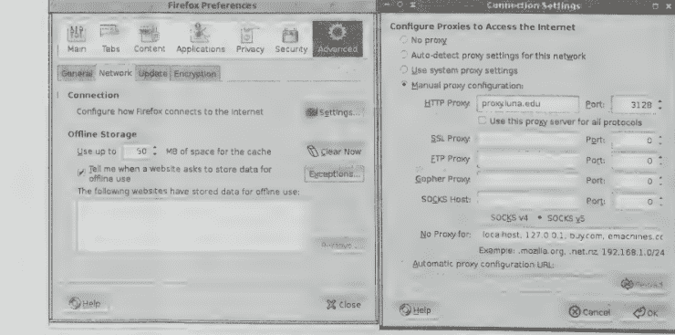

如果你配置 Squid 需要身份验证，在配置浏览器使用 Squid 后，下次尝试访问互联网将产生一个身份验证对话框，如图 9.3 所示（显示的是 Konqueror 生成的对话框）。当你输入用户名和密码后，就可以正常地浏览互联网，直到密码过期（通过 `auth_param` 设置的 `credentialssttl` 选项决定）。

**图 9.3** 当 Squid 配置为需要身份验证时，会导致浏览器显示身份验证对话框

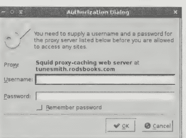

使用代理服务器的另一种方法是在网络网关上使用 iptables 防墙配置，将所有传出的 Web 流量重定向到代理服务器。（第 7 章介绍了 iptables。）这种配置避免了单独配置每个客户端的需要；然而这也意味着如果代理服务器损坏了数据，你的用户将无计可施。这种机制也可能无法进行身份验证。如果你尝试此类配置，请确保从规则中排除代理服务器计算机，否则会产生无限循环，导致代理服务器的流量被重定向到自身！

## 理解电子邮件

如今的电子邮件投递由一种名为简单邮件传输协议（SMTP）的协议主导。该协议是推协议的一种示例，意味着发送系统发起传输。用户使用邮件阅读器编写消息，并告诉邮件阅读器发送邮件。邮件阅读器联系本地 SMTP 服务器，该服务器可能运行在同一台或另一台计算机上。SMTP 服务器接收投递的消息，查找收件人地址，并将消息投递给收件系统。在某些情况下，收件系统可能会将邮件转发到另一个处理收件人邮箱的系统。取决于收件人阅读邮件的方式，这个人可能直接使用目标邮件服务器计算机，或在另一台计算机上运行邮件客户端。在后的情况下，邮件客户端使用如邮局协议（POP）或互联网消息访问协议（IMAP）之类的协议从本地邮件服务器检索邮件。POP 和 IMAP 都是拉协议的示例，其中收件人而非发送者发起数据传输。

图 9.1 概述了这种配置。不过，互联网邮件系统足够灵活，发送者和收件人之间的链路总数可能多于或少于图 9.4 所示的数量。

**图 9.4** 电子邮件通常在发送者和收件人之间经过多个链路


尽管 POP 和 IMAP 通常作为邮件投递链中的最后一个链路（如图 9.4 所示），但这并不如此。Fetchmail 程序（http://fetchmail.berlio.de）作为 POP 或 IMAP 客户端运行，并将检索到的消息注入链中的本地队列。如果你依赖外部 ISP 来管理你的互联网域名（包括其互联网访问的电子邮件地址），但想运行自己的邮件系统（可能甚至包括内部的自己的 POP 或 IMAP），那么 Fetchmail 就非常方便。

图 9.4 中的三台计算机——mail.example.com、smtp.pangaea.edu 和 inbox.pangaea.edu——必须运行 SMTP 服务器。这些服务器可以是运行在不同平台上的完全产品。除了运行 SMTP 服务器外，图 9.4 中的 inbox.pangaea.edu 必须运行 POP 或 IMAP 服务器。两个端点计算机——client.example.com 和 franklin.pangaea.edu 不需要运行邮件服务器。相反，client.example.com 连接到 mail.example.com 上的 SMTP 服务器发送邮件，franklin.pangaea.edu 连接到 inbox.pangaea.edu 上的 POP 或 IMAP 服务器检索邮件。

## 配置推送服务器

SMTP 在投递链中的重要性意味着绝大多数邮件服务器都会运行 SMTP 服务器（也称为邮件传输代理， MTA）。在开始安装软件之前，你必须理解电子邮件地址和域名问题。有了这项任务，你必须决定运行哪种邮件服务器程序，因为 Linux 有多种选择。本章介绍了两个 SMTP 服务器，sendmail 和 Postfix，细节足以让你进行基础邮件服务器配置。

邮件服务器非常复杂，甚至有专门关于它们的书籍。如果你需要进行超出基础邮件服务器配置的操作，应该参考 Costales, Assmann, Jansen’s sendmail, 4th Edition (O’Reilly, 2007) 或 Dent’s Postfix: The Definitive Guide (O’Reilly, 2003)。

## 配置域名接收邮件

互联网电子邮件地址有两种：

- username@host.name，其中 username 是收件人用户名，host.name 是计算机的主机名。（地址也可以用方括号括起的 IP 地址代替主机名。）例如，邮件可能是发送给 ben@smtp.pangaea.edu。只要目标计算机配置为接受发送给它的邮件，这种地址形式就有可能有效。

- username@domain.name，其中 username 是收件人用户名，domain.name 是域名。例如，邮件可能是发送给 ben@pangea.edu。这种地址通常比邮件服务器的全名要短，而且取决于域名配置，它更可靠。

为了让第二种地址工作，域名需要特殊的域名命名系统（DNS）条目。该条目被称为邮件交换器（MX）记录，它将发送邮件指向特定的邮件服务器计算机。例如，pangea.edu 的 MX 记录可能指向 smtp.pangaea.edu。因此，发送给 ben@pangea.edu 的邮件将被投递到 smtp.pangaea.edu 服务器。

第 6 章，“DNS 服务器配置”描述了如何配置伯利互联网域名系统（BIND）DNS 服务器。简之，MX 记录属于域名的控制文件，该文件通常位于 `/var/named` 且通常以域名命名，例如对于 pangea.edu 名为 named pangea.edu（尽管具体名称是任意的）。MX 记录

# 第 9 章 • 配置 Web 和电子邮件服务器

对于 pangaea 而言，将外部 SMTP 服务器指向 smtp.pangaea.edu 进行邮件投递，其格式如下：

```
@ IN MX 5 smtp.pangaea.edu.
```

如果由另一位系统管理员运行你的域名 DNS 服务器，请向该人员咨询 MX 记录的管理事项。如果你使用外部提供商（例如域名注册商的 DNS 服务器），你可能需要在基于 Web 的表单中输入 MX 记录信息。这些表单可能会尝试镜像你在上述描述的 DNS 服务器配置中找到的信息布局，但可能不允许你更改固定信息。或者，表单也可能提供简化的数据输入字段，例如仅提供服务器优先级代码和主机名。

一个域名的计算机可以作为完全不同一个域的邮件服务器运行。例如，mail.example.com 可以作为 pangaea.edu 的邮件服务器。这种配置需要设置服务器以接收发送给目标域名的邮件，并且当然，要在目标域名的 MX 记录中输入邮件服务器的完整路径。

## 选择电子邮件服务器

Linux 上可以运行各种类型的 SMTP 服务器。最流行的 Linux 邮件服务器都是非常强大的程序，当配合足够强大的硬件时，它们能够处理大型域的需求。最流行的服务器有：

- **Sendmail**：该服务器总部位于 http://www.sendmail.org，长期以来主导着互联网邮件投递。虽然不再像以前那样占据主导地位，但调查显示 sendmail 仍然是最流行的开源邮件服务器。遗憾的是，sendmail 也因其配置格式难以掌握而闻名。通常，使用工具从简单文件创建配置文件的做法非常常见。

- **Postfix**：该服务器在人气上与 sendmail 相当。Postfix 使用系列的小型程序来处理邮件投递，而不是像 sendmail 那样使用单体方法。其结果是速度更快，而且至少在理论上，出现严重安全漏洞的概率较低（在实践中，Postfix 有良好的安全记录）。它的配置比 sendmail 容易处理得多。你可以在 http://www.postfix.org 了解更多信息。

- **Exim**：在 http://www.exim.org 描述的邮件服务器没有 sendmail 或 Postfix 流行，但它仍然是一个流行的 Linux 邮件服务器。与 sendmail 类似，Exim 使用单体设计，但 Exim 的配置文件要易读得多。该服务器包含了广泛的模式匹配工具，在反垃圾邮件方面非常有用。

- **qmail**：根据调查，其人气大致与 Exim 相当或略低。大多数发行版不附带 qmail，因为它的许可条款很特殊——除非满足限制条件，否则不发行二进制文件。与 Postfix 类似，qmail 使用强调速度和安全的模块化设计。查看 http://www.qmail.org 以获取更多信息。

## 配置推送邮件服务器

对于轻量任务——例如，对于小型企业或个人邮件服务器——这些程序中的任何一个运行得很好。对于此类情况，我建议坚持使用你发行版中标准的软件。对于较大的安装量，或者如果你需要高级功能，你可能希望仔细研究你发行版默认服务器的替代方案。你可能会发现某些特定功能，例如 Exim 的模式匹配工具或 Postfix 和邮件系统的现代设计。所有这些服务器都能够处理大型或繁忙的域，尽管 sendmail 可能比其他服务器需要更高的硬件来处理特定数量的邮件。对于小型站点，即使是 sendmail 也不会给最微弱的电流带来压力。

以下章节将更详细介绍 sendmail 和 Postfix 的配置。我没有包含 Exim 和 qmail 的章节，因为它们不太流行，且未包含在 LPI 目标（除了简要提到 Exim 之外），但如果你想更改邮件服务器，它们确实值得考虑。

## 运行 Sendmail

大多数 Linux 发行版都提供 sendmail 包，尽管许多版本安装 Postfix 或 Exim 作为默认邮件服务器。如果你想在通常使用其他邮件服务器的发行版上运行 sendmail，必须替换标准的邮件服务器并安装 sendmail。遗憾的是，配置文件的位置和名称在不同发行版之间有所，因此你必须知道在哪里找到这些文件。一旦找到，你可以更改许多 sendmail 选项，例如地址和中继选项。

> 许多程序依赖于一个名为 sendmail 的可执行文件。由于这个原因，除了 sendmail 以外的邮件服务器通常包含一个名为 sendmail 的可执行文件，这通常是该邮件服务器等效程序的链接。

## Sendmail 配置文件

主 sendmail 配置文件称为 `sendmail.cf`，它通常位于 `/etc/mail`。遗憾的是，这个文件非常长且难以理解。你不应该尝试直接编辑此文件；相反，你应该编辑一个可以使用 sendmail.cf 文件生成的配置文件。该源文件使用 m4 宏处理语言编写，它比原始的 sendmail 配置格式更易读。要编辑并编译用于 sendmail 的 m4 配置文件，你可能需要安装额外的包：

### m4 宏语言

你必须安装 m4 宏语言。该软件通常包含在一个名为 `m4` 的包中。寻找一个名为 `m4` 的程序文件（通常存储在 `/usr/bin` 中）以确定你的系统是否已经安装。如果没有，请查找并安装与你的 Linux 发行版附带的包。

## Sendmail m4 配置文件

你需要一组用于 sendmail 的 m4 配置文件来修改你的配置。这些文件通常从 sendmail-cf 安装。大多数发行版附带默认的 m4 文件，可以使用它们来重建标准的 sendmail.cf 文件。（如果你重建了默认文件，某些注释会有不同，但功能上是相同的。）默认文件的名称各异，但可能被称为 `sendmail.mc`、`linux.mc` 或其他。它可能位于 `/etc/mailusr/share/cf`。对于 Red Hat，默认文件是 `/etc/mail/sendmail.mc`。

要对配置进行更改，请遵循以下步骤：

1. 备份你的默认 `/etc/mail/sendmail.cf` 文件。

2. 进入 m4 文件所在的目录。

3. 将原始文件复制为新名称；例如，你可以将其命名 `myconfig.mc`。

4. 按照后续章节描述编辑配置文件。

5. 输入以下命令创建新的 `/etc/mail/sendmail.cf` 文件：

```
# m4 <myconfig.mc > /etc/mail/sendmail.cf
```

如果顺利，`m4` 命令不会在命令行 shell 中显示任何消息，如果你检查会发现 `/etc/mail/sendmail.cf` 文件是新的。然后你可以告诉 sendmail 重新加载配置：

```
# killall -HUP sendmail
```

此命令告诉所有 sendmail 实例重新读取配置文件并实施任何更改。你可以以任何方式测试这些更改——通过发送或接收邮件并检查设置是否生效。

除了 `sendmail.cf` 文件外，其他几个文件对 sendmail 的配置也很重要。这些文件中的大多数位于 `/etc/mail`，但某些可能位于 `/etc`。其中最重要的两个文件是：

- **access.db**：该文件通常位于 `/etc/mail`，控制对 sendmail 服务器的访问。通过以特定方式在该文件中列表或不列出特定系统，你可以调整 sendmail 用于中继邮件到其他系统的设置。该文件是使用 `maked` 程序从文本访问文件生成的二进制数据库。

- **aliases.db**：与 `access.db` 类似，该文件是 `newaliases` 程序从纯文本文件（`aliases`）生成的二进制数据库文件。根据你的发行版，此文件出现在 `/etc` 或 `/etc/mail` 中。该文件列出了特定用户名或地址的别名。例如，如果你设置了一个将 postmaster 链接到 root 的别名，所有发送给 postmaster 的邮件都将投递到 root。别名将在后文“设置别名和转发”中有更详细的描述。

# 在 Sendmail 中配置主机名

电子邮件中嵌入了名称。这些名称标识计算机，因此从理论上说，它们应该与计算机的主机名（hostname）相同。有时标头中的名称可能需要更改。例如，你可能希望发出的邮件与你的域名相关，而不是邮件服务器的名称。通过这种方式配置邮件服务器可以避免以后出现问题——例如，如果你更改了邮件服务器系统。如果你的出站邮件使用了邮件服务器的真实主机名，那么对旧消息的回复可能会继续发送到该系统，从而导致退回（bounce）。要设置邮件中 `From:` 标头中使用的名称，你应该在 `m4` 文件中添加如下行，并重新构建你的主配置文件：

```
MASQUERADE_AS(`target-address`)
FEATURE(masquerade_envelope)
```

> `MASQUERADE_AS` 行包含了两种类型的单引号字符。第一个字符是反引号（back-tick），在大多数键盘上位于数字 `1` 左侧的键位上。结束引号是一个普通的单引号字符，在大多数键盘上位于 `Enter` 键的左侧。如果你使用了错误的字符，这些行将无法工作。


当然，你应该将这些行第一个示例中的 `target-address` 更改你想使用的地址，例如 `pangaea.edu`。`MASQUERADE_AS` 行仅更改 `From:` 邮件标头行中定义的地址。只有当邮件读取器没有指定不同地址时，它才会更改此配置。许多客户端允许用户设置任意的回信地址，而这些值会覆盖你在 `sendmail` 中设置的任何内容。`FEATURE(masquerade_envelope)` 更进一步；它会覆盖用户在他们的邮件客户端中输入的设置。如果你想限制用户在邮件读取器中设置虚假地址的能力，可以使用此选项。

# 配置 Sendmail 接收传入邮件

要接收传入的邮件，必须配置 `sendmail` 以接受传入的网络连接。许多发行版带的配置会阻止来自本地计算机以外的所有连接。此配置适用于可能需要发送出站邮件或在本地用户之间发送邮件，但不应接收来自外部系统邮件的工作站。如果你想从其他计算机接收邮件，必须修改此配置。为此，请编辑 `m4` 配置文件（例如 `/etc/mail/sendmail.mc`）。查找以下行：

```
DAEMON_OPTIONS(`Port=smtp,Addr=127.0.0.1,Name=MTA`)'dnl
```

通过在行开头添加字符串 `dnl` 和一个空格来注释掉此行。（与大多数配置文件不同，`sendmail m4` 文件使用 `dnl` 作为注释指示符）。然后你可以创建一个新的 `sendmail.cf` 文件。通过输入 `killall -HUP sendmail` 或向服务器的 SysV 启动脚本传递 `restart` 来重启服务器，服务器应该接受来自远程系统的连接。

# 第 9 章 • 配置 Web 和电子邮件服务器

接受远程连接的另一个方面是告诉 `sendmail` 哪些主机名是本地的。例如，考虑图 9.4。如果 `smtp.pangaea.edu` 是 `pangaea.edu` 域名 MX 记录指向的计算机，那么 `smtp.pangaea.edu` 必须知道接受发送给 `user@pangaea.edu` 的邮件。通常，`sendmail` 会拒绝发送至计算机自身主机名以外的任何消息。你可以通过向特殊的配置文件为邮件服务器本身添加任何别名（aliases）来更改此行为。该文件名为 `/etc/mail/local-host-names`，在某些发行版的 `sendmail` 配置中默认启用的。在其他发行版中，你必须先向 `sendmail m4` 配置文件添加一行并创建一个新的 `sendmail.cf` 文件，正如之前在“使用 Sendmail 配置文件”中所描述的。你需要添加的行是：

```
FEATURE(use_cw_file)
```

确保此行出现在默认文件底部两个 `MAILER` 行之前。在你重建了 `sendmail.cf` 文件后，创建或编辑 `/etc/mail/local-host-names` 并添加你想让 `sendmail` 识别为本地的名称。例如，你可能会添加如下行：

```
pangaea.edu
mail.pangaea.edu
```

# 设置 Sendmail 中继配置选项

邮件服务器通常被设置为中继（relays）。在这种配置中，服务器接受来自一个系统的邮件并将其传递给另一个。另一种中继配置是部门邮件服务器，它接受许多客户端的邮件并将邮件传递给目标系统。例如，图 9.4 中的 `mail1.example.com` 必须这样配置。另一种中继配置涉及告诉 `sendmail` 使用另一个系统作为中继。例如，如果图 9.4 中的 `client.example.com` 是一个 Linux 系统，你可以配置它使用 `mail1.example.com` 作为出站中继。使用出站中继允许你将中继计算机作为邮件的控制点。在某些情况下，你可能会这样配置系统。例如，你的局域网（LAN）或 ISP 可能被配置为阻止除授权邮件服务器以外的出站 SMTP 连接。

# 配置 Sendmail 中继邮件

`sendmail` 许多中继选项。最常见的配置涉及一个功能，可以在 `sendmail m4` 文件中使用如下行进行定义：

```
FEATURE(`access_db`)
```

某些 `sendmail` 配置在此定义中添加额外选项。某些发行版的标准配置没有定义此选项；因此，如果你想使用它，必须将其添加到 `m4` 配置文件中并重建 `sendmail.cf` 文件，正如之前在“使用 Sendmail 配置文件”中描述的。一旦存在，你就可以编辑 `/etc/mail/access` 文件。一个典型的文件可能类似于 9.1 所示，但最后条目除外：

## 列表 9.1: 用于控制中继的典型文件

```
# 允许本地中继
localhost.localdomain RELAY
localhost RELAY
127.0.0.1 RELAY
# 网络中继
172.25.98 RELAY
```

9.1 首先首先允许本地计算机中继，使用了三种方法识别它：通过 IP 地址（`127.0.0.1`）。如果你激活了 `db` 功能，你的 `/etc/mail/access` 文件必须包含这些条目（某些程序调用 sendmail 的方式不需要，但其他程序使用回环接口 localhost）。为了中继更多系统，你必须将它们添加到列表中，如9.1 所示。该示例中继了 `172.25.98.0/24` 网络。如果你愿意，可以使用域名或主机名指定计算机，使用 IP 地址确保攻击者无法通过破坏 DNS 服务器来滥用你的中继能力。

由于本节关于中继，9.1 中的所有示例都指定了 `RELAY` 选项。不过，你可以提供其他单词来实现不同的效果：

- `OK` 你可以告诉 `sendmail` 如果另一条规则会导致邮件被拒绝，则接受其投递。例如，你可以使用 OK 覆盖对特定节点的拦截。
- `RELAY` 此选项启用中继。此选项是双向的。例如，9.1 允许系统向 `172.25.98.0/24` 网络中的服务器中继邮件。
- `REJECT` 此选项阻止发送至指定主机名或网络的邮件。当尝试发送或从禁止系统发送时，Sendmail 会生成回复。例如，你可以用它来阻止已知的垃圾域名。
- `DISCARD` 此选项的作用与 `REJECT` 相似，但 `sendmail` 不生成回复邮件。
- `ERROR:nnn text` 此选项也与 `REJECT` 相似，但它不是生成标准的回复，而是回复你定义的错误代码（`nnn`）和消息（`text`）

在修改 `/etc/mail/access` 文件后，你必须从文本文件创建一个二进制数据库文件。为此，请使用 `mapcommand`：

```
# makedhash /etc/mail/access.db < /etc/mail/access
```

某些配置在它们的 `sendmail` SysV 启动脚本中包含了此命令，如果你使用这些脚本重启服务器，则可以跳过此步。完成后，重启 `sendmail` 并测试新的中继配置。

## 第 9 章 配置 Web 服务器和电子邮件服务器

除了 `access_db` 功能外，`sendmail` 还支持多种额外的中继选项。这些选项大部分在名称中包含 `relay`（中继）一词，例如 `relay_entire_domain` 或 `relay_local_from`。这些选项中的大部分都实现了可以通过 `/etc/mail/access` 文件进行配置的中继规则，尽管通常你可能并不需要它们。

> 你应该避免的一个中继选项是 `promiscuous_relay`。该选项配置系统从任何主机中继到任何服务器。这种配置是危险的，因为垃圾邮件发送者可以很容易滥用它。事实上，在配置中继时应谨慎，以防止你的系统从任何不可信的源中继。

## 配置 Sendmail 使用中继

如果你的服务器必须通过另一台计算机中继邮件，你可以配置 `sendmail` 来适应这一点。为此，请将以下行添加到 `sendmail m4` 文件中并重新编译 `sendmail.cf` 文件：

```
FEATURE(`nullclient`, `relay.mail.server`)
```

修改 `m4` 配置文件的步骤已在前文“使用 Sendmail 配置文件”中描述过。将 `relay.mail.server` 替换为将作为中继的邮件服务器的主机，例如你部门或 ISP 的邮件服务器。你可能还需要删除几行，或者通过在行前加上以下符号将其注释掉：

```
MAILER(local)dn
MAILER(smtp)dn
```

这些行重复了中继配置中包含的功能，将它们与中继配置一起包含可能会在你尝试构建新的 `sendmail.cf` 文件时导致 `m4` 报错。不过，并不是所有的配置都在默认文件使用这些行。

# Postfix

与 `sendmail` 相比，`Postfix` 配置更加简单。`Postfix` 使用主配置文件 `/etc/postfix/main.cf`，它具有相对直接的正向语法。该文件的默认版本通常有详细的注释，因此你可以通过阅读它学习很多关于配置的知识。`Postfix` 配置的一个问题是它高度依赖变量，例如 `myhostname`。一个变量可能设置为另一个变量，而后者又被用于设置另一个变量，以此此类推。因此，你可能需要回溯几层变量赋值，以了解某个重要变量是如何设置的。在访问 `Postfix` 变量名时，前面有一个美元符号 (`$`)，但在为其赋值时则没有。与 `sendmail` 一样，即使在相当简单的配置中，某些默认设置也可能需要更改。

## 在 Postfix 中配置主机名

几个 `Postfix` 参数影响 `Postfix` 服务器计算机的名称或出现在邮件头中的主机名。这些选项中最常见的总结在表 9.4 所示。在简单配置中，你不需要调整任何内容；`Postfix` 会自动获取其主机名并在此基础上构建一切。如果有必要，你可以覆盖配置——例如，如果你的计算机有多个主机名，而你想使用 `Postfix` 未在服务器上自动检测到的那个，或者获取你的域名需要来自主机名中的多个部分。`masquerade_domains` 选项需要特殊说明：此选项仅当主机名组件与简化后的名称匹配时才会删除主机名组件。例如，考虑你设置了 `masquerade_domains = rex.pangea.edu` 的情况。如果服务器被告知使用地址 `sue@pangaea.edu` 发送邮件，它将把该地址简化为 `sue@pangaea.edu`。如果系统被告知使用地址 `sue@example.com` 发送邮件，它将不会更改该地址。

### 表 9.4 Postfix 主机名选项

| 选项 | 默认值 | 含义 |
| --- | --- | --- |
| `myhostname` | 由 `hostname` 命令返回的计算机主机名 | 计算机的主机名；在后续选项中作为默认值。必须是完全限定（即同时包含主机名和域名）。 |
| `mydomain` | 去掉首个组件的 `$hostname` | 计算机的域名；在许多后续选项中作为默认值。 |
| `myorigin` | `$hostname` | 如果邮件客户端省略了主机名，则附加到发送邮件中的主机名。 |
| `masquerade_domains` | 无 | 地址应该简化的域名。按照列表从左到右尝试域名，直到找到第一个匹配项。 |
| `masquerade_classes` | `envelope_sender, header_sender` | 受 `masquerade_domains` 影响的地址类型。可能有 `envelope_sender`、`envelope_recipient`、`header_sender` 和 `header_recipient`。如果使用了所有四个选项，则向指定域名中的单个机器发送邮件将变得不可能。 |
| `masquerade_exceptions` | 无 | 不应进行伪装的用户名。例如，如果你将此值设置为 `root`，则 `root` 的邮件头将不会被更改。 |
| `sender_canonical_maps` | 无 | 使用灵活的查找数据库更改发送者地址。 |

## 第 9 章 配置 Web 服务器和电子邮件服务器

地址重映射的终极形式通过 `sender_canonical_maps` 选项实现。使用以下内容对此指向一个文件：

```
sender_canonical_maps = hash:/etc/postfix/sender_canonical
```

你可以在 `/etc/postfix/sender_canonical` 文件中指定想要更改的主机名。例如，要将 `localhost` 和拼写错误的 `pangea.edu` 更改为发送地址，使用以下两行：

```
@pangea.edu
@localhost @pangea.edu
```

你还可以包含用户名，仅对特定用户的邮件进行更改。创建此文件并在 `/etc/postfix/main.cf` 中引用它后，你必须转换该文件。

## 接收传入邮件

通常，`Postfix` 接受来自 `$hostname, localhost` 的本地邮件。如果计算机应该为其他计算机中继邮件，你必须扩展、删除它或依赖 `mynetworks_style` 设置。此外，`relay_domains` 默认意味着服务器将中继 `mydestination` 选项指定的任何计算机或指定域名内的邮件。例如，如果你有一个包含 `pangea.edu` 的 `mydestination` 指定，`Postfix` 将中继来自 `pangea.edu` 的任何计算机。

## Postfix 中继选项

自然，你可以以多种方式配置 `Postfix`。大多数发行版附带了相当严格的配置，防止服务器中继任何内容。你应该检查此配置以确定是如何设置的。如果你需要使用外部中继，你必须调整它。

## 配置 Postfix 中继邮件

几个选项影响 `Postfix` 如何处理中继尝试。表 9.5 总结了这些选项。`Postfix` 的中继配置建立在信任的基础上；因此，定义中继授权变成了定义哪些系统的问题。

### 表 9.5 常见 postfix 选项

| 选项 | 默认值 | 含义 |
| --- | --- | --- |
| `mynetworks_style` | `subnet` | `Postfix` 信任的网络类型。`subnet`（默认）意味着与服务器相同的 IP 地址子网，`class` 意味着与服务器相同的 IP 类，`none` 仅信任服务器本身。 |
| `mynetworks` | 由 `$mynetworks` 指定的网络列表 | 受信任的网络列表。网络可以以 IP 地址/网络掩码对的形式指定，你也可以提供一个存储这些信息的文件。 |
| `relay_domains` | `$mydestination` | 明确列出的机器和域名 |

作为反垃圾邮件措施，你可能想限制 `Postfix` 的功能。如果你将 `mydestination` 设置为包含一个对于的域名，这可能尤为重要

服务器不应作为中继，除非该域名的系统已经通过 `mynetworks` 或 `mynnetworks_style` 选项中的 IP 地址覆盖。为了实现这一点，你可以提供一个限制性的 `relay_domains` 配置，例如下：

```
relay_domains = $hostname, localhost, localhost.localdomain
```

如果你在工作站上运行 `Postfix`，你可能希望防止服务器为工作站本身以外的任何地方中继邮件。（此配置既接受从本地计算机到任何地方的邮件，也接受从任何地方到本地计算机的邮件。）对于此配置，你必须将正确的 `relay_domains` 限制与严格的 `mynetworks_style` 定义结合起来：

```
mynetworks_style = host
```

如果 `Postfix` 运行在较大的服务器上，并且你希望扩展它中继邮件的计算机范围，最简单的方法是创建一个扩展的 `relay_domains` 定义。例如，要为默认系统以及 `example.org` 的系统中继邮件，可以使用以下行：

```
relay_domains = $mydestination, example.org
```

# 配置 Postfix 使用中继

如果你在工作站或其他应通过另一个邮件服务器中继邮件的系统上配置 `Postfix`，配置将非常简单。通常，你需要将 `relayhost` 选项设置为你应使用的邮件服务器名称。例如，要将系统设置为使用 `mail.example.com` 作为邮件中继，你应该使用以下行：

```
relayhost = mail.example.com
```

或者，如果你想使用域 MX 记录所指向的计算机，可以提供域名名而不是主机名。`Postfix` 随后会进行 MX 查询并将邮件发送到该域的邮件服务器。如果邮件服务器的名称可能会更改，这种配置可能更优；当名称发生变化时，你不需要调整 `Postfix` 配置。

# 管理电子邮件

一旦设置好邮件服务器，你可能可能想对其进行测试并监控其活动。因此，我将描述一些涉及测试 SMTP 服务器、管理邮件队列、配置别名和转发邮件的管理任务。

# 测试 SMTP 服务器

你可以使用 `telnet` 程序对 SMTP 服务器进行低级测试。要做到这一点，你需要访问邮件服务器并执行发送邮件涉及的 SMTP 命令。这些命令包括 `HELO`（识别发送端计算机）、`MAIL FROM`（识别发送用户）、`RCPT TO`（识别收件者）、`DATA`（开始消息文本）和 `QUIT`（终止会话）。示例如下：

```
$ telnet localhost 25
Trying 127.0.0.1...
Connected to localhost.
Escape character is '^'
220 mail.example.com ESMTP Postfix
HELO localhost
250 example.com
MAIL FROM:<benf@example.com>
250 2.1.0 Ok
RCPT TO:<janet@luna.edu>
250 2.1.5 Ok
DATA
354 End data with <CR><LF>.<CR><LF>

This is a test message.
250 2.0.0 Ok: queued as C5E9DD9761

QUIT
221 2.0.0 Bye
Connection closed by foreign host.
```


这些命令大部分都包含选项，例如电子邮件地址。服务器会对大多数成功的命令用代码 `250` 响应。此代码和其他代码可以可选地包含解释性文本。当你开始输入实际的消息正文时，你可以输入一行或多行文本，并以一个包含单个句号（`.`）的单行结束。

你可能想从邮件服务器本身（如示例所示）、从它应该中继的系统以及从它不应中继的系统进行测试。还应尝试向本地计算机及其他地方收件人发送电子邮件。测试这些可能性将有助于确保服务器配置正确。

# 检查邮件队列

邮件服务器管理着必须交付的邮件队列。此任务听起来可能简单，但可能异常地复杂。服务器可能被要求在短时间内交付许多消息，因此可能在处理其他消息时延迟某些消息的交付。此外，问题可能导致临时或永久无法交付消息。当问题看起来是暂时的（例如网络路由失败），邮件服务器必须存储消息并在稍后重试。因此，Linux 计算机的邮件队列可能包含未送出的消息。了解如何识别这些消息并管理队列可以帮助你的 Linux 计算机邮件系统顺利运行。

`mailq` 程序是帮助管理队列的主要工具。该程序最初是 `sendmail` 包的一部分，Postfix、Exim、qmail 以及其他 Linux SMTP 服务器都实现了兼容的命令。遗憾的是，实现之间的命令选项有所不同。不带任何选项的基本命令显示所有系统上的队列内容：

```
$ mailq
--Queue ID---- --Arrival Time---- -Sender/Recipient-----
54B2F963F* 440 Tue Aug 23 13:58:19 sally@example.com
benf@luna.com

- 0 bytes in 1 Request.
```

此示例来自运行 Postfix 的系统，显示了队列中的一条消息以及相关信息。确切的显示格式取决于不同的 SMTP 服务器。在大多数情况下，输入 `mailq` 等同于输入 `sendmail -bp`。如果发生网络故障，邮件可能会堆积在队列中。你的 SMTP 服务器通常会在稍后尝试重发，但如果你的网络连接已恢复且你想立即清除队列，可以这样做。

# 设置别名与转发

邮件别名允许一个地址代表另一个地址。例如，所有邮件服务器都应该维护名为 `postmaster` 的账户。实现此点的方法是编辑 `aliases` 文件，它通常位于 `/etc`，有时位于 `/etc/mail`。

`aliases` 格式非常简单。注释行以井号（`#`）开头，其他行采用如下格式：

```
name: address
```

上面的示例将 `root` 重定向到 `username`。某些邮件服务器（包括 `send` 和 `qmail`）要求你编译 `/etc/aliases` 为二进制文件以便更快处理。使用 `newaliases` 命令。

另一种重定向邮件的方法是在用户级别进行。具体来说，你可以编辑用户家目录下的 `.forward` 文件将该用户的邮件发送到另一个地址。这种方法的优点是用户可以使用。缺点是无法为不存在的账户或缺少家目录的账户设置别名。`.forward` 文件也可以由所有者更改或删除，如果你想实施用户无法更改的转发规则，这可能不理想。

# 日志文件

与大多数服务器一样，邮件服务器会将活动记录在 `/var/log` 目录的文件中。取决于发行版、邮件服务器以及你对邮件服务器或系统日志器所做的更改，你会发现以 `mail` 开头的文件，例如 `/var/log/mail.log` 和 `/var/log/mail.err`。在其他系统上，邮件日志存储在通用日志文件中例如 `/var/log/messages` 或 `/var/log/syslog`。

使用 `grep` 在 `/var/log` 中的所有文件中搜索你的邮件服务器名称，以便定位系统记录日志相关消息的地方。

单封邮件交付可能会在你的日志文件中生成多条条目，在此示例中，来自运行 Postfix 的计算机：


```
/var/log/messages:Nov 24 07:07:00 nessus postfix/smtpd[8785]: connect from ← localhost[127.0.0.1]
/var/log/messages:Nov 24 07:07:00 nessus postfix/smtpd[8785]: 11E92F81C8: ← client=localhost[127.0.0.1]
```

```
/var/log/messages:Nov 24 07:07:04 ness postfix/cleanup[8788]: 11E92F81C8:
message-id=<LYKRIS-290413-547281-2010.11.23-22.30.28---
fexample@innewsletters.com>
/var/log/messages:Nov 24 07:07:04 ness postfix/qmgr[8663]: 11E92F81C8:
from=<bounce-5439281-290413@innewsletters.com>, size=91562, nrcpt=1-
```
/var/log/messages:Nov 24 07:07:04 ness postfix/local[8789]: 11E92F81C8:
to=<benf@localhost>, relay=local, delay=0.076, delay=0.056/0/0.2, dsn=2.0.0,
status=sent (delivered to command: /usr/bin/procmail)
```
/var/log/messages:Nov 24 07:07:04 ness postfix/qmgr[8663]: 11E92F81C8:
removed
```

每一行都包含关于邮件投递过程中特定阶段的信息。如果发生错误，消息可能会提供问题所在的线索——例如，可能会提到 DNS 失败或远程服务器未响应。

## 配置 Procmail

原则上讲，像 sendmail 或 Postfix 这样的邮件服务器会将入站邮件直接存储在邮件邮箱池（mail spool）中，这是一个存储电子邮件的文件或目录。但在实践中，许多系统使用一个额外的工具 Procmail 来完成这项工作。这是因为 Procmail 可以使用复杂的规则进行配置，以调整邮件的投递方式。你可以使用 Procmail 过滤垃圾邮件、重定向邮件、复制邮件等等。

## 了解邮件存储格式

从用户的角度来看，邮件消息可能组织在邮件文件夹中。即使用户不使用邮件文件夹，其收到的邮件也必须以某种格式存储。大多数主流 Linux 邮件服务器（sendmail、Postfix 和 Exim）使用一种名为 mbox 的格式，其中邮件文件夹中的消息存储在单个文件中。通常，SMTP 服务器或其辅助程序会将用户文件存储在 `/var/spool/mail/username` 中。当用户在使用使用 mbox 格式的软件使用文件夹时，每个文件夹由一个单文件组成。

qmail 服务器以另一种格式存储其入站邮件：maildir。maildir 为每个邮件文件夹分配一个目录，并将每条消息放在自己的文件中。通常，入站 maildir 存储在用户的家目录下。尽管 qmail 默认使用该格式，但它可以被配置为使用 mbox 格式。同样，Postfix 和 Exim 都可以配置为使用 maildir。

邮件格式的选择会对其他软件产生影响，用户的用户的读取器（也称为邮件用户代理或 MIA）、POP 或 IMAP 服务器以及 Procmail。

许多程序同时支持 mbox 和 maildir 格式，但某些只支持其中一种。正如稍后描述的，Procmail 规则可能需要根据邮件格式进行调整。

> maildir 格式通常被认为比 mbox 速度更快，特别是当邮件文件夹包含数百条消息时。如果你使用 IMAP 而不是 POP，并且你的用户在他们由 IMAP 调的邮件文件夹中收集了大量邮件，那么这可能更为重要。

## 编写 Procmail 规则

大多数 Linux 邮件服务器默认使用 Procmail，或者可以通过设置配置选项来配置使用它。如果你遵循了接下来几段中概述的说明并发现 Procmail 无法工作，你可以在家目录下创建一个 `.forward` 文件，其内容包含以下行：

- `/path/to/procmail*`

将 `/path/to` 替换为 procmail 二进制文件所在的目录的名称。如果即使这也不起作用，你可能需要查阅 Procmail 或你的邮件服务器的文档。一旦 Procmail 进入系统，它会读取全局的 `/etc/procmailrc` 配置文件以及用户家目录下的 `.procmailrc` 文件。这些文件包含 Procmail 配方（recipes），其格式如下：

```
:0 [:flags] [:lockfile]]
action
```

系统级的 `/etc/procmailrc` 文件通常以 root 身份读取并处理。这一事实意味着该文件中设计不当的配方可能会造成损害。例如，一个拼写错误可能会导致 Procmail 覆盖一个重要的系统二进制文件，而不是让该二进制文件处理消息。出于此原因，你应该将系统级的 Procmail 处理保持在最低，并坚持使用 `~/.procmailrc` 来处理个人账户的邮件。

每个配方都以字符串 `:0` 开头。后面可以跟各种标志，如表 9.6 所示。你可以组合这些标志以产生更复杂的效果。例如，使用 `HB` 标志可以对邮件头和正文进行匹配。锁文件是 Procmail 用来指示它正在处理文件的文件名。如果 Procmail 看到锁文件，它会延迟对受影响文件的操作，直到锁文件消失。通常，一个冒号（`:`）就足够实现此功能；Procmail 会自行选取锁文件名称。不过，如果你愿意，也可以指定文件名。

### 表 9.6 常见的 Procmail 配方标志

| 标志 | 含义 |
| :--- | :--- |
| H | 在邮件头上进行匹配。（默认值） |
| B | 在正文中进行匹配。 |
| D | 区分大小写进行匹配。 |
| C | 不区分大小写进行匹配。 |
| W | 等待锁文件消失。 |

系统级的 `/etc/procmailrc` 文件通常以 root 身份读取并处理。这一事实意味着该文件中设计不当的配方可能会造成损害。例如，一个拼写错误可能会导致 Procmail 覆盖一个重要的系统二进制文件，而不是让该二进制文件处理消息。出于此原因，你应该将系统级的 Procmail 处理保持在最低，并坚持使用 `~/.procmailrc` 来处理个人账户的邮件。

每个配方都以字符串 `:0` 开头。后面可以跟各种标志，如表 9.6 所示。你可以组合这些标志以产生更复杂的效果。例如，使用 `HB` 标志可以对邮件头和正文进行匹配。锁文件是 Procmail 用来指示它正在处理文件的文件名。如果 Procmail 看到锁文件，它会延迟对受影响文件的操作，直到锁文件消失。通常，一个冒号（`:`）就足够实现此功能；Procmail 会自行选取锁文件名称。不过，如果你愿意，也可以指定文件名。

- **电子邮件地址**：行开头的感叹号（`!`）表示电子邮件地址；Procmail 将消息发送到指定的地址而不是在本地投递。

- **外部程序**：如果操作行以竖线（`|`）开头，Procmail 将该行视为要执行的程序。你可以使用此功能将处理传递给另一个工具。

- **嵌套块**：操作行以大括号（`{}`）开头表示嵌套配方。嵌套配方的格式与任何其他配方相同，但仅在外层配方匹配消息时才使用。

## 查看 Procmail 的运行情况

例如，考虑列表 9.2，它展示了 Procmail 的许多功能。这些特定的配方设计用于过滤垃圾邮件；然而，Procmail 还有许多用途。例如，你可以用它转发符合某些标准的邮件，将发送给一个人的邮件副本发送给另一个用户，或者通过一个程序来检测病毒和蠕虫。

# 第 9 章 • 配置 Web 和电子邮件服务器


列表 9.2 标识了嵌套块中的配方。这种做法提高了可读性，但并非必须。

列表 9.2 包含四个配方。其中三个嵌入在以下内容：

- 外部配方匹配任何不包含 `postmaster@pangaea.edu` 或 `postmaster@smtp.pangaea.edu` 字符串的 To: 头部。该配方使用大括号 `{` 字符，导致只有在邮件不是发送给 postmaster 时才应用包含的配方。此举目的是保护 postmaster 的邮件免受垃圾邮件规则的影响。毕竟，用户可能会将垃圾邮件转发到 postmaster 账户进行投诉，此类投诉不应被忽略。

- 某些垃圾邮件在 `Subject:` 头部中包含一个或多个连续的空格。第一个真正的垃圾邮件规则会丢弃此类消息。该规则匹配所有 `Subject:` 头部中有五个或更多空格的消息，但来自 fax.pangaea.edu 计算机传真子系统的消息除外，该系统可能生成非垃圾邮件的传真发送报告，否则会符合此标准。该规则通过将邮件发送到 `/dev/null` 来丢弃垃圾邮件。

- 第二个配方匹配所有包含字体颜色设置为 `ff0000`——即亮红色的 HTML 文本的消息。大量的垃圾邮件使用这种技术来吸引读者的注意力，但没有合法用户使用这种技术。此配方将垃圾邮件通过一个特殊程序 `/usr/local/bin/spam-block` ，该程序不是标准程序。我在列表 9.2 中使用它作为使用 Procmail 将消息通过外部程序传递的示例。

- 最终的垃圾邮件规则匹配那些在 `From:` 或 `CC:` 头部中不包含本地域名名 (`pangaea.edu`) 或特殊异常用户名 (`ben@example.com`) 的邮件。此类规则在捕获垃圾邮件方面非常有效，但在应用于整个系统时可能会很危险。问题是邮件列表、新闻简报可能不会在头部中包含收件人姓名，因此规则需要为每个电子邮件收件人接收的所有邮件列表和其他订阅进行定制。对大型站点执行此操作几乎是不可能的。此规则还将丢弃大多数使用邮件密抄 (BCC) 功能发送给收件人的邮件，这会导致收件人姓名不出现在任何头部中。它使用感叹号将垃圾邮件转发到 `sam@iwantspam.org`。在实践中，你不太会将垃圾邮件发送到任何站点；但列表 9.2 中的这种用法是为了演示 Procmail 能做什么，而不是对你应该如何处理垃圾邮件的实际建议。


一些反垃圾邮件工具包含了向垃圾邮件发送者发送“退回”邮件的规定。这种做法在应用于邮件服务器时是安全的；退回邮件是在发送者连接时生成的，因此退回邮件的收件人可能是正确的收件人。你不应该尝试从 Procmail 配方或邮件客户端退回垃圾邮件，这样做通常会将退回邮件发送到错误的地址，因为垃圾邮件者通常会伪造他们的地址。

总的来说，Procmail 是过滤邮件服务器处理的邮件的一个极其有用且强大的工具。当你通过检查系统的默认 `/etc/procmailrc` 文件并在测试账户中创建 `~/.procmailrc` 文件来开始 Procmail 实验时，你就可以看到你的规则如何影响你在本地或远程生成的测试消息。一旦你对规则的效果有了信心，就可以将它们部署到真实账户，并在必要时应用于整个系统。

# 配置 POP 和 IMAP 服务器

今天，用户通常在桌面或工作站系统上运行电子邮件客户端程序。这些客户端使用 POP 或 IMAP 等协议连接到邮件服务器计算机。POP 或 IMAP 服务器可以处理运行在几乎任何操作系统下的客户端。如果你选择运行 POP 或 IMAP，你的第一个决策涉及 POP 或 IMAP 服务器。你必须选择你想要支持的协议以及特定的服务器软件包。完成后，你必须安装并配置邮件服务器并对其进行测试以确保其按预期工作。本章涵盖了 Linux 的两种常用服务器：Courier 和 Dovecot。

# 选择 POP 或 IMAP 服务器

在急于安装邮件服务器之前，你必须了解主要的邮件服务器协议与该领域现有各个产品之间的差异。在某些情况下，选择哪种协议或服务器并不重要，但在其他情况下，这些差异可能非常重要。

# POP 与 IMAP

现代邮件客户端支持 POP 和 IMAP 协议之一或两者，少数客户端支持更奇特的协议。POP 和 IMAP 执行的基本任务基本上是相同的：客户端程序连接、检索电子邮件并断开连接。客户端程序显示可用消息列表并允许用户读取这些消息、归档它们、回复它们等。


> POP 和 IMAP 都是拉取式邮件协议，因此邮件客户端可以从 POP 或 IMAP 服务器检索邮件。要发送邮件，邮件客户端使用另一种协议——通常是 SMTP。小型网络通常配置为邮件客户端使用同一台计算机作为出站 SMTP 服务器和入站 POP 或 IMAP 邮件的服务器。较大的网络有时会为这些功能使用单独的计算机。

# 第 9 章 • 配置 Web 和电子邮件服务器

尽管它们着相同的角色，但 POP 和 IMAP 并不相同。它们的一些差异包括：

邮件存储：POP 用户通常从服务器检索邮件并立即将其删除。而 IMAP 设计之初是为了允许用户在服务器上存储邮件。结果是 IMAP 服务器可能比 POP 服务器为用户目录分配更多磁盘空间。长期来看，IMAP 可能需要更多带宽。

部分检索选项：POP 邮件检索是全或无的。客户端要么完整检索邮件，要么将其留在服务器上。IMAP 更灵活；它支持检索邮件的不同部分，例如将头部与正文分开。因此，使用 IMAP 时，用户可以在不检索邮件主体的情况下删除邮件。考虑到垃圾邮件和蠕虫，此功能可以节省大量的带宽。

客户端支持：虽然 POP 和 IMAP 都被广泛支持，但 POP 比 IMAP 更常见。如果你的用户已经有了常用的客户端，你可能需要检查它们的配置选项以了解它们支持哪些邮件协议。

你对于支持 POP 还是 IMAP 的决定将取决于对这些因素的研究。通常，IMAP 是更灵活的协议，但你可能希望尽快从邮件服务器转移到客户端。在这种情况下，POP更有意义。如果你的用户频繁使用多台计算机，IMAP 在便利性上有某种优势。


POP 和 IMAP 都有多个版本。在 2011 年，最新版本是 POP3 和 IMAP4。两者的早期版本仍存在于某些站点，你可能需要为某些旧客户端支持早期版本。在 IMAP 的情况下，对早期版本的支持通常是自动的。但 POP2 使用的端口 `109` 与 POP3 `110` 不同，IMAP 使用端口 `143`。

# 选择正确的软件包

拉取式邮件服务器通常比推送式邮件服务器简单得多。基本上，拉取式邮件服务器是本地邮件客户端；它们直接读取邮件队列。然后使用自己的拉取协议将邮件交付到另一台计算机。结果是拉取式邮件服务器很少受到关注。尽管如此，Linux 有多种不同的拉取式邮件服务器。

UW IMAP 尽管如此，华盛顿大学 IMAP 服务器 `http://www.washington.edu/imap/` 支持 POP2、POP3 和 IMAP。POP 服务器使用

# 配置 POP 和 IMAP 服务器

后台运行的 IMAP 服务器。这组服务器通常包含在一个名为 `imap uw-imapd` 的包中。IMAP 服务器将邮件文件夹存储在用户的家目录下，如果用户还登录账户并存储了非邮件文件，这可能会很不方便。

Cyrus IMAP：与 UW IMAP 一样，Cyrus IMAP `http://www.cyimap.org` 支持不仅仅是 IMAP。具体来说，Cyrus IMAP 支持 IMAP、POP3 以及启用了 Kerberos 的 POP3 变体 `POP3`。该服务器在自己的目录树中以专有文件格式存储邮件文件夹，因此如果用户在目录中存储了非邮件文件，它是一个很好的选择。

Courier 邮件服务器 `http://www.courier-mta.org` 是 SMTP、POP 和 IMAP 服务器的集成 set。尽管 Courier SMTP 服务器在 Linux 中并不流行，但该邮件服务器可以单独安装，并且它具备以下的大部分功能。

Dovecot：该服务器位于 `http://www.dovecot.org`，是另一种同时处理 POP 和 IMAP 的服务器。其网页强调了服务器的速度、安全性和易于配置。

选择拉取式邮件服务器时，考虑的因素之一是服务器支持的消息文件格式。大多数 Linux SMTP 服务器默认使用 `mbox` 格式。UW IMAP 和 Dovecot 都偏好 `mbox` 格式，尽管 Dovecot 可以配置为使用 `maildir`。Courier 默认使用 `maildir`。如前所述，Cyrus IMAP 使用自己的专有格式。如果一个拉取式邮件服务器看起来很有吸引力，但使用了与你的 SMTP 服务器“错误”的邮件存储格式，你可能需要更换 SMTP 服务器、重新配置 SMTP 服务器、选择不同的拉取式邮件服务器，或者使用 Procmail 在格式之间进行转换。

> 仅主入站邮件目录需要兼容性。IMAP 服务器对用户创建的邮件文件夹可以使用任何格式，因为 SMTP 服务器不会与这些文件夹进行交互。

在安装和配置拉取式邮件服务器时，你应该考虑的问题是密码安全。基本协议通过未加密的链路传输用于身份验证的用户名和密码。因此，具有相应权限的人可以嗅探密码。某些服务器支持标准协议的加密变体，但这些变体需要邮件客户端的支持。另一种方法是使用安全 Shell `SSH` 在加密链上隧道邮件协议——即对拉取的邮件数据进行加密并通过加密连接传输。这种方法需要在服务器和所有客户端上配置 SSH，如第 7 节所述。如果你不想花这些精力，可能希望考虑设置专门的仅邮件账户，并指示用户为这些账户创建唯一密码。理想情况下，你可以在专用的拉取邮件服务器计算机上创建这些账户。这种做法至少可以减少如果拉取邮件密码泄露，恶意行为可能造成的损害。你可能还会使用防火墙规则、TCP Wrappers 或 `xinetd` 访问限制来限制对 POP 或 IMAP 端口的访问。

# 第9 章 • 配置 Web 和电子邮件服务器

接下来的页面描述了 Courier 和 Dovecot 的基本配置，因为这些服务器灵活、流行，并且在 LPIC-2 目标范围内。如果你想使用 UW IMAP、Cyrus IMAP 或其他服务器，你应该咨询其文档以学习如何使用它。

# 配置 Courier

Courier 通过存储在 `/etc/courier` 中的文件进行管理。具体来说，`authdaemonrc` 控制随包提供的身份验证守护进程的方面，而 `imad` 控制服务器的大部分设置。这两个文件都包含以井号 `#` 开头的注释以及格式为 `option=value` 的配置行。表 9.7 总结了你可能想要调整的选项。查阅该文件或参考 `http://www.courier-mta.org/imap/` 上的文档获取更多选项的信息。

## 表 9.7 常见的 Courier IMAP 配置设置

| Option | 含义 |
| --- | --- |
| ADDRESS | 设置服务器监听的 IP 地址。值为 0 会导致服务器在所有可用端口上监听。 |
| PORT | 设置服务器监听的端口号（或用逗号分隔的多个端口）。默认值为 143。 |
| MAXDAEMONS | 限制服务器支持的守护进程（以及并发连接）的数量。 |
| MAXPERPIP | 限制来自单个客户端 IP 地址的并发连接数。 |
| IMAP CAPABILITY | 指定 IMAP 服务器的功能。可能你并不需要调整此选项，但如果某个重要的客户端在 Courier IMAP 支持的特定 IMAP 功能上出现问题，它可能会很有用。 |
| MAILDIRPATH | 设置服务器存储邮件的目录名称。 |

一旦你调整了配置，就可以使用其 SysV 或 Upstart 启动脚本重启 Courier IMAP 服务器。如果一切顺利，你应该能够使用启用 POP 或 IMAP 的邮件客户端访问服务器并读取邮件。请记住，Courier 支持 `maildir` 格式，而 Linux SMTP 服务器默认以 `mbox` 格式存储邮件。因此，在使用 Courier IMAP 之前，你可能需要调整 SMTP 服务器配置甚至切换到不同的 SMTP 服务器。

# 配置 Dovecot

Dovecot 支持 `mbox` 和 `maildir` 格式，因此如果你的系统使用 `mbox` 格式且你不想更改邮件格式，可能倾向于使用它而非 Courier IMAP。Dovecot 的主配置文件是 `/etc/dovecot/dovecot.conf`。与 Courier 的一样，此文件包含格式为 `option=value` 的注释和设置。表 9.8 总结了你可能会调整的一些重要选项。

## 表 9.8 常见的 Dovecot 配置设置

| Option | 含义 |
| --- | --- |
| protocols | 指定服务器支持的协议。常见选择包括 imap、pop3 和 ssl。 |
| listen | 设置服务器监听的 IP 地址。值为 0 会导致服务器在所有可用端口上监听。 |
| max_per_ip | 限制来自单个客户端 IP 地址的并发连接数。 |
| max_connections | 限制服务器支持的守护进程（以及并发连接）的数量。 |
| mail_location | 设置服务器存储邮件的目录名称。 |

一旦你调整了配置，就可以使用其 SysV 或 Upstart 启动脚本重启 Dovecot 服务器。如果一切顺利，你应该能够使用启用 POP 或 IMAP 的邮件客户端访问服务器并读取邮件。

### 考试要点

Apache 使用名为 `httpd.conf`、`httpd2.conf`、`apache.conf` 或 `apache2.conf` 的配置文件，位于 `/etc/httpd`、`/etc/httpd2`、`/etc/apache` 或 `/etc/apache2` 树的某处（文件的名称和位置在不同发行版之间存在差异）。此文件有时会从同一目录加载辅助配置文件。位于服务器提供服务的目录中的名为 `.htaccess` 的文件可以包含与该目录相关的选项。

区分静态和动态 Web 内容。静态 Web 内容由 HTML 或文件组成，这些文件直接从 Web 服务器传输到客户端，不经过修改或 Web 服务器提供的其他处理。动态内容由脚本或程序组成，Web 服务器运行这些程序以为特定客户端生成内容，例如 Web 论坛或 Web 商户的“购物车”页面。

总结 Apache 的访问限制工具。Apache 支持基于用户名和密码的访问限制。如果你使用 `htpasswd` 程序使用你指定的名称创建密码文件，然后可以使用 `AuthUserFile` 配置选项来引用该文件。额外的配置选项（如 `AuthType` 和 `Require`）告诉 Apache 如何实现特定目录的访问控制。

解释 Apache 中虚拟主机 `virtual hosts` 的作用。单个 Web 服务器可以托管多个域名的 站点。根据 URI 中使用的名称或访问服务器使用的 IP 地址，它可以交付不同目录下的 Web 页面。你可以使用 Apache 的 `VirtualRoot` 或 `VirtualHost` 指令来配置此功能。

总结 Apache 中 SSL 支持的配置。要在 Apache 中启用 SSL，你必须安装 SSL 模块，通常来自名为 `apache-mod_ssl` 的包或包含许多用途 Apache 模块的包。你还必须从证书颁发机构 `CA` 获取证书。或者，你可以生成自己的证书；但是，如果没有来自认可 CA 的证书，客户端在浏览你的站点时将看到可疑证书的警告。安装这些项目后，你可以通过加载名为 `ssl_module` 的模块来激活 SSL。

描述运行 Web 代理的一些常见原因。通过缓存 Web 访问，Squid 默认可以提高办公室或其他客户端组的 Web 性能。安全功能可以将 Web 访问限制为授权用户，并过滤内容以阻止访问可疑 Web 网站。更不常见或模糊的需求包括使用离线代理来绕过网络访问问题或帮助维护隐私。

解释电子邮件如何从源地转发到目的地。电子邮件使用邮件客户端 `邮件用户代理`，或 `MUA` 编写，它通常存在于桌面计算机上，该计算机可能缺少邮件服务器。`MUA` 连接到 SMTP 服务器 `邮件传输代理`，或 `MTA`，`MTA` 解析 `To:` 地址并联系全局 DNS 中与该地址相关的 SMTP 服务器。根据此服务器的配置，它可以将邮件保存在本地，或将其转发到另一台计算机。此类转发操作可以继续任意数量的步骤。最终接收者将在邮件服务器计算机上本地读取邮件，或使用支持拉取邮件协议（如 POP 或 IMAP）的 `MUA` 来检索和阅读电子邮件。

**描述如何配置 sendmail。** `sendmail` 程序使用名为 `sendmail.cf` 的配置文件，位于 `/etc/mail/`。该文件难以直接编辑，因此你可能需要编辑 `sendmail.mc`（或其他名称）并将该文件编译成最终的 `sendmail.cf` 形式。

总结查看和清除邮件队列的命令。**sendmail** 命令可以同时完成这两项任务，其他命令也可以正常工作。输入 **sendmail -bp** 显示当前队列中的邮件。输入 **sendmail -q** 会服务器尝试重新发送队列中的所有邮件。某些服务器具有其他命令可以执行此操作，例如 Postfix 中的 **postqueue** 或 Exim 中的 **run**。

解释 `mbox` 和 `maildir` 格式的区别。它们都是存储电子邮件的格式。`mbox` 格式将所有邮件存储在邮件文件夹（包括主入站队列）中的单个文件中，而 `maildir` 则将每条消息存储在服务器上目录中的各个单独文件中。默认情况下，`sendmail`、`Postfix` 和 `Exim` 使用 `mbox`，而 `qmail` 使用 `maildir`；大多数服务器都可以配置为使用任何一种格式。

描述 Procmail 在邮件投递中的作用。你可以配置大多数邮件服务器作为本地邮件投递过程的一部分将邮件发送到 Procmail。Procmail 可以被配置为以各种方式过滤邮件——删除明显的垃圾邮件、通过附加程序传递邮件、将邮件从一个账户转发到另一个账户等。存在系统级和用户 Procmail 配置，使系统管理员和个人用户都能够使用这些功能。

解释 POP 和 IMAP 之间的主要区别。这两个协议都允许客户端连接到邮件服务器以读取电子邮件。POP 是一个相对简单的协议，允许用户检索邮件，通常检索后立即丢弃或存储在客户端计算机上。IMAP 可以以相同的方式，但 IMAP 支持服务器端邮件文件夹和更复杂的邮件检索选项，如果用户希望将邮件存储在服务器上以便从各种客户端访问，这些选项非常有用。

## 第 9 章 • 配置 Web 和电子邮件服务器

### 复习题

- 1. 你希望你的 Apache 服务器使用 `/var/mywww` 作为提供 Web 站点目录。你必须选择哪种 Apache 配置选项来实现这一目标？
  - A. Root `/var/mywww/`
  - B. DocumentRoot `/var/mywww/`
  - C. set root `/var/mywww/`
  - D. Base=`/var/mywww`

- 2. 你可以从 Apache 恢复哪些关于传输的信息？（多选）
  - A. 客户端的 IP 地址
  - B. 客户端的名称
  - C. 传输的路由
  - D. 传输的大小

- 3. 你对配置进行了大量更改，想在重启服务器之前检查错误。你会输入什么命令？
  - A. `apachectl test`
  - B. `apache2 test`
  - C. `apachectl status`
  - D. `apache config`

- 4. 你想修改某个目录的 Apache 设置。你将更改写入文件并保存。你应该给此文件什么名称？
  - A. `.apache`
  - B. `.httpd`
  - C. `.htaccess`
  - D. `.apache-config`

- 5. 当配置 Apache 要求身份验证时，什么程序向数据库添加用户？
  - A. `passdb`
  - B. `htpasswd`
  - C. `apacheadd`
  - D. `htpassword`

- 6. Apache 包含以下配置行：`DocumentRoot /httpd/`。假设其余配置正确，如果用户在浏览器中输入 `http://www.luna.edu/index.htm`，服务器将交付哪个文件？
  - A. `/var/httpd/www/luna/index.htm`
  - B. `/var/httpd/luna/edu/index.htm`
  - C. `/var/httpd/www/index.htm`
  - D. `/edu/index.htm`

- 7. 你想使用 `VirtualHost` 指令在服务器上定义有限的虚拟主机。此外，此服务器有两个网络接口：一个用于本地网络 `eth0`，`172.24.21.78`，一个用于互联网 `eth1`，`10.203.17.26`。你可以包含什么指令来确保虚拟主机仅定义在本地网络上？
  - A. `VirtualHostOnly eth0`
  - B. `Bind eth0`
  - C. `NameVirtualHost 172.24.21.78`
  - D. `ExcludeVirtualHosts 10.203.17.26`

- 8. 哪些是安全的 Apache 服务器私密钥文件的模式？
  - A. `0600`
  - B. `0640`
  - C. `0644`
  - D. `0660`

- 9. 哪个程序缓存客户端的 Web `HTTP` 访问，从而提高后续访问相同热门网站的性能？
  - A. `Squid`
  - B. `PHP`
  - C. `lynx`
  - D. `CGI`

- 10. 如何确保本地网络到普通 Web 站点 `端口 80` 的所有访问都通过代理服务器？（多选）
  - A. 在路由器上使用 `iptables` 将指向代理服务器的流量重定向到互联网。
  - B. 在代理服务器上使用 `iptables` 将所有进入的 80 端口流量重定向到代理服务器的默认端口。
  - C. 在路由器上使用 `iptables` 拦截来自代理服务器以外的所有出的 80 端口流量。
  - D. 在路由器上使用 `iptables` 将所有出的 80 端口流量重定向到代理服务器，代理服务器本身除外。

11. 你的 SMTP 服务器 `mail.luna.edu` 收到一封发给 `postmaster@mail.luna.edu` 的邮件。这台计算机上没有 `postmaster` 账户。假设系统配置正确，邮件应该如何响应？
  - A. 将邮件投递到另一个账户，在本地或另一台计算机上。
  - B. 退回邮件 `Bounce`，让收件者知道账户不存在。
  - C. 将邮件保留在本地邮件队列中，直到创建 `postmaster` 账户。
  - D. 直接删除邮件而不退回，以减少垃圾邮件。

12. 下列哪项*不是* Linux 流行的 SMTP 服务器？
  - A. `Postfix`
  - B. `Sendmail`
  - C. `Fetchmail`
  - D. `Exim`

13. 你的互联网连接已经中断了几个小时。对于你的用户通过配置妥的本地 SMTP 服务器发送给站外接收者的邮件，以下哪项描述是正确的？
  - A. SMTP 服务器将在中断期间拒绝接受本地客户端的邮件。
  - B. 邮件既不会延迟也不会丢失。
  - C. 中断期间发送的所有邮件都将丢失。
  - D. 邮件将延迟几小时但不会丢失。

14. 你检查了 `/etc/aliases` 文件，它包含以下行内容：

```
root: jody
```

你从 `jody` 中可以得出什么结论？
  - A. 发往该系统上 `jody` 的邮件将发送给本地用户 `root`。
  - B. 发往该系统上 `root` 的邮件将发送给本地用户 `jody`。
  - C. 本地用户 `jody` 破解了系统并获取了 `root` 权限。
  - D. 本地用户 `jody` 有权直接从 `root` 的邮件队列中读取邮件。

15. 下列哪项是 `maildir` 相比 `mbox` 常见的优势？
  - A. 支持邮件文件夹的嵌套子目录
  - B. 支持 IMAP，而不仅仅是 `mbox` 支持的 POP
  - C. 用户首次连接到服务器时，身份验证速度更快
  - D. 访问包含大量消息的文件夹时速度更快

16. 在用户的 `~/.procmailrc` 文件中配置 Procmail 规则而不是在全局 `/etc/procmailrc` 文件中配置有什么优势？


- A. `~/.procmailrc` 中的规则以普通用户身份执行，而 `/etc/procmailrc` 以 root 身份执行，因此更安全。
- B. `~/.procmailrc` 中的规则可以访问用户自己的本地邮件文件，而 `/etc/procmailrc` 只能访问全局文件。
- C. 用户 `~/.procmailrc` 文件可以设置限制性权限，防止用户恶意修改这些文件。
- D. `~/.procmailrc` 文件提供了许多强大的选项，这些选项在全局 `/etc/procmailrc` 文件中是无效的。

### 17. 描述以下 Procmail 配方的作用：

```
# CPUload = 0.5
:0
^From: vandeveercken@example\.org
/dev/null
```

- A. 来自 `vandeveercken@example.org` 的邮件将被延迟，直到 CPU 负载降到 0.5 以下。
- B. 来自 `vandeveercken@example.org` 的邮件被丢弃。
- C. 来自 `vandeveercken@example.org` 的邮件将通过，不受后续配方的影响。
- D. 以上都不是；该格式错误。

### 18. 你会在 Courier 配置文件中设置哪个选项，以限制服务器接受的并发连接数？

- A. `NUMCON`
- B. `MAXCONNECTIONS`
- C. `MAXDAEMONS`
- D. `NUMUSERS`

### 19. 下列出现在 Dovecot 配置文件中的行有什么错误？

```
protocols = pop3, pop3s
```

- A. 协议列表必须包含在大括号 `{}` 中。
- B. Dovecot 不支持名为 `pop3s` 的协议，尽管 `pops` 是有效的。
- C. Dovecot 要求 `imap` 或 `imaps` 作为支持的协议之一。
- D. 协议列表应该用空格分隔；不应有逗号 `,`。

### 20. 你的站点邮件用户经常使用办公室里的随机计算机，因此你想要运行一个拉取式邮件服务器，使他们能够将消息存储在服务器计算机本身。哪种协议最适合此目的？

- A. `SMTP`
- B. `IMAP`
- C. `Procmail`
- D. `POP`

## 复习题答案

- 1. `DocumentRoot` 设置了 Apache 默认查找用于服务的文件的目录。其他命令为虚拟域名托管和用户站点设置根目录。选项 A 中的 `Root` 指令是虚构的。Apache 不使用 `set` 关键字，因此选项 D 是正确的；它不使用等号 `=`，所以选项 D 是错误的。两个选项也指定了错误的指令。
- 2. A, B。Apache 服务器的日志包含了客户端的 IP 地址或主机名以及客户端提供的标识字符串，该字符串标识客户端程序和平台。这并不可靠。因此，选项 A 和 B 是正确的。数据包路由选项 C 通常不包含这些数据，但如果你需要这些数据，可以对 IP 地址或主机运行 `traceroute`。Web 浏览器的窗口大小选项 D 通常由 Apache 记录。
- 3. `apache1` 或 `apache2` 程序可以管理 Apache 服务器进程。
- 4. 你检查了 `/etc/aliases` 文件，它包含以下行：
- 5. 下列哪项是 `maildir` 相比 `mbox` 邮件格式常见的优势？
- 6. 在用户的 `~/.procmailrc` 文件中配置 Procmail 规则而不是在全局 `/etc/procmailrc` 文件中配置有什么优势？
- 7. 描述以下 Procmail 配方的作用：
- 8. 你会在 Courier 配置文件中设置哪个选项，以限制服务器接受的并发连接数？
- 9. 下列出现在 Dovecot 配置文件中的行有什么错误？
- 20. 你的站点邮件用户经常使用办公室里的随机计算机，因此你想要运行一个拉取式邮件服务器，使他们能够将消息存储在服务器计算机本身。哪种协议最适合此目的？

+ 17. B. 这条 Procmail 规则使用了其第三行的正则表达式，用于匹配来自 `vanderveecken@example.org` 的邮件。匹配到的邮件处理方式由最后一行决定，在这种情况下，它被重定向到 `/dev/null`——换句话说，它被丢弃了，如选项 B 所示。选项 A 是错误的，因为它没有对 CPU 负载进行任何测试；第一行的注释是故意误导的。由于该配方丢弃了邮件，所以选项 C 显然是错误的。配方格式正确，因此选项 D 是错误的。
+ 18. C. 选项 C 指定了正确的变量名来限制守护进程的数量，从而限制 Courier 接受的并发连接数。其他选项都是虚构的。
+ 19. D. 选项 D 正确描述了该 Dovecot 配置行的问题。Dovecot 在该配置选项中不需要大括号，因此选项 A 是错误的。Dovecot 支持 `imap`、`imaps`、`pop3` 和 `pop3s` 协议，因此选项 B 是错误的。Dovecot 仅可以运行支持 POP；不需要添加 IMAP 支持，因此选项 C 是错误的。
+ 20. B. `IMAP` 协议支持服务器计算机上的目录和邮件组织，使其成为在服务器长期存储邮件的良好选择。`SMTP` 是一种推送式邮件协议；用于从发送者向邮件传输链发送邮件。客户端不使用 SMTP 获取邮件，因此选项 A 是错误的。`Procmail` 可能是你邮件服务器配置的一部分，尽管它不是客户端用于获取邮件的协议，因此选项 C 是错误的。`POP` 与 `IMAP` 一样是拉取式邮件协议，但它不支持服务器上的邮件组织，对于指定的目的而言，它是比 IMAP 劣劣的选择，因此选项 D 是错误的。

# 第 10 章

# 安全

本章涵盖了以下 LINUX 专业人士认证目标：

- `210.2` PAM 认证 权重: 3
- `212.4` TCP Wrapper 权重: 1
- `212.5` 安全任务 权重: 3

互联网是一个危险的地方。尽管 Linux 能够免疫许多威胁 Windows 计算机的危险，但其他危险正等待着缺乏经验的 Linux 系统管理员。本章还涵盖了如何限制未经授权的系统。本章描述了 Linux 提供的某些帮助你处理这些问题的特性。

首先是可插认证模块 `PAM` 子系统，它允许你更改 Linux 验证用户的方式。`PAM` 之前被提到过，特别是关于轻量级目录访问协议 `LDAP`，该协议在第 7 章“高级网络配置”中描述。第二个主题是 `TCP Wrappers`，它允许你限制可能访问各种 Linux 服务器的计算机，从底层保护它们免受对网络端口和网络数据的种范围未经授权访问。最后，你应该了解如何寻找入侵迹象，以及去哪里获取安全问题的最新动态。

> 安全是一个极其重要且复杂的话题。本章仅涵盖了少数安全问题。其他安全问题将在书中各处通过引用到特定的服务器和 Linux 子系统进行描述。像 Michael Bauer 编写的 *Linux Server Security (O'Reilly, 2005)* 这样的书籍对这一重要点提供了更深入的观察。更专业的书籍，例如 Michael Rash 的 *Linux Firewalls: Detection and Response with iptables, psad, and fswnort (No Starch Press, 2007)* 以及 Mayer, Macmillan 和 Caplan 的 *SELinux by Example: Using Security Enhanced Linux (Prentice Hall, 2006)*，对更专业的安全工具或主题提供了扩展的细节。

# 使用 PAM 验证用户身份

`PAM` 为你提供了一种灵活的配置认证的方法。标准的 Linux 安装通常以或或标准的方式验证用户，通常是使用 `/etc/passwd` 中描述的账户和存储在 `/etc/shadow` 中的密码。通过 `PAM`，你可以扩展此系统以使用网络密码服务器、生物识别硬件或其他工具。为了充分利用 `PAM`，你必须首先理解它使用的原理。然后你可以构建一个新的 `PAM` 堆栈。由于 `PAM` 配置在抽象状态可能会令人困惑，我提供了几个示例来帮助你理解它是如何工作的。最后，你可能需要调整相关的工具——名称服务切换器 `NSS`，它比 `PAM` 复杂，但对 Linux 认证同样重要。

# 理解 PAM 原理

在 Linux 早期，每个验证用户的程序都是通过直接读取 `/etc/passwd` 文件来完成的，那时那个文件包含了账户信息和哈希密码。虽然这种方法实现起来简单，但它存在许多问题，例如将哈希密码暴露给整个系统，使得具有本地访问权限的人可以使用基于字典的暴力破解来破解密码，并且每当想要更改认证机制时，都需要更改每个登录程序。

这些问题的解决方案是 `PAM`，它位于登录程序和账户数据库默认配置下的 `/etc/passwd` 和 `/etc/shadow` 之间。`PAM` 是识别和命名密码的常用方式，其中密码哈希值存储在更安全的 `/etc/shadow` 文件中，降低了它们被破解的风险。一旦登录程序如文本模式登录实用程序、GUI X 显示管理器 `XDM` 程序、`su` 命令等转换为 `PAM`，所有此类程序都可以通过通过更改 `PAM` 轻松地利用登录工具。由于 `PAM` 是模块化的，可以通过向计算机添加新库并在 `PAM` 配置文件中引用这些库来扩展它。

要配置 `PAM`，你必须在 `PAM` 配置的主主目录 `/etc/pam.d` 中定义一个或多个文件。该文件包含每个使用 `PAM` 的程序的配置文件，告诉它使用哪些 `PAM` 模块以及以什么方式使用。该目录中的大多数文件是根据特定的登录工具命名的；例如，`/etc/pam.d/login` 维护文本模式登录程序，而 `/etc/pam.d/gdm` 管理 GNOME 显示管理器 `GDM`。

> 某些旧的 Linux 发行版使用单一文件 `/etc/pam.conf` 而不是 `/etc/pam.d` 中的单独文件。该文件包含了 `/etc/pam.d` 中所有文件的等效内容。然而，`pam.conf` 文件中的每个条目都以服务名称开头……

通常文件以 `common` 开头，例如 `common-auth`、`common-account`、`common-session` 和 `common-password`。这些文件被大多数登录程序使用。`/etc/pam.d` 中的每个条目由一行或多行组成，格式如下：

```
management group control flag module [options]
```

每个字段都有特定的含义：

**management group** 定义组，例如 `auth`、`account`、`session`、`password`。

**control flag** 当模块被调用时，它告诉 `PAM` 如何响应这些成功或失败。目前只需知道四个标志是有效的：`requisite`、`required`、`optional` 和 `sufficient`。

**module** 指定标识 `PAM` 模块。这可能包括完整路径，或相对于模块目录通常为 `/lib/security/`。

**options** 许多 `PAM` 模块接受影响其工作方式的选项。某些选项被许多模块识别，但另一些是模块特定的。

# 编辑 PAM 堆栈

修改 `PAM` 配置需要编辑一个或多个 `PAM` 堆栈，堆栈是执行特定任务的模块集合。一旦你理解了 `PAM` 堆栈是如何构建的，你就可以创建新的堆栈——更有可能是修改你发行版的堆栈。`etc/pam.d` 中的每个配置文件由一个或多个堆栈组成，以执行关联程序所需的操作。

> 在继续之前，启动一个模式 root 登录会话并备份你计划更改的配置文件。如果你在 `PAM` 配置中出错，结果可能是无法登录计算机。拥有一个打开的 root 会话和备份可以保证……

**account** 此管理组根据认证之外的其他功能执行账户管理。例如，它可能会根据当天或可用系统资源限制对账户的访问。

## 使用 PAM 进行用户身份验证

`auth` 此管理组处理身份验证，通常通过用户名/密码对进行验证。它还可以为用户分配组组成身份。

`password` 此管理组处理密码或其他身份验证类型的更新。

`session` 此管理组设置用户的登录会话并在用户注销时清理用户日志。它可能会验证或创建用户的家目录、挂载分区等。

当程序调用 `PAM` 栈时，`PAM` 会按顺序执行该栈中的每个模块。每个模块都可以返回一个成功或失败的代码，`PAM` 可以利用该代码来决定是否执行栈中的下一个模块，以及如果执行了下一个模块，应该如何组合每个模块的结果。

最终结果是 `PAM` 栈作为一个整体的成功或失败，这意味着登录操作、密码更改或其他当前处理的身份验证任务的成功或失败。存在几种工具，可以允许一个文件引用另一个文件。其中一种是包含前面描述的控制标志。另一种是使用 `@include` 指令，它将要包含的文件名以单行形式写入：

```
@include common-auth
```

此类行可以替代或添加到 `PAM` 栈中的标准行。被包含的文件本身必须指定一个有效的栈，特别是如果主文件没有的话。另一种包含外部文件的方法在“选择模块”中有所描述。

## 设置控制标志

如前所述，有四个控制标志决定模块的成功或失败将如何影响执行。各种可能性列在表 10.1 中。

**表 10.1** 控制标志以及模块终止的后果

| 控制标志 | 模块成功的结果 | 模块失败的结果 |
| :--- | :--- | --- |
| `requisite` | 栈继续执行；栈可能根据其他模块的结果成功或失败。 | 栈停止执行；栈执行失败。 |
| `required` | 栈继续执行；栈可能根据其他模块的结果成功或失败。 | 栈继续执行，但最终会失败。 |
| `sufficient` | 栈停止执行；除非先前的 `prerequisite` 或 `required` 模块失败，否则栈成功。 | 栈继续执行；栈可能根据其他模块的结果成功或失败。 |
| `optional` | 栈继续执行；栈可能根据其他模块的结果成功或失败。如果这是栈中唯一的模块，则栈会成功。 | 栈继续执行；栈可能根据其他模块的结果成功或失败。如果这是栈中唯一的模块，则栈会失败。 |

在设计栈时，必须非常仔细地考虑每个模块成功或失败的所有可能结果。例如，考虑以下两行：

```
auth required pam_unix.so try_first_pass
auth sufficient pam_ldap.so try_first_pass
```

有了这两个模块以及每个模块可能的输出成功或失败，该微型栈有四种可能的结果，如表 10.2 所示。如果 `pam_unix.so` 成功，则整个栈将成功，无论 `pam_ldap.so` 是否失败，因为前者是必须的，而后者仅仅是足够的。相比，如果 `pam_unix.so` 失败，整个栈也会失败，因为 `pam_unix.so` 是必须的。很可能这并不符合设计初意；这个栈运行的效果与删除了 `pam_ldap.so` 行的效果是一样的。

## 表 10.2 示例栈中的可能结果

| | `pam_ldap.so` 成功 | `pam_ldap.so` 失败 |
| --- | --- | --- |
| `pam_unix.so` 成功 | 栈成功 | 栈成功 |
| `pam_unix.so` 失败 | 栈失败 | 栈失败 |

然而，考虑一下反转这两行时会发生什么：

```
auth sufficient pam_ldap.so try_first_pass
auth required pam_unix.so try_first_pass
```

在这种情况下，因为 `sufficient` 标志会导致两个模块都不成功时栈停止执行，所以当任何一个模块成功时栈将成功，当两个模块都不成功时栈将失败。尽管栈可能包含后续行，但如果 `pam_ldap.so` 成功，这些行将被跳过。

更复杂的控制标志格式涉及值/动作括号列表，从长列表中使用一个或多个值，例如 `success`、`open_err`、`buf_err` 和 `bad_item`。详情请参阅 `pam.d` 的手册。你可以将这些值用于特定类型的失败。然后你可以设置一个动作 `ignore`、`bad`、`die`、`ok`、`done`、`reset` 或整数值，以便在模块返回指定值时采取特定操作。这种配置显然会产生极复杂的可能性。如果你需要这种级别的复杂性，应该咨询手册和其他文档。如果你在默认配置中遇到使用这种机制的规则，你可以尝试确定它们的含义并进行添加，或者你可以用来自其他发行版的设置或其他来源的简单机制来替换它们。

## 选择模块

某些 `PAM` 模块随 `PAM` 主包一起发布，另一些随辅助包发布例如 LDAP 软件。无论模块的来源如何，你都可以将它们添加到 `PAM` 栈以更改 `PAM` 的运行方式。表 10.3 总结了 `PAM` 模块，但你当然也会遇到其他模块。重要的是，并不是 `PAM` 栈中调用的所有模块都是为了帮助完成栈的主要任务的。模块可能被调用来执行某些辅助任务，例如在用户登录时在终端显示每日消息 `MOTD`。

## 表 10.3 PAM 模块

| 模块名称 | 管理组 | 描述 |
| --- | --- | --- |
| `access.so` | `account` | 根据用户名、主机名或终端限制访问。 |
| `cracklib.so` | `password` | 在更改密码时检查密码强度。 |
| `deny.so` | `auth`, `account` | 对于文件中列出的用户。 |
| `echo.so` | `auth`, `session` | 为登录显示文本。 |
| `env.so` | `session` | 设置环境变量。 |
| `limits.so` | `session` | 设置内存、时间和和其他资源的登录限制。 |

## 表 10.3 PAM 模块 继续

| 模块名称 | 管理组 | 描述 |
| --- | --- | --- |
| `listfile.so` | `auth`, `account`, `session` | 搜索指定的文件以允许或拒绝。 |
| `mail.so` | `auth`, `session` | 如果用户有新邮件则显示消息。 |
| `mkhomedir.so` | `session` | 如果家目录不存在则创建新的。 |
| `motd.so` | `session` | 显示 `MOTD` 文件。 |


| `nologin.so` | auth, account | 如果存在 `/etc/nologin` 文件，则对所有非 root 用户失效。 |

| `securetty.so` | auth | 如果 root 尝试从 `/etc/security` 未列出的设备登录则失败。 |

| `selinux.so` | session | 为登录设置安全增强 Linux (SELinux) 上下文。 |

## 使用 PAM 进行用户身份验证

| 模块名称 | 管理组 | 常用参数 | 描述 |
| --- | --- | --- | --- |
| `pam_stack.so` | auth, account, session, password | service=name | 调用外部栈。在某些配置中替代 标志或 @include 指令。 |
| `pam_unix.so` | auth, account, session, password | nullok, likeauth, shadow, try_first_pass, use_first_pass, use_authtok | 根据 `/etc/passwd` 和 `/etc/shadow` 执行传统的 Linux 认证。 |
| `pam_unix2.` | auth, account, session, password | nullok, likeauth, shadow, try_first_pass, use_first_pass, use_authtok | 与 `pam_unix.so`，但实现了额外的功能，如使用网络信息服务 (NIS) 服务器的能力。 |

## 设置选项

许多选项仅适用于一个模块。然而，其他选项被多个模块使用。这对于一些影响身份验证模块之间共享密码或处理异常密码的选项尤为如此。表 10.4 总结了其中一些选项。

### 表 10.4 多个模块使用的选项

| 选项 | 含义 |
|---|---|
| debug | 许多模块接受此选项，它会导致模块将调试信息记录到系统日志文件中。 |
| try_first_pass | 当你在认证堆栈中使用多个密码验证模块时，此选项会导致模块尝试使用堆栈中上一个模块收集的密码。如果此密码失败，该模块将自行收集一个密码，这可能导致用户看到多次提示。 |
| use_first_pass | 此选项的作用与 `try_first_pass` 类似，不同在于如果第一个密码失败，模块将不会提示输入另一个密码。 |
| nullok | 大多数认证模块在遇到空（空白）密码时会失败。此选项更改了这一行为；如果数据库中记录的密码为空，则使用空密码即可通过用户验证。 |
| likeauth | 此选项导致模块在作为密码更改操作的一部分或作为认证堆栈的一部分被调用时，返回相同的信息。 |
| shadow | 此选项启用影子密码功能。 |
| use_authtok | 用于密码栈中，此选项导致模块使用传递给上一个模块的相同密码，消除更改密码时不必要的重复密码提示。 |

## 检查示例配置

PAM 为 Linux 发行版提供了多种验证用户身份、更改密码等方法。因此，发现不同的 Linux 发行版使用不同的（往往是截然不同的）默认 PAM 配置并不令人意外。这一事实可能会使得提供关于如何修改配置的建议变得困难，因为对一个发行版效果良好的更改可能会破坏另一个发行版。

大多数发行版在名为 `common-type`、`system-type` 或类似名称的文件中提供核心堆栈，其中 `type` 是该堆栈的名称，例如 `auth` 或 `login`。如果你打算更改所有相关服务的 PAM，可以编辑这些文件。例如，如果你使用本地文本模式控制台、GUI 登录用户、远程 SSH 用户、IMAP 服务器用户等来使用修改后的认证工具，你可以编辑相关的 `common-type` 或 `system-type` 文件。反之，如果你只想针对少数登录服务（例如本地文本模式和 GUI 登录）而忽略其他服务（如 SSH 用户），则应该编辑特定于你想要修改的服务的文件。

列表 10.1 展示了一个示例认证配置，取自 Gentoo Linux 系统上的 `/etc/pam.d/system-auth` 文件。此示例使用了四个管理组，因此它提供了所有认证操作所需的核心功能——登录、更改密码等。控制台或基于 XDM 的登录通常会使用 `account`、`auth` 和 `session` 堆栈；密码更改操作通常会使用 `account`、`auth` 和 `password` 堆栈。

### 列表 10.1：示例 PAM 配置文件

```
auth required pam_env.so
auth required pam_unix.so try_first_pass likeauth nullok

account required pam_unix.so

password required pam_cracklib.so difok=2 minlen=8 dcredit=-2 -ocredit=2 retry=3
password required pam_unix.so try_first_pass use_authtok nullok -sha512 shadow
```

```
session required pam_limits.so
session required pam_env.so
session required pam_unix.so
session optional pam_permit.so
```

考虑为登录操作验证用户身份。这项任务需要使用 `auth` 堆栈，在示例中它由两个模块组成：`pam_env.so` 和 `pam_unix.so`。第一个模块并不是很有趣；它只是设置环境变量，并且通常不会失败。`pam_unix.so` 模块包含许多选项，其中至少一个（`try_first_pass`）似乎是不必需的；然而，如果你编辑了一个被此 `system-auth` 文件调用的文件，并且在包含 `system-auth` 之前有对另一个认证模块的调用，那么 `try_first_pass` 可能会很有用。

现在考虑添加 LDAP 认证支持的任务，它使用 `pam_ldap.so` 模块（这并不是 PAM 的标准部分，但随各种 LDAP 软件包提供）。你可能希望将 `pam_ldap.so` 添加到使用 `pam_unix.so` 的相同堆栈中——即所有堆栈。这个新引用的位置很重要，正如之前在“设置控制标志”中提到的。此示例使用了 `required` 控制标志，实现此工作的方法之一是将 `pam_ldap.so` 模块放在 `pam_unix.so` 之前，并给新模块足够的控制标志。这种配置可以工作，但它有一个可能不受希望的特征：它会在尝试针对本地密码数据库验证用户之前先向 LDAP 服务器进行检查。这可能会增加 LDAP 服务器的负载，并且意味着每次尝试 root 认证时，你的 root 密码都会被发送到 LDAP 服务器。如果你想先通过自己的本地文件进行验证，则应该添加 `pam_ldap.so`。条目出现的顺序控制了相关子系统检查数据的顺序。因此，将 `ldap` 放在 `compat` 或 `files` 之后可以确保本地账户定义优于 LDAP 服务器上的定义。对于应该应该定义在本地的账户（如 root），这可能很重要；它们的本地定义应该优于远程服务器上的定义。

## 启用 TCP Wrappers


## 创建良好的密码

无论你使用 PAM 还是其他方法，创建密码都是重要的。遗憾的是，密码往往很难记忆。生成良好密码的一种方法是：

- 使用短语。
- 使用组合字符。
- 使用密码管理器。

## 启用 TCP Wrappers

你可以调整配置来限制访问。一种方法是使用 TCP Wrappers，它允许根据 IP 地址和主机名过滤流量。这比简单的防火墙更灵活，且更易配置。

## 理解 TCP Wrappers

TCP Wrappers 最常用的用法是与 `inetd` 结合使用，`inetd` 是一个超级服务器。像所有超级服务器一样，inetd 作为守护进程运行并监听大型端口。当连接到达时，inetd 执行

为了运行具有最强 TCP Wrappers 安全性的系统，请在 `/etc/hosts.deny` 中包含 `ALL:` 行。这会阻止所有由 TCP Wrappers 处理的入站访问。你可以在 `/etc/hosts.allow` 中为特定的客户端打开特定的服务器。

使用 TCP Wrappers 时通过文件名引用服务器，这可能与 `/etc/services` 中的服务名不同。例如，FTP 服务器可能被引用为 `.ftpd`、`vsftpd`、`proftpd` 或其他各种名称。当你结合 `inetd` 使用 TCP Wrappers 时，服务器文件名紧跟在 `/etc/inetd.conf` 中该服务的调用之后。通常情况下，服务器位于 tcpd 的路径某处。如果你需要在 `/etc/inetd.conf` 文件中包含服务器的完整路径，TCP

## 启用 TCP Wrappers

Wrappers 的限制可能无法正常工作。如有必要，你可以从路径中的某个目录创建一个指向实际服务器可执行文件的符号链接。

## 使用 TCP Wrappers 限制访问

`/etc/hosts.allow` 和 `/etc/hosts.deny` 的格式完全相同，尽管同一个条目在两个控制文件中具有相反的效果。这些条目的通用格式如下：

```
service-names : client-list [: shell-command ]
```

`service-names`（服务名称）可以是一个服务器名称，例如 `ftpd` 或 `telnet` 中的；也可以是多个由逗号或空格分隔的名称。无论何种情况，名称都是服务器进程的名称（通过 `ps` 或类似工具显示），而不是其协议（如 `/etc/services` 所示）。你也可以使用 `ALL` 关键字，代表所有服务。可选的 `shell-command`（外壳命令）是在尝试连接时可以运行的命令。你可以使用此功能向某个地址发送通知、防止端口上出现错误信息，或采取其他操作。

`client-list`（客户端列表）可能比 `service-names` 更复杂。与 `service-names` 一样，`client-list` 可以是单个条目或多个由逗号或空格分隔的条目。你可以通过以下几种方式指定客户端：

- **IP 地址**：你可以提供单个 IP 地址，例如 `172.24.45.102`，来阻止或允许来自该 IP 地址的访问。
- **IP 地址范围**：如果你想根据 IP 地址范围对整个网络进行阻止或允许访问，可以这样做。最简单的方法是提供部分 IP 地址（以点结尾），例如 `172.24.45.-`，它将匹配该子网中的所有系统。你也可以提供完整的网络地址以及位数或以斜杠形式提供的完整掩码，例如 `172.24.45.0/24` 或 `172.24.45.0/255.255.255`。
- **主机名**：如果你不想使用 IP 地址，可以通过提供主机名（例如 `.pangaea.edu`）来阻止或授权单台计算机。这种方法比使用 IP 地址的风险更大，因为它依赖于成功且准确的 DNS 查找。如果黑客入侵了你的（或可能是所有其他人的）DNS 服务器，或者你的 DNS 服务器宕机，TCP Wrappers 规则可能无法按你的预期工作。

> 在大众媒体中，“hacker”（黑客）一词经常被用于入侵计算机的犯罪分子。但这个词还有另一个含义：它指的是精通计算机（特别是擅长计算机编程）并将这些技能用于生产性目的的人。许多 Linux 程序员认为自己是这种积极意义上的黑客。因此，我使用 cracker（破解者）一词来指犯罪分子。在计算机背景下，这个词明确指入侵或以其他方式破坏计算机和计算机网络的人。

- **域名**：要根据域名来阻止或授权访问，你需要列出域名名前加一个点。例如，`.pangaea.edu` 会阻止或授权 `pangaea.edu` 域内的所有计算机。与主机名认证一样，这种方法依赖于准确可靠的 DNS 解析。
- **NIS Netgroup**：如果你的网络运行网络信息服务（NIS）网组服务器，你可以通过在名称前加上符号（@`）来指定 NIS 网组名。与主机名和域名指定一样，这种方法将你的系统交由另一个系统控制——在这种情况下，是 NIS 服务器。
- **通配符**：你可以使用多个通配符来匹配特定的计算机组。通配符的示例包括 `ALL`（所有计算机）、`LOCAL`（所有主机名解析时不含点的计算机——通常是与服务器在同一域的计算机）、`UNKNOWN`（主机名或 IP 地址未知，或无法通过 ident 验证用户名的计算机）、`KNOWN`（主机名和 IP 地址已知，且由客户端 ident 服务器返回用户名的计算机）以及 `PARANOID`（系统和 IP 地址不匹配）。除了 `ALL` 之外，所有选项都具有某种风险，因为它们依赖于 DNS 的正常运行。
- **用户名**：你可以通过提供主机名或 IP 地址以及用户名和符号（@`）来匹配单个用户，例如 `stret.pangaea.edu`。此功能要求客户端运行 `ident` (ka auth) 服务器，并依赖于该服务器的真实性。

除了这些规则外，你还可以使用 `EXCEPT` 关键字创建一个带有异常的列表。例如，`172.24.45.0/24 172.24.45.72` 会将 `172.24.45.72` 从客户端列表中排除。

作为这些规则运行的示例，请列表 10.2，它显示了一个示例 `/etc/hosts.allow` 文件。该文件应结合 `/etc/hosts.deny` 文件一起使用，以限制某些或所有服务器的访问。如果列表 10.2 与空的 `hosts.file` 使用，它将产生任何影响，因为没有任何系统会被拒绝。

### 列表 10.2：示例 `/etc/hosts.allow` 文件

```
telnetd 172.24.45.2 trex.pangaea.edu
vsftpd 172.24.45.1 EXCEPT 172.24.45.1
imapd .pangaea.edu EXCEPT router.pangaea.edu
ipopd stret.pangaea.edu
```

> 许多 `inetd` 和 TCP Wrappers 示例都忽略了旧的服务器，因为近年来的趋势是不再使用这些工具。例如，现代 Linux 安装程序可能会使用 SSH（在第 X 中描述）。

如果使用 `/etc/hosts.allow` 配合 `/etc/hosts.deny`，TCP Wrappers 的限制可能无法正常工作。

...

**# 列表 10.2：示例 `/etc/hosts.allow` 文件**

```
telnetd 172.24.45.2 trex.pangaea.edu
vsftpd 172.24.45.1 EXCEPT 172.24.45.1
imapd .pangaea.edu EXCEPT router.pangaea.edu
ipopd stret.pangaea.edu
```

这是一个 Internet 消息访问协议（IMAP）服务器，它需要 root 权限来处理任何想要通过 IMAP 获取电子邮件的用户登录请求。

许多使用 inetd 的发行版都带了许多常用服务器的预定义条目；然而，这些条目中的大多数通过在每个未激活的服务器前加上标记被注释掉了。这确保了服务器不会因为你安装了它就意外启动；你必须采取主动措施，通过取消相关行的注释来激活服务器，它才能工作。某些协议由多个条目表示，每个条目对应一个可以处理该协议的服务器。如果你要在系统上使用相关协议，必须决定使用哪个服务器，并取消正确的 `inetd.conf` 注。如果你设置了错误的条目，服务器将无法运行。某些服务器——特别是那些未随发行版分发的服务器——在 `inetd.conf` 中没有默认条目。要使用此类服务器，你必须添加该条目。实现此点的简单方法是从服务器的文档中复制示例条目。文档可能没有提供此类条目，它可能并非设计为从超级服务器运行，但你可以尝试通过修改另一个条目来创建一个新条目。你可能需要猜字套类型（socket-type）、协议和标志（flags）字段。

现代的 inetd 安装使用 `/etc/inetd.d` 中的文件，而不是单一的 `/etc/inetd.conf` 文件。这种配置允许服务器包包含适当的配置文件。对于另一个位置，服务器配置在两种情况下工作都是相同的。


更改 `inetd.conf` 设置将改变你当前运行的 inetd 响应传入请求的方式。重启服务器可以实现这一点，但更简单的方法是重启 inetd 或向服务器发送 HUP 信号。你可以通过停止并重新使用你的 SysV 或 Upstart 脚本启动它，或者通过向 SysV 脚本传递 `restart` 选项来重启 inetd。例如，你可能输入 `/etc/init.d/inetd restart`。你可以通过 `kill` 手动执行并手动启动 inetd，如果你的系统使用 SysV 启动脚本可以使用它来执行此操作。这种方法有一个主要的缺点：它可能会杀死 inetd 创建的任何打开连接。为了避免这种情况，请发送 HUP 信号，例如 `killall -HUP inetd`。某些发行版支持对 inetd SysV 启动脚本使用 `reload` 选项以实现这一目标。例如，在某些系统上，`/etc/init.d/inetd reload` 将完成工作。

如果你对 inetd 配置实施了更改且无法连接到服务器，请检查系统日志文件。你可能会发现来自 inetd 的条目，关于找不到程序文件、套接字已打开或其他各种错误状况。了解导致问题的原因可能会提供修正建议，例如双检查 `/etc/inetd.conf` 中的文件名以纠正拼写错误。

## 在其他程序中使用 SimILAR

尽管在 inetd 中提到了，许多现代 Linux 发行版已放弃了这种方法，转而使用 TCP Wrappers，它提供了 inetd 的许多功能。你可以使用 `xinetd.conf` 来实现这些功能，因为大多数发行版使用 `xinetd.conf`。对于 IMAP 服务器，在示例中，xinetd 的配置如下：

```
service imap
{
  socket_type  = stream
  protocol     = tcp
  wait         = no
  user         = root
  server       = /usr/sbin/imap
  server_args  =
  disable      = no
}
```

此条目包含了所有信息，只是 xinetd 会分行显示。在实践中，xinetd 的这些选项位于 `/etc/xinetd.conf`。由于 xinetd 并不在乎这些选项的顺序，你可能会看到它们以不同的排列方式出现。你可以使用一些 inetd 不提供的各种选项。其中一个选项是 `disable`，它接受 `yes` 或 `no` 参数。如果此选项设置为 `yes`，xinetd 将忽略该服务器。你可以使用此功能临时或永久地禁用服务器，而无需卸载它。

> 某些选项如 `disable` 可能会导致“双重否定”解释。例如，`disable = no` 表示服务器已启用；这些设置很容易导致混淆，请保持警惕。

许多 inetd 的访问控制工具镜像了 TCP Wrappers，尽管 inetd 使用不同的名称。inetd 提供了一些 TCP Wrappers 不提供的安全选项。泛而言，inetd 选项分为几类：

主机和网络访问限制可以使用 `only_from` 和 `no_access` 选项，就像 TCP Wrappers 的 `/etc/hosts.allow` 和 `/etc/hosts.deny` 文件一样。然而，如果你包含了一条 `only_from` 行，则所有未列出的系统都将被拒绝访问。你可以通过 IP 地址、带或不带掩网码的网络地址（例如 `172.24.45.0` 或 `172.24.45.0/24`）、主机名或 `/etc/hosts` 中的网络名称来指定主机。如果你使用主机名，inetd 在每次使用相关协议时都会进行一次主机名查找。

## 处理端口和数据包

底层网络扫描和诊断工具可以帮助你审计自己的计算机是否存在潜在风险配置，并监控网络流量中的可疑模式。泛而言之，两类工具用于这些任务：端口扫描器和数据包嗅探器。某些工具虽然技术上不属于这些类别，但可以起到相似的作用，并在此描述：

**接口限制** 如果你的计算机有多个接口，你可以将服务器绑定到其中一个接口。这些选项接受地址作为参数。例如，`bind = 172.24.45.0` 将服务器限制为接口。

**时间限制** 如果你希望服务器在一天中的某些时间可用而在其他时间不可，可以使用 `access_times` 功能来配置时间限制。该关键字接受由连字符（-）分隔的时间作为选项。时间按 24 小时格式指定。例如，`access_times = 0730-1800` 将服务器的可用性限制在早上 7:30 到下午 6:00 之间。

## 扫描并处理开放端口

无意中让服务器运行是很容易的。这可能是因为服务器在你不知情的情况下被自动安装，可能是由于不小心作为临时使用后被遗忘，也是在未经合法用户或入侵者授权的情况下运行。未知的服务器可能构成严重威胁，因为它们可以提供你无法察觉的计算机访问权限。使用此类服务器，黑客可以入侵你的计算机并并在计算机上造成未知的破坏。更糟糕的是，黑客可能会将你的计算机作为发射平台，对你网络中的其他计算机或其他网络发起攻击。

第 5 章“网络配置”描述了几种你可以用于审计单台计算机甚至整个网络的端口扫描工具。在这一方面，很少有其他程序也大有帮助。这些程序是：

- `netstat`：此程序允许你扫描本地计算机的开放端口。`--listening` `-l` 选项执行此任务，对于识别你计算机上的端口特别有用。你还可以使用 `netstat` 在外部扫描打开你计算机上的某个端口后，识别使用该端口的特定程序。

- `Telnet`：Linux Telnet 协议 `telnet` 可用于快速粗略的网络分析。给它传递主机名和端口号，例如 `telnet.web.example.com 80`，程序将连接到指定计算机上的指定 TCP 端口。你可以使用此功能验证服务器正在运行（如果没有可用服务器，它会产生“拒绝连接”的错误）。如果你详细了解连接，可以直接对其进行测试，而不是使用通常的客户端软件。此功能可以让你发现可能被典型客户端程序中额外代码层掩盖的错误或安全漏洞。

- `nc`：此程序可以向其他计算机发送任意数据，监控网络端口。如果你想编写一个自定义脚本来定期对网络进行专门扫描，那么它是一个非常棒的工具。

- `Nmap`：你使用此程序扫描网络上任意计算机的开放端口。你也可以用 `nc` 执行同样的操作，但 `nc` 执行的是非常非常简单的网络任务，并旨在用于脚本，而 Nmap 可以对一台或多台计算机进行完全扫描。

- `OpenVAS`：此程序基于 http://openvas.org，是一个网络扫描器，结合了基于多种开源工具的测试。它包含了基于文本和 GUI 前端，被设计为一种快速高效地扫描整个计算机网络漏洞的方法。

第 5 章详细介绍了 `netstat`、`nc` 和 `Nmap` 的细节，你可以咨询它们的 man 页面获取更多细节。广义地说，你可能想定期扫描你网络上所有计算机的开放端口。在配置新计算机后立即对其进行扫描也是必要的。

使用至少两个工具对计算机进行扫描。你可能还想从两个位置进行扫描，例如防火墙内部和外部。某些配置可能会在某些网络接口或某些网络上开放端口，但对其他网络不开放，因此使用不同工具的扫描可能会产生不同的结果。

如果你发现了开放端口，可以采取以下几种操作之一：

**保持开放 (Leave It Open)** 某些端口应该保持开放。例如，与服务器软件相关的端口就是如此。有时，服务器在某些网络上应该是可用的但在其他网络上不可用，在这种情况下应该实施某些选择性访问。该服务器的某些设置会让端口开放，但服务器将在更高层拒绝访问。

**限制网络接口访问 (Restrict Network Interface Access)**：某些服务器可以绑定到一个网络接口而不绑定到另一个接口。此功能对于具有多个网络接口的路由器和其他计算机特别有用，但如果服务器必须仅供本地访问运行，它也可能很有用——你可以将其绑定到 `localhost` `127.0.0.1`，而不是你常用的以太网地址或其他网络地址。

**阻塞端口 (Block the Port)**：你可以通过几种不同的方法阻止对端口的访问。如果服务器通过超级服务器（`inetd` 或 `xinetd`）启动，你可以使用 TCP Wrappers 或 `xinetd` 访问规则来完成工作。在所有情况下，你都可以使用 `iptables` 阻塞对端口的访问。这种方法对于服务器必须为某些客户端运行但为其他客户端运行的情况特别有用——例如，如果它应该允许本地网络上的计算机访问，但不允许整个互联网上的系统访问。某些端口阻塞可以在运行服务器的计算机上实现，而另可以在网络路由器上实现。

**重新设计你的网络 (Redesign Your Network)**：在某些情况下，你可能想重新设计你的网络。你可以将高度敏感的计算机放在专用路由器后面，该路由器包含专门的防火墙规则以限制对敏感计算机的访问。这种方法可能是有效的，但实施它可能是一项巨大的工程。

**禁用软件 (Disable the Software)**：如果端口根本不应该出现在计算机上，你可能想要关闭使用该端口的软件。你可以通过调整 SysV 或 Startup 脚本，或者编辑服务器的 `inetd` 或 `xinetd` 配置来实现。在许多情况下，如果这种方法合理，那么下一种方法会更加合理。

**移除软件 (Remove the Software)**：你可以使用计算机的包管理系统完全卸载软件。如果服务器根本不应该在计算机上运行且永远不应该运行，那么这个选项就有意义。

安全最好是分层实现的。因此，当你发现开放端口时，你可能想采取这些方法中的两种或更多方法。例如，你可能会移除软件，实施 `iptables` 规则来阻止对端口的访问，并在你的路由器上实施防火墙规则以限制对受影响计算机端口的访问（可能还根据你的需要限制其他计算机）。创建此类限制可以降低你的计算机因单个配置错误而被破解的可能性。例如，如果你有一个防火墙阻止对端口 80 的访问，那么意外安装一个 Web 服务器不太可能造成任何伤害。

### 监控网络流量 (Monitoring Network Traffic)

你可以使用端口扫描器检查网络漏洞。提高安全的另一种道路是监控网络的可疑活动。嗅探器是一种方法，另一种是使用工具监控日志文件的可疑活动。

#### 使用 Snort (Using Snort)

第 5 章描述了两个网络监控程序，`tcpdump` 和 `Wireshark`。这些程序允许你检查进入或离开你计算机的网络数据包，有时还可以检查网络上其他计算机之间的数据包。此类监控工具对于诊断网络问题有用，也可以作为安全工具——你可以扫描可疑数据包并在检测到时采取适当行动。

`Snort` http://www.snort.org 是另一个非常强大的嗅探程序。除了作为通用嗅探器之外，Snort 还可以担任更复杂的入侵检测系统 (IDS)。IDS 是一种监控网络流量的可疑活动并向管理员发出警告的程序。换句话说，IDS 是一种能够识别攻击正在进行的活动模式的嗅探器。

##### 安装 Snort (Installing Snort)

安装 Snort 的第一步是决定将其放在哪里。图 10.1 显示了几个可能的位置。图中的 Snort 系统 1 能够监控来自或进入整个互联网的流量，而 Snort 系统 2 能够监控本地流量。两者都有机会捕获针对特定本地计算机的攻击，但系统 1 对防火墙拦截的攻击更敏感，而系统 2 对纯本地攻击更敏感。此外，系统 2 要求本地有一个集线器器或路由器，或者一个被编程将所有流量镜像到 Snort 系统 2 的交换机；没有此类配置的交换机将隐藏本地计算机之间的大部分流量，导致 Snort 系统，使其变得毫无用处。

# 图 10.1 Snort 系统可以放置在多个位置之一，以监控网络活动

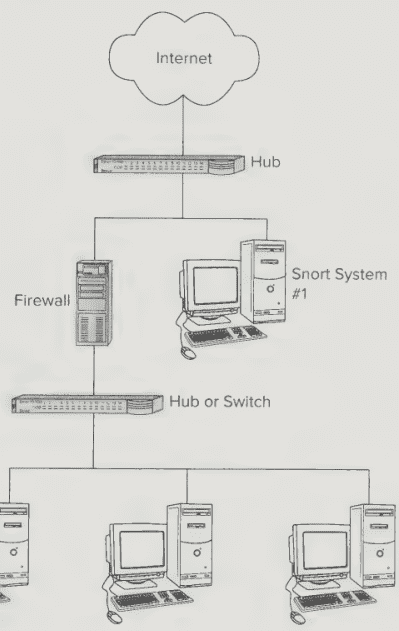

大多数现代 Linux 发行版都带有 Snort，因此你应该能够以通常的方式安装它。安装完成后，Snort 通过 `/etc/snort/snort.conf` 进行配置（某些发行版不提供此名称的文件，但提供了一个名为 `snort.conf.distrib` 或其他变体的文件。你可以复制或重命名此文件并将其作为可以修改的模板）。默认的 `snort.conf` 文件可能尚可用，但你可能希望自定义几个变量，例如 `$HOME_NET`、`$SMTP_SERVERS` 和 `$HTTP_SERVERS`。其中第一个指定了要监控的 IP 地址，其他的定义了特定类型服务器的 IP 地址。默认值告诉 Snort 监控所有的 IP 地址，这可能没有问题，因为你可能希望 Snort 监控其本地网络上的所有流量，而这也是它通常能够看到的所有内容。

某些发行版在 `/etc/snort` 目录下放置了一系列以 `.rules` 结尾的补充 Snort 配置。这些规则文件定义了 Snort 应该认为可疑的包类型。大多数协议都有一个 `.rules` 文件，例如用于 SMTP 数据包的 `smtp.rules`。这些 `.rules` 文件通过主 `snort.conf` 文件中的 `include` 指令进行引用，因此请确保你的主 `snort.conf` 文件加载了适用于你网络的恰当规则。如果你没有看到你想要监控的协议的 `.rules` 文件，请检查 http://www.snort.org/start/rules。该网站可以帮助你找到并安装额外的 `snort.rules` 文件。

## 启动 Snort

要启动 Snort，输入其命令名：`snort`。程序将运行并将输出记录在位于 `/var/log/snort` 的文件中。这些日志文件记录了有关可疑包的信息。你应该确保定期监控这些日志文件。要永久地运行 Snort，你可以从启动脚本中运行它。事实上，许多发行版都提供了 SysV 或启动脚本来启动 snort。


Snort 监控网络流量不需要 IP 地址。因此，你可以配置一个带有网络驱动程序但没有 IP 地址的专用 Snort 系统，并用它来监控网络流量。这种配置使得 Snort 监控器非常抗外部攻击，因为攻击者无法访问该系统。缺点是，你必须使用 Snort 系统自身的控制台或 RS-232 串口链路来监控它的活动。

## 使用 Fail2Ban 检查入侵者

有时黑客会尝试通过反复登录尝试来入侵计算机。结果是在计算机日志文件中产生失败消息。Fail2Ban 程序 http://www.fail2ban.org 是一个服务器，它监控你的系统日志文件，当检测到来自特定 IP 地址的重复登录尝试时，会修改计算机的 `iptables` 防火墙规则、TCP Wrappers 规则或其他工具来阻止该 IP 地址。此操作剥夺了潜在入侵者对你的系统密码进行多轮猜测的机会。

Fail2Ban 使用 `/etc/fail2ban/jail.conf` 目录下的几个配置文件。该文件包含了该工具可能监控的许多常用服务器的定义。每个定义都以括号中的名称开始，例如 `[ssh]`，它用于监控 SSH 登录失败。节名称是任意的，并且它们之间可能不同。`jail.conf` 文件以一个名为 `[DEFAULT]` 的节开头，它设置了一些默认值，例如触发封禁的重试次数 `maxretry`、触发封禁必须满足该次数重试的时间段 `findtime`、一旦触发条件后主机被封禁的时间 `bantime` 以及用于封禁违规计算机的方法 `banaction`。你可以为特定服务器覆盖这些任何默认值。

你应该仔细阅读 `jail.conf` 文件以找到你想要监控的服务器的配置。例如，假设你想阻止尝试破解你 SSH 服务器的计算机。你可能想要修改 `[ssh]` 节，它在 Ubuntu 系统上的默认看起来如下：

## 处理端口和数据包

```
[ssh]
enabled = true
port = ssh
filter = sshd
logpath = /var/log/auth.log
maxretry = 6
```

这些行中的大部分内容都是自明易懂的：此特定配置已启用，它监控 ssh 端口（如 `/etc/services` 中定义），它监控 `/var/log/auth.log` 文件中的登录失败，并且在实施封禁之前容忍六次失败。`filter` 行指向 `/etc/fail2ban/filter.d` 目录下具有指定名称但附加了 `.conf` 后缀的文件（示例中的 `sshd.conf`）。该文件包含了一系列正则表达式，描述了所涉及服务器的登录失败情况。

某些发行版带有的可能需要更多调整的 Fail2Ban 配置。例如，Gentoo 的默认 `jail.conf` 文件包含了一个比 Ubuntu 配置更宽松的 SSH 配置：

```
[ssh-iptables]
enabled = false
filter = sshd
action = iptables
logpath = /var/log/messages
maxretry = 5
```

在某些发行版上，你可能需要调整其他值以使配置生效。此练习演示了如何使用 Fail2Ban 快速封禁异常地址。我已经在 Ubuntu 和 Fedora 系统上测试过。

## 练习 10.1 使用 Fail2Ban

此练习演示了如何使用 Fail2Ban 快速封禁异常地址。我已经在 Ubuntu 和 Fedora 系统上测试过。你需要访问两台计算机来执行这些步骤；将配置一台，另一台作为攻击者。

要继续，请按照以下步骤操作：

- 以 root 身份登录计算机，使用 `sudo` 获取 root 权限，并准备执行操作：

- 如果计算机尚未运行 SSH 服务器，请安装并配置它。第 7 章描述了 SSH 配置。或者，你可以使用其他需要认证且 Fail2Ban 可以监控的协议，例如 POP 或 IMAP 第 9 章。

- 使用发行版的包管理工具安装 Fail2Ban。在大多数情况下，包名为 `fail2ban`。

- 将 `/etc/fail2ban/jail.conf` 文件导入文本编辑器。


- 搜索 `jail.conf` 文件字符串 `ssh`。你的默认文件可能包含使用不同工具封禁 SSH 滥用的多个配置。在 Ubuntu 中，`[ssh]` 配置默认启用；在 Fedora 中，`[ssh-iptables]` 配置默认启用。使用 iptables 阻止攻击者。你可以保持任何一种配置不变，尽管将 `maxretry` 设置为低值（例如 2）将简化测试。在某些发行版上，你可能需要调整其他值以使配置按预期工作。

- 启动或重启 Fail2Ban 服务。通常，输入 `/etc/init.d/fail2ban restart` 即可完成。

- 进入你的“攻击”计算机，我将将其称为 `attack`。（我将运行 SSH 服务器的系统称为 `server`）。

- 使用 `attack` 的 SSH 客户端登录 `server` 上的你的普通账户。正确输入密码并验证你可以使用该计算机。

- 使用 `attack` 上的另一个窗口或登录会话，使用你的 SSH 客户端尝试登录 `server` 上的普通账户，但这次要故意输入错误密码。在典型配置下，SSH 服务器会给你三次正确输入密码的机会。根据你的服务器日志策略，这三次机会可能计为一次或三次 Fail2Ban 的 `maxretry` 机会。

10. 重复步骤 #9。根据日志策略，你可能可以或无法连接到你的密码。如果你能够连接，那么在完成尝试后你应该会被封禁，假设你已将 `retry` 设置为 2。

11. 尝试使用你在步骤 #8 中发起的远程登录。它应该会失败，因为登录源于发起失败登录尝试的同一台计算机；`iptables` 会拦截从攻击者计算机到服务器 SSH 端口的所有流量（可能还包括其他端口）。

12. 使用你在服务器上的控制台会话，输入 `iptables -L` 来查看 iptables 配置。你应该能看到一个以你的 Fail2Ban SSH 配置命名的新链。该链应该包含一条限制攻击者访问计算机的规则。

13. 等待一会儿——准确来说，等待 `jail.conf` 中 `ban time` 选项指定的秒数，或者

14. 再次输入 `iptables -L`。封禁攻击的规则应该消失，因为 Fail2Ban 在封禁时间结束后已将其移除。

15. 在发生攻击时，在你获得访问服务器且 Fail2Ban 运行或已卸载它后，再次尝试一次。

此时，你可以选择让 Fail2Ban 继续运行或卸载它。如果你让它继续运行，如果你更改了 `retry` 设置，你可能想要调整它。你还应该检查默认 `jail.conf` 中配置的其他协议；你可能想要激活、停用或调整其中的某些项。记得检查服务器在重启时是否会自动运行；可能需要调整其 SysV 启动脚本或 `Upstart` 配置。

## 跟进安全问题的最新动态

你应该养成查看几个安全 Web 网站和其他资源的习惯，以了解新威胁。

- **CERT/CC**：[计算机应急响应小组协调中心](http://www.cert.org) 托管通用安全信息，包括有关最新威胁的信息。定期查看该网站将帮助你跟上安全进展。

- **US-CERT**：[美国计算机就绪小组](http://www.us-cert.gov) 接管了以前由 CERT/CC 承担的一些职责。在实践中，这两个网站都值得监控。

- **CIAC**：[网络事件咨询能力](http://www.doecirc.energy.gov) 由美国能源部运行，在许多方面与 CERT/CC 和 US-CERT 相似，但其网页更强调当前威胁，对通用安全实践的覆盖较少。

- **CVE**：[计算机漏洞与暴露平台](http://cve.mitre.org) 网站专门用于维护漏洞名称字典。这些信息对于方便有关问题的通信非常有用。尽管如此，CVE 在漏洞描述及其利用程序描述方面提供的内容较少。

- **SecurityFocus and Bugtraq**：[SecurityFocus 网站](http://www.securityfocus.com) 是另一个通用安全网站。它的一个重要功能之一是托管了 [Bugtraq 邮件列表](http://www.securityfocus.com/archive/1)，这是保持信息灵通的一种良好方法——在你订阅后，有关新威胁的警报将在其公开后不久立即投递到你的邮箱账户。

- **Linux Security**：[Linux Security 网站](http://www.linuxsecurity.com) 在许多方面与 CERT/CC、US-CERT、CIAC 和 Security 相似。尽管如此，它专门针对于 Linux 服务，在解决 Linux 特有问题或指明 Linux 特有的解决方案方面可能更有帮助。

- **发行版网站**：大多数 Linux 发行版都会在其 网站上维护安全信息。访问你发行版的主页并寻找与安全相关的链接。这些网站可以为你的特定发行版提供特定的升级说明。

- **产品网页和邮件列表**：许多程序都有 Web 页面和邮件列表，这些是学习与这些程序相关的安全问题的良好资源。当然，定期翻阅与组成 Linux 系统的数百个程序相关的页面可能是一份全职工作。你可能希望关注你运行的任何高配置服务器程序（例如 Apache Web 服务器或 sendmail 邮件服务器）的网页或邮件列表。

- **Securitygroups**：有几个 Unix 新闻组专门负责安全问题。特别感兴趣的是 `comp.security` 层级结构中的组。

我建议你调查所有或大部分这些资源，然后跟进其中几个。例如，你可能每天检查 CERT/CC 和 Linux 网站，订阅 Bugtraq 邮件列表，并每周检查一次你发行版的安全页面。通过这种方式跟进安全进展将让你迅速警觉潜在问题——运气好的话，足以避免由黑客在发现漏洞后不久尝试利用这些漏洞所引起的问题。

这些资源中的许多提供其内容的 RDF 站点摘要 (RSS) 馈。此协议允许你使用新闻聚合程序，如 [Amphetadesk](http://www.disobey.com/amphetadesk/) 或 [BlogBridge](http://www.blogbridge.com)，来跟踪安全问题并尽快了解它们。

如果你发现了一个安全漏洞，你会做什么？作为一般原则，你应该尽快修补任何漏洞软件。大多数 Linux 供应商会发布

## 总结

在某些情况下，安全问题不会直接影响你。它们可能与你运行的服务器、你没有的服务器功能或你使用的配置有关。例如，一类常见的安全问题涉及本地用户获取 root 权限的能力。此时，你可以选择让 Fail2Ban 继续运行或卸载它。如果你让它继续运行，如果你更改了 `retry` 设置，你可能想要调整它。你还应该检查默认 `jail.conf` 中配置的其他协议；你可能想要激活、停用或调整其中的某些项。记得检查服务器在重启时是否会自动运行；可能需要调整其 SysV 启动脚本或 `Upstart` 配置。

## 考试要点

- 说明 PAM 如何实现更灵活的认证系统。必须验证用户的单个程序使用 PAM 进行验证，这使得这些程序与验证细节解耦。因此，如果需要更改验证细节，可以在不更改单个程序的情况下更改 PAM 配置吗？

- 总结重要的 PAM 配置文件。PAM 使用配置文件 `/etc/pam.conf` 或（更常见的）`/etc/pam.d` 目录下的多个文件。在后一种情况下，大多数文件配置名称相同的服务器或其他登录工具，例如用于 GDM 登录服务器的 `gdm`。然而，`/etc/pam.d` 中的某些文件可能会被其他文件引用。

- 区分 PAM 和 NSS。可插件认证模块 (PAM) 系统负责验证用户、处理非认证访问限制、管理登录会以及更改密码。相比之下，命名服务开关 (NSS) 管理用户 ID (UID) 与用户名之间的关系，跟踪用户目录并执行其他与安全不相关的帐户任务。这两个系统必须使用相同的帐户数据库以确保用户账户正常工作。

- 解释 TCP Wrappers 的目的。TCP Wrappers 的存在是为了保护服务器不受未经授权或已知恶意站的影响并根据 IP 地址、主机名或相关信息（某些情况下包括用户名）限制访问。通过将这些限制放在 TCP Wrappers 软件包中，可以保持简单服务器代码的简单；然而，服务器必须链接到 TCP Wrappers 库 `libwrap`，或者服务器必须通过超级服务器（如 `inetd`）运行。

描述为什么开放端口的扫描很重要。计算机是动态系统；它们的配置可能会因为例行的软件更新、刻意的更改，甚至是无意的更改而发生变化。因此，检测可能构成安全威胁的更改至关重要。在 Linux 世界中，最大的威胁之一是运行着一个你未知的服务器的系统，因为很难防御来自未知服务器的威胁。定期扫描开放端口是一项重要的系统管理任务。

总结检测入侵尝试的方法。可以通过监控网络活动来检测入侵者。实现此目标的一种方法是使用如 `Snort` 等工具监控低层网络数据包，它可以扫描可疑的数据包并在发现时向你发出告警。另一个工具是 Fail2Ban，它可以检查你的日志文件中是否存在重复的登录失败，然后自动阻止违规的 IP 地址或向你报告该问题。

总结跟进安全事务最新动态的方法。多个机构（如 CERT/CC、GIAC、Security Focus 和 Linux Security）运行了专门负责安全问题的网站或邮件列表。你可以定期检查这些网站，订阅它们的邮件列表，或使用 RSS 馈送来监控最新的安全进展。发行版和单品产品的网站，以及 Usenet 新闻组，也是安全信息的重要来源。

### 复习题

- 1. 你正在使用 LDAP 服务器进行身份验证，并希望确保用户每次登录计算机时都有本地家主目录。你会在你的 PAM 配置中添加哪行代码，以确保在必要时创建家主目录？

  A. `account requisite pam_security.so umask=0022`

  B. `session required pam_unix.so sk=/etc/skel`

  C. `auth sufficient pam_deny.so sk=/etc/skel`

  D. `session required pam_mkhomomedir.so sk=/etc/skel umask=0022`

- 2. `pam_cracklib.so` 模块的作用是什么？

  A. 作为账户栈的一部分，通过其 IP 地址识别已知的破解者

  B. 作为密码栈的一部分，测试密码的强度

  C. 作为会话栈的一部分，向用户展示幽默格言

  D. 作为身份验证栈的一部分，验证用户的账户未被破解。

- 3. `/etc/pam.d/login` 文件包含以下 auth 栈。login 工具使用的是哪种身份验证系统？

  ```
  auth required pam_security.so
  auth include system-login
  ```

  A. 标准 Unix/Linux 本地账户

  B. 一个 LDAP 服务器

  C. 一个 Winbind 服务器

  D. 根据提供的信息无法确定正确答案

- 4. 在配置为使用 shadow 密码和 `pam_unix.so` 作为唯一身份验证方法的 Linux 计算机上，用户密码通常存储在哪里？

  A. `/etc/shadow`

  B. `/var/shadow-pw`

  C. `/var/accounts/shadow/pass.db`

  D. `/etc/passwd`

- 5. `/etc/pam.d` 配置中每一行非注释行都包含哪种特征，而该目录下的文件中*不具备*？

  A. 管理组名称

  B. 服务名称

  C. 控制标志

  D. 模块文件名

- 6. 当你重新配置 Linux 使用 Windows 域控制器进行用户身份验证时时，你应该编辑哪个文件以确保 Linux 能将用户名映射到 UID 值？

  A. `/etc/nsswitch.conf`

  B. `/etc/passwd`

  C. `/etc/pam.d/winbind`

  D. `/etc/winbind/conf`

- 7. 你的登录服务器正在使用 PAM，你想限制用户对系统资源的访问。你需要编辑哪个配置文件？

  A. `/etc/limits.conf`

  B. `/etc/pam/limits.conf`

  C. `/etc/security/limits.conf`

  D. `/etc/security/pam/limits.conf`

- 8. `session` PAM 管理组的作用是什么？

  A. 它为登录会话设置环境，并在用户注销时进行清理工作。

  B. 它根据用户名和密码（或其他标准，如生物识别扫描）执行身份验证。

  C. 根据非身份验证数据（如 IP 地址）验证或拒绝登录。

  D. 当用户请求更改密码时更改密码。

- 9. 根据 NSS 配置文件中的以下几行，关于用户名如何映射到用户 ID 有什么可以说明？

  ```
  password:  compat ldap
  shadow:   compat ldap
  group:    compat ldap
  ```

  A. LDAP 在兼容模式下被调用。

  B. 在本地文件之后使用 LDAP。

  C. 计算机仅使用 LDAP 账户。

  D. 仅从这些行无法得出任何结论。

- 10. 一个服务器/计算机组合出现在 `hosts.allow` 和 `hosts.deny` 中。当 TCP Wrappers 运行时，此配置的结果是什么？

  A. TCP Wrappers 拒绝运行并在 `/var/log/messages` 中记录错误。

  B. 系统管理员将收到页面通知以决定是否允许访问。

  C. `hosts.deny` 优先；拒绝客户端访问服务器。

  D. `hosts.allow` 优先；允许客户端访问服务器。

- 11. 你在 `/etc/inetd.conf` 中调用哪个实用以确保通过 `inetd` 运行的服务器使用 TCP Wrappers？

  A. `tcpd`

  B. `libwrap`

  C. `wrapd`

  D. `tcpwrap`

- 12. 以何种方式是跟进安全动态？

  A. 定期检查 CERT/CC 网站。

  B. 订阅邮件列表。

  C. 定期检查发行版。

  D. 以上所有。

- 13. 以下哪种工具最适合监控针对多个计算机的？

  A. `netstat`

  B. `iptables`

  C. `Snort`

  D. `Fail2Ban`

- 14. `telnet` 程序如何成为安全工具？（选择所有适用）

  A. 你可以使用它监控指向特定计算机的数据包。

  B. 你可以使用它检查特定端口的服务器。

  C. 你可以使用它发布特定的命令。

  D. 你可以使用它扫描 TCP 和 UDP。

- 15. `Snort` IDS 位于地址转换 (NAT) 路由器后的保护网络。该网络使用 Samba、NFS 和 SSH 服务器。关于 Snort 可能检测的攻击类型：

  A. 它能检测来自本地网络的攻击。

  B. 它能检测来自互联网的攻击。

  C. 它能检测来自本地网络或互联网的攻击。

  D. 它能检测来自互联网的。

- 16. 以下哪个程序使用系统调用定位当前开放的端口？

  A. `netstat`

  B. `nmap`

  C. `nc`

  D. `nessus`

- 17. 你扫描了本地网络，发现 Web 服务器有一个 SSH 端口。该端口仅供本地网络用于更新 Web 服务器文件，但对整个互联网开放。为了在保持 SSH 功能的同时提高安全性，你可能会采取哪些措施？（选择所有适用）

  A. 在 Web 服务器上创建 `iptables` 规则限制连接 SSH 端口的 IP 地址。

  B. 重新配置网络将 SSH 服务器放在防火墙之外，配置防火墙拦截所有 SSH 流量。

  C. 重新配置计算机的 SysV 或启动脚本，防止 SSH 程序意外启动。

  D. 在网络路由器上创建 `iptables` 规则限制连接 SSH 端口的 IP 地址。

- 18. 以下哪个工具设计用于监控和限制访问单个计算机？

  A. `Snort`

  B. `Fail2Ban`

  C. `Telnet`

- 19. 哪一个 `/etc/inetd.conf` 项有问题？

  ```
  imap stream tcp nowait root /usr/sbin/tcpd
  ```

  A. 缺少对 TCP Wrappers 的调用。

  B. 缺少协议名称。

  C. 缺少要启动的服务器名称。

  D. 此项没有问题。

- 20. 哪个组织跟踪操作系统的已知漏洞？

  A. FSF

  B. CERT

  C. OSI

  D. SourceForge

## 复习题答案

- 1. D. `pam_mkhomdir.module` 模块在用户不存在主目录时会为其创建一个主目录，选项 D 显示了其使用的有效配置，因此该选项正确。`pam_security.module` 通常用于防止除控制台设备以外的任何直接 root 登录，选项 A 错误；`pam_unix.so` 是处理标准 Linux 账户的模块，因此选项 B 错误；`pam_deny.so` 在失败时会为栈提供一个默认失败选项，该栈可能提供其他明显或成功的结果，因此选项 C 正确。

- 2. B. 如选项 B 所示，`pam_cracklib.so` 模块的目的是强制用户在更改密码时输入强密码。选项 A 可能是对 Fail2Ban 程序的不完善描述，但该程序并不是 PAM 的部分。通过 `fortune` 程序可以在登录时生成并显示幽默格言，但 `pam_cracklib.so` 模块不能做到，因此选项 C 正确。虽然一个执行选项 D 功能的工具会非常有用，但编写起来非常困难，因此该选项正确地没有包含 `pam_cracklib.so`。

- 3. D. 指定 auth 栈调用了 `pam_security.so`，它可以根据终端限制访问，并包含 `system-login` 文件的内容。因此，认证系统（或系统）取决于该文件的内容，而问题没有给出该内容，使得选项 D 正确。选项 A、B 和 C 中的任何、全部或都不可能是正确的。


- 4. A. `/etc/shadow` 文件在配置为使用 `pam_unix.so` 密码的系统中存储密码。选项 B 和 C 描述的是虚构的文件。`/etc/passwd` 文件是真实的，它包含账户信息，但在启用影子密码时（所有 Linux 发行版默认都启用），它不包含实际密码。

- 5. B. `/etc/pam.conf` 文件可以取代 `/etc/pam.d/` 中的所有文件；它需要一种方法将每个栈与特定服务关联，因此每个 `/etc/pam.conf` 文件都以服务名称开头，如选项 B 所示。选项 A、C 和 D 描述的功能在 `/etc/pam.conf` 和 `/etc/pam.d/` 中的文件条目中都存在。pam 的选项也允许指定文件类型。

- 6. A. 名称切换器（NSS）负责将用户名映射到用户 ID（UID）值，NSS 的配置文件是 `/etc/nwitch.conf`。因此，你需要编辑此文件（使选项 A 正确），以确保在更改认证系统时用户名和 UID 值正确链接。通常情况下，这种映射显式地表示计算机已重新配置为使用 Windows 域控制器，选项 B 错误。选项 C 和 D 中的文件都是虚构的，尽管对 Windows 域控制器进行认证的服务名称是 Winbind。

- 7. C. `/etc/security/limits.conf` 文件持有允许你限制用户访问的配置设置，使得该选项正确。选项 A、B 和 D 提供的不是该文件的正确路径。

- 8. 选项 A 正确描述了会话管理组的功能，因此是正确的。选项 B、C 和 D 分别描述了 auth、account 和密码管理组的功能，因此是错误的答案。

- 9. B. NSS 配置文件（`/etc/nsswitch.conf`）中条目的顺序决定了用户名/UID 映射的执行顺序。由于 `comp` 条目引用本地账户数据库，而 `ldap` 指向 LDAP 服务器，结果是先查询本地账户数据库，然后是 LDAP 服务器，使得选项 B 正确。此配置没有为 LDAP 访问设置“兼容模式”，选项 A 不同。如果选项 C 正确，则任何行都不会有 `count` 条目；将使用 ldap。因为选项 B 是正确的，所以选项 D 不可能是正确的。

- 10. D. TCP Wrappers 使用此功能通过向 `hosts.allow` 添加更多更显式的访问权限，来覆盖在 `hosts.deny` 中设置默认策略（ALL : ALL）时的宽泛拒绝。

- 11. A. 你配置一个超级服务器来调用 `tcpd`，并将真实服务器名称及其参数传递给该程序，通过超级服务器使用 TCP Wrappers。选项 A 正确。某些服务器可以通过 `libwrap` 库直接使用 TCP Wrappers；然而，`/etc/inetd.conf` 中没有引用 `libwrap`，你无法确定任何给定的服务器是否使用了它，使得选项 B 错误。选项 C 和 D 都是虚构的程序，因此也是错误的。

- 12. D. 为了获得安全发展的最佳视角，你应该尽可能咨询尽多的来源。CERT/CC 网站、Bugtrag 邮件列表以及你所发行版的安全页面是三个极好的信息来源（但绝不是仅有的三个）。仅咨询这些来源中的一个可能是不够的，因为对你重要的冷门问题可能在单一来源中被忽略。

- 13. C. 在具有适当网络基础设施的情况下，Snort 能够监控针对多台计算机的网络活动，为整个网络提供早期警报系统。`netstat` 工具可以检查单台计算机上的开放端口，但它不能监控多个系统的攻击。`iptables` 工具可以实现 Linux 防火墙规则，但它本身不能监控整个网络的活动。Fail2Ban 程序监控服务器日志文件中的失败登录尝试，并可以使用 `iptables` 或其他访问限制阻止攻击系统，但这不会监控整个网络的活动。

- 14. B, C. Telnet 被设计为简单的远程登录协议，但选项 B 所示可以连接到任何端口。选项 C 描述的攻击类型可能是。Telnet 使用 TCP 而不是 UDP，选项 D 错误。（使用 telnet 扫描多个端口也会很繁琐。）

- 15. C. 鉴于 Snort 的位置，它可以监控网络流量。由于该网络受 NAT 路由器的保护，外部攻击不太到达网络。针对环回接口的本地攻击将无法检测到。

- 16. A. 使用 `netstat` 程序找到本地开放端口。`nmap` 和 `ness` 程序可以通过发送网络探测定位目标计算机上的开放端口。`nc` 是一个可以用于网络扫描的工具。

- 17. A, D. 选项 A 和 D 中的 `iptables` 规则可以限制谁访问服务器。实施适当，每种方法都是有效的。（理想情况下可以增加安全性。）选项 B 是有效措施的反面；将系统放在防火墙内部可以免受不受的外部访问，但选项 B 会限制合法用户的访问。选项 C 将完全关闭服务器。虽然这可能是有效的措施，但它将使合法用户无法更新服务器网站，而问题明确说明必须可用。

- 18. B. Fail2Ban 是一种用于监控日志文件入侵攻击的工具，在发现此类证据时限制对单个计算机的访问，因此选项 B 正确。Snort 能够监控针对多台计算机的网络活动；其目的比问题中所述的更广泛，因此选项 A 错误。Telnet 是远程登录协议，因此选项 C 错误。BIND 用于提供名称解析，因此选项 D 错误。

- 19. C. 指定的条目是要启动的服务器名称；当使用 `tcpd` 时，在本例中，最终的服务器名称应出现在调用 `tcpd` 之后。因此选项 C 正确。`tcpd` 二进制文件是 TCP Wrappers，所以选项 A 错误。（TCP Wrappers 使用 inetd 也是可选的，所以即使它缺失，选项 A 也是错误的。）协议名称出现在条目的第一列，且它是存在的（imap），因此选项 B 错误。因为选项 C 是正确的，所以选项 D 不可能是正确的。

20. B. 计算机应急响应小组（CERT）跟踪已知漏洞，因此选项 B 是正确的。自由软件基金会（FSF）、开源倡议（OSI）以及 SourceForge 网站对 Linux 操作系统做出了巨大贡献，但它们并不关注操作系统内部的漏洞，因此选项 A、C 和 D 都是错误的。

# 系统故障排除：启动与内核问题

本章涵盖了以下 LINUX 专业人士认证的考试目标：

- 213.1 识别启动阶段并排除引导加载程序器的故障（权重: 4）
- 213.2 通用故障排除（权重: 5）

与所有现代操作系统一样，Linux 是复杂的，而复杂性意味着很多环节可能会出现问题。因此，你必须如何追溯问题原因并解决它们是至关重要的。本章和下一章都涵盖了故障排除。本章涵盖了与系统启动、内核和硬件相关的低级问题。下一章涵盖了与系统资源和用户环境相关的故障排除。

在排除故障时，你最好的工具是对细节的关注、对问题的推理能力以及对问题涉及系统的基础知识。将基础科学原理应用于故障排除通常很有帮助。因此，本章从描述一些适用于各种问题的通用故障排除技术开始。由于许多问题需要对特定系统的了解，本章将介绍其中的一些问题，从与引导加载程序和初始 RAM 磁盘（initrd）相关开始。本章的后半部分描述了各种杂问题，大部分与内核和硬件有关。

# 处理问题

故障排除基本上就是解决问题，你在计算机以外的环境中学会的问题解决技能对于定位和解决计算机困难非常有用。以下几个通常有用的通用策略包括：

### 提出并测试假设

从科学的角度思考计算机问题通常很有帮助。科学家对世界产生假设并设计实验来测试它们。同样，你对问题的原因产生一个假设，然后对其测试。例如，你可能会监控一个内存耗尽的服务器。如果你这样做，可以使用 `free`、`ps` 和 `top` 等工具来监控内存，或向系统添加交换空间（swap）。有时测试本身也可以作为可能的解决方案，例如更换损坏的电缆甚至增加交换空间。其他情况下，你可能想采取其他步骤作为永久解决方案，例如为电脑添加内存。

### 缩小问题范围

有时你可以以系统化的方式缩小可能的原因范围。理想情况下，如果你排除了一半可能的原因，再排除剩余中的一半，依此类推，你将很快找到解决方案。在实践中，当然这种方法可能不起作用；它在可能的原因具有某些明确定义的范围时效果最好，例如网络上有一台未知但运行异常的计算机——你可以隔离计算机组，直到你找到那台引起问题的计算机。

### 研究文档

如果你知道问题出在某个特定的硬件或软件上，请查阅其文档。也许问题在文中被提到了——也许你误配置了某些内容，可以通过阅读文档来得知这一事实。

### 与另一个系统比较

如果可能，将问题行为与正常系统进行比较。如果你是第一次配置某个工具，这可能无法，但如果你在几台类似的计算机之一上遇到问题，比较配置文件、日志条目等是识别问题源的好方法。

### 使用诊断工具

许多系统提供诊断工具，例如用于网络流量的包嗅获器和用于文件系统问题的 `fsck`。使用此类工具可以帮助你诊断问题；然而，你必须意识到这些工具的存在并知道如何使用它们。某些程序具有运行时选项可以增加输出或日志文件的详细程度。使用此类选项会非常有帮助。

### 使用应急系统

如果无法启动，你可能可以使用应急系统启动计算机。Linux 发行版的安装光盘通常用于此目的，或者你可以使用如 System Rescue CD (`http://www.sysrescd.org`) 或 Parted Magic (`http://partedmagic.com`) 等工具来启动计算机并检查文件系统、检查并更改配置等。

### 咨询权威人士

如果你在某个领域认识比你更有技能的人，请请教那个人。如果你不认识，可以尝试通过书籍或在线搜索获取信息。在 Web 搜索中输入关键词可能会产生有用的结果。Usenet 新闻组、Web 论坛、互联网相对聊天（IRC）讨论组和其他在线资源也是宝贵的信息源。

这些行动可以帮助解决许多问题。作为一个一般原则，有条理并尽可能了解出现故障的子系统可能是解决问题的最好方法。因此，你应该深吸一口气，忍住把那台顽固的电脑从最近的高大楼扔掉的冲动，尽可能阅读。如有必要，留出一两个小时专门用于阅读，从而扩展你的知识库（可能还能平复情绪）。

# 排除启动问题

最令人头疼的问题类之一是启动问题。如果你的计算机无法启动，你会发现很难对它做任何事情。（这就是使用应急光盘的建议很重要的地方。）第一章“系统启动与高级系统管理”描述了引导加载程序配置的基础，因此你可能在继续之前复习该章节。排除启动过程包括处理硬件初始化、识别你的引导加载程序、修复引导加载程序问题、修复初始 RAM 磁盘问题以及内核接管后发生的问题。

# 初始化硬件

在引导加载程序开始工作之前，必须初始化某些硬件。这个过程始计算机的固件——基本输入输出系统（BIOS）、可扩展固件接口（EFI）或其他固在主板上的代码。通常，固件包括启用或禁用硬件设备的选项。它可能包含影响资源分配的选项。

如果固件选项设置错误，可能会导致性能下降、运行不稳定、无法使用硬件设备或其他问题。如果你怀疑存在此类问题（在引导加载程序出现之前），按下特殊键，例如 Delete 或 F10。如果需要帮助，请咨询计算机的主板文档。一旦进入设置程序，你应该找到各种选项。大多数程序都包含将所有选项重置为默认值的选项。这可能是很好的开始。你还可以搜索与特定子系统的选项。例如，如果你遇到磁盘问题，可以更改与磁盘控制器相关的选项。一般的可靠性问题有时可以通过调整 CPU 或内存功能解决，但由于细节取决于特定系统，无法提供更精确的建议。如果你遇到此类问题，咨询包括 Web 论坛和厂商热线在权威人士非常有价值。

# 识别你的引导加载程序

解决引导加载程序问题的第一步是识别你的引导加载程序。Linux 世界中有几种 x86 和 x86-64 平台的引导加载程序：

- GRUB Legacy 统一引导加载程序（GRUB; `http://www.gnu.org/software/grub/`）在2000年至2010年左右非常常见。它可以直接启动 Linux、FreeBSD、Solaris 以及其他基于操作系统的计算机；通过使用链加载器，它可以启动 DOS、Windows 和大多数其他操作系统。名称中加入 Legacy 一词是为了与其继者区分开。

## 启动问题排错 515

GRUB 2 此引导加载器是 GRUB Legacy (`http://www.gnu/software/grub/`) 的继任者。在2008 年之前，某些发行版开始将其作为默认引导加载器，并在 2009 年和 2010 年它变得非常常见，尽管在出版时尚未完全取代 GRUB Legacy。它可以在 BIOS 和 EFI 上运行。

BURG 来自 BUR 的全新通用加载器 (BURG; `https://launchpad.net/burg`) 是 GRUB 2 的一种变体，强调启动菜单中的图形化主题。它共享了 GRUB 2 的大部分功能，包括对 BIOS 和 EFI 系统的支持。

LILO Linux 加载器 (LILO; `http://freemeat.net/projects/lilo/`) 是 2000 年以前最常见的 Linux 引导加载器。它比 GRUB Legacy 更原始，这既可以是优点也可以是缺点。它可以加载 Linux 内核，或者通过链加载机制加载基于 Unix 的计算机上的大多数其他操作系统。

ELILO 此引导加载器基于 `http://sourceforge.net/projects/elilo/`，是用于 EFI 计算机的类 LILO 引导加载器。

rEFIT 此引导加载器基于 `http://refit.sourceforge.net`，是使用 EFI 而非旧版 BIOS 固件计算机的流行引导加载器。在实践中，rEFIT 通常与 GRUB 2 或其他引导加载器配合使用。它最用于双启动 Linux 和 Mac OS X 的计算机。

load1in 你可以使用这种引导加载器从 DOS 启动 Linux，你可以从 `http://youibou.thefreecat.org/load1in/` 获取它。在过去，load1in 是启动 Linux 安装程序的流行方式，但近年来已已冷门。

Syslinux 此引导加载器是一个相关的引导加载器家族，旨在用于特殊任务，例如从光盘 (ISOLINUX)、某些 Linux 文件系统 (EXTLINUX)、网络 (XELINUX) 或 FAT 文件系统 (SYLINUX) 启动 Linux。它通常用于 Linux 安装光盘和应急磁盘。你可以在 `http://syslinux.zytor.com` 了解更多信息。

DOS/Windows 引导加载器 默认情况下，大多数计算机使用标准的 DOS/Windows 引导加载器，它非常简单。这种 BIOS 引导加载器手动控制一个带有“boot”或“active”标志的分区。该分区反之必须在其内部安装自己的引导加载器。LILO 和两个版本的 GRUB 都可以将自己安装在 Linux 分区中，以便 DOS/Windows 引导加载器可以链加载到这些 Linux 引导加载器。

EFI EFI 固件包含了它的引导加载器；然而，这种引导加载器像 DOS/Windows 引导加载器一样，不能直接引导 Linux 内核。因此，EFI 系统仍然需要感知 Linux 的引导加载器（如 GRUB 2 或 ELILO）来启动 Linux。EFI 启动感知 Linux 的引导加载器，然后由其启动 Linux。

第三方引导加载器 多年来，许多公司和个人发布了商业和免费引导加载器。这些引导加载器大多无法直接启动 Linux，但它们可以链加载 Linux 引导加载器，例如 LILO 或 GRUB。

## 第 11 章 • 系统排错 I：启动和内核问题

> 如果你的计算机使用的不是流行的 x86 或 x86-64 系列 CPU，那么它可能使用了此处未描述的引导加载器。（尽管如此，某些计算机使用 EFI，并可能使用支持 EFI 的引导加载器）许多此类平台的 Linux 引导加载器是模仿 LILO 设计的。

如果你不熟悉该领域，这个引导加载器列表可能会让你目不应接。在实践中，你的计算机可能使用 GRUB Legacy 或 GRUB 2，特别是如果是基于 BIOS 的话。如果使用较新的 EFI，你的计算机可能使用了 rEFit、GRUB 2 以及可能的 ELILO 的组合。

识别你的引导加载器的一种方法是使用启动信息脚本 (`http://sourceforge.net/projects/bootinspect/`)。你可以从应急启动盘运行此脚本，它扫描硬盘以查找引导加载器签名、分区信息等，并生成一个保存为 RESULTS.txt 的报告。在该文件的前几行识别出的引导加载器：

```
# Boot Info Summary:

=> Grub 2 安装在 /dev/sda 的 MBR 中，并查看同一块硬盘的第 40 扇区的 core.img，就像在 /dev/sda 的此位置，并寻找 (UUID=1445adc8c-3145-4fcb-86df-701f07f1943)/grub。
```

此示例清楚地识别了第一个磁盘 (`/dev/sda`) 主引导记录 (MBR) 中的引导加载器，以及后续输出行中 GRUB 2 在何处查找额外的引导代码（在此示例中 core.img 位于第 40 扇区）以及 GRUB 文件安装的位置（带有通用唯一标识 [UUID] 为 1445adc8c-3145-4fcb-86df-701f07f1943 的文件系统的分区上）。

尽管 LPIC-2 目标中没有提到启动信息脚本，但该脚本是识别和解决启动问题最有用的诊断工具。除了定位引导加载器的主代码位置和配置文件外，脚本还识别了计算机每个分区上使用的文件系统，显示所有磁盘上的分区表，总结了计算机所有文件系统的 UUID，并显示引导加载器配置文件的内容。

## 定位引导加载器文件和代码

在正常运行系统中，引导加载器安装在多个位置。取决于引导加载器的细节如下：

## 问题排错

MBR 磁盘的第一扇区 (MBR) 被引导加载器使用。MBR 中的引导加载器可以将引导过程重定向到 Linux 分区，即使基于 MBR 的引导加载器无法直接引导 Linux 内核。

未分配 MBR 后扇区 在大多数磁盘上，紧接 MBR 的扇区是未分配的。引导加载器通常使用这些空间存放额外代码。

BIOS 分区 这种分区类型被 GRUB 2 使用。虽然 GPT 磁盘上存在 BIOS 分区并不能确定是 GRUB 2，但它是有人打算使用它的良好指示。更多信息请参考 `http://grub.org/BIOS_Boot_Partition`。

Linux 分区扇区 Linux 分区的扇区可以被引导加载器使用，就像磁盘的 MBR 一样。


# 引导支持文件

引导支持文件引导代码可以存在引导时读取的文件。从某种意义上说，Linux 内核和初始内存磁盘是此类文件；然而，引导加载器可以将自己的代码存储在文件中，因为 `GRUB 2` 特别依赖此类文件。

## 配置文件

`LILO` 和 `GRUB 2` 依赖于 `/etc` 目录下的配置文件。对于 `LILO`，相关文件是 `/etc/lilo.conf`；对于 `GRUB 2`，文件位于 `/etc/grub.d` 目录。

## 启动时配置文件

`GRUB Legacy` 和 `GRUB 2` 都依赖于 Linux 文件系统中的启动文件。对于 `GRUB Legacy`，这些文件通常位于 `/boot/grub/menu.lst` 或 `/boot/grub/grub.conf`，取决于发行版。

文件通常称为 `/boot/grub/grub.cfg`，但某些发行版将文件存放在 `/boot/grub` 而不是 `/boot/grub/`。在这两种情况下，`/boot/grub` 中的其他额外文件都支持 `GRUB`。根据预安装的配置文件，这些文件的存在表明使用了特定的启动加载程序，但这并不确定。

每个加载程序都包含二进制程序文件，这些文件用于将启动加载程序安装到 `MBR`、Linux 启动分区或其他位置；或者用于调整最终的启动配置。对于 `LILO`，关键文件称为 `lilo`。对于 `GRUB Legacy` 和 `GRUB 2`，`grub-install` 是安装程序。

如果你不确定电脑使用的是哪种启动加载程序，应该搜索某些文件是否存在，如表 11.1 所示。当然，运行中的启动加载程序存储在 `MBR`、Linux 分区的引导扇或磁盘上的其他分区中。识别实际代码的最可靠方法是使用启动信息脚本（Boot Info Script）。

## 表 11.1 启动加载程序及其识别配置文件

| 启动加载程序 | 配置文件 |
| --- | --- |
| `LILO` | `/etc/lilo.conf` |
| `GRUB Legacy` | `/boot/grub/menu.1st` 或 `/boot/grub/grub.cfg` |
| `GRUB 2` | `/etc/grub.d` 目录；`/boot/grub/grub.cfg` 或 `/boot/grub2/grub.cfg`；GPT 磁盘上可能存在 BIOS Boot 分区 |

如果你的电脑使用的是 `EFI` 而不是 `BIOS`，细节将与此处描述的有所不同。基于 `EFI` 的电脑使用与基于 `BIOS` 的电脑相同的 `GRUB 2` 配置文件，`GRUB 2` 将一个 `EFI` 启动文件放置在 `EFI` 系统分区 (`ESP`) 上，`ESP` 是一个用于存储驱动程序、启动加载代码和类似低级文件的特殊分区。如果你使用 `eRefit`、`ELILO` 或其他 `EFI` 启动加载程序，应查阅其文档以了解它们存储文件的位置。如果你使用较不常见或更专门的 `GRUB` 加载程序，也同样的建议。

今天最常见的两种 Linux 加载程序 `GRUB Legacy` 和 `GRUB 2` 都将文件放置在 `/boot/grub` 中。由于这个原因，某些发行版将 `GRUB 2` 的位置更改为 `/boot/grub2`，以便可以同时安装启动加载程序。`GRUB Legacy` 在该位置的文件相对较少，包括它的配置文件、一个映射 Linux 和 `GRUB` 设备标识符的设备 `.map` 文件以及各种包含其名称的启动代码文件。这些文件大多数以 `.mod` 结尾；这些是 `GRUB 2` 模块——`/boot/grub` 中许多更多文件的代码——启动加载程序只有在需要时才能访问的代码。模块使得 `GRUB 2` 能够读取文件系统、处理各种类型的视频硬件等。

# 排除启动问题

最常见的配置涉及安装在硬盘上的启动加载程序。大多数可移动磁盘（包括通用串行接口 (`USB`) 闪存）从启动加载程序的角度来看与硬盘工作一样。软磁盘的工作方式略有不同，但包括 `GRUB` 和 `LILO` 在内的许多启动加载程序可以安装在软磁盘上。与硬盘不同，软磁盘没有分区，因此从软件角度来看，软磁盘更像是一个分区。如前所述，光盘的情况甚至更加不同。它们通常使用一种名为 `El Toro` 的软件标准来定义它们如何启动。`ISOLINUX` 是光盘通常常用的启动加载程序。

## 解释启动加载程序错误消息

启动问题经常产生令人恼恼且晦涩的错误消息。这是因为启动加载程序（特别是在早期阶段）必须异常紧凑；代码中没有足够的空间存储长错误消息。因此，解释启动加载程序的错误消息可能是困难的。对于 `LILO`、`GRUB Legacy` 和 `GRUB 2` 来说这项任务是不同的。

> 有时你可以通过使用 Super GRUB Disk (`http://www.supergrubdisk.org`) 来解决启动加载程序问题，这是一个可启动 `CD-R`，它会查找并使用安装的 `GRUB` 配置文件。提供 `GRUB Legacy` 和 `GRUB 2` 版本。Super GRUB Disk 允许你跳过损坏的 `GRUB` 启动安装问题，只要系统的 `GRUB` 配置文件是完整且正确的。一旦启动了系统，你可以使用 `grub-install` 重新安装 `GRUB`。

### 解释 LILO 错误消息

在启动时，`LILO` 在屏幕上显示它的名称。如果遇到错误，它会更改此显示以显示某种类型的错误代码。结果是字符串 `LILO` 的一部分，有时会附带错误代码。表 11.2 总结了常见的 `LILO` 错误代码。

| 错误代码 | 含义 |
| :--- | :--- |
| `(nothing)` | `LILO` 未加载。此类问题可能表明 `LILO` 未安装在 `MBR` 中、Linux 分区损坏，或者之前的启动加载程序可能无法从 Linux 分区加载 `LILO`。 |
| `L##` | `LILO` 的第一阶段已加载，但它无法找到第二阶段（通常存储在 `/boot/boot.b`）。`L` 之后的两个数字可以帮助进一步诊断问题；详情请参阅 `LILO` 文档。 |

## 表 11.2 LILO 错误代码（续表）

| 错误代码 | 含义 |
|---|---|
| `LI` | Linux 的第一阶段已加载，并且它找到了 `/boot/boot.b`；但这个第二阶段无法运行。 |
| `LI1010...` | 在这种情况下，错误 `1010` 表示第二阶段无法运行。 |
| `LIL` | `LILO` 的第一阶段已加载，但它无法找到第二阶段（通常存储在 `/boot/boot.b`）。`L` 之后的两个数字可以帮助进一步诊断问题；详情请参阅 `LILO` 文档。 |
| `LIL?` | `LILO` 的第一阶段已加载，但它无法找到第二阶段（通常存储在 `/boot/boot.b`）。`L` 之后的两个数字可以帮助进一步诊断问题；详情请参阅 `LILO` 文档。 |
| `LIL-` | `LILO` 的第一阶段已加载，但它无法找到第二阶段（通常存储在 `/boot/boot.b`）。`L` 之后的两个数字可以帮助进一步诊断问题；详情请参阅 `LILO` 文档。 |
| `LIL` | `LILO` 的第一阶段已加载，但它无法找到第二阶段（通常存储在 `/boot/boot.b`）。`L` 之后的两个数字可以帮助进一步诊断问题；详情请参阅 `LILO` 文档。 |
| `LIL` | `LILO` 的第一阶段已加载，但它无法找到第二阶段（通常存储在 `/boot/boot.b`）。`L` 之后的两个数字可以帮助进一步诊断问题；详情请参阅 `LILO` 文档。 |

在启动时，`LILO` 在屏幕上显示它的名称。如果遇到错误，它会更改此显示以显示某种类型的错误代码。结果是字符串 `LILO` 的一部分，有时会附带错误代码。表 11.2 总结了常见的 `LILO` 错误代码。

在启动时，`LILO` 在屏幕上显示它的名称。如果遇到错误，它会更改此显示以显示某种类型的错误代码。结果是字符串 `LILO` 的一部分，有时会附带错误代码。表 11.2 总结了常见的 `LILO` 错误代码。

在启动时，`LILO` 在屏幕上显示它的名称。如果遇到错误，它会更改此显示以显示某种类型的错误代码。结果是字符串 `LILO` 的一部分，有时会附带错误代码。表 11.2 总结了常见的 `LILO` 错误代码。

在启动时，`LILO` 在屏幕上显示它的名称。如果遇到错误，它会更改此显示以显示某种类型的错误代码。结果是字符串 `LILO` 的一部分，有时会附带错误代码。表 11.2 总结了常见的 `LILO` 错误代码。

在启动时，`LILO` 在屏幕上显示它的名称。如果遇到错误，它会更改此显示以显示某种类型的错误代码。结果是字符串 `LILO` 的一部分，有时会附带错误代码。表 11.2 总结了常见的 `LILO` 错误代码。

### 解释 GRUB Legacy 错误消息

`GRUB Legacy` 运行三个阶段，称为 Stage 1、Stage 1.5 和 Stage 2。Stage 1 是通常位于 `MBR` 的部分 [564页]

## 表 11.3 GRUB Stage 1 错误消息

| 错误消息 | 阶段 | 含义 |
| --- | --- | --- |
| Hard disk Error | 1 | 无法确定硬盘几何结构。 |
| Floppy Error | 1 | 无法确定软磁盘几何结构。 |
| Read Error | 1 | 无法读取硬盘或软磁盘。 |
| Geom Error | 1 | 从磁盘读取的文件位于 BIOS 支持的区域之外。 |

Stage 1 错误通常非常严重。如果 `GRUB Legacy` 无法确定磁盘几何结构，可能是因为你需要调整硬盘的 BIOS 设置。读取错误可能指示硬盘故障或需要调整硬盘 BIOS 设置。几何结构错误在现代硬件上很少见。对于旧版硬件，你可能需要调整分区并重新安装 Linux。尽早在磁盘上创建一个单独的 `/boot` 分区；以确保初始内存磁盘和所有 `GRUB` 启动配置文件都处于 BIOS 限制范围内。

Stage 1.5 错误消息的形式为“错误编号”，这是一个对应于 Stage 2 错误的数字。`GRUB Legacy` 文档中记录了共 34 个 Stage 2 错误。每个错误包含一个描述，例如“无效设备请求”。如果你需要解释这些错误，请查阅 `GRUB Legacy` 文档。

如果 `GRUB 2` 配置错误，你可能会看到 `GRUB` 救援 shell：

```
grub>
```

这种情况发生在 `GRUB` 无法在硬盘上找到 `/boot/grub/grub.cfg` 文件时。通常由于 `GRUB` 的内部前缀环境变量（它持有该文件所在目录的位置）设置错误。你可以使用 `ls`

定位正确位置并设置前缀环境变量的命令。开始时，你可能应该单独使用 `ls` 来查看可用分区，然后进入它们查看，直到找到 Linux 根分区 (`/`) 或 `/boot` 分区：

```
grub> 1s
(hd0) (hd0,gpt5) (hd0,gpt4) (hd0,gpt3) (hd0,gpt2) (hd0,gpt1)
grub> 1s (hd0,gpt5)/
abbi-2.6.31-22-generic grub/ initrd.img-2.6.31-22-generic
memtest86+.bin System.map-2.6.31-22-generic vmcoreinfo-2.6.31-22-generic
vmlininuz-2.6.31-22-generic
```


在较新的 `GRUB 2` 版本中，分区可能仅通过磁盘设备和名称来识别（例如 `(hd0,5)`），或者在分区号前加一个分区类型代码（例如 `(hd0,gpt5)` 或 `(hd0,mbr)`）。后者格式消除了磁盘内部嵌入了另一个分区表或被侧重系统使用时的可能歧义。

要查看分区内部内容，你必须在标识符后传递一个斜杠 (`/`)，例如 `(hd0,gpt5)`；省略斜杠则显示该分区上使用的文件系统信息。此示例展示了第一次尝试就发现了独立 `/boot` 分区的内容。（如果 `/boot` 目录在根分区上，你可能需要定位根分区并在后续命令中包含指向 `GRUB 2` 目录的路径。）一旦发现了 `/boot` 目录（因此是 `/boot/grub`），你就可以设置 `prefix` 和 `root` 变量分别指向 `GRUB` 目录和其所在的分区：

```
grub> set prefix=(hd0,gpt5)/grub
grub> set root=(hd0,gpt5)
```

为了获取菜单，你必须加载并运行 `normal` 模块：

```
grub> insmod normal
grub> normal
```

如果运气好，你现在将看到一个正常的 `GRUB 2` 菜单。这种效果不是永久的，为了将来在不进行此类干预的情况下让 `GRUB 2` 运行，你需要重新安装，通常是在计算机启动后以 root 身份输入 `grub-install /dev/device`（其中 `/dev/device` 是磁盘的 Linux 文件名）。

不严重的问题涉及启动关于错误类型的启动错误消息，例如文件缺失。如果错误足够简单，你可能可以通过在 `GRUB 2` 菜单中选择内核或操作系统并按 `E` 键编辑条项来克服它。然后你可以按照屏幕提示，并使用 `GRUB 2` 内置的文本编辑器对配置进行临时更改。（第 1 章详细描述了这一过程。）

# 处理初始 RAM 磁盘问题

如第 1 章和第 2 章所述，现代 Linux 系统经常使用初始 RAM 磁盘（也称为 `initrd` 或 `initramfs`）。初始 RAM 磁盘与内核配合使用，提供一些关键系统工具和内核模块，使内核能够执行在没有硬盘的情况下通常无法执行的操作。例如，内核可以加载模块来处理特定的硬盘。如果你按照第 2 章描述的方法编译了自己的内核，你可以将此类模块包含在内核本身中，因此可能不需要初始 RAM 磁盘；然而，有时你需要初始 RAM 磁盘来激活特定功能，例如逻辑卷管理器 (`LVM`) 支持。许多发行版也使用初始 RAM 磁盘，以便单个内核可以支持各种硬件。

初始 RAM 磁盘的缺点是它们有时会使启动过程复杂化。如第 1 章所述，你的引导加载程序配置必须引用初始 RAM 磁盘文件。引导加载程序将内核和初始 RAM 磁盘都加载到内存中，并将其在内存中的位置交给内核。这个过程可能会出错——引导加载程序可能无法找到初始 RAM 磁盘文件、文件格式可能错误、文件可能损坏、文件可能是错误的内核、RAM 磁盘文件可能缺少某些关键功能等。

这些问题中的一些会在引导加载程序阶段导致错误。例如，你可能会看到“文件未找到”错误，可能是直接明说，也以晦涩错误代码的形式出现。如果发生这种情况，你应该检查引导加载程序配置，以验证初始 RAM 磁盘的文件名输入正确（这些文件名通常很长且充满了数字和代码，很容易写错！）。基本上，此类问题可以像之前描述的那样被视为其他引导加载程序问题。

如果引导加载程序可以加载内核和初始 RAM 磁盘，启动过程将继续。在常规配置中，你将看到一系列消息（稍后可以使用 `dmesg` 查看），这些消息与内核检测硬件等有关。你可能认为已经万事大吉，但如果初始 RAM 磁盘损坏或适用于你正在使用的不同内核或发行版，进程可能会带有错误消息突然停止。通常，报错内容是内核无法访问根设备。如果在你安装新内核后发生这种情况，最好的办法是使用你创建初始 RAM 磁盘的步骤重启，并创建一个新的。

许多 Linux 发行版在启动过程非常早阶段就会切换到图形显示。这种显示对于新用户来说比充满初始化信息的传统显示不那么可怕。你通常可以通过按键从图形显示切换到文本模式。在引导加载程序中移除 `splash` 选项也可以实现。


# 修复启动和内核问题

如果问题在于发行版提供的初始 RAM 磁盘，你可能会遇到困难。如果你能使用旧内核启动，你可能需要使用它来构建自己的内核。如果不能，你可能需要找到第三方构建的替代内核。初始 RAM 磁盘问题有时是因为内核对于新硬件过旧。最新的硬件可能不支持旧内核。因此，如果你在使用上遇到问题，可能需要尝试较新的发行版。

## 修复操作系统启动早期的问题

如果引导加载程序正确加载了内核和初始 RAM 磁盘，并且内核可以使用初始 RAM 磁盘定位 Linux 根文件系统，内核将开始正常的初始化过程，如第 1 章所述。大多数 Linux 发行版使用 SysV 或 Upstart 启动系统。前者通过 `/etc/init.d` 或 `/etc/rc/init.d` 中的文件以及指向这些文件的链接（位于 `/etc/rc?.d`，其中 `?` 是级别数字）控制。Upstart 由 `/etc/init.d` 中的配置文件控制。

无论细节如何，一旦初始化脚本开始工作，导致启动崩溃的引导问题就不会发生。相反，此阶段的问题更多涉及特定程序，例如你的 Web 服务器或 GUI 登录程序。通常，当这种情况发生时，你会看到一条正在启动服务的消息，以及屏幕右侧（通常是红色）关于该尝试失败的提示，如下：

Starting Apache... [ FAILED ]

此类问题最好通过调试相关的子系统来处理；例如，Apache 的问题处理方式与 Samba 的问题会有不同。不过，本章中的一些通用调试建议可以适用于许多此类问题。例如，检查日志文件通常是一个不错的做法。

# 排除其他问题

本章的其余部分将致力于各种故障排除技术：解释启动消息、检查内核环缓冲区信息、识别硬件、解决内核模块问题、解释日志文件以及帮助你跟踪软件问题的工具。

# 解析启动时显示的内容

如果你的计算机没有配置为启动时显示图形界面，它在启动时应该显示系列消息。这些消息大多数属于两大大类：

**内核消息（Kernel Messages）** 在启动过程早期，你看到的消息源自内核；它们包含了有关内核检测到的硬件、硬盘分区等相关信息。这些消息存储在环形缓冲区（ring buffer）中，你可以在系统完全启动后对其进行更详细的研究，正如接下来的章节“检查内核环形缓冲区”所描述。

**启动脚本消息（Startup Script Messages）** 一旦内核完全初始化计算机硬件，SysV 或 Upstart 脚本将显示关于启动各种非内核程序的消息。如前文在“解决操作系统启动早期阶段的问题”中所提到的，启动脚本通常会通过在屏幕右侧显示成功或失败消息来指定每个系统是否已启动。这些消息通常是有颜色的——成功为白色或绿色，失败显示为红色。因此，你可以关注屏幕右侧并记录与之相关的消息，并在计算机启动后对其进行调查。


启动时的消息通常滚动得非常快，难以阅读。你可能会错过而没有注意到它们；或者在启动脚本消息的情况下，你可以留意失败索引，并在运气好的话在它们滚出屏幕之前读取到未正确启动的系统名称。有时输入 `Shift+Page Up` 可以让你阅读已滚出屏幕的消息。你可以在计算机启动后检查内核环形缓冲区，但启动脚本消息通常不会记录在任何单一位置。各个服务器和子系统可能会记录信息，如“检查日志文件”所描述，但你可能需要检查许多日志文件并翻阅大量的无关信息，以验证每台服务器都已启动。

# 检查内核环形缓冲区

你可以通过输入 `dmesg` 显示内核环形缓冲区的全部内容；然而，此命令的输出可能非常多，因此你可能想通过管道将其重定向到文件，例如 `dmesg | file.txt`，然后在文本编辑器中读取该文件。你还应该意识到内核环形缓冲区的大小是有限的。随着计算机运行，内核会生成新消息并存储在环形缓冲区中，因此旧消息最终将会丢失。计算机启动时的最早消息通常会创建一个计算机刚启动后的内核环形缓冲区的副本，通常位于 `/var/log/dmesg` 或 `/var/log/boot.log`。

尽管内核环形缓冲区中的消息都源自内核，但产生这些消息的驱动程序和其他功能非常多样，这意味着解析这些消息通常需要相关特定内核功能的知识。接下来的页面描述了你可以在内核环形缓冲区中找到的一些主要类型信息。

## 识别内核

```
[ 0.000000] Linux version 2.6.35.5 (rodsmith@nessus) (gcc version 4.4.3 - Gentoo 4.4.3-r2 pl1.2) # SMP PREEMPT Sun Sep 26 23:12:11 EDT 2010
[ 0.000000] Command line: BOOT_IMAGE=/bzImage-2.6.35.5 root=/dev/mapper/nessus-g_root rootvm
```

如果你足够早地读取环形缓冲区，它将从内核识别信息开始：

这些行开头的数字是时间代码。并不是所有内核都配置了生成这些时间戳，因此你可能会发现它们缺失了。第一行的剩余信息与 `uname` 命令产生的类似；它包含了内核版本号、编译内核的用户和计算机、使用的编译器、重要的内核选项以及内核编译的日期时间。第二行识别了内核文件名以及引导加载程序传递给内核的选项。所有信息在验证你是否在使用正确的内核以及引导加载程序是否传递了正确选项时都非常重要。

## 描述 CPU

在内核识别之后，你将看到大量关于内核如何使用内存的各种细节行。这些信息大部分对内核专家有用，但如果你发现任何可疑之处，请务必进行调查。你通常会看到几行对你的 CPU 速度分类：

```
[ 0.000000] Detected 2800.153 MHz processor.
[ 0.002004] Calibrating delay loop (skipped), value calculated using timer frequency.. 5600.30 BogoMIPS (1j)=2800153
```

这些行中的第一行识别了 CPU 的时钟频率（在此示例中为2.8 GHz）。如果此信息不，那么发生了非常奇怪的事情——也许你的 CPU 太新或太奇，导致内核没有正确处理它，或者可能是你的主板配置错误，以错误的速度运行 CPU。第二行有时会被误解或权重过大。在计算中，计算速度的常用衡量标准是每秒百万条指令（MIPS），因此有些人尝试通过内核环形缓冲区中的 BogoMIPS 标准来衡量硬件速度。然而，BogoMIPS 术语的意思是虚假的 MIPS——换句话说，它不是跨 CPU 的可靠速度标准。它是内核为了内部使用的计算，不应用于比较不同的计算机。

## 排除杂项故障

再后面，你会发现更多与 CPU 相关的链接：

```
[ 0.018524] CPU: AMD Athlon (tm) 64 Dual Core 5400 stepping 02
[ 0.021004] MCE: kernel MCE enabled.
[ 0.024018] Booting Node 0, Processors:1
[ 0.095029] Brought up 2 CPUs
[0.095097] Total of 2 (8.0 BogoMIPS).
```
这些行识别了 CPU 的品牌和型号。在这种情况下，它们表示计算机有两个 CPU（事实上，现在更常见的是单核 CPU）。如果内核环形缓冲区指示的 CPU 或核心比你认为的少，你应该进一步调查。可能是你的内核缺少多核支持（因此你可能需要重新编译内核），或者你对 CPU 的能力有误。

## 识别总线

随后，你会看到关于计算机总线的大量技术信息——主要是现代计算机的外设部件接口（PCI）总线。这些行如下：

```
[ 0.134063] pci 0000:03:00: reg 10: [mem 0xfd0000-xffff]
[ 0.134150] pci 0000:03:05: reg 10: [mem 0xfc11000-xffff]
[ 0.134254] pci 0000:03:06: reg 10: [mem 0xebff00-ebffff]
[ 0.134262] pci 0000:03:06: reg 14: [io 0xe800-xe83f]
[ 0.134270] pci 0000:03:06: reg 18: [mem 0xfea0000-feffff]
[ 0.134297] pci 0000:03:06: reg 30: [mem 0xfe9000-feffff]
[ 0.134321] pci 0000:03:06: reg 0: supports D1 D2
[ 0.134323] pci 0000:03:06: reg 0: PME supported D0 D1 D3
[ 0.134328] pci 0000:03:06: reg 0: PME disabled
```
这些行对于诊断某些类型的硬件问题很有用；然而，大部分数据可以使用“识别硬件”中的 `lspci` 工具更方便地获取。

## 识别硬件子系统

稍后，你将看到关于某些子系统和驱动集的消息：

```
[ 0.141346] SCSI subsystem initialized
[ 0.141346] libata version 3.00 loaded.
[ 0.141346] Advanced Linux Sound Architecture Version 1.0.23.
```

小型系统接口（SCSI）是一种磁盘接口方法。如第4章“高级磁盘管理”所述，现代计算机上很少见到 SCSI，Linux 越来越依赖其 SCSI 子系统来处理其他磁盘类型，包括今天常见的串行接口（SATA）磁盘。高级 Linux 架构（ALSA）驱动是现代 Linux 音频处理的核心。如果你使用 SCSI 子系统，且该子系统缺失导致启动或使用某些磁盘出现问题，这可能是原因。你可能需要重新编译内核或加载合适的模块。功能通常不那么关键，但如果你对特定子系统有问题，可以寻找此类驱动的证据（缺少此类证据）。另一个重要的子系统是网络，它可能会生成自己的：

```
[ 0.161587] NET: Registered protocol family 2
[ 0.161666] IP route cache hash table entries: 131072 (order: 8, -1048576 bytes)
[ 0.162387] TCP established hash table entries: 262144 (order: 10, -4194304 bytes)
```

这些类似的额外消息表明内核正在初始化以使用传输控制协议（TCP）。用户数据报协议（UDP）和其他网络协议可能可能有类似的消息。如果缺少此类消息，表明你的内核缺乏支持；在网络工作之前，你可能需要加载内核模块或重新编译内核。

### 故障排除杂杂问题 529

到华硕 DRW-2014SIT DVD 光驱。如果你在使用任何核心硬件遇到问题，可能会在此类消息中找到线索。例如，你可能会发现硬盘未被正确检测，或者可能会看到关于特定硬件设备重置或超时的消息。

一组特别重要的信息与硬盘有关：

- [ 4.285211 sd 1:0:0:0: [sda] 96773168 512-byte logical blocks: (500.0 GB/465 GiB)

- [ 4.285544 sd 1:0:0:0: [sda] Write Protect is off

- [ 4.282546 sd 1:0:0:0: [sda] Mode Sense: 00 3a 00

- [ 4.282560 sd 1:0:0:0: [sda] Write cache: enabled, read cache: enabled, doesn't support DPO or FUA

- [ 4.282668 sda sda2 sda3 < sda5 sda6 sda7 >

- [ 4.327765 sda1 sda2 sda3 [sda] Attached SCSI disk

这些行识别出硬盘 (`/dev/sda`) 的大小为 465 GiB，并提供了关于它的其他几个细节。倒数第二行识别磁盘的分区：示例中，从 `/dev/sda1` 到 `/dev/sda3` 有三个主分区，以及从 `/dev/sda5` 扩展到 `/dev/sda7` 有三个逻辑分区。（事实上，`/dev/sda3` 是扩展分区。）

现代计算机高度依赖 USB 设备，因此识别 USB 硬件的行可能是：

- [ 4.545190 uscore: registered new interface driver usbfs

- [ 4.545338 uscore: registered new interface driver hub

- [ 4.545451 uscore: registered new device driver usb

- [ 4.548021 ehci_hcd: USB 2.0 'Enhanced' Host Controller (EHCI) Driver

这些行会继续出现，识别 USB 设备。现代计算机通常有多个 USB 总线，因此你可能会看到几行类似这样的内容。

### 识别文件系统

早晚，内核缓冲区都可能提供有关内核挂载的文件系统的信息：

- [ 18.854153 REISERFS (device dm-9): found reiser-fs format '3.6' with standard journal

- [ 18.854367 REISERFS (device dm-9): using ordered data mode

- [ 18.892285 REISERFS (device dm-9): journal params: device dm-9, size = 8192, journal first block 18, max trans len=1024, max batch 900, max -commit age 30, max trans 30

- [ 18.890260 REISERFS (device dm-9): checking transaction log (dm-9)

- [ 18.924766 REISERFS (device dm-9): Using r5 hash to sort names

细节无疑会随你的计算机而异。如果它报告问题，这可能是导致无法访问某些文件系统的原因。也许使用 `fsck` 进行磁盘检查（如第 3 章“基本文件系统管理”所述）可以克服此类困难。

### 内核环形缓冲区中的新增

随着计算机的运行，你可以看到内核环形缓冲区的例行新增。例如，如果你插入一个 USB 闪盘，你将看到关于检测 USB 设备、检测其分区，以及如果你挂载它时识别文件系统的消息。你可能还会看到各种错误消息，如下所示：

```
[17288.607343] xcreensaver-gl[8366]: segfault at 4 00007f7859ef60be
sp 00007ffff93c890 error 4 in libGL.so.2[:7f7859eb000+ae0000]
```

此消息表示程序 `xcreensaver-gl` 创建了段错误（segmentation fault）——也就是说，它因为它访问了某些不应访问的内存而崩溃了。此消息记录了有关错误的一些关键细节；但是，除非你是拥有源代码的程序员，否则这些细节对你没有太大帮助。尽管如此，如果你需要，它们是可用的。

另一类型的错误与输入输出问题有关：

```
[23891.384129] I/O error on device sdb10, logical block 93016
[23891.384132] lost last page due to I/O error on sdb10
```

此类错误可能由于设备故障、电缆断开或其他问题引起。如果你在使用磁盘（或任何其他设备——打印机、鼠标或其他任何）时遇到困难，可以检查内核环形缓冲区是否有此类消息。如果你看到这些错误，通常表示硬件故障，这可以帮助你缩小调查范围。内核环形消息在不同计算机之间差异很大。我强烈建议你检查内核环形缓冲区。内核环形消息在不同计算机之间差异很大。我强烈建议你检查内核环形缓冲区。内核环形消息在不同计算机之间差异很大。我强烈建议你检查内核环形缓冲区。内核环形消息在不同计算机之间差异很大。我强烈建议你检查内核环形缓冲区。内核环形消息在不同计算机之间差异很大。我强烈建议你检查内核环形缓冲区。内核环形消息在不同计算机之间差异很大。我强烈建议你检查内核环形缓冲区。内核环形消息在不同计算机之间差异很大。我强烈建议你检查内核环形缓冲区。内核环形消息在不同计算机之间差异很大。我强烈建议你检查内核环形缓冲区。内核环形消息在不同计算机之间差异很大。我强烈建议你检查内核环形缓冲区。内核环形消息在不同计算机之间差异很大。我强烈建议你检查内核环形缓冲区。内核环形消息在不同计算机之间差异很大。我强烈建议你检查内核环形缓冲区。内核环形消息在不同计算机之间差异很大。我强烈建议你检查内核环形缓冲区。内核环形消息在不同计算机之间差异很大。我强烈建议你检查内核环形缓冲区。内核环形消息在不同计算机之间差异很大。我强烈建议你检查内核环形缓冲区。内核环形消息在不同计算机之间差异很大。我强烈建议你检查内核环形缓冲区。内核环形消息在不同计算机之间差异很大。我强烈建议你检查内核环形缓冲区。内核环形消息在不同计算机之间差异很大。我强烈建议你检查内核环形缓冲区。内核环形消息在不同计算机之间差异很大。我强烈建议你检查内核环形缓冲区。内核环形消息在不同计算机之间差异很大。我强烈建议你检查内核环形缓冲区。内核环形消息在不同计算机之间差异很大。我强烈建议你检查内核环形缓冲区。内核环形消息在不同计算机之间差异很大。我强烈建议你检查内核环形缓冲区。内核环形消息在不同计算机之间差异很大。我强烈建议你检查内核环形缓冲区。内核环形消息在不同计算机之间差异很大。我强烈建议你检查内核环形缓冲区。内核环形消息在不同计算机之间差异很大。我强烈建议你检查内核环形缓冲区。内核环形消息在不同计算机之间差异很大。我强烈建议你检查内核环形缓冲区。内核环形消息在不同计算机之间差异很大。我强烈建议你检查内核环形缓冲区。内核环形消息在不同计算机之间差异很大。我强烈建议你检查内核环形缓冲区。内核环形消息在不同计算机之间差异很大。我强烈建议你检查内核环形缓冲区。内核环形消息在不同计算机之间差异很大。我强烈建议你检查内核环形缓冲区。内核环形消息在不同计算机之间差异很大。我强烈建议你检查内核环形缓冲区。内核环形消息在不同计算机之间差异很大。我强烈建议你检查内核环形缓冲区。内核环形消息在不同计算机之间差异很大。我强烈建议你检查内核环形缓冲区。内核环形消息在不同计算机之间差异很大。

## 硬件

内核环形缓冲区。内核环形消息在不同计算机之间差异很大。我强烈建议你检查内核环形缓冲区。

## CPU

内核环形缓冲区。

`lscpu` 命令提供了关于 CPU 的更多信息，包括核心数量、模型名称、时钟速度、虚拟化功能：

| Feature | Value |
| :--- | :--- |
| Architecture | x86_64 |
| CPU op-mode(s) | 64-bit |
| CPU(s) | 2 |
| Thread(s) per core | 1 |
| Core(s) per socket | 2 |
| CPU socket(s) | 1 |
| Vendor ID | AuthenticAMD |
| CPU family | 15 |
| Model | 107 |
| Stepping | 2 |
| CPU MHz | 2800.153 |
| Virtualization | AMD-V |
| L3 cache | 64K |
| L1 cache | 64K |
| L2 cache | 512K |

可以通过检查 `/proc/cpuinfo` 文件获取更多关于你的 CPU 的信息。典型内容如下：


```
processor : 0
vendor_id : AuthenticAMD
cpu family : 15
model : 107
model name : AMD Athlon(TM) 64 Dual Core Processor 5400+
stepping : 2
cpu MHz : 2800.153
cache size : 512 KB
physical id : 0
siblings : 2
core id : 0
cpu cores : 2
apicid : 0
initial apicid : 0
fpu : yes
fpu_exception : yes
cpuid level : 1
wp : yes
flags : fpu vme pse tsc mmr pae sse2 cx8 apic mtrr pga -
cmov pat pse36 clflush mmx fxr sse2 syscall cx16 lahf_lm cmp_legacy -
rdscp 1m 3nowext 3rd rep_good_extd_apic cnix16 lahf_lm cmp_legacy -
svm extaptic cr8_legacy 3nowprefetch lbrv
bogomips : 5600.30
TLB size : 1024 K pages
clflush size : 64
cache_alignment : 64
address sizes : 40 bits physical, 48 bits virtual
power management : ts fid vid ttm tsc 100mhzsteps
```

在多核 CPU 上，这些信息会在每个 CPU 核心重复，除了第一行（`processor`）的值会随每个 CPU 递增。其中这些

## 杂项问题排除 533

信息极其技术化，例如 `cache_alignment` 值。`cpu` 核心识别 CPU 中的核心数量。你也可以访问 CPU 制造商的网站来验证 CPU 的功能。型号名称行提供了 CPU 的型号名称，而 `cpu` 家族、型号和步进（`stepping`）信息对于详细描述你所拥有的精确 CPU 非常有帮助。

使用来自 `lscpu`、`/proc/cpuinfo` 或你的 CPU 制造商的信息，你可以确定你是否需要对所正在使用的发行版或内核编译选项进行更改。如果你有多个核心（或多个 CPU），但在 `/proc/cpuinfo` 输出中只显示出来，你应该验证内核中的 `Processor Type and Features > Symmetric Multi-Processing`（处理器类型和功能 > 对称多处理支持）已启用。（在单核 CPU 上启用此选项无大碍，因此通常最好将其作为标准程序激活。）

## 识别内置硬件

现代主板无不包含各种硬件设备和接口。这些通常包括 PS/2 键盘和鼠标接口、软驱和硬盘控制器、R.S-232 串口、并行端口以及声卡硬件。某些计算机还包含其他接口，例如 IEEE-1394（又称 FireWire）端口；而某些则去掉了其他接口，如 PS/2 和软驱接口。

无论如何，这些设备中的大多数都由主板芯片组控制。Linux 内核为所有主要的主板芯片组提供了驱动程序（尽管 Linux 对最新芯片组的支持有时会滞后硬件发布几到几个月）。如果你恰好有计算机主板的手，可以使用它来识别其所使用的芯片组。过去几年制造的大多数计算机使用 Intel、AMD、VIA 或 NVIDIA 的芯片组。遗憾的是，芯片组手册中列出的型号与 Linux 配置区域中用于识别芯片组的数字很少相似。如果有疑问，请包含你制造商的所有驱动程序；额外的驱动程序将花费几秒钟进行编译，并消耗极少的磁盘空间，如果将其编译进内核而不是作为模块，为了确保你的内核支持你的硬件，这个代价是很小的。

如果你无法通过阅读说明书识别芯片组，你可能需要求助于软件工具来完成这项工作。从软件角度来看，大多数主板设备都显示为 PCI 设备，下一节“识别 PCI 设备”中描述的方法适用于主板组件。

某些主板由二级芯片组处理。这在包含额外设备的高端硬件上特别常见，例如具有四个以上 SATA 端口或两个以太网的设备。你的说明书应该标识用于这些额外功能的次级芯片组。如果你使用软件识别芯片组，你应该确保意识到一个事实：你可能有两个不同的芯片组，因此需要两个不同的驱动程序来处理特定类型的所有端口。

## 第 11 章 • 系统故障排除：启动和内核问题

有时，你可以通过更改设备连接的端口来绕过问题。例如，你可能可以将硬盘连接到一个 SATA 端口启动计算机，但将其移动到另一个端口将使计算机能够启动。这可能是因为 BIOS 或驱动程序对于特定芯片组以及每个芯片组所用端口存在限制。如果你足够幸运，一旦计算机启动，或者对于其他设备（例如是光盘而不是硬盘），该问题将运行得足够好。

## 识别 PCI 设备

PCI 标准定义了一组物理和逻辑参数，使得插卡可以在任何支持 PCI 的计算机中使用。PCI 设备插入计算机的主板，或直接构建在主板上。在 Linux 中，`lspci` 命令显示 PCI 设备信息。表 11.4 总结了该命令的选项。

### 表 11.4 lspci 选项

| 选项 | 效果 |
| --- | --- |
| `-v` | 增加输出的详细程度。此选项可以双倍 `-vv` 或三倍 `-vvv` 以产生更多输出。 |
| `-n` | 以数字代码显示信息，而不是将代码翻译为制造商和设备名称。 |
| `-nn` | 同时显示制造商、设备名称及其相关的数字代码。 |
| `-x` | 以十六进制转储显示每个设备的 PCI 配置空间。这是一个极其高级的选项。三倍 `-xxx` 或四倍 `-xxxx` 此选项将显示关于更多设备的信息。 |
| `-b` | 显示设备看到的 IRQ 和其他数据，而不是内核看到的数据。 |
| `-t` | 显示描绘设备之间关系的树状。 |
| `-s [[[domain]:bus]:[slot][.func]]` | 仅显示匹配列出规范的设备。 |

## 杂项问题排除 535

| 选项 | 效果 |
| --- | --- |
| `-d [vendor]:[device]` | 显示指定设备的数据。 |
| `-i file` | 使用指定的文件将供应商和设备 ID 映射到名称。（默认是 `/usr/share/misc/pci_ids`。） |
| `-m` | 以机器可读格式转储数据，供脚本使用。单个 `-m` 使用向后兼容格式，而双倍 `-mm` 使用较新的格式。 |
| `-D` | 显示 PCI 域数字。这些数字通常不显示。 |
| `-M` | 在总线映射模式下进行扫描，可以发现隐藏在配置错误的 PCI 桥器后的设备。这是一个只有 root 用户才能的高级选项。 |
| `--version` | 显示版本信息。 |

在不带任何选项的情况下使用，`lspci` 会产生计算机每个 PCI 设备的摘要信息：

```
$ lspci
00:00.0 Host bridge: Advanced Micro Devices [AMD] RS780 Host Bridge
00:01.0 PCI bridge: Advanced Micro Devices [AMD] RS780 PCI to PCI bridge -> (int gfx)
00:07.0 PCI bridge: Advanced Micro Devices [AMD] RS780 PCI to PCI bridge -> (PCIE 3)
00:11.0 SATA controller: ATI Technologies Inc SB700/SB800 SATA Controller -> [AHCI mode]
01:05.0 VGA compatible controller: ATI Technologies Inc Radeon HD 3200 Graphics
03:06.6 Ethernet controller: Intel Corporation 82559 InBusiness 10/100 (rev 08)
```

> 此输出为了简洁已过编辑；大多数计算机上的 `lspci` 输出可能超过两多行。


## 第 11 章 • 系统故障排除：启动和内核问题

即使 Linux 驱动程序没有正确管理，你也可以此输出识别 PCI 设备。例如，前面的输出显示主板使用了 AMD RS780 主桥器、PCI-to-PCI 桥器、ATI SB700/SB800 SATA 控制器、ATI Radeon HD 3200 芯片组以及 Intel 82559 以太网控制器。理论上，PCI 设备插入主板上的特定类型的卡。正如前面提到的，许多集成在主板上的组件在软件看来是 PCI 设备，包括 `lspci` 命令。主桥器、PCI-to-PCI 桥器、SATA 控制器和 Radeon 芯片集都是内置在主板上的。以太网适配器是一个插卡。某些插卡使用 PCI PCI 的标准，但它们仍然显示在 `lspci` 输出中。常见的例子包括加速图形端口 `AGP` 和 PCI Express `PCI-E` 标准，这些通常用于显卡。PCI 也越来越多地用于其他用途。

## 识别 USB 设备

USB 设备通常外接到计算机。你可以使用 `1usb` 命令检查连接了哪些 USB 设备，该命令与 `lspci` 在很多方面相似。

表 11.5 总结了 `1usb` 选项。

| 选项 | 效果 |
| --- | --- |
| `-v` | 增加输出的详细程度 |
| `-t` | 显示描绘设备之间关系的树状视图 |
| `-s [[bus]:] [devnum]` | 仅显示匹配列出规范的设备 |
| `-d [vendor]:[device]` | 显示指定设备的数据 |
| `-D device` | 显示*指定设备*的信息，它是 `/dev` 目录树中的一个设备文件 |
| `--version` or `-V` | 显示版本信息 |

注意 `lsusb` 显示了连接到你的计算机的设备以及计算机本身 USB 控制器的信息。在不带任何选项的情况下，`lsusb` 的输出如下：

```bash
$ lsusb
```

Bus 001 Device 001: ID 1d6b:0001 Linux Foundation 1.1 root hub

Bus 002 Device 001: ID 1d6b:0002 Linux Foundation 2.0 root hub

Bus 002 Device 002: ID 04b8:0119 Seiko Epson. Perfection 4490 Phone

Bus 002 Device 004: ID 04e8:68d1 Samsung Electronics Co., Ltd

此示例显示了四个设备。前两个代表计算机内部的 USB 控制器。这些控制器分别处理 USB 1.1 和 2.0 设备。接下来两个条目是插入计算机的 USB 设备：一台爱普生 Perfection 4490 扫描仪和一台三星手机。你可以使用 `-v` 选项获取更多信息（注意是小写的 `-v`；大写的 `-V` 作用不同，如表 11.5 所示）。使用 `-s`、`-d` 或 `-D` 可以将此输出限制到特定设备。

ID 号（例如爱普生扫描仪的 `04b8:0119`）在创建 udev 规则时非常有用，如第 3 章所述。你可以将这些数字配合 `iDevVendor` 和 `iProduct` 属性：

```bash
ATTR(iDevVendor)=="04b8", ATTR(iProduct)==="0119", SYMLINK="scanner"
MODE="0660", OWNER="lisa", GROUP="scanner"
```

此示例创建了一个指向爱普生扫描仪的符号链接 `/dev/scanner`。这还设置了设备的权限（模式）、所有者和组。


如果你可以以 root 身份访问硬件设备但不能以普通用户身份访问，那么很可能是设备节点的权限问题。你可以通过临时对设备节点使用 `sudo` 或 `chmod` 来解决问题；要永久修复该问题，你应该创建一个 udev 规则，将设备文件的所有权或模式设置为适当的值。此建议适用于 USB、PCI 和其他类型的硬件。

## 识别硬件的资源使用情况

第 4 章描述了磁盘硬件如何使用某些硬件资源、中断和内存访问（DMA）链路。尽管如此，磁盘并不是唯一使用这些资源的硬件设备。你可以通过 `lsdev` 命令获取你的资源使用情况的概览，其输出类似于（为了简洁经过了编辑）：

```bash
$ lsdev
```

| Device | DMA | IRQ | I/O Ports |
| :--- | :--- | :--- | :--- |
| 0000:00:11.0 | 7000-700f | 8000-8003 | 9000-9007 a000-a003 |
| b000-b007 | | | |
| 0000:03:06.0 | e800-e83f | | |
| acpi | | 9 | |
| ACPI | 0800-0803 0804-0805 0808-080b 0810-0815 0820-0827 08ff-08ff | | |
| dma | 0000-008f | | |
| dma1 | 0000-001f | | |
| dma2 | 000c-00df | | |
| e100 | e800-e83f | | |
| eth0 | | 21 | |
| eth1 | | 37 | |

## 第 11 章 • 系统故障排除：我启动和内核问题


`lsdev` 工具默认通常没有安装。你可能需要安装名为 `procinfo` 的包来获取此工具。此输出总结了每个设备使用的 DMA 线路、中断 `IRQ` 和 I/O 端口。设备可以通过多种方式识别，例如 PCI 设备（如示例中的 `0000:11.0`），如 `lspci` 输出所示；通过组件名称（如示例中的 `acpi` 或 `eth0`）；通过驱动程序名称（如示例中的 `e100`）。你可能需要了解足够的硬件知识来手动关联标识符。例如，在示例中，`e100` 是以太网设备，它处理 `eth0` 设备，并且是 PCI `03:06:00` 设备。因此，前述输出中的三行都适用于此设备。其中两行（`0000:03:06.0` 和 `e100`）标识了相同的资源使用情况（I/O 端口 `0800-e83f`），但第三行 `eth0` 标识了另一种类型的资源使用（IRQ `21`）。作为调试工具，`lsdev` 可以帮助你追踪争抢相同资源使用的硬件。这种竞争可能导致性能缓慢、系统崩溃或硬件无法访问。如果你发现了竞争，可以尝试禁用它。


## 第 11 章 • 系统故障排除 I：启动与内核问题

但请记住，驱动程序有时被构建在主内核文件中，而不是作为加载模块存在。`insmod` 会忽略构建在内核中的驱动程序；您可能需要使用 `dmesg` 或验证您的内核配置来识别直接构建在内核的驱动和其他功能。

> 内核模块文件存储在 `/lib/modules` 目录树中，通常位于以模块所属内核版本命名的子目录下。`insmod` 需要要加载模块的完整路径，但 `modprobe` 则不需要。

使用 `insmod` 来确定驱动程序是否加载正确这一部分，关键在于确定哪种驱动程序适用于您的硬件。回答这个问题的第一步是正确识别您的硬件，如之前在“识别硬件”中所描述的那样。完成后，您可以使用几种技术来识别正确的驱动程序：

**搜索网络** 搜索可以找到答案；针对硬件的制造商和型号，使用 `Linux` 或 `Linux kernel` 等字符串进行搜索。

**查阅内核选项** 您可以启动内核配置工具并手动扫描硬件名称。内核模块的名称在描述区域以大写字母出现。例如，图 11.1 显示了 JMicron PATA 控制器的配置选项；内核驱动程序为 `PATA_JMIC`。模块名称将与此相同，但转换为小写——在本例中为 `pata_jmicron`。

图 11.1 Linux 内核配置工具在描述面板中提供每个内核选项的名称。

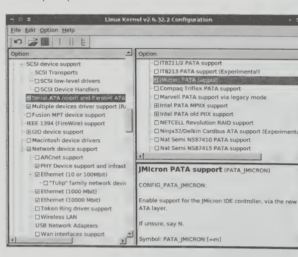

## 排除杂问题

**扫描内核配置** 内核源码树中的 `.config` 文件提供了驱动程序名称，但对于 `pata_jmmicron` 驱动程序，对应的字符串是 `CONFIG_PATA_JMICRON`。如果驱动程序设置为编译，它将被设置为 `y`（编译到内核中）或 `m`（作为模块编译），例如 `CONFIG_PATA_JMICRON=m`。尝试使用 `grep` 或文本编辑器的搜索功能来定位包含制造商名称或设备型号数字的行。但请注意，名称和型号数字有时可能会被截断或更改，并且某个型号可能适用于整个系列设备。偶尔设备制造商会合并或更改名称，这可能会使搜索此类名称变得复杂或困惑。

**查阅内核文档** Linux 内核源码目录中 `Documentation` 树下的内核文档文件提供了驱动程序的名称。您可以使用 `grep`（可能配合其 `-r` 选项进行递归搜索）来搜索制造商名称或设备型号数字。

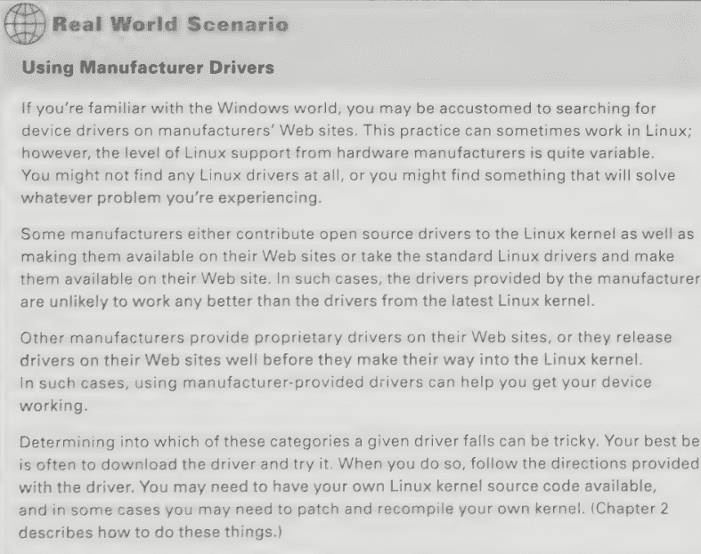

## 使用制造商驱动程序

如果您熟悉 Windows 世界，可能习惯于在制造商的网站上搜索设备驱动程序。这种做法在 Linux 中有时有效；然而，硬件制造商对 Linux 的支持程度差异很大。您可能完全找不到任何 Linux 驱动程序，或者您可能会发现某些可以解决您正在遇到的任何问题的东西。

某些制造商既向 Linux 内核贡献开源驱动程序，又在其网站上提供它们，或者采用标准的 Linux 驱动程序并在其网站上提供。在这种情况下，制造商提供的驱动程序可能不会比最新内核的驱动程序更好用。

其他制造商在其网站上提供专有驱动程序，或者在驱动进入 Linux 内核之前先在其网站上发布。在这种情况下，使用制造商提供的驱动程序可以帮助您让设备正常工作。

确定给定的驱动程序属于这些类别中的哪一可能是困难的。最好的办法是下载驱动程序并尝试它。当您这样做时，请遵循驱动程序提供的说明。您可能需要准备好自己的 Linux 内核源码，在某些情况下，您可能需要对内核进行补丁并重新编译。（第 2 章描述了如何进行这些操作。）

如果一个设备运行正常，而您偶然发现了某个制造商的驱动程序，我的建议是遵循老话“如果没坏就不要修”。用质量未知的驱动程序替换旧驱动程序可能有效，但至多也只是浪费您的时间。当然，如果驱动程序的文档承诺提供更的性能，或提供安全性或其他错误修复，即使您当前的驱动程序看起来运行良好，您也可能想尝试。但请注意日期；如果该文件是五年前的，并警告“当前”标准内核驱动程序存在严重错误，那么这些修复很可能早已整合到了您正在使用的驱动程序中！

## 检查日志文件

日志文件在解决问题时非常有用——调试不符合预期的服务器、定位系统入侵的证据等。您应该首先知道在任何情况下应该检查哪些日志文件。理解日志文件的识别能力将帮助您有效地使用它们。某些工具也可以帮助完成这项工作；这些工具可以扫描日志文件以获取信息，总结（有时过于冗长的）日志文件信息等。

## 哪些日志文件是重要的？

在使用日志时，您必须首先决定哪些是重要的。遗憾的是，日志文件的名称在不同发行版之间没有完全标准化，因此您可能需要查看您的 `syslog` 配置，可能以及日志文件本身，以发现哪些日志文件是重要的。表 11.6 总结了一些与 `/var/log/` 相关的常见日志文件。

表 11.6 常见日志文件

| 日志文件 | 用途 |
| :--- | :--- |
| cron | 该文件持有 cron 活动的信息 |
| dmesg |某些发行版会在启动后将内核缓冲区放在此命名的文件中 |
| lastlog | 这是一个特殊的日志文件；以二进制格式存储所有用户的最后登录时间。输入 `lastlog` 可以可读格式查看此数据。 |

| 日志文件 | 用途 |
| :--- | :--- |
| messages | 该文件有时持有内核的通用日志数据 |
| mail | 如名称所料，此文件持有与电子邮件系统的信息 |
| secure | 该文件持有安全相关信息 |
| syslog | 通用系统日志通常位于此文件 |
| X log | 此文件包含来自 X 服务器关于最近事件的信息。每次 X 服务器重启时通常会启动一个新的日志 |

`syslog.conf` 文件配置日志功能，以便查看系统如何放置各种类型的日志数据。例如，Samba 经常独立于 syslog 进行日志，将其存储在 `/var/log/samba/` 或类似的目录下。

如果您不确定某个日志文件的用途或重要性，请尽管查看它。“帮助扫描日志文件的工具”对这项任务很有帮助。对于基础识别，简洁可能非常有帮助，例如 `/var/log/messages`。

## 使用日志文件识别问题

您可以使用日志文件监控系统负载（例如，确定服务器交付了多少文档）、检查入侵尝试、验证系统功能，并查找某些程序生成的错误。所有这些都可以用于识别问题。当您进行故障排除时，有用信息示例包括：

**验证高负载** 如果服务器运行缓慢，日志文件可能包含大量条目。如果服务器处理的客户端数量或传输的文件大小剧增，您可能需要增加服务器的容量以恢复良好性能。大多数用户级程序不会记录其活动，尽管您可能无法通过增加需求的方式来诊断类似的负载问题。由于工作站用户应该知道他们正在运行更多或更复杂的程序，您可能会意识到工作站负载增加了。

## 第 11 章 • 系统故障排除 I：启动与内核问题


有时候，日志记录操作本身就会大幅增加服务器的 CPU 和磁盘 I/O 需求。如果服务器运行缓慢，请尝试降低其日志级别（以便记录更少的信息）。

入侵检测
某些问题与入侵者的存在有关。入侵者经常修改你的系统文件或实用程序，影响你系统的性能和可靠性。他们的行为有时会反映在日志文件中。即使是日志条目的缺失也可能是一个线索——入侵者经常会删除日志文件，或者至少在某段时间内移除条目。然而，除非你在被入侵入侵后立即检查日志文件，否则你可能不会注意到日志文件的差异。

系统功能正常运行
如果系统运行异常，常规日志文件中的信息存在可以帮助你确定问题，或者至少排除某些可能性。例如，假设你的系统正作为网络的动态主机配置协议（DHCP）服务器运行，为其他系统分配 IP 地址，正如第 7 章“高级网络配置”中所描述的那样。如果你的客户端没有收到 IP 地址，你可以检查服务器上的日志文件。如果该文件显示 DHCP 服务器已收到请求并响应授予了租约，你就可以将解决问题的精力放在客户端上。

缺失的条目
如果你知道某个程序应该记录信息但你找不到它，可能是该程序配置不当或未启动。在某些情况下，缺失的条目可能表明在你正在检查的计算机之外存在问题。例如，假设你配置 Samba 来记录访问尝试。如果你从另一个系统访问 Samba 服务器，可以检查 Samba 日志文件条目。如果这些条目不存在，可能意味着 Samba 未在运行、配置错误，或者有网络问题（如配置错误的路由器或防火墙）阻止了访问。

错误消息
日志文件中问题最直接的证据通常是错误消息。包含“身份验证失败”（authentication failure）或“登录失败”（FAILED LOGIN）等条目的日志文件表示身份验证失败，例如，这应该帮助你集中故障排除的精力。（用户看到的界面与日志文件中显示的可能不同，甚至完全没有显示。）为了提高这种能力，你可以配置许多服务器和实用程序记录比通常更多的信息；详情请查阅该程序的文档。请注意，不同系统产生的错误消息形式差异很大，因此一个程序的错误消息看起来会与其他程序的完全不同。

当你诊断内核、服务器、用户登录工具和其他各种层级实用程序的软件问题时，日志文件最有用。日志文件中常规记录的信息包括内核启动消息、内核模块操作、登录、`cron` 动作、文件系统挂载和卸载以及许多服务器执行的操作。这些信息可以反映硬件、应用程序、配置甚至用户问题。

排除杂项问题

# 使用工具扫描日志文件

日志文件的使用可能很棘，因为它们通常以快速速度累积数据。当许多程序的日志被发送到单个文件中，或者你为了识别问题而增加了程序中的日志级别时，情况尤为如此。因此，帮助扫描日志文件中重要信息的工具非常有帮助。你可以将这些工具分为三类：检查文件样本的工具、检查文件末端的工具以及用于搜索文件的工具。某些工具可以用于这两种甚至全部三项任务。


大多数日志文件归 root 所有，并且许多文件仅限 root 读取。因此，在使用这些工具之前，你可能需要获取 root 权限，尽管这些工具可以被其他用户用于非日志文件。

# 检查日志文件的开头

有时你知道某个条目出现在日志文件的开头。例如，你可能想研究启动过程的早期阶段，这些记录在 `/var/log/dmesg` 或类似文件中。你可以通过多种方式获取此类信息。专门用于显示文件开头的工具之一是 `head`。配合任何文件名作为参数，`head` 显示文件的前十行。你可以通过 `-n` 参数更改行数，例如使用 `head -n 20 file.txt` 显示 `file.txt` 的前 20 行。

如果你知道要查看的信息位于日志文件的开头，但不确定其确切位置，你可能更倾向于使用程序，如 `more` 或 `less`。`more` 程序每次显示一个屏幕的文件，无论你的屏幕大小如何。你可以按空格键每次向文件中移动一个。`less` 程序的名字像是个笑话，因为 `less` 意为比 `more` 更好；它基本上做了相同的事情，但在程序内部支持更多选项，例如搜索（稍后在“搜索日志文件”中描述）。不过，这两个程序都能让你快速检查文件的前几行。

文本编辑器也是检查文件前几行的良好方法。大多数文本编辑器在你在命令行上传递文件名时会打开文件并显示其前几行。文本编辑器有一些缺点，其是你可能会不小心删除日志文件，这是不希望的。另一个缺点是，在文本编辑器中打开日志文件可能比使用 `head` 或 `less` 显示前几行花费更长时间。如果文本编辑器或日志文件很大，情况尤为如此。

# 日志文件的开头

有时你知道某个条目出现在日志文件的开头。例如，你可能想研究启动过程的早期阶段，记录在 `/var/log/dmesg` 或类似文件中。你可以通过多种方式获取此类信息。专门用于显示文件开头的工具之一是 `head`。配合任何文件名作为参数，`head` 显示文件的前十行。你可以通过 `-n` 参数更改行数，例如使用 `head -n 20 file.txt` 显示 `file.txt` 的前 20 行。

如果你知道要查看的信息位于日志文件的开头，但不确定其确切位置，你可能更倾向于使用程序，如 `more` 或 `less`。`more` 程序每次显示一个屏幕的文件，无论你的屏幕大小如何。你可以按空格键每次向文件中移动一个长度。`less` 程序的名字像是个笑话，因为 `less` 意为比 `more` 更好；它基本上做了相同的事情，但在程序内部支持更多选项，例如搜索（稍后在“搜索日志文件”中描述）。不过，这两个程序都能让你快速检查文件的前几行。

文本编辑器也是检查文件前几行的良好方法。大多数文本编辑器在你在命令行上传递文件名时会打开文件并显示其前几行。文本编辑器有一些缺点，其是你可能会不小心删除日志文件，这是不希望的。另一个缺点是，在文本编辑器中打开日志文件可能比使用 `head` 或 `less` 显示前几行花费更长时间。如果文本编辑器或日志文件很大，情况尤为如此。

# 检查日志文件的结尾

信息被添加到日志文件的结尾。`tail` 设计用于显示文件的结尾，因此非常有帮助。默认情况下，`tail` 显示最后 10 行。你可以通过 `-n` 更改行数，例如使用 `tail -n 15 /var/log/messages` 显示最后的 15 行。

`tail` 的另一个功能是实时监控——你可以用它来观察发生的变化。要这样做，向 `tail` 传递 `-f` 或 `--follow` 选项，例如 `tail -f /var/log/messages`。结果是显示最后几行，然后将新条目回显到屏幕上。当你完成时，按 Ctrl+C 杀死 tail 并重新获得 shell 控制。

虽然分页器在显示大量行时不如 `tail` 方便，但检查日志文件的结尾很有用。使用 `less filename` 显示文件；然后输入 `G` 或按键跟随大于符号 `>`。这将带你到文件的末尾。如果你想向上滚动文件，输入 `b`。你可以通过按 `f`、空格键或按 Ctrl+V 向后滚动。使用这些命令，你可以快速检查任何文件的最后几行，包括日志文件。命令处理大型或快速变化的日志文件可能需要一段时间。如果它看起来没有响应，请等一下。如果日志文件的大小引起问题，你可能需要研究你的日志轮转设置，正如第 12 章“系统资源与用户环境”中所描述的。

# 搜索日志文件

有时你需要在日志文件中搜索信息。例如，你可能想查看由 Postfix 创建的所有条目，或者包含字符串 `eth0` 的条目。你可以使用任何文本搜索工具来帮助完成此类任务。

一个或多个文本文件并显示匹配的行，或者它们也可以带你进入这些文件中的匹配行，以便你可以在上下文中进行检查。

`grep` 命令是最基础的文本搜索工具。输入命令、一系列选项（包括搜索字符串）以及文件规范（通常包含通通配符）来在文件中搜索指定的字符串。例如，要找到由 Postfix 邮件服务器创建的所有日志记录，你可能输入 `grep postfix /log/*..`。结果是一系列输出行，每行都以其取自的文件名开头，并以相关的行结束。（如果是在二进制文件中找到了字符串，`grep` 会提示你速度较慢，这样你就不会尝试在上下文中显示该字符串。）

`grep` 命令在同时搜索日志文件中的条目时最有用——例如，如果你不知道哪个文件记录了日志信息。如果你想显示来自特定服务器的日志记录，或者涉及单个用户或通过其他可以轻松表述为可搜索字符串的准则的记录，它也很有用。

如果你使用 `grep` 搜索一个非常常见的字符串，输出可能会超出屏幕顶部，并可能超过可滚动 GUI 窗口的缓冲区。这可能会阻止你对出现该字符串的文件进行完全统计。你可以通过管道传递输出，例如 `grep postfix /var/log/* | less`，这将使你能够以更受控的方式扫描日志输出。

另一种搜索日志文件的方法是使用 `less`。你可以使用此实用程序查看单个日志文件。一旦你在查看文件，只需按下斜杠键（`/`）后跟搜索字符串，例如在日志文件中输入 `/postfix`。如果该字符串存在于文件中，`less` 将带你到那里并突出显示该字符串。再次按下斜杠键将移动到包含搜索字符串的下一行。如果你需要查看相关行的完整内容，此功能会非常方便。如果你想找到字符串的最后一次出现，按下 `Esc` 键按大于号（`>`）移动到缓冲区的末尾，然后使用问号（`?`，即带有 `Shift` 修饰符的斜杠键）反向搜索，例如 `?postfix`。你可以使用文本编辑器执行类似的搜索，但存在前面“检查日志文件开头”中描述的注意事项——文本编辑器可能比 `less` 等工具慢，而且你可能会意外修改日志文件。

## 使用额外的日志文件分析工具

使用 `tail`、`less` 手动检查日志文件可以提供信息，但存在其他工具可以帮助你分析日志文件。其中之一是 `Logcheck`，它是 Sentry Tools 软件包（http://sourceforge.org/projects/sentrytools/）的一部分。该软件包包含了一些发行版，例如 Debian。遗憾的是，它需要针对你自己的系统进行大量的自定义，因此如果它随发行版自带并针对其日志格式进行了预配置，那么实现起来最简单。如果你想在另一个发行版上使用它，必须编辑位于软件包核心的 `logcheck.sh` 文件。

调用检查日志内容的 `logtail` 实用程序，你还必须配置脚本来检查你监控的日志文件。你还可以调整某些功能，例如接收违规报告的用户，以及实用程序应在日志文件中查找的包含字符串的文件位置。配置完成后，你可以在 `cron` 任务中调用 `logcheck`。`Logcheck` 会向 `logcheck.sh` 中定义的用户（默认是 `root`）发送有关任何可疑系统日志的报告。

## 追踪软件问题

潜在问题不仅限于硬件和驱动程序问题。因此，软件也会给系统管理员带来头疼。当然，许多软件问题特定于创建它们的特定软件包；然而，某些工具和技术可以帮助解决在各种软件包中出现的问题。这些包括可以帮助追踪程序运行活动、识别程序所需的模块、找到打开的文件以及在二进制文件中定位字符串的工具。

## 追踪程序的活动

你启动了一个程序，但它由于崩溃而离开了你，且没有提供任何有助于诊断的错误消息——只有“段错误”（segmentation fault）或类似的无帮助信息。遗憾的是，这种情景很常见。

如果你从 GUI 菜单运行 GUI 程序，第一步是运行终端程序，并从文本模式 shell 观察异常的程序。即使是 GUI 程序，有时也会将错误消息到标准输出 `stdout` 或标准错误 `stderr`，如果你以这种方式启动 GUI 程序，这些将显示在控制台程序上。如果你通过图标或菜单项丢失程序，`stdout` 和 `stderr` 就会丢失，但如果你通过输入名称启动程序，可能会发现它们有些用处。

如果失败了，你可能可以使用 `trace` 程序追踪程序的操作来获取有关发生错误的线索，该程序监控程序所调的系统调用。要使用它，运行 `trace` 并传递你尝试使用的程序名称，以及你通常传递它的任何选项。结果将产生关于程序活动的大量输出：

```
$ file.txt
```


execve("/usr/bin/nedit", ['nedit', 'file.txt'], [/ 66 vars */]) = 0

brk(0) = 0x838000

mmap(NULL, 4096, PRO_READ|PRO_WRITE, MAP_PRIVATE|MAP_ANONYMOUS, -1, 0) = 0x7ff7ba4b

open("/usr/bin/nedit", O_RDONLY) = 3

brk(0) = 0x838000

mmap(NULL, 4096, PRO_READ|PRO_WRITE, MAP_PRIVATE|MAP_ANONYMOUS, -1, 0) = 0x7ff7ba4b

```
```

## 排除杂杂问题

输出将持续一段时间；我只了前几行。当程序崩溃时，输出将停止。你可以检查输出寻找发生错误的线索。问题可能出现在结束前的几行，因此你可能需要向上滚动。如果程序是因为支持库的问题而失败，`ltrace`可能会找到故障库以便你替换它。或者，你可能会升级或替换程序，使其使用你安装的库。例如，比较`ltrace`的前几行：

```
$ ltrace mine_file.txt

__libc_start_main(0x4097d0, 2, 0x7fff0aaf8, 0x4a2340, 0x4a2330
```

## 识别所需的库

理论上，Linux 软件包管理工具（如 RPM 包管理器 RPM 和 Debian 软件包工具）保证程序所依赖的所有软件都已安装。在实践中，这种保证会被违反——可以在软件包系统之外安装软件、软件包文件中的依赖项可能列错误、可以在没有软件包系统帮助的情况下意外删除文件等等。

## 第 11 章 • 系统故障排除 I：启动与内核问题

`ldd`程序有时对于识别缺失的库文件非常有用——即二进制文件执行任务时所依赖的补充性程序代码。要使用`ldd`，请传递程序执行文件的路径：

```
$ ldd /usr/bin/zip

linux-vdso.so => /lib1b2.so.1 (0x000007f5fe625c000)

lib1b2.so.6 => /lib/lib1b2.so.6 (0x000007f5fe5f03000)

lib6c.so.6 => /lib/lib6c.so.6 (0x000007f5fe5f03000)

/lib64/ldd-linux-x86-64.so.2 (0x000007f5fe646d000)
```

此示例二进制文件有四个依赖。其中第一个`linux-vdso.so`是虚拟动态共享对象（VDSO），它是程序本身的一部分，无需额外关注。其余三个库已在该系统中找到。前两个`lib1b2.so.1`和`lib1bc.so.6`在二进制文件中是通过名称而非完整路径引用的，系统已在库路径中找到了它们。第三个`/lib64/ldd-linux-x86-64.so.2`在程序文件中是通过完整路径引用的；它必须存在于该位置才能工作。

如果程序所需的库不存在，字符串`not found`（未找到）将替换字符串右侧的完整路径。此类程序无法正常运行；你可能会收到关于缺失库的错误消息，然后程序将终止。

有时，你可以通过创建符号链接来解决库问题。例如，如果一个二进制文件引用了`libfoo.so.1`而该文件不存在，但你确实找到了一个名为`libfoo.so.1.0`或`libfoo.so.2`的文件，那么在所需的名称下为该文件创建一个符号链接可能会满足程序。例如，如果你有`libfoo.so.2`，不要创建一个从它到`libfoo.so.1`的链接。在这种情况下，你应该找到正确版本的库，或者替换程序以使其使用你拥有的库。第 12 章将更详细地介绍库管理。

> 库可以使用其他库来解析自身。即使一个程序的库依赖项全部满足，但如果其中一个依赖未满足，它仍可能无法运行。你可以以递归的方式对库文件本身运行`ldd`，以验证所有所需的库是否已存在。

## 打开打开的文件

某些问题可能是由打开方式不当的文件引起的。例如，打开的文件可能会阻止你卸载文件系统。你可以使用`lsof`命令识别所有打开的文件，该命令在第 5 章“网络配置”中已结合网络功能进行过描述。单独使用该命令时，会生成计算机上所有文件的列表，以及打开这些文件的用户和其他信息。

## 排除杂杂问题

你可能想通过`grep`管道处理结果以搜索包含指定字符串的输出，或者使用`-u user[user2...]`选项将输出限制为指定用户的文件。例如，假设你无法卸载`/mnt/cdrom`，因为该设备上有一个文件正在使用。你可以这样输入：

```
$ lsof | grep cdrom

bash 20139 paul DIR 11.0 6144 1728 /mnt/cdrom
```

此输出显示用户`paul`打开了一个正在使用`/mnt/cdrom`的 shell。如果你是`paul`，你可以搜索该文件并切换到另一个目录以便卸载磁盘。如果不是，你可以联系该用户进行操作，或者使用 root 权限通过其进程 ID（PID）杀死违规进程（输出的第二列——本例中为`20139`）。当然，杀死此类进程可能会打扰拥有这些进程的用户，但某些操作是必要的。

## 在二进制文件中定位字符串

有时，定位二进制文件中的字符串非常有帮助。例如，你可能需要识别哪几个程序文件生成了特定的消息；或者你可能需要扫描文字处理文件，但没有可以读取该程序格式的程序。`strings`工具在这种情况下很有帮助。该程序在二进制文件中搜索 ASCII 文本或其他已知编码，并将结果字符串显示在屏幕上。输出如下：

```
$ strings chapter11.doc
```

bjbjU
第 11 章：系统故障排除 I：启动与内核问题
本章涵盖了以下 Linux 职业学院目标：

- 213.1 识别启动阶段并排除启动加载器的故障（权重: 4）
- 213.2 普通故障排除（权重: 5）

当然，这个示例的文本后面还有很长！在实践中，你可能需要少用一些管道处理结果或将其重定向到文件。某些字符串是虚假信息——第一行输出`false` (`bjbjU`)——并不是文档的一部分。如果你对 Linux 程序文件应用`strings`，你会发现许多虚假信息。根据你的需求，其他输出行可能也会感兴趣。


某些字符串是虚假信息-

# 第 11 章 系统故障排除 I：启动与内核问题

它们还存储了来自服务器和其他守护进程的消息。此类系统日志消息可以提供有关服务器崩溃、正常用户登录、登录失败尝试等信息。内核环形缓冲区（ring buffer）和系统日志文件都可以记录正常和异常操作的信息。

## 总结需要学习的工具。

这些 CPU，而`/proc/cpuinfo`文件提供了关于 CPU 的更详细信息。`lspci`和`lsusb`工具分别提供有关 PCI 和 USB 设备的信息。这些信息允许你验证设备对系统是否可见，但不能证明是否存在用于访问该设备的驱动程序。`lsdev`工具总结了关于设备如何使用硬件资源（中断、DMA 通道和 I/O 端口）的信息。

## 解释 Linux 中如何管理内核模块。

内核模块是驱动程序和其他内核功能，它们可以在内核启动后加载和卸载。`insmod`工具加载单个内核模块，而`modprobe`则加载一个模块及其依赖的所有模块。你可以通过`lsmod`程序学习加载了哪些模块。通常情况下，Linux 在需要时加载内核模块，但如果这些自动机制失效，你可能需要手动干预。

## 总结可以帮助跟踪程序运行的工具。

你可以使用`strace`程序来跟踪程序的系统调用，这可以帮助你识别某些崩溃的原因。同样，`ltrace`将跟踪程序的库调用。`ldd`程序识别程序所依赖的所有库。

## 复习习题

- 1. BIOS 可能会在哪里找到启动加载程序？
  A. RAM
  B. /dev/boot
  C. MBR
  D. /dev/kmem

- 2. 你可能编辑以下哪些文件来配置 GRUB Legacy？（选择所有适用项。）
  A. /boot/grub/menu.1st
  B. /etc/boot.conf
  C. /boot/grub/grub.conf
  D. /boot/menu.conf

- 3. 在编辑`/etc/lilo.conf`文件后，你必须采取什么操作，假设该文件与你的安装有关？
  A. 以 root身份输入`lilo-install`。
  B. 以 root身份编辑`/boot/grub/grub.cfg`。
  C. 以 root身份编辑`/boot/lilo/lilo.cfg`。
  D. 以 root身份输入`lilo`。

- 4. 你可以使用什么工具完全禁用计算机主板上内置的硬件？
  A. `insmod`工具
  B. 固件的设置工具
  C. GRUB 2 的`hwdel`命令
  D. `initrd`命令

- 5. 在基于 EFI 的系统中，GRUB 2 可能加载哪两个软件组件？（选择两个。）
  A. EFI 驱动模块
  B. 一个 Linux 内核
  C. `/etc/passwd`的内容
  D. 一个初始内存磁盘

- 6. 你尝试启动计算机，但只得到 *grub>* 提示符。你接着输入以下命令并收到响应：

```
grub> ls

(hd0) (hd0,1)
```


```
你的 Linux 内核最可能位于？
A. 在 /dev/hda0 上
B. 在 /dev/hd0 上
C. 在 /dev/sd0 上
D. 在 (hd0,1) 上

- 7. 如果 `/etc/init.d` 存在于 Linux 计算机上，通常有什么？
A. Upstart 配置文件
B. 启动加载器配置文件
C. SysV 启动脚本
D. BIOS 配置工具

- 8. 你编译了一个新内核并为它创建了新的 GRUB 2 配置。然而，在你刚重启后，你发现自己在 GRUB 配置文件中误写了新内核的文件名。尽管有此错误，你如何启动新内核？
A. 从 GRUB 菜单中选择几乎正确的条目，并输入 E 进行编辑。
B. 从 GRUB 菜单中选择“Create Entry”创建一个新条目。
C. 从 GRUB 菜单中选择“Auto-Detect OSs”来检测你的新内核。
D. 你不能。

- 9. 你在带有单个 SATA 磁盘的计算机上安装了 Linux 并使用 GRUB 2 启动它。在实验磁盘工具时，你不小心覆盖了 GRUB 的 MBR 条目。你使用 Super GRUB Disk 启动进入正常的 Linux 安装。你如何将 GRUB 重新安装到 MBR，以便将来不需要使用 Super GRUB Disk 即可正常启动？
A. 以 root 身份编辑 `/boot/mbr/contents`。
B. 以 root 身份输入 `mbr-restore /dev/sda`。
C. 以 root 身份输入 `grub-install /dev/sda`。
D. 以 root 身份编辑 `/boot/grub/grub.cfg`。

- 10. 你想检查内核环形缓冲区以调试硬件问题。你会如何做？
A. 在命令提示符下输入 `ringbuffer`。
B. 在命令提示符下输入 `dmesg`。
C. 重启并在 GRUB 的内核行中添加字符串 `ring`。
D. 安装一个令牌环设备并检查其输出。

- 11. 你安装了一个新的 PCI 以太网卡，但它似乎无法工作。你可以做什么来验证硬件对 Linux 可见？
A. 输入 `ping 127.0.0.1` 检查连通性。
B. 检查电缆是否插紧。
C. 在命令提示符下输入 `cat /proc/net`。
D. 在命令提示符下输入 `lspci`。

- 12. 管理员在提示符下输入 `lsusb`。将显示哪些信息？
A. 关于 USB 控制器的基本信息
B. 关于连接的驱动程序和功能
C. 关于传输数据的报告
D. USB 设备的总结

- 13. 以下哪些命令加载内核模块？（选择所有适用项。）
A. `rmmod`
B. `modprobe`
C. `lsmod`
D. `insmod`

- 14. 你使用 USB 驱动器并在驱动器仍挂载时输入 `lsmod`，但没有看到你需要的模块条目。这可能是为什么？
A. `lsmod` 命令显示正在使用的驱动。
B. `lsmod` 命令显示输入时刻的信息。
C. `lsmod` 命令仅显示内置。
D. `lsmod` 命令显示硬件设备。

- 15. 一台计算机已连续运行六个月，你想检查其内核环形缓冲区以确定它是如何检测网卡的。你发现此信息不存在，因为之后大量的内核消息。你应该去哪里查看？
A. `/proc/dmesg`
B. `/var/log/ethn` 其中 n 是设备号
C. `/var/log/dmesg`
D. `/tmp/ringbuffer`

# 第 11 章 系统故障排除：启动与内核问题

A. `cat /proc/cpuinfo`
B. `less /var/log/cpu`
C. `uname -i`
D. `lspci`

17. 你怀疑两个设备可能错误地共享相同的 I/O 空间。你如何测试这个假设？
A. `/proc/interrupts`
B. `/proc/dma`
C. `ismod`
D. `lsdev`

18. 一个程序神秘地崩溃且没有留下错误信息。以下哪些工具可能提供有关问题来源的线索？选择两个：
A. `strace`
B. `strings`
C. `uname`
D. `ltrace`

19. 一台 NFS 服务器 smallserver 只有一个客户端 smallclient。你想关闭 smallserver 进行维护，但在之前，你想确保现在没有人在访问其文件。你可以在 smallclient 上输入什么命令来实现这一点？（smallserver 的共享目录都挂载在客户端的 "sharedfiles" 目录下。）
A. `top | grep sharedfiles`
B. `lsof | grep sharedfiles`
C. `lsdev | grep sharedfiles`
D. `lsmod | grep sharedfiles`

20. 对于以下哪些文件类型，strings 可能会返回有意义的数据？
A. 使用 gzip 压缩的系统日志文件 (/var/log/messages)
B. 使用 tar 归档（但未压缩）的一组纯文本文件
C. 在 x86 计算机上运行 strings 时处理 PowerPC 可执行二进制程序文件
D. 1989 年创建的打印 PostScript 文件

## 复习题答案

- 1. C. 主引导记录 (MBR) 可以包含一个很小的引导加载程序以正确分配空间。如果需要更多空间，引导加载程序必须加载一个二级加载程序。引导加载程序被加载到 RAM 中，它不会永久存储在那里，因为 RAM 是易失的，所以选项 A 是正确的。`/dev/boot` 和 `/dev/mem` 均指 Linux 系统上的文件，它们只有在 BIOS 找到加载程序并发生其他启动过程后才有意义，因此选项 B 和 D 是错误的。

- 2. A, C. 额外的 GRUB Legacy 配置文件名是 `/boot/grub/menu.lst`；然而，某些发行版使用 `/boot/grub/grub.conf`。在那种情况下，选项 B 和 C 是虚构的。

- 3. D. LILO 依赖 `l110` 工具读取 `/etc/l110.conf` 并写入二进制代码，将配置文件反映到引导加载程序可以读取的位置。在编辑 `/etc/l110.conf` 后，你必须像选项 D 所示，使用 `l110` 重新安装引导加载程序。选项 A 的 `l110-install` 命令是虚构的（尽管有 `grub-install` 命令来安装 GRUB）。`/boot/grub/grub.cfg` 是 GRUB 2 配置文件，因此与 LILO 配置无关，选项 B 是虚构。没有 `/boot/l110/l110.cfg` 文件，因此选项 C 是错误的。

- 4. B. 带有固件配置工具的计算机可以完全禁用计算机内置的一些硬件设备等。选项 B 是正确的。Linux 的 `insmod` 工具可以加载内核模块。此操作会禁用硬件，但在 Linux 下可以使其可用，选项 A 的效果与指定相反。选项 C 描述了一个虚构的命令。没有标准的 `initrd` 命令，尽管这是一个指的是初始 RAM 磁盘（initial RAM disk）的术语，它用于在 Linux 内核挂载其最终根 (/) 文件系统之前加载内核模块和设置程序。

- 5. B, D. 无论运行在基于 BIOS 的计算机还是基于 UEFI 的计算机上，启动 Linux 时，GRUB 2 都会加载内核并通常初始化初始 RAM 磁盘，因此选项 B 和 D 是正确的。EFI 驱动程序可能在启动 GRUB 2 之前由 EFI 加载，但它们不是由 GRUB 2 加载的，因此选项 A 是正确的。Linux 在 GRUB 2 完成工作很久之后读取 `/etc/passwd` 的内容，因此选项 C 是错误的。

- 6. D. GRUB1 命令的输出显示 GRUB 可以看到一整个硬盘，标识为 `(hd0)`，该磁盘有一个分区，GRUB 将其识别为 `(hd0,1)`。内核有一个可能的所在地：`(hd0,1)`。该分区对应 `/dev/sda1`，但它也可能是 `/dev/home` 或另一个设备。选项 A、B 和 C 描述的都是非标准的 Linux 设备描述符，它们中没有一个是内核可能的位置。导致 GRUB 显示 `grub-prompt` 的问题可能是严重的，即 GRUB 无法检测到硬盘，那么内核可能位于其他地方。根据提供的信息，选项 D 是所指定选项中唯一可能的位置。

- 8. 你可以像选项 A 所示，通过选择它并输入 E 进入 GRUB 2 菜单。然而，你必须确切知道错误是什么，或者能够使用 GRUB shell 定位确切的文件。GRUB 交互式菜单没有“创建条目 (Create Entry)”或“自动检测操作系统 (Auto-Detect OS)”选项，选项 B 和 C 是正确的。由于选项 A 是正确的，选项 D 不可能正确。

- 9. `grub-install` 工具将 GRUB 安装到 MBR 或 GRUB 配置文件或命令行中指定的其他位置，因此选项 C 是正确的。没有 `/boot/mbr/contents` 文件或 `/mbr-restore` 实用程序，因此选项 A 和 B 都是正确的（此处原文如此）。尽管 `/boot/grub/grub.cfg` 是 GRUB 2 的配置文件，但 Super GRUB Disk 能够启动计算机的事实意味着该文件是完整的，可以启动 Linux，因此它不需要被编辑。进一步编辑此文件无法修复 MBR 的损坏，因此选项 D 是正确的。

- 10. `dmesg` 命令显示内核环形缓冲区，其中保存内核消息，选项 B 是正确的。没有标准的 `ringbuffer` 命令，因此选项 A 是错误的。启动时向内核选项中添加 `ring` 不产生预期的效果，因此选项 C 是正确的。Token Ring（令牌环）是一种网络硬件标准，不是检查内核环形缓冲区的方法，因此选项 D 是正确的。

- 11. `llsp` 命令出所有检测到的 PCI 设备，如果卡安装正确并正常工作，它应该出现在 `llsp` 输出中。因此，选项 D 是正确的。虽然 `ping` 可以是一个非常有用的网络诊断工具，但选项 A 使用它并不测试以太网卡，因此选项是错误的。选项 B 提供了良好的网络调试建议，但它无法验证该卡对 Linux 可见。没有 `/proc/ethernet` 文件，因此选项 C 无无帮助。

- 12. `lsusb` 命令汇总计算机可用的 USB 设备，如选项 A 所示。选项 B、C 和 D 都是事实性的（此处原文如此）。

- 13. B, D. `mod` 命令加载模块，并在必要时加载其所依赖的所有项。`insmod` 命令加载模块，但仅在满足所有依赖项时才加载。因此，选项 B 和 D 是正确的。`rmmod` 命令移除模块，`lsmod` 显示模块，因此选项 A 和 C 是错误的。

- 14. `lsmod` 显示当前加载的模块。因此选项 B 是正确的。`lsmod` 显示硬件使用，并搜索列表中的任何包含共享文件的输出。这将实现指定的目标。

- 15. 大多数压缩技术将纯文本字符串替换为难以被提取的紧凑形式，因此选项 A 是正确的：`strings` 返回的顶多是无意义或无用的短字符串。`lsmod` 显示了关于 CPU 的信息，除非你知道程序与某些 CPU 不兼容，选项 A、B 和 D 都是虚构的。

- 16. `/proc/cpuinfo` 文件包含 CPU 信息，因此使用 `cat` 查看可以检索所需信息，选项 A 是正确的。没有标准的 `/cpu` 文件，因此选项 B 是错误的。虽然 `uname` 工具返回关于 CPU 的信息，选项 C 是错误的。`lspci` 返回 PCI 设备信息，且它没有 `--cpu` 选项，因此选项 D 是错误的。

- 17. `ldev` 工具汇总了各种设备，包括它们的地址。因此 D 将测试假设。你必须注意同一个设备可能在输出中被多次标识`/proc/interrupts` 和 `/proc/dma` 报告中断和 DMA 通道，而不是端口；这些选项不起作用（你可以输入 `/proc/ports`，效果与选项 D 相同）。选项 C 的 `lsmod` 显示内核模块，而不是空间，所以它是正确的。

- 18. `Strace` 运行程序并跟踪其系统调用，在这种情况下可以是一个非常有用的诊断工具。同样，`ltrace` 工具运行程序并跟踪其库调用，也可以是一个非常有用的诊断工具。因此，选项 A 和 D 是正确的。`strings` 程序扫描二进制文件中的字符串并显示它们。这对于某些任务可能有用，但不太产生关于程序崩溃的任何有用信息。`uname` 工具显示内核和 CPU 的信息，但除非你知道程序与某些内核或 CPU 不兼容，否则这些信息可能没有帮助。

- 19. B 使用 `ls` 工具列出所有打开的文件并搜索列表中的任何包含共享文件的输出。这将实现指定的目标。选项 A 的 `top` 命令按 CPU 使用率（或其他设置参数）显示进程列表。选项 C 的 `lsdev` 显示硬件使用。选项 D 的 `lsmod` 显示当前加载的模块。

- 20. 大多数压缩技术将纯文本字符串替换为难以被提取的紧凑形式，因此选项 A 是正确的：`strings` 返回的顶多是无意义或无用的短字符串。`tar` 工具将文件归档在一起但不进行压缩，因此 `strings` 会提取选项 B 中描述的原始纯文本文件。无论原始可执行格式如何，`strings` 都会提取与程序提示相关的字符串，以及二进制程序文件中的变量名和其他数据，因此选项 C 是错误的（此处原文如此）。尽管 PostScript 文件可以表示图形文件，但它包含纯文本 PostScript 命令，`strings` 会提取字符串，因此选项 D 是错误的（文件的创建日期与之无关）。

# 第 12 章

# 系统故障排除 II：系统资源与用户环境

本章涵盖了以下 LINUX 职业认证考试目标：

- 213.3 排除系统资源故障（权重: 5）
- 213.4 排除环境配置故障（权重: 5）


本章继续了在第 11 章“系统故障排除：引导和内核进程”中开始的故障排除工具和技术的检查。本章涵盖了高级问题，包括系统初始化问题、内核运行时问题、账户困难、bash 以及其他 shell 问题、当前运行（或未运行但应该运行）的进程，以及与定期调度进程相关的问题。

第 11 章开头描述的通用故障排除技术与第 11 章描述的技巧同样适用于这些问题。本章涵盖的问题只是适用于另一组症状和原因。

## 排除系统初始化故障

第 11 章包含了关于排除引导过程早期步骤故障的信息，包括引导加载程序和 Linux 启动系统的部分。本章涵盖了额外的系统初始化问题，包括 init 进程、本地启动脚本和登录过程困难。

## 管理初始化进程

如果 Linux 没有正确初始化，首先要检查它使用的是什么初始化系统。正如第 1 章“系统启动与高级系统管理”所述，今天 Linux 上有两种常见的启动系统：System V (SysV) 启动脚本和 Upstart。Upstart 包含一个 SysV 兼容层，因此某些 SysV 问题也适用于 Upstart。这些系统的变体，特别是 SysV 脚本非常常见，因此你可能会遇到特定发行版的问题。

## 管理 SysV 问题

SysV问题的存在可能是由于 `/etc/inittab` 中的问题（该文件设置运行级别并启动几个基本进程），或者由于 SysV 启动脚本中的问题（这些启动系统服务）。

## 修复 /etc/inittab 问题

`/etc/inittab` 的一个常见问题是运行级别设置错误。这是通过 `id` 行设置的，该行通常位于文件开头：

`id:3:initdefault:`

此示例将运行级别设置为 3。在 Red Hat、Fedora、Mandriva、OpenSUSE 以及其他发行版上，运行级别 3 会启动文本模式多用户模式，因此 X 不会在运行级别 3 下运行。当你需要 X 运行时但它没有运行，错误的默认运行级别可能是问题所在（Debian、Ubuntu、Gentoo 以及其他发行版通过使用 SysV 或 Upstart 启动脚本启动 X，因此如果 X 无法启动，运行级别对它们来说可能不是问题）。

> 使用 Upstart 的计算机经常缺少 `/etc/inittab` 文件；但你可以添加一个来设置默认运行级别。使用 `id` 行对其进行配置，但设置你想要使用的默认运行级别。

第 1 章表 1.1 描述了所有运行级别的常规功能。如果计算机一启动就关机或重启，你可能错误地将运行级别设置为 0 或 6。默认运行级别 1 将系统引导到单用户模式，这通常是不可取的。

你可以通过 `runlevel` 命令检查当前的运行级别，它会返回上一个和当前的运行级别：

### S runlevel

`N 5`

此示例显示计算机当前处于运行级别 5。N 意味着自启动以来它没有进入过其他运行级别。如果系统更改了运行级别，N 将被另一个运行级别替换，例如 3。正如第 1 章所述，你可以使用 `telinit` 命令更改运行级别，例如使用 `telinit 3` 到运行级别 3。

`/etc/inittab` 的后续行开始启动各种进程，包括启动 SysV 启动脚本的 rc 脚本、处理控制台和 RS-232 串行登录的 getty 进程等。某些发行版使用 `/etc/inittab` 来启动 X，要么单独独立启动，要么与 SysV 启动脚本结合使用：

```
x:5:respawn:/etc/X11/pref -nodisam
```


取自 CentOS 系统，以第一个字段的单独字符 `x` 开头，在此示例中，它只在运行级别 5 下工作，并使用 `/etc/X11/pref` 脚本启动 X 和 X 显示管理器 `XDM` 程序。如果 X 没有启动，此行的配置错误可能是罪魁祸首；然而，基于 Upstart 甚至某些 SysV 系统使用 SysV 启动脚本来启动 X。因此，你必须检查

特定发行版的文档或 X 正常启动时的 `/etc/inittab` 备份，以确定是否需要更改此行。

## 修复启动脚本问题

当计算机启动时，它会显示与启动 SysV 服务成功或失败相关的启动消息：

`Starting Apache...`

此示例表明 Apache Web 服务器启动失败。大多数此类问题必须以针对启动失败服务的特定方式来处理，因此你应该考虑本书中的相关章节、任何可能相关的日志文件、在线文档或针对相关服务器或子系统的专业书籍，以解决问题。

如果服务器没有启动且你没有看到关于它的启动消息，它可能被配置为不在当前运行级别下启动。你应该首先检查当前的运行级别并验证其是否正确。如果不是，更改运行级别，并可能更改 `init` 以确保你的系统未来引导到正确的运行级别。

一旦你确定处于正确的运行级别且服务没有运行，你应该检查适当的 SysV 启动目录中启动脚本的符号链接。这些目录通常称为 `/etc/rc.d/`、`/etc/rc.d` 或 `init.d/rc.n`，其中 `n` 是运行级别。Gentoo 使用一种不寻常命名运行级别系统，并将启动链接放置在 `/etc/runlevels/name` 中，其中 `name` 是运行级别的名称。

运行级别启动脚本命名为 `Sname` 或 `Kname`，其中 ## 是两位数字，`name` 是指向脚本的链接名称。以 `S` 开头的链接是带有 `start` 参数运行的脚本，以 `K` 开头的链接是带有 `stop` 参数运行的脚本。如果运行级别目录中的脚本名称以 `K` 开头，它将不会启动。如果它应该启动，请更改名称使其以 `S` 开头（Gentoo 仅使用名称；运行级别目录中的脚本）。一个重要的注意事项是，你必须正确设置两个数字的序列号。某些发行版在分发发行版中包含了包含合适数字的脚本。在其他一些发行版中，你可以从 99 减去停止数字获得启动数字。例如，如果当前级别是 `K37somever`，正确的启动值将是 `99 - 37 = 62`，你应该将链接重命名为 `S62somever`。

如果某个服务正在启动而你不希望它启动，你可以通过重命名符号链接使其以 `K` 而不是 `S` 开头来反转这一过程。删除符号链接（例如）将防止服务在你直接进入该运行级别时启动，但如果你从已启动服务的另一个运行级别进入该运行级别，这将不能保证服务关闭。你应该重命名 SysV 链接而不是删除它们。

## 管理 Upstart 问题

Upstart 是比 SysV 更新的启动系统，因此文档没有那么详尽，且帮助你管理的工具也较少。使用 Upstart 的主要发行版 SysV 兼容层，因此你可以使用 SysV 方法管理某些服务。正如前面所述，这是通过 `/etc/inittab` 设置默认运行级别。

随着发行版迁移到 Upstart 原生启动方法，你需要开始管理 `/etc/init.d` 或 `/etc/event.d` 目录下的 Upstart 配置，以调整在特定运行级别或响应其他事件启动的服务。第 1 章描述了 Upstart 配置文件的基本功能，因此你应该参考它来学习如何管理 Upstart 服务。特别是，如果一个服务没有启动而你希望它启动，或者正在启动而你不希望它启动，你可能需要搜索字符串 `runlevel` 并调整运行级别列表。例如，配置文件可能包含以下行：

```
start on runlevel [2345]

stop on runlevel [1234]
```

这些行告诉 Upstart 在运行级别 2 到 5 中启动服务，并在 2 到 5 之外的所有运行级别中停止它。（感叹号 `!` 是一个常用字符，可以读作“非”；第二行指的是“非 2, 3, 4 或 5”的运行级别）。如果你不希望服务在运行级别 5 启动，你应该从两个列表中移除 5。

# 处理本地启动脚本

有时，你希望通过 SysV 脚本或 Upstart 系统以外的其他方式启动服务。这种情况常见于你自己编译了服务器，或者从并非你所使用的发行版的包文件中安装了服务器。在这些情况下，程序可能没有带有 SysV 启动脚本或 Upstart 配置文件，或者提供的脚本或文件在你的系统上无法正常工作。

许多 Linux 发行版包含一个在 SysV 启动脚本之后运行的启动脚本。该脚本通常被称为 `/etc/rc.local`、`/etc/rc.d/rc.local`、`/etc/rc.boot/.local` 或类似的名称。（旧版本的 Debian 使用目录 `/etc/.rc.local`，但这种用法已废弃。）此类脚本的首要挑战是确定正确的名称，这高度取决于发行版的特定性。尝试输入 `find -name "local"` 来查找候选文件，或者参考你所在发行版的文档。

无论名称是什么，你都可以在本地启动脚本中输入程序文档中所描述的用于手动启动程序的命令，从而启动服务器或其他程序。例如，你可能包含以下行代码来启动 FTP 服务器：

```
/usr/sbin/vsftpd &
```

本地启动脚本的一个常见问题与连接符号 `&` 的存在（或缺失）有关。如果此符号不存在，且程序在终止之前不会将控制权返回给调用程序，那么脚本将停止执行，直到程序终止。对于服务器或其他守护进程，这可能需要很长的时间，因此除非使用 `&` 在后台启动守护进程（如前面的示例所示），否则脚本中的后续行可能不会执行。某些守护进程被设计为始终在后台运行，因此不需要 `&` 符号。其他程序则应该运行并立即终止。例如，`iptables` 程序（在第 7 章“高级网络配置”中描述）执行速度快并会终止，因此通常不带上 `&` 调用。底线原则是，你必须检查程序的文档以了解如何调用它们。如果有疑问，请进行实验。

通过本地启动脚本运行服务器时需要记住的一点是，这种方法没有提供关闭服务器的方法，而通过向 SysV 启动脚本传递 `stop` 参数可以做到。如果你想停止此类服务器，你需要使用 Linux 的 `kill` 或 `killall` 命令，可能需要先通过 `ps` 定位服务器的进程 ID 数字。例如，以下序列可以停止 `vsftpd` 服务器：

```
# ps ax | grep ftp
6382 ? S 0:00 vsftpd
# kill 6382
```

# 系统初始化故障排除

# 管理登录进程

登录过程主要分为三种类型，尽管某些登录方法跨越了类别：本地文本模式登录、GUI 登录和网络登录。每种方法都有自己的挑战，尽管也存在某些共同点。

## 管理文本模式登录

当你登录到文本模式控制台时，你正在使用虚拟终端。要理解虚拟终端，请记住 Linux 被设计为 Unix 的克隆，而 Unix 是一个多用户操作系统。传统的 Unix 系统支持许多同时在线的用户，每个用户通过一个物理终端工作——这是一个由键盘、显示器和可能还有鼠标组成的设备——它允许用户访问远程计算机。你可以在 Linux 中使用终端，但标准 PC 只有一个主键盘和显示器。为了提高可用性，Linux 支持配置系统使这些设备可以像多个终端——也就是说，它们是虚拟的。每个虚拟终端可以运行一个独立的程序，甚至可以在不同的用户名下登录。此功能使你能够运行许多程序并在它们之间轻松切换。

大多数标准安装定义了六个虚拟文本终端，通过按下 `Alt+F1` 到 `Alt+F6` 访问。在基于 SysV 的系统中，这些终端在 `/etc/initab` 配置文件中定义，使用如下行：

```
1:2345:respawn:/sbin/getty tty1
2:2345:respawn:/sbin/getty tty2
3:2345:respawn:/sbin/getty tty3
4:2345:respawn:/sbin/getty tty4
5:2345:respawn:/sbin/getty tty5
6:2345:respawn:/sbin/getty tty6
```

这些行告诉系统在 `tty1` 到 `tty6` 上运行 `getty`——即第一个虚拟终端。基于 Upstart 的系统通常在 `/etc/init` 或 `/etc/event.d` 下的 `ttyn.conf`中包含等效配置，其中 `n` 是终端编号；然而，单个终端的配置可能会跨几行：

```
start stopped rc2
start stopped rc3
start stopped rc4
```

```
stop on runlevel 0
stop on runlevel 1
stop on runlevel 6
```

```
respawn
exec /sbin/getty tty1
```

# 第 12 章 • 系统故障排除 II

`mingetty` 程序是统称为 `get` 程序的多个程序之一。这些程序管理终端（物理或虚拟）与接受用户登录的登录程序之间的交互。有多个 `get` 程序可用，不同的发行版偏好不同的 `get`。

文本模式登录过程出现严重问题很少；如果相关的配置文件损坏，你可能需要从备份或示例中重新创建它。请务必使用你所在发行版的示例。

你可能想调整系统支持的虚拟终端数量。如果是这样，你可以通过从 `/etc/initab` 中添加或删除行来引用正确的终端编号（`tty1`、`tty2` 等）。如果你作了此类更改，你可能需要修改 `/etc/init` 或 `/etc/event`。

此配置的变体适用于通过 RS232 串口或调制解调器登录。这些配置看起来与虚拟登录配置非常相似，但它们使用设备引用——通常是 `ttyS` 而不是 `ttyn`。特别是，`mingetty` 只支持本地终端，不支持 RS232 串口或调制解调器。如果你需要配置计算机以支持此类登录，你应该咨询你打算使用的 `get` 程序的文档。

通过 RS232 串口和调制解调器登录曾是支持“哑终端”用户或拨号调制解调器用户的常用手段。今天，此类用户更有可能使用网络登录方法。

本地登录有时会因为身份验证问题出现故障。通常，`get` 程序依赖登录程序来显示登录提示、提示密码并验证用户身份。有时这些工作不正常，通常是因为可插拔认证模块（PAM）配置的损坏。第 10 章“安全”更详细地描述了 PAM 配置。如果你怀疑 PAM 配置损坏，最好的办法是恢复 PAM 配置文件，特别是登录文件以及任何其他文件到其默认设置。如有必要，你可以使用包管理器搜索 `/etc/pam` 所属的包并重新安装它。你可能需要在应急恢复磁盘的帮助下从正常的安装中拷贝文件。请确保使用与问题系统运行相同发行版本的文件。

Linux GUI 登录由使用 X 显示管理器控制协议（XDMP）的程序处理。常用的三种 XDMP 程序：原始的 `XDM`、GNOME 显示管理器（`GDM`）和 KDE 显示管理器（`KDM`）。`GDM` 和 `KDM` 是 Linux 上常用的 XDMP 程序。这些程序使使用户

# 系统初始化排排除

用于选择他们的桌面环境、关闭计算机以及设置各种选项。相比之下，`XDM` 非常简陋；它只接受用户名和密码。

某些登录问题与 PAM 配置有关，这些问题需要修复 PAM 登录文件，因为登录时的 PAM 问题是由这些文件引起的。主要的区别在于 PAM 配置文件不同——通常在 `/etc/pam.d` 下的 `gdm` 或 `kdm`。

某些登录问题与 GUI 登录脚本有关，例如 `~/.xinitrc`。此类问题与 bash 登录脚本中可能出现的问题类似，这在后文的“调查 bash 登录脚本”中会有描述。

## 管理网络登录

支持网络的登录面临着它们自身的挑战。此目的通常使用几种协议，包括以下几种：

**Telnet** Telnet 协议是一种旧的文本模式登录协议。按照一般原则，今天不应使用它，因为它在网络上以未加密的形式传输包括密码在内的所有的数据。然而，telnet 客户端程序在设计网络时仍然有用；你可以用它连接到许多其他服务器并使用服务器特定的命令。尽管这要求你理解相关的网络协议。

**SSH** 安全 Shell `SSH` 协议是 Telnet 的替代品。`SSH` 加密所有数据，因此即使在互联网等不可信的网络上使用也相对安全。`SSH` 还支持隧道和文件传输等选项，这扩展了它的实用性。第 7 章更详细地描述了 `SSH`。

**XDMPCP** 虽然 `XDMPCP` 通常仅用于本地计算机，但它可以配置为接受早期的 Unix 远程登录，因此它通常只用于受保护良好的本地网络。`XDMPCP` 是网络登录系统的一部分；它处理网络登录，但不处理后续的数据传输。对于这一点，使用了 X。

X Window 系统（或简称 X）用于支持网络的 GUI。在 `XDMPCP`、`Telnet`、`SSH` 或其他网络登录方法中，X 允许坐在某台计算机前的用户使用另一台计算机上的应用程序。X 本身并不加密数据加密；你必须通过 `SSH` 隧道或使用其他工具来确保其数据传输的安全。

**VNC** 虚拟网络计算 `VNC` 是一种跨平台的 GUI 远程登录工具。它可以在 Linux 中用于访问一个始终显示的会话，或提供对唯一会话的远程登录，更类似于 `XDMPCP` 和 X 提供的功能。与大多数其他远程登录协议一样，`VNC` 不加密大部分数据，尽管它可以进行加密。

某些网络登录问题与身份验证有关，应该像前文在“管理文本登录”中描述的 PAM 问题那样进行处理。其他问题与相关服务器的启动有关；你可能需要深入 SysV、Upstart 或启动脚本。防火墙（无论是在运行服务器的计算机上还是在网络路由器上）有时会阻止访问，因此如果你无法连接，应该检查你的防火墙配置。其他问题具有高度服务器特定性。

# 调整内核选项

第 2 章“Linux 内核配置”描述了如何编译内核选项和编译内核。然而，某些内核选项可以在计算机运行时进行调整。`/proc` 文件系统和 `sysctl` 工具都可完成这项工作。`/proc` 文件系统是一个伪文件系统，允许你像处理文件一样查看和修改各种内核参数。例如，`/proc/scsi` 存储了小型计算机系统接口 `SCSI` 磁盘子系统的数据。你可以输入 `cat /proc/scsi/scsi` 来查看系统中所有 SCSI 磁盘的信息。

> 从软件的角度来看，包括 `/proc/scsi` 的内容在内，任何由 SCSI 子系统处理的设备都是 SCSI，即使硬件本身不是 SCSI 硬件。串行设备附件技术 `SATA` 磁盘由 Linux 的 SCSI 子系统处理，尽管它们不是 SCSI 设备。

本书的多个章节提引用了 `/proc` 目录树中的特定文件。你可能想花时间审阅此目录以了解它包含的内容。查看此树中的文件没有坏处，但你在向这些文件写入值时应该小心。虽然向 `/proc` 中的文件写入内容通常不会产生结果，但这些文件中某些控制着如 Linux 作为路由运行的功能，因此修改 `/proc` 文件可能会导致意外的后果。如果你认为自己不小心执行了此类更改但不知道如何撤销，请重启；`/proc` 目录树是虚拟的，每次计算机启动时都会重新创建，重启将将其重置。

`sysctl` 程序允许你使用键（key，即命名变量）和值（value，即与键关联的设置）来查看和设置 `/proc/sys` 目录树中的选项。键可以包含多个部分，由点 `.` 或斜杠 `/` 分隔。这些部分对应 `/proc/sys` 目录树中的子目录和文件。例如，`kernel.ostype`（或 `kernel/ostype`）指的是 `/proc/sys/kernel/ostype` 文件。该键（或文件）在 Linux 系统上的值为 `Linux`。`sysctl` 的语法如下：

```
sysctl [ options ] [ key key=value filename ]
```


表 12.1 总结了 `sysctl` 可用的选项：

| 选项名称 | 含义 |
| --- | --- |
| `-a` | 此选项显示所有键及其关联的值。它在不带键或文件名的情况下使用。 |
| `-A` | 此选项的作用与 `-a` 选项非常相似。man 页指定了表格格式。 |

| 选项名称 | 含义 |
|---|---|
| `-n` | 你可以禁用显示的。 |
| `-N` | 此选项禁用显示。 |
| `-q` | 此选项与非常相似。 |
| `-e` | 此选项影响。 |
| `-w` | 此选项更改。 |
| `-p` | 此选项允许。 |

某些网络登录问题与身份验证有关，应该像前文在“管理文本登录”中描述的 PAM 问题那样处理。其他问题与相关服务器的启动有关；你可能需要深入 SysV、Upstart 或启动脚本。防火墙（无论是在运行服务器的计算机上还是在网络路由器上）有时会阻止访问，因此如果你无法连接，应该检查你的防火墙配置。其他问题具有高度服务器特定性。

# 账户

表 12.2 中描述的每个文件都由冒号分隔的字段组成：

```
maryann:x:1010:100::/home/maryann:/bin/bash
```

此示例取自 `/etc/passwd` 文件。它包含七个字段，其中一个字段（用户信息）在本例中是空的。专门对于密码问题，第二个字段（在本例中为 `x`）是相关的。在 Unix 早期，密码存储存储在 `/etc/passwd` 的第二个字段中；但这种做法导致了安全问题，因为 `/etc/passwd` 必须对所有人可读，因此破解客可以不受限制地下载 `/etc/passwd` 文件并随心所欲地追踪用户。为了解决这个问题，当的系统使用影子密码（shadow passwords），将密码存储在 `/etc/shadow` 中，该文件可以（并且应该）被赋予权限以防止 root 以外的任何人读取。这让破解客的工作变得更加困难，因为他们即使在哈希形式下也无法访问用户的密码。

如果账户使用密码，`/etc/passwd` 中账户条目的第二个字段将包含一个 `x`。如果没有，那很可能是一个错误。（禁止登录的事件通常会在该字段中使用 `x`。）你可以通过将 `/etc/passwd` 中的错误值替换为 `x`，然后使用 `passwd` 工具为该账户设置新密码，从而纠正单个账户的问题。

更常见的密码问题出现在 `/etc/shadow` 中，其条目看起来如下：

```
maryann=$66.BBM$svvkipHGUAC/KWfrt:14976:0999997::
```

第二个字段（在本例中以 `$6` 开头的字段）包含哈希后的密码。（在本例中，哈希后的密码被截断以适应单行；它太短了，因此无法按预期方式工作。）如果你发现某个用户的密码被损坏、更改或遗忘了，最简单的解决方案通常是使用 root 身份运行 `passwd` 来修复此问题：

```bash
# passwd maryann

New password:

Retype new password:

passwd: password updated successfully
```

当你以 root 身份运行 `passwd` 时，不需要输入旧密码，因此密码是否损坏或遗忘已经无关。你需要将新密码告知用户，或者在实际可行的情况下让他们直接输入密码。（当然，千万不要泄露 root 密码！）

> 如果加密密码字段以感叹号 (`!`) 开头，则该账户已被锁定。你可以通过 `usermod` 的 `-U` 选项来解锁账户，例如使用 `usermod -U houdini` 来解锁 houdini 账户，或者在文本编辑器中删除感叹号。

## 调整用户 shell

用户 shell 信息出现在 `/etc/passwd` 的最后一个字段中。在 Linux 上，默认 shell 通常是 `/bin/bash`；然而，可以使用 `usermod` 将其设置为任何值：

```bash
$ usermod -s /bin/false maryann
```

此命令将 maryann 的默认 shell 更改为 `/bin/false`。对于服务器使用的非登录账户来说，这是一种实用的配置，但如果用户应该能够登录，则是不恰当的，因为结果将登录过程或其他登录工具或窗口将运行 `/bin/false`，而该程序将立即返回一个失败代码。结果是用户将无法登录。

如果 shell 被设置为合理的值，但后来因为软件被移除而突然变得不合理，也会发生问题。用户可能想要使用非标准的 shell，例如 `tc` 或 `zsh`；但如果这些 随后被移除，用户将突然无法使用文本模式登录。

当然，你可以使用 `usermod -s` 选项将 shell 更改为有效值；使用你计算机上的 `/bin/bash` 或其他有效 shell。或者，如果一个曾经有效的 shell 被删除，你可以重新安装它。这种更改也可以使用你喜爱的文本编辑器对 `/etc/passwd` 文件本身进行修改——但要防止你意外做出导致更多问题的更改，同时损坏另一个账户的！

## 修复用户/组关联问题

可以通过两种方式将用户分配到组：

### 配置文件中设置的默认组

如前，`/etc/passwd` 包含了用户默认组的 GID 值。无论 `/etc/group` 文件如何指示，用户都属于该组，并且当用户登录时，用户创建的文件属于 `/etc/passwd` 中出现的 GID 所示的组，除非用户使用 `newgrp` 命令更改当前的组关联。

### 组配置中的额外关联

`/etc/group` 文件包含每个组所属的用户列表，位于每个组条目末尾逗号分隔的列表中。然而，此列表是不完整的；它不包括主组关联为该组的用户。换句话说，如果 maryann 的 `/etc/passwd` 条目指定她的主组是 GID 100 (users)，那么 `/etc/group` 中的 `users` 条目就不需要在其用户列表中包含 maryann。

组关联可能会由于许多方式发生损坏，特别是当经常向计算机添加组时。如果一个组被删除且其编号没有被重用，用户可能会变成“孤儿”状态，其默认 GID 指向没有任何组。如果一个组被删除且其编号被重用，用户的默认 GID 可能会指向不适当的组。你可以使用 `usermod` 命令及其 `-g` 选项更改用户的组：

```bash
$ usermod -g groupname username
```

## 调整登录变量

许多处理用户账户的工具（包括登录程序、usadd 程序等）都需要了解有关账户和登录过程的某些关键信息。例如，Linux 系统通常为系统账户保留了编号最小的 UID，但可用于用户账户的最小 UID 是多少？应该使用何种加密方法来加密 `/etc/shadow` 中的密码？如果用户输入了错误的密码，登录提示应该要求用户输入多少次？`/etc/login.defs` 文件中还存在哪些系统级帐户功能？

该文件中的值根据发行版或安装方式而异。例如，某些发行版将普通用户的最小 UID 值（UID_MIN）设置为 500，而另一些则使用 1000。如果你在一个使用多个 Linux 发行版的工作环境中工作，并且需要保持不同计算机之间 UID 值的同步，你可能需要更改此值。尽管在大多数情况下，你不需要调整此文件的值，因为默认值通常是合理的。不过，你可能想浏览一下该文件。大多数选项的名称都是描述性的，而且大多数发行版都包含进一步解释选项的注释，因此你应该能够弄清楚每个选项的作用。

设置 `/etc/login.defs` 值产生的影响取决于具体的选项。当然，某些选项可能会影响登录能力，或者至少在某些情况下延迟登录。例如，FAIL_DELAY 影响登录失败后的隐含延迟；将此值设置得过高会导致系统在登录失败后无响应。

## 排查 Shell 故障

文本模式登录高度依赖于 shell，shell 是一种接受键类型命令并据此执行程序或执行命令的程序。如前所述，bash 是 Linux 中最常用的 shell。与许多程序一样，shell 依赖于配置文件，因此许多与文本模式操作相关的问题都是由这些配置的问题引起的。因此，你应该熟悉 bash 配置文件，这些文件实际上是在登录时运行的脚本。你还应该了解一些非 bash 的 shell。

## 调查 bash 登录脚本

当 bash 启动时，会运行一系列脚本。这些脚本设置环境变量、创建命令别名、运行程序，并在其他方面准备 shell 以接受你的命令。这里最令人困惑的部分是精确地理解哪几个文件在什么情况下运行。广义来说，bash 登录脚本可以分为两类：全局脚本与用户脚本，以及登录脚本与非登录脚本。表 12.3 列出了每个类别中最常见的脚本。你可能在你的计算机上找不到所有这些脚本；事实上，除了 `/etc/profile` 和 `/etc/profile.d` 目录下的独立脚本外，你可能每个类别最多只能找到一个。

### 表 12.3 shell 启动脚本分类

| | 登录文件 | 非登录文件 |
|---|---|---|
| **全局文件** | `/etc/profile`; `/etc/profile.d` 中的文件 | `/etc/bash.bashrc`, `/etc/bash/bashrc`, `/etc/bashrc` |
| **用户文件** | `~/.bash_profile`, `~/.bash_login`, `~/.profile` | `~/.bashrc` |

每个脚本执行时机的规则是复杂的。它们在 bash 的 man 页的“Invocation”（调用）部分中进行了描述。简而言之，当 bash 作为登录进程（通过登录程序或如 SSH 等远程登录服务器）启动时，它首先运行 `/etc/profile`。大多数 Linux 发行版都包含此调用，以运行 `/etc/profile.d` 目录中的额外脚本以及全局非登录文件，这些文件的名称在不同发行版之间不同。运行 `/etc/profile` 后，bash 会查找用户登录文件（`~/.bash_profile`, `~/.bash_login` 和 `~/.profile`）并运行找到的第一个（如果存在任何一个）。

当 bash 是非登录 shell 时（例如在基于 X 的终端窗口内），它会查找并执行 `~/.bashrc` 文件。该文件通常作为账户创建过程的一部分被创建，它通常会执行与发行版 `/etc/profile` 脚本执行相同的全局非登录文件。

当登录 shell 退出时，bash 会执行 `~/.bash_logout` 脚本。非登录 shell 没有等效注销脚本。

通过带有特定的命令行选项运行 bash，可以修改它使用的文件，例如 `--login`（强制登录行为）、`--norc`（禁止读取用户非登录文件）或使用 `--rcfile filename` 而不是 `~/.bashrc`。这组令人困惑的登录脚本，加上精确文件名可能在不同发行版之间变化的这一事实，为问题的产生提供了可能。你可能想追踪各种启动脚本的执行顺序，以确保所描述的脚本在所有预期条件下都能实际执行。

> 在 `~/.bashrc` 和 `~/.bash_profile` 之间创建一个符号链接可以解决用户可能遇到的许多问题。这将确保登录会话是非登录会话运行相同的启动脚本。

启动脚本的一个常见问题是由于 PATH 环境变量设置不当引起的，该变量应该由一组用冒号分隔的目录组成，shell 在这些目录中查找命令。该环境变量通常跨多个启动脚本构建。尽管如此，除了该变量第一个脚本外，所有脚本都必须在 PATH 设置行中包含对 PATH 的引用：

```bash
PATH=$PATH):/usr/local/bin:/opt/bin
```

此示例将 PATH 的值设置为其旧值但添加了两个新目录。如果省略对 PATH 的初始引用，结果将是 PATH 丢失原始目录。类似的问题也会出现在某些其他环境变量上，例如 LIBPATH。

## 排查 Shell 故障（续）

581

## 使用 Shell

Bash 是 Linux 的默认 shell，所以你可能对其很熟悉。然而，许多其他 shell 可用：

- **bash**: Bourne Again Shell，大多数 发行版的默认 shell。
- **csh**: C shell，语法与 C 相似。
- **tcsh**: csh 的改进版本，具有更好的命令行编辑功能。
- **dksh**: 公有领域 Korn Shell，Korn shell 的实现。
- **zsh**: Z shell，提供许多功能和高度定制化。
- **sash**: Stand Alone Shell，常用于嵌入式系统的小型 shell。

选择 shell 取你的个人偏好和环境需求。大多数用户发现 bash 足满足需求。

## 调查运行进程

运行进程有时会导致问题：它们可能无法启动、启动后崩溃、在应该停止时未停止或消耗过多资源。一些技能和工具可以帮助处理这些问题。首先，你必须学会识别运行进程，特别是与控制台或 GUI 交互的守护进程。其次，你应该理解修改日志选项，以便告诉某些程序（再次守护进程）如何与你通信。最后，你应该知道识别程序使用的库并修复某些库问题。

### 查找运行进程


处理异常守护的首要挑战是识别它的进程。在 Linux 中，进程通过进程 ID (`PID`) 数字识别。每个进程还有一个父进程 ID (`PPID`) 数字，标识创建（或产生）它的进程。最终，每个进程都可以追溯其祖先到 `init`，而 `init` 是内核在引导过程中启动的。如果一个进程终止并留下子进程，这些子进程将被“收养”。图 12.1 释了这种安排。

图 12.1 Linux 进程的追溯到 `init` 的层级结构

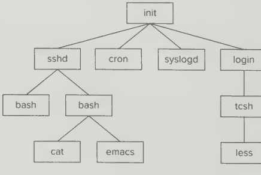

### 使用 `ps` 程序

你可以使用 `ps` 程序确定正在进程，该程序有大量的选项。（LPIC-1 目标包含 `ps`，所以你应该已经熟悉它的基本操作。）你可以使用 `ps` 选项显示所有进程来定位运行进程，而不仅仅是与你本人关联的进程。

## 调查运行中的进程

账户，然后在输出中搜索你感兴趣的进程。显示所有进程的选项有 `-A`、`-e` 以及 `x` 和 `ax` 的组合。这些选项在辅助信息方面的显示细节各不相同，但其中任何一个都可以向你显示系统上运行的所有进程。

如果你对某个进程感兴趣，可以将 `ps` 的输出通过给 `grep` 来定位它：

```
$ ps ax | grep apache
3053 ?   S    0:00 /usr/sbin/apache2 -k start
4753 ?   S    0:00 /usr/sbin/apache2 -k start
4754 ?   S    0:00 /usr/sbin/apache2 -k start
4755 ?   S    0:00 /usr/sbin/apache2 -k start
4756 ?   S    0:00 /usr/sbin/apache2 -k start
4757 ?   S    0:00 /usr/sbin/apache2 -k start
5044 pts/1 R+   0:00 grep apache
```

此示例显示了六个正在运行的 `apache` 服务器实例，加上定位该服务器的 `grep` 命令。如果你怀疑 Apache 没有运行，此输出将消除你的疑虑；然而，如果输出为空，或者只包含 `grep` 命令或其他搜索字符串 `apache` 的其他命令，你就知道 Apache 没有运行——也许它从未启动过，或者可能在启动运行后崩溃了。

> 这个示例说明了某些守护进程和其他进程的一个特性：Apache 这样做是为了更好地服务客户端；每个副本可以处理单个客户端，而不是由一个进程来处理多个客户端。有时你会看到一个程序的多个副本，因为一个或多个用户正在运行独立的副本。在用 `kill` 终止此类进程时要小心；你不想杀掉程序的错误实例！

在某些情况下，你可以偶尔使用一次 `ps` 来验证进程是否正在运行，或者如果你怀疑进程可能崩溃并重启时，查找 PID 值（前述输出中的第一列）的变化。请注意，某些程序会作为正常操作的一部分而终止然后重启，因此 PID 值的变化并不一定是问题的迹。

## 使用 `top` 程序

`top` 是 `ps` 的变体，在诊断某些问题时非常有用。该程序生成一个进程显示，按 CPU 使用率排序，并每几秒更新一次列表。结果类似于图 12.2 中的显示，你可以用它来识别哪些进程正在消耗大量的 CPU 时间。在图 12.2 中，`FahCore_78.exe` 进程占用了 98% 的 CPU 时间，`glxgears` 消耗了 91%，`X` 使用了 8%，其余的都少得多。消耗的 CPU 总量可能会超过 100%，因为用于此示例的计算机是双核 CPU，`top` 将其解释为适用于 200% 的 CPU 时间。

## 图 12.2 该工具提供了运行进程的动态显示

除了监控 CPU 时间外，`top` 还显示用户列表。在运行时输入 `M` 可以执行此操作，按 `P` 切换到按 CPU 时间排序的显示。（输入 `T` 按 CPU 时间排序）。注意，你必须输入大写字母；小写版本具有不同的效果。

识别消耗过多 CPU 或内存的程序的困难之处在于，你无法从 `top` 的输出判断什么构成了过度资源消耗。例如图 12.2 中的输出。事实上的，`FaxCore_78.exe` 消耗了大量的 CPU 时间；然而，这个程序是一个允许客户端将你空闲的 CPU 时间捐赠给科学项目。换句话说，该进程应该消耗大量的 CPU 时间，但如果不这样做，消耗的 CPU 时间将处于闲置状态。`glx` 程序是一个图形演示工具。它通常会消耗大量的 CPU 时间，但你可能不想让它运行很久。做出这些

这些判断需要理解你的程序的目的和正常运行特性，特别是那些浮在 `top` 输出顶部的程序。

## 检查日志选项

Linux 维护日志文件，记录系统操作的各种关键细节。你可能可以立即开始使用日志文件，但知道如何更改日志文件配置同样重要。你通过配置 `syslog` 守护进程来实现。某些服务器和其他程序会执行自己的日志记录，因此必须独立于 `syslog` 进行配置。你甚至可能想配置一台计算机将其日志发送到另一台计算机进行日志轮转；你还应该注意周围日志文件；如果你的计算机没有正确管理现有的日志文件，它们可能会增长到消耗你所有的可用磁盘空间，至少在存储它们的分区上。除了配置日志之外，你可能可以使用系统生成的日志文件。

## 理解 `syslog`

大多数 Linux 系统采用特殊的守护进程以统一的方式处理日志维护。传统的 Linux 系统记录器是 `syslog`，它通常从名为 `syslog` 的包安装。`syslog` 守护进程处理来自服务器和其他用户态程序的消息。它通常与名为 `syslogd` 的守护进程配对。

## 设置 `/syslog.conf`

`/syslog.conf` 的格式在概念上很简单。与许多文件一样，注释行用井号 (`#`) 表示。非注释行采用以下形式：

| 选择器 (Selector) | |

|---|--- |

| facility.priority | action (操作) |

在这一行中，`facility`（设施）是生成消息的程序类型代码；`priority`（优先级）是此消息重要性的代码；而 `action`（操作）是文件、远程计算机或其他位置。

设施（facility）是生成消息的程序类型的代码词；优先级（priority）是此消息重要性的代码字；操作（action）是文件、远程计算机或其他位置。

有效的设施代码有 `auth`、`authpriv`、`cron`、`daemon`、`kern`、`lpr`、`mail`、`security`、`syslog`、`user` 以及 `local10` 到 `local17`。许多指的是特定的服务器或程序类。例如，邮件服务器和其他处理工具通常使用 `mail` 设施。大多数不受特定代码覆盖的服务器使用 `daemon` 设施。`security` 设施与 `auth` 相同，但 `auth` 是首选名称。`mark` 设施留供内部使用。星号 (`*`) 代表所有设施。你可以通过逗号分隔，在一个选择器中指定多个设施。

有效的优先级代码有 `debug`、`info`、`notice`、`warn`、`error`、`err`、`crit`、`alert`、`emerg` 和 `panic`。`warning` 优先级与 `err` 相同，`error` 与 `emerg` 相同，`panic` 相同。`Error` 和 `panic` 优先级已废用，你应该使用它们的等替代品。除了这些等价对，这些优先级代表了不同的重要级别。`debug` 级别记录最多的信息；它被标识为名称，用于调试误导性程序。`emerg` 优先级记录最重要的消息，指示非常严重的问题。当程序向系统记录器发送消息时，它包含一个优先级代码；如果你配置了记录该级别或更高的消息，记录器会将消息写入文件。如果你指定的优先级代码为 `alert`，系统将记录分类为 `alert` 或 `emerg` 的消息，但不是 `crit` 或以下的消息。此规则的例外是你在优先级代码前加上等号 (`=`)，例如 `=crit`，这描述了仅对 crit 优先级消息的操作。例如，`crit` 会导致比 crit 以下的消息被记录。优先级 `*` 代表所有设施。

你可以通过分号 (`;`) 分隔选择器来指定多个操作。（注意逗号用于分隔单个选择器内的多个设施，而分号用于分隔多个选择器。）完整选择器的示例稍后出现。

最常见的情况下，操作是一个文件名，位于 `/var/log` 目录树。`messages`、`syslog` 和 `secure` 文件是常见且重要的日志文件，尽管并非所有发行版都使用这些文件。其他可能的日志位置包括控制台设备文件名（例如 `/dev/console`）用于在屏幕上显示数据，或者带有符号 (`@`) 的远程机器，用于记录到指定的

system，以及一组在他们已登录时应该看到消息的个人用户名列表。对于最后一种选项，星号（\**）表示所有已登录的用户。

一些示例可能有助于澄清这些规则。首先是一个相当普通且简单的条目：

```
mail.* /var/log/mail
```

此行将由源程序识别为与邮件相关的日志条目发送到 `/var/log/mail` 文件。默认 `/etc/syslog.conf` 文件中的大多数条目都与此条目相似；它们通常涵盖了之前提到的所有设施（facilities）。某些消息可能会被多个规则处理。例如，另一个规则可能看起来所示：

```
*emerg *
```

此行将所有 `emerg`（紧急）级别的消息发送到使用文本模式文件登录计算机的所有用户的控制台上。如果此行和之前的 `mail.*` 选择器同时存在，与邮件相关的 `emerg` 级别消息将记录到 `/var/log/mail` 并显示在用户的控制台上。

一个更复杂的示例根据其优先级以多种方式记录内核日志：

```
kern.* /var/log/kernel
kern.crit @logger.pangaea.edu
kern.crit /dev/console
kern.info;kern.err /var/log/kernel-info
```

这些规则中的第一条将所有内核消息记录到 `/var/log/kernel`。第二行将关键（crit）消息发送到 `logger.pangaea.edu`。（该系统必须配置为接受远程日志，这是本书未涵盖的主题）。第三行将关键消息的副本发送到 `/dev/console`，这会导致它们显示在计算机的主文本模式控制台显示上。最后，最后一行将 `info`（信息）和 `err`（错误）优先级的消息发送到 `/var/log/kernel-info`。由于 `error` 优先级紧随 `crit` 且由于 `info` 是最低优先级，这四行会导致所有内核消息被记录两次或三次：一次记录到 `/var/log/kernel`，同时记录到远程系统和控制台，或者记录到 `/var/log/kernel-info`。

大多数发行版都带有一个合理的系统日志记录设置，但你可能想要检查这些设置并可能对其进行调整。如果你更改了它们，请注意你需要更改一些其他工具。例如，所有主流发行版都带有了用于轮转日志文件的工具。如果你将文件更改为 syslog 日志消息，你还需要更改你的日志文件轮转脚本。该主题在 ext 节中介绍。

除了系统日志记录器的选项外，你还可能在单个程序中设置日志选项。例如，你可能告诉程序记录更多或更少的信息，或者以不同的优先级记录常规信息。某些程序还提供了通过其系统守护进程（daemon）或其他机制记录日志的方法。不同程序之间的细节差异很大，因此你应该咨询该程序的文档以获取详情。

## 日志文件轮转

日志文件旨在保留一段时间一段时间的系统活动信息，但系统日志守护进程没有控制日志文件大小的方法。如果不加检查，日志文件可能会增长到耗尽其所在分区上的所有可用空间。为了避免这个问题，Linux 系统采用了日志文件轮转工具。这些工具会重命名并可选地压缩当前日志文件，删除旧日志文件，并强制系统开始使用新的日志文件。

最常用的日志轮转工具是一个名为 `logrotate` 的包。该程序通常通过 `cron` 任务定期调用。`logrotate` 程序查询名为 `/etc/logrotate.conf` 的配置文件，该文件包含几个默认设置，并通常引用 `/etc/logrotate.d` 中的文件来处理特定的日志文件。一个典型的 `/etc/logrotate.conf` 文件包含几行注释（用哈希标记（`#`）表示），以及设置各种选项的行，如列表 12.1 所示。

### 列表 12.1：示例 `/etc/logrotate.conf` 文件

```text
+   * 每周轮转日志
weekly

+   * 保留 4 周的旧日志
rotate 4

+   * 轮转后创建新日志文件
create

+   * 压缩旧日志文件
compress

+   * 引用各个包的文件
include /etc/logrotate.d

+   * 设置杂项选项
notifempty
nomail
noolddir

+   * 轮转特定程序程序的 wtmp
/var/log/wtmp {
    monthly
    create 0666 root utmp
    rotate 1
}
```

列表 12.1 中的大多数行设置的选项是自言自义的，或者由紧随其后的注释解释得非常清楚——例如，`weekly` 行将默认日志轮转间隔设置为每周一次。如果你在文件中看到你不理解的选项，请查阅 `logrotate` 的 man 页面。

> 注意：由于日志轮转是由通常在深夜运行的 `cron` 任务处理的，如果计算机每天结束时常规关闭，轮转就不会发生。这种做法在 Windows 工作站上很常见，但在服务器上并不常见。通常做法是让 Linux 工作站通夜运行，或者在尽管常规关机的情况下发生日志轮转时采取某些显式步骤。`anacron` 工具特别适合这项任务。

列表 12.1 的最后几行演示了定义特定日志文件的格式。这些定义以文件名开始（多个文件名用空格分隔），后面跟着左大括号（`{`）。它们以右大括号（`}`）结束。中间的行设置了可能会覆盖默认值。例如，`/var/log/wtmp` 的定义设置了每月一次选项，这覆盖了默认设置。

## 处理库问题

在计算机术语中，库（library）是一组可能对多个程序有用的函数，因此设计用于让许多程序能够使用它们。例如，许多程序需要帮助在屏幕上定位文本的函数——文本编辑器、`less` 分页器和各种程序都有类似的需求。与其强迫每个程序重新发明这个特定的轮，库的存在是为了处理文本的放置。许多库可以用静态或动态形式使用。静态库被构建到最终程序的可执行文件中，而动态库作为被最终程序引用的独立文件存在。动态库的优势在于减少资源消耗，包括磁盘空间和内存。（这些优势仅在多个程序使用该库时适用。）动态库的缺点是它们会引发问题——如果库的接口发生变化或在新版本中引入了错误，升级库可能会为使用它的程序引入错误。如果库被卸载，依赖于它的程序将崩溃。诊断和修正此类问题需要理解管理库的工具。

你可以借助第 11 节描述的 `ldd` 工具来识别一些库问题。该程序可以识别任何给定二进制文件所使用的库：

```
$ ldd /usr/bin/zip
linux-vdso.so.1 => (0x00007fffbd5c5000)
libbz2.so.1 => not found
libc.so.6 => /lib/libc.so.6 (0x00007fff5fe5f0300)
lib64/ld-linux-x86-64.so.2 (0x00007fff5fe646d00)
```

如果找不到某个库，它将位于 => 符号的右侧；相反，`ldd` 会报告 `not found`，如示例中的 `libbz2.so.1` 那样。如果你尝试启动这样的程序，你会收到错误消息：

```
# $ zip
zip: error while loading shared libraries: libbz2.so.1: cannot open shared -
object file: No such file or directory
```

解决问题的方法取决于问题的性质。有时，正确的库已经安装，但程序二进制文件在错误的名称或位置查找该库。在这种情况下，可以使用符号链接（symbolic link）来修复问题：

```
# 在 ln -s /lib/libbb2.so.1.2 /lib/libbb2.so.1
```

其他时候，你可能需要更新计算机的库路径——即计算机搜索库的目录集。库路径存储在 `/etc/ld.so.conf` 文件中，其中每行包含一个目录。如果你知道某个库存在于异常目录中，可以将该目录添加到 `/etc/ld.so.conf`。但是，执行此操作后，你必须以 root 身份输入 `ldconfig`，以让系统链接器（将程序与其库连接在一起的软件）识别新路径中的库。在安装新库后，你可能也需要输入 `ldconfig`，尽管二进制包中的安装后脚本会在你安装软件包中的库时构建 `/etc/ld.so.conf`。

某些发行版通过 `ld.so.conf` 中的一个 `include` 语句或通过独立的目录来使用动态库。因此，如果你想向 `ld.so.conf` 添加目录或通过单独命令添加，向 `/etc/ld.so.conf.d` 中添加一个新文件通常更好。如果主文件包含注释说明通过输入某些命令（如 `env-update`）重新生成它，那么在修改 `/etc/ld.so.conf.d` 后，你应该执行该操作。

调整库路径的另一种方法是使用 `LD_LIBRARY_PATH` 环境变量。将此变量设置为由冒号分隔的目录列表，这些目录包含了不在系统库路径中的库：

```bash
$ export LD_LIBRARY_PATH=/opt/someprog:/opt/another/lib
```

此示例向库路径添加了两个目录。如果你需要为了测试目的临时向库路径添加内容，或者个人用户需要进行其他用户不需要的永久更改，此功能会非常有用。但是，如果应该进行系统范围的更改，编辑 `/etc/ld.so.conf` 或 `/etc/ld.so.conf.d` 中的文件是合适的。

### 现实世界场景

### 使用 32 位和 64 位二进制文件


# 64 位与 32 位库管理

如果你运行 64 位 `x86-64`（又称 `AMD64` 或 `EM64T`）版本的 Linux，你可能具备运行 32 位（`x86`）二进制文件以及 64 位二进制文件的能力。如果你需要运行旧的仅二进制程序，或无法在 64 位模式下正确编译和运行的程序，这种能力会非常有用。遗憾的是，该功能的一个问题是它要求你同时维护某些库的 64 位和 32 位版本。

管理 64 位和 32 位库的方法有多种。在大多数情况下，你会发现 64 位和 32 位库有单独的库目录，例如 `/lib64` 和 `/lib32`。可能存在一个 `/lib` 目录；要么 `/lib` 是指向 `/lib64` 的符号链接，要么 `/lib64` 是指向 `/lib` 的符号链接。这些安排在 `/usr/` 中也是镜像的，例如 `/usr/lib64` 和 `/usr/lib32`。这种安排库的方法强调了原生（64 位）库，因为库通常在 `/lib`、`/usr/lib` 以及类似命名的目录中。

某些发行版的处理方式不同；它们有 `/lib64` 和 `/lib32` 目录，但没有 `/lib32` 目录。这种配置从 Linux 标准来看是奇特的，但它的优点是专为 `x86` 系统设计的软件包无需修改即可安装；因为在第一类系统上，如果此类软件包包含库，它们会将 32 位库丢进 64 位库目录中，可能会覆盖 64 位库并导致混乱。

对于这些任何一个系统，你都必须意识到 64 位和 32 位库的存在和需求。很容易忽略这种区别，并且当程序无法运行时（因为它报告找不到某个库，而请求的精确名称的库存在于你的硬盘上时），你会感到困惑或沮丧。你可以使用 `file` 命令来识别库的类型（以及需要它的程序类型）：

```bash
$ file /bin/cp
/bin/cp: ELF 64-LSB executable, x86-64, version 1 (SYSV), dynamically linked (uses shared libs), for GNU/Linux 2.6.15, stripped
```

```bash
$ file /lib/libc.so.1.1.0
/lib/libc.so.1.1.0: ELF 64-LSB shared object, x86-64, version 1 - (SYSV), dynamically linked, stripped
```

```bash
$ file /lib32/libacl.so.1.1.0
/lib32/libacl.so.1.1.0: ELF 32-LSB shared object, Intel 80386, version 1 - (SYSV), dynamically linked, stripped
```

此示例表明 `/bin/cp` 是一个 64 位可执行文件，`/lib/libc.so.1.1.0` 是一个 64 位库，而 `/lib32/libacl.so.1.1.0` 是一个 32 位库。如果程序指示它无法加载某个库，而你看到了它，说明类型不匹配。

## 处理调度任务

Linux 提供了几种机制来运行任务。通过 `ld.so.conf` 中的一个 `include` 语句或通过独立的目录来动态使用。因此，如果你想向 `ld.so.conf` 添加目录或通过单独命令添加，通常向 `/etc/ld.so.conf.d` 添加一个新文件。如果主文件包含注释说明必须通过输入某些命令（如 `env-update`）重新生成它，那么在修改 `/etc/ld.so.conf.d` 后，你应该执行该操作。

调整库路径的另一种方法是使用 `LD_LIBRARY_PATH` 环境变量。将此变量设置为由冒号分隔的目录列表，这些目录包含了不在系统库路径中的库：

```bash
$ export LD_LIBRARY_PATH=/opt/someprog:/opt/another/lib
```

此示例向库路径添加了两个目录。如果你需要为了测试目的临时向库路径添加内容，或者个人用户需要进行其他用户不需要的永久更改，此功能会非常有用。但是，如果应该进行系统范围的更改，编辑 `/etc/ld.so.conf` 或 `/etc/ld.so.conf.d` 中的文件是合适的。

### 现实世界场景

#### 使用 32 位和 64 位二进制文件

如果你运行 64 位 `x86-64`（又称 `AMD64` 或 `EM64T`）版本的 Linux，你可能具备运行 32 位（`x86`）二进制文件以及 64 位二进制文件的能力。如果你需要运行旧的仅二进制程序，或无法在 64 位模式下正确编译和运行的程序，这种能力会非常有用。遗憾的是，该功能的一个问题是它要求你同时维护某些库的 64 位和 32 位版本。

管理 64 位和 32 位库的方法有多种。在大多数情况下，你会发现 64 位和 32 位库有单独的库目录，例如 `/lib64` 和 `/lib32`。可能存在一个 `/lib` 目录；要么 `/lib` 是指向 `/lib64` 的符号链接，要么 `/lib64` 是指向 `/lib` 的符号链接。这些安排在 `/usr/` 中也是镜像的，例如 `/usr/lib64` 和 `/usr/lib32`。这种安排库的方法强调了原生（64 位）库，因为库通常在 `/lib`、`/usr/lib` 以及类似命名的目录中。

某些发行版的处理方式不同；它们有 `/lib64` 和 `/lib32` 目录，但没有 `/lib32` 目录。这种配置从 Linux 标准来看是奇特的，但它的优点是专为 `x86` 系统设计的软件包无需修改即可安装；因为在第一类系统上，如果此类软件包包含库，它们会将 32 位库丢进 64 位库目录中，可能会覆盖 64 位库并导致混乱。

对于这些任何一个系统，你都必须意识到 64 位和 32 位库的存在和需求。很容易忽略这种区别，并且当程序无法运行时（因为它报告找不到某个库，而请求的精确名称的库存在于你的硬盘上时），你会感到困惑或沮丧。你可以使用 `file` 命令来识别库的类型（以及需要它的程序类型）：

```bash
$ file /bin/cp
/bin/cp: ELF 64-LSB executable, x86-64, version 1 (SYSV), dynamically linked (uses shared libs), for GNU/Linux 2.6.15, stripped
```

```bash
$ file /lib/libc.so.1.1.0
/lib/libc.so.1.1.0: ELF 64-LSB shared object, x86-64, version 1 - (SYSV), dynamically linked, stripped
```

```bash
$ file /lib32/libacl.so.1.1.0
/lib32/libacl.so.1.1.0: ELF 32-LSB shared object, Intel 80386, version 1 - (SYSV), dynamically linked, stripped
```

此示例表明 `/bin/cp` 是一个 64 位可执行文件，`/lib/libc.so.1.1.0` 是一个 64 位库，而 `/lib32/libacl.so.1.1.0` 是一个 32 位库。如果程序指示它无法加载某个库，而你看到了它，说明类型不匹配。

## 处理调度进程

如果在未提供 `-u` 用户参数的情况下，`crontab` 会修改与当前用户相关的 cron 任务。用户任务通常被称为 crontabs；由于用户已经引用了系统级配置文件以及其本身，这种用法可能会让人困惑。如果你在使用此命令时使用 `-u` 来更改当前用户身份，`crontab` 可能会产生混乱；因此，如果你使用此命令，即使在修改自己的 cron 任务时，使用 `-u user` 也是最安全的。

如果你想直接对 cron 任务进行操作，`-l`、`-r` 或 `-e` 选项允许 `crontab` 显示当前的 cron 任务；`-e` 会删除当前的 cron 任务并打开编辑器，以便你对任务进行编辑（`Vi` 是默认编辑器，你可以通过设置 `VISUAL` 或 `EDITOR` 环境变量来更改它，如第 1 章所述）。

作为替代方案，你可以创建一个 cron 配置文件，并使用文件参数将文件名传递给 `crontab`。例如，`crontab -u taker my-cron` 会导致 `crontab` 使用 `my-cron` 作为 `taker` 的 cron 任务配置。

无论你是通过文件参数创建并提交 cron 任务，还是通过 `-e` 进行编辑，cron 文件的格式都与之前描述的相似。你可以使用 `VARIABLE=value` 的形式设置环境变量，也可以在任务运行时指定一个由五个数字或通配符前缀引导的命令。在用户 cron 任务中，你不需要像系统 cron 任务那样指定执行 cron 的用户名。信息源自 cron 任务的所有者。列表 12.2 显示了一个示例 cron 任务文件。该文件按间隔运行两个程序：`fetch` 每隔 30 分钟（在整点和半点）运行一次，而 `clean-adouble` 在周一凌晨 2:00 运行。两个程序都通过完整路径指定，这可以包含 `PATH` 环境变量也可以省略完整的路径指定。

### 列表 12.2：示例 cron 任务文件

```
SHELL=/bin/bash
MAILTO=taker
0 */30 * * * /usr/bin/fetchmail -s
0 2 * * * /usr/local/bin/clean-adouble
```

最终，cron 任务文件存储在 `/var/spool/cron`、`/var/spool/cron/tabs` 或 `/var/spool/cron/crontabs` 目录下。该目录中的每个文件根据其运行的用户命名；`taker` 的文件可能被称为 `/var/spool/cron/taker`。你不应该直接编辑此目录下的文件；而应该使用 `crontab` 来进行更改。

对设施的访问可以通过多种方式进行限制：

- **可执行权限**：`cron` 和 `crontab` 程序的权限可以使用标准权限机制进行限制。并不是所有的发行版都以此方式自配置，但对于那些此类的发行版，能够使用 cron 调度任务的用户应添加到相应的组。该组通常称为 `cron`，但你应该检查 `/usr/sbin/cron` 和 `/usr/bin/crontab` 程序文件的组所有者权限以确保准确。

- **允许用户列表**：`/etc/cron.allow` 包含允许访问 cron 的用户列表。如果存在此文件，出现在文件中名称的用户可以使用 cron；所有其他用户都被拒绝访问。如果不存在此文件，只要访问不受可执行权限或禁止用户列表的限制，任何人都可以使用 cron。

- **禁止用户列表**：`/etc/cron.deny` 文件包含应拒绝访问 cron 的用户列表。如果存在此文件，任何出现在文件中名称的用户都被拒绝访问 cron，但所有其他用户都可以使用，前提是可执行权限和允许用户列表没有限制。

## 调查问题

一类 cron 问题与上述描述的限制有关：如果用户无法创建 cron 任务，你应该检查可执行权限以及 `/etc/cron.allow` 和 `/etc/cron.deny` 文件的内容（如果它们存在）。不过，在修改功能时要加小心；你可能不想拆除可能出于某种原因而设置的安全措施。如有必要时，请咨询其他管理员以了解为何存在限制。

如果系统任务正在运行，请检查日志文件，查看是否有相关文件已执行的迹象。理想情况下，你应该看到指示运行了什么内容的行：

```
Jan 3 08:17:01 seeker CRON[4885]: (root) CMD (cd /;run-parts --report /etc/cron.hourly)
```

不同发行版之间的细节有所不同（此示例取自 Ubuntu 安装），但条目应该指示命令 `cd /;run-parts --report /etc/cron.hourly`。如果你发现 cron 没有在运行任务，可能是守护进程没有启动或崩溃了。使用 `ps` 来查看它是否在运行，如之前在“查找进程”中描述的那样。你可能还想检查你的 SysV 或 Upstart 配置，因为 cron 通常以此这种方式启动。

有时，创建一个“伪造” cron 任务可以是调查问题的一个良好方法。诸如 `> /tmp/date.txt` 的命令用作 cron 任务，可以告诉你任务是否正在执行；只需检查 `/tmp/date.txt`，并验证在任务执行正常的情况下它是否包含了它应有的时间。

如果你正在诊断问题，你可以通过这种方式创建在你想要运行时运行的 cron 任务。在测试系统时要小心，例如，常规 cron 通常会执行某些耗时的操作或立即运行；但如果此任务是每月系统备份，你可能希望在测试时移除或禁用执行此操作的脚本（除非那个不工作的确实是该每月进程）。


在处理 `cron` 时，你应该始终注意权限。有时 `cron` 任务因为执行用户不当而无法工作。以 `root` 身份不当执行任务可能会带来安全风险，如果该任务创建了文件，这些文件将归 `root` 所有，如果普通用户或非 `root` 进程应该能够操作（甚至是读取）这些文件，就会产生问题。

总结一些常见的登录工具和方法。登录方法可以是文本模式或 GUI 模式，可以是本地或支持网络。传统的文本模式本地登录方法是登录程序，它通过 `getty` 程序在本地控制台上运行。支持网络的文本模式工具包括已大部分过时的 `Telnet`，而 `SSH` 协议则介介了本地和网络 GUI 登录。网络 GUI 登录也可以通过 `VNC` 处理，或通过 `SSH` 隧道进行传输。

描述在计算机启动后调整内核选项的工具。某些内核选项可以通过修改位于 `/proc` 目录树中的文件来设置。另一种方法是使用 `sysctl` 程序。你可以通过编辑 `/etc/sysctl.conf` 来编辑此类选项，以便它们在系统启动时被设置。

总结用于存储用户账户信息的文件。`/etc/passwd` 文件包含用户名、`UID` 值、自由格式的用户信息、用户家目录的位置以及用户默认 `shell` 的名称。事实上，它还存储了哈希后的密码，但这些信息现在存储在 `/etc/shadow` 文件中，该文件还包含密码过期信息。`/etc/group` 文件包含组信息，包括组名、`GID` 值和所属组的用户。

总结用于调整账户信息的工具。`usermod` 实用程序修改许多关键账户特征，例如 `UID` 值、家目录和默认 `shell`。你可以使用 `passwd` 重置忘记或损坏的密码。你可以使用你喜欢的文本编辑器编辑任何关键账户信息。

描述关键的 `bash` 启动脚本。`bash` 的启动脚本可以分为登录或非登录类型，以及全局或用户类型。关键的全局登录文件是 `/etc/profile`，但它通常包含 `/etc/profile.d` 中的文件；同时 `~/.bash_profile`、`~/.bash_login` 和 `~/.profile` 文件是用户登录文件。正式上，唯一的非登录 `bash` 启动脚本是 `~/.bashrc`（用户文件）；然而，此文件和 `/etc/profile` 通常都会调用 `/etc/bashrc`（此处重复）或 `/etc/bash.bashrc`，因此这些文件通常被认为是全局非登录文件。

解释如何确保存储在异常位置的动态库会被使用。`/etc/ld.so.conf` 文件包含搜索动态库的目录名称。你可以直接编辑此文件，或者通过在 `/etc/ld.so.conf` 中创建一个自定义文件来编辑，然后以 `root` 身份输入 `ldconfig` 让系统扫描库，以便能够快速定位特定库。

描述如何调整 `syslog.conf`。你可以通过编辑 `/etc/syslog.conf` 来控制日志消息发送的文件（某些系统使用其他的日志记录器，因此你可能需要调整不同的文件，例如 `/etc/rsyslog.conf`）。你使用各种代码将文件或其他目标分配给特定的设施（如内核、邮件和安全）和优先级（如 `info`、`err` 和 `emerg`）。服务器和其他某些程序会根据自身的规则生成具有特定设施和优先的消息；系统根据你指定的规则对日志进行排序。

解释用户 `cron` 任务和系统 `cron` 任务之间的区别。用户 `cron` 任务由普通用户（可能包括 `root`）创建，用于按定期计划处理他们自己的任务。用户创建指定这些任务的文件，这些文件随后由系统存储在 `/var/spool/cron` 或类似位置。系统 `cron` 任务处理系统任务。它们定义在 `/etc/crontab` 中，该文件通常运行存储在名为 `/etc/cron.interval` 的各种其他子目录中的脚本，其中 `interval` 是某个时间单位。

总结一些你可以用于解决 `cron` 问题的方法。你可以检查用户限制，以确保用户有权运行 `cron` 任务。你可以检查日志文件，查看 `cron` 是否尝试在适当的时间执行进程。你可以使用 `ps` 验证 `cron` 守护进程正在运行。你可以创建一个“虚假” `cron` 任务，它与导致问题的任何任务一起运行，但会为其操作创建一个有用的跟踪以帮助诊断问题。

### 复习题

1. `/etc/sysctl.conf` 文件的作用是什么？

- A. 它存储了系统启动时通过 `sysctl` 实用程序设置的各种杂系统配置选项。
- B. 它指定了计算机启动时系统服务的顺序。
- C. 它指定了启动时挂载或可能由普通用户手动挂载的文件系统。
- D. 它识别了计算机启动时由 `init` 直接启动的服务。

2. `/etc/profile` 和 `/etc/bashrc` 有什么区别？

- A. `/etc/profile` 是 `tcsh` 退出脚本；`/etc/bashrc` 包含 `bash` 环境变量。
- B. `/etc/profile` 存储用户登录统计；`/etc/bashrc` 存储用户 `shell` 偏好。
- C. `/etc/profile` 是登录脚本；`/etc/bashrc` 是非登录脚本。
- D. `/etc/profile` 存储用户账户数据；`/etc/bashrc` 是 `bash` 启动脚本。

3. `/etc/ld.so.conf` 的重要（非注释）内容是什么？

- A. 环境变量
- B. 一个 `shell` 脚本程序
- C. 用户名
- D. 目录名称

4. 符号链接 `/etc/rc.rc3.d/S80sendmail`。假设此符号链接放置正确并按预期运行，它将做什么？

- A. 在运行级别 3 下启动 `sendmail` 服务。
- B. 将 `sendmail` 服务指向其配置文件。
- C. 初始化 `sendmail` 通过 `inetd` 运行。
- D. 当手动不带选项启动时停止 `sendmail` 服务。

5. 下列哪一个是全局非登录 `bash` 启动脚本？

- A. `/etc/profile`
- B. `/etc/bashrc`
- C. `/root/.profile`
- D. `/root/.bashrc`

6. 你必须以 *root* 身份输入什么命令，让系统重新扫描库路径上的目录，以便程序能够在这些目录中找到动态库？

- A. `sysctl`
- B. `ldconfig`
- C. `shadow`
- D. `init -libs`

7. 你已确定 `SSH` 服务器是由 `/etc/rc2.d/S16ssh` 启动脚本（或同名链接）启动的。你想防止此服务器在级别 2 下运行。实现此目标最可靠的方法是？

- A. 重命名脚本或链接，使其名称以 `K` 而不是 `S` 开。
- B. 删除 `/etc/rc2.d` 目录。
- C. 删除 `/etc/rc2.d/S16ssh` 文件或链接。
- D. 找到对应的 `Upstart` 配置文件并删除它。

8. 下列哪一个不是常见的 `bash` 脚本？

- A. `/etc/profile`
- B. `/etc/bashrc`
- C. `/root/.profile`
- D. `/root/.bashrc`

9. 你以 *root* 身份输入 `sysctl -a`。你预期发生什么？

- A. 计算机将重启。
- B. 所有进程将被终止。
- C. 你将看到一个列表。
- D. 你将看到关于 `sysctl` 的错误消息。

10. 哪个目录通常用于全局登录？

- A. `/etc/profile.d`
- B. `/etc/bash`
- C. `/etc/profile`
- D. `/etc`

11. 下列哪行 `cron` 任务每天运行两次 `/local/cleanup`？

- A. `17,19 * * /local/cleanup`
- B. `15 */2 * /local/cleanup`
- C. `15 * *2 /local/cleanup`
- D. `*/2 * * /local/cleanup`

12. 修改 Linux 默认运行级别，你应该做什么？

- A. 执行 `init x`，其中 `x` 是运行级别。
- B. 编辑 `/modules.conf` 并输入运行级别。
- C. 执行 `init q` 让系统查询运行级别。
- D. 编辑 `/ittab` 并输入运行级别。

13. 你使用 `top` 查看各种进程消耗的 CPU 时间。你发现进程 `dfcomp` 占用了系统 90% 的 CPU。你可以得出什么结论？

- A. 很少；`dfcomp` 可能合法地消耗这么多时间，也可能是未经授权或出现故障的进程。
- B. 没有程序应该消耗 90% 的 CPU；`dfcomp` 显然故障并应该终止。
- C. 这是正常的；`dfcomp` 是内核主进程，它消耗空闲的 CPU 时间。
- D. 如果你的 CPU 低于 2.5GHz Pentium，这种行为是正常的；但在新的系统上，没有程序应该消耗 90%。

14. 以下系统 `cron` 任务条目（在 `/etc/crontab` 中）有什么问题？

```
17 * * * run-parts /etc/cron.hourly
```

- A. 该命令每小时运行一次，但会在下午 5 点运行。
- B. Linux 中没有 `run-parts` 命令。
- C. 时间规范不完整。
- D. 它缺少用户指定。

15. 用户 `fred` 创建了一个 `cron` 任务，使用 `fetchmail` 程序从远程服务器提取邮件。如果配置正确，该该任务的哪项正确？

- A. `fetchmail` 进程以 `fred UID` 运行。
- B. `fetchmail` 进程以 `root UID` 运行。
- C. `fetchmail` 进程以 `crontab UID` 运行。
- D. `fetchmail` 进程以 `nobody UID` 运行。

16. 你使用计算机控制台上的文本模式虚拟终端登录 Linux 系统。哪个程序可能处理登录过程？

- A. `bash`
- B. `SSH`
- C. `GDM`
- D. `login`

17. 通过编辑 `/etc/passwd` 中的用户条目，你可以更改以下哪些账户特征？（选择所有适用项。）

- A. 账户过期日期
- B. 账户家目录
- C. 账户默认 `shell`
- D. 账户默认 GUI 桌面环境

18. 在哪个哪个文件中可以找到与其分配名称关联的 `GID`？

- A. `/etc/passwd`
- B. `/etc/shadow`
- C. `/etc/group`
- D. `/etc/grub.d`

19. 在哪个配置文件中可以找到系统级功能，例如应用于用户账户的最小 `UID` 值，以及在登录失败后允许再次尝试之前登录需要等待的时间？

- A. `/etc/user.set`
- B. `/etc/system.conf`
- C. `/etc/account.conf`
- D. `/etc/login.defs`

20. `/etc/shadow` 文件最合适的权限是什么？

- A. `0666` (-rw-rw-rw-)
- B. `0644` (-rw-r--r--)
- C. `0640` (-rw-r-----)
- D. `0600` (-rw-------)

### 复习题答案

1. 选项 A 正确描述了 `/etc/sysctl.conf` 的用途。选项 B 是 SysV `init` 脚本用途的部分描述。选项 C 描述了 `/etc/fstab` 文件的功能。选项 D 描述了 `/etc/fabab` 文件的用途。

2. 选项 C 对这两个文件提供了简短但正确的描述，是正确的。选项 A 对 `/etc/profile` 的描述完全是虚构的，尽管它对 `/etc/bashrc` 的描述部分正确，因为登录脚本可以设置环境变量。选项 B 对这两个文件的描述完全是虚构的。选项 D 对 `/etc/profile` 的描述是虚构的（它适用于 `/etc/passwd`），但它对 `/etc/bashrc` 的描述是正确的。

3. `/etc/ld.so.conf` 文件保存了系统搜索动态库的目录名称，选项 D 是正确的。该文件不包含环境变量、`shell` 脚本程序或用户名，因此选项 A、B 和 C 都是错误的。

4. `/etc/rc.d/rc3d` 是进入级别 3 时运行的 SysV 启动脚本链接的多个可能位置之一。该链接名称以 `S` 开头，此链接会在进入级别 3 时启动该服务，因此选项 A 是错误的。`inetd` 是一个超级服务器（super server），因此选项 B 和 C 是错误的。位置是正确的。一个不带选项启动的 SysV 启动脚本会显示错误信息，因此选项 D 是错误的。

5. `/etc/bashrc` 是全局非登录 `bash` 启动脚本的常用名称，选项 B 是正确的。`/etc/profile` 是全局登录 `bash` 启动脚本的常用名称，选项 A 是错误的。`/root/.profile` 是用户的登录 `bash` 启动脚本，选项 C 是正确的。`/root/.bashrc` 是用户的非登录 `bash` 启动脚本，因此选项 D 是错误的。

6. `ldconfig` 实用用程序读取 `/etc/ld.so.conf` 并缓存所引用目录中库的信息，选项 B 是正确的。`sysctl` 程序用于调整运行时内核特性，但它不管理库，因此选项 A 是错误的。没有标准的 `shadow` 程序，尽管 `/etc/shadow` 持有密码和老化信息，因此选项 C 是错误的。`init` 进程是内核运行的第一个进程；它没有像问题描述的那样使用（即使带有选项），因此选项 D 是错误的。

7. 启动脚本（或更常见的指向它们的符号链接）以字母 `S` 开头，其命名是为了启动相关的服务；以字母 `K` 开头的命名方式是为了停止相关的服务。选项 B 和 C 的影响都会防止服务器启动，但如果你从另一个级别切换，服务器可能会继续运行。更重要的是，选项 B 将阻止计算机在 run2 中启动许多其他潜在的关键服务。问题明确指出服务器正由 SysV 启动脚本启动的，因此不需要查找补充的 Up 配置文件。

8. A. `~/.bash_logout` 文件是一个常用的 `bash` 注销文件；它在 `bash` 启动时不运行，因此它不是 `bash` 启动脚本文件，选项 A 是正确的。选项 B 和 C 是全局 `bash` 非登录启动脚本的常用名称，选项 D 是 `bash` 用户登录启动脚本的标准名称。

9. C. `sysctl` 实用程序允许设置或查看运行时内核变量（键），其 `-a` 显示所有变量；选项 C 是正确的。选项 A 描述了以 `root` 身份输入 `shutdown -r now` 的效果。选项 B 没有描述任何命令的效果。由于指定的命令是合法的，`sysctl` 不显示错误信息，因此 D 是错误的。

10. C. 大多数 Linux 发行版提供的 `/etc/profile` 规范搜索 `/etc/profile.d` 并运行在那里找到任何脚本；因此，选项 C 是正确的。选项 A、B 和 D 描述的是虚构的位置。

11. B. 用户 `cron` 任务不包含用户名指定（选项 A 和 C 中的 tbaker）。对于 `*/2`，`*/2` 规范是……选项 D 是正确的。`/etc/passwd` 包含用户名、密码字段（现已未使用）、用户 ID (`UID`) 值、默认组的组 ID (`GID`) 值、自由格式描述。

12. B. C. `/etc/passwd` 文件包含用户名、密码字段（现已未使用）、用户 ID (`UID`) 值、默认组的组 ID (`GID`) 值、自由格式描述、家目录和默认 `shell`。选项 B 和 C 在此列表中是正确的。账户过期日期存储在 `/etc/shadow` 文件中，而不是 `/etc/passwd` 中，因此选项 A 是错误的。账户默认桌面环境（GNOME, KDE, Xfce 等）由 XDMCP 服务器以特定方式管理，针对每个 XDMCP 登录服务器，因此选项 D 是错误的。

13. `/etc/ld.so.conf` 文件保存了系统搜索动态库的目录名称，选项 D 是正确的。该文件不包含环境变量、`shell` 脚本程序或用户名，因此选项 A、B 和 C 都是错误的。

14. D. 大多数 Linux 发行版提供的 `/etc/profile` 搜索 `/etc/profile.d` 并运行在那里找到任何脚本；因此，选项 C 是正确的。选项 A、B 和 D 描述的是虚构的位置。

15. A. 用户 `cron` 任务以创建者的身份运行，因此选项 A 是正确的，选项 C 和 D 也是错误的。

16. D. 登录程序由处理虚拟终端的 `getty` 启动以处理登录过程；因此，选项 D 是正确的。SSH Shell 是一种面向网络的协议；它不处理本地，因此选项 A 是错误的。GNOME 显示管理器 (`GDM`) 是多个 GUI 登录程序之一；问题指定为文本模式，因此选项 C 是错误的。

17. B. C. `/etc/passwd` 文件包含用户名、密码字段（现已未使用）、用户 ID (`UID`) 值、默认组的组 ID (`GID`) 值、自由格式描述、家目录和默认 `shell`。选项 B 和 C 在此列表中是正确的。账户过期日期存储在 `/etc/shadow` 文件中，而不是 `/etc/passwd` 中，因此选项 A 是错误的。账户默认桌面环境（GNOME, KDE, Xfce 等）由 XDMCP 服务器以特定方式管理，针对每个 XDMCP 登录服务器，因此选项 D 是错误的。

18. C. 组 ID (`GID`) 值与 `/etc/group` 中的组名关联，因此选项 C 是正确的。`/etc/passwd` 和 `/etc/shadow` 文件定义用户信息，而不是组信息，因此选项 A 和 B 都是错误的。

20. D. `/etc/shadow` 文件存储了哈希后的密码，这些信息非常敏感，不应允许普通用户读取。因此，必须对该文件拒绝所有世界权限，这使得选项 A 和 B 错误。虽然此文件通常分配给 `root` 组，但允许该组读取权限通常被认为是一个坏主意，因此选项 C 是错误的。选项 D 是所有选项中限制最严格的一组权限，且实际上，拥有此文件的 `root` 用户必须对其具有读取和写入权限，因此选项 D 是正确的。

## 附录

关于配套光盘

在本附录中包含：

- 你将在 CD 上看到的内容
- 系统要求
- 如何使用 CD
- 故障排除


### 你将在 CD 上看到的内容


以下章节按类别排列，并总结了你在 CD 上看到的软件和其他额外内容。如果你在安装 CD 提供的项目时需要帮助，请参考本附录中“使用 CD”章节的安装说明。

CD 上的程序可能属于以下类别之一：

- 共享软件（Shareware programs）：是功能完全的免费试用版的受版权程序。如果你喜欢某些程序，可以向作者支付少量费用进行注册，并获得许可、增强版和技术支持。
- 免费软件（Freeware programs）：是免费的受版权游戏、应用程序和实用程序。你可以将其复制到任意数量的计算机上——免费——但它们不提供技术支持。
- GNU 软件受其许可约束，许可包含在 GNU 软件文件夹内部。GNU 软件的分发不受限制。详情请参阅 CD 根目录下的 `GNU` 许可。
- 软件试用版、演示版或评估版通常在时间或功能上限制（例如，不允许在创建项目后保存）。

## Sybex 测试引擎

CD 包含 Sybex 测试引擎，它以电子格式包含了所有的评估测试和章节复习题，以及两个仅位于 CD 上的额外考试。

## 电子抽记卡（Flashcards）

这些实用的电子抽记卡正如其名。一面包含问题，另一面显示答案。

## 词汇表的 PDF

我们包含了 `.pdf` 格式的电子版词汇表。你可以使用 Adobe Reader 查看书籍的电子版。

## Adobe Reader

我们还包含了一份 Adobe Reader，以便你可以查看随书中内容提供的 PDF 文件。有关 Adobe Reader 的更多信息或检查是否有新版本，请访问 Adobe 网站：http://www.adobe.com/products/reader。

## 系统要求

确保你的计算机符合下列表所示的最低系统要求。如果你的计算机不符合这些大部分要求，你在使用配套 CD 上的软件和文件时可能会遇到问题。欲获取最新信息，请参阅 CD 根目录下的 `ReadMe` 文件。

### Windows

- 运行 Microsoft Windows 98、Windows 2000、Windows NT4（带有 SP4 或更高版本）、Windows Me、Windows XP、Windows Vista 或 Windows 7 的 PC
- Internet 连接
- CD-ROM 驱动器

### Linux

- 现代处理器（800 MHz 或更快）
- 512 MB RAM 和 128 MB 显存
- 红帽企业 Linux (RHEL)、openSUSE 11、Ubuntu 7.10 或更高版本
- Firefox 2.x、Firefox 3.x 或 SeaMonkey 1.11

## 使用 CD

对于 Windows 用户，要将 CD 上的项目安装到硬盘，请遵循以下步骤：

1. 将 CD 插入计算机的 CD-ROM 驱动器。将出现许可协议。


Windows 用户：如果你禁用了自动运行，界面将不会启动。在这种情况下，点击开始 > 运行（Windows Vista 和 Windows 7 为：开始 > 所有程序 > 杂 > 运行）。在出现的对话框中，输入 `D:\Start.exe`。（如果你的 CD 驱动器使用不同的盘符，请将 D 替换为正确的盘符。如果你不知道盘符，请查看“我的计算机”中如何列出 CD 驱动器）。点击确定。

2. 阅读许可协议，如果你想使用该 CD，请点击接受按钮。

出现 CD 界面。该界面允许你只需点击一次或两次即可访问内容。

对于 Linux 用户，使用 Web 浏览器打开 `Start.html` 文件。此 CD 需要安装 Adobe Flash 插件。要安装此插件，请遵循以下步骤之一：

- Ubuntu 用户——在终端中输入 `sudo apt-get install flashplugin-nonfree`。
- Debian 用户——查看 http://wiki.debian.org/FlashPlayer 的说明。
- Fedora 用户——查看 http://www.fedorafaq.org/#flash 的说明。

Adobe 的 Flash 插件在 64 位环境下的 Linux 用户上运行并不良好。如果你在 64 位计算机上运行此 CD 且遇到任何问题，请尝试在 32 位计算机上运行。

## 故障排除

使你的计算机符合下列表所示的最低系统要求。如果你的计算机不符合这些大部分要求，你在使用配套 CD 上的软件和文件时可能会遇到问题。欲获取最新信息，请参阅 CD 根目录下的 `ReadMe` 文件。

### BIND

参见伯克利互联网域名 (`BIND`)。

### BIOS

参见基本输入/输出系统 (`BIOS`)。

### 引导程序 (boot loader)

一个引导启动过程的程序。`BIOS` 调用引导程序，引导程序加载 Linux 内核或将启动过程重定向到另一个引导程序。另参见启动管理器 (`boot manager`)。

### 启动管理器 (boot manager)

有时与引导程序同义，但有时指在启动时向用户呈现操作系统或内核选项的引导程序。

### 广播 (broadcast)

一种网络通信类型，一台计算机向许多计算机发送消息（通常是发送者本地网段上的所有计算机）。

## C

### C 库 (libc)

许多用 C 语言编写的程序使用的标准编程程序。最常用的 C 库也称为 GNU libc (`glibc`)。

### 中央处理器 (CPU)

计算机上的主芯片；它处理大部分的计算任务。

### chroot

一种运行程序（特别是服务器）的方法，使其对计算机的访问限制在特定的目录树上。监狱 (`jail`) 是某些类型服务器的有用安全措施。

### CHS 寻址

参见柱面/头部/扇区 (`CHS`) 寻址。

### CIDR

域间路由 (`CIDR`) 一种为了路由目的将 IP 地址划分为子网的方法，不依赖于传统的 A/B/C 分类。`CIDR` 比分类系统更灵活，但要求互联网路由器具有更大的路由表。

- 1. 一个使用网络协议发起数据传输请求的程序。
- 2. 一台运行一个或多个客户端程序的计算机。

### 通用 Unix 打印系统 (CUPS)

适用于 Linux 和其他类 Unix 系统的打印系统。`CUPS` 增加了早期 `LPD` 和 `LPRng` 打印系统缺失的若干功能。

### CPU

参见中央处理器 (`CPU`)。

### 破解者 (cracker)

侵入计算机的个人。破解者可能出于好奇、恶意、利润或其他原因于此。另参见黑客 (`hacker`)。

### cron

一个由 `cron` 守护进程定期定期运行的程序或脚本。另参见系统 `cron` 任务 (`system cron job`) 和用户 `cron` 任务 (`user cron job`)。

### CUPS

参见通用 Unix 打印系统 (`CUPS`)。

### 柱面/头部/扇区 (CHS) 寻址

一种磁盘寻址方法，使用三个数字（一个柱面、一个头部和一个扇区）来识别特定的扇区。`CHS` 寻址与逻辑块寻址 (`LBA`) 相对比。

## D

### 守护进程 (daemon)

一个持续运行的程序，提供后台服务。Linux 服务器通常实现为守护进程，尽管也有非服务器守护进程，例如 `cron` 守护进程。

### 默认路由 (default route)

如果在其他方式不存在更具体的路由，网络数据包将采取的路由。默认路由通常涉及一个网关或路由器系统，该系统可以进一步重定向数据包。

### 依赖 (dependency)

一个软件包对另一个包必须被安装的要求。例如，大多数 Linux 程序都包含对 C 库的依赖。

### 开发库 (development library)

一组支持文件，使得使用库的软件能够在计算机上编译。

### DHCP

参见动态主机配置协议 (`DHCP`)。

### DHCP 租约 (DHCP lease)

`DHCP` 服务器向 `DHCP` 客户端临时分配的 IP 地址。客户端必须定期更新其 `DHCP` 租约，否则面临失去地址使用权限的风险。

### 目录 (directory)

1. 用于存储文件和其他目录的文件系统结构。
2. 一种具有层次结构的数据库，并针对读访问多于写访问进行了优化。

### DNS

参见域名系统 (`DNS`)。

### 域名 (domain name)

分配给一组计算机的名称，例如 `example.com`。单个计算机拥有包含域名的主机名，例如 `jupiter.example.com`。

### 域名系统 (DNS)

一组运行的分布式服务器集合，用于在计算机名称（如 `ns.example.com`）和 IP 地址（如 `192.168.45.204`）之间进行转换。`DNS` 服务器按层次组织，并将请求引用给负责连续特定特定域名的系统。

### 动态主机配置协议 (DHCP)

一种用于本地网络发布网络配置信息的协议。单个 `DHCP` 服务器可以维护多个 `DHCP` 客户端的信息，减少整体配置工作量。

### 动态库 (dynamic library)

一类库，以独立于可执行程序的文件存储，并与主程序文件一起加载。与静态库相比，动态库节省磁盘空间和内存。另参见库 (`library`) 和静态库 (`static library`)。

## E

### EFI

参见扩展固件接口 (`EFI`)。

### EIDE

参见增强集成设备电子 (`EIDE`) 和高级技术附件 (`ATA`)。

### 加密密钥 (encryption key)

一个与算法配合使用的数字，用于扰乱数据，这种方式的数据只有使用相同或相关的数字才能解密。

### 增强集成设备电子 (EIDE)

高级技术附件 (`ATA`)接口的另一种名称。

- 1. 作为名词时，通过网络文件系统 (`NFS`) 服务器共享或被共享的目录。
- 2. 作为动词时，通过 `NFS` 共享目录的行为。

### ext2

参见第二扩展文件系统 (`ext2fs` 或 `ext2`)。

### ext2fs

参见第二扩展文件系统 (`ext2fs` 或 `ext2`)。

### ext3

参见第三扩展文件系统 (`ext3fs` 或 `ext3`)。

### ext3fs

参见第三扩展文件系统 (`ext3fs` 或 `ext3`)。

### ext4

参见第四扩展文件系统 (`ext4fs` 或 `ext4`)。

### ext4fs

参见第四扩展文件系统 (`ext4fs` 或 `ext4`)。

### 扩展分区 (extended partition)

一种用在 `MBR` 磁盘上的磁盘分区。扩展分区是一个或多个逻辑分区的占位符。

### 扩展固件接口 (EFI)

旨在替换 `.x86 BIOS` 的固件增强。`EFI` 提供了许多旨在帮助配备现代硬件计算机的增强。`GPT` 分区系统是 `EFI` 规范的一部分，尽管 `GPT` 也可能用于非 `EFI` 系统。

### 扩展文件系统 (XFS)

Linux 几种日志文件系统之一。`XFS` 由 Silicon Graphics (`SGI`) 为其 `IRIX` 系统开发，后移植到 Linux。

## F

### 伪 RAID (fake RAID)

一种由主板芯片组协助实现的软件 `RAID`。在 Linux 中通常避免伪 `RAID`；请使用硬件 `RAID` 或 Linux 的各种软件 `RAID`。

### FAT

参见文件分配表 (`FAT`)。

### 文件分配表 (FAT)

1. 一种 `DOS` 和 `Windows` 原生使用的文件系统，其他操作系统也作为原生文件系统支持它。
2. `FAT` 文件系统中的数据结构。

### 文件服务器 (file server)

通过网络协议根据请求交付文件的计算机。文件服务器示例包括 `NFS`、`Samba` 和许多 `FTP` 程序。

### 文件系统 (filesystem)

1. 一种存储在磁盘上的底层数据结构，允许通过名称访问文件。Linux 支持许多底层文件系统，包括几个原生文件系统和许多非原生文件系统。
2. 从根目录到所有文件和子目录的结构。高级文件系统可能存储在一个底层文件系统中，也跨越多个文件系统。

### 防火墙 (firewall)

1. 一个限制计算机上特定端口或网络程序的程序或内核配置。
2. 一台配置为路由器并包含限制其管理的网络之间访问的防火墙软件的计算机。

### 固件 (firmware)

在底层管理设备的软件。固件通常位于芯片中，尽管有时操作系统必须下载固件到设备中才能使用。

### 第四扩展文件系统 (ext4fs)

流行的 Linux 文件系统的第四版本。`Ext4fs` 将处理更大的文件和文件系统的能力以及各种性能增强引入了 `ext3fs` 功能集。

### 正向区域 (forward zone)

允许 `DNS` 服务器在主机名时返回 IP 地址的 `DNS` 区。

### 自由软件 (free software)

在许可证（如 `GPL`）下分发的软件，允许根据自由条款进行复制和修改。另参见开源 (`open source`)。

### 自由软件基金会 (FSF)

一直位于马诸塞剑桥的非营利组织，致力于推广其所谓的自由软件。

### FSF

参见自由软件基金会 (`FSF`)。

## G

### 通用公共许可证 (GPL)

一种由自由软件基金会创建并推崇的常用自由软件许可证。

### GID

参见组 ID (`GID`)。

### 全局唯一标识符 (GUID)

通过特定算法生成的唯一的 16 字节数字。与通用唯一标识符 (`UUID`) 相同，仅在表示的某些细节上不同。

### GNOME

参见 GNU 网络对象模型环境 (`GNOME`)。

### GNU

参见 GNU's Not Unix (`GNU`)。

### GNU 网络对象模型环境 (GNOME)

适用于 Linux，总部位于 http://www.gnome.org。

### GNU's Not Unix (GNU)

一个由自由软件基金会赞助的项目，旨在创建一个 Unix 的自由实现。它严重依赖 GNU 软件——以至于某些人倾向于使用 GNU/Linux 而非 Linux。

### GPL

参阅 通用公共许可证 (`GPL`)。

### GPT

参阅 GUID 分区表 (`GPT`)。

### 通用统一引导加载程序 (GRUB)

一种流行的 Linux 引导加载程序。`GRUB` 可以启动 Linux 内核或将引导过程重定向到非 Linux 分区中的另一个加载器，从而启动其他操作系统。类似于 Linux 加载器 (`LILO`)。有两个版本：较旧的 `GRUB Legacy` 和较新的 `GRUB 2`。另见引导加载程序 (`boot loader`)。

### 图形用户界面 (GUI)

一种人机交互方法，其特点是图形显示、在屏幕上移动光标，并通过指向屏幕上的对象并点击鼠标按钮来执行操作。

### 组 (group)

用户的集合。文件由一个用户和一个组所有，可以授予组成员独立于所有者及所有其他用户的访问权限。此功能可能通过赋予组员特定文件的读/写权限，同时排除非组员，来增强协作能力。系统管理员也可使用它来控制对系统文件和资源的访问。

### 组 ID (GID)

与特定组关联的数字。类似于用户 ID (`UID`)。

### GRUB

参阅 通用统一引导加载程序 (`GRUB`)。

### GUI

参阅 图形用户界面 (`GUI`)。

### GUID

参阅 全局唯一标识 (`GUID`)。

### GUID 分区表 (GPT)

用于用于某些现代计算机（如基于 Intel 的 Mac）的分区表。`GPT` 克服了旧的主引导记录 (`MBR`) 分区方案的局限性。

## H

### 黑客 (hacker)

指精通使用或编写计算机并乐于以建设性方式利用这些技能的个人。许多 Linux 程序员认为自己是术语意义上的黑客。破解者 (`cracker`)。该术语在大媒体中很流行，但在 Linux 社区中不受待。

### 硬件地址 (hardware address)

用于唯一标识单个网络接口的代码。该地址构建在设备本身中，而不是在 Linux 中分配。也称为媒体访问控制 (`MAC`) 地址。

### 哈希 (hash)

一种单向加密方法；哈希数据无法解密。哈希用于存储密码和某些其他敏感数据。其原理是：当用户输入密码时，密码的哈希应与存储的相同密码哈希匹配；但如果文件丢失，窃者无法解密密码。（这种窃者可以尝试通过对字典中的每个单词进行哈希处理直到匹配，来实施暴力攻击。）

### 头文件 (header)

包含库中软件例程定义的文件。使用库的程序源代码必须引用相关的头文件。

### HFS

参阅 层级文件系统 (`HFS`)。

### 层级文件系统 (HFS)

一种用于 Mac OS 上的文件系统。

### 主机名 (hostname)

计算机的人类读名称，例如 `persephone.example.com`。

### 热备盘 (hot spare)

`RAID` 阵列中未未使用但在阵列中另一个磁盘故障时可用的磁盘。也称为热备磁盘。

### 热备 (hot standby)

参阅 热备盘 (`hot spare`)。

### HTTP

参阅 超文本传输协议 (`HTTP`)。

### 超文本传输协议 (HTTP)

一种从 Web 服务器传输 Web 页面到 Web 浏览器的协议。

## I

### ICMP

参阅 互联网控制消息协议 (`ICMP`)。

### IDS

参阅 入侵检测系统 (`IDS`)。

### IEEE 802.11

定义最流行的无线 (`Wi-Fi`) 网络技术的技术标准。存在多个变体，如 `IEEE 802.11a`、`IEEE 802.11b`、`IEEE 802.11g` 和 `IEEE 802.11n`，它们在速度和功能上有所不同。

### 增量备份 (incremental backup)

一种备份，仅备份自上次备份以来更改的文件。这用于减少备份计算机的时间，代价可能是增加恢复的复杂性。

### 节点 (inode)

一种文件系统数据结构，包含关于文件的关键信息、其大小和在磁盘上的位置。

### 互联网控制消息协议 (ICMP)

一种常用于信号错误状态（如数据包）的网络包。

### 互联网消息访问协议 (IMAP)

一种流行的拉取式电子邮件协议（由接收者传输）。用户通常使用 `IMAP` 在桌面或工作站计算机上检索读取的电子邮件，但这些邮件存储在 `IMAP` 服务器上。另见邮局协议 (`POP`)。

### 互联网协议 (IP)

一种网络层协议，是 `TCP/IP` 网络协议栈的重要部分，因为它基于低级地址处理数据包交换。

### 入侵检测系统 (IDS)

一种可以识别可疑网络活动并向网络管理员报警的计算机或软件套件。`Snort` 是运行在 Linux 上的流行的 `IDS` 包。

### IP

参阅 互联网协议 (`IP`)。

### IP 地址 (IP address)

计算机的数值 `TCP/IP` 地址，例如 `192.168.45.203`。

### IP 隐藏 (IP masquerading)

参阅 网络地址翻译 (`NAT`)。

### IPv6

“下一代”互联网协议。这次 `TCP/IP` 的升级允许理论上最大约 3.4 x 10^38 个地址，而 2011 年常用的 `IPv4` 只有 40 亿地址。

### ISO-9660

`CD-ROM` 及相关光介质上常见的文件系统。`ISO-9660` 通常与 `Rock Ridge` 扩展 或 `Joliet` 文件系统配合使用，以支持长文件名和其他。。见通用磁盘格式 (`Universal Disk Format`)。

## J

### JFS

参阅 日志文件系统 (`JFS`)。


Joliet 一常用于 CD-ROM 的文件系统，支持长文件名。

日志 (journal) 一种记录待处理磁盘操作的高级文件系统。此类文件系统通常可以在掉电或系统崩溃后恢复。

日志文件系统 (JFS) Linux 几种日志文件系统之一。JFS 由 IBM 为其 AIX 开发。

日志文件系统 (journaling filesystem) 一种维护操作记录的文件系统。常见的 Linux 文件系统有 ext3、ext4fs、ReiserFS、JFS 和 XFS。

## K

KDE 环境 一种常见的 Linux 桌面环境，总部位于 `http://www.kde.org`。

KDE 参阅 桌面环境 (KDE)。

内核 (kernel) 任何操作系统的核心组件，代表软件直接访问硬件，分配内存和 CPU 时间，管理文件系统，并控制计算机的运行。技术上讲，Linux 只是内核；Linux 系统上的附加工具并非内核的一部分。

内核模块 (kernel module) 可加载或卸载的内核部分。内核模块实现了许多驱动和其他内核功能。将它们实现为模块可以减少运行系统的大小。

内核缓冲区 (kernel ring buffer) Linux 内核生成的近期消息记录。Linux 系统启动后立即，此缓冲区包含驱动和主要内核子系统生成的启动信息。可以使用 `dmesg` 命令查看此缓冲区。

## L

LBA 参阅 逻辑块地址 (LBA)。

LDAP 参阅 轻量级目录协议 (LDAP)。

LDAP 数据交换格式 (LDIF) 用于 LDAP 描述目录条目的的文件格式。

LDIF 参阅 LDAP 数据交换格式 (LDIF)。

库 (library) 为其他程序功能的软件组件。

轻量级目录协议 (LDAP) 一种网络化的目录 (2) 协议，用于存储多种信息。与本书最相关的是，LDAP 可以存储用户账户数据，实现网络上用户账户的集中管理。

LILO (LILO) 参阅 Linux 加载器 (LILO)。

链接 (link) 为单个文件提供多个名称的方法。链接通过 `ln` 命令创建。

Linux 1. 最初由 Linux Torvalds 开发的源操作系统，后由大型团队维护和扩展。2. 基于 Linux 内核的操作系统，特别是当它遵循 Unix 模型时，大多数 Linux OS严重依赖 GNU 项目的软件，某些人倾向于使用 GNU/Linux 而非 Linux。

Linux 加载器 (LILO) 一种流行的引导加载程序。可以启动 Linux 内核或将引导过程重定向到非 Linux 分区中的另一个加载器，启动其他操作系统。类似于竞争的通用统一引导加载程序 (GRUB)。

# 术语表

**Linux Standards Base (LSB)** 一由发行版维护者达成的一系列标准，旨在维护 Linux 发行版之间某种程度的兼容性。

**load average**（负载平均值）一种衡量运行程序对 CPU 时间需求的度量。负载平均值为 0 表示对 CPU 时间没有需求，1 表示一个程序正在对 CPU 产生持续需求，而高于 1 的值表示多个程序正在竞争 CPU 时间。`top` 和 `uptime` 命令均提供负载平均值信息。

**localhost**（本地主机）本地地计算机的名称。

**log file**（日志文件）由系统整体或单个服务器维护的文本文件，其中记录了重要的系统事件。日志文件通常包含用户登录、服务器访问尝试和自动例行维护的信息。

**log rotation**（日志轮转）一种例行维护过程，在此过程中，计算机停止对日志文件的记录，对其进行重命名并打开新的日志文件可用，但最终会删除它们，以防止其增长到占用所有可用磁盘空间。也称为日志旋转。

**log rotation** 参见文件轮转（file rotation）。

**logical block addressing (LBA)**（逻辑块寻址）一种访问磁盘数据的方法，使用单个扇区号从该扇区检索数据。LBA 与柱面/头/扇区（CHS）寻址形成。某些来源将 LBA 称为线性块寻址。

**logical partition**（逻辑分区）一种 MBR 硬盘分区类型，在主分区表中没有条目。相反，逻辑分区包含在扩展分区内。

**logical volume**（逻辑卷）在 LVM 配置中，逻辑卷是文件系统或交换空间的容器，功能类似于分区。逻辑卷从卷组中分配，卷组是物理卷的集合。

**Logical Volume Manager (LVM)**（逻辑卷管理器）一种取代传统分区或构建在传统分区之上的磁盘分配系统。LVM 通过创建可以添加、删除和调整大小的容器（逻辑卷），而无需担心起始和结束扇区号，从而在文件系统管理中提供了更高的灵活性。

**LSB** 参见 Linux Standards Base (LSB)。

**LVM** 参见 Logical Volume Manager (LVM)。

# M

**MAC address**（MAC 地址）参见媒体访问控制（MAC）或硬件地址。

**machine name**（机器名）主机名中用于识别网络上计算机的部分，而不是整个网络（例如，`ginkgo` 是 `ginkgo.example.com` 的机器名部分）。机器名有时被用来指代整个主机名。

**Master Boot Record (MBR)**（主引导记录）硬盘的第一个扇区。MBR 包含主分区表和 BIOS 在启动过程中运行的代码。

MBR 参见 Master Boot Record (MBR)。

**media access control (MAC) address**（媒体访问控制地址）参见硬件地址。

**mode**（模式）文件的权限。结合文件的所有者和组，模式决定了谁可以访问文件以及以何种方式访问文件。

**module**（模块）一种软件单元，可以从更大的包中加载和卸载，以减少运行中系统的内存负载。另见内核模块（kernel module）。

**module stack**（模块栈）一组模块，构构建了某些功能set的模块。例如，为了输出声音，你可能需要加载几个组成模块栈的音频驱动程序模块。

**mount**（挂载）将底层文件系统转变为运行中的 Linux 系统可用的操作。这是通过将底层文件系统与挂载点关联来实现的。

**mount point**（挂载点）（通常为空）文件系统被挂载的位置。底层文件系统中的文件和目录随后作为挂载点目录的文件和子目录可用。

# N

**Name Service Switch (NSS)**（名称服务切换）Linux 账户系统的一部分，将用户名映射到用户 ID (UID) 数字，识别用户主目录并执行类似的非认证任务。另见可插认证模块（PAM）。

**NAT** 参见网络地址转换（NAT）。

**NDP** 参见邻居发现协议（NDP）。

**Neighbor Discovery Protocol (NDP)**（邻居发现协议）一种用于根据 IPv6 地址学习网络硬件地址的协议。另见地址解析协议（ARP）。

**netmask**（网络掩码）参见网络掩码（network mask）。

**Network Address Translation (NAT)**（网络地址转换）一种路由器配置，其路由器重写从一个网络到另一个网络的网络包，使其全部源自自身，并对返回包执行反向过程。效果是外部世界只看到 NAT 路由器，而不是它所保护的网络；看到的是到外部网络的正常连接。也称为 IP 伪装（IP masquerading）。

**Network File System (NFS)**（网络文件系统）一种文件共享协议以及同名的服务器软件，通常用于 Unix 和 Linux 系统。

**network mask**（网络掩码）一种位模式，用于识别 IP 地址的整个网络部分和识别网络上计算机的部分。该模式可以用点分十法表示（如 `255.255.255.0`），也可以用 IP 地址后跟斜杠的网络位位数表示（如 `192.168.45.203/24`）。网络掩码也被称为 netmask 或 subnet mask。

**network stack**（网络协议栈）参见协议栈（protocol stack）。

**New Technology File System (NTFS)**（Windows 新技术文件系统）Windows NT/200x/XP/Vista/7 系统上的首选文件系统，支持 NTFS，但这是有限的。

- NFS 参见 Network File System (NFS)。

- NSS 参见 Name Service Switch (NSS)。

- NTFS 参见 New Technology File System (NTFS)。

# O

**open relay**（开放中继）一种配置为从任何地方中继到任何地方的 SMTP 邮件服务器。开放中继经常被垃圾邮件发送者滥用以隐藏信息的真实来源。

**open source**（开源）一套广泛的软件许可或使用这些许可的软件，允许在自由的条款下重新分发和复制。开源定义比自由软件（free software）的定义稍宽。

# P

- **package**（包）一个存储在单个包中的文件集合，准备就绪。

- **packet**（包）采集的有限数据。

- **packet filter firewall**（包过滤防火墙）一种根据源和目的等信息通过或拒绝数据包的防火墙类型。

- **packet sniffer**（包嗅探器）一种在底层监控网络流量的程序，用于问题诊断和数据捕捉。

- **PAM** 参见 Pluggable Authentication Modules (PAM)。

- **parallel ATA (PATA)**（并行 ATA）传统的 接口形式，一次传输多个位。另见串行 ATA（SATA）。

PATA 参见 parallel ATA (PATA)。

**path**（路径）一个冒号分隔的目录列表，其中可以找到程序文件。（类似的列表定义了目录、字体和其他文件类型的位置。）

**PCI** 参见 Peripheral Interconnect (PCI)。

**PCI or PCI-E** 参见 Peripheral Interconnect Express (PCIe)。

**Peripheral Interconnect (PCI)**（外设接口）一种 90 年代引入的扩展总线，速度高于 ISA 总线。现代计算机包含多个 PCI 插槽，尽管 PCI 开始向 PCIe 转变。

**Peripheral Interconnect Express (PCIe or PCI-E)** 一种 2003 年引入的扩展总线，速度高于 PCI 总线。最初主要用于显卡，PCIe 现在用于许多其他类型的设备。PCIe 在 Linux 软件看起来就像 PCI。

**physical volume**（物理卷）在 LVM 配置中，物理卷是单个分区，有时也是未分区的磁盘或 RAID 设备。物理卷组合成卷组，然后细分为逻辑卷。

**Pluggable Authentication Modules (PAM)**（可插认证模块）一组帮助用户认证和账户管理的工具。PAM 使用可以在特定服务的认证规则中添加或删除的模块，能够在无需 Linux 验证用户的情况下进行更改。

**POP** 参见 Post Office Protocol (POP)。

**port**（端口）参见端口号（port number）。

**port number**（端口号）一个标识数据包来源程序或目标程序的数字。当程序发起网络连接时，它与一个或多个端口关联，使其他计算机能够唯一地访问该程序。

**Post Office Protocol (POP)**（邮局协议）一种流行的电子邮件协议（由接收方发起传输）。用户通常采用 POP 获取邮件以便在桌面或工作站上读取和存储。

**PostScript**（页面描述语言）一种许多高级打印机上使用的编程语言。PostScript 优化了打印页面上的文本和图形显示。Linux 程序 Ghostscript 将 PostScript 转换为许多低端和中端打印机理解的位图格式。

**primary partition**（主分区）一种 MBR 分区类型，定义在硬盘 MBR 中硬盘分区表的数据结构中。MBR 硬盘只能包含四个主分区。

私钥（private key）某些加密类型使用的两个密钥之一。私钥应小心防范盗窃。参见加密密钥和公钥。

特权端口（privileged port）编号（参见端口号）小于 1024 的端口。Linux 限制只有 root 用户访问此类端口。在网络早期，任何运行在特权端口上的程序都可以被认为是可靠的，因为只有由专业系统管理员配置的程序才能在这些端口运行。今天，情况已不再如此。参见非特权端口。

进程（process）由 Linux 内核独立于其他代码维护并运行的代码。大多数进程对应正在运行的程序。一个程序可以运行多次，产生多个进程。

协议栈（protocol stack）驱动程序、内核过程和其他软件的集合，实现了一种跨网络通信的标准方法。两台计算机必须支持兼容的协议栈才能通信。今天最流行的协议栈是 TCP/IP。也称为网络栈。

代理服务器（proxy server）一种将请求转发到另一台计算机然后将回复返回给原始系统的服务器程序。代理服务器可能用于保护防火墙中的“洞”、缓存并加速网络访问、阻止不良内容或其他原因。

公钥（public key）某些加密类型使用的两个密钥之一。公钥经常在通信链路中提供给对方。参见加密密钥和私钥。

# R

RAID 参见冗余独立磁盘阵列 (Redundant Array of Independent Disks)。

随机访问（random access）一种访问存储设备（RAM、硬盘等）的方法，通过这种方法可以任意顺序存储或检索信息，且几乎或没有速度损失。参见顺序访问。

RAM 参见随机访问存储器 (RAM)。

随机访问存储器 (RAM) 可以可以被随机访问的内存。更具体地说，RAM 可以轻松读写，并构成现代计算机内存的大部分。

递归查询（recursive lookup）一种名称解析方法，其中 DNS 服务器为一系列 DNS 服务器服务，每台服务器都拥有关于越来越具体的网络的信息，以便定位与主机关联的 IP 地址。

**冗余独立磁盘阵列 (RAID)** 一种磁盘管理系统，能够将多个磁盘组合为高阶设备，以便创建一个更大的单一磁盘空间、提高可靠性、提高磁盘速度或这些点的结合。

**ReiserFS** Linux 若干种日志文件系统之一。为 Linux 从零开始开发。

**反向区域 (reverse zone)** 一个 DNS 区域，允许服务器在提供 IP 地址时返回主机名。

**RIP** 参见路由信息协议 (Routing Information Protocol)。

**Rock Ridge 扩展 (Rock Ridge extensions)** ISO-9660 文件系统的一组扩展，允许在 ISO-9660 文件系统上存储 Unix 风格的长文件名、所有权、权限和其他文件系统功能。参见 ISO-9660 和 Joliet。

**根目录 (root directory)**  Linux 文件系统基础的目录（意味着 2）。所有其他目录都可以从根目录访问，直接访问或通过中间目录访问。

**根文件系统 (root filesystem)** 参见根目录。

**根服务器 (root servers)** 一组 DNS 服务器，向其他 DNS 服务器提供有关顶级域名（.com, .net, .us 等）的信息。DNS 服务器在执行递归 DNS 查询时首先向根 DNS 服务器服务。

**路由信息协议 (RIP) (Routing Information Protocol))** 一种网络协议，允许路由器交换它们所服务的各种网络之间的距离信息。RIP 允许路由器优化其路由表并自动绕过故障。

**运行级别 (runlevel)** 与正在运行的特定服务组相关的数字。更改运行级别会更改服务或可以关闭或重启计算机。

# S

**Samba** 一个实现 SMB/CIFS 协议的服务器软件包，通常用于 Windows 计算机的文件和打印机共享。

**SAS** 参见串行连接 SCSI (Serial Attached SCSI)。

**SATA** 参见串行 ATA (Serial ATA)。

**SCSI** 参见小型计算机系统接口 (Small Computer System Interface)。

**第二扩展文件系统 (ext2 或 ext2)** (Second Extended File System) 从 20 世纪 90 年中期到大约 2001 年常用的 Linux 原生文件系统（意味着 1）。

安全 Shell (SSH) (Secure Shell) 一种远程登录协议和程序，使用加密来确保截获的数据包不会被入侵者使用。通常被认为是 Linux 系统上 Telnet 的继任者。

监控、分析和报告技术 (SMART) (Self-Monitoring, Analysis, and Reporting Technology) 现代硬盘的一种功能，使其能够在数据丢失之前检测到硬件故障。Linux SMART 工具（如 `smartctl` 和 SmartControl）允许你监控驱动器的 SMART 状态或调度 SMART 测试。

sendmail 用于 Linux 和 Unix 的流行的 SMTP 邮件服务器。

顺序访问（sequential access）一种访问存储介质的方法。需要按特定顺序读写数据。最常见的例子是磁带；在磁带末尾读取数据时，必须经过指示标记。也是随机访问。

串行 ATA (SATA) (Serial ATA) 一种 ATA 接口，使用串行数据传输代替旧形式 ATA 使用的并行数据传输。也称为并行 ATA (PATA)。

串行连接 SCSI (SAS) (Serial Attached SCSI) 一种 SCSI 接口，使用串行数据传输代替旧形式 SCSI 使用的并行数据传输。

服务消息块/通用互联网文件系统 (SMB/CIFS) (Service Message Block/Common Internet File System) 用于文件和打印机共享的协议，通常用于 Windows 计算机。在 Linux 中，Samba 是 SMB/CIFS 服务器，内核和 Samba 辅助程序都支持 SMB/CIFS 客户端功能。


服务集标识符 (SSID) (Service Set Identifier) 给无线（Wi-Fi）网络的名称，以与该地区相同频率运行的其他网络区分来。

共享库 参见动态库。

shell（外壳）一种提供用户运行程序、操作文件等能力的程序。

shell 脚本一种用内置在 shell 中的语言编写的程序。

信号（signal）在引用进程时，内核用于告知进程终止或执行某些任务的代码。

简单邮件传输协议 (SMTP) (Simple Mail Transfer Protocol) 互联网上常用的推送协议。SMTP 在 `sendmail`、`Postfix`、`Exim` 和 `qmail` 等 Linux 服务器上实现。

小型计算机系统接口 (SCSI) (Small Computer System Interface) 一种用于硬盘、CD-ROM 驱动器和其他设备的接口标准。

SMART 参见监控、分析和报告技术 (SMART)。

随机访问存储器 (RAM) (random access memory) 可以可以被随机访问的内存。更具体地说，RAM 可以轻松读写，并构成现代计算机内存的大部分。

递归查询 (recursive lookup) 一种名称解析方法，其中 DNS 服务器为一系列 DNS 服务器服务，每台服务器都拥有关于越来越具体的网络的信息，以便定位与主机关联的 IP 地址。

**冗余独立磁盘阵列 (RAID)** (**Redundant Array of Independent Disks**) 一种磁盘管理系统，能够将多个磁盘组合为高阶设备，以便创建一个更大的单一磁盘空间、提高可靠性、提高磁盘速度或这些点的结合。

**ReiserFS** (**ReiserFS**) Linux 若干种日志文件系统之一。为 Linux 从零开始开发。

**反向区域** (**reverse zone**) 一个 DNS 区域，允许服务器在提供 IP 地址时返回主机名。

**RIP** 参见路由信息协议 (Routing Information Protocol (RIP))。

**Rock Ridge 扩展** (**Rock Ridge extensions**) ISO-9660 文件系统的一组扩展，允许在 ISO-9660 文件系统上存储 Unix 风格的长文件名、所有权、权限和其他文件系统功能。参见 ISO-9660 和 Joliet。

**根目录** (**root directory**) Linux 文件系统基础的目录（意味着 2）。所有其他目录都可以从根目录访问，直接访问或通过中间目录访问。

**根文件系统** (**root filesystem**) 参见根目录。

**根服务器** (**root servers**) 一组 DNS 服务器，向其他 DNS 服务器提供有关顶级域名（.com, .net, .us 等）的信息。DNS 服务器在执行递归 DNS 查询时首先向根 DNS 服务器服务。

**路由信息协议 (RIP)** (**Routing Information Protocol (RIP)**) 一种网络协议，允许路由器交换它们所服务的各种网络之间的距离信息。RIP 允许路由器优化其路由表并自动绕过故障。

**运行级别** (**runlevel**) 与正在运行的特定服务组相关的数字。更改运行级别会更改服务或可以关闭或重启计算机。

**Samba** (**Samba**) 一个实现 SMB/CIFS 协议的服务器软件包，通常用于 Windows 计算机的文件和打印机共享。

**SAS** 参见串行连接 SCSI (Serial Attached SCSI (SAS)).

**SATA** 参见串行 ATA (Serial ATA (SATA)).

**SCSI** 参见小型计算机系统接口 (Small Computer System Interface (SCSI)).

**第二扩展文件系统 (ext2 或 ext2)** (**Second Extended File System (ext2 or ext2)) 从 20 世纪 90 年中期到大约 2001 年常用的 Linux 原生文件系统（意味着 1）。

安全 Shell (SSH) (Secure Shell (SSH)) 一种远程登录协议和程序，使用加密来确保截获的数据包不会被入侵者使用。通常被认为是 Linux 系统上 Telnet 的继任者。

监控、分析和报告技术 (SMART) (Self-Monitoring, Analysis, and Reporting Technology (SMART)) 现代硬盘的一种功能，使其能够在数据丢失之前检测到硬件故障。Linux SMART 工具（如 `smartctl` 和 `SmartControl`）允许你监控驱动器的 SMART 状态或调度 SMART 测试。

`sendmail` 用于 Linux 和 Unix 的流行的 SMTP 邮件服务器。

顺序访问（sequential access）一种访问存储介质的方法。需要按特定顺序读写数据。最常见的例子是磁带；在磁带末尾读取数据时，必须经过指示标记。也是随机访问。

串行 ATA (SATA) (Serial ATA (SATA)) 一种 ATA 接口，使用串行数据传输代替旧形式 ATA 使用的并行数据传输。也称为并行 ATA (PATA)。

串行连接 SCSI (SAS) (Serial Attached SCSI (SAS)) 一种 SCSI 接口，使用串行数据传输代替旧形式 SCSI 使用的并行数据传输。

服务消息块/通用互联网文件系统 (SMB/CIFS) (Service Message Block/Common Internet File System (SMB/CIFS)) 用于文件和打印机共享的协议，通常用于 Windows 计算机。在 Linux 中，`Samba` 是 SMB/CIFS 服务器，内核和 Samba 辅助程序都支持 SMB/CIFS 客户端功能。

服务集标识符 (SSID) (Service Set Identifier (SSID)) 给无线（Wi-Fi）网络的名称，以与该地区相同频率运行的其他网络区分来。

共享库 参见动态库。

shell（外壳）一种提供用户运行程序、操作文件等能力的程序。

shell 脚本一种用内置在 shell 中的语言编写的程序。

信号（signal）在引用进程时，内核用于告知进程终止或执行某些任务的代码。

简单邮件传输协议 (SMTP) (Simple Mail Transfer Protocol (SMTP)) 互联网上常用的推送协议。SMTP 在 `sendmail`、`Postfix`、`Exim` 和 `qmail` 等 Linux 服务器上实现。

小型计算机系统接口 (SCSI) (Small Computer System Interface (SCSI)) 一种用于硬盘、CD-ROM 驱动器和其他设备的接口标准。

SMART 参见监控、分析和报告技术 (SMART)。

smart relay一种服务器配置，涉及将所有发送邮件发送到特定的上游服务器而不是直接到目的地。此类配置在小型网络中很常见，ISP 阻止到除自身邮件服务器以外的任何连接。

源代码（source code）由人类编写的程序版本，通常存储在纯文本 (ASCII) 文件格式中。编译器程序将源代码转换为计算机可以运行的二进制形式。

交换空间 (swap space) 作为计算机 RAM 的扩展使用的磁盘空间。交换空间允许系统运行比通常情况下更多的程序，或处理更大的数据集。

系统 cron 任务 (system cron job) 用于处理系统级维护任务的 cron 任务，例如日志轮转或删除 `/tmp` 中的未使用文件。另见用户 cron 任务 (user cron job)。

System V (SysV) AT&T Unix 的一种形式，定义了现代 Unix 系统和 Unix 克隆系统（如 Linux）中使用的许多标准。

SysV 参见 System V (SysV)。

SysV 启动脚本 (SysV startup script) 一种遵循 System V 启动标准的启动脚本。此类脚本启动一个服务或一组相关的服务。

# T

`tar` 包 (tarball) 一种基于 `tar` 实用软件包文件格式。`tar` 包易于创建，并且可以在任何版本的 Unix 以及许多非 Linux 系统上可读。它们不包含依赖信息，且一旦安装，其包含的文件并不容易删除。

TCP 参见传输控制协议 (TCP)。

TCP Wrappers 一组工具，可以根据客户端的主机名、IP 地址或有时根据用户名限制对服务器的访问。也称为 TCP Wrapper。

TCP/IP 参见传输控制协议/互联网协议 (TCP/IP)。

Telnet 一种可以为计算机提供文本模式登录的协议。尽管 Telnet 非加密的本质使其在今天成为一个糟糕的选择（应该使用 SSH），但 Telnet 客户端程序 (`telnet`) 可以作为一个实用的网络工具，连接到多个其他服务器，并允许你发布低级命令来测试服务器。

- terminal 1. GUI 环境中用于运行文本模式模式的程序。示例包括 `xterm` 以及各种与特定桌面环境相关的 Terminal 程序。
- 2. 一种用于在两台计算机之间建立简单文本模式连接的程序，特别是通过 RS-232 串口连接。

第三扩展文件系统 (ext3 或 ext3) 第二代扩展文件系统 (ext2 或 ext2fs) 的变体，增加了一个日志功能以缩短断电或系统崩溃后的启动时间。另见日志文件系统 (journaling filesystem)。

传输控制协议 (TCP) 现代网络中主要的传输层协议。TCP 支持纠错和其他有助于维护两台计算机之间链路的其他功能。

传输控制协议/互联网协议 (TCP/IP) 目前最常用的最重要的协议栈，也是互联网的基础。

受信任主机 (trusted hosts) 一种安全系统，服务器信任一组指定的客户端来管理安全关键资产。受信任主机模型被 NFS 以及其他 Linux 服务器使用，但在广义的互联网上存在风险。

隧道 (tunnel) 使用一种协议来承载另一种协议流量的过程。隧道技术允许你在使用另一种协议时获得载体协议的优势。例如，可以使用安全外壳 (SSH) 隧道化各种其他协议（如 nfs），从而为非加密协议添加加密功能。

# U

UDF 参见通用光盘格式 (UDF)。

UDP 参见用户数据agram协议 (UDP)。

UEFI 参见统一可扩展固件接口 (UEFI)。

统一可扩展固件接口 (UEFI) 可扩展固件接口 (UEFI) 的现代实现，用于 x86 和 x86-64 计算机。

通用光盘格式 (UDF) 一下一代光盘文件系统，经常用于 DVD-ROM。

通用串行总 (USB) 一种用于中低速度外部（有时是内部）设备的接口，例如键盘、鼠标、摄像头、调制解调器、打印机、扫描仪和可移动 USB 驱动器。USB 有多个编号版本，从 1.0 到 3.0。编号更高的版本提供更的速度。

通用唯一标识符 (UUID) 一个 16 字节的数字，旨在生成某些算法时保持唯一。UUID 或类似的 GUID 用作分区和文件系统的识别序列号，帮助数据库克服内部技术问题，以及其他用途。

非特权端口 (unprivileged port) 数字大于 1024 的端口（参见端口号）。此类端口可以被任何用户访问，经常被客户端程序以及少数由普通用户运行的服务器使用。也称为特权端口 (privileged port)。

Upstart 一种 Linux 启动系统，旨在取代 SysV 启动脚本系统。

USB 参见通用串总 (USB)。

USB 集线器 (USB hub) 一种允许多个 USB 设备连接到计算机单个 USB 接口的硬件。

用户 cron 任务 (user cron job) 由个人创建用于处理该用户任务的 cron 任务，例如在深夜运行 CPU 密集型任务，此时其他用户不会受到该任务对 CPU 需求的干扰。另见系统 cron 任务 (system cron job)。

用户数据agram协议 (UDP) 使用在 TCP/IP 栈上的传输层协议。UDP 是一种简单且高效的协议，它缺乏错误检查和其他有助于维护连接的高级功能。

用户 ID (UID) 与特定账户关联的数字。Linux 在大多数操作中内部使用 UID，仅在与人交互时转换为关联的用户名。

用户名 (username) 与账户关联的名称，例如 `theo` 或 `emilyn`。Linux 用户名大小写敏感，长度可能在 1 到 32 个字符之间，尽管它们通常全小写且长度不超过 8 个字符。

UUID 参见通用唯一标识符 (UUID)。

# V

虚拟文件系统 (virtual filesystem) 一种不访问普通文件的文件系统；相反，虚拟文件系统提供了与非文件数据（如内核配置设置或硬件设备）交互的方法。Linux 中的示例包括 `/dev`、`/proc` 和 `/sys`。

虚拟私有网络 (VPN) 一种通过不安全的第三方网络以安全方式链接两个物理分离网络的方法。VPN 使用加密和封装来实现此。

卷组 (volume group) 在 LVM 配置中，卷组是物理卷的集合，可以被细分为逻辑卷。

VPN 参见虚拟私有网络 (VPN)。

# W

WEP 参见有线加密协议。

Wi-Fi 一种网络类型，通常用于电缆不实际。无线访问比无线访问需要额外的配置。

Wi-Fi 保护访问 (WPA) 用于 IEEE 802.11 网络的加密方法。WPA 替代了旧且不安全的 WEP。WPA2 增加了功能是 WPA 的优越形式。

有线加密协议 (WEP) 一种用于 Wi-Fi 的早期加密方法。WEP 已证明是不安全的且不应使用。请使用 WPA 或 WPA2。

WPA 参见 Wi-Fi 保护访问。

# X

X 参见窗口系统。

X 显示管理器协议 (XDMCP) 用于跨网络管理 X 连接，XDMCP 也用于显示 Linux 工作站。常见的服务器包括 X 显示管理器 (XDM)、GNOME 显示管理器 (GDM) 和 KDE 显示管理器 (KDM)。

X 服务器实现 X 的程序；特别是与视频硬件交互最直接的组件。

窗口系统 Linux 的 GUI 环境。一种感知网络的跨平台 GUI，依赖多个组件（如窗口管理器和小部件集）来提供完整的 GUI 体验。另见 X 服务器、XFree86 和 X.org-X11。

X.org-X11 Linux 最常用的 X 服务器。源自 XFree86。

x86 x86 架构的更新，允许 64 位操作。也称为 AMD64 或 EM64T。

x86 CPU 家族，包括 Intel 8086、80186、80286、80386、80486 和 Pentium CPU，以及 AMD 等其他兼容型号。最早 x86 是 16 位，但从 80386 开始的 CPU 是 32 位设计。较新的模型使用新的 x86-64 架构。32 位版本也称为 Intel Architecture 32 (IA-32) 或 i386。

XDMCP 参见 X 显示管理器协议 (XDMCP)。

XFree86 Linux 及其他系统的 X 服务器。XFree86 曾是 Linux 主流 X 服务器，但已很大程度上被 X.org-X11 代代。

XFS 参见区段文件系统 (XFS)。

# Z

区域 (zone) 在 DNS 背景下，分配给特定实体用于管理的 DNS 层次结构的一部分。它可以是一个域名（例如 `example.com`）、子域名（例如 `demonstration.example.com`）或 IP 地址子网（例如 `192.168.7.0/24`，或 `7.168.192.in-addr.arpa`）。更高级域名（如 .com 或根区域）由专门为此目的组织管理。另见正向区域 (forward zone) 和反向区域 (reverse zone)。

## 索引

读者注：在本索引中，**粗体**页码是主题的主要指示。*斜体*页码表示相关指示。

+ A

- (Address) 记录， 271
- AAAA 记录， 271
- 加速图形端口 (AGP) 标准， 536
- ACCEPT 防火墙策略, 324–325
- 访问，以及安全
- TCP 代理服务器， 408–409
- Apache 服务器, 408–409
- 代理服务器, 429–430
- Samba, 368
- 用于 TCP Wrappers, 483–488
- `access.file`, 406
- 访问控制列表 (ACLs)
- NSF 服务器, 381
- Samba, 368
- `access_db` 特性, 439–440
- `access_db` 文件, 436
- `access_log` 文件, 426
- 访问规则, 429–430
- `access` 特性, 489
- 账户, 574
- LDAP。轻量级目录访问协议 (LDAP) 认证
- 登录变量, 579
- PAM, 472–473
- 密码问题, 574–575
- UIDs 和 GIDs, 577
- 用户字段/组关联, 576
- 用户 shell, 577
- `acl` 命令, 429
- `acl` 选项, 381
- ACLs (访问控制列表)
- NSF 服务器, 381
- 代理服务器, 429
- Samba, 368
- 主动模式 FTP, 392
- `AddModule` 指令, 408
- IMAP 中的 ADDRESS 选项, 456
- (Address) 记录, 271
- 地址解析协议 (ARP), 223–225
- 已地址
- 网关, 231
- IP。请参见 IP 地址
- MAC, 306–308
+ web, 411–412
- `AddType` 指令, 411
- 高级 Linux 音频架构 (ALSA) 驱动程序, 528
- AFP (Apple共享协议), 359
- AGP (加速图形端口) 标准, 536
- 日志中, 386
- 关, 342
- 电子邮件, 446–447
- IP, 213
- 别名文件, 446–447
- `aliases.db` 文件, 436
- `all_sub_option`, 381
- `allmonodfig` 目标, 53–54
- `allow-transfer` 指令, 281


- cron 任务允许的用户列表, 396
- ALSA (高级 Linux 音频架构) 驱动程序, 528
- AMANDA 程序, 181
- 启动脚本中的 ampersands (`&`)
- Ampheta Desk 程序, 498
- anacon 工具, 593
- 匿名代理服务器, 428
- 匿名 FTP 传输, 390
- 反垃圾邮件, 391
- Postix, 443
- Procmail 规则, 452
- `apache` 命令, 408
- `apache.conf`, 407
- `apache types` 文件, 408–409
- `apache` 服务器, 223–429
- 在 chroot 狱中, 411
- 配置, 422–436
- 默认路径, 409–410
- DNS 查找过程, 262
- 加密, 418–421
- 日志文件, 426–427
- 选项, 407–409
- 脚本, 416–418
- 组用户, 410
- 虚拟域名, 414–416
- web 地址, 411–412
+ web pages
- 更改, 412–413
- 启用, 413–414
- 位置, 411
- `apache2` 命令, 408
- `apache2.conf` 文件, 407
- `apache2ctl` 工具, 423–424
- `apachext` 工具, 423
- Apple 分区映射 (APM), 145
- Apple 共享文件协议 (AFP), 359
- Appletalk, 206
- Appletalk 协议, 359
- `ap-get` 工具, 374
- CPU 架构, 531
- ARKEIA 程序, 181
- ARP (地址解析协议), 223–225
- FTP 的 ascii 选项, 392
- 用户下的 ascii 分配员, 128–129
- `async` 选项, 380
- ATA 数据包接口 (ATAPI), 171
- `auth_param` 命令, 429
- 认证
- Apache 服务器, 422–423
- PAM。请参见 Pluggable Authentication Modules (PAM)
- 代理服务器, 429, 431, 431
- SSH, 331
- 权威服务器, 261
- `auto.cifs` 文件, 104
- `autofofs` 挂载, 103–105
- 自动路由配置, 331–333
- 自动挂载器, 90, 101–105
- Samba 服务器的可用 选项, 367
- AwStats 工具, 427

## B

- 后台进程, 568
- Background 选项, 8
- Backup PC 程序, 181
- 备份文件系统, 100
- 硬件, 179–181
- 发现, 192–194
- 软件, 181–182
- `cpio`, 183–185, 187–189
- `rsync`, 17
- `rar`, 182–183, 187–189
- Bacula, 181
- `badblocks` 程序, 108
- LDAP 中的基础目录, 331
- `bash` (Bourne Again Shell), 576–579
- 基础输入输出系统 (BIOS)
- 日志文件开头, 545
- 域名守护进程 (BIND) 服务器, 262
- 配置, 264–266
- 错误, 519–552
- 统一引导加载程序 (GRUB) 阶段 1, 4
- 启动顺序, 6–81
- 启动分区, 517
- 启动过程, 5
- GRUB 2 配置, 9–11
- GRUB 2 配置, 5–9
- 故障排除, 526
- 启动服务器, 513
- 启动光盘, 123
- BOOT 协议 (BOOTP) 变量, 212
- Bourne Again Shell (`bash`), 576, 579–584
- 通用定位符 (URL), 515
- 宽带路由器, 229
- `ntfs` 系统, 96
- 邮件列表, 499
- 编译内核, 56–90
- 编译软件, 333–337
- `umip2` 工具, 25
- GRUB (新引导加载程序), 515
- 启动分区初始化, 514
- 变体, 3
- 统一引导加载程序 (GRUB 2) 识别, 514–516
- `boot.log` 文件, 542
- GRUB 2 安装, 11
- GRUB 2 配置, 5–9
- 消息, 525
- MogoMIPS 测量, 526
- 目录, 64, 90
- 目录, 517–518
- 目录, 101
- 目录/map.file, 7
- 目录/grub/grub.cfg, 9–11, 66–68, 518
- 目录/grub.grub.conf 文件, 517
- 目录/grub2, 517
- 目录/lilo.file, 520

## C

- `cdrecord` 命令, 121–122
- CERT/CC (计算机应急响应小组) 中心, 497
- 证书机构 (CAs) Apache 服务器, 419–420
- Apache 服务器的证书, 418–420
- CGI (通用网关接口) 接口, 416–418
- 信任链, 428
- 结尾, 326–327
- 配置, 321, 324–325
- CHANGELOG 文件, 26
- 字符设备, 126
- RAID 中的 cksums, 149
- cpeets, 520–530
- chkonfig 级别
- 级别, 46–47
- `chow` 命令, 577–578
- `chroot` 目录, 282
- `chroot` 狱, 282–283, 411
- IAC (网络智能建议) 能力, 497–498
- `cifs` 挂载命令, 375–376
- `client.conf` 文件, 229
- DHCP, 212, 306, 307
- 防火墙规则, 32
- NFS, 388–390
- POP vs IMAP, 454
- 代理服务器, 430–431, 430–431
- NTP 源, 526
- Zilla 节点, 179
- CNAME (规范名称) 记录, 271
- 代码引导加载器, 516–519
- 源码源, 594
- Samba 服务器的 `comment` 选项, 367
- `kms` 包, 146
- 通用密钥, 128–130
- 通用 Unix 操作系统 (CUPS), 523, 43
- 故障排除, 513
- 编译器, 23–24
- 编译内核。请参见源码, 26–29
- 启动分区初始化, 514
- 变体, 3
- 块 ID, 999
- 阻塞设备, 126
- 阻塞端口, 491
- BlogBridge 程序, 498
- 目录, 64, 90
- 目录, 517–518
- 目录, 101
- 目录/map.file, 7
- 目录/grub/grub.cfg, 9–11, 66–68, 518
- 目录/grub.grub.conf 文件, 517
- 目录/grub2, 517
- 目录/lilo.file, 520
- 缓存 DNS 服务器, 262
- 仅缓存 DNS 服务器, 262–268
- 规范名称 (CNAME) 记录, 271
- CA (证书机构) Apache 服务器, 419–420
- `dd`, 186–187
- `mt`, 190
- DMA (直接内存访问), 344
- CUPS (通用打印系统), 53, 243
- CVE (常见漏洞与暴露), 493
- CIAC (网络事件小组能力), 497–498
- 网络 IMAP 服务器, 435
- 管理, 124–132
- 计算机总线驱动程序, 527
- 计算机固件选项, 5
- 计算机应急响应中心 (CERT/CC), 497
- 计算机漏洞与暴露 (CVE), 496
- 霍夫规则压缩, 405
- `dhcp-eve` 页面, 304
- `dhcp-options` 页面, 304
- `dhcpclient`, 212
- `dhcp.config` 文件, 303
- `dhcp` 命令, 309
- 诊断工具, 513
- 描述, 245
- 区域文件, 266–279

## D

- `config`, 51
- `config tag`, 53
- `test` 命令, 224
- 启动配置文件, 517
- 网络, 212–214
- 配置, 321, 324–325
- Apache 服务器, 423–429
- Apache 服务器, 422–423
- 配置, 422–436
- 错误, 519–552
- 错误, 519–552
- 错误, 519–552
- 错误, 519–552
- 错误, 519–552
- 错误, 519–552
- 错误, 519–552
- 块 ID, 999
- 阻塞设备, 126
- 阻塞端口, 491
- BlogBridge 程序, 498
- 目录, 64, 90
- 目录, 517–518
- 目录, 101
- 目录/map.file, 7
- 目录/grub/grub.cfg, 9–11, 66–68, 518
- 目录/grub.grub.conf 文件, 517
- 目录/grub2, 517
- 目录/lilo.file, 520
- 缓存 DNS 服务器, 262
- 仅缓存 DNS 服务器, 262–268
- 规范名称 (CNAME) 记录, 271
- CA (证书机构) Apache 服务器, 419–420
- `dd`, 186–187
- `mt`, 190
- DMA (直接内存访问), 344
- CUPS (通用打印系统), 53, 243
- CVE (常见漏洞与暴露), 493
- CIAC (网络事件小组能力), 497–498
- 网络 IMAP 服务器, 435
- 管理, 124–132
- 计算机总线驱动程序, 527
- 计算机固件选项, 5
- 计算机应急响应中心 (CERT/CC), 497
- 计算机漏洞与暴露 (CVE), 496
- 霍夫规则压缩, 405
- `dhcp-eve` 页面, 304
- `dhcp-options` 页面, 304
- `dhcpclient`, 212
- `dhcp.config` 文件, 303
- `dhcp` 命令, 309
- 诊断工具, 513
- 描述, 245
- 区域文件, 266–279

DMA 配置行，列表 - `/etc/grub.d` 目录
- DMA 配置行，列表, 538
- `dmesg` 命令, 243, 525, 542
- DNS 域名系统 (DNS) 服务器
- DNS 安全扩展 (DNSEC)
- `dnsmasq` 服务器, 262, 301
- `dnsec-keygen`, 281
- `dnsec-command`, 281
- 文档
  - 内核, 48–49
  - 源代码, 26
  - 用于故障排查，目录存档, 412–413
- 域名系统 (DNS) 服务器, 217–259
  - 缓存 – 263
  - 电子邮件, 228
  - 考试示例, 284–285
  - 主机名问题, 244–246
  - 查询, 329
  - 版本, 225–236
  - 角色, 260–262,
  - 安全, 282–284
  - 设置, 213
  - 备用, 280–281
  - 分 Split主机, 283–284
  - 总结, 382
- 区域。DNS 域名
  - 域名, 217–484
  - 邮件配置, 433–434
  - 训练, 263
  - Samba 服务器选项, 364–365
  - 虚拟, 414
- DOS/Windows 引导程序, 515
- 设备服务器, 455–458
- 驱动程序查找, 540–541
  - 厂商, 541–542
  - 打印机和扫描仪, 533, 369–370
- DROP 显示策略, 324–326
- DSL (数字订阅库) 连接, 218
- 双网卡 DNS, 533
- 双网卡 DNS, 283–284
- `dump` 工具, 101
- `dump2fs` 工具, 112–113
- 动态主机配置协议 DHCP
  - 客户端, 212, 306–307
  - 网络连接, 211–212
  - 服务器, 298
  - 动态地址分配, 305
  - 固定地址分配, 306
  - 固定地址选项, 308
  - 安装模块, 302–301
- MAC 地址, 306–308, 307
- 全网选项, 302–304
- 继继代理, 309
- 用, 299
- 动态 IP 地址, 298, 305
- 动态库, 590
- SSH, 335, 338–339
- VPN, 226–231
- 无线网络, 208–209
- 日志结束, 545–546
- 增强型 IDE (EIDE) 标准, 171
- 企业卷管理系统 (EVMS), 157
- `eod root` 选项, 190
- 擦除选项, 199
- `error.log`, 426
- 错误信息
  - 引导程序, 519–522
  - 编译, 59
  - 日志文件, 544
  - `sendmail`, 439
- 日志中的 ERROR 选项, 586
- 错误，故障系统, 110–111
- `sata` 接口, 171
- `etiles` 文件, 447
- `/etc/apache.directory`, 407
- `/etc/apache.conf`, 407
- `/etc/auto.mirror`, 104–105
- `/etc/auto.misc`, 105
- `/etc/auto.net`, 104–105
- `/etc/auto-server`, 104
- `/etc/auto-root loader`, 515
- `/etc/bashrc`, 33
- `/etc/conf.d/local` 启动脚本, 332
- `/etc/conf.modules` 文件, 728
- `/etc/courier` 文件, 456
- `/etc/cron`, 456
- `/etc/cron.daily`, 396
- `/etc/cron.deny`, 596
- `/etc/crontab`, 593–594
- `/etc/default/dhcp-relay loader`, 309
- `/etc/default/grub-file`, 10
- `/etc/defaults-fpd-command`, 393
- `/etc/devotest/conf` 文件, 457
- `/etc/devotest/event` 脚本, 567–569–570
- `/etc/exports` 策略, 379, 382–388
- `/etc/fail2ban.directory`, 294
- `/etc/fail2ban/conf`, 291–494–496
- `/etc/fstab`, 498
  - 显示内容, 516
  - 日志文件, 375–376
  - 文件系统检查, 110
  - 挂载选项, 596
- NFS, 375
- RAID, 155–156
  - 用于恢复, 194
  - 示例, 98–99
  - 交换空间, 119–120
  - 用户可挂载的材料, 110
- `/etc/group` 文件, 574, 576
- `/etc/grub.d` 目录, 517

## E

- `e2fsck`, 110–111
- `echo` 命令, 223
- 8.3 文件名, 92
- EFI (可扩展固件接口, 514
  - 引导程序, 515–516, 518
  - GPT 分区类型, 145
- EFI Guid 分区选项, 56
- EIDE (增强 ISA) 标准, 154
- EISA (可扩展 ISA) 标准, 56
- `etiles` 规范, 123, 519
- EFI boot loader, 515
- 邮件和服务器, 431–436
  - 别名, 转发, 446–447
  - 域配置, 433–436
  - 示例, 459–460
  - 日志文件, 447–408
  - IPOP 和 IMAS, 458–463
  - Posix, 440–444
  - Proxmox, 448–452
  - 审查, 461–467
  - `sendmail` 服务器选择, 433–435
  - SMTP 服务器, 446
  - 总结, 458
  - 日志中的合并, 586–587
- 紧急系统
  - 不可移动设备, 193–194
  - 故障排查, 513
- 空的挂载点, 96
- 启用代码, 18
- 启用加载模块支持, 57
- 启用类别, 55
- 加密密码, 575
- 加密
  - Apache 服务器, 418–421
  - LDF 文件, 312
  - Samba 密码, 362–363
- `/etc/grub.d/40_custom_files` 641
- `/etc/custom_file`, 67–68
- `/etc/hal_directory`, 102
- `/etc/hostname`, 217, 245
- `/etc/hosts`, 217, 260
- `/etc/hosts.allow`, 248, 482–485
- `/etc/hosts.deny`, 248, 482–483
- `/etc/httpd_directory`, 407
- `/etc/httpd/directory`, 407
- `/etc/netd_file`, 482, 485
- `/etc/netd_directory`, 19, 59–570


- `/etc/netd/directory`, 15, 524, 567

- `/etc/net.named_file`, 267

- `/etc/netd/script`, 15

- `/etc/netd/smbd_scripts`, 335

- `/etc/ntabb_file`, 14

  - 内容, 18

  - 过程, 569

  - 问题, 564–566

  - 运行级别, 20–21

- `/etc/issue`, 33–34

- `/etc/ld.so.file`, 591

- `/etc/ld.so.conf.directory`, 591

- `/etc/ld.file`, 517

- `/etc/log.defs`, 579

- `/etc/logrotate.conf`, 508

- `/etc/mount.file`, 588–592

- `/etc/mount_directory`, 435–436

- `/etc/mail_access`, 439–440

- `/etc/mail/local-host-names`, 438

- `/etc/mail.file`, 435–436

- `/etc/mail/sendmail.mc`, 436

- `/etc/modprobe.conf`, 77–78

- `/etc/modules.conf`, 77

- `/etc/mtstab_file`, 102

- `/etc/network.file`, 267

- `/etc/named.conf.file`, 264–268

- BIND, 267

  - 保存服务器, 280

  - 区域, 268–270

- `/etc/network.file`, 246

- `/etc/network/interfaces_file`, 212–214

- `/etc/nswitch.conf`, 480

- `/etc/openldap/ldap.conf`, 377–311

- `/etc/passwd.directory`, 228, 230

- `/etc/pam.conf.file`, 471

- `/etc/pam.d.directory`, 471–472, 479, 571

- PAM, 470–471

  - 密码, 574–575

  - chroot jails, 282–285

  - samba, 336

- `/etc/postfix/main.conf`, 440, 442

- `/etc/ircam.file`, 449, 453

- `/etc/profile.d.directory`, 579–580

- `/etc/profile.script`, 30, 579–580

- `/etc/rc.directory`, 367

- `/etc/rc.d/init.directory`, 16, 524, 567

- `/etc/rc.d.script`, 15

- `/etc/rc.d.local_script`, 332, 568

- `/etc/rc.local.script`, 30, 332–368

- `/etc/rc.local.network`, 213–246

- `/etc/syslog.conf`, 585

- samba_directory, 360

- `/etc/samba.directory`, 360, 233–495

- TCP Wrappers, 482–483, 485

- `/etc/shadow_file`, 470–471, 574–579

- `/etc/snort_directory`, 493

- `/etc/snort/snort.conf`, 493–494

- `/etc/squid/squid.conf`, 428

- `/etc/ssh.file`, 338–339

- `/etc/sysconfig.file`, 336–337, 333–344

- `/etc/sysconfig/dlay.file`, 309

- `/etc/sysconfig/network.file`, 309

## hackers - ipchains 工具

## 643

## H

- hackers, 483

- HALD (硬件抽象层 (HAL) 守护进程), 102

- hard, 22

- 忙碌, 179–181

- 磁盘, 171–173, 171

- 识别, 530, 538–539

- 内置, 533–534

- CPU, 531–535

- PCI, 536

- 资源使用, 537–538

- 子系统, 527–528

- USB, 536–537

- 初始化, 514

- 用于内核, 51–53

- (硬件抽象层 (HAL) 守护进程), 102

- 硬件地址, 306

- 硬件 RAID, 150–151

- 网卡硬件标签, 206

- 哈希过的密码, 575

- dhcpity, 175–176

- 人数, 545

- 头文件, 24

- 重负载负载, 231

- HELO 命令, 444

- 系统中的帮助, 118

- HHFS (分级文件系统)

    - 描述, 263

    - 深度光学工具, 123

- HFS+ (扩展 HFS)

    - 文件系统, 93

- 在此处移除挂载, 119

- NFS 服务器的隐藏 选项, 381

- 分级文件系统 (HFS)

    - 描述, 93

    - 深度光学工具, 123

- 高级, 90

- 高性能支持, 57

- 高性能系统 (HFS), 147

- 主目录经验, 382

- `host` 命令, 244, 268, 274–276

- 主机限制, 488–489

- `host` 命令, 217–244

- 主机名

    - 配置, 217

    - NDI, 266–262

    - NFS, 225

    - Poftit, 411–442

    - sendmail 配置, 437

    - TCP Wrappers, 483

    - 故障排除, 244–246

    - IIS 中的 urn, 412

- how show 选项, 361

- hos deny 选项, 361

- 热插拔硬件, 199

- 热备用磁盘, 149

- HPFS (高性能文件系统), 147

    - 访问文件, 409, 422

- HTTP (超文本标记语言), 406–407

- `htpasswd` 命令, 422–423

- (HTTP 传输协议), 406–407

- `http_access` 命令, 429–430

- `htpdinstall`, 408

- `htpd.conf`, 407

- `htpd2.conf`, 408

- `htpd2.conf`, 408

- 超文本标记 (HTML), 406–407

- 超文本传输协议 (HTTP), 406–407

- 故障排除中的假设, 512

- 系统。见初始化

- `initrd` 选项, 9

- 节点, 118

- INPUT 命令, 248, 321–326

- `insmod` 程序, 72, 539–540

- `install` 命令, 29–30

- INSTALL 文件, 26

- 安装磁盘, 193

- 安装

    - 编译源代码, 29–32

    - DHCP 服务器, 300–302, 301

    - 内核, 46–48

    - 内核二进制文件, 60–61

    - 内核模块, 61–62

    - ssnet, 492, 495

- 集成设备电子学

    - 交互式文件系统调试, 117–118

    - 接口网络, 289

    - 留存内部硬盘, 489

- 互联网控制消息协议 (ICMP) 包, 218

- 互联网地址分配机构 (ICANN), 263

- 互联网邮件消息访问协议 (IMAP) 服务器, 432

    - Courier, 456

    - 设备, 457–458

    - 软件包, 454–456

    - 对比 POS, 453–454

- ICANN (互联网地址分配机构)

- ICMP (互联网控制消息)

    - 消息包, 218

    - ID 地址, 389

- IDE (集成设备电子学), 171

- `ifconfig` 命令, 214, 219–220, 306

- down 命令, 216–217

- `ifup` 命令, 216–217

- IMAP, 见 互联网消息访问协议 (IMAP)

    - 服务器, 403

- IMAP CAPABILITY 选项, 456

- 镜像包, 455

- `include` 指令, 408, 473

- 入站邮件, 402

    - sendmail, 437

- 增量更新, 191–192

- 行业标准 ISA (标准), 56, 56

- `inetd_inet`, 444–446

- `inetd_command`, 482, 485

- `inetd.conf` 文件, 482

- `info` 命令, 127

- `init` 命令, 4–5

    - 进程, 582, 583

- 初始 内存磁盘 (RAM disks)

    - GRUB Legacy, 9

    - 使用, 523–524

    - 准备, 62–64

    - 硬件, 514

    - 初始化, 514

    - 内核支持, 57

- IP 别名, 215

- `ip` 命令, 222–226

- `ip` 伪装, 232, 319

- `ipfwadm` 工具, 320

- `iptables` 实用程序, 320–324, 321–322

- 防火墙设置, 227–248

- `ip` 配置, 330–331

- `ip` 数组, 328–330

- `ip` 使用, 326

- IPv6 (版本 6), 215–216

- Exchange, 206, 360

- IP/SPX (数据交换, 请求), 127–174

- IP 模块

    - 描述, 46, 49

    - 识别, 539–541, 540

    - 实现, 61–62

    - 列出, 72–74

    - 维护, 68, 76–77

    - 制作, 71

- 传递到, 78

- DHCP 中的租约, 211, 307–308

- 启用, 46–48

- 调试, 586

- `less` 命令, 543, 545–547

- 级别。见 runlevels

- RAID, 148–149

- `lib/` 目录, 59

- `lib/modules` 目录, 49, 50

- `lib/32` 目录, 59

- `libas` 系统, 528

- 库问题, 590

- 内核, 57

- 需要, 549–550

- ISA (行业标准架构) 标准, 56, 36

- ISC (互联网软件联盟), 300

- ISO-960 文件系统, 93, 123

- LINUX 引导程序, 519

- `wconfig` 工具, 210

- `twist` 工具, 208–210

- 选项, 572–573

- 补丁, 50–51

- 带来, 243, 525–536

- 总结, 79

- 故障排除。

- 轻量级目录访问协议 (LDAP) 帐户, 310

    - 添加, 314–315

    - 删除, 317

    - 迁移数据库, 311

    - 修改, 315–317

    - 查看, 310–311

    - 查询, 317–318

    - samba 服务器, 365

- 泄漏 选项, PAM, 474–478

## J

- jails, 282–283, 411

- 编辑器, 331

- JFS (日志文件系统), 91–92

- `joliet` 文件系统, 93, 123

- 日志文件, 92–111

- K3b 工具, 121

- KDE 显示管理器 (KDM), 45–46

- 二进制文件, 49

- 编译, 59

- 二进制安装, 60–61

- 构建, 59–60

- 配置选项, 53–54

- GRUB, 62–66

- GRUB Legacy, 8, 65–66

- 软件包, 64–65

- 内存磁盘权限, 62–64

- 文档, 48–49, 541

- am 考试, 79–80

- 硬件用于, 53–55

- 识别, 526

- 关于信息, 68–70

- `make` makes, 53–54

## L

- LaserWriter 打印机, 369

- `LD_LIBRARY_PATH` 环境变量, 591

- LDAP. 轻量级目录访问协议 (LDAP) 帐户

    - LDAP 数据交换格式 (LDIF), 311, 315–316

    - `dldap` 命令, 313–314

    - 删除命令, 317

    - 修改命令, 315–316

    - `dipword` 命令, 316–317

    - 搜索命令, 317

- `ldconfig` 命令, 591

- `ldiff` 实用程序, 550, 590

- LDIF (LDAP 数据交换格式), 311–313, 315–316

- SSH, 338–339, 345

- `dev`, 128–130

- VPNs, 222–229

- BIND, 267

- `kill` 命令, 56

- `killall` 命令, 567

- sendmail, 436–437

- 服务, 368

- TCP Wrappers, 487

- `logd` 守护进程, 585

- `hosts_file`, 339

- Konquer 文件管理器, 103

- POSIX, 525

- `splice` 工具, 417

- Linux 加载器 (L), 6

- 配置文件, 517–518

- 错误消息, 519

- Linux 标准基础 (LSB), 14

- 列出模式, 118

- `listen` 目录, 420

- `listen` 选项, 457

- `load` 操作, 190

- 加载内核模块, 542

- Load 指令, 408, 414

- `loads`, 543

- 本地主机名, 355

- 本地登录消息, 33–34

- 本地 SSH 流量, 340

- 本地防火墙规则, 32

- 本地 Samba 脚本, 365

- 规则, 2

- 本地启动脚本, 568

- 本地版本选项, 57

- 本地文件, 542

- 本地逻辑卷管理器 (LVM), 144

- 地分区, 119–146

- 本地卷, 164–169

- 物理卷, 159–161

- 快照, 167–190

- 带有, 149

- 本地登录服务器, NFS, 330

- 本地, 4, 471–570

- `bash` 脚本, 579–580

- GUI, 570–571

- 变量, 579

- 网络, 571

- `logrotate` 软件包, 588

- `logrotate` 工具, 558

- `log` 实用程序, 548

- `logopt` 软件包, 327–328

- 低级文件系统, 90

- `ls` 命令, 26

- LSB (Linux 标准基础), 324

- `liscpu` 命令, 531–533

- `lsdev` 命令, 537–538

- `mod` 实用程序, 52, 539–540

- `lspci` 实用程序, 52, 536–536

- `Isusb` 实用程序, 52, 536–537

- `lstrace` 命令, 549

- `lv` 命令, 165–169

- `lvcreate` 命令, 170

- `lv` 设备, 56, 169–170

- `lvs` extent, 437

- `lxtend` 命令, 166

- LVM. 本地指南 (LVM)

- `lvremove` 命令, 167

- `lvrecreate` 命令, 167

- `lvsresize` 命令, 167

- `lls vs` 命令, 166

- 手册，硬件, 52

- 制造商驱动程序, 541–542

- Mars–nwe, 360

- `maskwork`, 213

- MASQUERADE_AS 设置, 437

- 伪装, 213

- 主引导记录 (MBR)

    - 引导文件, 517

    - 引导程序, 516

    - 内核选项, 56

    - 分区, 119–146

- 主 dns 服务器, 280

- 主 PATA 驱动程序, 271

- 主 Samba 浏览器, 364

- 内部匹配键, 128–129

- 匹配声明规则, 450

- 最大时间租约参数, 330

- MaxClients 设置, 421–422

- MAXDEMONS 选项, 456

- MAXPER 选项, 452

- `mbox` 格式, 448–449

- MBR (主引导记录)

    - 引导文件, 517

    - 引导程序, 516

    - 内核选项, 56

    - 分区, 119–146

- MAC (微通道)

    - 架构，标准, 56

- MAC (媒体访问控制)

    - 地址, 306–307

- Mac OS DHCP 客户端, 307

- 幻术文件, 409

- MIME (多用途互联网邮件扩展), 408–409

- 当日消息 (MOTD), 33

- 消息，见错误

- mail。见电子邮件和邮件服务器

- `mail`, (MX) 记录, 271, 433–434

- MAIL FROM 命令, 444

- `mail` local_option, 458

- 邮件传输代理 (MTAs), 433

- 邮件代理 (MUAs), 448

- `mairdir` 文件, 444–408

- MAILDIRTH 选项, 456

- 邮件列表, 498

- `maillog`, 543

- `make` 命令, 54

- `make` 命令, 59

- `make bimage` 命令, 59–60

- `make help` 命令, 554


# mknitramfs 工具 - NIS (网络信息服务)

- `make install` 命令, 29, 32, 61
- `make modules` 命令, 59
- `make _install`, 162
- `make prompter` 命令, 54
- `make oldconfig` 命令, 543
- `make silentconfig` 命令, 546
- `make targets`, 53–54
- `make uninstall` 命令, 331
- `make xconfig` 命令, 54
- `make zimage` 命令, 59
- `make Makefile`, 27–381
- `makemap` 命令, 439
- management groups in PAM, 471–472

# mknitramfs 工具 - NIS (网络信息服务)

- `mknitramfs` 工具, 64, 523
- `mkititrd` 工具, 62–63, 523
- `mkisofs` 程序, 121
- `mkitbspasswd` 脚本, 363
- `mkitbsspwd` 脚本, 363
- `mkswap` 命令, 119
- `mkduff` 命令, 124
- `mod_auth` 模块, 422
- `mod_dev.`, 410
- `modinfo` 命令, 71–72
- `dmodprobe` 工具, 72–74, 539
- `mods-available` 目录, 408
- 模块栈, 76

- kernel. 见
- PAM. 参见可插认证模块 (PAM)
- `dmodpe` 文件, 77
- `modprobe` 命令, 78
- 用于磁盘故障, 177–179, 178
- 流量. 参见流量监控
- 设备活动, 131–192
- 挂载, 545–546

- `mOTD` (每日消息), 33
- 硬板读取器, 53
- `mount` 命令, 5
- NFS, 338
  - 选项, 94–98
  - RAID, 155
  - SMB/CIFS 共享, 375–376
- 挂载点, 99
- NFS 中的挂载项, 383
- 挂载的文件系统,
  - 确定, 106
  - 文件系统, 990
  - 自动挂载, 101–105, 102
  - 临时, 94–98
  - 永久性, 101
- NFS 导出, 338–389
  - SMB/CIFS 共享, 375–376
- `mroperty` 目标, 53
- `mt` 命令, 181, 188–192
- MTA (邮件传输代理), 453
- MUAS (用户代理), 438
- 多用户驱动选项, 58
- 多用途互联网邮件扩展协议 (MIME) 类型, 408–409
- MX (邮件交换器记录), 271, 433–434
- `mynworks_style` 设置, 433–444

# N

- 名称资源顺序选项, 362
- 服务器 (NIS) 记录, 271
- 名称服务器. 参见域名系统 (DNS) 服务器
- 命名切换 (NIS) 工具, 470, 480
- `named` 规则, 14
- 域, 217
- 主机名. 参见主机名
- 解析器中的收窄过程, 512–513
- NAT (网络地址)
  - 广播路由器, 299
  - 配置, 330–331
  - 路由中, 319
- `autilus` 文件管理器, 103
- `ncftp` 程序, 359
- NIS (网络核心协议), 360
- Proclam 规则中的嵌套块, 451–452
- NetBroker 扩展用户界面 (BEI), 359
- `netbios` 选项, 361
- `netcat` 工具, 232–234, 241
- 网络核心协议 (NCP), 360
- 网络地址位置 (NAT)
  - 广播路由器, 299
  - 配置, 330–331
  - 路由中, 319
  - NFS 服务器的名称地址, 380
- 网络配置工具, 216
- 网络连接详细对话框, 307
- 网络信息服务 (NIS), 260, 310, 484
- 网络接口卡 (NICs), 306
- 网络登录, 571
- 名掩码 (子网掩码设置), 247
- 子网掩码, 213
- 网络包过滤选项, 58
- 网络扫描器, 237
- 全网 DHCP 选项, 302–304
- 网络支持部门, 56
- 网络, 205–296–297
  - 访问限制, 488–489
  - ARP, 223–225
  - 配置文件, 212–214
  - 连接检查, 218–219
  - 配置, 219–220
  - 问题, 246–247
  - 无线, 206–210, 207, 217
- DHCP. 参见动态主机配置协议 (DHCP)
  - 考试, 240–250
  - GUI 工具, 216–217
  - 主机名, 217
  - ip 地址池, 225–226
  - 内内核选项, 56
- LDAP 停用. 轻量级目录访问协议 (LDAP)
  - 登录消息, 335
  - PPP, 218
  - 复习题, 251–257, 348–355
  - 路由器. 参见路由器
  - SSH. 参见 Shell 会话 (SSH)
  - 静态 IP 地址, 212–215
  - 传输, 248–345
  - 流量监控. 参见流量监控
  - 故障排除, 参见故障排除
  - VPN, 226
- 新文件系统类型 (NTFS), 92–103
- `newsw` 手册, 447
- NEWS 文件, 26
- acquire 新组, 498
  - 客户端, 307
  - 服务器, 387
  - 状态检查, 385–386
  - 导出管理, 382
  - 导出选项, 379–382
  - 管理, 385–386
  - 优先级, 377–379
- `fs-common` 脚本, 17
- `fsstat` 工具, 384–385
- NICs (网络接口卡), 306
- NIS (网络信息服务), 260, 310, 380, 484
- `nmap` 扫描器, 237, 490
- `nmbd` 程序, 370–371
- `nmb` 查找, 374, 361
- `no_acl_shash`, 381
- `no_all_shash`, 381, 388
- `no_root_shash`, 381, 388
- `noblide_shash`, 381
- `no_option`, 379–379
- NS (名称服务器) 记录, 271
- `nslook` 查找, 276–277
- NS (命名服务工具), 290
- NTFS (新技术文件系统), 92–93, 147
- `nmap` 选项, 478

# P

- 内内核包, 64–65
- 数据包防火墙, 319
- 数据包嗅探器, 322
- 数据包写入, 124
- 权限, 489
- `pcdump`, 234–235
- `pam_module`, 479
- `pam_ldap.so`, 479–480
- `pam_unix.so`, 479–480
- 恐慌逻辑, 586
- 补丁, 50–51
- 环境变量, 580–581
- Samba 目录, 367
- 启动脚本, 580–581
- PCI 设备, 534–336
- PC BIOS (MS-Dos) 分区, 369
- PCI Express (PCI or PCI-E) 标准, 536
- legacy GRUB, 8–9
- 并行架构 (PATA) 接口
  - legacy GRUB, 472
  - 内内核顺序, 598
- RAID, 152
- `dhcpd.conf` 中的参数, 301–303
- `partids` (PPIDs), 582
- `parted` 工具, 517
- Parted Magic, 513
- 重新安装, 194
- POP 和 IMAP 中的部分选项, 454
- 分区, 144
- 启动, 517
- 引导扇, 216
  - 创建 – 146
- 紧急恢复, 194
- GRUB 2, 10
- LVM, 157–158
- over, 144–145
- swap, 118–119
- 内内核模块, 78
- 被动模式 FPE, 392
- `passwd grep`, 575
- 密码密钥选项, 362
- 密码认证选项, 338
- 密码
- 对象代码, 23
- OES (Open Enterprise Server), 360
- 离线操作, 190
- OK sendmail, 439
- `oldconfig` 目标, 534
- OS (Open Enterprise Server), 360
- 打开的文件, 538–551
- 打开的端口, 233–290
- Open Connection, 492
- OpenLD 服务器, 238, 239
- OpenSSH 服务器
  - Apache 服务器, 419
  - 主机密钥, 339
  - 概述, 335
- OpenVAS 程序, 490
- OpenVPN 包, 226–228
- OpenVPN 命令, 229–230
- `opt expire`, 381
- `optodicos`, 120–121
- 备份, 180–189
- 跨平台设备, 122–123
- 示例, 121–102
- `udf`, 124
- `opt DCHCP` 参数, 304
- `opt control flag`, 473
- 传递到内核模块的选项, 78
- OSI (Open Internet Connection) 模型, 238, 239
- `others_hosts.log` 文件, 426
- `OUTPUT` 链, 248, 321, 321, 324–325
- 性能, 175
- 可执行文件, 595–596
- FTP, 391
- PermitRoot 登录, 308
- PHP: Hypertext Preprocessor, 407, 416–418
- `php.ini` 文件, 418
- 物理声音
  - 创建 – 159–161
  - 描述, 158
- `pids` (进程 ID), 302–583
- `ping` 检查参数, 303
- `ping` 命令, 218, 220, 240
- MAC 地址, 308
- 可插拔认证模块, 317, 470
  - 配置示例, 478–480
  - 控制标志位, 473
  - 登录过程, 570
  - 模块选择, 475–477
  - 密码, 481–574
  - 原理, 471–472
  - 设置选项, 477–478
- 点对点协议 (PPP), 218
  - 指针记录, 271, 273–274
  - 策略, 324–326
- POP: Post Office Protocol (POP), 481
  - PORT 选项, 456
  - 端口扫描器, 489
  - SSH 中的隧道, 342–344
  - 端口映射, 379
- 端口, 489
  - 更改, 534
  - 账户, 575, 481
  - Apache 服务器, 422–423
  - 邮件服务器, 455
  - LDIF 文件, 312–313, 315–316
  - Samba 服务器, 362–363
  - 共享, 368–370
  - 无线网络, 208–209


**注：**

, over-
4

,   ：：
- 1, 5,,

- 
,,,       

 

     
 
, 2, 33

- NIS (网络信息服务), 260, 310, 484
- 网络接口卡 (NICs), 306
- 网络登录, 571
- 名掩码 (子网掩码设置), 247
- 子网掩码, 213
- 网络包过滤选项, 58
- 网络扫描器, 237
- 全网 DHCP 选项, 302–304
- 网络支持部门, 56
- 网络, 205–296–297
  - 访问限制, 488–489
  - ARP, 223–225
  - 配置文件, 212–214
  - 连接检查, 218–219
  - 配置, 219–220
  - 问题, 246–247
  - 无线, 206–210, 207, 217
- DHCP. 参见动态主机配置协议 (DHCP)
  - 考试, 240–250
  - GUI 工具, 216–217
  - 主机名, 217
  - ip 地址池, 225–226
  - 内内核选项, 56
- LDAP 停用. 轻量级目录访问协议 (LDAP)
  - 登录消息, 335
  - PPP, 218
  - 复习题, 251–257, 348–355
  - 路由器. 参见路由器
  - SSH. 参见 Shell 会话 (SSH)
  - 静态 IP 地址, 212–215
  - 传输, 248–345
  - 流量监控. 参见流量监控
  - 故障排除, 参见故障排除
  - VPN, 226
- 新文件系统类型 (NTFS), 92–103
- newsw 手册, 447
- NEWS 文件, 26
- acquire 新组, 498
  - 客户端, 307
  - 服务器, 387
  - 状态检查, 385–386
  - 导出管理, 382
  - 导出选项, 379–382
  - 管理, 385–386
  - 优先级, 377–379
- fs-common 脚本, 17
- fsstat 工具, 384–385
- NICs (网络接口卡), 306
- NIS (网络信息服务), 260, 310, 380, 484
- nmap 扫描器, 237, 490
- nmbd 程序, 370–371
- nmb 查找, 374, 361
- no_acl_shash, 381
- no_all_shash, 381, 388
- no_root_shash, 381, 388
- noblide_shash, 381
- no_option, 379–379
- NS (名称服务器) 记录, 271
- nslook 查找, 276–277
- NS (命名服务工具), 290
- NTFS (新技术文件系统), 92–93, 147
- nmap 选项, 478

# P

- 内内核包, 64–65
- 数据包防火墙, 319
- 数据包嗅探器, 322
- 数据包写入, 124
- 权限, 489
- pcdump, 234–235
- pam_module, 479
- pam_ldap.so, 479–480
- pam_unix.so, 479–480
- 恐慌逻辑, 586
- 补丁, 50–51
- 环境变量, 580–581
- Samba 目录, 367
- 启动脚本, 580–581
- PCI 设备, 534–336
- PC BIOS (MS-Dos) 分区, 369
- PCI Express (PCI or PCI-E) 标准, 536
- legacy GRUB, 8–9
- 并行架构 (PATA) 接口
  - legacy GRUB, 472
  - 内内核顺序, 598
- RAID, 152
- dhcpd.conf 中的参数, 301–303
- partids (PPIDs), 582
- parted 工具, 517
- Parted Magic, 513
- 重新安装, 194
- POP 和 IMAP 中的部分选项, 454
- 分区, 144
- 启动, 517
- 引导扇, 216
  - 创建 – 146
- 紧急恢复, 194
- GRUB 2, 10
- LVM, 157–158
- over, 144–145
- swap, 118–119
- 内内核模块, 78
- 被动模式 FPE, 392
- passwd grep, 575
- 密码密钥选项, 362
- 密码认证选项, 338
- 密码
- 对象代码, 23
- OES (Open Enterprise Server), 360
- 离线操作, 190
- OK sendmail, 439
- oldconfig 目标, 534
- OS (Open Enterprise Server), 360
- 打开的文件, 538–551
- 打开的端口, 233–290
- Open Connection, 492
- OpenLD 服务器, 238, 239
- OpenSSH 服务器
  - Apache 服务器, 419
  - 主机密钥, 339
  - 概述, 335
- OpenVAS 程序, 490
- OpenVPN 包, 226–228
- OpenVPN 命令, 229–230
- opt expire, 381
- optodicos, 120–121
- 备份, 180–189
- 跨平台设备, 122–123
- 示例, 121–102
- udf, 124
- opt DCHCP 参数, 304
- opt control flag, 473
- 传递到内核模块的选项, 78
- OSI (Open Internet Connection) 模型, 238, 239
- others_hosts.log 文件, 426
- OUTPUT 链, 248, 321, 321, 324–325
- 性能, 175
- 可执行文件, 595–596
- FTP, 391
- PermitRoot 登录, 308
- PHP: Hypertext Preprocessor, 407, 416–418
- php.ini 文件, 418
- 物理声音
  - 创建 – 159–161
  - 描述, 158
  - pids (进程 ID), 302–583
  - ping 检查参数, 303
  - ping 命令, 218, 220, 240
  - MAC 地址, 308
- 可插拔认证模块, 317, 470
  - 配置示例, 478–480
  - 控制标志位, 473
  - 登录过程, 570
  - 模块选择, 475–477
  - 密码, 481–574
  - 原理, 471–472
  - 设置选项, 477–478
- 点对点协议 (PPP), 218
  - 指针记录, 271, 273–274
  - 策略, 324–326
- POP: Post Office Protocol (POP), 481
  - PORT 选项, 456
  - 端口扫描器, 489
  - SSH 中的隧道, 342–344
  - 端口映射, 379
- 端口, 489
  - 更改, 534
  - 账户, 575, 481
  - Apache 服务器, 422–423
  - 邮件服务器, 455
  - LDIF 文件, 312–313, 315–316
  - Samba 服务器, 362–363
  - 共享, 368–370
  - 无线网络, 208–209

可移除介质, 103
移除操作代码, 74–76
所需标记, 473
所需库, 549–550
必需标记, 473
预留地址, 306
resize2, 167
恢复主机名问题, 244–246
资源记录 (RR) 类型, 271–272
resource, 522
磁盘使用, 173–175
硬件, 537–538
重启命令
Apache 服务器, 424
Apache 类型, 487
恢复规则, 331–332
保留操作, 190
Retry Time 字段, 272
反向区域文件, 269, 273–274
rowooper, 190
rowooper 操作, 110
rfs-kernel-server-package, 377
rfs-user-server-package, 377
rfs-utils package, 27

root 文件, 526–530
RIP (路由信息协议), 303–334
rmmod 命令, 74–75
rndctrl 实用, 268
ro , 380
Rock Ridge 扩展, 93, 122
Apache 服务器, 410
DNIs, 261–262
LVM 目录, 351
root 服务器, 261
root 分区, 7–8
root_squash , 381
rootover 操作, 9–10
root 日志文件, 558–590
root 规则, 215, 219, 221, 302
root add 命令, 214, 221, 301
root 挂载, 332–334
路由器, 207, 207
自动路由配置, 331–334, 333
防火墙. 见防火墙
NAT 配置, 330–331
选项, 211–223, 222
路由类型, 319–320
路由激活, 自动配置, 331–334, 333
追踪, 240–241
故障排除, 247
类型, 319–320
路由信息协议 (RIP), 333–334
RPC (远程过程调用) 机制, 379
rfs-nics 服务器, 379
rpcnlo 实用, 385–386
RPM 包管理器 (RPM), 23, 64
rpmdbuild 实用, 25
RR (资源记录) 类型, 271, 272
RSF (远程系统协议) 馈送, 498
rsync 实体, 181
rfsylold 文件, 585
访问, 429–430
防火墙. 见防火墙
Procmay, 449–451
udev, 127–131
Node 中的规则文件, 497
runlevel 命令, 365
运行级别
更改, 21–22
连接, 20–21
概览, 13–14
识别, 14
混淆, 16–19
启动问题, 565–566
路由过程, 583
查找, 582–585, 582
库问题, 590–591
定位, 241–242
日志, 579
rwo , 380

# S

samba 包, 360
samba-server 包, 360
Samba 服务器, 360
配置技术, 370–372
文件共享, 333–366–368
全局选项, 360–362
日志标记, 243, 372
映射 Linux 和 Unix 用户名, 365–366
密码选项, 362–363
打印机共享选项, 368–370
SMB/CIF 客户端, 372–376
工作组和域选项, 364–365
Samba Suite, 358

SANE (扫描仪立即访问) Easy 软件, 535
SAN (存储区域网络), 62
SAS (串行访问控制 SCSI), 172
stash (独立外壳), 581
ATA (串行高级技术附件) 接口
GRUB Legacy, 7
内核选项, 558
概览, 171, 171
RAID, 152
sbin/file, 4–5
扫描仪访问 SANE 软件, 535
规则
内核驱动程序, 523
网络, 237
计划进程, 592–593
系统 cron 任务, 593–594
故障排除, 596–597
用户 cron 任务, 594–596
备份计划, 191–192
scp 命令, 311
ScriptAlias, 416–417
脚本
Apache 服务器, 416–418
bash 登录, 579–580
修复, 566–567
本地, 568
消息, 525
runleagues, 14–16
Samba 服务器, 365
SSH 登录, 332
SCSI (计算机系统接口) 标准
GRUB Legacy, 7
内核, 558
概览, 172
SCSI 设备支持选项, 58
sdparm 实用, 177
查找. 见查找
扩展文件系统 (ext2fs 或 ext2), 91
关于信息, 112–113
调优, 114–115
扇区大小, 154
安全 root 选项, 380
安全 HTTP, 418–421
安全日志文件, 543
Secure Shell (SSH) 协议, 334
身份验证, 341
基础, 334–335
邮件服务器, 455
功能配置, 336–337
使用其文件文件, 339
密钥, 338–339, 345
登录
网络, 571

# Secure Shell (SSH) 协议 – 源代码

Secure Shell (SSH) 协议（续）
无密码, 340–341
脚本,
端口隧道, 344–342, 安全考量, 344–345
无线网络, 209
Secure Sockets Layer (SL), 419–421
Apache 服务器
访问, 421–423
加密, 418–422
DNS 服务器, 282–284
邮件客户端, 455–469
示例, 500–501
FTP,
内核选项, 56
kernel-netfs, 248
端口和数据包, 489
流量监控, 492–493
复习, 502–509
Samba, 336
SSH, 344–345
总结, 499–500
TCP Wrappers
更新, 297–298
安全, 362
自监控、分析和报告 (SMART)
技术特性, 177–179,
sender_canonical_options,
sendmail 文件, 435–438
sendmail-cf,
sendmail 服务器, 434–435
配置文件, 435–436
入站邮件, 438–439
迁移, 438–440
串行认证 (SA) 接口
GRUB Legacy, 7
内核选项, 58
概览, 171, 171
RAID, 152
串行连接 SCSI (SAS), 172
序列号, 272
server.conf, 225
服务器消息块/(SMB/CIF)
系统, 359–360
专用客户端, 372–375
共享, 375–376
服务器. Apache
DHCP. 动态主机配置 (DHCP)
DNS. 域名 (DNS) 服务器
邮件文件和邮件客户端, 390–396
FTP, 336
NFS. 见 NFS
Samba. 服务器
TCP Wrappers, 486
识别, 14–16
管理, 16–19
在 PAM, 473
70-persist-文件, 131
70-persist-规则, 131
fsdisk 程序, 146
shadow 密码, 471, 478
共享, 366
挂载, 375–376
hash 登录, 579–580
异常, 581
show_user_stats_command, 117
关机警报, 43
关机命令, 22
start 启动权威 (SOA) 记录, 272–273
启动脚本, 566–566
本地, 568
消息, 14–16
系统 (SysV)
初始化, 353
本地启动脚本, 568
日志过程, 569–567
SysV 问题, 564–567
更新请求, 367
系统资源 CD, 513
系统启动和管理, 3
启动过程, 见启动
自定义, 126
示例, 35–36
消息, 33–34
复习问题, 37–44
运行级别, 21–22
更改, 20–21
识别, 14
系统 (SysV)
启动脚本, 56
消息, 525
静态 IP 地址, 212–215, 298
stat 库, 590
stat 命令, 517
apache2ctl, 224
停止操作代码, 218
关机命令, 424
存储区域网络 (SANs), 62
Procmail 中的存储, 448–449
strace 程序, 548–549
strings 实用, 551–552
RAID 条, 148–149
划分数组, 156
足够的控制标记, 473–474
Super GRUB 磁盘, 194, 519
superblock 信息, 117
支持文件, 启动, 517
挂起到磁盘, 119
swap 分区, 118–119, 144
交换命令, 120
swap 命令, 119–120
符号链接, 创建, 367, 580
光盘, 123
SYMLINK 键, 131
对称多处理 (SMP) CPU, 26, 597
磁盘缓存同步命令, 106
NFS 服务器同步选项, 308–309
同步用户, 389–390
sysctl, 154
sysctl, 174–172–573
superblock 日志, 583
syslog 引导器, 515
syslog 守护进程, 585
system-config-fw 命令, 167
system-config-lvm 命令, 167
系统 cron 任务, 593–594
系统初始化, 353
本地启动脚本, 568
日志过程, 569–567
SysV 问题, 564–567
更新请求, 367
系统资源 CD, 513
系统启动和管理, 3
启动过程, 见启动
自定义, 126
示例, 35–36
消息, 33–34
复习问题, 37–44
运行级别, 21–22
更改, 20–21
识别, 14
系统 (SysV)
启动脚本, 56
消息, 525

# 652 追踪 - 安全新用户组

追踪 (tracing)
-- 程序, 548–549
- 路由, 240–241
- 流量监控
  - Fail2Ban, 494–497
  - nc, 231–232
  - nestat, 232–234
  - Nmap
  - Snort, 454–493
  - tcpdump, 234–235
  - Wireshark, 235–236
- 尾随点 (在) Qft, 270–271
- FTP 中的传输, 392
- 传输, 区域, 281

传输控制协议: 互联网协议 (TCP/IP), 57–58, 206
- 故障排除, 511–512
- 启动过程, 513–514
  - 引导加载程序错误消息, 519–522
  - 引导文件和代码, 516–519
  - 引导加载程序识别, 514–516
  - 启动时间, 525
  - 考试要点, 553–554
  - 硬件初始化, 514–517
  - Os 阶段, 524
  - RAM 磁盘测试, 532–534
  - 复习题, 555–562
  - 总结, 552–563
- 内核问题
  - 计算机总线
    - 识别, CPU, DHCP, 526–527
    - 考试要点, 553–554
    - 文件系统识别, 529–530
    - 硬件设备识别, 528–529–538
    - 硬件识别, 530–537
    - 硬件资源使用, 537–538
    - 硬件子系统识别, 527–528
  - 内核识别, 526
  - 模块识别, 539–540
  - 复习题, 555–562
  - 环形缓冲区, 522–530
  - 总结, 552–563
- 用于的日志文件: 参见日志文件 (log files)
- 网络, 238
  - 连接性, 246–247
  - 主机, 244–246
  - 日志文件, 243–244
  - 问题定位, 238–239
  - 路由追踪, 240–241
  - 路由, 247
  - 运行进程, 241–242
  - 安全, 247–248
  - 软件程序, 548–552
  - 策略, 512–513
- 系统账户, 574–579
  - 考试要点, 597–599
  - 内核, 572–583
  - 复习题, 600–607
  - 运行进程: 参见运行进程 (running processes)
  - 调度进程, 592–597
  - 总结: 参见讲义材料 (handout),
  - Shell, 579–581
  - 系统初始化.
  - us 系统初始化
- 未分配的后-MBR 扇区, 517
- uname 命令, 26
- CPU, 531, 533
- 内核信息, 47–68
- 删除文件, 118
- UEFI EFI, 55
- 统一标识符 (URIs), 411–412
- 卸载软件, 30–31
- 美国计算机应急响应准备小组 (US-CERT), 498
- 通用磁盘格式 (UDF) 文件系统, 937
  - 光光支持, 123
  - 读写指南, 124

# U

- udev 文件, 124–125
  - 活动监控, 112–139
  - 概述, 125–127
  - 规则, 127–131
  - udevam 命令, 127–128
  - udev 命令, 128
- uDF (通用磁盘格式) 文件系统, 937
  - 光盘支持, 123
  - 读写指南, 124
- uftools 软件包, 124
- UEFI (统一 EFI), 55
- Uids (用户 ID)
  - 调整, 574, 577–578
  - chroot 监狱, 282
  - NFS, 389–390
- umount 命令, 105–107

通用串总线 (USB) 设备,
  - 用于备份, 101
  - 引导加载程序, 519
  - 识别, 536–537
  - 内核选项, 59
  - 列表, 52
  - 覆盖, 172
- 全局唯一标识符 (UIIs), 99
- 挂载系统, 105–107
- 解压包源, 256
- 不稳定内核, 47
- unzip 工具, 23
- date-gravity 命令, 61–67
- update-rc.d 工具, 18, 197
- 绑定 BIND 版本, 267
- 升级软件, 30–31
- 用户启动系统, 4–20
- inetrc 文件, 565
- 启动脚本消息, 525
- 系统初始化, 567
- URIs (统一对象标识符), 411–412
- US-CERT (美国计算机应急响应准备小组), 497
- 通用串总线 (USB) 设备,
  - 质质存储控制器, 59
  - 认证选项, 478
  - 第一路径选项, 303
  - 使用主机名参数, 303
  - 使用规范指令, 415–416
- 安全用户组, 498
- 有线等效加密 (WEP), 653
- 服务器中的用户身份认证, 422–423
- 用户数据库, 331
- 用户组关联, 576–577
- 用户 ID (UIDs)
  - 调整, 574, 577–578
  - cron 任务, 282
  - 用户媒体, 100–101
  - 用户 shell, 576
  - 用户工具, 575
  - 用户命令, 577
  - 用户映射, 365
  - 用户名, 366
  - 用户目录, 410
  - 用户目录, 414–415
  - 用户Host 目录, 415–416
  - 用户 cron 任务, 594–596
  - 用户组任务, 389–390
  - 用户网络, 100–101
  - 用户脚本, 579–580
  - 用户 shell, 579–581
  - 用户组, 574–577
  - 用户组, 574–577
  - 用户组, 389–390
  - 用户组, 389–390
  - 用户组, 389–390
  - 用户组, 389–390
  - 用户组, 389–390
  - 用户组, 389–390
  - user/group, 410
  - var/spool/cron 目录, 295
  - var/spool/cron/crontabs, 295
  - var/mail 目录, 488
  - 变量日志, 579
  - var/log 目录, 243, 447, 542, 586
  - var/log 目录, 243
  - var/log 目录, 243, 525, 545
  - var/log 目录, 243, 268, 372–448
  - var/log 目录, 372, 343
  - var/log 目录, 266, 269–270
  - var/log/apache2 文件, 426
  - var/log/auth 文件, 525
  - var/log/dmesg 文件, 243, 525, 545
  - var/log/httpd 文件, 426
  - var/log/kernel 文件, 587
  - var/log/kernel-info 文件, 587
  - var/log/mail.log 文件, 447
  - var/log/snort 文件, 494
  - var/log/syslog 文件, 243, 372, 447
  - var/log/wtmp 文件, 389
  - 虚拟化, 567
  - vmlin_kernel, 468
  - vnmluz 内, 499
  - VMware 软件, 238
  - VNC (虚拟网络, 571)
  - Volume. 参见本地日志管理器 (VM)
  - VPNs. 参见私有网络 (VPNs)
  - vfstpd.config 文件, 394–395
  - vfstpd 服务器, 391–396

# W

- wall 列, 34
- WAPs (无线接入点), 207, 208
- Apache 服务器的 Web 地址, 412–416
- Web Masters, 413
- Web 服务器, 405–406
- Apache 服务器示例, 459–460
- 覆盖, 606
- 代理服务器, 427–431, 430–431
- VDOs (虚拟对象), 550
- 版本, 60
- VESA 标准局总线 (VL-Bus), 53, 36
- vgechange 命令, 164
- vgetimage 命令, 163
- vdisplay 命令, 163
- vgremove 命令, 164
- vgs 命令, 126
- 虚拟共享对象, 57
- 虚拟网络 (VNC), 226–227
- 私有网络 (VPNs), 229–231
- 密钥, 227
- 路由器, 319
- 虚拟终端, 569
- 虚拟软件, 238
- 复习题, 461
- 日志中的警告, 586
- Winbind 软件包, 365
- Windows 服务名称 (WINS), 260
- Wine 工具, 233
- 有线等效加密 (WEP), 208
- 无线接入点 (WAPs), 207, 308
- 无线网络, 206–211
- 无线选项, 58
- Samba 中的工作组选项, 361, 364
- 可写选项, 367–368
- write 命令, 118
- write ok, 367–368
- 隧道, 333–344
- xconfig target, 331
- 转发选项, 337
- XDM (X 显示管理器), 471, 570–571
- XDMCP (X 显示管理器控制, 协议), 570–571
- XFS (扩展范围文件系统), 92
- fs_admin 命令, 115–116
- fs_check 工具, 110
- fs_db 工具, 118
- fs 文件系统信息, 113
- fs_info 命令, 113
- fs_metadump 程序, 113
- 调优, 115–116
- xinerd, 487–489
- Xorg.0 文件, 543

# Y

- YaST 工具, 216
- yum 工具, 288

# Z

- Z Shell (zsh), 381
- 00-INDEX 文件, 48
- 镜像内核, 49
- zip 文件, 25
- 区域, 266–270
- dd, 27
- dig, 274–279
- forward, 270–273
- host, 273–274
- reverse, 274–276
- slave, 280–281

# X

- X-CD, 121
- X Window System, 571

# Wiley Publishing, Inc.
用户许可协议

仔细阅读此。在打开随附软件(s) 之前仔细阅读这些条款。这是一份你与 Wiley Publishing, Inc., "WPI" 之间的许可协议。打开随附软件(s) 即表示你已阅读并接受这些条款，如果不希望受这些条款约束，请立即退回书籍。

1. **许可授予**。WPI 授予你（个人或实体）非性的、不可转让的许可，可在单台计算机（标准计算机或多用户网络的工作站）上使用软件。软件设计为加载到临时内存（RAM）或从外部内存（硬盘、CD-ROM或其他设备）运行。WPI 保留所有未授予的权利。

2. **所有权**。WPI 拥有随附介质软件程序的所有权利、权和利益，包括版权。介质的版权归作者或其他所有者所有。软件的所有权利归作者及其许可者所有。

3. **使用限制**
(a) 你可以为了备份或存档目的复制一份软件。
(b) 你不可以对软件进行反向工程、反编译或反汇编。

4. **有限保证**。WPI 保证介质自购买之日起 60 天内无工艺缺陷。

5. **补救措施**。WPI 对材料和工艺缺陷的权利和唯一补救措施限于更换介质，介质可随软件一起退还给 WPI。

6. **美国政府限制权利**。为美国或美国政府使用、发布或披露软件，受 DFARS 252.227-7013 中技术数据和计算机软件权利第 (c)(1) 至 (iii) 条规定的限制，以及商业软件-限制性条款 219 第 (c)(1) 和 (2) 小节规定的，以及 NASA FAR 补充中的类似案例（视适用情况而定）。

# 市场上最优秀的 LPIC-2 图书/CD 软件包！

通过范围内最全面、最具挑战性的样本测试，准备你的 Linux+ 认证！

兼容 Linux 的 Sybex 测试引擎具有以下特点：

- 书中每章节涵盖的所有复习题
- 具有挑战性的题目，代表你在真实考试中遇到的题目
- 四份完整的额外考试，分别针对 201 和 202 考试，仅在 CD 中提供

电子版术语表。

- 可检索术语表数据库以进行实例参考。

使用电子闪卡唤醒记忆，并为考试做最后的冲刺：

- 通过这些硬核闪卡式问题，强化你对核心概念的理解。

一项评估测试，可将你的注意力缩小到特定的目标组。

# 为高级 Linux® 管理的专业认证做准备

本学习指南将帮助你准备 Linux 专业人员协会（LPI）的高级 LPIC-2 认证考试 201 和 202。本书完整涵盖了这两场考试的所有考试目标，包括 Linux 内核配置、高级存储设备管理、Web 服务和文件共享、网络客户端管理、安全等许多关键主题。在书中，你将：
- 以系统的方法完整涵盖两场考试的所有考试目标，让你确信自己获得了考试所需的指导
- 实用的实操练习，以强化关键技能
- 真实的场景，让你在实际工作角色的背景下应用所学知识
- 每个章节都包含具有挑战性的复习题，为你考试当天做好准备
- 考试要点（Exam Essentials），这是每章的一个关键功能，识别出你在参加考试前必须精通的领域
- 一张方便的撕拉卡，将每个官方考试目标映射到书中的对应章节，以便你根据目标跟踪自己的备考进度

# 查看内部内容，获取所有考试目标的完整覆盖。

www.syex.com/go/lpic2

# 关于作者

Roderick W. Smith 拥有 Linux+, LPIC-1, LPIC-2 认证，是一位网络专家，编写了 20 多本关于开源技术的书籍，包括《CompTIA Linux+ Complete Study Guide》《LPIC-1: Linux Professional Institute Certification Study Guide, Second Edition》以及《Linux Administrator Street Smarts》，均由 Syex 出版。

Syex
WILEY 旗下品牌

$69.99 美元
$83.99 元

# CD 特色内容

# SYBEX 测试引擎

使用高级测试软件测试你的知识。包含所有章节复习题和模拟考试。

# LPIC-2 闪卡

# 电子闪卡

通过电子闪卡强化你的理解。在 CD 中，你还可以找到可搜索和打印的 PDF 格式术语表。

# 类别

计算机/认证指南
