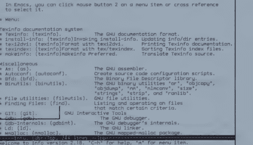
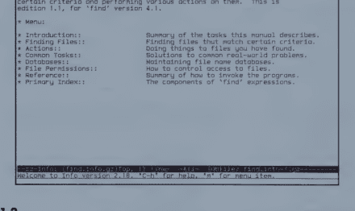
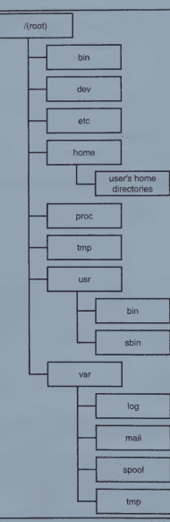
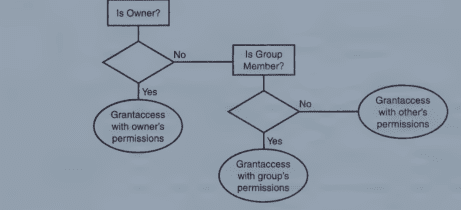
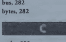

# LPIC 备考指南：101 Linux 通用


## 致谢

## 副出版总监
Greg Wiegand

## 采购编辑
Tracy Williams

## 高级开发编辑
Jill Hayden

## 开发编辑
Valerie Perry

## 出版总监
Thomas Hayes

## 项目编辑
Natalie Harris

## 文字编辑
Megan Wade

## 索引编制者
Aamir Burki

## 校对
Benjamin Berg

## 技术编辑
Coleta Witherspoon

## 团队协调员
Vicki Harding

## 媒体开发人员
Michael Hunter

## 内部设计师
Anne Jones

## 封面设计师
Anne Jones
Kevin Spear

## 制作
Gyldi Davis-Hubler
Lisa England


我想把这本书献给我的丈夫 Ron，感谢他在写作时对我行为的大度包容；还有我们的狗 Edwina，它总会让我记得玩丢飞盘也很重要。

## 致谢

我想借此机会感谢我的采购编辑 Tracy Williams，以及开发编辑 Jill Hayden 和 Valerie Perry，他们努力工作使本书尽可能完美。此外，我还要感谢麦克米伦公司的其他所有人，他们共同努力，以有助于而非阻碍您学习体验的形式，向您呈现通过认证考试所需的材料。

Theresa

# 关于作者

**Teresa Hadden** 拥有 MCSE、MCT 认证和 SAIR Linux 认证。她教授 Microsoft 服务器产品、Linux 和安全课程。她讲授 Microsoft 官方课程和定制课程，帮助学生准备认证考试，以及考后复习。此外，她为 Compaq 教授 Linux 入门和系统管理课程，并活跃于 LPI 的 Linux 社区，在邮件列表和其他场合提供对测试目标和问题的意见及建议。Teresa 拥有超过 15 年使用 Novell、UNIX 和 Windows NT 进行系统管理的经验。她为需要 LAN/WAN 功能或 Internet 访问（使用 Linux 和 Microsoft 产品）的中小型企业提供支持。Teresa 还为客户提供安装、管理和教育服务。

# 关于技术编辑

**Craig 和 Coleta Witherspoon** 自 20 世纪 70 年代以来一直从事计算机相关工作并进行写作。他们的职业生涯始于为跨国 corporations 编写培训和宣传材料。他们是约 20 本书（包括四本关于 Linux 操作系统的书籍）的作者，也是约两打其他书籍的技术编辑，并自 LPIC 101 通用 Linux I 测试的 beta 测试阶段起参与其中。

# 告诉我们您的想法！

作为本书的读者，*您* 是我们最重要的批评者和评论者。我们重视您的意见，想知道我们做得好的地方、可以改进的地方、您希望我们看到我们出版哪些领域，以及您愿意分享的其他任何智慧之言。

作为 Que 的副出版总监，我欢迎您的评论。您可以通过传真、电子邮件或直接写信告诉我您对本书喜欢或不喜欢的地方——以及我们可以做些什么来让我们的书更强大。

> *请注意，我无法解决与本书主题相关的技术问题，且由于我收到的邮件量大，我可能无法回复每封信息。*

写信时，请务必备注本书的标题和作者，以及您的姓名和电话或传真号码。我会仔细审阅您的评论，并与参与本书工作的作者和编辑分享。

- 传真：`317-581-4666`
- 电子邮件：`office_que@mcpx.com`
- 邮寄地址：
  副出版总监
  Que
  201 West 103rd Street
  Indianapolis, IN 46290 USA


## 4 文件管理


Linux 专业认证协会（LPI）是一个志愿者团体，他们聚集在一起，坚信需要一种全球接受的 Linux 认证。其他可用的 Linux 认证是针对特定发行版的。LPI 的目标是展示候选人管理任何 Linux 系统的能力。

当您审查每项考试的目标时，您将看到 LPI 如何实现其目标。每个目标都涵盖了适用于任何 Linux 安装的基本信息。因此，对于那些想要展示其 Linux 能力而不是管理特定 Linux 发行版能力的人来说，LPI 认证将成为首选的 Linux 认证。

第一级认证涵盖了初级 Linux 系统管理员所需的技能。该认证将涵盖以下领域的基本能力：

- 文档
- GNU 和 UNIX 命令
- 启动、初始化、关闭和运行级别
- 设备，Linux 文件系统
- 管理任务

此认证由两项考试组成。这两项考试每项都涵盖通用的 Linux 主题。最初，LPI 打算提供第三项考试作为第一级认证的一部分。这项第三项考试是针对特定发行版的，候选人可以从多个不同选项中选择一个。

基于对这些发行版考试中所含可用主题的 psychometric（心理计量学）评估，决定没有足够的材料来证明第三项考试是合理的。然后，一些针对特定发行版的材料被合并到第二项测试（102）的目标中。

本书旨在帮助您在成为 Linux 认证专家的路上，为 Linux 专业认证协会提供的第一项考试（101）做准备。

101 考试涵盖所有发行版通用的内容。考试涵盖的领域包括文档、GNU/UNIX 命令、文件系统、启动、运行级别和管理任务。此测试是所有申请 LPIC 一级认证候选人的必修测试。

## 本书的组织方式

本书的章节是根据 LPI 为 101 考试发布的目标编写的。您可以在 http://www.lpi.org 查看目标。

本书全面涵盖了这些目标，尽管顺序与 LPI 网站上列出的顺序不同。相反，它们以一种逻辑方式组织，使得每一章都建立在前一章的基础上。要查看考试目标的完整列表及其讨论位置，请参阅附录 G，“目标索引”。

第 1 章，“查找和创建文档”，涵盖了安装在您系统上的系统和应用程序文档的使用和维护。

第 2 章，“启动 Linux”，引导您完成启动 Linux、管理运行级别和关闭系统的步骤。

第 3 章，“Linux 文件系统”，涵盖了分区以及用于维护文件系统的磁盘实用工具。

第 4 章，“文件管理”，讨论了目录层次结构和文件管理。它还讨论了用于文本搜索的实用工具。

第 5 章，“GNU 和 UNIX 命令”，涵盖了在命令行输入和历史记录。此外，它还讨论了进程和优先级。

第 6 章，“维护文件系统”，解释了磁盘配额和磁盘管理。

第 7 章，“用户和组”，考察了如何组织和管理您的用户和组。

第 8 章，“文本流”，涵盖了最常见的文本过滤器。

第 9 章，“权限”，讨论了如何控制系统资源。


第 10 章“管理任务”介绍了系统管理的基础知识。

第 11 章“备份与恢复”概述了灾难恢复的规划方法，并讨论了更为常见的实用工具。

- 附录 A“术语表”提供了本书中出现术语的定义。
- 附录 B“认证流程”讨论了获得 LPI 认证的途径。
- 附录 C“测试技巧”提供了一些提示，帮助你通过考试。
- 附录 D“替代资源”列出了获取信息的其他途径。
- 附录 E“使用 CD-ROM”解释了如何使用随书附带的 CD-ROM。
- 附录 F“实验练习”是一个综合测试，供你评估自己是否准备好参加该考试。
- 附录 G“目标索引”包含 LPIC 测试 101 目标列表以及对每个目标的讨论。

即使你觉得对某一特定章节涵盖的内容已经驾轻就熟，在继续下一章之前，请务必复习该章节。因为每一章都建立在前几章的基础上，所以在继续之前，你需要牢固掌握基础章节的内容。

购买本书时你获得的额外赠品是活页小册子。这本小册子包含了每章的简要摘要，涵盖了最重要的知识点。请将其与各章节开头的先决条件结合使用，以确保在继续之前你已理解基础章节。

你也可以在考试前使用这本活页小册子进行复习。此外，你甚至可以在考试当天随身携带活页小册子，并在测试开始前在停车场进行快速复习。

每章开头都有一组“边读边问”问题，用以测试你对章节主题在管理环境中应用的既有认知。为了衡量你自己的学习曲线，请在阅读该章其余内容之前写下你的答案。在阅读章节时，请参考你的答案并酌情修改。答案位于章末。

每章末尾还有一组模拟试题。正确和错误的选项都有解释，旨在最大化你从这份模拟试题中获益。完成章末测试后，请查看答案以评估你的表现。不这样做只会害了自己。

如果你发现错了几道章末题目，请在继续下一章之前返回复习该章。如果你仍然对某个概念模糊不清，请尝试使用其他资源，如 Linux 文档项目（Linux Documentation Project）或附录 D 中列出的其他资源。

## 备考准备

本考试面向有 Linux 经验的个人。你需要有一个可用的 Linux 系统。练习本书中涵盖的每个概念，直到你对它们感到游刃有余。

为了从本书中获益最多，你应该从第 1 章开始，并按呈现的顺序完成每一章。开始阅读一章时，你应该做的第一件事是阅读先决条件。如果你觉得自己没有很好地掌握这些原则，请返回复习后再继续。

接下来，阅读“边读边问”问题并写下你的答案。你可能还想记下其他想到的问题。读完一章后，查看答案。确保你理解为什么这些答案是正确的。

你接下来要做的是完成相关的实验练习。这些练习旨在强化你阅读的教材内容。当你坐在考场参加正式考试时，这种动手实践经验将是无价的。

你最后要做的是回答章末问题。在核对答案之前，写下每道问题的答案。如果你答错了，请查看每个可能答案的解析理由。你还应该复习章节中相应的部分。如果你仍然不清楚，请查阅附录 D，那里列出了提供额外解释的其他途径。在准备第一次考试时，请随身携带活页小册子。它设计得便于携带。你可以利用它随时复习，比如排队时、在汽车维修店等待时，或者任何你只有几分钟空闲的时候。

完成本书和书末测试后，你将需要使用随书 CD-ROM 提供的模拟测试引擎。提供了足够的问题来进行四次完全不同的测试，尽管使用随机化功能，每次坐下来你都会得到一份“新”的测试卷。这是为你做好正式考试准备的绝佳体验。关于如何使用测试引擎的信息，请参阅附录 E。

测试将包含需要你对情况进行评估和诊断的问题。你选择的答案将是此次评估的结果。在这种情境下，你在附录 F 练习中获得的动手经验以及你自身的经验将是无价的。

祝你学习顺利，并在认证旅途中好运！

###### 章节先决条件

在开始本章之前，你应该能够访问一台运行 Linux 的计算机，以便练习这些概念和技能。你应该能够登录到系统，并理解在命令行中输入指令的基本知识。

# 查找和创建文档

## 边读边问

1. 你询问同事如何在你的 Linux 系统上定位文件，他告诉你检查 `find` 和 `locate` 的 man 手册页。他用“man”这个词是什么意思？
2. 你正在查看关于使用 `tar` 查找压缩 tar 文件选项的 man 手册页。如何在不阅读整页的情况下找到该选项？
3. 为什么使用 man 命令找不到正确的手册页？
4. 如何配置计算机，使西班牙语成为手册页的默认语言？
5. 你可以在哪里找到关于设置新 ZIP 驱动器（软盘驱动器/压缩驱动器）的信息？
6. Linux 文档项目（Linux Documentation Project）是什么？
7. 你在 `/usr/bin` 中找到一个文件，但不知道它是做什么的。如何找出答案？
8. 如何查找用于更改密码的确切命令名称？

####### 获取帮助

通常，Linux 不附带纸质手册，除非你购买的是包含手册的分发版。然而，从许多来源可以获得几乎无限的信息。这些来源可以归类为：

- 本地文档
- 通过互联网在线获取
- 新闻组（Newsgroups）
- 邮件列表
- 书籍

查找和使用这些文档的能力将在考试中进行测试。

### 本地文档

本地安装的文档有几种类型。表 1.1 显示了这些类型及其位置。

**表 1.1** 已安装文档及其位置

| 文档 | 位置 |
| :--- | :--- |
| 手册页 (manual pages) | /usr/man |
| info | /usr/info |
| HOWTO | /usr/doc/HOWTO |
| 常见问题解答 (FAQ) | /usr/doc/FAQ |
| 程序文档 | /usr/doc/<program name> |

其中每一种都有其优缺点。通常，关于同一主题的信息可以在多个来源中找到。然而，其中一个来源可能比另一个更容易让你理解。

#### man 手册页

系统上几乎每个实用工具、系统调用或命令都有大量本地在线帮助，称为*手册页*（manual pages）。手册页的用户友好度不高，作为查阅语法的工具比作为教程更有用。

它们通常被称为 man 手册页，使用 `man` 实用工具调用。`man` 搜索指定主题的手册页，并将输出通过分页器（pager）发送。分页器然后将手册页打印到你的显示器上。你如何导航手册页取决于使用的分页器。

`man` 的语法是

```
man [options] [section] [topic]
```

通过向 `man` 命令传递主题来调用手册页。如果你输入 `man man`，将显示描述手册页如何工作的文档。如果你正在查找关于 `who` 命令的信息，可以通过输入 `man who` 来获取。显示的手册页将介绍 `who` 命令的功能及其语法的摘要。

每个手册页都分为若干部分，尽管并非每个部分都出现在每一页中。表 1.2 列出了这些部分及其可能包含的内容。

**表 1.2** man 手册页的各部分

| 部分 | 描述 |
|---------|-------------|
| NAME | 命令的名称和简要描述 |
| SYNOPSIS | 如何使用该命令及其命令行选项 |
| DESCRIPTION | 程序及其选项的解释 |
| OPTIONS | 所有选项及每个选项的简要描述 |
| SEE ALSO | 相关的手册页 |
| DIAGNOSTICS | 错误消息的描述 |
| FILES | 该命令使用的文件列表及其位置 |
| BUGS | 已知问题 |
| HISTORY | 程序发展的里程碑 |
| AUTHOR | 程序作者和贡献者 |

不仅单个手册页在内部划分为若干部分，这些手册页本身也排列在特定的目录结构中。表 1.3 列出了这些目录的名称以及每个目录包含的手册页类型。这是你为考试可能需要知道的信息。


## 目录结构

| 目录 | 内容 |
|---|---|
| /usr/man/man1 | 可在 shell 中运行的命令 |
| /usr/man/man2 | 系统调用的文档 |
| /usr/man/man3 | libc 函数的手册页 |
| /usr/man/man4 | /dev 目录中文件的信息 |
| /usr/man/man5 | 如 /etc/passwd 等特殊文件格式的详细信息 |
| /usr/man/man6 | 游戏 |
| /usr/man/man7 | Linux 文件系统、手册页等的描述 |
| /usr/man/man8 | root 操作员实用程序的页面 |
| /usr/man/man9 | Linux 内核源代码例程的文档 |

### 浏览手册页

显示手册页后，有特定命令用于在文档中导航。这些命令因用于显示手册页的分页器（pager）不同而异。

通常用于显示手册页的两个分页器是 `more` 和 `less`。对于这两个分页器，你只需按空格键显示下一屏，或按 `b` 键回退一屏。`less` 还允许你使用 `PgUp` 和 `PgDn` 键向上或向下滚动。

`Enter` 键会逐行推进显示。完成后，在 `less` 或 `more` 中均输入 `q` 退出。

由于手册页可能相当长，且难以轻易上下滚动，搜索方法极具价值。

### 在手冊页内搜索

为了在手冊页中搜索字符串，请输入：

```
/<string>
```

这将显示在屏幕的最后一行。按下 `Enter` 键后，光标将前进到搜索字符串的第一个出现位置。若要继续搜索搜索字符串的下一次出现，请输入 `n`。如果未找到匹配项或已找到最后一个实例，分页器将通过在屏幕最后一行显示消息来通知你。

当搜索特定主题的手冊页时，将显示找到的第一个页面。章节（目录）不是按数字顺序搜索的，而是按以下顺序搜索：

- 1, 8, 2, 3, 4, 5, 6, 7, 9

每个章节都有自己介绍该章节内容的手冊页。例如，如果你想了解游戏章节包含的内容，你可以输入 `man intro`；然而，你会看到来自第 1 章节的介绍页。`man` 一旦找到匹配项就会停止搜索。这可能不是你正在寻找的页面，因为搜索会在找到一个满足条件的页面后立即结束。输入 `man intro` 永远不会带你到达游戏章节，即第 6 章节。你可以通过指定要搜索的章节来覆盖此行为。输入：

```
man 6 intro
```

将显示游戏章节的介绍页。但假设你需要了解在编写的应用程序中使用 `write` 的信息。当你输入 `man write` 时，你会得到有关 `write` 实用程序的信息。

你知道关于 `write` 还有额外的手冊页，但不知道它们在哪个章节。你可以通过输入以下内容搜索所有手冊页中的字符串 `write`：

```
man -k write
```

每个讨论 `write` 的手冊页将列出一个简短描述。输出的两行如下：

```
write (1)         - 向另一个用户发送消息
write (2)         - 写入文件描述符
```

如果搜索的术语不在名称部分中，你可以使用 `-k` 选项。例如，假设你想要了解如何更改密码的信息。如果你输入 `man password`，你会得到错误：

```
No manual entry for password
```

然而，如果你输入 `man -k password`，`man` 将搜索简短描述并显示包含字符串 `password` 的所有手冊页列表，如下面的结果所示：

```
chage (1)       - 更改用户密码过期信息
chpasswd (8)    - 批量更新密码文件
conflict (8)    - 搜索别名/密码冲突
crypt (3)       - 密码和数据加密
fgetpwent (3)   - 获取密码文件条目
getpass (3)     - 获取密码
getpw (3)       - 重建密码行条目
```

由于这些描述实际上并没有告诉你更改密码所需操作的语法，你可以尝试 `man -K password`。这会使 `man` 搜索每个手冊页中的术语 `password`，并显示页面的标题，同时询问你是否想要查看该页面。

```
/usr/man/man1/entry.n? [ynq] n
/usr/man/man1/TclX.n? [ynq] n
/usr/man/man1/interp.n? [ynq] n
/usr/man/man8/snppasswd.8? [ynq] n
/usr/man/man8/sbmount.8? [ynq] n
/usr/man/man8/uucico.8? [ynq] n
/usr/man/man8/vsfp.8? [ynq] n
```

如果你回答 `y`，则显示该页面。当你退出查看该页面时，`man` 会继续其搜索并呈现下一个匹配项，直到你告诉它停止为止。虽然这会产生最完整的结果，但可能需要很长时间才能完成。

与 `man` 一起使用的另一个有用选项是 `-a`。此选项使 `man` 搜索整个页面并依次显示其找到的每个页面。当你退出一个手冊页时，将显示下一个满足你条件的页面。

####### 关键概念

在搜索信息时，请确保你理解 `-k`、`-K` 和 `-a` 选项。`-K` 搜索 `whatis` 数据库；`-k` 搜索手冊页的全部内容；`-a` 查找所有匹配项。

手冊页通常以压缩、未格式化的形式存储。在显示之前，每个页面需要被解压和格式化。`man.conf` 文件包含 `man` 的配置数据，包括如何构造 `man` 的搜索路径；`man` 使用的各种程序（如 `less`、`more` 或 `nroff`）的路径；以及解压缩器的列表。

可以通过输入以下内容使用不同的配置文件：

```
man -C MyMan.conf command
```

`man` 命令使用的分页器包含在 `PAGER` 环境变量中。若要定义你想要使用的不同分页器，请编辑你的 `.profile` 文件并添加以下行：

```
export PAGER=/bin/less
```

`man` 命令需要知道手冊页的位置。此信息包含在 `MANPATH` 环境变量中——其值来自 `man.conf` 文件。你可以通过在你的 `.profile` 文件中添加以下内容来重新定义此变量：

```
export MANPATH=<path to manual pages>
```

####### 关键概念

手冊页提供有关命令、实用程序和系统调用的信息。输出通过分页器显示。可以通过编辑 `man.config` 或 `.profile` 文件来更改 `MANPATH` 或分页器。

### info

`info` 是 GNU 超文本文档阅读器，比手冊页更容易使用。`info` 可以从文本编辑器 `emacs` 调用，也可以作为独立程序调用。

虽然 `info` 提供的信息通常更容易理解，但导航可能很困难。它使用与 `emacs` 类似的键组合。

如果你通过输入 `info` 启动，将显示图 1.1 中所示的屏幕，其中展示了可用文档的目录。



菜单项：你输入的文字

**图 1.1** 启动 `info` 时显示的介绍屏幕。

屏幕的上半部分列出了一些有用的按键，接着是菜单。每个菜单项都以星号（*）开头，接着是菜单项的描述，以冒号（:）结尾。冒号后是括号中的菜单项文本，如图 1.1 所示。正是这段文字，你输入它即可进入该菜单项。

你使用空格键浏览可用菜单项列表。输入字母 `m` 会将光标放置在屏幕底部，你可以在那里输入菜单项。输入 `Enter` 后，你将进入该菜单项。

例如，如果你想获取有关查找文件的信息，你可以在 `info` 中输入 `m` 然后输入 `find` 进入该页面，或者通过带参数 `find` 调用 `info`，例如：

```
info find
```

这两种方法都会带你到达图 1.2 所示的屏幕。



**图 1.2** 关于主题 `find` 的 `info` 屏幕列出了 `find` 文档中可用的章节。

你可以看到，此屏幕上没有可以输入以进入某个菜单项的菜单文本。但是，你可以使用 `Tab` 键突出显示感兴趣的主题，然后按 `Enter` 进入该主题。

`info` 还有一个教程，如果你想充分利用 `info`，非常值得花时间去阅读。从主屏幕输入 `h` 即可开始教程。


####### 关键概念

浏览信息的过程相当简单。按空格键向下滚动一屏，按 Delete 键向上回退一屏。您可以输入 `n` 跳转到下一个主题，输入 `p` 跳回上一个主题。输入 `l` 将返回您最后的位置。

info 实用程序提供的信息与 man 手册页非常相似；然而，它通常更容易理解。空格键向上滚动，Delete 键向下滚动。输入 `n` 表示下一个主题，输入 `p` 表示上一个主题。输入 `q` 退出。

## HOWTO（操作指南）

Linux HOWTO 是详细描述在 Linux 中执行任务方法的文档。例如，您可能需要了解如何配置某个硬件部件，或如何完成打印文档等简单任务。

HOWTO 文档通常涉及复杂的主题，因此篇幅往往较长。像 LILO 和打印这样不太复杂的主题则由小型 HOWTO（mini HOWTO）涵盖。

HOWTO 的版本（通常是压缩格式）通常安装在 `/usr/doc/HOWTO` 目录中。请在线查找最新版本。

您可以通过 ftp（从 `ftp://sunsite.unc.edu/pub/Linux/docs/HOWTO` 或其镜像站点之一）下载 HOWTO 的最新版本。此外，还可以通过多个网站以 HTML 格式浏览，包括 `http://sunsite.unc.edu/LDP/HOWTO/` 或 `http://www.linuxdoc.org/HOWTO/`。

您可以通过访问 `http://sunsite.unc.edu/LDP/mirrors.htm` 来查找镜像站点。这些文档也有多种语言版本。

####### 关键概念

HOWTO 是由用户编写的，用于描述他们如何解决问题的。与 man 手册页和 info 相比，它们更易于使用，并涵盖不同的主题。由于 HOWTO 经常更新且新内容不断发布，您应定期核对自己是否拥有最新版本。

与使用 man 手册页或 info 相比，HOWTO 更容易理解，并且经常讨论其他渠道未涉及的问题。它们包含其他用户研究并发布、对其他用户有用的主题。

例如，您是否试图在 Linux 上运行游戏《雷神之锤》（Quake）？查阅 man 手册页和 info 并无帮助。然而，有一个 HOWTO 告诉您如何做到这一点。

####### FAQ（常见问题解答）

FAQ（Frequently Asked Questions，常见问题解答）是一组旨在配合 HOWTO 文档阅读的材料。它们采用问答格式，解答用户最常询问的问题。

FAQ 提供 HTML、PostScript 和文本格式。几乎所有发行版通常都会在 `/usr/doc/FAQ` 目录中安装这三种格式的 FAQ 副本。请在线 `http://linuxdoc.org/FAQ/` 查找最新版本。

## 程序文档

提供特定程序更多信息的文本文件可以在 `/usr/doc` 中找到，位于以程序名称和版本号命名的子目录中。这些信息包括应用程序的安装、配置和使用方法。通常可以使用 `less` 或 `more` 来阅读它们。

此外，应用程序通常会安装一个手册页，讨论如何使用该程序。这些手册页可以通过本章前面提到的 `man` 命令找到。

## 互联网资源

如您所知，Linux 的所有源代码都可以在互联网上下载。Linux 文档也存在于许多在线位置。与 Linux 相关的主要信息来源是位于 `http://metalab.unc.edu/LDP/` 的 Linux 文档项目（Linux Documentation Project）。在这里，您可以找到所有的 HOWTO、小型 HOWTO 和 FAQ。该网站还提供了一站式搜索所有资料的功能。

Linux 文档项目还提供了若干涵盖从内核到网络管理等特定主题的指导手册。它们可从 `http://sunsite.unc.edu/LDP` 获取。可用的手册包括：

- Matt Welsh 撰写的《Linux 文档项目宣言》
- Matt Welsh 撰写的《安装与入门指南》
- David Rusling 撰写的《Linux 内核》
- Michael K. Johnson 撰写的《Linux 内核黑客指南》
- Ori Pomerantz 撰写的《Linux 内核模块编程指南》，版本 1.1.0
- Olaf Kirch 撰写的《网络管理员指南》
- Lars Wirzenius 撰写的《Linux 系统管理员指南》
- Larry Greenfield 撰写的《Linux 用户指南》
- Sven Goldt、Sven van der Meer、Scott Burgett 和 Matt Welsh 撰写的《Linux 程序员指南》

一个使 Linux 文档更加用户友好的较新项目正在由 Linuxnewbie.org（`http://www.linuxnewbie.org/`）推进。他们的目标是将现有的 HOWTO、FAQ 和其他资源转化为用户友好的文档。

## 新闻组

许多 Usenet 新闻组提供大量信息。*comp.os.linux.announce* 新闻组是一个受管理的群组，包含关于软件更新、新端口、用户组会议和商业产品的最新信息。提交到该组的内容应发送至 `linux-announce@news.ornl.gov`。

*comp.os.linux.answers* 包含所有 FAQ、HOWTO 和其他重要文档。HOWTO 通常发布在月初。然后，您可以使用可从 `http://sunsite.munc.edu/pub/Linux/system/news/misc/` 获取的 NestoHOWTO 程序来汇编这些帖子。

其他值得阅读的新闻组位于 *comp.os.linux.\** 层级中。通常，您可能会遇到一个在 HOWTO 或 FAQ 中没有提及，但在以下新闻组之一中得到了回答的问题：

- comp.os.linux.setup
- comp.os.linux.hardware
- comp.os.linux.networking
- comp.os.linux.x
- comp.os.linux.development.apps
- comp.os.linux.development.system
- comp.os.linux.advocacy
- comp.os.linux.misc

大多数新闻组都归档在 `http://www.deja.com` 和 `http://www.altavista.com`，您可以在那里搜索与特定主题或论坛相关的帖子。

## 邮件列表

关于 Linux 有多个邮件列表可用。其中一些是通用的，而另一些则适用于特定的发行版。

您可以通过向 `Linux-Announce-Request@NEWS-DIGESTS.MIT.EDU` 发送电子邮件加入 *comp.os.linux.announce* 的邮件列表镜像，并在消息正文中包含单词 `subscribe`。向同一地址发送一封空邮件可获取使用邮件列表的帮助（包括如何退出的说明）。

有几个 Linux 邮件列表由 `majordomo@vger.rutgers.edu` 托管。发送一封正文包含单词 `lists` 的消息以了解可用的列表。发送一封正文包含单词 `help` 的消息可获取订阅和取消订阅列表的说明。这些列表大多数是技术性的，并不面向新用户的问题。

务必遵守网络礼仪规则。在尚未深入研究之前，不要向新闻组或邮件列表提出问题。通常，您的问题已经有人提出并得到解答。首先查阅文档（HOWTO、FAQ 和 man 手册页），然后在发帖前检查 `http://www.deja.com/` 上的存档。

如果您确实要发帖，请尽可能多地提供有关您的系统和问题的相关信息，例如软件版本的一般信息和硬件配置的简要摘要。学会欣赏系统调试（hacking）的价值，以及如何自行解决问题。

## 搜索信息

当您寻求帮助时，还有许多其他方法可以找到关于命令的信息。其中最常用的命令是 `whereis`、`whatis`、`which` 和 `apropos`。

## whereis

`whereis` 命令用于查找文件，但也会显示文件的二进制文件、源文件以及任何相关手册页的位置。`whereis` 的一个局限性在于，搜索仅限于硬编码在程序中的已知目录。其语法为：

```
whereis [options] filename
```

如果您想查看在哪里可以找到 `passwd` 或其相关 man 手册页，您应输入：

```
whereis  passwd

passwd: /usr/bin/passwd /etc/passwd /etc/passwd.OLD /usr/man/man1/passwd.l
/usr/man/man5/passwd.5
```


如果未找到文件，则只显示要搜索的文件名。

```
whereis foo
foo:
```

要仅查找二进制文件，请使用 `-b` 选项；要仅查找手册页，请使用 `-m``；要仅查找源文件，请使用 `-s`。

##### which

使用 `which` 命令来查找命令的位置。它会在路径中搜索，直到找到匹配项为止。如果未找到匹配项，`which` 会显示一条错误消息。

```
which command
```

可以在同一命令行上传递多个命令。当命令未按预期响应时，`which` 命令非常有用。有时，不同位置可能存在多个同名命令。使用 `which` 可以验证你正在运行的是你以为的那个命令。找到匹配项后，它会停止搜索并显示其完整路径。

### whatis 和 apropos

`whatis` 和 `apropos` 都从手册页获取信息。

### whatis

`whatis` 命令显示关于程序的摘要行，该信息源自程序的手册页。

```
whatis whereis

whereis (1) - locate the binary, source and manual page files for a command
```

这些信息存储在一个名为 `whatis` 的数据库中，位于 `/usr/man/man1` 目录中，并使用 `makewhatis` 命令创建/更新。

### apropos

当你记不清如何执行某项操作时，该命令很有帮助。你可以搜索几乎任何内容。例如，如果你记不清如何更改用户密码，你可以输入 `apropos password` 来查找更改方法。

`apropos` 和 `whatis` 之间的区别在于它们执行搜索的方式。`apropos` 在行内的任何位置搜索参数字符串——类似于 `man -k`。

另一方面，*whatis*（相当于 man *-t*）仅尝试在连字符之前的部分匹配完整的命令名称。因此，*whatis* *cc* 会报告是否存在 cc 手册，而对 gcc 保持静默，而 *apropos* 则会成功找到两者。

####### 关键概念

务必了解表 1.4 中列出的 *whereis*、*which*、*whatis* 和 *apropos* 的用法。考试中会涉及所有四个命令。

表 1.4 *whereis*、*which*、*whatis* 和 *apropos* 的用法

| 命令 | 描述 |
| :--- | :--- |
| whereis | 返回命令的路径 |
| which | 告诉你正在执行哪个命令 |
| whatis | 给出命令功能的简短描述 |
| apropos | 搜索手册页中的简短描述 |

## 编写文档

你将被测试的一项软技能是你的系统文档编写能力。这是大多数人最不喜欢的任务；然而，它是管理员执行的最重要任务之一。你可以预期在考试中会看到一到两个关于系统文档重要性的问题。

创建系统文档的第一步是创建并维护系统日志。对于每台计算机，你应记录硬盘控制器类型、磁盘数量和大小、分区方案、主机名、IP 地址、附加外设以及该机器使用的特殊按键或命令（例如如何配置 BIOS）。

每当出现问题时，你应记录问题的详细信息、你尝试过的措施以及最终有效的解决方法。例如，如果你有一个失败的 *cronjob*，你应记录失败的症状以及你为纠正它所做的操作。这样，当相同的问题在以后再次发生时，你将以最少的时间解决它。

随着每台计算机的变化，记录这些变化及其原因。这应包括新硬盘、新分区、安装的应用程序、配置文件的更改等。换句话说，记录你所做的一切。这份文档应足够完整，以便能在最短时间内重建系统。

你还需要编写关于如何使用你所在站点系统的文档——既要考虑管理员的视角，也要考虑用户的视角。你可能想要编写一份文档，告诉用户如何登录或如何运行特定应用程序。你还应有文档说明你的系统是如何构建的，以便其他管理员可以使用这些文档来重建或排除你的系统故障。

接下来的问题是使用哪种格式来编写这些文档。有两种格式，电子格式或纸质格式。表 1.5 比较了每种格式的优缺点。

表 1.5 纸质与电子文档的对比

| 类型 | 优点 | 缺点 |
| :--- | :--- | :--- |
| 电子 | 易于更新和搜索。 | 如果计算机宕机则无法访问。难以携带。 |
| | 易于包含命令输出和屏幕截图。 | |
| 纸质 | 系统宕机时仍可用。 | 难以更新或搜索。 |
| | 可以包含屏幕截图和命令输出。 | 可能杂乱且难以阅读。 |

如果你选择保留电子文档，请确保规划其格式，以便你能找到信息。如果你选择使用纸质格式，也请对其进行良好组织。如果你找不到正确的条目，文档将毫无用处。

## 用户支持

提供用户支持可能是你必须执行的具有挑战性的任务之一。这项任务不仅需要技术熟练度，还需要良好的人际关系和沟通技巧。你必须以用户能理解你所说内容的方式向用户提供信息。但你也不得让用户觉得你在居高临下地对他说话。

由于提供用户支持耗时，你需要高效工作，同时不给人留下认为求助请求浪费了你时间的印象。做到既高效又有帮助的最佳方法之一是对每个问题都采取有条理的方法。

你可以通过几种方式收到技术支持请求。也许你有一种提交故障工单的方法，或者用户给你打电话。无论对方如何联系你，你的最终目标是提高用户的生产力。

你还应及时响应所有求助请求。务必确定问题的紧急程度并将其考虑在内。如果你无法立即解决用户的问题，也应通知用户，并告知你何时可以处理的大致时间。

首先，你必须能够清楚地界定问题的参数。确定问题何时以及如何发生。你总是希望询问问题首次出现的时间。有可能你收到的故障电话实际上是要求提供新功能的请求。

这时文档就会派上用场。在你确定问题之后，你会想查阅文档，看看这个问题之前是否已被解决。如果幸运的话，解决方案就就在你眼前。

如果你的联系方式是通过电话，你可以提问以更好地定义问题。当问题以书面形式提交时，可能会缺少重要信息。可能需要通过电子邮件交换才能恰当地定义问题。

与用户沟通时，务必保持礼貌。避免使用行话；相反，使用用户能理解的语言，但不要居高临下。如果有书面说明，请酌情分享。

请记住，在用户说问题已解决之前，故障工单不会关闭。即使你认为自己已经回答了用户的问题并且问题已解决，用户可能并不这么认为。如果你需要进一步研究问题，或者向另一位管理员寻求帮助，请告诉用户你打算做什么以及何时回复她。让用户感觉自己也是解决方案的一部分，而不仅仅是问题的一部分，这将大大使你的工作变得更容易。

####### 总结

至此，你已熟悉使用各种本地安装的文档形式。在备考时，务必理解 `man -k` 和 `man -K` 之间的区别。`man -k` 命令搜索手册页的全部内容，而 `man -K` 仅搜索手册页的描述部分。

在手册页内搜索是使用 `/` 完成的，并使用 `n` 继续搜索。

你应该知道何时使用 `info` 以及何时使用 HOWTO 和 FAQ，以及如何保持后两者的最新状态。理解新闻组和邮件列表的用处，同时遵守适当的网络礼仪规则。

你还应理解 `whatis`、`which`、`whereis` 和 `apropos` 之间的区别。`whatis` 命令搜索 whatis 数据库，并显示命令或实用程序功能的简短描述。`which` 命令让你知道你正在运行的命令版本及其位置。`whereis` 命令提供命令、其源代码及其手册页的位置。`apropos` 命令显示包含你所述术语的手册页名称。你还可以预期考试中会有关于维护各种文档以及处理用户的问题。


###### 问答

1. 你询问同事如何定位 Linux 系统中的一个文件，他告诉你查看 `find` 和 `locate` 的手册页。他说“man”是什么意思？

   **答：** 当他提到手册页（man pages）时，他指的是已安装的手册页，这些手册页记录了系统上安装的每个命令、实用程序和应用程序。

2. 你正在查看使用 `tar` 的手册页，以找到压缩 tar 文件的选项。如何在不阅读整页的情况下找到它？

   **答：** 你可以在页面上搜索术语，方法是输入 `/compress` 并按 Enter 键，这会带你找到正确的选项。

3. 为什么使用 `man` 命令找不到正确的手册页？

   **答：** 该命令有两个不同的手册页。因为 `man` 显示它找到的第一页，所以该页面可能不是你要查找的那一页。

4. 你有一位用户希望使用西班牙语手册页。如何配置他的计算机使其成为默认语言？

   **答：** 首先，在服务器或用户计算机上安装西班牙语版本的手册页。接下来，编辑用户的 `.profile` 文件，将 `MANPATH` 变量设置为这个新位置。

5. 你可以在哪里找到关于设置你的新 Zip 驱动器的信息？

   **答：** 搜索手册页不会提供任何信息。你应该查看 HOWTO 文档——这些文档安装在你的系统或互联网上。

6. 什么是 Linux 文档项目（LDP）？

   **答：** Linux 文档项目负责管理所有 Linux 文档，包括手册页、HOWTO、常见问题解答（FAQ）和教程，旨在维护其可靠性和准确性。

7. 你在 `/usr/bin` 中发现了一个文件，但不知道它是做什么的。如何查明？

   **答：** 使用 `whatis` 命令，它会提供该命令功能的一行摘要。

8. 如何找到更改密码的确切命令名称？

   **答：** 使用 `apropos` 命令在手册页中搜索 password 命令。`apropos` 然后会列出包含该词的手册页标题。如果结果不理想，使用 `man -K password` 搜索每个手册页的完整内容。

####### 实践测试

1. 如何找到所有讨论压缩的手册页？
   - a. `apropos compression`
   - b. `man -k compression`
   - c. `info compression`
   - d. `man 3 -K compression`

   答案 a 不正确，因为这将生成所有标题中包含“compression”的手册页列表。答案 b 不正确；这将生成所有标题中包含“compression”的手册页列表。答案 c 不正确；`info` 是与手册页不同的另一套文档集合。答案 d 正确；`-K` 选项使 `man` 搜索每个手册页的完整内容。

2. 使用 `info` 时，如何跳转到菜单项 `find`？
   - a. 输入 `f` 并按 Enter。
   - b. 输入 `mfind` 并按 Enter。
   - c. 用鼠标点击 `find`。
   - d. 按 `Alt+f` 选择 `find`。

   答案 a 不正确；输入 `f` 不会选择 `find` 菜单项。答案 b 正确；输入 `m` 会将光标移动到屏幕底部，你可以在那里输入菜单项并按 Enter。答案 c 不正确；`info` 不允许你点击菜单项来选择它们。答案 d 不正确；`Alt` 或元键（metakey）不用于选择菜单项。

3. 你可以在哪里找到关于启动过程的额外信息？
   - a. 查找关于启动过程的 HOWTO。
   - b. 在新sgroup（新闻组）上发布消息询问更多信息。
   - c. 在 `/usr/doc/boot` 目录中查找。

   答案 a 正确；HOWTO 讨论主题而非特定命令。答案 b 不正确；新闻组不是用来研究问题的，而是用来提出尚未得到回答的具体问题的。答案 c 不正确；`/usr/doc` 目录为每个已安装的应用程序都有一个子目录，而 boot 不是一个应用程序。

4. 如何查找有关如何配置安装在你系统上的 `trn`（新闻阅读器程序）的信息？
   - a. 输入 `trn - -help`。
   - b. 在 Linux 文档项目网站上进行在线搜索。
   - c. 检查 `/usr/doc/trn.version` 目录。
   - d. 给作者发送电子邮件。

   答案 a 不正确；`-help` 选项用于命令，而不是应用程序。答案 b 不正确；LDP 网站提供查找 Linux 信息的搜索功能，而不是应用程序。 **答案 c 正确；应用程序文档存储在与应用程序及其版本同名的 `/usr/doc` 目录的子目录中。** 答案 d 不正确；应首先参考文档，因为它们是由应用程序作者编写的。

5. 你使用 `whereis` 搜索你上周创建的一个文件，但没有找到。为什么？
   - a. 你肯定已经删除了它。
   - b. `whereis` 命令没有搜索正确的目录。
   - c. 你没有向 `whereis` 传递正确的要搜索的目录。
   - d. 你拼写错了文件名。

   答案 a 不正确；虽然你可能已删除该文件，但这不是问题所在。 **答案 b 正确；`whereis` 命令搜索预定义的目录列表，其中不包括你的主目录。** 答案 c 不正确；你不能定义 `whereis` 搜索的目录。答案 d 不正确；虽然你可能拼写错误，但这不是搜索失败的原因。

6. 运行命令时，结果出乎意料。如何查明正在执行什么命令？
   - a. 使用 `which` 命令。
   - b. 使用 `what` 命令。
   - c. 使用 `man` 命令。
   - d. 使用 `whatis` 命令。

   **答案 a 正确；`which` 命令将指示正在运行哪个版本的命令。** 答案 b 不正确；没有 `what` 命令。答案 c 不正确；`man` 命令将显示相应的手册页。答案 d 不正确；`whatis` 命令会告诉你命令的作用。

7. 如何获取 `who` 命令作用的摘要？
   - a. 输入 `who -help`。
   - b. 输入 `whereis who`。
   - c. 输入 `whatis who`。
   - d. 输入 `man who`。

   答案 a 不正确；`-help` 选项提供语法帮助。答案 b 不正确；`whereis` 命令提供命令的路径。 **答案 c 正确；`whatis` 命令提供命令功能的简短描述。** 答案 d 不正确；这将显示 `who` 的手册页，但你正在寻找该命令功能的简短描述。

8. 与 `apropos sort` 等效的命令是什么？
   - a. `man sort`
   - b. `man -K sort`
   - c. `man -k sort`
   - d. `man -f sort`

   答案 a 不正确；这将显示关于 `sort` 的第一个手册页。答案 b 不正确；这将搜索所有手册页内容中的单词 `sort`。 **答案 c 正确；与 `apropos` 类似，`man -k` 在手册页的标题中搜索搜索字符串。** 答案 d 不正确；`man -f` 仅搜索完整的命令名称。

# 第 2 章

###### 章节先决条件

在开始本章之前，你应该扎实理解第 1 章“查找和创建文档”中介绍的文档使用。此外，你需要拥有一个能成功启动到 Linux 的工作系统。

# 启动 Linux

######## 阅读时思考

1. 如何在你的 Linux 计算机上启动多个操作系统？
2. 文件 `/var/linux-2.0.36-0.7` 的目的是什么？
3. 你应该如何进行一些系统维护工作？
4. 文件 `/etc/inittab` 的目的是什么？
5. 你在计算机上安装了一个 UPS（不间断电源）。你还应该做什么？
6. 启动机器时，你看到 LILO 然后系统挂起。问题可能出在哪里？
7. 你可以使用 `Ctrl-Alt-Del` 重启你的计算机吗？
8. 你需要关闭系统以安装新的硬盘。你应该做什么？

你可以通过仅仅打开电源、使用启动加载器程序或从软盘启动来启动你的 Linux 系统。当你打开计算机电源时，在开机阶段会执行某些任务。这一时期被称为 POST：加电自检。在此之后，可以加载操作系统。启动加载器是管理内核加载的程序，例如 LILO。LILO 在本章后面会有介绍。

启动 Linux 的方法取决于你如何配置系统。无论以何种方式启动系统，使操作系统运行起来的步骤基本相同。

> **关键概念**
> 理解 Linux 启动过程对于排查启动过程中可能遇到的任何问题是必要的。这些概念将在考试中考到。

内核位于你的启动软盘或硬盘的 `/boot` 目录中。压缩的内核通常称为 `vmlinuz-版本号`。不过，名称和位置并不重要——重要的是在启动时能找到内核。

首先，内核被加载到内存中。通常，你的内核是压缩的；然而，用于解压缩它的代码没有被压缩。你可以使用 `gunzip` 实用程序来解压缩内核。有关该实用程序的信息，请参见第 11 章“备份和恢复”。你正在加载的内核映像中包含几个参数，包括根文件系统的位置。

在加载过程中，内核将消息打印到显示器并保存它们到 `/var/log/messages` 文件。你可以通过查看日志或使用 `dmesg` 命令来回顾这些消息。`dmesg` 不接受参数，并打印出内核消息缓冲区中的最后几条消息。这些消息包括

- 控制台类型和字体
- PCI 总线检测及存在的任何 PCI 卡
- 处理器速度的估计
- 可用的系统内存量
- CPU 类型
- 内核版本号


- 任何已加载的设备驱动程序
- 交换空间的大小
- 网络适配器及其设置

有关此日志文件和 dmesg 命令用法的更多信息，请参阅第 10 章“管理任务”。

内核启动后，它会挂载根文件系统，该文件系统通常位于您的硬盘上。挂载根文件系统后，控制权便移交给了硬盘，而内核则保留在内存中。

## init 守护进程

内核执行的最后一步是调用 init 守护进程，该进程将保持活跃状态，直到您关闭系统。它负责创建系统其余部分所需的进程，例如登录 shell。init 守护进程还会在特定进程退出时重新启动它们。例如，当您注销时，init 会重新启动控制台，以便您可以再次登录。

init 守护进程的行为由其配置文件 /etc/inittab 控制。

## /etc/inittab 文件

/etc/inittab 文件的每一行都包含由冒号分隔的四个字段：

```
ID:runlevel:action:process
```

表 2.1 展示了每个字段的内容。

### 表 2.1 /etc/inittab 文件中各字段的作用

| 字段 | 内容及用途 |
| --- | --- |
| ID | 用于标识条目的一个或两个字符，通常是设备名称 |
| runlevel | 指示该行适用于哪些运行级别；可以列出多个运行级别；若留空，则适用于所有运行级别 |
| action | 如何处理该条目；有效值请参见表 2.2 |
| process | 要执行的命令 |

action 字段指示如何处理该命令，例如当命令停止时是否重新启动该命令。表 2.2 展示了该字段的有效条目。

### 表 2.2 /etc/inittab 文件中 action 字段的有效条目

| 条目 | 描述 |
| --- | --- |
| boot | 在首次读取 /etc/inittab 时运行 |
| bootwait | 在 boot 条目之后、首次读取 /etc/inittab 时运行 |
| initdefault | 设置初始运行级别；如果该进程正在运行则停止它；之后仅启动该进程一次 |
| ondemand | 保持进程运行；如果它停止则重新启动 |
| powerfail | 在接收到电源故障信号时执行 |
| sysinit | 在执行控制台之前执行 |
| respawn | 保持进程运行；如果该进程停止则重新启动 |
| wait | 仅启动该进程一次 |

**init** 进程用于启动内核及其运行系统所需的其他进程。如果您希望某应用程序在每次系统启动时都运行，请将相应命令写入其中一个 rc 脚本中，这些脚本将在下一节“运行级别”中讨论。

## 运行级别

*运行级别*（runlevel）定义了启动系统时需要启动的一组进程。这可以从用于系统管理的极少量进程，到支持所有已配置设备的配置不等。

不同运行级别对应的数字因您使用的发行版而异，并列在 /etc/inittab 文件中。例如，列表可能如下所示：

```
### Default runlevel. The runlevels used by RHS are:
### 0 - halt (Do NOT set initdefault to this)
### 1 - Single user mode
### 2 - Multiuser, without NFS (The same as 3, if you do not have networking)
### 3 - Full multiuser mode
### 4 - unused
### 5 - X11
### 6 - reboot (Do not set initdefault to this)
```

运行级别 **0** 和 **6** 分别仅保留用于**关机**（halt）和**重启**（reboot）。不同发行版的运行级别可能各不相同。无论您安装了什么发行版，init 守护进程只处理与当前运行级别关联的那些行。

单用户模式与其他可用的运行级别略有不同。此运行级别通常用于系统管理任务，例如修复损坏的文件系统。当系统处于此运行级别时，其他用户无法登录。但是，您仍然可以同时运行多个应用程序。这是 init 不读取 /etc/inittab 文件的唯一情况。相反，默认操作是运行 /bin/su 命令，您将以超级用户或 root 身份登录。

当以高于单用户模式的运行级别启动时，系统将以多用户模式启动。在此模式下，init 会执行 action 为 sysinit、boot 或 bootwait 的那些行。通常，这些行会挂载文件系统。

接下来，init 守护进程将执行运行级别字段中列出的当前运行级别对应的其他所有行。

您的初始运行级别由以下行定义：

```
id:3:initdefault:
```

请注意，此行没有定义要启动的进程，而是定义了启动所用的运行级别。您可以使用 init 命令更改运行级别。其语法如下：

```
init [runlevel]
```

init 命令接受一个运行级别作为参数。您可以使用带有 -t seconds 选项的 telinit 命令来指定在更改运行级别前的等待时间。默认延迟为 5 秒。telinit 命令是 init 命令的一个链接。请务必在更改运行级别前通知所有已登录的用户。

例如，命令

```
init 5
```

将把运行级别更改为级别 5。init 首先发送信号以停止那些未在新运行级别中定义的正在运行的进程。在指定的延迟时间后，telinit 会向这些进程发送 kill 信号。然后，它启动新运行级别中定义的、尚未运行的任何进程。

您也可以通过向 init 或 telinit 命令传递 s 或 S 来切换到单用户模式。

/etc/inittab 文件的下一节定义了要运行的启动脚本，例如：

```
si::sysinit:/etc/rc.d/rc.sysinit
```

行首的 ID si 由 init 守护进程内部使用。此行启动 rc.sysinit 脚本，该脚本处理诸如激活交换分区、运行 fsck 以及挂载文件系统等任务。fsck 命令用于检查文件系统是否存在损坏条目，详细内容将在第 6 章“维护文件系统”中讨论。该脚本可能因发行版而异。请阅读您系统上对应的脚本以了解其具体功能。

/etc/inittab 文件的下一节运行适用于您运行级别的脚本，这些脚本位于 /etc/rc.d 目录中：

```
1:1:wait:/etc/rc.d/rc 1  
12:2:wait:/etc/rc.d/rc 2  
13:3:wait:/etc/rc.d/rc 3  
14:4:wait:/etc/rc.d/rc 4  
15:5:wait:/etc/rc.d/rc 5  
16:6:wait:/etc/rc.d/rc 6
```

这是通过调用带有标识运行级别参数的 `rc` 脚本来实现的。然后，`rc` 脚本会运行位于 `rcn.d` 目录中的脚本，其中 `n` 代表运行级别。根据您的发行版，您的系统还可以执行其他启动脚本，例如 `/etc/rc.local`。

您的 `rc` 脚本还可以调用*模块*。模块是可以在系统运行期间加载和卸载的内核代码片段。这些模块通常是不需要始终使用的设备的设备驱动程序。

您可以使用 `/etc/conf.modules` 文件在模块加载时向每个模块传递参数。这些参数通常是 `I/O` 地址和中断。一个示例 `conf.modules` 文件如下：

```
alias eth0 3c59x  
alias sound 0s1370
```

这会加载以太网卡和声卡所需的模块。

接下来是应在每个运行级别运行的进程。这些通常包括启动一个 `getty` 进程，该进程会为每个虚拟终端创建会话。

您的 `inittab` 文件还可以包含关于电源故障时如何处理以及电源恢复后如何处理的指令。一个示例如下：

```
# When our UPS tells us power has failed, assume we have a few minutes  
of power left. Schedule a shutdown for 2 minutes from now.  
# This does, of course, assume you have powered installed and your  
# UPS connected and working correctly.  
  
pf::powerfail:/sbin/shutdown -f -h +2 'Power Failure; System Shutting Down'  
  
# If power was restored before the shutdown kicked in, cancel it.  
pr:12345:powerokwait:/sbin/shutdown -c 'Power Restored; Shutdown Cancelled'  
# Run gettys in standard runlevels  
1:2345:respawn:/sbin/mingetty tty1  
2:2345:respawn:/sbin/mingetty tty2  
3:2345:respawn:/sbin/mingetty tty3
```


4:2345:respawn:/sbin/mingetty tty4
5:2345:respawn:/sbin/mingetty tty5
6:2345:respawn:/sbin/mingetty tty6

**shutdown** 命令将在本章稍后讨论。

init 守护进程在读取 */etc/inittab* 文件后仍保持活动状态。它监视系统，以获取更改运行级别或其中一个由其启动的进程停止的指示。如果 init 的某个子进程停止，它会执行两项操作：

- 首先，它重新读取 */etc/inittab*。如果操作是重启该进程，它就会这样做。
- 其次，它在 */etc/wtmp* 和 */etc/utmp* 文件中记录进程终止的事实及原因。这些文件在第 10 章“管理任务”中进行了讨论。

如果 init 守护进程收到更改运行级别的指示或收到电源故障的通知，它也会重新读取 */etc/inittab* 文件。

如果要修改 */etc/inittab* 文件，可以使用任何文本编辑器在系统运行时更改该文件。然而，这些更改不会在 init 守护进程重新读取文件之前生效。这种情况发生在：

- 更改运行级别时
- 发生电源故障时
- 你发出 **init q** 命令时

**init q** 命令会导致 init 重新读取 */etc/inittab* 文件。

编辑 */etc/inittab* 文件时要格外小心，因为错误可能会阻止你登录到系统。请制作原始正确文件的副本以及一个启动软盘，以防出错。你可能能够通过以单用户模式启动来恢复，但这并不总是可能的。偶尔，你在编辑 */etc/inittab* 时可能会犯拼写错误，这可能导致系统进入循环，反复启动和停止某个进程。为了防止这种情况发生，init 守护进程会跟踪重启进程的频率。如果一个进程在 2 分钟内被重启超过 10 次，init 守护进程会发送错误信息，并等待 5 分钟后才重启该进程。

####### LILO

LILO（LI**nux LOader**，即 Linux 加载器）是一个可以驻留在你的硬盘或启动软盘上的引导加载程序。它在系统启动时执行。LILO 的功能包括以下几点：

- 支持 DOS、UNIX、OS/2、Windows 95/98 和 Windows NT
- 替换硬盘上的主引导记录
- 可以在不同的分区上使用多达 16 个不同的引导映像，每个映像都可以设置密码保护
- 允许引导扇区文件、映射文件和引导映像驻留在不同的分区上

LILO 具有作为其他操作系统引导加载程序的能力。它允许你选择要启动的操作系统。

####### 关键概念

LILO 提供了启动 Linux 以及其他操作系统的高效方法。LILO 可以在单个硬盘上处理多达 16 个不同的引导映像。安装 LILO 时，你可以选择是否覆盖主引导记录。

如果没有进行选择，通常会启动默认操作系统。你可以通过按下某个键（Alt、Shift 或 Ctrl 键）或在 `/etc/lilo.conf` 文件中请求提示来绕过此操作。这两种操作都会导致 LILO 显示一个引导提示符：

**BOOT：**

此时，你可以输入要启动的操作系统名称。如果在 LILO 引导提示符处按下 Tab 键或输入 `?`，将显示已配置的操作系统列表。如果你未进行选择，LILO 将启动它找到的第一个操作系统。

在引导提示符处输入选项时，你可以向内核传递选项。这通常通过在引导提示符处输入以下内容来以单用户模式启动系统：

```
kernelName single
```

可以传递的其他选项包括 `root=device`、`ro`（表示只读）和 `rw`（表示读写）。

LILO 的行为由其默认配置文件 `/etc/lilo.conf` 控制。LILO 命令有几种不同的用途；其语法为：

```
lilo [options]
```

要安装 LILO，只需不带任何选项调用它即可。LILO 可使用的选项列在表 2.3 中。

| 选项 | 操作 |
| :--- | :--- |
| -b bootdev | 指定引导设备 |
| -C filename | 使用指定的配置文件 |
| -c | 通过合并相邻扇区的读取来加快引导速度 |
| -D label | 使用具有给定标签的内核作为默认内核 |
| -d *deciseconds* | 指示等待选择的时间长度 |
| -f filename | 指定磁盘参数文件；默认为 */etc/disktab |
| -I | 询问内核路径 |
| -i filename | 标识用作引导扇区的文件；默认为 */boot/boot.b |
| -l | 生成线性扇区地址 |
| -m filename | 使用指定的映射文件代替默认文件 |
| -P \[fix\|ignore\] | 修复或忽略损坏的分区表 |
| -q | 从 */boot/map 文件列出要启动的内核名称和位置 |
| -R command | 设置下一次重启的默认值 |
| -r directory | 在其他操作之前更改根目录；用于故障排查 |
| -S filename | 覆盖现有文件 |
| -s filename | 指定旧引导扇区的存储位置；与 *-u* 一起使用时指定要恢复的引导扇区 |
| -t | 测试配置而不进行安装 |
| -u 或 -U | 卸载 LILO |
| -v | 使 LILO 显示信息；可以使用多个 *-v* 来增加显示信息的量 |

*表 2.3 可与 LILO 一起使用的选项*

大多数情况下，调用 LILO 时会使用配置文件，而不是使用命令行。在创建配置文件时，使用关键字代替表 2.3 中显示的选项。可用的关键字列在表 2.4 中。

**表 2.4** 在 LILO 配置文件中使用的关键字及其对应选项

| 关键字 | 选项 |
| :--- | :--- |
| -b bootdev | boot=bootdev |
| -c | compact |
| -d deciseconds | delay=dsec |
| -D label | default=label |
| -i filename | install=bootsector |
| -f filename | disktab=file |
| -l | linear |
| -m filename | map=mapfile |
| -P fix | fix-table |
| -P ignore | ignore-table |
| -s filename | backup=file |
| -S filename | force-backup-file |
| -v | verbose=level |

LILO 的默认配置文件为 */etc/lilo.conf*。lilo.conf 文件的一个示例如下：

```
boot=/dev/hda          将要从中引导的分区
map=/boot/map          要使用的映射文件
install=/boot/boot.b   引导扇区文件
prompt                 显示提示
timeout=50             启动默认值前等待的时间
image=/boot/vmlinuz-2.0.36-0.7  要启动的内核名称
    label=linux         你分配给该操作系统的标签或名称
    root=/dev/hda1      要挂载为根目录的分区
```

你可以在列出的每个操作系统的选项部分向内核传递配置参数，例如 append、ramdisk、read-only、read-write、root 和 vga。因此，如果你有一个用于故障排查的操作系统，你可以创建一个 ramdisk 并将所有内容加载到那里。你也可以在启动时将文件系统设为只读。

如果你修改了配置文件，需要将其写入硬盘的引导扇区。完成更改后，发出命令：

/sbin/lilo

确保每次对配置文件进行任何更改时都运行此命令。如果你不运行 `/sbin/lilo`，你所做的更改将不会被读取。如果你更改了系统配置（包括更改硬盘的任何分区），你也必须运行它。

####### 关键概念

对 LILO 所做的任何更改，直到你通过执行 `/sbin/lilo` 命令重新安装 LILO 之前都不会生效。

#### 排查 LILO 故障

随着 LILO 加载，它会逐个字符显示单词 LILO，这是一种识别 LILO 错误的方法。通过记录显示了多少个字符，你将有一个很好的起点来确定出了什么问题。表 2.5 显示了可能阻止 LILO 完全加载的问题。

表 2.5 使用显示的字符排查 LILO 故障

| 字符 | 含义 |
| :--- | :--- |
| nothing | LILO 未加载；无法安装或分区未激活 |
| L *errorcode* | 通常是介质故障 |
| LI | 第一阶段完成但第二阶段未执行；可能由几何不匹配或无法找到 `/boot/boot.b` 引起 |
| LIL | 第一阶段和第二阶段加载器都启动了但无法加载映射文件；通常是介质故障 |
| LIL? | 第二阶段加载器加载在错误地址；几何不匹配或无法定位 `boot.b` 文件 |
| LIL- | 描述符表损坏；几何不匹配或无法定位映射文件 |
| LILO | LILO 成功加载 |

偶尔你可能会在第一个 L 之后看到十六进制数字。这些是随机生成的，通常表示暂时的磁盘问题。如果 LILO 加载成功，这不是严重问题，但你应予以注意并尽快运行 fsck。


### 关闭 Linux 系统

你不应该直接关闭你的 Linux 系统电源。如果内核未被允许将内存缓冲区写入磁盘，可能会导致文件系统损坏。

Linux 利用 RAM 更快的速度来维护 inode 表和硬盘的最新更改。如果在这部分信息写入磁盘之前你就关闭电源，那么这些数据将会丢失。

如果在写入过程中关闭电源，可能会导致文件丢失或磁盘空间状态信息错误。同样的事情也会发生在正在向磁盘写入数据的活动进程未被正常停止时，这会导致数据损坏甚至可能的磁盘崩溃。

> **核心概念**
>
> 永远不要直接关闭计算机。根据你断电时操作系统正在执行的操作，你的计算机可能会无法正常启动。

要关闭系统，你应该使用 `shutdown` 命令。其语法如下：

```
shutdown [options] when [message]
```

`shutdown` 命令通过向所有进程发送 SIGTERM 信号来终止它们。接着，调用 `/etc/init` 以更改运行级别并卸载文件系统。

`shutdown` 命令需要时间来启动系统关闭流程。时间可以表示为 hh:mm 格式、等待时间量（例如 +15），或者使用 `now` 立即关闭。

该消息会定期发送给所有已登录的用户，直到关闭流程开始。如果未指定消息，则会发送默认消息。

`shutdown` 命令可以使用几个选项。它们列在表 2.6 中。

**表 2.6 可用于 shutdown 命令的选项**

| 选项 | 作用 |
| :--- | :--- |
| -c | 取消正在进行的关闭流程 |
| -f | 重启时不运行 fsck |
| -F | 强制在重启时运行 fsck |
| -h | 在关闭完成后停止系统 |
| -k | 发送警告消息但不关闭系统 |
| -n | 不调用 init 直接关闭 |
| -r | 在关闭完成后重启 |
| -t seconds | 指定在终止进程后调用 init 前的延迟时间 |

除非存在 `/etc/shutdown.allow` 文件，否则只有 root 用户可以运行 shutdown 命令。在此文件中列出的任何用户都可以关闭系统。

在关闭流程完成且你看到以下消息之前，不要关闭电源：

The system is halted

> **核心概念**
> 你可以通过使用 `/etc/shutdown.allow` 文件来控制谁拥有关闭系统的能力。默认情况下，除了 root 以外，没有人可以关闭你的系统。该文件允许你授权其他人关闭系统。

还有另外两个命令可以用来关闭系统：`halt` 和 `reboot`。这些命令可以使用的选项列在表 2.7 中。

**表 2.7 用于 halt 和 reboot 命令的选项**

| 选项 | 作用 |
| :--- | :--- |
| -d | 不写入 /etc/log/wtmp 文件；使用 -n 时隐含此选项 |
| -f | 不调用 shutdown，而是强制停止或重启 |
| -i | 在关闭前关闭网络接口 |
| -n | 在重启或停止前不运行 sync |
| -p | 在关闭后执行断电操作 |
| -w | 不关闭系统，仅写入 /var/log/wtmp 文件 |

当你调用 `halt` 或 `reboot` 命令时，它首先检查运行级别。如果系统处于运行级别 0 或 6，命令将直接执行。如果系统处于其他任何运行级别，命令将调用 `shutdown -nr`。`halt` 和 `reboot` 都不会向已登录用户发送消息或在执行前进行延迟。

由于 Linux 运行在 PC 上，按下 `Ctrl-Alt-Del` 组合键等同于按下电源按钮，这会导致系统不稳定。这可以通过捕获该组合键并调用 `shutdown` 命令来防止。`inittab` 文件中的以下行正是这样做的：

```
### Trap CTRL-ALT-DELETE
ca::ctrlaltdel:/sbin/shutdown -t3 -r now
```

在使用此功能之前，请确保你的 Linux 版本支持该功能。

###### 摘要

本章涵盖了一些重要信息。你需要理解启动过程以便通过考试。步骤如下：

- 解压内核
- 将内核加载到 RAM
- 将启动消息写入系统日志
- 调用 init
- 处理任何 `rc` 脚本

LILO 是一个启动加载程序，许多人使用它来控制 Linux 的启动过程。你使用 `/etc/lilo.conf` 文件进行配置。如果你使用模块，这些模块根据你的发行版定义在 `/etc/modules.conf` 或 `/etc/conf.modules` 中。

你需要理解 `/etc/inittab` 文件的格式。其字段为 `ID`、`runlevel`、`action` 和 `process`。为了进行更改，首先编辑你的配置文件，停止 `syslogd` 守护进程，然后重新启动它。如果你愿意，可以指定默认以外的配置文件。

运行级别是一组必要的进程，用于使系统在特定模式下运行。默认运行级别在 `syslogd` 的配置文件中定义，可以使用 `init` 或 `telinit` 命令进行更改。

关闭系统时，不要直接断电。应使用 `shutdown`、`reboot` 或 `halt` 命令。由于不正确地关闭系统可能会导致文件系统损坏，考试中很可能至少会出现一道关于此问题的题目。

你有几个用于保存系统消息的文件。最重要的是 `/var/log/messages`。你可以在排除启动过程故障时使用该文件。

###### 问答

1. 如何在你的 Linux 计算机上启动多个操作系统？
   - A. 你可以在不同的分区上安装不同的操作系统。然后你需要某种方法来选择要启动的操作系统。最常见的方法之一是 LILO。

2. 文件 `vmlinuz-2.0.36-0.7` 的用途是什么？
   - A. 这是压缩的内核。数字指的是版本号和补丁级别。

3. 你应该如何着手进行系统维护工作？
   - A. 你希望将运行级别更改为单用户模式。因此，你需要向所有已登录用户发送消息，告知他们注销，然后你可以使用 `init` 或 `telinit` 命令来更改运行级别。

4. 文件 `/etc/inittab` 的用途是什么？
   - A. `/etc/inittab` 文件是 `init` 的配置文件。它提供了 `init` 启动系统所需的信息。

5. 你在计算机上安装了 UPS（不间断电源）。你还应该做什么？
   - A. 安装 UPS 和任何必要的软件后，你需要告诉 `init` 在接收到电源故障信号时该做什么。通过在 `/etc/inittab` 文件中添加相应的行来实现这一点。

6. 在启动机器时，你看到 `LILO` 然后系统挂起了。问题可能是什么？
   - A. `LILO` 表示 LILO 在加载过程中的进度。这三个字母表示存在损坏的描述符表，阻止 LILO 定位 map 文件，或者存在几何不匹配。

7. 你可以使用 `Ctrl-Alt-Del` 重启你的计算机吗？
   - A. 是也不是。如果该组合键被 `init` 捕获，则可以使用 `Ctrl-Alt-Del` 键序列的能力就存在。


> …*待续*
>
> **8.** 你需要关闭系统以安装新的硬盘。你应该怎么做？
> - A. 更换硬件需要完全断电。在关闭计算机电源之前，你希望通知任何已登录用户他们需要注销。你可以通过使用 `shutdown` 命令并指定在开始关闭流程前等待多久来同时完成这两件事。

###### 练习测试

**1.** 以下哪种方法不能用于启动 Linux？

- a. 软盘
- b. 你的硬盘
- c. 启动加载程序
- d. 你的 CD-ROM

答案 a 不正确；软盘常用于故障排除期间启动系统。答案 b 不正确；当然你可以从硬盘启动。答案 c 不正确；LILO 只是可用于启动 Linux 的一个启动加载程序。**答案 d 正确；你不能从 CD-ROM 启动 Linux，尽管安装光盘通常是可启动的。**

**2.** 内核存储在哪个目录中？

- a. /
- b. /root
- c. /boot
- d. /kernel

答案 a 不正确；这是文件系统的根目录。答案 b 不正确；这是 root 的目录。**答案 c 正确；/boot 目录用于存储内核。** 答案 d 不正确；通常没有 /kernel 目录。

**3.** 以下哪个不是 /etc/inittab 文件的有效字段？

- a. Date
- b. Runlevel
- c. Process
- d. ID

**答案 a 正确；没有 date 字段。** 答案 b 不正确；每一行都需要一个运行级别。答案 c 不正确；每一行指定要运行的进程，尽管这是可选的。答案 d 不正确；每一行需要一个 ID。


### 4. “runlevel”一词的含义是什么？

- a. 用于引导 Linux 的程序
- b. 在关闭系统前运行的程序
- c. 运行邮件所必需的程序
- d. 在 *rc* 脚本中定义的程序

答案 a 是正确的；每个 runlevel（运行级别）都是一组引导 Linux 所需的程序。答案 b 是错误的；关闭时程序会被停止，而不是启动。答案 c 是错误的；邮件守护进程只是一个可能针对特定运行级别定义、也可能未定义的程序。答案 d 是错误的；rc 脚本是根据指定的运行级别来调用的。

### 5. 什么是模块？

- a. 应用程序的插件
- b. 可以动态加载和卸载的内核代码
- c. 与 *rc* 脚本相同
- d. 在 */etc/utmp* 文件中列出的进程

答案 a 是错误的；尽管应用程序可以包含用于添加额外功能的可运行代码，但这些并不是模块。答案 b 是正确的；模块为内核提供额外功能，而不是将其编译到内核本身中。答案 c 是错误的；rc 脚本详细说明了应根据运行级别在启动时启动的进程。答案 d 是错误的；*/etc/utmp* 文件包含已终止进程的信息。

### 6. 关于 LILO，以下哪些陈述是正确的？

- a. 引导扇区文件、映射文件和引导映像必须位于同一个分区上。
- b. 在同一台计算机上只能引导四种不同的操作系统。
- c. 它适用于 UNIX 和 Windows 操作系统，但不适用于 OS/2 操作系统。
- d. 它替换磁盘上的主引导记录。

答案 a 是错误的；这些文件中的每一个都可以位于不同的分区上。答案 b 是错误的；你可以引导多达 16 个不同的引导映像。答案 c 是错误的；LILO 确实适用于 OS/2 操作系统。答案 d 是正确的；LILO 确实会替换主引导记录。

### 7. 以下哪个选项对于 LILO 是有效的？

- a. `-D *deciseconds*`
- b. `-d *label*`
- c. `-C *filename*`
- d. `-t *filename*`

答案 a 是错误的；`-D` 选项用于指定标签为默认标签。答案 b 是错误的；`-d` 选项用于指定延迟时间。**答案 c 是正确的**；使用 `config` 选项来指定配置文件。答案 d 是错误的；`-t` 选项用于测试你的配置。

### 8. LILO 的默认配置文件是哪个？

- a. /etc/conf.lilo
- b. /etc/lilocf
- c. /etc/lilo.conf
- d. /etc/liloconf

答案 a 是错误的；这不是默认文件。答案 b 是错误的；这不是默认文件。**答案 c 是正确的；默认文件名为 `lilo.conf`，位于 `/etc` 目录中。** 答案 d 是错误的；这不是默认文件。

### 9. 以下哪个命令会在 15 分钟后重启你的计算机？

- a. shutdown +15
- b. reboot +15
- c. halt +15
- d. shutdown now +15

**答案 a 是正确的；这告知 `shutdown` 命令在开始关机流程前等待 15 分钟。** 答案 b 是错误的；`reboot` 命令会重启你的计算机。答案 c 是错误的；`halt` 命令会立即停止你的计算机。答案 d 是错误的；你不需要相对于“现在”指定时间。

### 10. 命令 `shutdown -w now` 的作用是什么？

- a. 在所有用户注销后关闭系统
- b. 向已登录用户发送消息，但实际上并不关闭系统
- c. 在关闭系统之前向已登录用户发送消息
- d. 无作用；因为这不是有效的语法

答案 a 是错误的；`shutdown` 命令不具备监控已登录用户的能力。**答案 b 是正确的；`-w` 选项会使 `shutdown` 命令通知所有用户系统即将关闭，但实际并不执行关闭操作。** 答案 c 是错误的；虽然该命令会向已登录用户发送消息，但它会重启计算机。答案 d 是错误的；这是 `shutdown` 命令的有效语法。


#### 章节前置知识

在开始阅读本章之前，你应该熟练掌握第 2 章“引导 Linux”中涵盖的概念。此外，你还应习惯于使用本地安装的文档以及互联网来查找额外信息。

## Linux 文件系统

####### 阅读提示

- 安装新硬盘后，为系统使用该硬盘的第一步是什么？
- 在计算机上安装 Linux 之前，应如何处理硬盘以做好准备？
- 尽管你的硬盘上有 2GB 的可用空间，但当你使用 `fdisk` 创建分区时，收到错误提示且操作失败。这是为什么？
- 如果你想在运行 Windows 95 且没有可用空间的计算机上安装 Linux，你能做什么？
- 术语 *bcat* 和 *sdc3* 是什么意思？
- 创建新分区后，什么因素可能会阻碍你在新分区上安装新应用程序？
- 你的系统无法启动，并且你怀疑文件系统已损坏。你应该怎么做？
- 如何确定你所管理的系统是否具有足够的磁盘空间？

####### 分区

*分区* 用于将硬盘划分为若干部分。硬盘必须至少有一个分区，最多可以有四个。创建分区后，你需要对其进行格式化，这将创建操作系统用于存储文件的文件系统。这些步骤将在本章后面“fdisk”部分中更详细地介绍。

有两种类型的分区可用于存储数据：主分区和扩展分区。*主分区* 经过格式化后即可用于存储文件。此外，计算机只能从主分区启动。

> **核心概念**
> 有两种类型的分区：主分区和扩展分区。扩展分区被划分为一个或多个逻辑驱动器，用于存储数据。

另一方面，*扩展分区* 不能直接用于存储数据。它只是另一种称为*逻辑驱动器*的结构容器。扩展分区被划分为一个或多个逻辑驱动器。每个逻辑驱动器随后被格式化并用于数据存储。逻辑驱动器只能存在于扩展分区上。你无法直接使用扩展分区。相反，你使用包含在扩展分区中的逻辑驱动器。

一块硬盘可以有最多四个主分区。或者，它可以被划分为最多三个主分区加一个扩展分区。图 3.1 展示了两种不同的分区方案。


**图 3.1**
左侧显示一个划分为四个主分区的硬盘方案。右侧显示一个划分为两个主分区和一个扩展分区的硬盘方案。该扩展分区已被划分为逻辑驱动器。

####### 核心概念

每块磁盘上最多只能有四个分区。这些分区可以全为主分区，也可以是至多三个主分区加一个扩展分区。

在最终确定分区计划之前，必须解决另一个问题。如第 2 章“引导 Linux”所述，当使用 LILO 引导 Linux 时，它无法识别硬盘中第 1023 个柱面以外的区域。因此，如果你使用 LILO 引导系统，那么存放 LILO 的分区必须完全位于前 504MB 范围内。

## 解读分区名称

分区的命名基于硬盘包含的磁盘控制器类型、具体的分区及其在该磁盘上的位置。在 DOS 下，第一个驱动器的第一个分区为 disk(0) partition(1)。如果它是 IDE 接口，Linux 将其称为 hda1；如果是 SCSI 接口，则称为 sda1。

在解读分区名称时，第一个字母标识控制器的类型（SCSI 或 IDE）。d 代表磁盘；第三个字母对磁盘进行编号（第一个磁盘为 a，第二个为 b，依此类推）；最后一个字符是分区号。表 3.1 展示了一些分区。

表 3.1 Linux 下分区命名规则

| 名称 | 控制器 | 磁盘 | 分区 |
| :--- | :--- | :--- | :--- |
| hda1 | IDE 控制器 | 第一个磁盘 | 第一个分区 |
| sda1 | SCSI 控制器 | 第一个磁盘 | 第一个分区 |
| hdc3 | IDE 控制器 | 第三个磁盘 | 第三个分区 |
| sdb4 | SCSI 控制器 | 第二个磁盘 | 第四个分区 |

####### 核心概念

分区名称基于控制器类型和分区号。SCSI 驱动器上的分区被称为 sdan，而 IDE 驱动器上的分区被称为 hdan。

## 数量和大小是多少？

Linux 仅使用两个分区（根分区 / 和交换分区 swap）也能正常运行。所有文件、应用程序等都安装在根分区上。交换分区用作虚拟内存。


虚拟内存是指计算机上物理 RAM 的数量与您配置的交换空间（swap space）数量之和。操作系统使用交换空间以便更高效地运行。

如果您的系统有 8MB 的物理内存，交换分区可以为操作系统提供更多内存，从而使系统运行更快。如果您创建一个 16MB 的交换分区，您的系统将共有 24MB 的内存可供使用。

使用 `fdisk` 实用程序时，将指定您创建的分区类型，如本章后续部分所述。使用多个分区的优点如下：

- 如果一个分区损坏，其他分区将与损坏部分隔离。
- 如果必须重新格式化某个分区，其他分区上的数据不受影响。
- 快速增长的文件，例如日志文件和邮件文件，可以保存在单独的分区中，以防止它们占用所有可用空间。
- 由于系统文件和数据文件相互隔离，升级更容易进行。
- 如果系统文件和数据文件位于不同的分区上，备份更容易。
- 启动时所需的文件系统检查时间可以减少。


####### 关键概念

安装 Linux 所需的最少分区数为两个：一个作为根目录（`/`）的主分区和一个交换分区。

您的交换分区大小应为您系统中安装的物理 RAM 数量的两倍。交换分区的最大大小为 128MB，但您可以拥有多达 16 个独立的交换分区。为了让操作系统最佳运行，推荐的最小大小为 16MB。

如果空间紧张，您可以将交换分区的大小设置为等于物理 RAM 的数量，前提是其至少为 16MB。


####### 关键概念

交换分区的大小至少应为 16MB。其允许的最大大小为 128MB。您可以在单个系统上拥有多达 16 个独立的交换分区。

虽然交换分区效率更高，但如果您没有足够的空间创建独立的交换分区，可以使用*交换文件*。

实现这一切的过程相对简单。Linux 将未使用的内存页移出到交换分区，从而使更多应用程序可以同时运行。然而，交换操作比使用物理 RAM 慢。如果您的 RAM 为 4MB 或更少，您需要有一个交换分区，否则安装将失败。

一种可能的分区方案如表 3.2 所示。

| 分区 | 内容 |
| :--- | :--- |
| / | 包含应用程序和配置文件 |
| /var | 包含日志文件 |
| /usr | 包含系统软件 |
| /tmp | 包含临时文件 |
| /home | 包含用户的主目录 |
| swap | 作为虚拟内存使用 |

多个分区的一个缺点是无法在分区满时动态扩大分区。相反，您必须删除该分区，然后以更大的大小重新创建它。随着现在可用的更大硬盘驱动器，许多系统管理员使用更少的分区。

在纸上规划您的分区方案。虽然您可以随时清除分区并重新开始，但在开始分区过程前有一个深思熟虑的计划可以防止您因空间限制而重新安装。

####### 关键概念

多个分区的一个优点是可以更好地控制日志文件等动态文件可以占用的空间量。另一方面，如果分区已满，则无法动态扩大分区。

### 提示

如果您正在运行另一个操作系统的计算机上安装 Linux，且没有空闲空间来创建新分区，您可以使用 `fips.exe` 无损地将单个 FAT16 分区一分为二。

此程序仅适用于 FAT16 文件系统。虽然 `fips` 通常不会丢失任何现有数据，但请确保在使用前对系统进行完整备份。

`fips.exe` 可在 http://Sunsite.unc.edu/pub/Linux/system/install 下载。使用像 `fips` 这样的程序时，您应始终进行完整备份并阅读文档。

将 `fips.exe` 和 `restartbx.exe` 复制到软盘上。在安装程序期间，旧的引导记录（MBR）副本将被复制到该软盘上。此 MBR 备份副本可用于在需要时将系统恢复到原始状态。请务必为磁盘贴上标签并注明日期。

旧的 MBR 副本还将保存在您的 Linux 分区中的 `/boot/boot.0300`（对于 IDE 驱动器）或 `/boot/boot.0800`（对于 SCSI 驱动器）。切勿从硬盘中删除原始文件。如果删除它，您将无法恢复旧的 MBR。

####### 关键概念

您可以使用 `fips` 实用程序动态划分现有的 FAT 分区，以创建安装 Linux 所需的空间。

####### fdisk

在对驱动器进行分区时，请务必做好笔记。您需要记录起始和结束柱面、以块为单位的分区大小以及可能收到的任何错误消息。

*柱面*指的是每个磁盘表面上具有相同位置的磁道总数。*磁道*是磁盘上的同心圆。

使用 `fdisk` 时，必须输入每个分区的起始和结束柱面。要创建分区，请遵循以下步骤：

1. 指定分区大小。
2. 指定其类型。
3. 将其写入分区表。

使用 `fdisk` 及上述每个步骤将在以下部分中介绍。

`fdisk` 将您要分区的磁盘名称作为参数或值。

例如，要在系统的第二个 SCSI 驱动器上创建分区，您应输入：

```
fdisk /dev/sdb
```

如果您在不带参数的情况下使用 `fdisk`，它假设您要分区 `/dev/hda`。某些操作系统要求安装在其第一个磁盘的第一个分区上。由于 Linux 不关心您使用哪些磁盘，您可能希望在不同的硬盘上创建分区。只需对您需要分区的每个硬盘运行 `fdisk` 即可。

使用 `fdisk` 时，可以通过输入 `m` 来获取可用选项菜单，如下例所示：

```
Command (m for help): m
Command action
a toggle a bootable flag
d delete a partition
l list known partition types
m print this menu
n add a new partition
p print the partition table
q quit without saving changes
t change a partition's system id
u change display/entry units
v verify the partition table
w write table to disk and exit
x extrafunctionality

Command (m for help):
```

如果您创建逻辑驱动器，必须重新启动系统并重复之前的相同选项。但是，当 `fdisk` 询问您是否要第二次分区驱动器时，请选择否。

您应仅使用 Linux 版本的 `fdisk` 来为 Linux 操作系统创建或删除分区。如果尝试使用此版本的 `fdisk` 为其他操作系统创建或删除分区，其他操作系统将无法识别该分区。

创建分区后，您需要激活交换分区，选择用作根目录的分区，并格式化您的分区。

####### 关键概念

`fdisk` 实用程序可用于创建或删除分区。它还可用于查看您的分区表。

让我们走一遍创建几个分区的过程。如果您有任何不再使用的现有分区，可以使用 `d` 命令删除它们。

#### 步骤 1：创建主分区

首先，输入 `n` 以创建新分区。Linux 根分区的大小将为 80MB。以下是一个示例：

```
Command (m for help): n
Command action
e   extended
p   primary partition (1-4)
```

创建新分区时，首先询问您是否要创建主分区或扩展分区。

####### 关键概念

如果您的驱动器上有现有分区，您的选项可能不同。请记住，每个硬盘最多只能有四个主分区，或者三个主分区和一个扩展分区。如果您已经有四个分区，将无法创建新分区。此外，如果您已经有一个扩展分区，则不会有此选项。

对于您的第一个分区，必须创建主分区，因为操作系统只能从主分区启动。输入 `p` 命令后，您将收到分区编号以及起始和结束柱面的提示。

```
Partition number (1-4): 1
First cylinder (0-788): 0
Last cylinder or +size or +sizeM or +sizeK (0-788): +80M
```

您可以指定结束柱面或分区大小。在我们的示例中，我们指示 `fdisk` 创建一个 80MB 的分区作为我们的第一个分区。如果输入 `+80k`，分区大小将为 80KB。输入 `+80` 将创建 80 字节的分区。

现在，当您发出 `p` 命令时，`fdisk` 显示以下内容：

```
Command (m for help): p
Disk /dev/hda: 255 heads, 63 sectors, 788 cylinders
Units = cylinders of 16065 * 512 bytes
Device Boot Begin Start End Blocks Id System
/dev/hda1 * 1 1 459 3686759 83 Linux native
Command (m for help):
```


### 步骤 2：创建交换分区

接下来，你需要创建一个交换分区。在创建连续的分区时，应从上一个分区结束后的下一个柱面开始。由于我们的主分区在 459 处结束，因此下一个分区将从 460 开始：

```
Command (m for help): n
Command action
   e   extended
   p   primary partition (1-4)
p
Partition number (1-4): 3
First cylinder (460-788): 460
Last cylinder or +size or +sizeM or +sizeK (474-683): +128M
```

再次使用 `p` 命令显示你的分区方案，并记下这些信息，尤其是每个分区的块大小。

```
Command (m for help): p

Disk /dev/hda: 255 heads, 63 sectors, 788 cylinders
Units = cylinders of 16065 * 512 bytes
```

| 设备 | 启动 | 起始 | 开始 | 结束 | 块数 | 标识 | 系统 |
| :--- | :--- | :--- | :--- | :--- | :--- | :--- | :--- |
| /dev/hda1 | * | 1 | 1 | 459 | 3686759 | 83 | Linux 本地 |
| /dev/hda2 | | 460 | 460 | 475 | 128488 | 83 | Linux 本地 |

在我们的示例中，交换分区 /dev/hda2 被列示为 `Linux native`（Linux 本地）分区。要完成交换分区的创建，你必须使用 `t` 命令将其类型更改为 `swap`（交换）：

```
Command (m for help): t
Partition number (1-4): 2
Hex code (type L to list codes): 82
```

```
Command (m for help): p
```

```
Disk /dev/hda: 255 heads, 63 sectors, 788 cylinders
Units = cylinders of 16065 * 512 bytes
```

| 设备 | 启动 | 起始 | 开始 | 结束 | 块数 | 标识 | 系统 |
| :--- | :--- | :--- | :--- | :--- | :--- | :--- | :--- |
| /dev/hda1 | * | 1 | 1 | 459 | 3686759 | 83 | Linux 本地 |
| /dev/hda2 | | 460 | 460 | 475 | 128488 | 82 | Linux 交换 |

如果你输入的是 `L` 而不是 `82`，你将看到 `Linux swap`（Linux 交换）的类型是 `82`，而 `Linux native`（Linux 本地）是 `83`。扩展分区的类型是 `5`。

务必在每次更改后检查你的分区表，以确保你所做的更改是你原本意图的。

惯例是在创建扩展分区之前创建主分区和交换分区。不过，只要有可用空间且未达到四个分区的限制，也可以在创建扩展分区之后创建主分区。

### 步骤 3：创建扩展分区

接下来，你应该创建一个扩展分区。使用以下命令：

```
Command (m for help): n
Command action
  e extended
  p primary partition (1-4)
e
First cylinder (476-788): 476
Last cylinder or +size or +sizeM or +sizeK (476-788): 788
```

当你的分区表再次显示时，你会看到以下内容：

```
Command (m for help): p
Disk /dev/hda: 255 heads, 63 sectors, 788 cylinders
Units = cylinders of 16065 * 512 bytes
```

| 设备 | 启动 | 起始 | 开始 | 结束 | 块数 | 标识 | 系统 |
| :--- | :--- | :--- | :--- | :--- | :--- | :--- | :--- |
| /dev/hda1 | * | 1 | 1 | 459 | 3686759 | 83 | Linux 本地 |
| /dev/hda2 | | 460 | 460 | 475 | 128488 | 82 | Linux 交换 |
| /dev/hda3 | | 476 | 476 | 788 | 2513751 | 5 | 扩展 |

接下来，你需要在扩展分区中创建逻辑驱动器。当你输入 `n` 命令时，你会看到一个新选项：

```
Command (m for help): n
Command action
  l logical (4 or over)
  p primary partition (1-4)
```

你可以使用 `l` 命令将扩展分区划分为一个或多个逻辑驱动器，然后指定相应的大小。每个逻辑驱动器的起始和结束柱面必须完全包含在扩展分区的起始和结束柱面内。

定义完分区后，你可以使用 `w` 命令退出 `fdisk` 并将更改保存到分区表。如果你决定不想进行这些更改，请使用 `q` 命令退出 `fdisk` 而不保存更改。

### 步骤 4：分配文件系统名称

接下来，你必须将你将要使用的每个分区与相应的 Linux 文件系统名称关联起来。这是通过你特定发行版的安装程序完成的。请记住，你只能安装具有 `/` 和 `swap` 分区的 Linux。

## Linux 文件系统

Linux 文件系统将文件和目录组织成一种层次结构。文件系统提供了一种存储可随机访问文件的方式，包括硬盘分区、软盘和 CD-ROM。由于磁带驱动器是顺序访问的，因此它们不包含真正的文件系统。一些常见的文件系统（并非所有都是 Linux 文件系统）如下：

- 扩展文件系统—ext (Linux，已被 ext2 取代)
- 快速文件系统—ifs (Amiga)
- HPFS 文件系统—hpfs (与 OS/2 操作系统一起使用；仅在实模式下支持)
- ISO9660 文件系统—iso9660 (CD-ROM)
- Linux 交换文件系统—swap
- Minix 文件系统—minix (Minix；这是最初用于 Linux 的文件系统)
- MS-DOS 文件系统—FAT16 msdos (DOS)
- 网络文件系统—nfs (数据存储在网络上的任何机器上，并通过网络授予访问权限)
- Novell 文件系统—NCPFS (Novell 服务器)
- NT 文件系统—NTFS (Windows NT)
- proc 文件系统—proc (Linux 内核用于向用户提供进程信息的虚拟文件系统)
- 第二扩展文件系统—ext2 (Linux 标准文件系统)
- System V 文件系统—sysv (System V 变体；PC 的商业 UNIX 系统)
- 统一文件系统—ufs (由 BSD、SunOS 和 NeXTstep 使用；支持只读模式)
- UMSDOS 文件系统—umsdos (UNIX on MS-DOS；应用于 FAT16 文件系统之上，通过创建特殊文件来提供 Linux 功能；速度较慢)
- 虚拟 FAT 文件系统—VFAT (FAT 文件系统的扩展，支持长文件名)
- Xenix 文件系统—xenix
- Xías 文件系统—xiás (一种旧的文件系统；几乎不再使用)

在 Linux 文件系统中，你正在访问的分区或硬盘是不可见的。相反，每个分区或硬盘都是相对于文件系统的根显示的。根表示为 `/`。

如果你有如下分区：

```
hda1        /
hda2        swap
hda3        /var
hda4        /home
```

并执行 `ls /` 命令，目录列表将会显示，并且 `/var` 和 `/home` 文件系统将显示为位于 `/` 目录下的子目录，即使它们位于不同的分区上。

## 格式化

现在你已经创建了分区，在安装 Linux 之前，你必须在每个分区上创建文件系统。在硬盘上创建文件系统类似于格式化软盘。你使用 `mkfs` 命令来创建文件系统。其语法如下：

```
mkfs -t fs-type device blocks
```

`mkfs` 实际上是根据你使用 `-t fs-type` 选项指定的文件系统类型调用另一个命令。与特定文件系统类型相关的各种 `mkfs` 命令在表 3.3 中列出。

**表 3.3** 由 `mkfs` 工具调用的与特定文件系统类型相关的命令

| 命令 | 文件系统类型 |
| :--- | :--- |
| `mkfs.ext2` | 创建一个 ext2 文件系统；等同于 `mke2fs` |
| `mkfs.msdos` | 创建一个 MS-DOS 文件系统 |
| `mkfs.minix` | 创建一个 Minix 文件系统 |

你可以使用这些命令中的任何一个，而不必使用 `mkfs` 工具作为前端。

要在前面示例的第一个分区上创建一个 ext2 文件系统，你需要发出以下命令：

```
mkfs -t ext2 /dev/hda1 3686759
```

这里使用你在分区过程中做的笔记，因为你必须向 `mkfs` 工具提供你要格式化的分区上的块数。如果你没有记下这些数字，你可以重新运行 `fdisk` 命令并显示你的分区表以找到它们。

创建文件系统时，请务必小心，确保设备参数和块参数正确。如果你指定了错误的设备，可能会破坏另一个分区上的数据。如果你传递了错误的块数，你实际上可能会格式化另一个分区的一部分并破坏那里的任何数据。

可以与 `mkfs` 工具一起使用的选项列在表 3.4 中。

**表 3.4** 与 `mkfs` 命令一起使用的选项

| 选项 | 操作 |
| :--- | :--- |
| `-t fs-type` | 定义要创建的文件系统类型 |
| `-v` | 显示用于创建文件系统的所有命令 |
| `-c` | 在创建文件系统之前检查坏块 |
| `-1 filename` | 使用指定的文件作为已知坏块列表 |

你还可以使用 `mkfs` 命令在软盘驱动器上创建文件系统；不过，`fdformat` 命令是更好的选择。它执行低级格式化，以在软盘上创建扇区和磁道信息。`fdformat` 命令的语法如下：

```
fdformat [option] device
```

你可以使用 `-n` 选项来防止验证格式化。软盘设备通常是 `/dev/fd0` 或 `/dev/fd1`。

####### 关键概念

> 在安装 Linux 之前，必须准备磁盘。你通过创建分区、激活交换分区以及指定每个分区的文件系统来完成此操作。分区创建后，必须使用格式化命令为它们创建文件系统。


### 文件系统组织

Linux 采用层级结构进行组织。它将每个文件、目录、设备和链接都视为放置在此结构中的文件。最常见的目录结构组织方式如图 3.2 所示。



**图 3.2**
此图展示了 Linux 文件系统组织的图形化表示。这与实际的分区无关。

Linux 文件系统中的每个目录通常包含特定类型的文件。表 3.5 展示了一些更常见的目录及其内容。

**表 3.5 Linux 目录及其内容**

| 目录 | 内容 |
|---|---|
| / | 目录树的开始或根目录 |
| /bin | 命令二进制文件 |
| /dev | 外设设备文件 |
| /etc | 系统配置文件 |
| /home | 用户主目录 |
| /lib | 共享库 |
| /mnt | 用于挂载的临时分区 |
| /proc | 包含内核和进程信息的虚拟文件系统 |
| /tmp | 应用程序临时文件 |
| /usr | 包含用户命令、文档和其他不会改变的其它系统信息的几个子目录 |
| /var | 日志文件以及系统运行时发生变化的其他文件 |

#### Inode（索引节点）

Linux 操作系统存储了大量关于每个文件的信息，包括以下内容：

- 指向文件在磁盘上物理位置的指针
- 文件的名称
- 文件的所有者和组 ID
- 控制文件访问的规则
- 文件的大小
- 文件最后访问的日期和时间
- 文件最后修改的日期和时间
- inode 最后修改的日期和时间
- 指向文件的链接数

一种称为 inode 的数据结构用于存储上述关于每个文件的信息，但文件名称除外。文件名称存储在其目录中，并关联一个 inode。

每个文件都有一个与之关联的 inode。尽管每个文件可以通过链接的使用拥有多个名称，但每个文件只有一个 inode。（有关链接的信息，请参见第 6 章“文件系统组织”中的“维护文件系统”部分。）使用 `ls -i` 可以确定任何文件的 inode 编号。例如，执行命令 `ls -i MyFile` 会返回以下内容：

```
4144 MyFile
```

这意味着文件 MyFile 的信息具有 inode 编号 4144。如果 inode 损坏，文件将不再可访问。查看文件 inode 编号的另一种方法是使用 stat 命令。其语法是

```
stat filename
```

其输出应类似于以下内容：

```
File: 'mywhich'
Size: 101     Filetype: Regular File
Mode: (0775/-rwxrwxr-x)  Uid: ( 503/ hadden) Gid: ( 500/ hadden)
Device: 3,0   Inode: 147474  Links: 1
Access: Tue Oct 19 16:10:58 1999 (00019.19:52:38)
Modify: Fri May 28 09:02:47 1999 (00014.03:06:55)
Change: Fri Sep  3 17:20:37 1999 (00065.18:40:59)
```

stat 命令读取与指定文件名关联的 inode 结构。

**关键概念**

每个文件都有一个关联的 inode，其中包含文件的物理位置及其所有属性（文件名除外）。使用 `ls -i` 或 stat 命令来确定文件的 inode。

#### 文件类型

Linux 支持几种文件类型，并使用权限块中的第一个字符来命名文件类型。在 inode 表中，Linux 不区分文件和目录。操作系统通过文件类型字符来知道该文件是普通文件还是目录。Linux 使用的最常见文件类型字符列于表 3.6 中。

**表 3.6 权限块的第一个字符标识文件类型**

| 字符 | 文件类型 |
|-----------|--------------|
| -         | 普通文件 |
| b         | 块设备 |
| c         | 字符设备 |
| d         | 目录 |
| l         | 链接 |

Linux 系统上的大多数文件都是普通文件，包括文本文件和应用。用户创建的任何文件都是普通文件。

对于 Linux 而言，目录只是空文件。它们以层级方式组织，以提供其他文件类型的存放位置。

块模式和字符模式设备由 Linux 与外设通信所需的指令组成。这些文件通常位于 `/dev` 中。

链接在文件类型字符中识别为 l。有关链接的更多信息，请参见第 6 章。

### 保持磁盘健康

创建并格式化分区并安装 Linux 后，您将希望确保它们保持健康。您可以使用多种不同的实用程序来确定文件系统的状态或修复问题。

##### *fsck*

用于维护文件系统的最重要实用程序是 **fsck** 命令。与 **mkfs** 命令一样，**fsck** 是特定文件系统类型的 **check_disk** 命令的前端。它用于验证文件系统的结构并修复任何不一致。问题最常由于系统崩溃而发生。

当系统崩溃时，内核无法将缓存与硬盘内容同步。这可能导致块被标记为已使用，而实际上它们是空的。其他错误可能源于向包含现有数据的区域直接写入设备。

**fsck** 命令的语法是

```
fsck -t fs-type device
```

例如，要检查我们之前示例中创建的第一个 ext2 文件系统分区，您应输入以下内容：

```
fsck -t ext2 /dev/hda1
```

上述命令调用 **e2fsck** 命令来检查第一个 IDE 硬盘的第一个分区上的 ext2 文件系统。由于这是根分区，您将收到文件系统已挂载的消息，并被询问是否继续。如果您回答是，**fsck** 将检查以下内容：

- inodes
- 块
- 文件大小
- 目录结构
- 链接

除根分区以外的任何分区都可在系统运行时卸载。要运行 **fsck** 命令，您必须先卸载该文件系统。有关挂载和卸载文件系统的更多信息，请参见第 6 章。要在根分区上运行 **fsck**，您可以

- 以只读、单用户模式启动。
- 使用软盘启动，然后扫描根分区。
- 在系统启动时运行 **fsck**。

在系统启动时运行 **fsck** 时，根文件系统以只读模式挂载，**fsck** 运行，然后根文件系统以读写模式挂载。其他所有文件系统在挂载之前都会进行检查。有关启动和向启动加载器传递参数的详细信息，请参见第 2 章“启动 Linux”。


**关键概念**

> **fsck** 命令用于验证文件系统的完整性。运行之前请卸载文件系统。

**fsck** 命令中特定于文件系统的选项列于表 3.7 中。

**表 3.7 fsck 选项**

| 选项 | 操作 |
|---|---|
| -a | 使 **fsck** 非交互式运行 |
| -c | 检查坏块 |
| -v | 报告 **fsck** 的进度 |

文件系统在整个 *超级块* 中保存关于文件系统整体的信息。如果超级块损坏，文件系统将无法挂载；然而，其备份副本以固定间隔分布在文件系统中。默认情况下，这些副本每 8,192 个块保存一次。由于第一个块的编号是 1 而不是 0，因此副本将存储在块 8193、16385、24577 等位置。要验证这是您系统上的块组大小，可以执行以下命令：

```
dumpe2fs <device>
```

上述命令产生大量关于文件系统的信息；只需查找以下行：

```
Blocks per group: 8192
```

如果给出了不同的数字，请使用该数字来定位超级块的副本。然后，您可以告诉 e2fsck 命令使用超级块的副本来检查由于超级块损坏而无法挂载的分区。因此，如果您无法挂载具有 ext2 文件系统的 /dev/hda1，因为超级块损坏，请执行以下操作：

```
e2fsck -f -b 16385 /dev/hda1
```

在上述命令中，-f 选项用于强制检查。如果您不使用 -f 选项，e2fsck 将查看超级块的副本，并可能认为文件系统是干净的。-b 选项标识要使用的超级块副本。

##### 磁盘使用率

随着文件创建并保存到系统以及日志文件的写入，您的可用磁盘空间正在缩小。监控每个磁盘上使用的空间量很重要。当有充足的可用空间时，Linux 运行最佳。

为了从操作系统中获得最佳性能，每个文件系统的可用空间量应为 5~30%。此外，如果没有可用空间，您将无法向该文件系统写入数据。

您不仅需要监控可用空间的量，还需要监控哪些文件占据了最多的空间。通过查看哪些文件增长最快，或者谁使用了最多的空间，您将能够采取措施防止文件系统变得太满。

##### du

du 命令报告单个文件或目录及其所有文件和子目录占用的空间量。du 命令的语法如下：

```
du [options] [filename]
```

在上一句法中，filename 也可以是目录的名称。如果在没有文件名的情况下调用 du，它将报告工作目录及其内容。表 3.8 列出了您可以与 du 一起使用的选项。


| 选项 | 操作 |
| :----- | :----- |
| -a     | 显示文件使用情况 |
| -b     | 以字节为单位显示使用情况 |
| -c     | 打印总计 |
| -h     | 添加一个字母以标识报告所使用的测量单位，例如 M 代表兆字节 |
| -k     | 以千字节为单位显示使用情况（默认值） |
| -m     | 以兆字节为单位显示使用情况 |
| -1     | 统计链接数 |
| -s     | 仅打印总计 |

除非使用 -a 选项，否则 du 仅显示目录，尽管所有文件占用的空间都已被计入。如果没有权限访问某个文件，du 将显示错误消息，并在显示磁盘使用情况时不计入该文件。

#### df

du 和 df 命令均可报告对象大小。du 报告的是文件等对象的大小，而 df 报告的是分区等设备的大小。df 命令的语法如下：

```
df [options] [filename]
```

df 命令返回以下信息值：

- 设备大小
- 设备上的空闲块数
- 设备上已占用的块数
- 空闲块占总块数的百分比
- 设备名称

如果向 df 传递普通文件名，它将报告包含该文件的设备。如果没有指定文件，df 将报告所有已挂载的文件系统。与 df 命令一起使用的选项列在表 3.9 中。

表 3.9 与 df 命令一起使用的选项

| 选项 | 操作 |
| :----- | :----- |
| -a | 显示所有文件系统的信息；默认操作 |
| -h | 添加一个字母以标识报告所使用的测量单位，例如 M 代表兆字节 |
| -i | 列出 inode 使用情况 |
| -k | 以千字节为单位显示使用情况 |
| -m | 以兆字节为单位显示使用情况 |
| --sync | 在收集信息之前调用 sync 命令 |
| -t fs-type | 仅显示 fs-type 类型的文件系统 |
| -T | 显示每个条目的文件系统类型 |
| -x fs-type | 排除 fs-type 类型的文件系统 |

例如，如果输入

```
df
```

输出可能如下所示：

```
Filesystem 1024-Blocks Used Available Capacity Mounted on
/dev/hda1 1018298 93796 871931 10% /
/dev/hda9 2055450 26494 2396823 1% /home
/dev/hda7 102185 31 126528 0% /tmp
/dev/hda5 2058806 466860 1467722 24% /usr
/dev/hda6 256592 9435 233905 4% /var
```

####### 关键概念

使用 df 和 du 命令来确定可用的自由空间量。

如果文件系统变得太满，你该怎么办？你需要找出那些已创建但不再必要的大文件。日志、邮件和新闻文件通常是主要的“罪魁祸首”。其他可能被删除的大文件包括核心转储文件。

检查 tmp 目录是否未被清理。实际上，这应该是系统维护的常规部分。

是否有未被使用的文件？尝试压缩它们，并可能将它们重新定位到另一个设备上。目录也不应变得太大，因为非常大的目录可能会影响系统性能。将文件移动到几个较小的目录中。

目录的一个问题是它们会增长但不会缩小。因此，如果你从目录中移动或删除大量文件，你将无法收回所有的空闲空间。

缩小目录大小的唯一方法是删除它。因此，将你要保留的文件复制到另一个目录，然后删除原始目录。完成此操作后，你可以重新创建同名目录，并将所需文件移动到新的目录中。

如果你正在超越分区容量，你有几种选择来修复此问题。

一种可能性是将一些文件移动到另一个分区，然后在原始分区上放置指向它们的链接。有关如何使用链接的信息，请参阅第 6 章。

一种更好的方法是实际增加分区的大小。然而，这也是一个更复杂的过程。你必须做的第一件事是确保你拥有该分区上信息的最新备份。有关执行备份的信息，请参阅第 11 章“备份和还原”。

接下来，你必须决定额外空间从哪里来。你可以使用同一硬盘上现有的任何空闲空间，或使用另一块硬盘上的空闲空间，或者添加另一块硬盘。

你必须删除旧分区，然后创建一个新分区来替代它。在 Linux 下，分区不能动态扩展；必须删除并以较大的大小重新创建。创建更大的分区后，你将需要还原原始信息。还原操作也在第 11 章中涵盖。

####### 总结

在本章中，我们介绍了你将创建的分区类型。主分区对于操作系统启动是必要的。扩展分区是逻辑驱动器的容器，随后用于存储数据。Linux 还有一种特殊类型的分区，称为交换分区，用作虚拟内存。

fdisk 实用程序用于创建这些分区。创建新分区时，你必须指定起始和结束柱面。创建分区后，你必须使用 format 命令创建文件系统。

fsck 命令用于检查文件系统中的错误，并可用于修复发现的任何错误。你可以使用其他实用程序 df 和 du 命令来监控磁盘的健康状况，它们用于确定分区大小和使用情况。

###### 问答

1. 安装新硬盘后，你的第一步是什么？
   - A. 首先需要分区硬盘。在一块硬盘上最多可以创建四个分区。

2. 在计算机上安装 Linux 之前，你应该对硬盘做什么准备？
   - A. 创建分区后，必须将每个分区与适当的文件系统关联，并格式化分区，以便能够向其保存文件。

3. 尽管你的硬盘有 2GB 的空闲空间，但使用 fdisk 创建分区时，你收到错误且操作失败。为什么？
   - A. 问题可能是两种情况之一。首先，如果硬盘上已经有四个分区，无论有多少空闲空间，你都无法创建更多分区。第二种可能性是你正尝试创建一个扩展分区，而一个扩展分区已经存在。一次只能有一个扩展分区。

4. 如果你想在一台运行 Windows 95 且没有任何空闲空间的计算机上安装 Linux，你可以做什么？
   - A. 你可以使用 fips 程序缩小分区，前提是该分区未被文件完全占用。只要分区格式化为 FAT16，这就可以起作用。

5. 术语 hdat 和 sdc3 是什么意思？
   - A. 这些都是分区的名称。第一个例子 hdat 指的是第一个 IDE 驱动器上的第一个分区。第二个例子 sdc3 是第三个 SCSI 磁盘上第三个分区的名称。

6. 创建新分区后，什么可能会阻碍你在其上安装新应用程序？
   - A. 一个潜在问题是分区上没有足够的未占用空间来容纳应用程序。此外，在保存文件到分区之前，必须格式化该分区。

…继续

7. 你的系统无法启动，并且你怀疑文件系统已损坏。你应该做什么？
   - A. 最常见的问题是超级块已损坏。首先，你需要从软盘启动系统。然后，使用 e2fsck 命令和超级块的副本之一来修复损坏的超级块。

8. 如何确定你管理的系统是否有足够的磁盘空间？
   - A. 你可以使用带有 -s 选项的 du 命令来确定正在使用多少空间，然后从每个分区的大小中减去该数值。然而，更好的解决方案是使用 df 命令，它为你提供每个分区的总大小、正在使用的空间量和可用的自由空间量。

####### 实践测试

1. 在具有 8MB RAM 的系统中，交换分区的推荐最小值和最大值是多少？
   - a. 最小 8MB，最大 16MB
   - b. 最小 8MB，最大 128MB
   - c. 最小 16MB，最大 16MB
   - d. 最小 16MB，最大 128MB
   答案 a 不正确；交换分区应等于 RAM 量的两倍，最大可达 128MB。答案 b 不正确；交换分区应是 RAM 量的两倍。答案 c 不正确；虽然最小尺寸正确，但允许的最大尺寸为 128MB。答案 d 正确；最小值应为 RAM 量的两倍（或 2×8MB），允许的最大尺寸为 128MB。

2. 使用 fdisk 命令时，如何指示分区的大小？
   - a. 指示起始和结束柱面，它们可以位于硬盘上的任何位置。
   - b. 从命令行向 fdisk 命令传递分区大小，格式为 +nM。
   - c. 输入起始柱面，它应紧随最后一个分区之后，以及结束柱面或大小。
   - d. 选择 n 表示新分区后，将其大小指示为 +nM。


答案 a 不正确；起始柱必须紧跟在前一个分区结束柱之后。答案 b 不正确；fdisk 仅接受要划分的分区名称作为参数。答案 c 正确；你必须输入起始柱，该柱必须位于最后一个分区的结束柱之后。然后你可以输入结束柱或所需的分区大小（例如 +80M），以创建一个 80MB 的分区。答案 d 不正确；你必须先指定起始柱，然后再指定分区的大小。

3. 你的硬盘上有三个分区和 2GB 的可用空间。你需要安装一个应用程序，该应用需要两个分区：一个 50MB 的分区和一个 300MB 的分区。你应该怎么做？
- a. 在可用空间中创建两个新分区。
- b. 创建一个 350MB 的新主分区，然后使用 mks 对其进行划分。
- c. 创建一个 2GB 大小的新扩展分区，然后创建两个逻辑驱动器，一个 50MB，另一个 350MB。
- d. 备份其中一个分区，删除它并重新创建它，使其变大 350MB。

答案 a 不正确；你总共只能有四个分区。答案 b 不正确；mks 命令用于在新分区上创建文件系统。答案 c 正确；因为你总共只能有四个分区，所以你必须创建一个扩展分区，该分区可以划分为逻辑驱动器。答案 d 不正确；虽然你可以这样做，但它不会创建你所需要的独立分区。

4. 创建交换分区后，你需要做什么才能使其可用于操作系统的交换？
- a. 使用 mkfs 命令对该分区进行格式化。
- b. 使用 fdisk 命令将分区类型更改为 82。
- c. 使用 mkfs.swap 命令对该分区进行格式化。
- d. 在启动时将分区名传递给内核。

答案 a 不正确；交换分区不需要格式化。答案 b 正确；交换分区需要通过更改其类型来指定。答案 c 不正确；没有 mkfs.swap 命令。答案 d 不正确；要使分区成为交换分区，必须更改其类型，而不是在启动时指定。

5. 以下哪项信息不是传递给 mkfs 命令所必需的？
- a. 文件系统类型
- b. 以字节为单位的分区大小
- c. 分区名称
- d. 以块为单位的分区大小

答案 a 不正确；你必须告诉 mkfs 要应用于分区的文件系统类型。答案 b 正确；mkfs 命令不需要知道分区上的字节数。答案 c 不正确；你必须告诉 mkfs 要格式化哪个分区。答案 d 不正确；你必须告诉 mkfs 你正在格式化的分区中有多少个块。

6. inode 结构包含以下内容，除了：
- a. 文件名
- b. 访问权限
- c. 文件的所有者
- d. 文件最后访问的日期和时间

答案 a 正确；文件名存储在目录中，而不是 inode 结构中。答案 b 不正确；权限块存储在 inode 中。答案 c 不正确；所有者和组名都存储在 inode 中。答案 d 不正确；文件最后访问和最后修改的时间存储在 inode 中。

7. 你想对根分区运行 fsck。以下哪项无法让你做到这一点？
- a. 用软盘启动，然后对根分区运行 fsck。
- b. 进入单用户模式，然后运行 fsck。
- c. 使用 -f 选项强制检查。
- d. 配置 fsck 在启动时运行。

答案 a 不正确；如果你从软盘启动，你将能够运行 fsck。答案 b 不正确；启动到只读的单用户模式将使你能够对根分区运行 fsck。答案 c 正确；没有 -f 选项可以强制 fsck 在已挂载的文件系统上运行。答案 d 不正确；对根分区运行 fsck 的最常见时间是在启动时。

8. 你需要为你的主管准备一份报告，列出每个用户使用的总空间。哪个命令可以帮助你准备这份报告？
- a. du
- b. df
- c. ls -1
- d. wc

答案 a 正确；du 命令显示正在使用的磁盘空间量。答案 b 不正确；df 命令显示整个分区上使用的空间量。答案 c 不正确；这显示所有文件及其属性的列表。答案 d 不正确；wc 命令统计文件中的单词、字符和行数。

9. 你需要准备一份报告，作为计划所需硬盘空间扩展的基础。你能使用哪个命令来帮助准备它？
- a. du
- b. df
- c. ls -l
- d. wc

答案 a 不正确；du 命令显示正在使用的磁盘空间量。答案 b 正确；df 命令显示每个分区上使用的空间量。答案 c 不正确；这显示所有文件及其属性的列表。答案 d 不正确；wc 命令统计文件中的单词、字符和行数。

10. 包含用户主目录的分区已满。以下哪种解决方案不起作用？
- a. 创建一个新分区并将一些用户的主目录移动到该新分区。
- b. 备份数据，删除并重新创建较大尺寸的分区，然后恢复数据。
- c. 删除或移动未使用的文件。
- d. 指示用户将文件保存到另一个分区。

答案 a 不正确；通过创建一个新分区并将一些用户的主目录移动过去，你可以解决你的空间问题。答案 b 不正确；这是扩大分区唯一可用的方法。答案 c 不正确；这将是一个很好的临时措施，但你的空间问题可能会再次发生。答案 d 正确；通过指示用户将文件保存到其他分区，你的组织结构会变得混乱，使文件更难查找。

###### 章节先决条件

你应该熟悉在命令行上输入，这在第 5 章“GNU 和 UNIX 命令”中有介绍。你应该有一台运行 Linux 的计算机，并且对第 3 章“Linux 文件系统”中讨论的 Linux 文件系统有清晰的理解。此外，你应该已经阅读并理解了第 1 章“查找和创建文档”。


### 文件管理

### 阅读中

1. 如何获取主目录中所有目录的列表，并按时间排序，最新的排在顶部？
2. 你会使用什么命令来合并三个文件的内容？
3. 如何监控正在写入日志文件的系统消息？
4. 如何更改文件的访问时间为当前时间？
5. 你会使用什么命令将一个文件组（包括其目录层级）从一个位置复制到另一个位置？
6. 在编辑了不同目录中的几个文件后，你不记得自己在目录层级中的位置了。如何发现你所在的位置？如何返回到你的主目录？
7. 你的一个用户有一个包含 300 多个文件的目录，并且找不到他关于新医疗计划的信件。你会告诉他怎么做？
8. 你几乎用完了磁盘配额，但不想删除任何文件。你应该怎么做？

### 基本文件管理命令

本章讨论用于管理文件和目录的基本命令。这些命令是你执行与系统管理员工作相关的日常任务所必需的基础。表 4.1 列出了这些命令以及每个命令用途的简短描述。

| 命令 | 用途 |
| :--- | :--- |
| cd | 设置在文件系统中的位置 |
| ls | 显示目录的内容 |
| file | 确定文件的类型 |
| cat | 显示文件的内容 |
| more | 每次显示一屏文件内容 |
| less | 每次显示一屏文件内容 |
| wc | 显示字符、单词和行数统计 |
| head | 显示文件的前几行 |
| tail | 显示文件的后几行 |
| touch | 更改文件的时间戳；创建一个空文件 |
| cp | 复制文件 |
| dd | 将文件从一个设备复制到另一个设备 |
| mv | 更改文件在文件系统中的名称或位置 |
| rm | 删除文件 |
| mkdir | 创建目录 |
| rmdir | 删除目录 |

许多命令用于执行文件管理，你需要熟悉它们以通过考试。你不会仅仅被问到一个命令的功能，而是会被问到它的特性，或者你会得到一个包含命令的示例并必须预测运行该命令的结果。你也可能会看到这些命令被用于解决场景问题，因此你需要确保理解每一个命令。


#### cd

当你首次登录计算机时，系统会将你置于你的主目录中。若要切换到其他目录，你需要使用命令 **cd**（change directory）后跟上新目录的名称。此时，该新目录将变成你的工作目录。`cd` 的语法如下：

```
cd [dir]
```

在指定新目录时，你可以使用*相对或绝对*路径。绝对路径从文件系统的根目录或顶部开始，定义了通往目标位置的完整路径。例如：

```
cd /home/hadden/letters
```

这将从根目录（/）开始定位目标位置，接着是 home 目录，然后是 hadden 目录，最后进入 letters 目录。相对路径则从当前工作目录开始查看，并沿着路径向下遍历。因此，如果你的工作目录是 /home/hadden，你可以输入：

```
cd letters
or
cd letters/Aug
```

这将切换到 /home/hadden 下的 letters 子目录。然而，如果工作目录是 /home/hadden/memos，你将收到一条错误消息，提示目录 letters 不存在。

如果你在使用 cd 时使用了相对路径且命令执行失败，请检查你是否真的处于你以为的位置。为此，可以使用命令 pwd（present working directory），该命令不接受任何参数。pwd 命令会在屏幕上输出工作目录的绝对路径。

如果你想返回主目录，你有几种选择。你可以使用 cd 命令后跟主目录的绝对路径。但是，更好的方法是使用没有任何参数的 cd 命令。例如：

```
$ pwd
/home/hadden/letters/Aug
$ cd
$ pwd
/home/hadden
```

####### 关键概念

随着主目录结构的日益复杂，使用 cd 命令返回主目录并使用 pwd 命令确定当前位置，将防止你忘记自己所在的路径或将文件保存到错误的目录中。

#### ls

可以通过几种不同的命令获取文件列表；其中最常用的命令是 `ls`。它有许多选项可以改变其行为。

如果你使用的是 bash（Bourne Again Shell），除非另外指定，否则可以使用 `ls` 或 `dir` 命令获取当前工作目录（pwd）的文件列表。这两个命令的语法如下：

```
ls [options] [name]
dir [options] [name]
```

你应该熟悉以下适用于 `ls` 或 `dir` 的选项：

- `-a` 列出所有文件，包括隐藏文件
- `-A` 列出所有文件，但不包括当前目录和父目录
- `-c` 按时间顺序对文件进行排序（最旧的在前）
- `-d` 仅列出目录的名称，而不列出其内容
- `-l` 以长格式列出（显示权限和其他详细信息）
- `-r` 按逆序列出
- `-t` 按时间对文件进行排序（最新的在前）
- `-x` 横向跨页以多列形式列出所有文件
- `-m` 以单行形式列出文件，文件之间用逗号分隔
- `-F` 在每个目录名称后追加 /，在二进制文件后追加 *
- `-R` 递归地列出目录树中的所有文件
- `--color={never, always, auto}` 根据文件类型列出颜色
- `--help` 显示选项概要

在指定名称时，可以使用通配符，这将在本章后续内容以及第 8 章“文本流”中详细讨论。*通配符*，也称为*元字符*，是代表零个或多个字符的字符。

最常用的通配符之一是 `?`，它匹配任何单个字符，包括 `?` 本身。第二常用的字符是星号（`*`）。它匹配任意数量的任意字符；换句话说，它匹配所有事物。

关于使用 `ls` 命令产生的文件列表结果，还有一些你需要知道的事项：

- 默认排序是首先列出以数字字符开头的文件，然后是全部大写和小写文件名的文件。目录名被视为文件名。
- 使用 `ls` 或 `dir` 时如果不带任何选项，将以排序的垂直列形式显示列表。
- 隐藏文件（以 `.` 开头的文件），除非使用 `-a` 或 `-A` 选项，否则不会列出。这些通常是配置文件。
- 颜色由文件 `/etc/DIR_COLORS` 分配。将此文件复制到你主目录下的 `.dir_color` 以自定义你的颜色。

执行 `ls -1` 产生的列表可能如下所示：

```
##### ls -1
..
drwxr-xr-x 23 root root  2048 May  4 10:13 ./
drwxr-xr-x 17 root root  1024 Apr 29 01:26 ../
1rwxwxwx 1 root root     11 Dec 31 17:07 rmt ->
2m../sbin/rmt*
-rw-r-r--  1 root root 434898 Jul 31 1998  yp.conf
```

这提供了大量信息。当前目录由单个点 (.) 表示，父目录由两个点 (..) 表示。从左到右阅读，各列的含义如下：

```
1rwxwxwx 1 root root     11 Dec 31 17:07 rmt ->2m../sbin/rmt*
```

以上一行作为一个例子：

- 文件类型（第一列的第一个字符）为 1，表示链接
- 权限（第一列接下来的九个字符）为 `rwxwxwx`
- 链接数（第 2 列）为 1
- 所有者（第 3 列）为 root
- 组（第 4 列）为 root
- 文件大小（以字节为单位）（第 5 列）为 11
- 最后修改日期和时间（第 6-8 列）为 **11 Dec 31 17:07**
- 文件名（第 9 列）为 *rmt*
- 链接目标文件（第 10 列）为 *->2m../sbin/rmt*


你可以通过提供名称或名称来显示其他目录的内容，或进一步限制列出的文件。在指定要列出的内容时，可以使用通配符或元字符。表 4.2 列出并解释了一些示例。

###### 表 4.2 使用 ls 命令的一些示例

| 命令 | 输出 |
| :--- | :--- |
| `ls /usr/sbin` | 列出 /usr/sbin 目录中的所有文件 |
| `ls -m *.txt` | 在单行中以逗号分隔列出 pwd 中扩展名为 txt 的所有文件 |
| `ls -t memo?` | 按逆时间顺序列出所有名称以 memo 开头加上任意单个字符的文件 |
| `ls -R /` | 从根目录 (/) 开始列出所有文件并递归遍历所有子目录 |
| `ls -Rd /*/*/*` | 从根目录 (/) 开始仅列出目录，并递归遍历三层目录 |

你也可以将这些选项与 dir 命令一起使用。你可能会看到的另一个文件列表命令是 vdir，它等同于 ls -1。

请注意使用 * 和 ? 来表示字符。* 匹配零个或多个字符，而 ? 表示任意单个字符。

通配符或元字符是代表零个或多个字符的任何字符。通配符对于命令、实用程序或程序具有特殊含义，且这种含义可能因所使用的命令而异。元字符的两个最常见用途是 shell 对模糊文件引用的处理，或者是作为正则表达式的一部分，这将在本章后面介绍。

在本书中，你会看到使用不同的通配符或元字符。其用法取决于解释该命令的命令、实用程序或 shell。每当讨论每个命令解释器时，都会给出如何使用元字符的示例。

#### file

之前当你查看 `ls -l` 命令的输出时，我提到第一列的字符指定了文件类型。文件可以被视为通过名称引用的一组信息。Linux 将外围设备视为文件，使你能够像读写任何其他类型的文件一样读写它们。文件类型包括：

- 普通文件，如文本或二进制文件
- 目录
- 打印机
- 硬盘
- 软盘
- CD-ROM

`file` 实用程序允许你在无需直接检查文件的情况下获取有关文件内容的信息。输出结果会按类型对文件进行分类。尽管 `file` 提供关于任何文件的信息，但这些信息并不总是正确的。`file` 的语法如下：

```
file [options] filename
```

默认情况下，`file` 命令的输出显示文件名，随后是简要的分类。若要避免列出文件名，请使用 `-b` 选项。要检查的文件列表可以使用 `-f` file list 选项传递给 file 命令。

如果你使用 `-z` 选项，`file` 将尝试检查压缩文件。关于压缩文件的讨论在本章稍后给出。

以下是 `file` 命令的示例输出：

```
$ file letters dog shout
letters: directory
dog: ascii text
shout: executable
```

#### cat

`cat`（concatenate file，连接文件）命令可用于创建新文件；然而，它主要用于将一个或多个文件的内容发送到你的显示器或其他输出设备。`cat` 的功能可以通过使用 `>` 或 `>>` 来增强。


#### 管道与重定向符
`>` 被称为管道或重定向符。它用于将输出引导至标准输出设备（如显示屏）以外的位置。可以使用 `>` 将命令的输出写入文件或其他设备，例如打印机。

使用 `>>` 同样可以重定向输出，但它会将内容追加到现有文件末尾，而不是覆盖原文件。有关使用管道的更多详细信息，请参阅第 8 章。

#### `cat` 命令
`cat` 的语法如下：

```bash
cat [OPTION] [FILE]...
```

要创建新文件，请输入：

```bash
cat > newfilename
file_contents
Ctrl-D
```

Ctrl-D 是文件结束（EOF）字符，它将关闭文件。要将一个或多个文件的内容显示到标准输出，请输入：

```bash
cat file1 file2
```

这会显示 `file1` 的内容，随后显示 `file2` 的内容。你还可以通过输入以下内容来实现同样效果：

```bash
cat file?
```

这会列出所有文件名以 `file` 开头且后跟一个额外字符的文件内容。如果系统中仅存在满足此引用条件的 `file1` 和 `file2`，则输出结果将与第一个示例相同。

要将多个文件合并为一个，请输入：

```bash
cat file1 file2 file3 > file4
```

此命令创建一个名为 `file4` 的新文件，其中包含 `file1`、`file2` 和 `file3` 的内容。但是，如果你希望将 `file1` 的内容添加到 `file2` 的末尾，请输入：

```bash
cat file1 >> file2
```

你也可以使用 `cat` 来覆盖现有文件：

```bash
cat > existing_filename
This is the new contents
<ctrl>D
```

最终结果是移除旧内容并将新内容插入到现有文件中。表 4.3 展示了与 `cat` 一起使用的选项。你需要熟悉这些选项以应对考试。

##### 表 4.3 `cat` 选项说明

| 选项 | 功能 |
| :--- | :--- |
| -A | 显示所有非打印字符，在每行末尾打印 \$，并将制表符显示为 ^I（等同于 -VET） |
| -b | 为所有非空输出行编号，从 1 开始 |
| -e | 显示所有非打印字符，并在每行末尾打印 \$；等同于 -VE |
| -E | 在每行末尾显示 \$ |
| -n | 为所有输出行编号，包括空行 |
| -t | 显示所有非打印字符，在每行末尾打印 \$，并将制表符显示为 ^I；等同于 -VT |
| -T | 将制表符字符显示为 ^I |
| --help | 显示帮助并退出 |
| -v | 显示非打印字符 |
| --version | 输出版本信息并退出 |

####### 关键概念
`cat` 有三种用途：创建新文件；显示文件；以及追加到现有文件。`cat` 是少数允许你查看文件内容或对其进行修改的命令之一。

#### `more` 和 `less`
*分页器* 是用于以逐屏方式在文件内容中前后滚动显示文件的实用程序。它们还允许你搜索文件中的特定信息。

两个最常见的分页器是 `more` 和 `less`。两者都允许你使用空格键向前滚动，使用 `b` 键向后滚动。然而，`less` 比 `more` 具有更多的功能。`less` 的额外功能包括：

- 使用光标（箭头）键向前和向后滚动的能力
- 使用书签、行号或文件百分比进行导航的能力
- `less` 不会在文件末尾退出，而 `more` 会退出
- 使用 `lesskey` 来定制与 `less` 一起使用的导航键

这两个实用程序都允许你在查看文件时搜索文件。这两个实用程序最常用于显示 `man`（手册）页面。有关使用手册页面和这两个分页器的更多信息将在第 1 章中介绍。

#### `wc`
使用 `cat`、`more` 或 `less` 可以查看文件内容。`wc` 命令提供有关文件的额外信息，但不显示其内容。`wc` 会告诉你文件中的单词数、行数或字符数。其语法为：

```bash
wc [options] [filename(s)]
```

如果你在命令行中指定多个文件名，系统将显示每个文件的单词数、行数和字符数，随后显示该组文件的单词、行数和字符总数。

如果你对单一数值感兴趣，可以使用表 4.4 中的选项之一。

| 选项 | 输出 |
| :--- | :--- |
| -c | 仅字符数 |
| -w | 仅单词数 |
| -l | 仅行数 |

**表 4.4 定义 `wc` 输出的选项**


####### 关键概念
`wc` 命令不更改或显示文件。相反，其目的是统计字符、单词和行数。

输出显示为行数、单词数、字符数和文件名：

```bash
wc dog
4     22    132    dog
```

如果你不希望显示文件名，请使用 `-n` 选项。

#### `head` 和 `tail`
正如它们的名称所示，这两个命令让你查看一个或多个文件的开头或结尾。使用 `-n` 选项指定要显示的行数；默认值为 10。你也可以使用 `-v` 或 `--verbose` 选项来打印文件名标题。

`head` 有助于识别多个文件的起始行。输入：

```bash
head -5 /home/hadden/let*
```

以显示目录 `/home/hadden` 中所有以 `let` 开头的文件的前五行。

`tail` 在阅读日志文件时特别有用，因为消息是追加到日志中的。命令：

```bash
tail -9 /var/log/messages
```

将显示文件 `/var/log/messages` 的最后九行。你还可以在 `tail` 中使用 `+n` 选项：

```bash
tail +25 /var/log/messages
```

这从第 25 行开始，显示到文件结尾的每一行。如果在 `tail` 中使用 `-f` 选项，你可以监视新消息添加到日志文件的过程。输入：

```bash
tail -f /var/log/messages
```

以显示写入日志的每条新消息。输入 `CTRL-C` 结束显示。

#### `touch`
`touch` 用于更改上次访问或修改的日期和时间。语法如下：

```bash
touch [options] [date] filename
```

如果文件不存在，`touch` 将创建一个长度为 0 的新文件。如果未指定日期或时间，则使用当前系统时间。要更改文件的时间戳，请使用表 4.5 中的选项之一。

**表 4.5 使用 `touch` 修改访问或修改信息的选项**

| 选项 | 操作 |
| :--- | :--- |
| -a | 修改访问时间。 |
| -time=atime | 修改访问时间。 |
| -time=access | 修改访问时间。 |
| -time=use | 修改访问时间。 |
| -m | 更改修改时间。 |
| -time=mtime | 更改修改时间。 |
| -time=modify | 更改修改时间。 |
| -t time | 使用指定时间而不是系统时间。格式必须为 MMDDhhmm[[CC]YY][ss]。 |
| -C | 不创建不存在的文件。 |
| -no-create | 不创建不存在的文件。 |
| -d time | 更新修改时间。时间可以采用许多格式，包括月份名称、时区和上午/下午。 |

#### `cp`
`cp` 命令复制文件和目录。复制操作将覆盖任何同名的现有文件，因此请小心。为了防止这种情况，你可以使用 `-b`（备份目标文件）或 `-i`（交互模式）选项。
你还可以使用 `-v` 选项让 `cp` 命令显示复制了哪些文件以及它们被复制到的位置。可以使用 `-r` 选项强制复制操作。

> **关键概念**
> 
> `cp` 命令具有复制文件和目录的能力。它也有可能在你的系统中造成混乱。请谨慎使用 `-f` 选项。使用 `-i` 或 `-v` 选项是很好的防灾保险。

要递归地将一个目录的内容复制到另一个目录，使用 `-r` 或 `-R` 选项。这还会递归复制目录结构。

要保留文件属性，包括权限、所有者、组和时间戳，请使用 `-p` 选项。`-P` 选项将复制目录层次结构以及文件。例如：

```bash
cp -P home/user/filename newdir/
```

将文件 `home/user/filename` 复制到 `newdir/home/user/filename`，并创建新路径中不存在的目录。

你还可以在 `cp` 命令中使用元字符；但请小心，因为可能会得到意想不到的结果。为了确保结果不是灾难性的，请考虑使用 `-i` 或 `-b` 选项。如果你还使用 `-R` 或 `-P` 选项，这特别有用。

此外，`cp` 命令可用于创建文件的链接而非副本。`-s` 选项创建符号链接，而 `-h` 选项创建硬链接。你不能使用 `cp -h` 为目录创建链接。有关链接的更多详细信息，请参阅第 6 章“维护文件系统”。

#### `dd`
`dd`（设备到设备复制）是一种特殊的复制实用程序。其主要用途是将文件复制到其他设备，如磁带机或软盘。当其他方法失败时，它通常能成功地将文件从一个操作系统复制到另一个操作系统。`dd` 的语法为：

```bash
dd [arguments]
```


`dd` 命令提供了多种参数。`dd` 的一个特性是可以在 `cp` 命令中指定块大小作为其一部分，从而让你对复制操作拥有相当大的控制权。

一些更常用的参数包括：

- `if=filename` 指定源文件
- `of=filename` 指定输出文件
- `bs=block size` 指定一次读取/写入的字节数

制作软盘备份的一个示例如下：

```
dd if=/dev/fd0 bs=512 of=MyFloppy
```

该命令将软盘复制一份并保存为名为 MyFloppy 的文件。

#### mv

`mv` 命令用于重命名文件或将其移动到目录树中的其他位置。请谨慎操作：如果你使用 `mv` 命令将文件移动到包含同名现有文件的位置，现有文件将被*不加警告*地覆盖。在评估使用 `mv` 或 `cp` 命令的问题时，务必牢记这一点。

`mv` 的语法如下：

```
mv [option] [source file] [target file]
```

防止文件丢失的一种方法是使用 `-b` 选项，该选项会为被覆盖的文件创建一个备份。例如：

```
mv -b test1 test2
ls test*
test1 test2~ test2
```

另一个有助于防止意外丢失文件的选项是 `-i` 选项，它强制 `mv` 在覆盖现有文件前询问。对于每个被替换的文件，系统会提示你输入 `y` 或 `n` 进行回复。这可以防止你意外覆盖关键文件。

> **核心概念**
>
> `mv` 命令具备移动文件和目录的能力。使用时请小心。务必确保你理解使用 `-f` 选项的效果。特别是在移动可执行文件时，考虑使用 `-i` 选项。

如果你正在移动大量文件，你可能希望使用 `-v` 选项。这会在移动前显示每个文件的名称。由于元字符可能会给你带来大问题，你应该考虑使用 `-v` 或 `-i` 选项来指定要移动的文件。

一个强大的选项是 `-f`，无论发生什么情况，它都会强制执行移动/复制操作。仅当你确定知道你不会丢失任何想要保留的内容时，才使用此选项；无论覆盖哪个文件，你都不会收到提示。

`mv` 命令还可用于移动目录。如果目标目录不存在，目录将被重命名。但是，如果目标目录存在，源目录将被移动为现有目录的子目录。

#### rm

`rm` 命令可用于删除单个或多个文件和目录。一旦文件被删除，它就消失了，因此请谨慎使用。

使用 `-i` 选项要求在删除文件之前进行确认。在使用 `rm` 配合元字符时，`-i` 选项是一个极佳的安全功能，尤其是当你以超级用户身份工作时。否则，你可能会留下一个无法启动的系统。`-f` 选项将强制删除写保护文件。

`-r` 选项将递归删除文件和目录。你会被要求确认每次删除。若要递归删除文件和目录而不进行确认，请使用 `-fr`。如果没有 `-r` 选项，你甚至无法使用 `rm` 删除目录，即使是空目录也不行。

你必须有对包含你要删除的文件的目录的写权限，但你不需要对要删除的文件本身拥有权限。如果你没有对要删除的文件的权限，系统将提示你确认删除。

#### mkdir

`mkdir` 命令用于创建一个或多个目录。如果没有使用任何选项，父目录必须存在才能创建子目录，如下例所示：

```
mkdir testing
mkdir testing/child
```

也可以使用 `-p` 选项在单个命令中创建父目录和子目录。

```
mkdir -p testing/parent/child
```

你必须拥有对父目录（在本例中为 testing 目录）的写权限才能创建子目录。新目录的默认权限为 0777，然后在目录创建操作过程中被系统或用户的 umask 修改。可以使用 `-m` 选项来覆盖默认权限。

```
mkdir -m 444 testing/newchild
```

权限和 umask 命令将在第 9 章“权限”中详细讨论。

#### rmdir

rmdir 命令仅删除空目录。使用父目录 (-p) 选项来删除目录层级。

```
rmdir -p testing/parent/child
```

此命令仅删除 child 目录。如果父目录中还有更多子目录，它们不会被删除。但是，如果你输入：

```
rmdir -p testing/parent/*
```

parent 目录下的所有空子目录将被删除。

#### Regular Expressions

正则表达式是具有特定语法的模式，用于匹配字符串。它们定义了一组一个或多个字符。许多实用程序，如编辑器，在搜索文件时使用正则表达式。此外，每个 shell 在搜索文件时使用正则表达式的方式也略有不同。

你应该熟悉列表于表 4.6 中的模式字符。

##### 表 4.6 正则表达式模式

| 模式 | 功能 |
| :--- | :--- |
| * | 匹配零个或多个字符 |
| ? 或 . | 匹配任何单个字符 |
| [XXX] 或 [X-x] | 匹配字符集或字符范围内的字符 |
| [^XXX] | 匹配集合中除指定字符外的任何字符 |
| \ | 匹配特殊字符 |
| ^pattern | 匹配行首的模式 |
| pattern$ | 匹配行尾的模式 |
| x{n,m} | 匹配实例数的范围 |
| + | 匹配一个或多个字符 |

根据你使用正则表达式的方式，你可能需要一个特殊字符或分隔符来标记模式的开始和结束。最常见的分隔符是 /，但 vi 和一些其他文本编辑器允许使用其他字符作为分隔符。大多数实用程序使用通用分隔符，但 grep 除外。（grep 将在本章后面讨论。）关于如何使用正则表达式的细节将在本书中结合具体实用程序进行讲解。

最基本的用法是 /file/，它要求与字符串 file 完全匹配。这将匹配 file, file1, MyFile, 和 file.old。但是，它不会匹配 myFile，因为搜索是区分大小写的。

使用集合可以克服这一限制。因此，使用 /[^f]ile/ 将找到先前示例中的所有文件以及 MyFile。[^f]ile 意味着 File 或 file。

集合可以在前面的示例中明确列出可接受的字符，或者定义一个字符范围。因此，如果你想要查找以任意数字开头的字符串，可以使用 /[@123456789]/ 或 /[-9]*/。

指定模式的另一种方法是使用管道符 (|) 字符。你使用 | 字符来分隔可能的选择，就像说“或”一样。因此，查看前面的示例，使用 /file | File/ 将找到 file 或 File。

使用脱字符 (^) 查找行首的模式。使用 /^@[0-9]/ 将找到任何以数字开头的行。美元符号 ($) 可用于查找以特定模式结尾的行。例如，/$[0-9]/ 将找到所有以数字结尾的行。

随着每个实用程序的讨论，正则表达式的用法将被呈现。我们要涵盖的第一个是 grep 用于搜索文件内容的用法。

#### Searching File Content

许多实用程序提供了在不打开文件的情况下查找文件中特定模式的能力。其中一些实用程序仅显示找到的内容，而另一些则会更改文件内容。这里讨论的两个实用程序是 grep 和 sed。

##### grep

全局正则表达式打印 (grep) 命令在文件中搜索模式或简单字符串。它不更改文件，而是显示包含所需字符串的每一行。grep 的语法如下：

```
grep [options] pattern [file list]
```


#### grep、egrep 和 fgrep

有三个相关的命令——grep、egrep 和 fgrep——可用于逐行搜索文件。它们之间的差异很小。grep 使用正则表达式。egrep 使用扩展表达式，语法略有不同；而 fgrep 使用简单字符串而非正则表达式。

egrep 和 fgrep 这两个实用程序不像 grep 那样常用；因此，这里以及考试中都将主要介绍 grep。grep 命令最基本的用途是搜索单个文本文件中的正则表达式，例如：

```
grep cat MyFile
```

这将返回文件 MyFile 中包含字符串 cat 的每一行，无论是单独出现还是作为其他单词（如 “category”）的一部分。

可以使用三个主要选项来定义 grep 如何处理搜索模式。这些选项一次只能使用一个。如果都不使用，则默认假设为 -G。表 4.7 列出了这些选项以及它们如何影响 grep 的行为。请务必理解这些选项之间的区别以及何时使用哪一个。

| 选项 | 操作 |
|---|---|
| -G | 解释为正则表达式；默认操作 |
| -E | 解释为扩展正则表达式；例如 egrep |
| -F | 解释为简单字符串；等同于 fgrep |

要搜索特殊字符（如空格或制表符），你需要用引号将模式括起来，以防止 shell 解释诸如空格之类的特殊字符。例如：

```
grep 'my files' MyFile
```

如果没有引号，该命令将在名为 files 和 MyFile 的两个文件中搜索模式 my。使用引号括起要搜索的模式绝不会出错，因此请养成使用它们的习惯。虽然大多数时候双引号都能正常工作，但单引号总是有效的。

####### 关键概念

grep 命令在文件中搜索模式。它将包含匹配项的行输出到显示界面。可以在搜索模式中使用正则表达式，但你应该用单引号（'')将它们括起来。

你可以使用 `-n` 选项来显示包含搜索字符串的每行的行号。此选项适用于 `grep`、`egrep` 和 `fgrep`。如果你只想知道包含该模式的行数，请使用 `-c` 选项。输出不会显示每一行，而是显示包含该模式的行的计数。如果搜索多个文件，将显示每个文件中出现的总次数。

偶尔你可能需要查看不包含特定单词或短语的行。这也可以通过使用 `grep` 和 `-v` 选项来实现。将显示不包含带引号模式的每一行。你可以通过添加 `-c` 选项来进一步修改此行为。然后你将看到不包含该模式的行数。

你还可以通过使用 `-f` 选项和包含文件列表的文件名来使用包含要搜索的文件名的文件。使用文件列表时，`grep` 的默认操作是在列出结果之前，将每个文件的名称作为标题列出。可以通过使用 `-l` 选项来抑制这种行为。

`grep` 执行区分大小写的搜索，因此如果你搜索包含 `money` 的行，你将不会得到包含 `Money` 或 `MONEY` 的行。要查找不区分大小写的模式，请使用 `-i` 选项，这将使 `grep` 忽略大小写。

当 `grep` 搜索模式时，它不关心该模式是作为一个完整的单词还是单词的一部分找到的。如果你只想找到模式本身作为一个独立单词出现的情况，请使用 `-w` 选项。例如，假设你在找你写的关于即将到来的新年前夜聚会的信件，但你不记得你给它起了什么名字。与其让 `grep` 返回包含 "New Year's Eve party" 的行，你可以使用 `-l` 选项，这样只会返回包含该模式的文件名称，而不是该行本身。

如果 `grep` 遇到无法读取的文件（如目录或设备文件），它将显示错误。你可以使用 `-s` 选项来抑制这些消息。

###### sed

`sed`（流编辑器）是一个非交互式的行编辑器。虽然它在处理大量文本时很有用，但对于初学者来说可能有些令人生畏。你一次性将所有命令传递给 `sed`，然后 `sed` 逐行处理文件或多个文件。命令通常是通过你编写的程序或文件输入的，但它也可以接受来自命令行的输入。

`sed` 不修改原始文件，而是复制它，编辑它，然后将其发送到标准输出（你的显示界面）或保存到另一个文件。

**sed** 的语法为：

```
sed [-n] [-e commands] [-f scriptname] textfile [>file]
```

`-n` 选项防止 `sed` 将更改后的文件发送到标准输出，除非存在 `p`（打印）标志并按其指示执行。

`-e` 选项通知 `sed` 命令紧随其后。

`-f` 选项指定包含 `sed` 命令的文件名。

`textfile` 是要处理的文件，而 `>file` 告诉 `sed` 将输出写入指定的文件。

`sed` 脚本由以下部分组成：

```
[address[,address]] instruction [argument-list]
```

地址是可选的，可以是行号或模式。它们指定应用指令的行。如果没有指定地址，`sed` 将处理输入文件的所有行。如果只指定了一个地址，将处理与该地址对应的所有行。两个地址定义了一个处理范围，从第一个地址开始，到第二个地址结束。

`sed` 一次读取一行。如果该行满足指定的地址，或者未给出地址，`sed` 将从脚本或命令行读取第一个命令并相应处理。然后 `sed` 读取下一个命令并应用该命令。此过程持续进行，直到所有命令都被处理完毕。然后读取下一行，过程继续。

`sed` 可用于在文件中搜索模式，并打印包含该模式的行到标准输出，输入方式为：

```
sed /term/ p file
```

由于 `sed` 默认显示输入文件的所有行，因此文件的每一行都会被打印到显示界面。此外，`p` 参数会打印任何包含搜索词的行，因此这些行将出现两次。

####### 关键概念

`sed` 是一个行编辑器，但其更改不会应用于原始文件。相反，输出被发送到标准输出。默认情况下，无论是否做出更改，每一行都会被打印。`sed` 还可以将正则表达式作为其搜索模式的一部分。

如果你只想查看包含搜索模式的行，请使用 `-n` 选项：

```
sed -n '/term/p' file
```

这将只打印包含该模式的行。如果你不使用 `-n` 指令，每一行都会显示，包含该模式的行将显示两次。

你还可以基于行号显示文件的一部分：

```
sed '2 q' file
```

这将显示文件的前两行。然后 `q` 使 `sed` 停止处理该文件。虽然这里引号不是必需的，但在下一个示例中是必需的。如果你想要查看文件的一部分，你可以指定要显示的行范围：

```
sed -n '3,7 p' file
```

这将打印第 3 到 7 行，然后退出。

`sed` 是一个功能极其强大的文本处理器，可以执行比此处讨论的更复杂的选项。有关 `sed` 的更详细讨论，请参阅第 8 章。

#### 第 6 章 • 文件管理

###### 压缩和解压缩文件

有几种实用程序可用于压缩和解压缩文件。最常用的包括 `tar`、`gzip`、`gunzip`，有时还包括 `compress`。`zcat` 实用程序允许你查看压缩文件的内容。你需要了解这些工具的工作原理以及如何使用它们，因为你在考试中会看到它们。

####### tar

`tar`（磁带归档）实用程序用于将多个文件合并到一个大型归档中，同时保留原始的目录结构。虽然最初旨在在磁带上创建归档，但 `tar` 文件可以保存到任何介质上。`tar` 还具有在创建文件的同时压缩该文件的功能。

在创建 `tar` 文件时，你应该仅使用相对路径。也就是说，构建到你想要归档的文件的路径时，应相对于你在文件系统层次结构中的当前位置。如果你的位置是 `/home/hadden`，你想要归档 `/home/hadden/test` 目录中的所有文件，你应该将路径输入为 `test/*`。

如果你尝试在 `tar` 中使用绝对路径名，前导斜杠将被去除。这可以防止在解包 `tar` 文件时覆盖现有文件。要覆盖此行为，请使用 `-P` 选项。


##### **核心概念**

  tar 实用程序本身并不压缩文件，而是用于创建一个包含多个文件及其目录结构的单一归档。这在创建备份时非常有用。

  tar 文件以 `.tar` 结尾，其语法为：

  ```bash
  tar [options] [tarfile] [files]
  ```

  创建包含 *pwd*（当前工作目录）中所有文件的 tar 归档的命令大致如下：

  ```bash
  tar -cf myarchive.tar .
  ```

  此命令会将 *pwd* 中的内容打包到文件 *myarchive.tar* 中。`-c` 选项用于创建 tar 归档，`-f` 选项用于指定这个新归档的名称。末尾的句点用于指定当前工作目录。

  你可以使用以下命令查看 tar 归档的内容：

  ```bash
  tar -tf myarchive.tar
  ```

  `-t` 选项会指示 tar 打印归档中包含的文件名。

  tar 不仅允许你创建归档，还允许你恢复归档的内容。要解压 tar 归档，请输入：

  ```bash
  tar -xvf myarchive.tar
  ```

  这里，`-x` 选项告诉 tar 解压名为 *myarchive.tar* 的 tar 归档。`-v`（或 verbose，详细）选项会指示 tar 将正在解压的文件打印到标准输出。`-f` 选项指定要解压的 tar 归档名称。

  恢复单个文件有两种不同的方法。首先，你可以从 tar 归档内容列表中通过输入以下命令来选择要解压的文件：

  ```bash
  tar -xvf myarchive.tar
  ```

  *注：原文此处存在笔误，原文列出的命令与上文重复且未体现交互模式。根据下文“The -w option places tar in interactive mode”的描述，此处本应涉及交互操作，但考虑到指令要求翻译给定文本且不遗漏，此处忠实翻译原文内容。若依据技术事实，交互模式通常由 -w 触发，但原文代码块未显示 -w。为保持忠实，翻译原文代码块。*

  实际上，根据原文描述：“The `-w` option places tar in interactive mode. You then are asked on a file-by-file basis whether to extract each file. If the tarfile contains a large number of files, this can take a long time.”
  （`-w` 选项使 tar 进入交互模式。随后，你会被逐个询问是否解压每个文件。如果 tar 归档包含大量文件，这可能会花费很长时间。）

  请记住，tar 具有列出 tar 归档文件名的功能。如果你知道想要解压的文件名称，可以直接将其传递给 tar：

  ```bash
  tar -xf myarchive.tar myfile
  ```

  使用此选项时要小心。虽然 `tar` 命令不会覆盖目录，但它会覆盖同名存在的文件。为了防止这种行为，请使用 `-k` 选项，该选项将保留现有文件不变。

  许多人使用 `tar` 来管理他们的备份。使这一功能如此有效的两个选项是 `-u` 和 `-r`。`-u` 选项会使 `tar` 更新或向现有的 tar 归档追加指定的文件。`-r` 选项向现有的 tar 归档追加新文件。这两个选项都需要你指定现有的 tar 归档名称以及你想要更新或追加的文件。

#### **gzip**

  文件通常会被压缩以节省存储空间，或在将文件从一个计算机复制到另一个计算机时节省传输时间。在 DOS/Windows 世界中，这是使用 `pkzip`/`pkunzip` 实用程序完成的。在 Linux 世界中，首选格式是 `gzip`/`gunzip`，它会创建一个带有 `.gz` 扩展名的文件。然而，`gzip`/`gunzip` 与 `pkzip`/`pkunzip` 之间有一些区别：

- `gzip` 不能压缩多个文件。
- `gzip` 和 `gunzip` 会自动删除原始文件。

  在使用 `tar` 命令创建归档后，你可能希望压缩该文件。你可以结合使用 `tar` 和 `gzip` 创建一个紧凑的备份，从而在 tar 归档并 gzip 压缩的文件内保持原始的目录结构和文件完好。

  `gzip` 的语法为：

  ```bash
  gzip [options] [file-to-zip]
  ```

  你可以通过输入以下命令使用 `gzip` 压缩 tar 归档 `myarchive.tar`：

  ```bash
  gzip myarchive.tar
  ```

  你还可以使用管道符 (|) 将这些命令结合在同一命令行中：

  ```bash
  tar -cf myarchive.tar . | gzip
  ```

  此命令首先创建包含 `pwd` 中所有文件的 tar 归档 `myarchive`。然后 `gzip` 压缩来自 tar 的数据流，创建一个名为 `myarchive.tar.gz` 的新压缩文件。最后，`gzip` 删除原始文件 `myarchive.tar`。因此，你必须拥有足够的空间来容纳压缩文件和未压缩文件，否则压缩操作将失败。

  你还可以使用 tar 实用程序的另一个功能，通过利用 `-z` 选项即时进行 gzip 压缩。以下示例实现了相同的功能，但你需要输入的字符更少：

  ```bash
  tar -cvzf myarchive.tar.gz
  ```

##### **核心概念**

  记住：你要先进行 tar 打包，然后进行 gzip 压缩以创建压缩归档。gzip 会删除原始文件，在本例中是 myarchive.tar。文件名称可以以 .tar.gz 或 .tgz 结尾。

#### **compress**

  compress 实用程序是最古老的压缩实用程序之一。压缩后的文件必须以 .Z 结尾，其语法为：

  ```bash
  compress filename
  ```

  这是一个现在很少使用的实用程序，因为其压缩效果不如 gzip 等较新的实用程序那么好。要解压文件，请输入：

  ```bash
  uncompress filename.Z
  ```

#### **gunzip**

  好吧，你现在有了所有这些压缩文件。如果你需要提取文件该怎么办？首先，你必须使用 gunzip 解压 tar 归档。

  gunzip 的语法为：

  ```bash
  gunzip filename
  ```

  在 gunzip 完成其工作后，你将得到原始的未压缩文件。然而，压缩文件消失了，因为 gunzip 在解压后会删除压缩文件。你还可以使用 gzip 命令通过 `-d` 选项来解压文件。

  使用 tar 解压压缩的 tar 归档。通过 `-z` 选项来实现这一点。因此，如果你输入：

  ```bash
  tar -xvzf MyArchive.tar.gz
  ```

  MyArchive.tar.gz 中包含的所有文件将被恢复，并且压缩文件仍然存在，因为 tar 不会删除原始文件。

#### **zcat**

  zcat 实用程序的工作方式类似于 cat，除了它可以让你查看压缩文件的内容。它适用于使用 gzip（.gz 扩展名）或 compress（.Z 扩展名）压缩的文件。其语法为：

  ```bash
  zcat filename
  ```

  在 zcat 显示完文件内容后，原始文件未被更改。它仍然在你的磁盘上，并且仍处于压缩状态。

#### **摘要**

  在本章中，你学习了文件管理的基本知识和导航文件系统层次结构。确保你知道如何使用 cd 和 pwd。你学习了如何以各种格式获取文件列表并显示各种信息。在参加考试之前，复习一下 ls 命令的各种选项。

  你现在熟悉的主题包括复制、移动、重命名和删除文件。此外，你还知道如何对目录及其层次结构应用相同的操作。知道使用哪些选项可以确保你不会丢失关键文件，例如 -i 和 -v。在考试前需要熟悉的其他选项是 -f 和 -R。

  你每天都会用到的额外命令包括 more、less、head、tail、touch 和 cat。more 和 less 是分页器，每次显示大文件的一屏内容。head 和 tail 用于显示文件的部分内容。touch 可以创建空文件或更改现有文件的访问时间。

  cat 是你肯定会看到的一个命令。确保你知道如何使用 cat 创建新文件，如何覆盖现有文件，以及如何追加到该文件的末尾。

  还介绍了正则表达式的基础知识以及元字符 * 和 ? 的使用。grep 是另一个你可以在考试中遇到的命令。确保你知道 grep 的主要选项。你也很可能会看到将正则表达式与 grep 结合使用。

#### **问答**

1. 如何获取主目录中所有目录的列表，并按时间排序，最新的列在最上面？
   A. 使用 `ls` 命令。要按时间排序并将最新的排在上面，请使用 `-t` 选项。你还需要使用 `-a` 选项，因为你不想列出文件，只想要目录，并且 `-R` 选项会递归进入目录树。因此，你应该输入：
   `ls -tdR *`

2. 你会使用什么命令来合并三个文件的内容？
   A. 虽然 `cat` 主要用于列出文件内容，但它也非常适合合并文件。`cat file1 file2 file3 > file4` 会将 `file1`、`file2` 和 `file3` 的内容合并到一个它创建的新文件 `file4` 中。

3. 如何在日志文件写入时监控系统消息？
   A. 使用 `tail` 命令查看写入日志的最新消息。但这只显示请求的内容并停止。要监视写入的新消息，请使用 `-f` 选项：
   `tail -f /var/log/messages`
   完成后，输入 `Ctrl-C` 以结束显示。

4. 如何更改文件的访问时间为当前时间？
   A. 使用 `touch` 命令。你只需输入：
   `touch -a filename`

5. 你会使用什么命令从一处复制到另一处，包括其目录层次结构的一组文件？
   A. 因为你是在制作副本，所以你会使用 `cp` 命令。然而，如果不使用 `-r` 选项，它不允许你同时创建新的目录层次结构。如果你还想保留文件属性，请使用 `-p`。因此，命令将是：
   `cp -rp /MyDir/* /NewDir`


6. 在编辑了位于不同目录下的几个文件后，你不再记得自己处于目录层级的哪个位置。你如何确定当前所在位置？如何返回主目录？
A. 要确定当前指向的目录，请使用 `pwd` 命令。这将返回当前目录的完整路径。要返回主目录，请输入不带任何参数的 `cd`。

7. 其中一位用户拥有一个包含超过 300 个文件的目录，并且找不到他关于新医疗计划的信件。你会建议他怎么做？
A. 建议他整理文件并创建合理的目录结构可能为时已晚。不过，你可以使用 `grep` 在他的所有文件中搜索他已知文档中包含的模式，例如：
```
grep -i 'medical insurance'
```

8. 你的磁盘配额几乎已满，但不想删除任何文件。你应该怎么做？
A. 使用压缩工具（如 `gzip`）对不每天访问的文档进行压缩，然后如果你想查看它们，可以使用 `zcat`。你还可以使用 `tar`（无论是否配合 `gzip`）来创建文件归档，例如将图形文件归档，也许将它们移动至磁带或其他可移动介质。例如：
```
tar -cf MyLetters.tar *.doc | gzip MyLetters.tar
```

###### 练习测试

1. 命令 `ls -ax *.txt` 的输出是什么？

- a. 列出所有扩展名为 `txt` 的文件，按相反顺序排列。
- b. 多列列出所有文件名中包含 `txt` 的文件。
- c. 列出当前工作目录中所有扩展名为 `txt` 的文件及其 inode 号。
- d. 多列列出当前工作目录中所有扩展名为 `txt` 的文件，包括隐藏文件 `.txt`。

选项 a 错误；反向顺序列表需要 `-r` 选项。选项 b 错误；`*.txt` 会查找所有包含 txt 的文件。选项 c 错误；选项 `-i` 显示 inode 号。选项 d 正确；`-x` 选项以多列显示列表，`-a` 选项显示隐藏文件 (.txt)，并且由于未定义路径，列表将只包含来自 `pwd` 的文件。

2. 你想将新消息追加到现有的日志文件中。哪个命令可以工作？

- **a.** cat MyOldLog MyNewLog
- **b.** cat MyOldLog >> MyNewLog
- **c.** 使用文本编辑器添加新内容
- **d.** cat MyOldLog > MyNewLog

选项 a 错误；这会显示两个文件的内容。**选项 b 正确；>> 导致第一个文件的内容被追加到第二个文件。** 选项 c 错误；虽然你可以这样做，但这不是最好的方式。选项 d 错误；这会用 MyOldLog 的内容替换 MyNewLog 的内容。

3. 你有一个包含 100 个备忘录的目录，你想找到那些寄给你老板的。你会怎么做？

- **a.** grep -i 'Boss Name' *
- **b.** head -2 memo*
- **c.** touch memo*
- **d.** cat -n memo*

选项 a 正确；这将显示包含 Boss Name 的每一行以及该行所在的文件名。选项 b 错误；这将显示 pwd 中以 memo 开头的每个文件的前两行。选项 c 错误；这将更新以 memo 开头的每个文件的访问时间到当前系统时间。选项 d 错误；这将显示以 memo 开头的每个文件的内容并对每一行进行编号。

4. 以下哪个命令将删除目录 /home/adam 及其所有文件和子目录？

- **a.** rmdir -p /home/adam/*
- **b.** rm -fr /home/adam
- **c.** rmdir -p /home/*
- **d.** rm -fr /home/adam/*

选项 a 错误；rmdir 仅删除空目录。**选项 b 正确；-r 选项将递归删除，-f 选项将强制删除。** 选项 c 错误；rmdir 仅删除空目录。选项 d 错误；这将删除 /home/adam 下的所有文件和子目录，但保留 /home/adam 目录。

5. 你需要将所有用户目录从 /user 目录移动到 /home 目录。最好的做法是什么？

- **a.** mv -p /user/* /home
- **b.** cp /user/* /home 然后删除原始文件
- **c.** cp -P /user /home 然后删除原始文件
- **d.** cp -P /user/* /home 然后删除原始文件

选项 a 错误；-p 选项用于保留文件属性，但子目录不会被移动。选项 b 错误；这将仅复制 /user 下立即的目录。选项 c 错误；这将复制层级结构，但会被放置在 /home/user 下。**选项 d 正确；-P 选项将复制 /user 下的文件和目录结构到 /home。**

6. 你的主目录中有多个子目录。当你尝试使用 cd 命令切换到 Augleters 目录时，你会收到目录不存在的错误消息。问题的最可能原因是什么？

- **a.** 你使用了错误的相对路径。
- **b.** 你必须使用绝对路径与 cd 命令。
- **c.** 你不在你的主目录中。
- **d.** 没有 Augleters 目录。

**选项 a 正确；如果使用相对路径，你必须确保你输入的是从当前工作目录开始的相对路径。** 选项 b 错误；cd 命令可以接受绝对或相对路径。选项 c 错误；使用 cd 命令时，你的当前工作目录不必是主目录。选项 d 错误；虽然有可能你未创建该目录，但不太可能。

7. 查找所有以 cat 开头的行的正则表达式是

- **a.** /cat/
- **b.** /[cat]/
- **c.** /^cat/
- **d.** /cat*/

选项 a 错误；这将查找 cat 的任何出现位置。选项 b 错误；这查找 c 或 a 或 t。**选项 c 正确；脱字符 (^) 指定行应以 cat 开头。** 选项 d 错误；这也将查找后跟零个或多个字符的 cat 的出现。

8. 你如何找到名为 *pets* 的文件中单词 **dog** 的每个出现？

- a. `grep -w dog pets`
- b. `grep -iw dog pets`
- c. `grep -i dog pets`
- d. `grep -c dog pets`

选项 **a** 错误：虽然它将只找到包含完整单词 **dog** 的行，但它不会找到 *Dog*。选项 **b** 正确；*-i* 使 *grep* 忽略大小写，从而找到所有出现——甚至包括那些大写的。选项 c 错误；它将忽略大小写，但也会返回包含其他单词中 *dog* 字符串的行。选项 d 错误；这将返回包含模式 *dog* 的行数。

9. 作为备份策略的一部分，你想将 `/home` 目录备份到另一个分区上的 `/backups`。你会

- a. `tar -cf /backups/HomeBackUp.tar home/*`
- b. `cp /home/* /backups/`
- c. `cp -P /home /backups`
- d. `tar -xf /backups/HomeBackUp.tar home/*`

选项 **a** 正确；*-c* 选项创建 tar 文件，*-f* 给予其名称。选项 b 错误；这将仅复制第一层目录。选项 c 错误；虽然这将复制文件，但它不是最好的方式。选项 d 错误；这将恢复 `/backups/HomeBackUp.tar` 中的文件到其原始位置。

10. 你压缩了你的营销报告以节省空间，但想查找其中的统计数据。最快的方法是什么？

- a. 解压文件并使用文本编辑器打开它。
- b. 使用 `zcat` 显示文件内容。
- c. 解压文件，然后使用 `cat` 显示其内容。
- d. 使用 `more` 显示文件内容。

选项 **a** 错误；虽然这会起作用，但它是耗时最多的。选项 **b** 正确；*zcat* 让你无需解压文件即可看到内容。选项 c 错误；虽然这会起作用，但它会很耗时。选项 d 错误；*more* 不能读取压缩文件。


### 本章先决条件

在开始本章之前，您应拥有一个可用的 Linux 系统。您应该熟悉在命令行下输入命令，如本章所述。此外，有许多命令已经介绍过，您应该理解这些命令。您还应该知道如何查找您想要使用的任何命令的更多信息。

### 第 5 章

### GNU 和 UNIX 命令

######## 阅读时思考

- 1. 使用什么命令可以将您的 shell 更改为另一个？
- 2. 在运行命令时，如何防止错误消息出现在屏幕上？
- 3. 假设您有一个文件，里面包含您孩子的老师的姓名。如何按字母顺序显示它们？
- 4. 如何回顾您用来查找文件 AcctData 的命令行语法？
- 5. 进程（process）和作业（job）之间有什么区别？
- 6. 如何更改进程的优先级？
- 7. 如何更改您的路径（path）？
- 8. 什么是命令行自动补全？

### 什么是 Shell？

本章介绍了 shell 的基本概念以及 bash shell 的详细信息。它还涵盖了输入输出重定向和作业控制。

Shell 只是另一个 Linux 程序。它充当用户和操作系统之间的中介，并将您在命令行输入的内容解释为操作系统能够理解的形式。

表 5.1 列出了一些可用的 shell 并比较了它们的一些特性。

#### 表 5.1 一些常见 Shell 的特性

| Shell | 内置命令 | 命令行选项 |
|---|---|---|
| ash (最小) | 24 | 10 |
| bash (Bourne Again Shell) | 48 | 12 |
| ksh (Public domain Korn Shell) | 42 | 20 |
| tcsh (模拟 csh shell) | 53 | 18 |
| zsh (最大的之一) | 84 | 50 |

默认情况下，当您登录到 Linux 计算机时，使用的是 bash shell。您的默认登录 shell 在 `/etc/passwd` 文件中定义，该文件在第 7 章“用户和组”中介绍。

您正在使用的 shell 的名称包含在 SHELL 环境变量中。要验证您正在使用哪个 shell，请输入以查看环境变量 SHELL 的值

```
echo $SHELL
```

您也可以使用 finger 命令获取相同的信息，例如

```
finger hadden
```

finger 命令的输出除了您使用的 shell 外，还包含很多信息，例如您的主目录、您的用户名和全名，以及其他个人信息。

这些信息在定义您账户的 `/etc/passwd` 文件行中的 contents 字段中定义。您可以使用 chfn 命令更改此信息。

如果您想尝试其他 shell，您可以输入该 shell 的命令及其绝对路径，例如

```
/bin/csh
```

这将启动一个运行新 shell 的子进程。完成后，输入 `exit` 返回父 shell。如果您决定更喜欢新的 shell，您可以使用 `chsh` 命令永久更改您的 shell，例如

```
chsh -s csh
```

然后在更改生效之前会提示您输入密码。用户只能更改自己的 shell，但 root 可以更改任何用户的 shell。

对于这个考试，您不需要知道配置 shell 的细节；然而，您需要知道如何使用它。当启动系统并登录时，除非您已更改，否则您处于 bash shell 中。如果您发出命令 `ls`，shell 会解释您在命令行输入的内容并运行指定的命令。

### 在命令行输入

是 Linux 操作系统，而不是 shell，监视您在命令行输入的内容。如果您擦除单词或字符，操作系统不会将这些更正发送到 shell。在您按 Enter 键后，操作系统将整行发送到 shell 进行解释。

可以在单行中输入多个命令，并用分号（;）分隔。这些命令按顺序执行，shell 等待每个命令终止后再处理下一个。一个例子是

```
ls ; cat myfile
```

此命令首先显示工作目录中文件的列表。在完成文件列表显示后，`cat` 命令将显示文件 *myfile* 的内容。

当您在命令行输入并达到显示末端时，您可以输入 `/` 让输入的内容出现在显示的下一行。`/` 告诉操作系统忽略下一个字符，在本例中是换行符。例如，如果您输入

```
ls /
cat myfile
```

这与前面的命令效果相同。`/` 字符告诉 shell 忽略下一个字符。在本例中，下一个字符是换行符，当您按 Enter 键时生成。

首先，shell 读取整条命令行，然后将命令行分解为其部分或单词。*单词* 是由空格或制表符分隔的一组非空白字符。第一个单词被视为命令。无论命令名称是单独输入还是输入了命令的完整路径，这都是真的。如果未提供命令的路径，则使用变量 **PATH** 的值来定义搜索参数。**PATH** 变量在本章后面讨论。

####### 关键概念

在您按下 Enter 键之前，shell 不知道您在命令行输入的内容。相反，操作系统监视您的输入。您可以通过用分号（;）分隔它们，在单行中输入多个命令。

如果您的命令行对于显示来说太长了，您可以输入 `\<newline\>` 它将换行到下一行的开头。当操作系统将命令行发送到 shell 时，换行符被丢弃，shell 将命令视为在一行连续输入。

shell 并不知道传递给命令的选项或参数是否可接受。相反，输入的任何选项都传递给命令。您收到的任何错误消息都是由命令本身生成的，而不是由 shell 生成的。

如果找到与命令同名的可执行文件，shell 将启动一个新进程来执行程序。在程序运行期间，shell 进入睡眠状态。在程序完成后，shell 唤醒并准备运行另一个命令。

### Readline 库

当您在命令行输入时，您使用的编辑器是 Readline Library，它由 Free Software Foundation 开发。默认情况下，使用 emacs 模式，并且您使用与使用 emacs 编辑时相同的按键。

您可以使用箭头键在您输入的字符中前后移动。您还可以使用表 5.2 中显示的按键。

#### 表 5.2 用于命令行编辑的按键

| 按键 | 操作 |
| :--- | :--- |
| Ctrl+B | 向后移动一个字符 |
| Ctrl+F | 向前移动一个字符 |
| Esc+b | 将光标移动到左侧单词的开头 |
| Esc+f | 将光标移动到右侧单词的开头 |
| Ctrl+A | 移动到行首 |
| Ctrl+E | 移动到行尾 |
| Del | 删除光标左侧的一个字符 |
| Ctrl+D | 删除光标右侧的一个字符 |
| Esc+Del | 删除光标左侧的单词 |
| Esc+d | 删除光标右侧的单词 |
| Ctrl+K | 从光标删除到行尾 |

**.inputrc** 就像您可以配置想要使用的编辑器 `tc` 一样，您也可以配置在命令行输入时使用的编辑器。要在命令行中改为使用 vi 编辑器而不是 Readline Library，请输入

```
set -o vi
```

要改回使用 `emacs` 模式，请输入

```
set -o emacs
```

默认情况下，`/etc/inputrc` 文件包含配置信息。您可以通过将它们放置在主目录中的 `.inputrc` 文件中来覆盖这些设置。

您还可以使用 `.inputrc` 文件来定义按键映射。这些映射可以包括发出命令或插入文本。例如，要将 F1 键分配为插入您的名字，请在您的 `.inputrc` 文件中添加以下内容：

```
'\e[11~': 'Your Name'
```

现在每次您按 F1 键时，您的名字将被插入（不带引号）。要查看已定义哪些按键绑定，请使用 `bind -v` 命令。

要指向包含配置的另一个文件，请将 INPUTRC 环境变量设置为该文件。必须包含文件的完整路径。环境变量在本章后面讨论。

#### 命令行自动补全

`bash` shell 的另一个有用功能是命令行自动补全。您可以使用 Tab 键来补全您在命令行输入的单词。

当您在命令行输入第一个单词并按下 Tab 键时，`bash` 会查找以您目前输入的内容开头的命令。如果找到其中一个，它将补全该单词。如果找到多个，它会发出蜂鸣声。再次按 Tab 以查看可用命令的列表。


如果你输入的不是第一个单词（命令），bash 会查找与你所输入内容匹配的文件名。如果只有一个匹配项，它会自动为你补全该单词。如果有多个匹配项，它会发出蜂鸣声，再次按下 Tab 键会显示一系列可能的匹配项。

你还可以随时按下两次 Esc 键来完成当前输入，效果与使用 Tab 键类似。与 Tab 键一样，如果存在多个补全选项，Esc 键也会发出蜂鸣声。再按两次 Esc 键即可查看可能的补全列表。


####### 核心概念

Bash 使用 Tab 和 Esc 键协助完成命令行中的输入。如果只有一个匹配项，它会将其放置在命令线上。如果可用匹配项超过一个，则会显示一个列表。

### 用户变量与环境变量

变量有两种类型：环境 变量和用户变量。*用户变量*是你可以命名并赋值变量。*环境变量*已有名称，但你可以改变其值。

### 用户变量

用户变量最常出现在脚本中。它们提供了强大的功能。你经常会使用的一类用户变量是别名（alias）。别名将在本部分后续内容中讨论。

变量名可以由字母、数字和下划线组成。变量名的第一个字符不能是数字。变量通过命名并赋值在一条语句中创建，例如

```
`variable_name=value`
```

只要创建它的 shell 存在，变量就会一直存在。你可以通过将其置空来移除变量的值，例如

```
`variable_name=`
```

只要其父 shell 存在，变量本身会继续存在并被分配内存。

*作用域*指的是变量对其他进程的可用性。默认情况下，变量仅由定义该变量的进程可见。因此，如果你在脚本中定义一个变量，它在脚本运行时生成的子进程中可见，但在最初调用该脚本的父进程中不可见。这些变量被称为*私有*或*局部*变量。

例如，如果你调用一个脚本，该脚本又调用另一个脚本，那么在第二个脚本中声明的任何变量对于第一个脚本都是不可见的。要使在第二个脚本中创建的变量对第一个脚本可见，你需要将其设为全局变量。你使用 export 内建命令使变量变为全局变量。

如果你输入以下内容，可以使用*echo*内建命令查看变量的值

```
echo variable_name
```

默认情况下，*echo* 将精确输出你输入的内容到标准输出。在之前的例子中，你输入的 *variable_name* 会被显示。要查看变量的值，请在变量名前加上 $，例如

```
echo $variable_name
```

这将使 *echo* 将变量的值打印到你的显示器上。当你在脚本中关注变量的值而非变量名时，使用相同的语法。

### 别名

*别名*是用于修改环境的用户变量。它们是简短的名称，其值是一个命令。通常，该值还包含要发送给命令的参数。

别名可以减少输入常用命令所需的按键次数，或者让你为任何命令使用更简单的名称。*alias* 命令的语法是

```
alias [name=command]
```

别名可以在命令行设置，但仅在当前登录会话中有效。一些通常设置为系统范围的有用别名包括

```
alias rm="rm -i"
alias cp="cp -i"
alias mv="mv -i"
```

这些命令在每次调用 *rm*、*cp* 和 *mv* 时都将它们设置为交互模式。为了成为系统范围的，别名必须由 root 在 */etc/bashrc* 文件中输入。

你可以通过编辑主目录中的 *.bashrc* 文件来定义自己的个人别名，例如添加

```
alias ls1="ls -1"
alias lsc="ls --color"
alias lsa="ls -AF"
```

如果你将别名添加到 `/etc/bashrc` 或 `.bashrc` 中，它们在你注销并重新登录之前不会生效。然而，你可以在命令提示符下输入 `source .bashrc` 或 `. .bashrc` 使它们立即生效。这会导致重新读取 .bashrc 文件并设置对环境变量所做的任何更改。通过在脚本名称前加点和空格（. script）的第二种方法可用于运行任何脚本，而不仅仅是启动文件。

####### 环境变量

你的 shell 的外观和功能源于环境变量的使用。这些参数保存在位于 `/etc` 或 `/home/<username>` 的各种配置文件中。bash 的默认环境变量位于 `/etc/profile` 文件中。

要查看你的一些环境变量，可以使用 `printenv` 或 `env` 命令。这两个命令都在命令行中输入，且不带任何选项。此命令的部分输出可能看起来像

```
PATH=/opt/kde/bin:/bin:/usr/bin:/usr/local/bin:/usr/bin/X11:/usr/X11R6/bin:/usr/local/bin/blender:/home/hadden/bin
KDEDIR=/opt/kde
HOME=/home/hadden
SHELL=/bin/bash
PS1=[\u@\h \W]$
USER=hadden
BASH_ENV=/home/hadden/.bashrc
OSTYPE=Linux
```

这是以 `name=value` 形式列出的环境变量及其值的列表。将变量想象成一个包含值的存储区域。你还可以使用不带任何参数的 `set` 命令查看所有可能的环境变量。表 5.3 列出了一些更常见的环境变量及其包含的内容。

**表 5.3 常见环境变量及其包含内容**

| 变量 | 包含内容 |
| :--- | :--- |
| FCEDIT | 与 `fc` 一起使用的编辑器 |
| HISTFILE | 用于保存历史的文件的名称和位置 |
| HISTFILESIZE | 历史文件的最大大小 |
| HISTSIZE | 保存到历史文件中的最大命令数 |
| HOME | 主目录的位置 |
| INPUTRC | 命令行编辑器的值 |
| PATH | 搜索命令的目录 |
| PS1 | 定义显示为你的提示符的内容 |
| SHELL | 你正在使用的 shell 的名称 |
| USER | 登录用户的用户名 |

你可以通过几种不同的方式改变 bash 的环境。当 shell 启动时，它会扫描其自身环境，标记要导出到其可能生成的任何子进程的每个参数。

要查看任何单个变量的当前值，请执行以下命令：

```
echo $VARIABLE_NAME
```

echo 命令会将其参数打印到屏幕上。通过在变量名前放置 $ 符号即可访问变量的值。这样，打印的是值而不是变量名。如果你省略了 $，则会打印变量名。

环境变量名称全部是大写的，因此 echo $path 会失败，而 echo $PATH 不会。export 内建命令允许你更改任何环境变量，然后使其对任何子进程可用。内建命令是 shell 的一部分，不会导致启动新的子进程。

如果环境变量被修改，它会替换旧值。执行的命令继承的环境由 shell 的初始环境以及可能做出的任何更改组成。

### PATH

最重要的环境变量之一是 PATH。它告诉你的操作系统在哪里查找文件和命令。要将另一个目录添加到你的路径，可以发出命令

```
PATH=$PATH:/sbin ; export PATH
```

这里你正在将新目录 /sbin 添加到当前路径中。然后使用 export 命令使这个新路径对 shell 和任何未来的子进程可用。

然而，这是一个临时修复，因为它只持续到你注销为止。如果你希望此变更成为环境的永久部分，你需要编辑主目录中的 .bash_profile 文件。查找该行

```
PATH=$PATH:$HOME/bin
```

并添加新目录。

```
PATH=$PATH:$HOME/bin/:sbin
```

要使路径变更对所有用户可用，请以 root 身份编辑 /etc/profile 文件并查找该行

```
PATH="${PATH:/usr/X11R6/bin:/usr/games:/usr/lib/games}"
```

并进行适当的更改。

有时你尝试运行一个命令并得到错误信息 command not found。当你输入一个命令时，shell 搜索 PATH 环境变量中定义的目录。如果你输入的命令未被找到，你会收到错误信息。

有两种方法可以运行不在你的路径上的命令。第一种是提供命令的相对路径或绝对路径，例如

```
/home/hadden/bin/MyCommand
```

如果命令在你的工作目录中，你可以输入

```
./MyCommand
```

或者，如果命令在你的主目录中，你可以使用

```
~/MyCommand
```

波浪号 (~) 由 shell 解释并扩展为主目录的绝对路径。

如果你有一个经常运行的命令，你可以将该命令移动到位于你的路径上的目录，或者将该目录的路径添加到你的 PATH 变量中。

在将目录添加到你的路径时，你需要考虑其影响。你可以通过在路径末尾添加 . 来添加你的主目录。然而，这是一个潜在的安全问题。某人可能会在一个全球可写的目录中放置一个脚本，而你在以 root 身份登录时可能会无意中运行它。这个脚本可能会在你从未察觉的情况下运行，并且可能会在你从未意识到发生的情况下赋予某人 root 权限。

### 提示符

提示符是 shell 在每条命令行开始时打印出的内容。它表示 shell 已准备好接收新输入。


### 提示符（Prompt）

在 Bash 显示每个主要提示符之前，会检查变量 `PS1` 的值。只要该变量已被设置，其值就会像在命令行上输入的一样被执行。在前面关于 `printenv` 输出的示例中，请注意那一行神秘的代码：

```
PS1=[\u@\h \W]\$
```

这一行定义了你的提示符内容。上一行中列出的提示符显示效果如下：

```
[username@hostname directory] $
```

表 5.4 描述了在设置提示符变量时可以使用的特殊字符。

#### 表 5.4 可用的提示符字符

| 字符 | 产生的输出 |
| :-------: | :-------------- |
| \a | 铃声字符 |
| \d | 日期，格式为 星期 月 日（例如，Tue May 26） |
| \e | 转义字符 |
| \h | 主机名，直到第一个 . 为止 |
| \H | 完整的主机名 |
| \n | 新行 |
| \r | 回车符 |
| \s | Shell 的名称 |
| \t | 时间，24小时 HH:MM:SS 格式 |
| \T | 时间，12小时 HH:MM:SS 格式 |
| \@ | 时间，12小时 a.m./p.m. 格式 |
| \u | 当前用户的用户名 |
| \v | Bash 的版本号 |
| \V | Bash 的发布版本，版本号 + 补丁级别 |
| \w | 当前工作目录 |
| \W | 当前工作目录的基本名称 |
| \! | 此命令的历史编号 |
| \# | 此命令的命令编号 |
| \$ | 如果有效 uid 为 0，则显示 #，否则显示 $ |
| \nnn | ASCII 码值为八进制数值 nnn 的字符 |
| \\ | 反斜杠 |
| \[ | 开始一段非打印字符序列，例如终端控制序列 |
| \] | 结束一段非打印字符序列

你可以使用 `export` 命令临时尝试不同的提示符。若要显示日期和时间，请使用：

```
PS1='Date: \d Time: \t:> ' ; export PS1
```

若要显示 Shell 和当前目录，请输入：

```
PS1='\s:\w' ; export PS1
```

若要使提示符的更改永久生效，请编辑你的 `.bash_profile` 或 `.profile` 文件，并添加一行 `PS1=<value>`。若要更改所有用户的提示符，请修改 `/etc/profile` 文件中的条目。

### HOME

**HOME** 变量包含已登录用户主目录的位置。该信息由你账户在 `passwd` 文件中的条目确定。有关 `passwd` 文件的更多信息，请参阅第 7 章。

当你登录时，由 **HOME** 变量定义的主目录会被设置为你当前的 `pwd`（当前工作目录）。如果你在没有参数的情况下输入 `cd` 命令，Shell 会参考 **HOME** 变量并切换到该目录。

如果包含波浪号（~），此变量还会被 Shell 用于扩展路径名。以下两个示例的结果都会使 `/home/hadden/test` 目录成为当前的 `pwd`：

```
cd /home/hadden/test
cd ~/test
```


> **关键概念**
> 可以设置许多环境变量。`PATH` 定义了 Shell 搜索命令的位置。`PROMPT` 定义了提示符的显示方式。`HOME` 包含你主目录的路径。使用 `set`、`printenv` 或 `env` 来查看你的环境变量。

### 历史列表（History List）

Bash Shell 维护一个最近使用过的命令列表，称为 `events`（事件）。你可以重新使用、编辑或查看这些事件，以了解某些操作出错的原因。每个事件都会由 Shell 分配一个编号。

当 Shell 启动时，历史列表会从由 **HISTFILE** 环境变量命名的文件中初始化，默认情况下是主目录中的 `.bash_history` 文件。

HISTFILE 的大小由 HISTFILESIZE 变量决定，该变量定义了 HISTFILE 中应包含的行数。

当你退出交互式 Shell 时，由 HISTSIZE 变量定义的行数会从历史列表复制到 HISTFILE。如果设置了 `histappend` Shell 选项，这些行将追加到历史文件中；否则，历史文件将被覆盖。

如果未设置 HISTFILE，或者历史文件不可写，则不会保存历史。除非未设置 HISTFILESIZE（在这种情况下不执行截断操作），否则文件会被截断，使其包含的行数不超过 HISTFILESIZE 定义的数量。保存的事件数量以及是否将其传递到下一次登录会话是可以配置的。表 5.5 显示了配置你历史的三个变量及其各自的功能。

| 变量 | 定义 |
|---|---|
| HISTSIZE | 会话期间保留的事件数量 |
| HISTFILE | 用于保存历史列表的文件名；用于在下次登录时初始化历史列表 |
| HISTFILESIZE | 为下一次登录会话保存的事件数量 |

**表 5.5 定义你历史的环境变量**

你可以通过输入以下内容来回顾你的历史列表：

```
history
```

这将显示你历史中的所有事件，或者：

```
history 10
```

这将显示最近的 10 个事件。

当显示历史（可能非常长）时，可以通过分页器（如 `less`）进行管道处理，或者，如果你使用的是 Bash Shell，可以使用 Shift+PgUp 和 Shift+PgDn 键来滚动查看。你还可以使用上下光标（箭头）键来回顾最近的事件，编辑命令，并按 Enter 键重新执行它。

你可以通过 HISTCONTROL 和 HISTIGNORE 变量来控制哪些命令保存在你的历史列表中。

> **关键概念**
> Shell 会记录你输入的命令历史。三个环境变量定义了保留多少历史以及存储位置：HISTSIZE、HISTFILE 和 HISTFILESIZE。

### fc

使用 *fc* 内置命令来显示你的历史文件。它还可以用于编辑和重新执行命令。使用 `-1` 选项可以显示历史列表的一部分。若要显示最近的 16 个事件，你可以输入：

```
fc -1
```

或者若要显示编号为 100–103 的事件，你可以输入：

```
fc -1 100 103
```

你还可以定义模式来搜索你的历史。若要显示从以 *cat* 开始的第一条事件到以 *man* 开始的第一条事件之间的范围，请输入：

```
fc -1 cat man
```

你还可以通过指定事件编号来搜索并显示事件。若要查看编号为 111 的事件，请输入：

```
fc 111
```

*fc* 命令可以使用 `-e` 选项来编辑你历史列表中的命令。*fc* 使用 *vi* 作为其编辑器。你可以通过将新值赋给 `FCEDIT` 环境变量来更改它：

```
export FCEDIT=/usr/bin/joe
```

*fc* 还可以使用 `-s` 选项重新执行命令。若要重新执行上一个命令，请输入：

```
fc -s
```

或者若要重新执行特定命令，请输入：

```
fc -s 111
```

### 命令替换（Command Substitution）

*命令替换*是指用命令的输出替换该命令。输入 `pwd` 会导致 Shell 显示你的工作目录。你可以使用命令替换获得相同的结果。两个示例如下：

```
echo $(pwd)
/home/hadden

echo `pwd`
/home/hadden
```

第一个示例使用了 Bash Shell 较新的语法。第二个示例展示了使用反向引号的旧版 Bourne Shell 语法。这两个命令都会输出 pwd 的结果。在 Bash Shell 中，两者均可使用。

使用命令替换的优势在脚本编写中最为明显。它允许你将一个命令的输出作为另一个命令的输入。因此，如果你希望将工作目录的名称作为另一个命令的参数，就可以使用命令替换。

### 进程（Processes）

Shell 既是命令解释器，也是一种编程语言。命令可以一次运行一个（同步），也可以同时运行多个（异步）。

运行同步命令时，Shell 会等待命令执行完毕后才接受额外输入。这也称为在前景中运行进程。

异步命令在 Shell 执行其他命令的同时运行。这被称为在后台运行进程。

所有 Shell 都通过重定向来控制命令的输入和输出。通常，输入重定向由 `<` 字符发起，而输出重定向通过 `>` 字符实现。

例如，命令 `ls -ltr > MyFile110` 将命令 `ls -ltr` 的输出发送到名为 `MyFile110` 的文件。命令 `cat < MyFile110` 将文件 `MyFile110` 作为输入传递给 `cat` 命令。

正如你在第 4 章“文件管理”中记得的那样，`cat` 用于显示文件内容。上一个示例的效果与输入 `cat MyFile110` 相同。

重定向的使用提供了对命令输入和输出的控制。每个 Shell 还提供称为内置命令（built-ins）的内置命令。

Shell 可以以交互方式或非交互方式使用。交互式 Shell 是指你可以向 Shell 提供输入，并且命令的输出会返回给你的 Shell。另一方面，非交互式 Shell 在运行进程时不接受用户输入。

发送到 Shell 的任何请求都称为进程。每当发出请求时，Shell 都会为该进程分配一个唯一的进程标识符（PID）。要查看当前运行进程的列表，请使用 `ps` 命令。

```
ps
PID TTY STAT TIME COMMAND
```


396   1 S  0:00 bash
416   1 T  0:00 pine
418   1 R  0:00 ps
. . .

可以使用以下命令获取每个作业的更多信息：

```
ps -l
```

其中 -l 选项将使 ps 生成详细列表。或者，你可以输入

```
ps ef
```

来显示父进程和子进程之间的关系。请注意，这里不需要连字符（-）。表 5.6 显示了与 ps 一起使用的最常用选项。

| 选项 | 作用 |
| :----- | :----- |
| e | 显示环境变量 |
| f | 使输出格式化为树状结构 |
| a | 显示所有进程 |
| l | 生成详细列表 |
| u | 在输出中包含用户名和启动时间 |
| x | 显示没有关联终端的进程 |

### **top**

查看正在运行的进程的另一方法是使用工具 **top**。**top** 提供的信息包括内存、交换文件和进程的统计信息。它还显示系统已运行时长、CPU 状态以及每个进程的大小。图 5.1 展示了 **top** 的示例输出。

**top** 有许多交互式命令可供使用。输入 ? 或 h 可以显示包含可用命令的帮助屏幕，如图 5.2 所示。

由于 **top** 会持续更新其显示的信息并填满屏幕，因此您可能希望在备用控制台或单独的 X 终端窗口中运行它。您还可以使用 **top** 交互式地终止进程或更改进程的优先级。

```
top - 1:49:10 up 4 days, 9:15, 2 users, load average: 0.15, 0.06, 0.01
49 processes: 47 sleeping, 2 running, 0 zombie, 0 stopped
CPU states: 4.3% user, 2.3% system, 0.0% nice, 93.6% idle
Mem: 12776K total, 12092K used, 684K free, 49412K zero, 27972K buff
Swap: 12800K total, 0K used, 12800K free, 59088K cached

  PID  PPID  USER  NI   SIZE  RSS  SWAP   FLTS   C   G  A    TIME  COMMAND

 681     -   root    0  0   1476  136    0   0   4.3   1    5    0:00  top
 675     -   root    6  0   739   739  534   0   1.1   2    5    0:00  ksh
7885   675 root    2  0  4180 4180 2804  0   0.2   3.2    0:00  ksh
 601   675 root    1  0  3629  3629 2456  0   0.1   2.8    0:00  ksh
   1     0 root      0  0   404   404   336   0   0.2   0.5    0:03  init
   2     0 root      0  0     0     0     0  0   0.0   0.0    0:00  flushd
   3     1 root      -12 -12  0     0    0  0   0.0   0.0    0:00  vswpd
   4     0 root      0  0     0     0     0  0   0.0   0.0    0:00  wait
   5     0 root      0  0     0     0     0  0   0.0   0.0    0:00  wait
 636     1 root      1  0   890   890   556  0   0.0   0.7    0:00  md_thread
 58     1 root      0  0   944   944   556  0   0.0   0.5    0:00  bash
 205     1 root      0  0   344   344   289  0   0.0   0.2    0:00  gem
 43     1 root      0  0   364   364   372  0   0.0   0.2    0:00  verifyfd
212     1 bin       0  0   320   320   255  0   0.0   0.0    0:00  inetpp
233     1 root      0  0   420   420   332  0   0.0   0.3    0:00  syslogd
294     1 root      0  0   484   484   394  0   0.0   0.4    0:00  crlogd
 264     1 daemon    0  0   404   404   328  0   0.0   0.3    0:00  crpd
 254     1 root      0  0   480   480   396  0   0.0   0.3    0:00  crpgd
 265     1 root      0  0   404   404   332  0   0.0   0.3    0:00  in.nmud
274     1 root      0  0   408   408   332  0   0.0   0.3    0:00  in.ppd
 293     1 root      0  0   876   876   649  0   0.0   0.6    0:00  sendmail
347     1 root      0  0   296   296   248  0   0.0   0.2    0:00  ingenuity
 203     1 root      0  0   720   720   532  0   0.0   0.5    0:00  svmd
330     1 root      0  0   736   736   584  0   0.0   0.5    0:03  nmhd
```

### 图 5.1
使用 top 检查正在运行的进程。

```
Secure mode off; cumulative mode off; native mode off

Interactive commands are:
    space        update display
    ?            display this screen
    f or F       add and remove fields
    o or O       change order of displayed fields
    s or S       Print this list
    c            Toggle cumulative mode
    i            Toggle display of idle processes
    I            Toggle display of command name/title
    l            Toggle display of load average
    m            Toggle display of memory information
    M            Toggle display of summary information
    q            Kill a task [with any signal]
    R            Restart a task
    W            Sort by CPU usage
    w            Sort by resident memory usage
    T            Sort by time / cumulative time
    u            Show only a specific user
    h or H       Set the number of process to show
    a            Set the delay in seconds between updates
    x            Write configuration file `.toprc
    q            Quit

Press any key to continue
```

### 图 5.2
top 的帮助屏幕显示了用于更改显示的交互式命令。

####### 核心概念

**ps** 命令用于列出系统中的当前进程。要获取更详细的信息，请使用 **-l** 选项。**-ef** 选项将把 **ps** 的输出格式化为树状结构，显示父进程和子进程之间的关系。

**top** 工具动态显示进程，而 **ps** 显示的是静态视图。**top** 可用于停止进程或重新设置其优先级。

### nice

**nice** 命令可用于降低正在运行的进程的优先级。超级用户也可以使用 **nice** 来提高进程的优先级。其语法为：

```
nice [option] command-line
```

**command-line** 参数指的是您要执行的命令。该命令可以是单个命令，也可以是包含参数和重定向的复杂命令。

如果没有给出选项，**nice** 将使用 10 作为调整值。若要使用不同的值，请使用 **-n value** 选项。可接受值的范围是 -20（最高优先级）到 19（最低优先级）。正值会降低优先级，而负值会提高优先级。

只有超级用户可以使用负值。以提高的优先级运行进程可能会对系统以及其他任何进程（包括操作系统本身）产生重大影响。

### 后台和前台进程

当您发出命令时，Shell 会创建一个子进程，父进程（即 Shell）会休眠，直到进程完成。例外情况是使用内置命令，它们不会创建子进程。

默认情况下，每次您发出命令时，它都在前台运行。您可以使用 & 使其在后台运行。例如，

```
pine &
```

将使一个进程（**pine**）在后台运行。

在 bash Shell 中，Ctrl+z 会挂起正在运行的程序并将其放入后台。使用 **fg** 可以将程序带回前台，必要时可以使用 Ctrl+c 终止该进程。

####### 作业

*作业*是一系列一个或多个命令。每当您给 Linux 一个命令时，即使它是由一个或多个管道连接起来的多个命令组成，您都在创建一个新作业。Shell 提供了控制作业的能力，并为每个作业分配一个编号。

*作业控制*指的是挂起进程并在稍后恢复其执行的能力。这种能力由 Shell 控制——bash 支持作业控制。

您只能在前台运行一个作业，但可以在后台运行多个作业。要获取后台运行的命令列表以及已停止和挂起的程序列表，请使用 *jobs* 命令。

如果作业被挂起，可以使用 `fg %n`、`fg` 或 `fg %` 将其带回前台。如果挂起或后台运行多个作业，则可以使用 `fg %n`（其中 n 是作业编号）或 `fg %name`（其中 name 是进程名称）将其带回前台。

例如，如果 `vi` 的编辑会话被挂起，`fg %vi` 会将其带回前台。

Shell 保持当前运行作业列表。当 bash 异步（在后台）启动一个作业时，它会打印一行类似以下的行：

```
[2] 4356
```

这表示这是编号为 2 的作业，且管道中最后一个进程的 PID 是 *4356*。*管道*是可以包含一个或多个管道的命令行，例如：

```
cat MyFile | sort | lpt
```

单个管道中的所有进程都是同一作业的成员。

在程序被挂起后，可以使用 `bg` 命令在后台重新启动它。如果只有一个进程被挂起，则 `bg`、`bg %name` 或 `bg %n` 将在后台重新启动该进程。如果多个进程被挂起，则需要使用 `bg %n` 或 `bg %name` 才能在后台重新启动进程。

如果尝试在作业停止的情况下退出 bash，Shell 会警告您有停止的作业。然后您可以使用 *jobs* 命令查看哪些作业已停止。但是，如果您再次尝试退出而没有输入新命令，bash 允许您无警告地退出，且停止的作业将被终止。

*jobs* 命令的语法为：

```
jobs [options] [jobspec]
```


在不带任何选项的情况下发出 `jobs` 命令，将显示所有运行中、已停止和已挂起的作业列表。

若还想查看进程 ID（PID），可使用 `-1` 或 `-p` 选项来仅列出作业组领导者的 PID。你可以通过使用 `-r` 选项将显示限制为正在运行的作业，或者通过使用 `-s` 选项仅显示已停止的作业。

####### 核心概念

进程可以在前台或后台运行。输入 `command &` 或使用 `bg` 可将进程置于后台；`fg` 可将进程置于前台。

一个作业是由单条命令行启动的一个或多个进程。使用 `jobs` 命令可查看当前有哪些作业在运行。

### 信号

*信号* 是发送给进程的一种通信。它可以是中断、非法指令或其他条件。你可以使用 `kill` 命令向进程发送信号。这些信号通常用于停止进程。

默认情况下，`kill` 命令会发送一个终止指定进程或作业的信号。只有 root 用户或进程的所有者才能对其执行 `kill` 操作。`kill` 的语法如下：

```
kill [options] ID
```

ID 可以是 PID、%n（即当前作业）、%n（其中 n 是作业编号），或 %name（可以是初始字符串或匹配字符串）。

如果进程拒绝终止，请使用信号 9，例如：

```
kill -9 PID
```

你也可以使用 `killall` 命令按名称 `kill` 进程。其语法为：

```
killall [options] process_name
```

使用 `-v` 选项可让 `killall` 在进程成功终止后通知你。使用 `-i` 选项会让 `killall` 在终止进程前请求确认。

####### 总结

本章涵盖了关于 `bash`  shell 及其工作方式的大量信息。我们介绍了 shell 与操作系统如何交互以处理你在命令行输入的内容。

将在考试中出现且本章涵盖的一些环境变量包括 PATH、PROMPT、HOME、SHELL 和 USER。此外，还讨论了一些用于操作命令历史的命令，例如 HISTFILE 和 HISTFILESIZE。别名（Aliases）是用户变量，允许你使用简短的名称输入复杂的命令。

我们还涵盖了 shell 如何处理命令替换和命令补全。Esc 键和 Tab 键用于调用命令补全。

你现在理解了什么是进程和作业，它们如何工作，以及如何操作它们（包括后台和前台执行）。使用 nice 命令可以设置命令的优先级。

top 实用程序可用于更改正在运行的进程的优先级。它还提供所有正在运行的进程的信息。与显示运行中进程静态视图的 ps 命令不同，top 提供动态视图。

你还知道如何发现进程（使用 ps 或 top）和作业（使用 jobs 命令）的 ID。将此信息与 kill 或 killall 命令结合使用以停止它们。

###### 问答

- 1. 使用什么命令将你的 shell 更改为另一个 shell？
  - A. 你会使用 chsh 命令。

- 2. 在运行命令时如何防止错误消息出现在屏幕上？
  - A. 将错误消息重定向到显示屏幕以外的位置。有两种方法。如果你永远不想看到它们，请使用 command 2> /dev/null。然而，如果你希望稍后回顾它们，请使用 command 2> filename 将它们保存到文件中。

- 3. 你有一个文件包含你孩子老师的名字。如何按字母顺序显示它们？
  - A. 当然，这里有很多关于文件组织方式的假设。假设该文件每行包含一个名字。因此，你可以使用
    ```
    cat file | sort | lpr
    ```

- 4. 如何回顾你用于查找文件 AcctData 的命令行语法？
  - A. 由于 bash shell 保留你运行命令的历史记录，因此很容易准确显示你输入的内容。如果你最近运行了该命令，请尝试使用向上箭头以相反顺序滚动查看最近的命令。

- 5. 进程和作业有什么区别？
  - A. 每次运行命令时都会创建一个进程。一个作业是由单条命令行启动的一个或多个进程。作业可以在后台运行、被挂起或被停止。

- 6. 如何更改进程的优先级？
  - A. 有两种方法。你可以使用 top 实用程序，或者使用 nice 命令启动进程。用户可以降低进程的优先级；超级用户可以升高或降低优先级。

- 7. 如何更改你的路径？
  - A. 在命令行，你可以发出命令 PATH=$PATH:/newdir ; export PATH。然而，这仅是临时的。若要使此更改在每次登录时生效，请更改 .bash_profile 文件中的 path 语句。

- 8. 什么是命令行补全？
  - A. 当你按下 Tab 键时，bash shell 会尝试补全命令名称（如果是命令行上的第一个单词）或文件名。

###### 练习测试

- 1. 以下哪个命令将标准输入和标准输出都指向文件 MyOut？
  - a. cat MyFile >> MyOut
  - b. cat MyFile 2> MyOut
  - c. cat MyFile 1> MyOut
  - d. cat MyFile &> MyOut

答案 a 错误；这会将 MyFile 的内容（stdout）追加到文件 MyOut。答案 b 错误；这将 stderr 发送到文件 MyOut，但 stdout 会发送到显示屏幕。答案 c 错误；这将 MyFile 的内容（stdout）发送到文件 MyOut，但 stderr 会发送到显示屏幕。答案 d 正确；&> 将 stdout 和 stderr 都发送到文件 MyOut。

- 2. 以下命令会做什么？
  ```
  cat MyFile | sort | tee | lpr
  ```
  - a. 按字母顺序打印 MyFile 的内容。
  - b. 按字母顺序打印 MyFile 的内容并显示 MyFile 的内容。
  - c. 不会工作，因为它包含太多管道。
  - d. 按字母顺序打印 MyFile 的内容并显示 MyFile 中排序后的内容。

答案 a 错误；虽然 sort 的输出会被发送到打印机，但这不是完整的解释。答案 b 错误；MyFile 的内容将以字母顺序显示，而不是文件中包含的方式。答案 c 错误；命令行上可包含的管道数量没有限制。**答案 d 正确；MyFile 的排序内容将同时发送到打印机和显示屏幕。**

- 3. 以下哪个命令可以终止 PID 为 343 的无响应进程？
  - a. `kill -9 343`
  - b. `stop -n 343`
  - c. `top 343`
  - d. `fork 343`

**答案 a 正确；你使用 kill 命令终止进程；-9 无论如何都会终止它。** 答案 b 错误；没有 stop 命令。答案 c 错误；top 命令可用于终止进程；但它不接受 PID 作为参数。答案 d 错误；fork 将启动子进程。

- 4. 命令 `cat MyFile | sort | lpr &` 将启动
  - a. 一个作业和一个进程。
  - b. 三个作业和三个进程。
  - c. 一个作业和三个进程。
  - d. 三个作业和一个进程。

答案 a 错误；管道中的每个命令都会启动另一个进程。答案 b 错误；作为单个管道输入的所有命令创建一个单一作业。**答案 c 正确；在一条命令行上输入的所有命令被视为一个作业，但其中包含的每个命令都会启动一个单独的进程。** 答案 d 错误；此管道仅启动一个作业。

- 5. 输入问题 4 中的命令后，你的显示屏幕上出现 [3] 3321。这是什么意思？
  - a. 作业编号为 3，第一个进程的 PID 为 3321。
  - b. 作业编号为 3，最后一个进程的 PID 为 3321。
  - c. 该作业包含 3 个进程，作业编号为 3321。
  - d. 作业编号为 3，父进程的 PID 为 3321。

答案 a 错误；PID 不是第一个进程的。**答案 b 正确；作业编号为 3，且 PID（3321）是最后一个进程的 PID**。答案 c 错误；shell 不报告作业中包含的进程数量。答案 d 错误；shell 不报告父进程的 PID。

- 6. 你想在一条命令行上输入非常长的命令字符串；然而，该行比显示屏幕长。如何在另一行继续输入，而不让操作系统将回车键发送给 shell？
  - a. commands\<Esc\>more_commands
  - b. commands/\<Esc\>more_commands
  - c. commands\<Enter\>more_commands
  - d. commands/\<Enter\>more_commands

答案 a 错误；Esc 键不能让你换行。答案 b 错误；组合 / 和 Esc 键不能让你换行。答案 c 错误；Enter 键会被操作系统解释为命令行结束，所有内容都会发送给 shell 处理。**答案 d 正确；/ 告诉操作系统忽略下一个键，因此当你的命令传递给 shell 时，操作系统会忽略换行符。**

- 7. 你在命令行输入 PS=\{\H \W\}。这会影响到什么？
  - a. 你的提示符将是 [host home / home / hdden]$。
  - b. 你的提示符将是 [host.home.com hdden]>
  - c. 你的提示符将是 [host.home.com hdden]>。
  - d. 你的提示符将是 [host.home.com $ home/hdden]>。

答案 a 错误；\W 打印 pwd，且 $ 应为 >。答案 b 错误；\H 打印完整的主机名。答案 c 错误；\w 显示 pwd。**答案 d 正确；\H 返回完整主机名，\w 返回 pwd，且 > 定义在末尾。**


### 8.

你有一个目录 `/home/user/bin`，其中包含你编写的脚本。为了确保在每次登录时该目录都在你的路径（PATH）中，你应该编辑哪个文件？

- a. .inputrc
- b. .profile
- c. .bashrc
- d. .path

答案 a 不正确；.inputrc 文件用于配置命令行编辑器。答案 b 正确；你可以在 .profile 文件中定义路径，从而在每次登录时更改它。答案 c 不正确；.bashrc 由非登录 shell 使用。答案 d 不正确；不存在名为 .path 的配置文件。

### 9.

你经常误删文件。你可以采取什么措施来防止这种情况发生？

- a. 将 rm 别名设置为 rm -i
- b. 将所有文件改为隐藏文件
- c. 使用 cp 代替 rm
- d. 使用 mv 代替 rm

答案 a 正确；通过重新创建别名，使 rm 命令总是带 -i 选项调用，这样 rm 会在删除每个文件前要求你进行确认。答案 b 不正确；隐藏文件同样可以被删除。答案 c 不正确；这会使你打算删除的每个文件都生成一个副本。答案 d 不正确；这只是改变你打算删除的文件的位置。

### 10.

你一直在编写一个新脚本，并在命令行上逐行测试。你终于找到了正确排序文件的命令，但现在已经忘记具体输入了什么。你应该输入什么来查找该信息？

- a. sort ?
- b. cat .bash_history
- c. history
- d. source history

答案 a 不正确；sort 命令接收文件名作为参数。答案 b 不正确；这会显示上一次登录会话中保存在 .bash_history 中的内容。答案 c 正确；history 命令会显示你最近输入的所有命令。答案 d 不正确；你通过 source 配置文件来加载你修改过的环境变量。

### 维护文件系统

### 边读边想

- 1. 你刚收到一张包含你想安装的新应用的 CD；然而，当你在电脑中插入 CD 时，无法访问它。这是为什么？
- 2. 你的几个用户来找你，询问为什么他们无法将文件保存到软盘中。原因是什么，以及如何允许用户使用软盘？
- 3. 当你查看 `/proc` 目录的内容时，你会看到几个名称为数字的目录。它们是什么？
- 4. 你希望限制每个用户可使用的磁盘空间量。你应该怎么做？
- 5. 市场部门制作了一份关于最近调查的报告。市场部每位员工都想在自己的主目录中获取一份副本来查看数据。你应该怎么做？
- 6. 你的一个用户来找你说，她认为丢失了一份昨天创建的文件。尽管她不记得给文件起了什么名字，你如何定位这个文件？
- 7. 你希望所有用户的文档都被引用到 locate 数据库中。你如何做到这一点？
- 8. 你将一个新应用程序安装到 /usr/bin；然而，它的行为与你预期的不符。问题可能出在哪里？

#### 章节前置知识

到这个时候，你应该知道如何使用 Linux 文档以及其他资源，以便在需要时帮助查找更多信息。你还应该了解 Linux 文件系统的组织方式以及文件管理的基础知识。

### 第 6 章

#### 挂载文件系统

要访问你系统中的文件或运行应用程序，你需要使这些文件可用。对于考试，你需要了解这个过程是如何进行的。此外，你还需要知道如何操作这个过程。

要将你的文件系统放入 Linux 层次结构中，你需要使用 `mount` 命令。你挂载的文件系统可以位于磁盘分区、软盘或 CD-ROM 等设备上。你还可以挂载虚拟文件系统，例如 `/proc` 文件系统或为其他操作系统创建的文件系统。事实上，你甚至还可以挂载位于与你当前使用的计算机不同的另一台计算机上的文件系统。

mount 命令的语法是

```
mount [options] [device] mount-point
```

你可以与 mount 命令一起使用的选项列在表 6.1 中。

**表 6.1 可与 mount 命令一起使用的选项**

| 选项 | 操作 |
|---|---|
| -a | 挂载 /etc/fstab 中列出的所有文件系统。 |
| -f | 检查文件系统是否可挂载，但实际不挂载它。 |
| -n | 不向 /etc/mtab 写入挂载信息。 |
| -o option | 修改挂载。可能的选项见表 6.2。 |
| -r | 以只读方式挂载。 |
| -t fs-type | 指定正在挂载的文件系统类型。 |
| -v | 显示挂载信息。 |
| -w | 以读写方式挂载；默认操作。 |

**表 6.2 与 mount -o 一起使用的特殊修饰符**

| 选项 | 操作 |
|---|---|
| exec | 可以执行二进制文件。 |
| noauto | 不自动挂载。 |
| nosuid | 不处理 suid 或 sgid 位。 |
| nouser | 用户不能挂载该文件系统。 |
| ro | 以只读方式挂载。 |
| rw | 以读写方式挂载。 |
| user | 允许用户挂载该文件系统。 |

如果你不带任何参数调用 `mount`，它会显示当前所有已挂载的文件系统，例如

```
/dev/hda1 on / type ext2 (rw)
none on /proc type proc (rw)
/dev/hda9 on /home type ext2 (rw)
/dev/hda7 on /tmp type ext2 (rw)
/dev/hda5 on /usr type ext2 (rw)
/dev/hda6 on /var type ext2 (rw)
/dev/fd00 on /mnt/floppy type vfat (rw)
/dev/cdrom on /mnt/cdrom type iso9660 (ro)
```

返回的信息包括设备、挂载点、文件系统类型以及诸如只读等选项。

> **关键概念**
> 不带任何参数使用 `mount` 命令可查看当前已挂载的文件系统。要添加或移除文件系统，请使用 `mount` 和 `umount` 命令。

如果你使用 `mount` 命令来挂载在 `/etc/fstab` 文件中定义的文件系统，`mount` 命令会查看已定义的选项，并在挂载文件系统时应用它们。若要覆盖这些选项，你可以使用 `mount` 命令的 `-o` 选项。

此外，你可以使用 `-o` 选项来在挂载未在 `/etc/fstab` 文件中定义的文件系统时应用选项。`/etc/fstab` 文件将在本章稍后讨论。

要挂载一个设备（如你的 CD-ROM），你可以输入

```
mount /mnt/cdrom
```

你不需要指定诸如使其为只读或文件系统类型等额外信息。相反，`mount` 命令会查询 `/etc/fstab` 文件以查看该挂载点是否已定义。

##### /etc/fstab 文件

`/etc/fstab` 文件定义了 `fsck` 实用程序默认检查的每个文件系统。此文件还用于 `mount` 和 `umount` 命令。一个 `/etc/fstab` 的示例如下

```
/dev/hda1 / ext2 defaults 1 1
/dev/hda9 /home ext2 defaults 1 2
/dev/hda7 /tmp ext2 defaults 1 2
/dev/hda5 /usr ext2 defaults 1 2
/dev/hda6 /var ext2 defaults 1 2
/dev/hda8 swap swap defaults 0 0
/dev/fd0 /mnt/floppy msdos noauto,user 0 0
/mnt/cdrom /mnt/cdrom iso9660 noauto,ro,user 0 0
none /proc proc defaults 0 0
```

每行的字段为

- 文件系统或块设备的物理位置。
- 挂载点。这是目录结构中文件系统根所在的位置。
- 文件系统类型。
- 挂载文件系统时使用的选项。如果你想使用多个选项，请用逗号分隔且不留空格。
- 一个数字，确定如果使用 dump 实用程序是否备份该文件系统。
- 一个数字，告诉 fsck 以什么顺序检查文件系统。

虽然可以挂载一个未列在 /etc/fstab 文件中的文件系统，但文件系统必须列出，才能被 mount -a 命令挂载，或者让用户能够挂载文件系统。

如果你想挂载一个未在 /etc/fstab 文件中定义的文件系统，你必须提供与 /etc/fstab 文件中列出的相同的所有信息。因此，如果你想挂载一个使用 vfat 文件系统的软盘，而不是之前 /etc/fstab 文件中定义的 msdos 文件系统，你会输入

```
mount -t vfat /dev/fd0 /mnt/floppy
```

如果你想将此软盘挂载到 /mnt/floppy 以外的其他位置，首先确保已在目录树上定义了一个空目录用作其挂载点。按照惯例，软盘等可移动文件系统通常挂载在 /mnt 目录下；不过，你可以将其挂载在目录树中的任意位置。

##### /proc 文件系统

请注意 /etc/fstab 文件的最后一行，其中设备指定为 none，文件系统为 /proc。这是一个虚拟文件系统，它不存在于物理设备上，而是一种呈现存储在内存中信息的方式。每个进程都显示为 /proc 目录的一个子目录。


系统信息以文件形式呈现。例如，`/proc/kcore` 文件只是一种寻址计算机内存的方法。如果输入 `ls -l /proc/kcore`，你会看到系统中内存的大小（以字节为单位）。只有 root 用户可以访问 proc 目录。`ls -l /proc` 的一个示例输出如下：

```
dr-xr-xr-x  3 root    root        0 Nov 10 16:24 1
dr-xr-xr-x  3 root    root        0 Nov 10 16:24 2
dr-xr-xr-x  3 bin     root        0 Nov 10 16:24 212

.  .

-r--r--r--  1 root    root        0 Nov 10 16:24 cmdline
-r--r--r--  1 root    root        0 Nov 10 16:24 cpuinfo
-r--r--r--  1 root    root        0 Nov 10 16:24 devices
-r--r--r--  1 root    root        0 Nov 10 16:24 dma
-r--r--r--  1 root    root        0 Nov 10 16:24 filesystems
-r--r--r--  1 root    root        0 Nov 10 16:24 interrupts
-r--r--r--  1 root    root        0 Nov 10 16:24 ioports
-r--r--r--  1 root    root    134156288 Nov 10 16:24 kcore
-r--------  1 root    root        0 Nov  5 18:23 kmsg
-r--r--r--  1 root    root        0 Nov 10 16:24 ksyms
-r--r--r--  1 root    root        0 Nov 10 04:23 loadavg
-r--r--r--  1 root    root        0 Nov 10 16:24 locks
-r--r--r--  1 root    root        0 Nov 10 16:24 stat
-r--r--r--  1 root    root        0 Nov 10 16:24 meminfo
```

为每个正在运行的进程创建一个以其进程 ID 命名的目录。这些系统信息在诊断系统问题时非常有用。假设你想查看系统中的中断。你可以输入命令 `cat /proc/interrupts`，其输出结果类似于以下内容：

```
0:    42516998    timer
1:          539    keyboard
2:            0    cascade
5:            0    + es1370
6:          11    + floppy
8:            1    + rtc
10:          69455    eth0
12:           132    PS/2 Mouse
13:            1    math error
14:        277135    + ide0
15:            0    + ide1
```

此文件列出了系统中正在使用的所有中断以及每个中断的使用者。

#### /etc/mtab 文件

挂载表 `/etc/mtab` 列出了当前已挂载的文件系统。当发出不带任何参数的 `mount` 命令时，会显示此文件。

该文件在系统启动时创建。使用 `mount` 或 `umount` 命令会保持 `/etc/mtab` 文件的更新。使用 `mount` 或 `umount` 时的 `-n` 选项可以覆盖此行为。`umount` 命令将在下一节中讨论。

#### umount

如果你不再需要访问特定的文件系统，请使用 `umount` 命令将其卸载。其语法如下：

```
umount [options] [device]
```

`umount` 命令通常用于在将可移动设备（如软盘和 CD-ROM）从系统中弹出之前将其卸载。在从系统中移除可移动设备之前，务必先卸载所有此类设备。否则可能会导致数据丢失。

与 `umount` 命令一起使用的选项列在表 6.3 中。

| 选项 | 操作 |
|---|---|
| -a | 卸载 `/etc/mtab` 中列出的所有文件系统 |
| -n | 卸载指定的文件系统，但不修改 `/etc/mtab` 文件 |
| -t fs-type | 卸载指定类型的文件系统 |

你可以将设备或挂载点作为参数指定给 `umount` 命令。发出命令后，所有未完成的读写操作都会完成，然后文件系统将被卸载。

####### 磁盘配额

设置限制每个用户或组可使用的硬盘空间量的磁盘配额，将有助于你更好地管理系统。

在考试中，你需要知道如何设置磁盘配额，包括设置软限制和硬限制。你还将被测试如何监控这些配额。

磁盘配额是按分区设置的。你可以选择只在一个分区上设置配额，或者在每个分区上设置不同的配额值。

配额可以按用户或按组进行管理。这些配额彼此独立；也就是说，组成员的磁盘配额总和与组的配额无关。因此，如果有 10 个用户是 wp 组的成员，且每个用户的个人配额为 3MB，你仍然可以将组的配额设置为 10MB。

每当用户创建一个文件时，该文件的所有者即为该用户及其所属组。有关文件所有权的更多细节，请参阅第 9 章“权限”。如果设置了配额，用户配额和组配额的记录都会被更新。

如果用户尝试创建文件且其所在组的配额已超出，即使根据其个人配额仍有可用空间，创建文件的尝试也将失败。若要创建文件，他必须更改其所属组。有关更改组的更多信息，请参阅第 7 章“用户和组”。

####### 关键概念

在创建新文件时，首先检查创建者所在组的配额。如果该组存在配额，则新文件的大小会计入该组的配额。如果该组没有配额，则在创建文件之前检查所有者的配额。

默认情况下，设置配额的功能是关闭的。要启用设置配额的功能，你必须首先编辑 fstab 文件，并将 usrquota 选项添加到定义你要应用配额的文件系统的那一行：

```
/dev/hda1 / ext2 defaults,usrquota 1 1
```

作为 root，接下来你需要在定义配额的分区根目录下创建一个名为 quota.user 的空文件。你需要将其权限设置为仅 root 可读写（参见第 9 章），因此你可以输入

```
touch /quota.user
chmod 600 /quota.user
```

现在，你必须重新启动系统以使这些更改生效，并使用 quotaon 命令开启配额。如果你决定不在某个特定分区上强制实施配额，可以使用 quotaoff 命令关闭配额。这两个命令都以文件系统名称作为参数。表 6.4 显示了适用于 quotaon 命令的选项，表 6.5 显示了 quotaoff 命令的选项。

##### 表 6.4 可用于 quotaon 命令的选项

| 选项 | 操作 |
|---|---|
| -a | 为 /etc/fstab 文件中所有可读写文件系统开启配额（仅当文件系统中定义了 usrquota 时）。在启动时也会执行此操作以启用配额。 |
| -v | 显示已开启配额的每个文件系统的相关信息。 |
| -u | 开启指定用户的配额；默认操作。 |
| -g | 开启指定组的配额。 |

##### 表 6.5 可用于 quotaoff 命令的选项

| 选项 | 操作 |
|---|---|
| -a | 禁用 /etc/fstab 文件中列出的所有文件系统上的配额（仅当文件系统中定义了 usrquota 时） |
| -v | 显示已禁用配额的每个文件系统的相关信息 |
| -u | 关闭指定用户的配额；默认操作 |
| -g | 关闭指定组的配额 |

系统重新启动并登录为 root 后，使用 edquota 命令在默认编辑器中打开 quota.user 文件：

```
edquota -u hadden
```

edquota 命令的选项列在表 6.6 中。

##### 表 6.6 与 edquota 命令一起使用的选项

| 选项 | 操作 |
|---|---|
| -u username | 编辑此用户的配额 |
| -g groupname | 编辑此组的配额 |
| -p username | 与 -u 选项一起使用时，复制此用户的配额；与 -g 选项一起使用时，复制此组的配额 |
| -t | 编辑软限制 |

该文件的内容看起来类似以下内容：

```
Quotas for user hadden:
/dev/hda5: blocks in use: 52, limits (soft = 0, hard = 0)
 inodes in use: 32, limits (soft = 0, hard = 0)
```

你可以根据文件数量、目录总数以及用户可占用的总磁盘空间来设置配额。你可以设置这两个限制中的任意一个或两者。

文件数量和空间量都由三个参数修改：

- 软限制——定义配额的用户或组可以在有限时间内超过此数量。
- 硬限制——达到硬限制后，无法再创建更多文件。没有宽限期。
- 宽限期——用户或组可以超过软限制的时长。它以天:时:分:秒表示，默认为七天。

继续我们的示例，如果你想将 hadden 的磁盘空间限制在 3-5MB，文件数量限制在 500 到 1,000 个之间，请使用 edquota 命令更改参数，使其显示为

```
Quotas for user edwina:
/dev/hda5: blocks in use: 52, limits (soft = 3000, hard = 5000)
 inodes in use: 32, limits (soft = 500, hard = 1000)
```

每个限制可以具有以下三个值之一：

- 0，意味着没有限制。
- -1，意味着使用默认值。
- 任何大于零的整数。这代表千字节。

系统的默认配额定义在 quota.n 中。保存文件后，你接下来需要设置宽限期，以便在用户填满分配量时通知她。这是通过使用带有 -t 选项的 edquota 命令来实现的。

```
Time units may be: days, hours, minutes, or seconds
Grace period before enforcing soft limits for users:
/dev/hda5: block grace period: 1 days, file grace period: 1 days
```

现在你可以使用 quota 命令来验证配额是否已设置。quota 命令的语法是

```
quota [option] [who]
```

只有 root 才能查看其他用户和组的配额。用户可以 quota 命令检查自己的配额。用户还可以使用 -g 选项查看其所属组的配额。

who 可以是用户名或组名。使用 -u 选项指定一个用户。如果同时也使用 -g 选项，该用户所属的组的配额也将显示出来。


默认情况下，配额报告会列出 `/etc/fstab` 中列出的所有文件系统。如果使用 `-q` 选项，quota 将仅返回超出配额文件系统的信息。

每个分区的一条记录提供基础默认值。通常，这是唯一会被修改的记录，所有用户都会继承这些值。

您可以使用 `repquota` 命令检查系统中配额的状态。其语法如下：

```
repquota [选项] [文件系统]
```

`repquota` 命令显示指定文件系统磁盘使用和配额的摘要。它显示使用的文件数量和磁盘空间，以及为每个用户定义的配额（以千字节为单位）。与 `repquota` 一起使用的选项如表 6.7 所示。

**表 6.7 repquota 命令使用的选项**

| 选项 | 动作 |
| :--- | :--- |
| -a | 检查 /etc/fstab 文件中具有配额的文件系统并报告；不将文件系统作为参数。 |
| -v | 报告所有配额，即使用户未在该分区上占用任何空间。 |
| -g | 报告指定组的配额。 |
| -u | 报告指定用户的配额；默认动作。只有 root 可以查看其他用户的配额。 |

只有 root 可以查看其他用户的配额。用户可以查看自己的配额以及他们是其成员的组的配额。

`quotacheck` 命令遍历分区并更新配额状态，即每个定义了配额的组或组正在使用多少空间。它通常在启动时 `fsck` 之后运行。其语法如下：

```
quotacheck [选项] [文件系统]
```

如果执行用户扫描，`quotacheck` 命令会输出 `quota.user` 文件；如果执行组扫描，则输出 `quota.group` 文件。表 6.8 显示了与 `quotacheck` 一起使用的选项。

**表 6.8 quotacheck 命令使用的选项**

| 选项 | 动作 |
| :--- | :--- |
| -v | 显示其进度信息 |
| -d | 调试程序 |
| -u | 执行用户扫描；将 UID 作为参数 |
| -g | 执行组扫描；将 GID 作为参数 |
| -a | 检查 /etc/fstab 中设置了配额的所有文件系统上的配额 |
| -R | 与 -a 一起使用，检查除根文件系统外所有文件系统上的配额 |

只有 root 应运行 quotacheck 命令。

quotastats 命令计算每个用户和组已使用的空间量和文件数。结果存储在位于每个文件系统根目录下的 quota.user 和 quota.group 文件中。quotastats 命令不接受任何参数。

######## 链接

链接的使用是考试中的一个重要概念。创建和删除链接的过程将被涵盖。您还可能遇到基于场景的问题，其中您需要评估如何提供适当的访问权限。通常，这将通过链接的使用来实现。

您可以使用链接将其中一个文件的访问权限授予其他用户。首先，您需要授予其他用户对您文件的访问权限。您可能还需要更改包含该文件的目录的权限，以允许其他用户更改或执行该文件。

在进行此操作之前，您可能需要考虑更改目录权限的后果。请回顾第 9 章中关于允许他人访问您的文件和目录的更多信息。

适当设置权限后，其他用户可以创建指向您文件的链接，但该链接位于她的主目录中。这简化了信息共享。

链接可用于避免创建文件的多个副本。这既节省了磁盘空间，也避免了与保持多个副本更新相关的管理难题。

此外，链接对于管理大型目录层次结构也很有帮助。您可以将所有备忘录保存在名为 `memo` 的目录中。然后，您可以在 `business` 和 `personal` 目录下创建指向单个备忘录的链接，从而更容易找到特定文件。

创建链接时，您是在目录中创建新条目。如果在原始文件所在的同一目录中创建链接，则必须为其赋予不同的名称。如果链接创建在不同的目录中，它们可以具有相同的名称。

####### 关键概念

链接与文件的副本不同。相反，链接是该文件的另一个名称，指向原始文件。对该文件所做的更改会被保存，无论您通过原始名称还是通过其链接之一访问该文件。

当您更改文件时，无论文件是直接访问还是通过其链接之一访问，这些更改都可见。Linux 支持两种类型的链接：硬链接和符号链接（也称为软链接）。其语法如下：

```
ln [选项] existing_file new_link
```

软链接和硬链接之间的一个区别是它们的 inode 号。如第 3 章所述，`inode` 是包含文件信息的数据结构。目录结构提供了一种将文件名称与其 inode 关联的方法。inode 包含文件属性信息以及文件内容所在的物理位置。

####### 硬链接

每当你创建一个文件时，实际上都是创建一个链接。如果你使用 `rm` 命令删除该文件，你移除的是链接。

*硬链接* 创建指向文件的新指针，而不是文件的新副本。硬链接只能创建到现有文件上。链接的所有属性都与原始文件相同：权限、所有者和修改时间。只是文件名及其在目录树中的位置不同。

对任何链接所做的更改都会反映在所有链接的内容中。例如，假设你创建一个指向名为 `MyFile` 的文档的硬链接，命名为 `NewLink`，并对 `NewLink` 进行修改。当你打开 `MyFile` 时，你会看到这些更改。

硬链接的另一个特征是，你可以删除任何链接，而文件仍然存在。因此，在上面的例子中，如果你删除 `MyFile`，`NewLink` 仍然在那里，具有其所有内容。如果你删除 NewLink，MyFile 仍然在那里也是一样的。但是，如果你也删除 NewLink，文件就彻底消失了。如果你使用带有 `-i` 选项的 `ls` 命令，你会看到两个文件具有相同的 inode 号：

```
ls -i MyFile Newlink
3798 MyFile 3798 Newlink
```

你可以通过使用带有 `-l` 选项的 `ls` 来查看文件拥有的链接数量：

```
ls -l MyFile Newlink
-rw-r--r-- 2 hadden hadden 23 Aug 13 11:35 MyFile
-rw-r--r-- 2 hadden hadden 23 Aug 13 11:35 Newlink
```

请记住，就操作系统而言，这两个指针是相等的，它不关心哪一个先创建。

尽管现有文件和新链接可以在同一目录中，但链接通常创建在不同的目录中。要创建硬链接，请输入：

```
ln MyFile /NewDirectory/Newlink
```

如果仅指定新目录位置，则新链接将与原始文件具有相同的名称。

硬链接的一些限制是用户不能对目录创建硬链接，且链接必须位于同一文件系统上。然而，root 可以使用 `-d` 或 `-F` 选项创建到目录的硬链接。

##### 符号链接

符号链接或 *软链接* 是指向文件的间接指针。它是一个新的目录条目，包含指向现有文件的路径。创建符号链接是为了克服硬链接的限制。它们可以创建到：

- 由用户创建的目录
- 不存在的文件
- 另一个文件系统上的文件

使用 `ln` 命令和 `-s` 选项创建符号链接：

```
ln -s MyFile /NewDirectory/SymLink
```

当使用 `ls -l` 命令查看符号链接时，你会注意到一些差异。文件类型被列为 `l`（第一个字符），列出指向原始文件的路径，且文件属性不同。例如，如果原始文件和符号链接都位于当前工作目录中，`ls -l` 命令将显示以下内容：

```
ls -l MyFile Symlink
-rw-r--r-- 1 hadden haddsn 23 Aug 13 11:35 MyFile
lrw-rw-rw-- 1 hadden haddsn 4 Aug 13 12:13 Symlink -> MyFile
```

你可以删除原始文件而不移除任何符号链接；但是，任何符号链接将不再有效。因为符号链接仅包含指向原始文件的路径，当原始文件被删除时，链接指向一个不存在的文件。

要创建到目录的链接，请使用 `-P` 选项。但是，当使用 `cd` 命令时，到目录的符号链接可能无法按你预期的那样工作。不同的 shell 行为不同。

你可以使用到目录的符号链接作为 `cd` 命令的参数。在 bash shell 下，如果你然后发出 `pwd` 命令，它会返回目录的符号名称。然而，如果你发出命令 `cd ..` 以在目录结构中向上移动一级，你将位于包含符号链接的目录中，而不是符号链接引用的目录的父目录。

在其他 shell 中，发出 `pwd` 命令会返回原始目录的名称，而不是符号链接。当你发出 `cd ..` 命令时，你将位于链接本身的父目录中。

####### 关键概念

链接提供了从不同位置访问文件的能力。请记住，文件的所有硬链接都具有与原始文件相同的 inode 号。这意味着每个链接（文件名）都与磁盘上的同一物理位置关联。然而，软链接仅包含指向原始文件的路径。

可以删除任何一个硬链接，而不会阻止通过该文件的其他硬链接进行访问。如果原始文件被删除，则指向该文件的所有软链接将不再有效。

#### 管理系统文件

在第 3 章中，我们讨论了 Linux 文件系统的层次性质。这种目录层次结构的组织对于维护系统、安装软件和管理用户非常重要。你需要理解这一点以应对考试。


每个发行版在文件存储位置和目录结构组织方式上都有所不同。随着时间的推移，这些差异导致软件安装或在不同发行版之间迁移时出现问题，尤其是在配置文件存储位置方面。

因此，开展了一项标准化工作。它由文件系统层次结构标准（Filesystem Hierarchy Standard）定义，可以在 http://linuxpowerred.com/html/tutorials/fhs/fhs-toc.html 查看。虽然该标准最初是为 Linux 文件系统定义的，但已扩展适用于其他 UNIX 系统。

在考试中，你需要知道文件的标准位置。在特定发行版的考试中，你需要知道该发行版特有的位置。

#### 层次结构

有一些目录是必须存在的，并且包含特定类型的文件。一个好的起点是根目录，它由 `/` 表示。这是你的目录结构的顶部或起点。

`/` 是其他各种目录的容器。可以把它想象成将系统粘合在一起的胶水。作为规则，此目录不应包含其他文件。表 6.9 显示了主要目录、其内容和用途。这些是你应该在考试中熟悉的目录。

**表 6.9 根目录的内容及其各项用途**

| 目录 | 内容与用途 |
| :--- | :--- |
| bin | 包含系统启动所需的二进制文件。 |
| boot | 包含内核和引导加载器所需的任何配置文件。 |
| dev | 包含访问所有类型外围设备所需的文件，而不仅仅是你系统上存在的设备。 |
| etc | 包含系统配置文件和脚本，如 shell 启动脚本。 |
| etc/skel | 包含在创建用户帐户时放置在该用户主目录中的骨架用户文件。有关此目录的更多信息，请参见第 7 章。 |
| etc/X11 | 包含 X Window 配置文件。 |
| etc/rc.d | 包含启动脚本和 rc 目录。有关此目录的使用和结构的更多信息，请参见第 2 章“引导 Linux”。 |
| home | 除 root 外，每个用户都包含用作主目录的子目录；每个普通用户都需要一个主目录才能登录。可以使用额外的子目录对用户进行分类。 |
| lib | 共享库和内核模块。 |
| lost+found | 用于已恢复文件的目录。 |
| mnt | 连接设备的临时挂载点。 |
| proc | 这是一个包含内核、正在运行的进程以及系统资源使用情况的系统信息的虚拟目录。 |
| root | root 用户的主目录；在某些发行版中可以自行使用 `/` 目录。 |
| sbin | 包含仅由系统管理员 root 使用的管理二进制文件和工具。 |
| tmp | 包含临时文件；允许所有用户读、写和执行访问。 |
| usr | 包含二进制文件、库、应用程序以及如 X Windows 等软件包，这些软件包应可供普通用户访问。通常包含指向存储在 var 中文件的链接。 |
| usr/bin | 包含大多数用户应用程序，并应包含在用户的路径中。 |
| usr/sbin | 包含非关键的管理实用工具。 |
| usr/local | 包含不属于操作系统本身的软件。简化备份。 |
| usr/local/bin | 包含操作系统安装后安装的软件的二进制文件，并应包含在用户的路径中。 |
| usr/local/sbin | 包含本地安装的管理实用工具。 |
| usr/include | 包含标准 C/C++ 头文件。 |
| usr/lib | 包含静态库，以及非 C/C++ 语言的库的子目录；ldconfig 的配置文件。包含指向 X Windows 文件的链接。 |
| usr/src | 包含系统中安装的大多数软件的源文件，每个软件包都有一个独立的子目录。 |
| usr/src/linux | Linux 源代码目录。 |
| usr/X11R6 | 通常是包含 X Windows 文件的另一个目录的链接。此目录的组织可能因使用的窗口管理器而异。 |
| var | 包含可变数据，如日志以及邮件和新闻的 spooling 目录。通常包含指向存储在 var 中文件的链接。 |
| var/log | 包含日志文件。可能会变得非常大，应予以监控。 |
| var/spool | 用于存储打印、邮件和新闻的临时文件。可能会变得非常大，应予以监控。 |

#### 查找丢失的文件

如表 6.9 所示，某些文件可能存储在多个位置，因此你花在多个目录中搜索特定文件上的时间可能会很长。为了防止这种时间浪费，系统上可用一些实用工具来帮助你定位那个丢失已久的命令。

在考试中，你需要熟练使用这些命令。你可能会遇到一个问题，需要选择给定情况下最适合使用的命令。

##### find

此实用程序可用于从指定目录开始查找文件，并搜索其所有子目录以查找与指定模式匹配的文件名。**find** 的语法为

```
find [path] [condition]
```

如果未向 **find** 命令传递修改条件，它将生成从指定目录开始递归遍历整个目录树的所有文件和目录列表。如果未指定目录，**find** 将搜索当前工作目录及其所有子目录。表 6.10 列出了可以与 **find** 命令一起使用以缩小结果范围的可能条件。

**表 6.10 可用于修改 find 命令运行结果的条件**

| 条件 | 操作 |
| :--- | :--- |
| -atime *n* | 根据自上次访问以来的天数查找文件 |
| -ctime *n* | 根据目录项自上次更改以来的天数查找文件 |
| -group *groupname* | 查找属于 *groupname* 的文件；可以是 GID 的名称 |
| -inum *n* | 查找具有 inode *n* 的文件 |
| -links *n* | 查找具有 *n* 个链接的文件 |
| -mount | 仅在同一文件系统上查找文件 |
| -mtime *n* | 根据自上次修改以来的天数查找文件 |
| -name *pattern* | 查找匹配指定模式的文件 |
| -perm *nnn* | 查找具有指定权限块的文件的 |
| -print | 显示匹配文件及其完整路径；默认操作 |
| -size *n*[c] | 查找大小为 *n* 块或 *n* 字符的文件 |
| -type *c* | 查找类型 *c* 的文件，*c* 可以是块设备的 *b*、字符设备的 *c*、目录的 *d*、链接的 *l* 或普通文件的 *f* |
| -user *username* | 查找属于 *username* 的文件；可以是 UID 的名称 |

与 `find` 最常一起使用的表达式是 `-name`，它指定要查找的文件名。该文件名可以包含通配符（如表 6.10 中列出）或括号。但是，必须将它们用引号括起来，以防止 shell 解释它们。所以，如果你想查找一个名为 `mydogma` 的文件，但不知道保存在哪里或具体命名为什么，但你确信名称中包含字母 `dog`，你可以通过输入以下命令来搜索它

```bash
find /home/hadden -name '*dog*' -print
```

`-print` 表达式使 `find` 打印出所有满足标准的文件。这是默认操作，因此可以省略。但是，如果你输入的是

```bash
find -print /home/hadden -name '*dog*'
```

`find` 将打印目录 `/home/hadden` 及其所有子目录中包含的所有文件，无论它们是否满足标准。`find` 看到 `-print` 表达式并假设没有条件。如果你使用 `-print` 表达式，请确保它是命令行上的最后一个表达式。

`find` 还可以用于根据上次访问时间查找文件。

```bash
find /home/hadden -atime n [-print]
```

其中 `n` 是相对于今天的天数。使用此选项时，`find` 会更改它搜索的每个目录的访问时间。此外，你可以使用 `find` 根据上次修改时间定位文件。

```bash
find /home/hadden -mtime n [-print]
```

当使用多个条件时，空格表示 `and`。可以用 `-a` 代替空格。使用 `-or` 或 `!` 表示 `or`。在表达式前使用 `!` 表示否定。以下示例搜索 `pwd`。

```bash
find . -name '*dog*' -a '*cat*'
```

前面的代码查找名称中同时包含“`dog`”*和*“`cat`”的所有文件。

```bash
find . -name '*dog*' -o '*cat*'
```

前面的代码查找名称中包含“`dog`”*或*“`cat`”的所有文件。

```bash
find . -name !'*dog*'
```

前面的代码查找名称中*不*包含“`dog`”的所有文件。


##### locate

与 `find` 搜索目录树不同，`locate` 命令搜索一个名为 `locate.db` 的数据库，该数据库位于 `/var/lib` 目录中。`locate` 的语法如下：

```bash
locate [filename]
```

输入：

```bash
locate *.ps
```

将使 `locate` 搜索 `locate.db` 数据库，并返回所有以 `.ps` 结尾的文件。

`locate.db` 包含文件系统上所有文件的列表。为了保持该数据库的最新状态，请使用 `updatedb` 命令重建数据库。

`updatedb` 命令的语法如下：

```bash
updatedb [options]
```

你可以告知 `updatedb` 要使用或排除哪些路径，以及用于存储结果的数据库名称。默认情况下，`updatedb` 命令将其结果保存到 `locate.db` 中。表 6.11 列出了 `updatedb` 的选项。

**表 6.11 用于修改 updatedb 命令的选项**

| 选项 | 描述 |
| :--- | :--- |
| `--localpaths` | 要包含的本地目录 |
| `--netpaths` | 要包含的网络目录 |
| `--prunepaths` | 要排除的目录 |
| `--output` | 新数据库的名称 |

许多发行版在安装时会创建一个 cron 作业，以保持你的 `locate.db` 处于最新状态。你可以编辑此文件来更改哪些目录被索引或哪些目录被排除。此外，你还可以更改此脚本运行的频率。如果愿意，你还可以使用 `updatedb.conf` 文件来配置你希望索引哪些目录。

##### which

使用 `which` 命令来查找正在执行的命令的版本。它会在你的路径中搜索，直到找到匹配项为止。如果未找到匹配项，`which` 将显示一条错误消息。

```bash
which command
```

`which` 命令没有任何选项，它返回如果在命令行中输入该命令将会被执行的那个命令的完整路径。可以在同一命令行中传递多个命令。

当某个命令未按预期响应时，`which` 命令会很有用。例如，如果你想知道正在执行哪个 `ls` 和哪个 `cat`，可以使用 `which` 命令，如下所示：

```bash
$ which ls cat
/bin/ls
/bin/cat
```

偶尔，在不同位置可能存在多个同名的命令。使用 `which` 命令可以验证你正在运行的是你原本以为要运行的那个命令。找到匹配项后，它会停止搜索并显示其完整路径。

####### 核心概念

> `find` 命令搜索指定的目录树。`locate` 命令搜索 `locate.db` 数据库。`which` 命令识别正在运行的命令。如果存在多个同名命令，这将很有帮助。

####### 总结

在你能够访问系统上的任何文件之前，必须首先将它们对你可用。这是通过挂载包含你想查看的文件的卷来实现的。在挂载文件系统时，你可以将其设为只读，或者允许读写访问。

理解 `/etc/fstab` 和 `/etc/mtab` 文件以及 `mount` 和 `umount` 命令如何使用它们，肯定会在考试中涉及。在不提供任何参数的情况下发出 `mount` 命令，将通过检查 `/etc/mtab` 文件来显示当前挂载了哪些文件系统。`/proc` 目录实际上是一种查看 RAM 中内容的方式。它包含各种运行中进程的子目录。作为维护文件系统的一部分，你可能希望实施配额。考试将涵盖配额的实现以及你可以定义的各种参数。配额可以设置为使用的文件数量或空间大小。

链接提供了一种在不浪费磁盘空间存储多个副本的情况下，使文件以不同名称或从不同位置可用的方法。有两种类型的链接：硬链接和符号链接。对文件所做的更改，无论是通过硬链接还是符号链接访问都会看到。硬链接具有相同的 inode 号，但符号链接则没有。你可以删除任何硬链接，而其他链接仍然有效。但是，如果你删除了引用的文件，符号链接将不再有效。用户可以创建指向目录的符号链接，但不能创建硬链接。务必理解 `user.quota` 文件的作用，以及如何设置软限制和硬限制。

你应该熟悉 Linux 层次结构，并了解文件的适当放置位置。可执行文件通常包含在 `bin` 目录中。既有 `/bin` 目录也有 `/usr/bin` 目录。文件根据谁需要使用它们来进行放置。查找文件的能力对用户和系统管理员都很重要。你可以在考试中看到 `find`、`locate` 和 `which` 命令。维护 `locate` 文件以查找新文件也很重要，同时使用 `find`、`locate` 和 `which` 命令也是如此。

#### 问题与解答

1. 你刚刚收到一张包含你想安装的新应用程序的光盘；然而，当你将光盘插入电脑时，无法访问它。这是为什么？
   - A. 要访问可移动介质，你需要使用 `mount` 命令将其挂载到 Linux 层次结构上。如果 CD-ROM 文件系统已在 `/etc/fstab` 文件中定义，你可以通过引用挂载点来挂载它。否则，你需要指定设备、挂载点和文件系统。

2. 你的几个用户来问你为什么无法将文件保存到软盘。这是由什么引起的，你该如何允许用户使用软盘？
   - A. 与 CD-ROM 一样，软盘也必须挂载。如果你的用户知道如何使用 `mount` 命令但仍然收到错误，说明你没有赋予他们挂载它的权限。编辑 `/etc/fstab` 文件，并在定义软盘文件系统的行中添加 `user` 选项。

3. 当你查看 `/proc` 目录的内容时，你会看到几个名称为数字的目录。这些是什么？
   - A. `/proc` 目录实际上是一个虚拟目录，提供对你系统内存内容的访问。这些编号目录是你计算机上当前运行的各个进程。

4. 你想限制每个用户可以使用的磁盘空间量。你应该怎么做？
   - A. 你可以为每个用户实施配额。你可以设置他们拥有的文件和目录数量以及他们可使用的磁盘空间量。

5. 市场部创建了一份关于最近调查的报告。市场部每位员工都想在家目录中保留一份副本以查看数据。你应该怎么做？
   - A. 为了避免因多份副本而浪费空间，在每个用户的家目录中创建一个指向原始文件的链接。如果原始文件和家目录位于不同的分区上，请使用符号链接。

6. 你的一个用户来找你说，她认为她丢失了昨天创建的一个文档。尽管她不记得给文档起了什么名字，你如何能定位到这个文件？
   - A. 首先要做的是使用 `find` 命令在该用户的主目录中查找昨天修改过的任何文件。很可能文件就在那里，她只是不认识这个名字而已。

7. 你希望所有用户的文档都能被 `locate.db` 数据库引用。你如何实现这一点？
   - A. 你可以指定哪些目录应由 `updatedb` 命令包含，该命令创建 `locate.db` 数据库。

8. 你将一个新应用程序安装到 `/usr/bin`；但是，它的行为不符合你的预期。问题可能出在哪里？
   - A. 可能存在两个同名的命令。使用 `which` 命令查看正在执行的是哪一个。

###### 练习测试

1. 你挂载了一个 DOS 软盘，但文件名被截断了。当你从 Windows 95 查看该软盘时，显示长文件名。以下哪个命令可以纠正此问题？
   - a. `mount -t vfat /dev/fd0 /mnt/floppy`
   - b. `mount -lf /dev/fd0 /mnt/floppy`
   - c. `mount /mnt/floppy --long_filenames`
   - d. `mount -ro /dev/fd0 /mnt/floppy`


2. 安装新调制解调器后，你希望查看它正在使用哪个中断。哪条命令可以显示此信息？
   - a. `ls /proc/interrupts`
   - b. `cat /proc/interrupts`
   - c. `which interrupts`
   - d. `mount interrupts`

答案 a 不正确；ls 命令将返回 /proc/interrupts。答案 b 正确；cat 命令将列出 /proc/interrupts 文件的内容。答案 c 不正确；which 命令返回特定命令的完整路径。答案 d 不正确；mount 命令用于通过 Linux 层次结构使文件系统可用。

3. 如何获取当前已挂载的所有文件系统的列表？
   - a. `mount -a`
   - b. `mount -f filesystem`
   - c. `cat /etc/mtab`
   - d. `cat /etc/fstab`

答案 a 不正确；这会挂载在 /etc/fstab 中定义的所有文件系统。答案 b 不正确；这会检查指定文件系统是否可挂载。答案 c 正确；/etc/mtab 包含已挂载文件系统的列表。答案 d 不正确；/etc/fstab 列出已定义的文件系统。

4. 以下哪个步骤对于为用户设置磁盘配额不是必需的？
   - a. 重新启动计算机
   - b. 在文件系统根目录中创建 quota.user 文件
   - c. 编辑 /etc/fstab 文件
   - d. 使用 edquota 命令设置限制

答案 a 不正确；你需要重新启动系统以激活配额。答案 b 不正确；你需要在每个想要执行配额的文件系统根目录中拥有 quota.user。答案 c 正确；你需要编辑 /etc/fstab 以将配额选项添加到目标文件系统。答案 d 不正确；你使用 edquota 命令来设置配额限制。

5. 美术部门正在进行一个大项目，并超过了该组的软限制。由于预计该项目还将持续六个月，你应该怎么做？
   - a. 指示每位艺术家在保存任何文件之前更改其组。
   - b. 延长该组软限制的时间限制。
   - c. 增加每个用户的硬限制。
   - d. 增加该组的软限制和硬限制。

答案 a 不正确；如果每位艺术家更改其组，则其他艺术家将无法访问新文件。答案 b 不正确；这将只允许用户在更长的时间内超过软限制，但由于硬限制相同，可用的总磁盘空间不会改变。答案 c 不正确；这只会影响用户的个人配额，而不影响组的配额。答案 d 正确；这将允许该组使用额外的空间。

6. 人力资源部门有一个位于 /dev/hda2 上的员工数据库，需要由多个主目录位于 /dev/hda1 上的人员访问。以下哪项可以提供这种访问权限？
   - a. 在每个用户的主目录中放置数据库的副本。
   - b. 使用 ln -d 命令创建指向该文件的链接。
   - c. 使用 ln -s 命令创建指向该文件的链接。
   - d. 使用 ln -s 命令创建指向该目录的链接。

答案 a 不正确；这浪费磁盘空间，且副本无法保持最新状态。答案 b 不正确；ln -d 命令用于创建指向目录的硬链接。答案 c 正确；由于文件和主目录位于不同的分区上，你需要创建符号链接。答案 d 不正确；虽然这也行得通，但你只需要链接到文件，而不是目录。

7. 当你输入命令 `ls -l *memo` 时，你会得到以下输出：

```
-rw-r--r- 2 hadden haddan 23 Aug 13 11:35 bobmemo
lrw-rw- 1 hadden haddan 4 Aug 13 12:13 billmemo -> bobmemo
-rw-r-r-- 2 hadden haddan 23 Aug 13 11:35 marymemo
```

你正在看什么？
   - a. 文件 marymemo 是指向 bobmemo 的符号链接。
   - b. 文件 bobmemo 是指向 billmemo 的符号链接。
   - c. 文件 marymemo 是指向 billmemo 的硬链接。
   - d. 文件 bobmemo 是指向 billmemo 的硬链接。

答案 a 不正确；文件 marymemo 是指向 bobmemo 的硬链接。答案 b 不正确；文件 bobmemo 是原始文件，文件 billmemo 是指向它的符号链接。答案 c 正确；文件 marymemo 是指向 bobmemo 的硬链接；要验证这一点，你可以使用 `ls -i` 命令查看这些文件各自的 inode 号。答案 d 不正确；文件 bobmemo 是原始文件，文件 billmemo 是指向它的符号链接。

8. 你正在为用户安装一个新应用程序。你应该把它放在哪里？
   - a. /etc
   - b. /usr
   - c. /var
   - d. /home

答案 a 不正确；/etc 目录包含系统配置文件。答案 b 正确；/usr 目录应包含用户应用程序；这些应放在 /usr/bin 目录中。答案 c 不正确；/var 目录包含诸如日志文件等文件。答案 d 不正确；/home 目录应包含你的用户的主目录。

9. 你想要一份已创建到员工数据库的所有硬链接的列表。以下哪条命令你可以使用？
   - a. find -inum
   - b. locate
   - c. which
   - d. find -links

答案 a 正确；通过指定文件的 inode 号，你可以定位具有相同 inode 号的所有文件，这些文件就是它的硬链接。答案 b 不正确；locate 命令用于按名称查找文件。答案 c 不正确；which 命令用于查看将执行哪条命令。答案 d 不正确；这将查找具有特定数量链接的文件。

10. 你安装了新版本的某个应用程序，但它不能正常工作。故障排除此问题首先应该做什么？
   - a. 使用 locate 命令。
   - b. 检查源代码。
   - c. 使用 which 命令。
   - d. 重新安装应用程序。

答案 a 不正确；这将显示命令的路径。答案 b 不正确；首先你需要确保安装没有问题。答案 c 正确；这将告诉你是否真的在执行新应用程序，或者是执行了另一个同名的命令。答案 d 不正确；在未查明确切问题的情况下重新安装将是浪费时间。


###### 章节先决条件
你应该熟悉在命令行输入，如第 5 章“GNU 和 UNIX 命令”中所述，并且对 Linux 文件系统有良好的理解，该内容在第 3 章“Linux 文件系统”中已涵盖。

#### 第 7 章
#### 用户和组

##### 阅读指南

1. 在查看系统上的各种文件时，你查看了文件 `/etc/passwd` 的内容。每一行代表什么含义？
2. 如何一次性更改多个用户的密码？
3. 你正在通过编辑 `/etc/passwd` 文件创建新用户，但没有每个用户的全名。你应该怎么做？
4. 你的老板告诉你，在你要管理的系统上实施影子密码。你该如何做？
5. 你计划使用 `useradd` 命令创建新账户，但首先你想知道默认操作是什么。你如何得知这一点？
6. 你需要将薪资记录的访问权限限制为仅三个人。最好的方法是什么？
7. 你希望每个新用户都有自己独立的 `.profile` 文件。如何确保这一点？
8. 你已在其独立目录中安装了一个新应用程序，并希望让所有你的用户都能使用它。你应该做什么？


参见附录 B


##### 管理用户和组

安装 Linux 后，默认只创建了 root 用户账户。由于访问 Linux 系统需要用户账户，管理员必须为所有其他用户创建账户。

###### root

root 账户也被称为超级用户（superuser），因为该账户可以随心所欲地执行任何操作，包括访问任何文件或设备。root 账户还可以删除系统中的任何内容，这可能会导致系统损坏。因此，当以 root 身份登录时，你应该非常谨慎地进行任何操作。

root 账户应仅在必要时使用，例如用于系统维护。为了进一步保护你的系统，请为 root 账户设置一个不易被猜到的强密码，并经常更改密码。本章稍后将讨论如何选择密码。

root 账户是指 ID 号为零的账户，并在文件 `/etc/passwd` 中定义。没有规则规定 root 账户不能拥有其他名称，因为系统通过 UID（用户 ID）而非用户名来识别所有用户。尽管在安装期间超级用户账户通常被命名为 "root"，但在系统安装完成后，只要 UID 保持为零（0），你就可以将其更改为其他名称。

> **关键概念**
>
> 超级用户账户默认称为 root。但是，你可以将其名称更改为任何你想要的内容。唯一的要求是 UID 必须为零（0）。

保护系统的另一种方法是创建特殊的登录账户，用于执行不需要广泛权限的特定系统任务。通过创建仅被授予有限管理权限的登录账户，你可以保护系统免受无意失误和恶意破坏的影响。

###### `su` 命令

`su` 命令使你能够使用与当前登录身份不同的凭证来执行任务。它用于两种不同的场景：

-   当你以普通用户身份登录，需要以 root 身份执行某些操作时
-   当你以 root 身份登录，希望模拟其他用户时

你不应该在以 root 身份登录时执行日常任务，因为这会使你的系统处于风险之中。如果需要执行管理任务，你可以先注销，然后以 root 身份登录。在以 root 身份登录期间，你可以完成任务，然后注销并重新以普通用户身份登录。

这样做比较耗时，而使用 `su` 命令则提供了一种捷径。如果在命令提示符下输入 `su`，系统会提示输入 root 的密码。如果你输入正确的密码，你将切换为 root 用户，且工作目录将保持执行该命令前的状态。

如果你想登录为其他用户，请执行以下命令：

```
su username
```

这将提示输入该用户的密码。如果你提供正确的密码，你将登录为该用户。如果你以 root 身份登录时运行此命令，则不会提示输入密码。

默认情况下，`HOME` 和 `SHELL` 变量会被重置为该用户的值。如果你也希望读取配置文件中该用户的环境设置，可以使用 `-` 选项。这意味着，如果你输入：

```
su Mary
```

并提供 Mary 的正确密码，你的工作目录将保持不变；然而，你将登录为 Mary。如果你还希望将 Mary 的主目录作为你的工作目录，请输入：

```
su - Mary
```

此时你已登录为 Mary，且她的主目录是你的工作目录。

如果使用 `su` 命令时未提供用户名，则默认假设目标用户是 root。任何用户都可以使用 `su` 命令登录为 root 或任何其他用户，前提是她知道正确的密码。但是，root 可以登录为任何其他用户，而无需知道其密码。

##### 创建用户账户

即使你是系统中唯一的用户，安装 Linux 后你应该处理的第一件事就是为自己创建一个用户账户。你还需要为所有可能需要访问你系统的其他人创建用户账户。

通过让每个用户使用自己的账户，可以提高系统的安全性。你可以定义任何用户对任何资源的访问权限，包括按用户级别设置文件或目录的权限。（有关权限管理的更多信息，请参阅第 9 章“权限”。）此外，这将使你能够跟踪用户的活动。

##### /etc/passwd 文件

所有关于用户账户的信息都按照特定格式包含在 `/etc/passwd` 文件中。为了通过考试，你需要了解每个字段的用途以及其他程序如何使用这些信息。如表 7.1 所示，该文件包含用户的登录名、用户 ID、密码、全名以及其他信息。

表 7.1 /etc/passwd 文件中包含的字段

第 9 章讨论了如何设置 `/etc/passwd` 文件的权限。该文件由 root 所有，root 具有 rw- 权限。其他所有人（包括组）只能读取此文件。

一个示例 `/etc/passwd` 文件可能如下所示：

```
root:Mr cx.kSGtY Q0:0:0:root:/root:/bin/bash
hadden:h4cSU0W27LGjs:503:500:Theressa Hadden,Home Office,555-5555,222-2222:/home/hadden:/bin/bash
bin::1::1::bin:
daemon:*::2::2:daemon:/sbin:
adm:*::3::4:adm:/var/adm:
lp: : 7:1:lp:/var/spool/lpd:
Sync: : 0:0:sync:/sbin:/bin/sync
shutdown: : 0:0:shutdown:/sbin:/sbin/shutdown
halt: : 7:0:halt:/sbin:/sbin/halt
mail: *::8:12:mail:/var/spool/mail:
news: *:: 9:13:news:/var/spool/news:
uucp: *::10:14:uucp:/var/spool/uucp:
operator: *::11:0:operator:/root:
games: *::12:100:games:/usr/games:
gopher: *::13:30:gopher:/usr/lib/gopher-data:
ftp: : 14:50:FTP User:/home/ftp:
nobody:*::99:99:Nobody:/
```

即使某个字段为空，仍然需要用冒号（:）将其定义出来。例如，用户账户 mail 的记录以冒号结尾，因为该用户未定义登录命令。几乎所有 UNIX 系统都使用相同的格式。

> **关键概念**
> /etc/passwd 文件中的每一行必须包含七个字段。尽管其中一些字段可能为空，但仍需用冒号将它们定义出来。

##### 用户名字段

第一个字段是用户名。它必须在系统中唯一。通常由八个或更少的字符组成，可以包含字母、数字、下划线、句号以及一些特殊字符。但是，使用非字母数字字符可能会导致某些应用程序出现问题。此外，用户名区分大小写，因此用户名 thadden 和 Thadden 代表两个不同的用户。

由于用户名用于许多用途（包括电子邮件）且必须在系统中唯一，你需要考虑如何分配用户名。如果你的系统只有少数几个用户，用户名的一致性并不是特别重要。然而，当系统规模较大时，如果没有合理的方法来分配用户名，就很难识别某个用户是谁。

命名用户的一种方法是使用名字首字母姓氏的一部分或全部的组合。例如，名为 Theresa Hadden 的用户将被赋予用户名 thadden。另一种组合可能是名字和姓氏首字母，例如 theresh。无论你决定使用哪种方法，都要保持一致性。

##### 密码字段

/etc/passwd 文件中每条记录的下一个字段是密码。这些密码由操作系统以加密形式存储。如果此字段以某种方式损坏，该用户将无法登录到系统，直到管理员为此账户分配新密码。

你可以通过在此字段中放置一个星号 (*) 来阻止用户登录系统。虽然用户将无法登录，但他们仍可能通过远程方式访问并运行命令，因此不要将此方法作为唯一的防御手段。

如果你需要暂时限制用户的访问权限，请在其账户的密码字段开头放置一个星号。请小心不要对该字段进行其他修改。虽然这并非 100% 可靠，但通常已经足够。你可以将此方法用于度假或长期外出的用户。

如果此字段留空，则登录时只需输入用户名。用户不会被要求输入密码。虽然这在某些情况下很有帮助（例如，如果你想要一个访客账户），但这也是一个严重的安全风险。如果你有一个密码为空的账户，请务必尽可能严格限制该账户的访问权限。

##### 用户 ID 字段

每条记录中的第三个字段是用户 ID (UID)。系统通过 UID 而非名称来跟踪用户。例如，当用户启动一个进程时，其 UID 与该进程相关联，并使用 ps 命令时会显示出来。

通常，UID 的范围用于定义账户类型。小于 100 的 UID 通常保留给系统账户，root 始终具有 UID 0，而普通用户被分配大于 100 的 UID。用户 ID 的起始编号因不同的发行版而异，但原理相同。起始用户 ID 在 `/etc/login.defs` 文件中定义，该文件的一个示例可能如下所示：

```
##### *REQUIRED*
##### Directory where mailboxes reside, _or_ name of file, relative to the
##### home directory.  If you _do_ define both, MAIL_DIR takes precedence.
##### QMAIL_DIR is for Qmail

#MAIL_DIR       Maildir
MAIL_DIR        /var/spool/mail
#MAIL_FILE        .mail

##### Password aging controls:
#
#	PSS_MAX_DAYS		Maximum number of days a password may be used.
#	PSS_MIN_DAYS		Minimum number of days allowed between password changes.
#	PSS_MIN_LEN		Minimum acceptable password length.
#	PSS_WARN_AGE		Number of days warning given before a password expires.
#
PASS_MAX_DAYS       99999
PASS_MIN_DAYS       0
PASS_MIN_LEN        5
PASS_WARN_AGE       7
```


```
##### UID_MIN		500
##### UID_MAX		60000

##### Min/max values for automatic gid selection in groupadd
##### GID_MIN		500
##### GID_MAX		60000

##### Require password before chfn/chsh can make any changes.
##### CHFN_AUTH		yes

##### Don't allow users to change their "real name" using chfn.
##### CHFN_RESTRICT	yes

##### If defined, this command is run when removing a user.
##### the user to be removed (passed as the first argument).
##### #USERDEL_CMD	/usr/sbin/userdel_local

##### If useradd should create home directories for users by default
##### This option is Overrid with the -m flag on useradd command line.
#	CREATE_HOME	yes
```

###### 组 ID 字段

组 ID（GID）用于定义用户登录时所属的组。这被称为用户的默认登录组。组用于组织用户。操作系统使用 GID 来跟踪文件权限，它定义在 /etc/group 文件中，该文件将在本章后续部分进行讨论。

系统组通常编号为 0–49，而用户组的编号从 50 或更高开始，具体取决于发行版。起始用户组 ID 在 /etc/login.defs 文件中定义。

在许多系统中，一个名为 group 或 users 的默认组会获得第一个可供用户组使用的 GID。然后所有用户都会成为该组的成员。

###### 注释字段

这不是一个必需字段，但可用于提供有用信息。如果该字段留空，请务必包含冒号以指定该字段为空。

通常，此字段包含用户的全名，但也可以包含电话号码、部门和其他信息。finger 命令在返回用户信息时会使用此字段。电子邮件系统也可以使用此字段来显示发件人。

###### 主目录字段

当用户登录到系统时，登录过程使用此字段来确定在登录成功后在目录结构中定位用户的位置。对于用户，此字段通常包含用户主目录的路径。如果此字段包含无效的目录名称，用户的登录尝试将失败。

###### 登录命令字段

此字段定义登录过程结束时执行的命令。大多数情况下，这将是一个启动 shell 程序的命令。可以使用此命令来限制用户可以执行的操作，例如运行单个应用程序。如果此字段留空，通常会运行默认 shell。

用户可以使用 chsh 命令更改此条目。chsh 命令会查询 /etc/shells 文件以确定用户的条目是否有效。

##### passwd 命令

使用 passwd 命令更改密码。任何用户都可以更改自己的密码，而 root 可以更改任何用户的密码。passwd 的语法为

```
passwd [user]
```

当用户更改密码时，他不需要指定用户名；但是，在输入新密码之前，系统会提示输入旧密码。当 root 更改用户密码时，它指定用户名，但无需知道用户的当前密码。

passwd 命令要求新密码输入两次后才能更改。这有助于防止用户因拼写错误而将自己锁定在外。

####### 关键概念

passwd 命令用于更改密码。用户只能更改自己的密码，但 root 可以更改任何人的密码。

root 还可以使用 chpasswd 命令批量更改许多密码。其语法为

```
chpasswd [option]
```

chpasswd 命令读取包含用户名和密码组合的文件，格式为 `username:password`，每行包含一个用户的条目。

默认情况下，chpasswd 命令在存储密码之前会对其进行加密。但是，你可以提供已加密格式的密码并使用 -e 选项，这将阻止 chpasswd 执行任何加密。

密码特性在 /etc/login.defs 文件中定义。使用此文件来定义密码必须保持多长时间、密码何时过期，以及用户何时会在密码过期前收到更改密码的提示。它还定义了邮件所在目录。

密码是保护你的系统的第一道防线。你应该定期教育用户不要共享他们的密码，定期更改密码，并选择好的密码。

密码长度至少应为六个字符。应劝阻使用字典单词、用户名、宠物或配偶名字，或其他容易猜测的密码。使用混合大小写、数字和符号可以增强你的密码强度。由于最强壮密码也是最难记忆的，它们通常被写下来并存放在显示器上、键盘下或抽屉里。

防止这种行为的一种方法是鼓励用户使用两个易于记忆的单词通过符号连接，例如 `dog$cat`。通过添加数字和/或大写字母，可以进一步增强此密码，例如 `14gg$CaT`。如果用户以这种方式构建密码，他们将创建更容易记住的强密码。

###### 影子密码

如果你的 `/etc/passwd` 文件中的 *passwd* 字段为 x，则你的系统正在使用影子密码文件。此文件包含用户名和用户的加密密码。它还可以包含密码老化信息，例如密码何时过期。`/etc/shadow` 文件中的可用字段包括：

- 用户名
- 加密的密码
- 自 1970 年 1 月 1 日起经过的天数，即密码最后更改的日期
- 最小密码年龄，或用户在再次更改密码前必须等待的时间
- 最大密码年龄，或用户在不更改密码的情况下可以经过的天数
- 密码过期前用户收到的警告时间（以天为单位）
- 密码过期后等待多少天才禁用账户
- 账户过期的天数，即自 1970 年 1 月 1 日起的天数

使用影子密码时，密码字段不能为空。要防止用户更改密码，请将最小密码年龄设置为大于最大密码年龄。稍后将在本章中介绍如何为用户和组实施影子密码。

###### 创建用户

要登录到 Linux 系统，用户至少需要一个用户名和一个主目录。其他一切都是为了其他原因创建的，例如使用密码来增强系统的安全性。

有几种不同的方法可以将用户帐户添加到你的系统中。每种方法都有其优点和缺点。此外，每个发行版都提供自己的工具来完成此任务。例如，你需要了解两种方法：手动编辑 `/etc/passwd` 文件和 useradd 命令。

####### 编辑 /etc/passwd 文件

向系统添加用户的一种方法是直接编辑 `/etc/passwd` 文件。这仅在你以 root 身份登录时才能执行。在进行任何更改之前，务必备份原始文件。如果你损坏了文件，即使作为 root 也无法登录。

要添加用户，只需在文件末尾添加一行新内容，其中包含每个字段的适当信息。务必使用以 ASCII 格式保存信息的编辑器，例如 vi。不要在密码字段中输入任何内容，因为它需要加密。你需要为添加到文件的每个新用户输入唯一的 UID。记录已分配的 UID 并按顺序分配新的 UID。要为 me 创建一个新的帐户，你可以在 `/etc/passwd` 文件中添加以下行：

```
hadden::523:100:Theresa Hadden:/home/hadden:/bin/bash
```

输入用户信息并保存文件后，你需要使用 passwd 命令为新的帐户分配密码。

接下来，你需要创建用户的主目录并手动复制适当的配置文件。这些配置文件将在本章后续部分进行讨论。

如果还需要为该用户创建新组，你需要在用户登录前编辑 `/etc/group` 文件来定义该组。组将在本章后续部分讨论。

如果你手动创建用户的主目录，你需要更改分配给该目录的所有者和组，否则用户将无法登录。使用 chown 命令更改用户和关联的组。有关使用此命令的更多信息，请参阅第 9 章。

####### 关键概念

通过编辑 `/etc/passwd` 文件，然后使用 `passwd` 命令为帐户分配密码，可以创建新的用户帐户。在用户能够登录之前，你还必须创建用户的主目录并为此目录分配适当的权限。

####### 使用 useradd 命令

向系统添加用户帐户的另一种更便捷的方法是使用 useradd 命令。默认情况下，useradd 使用下一个可用的 UID，并将该帐户的默认 shell 分配为登录命令。要显示系统默认值，请输入 `useradd -D` 而不带用户名。其输出可能如下所示：

```
GROUP=100
HOME=/home
INACTIVE=-1
EXPIRE=
SHELL=/bin/bash
SKELE=/etc/skel
```


如果您执行命令
`useradd mary`
然后检查 `/etc/passwd` 文件，最后一行可能如下所示：
`mary:!!::505:506::/home/mary:/bin/bash`
密码字段中的 `!!` 是系统输入的，表示尚未分配密码。在 Mary 登录之前，您需要使用 `passwd` 命令。

在上面的示例中，`useradd` 命令为该账户分配了 UID `505`。这是下一个可用的 UID，并使 GID 为 `100` 的组成为 Mary 的默认登录组。您可以使用 `-u n` 选项指定 UID。要指定分配给此账户的 GID，请使用 `-g n`。请确保使用有效的 UID 和 GID。

如果您指定的 ID 不唯一（用户或组），命令将失败且不会创建账户。如果您想使用非唯一的 ID，请使用 `-o` 选项。

Mary 的主目录有名称，但默认情况下未创建。使用 `-m` 选项会在创建账户时让 `useradd` 同时创建用户的主目录。默认目录为 `/home/<username>`。

要显式指定主目录，请使用 `-d <path>/<directory>`。如果您没有 `useradd` 命令，您将需要在用户能够登录之前创建主目录并更改其所有权和相关组。

您还可以使用 `-k <skeleton directory>` 结合 `-m` 选项，将特定文件复制到新的主目录。如果未指定目录，位于 `/etc/skel` 中的文件将被复制到新创建的主目录。

如果骨架目录或 `/etc/skel` 中存在目录，这些目录也将被创建。此外，`useradd` 命令将为这些文件和目录设置适当的权限。

当您需要某些文件或目录对大多数用户可用时，请使用此方法。您必须在 `/etc/skel` 目录或您选择的任何其他目录中创建文件和目录结构。接下来，使用 `useradd -m` 命令创建用户账户，这些文件将被复制到新用户的主目录。

除非您使用 `-c “information”` 指定其内容，否则注释字段留空。您必须用双引号包围您想要在注释字段中包含的信息。

系统默认 shell 被分配给 Mary 作为她的登录命令。您可以使用 `-s` 选项指定不同的 shell。但是，指定的 shell 必须定义在 `/etc/shells` 文件中，否则用户的登录尝试将失败。

此外，您可以使用 `-e date` 选项指定用户账户的过期时间。日期格式必须为 MM/DD/YY。在此日期之后，用户将无法再登录系统。

您可以使用 `-f days` 选项指定在密码过期后禁用账户。如果您输入 0，账户将在密码过期时立即禁用。值 -1 可防止在密码过期时禁用账户。这是默认操作。

####### 核心概念

您可以使用 useradd 命令创建新的用户账户。除非您指定其他值，否则将使用主目录和登录命令的系统默认值。使用 `-o` 选项指定主目录，使用 `-s` 更改登录命令。使用 `-m` 让 useradd 创建主目录并复制默认骨架文件。`-k` 选项允许您指定骨架文件的位置。使用 `-c` 为注释字段赋值，使用 `-e` 指定过期日期。

###### 使用 usermod 命令

创建用户账户后，您可以使用 usermod 命令修改 `/etc/passwd` 文件中的任何字段。表 7.2 显示了用于修改这些字段的选项。

**表 7.2 使用 usermod 修改 /etc/passwd 文件中字段的选项**

| 选项 | 修改的字段 |
|:--- |:--- |
| `-l <username>` | 用户名 |
| `-u n` | UID；如果不唯一，使用 `-o` |
| `-g n` | 登录组 |
| `-c "information"` | 注释 |
| `-d <path/dir>` | 主目录；使用 `-m` 将文件从旧主目录复制到新主目录 |
| `-s <path/shell>` | 登录 shell |

如果用户已登录，则无法更改用户名。此外，您应该将用户的主目录名称更改为与其新的用户名匹配。只要为该用户定义的主目录存在，更改目录名称并非必需。

在更改用户 ID 时，除非您使用 -o 选项，否则它必须是唯一的。请确保用户未登录，并验证没有进程正在使用该用户旧的 ID 运行。

用户主目录中的任何文件的相关 UID 都会更改；然而，位于其他位置且属于该用户的任何文件都需要手动更改。任何 *crontab* 或 at 作业也需要更改。

如果使用 -d 选项指定新的主目录时使用 -m 选项，当前主目录中包含的文件将被复制到新位置，且权限保持不变。

###### 删除用户

当用户不再需要访问您的系统时，您应该删除其账户、文件以及可能正在运行的任何 *crontab* 或 at 作业。要手动删除用户，请遵循以下步骤：

1. 从 `/etc/passwd` 文件中删除该用户的行。
2. 删除用户的主目录。
3. 查找并删除该用户拥有的主目录之外的文件。
4. 删除用户的邮件和任何邮件别名。
5. 删除其可能已计划的任务。

执行相同任务的更简单方法是使用 *userdel* 命令。其语法是

```
userdel [ option ] username
```

不使用选项使用 *userdel* 命令会从 `/etc/passwd` 和其他系统文件中删除用户，但不会删除其主目录。使用 -r 选项还可以删除其主目录。您仍然需要删除他拥有的主目录之外的任何文件。

如果您想禁用用户账户而不是删除它，请在 `/etc/passwd` 中的密码字段开头添加一个星号。不要更改加密的密码本身——这将阻止用户登录。当您想要重新激活账户时，只需删除星号，用户即可登录。

###### 特殊用户账户

如果您查看您的 `/etc/passwd` 文件或本章开头的示例，您会看到几个用户账户是系统账户。其中每个都有特殊用途，其中一些列于表 7.3 中。

**表 7.3 系统账户及其用途**

| 用户名 | 用途 |
| --- | --- |
| root | 系统管理员 |
| daemon | 拥有并设置系统进程的权限 |
| bin | 拥有可执行文件 |
| sys | 拥有可执行文件 |
| adm | 拥有日志文件 |
| uucp | 用于 UUCP 访问 |

其他系统账户控制诸如邮件、ftp、gopher、news 等进程。其用途通常从名称即可明显看出。切勿更改这些账户的条目，因为这可能会导致您的系统故障。您还会注意到，这些系统账户在密码字段中有一个星号，以防止任何人登录并冒充这些账户之一。

####### 组

组用于组织用户并授予文件权限。您可能希望基于访问某些文件（如会计信息）的需求创建组。或者，您可能创建组以管理对设备（如调制解调器或打印机）的访问。组可以帮助简化您的工作。

###### /etc/group 文件

/etc/group 文件定义每个组及其成员。/etc/group 文件的格式类似于 /etc/passwd 文件，例如

```
root::0:root
bin::1:root,bin,daemon
daemon:2:root,bin,daemon
sys:3:root,bin,adm
adm:4:root,adm,daemon
tty::5:
disk::6:root
lp:7:daemon,lp
mem::8:
kmem::9:
wheel:10:root
mail:12:mail
news:13:news
uucp:14:uucp
```


/etc/group 文件中的每一行包含四个字段，各字段之间用冒号分隔。如果某个字段为空，冒号仍然必须保留。表 7.4 列出了这些字段及其内容。

**表 7.4 /etc/group 文件中每条记录包含的字段及其内容**

| 字段 | 内容 |
| :---- | :------- |
| 组名 | 组名必须唯一，长度最多为 8 个字符 |
| 密码 | 可以输入密码，但通常是一个星号或留空 |
| 组 ID | GID 由系统使用，必须唯一 |
| 成员 | 以逗号分隔的属于该组的用户列表 |

当用户尝试访问文件时，操作系统首先检查该用户是否是文件的所有者。如果该用户不是所有者，操作系统会检查该用户是否是关联组的成员。

如果该用户属于相应的组，她将获得分配给该组的访问权限。如果她不是该组的成员，她将获得分配给“其他人”的权限。关于资源访问的更多细节将在第 9 章中讨论。

###### 识别您的组

您系统中的每个用户必须至少属于一个组。如果只存在一个组，请让所有用户都属于该组。用户可以属于多个组；然而，在任何时间点，只能将一个 GID 与一个用户关联。每个用户的默认组在 /etc/passwd 文件中定义。

要查看您当前的默认组，请使用 id 命令。它将返回您的 UID、GID 以及默认组的名称。此外，它还列出您所有的组成员资格。其输出可能如下所示：

```
uid=503(hadden) gid=500(hadden) groups=500(hadden),520(wp)
```

您也可以通过使用 groups 命令来确定您属于哪些组。该命令输出您所属的组，但不指示您当前的默认组。

当用户创建新文件时，他当前的组将与该文件关联。您可以通过使用 newgrp 命令并指定目标组来更改您的默认组。例如，输入

```
newgrp wp
```

将使您当前的组变为 wp 组。现在当您输入 id 时，您将看到

```
uid=503(hadden) gid=520(wp) groups=500(hadden),520(wp)
```

如果您在 /etc/group 文件中定义的新组中是成员，您的默认组将被更改，并且在该组为您的默认组期间创建的任何文件都将与该组关联。您也可以使用不带任何参数的 newgrp 命令来更改为在 /etc/passwd 文件中定义的默认登录组。

###### 处理组

您可以通过直接编辑 /etc/group 文件或使用能够为您创建新条目的实用程序来创建新组。编辑 /etc/group 文件时，为每个新组添加一行。请务必严格遵循语法。如果您添加了如下行

```
wp::520:mary,john,theresa
```

到 /etc/group 文件中，您将创建一个名为 wp 的新组，其 GID 为 520。该组将包含 Mary、John 和 Theresa 作为成员。

您也可以使用实用程序 groupadd 来创建新组。其语法为

```
groupadd [options] groupname
```

要添加一个名为 acctng 的新组，您需要执行以下命令：

```
groupadd acctng
```

这将在 /etc/group 文件中添加一行以定义该组，然后为其分配下一个可用的用户 GID。您可以通过使用 -g gid 指定 GID，但它必须唯一。如果您想使用不唯一的 GID，必须使用 -o 选项。如果您想创建系统组，请使用 -r 选项。系统组将在本章后文进行讨论。

groupadd 命令创建组，但不会向该组添加任何用户。您仍然需要将适当的用户填充到组中。您可以通过编辑 /etc/group 文件或通过使用带有 -a 选项的 gpasswd 命令来实现。gpasswd 命令的语法为

```
gpasswd [options] <user> group
```

要将 Joe 添加到 wp 组，您需要输入

```
gpasswd -a Joe wp
```

gpasswd 命令还通过将组名作为参数传递来更改组的密码。如果在组上设置了密码，非成员可以使用正确的密码加入该组。使用 -r 选项从组中移除密码。表 7.5 列出了可用于 gpasswd 命令的选项。

表 7.5 与 gpasswd 命令一起使用的选项及其操作
| 选项 | 操作 |
| :--- | :--- |
| -R | 防止使用 `newgrp` 加入组 |
| -a username | 将指定用户添加到组 |
| -d username | 将指定用户从组中移除 |
| -A username | 使指定用户成为该组的管理员 |
| -r | 从组中移除密码 |

###### 修改和删除组

您可以通过编辑 /etc/group 文件或通过使用 `groupmod` 命令来更改组的名称或其 GID。`groupmod` 命令的语法为

```
groupmod [options] groupname
```

使用 -n name 选项更改组名，或使用 -g GID 更改 GID。如果您要更改为不唯一的 GID，必须使用 -o 命令。如果您更改组的 GID，请务必检查 /etc/passwd 文件，查看是否有用户将该组列为其登录组。如果有，请务必在此处也更改 GID。

要删除组，您可以将其行从 /etc/group 中移除，或使用 `groupdel` 命令。如果您通过编辑 /etc/group 文件删除组，您需要做其他几件事。

1. 检查 /etc/passwd 文件，确认没有用户将已删除的组作为其登录组。如果有且您未更改，他们将无法登录。
2. 查找拥有该组的所有文件和目录。如果您不修正这一点，它可能使文件无法访问。

`groupdel` 命令的语法为

```
groupdel groupname
```

这将删除 /etc/group 文件中该组的行。如果您尝试对该组使用此命令，而该组被指定为任何用户的登录组，它将失败。

您需要审查 /etc/passwd 文件，确保没有用户将该组指定为其登录组。如果有用户将此组作为其默认登录组，您在删除该组之前需要更改此设置。您仍然需要检查文件系统中由该组拥有的资源。

####### 关键概念

组在 `/etc/groups` 文件中定义。可用于管理组的命令是 `groupadd`、`groupdel`、`groupmod` 和 `gpasswd`。

####### 系统组

系统创建了许多组，例如 `bin`、`mail`、`sys`、`adm` 等。请勿将任何用户添加到这些组中，因为这会赋予他们广泛的系统权限。系统组应仅包含系统账户作为成员。表 7.6 列出了部分系统组及其功能。您应该熟悉这些组及其功能，以便通过考试。

表 7.6 系统组及其功能
| 组 | 功能 |
| root | 拥有大多数系统文件 |
| daemon | 拥有邮件、打印机和其他系统软件及目录 |
| kmem | 管理对内核内存的直接访问 |
| sys | 拥有一些系统文件、交换文件和内存镜像；可以像 kmem 组一样工作 |
| nobody | 拥有不需要特殊权限的软件 |
| tty | 拥有控制终端的设备文件 |

###### 实施影子密码

正如您记得的，存储在 `/etc/passwd` 文件中的密码由系统加密。通过使用影子密码可以调用额外的安全级别。使用影子密码时，`/etc/passwd` 文件中的密码字段被替换为 `x`，而密码实际存储在 `/etc/shadow` 文件中。

`/etc/shadow` 文件应仅允许 root 读取，以防止外人尝试破解您的密码。有关限制文件访问的更多信息，请参见第 9 章。您可以为分配给组的密码提供相同级别的安全保障。

组的影子密码存储在 `/etc/gpasswd` 文件中，并且 `/etc/group` 文件中的密码被替换为 `x`。此文件应限制为仅 root 访问。其他人甚至不应该能够读取它。


切勿直接编辑 `/etc/shadow` 或 `/etc/gshadow` 文件。当您需要更改用户或组密码时，请使用 `useradd`、`passwd`、`usermod` 或 `gpasswd` 等实用工具进行修改。

要开始使用 shadow 密码，请使用 `pwconv` 命令，该命令不需要任何参数。运行此命令时，它会从您的 `/etc/passwd` 文件创建一个 `/etc/shadow` 文件。您始终可以使用 `pwunconv` 命令反向转换。使用 `pwunconv` 命令将更新您的 `/etc/passwd` 文件，然后删除 `/etc/shadow` 文件。

要对组使用 shadow 密码，请使用 `grpconv` 命令。这将创建一个 `/etc/gshadow` 文件，并将 `/etc/group` 文件中的所有密码更改为 x。若要还原为在 `/etc/group` 文件中保存组密码，请运行命令 `grpunconv`。

如果您必须手动编辑 `/etc/passwd` 和 `/etc/group` 文件，您可以通过重新运行相应的命令来更新 shadow 密码——针对 `/etc/passwd` 使用 `pwconv`，针对 `/etc/group` 使用 `grpconv`。更好的方法是首先使用 `pwunconv` 和 `grpunconv` 停止使用 shadow 密码，进行更改，然后转换回使用 shadow 密码。

####### 核心概念

> Shadow 密码提高了系统的安全性。使用 `pwconv` 为用户实施 shadow 密码，并使用 `grpconv` 为组使用 shadow 密码。

###### 用户启动文件

Shell 的外观和功能源于对环境变量的使用。这些参数保存在位于 `/etc` 或 `/home/username/` 目录中的各种配置文件中。bash 作为交互式登录 shell 启动时的默认环境变量位于 `/etc/profile` 文件中。以下是一个 profile 文件的示例：

```bash
###### /etc/profile
###### System wide environment and startup programs
###### Functions and aliases go in /etc/bashrc

PATH="$PATH:/usr/X11R6/bin"
PATH="$PATH:/usr/local/bin/blender"
PS1='\u@\h \W]\$'
BLENDERDIR=/usr/local/bin/blender
export BLENDERDIR
```

```bash
JAZZ=/usr/local/jazz
export JAZZ

ulimit -c 1000000
if [ `id -gn` = `id -un` -a `id -u` -gt 14 ]; then
    umask 002
else
    umask 022
fi

USER=`id -un`
MAIL="/var/spool/mail/$USER"

HOSTNAME=`/bin/hostname`
HISTSIZE=1000
HISTFILESIZE=1000
export PATH PS1 HISTNAME HISTSIZE HISTFILESIZE USER LOGNAME MAIL

for i in /etc/profile.d/*.sh ; do
    if [ -x $i ]; then
        . $i
    fi
done
```

请注意，环境变量（例如系统 *umask*）、路径、主机名和历史记录大小是如何被识别的。有关环境变量的更多信息，请参阅第 5 章。

要对用户的环境进行系统范围的更改，请在此文件中进行更改。例如，您可能希望将目录添加到路径中或更改默认系统提示符。若要阻止 bash 执行 profile 文件中的命令，请使用 `--no-profile` 选项。

如果用户希望某些默认变量有所不同，可以将启动文件放在用户的主目录中。将 `/etc/profile` 文件复制到用户主目录中的 `*.profile`，并将新文件的所有权更改为用户。现在，用户可以更改任何启动参数（例如她的提示符），并且这些更改仅适用于该用户。

当您创建新用户时，位于 /etc/profile 文件中的默认值会被读取并执行，以创建用户的环境。接下来，shell 在用户的主目录中查找 .bash_profile、.bash_login 和 .profile 文件。

如果找到其中一个或多个文件，它们将按列出的顺序读取并执行。如果同一环境变量在所有这些文件中都被设置，则该变量将被设置为最后读取的值。因此，如果您希望将路径更改为与 /etc/profile 文件中定义的系统路径不同的值，您可以在主目录中的 .profile 文件中进行此更改。由于此文件是最后读取的文件，因此它所设置的任何值都将应用于该用户的环境。第 5 章更详细地讨论了环境变量。当退出交互式登录 shell 时，如果 /home/<username>/.bash_logout 存在，bash 将读取并执行其中的命令。

当 bash shell 启动一个非登录的交互式 shell 时（例如，在命令提示符下输入 bash <enter>），它会读取并执行 /etc/bashrc 文件中的命令。此文件也可以在 profile 文件内部调用。一个 bashrc 文件的示例如下：

```bash
###### /etc/bashrc

###### System wide functions and aliases
###### Environment stuff goes in /etc/profile

###### For some unknown reason bash refuses to inherit
###### PS1 in some circumstances that I can't figure out.
###### Putting PS1 here ensures that it gets loaded every time.
PS1="${USER}|${PWD}> "
alias lsa="ls -aF --color | more"
alias lsl="ls -l --color | more"
alias rm="rm -i"
alias cp="cp -i"
alias mv="mv -i"
alias cl="clear"
alias dira="dir --color | more"
alias dl="dir -aF --color | more"
```

当启动 bash 作为交互式非登录 shell 时，您可以使用 `--norc` 选项来抑制此行为。您还可以使用 `--rcfile <filename>` 选项指定读取另一个文件而不是 bashrc，这将导致 bash 执行指定文件中的命令。

当 bash 作为非交互式 shell 调用时（例如运行 shell 脚本时），它会查找环境变量 `BASH_ENV`。此变量可以包含除 bashrc 文件外要执行的其他文件的名称。设置此变量时需要包含完整路径以及文件名。

可以使用名称 sh 而不是 bash 来调用 Bash。以此种方式调用 bash 时，bash 会检查 ENV 变量的值以确定要执行的文件。以此种方式调用 bash 时，不会处理其他启动文件。

确保新用户在其主目录中接收这些文件副本的一种简单方法是创建适当的文件并将它们保存到 /etc/skel。每当你使用 useradd 命令创建新用户时，这些文件会被复制到新用户目录中，并适当设置权限。


> 如果您选择创建启动文件并手动将其复制到用户的主目录中，请确保将用户设置为这些文件的所有者，并适当设置组所有权。未能做到这一点可能导致用户无法登录或环境变量设置不当。

###### 摘要

管理用户和组是管理员工作的重要组成部分。所有用户账户都包含在 /etc/passwd 文件中。每个用户在单行中定义，字段包括：

- 用户名
- 密码
- 用户 ID
- 组 ID
- 注释
- 主目录
- 登录命令

这些字段中的每一个（可以为空）都是必需的。

您可以通过编辑 /etc/passwd 文件或使用 useradd 命令来创建用户。其他用于管理用户的命令是 usermod 和 userdel。

`su` 命令用于伪装成另一个用户。如果您是以 root 身份运行，发出 `su` 命令伪装成用户时，您不需要提供密码。然而，如果您是一般用户，则需要提供正确的密码才能使命令成功完成。

组定义在 `/etc/group` 文件中。每个组列在单独的一行中。可以通过编辑 `/etc/group` 文件或运行 `groupadd`、`groupmod`、`groupdel` 或 `gpasswd` 命令来管理组。

系统在不同情况下会读取多个不同的配置文件。交互式登录 shell 的默认文件是 `/etc/bash_profile`、`/etc/bash_login` 和 `/etc/profile`。这些文件可以复制到用户的主目录中，以便进行仅适用于该用户的更改。

其他配置文件包括 `.bash_logout` 和 `/etc/bashrc`。影响 shell 行为的两个环境变量是 `BASH_ENV` 和 `ENV`。

- 组名
- 密码
- 组 ID
- 成员

通过为用户和组使用 shadow 密码可以实现额外的安全性。


###### 问答

1. 在检查系统上的各个文件时，你查看了 /etc/passwd 文件的内容。每一行代表什么？

   A. /etc/passwd 文件的每一行都包含一个用户账户的信息。该行中包含的字段（按顺序）为：用户名、密码、UID、GID、注释、主目录以及登录命令。

2. 如何一次性更改多个用户的密码？

   A. 可以通过给 chpasswd 提供文件名作为参数来更改多个用户的密码。该文件每行包含一个用户名/密码组合。用户名和密码必须用冒号分隔。

3. 你正在通过编辑 /etc/passwd 文件来创建新用户，但你没有每个用户的全名。你应该怎么做？

   A. 通常，你会将用户的全名放在注释字段中。如果你不知道正在创建的某个新账户的名字，可以将其留空。但是，请确保该字段中有冒号作为占位符。

4. 你的老板告诉你在你管理的系统上实施影子密码（shadow passwords）。你该怎么做？

   A. 你只需要运行 pwconv 命令即可。这将读取 /etc/passwd 文件，将所有密码字段更改为 x，并创建一个包含新加密密码的 /etc/shadow 文件。确保该文件仅 root 用户可读。

5. 你计划使用 useradd 命令创建新账户，但首先你想了解默认操作是什么。你如何找到这一点？

   A. 要查看 useradd 命令将使用的系统默认值，只需在命令提示符下输入 useradd -D。它将显示已设置为系统默认值的各项数值。

6. 你需要将工资记录的访问权限限制为仅三个人。最好的方法是什么？

   A. 你想做的第一件事是创建一个新组，并让这三人成为成员。接下来，设置工资记录上的适当访问权限，使得只有该组的成员才有权限访问它们。

7. 你希望每个新用户都有自己的 `.profile` 文件。确保实现这一点的最佳方法是什么？

   A. 你可以将该文件复制到每个新用户的主目录中，然后设置适当的权限。然而，一种更简单的方法是让 `useradd` 命令复制该文件并设置权限。只需将 `.profile` 文件复制到 `/etc/skel`，并在创建新用户账户使用 `useradd` 命令时使用 `-m` 选项。

8. 你已经在自己的目录中安装了一个新应用程序，并希望让所有用户都能使用它。你应该做什么？

   A. 首先，授予适当的权限。但是，用户不断打电话来抱怨说，当他们试图运行该应用程序时，会收到错误消息，提示找不到该命令。编辑 `/etc/profile` 文件并修改路径以包含新应用程序的目录。现在，当用户尝试运行该应用程序时，系统将能够找到它。

####### 实践测试

1. 你花了整个下午更新每个用户的注释字段。后来，你接到两位用户的电话，说他们无法登录。问题可能是什么，你应该如何修复？

   - a. 他们忘记了密码。查找他们的密码。
   - b. 他们账户的密码字段损坏了。使用 `passwd` 命令更改他们的密码。
   - c. 你删除了他们的账户；现在重新创建它们。
   - d. 他们账户的密码字段损坏了。通过编辑 `/etc/passwd` 文件来更改他们的密码。

   答案 a 不正确；虽然他们可能忘记了密码，但这不太可能是问题所在。答案 b 正确；如果你在编辑 /etc/passwd 文件时更改了密码字段，用户将无法登录；使用 passwd 命令更改他们的密码以解决这个问题，这样他们就可以登录了；然后他们可以自行更改密码。答案 c 不正确；不太可能你不小心删除了整行。答案 d 不正确；永远不要编辑 /etc/passwd 文件中的密码字段。

2. 操作系统如何识别超级用户账户？

   - a. 通过其名称，root。
   - b. 通过其创建日期和时间，因为它是第一个创建的账户。
   - c. 通过其 UID，始终为零。
   - d. 通过其密码。

   答案 a 不正确；超级用户账户可以有任何名称。答案 b 不正确；系统不跟踪用户账户的创建时间；答案 c 正确；超级用户账户的 UID 始终为零。答案 d 不正确；密码与用户名相关联用于身份验证。

3. 你向 /etc/passwd 文件添加以下行：

```
mary::122:50:Mary Jones:/home/mary:/bin/bash
```

并使用 passwd 命令更改她的密码。你还创建了主目录。然而，当 Mary 尝试登录时，登录失败。问题在哪里？

   - a. 你没有创建她的主目录。
   - b. 你没有为 Mary 的账户分配有效的密码。
   - c. 你没有为她的主目录设置适当的权限。
   - d. 你不能通过手动编辑 /etc/passwd 文件来创建新用户账户。

   答案 a 不正确；你确实创建了她的主目录。答案 b 不正确；你使用了 passwd 命令为她的账户分配密码。答案 c 正确；如果你没有为 Mary 的主目录分配正确的权限，她将无法登录。答案 d 不正确；编辑 /etc/passwd 文件是创建新用户账户的有效方法。

4. 以下命令将执行什么操作？

   `useradd -m mary`

   - a. 创建一个名为 mary 的新用户。现在你需要创建她的主目录。
   - b. 创建一个名为 mary 的新用户并创建她的主目录。
   - c. 创建一个名为 mary 的新用户，密码为空。
   - d. 创建一个名为 mary 的新用户，但该账户将被禁用。

   答案 a 不正确；你不需要创建她的主目录。答案 b 正确；-m 选项将使 useradd 命令创建她的主目录以及创建账户。答案 c 不正确；你需要使用 passwd 命令为她的账户分配密码，她才能登录。答案 d 不正确；要禁用账户，请将 /etc/passwd 文件中的密码字段改为星号。

5. 你想将 Mary 的账户名改为 mjones。以下哪个命令可以实现这一点？

   - a. `usermod -u mjones`
   - b. `usermod -l mjones`
   - c. `usermod -c mjones`
   - d. `usermod -s mjones`

   答案 a 不正确；-u 选项用于更改用户 ID。答案 b 正确；-l 选项用于更改用户名。答案 c 不正确；-c 选项用于更新注释字段。答案 d 不正确；-s 选项用于更改用户的登录 shell。

6. Mary 已经离职，你需要删除她的账户，因此你运行了命令 `userdel mjones`。你还需要做什么？

   - a. 删除 Mary 的主目录及其文件。
   - b. 删除 Mary 的邮件。
   - c. 删除 Mary 可能调度的任何任务。
   - d. 删除 Mary 拥有的且不在其主目录中的文件。

   答案 a 不正确；userdel 命令将删除 Mary 的主目录及其账户。答案 b 不正确；userdel 命令将删除 Mary 的邮件以及她可能拥有的任何邮件别名。答案 c 不正确；userdel 命令将删除 Mary 的调度任务。答案 d 正确；userdel 命令不会删除 Mary 拥有的且不在其主目录中的任何文件。

7. 销售部正在开展新的促销活动，希望将其报价保留在同一目录中。它希望设置该目录的权限，使得只有销售人员可以读取文件。你负责创建一个名为 promo 的新组。以下哪个命令有效？

   - a. `groupadd promo; gpasswd -a bill, joe, karen promo`
   - b. `groupadd promo; gpasswd -r bill, joe, karen promo`
   - c. `gpasswd -a bill, joe, karen promo`
   - d. `gpasswd -r bill, joe, karen promo`

   答案 a 正确；首先创建组，然后添加组成员。答案 b 不正确；gpasswd 命令的 -r 选项用于从组中移除密码。答案 c 不正确；除非 promo 组已经存在，否则此命令将失败。答案 d 不正确；此命令将移除组的密码。

8. 你认为有人试图通过攻击你的 /etc/passwd 文件来入侵你的系统。你可以做什么来提高系统的安全性？

   - a. 使用 `passwd` 命令实施影子密码。
   - b. 将 /etc/passwd 文件中的所有密码更改为 `*`。
   - c. 使用 `pwconv` 命令实施影子密码。
   - d. 将 /etc/passwd 文件中的所有密码更改为 `x`。

   答案 a 不正确；没有用于实施影子密码的 `passwd` 命令（通常是 `pwconv` 或手动编辑文件，但 `passwd` 用于更改单个用户的密码）。答案 b 不正确；将 /etc/passwd 文件中的所有密码更改为星号将禁用所有账户。答案 c 正确；`pwconv` 命令将读取 /etc/passwd 文件，创建包含加密密码的 /etc/shadow 文件，并将 /etc/passwd 文件中的密码更改为 x。答案 d 不正确；当你手动编辑密码字段时，有阻止任何用户登录的风险。

9. 你有一些用户希望运行他们的个人脚本时不必输入目录名。你可以做什么？

   - a. 更改 /etc/profile 文件中的路径，以包含包含脚本的目录。
   - b. 告诉你的用户这是无法实现的。
   - c. 为这些脚本创建一个目录，并将其包含在 /etc/profile 文件的路径中。
   - d. 将 /etc/profile 文件复制到这些用户各自的主目录中作为 .profile，并使新文件的所有者为其本人。

   答案 a 不正确；这将使所有用户都能访问脚本，并根据脚本分配的名称可能会引起问题。答案 b 不正确；你可以允许你的用户拥有独立的路径。答案 c 不正确；这也同样会使


对所有用户可用的脚本。**d 选项正确；通过为每个用户提供自己的 `.profile` 文件，用户可以修改路径以包含其自己的脚本目录，而无需向其他用户开放访问权限。**

####### 10. 其中一名用户向你求助，说他仍然遇到了脚本不在其路径中的问题。他告诉你，他已在 `.bash_login` 文件中添加了一个路径语句，以将脚本目录包含在路径中。问题出在哪里？

- a. 他的 `.profile` 文件中也有一个路径语句。
- b. 你不能在 `.bash_login` 文件中设置路径。
- c. `/etc/profile` 文件中的路径语句覆盖了他的更改。
- d. 他应该在 `.bash_profile` 文件中放置路径语句。

**a 选项正确；如果他在 `.bash_login` 和 `.profile` 文件中都有路径语句，那么 `.profile` 文件中的语句会最后被读取，因此该值将被设置。** b 选项错误；你可以在 `.bash_login` 文件中添加路径语句。c 选项错误；`/etc/profile` 文件最先被读取，因此其他启动文件中的任何路径语句都会覆盖它。d 选项错误；即使他在 `.bash_profile` 文件中添加了路径语句，它也会被 `.profile` 文件中的路径语句覆盖。

###### 章节前置条件

在命令行输入；理解不同的文件类型；以及使用 grep 进行搜索；这些都属于第 4 章“文件管理”和第 5 章“GNU 和 UNIX 命令”中的主题。

###### 第 8 章

####### 文本流

######## 阅读时思考

1. 在运行命令时，如何防止错误消息显示在屏幕上？
2. 你可以使用哪个命令来读取一个名为 myFILE 的文件，将每个 "while" 实例替换为 "during"，并将更改保存到新的文件中？
3. 你如何对你的电话号码列表进行排序？
4. 你有一个文件，每行包含一个电话号码和姓名。电话号码和姓名由逗号分隔。你想创建一个包含所有联系人的列表，但希望姓名在前，电话号码在后。并且你希望列表按字母顺序显示。你该如何做到这一点？
5. 你需要打印一个文件，但希望每页只打印 50 行。你会怎么做？
6. 你想在系统日志条目创建时对其进行监控。你应该怎么做？
7. 你正在撰写一份关于上个月销售额的报告，但报告长度不得超过 500 个字。你如何检查文档的长度？
8. tee 实用程序的作用是什么？


参见附录 B

###### 查找你的文件

在开始编辑文件之前，你需要知道它在哪里。两个可以帮助你查找所需文件的实用程序是 `find` 和 `locate`，这些已在第 6 章“维护文件系统”中介绍过。为了进一步帮助你，你可以使用特殊字符来代表其他字符。这些被称为*通配符*或*元字符*。

###### 通配符

在 `find` 和 `locate` 实用程序中可以使用三种类型的通配符或元字符，使查找所需内容变得更加容易。

| 字符 | 功能 |
| :--- | :--- |
| ? | 用于匹配单个字符 |
| * | 用于在表达式的开头或结尾返回零个或多个字符 |
| \[\] | 用于返回方括号内定义的其中一个字符 |

有关使用元字符和搜索文件内容的更多信息，请参见第 4 章。

###### 文本过滤器

你将参与的最重要的任务之一是创建和修改文本文件，例如配置文件。有许多实用程序可以帮助你自动执行编辑文本文件时的重复任务。考试可能会看到这些内容，因此你需要熟练掌握它们的使用。文本过滤器能很好地完成单一任务，在这方面极其有用。你可能希望在文本上执行的任务包括分页、搜索和替换操作以及格式化。

你可以使用许多实用程序或文本过滤器来自动执行编辑文本文件时的重复任务。你需要熟练掌握以供考试使用的是 `sed`、`sort`、`cut`、`expand`、`fmt`、`head`、`join`、`nl`、`od`、`paste`、`pr`、`split`、`tac`、`tail`、`tr` 和 `wc`。

###### sed

`sed` 是一个非交互式文本编辑器。你向 `sed` 传递一系列命令，它逐行处理你的文件。然而，请记住，`sed` 不会更改原始文件。相反，它复制原始文件，修改副本，并将其发送到标准输出或你指定的文件中。

`sed` 的语法如下：

```bash
sed [-n] [-e command] [-f command_file] fileName [>newfile]
```

我们将在本节中查看这些选项中的每一个。

第 4 章讨论了使用 `sed` 在文件中搜索文本；然而，它的功能远不止于此。`sed` 命令可以在命令行输入，例如：

```bash
sed s/term1/term2/ FileName
```
然而，更常见的是，你会使用包含命令的文件与 `sed` 配合使用，例如：

```bash
sed -f ConFile FileName
```
其中 `ConFile` 包含命令

```bash
s/term1/term2
```

最简单的 `sed` 命令之一是替换。在上面的例子中，`sed` 将每行中第一个术语的第一个出现实例替换为第二个术语。如果 `term1` 在一行中出现多次，只有第一个出现实例会被替换。要将 `term1` 的每个出现实例都替换为 `term2`，你可以在末尾使用 `g`，例如：

```bash
s/term1/term2/g
```

`g` 告诉 `sed` 执行全局搜索和替换。你可以通过指定要操作的第几次出现来限制替换范围，例如：

```bash
s3/term1/term2/
```
这将只将 `term1` 的第三个出现实例替换为 `term2`。你也可以通过引用行号来指定要处理的特定行：

```bash
1s/term1/term2/
1,3s/term1/term2/
```
第一个示例只处理第 1 行，而第二个处理第 1–3 行。务必注意数字的位置。如果数字在前，它表示行号；但如果它在 `s`（命令）之后，则表示其出现的次数。以下是一个示例：

```bash
s2/term1/term2/
```
这将把 `term1` 的第二个出现实例替换为 `term2`。

你还可以使用 $ 代替行号来指定最后一行。如果你不知道行号，可以使用模式来定位行。命令 `/StartWord/d /StopWord/s/term1/term2/` 从包含 StartWord 的第一行开始，到包含 StopWord 的第一行结束，处理文件。找到 StopWord 后，sed 会寻找 StartWord 的另一个出现实例。如果找到，sed 将处理直到再次找到 StopWord 为止的所有行中的所有命令。此过程持续进行，直到到达文件末尾。

如果你想处理除指定行之外的所有行，请在地址后加上 !。你还可以使用 \n 在模式中指定换行符。但是，它不会匹配模式末尾的换行符。

默认情况下，sed 在处理完每一行后都会打印该行的内容。但是，如果你只想查看已更改的行，请使用 p。这会使 sed 仅打印已更改的每一行。当然，对于所做的每次更改，sed 都会打印同一行。因此，如果它对一行进行三次更改，它将打印同一行三次（每次更改后各打印一次）。

```bash
s/term1/term2/gp
```

如果你想从命令行执行相同操作，请使用 sed 的 -n 选项，例如：

```bash
sed -n s/term1/term2/gp FileName
```
以上两个示例都会将 term1 的所有实例更改为 term2，并将更改的行打印到标准输出。如果你想同时使用 -n 和 -f，请确保 -n 位于 -f 之前。你也可以使用 -nf 或 -fn。

如果你想将更改的行重定向到文件，可以使用 w 选项（如果你是将命令保存到脚本文件中）。以下是一个示例：

```bash
s/term1/term2/w OutFile
```
在命令行输入命令时，你可以使用管道（如 >）将输出重定向到文件。

此外，你可以使用 sed 添加、删除或更改文本文件的行。表 8.1 显示了当你想要处理整行时使用的命令。


###### sed 选项

| 选项 | 操作 |
| :--- | :--- |
| a | 在指定行之后添加内容 |
| b | 在指定行之前添加内容 |
| d | 删除指定行 |
| c | 用后续内容替换指定行 |

d 和 c 选项允许您指定一个行范围。c 选项首先插入文本到指定行之前，然后删除这些行来替换它们。由于这些命令用于操作较大的文本部分，因此它们通常仅用于 `sed` 脚本中。

您也可以使用 `sed` 配合 r 命令将另一个文件插入到原始文件中，例如：

```
/term/r IncludeFile
```

这将把 IncludeFile 的内容紧接在包含 term 的行之后放置。使用 r 时必须始终指定地址。

###### sort

`sort` 命令用于将列表按字母顺序或数字顺序排列。此外，它还可以合并一个或多个文本文件。`sort` 的语法为：

```
sort [选项] [文件列表]
```

`sort` 从您指定的文件或标准输入获取数据。除非使用 `-o` 选项后跟一个文件名（此时输出将写入该文件），否则其输出会被发送到标准输出。

默认操作是按字母顺序对文件进行排序。若要按数字顺序对文件进行排序，请使用 -n 选项。这意味着句点以及加号和减号将按算术顺序解释。

`sort` 将任何前导空格视为字段的一部分。使用 -b 选项可让 `sort` 忽略空白字符。您需要了解的其他选项见表 8.2。

####### 表 8.2. **sort 选项及其功能**

| 选项 | 操作 |
| :--- | :--- |
| -c | 检查文件是否已正确排序 |
| -d | 忽略所有非字母数字字符 |
| -f | 将所有小写字母视为大写字母 |
| -i | 忽略非打印字符 |
| -m | 合并列出的文件 |
| -r | 执行逆序排序 |

如果您在 `sort` 中使用 `-c`，它仅检查文件是否已经排序。如果没有，将返回错误消息，并且 `sort` 会退出。在 `sort` 中使用 `-m` 时，要合并的文件必须先单独排序。

`sort` 不会修改原始文件。使用 `sort` 的结果要么发送到标准输出，要么保存到您指定的文件中。您可以使用 `-o` 配合 `sort` 来指定用作输出文件的文件名。这样，您就可以对文件进行排序并将其保存为相同的文件名。

###### cut

`cut` 工具从输入中选择字符并将它们发送到标准输出。它也可以用于选择制表符分隔的字段。每个字符或字段通过其位置的编号来引用。

如果 `ls -l` 命令的输出为：

```
drwxrwxr-x    2 root     root       1024 Sep   9  07:41  graphics
-rw-r--r--     2 root     root       58575 May  20  13:40  install.txt
drwx------     2 haddenn  haddenn    1024 May   1  04:36  mail
-rw-r------     1 haddenn  haddenn    1633 May  16  09:07  mbox
-rw-rw-r--      1 haddenn  haddenn       40 May  20  22:22  mywords
drwx------     2 haddenn  haddenn    1024 May   8  15:18  nemail
-rw-rw-r--      0 Sep    4  16:53  script
drwxr-x---     2 haddenn  haddenn    1024 May   7  20:55  temp
```

如果您只想查看第 2 到第 10 个字符（权限部分），可以发出以下命令：

```
ls -l | cut -c2-10
```

`-c` 选项列出了要显示的字符，而 `|`（管道符）告诉 `cut` 从 `ls -l` 命令获取输入。输出结果将是：

```
rwxrwxr-x
rw-r--r--
drwx------
rw-r------
rw-rw-r--
drwx------
rw-rw-r--
drwxr-x---
```

您可以使用 `-d` 选项来定义在计算字段时应使用哪个字符作为分隔符，并使用 `-f` 选项让 cut 知道要返回哪些字段。如果您有一个逗号分隔的文件，并想查看第六列中列出的所有名称，可以输入：

```
cut -d, -f6 MyFile
```

cut 不会修改原始文件，而是根据字符或字段计数输出该文件的某个部分。您可以使用 > 管道重定向输出到另一个文件并指定文件名。

###### expand

expand 工具用于将制表符转换为指定数量的空格。expand 的语法为：

```
expand [选项] 文件
```

默认情况下，每个制表符被视为八个空格。使用 `-t` 指定其他值或提供一系列整数来定义每个制表符的位置。您可以使用 `-i` 选项仅转换行首的制表符。

###### fmt

fmt 工具用于执行简单的文本编辑。fmt 的主要目的是通过连接或拆分行来尝试使所有行长度相同。其语法为：

```
fmt [选项] 文件名
```

fmt 不会修改原始文件，而是将其结果发送到标准输出。如果您想要格式化文件，使每行长度为 70 个字符，请发出以下命令：

```
fmt -70 MyFile
```

这会将文件打印到屏幕上，每行大约 70 个字符长。如果未指定行长度，fmt 默认为 75 个字符。

fmt 会尝试在句子末尾拆分行（如果可能的话）。此外，它不会在句子的第一个词之后或最后一个词之前断开行。

您可以使用 -s 选项阻止 fmt 连接行。如果您希望单词之间只有一个空格，句子之间有两个空格，请使用 -u 选项。如果您只想格式化特定的行，请使用 -p <前缀> 选项。这将使 fmt 仅格式化以该前缀开头的行。

空白行、缩进和间距会被保留。您可以像其他命令一样将输出重定向到文件。

###### head

head 命令允许您查看一个或多个文件的开头部分。使用 -n 选项指定要显示的线条数。如果未指定要显示的行数，head 默认显示前 10 行。其语法为：

```
head [选项] 文件名(s)
```

您还可以在数字后使用 c、b 或 l 来指定字符、块或行。如果数字后未指定任何内容，则默认为 1。要查看文件的前 25 个字符，您应输入：

```
head -25c FileName
```

此外，您可以使用 -c 选项打印指定的起始字节数。这可以是 512 字节块（b）、1KB 块（k）或 1MB 块（m）。

如果您向 head 传递一个文件列表以供显示，它会在显示前加上文件名。要防止这种行为，请使用 -q 选项。如果您始终希望看到文件名，即使只显示一个文件，请使用 -v 选项。

###### join

join 工具为每一对输入行显示一行。输出结果是将连接字段后，加上 file1 中剩余的字段，然后是 file2 中剩余的字段。其语法为：

```
join [选项] file1 file2
```

除非使用 -t 选项，否则要连接的两个文件首先应分别按字母顺序排序。默认情况下，连接字段是每个行的第一个字段。

表 8.3 列出了与 join 命令一起使用的选项。

####### 表 8.3 与 join 命令一起使用的选项

| 选项 | 操作 |
| :--- | :--- |
| -a | 也为每个无法配对的行打印一行 |
| -e 字符串 | 用字符串替换缺失的字段 |
| -1, -j1 字段 | 连接 file1 的指定字段 |
| -2, -j2 字段 | 连接 file2 的指定字段 |
| -t 字符 | 使用字符作为字段分隔符 |
| --help | 打印帮助信息并退出 |
| --version | 打印版本信息并退出 |

###### nl

nl 工具为文件添加行号并将其显示到标准输出。其语法为：

```
nl [选项] 文件名
```

nl 将其输入划分为逻辑页，每页由页眉、正文和页脚组成。这些部分中的任何一个都可以为空，并且可以分别以不同方式编号。在每个逻辑页开始时，行编号重置为 1。您可以使用 -p 选项覆盖此行为，或使用 -v 选项指定每页从哪个数字开始。

如果将多个文件发送到 nl，它会将输出作为单个文件发送到标准输出，除非您另行指定。在每个文件开始时，行编号不会重置。

输入页必须在单独的一行上包含一个分隔符，以指示每个逻辑页的开始。常见的分隔符是：

```
':'       页眉开始
'='       正文开始
'\''      页脚开始
```

您可以使用 -i 选项更改分隔符。包含部分分隔符的行将显示为空白行。


###### od

`od` 实用工具用于转储文件内容，适用于查看包含二进制等不可打印字符的文件。默认情况下，其输出为 2 字节八进制数。其语法为：

```
od [options] file
```

文件的输出可能如下所示：

```
0000000 066101 064160 043141 066151 066145 071551 065164 064506
0000020 025254 064554 072163 061412 072141 027064 074164 005164
0000040 066054 031171 062012 074541 005163 064544 072143 063012
0000060 066151 071545 066412 073571 064550 064143 071412 063157
0000100 062164 074541 000012
0000105
```

在此示例中，第一列是每行的偏移量，随后每两个字节由一个三位八进制数表示。

###### paste

`paste` 实用工具将指定文件中的对应行连接在一起，并将输出发送到显示器。输出使用制表符分隔连接后的行。其语法为：

```
paste [options] filename
```

使用 `-d` 选项可以让连接后的行使用其他字符分隔，而不是使用制表符分隔。

你还可以使用 `-s` 选项。这会使 `paste` 输出一个文件后跟随一个换行符，然后输出下一个文件。使用此选项时，行不会连接在一起，而是将一个文件粘贴在另一个文件之后。

`paste` 实用工具常与 `cut` 配合使用以重新排列列。首先，你会使用 `cut` 将每一列提取到单独的文件中，然后使用 `paste` 按你想要的顺序将它们连接起来。

###### pr

`pr` 实用工具用于将文件分页。其语法为：

```
pr [options] file
```

`pr` 实用工具最常用于将文件发送到打印机。标准页长为 66 行，但可以使用 `-l` 选项更改。你可以使用 `-f` 选项在每页末尾生成换页符，而不是用换行符填满页面。

你还可以通过使用 `-columns` 选项指定使用的列数，使输出格式化为多列。使用 `-m` 选项可以并行打印列出的文件——每个文件位于单独的列中。

除非使用 `-h headertext` 选项，否则文件名将作为页眉打印。这将导致 `headertext` 在页面顶部居中打印。

为了防止 `pr` 更改文件的布局，请使用 `-t` 选项。这将抑制页眉和页脚的打印。`-T` 选项的作用与 `-t` 相同，但它还会删除文件中包含的任何换页符。

###### split

`split` 实用工具用于将文件分成大小相等的块。其语法为：

```
split [options] [input_file] [output_file]
```

每个输出文件的默认大小为 1,000 行。你可以通过使用 `-l` 选项来更改每个输出文件中包含的行数。

`output_file` 指定了原始文件每个部分的前缀语法。如果未提供，则 `split` 使用 `x`。这会被添加到文件名中，文件名依次为 `aa`、`ab`、`ac` 等，例如：

```
split FileName dog
```

如果 `FileName` 的长度为 3,780 行，`split` 会将文件分成四个文件，名称分别为 `adog`、`bdog`、`cdog` 和 `ddog`。如果未给出输出文件，文件名将分别为 `aax`、`abx`、`acx` 和 `adx`。

还可以使用选项 `-b` 根据每个输出文件中的字节数来划分文件。`split` 将该数值乘以 512KB。你可以使用 `-k`，它将数值乘以 1,024，或者使用 `-m`，它将数值乘以 1,048,576。例如：

```
split -b 2 FileName
```

会将 `FileName` 划分为 1024 字节的块。

###### tac

`tac` 逐行显示文件，从最后一行开始，到第一行结束。可以将 `tac` 想象为反向的 `cat`——就像它的拼写一样。其语法为：

```
tac filename
```

如果向 `tac` 传入多个文件，每个文件之间会用换行符分隔。可以使用 `-s` 选项指定要使用的分隔符。默认情况下，分隔符显示在文件之后。使用 `-b` 选项可将分隔符放置在文件之前。

###### tail

`tail` 显示文件的最后几行，在读取末尾包含最新消息的长日志文件时特别有用。其语法为：

```
tail [options] file
```

你可以使用 `-n` 选项指定要显示的行数。如果未指定行数，`tail` 默认为 10。`tail` 还允许你使用 `+n` 选项指定开始显示文件的位置，该选项从第 `n` 行开始显示文件，然后显示到文件末尾。

你可以告诉 `tail` 计算的项目数量而不是行数。使用 `b` 表示块，`c` 表示字符。要显示文件的最后 30 个字符，你可以输入：

```
tail -30c filename
```

也可以按块显示。使用 `b` 表示 512 字节块，`k` 表示 1KB 块，`m` 表示 1MB 块。

`-f` 选项保持文件打开状态并显示每新增的行。这在故障排除并想要监视错误日志时很有用。按 Ctrl+C 结束显示。

当向 `tail` 传入多个文件时，它会在每个显示部分的前面加上文件名。若要抑制此行为，请使用 `-q` 选项。

###### tr

`tr` 实用工具可用于将一个字符串替换为另一个字符串，或删除文件中的字符串。`tr` 将其输出发送到标准显示器。其语法为：

```
tr [options] string1 [string2]
```

`tr` 最常见的用途是执行查找和替换操作，其中你指定要查找的字符串和用作替换的字符串——例如，将小写字母更改为大写字母。要在文件 `FileName` 中将单词 `monday` 更改为 `Monday`，请输入以下内容：

```
cat FileName | tr 'monday' 'Monday'
```

如果你只指定一个字符串并使用 `-d` 选项，`tr` 会删除指定的字符串。你可以仅使用一个字符串并使用 `-s` 选项，`tr` 会将多次出现替换为仅一次。例如，如果你输入：

```
cat myfile | tr -s 'a-z'
```

`tr` 在将 `myfile` 显示到你的屏幕上时，会将单词 `Hallo*een*` 更改为 `\* Halloween \*`。`tr` 还可以使用 rotate 13 方法加密你的文件。这将用第 13 个字母替换字母表中的第一个字母，用第 14 个字母替换第二个，依此类推。一个示例是：

```
tr '[A-M]\[N-Z]\[a-m]\[n-z]' '[N-Z]\[A-M]\[n-z]\[a-m]'
```

如你所见，你可以使用方括号括起来的字符范围作为字符串的一部分。请注意，由于存在特殊字符，因此需要单引号。

###### wc

`wc` 实用工具会告诉你文件中的单词数、行数或字符数。其语法为：

```
wc [options] {filename(s)}
```

如果指定多个文件，将显示每个文件的单词数、行数和字符数，随后是单词、行数和字符数的总和。

你可以使用 `-o` 选项仅显示字符数，`-w` 显示单词数，`-1` 显示行数。

因此，如果你调用 `wc` 并将 `days` 和 `mywhich` 列为文件名，输出将为：

```
6    8     69 days
5    17     181 mywhich
11   25     169 total
```

要在不显示文件名的情况下显示 `days` 中的行数，你可以输入：

```
wc -1 < days
```

###### 输入和输出

几乎所有命令都可以通过标准输入（*stdin*）接收传入的信息。这通常是通过终端，例如当你键入命令时。然而，输入也可以来自文件。

此外，每个命令有两种类型的输出：标准输出（*stdout*）和标准错误（*stderr*）。*stdout* 是命令的结果，而 *stderr* 是发送任何错误消息的地方。默认情况下，这两个流都指向显示器，但这两个流中的任意一个或两个都可以重定向到文件。

Shell 管理标准输入和标准输出的处理方式。默认情况下，你的 Shell 将命令的标准输出和标准错误引导到与你终端关联的设备文件，并使其显示在你的显示器上。同样，Shell 将标准输入从你的终端或键盘引导到命令。

考虑命令 `cat`。如果你只键入 `cat <enter>`，标准输入来自键盘，标准输出流向显示器。换句话说，你输入的内容会显示在你的显示器上。

在你按下 Ctrl-d 后，你向 `cat` 命令发出信号表示输入已结束。`cat` 随后将控制权返回给 Shell，你的提示符返回。但是，如果你键入 `cat MyFile`，输入是文件 `MyFile`，输出再次流向你的显示器。

####### 重定向和管道

*重定向* 是更改标准输入来源或输出发送目的地的方法。可以使用 `>` 来定义标准输出的发送位置，使用 `<` 来重定向标准输入。

如果你键入 `cat file1 > file2` 会发生什么？这是使用重定向的一个示例。输入来自 `file1`，输出流向 `file2`，显示器上不显示任何内容。

这只影响标准输出。如果发生任何错误，这些消息将被发送到你的显示器，而不是 `file2`。若要同时重定向 *stdout* 和 *stderr*，请使用大于号（`>`）后跟与号（`&`），如下所示：

```
cat file1 file2 >& error-msg
```

此示例将标准输出和任何错误消息都发送到名为 `error-msg` 的文件。如果你使用的是 `bash` shell，你还可以使用：

```
cat file1 file2 &> error-msg
```

来达到相同的效果。

Shell 将标准输入分配编号 0，标准输出分配编号 1，标准错误输出分配编号 2。在使用重定向时，你可以使用这些数字。若要保存错误消息并丢弃常规输出，请输入：

```
cat file1 file2 2> error-msg
```

如果你想要同时重定向标准输出和标准错误，你可以输入：

```
cat file1 file2 1> MyFile 2> error-msg
```

在将输出重定向到文件时，任何具有相同名称的现有文件都会被覆盖。如果你不想覆盖现有文件，请使用 `>>` 将新信息追加到现有文件中。

有时你可能不想保存命令的输出，无论是标准输出还是标准错误。这可以通过将输出重定向到 `/dev/null` 设备来实现。输出随后会毫无痕迹地消失，如下所示：

```
cat file1 file2 >& /dev/null
```


/dev/null 的另一个用途是将现有文件清零。换句话说，你可以输入

```
cat /dev/null > MyFile
```

这会用空字符串替换 *MyFile* 的内容，但保持文件的权限不变。

另一个有用的设备是管道（|）。Shell 使用管道将一个命令的标准输出作为另一个命令的标准输入。使用管道可以提高效率，因为它消除了中间步骤。

假设你想创建你目录中所有文件的字母排序列表（即不区分大小写）。你可以先通过输入以下命令创建一个包含所有文件列表的文件

```
ls -A * > filelist
```

然后，使用 sort 命令对其进行字母排序：

```
sort -i filelist > AlphaFilelist
```

最后，删除文件 *filelist*。更快、更有效的方法是使用管道，从而完全消除对临时文件的需求。

```
ls -A * | sort -i > AlphaFilelist
```

这里你对除 . 和 .. 外的所有文件进行目录列表，并将该输出作为输入发送到 sort 命令。sort 命令忽略大小写并对列表进行字母排序。最后，sort 命令将其输出发送到名为 *AlphaFilelist* 的文件中。

如果你想打印文件列表而不是将其保存到文件怎么办？你可以使用过滤器（filter）代替之前使用的管道。过滤器接收一个命令的输出并将其发送到另一个命令。

```
ls -A * | sort -i | lpr
```

该命令使用 *sort* 作为过滤器，处理第一个命令 *ls* 的输出，然后将其输出作为输入发送到第二个命令 *lpr*。

####### 核心概念

*stdin*、*stdout* 和 *stderr* 可以通过使用 < 和 > 管道进行重定向。管道 (|) 用于通过接收一个命令的 *stdout* 并将其作为 *stdin* 发送到另一个命令来定义过滤器。

###### tee 工具

重定向输出的另一种方式是使用 *tee* 工具。*tee* 同时将命令的输出发送到文件和标准输出，标准输出可以是显示屏或通往另一个命令的管道。*tee* 的语法是

```
tee [options] files
```

因此，如果你想查看输出并将其保存到文件，你可以输入

```
ls -A * | sort -i | tee AlphaFileList
```

此命令将显示排序后的文件列表，并将其保存到 AlphaFileList。如果你想要文件的多个副本，tee 可以接受多个文件名作为参数。你还可以使用 -a 选项，将输出追加到现有文件，而不是替换该文件。

###### xargs

xargs 命令将一个命令的参数传递给另一个命令。它使接收命令能够处理比正常情况更多的参数。通常，参数数量众多，例如由 ls 生成的文件名列。

你可以使用 -p 选项使 xargs 交互式运行。这会使 xargs 在执行每个命令之前请求确认。

管道非常强大，你将看到它们在考试中随处可见。它们可以是简单的或复杂的，如下面的例子所示：

```
find *.doc | xargs cat | tr ' ' '\n' | sort | uniq | tee dict | less
```

此命令查找你目录中所有以 .doc 结尾的文件，并将这些名称通过管道传递给 xargs。然后，xargs 将文件名传递给 cat，其输出被发送到 tr。然后，tr 将每个空格更改为回车。接下来，输出被排序（sort），并丢弃重复项（uniq）。tee 将该流保存到名为 dict 的文件中，并使用 less 分页器显示它。

####### 总结

本章介绍了一组重要的工具，称为文本过滤器。在备考时，每一个对你都很重要。sed 在编写脚本时特别有用，所以要熟练掌握它。cut 和 paste 用于按列重新排列文本文件很有用。head 和 tail 都用于快速查看文件很有用。

对于文本格式化，要熟悉 pr、fmt、nl 和 expand 命令。你还可以确信会看到一两道涉及 sort 命令的问题。

重定向和管道的使用使你能够构建复杂的命令以提高效率。务必理解 tee 和 xargs 命令的使用。

###### 问答

1. 在运行命令时，如何防止错误消息显示在屏幕上？

A. 你可以通过使用 `>2` 重定向符将标准错误重定向到文件。如果你不想保留它们，也可以将标准错误重定向到 /dev/null 将其丢弃。

2. 你可以使用什么命令读取名为 `MyFile` 的文件，将每个 `while` 实例替换为 `during`，并将更改保存到新文件？

A. `cat MyFile | tr while during > NewFile`

此命令使用 `cat` 读取文件，然后通过管道传递给 `tr`。`tr` 然后将 `while` 更改为 `during`，并且 `tr` 的输出（更改后的文件）被保存到名为 `NewFile` 的新文件中。

3. 你可以如何对电话号码列表进行排序？

A. 通过使用带有 `-n` 选项的 `sort` 命令按数字排序，例如：

```
    sort -n PhoneList
```

4. 你有一个文件，每行包含一个电话号码和姓名。电话号码和姓名之间用逗号分隔。你想创建一个所有联系人的列表，但希望姓名在前，电话号码在后。并且你希望列表按字母顺序排列。你该怎么做？

A. 首先，使用 `cut` 命令将文件分成两部分，一部分包含电话号码，另一部分包含姓名。然后，使用 `paste` 命令将它们放在一起，姓名在前。然后，使用 `sort` 命令按字母顺序排序。

5. 你需要打印一个文件，但希望每页只打印 50 行。你会怎么做？

A. 你可以使用 `pr` 命令指定行数并将其发送到打印机，例如：

```
    pr -l 50 MyFile | lpr
```

6. 你想在条目写入时监控系统日志。你应该做什么？

A. 使用带有 `-f` 选项的 `tail` 命令显示最后几条消息，并保持文件打开。完成后，使用 **Ctrl-C** 关闭文件：

```
    tail -f MyLog
```

7. 你正在撰写关于上月销售额的报告，但报告不得超过 500 字。如何检查文档的长度？

A. 使用带有 `-w` 选项的 `wc` 命令显示文档中的总字数，如下所示：

```
    wc -w Sales
```

8. `tee` 工具的作用是什么？

A. `tee` 工具接收输入并将其发送到两个不同的地方。输入通常是另一个命令的输出。输出被发送到文件以及标准输出设备或另一个命令。

####### 实践测试

1. 以下哪个命令会将文件 `MyFile` 中的单词 `yep` 更改为 `yes`，并只显示被修改的行？

- a. sed s/yep/yes/ MyFile
- b. tr yep yes MyFile
- c. sed -n s/yep/yes/gp MyFile
- d. cat MyFile | tr yep yes

答案 a 不正确；此命令将替换第一个 `yep` 实例为 `yes`，并将文件中的每一行输出两次：一次用于读取，另一次用于每次更改。答案 b 不正确；此命令会导致错误消息。答案 c 正确；此命令将替换每个 `yep` 实例为 `yes`，并只显示发生更改的行。答案 d 不正确；`tr` 命令会在进行更改后显示整个文件。

2. 你在准备上月销售数字报告时使用了制表符。如何将所有制表符更改为三个空格？

- a. fmt -3 sales
- b. expand -t3 sales
- c. tr ' ' ' ' sales
- d. sort -t sales

答案 a 不正确；这是一个无效命令。**答案 b 正确；expand 命令用于将制表符更改为空格。** 答案 c 不正确；这是 tr 命令的错误语法。答案 d 不正确；sort 不会将制表符转换为空格。

3. 打印销售报告时，你希望格式化使其每行长度均为 70 个字符。应该使用什么命令？

- a. fmt -70 sales
- b. head -70 sales
- c. pr -1 70 sales
- d. od sales

**答案 a 正确；fmt 会将 sales 文件格式化为每行 70 个字符。** 答案 b 不正确；这将显示 sales 文件的前 70 行。答案 c 不正确；此命令将销售文件格式化为每页 70 行。答案 d 不正确；od 命令将以八进制格式显示 sales 文件。

4. 你正在将销售文件发送给同事校对。但在发送之前，你想将其保存为名为 newsales 的文件，并为每行编号。你应该怎么做？

- a. cat sales > newsales
- b. wc sales newsales
- c. nl sales > newsales
- d. fmt -n sales newsales

答案 a 不正确；这将把 sales 文件复制到 newsales。答案 b 不正确；这将统计 sales 和 newsales 中包含的字符数、单词数和行数。**答案 c 正确；nl 命令对文件中的行进行编号，然后输出被重定向到名为 newsales 的新文件。** 答案 d 不正确；fmt 命令使行长度均匀，且此语法不正确。


5. 你有三个文件，分别名为 letter1、letter2 和 letter3，它们都是信件。你如何快速判断哪一封是发给你的老板的？

- a. tail letter?
- b. nl letter?
- c. expand letter?
- d. head -5 letter?

答案 a 不正确；这会显示每封信的最后 10 行。答案 b 不正确；`nl` 命令会为每一行编号。答案 c 不正确；`expand` 将制表符转换为空格。**答案 d 正确；这会显示每个文件的前五行，以便你查找老板的名字。**

6. 包含你电话簿的文件大小约为 2MB。你如何将其分成两个大小相等的部分？

- a. split -k 1 phone
- b. pr -2 phone
- c. od phone
- d. split -k 2 phone

**答案 a 正确；`split` 命令会将文件 phone 分成两个部分，每部分大小约为 1MB。** 答案 b 不正确；`pr` 命令将文件格式化为页面。答案 c 不正确；`od` 命令会以八进制格式显示文件。答案 d 不正确；这里 `split` 被指示将文件分成 2MB 的块。

7. `paste` 命令默认做什么？

- a. 顺序合并两个或更多文件。
- b. 并排合并两个或更多文件。
- c. 通过交错行合并两个或更多文件。
- d. 合并两个或更多文件并将其发送到打印机。

答案 a 不正确；`paste` 命令可以顺序合并文件，但这需要 `-d` 选项。**答案 b 正确；`paste` 命令基于逐行合并文件，各行之间由制表符分隔并并排显示。** 答案 c 不正确；`paste` 不会混合文件。答案 d 不正确；`paste` 不会打印文件。

8. 你需要将销售报告中的单词 losses 更改为 profits 并打印出来。最快的方法是什么？

- a. 用你喜欢的文本编辑器编辑文件并打印。
- b. cat sales | sed s/losses/profits/gp | lpr
- c. cat sales | tr 'losses' 'profits' | lpr
- d. pr sales | lpr

答案 a 不正确；虽然这样可行，但这不是完成任务的最快方式。答案 b 不正确；这将只打印发生更改的行。**答案 c 正确；`tr` 命令将执行查找和替换，然后将输出发送到打印机。** 答案 d 不正确；这将对文件进行分页并发送到打印机，而不进行任何更改。

9. 你希望在将 losses 更改为 profits 后保存销售报告，并打印它。你如何高效地做到这一点？

- a. 使用文本编辑器编辑文件，然后打印。
- b. cat sales | tr 'losses' 'profits' | tee sales2 | lpr
- c. cat sales2 | tee sales2 | lpr
- d. cat sales | split sales2 lpr

答案 a 不正确；虽然可行，但这不是最有效的方式。**答案 b 正确；`tr` 命令将进行更改，然后将输出发送给 `tee` 命令，该命令会将更改后的文件保存为 sales2，并将其发送到打印机。** 答案 c 不正确；这将把未更正的文件保存为 sales1 并打印。答案 d 不正确；此命令语法错误。

10. 以下命令中 `xargs` 的作用是什么？

```bash
ls *.doc | xargs cat | tr '[A-Z]' '[a-z]' | lpr
```

- a. 它是 `ls` 命令输出和 `cat` 命令之间的中介。
- b. 它是第一个管道正常工作的必要条件。
- c. 如果不使用 `xargs`，发送到打印机的输出将是乱码。
- d. 你可以写也可以不写 `xargs` 来构造该命令。

**答案 a 正确；`xargs` 使 `cat` 能够处理更大的输入。** 答案 b 不正确；管道可以不用 `xargs` 而正常工作。答案 c 不正确；`xargs` 命令不影响发送到打印机的输出。答案 d 不正确；如果你不使用 `xargs` 命令，命令行将失败。

###### 章节先决条件

处理文件和目录以及在命令行输入；第 4 章“文件管理”和第 5 章“GNU 和 UNIX 命令”。Linux 文件系统及其组织方式，第 3 章“Linux 文件系统”。

###### 权限

####### 阅读过程中思考

- 文件所有者如何更改文件的所有权？
- 你有一个包含薪资信息的目录，你想与其他薪资部门的员工共享。作为系统管理员，最好的做法是什么？
- 你有一位新员工 Mary，她接替了 Bill。如何将 /data/bill 目录中 Bill 的文件和目录交给 Mary？
- 会计部门的一个目录包含的信息只能由首席会计师更改，但应允许所有会计员工读取。如何设置权限？
- 如何设置员工评估文件的权限块，以便只有人力资源总监可以读取或更改它们？
- 所有销售人员将报价保存到名为 /sales/quotes 的目录。有些人向你抱怨文件丢失。你如何解决这个问题？
- 有一个用户告诉你，每次他创建新文件时，其权限都设置为 -rw-rw-r--。他希望新的权限设置为 -rw-r--r--。如何配置他的设置以实现这一点？


###### 所有者和组

权限管理是一个复杂的话题，它是任何系统管理员工作的重要组成部分。你可以预见到会有涉及访问问题的考试题，既包括如何设置权限的直接方法，也包括故障排除方法。问题可能不会明确指出是关于权限的，但当你分析问题时，你会发现设置适当的权限是答案。

无论文件是文本文件、目录还是设备，每个文件都有一个所有者和一个组。要查看与特定文件关联的所有者和组，请使用 `ls -l` 命令，其输出如下：

```bash
drw-rw-r--  1 hadden    hadn        17249 Sep  7 10:08 dict
-rw-rw-r--  1 hadden    hadn           69 Sep  7 10:25 files
```

通常，所有者是创建文件的个人，而组是文件创建时所有者的默认组。组和所有者都可以更改。


> **核心概念**
>
> 每个文件，无论是目录、设备、二进制文件还是文本文件，都有一个与之关联的所有者和组。用户是任何既不是所有者也不是组成员的人。

###### 更改所有者

要更改文件的所有者，请使用 `chown` 命令以及新所有者的名称。如果你知道用户的 ID，可以使用它代替名称。只有 root 可以更改文件的所有权。`chown` 的语法是

```bash
chown [options] newowner file(s)
```

因此，以 root 身份登录时，要将所有以 *memo* 开头的文件的所有权更改为 *martinez*，你会输入

```bash
chown martinez memo*
```

更改所有者不会更改所有者的权限。相反，它只更改谁可以行使定义给所有者的那些权限。

当你运行 `chown` 命令时，它首先通过搜索 `/etc/passwd` 文件来检查你提供了有效的用户名。如果此检查成功，文件的所有权就会更改。表 9.1 显示了可以与 `chown` 命令一起使用的选项。

####### 表 9.1 | 可用于 chown 命令的选项

| 选项 | 操作 |
| :--- | :--- |
| -c | 显示所有已更改文件的信息 |
| -V | 显示所有文件的信息，无论所有权更改是否成功 |
| -f | 不显示错误消息 |
| -R | 递归地向下应用更改到目录树 |

###### 更改组

组只是组织用户的一种方式。由于每个文件都有一个与之关联的组，并且权限可以应用于组，因此组是管理文件和目录访问的优秀工具。组和组管理在第 7 章“用户和组”中涵盖。

你可以使用 `chown` 或 `chgrp` 命令来更改文件的组。必须是所有者或 root 才能更改文件的组。

作为文件的所有者，如果你想将文件从一个组更改为另一个组，你必须是新组的成员。然而，root 可以将组更改为任何组，无论 root 是否是那个组的成员。

对文件 MyFile 执行 `ls -l` 显示当前的所有者和组，如下所示：

```bash
-rw-rw-r-- 1 hadden user 370 Sep 5 14:42 MyFile
```

要使用 `chown` 命令更改所有者和组，你必须用冒号分隔所有者和组名，如下所示：

```bash
chown martinez:wp MyFile
```

这将把文件 MyFile 的所有者更改为 martinez，并将其组从 user 更改为 wp。现在，当你执行 `ls -l` 时，你会看到

```bash
-rw-rw-r-- 1 martinez wp 370 Sep 5 14:42 MyFile
```

你可以通过发出以下命令仅更改 MyFile 的组：

```bash
chown :wp MyFile
```

这将把组更改为 wp，而不更改文件的所有者。此时执行 `ls -l` 命令将显示

```bash
-rw-rw-r-- 1 hadden wp 370 Sep 5 14:42 MyFile
```


请注意，在使用 `chown` 命令仅更改组时，组名前面必须加一个冒号（:）。

你可以用来更改组的另一个命令是 `chgrp` 命令。`chgrp` 命令的语法为

```
chgrp newgroup file
```

若要使用 `chgrp` 命令更改以 `memo` 开头的文件的组所有权，你应输入

```
chgrp wp memo*
```

####### 关键概念

请记住，只有文件的所有者或 root 才能更改文件的组。如果所有者尝试更改组，她必须是新组的成员。

在更改组时，`chgrp` 命令通过搜索 `/etc/group` 文件来验证你输入的组是否有效。`chgrp` 具有与 `chown` 相同的选项。参见表 9.1。

你可以使用 `chown` 和 `chgrp` 命令并配合通配符来更改多个文件的组：

```
chown : wp memo*
```

然而，如果你不拥有某些文件，该命令将失败，除非该命令由 root 执行。

###### 访问文件和目录

文件权限通过使用权限块进行管理，该权限块在使用 `ls -l` 命令显示长列表时显示。你需要能够解读权限块，以回答有关权限的问题。权限块是显示的前 10 个字符：

```
-rw-fw-r--  1 hadden  hadden    39 Oct 19 18:30 ABill
-rw-fw-r--  1 hadden  hadden    35 Sep  6 19:47 AlphaFileList
-rw-fw-r--  1 hadden  haven    69 Sep  7 10:25 FileList
-rw-fw-r--  1 hadden  hadn    39 Oct 19 18:28 phone
-rw-fw-r--  1 hadden  hadn  10240 Sep  6 12:46 catalog
-rw-fw-r--  1 hadden  hadn  17249 Sep  7 10:08 dict
-rw-fw-r--  1 hadden  hadn    69 Sep  7 10:25 files
-rw-fw-r--  1 hadden  hadn   169 Oct 19 20:58 filex
```

```
drwxrwxr-x      2 hadded    hadded        1024 Oct 20 10:55 letters
-rw-fw-r--      1 hadded    hadded          69 Oct 19 18:28 myfile
-rwxrwxr-x      1 hadded    hadded         101 Sep  6 12:46 mywhich
lrwxrwxrwx      1 hadded    hadded            4 Sep  6 16:44 softday -> days
-rw-fw-r--      1 hadded    hadded        4354 Sep  7 13:48 file
```

第一个字符表示文件类型。如第 3 章所述，有几种不同的类型（参见表 9.2）。

####### 表 9.2. Linux 文件类型

| 字符 | 文件类型 |
| :--- | :--- |
| . | 普通文件 |
| b | 块设备 |
| c | 字符设备 |
| d | 目录 |
| l | 链接 |

文件类型不同，权限的解释方式也不同，这就是为什么在解释将应用哪些权限时，这个字符非常重要。

权限块的下一个九个字符定义了实际应用的权限。这些字符按三组三个字符进行解释。每组包括读、写和执行权限，这些权限要么被赋予，要么被拒绝。这三组权限分别是所有者、组和所有其他用户或用户的权限。

可以为任何文件或目录分配三种基本权限，每种权限由一个单个字母表示：

-   • r（读）
-   • w（写）
-   • x（执行）

对所有类型文件的访问权限通过为该文件分配其中一种或多种权限来确定。

每个文件的类型后面列出了九个权限。图 9.1 显示了权限块及其关联的用户。

第一个块表示该文件所有者的三个权限。第二个权限块包含拥有该文件的组的权限，以及该组中任何成员的权限。第三组权限指的是不是所有者也不是指定组成员的任何人。


####### 图 9.1

权限块及其关联的用户。

最后一组权限（所有其他用户）所指的是用户、world 或 other。图 9.2 显示了如何确定访问权限。



####### 图 9.2

操作系统评估谁在请求访问，以确定将授予什么访问权限。

重要的是要记住，通过限制用户的访问权限，你并不是限制拥有有效账户的人的访问，而是限制那些设法进入你系统的人。这意味着如果有人入侵你的系统，她对任何文件的访问权限由权限块中包含的第三组权限定义。

你的系统并不通过查看有效账户来评估授予他人的权限。相反，个人的权限是相对于所有权和组成员身份进行评估的。如果此评估失败，请求访问的个人被视为用户，并被授予这些权限。因此，如果一个文件的权限块为

```
rw-fw-r--
```

则文件的所有者和指定组的成员都有权读取和写入该文件。其他所有人只有权读取该文件。

###### 文件访问

r（读）权限意味着你可以查看该文件的内容，如果它是文本文件，还可以使用 vi 等应用程序打开文件。

如果你没有 w（写）权限却试图在 vi 中打开文件，文件将只读方式打开。如果你对其进行了修改，你需要使用新文件名保存文件。

写权限意味着你可以通过更改其内容来修改文件。但是，写权限并不赋予你删除该文件的权限。

如果你对文件有写权限但没有读权限，你将无法使用 vi 等文本编辑器打开该文件。相反，你会收到一个拒绝访问的错误消息。

x（执行）权限意味着你可以在命令提示符下输入其名称来运行该文件，前提是该文件是二进制文件或脚本。如果你试图执行一个文本文件，你会收到错误消息。

你对文件的有效访问权限是通过对已授予你的各个权限求和来确定的。这些权限由三个位置表示，顺序始终为读、写和执行。如果你没有某个特定权限，它将用连字符（-）表示。如果权限已被授予，相应的字母将出现在其正确位置，如下所示：

```
-rw-fw-r--    1 hadden    hadn    39 Oct 19 18:30 Abill
-rw-fw-r--    1 hadden    hadn    35 Sep  6 19:47 AlphaFilelist
```

权限块 r-- 意味着你可以读取该文件，但不能更改或删除它。如果它是二进制文件或脚本，也不允许你执行它。第二和第三个位置的连字符表示写权限（第二个位置）和执行权限（第三个位置）未被授予。

权限块 -w- 赋予你更改文件的权限，但你不能读取该文件。例如，如果你只有对名为 File1 的文件进行写入的权限，你将无法在编辑器中打开该文件；但是，你可以使用 touch 命令更改其属性。你也可以覆盖该文件，例如

```
cat file2 > File1
```

权限块 -x 赋予你执行文件（如果是可执行文件或脚本文件）的权限，但不能查看其内容或更改它。

对文件的访问是所有已授予权限之和的结果。因此，r-x 权限块意味着你可以读取和执行该文件，但不能对其进行更改。

####### 关键概念

在评估应用于文件的权限时，你需要 r（读）权限来查看文件内容；w（写）权限来更改文件；以及 x（执行）权限来运行文件（如果它是脚本或二进制文件）。

###### 目录访问

访问目录的权限与访问文件的权限应用方式略有不同。目录的读权限意味着你可以列出其内容。但是，这并不赋予你将此目录设为工作目录的能力。

写权限赋予你在该目录内创建文件和目录的权限。这也意味着你可以删除该目录中包含的文件，即使你对该文件没有任何权限。

```
[eddie@scotty permDir]$ ls -l fill
-rw-fw-r-- 1 hadden hadn 0 Oct 27 09:46 fill
[eddie@scotty permDir]$ rm fill
rm: remove `fill', overriding mode 0664?
```

在此列表中，用户 eddie 对文件只有读权限。目录对其他用户的权限为 rw。在删除文件之前，rm 命令会提示用户确认他想要覆盖只读权限；然而，在他回答“是”之后，删除操作成功。

执行权限（-x）赋予你将该目录设为工作目录的权限。因此，你可以使用 cd 命令更改到该目录。但是，如果你没有读权限，你将无法获取目录内容的列表。

因此，如果你对目录具有 r-x 权限，你可以列出该目录的内容并将该目录设为你的工作目录。


在确定对目录的访问权限时，权限规则略有不同。如果某个目录的权限块为

```
rwxr--x-r-x
```

那么该目录的所有者可以读取此目录的内容，在此目录中创建新的文件和子目录，并将此目录设置为当前工作目录。

组成员和其他用户可以读取目录的内容，并将该目录设为他们的工作目录。然而，这些用户无法在该目录内创建新的文件或目录。他们修改现有文件的能力取决于该文件上定义的权限。

####### 关键概念

在评估应用于目录的权限时，你需要具备读取权限来列出目录内容，具备写入权限来创建或删除该目录中的文件，并具备执行权限以将该目录设为当前工作目录。

###### 更改权限

要更改文件或目录的权限，请使用 **chmod** 命令。只有文件的所有者或超级用户（root）才能更改文件或目录的权限。使用此命令有两种方式：通过符号和通过数字。你会看到涵盖使用这两种方法更改权限的题目，因此请熟悉它们。

####### 使用符号更改权限

使用符号的语法如下：

```
chmod <who> <change> <right> [files]
```

**who** 指的是你想更改所有者、组还是所有者的权限。这些分别由字母 *u*（所有者）、*g*（组）、*o*（其他）和 *a*（所有）表示。可以指定多个 *who*。如果省略 *who*，则默认为 *a*（所有），更改将应用于所有者、组以及其他所有人。

*change* 指的是你想授予还是拒绝某种权限——使用 **+** 授予或使用 **-** 拒绝。权限包括 *r*（读）、*w*（写）和 *x*（执行）。你还必须指定将获取新权限的文件或目录。

已经授予的任何权限都不会被更改。如果你授予组写入权限，例如：

```
chmod g+w filename
```

并且组之前已经有读取权限，那么组的权限块将是 rw-，而不仅仅是 -w-。

你也可以使用 = 运算符显式设置权限，这将替换现有权限。因此，再次查看上一个例子，组有读取权限，但你希望他们拥有写入权限。如果你输入：

```
chmod g=w filename
```

新的权限块将是 -w-，而不是 rw-。当使用 = 变更运算符时，所有旧权限都会被移除，只有你指定的权限会被授予。

who、change 和 permission 参数之间不能有空格。此外，单条命令中可以使用多个选择。例如：

```
chmod ug+x MyFile
```

这将为所有者和组添加执行权限。如果 MyFile 的权限块在更改前是 rwxrw-r--，更改后它将变为 rwxrwxr--。

然而，如果你输入：

```
chmod ug-x MyFile
```

新权限将是 --x-xrx--。请注意，未指定的任何 who 都不会被更改。在这个例子中，其他人（others）在更改前后都有读取权限，因为在使用 chmod 命令时没有提到其他人。

如果你在使用 = 时没有跟上权限，该 who 的所有权限都将被移除。例如，如果你有一个权限块为 -rwxrwxrwx 的文件，并输入：

```
chmod go- filename
```

新的权限块将是 -rwxr--r--。请注意，组和其他人的权限都已被移除。

由于使用 - 运算符会撤销之前的任何权限，使用 - 来设置权限时要小心。另一方面，显式设置权限能让你更有力地确保权限按照你的意愿设置。

例如，假设你输入以下命令：

```
chmod go-x MyFile
```

这会移除组和其他人的执行权限。如果组和其他人一开始就没有执行权限，则不会做任何更改。但是，如果之前曾向其中之一授予了执行 `MyFile` 的权限，该执行权限将被移除，但读或写权限的状态保持不变。

**关键概念**

> 使用符号更改权限时，除非使用等号（=），否则只有指定的权限和指定的 *who* 会被更改。

你在引用文件时也可以使用通配符，例如：

```
chmod go+rW letter*
```

此命令将读和写权限授予所有者和组，适用于任何以 `letter` 开头的文件。如果你想授予文件完全访问权限，请输入以下命令：

```
chmod +rwx memo*
```

此命令授予所有者、组和其他人读、写和执行权限，适用于任何以 `memo` 开头的文件。但是，如果你有任何以 `memo` 开头但不属于你的文件，这将不起作用。你会收到来自 `chmod` 的错误消息：

```
chmod: file3: Operation not permitted
```

这标识了权限未被更改的文件。

授予权限的一种捷径是基于另一组权限来授予。如果有一个权限块为 `-rwxr-xr--` 的文件，并且你希望任何人都能执行该文件，你可以发出命令：

```
chmod o=g MyFile
```

这将把其他人的权限设置为与组相同，即 `-rwrx-r-x`。请记住，如果你使用这种方法，你是在显式设置权限。换句话说，现有的其他人权限将被清除，然后设置为镜像组设置的权限。

你可以使用三个 *whos* 中的任何一个通过 *u*（所有者）、*g*（组）和 *o*（其他所有人）来设置相等权限。

如果你想更改所有文件和子目录的权限，请使用带有 `-R` 选项的 `chmod`。这将强制 `chmod` 递归遍历目录结构并更改所有权限。用于 `chmod` 命令的其他选项如表 9.3 所示。

**表 9.3 用于 chmod 的选项**

| 选项 | 动作 |
| :----- | :----- |
| -c     | 显示权限被更改的文件名称 |
| -f     | 不显示任何错误消息 |
| -v     | 显示每个被更改的文件列表及任何错误消息 |

###### 使用数字更改权限

你可以通过向 `chmod` 命令传递一个三位八进制数字来更改权限。此八进制数字代表新权限的位模式。该数字的每一位代表所有者、组和其他人的权限，顺序如此。参见图 9.3。


**图 9.3**

使用八进制数字通过 `chmod` 命令设置权限。

每种权限的值如表 9.4 所示。

**表 9.4 用于授予权限的数字**

| 数字 | 权限 |
| :----- | :----- |
| 4      | 读取 (r) |
| 2      | 写入 (w) |
| 1      | 执行 (x) |

将你希望授予的权限相加，并将该数字传递给 `chmod`。如果你输入命令：

```
chmod 764 MyFile
```

你将授予所有者读、写和执行权限，即 4（读）+ 2（写）+ 1（执行）= 7。组被授予读和写权限，即 4（读）+ 2（写）= 6。而其他所有人仅获得读权限，即 4。

当你使用数字配合 chmod 时，你是在设置显式权限。文件或目录上的任何现有权限都将被清除，并应用新定义的权限——所以要小心。

###### 特殊权限

现在你知道如何更改权限了，你需要了解如何在某些特殊情况下使用它们。你应该慎重考虑是否使用这些特殊权限。

这些权限可以通过使用符号或在使用数字时添加第四位来设置。此数字位于用于设置权限的三位数字之前。你可以期待看到涵盖这些权限的题目，就像设置读、写和执行权限一样。

####### SUID 和 SGID

第一种权限是设置用户 ID (SUID) 或设置组 ID (SGID)。此权限在文件执行期间设置权限时，将用户 ID 更改为 who 参数的 ID。此权限表示为 s，代替 x 出现。

如果你有一个名为 *MyFile* 的文件，其权限块为 ·rwxr·xr·x，并且你发出命令：

```
chmod o+s MyScript
```

那么每当任何人执行文件 *MyScript* 时，他们将拥有与所有者执行该文件相同的特权。现在，如果你检查 *MyScript* 的权限块，你会看到 ·rwsr·xr·x。你也可以通过使用数字配合 `chmod` 命令达到相同效果：

```
chmod 4755
```

表 9.5 显示了可以在用于设置权限的三位数字前使用的数字及其影响。

**表 9.5 使用四位数八进制数字设置权限时解释第一位数字**

| 数字 | 含义 |
| :--- | :--- |
| 4 | 执行程序时设置用户 ID |
| 2 | 执行程序时设置组 ID |
| 1 | 粘滞位 (Sticky bit) |


你还可以通过发出以下命令，让任何运行该脚本的人都继承组而不是所有者的权限

```
chmod g+s MyScript
```

或者

```
chmod 2755 MyScript
```

做出此更改后，权限块将变为 `-rwxr-sr-x`。

使用此权限的一个示例是当用户更改其密码时。为了使密码更改生效，必须将新密码写入 `/etc/passwd` 文件。然而，`/etc/passwd` 文件的权限是

```
-rw-r--r-- 1 root root 876 Oct 20 11:32 passwd
```

只有所有者 root 才有写入此文件的权限。组和其他人都未被授予此文件的写入权限。

用户可以更改他们的密码，是因为在 `/usr/bin/passwd` 命令上设置了 SUID 位

```
-r-sr-xr-x 1 root bin 15613 Apr 27 1998 /usr/bin/passwd
```

注意所有者执行位设置处的 `s`。这意味着当文件被执行时，用户将获得与 root 相同的权限——即写入 `/etc/passwd` 文件的能力。这被认为是一个重大安全风险，只有在绝对必要时才应使用。


####### 关键概念

设置 SUID 和 GUID 允许用户以其他用户的权限运行命令或应用程序。因此，使用这两种特殊权限可能会带来重大的安全风险。

###### 粘滞位

粘滞位使您能够更高效地管理共享目录。粘滞位最常见的用途是在全球可写目录上，这样您希望只有所有者才能删除文件。

如果名为 `MyDir` 的目录的权限块设置为 `drwxrwxrwx`，则任何人都可以创建新文件、列出目录内容、将目录设为工作目录，或删除该目录中包含的任何文件。

当目录由多人共享时，可能需要这种类型的权限块。缺点是可以删除其他人的文件。通过在目录本身设置粘滞位可以防止这种情况。

只有 root 可以设置粘滞位。要在 `MyDir` 上设置它，您需要发出以下命令

```
chmod +t MyDir
```

或者

```
chmod 1777 MyDir
```

这两者都会将 `MyDir` 的权限块更改为 `drwxrwxrwt`。

您也可以在可执行文件上设置粘滞位。这会导致程序驻留在交换区中，从而加快程序加载速度。

###### 默认权限

在考试期间，您可以预期会看到关于新创建文件默认权限的问题。您需要熟悉 `umask` 命令的使用。

当您创建一个新文件时，系统会根据该个人的文件创建掩码来设置应用于该新文件的权限。这个创建掩码称为 `umask`（用户创建掩码），由用户的启动文件或系统默认设置定义。

要查看您的 `umask` 值，请在命令行中输入 `umask`。系统返回的值如下：

```
$ umask
002
```

`umask` 表示为三位八进制数，每一位对应权限块中的三个字符块之一。

因此，第一位数字定义所有者的默认权限，第二位数字定义组的权限，第三位数字定义全球的权限。某些系统返回一个四位数字，其中第一位总是零。这些数字的含义如表 9.6 所示。

####### 表 9.6 umask 的权限

| 值 | 权限 |
| :--- | :--- |
| **0** | 文件：读、写；目录：读、写、执行 |
| **1** | 文件和目录：读、写 |
| **2** | 文件：读；目录：读、执行 |
| **3** | 文件和目录：读 |
| **4** | 文件：写；目录：写、执行 |
| **5** | 文件和目录：写 |
| **6** | 文件和目录：执行 |
| **7** | 无权限 |

请注意，用于设置权限的数字和用于定义 umask 的数字含义不同。

因此，如果 umask 是 **002**，则所有新文件的权限将为所有者，组具有读和写权限（**00**），其他人具有读权限（**2**）。如果您执行 `ls -l` 命令来检查新创建文件的权限块，它将是 `rw-rw-r--`。

对于新目录，权限将为所有者和组的读、写和执行（**00**），其他所有人具有读和执行（**2**）。新创建目录的权限块将是 `rwxrwxr-x`。


####### 关键概念

您可以看到，使用 chmod 命令设置权限和使用 umask 设置权限所使用的数字并不相同。umask 为 **002** 等同于对文件使用 chmod **662** 或对目录使用 chmod **775**。

如果要更改您的 `umask` 值，请发出 `umask` 命令后跟上您想要定义的权限级别。因此，如果您希望文件的权限为 `rw-r----`，目录的权限为 `rwxr-x---`，请输入以下内容：

```bash
umask 027
```

这将临时更改您的掩码。在您注销并重新登录后，先前设置将恢复。若要使此更改永久生效，请将上述命令添加到您的启动文件中。只有 root 可以更改系统 `umask` 值。有关使用启动文件管理环境的更多信息，请参阅第 7 章。

####### 总结

权限是系统管理的重要组成部分。它们使您能够控制谁可以访问什么。可能的权限包括读、写和执行。对于考试，您需要了解在应用于文件或目录时，每种权限允许用户执行哪些操作。

权限块是发出 `ls -1` 命令时显示的前 10 个字符。第一个字符指定文件类型；接下来的三个是所有者的权限；再接下来的三个是组的权限；最后三个是用户的权限。这些权限随后应用于三个实体之一：所有者、组或用户。您可以通过使用 `chmod` 命令来更改这些权限。可以使用符号或数字更改权限。

要更改文件或目录的所有者，请使用 `chown` 命令。使用 `chown` 或 `chgrp` 来更改与文件相关联的组。设置 UID (SUID) 和设置 GID (SGID) 是两种也可以应用的特殊权限。SUID 允许可执行文件以另一个用户的权限而不是运行该可执行文件的用户权限来执行。SGID 的工作方式相同，除了它允许的是另一个组的权限而不是另一个用户的权限。

另一种特殊权限是粘滞位。这有助于管理全球可写目录。它还可以用于改进应用程序执行。此外，您需要了解什么是 `umask` 以及如何正确设置它。所有新创建文件的默认权限由系统 `umask` 值定义。也可以定义特定于用户的 `umask`。

###### 问题与答案

- 1. 文件所有者如何更改文件的所有权？
  - A. 用户不能更改其文件的所有权。只有 root 才能做到这一点。使用以 root 身份登录时的 chown，您需要更改文件的所有权。

- 2. 您有一个包含薪资信息的文件目录，您希望与薪资部门的其他员工共享。作为系统管理员，最佳做法是什么？
  - A. 使用 chgrp 命令并将目录中所有文件的组更改为薪资组。如果有子目录，应使用 -R 选项递归更改所有文件的组。然后，使用 chmod 命令适当设置薪资组的权限。

- 3. 您有一位新员工 Mary，她取代了 Bill。如何将 /data/bill 目录中 Bill 的文件和目录移交给 Mary？
  - A. 您需要使用带有 -R 选项的 chown 命令更改文件和目录的所有权。然后，确保 Mary 是相应组的成员。

- 4. 会计部门的一个目录包含的信息只能由首席会计更改，但所有会计员工都应可读。如何设置权限？
  - A. 您希望将首席会计设为目录及其文件的所有者。将所有会计员工放入会计组。将目录的权限设置为主所有者读、写和执行；组读和执行；其他人无权限 (rwxr-x---)。然后，将文件的权限设置为所有者读和写；组读；其他人无权限 (rw-r-- -)。


###### 5. 你如何为员工评估文件设置权限块，以便只有人力资源总监才能读取或修改它们？

A. 将所有员工评估文件放在一个单独的目录中。将人力资源部的总监设置为该目录及其文件的拥有者。然后，设置权限使该总监对目录具有读、写和执行权限，对文件具有读和写权限。拒绝包括组在内的所有其他人的访问权限。

###### 6. 所有销售人员将他们的报价单保存在名为 /sales/quotes 的目录中。其中一些人向你抱怨说文件丢失了。你可以如何解决这个问题？

A. 设置 /sales/quotes 目录的权限，使拥有者（owner）和销售组（sales group）具有读、写和执行权限。文件和目录的拥有者以及销售组的权限应为读和写。拒绝所有其他人的任何访问权限。这将使文件仅对销售组可访问；然而，任何人将能够删除任何文件。你还应该设置粘滞位（sticky bit），以便只有文件的拥有者可以删除它。

###### 7. 你有一个用户，他告诉你每次他创建新文件时，其权限都被设置为 -rw-rw-r--。他希望新的权限是 -rw-r--r--。你如何配置他的设置来实现这一点？

A. 该用户的 umask 是 002，这将所有新创建文件的权限设置为主拥有者和组具有读和写权限，其他人具有读权限。你需要将他的 umask 更改为 022，这将使主拥有者在新创建的文件中具有读和写权限，而组和其他人仅具有读权限。为了使此更改永久生效，必须将该设置添加到用户的启动文件中。

###### 练习测试

####### 1. 目录 `/home/bill1/letters` 的权限块为 `drwxrw-r--`，拥有者是 Bill，组是 wp。Mary 是会计组和薪资组的成员。Mary 在这个目录中能做什么？

- a. 将 `/home/bill1/letters` 目录作为她的工作目录。
- b. 列出 `/home/bill1/letters` 目录的内容。
- c. 将文件保存到 `/home/bill1/letters` 目录中。
- d. 删除包含在 `/home/bill1/letters` 目录中的文件。

答案 a 是错误的；Mary 需要执行权限才能将 `/home/bill1/letters` 作为她的工作目录。答案 b 是正确的；读权限允许 Mary 列出 `/home/bill1/letters` 目录的内容。答案 c 是错误的；Mary 需要写权限才能将文件保存到该目录中。答案 d 是错误的；要删除 `/home/bill1/letters` 目录中的文件，Mary 需要写权限。

####### 2. 为了给予 Mary 将文件保存到 `/home/bill1/letters` 目录的权限，你需要

- a. 使 Mary 成为该目录的拥有者。
- b. 使 Mary 成为 wp 组的成员。
- c. 将该目录的权限更改为 `drwxrw-rw`。
- d. 明确给予 Mary 对 `/home/bill1/letters` 目录的读和写权限。

答案 a 是错误的；虽然这允许 Mary 将文件保存到 `/home/bill1/letters` 目录中，但这会剥夺 Bill 作为拥有者的权限。答案 b 是正确的；通过将 Mary 设为 wp 组的成员，她将获配为该组定义的权限——即读和写，允许她将文件保存到目录中。答案 c 是错误的；这将赋予 Mary 所需的权限，但也会将这些权限赋予其他人。答案 d 是错误的；你不能明确地给予单个个人权限，只能给予拥有者、组或他人（others）。

####### 3. Bill 已经退休并由 Arthur 取代。你如何将 Bill 的文件转让给 Arthur？

- a. `chgrp -R arthur /home/bill1`
- b. `chmod o+rwX /home/bill1`
- c. `chown arthur /home/bill1`
- d. `chown -R arthur /home/bill1`

答案 a 是错误的；这会将 Bill 的所有文件和目录的组更改为名为 Arthur 的组。答案 b 是错误的；这设置了 /home/bill1 中所有文件和目录的拥有者具有读、写和执行权限；然而，bill 仍然是拥有者。答案 c 是错误的；这只会更改 /home/bill1 目录及其文件的拥有权。**答案 d 是正确的；这将更改 /home/bill1 目录及其文件以及所有子目录的拥有权给 Arthur。**

####### 4. 你有一个包含技术文档的目录，并希望给予技术编写人员使用该目录来创建和修改各种产品手册页面的权限。你应该怎么做？

- a. 将所有技术编写人员放入一个组，并给予该组对目录的读、写和执行权限。
- b. 将所有技术编写人员放入一个组，并给予该组对目录的读和写权限。
- c. 将所有技术编写人员放入一个组，并给予该组对目录中所有文件的读和写权限。
- d. 使高级技术编写人员成为目录及其文件的拥有者。然后他可以授予各种编写人员访问权限。

**答案 a 是正确的；这将使技术编写人员能够访问目录及其文件。** 答案 b 是错误的；编写人员将无法将该目录作为他们的工作目录。答案 c 是错误的；虽然编写人员可以更改现有文件，但除非他们对目录具有写权限，否则无法创建新文件。答案 d 是错误的；在没有定义组的情况下，高级技术编写人员只能向所有用户而不是仅向技术编写人员授予权限。

####### 5. 如果你发出命令 `chgrp wp /home/letters` 但忘记先创建组 wp，会发生什么？

- a. 你会收到错误消息，但命令会成功。
- b. 在你创建组之前，没有人能够访问该目录。
- c. 只有拥有者能够访问该目录。
- d. 你会收到错误消息，并且命令会失败。

答案 a 是错误的；如果你给出一个无效的组名，命令将失败。答案 b 是错误的；组没有被更改，因此访问权限保持不变。答案 c 是错误的；拥有者和组保持不变，访问权限也保持不变。**答案 d 是正确的；chgrp 命令首先会检查 /etc/group 文件以验证你指定的组是否有效，由于你没有指定有效的组，命令将失败。**

####### 6. **MyDir** 的权限块是 drw-r-r-xr--，你发出命令 chmod 0+x MyDir。另一种实现相同效果的方法是？

- a. chmod 777 MyDir
- b. chmod 754 MyDir
- c. chmod +x MyDir
- d. chmod 661 MyDir

答案 a 是错误的；这将更改权限为 drwxrwxrwx。答案 b 是正确的；7 赋予拥有者读、写和执行权限；5 赋予组读和执行权限；4 赋予其他人读权限。答案 c 是错误的；这赋予所有用户（拥有者、组和其他人）执行权限。答案 d 是错误的；这赋予拥有者和组读和写权限，以及其他人执行权限。

####### 7. 你有一个权限块为 -rw-rw-r-- 的文件，并发出命令 chmod go= file。新的权限块是什么？

- a. -rw-rw-rw-
- b. -rwXrw-r--
- c. -rw-------
- d. -rw-rw-r--

答案 a 是错误的；要获得此结果，你需要发出命令 chmod 0+w file 或 chmod 666 file。答案 b 是错误的；该权限块将产生自 chmod 0+x file 或 chmod 764 file。答案 c 是正确的；该命令使用 = 符号显式移除组和其他人的所有权限。答案 d 是错误的；这表明权限没有变化。

####### 8. 你不小心将 /usr/bin/passwd 命令的权限块更改为 -r-xr-xr-x。这种更改会产生什么影响？

- a. 用户无法再更改他们的密码，因为他们对 /etc/passwd 没有写权限。
- b. 命令的运行方式不会发生任何变化。
- c. 用户的密码不会过期。
- d. 影子密码将停止工作。

答案 a 是正确的；通过移除命令的 SUID，用户将在自己的上下文中运行该命令，尝试写入 /etc/passwd 文件的操作将失败。答案 b 是错误的；用户将无法更改他们的密码，尽管你可能不会立即意识到这一点。答案 c 是错误的；这不会影响你可能已建立的密码年龄策略。答案 d 是错误的；这不会禁用影子密码。


9. 你有一个新脚本，其权限位为 -r-xr-xr-x，并执行了命令 `chmod 2655`。新的权限位会是什么？

- a. -r-sr-xr-x
- b. -r-xr-Sr-x
- c. Sr-xr-xr-x
- d. -r-xr-xr-S

答案 a 不正确；该权限位表示设置了 SUID，但命令设置的是 SGID。答案 b 正确；该命令设置了 SGID，使得任何运行该脚本的用户都会以与组相同的权限运行它。答案 c 不正确；第一个字符指的是文件的类型。答案 d 不正确；这些权限与你最初的权限相同。

10. 你的一个用户说她将她的 umask 更改为 664，但她现在新文件的所有权限位都是 -rw-r-x--。如果她希望新文件的权限位为 -rw-rw-r--，她应该使用什么 umask？

- a. 002
- b. 022
- c. 222
- d. 220

答案 a 正确；这将导致所有新创建文件的权限位为 -rw-rw-r-。答案 b 不正确；这将导致权限位为 -rw-r--r--。答案 c 不正确；这将导致权限位为 -r-r--r--。答案 d 不正确；这将导致权限位为 -r-r--rw-。


###### 章节先决条件

在开始本章之前，你应该理解当启动 Linux 时发生的一系列事件，如第 2 章“启动 Linux”中所述。你还需要了解文件系统是如何组织的，以及在哪里可以找到特定类型的文件。请复习第 5 章“GNU 和 UNIX 命令”中关于进程的部分，以确保你理解如何停止和启动进程。

###### 10 管理任务

####### 阅读提示

1. 你今天下午有一个重要会议，不想忘记它。你应该怎么做？
2. 你需要重新索引你的数据库，但希望系统在负载较低时执行此操作，以防止对用户产生不利影响。你应该怎么做？
3. 你有一个用户每天早上都安排一个在上午 8 点运行的任务，这会减慢你的系统速度。你可以做什么来防止他使用 `at` 安排任务？
4. 你的数据库管理员需要每天运行一个脚本进行系统维护。你不允许用户运行 cron 任务。你如何能让她的任务更容易完成？
5. 你想将所有邮件消息保存到 maillog 文件。你应该做什么来实现这一点？
6. 你做出了更改，规定邮件消息保存的位置。当你查看 maillog 文件时，它是空的。发生了什么？
7. 你想知道每个用户最后一次登录的时间。你如何找到这些信息？
8. 你想每月开始一个新的邮件日志。你应该怎么做？

####### 安排任务

系统管理员工作的一大部分是执行重复性任务。安排这些任务的能力可以节省大量时间。

你可能想要安排一个事件来提醒你某事，或者无人值守地运行一个程序。你可能有只发生一次的事件，也有以固定间隔重复发生的事件。Linux 具有自动执行这两种功能的能力。

######## at

当你有一个只在特定时间运行一次的作业时，你可以使用 `at` 命令。`at` 命令的语法是：

```
at [options] time
```

可以在 `at` 命令中使用的选项列于表 10.1 中。

**表 10.1 可用于 at 命令的选项**

| **选项** | **动作** |
| :--- | :--- |
| -b | 当系统负载较低时安排作业；参见本章后面的批量处理部分 |
| -d | 删除 at 作业；等同于 `at rm` |
| -f *filename* | 从指定文件读取作业 |
| -l | 列出该用户的所有作业；等同于 `atq` |
| -m | 当作业完成时向用户发送电子邮件 |

使用 `at` 命令非常简单，包括三个简单的步骤：

1. 输入 `at` 以及任何选项和执行时间。
2. 输入你要运行的命令。
3. 按 Ctrl-D 保存作业。

在 `at` 运行完作业后，它可以发送电子邮件给你，包含任何错误消息或通知你作业已完成。`at` 只能运行一次作业，作业运行后，它会从队列中删除。你可以使用 `at` 命令设置快速提醒：

```
$ at 17:00
at> xmessage -display:0.0 'Time to go home!'
at> <EOF>
warning: commands will be executed using /bin/sh
job 11 at 1999-05-11 17:00
```

你也可以使用 `at` 执行多个命令，通过输入多个命令：

```
$ at 17:00
at> xsetroot -display :0.0 -solid blue
at> xmessage -display :0.0 "Time to go home!"
at> <EOF>
warning: commands will be executed using /bin/sh
job 12 at 1999-05-11 17:00
```

这将导致命令按顺序执行，就像你在命令行上用分号 (;) 分隔它们一样。如果你希望这个作业可以在其他时间运行，请将其保存到一个文件中，然后使用 `-f` 选项来安排它。

```
at 17:00 -f gohome
```

你可以通过以下三种方式之一设置 `at` 运行的时间：

- 按时间，格式为 HH:MM
- 按星期几，通过数字或名称
- 通过使用诸如午夜、正午、茶时间（下午 4 点）、今天、明天和现在等词语

当指定一天的时间时，`at` 假定你使用的是 24 小时制时钟，因此下午 4 点应输入为 16:00。你还可以安排事件相对于当前时间发生，例如从现在起的分钟数、小时数、天数、周数或年数。使用 *now* 作为时间还需要日期或增量。增量后面必须跟随分钟(s)、小时(s)、天(s)或周(s)。一些输入时间的方式示例如下：

```
at 23:15 -f mybackup
at +3 hours -f gohome
at now sat reboot
```

提交给 `at` 的作业实际上是由 *crond* 守护程序使用 *atrun* 运行的。定期地，*crond* 守护程序运行 *atrun* 以检查是否有 `at` 作业需要运行。这通常每五分钟发生一次。有关如何更改此配置的详细信息，请参见本章后面的“crontab”部分。

要查看已安排了什么作业，请使用 `atq` 命令，它等同于 `at -l`：

```
$ atq
12  1999-05-11 12:25 a
13  1999-05-11 12:35 a
```

这将列出由运行 `atq` 命令的用户拥有的任何待处理作业。root 用户将看到所有人的作业，或者可以指定只查看由特定用户安排的作业。要删除一个或多个已安排的作业，请使用 `at -d` 或 `atrm` 命令以及作业编号，例如：

```
atrm 12 13
```

要确定作业编号，请使用 `at -l` 或 `atq`。

**关键概念**

> 请记住，`at` 命令只会安排作业发生一次。即使你可以将作业安排在将来，一旦它运行，就会从队列中移除。

当你提交一个 `at` 作业时，shell 会保存你当前的环境，包括你的 pwd。当作业执行时，将使用该环境和目录。但是，如果你要安排一个脚本来运行，请使用其完整路径以防止发生可能的错误。

####### 管理 at 作业

运行 `at` 作业会使用系统资源。如果许多用户在同时运行长而复杂的作业，这可能会对你的系统性能产生不利影响。

有两个文件控制用户运行 `at` 作业的能力——/etc/at.allow 和 /etc/at.deny 文件。当用户尝试运行 `at` 时，它首先检查 /etc/at.allow 文件是否存在，并且该用户的名称是否包含在其中。如果用户的名称在那里，他就可以使用 `at` 来安排作业。

如果 /etc/at.allow 文件不存在，则检查 /etc/at.deny。为了防止用户能够安排任何作业，请将该用户的名称添加到 /etc/at.deny 文件中。任何未在 /etc/at.deny 文件中提到的用户都允许使用 `at` 命令。

如果两个文件都存在，`at` 首先检查 /etc/at.allow 文件。如果请求安排 `at` 作业的用户列在其中，他将成功。如果对 /etc/at.allow 文件的检查成功，`at` 不会检查 /etc/at.deny 文件。

如果你要防止所有用户能够运行任何 `at` 作业，只需删除 /etc/at.deny 文件。如果 /etc/at.deny 文件存在但为空，则所有用户都可以运行 `at` 作业。如果两个文件都不存在，只有超级用户或 root 允许使用 `at` 命令。图 10.1 显示了当用户尝试安排 `at` 作业时，`at` 所经历的过程。


####### 图 10.1

文件 `/etc/at.allow` 和 `/etc/at.deny` 用于控制每个用户调度 at 任务的能力。

如果您系统中的用户被允许使用 `at` 命令调度任务，则需要定期跟踪施加在系统上的负载。您可以使用 `atq` 命令查看谁调度的任务、它们何时运行以及它们可能会对系统造成的负载类型。您还可以使用 `atrm` 命令在必要时删除用户的任务。

> **核心概念**
> 为了评估 `at` 正在使用的系统资源，请使用 `atq` 或 `at -l` 查看已调度的任务。使用 `atrm` 或 `at @d` 删除任何已调度的任务。

####### batch 命令

`batch` 命令与 `at -b` 命令相同，它调度一个任务运行一次。其语法为

```
batch [options] [time]
```

您在使用 *batch* 时使用的选项与在 *at* 中使用的选项相同（参见表 10.1）。

如果未通过 *batch* 指定时间，任务将在系统负载较低时尽快运行。如果指定了时间，任务将在指定时间之后系统负载下降时运行。

*batch* 会检查 /proc/loadavg 以确定系统负载。当平均负载降至 1.5 以下时，它会执行任务。

使用 *batch* 或 *at -b* 运行的命令，其优先级低于在后台运行时。与在注销系统时会被终止的后台任务不同，*batch* 命令将持续运行，直到系统关机。此外，*batch* 会在任务完成或发生任何错误时向您发送电子邮件消息。

####### crontab

通常，您会需要定期运行某个任务。*at* 命令仅允许您调度一次提醒或任务。要调度定期发生的事件，可以使用 *crontab* 命令。您的定时事件随后将保存在一个个人文件中。

*crontab* 命令的语法为

```
crontab [options] [file] [username]
```

要使用 *crontab*，您首先需要创建一个文本文件（除 *crontab* 外任意名称），其中包含六个字段，每个字段之间用空格隔开。前五个字段分别是分钟、小时、月中的日期、月份和星期几；第六个字段是要运行的命令。表 10.2 显示了这些字段的允许值。

**表 10.2** 创建 cron 任务时字段的允许值

| 字段 | 值 |
| :--- | :--- |
| 分钟 | 0–59 |
| 小时 | 0–23 |
| 月中的日期 | 0–31 |
| 月份 | 0–12（或名称） |
| 星期几 | 0–7（0 或 7 代表周日，或使用名称） |

您可以使用星号 (*) 来表示命令将在该字段的每个实例中运行。另外请注意，星期几可以用数字定义——0 或 7 代表周日——或者用名称定义。此外，时间指定为 24 小时制。如果您想创建一个文件，每天上午 10 点记录谁登录到您的系统，您应该输入：

```
00 10 * * * who >> userList
```

您可以使用连字符 (-) 来指定范围，而不是特定的日期和时间。要指定不包含的值，请使用逗号 (,) 分隔每个值。如果您想让名为 myscript 的脚本在每周二和周四上午 1 点运行，您应该在文件中输入以下内容：

```
00 1 * * 2,4 myscript
```

创建文件后，您需要使用 *crontab* 命令安装它。任务被调度后，它被称为 *cron 任务*。*crontab* 命令的语法为

```
crontab [options] [filename]
```

*crontab* 命令可以使用的选项列在表 10.3 中。

######## 表 10.3 用于 crontab 命令的选项

| 选项 | 操作 |
| :--- | :--- |
| -e | 创建或编辑用户的 *crontab* 文件 |
| -l | 显示用户的 *crontab* 文件 |
| -r | 删除用户的 *crontab* 文件 |
| -u *username* | 指定要操作的哪个用户的 *crontab* 文件；仅 root 可使用 |

*crontab* 命令将创建并安装 cron 文件，并在 /usr/lib/crontab 下以用户名为文件名保存原始文件的一个副本。

如果要修改您的 cron 配置，请编辑此原始文件副本，然后像以前一样使用 *crontab* 命令安装它。如果要删除该文件，请使用 *crontab -r*。

####### 核心概念

> 定期调度任务运行涉及首先创建一个包含命令的文件，然后使用 *crontab* 命令进行调度。使用 *crontab -e* 编辑 cron 任务，或使用 *crontab -r* 删除它。

*crond* 守护程序会检查多个文件，以查看是否有需要运行的任务。这些文件中的第一个是 /etc/crontab 文件，其内容如下所示：

```
SHELL=/bin/bash
PATH=/sbin:/bin:/usr/sbin:/usr/bin
MAILTO=root
```

####### run-parts

```
01 * * * * root run-parts /etc/cron.hourly
02 4 * * * root run-parts /etc/cron.daily
22 4 * * * 0 root run-parts /etc/cron.weekly
```

这些是包含需要定期运行的任务的目录。run-parts 是一个脚本，用于执行指定目录中的每个脚本。其中一些包括

```
####### ls -l /etc/cron.daily
-rwxr-xr-x  1 root root  51 Jun 29  1998 logrotate
-rwxr-xr-x  1 root root 102 Oct 11  1998 tetex.cron
-rwxr-xr-x  1 root root  54 Sep 10  1998 tmpwatch
-rwxr-xr-x  1 root root 557 Jul 29  1998 updatedb.cron
```

这些文件中的每一个都是一个脚本，用于执行周期性例行任务，例如更新 locate 命令所使用的 locatedb 文件（参见第 6 章，“维护文件系统”）以及轮转系统日志（参见本章后面“轮转日志”部分）。

另一个运行的 cron 任务是指定 atrun 执行时间的任务。这对于 at 任务的运行是必要的。默认情况下，atrun 每五分钟执行一次。您可以更改此设置，使其运行得更频繁或不频繁，或者根本不运行。

接下来，crond 在 /var/spool/cron 目录中查找用户名计划。

crond 守护程序负责运行系统和用户 cron 任务。它在 Linux 启动时开始，并每分钟唤醒一次，以查看是否有需要运行的任务。

在构建您的 cron 任务时，您可以通过在行首使用井号 (#) 来包含注释。注释不能与命令在同一行上。一个示例注释可能看起来像这样：

```
####### mail any output to ‘hadden’
```

用户只能编辑自己的 cron 任务。Root 可以使用 -u 选项编辑任何用户的 cron 任务。


####### 核心概念

crond 守护程序每分钟检查一次，以查看是否有需要运行的任务。首先它检查 /etc/crontab 文件，然后检查 /var/spool/cron 目录中是否有用户调度的任务。

####### 管理 cron 任务

如果您有很多用户正在运行 cron 任务，您的系统可能会过载。因此，您需要决定何时以及是否允许用户调度任务。您可以通过使用 /etc/cron.allow 和 /etc/cron.deny 文件来控制允许哪些用户运行 cron 任务。

如果 /etc/cron.allow 文件存在，则只有列在此文件中的用户才被允许运行 cron 任务。如果 cron 在 /etc/cron.allow 文件中找到用户名，它不会检查 /etc/cron.deny 文件。

如果 /etc/cron.allow 文件不存在，但 /etc/cron.deny 文件存在，则未列在 /etc/cron.deny 文件中的任何用户都可以运行 cron 任务。如果这两个文件都不存在，则任何用户都可以运行 cron 任务。图 10.2 展示了 crontab 如何使用 /etc/cron.allow 和 /etc/cron.deny 文件来确定用户是否可以调度 cron 任务。


####### 图 10.2

crontab 如何评估用户调度 cron 任务的能力。

任何用户都可以通过使用 crontab -e 来查看或编辑自己的 cron 任务。用户可以使用 crontab -r 命令删除自己的任务。

作为 root，您可以使用带有 -u username 选项的 crontab 命令列出任何用户的 cron 任务。您也可以使用带有 -r 选项的 crontab 删除任何用户的 cron 任务。

####### 系统日志

系统信息存储在各种日志中。这些日志可能是特定于某个应用程序的，或者来自多个源的消息可能被写入单个日志文件。还可以根据消息的重要性及其来源来记录消息。

syslogd 是负责记录系统活动的守护程序。通常作为系统启动时 rc 文件的一部分启动。有关 rc 文件和启动过程的更多信息，请参见第 2 章。


启动时，`syslogd` 守护进程会读取 `/etc/syslog.conf` 文件，该文件指定了记录系统信息时所使用的选项。

可以使用 `-f` 选项指定 `/etc/syslog.conf` 以外的其他配置文件。表 10.4 列出了可用于 `syslogd` 的选项。

####### 表 10.4 与 `syslogd` 配合使用的选项

| 选项 | 作用 |
| :--- | :--- |
| `-f` *filename* | 指定 `/etc/syslog.conf` 以外的其他配置文件 |
| `-h` | 使 `syslogd` 转发从远程主机接收到的消息 |
| `-1` *hostnames* | 使 *hostname* 以简单主机名形式记录，而不是完全限定域名；多个名称之间用冒号 (:) 分隔 |
| `-m` *interval* | 两条标记行之间的时间间隔；默认为 20 分钟 |
| `-r` | 允许接收网络消息 |

####### 关键概念

系统消息写入日志文件的方式和时间由 `syslogd` 守护进程控制。配置信息通常存储在 `/etc/syslog.conf` 文件中，也可以使用包含配置信息的其他文件。

你还可以通过使用信号来管理 `syslogd`。信号是发送给进程的消息。通常，这用于告知进程终止。有关进程和发送信号的更多信息，请参阅第 5 章。

使用信号可以让你停止和启动 `syslogd`，并更新 `/etc/syslog.conf` 文件，使 `syslogd` 处理这些更改。向 `syslogd` 发送信号的语法如下：

```
kill -SIGNAL `cat /var/run/syslogd.pid`
```

文件 `/var/run/syslogd.pid` 包含 `syslogd` 进程的 PID。通过将 `cat` 命令用反引号 (\`) 括起来，文件 `syslogd.pid` 的实际内容——即 `syslogd` 的 PID——会被传递给 `kill` 命令。表 10.5 显示了可以发送给 `syslogd` 的信号。

####### 表 10.5 可发送给 syslogd 的信号

| 信号 | 作用 |
| :--- | :--- |
| SIGHUP | 通过停止守护进程、读取 /etc/syslog.conf 文件并重新启动 syslogd 来重新初始化 syslogd |
| SIGTERM, SIGQUIT, SIGINT | 停止 syslogd |
| SIGUSR1 | 如果是以 -d 开关启动，则切换调试状态 |
| SIGALRM | 记录标记行 |

终止 syslogd 后，你可以使用表 10.4 中列出的选项重新启动它。最好的方式是让你指定一个包含要发送给 syslogd 的指令的配置文件。

####### 关键概念

你可以通过使用信号来管理 syslogd 守护进程。这使你能够对配置文件进行更改，并使这些更改生效。

####### 配置 syslogd

`/etc/syslog.conf` 文件控制信息写入的位置。任何以 # 开头的行都包含注释，会被 syslogd 忽略。此外，空行也会被忽略。典型的 `/etc/syslog.conf` 文件可能如下所示：

```
####### Log all kernel messages to the console.
kern.*            /dev/console

####### Log anything (except mail) of level info or higher.
####### Don't log private authentication messages!
*.info;mail.none;authpriv.none        /var/log/messages

####### The authpriv file has restricted access.
authpriv.*        /var/log/secure

####### Log all the mail messages in one place.
mail.*            /var/log/maillog

####### Everybody gets emergency messages, plus logs them on another
####### machine.
*.emerg
*

####### Save mail and news errors of level err and higher in a
####### special file.
uucp,news.crit/var/log/spooler
```

每一行由三个项目组成：

- 消息源
- 消息类型
- 日志文件的位置和名称

可以在一行中通过逗号分隔来命名多个源。

查看前面的文件时，请注意星号 (*) 的使用。这指定指定的设备类的*所有*消息都将记录到指定的目标中。例如，在示例 `syslog.conf` 文件中，邮件创建的所有消息都记录到同一位置。

星号也可以用于指定*所有*特定类型的消息，例如以 `*.emerg` 开头的行。这一行定义了任何 *emerg* 类型的消息都发送给*所有*用户（也由星号表示）。

等号 (=) 可用于显式记录指定的类别。例如，如果你在 `syslog.conf` 文件中输入了该行

```
*.crit=/var/log/critical
```

那么来自所有源的 *crit* 类型的所有消息都会写入 `/var/log/critical` 日志。其他不同类型的消息将根据你的配置进行记录。

也许你想将所有内核消息发送到名为 *klog* 的日志文件。如果你还有一行将 *crit* 消息发送到另一个日志，那么*危急*的内核消息将被发送到该日志，而不是 *klog*。

感叹号 (!) 用于否定或排除指定类型的记录。因此，如果你不想看到来自邮件的 *info* 类型消息，你可以输入以下行：

```
mail.*;mail.!=info /var/log/maillog
```

这一行记录来自邮件的所有消息，除了 *info* 类型的消息都记录到 `/var/log/maillog`。使用 `mail.!*` 或 `mail.none` 可以防止记录来自邮件的任何消息。

在日志名称前加上减号 (-) 可以防止文件每次更改时都被同步。通常，当消息写入日志时，它先写入 RAM，然后立即添加到磁盘上的文件中。在日志名称前使用 - 会导致消息保存在 RAM 中，直到下一次 RAM 到磁盘的例行同步时才写入磁盘。

####### 关键概念

在指定要记录的消息类型时，`*`、`!` 和 `=` 字符非常有用。使用 `*` 来指定*所有*消息源或*所有*消息类型。另一方面，`!` 表示*非*。在消息类型前指定 `!*` 意味着以下没有一种消息类型。

####### 管理日志

写入日志的每条消息都在单行中包含日期和源以及消息内容。默认情况下，你有主系统日志，即 `/var/log/messages`。根据你运行的服务和如何配置 syslogd，你可能还有更多日志。

你可能拥有的其他系统日志包括 `/var/log/wtmp`、`/var/log/utmp` 和 `/var/log/lastlog`。这些日志中的每一个都包含用户信息，并被各种实用程序使用。表 10.6 显示了这些日志的使用方式。

####### 表 10.6 记录用户登录及使用该信息的实用程序的日志文件

| 日志文件 | 内容 |
| :--- | :--- |
| /var/log/wtmp | 包含每个用户的登录时间和持续时间；由 `last` 命令使用 |
| /var/log/utmp | 包含当前登录用户的信息；由 `who`、`w` 和 `finger` 命令使用 |
| /var/log/lastlog | 包含用户的登录时间；由 `lastlog` 命令使用 |

`last` 命令显示 `/var/log/wtmp` 文件中列出的所有登录。其输出可能多次列出用户。`who` 和 `w` 命令用于确定当前谁登录了系统。`w` 命令还显示用户登录的时间。`finger` 命令可用于查看已登录用户的 /etc/passwd 文件中注释字段包含的信息。

`lastlog` 命令用于显示 `/var/log/lastlog` 的内容。如果没有使用任何选项，`lastlog` 将按 UID 顺序显示 `lastlog` 条目。使用 `-t` 选项将使 `lastlog` 显示指定天数内的所有登录。你还可以使用 `-u` 选项来显示指定用户的最后登录。

`lastlog` 的输出还将表明用户是否从未登录过系统。`lastlog` 命令的示例输出如下：

| 用户名 | 端口 | 来源 | 最近 |
| :--- | :--- | :--- | :--- |
| root | tty1 | | 1999 年 11 月 5 日 星期五 19:21:04 |
| hadden | ttyp0 | 192.168.0.123 | 1999 年 11 月 19 日 星期五 07:40:45 |
| peanut | tty1 | | 1999 年 5 月 19 日 星期三 10:33:53 |
| eddie | tty3 | | 1999 年 8 月 21 日 星期六 19:11:05 |
| ronnart | tty2 | | 1999 年 5 月 16 日 星期日 16:10:07 |
| mary | | | **从未登录** |

####### 轮转日志

由于日志会变得非常大，你需要监控它们。你会有定期清除日志的需求。当你这样做时，你需要决定是否保存旧信息。这被称为轮转日志。

处理此问题的一种方法是定期将你希望保存的每个日志复制或移动到另一个位置。接下来，你需要重建日志文件（如果你移动了原始文件）或清空原始日志（如果你复制了它）。

这使你在保存旧日志的同时提高了系统性能。随着旧日志数量的增加，你需要决定是否归档它们或仅删除较旧的日志。这取决于你计算机的角色和你组织的策略。如果它是一台独立计算机，你可能不想保留旧的日志。

为了简化此过程，你可以使用 `logrotate` 命令。`logrotate` 命令使你能够自动轮转日志、压缩或删除旧日志，甚至可以邮件发送日志文件。此活动可以基于时间（如每天）或日志大小。`logrotate` 的语法如下：

```
logrotate [options] config_file
```

默认情况下，`logrotate` 将其状态信息保存为 `/var/lib/logrotate.status`，但可以使用 `-s` 选项和另一个文件的名称来覆盖此行为。

可以将多个配置文件传递给 `logrotate` 命令；但是，最后一个指定的文件中包含的指令可以覆盖先前提到的文件中的指令。表 10.7 列出了可以在配置文件中使用的命令。


####### 表 10.7 在与 logrotate 命令配合使用的配置文件中使用的命令

| 命令 | 操作 |
| :--- | :--- |
| compress | 使用 gzip 压缩旧日志 |
| copytruncate | 复制日志然后截断旧日志 |
| create | 为新日志应用指定的权限；如果未指定权限，则使用旧日志的权限 |
| daily | 每天轮转日志 |
| delaycompress | 在下次轮转时压缩 |
| errors mailto | 将错误邮件发送到指定地址 |
| ifempty | 轮转空日志 |
| include filename | 将文件名读取到配置文件中 |
| mail mailto | 在删除时将日志邮件发送到指定地址 |
| monthly | 每月轮转日志 |
| nocompress | 不压缩 |
| nocopytruncate | 不复制和截断 |
| nocreate | 不使用由 create 指定的权限 |
| nodelaycompress | 立即压缩 |
| noolddir | 不移动到另一个目录 |
| notifempty | 不压缩空日志 |
| olddir directory | 将旧日志移动到指定目录 |
| postrotate | 在日志轮转后运行脚本 |
| prerotate | 在日志轮转前运行脚本 |
| rotate n | 指定保留的旧日志数量 |
| size n | 当日志达到 n 字节时轮转；添加 k 指定千字节或 M 指定兆字节 |

配置文件可以包含全局和本地选项。全局选项应用于所有日志文件，而本地选项仅应用于特定文件。任何本地选项都将覆盖全局选项。以下是一个示例配置文件：

```
####### rotate log files weekly
weekly

####### keep 4 weeks worth of backlogs
rotate 4

####### mail errors to root
errors root

####### create new (empty) log files after rotating old ones
create

####### compress old log files
compress

####### use configuration files contained in /etc/logrotate.d directory
include /etc/logrotate.d

####### will only rotate wtmp monthly instead of weekly
/var/log/wtmp {
    monthly
}
```

在上面的示例配置文件中，设置了以下全局选项：

- 轮转频率
- 保留的旧日志数量
- 压缩旧日志

最后一部分通过指定每月而不是每周轮转，仅为 wtmp 日志设置了本地选项。使用本地选项可以使你能够使用与默认参数不同的参数来配置特定日志，这些默认参数是你希望用于大部分日志的。

####### 关键概念

> logrotate 命令自动化了保存和删除日志文件内容的过程。可以使用一个或多个配置文件来定义 logrotate 如何处理每个日志。

####### 归档日志

既然你已经配置好 logrotate 以你希望的方式处理日志，你需要决定保留旧日志多长时间。在某些情况下，你可能希望保留一些日志长达一年左右。

在之前的配置文件中，logrotate 被配置为保留日志四周。当你拥有四周的日志后，最旧的日志将被丢弃，log.3 变为 log.4，log.2 变为 log.3，log.1 变为 log.2，而当前日志是 log。现在你有四个旧日志（log.1, log.2, log.3, 和 log.4）以及当前日志。

在任何时刻，你都有当前日志和之前四周的日志。如果你希望保留六个月的信息怎么办？

在运行 Web 服务器时，你可能希望保留日志六个月以记录试图入侵你系统的尝试。你的组织可能希望保留用户登录和登出记录长达数年。你保留多少日志以及保留多久将取决于你组织的策略。

长时间保留日志的一种方法是增加保留的日志数量。然而，如果希望保留日志数月或数年，这很快就会填满你的磁盘。

更好的计划是将较旧的日志移动到另一个位置。你甚至可能希望将它们离线移动到磁带或其他介质。第 11 章“备份和恢复”详细涵盖了备份管理。

你可以在配置文件中 **prerotate** 命令来运行一个脚本，在轮转日志之前移动最旧的日志。通过这种方式，你可以按你想要的时间长度保留日志，并有空间存储它们。

> **关键概念**
> 
> 可以配置 **logrotate** 命令保留任意数量的日志，任意长的时间。然而，为了节省空间，请考虑将较旧的日志移动到另一个位置。可以使用 **prerotate** 命令在轮转前移动较旧的日志。这既节省了空间，又可以在较长时间内保存日志。

####### 使用日志进行故障排除

日志文件最经常的用途之一是排除系统故障。为了在系统启动时诊断问题，你可以使用 **dmesg** 命令显示内核环形缓冲区中的系统消息。**dmesg** 的语法是

```
dmesg [options]
```

如果你想审查特定级别的消息，可以使用 `-n level` 选项。如果你想只看到恐慌消息，请使用以下命令：

```
dmesg -n 1
```

虽然其他消息不会被显示，但它们仍会被记录，并且 **syslogd** 将继续将它们保存到相应的日志中。每种级别的消息都在 **kernel.h** 文件中定义。检查你系统上的该文件以确定你系统的值。

使用 `-o` 选项在显示其内容后清除缓冲区。如果你同时使用 `-n` 和 `-c` 选项，无论你指定它们的顺序如何，第一个选项将被忽略。

当你怀疑入侵者已入侵你的系统时，也可以使用日志文件。日志文件 `/var/log/wtmp`、`/var/log/utmp` 和 `/var/log/lastlog` 都包含有关已登录你系统的用户的信息。这些日志可以直接读取，也可以通过使用如 `lastlog` 等命令来读取。

####### 总结

本章涵盖了如何通过 `at` 和 `crontab` 命令的使用，计划一次性运行任务或自动化重复任务。`at` 仅运行一次任务。如果作为 `batch` 调用，它会在系统负载降低后等待再运行。

`crontab` 命令用于基于时间定期运行相同的任务。字段依次为分钟、小时、月中的日期、月份和星期几，后跟要运行的命令。请确保你知道创建 cron 任务时的字段及其顺序。

`syslogd` 守护程序负责将消息写入指定的日志文件。这些信息包含在 `/etc/syslog.conf` 文件中。更改配置时，必须停止并重启 `syslogd` 以使其读取新的配置信息。你可以向 `syslogd` 发送信号使其停止，然后重新启动。

关于用户登录的信息包含在 `/var/log/wtmp`、`/var/log/utmp` 和 `/var/log/lastlog` 文件中。可以直接访问这些日志，或通过 `last`、`who`、`w`、`finger` 和 `lastlog` 命令来访问。

保留多少日志以及保留多久是你组织策略的功能。规划如何配置它们以及在哪里存储它们，以防止磁盘空间不足。

###### 问答

1.  你今天下午有一个与老板的重要会议，不想忘记。你应该怎么做？
    A. 你可以尝试在显示器上贴便利贴；然而，更好的解决方案是使用 `at` 命令在会议开始前短暂时间显示会议提醒。

2.  你需要重新索引你的数据库，但希望在下系统负载低时执行，以免对用户产生不利影响。你应该怎么做？
    A. 你可以使用 `batch` 命令来运行索引任务。这样它就不会开始，直到系统负载降低。

3.  你有一个用户每天早上计划在上午 8 点运行一个任务，这减慢了你的系统。你可以怎么做来阻止他使用 `at` 计划任务？
    A. 你可以将该用户的名称添加到 `/etc/at.deny` 文件中，以阻止他再运行任何 `at` 任务。如果他确实需要运行此任务，请教育他关于 `batch` 命令的知识。

4.  你的数据库管理员需要每天运行脚本进行系统维护。你不允许用户运行 `cron` 任务。你如何使她的任务更轻松？
    A. 你可以自己计划运行该任务。然而，来自 `crond` 关于此任务的邮件消息将发送给你，而不是应该收到它们的数据库管理员。你可以构建任务将消息邮件发送给她，或者将她的名称添加到 `/etc/cron.allow` 文件中，这将允许她自己计划该任务。

5.  你想将所有来自 mail 的消息保存到 `/var/log/maillog` 文件。你该怎么做来实现这一点？
    A. 你可以编辑 `/etc/syslog.conf` 文件，添加以下行：
    `mail.* /var/log/maillog`
    这将任何来自 mail 的消息引导到 `/var/log/maillog` 文件。


####### 6. 你修改了邮件消息的保存位置。当你查看 maillog 文件时，发现它是空的。发生了什么？
syslogd 在系统启动时读取 /etc/syslog.conf 文件。你可以重启系统以使更改生效。更好的解决方案是停止并重启 syslogd 守护进程。

####### 7. 你想查看每个用户最后一次登录的时间。如何查找这些信息？
这些信息记录在 /var/log/lastlog 文件中。你可以直接读取该文件，但更好的解决方案是执行 lastlog 命令，该命令会按 UID 排序显示这些信息。

####### 8. 你希望每月开始一个新的邮件日志，并保留最近四个月的日志。你应该怎么做？
你可以使用 logrotate 命令，并设置本地选项，使邮件日志每月轮转一次，并保留四个日志。

###### 实战测试

####### 1. 你编写了一个新的备份脚本，想要测试它。最好的做法是什么？
- a. 立即运行脚本并检查是否有错误。
- b. 使用 at 命令安排脚本在晚上运行，并在早上检查。
- c. 使用 at -b 命令立即运行脚本。
- d. 使用 crontab 命令安排其每夜运行。

答案 a 不正确；虽然这能让你知道脚本是否有效，但由于它会在生产时段运行，可能会对你的用户产生不利影响。答案 b 不正确；这会延迟你测试脚本的努力，甚至可能干扰你定期计划的备份。答案 c 正确；-b 选项告诉 at 在系统负载较低时等待运行。虽然你不会立即得到结果，但你不需要等待太久，也不用担心服务器过载。答案 d 不正确；由于你不确定新脚本是否正确工作，你不应该安排它定期运行。

####### 2. 运行以下命令会产生什么结果？
```
at +15 minutes 1s > myfiles
```
- a. 等待 15 分钟后，at 命令会将当前目录（pwd）中的文件列表保存到一个名为 myfiles 的文件中。
- b. at 命令每 15 分钟将当前目录（pwd）中的文件列表保存到一个名为 myfiles 的文件中。
- c. at 命令将在每小时后的 15 分钟时将当前目录（pwd）中的文件列表保存到一个名为 myfiles 的文件中。
- d. 什么都没有发生，因为 at 命令需要指定确切的运行时间。

答案 a 正确；此命令将使 at 命令在进入命令后 15 分钟运行 1s > myfiles 命令。答案 b 不正确；+15 minutes 并不意味着每 15 分钟一次。答案 c 不正确；+15 minutes 是相对于当前时间，而不是相对于整点时间。答案 d 不正确；你可以给 at 指定相对时间，也可以指定绝对时间。

####### 3. 你注意到服务器的负载增加，怀疑是用户调度的任务造成的。可以使用哪两个命令来证实你的怀疑？
- a. at -b 和 crontab -u
- b. at -l 和 crontab -l
- c. at -b 和 crontab -l
- d. at -l 和 crontab -u

答案 a 不正确；at -b 命令在系统负载低时运行 at 任务，而 crontab -u 用于 root 列出特定用户的 cron 任务。答案 b 正确；at -l 命令等同于 atq，它显示所有待处理的 at 任务列表，而 crontab -l 命令列出待处理的 cron 任务。答案 c 不正确；虽然 crontab -l 命令可以列出 cron 任务，但 at -b 会以批处理模式运行 at 任务。答案 d 不正确；虽然 at -l 命令可以列出待处理的 at 任务，但 crontab -u 命令用于查看用户的 cron 任务。

####### 4. 你想使用名为 sysconf 的不同配置文件供 syslogd 使用。以下哪个命令是合适的？
- a. kill SIGHUP `cat /var/run/syslogd.pid`
  syslogd -f sysconf
- b. syslogd -f sysconf
- c. kill SIGTERM `cat /var/run/syslogd.pid`
  syslogd -f sysconf
- d. syslogd -r

答案 a 不正确；SIGHUP 信号通过停止守护进程、读取 /etc/syslog.conf 然后启动 syslogd 来重新初始化 syslogd。答案 b 不正确；首先，在读取新配置文件之前，你必须停止 syslogd 守护进程。答案 c 正确；SIGTERM 信号使用其 PID 停止 syslogd 守护进程，然后使用新配置文件重启 syslogd。答案 d 不正确；-r 选项将使 syslogd 接收网络消息。

####### 5. 以下哪一行会将来自 news 的所有消息记录到文件 /var/log/newslog 中？
- a. news.* >/var/log/newslog
- b. news.*;news.*=info>/var/log/newslog
- c. *news /var/log/newslog
- d. news.*>/var/log/newslog

答案 a 不正确；这将阻止记录来自 news 的任何消息。答案 b 不正确；这将记录除类型为 info 之外的所有消息。答案 c 不正确；消息源必须放在前面。答案 d 正确；这将记录来自 news 的所有消息。

####### 6. 你想了解每个用户上次登录时会话持续了多长时间。以下哪个日志文件包含此信息？
- a. /var/log/wtmp
- b. /var/log/utmp
- c. /var/log/usrlog
- d. /var/log/lastlog

答案 a 正确；wtmp 日志包含每个用户的登录时间和持续时间。答案 b 不正确；utmp 日志包含当前已登录用户的信息。答案 c 不正确；不存在 usrlog。答案 d 不正确；lastlog 文件包含用户的最后登录时间，但不包含其会话的持续时间。

####### 7. 以下哪项信息不包含在 syslog.conf 文件中？
- a. 消息的来源
- b. 消息的类型
- c. 文件的名称及其位置
- d. 保留消息的时间长度

答案 a 不正确；消息源始终列在文件中。答案 b 不正确；消息类型始终列在文件中。答案 c 不正确；要写入的日志文件的名称和位置是必需的。答案 d 正确；你无法在 syslog.conf 文件中指定保留消息的时间量。

####### 8. 以下哪项无法使用 logrotate 实现？
- a. 将日志邮件发送给 root。
- b. 压缩旧日志。
- c. 在另一台计算机上记录消息。
- d. 将旧日志移动到另一个目录。

答案 a 不正确；logrotate 可以将日志邮件发送给任何用户。答案 b 不正确；logrotate 可以压缩旧日志。答案 c 正确；syslog 守护进程负责决定消息写入的位置。答案 d 不正确；logrotate 可以将旧日志保存到任何指定目录。

####### 9. 配置 logrotate 时，以下哪项是可能的？
- a. 指定消息写入的位置
- b. 在本地保留三个日志，并将三个较旧的日志保存到另一个目录
- c. 指定轮转邮件日志的频率
- d. 指定轮转日志的时间

答案 a 不正确；消息写入位置由 syslogd 处理。答案 b 不正确；你可以将所有旧日志发送到另一个目录，但不能只发送部分。答案 c 正确；你在与 logrotate 一起使用的配置文件中指定日志轮转的频率。答案 d 不正确；你使用 cron 指定执行轮转的时间。

####### 10. 在系统启动时，你瞥见了很多消息。以下哪项允许你查看这些消息？
- a. dmesg
- b. lastlog
- c. cat /var/log/syslog
- d. syslogd -c

答案 a 正确；dmesg 命令显示内核缓冲区中的消息；如果你在启动后运行此命令，显示的消息将是启动期间写入的那些。答案 b 不正确；lastlog 命令显示用户最后登录的时间。答案 c 不正确；除非你配置 syslogd 写入名为 /var/log/syslog 的日志文件，否则没有这样的文件。答案 d 不正确；syslogd 守护进程不用于显示系统消息。


###### 章节前置要求

在开始阅读本章之前，你应该熟悉第5章“GNU 和 UNIX 命令”及第10章“管理任务”中讨论的命令和任务。此外，为了能够制定合适的备份策略，你还应该对第3章“Linux 文件系统”中讨论的 Linux 文件系统层次结构有很好的理解。

###### 备份与恢复

####### 阅读提示

- 1. 你的服务器必须每周 7 天、每天 24 小时对用户可用，但你需要增加更多的硬盘空间。你能做什么？
- 2. 你负责规划 Web 服务器的备份策略。你应该备份哪些文件，以及多久备份一次？
- 3. 你需要备份员工数据库并保留备份五年。最佳做法是什么？
- 4. 你的备份计划是每周一进行完全备份，周二至周五每晚进行增量备份。你的服务器硬盘在周四上午出现故障。你该怎么做才能尽快恢复服务器运行？
- 5. 你想备份用户的家目录。你决定使用 tar 工具将它们归档到磁带上。你应该使用什么命令？
- 6. 你需要从家目录备份中恢复一个文件。该怎么做？
- 7. 你需要压缩归档文件以节省磁带空间。你会如何修改问题 5 中创建命令？
- 8. 你创建了员工数据库的 tar 文件，想将最近六个月的数据存储在 CD-ROM 上，但空间不足。你该如何使其适合？

###### 规划你的备份

那么，你备份什么以及为什么备份？备份系统是任何系统管理员最重要的工作之一。它也是最不受欢迎的任务之一。

你创建备份只有一个原因——以便在灾难发生时能够恢复。请注意，关键词是*何时*而非*是否*会发生。

拥有最新的备份意味着在重建服务器花费数天或数周时间与在几个小时内让系统恢复运行之间的区别。（这可能也意味着你能保住工作。）

灾难恢复的主题可以并确实*充实整本书的内容*。设计合适的灾难恢复计划并定期测试它是你工作的重要部分。

在制定灾难恢复计划时，可以利用多种策略。在评估哪种最适合你时，应考虑一些基本概念。

####### 停机成本

即使在运行 Linux，也会有时系统无法让用户登录。重新编译内核、升级软件包、安装新硬件以及执行系统维护都是服务器可能不可用的原因。

如果系统对用户不可用，计算服务器停机成本时必须考虑用户的停机时间。因为这可能会变得非常昂贵，你需要将此成本与实施计划的成本进行权衡。

####### 备份策略实施成本

你会发现有广泛的灾难恢复策略可供选择。花费几美元的解决方案，例如将重要文件复制到软盘，可能是你选择实施的方案。然而，如果你的系统提供全天候关键服务，你的备份策略可能包括集群技术，实施和维护成本高达数千美元。你对解决方案的选择将受服务器停机成本的影响，这与服务器对你组织的关键程度直接相关。

####### 系统负载

系统的角色决定了所需的可用性水平。如果你为电子商务网站运行 Web 服务器，你需要每天 24 小时可用。另一方面，如果你的系统用于办公室文件存储，其所需的可用性可能仅限于工作时间。当服务器承担关键角色或需要高可用性时，为更复杂的灾难恢复解决方案增加的成本通常是合理的。

####### 备份策略类型

在决定哪种策略适合你时，你可以从几种类型的策略中选择。你的选择包括：

- 集群
- 备用服务器
- 复制或备份服务器
- 备份与恢复

####### 集群

集群由两台或多台计算机组成，它们共享访问中央数据存储库，如 RAID 阵列。这些服务器中的每一台都可以运行不同的应用程序。如果集群的一个成员宕机，另一个成员将接管宕机服务器的工作。这种变化对用户是不可见的。如果你需要 24 小时可用性，此方案将提供该功能。然而，无论是初始设置成本还是持续管理的费用，它都非常昂贵。

####### 备用或故障转移服务器

在此方案中，配置了一台与在线服务器相同的服务器，但不对用户可用。它是激活的，并监听主服务器以确保其可用性。当主服务器离线时，备用服务器出面处理工作负载。它以相同的 IP 地址和名称呈现给用户，因此用户永远不知道哪台服务器在处理工作负载。这比集群便宜，但仍然主要用于需要 24 小时可用性的系统。

####### 复制或备份服务器

复制或备份服务器安装了与主服务器相同的应用程序，但在原始服务器宕机之前保持离线。与前面两个方案不同，切换不是瞬间完成的。你需要启动新服务器并将其连接到任何易失性数据，例如将硬盘从一台计算机移动到另一台，或将其连接到 RAID 阵列。此方案成本较低，但如果主服务器故障，会导致一些停机时间。


###### 备份与恢复

灾难恢复最常见的依据是将文件定期复制到另一个位置，然后使用它来重建你的系统。即使有前面讨论的更复杂的解决方案，备份文件也是任何灾难恢复计划的基础。

无论你是否选择实施其他计划，你仍需要维持备份文件的策略。你也可以选择将此作为你唯一的灾难恢复策略。

####### 核心概念

备份策略可以简单到将文件复制到软盘，也可以复杂到集群技术。其他折衷方案是备份服务器和备用服务器。

####### 备份

无论你的灾难恢复计划多么复杂，你都需要维护所有数据以及系统文件和应用文件的最新备份。

####### 规划

规划备份策略的第一步是回答四个简单的问题：

- 你要备份什么？
- 你多久备份一次？
- 你有多少时间运行备份？
- 你使用什么介质进行备份？

让我们逐一处理这些问题。

####### 你要备份什么？

在决定备份什么时，考虑重新创建文件所需的时间与备份文件所需的时间。如果重新创建比备份花更长时间，那么备份它。

首先，将文件分为那些会变化和那些不会变化的。一般来说，系统文件和应用程序文件只在升级应用程序或操作系统时改变。因此，每天备份这些文件是资源的浪费。


然而，定期备份系统文件和应用程序文件是个好主意。拥有最近的备份能让你在更短的时间内恢复系统，且已应用所有最新补丁。

对于数据文件，你可能有数据库或其他很少变化但可以定期检索信息的文件。此外，一些文件几乎每天变化。

如果你根据文件变化的频率组织文件，将更容易规划你的备份策略。有关 Linux 文件系统层次结构和组织文件的更多信息，请参见第6章“维护文件系统”。

将易失性数据放在单独的分区上是简化灾难恢复计划的另一种方式。如果你所有用户的家目录都在单独的分区上，你可以轻松地将此分区每天备份。

####### 备份频率

在你决定要备份哪些文件后——很有可能你决定备份所有文件——你需要决定多久备份一次。你不需要每天备份每个文件，虽然你可以这样做。

如果文件不变化，如系统文件和应用程序文件，为什么要花钱每天备份它们？相反，你可以选择每周或每月备份它们。当然，在你升级或进行配置更改时，你希望备份这些文件。你还希望定期备份这些文件，以确保如果你必须恢复系统，拥有一个有效的备份可以使用。

对于频繁变化的文件，问自己以下问题：如果数据在备份前丢失，对我组织的成本是多少？在大多数情况下，每天备份变化的文件就足够了。然而，如果你有每小时变化的关键任务信息，你可能希望更频繁地备份这些文件。

####### 你有多少时间运行备份？

在计划备份什么时，你需要考虑运行备份的时间量以及备份选定文件所需的时间。

对于高可用性系统，你可能有一个狭窄的时间窗口，在此期间某些文件可供备份。适当地计划你的备份。即使你一次只备份少数文件，你也应该尽可能频繁地备份。

####### 介质选择

接下来，你需要考虑在哪里保存备份。传统上，这是磁带机。使用磁带机的优点包括它们相对便宜——无论是磁带机本身还是磁带。此外，这是一项技术，众所周知且非常可靠。


###### 磁带驱动器的缺点

使用磁带驱动器的缺点主要与速度有关。向磁带写入数据的速度比向硬盘等其他介质写入要慢。磁带不像你的硬盘等随机访问介质那样拥有文件系统。此外，由于磁带驱动器是顺序读取的，因此检索已存储在磁带上的信息所需时间更长。其他介质（如硬盘）支持随机访问，从而加快了检索过程。

要将磁带用于备份文件，您通常需要借助某些实用程序或应用程序来访问磁带，创建目录表，并将数据保存到磁带上。随后，使用相同的实用程序或应用程序检查目录表，并从数据的开头顺序读取磁带，直到找到目标文件为止。

如今，随着更便宜的硬盘以及可写 CD-ROM 和光驱等其他介质的出现，您有了多种其他选择。为了最快访问您的备份，您应该将备份材料保存在线（online，即在线存储状态，指直接可访问的存储设备）。这可以通过将备份保存到另一块硬盘来实现。然而，这是一个成本更高的选项。

可写 CD-ROM 的价格已降至使其成为可行的替代方案的程度。当您需要检索数据时，它们提供了快速且便捷的访问途径——前提是您清晰标注并维护一份记录数据存储位置的日志。它们还具有较长的保存期限，因此当您需要长期保存数据时，它们是一个很好的选择。

如果您需要可重复使用的存储介质，可以考虑使用磁光盘。这些磁光盘容量非常大，支持随机访问，并且比磁带有更长的保存期限。


####### 关键概念

> 在制定备份策略时，请考虑要备份哪些文件、备份频率、可用于备份的时间，以及将使用何种介质来存储备份。

###### 备份类型

备份有四种不同的类型：

- 复制
- 完全备份
- 部分备份
- 增量备份或差异备份

它们根据备份的内容以及文件恢复的方式加以区分。

####### 复制

备份文件最简单、最常见的方法是制作该文件的副本。尽管这种方法经常使用，但大多数情况下它不被视为真正的备份。

将文件复制到另一个位置后，如果原始文件损坏或被误删，您便能够恢复它。您复制文件所使用的介质通常是软盘，但也可以是其他任何可用的随机访问介质。

在修改重要的系统和配置文件时，您应该使用这种方法。如果您犯了错误，只需从备份位置将原始文件复制回来，即可将系统恢复到原来的状态。

####### 完全备份

*完全*备份正是其名称所暗示的那样。每一个文件都会备份到您选择的介质上。通过拥有最新的系统、应用程序和数据文件的备份，您可以以最小的努力并在尽可能短的时间内完成系统备份。

执行完全备份的缺点是它可能需要很长时间，并且需要更多的介质来容纳备份数据。如果您的整个系统占用了几 GB 的磁盘空间，那么您需要相应大小的存储空间。这可能需要更换介质，从而阻碍您将该过程完全自动化。

####### 部分备份

如果您将经常更改的文件保存在其独立的分区上，或者至少保存在目录结构的独立区域中，您可以仅对该分区或目录结构执行完全备份。

这比备份整个系统更快，但仍能确保您的备份尽可能最新。此外，它需要的存储空间介质容量更少。如果在备份过程中不需要更换备份介质，您可以自动化备份。如果拥有频繁变动的关键数据，您可能希望部分备份的频率高于每天一次。

####### 增量备份或差异备份

当执行*增量*或*差异*备份时，您只备份自上次完全备份以来发生变化的那些文件。这与部分备份不同，因为部分备份只涉及文件系统的一部分，而增量或差异备份会检查整个系统，只备份有变化的文件。部分备份类似于完全备份，只是备份的是文件系统的一部分而非整个系统。

执行差异备份的优点是它比执行完全备份更快。此外，由于待备份文件的总大小较小，备份更有可能不需要更换介质。

执行差异备份的缺点在需要恢复时显现出来。使用差异备份进行恢复所需的时间比仅使用完全备份更长。

如果您要恢复整个系统，您需要先恢复最近的一次完全备份，然后依次恢复自那以来执行的所有差异备份。这些备份必须按照创建时的顺序应用。此外，如果您要为用户恢复某个文件，您可能需要浏览几个差异备份才能找到目标文件。

####### 关键概念

> 存在四种不同类型的备份。它们是*复制*、*完全*、*部分*以及*差异*或*增量*。

###### 备份应保留多久？

您经常会遇到请求恢复被误删的文件的情况。由于这类错误通常不会立即被发现，包含该文件的备份可能已经过了一周或更久。

在制定备份策略时，您应考虑您的信息有多重要以及访问它的频率。利用这些信息来决定回收用于备份的可复用介质的频率。

例如，您可能希望至少保存八周的备份。这意味着您需要足够数量的介质来容纳八周的备份。八周后，您可以回收最旧的磁带或磁盘。此外，您可能希望每月归档一次完全备份，并保留一年或更久。您组织的业务模式和您备份的信息类型是做出这一决策的关键因素。一种可能的备份策略如下：

1.  每周五执行完全备份；九周后重新使用该磁带
2.  每周一至周四执行差异备份；九周后重新使用这些磁带
3.  归档每月第一次完全备份，将其放入金库并保留一年

无论使用何种策略，务必妥善使用和标注您的介质。在使用轮转磁带时，这一点尤为重要。例如，您可能会有标注为*周一, #1, 周一, #2, 周一, #3*等标签的轮转磁带。

图 11.1 展示了一种备份策略，其中每周五进行一次完全备份，周一至周四创建差异备份。每周您将使用另一组备份磁带。因此，第一周您将使用标注为*第 1 组*的磁带，下一周使用*第 2 组*，依此类推。


**图 11.1** 虽然每天都会进行备份，但只有在周五执行完全备份。周一至周四夜间执行差异备份。

###### 选择存储位置

您需要考虑的另一项是备份的存储位置。请记住，这些备份包含您系统的数据。任何获取它们的人都可以访问您的数据。请勿让备份介质随意放置，以免被任何人拿走。为确保数据的安全，请妥善保管您的备份。

###### 保护您的备份

存储备份时的另一个考虑因素是火灾的可能性。您可以使用防火保险箱来存储介质。然而，这些保险箱内部温度经常升得足够高，以至于破坏其中存储的介质。考虑将备份存储在现场以外，以确保无论发生何种灾难，您都能重建您的数据。

###### 保持日志

此外，您应保留一份日志，记录备份了哪些内容、备份执行的时间以及备份介质的存储位置。每次执行备份时都要更新此日志。此日志应记录以下信息：

- 备份执行的日期
- 备份磁带的名称


###### 检查清单：备份日志组件
- □ 执行的备份类型
- □ 备份的文件系统
- □ 备份介质的存放位置

当你需要恢复文件时，此日志将帮助你。日志的存放位置由你决定。你可以将日志与介质本身放在一起，或者放在服务器旁边。为了进一步提高从灾难中恢复的能力，建议同时在两个位置保留日志副本。

####### 从备份中恢复文件

尽管已经实施了备份计划，但工作尚未完成。如果你无法检索这些信息，那么所做的备份毫无价值。不要等到系统崩溃或用户来找你恢复文件时，才发现备份恢复是否有效。

如果每天都执行完全备份，恢复系统只需恢复最后一次执行的备份即可。如果使用的是图 11.1 中所示的备份计划，恢复计划将比每天执行完全备份更复杂。

如果有一个名为 MyFile 的文件，它将在每周五被备份。如图 11.2 所示，MyFile 文件在星期一和星期三被修改，因此在这些日子也被备份。


**图 11.2**

> 执行增量备份时，只备份被修改过的文件。使用增量备份进行恢复时，必须按照备份创建的顺序依次恢复。

如果系统在星期四崩溃，要恢复它，首先需要恢复上周五的完全备份。然后，需要按顺序应用自那以后创建的每个增量备份。因此，需要恢复星期一的磁带，然后是星期二的磁带，最后是星期三的磁带。这将确保恢复所有文件的最新版本。

备份过程中可能会出现许多你不知道的问题。例如，介质可能会损坏。当你重复使用介质时，它会遭受磨损。

外部条件也会对介质产生不利影响，例如喜欢啃食磁带的啮齿动物。随着时间的推移，可以预见介质的一部分将变得无法使用。应定期检查备份，以确保能够恢复这些文件。这包括验证是否能够恢复整个系统。

根据用于备份的介质不同，恢复方法也会有所不同。如果使用磁带，在恢复时应使用创建备份时使用的同一工具。如果使用只读介质（如 CD-ROM）或可重复使用介质（如磁光磁盘），索引过程将直接影响恢复的难度。此时，日志将为你节省时间。

接下来，我们将讨论在 Linux 中创建备份时最常用的工具。这些工具也是考试涵盖的内容。


####### 关键概念

备份是易损的。它们的寿命取决于所使用的介质和存储方式。记录介质的存放位置也很重要。要恢复文件，必须能够找到正确的备份——因此请保持良好的日志记录。

###### 备份工具

有许多工具和应用程序可用于执行备份。其中一些非常复杂，可以简化备份计划的配置；另一些则是所有 Linux 系统的基础工具。请选择最适合你情况的那一个。

####### tar

`tar`（tape archive，磁带归档）工具用于将多个文件合并为一个大的归档文件，同时保留原始目录结构。虽然最初旨在磁带上创建归档，但 `tar` 文件可以保存到任何介质上。`tar` 还具有在创建文件时压缩文件的功能。压缩将在本章后面的“压缩和解压缩文件”部分中介绍。

####### 使用 tar 创建备份

创建 `tar` 文件时，应仅使用相对路径。换句话说，相对于文件系统在层级中的当前位置，构建要归档文件的路径。如果你的位置是 `/home/hadden`，并且想要归档 `/home/hadden/test` 目录中的所有文件，应将路径输入为 `test/*`。

如果尝试在 `tar` 中使用绝对路径名，前导斜杠会被移除。这可以防止在解包 `tar` 文件时覆盖现有文件。若要覆盖此行为，请使用 `-P` 选项。`tar` 文件以 `.tar` 结尾，`tar` 的语法如下：

```
tar [选项] [tar文件] [文件]
```

与 `tar` 一起使用的选项可分为开关和修饰符两类。一次只能使用一个开关，但可以使用多个修饰符。使用的任何开关都必须位于任何修饰符之前。表 11.1 列出了 `tar` 中可用的开关。表 11.2 列出了 `tar` 中使用的修饰符。

**表 11.1 与 tar 一起使用的开关（一次只能使用一个开关）**

| 开关 | 操作 |
| :----- | :----- |
| A | 将 `tarfile2` 追加到 tar 文件的末尾 |
| c | 创建新的 tar 文件 |
| d | 比较 tar 文件的内容与其他文件并报告差异 |
| r | 追加到现有 tar 文件的末尾 |
| t | 显示 tar 文件中的文件名 |
| u | 将新文件或已修改的文件添加到 tar 文件 |
| x | 从 tar 文件提取文件 |

**表 11.2 与 tar 一起使用的修饰符**

| 修饰符 | 操作 |
| :------- | :----- |
| b | 指定块大小 |
| e | 防止文件跨卷拆分 |
| f | 带路径或设备的 tar 文件名 |
| F | 包含 tar 参数的文件名 |
| L | 磁带长度；n 倍 1024 字节 |
| M | 归档跨多个卷 |
| m | 不恢复修改时间 |
| n | 设备不是磁带 |
| p | 提取时保留原始权限 |
| v | 显示已添加的文件列表 |
| W | 在添加到 tar 文件后验证文件 |
| w | 使 tar 处于交互模式 |
| z | 使用 gzip 压缩归档 |

创建包含当前目录（`pwd`）中所有文件的 `tar` 文件的命令是：

```
tar cf myarchive.tar .
```

此命令将当前目录的内容（包括任何子目录）打包到文件 `myarchive.tar` 中。`c` 开关创建 `tar` 文件，`f` 修饰符提供新归档文件的名称。末尾的句点 (.) 用于指定当前工作目录。

此外，可以使用 `f` 选项指定设备名称，例如：

```
tar cf /dev/tape /
```

此命令将整个根文件系统归档到磁带设备。这会用新归档覆盖磁带上现有的内容，因此请确保磁带上没有需要保留的内容。

在磁带设备上创建归档时，通常需要使用 `b` 修饰符指定阻塞因子，如下例所示：

```
tar cvfb /dev/tape 20 /
```

阻塞因子乘以 512 字节指示 `tar` 一次可以写入多少数据。大多数磁带设备可以使用 20 的阻塞因子。读取磁带时，不需要指定块大小。

####### 关键概念

> 当修饰符需要参数时，参数列在所有修饰符指定之后。这些参数必须与修饰符列出的顺序相同。

如果备份将跨越多卷磁带或磁盘，需要指定介质的长度，并指示这将是多卷归档。在备份大量数据时，尤其是在同时压缩备份的情况下，这可能是一个问题。

向软盘备份时，备份可能会跨越多个软盘。需要指定软盘的大小，并告知 `tar` 备份将跨越多个磁盘，如下所示：

```
tar cnfM /dev/fd0 1200 /home/*
```

此命令告知 `tar` 在软盘设备（`/dev/fd0`）上创建 `tar` 文件，该设备大小为 1200 字节，包含 `/home` 目录中的所有文件。`M` 告知 `tar` 此归档将跨越多个卷。当第一卷填满时，必须手动更换备份介质。


你可以使用以下命令查看 tar 文件的内容：

```
tar -tf myarchive.tar
```

*t* 选项使 *tar* 打印归档文件 *myarchive.tar* 中包含的文件名。

###### 使用 *tar* 恢复文件

*tar* 不仅允许你创建归档，还允许你恢复归档的内容。要解压你的 *tar* 文件，请输入

```
tar -xvf myarchive.tar
```

这里，*x* 选项告诉 *tar* 提取名为 *myarchive.tar* 的 *tar* 文件的内容。*v*（即 verbose，详细模式）选项使 *tar* 将正在提取的文件打印到标准输出。*f* 选项指定要提取的 *tar* 文件的名称。

在提取 *tar* 文件之前检查它是很重要的。你需要知道 *tar* 文件是如何构建的，以确保文件被提取到正确的位置。

例如，如果你通过输入以下命令来备份用户的主目录

```
tar -cf home.tar /home/*
```

目录名 */home* 会被添加到添加到新归档中的每个文件的开头。为了正确提取此文件，你必须位于 */* 目录中。

但是，如果你先将 *home* 目录设置为你的 *pwd*（当前工作目录），然后输入

```
tar -cf home.tar .
```

那么 *home* 目录名将不会附加到文件名中。因此，在从此归档中提取任何文件之前，你需要将 *home* 目录设置为你的 *pwd*。

> **核心概念**
> 你创建 *tar* 文件的方式对文件的存储有很大影响。使用命令 `tar -tvf tarfile` 可以让你查看 *tar* 文件的内容并验证其中存储的目录名称。在提取 *tar* 文件的任何内容之前，始终验证目录名称是否存储在该 *tar* 文件中。

恢复单个文件有两种不同的方法。首先，你可以通过输入以下命令从 *tar* 文件内容的列表中选择要提取的文件：

```
tar -xwrf myarchive.tar
```

w 选项使 tar 进入交互模式。然后，系统会逐个文件询问你是否要提取每个文件。如果 tar 文件包含大量文件，这可能会花费很长时间。

请记住，tar 能够接受文件名列表作为参数。恢复文件的第二种方法要求你知道该文件的名称。如果你知道要提取的文件名称，可以直接将其传递给 tar：

```
tar xf myarchive.tar myfile
```

使用此选项时要小心。虽然 tar 命令不会覆盖目录，但它会覆盖同名现有文件。为了防止这种情况发生，请使用 k 选项，该选项会保留现有文件不变。

许多人使用 tar 来管理他们的备份。使这一功能非常实用的两个选项是 u 和 r。u 选项使 tar 更新或追加指定文件到现有的 tar 文件。r 选项将新文件追加到现有的 tar 文件。这两个选项都要求你指定现有 tar 文件的名称以及你要更新或追加的文件。

###### cpio

复制进和出（cpio）命令也可用于管理归档。它有三种操作模式：

-   创建包含多个文件的归档
-   从归档中恢复文件
-   将目录层次结构复制到新位置

cpio 命令的基本语法为

```
cpio [选项]
```

表 11.3 列出了 cpio 命令可用的主要选项。你必须使用且仅使用其中一个。

**表 11.3 用于 cpio 命令的主要选项**

| 选项 | 操作 |
| :--- | :--- |
| -o | 创建新归档 |
| -i | 从现有归档中提取 |
| -p | 复制目录结构 |

cpio 可用的附加选项列在表 11.4 中。并非所有这些选项都能与每个主要选项一起使用。

**表 11.4 与 cpio 一起使用的附加选项**

| **选项** | **操作** |
| :--- | :--- |
| -a | 复制文件后重置文件的访问时间 |
| -d | 按需创建目录；与 -i 或 -p 配合使用 |
| -e filename | 指定包含模式的文件；与 -i 配合使用 |
| -F archivename | 指定要提取的归档的名称；与 i 配合使用 |
| -m | 保留文件的修改时间；与 -i 配合使用 |
| -r | 在复制文件前提示输入新名称；如果未提供名称，则不复制该文件 |
| -t | 列出归档内容；与 -i 配合使用 |
| -u | 覆盖现有文件 |
| -v | 在处理时列出所有文件；用于所有三种模式 |

要创建新归档，你必须将文件名传递给 cpio。要创建 /home 目录中所有文件的归档，请输入

```
find /home | cpio -o > home.cpio
```

此命令使用 find 命令的输出提供要包含在归档中的文件名列表。要验证归档的内容，你随后可以输入

```
cpio -itf home.cpio
```

-i 选项使 cpio 进入提取模式，-t 选项使 cpio 显示文件名但不提取它们。-f 用于指定要检查的归档的名称。

要从归档中提取特定文件，你需要提供要匹配的模式或文件名。例如，要从 home.cpio 归档中提取文件 memo.acct，请输入以下内容：

```
cpio -if home.cpio memo.acct
```

###### 压缩和解压缩文件

有许多实用程序可用于压缩和解压缩文件。最常用的包括 gzip、gunzip、tar，有时还有 compress。你需要了解它们的工作原理和使用方法，因为你将在考试中看到它们。

###### gzip

文件经常会被压缩，以节省存储空间或在计算机之间复制或移动时减少传输时间。此外，备份也被压缩以减少所需介质的数量。

在 DOS/Windows 世界中，这是通过使用 pkzip/pkunzip 实用程序实现的。在 Linux 世界中，首选格式是 gzip/gunzip，它创建具有 .gz 扩展名的文件。然而，gzip/gunzip 和 pkzip/pkunzip 之间存在一些差异：

-   gzip 一次不能压缩多个文件
-   gzip 和 gunzip 自动删除原始文件

在使用 tar 命令创建归档后，你可能会想压缩你的文件。你可以使用 tar 和 gzip 创建一个紧凑的备份，原始目录结构和文件保持完整，并存储在一个经过 tar 和 gzip 处理的文件中。

gzip 的语法为

```
gzip [选项] [要压缩的文件]
```

表 11.5 列出了与 gzip 和 gunzip 命令一起使用的选项。

| **选项** | **操作** |
| :--- | :--- |
| -c | 显示文件内容而不删除压缩文件；与 -d 或 gunzip 配合使用 |
| -d | 解压缩文件；等同于 gunzip |
| -n | 不保存原始日期和时间戳 |
| -N | 保存原始名称和时间戳；默认操作 |
| -q | 抑制警告 |
| -r | 递归压缩指定目录中的文件；如果与 -d 或 gunzip 配合使用，则递归解压缩文件 |
| -t | 测试压缩文件的完整性；与 -d 或 gunzip 配合使用 |
| -v | 打印每个文件的名称和压缩百分比；也可与 gunzip 配合使用 |

你可以使用 gzip -n 指定 gzip 应用的压缩量。接受的范围是 1-9，其中 1 是最快的，但压缩量最少。使用 9 会导致操作耗时最长，但压缩效果最好。

你可以通过输入以下命令使用 gzip 压缩 tar 文件 myarchive.tar：

```
gzip myarchive.tar
```

你也可以使用管道符 (|) 在同一命令行中结合使用它们：

```
tar -cf myarchive.tar . | gzip myarchive.tar
```

此命令首先创建 *tar 文件* myarchive，其中包含 *pwd* 中的所有文件。然后，gzip 压缩 myarchive.tar，创建一个名为 myarchive.tar.gz 的新压缩文件。最后，gzip 删除原始文件 myarchive.tar。

由于文件的原始版本和压缩版本同时存在，你必须有足够的空间让压缩文件和非压缩文件同时存在，否则压缩操作将失败。

你可以使用 *tar* 实用程序的另一项功能，通过 *-z* 选项即时进行 gzip 压缩。以下示例执行相同的操作，但需要的字符更少。

```
tar -cvzf myarchive.tar.gz
```


> **核心概念**
> 记住，你首先会 *tar*，然后使用 *gzip* 来创建归档。*gzip* 会删除原始文件——在这种情况下是 myarchive.tar。文件名称可以以 .tar.gz 或 .tgz 结尾。

###### compress

compress 实用程序是最古老的压缩实用程序之一。压缩文件必须以 .Z 结尾，其语法为

```
compress filename
```

由于这种工具的压缩效果不如 gzip 等新工具，因此现在已不再经常使用。要解压缩文件，请输入以下命令：

```
uncompress filename.Z
```

###### gunzip

好吧，你有了所有这些压缩文件。如果你需要提取文件怎么办？首先，你必须使用 *gunzip* 解压缩 *tar* 文件。

*gunzip* 的语法为

```
gunzip filename
```

有关 *gunzip* 可用的选项，参见表 11.5。*gunzip* 执行后，你将拥有原始未压缩的文件。然而，压缩文件已消失，因为


gunzip 在解压后会删除压缩文件。此外，您可以使用 gzip 命令并通过 -d 选项来解压文件。

您可以使用 tar 来解压压缩的 tar 归档。请使用 z 选项来执行此操作。因此，如果您输入

```
tar xvzf MyArchive.tar.gz
```

MyArchive.tar.gz 中包含的所有文件将被恢复，而压缩文件仍会保留在那里，因为 tar 不会删除原始文件。

####### zcat

zcat 实用程序的作用类似于 cat，但它允许您查看压缩文件的内容。它适用于使用 gzip（.gz 扩展名）或 compress（.Z 扩展名）压缩的文件。其语法为

```
zcat filename
```

在 zcat 显示完文件内容后，原始文件不会发生改变。它仍然在您的磁盘上，并且仍处于压缩状态。

###### 摘要

计划和维持最新的备份是您工作中的重要部分。您应该花时间规划并实施一种适合您组织且考虑了备份策略成本与数据丢失成本之间关系的备份策略。

在考试中，您需要知道如何使用 tar 创建归档并恢复这些归档中包含的文件。在创建 tar 文件时，原始文件仍保留在原处。使用 c 选项创建新的 tar 文件，并使用 x 来恢复 tar 文件。此外，t 可用于显示 tar 文件的内容而无需提取其中的任何文件。重要的是，您必须了解与路径名称如何保存到 tar 文件中相关的可能问题。

另一个可用于创建备份的命令是 cpio 命令。它可以用于备份或恢复文件，也可以用于复制整个目录层次结构。您还需要知道如何使用压缩工具 gzip、gunzip 和 compress，以及如何使用 tar 压缩您的归档。请记住，gzip 和 gunzip 会删除原始文件，而 compress 不会。Tar 具有在创建新 tar 文件时进行压缩的功能。

###### 问答

1. 您的服务器必须每周 7 天、每天 24 小时对用户可用，但您需要增加更多硬盘空间。您可以怎么做？

   A. 要安装另一块硬盘，您需要将服务器离线。然而，您的用户仍需访问服务器。在这种情况下，您应该考虑配备一台备用服务器。这将使您能够在提供用户访问权限的同时，对原始服务器进行操作。

2. 您被指派负责为您的 Web 服务器规划备份策略。您应该备份哪些文件，以及多久备份一次？

   A. 您应该定期执行包含系统文件的完全备份——频率至少为每周一次。在其他日子，仅备份发生变化的信息，例如 Web 页面。

3. 您需要备份员工数据库，并将备份保存五年。这是最好的方法是什么？

   A. 由于这是需要保存如此长时间的数据，您应该选择寿命超过五年的介质。在这种情况下，CD-ROM 或磁光盘介质将是不错的选择。

4. 您的备份计划是每周一执行完全备份，并在周二至周五每晚执行增量备份。您的服务器硬盘在周四早上故障了。为了尽快恢复服务器，您该怎么做？

   A. 首先，您将恢复周一的最后一次完全备份。接下来，您需要按创建顺序应用增量备份。因此，在恢复周一的完全备份后，您将恢复周二的增量备份，然后是周三的。唯一潜在的数据丢失将是那些在周三备份之后但服务器崩溃之前创建或更改的文件。

5. 您想要备份用户的 home 目录。您决定使用 tar 实用程序并将其归档到磁带上。您应该使用什么命令？

   A. 您需要告诉 tar 要备份哪些文件、tar 文件的名称以及创建 tar 文件的设备。因此，您将输入

   ```
   tar cfb /dev/tape 20 /directory
   ```

6. 您需要从 home 目录的备份中恢复一个文件。您该怎么做？

   A. 如果您知道要恢复的文件名，您可以输入

   ```
   tar xf /dev/tape filename
   ```

   但是，如果您不确定文件名，您可以通过输入以下内容让 tar 提示每个文件名，直到您找到正确的那个

   ```
   tar xwf /dev/tape
   ```

7. 您需要压缩您的归档以节省磁带空间。您如何修改为问题 5 创建的命令？

   A. 您可以在创建 tar 文件后使用 gzip 对其进行压缩。然而，更高效的方法是使用 z 选项并在一次操作中同时执行 tar 和压缩，输入如下：

   ```
   tar czfb /dev/tape 20 /directory
   ```

8. 您已创建员工数据库的 tar 文件，并希望将最近六个月的数据存储在 CD-ROM 上，但空间不足。您如何使其适合？

   A. 您应该在将这些文件复制到 CD-ROM 之前对其进行压缩。您可以使用 compress 实用程序，但 gzip 是更好的选择，因为它使用更高效的压缩算法。

###### 练习测试

1. 您被指示设计一个备份计划，该计划将使您将停机时间限制在一小时以内，并尽可能限制费用。此服务器上的数据很少变化。以下哪项是您的最佳选择？

   - a. 集群
   - b. 热备服务器
   - c. 备用服务器
   - d. 将文件备份到磁带驱动器

   答案 a 不正确；虽然这会将您的停机时间限制住，但它也很昂贵。答案 b 不正确；虽然这比集群便宜，但它也是一个昂贵的解决方案。**答案 c 是正确的；因为数据很少变化，此解决方案将使您能够在允许的时间内恢复在线，并且成本低于集群或热备服务器。** 答案 d 不正确；即使您有良好的备份，如果服务器因硬件故障而宕机，您可能无法在规定的时间内恢复。

2. 您有一台使用了 2GB 磁盘空间的服务器，需要设计一个备份计划。您希望在不需您亲自更换磁带的情况下，在尽可能短的时间内完成备份，但完整备份需要两盘磁带才能容纳。您为确保备份最新状态的最佳策略是什么？

   - a. 每天早上上班时执行完全备份。
   - b. 每晚执行增量备份。
   - c. 每周执行一次完全备份，其他日子执行增量备份。
   - d. 每周执行一次完全备份，并要求用户将其创建或修改的文件复制到软盘上。

   答案 a 不正确；虽然这为您提供所有文件，并且您会在场更换介质，但可能会干扰用户的工作。答案 b 不正确；虽然这会获取当天所有新文件和更改的文件，但执行恢复操作将变得困难且耗时。答案 c 是正确的；此策略限制了您需要每天在场更换介质的要求，并缩短了恢复所需的时间。答案 d 不正确；将备份留给用户通常会导致数据丢失。

3. 您使用 CD-ROM 备份系统，从周一到周四执行增量备份，周五执行完全备份。您的主管向您走来，告诉您员工数据库已损坏。她希望您恢复上周五的版本。您可以做什么？

   - a. 使用 grep 检查每个 CD-ROM 以找到上周五的版本。
   - b. 检查您的日志簿以确定哪个 CD-ROM 拥有正确的文件。
   - c. 从上周五之前的最后一次完全备份恢复员工数据库，然后从随后的每次增量备份中恢复。
   - d. 询问人力资源部门负责人是否定期复制数据库。

   答案 a 不正确；虽然您最终会找到您正在寻找的文件，但这可能花费您数个小时。答案 b 是正确的；如果您保持日志簿的最新更新，您将能够立即找到正确的 CD-ROM。答案 c 不正确；这将使您达到目标，但比查阅日志以找到正确文件花费更多时间。答案 d 不正确；虽然她可能有一份副本，但维护备份是您的责任。


###### 多项选择题

4. 你正在使用 tar 将系统完整备份到磁带驱动器。以下哪个命令是最佳选择？

- a. `tar cvf mybackup.tar /`
- b. `tar cbf /dev/tape 20 /`
- c. `tar cvzfb mybackup.tar /`
- d. `tar cvzfb /dev/tape 20 /`

选项 a 不正确；这会创建整个系统的 tar 文件，但将其保存在本地。  
选项 b 不正确；这将未压缩的 tar 文件写入磁带。  
选项 c 不正确；这会创建并压缩 tar 文件，但保存在本地而不是磁带上。**选项 d 正确；这会在磁带上创建一个压缩的 tar 文件，其中包含系统中所有的文件和目录。**

5. 你想将家庭目录备份到软盘上，总大小为 2.1MB。制作完你的 mypub 备份后，以下哪个命令是正确的？

- a. `tar cnfM /dev/fd0 1200 /home/*`
- b. `tar cnfM /dev/fd0 1200 .`
- c. `tar cnf /dev/fd0 1200 .`
- d. `tar cvf /dev/fd0 .`

选项 a 不正确；这将创建 /home 目录下所有文件的 tar 文件，而不仅仅是你的文件。**选项 b 正确；这将为当前目录中的文件和目录创建针对 1.2MB 软盘的多卷备份。** 选项 c 不正确；由于备份无法适应单个软盘，这将导致失败。选项 d 不正确；你需要指定软盘的大小以及这是一个多卷存档。

6. 你将 memos 目录备份到 mymemo.tar，现在需要恢复 personnel.memo 文件。以下哪个命令有效？

- a. `tar -xf mymemo.tar personnel.memo`
- b. `tar -xW mymemo.tar personnel.memo`
- c. `tar -xw mymemo.tar personnel.memo`
- d. `tar -xn mymemo.tar personnel.memo`

**选项 a 正确；这将把 personnel.memo 文件从 tar 文件 mymemo.tar 中提取出来。** 选项 b 不正确；-W 选项在添加文件到 tar 文件后验证文件。  
选项 c 不正确；虽然这将使 tar 进入交互模式，但它没有使用 f 来命名 tar 文件。选项 d 不正确；n 选项指定该设备不是磁带。

7. 你想使用 cpio 创建用户主目录的存档。以下哪个命令正确？

- a. `cpio -o homebackup.cpio /home/*`
- b. `find /home | cpio -o homebackup.cpio`
- c. `find /home | cpio -o > homebackup.cpio`
- d. `cpio -o > homebackup.cpio`

选项 a 不正确；cpio 需要一个包含要添加到存档中的所有文件的列表。选项 b 不正确；除非重定向，否则 cpio 将存档输出到标准输出。选项 c 正确；这里使用 find 命令获取要添加到存档的文件列表，然后指示 cpio 将其输出保存到 homebackup.cpio 文件。选项 d 不正确；虽然该命令重定向了输出，但没有提供要添加到存档的文件列表。

8. 你创建了一个名为 myfsl10913.tar 的系统完整备份，并计划将其存储在 CD-ROM 上。首先，你希望尽可能多地压缩该存档。以下哪个命令正确？

- a. `gzip -d myfsl10913.tar`
- b. `gzip myfsl10913.tar`
- c. `gzip -v myfsl10913.tar`
- d. `gzip -9 myfsl10913.tar`

选项 a 不正确；-d 选项用于解压缩文件，而不是列出内容。（注：根据上下文修正 OCR 错误，原文说“列出内容”对 `gzip -d` 而言在事实上是错误的，但为了保持原文含义，除非是明显的拼写错误如 "backgrond" 改为 "background"，否则保留原文文本。）

选项 b 不正确；这将压缩文件，平衡速度和压缩量。选项 c 不正确；-v 选项将显示文件名和压缩百分比。选项 d 正确；-9 告知 gzip 使用最大压缩量，代价是速度较慢。

9. 在审查另一位系统管理员编写的一些备份脚本时，你看到以下行：

```
tar cf fullbackup.tar.Z / | compress
```

这是什么意思？

- a. 创建整个系统的 tar 文件，名为 fullbackup.tar.Z，然后进行压缩。这是最优化的。
- b. 创建整个系统的 tar 文件，名为 fullbackup.tar.Z，然后进行压缩。使用 tar czf fullbackup.tar.gz 会产生更大的压缩效果。
- c. 创建整个系统的 tar 文件，名为 fullbackup.tar.Z，然后进行压缩。更好的命令是 tar cf fullbackup.tar.gz | gzip。
- d. 创建整个系统的 tar 文件，名为 fullbackup.tar.Z，然后保存到 compress 目录。

选项 a 不正确；compress 实用程序是一种较旧的压缩工具，没有最优化的压缩算法。选项 b 正确；此命令将使用 gzip 代替 compress 进行压缩，从而产生更小的文件。选项 c 不正确；虽然此命令行能达到与 b 相同的结果，但它效率较低。选项 d 不正确；该命令将 tar 文件管道传输到 compress 实用程序；它不会将其保存到 compress 目录。

10. 你使用命令 `gzip memo.bill` 压缩了文件 memo.bill。现在你想查看该文件中包含的一些数据。你可以怎么做？

- a. `zcat memo.bill.gz`
- b. `gunzip memo.bill.gz; less memo.bill`
- c. `cat memo.bill.gz`
- d. `less memo.bill.gz`

选项 a 正确；zcat 实用程序允许你检查压缩文件的内容而无需**解压缩**它。（OCR 错误："compressing" -> "decompressing" 或 "extracting"。原文说“无需压缩它”。这是一个语义错误。我将修正为“无需解压缩它”或在上下文中作为明显的错误进行修正。）*注：说明指出修正类似误判字母的 OCR 错误。"compressing" 是一个真实的单词但在上下文中是错误的。"decompressing" 看起来像是 'd' 丢失或 OCR 失败导致的拼写错误。我将修正为 "decompressing"。*

选项 b 不正确；这将**解压缩**文件，然后使用 less 命令显示它，但你之后必须重新压缩它。（OCR 错误："uncompressed" -> "decompress" 或 "uncompress"。"uncompressed" 是过去分词形容词，需要动词。"this would uncompressed" 语法错误。可能是 "this would uncompress" 或 "decompress"。我将使用 "decompress"。） 选项 c 不正确；cat 命令无法显示压缩文件。选项 d 不正确；less 命令无法显示压缩文件。

###### 附录 A

####### 术语表

**access** 连接并利用设备；存储和检索存储在硬盘等外围设备上的信息。

**account** 用户与操作系统之间的关系；由用户名、密码和权限组成。

**address** 内存中的一个位置；分配给声卡等设备的标识符；管理。

**administer** 控制计算机或其他设备的操作和使用；系统管理员的任务。

**algorithm** 用于解决问题的逻辑步骤；结果将产生满足特定要求的输出。

**alias** 用于标识程序的替代名称。

**Alt** 键盘上的 Alt（Alternative）键。

**analog** 原始信号的表示，例如电话将振动转换为电信号。

**ANSI** 美国国家标准学会，负责制定许多协议的标准，如电信协议。

**API** 应用程序编程接口，用于应用程序与操作系统或另一个应用程序通信。

**application** 计算机或运行在操作系统之上的程序的特定用途。

**archive** 将数据复制到其他设备以保存；包含一个或多个文件的文件。

**argument** 传递给命令、函数或程序的值。

**ASCII** 美国信息交换标准代码；用于文本的二进制代码。

**background** 运行非交互式进程的方法。

- **backup**: 为保险目的保存的数据副本；创建数据副本。
- **binary**: 由 1 和 0 组成的数字；在计算机中用作开/关开关；包含编译代码的文件。
- **BIOS**: 基本输入/输出系统，在操作系统和硬件之间提供接口。
- **bit**: 二进制位；计算机存储的最小度量单位；单个二进制位（0 或 1）。
- **block device**: 一次移动一组字节的外围设备。
- **boot**: 计算机开始执行指令的过程。
- **boot loader**: 用于启动操作系统的应用程序。
- **buffer**: 临时保存待处理数据的内存。
- **build**: 程序的版本；编译程序。
- **bus**: 多个设备之间的路径。
- **byte**: 由 8 位组成的存储度量单位；单个字符。
- **cache**: 用于提高速度的临时数据存储。
- **card**: 可插入计算机扩展插槽的任何印刷电路板。
- **CD-ROM**: 光盘只读存储器。一种可移动介质，用于存储文本、二进制文件、声音和视频等数据；访问此数据的设备。
- **character**: 等同于字节的字母、数字或符号；命令驱动界面。
- **character device**: 一次移动一个字符或字节的设备。
- **child process**: 由另一个进程调用的进程。
- **client**: 连接到另一台计算机并接收信息的计算机。
- **command-line interface**: 用于输入命令的基于文本的界面。
- **compression**: 删除冗余信息以减少文件大小的过程。
- **computer**: 处理数据及其连接设备的机器。
- **console**: 用于控制和监控计算机的显示终端；计算机的用户界面。
- **core dump**: 程序崩溃时内存内容写入文件（通常称为 core）。
- **corrupted**: 损坏的文件或数据。
- **CPU**: 中央处理单元。计算机的处理器或计算组件。
- **crack**: 未经授权使用访问计算机系统，通常出于破坏性目的。
- **cracker**: 破解计算机系统的人；用于破解计算机系统的程序。


####### 崩溃
程序或计算机系统的意外停止；由于某种故障或错误导致软件或硬件终止运行。

####### Ctrl
键盘上的控制键。

####### 当前工作目录
在文件系统层级中的当前位置。

####### cwd
*参见* 当前工作目录。

####### 柱面
位于每个磁盘表面相同位置的所有磁道。

####### 守护进程
在后台运行并在需要时执行操作的程序。

####### 数据
可以被处理以提供信息的事实和数字。

####### 数据库
以逻辑且可访问的方式存储的数据集合；用于访问此数据的程序。

####### 默认
如果未明确指定值，参数的假定值。

####### Del
键盘上的删除键。

####### 删除
移除或擦除数据。

####### 设备
可以连接到计算机的硬件部件。

####### 死亡
停止执行。

####### 直接内存访问
用于绕过 CPU 将数据从一个内存块移动到另一个内存块的电路。

####### 目录
磁盘上用于组织其他文件的一种文件类型。

####### 磁盘
直接访问存储设备。

####### 显示器
用于显示来自计算机信息的屏幕或监视器。

####### 发行版
运行计算机所需的软件集合，包括 Linux 内核以及各种实用程序和应用。

####### DMA
*参见* 直接内存访问。

####### 文档
描述系统或应用的书面文件。

####### 驱动器
提供存储和检索数据能力的设备。

####### 驱动程序
提供对外设访问的软件。

####### 动态
在处理过程中而非处理之前做出的决策或执行的操作。

####### 编辑器
用于创建和编辑文本文件的软件。

####### 模拟器
模拟另一种类型硬件或软件行为的软件。

####### 环境
进程使用的硬件或软件变量配置。

####### 环境变量
用于定义硬件或软件配置的参数。

####### Esc
键盘上的退出键。

####### 以太网
一种共享介质类型的局域网，其中所有节点共享可用带宽。

####### 事件
一个发生或出现。

####### 可执行文件
可运行的二进制文件或脚本。


####### 执行
使程序开始运行。

####### 执行权限
设置在某文件上的权限，允许该文件被运行。

####### 导出
使某个值对其他进程可用。

####### FAT
*参见* 文件分配表。

####### FHS
*参见* 文件系统层级标准。

####### 文件
存储为带有名称的单个条目的字节集合。

####### 文件分配表
跟踪数据存储位置的简单文件系统。

####### 文件系统
用于控制数据存储和检索的结构。

####### 文件系统层级标准
关于 UNIX 系统中文件位置的提议标准。

####### 文件系统标准
关于 Linux 文件系统结构的较旧标准，已被 FHS 取代。

####### 过滤器
改变文件内容或显示数据的过程。

####### 软盘
可移动、可重复使用的磁存储介质。

####### 软驱
用于读取和写入软盘的设备。

####### 前台
运行交互式进程；最高优先级。

####### 分支
正在执行的过程创建自身副本时的状态。

####### 格式
指定数据存储方式的项目结构；将结构应用于存储介质。

####### 自由软件基金会
一个免税慈善机构，为 GNU 项目工作筹集资金。

####### FSF
*参见* 自由软件基金会。

####### FSTND
*参见* 文件系统标准。

####### GB
*参见* 吉字节。

####### GID
*参见* 组标识符。

####### 吉字节
十亿字节。

####### 全局
对其他进程可用的变量。

####### GNU
GNU 不是 UNIX。自由软件基金会项目，旨在基于免费源代码构建与 UNIX 兼容的实用程序和程序。

####### GPL (GNU 通用公共许可证)
允许复制和修改的免费软件分发许可证。

####### 组
一种组织用户的方法，以便向他们授予相同的特权和访问权限。

####### 组标识符
系统用于标识组的唯一编号。

####### 黑客
编写源代码以解决问题；通常指未经授权访问计算机系统。

####### 骇客
进行黑客行为的人；类似于 cracker（破解者）。

####### 挂起
冻结或锁死而不终止进程。

####### 硬盘
用于数据存储的磁性设备。

####### 硬链接
指向数据位置的指针；共享该文件的 inode。

####### 硬件
构成计算机的装备。

####### HOWTO
解释完成任务所需步骤的文档。

####### I/O
*参见* 输入/输出。

####### I/O 端口
外设设备用于与 CPU 通信的内存地址。

####### ID
标识符；名称。

####### 空闲
不活动；等待指令。

####### 信息
数据的摘要。

####### inode
包含存储数据信息的数据结构。

####### 输入
传递给过程的数据；输入数据的动作。

####### 输入/输出
数据从设备到 CPU 再返回的传输。

####### 安装
创建操作系统或将应用程序添加到操作系统的行为。

####### 整数
一个整数。

####### 交互式
用户与计算机之间的数据交换。

####### 接口
硬件、软件和用户之间的连接。

####### 中断
设备用于引起 CPU 注意的信号。

####### 调用
执行一个程序。

####### IRQ
中断请求（Interrupt ReQuest）。硬件中断。

####### ISO
国际标准化组织。通过来自 130 多个国家的组织网络制定材料分类、产品制造和服务提供国际标准的机构。

####### 作业
由一个或多个在后台执行的过程组成的工作单位。

####### KB
*参见* 千字节。

####### 内核
操作系统的核心部分，始终驻留在内存中。

####### 键盘
由标记有字母、数字和符号的单个按键组成的输入设备。

####### 千字节
度量单位；1024 字节。

####### LDP
*参见* Linux 文档项目。

####### LILO
Linux 加载程序（Linux LOader）。一个加载内核以便 Linux 或其他操作系统能够启动的程序。

####### Linux
一种类 UNIX 操作系统，运行在 x86、PowerPC 或 Alpha 芯片上；最初由 Linus Torvalds 开发，并在通用公共许可证下免费可用。

####### Linux 文档项目
一项旨在改进 Linux 文档的自愿努力。

####### 加载
将程序从存储复制到内存以执行它。

####### 日志
计算机活动的记录。

####### 日志文件
*参见* *日志*。


####### 登录
通过认证访问计算机系统的过程。

####### 注销
退出或停止访问计算机系统的过程。

####### 登录
*参见* log in（登录）。

####### 登出
*参见* log off（注销）。

####### LPI
Linux 专业协会。一个非营利组织，旨在建立 Linux 认证计划。

####### 手册页
*参见* 手动页。

####### 手册
创建的涵盖硬件或软件结构和使用的文档；亲自执行任务。

####### 手动页
安装在 UNIX 系统上的文档，涵盖各种软件。

####### 主引导记录
通常是磁盘第一个分区的第一个扇区，指向操作系统并包含启动操作系统的指令。

####### MB
*参见* 兆字节。

####### MBR
*参见* 主引导记录。

####### 介质
存储数据的存储材料。

####### 兆字节
存储度量；1,048,576 字节。

####### 内存
CPU 可访问的数据存储位置；可以是 RAM、ROM、缓存或虚拟内存。

####### 迷你-HOWTO
较小的 HOWTO。

####### 监视器
显示；监视计算机活动；用于监视计算机活动的软件。

####### 离线
未连接到计算机或网络；未安装。

####### 在线
连接到计算机或网络；已安装。

####### 操作系统
控制计算机的程序；第一个安装和执行的程序。

####### 输出
由过程生成的数据。

####### 所有者
与文件关联的账户；通常是创建该文件的账户。

####### 参数
传递给程序的数值。

####### 父进程
负责启动当前（或子）进程的进程。

####### 父进程 ID
进程的父进程的进程标识符。

####### 分区
用于存储数据的硬盘部分；将硬盘划分为一个或多个部分的操作。

####### 密码
与账户关联并用于获取访问权限的词语。

####### 路径
由目录和子目录组成的通往文件的路径；执行命令时默认搜索的路径。

####### PC
*参见* 个人计算机。

####### 外围设备
连接到计算机的设备。


**权限** 定义的访问级别。

**个人计算机** 设计为一次供一人使用的计算机。

**PID** 参见进程ID。

**管道** 将一个进程的输出用作另一个进程输入的方法。

**PPID** 参见父进程ID。

**优先级** 决定进程可用的CPU时间量的相对重要性。

**进程** 正在消耗计算机资源的运行程序。

**进程ID** 内核分配给进程的标识符。

**处理器** 计算机的主力部件；也称为*CPU*。

**程序** 实现任务的一组指令。

**提示符** 用户可以向程序提供输入的指示器。

**RAM** 参见随机存取存储器。

**随机存取存储器** 可以随机访问的存储器；需要电源来维持其内容。

**只读存储器** 用于永久存储数据和指令的存储芯片；不可更改。

**读权限** 检查文件内容的权利。

**冗余** 重复或信息重复。

**正则表达式** 可用于搜索的模式。

**资源** 大型系统的一部分的任何硬件、软件或数据。

**恢复** 将数据副本放回系统的过程。

**回车键** 键盘上的Enter键。

**ROM** 参见只读存储器。

**root** 超级用户账户，UID为零；文件系统的根。

**运行** 执行程序。

**运行级别** 操作的级别或模式。

**扫描** 文件或计算机设备的顺序搜索。

**脚本** 用解释型语言编写的程序；未编译。

**扇区** 磁盘上的最小存储单位。

**服务器** 由多个用户共享并提供特定服务的计算机。

**服务** 参见守护进程。

**设置组ID** SGID。一种特殊权限，将用户的有效权限设置为组的权限。

**设置用户ID** SUID。一种特殊权限，将用户的有效权限设置为所有者的权限。

**SGID** 参见设置组ID。

**shadow** 一种用于保护密码的复杂加密方法。

**shell** 允许用户与计算机交互的程序，传统上应用于具有脚本功能的命令行驱动界面，如Bash。

**shutdown** 用于关闭或重启计算机的命令。

**信号** 发送给进程的中断。

**单用户模式** 非多用户的维护模式。

**软链接** 参见符号链接。

**软件** 用于执行任务的计算机指令系列。

**源代码** 用于创建程序或应用程序的纯文本指令。

**生成** 创建子进程。

**静态的** 不变的。

**stderr** 错误消息的输出设备。

**stdin** 默认输入设备。

**stdout** 标准输出设备。

**粘滞位** 设置在可执行文件上的一个位，使程序在执行结束后保留在内存中。

**SUID** 参见设置用户ID。

**超级用户** 根账户。

**交换空间** 称为虚拟内存；磁盘上存储数据的位置，当数据不需要立即使用时。

**符号链接** 指向文件位置的指针。

**symlink** 参见符号链接。

**同步** 使数据副本与原始数据保持一致。

**语法** 定义命令使用的语法规则。

**系统** 组成计算机的软件和硬件。

**终端** 计算机的输入/输出设备；通常是显示器和键盘。

**终止** 停止或结束。

**文本** 可以在终端上显示的字符。

**第三方** 向基础系统提供附加组件的供应商；可以是硬件或软件。

**工具** 用于操纵数据的程序。

**故障排除** 识别问题、诊断其原因并进行纠正的过程。

**调优** 更改参数以改善操作的过程。

**UID** 参见用户ID。

**umask** 应用于新创建文件的默认权限。

**卸载** 从计算机中移除硬件或软件。

**卸下** 从内存中移除进程或服务。

**升级** 将硬件或软件更改为较新版本。

**用户** 使用计算机的个人；计算机上的账户。

**用户ID** 系统用于识别用户的唯一ID。

**实用程序** 用于完成任务的软件。

**供应商** 提供服务或产品的公司或个人。

**虚拟的** 无边界的状态；模拟的功能或状态。

**虚拟内存** 用于模拟RAM的硬盘空间。

**通配符** 用于表示一个或多个其他字符的字符。

**写权限** 更改文件的权限。

####### B

####### 认证流程

####### 测试开发

Linux专业协会（LPI）最初是一群志愿者组成的团体，他们有一个共同的目标，即为Linux开发一种认证，作为考生能力的有效指标。该认证随后可由雇主用作确定潜在员工能力的一种方式。

LPI已努力了一年多，为Linux开发了一个发行版无关的认证项目。关于认证必要性的辩论非常激烈。（更多信息请参见http://www.lpi.org的存档。）

作为创建认证的第一步，LPI进行了一项工作分析。该工作分析的目的是确定哪些任务是所有Linux系统管理员共通的。

评估了每项任务的频率和重要性。调查结果请参见http://www.lpi.org/p-jasreport.html。这些结果随后用于确定不同的认证级别。

经过这些努力，LPI定义了三个认证级别。它们是

- LPIC 1级
- LPIC 2级
- LPIC 3级

每个认证都建立在前一个认证之上。换句话说，获得LPIC-2认证将首先要求成功完成LPIC-1认证。

获得LPIC-1认证的个人将能够安装和管理Linux工作站，而获得LPIC-2认证的个人将能够管理网络。获得LPIC-3认证的个人将拥有专业知识，并能作为大型复杂网络的管理员运行。

LPIC 1级旨在认证个人能够

- 安装和配置工作站，包括将其连接到局域网或配置调制解调器以连接互联网
- 在UNIX命令行上工作
- 关闭和重启计算机
- 执行帮助台职责
- 管理用户账户
- 执行文件备份和恢复

为了获得LPIC 1级认证，考生必须通过两场独立的考试，它们是

- 考试101，通用Linux I
- 考试102，通用Linux II

要查看特定考试的目标，请访问LPI网站http://www.lpi.org。

####### 考试报名

在您学习并准备好参加“考试101，通用Linux I”之后，您必须向VUE进行报名。要报名，请访问http://www.vue.com/Linux。

当您首次报名LPI考试时，您需要致电VUE。这是将您的LPI测试信息与您的VUE信息进行链接所必需的。此过程仅需要在您首次报名参加LPI考试之一时执行。可以在http://www.vue.com/student-services/vphone.html获取相应的电话号码。

在您的LPI和VUE信息链接后，您可以在线访问http://www.vue.com进行报名，直接致电VUE总部，或致电您希望参加考试的VUE测试中心进行报名。

您也可以通过邮件报名。所需的表格和邮寄地址可在http://www.vue.com/testing/mailorder.html获取。

要在线报名，您需要一个用户名和密码。如果您之前没有通过VUE参加过考试，您可以在线获取用户名和密码。收到用户名和密码后，您可以登录并报名。

报名过程首先是选择一个测试中心。根据您的位置，您将看到您所在地区的测试中心列表。接下来，您可以指定日期和时间范围以找到可用的时间段进行选择。

目前考试仅提供英语，费用为100美元。在通过在线或电话报名时，您需要使用信用卡支付考试费用。如果您想通过支票支付，您需要通过邮件发送报名。在VUE收到您的付款之前，不能预留预约时间段。

在您安排考试后，您可以使用VUE网站进行其他功能。例如，您可以先登录网站，然后更改或取消考试。此外，完成考试后，您可以在线查看结果。

当您去参加考试时，您必须首先在测试中心签到。此过程要求您提供两种类型的身份证件，其中一种必须是带照片的身份证件。可接受的身份证件类型包括以下：

- 驾驶执照
- 护照
- 信用卡
- 学生证
- 出生证明
- 洗礼证书
- 其他政府签发的身份证件

您应该在预定预约时间前几分钟到达，以便有足够的时间完成此过程。

您将有90分钟（一个半小时）的时间参加考试，因此请确保您提前到达。请参见附录C，“测试技巧”，了解如何改善您的测试体验的一些建议。


####### 认证结果

  完成考试后，无论你是否通过，你都会收到一份考试成绩打印件。请务必将此文档存放在安全的地方，因为它无法补办。如果日后对你是否通过考试产生任何疑问，这份文档将是你的证明。

  一旦你通过 LPI 的任何一项考试，应你的要求，LPI 可以向任何现任或潜在雇主核实你的认证状态。LPI 仅核实你通过了哪些考试、考试级别以及通过日期。他们不会提供你未通过的考试信息或你的考试分数。当你通过获得 LPIC 一级认证所需的两项考试后，你将收到 LPI 颁发的证书，以表彰你的成就。

####### 考试修订

  LPI 计划每两年审查一次每项考试及其目标。此次审查将包括任何新内容以及每项考试的安全性和有效性。

  如果考试被修订，LPI 不会要求持证人重新认证。然而，他们会向公众提供关于考试内容或目标变动的信息。此外，如果持证人请求核实其认证状态，也会提供当前版本考试的相关信息。

####### 测试提示

  参加认证考试与在学校参加考试不同。首先，你很可能没有导师像在学校那样引导你学习认证考试所需掌握的知识点。

  认证考试偏重技术。它们基于特定目标编写，题目设计旨在判断你是否知道如何执行某些任务，以及你是否理解特定概念。

  在学校，考试是你教育进阶的一个步骤。

  然而，认证考试的编写旨在确保只有真正理解被测试概念的人才能通过。

  当你完成学习并觉得已经掌握了材料后，你应该报名参加考试。目前，LPI 考试由 VUE 提供。你可以通过其网站或电话进行注册。有关注册流程的详细信息，请参阅附录 B“认证流程”。

######## 安排考试时间

  了解你个人的昼夜节律。如果你是早起型人，尝试将考试安排在上午。但是，如果你属于中午才醒来的类型，你应该将考试安排在下午。

  你将被分配一个半小时来完成测试。你希望这段时间与你一天中状态最佳的时段重合。

  接下来，你必须决定在哪里参加考试。你的城市可能有一个以上的测试中心。你可以拨打你想使用的中心电话，询问他们的 ID 代码。然后，当你注册考试时，使用此代码以确保你注册的是正确地点。

  注册时，你会获得一个 ID 号，这将用于你参加的每次测试。如果你将来需要联系 VUE 获取成绩单副本，也会使用此 ID 号。

  在注册过程中，务必获取并记下以下信息：

- 考试日期和时间
- 考试编号和名称
- 测试中心的地址和电话号码
- 确认编号
- 取消或改期考试的截止日期

  LPI 将使用其自有方法识别你。此编号将用于向潜在雇主提供信息以核实你的认证状态。

######## 考试当天

  在考试当天，你应该核实你将要参加的考试的时间和地点。在考试当天的早晨，给测试中心打电话，确保你已注册在预期时间参加正确的考试。每个中心会在早晨第一件事下载当天的日程，因此你可以在中心开门后的任何时间致电，以核实你是否在当天的日程上。

  如果你被安排在测试中心刚开门时参加考试，你将没有这个选择。测试中心直到当天才能获得其日程表。

  这似乎有点小题大做，但许多潜在的应试者到达测试中心后才发现自己不在名单上，或者他们的预约时间与预期不同。这种情况也发生在参加由 various vendors 赞助的认证考试的个人身上。务必确认三个重要信息：

- 测试中心的地点
- 考试开始的确切时间
- 在开始时间之前多久到达

  考试前一晚要保证充足的休息。在考试当天，务必预留足够的时间，以免匆忙。别忘了吃饭——大脑在营养充足时运转得更好。你也不希望因为肚子空空而在测试时因胃部咕咕叫而分心。

  此外，你应该穿着舒适的衣服。没有什么比试图坐在太紧的牛仔裤里更让人分心的了。参加考试没有着装要求，所以穿你最舒适的衣服即可。

  另外，你应确保有充足的时间前往测试中心，留出 15 到 30 分钟的时间余量。不要以匆忙的状态开始你的测试。这种感觉会延续到测试中，并可能影响你的表现。

  在停车场花点时间复习你的笔记。利用这段时间核实你记住的事实。这不是死记硬背的时间，而是最后一次复习你已知的内容的机会。有时间核实你掌握了材料，将有助于让你处于做好考试的正确心态中。

  当你进入考场时，你需要提供两种形式的身份证明。其中至少一种必须附有你的照片。

  在你出示身份证明并签到后，你将被带到你参加考试的隔间或房间。你还会被提供书写材料，这可能是一支笔和纸，或一支马克笔和白板。务必确保笔或马克笔能书写；为保险起见，备一支多余的。(我将在本附录的后文中介绍如何使用这些书写材料。)

  所有考试都在计算机上进行。在监考人离开房间之前，核实你计算机上的一切都运行正常。鼠标能工作吗？显示屏容易阅读吗？照明是否造成过强的眩光？如果有问题，请大声指出。你有权拥有一个适合舒适测试体验的环境。

  分配给测试的时间并不是在你进入测试房间时开始计算的。相反，时间从你实际开始测试本身时开始。

  在核实一切运行正常后，你将有 10 到 15 分钟的时间熟悉测试环境。有一个样卷测试供你参加，仅仅是为了让你习惯计算机测试的体验。这个样卷测试是可选的。

  记得你被提供的书写材料吗？现在是时候使用它们了。虽然你无法将任何笔记带进考场，但使用提供的材料记下你在停车场记住并复习过的事实。你可以利用分配给样卷测试的时间写下任何你认为在测试中可能有帮助的笔记或图表。


  写下这些内容有原因：首先，你在回答问题时可以参考这些笔记。其次，也是最重要的，写下这些信息的行为具有重要的心理意义。

  你能回忆这些信息的事实增加了你的自信。如果你能记住事实并将其写下来，那么你就知道掌握了材料——因此你可以期望在考试中表现良好。

  你花在写笔记上的时间也有助于平息考前焦虑，使你能表现得更出色。许多应试者因想到要参加考试而变得极度紧张，导致其表现受损。尽你所能帮助自己保持冷静。

####### 参加测试

  在此书编写时，考试中的所有问题都是多项选择题和简答题。对于多项选择题，问题本身可能是基于情境的，但你将从四个或五个答案中进行选择。简答题涵盖各种命令，有时包括必要的选项。

  考试共有 60 个问题，你被给予 90 分钟完成它们。在每次考试结束时，包含一个简短的调查。此调查是可选的，完成它所花的时间不计入 90 分钟之内。

  在制定考试策略时，你应该确定考试是常规型还是自适应型。LPI 考试目前是常规型的，尽管有传言称未来可能会变为自适应型。

  在自适应考试中，你被给予一个问题，下一个问题取决于你是否正确回答了第一个问题。如果你回答正确，下一个问题会更难。如果你回答错误，将呈现一个较易的问题。回答一个问题后，你不能返回更改答案。

  在常规考试中，你可以返回并复习你的答案。回答问题的顺序并不重要。你应该采用阅读每个问题并选择一个答案的策略。不要花太多时间决定答案。如果你不确定正确答案，选择你最佳的猜测并标记该问题以便复习。

####### 预期问题类型

  技术考试中的每个问题通常属于三个一般类别之一：事实枚举、理解概念以及应用概念。


####### 事实枚举

最容易回答的问题是属于事实枚举类别的问题。这些问题只是测试你的记忆力。在这类问题中，你可能会被要求提供一个特定术语或定义一个术语。你可能会遇到如下问题：

“分区的类型有哪些？”

问题本身甚至可能提供无关材料。然而，如果你仔细阅读每个问题并识别所需的信息，正确的答案应该显而易见。例如，你可能会遇到一个问题，它给出了计算机上所有硬件的列表以及硬盘上有什么，但问题实际上想知道是否可以创建另一个主分区。

####### 理解概念

对大多数人来说，更难回答的问题类型是那些要求理解概念而非离散事实的问题。让我们使用之前分区的例子。一个测试分区概念的问题可能会寻找证据，证明你理解在单个硬盘上可以创建哪些类型的分区。

因此，你可能会遇到一个问题，它给出了你的计算机硬件配置的详细信息，但实际上试图确定你是否理解单个硬盘上分区数量和类型的限制。

####### 应用概念

第三类，也是最难的一类问题，试图确定你是否能够获取一个概念并将其应用于现实生活。问题不会问你能够创建哪些类型的分区，而是可能呈现一个场景，要求你识别问题与分区创建相关，然后决定如何修复它。

使用同样的例子，你的问题可能是你有一块空闲空间想要用于一个新的数据库应用程序，但操作失败了。你的答案将基于识别你无法创建分区的原因以及如何修复它。

在阅读每个问题时，你需要识别问题的类型。这将极大地帮助你选择正确的回答。

你还应该尝试识别被测试的目标。如果问题旨在评估你使用文本过滤器的能力，那么答案就不会涉及目录结构。

如果问题是基于场景的，你将面对一种情况，并必须选择最能解决该问题的答案。一些候选人在面对场景时会感到不知所措，但场景其实并没有那么难。


再次强调，你需要使用书写工具。在阅读场景时，记下呈现的事实；你预期的信息量可能比回答问题所需的更多。写下每一项有助于挑出重点并忽略其余部分。

仍然对场景有问题吗？尝试从另一个方向接近它。忘记给出的答案。相反，想想你在类似情况下会怎么做。通常，如果你使用这种方法，你会发现问题其实并没有那么难。

####### 审查标记的问题

在你读完所有问题并回答了它们之后，回过头来审查你标记的那些问题。当你第二次浏览问题时，你可以花更多的时间。分析问题并挑出最重要的要点。问题的目标是什么？提供了哪些与回答无关的信息？

在阅读问题时，切记不要主观臆断。相反，按字面意思理解每个问题。不要假设问题本身未明确提及的任何内容。

请记住，出题的人并不是在试图欺骗你；他们只是试图根据你的技能与考试既定目标之间的关系提供客观的测量。

####### 替代资源

网上有数百个关于 Linux 的信息和资源可供参考。这里列出了一些以助你入门——你上网浏览时肯定会发现更多。

######## 支持站点

- **CNET.com—Linux**：`http://linux.cnet.com/linux`
- **文件系统层次结构标准**：`http://www.pathname.com/fhs/`
- **Linux Fool 点 Com**：`http://www.linuxfool.com/`
- **分区类型**：`http://www.win.tue.nl/~aeb/partitions/partition_types-1.html`
- **Planer IT Linux 技术中心**：`http://www.planet.it.com/techcenters/linux`
- **系统管理员指南**：`http://members.xoom.com/basiclinux/sag/book1.html`
- **TechRepublic**：`http://techrepublic.com/trbbs/trbbs.shtml`

####### 文档

- **Linux 文档项目**：`http://metalab.unc.edu/LDP/`
- **Linux 知识库组织**：`http://www.linuxkb.org/`
- **Linux.com—HOWTOs**：`http://linux.com/howto/`

######## 软件站点

- **Bash 提示符**：`http://bash.current.nu/`
- **Freshmeat**：`http://freshmeat.net`
- **FtpFind**：`http://www.ftpfind.com/`
- **Linux RPM 搜索**：`http://www.whichrpm.com/`
- **Linux 软件**：`http://linux.tucows.com`

######## Linux 新闻

- **Linux 评论报**：`http://www.linuxgazette.com/`
- **Slashdot**：`http://www.slashdot.org/`

######## 幽默

- **Humorix—所有 Linux 幽默**：`http://l-want-a-website.com/about-linux/`
- **User Friendly 漫画**：`http://www.userfriendly.org/`

######## 教程

- **基础 Linux**：`http://basiciux.hypermart.net`
- **Linux 开放内容资源**：`http://w0.one.net/\~johnb/linux/`

######## 杂项

- **全球 Linux 用户组**：`http://lugww.counter.li.org/`
- **LPI—获得认证**：`http://www.lpi.org/`
- **Linus Torvalds**：`http://www.os.helsinki.fi/~torvalds/`
- **EZLinux 命令卡**：`http://www.cvstech.com/aff.p1?page=downloads/command/index.htm&aff_id=0`

####### 使用光盘

随书附带的光盘包含 250 道题目，这些题目构成了涵盖你已学习内容的模拟测试。当你读完本书并认为自己已准备好参加考试时，应使用这些题目。

这里展示的所有题目均为多项选择题或简答题。在输入答案时，除非命令要求大写字母，否则请使用小写字母。这些是你在考试中也会看到的同类型题目。

####### 设备要求

要使用自测功能，你必须拥有一台运行 Linux 操作系统的 Intel 架构计算机。发行版并不重要。该测试设计为在命令行界面下运行；因此，不能保证它在 X 窗口系统的终端窗口中能正确运行。

######## 安装自测软件

安装包括创建一个目录，并将适当的文件从光盘复制到该目录中。步骤如下：

1.  创建一个用于包含测试文件的目录。通常，这应该是主目录的一个子目录。
2.  将以下文件复制到该目录中：
    - `1pic`
    - `test`
3.  在该目录作为当前工作目录时，首先使用 `su` 命令成为 root 用户，然后发出以下命令更改这些文件的所有者：
    ```bash
    chown <你的用户名> *
    ```
4.  输入 `exit` 退出 root 状态。发出以下命令将 `a.out` 文件更改为可执行文件：
    ```bash
    chmod a+x 1pic
    ```
5.  使用 `ls -l` 命令验证你是否有权限读取测试文件。如果需要更改，请发出此命令：
    ```bash
    chmod a+r test
    ```

####### 运行自测软件

要运行自测软件，请包含文件的目录设为工作目录，然后输入：

```bash
./1pic
```

当你开始测试时，你会看到一个屏幕，你可以选择想要参加的测试。测试 1-5 每次会从静态题库中随机抽取 50 道题。当你完成所有五个测试后，你将看到所有的题目。测试 6 会从所有题目中随机选择 50 道题。这将非常类似于参加实际考试。

在做此测试时，请确保 Caps Lock 键未开启。所有答案都是区分大小写的，因此如果你使用大写字母，你的答案可能会被判定为错误。

在测试过程中，你可以随时输入字母 q 并按 Enter 键退出。然后你将有机会对测试进行评分或退出。

要回答一个问题，输入你的答案，然后按 Enter 键进入下一个问题。如果你以后想回到这个问题，输入字母 w 并按 Enter 键。（注意必须是字母 w。）

####### 测试评分

当你完成一个测试时，你将看到你的总体得分。此外，你的得分将根据目标进行分类。你应该将此信息作为进一步学习的指南。


对于任何回答错误的题目，系统将会展示该问题以及正确答案的解析。同时，书中讨论相关材料的相应位置也会被列出。如果你答错了某道题，请花时间分析自己出错的原因。

####### 技术支持

与任何应用程序一样，偶尔可能会出现意外情况。我们已尽一切努力确保本应用程序可以在任何 Linux 发行版上运行。如果发生任何问题，请向 ronnart@ibm.net 发送电子邮件，详细描述所发生的事情。如果您对本应用程序有任何技术问题，也可以使用此方法。

我们希望本次考试能给您带来满意的体验，并祝您在认证之旅中好运。

###### 实验练习

####### 设备要求

为了完成这些练习，您需要一台运行任何版本 Linux 的计算机。您需要拥有一个账户，并能够登录到该计算机。这些练习设计为从命令行运行。如果您正在运行 X Window，请在终端窗口中执行这些操作。

####### 实验 1：使用本地文档

在本实验中，您将学习如何使用在安装 Linux 时已安装在计算机上的文档。

######## 使用 man 手册页

登录计算机后，列出 `/usr/man` 目录的内容。请注意，`/usr/man` 目录有几个子目录。每个子目录对应一类文档。有关每个目录中包含内容的详细信息，请参阅第 1 章“查找和创建文档”。

在命令提示符下，输入 `man man`。这将显示关于如何使用和配置 man 手册页的手册页。请注意讨论如何更改配置的部分。这是由文件 `/etc/man.config` 控制的，该文件也可能被称为 `/etc/man.conf`。

查看您的配置文件，查看 manpath 是什么。根据您计算机上安装了哪些应用程序，此路径中可能包含多个目录。

此文件还包含用于显示文档的翻页器配置以及搜索 man 手册页的顺序。如果您愿意，可以更改其中任何一项。

尝试更改您的翻页器。如果它被定义为 `less`，请将其配置为使用 `more`。一种方法是注释掉以 `PAGER` 开头的行，然后在其下方添加一个相同的行，只是更改其中列出的命令。进行更改后，再次执行 man `man` 命令。您看到任何变化了吗？

比较以下两个命令的输出：

```
man -k password
man -K password
```

两者之间有什么区别？请注意，输入 `man -k password` 会显示一组命令或实用工具及其简短描述。这些描述中的每一个都包含单词 `password`。

`man -K password` 命令会显示完整的路径和命令名称，并提示您决定是否要查看该页面。您的选项有 `y`（是）、`n`（否）和 `q`（退出）。输入 `y` 表示是，`n` 表示否，或者输入 `q` 退出。然后，按 Enter 键。

`-k` 和 `-K` 选项都会导致 man 命令搜索描述。如果使用 `-a` 选项，它将显示每个匹配该命令的手册页。输入 `man -a write`。每个涵盖 `write` 的手册页将依次显示。

####### 其他文档

一种更易于理解的文档方法是 `info` 命令。在命令提示符下输入 `info info <enter>`。使用 `Tab` 键突出显示 `Getting Started` 菜单项，然后按 Enter 键。花些时间在此屏幕上导航，以便更熟悉此实用工具。

将 `/usr/doc/HOWTO` 目录设置为您的工作目录。检查那里的文件列表。这些文档在执行特定任务时很有帮助。现在在命令行输入 `less tips-HOWTO` 以查看此文档。

现在将 `/usr/doc/FAQ` 设为您的工作目录。浏览此处可用的文档。它们将来会很有用。您也可以使用 `less` 或 `more` 翻页器来查看其中任何文档。

接下来，您希望查看 `/usr/doc` 目录，看看安装了哪些应用程序文档。如果您将来对计算机上的某个程序有任何疑问，请首先检查这里。

您安装的每个应用程序都会安装一个 man 手册页，通常还有一个位于 /usr/doc 下的目录。该目录以应用程序及其版本命名，其中包含您用于配置的、使用应用程序说明的以及故障排除信息的文件。

####### 搜索命令信息

可以使用几个命令来获取有关命令的更多帮助。每个命令提供不同的信息。输入以下命令并查看输出的差异：

- which sort
- whatis sort
- apropos sort

####### 实验 2：启动

理解启动过程很重要，尤其是在进行故障排除时。您应该知道发生了什么以及如何自定义此过程。

######## 启动消息

您可以使用 dmesg 命令查看系统消息。在启动系统后立即在命令提示符下输入 dmesg。查看显示内容，看看是否有任何错误消息。还要查看启动时加载了哪些设备。

######## inittab

查看 /etc/inittab 文件。您的系统定义了哪些运行级别？您的默认运行级别是什么？哪一行定义了它？这个文件相当直观。如果您难以回答这些问题，请回顾第 2 章“启动 Linux”。

在命令提示符下输入 init S。这将把运行级别更改为单用户模式。现在使用 init 命令返回到您的默认运行级别。

启动时运行哪些默认脚本？您是如何识别它们的？查看 rc 脚本以识别启动时运行哪些脚本。

编辑 /etc/inittab 文件以更改您的运行级别。在进行任何更改之前，务必先备份原文件。现在执行 init q 命令以强制 init 重新读取配置文件。

除非您希望默认运行级别保持更改，否则请务必改回您原来的运行级别。

####### LILO

如果您的计算机使用 LILO 作为启动加载程序，请查看您的配置文件。默认配置位于 `/etc/lilo.conf`。您是否安装了其他操作系统？如果是，您是否使用 LILO 启动它们？

编辑您的 `/etc/lilo.conf` 文件以更改默认操作系统的标签，然后重启您的计算机。当出现 `BOOT:` 提示符时，按 Tab 键查看您的选项。输入新标签以启动您的系统。

####### 关闭系统

执行 `shutdown -k` 命令。发生了什么？您应该看到系统正在关闭的警告，但系统会保持运行状态。

您的计算机是否配置为捕获 Ctrl+Alt+Del 按键组合？您是在哪里找到这一信息的？如果您的计算机配置为捕获此组合键，您应该在 `/etc/inittab` 文件中看到它。

####### 实验 3：磁盘空间

此练习旨在让您熟悉您的分区方案。此外，您将学习如何监控磁盘空间使用情况。

使用 `fdisk` 命令查看您的磁盘是如何分区的。在命令提示符下输入 `fdisk`。当出现 `fdisk` 提示符时，输入 `p` 获取您的分区列表。您理解分区命名方案吗？如果不理解，请回顾第 3 章“Linux 文件系统”。

如果您有可用的空闲空间，请使用 `fdisk` 命令在此空间中创建一个新的分区。务必非常小心，以免破坏任何现有数据。

使用 `fdformat /dev/fd0` 命令格式化软盘。将文件保存到该盘，然后读取该文件。根据系统配置，您可能需要以 root 身份登录。

列出 `/proc` 目录。您看到了什么？请记住，这是一个虚拟目录，是您访问内存信息的一种方法。您应该能够从此列表中识别出系统中的 RAM 数量。

在命令提示符下输入 `du`。显示了什么信息？也尝试使用 `df` 命令。两者之间有什么区别？`du` 命令显示已占用的空间，而 `df` 命令显示每个分区的大小和使用情况。


####### 实验 4：目录和文件的导航

理解如何在目录结构中移动非常重要。你还需要了解如何查看文件的内容。

######## 导航

使用 `cd` 命令切换到 `/usr/bin` 目录。在此处使用 `ls` 命令来确定该目录中包含什么类型的文件。这些是可执行文件，可供任何用户使用。

使用 `ls -1`、`ls -a` 和 `ls -R` 命令。注意每个列表之间的区别。`ls -1` 命令显示文件属性；`ls -a` 显示所有文件，包括隐藏文件；而 `ls -R` 递归列出所有子目录的内容。

接下来，输入 `ls -1 new*`。这次显示了什么？这只显示以 `new` 字符开头的文件。星号 (*) 代表可能跟随这些字符的其他任何字符。

现在，只输入 `cd` 并按下回车键。你现在在哪里？此命令将你返回到你的主目录。你还可以通过输入 `cd ~` 使用波浪号 (`~`) 返回到你的主目录。

####### 检查文件内容

现在输入 `cat > myfile`。你的提示符发生了什么变化？你现在正在使用 `cat` 命令创建一个新文件。输入你的地址，每行结束后按回车键。然后输入 `Ctrl-D` 关闭文件。

输入 `cat myfile` 以显示这个新文件的内容。接下来，输入以下内容：

```text
cat > myfile
Ctrl-D
cat myfile
```

现在文件的之前内容已消失，因为你覆盖了该文件。重新创建包含你地址的文件，然后输入以下内容：

```text
cat >> myfile
My new address file
Ctrl-D
cat myfile
```

```text
This is file1
Ctrl-D
cat > file2
This is file2
Ctrl-D
cat > file3
This is file3
Ctrl-D
cat file1 file2 file3 > file4
cat file4
```

当你显示 file4 时，你会看到来自三个原始文件的内容。

输入以下内容，并注意输出的差异：

```text
wc -c file4
wc -w file4
wc -l file4
wc file4
```

这显示了 file4 中包含的字符数、单词数和行数。

接下来，输入 `tail -9 /var/log/messages`。这将显示包含系统消息的日志文件的最后九行。将此输出与 `tail -f /var/log/messages` 的输出进行比较。有什么区别？第二个命令保持文件打开状态，并显示写入日志的每条新消息。

##### 操作目录

输入以下命令：

```text
ls -l file4
touch -a file4
ls -l file4
```

注意 file4 上的时间戳及其变化方式。

输入以下命令：

```text
mkdir filedir
cp fil* filedir
ls filedir
```

这创建了一个名为 filedir 的目录，然后将所有以 fil 开头的文件复制到这个新目录中。最后一行显示文件已被复制到新目录。

现在输入

```text
mv fil* filedir
```

这与之前的命令有何不同？它不是制作副本，而是将文件重新定位到 `filedir` 目录。系统是否提示你确认是否要移动每个文件？

现在输入

```bash
rmdir filedir
```

发生了什么？你应该收到一条消息，指出目录不为空。要删除该目录，要么先删除其所有内容，要么输入 `rm -r filedir` 并在每个提示中响应 y。

##### 搜索文件

将光盘中的文件搜索复制到你的主目录。在命令提示符下输入 `grep house`。将此输出与由命令 `grep ~house` 产生的输出进行比较。第一个输出显示包含 house 的所有行。第二个仅显示以 house 开头的行。使用 `grep` 显示不包含 house 的所有行。

比较命令 `sed /house/p searching` 和 `sed -n /house/p searching` 的输出。前者将打印整个文件，其中包含 house 的行会出现两次。后者仅显示包含 house 的行。

以你的主目录作为工作目录，输入 `tar cf MyArchive.tar`。这会创建一个包含主目录中所有文件的 tar 文件。接下来，使用 `gzip` 压缩该文件，输入 `gzip MyArchive.tar`。完成此操作后，输入 `ls My*`。你看到了什么？tar 文件本身不再存在。取而代之的是，你有一个名为 `MyArchive.tar.gz` 的压缩文件。

####### 实验 5：管理你的环境

使用 Linux 最大的优势之一是能够自定义所有内容。你将练习更改你的环境以反映你的个人偏好。

####### 环境变量

你正在使用什么 Shell？输入 `echo $SHELL` 来确定它是什么。你的系统上有哪些 Shell 可用？输入 `cat /etc/shells` 来查看可用列表。

`.inputrc` 文件可以包含键位映射。通过将以下内容添加到你的 `.inputrc` 文件中，将 F1 键分配为插入你的名字：

```c
"\e[11~": "Your Name"
```

使用 `bind -v` 命令验证这是否成功。你看到了吗？出了什么问题？你需要强制系统重新读取 `.inputrc` 文件。发出命令 `source .inputrc` 或 `. .inputrc`。现在检查键绑定是否成功。

在命令提示符下，输入 `gr <Tab>`。你看到了什么？系统应该显示任何以 `gr` 开头的可用命令。现在输入 `grep .sear <Tab>`。发生了什么？文件名 `searing` 现在应该出现在 `grep` 之后。

在命令提示符下输入 `env` 或 `printenv`。显示了什么？这些是你的环境变量及其值。`PATH` 的值是什么？`PS1` 呢？

通过发出以下命令，更改你的提示符以包含日期和时间：

```bash
PS1="\d \t \$ "; export PS1
```

你的提示符改变了吗？为什么需要导出该变量？这使得变量对所有后续进程可用。

输入 `history 10`。显示了什么？你应该看到最后输入的 10 条命令的列表。使用向上箭头键浏览你的历史记录列表。当你看到创建 `11de1ar` 目录的命令时，按下回车键。

发出 `ls` 命令以验证目录已创建。

######## 进程

发出命令 `ps ef` 和 `ps aux`。两个显示之间有什么区别？第一个命令显示你的进程。第二个显示所有正在运行的进程以及用户名。

使用 `top` 命令显示进程。输入 `h` 显示帮助屏幕。现在按 CPU 使用情况对进程进行排序。在退出帮助屏幕后使用 `q`。哪个进程列在第一位？

输入 `pine &`。此命令做什么？它在后台启动 `pine`。使用 `jobs` 命令来验证这一点。现在将 `pine` 带到前台。你使用了什么命令？你应该使用带有作业编号的 `fg` 命令。

####### 实验 6：文件系统

检查 `/etc/fstab` 文件中定义了哪些文件系统。你是如何做到的？哪些文件系统是默认挂载的？哪些文件系统可由用户挂载？你可以使用 `cat` 命令来显示 `/etc/fstab` 文件。查看选项以确定哪些文件系统可由用户挂载。

使用 `cat` 命令显示 `/etc/mtab` 文件的内容。此文件与 `/etc/fstab` 文件有何不同？它与 `mount` 命令的输出有何不同？`/etc/mtab` 文件列出当前挂载的文件系统，并由 `mount` 命令使用，而 `/etc/fstab` 定义可挂载的文件系统。

使用 `mount` 命令挂载软盘。检查 `/etc/fstab` 文件中软盘的挂载点。如果它不可由用户挂载，请以 root 身份登录。

######## 配额

将文件 `searching` 复制到软盘，然后使用 `ls` 验证复制操作是否成功。在移除软盘之前，你需要做哪一件事？请务必先卸载它。

为你的用户之一设置磁盘配额。步骤如下：

- 1. 以 root 身份登录时，在想要执行配额的文件系统根目录下创建一个名为 `quota.user` 的文件。
- 2. 发出命令 `chmod 600 /quota.user`。
- 3. 编辑 `/etc/fstab` 文件，并为适当的文件系统添加 `quota` 选项。
- 4. 重新启动计算机。
- 5. 使用 `edquota` 命令设置适当的限制：
  
  用户 username 的配额：
  `/dev/hda5:` 使用的块数: 52, 限制 (soft = 3000, hard = 5000)
  使用的 inode 数: 32, 限制 (soft = 500, hard = 1000)

- 6. 通过发出命令 `edquota -t username` 将宽限期设置为一天。
- 7. 使用 `repquota` 命令查看配额状态。

######## 链接

输入以下命令：

```text
touch files
ln files filelnk
ln -s files fileslnk
ls -l file*
ls -l file*
```

上述命令做了什么？你注意到 `ls` 命令的输出有什么特点？


首先，你创建了一个名为 files 的文件。接着，你创建了这个文件的一个硬链接，然后又创建了一个指向它的符号链接。查看目录列表时，原始文件和 filelnk 具有相同的 inode，但 fi1s1ink 则不同。此外，files 和 filelnk 的属性也是一样的；但 fi1s1ink 却不是这样。

输入以下两条命令：

```
find . -name '*fi1*' -a '*1nk*'
find . - -name '*fi1*' -o '*1nk*'
```

这两条命令有什么区别？第一条命令找到了 filelnk 和 fi1s1ink，因为它们同时包含 fi1 和 1nk。第二条命令找到了 files、fi1elink 和 fi1s1ink，因为搜索条件是 fi1 **或** 1nk。

输入命令 `locate fi1*`。你有得到任何输出吗？如果没有，原因是什么？

因为这些文件是最近创建的，所以它们不会出现在 `locate` 数据库中。运行 `updatedb` 命令，然后再试一次。这次操作成功了吗？

####### 实验 7：用户和组

在本练习中，你将使用不同的方法创建一些新用户和组。

######## /etc/passwd 和 /etc/groups 文件

创建新帐户的一种方法是手动编辑相应的文件。首先，通过编辑 /etc/passwd 文件为 Kim 创建一个新的用户帐户。接下来，为 Kim 设置密码并创建一个主目录。

在进行任何更改之前，请对 /etc/passwd 文件做一个备份副本。添加一行，其中包含用户名，密码字段留空，UID，GID，注释（可以为空），以及登录命令（默认 shell）。你的这一行可能看起来像

```
kim::67:51:::/home/kim:/bin/bash
```

你系统的 UID 和 GID 可能不同。UID 应该是唯一的。在 Kim 尝试登录之前，GID 必须是系统中已存在的一个组。你需要创建主目录。登录命令使用你选择的 shell。

接下来，输入命令 `passwd kim`（以 root 身份登录时）来为该帐户分配密码。

你需要通过输入 `mkdir /home/kim` 来创建 Kim 的主目录。复制所有需要让 Kim 访问的文件，并通过输入 `chown -R /home/kim kim` 来更改所有权。这将更改所有现有的文件和目录。

在 Kim 能够登录之前，你需要确保默认组存在。如果你设置的默认组是已存在的组，那么 Kim 现在就可以登录了。如果不是，那么你需要编辑 /etc/group 文件来创建该组，并确保使用合适的 GID。创建一个新组作为 Kim 的默认组。通过在 /etc/group 文件中添加一行来完成，例如

```
kimgroup:51:kim
```

第一个字段是组名，第二个字段是组密码，你应该将其留空。确保 GID 是唯一的，并且与你在 /etc/passwd 文件中输入的一致。

现在，使用 `useradd` 或 `adduser` 命令为 Joe 创建一个用户帐户。输入

```
useradd -m joe
```

这将创建帐户和主目录。但是，你仍然需要分配密码。

为了提高系统的安全性，你希望使用影子密码（shadow passwords）。通过在用户密码上使用 `pwconv` 命令，在组密码上使用 `grpconv` 命令来在你的系统上实现它们。这两个命令都不需要任何参数。

以 **root** 身份登录时，查找文件 /etc/shadow 和 /etc/gshadow。这些文件表明操作成功。另外，输入 `cat /etc/passwd`。你看到了什么？密码字段已更改为 x，表示影子密码已生效。

####### 实验 8：文本流

使用 `sed` 在名为 searching 的文件中将 rabbit 更改为 hare。那么，你是怎么做的？如果你现在使用 `cat` 查看该文件，列出的是哪个词？

你可以输入命令 `sed s/rabbit/hare/g searching` 来更改该词。然而，这个更改仅显示在屏幕上；原始文件并未被更改。

在命令行输入以下内容：

```
cat > fruit
tomato
pear
apple
peach
cherry
Ctrl-D
```

现在将你刚创建的 `fruit` 文件按字母顺序排序。将输出保存到另一个名为 `fruit2` 的文件中。

要按字母顺序对文件进行排序，使用 `sort fruit` 命令。然而，这将把结果输出到显示器上。要将其保存到另一个文件，你需要将输出通过管道发送到新文件。因此，你需要的命令是 `sort fruit > fruit2`。

将 `fruit` 文件每行的第二、第三和第四个字符显示到屏幕上。你可以使用 `cut` 命令来实现。输入 `cut -c2-4 fruit`。

现在将 `fruit` 和 `fruit2` 这两个文件粘贴在一起，使每一行对应：

```
tomato apple
pear cherry
apple peach
peach pear
cherry tomato
```

你可以使用 `paste` 命令来实现：

```
paste fruit fruit2
```

这将把输出发送到显示器。如果你想要保存它，也可以将输出重定向到一个文件中。

更改 `fruit` 文件，使其作为单行显示，每个单词之间有一个连字符。这可以通过使用 `tr` 工具并输入 `cat fruit | tr '\n' '-'` 来实现。该命令将换行符更改为连字符。

####### 实验 9：权限

执行命令 `ls -l *f*i*`。这些文件的权限是什么？目录的权限是什么？这些文件和目录的所有者是谁？

因为你创建了它们，所以这些文件和目录将显示你为所有者。权限可能因系统配置而异。通过执行 `umask` 命令来检查你的创建掩码。它是否与文件的权限匹配？

执行命令 `chmod 4755 files`。这如何改变了该文件的权限？新的权限块是什么？此命令授予所有者读、写和执行权限；组和其他用户获得读和执行权限。此外，这还设置了用户 ID。

以 **root** 身份登录时，创建一个供所有用户共享的目录。确保每个用户都可以在此目录中创建文件，并且只能删除她自己的文件。你应用于此目录的权限是什么？

你需要在目录上设置 **粘滞位（sticky bit）**，以防止用户删除彼此的文件。可以通过输入命令 `chmod 1777 DirName` 来实现。

####### 实验 10：系统管理任务

作为系统管理员，你将执行许多任务。其中许多涉及重复性任务。这些练习将涵盖自动化这些任务。

######## 调度任务

使用 `at` 命令运行一个作业。在命令提示符下输入 `at time`。使用大约 30 分钟后的时间。按下 Enter 键后，你将处于 at 提示符下，在那里你应该输入一个命令。试试 `ls -l > MyList`。

你收到了什么消息？如果命令成功，那很好。但是，如果你收到错误消息，你认为问题是什么？检查文件 `/etc/at.allow` 和 `/etc/at.deny`。如果后者不存在，请创建它。

如果操作成功，输入 `atq` 或 `at -l` 来查看调度了什么作业。你看到你的作业了吗？

你也可以使用 `crontab` 来调度作业。首先，创建一个包含你要运行的命令的文件。接下来，你将使用 `crontab` 来安装该作业。每行的格式是 `min hr day-of-month month day-of-week commands`。

接下来，通过执行命令 `crontab fileName` 来安装你的 cron 作业。你收到错误消息了吗？如果是，请检查 `/etc/cron.allow` 和 `/etc/cron.deny` 文件。如果两者都不存在，请创建第二个文件。

为了验证你的 cron 作业是否已正确安装，输入 `crontab -l`。作业运行后，你将收到一封通知邮件。

######## 日志记录

查看 `/etc/syslog.conf` 文件。此文件中配置了哪些日志？每种日志记录了什么类型的消息？查看这些日志。是否有任何信息在你生成时应该通知你？如何才能做到这一点？

编辑 `/etc/syslog.conf` 文件，添加以下行（如果该行尚不存在）： `*.emerg *`

这将把消息发送到控制台。然而，你需要通知 syslog 守护进程发生了更改。你可以怎么做？

你可以重启计算机，以强制 syslogd 守护进程重新读取配置文件。但是，更好的方法是输入命令

```
kill -SIGHUP `cat /var/run/syslogd.pid`
```

现在，任何紧急消息都会发送到控制台。

查看 /var/log 目录的内容。你看到旧的日志文件保存在这里吗？这是如何做到的？这很可能是 `logrotate` 命令的结果。查看 /etc/logrotate.conf 文件。哪些日志正在被轮转？频率是多少？保留多少旧日志？许多发行版也安装了一个 cron 作业来运行 logrotate。在 /etc/cron.daily 目录中寻找 logrotate 作业。你可以使用 `cat` 或文本编辑器查看它。只需小心不要做任何更改。

####### 实验 11：备份和恢复

在此练习中，你将制定一个备份策略并实施它。你还将进行试运行恢复，以确保在灾难发生时会有效。

首先，回答以下三个问题：

- 你要备份什么？
- 你多久备份一次？
- 你使用什么介质进行备份？

答案因系统而异。如果你有一个单用户系统，你可能会在每次进行更改时备份整个系统，并每天备份你的文件。然而，如果是多用户系统，你希望定期创建完整备份，以及每天备份用户文件。

在此练习中，你将每天对主目录进行备份。第一步是构建并测试创建备份所需的命令。

为此，你将使用 `tar` 创建压缩存档。你将把它保存到你的主目录。稍后，你将希望修改它以将存档保存到你的备份设备，如磁带驱动器。

输入以下内容：

```
cd
tar czf MyBackup.tar.gz .
```


当命令行设置成你想要的样子后，你需要创建一个包含此命令的文件，以便将其用作 cron 任务。使用文本编辑器，创建名为 `backups` 的文件，使其包含以下行：

```
45 23 * * * tar czf MyBackup.tar.gz .
```

这将在每晚 11:45 创建一个归档。如果你想保留这些归档，请记住在它们被覆盖之前移动它们。你可以添加一条命令来完成此操作，放入你的 cron 任务中。

既然你有了备份，你就需要测试能否从中恢复文件。确保在提取文件时你位于家庭目录，这样文件才会被保存到正确的位置。你可能还想使用 `w` 选项将 `tar` 设置为交互模式，以便你可以验证你要恢复的每个文件。

要从归档中选择要提取的文件，输入命令 `tar xzvf MyBackup.tar.gz`。这将提示你归档中存储的每个文件。若要退出，请按 Ctrl-C。

###### G

####### 目标索引

| **目标** | **子目标** | **页码** |
| :--- | :--- | :--- |
| 3. GNU 和 UNIX 命令 | 1. 有效地处理 UNIX 命令 | 104-116 |
| | 使用命令行与 shell 和命令进行交互。包括输入有效的命令和命令序列；定义、引用和导出环境变量；使用命令历史和编辑功能；在路径内部和外部调用命令；使用命令替换；以及通过目录树递归应用命令。 | |
| | 2. 使用文本处理过滤器处理文本流 | 186-197 |
| 将文本文件和输出流通过文本实用程序过滤器进行处理，以有用地修改输出。包括使用 GNU texutils 包中的标准 UNIX 命令，如 `sed`、`sort`、`cut`、`expand`、`fmt`、`head`、`join`、`nl`、`od`、`paste`、`pr`、`split`、`tac`、`tail`、`tr` 和 `wc`。 | |
| | 3. 执行基本文件管理 | 74-97 |
| 使用基本 UNIX 命令复制和移动文件和目录。执行高级文件管理操作，如递归复制多个文件和移动符合通配符模式的文件。使用简单和高级通配符规范来引用文件。 | |
| | 4. 使用 UNIX 流、管道和重定向 | |
| 将文件连接到命令，将命令连接到其他命令，以高效地处理文本数据。包括重定向标准输入、标准输出和标准错误；将一个命令的输出通过管道传输到另一个命令；以及使用 **tee** 将输出发送到 **stdout** 和文件。 | |
| | 5. 创建、监控和管理 | |
| 包括在前台和后台运行作业，将作业从后台切换到前台及反之，监控活动进程，向进程发送信号，以及终止进程。包括使用 **ps**、**top**、**kill**、**bg**、**fg** 和 **jobs** 等命令。 | |
| | 6. 修改进程执行优先级 | |
| 以较高或较低的优先级运行程序；确定进程的优先级；更改正在运行的进程的优先级。包括 **nice** 命令及其相关命令。 | |
| | 7. 使用正则表达式搜索文本文件 | |
| 包括创建简单正则表达式，并使用 **grep** 和 **sed** 等相关工具执行搜索。 | |
| 4. 设备、Linux 文件系统、文件系统层次标准 | 1. 创建分区和文件系统 | |
| | 使用 **fdisk** 创建磁盘分区；使用 **mkfs** 创建硬盘及其他介质的文件系统。 | |
| | 2. 维护文件系统的完整性 | |
| 验证文件系统的完整性，监控可用空间和 inode，并修复简单的文件系统问题。包括 **fsck**、**du** 和 **df** 等命令。 | |
| | 3. 控制文件系统的挂载和卸载 | |
| 手动挂载和卸载文件系统，配置 **启动时** 的文件系统挂载，并配置用户可挂载的可移动文件系统。包括管理 **/etc/fstab** 文件。 | |
| | 4. 设置和查看磁盘配额 | |
| 为文件系统设置磁盘配额，编辑用户配额，检查用户配额，并生成用户配额报告。包括 **quota**、**edquota**、**repquota** 和 **quotaon** 命令。 | |
| | 5. 使用文件权限控制文件访问 | 210-215 |
| 设置文件、目录和特殊文件的权限；使用 suid 和 sticky bit 等特殊权限模式；使用组字段授予工作组文件访问权限；更改默认文件创建模式。包括 chmod 和 umask 命令。需要理解符号和数字权限。 | |
| | 6. 管理文件所有权 | 208-210 |
| 更改文件或组的拥有者，并控制新创建的文件在目录中分配的组。包括 chown 和 chgrp 命令。 | |
| | 7. 创建和更改硬链接和符号链接 | 139-142 |
| 创建硬链接和符号链接，识别文件的硬链接，通过或不通过符号链接复制文件，并使用硬链接和符号链接进行高效的系统管理。 | |
| | 8. 查找系统文件并将文件放置在正确位置 | |
| 了解文件系统层次标准，知道标准文件位置，了解各种系统目录的用途，并查找命令和文件。涉及使用 find、locate、which 和 updatedb 命令。涉及编辑 /etc/updatedb.conf 文件。 | |
| 6. 启动、初始化、关机、运行级别 | 1. 启动系统 | 28-37 |
| 引导系统通过启动过程，包括在启动时给内核提供选项，并检查日志文件中的事件。涉及使用 dmesg (LILIO) 命令。涉及查看 /var/log/messages、/etc/lilo.conf、/etc/conf.modules 和 /etc/modules.conf 文件。 | |
| | 2. 更改运行级别以及关机或重启系统 | 30-40 |
| 安全地更改系统的运行级别，特别是到单用户模式；停止（关机）系统；或重启系统。确保提前通知用户并正确终止进程。涉及使用 shutdown 和 init 命令。 | |
| 8. 文档 | 1. 使用和管理本地系统文档 | |
| 使用和管理 man 设施以及 /usr/doc/ 中的资料。包括查找相关的 man 页面，搜索 man 页面章节，查找与命令相关的命令和 man 页面，配置对 man 源和 man 系统的访问，使用存储在 /usr/doc/ 及相关位置的系统文档，并确定在 /usr/doc/ 中保留哪些文档。 | |
| | 2. 在互联网上查找 Linux 文档 | |
| 在 Linux 文档项目、供应商和第三方网站、新闻组、新闻组归档和邮件列表等来源查找并使用 Linux 文档。 | |
| | 3. 编写系统文档 | |
| 为本地约定、程序、配置、配置更改、文件位置、应用程序和 shell 脚本编写文档并维护日志。 | |
| | 4. 提供用户支持 | |
| 通过电话、电子邮件和个人接触为用户提供技术支持。 | |
| 11. 管理任务 | 1. 管理用户和组账户及相关系统文件 | |
| 添加、删除和暂停用户账户；添加和删除组；在 passwd 和 group 数据库中更改用户和组信息；以及创建专用和受限账户。包括使用 useradd、userdel、groupadd、gpasswd、passwd、filepasswd、group、shadow 和 gshadow 命令。 | |
| | 2. 调整用户环境和系统环境变量 | |
| 修改全局和用户配置文件以设置环境变量，为新用户账户维护 skel 目录，并将适当的命令放入路径中。涉及编辑 /etc/profile 和 /etc/skel/。 | |
| | 3. 配置和使用系统日志文件以满足管理和安全需求 | |
| 配置记录信息的类型和级别，手动扫描日志文件以查找显著活动，安排日志的自动轮换和归档，并跟踪日志中记录的问题。涉及编辑 /etc/syslog.conf。 |
| | 4. 通过调度作业在未来运行来自动化系统管理任务 | 232-239 |
| 使用 **cron** 以固定间隔运行作业，使用 **at** 在特定时间运行作业，管理 **cron** 和 **at** 作业，并配置用户对 **cron** 和 **at** 服务的访问权限。 | |
| | 5. 维护有效的数据备份策略 | 255-280 |
| 规划备份策略，自动备份文件系统到各种介质，执行部分和手动备份，验证备份文件的完整性，并部分或完全恢复备份。 | |


###### 索引

####### 符号

- =（等号）运算符，更改权限，216

####### A

- 绝对路径，指定目录，75
- 访问。参见 权限
- 访问文件，130-131
- 账户，281
  - root（根用户），156-157
  - 系统，169
  - 用户
    - 创建，157, 162
    - 删除，168
    - 密码，162-164
    - 特殊用户，168-169
- 添加权限，216
- 地址，281
- 管理，281
- alias 命令，109
- 别名，109-110, 281
- 算法，281
- 字母顺序排序列表，sort 命令，189-190
- alt 键，281
- 美国国家信息交换标准代码。参见 ASCII
- 美国国家标准学会，281
- 模拟，281
- ANSI（美国国家标准学会），281
- API（应用程序编程接口），281
- 应用程序，281
- apropos 命令，19
- 归档，281
- 归档日志，246
- 参数，281
  - xargs 命令，200
- ASCII（美国国家信息交换标准代码），281
- ash shell（ash 命令行解释器），104
- 分配文件系统名称，55
- at 命令，232-234
  - 作业，234-235
  - 选项，232

####### B

- 后台进程，120-122
- 背景，281
- 备份，14
- 备份，282
  - 另参见 恢复、安全、实用工具
- 备份硬盘，260
- 备份/恢复策略，258
- CD-R/CD-RW 驱动器，260
- 聚类，257
- 复制文件，261
- 差异备份，262
- 重复服务器，257
- 完整备份，261
- 标签，263
- 日志，263
- 磁光盘，260
- 部分备份，261
- 规划
  - 备份策略成本，256
  - 好处，256
  - 停机成本问题，256
  - 持续时间，259
  - 频率，259
  - 安排存储持续时间，262
  - 选择要备份的文件，258
  - 选择介质，259
  - 存储位置，263
  - 系统工作负载考虑因素，257
- 规划，258
- 跨越，tar 命令，267
- 备用服务器，257
- 磁带驱动器，260
- 测试，265
- **备份实用工具，265**
  - tar
    - 创建备份，266
    - 修饰符，267
    - 恢复，269
    - 跨越备份，267
    - 开关，266
    - 语法，266
    - 查看 tar 文件内容，268
- **bash shell（bash 命令行解释器），104**
  - 命令行，108
- **bashrc 文件，示例，176**
- **batch 命令，235**
  - 选项，236
- **bin 目录（根目录），143**
- **二进制，282**
- **BIOS，282**
- **位，282**
- **块设备，282**
- **块**
  - 目录权限，215
  - 文件权限，213-214
  - 读取，210-213
- **书，帮助，8**
- **启动，282**
  - boot 目录（根目录），143
  - 启动加载器，28, 282
    - LILO，34
  - **启动过程，3**
    - LILO，4
    - Linux，42
    - 过程，40
    - 运行级别，30-33
    - 使用 LILO 的操作系统，34
- **将文件分块为页面，194**
- **缓冲区，282**
- **构建，282**
- **总线，282**
- **字节，282**



- **缓存，282**
- **卡片，282**
- **cat 命令，79, 81**
  - 合并文件，80
  - 覆盖文件，80
- **cd 命令，75**
- **CD-ROM，282, 303**
- **中央处理单元。参见 CPU**
- **更改。另参见 设置，219**
  - 组
    - chgrp 命令，210
    - chown 命令，209-210
    - 多个文件，210
    - 所有者，208-209
  - 密码，162-164, 171
  - 权限，215
  - =（等号）运算符，216
    - 添加到现有权限，216
    - 默认权限（掩码值），223
    - 删除权限，216
    - 镜像权限，217
    - 数字方法，218-219
    - 替换现有权限，216
    - 符号方法，215-218
    - 通配符，217
  - 用户路径
    - PATH 环境变量，112
- **第 1 章练习题，24**
- **第 2 章练习题，42**
- **第 3 章练习题，69**
- **第 4 章练习题，98**
- **第 5 章练习题，124**
- **第 6 章练习题，150**
- **第 7 章练习题，180-183**
- **第 8 章练习题，202-205**
- **第 9 章练习题，226-229**
- **第 10 章练习题，250-253**
- **第 11 章练习题，276**
- **字符设备，282**
- **字符，282**
  - 文件类型，60-61
  - LILO，故障排除，37
  - 提示符，113
- **chgrp 命令，210**
- **子进程，282**
- **chmod 命令，215**
  - 数字方法，218-219
  - 选项，217-218
  - 设置 SUID/SGID 权限，219-220
  - 粘滞位，221
  - 符号方法，215-218
  - umask 命令对比，222
- **选择**
  - 寻求帮助的新闻组，17
  - 分区，47-49
- **chown 命令**
  - 更改组，209-210
  - 选项，208-209
  - 语法，208
- **chpasswd 命令，163-164**
- **客户端，282**
- **合并**
  - 文件，80
- **命令行，105**
  - bash shell（bash 命令行解释器），108
  - 补全，107
  - 编辑
    - 按键，106-107
  - 输入，106
  - Readline 库，106-107
  - shell（命令行解释器），106-107
  - 单词，106-107
- **命令替换，116**
- **命令行界面，282**
- **命令**
  - alias，109
  - apropos，19
  - 异步，117
  - at，232-235
  - batch，235
  - cat，79, 81
  - cd，75
  - chgrp，210
  - chmod，215
    - 数字方法，218-219
    - 选项，217-218
    - 设置 SUID/SGID 权限，219-220
    - 粘滞位，221
    - 符号方法，215-218
    - umask 命令对比，222
  - chown
    - 更改组，209-210
    - 选项，208-209
    - 语法，208
  - chpasswd，163-164
  - compress，压缩文件，272
  - cp，84
  - cpio
    - 备份，269
    - 选项，270
    - 语法，269
  - crontab，236-238
  - dd，84
  - df，84-86
  - du，63-64
  - echo，109
  - edquota，136
  - fc，116
  - file，79
  - 文件管理，74
  - 文件系统（mkfs 实用工具），56-57
  - find，145-146
  - 查找哪个命令，19
  - 查找版本，147
  - GNU，1
  - gpasswd，171
  - grep，88-90
  - groups，170
  - gunzip
    - 选项，271
    - 解压文件，273
  - gzip
    - 压缩文件，271
    - 选项，272
  - halt，39
  - head，82, 192
  - 输入，197
  - jobs，121
  - kill，122
  - kill all，122
  - last，243
  - lastlog，244
  - less，81
  - locate，147
  - logrotate，244-246
  - ls，76
    - 示例，78
    - 选项，76-78
  - ls -l，210
  - mkdir，86
  - more，81
  - mount，130-131
    - 选项，130
  - mv，85-86
  - nice，120
  - 输出，197
  - passwd，162-164
  - prerotate，247
  - ps，118, 120
  - ptweonmv，174
  - quotaoff，135-136
  - quotaon，135
  - reboot，39
  - 重启，44
  - 重定向，198
  - repquota，138
  - rm，86
  - rmdir，87
  - 搜索信息，18-19
  - shutdown，38, 44
    - 选项，38-39
  - sort，189-190
  - StarWord，188
  - StopWord，188
  - su，156-157
  - 同步，117
  - tar
    - 作为备份实用工具，265
    - 创建备份，266
    - 修饰符，267
    - 选项，267
    - 恢复，269
    - 跨越备份，267
    - 开关，266
    - 语法，266
    - 查看 tar 文件内容，268
  - tail，82
  - touch，83
  - umask，222-223
    - 更改 umask 值，223
    - chmod 命令对比，222
    - 权限值，221-222
    - 查看 umask 值，221
  - umount，134
  - 解压，解压文件，272
  - UNIX，1
  - updatedb，147
  - useradd，165-166
  - usermod，167-168
  - 查看压缩文件，273
  - wc，82
  - whats，19
  - which，147
  - xargs，200
  - 注释字段，passwd 文件，162
- **与进程通信，122**
- **补全命令行，107**
- **compress 实用工具，95**
- **压缩文件，92-93**
- **压缩实用工具，95**
  - gzip 实用工具，94-95
  - xcut 实用工具，96
- **压缩，282**
- **计算机，282**
- **串联文件。参见 cat**
- **条件，find 命令，145-146**
- **配置文件，178**
  - 全局选项，245
  - LILO，36, 44
    - 修改，36
  - 本地选项，245
  - logrotate 命令，245
- **配置 syslog 守护进程，241-242**
- **控制台，282**
- **控制作业，121**
- **复制文件，84**
- **核心转储，282**
- **损坏，282**
- **cp 命令，84**
  - 复制文件，84
  - 通配符，84
- **CPU（中央处理单元），282**
- **破解者，282**
- **破解，282**
- **裂痕，50**


####### 崩溃
- 283

####### 创建
- 目录，86
- 文件，80
- 用户组，169
- 硬链接，141
- 链接，140-142
- 分区，50-51
  - 扩展分区，54
  - 主分区，52
  - 交换分区，53-54
- 启动文件，177
- 符号链接，142

####### 系统文档
- 20-21

####### 系统日志
- 20-21

####### tar 文件
- 92

####### 用户账户
- 157-164
  - passwd 文件，158-162
  - 用户，164, 177
  - etc/passwd 文件，164-165
  - useradd 命令，165-166
  - usermod 命令，167-168

####### cron 作业
- 239

####### crontab 命令
- 236-238
  - 选项，237

####### ctrl 键
- 283

####### 当前工作目录
- 283

####### 自定义环境
- 7-8

####### cut 工具
- 190

####### 柱面
- 50, 283

####### D

####### 守护进程
- 283
  - syslogd，240

####### 守护进程组
- 173

####### 守护程序
- syslogd，240

####### 数据
- 283

####### 数据库
- 283

####### dd 命令
- 84

####### 默认
- 283
  - 默认权限，umask 命令，221-223

####### 定义历史
- 环境变量，115

####### del 键
- 283

####### 删除
- 283
  - 目录，87
  - 文件，86
  - 用户组，172
  - 链接，142
  - 权限，216
  - 用户，168

####### 指定目录
- 绝对路径，75
- 相对路径，75

####### dev 目录（根目录）
- 143

####### 开发测试
- 291

####### 设备
- 283

####### df 命令
- 64-66
  - 选项，65

####### 死亡
- 283

####### 差异备份
- 262

####### 直接内存访问 (DMA)
- 283

####### 目录
- 283
  - 创建，86
  - 删除，87
  - 指定
    - 绝对路径，75
    - 相对路径，75
  - 操作，6
  - 导航，5
  - 权限
    - 执行权限，214-215
    - 权限块，215
    - 读取权限，214-215
    - 粘滞位，220-221
    - 写入权限，214-215

####### 磁盘配额
- 134-138, 151
  - 宽限期，137
  - 用户组，135-138
  - 硬性限制，137
  - 设置，135
  - 软性限制，137

####### 磁盘
- 283
  - 空间，4, 63

####### 显示
- 文件
  - 前五行，83
  - 后九行，83
  - tac 工具，195
- 历史文件，116

####### 显示器
- 283

####### 发行版
- 283

####### 分割文件
- 195

####### DMA（直接内存访问）
- 283

####### 文档
- 20

####### 文件
- FAQ，16
- HOWTO，15

####### 停机成本
- 256

####### 驱动器
- 283
  - 逻辑驱动器，46

####### du 命令
- 63
  - 选项，64

####### 冗余服务器
- 257

####### 动力学
- 283

####### echo 命令
- 用户变量，109

####### 编辑
- 命令行，按键，106-107
- etc/passwd 文件，164-165
- 文本，fmt 工具，191-192

####### 编辑器
- 283
  - sed，90-92

####### edquota 命令
- 136
  - 选项，136

####### 仿真器
- 283

####### 输入命令行
- 106

####### 环境，自定义
- 7-8

####### 环境变量
- 108-111
  - 定义历史，115
  - FCEDIT，110
  - HISTFILE，115
  - HISTFILESIZE，110
  - HISTSIZE，111
  - HOME，111, 114
  - INPUTRC，111
  - PATH，111
  - PSI，111
  - SHELL，111
  - USER，111
  - 查看，110

####### 环境
- 283

####### esc 键
- 283

####### etc 目录（根目录）
- 143

####### etc/fstab 文件
- 131

####### etc/group 文件
- 169
  - 字段，170

####### etc/inittab 文件
- 29-31

####### etc/inittab 文件
- 42

####### etc/mtab 文件
- 134

####### etc/passwd 文件
- 158
  - 编辑，164-165
  - 字段，158

####### etc/rc.d 目录（根目录）
- 143

####### etc/skel 目录（根目录）
- 143

####### etc/X11 目录（根目录）
- 143

####### 以太网卡
- 32

####### 以太网
- 283

####### 事件
- 114, 283
  - 定期事件（crontab 命令），236-238

####### 考试
- 最后准备，296
- 时间安排，295

####### 检查文件内容
- 5

####### 示例，分区计划
- 49

####### 实例
- bashrc 文件，176
- 命令替换，116
- etc/group 文件，169-170
- ls 命令，78
- passwd 文件 UID 字段，160-161
- profile 文件，174-175
- 运行级别，30-33

####### 测试
- 注册（LPI），292
- 结果，294
- 参加 LPI 考试，298

####### 可执行文件
- 283

####### 执行权限
- 211
  - 目录，214-215
  - 文件，213-214

####### 执行
- 284

####### 退出 Linux
- 38-39

####### expand 工具
- 191

####### 导出
- 284

####### 正则表达式
- 87-88

####### 扩展文件系统
- 55

####### 扩展分区
- 46
  - 创建，54

####### FAQ（常见问题解答）
- 16
  - 本地文档帮助，16

####### 快速文件系统
- 55

####### FAT（文件分配表）
- 284

####### fc 命令
- 116

####### FCEDIT 环境变量
- 110

####### fdisk
- 50
  - 分区，50-51

####### 特性，shell
- 104-105

####### 字段
- 注释，162
- etc/group 文件，170

####### etc/passwd 文件
- 158
  - GID，161
  - 主目录，162
  - login 命令，162
  - 修改 usermod 命令，167
  - 密码，159
  - UID，160
  - 用户名，159

####### 文件分配表
- 参见 FAT

####### file 命令
- 79
  - 创建文件，80

####### 文件
- 284
  - 访问，130-131
  - 添加行号，193
  - 备份文件选择，258
  - bashtrc，176
  - 分页，194
  - 合并，80
  - 压缩，92-93
    - gzip，272
    - gunzip 工具，95
    - gzip 工具，94-95
    - zcat 工具，96
  - 配置，178
  - 复制，84
    - 作为备份策略，261
  - 创建，80
  - 删除，86
  - 显示
    - 前五行，83
    - 后九行，83
    - tac 工具，195
  - 分割，195
  - etc/fstab，131
  - etc/group，169-170
  - etc/inittab，29-31, 42
  - etc/mtab 文件，134
  - etc/passwd，158
  - 检查，5
  - 查找，145-148, 186
  - 用户组，208
    - 更改，209-210
  - 历史，116
  - 输入，107
  - 链接，139
  - 定位，147
  - 日志，243
  - 管理
    - 基本命令，74
    - cat 命令，79, 81
    - cd 命令，75
    - cp 命令，84
    - dd 命令，84
    - file 命令，79
    - head 命令，82
    - less 命令，81
    - ls 命令，76
    - mkdir 命令，86
    - more 命令，81
    - mv 命令，83-86
    - rm 命令，86
    - rmdir，87
    - tail 命令，82
    - touch 命令，83
    - wc 命令，82
  - 移动，85-86
  - 导航，5
  - 覆盖，80
  - 所有者，208
    - 更改，208-209
  - passwd，158-159
  - 权限
    - 执行权限，213-214
    - 文件类型，211
    - 权限块，213-214
    - 读取权限，213-214
    - 写入权限，213-214
  - 重新定位，85
  - 移除，86
  - 搜索，7
    - grep 命令，89-90
    - head 命令，192
    - 搜索内容，88-91
    - sed，92
  - shadow 密码，164
  - 启动，174-175
  - tar 工具，92
  - 文本，186
  - 类型，60-61
  - 解压缩，92, 272

####### 文件系统
- 8, 55, 64-66, 284
  - 命令，mkfs 工具，56-57
  - 磁盘空间，63
  - 扩展文件系统，55
  - 快速文件系统，55
  - 文件类型，60-61
  - 层级结构，143
  - HPFS，55
  - 索引节点，59
  - ISO9660，55
  - Linux Swap，55
  - 维护，61
    - df 命令，64-66
    - du 命令，63-64
    - df 工具，61-62
  - 管理，142
  - Minix，55
  - 挂载，130-131
  - MS-DOS，55
  - 命名，55
  - 网络文件系统，55
  - Novell，55
  - NT 文件系统，55
  - 组织，58-61
  - proc，55, 132
  - 第二扩展文件系统，55
  - 超级块，62
  - System V，55
  - UMSDOS，56
  - 通用文件系统，55
  - 卸载，134
  - 虚拟 FAT，56
  - Xenix，56
  - Xia，56

####### 过滤器
- 284
  - 文本，186
  - cut 工具，190
  - expand 工具，191
  - fmt 工具，191-192
  - sed，186-189
  - sort 命令，189-190

####### find 命令
- 145
  - 条件，145-146

####### find 工具
- 通配符，186

####### 查找
- 命令
  - 版本，147
  - which 命令，19
- 文件，145-148, 186
- 通配符，186

####### 帮助
- 18-19
  - 邮件列表，18
  - 新闻组，17
  - 在线，16-17
  - 本地文档，8-16

####### fps.exe
- 49

####### 软盘
- 284

####### 软盘驱动器
- 284

####### fmt 工具
- 191-192

####### 前台
- 284

####### 前台进程
- 120-122

####### 分叉
- 284

####### 格式
- 284

####### 格式化分区
- 56-57

####### 自由软件基金会
- 参见 FFS

####### fck 工具
- 61-62
  - 选项，62

####### FSF（自由软件基金会）
- 284

####### 完全备份
- 261


####### GB（吉字节）
- 参见 吉字节

####### 获取帮助
- 8-16
  - 本地文档，8-16

####### GID（组标识符）
- 170, 284

####### 吉字节
- 284

####### 全局选项，配置
- 文件，245

####### GNU 命令
- 1
  - gnupasswd 命令，171
    - 选项，172

####### 宽限期（配额）
- 137

####### 授予权限
- 218

####### grep 命令
- 88
  - 选项，89-90

####### 组标识符
- 参见 GID

####### groupadd 工具
- 171

####### 用户组
- 10, 169-171, 208, 284
  - 更改
    - chgrp 命令，210
    - chown 命令，209-210
    - 多个文件，210
  - 删除，172
  - 识别，170
  - 管理，177-178
  - 修改，172
  - 配额，135-138
  - 安全性，178
  - 系统，173
  - 用户，管理，156

####### groups 命令
- 170

####### 指南
- Linux 文档项目，16-17

####### gunzip 命令
- 271

####### gzip 命令
- 271


####### 黑客
- 284

####### 入侵
- 284

####### halt 命令
- 39

####### 挂起
- 284

####### 硬盘
- 284
  - 配额，134-138

####### 硬性限制（配额）
- 137

####### 硬链接
- 140, 284
  - 创建，141

####### 硬件
- 285

####### head 命令
- 82

####### 帮助
- 8-16
  - 书籍，8
  - 常见问题解答，16
  - HOWTO，15


####### I
- info 阅读器，14
- 互联网资源，16
- Linux 文档项目，17
- 邮件列表，18
- 新闻组，17
- 本地文档，8-16
  - 邮件列表，8
  - man 手册页，12
  - 新闻组，8
  - 在线，8-16
  - 程序文档，16
  - 搜索，10, 18-19
  - 选项，12
- 用户支持，21-22
- 层级结构，文件系统，143
- HISTFILE 环境变量，110
- HISTFILESIZE 环境变量，110
- history
  - 环境变量，115
  - fc 命令，116
  - 回顾，115
- HISTSIZE 环境变量，111
- 主目录（根目录），143
- 主目录字段，passwd 文件，162
- HOME 环境变量，111, 114
- HOWTO 文档，15
- 本地文档帮助，15
- HPFS 文件系统，55

- I/O（输入/输出），285
- 标识组，170
- 实施影子密码，173-174
- inode（索引节点），140
- info 阅读器，本地文档帮助，13-14
- 信息
  - 搜索命令，18-19
    - apropos，19
    - whatis，19
- init 守护进程，29-33
  - etc/inittab 文件，29-31
  - 运行级别，30-35
- inode（索引节点），285
- inodes（索引节点），59
- 输入，285
  - 命令，197
  - 重定向，198
- INPUTRC 环境变量，111
- inputrc 文件，107
- 已安装的文档，帮助，8-16
- 安装，285
  - Lilo，35
  - 调制解调器，151
  - 自检软件，303
- 整数，285
- 交互式，285
- 交互式 shell，117
- 接口，285
- 国际标准化组织。参见 ISO
- 互联网
  - 查找帮助
    - 邮件列表，18
    - 新闻组，17
- 解析分区名称，47
- 调用，285
- IRQ，285
- ISO（国际标准化组织），285
- ISO9660 文件系统，55
- job 命令，121
- 作业控制，121
- 作业，121, 285
  - cron，239
  - 管理
    - at 命令，234-235
    - crontab 命令，236-238
    - 运行，236-238
  - 调度
    - at 命令，232-234
  - 停止，122
  - 挂起，121
- join 命令，选项，193
- join 实用工具，192
- 内核，42
  - 启动期间，28
  - init 守护进程，29-31
  - 运行级别，30-33
  - 消息，28

####### K
- 内核，285
- 键盘，285
- 按键，命令行，106-107
- **关键字**，LILo，36
- kill all 命令，122
- kill 命令，122
- killbytes，285
- kmem 组，173
- ksh shell，104

####### L
- last 命令，243
- lastlog 命令，244
- **LDP（Linux 文档项目）**，285
- less 命令，81
- **ll** 目录（根目录），144
- **LILo（LI**nux **LO**ader）**，4, 34, 40-43, 285
  - 启动 Linux，34
  - 字符，37
  - 配置文件，36, 44
  - *修改*，36
  - 安装，35
  - 关键字，36
  - 选项，35, 43
  - 故障排除，37
- **链接**，10, 139
  - 创建，140-142
  - 删除，142
  - 硬链接，140-142
  - 符号链接，140-142
- **Linux**，285
  - 启动，42
  - *进程*，40
  - 重启，39
  - 关机，38-39
  - 启动，28
  - *内核*，28
  - *LILo*，34
  - *运行级别*，30-33
- **Linux Swapon 文件系统**，55
- 列表
  - 当前进程，120
  - 权限，210
- 列表
  - 字母排序，189-190
  - 基本文件管理命令，74
  - LILo 选项，35
  - 用于帮助的新闻组，17
- **加载**，285
  - 网卡，32
- **本地文档（帮助）**，8-16
- **本地选项**，配置文件，245
- **局部变量**，109
- **locate 命令**，147
- **locate 实用工具**，通配符，186
  - 定位
    - 文件，145-147
    - 本地文档，帮助，8-16
- **日志记录**，13
  - 用户登录日志记录，164
- 逻辑驱动器，46
- 登录，286
  - login 命令字段，passwd 字段，162
- 注销，286
- **logout 命令**，244-246
- **日志**，13, 285
  - 归档，246
  - 备份，263
  - 文件，243
  - 管理，243
  - 轮换，244
  - 系统，239
  - 故障排除，247
  - var/log/messages，243
- **Lost+found 目录**（根目录），144
- **LPI（Linux 专业协会）**，286, 291
- **LPI 考试**
  - 预期问题，298
  - *概念应用*，299
  - *事实枚举*，299
  - *概念理解*，299
  - 最终准备，296
  - 复习，294
  - *题目*，300
  - 计划安排，295
  - 参加考试，298
- **ls -l 命令**，210
- **ls 命令**，76
  - 示例，78
  - 选项，76-78

####### M
- 磁光盘，作为
  - 备份，260
- 邮件列表，帮助，8, 18
- 维护
  - 文件系统，61
  - *e2fsck* 命令，64-66
  - *磁盘空间*，63
  - *du* 命令，63-64
  - *fix* 实用工具，61-62
  - 分区，61
  - 系统日志，20-21
- man 手册页，1
  - 本地文档帮助，8-12
  - 搜索，10
- 管理
  - cron 作业，239
  - 文件
    - *基本* 命令，74
    - *cat* 命令，79-81
    - *cd* 命令，75
    - *cp* 命令，84
    - *dd* 命令，84
    - *file* 命令，79
    - *head* 命令，82
    - *less* 命令，81
    - *ls* 命令，76
    - *mkdir* 命令，86
    - *more* 命令，81
    - *mv* 命令，85-86
    - *rm* 命令，86
    - *rmdir*，87
    - *tail* 命令，82
    - *touch* 命令，83
    - *wc* 命令，82
  - 文件系统，142
  - 组，177-178
  - 作业
    - *at* 命令，234-235
    - *cron* 命令，236-238
  - 日志，243
  - 配额，135
  - 用户，156, 177-178
- 操作目录，6
- 手册页，286
- MBR（主引导记录），286
- 媒体，286
- 兆字节，286
- 内存，286
- 消息
  - 启动，3
  - 内核，28
- 元字符。参见通配符
- Minix 文件系统，55
- 镜像权限，217
- mkdir 命令，86
- mkfs 实用工具，文件系统命令，56-57
- mnt 目录（根目录），144
- 调制解调器，安装，151
- 修改
  - 访问信息，83
  - 字段，usermod 命令，167
  - find 命令，145-146
  - 组，172
  - LILO 配置文件，36
  - 文本文件，186
  - updatedb 命令，147
- 模块，43
  - 网卡，32
  - 声卡，32
- 显示器，286
- more 命令，81
- mount 命令，130-131
  - 修饰符，130
  - 选项，130
- 挂载文件系统，130-131
- 移动文件，85-86
- MS-DOS 文件系统，55
- 多个命令。参见作业
- 多个分区，49
- mv 命令，85-86

####### N-O
- 命名
  - 文件系统，55
  - 分区，47
- 导航
  - 目录，5
  - 文件，5
  - info 阅读器，13
- 网络文件系统，55
- 新闻组
  - 查找帮助，17
  - 帮助，8
- nice 命令，120
- nl 实用工具，193
- nohup 组，173
- Novell 文件系统，55
- NT 文件系统，55

####### O
- 获取
  - 帮助，8
  - 测试结果，294
- **od 实用工具**，194
- **离线**，286
- **在线帮助**，8-16
  - 互联网资源，16-17
  - Linux 文档项目，17
  - 新闻组，17
- **操作系统**，286
  - 使用 LILO 启动，34
- **选项**
  - at 命令，232
  - batch 命令，236
  - cat 命令，81
  - cpio 命令，270
  - crontab 命令，237
  - edquota 命令，136
  - gpasswd 命令，172
  - grep 命令，89-90
  - gunzip 命令，271
  - gzip 命令，272
  - halt 命令，39
  - join 命令，193
  - LILO，43
  - ls 命令，76-78
  - mount 命令，130
  - ps 命令，118
  - quotacheck 命令，139
  - quotaoff，136
  - quotaon 命令，136
  - reboot 命令，39
  - requota 命令，138
  - sed 命令，189
  - shutdown 命令，38-39
  - sort 命令，190
  - syslog，240
  - tar 命令，93, 267
  - touch 命令，83
  - umount 命令，134
  - updatedb，147
  - usermod 命令，167
  - w 命令，82
- **组织**
  - 文件系统，58-61
  - 示例，58-61
  - 列表，sort 命令，189-190
- **输出**，286
  - 命令，重定向，199
- **覆盖文件**，80
- **所有者**，208, 286
  - 更改，208-209

####### P
- 根分区，47-49
- 交换分区，47-49, 53-54
- **passwd 命令**，162-164
- **passwd 文件**，158
  - 注释字段，162
  - GID 字段，161
  - 主目录字段，162
  - login 命令字段，162
  - passwd 字段，159
  - UID 字段，160
  - *示例*，160-161
  - 用户名字段，159
- **passwd 字段**，159
- **密码**，286
  - 更改，162-164, 171
  - 影子，164
    - 实施，173-174
- **paste 实用工具**，194
- **PATH 环境变量**，111
- **路径**，286
- **模式**
  - 正则表达式，87
  - 搜索 grep 命令，89
- **外设**，286
- **权限**，12, 287
  - 另请参见 安全性
  - 更改，215
  - = 运算符，216
    - *添加至现有权限*，216
    - *删除权限*，216
    - *镜像权限*，217
    - *数字方法*，218-219
    - *替换现有权限*，216
- **分页器**，81
  - less，81
  - more，81
- **页**
  - 文件分页，194
  - man，1
- **参数**，286
- **父进程**，286
- **分区**，46, 61, 286
  - 选择，47-49
  - 创建，50-51
  - 扩展，46, 54
  - fdisk.exe，49
  - 格式化，56-57
  - 多个，49
  - 名称，47
  - 主分区，46, 52


####### 符号方法，215-218
- 通配符，217

####### 默认值，umask 命令，221-223

####### 执行，211

####### 目录，214-215

####### 文件，213-214

####### 文件类型，211

####### 列表显示，210

####### 权限位

####### 目录权限，215

####### 文件权限，213-214

####### 读取，210-213

####### 读，211

####### 目录，214-215

####### 文件，213-214

####### SGID，设置，219-220

####### 粘滞位，设置，220-221

####### SUID，设置，219-220

####### 写入，211

####### 目录，214-215

####### 文件，213-214

####### 管道，199, 287

####### 管道。参见重定向器

####### 规划

####### 备份

- 备份策略成本，256
- 益处，256
- 停机成本问题，256
- 持续时间，259
- 频率，259
- 存储持续时间调度，262
- 选择要备份的文件，259
- 选择介质，260
- 存储位置，263
- 系统负载考虑，257

####### 分区，49

####### 关机，38

####### pr 实用程序，194

####### 实践测试

- 第 1 章，24
- 第 3 章，69
- 第 4 章，42
- 第 4 章，98
- 第 5 章，124
- 第 6 章，150
- 第 7 章，180-183
- 第 8 章，202-205
- 第 9 章，226-229
- 第 10 章，250-253
- 第 11 章，276

####### 备考 LPI 考试，296

####### 主分区，46

- 创建，52

####### 私有变量，109

####### 问题，故障排除

- 使用日志，247

####### proc 目录（根目录），144

####### proc 文件系统，55, 132

####### 进程，287

- 后台，120-122
- 前台，120-122
- nice 命令，120
- Shell，117
- 信号，122
- 停止，122
- 查看，118-120

## 处理器，287

####### 配置文件，示例，174-175

####### 程序文档，本地

- 文档帮助，16

####### 程序，287

- fdisk，50
- fips，exec，49

####### 提示符，112, 287

- 字符，113

####### 提供用户支持，21-22

####### ps 命令，120

- 选项，118

####### PS1 环境变量，111

####### pwnconv 命令，174

####### 问题

- LPI 考试，298
- 应用概念，299
- 事实枚举，299
- 理解概念，299

####### 退出 Linux，38-39

####### quitzip 实用程序，95

####### quota check 命令，135

- 选项，139

####### quota off 命令，135

- 选项，136

####### quota on 命令，135

- 选项，136

####### 配额，9, 134-138

- 管理，135

####### qzip 实用程序，94-95

####### r

- RAM（随机存取存储器），287
- read 命令，192
- 只读存储器，参见 ROM
- 读取权限，211, 287
    - 目录，214-215
    - 文件，213-214
- 读者，信息，13
- 读取
    - 命令行，Shell，106-107
    - 权限位，210-213
    - 目录权限，215
    - 文件权限，213-214
- Readline 库，106-107
- reboot 命令，39
- 重启命令，44
- 记录备份日志，264
- 恢复策略，14
- 循环事件（crontab 命令），236-238
- 重定向实用程序，198-199
- 重定向器，80
- 冗余的，287
- 报名 LPI 考试，292
- 正则表达式，87-88
    - 模式，87
- 相对路径，指定目录，75
- 移动文件，85
- 删除
    - 文件，86
    - 用户，168
- 替换权限，216
- requota 命令，138
    - 选项，138
- restore 命令，247
    - 重启，39
- 恢复
    - 备份/恢复策略，258
    - 规划，264
    - tar 命令，269
    - 测试，265
- 恢复，287
- 查看历史记录，115
- rm 命令，86
- rmdir 命令，87
- ROM（只读存储器），287
- root，287
- root 账户，156-157
    - 安全性，156
    - su 命令，157
- root 目录，144
    - bin 目录，143
    - boot 目录，143
    - 内容，143-144
    - dev 目录，143
    - etc 目录，143
    - etc/rc.d 目录，143
    - etc/skel 目录，143
    - etc/X11 目录，143
    - home 目录，143
    - lib 目录，144
    - lost+found 目录，144
    - mnt 目录，144
    - proc 目录，144
    - sbin 目录，144
    - tmp 目录，144
    - usr 目录，144
    - usr/bin 目录，144
    - usr/include 目录，144
    - usr/lib 目录，144
    - usr/local 目录，144
    - usr/local/bin 目录，144
    - usr/local/sbin 目录，144
    - usr/sbin 目录，144
    - usr/src 目录，144
    - usr/src/linux 目录，144
    - usr/X11R6 目录，144
    - var 目录，144
    - var/log 目录，144
    - var/spool 目录，144
- root 组，173
- root 分区，47-49
- 轮换日志，244
- 规则，30-33, 43
- 规则集，30-33
- 运行
    - 命令
    - 异步，117
    - 同步，117
    - 任务，236-238
    - 自测软件，304

####### s

- sbin 目录（根目录），144
- 扫描，287
- 调度
    - 任务，232
    - at 命令，232-234
    - LPI 考试，295
    - 任务，13

####### 作用域，用户变量，109

####### 脚本，287

####### 搜索

- 文件，7
    - 内容，88-91
    - grep 命令，89-90
    - sed，92
- 文本，186-189
- 帮助，10, 18-19
- 选项，12
- man 手册页，10
- 模式，grep 文件，89

####### 第二扩展文件系统，55

####### 扇区，287

####### 安全性

- 组，178
- root 账户，156
- 用户，178

####### sed（流编辑器），90-92

####### sed 文本编辑器，186-189

- 选项，189

####### see 实用程序，199

####### 选择

- 备份
    - 备份/恢复策略，258
    - 选择要备份的文件，258
    - 聚类，257
    - 文件复制方法，261
    - 增量备份，262
    - 重复服务器，257
    - 持续时间，259
    - 频率，259
    - 完整备份，261
    - 介质，259
    - 部分备份，261
    - 备用服务器，257
    - 存储位置，263

####### 自测软件

- 安装，303
- 运行，304

####### 服务器，287

####### 设置组 ID (SGID) 权限，219-220

####### 设置组 ID，参见 SGID

####### 设置用户 ID (SUID) 权限，219-220

####### 设置用户 ID，参见 SUID

####### 设置

- 另请参见更改磁盘配额，134-138
- 权限
    - SGID，219-220
    - 粘滞位，220-221
    - SUID，219-220
    - umask 命令，222

####### SGID（设置组 ID），287

####### SGID 权限，设置，219-220

####### 影子密码，164

- 实施，173-174

####### 影子，287

####### SHELL 环境变量，151

####### Shell，104, 288

- ash，104
- bash，104, 108
- 命令行，106-107
- 命令
    - 异步，117
    - 同步，117

事件，114

特性，104-105

交互式，117

任务，121

ksh，104

进程，117

提示符，112

tcsh，104

zsh，104

####### shutdown 命令，38, 44

- 选项，38-39

####### 关机，4

- Linux，38-39

####### 信号，122, 240, 288

####### syslog 守护进程，241

####### 单用户模式，288

####### 站点，参见网站

####### 调整分区大小，交换区，48

####### 软限制（配额），137

####### 软链接，288。另请参见符号链接

####### 软件，288

- 自测，304

####### sort 命令，选项，190

####### 声卡，加载，32

####### 源代码，288

####### 特殊用户账户，168-169

####### split 实用程序，195

####### 备用服务器，257

####### 启动

- Linux，28, 40
- 内核，28
- LILO，34
- 运行级别，30-33

####### 启动文件，174-175

- 创建，177

####### startWord 命令，188

####### 静态，288

####### stderr，288

####### stdin，288

####### stdin（标准输入），197

- 管道，199
- 重定向，198

####### stdout，288

####### 粘滞位，288

- 设置，220-221

####### 停止

- 任务，122
- 进程，122

####### stopWord 命令，188

####### 流编辑器。参见 sed

####### 流，文本，11

####### su 命令，156-157

####### SUID 权限，设置，219-220

####### 超级块，62

####### 超级用户，288

####### 支持用户，21-22

####### 挂起任务，121

####### 交换分区，47-49

- 创建，53-54
- 调整大小，48

####### 交换空间，288

####### 符号链接，140-141, 288

- 创建，142

####### 同步，288

####### 语法，288

- chmod 命令（符号方法），215
- chown 命令，208
- sys 组，173

####### syslog 守护进程，240

- 配置，241-242
- 选项，240
- 信号，241

####### 系统账户，169

####### 系统文档，20-21

####### 系统日志，20-21

####### 系统组

- daemon，173
- kmem，173
- nobody，173
- root，173
- sys，173
- tty，173

####### 系统日志，20-21, 239

####### System V 文件系统，55

####### 系统，288

- 组，173

####### tac 实用程序，195

####### tail 命令，82

####### tail 实用程序，196

####### 磁带归档。参见 tar 实用程序

####### tar 命令

- 作为备份实用程序
    - 创建备份，266
    - 恢复，269
    - 跨卷备份，267
    - 修饰符，267
    - 选项，267
    - 开关，266
    - 语法，266
    - 查看 tar 文件内容，268

####### tar 实用程序，92-93

- 文件，92
- 选项，93
- 与 gzip 实用程序结合使用，95

####### 任务，调度，13

####### tcsh Shell，104

####### 终端，288

####### 终止，288

####### 获取测试结果，294

####### 测试

- 备份，265
- 恢复，265

####### 测试，开发，291

####### 文本，288

- 过滤器，186
- cut 实用程序，190
- expand 实用程序，191
- fmt 实用程序，191-192
- sed，186-189
- sort 命令，189-190
- 搜索，sed 命令，186-189
- 流，11

####### 第三方，288

####### tmp 目录（根目录），144

####### 工具，288

####### top 实用程序，118-120

####### touch 命令，83

- 选项，83

####### tr 实用程序，196

####### 故障排除，288

- LILO，37
- 使用日志，247

####### tty 组，173

####### 输入命令行，105, 107


####### U

- UID（用户 ID），287-289
- UID 字段，160
- 示例，160-161
- umask，288
- umask（用户创建掩码），221
- umask 命令，221-223
  - 更改 umask 值，223
  - 与 chmod 命令对比，222
  - 权限值，221-222
  - 查看 umask 值，221
- umount 命令，134
  - 选项，134
- UMSDOS 文件系统，56
- 解压文件，92
- unifont 文件系统，55
- 卸载，288
- UNIX 命令，1
- 上传，288
- 卸载文件系统，134
- updatedb 命令，147
  - 选项，147
- 升级，288
- USER 环境变量，111
- 用户 ID。参见 UID
- 用户支持，21-22
- 用户变量，108
  - 别名，109
  - echo 命令，109
  - 作用域，109
- 用户创建掩码（umask），221
- useradd 命令，165-166
- usermod 命令，167-168
  - 选项，167
- 用户名字段，passwd 文件，159
- 用户，10, 288
  - 账户
    - 创建，157, 162
    - 特殊，168-169
  - 创建，164, 177
  - etc/passwd 文件，164-165
  - useradd 命令，165-166
  - usermod 命令，167-168
  - 删除，168
  - 组，169
  - 管理，177-178
  - 组，156
  - 密码，更改，162-164
  - 路径，更改，112
  - 提供帮助，21-22
  - 安全，178
- SGID（权限）
  - 设置，219-220
- SUID（权限）
  - 设置，219-220
- usr 目录（根目录），144
- usr/bin 目录（根目录），144
- usr/include 目录（根目录），144
- usr/lib 目录（根目录），144
- usr/local 目录（根目录），144
- usr/local/bin 目录（根目录），144
- usr/local/sbin 目录（根目录），144
- usr/sbin 目录（根目录），144
- usr/src 目录（根目录），144
- usr/src/linux 目录（根目录），144
- usr/X11R6 目录（根目录），144
- 实用程序，289
  - 备份
    - cpio，269
    - tar，265
  - compress，95
  - 压缩/解压文件，92
  - cut，190
  - expand，191
  - fmt，191-192
  - fsc，61-62
  - grouprnd，171
  - join，192
  - nl，193
  - od，194
  - pages，81
  - paste，194
  - pr，194
  - qunzip，95
  - qzip，94-95
  - 重定向，199
  - split，195
  - tac，195
  - tail，196
  - tar，92-93
  - tee，199
  - top，118, 120
  - tr，196
  - zcat，96

####### V

- var 目录（根目录），144
- var/log 目录（根目录），144
- var/log/messages 日志，243
- var/spool 目录（根目录），144
- 变量
  - 环境变量，110-111
  - 用户变量，108-109
- 发行版，289
- 查找命令版本，147
- 查看
  - 默认权限（umask 值），221
  - 环境变量，110
  - 文件，od 实用程序，194
  - 权限，默认权限（umask 值），221
  - 进程，118-120
- 虚拟，289
- 虚拟 FAT 文件系统，56
- 虚拟内存，289

####### W-Z

- wc 命令，82
  - 选项，82
- Web 实用程序，197
- 网站，Linux
  - 文档项目，16-17
- whatis 命令，19
- which 命令，147
  - 查找命令，19
- 通配符，77-78, 186, 289
  - 更改多个文件的组，210
  - 更改权限，217
- 单词（命令行），106-107
- 写权限，211
  - 目录，214-215
  - 文件，213-214
- 编写文档，20
- xargs 命令，200
- Xenix 文件系统，56
- Xia 文件系统，56
- 压缩。参见 压缩文件
- zcat 实用程序，96
- zsh shell，104

通过打开此软件包，您同意受以下协议约束：

您不得复制或重新分发整个光盘。光盘上单个软件程序的复制和重新分发受各版权持有人制定的条款管辖。

安装程序及作者代码受出版商和作者版权保护。光盘上的各个程序和其他物品由其各自作者或其他版权持有人持有版权或受 GNU 许可证约束。

本软件按“原样”销售，不提供任何明示或暗示的担保，包括但不限于适销性和特定用途适销性的暗示担保。出版商或其经销商或分销商对因使用本程序而引起的任何涉嫌或实际损害不承担任何责任。（某些州不允许排除暗示担保，因此排除可能不适用于您。）

注意：此光盘使用长文件名和混合大小写文件名，需要使用受保护模式的光盘驱动器驱动程序。

####### Linux 和 UNIX 安装说明

这些安装说明假设您对 UNIX 命令和机器基本设置有一定的了解。由于 UNIX 有多种变体，此处仅使用通用命令。如果您对命令有任何疑问，请咨询相应的手册页或系统管理员。

1. 将光盘插入光驱。
2. 如果您有卷管理器，光盘的挂载将是自动的。如果您没有卷管理器，您可以通过输入以下命令来挂载光盘：

```bash
mount -t iso9660 /dev/cdrom /mnt/cdrom
```

注意：/mnt/cdrom 只是一个挂载点，但它在发出 mount 命令时必须存在。如果您不想使用 /mnt/cdrom，也可以使用任何空目录作为挂载点。

####### Linux 通用 I EXAM 101

######## 学习—教程

- 文本设计用于自学，并附有测试技巧记忆辅助。
- 章节开头的非正式问卷在阅读理解前后评估您的知识。
- 章节结尾的复习题让您了解考试将如何考察该主题，并强化您刚刚学到的内容。
- 目标索引显示每个 Linux 目标在书中覆盖的位置。
- 附录包含术语表、认证过程信息和测试技巧。


######## 复习—速记

- 附赠的活页小册子复习了书中的重要概念和术语。
- 每个章节开头都有一个先决条件图谱，以帮助您关注已经掌握了多少以及继续前进需要什么。


######## 练习—实验练习

结合软件的实验练习提供动手训练和故障排除练习。


######## 通过—测试引擎

- 随机访问测试引擎以二进制代码编写，用于在 Linux 平台上使用。每个会话提供超过 250 个问题和答案，用于“全新”测试。
- 该引擎对测试进行评分，显示需要改进的领域，并提供简短答案解释以及指向书中讨论位置的链接。

作者简介：**Theresa Hadden Martinez，MCSE，MCIT 和 S AIR Linux 认证，教授 Microsoft® 服务器产品、Linux 和安全课程。她讲授 Microsoft 官方课程和定制课程，以帮助学生准备认证考试，以及考后复习。此外，她为 Compaq® 教授 Linux 入门和系统管理课程，并积极参与 LPI 的 Linux 社区，在邮件列表和其他场所为考试目标和问题提供意见和建议。**

**Craig 和 Coleta Withe spoon**，约 20 本书（包括四本关于 Linux 操作系统的书）的作者，以及约两打其他书的技术编辑，自 LPIC 101 通用 Linux 1 考试处于测试阶段以来一直参与其中。


美国 $39.99 / 加拿大 $59.95 / 英国 £28.99 净价（含增值税）

| 类别 | 认证 |
|---|---|
| 涵盖 | LPIC 101 通用 Linux I |


www.quecorp.com

