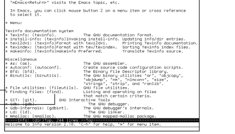
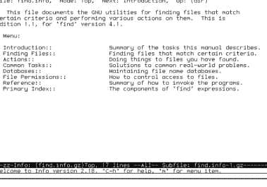
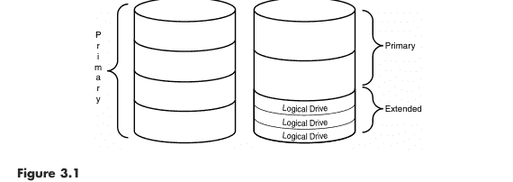
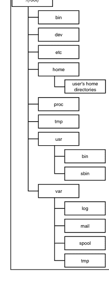
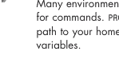
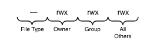
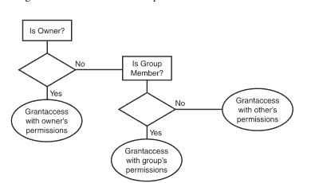
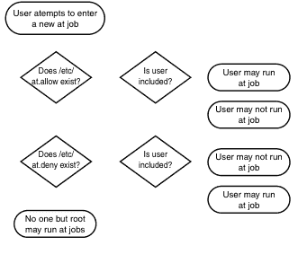
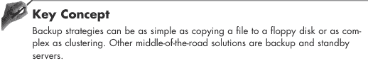

# LPIC 101 通用 Linux I 备考包（考试指南）


# 致谢

我想借此机会感谢我的收购编辑特蕾西·威廉姆斯，以及我的开发编辑吉尔·海登和瓦莱丽·佩里，她们为了尽可能让本书达到最佳而勤奋工作。此外，我想感谢皮尔森公司的每一位共同合作者，他们为读者呈现了通过认证考试所需的材料，并且采用的格式有助于而非阻碍您的学习体验。

特蕾莎

# 作者简介

**特蕾莎·哈登**，MCSE，MCT，并拥有 SAIR Linux 认证，教授微软服务器产品、Linux 和安全课程。她讲授微软官方课程和定制课程，以帮助学生准备认证考试，以及考试后的复习。此外，她为康柏公司教授 Linux 入门和系统管理课程，并积极参与 LPIC 的 Linux 社区，在邮件列表和其他场所为考试的目标和题目提供意见和建议。特蕾莎拥有超过 15 年使用 Novell、UNIX 和 Windows NT 的系统管理经验。她为需要 LAN/WAN 功能或互联网访问中小型企业提供支持，使用 Linux 和微软产品。特蕾莎还为客户提供安装、管理和教育服务。

# 技术编辑简介

**克雷格和科莱特·温特斯普恩** 自 20 世纪 70 年代起就开始使用计算机并撰写关于计算机的文章。他们的职业生涯始于为跨国公司撰写培训和宣传材料。他们是约 20 本书的作者（包括四本关于 Linux 操作系统的书籍），也是另外约两打本书的技术编辑，并自其 beta 测试阶段以来就参与了 LPIC 101 通用 Linux I 测试。

# 告诉我们你的想法！

作为本书的读者，*你* 是我们最重要的批评者和评论者。我们珍视你的意见，想知道我们做对了什么，什么可以做得更好，你希望我们在哪些领域出版书籍，以及你愿意分享的任何其他智慧。

作为 Que 的副出版人，我欢迎你的评论。你可以通过传真、电子邮件或直接写信告诉我你喜欢或不喜欢本书的哪些方面——以及我们如何可以使我们的书籍更强大。

> *请注意，我无法帮助解决与本书主题相关的技术问题，而且由于我收到的邮件量大，我可能无法回复每条消息。*

当你写信时，请务必附上本书的标题和作者，以及你的姓名和电话或传真号码。我会仔细审阅你的评论，并与参与本书工作的作者和编辑分享。

- 传真：317-581-4666
- 电子邮件：office\_que@mcp.com
- 邮寄：副出版人
  Que
  201 West 103rd Street
  印第安纳波利斯，IN 46290 USA


# 引言

Linux 专业人员协会（LPI）是由一群志愿者组成的团体，他们相信需要一种全球认可的 Linux 认证。其他可用的 Linux 认证是特定于发行版的。LPI 的目标是展示考生管理任何 Linux 系统的能力。

当你审查每个考试的目标时，你将看到 LPI 是如何实现其目标的。每个目标都涵盖了适用于任何 Linux 安装的基本信息。因此，对于那些希望展示其 Linux 能力而不是管理某个特定 Linux 发行版能力的人来说，LPI 认证将成为首选的 Linux 认证。

第一级认证涵盖了初级 Linux 系统管理员所需的技能。该认证将涵盖以下领域的基本能力：

- 文档
- GNU 和 UNIX 命令
- 启动、初始化、关闭和运行级别
- 设备，Linux 文件系统
- 管理任务

此认证由两个考试组成。这两个考试都涵盖一般的 Linux 主题。最初，LPI 打算将第三个考试作为第一级认证的一部分提供。这个第三个考试将是特定于发行版的，考生将在几个不同的选项中做出选择。

基于对计划包含在这些发行版考试中的可用主题的 psychometric（心理测量学）评估，决定没有足够的材料来证明第三个考试的合理性。然后，一些特定于发行版的材料被并入了第二个测试（102）的目标中。

本书旨在帮助你在通往 Linux 认证之路上准备由 Linux 专业人员协会提供的第一场考试（101）。

101 考试涵盖所有发行版通用的材料。考试涵盖的领域包括文档、GNU/UNIX 命令、文件系统、启动、运行级别和管理任务。此测试是所有申请 LPIC 一级认证考生的必考项目。

## 本书的组织结构

本书中的章节是基于 LPI 为 101 考试发布的目标编写的。你可以在 http://www.lpi.org 查看这些目标。

本书全面涵盖了这些目标，尽管顺序与 LPI 网站上列出的顺序不同。相反，它们以逻辑方式组织，以便每一章都建立在前一章的基础上。有关考试目标的完整列表及其讨论位置，请参见附录 G，“目标索引”。

第 1 章，“查找和创建文档”，涵盖了系统和应用程序文档在你系统上的使用和维护。

第 2 章，“启动 Linux”，带领你了解启动 Linux、管理运行级别以及关闭系统的步骤。

第 3 章，“Linux 文件系统”，涵盖了分区以及用于维护文件系统的磁盘实用程序。

第 4 章，“文件管理”，讨论了目录层次结构和文件管理。它还讨论了用于文本搜索的实用程序。

第 5 章，“GNU 和 UNIX 命令”，涵盖了在命令行输入和历史记录。此外，它讨论了进程和优先级。

第 6 章，“维护文件系统”，解释了磁盘配额和磁盘管理。

第 7 章，“用户和组”，考察了如何组织和管理你的用户和组。

第 8 章，“文本流”，涵盖了最常见的文本过滤器。

第 9 章，“权限”，讨论了如何控制你系统上的资源。


第10章“管理任务”介绍了基本系统管理。

第11章“备份与恢复”概述了灾难恢复计划的制定，并讨论了一些常用实用程序。

附录A“术语表”提供了本书中出现的术语定义。

附录B“认证流程”讨论了获得LPI认证的道路。

附录C“测试技巧”提供了一些提示，帮助你顺利通过考试。

附录D“其他资源”列出了获取信息的其他途径。

附录E“使用CD-ROM”解释如何使用随书附赠的CD-ROM。

附录F“实验练习”是一份综合性测试，供你评估自己是否已为考试做好准备。

附录G“目标索引”包含了LPIC 101测试目标的列表，并对每个目标进行了讨论。

即使你认为自己对某章涵盖的内容已驾轻就熟，请在进入下一章之前务必复习该章。因为每章都建立在前面章节的基础上，所以在继续之前，你需要牢固掌握基础章节的内容。

购买本书时，你获得了一项附带福利——活页手册。这本手册包含每章的简要综述，涵盖了最重要的要点。请结合每章开头的前提条件一起使用，以确保在继续之前已理解基础章节。

你还可以在书末进行最终测试前，使用活页手册进行复习。此外，在考试当天，你也可以带上活页手册，在测试前的停车场里进行最后复习。

每章开头都有一系列“边读边想”的问题，用于测试你对章节主题在管理环境中如何应用的先入为主观念。为了评估你自己的学习曲线，请在继续阅读章节其余部分之前写下你的答案。在阅读章节时，参考你的答案并根据需要进行修改。答案将在章节末尾提供。

每章末尾还有一组“练习测试”题目。为了最大化你从这次练习测试中获益，正确和错误的答案都会有所解释。完成章末测试后，请回顾答案以查看你的表现。不这样做只会欺骗自己。

如果你发现答错了章末测试中的几道题，请在进入下一章之前回去复习该章。如果你对某个概念仍不清楚，请尝试其他资源，如Linux文档项目（Linux Documentation Project）或附录D中列出的其他资源。

## 备考准备

本考试旨在面向有Linux经验的个人。你需要有一个可供使用的Linux系统。请练习本书中涵盖的每个概念，直到你感到熟悉为止。

为了从本书中获得最大收益，你应该从第1章开始，并按照呈现的顺序完成每一章。开始一章时，你应该做的第一件事是阅读前提条件。如果你觉得自己对这些原则掌握得不够好，请回去复习后再继续。

接下来，阅读“边读边想”的问题并写下你的答案。你可能还需要记下脑海中出现的其他任何问题。读完章节后，查看答案。确保你理解为什么这些答案是正确的。

你接下来要做的任何相关实验练习。这些练习旨在强化你已阅读的教学材料。当你坐在考场参加正式考试时，这种动手经验将 invaluable。

最后，你应该回答章末问题。在检查答案之前，写下你对每个问题的回答。如果答错了，请复习每个可能答案的理由。你还应该复习章节中相应的部分。如果你仍然不清楚，请查阅附录D，寻找能提供额外解释的其他地方。

在准备第一场考试时，无论你去哪里都带着活页手册。它的设计注重便携性。你可以在有任何几分钟空闲时用它来复习，例如在排队时、在修车店等待时，或者其他任何你只有几分钟空闲的时候。

完成本书和书末测试后，你将希望使用随书CD-ROM提供的练习测试引擎。提供的题目数量足以进行四次完全不同的测试，尽管通过使用随机功能，每次坐下来你都会得到一份“新的”测试。这是让你为正式考试做好准备的绝佳体验。有关如何使用测试引擎的信息，请参阅附录E。

测试将包含要求你评估和诊断情况的问题。你选择的答案将是这种评估的结果。在这种情况下，你在附录F练习中获得的动手经验以及你自身的经验将 invaluable。

好好学习，祝你在认证旅途中好运！

## 章节前提条件

在开始本章之前，你应该能够访问一台运行Linux的计算机，以便练习这些概念和技能。你应该能够登录系统并理解在命令提示符下输入的基本知识。

# 第1章

## 查找和创建文档

### 边读边想

- 1. 你问同事如何在你的Linux系统上查找文件，他告诉你查看find和locate的手册页。他用术语“man”是什么意思？
- 2. 你正在查看关于使用tar查找压缩tar文件选项的手册页。你如何在不阅读整页的情况下找到它？
- 3. 为什么使用man命令无法找到正确的手册页？
- 4. 你如何配置计算机，使西班牙语成为手册页的默认语言？
- 5. 你可以在哪里找到有关设置新zip驱动器的信息？
- 6. 什么是Linux文档项目？
- 7. 你在 /usr/bin 中找到一个文件，但不知道它是做什么的。你如何找出这一点？
- 8. 你如何找到更改密码的确切命令名称？

# 获取帮助

除非你购买包含手册的发行版，否则通常不提供Linux的纸质手册。然而，可以从许多来源获取几乎无限量的信息。这些来源可以归类为：

- 本地文档
- 通过互联网的在线资源
- 新闻组
- 邮件列表
- 书籍

查找和使用这些文档的能力将在考试中接受测试。

## 本地文档

本地安装的文档有几种类型。表1.1显示了这些类型及其位置。

**表1.1 已安装文档及其位置**

| 文档 | 位置 |
| --- | --- |
| 手册页 | /usr/man |
| info | /usr/info |
| HOWTOs | /usr/doc/HOWTO |
| 常见问题解答 (FAQ) | /usr/doc/FAQ |
| 程序文档 | /usr/doc/<程序名称>

这些文档各有其优缺点。通常，关于同一主题的信息可以在不止一个来源中找到。然而，某个来源可能比另一个更容易让你理解。

## man 页

系统中几乎每个实用程序、系统调用或命令都有广泛的本地在线帮助，称为*手册页*。手册页对用户不够友好，更适合查阅语法，而不适合作为教程使用。

它们通常被称为man页，并使用man实用程序调用。man搜索指定主题的手册页，并将输出通过分页器（pager）发送。分页器然后将man页打印到你的显示器上。如何在man页中导航取决于使用的是哪个分页器。

man的语法为

```
man [选项] [章节] [主题]
```

你通过向man命令传递主题来调用man页。如果你输入 man man，将显示描述手册页工作原理的手册页。如果你正在查找关于 who 命令的信息，你可以通过输入 man who 来获取。显示出的man页将呈现 who 命令的功能摘要及其语法。

每个man页都分为若干章节，尽管并非所有章节都会出现在每一页中。表1.2列出了这些章节及其可能包含的内容。

**表1.2** man页的章节

| 章节 | 描述 |
| :--- | :--- |
| NAME | 命令的名称及其简要描述 |
| SYNOPSIS | 如何使用该命令及其命令行选项 |
| DESCRIPTION | 程序及其选项的说明 |
| OPTIONS | 所有选项及其简要描述 |
| SEE ALSO | 相关手册页 |
| DIAGNOSTICS | 错误消息的描述 |
| FILES | 命令使用的文件列表及其位置 |
| BUGS | 已知问题 |
| HISTORY | 程序开发的里程碑 |
| AUTHOR | 程序作者及贡献者 |

不仅单个手册页内部组织为章节，这些页面本身也排列在特定的目录结构中。表1.3列出了这些目录的名称以及每个目录包含何种类型的man页。这是你在考试中可能需要知道的信息。


## 表 1.3 man 手册页的目录组织

| 目录 | 内容 |
| :--- | :--- |
| `/usr/man/man1` | 你可以在 shell 中运行的命令 |
| `/usr/man/man2` | 系统调用的文档 |
| `/usr/man/man3` | libc 函数的手册页 |
| `/usr/man/man4` | 关于 `/dev` 目录中文件的信息 |
| `/usr/man/man5` | 特殊文件（如 `/etc/passwd`）的格式详情 |
| `/usr/man/man6` | 游戏 |
| `/usr/man/man7` | 对 Linux 文件系统、man 手册页等的描述 |
| `/usr/man/man8` | root 操作员实用工具的手册页 |
| `/usr/man/man9` | 关于 Linux 内核源码例程的文档 |

在 man 手册页显示后，有特定的命令用于在文档中导航。这些命令取决于用于显示 man 手册页的分页器（pager）。

通常用于显示 man 手册页的两个分页器是 **more** 和 **less**。对于这两个分页器，你只需按下空格键以显示下一屏，或按 **b** 键退回一屏。**less** 还允许你使用 **<PgUp>** 和 **<PgDn>** 键向上或向下滚动。

Enter 键将逐行推进显示。当你结束时，在 **less** 或 **more** 中输入 **q** 以退出。

由于 man 手册页可能相当长，且你无法轻易上下滚动，因此搜索方法极具价值。

为了在 man 手册页中搜索字符串，请输入

`/“字符串”` 

这将显示在屏幕的最后一行。按下 Enter 键后，光标将移动到搜索字符串的第一次出现位置。若要继续搜索搜索字符串的下一次出现，请输入 **n**。如果未找到匹配项或已找到最后一个实例，分页器将通过在屏幕最后一行显示一条消息来通知你。

当搜索特定主题的 man 手册页时，将显示找到的第一个页面。

各章节（目录）不是按数字顺序搜索的，而是按以下顺序搜索：

**1, 8, 2, 3, 4, 5, 6, 7, 9**

# 获取帮助


每个章节都有其自己的介绍性 man 手册页，介绍该章节的内容。例如，如果你想查找关于游戏章节包含哪些信息的内容，你可以输入 *man intro*；然而，你将看到的是第 1 章的介绍页。

*man* 在找到匹配项后立即停止搜索。这可能不是你想要查找的页面，因为搜索在找到满足条件的一页后立即结束。输入 *man intro* 永远不会让你进入游戏章节，即第 6 章。你可以通过指定要搜索的章节来覆盖此行为。输入

```text
man 6 intro
```

将显示游戏章节的介绍页。

但是，假设你需要了解在你编写的应用程序中如何使用 *write*。当你输入 *man write* 时，你会得到关于 *write* 实用工具的信息。

你知道关于 *write* 还有其他 man 手册页，但不知道它们在哪个章节。你可以通过输入以下命令来搜索所有包含字符串 *write* 的 man 手册页：

```text
man -k write
```

每个讨论 *write* 的 man 手册页都将列出一个简短的描述。输出的两行如下：

```text
write (1)            - send a message to another user
write (2)            - write to a file descriptor
```

如果搜索的词未包含在名称部分中，你可以使用 *-k* 选项。例如，假设你想了解如何更改密码。如果你输入 *man password*，你会得到错误

```text
No manual entry for password
```

然而，如果你输入 *man -k password*，*man* 将搜索简短描述并显示所有简短描述中包含字符串 *password* 的 man 手册页列表，如下面的结果所示：

```text
chage (1)              - change user password expiry information
chpasswd (8)           - update password file in batch
conflict (8)           - search for alias/password conflicts
crypt (3)              - password and data encryption
fgetpwent (3)          - get password file entry
getpass (3)            - get a password
getpw (3)              - Re-construct password line entry
```

由于这些描述都没有提供更改密码所需的语法，你可以尝试 *man -K password*。这将导致 *man* 在每页 man 手册页中搜索术语 *password*，并显示该页面的标题，同时询问你是否希望查看该页面。

```text
/usr/man/man1/entry.n? [ynq] n
/usr/man/man1/Tc1X.n? [ynq] n
/usr/man/man1/interp.n? [ynq] n
/usr/man/man8/smbpasswd.8? [ynq] n
/usr/man/man8/smbmount.8? [ynq] n
/usr/man/man8/uucico.8? [ynq] n
/usr/man/man8/vipw.8? [ynq] n
```

如果你回答 y，则显示该页面。当你停止查看该页面时，man 继续其搜索并显示下一个匹配项，直到你告诉它停止。虽然这会产生最完整的结果，但完成搜索可能需要很长时间。

与 man 一起使用的另一个有用选项是 -a。此选项导致 man 搜索整个页面并显示它找到的每一页，一页接一页。当你退出一个 man 手册页时，将显示满足你条件的下一个页面。

### 关键概念

在搜索信息时，务必理解 -k、-K 和 -a 选项。-k 搜索 whatis 数据库；-K 搜索 man 手册页的全部内容；而 -a 找到所有匹配的条目。

man 手册页通常以压缩且未格式化的形式存储。在显示之前，每个页面都需要解压和格式化。man.config 文件包含 man 的配置数据，包括如何构建 man 的搜索路径；man 使用的各种程序（如 less、more 或 nroff）的路径；以及解压缩器的列表。

可以通过输入以下命令使用不同的配置文件

```text
man -C MyMan.conf command
```

man 命令使用的分页器包含在 PAGER 环境变量中。若要定义你想要使用的其他分页器，请编辑你的 .profile 文件并添加以下一行

```text
export PAGER=/bin/less
```

man 命令需要知道手册页的位置。此信息包含在 MANPATH 环境变量中——其值来自 man.config 文件。你可以通过在 .profile 文件中添加以下内容重新定义此变量

```text
export MANPATH=<path to manual pages>
```

### 关键概念

man 手册页提供了关于命令、实用工具和系统调用的信息。输出通过分页器显示。可以通过编辑 man.config 或 .profile 文件来更改 MANPATH 或分页器。

# info

info 是 GNU 超文本文档的阅读器，比 man 手册页更易于使用。可以从 emacs（一种文本编辑器）调用 info，或作为独立程序运行。

虽然 info 提供的信息通常更易于理解，但导航可能比较困难。它使用类似 emacs 的键组合。

如果你通过输入 info 启动 info，你将看到图 1.1 中显示的屏幕，该屏幕展示了可用文档的目录。



**图 1.1** 启动 info 时显示的介绍屏幕。

屏幕顶部列出了一些有用的键，后跟菜单。每个菜单项以星号（*）开头，后跟菜单项的描述，并以冒号（:）结束。冒号后是括号中的菜单项文本，如图 1.1 所示。输入此文本可转到该菜单项。

你使用空格键滚动浏览可用菜单项列表。输入字母 m 可将光标置于屏幕底部，在那里你可以输入菜单项。输入 <enter> 后，你将转到该菜单项。

例如，如果你想获取查找文件的信息，你可以在 info 中输入 mfind 或调用 info 并带有单词 find 作为参数，例如

```text
info find
```

任一方法都会带你到达图 1.2 中显示的屏幕。



**图 1.2** 关于 find 主题的 info 屏幕列出了 find 文档中可用的章节。

如你所见，此屏幕上没有你可以输入以转到其中一个菜单项的菜单文本。然而，你可以使用 Tab 键突出显示感兴趣的主题，然后按 Enter 键转到该主题。

info 还有一个教程，如果你想充分利用 info，它非常值得花时间阅读。从主屏幕，输入 h 开始教程。


## 浏览信息

浏览信息的过程相当直观。空格键向下滚动一屏，Delete 键向上回滚一屏。输入 `n` 可以跳转到下一个主题，输入 `p` 可以跳回上一个主题。输入 `1` 将返回你最后的位置。

## 关键概念

info 实用程序提供的信息与 man 手册页类似；然而，它通常更容易理解。空格键向上滚动，Delete 键向下滚动。输入 `n` 查看下一个主题，输入 `p` 查看上一个主题。输入 `q` 退出。

## HOWTO（操作指南）

Linux HOWTO 是详细说明在 Linux 中执行任务方法的文档。例如，你可能需要查找如何配置某件硬件，或者如何完成打印文档等简单任务。

HOWTO 文档通常涵盖复杂的主题，因此篇幅往往较长。对于 LILO 和打印等不太复杂的主题，则由迷你 HOWTO（mini HOWTOs）涵盖。

HOWTO 的版本（通常是压缩格式）通常安装在 `/usr/doc/HOWTO` 目录中。请在线查找最新版本。

你可以通过 ftp（从 `ftp://sunsite.unc.edu/pub/Linux/docs/HOWTO` 或其镜像站点之一）下载 HOWTO 的最新版本。此外，也可以通过 HTML 在多个站点上浏览它们，包括 `http://sunsite.unc.edu/LDP/HOWTO/` 或 `http://www.linuxdoc.org/HOWTO/`。

可以通过查阅 `http://sunsite.unc.edu/LDP/mirrors.htm` 来定位镜像站点。这些文档也以几种不同的语言提供。

### 关键概念

HOWTO 由用户撰写，用于描述他们如何解决某个问题。它们比 man 手册页和 info 更容易使用，并涵盖不同的主题。由于 HOWTO 经常更新并发布新版本，你应定期核实是否拥有最新版本。

与使用 man 手册页或 info 相比，HOWTO 更容易理解，并且经常讨论在其他地方未提及的问题。它们包含其他用户已研究并发布、对其他用户有用的主题。

例如，你想在 Linux 上运行 Quake 游戏吗？查阅 man 手册页和 info 并没有帮助。但是，有一个 HOWTO 告诉你如何做到这一点。

## FAQ（常见问题解答）

FAQ（Frequently Asked Questions，常见问题解答）是一组旨在与 HOWTO 文档配合阅读的文档。它们以问答形式编写，针对用户最常问的问题进行解答。

FAQ 提供 HTML、PostScript 和文本格式。几乎所有发行版都在 `*/usr/doc/FAQ` 目录中安装了这三种格式的 FAQ 副本。请在线查找 `http://linuxdoc.org/FAQ/` 上的最新版本。

## 程序文档

提供有关特定程序更多信息的文本文件位于 `*/usr/doc` 中，子目录以程序名称和版本号命名。这些文件提供了有关应用程序安装、配置和使用的信息。你通常可以使用 `less` 或 `more` 阅读它们。

此外，应用程序通常还安装一个手册页，讨论如何使用该程序。这些手册页可以使用本章前面讨论的 `man` 命令找到。

## 互联网资源

如你所知，Linux 的所有源代码都可供在互联网上下载。Linux 文档也在许多在线地点提供。与 Linux 相关的主要信息来源是位于 `http://metabab.unc.edu/LDP/` 的 Linux 文档项目（Linux Documentation Project）。在这里你可以找到所有的 HOWTO、迷你 HOWTO 和 FAQ。该网站还提供了一种从单一位置搜索所有材料的功能。

Linux 文档项目还发布了若干涵盖特定主题的指南，范围从内核到网络管理。它们可在 `http://sunsite.unc.edu/LDP/` 获取。可获取的指南包括：

-   由 Matt Welsh 撰写的《Linux 文档项目宣言》
-   由 Matt Welsh 撰写的《安装与入门指南》
-   由 David Rusling 撰写的《Linux 内核》
-   由 Michael K. Johnson 撰写的《Linux 内核程序员指南》
-   由 Ori Pomerantz 撰写的《Linux 内核模块编程指南》，版本 1.1.0
-   由 Olaf Kirch 撰写的《网络管理员指南》
-   由 Lars Wirzenius 撰写的《Linux 系统管理员指南》
-   由 Larry Greenfield 撰写的《Linux 用户指南》
-   由 Sven Goldberg、Sven van der Meer、Scott Burkett 和 Matt Welsh 撰写的《Linux 程序员指南》

Linuxnewbie.org（`http://www.linuxnewbie.org/`）正在开展一个更近期的项目，旨在使 Linux 文档更加用户友好。他们的目标是从现有的 HOWTO、FAQ 和其他资源中创建用户友好的文档。

## 新闻组

许多 Usenet 新闻组提供了大量信息。`comp.os.linux.announce` 新闻组是一个受监管的组，包含关于软件更新、新移植、用户组会议和商业产品的最新信息。提交到此组的内容应通过电子邮件发送至 `linux-announce@news.orl1.gov`。

`comp.os.linux.answers` 包含所有的 FAQ、HOWTO 和其他重要文档。HOWTO 通常在月初发布。然后，你可以使用可从 `ftp://sunsite.unc.edu/pub/linux/system/news/misc/` 获取的 NewstoHOWTO 程序来汇编这些帖子。

其他值得一读的新闻组位于 `comp.os.linux.*` 层级下。通常，你可能遇到一些未在 HOWTO 或 FAQ 中解决的问题，但在以下新闻组之一中有解答：

-   `comp.os.linux.setup`
-   `comp.os.linux.hardware`
-   `comp.os.linux.networking`
-   `comp.os.linux.x`
-   `comp.os.linux.development.apps`
-   `comp.os.linux.development.system`
-   `comp.os.linux.advocacy`
-   `comp.os.linux.misc`

大多数新闻组都归档在 `http://www.deja.com` 和 `http://www.altavista.com`，你可以在那里搜索与特定主题或论坛相关的帖子。

## 邮件列表

在 Linux 主题下有多个邮件列表可用。其中一些是通用的，而另一些则适用于特定的发行版。

你可以通过向 `Linux-Announce-Request@NEWS-DIGESTS.MIT.EDU` 发送电子邮件，并在邮件正文中包含单词 `subscribe`，来加入 `comp.os.linux.announce` 的邮件列表镜像。向同一地址发送空邮件可获得关于使用邮件列表的帮助（包括如何退订的说明）。

有多个 Linux 邮件列表托管在 `major@dombo@ver.rutgers.edu`。发送包含单词 `lists` 的邮件以了解可用的列表。发送包含单词 `help` 的邮件可获得订阅和退订列表的说明。这些列表中的大多数是技术性的，不适合新用户的提问。

务必遵守网络礼仪规则。在你研究过问题之前，不要向新闻组或邮件列表提出问题。通常，你的问题可能已经被提出并回答了。首先查阅文档（HOWTO、FAQ 和 man 手册页），然后在发布之前查阅 `http://www.deja.com/` 上的存档。

如果你确实发布了帖子，请尽可能包含有关你的系统和问题的相关信息，例如软件版本的一般信息以及硬件配置的简要摘要。学会欣赏自行折腾（hacking）你的系统以及自行解决问题的价值。

## 搜索信息

当你需要帮助时，还有许多其他方法可以找到有关命令的信息。一些最常用的命令是 `whereis`、`whatis`、`which` 和 `apropos`。

### whereis

`whereis` 命令用于查找文件，但也会显示文件的二进制文件、源文件以及相关手册页的位置。`whereis` 的一个局限性是，搜索仅限于编程中硬编码的已知目录。其语法是：

```
whereis [options] filename
```

如果你想查看在哪里可以找到 `passwd` 或其相关的手册页，你可以输入：

```
whereis passwd
```

输出：
```
passwd: /usr/bin/passwd /etc/passwd /etc/passwd.OLD /usr/man/man1/passwd.1 /usr/man/man5/passwd.5
```


如果未找到该文件，则仅显示所搜索的文件名。

```
whereis foo
foo:
```

若要仅查找二进制文件，请使用 `-b` 选项；若要仅查找手册页，请使用 `-m`；若要仅查找源文件，请使用 `-s`。

### which

使用 **which** 命令来查找命令所在的位置。它会在你的路径中搜索，直到找到匹配项。如果未找到匹配项，**which** 将显示一条错误消息。

```
which command
```

可以在同一命令行中传递多个命令。**which** 命令在命令未按预期响应时非常有用。偶尔，不同的位置可能存在多个同名命令。使用 **which** 可以验证你运行的是你以为的那个命令。找到匹配项后，它会停止搜索并显示其完整路径。

### whatis 和 apropos

**whatis** 和 **apropos** 的信息均源自手册页。

### whatis

**whatis** 命令会显示关于某个程序的一行摘要，该摘要源自程序的手册页。

```
whatis whereis
whereis (1) - locate the binary, source and manual page files for a command
```

这些信息存储在一个名为 **whatis** 的数据库中，位于 `/usr/man/man1` 目录下，并通过使用命令 `makewhatis` 进行创建/更新。

### apropos

当你不记得如何完成某项任务时，此命令非常有用。你可以搜索几乎任何内容。假设你不记得如何修改用户密码；你可以输入 `apropos password` 来查找修改方法。

**apropos** 和 **whatis** 的区别在于它们执行搜索的方式。**apropos** 在整行中的任何位置搜索参数字符串——类似于 man `-k`。

另一方面，`whatis`（等同于 `man -f`）仅尝试匹配连字符之前的部分以匹配完整的命令名称。因此，`whatis cc` 会报告是否存在 cc 手册，而对于 gcc 则保持沉默，而 `apropos` 则会成功找到两者。

### 关键概念

务必掌握表 1.4 中列出的 whereis、which、whatis 和 apropos 的用法。考试中你会看到全部四个命令。

表 1.4 whereis、which、whatis 和 apropos 的用法

| 命令 | 描述 |
| :--- | :--- |
| whereis | 返回命令的路径 |
| which | 告知你正在执行哪个命令 |
| whatis | 提供命令功能的简短描述 |
| apropos | 从手册页中搜索简短描述 |

## 编写文档

你将被测试的软技能之一是你记录系统的能力。这是大多数人最不喜欢的一项任务；然而，它是管理员执行的最重要任务之一。你可以预期在考试中会看到一到两个关于系统文档重要性的问题。

创建系统文档的第一步是创建并维护系统日志。对于每台计算机，你应该记录硬盘控制器类型、磁盘数量和大小、分区方案、主机名、IP 地址、连接的外设，以及该机器的特殊键击或命令，例如如何配置 BIOS。

每当出现问题时，你都应该记录问题的详细信息、你尝试了什么以及最终什么方法解决了问题。例如，如果你有一个失败的 cronjob，你应该记录故障的症状以及你如何纠正它。这样，当稍后再次出现相同问题时，你将能够以最少的时间解决它。

随着每台计算机的变化，记录变化内容及其原因。这应包括新的硬盘、新的分区、安装的应用程序、配置文件的更改等。换言之，记录你所做的所有事情。这些文档应足够完整，以便能在最少时间内重建系统。

你还需要编写有关如何使用你所在地系统的文档——既从管理员的角度，也从小用户角度。你可能希望编写一份文档，告诉用户如何登录或如何运行特定应用程序。你还应该有关于系统构建方式的文档，以便其他管理员可以重建或排除故障你的系统。

下一个问题是对这些文档使用什么格式。有两种格式：电子格式或纸质格式。表 1.5 比较了每种格式的优缺点。

表 1.5 纸质与电子文档的比较

如果你选择保留电子文档，务必规划其格式，以便你可以找到信息。如果你选择使用纸质格式，也要妥善组织。如果你无法找到正确的条目，文档就毫无帮助。

## 用户支持

提供用户支持可能是你一生中要执行的最具挑战性的任务之一。这项任务不仅需要技术熟练，还需要良好的人际关系和沟通技巧。你必须能够以用户能理解你所说内容的方式向其呈现信息。但你也必须不要让用户觉得你是在俯视他们。

由于提供用户支持很耗时，你需要高效行事，同时不给人留下认为求助请求是浪费时间 impression。高效且有帮助的最佳方法之一是对每个问题都有条理的处理方法。

你可以通过多种方式接收技术支持请求。也许你有提交故障工单的方法，或者用户通过电话找你。无论以何种方式被接触，你的最终目标都是提高用户的生产力。

你也应及时响应所有援助请求。务必确定问题的紧急程度并加以考虑。如果无法立即解决用户的问题，你也应该通知用户，并告知何时可以处理。

首先，你必须能够清晰地确定问题的参数。确定问题何时及如何发生。你总是希望询问问题首次出现的时间。有可能你收到的故障呼叫实际上是请求新功能。

这时文档可能会派上用场。在你确定问题后，你会希望查阅文档，看看这个问题以前是否已得到处理。如果幸运的话，解决方案就在眼前。

如果你的联系渠道是电话，你可以询问问题以更好地定义问题。当以书面形式提交问题时，可能会遗漏重要信息。可能需要通过电子邮件交换才能适当定义问题。与用户沟通时，务必保持礼貌。避免使用行话；相反，使用用户能理解的语言，不要居高临下。如果有书面说明，请酌情分享。

记住，在用户说问题已解决之前，故障工单不会关闭。即使你认为已经回答了用户的问题并且问题已解决，用户可能并不这么认为。如果需要进一步研究问题或询问另一位管理员的帮助，请告诉用户你打算做什么以及何时会回复她。让用户觉得她是解决方案的一部分，而不仅仅是问题的一部分，将大大使你的工作变得更容易。

## 总结

至此，你已熟悉使用各种本地安装的文档形式。在准备考试时，务必理解 man -k 和 man -K 之间的区别。man -K 命令搜索手册页的全部内容，而 man -k 仅搜索手册页的描述部分。

在手册页内搜索使用 `/`；并继续使用 `n`。

你应该知道何时使用 info 以及何时使用 HOWTO 和 FAQ，以及如何保持后两者的最新状态。理解新闻组和邮件列表的用处，同时遵守适当的网络礼仪规则。

你还应该理解 whatis、which、whereis 和 apropos 之间的区别。whatis 命令搜索 whatis 数据库，并显示命令或实用程序功能的简短描述。which 命令让你知道正在运行哪个版本的命令及其位置。whereis 命令提供命令、其源代码及其手册页的位置。apropos 命令显示其描述中包含你术语的手册页的名称。还可以预期会有关于维护各种类型文档和处理用户的问题。


# 问答

1.  你询问同事如何在 Linux 系统中定位文件，他让你查看 `find` 和 `locate` 的 man 手册页。他说 “man” 一词是什么意思？

    答：当他提到 man 手册页时，指的是已安装的手册页，这些手册页记录了系统中安装的每个命令、实用程序和应用程序。

2.  你正在查看使用 `tar` 的 man 手册页以查找压缩 `tar` 文件的选项。你如何在不阅读整页的情况下找到它？

    答：你可以输入 `/compress` 并按 Enter 键来搜索页面上的术语，这将带你到正确的选项处。

3.  为什么使用 `man` 命令找不到正确的手册页？

    答：该命令有两个不同的 man 手册页。由于 `man` 显示它找到的第一个页面，该页面可能不是你正在寻找的页面。

4.  你有一个用户想使用西班牙语的手册页。如何配置他的计算机使其成为默认设置？

    答：首先，在服务器或用户计算机上安装西班牙语版本的 man 手册页。接下来，编辑用户的 `.profile` 文件，将 `MANPATH` 变量设置为这个新位置。

5.  你可以在哪里找到关于设置你新的 Zip 驱动器（软驱）的信息？

    答：搜索 man 手册页不会得到任何信息。你应该检查 HOWTOs——这些安装在你的系统或互联网上。

6.  什么是 Linux 文档项目？

    答：Linux 文档项目监管所有 Linux 文档，包括手册页、HOWTOs、FAQs 和教程，以努力维护其可靠性和准确性。

7.  你在 `/usr/bin` 中发现了一个文件，但不知道它是做什么的。如何找出？

    答：使用 `whatis` 命令，它提供该命令功能的一行摘要。

8.  如何找到更改密码的命令的确切名称？

    答：使用 `apropos` 命令在 man 手册页中搜索密码命令。`apropos` 随后将列出包含它的头部的 man 手册页。如果结果不成功，使用 `man -K password` 来搜索每个 man 手册页的全部内容。

# 练习测试

1.  如何找到所有讨论压缩的 man 手册页？

    - a. `apropos compression`
    - b. `man -K compression`
    - c. `info compression`
    - d. `man 8 -K compression`

    答案 a 不正确，因为这会产生所有头部包含 “compression” 的 man 手册页列表。答案 b 不正确；这将产生所有头部包含 “compression” 的 man 手册页列表。答案 c 不正确；`info` 是与手册页不同的独立文档集合。**答案 d 正确；`-K` 选项使 `man` 搜索每个 man 手册页的全部内容。**

2.  使用 `info` 时，如何转到菜单项 *find*？

    - a. 输入 f 并按 Enter。
    - b. 输入 mfind 并按 Enter。
    - c. 用鼠标点击 f ind。
    - d. 按 Alt+f 选择 f ind。

    答案 a 不正确；输入 f 不会选择 *find* 菜单项。**答案 b 正确；输入 m 将光标置于屏幕底部，在那里你可以输入菜单项，然后按 Enter。** 答案 c 不正确；`info` 不允许你点击菜单项来选中它们。答案 d 不正确；Alt 键或元键不用于选择菜单项。

3.  你可以在哪里找到有关引导过程（boot process）的额外信息？

    - a. 查找有关引导过程的 HOWTO。
    - b. 在新建组（newsgroup）上发布消息询问更多信息。
    - c. 在 `/usr/doc/boot` 目录中查找。

    **答案 a 正确；HOWTOs 讨论主题而不是特定命令。** 答案 b 不正确；新建组不是用于研究问题的，而是用于提出以前未回答过的特定问题。答案 c 不正确；`/usr/doc` 目录为每个已安装的应用程序提供一个子目录，而 boot 不是一个应用程序。

4.  如何找到关于如何配置 `trn`（新闻阅读器程序）的信息，该程序已安装在你的系统上？

    - a. 输入 `trn --help`。
    - b. 在 Linux 文档项目站点进行在线搜索。
    - c. 检查 `/usr/doc/trn.version` 目录。
    - d. 向作者发送电子邮件消息。

    答案 a 不正确；`-help` 选项用于命令，而不是应用程序。答案 b 不正确；LDP 站点在查找有关 Linux 的信息时提供搜索功能，而不是应用程序。答案 c 正确；应用程序文档存储在 `/usr/doc` 目录中，在一个以应用程序及其版本命名的子目录中。答案 d 不正确；应首先查阅文档，因为它是应用程序的作者编写的。

5.  你使用 `whereis` 搜索你上周创建的文件，但未找到。为什么？

    - a. 你一定删除了它。
    - b. `whereis` 命令未搜索正确的目录。
    - c. 你未将正确的目录传递给 `whereis` 进行搜索。
    - d. 你错误拼写了文件名。

    答案 a 不正确；虽然你可能删除了文件，但这不是问题所在。答案 b 正确；`whereis` 命令搜索预定义的目录列表，其中不包括你的主目录。答案 c 不正确；你不能定义 `whereis` 搜索的目录。答案 d 不正确；虽然你可能拼写错误，但这不是搜索失败的原因。

6.  运行命令时，结果出乎意料。如何找出正在执行的是哪个命令？

    - a. 使用 `which` 命令。
    - b. 使用 `what` 命令。
    - c. 使用 `man` 命令。
    - d. 使用 `whatis` 命令。

    答案 a 正确；`which` 命令将指示正在运行的是哪个版本的命令。答案 b 不正确；没有 `what` 命令。答案 c 不正确；`man` 命令将显示相应的手册页。答案 d 不正确；`whatis` 命令会告诉你命令的作用。

7.  如何获取 `who` 命令做什么的摘要？

    - a. 输入 `who -help`。
    - b. 输入 `whereis who`。
    - c. 输入 `whatis who`。
    - d. 输入 `man who`。

    答案 a 不正确；`-help` 选项提供关于语法的帮助。答案 b 不正确；`whereis` 命令给出命令的路径。答案 c 正确；`whatis` 命令提供命令功能的简短描述。答案 d 不正确；这将显示 `who` 的手册页，但你在寻找命令功能的简短描述。

8.  哪个命令与 `apropos sort` 等效？

    - a. `man sort`
    - b. `man -K sort`
    - c. `man -k sort`
    - d. `man -f sort`

    答案 a 不正确；这将显示关于 `sort` 的第一个手册页。答案 b 不正确；这将搜索所有手册页的内容中的单词 `sort`。答案 c 正确；与 `apropos` 类似，`man -k` 搜索手册页头部的搜索字符串。答案 d 不正确；`man -f` 仅搜索完整的命令名称。


# 章节先决条件

在开始本章之前，你应该对第 1 章中所述的文档使用有坚实的理解。此外，你需要拥有一个能成功启动到 Linux 的工作系统。

# 第 2 章：启动 Linux

## 阅读过程中

1.  你如何在你的 Linux 计算机上启动多个操作系统？
2.  文件 `vmlinuz-2.0.36-0.7` 的用途是什么？
3.  你应该如何着手进行系统维护工作？
4.  文件 `/etc/inittab` 的用途是什么？
5.  你在计算机上安装了 UPS（不间断电源）。你还应该做什么？
6.  启动机器时，你得到 `LILO` 然后系统挂起。问题可能是什么？
7.  你可以使用 `Ctrl-Alt-Del` 重启你的计算机吗？
8.  你需要停止系统以安装新硬盘。你应该做什么？


## 启动 Linux

你可以通过开启电源、使用启动加载器程序或从软盘启动来启动你的 Linux 系统。当计算机开机时，会在开机阶段执行某些任务。这一阶段被称为 POST（加电自测试）。在此之后，操作系统即可被加载。启动加载器是一种如 LILO 这样的程序，它负责管理内核的加载。LILO 将在本章后续内容中详细介绍。

启动 Linux 的方式取决于你对系统的配置。无论以何种方式启动系统，使操作系统正常运行起来所采取的步骤基本相同。


## 关键概念

理解 Linux 的启动过程对于排查启动过程中可能遇到的任何问题都是必要的。这些概念将在考试中出现。

内核位于你的启动软盘或硬盘的 /boot 目录中。压缩内核通常被称为 vmlinuz-版本号。然而，名称和位置并不重要——重要的是在启动时能够找到内核。

首先，内核会被加载到内存中。通常，你的内核是经过压缩的；但是，用于解压它的代码并未被压缩。你可以使用 gunzip 工具来解压内核。有关此工具的信息，请参阅第 11 章“备份与恢复”。你正在加载的内核映像中包含几个参数，其中包括根文件系统所在的位置。

在加载过程中，内核会向显示屏打印消息，并将这些消息保存到 /var/log/messages 文件中。你可以通过查看日志或使用 dmesg 命令来回顾这些消息。dmesg 不接受任何参数，它会打印内核消息缓冲区中的最后几条消息。这些消息包括：

- 控制台类型和字体
- PCI 总线及存在的 PCI 卡检测情况
- 处理器速度的估算
- 可用系统内存量
- CPU 类型
- 内核版本号
- 已加载的设备驱动程序
- 交换空间大小
- 网络适配器及其设置

有关此日志文件及 dmesg 命令用法的更多信息，请参阅第 10 章“管理任务”。

内核启动后，会挂载你的根文件系统，它通常位于你的硬盘上。挂载根文件系统后，控制权移交给硬盘，而内核仍保留在内存中。

## init 守护进程

内核执行的最后一项操作是调用 init 守护进程，该进程在系统关闭之前始终保持活动状态。它负责创建系统其余部分所需使用的进程，例如登录 shell。init 守护进程还会在某些进程退出时重启它们。例如，当你注销时，init 会重启控制台以便你再次登录。

init 守护进程的操作由其配置文件 /etc/inittab 控制。

## /etc/inittab 文件

/etc/inittab 文件的每一行都包含由冒号分隔的四个字段：

ID:runlevel:action:process

表 2.1 展示了每个字段包含的内容。

表 2.1 /etc/inittab 文件中各行的字段及其用途

| 字段 | 内容及用途 |
| :--- | :--- |
| ID | 一个或两个字符，用于标识该条目，通常是设备名称 |
| runlevel | 指示该行适用于哪些运行级别；可以列出多个运行级别；如果为空，则适用于所有运行级别 |
| action | 如何处理该条目；有关有效条目，请参见表 2.2 |
| process | 要执行的命令 |

action 字段指示如何处理命令，例如如果命令停止是否要重启。表 2.2 展示了该字段的有效条目。

表 2.2 /etc/inittab 文件中 action 字段的有效条目

| 条目 | 描述 |
| :--- | :--- |
| boot | 在首次读取 /etc/inittab 时运行 |
| bootwait | 在首次读取 /etc/inittab 后的 boot 条目之后运行 |
| initdefault | 设置初始运行级别/关闭；如果进程正在运行则停止；仅在之后启动一次进程 |
| ondemand | 保持进程运行；如果停止则重启 |
| powerfail | 在接收到电源故障信号时执行 |
| sysinit | 在访问控制台之前执行 |
| respawn | 保持进程运行；如果停止则重启该进程 |
| wait | 仅启动一次进程 |

init 进程用于启动内核以及系统运行所需的任何进程。如果你希望某个应用程序在每次系统启动时都运行，请将该命令输入到 rc 脚本之一中，这些脚本将在下一节“运行级别”中讨论。

## 运行级别 (Runlevels)

运行级别定义了启动系统时启动的一组进程。这可能从系统管理所需的最少进程，到支持所有已配置设备的配置不等。

不同运行级别对应的数字因你使用的发行版而异，并列出在 /etc/inittab 文件中。例如，列表可能看起来像这样：

```
# Default runlevel. The runlevels used by RHS are:
#  0 - halt (Do NOT set initdefault to this)
#  1 - Single user mode
#  2 - Multiuser, without NFS (The same as 3, if you do not have networking)
#  3 - Full multiuser mode
#  4 - unused
#  5 - X11
#  6 - reboot (Do NOT set initdefault to this)
```

运行级别 0 和 6 分别专门保留用于停机（halt）和重启（reboot）。运行级别可能因发行版而异。无论你安装了哪个发行版，init 守护进程都会处理与当前运行级别关联的那些行。

单用户模式与其他所有可用的运行级别略有不同。此运行级别通常用于系统管理任务，例如恢复损坏的文件系统。当系统处于此运行级别时，没有其他用户可以登录。然而，你仍然可以同时运行多个应用程序。这是 init 不读取 /etc/inittab 文件的唯一时候。相反，默认操作是运行 /bin/su 命令，并且你以超级用户或 root 身份登录。

当以高于单用户模式的运行级别启动时，系统将以多用户模式启动。在此模式下，init 执行 action 为 sysinit、boot 或 bootwait 的那些行。通常，这些行会挂载文件系统。

接下来，init 守护进程将执行所有列有当前运行级别在 runlevel 字段中的其他行。

你的初始运行级别由以下行定义：

```
id:3:initdefault:
```

注意，此行并未定义要启动的任何进程，而是定义了用于启动的运行级别。你可以使用 init 命令更改运行级别。其语法为：

```
init [runlevel]
```

init 命令接受运行级别作为参数。你可以使用带有 -t seconds 选项的 telinit 命令来指定更改运行级别前的等待时间。默认延迟为 5 秒。telinit 命令是 init 命令的一个链接。在更改运行级别之前，务必通知任何已登录的用户。

例如，命令

```
init 5
```

将更改运行级别到第五级。init 首先发送信号以停止任何不在新运行级别中定义的正在运行的进程。在指定的延迟之后，telinit 向这些进程发送杀死（kill）信号。然后，它启动新运行级别中定义且尚未运行的任何进程。

你还可以通过向 init 或 telinit 命令传递 s 或 S 来切换到单用户模式。

/etc/inittab 文件中的下一节定义了要运行的启动脚本，例如：

```
si::sysinit:/etc/rc.d/rc.sysinit
```

行开头的 ID si 由 init 守护进程内部使用。此行启动脚本 rc.sysinit，该脚本处理诸如激活交换分区、运行 fsck 以及挂载文件系统等任务。fsck 命令检查文件系统中的损坏条目，并在第 6 章“维护文件系统”中详细讨论。该脚本可能因发行版而异。阅读你系统上位于此处的脚本以了解其实现的具体细节。


`/etc/inittab` 文件的下一部分根据当前的运行级别（runlevel）执行相应的脚本，这些脚本位于 `/etc/rc.d` 目录下：

```
11:1:wait:/etc/rc.d/rc 1
12:2:wait:/etc/rc.d/rc 2
13:3:wait:/etc/rc.d/rc 3
14:4:wait:/etc/rc.d/rc 4
15:5:wait:/etc/rc.d/rc 5
16:6:wait:/etc/rc.d/rc 6
```

这是通过调用 `rc` 脚本并传入标识运行级别的参数来实现的。随后，`rc` 脚本会执行位于 `rcn.d` 目录中的脚本，其中 `n` 代表运行级别。根据你的发行版不同，系统还可以执行其他启动脚本，例如 `/etc/rc.local`。

你的 `rc` 脚本还可以调用*模块*。这些模块是可以在系统运行时加载和卸载的内核代码片段。这些模块通常是你无法一直使用的设备的驱动程序。

你可以使用 `/etc/conf.modules` 文件在模块加载时向其传递参数。这些参数通常是 I/O 地址和中断号。一个 `conf.modules` 文件示例如下：

```
alias eth0 3c59x
alias sound es1370
```

这会加载以太网卡和声卡所需的模块。

接下来是应在每个运行级别中运行的进程。这些通常包括启动 getty 进程，用于创建各个虚拟终端。

你的 `inittab` 文件还可以包含在发生断电时以及电源恢复时应执行的操作说明。示例如下：

```
# When our UPS tells us power has failed, assume we have a few minutes
# of power left.  Schedule a shutdown for 2 minutes from now.
# This does, of course, assume you have powered installed and your
# UPS connected and working correctly.
pf:powerfail:/sbin/shutdown -f -h +2 "Power Failure; System Shutting Down"

# If power was restored before the shutdown kicked in, cancel it.
pr:12345:powerokwait:/sbin/shutdown -c "Power Restored; Shutdown Canceled"
# Run gettys in standard runlevels
1:2345:respawn:/sbin/mingetty tty1
2:2345:respawn:/sbin/mingetty tty2
3:2345:respawn:/sbin/mingetty tty3
4:2345:respawn:/sbin/mingetty tty4
5:2345:respawn:/sbin/mingetty tty5
6:2345:respawn:/sbin/mingetty tty6
```

`shutdown` 命令将在本章稍后部分讨论。

`init` 守护进程在读取 `/etc/inittab` 文件后保持活跃状态。它监控系统，以检测更改运行级别的指令，或者监控其启动的进程是否停止。如果 `init` 的子进程之一停止运行，它会执行以下两项操作：

- 首先，它重新读取 `/etc/inittab` 文件。如果操作是重启该进程，它就会执行重启。
- 其次，它会在 `/etc/wtmp` 和 `/etc/utmp` 文件中记录该进程终止的事实及原因。这些文件将在第 10 章“管理任务”中讨论。

如果 `init` 被指示更改运行级别，或者收到断电通知，它也会重新读取 `/etc/inittab` 文件。

如果你想要修改 `/etc/inittab` 文件，可以在系统运行期间使用任何文本编辑器来更改该文件。然而，这些更改只有在 `init` 守护进程重新读取文件时才会生效。这种情况发生在以下时机：

- 运行级别发生变化时
- 发生断电时
- 你执行命令 `init q` 时

`init q` 命令会使 `init` 重新读取 `/etc/inittab` 文件。

编辑 `/etc/inittab` 文件时要格外小心，因为错误可能导致你无法登录系统。请备份原始的正确文件，并制作一张启动软盘以防出错。你或许可以尝试通过单用户模式启动来恢复，但这并不总是可行。偶尔，你在编辑 `/etc/inittab` 时可能会犯拼写错误，导致系统陷入循环，反复启动和停止某个进程。为防止这种情况发生，`init` 守护进程会跟踪重启进程的频率。如果一个进程在 2 分钟内被重启超过 10 次，`init` 守护进程将发送一条错误消息，并等待 5 分钟后再重启该进程。


## LILO

LILO（LI**n**ux LOader）是一个引导加载程序，可以放置在你的硬盘或启动软盘上。它在系统启动时执行。**LILO** 的功能包括以下内容：

- 适用于 DOS、UNIX、OS/2、Windows 95/98 和 Windows NT
- 替换你硬盘上的主引导记录（Master Boot Record）
- 可以在不同的分区上使用多达 16 个不同的引导映像，每个映像都可以设置密码保护
- 允许引导扇区文件、映射文件和引导映像位于不同的分区上

LILO 具备作为其他操作系统引导加载程序的能力。它允许你选择要启动的操作系统。

> **关键概念**
> LILO 提供了一种高效的方法来启动 Linux 以及其他操作系统。LILO 可以在单个硬盘上处理多达 16 个不同的引导映像。
> 安装 LILO 时，你可以选择是否覆盖主引导记录。

如果没有做出选择，通常会启动默认的操作系统。你可以通过按下某个键（Alt、Shift 或 Ctrl 键）或在 `/etc/lilo.conf` 文件中请求提示符来绕过此默认行为。这些操作中的任何一个都会使 LILO 显示引导提示符：

BOOT:

此时，你可以输入要启动的操作系统名称。如果在 LILO 引导提示符下按下 Tab 键或输入 `?`，将显示已配置的操作系统列表。如果你没有做出选择，LILO 将启动它找到的第一个操作系统。

在引导提示符下输入选择项时，你可以向内核传递选项。这通常用于通过输入以下内容以单用户模式启动系统：

```
kernelName single
```

在引导提示符下输入。其他可以传递的选项包括 `root=device`、只读模式（`ro`）和读写模式（`rw`）。

LILO 的行为由其默认配置文件 `/etc/lilo.conf` 控制。LILO 命令有多种用途，其语法为：

```
lilo [options]
```

要安装 LILO，只需调用它而不带任何选项。LILO 可使用的选项列在表 2.3 中。

## 表 2.3 可用于 LILO 的选项

| **选项** | **操作** |
| :--- | :--- |
| `-b bootdev` | 指定引导设备 |
| `-C filename` | 使用指定的配置文件 |
| `-c` | 通过合并相邻扇区的读取来加快启动速度 |
| `-D label` | 使用带有给定标签的内核作为默认值 |
| `-D deciseconds` | 指示等待选择的时间长度 |
| `-f filename` | 指定磁盘参数文件；默认为 `/etc/disktab` |
| `-I` | 询问内核路径 |
| `-i filename` | 识别用作引导扇区的文件；默认为 `/boot/boot.b` |
| `-L` | 生成线性扇区地址 |
| `-m filename` | 使用指定的映射文件代替默认文件 |
| `-P [fix|ignore]` | 修复或忽略损坏的分区表 |
| `-q` | 列出从 `/boot/map` 文件引导的内核名称和位置 |
| `-R command` | 设置下次重启的默认值 |
| `-r directory` | 在更改其他内容之前更改根目录；用于故障排除 |
| `-S filename` | 覆盖现有文件 |
| `-s filename` | 指定旧引导扇区的存储位置；与 `-u` 一起使用时，指定要恢复的引导扇区 |
| `-t` | 测试你的配置而不进行安装 |
| `-u` 或 `-U` | 卸载 LILO |
| `-v` | 使 LILO 显示信息；多个 `-v` 可以增加显示的信息量 |

大多数情况下，调用 LILO 时使用配置文件而不是命令行。在创建配置文件时，你使用关键字代替表 2.3 中显示的选项。可用的关键字列在表 2.4 中。

## 表 2.4 LILO 配置文件中可用的关键字及其对应选项

| 关键字 | 选项 |
|---|---|
| -b bootdev | boot=bootdev |
| -c | compact |
| -d ceciseconds | delay=dsec |
| -D label | default=label |
| -i filename | install=bootsector |
| -f filename | disktab=file |
| -l | linear |
| -m filename | map=mapi file |
| -P fix | fix-table |
| -P ignore | ignore-table |
| -s filename | backup=file |
| -S filename | force-backup=file |
| -v | verbose=level |

LILO 的默认配置文件是 `/etc/lilo.conf`。一个 `lilo.conf` 文件示例如下：

```
boot=/dev/hda the partition that you will boot from
map=/boot/map the mapping file to use
install=/boot/boot.b the boot sector file
prompt display a prompt
timeout=50 How long to wait before staring the default
image=/boot/vmlinuz-2.0.36-0.7 The name of the kernel to start
label=linux the label or name you assigned
root=/dev/hda1 the partition to mount as root
```

你可以通过在列表中每个操作系统对应的 options 部分传递配置参数给内核，例如 `append`、`ramdisks`、`read-only`、`read-write`、`root` 和 `vga`。因此，如果你有一个用于故障排除的操作系统，你可以创建一个 RAM 磁盘并将所有内容加载到其中。你在启动时还可以将文件系统设置为只读。

如果你修改了配置文件，则需要将其写入硬盘的引导扇区。完成更改后，执行以下命令：

```
/sbin/lilo
```


每次修改配置文件时，请务必运行此命令。如果不运行 /sbin/lilo，你所做的更改将不会生效。如果你更改了系统配置（包括更改硬盘的任何分区），也需要运行它。


## **关键概念**

对 LILO 所做的任何更改，直到你通过执行 /sbin/lilo 命令重新安装 LILO 之前都不会生效。

## 排查 LILO 故障

LILO 加载时会逐个字符显示“LILO”这个词，这是识别 LILO 错误的一种方法。通过记录显示了哪些字符，你可以找到一个判断出错原因的起点。表 2.5 列出了可能阻止 LILO 完全加载的问题。

**表 2.5 使用显示的字符排查 LILO 故障**

| 字符 | 含义 |
| :--- | :--- |
| 无 | LILO 未被加载；无法安装或分区未激活 |
| L *错误代码* | 通常是介质故障 |
| LI | 第一阶段完成但第二阶段未执行；可能由几何参数不匹配或无法找到 /boot/boot.b 引起 |
| LIL | 第一和第二阶段加载器均已启动，但无法加载映射文件；通常是介质故障 |
| LIL? | 第二阶段加载器在错误地址加载；几何参数不匹配或无法定位 boot.b 文件 |
| LIL- | 描述符表损坏；几何参数不匹配或无法定位映射文件 |
| LILO | LILO 成功加载 |

有时你可能会在第一个 L 后面看到十六进制数字。这些数字是随机生成的，通常表示临时的磁盘问题。如果 LILO 加载了，这不算严重问题，但你应该注意这一点并尽快运行 fsck。

## 关闭 Linux

你绝不应该直接关闭你的 Linux 系统。如果内核不被允许将内存缓冲区写入磁盘，最终可能导致文件系统损坏。

由于 RAM 速度更快，Linux 会在 RAM 中维护 inode 表和硬盘的最新更改。如果在此信息写入磁盘之前你断电，那么你将丢失这些数据。

如果在写入过程中断电，可能会导致文件丢失或磁盘空间状态信息错误。如果活动进程正在写入磁盘且未正常停止，也可能发生同样的情况，导致数据损坏甚至可能的磁盘崩溃。


> **关键概念**
> 永远不要只是直接关闭计算机。根据你关机时操作系统正在执行的操作，最终可能导致计算机无法启动。

要关闭系统，你应该使用 `shutdown` 命令。其语法为：

```
shutdown [options] when [message]
```

`shutdown` 命令通过发送 SIGTERM 信号来终止所有进程。接下来，调用 `/etc/init` 以更改运行级别并卸载文件系统。

`shutdown` 命令需要时间来开始关闭系统。时间格式可以是 `hh:mm`，等待的时间量如 `+15`，或者单词 `now` 表示立即关机。

消息会周期性地发送给所有已登录的用户，直到关机过程开始。如果没有指定消息，将发送默认消息。

`shutdown` 命令可以使用多个选项。它们列在表 2.6 中。

**表 2.6 可用于 `shutdown` 命令的选项**

| 选项 | 动作 |
| :--- | :--- |
| -c | 取消正在进行的关机过程 |
| -f | 重启时不运行 fsck |
| -F | 重启时强制运行 fsck |
| -h | 关机完成后停止系统 |
| -k | 发送警告消息但不关闭系统 |
| -n | 不调用 init 直接关机 |
| -r | 关机完成后重启 |
| -t seconds | 指示在终止进程后调用 init 之前的延迟时间（秒） |

除非存在 `/etc/shutdown.allow` 文件，否则只有 root 才能运行 `shutdown` 命令。列在此文件中的任何用户都可以关闭系统。

在关机过程完成并看到以下消息之前，不要切断电源：

The system is halted

## **关键概念**

你可以通过使用 `/etc/shutdown.allow` 文件来控制谁有权关闭你的系统。默认情况下，除了 root 以外，没有人可以关闭你的系统。此文件使你能够允许其他人关闭系统。

还有另外两个命令可以用来停止你的系统，它们是 `halt` 和 `reboot` 命令。可用于这些命令的选项列在表 2.7 中。

**表 2.7 用于 `halt` 和 `reboot` 命令的选项**

| 选项 | 动作 |
| :--- | :--- |
| -d | 不写入 /etc/log/wtmp 文件；隐含在 -n 中 |
| -f | 不调用 shutdown 但强制停止或重启 |
| -i | 在关机前关闭网络接口 |
| -n | 在重启或停止前不运行 sync |
| -p | 关机后执行断电 |
| -w | 不停止系统，只是写入 /var/log/wtmp 文件 |

当你调用 `halt` 或 `reboot` 命令时，它首先检查运行级别。如果系统处于运行级别 0 或 6，命令将执行。如果系统处于其他任何运行级别，命令将调用 `shutdown -nf`。`halt` 和 `reboot` 都不向已登录用户发送消息或在执行前延迟。

由于 Linux 运行在 PC 上，按下 Ctrl-Alt-Del 键组合与按下电源按钮相同，会导致系统不稳定。这可以通过捕获此键组合并调用 *shutdown* 命令来防止。*inittab* 文件中的以下行正是这样做的：

```
Trap CTRL-ALT-DELETE
ca::ctrlaltdel:/sbin/shutdown -t3 -r now
```

务必在使用之前核实你的 Linux 版本是否包含此功能。

## 摘要

本章涵盖了一些重要信息。你需要理解测试中的启动过程。步骤如下：

- 解压缩内核
- 将内核加载到 RAM
- 将启动消息写入系统日志
- 调用 *init*
- 处理任何 *rc* 脚本

LILO 是一个引导加载程序，许多人用它来控制 Linux 的启动过程。你使用文件 `/etc/lilo.conf` 来配置它。如果你正在使用模块，这些模块取决于你的发行版，在 `/etc/modules.conf` 或 `/etc/conf.modules` 中定义。

你需要理解 `/etc/inittab` 文件的格式。其字段为 *ID*、*runlevel*、*action* 和 *process*。为了进行更改，首先编辑你的配置文件，停止 *syslogd* 守护进程，然后重新启动它。如果需要，你可以指定默认之外的配置文件。

运行级别是一组进程，用于让你的系统以特定模式运行。默认 *runlevel* 在 *syslogd* 的配置文件中定义，可以使用 *init* 或 *telinit* 命令更改。

关闭系统时，不要只是断电。相反，使用 *shutdown*、*reboot* 或 *halt* 命令。由于不正确地关闭系统可能导致文件系统损坏，你很可能会看到至少一个涵盖此问题的题目。

你有几个文件用于保存系统消息。其中最重要的是 `/var/log/messages`。你可以使用该文件来排查启动过程中的故障。

# 问题与答案

1. 如何在你的 Linux 计算机上启动多个操作系统？

    A. 你可以在不同的分区上安装不同的操作系统。然后你需要一种方法来选择启动哪个操作系统。最常见的方法之一是 LILO。

2. 文件 `vmlinuz-2.8.36-0.7` 的作用是什么？

    A. 这是压缩的内核。数字指的是版本和补丁级别。

3. 你应该如何进行系统维护工作？

    A. 你想将运行级别更改为单用户模式。因此，你需要向所有已登录用户发送消息，告知他们注销，然后你可以使用 `init` 或 `telinit` 命令更改运行级别。

4. 文件 `/etc/inittab` 的作用是什么？

    A. `/etc/inittab` 文件是 `init` 的配置文件。它提供 `init` 启动系统所需的信息。

5. 你在计算机上安装了 UPS。你还应该做什么？

    A. 在安装 UPS 和任何所需软件后，你需要告诉 `init` 当它收到电力故障信号时应做什么。通过向 `/etc/inittab` 文件添加适当的行来做到这一点。

6. 启动机器时，你看到 LIL 然后系统挂起。问题可能是什么？

    A. LIL 表示 LILO 在加载过程中取得的进展。这三个字母表示存在损坏的描述符表，阻止 LILO 定位映射文件，或者存在几何参数不匹配。

7. 你可以使用 Ctrl-Alt-Del 重启你的计算机吗？

    A. 是的，也不是。如果此键组合被 `init` 捕获，则存在使用 Ctrl-Alt-Del 键序列的功能。

... continues


**8.** 你需要关闭系统以安装新的硬盘。你应该怎么做？

A. 更换硬件需要完全关闭系统电源。在关闭电脑电源之前，你需要通知所有已登录的用户他们需要注销。你可以通过使用 `shutdown` 命令并指定开始关闭过程前的等待时间来同时完成这两项任务。

# 练习题

**1.** 以下哪种方法不能用于启动 Linux？

- a. 软盘
- b. 你的硬盘驱动器
- c. 引导加载程序
- d. 你的 CD-ROM

答案 a 是错误的；软盘通常用于在故障排除时启动你的系统。答案 b 是错误的；当然你可以从你的硬盘启动。答案 c 是错误的；LILO 只是可以用于启动 Linux 的众多引导加载程序之一。**答案 d 是正确的；你不能从 CD-ROM 启动 Linux，尽管安装光盘通常是可引导的。**

**2.** 内核存储在哪个目录中？

- a. /
- b. /root
- c. /boot
- d. /kernel

答案 a 是错误的；这是文件系统根目录。答案 b 是错误的；这是 root 用户的目录。**答案 c 是正确的；/boot 目录用于存储内核。** 答案 d 是错误的；通常不存在 /kernel 目录。

**3.** 以下哪一项不是 `/etc/inittab` 文件的有效字段？

- a. Date
- b. Runlevel
- c. Process
- d. ID

**答案 a 是正确的；没有日期字段。** 答案 b 是错误的；每一行都需要一个运行级别。答案 c 是错误的；每一行指定要运行的进程，尽管这是可选的。答案 d 是错误的；每一行需要一个 ID。

**4.** 术语“运行级别”是什么意思？

- a. 启动 Linux 所需的进程
- b. 在关闭系统之前运行的进程
- c. 运行邮件所需的进程
- d. rc 脚本中定义的进程

**答案 a 是正确的；每个运行级别是启动 Linux 所需的一组进程。**
答案 b 是错误的；进程在系统关闭时停止，而不是启动。答案 c 是错误的；邮件守护进程只是一个可能定义在特定运行级别中也可能没有定义的进程。答案 d 是错误的；rc 脚本是基于指定的运行级别调用的。

**5.** 什么是模块？

- a. 应用程序的插件
- b. 可以动态加载和卸载的内核代码
- c. 与 rc 脚本相同
- d. /etc/utmp 文件中列出的进程

答案 a 是错误的；虽然应用程序可以拥有可运行以添加额外功能的代码，但这些不是模块。**答案 b 是正确的；模块为内核提供额外功能，而不是将其编译到内核本身中。**
答案 c 是错误的；rc 脚本详细说明了应基于运行级别在启动时启动的进程。答案 d 是错误的；/etc/utmp 文件包含有关已终止进程的信息。

**6.** 关于 LILO，以下哪些说法是正确的？

- a. bootsector 文件、mapfile 和启动映像必须在同一分区上。
- b. 你只能在同一台电脑上启动四个不同的操作系统。
- c. 它适用于 UNIX 和 Windows 操作系统，但不适用于 OS/2 操作系统。
- d. 它替换了你磁盘上的主引导记录

答案 a 是错误的；这些文件中的每一个都可以位于不同的分区上。答案 b 是错误的；你可以启动多达 16 个不同的启动映像。答案 c 是错误的；LILO 确实适用于 OS/2 操作系统。**答案 d 是正确的；LILO 确实替换了主引导记录。**

**7.** 以下哪个选项在 LILO 中是有效的？

- a. `-D seconds`
- b. `-d label`
- c. `-C filename`
- d. `-t filename`


答案 a 是错误的；`-d` 选项用于指定标签作为默认值。答案 b 是错误的；`-d` 选项用于指定延迟的时间量。**答案 c 是正确的；使用 `-c` 选项指定配置文件**。答案 d 是错误的；`-t` 选项用于测试你的配置。

**8.** 以下哪一个是 LILO 的默认配置文件？

- a. `/etc/conf.lilo`
- b. `/etc/lilo.conf`
- c. `/etc/lilo.conf`
- d. `/etc/lilofconf`

答案 a 是错误的；这不是默认文件。答案 b 是错误的；这不是默认文件。**答案 c 是正确的；默认文件名为 `lilo.conf`，位于 `/etc` 目录中**。答案 d 是错误的；这不是默认文件。

**9.** 以下哪个命令将在 15 分钟后重启你的电脑？

- a. `shutdown +15`
- b. `reboot +15`
- c. `halt +15`
- d. `shutdown now +15`

**答案 a 是正确的；这告诉 `shutdown` 命令在开始 `shutdown` 过程前等待 15 分钟**。答案 b 是错误的；`reboot` 命令重启你的电脑。答案 c 是错误的；`halt` 命令立即停止你的电脑。答案 d 是错误的；你不需要指定相对于现在的时间。

**10.** 命令 `shutdown -w now` 做什么？

- a. 在所有用户注销后关闭系统
- b. 向已登录用户发送消息，但实际上并不关闭系统
- c. 在关闭系统前向已登录用户发送消息
- d. 什么也不做，因为这是无效的语法

答案 a 是错误的；`shutdown` 命令没有监控已登录用户的能力。**答案 b 是正确的；`-w` 选项使 `shutdown` 命令通知所有用户系统将关闭，但实际上并不关闭**。答案 c 是错误的；虽然该命令会向已登录用户发送消息，但它会重启计算机。答案 d 是错误的；这是 `shutdown` 命令的有效语法。

# 章节前置知识

在开始本章之前，你应该熟悉第 2 章“启动 Linux”中涵盖的概念。你还应该习惯于使用本地安装的文档以及互联网来查找更多信息。

# 第 3 章

## Linux 文件系统

# 阅读时思考

1. 安装新的硬盘后，在准备该硬盘供系统使用时，你的第一步是什么？
2. 在计算机上安装 Linux 之前，你应该如何准备硬盘？
3. 尽管你的硬盘上有 2GB 的可用空间，但当你使用 fdisk 创建分区时，你收到错误提示且操作失败。为什么？
4. 如果你想在一台运行 Windows 95 且没有可用空间的计算机上安装 Linux，你可以做什么？
5. 术语 hda1 和 sdc3 是什么意思？
6. 创建新的分区后，什么因素可能会阻止你在其上安装新应用程序？
7. 你的系统无法启动，你怀疑文件系统已损坏。你应该怎么做？
8. 你如何确定你所管理的系统是否有足够的磁盘空间？

## 分区

分区用于将硬盘划分为不同的区域。硬盘必须至少有一个分区，最多可以有四个。创建分区后，你需要格式化它们，这将创建你的操作系统用于存储文件的文件系统。这些步骤将在本章稍后的“fdisk”部分中详细介绍。

有两种类型的分区可用于存储数据：主分区和扩展分区。主分区经过格式化后用于存储文件。此外，计算机只能从主分区启动。

> **核心概念**
> 有两种类型的分区：主分区和扩展分区。扩展分区被划分为一个或多个逻辑驱动器，用于存储数据。

另一方面，扩展分区不能直接用于存储数据。它只是另一种称为逻辑驱动器的结构的容器。扩展分区被划分为一个或多个逻辑驱动器。每个逻辑驱动器随后被格式化并用于数据存储。逻辑驱动器只能存在于扩展分区上。你不能直接使用扩展分区。相反，你使用的是包含在扩展分区中的逻辑驱动器。

硬盘最多可以有四个主分区。或者，它可以被划分为最多三个主分区加上一个扩展分区。图 3.1 显示了两种不同的分区方案。



左侧是划分为四个主分区的硬盘方案。右侧显示了划分为两个主分区和一个扩展分区的硬盘方案。该扩展分区已被划分为逻辑驱动器。


## 关键概念

每个磁盘上总共最多可以有四个分区。这些分区可以全部是主分区，或者最多有三个主分区和一个扩展分区。

在确定最终分区方案之前，还有一个问题需要处理。正如第 2 章“启动 Linux”中所述，当使用 LILO 启动 Linux 时，它无法识别硬盘 1023 号柱面之后的区域。因此，如果你使用 LILO 来启动系统，LILO 所在的分区必须完全位于前 504MB 范围内。

## 解析分区名称

分区的命名依据是硬盘所含磁盘控制器的类型、分区本身以及它是该磁盘上的第几个分区。在 DOS 下，第一个硬盘的第一个分区是 disk(0) partition(1)。Linux 将同一个分区称为 hda1（如果是 IDE 硬盘）或 sda1（如果是 SCSI 硬盘）。

在解析分区名称时，第一个字母标识控制器的类型（SCSI 或 IDE）。字母 a 代表磁盘；第三个字母对磁盘进行编号（第一个磁盘是 a，第二个是 b，依此类推）；最后一个字符是分区号。表 3.1 展示了一些分区示例。

表 3.1 Linux 下的分区命名规则

| 名称 | 控制器 | 磁盘 | 分区 |
| :--- | :--- | :--- | :--- |
| hda1 | IDE 控制器 | 第一块磁盘 | 第一个分区 |
| sda1 | SCSI 控制器 | 第一块磁盘 | 第一个分区 |
| hdc3 | IDE 控制器 | 第三块磁盘 | 第三个分区 |
| sdb4 | SCSI 控制器 | 第二块磁盘 | 第四个分区 |

## 关键概念

分区名称基于控制器类型和分区号。SCSI 硬盘上的分区被称为 sda*n*，而 IDE 硬盘上的分区被称为 hda*n*。

## 数量与大小？

Linux 仅有两个分区（根分区 (/) 和交换分区 swap）也能运行得非常好。所有文件、应用程序等都将安装在根分区上。交换分区用作虚拟内存。

虚拟内存是指计算机上物理 RAM 的数量与你配置的交换空间数量之和。操作系统使用交换空间以使其运行更高效。

如果你的系统有 8MB 物理内存，交换分区可以为操作系统提供更多内存，从而加快系统速度。如果你创建一个 16MB 的交换分区，你的系统将拥有总计 24MB 的可用内存。

创建分区时指定的分区类型在本章后文讨论的 fdisk 实用程序中规定。使用多个分区的优点如下：

- 如果一个分区损坏，其他分区与损坏隔离，保持正常。
- 如果你必须格式化某个分区，其他分区上的数据不受影响。
- 快速增长的文件（如日志文件和邮件文件）可以保留在单独的分区上，以防止它们占用所有可用空间。
- 由于系统文件和数据文件相互隔离，升级更容易执行。
- 如果系统文件和数据文件位于单独的分区上，备份会更简单。
- 启动时进行文件系统检查所需的时间可以减少。

## 关键概念

安装 Linux 所需的最小分区数量是两个：一个作为根分区 (/) 的主分区和一个交换分区。

你的交换分区大小应为系统中安装的物理 RAM 量的两倍。交换分区的最大大小为 128MB，但你可以拥有最多 16 个独立的交换分区。为了操作系统能最佳运行，建议的最小大小为 16MB。

如果空间紧张，你可以使交换分区的大小等于物理 RAM 的量，只要它至少为 16MB 即可。

## 关键概念

交换分区的大小至少应为 16MB。其允许的最大大小为 128MB。你可以在单个系统中拥有最多 16 个独立的交换分区。

虽然交换分区效率更高，但如果你没有足够的空间来创建独立的交换分区，你可以使用交换文件。

实现这一点的过程相对简单。Linux 将未使用的内存页移动到交换分区，从而允许更多应用程序同时在你的系统上运行。然而，交换速度比使用物理 RAM 慢。如果你有 4MB 或更少的 RAM，你需要一个交换分区，否则安装将失败。

表 3.2 展示了一种可能的分区方案。

表 3.2 分区方案示例

| 分区 | 内容 |
| :--- | :--- |
| / | 包含应用程序和配置文件 |
| /var | 包含日志文件 |
| /usr | 包含系统软件 |
| /tmp | 包含临时文件 |
| /home | 包含用户的主目录 |
| swap | 充当虚拟内存 |

多个分区的一个缺点是无法在分区满了的时候动态扩大它。相反，你必须删除该分区，然后以更大的大小重新创建它。鉴于现在可用的大硬盘，许多系统管理员使用较少的分区。

在纸上规划好你的分区方案。虽然你随时可以清除分区并重新开始，但在开始分区过程之前制定好深思熟虑的计划，可以避免因空间限制而不得不重新安装。

**关键概念**
多个分区的一个优点是，你可以更好地控制日志文件等动态文件所占用的空间量。另一方面，如果分区满了，无法动态扩大它。

## fips

如果你正在另一台运行其他操作系统的计算机上安装 Linux，且没有空闲空间来创建新分区，你可以使用 fips.exe 非破坏性地将单个 FAT16 分区一分为二。

此程序仅适用于 FAT16 文件系统。虽然 fips 通常不会导致现有数据丢失，但请务必在使用前对系统进行完整备份。

可以从 http://sunsite.unc.edu/pub/Linux/system/install 下载 fips.exe。每当使用诸如 fips 这样的程序时，你都应该在开始之前进行完整备份并阅读文档。

将 fips.exe 和 restorrb.exe 复制到软盘上。在安装程序过程中，旧的主引导记录 (MBR) 的副本将被复制到该软盘上。此 MBR 备份副本可用于在将来需要时将系统恢复到原始状态。请务必标记并记录软盘的日期。

旧的 MBR 副本还将保存在你的 Linux 分区上，路径为 /boot/boot.0300（对于 IDE 硬盘）或 /boot/boot.0800（对于 SCSI 硬盘）。切勿从硬盘上删除原始文件。如果你删除了它，将无法恢复旧的 MBR。


## 关键概念

你可以使用 fips 实用程序动态分割现有的 FAT 分区，以为安装 Linux 创建空间。

## fdisk

在对驱动器进行分区时，请务必做好笔记。你需要记录起始和结束柱面、以块为单位的分区大小以及你收到的任何错误消息。

柱面指的是每个磁盘表面上位置相同的磁道总和。磁道是磁盘上的同心圆。

使用 fdisk 时，你必须为每个分区输入起始和结束柱面。要创建分区，请遵循以下步骤：

1. 确定分区大小。
2. 指定其类型。
3. 将其写入分区表。

fdisk 的使用以及上述每个步骤将在以下各节中介绍。fdisk 接收你想要分区的磁盘名称作为参数或值。例如，要在系统的第二个 SCSI 驱动器上创建分区，你需要输入：

```
fdisk /dev/sdb
```

如果你不带参数使用 fdisk，它假设你要分区 /dev/hda。某些操作系统要求在第一个磁盘的第一个分区上安装。因为 Linux 并不关心你使用哪些磁盘，你可能希望在不同的硬盘上创建分区。只需对每个需要分区的硬盘运行一次 fdisk 即可。

使用 fdisk 时，你可以输入 m 来获取可用选项的菜单，如下例所示：

```
Command (m for help): m
Command action
a toggle a bootable flag
d delete a partition
l list known partition types
m print this menu
n add a new partition
p print the partition table
q quit without saving changes
t change a partition's system id
u change display/entry units
v verify the partition table
w write table to disk and exit
x extra functionality

Command (m for help):
```

如果你创建了逻辑驱动器，你必须重新启动系统并再次经历相同的选项。然而，当 fdisk 询问你是否要第二次分区你的驱动器时，请回答“否”。

你应该仅使用 Linux 版本的 fdisk 来为 Linux 操作系统创建或删除分区。如果你试图使用此版本的 fdisk 为其他操作系统创建或删除分区，其他操作系统将无法识别该分区。

创建分区后，你需要激活你的交换分区，选择用作根的分区，并格式化你的分区。


## 关键概念

fdisk 实用程序可用于创建或删除分区。它还可以用于查看你的分区表。

让我们来演练创建几个分区的过程。如果你有任何未使用的现有分区，可以使用 d 命令删除它们。


## 步骤 1：创建主分区

首先，输入 **n** 以创建新分区。Linux 根分区的大小将为 80MB。以下是一个示例：

```
Command (m for help): n
Command action
  e  extended
  p  primary partition (1-4)
```

在创建新分区时，系统会首先询问你要创建主分区还是扩展分区。


### **核心概念**

如果你的驱动器上已有现有分区，你的选项可能会有所不同。请记住，每块硬盘最多只能有四个主分区，或者三个主分区加一个扩展分区。如果你已经有四个分区，你将无法创建新的分区。此外，如果你已经有了一个扩展分区，你将无法再次选择创建扩展分区。

对于你的第一个分区，你必须创建一个主分区，因为操作系统只能从主分区启动。输入 **p** 命令后，你将需要输入分区号以及起始和结束柱面。

```
Partition number (1-4): 1
First cylinder (0-788): 0
Last cylinder or +size or +sizeM or +sizeK (0-788): +80M
```

你可以指定结束柱面或者分区的大小。在我们的示例中，我们指示 fdisk 创建一个 80MB 的分区作为我们的第一个分区。如果你输入 **+80k**，分区的大小将为 80KB。输入 **+80** 将创建一个 80 字节的分区。

现在，当你发出 **p** 命令时，fdisk 将显示以下内容：

```
Command (m for help): p

Disk /dev/hda: 255 heads, 63 sectors, 788 cylinders
Units = cylinders of 16065 * 512 bytes

Device Boot Begin Start End Blocks Id System
/dev/hda1 * 1 1 459 3686759 83 Linux native
Command (m for help): 
```

## 步骤 2：创建交换分区

接下来，你需要创建一个交换分区。在创建连续分区时，新分区应从上一个分区结束后的下一个柱面开始。由于我们的主分区结束于柱面 459，我们将使下一个分区从 460 开始：

```
Command (m for help): n
Command action
     e extended
     p primary partition (1-4)
p
Partition number (1-4): 3
First cylinder (460-788): 460
Last cylinder or +size or +sizeM or +sizeK (474-883): +128M
```

再次使用 p 命令显示你的分区方案，并记录这些信息，特别是每个分区的块数大小。

```
Command (m for help): p

Disk /dev/hda: 255 heads, 63 sectors, 788 cylinders
Units = cylinders of 16065 * 512 bytes

         Device Boot Begin  Start    End  Blocks   Id  System
  /dev/hda1 *         1      1    459  3686759   83  Linux native
  /dev/hda2           460   460   475  128488    83  Linux native
```

在我们的示例中，交换分区 `/dev/hda2` 被列为主 Linux 原生分区。要完成交换分区的创建，你必须使用 t 命令将类型更改为交换分区：

```
Command (m for help): t
Partition number (1-4): 2
Hex code (type L to list codes): 82
```

```
Command (m for help): p

Disk /dev/hda: 255 heads, 63 sectors, 788 cylinders
Units = cylinders of 16065 * 512 bytes

         Device Boot Begin  Start    End  Blocks   Id  System
  /dev/hda1 *         1      1    459  3686759   83  Linux native
  /dev/hda2           460   460   475  128488    82  Linux swap
```

如果你输入 L 而不是 82，你会看到 Linux 交换分区是类型 82，而 Linux 原生分区是 83。扩展分区的类型是 5。

务必在每次更改后查看你的分区表，以确保你所做的更改符合你的意图。

惯例上，在创建扩展分区之前创建主分区和交换分区。然而，只要有可用空间且未达到四个分区的限制，你可以在创建扩展分区之后创建主分区。

## 步骤 3：创建扩展分区

接下来，你应该创建一个扩展分区。请使用以下命令：

```
Command (m for help): n
Command action
 e  extended
 p  primary partition (1-4)
  
e
First cylinder (476-788): 476
Last cylinder or +size or +sizeM or +sizeK (474-788): 788
```

当你的分区表再次显示时，你会看到以下内容：

```
Command (m for help): p

Disk /dev/hda: 255 heads, 63 sectors, 788 cylinders
Units = cylinders of 16065 * 512 bytes

Device Boot Begin End Blocks Id System
/dev/hda1 * 1 1 459 3686759 83 Linux native
/dev/hda2 460 476 475 128488 82 Linux swap
/dev/hda3 476 476 788 2513751 5 Extended
```

接下来，你需要在扩展分区中创建逻辑驱动器。当你发出 n 命令时，你将会有一个新的选择：

```
Command (m for help): n
Command action
 1  logical (4 or over)
 p  primary partition (1-4)

Command (m for help):
```

你可以选择使用 1 命令并将扩展分区划分为一个或多个逻辑驱动器，然后指定相应的大小。每个逻辑驱动器的起始和结束柱面必须完全包含在扩展分区的起始和结束柱面之内。

在你完成定义分区后，你可以使用 w 命令退出 fdisk 并将更改保存到分区表中。如果你决定不想进行这些更改，请使用 q 命令退出 fdisk 而不保存更改。

## 步骤 4：分配文件系统名称

接下来，你必须将适当的 Linux 文件系统名称与你打算使用的每个分区关联起来。这是通过针对你的特定发行版的安装程序完成的。请记住，你只需 / 和交换分区即可安装 Linux。

## Linux 文件系统

Linux 文件系统将文件和目录组织成层次结构。文件系统提供了一种存储文件的方法，这些文件可以被随机访问，包括硬盘分区、软盘和 CD-ROM。由于磁带驱动器是顺序访问的，因此它们不包含真正的文件系统。一些常见的文件系统（并非所有都是 Linux 文件系统）如下：

-   ■ 扩展文件系统—ext（Linux，已被 ext2 取代）
-   ■ 快速文件系统—fs（Amiga）
-   ■ HPFS 文件系统—hpfs（与 OS/2 操作系统一起使用；仅支持实模式）
-   ■ ISO9660 文件系统—iso9660（CD-ROM）
-   ■ Linux 交换文件系统—swap
-   ■ Minix 文件系统—minix（Minix；这是 Linux 最初使用的文件系统）
-   ■ MS-DOS 文件系统—FAT16 msdos（DOS）
-   ■ 网络文件系统—nfs（数据存储在网络的任何机器上，通过网络授予访问权限）
-   ■ Novell 文件系统—NCPFS（Novell 服务器）
-   ■ NT 文件系统—NTFS（Windows NT）
-   ■ proc 文件系统—proc（由 Linux 内核使用的虚拟文件系统，用于向用户提供有关进程的信息）
-   ■ 第二扩展文件系统—ext2（Linux 标准文件系统）
-   ■ System V 文件系统—sysc（System V 变体；面向 PC 的商业 UNIX 系统）
-   ■ 统一文件系统—ufs（由 BSD、SunOS 和 NeNEXTstep 使用；支持只读模式）
-   * UMSDOS 文件系统—umsdos（MS-DOS 上的 UNIX；通过创建特殊文件在 FAT16 文件系统之上提供 Linux 功能；速度较慢）
-   * 虚拟 FAT 文件系统—VFAT（FAT 文件系统的扩展，支持长文件名）
-   * Xenix 文件系统—xenix
-   * Xia 文件系统—xiafs（旧文件系统；现已很少使用）

在 Linux 文件系统中，你正在访问的分区或硬盘是不可见的。相反，每个分区或硬盘都相对于文件系统根目录显示。根目录表示为 /。

如果你拥有以下分区：

```
hdal  /
hda2  swap
hda3  /var
hda4  /home
```

并发出 ls / 命令，目录列表将出现，/var 和 /home 文件系统将显示为驻留在 / 目录下的子目录，即使它们位于不同的分区上。

## 格式化

现在，既然你已经创建了分区，在安装 Linux 之前，你必须为每个分区创建文件系统。在硬盘上创建文件系统类似于格式化软盘。你使用 mkfs 命令来创建文件系统。其语法为：

```
mkfs -t fs-type device blocks
```

mkfs 实际上会根据你使用 -t fs-type 选项指定的文件系统类型调用另一个命令。与特定文件系统类型相关的各种 mkfs 命令显示在表 3.3 中。

| **表 3.3 由 mkfs 实用程序调用的与特定文件系统类型相关的命令** |
| :--- | :--- |
| **命令** | **文件系统类型** |
| mkfs.ext2 | 创建 ext2 文件系统；等同于 mke2fs |
| mkfs.msdos | 创建 MS-DOS 文件系统 |
| mkfs.minix | 创建 Minix 文件系统 |


你可以使用其中任何一条命令来代替将 `mkfs` 实用程序作为前端使用。

要在前面示例中的第一个分区上创建一个 ext2 文件系统，你需要输入以下命令：

```
mkfs -t ext2 /dev/hda1 3686759
```

你在分区时所做的笔记在这里被用到，因为你必须向 `mkfs` 实用程序提供正在格式化的分区的块数。如果你没有记录这些数字，你可以重新运行 `fdisk` 命令并显示分区表以找到它们。

在创建文件系统时，务必仔细确保设备和块参数正确。如果指定了错误的设备，你可能会破坏其他分区上的数据。如果你传递了错误的块数，你实际上可能会格式化另一个分区的一部分并破坏那里的任何数据。

可以与 `mkfs` 实用程序一起使用的选项列在表 3.4 中。

## 表 3.4 与 mkfs 命令一起使用的选项

| 选项 | 操作 |
| :--- | :--- |
| -t *fs-type* | 定义要创建的文件系统类型 |
| -v | 显示用于创建文件系统的所有命令 |
| -c | 在创建文件系统之前检查坏块 |
| -l *filename* | 使用指定的文件作为已知坏块的列表 |

你也可以使用 `mkfs` 命令在软盘驱动器上创建文件系统；不过，`fdformat` 命令是更好的选择。它执行低级格式化，在软盘上创建扇区和磁道信息。`fdformat` 命令的语法如下：

```
fdformat [option] device
```

你可以使用 `-n` 选项来防止验证格式化。软盘设备通常是 `/dev/fd0` 或 `/dev/fd1`。

## 关键概念

在安装 Linux 之前，必须准备磁盘。你通过创建分区、激活交换分区并为每个分区指定文件系统来完成此操作。创建分区后，必须使用 `format` 命令为其创建文件系统。

## 文件系统组织

Linux 以分层方式组织。它将每个文件、目录、设备和链接都视为放置在这种结构上的文件。目录结构最常见的组织形式如图 3.2 所示。



**图 3.2**
此图展示了 Linux 文件系统组织的图形表示。这与实际的分区无关。

Linux 文件系统上的每个目录传统上都包含特定类型的文件。表 3.5 展示了一些更常见的目录及其内容。

## 表 3.5 Linux 目录及其内容

| 目录 | 内容 |
| :--- | :--- |
| / | 目录树的开头或根 |
| /bin | 命令二进制文件 |
| /dev | 外围设备文件 |
| /etc | 系统的配置文件 |
| /home | 用户的家目录 |
| /lib | 共享库 |
| /mnt | 用于挂载的临时分区 |
| /proc | 包含内核和进程信息的虚拟文件系统 |
| /tmp | 应用程序临时文件 |
| /usr | 包含用户命令、文档以及其他不会变化的系统信息的几个子目录 |
| /var | 日志文件以及其他在系统运行时发生变化的文件 |

## inode

Linux 操作系统存储了大量关于每个文件的信息，包括以下内容：

- 指向文件在磁盘上的物理位置的指针
- 文件的名称
- 文件的所有者和组 ID
- 管理文件访问的规则
- 文件的大小
- 文件最后被访问的日期和时间
- 文件最后被修改的日期和时间
- inode 最后被修改的日期和时间
- 指向该文件的链接数量

一种称为 *inode* 的数据结构用于存储与每个文件相关的上述信息，但不包括文件的名称。文件的名称与其关联的 inode 一起存储在其目录中。

每个文件都有一个与之关联的 inode。尽管通过链接的使用，每个文件可以有多个名称，但每个文件只有一个 inode。（有关链接的信息，请参见第 6 章，“维护文件系统”。）使用 `ls -1` 可以确定任何文件的 inode 编号。例如，输入命令 `ls -1 myfile` 将返回以下内容：

```
4144 myfile
```

这意味着关于文件 myfile 的信息具有 inode 编号 4144。如果一个 inode 损坏，该文件将无法访问。查看文件 inode 编号的另一种方法是使用 `stat` 命令。其语法为：

```
stat filename
```

其输出应与以下内容类似：

```
File: "mywhich"
Size: 101 Filetype: Regular file
Mode: (0775/-rwxrwxr-x) Uid: (503/ hadden) Gid: (500/ hadden)
Device: 3,0 Inode: 147474 Links: 1
Access: Tue Oct 19 16:16:58 1999 (00019.19:52:38)
Modify: Fri May 28 09:02:41 1999 (00164.03:06:55)
Change: Fri Sep 3 17:20:37 1999 (00065.18:48:59)
```

`stat` 命令读取与指定文件名关联的 inode 结构。

## 关键概念

每个文件都有一个关联的 inode，其中包含文件的物理位置和除文件名之外的所有属性。使用 `ls -1` 或 `stat` 命令来确定文件的 inode。

## 文件类型

Linux 支持多种文件类型，并使用权限块中的第一个字符来命名文件类型。Linux 在 inode 表中不区分文件和目录。操作系统通过文件类型字符来判断文件是普通文件还是目录。Linux 使用的最常见文件类型字符列在表 3.6 中。

## 表 3.6 权限块中的第一个字符标识文件类型

| 字符 | 文件类型 |
| :--- | :--- |
| - | 普通文件 |
| b | 块设备 |
| c | 字符设备 |
| d | 目录 |
| l | 链接 |

Linux 系统中的大多数文件都是普通文件，包括文本文件和应用程序。用户创建的任何文件都是普通文件。

对 Linux 而言，目录只是空文件。它们以分层方式组织，为其他文件类型提供存放位置。

块模式和字符模式设备由 Linux 与外围设备通信所需的指令组成。这些文件通常位于 /dev 中。

链接在文件类型字符中识别为 l。有关链接的更多信息，请参见第 6 章。

## 保持磁盘健康

当你的分区创建并格式化完成，且你安装了 Linux 之后，你将希望确保它们保持健康状态。你可以使用几种不同的实用程序来确定文件系统的状态或修复其中的问题。

## fsck

维护文件系统最重要的实用程序是 fsck 命令。与 mkfs 命令类似，fsck 是指定文件系统类型的检查磁盘命令的前端。它用于验证文件系统的结构并修复任何不一致之处。问题最常因系统崩溃而发生。

当系统崩溃时，内核无法将缓存与硬盘内容同步。这可能导致原本为空的块被标记为已使用。其他错误可能源于直接写入包含现有数据的设备区域。

fsck 命令的语法为：

```
fsck -t fs-type device
```

例如，要检查我们在前面示例中创建的第一个 ext2 文件系统分区，你会输入以下内容：

```
fsck -t ext2 /dev/hda1
```

上一个命令调用 e2fsck 命令来检查第一个 IDE 硬盘的第一个分区上的 ext2 文件系统。由于这是根分区，你将收到一条消息，提示文件系统已挂载，并询问是否继续。如果你回答是，fsck 将检查以下内容：

- inodes
- 块
- 文件大小
- 目录结构
- 链接

除根分区外的任何分区都可以在系统运行时卸载。要运行 fsck 命令，你必须先卸载该文件系统。有关挂载和卸载文件系统的更多信息，请参见第 6 章。要在根分区上运行 fsck，你可以：

- 以只读、单用户模式启动。
- 使用软盘启动，然后扫描根分区。
- 在系统启动期间运行 fsck。

在系统启动期间运行 fsck 时，根文件系统以只读模式挂载，fsck 运行，然后根文件系统以读写方式挂载。所有其他文件系统在挂载前都会被检查。有关启动及向启动加载程序传递参数的详细信息，请参阅第 2 章，“启动 Linux”。


## 关键概念

> fsck 命令用于验证文件系统的完整性。在运行它之前，请卸载你的文件系统。

fsck 命令中与文件系统相关的选项列在表 3.7 中。

## 表 3.7 与文件系统相关的 fsck 选项及其操作

| 选项 | 操作 |
| :--- | :--- |
| -a | 使 fsck 非交互式运行 |
| -c | 检查坏块 |
| -v | 报告 fsck 的进度 |

文件系统将关于整个文件系统的信息存储在超级块中。如果超级块损坏，文件系统将无法挂载；然而，它的备份副本以固定的间隔分散在整个文件系统上。默认情况下，这些副本每 8,192 个块保存一次。由于第一个块是编号 1 而不是 0，因此副本将存储在块 8193、16385、24577 等处。要验证这是你系统上的块组大小，你可以输入以下命令：

```
dumpe2fs device
```


上一条命令会产生大量关于文件系统的信息；请查找以下行：

```
Blocks per group:		8192
```

如果给出的数字不同，请使用该数字来定位超级块的副本。然后，你可以告诉 `e2fsck` 命令使用超级块的副本来检查一个因超级块损坏而无法挂载的分区。因此，如果你无法挂载具有 ext2 文件系统的 `/dev/hda1`，因为其超级块已损坏，请执行以下命令：

```
e2fsck -f -b 16385 /dev/hda1
```

在上一条命令中，使用 `-f` 选项来强制检查。如果你不使用 `-f` 选项，`e2fsck` 会查看超级块的副本，并可能认为文件系统是干净的。`-b` 选项用于指定要使用的超级块副本。

## 磁盘使用情况

随着文件被创建并保存到系统，以及日志文件被写入，你的可用磁盘空间会减少。监控每个磁盘上已使用空间的比例非常重要。当有充足的可用空间时，Linux 运行效果最佳。

为了从操作系统中获得最佳性能，每个文件系统的可用空间应为 5–30%。此外，如果没有可用空间，你将无法向该文件系统写入数据。

你不仅需要监控可用空间的数量，还需要监控哪些文件占据了最多的空间。通过查看哪些文件增长最快，或者谁占用的空间最多，你将能够采取措施防止文件系统变得过于满。

### du

`du` 命令报告单个文件或目录及其所有文件和子目录占用的空间量。`du` 命令的语法如下：

```
du [options] [filename]
```

在上面的语法中，`filename` 也可以是目录的名称。如果调用 `du` 时没有指定文件名，它将报告工作目录及其内容。表 3.8 列出了你可以与 `du` 一起使用的选项。

| 选项 | 动作 |
| :----- | :----- |
| `-a` | 显示文件使用情况 |
| `-b` | 以字节显示使用情况 |
| `-c` | 打印总计 |
| `-h` | 添加一个字母以标识报告所用的测量单位，例如 M 代表兆字节 |
| `-k` | 以千字节显示使用情况，这是默认设置 |
| `-m` | 以兆字节显示使用情况 |
| `-l` | 计算链接数 |
| `-s` | 仅打印总计 |

除非使用 `-a` 选项，否则 `du` 仅显示目录，尽管计算了所有文件占用的空间。如果你没有权限访问某个文件，`du` 将显示一条错误消息，并在显示磁盘使用情况时不计入该文件。

### df

`du` 和 `df` 命令都报告对象的大小。`du` 报告文件等对象的大小，而 `df` 报告分区等设备的大小。`df` 命令的语法是

```
df [options] [filename]
```

`df` 命令返回以下信息值：

- 设备的大小
- 设备上的空闲块数
- 设备上的已用块数
- 空闲块占总块数的百分比
- 设备的名称

如果你向 `df` 传递普通文件的名称，它将报告包含该文件的设备。如果你没有指定文件名，`df` 将报告所有已挂载的文件系统。`df` 命令使用的选项列在表 3.9 中。

| 选项 | 动作 |
| :----- | :----- |
| `-a` | 显示所有文件系统信息；默认动作 |
| `-h` | 添加一个字母以标识报告所用的测量单位，例如 M 代表兆字节 |
| `-i` | 列出 inode 使用情况 |
| `-k` | 以千字节显示使用情况 |
| `-m` | 以兆字节显示使用情况 |
| `--sync` | 在收集信息前调用 sync 命令 |
| `-t fs-type` | 仅显示 fs-type 类型的文件系统 |
| `-T` | 显示每个条目的文件系统类型 |
| `-x fs-type` | 排除 fs-type 类型的文件系统 |

例如，如果你输入 `df`，你的输出可能如下所示：

| 文件系统 | 1024-块 | 已用 | 可用 | 容量 | 挂载点 |
| :--------- | :----------- | :---- | :--------- | :------- | :--------- |
| /dev/hda1 | 1818298 | 93756 | 871931 | 10% | / |
| /dev/hda9 | 2555450 | 26494 | 2396823 | 1% | /home |
| /dev/hda7 | 132185 | 31 | 125328 | 0% | /tmp |
| /dev/hda5 | 2035606 | 468660 | 1461722 | 24% | /usr |
| /dev/hda6 | 256592 | 9435 | 239905 | 4% | /var |

> **关键概念**
> 使用 df 和 du 命令来确定可用的空闲空间数量。

如果文件系统变得过于满，你该怎么办？你需要识别任何正在创建但不再需要的大型文件。日志、邮件和新闻文件通常是主要的占用者。其他可能被删除的大型文件是核心转储文件。

检查临时目录是否未被清理。实际上，这应该是系统维护的常规部分。

是否有未使用的文件？尝试压缩它们，或者可能将它们重新定位到另一个设备。目录也不应该变得太大，因为非常大的目录会影响系统性能。将文件移动到几个较小的目录中。

目录的一个问题是它们会增长但不会收缩。因此，如果你从目录中移动或删除大量文件，你将无法回收所有空闲空间。

缩小目录大小的唯一方法是删除它。因此，将你想保留的文件复制到另一个目录，然后删除原始目录。完成此操作后，你可以用相同的名称重新创建目录，并将所需的文件移动到新的目录中。

如果你正在扩展一个分区，你有几种选择来修复这个问题。

一种可能性是将一些文件移动到另一个分区，然后在原始分区上放置指向它们的链接。请参阅第 6 章了解如何使用链接。

更好的方法是实际增加分区的大小。然而，这也是一个更复杂的过程。你必须做的第一件事是确保你对该分区上的信息进行了最新的备份。请参阅第 11 章“备份和恢复”，了解执行备份的信息。

接下来，你必须决定额外的空间来自哪里。你可以使用同一硬盘上现有的任何空闲空间，或来自另一块硬盘的空闲空间，或者你可以添加另一块硬盘。

你必须删除旧分区，然后创建一个新分区来取代它。在 Linux 下，分区不能动态扩展；它们必须被删除并以更大的大小重新创建。创建更大的分区后，你将需要恢复原始信息。恢复操作也在第 11 章中涵盖。

## 摘要

在本章中，我们介绍了你将创建的分区类型。主分区对于操作系统启动是必要的。扩展分区是逻辑驱动器的容器，然后用于存储数据。Linux 还有一种称为交换分区的特殊类型分区，用作虚拟内存。

`fdisk` 实用程序用于创建这些分区。创建新分区时，你必须指定起始和结束柱面。创建分区后，你必须使用格式化命令创建文件系统。

`fsck` 命令用于检查文件系统中的错误，并可用于修复发现的任何错误。你可以使用其他实用程序来监控磁盘的健康状况，即 `df` 和 `du` 命令，它们用于确定分区大小和使用情况。

# 问题和答案

1. 安装新的硬盘后，你的第一步是什么？
   A. 你首先需要分区硬盘。你可以在单个硬盘上创建多达四个分区。

2. 在计算机上安装 Linux 之前，你应该做什么来准备硬盘？
   A. 创建分区后，你必须将每个分区与适当的文件系统关联，并格式化分区，以便你能够向其保存文件。

3. 尽管你的硬盘上有 2GB 的空闲空间，但当你使用 fdisk 创建分区时，你收到错误且操作失败。为什么？
   A. 可能有两种情况是问题所在。首先，如果硬盘上已经有四个分区，无论你有多少空闲空间，你都无法创建更多分区。第二种可能性是你试图创建一个扩展分区，但已经存在一个。你一次只能有一个扩展分区。

4. 如果你想在一台运行 Windows 95 且没有任何空闲空间的计算机上安装 Linux，你可以做什么？
   A. 你可以使用 fips 程序缩小分区，前提是分区并非完全被文件占用。只要分区是用 FAT16 格式化的，这将有效。

5. hda1 和 sdc3 这些术语是什么意思？
   A. 这两个都是分区的名称。第一个例子，hda1，指第一块 IDE 驱动器上的第一个分区。第二个例子，sdc3，是第三块 SCSI 磁盘上第三个分区的名称。

6. 创建新分区后，什么可能会阻止你在新应用上安装？
   A. 一个潜在的问题是分区上没有足够的未占用空间来容纳应用。此外，在保存文件到分区之前，你必须先格式化该分区。


## 练习题

1. 在具有 8MB 内存的系统中，交换分区的推荐最小和最大尺寸是多少？

- a. 最小 8MB，最大 16MB
- b. 最小 8MB，最大 128MB
- c. 最小 16MB，最大 16MB
- d. 最小 16MB，最大 128MB

答案 a 不正确；交换分区应等于内存量的两倍，且最大可达 128MB。答案 b 不正确；交换分区应为内存量的两倍。答案 c 不正确；虽然最小尺寸正确，但最大允许尺寸为 128MB。**答案 d 正确；最小值应为内存量的两倍（即 2×8MB），最大允许尺寸为 128MB。**

2. 在使用 `fdisk` 命令时，如何指定分区的大小？

- a. 指示起始和结束柱面，它们可以位于硬盘上的任何位置。
- b. 从命令行将分区大小作为 `+nM` 传递给 `fdisk` 命令。
- c. 输入起始柱面，它必须紧随最后一个分区之后，以及结束柱面或大小。
- d. 在选择 `n` 表示新建分区后，将其大小指定为 `+nM`。

答案 a 不正确；起始柱面必须是前一个分区结束柱面之后的下一个。答案 b 不正确；`fdisk` 仅接受要划分的分区名称作为参数。**答案 c 正确；必须输入起始柱面，它必须是最后一个分区结束柱面之后的下一个。** 然后可以输入结束柱面或所需的分区大小，例如 `+80m`，以创建 80MB 的分区。答案 d 不正确；必须先指定起始柱面，然后再指定分区大小。

3. 你的硬盘上有三个分区，并有 2GB 的空闲空间。你需要安装一个需要两个分区的应用程序，一个 50MB，一个 300MB。你应该怎么做？

- a. 在空闲空间中创建两个新分区。
- b. 创建一个 350MB 的新主分区，然后使用 `mkfs` 对其进行划分。
- c. 创建一个 2GB 大小的新扩展分区，然后创建两个逻辑驱动器，一个 50MB，一个 350MB。
- d. 备份其中一个分区，删除它，然后重新创建它，使其大 350MB。

答案 a 不正确；总共只能有四个分区。答案 b 不正确；`mkfs` 命令用于在新分区上创建文件系统。**答案 c 正确；因为总共只能有四个分区，所以必须创建一个可以划分为逻辑驱动器的扩展分区。** 答案 d 不正确；虽然你可以这样做，但这不会创建你所需的独立分区。

4. 创建交换分区后，你需要做什么才能使其可供操作系统用于交换？

- a. 使用 `mkfs` 命令格式化该分区。
- b. 使用 `fdisk` 命令将分区类型更改为类型 82。
- c. 使用 `mkfs.swap` 命令格式化该分区。
- d. 在启动时将分区名称传递给内核。

答案 a 不正确；交换分区不需要格式化。**答案 b 正确；交换分区需要通过更改其类型来指定为交换分区。** 答案 c 不正确；不存在 `mkfs.swap` 命令。答案 d 不正确；必须更改分区类型才能使其成为交换分区，而不是在启动时指定它。

5. 以下哪项信息不需要传递给 `mkfs` 命令？

- a. 文件系统类型
- b. 分区的字节大小
- c. 分区名称
- d. 分区的大小（以块为单位）


答案 *a* 不正确；必须告诉 `mkfs` 要应用于分区文件系统类型。**答案 b 正确；`mkfs` 命令不需要知道分区上的字节数。** 答案 *c* 不正确；必须告诉 `mkfs` 要格式化哪个分区。答案 *d* 不正确；必须告诉 `mkfs` 正在格式化的分区上有多少个块。

6. 除非下列哪项，inode 结构包含所有内容？

- a. 文件名
- b. 访问权限
- c. 文件的所有者
- d. 文件最后访问的日期和时间

**答案 a 正确；文件名存储在目录中，而不是 inode 结构中。** 答案 *b* 不正确；权限块存储在 inode 中。答案 *c* 不正确；所有者和组名称都存储在 inode 中。答案 *d* 不正确；文件最后访问和最后修改的时间都存储在 inode 中。

7. 你想在根分区上运行 `fsck`。以下哪项无法让你做到这一点？

- a. 使用软盘启动，然后对根分区运行 `fsck`。
- b. 启动到单用户模式，然后运行 `fsck`。
- c. 使用带有 `-t` 选项的 `fsck` 强制进行检查。
- d. 配置 `fsck` 在启动时运行。

答案 *a* 不正确；如果你从软盘启动，你将能够运行 `fsck`。答案 *b* 不正确；以只读单用户模式启动将使你能够对根分区运行 `fsck`。**答案 c 正确；没有 `-t` 选项可以强制 `fsck` 在已挂载的文件系统上运行。** 答案 *d* 不正确；在根分区上运行 `fsck` 的最常见时间是在启动期间。

8. 你需要为你的主管准备一份关于每个用户所用总空间的报告。什么命令可以帮助你准备此报告？

- a. `du`
- b. `df`
- c. `ls -l`
- d. `wc`

**答案 a 正确；`du` 命令显示正在使用的磁盘空间量。** 答案 *b* 不正确；`df` 命令显示整个分区上使用的空间量。答案 *c* 不正确；这显示了所有文件及其属性的列表。答案 *d* 不正确；`wc` 命令计算文件中的单词、字符和行数。

9. 你需要准备一份作为规划所需硬盘空间扩展基础报告。什么命令可以帮助你准备它？

- a. du
- b. df
- c. ls -1
- d. wc

答案 a 不正确；du 命令显示正在使用的磁盘空间量。答案 b 正确；df 命令显示每个分区上使用的空间量。答案 c 不正确；这显示了所有文件及其属性的列表。答案 d 不正确；wc 命令计算文件中的单词、字符和行数。

10. 包含用户主目录的分区已满。以下哪种解决方案无效？

- a. 创建一个新的分区，并将某些用户的主目录移动到新的分区。
- b. 备份数据，删除并重新创建更大尺寸的分区，然后恢复数据。
- c. 删除或移动未使用的文件。
- d. 指示用户将文件保存在另一个分区中。

答案 a 不正确；通过创建新分区并移动某些用户的主目录，你将解决空间问题。答案 b 不正确；这是扩大分区大小的唯一可用方法。答案 c 不正确；这将是一个很好的临时措施，但你的空间问题很可能会再次发生。答案 d 正确；通过指示用户将文件保存到不同的分区，你的组织方案会变得混乱，使文件更难查找。


## 章节先决条件

你应该熟悉在命令行中输入命令，这在第 5 章“GNU 和 UNIX 命令”中有所涉及。你应该拥有一台运行 Linux 的计算机，并对第 3 章“Linux 文件系统”中讨论的 Linux 文件系统有清晰的了解。此外，你应该已经阅读并理解了第 1 章“查找和创建文档”。

# 文件管理

### 阅读时思考

- 如何获取主目录中所有目录的列表，并按时间排序，最新的列在顶部？
- 使用什么命令可以合并三个文件的内容？
- 如何在日志文件写入系统消息时对其进行监控？
- 如何将文件的访问时间更改为当前时间？
- 使用什么命令可以将一组文件及其目录层次结构从一个位置复制到另一个位置？
- 在编辑了不同目录中的几个文件后，你不记得自己在目录层次结构中的位置了。你如何发现自己所在的位置？你如何返回到你的主目录？
- 你的一位用户有一个目录包含超过 300 个文件，但他找不到自己关于新医疗计划写的信。你会建议他做什么？
- 你的磁盘配额几乎已用完，但你不想删除任何文件。你应该怎么做？

## 基本文件管理命令

本章讨论了用于管理文件和目录的基本命令。这些命令是你执行系统管理日常任务所需的基础。表 4.1 列出了这些命令以及每个命令用途的简短描述。

**表 4.1 本章涵盖的命令及其用途**

| 命令 | 用途 |
| :-- | :-- |
| cd | 设置文件系统中的位置 |
| ls | 显示目录内容 |
| file | 确定文件类型 |
| cat | 显示文件内容 |
| more | 一次显示一屏文件内容 |
| less | 一次显示一屏文件内容 |
| wc | 显示字符、单词和行数计数 |
| head | 显示文件的前几行 |
| tail | 显示文件的最后几行 |
| touch | 更改文件时间戳；创建一个空文件 |
| cp | 复制文件 |
| dd | 将文件从一个设备复制到另一个设备 |
| mv | 更改文件在文件系统中的名称或位置 |
| rm | 删除文件 |
| mkdir | 创建目录 |
| rmdir | 删除目录 |

在执行文件管理时使用了许多命令，你需要熟悉这些命令以通过考试。考试不会问你某个命令的功能是什么，而是关于其功能性，或者你会得到一个包含命令的示例，并要求预测运行该命令的结果。你也可能会看到这些命令用于解决场景问题，因此你需要确保你理解每一个命令。

## cd

当你首次登录计算机时，你被放置在你的主目录中。要更改到其他目录，你使用 `cd` (change directory) 命令，后跟新目录的名称。新目录随后成为你的工作目录。`cd` 的语法是：

```bash
cd [dir]
```

在指定新目录时，你可以使用相对路径或绝对路径。绝对路径从文件系统根目录或顶部开始，并定义到目的地的完整路径。例如：

```bash
cd /home/hadden/letters
```

这将通过从根目录 (`/`) 开始，然后是 `home` 目录，接着是 `hadden` 目录，最后是 `letters` 目录来定位目的地。相对路径从工作目录开始查找并沿路径向下遍历。所以，如果你的工作目录是 `/home/hadden`，你可以输入：

```bash
cd letters
```

或

```bash
cd letters/Aug
```

这将更改到 `/home/hadden` 的 `letters` 子目录。然而，如果工作目录是 `/home/hadden/memos`，你会收到错误消息，指示目录 `letters` 不存在。

如果你使用相对路径运行 `cd` 并且命令失败，请检查你是否真的在你认为的位置。为此，使用 `pwd` (present working directory) 命令，它不接受任何参数。`pwd` 命令在你的屏幕上输出工作目录的绝对路径。

如果你想返回到你的主目录，你有几种选择。你可以使用 `cd` 命令后跟主目录的绝对路径。然而，更好的方式是使用不带任何参数的 `cd` 命令。例如：

```bash
$ pwd
/home/hadden/letters/Aug
$ cd
$ pwd
/home/hadden
```

### 关键概念

随着主目录结构的变得更加复杂，使用 `cd` 命令返回到你的主目录并使用 `pwd` 命令确定你所在的位置，将防止你忘记你在哪里或将文件保存到错误的目录中。

## ls

可以使用几种不同的命令获取文件列表；最常用的命令是 `ls`。它有许多选项来改变其行为。

如果你使用的是 **bash** (Bourne Again Shell)，除非通过 `ls` 或 `dir` 命令另行指定，否则你可以获取当前工作目录 (`pwd`) 的文件列表。这两个命令的语法是：

```bash
ls [options] [name]
dir [options] [name]
```

你应该熟悉以下与 `ls` 或 `dir` 一起工作的选项。

- **-a**: 列出所有文件，包括隐藏文件
- **-A**: 列出所有文件，不包括当前目录和父目录
- **-c**: 按时间或年代顺序排序文件（最旧的在前）
- **-d**: 仅列出目录名称，不列出其内容
- **-l**: 以长格式列出（显示权限和其他详细信息）
- **-r**: 以相反顺序列出
- **-t**: 按时间排序文件（最新的在前）
- **-x**: 在一页中分列列出所有文件
- **-m**: 在单行中列出文件，用逗号分隔
- **-F**: 在每个目录后追加 `/`，在每个二进制文件后追加 `*`
- **-R**: 递归列出所有文件向下遍历树形结构
- **--color=**{`never`, `always`, `auto`}: 根据文件类型列出颜色
- **--help**: 显示选项概要

在指定名称时，可以使用通配符，这将在本章稍后以及第 8 章“文本流”中讨论。*通配符*，也称为*元字符*，是代表零个或多个字符的字符。

最常用的通配符之一是 `?`，它匹配任何单个字符，包括 `?`。第二最常用的字符是星号 (`*`)。它匹配任意数量的任意字符；换句话说，它匹配任何东西。

关于使用 `ls` 命令生成的文件列表，你还需要知道以下几点：

- 默认排序是首先列出以数字字符开头的文件，然后最后列出所有大写和小写文件名。目录名被视为文件名。
- 使用不带任何选项的 `ls` 或 `dir` 将以排序的垂直列显示列表。
- 隐藏文件，即以“.”开头的文件，除非使用 -a 或 -A 选项，否则不会被列出。这些通常是配置文件。
- 颜色由文件 `/etc/DIR_COLORS` 分配。将此文件复制到你的主目录作为 `.dir_colors` 以自定义你的颜色。

发出 `ls -l` 后生成的列表可能看起来像这样：

```bash
# ls -l
.
drwxr-xr-x 23 root root 2048 May 4 10:13 ./
drwxr-xr-x 17 root root 1024 Apr 29 01:26 ../
lrwxrwxrwx 1 root root 11 Dec 31 17:07 rmt -> ../sbin/rmt*
-rw-r--r-- 1 root root 434898 Jul 31 1998 yp.conf
```

这产生了很多信息。当前目录由一个点 (.) 表示，父目录由两个点 (..) 表示。从左到右阅读，各列如下：

`lrwxrwxrwx` 1 root root 11 Dec 31 17:07 rmt -> ../sbin/rmt*

以之前的一行为例：

- 文件类型（第一列的第一个字符）是 `l`，代表链接
- 权限（第一列的接下来九个字符）是 `rwxrwxrwx`
- 链接数（第二列）是 1


- 所有者（第 3 列）是 root
- 组（第 4 列）是 root
- 文件大小（以字节为单位）（第 5 列）是 11
- 最后修改日期和时间（第 6-8 列）是 12 月 31 日 17:07，11 日
- 文件名（第 9 列）是 rmt
- 链接文件（第 10 列）是 ->2m../sbin/rmt*

你可以通过提供文件名或名称来显示其他目录的内容，或进一步限制列出的文件。在指定要列出的内容时，你可以使用通配符或元字符。表 4.2 中列出并解释了一些示例。

## 表 4.2 使用 ls 命令的一些示例

| 命令 | 输出 |
| :--- | :--- |
| `ls /usr/sbin` | 列出 `/usr/sbin` 目录中的所有文件 |
| `ls -m *.txt` | 在单行中用逗号分隔列出 `pwd` 中所有扩展名为 `txt` 的文件 |
| `ls -t memo?` | 列出所有以 `memo` 开头且后跟任意单个字符的文件，并按逆时间顺序排列 |
| `ls -R /` | 从根目录（`/`）开始，递归列出所有子目录中的所有文件 |
| `ls -Rd /*/*` | 仅列出从根目录（`/`）开始，递归遍历三个目录层级的目录 |

你还可以将这些选项与 `dir` 命令一起使用。你可能会看到的另一个文件列表命令是 `vdir`，它等同于 `ls -1`。

请注意使用 `*` 和 `?` 来表示字符。`*` 匹配零个或多个字符，而 `?` 代表任意单个字符。

通配符或元字符是代表零个或多个字符的任意字符。通配符对命令、实用工具或程序具有特殊含义，且该含义可能因所使用的命令而异。元字符最常见的两种用途是作为 shell 的模糊文件引用，或者作为正则表达式的一部分（将在本章后面介绍）。

在整个书中，你将看到使用不同的通配符或元字符。其用法取决于解释该命令的命令、实用工具或 shell。在讨论每个命令解释器时，将给出如何使用元字符的示例。

之前查看 `ls -l` 命令的输出时，我提到第一列的字符指定了文件类型。文件可以被视为通过名称引用的信息集合。Linux 将外围设备视为文件，使你能够像对其他类型的文件一样进行读写操作。

文件类型包括：

- 普通文件，如文本或二进制文件
- 目录
- 打印机
- 硬盘
- 软盘
- CD-ROM

`file` 实用工具允许你获取文件内容的信息，而无需直接检查文件。输出会根据类型对文件进行分类。虽然 `file` 提供关于任何文件的信息，但这些信息并不总是准确的。`file` 的语法是：

```bash
file [options] filename
```

默认情况下，`file` 命令的输出显示文件名，后跟简要的分类。要防止列出文件名，请使用 `-b` 选项。可以使用 `-f` 文件列表选项将待检查的文件列表传递给 `file` 命令。

如果使用 `-z` 选项，`file` 将尝试检查压缩文件。有关压缩文件的讨论将在本章后面呈现。

以下是 `file` 命令的示例输出：

```bash
$ file letters dog shout
letters: directory
dog: ascii text
shout: executable
```

## cat

`cat`（连接文件）命令可用于创建新文件；但它主要用于将一个或多个文件的内容发送到你的显示器或其他输出设备。通过使用 `>` 或 `>>`，可以增加 `cat` 的功能。

`>` 称为管道或重定向器。它用于将输出重定向到标准输出设备（如显示器）以外的位置。`>` 可用于将命令的输出写入文件或设备（如打印机）。

使用 `>>` 也会重定向输出，但它会追加到现有文件，而不是覆盖它。有关使用管道的更多详细信息，请参见第 8 章。

cat 的语法是：

```
cat [OPTION] [FILE]...
```

要创建新文件，请输入：

```
cat > newfilename
file contents
Ctrl-D
```

Ctrl-D 是文件结束（EOF）字符，将关闭文件。要将一个或多个文件的内容显示到标准输出，请输入：

```
cat file1 file2
```

这将显示 file1 的内容，然后显示 file2 的内容。你还可以通过输入以下内容来实现：

```
cat file?
```

这列出了所有文件名中除了 file 之外还有一个额外字符的文件的内容。如果存在的满足此引用的文件只有 file1 和 file2，则输出将与第一个示例相同。

要将多个文件合并为一个，请输入：

```
cat file1 file2 file3 > file4
```

此命令创建一个名为 file4 的新文件，其中包含 file1、file2 和 file3 的内容。然而，如果你要将 file1 的内容追加到 file2 的末尾，请输入：

```
cat file1 >> file2
```

你还可以使用 cat 覆盖现有文件。

```
cat > existing_filename
This is the new contents
<ctrl-D>
```

最终结果是删除旧内容并将新内容插入到现有文件中。表 4.3 显示了与 cat 一起使用的选项。你需要熟悉这些选项以通过考试。

## 表 4.3 cat 选项的解释

| 选项 | 功能 |
| :--- | :--- |
| `-A` | 显示所有非打印字符，在每行末尾打印 `$`，并将制表符显示为 `^I`（等同于 `-vET`） |
| `-b` | 从 1 开始为所有非空输出行编号 |
| `-e` | 显示所有非打印字符，并在每行末尾打印 `$`；等同于 `-vE` |
| `-E` | 在每行末尾显示 `$` |
| `-n` | 为所有输出行编号，包括空行 |
| `-t` | 显示所有非打印字符，在每行末尾打印 `$`，并将制表符显示为 `^I`；等同于 `-vT` |
| `-T` | 将 Tab 字符显示为 `^I` |
| `--help` | 显示帮助并退出 |
| `-v` | 显示非打印字符 |
| `--version` | 输出版本信息并退出 |

### 关键概念

*cat* 有三种用途：创建新文件；显示文件；以及追加到现有文件。*cat* 是少数让你可以查看文件内容或对其进行修改的命令之一。

## more 和 less

*分页器* 是一种实用工具，用于以你可以每次滚动一屏来回滚动内容的方式显示文件。它们还允许你在文件中搜索特定信息。

两种最常见的分页器是 *more* 和 *less*。两者都允许你使用空格键向前滚动，并使用 **b** 键向后滚动。然而，*less* 比 *more* 具有更多功能。*less* 的附加功能包括：

- 使用光标（箭头）键向前和向后滚动的能力
- 使用书签、行号或文件百分比进行导航的能力
- *less* 在文件末尾不会退出，尽管 *more* 会
- *lesskey* 用于自定义与 *less* 一起使用的导航键

这两个实用工具都允许你在查看文件时搜索它。这两个实用工具最常用来显示 man（手册）页。有关使用手册页和这两个分页器的更多信息在第 1 章中介绍。

## wc

使用 cat、more 或 less 可以让你查看文件的内容。wc 命令提供有关文件的额外信息，但不显示其内容。wc 会告诉你文件中的单词数、行数或字符数。其语法是：

```
wc [options] [filename(s)]
```

如果你在命令行上指定多个文件名，将显示每个文件的单词数、行数和字符数，后跟该组的总单词数、行数数和字符数。

如果你只关心其中一个值，可以使用表 4.4 中的一个选项。

## 表 4.4 wc 选项

| 选项 | 输出 |
| :--- | :--- |
| -c | 仅字符数 |
| -w | 仅单词数 |
| -l | 仅行数 |

> **关键概念**
> wc 命令不更改或显示文件。相反，其目的是统计字符、单词和行数。

输出显示为行数、单词数、字符数和文件名：

```
wc dog
4    22    132 dog
```

如果你不希望显示文件名，请使用 `-n` 选项。

## head 和 tail

顾名思义，这两个命令让你查看一个或多个文件的开头或结尾。使用 `-n` 选项指定要显示的多少行；默认值为 10。你还可以使用 `-v` 或 `--verbose` 选项来打印文件名称头。


head 命令有助于查看多个文件的开头行。输入 `head -5 /home/hadden/1et*` 可以显示目录 /home/hadden 中所有以 let 开头的文件的前五行。tail 命令在阅读日志文件时特别有用，因为日志消息是追加写入的。命令 `tail -9 /var/log/messages` 将显示文件 /var/log/messages 的最后九行。你也可以在 tail 中使用 +n 选项：

`tail +25 /var/log/messages`

这会从第 25 行开始显示到文件末尾的每行内容。如果在 tail 中使用 -f 选项，你可以实时查看日志文件中新增的消息。输入 `tail -f /var/log/messages` 即可显示写入日志的每条新消息。按 CTRL-c 可结束显示。

## touch

touch 用于更改文件的最后访问时间或修改时间。语法为 `touch [选项] [日期] 文件名`

如果文件不存在，touch 将创建一个长度为 0 的新文件。如果未指定日期或时间，则使用当前系统时间。要更改文件的时间戳，请使用表 4.5 中的选项之一。

**表 4.5 用于修改 touch 访问或修改信息的选项**

| 选项 | 动作 |
| :--- | :--- |
| -a | 修改访问时间。<br> --time=atime <br> --time=access <br> --time=use |
| -m | 更改修改时间。<br> --time=mtime <br> --time=modify |
| -t time | 使用指定的时间而非系统时间。格式必须为 MMDDhhmm[[CC]YY][ss]。 |
| -c | 不创建不存在的文件。<br> --no-create |
| -d time | 更新修改时间。时间可以采用多种格式，包括月份名称、时区以及上午/下午。 |

## cp

`cp` 命令可以复制文件和目录。复制操作将覆盖同名现有文件，因此请务必小心。为防止这种情况，你可以使用 `-b`（备份目标文件）或 `-i`（交互模式）选项。

你还可以使用 `-v` 选项让 `cp` 命令显示已复制的文件及其复制到的位置。`-f` 选项可用于强制执行复制操作。

### 关键概念

> `cp` 命令具有复制文件和目录的能力。但它也有可能导致系统混乱的潜在风险。请谨慎使用 `-f` 选项。使用 `-i` 或 `-v` 选项是避免灾难性后果的好保障。

要递归地将一个目录的内容复制到另一个目录，请使用 `-r` 或 `-R` 选项。这也会递归复制目录结构。

要保留文件属性（包括权限、所有者、组和时间戳），请使用 `-p` 选项。`-P` 选项将复制目录层次结构以及文件。例如：

```bash
cp -P home/user/filename newdir/
```

这将把文件 `home/user/fileName` 复制到 `newdir/home/user/fileName`，并在新路径中创建任何不存在的目录。

你还可以在 `cp` 命令中使用元字符；但请小心，因为这可能会产生意想不到的结果。为确保结果不是毁灭性的，请考虑使用 `-i` 或 `-b` 选项。如果你同时也在使用 `-R` 或 `-P` 选项，这一点尤其重要。

此外，`cp` 命令还可以用于创建文件的链接而不是副本。`-s` 选项创建符号链接，而 `-l` 选项创建硬链接。不能使用 `cp -l` 来创建指向目录的链接。有关链接的更多详细信息，请参见第 6 章“维护文件系统”。

## dd

`dd`（设备到设备复制）是一种特殊的复制工具。其主要用途是将文件复制到其他设备，如磁带驱动器或软盘。当其他方法失败时，它经常能成功地将数据从一个操作系统复制到另一个操作系统。`dd` 的语法如下：

```bash
dd [参数]
```

有几个可用的参数。`dd` 的一个功能是允许在 `dd` 命令中指定块大小，从而让你对复制操作有很大的控制权。

一些更常见的参数包括：

- `if=filename`
  - 指定源文件
- `of=filename`
  - 指定输出文件
- `bs=block_size`
  - 指定每次读写多少字节

备份软盘的示例如下：

```bash
dd if=/dev/fd0 bs=512 of=MyFloppy
```

此命令将软盘的副本保存为名为 `MyFloppy` 的文件。

## mv

`mv` 命令用于重命名文件或移动文件到目录树中的另一个位置。请谨慎操作：如果你使用 `mv` 命令将文件移动到包含同名现有文件的位置，现有文件将被无警告地覆盖。在评估使用 `mv` 或 `cp` 命令的问题时，请务必牢记这一点。

`mv` 的语法如下：

```bash
mv [选项] [源文件] [目标文件]
```

防止文件丢失的一种方法是使用 `-b` 选项，它会为被覆盖的文件创建备份。例如：

```bash
mv -b test1 test2
ls test*
test1 test2- test2
```

另一个防止意外丢失文件的有用选项是 `-i` 选项，它强制 `mv` 在覆盖现有文件之前询问。对于每个被替换的文件，系统都会提示你输入 `y` 或 `n` 进行确认。这可以防止你意外覆盖关键文件。

### 关键概念

`mv` 命令具有移动文件和目录的能力。请谨慎使用。务必理解使用 `-f` 选项的影响。考虑使用 `-i` 选项，尤其是在移动可执行文件时。

如果你正在移动大量文件，可能希望使用 `-v` 选项。这会在移动前显示每个文件的名称。由于元字符可能会带来大麻烦，你应该考虑使用 `-v` 或 `-i` 选项来指定要移动的文件。

一个强大的选项是 `-f`，它将无条件地强制移动/复制操作。只有在你确定自己知道不会丢失任何想保留的内容时才使用它；无论覆盖什么文件，系统都不会提示你确认。

`mv` 命令也可以用来移动目录。如果目标目录不存在，该目录将被重命名。然而，如果目标目录存在，源目录将被移动为现有目录的子目录。

## rm

`rm` 命令可用于删除单个或多个文件和目录。文件一旦被删除就找不回来了，因此请谨慎使用。

使用 `-i` 选项要求在删除文件前进行确认。使用元字符与 `rm` 配合时（尤其是以超级用户身份工作时），`-i` 选项是一个极佳的安全特性。否则，你可能会面临系统无法启动的后果。`-f` 选项将强制删除受写保护的文件。

`-r` 选项将递归删除文件和目录。你需要确认每次删除。若要递归删除文件和目录而不需确认，请使用 `-fr`。如果不使用 `-r` 选项，不能使用 `rm` 删除目录，即使是空目录也不行。

你必须拥有包含待删除文件的目录的写权限，但不需要拥有该文件本身的权限。如果你没有权限删除正在尝试删除的文件，系统会提示你确认删除。

## mkdir

`mkdir` 命令用于创建一个或多个目录。如果不使用任何选项，创建子目录时父目录必须存在，如下例所示：

```bash
mkdir testing
mkdir testing/child
```

通过结合使用 `-p` 选项，它也可以在单个命令中创建父目录和子目录。

```bash
mkdir -p testing/parent/child
```

你必须拥有父目录（在此例中为 *testing* 目录）的写权限才能创建子目录。新目录的默认权限为 0777，随后在目录创建操作过程中会被系统或用户的 umask 所修改。可以使用 -m 选项覆盖默认权限。

```bash
mkdir -m 444 testing/newchild
```

第 9 章“权限”中详细讨论了权限和 umask 命令。

## rmdir

rmdir 命令仅删除空目录。使用父目录（-p）选项可以移除目录层次结构。

```bash
rmdir -p testing/parent/child
```

此命令仅删除 child 目录。如果父目录中存在其他子目录，它们不会被删除。但是，如果你输入：

```bash
rmdir -p testing/parent/*
```

将删除 parent 目录中的所有空子目录。

## 正则表达式

正则表达式是用于匹配字符串的具有特定语法的模式。它们定义了一个或多个字符的集合。许多工具（如编辑器）在搜索文件时都会使用正则表达式。此外，各个 shell 在搜索文件时使用正则表达式的方式略有不同。

你应该熟悉的模式字符列于表 4.6 中。

**表 4.6 正则表达式模式**

| 模式 | 功能 |
| :--- | :--- |
| * | 匹配零个或多个字符 |
| ? 或 . | 匹配任意单个字符 |
| [xxx] 或 [x-x] | 匹配字符集或字符范围内的一个字符 |
| [^xxx] | 匹配不在集合中的任何字符 |
| \\ | 匹配特殊字符 |
| ^pattern | 匹配行首的模式 |
| pattern$ | 匹配行尾的模式 |
| x{n,m} | 匹配指定次数的实例范围 |
| + | 匹配一个或多个字符 |


根据你使用正则表达式的方式，你可能需要一个特殊字符或分隔符来标记模式的开头和结尾。最常见的分隔符是 `/`，但 `vi` 和一些其他文本编辑器允许使用其他字符作为分隔符。大多数实用程序使用常见的分隔符，但 `grep` 除外。（`grep` 将在本章稍后讨论。）关于如何使用正则表达式的细节，将结合具体的实用程序贯穿全书进行讨论。

最基本的用法是 `/* */`，这要求与字符串 *file* 进行精确匹配。这会导致匹配 *file*、*file*、*myfile* 和 *file.old*。然而，它不会匹配 *myFile*，因为搜索是区分大小写的。

使用*字符集*克服了这一限制。因此，使用 `/[fF]ile/` 不仅会找到前例中所有文件，还会找到 *myFile*。`/[fF]ile*` 意味着 *File* 或 *file*。

字符集可以显式列出前例中可接受的字符，或者定义一个字符范围。因此，如果你想查找以任意数字开头的字符串，可以使用 `/[0123456789]*/` 或 `/[0-9]*/`。

指定模式的另一种方法是通过使用管道符（`|`）字符。你使用 `|` 字符来分隔可能的选择，就像说“或”一样。因此，查看前面的示例，使用 `/file | File/` 会找到 *file* 或 *File*。

使用脱字符（`^`）来查找行首的模式。使用 `/^-[0-9]/`，将会找到以连字符后跟数字开头的任何行。美元符号（`$`）可用于查找以特定模式结尾的行。例如，`/$[0-9]/` 会找到所有以数字结尾的行。

在讨论每个实用程序时，将介绍正则表达式的用法。我们要涵盖的第一个是 `grep` 用于搜索文件内容的用法。

## 搜索文件内容

许多实用程序使你能够在不打开文件的情况下查找文件中的特定模式。其中一些实用程序仅显示找到的内容，而另一些则会对文件内容进行更改。这里讨论的两个实用程序是 *grep* 和 *sed*。

## grep

*全局正则表达式打印*（*grep*）命令在文件中搜索模式或简单字符串。它不更改文件，而是显示包含所需字符串的每一行。*grep* 的语法为：

```
grep [options] pattern [file list]
```

有三个相关命令——`grep`、`egrep` 和 `fgrep`——可用于逐行搜索文件。它们之间的差异很小。`grep` 使用正则表达式。`egrep` 使用扩展表达式，语法略有不同；而 `fgrep` 使用简单字符串而不是正则表达式。

实用程序 `egrep` 和 `fgrep` 不如 `grep` 常用；因此，这里以及考试中都将重点介绍 `grep`。`grep` 命令最基本的用途是在单个文本文件中搜索正则表达式，例如：

```
grep eat MyFile
```

这将返回文件 `MyFile` 中包含字符串 `eat` 的每一行，无论它是单独出现还是作为其他单词（如 "category"）的一部分。

有三个主要选项可用于定义 `grep` 如何处理搜索模式。一次只能使用这些选项中的一个。如果未使用任何选项，则假设使用默认值 `-g`。表 4.7 列出了这些选项及其对 `grep` 行为的影响。务必理解它们的差异以及何时使用哪一个。

表 4.7 主要的 grep 选项

| 选项 | 操作 |
| :--- | :--- |
| -G | 解释为正则表达式；默认操作 |
| -E | 解释为扩展正则表达式；类似于 egrep |
| -F | 解释为简单字符串；等同于 fgrep |

要搜索特殊字符，例如空格或制表符，你需要用引号将模式括起来，以防止 shell 解释空格等特殊字符。例如：

```
grep 'my files' MyFile
```

如果不加引号，该命令将在名为 `files` 和 `MyFile` 的两个文件中搜索模式 `my`。使用引号将你要搜索的模式括起来不会出错，所以养成使用它们的习惯。虽然大多数时候双引号都可以工作，但使用单引号始终有效。

### 关键概念

`grep` 命令在文件中搜索模式。它将包含匹配项的行输出到显示屏。搜索模式中可以使用正则表达式，但你应该用单引号（`'`）将它们括起来。


你可以使用 `-n` 选项来显示包含搜索字符串的每行的行号。此选项适用于 `grep`、`egrep` 和 `fgrep`。如果你只想知道包含模式的行数，请使用 `-c` 选项。输出将不会显示每一行，而是显示包含模式的行的计数。如果搜索多个文件，将显示每个文件出现的总次数。

偶尔，你可能需要查看不包含特定单词或短语的行。使用 `grep` 和 `-v` 选项也可以实现这一点。不包含引号内模式的每一行都将显示出来。你可以通过添加 `-c` 选项来进一步修改。然后，你将看到不包含模式的行的数量。

你还可以通过使用 `-f` 选项和包含列表的文件名，来使用一个包含要搜索的文件名的文件。在使用文件列表时，`grep` 的默认操作是在列出结果之前，将每个文件的名称作为标题列出。使用 `-h` 选项可以抑制这种行为。

`grep` 执行区分大小写的搜索，因此如果你搜索包含 `money` 的行，你将不会得到包含 `Money` 或 `MONEY` 的行。要查找模式而不考虑大小写，请使用 `-i` 选项，该选项会使 `grep` 忽略大小写。

当 `grep` 搜索模式时，它不在乎模式是作为一个完整的单词出现还是作为单词的一部分出现。如果你只想找到模式本身作为一个完整单词出现的情况，请使用 `-w` 选项。例如，假设你在寻找你关于即将到来的新年前夜聚会的信件，但不记得你给它起了什么名字。与其让 `grep` 返回包含“New Year’s Eve party”的行，你可以使用 `-l` 选项，这样只会返回包含模式的文件名，而不是该行本身。

如果 `grep` 遇到无法读取的文件，例如目录或设备文件，它会显示错误。你可以使用 `-s` 选项来抑制这些消息。

## sed

`sed`（流编辑器）是一个非交互式行编辑器。虽然它对于处理大量文本很有用，但对于初学者来说有些令人望而生畏。你一次性将所有命令传递给 `sed`，然后 `sed` 逐行处理文件或文件。命令通常通过你编写的程序或文件输入，但它也接受来自命令行的输入。

`sed` 不更改原始文件，而是对其进行复制，编辑它，然后将其发送到标准输出（你的显示屏）或保存到另一个文件。

`sed` 的语法为：

```
sed [-n] [-e commands] [-f scriptname] textfile [>file]
```

`-n` 选项阻止 `sed` 将更改后的文件发送到标准输出，除非存在 `p`（打印）标志并按其指示执行。

`-e` 选项提醒 `sed` 命令紧随其后。

`-f` 选项指定包含 `sed` 命令的文件名。

`textfile` 是要处理的文件，而 `>file` 告诉 `sed` 将输出写入指定文件。

`sed` 脚本由以下部分组成：

```
[address[,address]] instruction [argument-list]
```

地址是可选的，可以是行号或模式。它们指定应用指令的行。如果未指定地址，`sed` 处理输入文件的所有行。如果只指定一个地址，将处理对应该地址的所有行。两个地址定义一个处理范围，从第一个地址开始，到第二个地址结束。

`sed` 一次读取一行。如果该行满足指定的地址或未给定地址，`sed` 从脚本或命令行读取第一条命令并相应处理。然后 `sed` 读取下一条命令并应用该命令。此过程持续进行，直到所有命令都被处理完毕。然后读取下一行，过程继续进行。

你可以通过输入以下内容，使用 `sed` 搜索文件中的模式并将包含模式的行打印到标准输出：

```
sed /term/1p file
```

由于 `sed` 默认显示输入文件的所有行，因此文件中的每一行都会被打印到显示屏上。此外，`p` 参数将打印包含搜索词的任何行，因此这些行会出现两次。


### 关键概念

> sed 是一个行编辑器，但其更改不会应用于原始文件。相反，输出被发送到标准输出。默认情况下，无论是否发生更改，每一行都会被打印。sed 也可以将正则表达式作为其搜索模式的一部分。


如果您只想查看包含搜索模式的行，请使用 `-n` 选项：

```bash
sed -n '/term1/p' file
```

这只会打印出包含该模式的行。如果您不使用 `-n` 指令，每一行都会被显示，而包含该模式的行会被显示两次。

您还可以基于行号显示文件的一部分：

```bash
sed '2 q' file
```

这将显示文件的前两行。随后的 `q` 会致使 `sed` 停止处理该文件。虽然在此处引号并非必需，但在下一个示例中它们是必需的。如果您想查看文件的一部分，可以指定要显示的行范围：

```bash
sed -n '3,7 p' file
```

这将打印第 3 至 7 行，然后退出。

`sed` 是一个功能极其强大的文本处理器，能够执行此处讨论的更为复杂的操作。有关 `sed` 的更详细讨论，请参见第 8 章。

## 压缩与解压文件

有几种实用工具可用于压缩和解压文件。最常用的包括 `tar`、`gzip`、`gunzip`，有时也包括 `compress`。`zcat` 实用程序允许您查看压缩文件的内容。您需要了解这些工具的工作原理及使用方法，因为您会在考试中看到它们。

### tar

`tar`（磁带归档）实用程序用于将多个文件合并为一个大型归档文件，同时保留原始的目录结构。尽管最初旨在磁带上创建归档，但 `tar` 文件可以保存至任何媒体。`tar` 还可以在创建文件的同时对其进行的压缩。

在创建 `tar` 文件时，应仅使用相对路径。也就是说，相对于您在文件系统层级中的当前位置，构建指向您要归档文件的路径。如果您的位置是 `/home/hadden`，并且想要归档 `/home/hadden/test` 目录中的所有文件，则应将路径输入为 `test/*`。

如果您尝试在 `tar` 中使用绝对路径，前导斜杠将被去除。这防止在解压 `tar` 文件时覆盖现有文件。若要覆盖此行为，请使用 `-P` 选项。

## 关键概念

tar 实用程序本身并不压缩文件，而是可用于创建包含多个文件及其目录结构的单个归档。这在创建备份时非常有用。

tar 文件以 `.tar` 结尾，其语法为：

```bash
tar [选项] [tar文件] [文件]
```

创建包含 pwd 中所有文件的 tar 文件的命令大致如下：

```bash
tar -cf myarchive.tar .
```

该命令会将 pwd 的内容归档到文件 myarchive.tar 中。`-c` 选项创建 tar 文件，`-f` 选项指定新归档的名称。结尾的点用于指定当前工作目录。

您可以使用以下命令查看 tar 文件的内容：

```bash
tar -tf myarchive.tar
```

`-t` 选项致使 tar 打印出归档中包含的文件名。tar 不仅允许您创建归档，还允许您恢复归档的内容。要从您的 tar 文件中提取，请输入：

```bash
tar -xvf myarchive.tar
```

这里，`-x` 选项告知 tar 提取名为 myarchive.tar 的 tar 文件内容。`-v` 或 verbose（详细）选项致使 tar 将正在提取的文件打印到标准输出。`-f` 选项指定要提取的 tar 文件名。

恢复单个文件有两种不同的方法。首先，您可以通过输入以下命令从 tar 文件内容列表中选择要提取的文件：

```bash
tar -xwvf myarchive.tar
```

`-w` 选项将 tar 置于交互模式。然后系统会逐个文件询问您是否提取每个文件。如果 tar 文件包含大量文件，这可能花费很长时间。

请记住，tar 具有列出 tar 文件中文件名的功能。如果您知道要提取的文件名，可以直接将其传递给 tar：

```bash
tar -xf myarchive.tar myfile
```

使用此选项时要小心。虽然 `tar` 命令不会覆盖目录，但它会覆盖同名的现有文件。为了防止这种情况发生，请使用 `-k` 选项，该选项将保留现有文件不变。

许多人使用 `tar` 来管理备份。使此功能如此有效的两个选项是 `-u` 和 `-r` 选项。`-u` 选项致使 `tar` 更新或追加指定文件到现有的 tar 文件中。`-r` 选项将新文件追加到现有的 tar 文件中。这两个选项都需要您指定现有 tar 文件的名称以及要更新或追加的文件。

### gzip

文件通常被压缩以节省存储空间或在将文件从一台计算机复制或移动到另一台计算机时节省传输时间。在 DOS/Windows 世界中，这是使用 `pkzip/pkunzip` 实用程序完成的。在 Linux 世界中，首选格式是 `gzip/gunzip`，它会创建扩展名为 `.gz` 的文件。然而，`gzip/gunzip` 与 `pkzip/pkunzip` 之间存在一些区别：

- `gzip` 不能压缩多个文件。
- `gzip` 和 `gunzip` 会自动删除原始文件。

在使用 `tar` 命令创建归档后，您可能希望压缩您的文件。您可以使用 `tar` 和 `gzip` 创建一个紧凑的备份，在压缩并打包的文件中保持原始目录结构和文件完整。

`gzip` 的语法为：

```bash
gzip [选项] [待压缩文件]
```

您可以通过输入以下命令使用 `gzip` 压缩 tar 文件 `myarchive.tar`：

```bash
gzip myarchive.tar
```

您还可以使用管道字符（`|`）在同一命令行中结合这些命令：

```bash
tar -cf myarchive.tar . | gzip myarchive.tar
```

此命令首先创建包含 `pwd` 中所有文件的 tar 文件 `myarchive`。然后 `gzip` 压缩 `myarchive.tar`，创建一个名为 `myarchive.tar.gz` 的新压缩文件。最后，`gzip` 删除原始文件 `myarchive.tar`。因此，您必须有足够的空间同时容纳压缩文件和未压缩文件，否则压缩操作将失败。

您还可以使用 tar 实用程序的另一个功能，通过利用 `-z` 选项即时 gzip。以下示例做同样的事情，但您输入的字符更少：

```bash
tar -cvzf myarchive.tar.gz
```


## 关键概念

请记住：您先进行 tar 操作，然后使用 gzip 创建压缩归档。gzip 会删除原始文件，在这种情况下是 myarchive.tar。该文件的名称可以以 `.tar.gz` 或 `.tgz` 结尾。

### compress

compress 实用程序是最古老的压缩实用程序之一。压缩文件必须以 `.z` 结尾，语法为：

```bash
compress filename
```

由于 compress 的压缩效果不如 gzip 等较新的实用程序好，因此该实用程序如今使用得并不多。若要解压文件，请输入：

```bash
uncompress filename.Z
```

### gunzip

好吧，您那里有很多压缩文件。如果您需要提取文件该怎么办？首先，您必须使用 gunzip 解压 tar 文件。

gunzip 的语法为：

```bash
gunzip filename
```

在 gunzip 完成其工作后，您将获得原始的未压缩文件。但是，压缩文件已消失，因为 gunzip 在解压后会删除压缩文件。您也可以使用 gzip 命令配合 `-d` 选项来解压文件。使用 tar 来解压压缩的 tar 归档。通过 `-z` 选项完成此操作。因此，如果您输入：

```bash
tar -xvzf MyArchive.tar.gz
```

MyArchive.tar.gz 中包含的所有文件都将被恢复，且压缩文件仍保留在原处，因为 tar 不会擦除原始文件。

### zcat

zcat 实用程序的作用类似于 cat，但它允许您查看压缩文件的内容。它适用于使用 gzip（.gz 扩展名）或 compress（.Z 扩展名）压缩的文件。其语法为：

```bash
zcat filename
```

在 zcat 显示完文件内容后，原始文件不会改变。它仍然在您的磁盘上，且仍处于压缩状态。

## 摘要

在本章中，您学习了文件管理基础以及如何在文件系统层级中导航。确保您知道如何使用 `cd` 和 `pwd`。您已学习如何以不同格式获取文件列表并显示各种信息。在参加考试前，请复习 `ls` 命令的各种选项。

您现在熟悉的话题包括复制、移动、重命名和删除文件。此外，您还知道如何对目录及其层级应用相同的操作。了解使用哪些选项以确保您不会丢失关键文件，例如 `-i` 和 `-v`。在考试前需要熟练使用的其他选项是 `-f` 和 `-R`。

您可能每天都会使用的其他命令包括 `more`、`less`、`head`、`tail`、`touch` 和 `cat`。`more` 和 `less` 是分页器，它们一次显示大型文件的一屏内容。`head` 和 `tail` 用于显示文件的片段。`touch` 可以创建空文件或更改现有文件的访问时间。

`cat` 是您在考试中肯定会看到的命令之一。务必知道如何使用 `cat` 创建新文件，如何覆盖现有文件，以及如何追加到该文件末尾。

还介绍了一个非常基础的正则表达式介绍，以及元字符 `*` 和 `?` 的使用。`grep` 是您在考试中可以指望会看到的另一个命令。务必了解 `grep` 的主要选项。您也可能会看到 `grep` 与正则表达式的使用。


# 问题与解答

- 1. 如何获取家庭目录下所有目录的列表，并按时间排序，最新创建的目录排在最前面？

A. 使用 `ls` 命令。要按时间排序并将最新的排在最前面，请使用 `-t` 选项。由于你只想列出目录而不希望列出文件，因此还需要使用 `-d` 选项；同时使用 `-R` 选项可以递归遍历目录树。因此，你需要输入：

```
ls -tdR *
```

- 2. 你使用什么命令来合并三个文件的内容？

A. 虽然 `cat` 主要用于列出文件内容，但它也非常适合合并文件。`cat file1 file2 file3 > file4` 会将 `file1`、`file2` 和 `file3` 的内容合并到一个名为 `file4` 的新创建文件中。

- 3. 如何监控正在写入日志文件的系统消息？

A. 使用 `tail` 命令查看写入日志的最新消息。但这只显示请求的内容并停止。要实时查看正在写入的新消息，请使用 `-f` 选项：

```
tail -f /var/log/messages
```

完成后，输入 `Ctrl-C` 以结束显示。

- 4. 如何更改文件的访问时间为当前时间？

A. 使用 `touch` 命令。你只需要输入：

```
touch -a filename
```

- 5. 使用什么命令将一个文件组（包括其目录层级）从一个位置复制到另一个位置？

A. 既然你是要制作副本，你将使用 `cp` 命令。然而，如果不使用 `-r` 选项，它不允许你同时创建新的目录层级。如果你还想保留文件属性，请使用 `-p`。因此，命令应为：

```
cp -rp /MyDir/* /NewDir
```

- 6. 在编辑不同目录中的多个文件后，你忘记了自己在目录层级中的位置。如何确定当前位置？如何返回到你的家庭目录？

A. 要确定当前指向的目录，请使用 `pwd` 命令。这将返回当前目录的完整路径。要返回到你的家庭目录，请输入 `cd` 命令而不带任何参数。

- 7. 你的一个用户在一个包含超过 300 个文件的目录中，找不到他关于新医疗计划的信件。你会建议他做什么？

A. 现在建议他整理并创建一个可行的目录结构可能为时已晚。不过，你可以使用 `grep` 搜索他所有文件中包含他已知文档中存在的模式，例如：

```
grep -i 'medical insurance'
```

- 8. 你的磁盘配额几乎已满，但你不想删除任何文件。你应该怎么做？

A. 对非每日访问的文档使用诸如 `gzip` 这样的压缩工具，然后如果想查看它们时再使用 `zcat`。你也可以使用 `tar`（无论是否配合 `gzip`）为图形文件等创建归档，或许将它们移动到磁带或其他可移动介质上。例如：

```
tar -cf MyLetters.tar *.doc | gzip MyLetters.tar
```

# 练习题

- 1. 命令 `ls -ax *.txt` 的输出是什么？

- a. 按反向顺序列出所有扩展名为 txt 的文件。
- b. 多栏列出所有名称中包含 txt 的文件。
- c. 列出所有扩展名为 txt 的文件及其在当前工作目录中的 inode 号码。
- d. 多栏列出当前工作目录中所有扩展名为 txt 的文件，包括隐藏文件 .txt。

答案 a 错误：反向顺序列表需要 `-r` 选项。答案 b 错误；`*.txt*` 会找到所有包含 txt 的文件。答案 c 错误；选项 `-i` 显示 inode 号码。答案 d 正确；`-x` 选项以多栏形式显示列表，`-a` 选项显示隐藏文件（.txt），且由于未定义路径，列表仅包含来自 pwd 的文件。

- 2. 你想将新消息附加到现有日志文件中。哪个命令有效？

- a. `cat MyOldLog MyNewLog`
- b. `cat MyOldLog >> MyNewLog`
- c. 使用文本编辑器添加新内容
- d. `cat MyOldLog > MyNewLog`

答案 a 错误；这将显示两个文件的内容。答案 b 正确；`>>` 导致第一个文件的内容被追加到第二个文件中。答案 c 错误；虽然可以做到，但这不是最佳方式。答案 d 错误；这将用 `MyOldLog` 的内容替换 `MyNewLog` 的内容。

- 3. 你有一个包含 100 个备忘录的目录，你想找出发给老板的那些。你会怎么做？

- a. `grep -i ‘Boss Name’ *`
- b. `head -2 memo*`
- c. `touch memo*`
- d. `cat -n memo*`

答案 a 正确；这将显示包含 Boss Name 的每一行及其来源文件名。答案 b 错误；这将显示 pwd 中以 memo 开头的每个文件的前两行。答案 c 错误；这将更新以 memo 开头的每个文件的访问时间至当前系统时间。答案 d 错误；这将显示以 memo 开头的每个文件的内容并为每行编号。

- 4. 以下哪个命令将删除目录 /home/adam 及其所有文件和子目录？

- a. `rmdir -p /home/adam/*`
- b. `rm -fr /home/adam`
- c. `rmdir -p /home/*`
- d. `rm -fr /home/adam/*`

答案 a 错误；`rmdir` 仅删除空目录。答案 b 正确；`-r` 选项将递归删除，`-f` 选项将强制删除。答案 c 错误；`rmdir` 仅删除空目录。答案 d 错误；这将删除 `/home/adam` 下的所有文件和子目录，但保留 `/home/adam` 目录。


- 5. 你需要将所有用户的目录从 /user 目录移动到 /home 目录。最好的方法是什么？

- a. `mv -p /user/* /home`
- b. `cp /user/* /home` 然后删除原始文件
- c. `cp -P /user/* /home` 然后删除原始文件
- d. `cp -P /user/* /home` 然后删除原始文件

答案 a 错误；`-p` 选项用于保留文件属性，但子目录不会被移动。答案 b 错误；这将只复制 /user 下直接的目录。答案 c 错误；这将复制层级结构，但会放置在 /home/user 下。答案 d 正确；`-P` 选项将复制 /user 下的文件和目录结构到 /home。

- 6. 你的家庭目录中有多个子目录。当你尝试使用 `cd` 命令切换到 AugLetters 目录时，你得到一条错误消息，说目录不存在。问题的最可能原因是什么？

- a. 你使用了错误的相对路径。
- b. 你必须使用绝对路径与 `cd` 命令。
- c. 你不在你的家庭目录中。
- d. 没有 AugLetters 目录。

答案 a 正确；如果你使用相对路径，必须确保你输入的是相对于当前工作目录的路径。答案 b 错误；`cd` 命令可以接受绝对或相对路径。答案 c 错误；使用 `cd` 命令时，你的当前工作目录不需要是你的家庭目录。答案 d 错误；虽然有可能你没有创建该目录，但这种可能性不大。

- 7. 查找所有以 cat 开头的行的正则表达式是：

- a. `/cat/`
- b. `/[cat]/`
- c. `/^cat/`
- d. `/cat*/`

答案 a 错误；这将找到任何位置的 cat。答案 b 错误；这是查找 c 或 a 或 t。答案 c 正确；插入符号 (^) 指定行应以 cat 开头。答案 d 错误；这也会找到后面跟随零个或多个字符的 cat。


8. 你如何查找名为 *pets* 的文件中 *dog* 这个词的所有出现位置？
- a. `grep -w dog pets`
- b. `grep -iw dog pets`
- c. `grep -i dog pets`
- d. `grep -c dog pets`

选项 *a* 不正确；虽然它只会查找包含 *dog* 作为一个完整单词的行，但它不会查找 *Dog*。选项 *b* 是正确的；`-i` 参数使 *grep* 忽略大小写，从而找到所有出现的情况——包括那些大写形式。选项 *c* 不正确；它会忽略大小写，但也会返回包含在其他单词中的字符串 *dog* 的行。选项 *d* 不正确；这会返回包含模式 *dog* 的行数。

9. 作为你的备份策略的一部分，你想将 `/home` 目录备份到另一个分区上的 `/backups`。你应该
- a. `tar -cf /backups/HomeBackUp.tar home/*`
- b. `cp /home/* /backups/`
- c. `cp -P /home /backups`
- d. `tar -xf /backups/HomeBackUp.tar home/*`

选项 *a* 是正确的；`-c` 选项创建 *tar 文件*，而 `-f` 赋予其名称。选项 *b* 不正确；这只复制目录的第一层。选项 *c* 不正确；虽然这会复制文件，但这不是最好的方式。选项 *d* 不正确；这会将 `/backups/HomeBackUp.tar` 中的文件恢复到其原始位置。

10. 你已压缩了市场报告以节省空间，但想在其中查找一个统计数据。最快的方法是什么？
- a. 解压文件并使用文本编辑器打开它。
- b. 使用 *zcat* 显示文件内容。
- c. 解压文件，然后使用 *cat* 显示其内容。
- d. 使用 *more* 显示文件内容。

选项 *a* 不正确；虽然这会起作用，但它是最耗时的。选项 *b* 是正确的；*zcat* 让你查看内容而无需解压文件。选项 *c* 不正确；虽然这会起作用，但它会很耗时。选项 *d* 不正确；*more* 无法读取压缩文件。

# 章节先决条件

在开始本章之前，你应该拥有一个功能正常的 Linux 系统。你应该习惯于在命令行中输入命令，如本章所述。此外，已经介绍了许多你应该理解的命令。你还应该知道如何查找关于你想使用的任何命令的额外信息。

# GNU 和 UNIX 命令

# 阅读时

1. 使用什么命令可以将你的 shell 更改为另一个？
2. 如何在运行命令时防止错误消息出现在屏幕上？
3. 你有一个文件，其中包含你孩子老师的名词。你如何按字母顺序显示他们？
4. 如何回顾你用来查找文件 AcctData 的命令行语法？
5. 进程和作业之间的区别是什么？
6. 如何更改进程的优先级？
7. 如何更改你的路径？
8. 什么是命令行补全？

# 什么是 Shell？

本章介绍了 shell 的入门知识以及 bash shell 的具体细节。它还涵盖了输入输出重定向和作业控制。

Shell 只是另一个 Linux 程序。它充当用户和操作系统之间的中介，并将你在命令行中输入的内容解释为操作系统可以理解的形式。

表 5.1 展示了一些可用的 shell 并比较了它们的一些特性。

**表 5.1 一些常见 Shell 的特性**

| Shell | 内置命令 | 命令行选项 |
| :--- | :--- | :--- |
| ash（最小） | 24 | 10 |
| bash（Bourne Again Shell） | 48 | 12 |
| ksh（公共领域 Korn Shell） | 42 | 20 |
| tcsh（模拟 csh shell） | 53 | 18 |
| zsh（最大的之一） | 84 | 50 |

默认情况下，当你登录到你的 Linux 计算机时，你正在使用 bash shell。你的默认登录 shell 定义在 /etc/passwd 文件中，该文件在第 7 章“用户和组”中有介绍。

你正在使用的 shell 的名称包含在 SHELL 环境变量中。要验证你正在使用哪个 shell，通过输入以下内容来检查环境变量 SHELL 的值

```
echo $SHELL
```

你也可以使用 finger 命令获取相同的信息，如下所示

```
finger haddan
```

finger 命令的输出除了你正在使用的 shell 之外，还包含很多信息，例如你的主目录、你的用户名和全名，以及其他个人信息。

这些信息定义在 /etc/passwd 文件中定义你的账户的行的 contents 字段中。你可以使用 chfn 命令更改此信息。

如果你想尝试另一种 shell，你可以输入该 shell 的命令及其绝对路径，例如

```
/bin/csh
```

这将启动一个运行新 shell 的子进程。完成后，输入 `exit` 以返回父 shell。如果你决定更喜欢新的 shell，你可以使用 `chsh` 命令永久更改你的 shell，如下所示

```
chsh -s csh
```

在更改生效之前，系统会提示你输入密码。用户只能更改自己的 shell，但 root 可以更改任何用户的 shell。

对于这次考试，你不需要了解配置 shell 的细节；然而，你需要知道如何使用它。当你启动系统并登录时，除非你更改了它，否则你处于 bash shell 中。如果你输入命令 `ls`，shell 会解释你在命令行输入的内容并运行指定的命令。

# 在命令行中输入

是 Linux 操作系统，而不是 shell，监视你在命令行中输入的内容。如果你擦除一个单词或字符，操作系统不会将这些更正发送给 shell。按 Enter 键后，操作系统会将整行发送给 shell 进行解释。

可以在同一行中输入多个命令，并用分号（`;`）分隔。这些命令按顺序执行，shell 会等待每个命令终止后再处理下一个命令。一个示例如下

```
ls ; cat myfile
```

此命令将首先显示工作目录中的文件列表。在完成文件列表后，`cat` 命令将显示文件 `myfile` 的内容。

当你在命令行上输入并到达显示末尾时，你可以输入 `\` 然后按 Enter 键，使你输入的内容显示在显示的下一行。`\` 告诉操作系统忽略下一个字符，在这种情况下是换行符。例如，如果你输入

```
ls \
cat myfile
```

这与前面的命令效果相同。`\` 字符告诉 shell 忽略下一个字符。在这种情况下，下一个字符是换行符，这是在你按 Enter 键时生成的。

首先，shell 将整个命令行作为一个整体读取，然后将命令行分解为其部分或单词。`word` 是由空格或制表符分隔的一组非空格字符。第一个单词被视为命令。无论命令名称是单独输入还是连同命令的完整路径一起输入，这都是正确的。如果未提供命令的路径，则使用变量 PATH 的值来定义搜索参数。PATH 变量将在本章后面讨论。

# 关键概念

shell 不知道你在命令行上输入了什么，直到你按下 Enter 键。相反，操作系统监视你输入的内容。你可以通过用分号（;）分隔在同一行中进入多个命令。

如果你的命令行对于显示来说太长了，你可以输入 `\` 然后按 Enter 键，它会换行到下一行的开头。当操作系统将命令行发送给 shell 时，换行符被丢弃，shell 将这些命令视为在一个连续的行上输入。

shell 不知道传递给命令的选项或参数是否可接受。相反，输入的任何选项都会传递给命令。你收到的任何错误消息都是由命令本身生成的，而不是由 shell 生成的。

如果找到与命令同名的可执行文件，shell 会启动一个新进程以执行该程序。当程序运行时，shell 会进入休眠状态。在程序完成后，shell 醒来并准备运行另一个命令。

# Readline 库

当你在命令行上输入时，你使用的编辑器是 Readline 库，它是由自由软件基金会开发的。默认情况下，使用 emacs 模式，你使用与使用 emacs 编辑时相同的按键。

你可以使用箭头键在你已输入的字符之间前后移动。你还可以使用表 5.2 中显示的按键。

**表 5.2 用于命令行编辑的按键**

| **按键** | **操作** |
| --- | --- |
| Ctrl+B | 向前移动一个字符 |
| Ctrl+F | 向后移动一个字符 |
| Esc+b | 将光标移动到左侧单词的开头 |
| Esc+f | 将光标移动到右侧单词的开头 |
| Ctrl+A | 移动到行的开头 |


| 按键 | 操作 |
|---|---|
| Ctrl+E | 移动到行尾 |
| Del | 删除光标左侧的一个字符 |
| Ctrl+D | 删除光标右侧的一个字符 |
| Esc+Del | 删除光标左侧的一个单词 |
| Esc+d | 删除光标右侧的一个单词 |
| Ctrl+K | 删除从光标位置到行尾的内容 |

就像你可以使用 `fc` 配置想要使用的编辑器一样，你也可以配置在命令行输入时使用的编辑器。若要改为在命令行使用 `vi` 编辑器而不是 Readline 库，你应输入：

```bash
set -o vi
```

若要改回使用 `emacs` 模式，请输入：

```bash
set -o emacs
```

默认情况下，`/etc/inputrc` 文件包含配置信息。你可以在主目录中的 `.inputrc` 文件中放置这些设置来覆盖这些默认设置。

你还可以使用 `.inputrc` 文件来定义按键映射。这些映射可以包括发出命令或插入文本。例如，要将 F1 键分配为插入你的姓名，请将以下内容添加到你的 `.inputrc` 文件中：

```bash
"\e[11~": "Your Name"
```

现在，每次按下 F1 键时，你的姓名都会插入而不带引号。要查看已定义哪些按键绑定，请使用 `bind -v` 命令。

要指向包含配置信息的另一个文件，请将 `INPUTRC` 环境变量设置为该文件。你必须包含文件的完整路径。本章稍后将介绍环境变量。

## 命令行补全

Bash shell 的另一个实用功能是命令行补全。你可以使用 Tab 键来补全你在命令行中输入的单词。

如果你在按 Tab 键时正在输入命令行的第一个单词，Bash 会查找以你目前所输入内容开头的命令。如果找到一个，它将补全该单词。如果找到多个，它会发出蜂鸣声。再次按 Tab 以查看可用命令列表。

如果你不是在输入第一个单词（即命令），Bash 会查找与你所输入内容匹配的文件名。如果只有一个匹配项，它会为你补全该单词。如果有多个匹配项，它会发出蜂鸣声，第二次按 Tab 会显示可能的匹配项列表。

你还可以随时按两次 Esc 键来补全你的输入，就像使用 Tab 一样。与 Tab 类似，如果有多个可用补全项，Esc 也会发出蜂鸣声。再按两次 Esc 以查看可能的补全项列表。

> **关键概念**
>
> Bash 使用 Tab 和 Esc 键来辅助补全你在命令行中输入的内容。如果只有一个匹配项，它会被放置在命令行上。如果有多个匹配项可用，则会显示列表。

## 用户变量和环境变量

有两种类型的变量：环境变量和用户变量。*用户变量* 是你可以命名并赋值给它的变量。*环境变量* 已有名称，但你可以更改其值。

### 用户变量

用户变量最常脚本中使用。它们提供了强大的功能。你经常使用的一种用户变量类型是别名。别名将在本节稍后讨论。

变量名可以由字母、数字和下划线组成。变量名的第一个字符不能是数字。通过在一个语句中命名变量并赋值来创建变量，例如：

```bash
variable_name=value
```

只要创建它的 shell 存在，该变量就会存在。你可以使变量为空来删除其值，如下所示：

```bash
variable_name=
```

只要其父 shell 存在，该变量本身就会继续存在并分配内存。

*作用域* 指的是变量对其他进程的可用性。默认情况下，变量仅由定义该变量的进程可见。因此，如果你在脚本中定义一个变量，它对该脚本运行时生成的子进程可见。它对最初调用该脚本的父进程不可见。这些变量称为私有或局部变量。

例如，如果你调用一个脚本，该脚本又调用另一个脚本，则在第二个脚本中声明的任何变量对第一个脚本都是不可见的。要使第二个脚本中创建的变量对第一个脚本可见，你需要使其成为全局变量。使用 `export` 内置命令使变量成为全局变量。

如果你输入以下命令，可以使用 `echo` 内置命令查看变量的值：

```bash
echo variable_name
```

默认情况下，`echo` 将其打印到标准输出的内容与你输入的完全相同。在上一个示例中，输入 `variable_name` 时，会显示你输入的内容。要查看变量的值，请在变量名前加上 `$`，例如：

```bash
echo $variable_name
```

这会导致 `echo` 将变量的值打印到你的显示器上。在脚本中，如果你关心的是值而不是变量名，请使用相同的语法。

### 别名

别名是用于修改环境的用户变量。它们是简短的名称，其值为一个命令。通常，值还包括要发送到命令的参数。

别名可以减少输入常用命令所需的按键数量，或允许你为任何命令使用更简单的名称。`alias` 命令的语法是：

```bash
alias [name=command]
```

别名可以在命令行设置，但仅在该登录会话中生效。一些通常在全局范围内设置的有用别名是：

```bash
alias rm="rm -i"
alias cp="cp -i"
alias mv="mv -i"
```

这些命令在每次调用时将 `rm`、`cp` 和 `mv` 设置为交互模式。为了在全局范围内生效，别名必须由 root 在 `/etc/bashrc` 文件中输入。

你可以通过编辑主目录中的 `.bashrc` 文件来定义自己的个人别名，例如添加：

```bash
alias ls1="ls -1"
alias lsc="ls -color"
alias lsa="ls -AF"
```

如果你将别名添加到 `/etc/bashrc` 或 `.bashrc` 中，直到你注销并重新登录它们才会生效。但是，通过在命令提示符下输入 `source .bashrc` 或 `. .bashrc`，你可以使它们立即生效。这会导致重新读取 `.bashrc` 文件，并设置对环境变量所做的任何更改。通过在脚本名称前加上点号和空格的第二种方法可用于运行任何脚本，而不仅仅是启动文件。

## 环境变量

你的 shell 的外观和功能源于对环境变量的使用。这些参数保存在位于 `/etc` 或 `/home/<username>` 的各种配置文件中。Bash 的默认环境变量位于 `/etc/profile` 文件中。

要查看你的一些环境变量，使用 `printenv` 或 `env` 命令。这两个命令都在命令行输入，不带任何选项。其输出的一部分可能如下所示：

```bash
PATH=/opt/kde/bin:/bin:/usr/bin:/usr/local/bin:/usr/bin/X11:/usr/X11R6/bin:/usr/local/bin/blender:/home/hadden/bin
KDEDIR=/opt/kde
HOME=/home/hadden
SHELL=/bin/bash
PS1=[\u@\h \W]$
USER=hadden
BASH_ENV=/home/hadden/.bashrc
OSTYPE=Linux
```

这是以 `name=value` 形式列出的环境变量及其值。将变量视为包含值的存储区域。你还可以使用不带任何参数的 `set` 命令查看所有可能的环境变量。表 5.3 列出了一些更常见的环境变量及其包含的内容。

**表 5.3 常见环境变量及其包含内容**

| 变量 | 包含内容 |
| --- | --- |
| FCEDIT | 与 fc 配合使用的编辑器 |
| HISTFILE | 用于保存历史记录的文件名和位置 |
| HISTFILESIZE | 历史记录文件的最大大小 |
| HISTSIZE | 要保存到历史记录文件中的命令的最大数量 |
| HOME | 主目录的位置 |
| INPUTRC | 命令行编辑器的值 |
| PATH | 搜索命令的目录 |
| PS1 | 定义提示符显示的内容 |
| SHELL | 你正在使用的 shell 名称 |
| USER | 登录用户的用户名 |

你可以通过几种不同的方式修改 bash 的环境。当 shell 启动时，它会扫描其自身的环境，标记每个要导出到其可能生成的任何子进程的参数。

要查看任何变量的当前值，请执行以下命令：

```bash
echo $VARIABLE_NAME
```

`echo` 命令导致其参数被打印到屏幕上。可以通过在变量名前放置 `$` 符号来访问变量的值。这样，打印的是值而不是变量名。如果你省略 `$`，则相反会打印变量名。

环境变量名全为大写，因此 `echo $path` 会失败，而 `echo $PATH` 不会。`export` 内置命令允许你更改任何环境变量，然后使其可供任何子进程使用。内置命令是 shell 的一部分，不会导致启动新的子进程。

如果修改了环境变量，它将替换旧值。执行的命令继承的环境由 shell 的初始环境以及可能已进行的任何更改组成。

### PATH

最重要的环境变量之一是 `PATH`。它告诉你的操作系统在哪里查找文件和命令。要向路径中添加另一个目录，你可以发出命令：

```bash
PATH=$PATH:/sbin ; export PATH
```

这里，你正在向当前路径添加新目录 `/sbin`。然后使用 `export` 命令使此新路径可供 shell 和任何未来子进程使用。


然而，这只是一个临时修复，因为它只持续到您注销为止。如果希望此更改成为环境的永久一部分，您需要编辑主目录中的 .bash_profile 文件。查找以下行：

```bash
PATH=$PATH:$HOME:/bin
```

并添加新的目录。

```bash
PATH=$PATH:$HOME:/bin:/sbin
```

要使路径更改对所有用户可用，请以 root 身份编辑 /etc/profile 文件并查找以下行：

```bash
PATH="$PATH:/usr/X11R6/bin:/usr/games:/usr/lib/games"
```

并进行相应的更改。

有时您尝试运行一个命令并收到错误消息 `command not found`。当您输入一个命令时，Shell 会搜索在 `PATH` 环境变量中定义的目录。如果找不到您输入的命令，您就会收到此错误消息。

有两种方法可以运行不在路径上的命令。第一种是指定命令的相对路径或绝对路径，例如：

```bash
/home/hadden/bin/MyCommand
```

如果命令位于您的工作目录中，您可以输入：

```bash
./MyCommand
```

或者，如果命令位于您的主目录中，您可以使用：

```bash
~/MyCommand
```

波浪号 (~) 由 Shell 解释并扩展为您主目录的绝对路径。

如果您有一个经常运行的命令，您可以将该命令移动到位于路径上的目录中，或者将该目录的路径添加到您的 PATH 变量中。

在将目录添加到路径时，您需要考虑其后果。您可以通过在路径末尾添加 . 来添加您的主目录。然而，这是一个潜在的安全问题。某人可能会将一个脚本放置在一个可全局写入的目录中，而您可能会在登录为 root 时无意地运行它。这个脚本可以在您完全不知情的情况下运行，并可能授予某人 root 权限，而您甚至不会意识到这已经发生。

## 提示符

提示符是 Shell 在每行命令开始时打印的内容。它是 Shell 准备好接收新输入的一个指示。

在 `bash` 打印每个主提示符之前，都会检查变量 `PS1` 的值。只要已设置该值，就会像在命令行上输入的那样执行该值。在之前 `printenv` 输出的示例中，注意那行晦涩难懂的内容：

```bash
PS1=[\u@h \W]\\$ 
```

这一行定义了列出的提示符内容。上一行中列出的提示符显示为：

```bash
[username@hostname directory] $
```

表 5.4 描述了在设置提示符变量时可用的特殊字符。

| **表 5.4 可用的提示符字符** | |
| :--- | :--- |
| **字符** | **产生的输出** |
| `\a` | 一个铃字符 |
| `\d` | 日期，格式为星期 月 日（例如 **Tue May 26**） |
| `\e` | 一个转义字符 |
| `\h` | 主机名，直到第一个 . 为止 |
| `\H` | 完整的主机名 |
| `\n` | 一个新行 |
| `\r` | 一个回车 |
| `\s` | Shell 的名称 |
| `\t` | 时间，格式为 24 小时制 HH:MM:SS |
| `\T` | 时间，格式为 12 小时制 HH:MM:SS |
| `\@` | 时间，格式为 12 小时制 a.m./p.m. |
| `\u` | 当前用户的用户名 |
| `\v` | Bash 的版本 |
| `\V` | Bash 的发行版，版本号 + 补丁级别 |
| `\w` | 当前工作目录 |
| `\W` | 当前工作目录的基本名称 |
| `\!` | 此命令的历史编号 |
| `\#` | 此命令的命令编号 |
| `\$` | 如果有效 uid 为 0，则显示 #，否则显示 $ |
| `\nnn` | ASCII 代码为八进制值 nnn 的字符 |
| `\\` | 一个反斜杠 |
| `\[` | 开始一个非打印字符序列，例如终端控制序列 |
| `\]` | 结束一个非打印字符序列 |

您可以使用 `export` 命令临时尝试不同的提示符。要显示日期和时间，请使用：

```bash
PS1=$Date: \d Time: \t:> ' ; export PS1
```

要显示 Shell 和当前目录，请输入：

```bash
PS1='\s:\w' ; export PS1
```

要使提示符的更改永久生效，请编辑您的 `.bash_profile` 或 `.profile` 文件并添加行 `PS1=<value>`。要更改所有用户的提示符，请修改 `/etc/profile` 文件中的条目。

## HOME

**HOME** 变量包含登录用户主目录的位置。此信息由您账户在 **passwd** 文件中的条目确定。有关 **passwd** 文件的更多信息，请参阅第 7 章。

当您登录时，由 **HOME** 变量定义的主目录将被设置为您的 **pwd**。如果您执行不带参数的 `cd` 命令，Shell 会查阅 **HOME** 变量并切换到该目录。

如果包含波浪号 (~)，此变量还用于 Shell 展开路径名。以下两个示例都会使 `/home/hadden/test` 目录成为 **pwd**：

```bash
cd /home/hadden/test
cd ~/test
```



### 关键概念

可以设置许多环境变量。**PATH** 定义 Shell 搜索命令的位置。**PROMPT** 定义提示符的显示方式。**HOME** 包含指向您主目录的路径。使用 `set`、`printenv` 或 `env` 来查看您的环境变量。

## 历史记录列表

bash Shell 维护一个称为 *事件* 的最近使用命令列表。您可以重新使用、编辑或审查它们，以了解什么出错了。Shell 为每个事件分配一个编号。

当 Shell 启动时，历史记录从由 **HISTFILE** 环境变量命名的文件初始化，默认情况下是主目录中的 `.bash_history` 文件。

`HISTFILE` 的大小由 `HISTFILESIZE` 变量决定，该变量定义了 `HISTFILE` 中包含的行数。

当您退出交互式 Shell 时，由 `HISTSIZE` 变量定义的线条数会从历史记录列表复制到 `HISTFILE`。如果设置了 `histappend` Shell 选项，则这些行将附加到历史文件中；否则，历史文件将被覆盖。

如果未设置 `HISTFILE`，或者历史文件不可写，则不会保存历史记录。除非未设置 `HISTFILESIZE`（在这种情况下不会执行截断），否则文件将被截断，使其包含的行数不超过 `HISTFILESIZE` 定义的数量。保存的事件数量以及是否将其延续到下一个登录会话是可以配置的。表 5.5 显示了配置您的历史记录的三个变量以及每个变量的功能。

| **表 5.5 定义您历史记录的环境变量** |
| :--- | :--- |
| **变量** | **定义** |
| `HISTSIZE` | 在会话期间保留的事件数量 |
| `HISTFILE` | 保存历史记录列表的文件名；用于在下次登录时初始化历史记录列表 |
| `HISTFILESIZE` | 为下一个登录会话保存的事件数量 |

您可以通过输入以下内容来查看您的历史记录列表：

```bash
history
```

这会显示您历史记录中的所有事件，或者：

```bash
history 10
```

这会显示最后 10 个事件。

在显示可能很长的历史记录时，可以通过分页器如 `less` 管道处理它，或者，如果您使用的是 bash Shell，请使用 `Shift+PgUp` 和 `Shift+PgDn` 键滚动浏览。您还可以使用向上和向下光标（箭头）键查看最近的事件，编辑命令，并通过按 Enter 键重新执行它。

您可以使用 `HISTCONTROL` 和 `HISTIGNORE` 变量来控制哪些命令保存在您的历史记录列表中。


### 关键概念

Shell 会保存您输入的命令记录或历史。三个定义保留多少历史记录以及在哪里保留的环境变量是 `HISTSIZE`、`HISTFILE` 和 `HISTFILESIZE`。

## fc

使用 `fc` 内置命令来显示您的历史文件。它也可以用于编辑和重新运行命令。使用 `-l` 选项显示历史记录列表的一部分。要显示最后 16 个事件，请输入：

```bash
fc -l
```

或者要显示编号为 100–103 的事件，请输入：

```bash
fc -l 100 103
```

您还可以定义用于搜索历史记录的模式。要显示从以 `cat` 开始的第一件事件到以 `man` 开始的第一件事件之间的范围，请输入：

```bash
fc -l cat man
```

您还可以通过指定事件编号来搜索和显示事件。要查看第 111 号事件，请输入：

```bash
fc 111
```

`fc` 命令可以使用 `-e` 选项来编辑历史记录列表中的命令。`fc` 使用 `vi` 作为其编辑器。您可以通过将新值分配给 `FCEDIT` 环境变量来更改这一点：

```bash
export FCEDIT=/usr/bin/joe
```

`fc` 还允许使用 `-s` 选项重新执行命令。要重新执行上一个命令，请输入：

```bash
fc -s
```

或者要重新执行特定命令，请输入：

```bash
fc -s 111
```

## 命令替换

命令替换指的是用命令的输出替换该命令。输入 `pwd` 会导致 Shell 显示您的工作目录。使用命令替换也可以获得相同的结果。两个示例如下：

```bash
echo $(pwd)
/home/hadden
```

```bash
echo `pwd`
/home/hadden
```


第一个示例使用了 Bash 外壳的新语法。第二个示例展示了使用向后引号（反引号）的旧 Bourne Shell 语法。这两个命令都会输出 *pwd*（当前工作目录）。其中任意一个在 Bash 外壳中都能正常工作。

使用命令替换的优势在脚本编写中最为明显。它允许您将一个命令的输出作为另一个命令的输入。因此，如果您希望将工作目录的名称作为另一个命令的参数，就可以使用命令替换。

## 进程

外壳既是一种命令解释器，也是一种编程语言。命令可以逐个执行（同步执行），也可以同时执行多个（异步执行）。

在运行同步命令时，外壳会等待命令完成后再接受额外的输入。这也被称为*在前台运行进程*。

异步命令在外壳执行其他命令的同时执行。这被称为*在后台运行进程*。

所有外壳都通过重定向来控制命令的输入和输出。通常，输入的重定向由 < 字符发起，而输出的重定向则通过使用 > 字符来实现。

例如，命令 `ls -ltr > Wfile` 将命令 `ls -ltr` 的输出发送到名为 *Wfile* 的文件中。命令 `cat < Wfile` 将文件 *Wfile* 作为输入传递给 `cat` 命令。

正如您在第 4 章“文件管理”中记得的那样，`cat` 用于显示文件的内容。上述示例将产生与输入 `cat Wfile` 相同的结果。

重定向的使用为控制命令的输入和输出提供了手段。每个外壳还提供称为*内置命令*的内置命令。

外壳可以交互式或非交互方式使用。*交互式*外壳是指您可以向外壳提供输入，并且命令的输出会发送回给您的外壳。另一方面，*非交互式*外壳在没有用户输入的情况下运行进程。

发送到外壳的任何请求都称为*进程*。每当发出请求时，外壳都会为该进程分配一个唯一的进程标识符（PID）。要查看当前正在运行的进程列表，请使用 `ps` 命令。

```
ps
PID TTY STAT TIME COMMAND
· · ·
396 1 S 0:00 bash
416 1 T 0:00 pine
418 1 R 0:00 ps
. . .
```

可以使用以下命令获取有关每个作业的更多信息

`ps l`

其中 l 选项将使 ps 生成长列表。或者，您可以输入

`ps ef`

以显示父进程和子进程之间的关系。注意，这里不需要使用连字符（-）。表 5.6 展示了与 ps 一起使用的常见选项。

| 表 5.6 可与 ps 命令一起使用的选项 |
| :--- | :--- |
| **选项** | **操作** |
| e | 显示环境变量 |
| f | 将输出格式化为树状结构 |
| a | 显示所有进程 |
| l | 生成详细列表 |
| u | 在输出中包含用户名和启动时间 |
| x | 显示没有关联终端的进程 |

### **top**

查看运行中进程的另一方式是使用 top 实用程序。top 提供的信息包括内存、交换文件和进程的统计信息。它还显示系统运行了多长时间、CPU 状态以及每个进程的大小。图 5.1 展示了 top 的示例输出。

有许多交互式命令可与 top 一起使用。输入 ? 或 h 可显示包含可用命令的帮助屏幕，如图 5.2 所示。

由于 top 会持续更新其显示的信息并占满整个屏幕，建议您在一个备用控制台或单独的 X 终端窗口中运行它。您也可以使用 top 交互式地终止进程或更改进程的优先级。

```
4:46pm up 4 days, 9:15, 4 users, load average: 0.15, 0.06, 0.01
49 processes: 47 sleeping, 2 running, 0 zombie, 0 stopped
CPU states: 4.3% user, 2.3% system, 0.0% nice, 93.4% idle
Mem: 127764k av, 120352k used, 7412k free, 49432k shrd, 29732k buff
Swap: 120484k av, 0k used, 120484k free          99488k cached

PID USER PR NI SIZE RSS SHARE STAY IN CPU WCHAN TIME COMMAND
7941 kmem 20 0 4470 4396 4396 S 0 4.5 10.5 0:10.9
8015 root 6 0 728 728 564 S 0 1.1 1.5 0:00 top
7965 root 2 0 4183 4183 3264 S 0 0.7 5.2 0:00 kswapd
8601 root 1 0 3628 3628 2456 S 0 0.1 2.8 0:00 krotdae
1 root 0 0 404 404 358 S 0 0.0 0.0 0:03 init
2 root 0 0 0 0 S 0 0.0 0.0 0:00 kflushd
3 root -12 -12 0 0 S 0 0.0 0.0 0:02 kswapd
4 root 0 0 0 0 S 0 0.0 0.0 0:00 md_thread
5 root 0 0 0 0 S 0 0.0 0.0 0:00 wd_thread
935 root 0 0 896 896 554 S 0 0.0 0.7 0:00 bu
348 kdesktop 0 0 864 864 656 S 0 0.0 0.8 0:00 kpam
963 root 0 0 344 344 298 S 0 0.0 0.2 0:00 xps
83 root 0 0 384 384 312 S 0 0.0 0.2 0:00 xfsd
212 bin 0 0 320 320 255 S 0 0.0 0.2 0:00 kportap
223 root 0 0 428 428 382 S 0 0.0 0.3 0:00 syslogd
232 root 0 0 564 564 524 S 0 0.0 0.4 0:00 klogd
243 gdmroot 0 0 404 404 329 S 0 0.0 0.3 0:00 xdm
254 root 0 0 480 480 396 S 0 0.0 0.3 0:00 xpress
285 root 0 0 480 480 382 S 0 0.0 0.3 0:00 ifwatch
295 root 0 0 403 403 329 S 0 0.0 0.3 0:00 lpfd
323 root 0 0 576 576 548 S 0 0.0 0.6 0:00 xsvrswadn
347 root 0 0 276 276 248 S 0 0.0 0.7 0:00 xsngettty
331 root 0 0 728 728 532 S 0 0.0 0.5 0:00 xdbd
330 root 0 0 736 736 564 S 0 0.0 0.5 0:03 xmod
```

**图 5.1**

使用 top 检查正在运行的进程。

```
SECURE COMMAND REFERENCE
secure node off; cumulative node off; noclean node off

Interactive commands are:
space Update display
h/? Help. Re-draw the screen
q Quit and remove fields
oo Change order of displayed fields
h or ? Print this list
s Toggle cumulative mode
i Toggle display of idle processes
c Toggle display of command name/line
a Toggle display of pid ownerage
m Toggle display of memory information
t Toggle display of summary information
k kill a task (with any signal)
r Renice a task
S Sort by CPU usage
W Sort by resident memory usage
t Sort by time / cumulative time
H Show only a specific user
n or $ Set the number of processes to show
d Set the delay in seconds between updates
A Write configuration file "toprc"
q Quit

Press any key to continue
```

**图 5.2**

top 的帮助屏幕显示了用于更改显示的交互式命令。

### 关键概念

`ps` 命令用于列出系统中的当前进程。要获取更详细的信息，请使用 `-1` 选项。`-ef` 选项将以树状结构格式输出 `ps`，显示父进程和子进程之间的关系。

`top` 实用程序动态显示进程，而 `ps` 显示的是静态视图。`top` 可用于停止进程或重新确定它们的优先级。

### nice

`nice` 命令可用于降低正在运行的进程的优先级。超级用户也可以使用 `nice` 来提高进程的优先级。其语法为

```
nice [option] command-line
```

`command-line` 参数指的是您想要执行的命令。该命令可以是单个命令，也可以是包含参数和重定向的复杂命令。

如果没有提供选项，`nice` 使用 10 作为调整值。要使用不同的值，请使用 `-n value` 选项。可接受值的范围是 -20（最高优先级）到 19（最低优先级）。正值降低优先级，而负值提高优先级。

只有超级用户可以使用负值。以提高的优先级运行进程可能对系统以及其他任何进程（包括操作系统本身）产生重大影响。

### 后台和前台进程

当您发出命令时，外壳创建一个子进程，父进程（外壳）进入睡眠状态，直到该进程完成。例外情况是使用内置命令，它们不会创建子进程。

默认情况下，每次您发出命令时，它都在前台运行。您可以使用 `&` 使其在后台运行。例如，

```
pine &
```

将使一个进程（`pine`）在后台运行。

在 Bash 外壳中，`Ctrl+Z` 将挂起正在运行的程序并将其放入后台。使用 `fg` 将该程序调回前台，必要时您可以使用 `Ctrl+C` 来终止该进程。


## 作业

作业是由一个或多个命令组成的序列。每当你向 Linux 输入一条命令，即使该命令由通过一个或多个管道连接的多个命令组成，你都在创建一个新的作业。Shell 提供了控制作业的能力，并为每个作业分配一个编号。

作业控制指的是挂起进程并在稍后恢复其执行的能力。此功能由 Shell 控制——bash 支持作业控制。

你只能在前台运行一个作业，但可以在后台运行多个作业。要获取正在后台运行的命令列表以及已停止和挂起的程序，请使用 `jobs` 命令。

如果一个作业已被挂起，可以使用 `fg %`、`fg %n` 或 `fg %name` 将其带到前台。如果有多个作业被挂起或在后台运行，则可以使用 `fg %n`（其中 n 是作业编号）或 `fg %name`（其中 name 是进程名称）将其带到前台。

例如，如果 vi 的编辑会话已被挂起，`fg %vi` 会将其带回前台。

Shell 会维护一个当前运行作业的列表。当 bash 异步（在后台）启动一个作业时，它会打印一行看起来像这样的内容：

```
[2] 4356
```

这表明这是 2 号作业，且管道中最后一个进程的 PID 是 4356。管道是一行可以包含一个或多个管道的命令行，例如：

```
cat MyFile | sort | lpt
```

单个管道中的所有进程都是同一作业的成员。

程序被挂起后，可以使用 `bg` 命令在后台重新启动它。如果只有一个进程被挂起，那么 `bg`、`bg %name` 或 `bg %n` 将在后台重新启动该进程。如果有多个进程被挂起，则需要使用 `bg %n` 或 `bg %name` 才能在后台重新启动进程。

如果你尝试在作业停止时退出 bash，Shell 会警告你有已停止的作业。然后你可以使用 `jobs` 命令查看哪些作业已停止。但是，如果你再次尝试退出而不输入新命令，bash 允许你无警告地退出，已停止的作业将被终止。

`jobs` 命令的语法是：

```
jobs [options] [jobspec]
```

不带任何选项发出 `jobs` 命令将显示所有运行中、已停止和已挂起的作业列表。

要同时查看 PID，请使用 `-l` 或 `-p` 选项仅列出作业组领导者的 PID。你可以使用 `-r` 选项将显示限制为运行中的作业，或者使用 `-s` 选项仅显示已停止的作业。

### 核心概念

进程可以在前台或后台运行。输入 `command &` 或使用 `bg` 将进程放入后台；`fg` 将进程放入前台。

一个作业是从单个命令行启动的一个或多个进程。使用 `jobs` 命令查看正在运行的作业。

### 信号

*信号* 是发送给进程的通信。它可以是一个中断、非法指令或其他条件。你可以使用 `kill` 命令向进程发送信号。这些信号通常用于停止进程。

`kill` 命令默认发送一个信号以终止指定的进程或作业。只有 root 或进程的属主才能杀死它。`kill` 的语法是：

```
kill [options] ID
```

ID 可以是 PID、`%`（即当前作业）、`%n`（其中 n 是作业编号）或 `%name`（可以是初始字符串或匹配字符串）。

如果进程拒绝终止，请使用信号 9，如下所示：

```
kill -9 PID
```

你也可以使用 `killall` 命令按名称杀死进程。其语法是：

```
killall [options] process_name
```

使用 `-v` 选项让 `killall` 在进程被成功杀死时通知你。`-i` 选项将使 `killall` 在杀死进程前要求确认。

### 摘要

本章介绍了大量关于 bash Shell 及其工作原理的信息。我们介绍了 Shell 和操作系统如何交互以处理你在命令行上输入的内容。

考试中你会看到的一些已涵盖的环境变量包括 `PATH`、`PROMPT`、`HOME`、`SHELL` 和 `USER`。此外，还讨论了用于操纵命令历史的命令，例如 `HISTFILE` 和 `HISTFILESIZE`。别名是用户变量，允许你使用短名称输入复杂命令。

我们还介绍了 Shell 如何处理命令替换和命令补全。`Esc` 和 `Tab` 键用于调用命令补全。

你现在理解什么是进程和作业，它们如何工作，以及如何操纵它们（包括后台和前台执行）。可以使用 `nice` 命令设置命令的优先级。

`top` 实用程序可用于更改运行中进程的优先级。它还提供了所有运行中进程的信息。与显示运行中进程静态视图的 `ps` 命令不同，`top` 提供动态视图。

你还知道如何发现进程的 `ID`（使用 `ps` 或 `top`）以及作业（使用 `jobs` 命令）。将此信息与 `kill` 或 `killall` 命令结合使用以停止它们。

### 问答

- 1. 使用什么命令将你的 Shell 更改为另一个 Shell？
  - A. 你会使用 `chsh` 命令。

- 2. 如何防止在运行命令时错误消息出现在你的屏幕上？
  - A. 将错误消息重定向到显示器以外的位置。有两种方法可以做到这一点。如果你*绝不*想看到它们，请使用 `command 2> /dev/null`。但是，如果你想在稍后查看它们，请使用 `command 2> filename` 将它们保存到文件中。

- 3. 你有一个包含你孩子老师姓名的文件。如何按字母顺序显示它们？
  - A. 当然，这里有很多关于文件组织方式的*假设*。让我们假设文件每行包含一个名字。因此，你可以使用 `cat file | sort | lpr`

- 4. 如何回顾你用来查找文件 AcctData 的命令行语法？
  - A. 由于 `bash` Shell 保留你运行的命令历史，显示你确切输入的内容非常容易。如果你最近运行了该命令，请尝试向上箭头以反向滚动最近的命令。

- 5. 进程和作业之间的区别是什么？
  - A. 每次你运行命令时都会*创建*一个进程。作业是从单个命令行*启动*的一个或多个进程。作业可以在后台运行、被挂起或停止。

- 6. 如何更改进程的优先级？
  - A. 有两种方法可以做到这一点。你可以使用 `top` 实用程序或使用 `nice` 命令启动进程。用户可以降低进程的优先级；超级用户可以增加或降低它。

- 7. 如何更改你的路径？
  - A. 在命令行上，你可以发出命令 `PATH=$PATH:/newdir ; export PATH`。但是，这只是暂时的。要使此更改在每次登录时生效，请更改 `.bash_profile` 文件中的路径语句。

- 8. 什么是命令行补全？
  - A. 当你按下 Tab 键时，`bash` Shell 尝试补全命令名称（如果是命令行上的第一个单词）或文件名。

### 练习测试

- 1. 以下哪个命令将标准输入和标准输出都定向到文件 `MyOut`？
  - a. `cat MyFile >> MyOut`
  - b. `cat MyFile 2> MyOut`
  - c. `cat MyFile 1> MyOut`
  - d. `cat MyFile &> MyOut`

答案 a 不正确；这会将 `MyFile` 的内容（`stdout`）追加到文件 `MyOut`。答案 b 不正确；这将把 `stderr` 发送到文件 `MyOut`，但 `stdout` 将被发送到显示器。答案 c 不正确；这会将 `MyFile` 的内容（`stdout`）发送到文件 `MyOut`，但 `stderr` 将被发送到显示器。**答案 d 正确；& 将 `stdout` 和 `stderr` 都发送到文件 `MyOut`。**


## 维护文件系统

### 阅读中思考

- 1. 你刚刚收到一张 CD，上面包含你想安装的新应用程序；然而，当你将 CD 插入电脑时，无法访问它。这是为什么？

- 2. 有几名用户来找你，询问为什么他们无法将文件保存到软盘中。是什么原因导致的，以及如何允许用户使用软盘？

- 3. 当你查看 `/proc` 目录的内容时，你会看到几个名称为数字的目录。这些是什么？

- 4. 你想限制每个用户可使用的磁盘空间量。你应该怎么做？

- 5. 市场部门创建了一份关于近期调查的报告。每位市场员工都希望在主目录中拥有一份副本以查看数据。你应该怎么做？

- 6. 一名用户来找你，说她认为丢失了一份昨天创建的文本文档。尽管她不记得给文档起了什么名字，你该如何找到该文件？

- 7. 你希望所有用户的文档都被包含在 `locate` 数据库中。如何实现这一点？

- 8. 你将一个新应用程序安装到 `/usr/bin`；但是，它的行为与预期不符。可能的问题是什么？

### 挂载文件系统

要访问系统中的文件或运行应用程序，你需要使这些文件可用。为了考试，你需要理解该过程是如何进行的。此外，你还需要知道如何操纵该过程。

要将文件系统放入 Linux 层级结构中，你需要使用 *mount* 命令。你挂载的文件系统可以位于设备（如磁盘分区、软盘或 CD-ROM）上。你还可以挂载虚拟文件系统，例如 */proc* 文件系统或为其他操作系统创建的文件系统。事实上，你甚至可以挂载位于你当前正在使用的计算机之外的其他计算机上的文件系统。

*mount* 命令的语法如下：

```
mount [options] [device] mount-point
```

可以使用的 *mount* 命令选项列在表 6.1 中。

| 选项 | 操作 |
|---|---|
| -a | 挂载 `/etc/fstab` 中列出的所有文件系统。 |
| -f | 检查文件系统是否可挂载，但不实际挂载它。 |
| -n | 不将挂载信息写入 `/etc/mtab`。 |
| -o *option* | 修改挂载。可能的选项见表 6.2。 |
| -r | 以只读方式挂载。 |
| -t *fs-type* | 指定要挂载的文件系统类型。 |
| -v | 显示挂载信息。 |
| -w | 以读写方式挂载；默认操作。 |

表 6.2：与 `mount -o` 一起使用的特殊修饰符

| 选项 | 操作 |
|---|---|
| exec | 可以执行二进制文件。 |
| noauto | 不自动挂载。 |
| nosuid | 不处理 `suid` 或 `sgid` 位。 |
| nouser | 用户无法挂载文件系统。 |
| ro | 以只读方式挂载。 |
| rw | 以读写方式挂载。 |
| user | 允许用户挂载文件系统。 |


如果您不带任何参数调用 `mount`，它将显示当前挂载的所有文件系统，例如：

```bash
/dev/hda1 on / type ext2 (rw)
none on /proc type proc (rw)
/dev/hda9 on /home type ext2 (rw)
/dev/hda7 on /tmp type ext2 (rw)
/dev/hda5 on /usr type ext2 (rw)
/dev/hda6 on /var type ext2 (rw)
/dev/fd0 on /mnt/floppy type vfat (rw)
/dev/cdrom on /mnt/cdrom type iso9660 (ro)
```

返回的信息包括设备、挂载点、文件系统类型以及诸如只读等选项。

## 核心概念

使用不带任何参数的 `mount` 命令可以查看当前挂载的文件系统。要添加或移除文件系统，请使用 `mount` 和 `umount` 命令。

如果您使用 `mount` 命令挂载在 `/etc/fstab` 文件中定义的文件系统，`mount` 命令会查看已定义的选项并在挂载文件系统时应用它们。若要覆盖这些选项，您可以使用 `mount` 命令的 `-o` 选项。

此外，您可以使用 `-o` 选项在挂载未定义在 `/etc/fstab` 文件中的文件系统时应用选项。`/etc/fstab` 文件将在本章稍后讨论。要挂载设备，例如您的 CD-ROM，您可以输入：

```bash
mount /mnt/cdrom
```

您无需指定额外信息，例如使其为只读或指定文件系统类型。相反，`mount` 命令会查阅 `/etc/fstab` 文件以查看该挂载点是否已定义。

## /etc/fstab 文件

`/etc/fstab` 文件定义了 `fsck` 实用程序默认检查的每个文件系统。此文件也被 `mount` 和 `umount` 命令使用。一个示例 `/etc/fstab` 如下：

| 设备 | 挂载点 | 类型 | 选项 | 转储 | 检查顺序 |
| :------- | :---------- | :------ | :----------- | :--- | :--- |
| /dev/hda1 | / | ext2 | defaults | 1 | 1 |
| /dev/hda9 | /home | ext2 | defaults | 1 | 2 |
| /dev/hda7 | /tmp | ext2 | defaults | 1 | 2 |
| /dev/hda5 | /usr | ext2 | defaults | 1 | 2 |
| /dev/hda6 | /var | ext2 | defaults | 1 | 2 |
| /dev/hda8 | swap | swap | defaults | 0 | 0 |
| /dev/fd0 | /mnt/floppy | msdos | noauto,user | 0 | 0 |
| /dev/cdrom | /mnt/cdrom | iso9660 | noauto,ro,user | 0 | 0 |
| none | /proc | proc | defaults | 0 | 0 |

每行的字段含义如下：

- 文件系统或块设备的物理位置。
- 挂载点。这是目录结构中文件系统根所在的位置。
- 文件系统类型。
- 挂载文件系统时使用的选项。如果您想使用多个选项，请用逗号分隔且中间不留空白。
- 一个数字，确定如果使用 `dump` 实用程序是否备份该文件系统。
- 一个数字，告诉 `fsck` 以何种顺序检查文件系统。

尽管可以挂载未列在 `/etc/fstab` 文件中的文件系统，但若要使用 `mount -a` 命令挂载或允许用户挂载文件系统，该文件系统必须列在其中。

如果您想要挂载未在 `/etc/fstab` 文件中定义的文件系统，您必须提供与 `/etc/fstab` 文件中列出的所有相同信息。因此，如果您想使用 `vfat` 文件系统而不是上一个 `/etc/fstab` 文件中定义的 `msdos` 文件系统来挂载软盘，您需要输入：

```bash
mount -t vfat /dev/fd0 /mnt/floppy
```

如果您想将此软盘挂载到 `/mnt/floppy` 以外的位置，请首先确保您的目录树中已定义了一个空目录作为其挂载点。按照惯例，软盘等可移动文件系统通常挂载在 `/mnt` 目录下；但是，您可以将其挂载到目录树中的任何位置。

## /proc 文件系统

请注意 `/etc/fstab` 文件的最后一行，设备指定为 `none`，文件系统为 `/proc`。这是一个虚拟文件系统，它不存在于物理设备上，而是呈现存储在内存中的信息的一种方式。每个进程都显示为 `/proc` 目录的子目录。

系统信息以文件形式出现。例如，`/proc/kcore` 文件只是一种访问计算机内存的方法。如果您输入 `ls -l /proc/kcore`，您将看到系统内存的大小（以字节为单位）。只有 root 可以访问 `proc` 目录。来自 `ls -l /proc` 的示例输出如下：

```bash
dr-xr-x  3 root root         0 Nov 10 16:24 1
dr-xr-x  3 root root         0 Nov 10 16:24 2
dr-xr-x  3 bin  root       212 Nov 10 16:24 212
-r--r-----  1 root root     0 Nov 10 16:24 cmdline
-r--r-----  1 root root     0 Nov 10 16:24 cpuinfo
-r--r-----  1 root root     0 Nov 10 16:24 devices
-r--r-----  1 root root     0 Nov 10 16:24 dma
-r--r-----  1 root root     0 Nov 10 16:24 filesystems
-r--r-----  1 root root     0 Nov 10 16:24 interrupts
-r--r-----  1 root root     0 Nov 10 16:24 ioparts
-r---------  1 root root 134156288 Nov 10 16:24 kcore
-r--------  1 root root     0 Nov 5 18:23 kmsg
-r--r-----  1 root root     0 Nov 10 16:24 ksyms
-r--r-----  1 root root     0 Nov 10 04:23 loadavg
-r--r-----  1 root root     0 Nov 10 16:24 locks
-r--r-----  1 root root     0 Nov 10 16:24 mddstat
-r--r-----  1 root root     0 Nov 10 16:24 meminfo
```

为每个正在运行的进程创建一个目录，名称为进程的 ID。此系统信息在诊断系统问题时很有帮助。假设您想查看系统中的中断。您可以发出命令 `cat /proc/interrupts`，这将产生类似于以下输出的结果：

```text
0: 42516998 timer
1: 539 keyboard
2: 0 cascade
5: 0 + es1370
6: 11 + floppy
8: 1 rtc
10: 69455 eth0
12: 132 PS/2 Mouse
13: 1 math error
14: 277135 + ide0
15: 0 + ide1
```

此文件列出了系统正在使用的所有中断以及正在使用每个中断的项目。

## /etc/mtab 文件

挂载表 `/etc/mtab` 是当前挂载文件系统的列表。当不带任何参数发出 `mount` 命令时，将显示此文件。

它在系统启动时创建。使用 `mount` 或 `umount` 命令会保持 `/etc/mtab` 文件的更新。可以使用 `mount` 或 `umount` 的 `-n` 选项来覆盖此行为。`umount` 命令将在下一节讨论。

## umount

如果您不再需要访问特定的文件系统，请使用 `umount` 命令将其取消挂载。其语法如下：

```bash
umount [options] [device]
```

通常使用 `umount` 命令在从系统弹出可移动设备（如软盘和 CD-ROM）之前先取消挂载它们。在从系统中移除所有可移动设备之前，务必先取消挂载所有可移动设备。否则可能导致数据丢失。

与 `umount` 命令一起使用的选项列在表 6.3 中。

**表 6.3 可用于 umount 命令的选项**

| 选项 | 操作 |
| :--------- | :--------------------------------------------------------------------- |
| `-a` | 取消挂载在 `/etc/mtab` 中列出的所有文件系统 |
| `-n` | 取消挂载指定的文件系统，但更改 `/etc/mtab` 文件 |
| `-t fs-type` | 取消挂载 `fs-type` 文件系统 |

您可以将设备或挂载点指定为 `umount` 命令的参数。发出命令后，所有挂起的读/写操作都会完成，然后文件系统被取消挂载。

## 磁盘配额

设置限制每个用户或组可以使用的硬盘空间量的磁盘配额将有助于您更好地管理系统。

对于考试，您需要知道如何设置磁盘配额，包括设置软限制和硬限制。您还将被测试如何监控这些配额。

磁盘配额按分区设置。您可以选择在仅一个分区上设置配额，或在每个分区上设置不同的配额值。

配额可以按用户管理，也可以按组管理。这些配额彼此独立；也就是说，组成员磁盘配额总额与组的配额无关。因此，如果有 10 个用户是 `wp` 组的成员，并且每个用户都有 3MB 的个人配额，您仍然可以将组的配额设置为 10MB。

每当用户创建文件时，该文件归该用户及其组所有。有关文件所有权的详细信息，请参见第 9 章“权限”。如果配额已启用，用户配额和组配额的记录都会被更新。

如果用户尝试创建文件，而该用户所属组的配额已超过，即使基于其个人配额他仍有可用空间，创建文件的尝试也将失败。为了创建文件，他必须更改其所属组。有关更改组团的更多信息，请参见第 7 章“用户和组”。

## 核心概念

创建新文件时，首先检查创建者所属组的配额。如果该组存在配额，新文件的大小将计入该组的配额。如果该组没有配额，则在创建文件之前检查所有者的配额。

默认情况下，设置配额的功能是关闭的。若要启用设置配额的功能，您必须首先编辑 `fstab` 文件并添加 `usrquota` 选项到定义您希望应用配额的文件系统的那一行：

```text
/dev/hda1 / ext2 defaults,usrquota 1 1
```

作为 root，接下来您需要创建名为 `quota.user` 的空文件，位于定义配额的分区根目录下。您需要将其权限设置为仅限 root 读写（参见第 9 章），因此您可以输入：

```bash
touch /quota.user
chmod 600 /quota.user
```

现在您必须重新启动系统以使这些更改生效，并使用 `quotaon` 命令开启配额。如果您决定不想在特定分区上执行配额，您可以使用 `quotaoff` 命令关闭配额。这两个命令都接受文件系统名称作为参数。表 6.4 显示了适用于 `quotaon` 命令的选项，表 6.5 显示了 `quotaoff` 命令的选项。


## 表 6.4 可用于 quotaon 命令的选项

| 选项 | 操作 |
| :--- | :--- |
| -a | 为 `/etc/fstab` 文件中的所有读写文件系统启用配额（仅当为文件系统定义了 `usrquota` 时生效）。在启动时也会执行此操作以启用配额。 |
| -v | 显示已启用配额的每个文件系统的相关信息。 |
| -u | 启用指定用户的配额；这是默认操作。 |
| -g | 启用指定组的配额。 |

## 表 6.5 可用于 quotaoff 命令的选项

| 选项 | 操作 |
| :--- | :--- |
| -a | 禁用 `/etc/fstab` 文件中列出的所有文件系统上的配额（仅当为文件系统定义了 `usrquota` 时生效） |
| -v | 显示已禁用配额的每个文件系统的相关信息 |
| -u | 关闭指定用户的配额；这是默认操作 |
| -g | 关闭指定组的配额 |

当系统重新启动并以 root 身份登录后，使用 edquota 命令在默认编辑器中打开 `quota.user` 文件：

```
edquota -u hadden
```

edquota 命令的选项列于表 6.6 中。

## 表 6.6 与 edquota 命令一起使用的选项

| 选项 | 操作 |
| :--- | :--- |
| -u *用户名* | 编辑该用户的配额 |
| -g *组名* | 编辑该组的配额 |
| -p *用户名* | 与 `-u` 选项一起使用时，复制该用户的配额；与 `-g` 选项一起使用时，复制该组的配额 |
| -t | 编辑软限制 |

该文件的内容大致如下所示：

```
Quotas for user hadden:
/dev/hda5: blocks in use: 52, limits (soft = 0, hard = 0)
     inodes in use: 32, limits (soft = 0, hard = 0)
```

你可以基于文件和目录的数量以及用户可填充的总磁盘空间来设置配额。你可以设置这些限制中的任意一个或两者。

文件数量空间和用量均由三个参数修改：

- **软限制**— 定义配额的用戶或組可以超过此量，但仅限于有限的时间。
- **硬限制**— 达到硬限制后，无法创建更多文件。没有宽限期。
- **宽限期**— 用户或组超过软限制的时间长度。其表达形式为 天:小时:分钟:秒，默认值为七天。

继续我们的示例，如果你想将 hadden 的磁盘空间限制在 3–5MB 之间，文件数量限制在 500 到 1,000 个之间，请使用 edquota 命令将参数修改为如下所示：

```
Quotas for user edwin:
/dev/hda5: blocks in use: 52, limits (soft = 3000, hard = 5000)
inodes in use: 32, limits (soft = 500, hard = 1000)
```

每个限制可以有三种值之一：

- 0，表示无限制。
- -1，表示使用默认值。
- 大于零的任何整数。这代表千字节。

你系统的默认配额限制在 *quota.h* 中定义。保存文件后，接下来你需要设置宽限期，以便在用户用尽分配的空间时得到通知。这是通过使用带有 `-t` 选项的 *edquota* 命令来实现的。

```
Time units may be: days, hours, minutes, or seconds
Grace period before enforcing soft limits for users:
/dev/hda5: block grace period: 1 days, file grace period: 1 days
```

现在你可以使用 *quota* 命令来验证你的配额是否已设置。*quota* 命令的语法如下：

```
quota [option] [who]
```

只有 root 可以查看其他用户和组的配额。用户可以使用 *quota* 命令查看自己的配额。用户还可以使用 `-g` 选项查看他们所属组的配额。

*who* 可以是用户名或组名。使用 `-u` 选项指定用户。如果你同时使用 `-g` 选项，用户所属组的配额也将显示出来。

默认情况下，quota 报告 `/etc/fstab` 中列出的所有文件系统。如果使用 `-q` 选项，quota 将仅返回配额超限的文件系统信息。

每个分区的一条记录提供基本默认值。通常这是唯一被修改的记录，所有用户都会继承这些值。

你可以使用 `repquota` 命令检查系统上配额的状态。其语法如下：

```
repquota [options] [filesystem]
```

`repquota` 命令显示指定文件系统的磁盘使用量和配额的摘要。它显示使用的文件和磁盘空间数量，以及每个用户以千字节为单位的定义配额。与 `repquota` 一起使用的选项显示在表 6.7 中。

## 表 6.7 与 repquota 命令一起使用的选项

| 选项 | 操作 |
| :--- | :--- |
| -a | 检查 `/etc/fstab` 文件中有配额的文件系统并报告它们；不接受文件系统作为参数。 |
| -v | 报告所有配额，即使用户没有在该分区上使用任何空间。 |
| -g | 报告指定组的配额。 |
| -u | 报告指定用户的配额；这是默认操作。只有 root 可以看到其他人。 |

只有 root 可以看到其他用户的配额。用户可以看到自己的配额以及他们所属任何组的配额。

`quotacheck` 命令遍历分区并更新配额状态，即每个定义了配额的用户或组使用的空间量。它通常在启动时 `fsck` 之后运行。其语法如下：

```
quotacheck [options] [filesystem]
```

如果执行用户扫描，`quotacheck` 命令会输出 `quota.user` 文件；如果执行组扫描，则会输出 `quota.group` 文件。表 6.8 显示了与 `quotacheck` 一起使用的选项。

## 表 6.8 与 quotacheck 命令一起使用的选项

| 选项 | 操作 |
| :--- | :--- |
| -v | 显示其进度信息 |
| -d | 调试程序 |
| -u | 执行用户扫描；接受 UID 作为参数 |
| -g | 执行组扫描；接受 GID 作为参数 |
| -a | 检查 /etc/fstab 中所有已设置配额的文件系统上的配额 |
| -R | 与 -a 一起使用，检查除根文件系统外所有文件系统的配额 |

只有 root 应该运行 quotacheck 命令。

quotastats 命令计算每个用户和组的已用空间量和文件数量。结果存储在位于每个文件系统根目录的 quota.user 和 quota.group 文件中。quotastats 命令不接受任何参数。

## 链接

链接的使用是考试中的一个重要概念。创建和删除链接的过程将被涵盖。你还可以预期会遇到情景题，其中你需要评估如何提供适当的访问权限。通常，这通过链接的使用来实现。

你可以使用链接让另一个用户访问你的某个文件。首先，你需要授予另一个用户对你文件的访问权限。你可能还需要更改包含该文件的目录的权限，以允许另一个用户更改或执行该文件。

在执行此操作之前，你需要考虑更改目录权限的后果。有关允许他人访问你的文件和目录的更多信息，请参阅第 9 章。

权限设置好之后，另一个用户可以创建一个指向你文件的链接，但将该链接位于她的家目录中。这简化了信息共享。

链接可用于避免创建文件的多个副本。这既节省了磁盘空间，也避免了因试图保持多个副本同步而产生的管理麻烦。

此外，链接在管理大型目录层次结构中也有帮助。你可以将所有备忘录保存在名为 memo 的目录中。然后，你可以在 business 和 personal 目录下创建指向各个备忘录的链接，从而更容易定位特定文件。

当你创建一个链接时，你实际上是在目录中创建一个新的条目。如果你在原始文件所在的同一目录中创建链接，必须为其指定不同的名称。如果链接在不同的目录中创建，它们可以拥有相同的名称。

> **核心概念**
>
> 链接与文件的副本不同。链接是该文件的另一个名称，指向原始文件。无论通过原始名称还是通过其中一个链接访问该文件，对该文件所做的更改都会被保存。

当你更改一个文件时，无论该文件是直接访问还是通过其链接之一访问，都会看到这些更改。Linux 支持两种类型的链接：硬链接和符号链接（也称为软链接）。其语法如下：

```
ln [option] existing_file new_link
```

软链接和硬链接之间的一个区别是它们的 inode 号。如第 3 章所述，*inode* 是包含文件信息的数据结构。目录结构提供了一种将文件名与其 inode 关联的方法。inode 包含文件属性信息以及文件内容所在的物理位置。

### 硬链接

每当你创建一个文件时，你实际上是在创建一个链接。如果你使用 `rm` 命令删除该文件，你就是在移除该链接。

*硬链接* 创建一个指向文件的新指针，而不是文件的新副本。硬链接只能创建到现有文件上。链接的所有属性与原始文件完全相同：权限、所有者和修改时间。只有文件名及其在目录树中的位置不同。

对任何链接所做的更改都会反映在所有链接的内容中。例如，假设你创建了一个名为 `newlink` 的硬链接，指向名为 `myfile` 的文档，并对 `newlink` 进行了更改。当你打开 `myfile` 时，你会看到这些更改。

硬链接的另一个特征是，你可以删除任何链接，文件仍然存在。因此，在上面的示例中，如果你删除 `myfile`，`newlink` 仍然在那里，且所有


其中包含的内容。如果你删除了 `NewLink`，情况也适用；`MyFile` 仍然存在。然而，如果你同时也删除了 `NewLink`，该文件将彻底消失。如果使用 `-i` 选项执行 `ls` 命令，你会发现两个文件拥有相同的 inode 编号：

```
ls -i MyFile NewLink
3798 MyFile		3798 NewLink
```

你可以使用 `-l` 选项执行 `ls` 命令来查看文件拥有的链接数量：

```
ls -l MyFile NewLink
-rw-r--r--  2 haddens haddens 23 Aug 13 11:35 MyFile
-rw-r--r--  2 haddens haddens 23 Aug 13 11:35 NewLink
```

请记住，对于操作系统而言，这两个指针是等同的，它并不关心哪一个先被创建。

虽然现有文件和新链接可以位于同一个目录中，但链接通常是在不同的目录中创建的。要创建硬链接，请输入：

```
ln MyFile /NewDirectory/NewLink
```

如果只指定了新的目录位置，则新链接将与原始文件具有相同的名称。

硬链接的一些局限性是，用户不能对目录创建硬链接，且链接必须位于同一文件系统上。然而，root 用户可以使用 `-d` 或 `-F` 选项创建指向目录的硬链接。

## 符号链接

*符号链接（或软链接）*是指向文件的间接指针。它是一个新的目录项，包含指向现有文件的路径。创建符号链接是为了克服硬链接的局限性。可以创建指向以下对象的符号链接：

- 用户创建的目录
- 不存在的文件
- 其他文件系统上的文件

使用 `-s` 选项执行 `ln` 命令来创建符号链接：

```
ln -s MyFile /NewDirectory/SymLink
```

在使用 `ls` 的 `-l` 命令查看符号链接时，你会注意到一些差异。文件类型被列为 `l`（第一个字符），列出了指向原始文件的路径，并且文件属性也有所不同。例如，如果原始文件和符号链接都位于当前工作目录中，`ls -l` 命令将显示以下内容：

```
ls -l MyFile SymLink
.rw-r--r-- 1 hadden hadden 23 Aug 13 11:35 MyFile
lrw-rw-rw- 1 hadden hadden 4 Aug 13 12:13 SymLink -> MyFile
```

你可以删除原始文件而不移除任何符号链接；然而，任何符号链接都将不再有效。由于符号链接仅包含指向原始文件的路径，当原始文件被删除时，该链接将指向一个不存在的文件。

要为目录创建链接，请使用 `-F` 选项。然而，当使用 `cd` 命令时，指向目录的符号链接无法完全按照你的预期工作。不同的 shell 表现不同。

你可以将指向目录的符号链接用作 `cd` 命令的参数。在 bash shell 中，如果你随后执行 `pwd` 命令，它将返回目录的符号名称。然而，如果你执行命令 `cd ..` 以在目录结构中上移一级，你将进入包含该符号链接的目录，而不是符号链接所引用的目录的父目录。

在其他 shell 中，执行 `pwd` 命令会返回原始目录的名称，而不是符号链接的名称。当你执行 `cd ..` 命令时，你将进入链接本身的父目录。

### 关键概念

链接允许从不同位置访问文件。请记住，指向同一文件的所有硬链接都与原始文件具有相同的 inode 编号。这意味着每个链接（文件名）都关联到磁盘上的同一物理位置。然而，软链接仅包含指向原始文件的路径。删除任何一个硬链接都不会阻止通过该文件的其他硬链接进行访问。如果原始文件被删除，则指向该文件的所有软链接都将不再有效。

## 管理系统文件

在第 3 章中，我们讨论了 Linux 文件系统的层次结构特性。该目录层次结构如何组织对于维护系统、安装软件和管理用户至关重要。你需要理解这一点以应对考试。

每个发行版在文件存储位置和目录结构应如何组织方面存在一些差异。随着时间推移，这些差异导致了软件安装或从一个发行版切换到另一个发行版时的问题，特别是关于配置文件的存储位置。

因此，人们开展了标准化工作。这由文件系统层次标准（Filesystem Hierarchy Standard）定义，可以在 http://linuxpowerev.com/html/tutorials/fhs/fhs-toc.html 查看。虽然该标准最初是为覆盖 Linux 文件系统而定义的，但它已扩展应用于其他 UNIX 系统。

为了通过考试，你需要知道文件的标准位置。在针对特定发行版的考试中，你需要知道特定于该发行版的位置。

## 层次结构

有一些目录必须始终存在，并包含特定类型的文件。一个好的起点是根目录，表示为 / 。这是你的目录结构的顶部或起点。

/ 是各种其他目录的容器。把它想象成将你的系统粘合在一起的胶水。通常，此目录不应包含其他文件。表 6.9 显示了主要目录、其包含内容及其用途。这些是你为考试所熟悉的目录。

**表 6.9 根目录的内容及每个目录的用途**

| 目录 | 内容与用途 |
|---|---|
| bin | 包含系统启动所需的二进制文件。 |
| boot | 包含内核以及引导加载程序所需的任何配置文件。 |
| dev | 包含访问所有类型外围设备所需的文件，而不仅仅是系统上存在的设备。 |
| etc | 包含系统配置文件和脚本，如 shell 启动脚本。 |
| etc/skel | 包含在创建用户账户时放置到用户主目录中的骨架用户文件。有关此目录的更多信息，请参见第 7 章。 |
| etc/X11 | 包含 X Window 配置文件。 |
| etc/rc.d | 包含启动脚本和 rc 目录。有关此目录的使用和结构的更多信息，请参见第 2 章“启动 Linux”。 |
| home | 包含除 root 外每个用户的子目录，用作主目录；每个普通用户都需要一个主目录才能登录。可以使用额外的子目录来进一步对用户进行分类。 |
| lib | 共享库和内核模块。 |
| Lost+found | 用于存储恢复文件的目录。 |
| mnt | 连接设备的临时挂载点。 |
| proc | 这是一个虚拟目录，包含有关内核、运行进程以及系统资源使用情况的系统信息。 |
| root | root 用户的主目录；在某些发行版中可以直接使用 / 目录本身。 |
| sbin | 包含仅由系统管理员 root 使用的管理二进制文件和工具。 |
| tmp | 包含临时文件；对所有用户具有读、写和执行权限。 |
| usr | 包含二进制文件、库、应用程序和软件包（如 X Windows），这些内容应可供普通用户访问。通常包含指向存储在 var 中文件的链接。 |
| usr/bin | 包含大多数用户应用程序，应位于用户路径中。 |
| usr/sbin | 包含非关键的管理实用工具。 |
| usr/local | 包含不属于操作系统本身的软件。简化备份。 |
| usr/local/bin | 包含在操作系统安装之后安装的软件的二进制文件，应位于用户路径上。 |
| usr/local/sbin | 包含本地安装的管理实用工具。 |
| usr/include | 包含标准 C/C++ 头文件。 |
| usr/lib | 包含静态库以及用于非 C/C++ 语言的库的子目录；ldconfig 的配置文件。包含指向 X Windows 文件的链接。 |
| usr/src | 包含系统上安装的大多数软件的源文件，每个软件包有一个独立的子目录。 |
| usr/src/linux | Linux 源代码目录。 |
| usr/X11R6 | 通常是包含 X Windows 文件的另一个目录的链接。此目录的组织方式可能因所使用的窗口管理器而异。 |
| var | 包含可变数据，如日志以及邮件和新闻的暂存目录。通常包含指向存储在 var 中文件的链接。 |
| var/log | 包含日志文件。可能会变得非常大，应进行监控。 |
| var/spool | 用于存储打印、邮件和新闻的临时文件。可能会变得非常大，应进行监控。 |


## 查找丢失的文件

如表 6.9 所示，某个文件可能存储在许多位置，因此，您可能会花费大量时间在多个目录中搜索特定文件。为了防止这种时间浪费，系统上有一些实用程序可以帮助您定位那个失而复得的命令。

在考试中，您需要熟练使用这些命令。您可能会被问到在特定情况下应选用哪种命令最合适的问题。

### find

此实用程序可用于从指定目录开始查找文件，并搜索其所有子目录，以找到文件名匹配指定模式。`find` 的语法为 `find [path] [condition]`。

如果没有向 `find` 命令传递修改条件，它将列出从指定目录开始，递归地遍历整个目录树中的所有文件和目录。如果未指定目录，`find` 将搜索当前工作目录及其所有子目录。表 6.10 列出了可用于缩小 `find` 命令结果的可能条件。

表 6.10 可用于修改运行 `find` 命令结果的条件

| 条件 | 操作 |
| :--- | :--- |
| -atime n | 根据自上次访问以来经过的天数查找文件 |
| -ctime n | 根据自目录项上次更改以来经过的天数查找文件 |
| -group groupname | 查找属于 `groupname` 的文件；可以是 GID 的名称 |
| -inum n | 查找 inode 为 n 的文件 |
| -links n | 查找具有 n 个链接的文件 |
| -mount | 仅在同一文件系统上查找文件 |
| -mtime n | 根据自上次修改以来经过的天数查找文件 |
| -name pattern | 查找匹配指定模式的文件 |
| -perm nnn | 查找具有指定权限块的权限的文件 |
| -print | 显示匹配的文件及其完整路径；默认操作 |
| -size n[c] | 查找大小为 n 个块或 n 个字符的文件 |
| -type c | 查找类型为 c 的文件，其中 b 代表块，c 代表字符设备，d 代表目录，1 代表链接，或 f 代表普通文件 |
| -user username | 查找属于 `username` 的文件；可以是 UID 的名称 |

与 `find` 最常一起使用的表达式是 `-name`，它指定要查找的文件名。该文件名可以包含通配符（如表 6.10 中列出的）或括号。但是，必须用引号将它们括起来，以防止 shell 解释它们。因此，如果您想查找一个名为 *mydogma* 的文件，但不知道将其保存在哪里，也不确切知道是如何命名的，但您确定名称中包含字母 *dog*，您可以通过输入以下内容来搜索它

```
find /home/hadden -name 'dog' -print
```

`-print` 表达式使 `find` 打印出所有符合标准的文件。它是默认操作，因此可以省略。但是，如果您输入的是

```
find -print /home/hadden -name '*dog*'
```

`find` 将会打印出目录 `/home/hadden` 及其所有子目录中包含的所有文件，无论它们是否符合标准。`find` 会看到 `-print` 表达式，并假设没有标准。如果您使用 `-print` 表达式，请确保它是命令行上的最后一个。

`find` 还可以用于根据文件上次访问的时间来查找文件。

```
find /home/hadden -atime +n [-print]
```

其中 *n* 是相对于今天的天数。使用此功能时，`find` 会更改它搜索的每个目录的访问时间。此外，您可以使用 `find` 根据文件上次修改的时间来定位文件。

```
find /home/hadden -mtime +n [-print]
```

当使用多个条件时，空格表示 *and*（与）。可以使用 `-a` 代替空格。使用 `-or` 或 `-o` 表示 *or*（或）。在表达式前使用 `!` 以指定 *not*（非）。以下示例搜索 `pwd`。

```
find . -name '*dog*' -a '*cat*'
```

前面的代码找到所有名称中同时包含“*dog*” *和* “*cat*” 的文件。

```
find . -name '*dog*' -o '*cat*'
```

前面的代码找到所有名称中包含“*dog*” *或* “*cat*” 的文件。

```
find . -name !'*dog*'
```

前面的代码找到所有名称中 *不* 包含“*dog*” 的文件。

### locate

与 find 搜索目录树不同，**locate** 命令搜索一个名为 **locatedb** 的数据库，该数据库位于 /var/lib 目录中。**locate** 的语法为

```
locate [filename]
```

输入

```
locate *.ps
```

将导致 **locate** 搜索 **locatedb** 数据库并返回所有以 .ps 结尾的文件。

**locatedb** 包含文件系统中所有文件的列表。为了保持此数据库的最新状态，使用 **updatedb** 命令重建数据库。

**updatedb** 命令的语法为

```
updatedb [options]
```

您可以告诉 **updatedb** 使用或排除哪些路径，以及用于结果的数据库名称。默认情况下，**updatedb** 命令将其结果保存到 **locatedb**。表 6.11 列出了 **updatedb** 的选项。

表 6.11 用于修改 updatedb 命令的选项

| 选项 | 描述 |
|---|---|
| -localpaths | 要包含的本地目录 |
| -netpaths | 要包含的网络目录 |
| -prunepaths | 要排除的目录 |
| -output | 新数据库的名称 |

许多发行版在安装时会创建一个 cron 作业，以保持您的 **locatedb** 处于最新状态。您可以编辑此文件以更改索引或排除哪些目录。此外，您可以更改此脚本运行的频率。如果您愿意，还可以使用 **updatedb.conf** 文件来配置您要索引哪些目录。

### which

使用 **which** 命令查找正在执行的命令版本。它会搜索您的路径，直到找到匹配项。如果未找到匹配项，**which** 将显示错误消息。

```
which command
```

**which** 命令没有任何选项，并返回如果在命令行输入该命令将执行的命令的完整路径。可以在同一命令行上传递多个命令。

当命令未按预期响应时，**which** 命令很有用。例如，如果您想查看正在执行哪个 **ls** 和 **which cat**，可以使用 **which** 命令，如下所示

```
$ which ls cat
/bin/ls
/bin/cat
```

偶尔，在不同位置可能存在多个同名命令。使用 **which** 命令可以验证您正在运行您认为正在运行的命令。找到匹配项后，它会停止搜索并显示其完整路径。


**find** 命令搜索指定的目录树。**locate** 命令搜索 **locatedb** 数据库。**which** 命令标识正在运行的命令。如果存在多个同名命令，这很有用。

## 摘要

在您能够访问系统上的任何文件之前，必须将这些文件提供给您。这是通过挂载包含您要查看的文件的卷来实现的。挂载文件系统时，可以将其设置为只读，也可以设置为可读可写访问。

理解 **/etc/fstab** 和 **/etc/mtab** 文件以及 **mount** 和 **umount** 命令如何使用它们肯定会出现在考试中。不带任何参数发出 **mount** 命令将通过检查 **/etc/mtab** 文件来显示当前已挂载的文件系统。**/proc** 目录实际上是一种查看 RAM 中现有内容的方式。它包含各种运行中进程的子目录。作为维护文件系统的一部分，您可能希望强制执行配额。考试将涵盖配额的实现以及您可以定义的各种参数。可以设置配额，限制文件数量或使用的空间量。

链接提供了一种在磁盘空间不浪费多个副本的情况下，通过不同的名称或从不同位置使文件可用的方法。有两种类型的链接：硬链接和符号链接。对文件所做的更改将通过硬链接或符号链接访问时都会看到。硬链接具有相同的 inode 编号，但符号链接则不同。您可以删除任何硬链接，其他链接仍将正常工作。但是，如果您删除被引用的文件，符号链接将不再起作用。用户可以创建指向目录的符号链接，但不能创建硬链接。务必理解 **user.quota** 文件的用途以及如何设置软限制和硬限制。


你应该熟悉 Linux 文件系统层级结构，并了解文件的正确放置位置。可执行文件通常包含在 bin 目录中。系统中既有 /bin 目录，也有 /usr/bin 目录。文件会根据使用者需求进行放置。能够找到文件对用户和管理员都至关重要。在考试中，你可能会看到 `find`、`locate` 和 `which` 命令。维护用于定位新文件的数据库同样重要，就像使用 `find`、`locate` 和 `which` 命令一样。

## 问答

- 1. 你刚收到一张包含新应用程序的 CD 并想要安装它；然而，当你把 CD 插入电脑时，无法访问它。这是为什么？
  A. 要访问可移动介质，你需要使用 `mount` 命令将其挂载到 Linux 文件系统层级结构上。如果 CD-ROM 文件系统已在 /etc/fstab 文件中定义，你可以引用挂载点来挂载它。否则，你需要指定设备、挂载点和文件系统。

- 2. 你的几个用户来找你，询问为什么他们无法将文件保存到软盘中。这是什么原因，你如何允许用户使用软盘？
  A. 就像 CD-ROM 一样，软盘也必须挂载。如果你的用户知道如何使用 `mount` 命令但仍收到错误提示，说明你没有赋予他们挂载它的权限。编辑 /etc/fstab 文件，在定义软盘文件系统的行中添加 user 选项。

- 3. 当你查看 /proc 目录的内容时，你看到几个以数字为名的目录。这些是什么？
  A. /proc 目录实际上是一个虚拟目录，提供对系统内存内容的访问。这些带数字的目录是计算机上当前正在运行的各个进程。

- 4. 你想限制每个用户可以使用的磁盘空间量。你该怎么做？
  A. 你可以为每个用户实施配额。你可以设置他们拥有的文件和目录数量以及可使用的磁盘空间量。

- 5. 市场部制作了一份关于最近调查的报告。每位市场员工都想在他们的 home 目录中获取一份副本以查看数据。你该怎么做？
  A. 不要浪费空间制作多个副本，而是在每个用户的 home 目录中创建一个指向原始文件的链接。如果原始文件和 home 目录位于不同的分区上，请使用符号链接。

- 6. 你的一个用户来找你，说他认为自己丢失了一份昨天创建的文件。即使她不记得给文件起了什么名字，你如何定位这个文件？
  A. 首先要做的是使用 `find` 命令查找该用户 home 目录中昨天修改过的任何文件。很可能文件就在那里，她只是认不出文件名。

- 7. 你希望所有用户的文档都能被 locate 数据库引用。你如何实现这一点？
  A. 你可以通过指定 `updatedb` 命令中包含哪些目录来实现，该命令会创建 locate 数据库。

- 8. 你安装了一个新应用到 /usr/bin；然而，它没有按预期运行。问题可能是什么？
  A. 可能你有两个同名命令。使用 `which` 命令查看正在执行的是哪一个。

## 练习测试

- 1. 你挂载了一个 DOS 软盘，但文件名被截断了。当你从 Windows 95 查看软盘时，长文件名显示正常。以下哪个命令可以解决此问题？
  - a. `mount -t vfat /dev/fd0 /mnt/floppy`
  - b. `mount -lf /dev/fd0 /mnt/floppy`
  - c. `mount /mnt/floppy --long_filenames`
  - d. `mount -o ro /dev/fd0 /mnt/floppy`

答案 a 正确；该命令指定了 vfat 文件系统，支持长文件名，并指定了设备和挂载点。答案 b 不正确；`mount` 命令没有 -l 选项，而 -r 选项仅检查文件系统是否可挂载，而不会实际挂载它。答案 c 不正确；没有 --long_filenames 选项。答案 d 不正确；这将挂载 /etc/fstab 文件中定义的文件系统的软盘，但为只读模式。

- 2. 安装新调制解调器后，你想查看它使用的中断是什么。哪个命令可以显示这一点？
  - a. `ls /proc/interrupts`
  - b. `cat /proc/interrupts`
  - c. `which interrupts`
  - d. `mount interrupts`

答案 a 不正确；`ls` 命令会列出 /proc/interrupts。答案 b 正确；`cat` 命令将列出 /proc/interrupts 文件的内容。答案 c 不正确；`which` 命令返回特定命令的完整路径。答案 d 不正确；`mount` 命令用于通过 Linux 文件系统层级结构使文件系统可用。

- 3. 如何获取当前已挂载的所有文件系统的列表？
  - a. `mount -a`
  - b. `mount -f filesystem`
  - c. `cat /etc/mtab`
  - d. `cat /etc/fstab`

答案 a 不正确；这将挂载 /etc/fstab 中定义的所有文件系统。答案 b 不正确；这将检查指定文件系统是否可挂载。答案 c 正确；/etc/mtab 包含已挂载文件系统的列表。答案 d 不正确；/etc/fstab 列出了定义的文件系统。

- 4. 以下哪个步骤不是为用户设置磁盘配额所必需的？
  - a. 重新启动计算机
  - b. 在文件系统根目录中创建 quota.user 文件
  - c. 编辑 /etc/fstab 文件
  - d. 使用 edquota 命令设置限制

答案 a 不正确；你必须重启系统以激活配额。答案 b 不正确；你需要在每个想要强制实施配额的文件系统根目录中有一个 quota.user。答案 c 正确；你需要编辑 /etc/fstab 以添加配额选项到目标文件系统。答案 d 不正确；你使用 `edquota` 命令来设置配额限制。


- 5. 图形艺术部门有一个正在进行的大型项目，已超过该组的软限制。由于预计项目还将持续六个月，你该怎么做？
  - a. 指示每位艺术师在保存任何文件之前更改其组。
  - b. 延长该组的软限制时间限制。
  - c. 增加每个用户的硬限制。
  - d. 增加该组的软限制和硬限制。

答案 a 不正确；如果每位艺术师更改其组，其他艺术师将无法访问新文件。答案 b 不正确；这只会允许用户在更长的时间内超过软限制，但由于硬限制相同，可用的磁盘空间总量没有变化。答案 c 不正确；这只会影响用户个人的配额，而不会影响组的配额。**答案 d 正确；这将允许组使用额外的空间。**

- 6. 人力资源部门在 /dev/hda2 上有一个员工数据库，需要由 home 目录位于 /dev/hda1 上的几个人访问。以下哪项将提供这种访问权限？
  - a. 在每个用户的 home 目录中放置数据库的副本。
  - b. 使用 `ln -d` 命令创建到该文件的链接。
  - c. 使用 `ln -s` 命令创建到该文件的链接。
  - d. 使用 `ln -s` 命令创建到该目录的链接。

答案 a 不正确；这是对磁盘空间的浪费，且副本无法保持更新。答案 b 不正确；`ln -d` 命令用于创建到目录的硬链接。**答案 c 正确；因为文件 and home 目录位于不同的分区上，你需要创建一个符号链接。** 答案 d 不正确；虽然这样也可以，但他们只需要指向文件的链接，而不是目录的链接。

- 7. 当你执行命令 `ls -1 *memo` 时，得到以下输出：

```
-rw-r--r-- 2 hadden hadden 23 Aug 13 11:35 bobmemo
lrw-rw-rw 1 hadden hadden 4 Aug 13 12:13 billmemo -> bobmemo
-rw-r--r-- 2 hadden hadden 23 Aug 13 11:35 marymemo
```

你看到的是什么？
  - a. 文件 *marymemo* 是指向 *bobmemo* 的符号链接。
  - b. 文件 *bobmemo* 是指向 *billmemo* 的符号链接。
  - c. 文件 *marymemo* 是指向 *bobmemo* 的硬链接。
  - d. 文件 *bobmemo* 是指向 *billmemo* 的硬链接。

答案 a 不正确；文件 *marymemo* 是指向 *bobmemo* 的硬链接。答案 b 不正确；文件 *bobmemo* 是原始文件，文件 *billmemo* 是指向它的符号链接。**答案 c 正确；文件 *marymemo* 是指向 *bobmemo* 的硬链接；要验证这一点，你可以使用 `ls -l1` 命令。**

查看这些文件各自 inode 编号的命令。答案 d 错误；文件 **bobmeno** 是原始文件，而文件 **billmeno** 是指向它的符号链接。

8. 你正在为用户安装新应用程序。你应该把它放在哪里？
- a. /etc
- b. /usr
- c. /var
- d. /home

答案 a 错误；/etc 目录包含系统配置文件。**答案 b 正确；/usr 目录应包含用户应用程序；这些应放置在 /usr/bin 目录中。** 答案 c 错误；/var 目录包含诸如日志文件之类的文件。答案 d 错误；/home 目录应包含用户的 home 目录。

9. 你想要获取指向员工数据库的所有硬链接列表。你会使用以下哪个命令？
- a. find -inum
- b. locate
- c. which
- d. find -links

**答案 a 正确；通过指定文件的 inode 编号，你可以找到所有具有相同 inode 编号的文件，即其硬链接。** 答案 b 错误；locate 命令用于按名称查找文件。答案 c 错误；which 命令用于查看将执行哪个命令。答案 d 错误；这会找到具有特定数量链接的文件。

10. 你安装了应用程序的新版本，但它不能正确工作。排查此问题时，你应该首先做什么？
- a. 使用 locate 命令。
- b. 检查源代码。
- c. 使用 which 命令。
- d. 重新安装应用程序。

答案 a 错误；这将显示该命令的路径。答案 b 错误；首先你需要确保安装没有出现问题。**答案 c 正确；这将告诉你你确实执行的是新应用程序，还是另一个同名的命令。** 答案 d 错误；在未确定确切问题的情况下重新安装是浪费时间。

# 第 7 章

**先决条件**
你应该熟练掌握在命令行输入，如第 5 章“GNU 和 UNIX 命令”所述，并且对 Linux 文件系统有充分的了解，这在第 3 章“Linux 文件系统”中已涵盖。

## 用户和组

#### 阅读时思考

- 1. 当你检查系统上的各种文件时，你查看了文件 `/etc/passwd` 的内容。每一行是什么意思？
- 2. 如何一次性更改多个用户的密码？
- 3. 你正在通过编辑 `/etc/passwd` 文件创建新用户，但没有每个用户的全名。你应该怎么做？
- 4. 你的老板告诉你要在管理的系统上实施影子密码。你该怎么做？
- 5. 你计划使用 useradd 命令创建新账户，但首先你想知道默认操作是什么。你如何知道这一点？
- 6. 你需要将访问工资记录的权限限制为仅限三个人。最好的方法是什么？
- 7. 你希望每个新用户拥有自己的 `.profile` 文件。确保这种情况发生的最佳方法是什么？
- 8. 你已在一个独立的目录中安装了新应用程序，并希望让所有用户都可以访问它。你应该怎么做？


### 管理用户和组

安装 Linux 后，root 是唯一创建的用户账户。由于访问 Linux 系统需要用户账户，管理员必须为所有其他用户创建账户。

### root

root 账户也被称为超级用户，因为该账户可以做它想要做的任何事情，包括访问任何文件或设备。root 账户还可以删除系统上的任何东西，可能会导致系统损坏。因此，当以 root 身份登录时，你做任何事情都应非常小心。

root 账户应仅在必要时使用，例如用于系统维护。为了进一步保护系统，请为 root 账户分配一个不易猜到的强密码。密码应频繁更改。密码的选择将在本章后面讨论。

root 账户是 ID 编号为零的账户，定义在文件 /etc/passwd 中。没有规则规定 root 账户不能有其他名称，因为系统通过 UID 而不是用户名来识别所有用户。虽然超级用户账户在安装时被命名为“root”，但你可以安装系统后更改它——只要 UID 保持为零 (0)。


超级用户账户默认为 root。然而，你可以将其名称更改为你想要的任何其他名称。唯一的要求是 UID 必须为零 (0)。

保护系统的另一种方法是创建特殊的登录账户，用于执行不需要广泛权限的特定系统任务。通过创建被授予有限管理权限的登录账户，你可以保护系统免受意外错误以及恶意破坏的影响。

### *su* 命令

*su* 命令使你能够使用与当前登录身份不同的凭据执行任务。它在两种不同的上下文中使用：

- 当你以用户身份登录，需要以 root 身份执行某些操作时
- 当你以 root 身份登录，希望模拟另一个用户时

你不应该以 root 身份登录时进行日常任务，因为这会使系统面临风险。如果你需要执行管理任务，你可以注销，然后以 root 身份登录。在以 root 身份登录时，你可以执行任务，然后注销并以用户身份重新登录。

这很耗时，而使用 **su** 命令提供了一种捷径。如果你在命令提示符下输入 **su**，系统会提示输入 root 的密码。如果你输入正确的密码，你将登录为 root，并且你的工作目录将保持与执行命令之前相同。

如果你想以另一个用户身份登录，发出命令：

```
su _username_
```

这将提示你输入该用户的密码。如果你提供正确的密码，你将登录为该用户。如果你在 root 登录状态下运行此命令，系统将不会提示输入密码。

默认情况下，**HOME** 和 **SHELL** 变量会被重置为该用户的值。如果你也希望配置文件被读取，可以使用 **-** 选项。这意味着，如果你输入：

```
su Mary
```

并提供 Mary 的正确密码，你的工作目录将保持不变；然而，你将登录为 Mary。如果你也希望将 Mary 的主目录作为你的工作目录，请输入：

```
su - Mary
```

现在你登录为 Mary，她的主目录是你的工作目录。

如果使用 **su** 命令时未提供 _username_，则默认为 root。只要知道正确的密码，任何用户都可以使用 **su** 命令登录为 root 或任何其他用户。然而，root 可以无需知道密码就登录为任何其他用户。

### 创建用户账户

即使你是系统上唯一的用户，安装 Linux 后你应该处理的第一项任务也是为自己创建一个用户账户。你还需要为所有可能需要访问系统的人创建用户账户。

通过让每个用户使用自己的账户，你可以提高系统的安全性。你可以定义任何用户对任何资源的访问权限。这包括基于用户设置任何文件或目录的权限。（有关管理权限的更多信息，请参阅第 9 章“权限”。）此外，这将使你能够跟踪用户活动。

### passwd 文件

关于用户账户的所有信息都以特定格式包含在文件 /etc/passwd 中。对于考试，你需要知道每个字段的用途以及其他程序如何使用此信息。此文件包含用户的登录名、用户 ID、密码、全名以及其他信息，如表 7.1 所示。

| 字段 | 内容 |
| --- | --- |
| username | 必须唯一标识用户 |
| password | 用户的加密密码 |
| user ID (UID) | 操作系统用于识别用户的唯一数字 |
| group ID (GID) | 识别用户组的唯一数字 |
| comment | 用户的全名、电话号码、位置或其他信息 |
| user’s home directory | 用户登录时所在目录 |
| login command | 登录时执行的命令，通常是 shell |

第 9 章讨论了 /etc/passwd 文件的权限是如何设置的。此文件由 root 拥有，root 具有 rw\_- 权限。其他人，包括组，只能读取此文件。

/etc/passwd 文件的示例可能如下所示：

```
root::Mrczx.k5gtYoQ:0:0:root:/root:/bin/bash
hadden:44c5UQw27L6Js:500:500:Theresa Hadden,Home Office,555-5555,222-2222:/home/hadden:/bin/bash
bin:::1:1:bin:/bin:
daemon:::2:2:daemon:/sbin:
admn:::3:4:adm:/var/adm:
lp:::4:7:lp:/var/spool/lpd:
sync:::5:0:sync:/sbin:/bin/sync
shutdown:::6:0:shutdown:/sbin:/sbin/shutdown
halt:::7:0:halt:/sbin:/sbin/halt
mail:::8:12:mail:/var/spool/mail:
news:::9:13:news:/var/spool/news:
uucp:::10:14:uucp:/var/spool/uucp:
operator:::11:0:operator:/root:
games:::12:100:games:/usr/games:
gopher:::13:30:gopher:/usr/lib/gopher-data:
ftp:::14:50:FTP User:/home/ftp:
nobody:::99:99:Nobody:/:
```


即使某个字段为空白，也仍需用冒号（**:**）进行定义。例如，用户账号 `mail` 的记录以一个冒号结尾，因为该用户未定义登录命令。几乎所有 UNIX 系统都使用这种格式。

## 核心概念

`/etc/passwd` 文件中的每一行必须包含七个字段。尽管其中某些字段可能为空，它们仍需用冒号进行定义。

### 用户名字段

第一个字段是用户名。它必须是系统内唯一的。通常长度不超过八个字符，可以包含字母、数字、下划线、句点以及一些特殊字符。然而，使用非字母数字字符可能会导致某些应用程序出现问题。此外，用户名区分大小写，因此 `thadden` 和 `Thadden` 是两个不同的用户。

由于用户名用于许多用途（包括 `mail`）且必须在您的系统中保持唯一性，因此您需要考虑如何分配用户名。如果您的系统中只有少数几个用户，那么用户名的一致性并不那么重要。但是，当系统规模较大时，如果没有逻辑的方法来分配用户名，确定某个用户是谁就变得非常困难。

一种用户命名方法是使用首字母加姓氏的一部分或全部的组合。例如，名为 Theresa Hadden 的用户将被分配用户名 `thadden`。另一种组合可以是名字加上姓氏首字母，例如 `therasah`。无论您决定使用哪种方法，都要保持一致性。

### 密码字段

`/etc/passwd` 文件每条记录中的下一个字段是密码。这些密码以加密形式由操作系统存储。如果此字段以任何方式损坏，该用户将无法登录系统，直到管理员为此账号分配新密码。

您可以在此字段中放置一个星号（**\**）来防止用户登录系统。虽然用户将无法登录，但她可能仍然可以远程访问并运行命令，因此不要将此方法作为您唯一的防线。

如果您需要暂时限制用户的访问权限，请在该用户账号的密码字段开头放置一个星号。务必小心，不要对此字段进行其他更改。虽然这并非 100% 可靠，但通常已经足够。您可以将此方法用于正在休假或长期离开的人员。如果此字段留空，登录时只需用户名即可。用户不会被提示输入密码。虽然这在某些时候（例如创建来宾账号时）很有用，但这也构成了重大的安全风险。请确保如果您有一个密码为空的账号，尽可能锁定该账号的访问权限。

### 用户 ID 字段

每条记录中的第三个字段是用户 ID（UID）。系统通过 UID 而非名称来跟踪用户。例如，当用户启动进程时，其 UID 与该进程相关联，并在使用 `ps` 命令时显示出来。通常，UID 的范围用于定义账号类型。小于 100 的 UID 通常保留给系统账号，root 的 UID 始终为 0，而用户被分配大于 100 的 UID。用户 ID 的起始数字因不同发行版而异，但原则相同。起始用户 ID 在 `/etc/login.defs` 文件中定义，该文件的一个示例可能如下所示：

```
# *REQUIRED*
#	Directory where mailboxes reside, _or_ name of file, relative to the
#	home directory.  If you _do_ define both, MAIL_DIR takes precedence.
#	OMAIL_DIR is for Omail
#	OMAIL_DIR	Maildir
MAIL_DIR	/var/spool/mail
MAIL_FILE	.mail

# Password aging controls:
#	PASS_MAX_DAYS	Maximum number of days a password may be used.
#	PASS_MIN_DAYS	Minimum number of days allowed between password changes.
#	PASS_MIN_LEN	Minimum acceptable password length.
#	PASS_WARN_AGE	Number of days warning given before a password expires.

PASS_MAX_DAYS	99999
PASS_MIN_DAYS	0
PASS_MIN_LEN	5
PASS_WARN_AGE	7

UID_MIN                    500
UID_MAX                   60000

# Min/max values for automatic gid selection in groupadd
#
GID_MIN                    500
GID_MAX                   60000

# Require password before chfn/chsh can make any changes.
#
CHFN_AUTH                 yes

# Don't allow users to change their 'real name' using chfn.
#
CHFN_RESTRICT             yes

# If defined, this command is run when removing a user.
# the user to be removed (passed as the first argument).
#
#USERDEL_CMD      /usr/sbin/userdel_local

# If useradd should create home directories for users by default
# This option is ORed with the -m flag on useradd command line.
#
CREATE_HOME       yes
```

### 组 ID 字段

组 ID（GID）用于定义用户登录时所属的组。这被称为用户的默认登录组。组用于组织用户。操作系统使用 GID 来跟踪文件权限，并在本章节后文讨论的 `/etc/group` 文件中定义。

系统组通常编号为 0–49，而用户组的编号从 50 或更高开始，具体取决于发行版。起始用户组 ID 在 `/etc/login.defs` 文件中定义。

在许多系统中，一个名为 `group` 或 `users` 的默认组会获得可供用户组使用的第一个 GID。然后，所有用户都被设为该组的成员。

### 注释字段

这不是一个必需字段，但可用于提供有用信息。如果该字段留空，务必包含冒号以表明其为空白。

最常见的是，该字段包含用户的全名，但它也可以包含电话号码、部门和其他信息。`finger` 命令在返回用户信息时会使用此字段。电子邮件系统也可以使用该字段来显示邮件发送者是谁。

### 主目录字段

当用户登录系统时，登录进程使用此字段来确定在成功登录后在目录结构中定位用户的位置。对于用户而言，此字段通常包含用户主目录的路径。如果此字段包含无效的目录名称，用户的登录尝试将会失败。

### 登录命令字段

此字段定义了登录进程终止时执行什么命令。大多数时候，这将是一个启动 shell 程序的命令。此命令可用于限制用户可以执行的操作，例如仅运行单个应用程序。如果此字段留空，通常会运行默认 shell。

用户可以使用权 `chsh` 命令更改此条目。`chsh` 命令会参考 `/etc/shells` 文件来确定用户的条目是否有效。

### passwd 命令

密码使用 `passwd` 命令进行更改。任何用户都可以更改自己的密码，root 可以更改任何用户的密码。`passwd` 的语法为：

```
passwd [user]
```

当用户更改密码时，他无需指定自己的用户名；但是，在输入新密码之前，系统会提示他输入旧密码。当 root 更改某用户的密码时，它指定用户名，但不需要知道该用户当前的密码。

`passwd` 命令要求新密码输入两次后方可更改。这有助于防止用户因打字错误而被锁定账户。


### 核心概念

**passwd** 命令用于更改密码。用户只能更改自己的密码，但 root 可以更改任何人的密码。

使用 root 权限的 **chpasswd** 命令，还可以一次性批量更改许多密码。其语法为：

```
chpasswd [option]
```

**chpasswd** 命令读取一个文件，其中包含以 *username:password* 格式排列的用户名和密码组合，每行一个用户条目。

默认情况下，**chpasswd** 命令在存储密码前对其进行加密。但是，您可以提供加密格式的密码并使用 `-e` 选项，这将防止 **chpasswd** 执行任何加密。

密码特性在 `/etc/login.defs` 文件中定义。使用此文件来定义密码必须多长、密码何时过期，以及在过期前多久提示用户更改密码。它还定义了邮箱所在的目录。

密码是保护您系统的第一道防线。您应定期教育用户关于不分享密码、定期更改密码以及选择良好密码的必要性。

密码长度应至少为六个字符。应劝阻使用字典单词、用户名、宠物或配偶名字或其他容易被猜出的密码。混合使用大小写、数字和符号可以增强密码强度。由于最强密码也是最难记住的，它们通常被写下来并保存在显示器上、键盘下或抽屉里。

防止这种行为的一种方式是鼓励用户使用两个容易记住的单词并用符号连接，例如 dog$cat。通过添加数字和/或大写字母，可以进一步增强该密码，例如 10og$Cat。如果用户以这种方式构建密码，他们将创建既强大又容易记住的密码。


## 影子密码

如果您的 `/etc/passwd` 文件中的密码字段为 x，则您的系统正在使用影子密码文件。该文件包含用户名和用户的加密密码。它还可以包含密码老化信息，例如密码何时过期。`/etc/shadow` 文件中可用的字段包括：

- 用户名
- 加密的密码
- 自 1970 年 1 月 1 日起，距上次更改密码的日期所经过的天数
- 最小密码使用期限，即用户必须等待多久才能再次更改密码
- 最大密码使用期限，即用户多少天内不更改密码
- 在密码过期前用户收到的警告天数
- 密码过期后，账号被禁用前等待的天数
- 账号的过期日期，以自 1970 年 1 月 1 日起的天数表示

在使用影子密码时，密码字段不能为空。要防止用户更改密码，请设置最小密码使用期限大于最大密码使用期限。本章节稍后将对为用户和组实施影子密码进行说明。

## 创建用户

要在 Linux 系统上登录，用户至少必须拥有一个用户名和一个主目录。其他所有内容都是出于其他原因创建的，例如使用密码来增强系统的安全性。

有几种不同的方法可以为用户系统添加用户账户。每种方法都有其优缺点。此外，每个发行版都提供了可用于完成此任务的工具。对于考试，您需要了解两种方法：手动编辑 `/etc/passwd` 文件和使用 `useradd` 命令。

## 编辑 /etc/passwd 文件

向您的系统添加用户的一种方法是直接编辑 `/etc/passwd` 文件。这只能以 root 身份登录时进行。在进行任何更改之前，请确保对原始文件制作备份。如果您破坏了该文件，即使作为 root 您也无法登录。

要添加用户，只需在文件末尾添加一行新内容，其中包含每个字段的相应信息。请务必使用保存 ASCII 信息的编辑器，例如 vi。请勿在密码字段中输入任何内容，因为它需要被加密。您需要为添加到文件中的每个新用户输入唯一的 UID。记录已分配的 UID 并按顺序分配新的 UID。要为我创建一个新的账户，您可能会向 `/etc/passwd` 文件添加以下行：

```
hadden::523:100:Theresa Hadden:/home/hadden:/bin/bash
```

输入用户信息并保存文件后，您需要使用 `passwd` 命令为新账户分配密码。

接下来，您需要创建用户的主目录并手动复制相应的配置文件。这些配置文件在本章稍后讨论。如果该用户还需要一个新组，您需要编辑 `/etc/group` 文件来定义组，然后用户才能登录。组在本章稍后讨论。如果您手动创建用户的主目录，您需要更改分配给该目录的所有者和组，否则用户将无法登录。使用 `chown` 命令更改用户和相关组。有关使用此命令的更多信息，请参见第 9 章。

### 关键概念

可以通过编辑 `/etc/passwd` 文件并使用 `passwd` 命令为账户分配密码来创建新的用户账户。您还需要创建用户的主目录并为此目录分配适当的权限，然后用户才能登录。

## 使用 useradd 命令

向您的系统添加用户账户的另一种更便捷的方法是使用 `useradd` 命令。默认情况下，`useradd` 使用下一个可用的 UID 并将默认 shell 分配为该账户的 `login` 命令。要显示系统的默认值，请输入 `useradd -D` 且不带用户名。其输出可能如下所示：

```
GROUP=100
HOME=/home
INACTIVE=-1
EXPIRE=
SHELL=/bin/bash
SHELL=/etc/skel
```

如果您执行命令：

```
useradd mary
```

然后检查 `/etc/passwd` 文件，最后一行可能看起来像这样：

```
mary::!!:505:506::/home/mary:/bin/bash
```

密码字段中的 `!!` 由系统输入，表示尚未分配密码。在 Mary 登录之前，您需要使用 `passwd` 命令。

在前面的示例中，`useradd` 命令为该账户分配了 UID 505。这是下一个可用的 UID，并使 GID 为 100 的组成为 Mary 的默认登录组。您可以使用 `-u n` 选项来指定 UID。要为该账户指定 GID，请使用 `-g n`。务必使用有效的 UID 和 GID。

如果您指定的 ID（用户或组）不唯一，命令将失败，并且不会创建账户。如果您想使用不唯一的 ID，请使用 `-o` 选项。

Mary 的主目录已被命名，但默认情况下并未创建。使用 `-m` 选项会在创建账户时使 `useradd` 也创建用户的主目录。默认目录为 `/home/<username>`。

若要明确指定主目录，请使用 `-d <path>/<directory>`。如果您没有 `useradd` 命令，您需要在用户登录前创建主目录并更改其所有权和相关组。

使用 `-k <skeleton directory>` 结合 `-m` 选项，您还可以将特定文件复制到新的主目录中。如果未指定目录，位于 `/etc/skel` 中的文件将被复制到新创建的主目录中。

如果骨架目录或 `/etc/skel` 中存在目录，这些目录也将被创建。此外，`useradd` 命令将为这些文件和目录设置适当的权限。

当您希望大多数用户都能访问某些文件或目录时，请使用此方法。您必须在 `/etc/skel` 目录或您选择的其他目录中创建文件和目录结构。接下来，使用 `useradd -m` 命令创建用户账户，文件将被复制到新用户的主目录中。

除非您使用 `-c "information"` 指定其内容，否则注释字段将保持空白。您必须将要在注释字段中输入的信息用双引号括起来。

系统的默认 shell 被分配给 Mary 作为她的登录命令。您可以使用 `-s` 选项来指定不同的 shell。但是，指定的 shell 必须定义在 `/etc/shell` 文件中，否则用户的登录尝试将失败。

此外，您可以通过使用 `-e date` 选项来指定您希望用户账户过期的时间。日期必须采用 MM/DD/YY 格式。在此日期之后，用户将不再能够登录系统。

您可以使用 `-f days` 选项来指定在密码过期后禁用账户。如果您输入 0，则密码一过期账户即被禁用。值为 `-1` 可防止在密码过期时禁用账户。这是默认操作。

### 关键概念

您可以使用 `useradd` 命令创建新的用户账户。除非您另行指定，否则将使用主目录和登录命令的系统默认值。使用 `-d` 选项指定主目录，使用 `-s` 更改登录命令。使用 `-m` 让 `useradd` 创建主目录并复制默认骨架文件。`-k` 选项允许您指定骨架文件的位置。使用 `-c` 为注释字段分配值，使用 `-e` 指定过期日期。

## 使用 usermod 命令

创建用户账户后，您可以使用 `usermod` 命令修改 `/etc/passwd` 文件中的任何字段。表 7.2 显示了用于修改这些字段的选项。

**表 7.2 使用 usermod 修改 /etc/passwd 文件中字段的选项**

| 选项 | 修改的字段 |
| :--- | :--- |
| `-l <username>` | 用户名 |
| `-u n` | UID；如果不唯一，请使用 `-o` |
| `-g n` | 登录组 |
| `-c ‘information’` | 注释 |
| `-d <path/dir>` | 主目录；使用 `-m` 将文件从旧主目录复制到新主目录 |
| `-s <path/shell>` | 登录 shell |

如果用户已登录，则无法更改用户名。此外，您应该将用户主目录的名称更改以匹配她新的用户名。只要为该用户定义的主目录存在，更改目录名称就不是必需的。


在更改用户 ID 时，除非使用 `-o` 选项，否则该 ID 必须是唯一的。请确保该用户当前未登录，并核实没有以该用户旧 ID 运行的进程。

位于用户主目录中的文件与其关联的 UID 将发生变化；然而，位于其他位置的属于该用户的文件必须手动更改。同时，crontab 或 at 任务也需要进行更改。

如果使用 `-d` 选项指定新的主目录时同时使用了 `-m` 选项，则当前主目录中包含的文件将保持权限不变地复制到新位置。

## 删除用户

当用户不再需要访问您的系统时，您应删除其账户、文件以及可能正在运行的任何 crontab 或 at 任务。手动删除用户的步骤如下：

- 1. 从 `/etc/passwd` 文件中删除该用户的行。
- 2. 删除用户的主目录。
- 3. 搜索并删除该用户拥有的、位于主目录之外的文件。
- 4. 删除该用户的邮件及其邮件别名。
- 5. 删除该用户可能已调度的任何任务。

执行相同任务的更简单方法是使用 `userdel` 命令。其语法为

```
userdel [option] username
```

在不使用选项的情况下使用 `userdel` 命令会从 `/etc/passwd` 和其他系统文件中删除用户，但不会删除其主目录。使用 `-r` 选项也会删除其主目录。您仍需要删除该用户拥有的位于主目录之外的任何文件。

如果您想禁用用户账户而不是删除它，请在 `/etc/passwd` 文件中密码字段开头添加一个星号。不要更改加密密码本身——这将阻止用户登录。当您希望重新激活账户时，只需移除星号，用户即可登录。

## 特殊用户账户

如果您查看 `/etc/passwd` 文件或本章开头的示例，您会发现几个用户账户是系统账户。其中每个账户都有特殊用途，表 7.3 中列出了一些用途。

**表 7.3 系统账户及其用途**

| 用户名 | 用途 |
| :--- | :--- |
| root | 系统的超级管理员 |
| daemon | 拥有系统进程并设置其权限 |
| bin | 拥有可执行文件 |
| sys | 拥有可执行文件 |
| adm | 拥有日志文件 |
| uucp | 用于 UUCP 访问 |

其他系统账户控制诸如邮件、ftp、gopher、news 等进程。其用途通常从名称中即可看出。切勿更改这些账户的条目，因为这可能导致您的系统故障。您还会注意到，这些系统账户在密码字段中包含一个星号，以防止任何人登录并冒充这些账户之一。

## 组

组用于组织用户并授予文件权限。您可能需要根据访问特定文件的需求（如会计信息）来创建组。或者，您可能需要创建组来管理对设备（如调制解调器或打印机）的访问。组可以帮助简化您的工作。

## `/etc/group` 文件

`/etc/group` 文件定义每个组及其成员。`/etc/group` 文件的格式与 `/etc/passwd` 文件的格式类似，例如：

```
root::0:root
bin::1:root,bin,daemon
daemon::2:root,bin,daemon
sys::3:root,bin,adm
adm::4:root,adm,daemon
tty::5:
disk::6:root
lp::7:daemon,lp
mem::8:
kmem::9:
wheel::10:root
mail::12:mail
news::13:news
uucp::14:uucp
```


`/etc/group` 文件中的每一行有四个字段，每个字段由冒号分隔。如果某个字段为空，冒号仍然是必需的。表 7.4 列出了字段及其内容。

**表 7.4 `/etc/group` 文件中每条记录包含的字段及其内容**

| 字段 | 内容 |
| :--- | :--- |
| Groupname（组名） | 组名必须是唯一的，长度最多为八个字符 |
| Password（密码） | 可以输入密码，但通常是一个星号或留空 |
| Group ID（组 ID） | GID 由系统使用，必须是唯一的 |
| Members（成员） | 属于该组的用户列表，用逗号分隔 |

当用户尝试访问文件时，操作系统首先检查该用户是否是文件的所有者。如果她不是所有者，OS 会检查该用户是否属于关联组。

如果用户属于适当的组，她将获得为该组定义的访问权限。如果她不是该组的成员，她将获得分配给其他所有者的权限。资源访问在第 9 章中进行了更详细的讨论。

## 识别您的组

您系统上的每个用户必须至少属于一个组。如果只有一个组，请让您的所有用户都成为该组的成员。用户可以属于多个组；然而，在任何时间点，只能将组 ID (GID) 与用户关联。每个用户的默认组在 `/etc/passwd` 文件中定义。

要了解您当前的默认组，请使用 `id` 命令。它返回您的 UID、GID 以及您的默认组名称。此外，它还列出您所有的组成员身份。其输出可能如下所示：

```
uid=503(hidden) gid=500(hidden) groups=500(hidden),520(wp)
```

您也可以通过使用 `groups` 命令来确定您属于哪些组。它输出您所属的组，但不指示您当前的默认组。

当用户创建新文件时，其当前组与该文件关联。您可以使用 `newgrp` 命令并指定所需组来更改您的默认组属于哪个组。例如，键入

```
newgrp wp
```

将把您当前的组更改为 `wp` 组。现在，当您键入 `id` 时，您将会看到

```
uid=503(hidden) gid=520(wp) groups=500(hidden),520(wp)
```

如果您是 `/etc/group` 文件中定义的新组成员，您的默认组将发生改变，当该组是您的默认组时，您创建的任何文件都将与该组关联。您还可以在不带任何参数的情况下使用 newgrp 命令，以更改为在 `/etc/passwd` 文件中定义的默认登录组。

## 处理组

您可以通过直接编辑 `/etc/group` 文件或使用为您创建新条目的实用程序来创建新组。编辑 `/etc/group` 文件时，为每个新组添加一行。务必严格遵循语法。如果您在 `/etc/group` 文件中添加了该行

```
wp::520:mary, john, theresa
```

您将创建一个名为 wp 的新组，GID 为 520。该组将拥有 Mary、John 和 Theresa 作为成员。

您还可以使用实用程序 groupadd 来创建新组。其语法为

```
groupadd [options] groupname
```

要添加一个名为 acctng 的新组，您将发出以下命令：

```
groupadd acctng
```

这将在 `/etc/group` 文件中添加一行来定义该组，然后为其分配下一个可用的用户 GID。您可以使用 -g gid 来指定 GID，但它必须是唯一的。如果您想使用非唯一的 GID，必须使用 -o 选项。如果您想创建系统组而不是普通组，请使用 -r 选项。系统组将在本章稍后讨论。

groupadd 命令创建组，但不向该组添加任何用户。您仍然需要向组中填充适当的用户。您可以通过编辑 `/etc/group` 文件或使用带有 -a 选项的 gpasswd 命令来完成此操作。gpasswd 命令的语法为

```
gpasswd [options] <user> group
```

要将 Joe 添加到 wp 组，您应该键入

```
gpasswd -a Joe wp
```

gpasswd 命令还用于通过传递组名作为参数来更改组密码。如果设置了组密码，非成员可以使用适当的密码加入该组。使用 -r 选项从组中移除密码。表 7.5 列出了可与 gpasswd 命令一起使用的选项。


## 表 7.5 `gpasswd` 命令使用的选项及其功能

| 选项 | 功能 |
| :--- | :--- |
| -R | 阻止使用 newgrp 加入该组 |
| -a username | 将指定用户添加到组中 |
| -d username | 从组中移除指定用户 |
| -A username | 将指定用户设为该组的管理员 |
| -r | 移除组密码 |

## 修改和删除组

你可以通过编辑 /etc/group 文件或使用 groupmod 命令来更改组名或其 GID。groupmod 命令的语法为：

```
groupmod [options] groupname
```

使用 -n name 选项更改组名，或使用 -g GID 更改 GID。如果要更改为不唯一的 GID，必须使用 -o 命令。如果更改了组的 GID，务必检查 /etc/passwd 文件，查看是否有用户将该组列为其登录组。如果有，请务必在此处也更改 GID。

要删除一个组，你可以从 /etc/group 文件中删除其行，或者使用 groupdel 命令。如果你通过编辑 /etc/group 文件来删除组，还需要做以下几件事：

- 检查 /etc/passwd 文件，确认没有用户将已删除的组作为其登录组。如果有且你未更改，他们将无法登录。
- 查找以该组为所有者的任何文件和目录。如果不修正此问题，可能导致文件无法访问。

groupdel 命令的语法为：

```
groupdel groupname
```

这将从 /etc/group 文件中删除该组的行。如果你尝试对一个被指定为任何用户登录组的组使用此命令，它将失败。

你需要检查 /etc/passwd 文件，确保没有用户将此组指定为其登录组。如果有用户将此组作为其默认登录组，你需要在删除该组之前更改此设置。你仍然需要检查文件系统中由该组拥有的资源。

### 核心概念

组定义在 /etc/groups 文件中（注：通常 Linux 中为 /etc/group，此处保留原文表述）。可用于管理组的命令有 groupadd、groupdel、groupmod 和 gpasswd。

## 系统组

系统创建了许多组，如 bin、mail、sys、adm 等。请勿将用户添加到这些组中，因为这会赋予他们系统上的广泛权限。系统组应仅包含系统账户作为成员。表 7.6 列出了部分系统组及其功能。为了考试，你应该熟悉这些组及其功能。

**表 7.6 系统组及其功能**

| 组 | 功能 |
| :--- | :--- |
| root | 拥有大多数系统文件 |
| daemon | 拥有邮件、打印机及其他系统软件和目录 |
| kmem | 管理对内核内存的直接访问 |
| sys | 拥有一些系统文件、交换文件和内存映像；可以像 kmem 组一样工作 |
| nobody | 拥有不需要特殊权限的软件 |
| tty | 拥有控制终端的设备文件 |

## 实现影子密码

如你所记得的，存储在 /etc/passwd 文件中的密码是由系统加密的。通过使用影子密码可以增加一个额外的安全级别。在使用影子密码时，/etc/passwd 文件中的密码字段被替换为 x，而密码实际存储在 /etc/shadow 文件中。

/etc/shadow 文件应仅允许 root 读取，以尽力防止外部人员尝试破解你的密码。有关限制文件访问权限的更多信息，请参见第 9 章。你可以为分配给组的密码提供相同级别的安全性。组影子密码存储在 /etc/gshadow 文件中，并且 /etc/group 文件中的密码被替换为 x。此文件应限制为仅 root 访问。其他任何人甚至都不应能读取它。

你绝不应直接编辑 /etc/shadow 或 /etc/gshadow 文件。当你需要更改用户或组密码时，请使用 useradd、passwd、usermod 或 gpasswd 等实用工具来进行更改。

要开始使用影子密码，请使用 pwconv 命令，该命令不接受参数。当你运行此命令时，它会根据你的 /etc/passwd 文件创建一个 /etc/shadow 文件。你总是可以使用 pwunconv 命令转换回原来的状态。使用 pwunconv 命令会更新你的 /etc/passwd 文件，然后删除 /etc/shadow 文件。

要为组使用影子密码，请使用 grpconv 命令。这将创建一个 /etc/gshadow 文件，并将 /etc/group 文件中的所有密码更改为 x。要恢复在 /etc/group 文件中保存组密码，请运行 grpunconv 命令。

如果你必须手动编辑 /etc/passwd 和 /etc/group 文件，你可以通过重新运行相应的命令来更新影子密码——/etc/passwd 使用 pwconv，/etc/group 使用 grpconv。更好的方法是首先使用 pwunconv 和 grpunconv 停止使用影子密码，进行更改，然后再转换回使用影子密码。


> **核心概念**
> 影子密码增加了系统的安全性。使用 pwconv 为你的用户实现影子密码，并使用 grpconv 为你的组使用影子密码。

## 用户启动文件

你的 shell 的外观和功能源于环境变量的使用。这些参数保存在位于 /etc 或 /home/\<username\> 中的各种配置文件中。bash 启动为交互式登录 shell 时的默认环境变量位于 /etc/profile 文件中。以下是一个 profile 文件的示例：

```bash
# /etc/profile

# System wide environment and startup programs
# Functions and aliases go in /etc/bashrc

PATH="$PATH:/usr/X11R6/bin"
PATH="$PATH:/usr/local/bin/blender"
PS1="[\u@\h \W]\$ "
BLENDERDIR=/usr/local/bin/blender
export  BLENDERDIR

JAZZ=/usr/local/jazz
export JAZZ

ulimit -c 1000000
if [ `id -gn` = `id -un` -a `id -u` -gt 14 ]; then
    umask 002
else
    umask 022
fi

USER=`id -un`

ulimit -c 1000000
if [ `id -gn` = `id -un` -a `id -u` -gt 14 ]; then
    umask 002
else
    umask 022
fi

USER=`id -un`
MAIL=*/var/spool/mail/\$USER*

HOSTNAME=`/bin/hostname`
HISTSIZE=1000
HISTFILESIZE=1000
export PATH PS1 HOSTNAME HISTSIZE HISTFILESIZE USER LOGNAME MAIL

for i in /etc/profile.d/*.sh ; do
    if [ -x $i ]; then
        . $i
    fi
done
```

请注意环境变量（如系统 umask）、路径、主机名和历史记录大小是如何被标识的。有关环境变量的更多信息，请参见第 5 章。

要对用户的环境进行系统范围的更改，请在此文件中进行更改。例如，你可能想要将目录添加到路径中或更改默认系统提示符。要防止 bash 执行 profile 文件中的命令，请使用 --noprofile 选项。

如果用户希望某些默认变量有所不同，可以将启动文件放在用户的 home 目录中。将 /etc/profile 文件复制到用户 home 目录中的 .profile，并将新文件的所有者更改为该用户。现在，用户可以更改任何启动参数，如她的提示符，并且这些更改将仅应用于该用户。

当你创建一个新用户时，位于 `/etc/profile` 文件中的默认设置会被读取并执行，以创建用户的环境。接下来，shell 会在用户的 home 目录中查找 `.bash_profile`、`.bash_login` 和 `.profile` 文件。

如果找到其中一个或多个文件，它们将按照列出的顺序读取并执行。如果相同的设置在所有这些文件中都设置了相同的环境变量，该变量将被设置为最后读取的值。

因此，如果你希望将路径更改为与 `/etc/profile` 文件中定义的系统路径不同的内容，你可以在 home 目录中的 `.profile` 文件中进行更改。由于该文件是最后读取的文件，因此它设置的任何值都将是应用于该用户环境的值。第 5 章更详细地讨论了环境变量。当退出交互式登录 shell 时，如果 `/home/<username>/.bash_logout` 存在，bash 将读取并执行其中的命令。

当 bash shell 启动一个非登录的交互式 shell 时（例如在命令提示符下输入 `bash <enter>`），它会读取并执行 `/etc/bashrc` 文件中的命令。该文件也可以在 profile 文件中调用。`bashrc` 文件的示例如下：

```bash
# /etc/bashrc

# System wide functions and aliases
# Environment stuff goes in /etc/profile

# For some unknown reason bash refuses to inherit
# PS1 in some circumstances that I can't figure out.
# Putting PS1 here ensures that it gets loaded every time.
PS1="[\u@\h \W]\$ "

alias lsa='ls -aF --color | more'
alias lsl='ls -lAF --color | more'
alias rm="rm -i"
alias cp="cp -i"
alias mv="mv -i"
alias cl="clear"
alias dir='dir --color | more'
alias dira='dir -aF --color | more'
```

启动作为非登录交互式 shell 的 bash 时，可以使用 `--norc` 选项来禁止此行为。你还可以使用 `--rcfile <filename>` 选项指定要读取的其他文件，这将导致 bash 执行指定文件中的命令，而不是 `bashrc` 中的命令。


当 bash 作为非交互式 shell 被调用时（例如运行 shell 脚本时），它会查找环境变量 BASH_ENV。该变量可以包含除 bashrc 文件之外的其他要执行的文件名。设置此变量时，需要提供完整路径以及文件名。

可以使用名称 sh 而不是 bash 来调用 Bash。以此方式调用 bash 时，bash 会检查 ENV 变量的值以确定要执行的文件。以此方式调用 bash 时，不会处理其他任何启动文件。

确保新用户在其主目录中获取这些文件副本的一个简单方法是创建相应的文件并将它们保存到 /etc/skel。每当你使用 useradd 命令创建新用户时，这些文件会被复制到新用户的目录中，并适当设置权限。

> **核心概念**
> 如果你选择创建启动文件并手动将它们复制到用户的主目录中，请务必将这些文件的所有者设为该用户，并适当设置组所有权。如果不这样做，可能会导致用户无法登录或环境变量设置不当。

## 摘要

管理用户和组是任何管理员工作的重要部分。所有用户账户都包含在 /etc/passwd 文件中。每个用户在单独的一行中定义，其字段包括：

- 用户名
- 密码
- 用户 ID
- 组 ID
- 注释
- 主目录
- 登录命令

这些字段中的每一个都是必需的，即使可以为空。

你可以通过编辑 /etc/passwd 文件或使用 useradd 命令来创建用户。用于管理用户命令还有 usermod 和 userdel。

当你想要模拟其他用户时使用 `su` 命令。如果你以 root 身份执行 `su` 命令来模拟某个用户，则无需提供密码。然而，如果你是普通用户，则需要提供正确的密码才能成功完成该命令。

组定义在 `/etc/groups` 文件中。每个组列在单独的一行中。可以通过编辑 `/etc/group` 文件或使用 `groupadd`、`groupmod`、`groupdel` 或 `gpasswd` 命令来管理组。

组定义的字段包括：

- 组名
- 密码
- 组 ID
- 成员

系统在不同的情况下会读取多个不同的配置文件。交互式登录 shell 的默认文件是 `/etc/bash_profile`、`/etc/bash_login` 和 `/etc/profile`。可以将这些文件复制到用户的主目录中，以进行仅适用于该用户的更改。

其他配置文件包括 `.bash_logout` 和 `/etc/bashrc`。影响你的 shell 行为的两个环境变量是 `BASH_ENV` 和 `ENV`。

通过对用户和组使用影子密码可以实现额外的安全性。

## 问答

1. 当检查系统中的各个文件时，你查看了 /etc/passwd 文件的内容。每一行代表什么含义？
   - A. /etc/passwd 文件的每一行都包含一个用户账户的信息。该行中包含的字段（按顺序）为：用户名、密码、UID、GID、注释、主目录和登录命令。

2. 如何同时更改多个用户的密码？
   - A. 你可以将文件名作为参数传递给 chpasswd 命令来更改多个用户的密码。该文件每行包含一个用户名/密码组合。用户名和密码必须用冒号分隔。

3. 你正在通过编辑 /etc/passwd 文件创建新用户，但不知道每个用户的全名。你应该怎么做？
   - A. 通常，你会将用户的全名放在注释字段中。如果你不知道正在创建的某个新账户的名字，可以留空。但是，务必保留该字段的冒号作为占位符。

4. 你的老板要求在你管理的系统上实施影子密码。你该怎么做？
   - A. 你只需要执行 pwconv 命令。这将读取 /etc/passwd 文件，将所有密码字段更改为 x，并创建一个包含新加密密码的 /etc/shadow 文件。确保该文件仅 root 可读。

5. 你计划使用 useradd 命令创建新账户，但首先你想知道默认操作是什么。你如何了解这些？
   - A. 要查看 useradd 命令将使用的系统默认值，只需在命令提示符处输入 useradd -D。它将显示已设置为系统默认值的值。

6. 你需要将工资记录的访问权限限制为仅三个人。最好的做法是什么？
   - A. 首先，你想做的是创建一个新组并将这三个人设为成员。接下来，对工资记录设置适当的访问权限，以便只有该组的成员有权访问。

7. 你希望每个新用户都有自己独立的 `.profile` 文件。确保实现这一目标的最好方法是什么？
   - A. 你可以将该文件复制到每个新用户的主目录并设置相应的权限。但是，一种更简单的方法是让 `useradd` 命令复制文件并设置权限。只需将 `.profile` 文件复制到 `/etc/skel`，并在创建新用户账户使用 `useradd` 命令时使用 `-m` 选项。

8. 你在自己的目录中安装了一个新应用程序，并希望让所有用户都能使用它。你应该怎么做？
   - A. 首先，授予适当的权限。然而，用户不断打电话投诉说当他们试图运行该应用程序时，会收到找不到命令的错误消息。编辑 `/etc/profile` 文件并修改路径，使其包含新应用程序的目录。这样，当你的用户尝试运行该应用程序时，系统将能够找到它。

## 实践测试

1. 你花了一下午更新每个用户的注释字段。稍后，你接到两名用户的电话，称他们无法登录。问题可能是什么，你应该如何修复？

   - a. 他们忘记了密码。查找他们的密码。
   - b. 他们账户的密码字段已损坏。使用 `passwd` 命令更改他们的密码。
   - c. 你删除了他们的账户；现在重新创建它们。
   - d. 他们账户的密码字段已损坏。通过编辑 `/etc/passwd` 文件更改他们的密码。

   答案 a 错误；虽然他们可能忘记了密码，但这种情况不太可能是问题所在。**答案 b 正确；如果你在编辑 /etc/passwd 文件时更改了密码字段，用户将无法登录；使用 passwd 命令更改他们的密码以解决此问题，以便他们可以登录；之后他们可以自己更改密码。** 答案 c 错误；你不太可能误删整行数据。答案 d 错误；你绝不应该直接编辑 /etc/passwd 文件中的密码字段。

2. 操作系统如何识别超级用户账户？

   - a. 通过其名称 root。
   - b. 通过其创建日期和时间，因为它是第一个创建的账户。
   - c. 通过其 UID，它始终为零。
   - d. 通过其密码。

   答案 a 错误；超级用户账户可以有任何名称。答案 b 错误；系统不跟踪用户账户的创建时间；**答案 c 正确；超级用户账户的 UID 始终为零。** 答案 d 错误；密码与用户名关联用于身份验证。

3. 你在 /etc/passwd 文件中添加了以下行

   ```
   mary::122:50:Mary Jones:/home/mary::/bin/bash
   ```

   并使用 passwd 命令更改她的密码。你还创建了她的家目录。然而，当 Mary 尝试登录时，登录失败。问题是什么？

   - a. 你没有创建她的家目录。
   - b. 你没有为 Mary 的账户分配有效密码。
   - c. 你没有为她的家目录设置适当的权限。
   - d. 你不能通过手动编辑 /etc/passwd 文件来创建新的用户账户。

   答案 a 错误；你确实创建了她的家目录。答案 b 错误；你使用了 passwd 命令为她的账户分配密码。**答案 c 正确；如果你没有为 Mary 的家目录分配正确的权限，她将无法登录。** 答案 d 错误；编辑 /etc/passwd 文件是创建新用户账户的有效方法。


4. 以下命令会执行什么操作？

```console
useradd -m mary
```

- a. 创建一个名为 mary 的新用户。现在你需要创建她的家目录。
- b. 创建一个名为 mary 的新用户并创建她的家目录。
- c. 创建一个名为 mary 的新用户，其密码为空白。
- d. 创建一个名为 mary 的新用户，但该账户将被禁用。

答案 a 不正确；你无需手动创建她的家目录。答案 b 正确；-m 选项会使 useradd 命令在创建账户的同时也创建她的家目录。答案 c 不正确；在她能够登录之前，你需要使用 passwd 命令为她的账户分配密码。答案 d 不正确；要禁用账户，需将 /etc/passwd 文件中的密码字段更改为星号。

5. 你想将 Mary 的账户名更改为 mjones。以下哪个命令可以实现此操作？

- a. usermod -u mjones
- b. usermod -1 mjones
- c. usermod -c mjones
- d. usermod -s mjones

答案 a 不正确；-u 选项用于更改用户 ID。答案 b 正确；-l 选项用于更改用户名。答案 c 不正确；-c 选项用于更新注释字段。答案 d 不正确；-s 选项用于更改用户的登录 Shell。

6. Mary 已辞职，你需要删除她的账户，因此你执行了命令 `userdel mjones`。你还需要做什么？

- a. 删除 Mary 的家目录及其文件。
- b. 删除 Mary 的邮件。
- c. 删除 Mary 可能调度的任务。
- d. 删除 Mary 拥有的且不在其家目录中的文件。

答案 a 不正确；userdel 命令会删除 Mary 的家目录及其账户。答案 b 不正确；userdel 命令会删除 Mary 的邮件以及她可能拥有的任何邮件别名。答案 c 不正确；userdel 命令会删除 Mary 调度的任务。答案 d 正确；userdel 命令不会删除 Mary 拥有的任何位于其家目录之外的文件。

7. 销售部门正在策划一项新促销，希望将其报价保留在同一目录中。他们希望设置该目录的权限，以便只有销售人员可以读取文件。你被指派创建一个新的名为 promo 的组。以下哪个命令有效？

- a. groupadd promo; gpasswd -a bill, karen promo
- b. groupadd promo; gpasswd -r bill, joe, karen promo
- c. gpasswd -a bill, joe, karen promo
- d. gpasswd -r bill, joe, karen promo

答案 a 正确：首先创建组，然后添加组成员。答案 b 不正确；gpasswd 命令的 -r 选项用于从组中移除密码。答案 c 不正确；除非 promo 组已经存在，否则此命令将失败。答案 d 不正确；此命令将移除组的密码。

8. 你认为有人试图通过攻击你的 /etc/passwd 文件来入侵你的系统。你可以做什么来提高系统的安全性？

- a. 使用 spasswd 命令实现影子密码。
- b. 将 /etc/passwd 文件中的所有密码更改为 *。
- c. 使用 pwconv 命令实现影子密码。
- d. 将 /etc/passwd 文件中的所有密码更改为 x。

答案 a 不正确；没有 spasswd 命令。答案 b 不正确；将 /etc/passwd 文件中的所有密码更改为星号将禁用所有账户。答案 c 正确；pwconv 命令将读取 /etc/passwd 文件，创建一个包含加密密码的 /etc/shadow 文件，并将 /etc/passwd 文件中的密码更改为 x。答案 d 不正确；手动编辑密码字段时，你面临阻止任何用户登录的风险。

9. 你有一些用户希望在不输入目录名的情况下运行他们的个人脚本。你可以做什么？

- a. 更改 /etc/profile 文件中的路径，以包含包含这些脚本的目录。
- b. 告诉你的用户这无法实现。
- c. 为这些脚本创建一个目录，并将其包含在 /etc/profile 文件的路径中。
- d. 将 /etc/profile 文件复制到每个用户的家目录中作为 .profile，并让该用户成为新文件的所有者。

答案 a 不正确；这将使脚本对所有用户可用，并且根据分配给脚本的名称，可能会引起问题。答案 b 不正确；你可以允许用户拥有独立的路径。答案 c 不正确；这也同样会使脚本对所有用户可用。**答案 d 正确；通过给每个用户自己的 .profile 文件，用户可以更改路径以包含其自己的脚本目录，而无需向其他用户开放访问权限。**

10. 你的一个用户来找你，说他仍然遇到脚本不在其路径中的问题。他告诉你在他的 `.bash_login` 文件中添加了一个路径语句，以将脚本目录包含在内。问题在哪里？

- a. 他的 `.profile` 文件中也有一个路径语句。
- b. 你不能在 `.bash_login` 文件中设置路径。
- c. `/etc/profile` 文件中的路径语句正在覆盖他的更改。
- d. 他应该将路径语句放在他的 `.bash_profile` 文件中。

**答案 a 正确；如果他的 `.bash_login` 和 `.profile` 文件中都有路径语句，则 `.profile` 文件中的语句最后被读取，因此将设置该值。** 答案 b 不正确；你可以在 `.bash_login` 文件中添加路径语句。答案 c 不正确；`/etc/profile` 文件首先被读取，因此其他启动文件中的任何路径语句都会覆盖它。答案 d 不正确；即使他在 `.bash_profile` 文件中添加路径语句，它也会被 `.profile` 文件中的路径语句覆盖。

## 章节先决条件

在命令行进行输入；理解不同的文件类型；以及使用 grep 进行搜索；所有内容均来自第 4 章“文件管理”和第 5 章“GNU 和 UNIX 命令”。

# 文本流

### 阅读时思考

- 1. 如何在运行命令时防止错误消息显示在屏幕上？
- 2. 你可以使用什么命令读取名为 *MyFile* 的文件，将每个“while”实例替换为“during”，并将更改保存到新文件中？
- 3. 如何对电话号列表进行排序？
- 4. 你有一个文件，每行包含一个电话号码和姓名。电话号码和姓名由逗号分隔。你想创建一个包含所有联系人的列表，但希望姓名在前，电话号码在后。并且你希望列表按字母顺序显示。你该如何做？
- 5. 你需要打印一个文件，但希望每页只打印 50 行。你该怎么做？
- 6. 你想在条目被创建时监控系统日志。你应该怎么做？
- 7. 你正在撰写上个月的销售额报告，但报告不得超过 500 字。如何检查文档的长度？
- 8. *tee* 实用工具的作用是什么？


## 查找你的文件

在你开始编辑文件之前，你需要知道它在哪里。两个可以帮助你定位所需文件的实用工具是 **find** 和 **locate**，这些已在第 6 章“维护文件系统”中介绍。为了进一步帮助你，你可以使用特殊字符来表示其他字符。这些被称为*通配符*或*元字符*。

### 通配符

**find** 和 **locate** 实用工具可以使用三种类型的通配符或元字符，以便更容易地找到你正在寻找的内容。

| 字符 | 功能 |
| :--- | :--- |
| ? | 用于匹配单个字符 |
| * | 用于在表达式的开头或结尾返回零个或多个字符 |
| [] | 用于返回括号内定义的字符之一 |

有关使用元字符和搜索文件内容的更多信息，请参阅第 4 章。

## 文本过滤器

你将参与的最重要任务之一是创建和修改文本文件，例如配置文件。有许多实用工具可以帮助你自动化编辑文本文件时的重复任务。你应该在考试中看到这些工具，因此你需要熟练使用它们。文本过滤器擅长执行单一任务，在这方面极其有用。你可能希望对文本执行的任务包括分页、搜索和替换操作以及格式化。

你可以使用许多实用工具或文本过滤器来自动化编辑文本文件时的重复任务。你需要在考试中熟练使用的工具包括 **sed**、**sort**、**cut**、**expand**、**fmt**、**head**、**join**、**nl**、**od**、**paste**、**pr**、**split**、**tac**、**tail**、**tr** 和 **wc**。

### sed

**sed** 是一个非交互式文本编辑器。你向 **sed** 传递一系列命令，它逐行处理你的文件。但是请记住，**sed** 不会更改原始文件。相反，它会复制原始文件，更改副本，并将其发送到标准输出或你指定的文件中。


## sed

`sed` 的语法如下：

```bash
sed [-n] [-e command] [-f command_file] filename [>newfile]
```

我们将在本节中逐一介绍这些选项。

第 4 章讨论了使用 `sed` 在文件中搜索文本的方法；然而，它能做的远不止于此。`sed` 命令可以在命令行中输入，例如：

```bash
sed s/term1/term2/ FileName
```

不过，更常见的做法是配合使用包含命令的文件与 `sed`，例如：

```bash
sed -f ConfFile FileName
```

其中 `ConfFile` 包含如下命令：

```bash
s/term1/term2
```

最简单的 `sed` 命令之一是替换。在前面的示例中，`sed` 将每行中第一个词的第一次出现替换为第二个词。如果 `term1` 在一行中出现多次，只有第一次出现会被替换。若要替换 `term1` 的每次出现为 `term2`，则在末尾使用 `g`，例如：

```bash
s/term1/term2/g
```

`g` 告诉 `sed` 执行全局搜索和替换。你可以通过指定要操作的是第几次出现来限制替换范围，例如：

```bash
s/3/term1/term2/
```

这将只将 `term1` 的第三次出现替换为 `term2`。你还可以通过指定行号来指定要处理的特定行：

```bash
1s/term1/term2/
1,3s/term1/term2/
```

第一个示例仅处理第 1 行，而第二个示例处理第 1 到 3 行。请务必注意数字的位置。如果数字在前，它表示行号；但如果它位于 `s`（命令）之后，则表示出现的次数。以下是一个示例：

```bash
s/2/term1/term2/
```

这将把 `term1` 的第二次出现替换为 `term2`。

你还可以使用 `$` 代替行号来指定最后一行。如果你不知道行号，可以使用模式来定位行。命令：

```bash
/StartWord/,/StopWord/s/term1/term2/
```

将从包含 `StartWord` 的第一行开始处理文件，直到包含 `StopWord` 的第一行为止。找到 `StopWord` 后，`sed` 会寻找下一个 `StartWord` 的出现。如果找到了，`sed` 将处理所有行上的所有命令，直到再次找到 `StopWord`。此过程一直持续到文件末尾。

如果你想处理除指定行以外的所有行，请在地址后加上 `!`。你还可以使用 `\n` 在模式中指定换行符。但它不会匹配模式末尾的换行符。

默认情况下，`sed` 在处理完每一行后都会打印该文件中的每一行。然而，如果你只想查看被修改的行，请使用 `p`。这会让 `sed` 只打印被修改的每一行。当然，`sed` 会对每次修改打印相同的行。因此，如果它对一行进行了三次修改，它将打印同一行三次（每次修改后各打印一次）。

```bash
s/term1/term2/gp
```

如果你想从命令行执行相同操作，请使用 `-n` 选项与 `sed`，例如：

```bash
sed -n s/term1/term2/gp FileName
```

前面两个示例都会将 `term1` 的所有实例更改为 `term2`，并将修改后的行输出到标准输出。如果你想同时使用 `-n` 和 `-f`，请确保 `-n` 位于 `-f` 之前。你也可以使用 `-nf` 或 `-fn`。

如果你想将修改后的行重定向到文件，可以使用 `w` 选项（前提是你将命令保存在脚本文件中）。以下是示例：

```bash
s/term1/term2/w OutFile
```

在命令行输入命令时，你可以使用管道（如 `>`）将输出重定向到文件。

此外，你可以使用 `sed` 来添加、删除或修改文本文件中的行。表 8.1 展示了当你想要操作整行时可以使用哪些命令。

## 表 8.1 使用这些 sed 选项添加、删除或替换文本

| 选项 | 操作 |
| :--- | :--- |
| a | 在指定行之后添加 |
| i | 在指定行之前插入 |
| d | 删除指定行 |
| c | 用以下内容替换指定行 |

`a` 和 `c` 选项允许你指定行范围。`c` 选项首先插入文本，然后删除原有行来替换这些行。由于这些命令用于操作较大的文本区域，通常仅在 `sed` 脚本中使用。

你还可以使用 `r` 将另一个文件插入到原始文件中，例如：

```bash
/term/r IncludeFile
```

这将把 `IncludeFile` 的内容放置在包含 `term` 的行之后。使用 `r` 时，始终必须指定地址。

## sort

`sort` 命令用于将列表按字母顺序或数字顺序排列。此外，它还可以合并一个或多个文本文件。`sort` 的语法如下：

```bash
sort [options] [filelist]
```

`sort` 从你指定的文件或标准输入中获取输入。除非你使用 `-o` 选项后跟文件名（将输出写入该文件），否则输出将发送到标准输出。

默认操作是按字母顺序对文件进行排序。若要按数字顺序对文件进行排序，请使用 `-n` 选项。这意味着小数点以及加号和减号将被视为算术顺序。

`sort` 将任何前导空格视为字段的一部分。使用 `-b` 选项可以让 `sort` 忽略空格。其他你应该知道的选项列在表 8.2 中。

## 表 8.2 sort 选项及其作用

| 选项 | 操作 |
| :--- | :--- |
| -c | 检查文件是否正确排序 |
| -d | 忽略所有非字母数字字符 |
| -f | 将所有小写字母视为大写字母 |
| -i | 忽略非打印字符 |
| -m | 合并列出的文件 |
| -r | 执行反向排序 |

如果你使用 `sort` 的 `-c` 选项，它仅检查文件是否已经排序。如果没有，会返回一条错误消息并退出 `sort`。使用 `sort` 的 `-m` 选项时，要合并的文件必须首先单独排序。

`sort` 不会修改原始文件。使用 `sort` 的结果要么发送到标准输出，要么保存到你指定的文件中。你可以使用 `sort` 的 `-o` 选项来指定用于输出的文件。这使得你可以对文件进行排序并将其保存为相同的文件名。

## cut

`cut` 工具从输入中选取字符并将其发送到标准输出。它也可以用于选择制表符分隔的字段。每个字符或字段都通过其位置编号来引用。

如果 `ls -l` 命令的输出是：

```bash
drwxwxr-x   2 root     root     1024 Sep  9 07:41 graphics
-rw-r--r--   1 root     root     58575 May 20 13:40 install.txt
drwX-------   2 haddan   haddan     1024 May  1 04:36 mail
-rw-------   1 haddan   hadden     1633 May 16 09:07 mbox
-rw-rw-r--   1 haddan   haddan       40 May 20 22:22 mywords
drwX-------   2 haddan   haddan     1024 May  8 15:18 nsmail
-rw-rw-r--   1 haddan   hadden        0 Sep  4 10:53 script
drwxr-xr-x   2 haddan   haddan     1024 May  7 20:55 temp
```

并且你只想查看第 2 到第 10 个字符（权限），你可以发出以下命令：

```bash
ls -l | cut -c2-10
```

`-c` 选项列出要显示的字符，而 `|`（管道）告诉 `cut` 从 `ls -l` 命令获取输入。输出将是：

```bash
rwxrwxr-x
rw-r--r--
rwx-------
rw---------
rw-rw-r--
rwx-------
rw-rw-r--
rwxr-xr-x
```

你可以使用 `-d` 选项来定义在计算字段时应使用哪个字符作为分隔符，并使用 `-f` 选项告诉 `cut` 返回哪些字段。如果你有一个逗号分隔的文件，并且想查看第六列中列出的所有名称，你会输入：

```bash
cut -d, -f6 MyFile
```

`cut` 不会更改原始文件，而是基于字符或字段计数输出该文件的一部分。你可以使用 `>` 管道并指定文件名将输出重定向到另一个文件。

## expand

`expand` 工具用于将制表符更改为指定数量的空格。`expand` 的语法如下：

```bash
expand [options] file
```

默认情况下，每个制表符被视为八个空格。使用 `-t` 来指定另一个值或提供整数列表来定义每个制表符应放置的位置。你可以使用 `-i` 选项仅转换行首的制表符。

## fmt

`fmt` 工具用于执行简单的文本编辑。`fmt` 的主要目的是通过合并或拆分行来尝试使所有行长度相同。其语法如下：

```bash
fmt [option] filename
```

`fmt` 不会更改原始文件，而是将其结果发送到标准输出。如果你想将文件格式化为每行 70 个字符长，请发出以下命令：

```bash
fmt -70 MyFile
```

这会将文件打印到屏幕上，每行大约 70 个字符长。如果未指定行长度，`fmt` 默认为 75 个字符。

`fmt` 尽可能在句末拆分行。此外，它不会在句子中的第一个词之后或最后一个词之前断行。


你可以通过使用 `-s` 选项来防止 `fmt` 连接各行。如果你希望单词之间只保留一个空格，而句子之间保留两个空格，请使用 `-u` 选项。如果你希望只格式化特定的行，请使用 `-p <prefix>` 选项。这将导致 `fmt` 仅格式化以 `prefix` 开头的行。

空白行、缩进和间距会被保留。你可以像其他命令一样将输出重定向到文件。

## head

`head` 命令允许你查看一个或多个文件的开头部分。使用 `-n` 选项来指定要显示的行数。如果没有指定要显示的行数，`head` 将显示前 10 行。其语法是

```
head [option] filename(s)
```

你还可以在数字后面使用 c、b 或 1 来指定字符、块或行。如果数字后面没有指定任何内容，则默认为 1（即行）。要查看文件的前 25 个字符，你可以输入

```
head -25c FileName
```

此外，你可以使用 `-c` 选项来打印指定的起始字节数。这可以是 512 字节块（b）、1KB 块（k）或 1MB 块（m）。

如果你向 `head` 传递一个文件列表进行显示，它会在显示内容前加上文件名。要阻止这种行为，请使用 `-q` 选项。如果你始终希望看到文件名，即使只显示一个文件，请使用 `-v` 选项。

## join

`join` 实用程序为每一对输入行显示一行。输出是 `join` 字段，接着是 `file1` 中的剩余字段，然后是 `file2` 中的剩余字段。其语法是

```
join [options] file1 file2
```

除非使用 `-t` 选项，否则待连接的两个文件首先应按字母顺序排序。默认情况下，`join` 字段是每行的第一个字段。

表 8.3 列出了与 `join` 命令一起使用的选项。

| **表 8.3 与 `join` 命令一起使用的选项** | |
| :--- | :--- |
| **选项** | **操作** |
| -a | 还为每个无法配对的行打印一行 |
| -e *string* | 用 *string* 替换缺失的字段 |
| -1, -j1 *field* | 在 file2 的字段上进行连接 |
| -2, -j2 *field* | |
| -t *character* | 使用 *character* 作为字段分隔符 |
| --help | 打印帮助信息并退出 |
| --version | 打印版本信息并退出 |

## nl

nl 实用程序为文件添加行号并将其显示到标准输出。其语法是

```
nl [options] filename
```

nl 将输入划分为逻辑页，每页由页眉、正文和页脚组成。这些部分中的任何一部分都可以为空，并且每部分可以有不同的编号方式。在每个逻辑页开始时，行编号重置为 1。你可以使用 -p 选项来覆盖此行为，或使用 -v 选项来指定每页从哪个数字开始。

如果将多个文件发送到 nl，除非另有指定，否则它将输出作为单个文件发送到标准输出。在每个文件开始时，行编号不会重置。

输入页必须在一行单独的行中包含分隔符，以指示每个逻辑页的开始。常用的分隔符是

- `'\:\:'` 页眉开始
- `'\:\'` 正文开始
- `'\'` 页脚开始

你可以使用 -c 选项来更改分隔符。包含部分分隔符的行将显示为空白行。

## od

`od` 实用程序用于转储文件内容，对于查看包含非打印字符（如二进制文件）的文件非常有用。默认情况下，其输出为 2 字节八进制数。其语法是

```
od [options] file
```

文件的输出可能如下所示：

```
0000000 066101 064160 043141 066151 066145 071551 005164 064506
0000020 062554 064554 072163 061412 072141 027064 074164 005164
0000040 060544 031171 062012 074541 005103 064544 072143 063012
0000060 066151 071545 066412 073571 064550 064143 071412 063157
0000100 062164 074541 000012
0000105
```

在这个例子中，第一列是每一行的偏移量，然后每两个字节由一个三位八进制数表示。

## paste

`paste` 实用程序将命名文件中对应的行连接起来，并将输出发送到显示器。输出使用制表符分隔连接后的行。其语法是

```
paste [options] filename
```

使用 `-d` 选项可以让连接后的行由另一个字符分隔，而不是使用制表符分隔。

你还可以使用 `-s` 选项。这会导致 `paste` 输出一个文件，然后是一个换行符，接着输出下一个文件。使用该选项时，行不会连接在一起，而是文件一个接一个地粘贴。

`paste` 实用程序通常与 `cut` 一起使用以重新排列列。首先，你会使用 `cut` 将每一列提取到单独的文件中，然后使用 `paste` 按你需要的顺序将它们连接起来。

## pr

`pr` 实用程序用于将文件分页。其语法是

```
pr [options] file
```

`pr` 实用程序最常用于将文件发送到打印机。标准页长度为 66 行，但可以使用 `-l` 选项更改。你可以使用 `-f` 选项在每页末尾生成换页符（form feed），而不是用换行符填满页面。

你还可以通过使用 `-columns` 选项指定要使用的列数，使输出格式化为多列。使用 `-n` 选项可以并排打印列出的文件——每个文件占一个独立的列。

除非使用 `-h headertext` 选项，否则文件名会被打印为页眉。这会导致 headertext 在页面顶部居中打印。

要防止 pr 更改文件的布局，请使用 `-t` 选项。这将抑制页眉和页脚的打印。`-T` 选项执行与 `-t` 相同的功能，但它还移除文件中包含的任何换页符。

## split

split 实用程序用于将文件分成大小相等的片段。其语法是

```
split [options] [input_file] [output_file]
```

每个输出文件的默认大小为 1,000 行。你可以使用 `-l` 选项来定义每个输出文件包含多少行。

output_file 指定了为原始文件每个片段添加前缀的语法。如果没有给出前缀，split 则使用 x。这会添加到文件名中，文件名依次为 aa、ab、ac 等，例如

```
split FileName dog
```

如果 FileName 有 3,780 行长，split 会将文件分成四个文件，分别命名为 adog、bdog、cdog 和 ddog。如果没有给出输出文件前缀，文件名将为 aax、abx、acx 和 adx。

还可以通过使用选项按每个输出文件中的字节数来划分文件

- `-b`。split 将数字乘以 512KB。你可以使用 `-k`，它乘以 1,024；或使用 `-m`，它乘以 1,048,576。例如

```
split -b 2 FileName
```

会将 FileName 分成 1024 字节的块。

## tac

tac 逐行显示文件，从最后一行开始，到第一行结束。可以把 tac 想象成反向的 cat——就像它的拼写一样。其语法是

```
tac filename
```

如果将多个文件传递给 tac，每个文件之间会用换行符分隔。你可以使用 `-s` 选项指定要使用的分隔符。默认情况下，分隔符出现在文件之后。使用 `-b` 选项可以将分隔符放在文件之前。

## tail

tail 显示文件的最后几行，对于阅读长长的日志文件特别有用，因为最新的消息位于文件末尾。其语法是

```
tail [options] file
```

你可以使用 -n 选项指定要显示的行数。如果未指定行数，tail 默认为 10。tail 还允许你使用 -n 选项指定从何处开始显示文件，它将从第 n 行开始显示文件，然后显示到文件末尾。

你可以告诉 tail 计算的是哪个项目而不是行。使用 b 代表块，c 代表字符。要显示文件的最后 30 个字符，你可以输入

```
tail -30c filename
```

你也可以按块显示。使用 b 代表 512 字节块，k 代表 1KB 块，m 代表 1MB 块。

-f 选项保持文件打开，并显示新添加的每一行。这在故障排除时很有用，你可以监视错误日志。按 Ctrl-C 结束显示。

当你向 tail 传递多个文件时，它会在每个显示部分前加上文件名。要抑制此行为，请使用 -q 选项。

## tr

tr 实用程序可用于将一个字符串替换为另一个字符串，或删除文件中的字符串。tr 将输出发送到标准显示器。其语法是

```
tr [options] string1 [string2]
```

tr 最常见的用途是执行搜索和替换操作，其中你指定要搜索的字符串和用作替换的字符串——例如，将小写更改为大写。要在文件 FileName 中将单词 monday 更改为 Monday，输入以下内容：

```
cat FileName | tr monday Monday
```

如果你只指定一个字符串并使用 -d 选项，tr 将删除指定的字符串。你可以仅使用一个字符串配合 -s 选项，tr 会将多次出现替换为一次。例如，如果你输入

```
cat MyFile | tr -s 1
```


## tr

当将 `myfile` 显示到屏幕时，`tr` 命令会将单词 "Halloween" 更改为 "Halloween"。`tr` 还可以使用 rotate 13 方法加密你的文件。这会将字母表中的第一个字母替换为第 13 个字母，第二个替换为第 14 个，依此类推。一个示例如下：

```bash
tr '[A-M][N-Z][a-m][n-z]' '[N-Z][A-M][n-z][a-m]'
```

如你所见，你可以将方括号内的字符范围作为字符串的一部分使用。请注意，由于存在特殊字符，因此需要使用单引号。

## wc

`wc` 实用程序可以告诉你文件中的单词数、行数或字符数。其语法为：

```bash
wc [options] [filename(s)]
```

如果你指定了多个文件，将显示每个文件的单词数、行数和字符数，随后显示单词、行和字符的总和。

你可以使用 `-c` 选项仅显示字符数，`-w` 显示单词数，`-l` 显示行数。

因此，如果你调用 `wc` 并将 `days` 和 `mwmich` 列为文件名，输出结果将是：

```text
6      8       68 days
5      17      101 mwmich
11     25      169 total
```

要显示 `days` 中的行数而不显示文件名，可以输入：

```bash
wc -l < days
```

## 输入和输出

几乎每个命令都可以通过标准输入（stdin）获取传入的信息。这通常来自终端，例如当你输入命令时。但是，输入也可以来自文件。

此外，每个命令都有两种类型的输出：标准输出（stdout）和标准错误（stderr）。stdout 是命令的结果，而 stderr 是发送任何错误消息的地方。默认情况下，这两个流都指向显示设备，但这两个流中的任意一个或两个都可以重定向到文件。

Shell 管理标准输入和标准输出的处理方式。默认情况下，Shell 将命令的标准输出和标准错误重定向到设备文件，该文件与你的终端相关联，并使其出现在你的显示器上。同样地，Shell 将标准输入从终端或键盘重定向到命令。

考虑 `cat` 命令。如果你只输入 `cat` <enter>，标准输入来自键盘，标准输出去向显示设备。换句话说，你输入的内容会显示在你的显示器上。

按下 `Ctrl-D` 后，你向 `cat` 命令发出信号，表明输入已结束。`cat` 然后将控制权交还给了 Shell，你的提示符就会返回。然而，如果你输入 `cat Myfile`，输入将是文件 `Myfile`，输出再次发送到你的显示设备。

## 重定向和管道

重定向是更改标准输入源或发送输出目标的方法。可以使用 `>` 来定义标准输出的发送位置，并使用 `<` 来重定向标准输入。

如果你输入 `cat file1 > file2` 会发生什么？这是一个使用重定向的示例。输入来自 `file1`，输出发送到 `file2`，你的显示器上不会显示任何内容。

这仅影响标准输出。如果发生了任何错误，那些消息会被发送到你的显示器，而不是 `file2`。若要同时重定向 `stdout` 和 `stderr`，请在大于号（`>`）后使用和号（`&`），如下所示：

```bash
cat file1 file2 >& error-msg
```

此示例将把标准输出和任何错误消息都发送到名为 `error-msg` 的文件。如果你使用的是 `bash` Shell，也可以使用：

```bash
cat file1 file2 &> error-msg
```

来达到同样的效果。

Shell 将数字 0 分配给标准输入，数字 1 分配给标准输出，数字 2 分配给标准错误输出。在使用重定向时可以使用这些数字。若要保存错误消息并丢弃常规输出，请输入：

```bash
cat file1 file2 2> error-msg
```

如果你想要重定向标准输出和标准错误，可以输入：

```bash
cat file1 file1 1> MyFile 2> error-msg
```

当将输出重定向到文件时，任何同名现有文件都会被覆盖。如果你不希望覆盖现有文件，请使用 `>>` 将新信息追加到现有文件中。

有时你可能不想保存命令的输出，无论是标准输出还是标准错误。这可以通过将输出重定向到 `/dev/null` 设备来实现。随后，输出将不留痕迹地消失，如下所示：

```bash
cat file1 file2 >& /dev/null
```

`/dev/null` 的另一种用途是将现有文件清零。换句话说，你可以输入：

```bash
cat /dev/null > MyFile
```

这将 `MyFile` 的内容替换为 null 字符串，但保留文件的权限不变。

另一个有用的设备是管道（`|`）。Shell 使用管道将一个命令的标准输出发送到另一个命令作为标准输入。使用管道可以提高效率，因为它消除了中间步骤。

假设你想创建你目录中所有文件的字母顺序列表（不区分大小写）。你可以先输入以下命令创建一个包含所有文件列表的文件：

```bash
ls -A * > filelist
```

然后，使用 `sort` 命令对其进行字母排序：

```bash
sort -i filelist > AlphaFilelist
```

最后，删除文件 `filelist`。一种更快、更有效的方法是使用管道，从而完全消除对临时文件的需求。

```bash
ls -A * | sort -i > AlphaFilelist
```

在这里，你对所有文件（除了 `.` 和 `..`）进行目录列表，并将该输出作为输入发送到 `sort` 命令。`sort` 命令忽略大小写并对列表进行字母排序。最后，`sort` 命令将其输出发送到名为 `AlphaFilelist` 的文件中。

如果你想要打印文件列表而不是将其保存到文件中怎么办？你可以使用过滤器代替之前使用的管道。过滤器从获取一个命令的输出并将其发送到另一个命令。命令：

```bash
ls -A * | sort -i | lpr
```

使用 `sort` 作为过滤器，通过处理第一个命令 `ls` 的输出，然后将其输出作为输入发送到第二个命令 `lpr`。

### 关键概念

> 使用 `<` 和 `>` 运算符可以重定向 stdin、stdout 和 stderr。管道（`|`）用于通过获取一个命令的 stdout 并将其作为 stdin 发送到另一个命令来定义过滤器。

## tee 实用程序

重定向输出的另一种方式是使用 `tee` 实用程序。`tee` 同时将命令的输出发送到文件以及标准输出，标准输出可以是显示设备或另一个命令的管道。`tee` 的语法为：

```bash
tee [options] files
```

因此，如果你想查看输出并将其保存到文件，可以输入：

```bash
ls -A * | sort -i | tee AlphabetFileList
```

此命令将显示排序后的文件列表并将其保存到 `AlphabetFileList`。如果你想要文件的多个副本，`tee` 可以接受多个文件名作为参数。你还可以使用 `tee` 的 `-a` 选项将输出追加到现有文件，而不是替换该文件。

## xargs

`xargs` 命令将一个命令的参数传递给另一个命令。它使接收命令能够处理比通常更多的参数。通常，参数数量众多，例如由 `ls` 生成的文件名列表。

你可以使用 `-p` 选项使 `xargs` 交互式运行。这会导致 `xargs` 在执行每个命令之前请求确认。

管道非常强大，你会在整个考试中看到它们被广泛使用。它们可以是简单的或复杂的，如下面的示例所示：

```bash
find *.doc | xargs cat | tr ' ' '\n' | sort | uniq | tee dict | less
```

此命令查找你目录中所有以 `.doc` 结尾的文件，并将这些名称通过管道传输到 `xargs`。然后，`xargs` 将文件名传递给 `cat`，其输出被发送到 `tr`。`tr` 随后将每个空格更改为回车符。接下来，输出被排序（`sort`）并丢弃重复项（`uniq`）。`tee` 将该流保存到名为 `dict` 的文件中，该文件使用 `less` 分页器显示。

## 摘要

本章介绍了一组重要的工具，称为文本过滤器。其中每一个对于你备考都至关重要。`sed` 在编写脚本时特别有用，因此请熟练掌握它。`cut` 和 `paste` 对于按列重新排列文本文件非常有用。`head` 和 `tail` 两者都有助于快速查看文件。

对于格式化文本，请熟悉 `pr`、`fmt`、`nl` 和 `expand` 命令。你也一定会看到一两个涉及 `sort` 命令的问题。

重定向和管道的使用使你能够构建复杂命令以提高效率。务必理解 `tee` 和 `xargs` 命令的使用。


## 问答

1. **当运行命令时，如何防止错误信息显示在屏幕上？**
   A. 你可以使用 `>2` 重定向符将标准错误输出到文件。如果你不想保留它们，还可以通过将标准错误输出管道传输到 `/dev/null` 来让错误信息消失（流入“虚无世界”）。

2. **你可以使用什么命令来读取一个名为 MyFile 的文件，将每个 `while` 实例替换为 `during`，并将更改保存到一个新文件中？**
   A. `cat MyFile | tr while during > NewFile`
   该命令使用 `cat` 读取文件，然后通过管道将其传输给 `tr`。`tr` 将 `while` 更改为 `during`，并将 `tr` 的输出（即更改后的文件）保存到一个名为 `NewFile` 的新文件中。

3. **你如何对电话号码列表进行排序？**
   A. 使用 `sort` 命令并配合 `-n` 选项进行数字排序，例如 `sort -n PhoneList`。

4. **你有一个文件，每行包含一个电话号码和姓名。电话号码和姓名之间用逗号分隔。你想创建一个包含所有联系人的列表，但希望姓名的顺序在电话号码之前。并且希望列表按字母顺序显示。你该如何做到？**
   A. 首先，使用 `cut` 命令将文件分成两部分，一部分包含电话号码，另一部分包含姓名。然后，使用 `paste` 命令将它们合并，姓名在前。最后，使用 `sort` 命令将它们按字母顺序排列。

5. **你需要打印一个文件，但希望每页只打印 50 行。你该如何做到？**
   A. 你可以使用 `pr` 命令指定行数并将其发送到打印机，例如 `pr -l 50 MyFile | lpr`。

6. **你想在日志条目生成时监控系统日志。你应该怎么做？**
   A. 使用 `tail` 命令显示最后几条消息，并配合 `-f` 选项保持其打开状态。完成后，使用 `Ctrl-C` 关闭文件：
   `tail -f MyLog`

7. **你正在撰写上月销售报告，但报告长度不得超过 500 字。你如何检查文档的长度？**
   A. 使用 `wc` 命令并配合 `-w` 选项来显示文档中的总字数，如下所示：
   `wc -w Sales`

8. **`tee` 实用工具的作用是什么？**
   A. `tee` 实用工具接收输入并将其发送到两个不同的位置。输入通常来自另一个命令的输出。输出会到一个文件，以及标准输出设备或另一个命令。

## 练习测试

1. 以下哪个命令可以将文件 `MyFile` 中的单词 `yep` 更改为 `yes`，并且只显示发生更改的行？
   - a. `sed s/yep/yes/ MyFile`
   - b. `tr yep yes MyFile`
   - c. `sed -n s/yep/yes/gp MyFile`
   - d. `cat MyFile | tr yep`

   答案 a 不正确；此命令将用 `yes` 替换 `yep` 的第一个实例，并将文件每一行输出一次用于读取，每进行一次更改就输出一次。答案 b 不正确；此命令会导致错误消息。**答案 c 正确；此命令将用 `yes` 替换每个 `yep` 实例，并且只显示发生更改的行。** 答案 d 不正确；`tr` 命令在做出更改后会显示整个文件。

2. 你在准备上月销售数字报告时使用了制表符（tabs）。你如何将所有制表符更改为三个空格？
   - a. `fmt -3 sales`
   - b. `expand -t3 sales`
   - c. `tr '\t' ' ' sales`
   - d. `sort -t sales`

   答案 a 不正确；这是一个无效的命令。**答案 b 正确；`expand` 命令用于将制表符转换为空格。** 答案 c 不正确；这是 `tr` 命令的语法错误。答案 d 不正确；`sort` 不会将制表符转换为空格。

3. 在打印销售报告时，你希望格式化它，使每行长度均为 70 个字符。你应该使用什么命令？
   - a. `fmt -70 sales`
   - b. `head -70 sales`
   - c. `pr -l 70 sales`
   - d. `od sales`

   **答案 a 正确；`fmt` 将把 sales 文件格式化为每行 70 个字符。** 答案 b 不正确；这将显示 sales 文件的前 70 行。答案 c 不正确；此命令将把 sales 文件格式化为每页 70 行。答案 d 不正确；`od` 命令将以八进制格式显示 sales 文件。

4. 你要将销售文件发送给同事校对。然而，在发送之前，你想将其保存到一个名为 newsales 的文件中，并对每一行进行编号。你应该怎么做？
   - a. `cat sales > newsales`
   - b. `wc sales newsales`
   - c. `nl sales > newsales`
   - d. `fmt -n sales newsales`

   答案 a 不正确；这将把 sales 文件复制到 newsales。答案 b 不正确；这将统计 sales 和 newsales 中包含的字符数、单词数和行数。**答案 c 正确；`nl` 命令对文件中的行进行编号，然后将输出重定向到一个名为 newsales 的新文件。** 答案 d 不正确；`fmt` 命令用于均匀化行长度，且此语法不正确。

5. 你有三个名为 `letter1`、`letter2` 和 `letter3` 的文件，它们都是信件。你如何快速确定哪一封是寄给老板的？
   - a. `tail letter?`
   - b. `nl letter?`
   - c. `expand letter?`
   - d. `head -5 letter?`

   答案 a 不正确；这将显示每封信的最后 10 行。答案 b 不正确；`nl` 命令对每一行进行编号。答案 c 不正确；`expand` 将制表符转换为空格。**答案 d 正确；这将显示每个文件的前五行，以便你可以查找老板的名字。**

6. 包含你的电话号码列表的文件大小约为 2MB。你如何将其分成两个大小相等的部分？
   - a. `split -k 1 phone`
   - b. `pr -2 phone`
   - c. `od phone`
   - d. `split -k 2 phone`

   **答案 a 正确；`split` 命令将把文件 `phone` 分成两个部分，每部分大小约为 1MB。** 答案 b 不正确；`pr` 命令将文件格式化为页。答案 c 不正确；`od` 命令将以八进制格式显示文件。答案 d 不正确；在此处，`split` 被指示将文件分成 2MB 的片段。

7. `paste` 命令的默认行为是什么？
   - a. 顺序组合两个或更多文件。
   - b. 并排组合两个或更多文件。
   - c. 通过交错行来组合两个或更多文件。
   - d. 组合两个或更多文件并将其发送到打印机。

   答案 a 不正确；`paste` 命令可以顺序组合文件，但需要 `-d` 选项。**答案 b 正确；`paste` 命令基于逐行基础组合文件，行之间用制表符分隔，并并排显示。** 答案 c 不正确；`paste` 不会混合文件。答案 d 不正确；`paste` 不会打印文件。

8. 你需要将销售报告中的单词 losses（亏损）更改为 profits（利润）并打印出来。这是最快完成此任务的方法是什么？
   - a. 在你的首选文本编辑器中编辑文件并打印它。
   - b. `cat sales | sed s/losses/profits/gp | lpr`
   - c. `cat sales | tr 'losses' 'profits' | lpr`
   - d. `pr sales | lpr`

   答案 a 不正确；虽然这样行得通，但这不是完成任务的最快方式。答案 b 不正确；这将只打印发生更改的行。**答案 c 正确；`tr` 命令将执行查找和替换，然后将输出发送到打印机。** 答案 d 不正确；这将为文件分页并将其发送到打印机，而不进行任何更改。

9. 你想在将 losses 更改为 profits 后保存销售报告，同时也打印它。你如何高效地完成此操作？
   - a. 使用文本编辑器编辑文件，然后打印它。
   - b. `cat sales | tr 'losses' 'profits' | tee sales2 | lpr`
   - c. `cat sales | tee sales2 | lpr`
   - d. `cat sales | split sales2 lpr`

   答案 a 不正确；虽然可行，但这不是最有效的方式。**答案 b 正确；`tr` 命令将做出更改，然后将输出发送到 `tee` 命令，该命令将更改后的文件保存为 sales2 并将其发送到打印机。** 答案 c 不正确；这将把未更正的文件保存为 sales1 并打印它。答案 d 不正确；此命令语法错误。

10. 以下命令中 xargs 命令的作用是什么？
    `ls *.doc | xargs cat | tr '[A-Z]' '[a-z]' | lpr`
    - a. 它是 `ls` 命令输出和 `cat` 命令之间的中介。
    - b. 它对于第一个管道正确运行是必需的。
    - c. 如果不使用 xargs，发送到打印机的输出将会混乱。
    - d. 你可以选择带或不带 xargs 编写该命令。

    **答案 a 正确；xargs 使 `cat` 能够处理更大的输入。** 答案 b 不正确；管道可以在不使用 xargs 的情况下使用。答案 c 不正确；xargs 命令不影响发送到打印机的输出。答案 d 不正确；如果你不使用 xargs 命令，命令行将会失败。


**章节前置知识**
文件与目录的操作以及命令行输入；第 4 章“文件管理”和第 5 章“GNU 和 UNIX 命令”。Linux 文件系统及其组织方式，第 3 章“Linux 文件系统”。

# 权限

### 阅读时思考

1. 文件所有者如何更改文件的归属权？
2. 你有一个包含薪资信息的文件目录，想要将其共享给薪资部门的其他员工。作为系统管理员，你认为最好的方法是什么？
3. 你有一名新员工 Mary，她接替了 Bill。如何将 *data/bill* 目录中属于 Bill 的文件和目录交给 Mary？
4. 会计部门的某个目录包含的信息只能由首席会计师更改，但会计部门的所有员工都应可读。你如何设置权限？
5. 你如何设置员工评估文件权限位，以便只有人力资源总监能够阅读或修改这些文件？
6. 所有销售人员都将他们的报价单保存到一个名为 *sales/quotes* 的目录中。其中一些人向你抱怨文件丢失了。你如何解决这个问题？
7. 有一个用户告诉你，每次他创建新文件时，其权限都被设置为 `-rw-rw-r--`。他希望新的权限为 `-rw-r---r---`。如何配置他的设置以实现这一点？


实验
参见
附录 F

## 所有者和组

权限管理是一个复杂的话题，也是系统管理员工作的重要组成部分。你可以确定会遇到关于访问权限的问题，这些问题既包括如何设置权限的直观方法，也包括故障排除的方法。问题可能没有明确说明是关于权限的，但当你分析问题时，你会看到设置适当的权限就是答案。

无论文件是文本文件、目录还是设备，每个文件都有所有者和组。要查看特定文件的所有者和组，可以使用 `ls -1` 命令，其输出结果如下：

```
drw-rw-r-- 1 haddex haddex 17249 Sep 7 10:08 dict
.rw-rw-r-- 1 haddex haddex 69 Sep 7 10:25 files
```

通常，所有者是创建该文件的个人，而组则是文件创建时所有者的默认组。组和所有者都可以更改。

### 关键概念

> 每个文件，无论是目录、设备、二进制文件还是文本文件，都有一个相关联的所有者和组。用户是指不是所有者或组成员的任何人员。

## 更改所有者

要更改文件的所有者，请使用 *chown* 命令并附带新所有者的名称。如果你知道用户的 ID，可以使用它代替名称。只有 root 可以更改文件的归属权。*chown* 的语法如下：

```
chown [选项] 新所有者 文件
```

因此，要在以 root 身份登录时更改所有以 *memo* 开头的文件的归属权给 *martinez*，你应输入：

```
chown martinez memo*
```

更改所有者不会更改所有者的权限。相反，它仅更改谁可以行使为所有者定义的权限。

当你运行 *chown* 命令时，它首先通过搜索 */etc/passwd* 文件来验证你是否提供了有效的用户名。如果此检查成功，则文件的归属权将被更改。表 9.1 显示了可用于 *chown* 命令的选项。

| 选项 | 操作 |
| :-- | :-- |
| -c | 显示所有已更改文件的信息 |
| -v | 显示所有文件的信息，无论归属权更改是否成功 |
| -f | 不显示错误消息 |
| -R | 递归地对目录树应用更改 |

## 更改组

组只是组织用户的一种方式。因为每个文件都有一个相关联的组，并且可以将权限应用于组，所以组是管理文件和目录访问权限的绝佳工具。组和组管理在第 7 章“用户和组”中介绍。

你可以使用 chown 或 chgrp 命令更改文件的组。你必须拥有该文件或你是 root 才能更改文件的组。

作为文件的所有者，如果你想将文件从一个组更改到另一个组，你必须是新组的成员。然而，root 可以将组更改为任何组，而不管 root 是否是该组的成员。

对文件 MyFile 执行 ls -l 可以显示当前的所有者和组，如下所示：

```
-rw-rw-r--   1 haddan     user     370 Sep  5  14:42 MyFile
```

要使用 chown 命令更改所有者和组，你必须用冒号分隔所有者和组名称，如下所示：

```
chown martinez:wp MyFile
```

这将把文件 MyFile 的所有者更改为 martinez，并将其组从 user 更改为 wp。现在，当你对 MyFile 执行 ls -l 时，你会看到：

```
-rw-rw-r--   1 martinez wp      370 Sep  5  14:42 MyFile
```

你可以通过发出以下命令来仅更改 MyFile 的组：

```
chown :wp MyFile
```

这将把组更改为 wp，而不更改文件的所有者。ls-l 命令现在将显示：

```
-rw-rw-r--   1 haddan    wp      370 Sep  5  14:42 MyFile
```

请注意，当使用 `chown` 命令仅更改组时，组名称前必须加冒号 (:)。

你可以用于更改组的另一个命令是 `chgrp` 命令。`chgrp` 命令的语法如下：

```
chgrp 新组 文件
```

要使用 `chgrp` 命令更改以 memo 开头的文件的组归属，你需要输入：

```
chgrp wp memo*
```

### 关键概念

请记住，只有文件的所有者或 root 才能更改文件的组。如果所有者试图更改组，她也必须是新组的成员。

在更改组时，`chgrp` 命令通过搜索 /etc/group 文件来验证你输入了有效的组。`chgrp` 具有与 `chown` 相同的选项。请参见表 9.1。

你可以使用 `chown` 和 `chgrp` 命令通过通配符更改多个文件的组：

```
chown :wp memo*
```

然而，除非该命令由 root 执行，否则它将对任何你不拥有的文件失败。

## 访问文件和目录

使用权限位来管理文件的权限，当使用 `ls -l` 命令显示长列表时，它会显示出来。你需要能够解释权限位以回答与权限相关的问题。权限位是显示的前 10 个字符：

```
·rwxrwxrwx·   1  hadden  hadden    39 Oct 19 18:30 ABill
·rwxrwxrwx·   1  hadden  hadden    35 Sep 6 19:47 AlphaFileList
·rwxrwxrwx·   1  hadden  hadden    69 Sep 7 10:25 FileList
·rwxrwxrwx·   1  hadden  hadn   39 Oct 19 18:28 phone
·rwxrwxrwx·   1  hadden  hadn  10240 Sep 6 12:46 catalog
·rwxrwxrwx·   1  hadden  hadn  17249 Sep 7 10:08 dict
·rwxrwxrwx·   1  hadn   hadn    69 Sep 7 10:25 files
·rwxrwxrwx·   1  hadn   hadn   169 Oct 19 20:58 flex
drwxrwxr-x 2 hadn hadn 1024 Oct 20 10:55 letters
-rw-rw-r-- 1 hadn hadn 69 Oct 19 18:28 myfile
-rwxrwxr-x 1 hadn hadn 101 Sep 6 12:46 mywhich
lrwxrwxrwx 1 hadn hadn 4 Sep 6 16:44 softday -> days
-rw-rw-r-- 1 hadn hadn 4354 Sep 7 13:48 x
```

第一个字符代表文件类型。如第 3 章所述，有几种不同的类型（见表 9.2）。

表 9.2 Linux 文件类型

| 字符 | 文件类型 |
| :--- | :--- |
| - | 普通文件 |
| b | 块设备 |
| c | 字符设备 |
| d | 目录 |
| l | 链接 |

根据文件类型的不同，权限的解读方式也不同，这就是为什么这个字符在解释将应用哪些权限时很重要。

权限位的接下来九个字符定义了实际应用的权限。这些字符分为三组，每组三个字符。每组包括读、写和执行权限，这些权限要么被授予，要么被拒绝。这三组分别是所有者、组和所有其他用户或用户的权限。

可以为任何文件或目录分配三个基本权限，每个权限都由一个字母表示：

- r (读)
- w (写)
- x (执行)

对所有类型文件的访问通过向该文件分配其中一个或多个权限来确定。

每个文件的类型后面紧跟着列出的九个权限。图 9.1 显示了权限位及其相关的用户。

第一组代表该文件所有者的三个权限。第二组权限包含拥有该文件的组以及该组任何成员的权限。第三组权限指的是任何不是所有者或指定组中成员的人。




## 图 9.1

**权限块及其关联用户。**

最后一组权限（所有其他人）所指的是被称为用户、world（全局）或 other（其他人）的人。图 9.2 展示了如何确定访问权限。



## 图 9.2

**操作系统会评估谁正在请求访问，以确定将授予哪些访问权限。**

重要的是要记住，通过限制用户的访问权限，你并不是在限制任何拥有有效账户的人的访问，而是限制了任何设法入侵你系统的人。这意味着如果有人入侵了你的系统，她对任何文件的访问权限由权限块中第三组权限定义。

你的系统不会通过查看有效账户来评估授予其他人的权限。相反，个人的权限是根据所有权和组成员身份进行评估的。如果此评估失败，请求访问的个人被视为用户，并被授予相应的权限。因此，如果一个文件的权限块为

```
rw-rw-r--
```

那么文件的所有者和指定组的成员都有权限读写该文件。其他所有人只有读取该文件的权限。

## 文件访问

`r`（读）权限意味着你可以查看该文件的内容，如果是文本文件，可以使用如 `vi` 等应用程序打开该文件。

如果你没有 `w`（写）权限而在 `vi` 中打开文件，该文件将以只读模式打开。如果你对其进行了更改，必须使用新名称保存该文件。

写权限意味着你可以通过更改其内容来修改文件。然而，写权限并不允许你删除该文件。

如果你有一个文件的写权限但没有读权限，你将无法使用如 `vi` 等文本编辑器打开该文件。相反，你会收到访问被拒绝的错误消息。

`x`（执行）权限意味着你可以通过在命令提示符下输入其名称来运行该文件，前提是该文件是二进制文件或脚本。如果你尝试执行一个文本文件，你会收到一条错误消息。

你对文件的有效访问权限是通过累加授予你的各个权限来确定的。这些权限由始终按读、写、执行顺序排列的三个位置表示。如果你没有某个特定权限，它将用连字符（`-`）表示。如果已授予权限，相应的字母将出现在其正确位置，如下所示：

```
-rw-rw-r--    1 hdden   hdden        39 Oct 19 18:30 ABill
-rw-rw-r--    1 hdden   hdden        35 Sep  6 19:47 AlphaFilelist
```

权限块 `r--` 意味着你可以读取该文件，但不能更改或删除它。如果它是二进制文件或脚本，也不允许你执行它。第二和第三个位置中的连字符表示写权限（第二个位置）和执行权限（第三个位置）未被授予。

权限块 `-w-` 授予你更改文件的权限，但你无法读取该文件。例如，如果你只有对名为 `file1` 的文件的写权限，你将无法在编辑器中打开该文件；但是，你可以使用 `touch` 命令更改其属性。你还可以覆盖该文件，例如

```
cat file2 > file1
```

权限块 `..x` 授予你执行文件的权限（如果它是可执行文件或脚本文件），但不允许你检查其内容或更改它。

对文件的访问是所有已授予权限总和的结果。因此，`r-x` 权限块意味着你可以读取和执行该文件，但不能对其进行更改。

### 核心概念

> 在评估应用于文件的权限时，你需要 `r`（读）权限来检查文件内容；`w`（写）权限来更改文件；以及 `x`（执行）权限来运行文件（如果它是脚本或二进制文件）。

## 目录访问

访问目录的权限与访问文件的权限的应用方式略有不同。对目录的读权限意味着你可以列出其内容。但是，这并不赋予你将该目录作为工作目录的能力。

写权限授予你在该目录内创建文件和目录的权限。这也意味着你可以删除该目录中包含的文件，即使你对该文件没有任何权限。

```
[edd1e@scotty permDir]$ ls -l fill
-rw-rw-r-- 1 haddem haddem 0 Oct 27 09:46 fill
[edd1e@scotty permDir]$ rm fill
rm: remove ‘fill’, overriding mode 0664?
```

在此列表中，用户 `edd1e` 对该文件只有读权限。目录对其他的权限为 `rwx`。在删除文件之前，`rm` 命令提示用户确认是否要覆盖只读权限；然而，在他回答“是”后，删除操作成功。

执行权限（`..x`）授予你将该目录作为工作目录的权限。因此，你可以使用 `cd` 命令切换到该目录。但是，如果你也没有读权限，你将无法获取该目录内容的列表。

因此，如果你对一个目录有 `r-x` 权限，你可以列出该目录的内容并将该目录作为你的工作目录。

在确定对目录的访问权限时，权限的评估方式略有不同。如果目录的权限块为

```
rwxr-xr-x
```

那么目录的所有者可以读取该目录的内容，在该目录中创建新的文件和目录，并将该目录作为其工作目录。组成员和其他所有人可以读取目录的内容并将目录作为其工作目录。然而，这些人无法在此目录中创建新的文件或目录。他们更改现有文件的能力由该文件定义的权限决定。

### 核心概念

> 在评估应用于目录的权限时，你需要读权限来列出目录的内容，写权限来在该目录中创建或删除文件，以及执行权限来将该目录作为你的工作目录。

## 更改权限

要更改文件或目录的权限，请使用 `chmod` 命令。只有所有者或超级用户（`root`）才能更改文件或目录的权限。使用此命令的两种方式是通过符号和数字。你会看到涵盖使用这两种方法更改权限的问题，因此请熟悉它们。

### 使用符号更改权限

使用符号的语法是

```
chmod <who> <change> <right> [files]
```

`who` 指的是你希望更改所有者、组还是所有人的权限。这些由字母 `u`（所有者）、`g`（组）、`o`（其他人）和 `a`（所有）表示。可以指定多个 `who`。如果省略 `who`，则假设 `a`（所有），更改将应用于所有者、组和其他所有人。

`change` 指的是你希望授予还是拒绝权限——使用 `+` 授予或使用 `-` 拒绝。权限包括 `r`（读）、`w`（写）和 `x`（执行）。你还必须指定将获得新权限的文件或目录。

已经授予的任何权限都不会被更改。如果你正在授予组写权限，例如

```
chmod g=w filename
```

如果他们已经有读权限，组的权限块将是 `rw-`，而不仅仅是 `-w-`。

你也可以通过使用 `=` 运算符来显式设置权限，这将替换任何现有权限。因此，再次查看上一个例子，其中组有读权限，但你希望他们拥有写权限。如果你输入

```
chmod g=w filename
```

新的权限块将是 `-w`，而不是 `rw`。当使用 `=` 更改运算符时，所有旧权限都会消失，只授予你指定的权限。

`who`、`change` 和 `permission` 参数之间不能有任何空格。此外，可以在单个命令中使用多个选择。例如

```
chmod ug+x MyFile
```

将为所有者和组添加执行权限。如果 `MyFile` 在更改前的权限块是 `rwxrw-r--`，那么更改后它将变为 `rwxrwxr--`。

然而，如果你输入

```
chmod ug-x MyFile
```

新的权限将是 `-wx-wx-`。注意，任何未指定的 `who` 都不会被更改。在这个例子中，其他人（others）在更改前和更改后都有读权限，因为在使用 `chmod` 命令时没有提到其他人。

如果你没有跟随 `=` 的权限，则移除该 `who` 的所有权限。例如，如果你有一个权限块为 `rwxrwxrwx` 的文件并输入

```
chmod go= filename
```

新的权限块将是 `rwx-------`。注意，组和所有人的权限都已被移除。

由于使用 `=` 运算符会撤销任何之前的权限，在使用 `=` 设置权限时需要小心。另一方面，设置显式权限给了你更强的控制力，以确保权限完全按照你的意愿设置。

例如，假设你输入以下命令：


## 这会从组和 others（其他用户）中移除执行权限。如果组和 others 最初就没有执行权限，则不会做任何更改。但是，如果之前已授予其中一方 **MyFile** 的执行权限，该权限将被移除，但读取或写入权限的状态将保持不变。

### 关键概念

使用符号更改权限时，除非使用等号（"="），否则只会更改指定的权限以及针对指定对象（who）的权限。

在引用文件时，您也可以使用通配符，例如：

```
chmod go+rw letter*
```

此命令为任何以 letter 开头的文件的所有者和组授予读取和写入权限。如果您想授予对某个文件的完全访问权限，请输入以下内容：

```
chmod +rwx memo*
```

此命令为任何以 memo 开头的文件的所有者、组和其他用户授予读取、写入和执行权限。然而，如果存在任何以 memo 开头且不属于您的文件，此操作将无法正常工作。您将收到来自 **chmod** 的错误消息：

```
chmod: files3: Operation not permitted
```

此消息标识了权限未更改的文件。

授予权限的一个快捷方法是基于另一组权限进行授予。如果您有一个文件的权限块为 `-rwxr-xr-x`，并且希望任何人都能执行该文件，您可以发出以下命令：

```
chmod o=g MyFile
```

这将把其他用户（others）的权限设置为与组（group）相同，即 `-rwxr-xr-x`。请记住，如果使用这种方法，您是在显式设置权限。换句话说，其他用户的现有权限将被擦除，然后设置为镜像组的权限设置。

您可以使用 u 代表所有者（owner）、g 代表组（group）、o 代表所有其他用户（all others），通过其中任意三者来设置相等的权限。

如果您想更改所有文件和子目录的权限，请使用带有 -R 选项的 **chmod**。这将强制 **chmod** 递归遍历目录结构并更改所有权限。其他可用于 **chmod** 命令的选项见表 9.3。

## 表 9.3 与 chmod 一起使用的选项

| 选项 | 操作 |
|:------|:-------|
| -c | 显示权限已更改的那些文件的名称 |
| -f | 不显示任何错误消息 |
| -v | 显示每个被更改文件的列表以及任何错误消息 |

## 使用数字更改权限

您可以通过向 `chmod` 命令传递一个三位八进制数来更改权限。该八进制数代表新权限的位模式。该数字的每一位代表一个实体——所有者、组和其他用户的权限，顺序如此。参见图 9.3。

```
chmod nnn
       |\
| \
| others
group
```


每种权限的值如表 9.4 所示。

## 表 9.4 用于授予权限的数字

| 数字 | 权限 |
|:------|:---------|
| 4 | 读取 (r) |
| 2 | 写入 (w) |
| 1 | 执行 (x) |

您将想要授予的权限相加，并将该数字传递给 `chmod`。如果您输入命令：

```
chmod 764 MyFile
```

您将授予所有者读取、写入和执行权限，即 4（读取）+ 2（写入）+ 1（执行）= 7。组被授予读取和写入权限，即 4（读取）+ 2（写入）= 6。而其他所有用户将只获得读取权限，即 4。

当使用数字配合 chmod 时，您是在设置显式权限。文件或目录上的任何现有权限都将被擦除，并应用新定义的权限——因此请务必小心。

## 特殊权限

既然您知道如何更改权限，您还需要了解如何在某些特殊情况下使用它们。您应该仔细考虑使用这些特殊权限的决定。

这些权限可以通过使用符号或在使用数字时添加第四位数字来设置。该数字位于用于设置权限的三位数字之前。您可以预期会遇到涵盖这些权限的问题，就像设置读取、写入和执行权限一样。

### SUID 和 GUID

第一个权限是设置用户 ID（SUID）或设置组 ID（SGID）。此权限在文件执行期间设置权限时，将用户的 ID 更改为 who 参数的 ID。此权限表示为 s，它出现在 x 的位置。

如果您有一个名为 MyFile 的文件，其权限块为 `-rwxr-xr-x`，并且您发出命令：

```
chmod o+s MyScript
```

那么无论谁执行文件 MyScript，他们将拥有与作为所有者运行该文件相同的特权。现在，如果您检查 MyScript 的权限块，您将看到 `-rwxsr-xr-x`。您也可以使用数字配合 chmod 命令来完成同样的事情：

```
chmod 4755
```

表 9.5 显示了可用于设置权限的三位数字之前的数字及其效果。

## 表 9.5 使用四位八进制数设置权限时解释第一位数字

| 数字 | 含义 |
|:---|:---|
| 4 | 执行程序时设置用户 ID |
| 2 | 执行程序时设置组 ID |
| 1 | 粘滞位 |


您还可以通过发出以下命令，让任何人运行脚本时继承组而非所有者的特权：

```
chmod gs MyScript
```

或者

```
chmod 2755 MyScript
```

进行此更改后，权限块将是 `-rwxr-sr-x`。

使用此权限的一个例子是当用户更改其密码时。为了使密码更改生效，新密码必须写入 `/etc/passwd` 文件。然而，`/etc/passwd` 文件的权限是：

```
-rw-r--r-- 1 root root 876 Oct 20 11:32 passwd
```

只有所有者 root 有权限写入此文件。组和 others 都没有被授予此文件的写入权限。

用户可以更改他们的密码，是因为在 `/usr/bin/passwd` 命令上设置了 SUID 位，表现为：

```
-r-sr-xr-x 1 root bin 15613 Apr 27 1998 /usr/bin/passwd
```

注意所有者执行权限位设置处的 s。这意味着当执行该文件时，用户将获得与 root 相同的特权——即写入 `/etc/passwd` 文件的能力。这被认为是一个重大的安全风险，只有在绝对必要时才应使用。

### 关键概念

设置 SUID 和 GUID 允许用户以另一个用户的权限运行命令或应用程序。因此，这两个特殊权限的使用可能是一个重大的安全风险。

### 粘滞位

粘滞位使您能够更高效地管理共享目录。粘滞位最常见的用途是在对所有用户可写的目录上，您希望只有所有者能够删除文件。

如果名为 `MyDir` 的目录的权限块设置为 `drwxrwxrwx`，任何人可以创建新文件、列出目录内容、将目录设为工作目录，或者删除该目录中包含的任何文件。

当目录由许多人共享时，可能需要这种类型的权限块。缺点是任何人都可以删除其他人的文件。通过在目录本身设置粘滞位可以防止这种情况。

只有 root 可以设置粘滞位。要在 `MyDir` 上设置它，您发出命令：

```
chmod u+t MyDir
```

或者

```
chmod 1777 MyDir
```

这两种情况都会将 `MyDir` 的权限块更改为 `drwxrwxrwt`。

您还可以在可执行文件上设置粘滞位。这将使程序驻留在交换区（swap area），从而加快程序加载速度。

## 默认权限

在考试中，您可以预期会遇到关于新创建文件默认权限的问题。您需要熟悉 `umask` 命令的使用。

当您创建一个新文件时，应用于该新文件的权限由系统根据该个人的文件创建掩码设置。此创建掩码称为 `umask`（用户的创建掩码），并由用户的启动文件或系统的默认设置定义。

要查看您的 `umask` 值，请在命令行输入 `umask`。系统返回该值：

```
$ umask
002
```

`umask` 表示为三位八进制数，每位对应权限块中的三个字符块之一。

因此，第一位数字定义所有者的默认权限，第二位数字代表组，第三位数字代表世界（others）。有些系统返回一个四位数字，其中第一位总是零。这些数字的含义见表 9.6。


## umask 的权限

| 值 | 权限 |
| :--- | :--- |
| 0 | 文件可读、可写；目录可读、可写、可执行 |
| 1 | 文件和目录可读、可写 |
| 2 | 文件可读；目录可读、可执行 |
| 3 | 文件和目录可读 |
| 4 | 文件可写；目录可写、可执行 |
| 5 | 文件和目录可写 |
| 6 | 文件和目录可执行 |
| 7 | 无权限 |

请注意，用于设置权限的数字与用于定义 umask 的数字含义并不相同。

因此，如果 umask 是 002，那么所有新文件的权限将是拥有者读写，组具有读和写权限 (00)，其他人只有读权限 (2)。如果你执行 `ls -l` 命令来检查新创建文件的权限块，它将是 `rw-rw-r--`。

对于新目录，权限将是拥有者和组具有读、写和执行权限 (00)，其他人具有读和执行权限 (2)。新创建目录的权限块将是 `rwxrwxr-x`。

> **核心概念**
> 你可以看到，使用 `chmod` 命令设置权限和使用 umask 设置权限所用的数字并不相同。umask 为 002 等同于对文件使用 `chmod 662` 或对目录使用 `chmod 775`。

如果你想更改你的 umask 值，请发出 umask 命令，并跟随你要定义的权限级别。所以，如果你希望文件的权限为 `rw-r----`，目录的权限为 `rwxr-x--`，请输入以下内容：

```
umask 027
```

这将临时更改你的掩码。当你注销并重新登录后，以前的设置将会恢复。若要使此更改永久生效，请将上述命令添加到你的启动文件中。只有 root 用户可以更改系统 umask 值。有关使用启动文件管理环境的更多信息，请参阅第 7 章。

## 总结

权限是管理系统的重要组成部分。它们使你可以控制谁有权访问什么。可能的权限包括读、写和执行。对于考试，你需要了解无论应用于文件还是目录，每种权限允许用户做什么。

权限块是在发出 `ls -1` 命令时显示的前 10 个字符。第一个字符指定文件类型；接下来的三个字符是拥有者的权限；再接下来的三个字符是组的权限；最后三个字符是其他用户的权限。这些权限随后应用于三个实体之一：拥有者、组或其他用户。你可以通过使用 `chmod` 命令来更改这些权限。可以使用符号或数字来更改权限。

要更改文件或目录的拥有者，请使用 `chown` 命令。使用 `chown` 或 `chgrp` 来更改与文件关联的组。设置用户 ID (SUID) 和设置组 ID (SGID) 是两种也可以应用的特殊权限。SUID 允许可执行文件以另一个用户的权限运行，而不是运行该可执行文件的用户的权限。SGID 的工作原理相同，只是它允许的是另一个组的权限，而不是另一个用户的权限。

另一种特殊权限是粘滞位 (sticky bit)。它有助于管理所有用户可写的目录。它也可以用于改善应用程序的执行。此外，你需要了解什么是 umask 以及如何正确设置它。所有新创建文件的默认权限由系统 umask 值定义。也可以定义用户特定的 umask。


## 问答

- **1. 文件拥有者如何更改文件的所有权？**
  A. 用户无法更改其文件的所有权。只有 root 可以这样做。作为 root 登录使用 `chown` 时，你需要更改文件的所有权。

- **2. 你有一个包含薪资信息的文件目录，你想将其与薪资部门的其他员工共享。作为系统管理员，最好的做法是什么？**
  A. 使用 `chgrp` 命令并将目录中所有文件的组更改为薪资组。如果有子目录，你应该使用 `-R` 选项递归地更改所有文件的组。然后，使用 `chmod` 命令适当设置薪资组的权限。

- **3. 你有一位新员工 Mary，她取代了 Bill。你如何把 /data/bill1 目录中 Bill 的文件和目录交给 Mary？**
  A. 你需要使用带有 `-R` 选项的 `chown` 命令更改文件和目录的所有权。然后，确保 Mary 是适当组的成员。

- **4. 会计部门的某个目录包含的信息只应由会计主管更改，但所有会计员工应可读。你如何设置权限？**
  A. 你希望让会计主管成为目录及其文件的拥有者。将所有会计员工放入一个会计组。设置目录的权限为拥有者读、写、执行；组读、执行；其他人无权限 (`rwxr-x---`)。然后，设置文件的权限为拥有者读、写；组读；其他人无权限 (`rw-r-----`)。

- **5. 你如何设置员工评估文件的权限块，以便只有人力资源总监可以读取或修改它们？**
  A. 将所有员工评估文件放在一个目录中。让人力资源部门的总监成为目录及其文件的拥有者。然后，设置权限，使总监在目录上具有读、写和执行权限，在文件上具有读和写权限。拒绝其他所有人（包括组）的所有访问权限。

- **6. 所有销售人员都将他们的报价单保存到一个名为 /sales/quotes 的目录中。有些人向你投诉说文件丢失了。你如何解决这个问题？**
  A. 设置 /sales/quotes 目录的权限，使拥有者和销售组具有读、写和执行权限。文件和拥有者及销售组的权限应为读和写。拒绝其他所有人的任何访问。这将保持文件仅对销售组可访问；但是，任何人都可以删除任何文件。你还应该设置粘滞位，以便只有文件的拥有者才能删除它。

- **7. 有一个用户告诉你，每次他创建新文件时，其权限都设置为 -rw-rw-r--。他希望新的权限为 -rw-r-----。你如何配置他的设置以实现这一点？**
  A. 用户的 umask 是 002，这使所有新创建文件的拥有者和组具有读和写权限，其他人具有读权限。你需要将他的 umask 更改为 022，这将使新创建文件的拥有者具有读和写权限，组和他人仅具有读权限。要使此更改永久生效，必须将此设置添加到用户的启动文件中。

## 练习题

1. 目录 /home/bill/letters 的权限块为 drwxrw-r-.，拥有者是 Bill，组是 wp。Mary 是会计组和薪资组的成员。Mary 在这个目录中能够做什么？
   - a. 将 /home/bill/letters 目录设为她的工作目录。
   - b. 列出 /home/bill/letters 目录的内容。
   - c. 将文件保存到 /home/bill/letters 目录中。
   - d. 删除 /home/bill/letters 目录中包含的文件。

   答案 a 不正确；Mary 需要执行权限才能将 /home/bill/letters 设为她的工作目录。**答案 b 正确；读权限赋予 Mary 列出 /home/bill/letters 目录内容的权限。** 答案 c 不正确；Mary 需要写权限才能将文件保存到该目录。答案 d 不正确；要删除 /home/bill/letters 目录中的文件，Mary 需要写权限。

2. 若要授予 Mary 向 /home/bill/letters 目录保存文件的权限，你需要
   - a. 使 Mary 成为该目录的拥有者。
   - b. 使 Mary 成为 wp 组的成员。
   - c. 将目录的权限更改为 drwxrw-rw..。
   - d. 明确授予 Mary 对 /home/bill/letters 目录的读和写权限。

   答案 a 不正确；虽然这允许 Mary 向 /home/bill/letters 目录保存文件，但它会剥夺 Bill 作为拥有者的权限。**答案 b 正确；通过使 Mary 成为 wp 组的成员，她将获得组定义的权限——即读和写，允许她将文件保存到目录中。** 答案 c 不正确；这将赋予 Mary 所需的权限，但也会将这些权限授予其他人。答案 d 不正确；你不能明确地将权限授予单个个人，只能授予拥有者、组或其他人。

3. Bill 已经退休并被 Arthur 取代。你如何将 Bill 的文件转移给 Arthur？
   - a. chgrp -R arthur /home/bill
   - b. chmod o+rxw /home/bill
   - c. chown arthur /home/bill
   - d. chown -R arthur /home/bill


4. 您拥有一个包含技术文档的目录，并希望授予技术写作人员使用该目录创建和修改各种产品手册页面的权限。您应该怎么做？

- a. 将所有技术写作人员放入一个组，并赋予该组对该目录的读取、写入和执行权限。
- b. 将所有技术写作人员放入一个组，并赋予该组对该目录的读取和写入权限。
- c. 将所有技术写作人员放入一个组，并赋予该组对该目录中所有文件的读取和写入权限。
- d. 让技术写作主管成为该目录及其文件的拥有者。然后他可以授予各个写作人员访问权限。

**答案 a 是正确的；这将授予技术写作人员对该目录及其文件的访问权限。** 答案 b 是错误的；写作人员将无法将该目录作为其工作目录。答案 c 是错误的；虽然写作人员可以修改现有文件，但除非他们对目录具有写入权限，否则他们无法创建新文件。答案 d 是错误的；在未定义组的情况下，技术写作主管只能向所有用户（而不仅仅是技术写作人员）授予权限。

5. 如果您执行了命令 `chgrp wp /home/letters` 但忘记首先创建组 `wp`，会发生什么？

- a. 您会收到一条错误消息，但命令会成功。
- b. 在创建组之前，任何人都无法访问该目录。
- c. 只有拥有者才能访问该目录。
- d. 您会收到一条错误消息，并且命令会失败。

答案 a 是错误的；如果您提供了无效的组名，命令将失败。答案 b 是错误的；组并未更改，因此访问权限保持不变。答案 c 是错误的；拥有者和组保持不变，访问权限也保持不变。**答案 d 是正确的；`chgrp` 命令首先会检查 `/etc/group` 文件以验证您指定的组是否有效，由于您未指定有效组，命令将失败。**

6. `MyDir` 的权限块为 `drw-r-xr--`，您执行命令 `chmod o+x` `MyDir`。还有哪种方法可以实现此操作？

- a. `chmod 777 MyDir`
- b. `chmod 754 MyDir`
- c. `chmod +x MyDir`
- d. `chmod 661 MyDir`

答案 a 是错误的；这将把权限更改为 `drwxrwxrwx`。**答案 b 是正确的；数字 7 赋予拥有者读取、写入和执行权限；数字 5 赋予组读取和执行权限，他人读取权限；数字 4 赋予其他用户读取权限。** 答案 c 是错误的；这向所有用户（拥有者、组和其他人）授予执行权限。答案 d 是错误的；这赋予拥有者和组读取和写入权限，其他用户执行权限。

7. 您有一个权限块为 `-rw-rw-r--` 的文件，并执行命令 `chmod go= file`。新的权限块是什么？

- a. `-rw-rw-rw-`
- b. `-rwxrwxr---`
- c. `-rw----`
- d. `-rw-rw-r--`

答案 a 是错误的；要得到此结果，您需要执行命令 `chmod o+w file` 或 `chmod 666 file`。答案 b 是错误的；此权限块对应于 `chmod o+x file` 或 `chmod 764 file`。**答案 c 是正确的；该命令使用 `-` 符号显式地移除组和其他用户的所有权限。** 答案 d 是错误的；这表明权限没有变化。

8. 您不小心将 `/usr/bin/passwd` 命令的权限块更改为 `-r-sr-xr-x`。这种更改会有什么影响？

- a. 用户将无法再更改密码，因为他们没有对 `/etc/passwd` 的写入权限。
- b. 命令的运行方式不会发生任何变化。
- c. 用户的密码将不会过期。
- d. 影子密码将停止工作。

**答案 a 是正确的；通过移除命令的 SUID，用户将以其自身的上下文运行该命令，尝试写入 `/etc/passwd` 文件的操作将会失败。** 答案 b 是错误的；用户将无法更改密码，尽管您可能不会立即意识到这一点。答案 c 是错误的；这不会影响您可能建立的关于密码有效期的任何策略。答案 d 是错误的；这不会禁用影子密码。

9. 您有一个权限块为 `-r-xr-xr-x` 的新脚本，并执行命令 `chmod 2555`。新的权限块是什么？

- a. `-r-sr-xr-x`
- b. `-r-xr-sr-x`
- c. `sr-xr-xr-x`
- d. `-r-xr-xr-x`

答案 a 是错误的；此权限块表示设置了 SUID，但命令设置的是 SGID。**答案 b 是正确的；该命令设置了 SGID，使得任何人运行该脚本时都以组相同的权限运行。** 答案 c 是错误的；第一个字符表示文件类型。答案 d 是错误的；这些权限与您最初的权限相同。

10. 您的一个用户说她将 umask 更改为 664，但现在她的新文件权限块均为 `...x-x-xw-`。如果她希望新文件的权限块为 `-rw-rw-r--`，她应该使用什么作为 umask？

- a. 002
- b. 022
- c. 222
- d. 220

**答案 a 是正确的；这将导致所有新创建文件的权限块为 `-rw-rw-r--`。** 答案 b 是错误的；这将导致权限块为 `-rw-r--r--`。答案 c 是错误的；这将导致权限块为 `-r--r--r--`。答案 d 是错误的；这将导致权限块为 `-r--r--rw-`。

## 章节先决条件

在开始本章之前，您应该了解启动 Linux 时发生的一系列事件，如第 2 章“启动 Linux”中所述。您还需要了解文件系统的组织结构以及特定类型文件的存放位置。复习第 5 章“GNU 和 UNIX 命令”中关于进程的章节，以确保您了解如何停止和启动进程。

# 管理任务

## 阅读时思考

1. 今天下午您与老板有一个重要会议，您不想忘记。您应该怎么做？
2. 您需要重新索引数据库，但希望在该系统负载较低时进行，以避免对用户产生不利影响。您应该怎么做？
3. 您有一个用户每天早上安排一个在上午 8 点运行的任务，这会减慢您的系统速度。您可以做什么来阻止他使用 at 安排任务？
4. 您的数据库管理员需要每天运行一个脚本以进行系统维护。您不允许用户运行 cron 任务。您如何让她的任务更容易？
5. 您想将来自 mail 的所有消息保存到 maillog 文件。您应该怎么做以实现这一点？
6. 您更改了保存 mail 消息的位置。当您查看 maillog 文件时，它是空的。发生了什么？
7. 您想知道每个用户最后一次登录的时间。如何查找此信息？
8. 您想每月开始一个新的邮件日志。您应该怎么做？

## 安排任务

系统管理员工作的一大部分是执行重复性任务。能够安排这些任务可以极大地节省时间。

您可能希望安排事件以提醒您某事或无人值守地运行程序。您可能有一些只发生一次的事件，也有其他以固定间隔重复的事件。Linux 具有自动执行这两者的能力。

### at

当您有一个只想在特定时间运行一次的任务时，可以使用 at 命令。at 命令的语法为

```
at [options] time
```

可以在 at 命令中使用的选项列于表 10.1 中。

| 表 10.1 可用于 at 命令的选项 |
|---|---|
| **选项** | **操作** |
| -b | 当系统负载较低时安排任务；参见本章后面关于批处理的章节 |
| -d | 删除 at 任务；等同于 atrm |
| -f *文件名* | 从指定文件读取任务 |
| -l | 列出该用户的所有任务；等同于 atq |
| -m | 任务完成时向用户发送电子邮件 |

使用 at 命令非常简单，包括三个简单的步骤：

1. 输入 at，加上任何选项和执行时间。
2. 输入您想要运行的命令。
3. 按 Ctrl-D 保存任务。

at 运行任务后，它可以向您发送包含任何错误消息的电子邮件，或通知您任务已完成。at 只能运行一次任务，任务运行后，它将从队列中删除。您可以使用 at 命令设置快速提醒：

```
$ at 17:00
at> xmessage -display:0.0 "Time to go home!"
at> <EOT>
warning: commands will be executed using /bin/sh
job 11 at 1999-05-11 17:00
```


你还可以使用 `at` 通过输入多条命令来执行多个命令：

```
$ at 17:00
at> xsetroot -display :0.0 -solid blue
at> xmessage -display :0.0 'Time to go home!'
at> <EOF>
warning: commands will be executed using /bin/sh
job 12 at 1999-05-11 17:00
```

这将导致命令按顺序执行，就好像你在命令行上用分号（;）分隔并输入了这些命令一样。如果你希望将此任务保留以便在其他时间运行，请将其保存到文件中，然后使用 `-f` 选项来安排其执行。

```
at 17:00 -f gohome
```

你可以通过以下三种方式之一设置 `at` 的运行时间：

- 按时间设置，格式为 HH:MM
- 按星期的天数，使用数字或名称
- 使用诸如 midnight（午夜）、noon（中午）、teatime（下午茶时间，下午 4 点）、today（今天）、tomorrow（明天）和 now（现在）等词语

在指定一天中的某个时间时，`at` 默认假设你使用的是 24 小时制时钟，因此下午 4 点应输入为 16:00。你还可以安排事件相对于当前时间发生，例如从现在开始多少分钟、小时、天、周或年。使用 now 作为时间还需要一个日期或增量。增量后必须跟随 minute(s)（分钟）、hour(s)（小时）、day(s)（天）或 week(s)（周）。以下是一些输入时间的示例：

```
at 23:15 -f mybackup
at +3 hours -f gohome
at now sat reboot
```

提交给 `at` 的任务实际上是由 cron 守护进程使用 `atrun` 来运行的。cron 守护进程会定期运行 `atrun` 以检查是否有需要运行的 `at` 任务。这通常每五分钟发生一次。有关如何更改此配置的详细信息，请参阅本章后面的“crontab”部分。

要查看已安排的任务，请使用 `atq` 命令，这与 `at -l` 相同：

```
$ atq
12	1999-05-11 12:25 a
13	1999-05-11 12:35 a
```

这将列出由运行 `atq` 命令的用户拥有的任何待定任务。root 用户可以看到所有人的任务，或者可以指定仅查看由特定用户安排的任务。要删除一个或多个已安排的任务，请使用 `-d` 或 `atrm` 命令以及任务编号，例如：

```
atrm 12 13
```

要确定任务编号，请使用 `at -l` 或 `atq`。

> **核心概念**
>
> 请记住，`at` 命令只会将任务安排在发生一次。即使你可以将任务安排在未来，一旦其运行完毕，它就会被从队列中移除。

当你提交一个 `at` 任务时，shell 会保存你当前的环境，包括你的 pwd。当任务执行时，将使用此环境和目录。但是，如果你要安排一个脚本运行，请使用其完整路径，以防止可能的错误发生。

## 管理 at 任务

运行 `at` 任务会使用系统资源。如果许多用户同时运行长期且复杂的任务，这可能会对你的系统性能产生不利影响。

有两个文件控制用户运行 `at` 任务的能力——`/etc/at.allow` 和 `/etc/at.deny` 文件。当用户尝试运行 `at` 时，它首先检查 `/etc/at.allow` 文件是否存在以及该用户的名称是否包含在其中。如果用户的名称在其中，他可以使用 `at` 来安排任务。

如果 `/etc/at.allow` 文件不存在，则会检查 `/etc/at.deny`。要防止用户安排任何任务，请将用户的名称添加到 `/etc/at.deny` 文件中。任何未在 `/etc/at.deny` 文件中提及的用户随后都被允许使用 `at` 命令。

如果两个文件都存在，`at` 首先检查 `/etc/at.allow` 文件。如果请求安排 `at` 任务的用户在列表中，他将成功。如果 `at` 对 `/etc/at.allow` 文件的检查成功，它就不会检查 `/etc/at.deny` 文件。

如果你想防止所有用户运行任何 `at` 任务，只需删除 `/etc/at.deny` 文件。如果 `/etc/at.deny` 文件存在但为空，则所有用户都可以运行 `at` 任务。如果两个文件都不存在，只有超级用户或 root 才被允许使用 `at` 命令。图 10.1 显示了当用户尝试安排 `at` 任务时 `at` 所经历的过程。



## 图 10.1

文件 /etc/at.allow 和 /etc/at.deny 用于控制每个用户安排 at 任务的能力。

如果你系统中的用户被允许使用 `at` 命令安排任务，你需要定期跟踪施加在系统上的负载。你可以使用 `atq` 命令查看谁安排了任务、它们将在何时运行以及它们可能会对系统造成何种负载。你还可以在必要时使用 `atrm` 命令删除用户的任务。

> **核心概念**
>
> 为了评估 `at` 使用的系统资源，请使用 `atq` 或 `at -l` 查看有哪些任务已安排。使用 `atrm` 或 `at -d` 删除任何已安排的任务。

## batch 命令

`batch` 命令与 `at -b` 命令相同，并安排任务一次运行。其语法为：

```
batch [options] [time]
```

你对 `batch` 使用与你使用的 `at` 相同的选项（见表 10.1）。

如果未使用 `batch` 指定时间，任务将在系统负载较低时尽快运行。如果指定了时间，任务将在系统负载降至指定时间之后尽快运行。

`batch` 检查 /proc/loadavg 以查看系统负载。当平均负载降至 1.5 以下时，它会执行。

使用 `batch` 或 `at -b` 运行的命令具有比在后台运行时更低的优先级。与在注销系统时会被终止的后台任务不同，`batch` 命令会继续运行直到系统关闭。此外，`batch` 在任务完成或发生任何错误时会发送一封邮件消息给你。

## crontab

通常，你需要定期运行某个任务。`at` 命令仅允许你安排提醒或任务一次。要安排重复事件，你可以使用 `crontab` 命令。你安排的事件随后保存在个人文件中。

`crontab` 命令的语法是：

```
crontab  [options]  [file]  [username]
```

要使用 `crontab`，你首先创建一个文本文件（除了 crontab 以外的任何名称），其中包含六个字段，每个字段之间用空格分隔。前五个字段分别是分钟、小时、每月的日子、月份和星期几；第六个字段是要运行的命令。表 10.2 显示了这些字段允许的值。

| **表 10.2** 创建 cron 任务时字段的允许值 | |
| --- | --- |
| **字段** | **值** |
| 分钟 | 0–59 |
| 小时 | 0–23 |
| 每月的日子 | 0–31 |
| 月份 | 0–12（或名称） |
| 星期几 | 0–7（0 或 7 是星期日，或使用名称） |

你可以使用星号 (*) 来表示要在该字段的每个实例中运行命令。还要注意，星期几可以用数字定义——0 或 7 代表星期日——或者用名称。此外，时间以 24 小时制格式指定。如果你想创建一个文件，每天上午 10 点记录谁登录了你的系统，你会输入：

```
00 10 * * * who >> userList
```

你可以使用连字符 (-) 来指定范围而不是具体的日期和时间。要指定不包含的值，请使用逗号 (,) 分隔每个值。如果你想让名为 *myscript* 的脚本每天星期二和星期四凌晨 1 点运行，你会在文件中输入以下内容：

```
00 1 * * 2,4 myscript
```

创建文件后，你需要使用 *crontab* 命令安装它。任务安排后，被称为 *cron 任务*。*crontab* 命令的语法是：

```
crontab [options] [filename]
```

可以与 *crontab* 命令一起使用的选项列于表 10.3 中。

| **表 10.3** 与 **crontab** 命令一起使用的选项 |
|---|---|
| **选项** | **操作** |
| -e | 创建或编辑用户的 crontab 文件 |
| -l | 显示用户的 crontab 文件 |
| -r | 删除用户的 crontab 文件 |
| -u username | 指定要操作哪个用户的 crontab 文件；只能由 root 使用 |

*crontab* 命令将创建并安装 cron 文件，并在 /usr/lib/crontab 下以用户名为文件名保存原始副本。

如果你想修改你的 cron 配置，请编辑此原始文件的副本，然后像以前一样使用 *crontab* 命令安装它。如果你想删除文件，请使用 *crontab -r*。


## 核心概念

> 安排定期运行的任务涉及首先创建一个包含命令的文件，然后使用 *crontab* 命令安排它。使用 *crontab -e* 编辑 cron 任务或使用 *crontab -r* 删除它。

cron 守护进程检查几个文件，以查看是否有任务需要运行。这些文件中的第一个是 /etc/crontab 文件，其外观如下：

```
SHELL=/bin/bash
PATH=/sbin:/bin:/usr/sbin:/usr/bin
MAILTO=root
```


# run-parts
```
01 * * * * root run-parts /etc/cron.hourly
02 4 * * * root run-parts /etc/cron.daily
22 4 * * 0 root run-parts /etc/cron.weekly
```

这些是包含定期执行任务的目录。`run-parts` 是一个脚本，用于执行指定目录中的每个脚本。其中一些任务如下所示：

```
# ls -l /etc/cron.daily
-rwxr-xr-x 1 root root 51 Jun 29 1998 logrotate
-rwxr-xr-x 1 root root 102 Oct 11 1998 tetex.cron
-rwxr-xr-x 1 root root 54 Sep 10 1998 tmpwatch
-rwxr-xr-x 1 root root 557 Jul 29 1998 updatedb.cron
```

这些文件中的每一个都是执行周期性常规任务的脚本，例如更新由 `locate` 命令使用的 `locate` 文件（参见第 6 章“维护文件系统”）以及轮转系统日志（见本章稍后的“日志轮转”部分）。

另一个运行的 cron 任务是规定 `atrun` 何时执行的任务。这是为了让 at 任务能够运行所必需的。默认情况下，`atrun` 每五分钟执行一次。你可以更改此设置，使其执行得更频繁、更不频繁，或者完全不执行。

接下来，`crond` 会在 `/var/spool/cron` 目录中按用户名查找计划任务。

`crond` 守护进程负责运行系统和用户 cron 任务。它在 Linux 启动时开始运行，并每分钟唤醒一次以检查是否有需要运行的任务。

在构建 cron 任务时，你可以通过在行首添加井号（#）来包含注释。注释不能与命令位于同一行。示例注释可能如下所示：

```
# mail any output to 'hidden'
```

用户只能编辑自己的 cron 任务。Root 可以使用 `-u` 选项编辑任何用户的 cron 任务。


## 关键概念

`crond` 守护进程每分钟检查一次，看看是否有需要运行的任务。它首先检查 `/etc/crontab` 文件，然后检查 `/var/spool/cron` 目录中的任何用户计划任务。

## 管理 cron 任务

如果你有多个用户正在运行 cron 任务，你的系统可能会过载。因此，你需要决定是否允许用户计划任务以及何时允许。你可以通过使用 `/etc/cron.allow` 和 `/etc/cron.deny` 文件来控制哪些用户被允许运行 cron 任务。

如果存在 `/etc/cron.allow` 文件，则只有列在该文件中的用户才被允许运行 cron 任务。如果 cron 在 `/etc/cron.allow` 文件中找到了用户名，它就不会检查 `/etc/cron.deny` 文件。

如果不存在 `/etc/cron.allow` 文件但存在 `/etc/cron.deny` 文件，那么任何未列在 `/etc/cron.deny` 文件中的用户都被允许运行 cron 任务。如果这两个文件都不存在，任何用户都可以运行 cron 任务。图 10.2 展示了 crontab 如何使用 `/etc/cron.allow` 和 `/etc/cron.deny` 文件来确定用户是否可以计划 cron 任务。


**图 10.2** crontab 如何评估用户计划 cron 任务的能力。

任何用户都可以使用 `crontab -e` 查看或编辑自己的 cron 任务。用户可以使用 `crontab -r` 命令删除自己的任务。

作为 root，你可以使用带有 `-u username` 选项的 `crontab` 命令列出任何用户的 cron 任务。你还可以使用带有 `-r` 选项的 `crontab` 删除任何用户的 cron 任务。

## 系统日志

系统信息存储在各种日志中。这些日志可能是特定于某个应用程序的，或者来自多个源的消息可能被写入单个日志文件。也可以根据消息的重要性及其来源记录日志。

`syslogd` 是负责记录系统活动的守护进程。通常，它在系统启动时作为某个 rc 文件的一部分启动。有关 rc 文件和启动过程的更多信息，请参见第 2 章。

启动时，`syslogd` 守护进程读取 `/etc/syslog.conf` 文件，该文件指定了记录系统信息时使用的选项。

可以使用 `-f` 选项指定另一个配置文件代替 `/etc/syslog.conf` 文件。可以在表 10.4 中列出与 `syslogd` 一起使用的选项。

**表 10.4 与 `syslogd` 一起使用的选项**

| 选项 | 操作 |
| :--- | :--- |
| `-f filename` | 指定除 `/etc/syslog.conf` 之外的配置文件 |
| `-h` | 使 `syslogd` 转发从远程主机接收到的消息 |
| `-l hostnames` | 记录时使用简单主机名而非完全限定域名；用冒号 (:) 分隔多个名称 |
| `-m interval` | 两条标记线之间的时间间隔；默认值为 20 分钟 |
| `-r` | 允许接收网络消息 |

## 关键概念

系统消息写入日志文件的方式和时间由 `syslogd` 守护进程控制。配置信息通常存储在 `/etc/syslog.conf` 文件中，尽管也可以使用包含配置信息的其他文件。

你还可以通过使用信号来管理 `syslogd`。信号是发送给进程的消息。通常，这用于告知进程终止。有关进程和发送信号的更多信息，请参见第 5 章。

使用信号可以停止和启动 `syslogd`，以及更新 `/etc/syslog.conf` 文件并让 `syslogd` 处理这些更改。向 `syslogd` 发送信号的语法如下：

```
kill -SIGNAL `cat /var/run/syslogd.pid`
```

文件 `/var/run/syslogd.pid` 包含 `syslogd` 进程的 PID。通过用反引号包围 `cat` 命令，将文件 `syslogd.pid` 的实际内容——即 `syslogd` 的 PID——传递给 `kill` 命令。可以发送给 `syslogd` 的信号在表 10.5 中列出。

**表 10.5 可以发送给 `syslogd` 的信号**

| 信号 | 操作 |
| :--- | :--- |
| SIGHUP | 通过停止守护进程、读取 `/etc/syslog.conf` 文件并重新启动 `syslogd` 来重新初始化 `syslogd` |
| SIGTERM, SIGQUIT, SIGINT | 停止 `syslogd` |
| SIGUSR1 | 如果使用 `-d` 开关启动，则切换调试模式 |
| SIGALRM | 记录标记行 |

在终止 `syslogd` 后，你可以使用表 10.4 中列出的选项重新启动它。最好的方式是让你指定一个包含要发送给 `syslogd` 的指令的配置文件。

## 关键概念

你可以通过使用信号来管理 `syslogd` 守护进程。这使你能够修改配置文件并让这些修改生效。

## 配置 `syslogd`

`/etc/syslog.conf` 文件控制信息写入的位置。任何以 # 开头的行都是注释，并被 `syslogd` 忽略。同样，空行也被忽略。典型的 `/etc/syslog.conf` 文件可能如下所示：

```
# Log all kernel messages to the console.
kern.* /dev/console

# Log anything (except mail) of level info or higher.
# Don't log private authentication messages!
*.info;mail.none;authpriv.none /var/log/messages

# The authpriv file has restricted access.
authpriv.* /var/log/secure

# Log all the mail messages in one place.
mail.* /var/log/maillog

# Everybody gets emergency messages, plus logs them on another
# machine.
*.emerg

# Save mail and news errors of level err and higher in a
# special file.

uucp,news.crit /var/log/spooler
```

每行由三部分组成：

- 消息源
- 消息类型
- 日志文件位置及名称

可以通过用逗号分隔多个源来在一行中指定多个源。

在检查上述文件时，注意星号 (*) 的用法。这指定了指定设施的所有消息都将被记录到指定的目标位置。例如，在示例 `syslog.conf` 文件中，由邮件创建的所有消息都记录在同一个位置。

星号也可以用于指定特定类型的所有消息，例如以 `*.emerg` 开头的行。该行定义了任何类型为 `emerg` 的消息都发送给所有用户（同样用星号表示）。

等号 (=) 可用于明确记录指定的类。例如，如果你在 `syslog.conf` 文件中输入了以下行：

```
*.crit /var/log/critical
```

那么来自所有源的所有类型为 `crit` 的消息都将写入 `/var/log/critical` 日志。其他不同类型 的消息将根据你的配置进行记录。

也许你想将所有内核消息发送到名为 `klog` 的日志文件。如果你还有一行将 `crit` 消息发送到另一个日志，那么任何重要的内核消息将被发送到该日志，而不是 `klog`。

感叹号 (!) 用于否定或排除记录指定类型的消息。因此，如果你不想看到来自邮件的 `info` 类型消息，你可以输入以下行：


在日志名称前添加减号（-）可以防止在文件每次更改时都进行同步。通常，当消息写入日志时，它会先被写入内存（RAM），然后立即添加到磁盘上的文件中。在日志名称前使用减号意味着消息只保存在内存中，直到下次例行的内存到磁盘同步操作时，才会被写入磁盘。


### 核心概念

在指定要记录的消息类型时，`*`、`!` 和 `=` 字符非常有用。使用 `*` 来指定所有消息来源或所有消息类型。而 `!` 则意味着*非*（not）。在消息类型前指定 `!*` 表示不记录以下列出的任何消息类型。

## 管理日志

写入日志的每一条消息都在单行中包含日期、来源以及消息内容。默认情况下，你有一个主系统日志，即 `/var/log/messages`。根据你正在运行的服务以及你如何配置 `syslogd`，你可能会有更多日志。

你可能拥有的其他系统日志包括 `/var/log/wtmp`、`/var/log/utmp` 和 `/var/log/lastlog`。这些日志各自都包含用户信息，供各种实用工具使用。表 10.6 展示了这些日志的使用情况。

表 10.6 记录用户登录信息的日志文件及使用此信息的实用工具

| 日志文件 | 内容 |
| :--- | :--- |
| `/var/log/wtmp` | 包含每个用户的登录时间和持续时间；由 `last` 命令使用 |
| `/var/log/utmp` | 包含当前已登录用户的信息；由 `who`、`w` 和 `finget` 命令使用 |
| `/var/log/lastlog` | 包含用户的登录时间；由 `lastlog` 命令使用 |

`last` 命令显示 `/var/log/wtmp` 文件中列出的所有登录记录。其输出可能会多次列出同一用户。`who` 和 `w` 命令用于确定当前谁登录了系统。`w` 命令还显示用户登录的时间。`finget` 命令可用于查看已登录用户在 `/etc/passwd` 文件注释字段中包含的信息。

`lastlog` 命令用于显示 `/var/log/lastlog` 的内容。如果没有使用选项，`lastlog` 将按照 UID 顺序显示 `lastlog` 条目。使用 `-t` 选项将使 `lastlog` 显示指定天数内的所有登录记录。你还可以使用 `-u` 选项来显示指定用户的最近一次登录信息。

`lastlog` 的输出还会指示用户是否从未登录过该系统。`lastlog` 命令的输出示例如下：

| 用户名 | 端口 | 来源 | 最近 |
| :--- | :--- | :--- | :--- |
| root | tty1 | | 1999年11月5日星期五 19:21:04 |
| hadn | tty0 | 192.168.0.123 | 1999年11月12日星期五 07:49:45 |
| peanut | tty1 | | 1999年5月19日星期三 10:33:53 |
| eddie | tty3 | | 1999年8月21日星期六 19:11:05 |
| ronmairt | tty2 | | 1999年5月16日星期日 16:10:07 |
| mary | | | **从未登录** |

## 日志轮转

由于日志可能变得非常大，你需要对其进行监控。你会定期希望清空日志。执行此操作时，你需要决定是否需要保留旧信息。这被称为日志轮转（rotating the logs）。

处理这种情况的一种方法是定期将你想要保存的每个日志复制或移动到另一个位置。接下来，你需要重新创建日志文件（如果你移动了原始文件）或清空原始日志（如果你复制了它）。

这使你既能保存旧日志，又能提高系统性能。随着旧日志数量的增加，你需要决定是归档它们还是直接删除较旧的日志。这将取决于你的计算机的角色以及你组织的策略。如果这是一台独立计算机，你可能不希望保留较旧的日志。

为了简化这个过程，你可以使用 `logrotate` 命令。`logrotate` 命令使你可以自动轮转日志、压缩或删除旧日志，甚至可以将日志文件通过邮件发送出去。此活动可以基于时间（例如每天）或日志大小。

`logrotate` 的语法是

```
logrotate [options] config_file
```

默认情况下，`logrotate` 将其状态信息保存到 `/var/lib/logrotate.status`，但通过使用 `-s` 选项和另一个文件的名称，可以覆盖此行为。

可以将多个配置文件传递给 logrotate 命令；但是，最后一个命名的文件中包含的指令可以覆盖之前命名文件中的指令。表 10.7 列出了可以在配置文件中使用的命令。

表 10.7 用于与 **logrotate** 命令配合使用的配置文件中使用的命令

| 命令 | 操作 |
| :------ | :----- |
| `compress` | 使用 gzip 压缩旧日志 |
| `copytruncate` | 复制日志然后截断旧日志 |
| `create` | 对新日志应用命名的权限；如果未指定权限，则使用旧日志的权限 |
| `daily` | 每天轮转日志 |
| `delaycompress` | 在下一次轮转时压缩 |
| `errors mailto` | 将错误邮件发送到指定地址 |
| `ifempty` | 轮转空日志 |
| `include filename` | 将 `filename` 读取到配置文件中 |
| `mail mailto` | 删除日志时将其邮件发送到指定地址 |
| `monthly` | 每月轮转日志 |
| `nocompress` | 不压缩 |
| `nocopytruncate` | 不复制和截断 |
| `nocreate` | 不使用由 `create` 指定的权限 |
| `nodelaycompress` | 立即压缩 |
| `noolddir` | 不移动到另一个目录 |
| `notifempty` | 不压缩空日志 |
| `olddir directory` | 将旧日志移动到指定目录 |
| `postrotate` | 在日志轮转后运行脚本 |
| `prerotate` | 在日志轮转前运行脚本 |
| `rotate n` | 指定要保留的旧日志数量 |
| `size n` | 当日志达到 `n` 字节时轮转；添加 `k` 以指定千字节，或添加 `M` 以指定兆字节 |

配置文件可以具有全局和本地选项。*全局*选项应用于所有日志文件，而*本地*选项仅应用于特定文件。任何本地选项都会覆盖全局选项。以下是一个示例配置文件：

```
# rotate log files weekly
weekly

# keep 4 weeks worth of backlogs
rotate 4

# mail errors to root
error mail root

# create new (empty) log files after rotating old ones
create

# compress old log files
compress

# use configuration files contained in /etc/logrotate.d directory
include /etc/logrotate.d

# will only rotate wtmp monthly instead of weekly
/var/log/wtmp {
    monthly
}
```

在上面的示例配置文件中，设置了以下全局选项：

- 轮转频率
- 保留的旧日志数量
- 压缩旧日志

最后一部分通过指定每月而不是每周轮转，仅为 `wtmp` 日志设置了本地选项。使用本地选项使你可以使用不同的参数配置特定日志，这些参数与你希望用于大多数日志的默认参数不同。

### 核心概念

> `logrotate` 命令自动化了保存和删除日志文件内容的过程。可以使用一个或多个配置文件来定义 `logrotate` 如何处理每个日志。

### 归档日志

现在你已经配置了 `logrotate` 以你希望的方式处理日志，你需要决定保留旧日志的时间长度。在某些情况下，你可能希望保留一些日志大约一年。

在之前的配置文件中，`logrotate` 被配置为保留日志四周。当你拥有四周的日志后，最旧的日志将被丢弃，`log.3` 变为 `log.4`，`log.2` 变为 `log.3`，`log.1` 变为 `log.2`，而当前日志是 `log`。你现在有四个旧日志（`log.1`、`log.2`、`log.3` 和 `log.4`）以及当前的 `log`。

在任何时候，你都有当前日志和之前四周的日志。如果你想保留六个月的信息怎么办？

在运行 Web 服务器时，你可能希望保留日志六个月，以记录试图入侵你系统的尝试。你的组织可能希望保留用户登录和登出记录数年。保留多少日志以及保留多久将取决于你组织的策略。

长期保留日志的一种方法是增加保留的日志数量。但是，这很快就会填满你的磁盘，特别是如果你希望保留日志数月或数年。

更好的计划是将较旧的日志移动到另一个位置。你甚至可能希望将它们离线移动到底盘磁带或其他介质上。第 11 章“备份和恢复”详细涵盖了备份管理。

你可以在配置文件中使用 *prerotate* 命令来运行一个脚本，在轮转日志之前移动最旧的日志。这样，你可以像希望的那样长时间保留日志，并有空间存储它们。


### 核心概念

*logrotate* 命令可以配置为保留任意数量的日志任意长的时间。然而，为了节省空间，请考虑将较旧的日志移动到另一个位置。*prerotate* 命令可用于在轮转之前移动较旧的日志。这节省了空间，同时仍保留了较长时间段的日志。

## 使用日志进行故障排除

日志文件最常用的用途之一是对系统问题进行故障排除。为了诊断系统启动时的问题，你可以使用 *dmesg* 命令来显示内核环形缓冲区中的系统消息。*dmesg* 的语法是

```
dmesg [options]
```

如果你想查看特定级别的日志消息，可以使用 *-n level* 选项。如果你只想看到紧急（panic）消息，请使用以下命令：

```
dmesg -n 1
```

虽然其他级别的日志消息不会被显示，但它们仍会被记录，*syslogd* 将继续将它们保存到适当的日志中。每个级别的日志消息在 *kernel.h* 文件中定义。请检查你系统上的该文件，以确定你系统的值。


使用 `-c` 选项在显示缓冲区内容后清空缓冲区。如果同时使用 `-n` 和 `-c` 选项，无论以何种顺序指定，第一个选项都将被忽略。

当你怀疑有入侵者侵入你的系统时，也可以使用日志文件。日志文件 `/var/log/wtmp`、`/var/log/utmp` 和 `/var/log/lastlog` 均包含已登录你系统的用户信息。可以直接读取这些日志，也可以通过使用诸如 `lastlog` 命令等工具来读取。

## 摘要

本章介绍了如何通过 `at` 和 `crontab` 命令安排任务一次性运行或自动化重复任务。`at` 仅运行一次任务。如果作为 `batch` 调用，它会在系统负载降低后再运行。

`crontab` 命令用于按基于时间的定期计划运行相同的任务。字段依次为分钟、小时、日、月和星期，随后是要运行的命令。请务必了解创建 cron 任务时的字段及其顺序。

`syslogd` 守护进程负责将消息写入指定的日志文件。此信息包含在 `/etc/syslog.conf` 文件中。更改配置时，必须停止并重新启动 `syslogd`，使其读取新的配置信息。你可以向 `syslogd` 发送信号来停止它，然后重新启动。

有关用户登录的信息包含在 `/var/log/wtmp`、`/var/log/utmp` 和 `/var/log/lastlog` 文件中。可以直接访问这些日志，或通过 `last`、`who`、`w`、`finger` 和 `lastlog` 命令来访问。

保留多少日志以及保留多久取决于你组织的策略。请规划如何配置它们以及存储位置，以防止磁盘空间耗尽。

## 问答

1. 今天下午你要和老板开一个重要的会议，你不想忘记它。你该怎么办？

   A. 你可以尝试在显示器上贴便利贴；但更好的解决方案是使用 `at` 命令在会议开始前不久显示会议提醒。

2. 你需要重新建立数据库索引，但希望在系统负载较低时进行，以免对用户造成不利影响。你该怎么办？

   A. 你可以使用 `batch` 命令运行索引任务。这样，只有当系统负载较低时，它才会开始运行。

3. 你有一个用户每天早上安排在上午 8 点运行一个会减慢你系统的任务。你能做什么来阻止他使用 `at` 安排任务？

   A. 你可以将该用户的姓名添加到 `/etc/at.deny` 文件中，以阻止他运行更多的 `at` 任务。如果他确实需要运行此任务，请教育他了解 `batch` 命令。

4. 你的数据库管理员需要每天运行一个脚本以进行系统维护。你不允许用户运行 cron 任务。你如何让她的任务更轻松？

   A. 你可以亲自安排该任务运行。然而，来自 `crond` 关于此任务的邮件消息将发送给你，而不是应该收到这些消息的数据库管理员。你可以构建任务将邮件消息发送给她，或者将她的姓名添加到 `/etc/cron.allow` 文件中，从而允许她自行安排任务。

5. 你想将来自邮件的所有消息保存到 `/var/log/maillog` 文件。你该怎么做才能实现这一点？

   A. 你可以通过编辑 `/etc/syslog.conf` 文件并添加以下行来实现：

   ```
   mail.*  /var/log/maillog
   ```

   这将指示将任何来自邮件的消息写入 `/var/log/maillog` 文件。

6. 你修改了邮件消息保存位置的设置。当你查看 `maillog` 文件时，它是空的。发生了什么？

   A. `syslogd` 在系统启动时读取 `/etc/syslog.conf` 文件。你可以重启系统以使更改生效。更好的解决方案是停止并重启 `syslog` 守护进程。

7. 你想找出每位用户最后一次登录的时间。如何找到这些信息？

   A. 这些信息记录在 `/var/log/lastlog` 文件中。你可以直接读取该文件，但更好的解决方案是发出 `lastlog` 命令，该命令会按 `UID` 排序显示这些信息。

8. 你希望每月开始一个新的邮件日志，并保留过去四个月的日志。你该怎么办？

   A. 你可以使用 `logrotate` 命令并设置本地选项，使邮件日志每月仅轮换一次，并保留四个日志。

## 练习题

1. 你编写了一个新的备份脚本并希望测试它。最好的做法是什么？

   - a. 立即运行脚本并检查错误。
   - b. 使用 `at` 命令安排脚本在夜间运行，并在早上检查。
   - c. 使用 `at -b` 命令立即运行脚本。
   - d. 使用 `crontab` 命令安排它每晚运行。

   答案 a 是错误的；虽然这能让你知道它是否正常工作，但由于在生产时间运行，可能会对你的用户产生不利影响。答案 b 是错误的；这会延迟你测试脚本的努力，甚至可能干扰你定期安排的备份。答案 c 是正确的；`-b` 选项告诉 `at` 等待系统负载降低。虽然你不会立即得到结果，但你不需要等待太久，而且不必担心服务器过载。答案 d 是错误的；因为你不确定新脚本是否正确工作，所以不应该定期安排它运行。

2. 运行以下命令的结果会是什么？
   `at +15 minutes ls > myfiles`

   - a. 等待 15 分钟后，`at` 命令会将 pwd 中文件的列表保存到一个名为 `myfiles` 的文件中。
   - b. `at` 命令每 15 分钟将 pwd 中文件的列表保存到一个名为 `myfiles` 的文件中。
   - c. `at` 命令在整点 15 分钟后将 pwd 中文件的列表保存到一个名为 `myfiles` 的文件中。
   - d. 不会有任何操作，因为 `at` 命令需要确切的时间来运行。

   答案 a 是正确的；此命令将使 `at` 命令在输入后 15 分钟运行 `ls > myfiles` 命令。答案 b 是错误的；`+15 minutes` 并不意味着每 15 分钟。答案 c 是错误的；`+15 minutes` 是相对于现在，而不是相对于整点。答案 d 是错误的；你可以给 `at` 相对时间，也可以给绝对时间。

3. 你注意到服务器负载增加，并怀疑这是用户安排任务造成的。你能使用哪两个命令来证实你的怀疑？

   - a. `at -b` 和 `crontab -u`
   - b. `at -l` 和 `crontab -l`
   - c. `at -b` 和 `crontab -l`
   - d. `at -l` 和 `crontab -u`

   答案 a 是错误的；`at -b` 命令在系统负载低时运行 `at` 任务，而 `crontab -u` 用于由 `root` 列出特定用户的 cron 任务。答案 b 是正确的；`at -l` 命令等同于 `atq`，它显示所有待处理的 `at` 任务列表，而 `crontab -l` 命令列出待处理的 cron 任务。答案 c 是错误的；虽然 `crontab -l` 命令可以列出 cron 任务，但 `at -b` 将以批处理模式运行 `at` 任务。答案 d 是错误的；虽然 `at -l` 命令可以列出待处理的 `at` 任务，但 `crontab -u` 命令用于查看用户的 cron 任务。

4. 你想为 `syslogd` 使用一个名为 `sysconf` 的不同配置文件。以下哪个命令是合适的？

   - a. `kill SIGHUP $(cat /var/run/syslogd.pid)`
     `syslogd -f sysconf`
   - b. `syslogd -f sysconf`
   - c. `kill SIGTERM $(cat /var/run/syslogd.pid)`
     `syslogd -f sysconf`
   - d. `syslogd -r`

   答案 a 是错误的；信号 `SIGHUP` 通过停止守护进程、读取 `/etc/syslog.conf` 然后重启 `syslogd` 来重新初始化 `syslogd`。答案 b 是错误的；在 `syslogd` 守护进程读取新配置文件之前，你必须先停止它。**答案 c 是正确的；`SIGTERM` 信号使用其 PID 停止 `syslogd` 守护进程，然后 `syslogd` 使用新配置文件重启。** 答案 d 是错误的；`-r` 选项将导致 `syslogd` 接收网络消息。

5. 以下哪一行会将来自 news 的所有消息记录到文件 `/var/log/news.log`？

   - a. `news.* /var/log/news.log`
   - b. `news.*;news.! =info /var/log/news.log`
   - c. `*news /var/log/news.log`
   - d. `news.* /var/log/news.log`

   答案 a 是错误的；这将阻止记录任何来自 news 的消息。答案 b 是错误的；这将记录除 info 类型外的所有消息。答案 c 是错误的；消息源必须放在前面。**答案 d 是正确的；这将记录所有来自 news 的消息。**

6. 你想知道每位用户上次登录时会话持续了多长时间。以下哪个日志文件包含此信息？

   - a. `/var/log/wtmp`
   - b. `/var/log/utmp`
   - c. `/var/log/usrlog`
   - d. `/var/log/lastlog`

   **答案 a 是正确的；`wtmp` 日志包含每个用户的登录时间和持续时间。** 答案 b 是错误的；`utmp` 日志包含当前已登录用户的信息。答案 c 是错误的；不存在 `usrlog`。答案 d 是错误的；`lastlog` 文件包含用户的最后登录时间，但不包含会话持续时间。

7. 以下哪项信息不包含在 `syslog.conf` 文件中？

   - a. 消息的来源
   - b. 消息的类型
   - c. 文件的名称及其位置
   - d. 保留消息的时间长度

   答案 a 是错误的；消息来源总是列出的。答案 b 是错误的；消息类型总是列出的。答案 c 是错误的；写入的日志文件的名称和位置是必需的。**答案 d 是正确的；你无法在 `syslog.conf` 文件中指定保留消息的时间长度。**


8. 以下哪项无法使用 logrotate 完成？
- a. 将日志通过电子邮件发送给 root。
- b. 压缩旧日志。
- c. 在另一台计算机上记录消息。
- d. 将旧日志移动到另一个目录。

答案 a 错误；logrotate 可以将日志发送给任何用户。答案 b 错误；logrotate 可以压缩旧日志。**答案 c 正确；syslogd 守护进程负责决定消息写入的位置。**答案 d 错误；logrotate 可以将旧日志保存到任何指定的目录。

9. 在配置 logrotate 时，以下哪项是可能的？
- a. 指定消息写入的位置
- b. 本地保留三个日志，并将三个较旧的日志移动到另一个目录
- c. 指定轮换邮件日志的频率
- d. 指定每天什么时间轮换日志

答案 a 错误；消息写入的位置由 syslogd 处理。答案 b 错误；你可以将所有旧日志发送到另一个目录，但不能只发送部分。 **答案 c 正确；在用于 logrotate 的配置文件中，你指定日志轮换的频率。**答案 d 错误；你使用 cron 来指定执行轮换的时间。

10. 你在系统启动时瞥见了很多消息。以下哪项可以让你查看这些消息？
- a. dmesg
- b. lastlog
- c. cat /var/log/syslog
- d. syslogd -c

**答案 a 正确；dmesg 命令显示内核缓冲区中的消息；如果在启动后运行此命令，显示的将是启动期间写入的消息。**答案 b 错误；lastlog 命令显示用户最后登录的时间。答案 c 错误；除非你配置 syslogd 将日志写入名为 /var/log/syslog 的文件，否则不存在这样的文件。答案 d 错误；syslogd 守护进程不用于显示系统消息。

# 章节先决条件

在开始本章之前，你应该熟悉第 5 章“GNU 和 UNIX 命令”和第 10 章“管理任务”中讨论的命令和任务。此外，你还应该充分理解 Linux 文件系统层次结构，如第 3 章“Linux 文件系统”中所述，以便能够制定适当的备份策略。

# 备份与恢复

# 阅读时

- 1. 你的服务器必须每周 7 天、每天 24 小时对用户可用，但你需要增加更多硬盘空间。你能做什么？
- 2. 你负责规划 Web 服务器的备份策略。你应该备份哪些文件，以及多久备份一次？
- 3. 你需要备份员工数据库，并将备份保存五年。最好的方法是什么？
- 4. 你的备份计划包括每周一进行完整备份，并在周二至周五每晚进行增量备份。你的服务器硬盘在周四早上故障了。你如何尽快恢复服务器运行？
- 5. 你想备份用户的家庭目录。你决定使用 `tar` 实用程序将它们归档到磁带。你应该使用什么命令？
- 6. 你需要从家庭目录的备份中恢复一个文件。你该如何操作？
- 7. 你需要压缩归档以节省磁带空间。你如何修改第 5 题中创建的命令？
- 8. 你已经创建了员工数据库的 `tar` 文件，并希望将最近六个月的数据存储在 CD-ROM 上，但空间不足。你如何让它们能存得下？

## 规划你的备份

你要备份什么以及为什么要备份？备份系统是每个系统管理员最重要的工作之一。它也是大多数系统管理员最不喜欢的工作之一。

你创建备份只有一个原因——以便在灾难发生时能够恢复。请注意，关键字是*当*它发生时，而不是*如果*它发生。

拥有最新的备份意味着你在重建服务器上是花费数天或数周，还是在一两个小时内让系统恢复运行的区别。（这也意味着你可能保住了你的工作。）

灾难恢复的主题足以填满整本书。设计适当的灾难恢复计划并定期测试它是你工作的重要组成部分。

在创建灾难恢复计划时，可以利用多种策略。在评估哪种最适合你时，应考虑一些基本概念。

### 停机成本

即使运行 Linux，也会有系统无法让用户登录的时间。重新编译内核、升级软件包、安装新硬件以及执行系统维护只是服务器可能不可用的几个原因。

如果系统对用户不可用，在计算服务器停机成本时需要考虑用户的停机时间。因为这可能相当昂贵，你需要将成本与实施计划的成本进行权衡。

### 备份策略实施成本

你会发现有多种灾难恢复策略可供选择。几个美元的解决方案，例如将重要文件复制到软盘，可能是你选择实施的解决方案。然而，如果你的系统提供 7 天 24 小时的关键服务，你的备份策略可能包括集群化，实施和维护成本可能达数千元。你的解决方案选择将受服务器停机成本的影响，这直接关系到你的服务器对你的组织有多关键。

### 系统工作负载

系统的角色是决定所需可用性水平的决定因素。如果你正在为电子商务网站运行 Web 服务器，你需要每天 24 小时可用。另一方面，如果你的系统用于办公室文件存储，其所需可用性可能仅在工作时间内。当服务器承担关键角色或需要高可用性水平时，为更复杂的灾难恢复解决方案增加成本通常是合理的。

## 备份策略类型

在决定哪种策略适合你时，可以选择几种类型的策略。你的选项包括：

- 集群
- 备用服务器
- 复制或备份服务器
- 备份与恢复

### 集群

*集群*由两台或多台计算机组成，它们共享对中央数据存储（如 RAID 阵列）的访问权限。这些服务器中的每一个都可以运行不同的应用程序。如果集群中的一个成员宕机，另一个成员将接管该宕机服务器的工作。这种切换对用户是透明的。如果你需要 24 小时可用性，此解决方案可以提供。然而，无论是初始设置成本还是持续管理成本，它都很昂贵。

### 备用或故障转移服务器

在此解决方案中，配置了一个与在线服务器完全相同的服务器，但不对用户开放。它是实时的，并监听主服务器以确保其可用性。当主服务器离线时，备用服务器接管工作负载。它向用户展示相同的 IP 地址和名称，因此用户永远不知道是哪台服务器在处理工作负载。这比集群便宜，但主要用于需要 24 小时可用性的系统。

### 复制或备份服务器

*复制或备份*服务器安装了与主服务器相同的应用程序，但在原服务器宕机前保持离线。与上述两种解决方案不同，切换不是即时的。你需要启动新服务器并将其连接到易失性数据，例如将硬盘从一台计算机移动到另一台，或将其连接到 RAID 阵列。此解决方案较便宜，但如果主服务器宕机，会导致一定的停机时间。

# 备份与恢复

灾难恢复最常见的依据是定期将文件复制到另一位置，然后可以使用这些备份重建系统。即使使用前面讨论的更复杂的解决方案，备份文件也是任何灾难恢复计划的骨干。

无论你是否选择实施其他计划，你仍然需要维护文件备份策略。你甚至可以选择将此作为你唯一的灾难恢复策略。



**核心概念**
备份策略可以简单到将文件复制到软盘，也可以复杂到集群化。其他中等复杂的解决方案包括备份服务器和备用服务器。

**备份**
无论你的灾难恢复计划有多复杂，你都需要维护所有数据以及系统和应用程序文件的最新备份。

**规划**
规划备份策略的第一步是回答四个简单问题：

- 你要备份什么？
- 你多久备份一次？
- 你有多少时间运行备份？
- 你使用什么介质进行备份？

让我们逐一解决这些问题。

**你要备份什么？**
在决定备份什么时，请考虑重建文件所需时间与备份文件所需时间的对比。如果重建比备份耗时更长，则应进行备份。

首先，将文件分为经常变化的和不经常变化的类别。一般来说，系统和应用程序文件仅在升级应用程序或操作系统时才会改变。因此，每天备份这些文件是浪费资源。


不过，定期备份系统和应用程序文件总是一个好主意。拥有一份最新的备份能让你在较短的时间内将系统恢复到最新补丁已应用的状态。

对于数据文件，你可能拥有数据库或其他很少变更的文件，但可以定期用来检索信息。此外，一些文件几乎每天都会发生变化。

如果你根据文件变更的频率来组织文件，那么规划备份策略将会容易得多。有关 Linux 文件系统层次结构以及如何组织文件的更多信息，请参阅第 6 章，“维护文件系统”。

将易变数据放在单独的分区上是简化灾难恢复计划的另一种方式。如果所有用户的家目录都位于单独的分区上，你可以轻松地每天对该分区进行备份。

## 备份频率

在你决定了要备份哪些文件之后——很可能你决定备份所有文件——你需要决定备份的频率。你不需要每天备份每个文件，尽管你可以这样做。

如果文件没有变化，例如系统和应用程序文件，为什么要花费成本每天备份它们？相反，你可以选择每周或每月备份一次。当然，当你升级或进行配置更改时，你希望随时备份它们。你还希望定期备份这些文件，以确保你拥有一个有效的备份，以便在需要恢复系统时使用。

对于经常变化的文件，请问自己以下问题：如果数据在备份前丢失，对我的组织来说成本有多大？在大多数情况下，每天对变化的文件进行备份就足够了。但是，如果你有每小时变化的关键信息，你可能希望更频繁地备份这些文件。

## 你有多少时间来运行备份？

在计划备份内容时，你需要考虑用于运行备份的时间量，以及备份所选文件所需的时间。

对于高可用性系统，你可能存在某些文件可供备份的狭窄时间窗口。请适当地计划你的备份。即使你一次只能备份少量文件，你也应该尽可能频繁地备份。

## 介质选择

接下来，你需要考虑将备份保存在哪里。传统上，这是一台磁带驱动器。使用磁带驱动器的优点包括它们相对便宜——无论是磁带单元本身还是磁带。此外，这是一项众所周知且非常可靠的技术。

使用磁带驱动器的缺点主要与速度有关。写入磁带的速度比写入硬盘等其他介质要慢。磁带不像你在硬盘等随机访问介质上拥有的文件系统。此外，由于磁带驱动器是顺序读取的，检索已存储在磁带上的信息需要更长的时间。其他介质，如硬盘，允许随机访问，从而加快了检索过程。

要使用磁带备份文件，你通常会使用某种访问磁带、创建目录并将数据保存到磁带上的实用程序或应用程序。然后使用相同的实用程序或应用程序来检查目录，并从磁带开头开始顺序读取磁带，直到找到所需的文件。

如今，随着更便宜的硬盘和光盘驱动器等其他介质的出现，你有其他几种选择。为了获得对备份的最快访问速度，你应该将材料保存在在线状态。这可以通过将备份保存到另一个硬盘来实现。然而，这是一个成本更高的选项。

可写光盘的价格已经下降到一个可行的替代方案水平。当你需要检索数据时，它们提供快速和便捷的访问——如果你清楚地标记它们并维护一个记录存储位置日志。它们还具有长的保质期，使其成为需要保存数据较长时间的不错选择。

如果你需要可重复使用的存储介质，你可以考虑磁光盘之一。它们有非常大的容量，提供随机访问，并且保质期比磁带更长。

## 核心概念

> 在规划你的备份策略时，请考虑要备份哪些文件，多久备份一次，你有多少时间用于备份，以及你将使用什么介质来存储你的备份。

## 备份类型

有四种不同类型的备份：

- 复制
- 完整备份
- 部分备份
- 增量或差异备份

它们之间的区别在于备份的内容以及如何恢复你的文件。

### 复制

备份文件最简单且最常见的方法是制作该文件的副本。虽然这种方法经常被使用，但通常不被视为真正的备份。

当你将文件复制到另一个位置时，如果原始文件损坏或被意外删除，你便可以恢复它。你复制到的介质通常是软盘，但也可以是其他可用的随机访问介质。

在更改重要的系统和配置文件时，你应该使用这种方法。如果你犯了一个错误，只需将原始文件从其备份位置复制回去，你的系统就可以回到其原始状态。

### 完整备份

*完整* 备份顾名思义，意味着每个文件都被备份到你选择的介质上。通过拥有最新的系统、应用程序和数据文件的备份，你可以以最小的努力和最短的时间备份你的系统。

进行完整备份的缺点是它可能需要很长时间，并且需要更多的介质来容纳备份。如果你的整个系统占用几个吉字节的磁盘空间，你将需要同样多的存储空间。这可能需要更换介质，从而阻止你将其完全自动化。

### 部分备份

如果你将经常变化的文件保留在单独的分区或至少是目录结构的单独区域中，你可以仅对该分区或目录结构进行完整备份。

这比备份你的整个系统更快，但仍然确保你的备份尽可能最新。此外，它需要更少的存储空间。如果你不需要在备份过程中更换备份介质，你可以自动化备份。如果你有频繁变化的关键数据，你可能希望更频繁地执行部分备份，甚至高于每天一次。

### 增量或差异备份

当你执行*增量或差异* 备份时，你只备份自上次完整备份以来发生变化的那些文件。这与部分备份不同，因为整个系统都会被检查，并且只备份已更改的文件。部分备份与完整备份相同，只是备份文件系统的一部分而不是整个系统。

进行差异备份的优点是它比完整备份更快。此外，由于你备份的文件总大小较小，备份更可能不需要你更换介质。

执行差异备份的缺点在需要执行恢复时显现。当你使用差异备份时，恢复所需时间将比仅使用完整备份更长。

如果你正在恢复整个系统，你需要恢复最近的完整备份，然后恢复自那以后执行的所有差异备份。这些必须按照它们生成的顺序应用。此外，如果你正在为用户恢复文件，你可能需要浏览多个差异备份才能找到所需的文件。

### 核心概念

> 存在四种不同类型的备份。它们是复制、完整、部分和差异或增量。

## 你应该保留备份多久？

通常，你会被要求恢复一个被意外删除的文件。由于这些类型的错误通常不会立即被发现，包含该文件的备份可能已经有一周或更久。

在规划你的备份策略时，你应该考虑你的信息有多重要以及访问它的频率。使用这些信息来决定你应该多频繁地循环使用你用于备份的可重复使用介质。

例如，你可能希望至少保存八周的备份。这意味着你应该有足够的介质来容纳八周的备份。八周后，你可以循环使用最旧的磁带或磁盘。此外，你可能希望每月归档一次完整备份，并保存一年或更长时间。你组织的业务模式和你备份的信息类型是做出这一决策的关键因素。一种可能的备份策略可能是：

1. 每周五进行完整备份；在九周后重新使用此磁带
2. 每周一至周四进行差异备份；在九周后重新使用这些磁带
3. 将每个月的第一个完整备份归档，将其放入保险库并保存一年


无论您使用什么策略，请务必正确使用并标记您的介质。当使用轮换的磁带时，这一点尤为重要。例如，您可能会有按轮换方式标记的磁带，如*星期一*、#1，*星期一*、#2，*星期一*、#3，等等。图 11.1 展示了一种备份策略，即每周五进行一次完整备份，并在周一至周四创建增量备份。每周您都会使用另一组备份磁带。因此，第一周您将使用标记为*第 1 组*的磁带，下一周将使用*第 2 组*，依此类推。


### 图 11.1
虽然每天都会进行备份，但只有周五进行完整备份。周一至周四夜间进行增量备份。

## 选择存储位置

您需要考虑的另一事项是备份的存储位置。请记住，这些备份包含您系统的数据。任何获取到它们的人都可以访问您的数据。不要让备份介质随意放置，以免任何人可以拿走。为确保您的数据安全，请上锁保存您的备份。

## 保护您的备份

存储备份时需要考虑的另一因素是火灾的可能性。您可以使用防火保险箱来存储介质。然而，这些保险箱内部温度经常高到足以摧毁其中存储的介质。考虑将备份存储在异地，以确保无论发生何种灾难，您都能重建数据。

## 保持日志

此外，您应保留一份日志，记录备份的内容、备份制作的时间以及备份介质的存储位置。每次执行备份时，都应更新此日志。此日志应记录诸如以下信息：

- 备份制作的日期
- 备份磁带的名称
- 备份类型
- 备份的文件系统
- 备份介质的存储位置

在您需要恢复文件时，此日志将为您提供协助。日志的存放位置由您决定。您可以将日志与介质本身放在一起，或放在服务器旁边。为了进一步提高您从灾难中恢复的能力，考虑在两个位置各保存一份日志副本。

## 从备份中恢复文件

尽管您已实施了备份计划，但工作尚未结束。如果您无法检索该信息，那么您所做的备份毫无价值。不要等到系统崩溃或有用户来找您恢复文件时，才去检查您的恢复功能是否有效。

如果您每天执行完整备份，恢复您的系统将包括恢复最后一次所做的备份。如果您使用的是图 11.1 中所示的备份计划，那么您的恢复计划将比每天执行完整备份时更复杂。

如果您有一个名为 MyFile 的文件，它将在每周五被备份。如图 11.2 所示，文件 MyFile 在周一和周三被修改过，因此在这些天也被备份了。


### 图 11.2
在进行增量备份时，只有被修改的文件会被备份。在使用增量备份进行恢复时，必须按照备份创建的顺序恢复这些备份。

如果您的系统在周四崩溃，要恢复它，您首先需要恢复上一个周五的完整备份。然后，您需要按照创建顺序应用此后创建的每个增量备份。因此，您需要恢复周一的磁带，然后是周二的磁带，最后是周三的磁带。这将确保恢复所有文件的最新版本。

您的备份可能会出现许多问题，而您可能并不知道。例如，您的介质可能会损坏。当您重新使用介质时，它会磨损。

外部条件也可能对您的介质产生不利影响，例如喜欢吃磁带的啮齿动物。随着时间推移，您可以预期介质的一部分将变得无法使用。您应定期检查备份，以确保能够恢复这些文件。这包括验证您能否恢复整个系统。

根据您用于备份的工具，您使用的恢复方法会有所不同。如果您使用磁带，希望在恢复时使用与创建备份时相同的实用程序。如果您使用只读介质（如 CD-ROM）或可重复使用介质（如磁光盘），您的索引过程将直接影响恢复的难度。这就是您的日志能为您节省时间的地方。

接下来，我们将讨论在 Linux 中创建备份时最常用的实用程序。这些也是考试中涵盖的实用程序。

> **关键概念**
> 备份是有保质期的。它们的保存时间取决于使用的介质和存储方式。记录它们的存储位置也很重要。要恢复文件，您必须能够找到正确的备份——因此请保持良好日志。

## 备份实用程序

有许多实用程序和应用可供您用于执行备份。其中一些相当复杂，简化了备份计划的配置。另一些则是所有 Linux 系统的基本组件。选择最适合您情况的那个。

### tar

tar（磁带归档）实用程序用于将多个文件合并到一个大型归档文件中，同时保留原始目录结构。虽然最初旨在磁带上创建归档，但 tar 文件可以保存至任何介质。tar 还具备在创建文件的同时对其进行压缩的能力。压缩将在本章稍后的“压缩和解压缩文件”部分中介绍。

### 使用 tar 创建备份

在创建 tar 文件时，您应仅使用相对路径。换句话说，相对于您在文件系统层次结构中的当前位置，构建到您想要归档的文件的构建路径。如果您的位置是*/home/hadden*，并且您想归档*/home/hadden/test*目录中的所有文件，您应输入路径为 test/\*。

如果您尝试在 tar 中使用绝对路径名，前导斜杠会被去除。这防止在解包 tar 文件时覆盖现有文件。要覆盖此行为，请使用 -P 选项。tar 文件以 .tar 结尾，tar 的语法如下：

```
tar [options] [tarfile] [files]
```

tar 中使用的选项可分为开关或修饰符。您一次只能使用一个开关，但可以使用多个修饰符。您使用的任何开关都必须位于任何修饰符之前。表 11.1 列出了可用于 tar 的开关。表 11.2 列出了用于 tar 的修饰符。

**表 11.1 与 tar 一起使用的开关（一次只能使用一个开关）**

| 开关 | 操作 |
| :--- | :--- |
| A | 将 tarfile02 追加到 tar 文件末尾 |
| c | 创建新的 tar 文件 |
| d | 比较 tar 文件的内容与其他文件并报告差异 |
| r | 添加到现有 tar 文件末尾 |
| t | 显示 tar 文件中文件的名称 |
| u | 将新文件或修改过的文件添加到 tar 文件 |
| x | 从 tar 文件提取文件 |

**表 11.2 与 tar 一起使用的修饰符**

| 修饰符 | 操作 |
| :--- | :--- |
| b | 指定块大小 |
| e | 防止文件跨卷分割 |
| f | 带路径或设备的 tar 文件名称 |
| F | 包含 tar 参数的文件名 |
| L | 磁带长度；n 乘以 1024 字节 |
| M | 归档跨多个卷 |
| m | 不恢复修改时间 |
| n | 设备不是磁带 |
| p | 提取时保留原始权限 |
| v | 显示已添加文件的列表 |
| W | 添加文件到 tar 文件后验证文件 |
| w | 使 tar 处于交互模式 |
| z | 使用 gzip 压缩归档 |

创建包含 `pwd` 中所有文件的 tar 文件的命令为：

```
tar cf myarchive.tar .
```

此命令将 `pwd` 的内容（包括任何子目录）打包到文件 `myarchive.tar` 中。`c` 开关创建 `tar` 文件，`f` 修饰符提供此新归档的名称。末尾的点 (.) 用于指定当前工作目录。

此外，您可以使用 `f` 选项指定设备名称，如下所示：

```
tar cf /dev/tape /
```

此命令将整个根文件系统归档到磁带设备。这会覆盖磁带上现有的内容，因此请确保磁带上没有您需要保留的内容。

在磁带设备上创建归档时，通常需要使用 `b` 修饰符指定阻塞因子，如下例所示：

```
tar cvfb /dev/tape 20 /
```

阻塞因子乘以 512 字节告诉 `tar` 一次可以写入多少数据。大多数磁带设备可以使用 20 的阻塞因子。读取磁带时，您不需要指定块大小。

**关键概念**
当修饰符需要参数时，参数在所有修饰符指定之后列出。这些参数必须与修饰符列出的顺序相同。

如果您的备份将跨越多个磁带或磁盘，您将需要指定介质的长度，并指示这将是一个多卷归档。在备份大量数据时，特别是如果您还在压缩备份时，这可能是一个问题。

在备份到软盘时，您的备份可能会跨越多个软盘。您需要指定软盘的大小，并告诉 `tar` 备份将跨越多个磁盘，如下所示：

```
tar cnfU /dev/fd0 1200 /home/*
```

此命令告诉 `tar` 在软盘设备（`/dev/fd0`）上创建一个 `tar` 文件，其大小为 1200 字节，并包含 `/home` 目录中的所有文件。`U` 告诉 `tar` 此归档将跨越多个卷。当第一个卷满时，您必须手动更换备份介质。


你可以使用以下命令查看你的 tar 文件内容：

```
tar -tf myarchive.tar
```

`-t` 选项会使 `tar` 打印出名为 `myarchive.tar` 的归档中包含的文件名。

## 使用 tar 恢复文件

`tar` 不仅允许你创建归档，还允许你恢复归档的内容。要提取你的 tar 文件，请输入：

```
tar xvf myarchive.tar
```

这里，`-x` 选项告诉 `tar` 提取名为 `myarchive.tar` 的 tar 文件的内容。`-v` 或 verbose（详细）选项使 `tar` 将正在提取的文件打印到标准输出。`-f` 选项指定要提取的 tar 文件名称。

在提取之前检查你的 tar 文件非常重要。你需要了解该 tar 文件是如何构建的，以确保文件被提取到正确的位置。

例如，如果你通过输入以下命令创建了用户主目录的备份：

```
tar cf home.tar home/*
```

那么目录名 `home` 会被添加到每个添加到新归档的文件开头。要正确提取此内容，你必须位于 `/` 目录中。

然而，如果你首先将 `home` 目录设置为你的当前工作目录（pwd），然后输入：

```
tar cf home.tar .
```

那么 `home` 目录名就不会被附加到文件名中。因此，在从此归档中提取任何文件之前，你需要将 `home` 目录设置为你的当前工作目录。

> **关键概念**
> 创建 tar 文件的方式对文件的存储方式有很大影响。使用命令 `tar tvf tarfile` 可以让你查看 tar 文件的内容，并验证其中存储的目录名。在提取其任何内容之前，务必验证 tar 文件中是否存储了目录名。

恢复单个文件有两种不同的方法。首先，你可以通过输入以下命令从 tar 文件内容的列表中选择一个要提取的文件：

```
tar xwvf myarchive.tar
```

`-w` 选项使 `tar` 进入交互模式。然后，系统会逐个文件询问你是否要提取每个文件。如果 tar 文件包含大量文件，这可能会花费很长时间。

请记住，`tar` 有能力接受文件名列表作为参数。恢复文件的第二种方法要求你知道文件名。如果你知道你要提取的文件名，你可以将其直接传递给 `tar`：

```
tar xf myarchive.tar myfile
```

使用此选项时要小心。虽然 `tar` 命令不会覆盖目录，但它会覆盖任何具有相同名称的现有文件。为了防止这种行为，请使用 `-k` 选项，该选项将保留任何现有文件不变。

许多人使用 `tar` 来管理他们的备份。使其功能强大的两个选项是 `-u` 和 `-r`。`-u` 选项使 `tar` 更新或追加指定文件到现有的 tar 文件。`-r` 选项将新文件追加到现有的 tar 文件。这两个选项都要求你指定现有 tar 文件的名称以及你要更新或追加的文件。

## cpio

复制进和出（cpio）命令也可用于管理归档。它有三种操作模式：

- 创建包含多个文件的归档
- 从归档中恢复文件
- 将目录层次结构复制到新位置

`cpio` 命令的基本语法是：

```
cpio [options]
```

表 11.3 显示了与 `cpio` 命令一起使用的主要选项。你必须使用且仅使用其中一个选项。

**表 11.3 与 cpio 命令一起使用的主要选项**

| 选项 | 操作 |
| :----- | :----- |
| -o | 创建新归档 |
| -i | 从现有归档中提取 |
| -p | 复制目录结构 |

表 11.4 列出了 `cpio` 可用的附加选项。并非所有这些选项都适用于每一个主要选项。

**表 11.4 与 cpio 一起使用的附加选项**

| 选项 | 操作 |
| ------ | ------ |
| -a | 在复制文件后重置文件的访问时间 |
| -d | 按需创建目录；与 -i 或 -p 一起使用 |
| -e filename | 指定包含模式的文件；与 -i 一起使用 |
| -F archivename | 指定要提取的归档名称；与 -i 一起使用 |
| -m | 保留文件的修改时间；与 -i 一起使用 |
| -r | 在复制文件前提示输入新文件名；如果没有提供名称，则不复制文件 |
| -t | 列出归档内容；与 -i 一起使用 |
| -u | 覆盖现有文件 |
| -v | 列出所有正在处理文件；适用于所有三种模式 |

要创建新归档，你必须将文件名传递给 `cpio`。要创建 `/home` 目录中所有文件的归档，请输入：

```
find /home | cpio -o > home.cpio
```

此命令使用 `find` 命令的输出提供要包含在归档中的文件名列表。要验证归档的内容，你可以接着输入：

```
cpio -itf home.cpio
```

`-i` 选项使 `cpio` 进入提取模式，而 `-t` 选项使 `cpio` 显示文件名但不提取它们。`-F` 选项用于指定要检查的归档名称。

要从归档中提取特定文件，你需要提供一个要匹配的模式或文件名。例如，要从 `home.cpio` 归档中提取文件 `memo.acct`，输入以下命令：

```
cpio -if home.cpio memo.acct
```

## 压缩和解压缩文件

有许多实用程序可用于压缩和解压缩文件。最常用的包括 `gzip`、`gunzip`、`tar`，有时还有 `compress`。你需要知道它们的工作原理和使用方法，因为你将在考试中看到它们。

## gzip

文件经常被压缩，以节省存储空间或在与计算机之间复制/移动时减少传输时间。此外，备份会被压缩以减少所需的介质数量。

在 DOS/Windows 世界中，这是通过使用 `pkzip`/`pkunzip` 实用程序实现的。在 Linux 世界中，首选格式是 `gzip`/`gunzip`，它创建一个具有 `.gz` 扩展名的文件。然而，`gzip`/`gunzip` 和 `pkzip`/`pkunzip` 之间存在一些差异：

- `gzip` 不压缩多个文件
- `gzip` 和 `gunzip` 自动删除原始文件

使用 `tar` 命令创建归档后，你可能希望压缩你的文件。你可以使用 `tar` 和 `gzip` 创建紧凑的备份，同时在 tar 且 gzip 的文件中保留原始的目录结构和文件完整无误。

`gzip` 的语法是：

```
gzip [options] [file_to_zip]
```

表 11.5 列出了与 `gzip` 和 `gunzip` 命令一起使用的选项。

**表 11.5 与 gzip 和 gunzip 命令一起使用的选项**

| 选项 | 操作 |
| ------ | ------ |
| -c | 显示文件内容而不删除压缩文件；与 -d 或 gunzip 一起使用 |
| -d | 解压缩文件；等同于 gunzip |
| -n | 不保存原始日期和时间戳 |
| -N | 保存原始名称和时间戳；默认行为 |
| -q | 抑制警告 |
| -r | 递归压缩指定目录中的文件；如果与 -d 或 gunzip 一起使用，将递归解压缩文件 |
| -t | 测试压缩文件的完整性；与 -d 或 gunzip 一起使用 |
| -v | 打印每个文件的名称和压缩百分比；也可与 gunzip 一起使用 |

你可以通过使用 `gzip -n` 来指定 `gzip` 应用的压缩量（注：在标准 gzip 语法中，压缩级别通常由选项或命令后的数字 1-9 指定，例如 `gzip -9`。文本可能暗示使用指定压缩强度的数字标志或选项）。接受的取值范围是 1–9，1 是最快但压缩率最低的。使用 9 会导致操作花费最多时间，但也会产生最高的压缩率。

你可以通过输入以下命令使用 `gzip` 压缩 tar 文件 `myarchive.tar`：

```
gzip myarchive.tar
```

你还可以在同一命令行中使用管道 (|) 字符将这些组合起来：

```
tar -cf myarchive.tar . | gzip myarchive.tar
```

此命令首先创建名为 `myarchive` 的 tar 文件，其中包含 pwd 中的所有文件。然后，`gzip` 压缩 `myarchive.tar`，创建一个名为 `myarchive.tar.gz` 的新压缩文件。最后，`gzip` 删除原始文件 `myarchive.tar`。

由于文件的原始版本和压缩版本同时存在，你必须有足够的空间同时存在压缩文件和非压缩文件，否则压缩操作将失败。

你可以使用 `tar` 实用程序的另一个功能，通过 `-z` 选项即时 `gzip`。以下示例做了相同的事情，但需要更少的字符。

```
tar -czvf myarchive.tar.gz
```

## 关键概念

请记住，你必须先 `tar` 然后 `gzip` 来创建归档。`gzip` 删除原始文件——在此情况下是 `myarchive.tar`。文件名可以以 `.tar.gz` 或 `.tgz` 结尾。

## compress

`compress` 实用程序是最古老的压缩实用程序之一。压缩后的文件必须以 `.Z` 结尾，其语法是：

```
compress filename
```

该实用程序现在很少使用，因为其压缩效果不如 `gzip` 等较新的实用程序。要解压缩文件，输入以下命令：

```
uncompress filename.Z
```

## gunzip

好了，你有了所有这些压缩文件。如果你需要提取文件该怎么办？首先，你必须使用 `gunzip` 解压缩 tar 文件。

`gunzip` 的语法是：

```
gunzip filename
```

参见表 11.5 了解可用于 `gunzip` 的选项。`gunzip` 执行后，你将拥有原始的、未压缩的文件。然而，压缩文件已经消失，因为


gunzip 在解压缩后会删除压缩文件。此外，你可以通过使用 -d 选项来使用 gzip 命令解压缩文件。

你可以使用 tar 来解压缩压缩的 tar 归档文件。通过使用该命令的 z 选项即可完成此操作。因此，如果你输入

```
tar xzvf MyArchive.tar.gz
```

那么 MyArchive.tar.gz 中包含的所有文件都会被恢复，而且压缩文件仍然会保留在那里，因为 tar 不会删除原始文件。

## zcat

zcat 工具的作用类似于 cat，但不同之处在于它允许你查看压缩文件的内容。它适用于使用 gzip（.gz 扩展名）或 compress（.Z 扩展名）压缩的文件。其语法如下

```
zcat filename
```

zcat 显示完文件内容后，原始文件不会发生改变。它仍然在磁盘上，并且仍然处于压缩状态。

## 摘要

规划并维护最新的备份是你工作中的重要组成部分。你应该花时间去规划和实施一种适合你所在组织的备份策略，并考虑备份策略的成本与数据丢失成本之间的平衡。

为了通过考试，你需要知道如何使用 tar 创建归档并恢复这些归档中包含的文件。在创建 tar 文件时，原始文件仍然保留在原处。使用 c 选项创建新的 tar 文件，使用 x 选项恢复 tar 文件。此外，t 选项可用于显示 tar 文件的内容而不提取其中的任何文件。了解与路径名称如何保存在 tar 文件中可能存在的问题非常重要。

另一个可用于进行备份的命令是 cpio 命令。它可以用于备份或恢复文件，也可以用于复制整个目录层次结构。你还需要知道如何使用压缩工具 gzip、gunzip 和 compress，以及如何使用 tar 来压缩你的归档文件。请记住，gzip 和 gunzip 会删除原始文件，而 compress 不会。tar 具备在创建新 tar 文件时进行压缩的功能。

## 问答

- 1. 你的服务器必须每周 7 天、每天 24 小时对用户可用，但你需要增加更多硬盘空间。你可以做什么？
  - A. 为了安装另一块硬盘，你将不得不让你的服务器离线。然而，你的用户仍然需要访问服务器。在这种情况下，你应该考虑拥有一台备份服务器。这将允许你在仍然向用户提供访问权限的同时对原始服务器进行操作。

- 2. 你被指派负责规划 Web 服务器的备份策略。你应该备份哪些文件，以及多久备份一次？
  - A. 你应该定期执行包括系统文件在内的完整备份——频率最高可达每周一次。在其他日子，只备份发生变化的信息，例如 Web 页面。

- 3. 你需要备份员工数据库，并保留备份五年。最好的方法是什么？
  - A. 由于这是需要保存如此长时间的数据，你应该选择一种保质期超过五年的介质。在这种情况下，CD-ROM 或磁光盘介质都是不错的选择。

- 4. 你的备份计划是每周一执行一次完整备份，并在周二至周五每天晚上执行增量备份。你的服务器硬盘在周四上午故障了。你如何尽快恢复服务器？
  - A. 首先，你需要恢复周一的最后一个完整备份。接下来，你需要按照创建的顺序应用增量备份。因此，在恢复周一的完整备份后，你会恢复周二的增量备份，然后是周三的。唯一可能丢失的数据是在周三备份之后、服务器崩溃之前创建或更改的文件。

- 5. 你想备份用户的家目录。你决定使用 tar 工具并将它们归档到磁带。你应该使用什么命令？
  - A. 你需要告诉 tar 要备份哪些文件、tar 文件的名称以及创建 tar 文件的设备。因此，你会输入

    ```
    tar cfB /dev/tape 20 /directory
    ```

- 6. 你需要从家目录备份中恢复一个文件。你该如何做到？
  - A. 如果你知道想要恢复的文件名称，你可以输入
    `tar xf /dev/tape filename`
    然而，如果你不确定文件名，你可以通过输入以下命令让 *tar* 针对每个文件名提示你，直到你找到正确的那个
    `tar xwf /dev/tape`

- 7. 你需要压缩你的归档以节省磁带上的空间。你会如何修改你为第 5 题创建的命令？
  - A. 你可以在创建 *tar* 文件后使用 *gzip* 来压缩该文件。但是，一种更高效的方法是使用 *z* 选项，将 *tar* 和压缩操作合并为一步，并输入
    `tar czfb /dev/tape 20 /directory`

- 8. 你创建了员工数据库的 *tar* 文件，希望将最近六个月的数据存储在 CD-ROM 上，但空间不足。你该如何让它们装得下？
  - A. 在将文件复制到 CD-ROM 之前，你应该先压缩这些文件。你可以使用 *compress* 工具，但 *gzip* 是更好的选择，因为它使用更高效的压缩算法。


## 练习题

- 1. 你被指示制定一个备份计划，以便将停机时间限制在一小时以内，同时尽可能限制开销。该服务器上的数据很少发生变化。以下哪项是你的最佳选择？
  - a. 集群
  - b. 备用服务器
  - c. 备份服务器
  - d. 将文件备份到磁带机

答案 *a* 不正确；虽然这会限制你的停机时间，但成本也很高。答案 *b* 不正确；虽然这比集群便宜，但这也是一种昂贵的解决方案。**答案 *c* 正确；因为数据很少变化，此解决方案可以确保你在允许的时间内恢复在线状态，且成本低于集群或备用服务器。** 答案 *d* 不正确；即使你有良好的备份，如果服务器因硬件原因宕机，你可能无法在规定的时间内恢复。

- 2. 你有一台使用 2GB 磁盘空间的服务器，需要制定备份计划。你希望备份在尽可能短的时间内完成，且无需你在那里更换磁带，但完整备份需要两盘磁带。确保备份最新的最佳策略是什么？
  - a. 每天上班后执行一次完整备份。
  - b. 每天晚上执行一次增量备份。
  - c. 每周执行一次完整备份，其余天执行增量备份。
  - d. 每周执行一次完整备份，让用户将他们创建或修改的文件复制到软盘。

答案 a 不正确；虽然这将给你提供所有文件，而且你在那里可以更换介质，但这可能会干扰你的用户的工作。答案 b 不正确；虽然这将获取当天所有新增和修改的文件，但执行恢复操作将非常困难且耗时。**答案 c 正确；此策略限制了你每天必须在场更换介质的要求，并减少了恢复所需的时间**。答案 d 不正确；将备份工作交给用户通常会导致数据丢失。

- 3. 你使用 CD-ROM 通过周一至周五执行增量备份、周五执行完整备份来备份系统。你的主管来找你，告诉你员工数据库已损坏。她想要恢复上周四的版本。你能做什么？
  - a. 使用 `grep` 检查每个 CD-ROM 以找到上周四的版本。
  - b. 检查你的日志簿以确定哪个 CD-ROM 包含正确的文件。
  - c. 从上周四之前的最后一个完整备份恢复员工数据库，然后从随后的每个增量备份中恢复。
  - d. 询问人事部门主管是否定期制作数据库的副本。

答案 a 不正确；虽然你最终会找到你要找的文件，但这可能花费你好几个小时。**答案 b 正确；如果你保持日志簿更新，你将能够立即找到正确的 CD-ROM**。答案 c 不正确；这能让你达到目标，但比查看日志找到正确文件花的时间更长。答案 d 不正确；虽然她可能有一份副本，但维护备份是你的职责。


4. 你正在使用 tar 对整个系统进行完全备份到磁带驱动器。以下哪个命令是最佳选择？

- a. `tar cvf mybackup.tar /`
- b. `tar cfb /dev/tape 20 /`
- c. `tar cvzfb mybackup.tar /`
- d. `tar cvzfb /dev/tape 20 /`

答案 a 不正确；这会创建一个包含整个系统的 tar 文件，但将其保存在本地。答案 b 不正确；这会将你的 tar 文件写入磁带，但不进行压缩。答案 c 不正确；这会创建并压缩 tar 文件，但将其保存在本地而非磁带上。答案 d 正确；这在磁带上创建了一个包含系统中所有文件和目录的压缩 tar 文件。

5. 你想将主目录备份到软盘，其总大小为 2.1MB。在将主目录设为当前工作目录（pwd）后，以下哪个命令是正确的？

- a. `tar cnfM /dev/fd0 1200 /home/*`
- b. `tar cnfM /dev/fd0 1200 /`
- c. `tar cnf /dev/fd0 1200 .`
- d. `tar cvf /dev/fd0 .`

答案 a 不正确；这会创建 /home 目录中所有文件的 tar 文件，而不仅仅是你的文件。答案 b 正确；这会将当前目录中的文件和目录创建为备份到 1.2MB 软盘的多卷备份。答案 c 不正确；这将失败，因为你的备份无法容纳在单张软盘中。答案 d 不正确；你需要指定软盘的大小以及这是一个多卷归档的事实。

6. 你已将 memos 目录备份到 mymemo.tar，现在需要恢复 personnel.memo 文件。以下哪个命令有效？

- a. `tar -xf mymemo.tar personnel.memo`
- b. `tar -xWf mymemo.tar personnel.memo`
- c. `tar -xw mymemo.tar personnel.memo`
- d. `tar -xn mymemo.tar personnel.memo`

答案 a 正确；这将从 tar 文件 mymemo.tar 中提取文件 personnel.memo。答案 b 不正确；-W 选项用于在添加到 tar 文件后验证文件。答案 c 不正确；虽然这会将 tar 置于交互模式，但它没有使用 f 来指定 tar 文件的名称。答案 d 不正确；n 选项指定设备仅为磁带。

7. 你想使用 **cpio** 创建用户主目录的归档。以下哪个命令是正确的？

- a. `cpio -o homebackup.cpio /home/*`
- b. `find /home | cpio -o homebackup.cpio`
- c. `find /home | cpio -o > homebackup.cpio`
- d. `cpio -o > homebackup.cpio`

答案 a 不正确；cpio 需要所有要添加到归档中的文件列表。答案 b 不正确；除非重定向，否则 cpio 将归档输出到标准输出。**答案 c 正确；这里使用 find 命令获取要添加到归档的文件列表，然后指示 cpio 将其输出保存到文件 homebackup.cpio。** 答案 d 不正确；虽然此命令重定向了输出，但它没有提供要添加到归档中的文件列表。

8. 你创建了一个名为 **myfull0913.tar** 的系统完整备份，并计划将其存储在 CD-ROM 上。首先，你想尽可能多地压缩该归档。以下哪个命令是正确的？

- a. `gzip -d myfull0913.tar`
- b. `gzip myfull0913.tar`
- c. `gzip -v myfull0913.tar`
- d. `gzip -9 myfull0913.tar`

答案 a 不正确；-d 选项用于列出压缩文件的内容。答案 b 不正确；这将压缩文件，在速度和压缩量之间取得平衡。答案 c 不正确；-v 选项将显示文件名和压缩百分比。**答案 d 正确；-9 告诉 gzip 以牺牲速度为代价使用最大程度的压缩。**

9. 在审查另一位系统管理员编写的一些备份脚本时，你看到以下这一行：

```
tar cf fullbackup.tar.Z / | compress
```

这代表什么含义？

- a. 创建一个包含整个系统的 tar 文件，名为 **fullbackup.tar.Z**，然后进行压缩。这是最优的。
- b. 创建一个包含整个系统的 tar 文件，名为 **fullbackup.tar.Z**，然后进行压缩。使用 **tar czf fullbackup.tar.gz** 将获得更大的压缩率。
- c. 创建一个包含整个系统的 tar 文件，名为 **fullbackup.tar.Z**，然后进行压缩。更好的命令将是 **tar cf fullbackup.tar.gz | gzip**。
- d. 创建一个包含整个系统的 tar 文件，名为 **fullbackup.tar.Z**，然后保存 compress 目录。

答案 a 不正确；`compress` 工具是一个较旧的压缩工具，没有最优质的压缩算法。**答案 b 正确；此命令将使用 gzip 而不是 compress 来执行压缩，从而生成较小的文件。** 答案 c 不正确；虽然此命令行也能达到与 b 相同的结果，但效率较低。答案 d 不正确；该命令将 `tar` 文件通过管道传递给 `compress` 工具；它并未将其保存到 `compress` 目录。

10. 你使用命令 `gzip memo.bill` 压缩了文件 `memo.bill`。现在你想查看包含在此文件中的某些数字。你该怎么做？

- a. `zcat memo.bill.gz`
- b. `gunzip memo.bill.gz; less memo.bill`
- c. `cat memo.bill.gz`
- d. `less memo.bill.gz`

**答案 a 正确；`zcat` 工具允许你查看压缩文件的内容而无需解压它。** 答案 b 不正确；这将解压文件，然后使用 `less` 命令显示它，但你之后必须重新压缩它。答案 c 不正确；`cat` 命令无法显示压缩文件。答案 d 不正确；`less` 命令无法显示压缩文件。

# 附录 A

## 词汇表

**access（访问）** 连接并利用设备；存储和检索存储在硬磁盘等外围设备上的信息。

**account（账户）** 用户与操作系统之间的关系；由用户名、密码和权限组成。

**address（地址）** 内存中的一个位置；分配给声卡等设备标识符；管理。

**administer（管理）** 控制计算机或其他设备的运行和使用；系统管理员的任务。

**algorithm（算法）** 用于解决问题的逻辑步骤；将生成满足特定要求的输出结果。

**alias（别名）** 用于识别程序的替代名称。

**Alt** 键盘上的替代键。

**analog（模拟）** 原始信号的表示，如电话将振动转换为电信号。

**ANSI** 美国国家标准学会，负责制定许多协议的标准，如电信协议。

**API** 应用程序编程接口，用于应用程序与操作系统或另一个应用程序通信。

**application（应用程序）** 计算机或程序在操作系统之上的特定用途。

**archive（归档）** 将数据复制到另一个设备以供保留；包含一个或多个文件的文件。

**argument（参数）** 传递给命令、函数或程序的值。

**ASCII** 美国标准信息交换码；用于文本的二进制代码。

**background（后台）** 运行非交互进程的方法。

**backup（备份）** 为保险目的保存的数据副本；制作数据的副本。

**binary（二进制）** 由 1 和 0 组成的数字；在计算机中用作开/关开关；包含编译代码的文件。

**BIOS** 基本输入/输出系统，在操作系统和硬件之间提供接口。

**bit（比特）** 二进制位；计算机存储的最小度量单位；单个二进制数字（0 或 1）。

**block device（块设备）** 一次移动一组字节的外围设备。

**boot（启动）** 计算机开始执行指令的动作。

**boot loader（引导加载程序）** 用于启动操作系统的应用程序。

**buffer（缓冲区）** 临时保存待处理数据的内存。

**build（构建）** 程序的版本；编译程序。

**bus（总线）** 多个设备之间的路径。

**byte（字节）** 二进制表。由 8 位组成的存储度量单位；单个字符。

**cache（缓存）** 用于提高速度的临时数据存储。

**card（卡片）** 可以插入计算机扩展槽的任何印刷电路板。

**CD-ROM** 光盘只读存储器。一种可移除介质，用于存储数据，如文本、二进制文件、声音和视频；访问此数据的设备。

**character（字符）** 等同于字节的字母、数字或符号；命令驱动接口。

**character device（字符设备）** 一次移动一个字符或字节的设备。

**child process（子进程）** 由另一个进程调用的进程。

**client（客户端）** 连接到另一台计算机并接收信息的计算机。

**command-line interface（命令行界面）** 用于输入命令的基于文本的界面。

**compression（压缩）** 去除冗余信息以减少文件大小过程。

**computer（计算机）** 处理数据及其附加设备的机器。

**console（控制台）** 用于控制和监视计算机的显示终端；计算机的用户界面。

**core dump（核心转储）** 当程序崩溃时，内存内容写入文件，通常称为 core。

**corrupted（损坏的）** 损坏的文件或数据。

**CPU** 中央处理单元。计算机的处理器或计算组件。

**crack（破解）** 未经授权的访问计算机系统，通常出于破坏性原因。

**cracker（破解者）** 破解计算机系统的人；用于破解计算机系统的程序。


**crash** 程序或计算机系统的意外停止；由于某种故障或错误导致的软件或硬件终止。

**Ctrl** 键盘上的 Control 键。

**current working directory** 文件系统层次结构中的当前位置。

**cwd** 参见 current working directory（当前工作目录）。

**cylinder** 位于每个磁盘表面相同位置的所有磁道。

**daemon** 在后台运行并在需要时执行操作的程序。

**data** 可被处理以提供信息的事实和数字。

**database** 以逻辑且可访问的方式存储的数据集合；用于访问此数据的程序。

**default** 如果未明确指定值，参数的假定值。

**Del** 键盘上的 Delete 键。

**delete** 移除或擦除数据。

**device** 可连接到计算机的硬件部件。

**die** 停止执行。

**Direct Memory Access** 将数据从一个内存块移动到另一个内存块，绕过 CPU 的电路。

**directory** 磁盘上的一种文件类型，用于组织其他文件。

**disk** 直接访问存储设备。

**display** 用于显示计算机信息的屏幕或监视器。

**distribution** 运行计算机所需的软件集合，包括 Linux 内核以及各种实用程序和应用。

**DMA** 参见 Direct Memory Access（直接内存访问）。

**documentation** 描述系统或应用程序的书面文档。

**drive** 提供存储和检索数据功能的设备。

**driver** 提供对外围设备访问权限的软件。

**dynamic** 在处理过程中而非之前做出的决策或执行的操作。

**editor** 用于创建和编辑文本文件的软件。

**emulator** 模拟另一种类型硬件或软件的软件。

**environment** 进程所使用的硬件或软件变量的配置。

**environment variables** 用于定义硬件或软件配置的参数。

**Esc** 键盘上的 Escape 键。

**Ethernet** 一种共享介质的局域网类型，其中所有节点共享可用带宽。

**event** 发生的事件或活动。

**executable** 可运行的二进制文件或脚本。

**execute** 启动程序。

**execute permission** 设置在文件上，允许运行该文件的权限。

**export** 使某个值对另一个进程可用。

**FAT** *参见 File Allocation Table（文件分配表）*。

**FHS** *参见 Filesystem Hierarchy Standard（文件系统层次结构标准）*。

**file** 作为带有名称的单一条目存储的字节集合。

**File Allocation Table** 一种简单的文件系统，用于跟踪数据存储的位置。

**filesystem** 用于控制数据存储和检索的结构。

**Filesystem Hierarchy Standard** UNIX 系统上文件位置的拟定标准。

**Filesystem standard** 一个关于 Linux 文件系统结构的旧标准，已被 FHS 取代。

**filter** 更改文件或显示数据内容的过程。

**floppy disk** 可移除、可重用的磁存储介质。

**floppy drive** 用于读写软盘的驱动器。

**foreground** 运行交互式进程；最高优先级。

**fork** 当正在执行的进程创建自身副本时。

**format** 指定数据存储方式的项的结构；将结构应用于存储介质。

**Free Software Foundation** 一个免税慈善机构，为 GNU 项目的工作筹集资金。

**FSF** *参见 Free Software Foundation（自由软件基金会）*。

**FSSTND** *参见 Filesystem standard（文件系统标准）*。

**GB** *参见 gigabyte（吉字节）*。

**GID** *参见 Group Identifier（组标识符）*。

**gigabyte** 十亿字节。

**global** 对其他进程可用的变量。

**GNU** GNU’s Not UNIX（GNU 不是 UNIX）。自由软件基金会的一个项目，旨在基于自由源代码构建兼容 UNIX 的实用程序和软件。

**GPL (GNU General Public License)** 允许复制和修改的自由软件分发许可证。

**group** 组织用户以授予所有成员相同特权和访问权限的方式。

**Group Identifier** 系统用于识别组的唯一编号。

**hack** 编写源代码以解决问题；通常指未经授权访问计算机系统。

**hacker** 进行黑客行为的人；类似于 cracker（破坏者）。

**hang** 进程未终止但冻结或挂起。

**hard disk** 用于存储数据的磁设备。

**hard link** 指向数据位置的指针；共享该文件的 inode。

**hardware** 组成计算机的设备。

**HOWTO** 解释完成任务所需步骤的文档。

**I/O** 参见 Input/Output（输入/输出）。

**I/O port** 外围设备用于与 CPU 通信的内存地址。

**ID** 标识符；名称。

**idle** 非活动状态；等待指令。

**information** 数据的摘要。

**inode** 包含已存储数据信息的数据结构。

**input** 传递给进程的数据；输入数据的动作。

**Input/Output** 数据从设备传输到 CPU 再传回的过程。

**install** 创建操作系统或将应用程序添加到操作系统的行为。

**integer** 整数。

**interactive** 用户与计算机之间的数据交换。

**interface** 硬件、软件和用户之间的连接。

**interrupt** 设备用于引起 CPU 注意的信号。

**invoke** 执行程序。

**IRQ** Interrupt ReQuest（中断请求）。硬件中断。

**ISO** International Standards Organization（国际标准化组织）。通过来自 130 多个国家组织的网络，制定材料分类、产品制造和服务提供的国际标准的组织。

**job** 由一个或多个在后台执行的进程组成的工作单元。

**KB** 参见 kilobyte（千字节）。

**kernel** 操作系统始终驻留在内存中的基本部分。

**keyboard** 由标有字母、数字和符号的独立按键组成的输入设备。

**kilobyte** 测量单位；1024 字节。

**LDP** 参见 Linux Documentation Project（Linux 文档项目）。

**LILO** LInux LOaDer（Linux 加载器）。一个加载内核的程序，以便 Linux 或其他操作系统可以启动。

**Linux** 一种类 UNIX 操作系统，可运行在 x86、PowerPC 或 Alpha 芯片上；最初由 Linus Torvalds 开发，并根据通用公共许可证自由提供。

**Linux Documentation Project** 一项旨在改进 Linux 文档的自愿努力。

**load** 将程序从存储复制到内存以执行它。

**log** 计算机活动的记录。

**logfile** 参见 log（日志）。


**login** 通过身份验证访问计算机系统的过程。

**logoff** 退出或停止访问计算机系统的过程。

**login** 参见 login（登录）。

**logout** 参见 logoff（注销）。

**LPI** Linux Professional Institute（Linux 专业协会）。一个为非营利性组织，旨在创建 Linux 认证计划。

**man page** 参见 manual page（手册页）。

**manual** 介绍硬件或软件结构和用法的文档；自己执行任务。

**manual page** 安装在 UNIX 系统上涵盖各种软件的文档。

**Master Boot Record** 通常是磁盘第一个分区的前扇区，指向操作系统并包含启动操作系统的指令。

**MB** 参见 megabyte（兆字节）。

**MBR** 参见 Master Boot Record（主引导记录）。

**media** 存储数据的存储材料。

**megabyte** 存储度量；1,048,576 字节。

**memory** 可被 CPU 访问的数据存储位置；可以是 RAM、ROM、缓存或虚拟内存。

**mini-HOWTO** 较小的 HOWTO。

**monitor** 显示；监视计算机活动；用于监视计算机活动的软件。

**offline** 未连接到计算机或网络；未安装。

**online** 连接到计算机或网络；已安装。

**operating system** 控制计算机的程序；第一个安装和执行的程序。

**output** 由进程生成的数据。

**owner** 与文件关联的账户；通常是创建该文件的账户。

**parameter** 传递给程序的数值。

**parent process** 负责启动当前进程或子进程的那个进程。

**Parent Process ID** 进程的父进程的进程标识符。

**partition** 用于存储数据的硬盘分区；将硬盘划分为一个或多个部分的行为。

**password** 与账户关联用于获取访问权限的词语。

**path** 由目录和子目录组成的通往文件的路径；执行命令时默认搜索的路径。

**PC** 参见 Personal Computer（个人计算机）。

**peripheral** 连接到计算机的设备。


**权限** 定义的访问级别。

**个人计算机** 旨在同一时间供单人使用的计算机。

**PID** 参见进程 ID。

**管道** 一种将其中一个进程的输出作为另一个进程的输入的方法。

**PPID** 参见父进程 ID。

**优先级** 进程的相对重要性，决定了它可以获得的 CPU 时间量。

**进程** 正在运行并消耗计算机资源的程序。

**进程 ID** 内核分配的进程标识符。

**处理器** 计算机的主力部件；也称为 CPU。

**程序** 一组用于完成任务的指令。

**提示符** 指示用户可以向程序提供输入的标识。

**RAM** 参见随机存取存储器。

**随机存取存储器** 可以随机访问的内存；需要通电以维持其内容。

**只读存储器** 用于永久存储数据和指令的存储芯片；无法更改。

**读权限** 查看文件内容的权利。

**冗余** 重复或重复的信息。

**正则表达式** 可用于搜索的模式。

**资源** 更大系统的一部分硬件、软件或数据。

**恢复** 将数据的副本重新放置回系统的过程。

**返回** 键盘上的回车键。

**ROM** 参见只读存储器。

**root** 超级用户账户；UID 为零；文件系统的基础。

**运行** 执行程序。

**运行级别** 操作级别或模式。

**扫描** 顺序搜索文件或计算机设备。

**脚本** 用解释型语言编写的程序；不经过编译。

**扇区** 磁盘上的最小存储单元。

**服务器** 由多个用户共享并提供特定服务的计算机。

**服务** 参见守护进程。

**设置组 ID** SGID。一种特殊权限，将用户的有效权限设置为该组的权限。

**设置用户 ID** SUID。一种特殊权限，将用户的有效权限设置为所有者的权限。

**SGID** 参见设置组 ID。

**影子** 用于保护密码的复杂加密方法。


**Shell** 一种使用户能够与计算机交互的程序，传统上应用于具有脚本功能（如 Bash）的命令行驱动界面。

**关机** 用于关闭或重启计算机的命令。

**信号** 发送给进程的中断。

**单用户模式** 非多用户的维护模式。

**软链接** 参见符号链接。

**软件** 用于执行任务的一系列计算机指令。

**源代码** 用于创建程序或应用的纯文本指令。

**生成** 创建一个子进程。

**静态** 不变的。

**stderr** 错误消息的输出设备。

**stdin** 默认输入设备。

**stdout** 标准输出设备。

**粘滞位** 设置在可执行文件上，使程序在执行结束后保留在内存中的位。

**SUID** 参见设置用户 ID。

**超级用户** root 账户。

**交换空间** 被称为虚拟内存；磁盘上可在数据不需要立即使用时存储数据的位置。

**符号链接** 指向文件位置的指针。

**symlink** 参见符号链接。

**同步** 使数据副本与原始数据相同。

**语法** 定义命令使用的语法规则。

**系统** 组成计算机的软件和硬件。

**终端** 计算机的输入/输出设备；通常是显示器和键盘。

**终止** 停止或结束。

**文本** 可以在终端上显示的字符。

**第三方** 提供基础系统附加组件的供应商；可以是硬件或软件。

**工具** 用于操纵数据的程序。

**故障排查** 识别问题、诊断其原因并纠正它的过程。

**调优** 更改参数以改善操作的过程。

**UID** 参见用户 ID。

**umask** 应用于新创建文件的默认权限。

**卸载** 从计算机中移除硬件或软件。

**注销** 从内存中移除进程或服务。

**升级** 将硬件或软件更改为更新版本。

**用户** 使用计算机的个人；计算机上的账户。

**用户 ID** 系统用于识别用户的唯一 ID。

**实用程序** 用于完成任务的软件片段。

**供应商** 提供服务或产品的公司或个人。

**虚拟** 无边界的条件；模拟的功能或状态。

**虚拟内存** 用于模拟 RAM 的硬盘空间。

**通配符** 用于代表一个或多个其他字符的字符。

**写权限** 对文件进行修改的权限。

## 认证流程

### 考试开发

Linux 专业协会（LPI）起初是由一群志愿者组成的团体，他们有一个共同的目标：开发一种 Linux 认证，该认证能够作为考生能力的有效指标。随后，雇主可以利用该认证来确定潜在员工的能力。

LPI 已经花费了一年多的时间开发一个不依赖于特定发行版的 Linux 认证计划。关于是否有必要进行认证的辩论非常激烈。（更多信息请参见 http://www.lpi.org 的存档。）

作为创建认证的第一步之一，LPI 进行了一项工作分析。这项工作分析的目的是确定哪些任务是所有 Linux 系统管理员共通的。

评估了每项任务的频率和重要性。请参见 http://www.lpi.org/p/ijasreport.html 获取调查结果。这些结果随后被用于确定不同的认证级别。

通过这些努力，LPI 定义了三个级别的认证。它们是：

- LPIC 1 级
- LPIC 2 级
- LPIC 3 级

这些认证中的每一个都建立在前一个级别之上。换句话说，获得 LPIC-2 认证需要首先成功完成 LPIC-1 认证。

获得 LPIC-1 认证的个人预计能够安装和管理 Linux 工作站，而获得 LPIC-2 认证的个人将能够管理网络。获得 LPIC-3 认证的个人将具备专业知识，并能够作为大型复杂网络的管理员发挥作用。

LPIC 1 级旨在认证个人能够：

- 安装和配置工作站，包括将其连接到局域网或配置调制解调器以连接到互联网
- 在 UNIX 命令行下工作
- 关闭和重启计算机
- 执行帮助台职责
- 管理用户账户
- 执行文件的备份和恢复

为了获得 LPIC 1 级认证，考生必须通过两个独立的考试，它们是：

- 考试 101，通用 Linux I
- 考试 102，通用 Linux II

要查看特定考试的目标，请访问 LPI 网站 http://www.lpi.org。

### 考试报名

在你学习完毕并准备参加“考试 101，通用 Linux I”后，你必须向 VUE 注册。要注册，请访问 http://www.vue.com/Linux。

当你第一次注册 LPI 考试时，你需要打电话给 VUE。这是为了将你的 LPI 测试信息与你的 VUE 信息关联起来。此流程仅在你第一次注册参加 LPI 考试之一时是必需的。可以在 http://www.vue.com/student-services/vuephone.html 获取合适的电话号码。

在你的 LPI 和 VUE 信息关联之后，你可以通过以下方式进行注册：在线访问 http://www.vue.com 注册，直接致电 VUE 总部，或致电你希望参加考试所在的 VUE 测试中心。

你还可以通过邮件进行注册。必要的表格和邮寄地址可在 http://www.vue.com/testing/mailorder.html 获取。

要在线注册，你需要一个用户名和密码。如果你之前没有通过 VUE 参加过考试，你可以在线获取用户名和密码。收到用户名和密码后，你可以登录并注册。

注册流程首先是选择一个测试中心。根据你的位置，系统将显示你所在区域的测试中心列表。接下来，你可以指定日期和时间范围，以找到可用的时间段进行选择。

该考试目前仅以英语提供，费用为 100 美元。在线或通过电话注册时，你需要使用信用卡支付考试费用。如果你想用支票支付，你需要通过邮件发送注册信息。在 VUE 收到你的付款之前，无法预留预约时段。

在计划好考试后，你可以使用 VUE 网站执行其他功能。例如，你可以先登录网站，然后重新安排或取消考试。此外，完成考试后，你可以在线查看成绩。

当你要去参加考试时，你必须先在测试中心签到。此过程要求你提供两种类型的身份证明，其中一种必须是带照片的身份证件。可接受的身份证件类型包括：

- 驾照
- 护照
- 信用卡
- 学生证
- 出生证明
- 洗礼证书
- 其他任何政府签发的身份证件

你应该在预定预约时间前几分钟到达，以便有足够的时间完成此过程。

考试将给你分配一个半小时（90 分钟），所以请确保你提前到达。有关如何改善测试体验的一些建议，请参见附录 C “测试提示”。


## 认证结果

完成考试后，无论是否通过，您都会收到一份考试成绩单。请务必将此文件妥善保管，因为它无法补办。日后如果对是否通过考试产生任何疑问，这份文件将作为您的证明。

一旦通过任何 LPI 考试，应您的要求，LPI 可以向您当前或未来的雇主核实您的认证状态。LPI 仅会核实您通过了哪些考试、考试级别以及通过日期。他们不会提供您未通过考试的信息，也不会透露您的具体考试分数。在通过 LPIC Level 1 认证所需的两门考试后，您将收到 LPI 颁发的证书，以确认您的成就。

## 考试修订

LPI 计划每两年审查一次每场考试及其目标。此次审查将包括新内容，以及每场考试的安全性和有效性。

如果考试经过修订，LPI 不会要求持证者重新认证。但是，他们将会向公众提供关于考试内容或目标变化的信息。此外，如果持证者请求核实其认证状态，也会提供现行版本考试的相关信息。

## 应试技巧

参加认证考试与在学校参加测试不同。首先，您可能没有像在学校那样由讲师引导您学习认证考试所需知识的情况。

认证考试偏向技术。它们基于特定目标编写，题目旨在确定您是否知道如何执行特定任务，以及是否理解特定概念。

在学校，测试是教育晋升的一个步骤。然而，认证考试的编写宗旨是确保只有真正理解所测概念的人才能通过。

在您学习并认为已掌握相关知识后，应报名考试。目前，LPI 考试由 VUE 实施。您可以通过其网站或电话进行注册。有关注册过程的详细信息，请参阅附录 B“认证流程”。

### 安排考试时间

了解您自身的生物节律。如果您是早起型，请尝试安排在上午时段考试。但是，如果您是那种中午才醒的人，应将考试安排在下午。

考试时长为一个半小时。您希望这段时间与您状态最好的时间段相吻合。

接下来，您必须决定在哪里参加考试。您所在的城市可能有一个以上的考点。您可以致电您打算使用的考点，询问其 ID 代码。然后，在注册考试时，您使用该代码以确保在正确的地点注册。

注册时，您会获得一个 ID 号，您将使用该号码参加每次考试。如果您需要联系 VUE 获取成绩单副本，也将使用该号码。

注册过程中，务必获取并记录以下信息：

- 考试的日期和时间
- 考试编号和名称
- 考点地址和电话号码
- **确认号**
- 取消或改期考试的截止日期

LPI 将使用其自身的方法来识别您。此号码将用于向潜在雇主提供信息以核实您的认证状态。

## 考试当天

考试当天，您应核实考试的时间和地点。在考试当天早晨致电考点，确保您在预期的时间注册了正确的考试。每个考点会在早晨第一时间下载当天的日程表，因此在考点开放后，您可以随时致电核实您是否在该日期的日程上。

如果您安排在考点开门时参加考试，则没有此选项。考点要到当天才能获取日程表。

这似乎有些小题大做，但许多应试者到达考点后才发现自己不在名单上，或者预约时间与他们预期的不同。这种情况曾发生在参加由不同供应商赞助的认证考试的个人身上。务必确认三个重要信息：

- 考点的位置
- 考试的确切开始时间
- 您应提前多久到达

考试前一晚保证充足的睡眠。考试当天，务必预留充足的时间，以免匆忙。别忘了吃饭——大脑在营养充足时工作效率更高。而且您不希望因为肚子空空而发出的叫声分散您的注意力。

您还应穿着舒适的衣服。没有什么比穿着过紧的牛仔裤坐着更让人分心。考试没有着装要求，所以穿让您最舒适的衣服。

此外，您应确保预留足够的时间前往考点，并有 15 到 30 分钟的富余时间。不要带着匆忙的感觉开始考试。这种情绪会延续到考试中，并可能影响您的表现。

在停车场花点时间复习您的笔记。利用这段时间核实您记住了哪些事实。这不是临时抱佛脚的时候，而是最后复习已掌握知识的时候。有时间核实您是否掌握材料，有助于您进入正确的心态以取得好成绩。

当您进入考场时，需要提供两种身份证明。其中至少一种必须附有您的照片。

提交身份证明并签到后，您将被带到隔间或房间，在那里参加考试。您还会获得书写工具，可能是纸和笔，或者是马克笔和白板。务必检查笔或马克笔是否能写字；为保险起见，准备一支备用的。（我将在本附录的后文中介绍如何使用这些书写工具。）

所有考试都在计算机上进行。在监考员离开房间之前，请核实您的计算机一切正常。鼠标能用吗？显示是否清晰易读？灯光是否造成过度眩光？如果有问题，请说出来。您有权获得一个适合舒适体验测试的环境。

分配给您的考试时间并非在您进入考场时开始，而是在您实际开始考试时才开始。

在核实一切正常后，您将有 10 到 15 分钟来熟悉测试环境。有一个样例测试供您体验计算机考试流程。此样例测试是可选的。

还记得发给您的那些书写工具吗？现在是使用它们的时候了。虽然您不能把任何笔记带入考场，但请使用提供的材料记下您在停车场复习的记忆点。您可以利用样例考试的时间写下任何您觉得可能在正式考试中有帮助的笔记或图表。


写下这些内容有两个原因：首先，您在回答问题时可以参考这些笔记。其次，也是最重要的，写下这些信息的动作具有巨大的心理意义。

您能回忆起这些信息的事实会增强您的自信心。如果您能记住事实并将其写下来，那么说明您掌握了材料——因此您有理由预期自己在考试中表现良好。

您花时间去写笔记也有助于平定考前焦虑，使您表现更好。许多应试者因为担心考试而变得非常紧张，导致表现受损。尽您所能保持冷静。

## 参加考试

在本书撰写时，考试中的问题均为多选题和简答题。对于多选题，题目本身可能是基于场景的，但您将从四个或五个答案中选择一个。简答题涵盖各种命令，有时还包括必要的选项。

每场考试共有 60 个问题，您有 90 分钟完成。每场考试结束时包含一份简短调查。该调查是可选的，完成调查所用的时间不计入 90 分钟。

在制定考试策略时，您应确定考试是常规型还是自适应型。LPI 考试目前为常规型，尽管有关于未来可能改为自适应型的讨论。

在自适应考试中，您会被给出一道问题，下一道题取决于您是否正确回答了第一道题。如果正确，下一道题会更难。如果错误，则会出现较简单的题目。回答完一个问题后，您不能返回修改答案。

在常规考试中，您可以返回并查看您的答案。回答问题的顺序并不重要。您应采用先阅读每个问题并选择一个答案的策略。不要花费太多时间决定答案。如果不确定正确答案，请选择您认为最好的猜测，并标记该问题以便复查。

### 预期问题类型

技术考试中的每个问题通常属于以下三个一般类别之一：事实列举、概念理解和概念应用。


## 参加测试

### 事实枚举

最容易回答的问题属于“事实枚举”类别。这类问题仅仅是测试你的记忆力。对于这种类型的问题，你可能会被要求提供一个特定术语或定义某个术语。你可能会遇到如“分区的类型有哪些？”这样的问题。

问题本身可能会提供多余的材料。但是，如果你仔细阅读每个问题并识别出所需的信息，正确的答案应该是显而易见的。例如，你可能会遇到一个问题，该问题提供了计算机上所有硬件的列表以及硬盘上的内容，但问题实际上是想了解是否还可以创建另一个主分区。

### 理解概念

对于大多数人来说，更难回答的问题类型是那些要求解释概念而不是离散事实的问题。让我们使用之前关于分区的例子。测试分区概念的问题可能会寻找你理解任何单个硬盘上可以创建的分区的类型的证据。

因此，你可能会遇到一个问题，它提供了有关你计算机硬件配置的详细信息，但实际上试图确定你是否理解单个硬盘上分区数量和类型的限制。

### 应用概念

第三种，也是最难的问题类型，试图确定你是否能够将概念应用于现实生活。问题可能不会问你创建哪些类型的分区，而是呈现一个场景，要求你识别出该问题与分区创建有关，然后决定如何修正它。

使用相同的例子，你的问题可能是：你有一段空闲空间想要用于新的数据库应用程序，但操作失败了。你的答案将基于识别出为什么无法创建分区以及如何修正它。

在阅读每个问题时，你需要识别出问题的类型。这将极大地帮助你选择正确的答案。

你还应该尝试识别出正在测试的目标。如果问题是旨在衡量你使用文本过滤器的能力，那么答案不会是涉及目录结构的内容。

如果问题是基于场景的，你将面对一种情况并必须选择最能解决问题的答案。一些考生在面临场景时会感到不知所措，但场景其实没那么难。

### 复查标记的问题

再次强调，你要使用书写工具。在阅读场景时，记下呈现的事实；你可以预期会获得比回答问题所需更多的信息。写下每一项内容有助于你挑选出重点并忽略其余部分。

仍然在场景中遇到困难吗？尝试从另一个方向着手。忘记给出的答案。相反，思考你在类似情况下会怎么做。通常，如果你使用这种方法，你会发现问题其实没那么难。

在阅读完所有问题并回答之后，回去复查你标记的问题。当你第二次审视问题时，你可以花更多的时间。分析问题并找出最重要的点。问题的目标是什么？提供的哪些信息与回答问题无关？

在阅读问题时，请记住不要对其进行过度解读。相反，应就事论事。不要假设问题本身未明确提到的任何内容。

记住，编写问题的人并不是想捉弄你；他们只是想提供关于你相对于考试既定目标之技能的客观衡量。

## 替代资源

在线存在数百个关于 Linux 的信息和帮助资源。这里列出了一些供你入门——你在浏览网络时肯定会发现更多。

### 支持站点

- CNET.com—Linux: `http://linux.cnet.com/linux`
- Filesystem Hierarchy Standard（文件系统层次标准）: `http://www.pathname.com/fhs/`
- Linux Fool Dot Com: `http://www.linuxfool.com/`
- 分区类型: `http://www.win.tue.nl/~aeb/partitions/partition_types-1.html`
- Planet IT Linux Technology Center（Planet IT Linux 技术中心）: `http://www.planetii.com/techcenters/linux`
- System Administrator's Guide（系统管理员指南）: `http://members.xoom.com/basiclinux/sag/book1.html`
- TechRepublic: `http://techrepublic.com/trbbs/trbbs.jhtml`

### 文档

- Linux Documentation Project（Linux 文档项目）: `http://metalab.unc.edu/LDP/`
- Linux Knowledge Base Org.（Linux 知识库组织）: `http://www.linuxkb.org/`
- Linux.com—HOWTOs（HOWTO 指南）: `http://linux.com/howto/`

### 软件站点

- Bash prompts（Bash 提示符）: `http://bash.current.nu/`
- Freshmeat: `http://freshmeat.net`
- FtpFind: `http://www.ftpfind.com/`
- Linux RPM search（Linux RPM 搜索）: `http://www.whichrpm.com/`
- Linux software（Linux 软件）: `http://linux.tucows.com`

### Linux 新闻

- Linux Gazette（Linux 公报）: `http://www.linuxgazette.com/`
- Slashdot: `http://www.slashdot.org/`

### 幽默

- Humorix—All Linux Humor（Humorix—所有 Linux 幽默）: `http://i-want-a-website.com/about-linux/`
- User Friendly the Comic Strip（User Friendly 漫画）: `http://www.userfriendly.org/`

### 教程

- Basic Linux（基础 Linux）: `http://basiclinux.hypemart.net`
- Linux OpenContent Stuff（Linux 开放内容资料）: `http://w3.one.net/~johnb/linux/`

### 杂项

- Linux User Groups WorldWide（全球 Linux 用户组）: `http://lugww.counter.li.org/`
- LPI—Getting Certified（LPI—获得认证）: `http://www.lpi.org/`
- Linus Torvalds: `http://www.cs.helsinki.fi/~torvalds/`
- The EZLinux Command Card（EZLinux 命令卡片）: `http://www.csxtech.com/aff.pl?page=downloads/command/index.html&aff_id=0`

## 使用光盘

随书附带的光盘包含 250 个问题，组成了涵盖你所学习材料的练习测试。当你读完本书并认为已准备好参加考试时，应使用这些问题。

这里列出的所有问题都是选择题或简答题。在输入答案时，除非命令要求使用大写字母，否则请使用小写字母。这些就是你在考试中会看到的相同类型的问题。

## 设备要求

要使用自测功能，你必须拥有一台运行 Linux 操作系统的基于 Intel 的计算机。发行版无关紧要。该测试被设计为在命令行界面下运行；因此，不能保证其在 X 窗口系统下的终端窗口中正确运行。

## 安装自测软件

安装过程包括创建一个目录，并将适当的文件从光盘复制到该目录中。具体步骤如下：

1. 创建一个包含测试文件的目录。通常，这应该是你的主目录的一个子目录。
2. 将以下文件复制到该目录中：
   - `1pic`
   - `test`
3. 在该目录作为你的工作目录时，首先使用 `su` 命令获取 root 权限，然后发出以下命令更改这些文件的所有权：
   `chown <your_name> *`
4. 输入 `exit` 以退出 root 身份。发出以下命令将 `1pic` 文件设置为可执行：
   `chmod a+x lpic`
5. 使用 `ls -1` 命令验证你是否有权限读取 test 文件。如果需要更改，则发出此命令：
   `chmod a+r test`

## 运行自测软件

要运行自测软件，请包含文件的目录作为工作目录，然后输入：

```
./lpic
```

当你开始测试时，会出现一个屏幕，你可以在其中选择要参加的测试。测试 1 到 5 每个都会从一个静态问题池中随机呈现 50 个问题。在你完成所有五个测试后，你将看到所有问题。测试 6 会从所有问题中随机选择 50 个问题呈现给你。这非常类似于参加真实考试。

在此测试期间，请确保你的 Caps Lock 键*没有*开启。所有答案都是大小写敏感的，因此如果你使用大写字母，你的答案可能会被判为错误。

在测试过程中，你可以通过输入字母 q 并按回车键随时退出。然后，你将有机会对测试进行评分或退出。

要回答问题，请输入你的答案，然后按回车键继续下一个问题。如果你希望稍后回到这个问题，请输入字母 U 并按回车键。（注意，它必须是大写的 U。）

## 测试评分

当你完成一个测试时，你将看到你的总分。此外，你的分数将根据目标进行细分。你应该将此信息作为进一步学习的指导。


对于任何回答错误的题目，系统都会向你展示该题目以及正确答案的解析。同时，书中讨论该内容的相应位置也会列出。如果你答错了某道题，请花时间弄清楚自己为何会答错。

## 技术支持

与任何应用程序一样，偶尔也会出现意外情况。我们已尽一切努力，确保该应用程序可以在任何 Linux 发行版上运行。如果发生任何问题，请将发生情况的详细描述通过电子邮件发送至 ronmart@ibm.net。如果你对这款应用程序有任何技术问题，也可以使用此方法。

我们希望这次考试能成为一段令人满意的体验，并祝你在认证之旅中好运。

## 实验练习

### 设备要求

为了完成这些练习，你需要一台运行任意版本 Linux 的计算机。你需要拥有一个账户，并且能够登录到该计算机。这些练习旨在从命令行中运行。如果你正在运行 X 窗口系统，请在终端窗口中执行这些操作。

### 实验 1：使用本地文档

在这个实验中，你将学习如何使用在 Linux 安装时安装到计算机上的文档。

#### 使用 man 页

登录计算机后，对 `/usr/man` 目录执行列表操作。注意，`/usr/man` 目录有几个子目录。每个子目录都对应一类文档。有关每个目录中包含内容的更多详情，请参阅第 1 章“查找和创建文档”。

在命令提示符下，输入 `man man`。这将显示介绍如何使用和配置 man 页的手册页。请注意讨论如何更改配置的部分。这是由文件 `/etc/man.config` 控制的，该文件也可能被称为 `/etc/man.conf`。

查看你的配置文件，看看 `manpath` 是什么。根据计算机上安装的应用程序不同，此路径中可能包含一个或多个目录。

该文件还包含用于显示文档的分页器的配置，以及 man 页的搜索顺序。如果需要，你可以更改其中任何一项。

尝试更改你的分页器。如果它被定义为 `less`，请将其配置为使用 `more`。实现这一点的一种方法是注释掉以 PAGER 开头的行，然后在其下方添加一行完全相同的行，除了列出的命令不同。进行更改后，再次执行 `man man` 命令。你看到任何变化吗？

比较以下两个命令的输出：

```bash
man -k password
man -K password
```

这两者有什么区别？注意，输入 `man -k password` 会显示一系列命令或实用程序及其简短描述。这些描述中每个都包含单词 `password`。

`man -K password` 命令会显示完整的路径和命令名称，并提示你决定是否要查看该页。你的选项是 `y`、`n` 和 `q`。输入 `y` 表示是，`n` 表示否，或 `q` 退出。然后按 Enter 键。

`-k` 和 `-K` 选项都会导致 `man` 命令搜索描述。如果使用 `-a` 选项，它将显示每个匹配该命令的页面。输入 `man -a write`。每个覆盖 `write` 的页面都将按顺序显示。

#### 其他文档

一种更容易理解的文档方法是 `info` 命令。在命令提示符下输入 `info info <enter>`。使用 Tab 键突出显示 `Getting Started` 菜单项，然后按 Enter。花些时间在该屏幕上导航，以便更熟悉此实用程序。

将 `/usr/doc/HOWTO` 目录设为你的工作目录。检查其中的文件列表。在处理特定任务时，这些文档非常有帮助。现在在命令行中输入 `less Tips.HOWTO` 以查看此文档。

接下来，将 `/usr/doc/FAQ` 设为你的工作目录。浏览这里可用的文档。将来它们会派上用场。你也可以使用 `less` 或 `more` 分页器来查看这些文档中的任何一个。

接下来，你想查看 `/usr/doc` 目录，看看安装了哪些应用程序文档。如果你对计算机上的某个程序有疑问，请首先检查这里。

你安装的每个应用程序都会安装一个 man 页，通常还会在 `/usr/doc` 下安装一个目录。该目录以应用程序和版本号命名，其中包含用于配置的文件、使用应用程序的说明以及故障排除信息。

#### 搜索命令信息

可以使用多个命令来获取有关命令的额外帮助。每个命令提供的信息不同。输入以下命令并查看输出之间的区别：

- `which sort`
- `whatis sort`
- `apropos sort`

### 实验 2：引导

理解引导过程很重要，尤其是在故障排除时。你应该知道发生了什么以及如何自定义此过程。

#### 引导消息

你可以使用 `dmesg` 命令来检查系统消息。在启动系统后立即在命令提示符下输入 `dmesg`。查看显示内容，看看是否有任何错误消息。同时查看在引导时加载了哪些设备。

#### inittab

查看 `/etc/inittab` 文件。你系统定义了哪些运行级别？你的默认运行级别是什么？哪一行定义了它？这个文件相当直截了当。如果你在回答这些问题时遇到困难，请回顾第 2 章“引导 Linux”。

在命令提示符下输入 `init s`。这将运行级别更改为单用户模式。现在使用 `init` 命令返回到你的默认运行级别。

默认在引导时运行的脚本是什么？你是如何识别它们的？查看 `rc` 脚本，以识别在引导时运行哪些脚本。

编辑 `/etc/inittab` 文件以更改你的运行级别。务必在做出任何更改之前创建原始文件的副本。现在执行 `init q` 命令以强制 init 重新读取配置文件。

除非你希望默认运行级别保持更改，否则请务必改回你原来的运行级别。

#### LILO

如果你的计算机使用 LILO 作为引导加载程序，请查看你的配置文件。默认位置是 `/etc/lilo.conf`。你还安装了其他操作系统吗？如果有，你是否使用 LILO 来启动它们？

编辑你的 `/etc/lilo.conf` 文件，更改默认操作系统的标签并重启计算机。当出现 `BOOT:` 提示时，按 Tab 键查看你的选项。输入新标签以启动你的系统。

#### 关闭你的系统

执行 `shutdown -k` 命令。发生了什么？你应该会看到系统正在关闭的警告，但系统仍会保持运行状态。

你的计算机是否配置为捕获 `Ctrl+Alt+Del` 键组合？你在哪里查看以找出这一点？如果你的计算机配置为捕获此组合键，你应该会在 `/etc/inittab` 文件中看到它。

### 实验 3：磁盘空间

此练习旨在让你熟悉你的分区方案。此外，你将学习如何监控磁盘空间使用情况。

使用 `fdisk` 命令查看磁盘是如何分区的。在命令提示符下输入 `fdisk`。当出现 `fdisk` 提示时，输入 `p` 以获取分区列表。你理解分区命名方案吗？如果不理解，请回顾第 3 章“Linux 文件系统”。

如果你有可用的空闲空间，请使用 `fdisk` 命令在此空间中创建新分区。请务必小心，不要破坏任何现有数据。

使用 `fdformat /dev/fd0` 命令格式化软盘。将文件保存到此盘中，然后读取该文件。根据系统的配置，你可能需要以 root 身份登录。

对 `/proc` 目录执行列表操作。你看到了什么？请记住，这是一个虚拟目录，是你访问内存中信息的一种方式。你应该能够从此列表中识别出系统中的 RAM 数量。

在命令提示符下输入 `du`。显示了什么信息？还尝试使用 `df` 命令。这两者有什么区别？`du` 命令显示已占用的空间，而 `df` 命令显示每个分区的大小和使用情况。


# 实验 4：导航目录和文件

理解如何在目录结构中移动非常重要。您还需要知道如何查看文件的内容。

## 导航

使用 `cd` 命令切换到 `/usr/bin` 目录。在此目录下，使用 `ls` 命令以确定该目录中包含何种类型的文件。这些是可执行文件，任何用户都可以使用。

使用 `ls -1`、`ls -a` 和 `ls -R` 命令。注意每种列表之间的区别。`ls -1` 命令显示文件属性；`ls -a` 显示所有文件，包括隐藏文件；而 `ls -R` 递归列出所有子目录的内容。

接下来，输入 `ls -1 new*`。这次显示的是什么？这只显示以字母 `new` 开头的文件。星号 (`*`) 代表这些字母后面可能跟随的任何其他字符。

现在，仅输入 `cd` 并回车。你现在在哪里？此命令会将您带回您的主目录。您也可以通过输入 `cd ~` 使用波浪号 (`~`) 来返回您的主目录。

## 检查文件内容

现在输入 `cat > myfile`。您的提示符发生了什么变化？您现在正在使用 `cat` 命令创建一个新文件。输入您的地址，每行输入后按 Enter。然后输入 Ctrl-D 以关闭文件。

输入 `cat myfile` 以显示此新文件的内容。接下来，输入以下内容：

```
cat > myfile
Ctrl-D
cat myfile
```

现在文件的先前内容已消失，因为您覆盖了该文件。重新创建包含您地址的文件，然后输入以下内容：

```
cat >> myfile
My new address file
Ctrl-D
cat myfile
```

这次您向文件追加了信息。您还可以使用 `cat` 来合并文件。输入以下内容：

```
cat > file1
This is file1
Ctrl-D
cat > file2
This is file2
Ctrl-D
cat > file3
This is file3
Ctrl-D
cat file1 file2 file3 > file4
cat file4
```

当您显示 file4 时，您将看到来自三个原始文件的内容。

输入以下内容，并注意输出的不同之处：

```
wc -c file4
wc -w file4
wc -l file4
wc file4
```

这显示了 file4 中包含的字符数、单词数和行数。

接下来，输入 `tail -9 /var/log/messages`。这将显示包含系统消息的日志文件的最后九行。将此输出与 `tail -f /var/log/messages` 进行比较。区别是什么？第二个命令保持文件打开并显示写入日志的每个新消息。

## 操纵目录

输入以下命令：

```
ls -l file4
touch -a file4
ls -l file4
```

注意 file4 的时间戳及其变化方式。

输入以下命令：

```
mkdir filedir
cp fil* filedir
ls filedir
```

这创建了一个名为 filedir 的目录，然后将所有以 `fil` 开头的文件复制到该新目录中。最后一行显示文件已被复制到新目录中。

现在输入 `mv fil* filedir`。

这与之前的命令有何不同？文件没有被复制，而是被重新定位到 `filedir` 目录中。您是否被提示确认是否要移动每个文件？

现在输入：

```
rmdir filedir
```

发生了什么？您应该会收到一条消息，提示目录不为空。若要删除目录，请先删除其所有内容，或者输入 `rm -r filedir` 并对每个提示响应 `y`。

## 搜索文件

从 CD-ROM 将文件 `searching` 复制到您的主目录。在命令提示符下输入 `grep house`。将此输出与命令 `grep ^house` 产生的输出进行比较。第一个输出显示包含 `house` 的所有行。第二个仅显示以 `house` 开头的行。使用 `grep` 显示不包含 `house` 的所有行。

比较命令 `sed /house/p searching` 和 `sed -n /house/p searching` 的输出。第一个将打印整个文件，其中包含 `house` 的行出现两次。第二个仅显示包含 `house` 的行。

以主目录作为工作目录，输入 `tar cf MyArchive.tar .`。这会创建一个包含主目录中所有文件的 tarfile。接下来，通过输入 `gzip MyArchive.tar` 使用 `gzip` 压缩该文件。完成此操作后，输入 `ls W*`。您看到了什么？tarfile 本身已不复存在。取而代之的是一个名为 `MyArchive.tar.gz` 的压缩文件。


# 实验 5：管理您的环境

使用 Linux 的最大优势之一是能够自定义所有内容。您将练习更改环境以反映您的个人偏好。

## 环境变量

您正在使用哪个 shell？输入 `echo $SHELL` 以确定它是什么。您的系统上有哪些可用的 shell？输入 `cat /etc/shells` 以查看可用 shell 的列表。

`.inputrc` 文件可以包含键位映射。通过向您的 `.inputrc` 文件添加以下内容，将 F1 键分配为插入您的名字：

```
"[e[11":"Your Name"
```

使用 `bind -v` 命令来验证这是否成功。您看到了吗？哪里出了问题？您需要强制系统重新读取 `.inputrc` 文件。发出命令 `source .inputrc` 或 `. .inputrc`。现在检查键绑定是否成功。

在命令提示符下，输入 `gr <Tab>`。您看到了什么？系统应该显示所有以 `gr` 开头的可用命令。现在输入 `grep pear <Tab>`。发生了什么？文件名 `searching` 应该会出现在 `grep` 之后。

在命令提示符下输入 `env` 或 `printenv`。显示了什么？这些是您的环境变量及其值。`PATH` 的值是什么？`PS1` 的值呢？

通过发出以下命令更改您的提示以包含日期和时间：

```
PS1="Date: \d Time: \t-> "; export PS1
```

您的提示改变了吗？为什么需要导出该变量？这使得该变量可用于所有未来的进程。

输入 `history 10`。显示了什么？您应该看到您输入的最近 10 个命令的列表。使用向上箭头键浏览您的历史记录列表。当您看到创建 `filedir` 目录的命令时，按 Enter 键。发出 `ls` 命令以验证目录是否已创建。

## 进程

发出命令 `ps -ef` 和 `ps aux`。这两个显示之间有什么区别？第一个命令显示您的进程。第二个显示所有正在运行的进程以及用户名。

使用 `top` 命令显示进程。输入 `h` 显示帮助屏幕。现在按 CPU 使用率对进程进行排序。退出帮助屏幕后输入 `p`。哪个进程列在第一位？

输入 `ping &`。这个命令做什么？它在后台启动 `ping`。使用 `jobs` 命令验证这一点。现在将 `ping` 带到前台。您使用了什么命令？您应该使用了 `fg` 命令和作业号。

# 实验 6：文件系统

检查 `/etc/fstab` 文件中定义了哪些文件系统。您是如何做到的？哪些文件系统默认挂载？哪些文件系统可以由用户挂载？您可以使用 `cat` 命令显示 `/etc/fstab` 文件。查看选项以确定哪些文件系统可由用户挂载。

使用 `cat` 命令显示 `/etc/mtab` 文件的内容。此文件与 `/etc/fstab` 文件有何不同？它与 `mount` 命令的输出有何不同？`/etc/mtab` 文件列出当前已挂载的文件系统，并由 `mount` 命令使用，而 `/etc/fstab` 定义可挂载的文件系统。

使用 `mount` 命令挂载软盘。检查 `/etc/fstab` 文件以查找软盘的挂载点。如果它不是用户可挂载的，请以 root 身份登录。

## 配额

将文件 `searching` 复制到软盘，然后使用 `ls` 验证复制操作是否成功。在移除软盘之前，您需要做的一件事是什么？请务必先卸载它。

为其中一个用户设置磁盘配额。步骤如下：

- 1. 以 root 身份登录时，在您希望执行配额的文件系统根目录中创建一个名为 `quota.user` 的文件。
- 2. 发出命令 `chmod 600 /quota.user`。
- 3. 编辑 `/etc/fstab` 文件并将 `quota` 选项添加到适当的文件系统。
- 4. 重新启动计算机。
- 5. 使用 `edquota` 命令设置适当的限制：
  - 用户 username 的配额：
  - /dev/hda5: 已用块：52，限制（软 = 3000，硬 = 5000）
  - 已用 inode：32，限制（软 = 500，硬 = 1000）
- 6. 通过发出命令 `edquota -t username` 将宽限期设置为一天的。
- 7. 使用 `repquota` 命令查看配额状态。

## 链接

输入以下命令：

```
touch files
ln files filelnk
ln -s files fileslnk
ls -i file*
ls -l file*
```

上述命令做了什么？您注意到 `ls` 命令的输出有什么特点？


首先，你创建了一个名为 `files` 的文件。接着，你创建了这个文件的硬链接，然后又创建了一个指向它的符号链接。当查看列表时，原始文件和 `filelnk` 具有相同的 inode，但 `fileslnk` 没有。此外，`files` 和 `filelnk` 的属性相同；而 `fileslnk` 则不是这样。

输入以下两条命令：

```
find . -name "*fil*" -a "*lnk*"
find . -name "*fil*" -o "*lnk*"
```

这两条命令有什么区别？第一条命令找到了文件 `filelnk` 和 `fileslnk`，因为它们同时包含 `fil` 和 `lnk`。第二条命令找到了 `files`、`filelnk` 和 `fileslnk`，因为搜索条件是 `fil` 或 `lnk`。

输入命令 `locate fil`。你得到任何输出了吗？如果没有，为什么？

因为这些文件是最近创建的，所以它们不在 `locate` 数据库中。运行 `updatedb` 命令，然后再试一次。这次操作成功了吗？

# 实验 7：用户和组

在这个练习中，你将使用不同的方法创建一些新的用户和组。

### /etc/passwd 和 /etc/groups 文件

创建新账户的一种方式是通过手动编辑相应的文件。首先，通过编辑 `/etc/passwd` 文件为 Kim 创建一个新的用户账户。接下来，为 Kim 设置密码并创建主目录。

在进行任何更改之前，先备份 `/etc/passwd` 文件。添加一行新内容，包含用户名，密码字段留空，UID，GID，注释（可以为空），以及登录命令（默认 shell）。你的这一行可能看起来像

```
kim::67:51::/home/kim:/bin/bash
```

你系统的 UID 和 GID 可能不同。UID 应该是唯一的。GID 必须是你系统上在 Kim 尝试登录之前就已经存在的组。你需要创建主目录。对于登录命令，可以使用你选择的 shell。

接下来，通过以 root 身份登录并输入命令 `passwd kim` 来为该账户分配密码。

你需要通过输入 `mkdir /home/kim` 来创建 Kim 的主目录。复制任何需要提供给 Kim 使用的文件，并通过输入 `chown -R /home/kim kim` 来更改所有权。这将更改所有现有的文件和目录。

在 Kim 能够登录之前，你需要确保默认组存在。如果你将默认组设置为一个已存在的组，那么 Kim 现在就可以登录了。如果不是，则你需要编辑 `/etc/group` 文件来创建该组，确保你使用了正确的 GID。创建一个新的组作为 Kim 的默认组。通过在 `/etc/group` 文件中添加一行来实现这一点，例如

```
kingroup::51:kim
```

第一个字段是组名，下一个字段是组密码，你应该将其留空。确保 GID 是唯一的，并且与你在 `/etc/passwd` 文件中输入的一致。

现在使用 `useradd` 或 `adduser` 命令为 Joe 创建一个用户账户。输入

```
useradd -m joe
```

这将创建账户和主目录。但是，你仍然需要分配一个密码。

为了使你的系统更安全，你希望使用影子密码（shadow passwords）。通过在你的系统上使用 `pwconv` 命令处理用户密码，使用 `grpconv` 命令处理组密码，来实现这一点。这两个命令都不需要参数。

在以 root 身份登录时，查找文件 `/etc/shadow` 和 `/etc/gshadow`。这些文件表明操作是成功的。此外，输入 `cat /etc/passwd`。你看到了什么？密码字段已变为 x，表明影子密码已生效。

# 实验 8：文本流

使用 `sed` 将名为 `searching` 的文件中的 `rabbit` 更改为 `hare`。你是怎么做到的？如果你现在使用 `cat` 查看文件，列出的是哪个术语？

你可以输入命令 `sed s/rabbit/hare/g searching` 来更改该术语。然而，这种更改仅在显示上有效；原始文件并没有被更改。

在命令行输入以下内容：

```
cat > fruit
tomato
pear
apple
peach
cherry
Ctrl-D
```


现在对你刚刚创建的 fruit 文件按字母顺序排序。将你的输出保存到另一个名为 fruit2 的文件中。

要按字母顺序对文件进行排序，请使用 `sort fruit` 命令。但是，这会将结果输出到显示上。要将其保存到另一个文件，你需要将输出管道传输到新文件。因此，你需要的命令是 `sort fruit > fruit2`。

将 fruit 文件每行的第二、第三和第四个字符显示在屏幕上。你可以使用 `cut` 命令来实现这一点。输入 `cut -c2-4 fruit`。

现在将两个文件 fruit 和 fruit2 粘贴在一起，使每一行都匹配：

```
tomato apple
pear    cherry
apple   peach
peach   pear
cherry  tomato
```

你可以使用 `paste` 命令来做到这一点：

```
paste fruit fruit2
```

这将把输出发送到显示上。如果你想要保存它，你也可以将此输出重定向到一个文件。

修改 fruit 文件，使其显示为单行，每个单词之间有一个连字符。这可以通过使用 `tr` 工具并输入 `cat fruit | tr '\n' '-'` 来实现。此命令将换行符更改为连字符。

# 实验 9：权限

执行命令 `ls -1 *fil*`。这些文件的权限是什么？目录的权限呢？谁拥有这些文件和目录？

因为你创建了它们，所以这些文件和目录会将你列为所有者。权限可能因系统的配置方式而异。通过执行 `umask` 命令来检查你的创建掩码。它与文件上的权限匹配吗？

执行命令 `chmod 4755 files`。这如何更改了此文件的权限？新的权限块是什么：此命令赋予所有者读、写和执行权限；组和用户获得读和执行权限。此外，这设置了用户 ID。

在以 root 身份登录时，创建一个供所有用户共享的目录。确保每个用户都可以在此目录中创建文件，并只能删除她自己的文件。你对这个目录应用了哪些权限？

你希望对目录设置粘滞位（sticky bit），以防止用户删除彼此的文件。这可以通过输入命令 `chmod 1777 DirName` 来实现。

# 实验 10：系统管理任务

你将作为系统管理员执行许多任务。其中许多将涉及重复性任务。这些练习将涵盖自动化这些任务。

### 计划任务

使用 `at` 命令运行一个任务。在命令提示符处输入 `at time`。使用大约 30 分钟后的时间。按下 Enter 键后，你将处于 `at` 提示符下，在那里你应该输入一个命令。尝试 `ls -l > MyList`。

你收到了什么消息？如果命令成功，那就太好了。然而，如果你收到错误消息，你认为问题出在哪里？检查文件 `/etc/at.allow` 和 `/etc/at.deny`。如果后者不存在，则创建它。

如果操作成功，输入 `atq` 或 `at -l` 查看哪些任务已计划。你看到你的任务列表了吗？

你也可以使用 `crontab` 来计划任务。首先，创建一个包含你要运行的命令的文件。接下来，你将使用 `crontab` 安装该任务。每一行的格式是

`min hr day-of-month month day-of-week commands`

接下来，通过执行命令 `crontab filename` 来安装你的 cron 任务。你收到错误消息了吗？如果是，请检查 `/etc/cron.allow` 和 `/etc/cron.deny` 文件。如果两者都不存在，则创建第二个文件。

要验证你的 cron 任务是否正确安装，请输入 `crontab -l`。任务运行后，你会收到一封邮件通知你。

### 日志记录

查看 `/etc/syslog.conf` 文件。此文件中配置了哪些日志？每个日志记录的是什么类型的消息？查看这些日志。其中是否有你应在生成时获得通知的信息？你如何让这种情况发生？

编辑 `/etc/syslog.conf` 文件以添加以下行（如果该行尚不存在）：

```
.emerg *
```


这会将消息发送到控制台。但是，你需要通知 syslogd 守护程序这些更改。你怎么做到这一点？

你可以重启计算机以强制 syslogd 守护程序重新读取配置文件。不过，更好的方法是输入以下命令：

```bash
kill -SIGHUP $(cat /var/run/syslogd.pid)
```

现在，任何紧急消息都会被发送到控制台。

查看 /var/log 目录的内容。你看到旧的日志文件保存在这里了吗？这是如何实现的？很可能这是 logrotate 命令的结果。

检查 /etc/logrotate.conf 文件。哪些日志正在被轮转？频率如何？保留了多少个旧日志？许多发行版还会安装一个 cron 任务来运行 logrotate。在 /etc/cron.daily 目录中查找 logrotate 任务。你可以使用 cat 或文本编辑器查看它。请小心不要做任何更改。

# 实验 11：备份与恢复

在这个练习中，你将制定并实施一个备份策略。你还将执行试验性恢复，以确保在灾难发生情况下你的计划能够正常工作。

首先，回答以下三个问题：

- 你打算备份什么？
- 你多久备份一次？
- 你将使用什么介质进行备份？

答案因系统而异。如果你使用的是单用户系统，你很可能在每次进行更改时备份整个系统，并每天备份你的文件。然而，如果是多用户系统，你希望定期进行完整备份，同时每天备份用户文件。

在这个练习中，你将每天备份你的家目录。第一步是构建并测试创建备份所需的命令。

为此，你将使用 tar 创建压缩归档。你将把这个归档保存到你的家目录。稍后，你会希望修改此操作，将归档保存到你的备份设备中，例如磁带驱动器。

输入以下内容：

```bash
cd
tar czf MyBackup.tar.gz .
```

在你按照想要的方式设置好命令行之后，你需要创建一个包含此命令的文件，以便将其安装为 cron 任务。使用文本编辑器，创建名为 backups 的文件，包含以下内容：

```bash
45 23 * * * tar czf MyBackup.tar.gz .
```

这将每晚 11:45 创建一个归档。如果你想保存这些归档，请记住在覆盖之前移动它。你可以在你的 cron 任务中添加一条命令来执行此操作。

既然你有了备份，你需要测试是否可以从中恢复文件。提取文件时务必确保你在家目录中，这样文件才会保存到正确的位置。你也许还想使用 w 选项将 tar 设置为交互模式，以便你可以验证你要恢复的每个文件。

要选择从归档中提取的文件，输入命令 `tar xzvf MyBackup.tar.gz`。这将提示你输入存储在归档中的每个文件。若要退出，请按 Ctrl-C。


# 目标索引

## 3. GNU 和 UNIX 命令

| 目标 | 子目标 | 页码 |
| :--- | :--- | :--- |
| 1. 高效使用 UNIX 命令 | 使用命令行与 shell 和命令交互。包括输入有效的命令和命令序列；定义、引用和导出环境变量；使用命令历史和编辑功能；在路径内和路径外调用命令；使用命令替换；以及通过目录树递归应用命令。 | 104-116 |
| 2. 使用文本处理过滤器处理文本流 | 将文本文件和输出流通过文本实用过滤器，以有用的方式修改输出。包括使用 GNU textutils 包中常见的标准 UNIX 命令，如 sed、sort、cut、expand、fmt、head、join、nl、od、paste、pr、split、tac、tail、tr 和 wc。 | 186-197 |
| 3. 执行基本文件管理 | 使用基本 UNIX 命令复制和移动文件和目录。执行高级文件管理操作，如递归复制多个文件和移动符合通配符模式的文件。使用简单和高级的通配符规格来引用文件。 | 74-97 |
| 4. 使用 UNIX 流、管道和重定向 | 将文件连接到命令，将命令连接到其他命令，以高效处理文本数据。包括重定向标准输入、标准输出和标准错误；将一个命令的输出通过管道传输到另一个命令；以及使用 `tee` 将输出发送到 `stdout` 和文件。 | 198-200 |
| 5. 创建、监控和管理作业 | 包括在前台和后台运行作业，将作业从后台带到前台反之亦然，监控活动进程，向进程发送信号，以及终止进程。包括使用 `ps`、`top`、`kill`、`bg`、`fg` 和 `jobs` 等命令。 | 117-122 |
| 6. 修改进程执行优先级 | 以更高或更低的优先级运行程序；确定进程的优先级；更改正在运行的进程的优先级。包括 `nice` 命令及其相关命令。 | 118-120 |
| 7. 使用正则表达式搜索文本文件 | 包括创建简单的正则表达式，并使用相关工具如 `grep` 和 `sed` 进行搜索。 | 87-92 |

## 4. 设备、Linux 文件系统、文件系统层次标准

| 目标 | 子目标 | 页码 |
| :--- | :--- | :--- |
| 1. 创建分区和文件系统 | 使用 `fdisk` 创建磁盘分区；使用 `mkfs` 创建硬盘和其他介体的文件系统。 | 46-55 |
| 2. 维护文件系统的完整性 | 验证文件系统的完整性，监控空闲空间和 inode，并修复简单的文件系统问题。包括 `fsck`、`du` 和 `df` 等命令。 | 45-72 |
| 3. 控制文件系统的挂载和卸载 | 手动挂载和卸载文件系统，配置启动时的文件系统挂载，以及配置用户可挂载的可移动文件系统。包括管理 `/etc/fstab` 文件。 | 130-134 |
| 4. 设置和查看磁盘配额 | 为文件系统设置磁盘配额，编辑用户配额，检查用户配额，并生成用户配额报告。包括 `quota`、`edquota`、`repquota` 和 `quotaon` 命令。 | 134-139 |
| 5. 使用文件权限控制文件访问 | 设置文件、目录和特殊文件的权限；使用特殊权限模式，如 suid 和粘滞位；使用组字段授予工作组文件访问权限；以及更改默认文件创建模式。包括 chmod 和 umask 命令。需要理解符号和数字权限。 | 210-215 |
| 6. 管理文件所有权 | 更改文件或目录的所有者或组，并控制在目录中创建的新文件分配给哪个组。包括 chown 和 chgrp 命令。 | 208-210 |
| 7. 创建和更改硬链接和符号链接 | 创建硬链接和符号链接，识别文件的硬链接，通过跟随或不跟随符号链接来复制文件，并使用硬链接和符号链接进行高效的系统管理。 | 139-142 |
| 8. 查找系统文件并将文件放置在正确位置 | 理解文件系统层次标准，了解标准文件位置，了解各种系统目录的用途，并查找命令和文件。涉及使用 find、locate、which 和 updatedb 命令。涉及编辑 /etc/updatedb.conf 文件。 | 142-145 |

## 6. 启动、初始化、关闭、运行级别

| 目标 | 子目标 | 页码 |
| :--- | :--- | :--- |
| 1. 启动系统 | 引导系统通过启动过程，包括在启动时向内核提供选项，并检查日志文件中的事件。涉及使用 dmesg (-l) 命令。涉及审查 /var/log/messages、/etc/lilo.conf、/etc/conf.modules 和 /etc/modules.conf 文件。 | 28-37 |
| 2. 更改运行级别并关闭或重启系统 | 安全地更改系统的运行级别，特别是切换到单用户模式；停止（关闭）系统；或重启系统。务必事先提醒用户并正确终止进程。涉及使用 shutdown 和 init 命令。 | 30-40 |

## 8. 文档

| 目标 | 子目标 | 页码 |
| :--- | :--- | :--- |
| 1. 使用和管理本地系统文档 | 使用和管理 man 手册设施以及 /usr/doc/ 中的材料。包括查找相关 man 手册页，搜索 man 手册页章节，查找与命令相关的命令和 man 手册页，配置对 man 源和 man 系统的访问，使用存储在 /usr/doc/ 及相关位置的系统文档，并确定在 /usr/doc/ 中保留哪些文档。 | 8-18 |
| 2. 在 Internet 上查找 Linux 文档 | 在 Linux 文档项目、供应商和第三方网站、新闻组、新闻组存档和邮件列表等来源中查找和使用 Linux 文档。 | 16-18 |
| 3. 编写系统文档 | 为本地约定、程序、配置、配置更改、文件位置、应用程序和 shell 脚本编写文档并维护日志。 | 20-21 |
| 4. 提供用户支持 | 通过电话、电子邮件和亲自接触为用户提供技术协助。 | 21-22 |

## 11. 管理任务

| 目标 | 子目标 | 页码 |
| :--- | :--- | :--- |
| 1. 管理用户和组账户及相关系统文件 | 添加、删除和暂停用户账户；添加和删除组；在 passwd 和 group 数据库中更改用户和组信息；以及创建特殊用途和受限账户。包括使用 useradd、userdel、groupadd、gpasswd、passwd、filepasswd、group、shadow 和 gshadow 命令。 | 156-164 |
| 2. 调整用户环境和系统环境变量 | 修改全局和用户配置文件以设置环境变量，为新用户账户维护 skel 目录，并将适当的命令放置在路径中。涉及编辑 /etc/profile 和 /etc/skel/。 | 174-177 |
| 3. 配置和使用系统日志文件以满足管理和安全需求 | 配置记录信息的类型和级别，手动扫描日志文件中的显著活动，安排日志的自动轮转和归档，并追踪日志中记录的问题。涉及编辑 /etc/syslog.conf。 | 239-243 |


## 4. 通过调度任务在将来运行以自动化系统管理任务
使用 `cron` 按固定间隔运行任务，使用 `at` 在特定时间运行任务，管理 `cron` 和 `at` 任务，并配置用户对 `cron` 和 `at` 服务的访问权限。232-239

## 5. 维持有效的数据备份策略
规划备份策略，自动将文件系统备份到各种介质，执行部分和手动备份，验证备份文件的完整性，并部分或完全恢复备份。255-280

# 索引

## 符号
- = (equals) 运算符，更改权限，216

## A
- 绝对路径，指定目录，75
- 访问。参见权限
- 访问文件，130-131
- 账户，281
  - root，156-157
  - 系统，169
  - 用户
    - 创建，157, 162
    - 删除，168
    - 密码，162-164
    - 特殊，168-169
- 添加权限，216
- 地址，281
- 管理，281
- alias 命令，109
- 别名，109-110, 281
- 算法，281
- 列表按字母顺序排序，sort 命令，189-190
- alt 键，281
- 美国国家标准信息交换代码。参见 ASCII
- 美国国家标准学会，281
- 模拟，281
- ANSI (美国国家标准学会)，281
- API (应用程序编程接口)，281
- 应用程序，281
- approv 命令，19
- 归档，281
- 日志归档，246
- 参数，281
  - xargs 命令，200
- ASCII (美国国家标准信息交换代码)，281
- ash shell，104
- 分配文件系统名称，55
- at 命令，232-234
  - 任务，234-235
  - 选项，232

## B
- 后台进程，120-122
- 背景，281
- 备份，14
- 备份，282
  - 参见亦 restore (恢复), security (安全), utilities (实用工具)
- 备份硬盘，260
- 备份/恢复策略，258
  - CD-R/CD-RW 驱动器，260
  - 集群，257
  - 复制文件，261
  - 差异备份，262
  - 重复服务器，257
  - 完全备份，261
  - 标记，263
  - 日志，263
  - 磁光盘，260
  - 部分备份，261
  - 规划
    - *备份策略* 成本，256
    - 益处，256
    - 停机成本问题，256
    - 持续时间，259
    - 频率，259
    - *调度存储持续时间*，262
    - 选择要备份的文件，258
    - 选择介质，259
    - 存储位置，263
    - 系统负载考虑，257
    - 规划，258
  - 跨接，tar 命令 267
  - 备用服务器 257
  - 磁带驱动器 260
  - 测试 265
- **备份实用工具**，265
  - tar
    - 创建备份，266
    - 修饰符，267
    - 恢复，269
    - 跨接备份，267
    - 开关，266
    - 语法，266
    - 查看 tar 文件内容 268
- **bash shell**，104
  - 命令行，108
  - bashrc 文件，示例，176
- **batch 命令**，235
  - 选项，236
- bin 目录（根目录），143
- 二进制，282
- BIOS，282
- 位，282
- 块设备，282
- **块**
  - 目录权限，215
  - 文件权限，213-214
  - 读取，210-213
- **book**，帮助，8
- **boot**，282
- boot 目录（根目录），143
- **引导加载程序**，28, 282
  - LILo，34
- **引导**，3
  - LILo，4
- **Linux**，42
  - *进程*，40
  - *运行级别*，30-33
- 使用 LILo 的操作系统，34
- **将文件分页**，194
- 缓冲区，282
- **构建**，282
- **总线**，282
- **字节**，282
- 缓存，282
- 卡片，282
- **cat 命令**，79, 81
  - 合并文件，80
  - 覆盖文件，80
- cd 命令，75
- CD-ROM，282, 303
- **中央处理单元**。参见 CPU
- **更改**。参见亦 setting (设置), 219
  - 组
    - *chgrp 命令*，210
    - *chown 命令*，209-210
    - *多个文件*，210
  - 所有者，208-209
  - 密码，162-164, 171
  - 权限，215
    - *= (equals) 运算符*，216
    - *添加至现有权限*，216
    - *默认权限 (umask 值)*，223
    - 删除权限，216
    - *镜像权限*，217
    - 数字方法，218-219
    - 替换现有权限，216
    - *符号方法*，215-218
    - 通配符，217
  - 用户路径
    - *PATH 环境变量*，112
- 第 1 章实践测试，24
- 第 2 章实践测试，42
- 第 3 章实践测试，69
- 第 4 章实践测试，98
- 第 5 章实践测试，124
- 第 6 章实践测试，150
- 第 7 章实践测试，180-183
- **第 8 章实践测试**，202-205
- **第 9 章实践测试**，226-229
- **第 10 章实践测试**，250-253
- **第 11 章实践测试**，276
- **字符设备**，282
- **字符**，282
  - 文件类型，60-61
  - LILLO，通过其进行故障排除，37
  - 提示符，113
- **chgrp 命令**，210
- **子进程**，282
- **chmod 命令**，215
  - 数字方法，218-219
  - 选项，217-218
  - 设置 SUID/SGID 权限，219-220
  - 粘滞位，221
  - 符号方法，215-218
  - umask 命令比较，222
- **选择**
  - 用于帮助的新闻组，17
  - 分区，47-49
- **chown 命令**
  - 更改组，209-210
  - 选项，208-209
  - 语法，208
- **chpasswd 命令**，163-164
- **客户端**，282
- **合并**
  - 文件，80
- **命令行**，105
  - bash shell，108
  - 补全，107
  - 编辑
    - 键，106-107
    - 输入，106
    - Readline 库，106-107
    - shells，106-107
    - 单词，106-107
- **命令替换**，116
- **命令行接口**，282
- **命令**
  - alias，109
  - apropos，19
  - 异步，117
  - at，232-235
  - batch，235
  - cat，79, 81
  - cd，75
  - chgrp，210
  - chmod，215
    - 数字方法，218-219
    - 选项，217-218
    - 设置 SUID/SGID 权限，219-220
    - 粘滞位，221
    - 符号方法，215-218
    - umask 命令比较，222
  - chown
    - 更改组，209-210
    - 选项，208-209
    - 语法，208
  - chpasswd，163-164
  - compress，压缩文件，272
  - cp，84
  - cpio
    - 备份，269
    - 选项，270
    - 语法，269
  - crontab，236-238
  - dd，84
  - df，64-66
  - du，63-64
  - echo，109
  - edquota，136
  - fc，116
  - file，79
  - 文件管理，74
  - 文件系统 (mkfs 实用工具)，56-57
  - find，145-146
  - 查找 which 命令，19
  - 查找版本，147
  - gNU，1
  - gpasswd，171
  - grep，88-90
  - groups，170
  - gunzip
    - 选项，271
    - 解压缩文件，273
  - gzip
    - 压缩文件，271
    - 选项，272
  - halt，39
  - head，82, 192
  - 输入，197
  - 任务，121
  - kill，122
  - kill all，122
  - last，243
  - lastlog，244
  - less，81
  - locate，147
  - logrotate，244-246
  - ls，76
    - 示例，78
    - 选项，76-78
  - ls-l，210
  - mkdir，86
  - more，81
  - mount，130-131
    - 选项，130
  - mv，85-86
  - nice，120
  - 输出，197
  - passwd，162-164
  - preotate，247
  - ps，118, 120
  - pwconv，174
  - quotaoff，135-136
  - quotao，135
  - reboot，39
  - 重新启动，44
  - 重定向，198
  - reqquota，138
  - pm，86
  - rmdir，87
  - 搜索信息，18-19
  - shutdown，38, 44
    - 选项，38-39
  - sort，189-190
  - StartWord，188
  - StopWord，188
  - su，156-157
  - 同步，117
  - tar
    - 作为备份实用工具，265
    - 创建备份，268
    - 修饰符，267
    - 选项，267
    - 恢复，269
    - 跨接备份，267
    - 开关，266
    - 语法，266
    - 查看 tar 文件内容，268
  - tail，82
  - touch，83
  - umask，222-223
    - 更改 umask 值，223
    - cmod 命令比较，222
    - 权限值，221-222
    - 查看 umask 值，221
  - umount，134
  - uncompress，解压缩文件 272
  - UNIX，1
  - updatedl，147
  - useradd，165-166
  - usermod，167-168
  - 查看压缩文件 273
  - wc，82
  - whatis，19
  - which，147
  - xargs，200
- 注释字段，passwd 文件，162
- 与进程通信，122
- 补全命令行，107
- compress 实用工具，95
- 压缩文件，92-93
  - compress 实用工具，95
  - gunzip 实用工具，95
  - gzip 实用工具，94-95
  - zcat 实用工具，96
- 压缩，282
- 计算机，282
- 合并文件。参见 cat
- 条件，find 命令，145-146
- 配置文件，178
  - 全局选项，245
  - LILLO，36, 44
    - 修改，36
  - 本地选项，245
  - Locate 命令，245
- 配置 syslog 守护进程，241-242
- 控制台，282
- 控制任务，121
- 复制文件，84
- 核心转储，282
- 损坏的，282
- cp 命令，84
  - 复制文件，84
  - 通配符，84
- CPU (中央处理单元)，282
- 攻击者，282
- 破解，282
- 裂缝，50


## C
- 崩溃，283
- 创建
    - 目录，86
    - 文件，80
    - 组，169
    - 硬链接，141
    - 链接，140-142
    - 分区，50-51
        - 扩展分区，54
        - 主分区，52
        - 交换分区，53-54
    - 启动文件，177
    - 符号链接，142
    - 系统文档，20-21
    - 系统日志，20-21
    - tar 文件，92
    - 用户账户，157-164
        - passwd 文件，158-162
    - 用户，164, 177
        - etc/passwd 文件，164-165
        - useradd 命令，165-166
        - usermod 命令，167-168
- cron 任务，239
- crontab 命令，236-238
    - 选项，237
- ctrl 键，283
- 当前工作目录，283
- 自定义环境，7-8
- cut 实用程序，190
- 柱面，50, 283

## D
- 守护进程，283
    - syslogd，240
- 守护进程，283
    - syslogd，240
- 数据，283
- 数据库，283
- dd 命令，84
- 默认值，283
- 默认权限，umask 命令，221-223
- 定义历史记录（环境变量），115
- del 键，283
- 删除，283
    - 目录，87
    - 文件，86
    - 组，172
    - 链接，142
    - 权限，216
    - 用户，168
- 指定目录
    - 绝对路径，75
    - 相对路径，75
- dev 目录（根目录），143
- 开发测试，291
- 设备，283
- df 命令，64-66
    - 选项，65
- die，283
- 增量备份，262
- 直接内存访问（DMA），283
- 目录，283
    - 创建，86
    - 删除，87
    - 指定
        - 绝对路径，75
        - 相对路径，75
    - 操作，6
    - 导航，5
    - 权限
        - 执行权限，214-215
        - 权限块，215
        - 读取权限，214-215
        - 粘滞位，220-221
        - 写入权限，214-215
- 磁盘配额，134-138, 151
    - 宽限期，137
    - 组，135-138
    - 硬性限制，137
    - 设置，135
    - 软性限制，137
- 磁盘，283
    - 空间，4, 63
- 显示
    - 文件
        - 前五，83
        - 后九，83
        - tac 实用程序，195
    - 历史记录文件，116
- 显示器，283
- 发行版，283
- 分割文件，195
- DMA（直接内存访问），283
- 文档，20
    - 文档
        - FAQ，16
        - HOWTOS，15
    - 停机成本，256

## E
- echo 命令，用户变量，109
- 编辑
    - 命令行，按键，106-107
    - etc/passwd 文件，164-165
    - 文本，fmt 实用程序，191-192
- 编辑器，283
    - sed，90-92
- edquota 命令，136
    - 选项，136
- 模拟器，283
- 输入命令行，106
- 环境，自定义，7-8
- 环境变量，108-111
    - 定义历史记录，115
    - FCEDIT，110
    - HISTFILE，115
    - HISTFILESIZE，110
    - HISTSIZE，111
    - HOME，111, 114
    - INPUTRC，111
    - PATH，111
    - PS1，111
    - SHELL，111
    - USER，111
    - 查看，110
- 环境，283
- esc 键，283
- etc 目录（根目录），143
- etc/fstab 文件，131
- etc/group 文件，169
    - 字段，170
- etc/inittab 文件，29-31
- etc/inittab 文件，42
- etc/mtab 文件，134
- etc/passwd 文件，158
    - 编辑，164-165
    - 字段，158
- etc/rc.d 目录（根目录），143
- etc/skel 目录（根目录），143
- etc/X11 目录（根目录），143
- 以太网卡，32
- 以太网，283
- 事件，114, 283
    - 重复性事件（crontab 命令），236-238
- 考试
    - 最终准备，296
    - 安排，295
- 检查文件内容，5
- 示例，分区规划，49
- 示例
    - bashrc 文件，176
    - 命令替换，116
    - etc/group 文件，169-170
    - ls 命令，78
    - passwd 文件 UID 字段，160-161
    - profile 文件，174-175
    - 运行级别，30-33
- 考试
    - 注册（LPI），292
    - 结果，294
    - 参加 LPI 考试，298
- 可执行文件，283
- 执行权限，211
    - 目录，214-215
    - 文件，213-214
- 执行，284
- 退出 Linux，38-39
- expand 实用程序，191
- 导出，284
- 表达式，正则表达式，87-88
- 扩展文件系统，55
- 扩展分区，46
    - 创建，54

## F
- FAQ，16
    - 本地文档帮助，16
- 快速文件系统，55
- FAT（文件分配表），284
- fc 命令，116
- FCEDIT，环境变量，110
- fdisk，50
    - 分区，50-51
- 特性，shell，104-105
- 字段
    - 注释，162
    - etc/group 文件，170
    - etc/passwd 文件，158
        - GID，161
        - 主目录，162
        - 登录命令，162
        - 修改 usermod 命令，167
        - 密码，159
        - UID，160
        - 用户名，159
- 文件分配表。参见 FAT
- file 命令，79
    - 创建文件，80
- 文件，284
    - 访问，130-131
    - 添加行号，193
    - 备份文件选择，258
    - bashrc，176
    - 分页，194
    - 合并，80
    - 压缩，92-93
        - compress 实用程序，95
        - gzip，272
        - gunzip 实用程序，95
        - gzip 实用程序，94-95
        - zcat 实用程序，96
    - 配置，178
    - 复制，84
        - 作为备份策略，261
    - 创建，80
    - 删除，86
    - 显示
        - 前五，83
        - 后九，83
        - tac 实用程序，195
    - 分割，195
    - etc/fstab，131
    - etc/group，169-170
    - etc/inittab，29-31, 42
    - etc/mtab 文件，134
    - etc/passwd，158
    - 检查，5
    - 查找，145-148, 186
    - 组，208
        - 更改，209-210
    - 历史记录，116
    - 检查，107
    - 链接，139
    - 定位，147
    - 日志，243
    - 管理
        - 基本命令，74
        - cat 命令，79, 81
        - cd 命令，75
        - cp 命令，84
        - dd 命令，84
        - file 命令，79
        - head 命令，82
        - less 命令，81
        - ls 命令，76
        - mkdir 命令，86
        - more 命令，81
        - mv 命令，85-86
        - rm 命令，86
        - rmdir，87
        - tail 命令，82
        - touch 命令，83
        - wc 命令，82
    - 移动，85-86
    - 导航，5
    - 覆盖，80
    - 所有者，208
        - 更改，208-209
    - passwd，158-159
    - 权限
        - 执行权限，213-214
        - 文件类型，211
        - 权限块，213-214
        - 读取权限，213-214
        - 写入权限，213-214
    - 重新定位，85
    - 移除，86
    - 搜索，7
        - grep 命令，89-90
        - head 命令，192
    - 搜索内容，88-91
        - sed，92
    - shadow 密码，164
    - 启动，174-175
    - tar 实用程序，92
    - 文本，186
    - 类型，60-61
    - 解压缩，92, 272
- 文件系统，8, 55, 64-66, 284
    - 命令，mdfs 实用程序，56-57
    - 磁盘空间，63
    - 扩展文件系统，55
    - 快速文件系统，55
    - 文件类型，60-61
    - 层次结构，143
    - HFS，55
    - inode，59
    - ISO9660，55
    - Linux Swap，55
    - 维护，61
        - df 命令，64-66
        - du 命令，63-64
        - fsck 实用程序，61-62
    - 管理，142
    - Minix，55
    - 挂载，130-131
    - MS-DOS，55
    - 命名，55
    - 网络文件系统，55
    - Novell，55
    - NT，55
    - 组织，58-61
    - proc，55, 132
    - Second Extended，55
    - 超级块，62
    - System V，55
    - UMDSOS，56
    - 统一文件系统，55
    - 卸载，134
    - 虚拟 FAT，56
    - Xenix，56
    - XIA，56
- 过滤器，284
    - 文本，186
    - cut 实用程序，190
    - expand 实用程序，191
    - fmt 实用程序，191-192
    - sed，186-189
    - sort 命令，189-190
- find 命令，145
    - 条件，145-146
- find 实用程序，通配符，186
- 查找
    - 命令
        - 版本，147
        - which 命令，19
    - 文件，145-148, 186
        - 通配符，186
- 帮助，18-19
    - 邮件列表，18
    - 新闻组，17
    - 在线，16-17
    - 本地文档，8-16
- ffs.exe，49
- 软盘，284
- 软盘驱动，284
- fmt 实用程序，191-192
- 前台，284
- 前台进程，120-122
- 分叉，284
- 格式，284
- 格式化分区，56-57
- 自由软件基金会。参见 FSF
- fsck 实用程序，61-62
    - 选项，62
- FSF（自由软件基金会），284
- 完全备份，261

## G
- GB。参见 gigabytes
- 获取帮助，8-16
    - 本地文档，8-16
- GID（组 ID），170, 284
- 千兆字节，284
- 全局选项，配置文件，245
- GNU 命令，1
- gpasswd 命令，171
    - 选项，172
- 宽限期（配额），137
- 授予权限，218
- grep 命令，88
    - 选项，89-90
- 组标识符。参见 GID
- groupadd 实用程序，171
- 组，10, 169-171, 208, 284
    - 更改
        - chgrp 命令，210
        - chown 命令，209-210
        - 多个文件，210
    - 删除，172
    - 标识，170
    - 管理，177-178
    - 修改，172
    - 配额，135-138
    - 安全，178
    - 系统，173
    - 用户，管理，156
- groups 命令，170
- 指南，Linux 文档项目，16-17
- gunzip 命令，271
- gzip 命令，271

## H
- 黑客，284
- 黑客攻击，284
- halt 命令，39
- 挂起，284
- 硬盘，284
    - 配额，134-138
- 硬性限制（配额），137
- 硬链接，140, 284
    - 创建，141
- 硬件，285
- head 命令，82
- 帮助，8-16
    - 书籍，8
    - FAQ，16
    - HOWTO，15


# ## I

info 阅读器，14
互联网资源，16
*Linux Documentation Project*（Linux 文档项目），17
邮件列表，18
新闻组，17
本地文档，8-16
邮件列表，8
man 手册页，12
新闻组，8
在线，8-16
程序文档，16
搜索，10, 18-19
*options*（选项），12
用户支持，21-22
层级结构，文件系统，143
**HISTFILE** 环境变量，110, 115
**HISTFILESIZE** 环境变量，110
历史（history）
环境变量，115
fc 命令，116
回顾，115
**HISTSIZE** 环境变量，111
主目录（**根目录**），143
主目录字段，**passwd** 文件，162
**HOME** 环境变量，111, 114
**HOWTOs**（简易教程），15
本地文档帮助，15
**HPFS 文件系统**，55

**I/O（输入/输出）**，285
识别组，170
实现影子密码，173-174
索引，140
info 阅读器，本地文档，13-14
信息
搜索命令，18-19
*apropos*，19
*whatis*，19

**init 守护进程**，29-33
etc/inittab 文件，29-31
运行级别，30-33

inode（索引节点），285
inode，59
输入，285
命令，197
*重定向*，198

**INPUTRC** 环境变量，111
iniptr 文件，107
已安装的文档，帮助，8-16
安装，285
LILO，35
模块，151
Self-Test 软件，303

整数，285
交互式，285
交互式 Shell，117
接口，285

**国际标准化组织。参见 ISO**

**互联网**
寻找帮助

*邮件列表*，18

*新闻组*，17

解释分区名称，47
调用，285

**IRQ（中断请求）**，285

**ISO（国际标准化组织）**，285

**ISO9660 文件系统**，55

# ## J

job 命令，121
作业控制，121
作业（jobs），121, 285
*crontab 命令*，234-235
*crontab 命令*，236-238
运行，236-238
调度，232
*at 命令*，232-234
停止，122
挂起，121

join 命令，*选项*，193
join 实用工具，192

**内核（kernel）**，42
启动期间，28
init 守护进程，29-31
*运行级别*，30-33

消息，28
内核，285
键盘，285
按键，命令行，106-107
关键字，LILO，36
kill all 命令，122
kill 命令，122
千字节，285
kmem 组，173
ksh Shell，104

# ## K

last 命令，243
lastlog 命令，244
LDP（Linux 文档项目），285
less 命令，81
lib 目录（根目录），144
LILO（Linux LOader），4, 34, 40-43, 285
    启动 Linux，34
    字符，37
    配置文件，36, 44
    修改，36
    安装，35
    关键字，36
    选项，35, 43
    故障排除，37
链接，10, 139
    创建，140-142
    删除，142
    硬链接，140-142
    符号链接，140-142
Linux，285
    启动，42
    进程，40
    重启，39
    关机，38-39
    启动，28
    内核，28
    LILO，34
    运行级别，30-33
Linux Swaps 项目
    互联网网站，16-17
Linux 文档项目。参见 LDP
Linux LOader。参见 LILO
Linux 专业协会。参见 LPI
Linux Swap 文件系统，55
列表
    当前进程，120
    权限，210
列表（lists）
    按字母排序，189-190
    基本文件管理命令，74
    LILO 选项，35
    寻求帮助的新闻组，17
加载，285
    以太网卡，32
本地文档（帮助），8-16
本地选项，配置文件，245
局部变量，109
locate 命令，147
locate 实用工具，通配符，186
定位
    文件，145-147
    本地文档，帮助，8-16

日志记录，13
用户登录，164
逻辑驱动器，46
登录，286
login 命令字段，password 字段，162
注销，286
logrotate 命令，244-246
日志（logs），13, 285
    归档，246
    备份，263
    文件，243
    管理，243
    轮转，244
    系统日志，239
    故障排除，247
    var/log/messages，243
Lost+found 目录（根目录），144
LPI（Linux 专业协会），286, 291
LPI 考试
    预期问题，298
    应用概念，299
    事实列举，299
    理解概念，299
    最终准备，296
    回顾，294
    问题，300
    调度，295
    参加考试，298
ls -l 命令，210
ls 命令，76
    选项，76-78

# ## M

- 磁光磁盘，作为
    - 备份，260
- 邮件列表，帮助，8, 18
- 维护
    - 文件系统，61
    - df 命令，64–66
    - 磁盘空间，63
    - du 命令，63–64
    - fsck 实用工具，61–62
    - 分区，61
    - 系统日志，20–21
- man 手册页，1
    - 本地文档帮助，8–12
    - 搜索，10
- 管理
    - cron 作业，239
    - 文件
        - 基本命令，74
        - cat 命令，79–81
        - cd 命令，75
        - cp 命令，84
        - dd 命令，84
        - file 命令，79
        - head 命令，82
        - less 命令，81
        - ls 命令，76
        - mkdir 命令，86
        - more 命令，81
        - mv 命令，85–86
        - rm 命令，86
        - rmdir，87
        - tail 命令，82
    - touch 命令，83
    - wc 命令，82
    - 文件系统，142
    - 组，177–178
    - 作业
        - at 命令，234–235
        - cron/at 命令，236–238
    - 日志，243
    - 配额，135
    - 用户，156, 177–178
- 操纵目录，6
- 手册页，286
- MBR（主引导记录），286
- 媒体，286
- 兆字节，286
- 内存，286
- 消息
    - 启动，3
    - 内核，28
- 元字符。参见通配符
- Minix 文件系统，55
- 镜像权限，217
- mkdir 命令，86
- mkmfs 实用工具，文件系统命令，56–57
- mnt 目录（根目录），144
- 调制解调器，安装，151
- 修改
    - 访问信息，83
    - 字段，usermod 命令，167
    - find 命令，145–146
    - 组，172
    - LILO 配置文件，36
    - 文本文件，186
    - updatedb 命令，147
- 模块，43
    - 以太网卡，32
    - 声卡，32
- 监视器，286
- more 命令，81
- mount 命令，130–131
    - 修饰符，130
    - 选项，130
- 挂载文件系统，130–131
- 移动文件，85–86
- MS-DOS 文件系统，55
- 多个命令。参见作业
- 多个分区，49
- mv 命令，85–86

# ## N-O

- 命名
    - 文件系统，55
    - 分区，47
- 导航
    - 目录，5
    - 文件，5
    - info 阅读器，13
- 网络文件系统，55
- 新闻组
    - 寻找帮助，17
    - 帮助，8
- nice 命令，120
- nl 实用工具，193
- nobody 组，173
- Novell 文件系统，55
- NT 文件系统，55
- 获取
    - 帮助，8
    - 测试结果，294
- od 实用工具，194
- 离线，286
- 在线帮助，8-16
    - 互联网资源，16-17
    - Linux 文档项目，17
    - 新闻组，17
- 操作系统，286
    - 使用 LILO 启动，34
- 选项
    - at 命令，232
    - batch 命令，236
    - cat 命令，81
    - cpio 命令，270
    - crontab 命令，237
    - edquota 命令，136
    - gpasswd 命令，172
    - grep 命令，89-90
    - gunzip 命令，271
    - gzip 命令，272
    - halt 命令，39
    - join 命令，193
    - LILO，43
    - ls 命令，76-78
    - mount 命令，130
    - ps 命令，118
    - quotacheck 命令，139
    - quotoff，136
    - quotaon 命令，136
    - reboot 命令，39
    - requota 命令，138
    - sed 命令，189
    - shutdown 命令，38-39
    - sort 命令，190
    - syslog，240
    - tar 命令，267
    - touch 命令，83
    - umount 命令，134
    - updatedb 命令，147
    - usermod 命令，167
    - wc 命令，82
- 组织
    - 文件系统，58-61
    - 列表，sort 命令，189-190
- 输出，286
    - 命令，重定向，199
- 覆盖文件，80
- 所有者，208, 286
    - 更改，208-209

# ## P

- 页面，81
    - less，81
    - more，81
- 页面
    - 分页文件，194
    - man，1
- 参数，286
- 父进程，286
- 分区，46, 61, 286
    - 选择，47-49
    - 创建，50-51
    - 扩展，46, 54
    - fdisk，49
    - 格式化，56-57
    - 多个，49
    - 名称，47
    - 主分区，46, 52
    - 根分区，47-49
    - 交换分区，47-49, 53-54
- passwd 命令，162-164
- passwd 文件，158
    - 注释字段，162
    - GID 字段，161
    - 主目录字段，162
    - login 命令字段，162
    - 密码字段，159
    - UID 字段，160
    - 示例，160-161
    - 用户名字段，159
- 密码字段，159
- 密码，286
    - 更改，162-164, 171
    - 影子密码，164
    - 实现，173-174
- PASTE 实用工具，194
- PATH 环境变量，111
- 路径，286
- 模式
    - 正则表达式，87
    - 搜索 grep 命令，89
- 外围设备，286
- 权限，12, 287
    - 另请参阅安全性
    - 更改，215
    - = 运算符，216
    - 添加至现有权限，216
    - 删除权限，216
    - 镜像权限，217
    - 数字法，218-219
    - 替换现有权限，216


# 索引

## S

符号方法，215-218
通配符，217
默认，umask 命令，221-223
执行，211
目录，214-215
文件，213-214
文件类型，211
列表，210
权限块
目录权限，215
文件权限，213-214
读取，210-213
读，211
目录，214-215
文件，213-214
SGID，设置，219-220
粘滞位，设置，220-221
SUID，设置，219-220
写，211
目录，214-215
文件，213-214
管道，199, 287
管道。参见重定向器
规划
备份
备份策略成本，256
优势，256
停机成本问题，256
持续时间，259
频率，259
调度存储持续时间，262
选择要备份的文件，259
选择介质，260
存储位置，263

系统负载考虑，257
分区，49
关机，38
pr 实用程序，194
练习测试
第 1 章，24
第 3 章，69
第 2 章，42
第 4 章，98
第 5 章，124
第 6 章，150
第 7 章，180-183
第 8 章，202-205
第 9 章，226-229
第 10 章，250-253
第 11 章，276
LPI 考试准备，296
主分区，46
创建，52
私有变量，109
问题，故障排除
结合日志，247
proc 目录（根目录），144
proc 文件系统，55, 132
进程，287
后台，120-122
前台，120-122
nice 命令，120
Shell，117
信号，122
停止，122
查看，118-120
处理器，287
配置文件，287
配置文件，示例，174-175

程序文档，本地
文档帮助，16
程序，287
fdisk，50
cfdisk，49
提示符，112, 287
字符，113
提供用户支持，21-22
ps 命令，120
选项，118
PS1 环境变量，
111
pwnconv 命令，174

## Q

问题
LPI 考试，298
应用概念，299
事实枚举，299
理解概念，
299
退出 Linux，38-39
gunzip 实用程序，95
quotacheck 命令，
选项，139
quotaoff 命令，135
选项，136
quotaon 命令，135
选项，136
配额，9, 134-138
管理，135
gzip 实用程序，94-95

### R

RAM（随机存取存储器），287
read 命令，192
只读存储器。参见 ROM
读权限，211, 287
目录，214-215
文件，213-214
读者，info，13
阅读
命令行，Shell，106-107
权限块，210-213
目录权限，215
文件权限，213-214
Readline 库，106-107
reboot 命令，39
重启命令，44
记录备份日志，264
恢复策略，14
重复事件（cron tab 命令），236-238
redirect 实用程序，198-199
重定向器，80
冗余，287
注册 LPI 考试，292
正则表达式，87-88
模式，87
相对路径，指定目录，75
移动文件，85
删除
文件，86
用户，168

替换权限，216
requota 命令，138
选项，138
rerotate 命令，247
重启，39
恢复
备份/恢复策略，258
规划，264
tar 命令，269
测试，265
恢复，287
查看历史记录，115
rm 命令，86
rmdir 命令，87
ROM（只读存储器），287
root，287
root 账户，156-157
安全性，156
su 命令，157
根目录，144
bin 目录，143
boot 目录，143
上下文，143-144
dev 目录，143
etc 目录，143
etc/rc.d 目录，143
etc/skel 目录，143
etc/X11 目录，143
home 目录，143
lib 目录，144
Lost+Found 目录，144
mnt 目录，144
proc 目录，144
sbin 目录，144

tmp 目录，144
usr 目录，144
usr/bin 目录，144
usr/include 目录，144
usr/lib 目录，144
usr/local/bin 目录，144
usr/local/lib 目录，144
usr/sbin 目录，144
usr/src 目录，144
usr/X11R6 目录，144
usr/X11 目录，144
var 目录，144
var/log 目录，144
var/spool 目录，144
root 组，173
根分区，47-49
轮转日志，244
运行级别，30-33, 43
示例，30-33
运行
命令
异步，117
同步，117
作业，236-238
Self-Test 软件，304

## S

sbin 目录（根目录），144
扫描，287
调度
作业，232
at 命令，232-234
LPI 考试，295
任务，13

作用域，用户变量，109
脚本，287
搜索
文件，7
内容，88-91
grep 命令，89-90
sed，92
文本，186-189
帮助，10, 18-19
选项，12
man 页面，10
模式，grep 文件，89
第二扩展文件系统，
55
扇区，287
安全性
组，178
root 账户，156
用户，178
sed（流编辑器），90-92
sed 文本编辑器，186-189
选项，189
see 实用程序，199
选择
备份
备份/恢复策略，
258
选择要备份的文件，258
集群，257
复制文件方法，261
增量备份，262
重复服务器，257
持续时间，259
频率，259
完整备份，261
介质，259

部分备份，261
备用服务器，257
存储位置，263
Self-Test 软件
安装，303
运行，304
服务器，287
设置组 ID (SGID) 权限，219-220
设置组 ID。参见 SGID
设置用户 ID (SUID) 权限，219-220
设置用户 ID。参见 SUID
设置
另请参见更改
磁盘配额，134-138
权限
SGID，219-220
粘滞位，220-221
SUID，219-220
umask 命令，222
SGID（设置组 ID），287
SGID 权限，设置，
219-220
影子密码，164
实施，173-174
影子，288
SHELL 环境变量，111
Shell，104, 288
ash，104
bash，104, 108
命令行，106-107
命令
异步，117
同步，117

事件，114
特性，104-105
交互式，117
作业，121
ksh，104
进程，117
提示符，112
tcsh，104
zsh，104
shutdown 命令，38, 44
选项，38-39
关机，4
Linux，38-39
信号，122, 240, 288
syslogd 守护进程，241
单用户模式，288
站点。参见网站
分区大小调整，交换，48
软限制（配额），137
软链接，288。另请参见符号链接
软件，288
Self-Test，304
sort 命令，选项，190
声卡，加载，32
源代码，288
特殊用户账户，168-169
split 实用程序，195
备用服务器，257
启动
Linux，28, 40
内核，28
Lilo，34
运行级别，30-33
启动文件，174-175
创建，177

startword 命令，188
静态，288
stderr，288
stdin，288
管道，199
重定向，198
stdout，288
粘滞位，288
设置，220-221
停止
作业，122
进程，122
stopword 命令，188
流编辑器。参见 sed
流，文本，11
su 命令，156-157
SUID 权限，设置，219-220
超级块，62
超级用户，288
支持用户，21-22
挂起作业，121
交换分区，47-49
创建，53-54
大小调整，48
交换空间，288
符号链接，140-141, 288
创建，142
同步，288
语法，288
chmod 命令（符号方法），215
chown 命令，208
sys 组，173

syslogd 守护进程，240
配置，241-242
选项，240
信号，241
系统账户，169
系统文档，20-21
系统日志，20-21
系统组
daemon，173
kmem，173
nobody，173
root，173
sys，173
tty，173
系统日志，20-21, 239
System V 文件系统，55
系统，288
组，173


tac 实用程序，195
tail 命令，82
tail 实用程序，196
磁带归档。参见 tar 实用程序
tar 命令
作为备份实用程序
创建备份，266
恢复，269
跨段备份，267
修饰符，267
选项，267
开关，266
语法，266
查看 tar 文件内容，268

tar 实用程序，92-93
文件，92
选项，93
配合 czip 实用程序，95
任务，调度，13
tcsh Shell，104
终端，288
终止，288
获取测试结果，294
测试
备份，265
恢复，265
开发测试，291
文本，288
过滤器，186
cut 实用程序，190
expand 实用程序，191
fmt 实用程序，191-192
sed，186-189
sort 命令，189-190
搜索，sed 命令，186-189
流，11
第三方，288
tmp 目录（根目录），144
tops，288
top 实用程序，118-120
touch 命令，83
选项，83
tr 实用程序，196
故障排除，288
LILO，37
结合日志，247
tty 组，173
输入命令行，105, 107


## U
- UID（设置用户 ID），287-289
- UID 字段，160
- 示例，160-161
- umask，288
- umask（用户创建掩码），221
  - umask 命令，221-223
    - 更改 umask 值，223
    - 与 chmod 命令的比较，222
    - 权限值，221-222
    - 查看 umask 值，221
- umount 命令，134
  - 选项，134
- UMSDOS 文件系统，56
- 解压缩文件，92
- 统一文件系统（uniform Filesystem），55
- 卸载软件，288
- UNIX 命令，1
- 卸载模块，288
- 卸载文件系统，134
- updatedb 命令，147
  - 选项，147
- 升级，288
- USER 环境变量，111
- 用户 ID。参见 UID
- 用户支持，21-22
- 用户变量，108
  - 别名，109
  - echo 命令，109
  - 作用域，109

- 用户创建掩码（umask），221
- useradd 命令，165-166
- usermod 命令，167-168
  - 选项，167
- 用户名字段，passwd 文件，159
- 用户，10, 288
  - 账户
    - 创建，157, 162
    - 特殊用户，168-169
    - 创建，164, 177
    - etc/passwd 文件，164-165
    - useradd 命令，165-166
    - usermod 命令，167-168
    - 删除，168
    - 用户组，169
    - 管理，177-178
    - 用户组，156
    - 密码，更改，162-164
    - 路径，更改，112
    - 提供帮助，21-22
    - 安全性，178
  - SGID（权限）
    - 设置，219-220
  - SUID（权限）
    - 设置，219-220
- usr 目录（根目录），144
- usr/bin 目录（根目录），144
- usr/include 目录（根目录），144
- usr/lib 目录（根目录），144

- usr/local 目录（根目录），144
- usr/local/bin 目录（根目录），144
- usr/local/sbin 目录（根目录），144
- usr/sbin 目录（根目录），144
- usr/src 目录（根目录），144
- usr/src/linux 目录（根目录），144
- usr/X11R6 目录（根目录），144
- 实用工具，289
  - 备份
    - cpio，269
    - tar，265
  - 压缩，95
  - 压缩/解压缩文件，92
  - cut，190
  - expand，191
  - fmt，191-192
  - fsck，61-62
  - gdu，171
  - join，192
  - nl，193
  - od，194
  - 分页器，81
  - paste，194
  - pr，194
  - qgzip，95
  - qzip，94-95
  - 重定向，199
  - split，195
  - tac，195
  - tail，196
  - tar，92-93
  - tee，199
  - top，118, 120
  - tr，196
  - zcat，96

## V
- var 目录（根目录），144
- var/log 目录（根目录），144
- var/log/messages 日志，243
- var/spool 目录（根目录），144
- 变量
  - 环境变量，110-111
  - 用户变量，108-109
- 供应商，289
- 版本，查找命令，147

- 查看
  - 默认权限（umask 值），221
  - 环境变量，110
  - 文件，od 实用工具，194
  - 权限，默认权限（umask 值），221
  - 进程，118-120
- 虚拟，289
- 虚拟 FAT 文件系统，56
- 虚拟内存，289

## W-Z
- wc 命令，82
  - 选项，82
- wc 实用工具，197
- 网站，Linux 文档项目，16-17
- whatis 命令，19
- which 命令，147
  - 查找命令，19

- 通配符，77-78, 186, 289
  - 批量更改文件
    - 用户组，210
    - 更改权限，217
- 单词（命令行），106-107
- 写权限，211
  - 目录，214-215
  - 文件，213-214
- 编写文档，20
- xargs 命令，200
- Xenix 文件系统，56
- Xia 文件系统，56
- 压缩。参见 compressing
- zcat 实用工具，96
- zsh shell，104

通过打开此软件包，您即同意受以下协议约束：您可能不复制或重新分发整个 CD-ROM。CD-ROM 上单个软件程序的复制和重新分发受各个版权所有人的条款约束。

安装程序及作者编写的代码受出版商和作者的版权保护。CD-ROM 上的单独程序和其他项目受其各自作者或其他版权所有人的版权保护，或处于 GNU 许可证之下。

本软件按“现状”销售，不提供任何形式的保证，无论是明示还是默示，包括但不限于默示的适销性和特定用途适用性。出版商及其经销商或分销商不对因使用本程序而产生的任何声称或实际的损害承担任何责任。（某些州不允许排除默示保证，因此该排除条款可能不适用于您。）

注意：此 CD-ROM 使用长文件名和混合大小写文件名，需要受保护模式 CD-ROM 驱动程序。

## Linux 和 UNIX 安装说明

这些安装说明假设您对 UNIX 命令及机器的基本设置有一定的了解。由于 UNIX 有许多变体，因此只使用通用命令。如果您对命令有任何问题，请参阅相应的手册页（man page）或咨询您的系统管理员。

- 1. 将 CD-ROM 插入 CD 驱动器。

- 2. 如果您有卷管理器，CD-ROM 的挂载将是自动的。如果您没有卷管理器，您可以通过输入以下命令来挂载 CD-ROM

```
Mount -t iso9660 /dev/cdrom /mnt/cdrom
```

注意：`/mnt/cdrom` 只是一个挂载点，但在发出 mount 命令时必须存在。如果您不想使用 `/mnt/cdrom`，也可以使用任何空目录作为挂载点。

