# MacOS Support Essentials 10.12 - Apple 专业培训系列：MacOS Sierra 支持与故障排除


可供下载的课程和媒体文件


**Apple 系列编辑：** Nancy Davis

**开发编辑：** Victor Gavenda

**制作协调员：** Maureen Forys & Kate Kaminski, Happenance Type-O-Rama

**技术编辑（参考资料）：** Steve Leebove

**技术编辑（练习）：** Adam Karneboge

**Apple 教学设计师：** Susan Najour

**Apple 项目经理：** Debbie Otterstter

**校对：** Liz Welch

**校对：** Scout Festa

**排字：** Cody Gates, Happenance Type-O-Rama

**索引：** Jack Lewis

**封面插图：** Paul Mavrides

**封面制作：** Cody Gates, Happenance Type-O-Rama

> 如果没有我的家人和亲爱的妻子 Michelle 的支持，我无法完成这段旅程。
>
> 本书献给我最伟大的作品：Logan、Sawyer 和 Emily。
> — Kevin White

> 非常感谢我出色的妻子 Berit Benson，以及她能敏锐察觉我何时最需要咖啡的能力。
> — Gordon Davisson

# 致谢

除了对完成这项工作起关键作用的 Peachpit 员工外，我们还感谢开发团队的辛勤工作：Steve Leebove、Adam Karneboge 和 Susan Najour。特别感谢 Craig Cohen、Eugene Evon、Arek Dreyer、Schoun Regan 和 MacSysAdmin。此外，通过审阅指南早期版本的读者的反馈，极大提高了本指南的准确性。

（注：后续重复的目录项已按要求省略翻译过程，保持格式结构一致）

# 参考 11.3 管理权限

- 练习 11.1 创建具有默认权限的项目
- 练习 11.2 测试权限更改

# 第 13 课 管理字体资源

- 练习 13.1 管理字体资源

# 第 14 课 使用元数据、Spotlight 和 Siri

- 参考 14.1 关于文件系统元数据
- 参考 14.2 使用 Spotlight 和 Siri 搜索
- 练习 14.1 检查文件元数据

# 第 15 课 管理 Time Machine（时间机器）

- 参考 15.1 关于 Time Machine
- 参考 15.2 配置 Time Machine
- 参考 15.3 从 Time Machine 恢复
- 练习 15.1 配置 Time Machine
- 练习 15.2 使用 Time Machine 恢复

## 应用与进程

### 第 16 课 安装应用程序

- 参考 16.1 使用 Mac App Store
- 参考 16.2 关于进程环境
- 参考 16.3 关于应用程序安全
- 参考 16.4 使用传统的安装方法
- 参考 16.5 移除已安装的软件
- 练习 16.1 使用 Mac App Store
- 练习 16.2 使用安装包
- 练习 16.3 使用拖放式安装
- 练习 16.4 移除应用程序

### 第 17 课 管理文档

- 参考 17.1 打开文档
- 参考 17.2 保存文档
- 参考 17.3 管理自动恢复
- 参考 17.4 将文档存储在 iCloud 中
- 参考 17.5 优化本地存储
- 练习 17.1 使用备用应用程序
- 练习 17.2 使用自动保存和版本
- 练习 17.3 管理文档锁定
- 练习 17.4 将文档存储在 iCloud 中

### 第 18 课 管理并排除应用程序故障

- 参考 18.1 关于应用程序和进程
- 参考 18.2 管理应用程序扩展
- 参考 18.3 监控应用程序和进程
- 参考 18.4 排除应用程序故障
- 练习 18.1 强制退出应用程序
- 练习 18.2 排除偏好设置故障
- 练习 18.3 检查应用程序诊断

## 网络配置

### 第 19 课 管理基础网络设置

- 参考 19.1 关于网络术语
- 参考 19.2 关于网络活动
- 参考 19.3 配置基础网络设置
- 练习 19.1 连接到 Wi-Fi 网络
- 练习 19.2 监控网络连接性

### 第 20 课 管理高级网络设置

- 参考 20.1 管理网络位置
- 参考 20.2 关于网络接口和协议
- 参考 20.3 管理网络服务
- 参考 20.4 配置 VPN 设置
- 参考 20.5 配置高级网络设置
- 练习 20.1 配置网络位置
- 练习 20.2 配置网络服务顺序
- 练习 20.3 配置 VPN 设置
- 练习 20.4 高级 Wi-Fi 配置

### 第 21 课 排除网络问题

- 参考 21.1 排除通用网络问题
- 参考 21.2 使用网络实用工具排除故障
- 练习 21.1 排除网络连接性故障

## 网络服务

### 第 22 课 管理网络服务

- 参考 22.1 关于网络服务
- 参考 22.2 配置网络服务应用程序
- 参考 22.3 连接到文件共享服务
- 参考 22.4 排除网络服务故障
- 练习 22.1 配置网络服务
- 练习 22.2 使用文件共享服务
- 练习 22.3 排除网络服务故障

### 第 23 课 管理共享

- 参考 23.1 关于共享服务
- 参考 23.2 配置网络服务应用程序
- 参考 23.3 连接到文件共享
- 参考 23.4 使用防火墙
- 参考 23.5 排除共享故障
- 练习 23.1 配置共享
- 练习 23.2 使用文件共享服务
- 练习 23.3 排除共享故障

## 系统管理

### 第 24 课 排除外设故障

- 参考 24.1 关于外设
- 参考 24.2 关于蓝牙
- 参考 24.3 排除外设故障
- 参考 24.4 使用防火墙
- 参考 24.5 排除外设故障
- 练习 24.1 排除外设连接故障

### 第 25 课 管理打印机和扫描仪

- 参考 25.1 关于打印机
- 参考 25.2 配置扫描仪
- 参考 25.3 排除打印机
- 参考 25.4 排除打印机故障
- 练习 25.1 配置打印机
- 练习 25.2 管理打印机
- 练习 25.3 排除打印机故障

### 第 26 课 排除启动问题

- 参考 26.1 关于启动
- 参考 26.2 关于休眠模式
- 参考 26.3 关于睡眠、注销和关机
- 参考 26.4 使用启动
- 参考 26.5 排除启动故障
- 参考 26.6 使用启动模式
- 练习 26.1 排除启动故障
- 练习 26.2 使用启动模式

# 关于本指南

Peach Press 出版的《macOS Support Essentials》指南和课程旨在为成为认证支持专家（ACSP）做好准备，学习 IT 专业人员如何安装、配置、维护、诊断和排除系统故障。

### 读者

在阅读本指南之前，你应该熟悉 Mac。如果你对基础操作不确定，请参阅《Mac 基础》。本指南和课程面向以下专业人士：

- 帮助台专家
- 技术协调员
- 服务人员
- 系统管理员
- 其他支持 macOS 的人员

### 如何使用指南

本指南提供了 macOS 的深度之旅。它还教你如何更好地支持用户并排除其系统故障。例如，在第 19 至 21 节中，你将学习网络概念；使用网络偏好设置和网络实用工具等应用程序；探索网络问题的方法。每节都包含一个教授概念的参考部分，随后是开发技能的练习部分。

### 注意

“注意”资源（此类）提供重要信息或有助于澄清主题。

### 提示

“提示”资源（此类）提供有用的提示、技巧或快捷方式。

### 更多信息

“更多信息”资源（此类）提供辅助信息。这些资源并非课程必备。

本指南中的大多数练习可以在教室或家里很好地完成。如果你在家学习，请确保你拥有以下物品：

- 符合安装 macOS Sierra 要求的 Mac
- macOS Sierra（练习 1.2，“升级到 macOS Sierra”），如果你还没有 macOS Sierra，其中包含了下载的说明
- 高速互联网连接
- 学生材料演示文件（查看练习 2.5，“独立下载学生材料”获取说明）
- 一个新的或已有的 Apple ID（免费应用程序不需要信用卡信息）

以下可选项目并非必需，但可能对你有帮助：

- 一个新的或已有的 iCloud 账号。
- 一个容量至少为 1 GB 的可擦除 USB、FireWire 或 Thunderbolt 磁盘（练习 3.2，“创建 macOS 安装盘”需要 8 GB），
- 一个具有练习特定配置的隔离网络或子网。你可以使用带有多个以太网端口的小型网络 Wi-Fi 路由器，例如 Apple AirPort Extreme（`apple.com/airport-extreme/`）。
- 你的 Mac 具有 Wi-Fi 接口并可以访问两个 Wi-Fi 网络（其中一个可见性）。


另一台运行 `macOS Sierra` 的 Mac。这台 Mac 可以安装 `macOS Server 5.2` 并按照特定练习的配置进行设置，`macOS Server 5.2` 的价格为 19.99 美元。你可以在 `www.peachpit.com/register` 的账户页面获取设置说明。

所需的火线（`FireWire`）、雷电（`Thunderbolt`）或 `USB-C` 线缆，用于连接两台目标磁盘模式下的 Mac。

放大镜。这在练习 26.2 “使用单用户模式”中可能会帮助。

你可以按照任何顺序执行练习，但以下练习除外：

- 第 1 课，“安装 `macOS Sierra`”——如果你的 Mac 没有运行 `macOS Sierra`，你必须执行相应的练习。

- 第 2 课，“设置和配置 `macOS`”——你必须执行相应的练习，为后续练习准备好 Mac。

- 练习 5.1 节，“创建标准用户账户”——你必须执行此练习以供后续使用。

- 练习 6.1 节，“恢复已删除的用户帐户”——你必须执行此练习以供后续使用。

某些练习依赖于其他练习。这些练习将依赖项列为先决条件。

> 注意

练习可能会对你的系统产生干扰。为了完成练习，请使用一台对你日常生产力至关重要的 Mac。

> 注意

除非另有说明，本指南中对 `Apple` 操作系统的引用是指 `macOS Sierra 10.12`。由于 `macOS Sierra` 会根据需要进行更新，某些屏幕、窗格、功能和步骤可能与指南中所示的略有不同。你可以在 `www.peachpit.com/apts.macossierra` 检查指南的更新。

## 额外学习材料

### Apple 支持

本指南包含了对最新的免费在线 `Apple` 支持文章的引用。你可以在 `Apple` 支持网站（`www.apple.com/support/`）找到这些文章。请使用这些文章和该网站获取 `macOS` 支持。

### 课程文件

在 `www.peachpit.com/register` 注册你的指南时，可以在线获取课程文件和额外赠送材料。在线“课程复习题与答案”附录通过一系列问题检查你对每节课程的知识掌握。鼓励你使用指南和 `Apple` 支持网站来回答问题。在你尝试自己回答问题后，可以参考提供的答案来确认你的知识。“额外资源”附录包含了与每节课程主题相关的相关 `Apple` 支持文章和推荐文档列表。

### Web 版本/内容更新计划

本指南是 `Peachpit` 内容更新计划的一部分。随着 `Apple` 更新 `macOS Sierra`，本指南也可能会更新。更新将通过免费的 Web 版本交付给你，该版本包含完整指南以及更新。当你从 `Peachpit` 购买本指南（任何格式）时，将自动获得其 Web 版本的权限。

### 访问课程文件和 Web 版本

如果你从 `peachpit.com` 购买了电子书，你的 Web 版本将自动出现在账户页面上的“数字购买”选项卡下。点击“启动（`Launch`）”链接访问产品。继续阅读了解如何将你的产品注册到课程文件。

如果你从其他供应商购买了电子书或购买了纸质书，你必须在 `peachpit.com` 上注册你的购买以访问在线内容：

1. 前往 `www.peachpit.com/register`。

2. 登录或创建新账户。

3. 输入 `ISBN`：`9780134713854`。

4. 回答问题作为购买证明。

Web 版本将出现在账户页面上的“数字购买”选项卡下。

5. 点击“启动（`Launch`）”链接访问 Web 版本。

6. 课程文件可以通过账户页面上的“注册产品”选项卡访问。点击产品标题下方的“访问额外内容（`Access Bonus Content`）”链接进入下载页面。点击课程文件链接将其下载到你的计算机。

### 更多信息

访问 Web 版本不会自动提供访问课程文件的权限，反之亦然。请按照上述说明充分利用购买指南的福利。

## Apple 培训与认证

### 课程

`Apple` 认证包括：`macOS Essentials 10.12` 课程，这是一门关于 `macOS Sierra` 的深度课程。`Apple` 授权培训机构提供课程和演示。在运行 `macOS` 的 Mac 上进行练习，你将获得 `macOS Sierra 10.12` 经验。要了解更多关于 `Apple` 认证的信息，请访问 `training.apple.com`。

### 考试

认证考试通过全球授权培训机构提供。

为了准备 `macOS Essentials 10.12` 考试，请：

- 阅读本指南。

- 完成本指南中的练习。

- 完成 `macOS Essentials 10.12` 课程。

- 在运行 `macOS` 的 Mac 上获得经验。

- 学习 `macOS Sierra`。

- 考试。

要了解更多关于 `Apple` 认证的信息，请访问 `training.apple.com`。

> 注意

`macOS Essentials 10.12` 考试的题目基于本指南。在 `macOS` 上花费时间学习 `macOS 10.12`。

### 认证

`Apple` 的 `macOS` 认证适用于以下 IT 专业人士：

- 想了解如何将 Mac 加入 `Windows` 或其他网络。

- 支持 `macOS` 用户。

- 管理运行 `macOS` 的网络，例如，教室或实验室的技术专家。

`ACSP 10.12` 认证验证了你对 `macOS` 核心功能的理解，以及配置服务和支持多用户的能力。通过 `macOS Essentials 10.12` 考试使你获得 `ACSP 10.12` 认证。要了解更多关于 `Apple` 认证的信息，请访问 `training.apple.com`。

# 安装与配置

## 第 1 课，安装 macOS Sierra

- 目标

* 描述 `macOS` 新功能

* 为 `macOS Sierra` 升级准备 Mac

* 为新安装准备 Mac

* 排除故障

每台新 Mac 都配有最新的操作系统。操作系统的更新通常比 Mac 硬件频繁。因此，Mac 最终需要提供最新功能的操作系统升级。由于 `macOS Sierra` 是免费的，任何符合要求的 Mac 都可以免费升级。

> 注意

本课中的某些练习涉及对设置的重大更改。某些步骤难以或无法逆转。如果你要执行本课中的练习，应在不包含关键数据的备用 Mac 或外部磁盘上进行。

### 参考 1.1 关于 macOS Sierra

`macOS Sierra` 是 `Apple` 操作系统的最新版本。自 2001 年发布非测试版以来，`macOS`（以前称为 `Mac OS` 或 `OS X`）因其创新的 `UNIX` 基础而成为其他操作系统日益吸引人的替代方案。`macOS` 是唯一结合强大的开源 `UNIX` 和尖端用户界面的操作系统。它提供了 `Apple` 闻名的易用性。

此外，`Apple` 提供了卓越的软件开发平台，大量 `macOS` 的高质量第三方软件证明了这一点。

### macOS 历史

`macOS Sierra 10.12` 是自 2001 年发布非测试版以来，Mac 操作系统的第 13 个主要版本。操作系统的每个版本都有版本号（`10.12`）和相应的名称（`Sierra`）。

在本指南中，旧版本的操作系统会通过版本名称和数字标出。以下表格显示了最新的操作系统版本。这些版本与 `macOS Sierra` 兼容。

> 注意

以下表格仅显示在运行 `macOS Sierra` 的 Mac 上支持的 `macOS` 版本。

| 名称与版本 | 发布日期 | 最新版本 | 最新更新日期 |
|---|---|---|---|
| `Mac OS X Leopard 10.6` | 2009年8月28日 | `10.6.8 v1.1` | 2011年7月25日 |
| `OS X Lion 10.7` | 2011年7月20日 | `10.7.5` | 2012年10月4日 |
| `OS X Mountain` | 2012年7月25日 | `10.8.5` | 2013年10月3日 |
| `OS X Mavericks 10.9` | 2013年10月22日 | `10.9.5` | 2014年9月17日 |
| `OS X Yosemite 10.10` | 2014年10月16日 | `10.10.5` | 2015年8月13日 |
| `OS X El Capitan 10.11` | 2015年9月30日 | `10.11.6` | 2016年7月18日 |
| `macOS Sierra 10.12` | 2016年9月20日 | `10.12.1` | 2016年10月27日 |

### 更多信息

你可以在 `Apple` 支持文章 `HT201260`，“在您的 Mac 上查找 `macOS` 版本”中找到 Mac 系统版本的完整列表及其编号。

### macOS Sierra 的新功能

除了之前的 `OS X` 版本中包含的功能外，`macOS Sierra` 还包含了数百项细微改进和几项重大功能。许多新的 `macOS` 功能借鉴自其他 `Apple` 操作系统（`iOS`、`tvOS` 和 `watchOS`），或者改进了 `macOS`、`iOS` 和 `watchOS` 之间的用户体验。`macOS Sierra` 可能最大的变化是增加了 `Siri`。高级搜索、语音控制，甚至语音听写对于 `macOS` 来说并不是新功能；但 `Siri` 允许语音查询并根据 Mac 内部资源和互联网服务的结果进行响应。


macOS Sierra 的另一个重大变化是系统范围支持标签窗口。标签页（`Tabs`）允许你在单个窗口内多个内容面板之间切换，而不是采用传统的 OS X 拥有独立应用程序窗口的方法。所有应用程序，即使是未为 macOS Sierra 更新的第三方应用程序，都可以利用标签窗口。

`iCloud Drive` 现在会同步用户“桌面”和“文档”文件夹的所有内容。随着更多项目被安全地存储在 `iCloud` 中，不再需要将这些项目永久存储在 Mac 计算机的本地硬盘上。为此，macOS Sierra 还包含“优化存储”（`Optimized Storage`），这是一套自动释放本地硬盘空间的存储管理技术。

几项新的 macOS Sierra 功能改进了 Apple 设备之间的集成。你现在：

- 使用 `Apple Watch` 解锁 `Mac`
- 在 `Mac` 上使用 `Apple Pay`
- 使用通用剪贴板（`Universal Clipboard`）在 Apple 设备之间复制和粘贴

最后，几个内置的 macOS Sierra 应用了更新，以提供与其 `iOS 10` 对应的功能的功能。这包括许多应用程序的改进，例如 `iTunes`、音乐、信息、备忘录和照片。

### 更多信息

macOS Sierra 新功能的完整列表可以在 `www.apple.com/macos/sierra/` 找到。

### 通过标准集成

macOS 的成功很大程度上归于 Apple 对行业标准格式和开源软件的采用。采用通用标准可以节省工程时间，并允许与其他平台进行更流畅的集成。当 Apple 开发者必须为新功能设计技术时，Apple 通常会将速度发布给开发者社区，从而培养出新标准。一个例子是 `Bonjour` 网络发现，由 Apple 开创并维护为一种行业标准协议多播 DNS (`mDNS`)，供他人开发和使用。以下是 macOS 支持的一些通用标准的示例：

- 连接标准——通用串行总线 (`USB`)、`IEEE 1394` (`FireWire`)、雷电 (`Thunderbolt`)、蓝牙无线，以及 `IEEE 802` 系列以太网和 `Wi-Fi` 标准
- 文件系统标准——文件分配表 (`FAT`)、新技术文件系统 (`NTFS`)、`ISO 9660` 光盘格式、通用磁盘格式 (`UDF`) 以及由 `NextStore` 文件系统维护的 `XFS` 文件系统
- 网络标准——动态主机配置协议 (`DHCP`)、域名系统 (`DNS`)、超文本传输协议 (`HTTP`)、互联网访问协议 (`IMAP`)、简单邮件传输协议 (`SMTP`)、文件传输协议 (`FTP`)、`Web` 分布式访问与验证 (`WebDAV`) 以及连接 `SMB` 的服务器块/通用互联网文件系统 (`SMB/CIFS`)
- 应用和开发标准——单 Unix 规范 v3 (`SUSv3`)、可移植操作系统接口 (`POSIX`)、`C` 和 `C++`、`Ruby`、`Python`、`Perl` 和 `Swift`
- 文档标准——`ZIP` 文件归包、富文本格式 (`RTF`)、便携文档格式 (`PDF`)、标签图像文件格式 (`TIFF`)、联合图像专家组 (`JPEG`)、可移植网络图形 (`PNG`)、高级音频编码 (`AAC`) 以及影像专家组 (`MPEG`) 系列媒体标准

### 参考文献 1.2 选择安装方法

你想完成多少课程取决于你 Mac 的状态。你可以阅读整个课程，但你可能不想在你运行的 Mac 上尝试这里的所有技术。

> 提示：如果你不知道你的 Mac 运行的是哪个版本的 macOS，只需从 `Apple` 菜单中选择“关于本机”。

你的 Mac 可能属于以下大类别之一。

### 运行 macOS Sierra 且无重大问题

如果是这样，你可以阅读整个课程，但你可能不想在你运行的 Mac 上尝试这里的所有技术。

请确认您的 Mac 和 Mac 操作系统符合升级到 macOS Sierra 的要求。如果您不确定规格，请使用“系统报告”（`System Profiler`）或“系统信息”（`System Information`）进行查询。

`系统报告`（适用于 `OS X Snow Leopard 10.6`）和 `系统信息`（适用于 `OS X Lion 10.7` 及更高版本）位于 `/Applications/Utilities` 文件夹中。在任一个应用程序中，您都可以通过选择并查看“硬件”部分的各个区域来验证 Mac 电脑的规格。

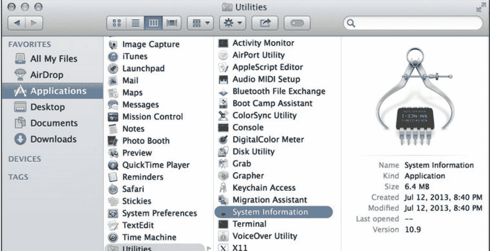

在安装 macOS Sierra 之前，请记录 Mac 电脑的内存容量和序列号。此外，检查 `SATA`/`SATA Express` 或存储部分查看系统磁盘（通常命名为 `Macintosh HD`）的可用空间。

### MacBook Pro

## 硬件概览：

| 属性 | 值 |
| --- | --- |
| 型名称 | MacBook Pro |
| 型号标识符 | MacBookPro10,1 |
| 处理器名称 | Intel Core i7 |
| 速度 | 2.3 GHz |
| 核心数 | 4 |
| L2 缓存（每核心） | 256 KB |
| L3 缓存 | 6 MB |
| 内存 | 16 GB |
| BOOT RAM 版本 | MBP101.0EE.B02 |
| SMC 版本（系统） | 2.335 |
| 序列号（系统） | C02HV144DB02 |
| 硬件 UUID | 48FA7891-D176-52A4-9EF2-04BC144DB002 |

升级到 macOS Sierra 有以下通用要求：

- `OS X Lion 10.7.5` 或更高版本
- `2 GB` 内存
- `8.8 GB` 可用存储空间
- `Apple ID`（某些功能需要）
- 兼容的互联网提供商（某些功能需要）

除此之外，您还需要确认您的 Mac 是否受支持。获取 Mac 电脑的序列号后，可以在 Apple 支持技术网站（`http://support.apple.com/specs/`）上进行比对。访问该网站，在“搜索规格”字段中输入 Mac 序列号，并点击“搜索”按钮。

搜索结果将返回 Mac 的型号名称。请注意，之前的截图显示 Mac 被识别为 `MacBookPro10,1`。虽然 `MacBookPro10,1` 是一个特定的标识符，但它并不是 Apple 用于技术规格的名称。在 Apple 支持技术网站上输入此 Mac 电脑的序列号将返回用于技术规格的官方型号：“MacBook Pro (Retina, 15-inch, Mid 2012)”。

macOS Sierra 支持以下 Mac 机型：

- `MacBook`（2009 年末或更新型号）
- `MacBook Pro`（2010 年中期或更新型号）
- `MacBook Air`（2010 年末或更新型号）
- `Mac mini`（2010 年中期或更新型号）
- `iMac`（2009 年末或更新型号）
- `Mac Pro`（2010 年中期或更新型号）

### macOS Sierra 功能要求

macOS Sierra 的某些功能要求超出了最低系统要求。许多此类功能依赖于其他设备或服务。例如，为了利用 `Handoff` 功能（如您的 Mac 处理 `iPhone` 蜂窝电话或短信的能力），您需要一台支持 `Handoff` 的 `iPhone`。另一个例子是 `Siri` 或 `Spotlight` 需要宽带网络访问。

Mac 可能需要特定的硬件来支持新功能。例如，“连续互”（`Handoff`、即时热点和通用剪贴板）需要配备 `蓝牙 4.0` 的 Mac 电脑。另一个新功能“自动解锁”需要飞行时间计算，这在配备最新 `802.11ac Wi-Fi` 的 Mac 电脑上可行。访问 `https://www.apple.com/macos/how-to-upgrade` 了解更多关于 macOS Sierra 的特定要求。

### Mac 要求

Mac 电脑带有专门为它们设计的 Mac 操作系统版本。某些 Mac 电脑可能包含额外的捆绑软件。本文假设您使用的是标准版本的 macOS Sierra。如果您使用的是编写本文时尚未发布的特定 Mac macOS 版本，细节可能会有所不同。另一个考虑因素是，macOS 版本不支持比它们新的 Mac 电脑。也就是说，您可能会遇到比您正尝试安装的 macOS Sierra 版本更高的 Mac。如果发生这种情况，安装可能会无法启动 Mac 或拒绝安装。请使用 macOS 恢复。

更多信息：请参阅 Apple 支持文章 `HT20431`，“随 Mac 发布的 OS X 版本”以及 `HT20168`，“使用随 Mac 附的 OS X 版本”。

### 准备升级

尽管您可以在未完成某些步骤的情况下启动 macOS 升级，但通过采取四个关键步骤可以减少升级问题或数据丢失的概率：

1. 验证应用程序兼容性。
2. 备份重要文件和文件夹。
3. 记录设置。
4. 检查 Apple 软件更新。

注意：这似乎是常识，但您不希望在升级过程中断电。升级期间请连接 AC 电以确保升级成功。

### 验证应用程序兼容性


当您升级到 macOS Sierra 时，第三方应用程序可能需要更新才能正常运行。您可以使用`系统报告`或`系统信息`查看已安装的应用程序。如果您使用`系统报告`，请确保选择了`查看 > 全部`以显示`应用程序`列表。

| 应用程序名称 | 获取自 | 最后修改时间 | 64 位 (Intel) |
| --- | --- | --- | --- |
| Version 1.5.1 (1675) | 标识 | 3/11/13, 10:16 PM | 否 |
| AirPlayAgent | Apple | 8/11/13, 5:46 PM | 是 |
| AirPort Base Station | Apple | 8/11/13, 5:46 PM | 是 |
| AirPort Utility 5 | 6.1 | Apple | 7/11/13, 10:59 PM | 是 |
| AirPort Utility 5.6 | Apple | 7/23/12, 9:07 AM | 是 |
| AirScanScanner | Apple | 8/11/13, 5:46 PM | 是 |
| AOSAlertManager | Apple | 8/11/13, 5:46 PM | 是 |
| OOPSushReply | Apple | - | 是 |
| Aperture | Apple | 6/18/13, 11:39 PM | 是 |
| AppDownloadLauncher | Apple | 8/11/13, 5:46 PM | 是 |
| Apple80211Agent | Mac App Store | 8/11/13, 5:53 PM | 是 |
| Disabled Software 9.0 | Apple | 8/11/13, 5:46 PM | 是 |

`Apple Configurator`:

版本：`1.3.1`

获取自：`Mac App Store`

最后修改时间：`8/1/13, 2:53`

类型：`Intel`

仅限 64 位：是

签名者：`Apple Mac OS Application Signing, Apple Worldwide Developer Certification Authority, Apple Root CA`

偏好设置

位置：`/Applications/Configurator.app`

您无需担心作为 Mac 操作系统安装的应用程序；当您安装 macOS Sierra 时，它们会被替换。不过，您可能需要通过访问供应商网站自行研究，以确定第三方应用程序是否需要更新。

macOS 还包含一个已知的不兼容软件列表。如果 macOS 安装程序在升级期间检测到不兼容软件，通常会将软件移动到`不兼容软件`文件夹。在某些情况下，不兼容软件不会被移动，但 macOS 会阻止您打开它并显示软件不兼容的警告对话框。有关此功能的更多信息，请参阅 Apple 支持文章 `HT208161`—“关于 Mac 不兼容软件”。

### 备份重要文件和文件夹

备份您的重要文件和文件夹始终关关。当您对 Mac 进行重大更改（例如安装新的 Mac 操作系统）时，拥有当前的备份更为关键。如果新安装或升级执行不当，可能会导致数据丢失。

如果 Mac 已经在运行 `OS X Leopard 10.5` 或更高版本，您可以在开始安装之前使用 `Time Machine` 创建备份。使用 `Time Machine` 请见第 15，“管理 `Time Machine`”。

### 记录设置

macOS 安装程序有助于防止您在升级到 macOS Sierra 时丢失之前的设置。但某些设置对您的 Mac 来说非常重要，因此在出现问题时应该记录它们。

具体来说，您在升级之前应该记录网络设置。打开`系统偏好设置`并点击`网络`图标查看当前的网络设置。通过浏览所有可用网络接口和配置来避免遗漏设置。

> 提示

您可以使用截图快捷键 `Command-Shift-3` 捕获每个网络配置，快速记录您的设置。

### 检查 Apple 软件更新

如前所述，要升级到 macOS Sierra，您必须拥有 `OS X Lion 10.7.5` 或更高版本。Apple 应用程序自您安装以来可能也已经更新。例如，`Pages`、`Numbers` 和 `Keynote` 在 Mac 操作系统版本发布之间会更新。确保您的 Mac 拥有最新的应用程序和固件。假设 Mac 已连接互联网，从 `Apple` 菜单选择`软件更新`或`App Store`。然后安装所有除 macOS 安装程序以外的可用更新。

### Finder 文件编辑 Go

关于本机

软件更新...

App Store...

系统偏好设置...

程序坞 (Dock)

较新版本的 macOS 使用 `Mac App Store` 来访问软件更新。在这种情况下，选择`软件更新`将自动打开 `Mac App Store`，并且 macOS Sierra 将列为第一个升级项目。你完全可以从这里开始升级过程，但在选择执行免费升级选项之前，请确保你已完成了所有建议的升级准备步骤。有关升级过程的详细信息将在本节稍后介绍。


### 检查 Apple 固件更新

某些 Mac 可能需要固件更新才能正确访问所有 macOS 功能。固件是低级软件，用于辅助系统硬件的启动和管理。Apple 可能会为某些 Mac 机型发布固件更新，以确保它们与新软件正常运行，尽管这些更新的频率低于普通的软件更新。通常情况下，这些更新会被软件更新机制捕获，或通过 macOS 安装过程自动安装。然而，在某些情况下，Mac 可能需要手动更新固件。在安装较新版本的 macOS 之前，最好检查是否有固件更新。

`系统报告`或`系统信息`（同样，位于 `/Applications/Utilities` 文件夹中）的默认视图显示了基于 Intel 的 Mac 电脑两种类型固件的版本。第一种列为`启动 ROM 版本`(Boot ROM Version)，用于可扩展固件接口 (EFI)，它负责通用的硬件管理和系统启动。

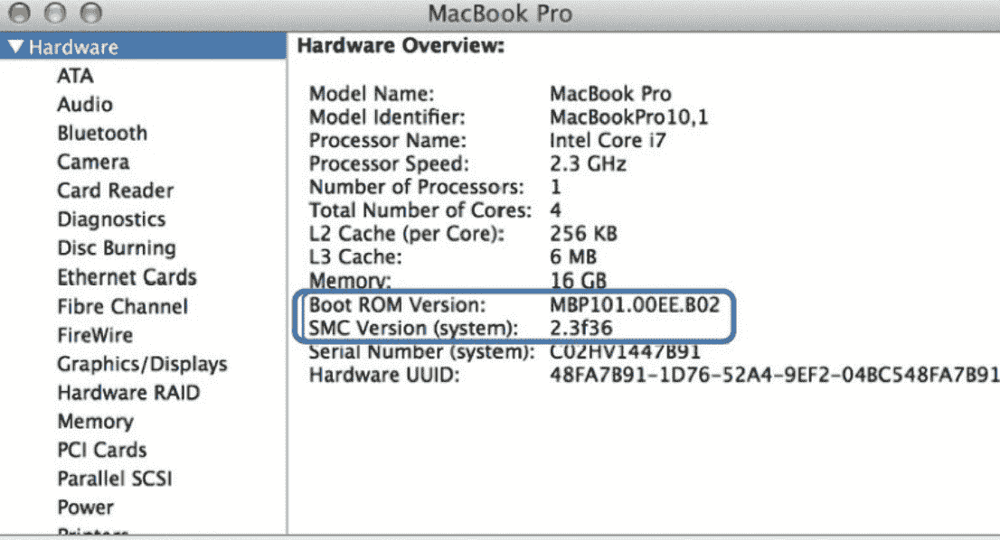

第二种列为`SMC 版本`，是系统管理控制器 (SMC) 固件，负责管理硬件电源和冷却。一旦你确定了 Mac 电脑的固件版本，就可以访问 Apple 支持文章 `HT201518`，“关于 Intel 时代 Mac 的 EFI 和 SMC 固件更新”来确定你是否拥有最新更新。在这篇文章中，Mac 机型按其型号标识列出，该标识符也可以在固件版本相同的`系统信息`视图中找到。

> macOS 安装过程可能会自动将许多后期型号 Mac 电脑的固件升级到比 Apple 支持网站列出的更高的版本。换句话说，只有当你的 Mac 电脑固件版本比 Apple 支持网站上列出的旧时，你才需要担心。

如果你确定你的 Mac 需要固件更新（如果尚未通过自动软件更新更新），你需要在 Apple 支持下载网站 `http://support.apple.com/downloads` 寻找正确的更新。与其他系统软件更新一样，固件更新需要管理员用户授权并重启。然而，某些较旧的 Mac 电脑对固件更新有额外要求：在初始安装过程之后，你必须关闭并按住电源键直到听到提示音以重启 Mac。这将启动固件更新过程的剩余部分。务必仔细阅读固件更新程序附带任何说明！未能正确更新 Mac 电脑的固件可能会导致硬件故障。

### 注意

如果你在旧 Mac 上遇到更新失败，可以使用固件恢复光盘恢复 Mac 电脑的固件。可以通过 Apple 支持文章 `HT201692`，“关于固件恢复光盘（基于 Intel 的 Mac）”了解关于获取和使用此光盘的信息。

### 保持更新

有关安装和升级的最新信息，你的最佳来源是 Apple 支持网站。一个很好的起点是位于 `https://support.apple.com/macos` 的 macOS Sierra 支持页面。当你需要安装 macOS 时，请访问这些资源以获取任何已发现的问题。Apple 支持文章遍落在本文指南中是有缘的。它们是获取官方、最新支持信息的最佳来源。

### 参考 1.4 准备系统磁盘

无论你是否需要对`全新安装`执行擦除并安装，你可能都需要执行此操作。在基于 Intel 的 Mac 电脑上，`系统报告`或`系统信息`显示两种类型固件的版本。第一种列为`启动 ROM 版本`，用于可扩展固件接口 (EFI)，它负责通用硬件管理和系统启动。

### 注意

如果你在旧 Mac 上遇到更新更新，你可以使用固件恢复光盘恢复 `固。。    Mac  的的件`。

### 保持更新

有关安装和升级的最新信息，你的最佳来源是 Apple 支持网站。一个很好的起点是位于 `https://port.apple.com/macos` 的 macOS Sierra 支持页面。每当你需要安装 macOS 时，请访问这些资源以获取任何已发现的问题。Apple 支持文章遍落在本文指南中是有缘的。它们是获取官方、最新支持信息的最佳来源。

### 参考 1.4 准备系统磁盘


无论你是否需要对“全新安装”执行擦除并安装，你可能都需要执行此操作。基于 Intel 的 Mac 电脑上，`系统报告`或`系统信息`显示两种类型固件的版本。第一种列为“启动 ROM 版本”，用于可扩展固件接口 (EFI)，它负责通用硬件管理和系统启动。

### 注意

如果你在旧 Mac 上遇到更新失败，你可以使用`固件恢复光盘`恢复 Mac 电脑的固件。

### Finder 文件编辑 Go

关于本机

软件更新...

App Store...

系统偏好设置...

程序坞

较新版本的 macOS 使用 Mac App Store 来访问软件更新。在这种情况下，选择“软件更新”将自动打开 Mac App Store，并且 macOS Sierra 将列为第一个升级项目。你完全可以从这里开始升级过程，但在选择执行免费升级选项之前，请确保你已完成了所有建议的升级准备步骤。有关升级过程的详细信息将在本节稍后介绍。


### 检查 Apple 固件更新

某些 Mac 可能需要固件更新才能正确访问所有 macOS 功能。固件是低级软件，用于辅助系统硬件的启动和管理。Apple可能会为某些 Mac 机型发布固件更新，以确保它们与新软件正常运行，尽管这些更新的频率低于普通的软件更新。通常情况下，这些更新会被软件更新机制捕获或通过 macOS 安装过程自动安装。然而，在某些情况下，Mac 可能需要手动更新固件。在安装较新版本的 macOS 之前，最好检查是否有固件更新。

`系统报告`或`系统信息`（同样，位于`/Applications/Utilities`文件夹中）的默认视图显示了基于 Intel 的 Mac 电脑两种类型固件的版本。第一种列为“启动 ROM 版本”，用于可扩展固件接口 (EFI)，它负责通用的硬件管理和系统启动。


第二种列为“SMC 版本”，是系统管理控制器 (SMC) 固件，负责管理硬件电源和冷却。一旦你确定了 Mac 电脑的固件版本，就可以访问 Apple 支持文章`HT201518`，“关于 Intel 时代 Mac 的 EFI 和 SMC 固件更新”来确定你是否拥有最新更新。在这篇文章中，Mac 机型按其型号标识列出，该标识符也可以在固件版本相同的“系统信息”视图中找到。

> macOS 安装过程可能会将许多后期型号 Mac 电脑的固件升级到比 Apple 支持网站列出的更高的版本。换句话说，只有当你的 Mac 电脑固件版本比 Apple 支持网站上列出的旧时，你才需要担心。

如果你确定你的 Mac 需要固件更新（如果尚未通过自动软件更新更新），你需要在 Apple 支持下载网站`http://support.apple.com/downloads`寻找正确的更新。与其他系统软件更新一样，固件更新需要管理员用户授权并重启。然而，某些较旧的 Mac 电脑对固件更新有额外要求：在初始安装过程之后，你必须关闭并按住电源键直到听到提示音以重启 Mac。这将启动固件更新过程的剩余部分。务必仔细阅读固件更新程序附带的任何说明！未能正确更新 Mac 电脑的固件可能会导致硬件故障。

### 注意

如果你在旧 Mac 上遇到更新失败，你可以使用`固件恢复光盘`恢复 Mac 电脑的固件。可以通过 Apple 支持文章`HT201692`，“关于固件恢复光盘（基于 Intel 的 Mac）”了解关于获取和使用此光盘的信息。

### 保持更新

有关安装和升级的最新信息，你的最佳来源是 Apple 支持网站。一个很好的起点是位于`https://support.apple.com/macos`的 macOS Sierra 支持页面。每当你需要安装 macOS 时，请访问这些资源以获取任何已发现的问题。Apple 支持文章遍落在本文指南中是有缘的。它们是获取官方、最新支持信息的最佳来源。

### 参考 1.4 准备系统磁盘

多分区系统可能会导致以下问题：`启动营助理`无法在多分区磁盘上添加分区；启用`FileVault`仅加密系统卷，而其他卷未加密；`融合驱动`（`Fusion Drive`）卷上的额外分区无法利用快速闪存存储。

## 参考文献 1.5 升级和安装 macOS

Apple 公司以设计的每项操作都尽可能简单而闻名，macOS 的安装过程就是一个例子。然而，任何负责支持 macOS 电脑的人员都应该完全熟悉确保安装顺利所需的所有程序。

### 获取 macOS 安装程序

macOS Sierra 是一项免费升级，仅可从 Mac Store 下载。然而，一旦你下载了 macOS 安装程序，就可以按照练习 3.2 节“创建 macOS 安装磁盘”中的说明，创建你自己的外部 macOS 安装磁盘。

如果你是初次获取 macOS Sierra，该过程就像从 Mac App Store 下载一个免费应用程序一样简单。此外，正如之前介绍过的，在执行运行时软件更新时，大多数最新版本的 macOS 都会自动提示你升级到 macOS Sierra。

不过，使用 Mac App Store 下载 macOS Sierra 安装程序有几个前提条件：

- 你必须运行`Lion 10.7`或更高版本。
- 你必须连接到互联网，最好是宽带速度。macOS Sierra 安装程序略小于 5 GB，因此即使在“快速”连接下下载也需要一段时间。
- 要从 Mac App Store 下载项目，你必须使用`Apple ID`登录。这是因为即使是 Mac App Store 中的免费项目（如 macOS Sierra 安装程序），也必须使用带有验证账单信息的`Apple ID`进行购买。如果你以前在`iTunes`或`Mac App Store`等在线 App 商店购买过项目，你的账单信息已经配置好了。但是，如果你尚未在在线 App 商店购买过项目，可以在`Mac App Store`中设置你的账单信息。

### 更多信息

关于 Mac App Store 的详情在第 16 节“安装应用程序”中有所介绍。

假设你符合标准，只需从`Apple`菜单中打开`Mac App Store`；macOS Sierra 可能会出现在商店的特色项目之一，因此应该很容易找到。Sierra 安装程序也可能出现在`软件更新`列表中，当你点击`Mac App Store`工具栏中的“更新”按钮时就会显示该列表。再次，假设`OS X El Capitan`默认`自动软件更新`设置，系统可能已经为你下载了安装程序。

如果 macOS Sierra 安装程序尚未下载到你的 Mac 上，只需点击“免费升级”或“下载”按钮。下载完成后，安装程序会自动打开，但如有必要，你也可以在`应用程序`文件夹中找到它。

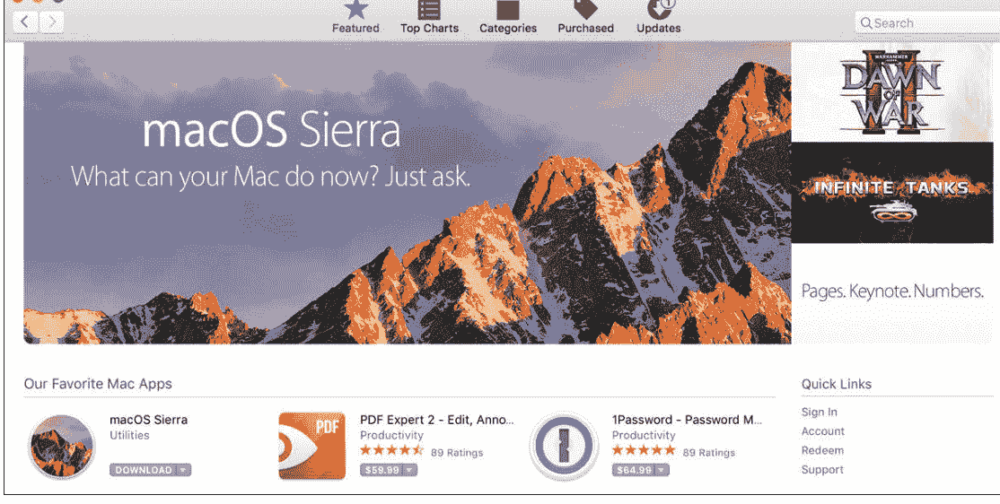

### 注意事项

如果你的 Mac 上已经安装了 macOS Sierra，`Mac App Store`会注明其已安装或下载。在这种情况下，macOS Sierra 安装程序可能仍在`应用程序`文件夹中。如果没有，你也可以通过第 3 节“使用 macOS 恢复”涵盖的步骤访问安装程序。

### 安装 macOS Sierra

安装过程涉及开始前的几个选择，然后是实际的安装。这意味着你只需要花几分钟选择安装目标，然后就可以在安装完成后让 Mac 闲置。在正常安装期间，Mac 将至少自动重启一次，可能重启多次。

### 提示

如果发生断电或磁盘断开，只需重新启动安装。

### 升级与安装

安装程序会自动为你所选的目标选择合适的安装类型：`升级`或`新安装`。`升级安装`会升级现有的 Mac 操作系统并更新到更高版本。`新安装`会在没有现有 Mac 操作系统的磁盘上放置新的 macOS 副本。

无论何种情况，macOS 安装程序的设计都能确保在安装后第三方应用程序和用户数据仍然可用。至于安装目标，macOS 安装程序可以`升级`你当前的 Mac 操作系统，或者你可以将其安装到连接到 Mac 的另一个磁盘上。

### 注意事项

如果当前有其他用户通过`快速用户切换`登录到 Mac，则你无法升级 macOS。你需要让这些用户注销会话或重启电脑以强制结束其他用户的会话。

### 执行全新安装或新安装

正如之前介绍过的，如果你想执行擦除并安装（也称为`全新安装`），必须在运行 macOS 安装程序之前，使用`磁盘工具`手动擦除目标系统磁盘。如果目标是另一个系统磁盘（例如`外部磁盘`），你可以从当前运行的 Mac 进行擦除并安装。但是，如果你想擦除 Mac 当前运行的系统磁盘，你需要从另一个系统启动，如第 3 节“使用 macOS 恢复”所述。

### 选择安装目标


在安装 macOS Sierra 期间，你唯一需要做的选择是安装目标——你只是在选择将 macOS 安装的磁盘卷。这可以是内部或外部磁盘，只要它经过正确格式化。默认选择是当前的启动磁盘；你必须点击“显示所有磁盘”按钮来选择备用目标。

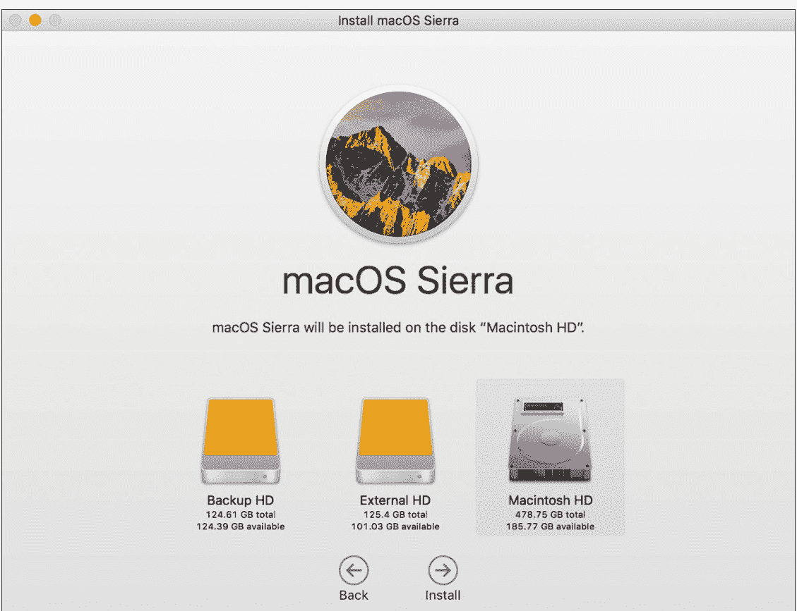

### macOS Sierra

`macOS` Sierra 将安装在磁盘“Macintosh HD”上。

| 备份 HD | 外部 HD | Macintosh HD |
| :--- | :--- | :--- |
| 总计 124.61 GB | 总计 125.4 GB | 总计 478.7 GB |
| 可用 124.39 GB | 可 101.03 GB | 可 185.77 GB |

你可能会发现安装程序不允许选择某些磁盘。这是因为安装程序确定你的 Mac 无法从该位置启动。可能的原因包括：

- 磁盘未使用适用于你的 Mac 的方案。`Intel` 电脑使用 `GPT`。你可以通过重新划分磁盘来解决此问题。
- 特定分区未正确格式化。`macOS` 需要 `Mac OS` 扩展（日志式）卷。你可以通过擦除分区来解决此问题。
- `macOS` 安装程序不支持安装到包含 `Time Machine` 备份的磁盘。有关更多信息，请参阅“如果无法在磁盘上安装”。

再次，系统会自动判断目标是否已存在版本的 `macOS`。如果存在现有系统，安装程序将升级该系统。

### 参考文献 1.6 故障排除安装问题

对于大多数系统来说，安装过程是无痛且可靠的。然而，作为任何复杂的科技，可能会出现问题。好消息是，`macOS` 安装程序有能力“撤销”安装并恢复到之前的系统。如果发生这种情况，显然安装没有成功完成，但至少你还有一台可以运行的 `Mac`。

彻底验证你的计算机符合 `macOS` Sierra 的要求，并完成本节概述的准备步骤，将从很大程度上防止或解决任何严重问题。

### 通用安装程序故障排除

除了本节之前介绍的准备步骤外，大多数安装失败源于目标磁盘的问题。例如：

- 安装程序可能无法验证所选磁盘或分区。这表明存在严重的磁盘问题。参考第 9 节“管理文件系统和存储”中的故障排除步骤来解决此问题。
- 可能会出现错误信息，说 `macOS` 的某些功能不支持所选磁盘。这发生在你的系统磁盘是软件 `RAID`（独立磁盘阵列）或使用了非标准的 `Boot Camp` 分区时。在这种情况下，安装程序无法创建 `macOS` 恢复磁盘，但你仍然安装 `macOS`。
- 在某些情况下，即使磁盘已分区并格式化，安装程序也不让你选择该磁盘。这种错误通常发生在磁盘上也有 `Boot Camp` 分区时。这种情况的解决方法是微缩小 `Mac` 分区的大小，为 `macOS` 恢复磁盘留出空间。

### 更多信息

参见 `Apple` 支持文档 `HT203482`，“安装程序报告‘无法在计算机上安装 OSX’或‘此磁盘无法启动你的计算机’”。

## 安装 macOS Sierra 文件编辑窗口

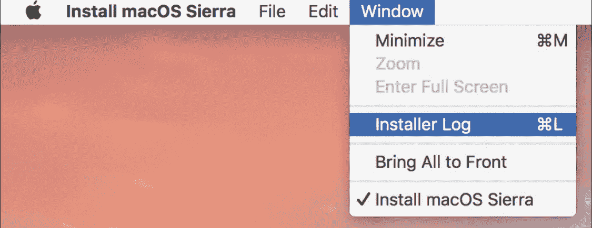

在安装过程的初始阶段，你可以通过从“窗口”菜单中选择“安装日志”（`Installer Log`）来访问安装日志。安装日志中的信息可以帮助你更精确地定位问题或验证安装。

- **提示**：你还可以使用此技术通过“安装程序”应用程序检查任何通用软件的安装进度。

在初步安装过程完成后，安装程序将进入主安装阶段，屏幕将完全锁定用户输入。在此期间，你只能查看安装进度条。如果安装在此处失败，系统将再次重新启动到之前的操作系统。

当 `Mac` 恢复正常运行后，你可以从 `/Applications/Utilities/Console`（控制台）应用程序访问完整的安装日志。打开控制台后，选择最左侧栏中的 `/var/log` 文件夹，然后在第二列中选择 `installer.log`。在 `Spotlight` 搜索过滤字段中，输入文本 `osinstaller` 以仅显示由系统安装程序创建的条目。

### 控制台

`osinstaller`

所有消息 错误和故障

| 设备 | CDS.custom |
| :--- | :--- |
| MyMac | concurrentlog.log |
| 报告 | displayplay_dlt_status.log |
| 诊断和... | fksk_fs.log |
| 系统报告 | opirectorylog.log |
| 用户报告 | opirectorylog.log |
| system | secondit.log |
| /Library/Logs | system.log |
| /Library/Logs | wif.log |
| /var/log | |

```
Sep 18 14:22:18 MacBook-Pro-OSInstaller(492): Running /usr/libexec/filedupater using payload /Volumes/OS X Install DVD/Packages/FPPayload
Sep 18 14:22:18 MacBook-Pro-OSInstaller(492): /usr/libexec/filedupater finished with
Sep 18 14:22:18 MacBook-Pro-OSInstaller(492): Install Complete
Sep 18 14:22:18 MacBook-Pro-OSInstaller(492): User data elapsed: 0 seconds
Sep 18 14:22:18 MacBook-Pro-OSInstaller(492): Run SMC update: 0 seconds
Sep 18 14:22:18 MacBook-Pro-OSInstaller(492): Installation package installed: 0 seconds
Sep 18 14:22:18 MacBook-Pro-OSInstaller(492): Ensure recovery system: 0 seconds
Sep 18 14:22:18 MacBook-Pro-OSInstaller(492): Remove previous system: 0 seconds
Sep 18 14:22:18 MacBook-Pro-OSInstaller(492): Post install cleaner: 1 seconds
Sep 18 14:22:18 MacBook-Pro-OSInstaller(492): Extracting logs in: 2 seconds
Sep 18 14:22:18 MacBook-Pro-OSInstaller(492): Run EFI update: 0 seconds
Sep 18 14:22:18 MacBook-Pro-OSInstaller(492): Creating disk logs: 0 seconds
Sep 18 14:22:18 MacBook-Pro-OSInstaller(492): Verify and repair disk: 10 seconds
Sep 18 14:22:18 MacBook-Pro-OSInstaller(492): ISAP: Done with phase "OS Installer"
Sep 18 14:22:18 MacBook-Pro-OSInstaller(492): Phase #3: 0 seconds
Sep 18 14:22:18 MacBook-Pro-OSInstaller(492): currentInstallPhase: Boot 2
Sep 18 14:22:18 MacBook-Pro-OSInstaller(492): totalCompletedProgress: 85000000
Sep 18 14:22:18 MacBook-Pro-OSInstaller(492): Start time(s) at 21:42:08, will attempt to quit in 60
Sep 18 14:22:18 MacBook-Pro-OSInstaller(492): Registering the connection
```

你可能会发现，即使在安装成功，`OSInstaller` 也会处理许多警告和错误。这些报告的许多问题是无害的，只有当你试图隔离导致性故障的问题时，才应该关注它们。当安装成功完成后，安装日志中的条目看起来与之前的屏幕截图相似。

> **提示**：在控制台应用程序中访问的日志显然有大量信息可供。本指南中的其他课程将建议在适当的情况下检查特定的日志。

## 练习 1.1 为 Mac 升级做准备

- 只有当你将电脑从较早版本的 `OS X` 升级到 `macOS` Sierra 时，才需要进行此练习。


- 你的电脑必须运行 `OS X Lion 10.7` 或更高版本才能执行此练习。运行 `OS X Snow Leopard 10.6` 的电脑必须在升级到 `macOS Sierra` 之前先升级到 `OS X El Capitan 10.11`。

在本次练习中，你将验证电脑的硬件和固件是否支持 `macOS Sierra`，并检查旧软件以及记录重要设置。

# 使用系统信息检查硬件、固件和应用程序兼容性

1. 如必要，请在你的电脑上登录管理员账户。

2. 在 `Finder` 中，导航到 `/Applications/Utilities` 文件夹（可以使用 `Command-Shift-U`）。

3. 打开“系统信息”。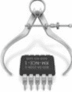

> 注意：如果应用程序名为 `Systemer` 而不是 `System Information`，则说明你的电脑运行的是 `OS X Snow Leopard 10.6` 或更早版本，无法直接升级到 `Sierra`。请参参考 1.2，“选择安装方法”获取更多信息。如果你愿意，可以继续完成此练习剩余，以查看 `Mac` 是否符合运行 `Sierra` 的硬件要求。

4. 如必要，选择侧边栏中的“硬件”类别。

5. 验证“内存”至少为 `2 GB`。如果少于此值，你无法在该电脑上使用 `Sierra`。

| MacBook Pro 硬件概览： |
| --- |
| 型号: `MacBook Pro` |
| 型号标识: `MacBookPro10,2` |
| 处理器名称: `Intel Core i5` |
| 处理器速度: `2.5 GHz` |
| 核心数: `2` |
| `L2` 缓存: `3 MB` |
| `L3` 缓存: `8 MB` |
| 内存: `8 GB` |
| `SMC` 版本: `1.016` |
| 序列号: `C027JAL3` |
| 运动传感器: 已启用 |

6. 记录 `MacBook Pro` 型号、启动 ROM 版本、`SMC` 版本和序列号：

7. 选择硬件部分中的“存储”。

8. 如必要，选择右侧列表中的启动磁盘。

9. 在右侧列表中找到启动卷，并验证它是否有至少 `8.8 GB` 空间。理想情况下，应该大于 `8.8 GB`（以安装 `Sierra`）。

| `Macintosh HD`: |
| --- |
| 可用: `109.57 GB` (`109,573,236,992` 字节) |
| 容量: `120.47 GB` (`120,473,067,520` 字节) |
| 文件系统: `/Journaled HFS+` |
| 可写: 是 |
| 忽略所有权: 否 |
| `BSD` 名称: `disk0s` |
| 卷 `UUID`: `51AEE80-929F-3341-A950-0146E9B63C7` |
| 物理驱动: `APPLE SSD` |
| 介质类型: `SSD` |
| 协议: `SATA` |
| 内部: 是 |
| 分区 `Map`: `GPT` (`GUID` 分区表) |
| `S.M.A.R.T.` 状态: 已验证 |

10. 在侧边栏下选择“应用程序”，等待它收集电脑上安装的应用程序信息。

11. 点击右侧的“修改日期”列标题。如果列三角形向下，再次点击使其向上。

| 应用程序名称 | 版本 | 获取自 | 修改日期 |
| --- | --- | --- | --- |
| `EPSON Scanner` | `5.7.6` | 识别开发者 | `3/9/09, 6:39 PM` |
| `MakePDF` | `10.2` | `Apple` | `12/6/10, 5:48 PM` |
| `Embed` | | `Apple` | `1/17/12, 5:52 PM` |
| `Extract` | | `Apple` | `1/17/12, 5:52 PM` |
| `Match` | | `Apple` | `1/17/12, 5:52 PM` |

**`EPSON Scanner`:**

版本: `5.7.6`

获取自: 识别开发者

修改日期: `3/9/09, 6:39 PM`

类型: `Intel`

`64` 位 (`Intel`): 是

签名者: 开发者 `ID` Application: `EPSON` (`TXAE5RN4`), 开发者 `ID` 证书

位置: `/Library/Image Capture/Devices/EPSON Scanner.app`

获取信息字符串: `5.7.6, Copyright 2003 EPSON`

“针对 `Intel` 芯片 `Mac` 的更新。”

19. 在列表中找到你的机型。注意，你可以通过型号名称（你在第 16 步中找到）或型号标识符（你也在第 6 步中找到）来查找。

20. 验证你在第 6 步中找到的 `Boot ROM` 和 `SMC` 版本至少与列表中的相同。如果未达到，请通过升级 `OS X` 来更新电脑的固件。最简单的方法是使用自动软件更新（注意，自动软件更新还会检查其他内容，因此即使你的固件已经是最新的，也应该运行它）。

### 注意

你可以在第 4 节“更新 `macOS` 软件”中找到有关自动软件更新的更多信息。

21. 从 `Apple` 菜单中选择 `App Store` 或软件更新；如有必要，点击工具栏上的更新图标，并等待系统检查你的软件和固件是否有更新。

22. 如果出现消息提示“您的电脑是最新版本”或“无可用更新”，请继续本练习的“配置文档网络设置”部分。

23. 如果你正在使用 `OS X Lion 10.7`，并且弹出一个对话框提示你的电脑可用更新，点击“显示详情”以查看找到的更新。

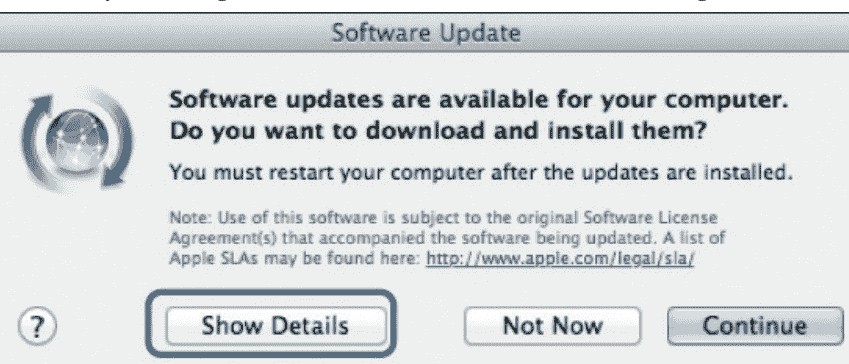

浏览可用更新，并取消勾选你现在不想执行的任何项目。然后安装 `x` 项，其中 `x` 是你选择安装的项目数，并按照任何提示和说明完成更新。注意，更新固件的过程可能因机型不同而异。

### 软件更新

你的电脑有新软件可用。

如果你现在不想安装，请在准备好安装时选择 `Apple` 菜单 > 软件更新。

| 安装 | 名称 | 版本 | 大小 |
|---|---|---|---|
| ✓ | `Safari` | | `40.2 MB` |
| ✓ | `AirPort` 实用 | `6.1` | `22 MB` |
| ✓ | `iTunes` | `10.6.3` | `176.9 MB` |
| ✓ | 远程桌面客户端 | | `3.5 MB` |

`Safari` 包含新功能，包括：

- 智能搜索框。`Safari` 现在有一个字段可以同时输入搜索内容和网页地址。
- 离线阅读列表。`Safari` 保存你阅读列表中的每个网页，即使在没有互联网连接时，你也可以继续阅读。
- 不被追踪。`Safari` 可以向你访问的网站发送请求，要求其不对你进行在线追踪。
- 密码面板。使用新的密码功能管理你保存的网站登录信息。

注意：此软件的使用受随更新软件附带的原始软件许可协议限制。在此可以找到 `Apple` 服务协议（`SLA`）列表：`http://www.apple.com/legal/sla/`。

隐藏详情 现在不 | 安装 4 项

24. 如果你正在使用 `Mountain Lion 10.8` 或更高版本，并且 `App Store` 列出了可用更新，点击你想安装的任何更新的“更新”按钮。注意，你可能会有一个“更多”选项来显示更详细的系统更新列表，以及一个“全部更新”按钮来安装所有可用更新。按照提示和说明完成更新。注意，更新固件的过程可能因机型不同而异。

这些版本使用的更新过程与 `macOS Sierra` 类似，你可以参考第 4 节“更新 `macOS` 软件”获取有关更新过程的更多信息。

25. 更新完成后，重复从第 21 步开始的操作，验证所有更新均已成功安装且没有更多可用更新。

### 网络设置

1. 从 `Apple` 菜单中选择“系统偏好设置”。

2. 在系统偏好设置中，点击“网络”。


### 网络

3. 选择每个网络服务（位于设置面板左侧），并记录分配给它们的任何特殊设置。你需要点击每个服务的“高级”按钮来查看完整设置。通常，最简单的方法是使用快捷键 `Command-Shift-3` 截图，以获得一个可以参考的“永久”记录。

4. 如果你的电脑定义了多个位置，请对每个位置重复此过程。

### 备份数据

无论你选择哪种备份选项，请在继续之前确保你的备份是最新的包含重要数据。过程取决于你选择的备份方案，但通常最好的测试是尝试从备份中恢复关键数据。

## 练习 1.2 升级到 `macOS Sierra`

- 先决条件

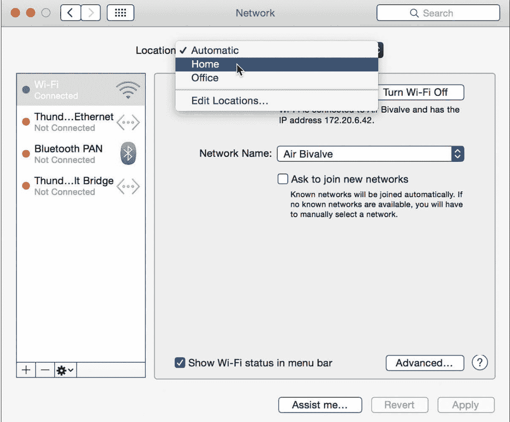

- 只有当你将电脑从早期版本升级到 `macOS Sierra` 时，才需要此练习。
- 你的电脑必须运行 `OS X Lion 10.7.5` 或更高版本才能执行此练习。
- 在开始此练习之前，请执行练习 1.1“为升级准备 `Mac`”。


在本次练习中，你将从 Mac App Store 下载 macOS Sierra 并将其作为升级安装到电脑上。

### 使用 App Store 下载安装程序

1. 登录电脑上现有的管理员帐户。
2. 从 Apple 菜单中选择 App Store。如果 App Store 不在选项之一，说明你运行的 OS X 版本过旧。
3. 在 App Store 的搜索框中输入 `Sierra`，并按回车。


4. 在搜索结果中找到 macOS Sierra，点击其名称下的按钮（标记为“下载”或“获取”）。

### “Sierra”的搜索结果


5. 如果出现对话框要求你登录，请提供相关信息。参阅参考 16.1“关于 App Store”和练习 16.1“使用 App Store”以获取有关在商店商店使用 Apple ID 的更多信息。
6. 如果 App Store 请求任何额外信息，请提供。
7. 等待安装 `Sierra` 应用程序下载。

下载完成后，应用程序将自动打开。

**注意**

安装过程会删除安装程序。如果你想升级多台电脑或创建安装盘，请在继续之前退出安装程序并进行复制。创建安装盘的过程可以参考练习 3.2“创建 macOS 安装盘”。

### 将你的电脑升级到 macOS Sierra

1. 如果必要，打开安装 `Sierra` 程序。
2. 在第一个屏幕上，点击“继续”。

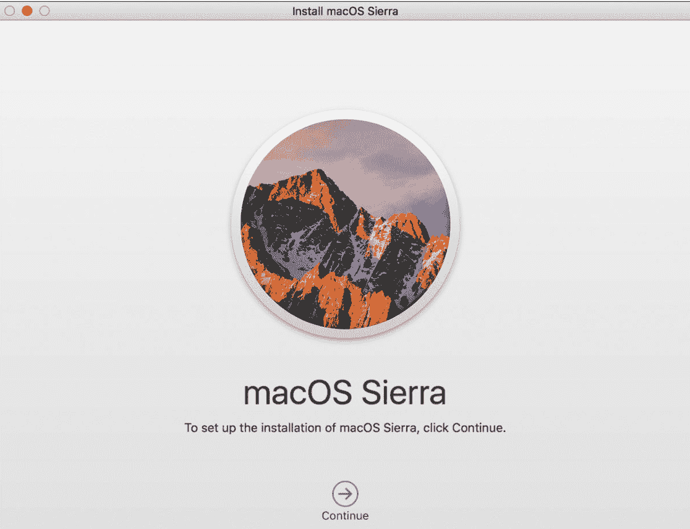

3. 读取许可协议，如果你接受其条款，点击“同意”。
4. 在弹出的确认对话框中，点击“同意”。

此时你可以选择安装目标。

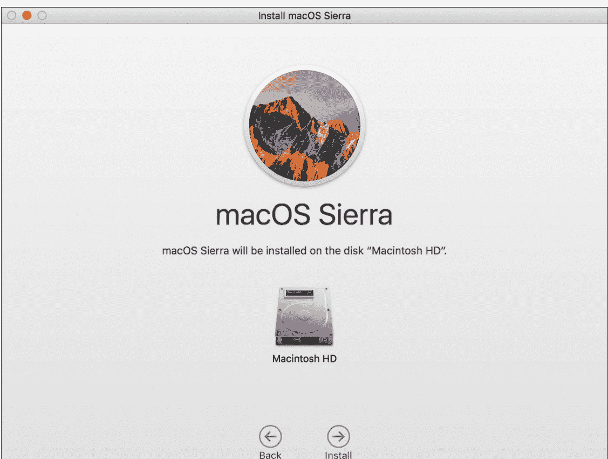

### macOS Sierra

macOS Sierra 将安装在 `Macintosh HD` 磁盘上。


`Macintosh HD`

5. 默认选择是当前启动卷；如果有其他卷，点击“显示所有磁盘”按钮以选择不同的目标。
6. 点击“安装”开始安装。如果警告你未连接电源，请在继续之前连接电源适配器。
7. 输入你的管理员帐户密码以授权安装。

要查看安装过程的详情，一旦安装开始，请立即遵循练习 1.4“验证系统安装”中的说明。

安装通常会自动完成，无需进一步干预，尽管过程中会重启几次。

升级后首次登录帐户时，系统可能会提示你登录 Apple ID。你可以通过“以后登录”来跳过此步骤，因为我们将在后续练习中探索 `Sierra` 的 Apple ID 和 iCloud 功能。

系统可能会提示启用 `Siri`。如果你愿意，可以启用它。

执行“配置现有 macOS 系统以进行练习”，以便为本指南中后续的练习准备好你的电脑。

## 练习 1.3 擦除 Mac 系统并安装 macOS Sierra

| 前提条件 |
| :--- |
| 仅当你的电脑在安装 macOS Sierra 之前需要擦除时，此练习才是必要的，请参见参考 1.2，“选择安装方法”中的相关内容。 |
| 你需要一个 Sierra 恢复分区或一个 Sierra 安装磁盘（详情请参阅第 3 节“使用 macOS 恢复”）。 |

**警告**

这将擦除你电脑上的所有现有数据。如果你想保留这些中的任何数据，必须确保它们已安全地备份到另一台电脑或磁盘上。

如果你的电脑出现问题，最好的方法可能是擦除现有数据并从全新的 macOS Sierra 开始开始安装。要执行此操作，你必须从另一个磁盘启动，擦除电脑的内部磁盘，然后安装新的操作系统。

### 从恢复磁盘或安装磁盘启动

1. 在进行此练习之前，确保你想要从这台电脑中保留的所有文件已安全地备份在其他处。
2. 如果你的电脑正在运行，请将其关机。
3. 如果你正在替换现有的 `Sierra` 安装（并想从电脑现有的恢复分区执行安装），按下电脑上的电源按钮开机，并立即按住 `Command` 和 `R` 键，直到你在屏幕中间看到 Apple 图标。一旦看到 Apple 图标，松开按键并跳到下一节，“擦除你的电脑的磁盘驱动器”。
4. 如果你正在使用外部 `Sierra` 安装磁盘，请将磁盘连接到你的电脑。
5. 按下电脑上的电源按钮开机，然后立即按住 `Option` 键，直到你看到屏幕上出现一行图标。

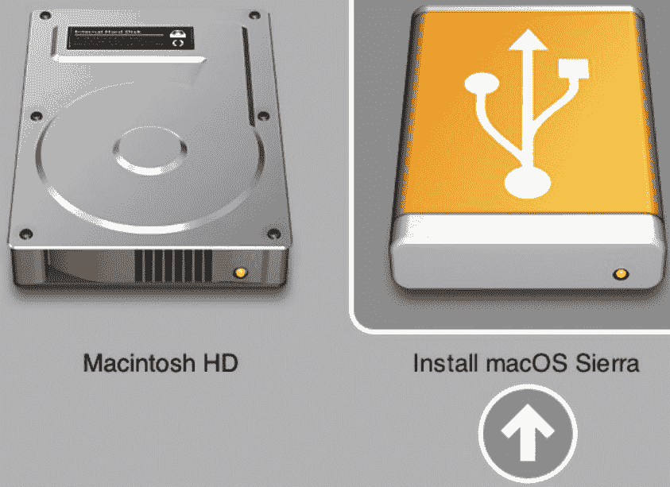

6. 点击安装磁盘图标（通常标记为“安装 macOS Sierra”）。
7. 点击图标下方出现的箭头。

电脑将进入安装程序/恢复环境。第 3 节“使用 macOS 恢复”提供了更多关于使用这些模式的信息。

### 擦除电脑的磁盘驱动器

1. 如果出现语言选择界面，选择你偏好的语言，并点击右箭头按钮继续。
2. 打开磁盘工具。
3. 如果出现 macOS 实用程序窗口，选择磁盘工具，并点击继续。

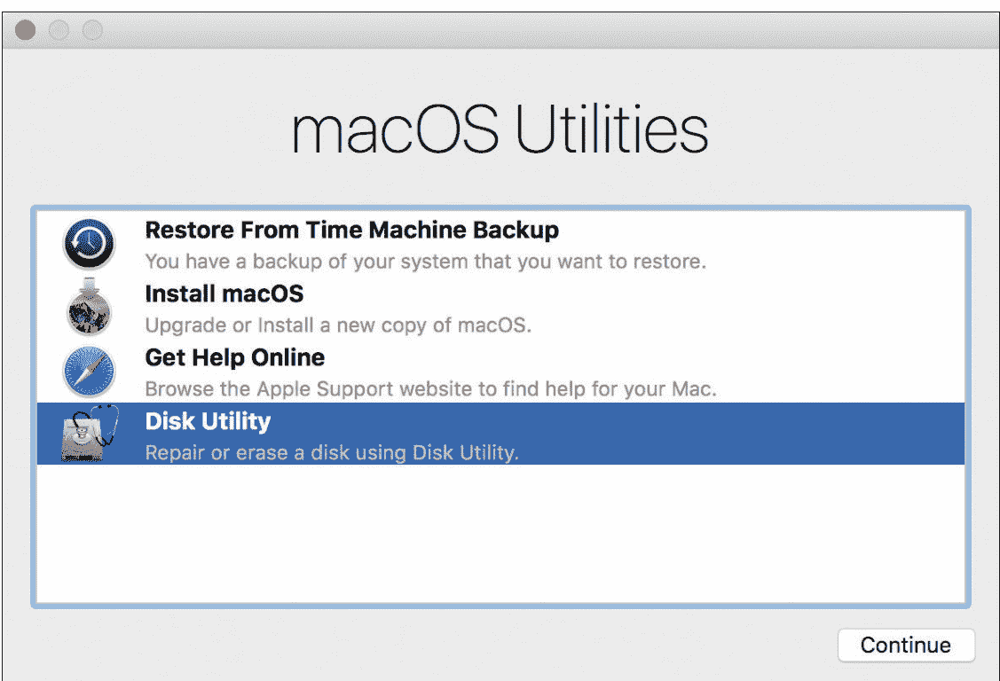

► 如果之出现的是安装程序界面，从菜单栏中选择实用程序菜单 > 磁盘工具。

磁盘工具已打开。第 9 节“管理文件系统和存储”提供了更多关于使用磁盘工具的信息。

4. 从侧边栏中选择你想要安装 `Sierra` 的磁盘或卷。

**注意**

如果如果你是从外部安装磁盘启动的，可以选择该磁盘（顶部的条目），这将擦除整个磁盘及其上的所有数据。如果你倾向于仅擦除单个分区，可以选择侧边栏中磁盘驱动器下的分区条目。如果你选择此选项，还必须验证磁盘是否已使用 `GUID` 分区表 (`GPT`) 格式化。关于磁盘格式和擦除选项的更多详情，请参见第 9 节“管理文件系统和存储”。

### 磁盘工具

| 急救 | 分区 | 擦除 | 恢复 | 卸载 | 信息 |
| :--- | :--- | :--- | :--- | :--- | :--- |
| **内部** | | | | | |
| - `APPLE SSD SM12...` | | | | | |
| - `Macintosh HD` | | | | | |
| **外部** | | | | | |
| - `Lexar JumpDrive...` | | | | | |
| - `Install macO...` | | | | | |
| **磁盘映像** | | | | | |
| - `Apple disk image...` | | | | | |
| - `OS X Install...` | | | | | |
| - `Apple disk image...` | | | | | |
| - `OS X Base S...` | | | | | |

### Macintosh HD

`120.1 GB` 卷 Mac OS Extended (Journaled)（Mac 扩展格式（日志式））

| 已用 | 可删除 | 闲可用 |
| :--- | :--- | :--- |
| `12.68 GB` | `0 KB` | `107.42 GB` |
| 挂载点: `/Volumes/Macintosh HD` | 逻辑卷 |
| 容量: `120.1 GB` 可用（可删除 + 闲可用）: `107.42 GB` | |
| 已用: `12.68 GB` 所有者: 已启用 | |
| 设备: `disk1` 连接: `SATA` | |

5. 点击磁盘工具窗口顶部附近的“擦除”按钮。
6. 为你的电脑磁盘输入一个新名称。本指南的其余部分假设其名称为 `Macintosh HD`。
7. 从“格式”弹出菜单中，选择 `Mac OS Extended (Journaled)`。
8. 如果有“方案”弹出菜单，选择 `GUID` 分区映射。

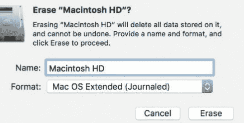

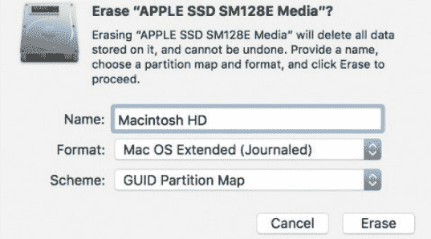

9. 点击擦除。
10. 完成后，点击完成。
11. 从菜单中选择磁盘工具。

### 安装 macOS

1. 如果出现实用程序窗口，选择安装 macOS 并点击继续。


2. 在安装程序窗口中，点击继续。


### macOS Sierra

为了安装 macOS，点击继续。

3. 如果通知你的电脑符合条件，点击继续。
4. 阅读许可协议，如果你接受这些条款，点击同意。
5. 在确认对话框中，点击同意。
6. 从列表中选择你的硬盘，并安装。
7. 如果提示，输入你的 Apple ID 登录。


为了查看安装过程的详情，请按照以下操作执行第 2 节，“升级 macOS”或第 1.3 节，“擦除 Mac 系统并安装 macOS Sierra”，只要安装开始即可。尽管它会自动重启。重启后，你将遇到设置向导，按照第 2.1 节，“配置新系统”进行操作。

## 练习 1.4 验证系统

在此练习中，你将使用安装日志来检查发生的情况。

在安装过程的任何时候，都可以通过以下步骤调出安装日志：

`img/054d569616d6bf404cc0816f583e361a_63.png`

3. 从弹出菜单中选择“所有日志”以查看安装日志的内容。

| 显示错误 | | 发送 | 保存 |
| :--- | :--- | :--- | :--- |
| 仅显示错误 | | | |
| 显示错误和进度 | | | |
| 显示所有日志 | | | |
| 11 月 17 日 13:13 Mac-pro-installersetupd[648]: Specifier: <PKageSpecifier>- 363.000000, | | | |
| 12 月 17 日 13:13 Mac-pro-installersetupd[648]: Specifier: <PKageSpecifier>: | | | |
| 13 月 17 日 15:45 Mac-pro-installersetupd[648]: Helper tool loaded | | | |
| 14 月 17 日 15:45 Mac-pro-installersetupd[648]: Specifier: <PKageSpecifier>: | | | |
| 15 月 17 日 15:45 Mac-pro-installersetupd[648]: Specifier: <PKageSpecifier>: | | | |
| 16 月 17 日 15:45 Mac-pro-installersetupd[648]: Specifier: <PKageSpecifier>: | | | |
| 17 月 17 日 15:45 Mac-pro-installersetupd[648]: OSIDloadOperation:totalEstimate=363.000000, significantD... | | | |
| 18 月 17 日 15:45 Mac-pro-installersetupd[648]: OSIDloadOperation:totalEstimate=363.000000,significantD... | | | |
| 19 月 17 日 15:45 Mac-pro-installersetupd[648]: no native mechanism to verify InstallInfo.plist | | | |

4. 使用工具栏中的 Spotlight 字段来隔离安装日志中的特定条目。

5. 要保存安装日志，点击工具栏中的保存按钮。

**注意**

安装程序在安装过程中会重启电脑。当电脑重启进入第二个阶段时，日志窗口不会自动打开。

## 第 2 ：设置与配置 macOS

- 目标
  - 完成 macOS 的初始配置
  - 调整常用系统设置
  - 识别并安装配置文件
  - 验证系统信息

本节重点侧重于初始设置和持续的 macOS 配置。对于新安装的 macOS，你将使用“设置助理”进行配置。之后，你几乎总是会使用“系统偏好设置”和配置文件。本节还将介绍你用于验证系统信息的工具。

# 资料 2.1 配置新系统

如果你是第一次使用新 Mac，或者刚刚完成了 macOS Sierra 的升级安装，你将看到设置助理。对于新 Mac 的全新安装，设置助理将引导你完成新系统所需的初始配置。

如果你刚刚升级了运行旧版本操作系统的现有 Mac，仍然会看到设置助理，但提供的配置步骤会少一些。最重要的是，系统会提示输入 Apple ID 和密码以完成 iCloud 设置。即使你之前在现有 Mac 上设置过 iCloud，当设置助理运行时，你需要重新输入身份信息以完成 macOS Sierra 的升级。

> 提示
>
> iCloud 是可选且免费的，在整个指南过程中，你会看到许多 macOS Sierra 功能需要 iCloud。

### 欢迎

在几步操作中，你可以注册并设置你的 Mac。`img/054d569616dbf40cc0816f583e361a_66.png`

多个设置助理步骤是可选的，取决于操作系统，某些步骤可能不会出现。尽管如此，设置 macOS 需要以下步骤：

- 语言选择
- 国家选择
- 键盘设置
- Apple 条款与接受
- 创建账户

你可以通过访问“系统偏好设置”轻松更改在设置助理中选择的设置。完成设置助理后更改设置将在后续节中介绍。

> 注意
>
> 尝试使用设置助理中的 Command 快捷键将提示你关闭或继续。

> 注意
>
> 由学校或企业管理的 Mac 可能显示与此处不同的设置助理选项。在某些管理情况下，某些默认屏幕会被跳过，这些差异由管理员控制。因此，你可能需要联系组织的管理员以正确完成设置过程。

### 设置助理：语言、国家和键盘

设置助理的初始屏幕用于配置系统所需的适当交互。如果新 Mac 以前从未使用过，第一个设置助理屏幕要求你选择默认语言。

接下来，设置助理屏幕要求你选择国家；这些信息用于设置适当的 Apple 在线商店并完成注册。在此处，你还必须选择键盘布局。后续可以通过“语言与地区”偏好设置更改系统语言和键盘布局。

### 更多信息

或者，在设置助理的初始阶段，视觉障碍用户可以选择启用 VoiceOver 进行交互。你可以从 Apple 的辅助功能网站 (`www.apple.com/accessibility/`) 找到更多信息。

### 设置助理：网络设置（可选）

设置助理将尝试通过自动配置 Mac 网络设置来建立互联网连接。它首先尝试通过动态主机配置协议 (`DHCP`) 连接以太网网络或 Wi-Fi 网络。如果建立了连接，将不会提示设置网络。

否则，助理将尝试确定你需要设置的网络类型并向你呈现相应的配置屏幕。在大多数 Mac 上，这将显示 Wi-Fi 设置屏幕，你可以选择无线网络并进行身份验证。或者，你可以在此处推迟网络设置，并在“网络”偏好设置中进行。基础网络设置详细介绍了此主题。

### 设置助理：传输信息（可选）

使用此实用程序（也称为“迁移助理”），你可以从另一台电脑或备份将计算机和用户信息传输到新系统。从另一个系统完成传输使你能够跳过设置助理的大多数步骤，因为配置是从旧系统收集的。第 6 节“管理文件夹”详细介绍了通过迁移助理传输信息。

如果你没有旧系统来迁移设置和数据，请保留默认选项并点击继续继续设置助理。

### 设置助理：位置服务（可选）

启用位置服务将允许系统和应用程序使用基于 Wi-Fi 的定位技术找到你的 Mac。“查找 Mac”需要位置服务，这在之后也可以启用。你可以在“安全性与隐私”偏好设置中进一步调整位置服务。第 7 节“安全性与隐私”详细介绍了位置服务。

### 设置助理：使用 Apple ID 登录（可选）

同样，新系统和升级到 macOS Sierra 的系统可能会提示你输入 Apple ID 验证。只有当 Mac 连接到互联网时，新系统才会显示此屏幕。在此屏幕上，你可以输入现有 Apple ID、恢复丢失的 Apple ID 或创建一个新的 Apple ID。

### 使用你的 Apple ID 登录

登录以使用 iCloud、iTunes、App Store、iMessage、FaceTime、查找 Mac 等。

了解更多...

`img/054d569616dbf40cc0816f583e361a_69_0.png`

- 使用你的 Apple ID 登录
- 不登录

# 关于 Apple ID

Apple ID 是免费设置的，并为 Apple 在线和商店服务提供登录访问权限。如果你曾从 Apple 在线购买过任何物品（例如通过 iTunes Store），你已经有一个 Apple ID。

一旦你在设置助理期间输入或创建了 Apple ID，该账户将自动配置若干服务，包括信息、FaceTime、Game Center 和 iCloud。此外，如果该 Apple ID 曾用于购买，它将在各种在线商店应用程序（包括 Mac App Store、iTunes Store 和图书 Store）中自动配置。如果你为 iCloud 和商店购买使用不同的 Apple ID，你也可以在设置助理过程中输入两个 Apple ID。最后，在随后的设置助理步骤中，此 Apple ID 将优先用于计算机账户设置和系统注册的可选配置。

### 更多信息

有关 Apple ID 的更多信息，请访问 Apple ID 支持网站：`https://support.apple.com/apple-id`。

# 关于双重验证和双因子身份验证

你的 Apple ID 赋予了访问许多 Apple 服务和功能的权限，因此保护你的 Apple ID 访问至关重要。仅使用用户名和密码 ID 不再被认为是安全的。因此，为了显著提高 Apple ID 的安全性，你可以启用双重验证或双因子身份验证。虽然这些针对 Apple ID 的安全措施有所不同，但它们在根本上是相似，因为它们提供了用户名和密码之外的额外验证机制。


Apple ID 双重验证引入于 2013 年，可以从 Apple ID 账户页面 `https://appleid.com/` 启用。由于时间较久，双重验证可以支持旧版本的 `Mac` 操作系统和 `iOS` 版本。

双因子身份验证使用方法信任设备并交付验证码，并提供更流畅的用户体验。然而，双因子身份验证适用于启用了 `iCloud` 且至少运行 `iOS 9` 或 `OS Capitan 10.11` 的 Apple ID。此外，双因子身份验证只能在符合系统要求的 `Mac` 或 `iOS` 设备上启用。

在 `macOS Sierra` 设置助理中输入 Apple ID 时，根据 Apple ID 的安全配置可能会出现各种情况：

- 如果你输入已启用双重验证或双因子身份验证的 Apple ID，系统将提示通过额外步骤验证你的 Apple ID。在编写时，如果你的 Apple ID 启用了双重验证，则不需要升级为双因子身份验证。
- 如果你创建一个新的 Apple ID，系统将提示输入安全信息，包括启用双因子身份验证的选项。由于你使用的是 `macOS Sierra`，你将没有启用旧版双重验证的方法。
- 如果你输入一个未使用且未启用额外安全功能的 Apple ID，系统将提示更新安全设置，并可选启用双因子身份验证。再次，由于你使用的是 `macOS Sierra`，你将没有启用旧版双重验证的方法。

### 更多信息

有关双重验证的更多信息，请参 Apple 支持文章 `HT204152`，“关于 Apple ID 双重验证的常见问题”。有关双因子身份验证的更多信息，请参考 Apple 支持文章 `HT204915`，“Apple ID 的双因子身份验证”、`HT205075`，“Apple ID 双因子身份验证的可用性”以及 `HT207198`，“从双重验证切换到双因子身份验证”。

### 关于 iCloud

`iCloud` 是一项免费的云存储和通信服务，你可以在任何 Apple 设备上设置它。虽然完成“设置助理”并不强制要求 `iCloud`，但它是于 `macOS`、`iOS` 甚至非 Apple 设备之间共享信息的最简单方式。正如你将在本指南中看到的，`macOS Sierra` 与 `iCloud` 服务有深度的集成。

只有在 `Mac` 或 `iOS` 设备上登录过 `iCloud` 的 Apple ID 才能访问 `iCloud` 服务。如果一个现有的 Apple ID 从未被用于过 `iCloud`，在“设置助理”期间输入该账户将自动把该 Apple ID 升级，以包含大多数服务的 `iCloud` 服务。

在大多数情况下，将默认启用以下 `iCloud` 服务：`iCloud` 云盘、`照片`、`联系人`、`备忘录`、`日历`、`Safari` 和 `查找我的 Mac`。如果你所属的 Apple ID 属于 `@mac.com`、`@me.com` 或 `@icloud.com` 域名，则“邮件”将自动配置。在你创建本地计算机帐户后，设置助理将始终提示你启用 `iCloud` 钥匙串。

### 注意

如果你输入的 Apple ID 属于 13 岁以下的人员（通过 Apple 学校管理器或 `iCloud` 家族共享实现），则默认不会启用任何 `iCloud` 服务。

设置完成后，你可以从 `iCloud` 偏好设置中验证并修改 `iCloud` 服务设置。本指南将在适当的地方介绍 `iCloud` 内容——特别是第 7 节“管理安全性与隐私”、第 17 节“管理文档”以及第 22 节“管理网络服务”。

### 更多信息

关于 `iCloud` 的更多信息，请访问 `iCloud` 支持网站：`https://support.apple.com/icloud`。

### 设置助理：条款和条件

接受 Apple 条款和条件是完成设置助理的要求。“条款和条件”页的内容取决于你上一步是否输入了 Apple ID。接受条款和条件不会向 Apple 发送任何个人或技术信息。事实上，即使你的 `Mac` 离线且从未访问过互联网，也可以接受它们。

### 更多信息

有关 Apple 条款和条件的更多信息，请访问 Apple 法律网站：`www.apple.com/legal/`。

## 设置助理：创建计算机帐户

在“条款和条件”步骤之后，你进入设置过程中最重要的步骤之一，“创建计算机帐户”屏幕。在这里，你必须为系统创建初始管理员用户帐户。起初，该帐户将是允许修改系统设置（包括创建额外用户帐户）的唯一管理员用户帐户。因此，在你创建额外的管理员用户帐户之前，必须记住此帐户的身份验证信息。

### 设置期间提供的 Apple ID

如果你之前输入了 Apple ID，该信息将被用于为新的本地管理员帐户配置服务。作为 `macOS Sierra` 的默认设置，你也可以选择性地使用你的 Apple ID 创建新的计算机用户帐户。设置助理将根据你的 Apple ID 自动填充全名。用于创建用户主文件夹的帐户名也是预填充的。对于这两个名称，你都可以输入与你的 Apple ID 不同的内容。

## 创建计算机帐户

填写以下信息以创建你的计算机帐户。

全名：`Macjutsu User`

帐户名：`macjutsuuser`

这将是你的主文件夹的名称。

密码：`••••••••••••`

提示：可选

- 允许我的 Apple ID 重置此密码
- 根据当前位置设置时区

你必须为本地管理员帐户提供一个新密码。重要的是，你为此帐户定义的密码不需要与 Apple ID 密码匹配。

> **注意**
>
> 你的 Apple ID 和你的本地计算机帐户是两个独立的帐户。即使你将名称和密码设置得相同，系统也不会在帐户之间同步名称或密码。换句话说，如果你更改了一个帐户的名称或密码，它不会自动更改另一个帐户。

正如你在之前的截图所示，系统提供了两种方法帮助你从丢失密码中恢复。首先，你可以定义一个密码提示，这是一个在你忘记此帐户密码时旨在提供帮助的线索。虽然你可以为密码提示定义多个单词，但不能将密码提示设置为与密码相同的文本。在这种情况下，更好的选择是允许你的 Apple ID 重置此帐户的密码。此功能也可以禁用，但当你以后忘记帐户密码时，它将大派用场。

### 设置期间未提供 Apple ID

如果你在设置助理期间没有输入 Apple ID

### 设置：iCloud 云盘（可选）

如果你之前输入的 Apple ID 尚未升级到支持 `iCloud` 云盘，系统将提示你升级之前存储的 `iCloud` 文档。如果你打算在 `OS X Yosemite 10.10` 及更高版本或 `iOS 8` 及更高设备上访问存储在 `iCloud` 中的文档，则需要执行此一次性过程。然而，如果你正在设置带有 `iCloud` 的新 Apple ID，或者已经在使用 `iCloud` 云盘，则你的帐户不需要升级。

`macOS Sierra` 新出的功能是将用户的本地“桌面”和“文档”文件夹保存到 `iCloud` 云盘。登录支持 `iCloud` 的 Apple ID 的用户将看到移动其文件夹的选项。

### iCloud 中的所有文件

安全地存储在你的 `Mac` 上，并随处可用。

`![img/054d56961d6bf404cc0816f58361a75_0]` 文]和桌面的文件将自动上传到 `iCloud` 云盘，并在所有设备上保持同步。这将占用 2.1 MB 的 `iCloud` 存储空间。

如果你在此处选择不升级 `iCloud` 云盘或将桌面文件夹移动到 `iCloud`，稍后可以在 `iCloud` 偏好设置中进行。第 17 节“管理文档”将详细介绍此主题。

## 设置：FileVault 磁盘加密（可选）

`FileVault` 可以通过加密系统卷来保护系统卷。如果你在设置助理中处理未启用 `FileVault` 的 `Mac`，可能会提示你启用此功能。此屏幕将出现在新系统和升级后的系统中，但前提是系统只有一个用户帐户且该帐户已登录 `iCloud`。

## FileVault 磁盘加密

`FileVault` 通过加密磁盘并使用密码锁定屏幕来保护你的数据。

`![img/054d56961d6bf404cc0816f58361a76_0]`

你是否想要使用 `FileVault` 加密你的 `Mac` 磁盘？

- 开启 `FileVault` 磁盘加密
- 允许我的 `iCloud` 帐户解锁我的磁盘

如果你选择开启 `FileVault`，你还将被允许将 `FileVault` 恢复密钥保存到 `iCloud`。如果你没有选择允许 `iCloud` 解锁磁盘，则你将看到显示 `FileVault` 恢复密钥的另一个屏幕。在这种情况下，你需要负责将恢复密钥手动保存在安全的地方。

在设置助理完成后，系统将开始加密系统卷的内容。计算机不会重启，加密将在后台静静完成。由于此选项仅出现在具有单个本地用户帐户的系统中，因此只有该本地帐户允许在启动时解锁加密的系统。如果丢失帐户密码，除非使用 `FileVault` 恢复密钥进行重置，否则磁盘将保持锁定状态。

如果你在此处选择不启用 `FileVault`，稍后可以在安全性与隐私偏好设置中进行。第 10 节“管理 `FileVault`”将详细介绍此主题。

### 设置：诊断与使用（可选）


默认情况下，macOS 配置为自动向 Apple 和第三方开发者发送诊断和使用信息。这两种反馈机制都允许开发者改进系统和应用程序的性能。对于某些人来说，提供此类反馈可能涉及隐私问题，因此也可以将其禁用。设置完成后，你可以从“安全性与隐私”偏好设置中验证并修改这些设置，这将在第 7 节“管理系统安全性”介绍。

### 设置：Siri（可选）

macOS Siri 新增加了通过 Siri 请求操作的功能。这个虚拟助手可以在 Mac 本地和互联网上执行任务或查找物品。Siri 使用麦克风听取你的请求。某些人可能认为这是一个安全问题，因此在设置助理期间，你可以选择禁用 Siri。设置完成后，你可以在 Siri 偏好设置中验证并修改 Siri 设置，这将在第 7 节“管理安全性与隐私”介绍。

> 更多信息
> 配备 Touch ID 的最新 MacBook 将显示额外的设置界面。你可以在 Apple 支持文章 HT207054，“在 MacBook Pro 上使用 Touch ID”中了解更多信息。

## 参考 2.2 管理系统设置

一旦设置助理完成初始配置，你会发现修改 macOS 系统和用户设置主要有两种方法：系统偏好设置和描述文件安装。

### 系统偏好设置

“系统偏好设置”应用程序是调整用户和系统设置的主要界面。在整个指南中以及每当你设置或重新配置 Mac 系统时，你都会使用系统偏好设置。访问系统偏好设置最快的方法是通过 Apple 菜单，因为任何显示菜单栏的应用程序都可以访问该菜单。


### 提示

在 `/应用程序` 文件夹中也可以找到“系统偏好设置”应用程序。你可以使用任何喜欢的快捷方法来访问系统偏好设置应用程序，包括点击它在 Dock 中的图标。在默认安装的 macOS 中，系统偏好设置会出现在 Dock 中，但它也可以像 Dock 中的任何其他图标一样被移除。

当你打开系统偏好设置时，你会注意到它被分为四个或五个独立的类别（行）偏好图标。前四个类别偏好图标是 macOS 内置的。虽然在界面中没有对这些行进行标记，但前四个类别代表个人、硬件、互联网和系统设置。如果安装了任何第三方偏好，会自动出现第五类（也是最后一类）偏好图标。

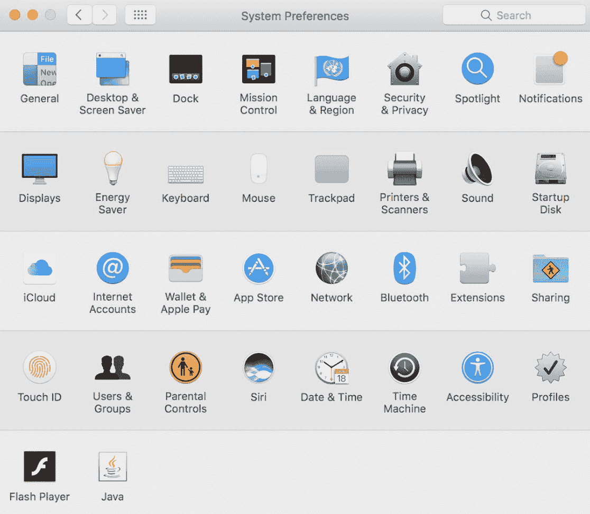

**提示**

当你在系统偏好设置中，“查看”菜单可以让你快速访问所有偏好设置。你可以选择按字母顺序组织偏好设置，或隐藏单个偏好设置。

**提示**

如果你对在各种偏好设置中寻找特定设置感到困惑，可以使用系统偏好设置窗口右上角的 Spotlight（聚焦光）搜索选项。在该字段中输入文本将自动高亮包含你的搜索查询标准的偏好设置。

访问一组偏好设置只需点击相关的偏好图标。大多数系统偏好设置的更改都是即时生效的，不需要你点击“应用”或“确定”按钮。在系统偏好设置工具栏中，点击导航箭头右侧的“显示全部”按钮（图标网格）即可返回所有偏好设置视图。


你可能会注意到某些偏好设置的左下角有一个锁。这些只有管理员用户账户才能访问。如果你需要访问的偏好设置被锁定编辑，只需点击锁图标，然后以管理员用户身份进行验证即可解锁。


如果你在 macOS 中以非管理员用户登录，锁定的偏好设置将比以管理员用户登录时更多。例如，如果你以管理员用户登录，`Mac App Store` 偏好设置不会显示锁图标；而当你以非管理员用户登录时，`Mac App Store` 偏好设置默认会被锁定。

锁图标出现在很多地方，不仅仅是在系统偏好设置中。锁图标是一个通用指示，表示访问该项目需要管理员身份验证。当某个项目代表影响所有用户的更改时，通常此类如此。

### 通过描述文件配置

系统设置的另一种方法是安装描述文件。描述文件最初是为了为 iOS 设备提供简化的配置和管理而创建，现在也适用于 macOS。

描述文件是一个包含特定设置说明的文档。例如，描述文件可以包含互联网帐户或网络偏好设置的设置。描述文件可以通过其图标和 `.mobileconfig` 文件扩展名来识别。


`Settings.mobileconfig`

当安装描述文件时，用户和系统设置将根据文件内容自动配置。因此，管理员可以创建一个包含各种设置的描述文件，并将此文件共享给多个用户。换句话说，描述文件可以为管理员和用户节省大量时间。

Apple 和第三方开发者提供了创建描述文件的软件。Apple 提供了多个创建描述文件的工具，包括 `Xcode`、`Configurator` 应用程序以及 `macOS Server` 中的描述管理器。

不同类型的描述文件针对特定用途进行了定制。例如，配置描述文件会自动配置某些功能。信任描述文件包含数字证书，用于验证和保护连接。注册描述文件用于建立与描述管理服务（通常被称为移动设备管理 `MDM`）的连接。

管理员可以通过任何共享其他文档的方式提供描述文件。例如，管理员可以通过电子邮件发送描述文件，或者将其作为网站下载资源。或者，管理员可以将描述文件自动推送到加入了类似 `macOS Server` 描述管理器服务的 macOS 系统中。关于创建描述文件的细节超出了本指南的范围，但每个 Mac 管理员都应该熟悉如何识别和验证这些描述文件。

### 更多信息

- 你可以在 `www.apple.com/server/` 了解更多关于 macOS Server 描述器的信息

### 描述文件安装

如果有需要安装的描述文件，只需双击文件即可安装。这会在系统偏好设置的描述面板自动打开该描述文件。只有在安装了描述文件时，“描述文件”偏好设置才会出现。

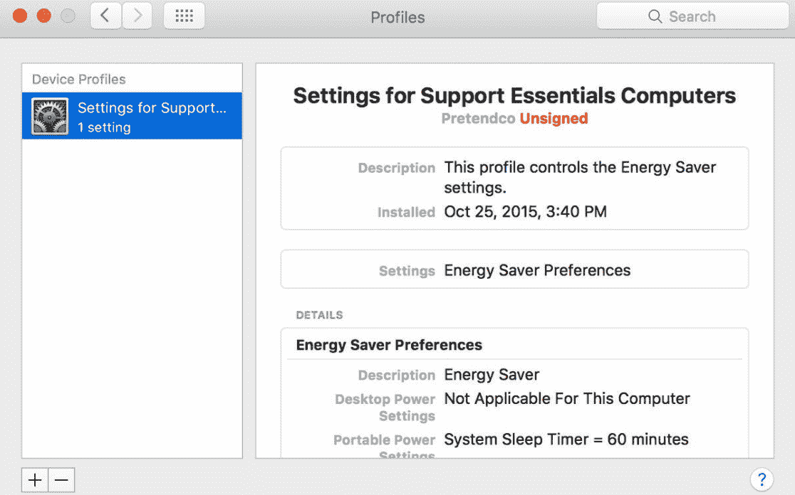

在描述文件中任何具有管理员权限的用户都可以验证或删除描述文件。之前的截图显示了一个包含数字证书的已安装描述文件。通过描述文件交付此类信息是理想的，因为它简化了使用传统方法需要多个复杂步骤的过程。

> **注意** 安装某些描述文件可能需要输入额外的验证信息。例如，配置 VPN 设置的描述文件可能会要求用户输入密码以验证 VPN 会话。

验证已安装描述文件的结果要困难一些，因为描述文件可能包含影响各种服务和应用程序的多个设置。然而，在描述偏好设置中检查已安装描述文件的详情部分是一个很好的起始点。再次，在之前的示例中，“设置”部分显示这是一个包含数字证书的信任配置文件。如第 8 节“管理密码更改”所述，你可以打开“钥匙串访问”应用程序来验证证书的安装情况。

## 参考文献 2.3 检查系统信息

在安装新软件、更新已安装软件、进行维护或排除问题时，了解 Mac 计算机的规格始终很重要。在本节中，你将学习如何通过“关于本机”窗口、“系统信息”应用程序和“控制台”应用程序收集基本的系统信息。

### 关于本机窗口

发现 Mac 计算机规格的第一步是使用“关于本机”窗口。你可以从任何应用程序的菜单中选择“关于本机”来打开它。


“关于本机”窗口的初始视图显示了系统软件版本、Mac 型号、处理器类型和速度、系统总内存、显卡信息以及 Mac 序列号。点击系统版本号可以显示系统构建版本。

**macOS Sierra**

版本 `10.12.2`

`MacBook Pro` (Retina, 2012 年中型)

处理器 `2.3 GHz Intel Core i7`

内存 `16 GB 1600 MHz DDR3`

启动磁盘 `Macintosh HD`

显卡 `Intel HD Graphics 4000 1536 MB`

序列号 `C02HV1536Q44`

系统报告...

软件更新...

™ and © 1983-2016 Apple Inc. 版权所有。许可协议

### 注意事项

逻辑板更换不当的 Mac 计算机在“关于本机”窗口中可能不会显示正确的序列号。

在“关于本机”的信息中，有几项对于识别 macOS 系统和 Mac 硬件至关重要：

- 系统版本号——这代表当前安装在计算机上的特定系统软件版本。第一部分 `10` 显然代表第 10 代 Mac 操作系统。第二部分 `12` 代表 macOS 的第 12 个大版本。最后部分（在此例中为 `2`）代表系统的增量更新。增量更新通常提供功能更改，但通常包含许多安全修复和错误修复。

- 系统构建版本——当你点击系统版本号时会出现，它是计算机上安装的特定系统软件版本更细粒度的表示。Apple 工程师在完善产品时，为每个系统软件发布版本创建数百个版本。构建版本用于跟踪这一过程。此外，你可能会发现预装在 Mac 硬件上的特定计算机 macOS 构建与标准安装构建有所不同。如果你正在创建用于批量分发的系统映像，这是一个需要注意的重要细节——特定计算机的 macOS 构建可能无法在其他类型的 Mac 硬件上运行。


## Mac 硬件标识

- **Mac 型号**：Mac 计算机的型号通常源于 Mac 的产品营销名称，随后是相对发布日期。例如，之前的截图是在 `MacBook Pro Retina, 2012 年中型` 上拍摄的。由于 Apple 每年发布几种 Mac 型号，这种命名规范对于硬件支持识别来说足够具体。
- **Mac 序列号**：硬件序列号也位于 Mac 外壳的某处，但有时很难找到。序列号的作用与许多其他批量产产品相同，是一个唯一的数字，用于识别特定的 Mac 以处理维护和维修问题。

点击“关于本机”窗口工具栏上的按钮可以显示计算机硬件和支持选项的详细信息。该窗口最棒的功能是“支持与服务”按钮，它们直接链接到 Apple 支持网站上特别有用的区域。链接的内容是动态生成的，以显示有关 `macOS` 和你的 Mac 的最新支持信息。例如，“规格”链接会打开一个带有你的 Mac 完整规格的网页。

| 概览 | 显示 | 存储 | 支持 | 服务 |
| :--- | :--- | :--- | :--- | :--- |
| | | | | |
| `macOS` 资源 | | | | `Mac` 帮助 |
| | | | | 用户手册 |
| | | | | `macOS` 支持 |
| `Mac` 资源 | | | | 规格 |
| | | | | 硬件支持 |
| | | | | 重要信息... |

## 系统信息应用程序

与“关于本机”窗口中的信息相比，通过“系统信息”（以前称为“系统报告器”）应用程序可以找到的信息只是冰山一角。从“关于本机”窗口，点击“系统报告”按钮打开“系统信息”。你也可以在 `Finder` 中双击 `/Applications/Utilities/SystemInformation.app` 来打开此应用程序。使用任种方法打开都会开启一个新的“系统信息”窗口，显示所有可报告选项。

### MacBook Pro

| 硬件概览 | |
| :--- | :--- |
| 型号: `MacBook Pro` | |
| 型号标识符: `MacBookPro10,1` | |
| 处理器名称: `Intel i7` | |
| 处理器速度: `2.3 GHz` | |
| 进程数: `1` | |
| 核心数: `4` | |
| `L2` 缓存（每个核心） `256 KB` | |
| 内存: `16 GB` | |
| `Boot ROM` 版本: `MBP101.00EE.B09` | |
| `SMC` 编号（系统） `2.3f6` | |
| 序列号（系统） `HV14MBP101` | |
| 硬件 `UUID`: `48FA7B91-1D76-52A4-92F2-0HV14` | |

### 控制台应用程序

与“关于本机”窗口中的信息相比，通过“系统信息”（以前称为“系统报告器”）应用程序可以找到的信息只是冰山一角。从“关于本机”窗口，点击“系统报告”按钮打开“系统信息”。你也可以在 `Finder` 中双击 `/Applications/Utilities/SystemInformation.app` 来打开此应用程序。使用任种方法打开都会开启一个新的“系统信息”窗口，显示所有可报告选项。

> **提示**：“控制台”应用程序是 `macOS Sierra` 的新功能，包含了一些新特性，例如轻松地在所有日志文件中查找错误，以及通过 `USB` 查看 `iOS` 和 `tvOS` 设备的日志文件。此外，如果你需要与他人共享日志文件，可以选择该文件并点击工具栏上的“共享”按钮。

## 使用设置助理配置 macOS

`macOS` 的初始配置非常简单，这得益于设置助理（`Setup Assistant`）。然而，在本节中，你将学习其中一些初始配置设置如何对系统产生根本性且广泛的影响。

在本次练习中，你将在你的班级电脑上配置一个全新安装的 `macOS`。为这门课程配置 `macOS` 需要回答几个问题并设置初始管理员用户账户。完成这些任务将使你熟悉设置助理应用程序。

以下步骤将引导你使用设置助理完成 `macOS` 的基础设置：

1. 在“欢迎”界面，选择合适的地区，并点击“继续”。

   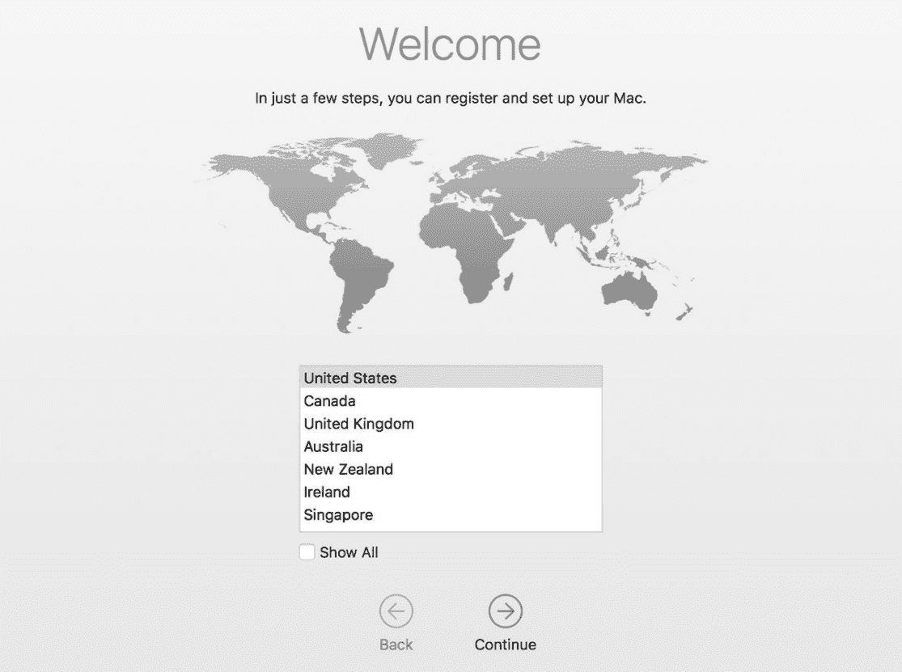

   如果你在设置助理的欢迎界面停留几秒钟，将启动 `VoiceOver` 教程。这是一个可选的教程，解释了如何使用专为残障人士设计的 `VoiceOver` 辅助技术。

2. 在“选择键盘”屏幕上，选择合适的键盘布局，并点击“继续”。

   设置助理会评估你的网络环境，并尝试确定你是否已连接到互联网。这可能需要几分钟。

3. 如果系统要求你选择 `Wi-Fi` 网络或如何连接互联网，请根据你的网络连接进行适当配置。如果你是在课堂上进行此练习，请询问你的老师你应该如何配置你的电脑。

   如果系统没有询问你的互联网连接情况，说明你电脑的网络设置已通过 `DHCP` 配置完成，你可以移动到第 4 步。

4. 在“将信息传输到这台 `Mac`”屏幕上，选择“现在不传输任何信息”，并点击“继续”。

   如果你正在更换电脑，其他选项将帮助你将用户数据和系统信息从旧电脑迁移到新电脑。

5. 如果出现“启用位置服务”屏幕，选择“在这台 `Mac` 上启用位置服务”，并点击“继续”。

6. 如果出现“使用你的 `Apple ID` 登录”屏幕，选择“不登录”，点击“继续”，然后在弹出的确认对话框中点击“跳过”。

   你将在稍后的练习中设置 `Apple ID` 账户。

7. 在“条款和条件”屏幕上，阅读 `macOS` 软件许可协议。如果存在多个协议，你可能需要点击每个协议下的“更多”以获取全文。阅读完成后，点击“同意”。

8. 在弹出的确认对话框中，点击“同意”。

9. 在“创建计算机账户”屏幕上，输入以下信息：

   > **注意**
   >
   > 按照此处的说明创建此账户非常重要。如果你不这样做，未来的练习可能无法按照说明运行。本指南使用这种**加粗蓝色文本**来表示你应该完全按照所示内容输入文本。
   >
   > *   全名：`Local Admin`
   > *   账户名称：`ladmin`
   > *   密码：如果你是在课堂上进行此练习，请在“密码”和“验证密码”字段中输入 `ladminpw`。如果你是自己进行此练习，请为 `Local Admin` 账户选择一个更安全的密码。请务必记住你选择的密码，因为在使用这台电脑时你需要定期重新输入它。
   >
   > 如果你愿意，可以提供密码提示并更改其他选项。

   > **注意**
   >
   > “`ladminpw`”太容易被猜到，无法提供任何真实的安全性，绝不将其用于课堂或演示以外的任何目的。在“真实”电脑上，你应该始终使用不可预测的密码。

   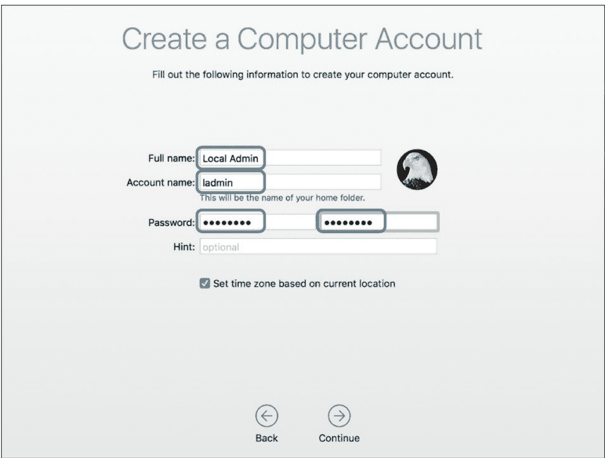

10. 点击“继续”。

11. 如果提示，请选择你的位置以设置电脑的时区；然后点击“继续”。

12. 如果提示共享诊断和使用情况，选择你是否希望与 `Apple` 和应用程序开发者共享诊断信息，然后点击“继续”。

13. 如果提示“诊断和使用情况”，选择“在这台 `Mac` 上启用位置服务 `ID`”，然后点击“继续”。

14. 如果提示设置 `Siri`，选择“跳过”，点击“继续”，然后在出现的确认对话框中点击“跳过”。

    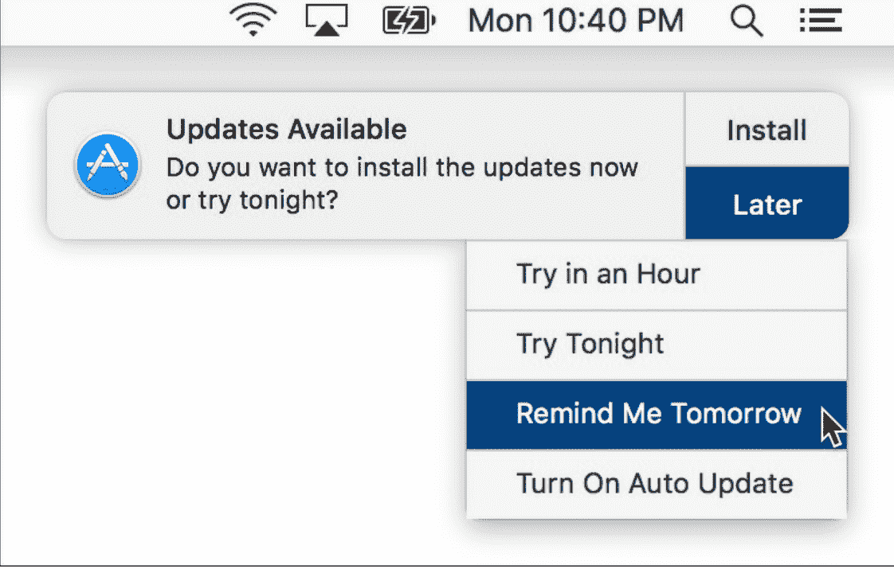

    你将在第 4 课“更新 `macOS` 软件”练习期间安装更新。

15. 如果通知建议开启自动更新，点击“稍后”（`Not Now`）。

    

16. 如果弹出任何显示“是否要使用 `<some volume>` 来通过 `Time Machine` 备份？”的对话框，请在每个对话框中点击“不使用”（`Don't Use`）。

    你是否要使用外部硬盘 `(2 TB)` 来通过 `Time Machine` 备份？

    `Time Machine` 会维护你 `Mac` 上所有内容的最新副本。它不仅会保留每个文件的备份副本，还会记住系统的过去样子，因此你可以回到 `Mac` 过去的某个状态。

    | 加密备份磁盘 | 稍后决定 | 不使用 | 用作备份磁盘 |
    | :--- | :--- | :--- | :--- |

17. 从菜单栏中选择 `Finder` > 偏好（`Preferences`）。如果你愿意，也可以使用快捷键 `Command` 加逗号。

18. 你可以像配置任何其他 `macOS` 应用程序一样配置 `Finder` 偏好。

19. 选择相应的选项，以便在桌面上显示硬盘和已连接的服务器。

20. 从“新建 `Finder` 窗口显示”弹出菜单中，选择你的启动卷（通常命名为 `Macintosh HD`）。

    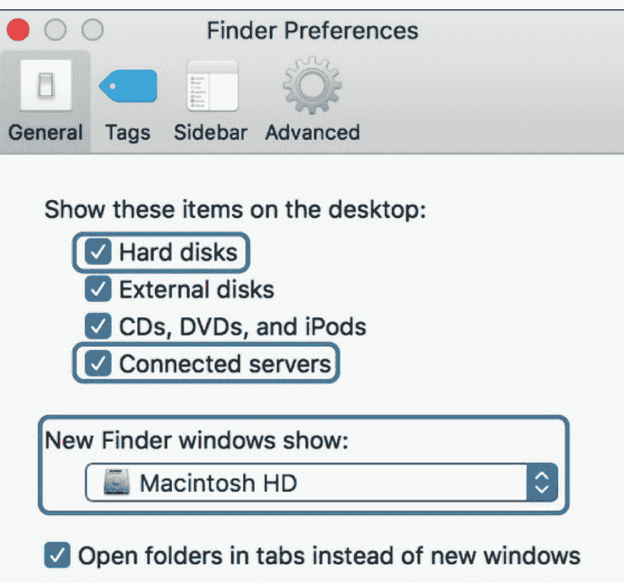


7 在 `Finder` 偏好窗口的顶部，点击“侧边栏”（Sidebar）按钮。

8 在侧边栏的“收藏”部分中选择“admin”，并在“设备”部分选择“硬盘”。“硬盘”应该是完全选中状态（复选框中有一个打勾），而不是部分选中（复选框中有一个破折号）。

## `Finder` 偏好

### 通用

### 标签

### 侧边栏

### 高级

在侧边栏中显示这些项目：

**收藏**

- 所有我的文件
- `iCloud` 驱动
- `AirDrop`
- 桌面
- 文档
- 下载
- 电影
- 音乐
- 图片
- `admin`

**共享**

- 回到我的 `Mac`
- 已连接的服务器
- `Bonjour` 电脑

**设备**

- `Local`'s `MacBook Pro`
- 硬盘
- `CD`、`DVD` 和 `iPod`

**标签**

- 最近标签

## 9 关闭 `Finder` 偏好窗口。

## 设置电脑名称

如果你是在课程中进行这些练习，那么你的电脑名称与其他所有学生的电脑名称是相同的。为了避免混淆，请为你的电脑起一个唯一的名称。

1 从 `Apple` 菜单中选择“系统偏好设置”（System Preferences）。

2 在系统偏好设置中，点击“共享”（Sharing）设置图标。

> **提示**
>
> 如果你不确定在系统偏好设置哪里寻找某个项，可以使用窗口右上角的 `Spotlight` 搜索字段。它会搜索匹配或相关的设置，并突出显示它们所在的偏好设置面板。

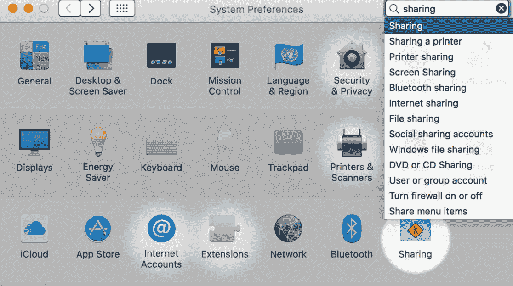

3 在“电脑名称”字段中为你的电脑输入唯一的名称。如果你在课程中进行这些练习，老师可能会推荐一种命名规范。

4 注意到显示在你电脑名称下方的本地主机名（`.local` 名称）会更新以匹配你的新电脑名称。


5 根据你是在课程中进行这些练习还是独自进行，你可能需要不需要设置“远程管理”（Remote Management）服务。

如果你是独自进行这些练习，请跳到“调整触控板/鼠标偏好”。

6 如果你是在课程中进行这些练习，勾选“远程管理”复选框。

注意：在课堂环境中，远程管理允许你的教师在整个课程期间控制键盘和鼠标、收集信息并更新你的 `Mac`，以便在必要时帮助你完成步骤。

对话框会询问你希望用户使用远程管理能够做什么。

7 按住 `Option` 键并点击其中一个复选框，以选择对话框中的所有选项。

所有本地用户都可以访问此电脑以：

- 观察
- 控制
- 被观察时显示
- 生成报告
- 打开和退出应用程序
- 更改设置
- 删除和替换项目
- 文本聊天或发送消息
- 重启和关
- 拷贝项目

8 点击确定。

## 调整你的触控板/鼠标偏好

在 `macOS` 中，你可以根据个人偏好自定义用户界面。例如，根据你的习惯，你可能想要更改默认的滚动行为。此外，你还可以控制系统如何识别主次鼠标点击（类似于其他操作系统中的左点击和右点击）。

注意，由于 `Control-click`（控制 键点击）始终作为次要点击生效，因此这些说明将其描述为 `Control-click`。

1 点击工具栏中的“显示所有”（网格图标）按钮。

2 如果你使用的是触控板，选择“触控板”面板。

- 根据你的喜好调整“点按”和“次要点击”选项。
- 勾选“滚动与缩放”以及“更多手势”，并进行任何更改。

3 如果你使用的是鼠标，选择“鼠标”面板。

- 如果你的鼠标有多个按钮，使用“主鼠标按钮”来控制哪个是主键次键。

4 退出系统偏好设置。

继续练习 2.4 或 2.5。

## 练习 2.4 在课堂中下载学生材料

> **注意**
>
> 本练习适用于在课堂环境中进行练习的学生。如果你已将另一台电脑设置为服务器，也可以使用此练习。

> **前提条件**
>
> 你必须完成练习 2.3，“检查系统偏好设置”。
>
> 你必须在课程中进行这些练习，或者按照《设置说明》文件配置了自己的服务器。

在练习中，你将下载指南中后续练习所需的学生材料。

### 连接到 `Mainserver`

你需要连接到文件服务器（名为 `Mainserver`）以下载学生材料。网络、连接和提供网络服务的细节将在后面的章节介绍。

1 如果必要，通过选择文件菜单 > 新建窗口或使用快捷键 `Command-N` 打开新的 `Finder` 窗口。

在侧边栏的“共享”部分中寻找名为 `Mainserver` 的服务器。如果未显示 `Mainserver`，点击“全部”以查看所有共享项目。

2 选择 `Mainserver`。如果你在上一步中点击了“全部”，则将需要双击 `Mainserver` 图标。

3 打开“公用”文件夹。

## 将 `StudentMaterials` 文件夹拷贝到你的计算机

1. 在 `Public`（公共）文件夹中，选择（单击）`StudentMaterials` 文件夹。

2. 通过选择菜单栏上的 `Edit`（编辑）> `Copy`（拷贝“`StudentMaterials`”、按下 `Command-C`，或者按 `Control` 点击文件夹并从快捷菜单中选择 `Copy`（拷贝“`StudentMaterials`”）来拷贝该文件夹。

3. 打开 `Macintosh HD`（可以从桌面或访达器侧边栏打开）。

4. 打开 `Users`（用户）文件夹。

5. 打开 `Shared`（共享）文件夹。

6. 通过选择 `Edit`（编辑）> `Paste`（粘贴）、按下 `Command-V`，或者在 `Shared` 文件夹中按 `Control` 点击并从快捷菜单中选择 `Paste Item`（粘贴项目）将 `StudentMaterials` 文件夹粘贴到 `Shared` 文件夹中。

这将在你的计算机上创建一个学生材料的副本。如果你的讲师在学生材料中包含了软件更新，下载可能需要几分钟。你不需要等待它完成。

7. 将你拷贝的 `StudentMaterials` 文件夹拖到 `Dock` 栏中分割线的右侧。（`Dock` 分为两个部分：左侧存放应用程序，右侧存放文件夹和文档。）请确保将其放置在其他项目之间（以便将其添加到 `Dock`），而不是覆盖在另一个项目上（这将将其移动到该文件夹中）。


你将经常打开 `StudentMaterials` 文件夹，这可以为你提供一个方便的快捷方式。

8. 可选，你可以将 `StudentMaterials` 文件夹拖到 `Finder` 侧边栏的 `Favorites`（收藏）部分，为自己提供另一个访问快捷方式。与 `Dock` 中一样，请确保将其放置在其他项目之间。

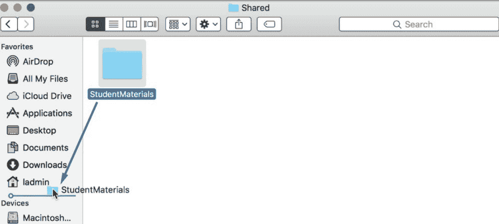

9. 选择 `Go`（前往）菜单 > `Applications`（应用程序）（或使用快捷键 `Command-Shift-A`）。

10. 将 `TextEdit`（文本编辑）应用程序拖到 `Dock` 栏的左侧，这样你始终有一个方便的方法启动它了。


11. 如果尚未完成，请等待 `StudentMaterials` 文件夹下载到你的计算机。

12. 通过将其图标从桌面拖到 `Dock` 栏右侧的 `eject`（卸出）图标来卸载 `Public` 文件夹。当选择可卸出项目时，卸出图标会取代垃圾桶图标。

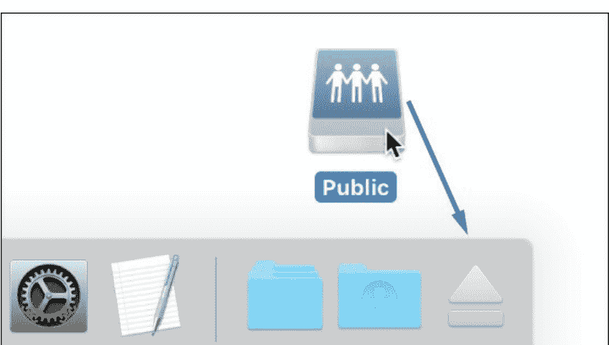

你现在应该跳过 [练习 2.5，“独立下载学生材料”，]，并继续进行练习 2.6，“安装配置文件”。

## 练习 2.5 独立下载学生材料

### 前提条件

- 你必须已经执行了 [练习 2.3，“检查系统偏好设置]。
- 如果你正在上课，或者正在按照“主服务器设置说明（`Mainserver Setup Instructions`）”中的配置设置了了自己的服务器，请勿执行此练习。如果你有权访问支持这些练习的服务器，请改为执行 [练习 2.4，“在教室中下载学生材料”]。

在本次练习中，你将下载课程中其余练习所需的学生材料。

## 从网络下载 `StudentMaterials` 文件夹

你需要连接到 `Pearson Education` 网页服务器来下载学生材料。

1. 打开 `Safari`。

2. 导航到 [www.peachpit.com/register](http://www.peachpit.com/register)。

3. 输入本书的 `ISBN` 码：`9780134713854`。

4. 如果你已经有一个 `Peach` 账户，请登录。如果没有，请按照提示创建一个。

5. 回答挑战问题[s]作为购买证明。

6. 点击账户页面上的 `Registered Products`（已注册产品）标签页。

7. 点击产品标题下方的 `Access Bonus Content`（访问额外内容）链接进入下载页面。

> **注意**


> 如果你直接从 Peachpit 购买或兑换了该电子版指南的代码，学生材料将自动出现在 `Registered Products` 标签页中，无需兑换额外的代码。

> 注意

> 如果你有权访问另一台运行 macOS Sierra 的计算机，并想将其配置为支持支持这些练习的服务器，请不要在此下载学生材料。相反，请将 `Mainserver Setup` 文件下载到你将作为服务器使用的计算机上，并按照随附的主服务器设置说明。

8. 点击链接下载 `StudentMaterials.zip`。

这些练习的学生材料将以 ZIP 存档格式下载，并自动解压到 `StudentMaterials` 文件夹中。

9. 点击窗口右上附近的 `Downloads`（下载箭头图标）按钮。

10. 点击 `StudentMaterials` 旁的 `view`（放大镜图标）按钮。

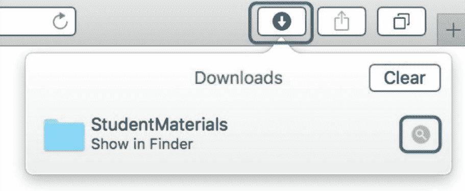

你的 `Downloads`（下载）文件夹将在 Finder 中打开，显示内部的 `StudentMaterials` 文件夹。

11. 在桌面上，找到启动磁盘的图标（通常为 Macintosh HD），并双击它。

这将打开一个新的 Finder 窗口，显示启动磁盘的内容。

12. 打开 `Users`（用户）文件夹。

13. 打开 `Shared`（共享）文件夹。

14. 将 `Downloads` 文件夹中的 `StudentMaterials` 图标拖到 `Shared` 文件夹中。


15. 在 `Shared` 文件夹中，将你拷贝的 `StudentMaterials` 文件夹拖到 Dock 栏中分割线的右侧。（Dock 分为两个部分：左侧存放应用程序，右侧存放文件夹和文档。）请确保将其放置在其他项目之间（以便将其添加到 Dock），而不是覆盖在另一个项目上（这将将其移动到该文件夹中）。


你将经常打开 `StudentMaterials` 文件夹，这可以为你提供一个方便的快捷方式。

16. 可选，你可以将 `StudentMaterials` 文件夹拖到 Finder 侧边栏的 `Favorites`（收藏）部分，为自己提供另一个访问快捷方式。与 Dock 中一样，请确保将其放置在其他项目之间。


17. 选择 `Go`（前往）菜单 > `Applications`（应用程序）（或使用快捷键 Command-Shift-A）。

18. 将 `TextEdit`（文本编辑）应用程序拖到 Dock 栏的左侧，这样你始终有一个方便的方法启动它了。


19. 如果尚未完成，请等待 `StudentMaterials` 文件夹下载到你的计算机。

20. 通过将其图标从桌面拖到 Dock 栏右侧的 `eject`（卸出）图标来卸载 `Public` 文件夹。当选择可卸出项目时，卸出图标会取代垃圾桶图标。


你现在应该跳过 [练习 2.5，“独立下载学生材料”，]，并继续进行练习 2.6，“安装配置文件”。

## 练习 2.6 安装配置文件

### 前提条件

- 你必须已经下载了学生材料，参考了练习 2.4，“在教室中下载学生材料”或 2.5，“独立下载”。

除了手动配置计算机设置外，你还可以通过安装配置文件来控制设置。这种功能允许你对多台计算机进行统一配置。在本次练习中，你将通过设置节能演示这一点。

### 使用配置文件更改你的节能设置

1. 如果必要，从 Apple 菜单打开 `System Preferences`（系统偏好设置）。

2. 选择 `Energy Saver`（节能）面板。

3. 注意你计算机的睡眠设置。根据你使用的型号，这些设置可能有所不同。


4. 退出偏好设置。

5. 打开 `StudentMaterials` 文件夹。记得你已经在 Dock 中放置了它的快捷方式。

6. 打开 `Lesson2` 文件夹。

7. 打开 `Energy_Saver.mobileconfig`。

配置文件会自动在偏好设置的 `Profiles`（描述）面板中打开。


8. 点击 `Show Profile`（显示描述）以显示配置详情及其负载（它包含的设置）。你需要向下滚动查看完整内容。


9. 点击 `Continue`（继续）。

10. 点击 `Install`（安装）。

11. 在提示时，输入本地管理员账户的密码（`ladminpw` 或你之前选择的任何密码）。

`Profiles` 面板现在列出了已安装的配置文件。

`Profiles`（描述）

#### Device Profiles（设备描述）

- `Settings for Support...`

1 个设置

#### Settings for Support Essentials Computers

`Pretendco Unsigned`

| 描述 | 此配置文件控制节能设置 |
| :--- | :--- |
| 安装日期 | 2016年10月10日 晚上 10:55 |
| 设置 | 节能偏好设置 |

详情

#### 节能偏好设置

| 描述 | 节能 |
| :--- | :--- |
| 桌面电源 | 不适用于此计算机设置 |
| 便携式电源 | 系统睡眠计时器 = 60 分钟 |

12. 点击工具栏中的 `Show All`（显示全部）按钮，然后选择 `Energy Saver`（节能）面板。

节能设置已更改，以匹配配置文件中的设置。

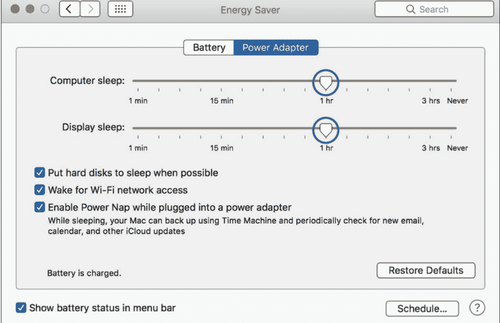

### 注意

虽然新的节能模式设置会立即生效，但系统偏好中的显示并不总是会更新。如果你仍然看到旧的设置，请尝试注销并重新登录本地管理员账户，然后重新检查系统偏好。

13. 退出系统偏好。

## 练习 2.7 检查系统信息

“系统信息”是 macOS 中收集配置信息的主要工具。在练习中，你将探索它的功能。

### 使用“关于本机”和系统信息

系统信息显示了有关您的电脑维修和保修覆盖范围的信息及选项。

1. 从苹果菜单，选择“关于本机”。
    会出现一个对话框，显示有关您电脑的基本信息。

2. 点击 macOS 版本号（位于大字“macOS Sierra”下方）。将显示版本号（这是您正在使用的 macOS 版本的更具体的标识符）。

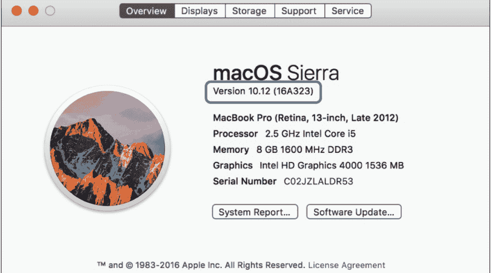

3. 点击“关于本机”窗口工具栏中的“显示器”、“存储”和（如果显示）“内存”标签页，以查看更多关于电脑硬件配置的配置。

4. 点击“服务”标签页。

每台 Mac 都带有一年的有限保修和长达 90 天的免费技术支持。

如果您购买了 AppleCare 保护计划，您的保修范围将延长至电脑原始购买之日起三年。

即使您的保修期已过，您可能仍然可以通过 Apple 授权的技术人员支付任何所需维修的费用。

- 检查我的服务和支持覆盖范围状态
- 显示我的服务和维修选项

在初始的一年保修期内的任何时候，您都可以通过 AppleCare 保护计划将服务覆盖范围延长至电脑原始购买之日起三年。

- 告诉我更多关于 AppleCare 保护计划的信息

5. 点击“检查我的服务和支持覆盖范围状态”。

6. 在出现的确认对话框中，点击“允许”。

Safari 将打开并在 `apple.com` 显示覆盖范围检查页面。

7. 如果网站要求您输入代码（CAPTCHA 验证），请执行操作。

覆盖页面将显示您的电脑型号名称和保修状态。

8. 退出 Safari。

9. 在“关于本机”窗口中，点击“概览”。

10. 点击“系统报告”按钮。

系统信息将打开并显示关于您的电脑硬件、网络和软件配置的更详细报告。

### MacBook Pro

| 硬件概览: |
| :--- |
| 型号: MacBook Pro |
| 型号标识符: MacBookPro10,2 |
| 处理器名称: Intel Core i5 |
| 处理器速度: 2.5 GHz |
| 核心总数: 2 |
| L2 缓存（每个核心）: 256 KB |
| L3 缓存: 3 MB |
| 内存: 8 GB |
| Boot ROM 版本: MBP0106.0B08 |
| SMC 版本（系统）: 2.6f59 |
| 序列号（系统）: CO2JLZALDR53 |
| 硬件 UUID: 6BF71IF7-234B-4FA6-F864-F70F2C0D45FD |
| 异动移动传感器: 已启用 |


11. 点击报告侧边栏中的信息类别来探索系统报告。某些类别可能需要一些时间加载。

12. 从菜单中，选择`文件 > 存储`，为您的系统报告输入名称，然后点击`保存`。

在保存此类报告时，选择一种包含电脑名称（或其他标识符）和日期的命名规范会有帮助。

系统信息完成对您电脑信息的收集，并将其保存在一个记录电脑当前状态的报告中。

13. 退出系统信息。

> **提示**
>
> 您还可以在`/应用程序/实用工具`文件夹或`Launchpad`的`其他`部分找到`系统信息`应用程序。您可以使用任何快捷键方法访问系统信息，包括将其放入`Dock`栏。

> **提示**
>
> 您还可以通过按住`Option`键直接从苹果菜单访问系统信息。这会将`关于本机`选项更改为`系统信息`。当您直接打开系统信息时，您将跳过摘要性的`关于本机`窗口，直接呈现完整的系统报告。

## 课程 3. 使用 `macOS` 恢复

> **目标**
>
> * 访问`macOS`恢复中提供的工具
> * 从`macOS`恢复重新安装`macOS`
> * 创建外部`macOS`恢复磁盘

从故障排除的角度来看，`macOS` 最实用的功能之一是 `macOS` 恢复。通过 `macOS` 恢复，您不仅可以重新安装 `macOS`，还可以访问各种管理和故障排除工具。`macOS` 恢复默认位于主系统磁盘上。这允许您在不需要额外介质的情况下访问恢复工具。

在本课程中，您将学习如何在预装了 `macOS` 的新 `Mac` 电脑以及升级到 `macOS` `Sierra` 的电脑上访问 `macOS` 恢复。您还将简要探索 `macOS` 恢复提供的可用工具。只要您不使用 `macOS` 恢复中的工具进行任何永久更改，您就可以安全地进行恢复而不会损坏您的主 `macOS` 系统。最后，您将学习如何创建一个外部 `macOS` 安装磁盘，该磁盘可以在本地 `macOS` 无法用时使用。

## 参考 3.1 从 `macOS` 恢复启动

运行 `macOS` `Sierra` 的 `Mac` 电脑（包括出厂自带 `macOS` `Sierra` 的电脑和升级后的电脑）在本地系统磁盘上包含一个隐藏的 `macOS` 恢复系统。这个名为 `Recovery HD` 的隐藏分区在 `Mac` 运行 `macOS` 时不会出现。`Recovery HD` 分区在 `macOS` 安装期间自动创建。

> **信息**
>
> 您可以通过`系统信息`应用程序检查`Recovery HD`分区的存在。这在第 9 节“管理文件和存储”中有详细介绍。

要从本地磁盘启动 `macOS` 恢复，请按住`Command-R`。在大多数情况下，一旦 `macOS` 完全启动，就会出现实用工具窗口。从那里您可以安装 `macOS` 或选择各种维护应用程序。如果出现了 `macOS` 安装程序，可以使用`Command-Q`快捷键返回实用工具窗口。

如果由于某些原因 `macOS` 恢复未启动或未安装在本地磁盘上，您有三种替代方案：

- 如果您是 2010 年中期发布的 `Mac` 机号——如果您的 `Mac` 具有最新的固件更新，可以访问`Internet`恢复。您也可以通过按住`Command-Option-R`强制系统启动`Internet`恢复。这样做时，您的`Mac`将尝试从服务器重新加载`macOS`恢复。如果成功，此过程将重建本地`Recovery`分区。

### 信息

关于 `Internet` 恢复的更多信息，请参 `Apple` 支持文章 `HT201314`“关于 `macOS` 恢复”和 `HT202313`“可以升级到 `Internet` 恢复的电脑”。

- 如果您有外部 `macOS` 恢复磁盘——将恢复磁盘连接到您的 `Mac`，并按住`Option`键重启。这将打开启动管理器，在其中您可以使用方向键、返回键或触控板选择外部 `macOS` 恢复磁盘。使用本节概述的方法创建外部 `macOS` 恢复磁盘默认用于安装 `macOS`。参考 3.3“创建 `macOS` 恢复磁盘”和练习 3.2“创建 `macOS` 安装磁盘”对该磁盘有详细介绍。

- 如果您有本地 `Time Machine` 备份磁盘——`Time Machine` 服务会自动在备份磁盘上创建一个隐藏的 `macOS` 恢复分区。要访问 `macOS` 恢复，请将 `Time Machine` 备份磁盘连接到 `Mac` 并按住`Option`键重启。这将打开 `Mac` 电脑的启动管理器，在其中（如前）您可以使用方向键、返回键或触控板选择 `Time Machine` 备份磁盘。第 15 节“管理 `Time Machine`”对此主题有更详细介绍。

### 注意

如果 `Time Machine` 备份磁盘经过了加密，您需要输入磁盘加密密码才能成功启动 `macOS` 恢复。此密码对于加密备份磁盘是唯一的，并且与同步任何用户账户密码无关。再次，第 15 节“管理 `Time Machine`”对此主题有更详细介绍。

## 参考 3.2 关于 `macOS` 恢复工具

当您从 `macOS` 恢复模式启动时，可以访问若干系统管理和维护工具。恢复系统甚至包含几个在 `macOS` 其他任何地方都找不到的实用程序。同样，在大多数情况下，当您首次启动 `macOS` 恢复模式时，会看到`macOS 实用`窗口。

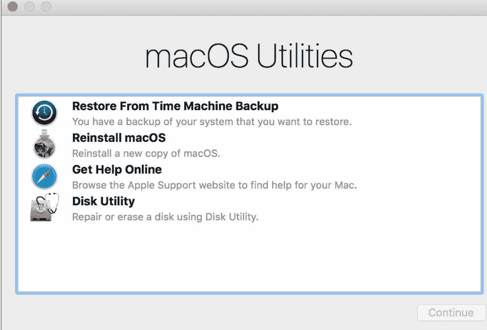

当 `Mac` 从 `macOS` 恢复模式启动时，如果网络提供`DHCP`服务，则以太网和`Wi-Fi`网络是可用的。如果 `Mac` 物理连接到网络，则以太网将自动启用。如果`Wi-Fi`网络没有自动连接，您可以从`Wi-Fi`菜单项目中选择一个。

> **注意**
>
> 如果在用 `macOS` 恢复模式期间需要手动设置网络，请参考 `Apple` 支持文章 `HT200168`，“在没有 `DHCP` 服务时使用 `Lion` 恢复模式”中的说明。

在从 `macOS` 恢复模式运行时，如果 `Mac` 电脑的系统磁盘受`FileVault`保护，则对该磁盘的任何访问都需要先解锁磁盘。在大多数情况下，系统上的任何本地用户密码都将解锁系统`FileVault`磁盘。第 10 节“管理 `File Vault`”更详细地介绍了这一主题。

在 `macOS` 恢复模式的`macOS 实用`窗口中，您可以访问以下功能：

- 从 `Time Machine` 备份恢复——使用此选项从网络或本地连接的磁盘恢复完整的 `Time Machine` 备份。第 15 节“管理 `Time Machine`”更详细地介绍了这一主题。

- 安装 `macOS` 或重新安装 `macOS`——如其名所示，此选项将打开 `macOS` 安装程序。如果您是从 `macOS` 安装磁盘上运行，则该磁盘包含所有 `macOS` 安装资源。然而，本地恢复器硬盘（`Recovery HD`）不包含安装资源，需要`Internet`来重新安装`macOS`。此外，`macOS` 安装程序必须验证用户是否允许访问 `macOS` `Sierra` 资源。对于已升级到 `macOS` `Sierra` 的较旧电脑，您必须通过提供购买 `macOS` 时使用的`Apple ID`来验证安装。对于出厂自带 `macOS` `Sierra` 的电脑，第 1 节“安装 `macOS` `Sierra`”更详细地介绍了这一主题。

- 在线获取帮助——此选项将打开`Safari`，直接带您访问`Apple`支持网站。

- 磁盘工具——此应用程序处理与存储相关的管理和维护。当 `Mac` 从 `macOS` 恢复模式启动时，它特别有用，因为磁盘工具可以用于管理在作为启动磁盘使用时无法管理的系统磁盘。具体而言，磁盘工具可用于为新安装的 `macOS` 准备磁盘，或尝试对安装失败的磁盘进行修复。第 9 节“管理文件系统和存储”更详细地介绍了这一主题。

- 启动磁盘（通过点击关闭按钮或退出）——如果您尝试退出`macOS 实用`窗口，将看到启动启动磁盘的提示。从此实用程序，您可以选择默认启动磁盘。默认启动磁盘可以使用第 26 节“故障排除启动和系统问题”中讨论的任何一种备用启动模式进行覆盖。

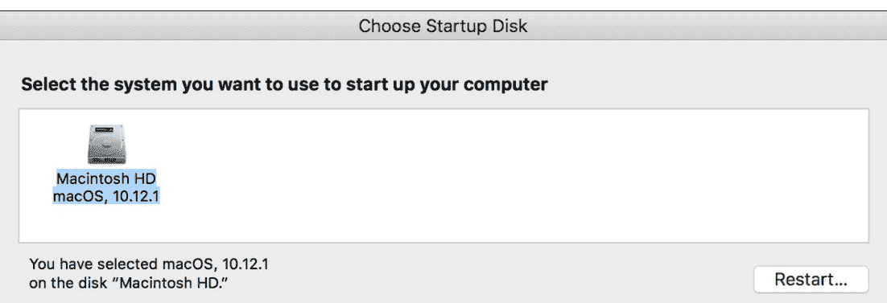

等，还有更多！`macOS` 恢复模式在几个额外功能隐藏在屏幕顶部的`实用`菜单中：

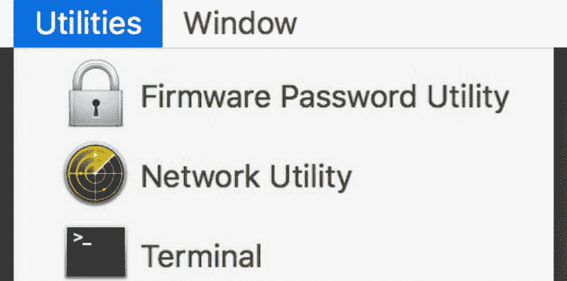

- 固件密码实用程序——此实用程序通过禁用所有无需密码的启动模式来保护 `Mac` 电脑的启动过程。您可以禁用或启用此功能并定义所需的密码。在第 8 节“管理更改”中了解更多关于固件密码的知识。

- 网络工具——这是 `macOS` 中主要的网络和故障排除工具。它在 `macOS` 恢复模式中的主要用于排除可能下载 `macOS` 安装资源的网络问题。网络工具在第 21 节“排除网络问题”中进一步讨论。

- 终端——这是您访问 `macOS` `UNIX` 命令行环境的主要界面。您在这里输入的最有用命令是`resetpassword`然后按回键。

- 通过终端打开的重置密码助手——此实用程序允许您在选定的系统磁盘上重置任何本地用户账户（包括`root`用户）。显然，此实用程序可能会构成严重的安全威胁，因此它只能从 `macOS` 恢复模式运行。此外，它是对普通用户隐藏的——您只有通过在终端中输入`resetpassword`命令才能打开它。您可以在第 8 节“管理密码更改”中了解更多关于重置密码助手的信息。

### 注意


从 macOS 恢复模式提供的实用程序确实可以用来破坏系统安全性。但话又回来，任何在启动期间可以覆盖默认启动磁盘的系统都面临被破坏的风险。因此，在安全环境中，通常需要使用`固件密码`实用程序来帮助保护您的系统，如第 8 节“管理密码更改”所述。

# 3.3 创建 macOS 恢复磁盘

在某些情况下，安装了 macOS 的 Mac 可能没有本地恢复器硬盘（`Recovery HD`）。例如，如果您刚刚将内部磁盘替换为新磁盘，新磁盘上将空空。此外，位于`RAID`（独立磁盘冗余阵列）上的 macOS 系统以及具有非标准启动分区的磁盘将没有本地恢复硬盘。在这些情况下，您需要从外部恢复磁盘启动。此外，如果您遇到磁盘故障的 Mac，拥有外部恢复磁盘可以是真正的救命稻草。

### 注意

在创建您的 macOS 恢复磁盘时，请务必跟踪您正在使用的 macOS 特定版本。如第 1 节“安装 macOS Sierra”所述，较新的 Mac 电脑不支持旧版本的 macOS，并且可能需要特定电脑版本的 macOS。因此，您应该始终从`App Store`将 macOS 恢复磁盘更新到最新版本。

macOS 包含将标准磁盘转换为 macOS 恢复磁盘的解决方案。这种方法涉及使用 macOS 安装应用程序中的特殊命令行工具。该工具会将 macOS 恢复系统和 macOS 安装资源复制到外部磁盘。因此，此方法需要至少 8 GB 的磁盘，这是一个 USB 闪存器的常见容量。第 3.2 节“创建 macOS 安装磁盘”概述了创建此类磁盘的步骤。

### 注意

不建议使用旧的恢复磁盘助手创建 macOS Sierra 的外部恢复磁盘。

# 练习 3.1 使用 macOS 恢复

- 前提条件

您的电脑必须具有本地隐藏恢复分区。此分区通常由 macOS 安装过程创建。

在练习中，您将通过 macOS 恢复模式启动电脑。macOS 恢复模式存储在名为`Recovery HD`的隐藏分区上，该分区在安装 macOS 时自动创建。您将回顾包含的实用程序以及 macOS 恢复如何重新安装系统。

> 注意
>
> 您不会执行安装，但您将有机会查看安装前的步骤。

## 使用 macOS 恢复启动

要访问 macOS 恢复模式中的安装程序和其他实用程序，您需要从隐藏的`Recovery HD`分区启动。

- 1 如果您的电脑已关闭，请通过`Apple`菜单选择关机。
- 2 按下电脑上的电源按钮，然后按住`Command-R`直到 Apple 标志出现在屏幕上。
- 3 当在启动期间按住`Command-R`时，电脑尝试从硬盘恢复分区启动。
- 4 如果没有恢复分区，具有较新固件的 Mac 可以通过`Internet`从 Apple 服务器启动并访问 macOS 恢复实用程序。
- 5 如果您的电脑启动了登录或欢迎屏幕而不是 macOS 恢复模式，可能是您按住`Command-R`的时间不够。如果发生这种情况，请点击登录屏幕上的关机按钮或在欢迎屏幕上按`Command-Q`然后重试。
- 6 如果出现语言选择屏幕，选择您的首选语言并点击右箭头按钮。
- 7 macOS 恢复模式启动后，您将看到“macOS 实用”窗口。该窗口是 macOS 恢复模式的主要界面。


## 检查 macOS 恢复工具

在 macOS 恢复模式下，可以使用用于恢复、修复和重新安装 macOS 的工具。在练习的这部分中，你将了解其中的一些工具。

### 查看 macOS 恢复帮助

你可以使用`Safari`查看 macOS 恢复的内置说明并浏览网页。

- 选择“在线获取帮助”（`Get Help Online`），然后点击“继续”（`Continue`）。

`Safari`将打开并显示一份关于如何使用 macOS 恢复的文档。花点跳过该文档。

此文档存储在恢复硬盘（`Recovery HD`）分区上，但只要你连接了互联网，也可以使用`Safari`查看在线文档，例如 Apple 支持文章。

- 如果对话框显示`Safari`想要使用“登录”（`login`）钥匙串，请保持密码为空并点击“确定”（`OK`）。
- 点击“搜索或输入网站名称”字段，输入`apple.com`，按回车键（`Return`）。

### Safari 现在显示 Apple 网站。

- 4 如果`Safari`显示信息“您未连接到互联网”（`You are not connected to the Internet`），可以使用菜单栏右侧附近的`Wi-Fi`图标加入无线网络。
- 5 点击页面右上角的“支持”（`Support`）链接。

你将被引导至 Apple 支持。。如果电脑遇到问题，这里是寻找解决方案和信息的好地方。你将在本指南的后续部分使用一些 Apple 支持资源。

- 6 从菜单栏中，选择`Safari > 退出 Safari`（`Quit Safari`）（或按`Command-Q`）返回主工具屏幕。

请注意，关闭`Safari`窗口不会退出`Safari`。这在 Mac 应用程序中很常见，但如果你习惯使用`Microsoft Windows`，这可能与你的预期相反。通常，退出 Mac 应用程序最好的办法是从应用程序菜单中选择“退出 <应用程序名称>”（即 Apple 菜单旁边的菜单，以当前应用程序命名的菜单）。或者，你也可以使用键盘快捷键`Command-Q`。

### 检查磁盘工具

`Disk Utility`让你对计算机磁盘进行修复、映像、重新格式化或分区。

> 注意
>
> 如果 Mac 电脑的系统磁盘受`FileVault`保护，对该磁盘的任何访问都需要先解锁磁盘。在大多数情况下，系统上任何本地用户的密码都应被允许解锁系统的`FileVault`驱动器。第 10 节“管理 File Vault”将更详细地介绍这一主题。

- 1 选择“磁盘工具”，然后点击“继续”。
- 在左侧的设备列表中，你会看到启动磁盘和一个基准系统（`Base System`）磁盘映像。你还可能看到未命名的卷。每个设备有一个主条目以及每个设备上缩进的卷列表（这将在第 9 节“管理文件系统和存储”中进行详细讨论）。
- 2 选择启动卷下方的条目。通常，它命名为`Macintosh HD`。

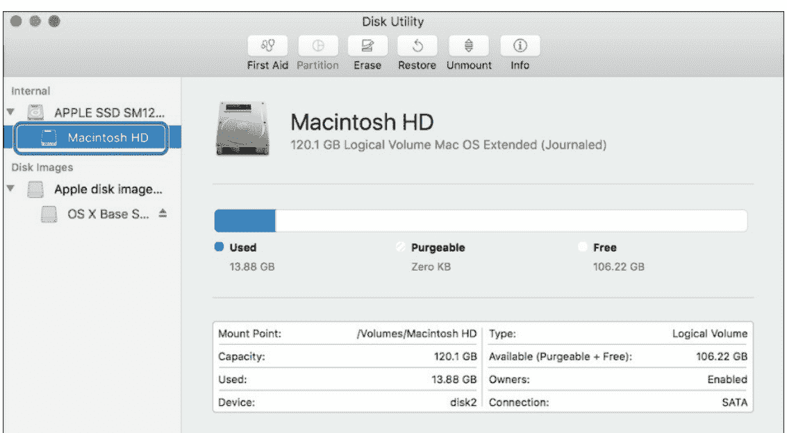

`Disk Utility`工具栏中的按钮。这些按钮代表了在第 9 节中详细讨论的功能。

通过`Disk Utility`，你可以验证或修复启动卷的文件结构，或者在需要时重新安装 macOS 之前擦除该卷。

- 选择代表启动磁盘的上方条目（位于启动卷正上方），注意现在分区选项已可用。

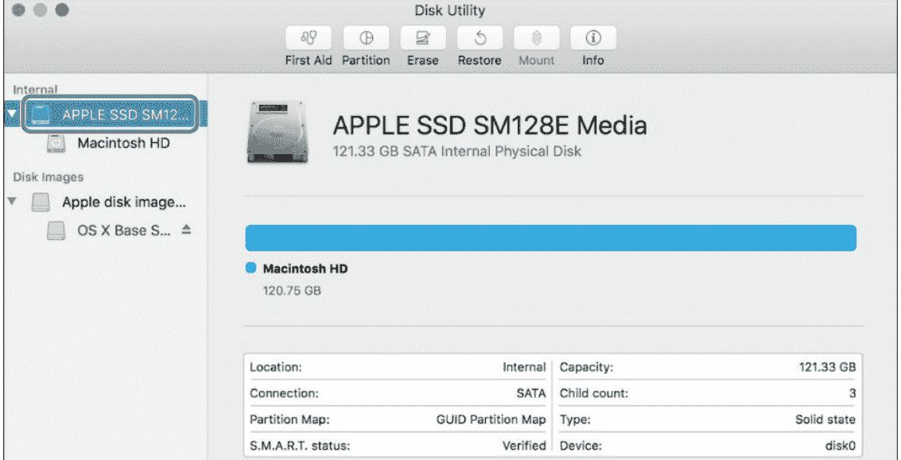

- 4 通过选择`Disk Utility > 退出工具`或按`Command-Q`退出`Disk Utility`。

你将返回到 macOS 工具窗口。

### 检查 Time Machine 恢复

如果你用`Time Machine`备份了电脑，macOS 恢复具有从该备份进行全系统恢复的能力。参考 15.2 节“配置 Time Machine”涵盖了`Time Machine`的设置。

- 1 选择“从 Time Machine 备份恢复”（`Restore From Time Machine Backup`），然后点击“继续”。

会出现一个“从 Time Machine 恢复”屏幕，带有有关恢复过程的说明。要重要的是，此恢复界面会擦除所有当前数据并用备份替换；参考 15.3 节“从 Time Machine 恢复”将检查其他恢复界面。

- 2 点击“继续”。
- 3 点击“继续”。
- 4 返回 macOS 工具屏幕。
- 5 返回 macOS 工具屏幕。

### 检查安装程序

现在你将检查安装过程。

- 1 选择“重新安装 macOS”（`Reinstall macOS`），然后点击“继续”。
- 2 点击“继续”。
- 3 点击“继续”。
- 4 点击“同意”（`Agree`）。
- 5 点击“同意”。
- 6 退出安装程序。

### 验证你的启动磁盘

`Startup Disk`工具让你选择用于启动的卷。

- 1. 从`Apple`菜单中，选择“启动磁盘”。
- 2. 确认你的启动卷（通常为`Macintosh HD`）已被选中；如有必要，选择它。

| 选择启动磁盘 |
| :--- | :--- |
| 选择要启动的系统 | `Macintosh HD` `macOS 10.12` |

- 3. 点击“重启”（`Restart`）。
- 4. 在确认对话框中，点击“重启”。

你也可以通过选择`Apple > 重启`来不使用启动工具进行重启。

# 练习 3.2 创建 macOS 安装磁盘

> 前提条件
>
> 你需要一个容量至少为 8 GB 的可擦除外部磁盘。
>
> 你必须已创建本地管理员账户（练习 2.1“配置新的 macOS 系统”或练习 2.2“配置现有的 macOS 系统”）。

在此练习中，你将创建一个 macOS 安装磁盘，它不仅包含 macOS 恢复环境和工具，还包含完整的安装资源。通过这种方法创建磁盘，你可以无需从互联网重新下载安装程序即可重新安装 macOS。

### 注意


创建自己的 `macOS` 安装磁盘时，记录你使用的 `macOS` 版本。较新的 `Mac` 电脑不支持旧版本的 `macOS`。（请参见练习 1.3“擦除 Mac 系统并安装 macOS”）。始终将你的安装磁盘更新到最新的 `macOS` 版本，这可以从 `App Store` 获取。

# 获取安装 macOS 应用程序

如果你按照练习 1.2“升级到 `macOS` Sierra”中的指令升级到了 `Sierra` 并保存了安装程序的副本，可以使用它并跳过本节。

如果你是在课程中执行这些练习，老师可能已经在 `StudentMaterials/Lesson3` 文件夹中提供了副本。否则，你可以按照以下步骤下载安装程序：

- 1 以本地管理员登录（密码：`ladminpw`，或你创建账户时选择的任何密码）。
- 2 从 `Apple` 菜单中，选择 `App Store`。有关 `Mac` `App Store` 的更多信息，请参见第 16 节“安装应用程序”。
- 3 在 `App Store` 窗口的搜索字段中输入 `Sierra` 并按回车。
- 4 在搜索结果中找到 `macOS Sierra`，点击其名称下的“下载”（`DOWNLOAD`）或“获取”（`GET`）按钮。


### “Sierra”的搜索结果


- 5 如果出现确认对话框，点击“继续”。
- 6 如果出现要求你登录的对话框，你需要登录 `Apple ID` 账户或创建一个新的 `Apple ID` 以下载 `Sierra`。有关在 `App Store` 中使用 `Apple ID` 的更多信息，请参阅第 16 课“安装应用程序”（参考 16.1，“使用 Mac App Store”和练习 16.1，“使用 Mac App Store”）。

当安装程序完成下载后，它会自动打开。

- 7 退出而不安装 `macOS Sierra` 并关闭 `App Store`。

# 重新格式化外部磁盘

大多数外部磁盘预先格式化为主引导记录 (`MBR`) 分区方案。为了让 `Mac` 计算机从该磁盘启动，你必须使用 `GUID` 分区映射 (`GPT`) 方案格式化此磁盘。有关磁盘格式的更多信息，请参阅第 9 课“管理文件系统和存储”。

> **警告**
> 这将擦除外部磁盘上的所有信息。请勿对包含你想保留的文件磁盘执行此练习。

- 1 打开“磁盘工具”。它位于“实用程序”文件夹，该文件夹位于“应用程序”文件夹中。你可以使用 `Finder` 快捷键 `Command-Shift-U` 导航到该文件夹，也可以在 `Dock` 中打开 `Launchpad`，然后点击 `Launchpad` 中的“其他”图标。
- 2 将外部磁盘插入你的计算机。
- 3 如果提示输入密码解锁磁盘，请点击“取消”。你不需要解锁磁盘即可擦除它。
- 4 在磁盘工具侧边栏中选择外部磁盘设备项。确保选择的是设备项，而不是其下方缩进的卷项。
- 5 检查窗口底部列出的分区映射。

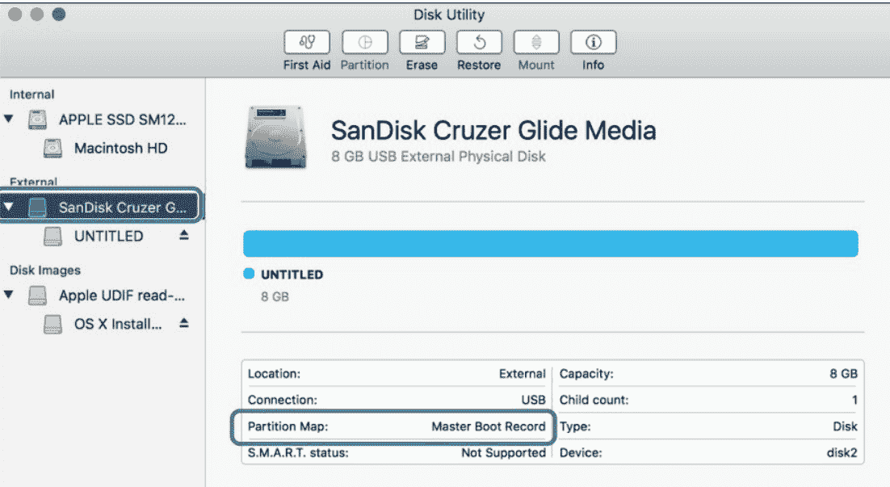

取决于此磁盘最近的用途，分区方案可能是任何类型。要将磁盘转换为 `GPT` 方案，你将擦除磁盘。如果它已经在使用 `GPT` 方案，则并非绝对必要，但为了保险起见，你应该擦除它。

也可以对磁盘进行分区，并仅将其部分用于安装程序卷。有关分区程序的更多信息，请参阅参考 9.4，“管理文件系统”。

- 6 点击工具栏上的“擦除”按钮。
- 7 为磁盘赋予一个描述性名称，从“格式”弹出菜单中选择“`Mac` `OS` 扩展（日志式）”，并在“方案”弹出菜单中选择“`GUID` 分区映射”。

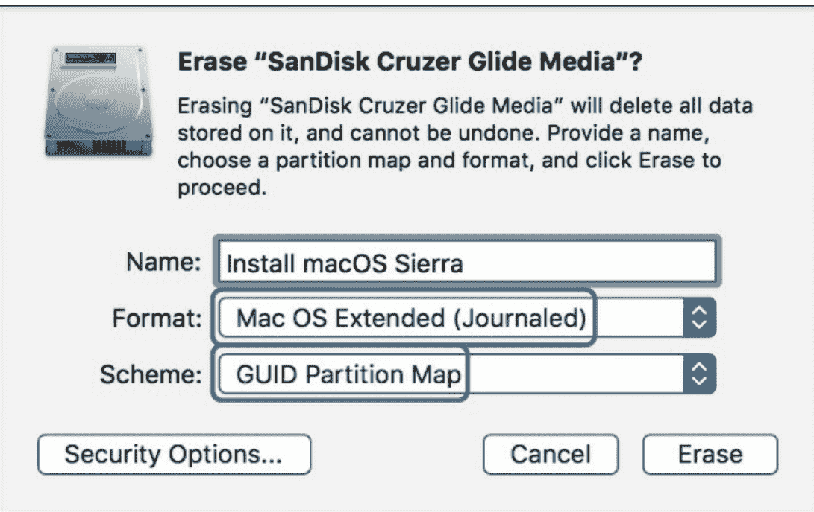

- 8 点击“擦除”按钮。
- 9 进程完成后，点击“完成”以关闭擦除对话框。
- 10 验证分区映射项是否不是 `GUID` 分区映射。

| 位置: | 外部容量: | 8 GB |
| :--- | :--- | :--- |
| 连接: | USB 子设备数: | |
| 分区映射: | GUID 分区映射类型: | 磁盘 |
| S.M.A.R.T. 状态: | 不支持设备: | `disk2` |

- 11 退出“磁盘工具”。

# 创建 macOS 安装文件夹

- 1 从“实用程序”文件夹打开“终端”。
- 2 切换到 `Finder`，导航到“安装 `macOS` `Sierra`”应用程序：

> 如果你是在课程中进行此练习，且教师提供了安装程序的副本，请打开 `StudentMaterials` 文件夹中的 `Lesson3` 文件夹。记住你已在 `Dock` 中创建了指向 `StudentMaterials` 文件夹的快捷方式。

如果你是通过 `App Store` 下载的安装程序，请打开“应用程序”文件夹。你可以在 `Finder` 中通过选择“前往”菜单 > “应用程序”来实现，或使用键盘快捷键 `Command-Shift-A` 来操作。

- 3 `Control`-点击“安装 `macOS` `Sierra`”应用程序，并在弹出的快捷菜单中选择“显示包内容”。

有关关于包的更多信息，请参阅参考 12.2，“检查包和软件包”。

- 4 在安装程序包内部，打开 `Contents` 文件夹，然后打开其内部的 `Resources` 文件夹。
- 5 将名为 `createinstallmedia` 的从 `Finder` 拖入终端窗口。

这会将 `createinstallmedia` 的完整路径插入终端。

- 6 切回终端，并按回车键。这将把 `createinstallmedia` 工具作为命令行程序执行。它会打印出用法摘要，解释如何使用该工具。
- 7 输入 `sudo` 后加一个空格以开始另一个命令，但在步骤 13 之前不要按回车键。
- 8 再次从 `Finder` 将 `createinstallmedia` 拖入终端窗口。
- 9 在终端中，输入 `--volume`（注意开头有两个短横线）并加一个空格。
- 10 从桌面将“Install macOS Sierra”（或你命名的任何名称）卷图标拖入进入终端窗口。
- 11 在终端中，输入 `--applicationpath`（同样，开头有两个短横线）并加一个空格。
- 12 在 `Finder` 中回到“应用程序”文件夹，并将“安装 `macOS` `Sierra`”应用程序拖入终端窗口。

此时，终端命令看起来应该像这样（尽管换行方式可能不同）：

```bash
sudo /Applications/Install\ macOS\ Sierra.app/Contents/Resources/createinstallmedia --volume /Volumes/My --applicationpath /Applications/Install\ macOS\ Sierra.app
```

### 注意

某些软件更新要求你必须同意新的 `Apple` 软件许可协议。

### 注意

利用批量购买计划 (`VPP`) 托管分发的机构可以在不登录 `Mac` `App Store` 登录 `Apple ID` 的情况下，在 `macOS` 计算机上安装 `Mac` `App Store` 项目。你可以通过 `https://support.apple.com/business-education/` 了解更多关于 `Apple` 管理技术。

# 自动软件更新行为

`macOS` 对你从 `Mac` `App Store` 安装的所有项目都具有自动软件更新功能，包括 `macOS` 本身以及由 `Apple` 或第三方创建的应用程序。`Mac` `App Store` 为所有 `Apple` 软件的更新提供了统一一的位置。`Mac` `App Store` 与通知中心集成，以便在有新更新可用时立即通知你。

### 更多信息

虽然本文在此讨论了其更新能力，但使用 `Mac` `App Store` 安装新应用程序的内容将在第 16 节“安装应用程序”中进行进一步讨论。

默认情况下，重要的 `macOS` 更新（例如，安全更新）会自动下载并安装。其他的 `macOS` 和 `Mac` `App Store` 更新会在后台自动下载，但不会安装。当更新准备好进行安装时，通知将通过在横幅中显示“有可用更新”来告知你。

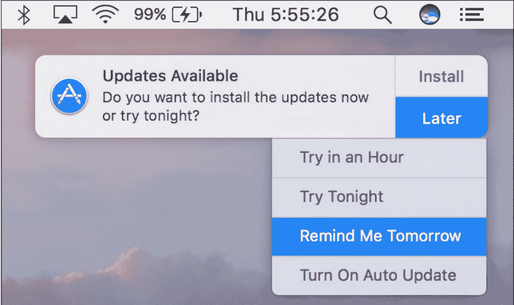

在横幅中，你可以点击“安装”或“稍后”。如果你点击“安装”，`macOS` 将立即安装更新并在必要时重启 `Mac`。如果你点击“稍后”，你可以选择在更方便的时间更新软件的选项。这非常有用，因为某些系统更新在安装完成期间会阻止你使用 `Mac`，而且你可能需要重启。横幅菜单中的最后一项“开启自动更新”允许你启用 `Mac` `App Store` 项目的自动更新。此选项在 `macOS` `Sierra` 中默认是不启用的。

同样，在 `macOS` `Sierra` 的默认情况下，`Mac` `App Store` 更新不会自动安装。你可能会收到额外的横幅通知，询问“开启自动更新？”。


点击此通知中的“开启”按钮将启用 Mac App Store 项目的自动安装。如前所述，默认情况下，重要的系统和安全软件始终会更新。

在推迟更新后，当你准备好安装更新或想要手动检查新更新时，可以随时使用以下方法进行：

- 在“关于本机”窗口中，点击“软件更新”按钮。
- 在“系统偏好”应用程序中的 Mac App Store 偏好中，点击“立即检查”按钮。
- 在 Mac App Store 的工具栏中，点击“更新”按钮。

### 提示

当有软件更新可用时，数字标记（指示可用更新）将出现在 Mac App Store 图标、App Store 工具栏的更新按钮以及 Apple 菜单中的 Mac App Store 选择旁边。此外，当你尝试重启或关机时，你可能会被提醒安装可用的更新。

# Mac App Store 更新详情

当 Mac App Store 打开并显示新更新时，每个更新都列出了有关该软件更新内容的信息。提供的信息包括更新名称、版本和描述。需要重启的更新会在用户名称之前显示通知。

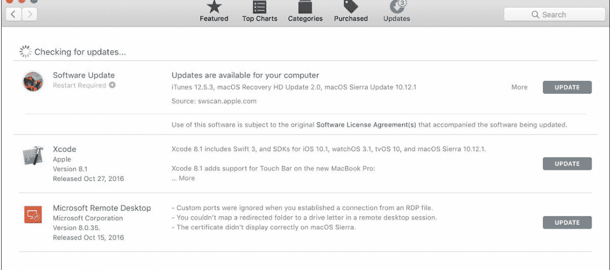

**最近 30 天内安装的更新**

更新列表分为三个部分：

- 最顶部是 macOS 软件更新。此部分仅包含 macOS 本身或在 Mac App Store 之外安装的 Apple 软件的更新。因此，更新这些系统项目不需要用户登录 Mac App Store。（这与早期版本 macOS 中提供的软件更新机制相似。）为了简化视图，顶部部分中的多个软件更新被隐藏了。你可以通过点击顶部部分“更新”旁旁“更多”链接来查看所有更新及其描述。
- 中间是单独的 Mac App Store 更新。从 Mac App Store 购买的项目（除 macOS 本身外）始终作为单独的更新项目出现。在当前截图中，`Xcode` 和 `Microsoft Remote Desktop` 均通过点击描述中的“更多”链接进行更新。同样，你可以查看有关任何单独软件更新的更多信息。如果系统中仍有安装 macOS Sierra 应用程序，你可能还会注意到 Mac App Store 更新中出现了此应用程序的更新。其目的是将任何旧版本的 macOS 安装程序更新到最新版本。
- 最底部是之前已安装的更新。此部分仅列出此用户在过去 30 天内从 Mac App Store 安装的更新。它不列出在 Mac App Store 之外安装的或其他用户安装的更新。你可以使用“系统信息”查看完整的安装列表，这将在本节稍后部分介绍。

**注意**

如果你认为“更新”视图中列出的项目是不准确的，可以通过从菜单栏选择“存储 > 重新加载页面”或按 `Command-R` 来刷新可用更新。

要安装单个更新，只需点击相应的“更新”按钮，或点击“全量更新”按钮以安装所有可用的更新。如果没有哪些更新需要重启即可安装，软件将自动安装，无需进一步交互。

然而，如果任何更新在安装过程后需要重启，你将拥有重启或再次推迟安装的选项。如果更新项目已经下载，则会显示通知。


在何种情况下，当用户选择重启时，系统将验证下载的更新并重新登录。

如果任何更新项目尚未下载，将弹出对话框。


**注意**

> 某些系统更新可能要求你接受条款、验证你的 Apple ID 或两者都要。在这些情况下，在用户与这些对话框交互之前，更新将无法完成。

你当然可以选择“不是”按钮，但你最终必须重启。或者，如果需要重启的更新已经下载，你可以从通知（如之前）或 Mac App Store 的“稍后”按钮中选择自动安装选项。

# 关于捆绑应用程序

新的 Mac 计算机随 macOS 一起安装了 `iMovie`、`GarageBand`、`Pages`、`Numbers` 和 `Keynote`。更新这些应用程序需要用户的 Apple ID 拥有这些应用程序。为了方便新系统操作，用户可以使用其 Apple ID 在 Mac App Store 中“采用”或“接受”随 Mac 的免费应用程序许可。有关接受这些应用程序的更多信息，请参考 Apple 支持文档 `HT203658`，“使用 App Store 接受捆绑应用”。

升级到 macOS Sierra 的旧 Mac 计算机如果也有之前的 `iMovie`、`GarageBand` 和 `iWork` 套件，可以免费升级到最新的 Mac App Store 版本。软件更新过程会自动检测这些更新，但你必须通过 Apple ID 进行身份验证以接受许可。有关更新这些应用程序的更多信息，请参考 Apple 支持文档 `HT201064`，“更新 Mac 自带的 iMovie、Pages、Numbers、Keynote 和 Apple 远程桌面应用”。

App Store 保持 macOS 和来自 App Store 的应用程序为最新版本。

- 自动检查更新
- 在后台下载新的可用更新
  - 当更新准备好安装时，您将收到通知
- 安装应用更新
- 安装 macOS 更新
- 安装系统数据文件和安全更新
- 自动下载在其他 Mac 上购买的应用程序
  - 您在 App Store 中以 `user@macjutsu.com` 的身份登录

上次检查时间为 2016 年 10 月 12 日星期三 立即检查

### 密码设置

在此台电脑上通过 App Store 使用 `user@macjutsu.com` 购买后，对于额外购买是否需要输入密码？

| 购买和应用内购买 | 始终需要 |
| :--- | :--- |
| 免费下载 | 需要密码 |

点击锁头以防止进一步更改。

在 App Store 偏好设置中，您可以启用或禁用以下 Mac App Store 和自动软件更新选项：

- 自动检查更新——启用此选项后，系统每天会检查一次更新。请注意，“检查”意味着只需要少量的互联网带宽即可确定是否需要更新。
- 在后台下载新的可用更新——在这种情况下，系统可能需要使用大量带宽来下载更新。macOS 系统更新超过 `1 GB` 并不常见。此外，由于此选项将自动下载从 Mac App Store 购买的应用程序更新，应用程序较多的系统将使用更多带宽。
- 安装应用更新——此选项默认未启用，如前所述，系统会通过通知提示您启用此选项。一旦启用，当新的 Mac App Store 项目自动更新，或者您需要退出应用程序以应用更新时，您将收到通知。重要的是，Mac App Store 的自动更新不需要重启系统。
- 安装 macOS 更新——此选项默认未启用，但如前所述，您也可以通过通知启用此选项。一旦启用，当新的 macOS 系统项目自动更新后（只要它们不需要重启），您将收到通知。同样，任何需要重启的 macOS 更新都允许您立即重启或等稍后后重启。
- 安装系统数据文件和安全更新——如果 Apple 认为更新重要到应该安装，那么保持此选项启用是最佳实践。但请记住，某些系统和安全更新需要重启系统。
- 自动下载在其他 Mac 上购买的应用程序——此功能默认禁用。如果启用了此功能，您使用 Apple ID 登录 Mac App Store，那么从另一台 Mac 使用相同 Apple ID 进行的新安装也将自动安装到这台 Mac 上。这对于使用多个 Mac 系统的人来说非常方便。
- 密码设置——这些设置同样仅在用户使用 Apple ID 登录 Mac App Store 时有效。调整这些设置将减少用户在进行多次购买和免费购买时验证 Apple ID 的次数。

在 App Store 偏好设置中，您还可以点击“立即检查/显示更新”按钮来手动打开 Mac App Store 的更新部分。

### 更多信息

## 附 4.2 手动安装更新

在 Mac App Store 或自动软件更新之前，所有 Mac 软件都是手动获取和安装的。坦率地说，macOS 操作系统一直具有相对简单的软件安装方式。事实上，许多应用程序只需要用户将单个应用程序文件拷贝到本地的应用程序文件夹中。另一方面，更复杂的软件可能需要将多个资源放置在 Mac 上各种特定的位置。

复杂软件安装的一个典型例子是任何系统软件更新。在某些情况下，与通过 Mac App Store 使用自动软件更新相比，手动安装更新可能更加方便。例如，对于带宽有限的系统，您需要安装一个特别大的软件更新。更好的做法是在有带宽的地方将更新手动下载到便携闪存磁盘中，然后使用该闪存磁盘更新需要它的 Mac。一位经验丰富的 macOS 支持专家会随身携带一个带有常用大型更新的外部磁盘，以备此类之需。

### 提示

您拥有手动下载和安装 Apple 软件更新的选项。您可以在 `http://support.apple.com/downloads/` 找到所有 Apple 更新。下载更新后，使用“安装程序”应用程序来应用它们。

## 安装程序应用程序

“安装程序”应用程序使复杂的应用程序安装变得简单。通常，软件开发者会创建一个“安装包”，其中包含了安装程序在您的系统上设置新软件所需的所有指令和资源。


### 备注

第三方软件开发者可能会选择为他们的产品使用专有的、非 `Apple` 的安装程序。这些安装程序不使用 `PKG` 或 `MPKG` 文件类型，且行为通常与 `Apple` 安装程序不同。

双击这些软件安装程序包之一会打开“安装程序”应用程序并开始安装过程。与 `macOS` 的安装过程一样，“安装程序”应用程序会引导您完成安装或更新软件所需的步骤。这可能包括同意软件许可、选择目标位置、选择包选项以及作为管理员用户进行身份验证。

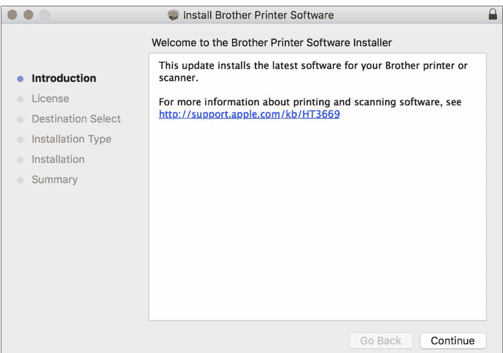

与 `Mac App Store` 不同，“安装程序”应用程序需要管理员权限才能安装许多项目。设置此安全机制是因为任何人都可以创建和发布传统的 `macOS` 安装包，包括那些带有不目的的人。`macOS` 中的另一种机制 `Gatekeeper`（守门员）也对未知的安装包提供了额外的保护。您可以在第 16 课“安装应用程序”中了解更多关于应用程序安装和 `Gatekeeper` 的信息。

> 提示 为了节省空间，安装完成后，系统会提示您删除安装包，因为它通常不再需要。

## 高级安装程序功能

如果您好奇安装包实际上对您的 `Mac` 做了什么，您有两种方法可以获知。首先，在使用“安装程序”应用程序时，可以通过选择“窗口 > 安装日志”或按下 `Command+L` 随时查看安装日志。安装日志是安装过程中报告的任何进度或错误的实时视图。

> 提示 安装完成后，可以从 应用程序/实用工具/控制 访问安装日志。打开控制后，选择报告列中的 `/var/log/` 文件夹，然后选择日志列中的 `install.log` 项目。

另一种方法允许您在安装之前检查安装包的内容。在“安装程序”应用程序中打开安装包并通过初始和许可屏幕后，可以通过选择“文件 > 显示文件”或按下 `Command+I` 来预览要安装的文件列表。

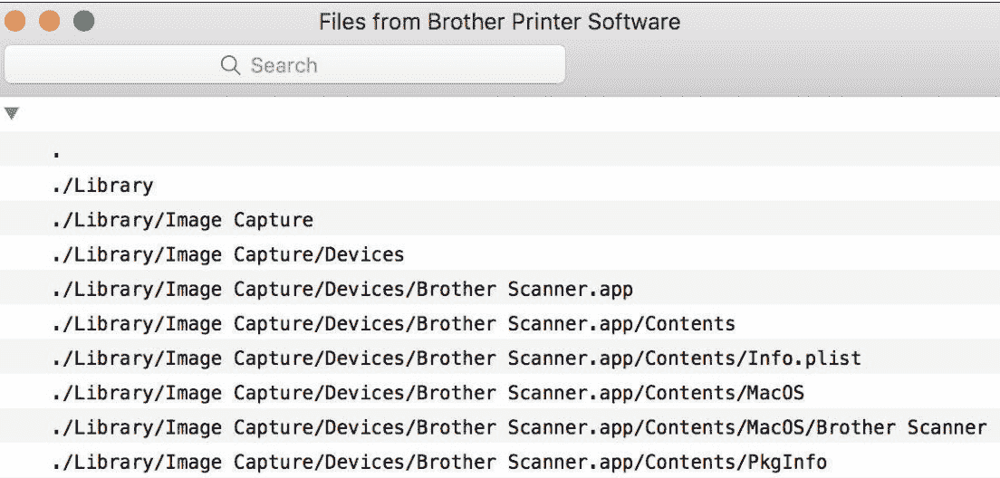

> 提示 在查看安装日志或文件列表时，使用工具栏中的搜索字段查找您所需的内容可以节省时间。

`Apple` 致力于通过支持签名包来增加软件安装包的安全性和可靠性。这些程序包包含了特殊代码，用于在安装期间验证软件的真实性和完整性。这使得恶意第三方几乎无法在信任的安装包中插入非法文件。您可以通过安装程序窗口标题栏最右侧的小锁图标识别签名的安装包。点击此图标将显示签名包的详细信息，包括其证书状态。

## 参考文献 4.3 检查安装历史

`macOS` 的自动软件更新机制让普通用户能够极其轻松地维护系统处于最新状态——以至于用户往往不知道已经应用了多少更新或安装。从支持的角度来看，确切知道哪些安装已经发生是非常重要的。

正如你可能已经过的那样，`Mac App Store` 屏幕会显示最近安装的更新。然而，此更新列表并没有显示所有安装的完整历史，而仅显示最近来自 `Mac App Store` 的安装记录，且仅针对当前登录的用户账户。

幸运的是，“系统信息”应用程序具有完整的安装历史报告。要查看此历史，打开 `/Applications/Utilities/System Information`，然后在左侧列中选择“安装”项目。此界面显示所有通过 `Mac App Store` 或安装程序安装的软件，包括来自 `Apple` 或第三方的全新安装和更新安装。你可以看到名称、版本、获取源和安装日期。

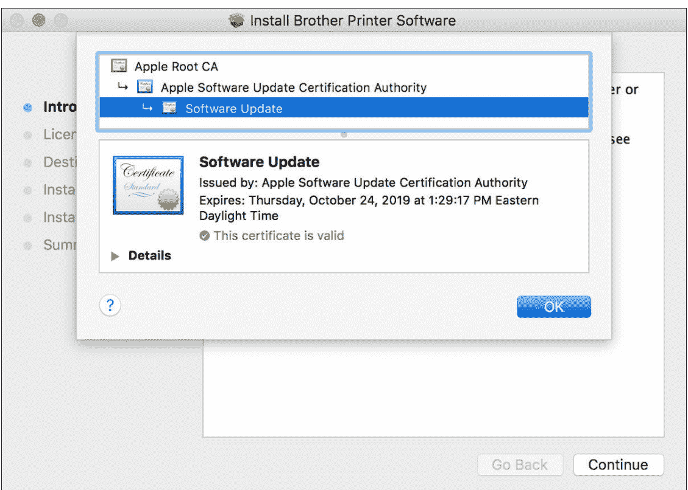

### MacBook Pro

| 网络 | 软件名称 | 版本 | 来源 | 安装日期 |
| --- | --- | --- | --- | --- |
| 防火墙 | Gatekeeper Configuration Data | 80 | Apple | 9/9/15, 12:03 AM |
| 位置 | Core Suggestions Configuration Data | 699 | Apple | 9/9/15, 12:03 AM |
| 卷 | MRT Configuration Data | 1.2 | Apple | 9/9/15, 12:02 AM |
| WWAN | OS X | | Apple | 9/6/15, 12:30 AM |
| Wi-Fi | XProPlistConfigData | 1.0 | Apple | 9/5/15, 10:22 AM |
| 软件 | Everest | 6.1 | 第三方 | 9/1/15, 10:29 PM |
| 辅助功能 | Gatekeeper Configuration Data | 78 | Apple | 9/1/15, 1:43 AM |
|  | MRT Configuration Data | 1.1 | Apple | 9/1/15, 1:43 AM |
| 组件 | CoreSKd Configuration Data | 8 | Apple | 9/1/15, 1:42 AM |
| 开发者 | XProPlistConfigData: | | | |
| 已禁用软件 | 版本: 1.0 | | | |
| 扩展 | 来源: Apple | | | |
| 字体 | 安装日期: 9/5/15, 10:22 AM | | | |
| 框架 | | | | |
| 安装项 | | | | |
| 日志 | | | | |
| 管理客户端 | | | | |
| 偏好设置 | | | | |
| 打印机软件 | | | | |
| 描述文件 | | | | |
| 启动项 | | | | |
| 同步服务 | | | | |

`kmtwogo > 软件 > 安装 > XProPlistConfigData`

## 练习 4.1 在教室中手动安装软件更新

> **前提**
>
> 本练习供在教室环境中进行这些练习的学生使用。如果你是独立进行这些练习，请执行练习 4.2，“独立手动安装软件更新”。
>
> 你必须已经创建了本地管理员账户（练习 2.1，“为练习配置新的 macOS 系统”或练习 2.2，“为练习配置现有 macOS 系统”）。

如果你的老师选择下载任何软件更新并将其作为学生材料的一部分进行分发，你可以按照以下步骤进行安装。你的老师会告知你是否需要这样做。

### 从 StudentMaterials 安装更新

1. 在访达 (`Finder`) 中，打开 `StudentMaterials` 文件夹中的 `Lesson4` 文件夹。记住你在 `Dock` 中创建了 `StudentMaterials` 文件夹的快捷方式。
2. 对于此文件夹中的每个软件更新（注意：你的老师可能会额外指定安装顺序），请执行以下操作：
   - 打开磁盘映像文件。片刻之后，一个新卷会被挂载。它包含更新包。
   - 打开更新包。安装程序将打开并引导你完成安装过程。
   - 继续按照安装程序的提示操作，并在需要时同意许可协议。
   - 提示时，再次作为本地管理员身份进行验证（密码：`ladminpw`，或你在创建账户时选择的任何密码）。手动安装软件更新需要管理员权限。
   - 当每个更新安装完成后，根据情况点击“关闭”或“重启”。
   - 重复这些步骤直到所有更新都安装完毕。

如果你没有重启，在继续之前请推出磁盘映像。你可以通过在映像窗口背景处按 `Control` + 点击并从快捷菜单中选择“推出”，或使用访达侧边栏中磁盘映像旁边的“推出”按钮来实现。

## 练习 4.2 独立手动安装软件更新

**前提条件**

* 本练习供独立进行这些练习的学生使用。如果你在教室环境中进行这些练习，请执行练习 4.1，“在教室中手动安装软件更新”。
* 你必须已经创建了本地管理员账户（练习 2.1，“为练习配置新的 macOS 系统”或练习 2.2，“为练习配置现有 macOS 系统”）。

如果你想复制更新，可以按照以下步骤操作。

### 从互联网下载更新

1. 打开 `Safari`。
2. 导航到 `https://support.apple.com/`。

此页面显示可用的更新。

3. 当你找到想要的更新时，点击“下载”。
4. 等待下载完成。
5. 点击软件旁边的“更新”按钮。
6. 如果你看到“无可用更新”的消息，说明你的系统是最新版本。

### 安装更新

1. 打开磁盘映像文件。片刻之后，一个新卷会被挂载。它包含更新包。
2. 打开更新包。安装程序将打开并引导你完成安装过程。
3. 继续按照安装程序的提示操作，并在需要时同意许可协议。
4. 提示时，再次作为本地管理员身份进行验证（密码：`ladminpw`，或你在创建账户时选择的任何密码）。手动安装软件更新需要管理员权限。
5. 当每个更新安装完成后，根据情况点击“关闭”或“重启”。
6. 如果你不想再次使用该包，将其移至废纸。


7. 如果你没有重启，在继续之前请推出磁盘映像。你可以通过在映像窗口背景处按 Control 点击并从快捷菜单中选择“推出”，或使用访达侧边栏中磁盘映像旁边的“推出”按钮来实现。

## 练习 4.3 使用自动软件更新

**前提条件**

- 你必须已经创建本地管理员账户（练习 2.1，“为练习配置新的 macOS 系统”或练习 2.2，“为练习配置现有 macOS 系统”）。

在此练习中，你将使用 App Store 的自动更新功能来检查、下载并安装更新。你还将学习查看已安装的软件。

### 检查你的 App Store 设置

1. 从 Apple 菜单，选择“系统偏好设置”。

2. 选择“App Store”偏好设置。

注意：默认情况下，系统会自动后台下载新更新并在就绪时通知你。

### App Store

App Store 保持 `macOS` 和来自 App Store 的应用程序为最新。

- 自动检查更新
- 在后台下载新可用更新
- 在更新就绪时通知你
- 安装应用程序更新
- 安装 `macOS` 更新
- 安装系统数据文件和安全性更新
- 自动下载在其他 Mac 上购买的 App
- 登录 Store 账户以启用自动下载

### 更新你的软件

3. 等待 App Store 检查新软件。

4. 如果你看到“无可用更新”的消息，说明你的电脑是最新版本。请跳过本部分的其余内容并进入“检查已安装的更新”。

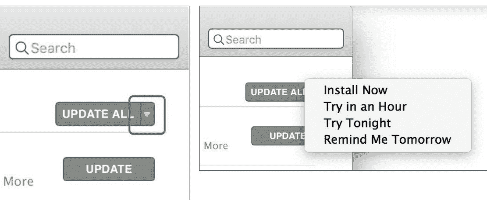

5. 点击其他地方以关闭弹出菜单。

6. 决定您想在计算机上安装哪些更新。

7. 如果有多个更新，您可以点击“更多”以查看详细列表。点击您想要安装的更新对应的“更新”按钮，或者在您想安装所有可用更新时点击“全部更新”。

8. 如果任何一个更新都受许可协议的约束，系统会提示您同意这些协议。请阅读协议，如果可以接受，请点击“同意”。

9. 如果系统提示您需要重新电脑，请点击“重新启动”或“下载并重启”。


10. 如果出现对话框询问您是否要自动更新 `macOS`，点击“稍后”以保留您当前的更新偏好。


11. 如果更新重启了您的电脑，请重新登录本地管理员账户。如果系统提示您使用 Apple ID 登录，请选择“不登录”，点击“继续”，然后在确认对话框中点击“跳过”。

12. 重新打开 App Store 应用程序并检查是否有其他更新。某些更新必须按顺序安装，因此您可能需要多次重复更新过程。

13. 当所有更新都安装完成后，退出 App Store 和系统设置。

## 检查已安装的更新

1. 按住 Option 键的同时，从 Apple 菜单选择“系统信息”。请注意，只有在按住 Option 键时，“系统信息”菜单项才会取代“关于本机”出现。

系统信息将打开并显示其报告。

2. 在侧边栏的“软件”部分中，选择“安装”。

将出现已安装软件和更新的列表，包括您刚刚安装的更新。您可以从列表中选择更新以获取更多信息。

| 网络 | 软件名称 | 版本 | 来源 | 安装日期 |
|---|---|---|---|---|
| 防火墙 | 不兼容的内核扩展配置数据 | 12.0.8 | Apple | 16/10/10, 下午 10:35 |
| 位置 | 不兼容的内核扩展配置数据 | 12.0.9 | Apple | 16/10/10, 下午 5:03 |
| 卷 | iTunes | 12.5.1 | Apple | 16/10/10, 下午 2:46 |
| WWAN | macOS | 12.0.49 | Apple | 16/10/10, 下午 12:08 |
| Wi-Fi | MRT 配置数据 | 1.11 | Apple | 16/10/10, 下午 10:34 |
| 软件 | OS X | | Apple | 16/10/10, 下午 9:5 |
| 辅助功能 | Savin 打印软件 | 1.0 | Apple | 16/10/17, 下午 2:38 |
| | | | | |
| 组件 | | | | |
| 开发人员 | X:ListConfigData | | | |
| 已禁用软件 | Savin 打印软件 | | | |
| 扩展 | 来源: | | | |
| 字体 | Apple | | | |
| 安装 | 安装日期: 16/10/17, 下午 2:38 | | |
| 日志 | | | | |

3. 退出系统信息。

## 用户账户

## 课程 5 管理用户账户

### 目标

- 识别各种用户账户类型和属性
- 创建并管理用户账户
- 调整登录设置

操作系统的特点之一是支持多个用户账户。macOS 等 UNIX 操作系统有着悠久的历史。Apple 提供了许多改进，如简化的管理工具以及易用性功能。

在本课程中，您将探索允许个人登录并使用 Mac 的技术。您还将学习如何在 macOS 中创建和管理用户账户。

### 参考 5.1 关于用户账户

除了 macOS 恢复或单用户模式外，您必须使用用户账户来执行任何任务。即使电脑刚刚启动并显示登录窗口，系统仍在使用用户账户来维护后台服务。Mac 硬盘上的每个文件和文件夹属于某种用户账户。因此，您需要了解用户账户才能有效地管理 macOS。

> **注意**
>
> 本课程重点关注适用于单个本地 Mac 的账户。然而，网络用户账户适用于多台计算机，并托管在共享目录服务器。您可以在 `https://support.apple.com/business-education` 获取更多有关 Apple 管理的信息。

## 用户账户类型

大多数 Mac 用户都是标准用户。然而，执行系统级更改需要管理员。账户主要有三种类型：标准账户、管理员和访客。

标准账户是最常见的账户类型。标准用户的权限有限，无法进行影响所有用户的系统级更改。

管理员账户具有更改系统设置和安装软件的权限。在 Mac 上保留至少一个管理员账户是重要的。

访客账户用于临时使用。当访客用户注销时，会话期间创建的所有数据都会被删除。这提供了一种安全的方法，让其他人使用您的 Mac 而不会危及您的文件或系统设置。

### 标准账户

标准账户为日常任务设计。标准用户可以访问自己的文件和应用程序，但无法更改影响用户的设置。这为系统提供了一层安全。

### 管理员账户

管理员账户对 Mac 有完全控制权。它们可以安装软件、更改系统设置并管理其他用户账户。由于权限，建议仅在必要时使用管理员账户。

### 访客账户

访客账户允许在不创建永久账户的情况下使用您的 Mac。这对于需要快速访问互联网的朋友或家人非常理想。正如所述，当访客注销时，所有访客数据将被删除，从而确保了您的隐私和安全。

账户，包括对 `/Users/Shared` 文件夹和用户公共（`Public`）文件夹的访问。与访客用户的目录不同，这些其他文件夹的内容在访客注销后仍然存在。这意味着访客用户可能会执行某些有害的应用程序，或向你的磁盘中填充不需要的文件。访客用户还可以重启或关闭你的 Mac，这可能让他们损害系统启动。

幸运的是，父母控制允许你限制访客账户运行未经批准的应用程序或重启 Mac。通过给予访客账户有限的访问权限（参考 5.3 节“限制本地用户访问”），可以为临时用户访问提供一种安全机制。此外，你可以更改共享文件夹的访问权限，使访客账户无法向你的磁盘复制任何项目。更改文件和文件夹权限的内容位于第 11 节“管理权限与共享”中。

> **注意**
>
> 在系统上启用“查找我的 Mac”还将启用访客账户本地登录。这是一个陷阱——针对小偷的！其意图是让被盗的 Mac 在被发现时被锁定；罪犯可以在系统启动或唤醒时选择“访客”作为登录选项，从而访问系统。在默认设置下，小偷将被允许仅选择 Wi-Fi 网络并使用 Safari。当被盗的 Mac 重新上线时，主人可以通过“查找我的 Mac”来定位它。你可以在第 7 节“管理安全性与隐私”中了解更多信息。

## 仅共享账户

macOS 允许你创建可以访问共享文件和文件夹的用户账户。仅共享账户没有主目录，并且无法登录到 Mac 计算机的用户界面或终端。默认情况下，仅共享用户账户被允许对“公共（`Public`）”和下载箱（`Drop Box`）文件夹进行共享访问，与访客用户一样，这些用户可能会向磁盘中填充不需要的文件。

否则仅共享用户账户无法登录 Mac，并可能要求使用密码，因此指定共享账户通常比使用访客账户进行文件共享安全得多。你可以通过调整文件和文件夹权限，进一步控制仅共享账户用户对文件的访问。

## root 账户


`root` 账户也称为系统管理员账户，在 macOS 客户端上默认关闭状态，这很有道理：`root` 账户对 Mac 上的所有内容都有无限访问权限。拥有 `root` 账户权限的用户可以读取、写入、删除非系统文件；修改任何设置；并安装任何软件。由于许多系统进程以 `root` 账户身份运行，它必须在系统中存在；否则，macOS 将无法启动。

拥有 `root` 账户访问权限进行恶意活动的风险很高。为了防止滥用此类账户，macOS 默认配置没有为 `root` 账户设置密码，因此你无法使用该账户登录。

然而，如前所述，任何管理员用户都可以使用“目录实用工具”应用程序选择启用 `root` 账户或更改现有的 `root` 账户密码。同样，因为只需要管理员账户即可初始访问 `root` 账户，所以严格限制管理员的使用是保护 `root` 账户的关键。

### 注意

任何可以访问 macOS 恢复程序的人都可以重置任何本地账户密码，包括 `root` 账户。如果你的环境关注安全性，强烈建议启用`FileVault`、设置固件密码以限制对 macOS 恢复的访问，或两者都开启。启用`FileVault` 内容位于第 10 节“管理`FileVault`”。设置固件密码的内容位于第 8 节“管理密码更改”。

## 本地组账户

本质上，组账户无非用户账户列表。组主要用于允许对文件和文件夹访问进行更强大的控制。macOS 使用了几个内置组来促进安全的系统进程和共享。例如，所有用户账户都是`staff`（员工）组的成员；管理员账户也是`admin`（管理员）组的成员；`root` 账户有自己的组，被称为`wheel`。使用组管理共享在第 11 节“管理权限与共享”中讨论。

### 注意

标准账户始终是`staff` 组的成员，管理员账户始终是`staff`和`admin` 组的成员。

### 参考 5.2 配置用户账户

一旦你对 macOS 用户账户有了基本的了解，就可以准备创建新用户并管理现有用户了。在本节中，你将检查简单和更复杂但更灵活的方法来管理本地用户账户。

## 用户与组偏好设置

在 macOS 中，系统偏好设置中的“用户与组”窗口是管理本地用户账户、本地组账户和登录设置的主要界面。从此偏好面板，本地用户可以管理自己账户的基本设置，任何具有管理员权限的用户都可以解锁此面板并管理所有本地账户的属性。

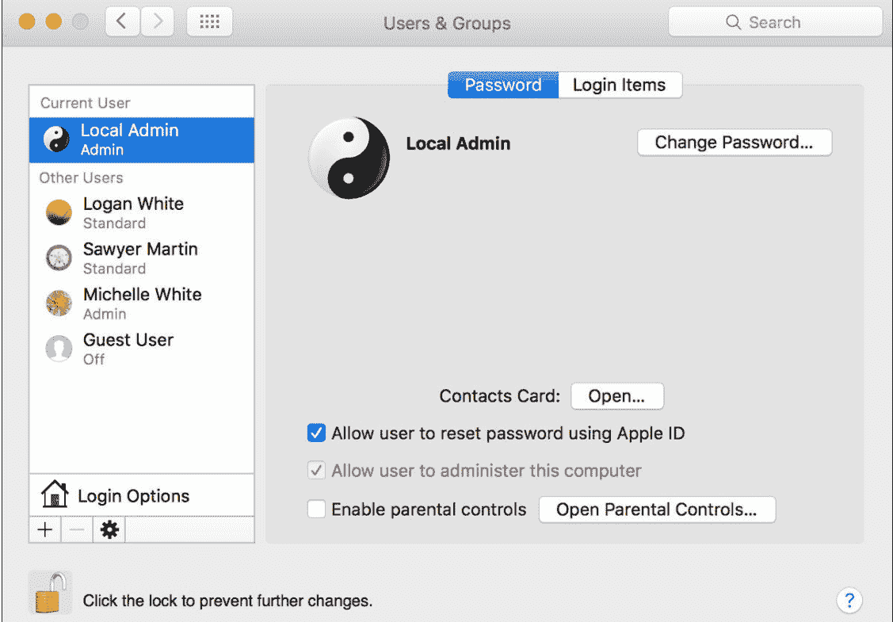

### 创建新用户账户

在“用户与组”偏好设置中，通过管理员身份验证后，你可以通过从列表中选择任何账户并修改右侧的项目来管理该账户。点击“用户与组”列表底部的“+”按钮创建新账户。会弹出一个对话框，你可以在其中定义新用户账户的基本属性。

新账户：标准账户

全名：`Emily Diane`

账户名：`emily`

这将用作你的主目录名称。

密码：`••••••`

验证：`••••••`

密码提示：（建议）

取消创建用户

用户创建面板顶部的弹出菜单允许你定义正在创建的本地用户账户类型：管理员、标准、受父母控制的托管或仅共享。在创建新的本地用户账户时，你应该为用户输入全名、账户名和初始密码。你还可以输入可选的密码提示，但文本不能与用户的密码匹配。

注意

`OS X El Capitan` 允许创建使用`Apple ID` 密码作为计算机登录的本地账户。macOS Sierra 仍支持具有此现有。但在 Sierra 中不再创建具有此功能的新用户。你可以在第 8 节“密码更改”中了解更多密码信息。

### 新用户设置向导

当新用户首次登录 Mac 时，他们将看到设置向导。这与第 2 节“设置与配置 macOS”中描述的设置向导过程类似，只是简化到了要求输入`Apple ID` 的程度。用户可以选择不登录，但如果他们输入了`Apple ID`和密码，Mac 将自动设置需要`Apple ID`的 macOS 功能。这包括`iCloud`服务和 Mac App Store。此外，如果 Mac 尚未启用查找我的 Mac，也将进行设置。

注意

如果你输入的是 13 岁以下用户的`Apple ID`（通过学生`Apple ID`、`Apple`学校管理或`iCloud`共享实现），默认不会启用`iCloud`服务。

### 使用你的 Apple ID 登录

登录以使用`iCloud`、`iTunes`、App Store、`iMessage`、`FaceTime`、查找我的 Mac 等功能。

了解更多...


- 使用你的`Apple ID` 登录

不登录

如果用户的`Apple ID` 启用了双重验证或双因子身份验证，用户还必须提供额外的验证。用户可能被要求启用`iCloud`钥匙、升级到`iCloud Drive`并启用`iCloud`桌面和文档，正如第 17 节“管理文档”详细所示。最后，在设置向导完成之前，用户将会被提示接受新的条款和条件并启用`Siri`。

注意

由学校或企业管理的 Mac 可能会显示与此处显示的默认设置不同的设置向程序选项。在某些管理情况下，某些默认屏幕可能会被跳过，你可能会遇到额外的组织配置屏幕。这些差异由管理员通过 Mac 之外的机制控制。因此，你可能需要联系该机构的主要管理员来正确完成新用户的设置向导程序过程。

## 用户帐户属性

尽管登录窗口允许你登录 Mac 环境，但维护账户信息的是`Open Directory`（开放目录）系统。`Open Directory` 将本地用户账户信息存储位于`/var/db/dslocal/nodes/Default/users` 文件夹的一系列 XML 编码文本文件中。此文件夹仅供系统管理员 (`root`) 账户读取，但如果你检查这些文件，你会发现它们被组织成用户属性列表及其关联值。

幸运的是，这些属性的大多数也可以直接从“用户与群组”（Users & Groups）偏好中轻松访问。管理员可以通过对用户账户进行次要点击（或 Control- 点击）来显示“高级选项”对话框，从而访问这些通常隐藏的用户帐户属性。

### 高级选项

用户：`"Local Admin"`

警告：更改这些设置可能会损坏此帐户并防止用户登录。你必须重启电脑才能使设置更改生效。

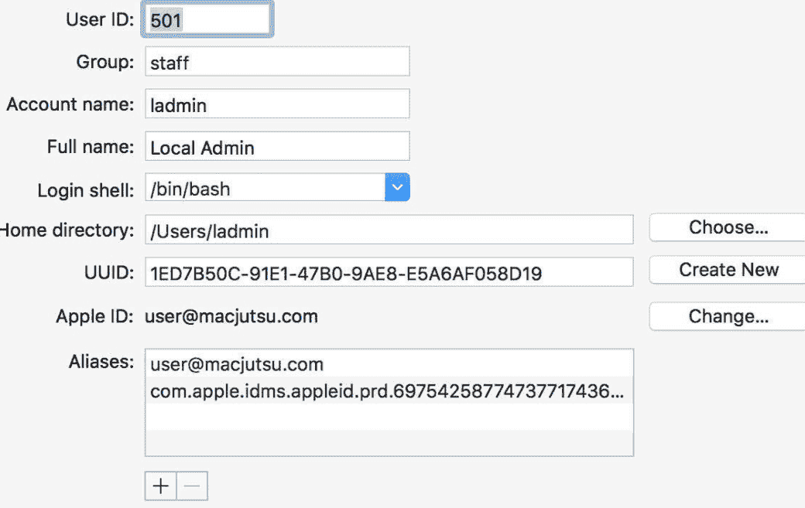

每个用户都有定义帐户定义的各种属性。尽管你可以轻松编辑这些属性以实现所需的更改或修复问题，但你也可以通过输入不正确的信息轻松损坏帐户。例如，你可以通过修正主目录信息来恢复对用户主文件夹的访问，或者由于输入错误信息而意外阻止用户访问其个人或主文件夹。

用户属性包括以下内容：

- **User ID**：用于标识具有文件和文件夹所有权的帐户的数字属性。该数字在单个系统中对每个帐户几乎总是是唯一的，尽管可能重叠。用户帐户从 501 开始，大多数系统帐户低于 100。需要注意的是，用户 id 仅相对于本地系统上的其他用户是“唯一的”。其他所有 Mac 系统都使用类似的 ID 数字，但在计算机之间这种唯一性就丢失了。例如，在 Mac 计算机上创建的第一个用户将具有 ID 数字 501。如果你删除了一个用户，该用户的 ID 就会变为可用状态，系统将将其重用于新用户。

- **Group**：用户的主组。如前所述，所有本地用户的默认主组是`staff`（员工）群组。这意味着当你创建一个新文件时，它属于你的用户帐户并属于`staff` 群组。

- **Account name**：有时称为“短名称”，这是用于唯一标识帐户的名称，并默认用于为用户主文件夹命名。用户可以交替使用全名或帐户名进行身份验证。然而，系统上没有其他帐户具有相同的帐户名，且它不能包含任何特殊字符或空格。不允许的特殊字符包括逗号、斜杠、分号、括号、引号和符号。允许的字符包括连字符、下划线和句号。

- **Full name**：用户的全名。它可以很长并包含几乎任何字符。然而，系统上没有其他帐户具有相同的全名。你以后可以任何时候轻松更改全名。

- **Login directory**：此路径定义了帐户在终端（Terminal）中使用的默认命令行 shell。任何允许在终端中使用命令行的用户其此项默认都设置为`/bin/bash`。管理员和标准用户默认都拥有此访问权限。

- **Home directory**：此路径定义了用户主文件夹的位置。除了没有主文件夹的共享用户外，所有用户的此项都设置为`/Users/<name>`，其中`<name>` 是帐户名。

- **Universally Unique ID (UUID)**：有时称为生成的 UID 或 GUID，此字母数字属性由计算机在创建帐户期间生成，在空间和时间上都是唯一的。一旦创建该属性，它将用于验证用户密码以及组成员身份和文件权限。需要注意的是，UUID 可能是真正的唯一，一台 Mac 将无法识别另一台 Mac 的 UUID。换句话说，在一个 Mac 上创建的 UUID 另一个 Mac 并未知。因此，本地创建的 UUID 不能在 Mac 计算机之间进行相互识别。


- `Apple ID`：用于将本地 Mac 用户帐户与 `Apple ID` 关联，该 `ID` 可用于重置本地帐户密码。如果用户在设置向导或 `iCloud` 中输入 `Apple ID`，则会自动配置。然而，在“用户与群组”的“高级选项”中设置或更改 `Apple ID` 不影响用户的 `iCloud` 服务配置。

- `Aliases`：用于将本地 Mac 用户帐户与其他服务帐户关联。例如，用户的 `Apple ID` 可以与本地帐户关联。此属性对于 `macOS` 是可选的，但对于与 `iCloud` 等 Apple 互联网服务及其“回到我的 Mac”功能集成是强制的。

### 注意

本地帐户密码以加密属性的形式存储以增强安全性。密码管理将在第 8 节“管理密码更改”中详细介绍。

## 参考文献 5.3 限制本地用户访问

`macOS` 包含了大量的受管理设置，允许你进一步限制用户可以和不能做的事情。Apple 将这些管理设置标记为家长控制，它们也适用于标准帐户。

### 更多信息

家长控制构成了更广泛的移动设备管理 (`MDM`) 系统的有限子集。`macOS Server` 包含一个名为 `Profile Manager`（描述管理器）的服务。你可以在 `www.apple.com/server/` 获取更多关于 `MDM` 的信息。你可以在 `support.apple.com/education` 了解更多关于 `MDM`。


### 提示

你可以使用家长控制底部的操作菜单（齿轮图标）将设置从一个用户复制到另一个用户。通过此菜单还可以启用远程管理家长控制。通过家长控制提供的管理选项如下：

- `Apps`：禁用 `Game Center` 的使用，限制邮件中的联系人，并限制使用特定应用程序。

### 更多信息

关于限制访问 `App Store` 请参第 16 节“安装应用程序”。

- 启用 `Safari` 内容过滤，或手动管理允许的网站列表或两者结合。

- `Stores`：禁用 `iTunes` 和 `iBooks` 商店，限制限制内容，限制限制内容进行年龄分级。

- `Time`：设置工作日周末的时间限制。

- `Privacy`：限制更改隐私设置，防止用户选择应用程序和服务访问隐私信息。

- `Other`：系统听写、限制编辑图片和扫描仪、防止刻录光盘、限制字典中的限制语言、防止修改 `Dock` 以及启用简化 `Finder` 以简化用户界面。

- `Logs`：维护 `Safari`、信息和应用程序使用日志。日志显示允许的和尝试但被拒绝的访问。

> 注意

绝大多数第三方应用程序不会遵守家长控制的内容过滤器或帐户限制设置。例如 `Firefox` 浏览器和 `Outlook` 电子邮件客户端。然而，你可以通过使用家长控制限制这些应用程序来解决此问题。

# 用户与组

当前用户

本地管理员 `Admin`

其他用户

- `Emily Diane` 标准用户

- `Logan White` 标准用户

- `Michelle White` 管理员

- `Sawyer Martin` 受管用户

- 访客用户 关闭

登录项

这些项目会在您登录时自动打开：

| 隐藏 | 项目 | 类型 |

| --- | --- | --- |

| | `iTunes` | 应用程序 |

| | 共享 | 卷 |

若要在登录时隐藏某个应用程序，请选择该应用程序旁“隐藏”列中的复选框。

点击锁图标以防止进一步更改。

用户可以通过将应用程序和 `Finder` 备用项目拖入“登录项”列表，或者点击“添加（加号）”按钮并浏览查找项目来添加登录项。移除项目同样简单，从列表中选择一个项目并点击“移除（减号）”按钮即可。请注意“隐藏”复选框，它允许用户定义一个启动后自动从视图中隐藏自身的应用程序。此选项对于需要后台功能但无需显示窗口本身的应用程序（例如流媒体应用程序）非常有用。

# 管理系统登录窗口选项

您可以在“用户与组”面板中，通过管理员用户身份验证，然后点击用户账户列表底部的“登录选项”，来调整系统登录窗口的行为。

# 用户与组

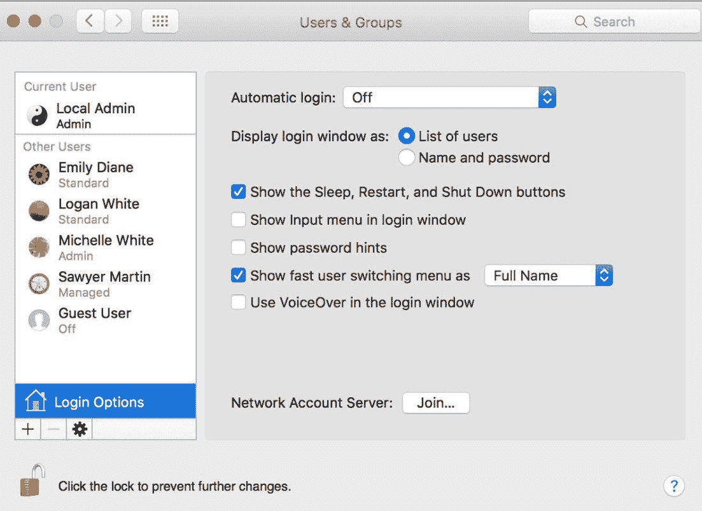

当前用户

- 本地管理员 `Admin`

其他用户

- `Emily Diane` 标准用户

- `Logan White` 标准用户

- `Michelle White` 管理员

- `Sawyer Martin` 受管用户

- 访客用户 关闭

登录选项

点击锁图标以防止进一步更改。

登录窗口选项包括：

- 启用或禁用 `Mac` 启动时的自动登录。此选项默认是关闭的，除非 `macOS` 设置助理过程中用户取消了“登录时需要密码”选项。显然，您只能为自动登录定义一个账户。

- 选择登录窗口是显示可用用户列表（默认设置），还是显示空白名称和密码字段。选择名称和密码字段更安全。

- 选择登录窗口中是否显示“重启”、“睡眠”和“关机”按钮。在需要更严格的安全环境中，`Mac` 不应在登录窗口中提供这些按钮。

- 指定用户是否可以使用输入菜单。这允许用户在登录窗口轻松访问非罗马字母字符（如西里尔字母或汉字）。

- 决定登录窗口在三次密码尝试失败后是否显示密码提示。这看起来可能是一个不安全的选择，但请记住每个用户账户的密码提示都是可选的。

- 禁用快速用户切换菜单并调整菜单项的外观。换句话说，快速切换菜单可以以用户的全名、账户名或通用用户图标显示。

- 允许用户在登录窗口利用 `VoiceOver` 语音辅助功能技术。

- 配置 `Mac` 使用托管自共享网络目录的账户。同样，您可以在 `https://support.apple.com/business-education` 更多有关 Apple 管理技术的信息。

> 提示 您可以在“安全性与隐私”偏好设置中为登录窗口配置短的三行消息，这在第 7 “管理安全性与隐私”中有介绍。如果您的组织需要完整的登录横，可以通过 Apple 支持文章 `HT202277`“关于 `OS X` 中的策略横幅”中的说明进行配置。

# 关于快速用户切换

通常，两个用户想要同时使用 `Mac`。虽然两个用户无法同时操作 `Mac`，但多个用户同时登录 `Mac` 是可能的。

快速用户切换允许 `Mac` 在用户账户之间移动，而无需用户注销或退出已打开的应用程序。这允许用户在一位或多个其他用户也登录电脑的同时在后台保持工作。返回的用户稍后可以立即恢复任务，回到他们之前离开的地方。

> 注意 快速用户切换不推荐用于或兼容网络用户账户。

快速用户切换在 `macOS` 中默认启用，但只有在创建额外的本地用户账户后，快速用户切换菜单才会出现。此菜单项出现在最右侧，紧邻 `Spotlight` 搜索菜单。默认情况下，快速用户切换菜单显示为用户账户全名。如果您没有看到此菜单项，可以在“用户与组”偏好设置的“登录选项”中开启它。当另一个用户已登录时，可以通过从快速用户切换菜单中选择该用户并输入相应的密码，从一个用户切换到另一个用户。

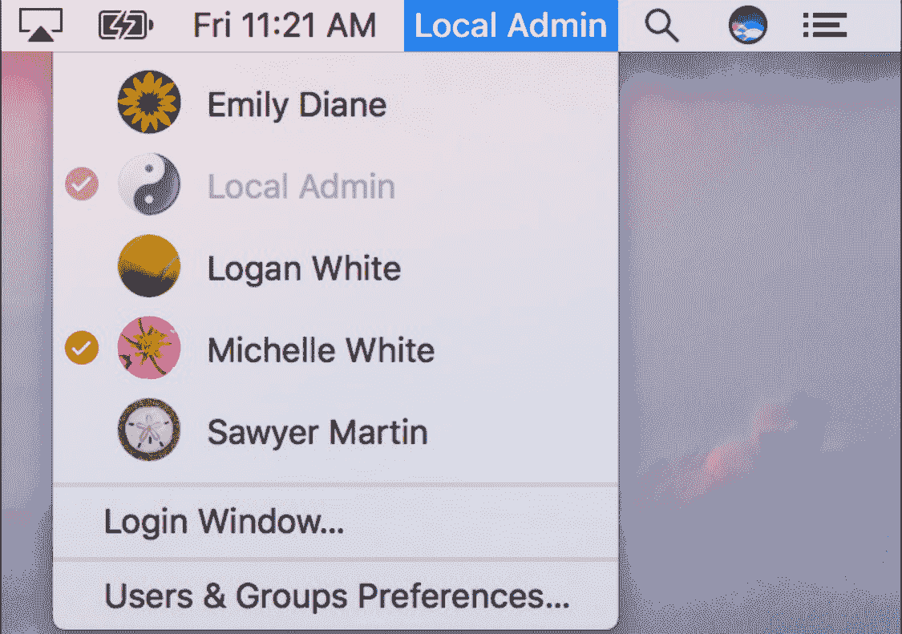

提示 您可以通过按住 `Command` 键并拖动项目来移动快速用户切换菜单项或菜单栏右侧的任何其他菜单项。

# 快速用户切换连接问题

Apple 已将快速用户切换成为一项可靠的功能。许多内置 `macOS` 应用程序都支持快速用户切换。例如，当您在账户之间切换时，`iTunes` 会自动静音或取消静音，信息会在“可用”和“离开”聊天状态之间切换，而邮件会在后台继续检查新邮件。在某些情况下，当一个一个用户尝试访问某项项目时，可能会发生资源冲突。

快速用户切换资源冲突示例包括：

- 应用程序冲突——某些应用程序的设计一次只能一个用户使用。如果其他用户尝试打开这些应用程序，他们会遇到错误对话框或应用程序根本不会打开。

- 文档冲突——有时一个用户打开了文档并保持快速切换登录，这将阻止其他用户完全访问该文档。例如，`Word` 和 `Excel` 等 Microsoft Office 允许其他用户以只读模式打开文档，如果用户尝试保存更改，则会显示错误。在最坏的情况下，应用程序允许两个人同时编辑文件，但将保存最后保存的用户的更改。在这种情况下，您通常不会看到错误消息。

- 外设冲突——许多外设设备一次只能由一个用户访问。如果用户运行着一个应用程序，在原始应用程序退出之前，外设将对其他人不可用，这将变成一个快速切换问题。示例包括摄像头、扫描仪和音频设备。

# 快速用户切换问题

快速用户切换对非系统设备也有趣趣的影响。例如，如果一个用户连接了外部存储设备，该磁盘对系统上的所有其他用户都是可用的，即使他们在连接存储设备时尚未登录。只有挂载磁盘镜像的用户具有完全的读取/写入权限。然而，其他用户可能仍然对挂载的磁盘镜像具有读取访问权限。

共享网络卷在快速切换环境中仍然保持安全。默认情况下，只有最初连接到共享的用户可以访问它。即使多个用户尝试访问同一个网络共享，系统也会为每个用户自动生成不同访问权限的多个挂载。此规则的例外是网络账户使用的网络主目录。虽然一个用户可以成功登录，来自同一服务器的其他网络用户将无法访问他们的网络主目录。由于由于原因，快速用户切换不支持网络账户。

# 快速用户切换问题


遗憾的是，由于每个资源和应用程序的行为不同，快速用户切换问题并不总是一致报告或可见。macOS 没有“快速用户切换导致问题”的对话框。尽管如此，如果您遇到文件、应用程序或外设的访问错误，您的要步骤应该是检查是否有其他用户仍处于登录。如果是，请让他们注销然后重试

访问此前无法访问的项目。

如果你无法注销其他用户——可能他们目前不在位，而你不知道他们的密码——你的选择是强制退出其他用户的可疑应用程序，或者通过重启 Mac 来强制其他用户注销。此时，更改已登录用户的密码并不是一个选项，因为管理员无法管理当前登录的用户账户。这些账户在“用户与组”偏好设置中将显示为置灰状态且不可用，如下幅截图中的`Michelle`账户所示。

| 当前用户 |
| :--- |
| 本地管理员`Admin` |
| 其他用户 |
| `Emily Diane`标准用户 |
| `Logan White`标准用户 |
| `Michelle White`管理员 |
| `Sawyer Martin`管理 |
| 客宾用户关闭 |

因此，管理员必须强制退出其他用户的应用程序，或者重启 Mac 以释放任何被占用的项目或对已登录用户进行任何更改。尽管如此，这两种方案都不是理想的，强制退出带有打开文件的应用程序可能会导致数据丢失。如果你别无选择，可以使用第 18 节“管理和排错应用程序”中涵盖的技术来强制退出应用程序。

提示

如果你已经设置了主密码，可以在登录窗口使用主密码重置当前登录用户的密码。设置主密码和重置用户密码在第 8 节“管理密码更改”中有介绍。

然而，尝试重启揭示了另一个快速用户切换问题：如果任何其他用户仍处于登录，管理员必须强制退出这些用户的应用程序才能重启。系统通过一个经过验证的重启对话框让管理员轻松强制退出这些应用程序，但再次，这可能会导致任何打开文件的数据丢失。

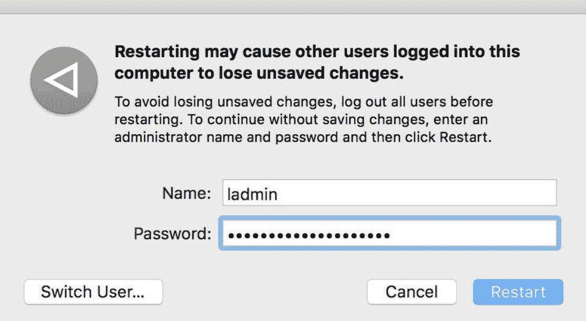

## 练习 5.1 创建标准用户账户

- 前提条件：
  - 你已经创建了本地管理员账户（练习 2.1 节“为练习配置新的 macOS 系统”或练习 2.2 节“为练习配置现有的 macOS 系统”）。
  - 大多数剩余练习都需要此练习，因此请不要跳过。

在对电脑进行初始配置期间，你已经创建了一个管理员账户。在练习中，你将创建一个额外的账户，以更好地理解用户体验。下一个用户账户将是标准用户。在日常中使用标准用户账户是最佳实践。你应该只使用本地管理员账户执行软件安装和系统配置等系统管理任务，而你可以在以标准用户登录时执行大部分此类任务，只需提供管理员的名称和密码即可。你还可以将新账户链接到`Apple ID`以访问`iCloud`服务。这不是强制要求的，但建议这样做，这将使你能够完成指南中后续利用`iCloud`的其他练习。

### 创建标准用户账户

这些步骤将引导你完成账户创建。

1. 如果必要，以本地管理员登录（密码：`ladminpw`，或你在创建账户时选择的任何密码）。
2. 打开“系统偏好设置”，点击“用户与组”偏好设置。
3. 点击锁头按钮并通过本地管理员身份进行验证，以解锁“用户与组”偏好设置。

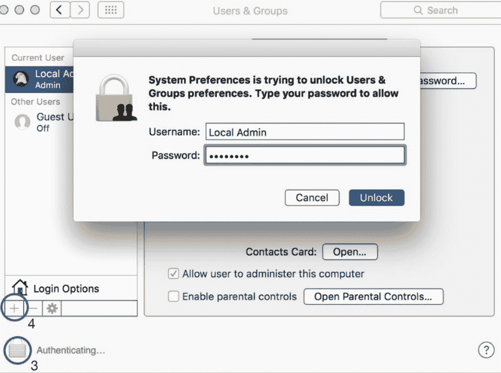

4. 点击账户列表下“新建用户 (+)”按钮，并输入以下信息：
   - 新账户：标准
   - 全名：`Chris Johnson`
   - 账户名称：`chris`

   如果你在课程中进行此练习，请在“密码”和“验证”字段中输入`chris`。如果你是个人进行此练习，请为`Chris Johnson`账户选择一个更安全的密码。务必记住你选择的密码，因为你在使用这台电脑时需要定期重新输入它。如果你愿意，可以提供一个提示来帮助记忆密码。

   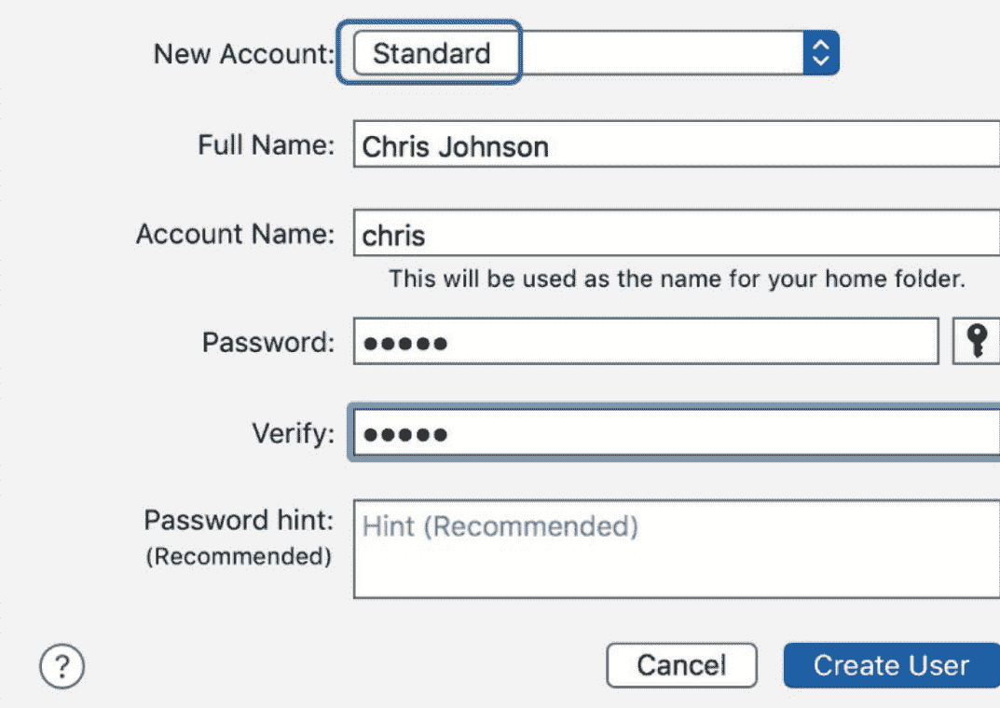

   注意：

   如果你已经有一个名为“`Chris Johnson`”或“`chris`”的账户，你在这里必须使用一个不同的名称，并记住在后续的练习中使用你的替代名称。

5. 点击“创建用户”。
6. 如果收到通知该账户在至少登录一次之前无法解锁`FileVault`，请点击“好”。
7. 如果出现带有“已启用自动登录。你是否要关闭它？”提示的对话框，点击“关闭自动登录”。注意，由于你以管理员身份通过了验证，你可以在这里配置其他几个账户属性，包括更改`Chris`的用户图标、授予`Chris`管理员权限或使用家长控制来限制该账户。


### 登录新用户账户

在这些步骤中，你登录`Chris`的账户以验证其是否创建正确。

1. 从`Apple`菜单中选择“注销本地管理员”。
2. 在询问你是否确定的对话框中，点击“注销”。
3. 在登录屏幕上，选择`Chris Johnson`并输入密码。

你现在已以`Chris Johnson`的身份登录。由于此账户尚未绑定`Apple ID`，屏幕上会显示一个配置`Apple ID`的界面。有几种方法可以实现这一点：

- 如果你在课堂环境中进行这些练习，老师会提供`Apple ID`。
- 如果你是个人进行这些练习并有一个想要使用的现有`Apple ID`。
- 如果你是个人进行这些练习且没有`Apple ID`或倾向于创建一个新的`Apple ID`。

注意：

如果没有出现“登录”屏幕，你的电脑在连接`iCloud`服务器时遇到了问题。在这种情况下，你可以跳到“调整`Chris`的偏好设置”来继续练习，但你以后需要在`iCloud`偏好设置中创建账户。

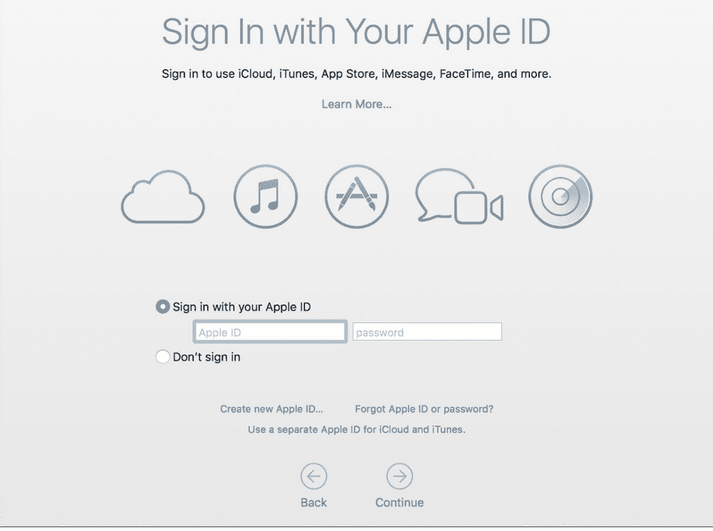

#### 选项 1：将 Chris Johnson 链接到现有 Apple ID

如果你在课堂环境中进行这些练习，或者希望在练习中使用现有的`Apple ID`，请按照以下指令将该账户链接到`Apple ID`。

1. 输入老师提供的（或自己的）`Apple ID`和密码，点击“继续”。
2. 如果使用了带有双重验证或双因子认证的`Apple ID`，会提示你通过设备验证身份。按照提示完成验证。
3. 如果出现“使用条款”屏幕，阅读条款，如果接受，点击“同意”；然后在确认对话框中再次点击“同意”。
4. 如果提示输入设备密码，请执行操作。
5. 如果出现`iCloud`钥匙串屏幕，选择“稍后设置”，并点击“继续”。
6. 如果出现`iCloud Drive`屏幕，该`Apple ID`在旧版本的`OS X`或`iOS`上使用过，存储了旧格式的文档。参阅第 17.5 节“使用`iCloud Drive`”获取更多关于`iCloud Drive`的信息。
   - 如果你在课堂环境中进行这些练习，选择“升级到`iCloud Drive`”，点击“继续”，然后在确认对话框中再次点击“继续”。
   - 如果你是个人进行这些练习并想将`iCloud`账户的文档存储升级到`iCloud Drive`，选择“升级到`iCloud Drive`”，点击“继续”，然后在确认对话框中再次点击“继续”。
   - 如果你是个人进行这些练习且目前不想升级`iCloud`账户的文档存储，选择“稍后”，点击“继续”，然后在确认对话框中再次点击“不升级”。
7. 如果出现“`iCloud`中的所有文件”屏幕，取消勾选“将文档和桌面文件存储在`iCloud Drive`中”，并点击“继续”。你可以个人尝试此功能，但在`Chris`账户中开启此功能可能会干扰后续练习。
8. 如果出现“启用`Siri`”屏幕，取消勾选“在此台`Mac`上启用`Siri`”，并点击“继续”。

继续。

9. 如果提示要设置`Touch ID`，点击“继续”，然后点击“稍后设置`Touch ID`”，最后在确认对话框中点击“继续”。

## 选项 2：创建一个新的 iCloud 账户

如果您正在独立进行这些练习，并希望创建一个新的`Apple ID`用于这些练习，请按照以下说明将`Chris Johnson`账户关联到新的`Apple ID`。

> 注意

> 不要在教室环境中使用此选项。`Apple`限制了在某特定电脑上使用此方法可以创建的`Apple ID`账户数量，因此在教室电脑上执行此操作可能会影响未来的课程。如果您正在使用自己的电脑进行这些练习，并且已经有一个`Apple ID`，您可能也想使用它（遵循选项 1 的说明），以避免影响您电脑的创建配额。

1. 在“使用您的`Apple ID`登录”窗口中，点击“创建新的`Apple ID`”。


2. 如果您收到通知，无法创建`Apple ID`，因为“此`Mac`不再符合创建`Apple ID`账户的标准”，说明您的电脑已达到允许创建账户的数量。在这种情况下，您有两个选择：
   - 您可以在另一台`Mac`电脑或`iOS`设备上创建`Apple ID`账户，然后点击“返回”按钮并按照选项 1（上一节）使用新账户。


* 如果您无法在其他设备上创建 Apple ID 账户，可以点击“继续”，并跳到本练习的“调整 Chris Johnson 的偏好设置”部分。在这种情况下，除非您在其他设备上创建 Apple ID，然后使用系统偏好中的 iCloud 登录 Chris Johnson 账户的 iCloud，否则您将无法在后的练习中执行 iCloud 部分。

- 3 在第一个“创建 Apple ID”屏幕上，通过弹出菜单输入您的生日，然后点击“继续”。

- 4 输入您的姓名。

- 5 取决您是想创建一个关联到现有电子邮件地址的 Apple ID，还是创建一个新的 iCloud.com 电子邮件地址，请执行以下操作之一：

  * 要使用现有的电子邮件地址，请在“电子邮件地址”字段中输入该地址。

  * 要创建一个新的 iCloud.com 电子邮件地址，点击“获取免费的 iCloud 电子邮件地址”，然后输入您喜欢的账户前缀。

- 6 选择一个密码，并将其输入“密码”和“验证密码”字段中。

- 7 点击“继续”。

如果您看到警告，显示您的 Apple ID 无法创建，因为您选择的电子邮件地址“不再可用”或“被其他 Apple ID 使用”，请选择不同的名称。

- 8 选择三个安全问题，输入它们的答案，并点击“继续”。

- 9 在“条款和条件”屏幕上，阅读条款，如果可以，点击“同意”；然后在弹出的确认对话框中再次点击“同意”。

- 10 在 iCloud 钥匙串屏幕上，选择“稍后设置”，并点击“继续”。

- 11 如果出现“iCloud 中的所有文件”屏幕，取消取消勾选“在 iCloud Drive 中存储来自文稿和桌面的文件”，并点击“继续”。

欢迎您自行尝试此功能，但为 Chris Johnson 账户开启此功能可能会影响后续练习。

- 12 如果出现“启用 Siri”屏幕，取消勾选“在此台 Mac 上启用 Siri”，并点击“继续”。

- 13 如果提示要设置 Touch ID，点击“继续”，然后点击“稍后设置 Touch ID”，最后在确认对话框中点击“继续”。

- 14 如果您将 Apple ID 关联到了现有电子邮件地址，则在验证对该电子邮件地址的所有权之前，新账户尚未完全启用。请检查您的现有电子邮件账户中的验证请求，并按照该消息中的说明操作。

## 调整 Chris Johnson 的偏好设置

就像您对 Local Admin 账户所做的那样，您可以调整 Chris Johnson 的偏好设置，以便访问系统文件。

- 1 在 Finder 中，选择 Finder 菜单 > 偏好设置。

- 2 选择在桌面上显示硬盘和连接的服务器的选项。

- 3 从“新建 Finder 窗口显示”弹出菜单中，选择您的系统卷（通常为 Macintosh HD）。

- 4 点击 Finder 偏好设置窗口顶部的“侧边栏”按钮。

- 5 在侧边栏的“收藏”部分选择“chris”，并在“设备”部分选择“硬盘”。注意，“硬盘”应该是被完全选中状态（复选框中打钩），而不是部分选中状态（复选框中有破折号）。

- 6 关闭 Finder 偏好设置窗口。

- 7 导航到 `/Applications` 文件夹（选择 菜单 > 应用程序或按 `Command-Shift-A`）。

- 8 像在 Local Admin 账户中操作一样，将 `TextEdit` 应用程序拖到 Chris Dock 的左侧。

- 9 导航到 `/Users/Shared`。由于 Chris 的 Finder 偏好设置设置为在桌面上显示硬盘，您可以从桌面打开 Macintosh HD，打开 `Users`，然后打开 `Shared`。

- 10 将 `StudentMaterials` 文件夹拖到 Chris Dock 的右侧。

- 11 打开系统偏好设置，点击“桌面与屏幕保护”偏好设置。

- 12 选择不同的桌面图片。

- 13 如果您喜欢，可以根据个人喜好调整鼠标和触控板偏好设置，就像您在 Local Admin 账户中做的那样。

## 检查 Chris Johnson 的账户

- 1 在系统偏好设置中，打开“用户与组”偏好设置。

注意，您看到的选项与作为 Local Admin 登录时不同。例如，您无法允许自己管理电脑或为自己开启家长控制。但是，您可以配置联系人卡或添加登录项（这些将在您每次登录时出现）。此外，您无法选择除自己以外的账户。

- 2 在左下角，点击“锁”按钮，并以 Local Admin 身份进行验证。这将解锁用户与组偏好设置，并允许您在保持 Chris 登录的情况下进行更改。


- 3 点击 Chris 账户，并在快捷菜单中选择“高级选项”。

高级选项对话框显示了 Chris 账户的隐藏属性。

### 高级选项

警告：更改这些设置可能会损坏此账户并导致用户无法登录。必须重启电脑才能生效。

```
用户 ID: 502
组: staff
账户名: chris
全名: Chris Johnson
登录 shell: /bin/bash
主目录: /Users/chris
UUID: 61369E3C-0ED3-4D91-818B-0D002303F5
Apple ID: suppressentialsct@icloud.com
别名:
```


注意，您的别名列表可能包含与 Apple ID 相关的项目。这取决于您是否将账户关联到 iCloud 以及您的 iCloud 账户如何配置。

- 4 点击“取消”（或按 `Command-Period`）关闭对话框。在未进行更改时，取消设置对话框是一个好习惯。

- 5 保持系统偏好设置开启以便下一个练习。

## 练习 5.2 创建受管理用户账户

### 前提条件

- 您必须已创建 Local Admin（练习 2.1，“为练习配置新的 macOS 系统”）或练习 2.2，“配置现有

如有必要，以 Chris Johnson 的身份登录，在系统偏好设置中打开“用户与组”偏好设置，并以 Local Admin 身份进行验证（再次，记住您可以使用账户名 `admin` 代替全名 Local Admin）。

- 2 点击列表下方的“新建用户”(+)按钮，并输入以下信息：

```
新账户：受家长控制管理
年龄：4 岁
全名：Johnson Junior
账户名：junior
密码：如果您在课堂上进行此练习，请在密码和验证字段中输入 junior。如果您是自行练习，请为 Johnson Junior 账户选择一个更安全的密码。务必记住您选择的密码，因为稍后您需要重新输入它。

如果您需要，可以提供密码提示。
```

```
新账户：受家长控制管理
年龄：4 级
全名：Johnson Junior
账户名称：junior

这将用作您的主文件夹名称。

密码：*******
验证密码：*******
密码提示：（*推荐*）提示（*推荐*）

取消 创建用户
```

如果您已经有一个名为 "Johnson Junior" 或 "junior" 的账户，则您将必须在此处使用不同的名称，并记住在后续练习中始终使用该名称。

- 3 点击“创建用户”。

- 4 确认账户列表中选择了 Johnson Junior 的账户。

由于您是以受管理模式创建的该账户，因此“启用家长控制”复选框处于选中状态。

- 5 点击“打开家长控制”。

这将带您进入“家长控制”，这是“系统偏好设置中的另一个面板。

- 6 如果提示您再次进行身份验证，请输入本地管理员（Local Admin）的账户名称和密码。

- 7 在“应用程序”标签页中，确保选中了“限制在此台 Mac 上使用应用程序”。

- 8 点击“其他应用程序”展开三角形，查看默认允许哪些应用程序。

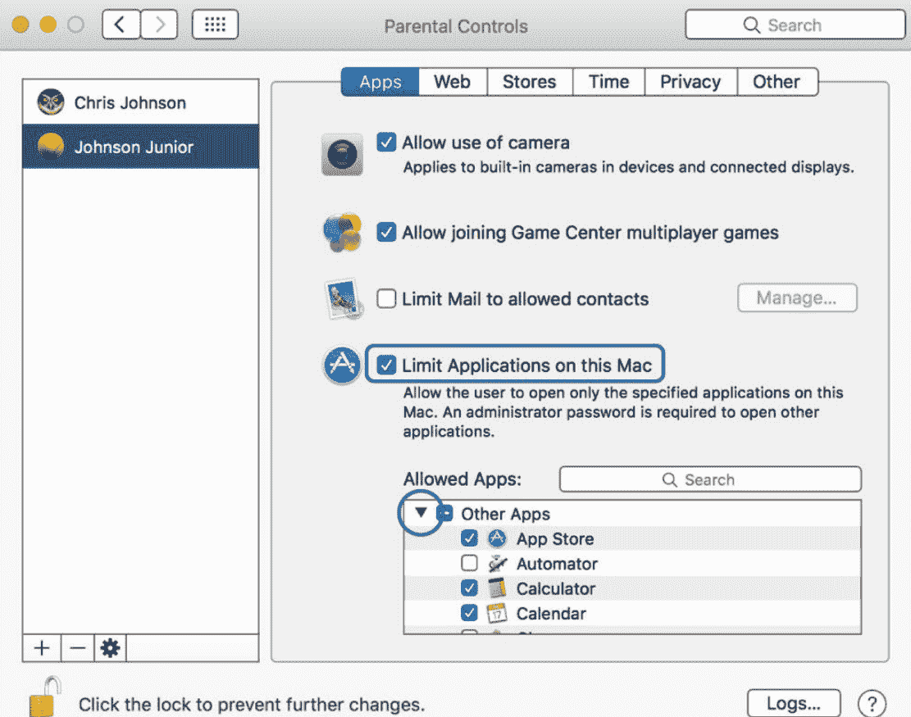

- 9 点击“网页”标签页以配置 Junior 的网页限制。

- 10 确保选中“仅允许访问这些网站”选项，并保留默认网站列表。

- 11 点击家长控制中的“商店”、“时间”、“隐私”和“其他”标签页，查看还有哪些限制。

- 12 在“其他”标签页上，选择“使用简化访达（Simple Finder）”。

- 13 退出“系统偏好设置”，并注销 Chris Johnson 账户。

### 测试托管用户账户

现在您可以登录 Junior 的用户账户，查看您配置的家长控制的效果。

- 1 在登录界面，选择 Johnson Junior，输入密码（`junior` 或您选择的密码），并按回车键。

- 2 如果提示您使用 Apple ID 登录，选择“不登录”，点击“继续”，然后在确认对话框中点击“跳过”。

- 3 如果提示启用 Siri，取消勾选该选项，然后点击“继续”。由于您将 Junior 的账户限制为简化访达，界面看起来与正常情况有些不同。

- 4 如果提示设置 Touch ID，点击“继续”，然后点击“稍后设置 Touch ID”，然后在确认对话框中点击“继续”。

- 5 查看苹果、“访达”、“文件”和“帮助”菜单中的可用选项。注意，大多数常用的访达功能都缺失了。


- 6 在程序坞（Dock）中，点击位于最左侧的文件夹图标（标记有代表应用程序的样式字母 A）。


简化访达应用程序启动器打开，并显示 `Junior` 允许打开的应用程序图标。

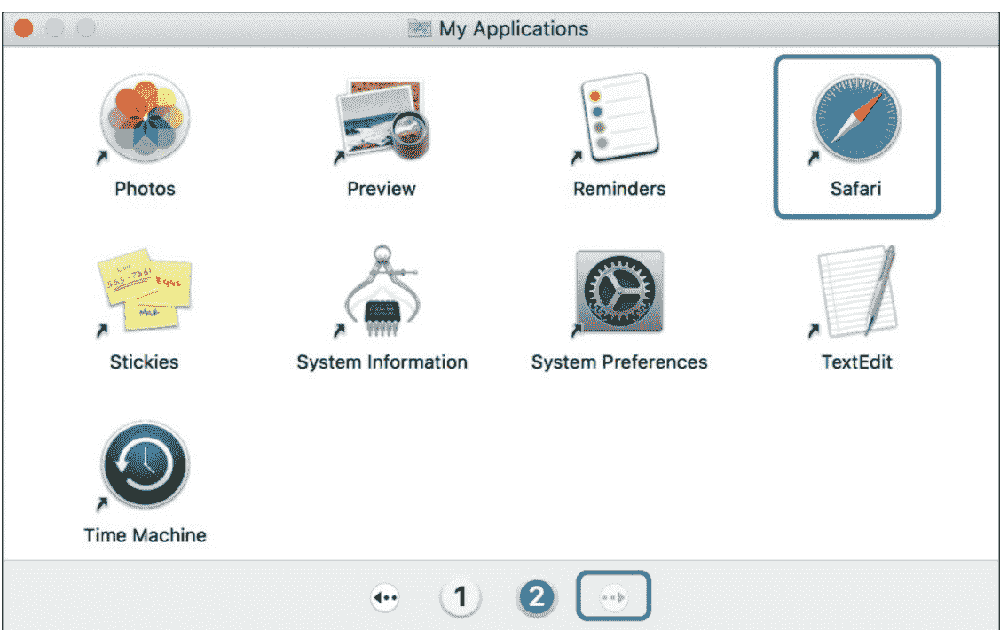

- 7 打开 `Safari`。如果应用程序的第一屏幕上没有显示 `Safari`，请点击右箭头显示更多应用程序。

使用 `Safari` 的地址栏导航到 `www.wikipedia.org`。

- 8 由于 `Wikipedia` 不在允许的列表中，会出现一个错误信息。

> ### 哎！您无法查看此网站上的页面。
>
> 您无法查看页面“`https://www-wikipedia.org/`”，因为其不在家长控制的批准列表中。

要将此网站添加到您的批准列表，请点击“添加网站”。执行此操作，您需要管理员密码。

添加网站

- 9 点击“添加网站”，并以本地管理员身份进行验证。

- 10 如果必要，通过选择“查看”菜单 > “重新加载”或按 `Command-R` 重新加载页面。

这一次，`Wikipedia` 的首页加载了。

- 11 退出 `Safari`，并注销 `Johnson Johnson Junior`。

# 课程 6. 管理用户主文件夹

### 目标

* 理解用户主文件夹的布局和内容
* 删除用户并归档主文件夹内容
* 迁移并恢复用户的主文件夹

除了账户名称和密码等初始账户属性外，用户可能创建的或需要存储的所有其他项目都存储在该用户的主文件夹中。如之前提到的，本地存储的用户主文件夹的默认位置是 `/Users/<name>`，其中 `<name>` 是用户的账户名称。

# 参考 6.1 关于用户主文件夹

创建新用户时，系统会生成一个包含若干默认文件夹的主文件夹。用户可以创建额外的文件夹来存储他们的项目，但最佳实践是让他们使用默认位置将所有个人文件保留在主文件夹中。大多数应用程序建议一个合适的默认文件夹，而另一些则不会询问用户，直接使用分配的默认文件夹。

用户主文件夹内默认文件夹的所有内容仅对该用户可见，“公共（`Public`）”文件夹除外，他们无法添加项目或进行更改，除非将文件放入“投箱（`Drop Box`）”文件夹。其他用户可以查看“公共”文件夹的内容，但他们无法在那里添加文件，也看不到其内容。

需要注意的是，默认情况下，其他人能够查看任何用户主文件夹根目录（或开头）级别的项目。这是为了允许其他用户进入“公共”文件夹。然而，……

如果用户的个人文件夹特别大，“删除用户账户”对话框可能需要几分钟才会出现。


## 你确定要删除用户账户“James White”吗？

要删除此用户账户，请选择你想要对该账户的主文件夹进行的操作，然后点击“删除用户”。

- 将主文件夹保存为磁盘映像文件

  磁盘映像将保存在“已删除的用户”（`Deleted Users`）文件夹中（位于“用户”文件夹内）。

- 不更改主文件夹

  主文件夹将保留在“用户”文件夹中。

- 删除主文件夹

删除用户账户的管理员可以选择以下三个选项之一：

- 将主文件夹保存为磁盘映像文件——此选项会将用户的主文件夹创建为磁盘映像文件的存档。磁盘映像文件将保存到 `/Users/Deleted Users` 文件夹中，并以账户名作为磁盘映像文件的名称。将主文件夹作为磁盘映像保留，便于将其传输到其他系统，或将归档的项目导入到另一个用户的主文件夹中。

请记住，本地系统磁盘必须有足够的可用空间——本质上，要有足够复制原始主文件夹的空间——来创建存档磁盘映像。根据文件夹的大小，此过程可能需要一些时间。

- 不更改主文件夹——此选项将保持用户的文件夹不变（除了名称外）。它只是在主文件夹的名称后添加了“（已删除）”，告知该用户账户已不存在。被删除用户的的主文件夹将保持与普通用户文件夹相同的访问限制。然而，尽管与归档选项相比，这种方法更快且更节省空间，但管理员必须手动调整所有权权限以访问这些项目。此外，新创建的用户账户可能会获得访问删除用户的主文件夹内容的权限。这两个问题都可以使用第 11 节“管理权限与共享”中涵盖的方法来解决。

- 删除主文件夹——此选项将立即删除主文件夹的内容。项目在删除之前不会存储在废纸篓中，因此如果你使用此方法，将无法恢复这些项目。

### 更多信息

删除用户主文件夹的方法等同于快速抹除。因此，如果你没有启用 `FileVault`（文件卷加密），内容可能仍可以使用第三方恢复工具进行恢复。`macOS Sierra` 不再支持安全删除用户主文件夹。如果你的环境中存在数据安全问题，你应该按照第 10 节“管理 `FileVault`”中的详细启用 `FileVault`。

## 参考 6.3 迁移与恢复主文件夹

通常，移动或恢复用户账户及其主文件夹的最佳方法是使用 `Apple` 迁移助理（`Migration Assistant`）。它并不总是最佳解决方案，你可能需要手动恢复用户账户。在本节中，你将探索迁移助理以及恢复主文件夹的手动步骤。

### 关于迁移助理

这个实用的应用程序可以节省大量时间，让你能够轻松从一台 `Mac` 或 `Windows` 将所有设置、用户账户和数据传输到你的新 `Mac` 系统。

通过迁移助理，你可以迁移：

- 从另一台 `Mac`、`Time Machine` 备份或启动磁盘——此选项将扫描本地网络，寻找正在运行迁移助理并准备好传输信息的其他 `Mac`。如果你没有本地网络，可以通过以太网、`FireWire` 或 `Thunderbolt` 直接连接两台运行中的 `Mac`，它们将创建一个本地网络。或者，此选项还会扫描所有已挂的磁盘和本地网络以寻找 `Time Machine` 备份。最后，这还包括任何通过 `FireWire` 或 `Thunderbolt` 连接的目标磁盘模式下的外部磁盘或其他 `Mac`。使用目标磁盘模式的详细信息见第 9 节“管理文件系统与存储”。

### 更多信息

参见 `Apple` 支持文章 `HT204350`，“将你的内容移动到新 `Mac`”。

- 从 `Windows PC`——此选项将扫描本地网络，寻找正在运行迁移助理并准备好传输信息的 `Windows PC`。这允许从 `Windows XP SP3` 或更高版本进行迁移，前提是这些系统安装了 `Windows` 迁移助理；你可以从 `Apple` 支持网站下载它。

### 更多信息

参见 `Apple` 支持文章 `HT204087`

### 注意事项

在使用迁移助理之前，请务必在源电脑和目标电脑上检查 `Apple` 软件更新。此过程可确保你在所有电脑上都使用最新版本的迁移助理。

### 注意事项

迁移助理只能在初始设置助理过程中将受旧版 `FileVault` 保护的用户账户迁移到 `Mac`。

### 迁移助理

### 简介

使用迁移助理将信息（数据、电脑设置和应用程序）从另一台 `Mac`、一台 `Windows PC`、`Time Machine` 备份或磁盘传输到此 `Mac`。你也可以将信息从此 `Mac` 传输到另一台 `Mac`。

当你点击“继续”时，所有其他应用程序将退出。

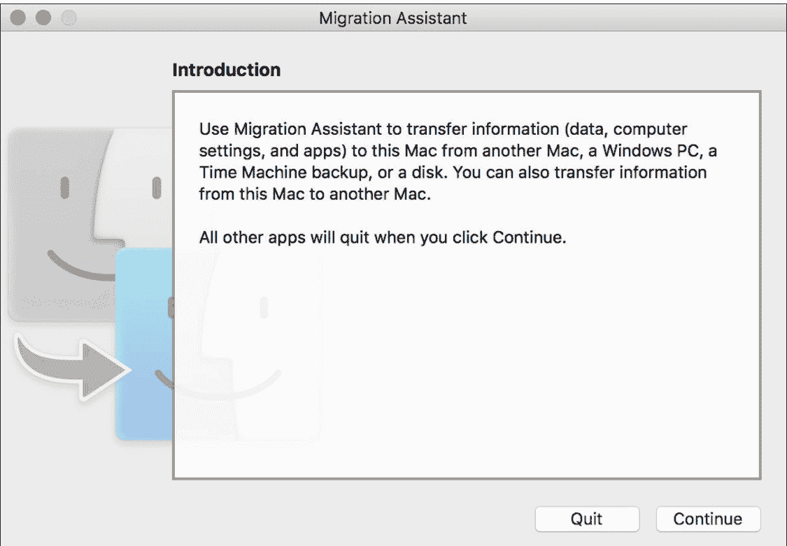

点击“继续”按钮将启动迁移助理过程；但你必须首先验证具有管理员权限的用户以启动该过程。此外，启动迁移助理过程将退出所有运行中的应用程序并注销所有用户账户。

迁移助理有三种模式：从另一个 `Mac` 源传输、从 `Windows PC` 源传输，或传输到另一个目标 `Mac`。前两个选项假设你正从另一台电脑传输到此 `Mac`，而最后一个选项假设你正从此 `Mac` 传输到另一台 `Mac`。在这种情况下，你需要在目标 `Mac` 上打开迁移助理。

### 你想如何传输信息？

- 从另一台 `Mac`、`Time Machine` 备份或启动磁盘
- 从 `Windows PC`
- 到另一台 `Mac`

如果你选择从另一台电脑传输，迁移助理将扫描所有连接的磁盘和本地网络寻找源。或者，你也可以点击底部的“其他”按钮将特定的 `Time Machine` 服务器作为源。

一旦选择了源，迁移助理将扫描内容并向你显示可以迁移的项目列表。如果系统上有多个磁盘，你也可以选择迁移这些数据。然而，迁移过程不会在新系统上创建新分区；而是在系统上创建与迁移磁盘相同的文件夹。

## 选择要传输的信息

选择你想传输到此 `Mac` 的信息。

| 项目 | 大小 |
|---|---|
| 应用程序 | 109.53 GB |
| Kevin M White | 105.66 GB |
| 其他文件和文件夹 | 3.23 GB |
| 服务器数据 | KB |
| 电脑与网络设置 | 97 KB |

已选择 218.42 GB，传输后可用 10.62 GB。

一旦做出选择，即可开始传输过程。数据量大的系统可能需要几个小时。

## 手动恢复用户主文件夹


在某些情况下，你可能需要抹除并安装新系统来修复或更新 Mac。遗憾的是，你不能总是假设有最新的 Time Machine 备份。抹除系统磁盘也会破坏 Mac 上的用户账户。在这种情况下，由于你处理的是单台 Mac，而不是从一台 Mac 移动到另一台 Mac，且你没有 Time Machine 备份，迁移助理将无法满足你的需求。

如果你发现自己处于这种迁移助理无法满足需求的境地，你可以手动移动用户主文件夹数据。虽然这不需要 Mac，但需要你将用户主文件夹临时复制到另一个“备份”存储磁盘。如果你有额外的备份存储空间，请登录用户账户并在 Finder 中直接将主文件夹拖到备份磁盘上。只要你复制了整个用户主（以用户账户命名的文件夹），Finder 就会一次性复制整个文件夹。


### 注意

如果你正在创建另一个用户的文件夹副本，系统会提示你以管理员身份进行验证以继续。这是因为默认的文件系统权限通常阻止一个用户访问另一个用户。当你确定已有一个完整的用户文件夹备份后，可以擦除磁盘并修复它。在新的系统就绪并运行之前，首先创建一个与用户账户不同的管理员账户，因为手动恢复用户文件夹的方法要求该用户尚不存在。


要完成文件夹的恢复，在 Finder 中，将用户的备份拷贝到 `/Users` 文件夹，并确保用户文件夹命名正确。

最后，在“用户与组”设置中，创建账户；在创建新用户账户时，如果名称匹配，系统将识别并提示你使用现有文件夹。


如果你点击“使用现有文件夹”按钮，系统会将手动恢复的文件夹与新创建的用户账户关联。这包括设置正确的文件夹权限，以便新用户访问该文件夹。如果你点击“取消”，系统将停止创建用户账户。

### 练习 6.1 恢复已删除账户

#### 前提条件

你必须已创建管理员账户（练习2.1，“配置新的 macOS 系统”或练习2.2，“配置现有 macOS 系统”）。

在此练习中，你将创建一个用户账户并为该用户填充文件夹。然后，你将删除账户并保留文件夹内容。最后，你将创建一个新账户，确保新用户获得文件夹内容。除了演示如何恢复已删除账户外，这种技术还可以用于更改用户用户名。它提供了迁移助理移动账户的替代方案。

场景是 HR 要求为 Marta 创建账户。她的名字是 Martahtuk，你需要修复这个错误。

# 创建 Martahtuk 的主文件夹

1. 如果必要，以管理员身份登录（密码：`ladminpw` 或你在创建账户时选择的任何密码）。
2. 打开“系统偏好设置”，选择“用户与组”面板。
3. 点击锁图标，以管理员身份验证。
4. 点击用户列表下的 `+` 按钮。
5. 输入 Martahtuk 的账户信息：
    - 新账户：`标准`
    - 全名：`Martahtuk`
    - 账户名：`marta`
    - 密码：`marta`
    - 验证：`marta`
    - 不要提供密码提示。
6. 点击“创建用户”。
7. Control 点击 Marta 账户，从快捷菜单选择“高级选项”。
8. 按 `Command-Shift-4`，然后按空格键。

你的鼠标光标变成了相机图标，该区域被蓝色高亮。如果你看到的是十字准光标，再次按空格键。

将相机指针移动到“系统偏好设置”窗口上，然后点击记录内容。

这是 macOS 截图的几种方法之一。`Command-Shift-3` 记录全屏，`Command-Shift-4`（不带空格键）允许你选择矩形区域进行记录，而带空格键的 `Command-Shift-4` 允许你选择单个窗口。

图像将保存到桌面，命名为“屏幕截”，后跟拍摄日期和时间。

9. 在“高级选项”对话框中，点击“取消”，或按 `Command-.`，这是大多数 macOS 对话框中选择取消的方法。
10. 以管理员身份注销。
11. 以 Martaishtuk 登录（密码：`marta`）。
12. 如果提示使用 Apple ID 登录，选择“不登录”，点击“继续”，然后在确认对话框中点击“跳过”。
13. 如果提示启用 Siri，取消勾选“在此 Mac 上启用 Siri”，并点击“继续”。
14. 如果提示设置 Touch ID，点击“继续”，然后点击“以后设置 Touch ID”，然后在确认对话框中点击“继续”。
15. 在 Dock 中，点击“启动台”图标。


启动台为用户提供了一种打开不在 Dock 中的应用程序的简单方法，无需在 Finder 中导航到“应用程序”文件夹。

16. 点击“其他”应用程序组，点击“启动台”。
17. 在“其他”组中，点击 `TextEdit` 图标打开 `TextEdit`。
18. 在未命名文档中，输入文本 `This is Mayta’s project document`（“Mayta”不是拼写错误）。
19. 选择文件菜单 > 保存（或按 `Command-S`）以保存文件。
20. 将文件命名为 `Project`，并将其保存到 Marta 的桌面。你可以使用快捷键 `Command-Shift-D`。


21. 退出 `TextEdit`，并注销管理员账户。

# 删除 Marta 的账户

你要删除账户并保留磁盘镜像。磁盘镜像是一个主文件夹的文件。

1. 以管理员身份登录。
2. 在系统偏好设置中打开“用户与组”，如果必要，解锁偏好设置。
3. 选择 Marta 账户并点击 `-` 按钮。
4. 在出现的对话框中，确保勾选了“保存文件夹”。


5. 等待删除完成，然后退出偏好设置。

# 恢复 Marta 的账户

Marta 的文件已保存在磁盘镜像中。现在你需要将它们拷贝到新的文件夹中，以便创建新账户。注意，磁盘镜像是便携且易于存储的，你可以使用这种技术在另一台电脑上重建账户。

1. 导航到 `/Users/Deleted Users`。你可以通过打开桌面 `Macintosh HD`，进入 `Users` 文件夹来到达该文件夹。如果你没有权限打开 `Users` 文件夹，可能是以标准用户登录的。注销并重新以管理员身份登录。
2. 打开 `marta`。

镜像打开后显示 Marta 账户主文件夹的内容。然而，正如参考 12.1 “导航隐藏项目”所述，隐藏子文件夹 `Library` 包含了账户设置和偏好；要完全恢复此账户，你需要恢复整个文件夹，而不仅仅是可见内容。

3. 关闭“marta”窗口（但不要推出磁盘镜像）。磁盘图标仍然显示在你的桌面上。
4. 选择（单击）桌面上的“marta”图标。
5. 从 Finder 的文件菜单中选择“拷贝”（或使用快捷键 `Command-D`）。Finder 将镜像内容（包括隐藏的 `Library` 文件夹）拷贝到桌面名为“marta”的文件夹。
6. 拷贝完成后，点击 Finder 侧边栏中对应项目旁的推出按钮卸载“marta”卷。注意你可能需要滚动侧边栏才能看到该图标。
7. 选择桌面上的新“marta”文件夹，并按回车。这允许你编辑文件夹名称。
8. 将文件夹名称更改为 `mayta`，并按回车。


9. 在剩余的 Finder 窗口中，返回 `/Users` 文件夹。你可以通过点击窗口工具栏中的左箭头、按下 `Command-[`（左括号），或者在窗口标题栏的文件夹名称上 Control 点击并从快捷菜单中选择“Users”来实现此操作。
10. 将桌面上的“mayta”文件夹拖到 `/Users` 文件夹。


`/Users` 文件夹的权限不允许你向其添加项目。Finder 会要求你以管理员身份进行验证以覆盖此限制。


11. 点击“验证”；输入 Local Admin 的密码，并点击“确定”。
12. 打开“mayta”文件夹，然后打开其内部的 `Desktop` 文件夹。

你看到了 Maya 的 `Project` 文档。由于你（Local Admin）创建了这个 Mayta 个人文件夹的副本，因此你拥有访问它的完整权限。

## 创建并验证 Mayta Mishtuk 的账户

你现在将使用恢复的个人文件夹作为新账户的个人文件夹来创建 Mayta Mishtuk 用户账户。

1. 如果必要，打开“系统偏好设置”，并选择“用户与组”。
2. 点击锁头按钮，并以 Local Admin 身份进行验证。
3. 点击加 `+` 按钮创建另一个账户：
    - 新建账户：`标准`
    - 全名：`Mayta Mishtuk`


账户名称：`mayta`

密码：如果你是在课程中进行此练习，请在“密码”和“验证密码”字段中输入 `mayta`。如果你是独立进行此练习，请为 `Mayta Mishtuk` 账户选择一个更安全的密码。务必记住你选择的密码，这样在使用此电脑时就无需定期重新输入。

如果你愿意，可以提供密码提示。

- 4 点击“创建用户”。

弹出一个对话框，询问你是否想对此账户使用“`mayta`”文件夹。


- 5 点击“使用现有文件夹”。

- 6 `Control` 点击 `Mayta` 的账户，并并从快捷菜单中选择“高级选项”。

- 7 打开桌面上的截屏文件，将 `Mayta` 新账户的账户属性与其原始账户进行比较。旧账户的用户 ID 可能被复用到新账户上，但 `UUID` 将是不同的。每个账户在创建时都会被分配一个完全全新的 `UUID`。

- 8 退出“预览”。

- 9 在“高级选项”对话框中，点击“取消”，然后退出“系统偏好设置”。

- 10 现在尝试重新打开 `Mayta` 个人文件夹中的桌面文件夹。如果你的 `Finder` 窗口仍显示桌面文件夹，请点击后退按钮，然后双击桌面文件夹。你现在不再拥有访问权限了，因为这些文件属于 `Mayta` 的新账户。


- 11 关闭 `Finder` 窗口。

## 验证 Mayta Mishtuk 的个人文件夹

为了确保 `Maya` 的文件都在这里，你可以浏览她恢复的个人文件夹。

- 1 注销 `Local Admin` 登录，并以 `Mayta` 登录。

- 2 如果提示系统无法解锁 `Maya` 的钥匙串，点击“更新钥匙串密码”，并输入 `marta`（`Marta Mishtuk` 账户的原始密码）。


关于钥匙串的更多信息，请参见第 7 章“管理安全与隐私”和参考 8.2“重置丢失的密码”。

- 3 验证 `Project` 文件在桌面上。

- 4 在 `Finder` 中

- 5 确保所有子文件夹都在：`Desktop`、`Documents`、`Downloads`、`Movies`、`Music`、`Pictures` 和 `Public`。

- 6 打开桌面文件夹，并验证你看到了 `Project` 文档。

- 7 返回个人文件夹，然后打开 `Public` 文件夹，你可以在那里看到一个 `Drop Box` 文件夹。关于这些文件夹的更多信息，请参见第 11 章“管理权限与共享”。

除了 `Maya` 个人文件夹内可见的文件夹外，它还应该包含一个隐藏的 `Library` 文件夹。

- 8 按住 `Option` 键，并选择“前往”菜单 > `Library`。注意，当你按住 `Option` 键时，`Library` 选项是隐藏的。

`Maya` 的 `Library` 文件夹包含大量的子文件夹。关于此文件夹及其内容的更多信息，请参见参考 12.1“检查隐藏项目”和第 13 章“管理系统资源”。

- 9 关闭 `Library` 文件夹，并注销 `Maya Mishtuk` 登录。

## 第 7 章。管理安全与隐私

目标

- 理解密码类型及其用途

- 管理存储在钥匙串中的密码

- 启用并管理 `iCloud` 钥匙串

- 管理安全系统和用户隐私

多用户操作系统的主要目的是为所有用户提供一个安全的环境。`macOS` 为大多数情况提供了开箱即用的安全体验。某些情况需要比默认更高的安全性。本节重点关注 `macOS` 的内置和高级安全功能，以及如何更好地管理和排除这些功能。

### 参考 7.1 关于密码安全

大多数计算机系统和服务依赖密码作为验证用户身份的主要方法。存在其他更复杂的系统可以证明用户身份（例如生物识别传感器和双重身份验证），但这些方法需要额外的硬件。由于每个计算设备都连接着键盘等输入设备，因此密码仍然是最相关的安全方法。

### macOS 使用的密码

如果你仔细观察 `macOS` 使用的安全系统，你会发现它使用不同级别的密码来保护计算机。大多数用户只熟悉账户密码，但 `Mac` 还可以固件密码、主密码、许多资源密码和钥匙串密码。用户可以使用多种类型的密码，每种都有特定的用途：

- 本地账户密码：每个本地账户都有。本地账户密码是验证用户的属性。

- `Apple ID` 和密码：这是一个用于授权 `Apple` 服务的用户名和密码组合。创建和使用 `Apple ID` 需要连接 `Internet`。除了为 `Apple` 服务提供安全访问外，用户的 `Apple ID` 还可以重置丢失的密码。

### 注意

`OS X El Capitan` 允许创建使用 `Apple ID` 作为登录的本地用户账户。`macOS Sierra` 仍然支持启用此功能的现有账户。然而，在 `Sierra` 中你可以创建带有此功能的新用户。

- `Legacy Vault`：`OS X Lion 10.7` 之前的 `Mac` 操作系统支持文件夹加密。如果较旧系统升级或迁移了 `Legacy Vault` 用户账户，文件夹将保持加密状态。`Legacy Vault` 用户账户的密码只能通过已知的主密码重置。主密码。

- 钥匙串密码：除了用户的账户密码外，`macOS` 在钥匙串文件中保护所有其他身份身份资产。每个钥匙串文件都使用钥匙串密码加密。系统尝试将钥匙串密码与用户的本地账户密码同步。不过也可以将钥匙串密码与账户密码分开。

- 资源密码：这是一个通用术语，描述几乎任何需要你验证的服务所需的密码。资源密码包括电子邮件、网站、文件服务器、应用程序和加密映像密码。许多资源密码由钥匙串系统自动为用户保存。

### 关于钥匙串

就像 `Service Worker` 可能会保留一个包含运行期间所需的所有密钥的钥匙串一样

在 `macOS` 中，系统会将你所有的资源密码、证书、密钥、网站表单甚至安全备录存储在加密存储空间中。每当你允许 `macOS` 记住密码或任何潜在的敏感项目时，它都会将其保存到钥匙串（`keychain`）系统中。只有你的账户密码与所有保存在钥匙串中的其他项目分开独立。由于许多重要项目都是通过钥匙串架构保存的，钥匙串文件本身使用了非常强大的算法进行加密。除非你知道钥匙串的密码，否则它们是无法破解的。事实上，如果你忘记了钥匙串密码，它们将永远丢失。即使是 `Apple` 的软件工程师也无法告诉你——钥匙串系统是安全的。然而，钥匙串架构可能最好的单一功能就是它在默认设置下完全全自动化的。大多数用户并不知道他们保存的密码有多安全，因为该系统是透明的。

你管理钥匙串的主要工具是“钥匙串访问”应用程序，它位于 `/Applications/Utilities` 文件夹。通过此程序，你可以查看和修改任何钥匙串项目，包括保存的资源密码、证书、密钥、网站表单和安全备录。你还可以创建和删除钥匙串文件，以及更改钥匙串的设置和参数。此外，你还可以从 `Safari` 偏好设置管理特定于网络的钥匙串项目。


### 关于本地钥匙串文件

系统为不同的用户和资源存储钥匙串。以下是一些需要注意的点：

- `/Users/<username>/Library/Keychains/login.keychain`——当使用“钥匙串访问”应用程序时，此钥匙串以“`login`”命名显示。每个标准用户或管理员创建时都会创建一个登录钥匙串。默认情况下，此钥匙串与用户的账户密码匹配，因此当用户登录时，该钥匙串会自动解锁可用。如果用户的账户密码与钥匙串密码不匹配，它在登录时不会自动解锁。

### 提示

如果用户想要隔离身份验证资产，可以创建额外的钥匙串。例如，你可以保留默认登录钥匙串用于琐碎项目，然后为重要项目创建一个不会自动解锁的更安全的钥匙串。

- `/Users/<username>/Library/Keychains/<UUID>`——每个用户账户都会创建此钥匙串文件夹。此文件夹包含 `iCloud` 服务使用的钥匙串数据库。`iCloud` 钥匙串的使用将在本节后面详细介绍。即使没有启用 `iCloud` 钥匙串服务，也会创建此钥匙串数据库。当启用 `iCloud` 钥匙串服务时，该钥匙将在“钥匙串访问”应用程序中以“`Local Items`”命名显示。或者，如果启用了 `iCloud` 钥匙串服务，该钥匙将在“钥匙串访问”应用程序中以“`iCloud`”命名显示。文件夹选定的 `UUID`（通用唯一标识符）与用户的本地账户 `UUID` 不匹配，但由于其位于用户主目录中，该项目与用户相关。

- `/Library/Keychains/System.keychain`——此钥匙串在“钥匙串访问”应用程序中以“`System`”命名显示。此钥匙串维护并非特定用户的身份验证资产。存储在此处的示例包括 `Wi-Fi` 无线网络密码、`802.1X` 网络密码和 `Kerberos` 支持项目。虽然所有用户都从中受益，但只有管理员用户可以对其进行更改。你还在此文件夹中找到用于旧版 `FileVault` 和 `Apple Switch` 的额外钥匙串。


- `/Library/Keychains/FileVault.keychain`——此钥匙串默认不会出现在“钥匙串访问”应用程序中，但它会在设置系统主密码时创建，因此只能通过密码解锁。正如名称所示，此钥匙串被旧版 `FileVault` 和 `FileVault` 磁盘加密机制使用。管理和排除旧版 `FileVault` 密码将在第 8 “管理密码更改”中介绍。

- `/System/Library/Keychains/`——此文件夹中的大多数项目默认不会出现在“钥匙串访问”应用程序中。你从此文件夹在“钥匙串访问”中看到的唯一项目是“System Roots”。此钥匙串存储了用于识别信任网络服务的根证书。再次，所有用户都从这些项目中受益，但作为 macOS 的默认设置，这些项目无法被修改。

### 注意

Apple 和第三方开发者都会创建钥匙串来安全地存储各种数据。因此，在系统中随处可见看似随机的钥匙串文件。除非受信任源明确指示你采取行动来解决问题，否则最好不要动这些文件。

### 引用 7.2 管理钥匙串中的密钥

要管理所有钥匙串项目（包括保存的密码），请从打开 `/Applications/Utilities/Keychain Access` 开始。默认选择显示用户登录钥匙串的内容，但你可以从列表中选择另一个钥匙串来查看其项目。

| 钥匙串 |
| :--- |
| login |
| iCloud |
| System |
| System Roots |
| Category |
| All Items |
| Passwords |
| Secure Notes |
| My Certificates |
| Keys |
| Certificates |

只需双击钥匙串项目即可查看其属性。如果该项目是密码，你可以勾选“显示密码”框来显示保存的密码。你会发现此更改和其他更改经常提示你输入钥匙串密码。这是一项安全措施，确保只有钥匙串所有者才能进行更改。验证身份后，你可以更改钥匙串项目对话框中的任何属性，包括任何保存的密码。你还可以点击“访问控制”选项卡来调整所选项目的应用程序访问权限。

### 注意

iCloud 身份验证机制创建了许多你可能熟悉的钥匙串项目。其中许多以证书或密钥的形式存在，其内容不应被篡改。简而言之，请勿“清理”那些看起来陌生的钥匙串密钥。

### Travel Express


### 提示

要在“钥匙串访问”中轻松搜索钥匙串项目，你可以通过选择左侧的钥匙串类别来过滤列表，或者通过工具栏上的 Spotlight 搜索特定项目。

### 提示

在 Mac 上存储安全文本的最的地方是钥匙串。在“钥匙串访问”中，你可以通过选择文件 > 新建来创建一个安全备录。

# 管理 Safari 钥匙串项目

macOS 内置的网络浏览器是用户日常与钥匙串系统交互的一个佳示例。默认情况下，Safari 中的自动填充系统会自动提示用户开始保存表单信息和站点密码。此外，最新版本的 Safari 包含了新的自动填充功能，如建议网站密码和存储信用卡信息。


> 注意

尽管对话框文本如此，Safari 自动填充不需要 iCloud 钥匙串服务。如果没有启用 iCloud 钥匙串服务，Safari 将机密信息保存到 Local Items 钥匙串中。

当用户重新访问网站或导航到具有类似表单信息的新网站时，只要钥匙串文件解锁，Safari 自动填充就会为用户填写信息。Safari 还会从用户的联系信息中提取信息（如果允许）。

你可以通过从菜单中选择 Safari > 设置，然后选择自动填充选项卡来找到 Safari 自动填充设置。这些设置对自动保存和填充的项目提供了精细控制。此外，“编辑”按钮允许你检查和管理网站密码和保存的信用卡单个项目。

| | |
| :--- | :--- |
| 通用 | 自动填充 | 密码 | 安全 | 隐私 | 通知 | 扩展 | 高级 |
| 自动填充 Web 表单： 使用来自我的联系人卡片的信息 | 编辑... |
| 用户名和密码 | 编辑... |
| 信用卡 | 编辑... |
| 其他表单 | 编辑... |

除了存储在联系人中的用户联系信息外

对于应用程序，Safari 的自动填充数据被安全地存储在钥匙串系统中。因此，你也可以在“钥匙串访问”中查看和管理自动填充项目。在“钥匙串访问”中找到这些项目最简单的方法是在 Spotlight 字段中输入 Safari。同样，在“钥匙串访问”中双击任何项目都可以检查该项目。不过，你实际上可以在 Safari 偏好设置中查看自动填充项目的更多信息。

## 钥匙串访问


注意：网站会在 Cookie 中记录你的身份验证，因此你可能看不到每个网站的条目。可以在 Safari 的“安全性”标签页查看并删除 Cookie。

### 使用钥匙串

之前的 Mac 系统通过 `AppleMe` 进行同步。尽管功能尚正常，但该服务缺少一个非常重要的功能：许多相同的密钥在两个平台之间使用，考虑到 iOS 尺寸有限且没有键盘，让你的密钥在设备之间共享是非常方便的，这使得输入密钥变得困难得多。这就是 iCloud 钥匙串，它支持运行 OS X 10.9 及更高版本的 Mac 以及运行 iOS 7.0 及更高版本的 iOS 设备。该服务会自动在设备之间共享你的密钥。

### 更多信息

iCloud 服务的设计充分考虑了强大的安全性，详情请参考 Apple 支持文章 `HT20303`，“iCloud 安全性与隐私”。

## 关于 iCloud 钥匙串

正如本节之前提到的，系统会自动为每个用户账户维护两个钥匙串：登录钥匙串（login keychain）和本地项目/iCloud 钥匙串。同样，如果启用了 iCloud 钥匙串服务，本地项目将重命名为 iCloud。注意，本节中的“钥匙串访问”显示的是 iCloud 钥匙串，因为对于登录了双重身份验证的用户来说，它是默认项。

如名所示，iCloud 钥匙串中的内容也存储在 iCloud 服务器上，然后推送到其他配置的设备。因此，该服务为从任何连接到的的设备访问密钥提供了安全机制，同时也作为重要密钥的备份。

注意：只有标准或管理员用户账户才能利用 iCloud 钥匙串。

此时，你可能会注意到登录钥匙串与本地项目/iCloud 钥匙串之间的内容差异。这两个钥匙串之间的差异是由存储系统的技术差异引起的。登录钥匙串中的项目使用旧方法存储，兼容旧版 Mac 应用程序。本地项目/iCloud 钥匙串中的项目使用较新的方法存储，仅兼容较新版本的 Mac 应用程序和 iOS。

对于从旧版 Mac 系统的升级，后台进程会自动将项目从旧版钥匙串迁移到 iCloud 钥匙串。显然，只有钥匙串中的项目会被保存到 iCloud，并随后推送到其他配置的设备。当代表用户保存或创建新密钥时，钥匙串系统会将兼容项目保存到 iCloud 钥匙串，并将旧版项目保存到登录钥匙串中。

注意：尽管 macOS 支持多个本地钥匙串，但只有保存在 iCloud 中的项目才能供其他启用了 iCloud 的设备使用。

重要的是，iCloud 钥匙串中的项目永远不会迁移回本地文件。无论如何，这样做都是必要的，因为只要你的设备可以看到 iCloud 钥匙串，它们就可以访问其内容，而无需将项目复制到旧版钥匙串。同样，如果用户选择禁用 iCloud 钥匙串服务，iCloud 钥匙串将重命名为本地项目，用户可以选择本地保留这些项目。

最后，本地项目/iCloud 钥匙串使用的密码与登录钥匙串相同。换句话说，用于解锁和管理登录钥匙串的密码也用于解锁和管理本地项目/iCloud 钥匙串。因此，对登录钥匙串密码的更改会自动应用到本地项目/iCloud 钥匙串。由于由于原因，“钥匙串访问”应用程序不允许你更改本地项目/iCloud 钥匙串的密码。

## 创建 iCloud 安全代码

保持 iCloud 钥匙串内容的安全至关重要。毕竟，一旦启用，你的密钥存储方式使得互联网上任何知道你凭据的人都能访问。简而言之，无论你的 Apple ID 密码有多强，单因子身份验证对于 iCloud 钥匙串服务仍然不够。这就是为什么只有当你开启了双重身份验证的 Apple ID 时，默认才会启用 iCloud 服务。或者，当你第一次未使用双重身份验证的 Apple ID 启用 iCloud 钥匙串服务时，系统会提示你选择 iCloud 安全代码，用于进一步保护你的贵贵密钥。

> 注意：重要的是 iCloud 安全代码是独立于 Apple ID 双步验证或双重身份验证的安全机制。同样，只有缺少双重身份验证的 Apple ID 才会被提示设置 iCloud 安全代码。有关双重身份验证的更多信息，请参阅 Apple 支持文章 `HT20915`，“Apple ID 的双重身份验证”、文章 `HT205075`，“Apple ID 双重身份验证的可用性”以及 `HT207198`，“从双步验证切换到双重验证”。


使用缺少双重身份验证的 Apple ID 启用 iCloud 钥匙串服务会提示你选择以下安全代码选项之一：

- 代码证明验证——默认的安全方法是配对短信验证的简单代码。这要求你选择一个六位数字代码，并提供一个可以接收短信的电话号码进行进一步验证。


- 手动设置复杂安全代码的高级选项。你可以创建一个长达 32 个字符的代码，但你有责任在安全的地方记录此代码。

- 另一个高级选项，用于生成随机的安全代码并与短信验证配对。系统首先随机生成一个 32 字符的代码，但同样，你有责任在安全的地方记录此代码。然后，你提供一个可以接收短信的电话号码进行进一步验证。

### 创建安全代码

你的 `iCloud` 安全代码可用于在新设备上设置 `iCloud` 钥匙串。

- 使用复杂安全代码
- 获取随机安全代码
- 不创建安全代码

如果你不创建安全代码，在新设备上设置 `iCloud` 钥匙串将需要通过另一台已配置该服务的设备进行批准。正如之前的对话所示，在初始化 `iCloud` 钥匙串服务时不需要 `iCloud` 安全代码。如果你选择不使用，则在任何额外设备上启用 `iCloud` 钥匙串都需要物理访问另一台已配置该服务的设备。

在你对安全代码做出选择后，`iCloud` 钥匙串服务将在你的第一台设备上启用。如之前所述，`iCloud` 钥匙串出现在“钥匙串访问”中，并供所有兼容的应用程序和服务使用。

## 为 `iCloud` 钥匙串授权设备

同样，如果你使用带有双重身份验证的 Apple ID 登录另一台设备，会自动启用 `iCloud` 钥匙串。对于没有双重身份验证的 Apple ID，可以通过设备授权机制为额外设备授予访问权限。原理是任何当前配置了 `iCloud` 钥匙串服务的设备都是信任设备。因此，任何信任设备都可以用于验证 `iCloud` 钥匙串服务的额外设备。

### 在此 Mac 上设置 `iCloud` 钥匙串，并使用您的其他开启 `iCloud` 钥匙串的设备请求批准

如果没有其他可用设备，请使用您的 `iCloud` 安全代码。

使用代码...

取消

请求批准

## 管理 `iCloud` 钥匙串安全性

如果您在任何时候都想验证或更改 `iCloud` 安全代码设置，都可以在 `iCloud` 偏好设置中进行。在 `iCloud` 偏好设置中，点击钥匙串项目右侧的“选项”按钮，会显示一个窗格（pane），该窗格显示了当前的安全代码设置，并允许您更改这些设置，包括短信验证手机号码。请注意，如果您只想允许通过设备授权访问 `iCloud` 钥匙串，也可以选择禁用使用安全代码。

> 注意

如果您的 Apple ID 启用了双重身份验证，则 `iCloud` 偏好设置中的钥匙串项目旁边将没有“选项”按钮。

### 钥匙串选项

允许使用安全代码批准

允许使用您的 `iCloud` 安全代码在新设备上设置 `iCloud` 钥匙串。

验证码：

`+1 (美国)`

`(502) 556-1234`

输入可以接收短信的电话号码。在使用您的 `iCloud` 安全代码时，它将用于验证您的身份。

取消

确定

### 参考 7.4 管理系统安全性

除了账户密码和钥匙串项目外，还有影响 Mac 上所有用户的系统级安全性设置。这些选项中的几个在默认情况下是禁用的，因为普通 Mac 用户可能会认为它们是不必要的。然而，如果您的环境需要更高的安全性，这些额外的安全功能是必不可少的。

### 安全与隐私：通用设置

安全性与隐私偏好设置面板是系统设置和个人设置的结合，允许您定制 macOS 的安全功能。与所有其他系统设置一样，更改任何可能影响系统或其他用户的项目都需要管理员身份验证。在使用安全性与隐私偏好设置时，请注意，当存在锁时，系统设置会变灰，但个人设置始终可用。

“通用”设置面板提供了除“用户与组”偏好设置之外的供用户更改密码的另一个位置。

### 安全与隐私

此用户已设置登录密码 `更改密码...`

- 在睡眠或屏幕保护程序启动 5 分钟后需要密码
- 屏幕锁定时显示消息 `设置锁定信息...`
- 禁用自动登录

允许从以下位置下载的应用程序：

- `App Store`
- `App Store` 和经过标识的开发者

`点击锁以防止进一步更改` `高级...`

您还可以选择在从睡眠或屏幕保护程序模式唤醒电脑时需要密码，并定义在该要求生效之前的延迟。标准用户和管理员用户都可以为自己的账户设置此项，但管理员无法通过安全性与隐私偏好设置为每个账户设置此项。例外是启了 `FileVault` 磁盘加密的系统在唤醒时始终需要密码。此类系统不会显示禁用该要求的选项。

管理员还可以配置在登录窗口或屏幕锁定时显示的自定义消息。在设置消息时，您可以按 `Option`-`回车` 键来强制换行。然而，系统仅允许三行文本。

最后的登录选项是能够禁用所有账户的自动登录。在启了 `FileVault` 磁盘加密的系统中，此系统设置总是强制要求的。此类系统不会显示禁用自动登录的选项。

最后，在“通用”面板的底部，您将找到 macOS 一项重要安全功能的设置，称为守门者（Gatekeeper）。这允许管理员根据源的信任度限制从互联网下载的应用程序。[第 16 课]()。

“安装应用程序”将更详细地介绍这一主题。

### 安全与隐私：高级设置

管理员在解锁安全性与隐私偏好设置并点击右下角的“高级”按钮后，可以使用额外的安全设置。

- 闲置 60 分钟后注销
- 访问系统级偏好设置需要管理员密码

管理员可以选择要求用户在空闲一段时间后自动注销账户，并且所有锁定访问的系统偏好设置每次都需要管理员密码。例如，默认设置允许管理员用户在不实际进行身份验证的情况下更改“日期与时间”偏好。启用此选项需要管理员输入其密码才能使用“日期与时间”偏好。

## 安全与隐私：FileVault 设置和旧版 FileVault 设置

在此面板中，您可以启用并配置 `FileVault` 系统磁盘加密（也称为 `FileVault 2`）。如果 Mac 是从 `OS X Lion 10.7` 之前的系统升级而来的，您可能在安全性与隐私偏好设置中看到旧版 `FileVault` 设置。这是用于保护当前 `FileVault` 以加密个人主目录文件夹的技术。第 10 课“管理 `FileVault`”将更详细地涵盖这两个主题。

### 安全与隐私：防火墙设置

在此面板中，您可以启用并配置个人网络防火墙设置。第 23 课“管理主机共享和个人防火墙”将更详细地涵盖这一主题。

### 使用查找我的 Mac

从安全角度来看，iCloud 最显著的功能之一是“查找我的 Mac”。此服务通过允许您远程访问电脑的位置服务帮助您定位丢失的 Mac。除了定位丢失的 Mac 外，该服务还允许您远程锁定、擦除并在 Mac 上显示消息。

> 提示
> iCloud 还可以用于查找丢失的 iPhone、iPod touch 或 iPad。这项服务统称为“查找我的”，它也是一个免费 iOS App 的名称，可用于查找 Mac 和 iOS 设备。

使用查找我的 Mac 必须满足以下前提条件：

- Mac 系统必须启用 Wi-Fi 并具有活跃的互联网连接。如果禁用了 Wi-Fi，将无法解析 Mac 电脑的位置。
- Mac 系统必须启用定位服务。
- Mac 系统必须具有本地恢复分区。
- Mac 系统必须配置了 `iCloud` 并启用了“查找我的 Mac”。正如第 2 课“设置和配置 macOS”所涵盖，初始设置包含了启用“查找我的 Mac”的提示。您还可以随时从 `iCloud` 偏好设置中配置或禁用“查找我的 Mac”。虽然多个用户可以在单台 Mac 上登录 `iCloud` 服务，但每个设备只能启用一个 `iCloud` 账户的查找我的 Mac。

一旦您配置了查找我的 Mac，就可以访问 `iCloud` 网站 `www.icloud.com` 从另一台电脑搜索丢失的设备。使用相应的 `iCloud` 账户登录，然后在主页上选择“查找 iPhone”。如果查找 iPhone 成功，网页界面将显示一张地图，显示为此 `iCloud` 账户配置的所有设备的相对位置。在地图上选择设备可以允许您播放声音、发送消息或锁定或擦除设备。您甚至可以在设备视图右上角查看电源状态。例如，截图显示便携式 Mac 几乎完全没电了。

### 提示

`OS X El Capitan 10.11` 及更高版本支持 `iCloud` 家庭共享，这允许一组 `iCloud` 账户访问彼此设备的“查找我的 Mac”。只要他们是您的 `iCloud` 家庭共享组的成员，您就可以从另一个用户的设备或 `iCloud` 账户轻松地定位设备。然而，为了防止意外操作，锁定和擦除命令需要启用“查找我的”设备的 `iCloud` 账户进行额外验证。您可以在 `www.apple.com/icloud/family-sharing` 了解更多关于 `iCloud` 家庭共享的信息。

两个远程锁定和擦除功能都会立即重启选定的 Mac 系统。远程锁定允许您为 Mac 设置一个新的四位数字 PIN 码，并在重启后 Mac 会提示您输入新数字。如果发布了远程擦除，重启受 `FileVault` 系统磁盘加密保护的 Mac 将删除解密系统磁盘所需的加密密钥，而 Mac 电脑仅删除分区。


在系统上启用“查找我的 Mac”还会启用访客账户用于本地登录。这是一个针对小偷的陷阱。意图是让被盗的 `Mac` 在被找到时被锁定。作案可以

在系统启动或唤醒时选择“访客用户”作为登录选项，这将允许对系统进行有限访问。在默认设置下，小偷将仅允许选择 `Wi-Fi` 网络并使用 `Safari` 浏览器。这使得被盗的 `Mac` 能够重新上线，以便所有者可以使用“查找我的 Mac”（`Find My Mac`）来定位它。

### 注意

禁用“查找我的 Mac”功能并不会禁用访客账户。因此，如果你打算永久禁用“查找我的 Mac”，且不再需要它，你还应该在“用户与组”偏好设置中禁用“访客用户”账户。

### 参考 7.5 管理用户隐私

`Apple` 设计的核心原则是创建保护用户信息的设备和服务。在此处，`macOS` 包含了多种隐私措施，这些措施可以作为每个用户的默认设置。然而，这些措施可能会阻止用户可能受益的功能。在这种情况下，用户可以通过调整所涵盖的多个位置的设置来访问隐私信息。

### 更多信息

你可以在 `www.apple.com/privacy/` 了解更多关于 `Apple` 对个人的深度承诺。

### 更多信息

关于 `Siri` 和 `Spotlight` 的隐私管理详见第 14 节“使用元数据和搜索技术”。

### 安全与隐私：隐私设置

此面板允许管理员和标准用户调整各种服务对个人信息的访问权限。然而，在管理员指定了隐私选择（启用或禁用）的情况下，该选择将覆盖标准用户做出该选择的权限。例如，如果管理员禁用了 `Google Chrome` 访问联系人信息的能力，那么对所有标准用户而言也将保持禁用状态。

### 安全与隐私


允许下方应用访问你的联系人。

点击锁图标以防止进一步更改。

当新应用程序请求被视为个人信息时，系统会自动询问你的许可。例如，“地图”应用会要求你允许“定位服务”，以便在默认地图视图中确定 `Mac` 系统的位置。任何具有 `Wi-Fi` 功能的 `Mac` 都可以使用定位服务来识别其位置。因此，必须启用 `Wi-Fi` 才能使用定位服务。

提示

每当应用程序利用定位服务时，屏幕右上角附近会出现“定位服务”状态菜单。该菜单项显示为一个指向东北方向的指南针箭头，类似于在“安全性与隐私”偏好设置的“隐私”面板中看到的。

通过“隐私”面板，用户可以查看所有请求过此类信息的应用程序，并选择允许或不允许进一步收集信息。应用程序可能请求的服务类型示例包括定位服务、联系人、日历、提醒以及 `Twitter`、`LinkedIn` 和 `Facebook` 信息。

> 注意 “隐私”面板中的项目列表根据所配置的服务而异。例如，只有在用户在“互联网账户”偏好设置中配置了 `Twitter` 后，`Twitter` 服务才会出现。

在之前的 `macOS` 版本中，启用辅助程序的访问权限是在独立的“辅助功能”或“通用访问”偏好设置中找到。在 `macOS Sierra` 中，你可以在“安全性与隐私”设置的“隐私”面板找到辅助功能设置。

### 安全与隐私

- 通用
- `FileVault`
- 防火墙
- 隐私


在 `macOS` 中，你必须按应用程序手动启用辅助程序的访问权限。这是因为通过“辅助功能”机制，这些辅助程序将获得控制计算机输入和修改界面行为的权限。换句话之，恶意或编写不当的辅助程序可能会导致整个系统出现各种问题。因此，管理员用户必须逐一允许辅助程序控制系统。

列表中的最后一项隐私设置“诊断与用”允许管理员禁用向 `Apple` 报告诊断信息。此选项发送的信息的主要来源是挂起或崩溃。这些信息有助于 `Apple` 更快地解决反复出现的问题。

### 关于听写隐私

`macOS` 的听写功能通过“键盘”偏好设置中的“听写”面板进行启用和管理。此功能支持多种语言，包括英语和西班牙语等流行语言的多种地区方言。当系统在“语言与地区”偏好设置中设置为这些语言或方言之一时，有助于该功能自动输入正确的文本。此外，听写功能支持用于格式化和标点符号的基础文本相关语音命令。


`macOS` 听写功能的默认行为实际上通过互联网将语音发送到 `Apple` 服务器。这看起来似乎是一个极其复杂的解决方案，但它是创建一个包含庞大词库且不需要任何用户培训或过度本地存储的听写系统的唯一方法。由于 `Mac` 与 `Apple` 服务器之间的往返，转录响应可能需要几秒钟。此外，从安全角度来看，这种基于服务器的听写方法并不理想，因为你实际上直接将你的话发送到了 `Apple` 的服务器。此外，`macOS` 中基于服务器的听写还会发送其他用户信息（例如你的通讯录联系人），以提供更准确的转录。`Apple` 绝不会将这些信息用于改进服务器听写服务之外的任何用途，但对于需要更高隐私的人来说，这可能仍然不可接受。

另一种，`macOS` 提供了“增强听写”选项，它依赖本地存储的资源执行转录。勾选“使用增强听写”复框将下载听写资源，大约需要 760 `MB`。在这种情况下，转录由本地 `Mac` 完成，不会传输到 `Apple` 服务器。显然，“增强听写”选项提供了一种完全私密的听写方法。此外，当启用此功能时，听写会提供即时反馈。

### 更多信息

你可以在 `Apple` 支持文章 `HT20284`“使用语音在 Mac 上输入文本”中了解更多关于听写功能的信息。

## 关于 Safari 隐私

关于隐私，另一个日益关注的领域是不断扩展的网站追踪。随着互联网上服务的兴起，那些利用个人信息的人发明了更复杂的技术。虽然默认浏览器 `Safari` 无法阻止你泄露个人信息，但它可以尝试阻止用于收集信息的“隐藏”方法。

你可以在 `Safari` 偏好设置中找到其他隐私设置。在这里你可以管理现有的 `Cookie` 或调整自动拦截 `Cookie`。`Cookie` 是关于浏览历史的信息片段，可用于追踪你的活动。其他隐私选项还包括进一步限制定位和服务网站追踪的能力。

`Cookie` 和网站数据：

- 始终阻止
- 仅允许当前网站
- 允许访问过的网站
- 始终允许

管理网站数据...

网站使用定位：

- 每个网站每天提示一次
- 每个网站提示一次
- 直接拒绝提示

网站追踪：

- 网站不要追踪我

`Apple Pay`：

- 允许网站检查是否设置了 `Apple Pay`

`Safari` 允许你使用 `Apple Watch` 或 `iPhone` 上的网页购物。

### 练习 7.1 管理钥匙串

### 前提条件

你必须创建 `Chris Johnson` 账户（练习 5.1，“创建标准用户账户”）。

默认情况下，用户登录账户时，钥匙串会自动解锁并保持锁定状态，直到他们注销。然而，在对安全性有要求的环境中，可以配置钥匙串在一段时间未活动后或电脑睡眠时自动锁定。

在此练习中，你将探索各种钥匙串管理技术。

### 配置钥匙串自动锁定

1. 以 `Chris Johnson` 登录（密码：`chris`，或你在创建账户时选择的任何密码）。
2. 在 `Finder` 中，通过选择“前往”>“实用工具”或按下 `Command-Shift-U` 打开实用工具文件夹。
3. 在实用工具文件夹中，打开“钥匙串访问”。
4. 选择“钥匙串访问”菜单 >“偏好设置”（或按下 `Command-逗号`）。
5. 选择“在菜单栏中显示钥匙串状态”。


这会在菜单栏中显示一个锁图标，方便执行各种与安全相关的功能。

6. 关闭偏好设置窗口。
7. 选择编辑菜单 > 更改“登录”钥匙串的设置。
8. 同时勾选“在闲闲 5 分钟后锁定”和“睡眠时锁定”。


9. 点击保存。
10. 打开系统偏好设置，选择“安全性与隐私”面板格。
11. 如必要，取消勾选“需要密码”选项。


12. 如果提示要求输入 `Chris Johnson` 的密码（`chris`，或你在创建账户时选择的任何密码），请输入并点击确定。

这是每个用户的偏好设置，因此不需要管理员权限。

13. 如果出现确认对话框，点击“关闭屏幕锁定”。
14. 选择 `Apple` 菜单 > 睡眠。
15. 按任意键唤醒电脑。
16. 点击菜单栏上的钥匙串状态（锁图标）菜单项。

- 锁屏
- 解锁钥匙串
- 打开安全性偏好设置...
- 打开钥匙串访问...

注意锁图标显示为锁定状态而非打开状态，这表示钥匙串现在已锁定。

17. 在钥匙串状态菜单栏项下，选择“解锁钥匙串”。
18. 输入 `Chris` 的密码并点击确定。


锁图标打开，你的钥匙串也解锁了。

### 配置登录会话锁定

你不仅可以锁定钥匙串，还可以配置整个登录会话在睡眠或闲闲一段时间后锁定。

1. 如必要，打开系统偏好设置，选择“安全性与隐私”面板格。


2. 选择“需要密码”，并在弹出菜单中选择“立即”。

### 安全性与隐私

此用户已设置登录密码 更改密码...

在睡眠或屏幕保护程序启动后立即需要密码

在屏幕锁定时显示消息 设置锁定屏幕消息...

禁用自动登录

3. 选择 Apple 菜单 > 睡眠。

**注意**

还有许多其他方法可以激活此锁定。在其他选项中，你可以使用桌面与屏幕保护程序偏好设置配置热点来激活屏幕保护程序；或者如果你的键盘有媒体弹出或电源按钮，按下`Control-Shift-(媒体弹出或电源键)`让显示器进入睡眠。

4. 按任意键唤醒电脑。

你会看到一个与登录界面类似的解锁界面，但只显示`Chris`的账户。

5. 输入`Chris`的密码并按回车。

你的会话已解锁。注意，当你输入密码时，钥匙串也随登录会话一起解锁了

6. 如果需要，你可以取消勾选“需要密码”选项，或在“安全性与隐私”偏好设置中更改锁定时间。如必要，在确认对话框中点击“关闭屏幕锁定”。

7. 退出系统偏好设置。

8. 在钥匙串访问中，选择编辑菜单 > 更改“登录”钥匙串的设置。

9. 如果提示，输入`Chris`的密码以解锁钥匙串。

10. 同时取消勾选“在闲闲 5 分钟后锁定”和“睡眠时锁定”。

11. 点击保存。

### 在钥匙串中存储密码

你的钥匙串已经有若干自动创建的条目。在本节中，你将手动创建一个条目。

1. 打开`StudentMaterials/Lesson7`文件夹。记得你在 Dock 栏中创建了`StudentMaterials`的快捷方式。

2. 打开名为“Chris’s private files.dmg”的文件。

此磁盘镜像经过加密，因此系统会提示你输入密码以打开它。

3. 选择“在我的钥匙串中记住密码”。


4. 输入密码`private`。

5. 点击确定。

6. 如果提示要求输入钥匙串密码，输入`Chris`的账户密码（`chris`，或你在创建账户时选择的任何密码），并点击确定。


7. 选择桌面上的磁盘镜像，按下`Command-E`推出它。

8. 再次打开磁盘镜像。

由于密码现在存储在你的钥匙串中，且钥匙串已解锁，镜像在打开时将不再询问你密码。

9. 再次推出磁盘镜像。

### 在钥匙串中检索密码

尽管存储密码是为了方便应用程序调用，但有时用户可能需要检索已存储的密码。例如，需要在另一台电脑上检索已存储密码的用户可能想要这样做。

1. 如必要，通过“前往” > `Command-U`打开“钥匙串访问”。

2. 找到“Chris’s private files”条目，并双击它。

| 名称 | 属性 |
| --- | --- |
| Chris's private files.dmg | 访问权限 |
| 账户: Chris's private files.dmg | 日期 |
| 日期: A8EB08D9-0934-44EF-ACB4-6CBAF011317 | 类型 |
| 类型: 磁盘镜像 | 位置 |

3. 点击“访问控制”选项卡。

访问控制面板格显示了哪些应用程序或系统组件允许访问钥匙串。如果`diskimages-helper`以外的任何应用程序请求访问，系统会首先请求用户确认。


4. 点击“属性”选项卡。

5. 在属性面板格中，选择“显示密码”。

对话框提示你钥匙串访问想要使用你存储在“Chris’s private files.dmg”中的机密信息。尽管你的钥匙串已解锁，该项目的访问策略仍需要确认。

6. 输入`Chris`的密码，并点击“始终允许”。

钥匙串访问想要使用你存储在 "Chris's private files.dmg" 中的机密信息。

要允许此操作，请输入“登录”密码。

密码：****


磁盘镜像密码可见。

钥匙串访问现在已添加到该项目的“始终允许”列表中。如果你之前点击的是“允许”，则钥匙串访问将获得访问权限，但不会被添加到此访问列表中。由于它已添加到列表，钥匙串访问现在无需确认即可显示密码。

7. 关闭“Chriss private files.dmg”窗口。

### 将密码移动到系统钥匙串

通常，资源密码存储在用户的钥匙串中，且仅供该用户访问。但是，可以将它们移动到系统钥匙串，供所有用户访问。

再次找到“Chris’s private files.dmg”钥匙串项，将其拖动到侧边栏“钥匙串”部分的“系统”钥匙串。

| 名称 | 修改日期 | 到期 | 钥匙串 |
| --- | --- | --- | --- |
| 登录 | Chris's private files.dmg 账户: A8EB08D92-0934-44EF-ACB4-6CBAF011317 | | |
| ID supp..@cloud.com 私钥 Apple Persistent State Encryption 密码 今天 6:17 PM | | 登录 |
| Chris's private files.dmg Chris's private files.dmg 修改于: 今天 6:14 PM | | |
| com.apple.GameCenter.token  2016年10月17日下午5:31:14 | | 登录 |

2. 以本地管理员身份验证（密码：`loginpw`），或你选择的任何密码

（你已创建该账户）以允许更改系统钥匙串。

- 当提示允许`kepproxy`使用“Chris’s private files.dmg”中的机密信息时，点击允许。`kepproxy`是“钥匙串访问”用于管理系统钥匙串条目的一个工具。

“Chris’s private files.dmg”从你的登录钥匙串中消失。

- 点击“系统”钥匙串。

“Chris’s private files.dmg”现在列在这里，还有其他几个自动创建的项目以及存储在你 Mac 上的任何 Wi-Fi 密码。

- 退出钥匙串访问并注销`Chris Johnson`账户。

- 以`Mayta Mishtuk`登录（密码：`mayta`，或你在创建账户时选择的任何密码）。

- 打开文件`/Users/Shared/StudentMaterials/Lesson7/Chris’s private files.dmg`。

`Mayta`的 Finder 偏好设置没有自定义以便访问其主文件夹之外的内容；但你可以通过选择“前往”菜单 > “电脑”(`Command-Shift-C`)，然后打开`Macintosh HD > Users > Shared > StudentMaterials > Lesson7`文件夹到达此文件。

磁盘映像打开了。由于钥匙串项的访问控制允许`diskimages-helper`对该项具有完全访问权限，因此不会提示你进行身份验证或允许访问。

- 推出磁盘映像并注销`Mayta Mishtuk`账户。

# 第 8 节 管理密码更改

### 目标

- 更改已知密码

- 使用不同的方法重置丢失的用户密码

- 通过设置固件密码来确保系统安全

正如上一节所提到的，密码是证明用户身份的最常用方法，从而允许访问资源。本节重点介绍修改密码的方法以及这些修改产生的影响。

更改密码与重置密码是不同的。已知的密码可以更改，但未知的密码需要通过其他授权机制进行重置。两种方法都会生成新密码，但只有在用户不知道密码时才应尝试重置密码。正如你将在本节中看到的，更改密码非常简单且通常没有问题，但重置密码可能会导致安全问题，甚至可能数据丢失。

### 资料 8.1 修改已知密码

如果你已经知道本地计算机账户密码但想更改它，可以随时在“安全性与隐私”的“通用”面板中进行，或者在“用户与组”偏好设置中选择你的用户账户。在任何情况下，你都可以点击“更改密码”按钮，这将显示一系列对话框，允许你更改本地计算机账户的密码。


更改密码的对话框取决于你的本地账户是关联的 Apple ID 密码还是独立的本地账户。正如第 7 节“管理安全与隐私”所涵盖，尽管`macOS Sierra`不允许你添加使用 Apple ID 密码的新本地账户，但它仍然允许使用此类类型的账户密码。

**注意**

`macOS`界面有时使用“iCloud 密码”而不是“Apple 密码”。因为包括 iCloud 在的所有 Apple 服务都通过 Apple ID 验证访问，因此指南在讨论 Apple 服务验证时使用 Apple ID 术语。


大多数情况下，用户独立于`Apple ID`更改其本地账户密码。假设你的账户也是如此，你通过默认的本地账户密码更改对话框进行。在本地账户密码更改对话框中，你必须输入一次旧密码，然后输入两次新密码。输入两次新密码是为了避免打字错误。由于你使用的是本地账户密码，新密码不需要符合任何`Apple`强制要求的密码规范。

| 旧密码： | ••••••• |
| :--- | :--- |
| 新密码： | ••••••• |
| 验证： | ••••••• |
| 密码提示：（建议） | |

**更改密码：使用关联`Apple ID`密码的本地账户**

如果你想更改关联了`Apple ID`（或`iCloud`）密码的本地账户密码，系统会提示你选择是切换到使用独立密码，还是更改你当前的`Apple ID`密码。


注意：只有在`Mac`访问互联网的情况下才能更改`Apple ID`密码。具体而言，`Mac`必须能够与`Apple`的验证服务通信。

如果你想更改`Apple ID`密码，你需要输入密码，如果启用了双重验证或双因素身份验证，则还需要输入任何额外代码。账户验证后，你就可以更改`Apple ID`密码。再次，每当更改密码时，`macOS`都会弹出一个对话框，要求输入两次新密码以避免打字错误。此外，由于这是`Apple ID`密码，有特定的密码要求以确保密码强度。

### 更改密码

你的密码至少需要八个字符，并包含一个数字、一个大写字母和一个小写字母。


提示：`Apple ID`密码也可以从登录了`Apple ID`的另一台`Apple`设备，或通过`Apple ID`网站的任何网页浏览器更改：`https://appleid.apple.com`。如果你使用另一个设备或网页浏览器更改`Apple ID`密码，`Mac`上的本地用户账户在注销并重新登录之前不会生效，在这种情况下，你将看到一个不需要当前主密码的对话框。

如果你想切换到独立密码，将会显示一个对话框。在这种情况下，你需要输入当前的主密码。正如你预期的，更改主密码需要知道当前的主密码。


注意：截至本文编写时，`macOS Sierra`不要求任何密码复杂度规则。

### 使用密码助手

无论安全系统有多复杂，它提供的保护强度仅取决于你选择的密码。因此，`macOS Sierra`包含了一个名为“密码助手”的实用工具，可以帮助你选择强密码。每当你创建或修改授予资源访问（如钥匙串）的密码时，都可以使用密码助手。

| 密码助手 | |
| :--- | :--- |
| 类型：记忆 | |
| 建议： | |
| 长度： | |
| 质量： | |
| 提示： | |

### 关于密码

主密码可重置普通账户密码，重置`Legacy FileVault`密码不需要它。主密码没有绑定到任何本地用户，它是在没有自己的管理员账户的情况下提供密码重置机制的有效方法。

新安装的`macOS`通常没有设置主密码。然而，在以下两种情况下可能会设置主密码。第一种是从旧版本的`Mac`操作系统升级而来的，当时设置了主密码。第二种是你使用迁移助理将旧版`FileVault`账户传输到`Mac`，在这种情况下主密码也会被传输。

如果你知道当前的主密码并想设置新的主密码，可以在“用户与组”偏好设置中进行。一旦打开了“用户与组”偏好设置并以管理员身份验证，点击用户列表的操作弹出菜单（小齿轮图标）。会出现带有“更改主密码”选项的菜单（如果你没有设置主密码，菜单将提供“设置主密码”选项）。正如你预期的，更改主密码需要知道当前的主密码。


> 提示：如果你登录了`Legacy FileVault`账户，可以在“安全性与隐私”偏好设置中的“`Legacy FileVault`”面板中更改主密码。

### 资料 8.2 重置丢失密码

用户误输入密码是任何平台上登录和访问问题的主要原因。其次是`macOS`特有的常见问题：用户的登录钥匙串密码与其账户密码不同步。

幸运的是，`macOS Sierra`提供了几种方法来轻松解决此类密码问题。

### 关于重置密码的方法

在`macOS Sierra`中，重置本地用户账户密码有多种方法：

- “用户与组”中的管理员账户——如果你拥有系统管理员账户的访问权限，可以从“用户与组”偏好中轻松重置其他用户账户密码。以管理员身份验证，选择另一个用户账户，然后点击“重置密码”。如果所选的用户账户配置了旧版`FileVault`（`Legacy FileVault`），你必须输入主密码来重置账户密码。然而，在所有其他情况下，由于之前已通过管理员身份验证，你可以为用户输入新密码。如果所选的用户账户使用的是`Apple ID`密码，在重置期间你可以将其更改为独立的本地账户密码。


注意

你无法重置仍通过“快速用户切换”登录计算机的另一个用户的密码。你必须先重启系统，从而强制用户注销账户，正如第 5 节“管理用户账户”中所涵盖的。

- `Apple ID`网站——如果用户账户绑定了`Apple ID`密码，用户可以尝试通过任何浏览器通过`Apple ID`网站重置`Apple ID`密码：`https://iforgotapple.com`。如果`Apple ID`启用了双重验证或双因子身份认证，用户需要输入额外的代码。或者，对于未启用此功能的`Apple ID`，用户必须成功回答恢复问题并回复发送至该`Apple ID`的电子邮件。如果用户无法在线重置`Apple ID`密码，你仍然可以使用之前的管理员方法或使用“重置密码”助手来重置本地用户账户密码，这将在本节的稍后部分介绍。


输入你的`Apple ID`开始。

你来对地方了，可以在这里重置忘记的密码、解锁账户或找回`Apple ID`。

`user@macjutsu.com`

忘记`Apple ID`？

继续

### 更多信息

重置`Apple ID`可能需要多个安全验证步骤。更多信息请参阅`Apple`支持文章`HT201487`，“如果忘记了`Apple ID`密码”。

- 登录时的主密码——设置主密码后，用户在登录窗口输入三次错误密码时，将会被提示重置账户密码。使用当前主密码进行身份验证允许你为本地用户账户输入新密码。注意，此方法对于使用`Apple ID`密码的本地用户账户无效。另一方面，这是登录时重置旧版`FileVault`用户账户的唯一方法。如果你不知道主密码，它现在对你没有帮助，但最终你可以重置主密码，这将在本节的稍后部分介绍。


- 登录时的`Apple ID`——用户要使用`Apple ID`在登录时重置本地账户密码必须满足两个条件。首先，他们必须没有使用旧版`FileVault`（大多数用户都不会使用）。其次，用户账户必须以前登录过`iCloud`服务，但仍在使用独立的本地账户密码。正如你在之前的截图中所示，在尝试登录三次失败后，本地用户可以输入他们的`iCloud ID`来重置本地用户账户的密码。设置`iCloud`服务的细节在第 2 节“设置和配置`macOS`”中涵盖。

### 注意

受`FileVault`系统磁盘加密保护的`Mac`系统上的用户账户无法在登录窗口使用主密码或`Apple ID`重置本地密码。

- 启动时的`FileVault`恢复——在启用了`FileVault`系统磁盘加密的`Mac`上，在启动时输入三次错误密码的用户将会被提示使用恢复密钥重置密码。第 10 节“管理`FileVault`”更详细地涵盖了这一主题。

- 通过`macOS`恢复重置密码——任何可以访问`macOS`恢复程序的人可以使用重置助手来重置本地账户密码。虽然这个最后的手段很有用，但也是一种安全风险。

### 重置密码

如果你因为忘记密码而无法登录电脑，现在可以重置密码。


请选择你在登录时遇到的问题：

- 我忘记了密码
- 登录时密码无效
- 登录输入密码时键盘无法工作

重置密码助手程序会显示多个界面，这些界面根据系统的存储和密码配置而异：

- 存储卷选择——如果系统有多个连接的存储卷，你将需要选择包含你想要重置的账户密码的系统卷。

- 启用了`FileVault`的卷——如果所选卷受`FileVault`系统卷加密的保护，你将需要提供具有登录`FileVault`权限的系统本地账户密码，或者输入用于保存`FileVault`恢复密钥的`Apple ID`密码。[第 10 节，“管理`FileVault`。”] 详细介绍了这一主题。


### 重置密码

如果你因为忘记密码而无法登录电脑，现在可以重置密码。


请选择你在登录时遇到的问题：

- 我忘记了密码
- 登录时密码无效
- 登录输入密码时键盘无法工作

重置密码助手程序会显示多个界面，这些界面根据系统的存储和密码配置而异：

- 存储卷选择——如果系统有多个连接的存储卷，你将需要选择包含你想要重置的账户密码的系统卷。
- 启用了`FileVault`的卷——如果所选卷受`FileVault`系统卷加密的保护，你将需要提供具有登录`FileVault`权限的系统本地账户密码，或者输入用于保存`FileVault`恢复密钥的`Apple ID`密码。[第 10 节，“管理`FileVault`。”] 详细介绍了这一主题。
- 本地用户选择——如果系统卷上有多个本地账户用户，你将需要选择想要重置密码的特定账户。
- 关联了`Apple ID`的本地用户——如果所选本地账户关联了`Apple ID`，那么你可能通过输入关联`Apple ID`的密码来重置本地账户密码。然而，这种方法要求系统在运行`macOS`系统时具有`Internet`连接。
- 未关联`Apple ID`的本地用户——如果所选本地账户未关联`Apple ID`，那么你只需为本地账户输入新密码即可。

显然，重置密码助手是一个危险的应用程序，它可以完全绕过你配置的用于保护`Mac`的账户安全设置。正因如此，如果你复制了原始介质，重置密码助手将不会运行，但这仍然无法防止访问`macOS`恢复的用户使用此工具。再次，`Apple`通过在`macOS`恢复中提供另一个工具来应对这种情况：固件密码工具。正如参考资料 8.4 节“安全系统启动”中提到的，设置固件密码可以防止任何未经授权的用户绕过常规设置。

### 8.3 重置用户钥匙串

如第 7 节“管理安全性和隐私”详细所述，所有`macOS`用户账户都拥有本地加密钥匙串，通过通常与其账户密码同步的密码进行访问。为了保持安全，钥匙串密码无法通过任何外部密码重置过程进行更改。`Apple`在设计钥匙串系统时没有留后门，这样做会降低系统的安全性。

因此，每当用户的账户密码被重置（而不是更改）时，用户的登录和“本地项目/iCloud”钥匙串密码将保持不变，并在登录账户时不会自动打开。因此，当最近重置过密码的用户登录时，系统会弹出对话框提示其更新或重置钥匙串密码。


默认选项“更新钥匙串密码”仅在用户知道之前的钥匙串密码时有效，但如果你刚刚重置了密码，可能并不知道。在这种情况下，用户应该点击“创建新钥匙串”按钮创建一个新的登录钥匙串。系统会重命名旧的登录钥匙串，并将其留在用户的“钥匙串”文件夹中，直到用户想起旧密码。最后，不建议这样做，但用户可以选择点击“继续”来忽略警告。

### 注意

创建新的登录钥匙串会有效删除所有保存的身份验证机密。这意味着系统将丢失对任何服务的保存身份验证，例如通过“互联网账户”偏好设置和`iCloud`偏好设置配置的服务，包括对保存在“本地项目/iCloud”钥匙串中额外机密的访问。

如果没有出现自动钥匙串更新对话框，只要已知之前的密码，仍然可以通过“钥匙串访问”应用程序重置用户的登录和“本地项目/iCloud”钥匙串密码。正如你预期的，如果你不知道用户之前的钥匙串密码，该钥匙串的内容将永远丢失。

### 管理钥匙串文件

在用户登录系统的任何时候，你都可以从`/Applications/Utilities/Keychain Access`应用程序管理钥匙串文件，包括重置钥匙串密码。如第 7 节“管理安全性和隐私”中提到的，钥匙串访问允许你在解锁钥匙串文件后管理存储在内部的机密。在本节中，你将学习如何管理钥匙串文件本身。

### 钥匙串访问

点击锁定钥匙串。

### Travel Express

Kind机场基站密码

账户：`00:1f/f3:07:96:7e`

位置：机场基站

修改于 2014 年 10 月 7 日上午 9:55:02


| 类别 | 类型 | 修改日期 |
| --- | --- | --- |
| 所有项目 | AirDisk 密码 | 2014 年 7 月 14 日上午 6:56:37 |
| 密码 | AirDisk 密码 | 2014 年 7 月 14 日上午 6:56:37 |
| 安全备注 | AirDisk 密码 | 2014 年 7 月 14 日上午 6:56:37 |
| 所有项目 | AirDisk 密码 | 2014 年 10 月 7 日上午 9:55:02 |
| 密码 | AirDisk 密码 | 2014 年 10 月 7 日上午 9:55:02 |
| 安全备注 | AirDisk 密码 | 2014 年 10 月 7 日上午 9:55:02 |
| 所有项目 | AirDisk 密码 | 2014 年 11 月 6 日上午 8:55:48 |
| 密码 | AirDisk 密码 | 2014 年 11 月 6 日上午 8:55:48 |
| 安全备注 | AirDisk 密码 | 2014 年 11 月 6 日上午 8:55:48 |
| 所有项目 | AirDisk 密码 | 2014 年 3 月 3 日上午 11:27:44 |
| 密码 | AirDisk 密码 | 2014 年 3 月 3 日上午 11:27:44 |
| 安全备注 | AirDisk 密码 | 2014 年 3 月 3 日上午 11:27:44 |
| 所有项目 | AirDisk 密码 | 2014 年 3 月 13 日上午 11:28:43 |
| 密码 | AirDisk 密码 | 2014 年 3 月 13 日上午 11:28:43 |
| 安全备注 | AirDisk 密码 | 2014 年 3 月 13 日上午 11:28:43 |


### 重置密码

如果你因为忘记密码而无法登录电脑，现在可以重置密码。


请选择你在登录时遇到的问题：

- 我忘记了密码
- 登录时密码无效
- 登录输入密码时键盘无法工作

重置密码助手程序会显示多个界面，这些界面根据系统的存储和密码配置而异：

- 字体 存储卷选择——如果系统有多个连接的存储卷，你将需要选择包含你想要重置的账户密码的系统卷。
- 启用了 `FileVault` 的卷——如果所选卷受 `FileVault` 系统卷加密的保护，你将需要提供具有登录 `FileVault` 权限的系统本地账户密码，或者输入用于保存 `FileVault` 恢复密钥的 `Apple ID` 密码。[第 10 节，“管理 `FileVault`。”] 详细介绍了这一主题。
- 本地用户选择——如果系统卷上有多个本地账户用户，你将需要选择想要重置密码的特定账户。
- 关联了 `Apple ID` 的本地用户——如果所选本地账户关联了 `Apple ID`，那么你可能通过输入关联 `Apple ID` 的密码来重置本地账户密码。然而，这种方法要求系统在运行 `macOS` 系统时具有 Internet 连接。
- 未关联 `Apple ID` 的本地用户——如果所选本地账户未关联 `Apple ID`，那么你只需为本地账户输入新密码即可。

显然，重置密码助手是一个危险的应用程序，它可以完全绕过你配置的用于保护 Mac 的账户安全设置。正因如此，如果你复制了原始介质，重置密码助手将不会运行，但这仍然无法防止访问 `macOS` 恢复的用户使用此工具。再次，Apple 通过在 `macOS` 恢复中提供另一个工具来应对这种情况：固件密码工具。正如参考资料 8.4 节“安全系统启动”中提到的，设置固件密码可以防止任何未经授权的用户绕过常规设置。

### 8.3 重置用户钥匙串

如第 7 节“管理安全性和隐私”详细所述，所有 `macOS` 用户账户都拥有本地加密钥匙串，通过通常与其账户密码同步的密码进行访问。为了保持安全，钥匙串密码无法通过任何外部密码重置过程进行更改。Apple 在设计钥匙串系统时没有留后门，这样做会降低系统的安全性。

因此，每当用户的账户密码被重置（而不是更改）时，用户的登录和“本地项目/iCloud”钥匙串密码将保持不变，并在登录账户时不会自动打开。因此，当最近重置过密码的用户登录时，系统会弹出对话框提示其更新或重置钥匙串密码。


默认选项“更新钥匙串密码”仅在用户知道之前的钥匙串密码时有效，但如果你刚刚重置了密码，可能并不知道。在这种情况下，用户应该点击“创建新钥匙串”按钮创建一个新的登录钥匙串。系统会重命名旧的登录钥匙串，并将其留在用户的“钥匙串”文件夹中，直到用户想起旧密码。最后，不建议这样做，但用户可以选择点击“继续”来忽略警告。

### 注意

创建新的登录钥匙串会有效删除所有保存的身份验证机密。这意味着系统将丢失对任何服务的保存身份验证，例如通过“互联网账户”偏好设置和 `iCloud` 偏好设置配置的服务，包括对保存在“本地项目/iCloud”钥匙串中额外机密的访问。

如果没有出现自动钥匙串更新对话框，只要已知之前的密码，仍然可以通过“钥匙串访问”应用程序重置用户的登录和“本地项目/iCloud”钥匙串密码。正如你预期的，如果你不知道用户之前的钥匙串密码，该钥匙串的内容将永远丢失。

### 管理钥匙串文件

在用户登录系统的任何时候，你都可以从 `/Applications/Utilities/Keychain Access` 应用程序管理钥匙串文件，包括重置钥匙串密码。如第 7 节“管理安全性和隐私”中提到的，钥匙串访问允许你在解锁钥匙串文件后管理存储在内部的机密。在本节中，你将学习如何管理钥匙串文件本身。

### 钥匙串访问

点击锁定钥匙串。

### Travel Express

`Kind` 机场基站密码

账户：`00:1f/f3:07:96:7e`

位置：机场基站

修改于 2014 年 10 月 7 日上午 9:55:02


| 类别 | 类型 | 修改日期 |
| --- | --- | --- |
| 所有项目 | `AirDisk` 密码 | 2014 年 7 月 14 日上午 6:56:37 |
| 密码 | `AirDisk` 密码 | 2014 年 7 月 14 日上午 6:56:37 |
| 安全备注 | `AirDisk` 密码 | 2014 年 7 月 14 日上午 6:56:37 |
| 所有项目 | `AirDisk` 密码 | 2014 年 10 月 7 日上午 9:55:02 |
| 密码 | `AirDisk` 密码 | 2014 年 10 月 7 日上午 9:55:02 |
| 安全备注 | `AirDisk` 密码 | 2014 年 10 月 7 日上午 9:55:02 |
| 所有项目 | `AirDisk` 密码 | 2014 年 11 月 6 日上午 8:55:48 |
| 密码 | `AirDisk` 密码 | 2014 年 11 月 6 日上午 8:55:48 |
| 安全备注 | `AirDisk` 密码 | 2014 年 11 月 6 日上午 8:55:48 |
| 所有项目 | `AirDisk` 密码 | 2014 年 3 月 3 日上午 11:27:44 |
| 密码 | `AirDisk` 密码 | 2014 年 3 月 3 日上午 11:27:44 |
| 安全备注 | `AirDisk` 密码 | 2014 年 3 月 3 日上午 11:27:44 |
| 所有项目 | `AirDisk` 密码 | 2014 年 3 月 13 日上午 11:28:43 |
| 密码 | `AirDisk` 密码 | 2014 年 3 月 13 日上午 11:28:43 |


### 重置密码

如果你因为忘记密码而无法登录电脑，现在可以重置密码。


请选择你在登录时遇到的问题：

- 我忘记了密码
- 登录时密码无效
- 登录输入密码时键盘无法工作

重置密码助手程序会显示多个界面，这些界面根据系统的存储和密码配置而异：

- **存储卷选择**——如果系统有多个连接的存储卷，你将需要选择包含你想要重置的账户密码的系统卷。
- **启用了 `FileVault` 的卷**——如果所选卷受 `FileVault` 系统卷加密的保护，你将需要提供具有登录 `FileVault` 权限的系统本地账户密码，或者输入用于保存 `FileVault` 恢复密钥的 `Apple ID` 密码。[第 10 节，“管理 `FileVault`。”] 详细介绍了这一主题。
- **本地用户选择**——如果系统卷上有多个本地账户用户，你将需要选择想要重置密码的特定账户。
- **关联了 `Apple ID` 的本地用户**——如果所选本地账户关联了 `Apple ID`，那么你可能通过输入关联 `Apple ID` 的密码来重置本地账户密码。然而，这种方法要求系统在运行 `macOS` 系统时具有 Internet 连接。
- **未关联 `Apple ID` 的本地用户**——如果所选本地账户未关联 `Apple ID`，那么你只需为本地账户输入新密码即可。

显然，重置密码助手是一个危险的应用程序，它可以完全绕过你配置的用于保护 Mac 的账户安全设置。正因如此，如果你复制了原始介质，重置密码助手将不会运行，但这仍然无法防止访问 `macOS` 恢复的用户使用此工具。再次，`Apple` 通过在 `macOS` 恢复中提供另一个工具来应对这种情况：固件密码工具。正如参考资料 8.4 节“安全系统启动”中提到的，设置固件密码可以防止任何未经授权的用户绕过常规设置。

### 8.3 重置用户钥匙串

如第 7 节“管理安全性和隐私”详细所述，所有 `macOS` 用户账户都拥有本地加密钥匙串，通过通常与其账户密码同步的密码进行访问。为了保持安全，钥匙串密码无法通过任何外部密码重置过程进行更改。`Apple` 在设计钥匙串系统时没有留后门，这样做会降低系统的安全性。

因此，每当用户的账户密码被重置（而不是更改）时，用户的登录和“本地项目/`iCloud`”钥匙串密码将保持不变，并在登录账户时不会自动打开。因此，当最近重置过密码的用户登录时，系统会弹出对话框提示其更新或重置钥匙串密码。


默认选项“更新钥匙串密码”仅在用户知道之前的钥匙串密码时有效，但如果你刚刚重置了密码，可能并不知道。在这种情况下，用户应该点击“创建新钥匙串”按钮创建一个新的登录钥匙串。系统会重命名旧的登录钥匙串，并将其留在用户的“钥匙串”文件夹中，直到用户想起旧密码。最后，不建议这样做，但用户可以选择点击“继续”来忽略警告。

### 注意

创建新的登录钥匙串会有效删除所有保存的身份验证机密。这意味着系统将丢失对任何服务的保存身份验证，例如通过“互联网账户”偏好设置和 `iCloud` 偏好设置配置的服务，包括对保存在“本地项目/`iCloud`”钥匙串中额外机密的访问。

如果没有出现自动钥匙串更新对话框，只要已知之前的密码，仍然可以通过“钥匙串访问”应用程序重置用户的登录和“本地项目/`iCloud`”钥匙串密码。正如你预期的，如果你不知道用户之前的钥匙串密码，该钥匙串的内容将永远丢失。

### 管理钥匙串文件

在用户登录系统的任何时候，你都可以从 `/Applications/Utilities/Keychain Access` 应用程序管理钥匙串文件，包括重置钥匙串密码。如第 7 节“管理安全性和隐私”中提到的，钥匙串访问允许你在解锁钥匙串文件后管理存储在内部的机密。在本节中，你将学习如何管理钥匙串文件本身。

### 钥匙串访问

点击锁定钥匙串。

### Travel Express

`Kind` 机场基站密码

账户：`00:1f/f3:07:96:7e`

位置：机场基站

修改于 2014 年 10 月 7 日上午 9:55:02


| 类别 | 类型 | 修改日期 |
| --- | --- | --- |
| 所有项目 | `AirDisk` 密码 | 2014 年 7 月 14 日上午 6:56:37 |
| 密码 | `AirDisk` 密码 | 2014 年 7 月 14 日上午 6:56:37 |
| 安全备注 | `AirDisk` 密码 | 2014 年 7 月 14 日上午 6:56:37 |
| 所有项目 | `AirDisk` 密码 | 2014 年 10 月 7 日上午 9:55:02 |
| 密码 | `AirDisk` 密码 | 2014 年 10 月 7 日上午 9:55:02 |
| 安全备注 | `AirDisk` 密码 | 2014 年 10 月 7 日上午 9:55:02 |
| 所有项目 | `AirDisk` 密码 | 2014 年 11 月 6 日上午 8:55:48 |
| 密码 | `AirDisk` 密码 | 2014 年 11 月 6 日上午 8:55:48 |
| 安全备注 | `AirDisk` 密码 | 2014 年 11 月 6 日上午 8:55:48 |
| 所有项目 | `AirDisk` 密码 | 2014 年 3 月 3 日上午 11:27:44 |
| 密码 | `AirDisk` 密码 | 2014 年 3 月 3 日上午 11:27:44 |
| 安全备注 | `AirDisk` 密码 | 2014 年 3 月 3 日上午 11:27:44 |
| 所有项目 | `AirDisk` 密码 | 2014 年 3 月 13 日上午 11:28:43 |
| 密码 | `AirDisk` 密码 | 2014 年 3 月 13 日上午 11:28:43 |
| 安全备注 | `AirDisk` 密码 | 2014 年 3 月 13 日上午 11:28:43 |

为用户创建空钥匙串项目。

# 重置 iCloud 钥匙串

`iCloud` 安全代码不仅为你提供了添加新设备的额外方法，当 `iCloud` 钥匙串服务对你的所有设备不可用时，它是最后的保障。换句话说，如果你丢失了对所有设备的访问权限，可以通过 `iCloud` 安全代码授权新设备。然而，如果你没有创建 `iCloud` 安全代码，并且由于某种原因丢失了所有设备或禁用了 `iCloud` 钥匙串服务，你的 `iCloud` 钥匙串内容将无法访问且必须重置。

### 注意

如果你同时丢失了 `iCloud` 安全代码和对授权设备的访问权限，则必须重置 `iCloud` 钥匙串服务以重新获得访问权限。但是如果你仅丢失了短信号码的访问权限，可以联系 `Apple` 支持帮助解决此问题。

### 注意

重置 `iCloud` 钥匙串服务会破坏 `iCloud` 钥匙串中之前保存的所有。重置后，启用此服务将再次提示你设置 `iCloud` 安全代码。

之前也提到过，登录钥匙串的代码与 `iCloud` 钥匙串也是如此。如果登录钥匙串被锁定，`iCloud` 钥匙串也会锁定。

此外，如果丢失了登录钥匙串密码，用户也将失去对 `iCloud` 钥匙串本地实例的访问。如果创建了新的登录钥匙串，根据钥匙串更新对话框的建议，本地 `iCloud` 钥匙串会自动重置。这将为你创建一个空的本地项目（`Local Items`）钥匙串，但 `iCloud` 钥匙串服务的内容保留在“云端”。你可以通过重新启用 `iCloud` 钥匙串服务来获取你的密钥；然而，这样做会将设备视为新设备。因此，你将再次提示使用 `Apple ID` 进行身份验证，并使用 `iCloud` 安全代码或设备授权来重新获得 `iCloud` 钥匙串服务的访问。

### 更多信息

你可以通过 `Apple` 支持文档 `HT204085`“关于 `iCloud` 钥匙串的常见问题”了解更多信息。

# 参考 8.4 安全系统启动

如前所述，设置固件密码可以防止未经授权的用户使用启动中断键盘快捷键。这可以保护你的系统免受他人尝试绕过安全的 `macOS` 安装。固件密码与用户账户没有任何关联。相反，密码保存在 Mac 电脑的固件芯片中，因此与安装的软件保持分离。

### 提示

即使没有设置固件密码，启用 `macOS` `FileVault` 系统磁盘加密也可以防止对加密系统磁盘的未经授权访问。


设置了固件密码后，所有启动键盘快捷键都被禁用，允许你选择不同启动系统的快捷键外。此外，你必须提供身份验证才能访问另一个启动系统。例如，在启用了固件密码的 Mac 上，如果你在按住 `Option` 键时启动，会出现身份验证窗口，提示你输入固件密码。如果你输入了正确的固件密码，就可以从启动管理器中选择不同的启动磁盘。这为管理员提供了需要时从另一个系统启动的灵活性，否则可以防止用户影响标准的 `macOS` 启动过程。

### 更多信息

所有可用的启动键盘快捷键都在第 26 节“排除启动和系统问题”中有介绍。

如果你为你的 Mac 提供最高级别的安全性，你必须设置固件密码。这是因为任何可以访问 `macOS` 恢复模式的用户都可以在尚未设置的情况下设置密码。你可以使用从 `macOS` 恢复模式启动 Mac 时提供的固件实用程序来设置固件密码，如第 3 节“使用 `macOS` 恢复”所示。

一旦 Mac 在 `macOS` 恢复模式下启动，就可以在实用程序菜单中使用固件密码实用程序。如果当前未设置固件密码，点击“启用固件密码”并输入所需的密码。


如果系统已设置了固件密码，你可以使用相应的按钮更改或关闭它。然而，你必须知道当前的固件密码才能更改或禁用它。


如果由于某种原因丢失了电脑的固件密码，可以进行重置。对于许多 2010 年之前制造的 Mac 型，你可以通过先移除 Mac 的系统内存来重置固件密码。这“证明”了你拥有 Mac 内部的权限。然后，当重启 Mac 时，按住 `Command-Option-P-R`。持续直到听到 Mac 重启；即可释放按键。此时，固件密码已被清除。

为了提供更强的安全性，2010 年及以后的大多数 Mac 型不再支持这种重置固件密码的方法。如果你在较新的 Mac 上需要清除固件密码，你需要访问 Apple 授权服务提供商。

### 更多信息

你可以通过 Apple 支持文章 `HT204455`“在你的 Mac 上使用固件密码”获取更多信息。

# 练习 8.1 在 macOS 恢复模式下重置账户密码

- 前提

- 你必须已创建本地管理员（练习 2.1 节“为练习配置新的 macOS 系统”，或练习 2.2 节“为练习配置现有的 macOS 系统”）和 Chris Johnson（练习 5.1 节“创建标准用户账户”）账户。

- 你的电脑必须有一个本地隐藏的恢复 HD 分区。该分区通常由 macOS 安装过程创建。

- 你没有开启 FileVault。

macOS 提供了多种重置丢失密码的方法。在此练习中，你将使用 macOS 恢复模式重置 Chris Johnson 的密码。

# 在 macOS 恢复模式下重置密码

- 1. 重启电脑，按住 `Command-R` 直到 Apple 标志出现。

- 2. 如果出现语言选择，选择你偏好的语言并点击继续。

- 3. 从菜单栏中选择实用程序 > 终端。终端提供了访问命令行（基于文本）界面的。本指南未涵盖命令行界面，但使用它是到达重置密码实用程序的必要条件。

- 4. 输入命令 `resetpassword` 并按回车键。

```bash
resetpassword
```

- 5. 重置密码实用程序打开。

- 6. 如果提示选择一个卷，选择你的系统卷（通常是 `Macintosh HD`），然后点击下一步。

- 7. 选择 `Chris Johnson` 用户账户，并点击下一步。

### 重置密码

选择一个要重置密码的用户：


- 8. 输入你关联 Chris 的 `Apple ID` 账户密码，然后点击下一步。如果你没有将 Chris 关联到 `Apple ID`，此步骤将被跳过。

- 9. 如果使用了带有双重验证或双因素身份验证的 `Apple ID`，按照提示完成身份验证。

- 10. 在两个密码字段中输入 `password1`。提示字段留为空。

- 11. 点击下一步。

- 12. 当收到账户密码已重置的通知时，点击重启。

### 注意

Chris 的登录钥匙串不再与登录密码同步。你接下来可以进行练习 8.2 节“账户密码”，然后是练习 8.3 节“创建新钥匙串”。在任何情况下，在进入其他章节之前，请通过练习 8.3 处理 Chris 的钥匙串。

# 练习 8.2 重置账户密码

你必须已创建本地管理员（练习 2.1 节“为练习配置新的 macOS 系统”，或练习 2.2 节“为练习配置现有的 macOS 系统”）和 Chris Johnson（练习 5.1 节“创建标准用户账户”）账户。

macOS 提供了多种重置账户密码的方法。在此练习中，你将作为管理员重置 Chris Johnson 的密码，然后再次主密码。

# 作为管理员重置用户密码

- 1. 如果必要，以本地管理员身份登录（密码：`ladminpw`，或你在创建账户时选择的任何密码）。

- 2. 打开系统设置，选择用户与组。

- 3. 点击锁定图标，并以本地管理员身份进行身份验证。

- 4. 选择 Chris Johnson 账户。

- 5. 点击重置密码。

- 6. 在弹出的对话框中，在“新密码”字段中输入 `password2`。

- 7. 点击“新密码”字段旁的小钥匙图标。

密码助手打开以帮助你选择更好的密码。它会对该提议密码的质量进行评分（红色，表示很糟糕），建议一个更好的密码（在建议字段中），并列出了避免此类糟糕密码的提示。

- 8. 点击“建议”字段旁三角形以显示更多建议密码。

- 9. 关闭密码助理。

- 10. 点击“更改密码”。

- 11. 点击用户列表下的操作（齿轮图标）菜单，从弹出的菜单中选择“设置主密码”。

- 12. 如果你在课堂中进行此练习，请在“主密码”和“验证”字段中输入 `masterpw`。如果你是自己进行练习，请选择一个更安全的主密码。务必记住你选择的密码，因为你将在下一节中重新输入它。

# 这台电脑必须创建一个主密码，为使用加密的账户提供安全保障。

这台电脑的管理员可以使用主密码重置任何用户的密码。如果你忘记了密码，可以重置它以访问你的主文件夹，即使该文件夹受加密保护。这为忘记登录密码的用户提供了保护。

主密码：[********]

验证：[********]

提示：[ ]

选择一个难以猜到但又基于对你重要的事密码，这样你就永远不会忘记它。点击“帮助”按钮可以获得关于选择良好密码的信息。

- 13. 点击“确定”。

- 14. 退出“系统设置”，并以本地管理员身份注销。

# 使用主密码重置密码

- 1. 在登录屏幕上，选择 Chris Johnson。

- 2. 为 Chris 输入错误的密码，并按三次回车键。

你将看到重置 Chris 密码的选项。


- 3. 点击“使用你的主密码重置”旁边的箭头。

- 4. 输入主密码（`masterpw`，或你之前在练习中选择的任何密码）；然后在“新密码”和“验证密码”字段中输入 `password2`。

不要输入密码提示。

- 5. 点击“重置密码”。

一个对话框警告说系统无法解锁你的登录钥匙串。保持此对话框打开以便下一个练习。

> **注意**

Chris Johnson 的登录钥匙串不再与他的登录密码同步。在进行任何其他练习之前，你需要通过执行练习 8.3 “创建新的钥匙串”来重置他的钥匙串。

# 练习 8.3 创建新的钥匙串

### 前提条件

- 你必须已创建本地管理员（练习 2.1 “为练习配置新的 macOS 系统”或练习 2.2 “为练习配置现有的 macOS 系统”）和 Chris Johnson（练习 5.1 “创建标准用户账户”）账户。

- 在执行此练习之前，你必须执行练习 8.1 “在 macOS 恢复中重置账户密码”或练习 8.2 “重置账户密码”。

Chris（或任何人）的账户密码已经重置，他的钥匙串仍将用旧账户密码加密。如果 Chris 记得旧密码，他可以更新钥匙串以匹配新账户密码。但如果他的密码是因为忘记而重置的，他将无法恢复旧钥匙串的内容，必须使用账户密码创建一个全新的。

在此练习中，你可以假设 Chris 的账户密码是因为忘记了旧密码而重置的，因此他需要放弃旧钥匙串并创建一个。

# 创建新的登录钥匙串

> 警告

> 创建新的钥匙串将导致旧钥匙串的内容无法访问。如果这是一个真实用户的账户且钥匙串中有任何重要内容，那么在将其替换为新的（空）钥匙串之前，记住旧密码是值得的。

如果你尚未以 Chris Johnson 的身份登录（或正在登录），请现在登录（在之前的练习之后，他的密码是 `password1` 或 `password2`）。

由于 Chris 的账户密码不再匹配他的钥匙串，系统无法使用此密码解锁他的钥匙串，你将收到此类的警告。


- 1. 点击“创建新钥匙串”。

登录会话照常进行，Chris 的桌面出现。


- 3 如果出现对话框指示你的 Mac 无法连接到 `iCloud`，点击“`iCloud` 偏好设置”。


由于 `Chris` 的账户密码不再匹配他的钥匙串，系统无法使用此密码解锁他的钥匙串，你将收到此类的警告。

- 4 输入主密码（或你之前在练习中选择的任何密码）；然后在“新密码”和“验证密码”字段中输入 `password2`。

不要输入密码提示。

- 4 如果出现对话框指示你的 Mac 无法连接到 `iCloud`，点击“`iCloud` 偏好设置”（等待，查看 `img/054d569616d6bf404cc0816f583e361a_275_0.png` 再次）。

## 固件密码实用程序


- 5 在“新密码”和“验证”字段中均输入密码 `apple`。


- 6 点击“设置密码”。

该实用程序显示密码保护已启用。

## 测试固件密码

- 1 从 `Apple` 菜单中选择“重启”。

您的电脑正常重启。固件密码不会干扰正常启动。

- 2 在登录屏幕上，点击“重启”，然后按住 `Command` + `R` 直到屏幕上出现锁图标。


如果不输入固件密码，将无法使用包括 `macOS` 恢复在内的备用启动模式。

- 3 输入密码 (`apple`)，并按回车。

## 移除固件密码

如果您是自己进行这些练习，并想保持固件密码开启状态，请正常重启电脑并跳过本节。

如果您是在课堂中进行这些练习，或者不希望在自己的电脑上设置固件密码，请按照以下步骤移除密码：

- 1 选择“实用工具”菜单 > “固件密码”。

- 2 点击“关闭固件密码”。

- 3 在出现提示时，输入固件密码 (`apple`)，并点击“关闭密码”。

输入您的旧密码以关闭固件密码。

旧密码：[••••]

[取消] [关闭密码]

> 警告
>
> 没有任何简单的方法可以移除或重置遗忘的固件密码。
>
> 您可能需要将电脑带到 `Apple` 授权服务提供商进行解锁。

固件密码实用程序显示密码保护已禁用。

- 4 从 `Apple` 菜单中选择“重启”。

您的电脑正常重启。

# 文件系统与存储

## 课程 9. 管理文件系统与存储

- 识别 `macOS` 支持的各种文件系统
- 管理磁盘、分区和卷
- 故障排除并修复分区和卷问题

尽管个人电脑处理器速度自 1984 年第一台 `Mac` 问世以来增加了千倍，但存储容量已轻松增长了一百万倍。从 1984 年的 `400 KB` 软盘到如今桌面桌面平均 `1 TB`（约相当于 `1,000,000,000 KB`，或 `250` 万张 `400 KB` 的软盘），用户的应对方式是将其历史上以模拟形式存储的数千张照片以及数百小时的音乐和视频转移到数字存储。尽管互联网最近改变了我们对电脑作为工具用途的认知，但显而易见，电脑的主要角色仍然组织、访问和存储我们物品的工具。

在本课程中，你将研究 `macOS` 使用的存储技术。存储硬件（如闪存）将与分区和卷等逻辑概念一起被介绍。自然，你也将学习如何妥善管理和故障排除存储资产。最后，本课程将向你展示如何验证并可能修复文件系统元素。

## 参考 9.1 关于文件系统

在开始管理 `macOS` 中的存储之前，了解存储、分区和卷之间的区别至关重要。传统上，计算机存储由旋转磁盘硬件定义。然而，随着容量和性能的提升，替代格式变得非常流行。这些格式主要包括内部固态硬盘或闪存存储，以及可移动存储设备，如 `USB` 闪盘（也称为 `U` 盘或拇指盘）和存储卡。它们都是 `macOS` 可行的目标。

> `Mac` 电脑可以从 `USB`、火线和雷电（`Thunderbolt`）外部磁盘启动。

### 存储概念

但是，如果没有正确的格式化，任何存储技术都只不过是一个装满 `0` 和 `1` 的大桶，因此对 `Mac` 来说并不可用。格式化是以分区和卷的形式将逻辑应用于存储的过程。分区用于定义存储设备上的边界。如果你想让物理存储显示为多个存储目标，则可以定义多个分区。即使你想将设备上的所有可用空间作为单一连续存储位置，该区域也必须由分区来定义。

一旦建立了分区，系统就可以在分区区域内创建可用的卷。卷定义了文件和文件夹实际存储在硬件上的方式。事实上，你在访达中看到的存储图标代表的就是卷。显然，一个具有多个分区（每个分区包含一个独立卷）的存储设备会在访达中显示为多个存储位置图标。

### 分区方案：

- `GUID` 分区表 (`GPT`)
- `Apple` 分区图 (`APM`)
- 主引导区记录 (`MBR`)


### 最常见的卷格式：

- `Mac OS` 扩展（日志式）
- `Mac OS` 扩展（日志式，已加密）
- `Mac OS` 扩展
- `MS DOS` 文件系统 (`FAT32`, `ExFAT`)
- `NT` 文件系统 (`NTFS`)

> *只读

`MacOS Sierra` 包含了对一种名为 `Apple` 文件系统 (`APFS`) 的全新文件系统的支持。虽然你可以使用 `Terminal` 创建 `APFS`，但目前它们被认为是实验性的，应仅用于测试。然而，`Apple` 宣布未来的 `macOS` 版本将默认使用这种新文件系统。你可以在 `Apple` 网站找到更多关于 `APFS` 的信息：`https://developer.apple.com/library/content/FileManagement`

## 关于分区方案

如前所述，磁盘必须分区以定义并可能隔离磁盘可用空间。每个磁盘都需要至少分区，但 `macOS` 支持多个分区。支持的三种方案为：

- `GUID` 分区表 (`GPT`)：这是 `Intel` 电脑使用的默认分区方案。它也是 `Intel Mac` 电脑启动的唯一分区方案。运行 `Tiger 10.4` 或更高版本的 `PowerPC Mac` 电脑也可以访问这种分区，但它们无法从中启动。

- `Apple` 分区图 (`APM`)：这是之前的 `PowerPC Mac` 电脑使用的默认分区方案。它也是 `PowerPC Mac` 电脑启动的唯一分区方案。然而，所有 `Intel Mac` 电脑也可以访问这种分区。没有版本的 `Windows` 包含对使用 `APM` 磁盘的内置支持。

- 主引导区记录 (`MBR`)：这是大多数非 `Mac` 电脑（包括 `Windows PC`）使用的默认分区方案。因此，这也是你在大多数新预格式化存储磁盘上的默认分区方案。该方案也被用于外设备存储闪存，例如数字相机或智能手机。尽管没有 `Mac` 可以从这种类型的分区启动，但所有 `Mac` 都可以完全使用 `MBR` 分区磁盘。

显然，如果你有任何以 `APM` 或 `MBR` 格式化的附加磁盘，你必须对这些磁盘进行重新分区，以便它们作为 `Intel Mac` 的启动磁盘。但如果你不计划将任何附加磁盘作为系统磁盘，则没有重新分区的优势。此外，如果你想让 `MBR` 磁盘与通用 `PC` 或外设备向下兼容，应该保持其不修改。

## 卷格式

卷格式定义了文件和文件夹保存到磁盘上的方式。为了与其他操作系统兼容并为后来的 `Mac` 提供高级功能，`macOS` 支持多种存储卷格式。

在 `macOS` 中支持作为读写的卷格式有：

- `Mac OS` 扩展：这是经典 `Mac OS` 使用的旧卷格式。这种格式是 `Mac OS` 扩展的前身，不支持作为 `macOS` 的启动卷。

- `Mac OS` 扩展：这种卷格式以前被称为 `OS X` 扩展，是由 `Apple` 为 `Mac` 设计并支持的遗留格式。该格式本身是早期的 `Mac OS Standard` 格式的更新。`Mac OS Extended` 支持 `macOS` 需要的所有高级功能，包括 `Unicode` 文件名、丰富的元数据、`POSIX`（可移植操作系统接口）权限、访问控制列表、`UNIX` 风格的锁和别名（`aliases`）。

- `Mac OS Extended`（区分大小）——这种 `Mac OS Extended` 格式增加了系统文件的大小敏感性。通常情况下，`Mac OS Extended` 是保留大小但不区分大小的，这意味着正常格式化的 `Mac` 卷会记住你为文件名选择的字符，但无法区分仅大小写不同的相似文件名。换句话说，它不会将“`MYfile`”和“`myfile`”识别为不同的文件。通过增加对大小敏感的支持，`Apple` 解决了这个问题。然而，大小写敏感通常仅适用于需要支持传统 `UNIX` 客户端的卷，例如从运行 `macOS Server` 的 `Mac` 电脑共享的卷。此外，许多第三方应用程序在区分大小的文件系统上运行时会出现显著问题。因此，`macOS` 客户端系统默认不支持区分大小的选项。


- Mac OS Extended（日志式）或 Mac OS Extended（区分大小，日志式）——这是 Mac OS Extended 格式的一个选项，添加了高级文件日志功能以帮助保护卷结构的完整性。日志记录了在任何时刻正在进行的文件操作（创建、扩展、删除等）。如果系统崩溃或丢失电源，可以“重放”日志以从半完成的、不一致的状态中恢复。这有助于避免文件损坏的可能性，并极大地缩短了崩溃后在卷上完成检查和修复过程所需的时间。由于这些增强功能，macOS 系统卷所需的格式是 Mac OS Extended（日志式）。

### 注意

虽然日志功能可以保护文件结构，但它无法保护文件内容本身免受损坏。当系统崩溃时，如果一个大文件只写了一半，日志会确保这半个文件以一致的方式输入卷的文件跟踪数据库中，但它仍然只是半个文件。

- Mac OS Extended（日志式，已加密）或 Mac OS Extended（区分大小，日志式）——此功能是 Mac OS Extended 格式的一个选项，添加了全盘 `XTS-AES 128` 加密。这是 `FileVault` 系统卷加密背后的技术。第 10 节“管理 File Vault”更详细地介绍了这个主题。

### 注意

加密的 Mac OS Extended 卷与 `OS X Lion 10.7` 之前的 Mac 系统不兼容。

### 注意

没有任何版本的 Windows 包含对任何形式 Mac 卷格式的内置支持。因此，如果你需要一个在这两个常用平台之间兼容的磁盘，你应该选择 Windows 支持的卷格式。

- 文件分配表（`FAT`）——`FAT` 是 Windows PC 和许多外围设备使用的遗留卷格式。这种格式多年来一直在演变，每个后续版本都支持更大的卷：`FAT12`、`FAT16` 和 `FAT32`。`Apple Boot Camp` 支持从 `FAT32` 卷运行 Windows XP，但 macOS 本身无法启动此类卷。

- 扩展文件分配表（`ExFAT`）——`ExFAT` 专为大容量存储磁盘创建，它基本上上扩展了遗留的 `FAT` 架构，以支持大于 32 GB 的磁盘。许多基于闪存的数字摄像机使用 `ExFAT` 来支持高清视频所需的大容量卷。

- UNIX 文件系统（`UFS`）——`UFS` 是 Windows 系统支持的本地卷格式。几十年来，`UFS` 一直作为默认 unix 文件系统。`UFS` 卷不支持作为 macOS 的启动卷。此外，磁盘工具不支持创建 `UFS` 卷。

在 macOS 中作为只读支持的卷格式有：

- 新技术文件系统（`NTFS`）——Windows 7、Windows Vista、Windows XP 和 Windows Server 都将其作为默认的本地卷格式。再次，`Boot Camp` 支持从 `NTFS` 卷运行 Windows，但 macOS 本身无法向此类卷写入或从该卷启动。此外，磁盘工具不支持创建 `NTFS` 卷。

### 提示

你可以通过安装免费的开源 `NTFS-3G + Nfspro` 软件为 macOS 添加 `NTFS` 卷写入支持，该软件位于 [www.tuxera.com/community/open-source-ntfs-3g/](www.tuxera.com/community/open-source-ntfs-3g/)

- `ISO 9660` 或光盘系统（`CDFS`）——这是只读 CD 媒体的常用标准。但请注意，“Mac 格式”CD 媒体可以包含 Mac OS Standard 格式的卷。

- 通用磁盘格式（`UDF`）——这是只读 DVD 媒体的常用标准。再次注意，“Mac 格式”DVD 媒体也可以包含 Mac OS Standard 卷。

### 更多信息

Wikipedia 对各种文件系统有很好的比较：[http://en.wikipedia.org/wiki/Comparison_of_file_systems](http://en.wikipedia.org/wiki/Comparison_of_file_systems)。

## 关于 Core Storage

`Core Storage` 是磁盘的传统分区方案和卷格式之间的一个额外管理层。虽然这为文件系统增加了复杂性，但也增加了显著的灵活性。例如，`Core Storage` 允许 macOS Sierra 在不中断使用的情况下加密（或解密）卷，如通过 `FileVault` 卷加密。`Core Storage` 还允许对多个磁盘进行更复杂的安排，如 `Fusion Drive` 所使用的那样。此外，`Core Storage` 提供了更强的文件系统崩溃保护，以及存储文件系统元数据和目录数据更更可靠的方法。

在之前的 Mac 操作系统中，只有当系统使用 `FileVault` 卷加密或 `Fusion Drive` 时才会启用 `Core Storage`。从 `OS X El Capitan 10.11` 及更高版本开始，即使后期的 Mac 便携式电脑没有使用 `FileVault` 或 `Fusion Drive`，也会启用 `Core Storage`。具体来说，在升级到 `OS X Capitan` 期间，安装助手将自动启用 `Core Storage`。

接下来的图形表示了一个典型的 macOS Sierra 磁盘。如你所见，磁盘使用 `GPT`。占据大部分第一个分区由 `Core Storage` 管理。占据最后的 650 MB 的第二个分区是“Apple Boot”格式的卷。此分区刻意不由 `Core Storage` 管理，因为它为 Mac 计算机的（相对简单的）固件提供了理解 `Core Storage` 卷所需的软件。因此，macOS 的启动由 `Recovery HD` 实现。

以下是典型的磁盘布局：

### 分区方案：

- GUID 分区映射 (`GPT`)
- `Core Storage` 逻辑卷

### Macintosh HD 卷：

- Mac OS Extended（日志式）
- Mac OS Extended（日志式，已加密）


### Recovery HD 卷：

- 隐藏 `Apple_Boot`
- ~650 MB

## 关于 Fusion Drive

配备 `Fusion Drive` 的 Mac 采用了传统的磁盘、分区和卷范式。由于 `Core Storage`，配备 `Fusion Drive` 的 Mac 使用两个独立的物理磁盘形成一个逻辑设备。这提供了一种混合存储解决方案，既具有闪存存储的速度，又有传统旋转磁盘介的大小。

接下来的图表示了一个典型的 macOS Sierra 系统磁盘。如你所见，每个独立的物理磁盘都使用 `GPT`。每个磁盘上占据大部分的第一个分区被合并为一个单一的系统卷。这两个再次来自两个独立磁盘的分区由 `Core Storage` 管理，它能够将两个独立的物理卷合并为一个逻辑卷。最终生成的合并卷被格式化为 Mac OS Extended（日志式）卷或 Mac OS Extended（日志式，已加密）卷（如果启用了 `FileVault` 系统加密）。

## 物理磁盘：

- 较小的闪存存储
- 较大的机械硬盘

## 分区方案：

- GUID 分区表 (`GPT`)
- `Core Storage` 逻辑卷

## Macintosh HD 卷

## 启动 OS X 卷

## Recovery HD 卷

### 更多信息

融合驱动器（`Fusion Drive`）磁盘上的额外分区只能添加到较大的机械硬盘上。因此，额外分区无法利用融合驱动器中常见的闪存存储性能提升。有关更多信息，请参阅 Apple 支持文章 `HT202574`，“Mac mini (2012 年末及机型), iMac (2012 年末及机型)：关于融合驱动器。”

## 引用 9.2 挂载、卸载和推出磁盘

挂载卷是系统与存储卷建立逻辑连接的过程。这通常不是用户在 Mac 上操作时需要关心的内容，因为系统会自动挂载任何连接到 Mac 的卷。只需插入磁盘，磁盘的卷就会自动出现在访达（`Finder`）和“磁盘实用工具”中。此规则的唯一例外是 Mac OS 扩展格式（日志式、加密）卷，这些卷需要你输入密码来解锁磁盘内容。


## 输入密码解锁磁盘“Flash Disk”。

密码：........................................... 

在我的钥匙串中记住此密码


确保用户正确地卸载和推出卷对于维护数据完整性至关重要。卸载是 Mac 干净地断开与卷连接的过程，而推出是 Mac 额外从实际硬件磁盘或介质断开连接的过程。当你从访达推出磁盘时，计算机实际上会先卸载卷，然后推出磁盘。

## 推出磁盘

有五种从访达卸载并推出磁盘的方法：

- 在访达中，将磁盘图标拖到 Dock 上的垃圾桶图标。你会注意到垃圾桶图标会变为推出图标，表示了正确的操作。
- 在访达侧边栏中，点击想要卸载和推出的卷旁边的小型推出按钮。
- 在访达中，选择想要卸载和推出的卷，然后选择 > 推出。
- 在访达中，选择想要卸载和推出的卷，然后使用键盘快捷键 `Command-E`。
- 在访达中，选择想要卸载和推出的卷，然后进行次级点击（或 `Control-点击`）以显示弹出菜单，允许你选择“推出”。

> 注意


> 按住推出键（某些 Mac 键盘上右上角最远的键）片刻，只会卸载和推出光驱介质，如 CD 或 DVD。如果你有多个光驱驱动器，按下 `Option-推出` 来推出第二个光驱。

当你使用访达卸载和推出包含多个已挂载卷的磁盘中的单个卷时，你会看到一个警告对话框，让你选择是卸载并推出磁盘上的所有卷，还是仅推出你最初选择的那一个。如果某些卷已挂载而其他卷保持未卸载，磁盘不应出现任何问题。只需记住在物理断开磁盘之前，正确地卸载剩余的卷即可。


> **提示**
>
> 在访达中，你可以通过按住 `Option` 键并点击推出按钮，在无需额外确认的情况下推出磁盘的所有卷。

## 磁盘实用工具挂载管理

如果你正在使用访达，重新挂载连接磁盘上的卷会有点麻烦。你必须首先卸载并推出任何剩余的卷，然后物理上断开并重新连接磁盘。或者，打开 `/Applications/Utilities/Disk Utility` 来手动挂载和卸载卷，而无需物理断开和重新连接磁盘。在下面的磁盘实用工具截图中，显示了各种卷。注意，来自第二个磁盘的卷名称以灰色文本显示；这些卷在物理上连接到 Mac，但尚未挂载。


要挂载连接磁盘上的未卸载卷，请选择卷的灰色名称，并点击工具栏中的“挂载”按钮。该卷会立即挂载，并出现在访达以及磁盘实用工具中作为普通文本显示。

如前所述，如果你尝试挂载 Mac OS 扩展格式（日志式、加密）卷，除非密码已保存到打开的钥匙串中，否则将出现对话框，可以在其中输入密码来解锁磁盘内容。验证后，卷将立即挂载。

### 提示

> 如果你经常使用加密磁盘，可以通过将磁盘密码保存到钥匙串来节省时间。使用钥匙串将在第 7 节“管理安全与隐私”中介绍。

如果你选择了一个卷进行卸载，只需点击工具栏中的“卸载”按钮。如果你选择了整个磁盘并卸载其所有卷并推出它，请点击工具栏中的“推出”按钮。磁盘的所有卷都会卸载并推出。

## 推出正在使用的卷

任何正在被应用程序使用的卷都无法卸载。如果你尝试推出包含当前正在使用的文件的磁盘，访达会警告你。为了避免数据损坏，你不应该在不先卸载的情况下物理断开卷。访达显示，如果某个进程正在使用该卷，它会要求你退出该应用程序。


如果系统正在诊断某个卷，访达会询问你是否要强制推出磁盘。如果卷成功推出，你将收到对话框通知。


如果这不起作用或者访达没有告诉你哪个应用程序出了问题，你始终注销当前用户以退出所有进程，然后重启 Mac 来解决该问题。

### Macintosh HD

478.75 GB 总容量，可用 139.79 GB

系统

应用程序

480 GB 固态 SATA 驱动器

可删除空间

11.76 GB

管理...

### 备份 HD

83.04 GB 总容量，可用 18.06 GB

其他

外接 251 GB GB 磁盘

### 工作 HD

883.04 GB 总容量，可用 42.14 GB

其他

### 备用 HD

82.77 GB 总容量，可用 64.19 GB

其他

### 更多信息

你可以在第 17 节“管理文档”中找到更多关于“可删除空间”以及新的 macOS Sierra 存储优化功能的信息（通过“关于本机电脑”对话框中的“管理”按钮访问）。

若要更详细地检查存储系统，你需要使用“磁盘工具”和“系统信息”应用程序。这些工具允许你检查系统当前可用的存储硬件的可用性和状态。

# 通过磁盘工具检查存储

macOS 包含的主要存储管理工具是 `/Applications/Utilities/Disk Utility`。当你打开磁盘工具时，它会扫描文件系统中的所有连接的设备和卷。

### 磁盘工具


Macintosh HD

478.75 GB 逻辑卷 Mac OS 扩展（日志式，加密）

| 已用 | 可删除 | 空闲 |
| --- | --- | --- |
| 338.98 GB | 11.76 GB | 128.02 GB |

| 挂载点: | 类型: | 逻辑卷 |
| --- | --- | --- |
| 容量: | 478.75 GB 可用 (可删除 + 空闲): | 139.78 GB |
| 已用: | 338.98 GB 所有者: | 已启用 |
| 设备: | disk1 连接: | SATA |

磁盘存储硬件列在最前面，每个磁盘下方是卷的列表。磁盘名称是制造商和型号名称的组合。卷名称在格式化时设置，但用户可以随时更改。因此，卷名差异很大。例如，前面的截图显示了三个物理磁盘。第一个磁盘是内部系统磁盘，包含一个已挂载的卷。该卷当前被选中，也是 Mac 电脑当前的系统卷。第二个外部磁盘包含一个已挂载的卷。第三个外部磁盘包含三个卷，但灰色显示这些卷当前未挂载。未挂载的卷不会出现在访达中。

此外，如你在之前的截图所示，在磁盘工具中选择任何项目都会显示有关该项目的信息，包括使用率、格式和连接信息。若要在磁盘工具中收集特定磁盘或卷的详细信息，请从左侧选择项目，然后点击工具栏中的“信息”按钮。

| 卷类型 | 物理设备 |
| --- | --- |
| BSD 设备节点 | disk2 |
| 文件系统 | 未知 |
| 连接 | USB |
| 设备树路径 | IODTree:/PCI0@0/XHC1@14 |
| 可写 | 否 |
| 区分大小写 | 否 |
| 卷容量 | 251,000,193,024 |
| 可用空间 | 0 |
| 空闲空间 | 0 |
| 已用空间 | 251,000,193,024 |
| 所有者已启用 | 否 |
| 已加密 | 否 |
| 可验证 | 否 |
| 可修复 | 否 |
| 可启动 | 否 |
| 日志式 | 否 |
| 磁盘数量 | 2 |
| 媒体名称 | Envoy Pro |
| 媒体类型 | 通用 |
| 可弹出 | 是 |
| 固态 | 否 |
| S.M.A.T. 状态 | 不支持 |

从此对话框收集的信息提供了大量关于磁盘或卷的状态。对于识别硬件故障，特别有用的信息是磁盘的 S.M.A.T.（自我监控、分析和报告技术）。S.M.A.T. 可以自动确定磁盘是否遭受了某种内部硬件故障。遗憾的是，如你从之前的截图所示，许多外部磁盘不支持 S.M.A.T.。

# 通过系统信息检查存储

在某些情况下，你可能希望使用 `/Applications/Utilities/System Information` 检查磁盘状态。例如，磁盘可能遭遇了灾难性的故障，导致其没有出现在磁盘工具列表中。另一个例子是磁盘工具没有显示如 `Recovery HD` 卷这样通常位于 macOS 系统卷。

当你打开“系统信息”时，第一步应该是选择存储接口之一来检查物理存储设备。如果物理设备没有出现在“系统信息”中，则 Mac 无法使用。此时，你应该将精力放在排除磁盘故障上。这包括简单的修复（如检查松动的连接或更换损坏电缆），以及更复杂的修复（如更换损坏的硬盘盒）。

### MacBook Pro

| 硬件 | 串口 ATA 设备树 |
| --- | --- |
| ATA | Intel 7 系列芯片组 |
| 音频 | OWC Aura Pro |
| 蓝牙 | 否 |
| 摄像头 | |
| 取读器 | |
| 诊断 | |
| 磁盘刻录 | |
| 以太网卡 | Intel 7 系列芯片组 |
| 光纤通道 | 供应商: 7 系列芯片组 |
| 火线 | 产品: 6 Gigabit |
| 图形/显示器 | 链路速率: 6 Gigabit |
| 硬件 RAID | 协商速率: |
| 内存 | 物理连接: SATA |
| NVExpress | 描述: AHCI 版本 1.3 |
| PCI | OWC Aura Pro: |
| 并行 SCSI | 容量: 480.1 GB (480,103,956 bytes) |
| 电源 | 型号: OWC Aura Pro |
| 打印机 | 修订: 603ABFF |
| SAS | 序列号: OW15081AS2024582 |
| SATA/SAS Express | 原生队列: 是 |
| SPI | 队列深度: 32 |
| 存储 | 可移动媒体: 否 |
| 雷电 | 可拔出: 否 |
| USB | |
| 防火墙 | 名称: disk0 |
| 位置 | 媒体类型: 固态 |
| 卷 | Trim 支持: |
| WWAN | 分区映射类型: GPT (分区表) |
| Wi-Fi | S.M.A.T. 状态: 已验证 |
| 软件 | 卷: EFI |
| | 容量: 209.7 MB (209,715,200 bytes) |


| `BSD 名称: disk01` | |
| 内容: `EFI` | |
| 卷 UUID: `EE239B6C-F960-3107-89CF-C9F78BB4` | |
| `disk2` | 容量: `479.11 GB (479,110,736 bytes)` |
| `BSD 名称: diskos2` | |
| 内容: `Apple,CoreStorage` | |
| `Recovery HD` | 容量: `650 MB (650,002,432 bytes)` |
| `BSD 名称: disk3` | |
| 内容: `Apple` | |

从此对话框收集的信息提供了大量关于磁盘或卷的状态。对于识别硬件故障，特别有用的信息是磁盘的 `S.M.A.T.`（自我监控、分析和报告技术）。`S.M.A.T.` 可以自动确定磁盘是否遭受了某种内部硬件故障。遗憾的是，如你从之前的截图所示，许多外部磁盘不支持 `S.M.A.T.`。

# 格式化无法读取的磁盘

大多数现在的存储设备要么完全空白，要么是为 `Windows` 格式化的。在大多数情况下，你可以在 `Mac` 上直接使用 `Windows` 格式化的磁盘而无需重新格式化。然而，如果你想在磁盘上安装 `Mac` 操作系统，或者你有一个完全空白的新磁盘，你就必须对磁盘进行抹除和格式化（初始化）。

当你连接一个未格式化的磁盘时，`Mac` 会提示你打开“磁盘工具”。进入磁盘工具后，你可以点击“抹除”按钮来快速抹除并格式化选定的磁盘。在磁盘工具中进行抹除的具体指令将在本课后部分介绍。


> **注意**
>
> 如果连接了一个本应工作的磁盘但收到此消息，则磁盘可能存在严重问题。请参阅本课后部分的参考 9.5，“排除文件系统故障”获取排排除建议。

# 分区磁盘

磁盘工具允许你对磁盘进行动态分区，而不会破坏当前存储在磁盘上的任何数据。此功能也用于辅助 `Boot Camp` 安装过程，以及在 `macOS` 升级安装期间创建隐藏的恢复器硬盘（`Recovery HD`）。

动态分区的唯一缺点是某些磁盘可能不支持你想要进行的分区更改。例如，某些磁盘空间太满，导致你无法分区。此外，磁盘工具在修改加密卷或 `Fusion Drive` 磁盘方面的灵活性较差，且它不支持对使用 `MBR` 分区方案格式化的磁盘进行动态分区。如果你遇到这些任何一个问题，你将必须抹除磁盘，正如本课后部分所述。

> **注意**
>
> 在对磁盘文件系统的更改之前，请务必备份重要数据。

### 注意

> 修改 `macOS` 系统磁盘通常需要移动隐藏的 `macOS` 恢复器硬盘。幸运的是，磁盘工具会自动为你处理此操作。

再次打开磁盘工具，会显示出已连接的磁盘和卷的列表。物理磁盘通过设备的制造商和型号名称进行标识。选择你想要修改的磁盘（而不是卷），并点击工具栏中的“分区”按钮。


分区设备“`Envo Pro Media`”

点击 `+` 增加设备上的分区数量。点击每个分区以更改名称和格式。拖动调整大小控件或输入每个分区的大小并点击“应用”。

磁盘将由饼图图形表示。饼图的每一扇区域代表磁盘上的一个独立分区及其卷。磁盘存储的“起始”位于 `12:00` 位置；顺时针移动表示在可用存储空间中进行，并在 `12:00` 再次返回磁盘的“结束”。因此，上一张截图中的饼图显示了一个最终具有四个分区的磁盘。磁盘的两个分区较大，随后是两个较小的分区，并且倒数第二个分区被选中进行编辑。

磁盘工具中的分区界面允许你执行以下操作：

- 抹除并重新格式化分区——选择分区扇区将显示分区的名称、格式、大小和已用空间。从“格式”弹出菜单中选择不同的格式将表示你想抹除并重新格式化选定的分区。在点击“应用”按钮之前，抹除和重新格式化的操作不会应用于磁盘。

# 分区信息

| 名称 | 备用硬盘 |
| :--- | :--- |
| 格式 | `Mac OS 扩展（日志式）` |
| 大小 | `Mac OS 扩展（日志式、加密），Mac OS 扩展（区分大小、日志式），Mac OS 扩展（区分大小、日志式、加密），ExFAT，MS-DOS (FAT)` |

**注意**

> 在磁盘工具中，你只能通过抹除整个磁盘来更改磁盘的分区方案，这将在本课后部分介绍。

调整分区大小——拖动饼图边缘的小圆指示器，直到达到分区扇区所需的新大小。或者，你也可以在“大小”字段中输入特定的分区大小。尽管此界面看起来简单，但有几条规则是自动强制的。首先，你不能将分区缩小到比当前卷内容小（如选定分区中的斜线网格所示）。此外，你不能移动现有分区的起始位置。最后，你不能重新排列磁盘上现有分区的顺序。

**提示**

> 在磁盘工具中查看分区界面时，按住 `Shift` 键可以显示所有分区的可用空间，按住 `Command` 键可以显示圆指示器，允许你点击并拖动以调整分区大小。

- 添加新分区——点击饼图下方的添加 `+` 按钮添加新分区。默认行为将处理当前选中的分区扇区。记住每个磁盘可以有多多 16 个分区，每个分区包含一个唯一的卷。确保为每个新卷从弹出菜单中选择合适的名称和卷格式。

- 删除分区——选择分区扇区并点击饼图下方的删除 `-` 按钮。显然，表示你想删除分区将有效地抹除该分区的空间并分配给上一个分区，但在点击“应用”按钮之前，你可以继续进行调整。在点击“应用”之前，磁盘工具不会实际执行删除操作。

# 抹除磁盘或卷

在磁盘工具中，抹除磁盘或卷的操作会自动格式化（或初始化）存储。再次打开磁盘工具，会显示已连接的磁盘和卷的列表。物理磁盘通过设备的制造商和型号名称进行标识。卷名称各异，但它们始终缩进在磁盘标识符下方。选择要抹除的磁盘或卷，并点击“抹除”按钮。

当你抹除磁盘（而非卷）时，磁盘工具会创建一个新的格式。当你抹除卷（而非磁盘）时，磁盘工具会创建一个新的卷。当你抹除磁盘（而非卷）时，磁盘工具会创建一个新的分区方案。当你抹除卷（而非磁盘）时，磁盘工具会创建一个新的分区方案。

抹除和重新格式化会破坏任何现有的卷结构。事实上，磁盘上不存在抹除数据——你所做的只是在其上方写入新数据。在磁盘工具中抹除选定的分区或卷时，你还可以选择：

### 注意

> 如果你选择了加密卷格式，会出现一个对话框允许你设置密码。


# 安全选项

这些选项指定了如何抹除选定的磁盘或卷以防止数据恢复。


**最快**

**安全**

如果你需要安全抹除，点击“安全选项”显示包含四个选项的对话框：

- 最快：不抹除数据——当你抹除或格式化磁盘或卷时，这是默认操作。显然，此选项无法为磁盘恢复工具提供任何安全性。另一方面，此选择提供了近乎即时的抹除选项。

- 第二种选择：`2 次抹除`——此选项将写入第一遍随机数据，然后写入第二遍零。这是所有安全抹除选项中最快的，且对于大多数用户来说提供了足够的安全水平。这对于闪存介质也是最佳选项，因为额外的次数不会提供更多安全性，反而会导致性能下降。

- 第三种选择：`3 次抹除`——这是一个非常安全的选项，它在磁盘上写入两次随机数据，然后写入一次已知数据。根据 `Apple` 的说法，此选项符合美国能源部的数据抹除标准。

- 最安全：`7 次抹除`——这是最安全的选项，根据 `Apple` 的说法，它符合美国国防部磁性介质的标准。`Mac` 在磁盘上写入了七次不同的随机和模式数据。显然，这种方法所需的时间最长。

**确定**

# 删除文件的安全性

`macOS` 的默认行为仅仅是将已删除的文件标记为可用空间，在被其他操作覆盖之前，这些文件一直保持完好。因此，只要使用适当第三方工具，之前被系统“擦除”的所有文件在磁盘上都可能被访问。

`macOS Sierra` 无法在访达（`Finder`）中安全地删除单个项目，也无法磁盘工具（`Disk Utility`）中安全删除卷的剩余可用空间。你仍然可以使用磁盘工具安全地擦除卷，但如果你真的担心安全性，更好的解决方案是将所有数据都存储在加密卷上。

这是因为加密卷上的所有数据（无论是当前的还是“已擦除”的）对于没有访问其内容权限的人来说，始终是乱码状态。毕竟，你没有删除的项目可能比你已经删除的项目更重要。因此，既然你本就拥有加密整个卷的能力，那么纠结于安全地擦除删除的项目就是浪费时间。

# 加密外部磁盘

磁盘工具无法将现有的 `Mac OS 扩展格式 (Mac OS Extended)` 卷转换为加密卷。相反，如前所述，它只能将卷擦除并重新格式化为加密。如果你想转换现有磁盘的内容，这显然是不方便的。在 `macOS` 中，你通常可以轻松通过访达将现有磁盘转换为加密磁盘。但在加密现有磁盘时有几点需要注意。首先，加密的 `Mac OS 扩展` 卷仅与运行 `OS X Lion 10.7` 或更高版本的 `Mac` 计算机兼容。此外，由于固态硬盘和闪存磁盘控制器的复杂性，加密磁盘可能仍会让原始数据的某些部分以可恢复的形式存在。为了降低安全风险，理想做法是在保存任何敏感数据到闪存磁盘之前先对其进行加密。最后，访达只能转换使用 `GPT` 分区方案格式化的磁盘上的卷。


> 提示：要加密 macOS 系统卷，你需要启用 `FileVault`。第 10 节“管理 `FileVault`”将更详细地介绍这一主题。

要在访达中加密磁盘，右键点击（或按住 `Control` 点击）你想要加密的磁盘，并在快捷方式菜单中选择“加密 `<diskname>`”，其中 `<diskname>` 是你所选磁盘的名称。


访达会提示为加密磁盘设置密码和密码提示。你必须设置密码提示，因为它是唯一能帮助你找回丢失密码的东西。如果你丢失了密码，将没有任何办法恢复磁盘数据。一旦你输入这些项目并点击“加密磁盘”，你可能会发现磁盘迅速消失，几秒钟后它会重新出现在访达中，此时系统开始加密磁盘的内容。

### 你必须创建一个密码。访达将使用此密码加密“闪存磁盘”。

警告：如果你忘记了此密码，将无法从“闪存磁盘”中检索任何数据。此操作无法取消。

要创建一个良好的密码，请点击钥匙图标。

加密密码：`******************`

验证密码：`****************认为`

密码提示：`超级安全`

令人惊讶的是，当系统在后台加密磁盘内容时，你可以像往常一样使用该磁盘，尽管你可能会注意到某些性能下降。从现在起，每当你尝试连接加密磁盘时，系统都会提示你输入磁盘密码。

#### 提示

再次，你可以配置系统通过将密码保存到钥匙串来自动验证加密磁盘。这可以在你重新连接加密磁盘并提示输入磁盘密码时进行配置。使用钥匙串的内容见第 7 节“管理安全与隐私”。

你可以通过右键点击（或按住 `Control` 点击）磁盘在访达中查看加密是否完成。在快捷方式菜单中，完全加密的磁盘会显示“解密 `<diskname>`”选项，其中 `<diskname>` 是你所选磁盘的名称。

#### 提示

从磁盘工具的文件菜单中，你可以更改密码或解密加密磁盘。显然，你必须知道加密磁盘的当前密码才能执行这些操作。

## 附 9.5 排除文件系统故障

由于任何操作系统都需要功能正常的文件系统，因此驱动文件系统的软件非常可靠。事实上，大多数文件系统故障都是由于硬件或介质损坏引起的。然而，无论软件有多好，如果硬件不再读取或写入位，那么它对文件系统来说几乎毫无用处。

### 文件系统故障排除第一步

你的第一步是验证与问题存储设备的硬件连接情况。如果问题存储设备是非同步设备，请参考资料 9.3 节“检查文件系统组件”以验证存储功能。

如果问题似乎涉及系统设备，你可以尝试在启动时按住 `Command-R` 来启动 macOS 恢复模式。从 macOS 恢复模式，你可以访问磁盘工具来检查并部分修复系统。如果默认的 macOS 恢复系统不起作用，可以使用第 3 节“使用 macOS 恢复”中详细说明的任何替代方法。

如果在初始故障排除过程中，你确定问题是灾难性的硬件故障，那么从软件角度来说，没有任何可以修复设备的方法。只有像 `DriveSavers` 这样的数据恢复服务才有机会恢复你的数据。

#### 更多信息

- `DriveSavers` 是最受 Mac 格式卷的流行的硬盘恢复服务。你可以在 `www.drivesaversdatarecovery.com` 了解更多信息。

相反，如果你遇到了文件系统问题但存储硬件看起来仍正常工作，你可能正经历部分硬件故障或文件系统损坏。在这种情况下，你可以尝试使用 macOS 内置工具的步骤来修复卷或至少恢复数据。

### 关于磁盘工具急救

为了访问磁盘，文件系统必须首先读取分区方案和卷目录结构，以定位组成请求项目的位。分区方案用于定义卷所在的空间。卷目录结构由文件系统用于标记文件和文件夹在磁盘的位置。显然，这些信息的任何损坏都会导致严重问题，包括数据丢失。

在任何磁盘挂载之前，Mac 会自动执行一致性检查以验证磁盘的分区方案和卷目录结构。系统在启动过程中也会快速扫描磁盘。然而，如果系统无法挂载磁盘或卷，或者访问磁盘内容时遇到问题，可以使用磁盘工具急救来验证分区方案或卷目录。

要使用磁盘工具中的急救功能，请首先检查要修复的磁盘已连接到计算机，然后打开 `/应用程序/实用工具/磁盘工具`。从左侧列中选择要验证或修复的磁盘或卷，然后点击工具栏中的“急救”按钮。


选择磁盘表示你想修复所选磁盘的分区方案。选择卷则表示你想修复所选卷的目录结构。

急救验证和修复过程可能需要几分钟完成。在此期间，磁盘工具会在历史区域显示进度指示和日志记录。点击“显示详细信息”展开三角形查看历史日志中的更多详细信息。

```
# 在“Work HD”上运行急救

急救程序已完成，点击“完成”继续。

隐藏详细

+ 正在检查多链接文件。
正在检查目录层次。
正在检查扩展属性文件。
正在检查卷位图。
正在检查卷信息。
卷 Work HD 看起来正常。
文件系统检查退出代码为 0。
正在根据需要更新卷的启动支持分区。
操作成功。
完成
```

如果没有发现任何问题，将出现绿色对勾标记。如果发现问题，它们将以亮红色文本显示在日志中。如果磁盘存在问题，急救程序将尝试修复这些问题。系统将继续运行修复过程直到没有发现更多问题。这可能需要一些时间，因为系统可能会运行多次修复。

### 关于目标磁盘模式

Mac 硬件有一种独特的能力，可以通过名为“目标磁盘模式”的功能共享其内部磁盘。基本上，当启用目标磁盘模式时，Mac 不再从系统磁盘正常启动，而是从内部磁盘到火线（`FireWire`）、雷电（`Thunderbolt`）或 `USB-C` 端口建立连接。

#### 更多信息

仅具有单个 `USB-C` 端口的 `MacBook` 型号对 `Time Machine` 的兼容性有限。这些型号仅通过适当的 `USB-C` 线缆支持目标磁盘模式。更多信息，请参阅 Apple 支持文章 `HT204360`，“在 Mac 笔记本电脑上使用 `USB-C` 和雷电 3 (`USB-C`) 端口和适配器。”

由于目标磁盘模式内置在 Mac 计算机的硬件中，即使安装的操作系统卷损坏，你仍然可以使用此功能。管理员用户可以通过点击启动偏好设置中的目标磁盘模式按钮在运行的 Mac 上启用该模式。或者，假设系统没有设置固件密码，任何用户可以在启动 Mac 时按住 `T` 键来启用目标磁盘模式。

### 启动磁盘


一旦启用了目标磁盘模式，屏幕上会出现巨大的火线、雷电和/或 `USB` 符号，然后你只需使用火线、雷电或 `USB-C` 线缆将 Mac 连接到另一台运行正常的 Mac 即可。

目标 Mac 的内部卷会在另一台 Mac 上正常挂载，就像你插了一个外部磁盘一样。此时，你可以对目标 Mac 的内部磁盘进行任何你对任何本地磁盘所进行的操作，包括安装、修复和数据迁移。

尽管目标磁盘模式非常实用，但请注意以下几点：

- Mac 计算机上的旧版 `USB-A` 端口不支持目标磁盘模式。然而，带有 `USB-A` 端口的旧版 Mac 可以通过适当的 `USB-C` 转 `USB-A` 适配器使用 `USB-C` 挂载新款 Mac 的目标磁盘模式磁盘。

- 使用第三方存储接口（如 `PCI Express` 扩展卡上的）的磁盘不支持目标磁盘模式。

- 使用蓝牙无线键盘时，在系统启动期间无法启用目标磁盘模式。

- 某些形式的硬件故障会导致 Mac 进入目标磁盘模式。如果你怀疑这种情况，请使用[第 26 节“排除启动和系统问题”]中提到的 Apple 硬件测试。

### 从无法启动的系统恢复数据

如果你的 Mac 仍然无法从内部系统磁盘完全启动，只要磁盘功能正常，你可能就可以恢复磁盘上的重要数据。你可以使用 Mac 内置的目标磁盘模式轻松访问内部系统磁盘，并将重要数据传输到另一台 Mac。

> 如果你的 Mac 不支持或无法启用目标磁盘模式，最好的办法是访问 Apple 授权服务提供商。作为替代方案，你可以将磁盘从故障计算机中取出，并将其连接到一台运行正常的 Mac 上。

首先，按住 `T` 键启动或重启故障 Mac 以启用目标磁盘模式，并使用适当的线缆将计算机连接到另一台运行正常的 Mac。如果目标 Mac 的卷出现在 `Finder` 中，首先尝试通过磁盘工具的“急救”修复磁盘和卷，如本节之前详细的那样。

修复完成后，你有多种数据恢复选项：

- 使用 `Finder` 手动从目标 Mac 将数据拷贝到连接在正常 Mac 存储设备上。

- 使用正常 Mac 上的磁盘工具为目标 Mac 的系统卷创建磁盘映像。创建磁盘映像的内容在[第 12 节“使用隐藏项目、快捷方式和文件存档”]中介绍。

- 手动或使用迁移助理将用户数据迁移到另一个系统。迁移数据的详细信息请见[第 6 节“管理用户主目录”]。

- 迁移数据后，使用磁盘工具重新格式化目标 Mac 的磁盘，然后尝试重新安装操作系统。[第 1 节“安装 macOS Sierra”]更详细地介绍了此主题。

取决于目标 Mac 系统磁盘损坏的程度，你可能无法使用磁盘工具或迁移助理。磁盘可能损坏过于严重而无法恢复所有数据。在这种情况下，你不得不采取手动拷贝数据。

通常情况下，对用户最重要的项目存储在他们的主文件夹中，所以你应该从那里开始。这可能是一个耗时的过程，因为当 `Finder` 发现损坏的文件时，你需要手动重新启动拷贝过程并跳过损坏的文件。


### 提示

利用手动拷贝文件之间的空闲时间备份任何重要数据。第 15 节“管理 Time Machine”更详细地介绍了此主题。

### 提示

有几种第三方恢复工具可用。本指南不推荐其中某一个而非另一个。

# 练习 9.1 动态重新分区磁盘

- **前提条件**
  - 你必须已创建账户
  - 你的启动卷必须空于一半

在此练习中，你将对内部磁盘进行分区。这是为了练习。

# 通过“关于本机”查看存储信息

在分区磁盘之前，你将使用“关于本机”收集有关磁盘的信息。

- 以管理员身份登录
- 选择 Apple 菜单 > `关于本机`
- 点击 `存储` 选项卡

此面板显示挂载在你的 Mac 上的卷（通常为 `Macintosh HD`），并显示了几个类别占用的磁盘空间。你可以将指针悬停在彩色区域上，查看它们对应的类别。


- 点击“管理”按钮。`系统信息`将打开并显示减少磁盘使用的选项


- 点击侧边栏中的其他项目。这些显示了你 Mac 上不同类别文件的详细信息。注意，“其他用户”和“系统”类别无法查看详情。

退出 `系统信息`。

# 通过实用文件夹查看磁盘信息

- 从实用文件夹打开 `磁盘工具`。记得在 `Finder` 中通过“前往”菜单 > 实用程序或按下 `Command-Shift-U` 进入此文件夹。
- 如果需要，选择侧边栏中的启动卷项（通常是 `Macintosh HD`）。


卷的基本信息显示在窗口右侧。注意卷格式显示在卷名称下方。截图中的卷列为逻辑卷，是因为它是由 `Core Storage` 管理的；如果没有由 `Core Storage` 管理，它将会被列为物理卷。参考资料 9.1“关于文件系统”更详细地介绍了 `Core Storage`。

- 检查卷中的已用空间。如果卷已满超过一半，你将没有足够的空间进行重新分区，练习应在本节结束时停止。
- 点击工具栏中的“信息”按钮。

弹出的窗口显示有关卷的更多详细信息。你可能需要向下滚动以查看窗口的所有内容。

### Macintosh HD

| 卷名称 | Macintosh HD |
| :--- | :--- |
| 卷类型 | 逻辑卷 |
| BSD 设备节点 | disk1 |
| 挂载点 | / |
| 文件系统 | Mac OS 扩展（日志式） |
| 连接 | SATA |
| 设备树路径 | IODevice:/PCI0@0/SATA/1F2/PRT |
| 可写 | 是 |
| 是否区分大小写 | 否 |
| CoreStorage UUID | 40F2B163-C7B8-4DA1-A018-A6438C |
| 父 CoreStorage LVG UUID | BA6C34FE-601A-4A28-99B4-239379 |
| 卷容量 | 120 GB |
| 可用空间（可清除 + 空闲） | 99 GB |

5. 关闭信息窗口。
6. 在侧边栏中选择你的内部磁盘项（通常是顶部的项目）。


关于磁盘的基本信息（包括总容量和分区映射）显示在窗口底部。
7. 点击工具栏中的“信息”按钮。将打开另一个窗口，并显示更多信息。由于此窗口显示的是整个磁盘的信息，因此显示的内容与你在卷信息中看到的内容不同。

# APPLE SSD

| 卷类型 | 物理设备 |
| :--- | :--- |
| BSD 设备节点 | disk0 |
| 连接 | SATA |
| 设备路径 | IODevice:/PCI0@0/SATA/1F2/PRT |
| 可写 | 否 |
| 是否区分大小写 | 否 |
| 卷容量 | 128 GB |
| 可用空间（可清除 + 空闲） | 0 |
| 可清除空间 | 0 |
| 空闲空间 | 0 |
| 已用 | 128 GB |
| 已启用所有者 | 否 |
| 是否加密 | 否 |
| 可验证 | 否 |

> **注意** 可用空间和“空闲空间”条目通常为零。这些条目指的是磁盘上未分配给任何卷的空间，而不是卷内的空闲空间。

8. 关闭信息窗口。

# 在不擦除的情况下分区启动磁盘

1. 如果有任何磁盘实用工具以外的应用程序正在运行，请退出它们。在 `磁盘工具` 对磁盘分区期间，请勿使用任何其他应用程序。
2. 在 `磁盘工具` 中，确保侧边栏中选了你的启动磁盘项（通常是顶部的项目）。
3. 点击工具栏中的“分区”按钮。
4. 点击分区图表下方的 `(+)` 按钮。

磁盘的布局显示被划分为两个等大小的分区。
5. 将新分区的名称更改为 `Backup`。

6. 点击“应用”。
7. 在确认对话框中，点击“分区”。
8. 如果出现关于对启动驱动器分区的警告，点击“继续”。
9. 点击标有“显示详细信息”的三角形以查看分区过程的详细信息。

# 将更改应用到“APPLE SSD”

正在检查目录层次结构。

- 正在验证磁盘
- 验证文件系统。
- 使用实时模式。
- 正在实时验证。
- 检查日志式 `HFS+` 卷。
- 检查扩展溢出文件。
- 检查目录文件。
- 检查多链接文件。
- 正在检查目录层次结构。

完成

`磁盘工具`会对磁盘进行分区，这可能需要几分钟时间。`磁盘工具`在进行任何更改之前会验证文件系统，并且可能需要移动位于分配给第二个分区空间中的现有数据。

10. 如果弹出对话框询问你是否要将此磁盘作为 `Time Machine` 设备，点击“不使用”。
11. 分区完成后，点击“完成”。

# 练习 9.2 擦除磁盘

### 前提条件

- 你已创建了管理员帐户（参考练习 2.1，“为练习配置新的 macOS 系统”，或练习 2.2，“为练习配置现有的 macOS 系统”）。
- 本练习需要一个可擦除的外部磁盘，例如闪存盘。

在本次练习中，你将使用 `磁盘工具`使用新的分区方案擦除并分区外部磁盘。

# 使用磁盘工具擦除并重新格式化磁盘

许多外部存储系统（USB 闪存盘、USB 和 FireWire 硬盘等）预先为 Windows 格式化，使用主引导记录 (`MBR`) 分方案和 `FAT32` 卷格式。为了与 macOS 获得最佳兼容性，你可以将其重新格式化为使用 `GUID` 分区表 (`GPT`)方案和 `Mac OS` 扩展卷格式。

1. 如果必要，请以管理员身份登录（密码：`loginpw`，或你在创建帐户时选择的任何密码）。
2. 插入你在此练习中使用的外部磁盘。

> **警告** 本练习将擦除外部磁盘上的所有信息。请勿对包含你想保留的文件的磁盘执行此练习。

3. 如果必要，从“实用工具”文件夹打开 `磁盘工具`。
4. 在侧边栏中，选择该外部磁盘设备（如果你使用的是磁盘映像，则选择“Apple Read/Write Media”）。确保选择的是设备，而不是它包含的单个或多个卷。
5. 点击工具栏中的“擦除”。
6. 查看“格式”和“方案”弹出菜单中的可用选项，然后从中选择“Mac OS 扩展（日志式）”和“GUID 分区映射”。
7. 将磁盘命名为 `Flash Drive`。

8. 点击“应用”。
9. 点击标有“显示详细信息”的三角形以查看格式化过程的详细信息。

# 擦除“APPLE SSD”并创建“Flash Drive”


10. 格式化完成后，点击“完成”。
11. 点击 `磁盘工具` 侧边栏中新卷旁边的“推出”按钮。推出完成后，它将从桌面上消失。
12. 拔掉磁盘。

# 练习 9.3 在目标模式下修复分区和卷

### 前提条件

- 你已创建帐户（练习 6.1，“恢复删除的用户”）。
- 你需要另一台运行 `Sierra` 的电脑。
- 两台电脑都必须具备 `FireWire`、`Thunderbolt` 或 `USB-C` 接口，并且你需要相应的连接线。

在本次练习中，你将启动电脑进入目标磁盘模式，并在另一台电脑上直接检查其文件结构。这些技术可以修复因文件损坏而无法启动的电脑。

### 注意

本练习与练习 9.4 “在恢复模式下修复分区和卷”包含许多相同的操作，但它们使用不同的模式运行磁盘修复工具。你不需要都执行。通常，如果你有另一台运行 `Sierra` 的 Mac 且两台电脑都具备 `FireWire`、`Thunderbolt` 或 `USB-C`（以及相应的线），这是首选练习。如果你在教室环境中，可以与伙伴一起进行此练习，将其中一台电脑作为主机，另一台作为目标。

# 你的“目标”电脑进入目标磁盘模式

选择你电脑中的一台作为“主机”（运行磁盘修复工具的电脑），另一台作为“目标”（将修复其磁盘的电脑）。

1. 关闭目标电脑。


在按下目标电脑电源按钮的同时，按住 `T` 键。继续按住 `T` 键，直到屏幕上出现 `FireWire`、`Thunderbolt` 或 `USB` 图标（或其组合）。

当屏幕上出现该标志时，释放 `T` 键。

如果必要，登录主机电脑。

使用 `FireWire`、`Thunderbolt` 或 `USB-C` 数据线连接两台电脑。

如果弹出对话框询问你是否要将此磁盘作为 `Time Machine` 设备，点击“不使用”。

如果目标电脑的启动磁盘已使用 `FileVault` 加密，会提示输入密码以解锁磁盘；你可以输入任何启用 `FileVault` 的帐户的密码。

## 修复分区表和卷

在主机电脑上，打开磁盘工具。

在磁盘工具侧边栏的“外部”部分，选择目标电脑的设备。

### APPLE HDD HTS547550A9E384 媒体

500.11 GB 雷电外部物理磁盘


请注意，连接被列为火线（`FireWire`）、雷电（`Thunderbolt`）或 `USB-C`。

点击工具栏中的“急救”（`First Aid`）按钮。

在确认对话框中，点击“运行”（`Run`）。

点击标记“显示详情”的展开三角形。

### 在“APPLE HDD HTS547550A9E384 媒体”上运行急救

检查核心存储（`Core Storage`）物理卷分区


正在检查目录文件。
正在检查多链接文件。
正在检查目录层次结构。
正在检查扩展属性文件。
正在检查卷位图。
正在检查卷信息。
恢复 `HD`（`Recovery HD`）卷看起来正常。
文件系统检查退出代码为 `0`。
正在检查核心存储物理卷分区

磁盘实用工具会检查（并在必要时修复）分区表以及某些隐藏磁盘内容，例如 `EFI` 系统分区。

磁盘实用工具不应发现任何问题；如果发现了，请再次使用“急救”功能以确保所有问题都已成功修复。

进程完成后，点击“完成”（`Done`）。

选择目标计算机的 `Macintosh HD` 卷项，然后再次点击“急救”。

点击“运行”，然后点击标记“显示详情”的展开三角形。

### 在“Macintosh HD”上运行急救

根据需要更新该卷的启动支持分区。
隐藏详情
正在检查多链接文件。
正在检查目录层次结构。
正在检查扩展属性文件。
正在检查卷位图。
正在检查卷信息。
正在修剪未使用的块。
`Macintosh HD` 卷看起来正常。
文件系统检查退出代码为 `0`。
正在更新该卷的启动支持分区。
完成

这次，磁盘实用工具检查（并在必要时修复）`Macintosh HD` 卷内部的文件结构。由于该卷中有大量文件，此过程可能需要几分钟。

和之前一样，它不应发现任何问题；如果发现了，请再次使用“急救”功能以确保所有问题都已成功修复。你也可以修复备份（`Backup`）卷。

进程完成后，点击“完成”。

退出磁盘实用工具。

## 在目标磁盘模式下手动检查文件

在主机计算机的访达（`Finder`）中，按 `Command-Shift-C` 打开“计算机”视图。

两台计算机的卷都会出现。通常，你可以通过目标计算机橙色的卷图标来区分它们。

选择目标计算机的 `Macintosh HD` 卷，选择“文件”菜单 > “显示简介”（`Command-I`）。

如果必要，展开简介窗口中的“共享与权限”部分。

点击锁头，并以本地管理员身份进行验证。

如果必要，勾选“忽略此卷上的所有权”复选框。


此选项允许你完全访问另一台计算机的卷。如果另一台计算机具有不同的用户账户导致计算机之间的文件所有权不匹配，这将特别有用。这在参考 11.3“管理权限”中有所讨论。

关闭简介窗口。

打开目标计算机的 `Macintosh HD` 卷，然后导航到 `Users/mayta/Desktop`。

由于忽略了所有权，你可以直接访问 `Mayta` 的文件。如有必要，即使计算机无法正常启动，你也可以通过这种方式从中恢复文件。

在访达侧边栏中，按 `Option` 点击目标计算机任一卷旁的“推出”按钮。

在点击 `Option` 键的同时点击“推出”，会告诉访达推出该磁盘上的所有卷，而不仅仅是点击点击弹出的那一个。

等待目标计算机的卷从侧边栏和桌面消失。

按住电源键关闭目标计算机，然后在计算机关闭后拔掉电缆。

如果你不打算下一个练习，请正常重启目标计算机。

## 练习 9.4 在恢复模式下修复分区和卷

> **前提条件**
>
> 你必须已创建了 `Chris Johnson` 账户（练习 5.1，“创建标准用户账户”）。
>
> 你的计算机有一个本地隐藏的恢复 `HD` 分区。
>
> 在此练习中，你将在 `macOS` 恢复模式下启动计算机，并检查其文件结构和文件夹权限。这些是你可以用于修复因文件系统损坏而无法正常启动计算机的技术。

> **注意**
>
> 此练习与练习 9.3“在目标磁盘模式下修复分区和卷”执行了许多相同的操作，但使用不同的模式运行磁盘修复工具。你不需要都执行。

### 修复分区表和卷

重启计算机，然后按住 `Command-R` 直到屏幕上出现灰色的 Apple 标志。

在工具屏幕上，选择“磁盘实用工具”并点击“继续”。

如果你的启动卷使用 `FileVault` 加密

选择你计算机的内部磁盘设备（通常是顶部项）


APPLE HDD HTS547550A9E384 媒体
500.11 GB 雷电外部物理磁盘

| Macintosh HD | 备份 |
| :--- | :--- |
| 雷电外部物理磁盘 | |

点击工具栏中的“急救”按钮。

在确认对话框中，点击“运行”。

点击标记“显示详情”的展开三角形。

#### 在“APPLE HDD HTS547550A9E384”上运行急救

急救完成，点击“完成”。
隐藏详情
正在检查多链接文件。
正在检查目录层次结构。
正在检查扩展属性文件。
正在检查卷位图。
正在检查卷信息。
恢复 `HD` 卷看起来正常。
文件系统检查退出代码为 `0`。
正在检查核心存储物理卷分区

磁盘实用工具会检查（并在必要时修复）分区表以及某些隐藏磁盘内容，例如 `EFI` 系统分区。

进程完成后，点击“完成”。

选择目标计算机的 `Macintosh HD` 卷项，然后再次点击“急救”。

点击“运行”，然后点击标记“显示详情”的展开三角形。


这次，磁盘实用工具检查（并在必要时修复）`Macintosh HD` 卷内部的文件结构。由于该卷中有大量文件，此过程可能需要几分钟。

和之前一样，它不应发现任何问题；如果发现了，请再次使用“急救”功能以确保所有问题都已成功修复。你也可以修复备份卷。

进程完成后，点击“完成”。

你也可以修复备份卷。

退出磁盘实用工具。

## 课程 10. 管理 FileVault

**目标**

* 描述 `FileVault` 如何保护数据
* 启用 `FileVault` 保护
* 在所有密码丢失时恢复受 `FileVault` 保护的 `Mac`

尽管 `macOS` 有第三方的全系统加密解决方案，但这些方案在 Apple 更新硬件或软件时经常会出现问题。许多第三方全系统加密方案在更新期间可能会失效，导致用户无法访问其加密数据。

Apple 工程师决定亲自解决这个问题，引入了新版本的 `FileVault`（有时称为 `FileVault 2`）。在本课程中，你将学习 `FileVault` 如何保护系统卷以及如何启用这种保护。你还将学习在所有用户密码丢失时恢复受 `FileVault` 保护的系统。

**注意**

本文中所有的“`FileVault`”均指 `FileVault 2`，即较新的系统卷加密技术，另有说明。

### 参考 10.1 关于 FileVault

尽管 `FileVault 2` 通常被标记为“全磁盘加密”，但它通过将系统卷转换为 `Mac OS 扩展（日志，加密）`格式来保护系统，该格式使用 `256` 位密钥的 `XTS-AES-128` 加密。这种全系统卷加密方案的采用解决了 `Mac` 计算机使用的旧加密技术（称为旧 `FileVault`）的所有局限性。这是因为 `FileVault 2` 在卷的文件系统驱动程序级别执行加密。因此，大多数进程和应用程序甚至不知道系统已加密，所以它们会照常运行。

#### 更多信息

您可以通过以下 Apple 技术白皮书了解更多关于 `FileVault` 加密的具体细节：`http://training.apple.com/pdf/WP_FileVault2.pdf`。


`FileVault` 解决方案不仅仅是一个新的卷格式；它是一套新技术系统，能够让您的 `Mac` 从标准系统卷转换为受保护的系统卷。工程 `FileVault` 所需的所有更改的完整细节超出了本指南的范围，但当前版本中起关键作用的新技术包括：无缝卷格式转换、用户账户同步、在 `Apple` 服务器上可选的安全密钥存储（以用于密码恢复）、用于初始系统设置的 `macOS` 恢复，以及新的固件登录。

您可以看到这些许多新功能在加密系统卷的运行中发挥作用。传统上是一项简单任务——启动系统——当您最初无法读取系统卷来启动时，变得具有新的复杂性。因此，`Apple` 必须设计一种方法在启动期间身份验证并访问受保护的系统卷。

从加密系统启动时，`Mac` 实际上是从隐藏的、未加密的 `Recovery HD` 卷启动，向用户显示登录窗口。用户输入账户密码，该密码随后被用于访问解密密钥，最终解锁受保护的系统卷。一旦 `Mac` 访问了系统卷，启动将正常继续，但有一个例外：用户已经通过身份验证解锁了加密，将自动登录他们的账户。

> 如果系统磁盘缺少隐藏的 `macOS Recovery HD` 卷，您将无法启用 `FileVault`。幸运的是，`macOS` 也让无法在没有该卷的情况下意外启用它。重新创建 `Recovery HD` 卷包含在第 3 节“使用 `macOS` 恢复”中。

## 旧版 FileVault (Legacy FileVault)

在 `OS X 10.7` 之前，旧版 `FileVault` 作为一种技术存在，通过加密用户主文件夹来保护用户数据。这种方法虽然有效，但有许多缺点。其一，它不保护用户的主文件夹。更有问题的是，许多系统管理和备份工具无法与旧版 `FileVault` 正常工作。随着 `FileVault 2` 系统加密的推出，旧版 `FileVault` 已被弃用。

`macOS` 仍然支持现有账户的旧版 `FileVault`，但您无法为新账户启用它。如果您目前在 `Mac` 上使用旧版 `FileVault` 账户，“安全性与隐私性”偏好设置将显示出一个窗口，提示您关闭旧版 `FileVault` 并切换到更健壮、安全的 `FileVault 2`。

> 注意：强烈建议您关闭旧版 `FileVault` 以启用 `FileVault 2`。

关闭旧版 `FileVault` 需要注销，并且可能是一个漫长的过程，因为系统会将加密数据迁移回普通数据。如果系统磁盘上没有足够的可用空间复制整个 `LegacyVault` 文件夹，您可能希望考虑手动迁移主文件夹的副本，如第 6 节“管理用户文件夹”所涵盖的。

如果您忽略了第一个 `FileVault` 对话框，您以后可以随时决定是否关闭 `FileVault`。返回“安全性与隐私性”偏好设置中的 `FileVault` 面板。您也可以在此处重置主密码。

## 安全性与隐私性

旧版 `FileVault` 通过加密用户主文件夹来保护用户数据。这种方法虽然有效，但有许多缺点。其一，它不保护用户的主文件夹。更有问题的是，许多系统管理和备份工具无法与旧版 `FileVault` 正常工作。随着 `FileVault 2` 系统加密的推出，旧版 `FileVault` 已被弃用。

`macOS` 仍然支持现有账户的旧版 `FileVault`，但您无法为新账户启用它。如果您目前在 `Mac` 上使用旧版 `FileVault` 账户，“安全性与隐私性”偏好设置将显示出一个窗口，提示您关闭旧版 `FileVault` 并切换到更健壮、安全的 `FileVault 2`。

> 注意：强烈建议您关闭旧版 `FileVault` 以启用 `FileVault 2`。

关闭旧版 `FileVault` 需要注销，并且可能是一个漫长的过程，因为系统会将加密数据迁移回普通数据。如果系统磁盘上没有足够的可用空间复制整个 `LegacyVault` 文件夹，您可能希望考虑手动迁移主文件夹的副本，如第 6 节“管理用户文件夹”所涵盖的。

如果您忽略了第一个 `FileVault` 对话框，您以后可以随时决定是否关闭 `FileVault`。返回“安全性与隐私性”偏好设置中的 `FileVault` 面板。您也可以在此处重置主密码。


旧版 `FileVault` 通过加密用户主文件夹来保护用户数据。这种方法虽然有效，但有许多缺点。其一，它不保护用户的主文件夹。更有问题的是，许多系统管理和备份工具无法与旧版 `FileVault` 正常工作。随着 `FileVault 2` 系统加密的推出，旧版 `FileVault` 已被弃用。

macOS 仍然支持现有账户的旧版 `FileVault`，但您无法为新账户启用它。如果您目前在 Mac 上使用旧版 `FileVault` 账户，“安全性与隐私性”偏好设置将显示出一个窗口，提示您关闭旧版 `FileVault` 并切换到更健壮、安全的 `FileVault 2`。

> 注意：强烈建议您关闭旧版 `FileVault` 以启用 `FileVault 2`。

关闭旧版 `FileVault` 需要注销，并且可能是一个漫长的过程，因为系统会将加密数据迁移回普通数据。如果系统磁盘上没有足够的可用空间复制整个 `LegacyVault` 文件夹，您可能希望考虑手动迁移主文件夹的副本，如第 6 节“管理用户文件夹”所涵盖的。

如果您忽略了第一个 `FileVault` 对话框，您以后可以随时决定是否关闭 `FileVault`。返回“安全性与隐私性”偏好设置中的 `FileVault` 面板。您也可以在此处重置主密码。

### 安全性与隐私性

旧版 `FileVault` 通过加密用户主文件夹来保护用户数据。这种方法虽然有效，但有许多缺点。其一，它不保护用户的主文件夹。更有问题的是，许多系统管理和备份工具无法与旧版 `FileVault` 正常工作。随着 `FileVault 2` 系统加密的推出，旧版 `FileVault` 已被弃用。

macOS 仍然支持现有账户的旧版 `FileVault`，但您无法为新账户启用它。如果您目前在 Mac 上使用旧版 `FileVault` 账户，“安全性与隐私性”偏好设置将显示出一个窗口，提示您关闭旧版 `FileVault` 并切换到更健壮、安全的 `FileVault 2`。

> 注意：强烈建议您关闭旧版 `FileVault` 以启用 `FileVault 2`。

关闭旧版 `FileVault` 需要注销，并且可能是一个漫长的过程，因为系统会将加密数据迁移回普通数据。如果系统磁盘上没有足够的可用空间复制整个 `LegacyVault` 文件夹，您可能希望考虑手动迁移主文件夹的副本，如第 6 节“管理用户文件夹”所涵盖的。

如果您忽略了第一个 `FileVault` 对话框，您以后可以随时决定是否关闭 `FileVault`。返回“安全性与隐私性”偏好设置中的 `FileVault` 面板。您也可以在此处重置主密码。

旧版 `FileVault` 通过加密用户主文件夹来保护用户数据。这种方法虽然有效，但有许多缺点。其一，它不保护用户的主文件夹。更有问题的是，许多系统管理和备份工具无法与旧版 `FileVault` 正常工作。随着 `FileVault 2` 系统加密的推出，旧版 `FileVault` 已被弃用。

macOS 仍然支持现有账户的旧版 `FileVault`，但您无法为新账户启用它。如果您目前在 Mac 上使用旧版 `FileVault` 账户，“安全性与隐私性”偏好设置将显示出一个窗口，提示您关闭旧版 `FileVault` 并切换到更健壮、安全的 `FileVault 2`。

> 注意：强烈建议您关闭旧版 `FileVault` 以启用 `FileVault 2`。

关闭旧版 `FileVault` 需要注销，并且可能是一个漫长的过程，因为系统会将加密数据迁移回普通数据。如果系统磁盘上没有足够的可用空间复制整个 `LegacyVault` 文件夹，您可能希望考虑手动迁移主文件夹的副本，如第 6 节“管理用户文件夹”所涵盖的。

如果您忽略了第一个 `FileVault` 对话框，您以后可以随时决定是否关闭 `FileVault`。返回“安全性与隐私性”偏好设置中的 `FileVault` 面板。您也可以在此处重置主密码。

旧版 `FileVault` 通过加密用户主文件夹来保护用户数据。这种方法虽然有效，但有许多缺点。其一，它不保护用户的主文件夹。更有问题的是，许多系统管理和备份工具无法与旧版 `FileVault` 正常工作。随着 `FileVault 2` 系统加密的推出，旧版 `FileVault` 已被弃用。

macOS 仍然支持现有账户的旧版 `FileVault`，但您无法为新账户启用它。如果您目前在 Mac 上使用旧版 `FileVault` 账户，“安全性与隐私性”偏好设置将显示出一个窗口，提示您关闭旧版 `FileVault` 并切换到更健壮、安全的 `FileVault 2`。

> 注意：强烈建议您关闭旧版 `FileVault` 以启用 `FileVault 2`。

关闭旧版 `FileVault` 需要注销，并且可能是一个漫长的过程，因为系统会将加密数据迁移回普通数据。如果系统磁盘上没有足够的可用空间复制整个 `LegacyVault` 文件夹，您可能希望考虑手动迁移主文件夹的副本，如第 6 节“管理用户文件夹”所涵盖的。

如果您忽略了第一个 `FileVault` 对话框，您以后可以随时决定是否关闭 `FileVault`。返回“安全性与隐私性”偏好设置中的 `FileVault` 面板。您也可以在此处重置主密码。

### 启用 FileVault

在典型的 macOS 系统中，启用 `FileVault` 需要一些简单的步骤。即使设置助理程序没有提示您启用 `FileVault`，管理员也可以任何时候从“安全性”进行启用。参考第 2 节“设置并配置 macOS”。

### 配置 FileVault 恢复

在 `FileVault` 设置期间，会弹出一个对话框，在您丢失访问权限时提供两种恢复方法。这是一个非常重要的决定，因为 `FileVault` 使用的安全性非常高，即使是 Apple 也无法帮助您恢复数据。恢复方法是使用 `Apple ID`（或 `iCloud`）账户来解锁卷。这种新的恢复方法会生成随机的 `FileVault` 密钥并将其保存到 Apple 服务器上。虽然用户无法看到密钥，但一旦验证了 `Apple ID`，系统将从 `iCloud` 获取密钥。

> 注意：macOS 界面有时使用“`iCloud` 密码”而非“`Apple ID` 密码”。然而，由于所有 Apple 服务（包括 `iCloud`）都通过 `Apple ID` 访问，本指南在使用“`Apple ID`”。

您的 `iCloud` 账户 `user@icloud.com` 可用于解锁磁盘并在您忘记密码时重置。如果您不想允许 `iCloud` 账户重置密码，可以创建一个恢复密钥并存储在安全的地方以解锁磁盘。

- 允许我的 `iCloud` 账户解锁我的磁盘
- 创建恢复密钥且使用我的 `iCloud` 账户

这种恢复方法显然需要系统连接互联网，并且用户通过 `Apple ID` 登录 `iCloud` 服务（通过 `iCloud` 偏好设置）。然而，它并不要求用户的本地账户与其 `Apple ID` 关联。换句话说，即使 `Apple ID` 被配置用于 `FileVault` 恢复，用户也可以继续使用独立的本地账户。

最后，重要的是，只有一个用户的 `Apple ID` 账户可以配置为 `FileVault` 恢复。其他用户被授予登录 `FileVault` 保护系统的权限，但他们无法访问存储在 `iCloud` 中的恢复密钥。因此，对于多用户系统，最好由管理员启用 `FileVault` 并使用合适的 `Apple ID` 账户保存密钥。

#### 注意

如果您选择使用 `Apple ID` 账户进行 `FileVault` 恢复，强烈建议您还利用 `Apple ID` 的双重验证或双因子身份验证。有关双重验证的更多信息，请参阅 Apple 支持文章 `HT204152`，“`Apple ID` 的双重验证”。有关双因子身份验证的更多信息，请参阅 Apple 支持文章 `HT204915`，“`Apple ID` 双因子身份验证”以及文章 `HT205075`，“`Apple ID` 双因子身份验证的可用性”。

#### 注意

旧版本的 Mac 操作系统允许在不使用 `Apple ID` 的情况下将 `FileVault` 恢复密钥保存到 Apple。这种恢复方法从 `OS X 10.10` 开始不再可用。

您需要手动复制此密钥，并将其存储在比当前启用 `FileVault` 的计算机更安全的地方。一个不错的选择是使用移动设备拍照，这同时也为密钥提供了强有力的本地安全性。

> 恢复密钥是一个代码，当您忘记密码时可以使用它解锁磁盘。
>
> 请制作此代码的副本并将其存储在安全的地方。如果您忘记了密码和恢复密钥，磁盘上的所有数据都将丢失。

`K9JB-PQ73-NYL6-LCJZ-RP3M-V966`


#### 更多信息

对于批量部署和管理系统的组织，有比此处介绍的默认方法更合适的 `FileVault` 配置选项。例如，您可以使用机构恢复密钥来进行 `FileVault` 恢复，具体可参考 Apple 支持文章 `HT202385`，“为您所在机构的 Mac 电脑设置 `FileVault` 恢复密钥”。

## 为 FileVault 启用其他用户


在`FileVault`设置过程中，如果系统中存在多个本地用户，则会出现一个对话框，您可以在其中启用现有本地用户来解锁受保护的系统卷。这将赋予其他用户启动系统的权限。点击您希望能够访问`FileVault`系统卷的每个用户旁边的“启用用户”按钮。然后，这些用户必须输入其账户密码以启用该权限。管理员无法跳过此步骤，因为每个用户都必须输入自己的唯一密码。

每个用户在解锁磁盘之前必须输入其密码。

| Kevin White Admin | 启用用户... |
| :--- | :--- |
| Local Admin Admin | 启用用户... |
| Macjutsu User Admin | |

任何初始未启用解锁`FileVault`的用户稍后都可以配置此功能；只需在“安全性与隐私性”偏好设置的`FileVault`面板中点击“启用用户”按钮即可。在开启`FileVault`之后创建的新本地用户或缓存移动网络用户将能够自动解锁`FileVault`。

只要密码更改发生在受`FileVault`保护的系统上，任何密码更改都将保持`FileVault`启用状态。换句话说，如果您从网络目录服务器重置了缓存移动用户的密码，该账户将不会允许解锁本地`FileVault`系统卷。要解决此问题，您要么使用`FileVault`恢复方法，要么以另一个管理员用户登录，然后在“安全性与隐私性”偏好设置的`FileVault`面板中点击“启用用户”按钮来启用重置的本地账户。

## 重启并加密

大多数 Mac 电脑都需要重启以开始系统卷加密。Mac 重启后，请注意登录窗口出现得比通常快得多。这是新的`FileVault`登录窗口，托管在隐藏的恢复 HD 卷中。您还会注意到，这里只显示启用了`FileVault`的用户。以任何启用了`FileVault`的用户身份进行验证，系统启动将继续，直到用户自动登录或进入其账户。

在“安全性与隐私性”偏好设置的`FileVault`面板中，您可以查看系统卷加密的进度以及预计完成时间。完全加密一个系统卷可能需要几个小时。显然，时间差异很大，取决于必须加密的数据量。

### 注意事项

由于固态硬盘和闪存磁盘控制器的复杂性，加密卷可能仍会让原始数据的某些部分以可恢复的形式存在。因此，为了度地降低安全风险，请在将任何敏感数据保存到系统卷之前启用`FileVault`。


令人惊讶的是，您可以关闭“安全性与隐私性”偏好设置并照常使用 Mac，尽管系统正在缓慢加密其运行的卷。加密完成后不会出现通知，但您可以随时返回“安全性与隐私性”来检查进度。

### 注意事项

为了节约电池电量，便携式 Mac 电脑在未插入电源时可能会暂停加密。一旦便携式 Mac 连接到电源，加密将继续。

出于某些原因想关闭`FileVault`加密，您可以在同一个“安全性与隐私性”面板中进行。这需要再次重启系统以及可能是一个漫长的解密过程。然而，与启用`FileVault`的加密过程类似，解密过程可以在后台继续，而不中断用户。

## 参考文献 10.3 使用 FileVault 恢复

虽然在多用户系统上这种情况极不常见，但单用户 Mac 丢失登录密码的情况比您想象的要常见。如果由于某种原因，受`FileVault`保护的系统丢失了启用`FileVault`的账户密码，您可能仍然可以解锁系统。

解锁`FileVault`保护的系统的能力在于恢复密钥。如前所述，此密钥可以存储在用户的`iCloud`服务中，或由用户手动保存。希望用户要么知道其`Apple ID`身份验证信息，要么已妥善复制并保存了`FileVault`恢复密钥到某个安全的地方。

## 关于 FileVault 恢复

要启动`FileVault`恢复过程，在`FileVault`登录窗口中选择一个用户，然后点击密码输入字段右侧的“？”。会出现一条消息，建议您使用恢复密钥或`Apple ID`重置用户密码。当用户连续三次身份验证失败时，此消息也会自动出现。


### 注意事项

只有运行`OS 10`或更高版本的系统才有`Apple ID`选项。重置密码助手需要连接网络以访问`iCloud`服务器。恢复 HD 系统尝试连接到之前使用的`Wi-Fi`网络，但如果不起作用，您将手动配置网络。

一旦用户通过`Apple ID`进行身份验证，重置密码助手将从`iCloud`获取密钥，然后检查受`FileVault`保护的 Mac。如果用户的本地密码与`Apple ID`关联，它将被重置为新密码。然而，如果用户的本地密码与`Apple ID`分离，重置密码助手将显示一个输入新密码的界面。重置过程完成后，重启系统，然后使用新用户密码访问。

### 注意事项

如果使用旧版本的`macOS`配置了`FileVault`，您必须直接联系 Apple。可以通过 Apple 文章`HT20123`了解方法。

## 关于 Apple ID 恢复

如果您选择使用`Apple ID`重置，此应用程序看起来与设置助手相似，但它是专门为帮助用户重置密码而设计的。

### 重置密码

!(/img/054d569616d6bf404cc0816f583e361a_353_0.png)

## 丢失 FileVault 恢复密钥

在最坏的情况下，如果您丢失了所有账户密码且无法访问`FileVault`恢复密钥（无论是通过本地方法还是 Apple），则无法恢复卷上的数据。您可能需要启动到`macOS`恢复，然后抹掉系统磁盘（管理文件和存储）。此时，您可以重新安装`macOS`或从`Time Machine`备份中恢复。

## 练习 10.1 开启 FileVault

> **前提条件**
>
> 您必须已创建本地管理员（练习 2.1，“为练习配置新的 macOS 系统”或练习 2.2，“为练习配置现有的 macOS 系统”）和`Chris Johnson`（练习 5.1，“创建标准用户账户”）账户。

> **警告**
>
> 如果您丢失了`FileVault`加密卷的所有密码和恢复密钥，您将无法重新访问存储在其中的数据。如果您在自己的电脑上执行此练习，并且有任何不想丢失的文件，请在在开始此练习之前备份您的电脑。

`FileVault`允许您加密启动卷并控制哪些用户可以访问该卷。在本次练习中，您将为启动卷开启`FileVault`保护。如果您不想用`FileVault`保护您的电脑，可以在练习 10.4，“关闭 FileVault”中将其关闭。

# 使用系统偏好开启 FileVault

1. 如果需要，请以`Chris Johnson`的身份登录（密码为：`chris`，或你创建账户时设置的任何密码）。

2. 在“系统偏好设置”中打开“安全性与隐私”窗格。

如果出现对话框显示你正在使用旧版本的`FileVault`，这意味着你设置的旧用户账户启用了旧版`FileVault`加密。你可以点击“关闭旧版 FileVault”并按照提示将其关闭，或者点击“继续使用旧版 FileVault”并跳过本节的练习。你无法同时使用旧版`FileVault`和当前版本的`FileVault 2`。

3. 点击“FileVault” 选项卡。

4. 解锁设置，并以本地管理员（`Local Admin`）身份进行验证（密码：`ladminpw`）。

5. 点击“开启 FileVault”。


如果出现对话框“您的公司、学校或机构已设置恢复密钥”，这意味着你的电脑预装了机构恢复密钥（参见 Apple 支持文章`HT202385`，“为您机构的 Mac 设置 FileVault 恢复密钥”）。在这种情况下，点击“继续”并跳转到第 9 步。你也将无法执行练习 10.3“使用 FileVault 恢复密钥”。

如果未设置机构`iCloud`账户，会出现对话框，让你选择允许你的`iCloud`账户解锁磁盘或创建一个恢复密钥。注意，如果你未将`Chris Johnson`账户关联`Apple ID`，对话框的内容略有不同。

6. 选择“创建恢复密钥且不使用我的 iCloud 账户”，并点击“继续”。


7. 记录你的恢复密钥。


恢复密钥：

如果在自己的电脑上执行这些练习并打算在练习结束后保留`FileVault`，请将恢复密钥存储在物理安全的地方。

记录恢复密钥的一种方便方法是用手机（或其他相机）对其进行拍照。但是，你应该考虑有人同时偷走你的电脑和手机的安全风险。

你也可以在电脑本身上截屏，但你需要将其复制到其他地方，以便在被锁定在电脑之外时可以使用。

8. 点击“继续”。

出现一个对话框，允许你选择哪些用户可以解锁磁盘。

每个用户在解锁磁盘之前必须输入其密码。


### 前提条件

- 你必须已创建账户：`Local Admin`（练习 2.1“配置新系统”或练习 2.2“配置现有系统”）、`Chris Johnson`（练习 5.1“创建标准用户”）和 `Maya Johnson`（练习 6.1“恢复已删除的用户”）。
- 你必须已执行练习 10.1“开启 `FileVault`”。

### 操作步骤

- 9 为 `Local Admin` 点击“启用用户”按钮。
- 10 输入本地管理员密码，然后点击“确定”。


- 11 如果 `Chris Johnson` 账户尚未启用（账户右侧没有绿色对勾标记），也启用它。


不要启用 `Chris Johnson` 和 `Local Admin` 以外的账户。

- 12 点击“继续”。
- 13 点击“重启”开始加密过程。


- 14 如果系统提示，请以本地管理员身份进行验证。

你的电脑重启，会出现 `FileVault` 身份验证屏幕。此屏幕与普通登录界面类似，但在屏幕上只有启用的用户 `Chris Johnson` 和 `Local Admin` 可用。未启用 `FileVault` 的用户无法启动电脑，但在已启用用户启动后可以登录。

加密整个分区需要一些时间，但在加密过程中你可以正常使用电脑。

你可以将电脑停留在身份验证界面上，并继续进行练习 10.2“重启受 `FileVault` 保护的系统”或练习 10.3“使用 `FileVault` 恢复密钥”；如果你不想退出 `FileVault`，请等待加密过程完成，然后使用练习 10.4“关闭 `FileVault`”将其关闭。你也可以在等待磁盘加密完成期间执行其他课程的练习。


如果出现对话框显示你正在使用旧版本的 `FileVault`，这意味着你设置的旧用户账户启用了旧版 `FileVault` 加密。你可以点击“关闭旧版 FileVault”并按照提示将其关闭，或者点击“继续使用旧版 FileVault”并跳过本节的练习。你无法同时使用旧版 `FileVault` 和当前版本的 `FileVault` 2。

- 3 点击“FileVault”选项卡。

- 4 解锁设置，并以本地管理员（Local Admin）身份进行验证（密码：`ladminpw`）。

- 5 点击“开启 FileVault”。


如果出现对话框“您的公司、学校或机构已设置恢复密钥”，这意味着你的电脑预装了机构恢复密钥（参见 `Apple` 支持文章 `HT202385`，“为您机构的 Mac 设置 FileVault 恢复密钥”）。在这种情况下，点击“继续”并跳转到第 9 步。你也将无法执行练习 10.3“使用 FileVault 恢复密钥”。

如果未设置机构 `iCloud` 账户，会出现对话框，让你选择允许你的 `iCloud` 账户解锁磁盘或创建一个恢复密钥。注意，如果你未将 `Chris Johnson` 账户关联 `Apple ID`，对话框的内容略有不同。

- 6 选择“创建恢复密钥且不使用我的 iCloud 账户”，并点击“继续”。


- 7 记录你的恢复密钥。


恢复密钥：

如果在自己的电脑上执行这些练习并打算在练习结束后保留 `FileVault`，请将恢复密钥存储在物理安全的地方。

记录恢复密钥的一种方便方法是用手机（或其他相机）对其进行拍照。但是，你应该考虑有人同时偷走你的电脑和手机的安全风险。

你也可以在电脑本身上截屏，但你需要将其复制到其他地方，以便在被锁定在电脑之外时可以使用。

- 8 点击“继续”。

出现一个对话框，允许你选择哪些用户可以解锁磁盘。

每个用户在解锁磁盘之前必须输入其密码。


- 9 为 `Local Admin` 点击“启用用户”按钮。

- 10 输入本地管理员密码，然后点击“确定”。


- 11 如果 `Chris Johnson` 账户尚未启用（账户右侧没有绿色对勾标记），也启用它。


不要启用 `Chris Johnson` 和 `Local Admin` 以外的账户。

- 12 点击“继续”。

- 13 点击“重启”开始加密过程。


- 14 如果系统提示，请以本地管理员身份进行验证。

你的电脑重启，出现 `FileVault` 身份验证屏幕。此屏幕与普通登录界面类似，但在屏幕上只有启用的用户 `Chris Johnson` 和 `Local Admin` 可用。未启用 `FileVault` 的用户无法启动电脑，但在启用用户启动后可以登录。

加密整个分区需要一些时间，但在加密过程中你可以正常使用电脑。

你可以将电脑停留在身份验证界面，并继续进行练习 10.2“重启受 FileVault 保护的系统”或练习 10.3“使用 FileVault 恢复密钥”；如果你不想退出 `FileVault`，请等待加密过程完成，然后使用练习 10.4“关闭 FileVault”将其关闭。你也可以在等待磁盘加密完成期间执行其他课程的练习。

### 前提条件

- 你必须已创建账户：Local Admin（练习 2.1“配置新系统”或练习 2.2“配置现有系统”）、Chris Johnson（练习 5.1“创建标准用户”）和 Maya Johnson（练习 6.1“恢复已删除的用户”）。

- 你必须已执行练习 10.1“开启 FileVault”。

在本次练习中，你将看到 `FileVault` 如何通过要求用户密码来修改启动过程。一旦电脑完全启动，所有用户都可以正常使用电脑。

你的电脑重启并显示 `FileVault` 访问界面。这看起来与登录界面相似，但只有启用的用户 `Chris Johnson` 和 `Local Admin` 在此屏幕上可用。未启用 `FileVault` 的用户无法启动电脑，但在启用用户启动后可以登录。

加密整个分区需要一些时间，但在加密过程中你可以正常使用电脑。

你可以将电脑停留在身份验证界面，并继续进行练习 10.2“重启受 FileVault 保护的系统”或练习 10.3“使用 FileVault 恢复密钥”；如果你不想退出 `FileVault`，请等待加密过程完成，然后使用练习 10.4“关闭 FileVault”将其关闭。你也可以在等待磁盘加密完成期间执行其他课程的练习。


# Chris Johnson

输入密码

如果你忘记了密码，可以...

...使用你的恢复密钥（Recovery Key）进行重置

- 4 点击箭头开始重置过程。

恢复密钥字段将取代“密码”字段。

- 5 输入你之前记录的恢复密钥，并按回车键（Return）。

- 6 在“重置密码”对话框中，在“新密码”和“验证密码”字段输入 `vaultpw`，然后点击“重置密码”。


### 重置密码

在登录此账户之前，你必须输入新密码。

新密码：[••••··]

验证密码：[••••··]

密码提示：（推荐）

取消 重置密码

你现在已登录到 `Chris` 的账户。由于他的密码已被重置，你会收到警告，提示系统无法解锁他的登录钥匙串。

- 7 点击“继续登录”。

- 8 如果出现提示，请输入 `Chris` 登录钥匙串的密码（`chris`，或你在创建账户时选择的任何密码）。

# 恢复 Chris Johnson 的原始密码

为了避免后续练习产生混淆，你现在将把 `Chris Johnson` 的密码改回。

- 1 在“系统设置”中打开“用户与组”面板。

- 2 点击“更改密码”。

- 3 在旧密码中输入 `vaultpw`，并在“新密码”和“验证”字段输入 `Chris Johnson` 账户的原始密码（`chris`，或你之前选择的任何密码）。

| 旧密码： | | |

| 新密码： | | |

| 验证： | | |

| 密码提示：（推荐） | | |

- 4 点击“更改密码”。

注意，这将使 `Chris` 的账户密码与他的钥匙串密码恢复同步。

- 5 以 `Chris Johnson` 的身份注销。

# 练习 10.4 关闭 FileVault（文件加密）

### 前提条件

- 你必须已创建本地管理员账户（练习 2.1，“为练习配置新的 macOS 系统”或练习 2.2，“为练习配置现有的 macOS 系统”）和 Chris Johnson 账户（练习 5.1，“创建标准用户账户”）。

- 你必须已执行过练习 10.1，“开启 FileVault”，且加密过程已完成。

你可以像开启它一样轻松地关闭 `FileVault` 加密。如果你是自己进行这些练习，并希望在电脑上开启 `FileVault` 保护，可以跳过此练习。

如果你是在课堂上进行这些练习，则不应跳过。

# 关闭 Macintosh HD 卷上的加密

- 1. 如必要，以 `Chris Johnson` 的身份登录。

- 2 打开“安全性与隐私”设置。

- 3 点击“FileVault”标签页。

如果加密过程尚未完成，你将暂时无法关闭 `FileVault`。在后台进行加密时，你可以执行其他练习，等卷完全加密后再返回此练习。

- 4 点击锁图标，并以本地管理员身份进行验证。只有管理员可以开启和关闭 `FileVault`。

- 5 点击“关闭 FileVault”。

系统是否提示你确认要关闭 `FileVault`？


- 6 点击“继续登录”。

- 7 如果出现提示，请输入 `Chris` 登录钥匙串的密码（`chris`，或你在创建账户时选择的任何密码）。

你现在已登录到 `Chris` 的账户。由于他的密码已被重置，你会收到警告，提示系统无法解锁他的登录钥匙串。

# 课程 11 管理权限与共享

### 目标

- 描述所有权和权限
- 探索如何
- 安全地管理文件

`macOS` 的权限用于控制对文件的访问。在本节中，你将学习所有权和权限是如何工作的。你还将探索如何管理文件夹的这些设置。

# 关于文件权限


macOS 的文件系统权限结构基于标准的 UNIX 风格权限。该系统有时被称为 POSIX 风格权限。该系统可能很老了，但对于 Mac 用户来说完全足够，因为你可以在每个所有权层级单独定义权限规则。

所有者，组和 others 已对每个文件或文件夹单独指定了访问权限。此外，由于文件系统内置的层次级结构（文件夹可以位于其他文件夹内部），你可以轻松创建一个复杂的文件结构，从而允许不同级别的共享和安全设置。

`Apple` 简化了 `Finder`，以提供最常见的权限选项。或者，你也可以通过 `Terminal` 获取全范围的 UNIX 权限组合，但该主题超出了本指南的范围。

### 更多信息

Wikipedia 对 UNIX 风格权限有极好的概述：`http://en.wikipedia.org/wiki/Filesystem_permissions`。

`Finder` 中可用的文件级权限选项：

- 读与写（`Read & Write`）——用户或组成员可以打开文件并保存更改。
- 只读（`Read Only`）——用户或组成员可以打开文件，但不能保存任何更改。
- 无访问（`No Access`）——用户或组成员对文件完全没有访问权限。

`Finder` 中可用的文件夹级权限选项：

- 读与写（`Read & Write`）——用户或组成员可以浏览并更改文件夹的内容。
- 只读（`Read Only`）——用户或组成员可以浏览文件夹的内容，但不能对文件夹内容进行更改。
- 只写（`Write Only`，即 `Drop Box`）——用户或组成员无法浏览投放箱，但可以将项目复制或移动到其中。
- 无访问（`No Access`）——用户或组成员对文件夹的内容完全没有访问权限。

### 注意

尽管 `Finder` 不显示或允许更改 UNIX 执行权限，但它在授予文件夹读取访问权限时，会自动分配此项权限。

## 关于访问控制列表

访问控制列表（`ACLs`）的开发是为了扩展标准的 UNIX 权限架构，允许对文件和文件夹的访问进行更细致的控制。macOS 采用了与 Windows 的 `NTFS` 文件系统以及支持 `NFSv4` 的 UNIX 系统类似的 ACL 风格。这种 ACL 实现非常灵活，但通过增加十余种独特的权限和继承属性类型增加了复杂性。

此外，macOS 的 ACL 实现支持本质上无限的访问控制条目（`ACEs`）。`ACE` 是为特定用户或组定义的一组权限。换句话说，`ACL` 为每个文件或文件夹提供了一个近乎无限的权限规则或 `ACE` 列表——这就是为什么被称为“访问控制列表”的原因。

最后，如果 `ACL` 规则适用于某个用户或组，则该规则将取代标准的 UNIX 权限。然而，任何不适用于特定 `ACL` 的用户或组仍受当前标准权限的限制。

`Apple` 并不期望普通用户操作 `ACL` 提供的所有选项，因此 `Finder` 再次经过了简化，仅允许最常见的 `ACL` 配置。事实上，`Finder` 只允许你分配与最常见的标准 UNIX 权限配置（在本节之前列出）匹配的 `ACL` 属性。`Finder` 真正实现的 `ACL` 功能，是允许拥有无限数量的用户或组权限规则。换句话说，`Finder` 使用该架构让你为本质上无限数量的用户或组配置独特的权限。


## 层次结构语境下的权限

权限并不是孤立存在的；相反，它们是在文件夹层次结构的语境下应用的。换句话说，你对某个项目的访问取决于该项目本身的权限以及其所在文件夹权限的组合。如果你仍然感到困惑，最简单的想法是将权限理解为定义项目的内容及其访问方式，而不是项目本身。在考虑以下简化示例时，请记住“内容”一词。

### 读与写

- 可以编辑文件内容
- 可以查看或复制文件
- 可以移动或删除文件
- 可以重命名文件

### 只读

- 不能编辑文件内容*
- 可以查看或复制文件
- 可以移动或删除文件
- 可以重命名文件

示例 1：你对文件夹具有读取和写入权限。显而易见，你应该对第一个文件拥有完全访问权限，因为你的权限也是读写的。你也可以查看和复制第二个文件，但不能更改文件内容，因为你的权限是只读的。然而，你仍然可以移动、删除或重命名第二个文件，因为你对文件夹的内容具有读写访问权限。因此，你可以更改复制文件的内容，删除原始文件，最后用修改后的副本替换它。在这个示例中这并不安全，因为你可以创建原始文件的副本；这是许多应用程序实际上保存文档更改的方式；因此，文件实际上是可以编辑的。

注意：

在这些示例中，`*` 表示实际的编辑行为取决于应用程序的设计。对于某些应用程序，你可能需要同时对文件及其所在的文件夹具有读写访问权限，才能保存文件的更改。

### 读与写

- 可以编辑文件内容*
- 可以查看或复制文件
- 不能移动或删除文件
- 不能重命名文件

### 只读

- 不能编辑文件内容
- 可以查看或复制文件
- 不能移动或删除文件
- 不能重命名文件

示例 2：你对文件夹具有只读权限。你可以编辑文件夹的内容吗？不，如果你对文件具有写入权限，你可以编辑文件的内容，但这里你对文件夹是只读的。你不能移动、删除或重命名文件，因为你对文件夹的内容只有只读访问。因此，你不能更改复制文件的内容，删除原始文件，最后用修改后的副本替换它。在这个示例中这并不安全，因为你可以创建原始文件的副本，这是许多应用程序实际上保存文档更改的方式；因此，文件实际上是可以编辑的。


示例 3：你对文件夹具有读取和写入权限。显而易见，你应该对第一个文件拥有完全访问权限，因为你的权限也是读写的。你也可以查看和复制第二个文件，但不能更改文件内容，因为你的权限是只读的。然而，你仍然可以移动、删除或重命名第二个文件，因为你对文件夹的内容具有读写访问权限。因此，你可以更改复制文件的内容，删除原始文件，最后用修改后的副本替换它。在这个示例中这并不安全，因为你可以创建原始文件的副本；这是许多应用程序实际上保存文档更改的方式；因此，文件实际上是可以编辑的。


这意味着每个本地用户或访客都可以查看其他用户主文件夹的第一级目录。（请记住，访客被允许无密码访问你的电脑。这就是为什么你可以在“用户与群组”偏好设置中禁用客人访问。）默认的主文件夹权限看起来可能不安全，但在结合上下文查看权限时就会不同。大多数用户数据实际上存储在用户主文件夹的子文件夹中，如果你检查这些子文件夹，你会发现其他用户不被允许访问大部分文件夹。


然而，用户主文件夹中的几个子文件夹是专门为共享而设计的。“公共”（`Public`）文件夹和旧旧的“站点”（`Sites`）文件夹仍然对所有人可读。用户只需将文件移动到这两个文件夹中即可轻松共享文件，无需费心权限。其他人可以读取这些文件，但他们无法对其进行任何更改。

### 公共信息

```text
公共 5 MB
修改于：2012年8月21日 晚上 7:20
添加标签...

- 通用：
- 更多信息：
- 名称与扩展名：
- 备注：
- 预览：
- 共享与权限：
  你具有自定义访问权限
```

| 名称 | 权限 |
| :--- | :--- |
| `kevin (我)` | 读/写 |
| `staff` | 仅读 |
| `everyone` | 仅读 |

注意：默认情况下

深入观察，你会发现“公共”文件夹的一个子文件夹是“投递箱”（`Drop Box`）。该文件夹的权限允许所有其他用户将文件复制到文件夹中，尽管他们看不到该文件夹中的其他文件。这允许其他用户在其他人不知情的情况下秘密地将文件传输给特定用户。

当项目被创建或复制时，其所有者是执行创建或复制操作的用户。对于像“投递箱”这样的文件夹，这通常会导致问题，因为其他用户仍然拥有他们放在你的投递箱文件夹中的项目。然而，投递箱文件夹设置了一个自定义 `ACE`（访问控制实体），确保用户也获得了对其投递箱中项目的完全访问权限。

### 投递箱信息

```text
投递箱 0 KB
修改于：2012年7月25日 上午 11:45
添加标签...

+ 通用：
+ 更多信息：
+ 名称与扩展名：
+ 备注：
+ 预览：
+ 共享与权限：
你具有自定义访问权限
```

| 名称 | 权限 |
| :--- | :--- |
| `kevin (我)` | 自定义 |
| `kevin (我)` | 读/写 |
| `staff` | 仅写 (投...) |
| `everyone` | 仅写 (投...) |

## 关于共享文件夹

另一个专门为本地文件共享留的文件夹是 `/Users/Shared`。注意，这是一个通用共享位置，允许所有本地用户对该文件夹进行读取和写入操作。通常情况下，此权限设置也会允许任何用户删除此文件夹中其他用户的项目。

然而，查看器窗口并没有向你展示完整的权限图景。共享文件夹上的唯一权限设置防止了其他用户删除他们不拥有的项目。此权限设置


## 安全新项目

一旦理解了 macOS 文件系统架构如何结合文件夹层次结构工作，就是考虑如何使用这项技术来保护新项目了。在本节中，你已经了解到 macOS 预配置了安全的文件和文件夹共享；然而，新项目的创建访问是不受限制的。

例如，当用户在主文件夹根目录下创建新文件或文件夹时，默认情况下，所有其他用户（包括访客用户）都获允许查看此项目的内容。管理员在本地区域（如系统卷根目录以及本地 `Library` 和 `Applications` 文件夹）创建的新项目也是如此。

以这种方式创建新项目是为了方便共享，这样你不需要更改任何权限即可共享新项目。你所做的就是将新项目放置在其他用户无法访问的文件夹中，例如上一节介绍的预定义共享文件夹。假设如果你想保护一个新项目，你会将其放在一个其他人无法访问的文件夹中，例如你的主桌面或文档文件夹。

如果你想安全地将项目存储在其他公共区域（如系统卷根目录），这种默认行为将非常不方便。将项目存储在公共区域以便仅供所有者访问，需要你使用 `Finder` 或 `Terminal` 修改项目的权限，正如本节后面概述所示。

具体来说，从信息窗口的“共享与权限”部分，你必须从权限列表中移除所有其他用户和组账户。你无法移除“所有人”权限，因此必须将其设置为“无访问”。一旦你执行了这些权限更改，只有所有者可以访问该项目。

## 安全文件夹信息

`安全文件夹`

5 MB

修改于：2015年9月27日 晚上 8:55

添加标签...

+ `-` 通用：

- 更多信息：

- 名称与扩展名：

- 备注：

- 预览：

- 共享与权限：

你可以读取和写入

| 名称 | 权限 |
| :--- | :--- |
| `kevin` (我) | 读/写 |
| `everyone` | 无访问 |

注意

尽管外表如此，在之前的截图中，`安全文件夹` 确实有一个组分配。这是因为在没有授予访问的情况下，`Finder` 隐藏了项目的权限。因此，点击删除（`-`）按钮来“删除”项目的权限禁用了组，但

## 参考11.3 管理权限

你可能会发现，尽管 `Finder` 简化了权限管理，但它是通过一种模糊化实现的。换句话说，`Finder` 通过显示项目的简化视图隐藏了复杂的 `UNIX` 和 `ACL` 权限。

因此，如果你更习惯标准权限，或者你只需要项目的完全访问权限，通过 `Terminal` 管理权限对你更有帮助。然而，这超出了本文的范围。对于常见的权限设置，简化的 `Finder` 界面仍然是最快速简单的解决方案。

你可能会遇到一种更改权限的情况：删除用户账户但保留用户的主文件夹。系统会重命名该文件夹为“用户名 (已删除)”，但其他保持不变。这产生了一个管理问题，因为即使是管理员无法完全访问 `Finder` 中的文件夹内容。本节将探讨管理员为了完全访问已删除用户的主文件夹而执行的权限更改。

组将在第 5 “管理用户账户”中介绍。

## 更改所有者

尽管 `ACL`（访问控制列表）允许你为某个项目定义多个用户权限，但只有权限列表中最底端的用户才是该项目的所有者。同样，非管理员用户的项目所有者允许更改项目的权限。然而，只有管理员用户可以同时更改项目的所有者和权限。

要使用 `Finder` 简介窗口分配新所有者，你必须先将该用户作为额外的权限条目。添加用户后，从权限列表中选择该用户，然后从“操作”弹出菜单中选择“将 `<username>` 所有者”，其中 `<username>` 是所选的用户。


## 删除权限条目

要删除用户或组权限条目，请从权限列表中选择账户，并点击简介窗口左下角的“删除（−）”按钮。简介窗口不允许你删除或更改原始所有者，也不会删除项目的“所有人（`Everyone`）”权限。你可以使用此窗口看似删除所有组权限，但这并非真正删除了组权限。相反，它只是移除了该项目原始组的所有权限。


## 修改权限条目

要为条目分配不同的权限，只需点击任何权限，然后从出现的弹出菜单中为该用户或组选择另一个访问选项。


## 传播文件夹权限

如果你正在更改文件夹权限，默认情况下，`Finder` 不更改文件夹内任何项目的权限。在许多情况下，你可能希望对文件夹内的项目应用相同的权限。这项有时被称为权限传播。你可以通过从“操作”弹出菜单中选择“应用到包含的项目”来快速完成此操作。


### 注意

即使你是文件夹的所有者，将权限应用到包含的项目也可能需要管理员身份验证。

### 注意

将权限应用到包含的项目，会将所有权限设置应用到所有包含的项目，而不仅仅是你最近所做的更改。此外，这些更改无法轻易撤销。例外是文件夹内的任何锁定项目将保持原始状态。

## 关于非系统卷的权限

便携式外部磁盘是不同计算机之间传输文件和文件夹的有用工具。然而，这项技术的缺点是计算机无法正确解释文件所有权，因为它们不共享用户账户数据库。换句话说，大多数计算机没有完全相同的用户账户，因此当磁盘从一台 `Mac` 移动到另一台 `Mac` 时，一台 `Mac` 的文件所有权对另一台 `Mac` 没有意义。

除非计划实施集中化网络数据库以便所有的 `Mac` 共享相同的用户账户数据库，否则必须忽略非系统卷（如外部磁盘上的卷）的所有权以防止访问问题。这是 `macOS` 对内部和外部磁盘所有非系统卷的默认行为。然而，这种方法引入了安全风险，即所有本地用户都将完全访问任何非系统卷的内容，包括系统的其他分区。

如果你认为这种风险是不可接受的，可以禁用默认行为并强制 `macOS` 尊重非系统卷的所有权。

要在 `Finder` 中执行此操作，找到希望系统尊重所有权的非系统卷，然后打开简介窗口。在“共享与权限”部分，点击右下角的小锁图标，并验证管理员用户身份以解锁“共享与权限”部分。最后，取消勾选“忽略此卷上的所有权”复选框。


## 练习 11.1 创建默认权限的项目

你必须创建 `Local Admin`（练习 2.1，“为练习配置新的 `macOS` 系统”或练习 2.2，“为练习配置现有的 `macOS` 系统”）、`Chris Johnson`（练习 5.1，“创建标准用户账户”）和 `Maya Mishtuk`（练习 6.1，“恢复已删除的用户账户”）账户。

深入理解所有权和权限对于支持和排除 `macOS` 故障至关重要。权限控制用户和系统服务（如打印系统）对文件和文件夹的访问。本练习介绍了用户主目录中的权限。

### 将文件和文件夹存储在 Chris Johnson 的主目录中

为了查看 `macOS` 默认权限的效果，你将创建一些项目进行实验。

1. 如果必要，以 `Chris Johnson` 登录（密码：`chris`，或你在创建账户时选择的任何密码）。
2. 打开文本编辑。访坞中应该有它的快捷方式。
3. 如果没有打开新的“无标题”文档，选择文件菜单 > 新建（或按 `Command-N`）。
4. 如果没有打开新的“无标题”文档，选择文件菜单 > 新建（或按 `Command-N`）。
5. 如果没有打开新的“无标题”文档，选择文件菜单 > 新建（或按 `Command-N`）。
6. 尝试在文件中输入一些文本。

`TextEdit` 会询问你是否想要创建一个副本以便保存你的更改。


7. 点击“复用”（`Duplicate`）。

一个名为“`Untitled (Secret Bonus List copy)`”的副本文档将打开，并允许你输入文本。

8. 将副本文档保存到桌面（保留名称“`Secret Bonus List copy`”）。
9. 退出 `TextEdit`。
10. 在访达中，返回 `Chris` 的家目录文件夹，并打开 `Chris` 的“公共”（`Public`）文件夹。
11. 选择“投放箱”（`Drop Box`）文件夹。

检查器显示，员工（`staff`）和所有人对此文件夹均只有写入权限。`Chris` 拥有完全的读写权限，以及一个自定义访问控制条目（`ACE`）。“自定义”意味着该 `ACE` 授予了普通读取和/或写入权限以外的权限；在这种情况下，这是一个可继承的 `ACE`，将授予 `Chris` 对拖入此文件夹的项目的额外访问权限。

12. 尝试打开 `Chris` 的 `Drop Box` 文件夹。

写入权限不允许你打开另一个用户的 `Drop Box` 文件夹。


13. 尝试将桌面上的“`Secret Bonus List copy`”拷贝到 `Chris Johnson` 的 `Drop Box` 文件夹中。

访达警告你，你将无法看到你放入 `Drop Box` 文件夹中的项目。


18. 点击“确定”。

继续进行练习 11.2，“测试权限更改”，查看如何调整工资报告表（`Payroll Reports`）文件夹的权限。

# 练习 11.2 测试权限更改

- **前提条件**
  - 你已经执行了练习 11.1，“创建具有默认权限的项目”。

`Chris Johnson` 现在将更改工资报告表文件夹的权限，并从 `Mayta Mishtuk` 的账户测试结果。

## 以 Chris Johnson 的身份更改权限

1. 使用快速用户切换切回 `Chris Johnson` 的账户。
2. 选择位于 `Chris` 家目录下的工资报告表文件夹，然后选择文件菜单 > 取得简介（`Command-I`）。
3. 如果必要，展开“共享与权限”。
4. 点击信息窗口中的小锁图标，然后以本地管理员（`Local Admin`）身份进行验证。
5. 选择组（`staff`），点击权限列表下方的删除（`–`）按钮。
6. 将权限级别更改为“无访问”（`No Access`）。


7. 关闭信息窗口。
8. 导航到 `Chris` 的 `Drop Box` 文件夹（在 `Public` 文件夹内部）。
9. 选择 `Mayta` 存放在 `Chris Drop Box` 中的“`Secret Bonus List copy`”。
10. 选择文件菜单 > 取得简介。如有必要，展开“共享与权限”部分。


由于 `Mayta` 创建了此文件，她仍然是所有者。然而，当她将其拷贝到 `Chris` 的 `Drop Box` 文件夹时，`Drop Box` 上可继承的自定义访问控制条目也授予了 `Chris` 对该文件的完全访问权限。

11. 关闭信息窗口。
12. 打开“`Secret Bonus List copy`”，编辑其内容。

继承的访问控制允许 `Chris` 编辑该文件，更改将自动保存。

13. 退出 `TextEdit`。

## 以 Mayta Mishtuk 的身份测试新权限

1. 使用快速用户切换切回 `Mayta` 的账户。
2. 尝试打开工资报告表文件夹。

这次你无法打开该文件夹，因为新权限没有授予你读取权限。


默认权限没有按 `Chris` 预期的那样保护工资报告表文件夹，但在更改权限后，该文件夹免受其他用户的访问。

3. 注销 `Mayta` 的账户。
4. 在登录窗口，切换到 `Chris Johnson`。
5. 返回 `Chris` 的家目录（前往菜单 > 主目录或 `Command-Shift-H`），将工资报告表文件夹拖到垃圾桶。

# 第 12：使用隐藏项目、快捷方式和文件存档

### 目标

- 导航到隐藏文件和文件夹
- 检查包（`packages`）和束（`bundles`）
- 管理别名（`aliases`）和链接
- 创建并打开 `ZIP` 归档和磁盘映像

`macOS` 包含了若干技术，使复杂的文件系统结构变得简单。一个极好的例子是访达如何向用户显示 `macOS` 文件系统。默认情况下，访达向用户隐藏了 `macOS` 的大部分复杂性，并仅在系统卷的根（起始）层级显示四个文件夹。应用程序看起来也像单个图标，尽管它们包含了现代复杂软件所需的所有资源。此外，许多项目被显示在不方便的位置，但实际上存储在其他地方。此外，存档技术允许将多个项目合并为单个压缩文件。

在本节中，你将探索协助隐藏、重定向和存档项目的文件系统技术。这包括对 `macOS` 中隐藏项目的探索。你还将学习管理别名和链接。最后，你将创建并打开 `ZIP` 归档和磁盘映像。

# 参考 12.1 检查隐藏项目

作为一个完全兼容 `UNIX` 的操作系统，`macOS` 包含许多用户不会触碰的文件。`macOS` 使用两种方法来隐藏这些文件。第一种是 `UNIX` 方法：使用终端。第二种是 `macOS` 方法：在访达中启用隐藏文件。

> 注意：为了防止混淆，`macOS` 不允许通过访达隐藏这些项目。使用终端超出本文范围。

## 在访达中显示文件夹

如果你想或需要在访达中打开隐藏文件夹，你有几种方法。前两种提供了访问最常用的隐藏文件夹：用户库（`Library`）。最后的方法涉及使用“前往”菜单。

### 用户隐藏库文件夹

正如第 13 节“管理系统资源”所示，用户库充满了资源，但在访达中是隐藏的。坦率地说，“前往”菜单提供了此处的快捷快捷。只需按住 `Option` 键并点击前往菜单即可显示库项目。

如果你经常访问用户库，你可能希望它永久可见。访达也有始终显示用户库的功能。首先，确保用户主目录出现在访达的侧边栏中。你可以通过访达偏好设置中的侧边栏设置来启用此行为，选择访达 > 偏好设置或按下 `Command-Comma`。在访达侧边栏选中用户主目录后，选择查看 > 显示显示选项，或按下 `Command-J`。在显示选项窗口中，你可以勾选框以永久显示用户库。

### 提示

你可以使用 `Command-Shift-.`（点）键盘快捷键在访达中显示文件夹或卷的所有隐藏项目。这些隐藏项目将在当前文件夹或卷中保持可见，直到你再次使用该快捷键将其恢复到默认隐藏状态。


### 提示

如果你选择在访达中显示用户库，这将在前往菜单中显示用户库，并带有其自己的键盘快捷键 `Command-Shift-L`。

## 前往文件夹

要在访达中显示任何文件夹，选择前往 > 前往文件夹，或按下 `Command-Shift-G`。这将打开一个对话框，允许你输入磁盘上任何文件夹的绝对路径。

`Mac`。一个很好的起点是 `/private` 文件夹，它包含了许多常用的 `UNIX` 系统资源。


> **提示**
> 一个极其实用的快捷键是在输入文件系统路径时使用 `Tab` 键进行自动补全，系统会尝试填充剩余的名称。例如，导航到 `/private` 文件夹只需要输入 `/p` 然后按 `Tab` 键。您还可以通过点击文本字段右侧的向下箭头按钮显示的弹出菜单，快速导航到以前的过地。

在输入路径后，点击“前往”按钮。访达（`Finder`）会在窗口中显示该隐藏文件夹。请注意代表通常隐藏文件夹的文件夹图标是变暗（半透明）的。为了在以后返回“前往文件夹”对话框时节省时间，您上次输入的路径会显示在那里。

### 注意

某些文件夹（无论是可见还是隐藏的）具有标准用户或管理员用户无法查看其内容的权限。

# 参考 12.2 检查包（Bundles）和程序（Packages）

有时，隐藏单个项目并不是隐藏数据的最有效解决方案，特别是当需要隐藏大量相关文件时。方便的是，文件系统提供了一种组合文件的内置方法：通用文件夹。`Apple` 仅通过添加可选隐藏文件夹内容的能力，就修改了这种现有的文件系统容器。包（`Bundles`）和程序（`Packages`）是文件夹，它们将用于复杂产品的相关可执行代码和资源整合到一个单一包或程序中，同时防止普通用户干预这些资源。

包和程序使用了相同的技术，即在文件夹内部组合可执行代码和资源。它们的区别在于，访达（`Finder`）将程序视为不透明对象，用户默认情况下无法进入其内部。例如，用户在访达中只看到一个代表应用程序的图标，但实际上它是一个装有成千上万个资源的文件夹。

“`package`”（包）一词也用于描述应用程序用于安装软件的存档文件——即安装包（`installer packages`）。这种包也是不透明的，因为用户默认情况下无法进入安装包的内容，因为访达将其显示为一个单一的不透明对象。最终，`Apple` 引入了创建完全不透明安装包的能力，所有内容都在一个文件中。这种安装程序被称为扁平安装包（`flat installer package`），它可以防止用户意外暴露安装内容。


注意

由于包和程序实际上只是特殊文件夹，因此这些项目会像普通文件夹一样复制到 `Mac OS Extended` 格式以外的卷中。即使这些项目存在于第三方卷上，访达也会继续将这些项目识别为包或程序。

## 显示包内容

虽然访达默认隐藏包的内容，但您可以从访达中查看包的内容。要从访达中访问包的内容，请对想要探索的项目进行右键点击（或按住 `Control` 点击），然后从快捷菜单中选择“显示包内容”。


在探索这些内容时请务必小心。修改包或程序的内容很容易导致项目变得不稳定或无法使用。如果您无法抵制尝试修改包或程序的冲动，请务必对副本进行操作，并让原始文件安全完好。

更多信息

拥有 `Mac` 开发中心访问权限的用户可以使用创建和修改包及程序的工具。您可以在 `https://developer.apple.com` 了解更多关于 `Apple` 开发者计划的信息。

# 关于程序包资源


安装包的结构非常简单；它通常只包含要安装软件的压缩存档以及安装程序应用程序使用的几个配置文件。其他软件包和程序通常复杂得多，它们经常包含：

- 可执行代码
- 媒体资源
- 文档资源
- 语言资源
- 框架
- 插件

## 12.3 使用文件系统快捷方式

有时，隐藏单个项目并不是隐藏数据的最有效解决方案，特别是当您需要隐藏大量相关文件时。方便的是，文件系统提供了一种组合文件的内置方法：通用文件夹。Apple 仅通过添加可选隐藏文件夹内容的能力，就修改了这种现有的文件系统容器。包（`Bundles`）和程序（`Packages`）是文件夹，它们将用于复杂产品的相关可执行代码和资源整合到一个单一包或程序中，同时防止普通用户干预这些资源。

包和程序使用了相同的技术，即在文件夹内部组合可执行代码和资源。它们的区别在于，访达（`Finder`）将程序视为不透明对象，用户默认情况下无法进入其内部。例如，用户在访达中只看到一个代表应用程序的图标，但实际上它是一个装有成千上万个资源的文件夹。

`package`（包）一词也用于描述应用程序用于安装软件的存档文件——即安装包（`installer packages`）。这种包也是不透明的，因为用户默认情况下无法进入安装包的内容，因为访达将其显示为一个单一的不透明对象。最终，Apple 引入了创建完全不透明安装包的能力，所有内容都在一个文件中。这种安装程序被称为扁平安装包（`flat installer package`），它可以防止用户意外暴露安装内容。


注意由于包和程序实际上只是特殊文件夹，因此这些项目会像普通文件夹一样复制到 `Mac OS Extended` 格式以外的卷中。即使这些项目存在于第三方卷上，访达也会继续将这些项目识别为包或程序。

### 显示包内容

虽然访达默认隐藏包的内容，但您可以从访达中查看包的内容。要从访达中访问包的内容，请对想要探索的项目进行右键点击（或按住 `Control` 点击），然后从快捷菜单中选择“显示包内容”。


在探索这些内容时请务必小心。修改包或程序的内容很容易导致项目变得不稳定或无法使用。如果您无法抵制尝试修改包或程序的冲动，请务必对副本进行操作，并让原始文件安全完好。

更多信息

拥有 Mac 开发中心访问权限的用户可以使用创建和修改包及程序的工具。您可以在 [https://developer.apple.com](https://developer.apple.com) 了解更多关于 Apple 开发者计划的信息。

### 关于程序资源

安装包的结构非常简单；它通常只包含要安装软件的压缩存档以及安装程序应用程序使用的几个配置文件。其他软件包和程序通常复杂得多，它们经常包含：

- 可执行代码
- 媒体资源
- 文档资源
- 语言资源
- 框架
- 插件

#### 硬链接 (Hard Links)

硬链接快捷方式也是传统 UNIX 文件系统的一部分；它们是对原始项目的实际额外引用。可以将普通文件看作两部分：组成文件实际内容的物理磁盘位位，以及指向这些位位的的名称。从技术上讲，每个文件都至少使用一个硬链接。创建一个额外的硬链接就像创建另一个指向物理磁盘上相同位位的的名称。

因此，删除额外的硬链接不会删除原始项目。此外，删除“原始”项目也不会删除实际数据或额外的硬链接。这是因为其他硬链接仍然指向磁盘上的相同位位，只有在没有链接指向这些位位时，位位才会被释放。然而，使用别名（`Aliases`）和符号链接（`Symbolic links`）时，删除原始项目会导致快捷方式指向空处。

你只能在终端（`Terminal`）中创建硬链接。`Finder` 无法创建硬链接，但它可以跟随这些硬链接。macOS 中硬链接的一个用例是 `Time Machine` 备份。`Time Machine` 使用硬链接来引用自上一次备份以来未更改的项目，从而节省了大量的空间。最后，macOS 的独特之处在于能够对文件和文件夹使用硬链接；同样，这是为了支持 `Time Machine` 备份。

下面的截图显示了 `Finder` 信息窗口正在检查一个指向 `BigFile.dmg` 的硬链接。请注意，该硬链接报告为“磁盘映像”（而非“别名”），并且它的文件大小与原始项目完全相同，这表明它们共享物理磁盘上的相同位位。

##### BigFileHardLink 信息

`BigFileHardLink` 100 MB

修改：今天，晚上 10:40

添加标签...

+ 通用：

种类：原始磁盘映像
大小：100,020,736 字节（磁盘上 100 MB）
位置：`Macintosh HD` > `Users` > `kevin` > `Desktop`
创建：今天，晚上 10:40
修改：今天，晚上 10:40

- 便签本
- 已锁定

#### 创建别名 (Create Aliases)


要在`Finder`中创建别名，请选择你想要创建别名的项目，然后选择以下方法之一：

- 选择`文件 (File) > 制作别名 (Make Alias)`。
- 按`Command-L`。
- 在`Finder`窗口中，从操作（`Action`）弹出菜单（小齿轮图标）中选择“制作别名”。
- 在`Finder`中，右键点击（或`Control-点击`）该项目，然后从快捷键菜单中选择“制作别名”。
- 按住`Option`和`Command`键并拖动原始项目，将别名释放到另一个位置。这是唯一不会在新的别名文件名后附加“别名”后缀的方法。
- 将应用程序拖到桌面。这让用户可以访问应用程序，而无需担心无小心将其从原始安装位置删除。

创建别名后，你可以随心地对其重命名或将其移动到任何地方。只要原始项目保留在原始卷的某处——即使它被替换或名称发生更改——`Finder`就能找到该别名。别名文件可以通过图标左下角出现的小弯箭头来轻松识别。在`Finder`中，你可以通过右键点击（或`Control-点击`）别名并从快捷键菜单中选择“显示原始项目 (`Show Original`)”，或者按`Command-R`来定位别名的目标。

``

## 修复别名 (`Repair Aliases`)

在别名损坏的少数情况下（最可能是因为原始项目被复制到另一个卷然后从原始卷中删除），你可以在`Finder`中修复别名。一种方法是双击损坏的别名；`Finder`会自动提示你选择一个新的原始项目。

``

另一种方案（也可用于重定向现有别名）是打开`Finder`信息窗口，然后在“通用”（`General`）区域点击“选择新原始项目 (`Select New Original`)”按钮。这两种方法都会打开一个对话框，允许你为别名选择一个新的原始项目。

``

## 关于文件存档 (`About File Archives`)

本质上，存档是将多个文件合并成单个文件的做法。在`macOS`中，这通常使用`ZIP`归来实现。`ZIP`归对于减小文件大小并更容易一次性传输多个文件非常有用。

## 创建 ZIP 归 (`Create ZIP Archives`)

要在`Finder`中创建`ZIP`归，请选择你想要存档并压缩的项目。你可以按住`Shift`键选择连续的项目，或按住`Command`键选择不连续的项目。然后只需选择`文件 (File) > 压缩 <项目>`，或者右键点击（或`Control-点击`）项目并从快捷键菜单中选择“压缩 `<项目>`”，其中`<项目>`是所选单个项目的名称或你所选项目的数量。

``

## 解压缩 ZIP 归 (`Expanding ZIP Archives`)

在`Finder`中解压缩`ZIP`归只需双击归档文件即可。

`Finder`默认情况下会解压整个归档文件，并将生成的文件和文件夹放在原始`ZIP`归档所在的文件夹中。`Finder`无法列出或提取`ZIP`归档中的单个项目。此外，默认情况下`Finder`不会删除原始归档。

如果你对`ZIP`归档的展开方式有更多控制，请打开`/System/Library/CoreServices/Applications/Archive Utility.app`（也可以通过`Spotlight`搜索），然后选择`归档工具 > 设置`。这些偏好设置允许你调整`ZIP`归档的展开和压缩方式。具体而言，这些偏好包含了在归档转换后处理原始项目的选项。

# 归档工具设置

```
| 存储展开后的文件： | 存储到与归档相同的目录 |
|---|---|
| 展开后： | 保持归档现状 |
| [ ] 在 Finder 中显示展开后的项目 | [x ] 如果可能，继续展开 |
| 存储归档： | 存储到与归档文件相同的目录 |
| 使用归档格式： | 压缩归档 |
| 归档后： | 保持文件现状 |
| [ ] 在 Finder 中显示归档 | |
```

或者，如果你发现自己频繁更改这些设置，归档工具包含一个可以安装的系统偏好面板。要安装此面板，右键点击（或按住`Control`击）`Archive Utility.app`图标，并在快捷操作菜单中选择“显示包内容”。一旦你在`Finder`中查看了包内容，导航到并双击`/Contents/Resources/Archive.prefPane`。

# 挂载磁盘映像

如果你过去曾手动安装过从互联网下载的任何`Apple`或第三方软件，那么你已经使用过挂载的磁盘镜像。默认情况下，`Safari`浏览器会自动挂载任何下载的磁盘镜像，但你可以随时从`Finder`手动挂载磁盘镜像。要访问磁盘镜像的内容，只需在`Finder`中双击磁盘镜像文件即可。

这将磁盘镜像文件内部的卷挂载，就像你刚刚连接了一个普通的存储设备一样。即使磁盘镜像文件位于远程服务器上，你仍然可以像本地磁盘一样挂载它。你可以通过浏览层级结构并根据需要选择文件和文件夹，将挂载的磁盘镜像视为任何其他存储设备。此外，如果磁盘镜像是可读写的，你可以通过将项目拖到卷中向磁盘镜像添加内容。

``

> 注意

> 当你完成磁盘镜像卷的操作时，请确保像处理其他可移动卷一样正确推出它。

# 创建空白磁盘映像

使用`/Applications/Utilities/Disk Utility`制作磁盘映像允许你创建空白映像，或包含所选文件夹甚至文件系统副本的映像。`macOS`支持几乎任何大小的磁盘映像，仅限于本地存储容量。

要创建一个空白磁盘映像（随后可以随时间填充内容），请打开磁盘工具，然后选择`文件 > 新映像 > 空白映像`。

```
| 文件 | 编辑 | 映像 | 窗口 | 帮助 |
|---|---|---|---|---|
| 新映像 | | | | 空白映像... | |
| 打开磁盘映像... | | | | | |
| 关闭 | | | | | |
| 简介信息 | | | | 从文件夹制作映像... | |
| | | | | 来自“Macintosh HD”的映像 | |
```

在“新建空白映像”对话框中，你可以为新的磁盘映像定义参数。至少，你需要为生成的磁盘映像文件选择名称和目标位置。你还应该为磁盘映像内部的卷输入一个名称。磁盘映像文件名和卷名不需要匹配，但它们应该相似，以便你识别它们之间的关系。

关于磁盘映像的大小，你再次受限于存储目标。然而，一个高效的选项是选择映像格式为“稀疏磁盘映像”。勾选此选项后，生成的映像文件将仅等于存储磁盘映像中实际存在的项目所需的空间。磁盘映像卷内部的任何“空”空间将占用零实际存储空间。通过这种方式，你可以定义一个很大的尺寸，而无需最初就填充整个存储空间。

``

定义好磁盘映像选项后，点击“保存”以创建磁盘映像。系统创建新的空白磁盘映像后，它会自动将其挂载。如果你选择创建稀疏磁盘映像，你可以在`Finder`中同时打开磁盘映像文件和磁盘映像卷的“简介”窗口，以验证卷的大小远大于映像的大小。当你将文件复制到卷时，磁盘映像文件会自动相应增长。

> 提示

> 你可以随时在磁盘工具中通过选择“映像 > 转换”来更改磁盘映像的格式。这将打开一个对话框，你可以在其中选择

# 创建磁盘映像归档

要创建一个包含特定项目副本的磁盘映像，打开磁盘工具并选择`文件 > 新映像 > 从文件夹制作映像`。这会打开一个文件浏览器窗口，你可以在其中选择想要复制到新磁盘映像的文件夹。

``

要从整个卷或磁盘的内容创建磁盘映像，首先在磁盘工具列表中选择源，然后选择`文件 > 新映像 > 来自 <源> 的映像`——`<源>`是所选卷或磁盘的名称。

### 注意

磁盘工具只能为它可以临时卸载的卷制作磁盘映像。因此，你无法为当前运行的系统制作映像。

一旦选择了映像源，就会出现“保存”对话框。至少，你需要为生成的磁盘映像文件选择名称和目标位置。磁盘映像内部卷的名称将自动设置为源的名称。你的选项包括压缩磁盘映像，建议这样做以节省存储空间。此外，如果归档内容是敏感的，你可以选择对磁盘映像加密。选择该选项需要密码和提示。与许多密码一样，此密码可以保存到钥匙串中以便访问。

``

> 注意

> 确保你保存磁盘映像的位置有足够的可用空间。

定义好磁盘映像选项后，点击“保存”创建磁盘映像。根据要复制的数据量和你选择的映像格式，复制过程可能需要几分钟到几小时。磁盘工具会打开一个进度对话框，允许你取消复制过程。

> 注意

> 要创建你没有读取权限的项目的映像，必须以管理员身份验证。

## 练习 12.1 导航隐藏项目

> 前提


> 你必须已创建`Chris Johnson`账户（练习 5.1，“创建标准账户”）。

macOS 隐藏了其文件夹结构的某些部分，既是为了简化用户体验，也是为了防止用户无意中损坏操作系统的运行。然而，作为管理员，了解这些隐藏文件夹以及如何进入它们有时是有用的。在此练习中，你将探索 macOS 中的某些隐藏文件夹。

## 检查你的用户 Library 文件夹

1. 如果必要，以`Chris Johnson`身份登录。

2. 在`Finder`中，打开你的主目录。你可以通过`前往`菜单 > （或按下`Command-Shift-H`）来实现。

   注意此时没有名为`Library`的文件夹。

3. 在`Finder`中，打开`前往`菜单，但先不要选择任何项。

4. 按住`Option`键。

   只要你按住`Option`键，菜单中就会出现`Library`。

5. 按住`Option`键并选择`Library`。

   这会在`Chris`主目录下打开隐藏的`Library`文件夹。

6. 如果必要，通过选择`查看`菜单 > 列或通过点击`Finder`工具栏上的列视图按钮切换到列视图。

# 库

`Chris`的用户`Library`（库）文件夹现在显示在`Chris`的用户文件夹中，但颜色较暗，表示它通常是不可见的。

7. 探索`Chris`用户`Library`文件夹中的某些子文件夹。注意，你可以正常进入这些文件夹。

8. 关闭显示`Chris`用户`Library`的`Finder`窗口。

9. 按`Command-Shift-H`在新的`Finder`窗口中打开`Chris`的用户文件夹。此时不显示`Library`文件夹。

10. 选择“`前往`”菜单 > “`前往文件夹`”(`Command-Shift-G`)。

11. 在“`前往文件夹`”对话框中，输入`~Library`并按`Tab`键。该字段会自动补全到`~/Library/`路径。


这是一个通过路径指定文件夹并访问的示例。在这种情况下，波浪号(`~`)表示“从我的主文件夹开始”，而`~/Library`意味着“进入`Library`文件夹”。这是访问用户`Library`文件夹的另一种方法。

12. 点击“`前往`”。

与之前一样，`Chris`的用户`Library`文件夹出现在`Finder`中。

注意，你也可以通过输入完整路径`Users/chris/Library`到达此文件夹，但波浪号(`~`)简写是指定主文件夹中位置更简单的方法。

## 隐藏的系统文件夹

1. 按`Command-Shift-G`重新打开“`前往文件夹`”对话框。

2. 这次，输入`/Library`并按`Tab`键。

该字段会自动补全到`/Library/`路径。此路径与上一个相似，因为它不是以波浪号(`~`)开头的，指定了一个完全不同的文件夹。当路径以斜杠(`/`)开头时，它从启动卷的顶层（有时称为文件系统的根）开始。

3. 点击“`前往`”。

这次`Finder`打开启动卷顶部的`Library`文件夹。下一节将讨论各种`Library`文件夹。

这个`Library`文件夹不是隐藏的，但你可以使用相同的技术访问任何你知道路径的文件夹，无论它是否隐藏。

4. 使用“`前往文件夹`”对话框访问`/private/var/log/`文件夹（记住，你可以输入名称然后按`Tab`键来补全）。

`/private`文件夹包含一些macOS“私有”系统文件。`/private/var/log`包含一些系统文件（`/Library/Logs`和`~/Library/Logs`中还有更多）。通常，你不需要在`Finder`中导航到这里，除非你专门导航过去，否则它们是隐藏的。

5. 使用“`前往文件夹`”对话框访问`/var/log/`文件夹。

这也带你进入`/private/var/log`，因为`/var`是指向`/private/var`的符号链接。

| 收藏 | 应用 | 等 | | |
|---|---|---|---|---|
| AirDrop | Library | tftpboot | agentx | apache2 |
| | private | at | asl | |
| 所有文件 | System | var | audit | Bluetooth |
| iCloud Drive | Users | | backups | CDIS custom |
| 应用 | | | empty | com.apple.revision com.apple.xpc.launchd |
| 桌面 | | | folders | configured.log |
| 文档 | | | jabberd | CoreDuet |
| 下载 | | | cups | daily.out |
| | log | ma | DiagnosticMessages | |
| | | mail | displaypolicyd.log | |
| | | msqs | displaypolicyd.stdout.log |

# 第 13 ：管理系统资源

### 目标

- 探索并理解macOS文件布局
- 发现常见的系统文件、其位置和用途
- 管理字体资源

macOS系统卷包含超过 100,000 个文件夹和 500,000 个文件来支持操作系统及其应用程序，这并不常见。你可以想象，用户主文件夹中的项目数量差异很大，取决于用户，但即使是最节俭的用户，其主文件夹中也有数千个项目。在这么多文件面前，尝试探索并完全理解macOS文件布局似乎是一项艰巨的任务。然而事实并非如此：macOS系统文件经过精简并组织在易于理解的布局中，便于管理并提供了强大的安全性。

本节重点关注构成macOS的文件和文件夹的组成和组织。在本节中，你将以管理员身份使用文件布局策略性地分配资源。本节的练习专门讨论了字体资源的管理，因为它们是用户最常修改的内容之一。然而，许多相同的管理技术可以用于任何系统资源。

# 参考 13.1 关于 macOS 文件资源

macOS系统布局的设计在易用性和高级功能之间取得了平衡。对于普通用户，从`Finder`查看文件系统的根（起始位置）只会显示四个默认文件夹：`Applications`、`Library`、`Users`和`System`。

这四个文件夹的内容代表了大多数用户和许多管理员需要访问的内容。即使是高级用户从`Terminal`查看系统根，他们也能看到`Finder`通常会隐藏的许多项目。因此，UNIX 操作系统的复杂性和灵活性对于需要的人来说是可以访问的。

### Macintosh HD

## 收藏

- `iCloud Drive`
- `所有文件`
- `AirDrop`
- `应用`
- `桌面`
- `文档`
- `下载`


这是一个通过路径指定文件夹并访问的示例。在这种情况下，波浪号(`~`)表示“从我的主文件夹开始”，而`~/Library`意味着“进入`Library`文件夹”。这是访问用户`Library`文件夹的另一种方法。

12. 点击“`前往`”。

与之前一样，`Chris`的用户`Library`文件夹出现在`Finder`中。

注意，你也可以通过输入完整路径`Users/chris/Library`到达此文件夹，但波浪号(`~`)简写是指定主文件夹中位置更简单的方法。

## 隐藏的系统文件夹

1. 按`Command-Shift-G`重新打开“`前往文件夹`”对话框。

2. 这次，输入`/Library`并按`Tab`键。

该字段会自动补全到`/Library/`路径。此路径与上一个相似，因为它不是以波浪号(`~`)开头的，指定了一个完全不同的文件夹。当路径以斜杠(`/`)开头时，它从启动卷的顶层（有时称为文件系统的根）。

3. 点击“`前往`”。

这次`Finder`打开启动卷顶部的`Library`文件夹。下一节将讨论各种`Library`文件夹。

这个`Library`文件夹不是隐藏的，但你可以使用相同的技术访问任何你知道路径的文件夹，无论它是否隐藏。

4. 使用“`前往文件夹`”对话框访问`/private/var/log/`文件夹（记住，你可以输入名称然后按`Tab`键来补全）。

`/private`文件夹包含一些macOS“私有”系统文件。`/private/var/log`包含一些系统文件（`/Library/Logs`和`~/Library/Logs`中还有更多）。通常，你不需要在`Finder`中导航到这里，除非你专门导航过去，否则它们是隐藏的。

5. 使用“`前往文件夹`”对话框访问`/var/log/`文件夹。

这也带你进入`/private/var/log`，因为`/var`是指向`/private/var`的符号链接。

| 收藏 | 应用 | 等 | | |
|---|---|---|---|---|


# 第 13 章：管理系统资源

## 目标

- 探索并理解 macOS 文件布局
- 发现常见的系统文件、其位置和用途
- 管理字体资源

macOS 系统卷包含超过 100,000 个文件夹和 500,000 个文件来支持操作系统及其应用程序，这并不常见。你可以想象，用户主文件夹中的项目数量差异很大，取决于用户，但即使是最节俭的用户，其主文件夹中也有数千个项目。在这么多文件面前，尝试探索并完全理解 macOS 文件布局似乎是一项艰巨的任务。然而事实并非如此：macOS 系统文件经过精简并组织在易于理解的布局中，便于管理并提供了强大的安全性。

本节重点关注构成 macOS 的文件和文件夹的组成和组织。在本节中，你将以管理员身份使用文件布局策略性地分配资源。本节的练习专门讨论了字体资源的管理，因为它们是用户最常修改的内容之一。然而，许多相同的管理技术可以用于任何系统资源。

## 13.1 关于 macOS 文件资源

macOS 系统布局的设计在易用性和高级功能之间取得了平衡。对于普通用户，从 `Finder` 查看文件系统的根（起始位置）只会显示四个默认文件夹：`Applications`、`Library`、`Users` 和 `System`。

这四个文件夹的内容代表了大多数用户和许多管理员需要访问的内容。即使是高级用户从 `Terminal` 查看系统根，他们也能看到 `Finder` 通常会隐藏的许多项目。因此，UNIX 操作系统的复杂性和灵活性对于需要的人来说是可以访问的。

### Macintosh HD

#### 收藏

- `iCloud Drive`
- 所有文件
- `AirDrop`
- 应用
- 桌面
- 文档
- 下载


这是一个通过路径指定文件夹并访问的示例。在这种情况下，波浪号 (`~`) 表示“从我的主文件夹开始”，而 `~/Library` 意味着“进入 `Library` 文件夹”。这是访问用户 `Library` 文件夹的另一种方法。

1. 点击“前往”。

与之前一样，`Chris` 的用户 `Library` 文件夹出现在 `Finder` 中。

注意，你也可以通过输入完整路径 `Users/chris/Library` 到达此文件夹，但波浪号 (`~`) 简写是指定主文件夹中位置更简单的方法。

## 关于 Library 资源

所有 macOS 特有的资源都在各种 `Library` 文件夹中找到。系统资源可以泛归类为任何资源。这并不是说应用程序和用户资源无法找到。相反，`Library` 文件夹的设计是为了将用户和系统资源组织在一起。这使得 `/Applications` 文件夹免受系统资源的干扰。打开任何 `Library` 文件夹可以看到几十个分类。

- `Keychains`：出现在每个 `Library` 文件夹中，用于安全地存储敏感信息，包括密码、证书、密钥、`Safari` 自动填充信息和备注。钥匙将在第 7 节“管理安全与隐私”中介绍。

- `LaunchDaemons` 和 `LaunchAgents`：两者都在本地和系统 `Library` 文件夹中，`LaunchAgents` 也位于用户的 `Library` 文件夹中。这些启动项用于定义通过 `launchd` 进程自动启动的进程。macOS 使用许多后台进程，这些进程都由 `launchd` 启动。此外，每一个进程都是 `launchd` 的子进程。`LaunchAgents` 是用于在用户登录时才启动的进程，而 `LaunchDaemons` 用于启动始终在后台运行的进程，即使在用户登录时也是如此。更多关于 `launchd` 的信息请参见第 26 节“排排除启动和系统问题”。

- 许多进程和应用程序会将进度或错误信息存档到日志文件中。日志文件可以在每个本地 `Library`（库）文件夹以及 `/var/log` 文件夹中找到。从技术上讲，应用程序或进程可以将日志文件记录到任何可写的位置，但上述文件夹是默认位置。你可以使用 `/Applications/Utilities/Console`（控制台）应用程序查看日志文件。

- `PreferencePanes`（偏好面板）——可以在任何 `Library` 文件夹中找到。这些项由系统设置（`System Preferences`）应用程序使用，为系统配置提供界面。在第 2 节“设置和配置 macOS”中，建议使用系统设置。

- `Preferences`（偏好设置）——本地库和用户库中的偏好设置用于存储系统和应用程序的配置设置。换句话说，每当你为任何应用程序或系统功能配置设置时，它都会保存到偏好文件中。由于偏好设置对系统功能起着至关重要的作用，它们往往是软件问题的根源。第 18 节“管理和排排除应用程序”涵盖了偏好文件的故障排除。

- `Startup Items`（启动项）——仅位于本地和系统 `Library` 文件夹中，macOS 不再支持其旧的启动项。事实上，只有当你安装了尚未更新以适配 macOS Sierra 的第三方软件时，你才会遇到启动项。

### 关于资源层级

`Library` 文件夹以及这些系统资源位于四个领域中的每一个：用户、本地、网络和系统。将资源划分为四个领域可以提供更高的管理灵活性、资源安全性和系统可靠性。资源域允许管理上的灵活性，因为你可以选择将资源分配给所有用户或仅分配给特定用户。使用资源域也更加安全，因为标准用户将资源添加到自己的家目录文件夹，而无法访问其他用户的资源。此外，资源域更加可靠，因为在大多数情况下，你不需要为了提供更多服务而更改核心系统功能。

> **提示** 显示用户 `Library` 文件夹的最快方法是在 `Finder` 中手动进入该文件夹。按住 `Option` 键，选择“前往 > `Library`”即可显示隐藏文件夹。你可以在第 12 节“使用隐藏项目、快捷方式和文件存档”中学习更多关于隐藏项目的知识。

四个系统资源域按顺序为：

- `User`（用户）——每个用户在家目录中都有自己的 `Library` 文件夹用于存放资源。当资源放置在此处时，只有该用户可以访问它们。用户的 `Library` 文件夹默认隐藏，以防止用户无意中做出有害的更改。然而，你仍然可以在此文件夹中找到数以千计的项目，因为许多应用程序和进程继续依赖此位置的资源。此外，用户可以在家目录中拥有自己的 `Applications` 文件夹，前提是他们创建了文件夹并将其精确命名为 `Applications`。

- `Local`（本地）——根 `Applications` 和根 `Library` 文件夹都是本地资源域的一部分。这就是为什么它们被称为本地 `Applications` 和本地 `Library` 文件夹。放置在这两个文件夹中的任何资源对所有本地用户账户都可用。默认情况下，只有管理员可以更改本地资源。

- `Network`（网络）——macOS 可以访问位于网络文件共享 `Library` 文件夹中的系统资源以及 `Applications` 文件夹中的应用程序。管理员必须配置自动共享，这超出了本指南的范围。

- `System`（系统）——最后，系统域包含了提供核心系统功能所需的所有项。这包括位于 `/System/Library/CoreServices` 的 `Applications` 文件夹。系统卷根处的许多隐藏项目构成了系统资源域，但你在 `Finder` 中看到的只有 `/System/Library` 文件夹。再次，在 Sierra 中由于 `SIP` 的存在，任何用户或进程都可以修改 `System` 文件夹的大部分内容，`/System/Library/User Template` 除外。

由于四个不同的领域包含资源，资源重叠的可能性很大，系统和用户可能随时拥有多个相似资源的副本。系统设计为通过从最具体（用户域中的资源）到最不具体（系统域中的资源）搜索资源来处理此问题。下面的图表示了从用户家目录 (1) 到系统文件夹 (4) 解析冲突的顺序。


如果发现多个相似的资源，系统将使用对用户最具体的资源。例如，如果发现了多个版本的 `Times New Roman` 字体——一个在本地 `Library` 中，一个在用户的 `Library` 中——系统将使用用户 `Library` 中的字体副本。换句话说，用户家目录中的资源具有优先级，优于所有其他资源位置。

## 关于应用程序沙盒容器


应用程序沙盒容器为文件系统组织增加了一些复杂性，但极大增强了运行应用程序的安全性。沙盒化应用程序的设计使得它们仅被允许访问运行所需的特定项目。由于应用程序沙盒是 macOS 近期引入的功能，许多旧版应用程序没有利用这项技术。然而，macOS 内置的大多数应用程序以及来自 Mac Store 的所有应用程序都创建为沙盒应用程序。正如“沙盒”一词所示，它们被允许在自己的特定区域内“玩”。这些被称为容器（containers）的特殊文件夹。系统管理这些容器的内容，以确保应用程序无法访问文件系统的任何其他项目。换句话说，沙盒应用程序更安全，因为它们只被允许访问自己容器中的项目。

用户还可以允许沙盒访问容器外的其他文件，但必须通过在应用程序中打开该项目来实现。换句话说，用户在应用程序外部打开文件的特定操作是沙盒应用程序被允许访问外部的唯一方式。

应用程序容器可以在用户的`Library`文件夹中找到。具体来说，`~/Library/Containers`文件夹包含各个应用程序容器。当沙盒应用程序首次启动时，系统会自动为应用程序创建一个容器，并使用其包标识符（bundle identifier）命名。包标识符用于开发目的，通过其标识符和标题来标识应用程序。例如，备忘录的容器是`~/Library/Containers/com.apple`


应用程序容器的根内容包含属性列表和一个`OldData`文件夹。`Data`文件夹是应用程序当前的活动容器。你发现的任何`OldData`文件夹都是之前使用的应用程序项目。`Data`文件夹的内容非常类似于用户家目录，但有一个关键区别：它只包含应用程序允许访问的项目。因此，在`Data`文件夹中，你只会找到特定于应用程序的功能或用户显式打开的项目。

由沙盒应用程序创建并管理的项目是容器文件夹中的原始项目。正如在本节之前介绍过的，应用程序常用的资源包括`Application Support`（应用程序支持）和`Preferences`（偏好设置）。如果用户启用了`iCloud Drive`，你可能还会发现一个`CloudKit`文件夹，用于维护`iCloud`中的项目。

应用程序。通过这种方式表示外部项目，原始项目可以留在用户希望放置的地方，同时也可以被只能看到其自身容器的沙盒应用程序访问。

# 关于应用程序组容器

尽管用户可以允许沙盒应用程序访问容器之外的特定文件，但沙箱的安全设计防止了应用程序自动为自己执行此类操作。正如你可以想象的，这防止了应用程序自动利用对方的资源。因此，为了方便共享应用程序资源，沙盒应用的开发者可以请求系统创建一个共享的应用程序组容器。

应用程序组容器也可以在用户的`Library`文件夹中找到。具体而言，`~/Library/Group Containers`文件夹包含了共享的应用程序容器。当沙盒应用首次启动并请求访问共享应用程序资源时，系统会自动为应用程序创建一个组容器，并以其包标识符（bundle identifier）命名。


与模拟整个用户文件夹的沙箱容器不同，应用程序组容器仅包含应用程序之间共享的项目。再次以备忘录（`Notes`）应用为例，在之前的截图中你可以看到`NotesStore`数据库和`notes`属性列表（property list）。在这种特定情况下，`Notes`数据是共享的，以便其他应用程序访问用户条目。系统通过安全机制控制这种访问，以确保只有`Apple`验证的进程才能访问用户的备忘录数据库。

# 故障排除系统资源

系统资源问题很少见，且通常很容易识别。你可能会偶尔看到错误消息指出特定项目有问题，但也可能遇到项目似乎丢失的情况。在某些情况下，相关的系统资源可能正忙，但很多时候如果系统确定资源以某种方式损坏，它会忽略该资源。这两种情况的解决方案都是用已知正常的副本替换丢失或可疑的项目。在排排除系统资源时，请记住资源域层次结构。以字体为例，为了让工作流正常运行，你可能在本地`Library`中加载了特定版本的字体。尽管如此，用户可能在其主文件夹中加载了相同字体的另一个版本。在这种情况下，系统会加载用户的字体并忽略你安装的字体。因此，尽管用户似乎正在使用正确的字体，但他可能会遇到工作流问题。

### 提示

如果应用程序内部缺少字体但看起来已正确安装，请检查“字体簿”（`Font Book`）——字体可能被临时禁用。字体簿将在本课程稍后介绍。

在Mac上使用另一个账户登录始终是判断问题是否在用户主文件夹中的快速方法。你也可以使用`/Applications/Utilities/System Information`来列出活动系统资源。系统信息始终显示已加载系统资源的文件路径，因此很容易发现从用户`Library`加载的资源。

### MacBook Pro

| Thunderbolt | 字体文件 | 种类 | 有效 | 已启用 |
|---|---|---|---|---|
| USB | `Harrington` | `TrueType` | `Yes` | `Yes` |
| Network | `HeadlineA.ttf` | `TrueType` | `Yes` | `Yes` |
| Firewall | `Helvetica.dfont` | `TrueType` | `Yes` | `Yes` |
| Locations | `HelveticaNeue.dfont` | `TrueType` | `Yes` | `Yes` |
| Volumes | `HelveticaNeueDeskinterface.ttf` | `TrueType` | `Yes` | `Yes` |
| WWAN | | | | |
| Wi-Fi | | | | |

软件

辅助功能

应用程序

组件

开发者

已禁用软件

扩展

字体

框架

安装

日志

受托管客户端

偏好设置

打印机软件

描述

启动项

同步服务

`kmwtogo > Software > Fonts > Helvetica.dfont`

`Kind: TrueType`

`Valid: Yes`

`Enabled: Yes`

`Location: /System/Library/Fonts/Helvetica.dfont`

`Typefaces:`

`Helvetica-LightOblique:`

`Full Name: Helvetica Light Oblique`

`Family: Helvetica`

`Style: Light Oblique`

`Version: 10.04e1`

`Unique Name: Helvetica Light Oblique; 10.04e1; 2015-04-16`

`Copyright: © 1990-2006 Apple Computer Inc. © 1981 Linotype AG`

`1990-91 Linotype Solutions Inc.`

`Trademark:`

`Outline: Yes`

`Valid: Yes`

`Enabled: Yes`

`Duplicate: No`

`Copy Protected: No`

`Embeddable: Yes`

`Helvetica`是`Linotype AG`的注册商标

## 参考 13.2 关于系统完整性保护

`OS X Elite` `10.11`及更高版本包含了系统完整性保护 (SIP)，以进一步增强Mac电脑的安全性。简单来说，SIP防止对核心系统项目和进程进行不当修改。SIP通过作为一种元权限来实现，防止`root`权限访问系统项目和进程。

从历史上看，像`macOS`这样的`UNIX`系统允许具有`root`（或系统管理员）访问权限的用户和进程绕过系统权限。因此，正如“管理权限与共享”中所证明的，任何具有`root`权限的用户或进程本质上都可以修改系统卷器上的任何项目。此外，以`root`身份运行的进程通常被允许修改任何运行进程的内存存储。

作为`macOS`的默认设置，任何管理员都可以安装可能请求`root`权限的软件。由于许多用户在验证安装程序或更新之前不会进行思考，管理员用户可以轻松安装利用`root`权限的恶意软件。从安全角度来看，`root`权限是一个重大的风险因素。然而，由于`macOS`默认启用了SIP，具有`root`权限的用户和进程在事实上受到了限制。

`macOS`确实包含一个非常好用的字体管理工具，`/Applications/Font Book`（字体簿），它可以自动为你安装字体。字体簿还可用于将字体组织成更易管理的集合、启用或禁用字体以简化字体列表，并解决重复字体问题。

### 注意

第三方字体管理工具（如`Extensis Suitcase Fusion`或`Universal Type Server`）会中断字体簿，并接管系统的字体管理。

默认情况下，当用户在`Finder`（访达）中双击字体时，字体簿会打开并显示该字体的预览。当用户点击“安装字体”按钮时，字体簿会自动将字体复制到用户资源库中的`Fonts`文件夹中。


### 注意


默认情况下，字体簿在安装和启用字体之前会自动对其进行验证。这有助于确保字体文件未受损坏，从而防止字体问题。因此，通过字体簿安装字体比通过 `Finder` 手动安装更优。

当安装了新字体时，字体簿主窗口会出现，右侧显示字体预览。手动打开字体簿也会打开主窗口。要预览任何当前安装的字体，请在字体列表中点击它。如果你想在不离开字体簿应用程序的情况下安装额外字体，可以通过点击字体簿工具栏中的“添加 (+)”按钮来实现。


之前的截图显示电脑上安装了额外的非系统字体。如你在字体簿第一列顶部所见，你可以按“所有字体”、“计算机”或“用户”字体进行排序。在字体簿打开状态下，你可以通过选择“字体簿 > 偏好设置”来调整字体的默认安装位置。如果你是管理员用户，可以通过从弹出菜单中选择“计算机”来将字体安装到本地资源库文件夹。在做出选择后关闭字体簿偏好对话框。


注意

你可能需要重启某些应用程序以使用最近添加的字体。

注意

为了为计算机上的所有用户安装字体，系统将提示你以管理员身份进行验证。

## 通过字体簿禁用字体

如果你或你使用的应用程序在从大量列表中选择字体时遇到困难，可以通过选择字体，然后点击工具栏中的“启用/禁用”按钮（显示为已选或未选的复选框）来在字体簿中临时禁用字体。禁用的字体在字体列表中显示为变暗，名称旁边会显示“关闭”。要启用该字体，请再次选择它并点击字体列表底部相同的复选框按钮。


提示

在字体簿中，你也可以通过从列表中选择字体，然后使用右键点击（`Control-点击`）显示弹出菜单，从而管理所选字体，并启用、禁用或移除字体。

在你的 `Mac` 上有多个副本的字体，在字体列表中名称旁边会显示一个小点。你可以通过选择“编辑 > 查找已启用的重复项”使用字体簿自动禁用重复字体。

如果你觉得需要删除字体，请从字体列表中选择它并按删除键。会出现一个摘要对话框，提醒你继续操作将把选定的字体移到垃圾桶。如果你确定要这样做，请点击“移除”。但记住，你始终可以禁用字体而不是完全删除它。

注意

在启用 `SIP`（系统完整性保护）的情况下，你无法移除 `macOS` 需要的系统字体。

## 通过字体簿解决字体问题

如果你遇到字体问题，可以通过强制字体簿重新验证 `Mac` 上的所有字体来识别问题字体。要执行此操作，请在字体列表中选择单个字体，然后按 `Command-A` 选择所有字体。选择“文件 > 验证字体”开始验证过程。

## 字体验证

在验证过程中可能发现某些字体存在问题。

在继续之前，请检查已报告的问题。

- `Baskerville.ttc`

- `Baskerville Old Face`

- `Batang.ttf`

- `Bauhaus 93`

- `Beirut.ttc`

- `Bell MT`

- `Bernard MT Condensed`

选择所有字体

420 个字体通过验证。这些字体应该是安全的。

发现 9 个轻微问题。请谨慎操作。

字体验证窗口将打开并扫描所有选定的字体。此窗口会在字体名称右侧通过状态指示器（感叹号图标）显示任何问题字体。要查看字体问题的详细信息，点击字体名称左侧的展开三角形。要移除问题字体，选择名称旁边的复选框并点击“移除已选项目”按钮。

如果你仍然遇到字体问题，字体簿的最后一个选项是将所有系统字体恢复为 `macOS` 的默认设置。要执行此操作，选择“文件 > 恢复标准字体”。会出现一个对话框来确认你的选择。点击“继续”从 `macOS` 中移除第三方字体。

## 练习 13.1 管理字体资源

- **前提条件**

  - 你必须已创建本地管理员（练习 2.1）
  - 以及系统范围内安装的字体

*(注：由于提供的原文中存在大量重复内容，以上译文已根据要求进行了去重处理，确保逻辑清晰。)*

以及系统范围内安装的字体，`Andale Mono` 重新出现在列表中。

8 按住 `Control` 键点击 `Andale Mono`，从快捷菜单中选择“在访达中显示”。


访达打开了一个显示该字体文件的窗口。其路径栏显示该字体位于 `chris` 用户用户库的 `Fonts` 文件夹中，该路径通常被称为 `~/Library/Fonts` / `/Users/chris/Library/Fonts`，以及 `Macintosh HD > Users > chris > Library > Fonts`。它是那里安装的唯一字体。


## 确认字体对其他用户可用

如果你以不同的用户登录（即使是管理员），你无法访问 `Chris` 文件夹中的字体。

1 使用“快速用户切换”切换到“本地管理员”（`Local Admin`）账户。

2 打开“字体簿”应用程序，寻找 `Andale Mono` 字体。

注意，本地管理员账户的字体簿中并显示 `Andale Mono`。此时，你可以将 `Andale Mono` 添加到此账户，就像你之前将它添加到 `Chris` 的账户中一样。你必须将字体文件复制到本地管理员可以访问的位置。


## 3 退出字体簿。

## 验证字体

由于你更改了字体配置，你将使用字体簿来检查新设置。

1. 使用“快速用户切换”切换回 `Chris Johnson` 账户。

2. 在字体簿窗口中，在侧边栏中选择“所有字体”，点击“字体”列中的任何字体，然后按 `Command-A` 选择所有字体。

3. 选择“文件”菜单 > “验证字体”。

字体簿会读取并验证所有字体文件，检查任何损坏。

## 字体验证

在验证这些字体时未发现任何问题。

| `AlBayan.ttc` |
| :--- |
| `Al Nile.ttc` |
| `Al Tarikh.ttc` |
| `AmericanTypewriter.ttc` |
| `Andale Mono.ttf` |
| `Arial.ttf` |
| `Arial Italic.ttf` |
| `Arial Bold.ttf` |

选择所有字体

220 个字体通过验证。这些字体应该可以安全使用。

4 当验证扫描完成时，退出字体簿。

5 注销 `Chris Johnson` 账户。

## 测试系统完整性保护

与用户库和本地库不同，即使使用管理员权限，也无法修改系统库。

1 重新登录本地管理员。

2. 在访达中，导航到 `/System/Library/Fonts`。

3. 找到 `Apple Color Emoji.ttc` 文件，并将其拖入垃圾桶。

如果你找不到此文件，请确保你处于正确的 `Library/Fonts` 文件夹中。在练习的这一部分，你需要位于 `System` 文件夹下的那个。

“`Apple Color Emoji.ttc`” 无法被修改或删除，因为 `macOS` 需要它。

[确定]

出现一个对话框，指示该文件无法修改或删除。

4 选中 `Apple Color Emoji.ttf`，选择“文件”菜单 > “显示简介”(Command-I)。

5. 如必要，展开“共享与权限”。

6 点击小锁图标，并作为本地管理员进行身份验证。

7 尝试将所有人的权限级别更改为“读与写”。

## 无法完成操作，因为你没有所需的权限。

- 名称与扩展名：
- 注释：
- 打开方式：
- 预览：
- 共享与权限

你仅可读取

| 名称 | 权限 |
| :--- | :--- |
| `system` | 读与写 |
| `wheel` | 仅读 |
| `everyone` | 仅读 |
| | 无访问 |

即使你已以管理员身份进行验证，仍弹出一个对话框，显示没有相应的权限。

8 消除对话框并关闭简介窗口。

9 如果你需要，可以尝试其他方法修改 `/System` 文件夹，但系统完整性保护会阻止你的尝试。

10 注销本地管理员账户。

## 课程 14 使用元数据

- `macOS` 如何存储和使用元数据
- 使用标签、注释等元数据组织你的文件
- 使用 `Spotlight` 和 `Siri` 搜索元数据

元数据是关于数据。具体地说，元数据是用于描述的信息。几乎每个操作系统使用的最基本元数据形式是名称、路径、修改日期和权限。这些元数据对象并非内容的一部分，但对于文件系统来说是必要的。`Apple` 通过提供一种新的元数据机制——标签——扩展了其丰富的基础。

本课程详细介绍了 `macOS` 如何利用元数据以及这些元数据如何存储在各种文件系统中。它还演示了如何通过使用文件系统标签以及 `macOS` `Siri` 技术来利用这些元数据。

### 参考 14.1 关于元数据


资源分支追溯到原始 Mac，它支持元数据。在这种情况下，文件实际上由两个部分组成：数据分支和资源分支。多年来，macOS 依靠分支存储信息。例如，`OS X Snow Leopard 10.6` 引入了压缩文件，macOS 在元数据位置自动解压。传统资源分支和其他类型的元数据的缺点是，某些第三方文件系统（如 `FAT`）无法存储这些额外数据。该问题将在本课程后提到的 `AppleDouble` 文件格式中解决。

`Finder`。文件系统标签扩展了此功能，允许你分配多个标签，并带有自定义用户定义的标签颜色和标签名称。

### 注意

就像开发者必须更新应用程序以支持 `iCloud` 一样，应用程序必须更新以支持文件系统标签。因此，某些应用程序可能无法文件系统标签。

你可以在任何显示“存储”对话框的应用程序中修改文档的文件系统标签。你可以为保存在本地和 `iCloud` 中的文档定义标签。默认的文件系统标签与旧版 Mac 电脑上的 `Finder` 标签匹配。然而，在为文档选择标签时，你可以在“标签”字段中输入名称来创建一个新标签。


你还可以在 `Finder` 偏好设置的“标签”面板中（选择 `Finder` > 偏好设置）进一步自定义标签。在此面板中，你可以通过点击添加 (`+`) 按钮创建额外标签，通过点击删除 (`-`) 按钮删除现有标签。要重命名标签，点击标签名称；要更改颜色，点击标签颜色。你还可以通过勾选标签的复选框来定义在 `Finder` 侧边栏显示的标签，并通过拖动列表中的标签项来设置标签顺序。最后，在标签侧边列表下方，你可以定义收藏标签，以便它们出现在 `Finder` 菜单中。

# Finder 偏好设置

通用 标签 侧边 高级

在侧边显示这些标签：

- 红色
- 橙色
- 黄色
- 绿色
- 蓝色
- 紫色
- 灰色
- 工作
- 家
- 重要
- 自定义标签
- 重命名“橙色”
- 删除标签“橙色”
- 无颜色
- 红色
- 橙色
- 黄色
- 绿色
- 蓝色
- 紫色
- 灰色

将你的收藏标签拖到下方区域，以便在 `Finder` 菜单中快速使用。

标签...

收藏标签

注意

带有 `Finder` 标签的旧 Mac 项目在 `OS X Mavericks 10.9` 及更高版本中以文件系统标签的形式出现。此之前的 Mac 操作系统与使用自定义标签或使用多个标签的项目完全兼容。这些旧的 Mac 操作系统仅显示项目最后保存的标签，即使如此，也仅将其显示为标准的 `Finder` 标签颜色。

最重要的是，macOS 包含了接口，允许你快速搜索项目或通过文件系统标签组织项目。在 `Finder` 中，你可以在 `Spotlight` 搜索字段或侧边栏找到标签。在更新后的应用程序中，你也可以从类似的 `Spotlight` 搜索和侧边栏访问标签。使用 `Spotlight` 进行搜索的细节将在本节后详细介绍。


更多信息

你可以在 Apple 支持文章 `HT202754`，“OS X：标签帮助你组织文件”找到更多关于文件系统标签的信息。

## 关于 AppleDouble 格式

虽然文件系统元数据有助于丰富 macOS 体验，但与第三方文件系统的兼容性可能会是一个问题。只有格式化为 Mac OS 扩展的卷完全支持资源叉、数据叉、文件标志和扩展属性。针对 Windows 操作系统存在第三方软件，使其能够访问 Mac OS 扩展的扩展元数据功能。不过，用户经常利用 macOS 内置的兼容软件来帮助其他文件系统与这些元数据项配合。

对于 Mac OS 扩展卷以外的任何内容，包括 `FAT` 卷、旧版 `Xsan` 卷和旧版 `NFS` 共享，macOS 将文件系统的元数据存储在单独的隐藏数据文件中。这种技术被称为 `AppleDouble`。

例如，如果你将一个包含元数据且名为 `My Document.docx` 的文件复制到 `FAT32` 卷，macOS 会自动拆分文件并作为两个独立的部分写入 `FAT32` 卷。文件的内部数据以与原始相同的名称写入，但元数据被写入文件 `.My Document.docx`，该文件在 `Finder` 中是隐藏的。这对于大多数文件都是有效的，因为 Windows 应用程序只关心数据叉的内容。但某些文件并不适应拆分，而且所有的点下划线可能会困扰运行在其他文件系统上的用户。


| 名称 | 修改日期 | 类型 | 大小 |
| --- | --- | --- | --- |
| .fsevents | 2014/10/27 下午 8:40 | 文件 文件夹 | |
| .Spotlight-V100 | 2014/10/27 下午 8:40 | 文件 文件夹 | |
| .Trashes | 2014/10/27 下午 8:40 | 文件 文件夹 | |
| ..Trashes | 2014/10/27 下午 8:41 | 垃圾桶文件 | 4 KB |
| .My Document | 2014/10/27 下午 8:41 | Office Open XML D... | 4 KB |
| My Document | 2014/10/27 下午 8:41 | Office Open XML D... | 1,943 KB |

最近的 Windows 系统默认自动隐藏点下划线文件。事实上，为了获取所示的 Windows 截图（此处省略重复文本，已按要求处理）...

预览区域。使用箭头键在结果列表中导航，或选择某项（单击一次）以显示预览。结果列表和预览区域均可滚动以显示更多内容。双击某项或按下回车键（`Return`）将立即打开所选项目。

## 使用 Siri 搜索

`Siri` 是 Mac 的新功能，在 `macOS Sierra` 中首次推出。通过 `Siri`，你可以使用自然语言提出请求，macOS 会返回结果，通常同时以语音和视觉表示两种形式呈现。你可以通过点击屏幕右上角的 `Siri` 图标（`Spotlight` 图标右侧）或使用默认的 `Siri` 键盘快捷键：按住 `Command-Space`（空格键）键直到 `Siri` 窗口出现——来启动 `Siri` 请求。

> **提示**

> 你可以在 `Siri` 偏好设置中更改 `Siri` 的默认键盘快捷键，本节稍后会详细介绍。


当你说话时，`Siri` 会将你的话转换为文本，更重要的是解释你的含义。正如前面的屏幕截图所示，`Siri` 将“screenshots”解释为“images”，将“today”解释为“most recent”——因此返回了一个 `Finder` 搜索，列出了按创建日期排序的图像文件列表。

### 提示

如果 `Siri` 误解了你的话语，你可以双击 `Siri` 窗口顶部的请求文本并输入修正。

`Siri` 返回结果几乎是瞬时的，但可能会有些延迟，因为你的 Mac 必须将翻译后的文本发送到 Apple 服务器以解释你的词句含义。在本地文件搜索中，`Siri` 利用 `Spotlight` 提供文件列表结果。双击 `Siri` 搜索结果中的任何项都将在相应的应用程序中打开该项。你还可以通过点击 `Siri` 搜索结果右上角的“添加”（加号图标）按钮保存 `Siri` 搜索结果。这将创建一个通知中心小组件，可以通过点击通知中心图标进行访问，该图标始终位于菜单栏中最右侧的图标。

# 今日

# 通知

# 11 月 13 日，星期日

当前晴。最高气温 61°。今晚晴朗，最低气温 34°。

## FINDER 搜索

- L14-007.tif
- L14-006.tif
- L13-010.tif

- 更多信息

本指南主要关注使用 `Siri` 搜索本地项目，但 `Siri` 的功能远不止于此。你可以通过启动 `Siri` 请求然后按 `Esc`（退出）键来了解你还可以问什么。你也可以查阅 Apple 支持文章 `HT206993`，“在你的 Mac 上使用 Siri”。

## 关于搜索结果

前面的 `Spotlight` 屏幕截图显示了对“gatekeeper”查询的 `Spotlight` 搜索结果。如你所见，结果列表包含文档、邮件信息甚至来自互联网源的结果。

`Spotlight` 还可以搜索应用程序数据源内部。同样，在前面的 `Spotlight` 搜索结果中，正在预览的选中项是存储在 `iBooks` 库中的本指南旧版本的 `PDF`。注意 `Spotlight` 搜索窗口右上角的 `iBooks` 应用程序图标。如你所见，开发者名称或预览封面页包含“gatekeeper”一词。实际上，`Spotlight` 是在那个冗长 `PDF` 文件的文本中搜索“gatekeeper”单词。尽管如此，`Spotlight` 几乎可以瞬间返回来自该长 `PDF` 的结果以及其他源的结果。


`Spotlight` 和 `Siri` 还可以利用应用程序的功能。例如，`Spotlight` 和 `Siri` 可以通过与计算器应用程序集成执行数学计算和单位转换（包括基于市场的货币转换）。再次，对于本地文件搜索，本节之前课程中涵盖的元数据技术也可以通过 `Spotlight` 和 `Siri` 进行搜索，包括文件名、文件标记、修改日期和文件系统标签。此外，许多文件包含用于描述文件内容的内部元数据。例如，许多数字图像文件包含作为元数据嵌入文件中的额外摄像头设置信息。`Spotlight` 和 `Siri` 也可以搜索这些特定文档的元数据信息。

### 提示

在 `macOS` 上打开任何应用程序快速的方法是使用 `Spotlight` 搜索它。例如，你可以使用键盘快速找到并打开磁盘工具。按下 `Command-Space` 键，输入 `disk`，然后按回车键。你也可以使用 `Siri` 打开应用程序，但语言解释通常需要更多时间。

除了本地文件外，`Spotlight`（以及通过 `Siri`）还可以搜索来自其他 Mac 客户端、服务器、AirDisk 卷（通过 AirPort Wi-Fi 访问点共享的磁盘）、Time Machine 和 `iCloud Drive` 的共享文件内容。

在本地网络服务之外，`Spotlight` 和 `Siri` 可以通过名为 `Spotlight` 建议和 `Siri` 建议的 Apple 服务搜索各种互联网源。这些由 Apple 托管的服务结合搜索历史、位置信息和用户信息，从各种互联网源生成相关的搜索结果。显然，需要连接互联网才能利用 `Spotlight` 建议和 `Siri` 建议。

## 关于 Spotlight 索引

`Spotlight`（以及通过 `Siri`）能够快速对本地项目和共享文件进行广泛而深层的搜索，因为它在后台运行，为每个连接的本地卷维护高度优化的索引元数据数据库。当你首次设置 `macOS` 时，它会通过索引所有可用本地卷来创建这些数据库。系统在首次连接新卷时也会对其进行索引。

在 `macOS` 上，后台进程会在整个文件系统发生变化时动态更新索引数据库。由于这些索引是最新的，`Spotlight` 只需要搜索数据库即可返回详尽的结果。本质上讲，`Spotlight` 会预先为你搜索好一切。

`Spotlight`（以及通过 `Siri`）可以搜索来自其他 Mac 客户端、服务器、AirDisk 卷（通过 AirPort Wi-Fi 访问点共享的磁盘）、Time Machine 和 `iCloud Drive` 的共享文件内容。

超出本地网络服务，`Spotlight` 和 `Siri` 可以通过名为 `Spotlight` 建议和 `Siri` 建议的 Apple 服务搜索各种互联网源。这些由 Apple 托管的服务使用搜索历史、位置信息和用户信息，从各种互联网源生成相关的搜索结果。显然，需要连接互联网才能利用 `Spotlight` 建议和 `Siri` 建议。

## 关于搜索结果

`Spotlight`（以及通过 `Siri`）能够快速对本地项目和共享文件进行广泛而深层的搜索，因为它在后台运行，为每个连接的本地卷维护高度优化的索引元数据数据库。当你首次设置 `macOS` 时，它会通过索引所有可用本地卷来创建这些数据库。系统在首次连接新卷时也会对其进行索引。

在 `macOS` 上，后台进程会在整个文件系统发生变化时动态更新索引数据库。由于这些索引是最新的，`Spotlight` 只需要搜索数据库即可返回详尽的结果。本质上讲，`Spotlight` 会预先为你搜索好一切。

## 关于安全

为了提供与文件系统同等的安全性，`Spotlight` 会索引每个项目。尽管 `Spotlight` 索引卷上的每个项目，但它会将结果过滤为当前用户有权限访问的项目。例如，它无法搜索用户的文档文件夹。此外，用户的 `Spotlight` 索引数据库存储在根目录下的用户加密主文件夹中，因此在未登录时是不可搜索的。

但要注意，当用户搜索连接的非系统卷时，可以选择忽略这些卷的所有权。换句话说，所有用户都可以搜索连接的非系统卷，即使该设备是由其他用户连接的。

### Spotlight 不在只读媒体上创建索引

`Spotlight`（以及通过 `Siri`）能够快速对本地项目和共享文件进行广泛而深层的搜索，因为它在后台运行，为每个连接的本地卷维护高度优化的索引元数据数据库。当你首次设置 `macOS` 时，它会通过索引所有可用本地卷来创建这些数据库。系统在首次连接新卷时也会对其进行索引。

在 `macOS` 上，后台进程会在整个文件系统发生变化时动态更新索引数据库。由于这些索引是最新的，`Spotlight` 只需要搜索数据库即可返回详尽的结果。本质上讲，`Spotlight` 会预先为你搜索好一切。

## 关于插件

`Spotlight` 可以使用插件技术创建索引，并对不断增长的本地进行搜索。每个插件都会检查特定类型的文件或数据库。内置 `Spotlight` 插件允许你：

- 通过基本文件元数据进行搜索，包括名称、文件大小、创建日期和修改日期
- 通过图片、音乐和视频文件的元数据进行搜索，包括时间码、创建信息和硬件采集信息
- 搜索各种类型的内容，包括文本文件；数据库；音频和视频文件；`Photoshop` 文件；`PDF` 文件；`Pages`、`Numbers` 和 `Keynote` 文件
- 搜索个人信息，如联系人和日历
- 搜索通信信息，如邮件内容和信息聊天记录
- 搜索高度相关的信息，如收藏或网络浏览器书签和历史记录
- 使用 `Microsoft Bing` 或 `Apple Spotlight` 建议进行互联网搜索

插件像任何 `macOS` 资源一样，存储在不同的 `Library` 文件夹中。Apple 内置的 `Spotlight` 插件可以在 `/System/Library/Spotlight` 文件夹和 `/Library/Spotlight` 文件夹找到。第三方插件应根据访问权限始终安装在 `/Library/Spotlight` 文件夹或 `~/Library/Spotlight` 文件夹中。

非常认真，并始终在提供高级服务的同时，尽可能地确保用户信息的安全。此外，你可以在 `Spotlight` 偏好设置和 `Siri` 偏好设置中禁用需要网络服务的搜索，这将在本节的稍后部分进行介绍。

### 更多信息

Apple 的隐私政策在 `www.apple.com/privacy/` 有清晰的概述并不断更新。

## 执行高级 Spotlight 搜索

默认的 `Spotlight` 搜索提供快速、方便的搜索结果，但正如你在本节中学到的，`Spotlight` 拥有一强大的搜索功能。你可以通过打开 `Finder` 窗口并在搜索字段中输入搜索内容、选择“文件 > 查找”或按下 `Command-F` 来执行高级文件系统搜索。从搜索结果中选择一个项目会在 `Finder` 窗口的底部显示所选项目的路径。选择一个项目并按下空格键可以打开该所选项目的预览。


### 提示

你可以通过进入 `Finder` 偏好设置，点击“高级”选项卡，并从“执行搜索时”弹出菜单中选择设置来更改默认的 `Finder` 搜索位置。

你可以通过点击 `Finder` 窗口搜索字段下方的“添加 (+)”按钮来精化你的 `Spotlight` 搜索结果；这允许你根据需要添加尽可能多的特定搜索属性。添加新的搜索属性后，点击搜索属性中的第一个单词，从弹出菜单中选择另一种类型。

## 搜索“这台 Mac”

| 搜索： | 这台 Mac | “共享” |
| --- | --- | --- |
| 名称 | 最后打开日期 | 大小、类型、打开日期 |
| 内容 | | 4 KB 文档 | 8/11/14 |
| 创建日期 | | ect.xml | 3 KB 文档 | 1/11/14 |
| 最后修改日期 | Project2.lso | 72 KB 文档 | 1/25/25 |
| 类型 | Project1.lso | 73 KB 文档 | 1/25/25 |
| 其他... | | 88 KB 文档 | 1/25/25 |

如果你没有看到正在寻找的搜索属性，可以添加许多其他默认未启用的属性。要添加搜索属性，请选择任何属性并从弹出菜单中选择。在出现的对话框中，你可以为管理员添加搜索属性，例如“文件可见性”和“系统文件”，这两者在任何 `Spotlight` 搜索中默认均不显示。

## 搜索“这台 Mac”

| | 属性 | 描述 | 在菜单中 |
| --- | --- | --- | --- |
| | | 此项目的主题 | |
| | 系统文件 | 包含系统文件，如偏好文件和插件 | |
| | 标签 | 与此项目相关的标签 | |

> 提示：花些时间探索额外的搜索属性；你可能会对 `Spotlight` 搜索功能的深度感到惊讶。搜索属性包括音频文件标签、数字相机元数据、作者作者信息、联系人信息以及许多其他元数据类型。

点击右侧的“保存”按钮会将这些搜索准则保存为“智能文件夹”。智能文件夹就像普通文件夹，可以给它们赋予唯一的名称，并放置在你喜欢的任何地方，包括 `Finder` 侧边栏。智能文件夹的特殊之处在于，无论文件系统如何变化，其内容始终符合你的搜索准则。事实上，`Finder` 侧边栏中的“所有文件”和“标签”就是预定义的智能文件夹。


## 管理 Spotlight 偏好设置

在 `Spotlight` 偏好设置中，任何用户都可以选择禁用特定类别，使其不再出现在 `Spotlight` 搜索中。例如，如果用户不希望通过互联网发送任何搜索信息，可以选择禁用 `Spotlight` 建议。你还可以通过在隐私列表中指定卷来防止某些卷被索引。默认情况下，所有卷都会被索引，因此用户必须手动忽略这些卷。`Spotlight` 隐私列表是一个计算机级设置，在所有用户账户间保持一致，但它受管理员保护，这意味着用户可以更改隐私列表。在 `Spotlight` 偏好设置中，任何用户都可以选择禁用特定类别，使其不再出现在 `Spotlight` 搜索中。在“搜索结果”选项卡中取消勾选想要忽略的类别的复选框。你也可以通过拖动类别来更改它们在搜索结果中的顺序。

## Spotlight

`Spotlight` 帮助你快速查找电脑上的内容，并显示来自互联网、`iTunes`、`App Store`、电影放映、附近位置等更多建议。

要防止 `Spotlight` 索引特定项目，点击“隐私”选项卡以显示要忽略的项目列表。点击“添加”按钮，或将文件夹或磁盘拖入此列表。


要添加新项目，点击隐私列表底部的“添加”按钮并从对话框中选择，或选择项目拖入隐私列表并点击“删除 (-)”按钮。

## Spotlight

`Spotlight` 帮助你快速查找电脑上的内容，并显示来自互联网、`iTunes`、`App Store`、电影放映、附近位置等更多建议。

### 搜索结果隐私

防止 `Spotlight` 搜索这些位置：

点击“添加”按钮，或将文件夹或磁盘拖入列表。


所有 `Spotlight` 设置将立即生效。如果你将整个卷添加到隐私列表，系统将删除该卷的 `Spotlight` 索引数据库。反之，将卷从隐私列表中移除将重建该卷的 `Spotlight` 索引数据库。这种技术——通过将卷添加到隐私列表后再移除来重建索引数据库——是解决 `Spotlight` 问题最常用的方法。

## 练习 14.1 检查文件元数据

*   **前提条件**

你必须已经创建了 `Chris Johnson` （练习 5.1，“创建标准用户账户”）。

在此练习中，你将检查 `Finder` 中信息窗口中的某些文件元数据，并添加自定义元数据。

### 使用标签（Tag）和注释（Comment）元数据

1. 如必要，以 `Chris Johnson` 的身份登录。

2. 打开 `Safari`，导航到 `www.apple.com`。

3. 选择“文件”菜单 > “存储存为”（或按 `Command-S`）。

如果“文件” > “存储存为”不可用，说明页面可能未完全加载。点击 `URL/搜索` 字段右侧的“X”，“存储存为”选项应变为可用。

4. 在“标签”中，输入 `Apple Info`。如果之前有学生使用同一个 `iCloud` 账户进行过此练习，该标签可能会自动补全。

5. 在弹出的菜单中，点击“创建新标签‘`Apple Info`’”或“`Apple Info`”。

| 导出为：`Apple` |
| :--- |
| 标签：`Apple Info` |
| 位置：创建新标签“`Apple Info`” |
| 格式：`Web 归档 (Web Archive)` |
| 保存此页面的文本、图像和其他内容。 |

6. 如必要，点击对话框中的其他地方以关闭标签弹出框。

7. 确保位置（“位置”选项）设置为“文档”，且格式设置为“`Web 归档`”，然后点击“存储”。

8. 退出 `Safari`。

9. 在 `Finder` 中，导航到你的“文档”文件夹（选择“前往”菜单 > “文档”，或按 `Command-Shift-O`）。

10. 选择该 `web` 归档文件（可能名为“`Apple`”），获取其信息（选择“文件”菜单 > “显示简介”，或按 `Command-I`）。

11. 如必要，展开信息窗口中的“通用”、“更多信息”和“注释”部分。

`Finder` 中的窗口显示了关于文件的各种信息，从大小等基本元数据到其在网络上的来源信息，以及你在保存它时添加的标签。它还允许你编辑某些类型的元数据。

12. 在“注释”部分，输入 `The Apple Orchard.`。

### Apple Info

`Apple` `1.8 MB`

修改：今天，下午 3:14

`Apple Info`

通用：

种类：`Web 归档`

大小：`1,800,459 字节（磁盘上 1.8 MB）`

位置：`Macintosh HD > Users > chris > Documents`

创建：今天，下午 3:14

修改：今天，下午 3:14

- 便签本

- 已锁定

更多信息：

来源：`http://www.apple.com/`

标题：`Apple`

注释：查看 `MacBook Pro`、`iPhone 7` 和 `AirPods`。

探索 `iPad`、`Apple Watch`、`iOS`、`watchOS`、`macOS` 及更多。访问网站以学习、购买并获取支持。

名称与扩展名：

注释：

`The Apple Orchard`

打开方式：

预览：

共享与权限：

此字段为文件添加自定义元数据，允许你附带可搜索的注释和关键词。你将在稍后的练习中学习如何使用此注释。

13. 关闭信息窗口。

14. 如必要，将文档文件夹的 `Finder` 视图更改为列表视图（点击工具栏中的“列表视图”按钮，选择“查看”菜单 > “以列表形式”，或按 `Command-2`）。

15. 选择“查看”菜单 > “显示查看选项”（或按 `Command-J`）。

16. 在“显示列”部分，勾选“注释”和“标签”。

注意，此设置仅适用于此特定文件夹。点击“用作默认”将使其成为所有文件夹的默认设置。

17. 关闭“查看选项”窗口，如有必要，加宽“文档”窗口直到看到“标签”和“注释”字段。


18. 关闭“文档”窗口。

### 使用 Spotlight 搜索文档

1. 在 `Finder` 中，选择“文件”菜单 > “查找”（`Command-F`）。

2. 在打开窗口的搜索字段中，输入 `orchard`。

搜索找到了你之前保存的 `web` 归档文件，因为 `orchard` 出现在它的 `Spotlight` 注释中。注意，你也可以将搜索限制为名称中包含 `orchard` 的文件。


`Spotlight` 可以搜索各种文件元数据以及文件内容。它通常会显示所有可能的匹配项，然后建议缩小搜索范围的方法（例如，仅文件名匹配或“下载自”匹配）。

3. 通过按文件的标签将搜索更改为该归档文件，并提供将搜索限制为名称或标签匹配的选项。由于它正在搜索所有文件属性，可能会找到许多其他匹配文件。


4. 将搜索更改为 `www.apple.com`。

再次找到了该 `web` 归档文件，这次是因为它下载自该网站。`Lesson2` 文件夹，它包含了 `Energy_Saver.mobileconfig`。它符合 `apple.com/DTDs/PropertyList-1.0`。

## Lesson2: 管理 Time Machine

| 目标 |
| :--- |
| 描述 `Time Machine` |
| 配置 `Time Machine` 备份数据 |
| 恢复数据或整个系统 |

除了内置于 `macOS` 外，`Time Machine` 还有两个使其与任何其他方案都有本质不同的特性。首先，`Time Machine` 非常简单。其次，最重要的特性是 `Time Machine` 与 `macOS` 紧密集成，以至于用户无需额外操作。

如果你的应用程序支持 `Time Machine`，你可以使用 `Time Machine` 保存文件。如果你的应用程序不支持 `Time Machine`，你可以使用 `Finder` 浏览整个系统。

### 关于备份磁盘

`Time Machine` 可以保存到任何本地连接的非启动卷 `Mac` 卷上——这是一个非常糟糕的主意：如果系统硬盘损坏，备份也会丢失。因此，许多人选择外部 `USB`、`FireWire` 或 `Thunderbolt` 磁盘作为备份磁盘。然而，外部磁盘有丢失或被盗的风险。`macOS` 支持加密本地备份。此选项需要设置密码，用于访问加密备份磁盘。

配置后，加密的 `Time Machine` 磁盘密码最初不会保存。下次连接加密备份磁盘时，将提示你输入密码，并可以选择将其保存到钥匙串中以便自动检索。如果加密磁盘连接到另一个系统，你必须输入密码才能访问备份项目。此外，如果原始系统丢失，你必须手动输入密码来访问备份磁盘内容。换句话之，使用 `Mac` 之外的安全机制存储备份磁盘密码至关重要。

## 参考 15.1: 关于 Time Machine


如果你没有适用于备份的本地卷，可以选择共享网络卷作为备份磁盘。`Time Machine`通过在共享卷上创建磁盘映像来存储备份。`macOS Sierra`之后的`Time Machine`支持备份到`AFP`或`SMB`网络共享。`Apple`保证了来自`macOS Server`和`Time Capsule`的共享与`Time Machine`的兼容性。然而，第三方文件共享服务对`Time Machine`的支持各异。在依赖第三方文件共享方案作为`Time Machine`目标之前，你应该向制造商验证此功能的支持。

### 更多信息

你可以从最新的`macOS`帮助文档了解有关将`macOS Server`配置为`Time Machine`目标的信息：`https://help.apple.com/serverapp/mac`。

### 更多信息

有关`AirPort Time Capsule`无线基站的更多信息请访问

`www.apple.com/airport-time-capsule/`

用于`Time Machine`的网络共享存储可能没有加密，但对网络共享的访问可能配置为需要身份验证。虽然身份验证要求可以防止网络上的未经授权访问，但如果提供共享的设备物理位于不安全的环境中，它就无法提供安全性。在放置`Time Machine`服务器或`Time Capsule`时，请考虑安保方面的物理因素。

为了获得更强的备份保护，你可以选择多个`Time Machine`备份磁盘。这对于那些长时间离开主`Time Machine`备份磁盘的人来说特别有用。例如，你可以选择在家里备份到家中的`Time Capsule`无线基站，并在旅行时也使用便携式外部磁盘。

## 关于备份计划

在逻辑执行上，`Time Machine`使用一个名为`backupd`的复杂后台进程，每小时自动创建整个文件系统的备份。然而，只有在备份磁盘处于可用状态时，这种方法才有效。随着笔记本电脑用户的增加，用户可能离开备份磁盘很长时间的情况正变得越来越普遍。

如果备份磁盘不可用，`Time Machine`还可以创建本地快照。其理念是，即使在离开备份磁盘时，用户至少可以从本地快照进行恢复。此功能仅在`Mac`上的`Time Machine`处于“开启”状态时启用。一旦`Mac`重新定位备份磁盘，本地快照将转换为传统的备份并保存到该磁盘中。`Time Machine`尝试保留本地快照的历史，以防在备份磁盘离线时你需要进行恢复。为了节省空间，这种本地快照历史的深度没有完整备份那么深。

虽然`Time Machine`的快照是一个方便的新功能，但它们显然不是真正的备份，因为它们位于被备份的同一块磁盘上。如果系统发生故障，本地快照也会丢失。这就是为什么当`Mac`连续十天没有备份到备份磁盘时，系统会定期警告用户重新连接。请确保你的`Mac`定期连接到它们的`Time Machine`磁盘。再次，只要`Mac`能够连接到磁盘，`Time Machine`就会自动处理备份维护。

另一个可能阻止`Time Machine`备份的问题是睡眠。如果电脑处于睡眠状态，它可能不会运行备份任务。为了纠正这种情况，`Time Machine`可以在系统处于`Power Nap`（电电览）模式时执行备份。对于支持`Power Nap`的`Mac`，即使系统处于“睡眠”状态，它仍每小时尝试执行一次`Time Machine`备份或创建本地快照。显然，即使启用了`Power Nap`，备份磁盘的可用性同样会影响睡眠系统的备份能力。

### 更多信息

`Power Nap`的详细信息包含在第 26 节“排排除启动系统问题”中。

## 关于 Time Machine 备份

`Time Machine`使用了几种技巧来保持备份尽可能小，以便你可以维护深层次的历史，但备份开始时是很大的。初始`Time Machine`备份会将你文件系统的所有内容复制到指定的备份卷中。

为了提供快速备份和方便的恢复，`Time Machine`不像许多其他备份系统那样使用压缩存档格式。相反，它将项目原样复制到备份磁盘。正如你将看到的，这允许轻松访问这些项目。

节省空间的策略在随后的每次备份中发挥作用。在备份之间，一个与`Spotlight`搜索类似的后台进程会自动跟踪原始文件系统的任何更改。当下一次计划的备份发生时，只有发生更改的项目会被复制到备份卷中。`Time Machine`将这些新内容与硬链接文件系统指针（几乎不占用磁盘空间）与之前的备份内容结合，并创建该时间点整个文件系统的模拟视图。

`Time Machine`还通过忽略不需要备份的文件来节省空间——即那些在恢复后可以重新创建的文件。通常情况下，`Time Machine`会忽略临时文件、`Spotlight`项目、垃圾桶中的项目以及任何可以被视为缓存的文件。特别注意的是，`Time Machine`不备份日志文件，你可能在稍后的故障排除中需要它们。软件开发者还可以指示`Time Machine`忽略不需要备份的特定应用程序数据。例如，互联网文件供应商（如`Dropbox`或`OneDrive`）可以指示`Time Machine`忽略保存到云服务的文件。

### 更多信息

具体而言，`Time Machine`总是忽略由位于`/System/Library/CoreServices/backup.bundle/Contents/Resources/StdExclusions.plist`的配置文件定义的文件。请注意，你不会在`Time Machine`偏好设置排除项中看到此列表。

最终，为了防止你的备份卷在已失去价值的历史数据上浪费空间，`Time Machine`会开始“老化”：它只保留一天的每小时备份、一周的每日备份以及持续的每周备份，直到你的备份卷满为止。当你的备份卷满后，`Time Machine`开始先删除最旧的项目。

然而，它始终会保留当前文件系统中仍保留的每个项目的至少一份副本。

### 注意

不要将`Time Machine`与其他操作系统常用的快照技术混淆。虽然`Time Machine`快照通过时间创建了文件系统的多个实例，但它们并没有为你提供备份，因为它们没有将数据准确地复制到另一个存储设备。换句话说，如果包含文件系统快照的磁盘损坏，这些快照将与损坏磁盘上的当前数据一样丢失。

## 关于 Time Machine 的局限性

尽管`Apple`在`Time Machine`上投入了大量工作，但它并非完全没有问题。`Time Machine`的备份架构并不适用于经常更改的大文件。例如，许多数据库文件在系统看来是大型单文件。当用户编辑数据库时，数据库应用程序可能只更改该大文件中的几个字节。这导致了下一个`Time Machine`问题：空间耗尽。你的历史深度不仅取决于备份卷的大小，还取决于你更改文件的频率。由于你无法更改`Time Machine`删除项目的方式，你可能会发现你认为应该保留的项目已经被删除了。

### 提示

默认情况下，`Time Machine`在需要删除旧项目以腾出空间时会通知你。最后一个问题是`Time Machine`只有在注销时才能备份加密账户。解决此问题的办法是使用`FileVault`系统加密，如第 10 节所示。

## 引用 15.2 配置 Time Machine

尽管后台运行着使`Time Machine`可能的复杂过程，但配置再简单不过了。事实上，`Time Machine`默认启用并等待你选择备份磁盘。如果你还没有配置备份磁盘，系统会自动扫描网络上的`Time Machine`共享，或等待你连接外部磁盘。如果系统找到了其中一个，会提示你将其选择为备份磁盘。如果你通过这种方法选择了备份磁盘，点击“作为备份磁盘”按钮后，`Time Machine`就配置好了。就是这么简单。

> **你想使用 Backup HD (319.73 GB) 回到你的 Time Machine 吗？**

`Time Machine`保留你`Mac`上所有内容的最新副本。它不仅保留每个文件的副本，还记得你系统的样子，因此你可以回到`Mac`过去的状态。

### 加密备份磁盘

稍后决定 不使用作为备份磁盘

# 你必须创建一个备份密码。`Time Machine`将使用此密码来加密你的备份磁盘。

警告：如果你忘记了备份密码，将无法从备份磁盘中恢复任何数据。

备份密码：`****************`

验证密码：`****************`

密码提示：超超级机密

如需了解如何创建良好的密码，请点击钥匙图标。如需更多信息，请点击“帮助”按钮。


根据需要备份的数据量以及你选择的加密格式，初始备份可能需要几分钟到几小时不等。系统可以同时加密磁盘和备份。因此，即使创建初始备份仅需几分钟，系统也可能需要继续磁盘加密过程，根据磁盘的大小和速度，该过程可能需要几个小时。`Time Machine`会在备份操作完成后通知你。随后的备份将在后台自动进行。你可以从菜单栏中时钟附近的`Time Machine`菜单验证最后一次备份，或强制进行立即备份。你也可以从该菜单打开`Time Machine`偏好设置。


### 注意


如果你没有看到 `Time Machine` 菜单栏项目，可以在 `Time Machine` 偏好设置中启用它。

你也可以从 `Time Machine` 偏好设置检查任何备份任务的进度。在此界面上，你可以点击进度条右侧的小“x”按钮来取消备份。


> 提示

如果你在备份期间需要推出 `Time Machine` 磁盘，可以停止备份并在 `Finder` 侧边栏中推出磁盘。

## 管理 Time Machine 偏好设置

如果你需要选择网络备份磁盘、验证备份状态或手动配置备份设置以更好地适应你的需求，可以在 `Time Machine` 偏好设置中进行。你可以从“系统偏好设置”、`Time Machine` 菜单，或者在 `Time Machine` 图标位于 `Dock` 中时右键点击（`Control` 点击）来打开 `Time Machine` 偏好设置。

## Time Machine


Time Machine


## 备份 HD

199 GB 可用 53.4 GB，已加密

最旧备份：2015 年 8 月 24 日

最新备份：今天，晚上 10:20

下次备份：今天，晚上 10:48

选择磁盘...

+ 自动备份

Time Machine 保留：

- 过去 24 小时的每小时备份
- 过去一个月的每日备份
- 过去所有月份每周备份

当你的磁盘满时，将删除最旧的备份。

点击锁防止进一步更改。

+ 在菜单栏中显示 `Time Machine`

选项...

### 提示

如果你希望 `Time Machine` 仅在你要求时才进行备份，请在 `Time Machine` 偏好设置中取消勾选“自动备份”复选框，然后从 `Time Machine` 菜单启动手动备份。你也可以通过断开备份磁盘的连接来推迟备份，但这仅适用于本地连接的备份磁盘。

## 配置备份磁盘

同样，`macOS` 可以选择多个 `Time Machine` 备份磁盘。根据当前配置的备份磁盘数量，`Time Machine` 偏好设置的外观略有不同。

要添加第一个备份磁盘，点击“选择备份磁盘”按钮。如果你想修改单个备份磁盘的配置，点击“选择磁盘”按钮。最后，如果你想修改多个备份磁盘的配置，点击显示“添加或移除备份磁盘”的文本。这些方法中的都会显示 `Time Machine` 备份管理对话框，允许你添加和删除备份磁盘。


### 注意

如果你重新选择带有此电脑之前备份的磁盘，系统会询问你是否想要使用现有备份。或者，如果你重新选择带有带有已恢复到此电脑的之前备份的磁盘，系统会询问你是否想要继承现有备份。

如果你选择了额外的备份磁盘，系统会提示你是替换原始选择的备份磁盘还是同时使用两个磁盘。你可以配置多个备份磁盘；但是，系统会分别完成每个磁盘的备份，并每小时循环尝试备份到所有磁盘。例如，如果你配置了两个备份磁盘，`Time Machine` 将完成第一个磁盘的备份，在下一次循环中，它将备份到第二个磁盘。

如果其中一个磁盘丢失，备份可能会无顺序完成，但系统仍然一次只运行一个备份。系统尝试在每个备份磁盘上保留一份完整的备份，但如果备份磁盘的大小不同，系统将开始从备份中删除较旧的项目。因此，一个备份磁盘的历史可能比另一个较小的磁盘更深。


如前所述，如果你选择了本地连接的磁盘并使用了加密选项，如果你选择了网络共享或 `Time Capsule` 作为磁盘，将需要指定允许访问共享的身份验证。此外，如果你需要对网络共享或 `Time Capsule` 进行加密，你还需要为加密备份指定密码和密码提示。注意，访问共享存储的密码与你为加密备份指定的密码不需要，也不应该匹配。


输入服务器用户名和密码

+ 访客
- 用户

当你配置新备份时，`Time Machine` 会等待你设置好选项。

> 提示

如果你希望 `Time Machine` 仅在你要求时才进行备份，请在 `Time Machine` 偏好设置中取消勾选“自动备份”复选框，然后从 `Time Machine` 菜单启动手动备份。你也可以通过断开备份磁盘的连接来推迟备份，但这仅适用于本地连接的备份磁盘。

## 管理 Time Machine 选项

如果你没有看到 `Time Machine` 菜单栏项目，可以在 `Time Machine` 偏好设置中启用它。

| 项目 | 大小 |
| :--- | :--- |
| 备份 `HD` | 146 GB |
| `/Applications` | 212 GB |
| `/Library` | 22 GB |
| `/System` | 19 GB |
| `/Users/Shared` | 22 MB |
| `~Dropbox` (`Mac`) | 369 KB |
| `~Dropbox` (`Personal`) | 2.8 GB |
| `~Music/iTunes/Mobile Applications` | 18.19 GB |
| `~OneDrive` | 1.58 GB |
| 系统文件和应用程序 | 10.52 GB |

完整备份的预估大小：180.89 GB

+ 使用电池供电备份
- 在删除旧备份后通知


### 提示

为了快速访问 `Time Machine`（时光机），你也可以将其图标拖到 `Dock` 栏上。在 `Time Machine` 图标上，你可以右键点击（或按住 `Control` 点击）显示出一个包含更多 `Time Machine` 命令的快捷菜单。

目前很少有应用程序支持 `Time Machine` 恢复界面，因此在大多数情况下，你会在访达（`Finder`）中看到一个历史视图。访达窗口允许你像往常一样浏览，但有一个重要的改进：你可以使用窗口右侧的导航箭头，或最右侧的时间轴，来查看访达内容随时间推移的变化。

### 注意事项

如果你使用加密磁盘或网络共享作为备份磁盘，并且正尝试从不同的系统进行恢复，那么你将需要输入密码来访问备份数据。

### 注意事项

完整的 `Time Machine` 备份历史可能需要一段时间时间才会出现。你可能会看到右侧的时间轴在暗色和亮色之间之间“脉动”。这表示系统正在尝试连接到所有备份磁盘。

你可能会在屏幕右侧的时间轴上看到标记的颜色在浅色和深之间变化。浅色表示选定的备份在备份磁盘连接之前不可用。如果你手头没有备份磁盘，仍然可以从本地快照进行恢复，如时间轴上的亮色标记所示。显然，如果 `macOS` 能够连接到所有备份磁盘，所有标记都将以亮色显示，表示你可以从任何时间点进行恢复。

为了帮助你穿越时间搜索，`Spotlight`（聚焦）搜索字段保持激活状态，你可以通过选择任何项目并按空格键来快速预览。一旦你


找到了你正在寻找的项目，选择它，然后点击“恢复”按钮。访达将返回“现在”，你恢复的文件将完好无损地回到原来的位置。

## 通过迁移助手进行恢复

你可以使用迁移助手从 `Time Machine` 备份中恢复完整的用户文件夹或其他非系统数据。然而，你无法通过迁移助手恢复整个系统。恢复整个系统将在本课程的下一节中介绍。

当迁移助手打开时（是在新系统设置期间还是从 `/应用程序/实用工具` 中打开），请选择从 `Time Machine` 备份恢复。一旦你选择了备份磁盘并通过身份验证以访问其内容，迁移助手的剩余过程与第 2 节“设置和配置 `macOS`”中关于应用程序和设置的标准迁移过程，或第 6 节“管理用户主目录”中关于用户特定项目的过程类似。

## 将信息传输到这台 Mac

选择一个 `Mac`、`Time Machine` 备份或其他启动磁盘，将其信息传输到这台 Mac。


注意

完成 `macOS` 安装向导后，只有具有管理员权限的用户才能启动迁移助手进程。启动迁移助手进程将退出所有运行中的应用程序并注销所有用户账户。

注意

旧版 `FileVault` 用户账户只有在初始 `macOS` 系统设置期间期间运行迁移助手才能完全恢复。

## 恢复整个系统

当 `Mac` 从 `macOS` 恢复模式启动时，你可以恢复整个系统卷。然而，这种技术假设你没有从系统卷中排除任何项目；也就是说，你保留了 `Time Machine` 的默认设置并备份了整个系统卷。


此外，恢复整个系统将擦除磁盘并用备份的内容替换所有内容。如果备份磁盘没有经过维护且包含比当前系统磁盘旧的文件，这可能会成为问题。换句话说，如果你有一个旧的备份，应只在最后的办法才恢复整个系统。

要恢复整个系统，你必须从 `macOS` 恢复模式启动。你可以使用标准的 `macOS` 恢复技术（如第 3 节“使用 `macOS` 恢复”所示）启动 Mac，你也可以实际上从隐藏在本地 `Time Machine` 备份磁盘上的 `macOS` 恢复系统启动。当配置了本地 `Time Machine` 备份磁盘时，系统会自动从系统磁盘将隐藏的 `Recovery HD` 卷镜像复制到备份磁盘。如果原始系统磁盘发生灾难性故障，这个隐藏的恢复系统可以成为救星。

要从此系统启动，首先确保备份磁盘已本地连接到 Mac，然后一边按住 `Option` 键一边启动 Mac。这允许你选择 `Time Machine` 磁盘作为启动磁盘。


> **注意**
>
> 如果 Mac 启用了固件密码，你必须输入密码才能从另一个系统卷启动。你可以在第 8 节“管理密码更改”中找到更多关于固件密码的信息。
>
> **注意** 如果 `Time Machine` 备份磁盘已加密，你必须输入密码来访问其内容。这包括从备份磁盘的 `macOS` 恢复系统启动。

一旦系统从 `macOS` 恢复启动，在 `macOS` 实用工具窗口中选择“从 `Time Machine` 备份恢复”以打开“恢复系统”助手。助手会扫描本地和网络 `Time Machine` 备份卷。一旦你选择了 `Time Machine` 卷，你就可以从新系统上的任何备份实例恢复整个系统。

## 选择备份源

选择包含你想要恢复的备份的磁盘。如果你有一块外部磁盘，现在可以连接它。

| 备份 |
| :--- |
| 备份 HD |
| 网络上的 "Backups" |
| 磁盘上的 "Backups" |
| 磁盘上的 "Backups" |

## 通过访达手动恢复

如果你在使用 `Time Machine` 界面时遇到问题，始终可以从访达浏览备份。`Time Machine` 备份技术使用了 Mac 文件系统的功能，因此不需要特殊软件。

如果你访问本地连接的 `Time Machine` 备份磁盘，备份文件位于备份磁盘的根目录下，名为 `Backups.backupdb` 的文件夹。备份数据库文件夹内部是每台计算机的文件夹。每个计算机文件夹内部是用备份日期和时间命名的文件夹。最后，每个日期文件夹内部是代表每次备份的文件夹。

`img/054d569616d6bf404cc0816f583e361a_503_0.png`

从访达直接访问 `Time Machine` 备份时有几个注意事项：

- 不要直接修改 `Time Machine` 备份的内容，因为这可能会损坏备份。默认的文件系统权限没有让你访问这些项目。
- 旧版 `FileVault` 文件夹保留在 `Time Machine` 备份的加密映像中。因此，你需要用户密码来访问其主文件夹。
- 如果你的 `Time Machine` 配置支持本地快照，则快照缓存在本地的 `.MobileBackups` 文件夹中。虽然你可以导航到这里并查看，但此位置的项目不是永久的，因为它们最终会被复制到备份磁盘并从本地磁盘删除。
- 如果你没有打开备份文件夹的文件权限，你将需要更改所有权或权限以便在访达中打开。你可以在第 11 节“管理权限和共享”中找到更多关于更改权限的信息。

如果你通过网络访问 `Time Machine`，你需要先手动连接到 `Time Machine` 共享。（连接共享在第 22 节“管理网络服务”中介绍。）连接后，你需要找到 `Time Machine` 备份磁盘映像。它们位于 `Time Machine` 共享的根目录下，通常名为 `Backups`。每台 Mac 计算机的备份都保存为一个以共享名称命名的稀疏映像文件。

双击挂载 `Time Machine` 备份映像卷，该卷名为“`Backup of`”加上计算机名称。记住，如果备份已加密，你将需要再次身份验证才能挂载备份磁盘映像。此卷内部包含与直接连接的 `Time Machine` 备份相同的 `Backups.backupdb` 文件夹和内容。

# 15.1 配置 Time Machine

### 前提条件

- 你必须已经创建了本地管理员（`Local Admin`）（练习 2.1，“为练习配置新的 `macOS` 系统”或练习 2.2，“为练习配置现有的 `macOS` 系统”）账户以及 `Chris Johnson` 账户（练习 5.1，“创建标准用户账户”）。
- 你必须已经对内部磁盘进行了分区，以创建一个备份分区（练习 9.1，“动态重分区磁盘”），或者拥有一个 `macOS` 扩展格式（`macOS Extended`）的外部磁盘，或一个用于备份的 `Time Capsule` 设备。

在本练习中，你将配置 `Time Machine`，将你的用户主文件夹备份到内部磁盘的备份分区、外部硬盘驱动器或 `Time Capsule` 设备。

### 注意事项

将数据备份到计算机内部磁盘上的第二个分区并不是推荐的备份策略，因为它无法提供防止磁盘故障或计算机丢失的保护。在本练习中介绍此项仅用于演示目的。如果你正在用于练习之外其他任务的计算机上执行这些练习，请将其配置为备份到外部磁盘、`Time Capsule` 或开启了 `Time Machine` 服务的 `macOS Server`。

# 为 Time Machine 配置排除项

默认情况下，`Time Machine` 会备份整个启动卷（排除某些类型的文件），但对于本次练习，你将将其配置为仅备份用户文件。在大多数情况下，这是足够的，因为系统和应用程序可以随时重新安装；如果你想进行全系统恢复，请不要从备份中排除任何内容。

1. 如果必要，以 `Chris Johnson` 的身份登录。
2. 打开“系统偏好设置”，并选择“`Time Machine`”。
3. 如果必要，点击锁图标，并以本地管理员身份进行验证。
4. 如果尚未勾选，请勾选“在菜单栏中显示 `Time Machine`”。
5. 点击“选项”按钮，这将显示一个允许你从备份中排除文件夹的对话框。
6. 点击列表底部的添加 (`+`) 按钮。
7. 导航到你的启动卷（通常是 `Macintosh HD`），并选择“应用程序”（`Applications`）、“库”（`Library`）和“系统”（`System`）文件夹。
   排除列表中可能已经有一个 `/Users/Shared/adi` 的条目；这是 `iBooks` 内部使用的，你可以忽略它。
   注意，你可以通过 `Command`-点击文件夹来将它们添加到选择中。
8. 点击“排除”。
9. 当你看到消息“你已选择排除系统文件夹”时，点击“排除所有系统文件”。

> 你已选择排除系统文件夹。
>
> 你是否也想排除与 `OS X` 一起安装的文件，例如系统应用程序和 `UNIX` 工具？
>
> 仅排除系统文件夹    排除所有系统文件

你的排除列表现在看起来如图所示（尽管大小可能不同，可能会列出 `/Users/Shared/adi`，并且在使用电池供电时备份的选项仅在笔记本电脑上出现）。


10. 点击“保存”。

# 选择备份卷

1. 如果你想将此计算机备份到外部磁盘，请现在将磁盘连接到计算机。
2. 如果出现对话框询问你是否要使用磁盘通过 `Time Machine` 进行备份，点击“稍后决定”，以便你可以手动配置备份。
3. 勾选“自动备份”复选框。
   一个带有备份目标选择的对话框。
4. 选择你想备份到的卷或 `Time Capsule`。如果你没有外部磁盘或 `Time Capsule`，请使用备份卷进行演示。


将备份存储在与原始数据的同一磁盘上，在发生硬盘故障时无法保护你。然而，对于这些练习的目的来说它是足够的。

注意允许你加密备份的复选框。这种加密备份卷的方式与在 `Finder` 中加密的方式相同。

如果你在课堂上执行这些练习，请不要加密卷，因为这样做会延迟初始备份。如果你是自己进行，可以根据需要加密备份卷；但是，你必须等待转换成加密格式后才能开始练习 15.2，“使用 `Time Machine` 恢复”。

5. 点击“使用磁盘”。
6. 如果出现对话框询问你是否确定要备份到原始数据所在的同一设备，请点击“使用所选卷”。
   - `Time Machine` 将在两分钟后开始备份。你不需要等待即可继续。
7. 退出“系统偏好设置”。

你现在应该执行练习 15.2，“使用 `Time Machine` 恢复”来测试备份。

# 练习 15.2 使用 Time Machine 恢复

> **前提条件**
>
> 你必须已执行练习 15.1，“配置 `Time Machine`”。

在本练习中，你将学习如何使用 `Time Machine` 界面从备份中恢复丢失的文件。

# 等待备份完成

在测试备份之前，确保它已完成备份并是最新的。

1. 如果必要，以 `Chris Johnson` 的身份登录。
2. 点击菜单栏上的 `Time Machine` 菜单。如果菜单显示它仍在备份，请等待其完成。


3. 如果收到备份已加密的，点击“关闭”。
4. 如果收到备份已完成的，点击“关闭”。

# 删除文件

在这里你将删除一些文件。

1. 在 `Finder` 中，打开 `/Users/Shared/`。
2. 将“Archived”文件夹移动到垃圾桶。
3. 如果收到提示，以本地管理员身份进行验证。
4. 选择 `Finder` 菜单 > 清空垃圾桶。在确认中，点击“清空垃圾桶”。

# 使用 Time Machine 恢复文件

`Time Machine` 允许你搜索备份以查找删除的文件，即使你不记得它们在哪里。

1. 从 `Time Machine` 选择“进入 Time Machine”。
2. 在窗口右上角的搜索字段中输入 `SSED`。没有找到匹配的文件，因为唯一的匹配在你删除的文件夹中。
3. 使用上下箭头浏览时间，直到文件 `SSED plans.rtf` 出现。


4. 选择 `SSED plans.rtf`，按 `Command-Y`。

打开 `Quick Look` 预览。`Quick Look` 在 `Time Machine` 中可用，你可以在恢复之前验证文件是否。

5. 再次按 `Command-Y` 关闭 `Look`。
6. 在保持文件选中的情况下，点击“恢复”。

由于文件夹也被删除了，`Time Machine` 提供重建所在文件夹或为恢复选择新位置的。


7. 选择“位置”。
8. 如果必要，通过侧边栏选择你的“文档”文件夹进行导航，然后点击“选择”。
9. 如果收到提示，以本地管理员身份进行验证。
10. 在 `Finder` 中，导航到你的“文档”文件夹（选择 `Go` 菜单 > 文档，或按 `Command-Shift-O`）。

可以看到恢复的 `SSED plans.rtf` 文件。

# 直接从 Time Machine 恢复

备份到本地卷时，`Time Machine` 将备份存储在系统中这意味着你可以可以直接检查备份并从中复制文件来恢复文件。如果你备份到本地 `Time Capsule`，直接访问备份更为复杂；在这种情况下，你应该跳过练习的这部分。

1. 在 `Finder` 中，打开你选择进行备份的文件夹。
2. 打开 `Backups.backupdb` 文件夹。在此文件夹中有一个你的客户端文件夹。打开它。

此文件夹包含一个或多个快照文件夹，以它们拍摄的日期时间命名。还有一个名为 `Latest` 的别名，始终指向最新的备份。


3. 浏览这些文件夹：`Latest/Macintosh HD/Users/Shared/StudentMaterials/Lesson15/Archived announcements/2010/04-April`。
4. 将 `SSED plans.rtf` 的副本拖到桌面。
5. 如果出现提示，请以本地管理员（Local Admin）身份进行验证。

# 应用程序与进程

## Lesson 16. 安装应用程序

### 目标

- 从 `Mac App Store` 安装应用程序
- 理解应用程序支持和安全方法
- 使用传统的安装方法

人们使用电脑是因为他们想要运行应用程序，而不是操作系统。只要他们需要的应用程序运行顺畅，大多数用户并不关心底层的技术。这就是为什么，尽管 `Mac` 电脑越来越流行，其他平台的用户对切换系统仍感到忧忡虑。不可忽视的是，许多应用程序仅在基于 `Windows` 的电脑上运行。

然而，许多仅在 `Mac` 电脑上运行的应用程序吸引了其他用户，因为它们代表了可用最佳解决方案。几年来，苹果公司通过 `iLife` 和 `Pro` 制作套件负责了一些最受欢迎的媒体创作应用程序。在过去的几年里，第三方开发者也提升了水平，因为 `macOS` 提供了一个具有许多独特功能的稳健开发平台。对于成百上千个应用程序，你需要的 `Mac App Store` 就就足够了。

在本节中，你将分别使用 `Mac App Store` 和传统的安装方法安装应用程序。你还将探索 `macOS` 中使用的各种应用程序环境和应用程序安全措施。

## 参考 16.1 使用 Mac App Store

使用传统的安装方法时，获取软件往往比安装软件更困难。以传统方式购买软件意味着必须在具有不同交付方法的各种分发渠道中搜索，并且可能有不同的价格和版本。

苹果借鉴了 `iOS` 的策略，通过包含在 `macOS` 中的 `Mac App Store` 简化了软件获取。它为用户提供了一个通用的、易于使用的界面，以便通过互联网查找、下载和安装软件。此外，来自 `Mac App Store` 的应用程序不需要复杂的序列号或激活码。相反，所有购买都与 `Apple ID` 相关，并可以安装在您拥有或控制的任何数量电脑上。

### 更多信息

如果您为大型组织支持 `Mac` 电脑，苹果提供了批量购买计划（VPP）来获取 `Mac App Store` 项目的多项许可。您可以在 `https://support.apple.com/business-education/` 了解更多关于 VPP 等苹果管理技术的信息。

您可能已经熟悉 `Mac App Store`，它是所有苹果软件更新的主要分发方式。然而，如果您拥有一台预装了 `macOS` 的新 `Mac`，您可能还没有使用过 `Mac App Store`。即使您使用过它，您可能也不熟悉它所有的功能。本节从支持的角度介绍了 `Mac App Store`。

### 更多信息

`Mac App Store` 有其自己的支持网站，可以在那里找到更多详细信息。您可以在 `www.apple.com/support/mac/app-store/` 找到该网站。

# 关于 Mac App Store 要求

`Mac App Store` 于 `Mac OS X Snow Leopard` 10.6.6 推出，是 `Mac` 兼容软件的首选场所，并且日益成为你能够获取新苹果软件的唯一地方。`Mac App Store` 将获取新软件的所有步骤整合到一个界面中。这些步骤在下一节中会有更详细介绍，包括浏览和搜索新软件、下载和安装软件、管理购买软件的账户、更新已安装的软件以及管理已购买的软件。

除了拥有 `Mac OS X Snow Leopard` 10.6.6 或更高版本外，您必须满足两个额外要求才能从 `Mac App Store` 安装软件：互联网连接和 `Apple ID`。显然，您必须连接互联网才能访问 `Mac App Store` 的内容。建议使用高速宽带连接，但较慢的连接也可以的，只要你有时间等待下载。

从 `Mac App Store` 安装任何内容（无论免费与否）都需要一个具有验证过的电子邮件地址的 `Apple ID`。如果您打算购买非免费项目，还必须与您的 `Apple ID` 关联有效的信用卡。但是，免费项目无需信用卡即可下载。所有的 `Apple ID` 账户管理都可以通过 `Mac App Store` 处理，正如本节稍后将介绍的。

### 注意

在 `OS X Mavericks` 10.9 或更高版本上使用 `Mac App Store` 安装项目时，不需要本地管理员验证。正如本节稍后提到的，管理员用户可以从“父母控制”偏设置为标准账户用户禁用 `Mac App Store`。

## 浏览 Mac App Store

即使你没有 `Apple ID`，也可以轻松地浏览和搜索 `Mac App Store`。要开始，请在 `Dock` 中打开 `App Store`，或从苹果菜单中选择 `App Store`。当 `Mac App Store` 打开时，你看到的是“精选”（Featured）视图。


- 精选
- 热门榜单
- 类别
- 已购买
- 更新

我们喜爱的新应用与游戏

快速链接

- `Tyranny Games` $44.99
- `Bear - beautiful writing a...` 生产力 18 个评分 内应用购买
- `Lost Grimoires: Stolen Ki...` 游戏 7 个评分 内应用购买
- `Final Cut Pro` 视频 $299.99 140 个评分
- `Weather Lord: Legendary...` 内应用购买
- `Civilization VI` $59.99 120 个评分
- `Final Cut` `X` `Logic Pro`

精选视图的主区域允许你浏览新的、喜爱的项目。在精选视图的右侧，你会找到“快速链接”，链接到特定的类别。`Mac App Store` 的顶部是一个工具栏。精选视图中的按钮对应于热门榜单到更新。

- 精选
- 热门榜单
- 类别
- 已购买
- 更新

# 在 Mac App Store 中搜索

找到特定应用程序的最直接的路径是右上角的搜索字段。只需输入部分名称，搜索就会立即返回匹配列表。


按下回车键或从列表中选择将返回结果页面。点击应用程序的图标或名称查看详情。

# 搜索“`text`”的结果


## TextWrangler
工具

⭐⭐⭐⭐ 101 个评分

## Dash 3 - API 文档与代码...
工具

⭐⭐⭐⭐ 24 个评分

内应用购买

在应用程序详情页，你可以阅读更多关于应用程序的信息，查看应用程序截图，并在底部浏览（或编写自己的）客户评分和评论。在最右侧你会看到开发者和应用程序信息，包括版本、下载大小和系统要求。


# TextWrangler 4+

TextWrangler 是一款强大的通用文本编辑器，遵循了 Bones Software 的最佳传统。对于任何处理文本的人来说，这款获奖应用程序提供了一个整洁、智能的界面，用于对文本进行高效的编辑、搜索和操作。TextWrangler 的顶尖功能包括 grep 模式匹配、搜索和

## 5.0 更新内容

5.0 版本包含了确保与 OS X 10.11 “金花狮猎版”兼容的更改，以及对已报告问题的修复。完整细节可以在 TextWrangler 的更新日志中找到，位于

# 从 Mac App Store 安装

直接在应用程序图标下方，你会看到应用程序的价格。Mac App Store 中的某些应用程序是免费的，无需输入支付信息即可购买。付费项目需要与用于购买项目的 Apple ID 关联有效的信用卡或 PayPal 账户。要下载并安装项目，请点击购买按钮。购买按钮对于免费应用程序将显示“获取”，对于付费应用程序将显示购买价格。点击任一即可开始安装过程。


### 提示

点击“安装”按钮右侧的小箭头，会弹出一个菜单，允许你复制或共享所选的 Mac App Store 项目的链接。

如果你尚未使用 Apple ID 登录 Mac App Store，或者在系统设置期间没有输入过 Apple ID，系统现在会提示你进行此操作。如果你还没有 Apple ID，可以在 Mac App Store 中创建一个。关于账户的创建和管理的详细信息将在下一节中介绍。但是，如果你已经有一个此前用于在任何 Apple 在线商店购买过项目的 Apple ID，请输入它以继续安装过程。

> 登录以从 App Store 下载。
>
> 如果你有 Apple ID，请在此处登录。例如，如果你使用过 iTunes Store 或 iCloud，说明你已经有一个 Apple ID。如果你没有 Apple ID，请创建 Apple ID。

| Apple ID | 密码 | | |
|---|---|---|---|
| `user@macjutsu.com` | `************` | | |
| | 创建 Apple ID | | 登录 |

### 注意

在带有 Touch ID 的电脑上，你可以通过 Touch ID 验证你的 Apple ID，而不是使用 Apple ID 密码来在 Mac App Store 中进行购买。

### 注意

如果你尝试从 Mac App Store 安装一个替换了在 Mac App Store 之外购买的相同应用程序早期版本的应用程序，你将收到警告。

一旦你的 Apple ID 通过验证，所选的应用程序将直接下载并安装到看似 Launchpad（启动台）的地方。实际上，应用程序被安装到 `/Applications` 文件夹。因此，如果你更喜欢使用 Finder（访达），也可以从该文件夹打开应用程序。在应用程序下载时，App Store 的“购买”视图、Launchpad、Launchpad 的 Dock 图标以及 Finder 中都会显示进度条。应用程序安装完成后，你可能会看到 Launchpad 的图标在 Dock 中跳动。此外，任何新或最近更新的应用程序在 Launchpad 中的名称旁边都会显示一个蓝色圆点。


你使用 Apple ID 购买过的任何项目始终可以从 Mac App Store 进行更新或重新安装。你可以在本节稍后的“管理已购买的应用程序”部分中了解更多信息。

## 管理你的商店账户

再次，在 Mac App Store 购买任何内容都需要 Apple ID。如果你之前使用过 App 网页商店、iTunes Store 或 iOS App Store 从 Apple 购买过物品，你可以使用之前购买时使用的相同 Apple ID。如果你从未通过在线商店向 Apple 购买过任何物品，你可以向现有的 Apple ID 添加购买信息，或创建一个新的 Apple ID。

创建新 Apple ID 的唯一要求是一个电子邮件地址，该地址将用于用于联系和验证。如果你的主电子邮件地址来自非 Apple 来源，你可以使用该邮箱来定义 Apple ID。或者，你可以使用免费的 iCloud 账户（它也提供免费电子邮件地址）作为 Apple ID，并用于从 Apple 的任何在线商店进行购买。Mac App Store 还支持“家人共享”，它允许一个用户组织一个多达六个 Apple ID 的小组，这些 ID 可以共享下载的 Apple 项目。家庭共享组织者甚至允许为儿童创建新的 Apple ID，限制他们对 Apple 在线购买的访问。

你可以通过点击 Mac App Store 右侧“快速链接”列表中的“登录”链接，或者通过选择“商店 > 登录”来开始账户管理流程。

| 快速链接 |
|---|
| 登录 |
| 账户 |
| 兑换 |
| 支持 |

出现 Mac App Store 身份验证对话框。如果你已经有 Apple ID，现在输入它。如果你没有 Apple ID，或者你想专门为购买创建一个新的 ID，请点击“创建 Apple ID”。接下去会发生什么取决于你 Apple ID 的状态：你可以继续安装项目、需要验证或更新你的 Apple ID 信息，或者必须输入某些信息来创建一个新的 Apple ID。

# 你的 Apple ID 已准备好在 Mac App Store 使用

如果你的 Apple ID 此前已用于从 Apple 购买项目，那么它可能已经准备好供 Mac App Store 使用。如果是这种情况，你将不会看到其他屏幕。登录后，第一个快速链接项目显示为“欢迎”，随后是你的名字。此外，你账户中的任何余额也将显示。你还可以通过点击“商店”菜单来验证已登录的 Apple ID。注意，你也可以从“商店”菜单注销。

| 快速链接 | |
|---|---|
| 欢迎 Kevin | $40.74 |
| 账户 | |
| 兑换 | |
| 支持 | |

# 你的 Apple ID 需要更新

如果你的 Apple ID 信息需要验证或更新，系统会提示你检查你的账户。你首先需要同意 Mac App Store 的条款和条件，然后你必须验证你的 Apple ID 安全详情。如果你此前在 Apple 在线商店使用过此 Apple ID，这可能就是所有需要的验证。

然而，如果你从未在 Apple 在线商店使用过此 Apple ID，或者你的账单信息不完整，你必须提供支付信息。

如果你计划进行免费购买，可以跳过支付信息步骤。但是，如果你想购买项目，必须提供支付方式。

根据最新情况，对 Apple ID 的重大更改将生成一封电子邮件通知你。这是一种防止他人尝试更改 Apple Apple ID 保护措施。

每当你想要更改 Apple ID 时，都可以在 Mac App Store 内点击“账户”链接或选择“商店 > 查看我的账户”来实现。在“账户信息”页面上，你可以更改 Apple ID、支付信息以及国家或地区。

在创建 Apple ID 时，Mac App Store 系统会发送一封电子邮件；点击邮件中的链接将打开一个可以在其中进行验证的网页。完成后，你需要再次登录 Mac App Store 以购买或安装任何项目。

Apple ID 验证界面是创建昵称或更改现有昵称的唯一位置。

`img/054d569616d6bf404cc0816f583e361a_522_0`

# 正在创建 Apple ID

如果你没有 Apple ID，或者你想专门为购买创建一个新的，请点击“创建 Apple ID”。接下去会发生什么取决于你 Apple ID 的状态：你可以继续安装项目、需要验证或更新你的 Apple ID 信息，或者必须输入某些信息来创建一个新的 Apple ID。

根据最新情况，如果你想通过 Mac App Store 创建新的 Apple ID，你需要提供包括电子邮件地址、三个安全问题和生日在内的详细信息。

# 创建 Apple ID


# 创建 Apple ID

- 姓名：姓
- 名
- 电子邮件地址：`name@example.com`
- 这将是你的新 Apple ID。
- 密码：必须至少 8 个字符，并包含一个数字、一个大写字母和一个小写字母。

输入详细信息后，系统会提示你提供支付方式。最后，在创建 Apple ID 时，你必须验证指定的电子邮件地址。

### 更多信息

有关创建 Apple ID 的更多信息，请参考 Apple 支持文章 `HT20434`，“创建或使用您的 Apple ID”。

# 管理 iCloud 家庭共享

运行操作系统 Yosemite `10.1` 及更高版本或 iOS `8` 及更高版本的 Apple 设备支持 `iCloud` 家庭共享，允许最多六个家庭成员共享彼此的 `iTunes`、`Books` 电子书和 `Mac App Store` 购买项目，而无需共享账户信息。换句话说，家庭成员可以使用自己的个人 `Apple ID` 登录 `App Store`，并与家庭共享组中的其他最多五个人共享其购买的项目。

尽管 `iCloud` 家庭共享的效果可以在 `Mac App Store` 的“购买项目”视图中看到，但家庭共享组的所有管理都是通过 `iCloud` 偏好设置的。在 `macOS` 上登录 `iCloud` 的成年用户可以通过点击 `iCloud` 偏好设置中的“管理家庭”按钮来启动或组织家庭共享组。


这第一个 `Apple ID` 被指定为家庭共享组的“组织者”。组织者账户必须设置信用卡付款信息，因为可以允许所有其他家庭成员使用此支付信息进行购买。组织者可以通过 `Apple ID` 邀请其他成人加入家庭共享组，并为 13 岁以下的儿童创建新的 `iCloud` 账户。儿童账户拥有完整的 `iCloud` 服务访问权限，包括使用 `@icloud.com` 的邮箱地址。加入家庭共享组的每个成员都允许与其他成员共享现有的 `Apple` 在线购买项目。然而，家庭共享组任何成员的新购买项目都将通过组织者的支付方式进行。此规则的例外是，所有家庭共享成员可以使用兑换码进行自己的购买——这包括货币兑换码和特定物品兑换码。作为儿童的家庭共享用户可能需要请求任何购买（包括免费物品）。默认情况下，组织者是唯一可以批准此类请求的人。如果组织者将其他成员指定为父母或守护人，家庭共享组的其他成员也可以批准购买。可以批准购买的成人将在其 `Apple` 设备上收到通知，以批准（或拒绝）每次购买。成人也可以在儿童使用的设备上进行身份验证以批准购买。


### 更多信息

`iCloud` 家庭共享还包括在家庭成员之间共享其他服务。您可以在 `www.apple.com/icloud/family-sharing/` 了解更多信息。

# 管理已购买应用程序

`Mac App Store` 的一个重要特性是应用程序与 `Apple ID` 关联。根据 `Apple` 的说法，“来自 `Mac App Store` 的应用程序可以在您拥有或控制的任何 `Mac` 上供您个人使用。”这意味着，如果您个人使用多台 `Mac` 电脑，您可以在所有这些电脑上安装来自 `Mac App Store` 的项目。这是可以的，因为 `Apple` 会跟踪您的 `Apple ID` 购买或安装的项目。此外，如前文所述，`iCloud` 家庭共享允许您轻松地共享 `Mac App Store` 购买项目。

### 注意

家庭共享专为个人使用而设计。组织或机构使用家庭共享明确违反了 `Apple App Store` 的条款和条件。您可以在 `www.apple.com/legal` 阅读更多信息。

若要在您或您的家庭共享组其他成员已购买的 `Mac` 上安装应用程序，请打开 `Mac App Store`，使用您的 `Apple ID` 登录，然后点击工具栏中的“购买项目”图标。购买项目页面默认显示登录 `Apple ID` 拥有的所有项目，包括已在 `Mac` 上安装和未安装的项目。

如果当前登录的 `Apple ID` 是家庭共享组的一部分，您还可以通过从购买列表上方的购买弹出菜单中选择姓名来查看另一个家庭成员的购买项目。请注意，某些 `Mac App Store` 项目无法共享。是否允许共享购买项目的选项由应用程序开发者决定。


一旦您找到了已购买的项目，只需点击“安装”按钮即可下载并安装应用程序的最新版本到本地 `Mac` 上。如果购买项目旁边的按钮显示“打开”，则该项目已安装在 `Mac` 上。

> 提示
>
> `Mac` 电脑在出厂时预装了额外的 `Apple` 软件。因此，当您首次在 `Mac App Store` 中查看购买项目时，您可能会注意到这些项目列在顶部。您可以通过点击“接受”按钮将这些项目与您的 `Apple ID` 关联。

> 提示
>
> 如果您使用多台 `Mac`，您可能想要启用购买应用程序的自动下载。对于每台配置了您的 `Apple ID` 的 `Mac`，都可以在系统偏好设置中的 `Mac App Store` 偏好面板中设置此选项。

### 提示

可以通过次要点击（或 `Control+` 点击）购买项目来隐藏 `Mac App Store` 的购买项目。要显示隐藏的项目，您需要导航到账户设置。再次，您将在 `Mac App Store` 特色页面的“快速链接”下找到“帐户”设置链接。

# 更新 Mac App Store 应用程序

更新您最初从 `Mac App Store` 安装的应用程序也非常简单。如第 4 节“更新 `macOS`”所示，`macOS` 包含一个内置在 `Mac App Store` 中的自动软件更新机制。默认启用自动更新，每当有可用更新可安装时，系统会通过通知提醒您。此外，您可以启用自动安装更新而无需用户交互。

然而，可以通过打开 `Mac App Store` 手动检查更新。每当您打开 `Mac App Store` 时，它都会扫描您的本地 `Mac` 以查找任何由 `Apple` 安装的项目，并将结果与 `Apple` 服务器上的当前版本进行比较。


正在检查更新...

| 软件更新 |
| :--- |
| 重启以 |
| `Xcode` |
| `Apple` 版本 `8.1` 发布于 2016 年 10 月 27 日 | `Xcode 8.1` 为 `MacBook Pro` 增加了 `Touch Bar` 支持：适用于 `iOS 10`、`tvOS 10` 和 `macOS Sierra 10.12.1`。 |
| 来源：`apple.com` |

> 使用此功能取决于随更新软件提供的原始许可协议。

| `Xcode` |
| :--- |
| `Microsoft` 远程桌面 |
| `Microsoft` 公司版本 `8.0.35`，发布 2016 年 10 月 15 日 | - 从 `RDP` 文件连接时忽略自定义属性。- 远程桌面会话未重定向。- 证书未正确显示。 |
| 最近 30 天内的更新 |
| `Apple` 版本 `10.1.3` 安装于 2016 年 11 月 1 日 |
| * `MacBook Pro` 上的 `Touch Bar` 让您调整所选轨道的所有智能控制 |
| * 点击 `Touch Bar` 可以快速调整乐器音色或调整轨道音量 |
| * 稳定性改进和错误修复 |


> 提示
>
> 如果系统似乎没有出现正确的更新，您可以在打开 `Mac App Store` 时按住 `Option` 键，强制 `Mac App Store` 重新评估已安装的软件。

应用 软件商店 时间 隐私 其它

禁用：`iTunes` 商店

`iTunes U`

`iBooks` 商店

限制：包含显式内容的音乐

电影限制：[ `G` ]

电视节目限制：[ `TV-Y` ]

应用限制：[ `4+`

- `9+`

- `12+`

- `17+` ]

包含性内容的书籍

或者，在“父母控制”的“应用”窗格中，您可以单独选择你想要禁止的应用程序。向下滚动查看允许的应用程序，在“其他应用”披露三角形下，还会出现一个选项，可以禁用 `Mac App Store` 本身。这显然防止了受限制的用户账户安装或更新任何来自 `Mac App Store` 提供的项目。

### 更多信息

使用父母控制管理用户的相关内容将在第 5 节“管理用户账户”中进行进一步介绍。

## 引用 16.2 关于进程环境


显然，来自 `Mac App Store` 的应用程序是专门为 `macOS` 制作的。然而，一旦你超出了 `Mac App Store` 的范围，你会发现还有成千上万其他可以在 `macOS` 上运行的应用程序。除了 `Mac App Store` 外，软件可以通过多种机制交付。`macOS` 开发人员根据对这些环境的支持创建他们的产品。其中一些是专门针对 `macOS` 的，而另一些则增加了对流行的基于 `UNIX` 工具的支持。但重要的是，普通用户不需要担心他们的应用程序处于什么环境中——系统会自动提供适当的资源。`macOS` 中的四个主要应用程序环境是原生 `macOS` 应用程序、`UNIX` 命令、`Java` 应用程序以及使用 `X Window` 系统的 `UNIX` 应用程序。

## 关于原生 macOS 应用程序

大多数 `macOS` 应用程序在使用名为 `Xcode` 的开发环境创建的。意料的是，使用 `Xcode` 设计的应用程序仅在 Apple 设备上运行。`Xcode` 利用了多种编程语言，但最常用的两种是 `Objective-C` 和 `Swift`。

### 更多信息

> 要了解更多关于为 `macOS` 开发原生应用程序的知识，请参阅 https://developer.apple.com/macos/ 上的 Apple 开发者资源

`macOS Sierra` 继续支持使用名为 `Carbon` 的开发环境创建的早期 Mac。`Carbon` 应用程序环境是之前的 `Mac OS 9` 环境的精简且显著更新的版本。

然而，Apple 已经明确表示，今后 `macOS` 应用程序的新开发不应使用 `Carbon`。通常，如果开发者想要利用最新的 `macOS` 或 `iOS` 特性，必须在 `Xcode` 中使用 `Objective-C` 或 `Swift`。例如，旧的基于 `Carbon` 的应用程序无法利用自动保存和 `iCloud` 服务。出于这个原因，几乎所有来自 `Mac App Store` 的 Apple 软件和第三方软件都是使用 `Xcode` 中的 `Objective-C` 或 `Swift` 开发的。此外，尽管 `macOS Sierra` 仍然支持 `Carbon` 应用程序，但该技术已正式弃用，这意味着未来的发布。

## 关于遗留 Mac 应用程序

之前的 Mac 系统支持为 `Mac OS 9` 和 `PowerPC` 处理器创建的应用程序。允许用户运行为 `Mac OS 9` 创建的软件的 `Classic` 兼容环境自 `Mac OS X Leopard 10.5` 起停止受支持。允许用户运行为 `PowerPC` 处理器创建的软件的 `Rosetta` 兼容环境自 `OS X Lion 10.7` 起不再受支持。

## 关于 UNIX 命令

Mac 系统长期以来都符合 `POSIX` 和 `UNIX 03` 标准。因此，`macOS` 与大多数 `UNIX` 软件兼容。`macOS` 系统基础名为 `Darwin`，基于开源的自由 Berkeley 软件发行版 (`FreeBSD`) `UNIX` 命令行界面。命令行通常通过 `/Applications/Terminal` 应用程序访问。

### 更多信息

要了解更多关于 `Darwin` 的信息，请参阅 https://developer.apple.com/opensource 上的 Apple 开源开发资源。

## 关于 Java 应用程序

`Java` 是一种最初由 `Sun Microsystems` 开发的应用程序环境，现在由 `Oracle` 公司拥有并主要维护。使用 `Java` 开发软件的目标是创建跨平台应用程序。这意味着开发者可以编写可以在许多环境中运行的软件代码。虽然 `macOS` 支持 `Java` 应用程序运行时，但它没有包含在默认的 `macOS` 安装系统中。

### 注意

`JavaScript` 是另一种技术，几乎专门由网络浏览器使用，并且根本上与 `Java` 应用程序运行时完全不同。`macOS` 自带的网络浏览器 `Safari` 为 `JavaScript` 提供了强大的支持。

要获取 `macOS` 的最新版本 `Java`，你可以直接从 `Oracle` http://java.com/ 下载并安装 `Java` 运行时。事实上，当你第一次在新的 Mac 系统上尝试运行标准的 `Java Applet` 或应用程序时，系统会提示你访问 `Oracle` 最新版本 `Java` 开发者工具 (`JDK`) 的下载页面。`Oracle JDK` 包含了最新的 `Java` 运行时环境以及 `Java` 开发者工具。


### 注意

尽管 Apple 仍然直接提供 `Java 6` 运行时，但 `macOS Sierra` 不支持此遗留 `Java` 版本。此外，`macOS` 技术会检测已知的恶意软件并禁用具有已知安全问题的过旧 `Java` 版本。

`Java` 网站以安装包的形式提供 `Java` 运行时，该包需要管理员身份验证。如果你知道你的用户需要访问 `Java` 应用程序，你可能希望手动下载并安装 `Java` 运行时作为你标准 `macOS` 配置的一部分。

## 安装 Java 8 更新 111


## 欢迎使用 Java 8 更新 111 安装程序


取消 下一步

安装后，你可以通过打开系统偏好设置底部的 `Java` 偏好设置，验证 `Oracle` 提供的 `Java` 版本并调整其他 `Java` 设置。

## 关于 X 系统应用程序

`Window System` 是 `UNIX` 环境的一种扩展，为 `UNIX` 提供了一个图形应用程序平台。之前的 Mac 系统包含了 Apple 版本的流行的 `System` 实现，即 `X11`。打开 `/Applications/Utilities/X11` 以访问 `X` 系统应用程序。


然而，在 `OS X 10.11` 或更高版本中打开此应用程序将重定向到 Apple 支持文章 `HT201341`，“About X11”。从该文章跳转到名为 `XQuartz` 的开源实现，地址为 http://xquartz.macosforge.org。这是 Apple 支持的 `macOS X` 系统 实现。安装后，`/Applications/Utilities/X11` 应用程序将被 `/Applications/Utilities/XQuartz` 取替。

## 开源软件

你可能已经注意到 `macOS` 部分基于开源软件。通常来说，开源是一种基于软件代码免费分发和贡献的软件创建方法。换句话说，任何人都可以免费使用或修改其软件代码。感兴趣的人被预期并广泛鼓励通过增加软件代码为开源软件提供改进。预计随着时间的推移，这种社区参与将产生高质量的软件产品，且完全免费。

Apple 深度参与了许多开源项目，不仅包括基于开源构建，还包括向现有项目贡献以及创建全新的开源项目。事实上，`macOS` 的核心 `Darwin` 是一个完全开源的操作系统，包含了 200 多个独立的开源项目。但请记住，Apple 在 `macOS` 中也维护着专有的封闭软件解决方案。

过去十年，开源软件的惊人增长不仅产生了一些伟大的软件，还导致了全新的操作系统—— `Linux` 的兴起。随着 `Linux` 的日益普及，高质量的开源应用也随之蓬勃发展。由于 `macOS` 具有开源和 `UNIX` 传统，你也可以在你的 Mac 上利用许多此类开源应用。某些开源应用在命令行中运行，另一些通过 `XQuartz` 运行，而一些则已经转换成了功能完整的 Mac 应用程序。花些时间为你的 Mac 探索这些免费的开源解决方案吧——它们可能是你购买的商业软件的理想替代品。

### 更多信息

`MacPorts` 项目在 www.macports.org 为 `macOS` 托管了 24,000 多个开源软件项目。

## 参考文献 16.3 关于应用程序安全

从 `Mac App Store` 获取应用程序的主要优势之一，是能够确信 Apple 拥有一套流程来确保应用程序不含恶意软件（也称为恶意病毒）。没有任何系统是完美的，即使某个糟糕的应用程序绕过了 Apple 的审核，也可以快速从商店中将其下架。

尽管 `Mac App Store` 非常受欢迎，但在商店外还有成千上万的 Mac 应用程序可用。开发者可能出于技术和许可等多种原因需要在 `Mac App Store` 之外分发软件。Apple 认可软件开发者有在 `Mac App Store` 之外分发产品的需求。同时，也有必要确保 Mac 用户免受不良软件的侵害。`macOS` 包含了多种应用程序安全技术，在用户安装第三方应用程序时为其提供保护。

## 关于进程安全


同样，由于 UNIX 基础，macOS 继承了相对健壮的进程安全机制。在命令行和图形界面，除非获得授权，否则应用程序和进程不允许访问资源。文件权限形式的访问限制负责了这里的安全性。简单来说，运行的进程属于一个用户，因此被授予了类似于 `OS X El Cap (10.9)` 及更高版本的文件系统访问权限，并使用系统完整性保护 (`SIP`) 对此进行了改进。`SIP` 防止了以 `root`（或系统管理员）身份运行的进程能够修改受保护的系统文件和进程。有关 `SIP` 的细节请见第 13 节“管理系统资源”。

尽管有这些安全机制，在需要时允许使用系统级权限。最明显的例子是安装程序（`Installer`）应用程序，它在安装影响多个用户的软件时需要管理员授权。这个故事的启示是，要警惕需要管理员授权的应用程序，因为你正在授予应用程序系统级的访问权限。需要注意的是，`Mac App Store` 中唯一可能请求管理员授权的应用程序是由 Apple 开发的。例如，`macOS Server` 应用程序的设置需要管理员授权，因为它安装了额外的服务。

## 关于应用程序沙箱（Sandboxing）

即使有了默认的进程安全机制，应用程序仍然可以访问该用户的所有文件。这使得应用程序具有了读取你所有文件并获得未经授权的个人信息访问可能。

`macOS` 的一项重要安全特性是支持全应用程序和进程沙箱化。正如其名所示，`macOS` 中的应用程序和进程可以“运行”在一个受限的环境内，该环境对系统的其他部分很少或完全没有访问权限。通过应用程序沙箱，应用程序通过复杂的规则安排仅被授予其所需的项访问权限。这在 `macOS` 中通过应用程序沙箱容器实现，详见第 13 节“管理系统资源”。

需要注意的是，应用程序沙箱是一个可选功能，开发者必须在自己的时间内实现。Apple 已经对内置在 `macOS` 中的任何可以从此功能中获益的应用程序或进程进行了沙箱处理。此外，从 2012 年 6 月起，所有从 `Mac App Store` 获取的应用程序都必须使用沙箱。

## 关于代码签名（Code Signing）

代码签名应用程序和进程包含数字签名，系统使用它来验证软件代码和资源的真实性和完整性。代码不仅在磁盘上进行验证，在运行时也会验证。因此，如果应用程序或进程的代码某些部分在活动期间被不当更改，系统会自动将其关闭。

除了识别应用程序的变化外，代码签名还为系统的其他部分提供了保障的应用程序标识，包括钥匙串（`Keychain`）、个人防火墙、家长控制偏好、应用程序沙箱和托管客户端（`Managed Client`）设置。

最后，在 `macOS` 中，代码签名被视为受信安装项的标识依据。虽然代码签名是可选的，但签名的应用程序会被系统自动信任。来自 `Mac App Store` 的所有 Apple 软件和应用程序始终经过代码签名，因此在安装时会被 `macOS` 信任。

选择不使用 `Mac App Store` 的软件开发者仍然可以利用此系统。开发者可以使用 Apple 授予的开发者 ID 对安装程序和应用程序进行签名。通过这种方式，从任何来源安装的签名应用程序都将被 `macOS` 信任。


## 关于文件隔离（File Quarantine）

`macOS` 包含一个文件隔离服务，当你尝试打开从互联网等外部源下载的项时，它会显示警告。被隔离的项包括许多类型，例如文档、脚本和磁盘映像。本节主要关注与下载的应用程序相关的隔离。

只有当项被下载它的应用程序标记为待隔离时，文件隔离才会生效。对于 `macOS` 内置的所有应用程序都是如此，但对于可以下载文件的第三方应用程序可能不适用。此外，使用任何其他方法拷贝到 Mac 的文件不会被标记为隔离。例如，使用 `Finder` 从 USB 磁盘拷贝应用程序不会触发隔离系统。当文件被标记时，系统会要求你确认打开该项的意图，或者在你对项的安全性有任何怀疑时取消。任何管理员用户都可以点击“打开”来永久清除隔离。一旦管理员清除了隔离，系统将不再显示隔离警告。另一方面，当标准用户在被隔离项上点击“打开”时，项会打开但隔离状态仍然存在。因此，后续尝试打开该项的用户仍会收到隔离警告。


“`TextWrangler.app`”是一个从互联网下载的应用程序。确定要打开它吗？

`Safari` 于今天下午 3:53 从 `www.barebones.com` 下载了文件。

注意

用于生成之前截图的 `Textrangler` 版本是从开发者网站下载的。`Textrangler` 也可以从 `Mac App Store` 获取；然而，App Store 版本没有隔离，因为它来自受信源：Apple。

文件隔离也可以用 `xattr` 命令行工具移除。这对于一次性移除多个文件的隔离或在 `Finder` 无法正确移除时非常有用。要在终端应用程序中使用此工具，输入 `xattr -dr com.apple.quarantine`，然后加上项的路径。

## 关于恶意软件检测

Apple 通过维护已知恶意软件列表进一步保护 `macOS`。如果你尝试打开此列表上的任何软件，系统会弹出警告对话框，建议将该项移至垃圾桶。恶意软件列表通过 `macOS` 软件更新机制自动更新，并位于你 Mac 的 `/System/Library/CoreServices/CoreTypes.bundle/Contents/Resources/XProtect.plist` 中。


### 更多信息

要了解更多关于文件隔离的信息，请参 Apple 支持文章 `HT201940`，“OS X 中的‘确定要打开吗？’警告（文件隔离/已知恶意软件检测）”。

## 关于 Gatekeeper

`Gatekeeper` 是一项利用代码签名和文件隔离技术进一步保护你的 Mac 免受恶意应用程序侵害的技术。由于 `Gatekeeper` 依赖于文件隔离系统，它仅限制那些正确设置了文件隔离的下载应用程序。它通过允许你选择仅允许来自受信应用程序源的下载程序来实现这一点。

### 安全与隐私

已为此用户设置了登录密码 更改密码...

* 在进入睡眠模式或启动屏幕保护程序 5 秒后需要密码
* 屏幕锁定时显示消息 设置锁定屏幕消息...


点击锁头以防止进一步更改。

`Gatekeeper`（守门员）允许三种应用程序限制模式：

> `App Store`（App Store）——这是“安全性与隐私”偏好设置中“通用”面板中的顶部选项。这是限制限制的选项，因为它只允许打开来自 `Mac App Store` 的应用程序。即使 `Mac App Store` 中提供了该程序的版本，如果您从其他地方下载了程序，它仍然会被拦截。


App Store 和来自标识的开发者——这是“安全性与隐私”偏好设置中“通用”面板中的第二个选项，也是 `macOS` 的默认选项。正如之前提到的，开发者可以使用 Apple 验证的代码签名证书来标识他们的应用程序。如果开发者执行了此操作，则允许打开该应用程序，但系统仍会对下载的项目显示文件隔离对话框。如果应用程序没有经过适当签名，它将被拦截。


任何处（Anywhere）——由于此选项会让您的 Mac 不够安全，因此它不再作为“安全性与隐私”偏好设置中的默认选项。但是，您仍然可以通过以下终端命令启用此选项：`sudo spctl --master-disable`。此选项的行为不包含 `Gatekeeper` 的旧版 Mac 系统类似。无论来源如何，都允许运行应用程序，但再次强调，系统会对下载的项目显示文件隔离对话框。选择此选项将弹出一个对话框，提醒您这将使您的 Mac 不够安全。此外，正如对话框所示，如果 30 天内没有安装任何未签名的软件，`Gatekeeper` 将重置。

# 选择“任何处”会让您的 Mac 保持安全。

此选择如果在 30 天内未使用将自动重置。相反，您可以通过右键点击应用程序图标并选择“打开”来允许来自未知开发者的单个应用程序。


`Gatekeeper` 无论您的安全设置如何，都会识别被修改或损坏的应用程序。在这种情况下，您看到的是代码签名正在起作用，因为系统识别出应用程序从原始状态发生了变化。因此，该应用程序要么由于文件损坏而损坏，要么是被原始开发者以外的人修改了它。在任何情况下，您都将不会允许打开该应用程序，因为它可能会有害。

### 更多信息

要了解更多关于 `Gatekeeper` 的信息，请参阅 Apple 支持文章 `HT202491`，“OS X: 关于 Gatekeeper”。

# 临时绕过 Gatekeeper


即使启用了`Gatekeeper`，管理员用户也可以覆盖系统设置并允许运行不受信任的应用程序。在`Finder`中，管理员用户可以使用次级点击（或`Control`-点击）应用程序文件，然后从快捷菜单中选择“打开”。`Gatekeeper`警告会出现，以验证管理员的意图。

# “`Java 8 Update 111.app`”并非来自`App Store`。您确定要打开它吗？

打开“`Java 8 Update 111.app`”将始终允许它在某台`Mac`上运行。

“`Java 8 Update 111.app`”位于磁盘镜像`jre-8u111-macos-x64.dmg`上。`Safari`已于今天上午`10:48`从`java.com`下载了该磁盘镜像。

> 提示
>
> 管理员用户还可以在“安全性与隐私”偏好设置的“通用”标签页中，覆盖上一个被`Gatekeeper`拦截的项目。

点击“打开”将打开应用程序并清除文件隔离。然而，这对于所有未签名的应用程序可能是不够，因为某些应用程序可能会自动打开其他后台或子应用程序。例如，同时也提供后台软件以方便硬件功能的应用程序。这些次级应用程序也会触发`Gatekeeper`。遗憾的是，您将无法在`Finder`中覆盖相应的文件。在这些情况下，您的首要任务应该是联系软件开发者，以确保您拥有该软件最新的`macOS Sierra`兼容版本。

如果您必须安装不受信任的软件，可以通过在终端中输入以下命令来临时允许软件：

```
sudo spctl --master-disable
```

一旦您以管理员身份验证了此命令，“任何处”就会在“安全性与隐私”偏好设置的“通用”标签页中可用。一旦您启动了应用程序并验证了其完整功能，隔离就会清除，您可以将`Gatekeeper`设置恢复为更安全的状态。

# 参考 16.4 使用传统的安装方法

传统的安装方法分为两类：拖放式安装或安装包。应用程序开发者可以选择任何他们想要的方法来部署他们的产品。通常，这两种传统方法之间的区别在于部署软件的复杂性。

如果软件开发者创建了一个只需要包含几个项目的文件夹甚至是单个项目的产品，那么它通常被部署为拖放式安装。然而，如果软件开发者创建了一个需要从系统中的多个特定位置安装一组项目的产品，它通常被部署为安装包。

> 注意
>
> 正如本节之前所提到的，从`Mac App Store`之外的任何源下载的应用程序都受文件隔离和`Gatekeeper`规则的限制。

# 通过拖放安装

从`Mac App Store`之外的任何源下载的应用程序都受文件隔离和`Gatekeeper`规则的限制。拖放式安装通常适用于只需要包含几个文件夹甚至是单个项目的产品。然而，如果软件开发者创建了一个需要从系统中的多个特定位置安装一组项目的产品，它通常被部署为安装包。

> 注意
>
> 正如本节之前所提到的，从`Mac App Store`之外的任何源下载的应用程序都受文件隔离和`Gatekeeper`规则的限制。

# 关于拖放安装

在`macOS`中，`Safari`浏览器默认将解压`ZIP`文件到`~/Downloads`文件夹。正如第 12 节，“使用隐藏项目、快捷方式和文件归档”，`ZIP`文件和磁盘镜像是最常见的归档格式。

与安装类似，与安装，有多种方法可以保持已安装软件更新到


### 引用 16.5 移除已安装的软件

在许多情况下，移除已安装的软件比最初安装它要简单得多。让新接触 Mac 的资深 Windows 支持专家感到惊讶的是，Apple 并没有默认的软件移除机制。这是因为绝大多数 Mac 软件都可以直接移动到废纸篓。

> macOS Sierra 中的“系统完整性保护”（`System Integrity Protection`）防止任何用户移除核心系统软件和应用程序。

软件移除方法包括：

- `Mac App Store` 软件——虽然从 `Mac App Store` 安装的应用程序可以拖到废纸篓，但你也可以从启动台（`Launchpad`）中移除这些应用程序。打开启动台，双击`/Applications` 文件夹中的其图标，或者在多点触控板上使用“大拇指和三指捏合”的手势。在启动台中，按住 `Option` 键，从 `Mac App Store` 安装的应用程序旁边会出现一个较小的“x”。点击其中一个按钮，系统将移除该应用程序。

- 拖到废纸篓——是的，如果只需将主应用程序图标移动到废纸篓，大多数应用程序就被“移除得足够了”。如果软件是某种资源类型（例如偏好面板或字体），只需在 `Library` 文件夹之一中找到项目并将其拖到废纸篓。这种方法可能会留下一些残留的支持文件，但通过移除主应用程序或资源，你已使软件无法运行。这种方法适用于使用传统方法安装以及通过 `Mac App Store` 安装的应用程序。在继续工作之前，别忘记清空废纸篓——注销用户也没有关系。

- 应用程序卸载程序——只有在少数情况下，第三方软件才需要卸载程序。你发现卸载程序的情况，仅限于软件开发者认为移除过程足够复杂、有必要提供卸载程序时。如果是如此，则软件开发者必须提供卸载程序；它通常随原始软件安装程序一起提供。

### 练习 16.1 使用 Mac App Store

- 你必须已创建本地管理员（练习 2.1，“为练习配置新的 macOS 系统”或练习 2.2，“为练习配置现有的 macOS 系统”）和 Chris Johnson（练习 5.1，“创建标准用户账户”）账户。

在此练习中，你将使用 `Mac App Store` 在你的电脑上购买、下载并安装应用程序。

#### 选择用于 App Store 的 Apple ID

> 注意

为 Chris Johnson 的账户配置 `App Store` `Apple ID` 的具体过程取决于你是否想对 `iCloud` 使用相同的 `Apple ID`，以及该 `Apple ID` 过去的用途。本练习中的指令尝试涵盖大多数可能性，但如果你发现你的操作与这些指令不符，`App Store` 将引导你完成该过程。

- 1. 如果必要，以 Chris Johnson 的身份登录。
- 2. 打开系统偏好设置，选择 `App Store` 偏好面板。

该偏好面板中的设置允许你自动更新和下载 `App Store` 购买的项目以及系统软件。默认情况下，`App Store` 会检查所有更新并在后台下载系统更新。它还会自动安装新的安全更新。此外，你还会发现自动更新已购买应用程序的选项，以及自动下载在具有相同 `Apple ID` 的其他 Mac 上购买的应用程序的选项。

- 3. 如果选中了“自动下载在其他 Mac 上购买的 App”，点击锁，以本地管理员身份验证并取消勾选复选框。


> 注意

虽然更改更新设置需要管理员权限，但从 `App Store` 安装应用程序时不需要管理员权限。

- 4. 退出系统偏好设置。
- 5. 从 Apple 菜单选择 `App Store`。
- 6. 在 `App Store` 中，点击“商店”菜单，查看它显示你已登录（显示“我的账户”）还是未登录（显示“创建账户”）。

| 商店 | 窗口 | 帮助 |
|---|---|---|
| 上一个 | | |
| 进一个 | | |
| 刷新页面 | | |
| 搜索 | | |
| 特色 | | |
| 热门排行 | | |
| 类别 | | |
| 已购买 | | |
| 更新 | | |
| 登录 | | |
| 查看我的账户 | | |
| 检查未完成的下载... | | |

| 商店 | 窗口 | 帮助 |
|---|---|---|
| 上一个 | | |
| 进一个 | | |
| 刷新页面 | | |
| 搜索 | | |
| 特色 | | |
| 热门排行 | | |
| 类别 | | |
| 已购买 | | |
| 更新 | | |
| 登录... | | |
| 创建账户... | | |
| 检查未完成的下载... | | |

你可能已经登录了用于 `iCloud` 的 `Apple ID`。Apple 建议对这些功能使用相同的 `Apple ID`（参考支持文章 `HT20403`，“在新设备上登录您的 Apple ID”），但也可以使用不同的 `Apple ID`。

- 7. 如果你已登录但想使用不同的 `Apple ID`，请选择“商店”菜单 > 登录。

你对使用的账户有几种选择：

- 你可以使用与用于 `iCloud` 相同的 `Apple ID`。如果你在课程中执行这些练习，应使用此选项。
- 如果你有另一个现有的 `Apple ID`，可以选择使用它。
- 如果你想创建一个用于 `App Store` 的新 `Apple ID`，拥有一个未作为 `Apple ID` 使用的现有邮箱并想提供信用卡，请参考支持文章 `HT20034`，“不使用支付方式创建 Apple ID”。一旦账户创建，你就可以继续本练习。

- 8. 如果商店菜单显示你已登录了想要使用的 `Apple ID`，请跳到“选择要使用的应用程序”部分。
- 9. 如果你未登录，选择“商店”菜单 > 登录。
- 10. 输入 `Apple ID` 和密码，并点击“登录”。

登录 App Store 以下载。

如果你有 `Apple ID`，请登录它。如果你没有 `Apple ID`，点击“创建 Apple ID”。

| Apple ID | 密码 | 忘记密码？ |
|---|---|---|
| essentialsac@icloud.com | .................... | |
| | 创建 Apple ID | 取消 |

- 11. 如果你使用了启用双重验证或双重身份认证的 `Apple ID`，系统可能会提示你提供额外的身份验证。如果你无法操作，点击“取消”，选择“商店”菜单 > 登录，然后使用教师提供的 `Apple ID` 代替自己的，或者使用其他 `Apple ID` 选择。
- 12. 如果你收到提示此 `Apple ID` 未在 `App Store` 使用过的信息，你可以执行任一操作：
  - 点击“检查”启用此 `Apple ID` 以用于 `App Store`（该过程在此未详细介绍）。注意，这可能需要你提供信用卡或其他支付源。
  - 点击“取消”切换到不同的 `Apple ID`，并重新使用已在 `App Store` 使用过的 ID。
  - 点击“取消”，退出 `App Store` 并跳过本练习。

#### 选择要使用的应用程序

- 1. 在搜索字段（`App Store` 窗口右上角）中输入`unarchiver`，并按回车。

> 注意

如果你在课程中执行这些练习，老师可能会为本练习推荐不同的应用程序；在这种情况下，请在整个练习中使用该推荐方案替换`The Unarchiver`。


`App Store` 可能会找到多个相关的应用程序。找到一个名为`The Unarchiver`（或你的导师推荐的应用程序）的免费应用程序。注意，免费应用程序显示的是“获取 (Get)”按钮而不是价格（尽管如果该应用程序已通过此 `Apple ID` 购买过，你将看到“安装 (Install)”按钮）。


- 2. 点击免费应用程序的名称。

`App Store` 将显示关于该应用程序的更多详细信息。同样，会有“获取 (Get)”按钮或“安装 (Install)”按钮。


App Store 可能会找到多个相关的应用程序。找到一个名为 `The Unarchiver`（或你的导师推荐的应用程序）的免费应用程序。注意，免费应用程序显示的是“获取 (Get)”按钮而不是价格（尽管如果该应用程序已通过此 Apple ID 购买过，你将看到“安装 (Install)”按钮）。


2 点击免费应用程序的名称。

App Store 将显示关于该应用程序的更多详细信息。同样，会有“获取 (Get)”按钮或“安装 (Install)”按钮。


### The Unarchiver 4+

`The Unarchiver` 是一个小型且易于使用的程序，可以解压许多不同类型的归档文件。它可以打开常见格式，如 `Zip`、`RAR`（包括 `v5`）、`7-zip`、`Tar`、`Gzip` 和 `Bzip2`。它还可以打开许多旧版格式，如 `StuffIt`、`DiskDoubler`、`LZH`、`ARJ` 和 `ARC`。它甚至可以打开其他类型，如 `ISO` 和 `BIN` 磁盘镜像、某些 `Windows` `.EXE` 安装程序……

- 版本 `3.11.1` 的更新内容
- `3.11.1`：修复了提取多部分 `RAR` 文件时出现的错误错误信息。
- 支持 `RAR` 版本 `5` 归包....

3 点击“获取 (Get)”按钮或“安装 (Install)”按钮。

4 如果应用程序立即开始下载，直接跳到“测试应用程序”。

5 如果按钮变为“安装应用程序 (Install App)”，点击该按钮以确认下载。


如果需要额外的确认或配置，会弹出一个对话框要求你登录以下载应用程序。注意，取决于你的 `App Store` 偏好设置，即使是免费应用程序，可能也需要 `Apple ID` 密码。

| 需要登录 |
| :--- |
| 如果你有 `Apple ID` 和密码，请在此处输入。例如，如果你使用过 `iTunes Store` 或 `iCloud`，那么你就拥有一个 `Apple ID`。 |

| `Apple ID` | 密码 | 忘记密码？ |
| :--- | :--- | :--- |
| `suppressentialsacct@icloud.com` | `************` | |

6 如果系统提示，输入 `Apple ID` 密码并点击“购买 (Buy)”。

7 如果系统提示请求购买权限，说明你正在使用 `iCloud` 云账户。在这种情况下，你可以执行以下任一操作：

- ► 点击“询问 (Ask)”，并在家长批准购买后继续练习。
- ► 点击“取消 (Cancel)”，选择商店菜单 > 退出登录 (Sign Out)，然后使用不同的 `Apple ID` 重新开始。
- ► 点击“取消 (Cancel)”，退出 `App Store` 并跳过此练习。

8 如果系统提示在购买时是否需要密码，请选择你偏好的策略并点击相应的按钮。

9 如果你使用了启用双重验证或双重身份认证的 `Apple ID`，系统可能会要求你提供额外的身份验证。如果你无法操作，请点击“取消 (Cancel)”，选择商店菜单 > 退出登录 (Sign Out)，然后使用导师提供的 `Apple ID` 代替你自己的重新开始，或使用 `Apple ID` 的其他选项。

10 如果被要求验证 `Apple ID` 的账单信息，点击“账单信息 (Billing Info)”并按要求输入。如果无法提供所需信息，点击“取消 (Cancel)”，选择商店菜单 > 退出登录 (Sign Out)，然后使用导师提供的 `Apple ID` 代替你自己的重新开始，或使用 `Apple ID` 的其他选项。

11 如果被要求验证 `Apple ID` 的账单信息，点击“账单信息”并按要求输入。如果所需信息不可，点击“取消 (Cancel)”，选择商店菜单 > 退出登录 (Sign Out)，然后使用导师提供的 `Apple ID` 代替你自己的重新开始，或使用 `Apple ID` 的其他选项。（此处原文有重复逻辑） 即使是免费应用程序，也可能需要 `Apple ID` 密码，取决于你的 `App Store` 偏好设置。

12 如果收到提示，输入 `Apple ID` 密码并点击“购买 (Buy)”。

13 如果收到提示请求购买权限，说明你正在使用 `iCloud` 云账户。在这种情况下，你可以执行以下任一操作：

- ► 点击“询问 (Ask)”，并在家长批准购买后继续练习。
- ► 点击“取消 (Cancel)”，选择商店菜单 > 退出登录 (Sign Out)，然后使用不同的 `Apple ID` 重新开始。
- ► 点击“取消 (Cancel)”，退出 `App Store` 并跳过此练习。

14 如果系统提示在购买时是否需要密码，请选择你偏好的策略并点击相应的按钮。

15 如果你使用了启用双重验证或双重身份认证的 `Apple ID`，系统可能会要求你提供额外的身份验证。如果你无法操作，请点击“取消 (Cancel)”，选择商店菜单 > 退出登录 (Sign Out)，然后使用导师提供的 `Apple ID` 代替你自己的重新开始，或使用 `Apple ID` 的其他选项。

16 如果被要求验证 `Apple ID` 的账单信息，点击“账单信息”并按要求输入。如果所需信息不可，点击“取消 (Cancel)”，选择商店菜单 > 退出登录 (Sign Out)，然后使用导师提供的 `Apple ID` 代替你自己的重新开始，或使用 `Apple ID` 的其他选项。

17 如果收到提示，输入 `Apple ID` 密码并点击“购买 (Buy)”。

18 即使是免费应用程序，也可能需要 `Apple ID` 密码，取决于你的 `App Store` 偏好设置。


6 如果系统提示，输入`Apple ID`密码并点击“购买 (Buy)”。

7 如果系统提示请求购买权限，说明你正在使用`iCloud`云账户。在这种情况下，你可以执行以下任一操作：

- ► 点击“询问 (Ask)”，并在家长批准购买后继续练习。
- ► 点击“取消 (Cancel)”，选择商店菜单 > 退出登录 (`Sign Out`)，然后使用不同的`Apple ID`重新开始。
- ► 点击“取消 (Cancel)”，退出`App Store`并跳过此练习。

8 如果系统提示在购买时是否需要密码，请选择你偏好的策略并点击相应的按钮。

9 如果你使用了启用双重验证或双重身份认证的`Apple ID`，系统可能会要求你提供额外的身份验证。如果你无法操作，请点击“取消 (Cancel)”，选择商店菜单 > 退出登录 (`Sign Out`)，然后使用导师提供的`Apple ID`代替你自己的重新开始，或使用`Apple ID`的其他选项。

10 如果被要求验证`Apple ID`的账单信息，点击“账单信息 (Billing Info)”并按要求输入。如果所需信息不可，点击“取消 (Cancel)”，选择商店菜单 > 退出登录 (`Sign Out`)，然后使用导师提供的`Apple ID`代替你自己的重新开始，或使用`Apple ID`的其他选项。

11 如果收到提示，输入`Apple ID`密码并点击“购买 (Buy)”。

12 即使是免费应用程序，也可能需要`Apple ID`密码，取决于你的`App Store`偏好设置。

（注：由于原文文本中存在大量段落重复，译文已按要求去重）

8 在弹出的窗口中，点击`Hello World`旁边的展开三角形。


这显示了安装包包含哪些文件。在这种情况下，它是一个名为`Hello World`的文件夹，其中包含`Hello World.app`、`Uninstall.app`和一些元数据文件。

- 9 关闭“Files from `Hello World`”窗口。
- 10 在主安装窗口中，点击“继续”（`Continue`）。
- 某些包包含额外的步骤，如`readme`信息、许可协议、要安装的组件选择等。这是一个简单的包，因此它直接进入安装面板。
- 11 在标准安装（`Standard Install`）面板中，点击“安装”（`Install`）。
- 12 在提示时以本地管理员身份进行验证。
- 安装迅速完成，安装程序会通知你已成功。
- 13 点击“关闭”（`Close`），安装程序退出。
- 14 推出磁盘映像。
- 15 在访达（`Finder`）中，导航到“应用程序”文件夹（你可以选择“前往”菜单 > “应用程序”，或按下`Command-Shift-A`）。
- 注意，已安装了一个`Hello World`子文件夹。里面是`Hello World`应用程序和一个卸载脚本。
- 16 打开启动台（`Launchpad`）。
- 尽管它被安装在子文件夹中，但新应用程序会与你的应用程序一起显示。
- 17 打开`Hello World`。

由于此应用程序是通过包安装的（且该包已经过正确签名），`Gatekeeper`不会激活，也不会显示任何警告。你将在下一个练习中看到运行不受信任应用程序时会发生什么。

18 退出`Hello World`。

请注意，与`App Store`不同，通过包安装的应用程序没有标准的更新流程。某些应用程序会管理自己的更新，而另一些应用程序则需要你手动下载并安装更新。

## 练习 16.3 使用拖放式安装

> 前提条件
>
> 你已创建了本地管理员账户（练习 2.1，“为练习配置新的 macOS 系统”）或练习 2.2（“为练习配置现有的 macOS 系统”），以及`Chris Johnson`账户（练习 5.1，“创建标准账户”）。

在本练习中，你将检查通过拖放方法安装已下载应用程序的过程。获取此应用程序的方法取决于你是否有可用于支持这些练习的服务器（教室提供的或你自己设置的）。如果你有可用的“`Mainserver`”（主服务器），请遵循选项 1；否则，请遵循选项 2。

## 选项 1：从 `Mainserver` 下载应用程序

如果你已经配置了用于支持这些练习的`macOS`服务器，请按照以下步骤操作。

- 1 如果有必要，以`Chris Johnson`的身份登录。
- 2 打开`Safari`。
- 3 输入`mainserver.local`。
- 4 如果你收到`Safari`无法验证网站身份的警告，点击“继续”（`Continue`）。

注意，在此警告后继续操作通常是不安全的，因为`Web`服务器可能是伪造的或冒充的，但在这种特殊情况下，不会有什么问题。

- 5 在页面底部，点击下载`Dead End`的链接。下载完成后，点击`Safari`。
- 6 从你的“下载”文件夹中打开`Dead-End.dmg`。注意你的`Dock`栏中有一个指向“下载”的快捷方式。

## 选项 2：使用 `StudentMaterials` 中的应用程序

如果你没有配置用于支持这些练习的`macOS`服务器，请按照以下步骤操作。

- 1 如果有必要，以`Chris Johnson`的身份登录。
- 2 打开`StudentMaterials/Lesson16`文件夹。
- 3 打开`Dead-End.dmg`。

注意，此磁盘映像包含一个之前从网站下载的应用程序，它仍处于隔离状态，因此`macOS`将其视为来自不可信源。

## 将应用程序拷贝到 `/Applications`

某些分发拖放式安装的应用程序会附有有关如何安装它们的说明或提示，而另一些则简单地假设用户知道该做什么。`Dead End`应用程序以磁盘映像形式提供，并附有说明。


- 1 将`Dead End`图标拖到“应用程序”（`Applications`）文件夹。会弹出一个对话框，提示需要管理员权限。
- 2 在提示时，以本地管理员身份进行验证。

验证通过后，访达会将`Dead End`复制到应用程序文件夹。

`macOS`是宽容的，无论它们存储在何处都可以运行，但在磁盘映像中直接运行可能会出现问题。

- 3 推出磁盘映像。
- 4 在“系统偏好设置”（`System Preferences`）中，选择“安全性与隐私”。
- 5 点击“通用”选项卡。
- 6 如果必要，将“允许来自”（`Allow from`）选项设置为“`App Store`”。
- 7 退出系统偏好设置。
- 8 在访达中，导航到“应用程序”文件夹。
- 9 双击`Dead End`。

由于该应用程序是从互联网下载的，它仍处于隔离状态，`macOS`会检查它。

- 10 右键点击`Dead End`，选择“打开”。

会弹出一个警告，显示该应用程序来自未验证的开发者，但在这种情况下，它会提供一个打开的选项。

- 11 点击“打开”（`Open`）。
- 12 在提示时，以本地管理员身份进行验证。
- 13 如果必要，将`Dead End`拖到`Dock`栏。
- 14 退出`Dead End`。
- 15 再次双击`Dead End`。

现在它可以正常运行了。

- 16 退出`Dead End`。

## 练习 16.4 移除应用程序

> 前提条件
>
> 你已执行了练习 16.1（使用`App Store`）和练习 16.2（使用安装包）。

由于`macOS`应用程序通常只是单个文件，移除它们的方法是将它们拖到垃圾桶。

## 查看已安装的应用程序

1 按住`Option`键并选择`Apple`菜单 > “系统信息”（`System Information`）。

系统信息打开并显示系统报告。

2 在侧边栏的“软件”部分，选择“安装”。

这部分报告显示了通过`App Store`安装到电脑的应用程序。它不会显示通过其他方法安装的应用程序，例如拖放安装的`Dead End`。

3 退出系统信息。

## 在启动台中移除应用程序

1 打开启动台。

2 点击`Unarchiver`（或你从`App Store`安装的任何应用程序），并按住鼠标直到其左上角出现“`X`”图标且图标开始抖动。


在此模式下，`Launchpad`（启动台）允许你拖动应用程序图标来重新排列它们，并可以使用“`X`”按钮删除从`App Store`购买的应用程序。由于`The Unarchiver`是你唯一从`App Store`购买的应用，因此只有它的图标上有一个“`X`”标记。

3 点击`Unarchiver`的“`X`”按钮。


4 在弹出的确认对话框中，点击删除（`Delete`）。

5 如果系统提示，请通过本地管理员（`Local Admin`）身份进行验证。

`The Unarchiver`现在已从你的电脑上卸载。注意，你的偏好文件和用户数据仍然存在，因此如果你以后决定重新安装程序，所有的设置都将保留。

6 在背景处点击两次以退出`Launchpad`。

## 在 App Store 中重新安装应用程序


## 1. 打开 App Store
1. 打开 `App Store`。
2. 在工具栏中，点击“已购买”（`Purchased`）图标。

由于你购买过 `The Unarchiver`，它会列在这里并可以重新安装。根据你正在使用的 `Apple ID` 的历史记录，可能还会列出其他应用程序。


3. 点击 `Unarchiver` 的安装（`Install`）按钮。
4. 如果系统提示，输入你的 `Apple ID` 密码以验证 `App Store` 身份。

应用程序将下载并重新安装。

5. 等待下载完成，然后退出 `App Store`。

## 2. 在 Finder 中移除应用程序
1. 在 `Finder`（访达）中，导航到应用程序（`Applications`）文件夹。
2. 选择 `The Unarchiver`，将其拖动到 `Dock` 栏上的垃圾桶图标。
3. 当系统提示时，请通过本地管理员（`Local Admin`）身份进行验证。
4. 选择 `Finder` 菜单 > 清倒垃圾桶（`Empty Trash`），然后在确认对话框中点击清倒垃圾桶。

`The Unarchiver` 现在已从你的电脑上卸载。

## 3. 使用卸载程序移除应用程序
由于大多数应用程序都可以通过 `Finder` 卸载，因此它们不提供特殊的卸载程序。不同的应用程序提供卸载程序的方式及其工作原理各不相同。本练习展示了一个简单的示例。

1. 在 `Finder` 中，导航到应用程序（`Applications`）文件夹。
2. 打开 `Hello World` 文件夹。
3. 打开 `Hello World` 文件夹中的卸载脚本（`Uninstall`）。


4. 在确认对话框中，点击确定（`OK`）。
5. 当系统提示时，请通过本地管理员（`Local Admin`）身份进行验证。
6. 重新打开应用程序文件夹。

整个 `Hello World` 文件夹已从你的电脑中移除。

## 第 17：管理文档

### 目标
* 使用启动服务（`Launch Services`）和快速查看（`Quick Look`）打开文档
* 使用支持自动保存和版本管理的应用程序
* 保存和打开保存到 `iCloud` 的文档
* 优化本地存储以回收系统卷上的空间

对于大多数用户来说，文档管理是日常计算的首要任务。多年来，在 `Mac` 上打开和保存文档的操作一直保持不变。然而，随着 `iOS` 的引入并最终获得成功，`Apple` 正在通过在 `macOS` 中逐步引入新技术，来重新思考 `Mac` 用户与文档交互的方式。`OS X Lion 10.7` 对文档保存方式进行了重大更改，引入了自动保存（`Auto Save`）和版本（`Versions`）。`OS X Mountain Lion 10.8` 提供了集成功能，允许你从应用程序将文档保存到 `iCloud`。`OS X Yosemite 10.10` 引入了 `iCloud Drive`，使 `iCloud` 成为本地存储的一部分。保存在 `iCloud` 中的项目看起来与其他任何本地存储一样，并且可以通过 `Finder` 完全管理。最后，`macOS Sierra` 可以自动将桌面和文档存储在 `iCloud` 中。

在本节中，你将从启动服务开始管理 `macOS` 中的文档，启动服务是决定当用户双击文档时执行什么操作的机制。你还将学习使用快速查看来预览大多数常见的文档类型。然后，本节的大部分内容将致力于通过自动保存、版本控制以及 `iCloud` 中的文档进行文档管理。你还将看到 `macOS` 如何尝试代表用户自动恢复文档和应用程序。最后，你将学习 `macOS Sierra` 如何帮助优化本地存储以回收系统卷上的空间。

### 参考 17.1：打开文档
除了文件名外，关于文件的最重要信息是它的类型。文件的类型识别允许 `macOS` 在你双击文件时，几乎总是选择正确的应用程序来打开。启动服务是负责帮助 `macOS` 建立文件类型与相应应用程序之间连接的技术。当你从 `Finder` 中双击文件时，它会要求启动服务使用相应的应用程序打开文件。启动服务根据文件类型识别文件，并引用应用程序注册数据库来确定由哪个应用程序打开该文件。

### 关于文件类型识别
在文件名末尾添加文件类型标识符是标准的计算做法。这种做法使文件命名变得复杂，因为用户必须识别并维护适当的文件扩展名，例如用于压缩音频文件的 `.mp3`，用于压缩图片的 `.jpg`，或用于 `Microsoft Word` 文件的 `.docx`。

当前的操作系统实际上使用这些扩展名来识别文件。然而，`macOS` 使用元数据。


当前的操作系统实际上使用这些扩展名来识别文件。然而，macOS 使用元数据。在文件名末尾添加文件类型标识符是标准的计算做法。这种做法使文件命名变得复杂，因为用户必须识别并维护适当的文件扩展名，例如用于压缩音频文件的 `.mp3`，用于压缩图片的 `.jpg`，或用于 Microsoft Word 文件的 `.docx`。

另一个来自弹出菜单的应用程序。此信息被保存到文件的元数据中，并仅所选项目定义启动服务设置。

# `Picture.png`

335 KB

修改：今天，下午 2:34

添加标签...

**常规：**

- 类型：便式网络图形图像
- 大小：335,276 字节（磁盘上 336 KB）
- 所在：`Macintosh HD > Users > Shared`
- 创建：今天，下午 2:34
- 修改：今天，下午 2:34
- 备忘录
- 已锁定

**更多信息：**

**名称与扩展名：**

**注释：**

**打开方式：**

- `Preview.app` (默认)
- `Acorn.app`
- `ColorSync Utility.app`
- `Evernote.app`
- `Firefox.app`
- `Firefox.app`
- `Google Chrome.app`
- `GraphicConverter.app`
- `GraphicConverter.app`
- `Safari.app`
- `App Store...`
- `其他...`

要更改此类类型所有文件的默认应用程序，请选择您想要定义为默认的应用程序，并点击“更改全部”。此设置是按用户保存的，因此一个用户的应用程序偏好不会覆盖另一个用户的。用户的自定义启动服务设置保存在每个用户 `~/Library/Preferences` 文件夹下的 `com.apple.LaunchServices.plist` 文件中。

您还可以通过在 Finder 中点按（或按 Control 点击）所选文件，然后从快捷菜单中选择“打开方式”来修改启动服务设置。此外，按住 Option 键会将菜单命令更改为“始终打开”。


# 通过快速查看预览文档

您可以在任何 Finder 视图、Time Machine 恢复界面、大多数“打开”和“保存”浏览器对话框、邮件应用程序、活动打印队列或任何支持快速查看的应用程序中按下空格键或 Command-Y 来打开或关闭快速查看预览。较新版本的 macOS 会在 Finder 中保持快速查看预览窗口打开，直到将其关闭。在 Finder 中选择另一个项目将把快速查看预览更改为新选项目。

快速查看的关闭按钮位于左上角，与传统窗口一样。您也可以再次按下空格键或 Command-Y 来快速关闭快速查看预览。在快速查看预览窗口打开时，您可以通过拖动窗口的任何边缘来调整窗口大小，或者可以通过点击预览窗口左角的双箭头按钮进入全屏视图。

### 简介

Apple 以安全为核心设计了 iOS 平台。当我们着创建最可能的移动平台时，我们汲取了数十年的经验构建了一个全新的架构。我们考虑了桌面环境的安全危害，并为 iOS 的设计建立了新方法。我们开发并整合了创新的功能，以加强安全性并保护整个系统。结果，iOS 是移动设备安全领域的巨大飞跃。

每台 iOS 设备都结合了软件、硬件和服务，旨在协同工作以实现最大的安全性和透明的用户体验。iOS 不仅保护设备及其数据，还保护整个生态系统，包括用户在网络上和使用互联网服务时所的一切。

iOS 及其设备提供了先进的安全功能，但它们也易于使用。许多功能是默认启用的，因此 IT 部门不需要进行大量的配置。像设备加密这样的关键安全功能并不复杂。Touch ID 等其他功能通过使设备保护变得更简单、直观，增强了用户体验。

本文档提供了有关安全技术和功能如何在 iOS 平台内实现的详细信息。它还将帮助组织将平台安全技术和功能与其自身的策略相结合，以满足它们的各种安全需求。

- 本文档由以下主题组成：
    - `系统安全`：作为 iPhone、iPad 和 iPod 平台的集成且安全的软件和硬件。
    - `加密与数据保护`：如果设备丢失或被盗，或者未经授权的人员尝试访问，用于保护用户数据的架构。
    - `网络安全`：行业标准和扩展的网络协议，为传输中的数据提供安全的身份验证和加密。
    - `Apple Pay`：Apple 对安全支付的实现。
    - `互联网服务`：Apple 用于消息、同步和备份的网络基础设施。
    - `设备控制`：防止未经授权使用设备的方法，并在设备丢失或被盗时能够进行远程擦除。
    - `隐私控制`：可用于控制访问位置服务和用户数据的 iOS 功能。


快速查看技术还用于为 Finder 提供图标视图下的文件预览、列视图下的预览，以及“信息”和“检查”窗口的预览部分。最后，快速查看还为 Cover Flow 视图提供预览。此视图允许您以类似于在 Apple iOS 移动设备或 iTunes 中浏览的方式显示文件夹内容。您可以通过点击任何 Finder 窗口中工具栏上的该图标来打开 Cover Quick Flow，它是


用户可以使用与 Time Machine 恢复界面非常类似的界面来访问文档的版本历史。然而，从技术角度来看，文档版本历史存储在包含原始文档的磁盘根目录下名为 `.DocumentRevisions-V100` 的隐藏文件夹中。同样，文档的最新版本始终会自动保存到其原始位置，并在进行更改后可以立即与其他应用程序或用户复制或共享。

支持 macOS 自动保存（Auto Save）和版本（Versions）的应用可以通过应用程序中“文件”菜单的内容轻松识别。支持自动保存的应用可以通过“文件 > 复制”菜单选项（而不是传统的“另存为”菜单选项）最容易识别。兼容自动保存的应用程序还包括“文件 > 重命名”和“文件 > 移动到”菜单选项。更新后的应用程序在首次保存文档时仍然具有“文件 > 保存”功能，但在后续使用中，该菜单选项的行为会变为保存文档的版本。大多数 Apple 设计的应用程序，包括文本编辑（TextEdit）、预览（Preview）、Pages、Numbers 和 Keynote，都已支持自动保存和版本功能。


# 自动保存文档更改

当你第一次打开支持自动保存的应用程序时，会发生两种情况之一。如果你没有登录 iCloud，或者该应用程序不支持保存到 iCloud，应用程序会自动打开一个新文档。如果你登录了 iCloud 且应用程序支持将文档保存到 iCloud，则会弹出“打开”对话框。将文档保存到 iCloud 将在本课程的下一节中介绍。

当你在支持自动保存的应用程序中新建一个文档时，即使你还没有为它设置位置，它实际上会被保存。换句话说，你对新文档所做的更改会自动保存，即使你尚未显式地保存文档。这是因为文档被保存到了系统卷上的版本历史数据库中。

### 提示

自动保存行为可以在“通用”偏好设置中禁用，这将在本节稍后部分介绍。

默认情况下，如果你选择关闭文档窗口或应用程序，macOS 会提示你保存文档。你也可以手动选择“文件 > 保存”或按下 `Command-S` 快捷键。生成的“保存”对话框与 macOS 早期版本中的类似，允许你为文档选择名称和位置。


# 你想保留此新文档吗

`Untitled.rtf`

你可以选择保存更改，或立即删除此文档。你无法撤销此操作。

| 另存为: | `Document.rtf` |
| :--- | :--- |
| 标签: | `Red Work` |
| 位置: | `桌面` |
| 文件格式: | `富文本文档` |

`删除` `取消` `保存`

### 提示

你可以通过点击文件名右侧的小箭头来展开最小化的“保存”对话框，以显示完整的的文件系统浏览器。


或者，你也可以通过点击标题栏中的文档名称来保存文档。这会显示出一个类似于传统“保存”对话框的弹出对话框。一个显著的例外是缺少“取消”和“保存”按钮。同样借鉴了 iOS，在这里输入更改后，一旦你点击对话框外的任何地方，更改就会保存。正如你在本课程的剩余部分中看到的，你也可以返回此弹出对话框来保存文档更改。例如，重命名文档只需输入新名称然后点击其他处即可关闭弹出对话框。

)

### 提示

按住 `Command` 键并点击标题栏中的文档名称，可以显示其在文件系统中的路径。

一旦为文档选择了位置，你就再也不需要手动保存它了。许多情况都会触发自动保存，包括对文档进行重大更改、关闭文档窗口、关闭应用程序、选择 `Finder` 或尝试从另一个应用程序访问文档。应用程序在 fact工作的间隙也会进行保存，如果你持续工作，它们至少会每五分钟保存一次你的工作成果。

当你对文档进行更改时，可能会在文档标题栏中看到“已编辑（Edited）”。这这也是一个视觉提示，告知用户系统正在自动保存更改。你可以通过对文档进行一些更改，然后立即在 `Finder` 中选择它并按下空格键使用“快速查看（Quick Look）”预览文档来测试这一点。快速查看预览与应用程序中打开的文档完全相同。

# 保存文档副本

如果你需要保存文档的另一个副本，可以使用“复制”（Duplicate）。在文档打开状态下，选择“文件 > 复制”或按下 `Shift-Command-S` 组合键。会出现一个新窗口，其中包含文档的副本。标题栏中的文件名会被高亮，表示你可以更改副本文档的名称。

)

### 提示

“文件”菜单中的“移动到”命令将原始文档移动到新位置而不创建新副本。尽管文档被移动了，但在大多数情况下版本历史仍然保留。

文档本身保存在与原始文档相同的文件夹中。同样，由于自动保存正在运行，你永远不需要手动保存。如果用户可能出于习惯尝试通过选择“文件 > 保存”或按下 `Command-S` 来手动保存，他们本质上是在告诉系统保存另一个版本的文档。

如果你正在编辑文档且尚未触发手动或自动保存，你可以通过选择“文件 > 回到 > 上次保存”或“文件 > 回到 > 上次打开”来轻松恢复到之前的状态。如果存在更深的版本历史，macOS 允许你浏览文档的历史。要打开版本历史浏览器，选择“文件 > 回到 > 查看所有版本”。

)

# 探索文档版本

通过版本功能，应用程序始终维护更改历史。每当应用程序自动或手动保存时，都会保存一个新的文档版本。如果你想查看之前的版本，可以浏览历史。

重要的是，文档的版本历史并不存储在文档本身中。相反，文档历史仅存储在保存原始文档的卷上——具体存储在卷根目录下的 `.DocumentRevisions-V100` 文件夹中。因此，如果你通过创建或发送文档副本来共享文档，其他用户将无法访问文档的版本历史。

> 注意 在共享网络卷上编辑的文件并不总是能维护版本历史的。如果你想确保维护版本历史，必须将共享文件复制到本地磁盘。

如果你用过 `Time Machine`，版本浏览器的界面看起来会非常熟悉。事实上，如果你启用了 `Time Machine`（如第 15 节“管理 Time Machine”所示），应用程序的版本历史可以变得深得多，因为它显示同时也保存在 `Time Machine` 备份中的版本。

## 重要事项.rtf

归根结底，备份解决方案的优劣取决于恢复用户数据的难易程度。`Time Machine` 让备份变得极其简单。你可以进入 `Time Machine` 界面恢复单个项目，也可以通过几次点击恢复整个操作系统。

人们选择备份解决方案通常是根据任务决定的。`Time Machine` 通过提供一个易于使用的界面解决了这个问题。该界面设计得直观，并为了“穿梭”时间而创建。打开 `Time Machine` 界面即可启用此功能。

为了快速访问 `Time Machine`，你也可以将项目复制并粘贴到桌面。在 `Time Machine` 界面中，你可以将项目拖放到任何窗口中，并可以使用额外的 `Time Machine` 功能。

你可以非常轻松地浏览文档之前的版本。你可以使用导航箭头在 `Finder` 中查看历史视图。

如果你正在编辑文档并想触发手动版本记录，可以使用底部的导航箭头或左侧的导航菜单查看“恢复到上次保存的版本”。如果有更深层次的版本历史，`OS X` 允许你浏览历史浏览器，选择“文件 > 浏览所有版本”。

| 当前文档 | 已完成 | 恢复 | 2014年10月15日 晚上10:20 | 2014年10月 |
| :--- | :--- | :--- | :--- | :--- |

在左侧你会看到的当前版本，在右侧可以看到之前的版本。可以通过点击之前的版本标题或使用右侧的时间线进行导航。

如果你想完整恢复之前的版本，请点击“恢复”。但如果你只想将之前的某个特定部分复制到最新版本，可以在之前的版本内部进行选择，然后复制并粘贴到当前文档中。完成标记编辑后，点击“已完成”返回标准应用程序界面。

### 提示

在版本浏览器中，你可以使用 `Command-C` 和 `Command-V` 快捷键，或使用次要点击（`Control-点击`）来显示快捷键菜单。

### 提示

要删除之前的文档版本，在版本浏览器中选择标题栏中的文档名称，将显示弹出菜单栏，允许你选择“删除此版本”。

## 关于锁定文件

`Mac OS` 扩展文件系统包含一种特殊的文件和文件夹属性，该属性优于所有写入权限甚至是管理员用户的访问权限。用户可以从 `Finder` 窗口或任何支持自动保存的应用程序锁定他们拥有的文件或文件夹。

锁定项目后，除项目所有者外，任何用户都无法对其进行更改。即使是管理员用户也无法在图形界面更改其他用户的锁定文件。

文档锁定似乎是一种不便，但在自动保存更改的系统中，文档锁定提供了实用的服务。具体来说，锁定文档可以防止用户——或者更准确地说，防止他们的应用程序——意外自动保存更改。

### 注意

早期的 Mac 系统会在文档在一段时间后未被编辑时自动锁定文档。此功能困扰了许多用户，因此在 `macOS` 中已不再提供。

## 通过 Finder 管理文件锁定

可以使用 `Finder` 以及 `Info`（简介）或 `Inspector`（检查器）窗口查看并更改文件的锁定状态。一旦项目被锁定，其他用户将无法在 `Finder` 中对其进行修改、移动、删除或重命名。

### 更多信息

使用 `Info` 窗口检查文件和文件夹的详细信息见第 11 节，“管理权限与共享”。

## 重要事项.rtf 信息


- 红色
- 重要
- 自定义标签

常规：

类型：富文本文档

大小：3,952 字节（磁盘上 4 KB）

位置：`Macintosh HD > Users > Shared`

创建：昨天，上午 11:46

修改：今天，凌晨 12:42

- 便签本
- 已锁定
- 更多信息：
- 名称与扩展名：
- 备注：
- 打开方式：
- 预览：
- 共享与权限：

一旦文件被锁定，`Finder` 还会防止所有者移动、重命名或更改被锁定项目的所有权和权限。事实上，如果你作为所有者尝试移动被锁定的项目，`Finder` 默认创建一个副本。但是，与其他用户不同，所有者可以通过禁用锁定将文件恢复到正常状态。

# 你确定要退出所有应用程序并立即注销吗？

如果你什么都不做，你将在 58 秒后自动注销。

- 重新登录时重新打开窗口

### 提示

如果关闭了“注销后重新恢复”功能，你可以在注销时按住 `Option` 键来临时启用它。

# 管理退出后的恢复

在“通用”偏好设置中，你可以找到其他自动恢复的选项。`macOS` 的默认行为是在退出应用程序时关闭已打开的文档和窗口。另一个选项允许实现类似 iOS 的行为，即在打开应用程序时自动恢复文档和窗口。取消勾选“退出应用程序时关闭窗口”复选框即可在退出程序时有效启用恢复应用程序的状态。

### 通用

外观：按钮、菜单和窗口使用蓝色

- 使用深色菜单栏和 Dock
- 自动隐藏和显示菜单栏

高亮颜色：蓝色

侧边栏图标大小：中

- 显示滚动条：根据鼠标或触控板自动选择
    - 滚动时
    - 始终

点击滚动条以：跳转到下一页

- 跳到点击所在的位置

默认网页浏览器：`Safari.app`

> 关闭文档时询问保留更改
> 退出应用程序时关闭窗口
> 选中后，重新打开应用程序将不会恢复已打开的文档和窗口。

最近项目：10 个文档、应用程序和服务器


- 允许此 Mac 与你的 iCloud 设备之间进行接力

- 可用时使用 LCD 字体平滑

# 禁用自动保存

“通用”偏好设置中的另一个选项允许你恢复旧版 macOS 的行为，即在关闭文档时询问用户是否保存更改。对于更习惯旧版 macOS 保存系统行为的用户来说，勾选“关闭文档时询问保留更改”复选框将禁用支持该功能的任何应用程序的自动保存功能。

许多人会认为，选择此选项违背了自动保存的主要优势之一：减少用户的困扰。此外，这可能会导致注销过程出现不必要的延迟或取消，因为系统必须等待应用程序退出。

### 注意

即使你禁用了自动保存功能，支持自动保存的应用程序仍然会保留其余当前的文档管理行为。例如，这些应用程序仍会提供“duplicated”菜单选项，并在每次手动保存文档时自动维护版本历史。

# 参考 17.4 将文档存储在 iCloud 中

自动保存和版本是最终演变为：自动打开并保存文档到 iCloud 的前身。通过允许 macOS 应用程序访问 iCloud，Apple 完善了 iOS 和 macOS 之间最后的基础功能对等。简单来说，将文档保存到 iCloud 是在多个 Apple 设备之间管理文档简单的方法。`OS X Yosemite 10.10` 及更高版本包含对 `iCloud Drive` 的支持，让你在保存文档到 iCloud 时具有更大的灵活性。`macOS Sierra` 进一步提高了 iCloud 集成，提供了自动将整个桌面和文档文件夹的所有内容保存到 `iCloud Drive` 的选项。

### 更多信息

虽然这里详细介绍了 `iCloud Drive`，但你可以通过 Apple 支持文章 `HT201104`，“iCloud Drive 常见问题”获取更多信息。

# 开启 iCloud Drive

要在 `OS X Yosemite 10.10` 及更高版本上在 iCloud 中存储文件，用户必须登录 iCloud 并启用 `iCloud Drive` 服务。使用 `iOS 8` 或 `OS X Yosemite` 或更高版本创建新 iCloud 账户的用户在登录 iCloud 时会自动启用 `iCloud Drive`。然而，现有的 iCloud 账户需要进行升级以支持 `iCloud Drive`。当现有的 iCloud 账户登录到 `iOS 8` 或 `OS X Yosemite` 或更高版本的设备时，用户会被要求升级到 `iCloud Drive`。这通常发生在设置向导过程中。

## iCloud Drive

将所有文档存储在 iCloud 中，并在所有设备上随时访问它们。


`OS X Yosemite` 及更高版本使用 `iCloud Drive` 保持你的设备间文档为最新。若要继续在 iCloud 中存储文档，你需要升级到 `iCloud Drive`。

- 升级到 `iCloud Drive`
- 以后再说

注意：当你升级到 `iCloud Drive` 时，你将无法访问其他设备上存储在 iCloud 中的文档，直到这些设备也升级到 `iOS 8`、`OS X Yosemite` 或更高版本。


### 注意

在设置向导过程中，你可能还会提示将桌面和文档存储到 `iCloud Drive`。此可选配置将在本节的稍后部分详细介绍。

在许多方面，`iCloud Drive` 是比之前的 iCloud 文档存储机制更好的服务，因此大多数用户都会想要升级他们的服务。然而，用户可能想推迟升级，因为 `iCloud Drive` 仅兼容 `iOS 8` 或 `OS X Yosemite 10.10` 或更高版本，且升级到 `iCloud Drive` 是单向的。遗憾的是，这些系统上的用户在选择升级 iCloud 账户包含 `iCloud Drive` 服务之前将无法使用 iCloud 文档存储功能。

提示

在未升级的 Apple 系统（或其他供应商的系统）上工作时，你可以通过大多数浏览器登录 `www.icloud.com` 来访问 `iCloud Drive` 文档。

推迟升级 `iCloud Drive` 的用户可以在 iCloud 偏好设置中通过选择 iCloud 偏好来启动升级。这将提示用户进行升级。你也可以从 iCloud 偏好设置中验证 `iCloud Drive`。


关于 `iCloud Drive` 的细节将在后续介绍。

# 使用 iCloud Drive

之前的 iCloud 形式允许通过兼容的应用程序访问项目。然而，通过 `iCloud Drive`，你可以像使用普通磁盘一样在 `Finder` 中访问任何项目。所有的 `Finder` 功能都可以正常工作：复制、重命名、创建文件夹等。

> 注意

`iCloud Drive` 的状态通过 `Finder` 侧边栏 `iCloud Drive` 右侧的“饼图”指示器显示。如果没有饼图，说明未完全存储在 iCloud 中。


提示

默认情况下，`iCloud Drive` 显示在 `Finder` 的侧边栏中，也可以通过“前往”菜单或使用 `Command-Shift-I` 快捷键访问。

`iCloud Drive` 也出现在任何应用程序的“打开”和“保存”对话框中。换句话说，通过 `iCloud Drive`，应用程序不需要专门为 iCloud 存储进行设计。


提示

在之前的图中你会看到 `iCloud` 下方的 `TextEdit`，在 `iCloud Drive` 中也有 `TextEdit` 文件夹。这两个位置是同一个；侧边栏位置只是指向 `iCloud Drive` 中 `TextEdit` 特定文件夹的快捷方式。

需要记住，尽管允许创建自定义文件夹，并不是所有的 iOS 应用程序都能识别位于特定文件夹之外的文档。换句话说，`iCloud Drive` 根目录下的自定义文件夹某些 iOS 应用程序无法看到。然而，大多数更新过的兼容 `iCloud Drive` 的 iOS 应用程序都可以从 `iCloud Drive` 中的任何地方打开文档。此外，你可以在每个应用程序特定的文件夹内创建自定义文件夹来组织你的文档。

保存到 `iCloud Drive` 的自定义文件夹和文档可以通过 iCloud 网站 `www.icloud.com` 访问，并通过 iOS 上的 `iCloud Drive` 访问。此外，`iCloud Drive` 中的项目可以轻松与他人共享，这允许用于协作文档编辑。

# 将桌面和文档存储在 iCloud Drive 中

`macOS Sierra` 引入了自动将你“桌面”和“文档”文件夹中的所有内容保存到 `iCloud Drive` 的功能。与首次启用 `iCloud Drive` 类似，`macOS Sierra` 设置助理会询问你是否希望将“文档”和“桌面”中的文件存储在 iCloud 中。然而，与升级到 `iCloud Drive` 不同，如果你决定关闭此功能，将“桌面”和“文档”文件夹保存到 iCloud 是可以撤销的，本将在稍后介绍。


如果你在设置助理过程中选择不将桌面和文档存储在 `iCloud Drive` 中，你可以随时从 iCloud 偏好设置中的 `iCloud Drive` 选项中重新启用此功能。

# iCloud

在 iCloud 中存储文档和数据的应用程序将显示在此处：

- 桌面与文档文件夹
- 文本编辑 (`TextEdit`)

当你通过 iCloud 账户首次在 iCloud 偏好设置中开启“桌面与文档文件夹”时，该 Mac 上用户文件夹中的桌面和文档文件夹将整体移动到 `iCloud Drive`。

即使移动到 iCloud，访达 (`Finder`) 的体验在大部分情况下仍保持与之前相同：桌面文件夹中的项目将同时出现在访达中和桌面背景上。通过访达的“前往”菜单以及键盘快捷键 `Command-Shift-D` 和 `Command-Shift-O` 访问桌面和文档文件夹将像以前一样正常工作。事实上，唯一的区别是桌面和文档现在出现在 `Finder` 侧边栏的 `iCloud` 之下。


> 注意

当 `iCloud Drive` 中存有桌面和文档文件夹时，访达将不会在你的用户文件夹中显示这些项目。有趣的是，当通过终端 (`Terminal`) 使用命令行时，桌面和文档文件夹出现在你用户文件夹根目录下的正常路径位置。

你会在上一个截图中注意到，你的桌面和文档文件夹同时出现在 `Finder` 的侧边栏和 `iCloud Drive` 内部。你还会注意到 `iCloud Drive` 中之前的任何文件夹和文件仍然保留在它们的正常位置。


一个 `iCloud` 账户在 `iCloud Drive` 中只能有一组桌面和文档文件夹。因此，第一个在 `iCloud` 偏好设置中启用“桌面与文档文件夹”的 `Mac` 将定义 `iCloud Drive` 中的基础内容，而来自额外 `Mac` 电脑的内容将由新创建的子文件夹表示。例如，如果你在第二台 `Mac` 的 `iCloud` 偏好设置中启用“桌面与文档文件夹”，该 `Mac` 桌面和文档中的项目将移动移动到带有计算机命名的子文件夹中。

### 注意

在另一台 `Mac` 上启用 `iCloud Drive` 中的桌面与文档文件夹之前，请确保从上一台 `Mac` 的项目到 `iCloud Drive` 的初始上传已完全完成（可以通过 `Finder` 侧边栏中 `iCloud Drive` 右侧没有饼图状态图标来判断）。这将确保所有项目对所有带有 `iCloud Drive` 的 `Mac` 均可用。


如上一个截图所示，另一台名为“`BigMac`”的 `Mac` 被作为第二台电脑添加，该账户的 `iCloud` 偏好设置中已启用桌面与文档文件夹。此操作是必要的，以便已经在 `iCloud Drive` 桌面和文档文件夹中的项目可以替换 `BigMac` 上的本地桌面和文档文件夹。现在，原始 `Mac` 和 `BigMac` 上的桌面和文档文件夹内容在两台电脑上均可用。

设置好额外的 `Mac` 电脑后，如果你希望拥有一个“单一”的桌面和文档文件夹编辑器，必须将项目从以计算机命名的子文件夹移动到基础文件夹。记住，使用 `iCloud` 时在一台 `Mac` 上进行的更改将自动应用到具有相同 `iCloud` 账户的其他 `Mac`。因此，在一台 `Mac` 上对桌面和文档文件夹的重组将自动应用到你的计算机命名子文件夹中。最终，如果你将所有项目从计算机命名的子文件夹移出，这些文件夹就可以删除，让你所有的内容都通过 `iCloud Drive` 供所有的 `Mac` 电脑使用。

## 从 `iCloud Drive` 移除项目

要从 `iCloud Drive` 移除，请将其移出 `iCloud Drive` 文件夹到垃圾桶或 `Mac` 上的任何其他本地文件。重要的是，此操作还将从所有使用 `iCloud Drive` 的其他设备上删除该项目。换句话说，将内容从 `iCloud Drive` 移动到 `Mac` 上的本地文件夹将从 `iCloud` 以及任何配置了 `iCloud Drive` 的其他 `Apple` 设备上删除该项目。

由于 `iCloud Drive` 项目直接出现在你 `Mac` 的本地存储项目旁边，你很容易无意中从 `iCloud Drive` 移除项目。因此，`macOS` 的默认行为是在你将某些内容移出 `iCloud Drive` 时向你发出警告。

> 
>
> 你确定要从 `iCloud` 移除“`Important Stuff.rtf`”吗？
>
> 此项目将被移动到这台 `Mac`，并从 `iCloud Drive` 和你的其他 `iCloud` 设备上删除。
>
> [取消] [移动]

此此对话框可以通过 `Finder` 偏好设置的“高级”选项卡禁用，但对大多数用户来说这可能不是个好主意。毕竟，忽略偶尔的提醒总比发现自己不小心从所有 `Apple` 设备上删除了一个重要文档要好。

## 关于 `iCloud Drive` 本地存储

除了桌面和文档文件夹，所有保存在 `iCloud Drive` 中的项目都本地维护在每个用户的 `~/Library/Mobile Documents/` 文件夹中。如果启用了 `iCloud Drive` 中的桌面和文档存储，它们本地维护在它们的正常位置，尽管你可以在访达中看到 `Mobile Documents` 文件夹，双击此文件夹将自动将你重定向到那里。

然而，如果你通过终端访问 `Mobile Documents` 文件夹，你将能够查看并操作内容。如果启用了 `iCloud` 偏好设置中的桌面与文档，你将在用户文件夹中找到指向这些位置的符号链接。

避免修改 `Mobile Documents` 文件夹中名称不明确的内容。通过终端导航可以清晰可见。此外，`Mobile Documents` 文件夹内容的任何更改都会在你操作时自动保存到 `iCloud Drive`。

说到对 `iCloud Drive` 进行更改，传输过程是非常智能且高效的。在最坏的情况下，配置了 `iCloud Drive` 的设备只会延迟几秒钟后就会反映更改。这是因为如果同一网络上的多个设备共享一个 `iCloud` 账户，它们会在本地传输数据以提高性能。此外，如果你在离线状态下对 `iCloud Drive` 进行更改，`macOS` 会缓存更改并在下次连接到 `iCloud` 服务器时静默推送。

## 关于 `iCloud` 优化存储

为了优化本地存储，`macOS` 中的 `iCloud Drive` 将旧文件和不常用的文件仅保留在 `iCloud` 中。`iCloud Drive` 中尚未下载到本地 `Mac` 的项目将显示 `iCloud` 图标。


尝试访问尚未下载的项目将把项目下载到本地 `Mac`。如果项目较大或你的网络访问较慢，这可能需要一些时间。如果你想阻止 `iCloud Drive` 尝试优化存储，可以强制其始终保存本地项目。这可以通过取消 `iCloud` 偏好设置中 `iCloud Drive` 选项对话框底部的“优化存储”复选框来配置。

*   优化存储

    如果空间足够，`iCloud Drive` 的完整内容将存储在此 `Mac` 上。当需要空间时，旧文档将仅存储在 `iCloud` 中。

### 更多信息

本课程的最后一部分提供了有关 `macOS Sierra` 所有新存储优化功能的更多信息。

在 `iCloud Drive` 选项的“通过电子邮件查找”选项卡中，你还可以防止应用程序允许其他用户通过 `iCloud` 文档共享找到你的信息。

同样在 `iCloud Drive` 选项对话框中，你可以通过取消勾选相邻的复选框来选择关闭“桌面与文档”文件夹。这样做不会从 `iCloud Drive` 或任何其他 `Apple` 设备上删除任何项目。相反，这样做会将 `Mac` 的 `iCloud Drive` 配置恢复为仅在本地使用“桌面”和“文档”文件夹。


在这种情况下，你本地 `Mac` 上的个人主文件夹将拥有一个空的“桌面”和“文档”文件夹。此外，如你在上一张截图所示，你仍然可以访问 `iCloud Drive` 中的“桌面”和“文档”文件夹。好消息是没有任何内容丢失，但将取决于你如何将 `iCloud` 中的任何项目移动或复制回 `Mac` 的本地文件夹。请记住，将项目从 `iCloud Drive` 移动到本地 `Mac` 的其他文件夹将删除该项目从 `iCloud Drive` 以及所有配置的 `Apple` 设备中。

最后，如果你决定完全关闭所有 `iCloud Drive` 功能，可以通过取消勾选 `iCloud` 偏好设置中的 `iCloud Drive` 复选框来实现。

### 如果关闭 `iCloud Drive`，所有存储在 `iCloud` 中的文档将从从此 `Mac` 中移除。

这包括“桌面”上和“文档”文件夹中的文档，这些文档仅在 `iCloud Drive` 上可用。

再次，这里的任何选项都不会从 `iCloud Drive` 中删除任何项目，也不会删除任何为此配置的其他 `Apple` 设备。相反，选择“从此 `Mac` 移除”按钮将从本地 `Mac` 移除所有 `iCloud Drive` 项目。另一方面，选择“保留副本*”将在本地 `Mac` 的个人主文件夹中创建一个 `iCloud Drive`（存档）文件夹。此本地存档文件夹将包含当前 `iCloud Drive` 中所有项目的副本。


## 参考 17.5 优化本地存储

上一节展示了你如何将文档存储在 `iCloud Drive` 中，并且作为 `macOS Sierra` 的默认设置，你可能还可以通过将最常用的文件保留在本地存储上来节省 `Mac` 的存储空间。这是 `macOS Sierra` 新出的许多存储优化功能之一，它们可以帮助你找回 `Mac` 的本地存储空间。

### 检查本地存储

你可以从“关于本机 `Mac`”对话框的“存储”窗格了解 `Mac` 目前的存储使用情况。再次，你可以通过 `Apple` 菜单访问“关于本机 `Mac`”。

| 概览 | 显示 | 存储 | 支持 | 服务 |
|---|---|---|---|---|
| | `Macintosh HD` 可用 167.53 GB（总共 478.75 GB） | 可清理 8.52 GB | 管理... | |

`Macintosh HD`

可用 167.53 GB（总共 478.75 GB）

480 GB

固态 SATA 驱动器

在上一张截图中，你可以看到此台 `Mac` 仍有大量的存储空间，`macOS` 估计有 8.5 GB 以上的本地存储项目是可以清理的。此计算基于各种存储优化技术，你可以通过点击“管理”按钮打开存储管理窗口来进一步检查和实施这些技术。

### 关于存储管理


在 `macOS Sierra` 中，“系统信息”有了显著升级，现在“存储管理”中提供了多种存储优化功能。再次，你可以通过点击“关于本机 Mac”对话框中“存储”窗格中的“管理”来访问此窗口。或者，你可以打开 `/应用程序/实用工具/系统信息.app` 并从菜单选择“窗口 > 存储管理”。

> 注意

存储管理界面将根据你在 `macOS` 中启用的功能动态变化。因此，它的外观可能与本指南所示的不完全相同。

## `Macintosh HD` - 可用 167.52 GB（总共 478.75 GB）

## 建议

-  | 73.84 GB
- 文档 | 48.55 GB
- `iBooks` | 65.8 MB
- `iCloud Drive` | 534.6 MB
- `iOS` 文件 | 12.82 GB
- `iTunes` | 18.19 GB
- 邮件 | 3.91 GB
- 音乐创作 | 13.2 GB
- 照片 | 4.06 GB
- 垃圾箱 | 29.71 GB
- 其他用户 | 306.2 MB
- 系统 | 106.05 GB

### 存储在 `iCloud`

将所有文件和照片存储在 `iCloud` 中，并在需要存储空间时仅在 `Mac` 上保留已打开的文件和优化的照片以节省空间。


### 优化存储

在需要存储空间时，通过仅在 `Mac` 上保留最近的附件，自动删除已过的电影和电视节目来节省空间。


### 清空垃圾箱

通过自动删除在垃圾箱中超过 30 天的项目来节省空间。


### 减少杂乱

整理存储在此 `Mac` 上的文档和其他内容，并删除不再需要的内容。


存储管理界面将根据你在 `macOS` 中启用的功能动态变化。因此，它的外观可能与本指南所示的不完全相同。

- **存储在 `iCloud`**
将所有文件和照片存储在 `iCloud` 中，并在需要存储空间时，仅在 `Mac` 上保留已打开的文件和优化的照片以节省空间。

最后，如果你决定完全关闭所有 `iCloud Drive` 功能，可以通过取消勾选 `iCloud` 偏好设置中的 `iCloud Drive` 复选框来实现。

4. 在桌面上选择（单击）“看护员笔记”（`Pet Sitter Notes`）。
5. 选择文件菜单 > 快速查看（`Quick Look`）“看护员笔记”（或按下 `Command-Y`）。

快速查看会显示文档的预览。请注意，你可以点击顶部的按钮在 `TextEdit` 中打开该文档（目前它是此类类型文档的默认应用程序）。

### 提示

你也可以通过在访达（`Finder`）中选择文件并按下空格键来使用快速查看查看文档。但是，如果你选中了文件名而不是文件本身，按下空格键将开始编辑文件名。如果你不小心执行了操作，可以删除文件名并按回车键（`Return`）；由于文件名不能为空，`Finder` 会显示错误并恢复原始文件名。或者，你也可以使用 `Finder` 的撤销功能来恢复文件名。

### 提示


使用快速查看的另一种方法是按住 `Control` 键点击（`Control-click`）文档，并从快捷菜单中选择快速查看“文件名”。

6 按下 `Command-Y` 关闭快速查看窗口。

# 选择一个应用程序来打开文件（一次）

- 1 双击桌面上的“看护员笔记”。

文件会在 `TextEdit` 中打开。请注意 `TextEdit` 不会显示文档的标题或背景图像。

- 2 在桌面上，按住 `Control` 键点击文件。

- 3 在快捷菜单中，将鼠标悬停在“打开方式”上。

将打开一个子菜单，显示可以打开此类类型文档的可用应用程序。

- 4 在“打开方式”子菜单中，选择“预览”（`Preview`）。

文件会在预览中打开。

请注意，同时在两个不同的应用程序中编辑同一个文件可能会导致不可预测的结果。在这种情况下，你只是在查看文件，所以这不是问题。

5 比较文件在 `TextEdit` 和预览中的显示方式。

预览提供了了更丰富的丰富的视图，显示了 `TextEdit` 不显示的背景图像和标题。另一方面，`TextEdit` 允许你编辑其内容，而预览则不能。根据你想要对文档进行的操作，你可能偏于其中任何一个。

6 在两个应用程序中都关闭文档。

7 再次双击文档。

它会在 `TextEdit` 中打开，因为你之前选择的“打开方式”并不是永久性设置。

8 关闭文档。

# 永久更改文件类型的默认应用程序

- 1 在访达中，选择“看护员笔记”文档。

2 选择文件菜单 > 简介（`Command-I`）。

3 如果必要，展开信息窗口中的“通用”和“名称与扩展”部分。这是一个 `Word 97` 文档，其扩展名为 `.doc`，且该扩展是隐藏的。

### 看护员笔记.doc 信息

`看护员笔记.doc` `60 KB`

修改于：`2007年10月24日 上午 12:17`

添加标签...

- 通用：

  种类：`Word 97 (.doc)` 文档

  大小：`50,678` 字节（磁盘上 `66 KB`）

  位置：`Macintosh HD > Users > chris > Desktop`

  创建：`2007年10月24日 上午 12:17`

  修改：`2007年10月24日 上午 12:17`

  便签纸

  锁定

- 更多信息：

- 名称与扩展：

`看护员笔记.doc`

隐藏扩展名

- 注释：

- 打开方式：

- 预览：

- 共享与权限：

4 取消勾选“隐藏扩展名”。扩展名现在将出现在 `Finder` 的桌面视图中。

5 展开信息窗口的“打开方式”部分，然后从其弹出菜单中选择“预览”。

### 看护员笔记.doc 信息

`看护员笔记.doc`

`60 KB`

修改于：`2007年10月24日 上午 12:17`

添加标签...

- 通用：

- 更多信息：

- 名称与扩展：

`看护员笔记.doc`

隐藏扩展名

- 注释：

- 打开方式：

`TextEdit`（默认）

预览

`App Store...`

`其他...`

- 共享与权限：

请注意，此菜单显示的可能应用程序与访达中“打开方式”子菜单中的相同。在此处选择应用程序将制作一个永久性设置，但仅针对此特定文件。

6 点击“更改全部”。

7 在确认对话框中，点击“继续”。


你现在已更改了 `Chris Johnson` 账户中扩展名为 `.doc` 的文档的默认应用程序。此设置是永久的（直到你将其更改其他内容）。

- 8 关闭信息窗口。

9 双击桌面上的文档。

它会在预览中打开。

10 退出预览。

11 将“`看护员笔记.doc`”从桌面移动到垃圾桶。

12 在访达中，重新打开 `StudentMaterials/Lesson17` 文件夹，检查那里的原始“看护员笔记”文档。

13 双击原始“看护员笔记”。

它会在预览中打开，因为你在信息窗口中使用“更改全部”将设置应用到了所有 `Word 97` 文档。

# 练习 17.2 使用自动保存和版本

> 前提

> 你已创建了 `Chris Johnson` 账户（练习 5.1，“创建标准用户账户”）。

许多支持问题源于用户丢失工作，是因为他们没有保存或计算机崩溃了。`macOS` 提供了定期保存更改并保留多个版本的能力。这意味着用户不必担心是否保存了。

# 实验自动保存

- 1 如果必要，以 `Chris` 的身份登录。

- 2 打开系统偏好设置，并选择“通用”。

- 3 确保“好时保存文档”和“退出时关闭窗口”被选中。

- 4 退出系统偏好设置。

- 5 如果必要，导航到 `Lesson17`。

- 6 将 `pretendco Report.rtfd` 拷贝到桌面，并打开副本。

- 7 在文件中添加一些文本。

注意窗口标题栏现在显示状态为“已编辑”。

### Pretendco 批发

8 切换到访达，选择你的 `pretendco Report` 文件副本，选择文件菜单 > 简介（`Command-I`）。

注意它在几分钟前被修改过（你的编辑已保存）。

9 关闭信息窗口。

10 切换到 `TextEdit`，向文件中添加一些文本。

11 在访达中选择文件，选择文件菜单 > 快速查看“`Pretendco Report.rtfd`”（`Command-Y`）。

快速查看视图显示了你添加的所有文本。

12 关闭快速查看窗口。

# 使用多个版本

- 1 切换到 `TextEdit`，选择文件菜单 > 保存（或按下 `Command-S`）。

这看起来像是一个“普通的”保存命令，但它实际上执行的是创建一个文件的可恢复版本。

- 2 从文档中删除图形。

- 3 退出 `TextEdit`

注意你没有提示保存更改；更改已经保存了。

- 4 重新打开 `pretendco Report` 文件。

- 5 选择文件菜单 > 回到 > 上一个版本。

图形被恢复了。

- 6 向文档添加更多文本，再次选择文件菜单 > 保存（`Command-S`）。

- 7 添加更多文本，并检查文件 > 回到 子菜单。

它列出了恢复到上次保存版本、恢复到上次打开版本或浏览所有版本的选项。

- 8 选择文件菜单 > 回到 > 浏览所有版本。

`TextEdit` 显示一个全屏版本浏览器，左侧显示当前文档状态，右侧显示保存的版本。此视图类似于 `Time Machine` 备份以及由应用程序创建的可恢复版本。


- 9 尝试这两个窗口。注意，你可以通过点击标题栏、右侧的箭头或使用屏幕右侧的时间轴在版本之间切换。你还可以使用编辑控制控件从旧版本复制并粘贴到当前文档。

- 10 点击完成退出浏览器。

- 11 退出 `TextEdit`。

## 练习 17.3 管理文档锁定

> 先决条件

> 你必须创建管理员（练习 2.1, “配置新 `macOS` 系统”或练习 2.2, “配置现有 `macOS` 系统”）以及标准用户（练习 5.1, “创建标准用户账户”）账户。

在本练习中，你将探索锁定文档以防止意外更改。

## 锁定和解锁文档

- 1 如果必要，以 `Chris Johnson` 的身份登录。

- 2 如果你还没有执行练习 17.2，“使用自动保存和版本”，将 `Pretendco Report.rtfd` 复制到桌面。

- 3 选择 `Pretendco Report` 副本，选择 > 显示简介 (`Command-I`)。

- 4 在简介窗口的“通用”部分中，勾选锁定复选框。注意文档图标现在有了一个小锁头。


- 5 关闭简介窗口。

- 6 打开文档。注意窗口标题栏现在显示其状态为已锁定。

- 7 尝试向文档添加一些文本。出现一个对话框，提示文件已锁定，并提供处理锁定文件的选项。

| `Pretendco Report` | 已锁定 |
|---|---|
| `Helvetica` | 常规 | 12 |

> 文件 “`Pretendco Report`”已锁定。

如果你想对此文档进行更改，请点击解锁。如果你想保持文件不变并使用副本操作，请点击复制。

`[复制] [取消] [解锁]`

- 8 点击解锁。桌面上的文档图标锁头消失了。

- 9 向文档添加一些文本。

- 10 点击标题栏中的文档名称，并勾选锁定复选框。


桌面上的文档图标再次出现锁头。由于你是文档的所有者，你可以自由地在 `Finder` 或支持自动保存的编辑器中解锁。

- 11 退出 `TextEdit`。

## 练习 17.4 将文档存储在 iCloud 中

> 先决条件

> 你必须创建 `Chris Johnson`（练习 5.1, “创建标准用户账户”）和 `Mayta Misht`（练习 6.1, “恢复用户账户”）账户。

`macOS` 允许通过 `iCloud Drive` 将文档保存到互联网，然后从绑定同一 `iCloud` 账户的任何计算机访问它们。

## 启用 iCloud 功能

- 1 如果必要，以 `Chris Johnson` 的身份登录。

- 2 打开系统设置，并选择 `iCloud`。


如果你已经登录了`iCloud`，请跳到下一部分，“配置`iCloud Drive`”。

- 3 如果你还没有登录`iCloud`，输入你的`iCloud Apple ID`和密码，然后点击登录。


`iCloud`让你自动在设备上访问音乐、照片、通讯人、日历等。

了解更多`iCloud`。

使用`Apple ID`登录：

注意，如果你还没有`Apple ID`，可以在此处创建一个；但本练习不涵盖`ID`的创建过程。

- 4 如果提示接受`iCloud`条款和条件，请阅读新条款。如果接受，请同意条款并点击继续；否则，点击取消并跳过本练习。

- 5 如果`Apple ID`受双重验证或双重身份验证保护，请按照提示完成验证过程。

- 6 如果提示设置双重身份验证，点击“以后”，然后在确认对话框中点击“不升级”。

- 7 当提示要设置哪些功能时，保留勾选“使用`iCloud`用于邮件、通讯人、日历、备忘录和`Safari`”，取消勾选“查找我的`Mac`”，然后点击下一步。

## `iCloud`

使用`iCloud`用于邮件、通讯人、日历、备忘录和`Safari`

你的通讯人、日历、备忘录和书签将被上传并存储在`iCloud`中，以便随地访问。

查找我的`Mac`

查找我的`Mac`允许你在地图上找到此`Mac`，向其发送信息，并远程锁定或擦除它。

返回

下一步

如果对话框询问是否要升级到`iCloud Drive`，表明你的`iCloud`账户正在使用旧格式存储文档，必须升级以使用`iCloud Drive`。

## 现在升级到`iCloud Drive`吗？

升级后，`iCloud`中的文档仅在`OS X Yosemite`、`iOS 8`或更高版本的设备上可用。

取消

继续

## 警告

如果你仍在运行`OS X Mavericks 10.9`或更版本的`Mac`，或运行`iOS 7`或更高版本的`iPhone`或`iPad`上使用此`iCloud`账户，升级到`iCloud Drive`将导致这些设备无法访问当前存储在`iCloud`中的文档，直到它们升级到`OS X Yosemite 10.10`/`iOS 8`。详情请参考 17.4，“将文档存储在`iCloud`中”。

### 注意

如果你现在不想升级，请点击取消，退出系统设置，并跳过练习的剩余部分。

- 8 如果你确定要将`iCloud`账户升级到`iCloud Drive`，在确认对话框中点击继续。

- 9 如果出现需要密码的对话框，点击现在。

- 10 如果出现设置`iCloud`的`Apple ID`密码对话框，点击取消。


- 11 跳到下一部分。

## 配置`iCloud Drive`

- 1 如果`iCloud`偏好设置要求输入密码，点击密码验证`iCloud`。

- 2 如果必要，选择通讯人。

- 3 确认已勾选`iCloud Drive`。如果是，跳到第 6 。


如果没有勾选`iCloud Drive`，通常表明你正在使用不支持`iCloud Drive`的旧版本`macOS`。

- 4 如果你想升级到`iCloud Drive`，勾选`iCloud Drive`框。

## 警告

如果你仍在运行`OS X Mavericks 10.9`或更版本的`Mac`，或运行`iOS 7`或更高版本的`iPhone`或`iPad`上使用此`iCloud`账户，升级到`iCloud Drive`将导致这些设备无法访问当前存储在`iCloud`中的文档，直到它们升级到至少`OS X Yosemite 10.10`/`iOS 8`。

### 注意

- 6 点击`iCloud Drive`右侧的选项按钮。

`iCloud Drive`选项对话框让你控制哪些应用程序可以访问你的文档和电子邮件地址。

- 7 在“文档”选项卡中，确保勾选了`TextEdit`。

| 通过电子邮件查找我的文档 |

|---|---|

| [ ] 桌面与文档文件夹 |

| [x] `TextEdit` |

| [x] 天气 |

- 8 点击完成。

- 9 退出系统设置。

## 将文档保存到`iCloud`

- 1 如果`iCloud`偏好设置要求你输入密码，点击密码验证`iCloud`。

- 2 如果必要，选择通讯人。

- 3 确认`iCloud Drive`是否已勾选。如果是，跳到第 6 。

5 从“前往”菜单中，选择“`iCloud` 驱动器”。


6 如果出现对话框，显示相同文件夹中已存在同名（`Pretendco Report.rtf`）的项目，则可能是上一个学生将此项目留在了该`iCloud`账户中。点击“替换”以用你的文件替换旧副本。

该文件的图标将从你的桌面上消失。

7 退出“文本编辑”。

8 在“访达”中，导航到`StudentMaterials/Lesson17`。

9 打开文件`vCards.vcf`。

“通讯人”应用程序将打开，并弹出一个对话框确认你想要添加这些联系人。


如果对话框显示某些卡片是重复，这可能是因为上一个学生将它们留在了你正在使用的`iCloud`账户中。

10 点击“添加”或“导入”。

这会将八个`vCard`导入“通讯人”。它们也会自动推送到`iCloud`服务器。

11 退出“通讯人”，并以`Chris Johnson`的身份注销。

## 从`iCloud`打开文档

现在你的文档和联系人已存储在`iCloud`中，可以在任何绑定到同一`iCloud`账户的计算机账户上访问。为了简单起见，你将使用电脑上的`Mayta Mishuk`账户进行演示，但`iCloud`同样可以将文档和联系人推送到另一台电脑的账户。

- 1 登录`Mayta Mishuk`账户（密码：`mayta`，或你在创建账户时选择的任何密码）。

2 打开“系统偏好设置”，并选择“`iCloud`”面板。

3 如果`Mayta`的账户未设置`iCloud`，请输入你用于`Chris Johnson`账户时使用的`iCloud Apple ID`和密码，并点击“登录”。


- 4 如果`Apple ID`受双重验证或双因子身份验证保护，请按照提示完成身份验证过程。

5 如果提示你要设置双因子身份验证，点击“现在不”，然后在确认对话框中点击“不升级”。

6 当提示要设置的功能时，保持勾选“使用`iCloud`同步邮件、通讯人、日历、提醒事项、备忘和`Safari`”，取消勾选“使用查找我的`Mac`”，然后点击“继续”。

## `iCloud`


## 使用`iCloud`用于邮件、通讯人、日历、提醒事项、备忘和`Safari`

你的联系人、日历、提醒事项、备忘和书签将上传并存储在`iCloud`中，以便随随地访问。

### 使用查找我的`Mac`

“查找我的`Mac`”允许你在地图上定位这台`Mac`，向其发送信息，并远程锁定或擦除它。

- 7 如果出现对话框建议需要密码解锁屏幕，点击“现在不”。

8 如果出现对话框要求输入`Apple ID`密码以设置`iCloud`钥匙串，点击“取消”。

9 确保已选择“`iCloud` 驱动器”和“通讯人”。

## `iCloud`


| `iCloud` 驱动器 | 选项... |

|---|---|

| 照片 | 选项... |

| 邮件 | |

| 通讯人 | |

| 日历 | |

- 10 退出“系统偏好设置”。

11 在“访达”中，点击“前往”菜单 > “`iCloud` 驱动器”(`Command-Shift-I`)。

如果`Pretendco Report`尚未下载到`Mayta`的账户，它将显示一个云图标，表示它可以从`iCloud`用。


## `Pretendco`

`Report.rtfd`

- 12 双击`Pretendco Report`。

文档将下载（如有必要）并在“文本编辑”中打开。

- 13 为文档添加一些文本。

你的编辑将自动保存到`iCloud`服务器，并可在任何使用此`iCloud`账户的电脑上可用。

- 14 退出“文本编辑”。

- 15 在“访达”中，选择“前往”菜单 > “我的所有文件”(`Command-Shift-F`)。

列出了`Pretendco Report`；“所有文件”视图同时显示本地文档和`iCloud`驱动器中的文档。


1. 在搜索字段中输入`pretendco`。

结果中会显示`Pretendco Report`，尽管它存储在`iCloud`驱动器中。


## 使用来自 iCloud 的通讯人

1. 打开“通讯人”应用程序。

来自`Chris Johnson`账户的联系人将出现。

2. 退出“通讯人”，并以`Mayta Mishtuk`的身份注销。

## 以 Chris Johnson 的身份验证你的更改

1. 重新以`Chris Johnson`的身份登录。

2. 在“访达”中，选择“前往”菜单 > “`iCloud` 驱动器”(`Command-Shift-I`)。

3. 打开`Pretendco Report`。

4. 验证你作为`Mayta`所做的编辑已出现。请注意，你可能需要等待片刻文档才会更新。

5. 退出“文本编辑”。

## 课程 18. 管理与故障排除应用程序

- Understand and troubleshoot various application types
- Manage application extensions in `Notification Center`
- Monitor and control processes
- Explore various troubleshooting

For many support professionals, their most common day-day task is troubleshooting issues. Successful resolution often depends on previous experience. Specific issues, however, are beyond the scope of this guide.

At the same time, support professionals dealing with new applications must rely on their knowledge of general technologies. This lesson primarily addresses these application issues. So that you have a better understanding of pieces, this lesson first defines key elements of`macOS`. You will learn to gather information about processes.

## Reference 18.1 About Applications and Processes

A process is any instance of code that is currently activated. In other words, a process is anything that is running. The four process types are applications, commands, daemons, and agents.

`macOS`is a desirable platform for running applications because it becomes a solid-rock foundation with an advanced graphical interface. Users will most likely recognize the interface elements right away, but it’s the underlying foundation that keeps things running.

## Memory Management

The primary feature in`macOS`that keeps processes secure is protected memory. Similarly to how the file system prevents users from meddling in items, processes are also kept separate and secure. The system manages all memory allocation that processes are not allowed to interfere with each other’s system memory. In other words, an ill-behaved or crashed application does not normally affect any other process on the system.

`macOS`also automatically manages system memory for processes at their request. Although real system memory is clearly limited by hardware, the system dynamically allocates both real and virtual memory when needed. The only memory limitations in`macOS`are the size of installed`RAM`and the amount of free space you have available on your system volume.

Further, `macOS`includes software-based memory compression that both increases performance and reduces energy usage. Instead of the wasteful practice of swapping memory out when too many processes are active, the system first compresses the content used by less active processes to free up space for more active processes. This greatly reduces traffic between active memory and the virtual memory swap files on the disk.

## Process Types

`macOS`supports both 32-bit and 64-bit modes simultaneously. A process running in 64-bit mode has the ability to individually access more than 4 `GB`of system memory, can perform higher-precision computational functions faster, and can take advantage of`Intel`’s updated`x86-64`architecture for improved performance and security. All `Mac`computers compatible with`macOS Sierra`feature 64-bit-capable processors and can take advantage of.

## 64-Bit versus 32-Bit Mode

`macOS`supports both 32-bit and 64-bit modes simultaneously. A process running in 64-bit mode has the ability to individually access more than 4 `GB`of system memory, can perform higher-precision computational functions faster, and can take advantage of`Intel`’s updated`x86-64`architecture for improved performance and security. All `Mac`computers compatible with`macOS Sierra`feature 64-bit-capable processors and can take advantage of.

## 64 位系统特性

在`Sierra`系统中，几乎整个操作系统和几乎所有应用程序都运行在 64 位模式下。事实上，在主要的内置应用程序中，只有一个仍然被限制在 32 位模式：`DVD`播放器。


尽管将大多数应用程序迁移到支持 64 位模式通常会提高性能，但这种进步并非没有缺点。也就是说，运行在 64 位模式下的应用程序无法利用任何 32 位的代码。这意味着任何使用插件技术的应用程序都可能与未更新以支持 64 位模式的第三方插件产生兼容性问题。

受此问题影响的插件软件示例：

- 为打印机对话框添加接口的打印机驱动程序
- 屏幕保护程序
- 称为音频单元（`audio units`）的音频设备驱动程序
- `Spotlight` 元数据导入插件
- `Quick Look` 预览插件
- 需要插件代码的 `Dashboard` 小部件（虽然大多数组件不使用额外代码，因此它们应该可以正常工作）
- `Safari` 插件

简而言之，运行在 64 位模式下的应用程序不会加载 32 位插件。如果你需要在支持 64 位的应用程序中使用第三方 32 位插件，在大多数 `Mac` 系统上，你必须强制应用程序运行在 32 位模式。这可以通过 `Finder` 信息窗口或检器窗口中勾选“在 32 位模式下打开”复选框来实现。显然，强制 32 位模式可能会让应用程序运行变慢，但为了使用未更新的插件这是必须的。


**注意**

“以低分辨率打开”复选框仅出现在带有 `Retina` 显示器的新型 `Mac` 上。此选项防止使用高分辨率应用程序资源，这些资源也可能与旧应用程序插件不兼容。

有一个系统应用程序会自动为你切换模式：`系统设置`。当用户尝试打开第三方 32 位系统设置插件（通常称为“系统设置面板”）时，会出现重启系统设置的提示。如果用户点击“确定”（默认选项），系统设置将在 32 位模式下重新启动并加载所选面板。

### 注意

除了 `Dashboard` 和系统设置外，连接到系统资源或后台进程的第三方插件必须支持 64 位模式才能与 `macOS` 工作。

## 参考 18.2 管理应用程序扩展

应用程序扩展（`Application extensions`）允许应用程序利用其他应用程序的功能和内容。在本节中，你将探索应用程序扩展如何模糊 `macOS` 中独立应用程序之间的界限。

### 注意

不要将应用程序扩展与内核扩展（`kernel extensions`）混淆。应用程序扩展为应用程序添加功能，而内核扩展主要为系统添加硬件兼容性。你可以在第 24 节“排除外设故障”中了解更多关于内核扩展的信息。

## 关于应用程序扩展

`macOS` 长期以来通过复制和粘贴、服务菜单和 `AppleScript` 等方法包含跨应用程序集成。尽管这些旧方法仍然有效，但应用程序扩展提供了一个标准框架，允许来自不同开发者的应用程序直接相互交互——以至于通过应用程序扩展，一个应用程序的功能看起来就像内置在另一个应用程序中一样。

`macOS` 可能的应用程序扩展示例包括：

- **操作菜单**——应用程序扩展可以为操作菜单添加更多选项。操作菜单是一个允许用户操作文档的接口。通过应用程序扩展，一个应用程序的功能可以在另一个应用程序中用于操作该文档。
- **Finder**——应用程序扩展可以添加在 `Finder` 中显示的文件系统功能。例如，流行的第三方云存储解决方案 `Dropbox` 包含一个应用程序扩展，它在 `Finder` 工具栏上添加了一个弹出菜单，你可以在其中管理特定文件的 `Dropbox` 设置。
- **照片**——应用程序扩展可以为内置的系统“照片”应用程序添加照片处理工具。
- **共享菜单**——应用程序扩展可以为共享菜单添加更多选项，允许用户直接将一个应用程序中的内容共享给其他应用程序或互联网服务。
- **今天视图**——应用程序扩展可以以小部件的形式添加功能，显示在通知中心的“今天”视图中。在 `OS X Yosemite 10.10` 及更高版本中，这在很大程度上取代了对 `Dashboard` 小部件的需求。

作为 `macOS` 中应用程序扩展的一个示例，“预览（`Preview`）”应用程序包含了标记功能，允许你处理图片或 `PDF` 文档。这包括在现有文档中添加自定义形状、文本甚至你的数字签名的能力。在预览中，你可以通过点击工具栏上的标记按钮（工具箱图标）访问这些功能。


预览的标记功能也可以作为应用程序扩展提供，并供其他应用程序使用。在 `macOS` 中，邮件（`Mail`）应用程序可以利用包含图片或 `PDF` 文档的电子邮件中的标记功能。在邮件中回复消息时，点击工具栏上的“包含附件”按钮，然后点击文档右上角的操作按钮（向下箭头图标）以显示标记功能。同样，其他应用程序扩展也可以添加它们的自定义操作。


## 管理应用程序扩展

> 提示：你可以从 `Mac App Store` 安装小组件。在 `Mac App Store` 的“聚焦”页面上，右下角的快速链接部分，你可以找到指向通知中心常用小组件的链接。

# 参考 18.3 监控应用程序和进程

`macOS` 提供了几种识别和管理应用程序的方法。如前所述，你仍然可以使用 `Finder` 简介窗口来检查应用程序信息，但你可以从“系统信息”中获取更多关于应用程序的信息。如果你需要检查正在 `Mac` 上运行的应用程序或进程，请使用“活动监视器”应用程序。

# 通过系统信息监控应用程序

如果你想快速收集 `Mac` 上所有应用程序的信息，可以使用 `/Applications/Utilities/System Information` 应用程序。当你在系统信息中选择“应用程序”类别时，它会扫描所有可用文件夹的内容。这包括 `/Applications`、`/Applications/Utilities`、`~/Applications`、`/System/Library/` 以及任何挂载卷根下的其他应用程序文件夹。

从应用程序列表中选择一个项目可以显示其名称、版本号、修改日期和应用程序类型。“来源”列基于创建应用程序时使用的代码签名证书。未识别的应用程序不包含此代码签名。还要注意，作为 `macOS` 一部分安装的应用程序不会显示为从 `Mac App Store` 购买，而是显示为“`Apple`”。

### MacBook Pro

| 存储 | 应用程序名称 | 版本 | 来源 | 最后修改 | 64 位 (intel) |
| --- | --- | --- | --- | --- | --- |
| 雷电 | `BlackMagic Disk Speed Test` | 3.0 | `App Store` | 9/16, 上午 1:07 | 是 |
| USB | `Blizzard Error` | 2.2.6.0 | 已识别开发者 | 10/18, 下午 10:53 | 否 |
| 网络 | `Blizzard Error` | 1.5.5.0 | 已识别开发者 | 11/18, 下午 2:07 | 否 |
| 防火墙 | `Bluetooth File Exchange` | 5.0.1 | `Apple` | 11/16, 下午 2:24 | 否 |
| 位置 | `Bluetooth Setup Assistant` | 5.0.1 | `Apple` | 11/16, 下午 2:24 | 否 |
| 卷 | `BluetoothUS` | 5.0.1 | `Apple` | 11/16, 下午 2:24 | 否 |
| WWAN | `Bonjour Browser` | 1.5.6 | 未知 | 7/18/06, 上午 2:20 | 否 |
| Wi-Fi | `Boot Camp Assistant` | 6.1.0 | 未知 | 11/16, 下午 2:24 | 否 |
| 软件 | `BrokenAge` | 2.0 | 未知 | 2/26/14, 下午 12:54 | 否 |
| 应用程序 | `Brother MFC-B860DN` | 12 | 未知 | 7/30/16, 下午 11:17 | 否 |
| 组件 | `Brother Scanner` | 2.6.0 | 已识别开发者 | 10/25, 下午 5:25 | 是 |
| 开发者 | `Brother Status Monitor` | 3.19.0 | 已识别开发者 | 10/25, 下午 5:25 | 是 |
| 已禁用软件 | `Web Page` | 10.1 | `Apple` | 11/16, 下午 2:24 | 是 |
| 扩展 | `Calculator` | | | 11/16, 下午 2:24 | 是 |
| 字体 | `Calendar` | 10.8 | `Apple` | 11/16, 下午 2:24 | 是 |

- 版本：10.8
- 来源：
- 最后修改：11/11/16, 下午 2:44
- 种类：`Intel`
- 64 位 (`intel`)：是
- 签名者：`Software Signing`, `App Code Signing Certification Authority`, `Apple Root Ca`
- 位置：`/Applications/Calculator.app`


获取简介的字符串：`10.8`，`Copyright © 2001-2013, Apple Inc.`

- `我的 Mac` > `软件` > `应用程序` > `计算器`

# 通过活动监视器监控进程

`macOS` 中的主要应用程序是用于监控运行进程的，位于`/Applications/Utilities/Activity Monitor`。这个非常有用的工具可以向你显示任何正在运行进程以及整个系统的生命体征。如果某个应用程序停止响应或变得明显缓慢，请检查活动监视器。同时也请检查整个系统运行是否明显缓慢。活动监视器帮助你识别很大比例的资源。

# 活动监视器（我的进程）

| 进程名称 | `% CPU` | CPU 时间 | 线程 | 空闲唤醒 | PID | 用户 |
|---|---|---|---|---|---|---|
| `活动监视器` | 4.8 | 9.14 | 11 | 1 | 9370 | kevin |
| `accountsd` | 0.5 | 1:27.93 | 5 | | 355 | kevin |
| `netsession_mac` | 0.2 | 1:55.32 | 9 | | 498 | kevin |
| `Loom` | 0.2 | 2:14.50 | 5 | | 508 | kevin |
| `SystemUIServer` | 0.2 | 24.17 | 5 | | 1840 | kevin |
| `distorted` | 0.1 | 5:53.04 | 21 | 2 | 334 | kevin |
| `Finder` | | | 13 | 10 | 6821 | kevin |
| `Terminal` | 0.1 | 0:84 | 13 | 2 | 8027 | kevin |
| `gamed` | 0.1 | 7:44 | 7 | | 346 | kevin |
| `nursission` | 0.1 | 13:20.02 | 8 | | 363 | kevin |
| `Keynote` | | | 6 | 3 | 6613 | kevin |
| `password mini` | 0.1 | 6:09 | 6 | | 483 | kevin |
| `Spotlight` | | | 27:42 | 8 | 2 | 425 | kevin |
| `Dropbox` | 0.0 | 2:05.57 | 58 | | 509 | kevin |
| `Dock` | | | 25:32 | 6 | | 401 | kevin |
| `System` | 0.82% | | | | | 1427 |
| `User` | 1.07% | | | | | 318 |
| `Idle` | 98.11% | | | | | |

活动监视器的主窗口显示了当前用户的运行进程和应用程序列表。在进程列表之前，你可以看到整个系统的统计数据。活动监视器的默认列允许你检查各种统计数据：

- 进程名称——由创建它的开发者定义的运行进程名称。
- CPU——进程消耗的总 CPU 使用率百分比。注意，最大百分比是处理器核心数的倍。例如，配备 `Intel Core i7` 的 Mac 有八个核心。
- 线程——每个进程线程操作数。多线程通过允许进程执行多个任务来提高其响应能力。多线程还能提高性能，因为单个进程的每个线程可以在单独的核心上运行。
- 空闲唤醒——自进程启动以来从“睡眠”状态被唤醒的次数。
- 进程标识 (PID)—每个进程都有一个唯一的标识符。数字在系统启动后按打开的顺序分配。注意在达到 65,535 后 PID 会被“重用”。

根据 `UNIX` 应用程序模型，每个进程都是代表特定用户打开的。默认情况下，活动监视器只显示当前登录用户的进程。要增加所有活动进程的视图，请选择“查看 > 所有进程”。你也可以从“查看”菜单调整列中显示的统计数据更新频率。


> 提示：使用活动监视器右上角的 Spotlight 搜索过滤器。

要按列对进程列表，只需点击任何列标题。再次点击列标题即可切换升序和降序。通过查看所有进程并按 `% CPU` 重新排序，你可以判断是否有进程正在过度使用资源。

| 进程名称 | `% CPU` | CPU 时间 | 线程 | 空闲唤醒 | PID | 用户 | 种类 |
| --- | --- | --- | --- | --- | --- | --- | --- |
| `活动监视器` | 5.0 | 9.80 | 11 | 9370 | kevin/in | 64 位 |
| `kernel_task` | 4.6 | 29:10:05 | 149 | | 6 | root | 64 位 |
| `Finder` | 2.4 | 5:53:38 | 11 | | 6821 | kevin/in | 64 位 |
| `hidden` | 2.2 | 5:40:34 | 5 | | 140 | root | 64 位 |

要检查单个进程，双击活动监视器列表中的其名称。这将显示一个显示详细进程信息的窗口。

# `Keynote` (347)

| 父级进程: `launchd` (1) | 用户: kevin (501) |
|---|---|
| 进程组: `Keynote` (347) | 最近挂起: 0 |
| `% CPU`: 0.00 | |

- 内存 - 统计 - 打开的文件和端口

实际内存大小：`551.9 MB`
虚拟内存大小：`3.59 GB`
共享内存大小：`248.8 MB`
私有内存大小：`272.4 MB`

尽管 CPU 利用率通常是监控进程活动最重要的统计数据，但活动监视器应用程序还可以监控内存、能量、磁盘和网络利用率。点击活动监视器窗口顶部的标签以查看不同的类别。这些监控功能对于故障排除非常有价值，因为它们向你显示实时系统统计数据。

> 提示：将鼠标悬停在活动监视器窗口底部任何统计数据上以查看该统计数据的描述。

特别值得注意的是内存标签页下的“交换已”（Swap Used）和“压缩”（Compressed）统计数据。这些数字记录了自上次系统启动以来，有多少活动进程数据被交换到本地存储或被压缩以节省空间。压缩优于交换，因为它是为内存腾出更多空间的高性能方法。

| 内存压力 | 物理内存: 16.00 GB | 应用程序内存: 7.60 GB |
|---|---|---|
| 已用内存：9.31 GB | 锁定内存：1.70 GB | |
| 缓存文件：5.61 GB | 压缩：0 bytes | |
| 交换已：0 bytes | | |

交换空间（swap）使用率较低是可以接受的，但高交换空间使用率表明系统没有足够的物理内存来满足应用程序的需求。换句话之，系统只有在没有足够的物理内存时才会进行“交换出（swap out）”，从而减慢系统性能。

### 更多信息

花时间探索活动监视器（`Activity Monitor`）选项中提供的所有功能。如需更详细的进程检查器，请查看在 Mac App Store 下载的可选 `Xcode` 开发者工具中安装的 `Instruments` 应用程序。有关使用活动监视器的更多信息，请参阅 Apple 支持文章 `HT201644`，“在 Mac 上使用活动监视器”。

## 引用 18.4 故障排除应用程序故障

应用程序的问题与应用程序本身一样多样化。正如每个应用程序的设计都是为了提供独特的功能一样，问题通常也会以多种形式表现。幸运的是，在诊断和解决应用程序问题时，你可以采取多种通用的故障排除步骤。

### 更多信息

Apple 维护着一个已知的不兼容软件列表。你可以在 Apple 支持文章 `HT201861`，“关于你 Mac 上的不兼容软件”中找到更多关于 `macOS` 如何处理不兼容软件的信息。

## 通用应用程序故障排除

下列表中的操作按侵入性从低到高、耗时从短到长排列。操作通常还根据其解决问题的概率（从最有可能到最不可能）进行排列。通常，在对应用程序进行故障排除时，请从这些操作之一开始：

- 重启应用程序——通常情况下，重启应用程序可以解决问题，或者至少解决响应问题。在某些情况下，应用程序可能会变得无响应，你可能需要强制重启它，本节稍后部分将对此详细说明。
- 尝试另一个已知的文档——这是判断文档是否损坏以及是否是问题所在极佳方法。如果你发现问题源是一个损坏的文档文件，通常最好的解决方案是从早期的备份中恢复文档。正如第 15 节“管理 `Time Machine`”所涵盖，`macOS` 包含了一个复杂且易于使用的备份[功能]。
- 尝试另一个应用程序——许多常见的文档类型可以由多个 Mac 应用程序打开。尝试在另一个应用程序中打开有问题的文档。如果这种方法有效，请从另一个应用程序保存该文档的一个新的“干净”版本。
- 尝试另一个用户账户——使用此方法确定用户特定的资源文件是否是问题的原因。如果使用另一个账户时没有出现问题，请在可疑用户的 `Library` 文件夹中搜索受损坏的应用程序缓存、偏好设置和资源文件。创建一个临时账户进行测试并将其删除非常简单，正如第 5 节“管理用户账户”所涵盖。


- 检查诊断报告和日志文件——这是在启动项目之前的最后一个信息收集步骤。很少有应用程序保留详细的日志；然而，每当应用程序崩溃时，macOS 诊断报告功能都会保存一份崩溃信息的诊断报告。使用 `控制 (Console)` 应用程序查看诊断报告在本节稍后部分详细介绍。

- 删除缓存文件——为了提高性能，许多应用程序会在 `~/Library/Caches`、`~/Caches` 和 `~/Saved Application State` 中创建文件夹。特定的应用程序缓存几乎总是与应用程序的名称匹配。与最可能导致问题的资源不同，缓存文件夹可以被删除而不会影响用户信息。一旦删除了应用程序的缓存文件，应用程序在下次打开它时会创建一个新的。一种无法在访达中轻易删除的缓存是各种系统缓存。然而，系统缓存会在安全启动期间清除，正如第 26 节“故障排除启动和系统问题”所涵盖。

> **提示**
> `~/Library` 文件夹在 macOS 中默认隐藏的。在访达中显示此文件夹的最简单方法是按住 `Option` 键并选择 `访达 > 库`。

- 替换偏好文件——损坏的偏好文件是所有应用程序资源中最可能导致问题的一个，因为它们经常变化，且应用程序正常运行需要它们。应用程序偏好设置故障排除在本节稍后详细介绍。

- 替换应用程序资源——虽然损坏的应用程序资源确实会导致问题，但它们是最不可能的问题来源，因为应用程序资源很少出问题。

## 强制退出应用程序

虽然损坏的应用程序资源确实会导致问题，但它们是最不可能的问题来源，因为应用程序资源很少出问题在本节稍后详细介绍。

macOS 提供了至少三种方法强制退出应用程序：

- 从强制退出窗口——点击 `Apple 菜单 > 强制退出`，或者按下 `Command-Option-Escape`。如果某个应用程序已经卡死，只需从列表中选择 `强制退出`。

- 从程序坞——右键点击（或 `Control` 点击）`Dock` 中的应用程序图标，以显示菜单。如果 `Dock` 检测到应用程序无响应，只需从此菜单选择 `强制退出`。

- 从活动监视器——打开 `/Applications/Utilities/Activity Monitor`，然后选择你要退出的应用程序。

![img/054d56961d6bf40cc0816f583e36a_649_0]

> **注意**
> 在活动监视器中，`Safari` 的单个网页显示为独立的进程。这让你能够强制退出可能崩溃的页面。

## 关于诊断报告

为了帮助诊断持续性问题，每当应用程序崩溃或停止运行（通常称为卡死）时，macOS 诊断报告功能就会启动。此过程会显示一个警告对话框，告知用户发生了问题。当对话框出现时点击 `报告`，你可以查看诊断报告并可选地添加给 `Apple` 的注释。

## Dead End 的问题报告

由于问题，你退出了 `Dead End`。

此报告将自动发送给 `Apple`。

### 注释

重现问题所需的任何步骤。

### 问题详情和系统配置

| 项目 | 值 |
| :--- | :--- |
| 日期/时间 | `2016-12-09 21:57:41 -0800` |
| OS 版本 | `Mac OS X 10.12.1 (Build 16B2555)` |
| 架构 | `x86_64` |
| 版本 | `25` |

### 数据源

| 项目 | 值 |
| :--- | :--- |
| 命令 | `Dead End` |
| 路径 | `/Applications/Dead End.app/Contents/MacOS/Dead End` |
| 版本 | `1.1 (1)` |
| 父进程 | `launchd [1]` |

> **提示**
> 你可以在 `安全性与隐私` 设置中关闭向 `自动发送诊断报告`。

## 通过控制查看诊断

即使你没有将报告发送给 `Apple`，稍后也可以查看诊断消息和报告；它们始终保存在系统卷中。macOS Sierra 保留了各种日志文件，从短的使用信息到详细的问题报告不等。查看这些日志最简单的方法是打开 `/Applications/Utilities/Console` 应用程序，并点击侧边栏中的 `诊断和用量数据` 以确保显示所有日志。

# 控制台 (42 条消息)

| 时间 | 进程 | 消息 |
| :--- | :--- | :--- |
| `22:18:44.333676` | `Automator Runner` | `cb82e6c8c2c041570addd898c258cb2166783fc com..` |
| `22:20:56.649929` | `AddressBookSource` | `com.apple.message.domain: com.apple.AddressBook...` |
| `22:21:26.795643` | `AddressBookSource` | 地址簿事件已完成。更改：(0/0)。 |

- 所有消息、错误与故障
- 诊断与使用数据
- 系统报告
- `systemlog`
- `~/Library/Logs`
- `/Library/Logs`
- `/var/log`

```
spindump
Subsystem:com.apple.crashreporter.writereport.hang  Category: Details 2016-12-09 22:52:19.337247

com.apple.message.domain:com.apple.crashreporter.writereport.hang
com.apple.message.signature1: Dead End
com.apple.message.signature2: UNBOUNDED || 1.1 ((null))
com.apple.message.signature3: hang
com.apple.message.result: noop
com.apple.message.summary: YES
SenderMachID: 8A18B7E6-6C0B-3019-A53C-5E03468AC085
```

显示常规用量和问题的简短诊断消息保存在 `/private/var/log/DiagnosticMessages` 中。您可以在日志列表中选择 `诊断与使用数据`，从而在控制台中查看这些消息。macOS Sierra 中的进程会生成数百条诊断消息，因此其中大多数是无害的。然而，正如您在之前的截图所示，`Dead End` 应用程序经历了“挂起（hang）”。

在进程发生挂起或崩溃的情况下，会创建更详细的诊断消息。如果问题报告是由用户运行的程序生成的，日志将保存在用户的 `~/Library/DiagnosticReports` 文件夹中。您可以在日志列表中选择 `用户报告` 在控制台中查看这些报告。然而，如果问题报告是以系统身份运行生成的，日志将保存在本地的 `/Library/Logs/DiagnosticReports` 文件夹中。您可以通过选择时间 `报告` 来查看这些报告。

### 控制台

| 活动 | 重新加载 | 信息 |
| :--- | :--- | :--- |
| `现在` | `清除` | `共享` 日期/时间: `2016-12-09 22:52:14 -0800` |
| 所有消息 | 错误与故障 | | OS: `Mac OS X 10.12.1 (build)` |
| 设备 | | | 架构: `x86_64` |
| `kmwoto` | | | 报告: `26` |
| `Kevin's iPhone 7` | | | 数据源: |
| 诊断与使用数据 | | | 命令: `hang` |
| 系统报告 | | | 路径: `/Applications/Dead End.app/` |
| 用户报告 | | | 版本: `1.1 (1)` |
| `system.log` | | | 父进程: `launch (1)` |
| `~/Library/Logs` | | | `7399` |
| `/var/log` | | | 事件: |
| | | | 持续: `1.09% (采样前 6 秒)` |
| | | | 步骤: `16 (10ms 采样间隔)` |
| | | | 硬件模型: `MacBookPro18,1` |
| | | | 活跃 CPU: `8` |


```
com.apple.WebKit.We...wakeups_resource.data
(225060503)
Dead_End_2016-11-28_10600,kmwoto.png
Dead_End_2016-11-28_101837,kmwoto.png
Dead_End_2016-11-28_101837,kmwoto.png
Dead_End_2016-12-09_215747,kmwoto.hang
Differential_2021_01_60617,kmwoto.png
Differential_2021_01_50710,kmwoto.png
Differential_2021_01_19382,kmwoto.png
Differential_2021_01_56527,kmwoto.png
Differential_2021_01_53606,kmwoto.png
Differential_2021_01_11845,kmwoto.png
Differential_2021_01_56633,kmwoto.png
Differential_2021_01_40463,kmwoto.png
Differential_2021_01_30368,kmwoto.png
Differential_2021_01_20301,kmwoto.png
Differential_2021_01_09524,kmwoto.png
Differential_2021_01_19368,kmwoto.png
```

诊断报告按时间顺序列出，每个条目都以应用程序命名。诊断报告按时间顺序列出，每个条目都以应用程序命名。这些报告包含了应用程序的某些技术信息。

## 故障排除

大多数应用程序偏好文件位于`~/Library/Preferences`。偏好设置文件。这些偏好文件通常包含了。

### 提示

`~/Library`文件夹是默认隐藏的。在`Finder`中，按住`Option`键可以显示该文件夹。

对于沙盒应用程序，偏好文件位于`Containers`或`Group Containers`中。例如，`Mail`应用程序的路径是`~/Library/Containers/com.apple.mail/Data/Preferences`。

# 活动监视器（所有进程）

| 进程名称 | 内存 | 压缩内存... | 线程 | 端口 | PID | 用户 |
|---|---|---|---|---|---|---|
| `cfprefsd` | 22.4 MB | 0 bytes | 5 | 371 | 542 | kevin |
| `cfprefsd` | 6.5 MB | 0 bytes | 7 | 543 | 215 | root |
| `cfprefsd` | 2.8 MB | 0 bytes | 3 | 58 | 2586 | macjatsu |

在移除偏好文件并重启`cfprefsd`进程后，打开应用程序或进程将根据代码默认值创建一个新的偏好文件。如果这解决了问题且没有删除任何不可的设置，请直接删除旧的偏好文件；如果没有，请继续进行资源排查。

如果你最终再次遇到问题，可以通过删除新的偏好文件并移除你在原始偏好文件中添加的文件名标识符来恢复之前的设置。再次，不要忘记重启`cfprefsd`进程。替换之前的偏好文件的好处是，你不会丢失任何保存在其中的设置或自定义配置。

# 查看和编辑偏好文件

使用属性列表（property list）格式的主要优势之一是它通常可以被人类理解。在排错过程中，你可能会发现直接查看配置属性列表文件的内容来验证设置是有益的。许多应用程序和进程在这些文件中保留额外的设置项，并且可能没有用于配置的图形界面。

> 注意

> 某些第三方应用程序不以属性列表的形式存储偏好文件。它们可能会使用不同的命名约定，你可能无法查看或编辑该文件的内容。

属性列表文件的内容格式化为纯文本的可扩展标记语言 (`XML`) 或二进制。`XML`格式具有较的人类可读性，普通文本之间穿插着定义信息数据结构的特殊文本标签。因此，你可以使用任何文本阅读程序查看并尝试解码纯文本格式属性列表的`XML`代码。

二进制编码的文件只有使用专门设计用于将二进制代码转换为人类可读格式的工具时才能读取。幸运的是，`macOS`包含一个快速查看（`Quick Look`）插件，你只需在访达中选中文件并按下空格键，即可轻松查看查看两种类型属性列表的内容。

```xml
<xml version="1.0" encoding="UTF-8"?>
<!DOCTYPE plist PUBLIC "-//Apple//DTD PLIST 1.0//EN" "http://www.apple.com/DTDs/PropertyList-1.0.dtd">
<plist version="1.0">
<dict>
  <key>AlwaysShowFavoritesInFullscreen</key>
  <false/>
  <key>AlwaysShowTabBar</key>
  <true/>
  <key>AlwaysShowTabBarInFullscreen</key>
  <true/>
  <key>AutoFillCreditData</key>
  <false/>
  <key>AutoFillFromAddressBook</key>
  <false/>
  <key>AutoFillMiscellaneousForms</key>
  <false/>
  <key>AutoFillPasswords</key>
  <false/>
  <key>AutoOpenSafeDownloads</key>
  <false/>
```

如果你需要编辑属性列表文件，请避免使用文本编辑（`TextEdit`），因为它会错误地格式化任何保存为二进制的属性列表文件。`Apple`提供的用于编辑属性列表文件的完整图形应用程序是`Xcode`。`Xcode`可以解码二进制属性列表文件，并允许你以易读的分级格式查看和编辑任何属性列表。再次，`Xcode`是可以在`Mac App Store`中找到的可选安装程序。

# com.apple.Safari.plist

| 键 | 类型 | 值 |
| --- | --- | --- |
| Root | 字典 | (160 items) |
| `DidMigrateWebKitPreferences` | 尔值 | YES |
| `NSWindowFrameBlockedPlugins` | 字符串 | 907 582 752 522 0 2560 1417 |
| `UserStyleEnabled` | 尔值 | NO |
| `_WebKitPageGroup__WebKit2I...` | 尔值 | NO |
| `SkipLoadingExtensionsAtLaunch` | 尔值 | NO |
| `AlwaysShowFavoritesBarFullFullScreen` | 尔值 | NO |
| `NSNavExpandedSizeForOpenMode` | 字符串 | |
| `NSWindowFrameOrigin` | 字典 | |
| `RecentSearches` | 数组 | (0 items) |
| `AutoFillInSafari` | 尔值 | |
| `AutoFillFromDownloads` | 尔值 | |
| `AutoFillFromContacts` | 尔值 | |
| `AutoFillFromCreditCards` | 尔值 | |
| `DidMigrateWebKitPreferences` | 尔值 | YES |
| `AppleAutoFillEnabled` | 尔值 | |
| `AppleAutoFillAddress` | 尔值 | |
| `AppleAutoFillStateEnabled` | 尔值 | |
| `AlwaysShowTabBarInFullscreen` | 尔值 | |
| `AlwaysShowTabBar` | 尔值 | NO |
| `AlwaysShowFavoritesBarFullFullScreen` | 尔值 | NO |
| `NSNavExpandedSizeForOpenMode` | 字符串 | |
| `NSWindowFrameOrigin` | 字典 | |
| `NSWindowFrameBlockedPlugins` | 字符串 | |
| `RecentSearches` | 数组 | (0 items) |
| `AutoFillInSafari` | 尔值 | |
| `AutoFillFromDownloads` | 尔值 | |
| `AutoFillFromContacts` | 尔值 | |
| `AutoFillFromCreditCards` | 尔值 | |
| `DidMigrateWebKitPreferences` | 尔值 | YES |
| `AppleAutoFillEnabled` | 尔值 | |
| `AppleAutoFillAddress` | 尔值 | |
| `AppleAutoFillStateEnabled` | 尔值 | |


| 参数 | 类型 | 值 |
| :--- | :--- | :--- |
| `AlwaysShowTabBarInFullscreen` | 布尔值 | |
| `AlwaysShowTabBar` | 布尔值 | `NO` |
| `AlwaysShowFavoritesBarFullFullScreen` | 布尔值 | `NO` |
| `NSNavExpandedSizeForOpenMode` | 字符串 | |
| `NSWindowFrameOrigin` | 字典 | |
| `NSWindowFrameBlockedPlugins` | 字符串 | |
| `RecentSearches` | 数组 | `(0 items)` |
| `AutoFillInSafari` | 布尔值 | |
| `AutoFillFromDownloads` | 布尔值 | |
| `AutoFillFromContacts` | 布尔值 | |
| `AutoFillFromCreditCards` | 布尔值 | |
| `DidMigrateWebKitPreferences` | 布尔值 | `YES` |
| `AppleAutoFillEnabled` | 布尔值 | |
| `AppleAutoFillAddress` | 布尔值 | |
| `AppleAutoFillStateEnabled` | 布尔值 | |


## 使用强制退出窗口

1. 再次打开 `Dead End` 应用程序，以便你可以尝试另一种强制退出应用程序的方法。
2. 打开最近使用过的应用程序的方法是前往 Apple 菜单并选择“最近使用”。默认情况下，系统会记住你最后打开的十个应用程序。
3. 点击“从互联网下载”。
4. 按 `Command-Option-Escape` 打开“强制退出应用程序”窗口。

## 强制退出应用程序

如果某个应用程序一段时间没有响应，选择其名称并点击“强制退出”。


请注意，大约 15 秒后，`Dead End` 才会显示为“无响应”。

4. 选择 `Dead End`，并点击“强制退出”。
5. 在确认对话框中，点击“强制退出”。
6. 如果你有机会向 Apple 发送报告，点击“忽略”。
7. 关闭“强制退出应用程序”窗口。

## 使用活动监视器

有时你可能需要另一种方法强制退出应用程序。活动监视器不仅可以强制退出应用程序，还允许你查看电脑上运行的所有进程、收集信息并在必要时退出它们。

1. 打开 `Dead End`。
2. 打开活动监视器（从“实用工具”文件夹）。

尽管 `Dead End` 中出现了等待光标，你仍然可以点击桌面使 `Finder` 变为活动状态，或点击 Dock 栏使用 `Launchpad`。单个无响应的应用程序不应影响系统的其他部分。

活动监视器显示所有运行进程的列表。当你打开此窗口时，它会显示一些你识别为应用程序的进程。它还会显示在后台运行的没有图形界面的其他进程。

3. 如果需要，点击进程列表上方的 `CPU` 选项卡。
4. 如果表头中的“`% CPU`”尚未被选中，点击它两次以按 `CPU` 使用率从高到低排列进程列表。“`% CPU`”旁边出现的箭头应该指向下方。


5. 按名称查找 `Dead End` 进程。它应该在顶部。

无响应应用程序的名称将以红色显示，并附有声明应用程序“无响应”的注释。当你查看 `Dead End` 进程时，注意其 `CPU` 使用率接近 `200%`。你可以看到应用程序是如何接管你的 `CPU` 的，即使应用程序没有响应并且看起来什么都没做。

请注意，`% CPU` 统计数据是指 `CPU` 核心的使用百分比。目前的 Mac 计算机具有多个核心和超线程，因此即使是“`200%`”的 `CPU` 利用率也没有充分利用电脑的 `CPU` 性能。

6. 选择窗口菜单 > `CPU` 使用率。这会打开一个显示你的电脑有多少个处理器核心以及每个核心繁忙程度的窗口。


此示例截图是在具有两个物理核心的电脑上拍摄的，但超线程允许这些每个核心同时处理两件事，从而提供了四个虚拟核心。如你所见，`200` 百分比仅是其能力的一半。

7. 在进程列表中选择 `Dead End`，然后点击工具栏上的退出进程按钮（其图标是一个八边形内的“X”图标）。


8. 当被要求确认时，点击“强制退出”。


请注意，“退出”是所出现对话框中的默认选项。然而，由于 `Dead End` 没有响应，它也不会对普通的“退出”命令做出响应。因此，你需要使用“强制退出”来停止此进程的运行。

`Dead End` 会从活动监视器窗口的进程列表和 Dock 栏中消失。几秒后，`CPU` 使用率窗口将更新，显示利用率已经下降。

与 Dock 和“退出应用程序”窗口不同，活动监视器能够强制后台进程退出。后台进程通常是自动启动以提供系统某些功能的程序。通常情况下，你不需要显式地管理它们，但在某些情况下强制它们退出是有用的。

9. 在进程列表中选择“系统”。使用窗口右上角的搜索字段可能会有所帮助。记住它的进程 ID (`PID`) 数字，它显示在右侧的一列中。

`SystemUIServer` 管理菜单栏右侧的菜单项。每个菜单项都作为插件在 `SystemUIServer` 内部运行，如果其中一个卡住，则可能需要强制退出 `SystemUIServer`。

10. 选中 `SystemUIServer` 后，点击进程（“X”）按钮，并在你点击“强制退出”时等待菜单栏右侧的变化。

菜单栏右侧变为空白，然后菜单项重新出现。检查进程列表，注意 `SystemUIServer` 已经退出。`launchd` 负责启动和监控系统的许多进程。并非所有进程都可以安全退出。例如，强制退出 `WindowServer` 会立即结束你的会话。第26课，“排除启动问题”详细讨论了 `launchd`。

11. 保持活动监视器开启。

## 以 32 位模式打开应用程序

大多数应用程序以 64 位模式运行；但根据需要，某些以 32 位模式运行。

1. 在活动监视器中，选择视图菜单 > 列 > 类型。这会在显示中添加“类型”列，显示每个进程运行的模式。通常，所有进程都是 64 位。
2. 打开 `Dead End`。
3. 在活动监视器中找到 `Dead End` 进程，注意其“类型”显示为 64 位。
4. 退出 `Dead End`。
5. 在 `Finder` 中选择 `Dead End` 应用程序，选择文件菜单 > 简介 (`Command-I`)。
6. 在简介窗口的通用部分，勾选“用32位打开”。


你还会看到其他选项，具体取决于应用程序以及你是否在使用 `Retina` 显示器。

7. 关闭简介窗口，并重新打开 `Dead End` 应用程序。
8. 在活动监视器中找到 `Dead End` 进程。它的类型现在显示为 32 位。
9. 退出 `Dead End`。

## 查看系统进程和使用情况

1. 在活动监视器中，选择视图菜单 > 所有进程。你会在进程列表中看到更多进程。除了你的用户会话内的后台进程（有时称为代理），`macOS` 许多在会话之外运行的后台进程（有时称为守护进程）。
2. 在活动监视器窗口顶部，切换 `CPU`、内存、能量、磁盘和网络选项卡，检查它们为每个进程显示的信息，以及窗口底部的统计数据。
3. 如果你继续进行练习 18.2，请保持活动监视器运行。

## 练习 18.2 排除偏好

| 前提 | 你已创建 `Chris Johnson` 账户（练习 5.1，“创建标准用户账户”）。 |

大多数应用程序偏好为用户创建并存储在其个人的 `Library` 文件夹中。这种分区方法有助于你排除应用程序问题。你将学习如何设置和恢复偏好，并查看将偏好文件移出 `~/Library` 文件夹的影响。

### 创建并定位预览偏好

1. 如果必要，以 `Chris Johnson` 身份登录。
2. 从应用程序文件夹打开预览。

通过选择预览菜单 > 偏好 (`Command-Comma`) 打开预览偏好，

注意“打开文件时”的默认设置是“在同一窗口中打开文件组”。

3. 选择“在一个窗口中打开所有文件”。

#### 通用

通用

图像

`PDF`

当打开文件时：

- 在一个窗口中打开所有文件
- 在同一个窗口中打开一组文件
- 在每个自己的窗口中打开每个文件

窗口背景：

4. 关闭“偏好设置”窗口，并退出预览（`Preview`）。
5. 在访达中，打开 `~/Library`。


# 访问预览偏好文件

`https://www.apple.com/Library/`

请记住，由于用户 `Library` 文件夹是隐藏的，导航到此文件夹的最简单方法是按住 `Option` 键并选择“前往”菜单 > `Library`。

预览是一个沙箱应用程序，因此其真实的偏好文件不在 `~/Library/Preferences` 文件夹中，而是在沙箱容器中。请参见参考 13.1，“关于 macOS 文件资源”获取更多关于沙箱容器的详细信息。

7 在 `~/Library` 文件夹中，打开 `Containers` 文件夹，然后打开下面的 `com.apple.Preview` 文件夹。


| | | | | | |
|---|---|---|---|---|---|
| 收藏 | 桌面 | 日历 | `com.apple.login.weather` | | |
| `AirDrop` | 文档 | 服务 | `com.apple.Notes` | | |
| 所有文件 | 下载 | 颜色选择器 | `com.apple.thumbnailSummary` | | |
| `iCloud Drive` | `Library` | 颜色 | `com.apple.OSDUHelper` | | |
| | 电影 | `com.apple.servicesession` | `com.apple.photoanalysisid` | | |
| 桌面 | 音乐 | 歌曲 | `com.apple.photlibraryd` | | |
| 文档 | 图片 | `Containers` | `com.apple.Preview` | | |
| 下载 | 公共 | `Cookies` | `com.apple.look.url.helper` | | |
| `chris` | | `CoreData` | `com.apple.remindersNC` | | |
| | | `FollowUp` | 字典 | `com.apple.SafariExtension` | |
| `Macintosh HD` > `Users` > `chris` > `Library` > `Containers` | `com.apple.Preview` | |

它包含一个 `Data` 子文件夹，其结构与你的主文件夹镜像。大部分内容都是别名（aliases），指向它们的“真实”对应项。

导航到 `Data/Library/Preferences`，选择 `com.apple.Preview.plist` 文件。

使用快速查看（Quick Look）查看偏好文件的内容（`Command-Y`）。

你所做的设置列在此处，尽管格式有些晦涩。


```
<xml version="1.0" encoding="UTF-8"?>
<!DOCTYPE plist PUBLIC "-Apple//DTD PLIST 1.0//EN" "http://www.apple.com/DTDs/PropertyList-1.0.dtd">
<plist version="1.0">
<dict>
  <key>NSToolbar Configuration com.apple.NSColorPanel</key>
  <dict>
    <key>TB Is Shown</key>
    <integer>1</integer>
  </dict>
  <key>NSWindow Frame NSNaveAutosPanelAutosaveName</key>
  <string>284 262 712 448 0 1280 777</string>
  <key>NSWindow Frame PVPpreferences</key>
  <string>390 389 446 172 0 1280 777</string>
  <key>PVGeneralSelectedPane</key>
  <integer>0</integer>
  <key>PVImageOpeningMode</key>
  <integer>0</integer>
</dict>
</plist>
```

10 关闭快速查看窗口。

# 禁用和恢复偏好设置

移动应用程序的偏好文件并不总是重置其设置足够的方法，因为偏好代理（名为 `cfprefsd`）可能会记住旧设置。为了确保偏好设置重置，请退出程序，然后退出偏好代理，最后移动文件。

1 如果活动监视器工具没有运行，请打开它。

2 在活动监视器中，选择“查看”菜单 > “我的进程”。

3 确保预览没有运行（按进程名称对进程列表排序或使用搜索字段可能会有所帮助）。如果它正在运行，请退出它。

4 在进程列表中选择 `cfprefsd`，然后点击工具栏上的退出进程按钮（八角形图标中的“X”）。

# 活动监视器

| 进程名称 | % CPU | CPU 时间 |
| --- | --- | --- |
| `cdpd` | 0.0 | 0.39 |
| `cfprefsd` | 0.0 | 0.06 |
| `cloudd` | 0.0 | 2.70 |
| `cloudfamilyrestrictions` | 0.0 | 0.04 |

5 在确认对话框中，点击“退出”。由于进程正在正常响应，没有必要使用“强制退出”。

新的 `cfprefsd` 进程将在需要时自动启动。有时发生得非常快，你可能没看到它从活动监视器列表中消失。

6 切换到访达，将 `com.apple.Preview.plist` 文件拖到桌面。保持 `Preferences` 文件夹打开以备后用。

7 再次打开预览并打开它的偏好设置（选择预览菜单 > 偏好设置，或按下 `Command-Comma`）。

“当打开文件时”的设置已重置为“在一个窗口中打开所有文件”。

8 退出预览。

9 切换到活动监视器并退出 `cfprefsd`。

10 在访达中，将 `com.apple.Preview.plist` 文件从桌面移回 `Preferences` 文件夹。

11 如果通知存在较新的项目，点击“替换”。

12 重新打开预览并打开它的偏好设置。

“当打开文件时”的设置已重置为“在同一个窗口中打开一组文件”。

13 退出预览。

# 管理损坏的偏好设置

`macOS` 有一些处理损坏文件的内置功能。

1 使用活动监视器退出 `cfprefsd`。

2 在访达中，右键点击 `com.apple.Preview.plist`，选择“打开方式” > “文本编辑”。

某些文件是 `XML` 格式，文本编辑可以编辑。然而，如果以二进制格式存储，文本编辑无法显示。

```
<xml version="1.0" encoding="UTF-8"?>
<!DOCTYPE plist PUBLIC "-Apple//DTD PLIST 1.0//EN" "http://www.apple.com/DTDs/PropertyList-1.0.dtd">
<plist version="1.0">
<dict>
  <key>NSToolbar Configuration com.apple.NSColorPanel</key>
  <dict>
    <key>TB Is Shown</key>
    <integer>1</integer>
  </dict>
  <key>NSWindow Frame NSNaveAutosPanelAutosaveName</key>
  <string>284 262 712 448 0 1280 777</string>
  <key>NSWindow Frame PVPpreferences</key>
  <string>390 389 446 172 0 1280 777</string>
  <key>PVGeneralSelectedPane</key>
  <integer>0</integer>
  <key>PVImageOpeningMode</key>
  <integer>0</integer>
</dict>
</plist>
```

3 在文档中任何位置添加文本。

4 退出文本编辑。

5 尝试使用快速查看（`Command-Y`）查看文件。

由于文件损坏，快速查看只显示部分内容。


6 关闭快速查看窗口。

7 重新打开预览并打开它的偏好设置。

“当打开文件时”的设置已重置为“在同一个窗口中打开一组文件”。

8 退出预览。

# 9 注销 Chris Johnson

# 练习 18.3 诊断

### 前提

你必须创建了 `Local Admin`（2.1，“配置新系统”或 2.2，“配置现有系统”）和 `Chris Johnson`（5.1，“创建标准用户账户”）账户。

你必须安装并强制退出了 `Dead End` 应用程序（16.3，“拖拽安装”和 18.1，“强制退出应用程序”）。

活动监视器是 `macOS` 查看系统活动和事件的主要工具。在此练习中，你将使用它查看诊断日志并在系统日志中搜索应用程序事件。


# 查看系统活动

1. 如果必要，注销 `Chris Johnson`。
2. 以 `Local Admin` 身份登录。

你在此练习中检查的日志文件仅管理员可读。

3. 打开控制台（`Console`）。

控制台是 macOS 查看日志的主要工具。其侧边栏让你查看电脑的通用日志以及特定的日志文件。

4. 如果必要，在侧边栏的“设备”部分中选择你的电脑。
5. 在工具栏中，确保选择了“现在”，没有选择“活动”。

| | 类型 | 时间 | 进程 | 消息 |
|---|---|---|---|---|
| John Smith's... | 15:24:18.44878 | `UserEv.` | 启动 `XPC` 活动: `com.apple.mds.16` | |
| | 15:24:18.48563 | `UserEv.` | 完成 `XPC` 活动: `com.apple.mds.16` | |
| | 15:24:18.49867 | `DuetMe.` | `<private>` | |

此视图显示了 macOS 中发生的各种背景事件。

6. 选择一个事件。
7. 如果必要，在工具栏中选择“信息”。

事件详情将显示在列表下方的格中。

# 获取已停止应用程序的信息

1. 在侧边栏的“报告”（`Reports`）部分，选择“诊断与使用数据”（`Diagnostic and Usage Data`）（将不会显示全名）。
2. 在搜索字段中，输入 `dead end`（即你在练习 18.1 中使用的应用程序）。
3. 滚动到消息列表顶部。

如果你在最近几天内执行过练习 16.3，前几条消息将与你首次运行 `Dead End` 应用程序有关。该应用程序最初被 `Gatekeeper` 策略拒绝，但当你覆盖规则时，系统添加了一条规则允许其运行。

4. 如果有任何“评估”（`assessment`）消息，选择其中一条。

除其他信息外，消息详情将包含应用程序的 Bundle ID（`com.apple.training.Dead-End`），以及访问被拒绝（“没有可用签名”，因为应用程序未经过签名）。


5. 点击“现在”（`Now`）按钮显示最新消息。

较新的消息与 `Dead End` 卡死或使用额外的 `CPU` 时间有关。

6. 选择一些最近的消息并检查它们的详情。来自 `spindump` 进程的某些消息将列出“`com.apple.crashreporter.writereport.hang`”，这意味着 `spindump` 因为 `Dead End` 没有响应而写出了一份包含 `Dead End` 状态详情的报告。

注意，你看到的是关于 `Dead End` 卡死的消息，但没有看到关于它被强制退出的消息。要查看这一点，你必须查看其他地方。

7. 在控制台（`Console`）侧边栏中，选择“`system.log`”。
8. 在搜索字段中，输入 `dead end`。

在这里你也会看到与 `spindump` 保存 `Dead End` 报告有关的消息，但没有关于 `Dead End` 被强制退出的。此日志中确实有强制退出的消息，但它们通过 Bundle ID（`com.apple.training.Dead-End`）而不是名称来识别应用程序。

通过查看多个日志并对相关消息进行多次搜索是正常的，以便拼凑出特定问题事件的完整过程。

9. 将搜索字段更改为 `dead-end`。

现在你看到了有关 `Dead End` 应用程序被强制退出的消息，并且每种情况下都显示了是哪个进程执行了强制退出。除了 `Dock` 和活动监视器（`Activity Monitor`）之外，你还看到了“`loginwindow`”，这是处理强制退出的进程。


| | | |
|---|---|---|
| 所有消息错误与故障 | `Nov 21 15:08:33 John-Smith-Mac.com.apple.xlaunchd().com.apple.training.Dead-End.2008[45720] Service exited due to signal: Terminated: 15 sent by Dock 29364` | |
| 设备 | `Nov 21 15:09:17 John-Smith-Mac.com.apple.xlaunchd().com.apple.training.Dead-End.2008[45737] Service exited due to signal: Terminated: 15 sent by Activity Monitor 25938` | |
| 报告 | `Nov 21 15:11:49 John-Smith-Mac.com.apple.xlaunchd().com.apple.training.Dead-End.2008[45747] Service exited due to signal: Terminated: 15 sent by Activity Monitor 45751` | |

10. 在侧边栏列中，选择“系统报告”（`System Reports`）。

第二列列出了此类别下的日志文件。与你目前为止看过的其他日志不同，它列出的是事件序列，每个序列都包含一份关于单个事件的详细报告。

11. 在第二列中，选择一个以“`Dead End`”开头的日志文件。
12. 清空搜索字段以显示文件的完整内容。

每个文件都显示系统检测到 `Dead End` 有问题——卡死、过度使用 `CPU` 资源或两者兼有。它们提供了该停止应用程序内部发生情况的详情，并列出了相关进程及其正在的操作。

### 控制台

`活动` `清除` `重载` `信息` `共享`

`搜索`

`所有消息` `错误与故障`

`设备`

`awwdd_2016-1...iths-Mac.awd`

`awwdd_2016-1...iths-Mac.awd`

`com.apple.order_resource.diag`

`日期/时间: 2016-11-21 15:08:32 -0800`

`OS 版本: Mac OS X 10.12.1 (Build 1682555)`

`架构: x86_64`

`报告版本: 25`

`John Smith 的 M...`

`Dead End_20...iths-Mac.hang`

`Dead End_20...iths-Mac.hang`

`disk writes_2...iths-Mac.diag`

`数据源: Stackshots`

`命令: Dead End`

`路径: /applications/Dead End.app/Contents/MacOS/Dead End`

`版本: 1.1 (1)`

`父进程: launched [1]`

`PID: 45728`

`报告`

`诊断与...`

`系统报告`

`用户报告`

13. 退出控制台并以本地管理员身份登录。

## 网络配置

### 19. 管理基本设置

| 目标 |
|---|
| 描述基础网络概念 |
| 配置并监控基本设置 |
| 连接到 `Wi-Fi` |

在网络之间共享信息的能力一直非常重要。与此同时，研究人员一直致力于创建 `TCP/IP` 标准。

因此，网络概念将以三个元素的更简单抽象形式呈现：

*   **网络接口**——网络接口是网络数据流过的介质。网络接口可以是物理的或虚拟的。计算机最常用的物理网络接口是以太网和 `802.11` 无线网络（通常称为 `Wi-Fi`）。也可以使用虚拟网络接口，用于增加物理接口的功能：例如，虚拟专用网络 (`VPN`)，它使用物理接口提供安全连接，而无需额外的物理接口。
*   **协议**——协议定义了一套用于跨网络接口的数据表示、信号传输、身份验证或错误检测的标准规则。协议的主要设计目的是为了确保所有数据都能正确且完整地通信。特定协议关注范围窄，因此通常会将多个协议组合或分层，以提供完整的网络解决方案。例如，组合的 `TCP/IP` 协议族仅提供跨互联网的数据寻址和端端传输；而检查电子邮件或浏览网站等操作则还需要几十种其他协议。
*   **网络服务**——在网络偏好设置的语境下，“网络服务”描述分配给网络接口的配置。例如，在网络偏好中，你会看到列出的 `Wi-Fi` 服务；这代表了 `Wi-Fi` 网络接口的连接设置。macOS 的一个基本功能是支持每个单独的网络接口（无论是物理还是虚拟）对应多个网络服务或连接。

### 19.1 关于术语

在任何操作系统上正确配置和排除网络故障，都需要对概念有基本的理解。由于标准技术的广泛采用，以下内容也适用于 macOS。首先涵盖基础术语，然后概述涉及的流程。从分层的角度探索网络。事实上，七层模型被用于描述这些技术。对该模型进行深入探索超出了本指南的范围。

#### 更多信息

关于描述计算机网络的模型详情，请参考维基百科条目 `http://en.wikipedia.org/wiki/OSI_model`。

第22课“管理网络服务”和第23课“管理主机共享和个人防火墙”使用了不同的网络服务定义。在那里，网络服务是服务器在网络上提供的供客户端使用的信息。课程中的常见示例包括文件共享服务、消息服务和协作服务。通常，一个使用一组特定的协议来定义特定服务的工作方式。


将计算机网络技术仅简化为三个不同的元素并不能提供详细的抽象，但它清晰地展示了它们之间是如何相互关联的。当创建网络接口、服务或协议时，它们在被视为网络标准之前，通常会经过一个审查过程。标准委员会由来自多个网络组织和供应商的成员组成，以确保新的网络标准与现有网络标准保持兼容性。今天正在使用的大多数网络技术都已由标准机构批准，因此你经常会遇到标记为“标准”的接口、协议或服务。

# 关于 MAC 地址

介质访问控制（`MAC`）地址用于唯一标识局域网上的物理网络接口。每个物理网络接口至少关联有一个 `MAC` 地址。

由于最常见的网络接口是以太网（`Ethernet`），人们经常将 `MAC` 称为以太网。尽管如此，几乎每种网络接口类型都使用某种类型的 `MAC` 地址进行唯一标识。这包括但不限于 `Wi-Fi`、蓝牙和火线（`FireWire`）。

`MAC` 地址通常是一个 48 位数字，由六组两位十六进制数组成并用冒号分隔。例如，一个典型的 `MAC` 地址看起来像这样：`00:1C:B3:D7:2F:99`。前三组数字组成组织唯一标识符（`OUI`），后三组标识网络设备本身。换句话说，你可以使用 `MAC` 地址的前三组数字来识别是谁制造了该网络设备。

### 更多信息

- 国际电气电子工程师学会（`IEEE`）在其网站上维护了一个可以搜索的公开列表 `OUI` 数据库：`http://standards.ieee.org/develop/regauth/oui/public.html`。

# 关于 IP 地址

与局域网和远程网络上的计算机通信需要 `IP` 地址。与 `MAC` 地址不同，`IP` 地址并不是永久地绑定在网络接口上。相反，它们根据接口所连接的局域网被分配给网络接口。这意味着如果你有一台便携式计算机，你连接的每一个新网络可能都需要一个新的 `IP` 地址。如有必要，你可以为每个网络接口分配多个 `IP` 地址，但这种方法通常用于提供网络服务的计算机。

目前存在两种 `IP` 地址标准：`IPv4` 和 `IPv6`。`IPv4` 是广泛使用的 `IP` 方案方案，也是目前最常见的方案。`IPv4` 地址是一个 32 位数字，由四组三位数字（也称为字节）组成，并用点分隔。每个字节的值在 0 到 255 之间。例如，一个典型的 `IPv4` 地址看起来像这样：`10.1.45.18`。

使用 `IPv4` 存在超过 40 亿个地址。这看起来很多，但考虑到新出的网络就绪设备以及想要使用多个网络就绪设备的人数，这真的并不够。目前，可用的 `IPv4` 地址通过使用网络路由器进行扩展，这些路由器可以将单个可路由的（或“真实世界的”）`IPv4` 地址共享到一系列可重用的私有网络地址中。这就是大多数家庭网络的配置方式，但它对未来来说只是一个临时解决方案。

`IPv4` 的继任者是 `IPv6`，因为 `IPv4` 是互联网的骨干，向 `IPv6` 的过渡非常缓慢。`IPv6` 的主要优势是大得多的地址空间——事实上，大到地球上的每一个人大约都可以拥有 1.2 x 10^19 个 `IPv4` 地址范围的副本。这看起来可能地址多得离谱，但 `IPv6` 的设计目标是消除对私有地址的需求，并允许更容易地重新分配到新网络。

`IPv6` 地址是一个 128 位数字，以八组四位十六进制数呈现，并用冒号分隔。十六进制使用 16 进制，所以在 9 之后你使用 `A` 到 `F` 的字母。例如，一个典型的 `IPv6` 地址看起来像这样：`2C01:0EF9:0000:0000:0000:142D:57AB`。`IPv6` 地址中的长零字符串可以使用双冒号缩写，生成的地址更像这样：`2C01:0EF9::142D:57AB`。

# 关于子网掩码

计算机使用子网掩码来确定局域网的 `IPv4` 地址范围。基于 `IPv6` 协议的网络不需要子网掩码。子网掩码与 `IPv4` 地址类似，它是一个 32 位数字，排列成四组字节。计算机将子网掩码应用于自己的 `IP` 地址，以确定网络的地址范围。子网掩码中的非零位（通常为 255）对应于 `IP` 地址中决定地址属于哪个网络的部分。零位对应 `IP` 地址中区分同一网络上不同主机的部分。

例如，假设你的计算机 `IP` 地址为 `10.1.5.3`，常用的子网掩码为 `255.255.255.0`，则局域网被定义为 `IP` 地址范围从 `10.1.5.1` 到 `10.1.5.254` 的主机。

### 更多信息

另一种编写子网掩码的方法称为无类域间路由（`CIDR`）表示法。它写为 `IP` 地址、一个斜杠，然后是子网掩码中 1 位数。之前的示例是 `10.1.5.3/24`。你可以从维基百科了解更多关于 `CIDR` 的信息：`http://en.wikipedia.org/wiki/Classless_Inter-Routing`

# 关于路由器地址

路由器是管理网络网络连接的网络设备；正如名称所示，它们在网络之间路由。路由器维护路由表以确定流量的去向。即使路由器接收了它不的流量，它也会将其传送到它认为更接近目的地的路由器。因此，路由器一直是互联网的大脑。

为了访问局域网之外的计算机，你的计算机需要配置连接局域网与其他网络（在住宅情况下通常是互联网服务提供商）的路由器的 `IP` 地址。通常，路由器的地址位于本地地址范围的开头，并且始终位于同一子网。使用之前的示例，假设你的计算机 `IP` 地址为 `10.1.5.3`，常用的子网掩码为 `255.255.255.0`，则本地网络 `IP` 范围为 `10.1.5.0` 到 `10.1.5.255`，而路由器地址可能是 `10.1.5.1`。

# 关于 TCP

传输控制协议（`TCP`）是用于促进两个 `IP` 设备之间端到端连接的主要协议。`TCP` 是许多互联网服务的首选传输机制，因为它保证了数据的可靠和有序交付。换句话说，`IP` 确保数据到达目的地。这两个协议的结合成了 `TCP/IP` 协议族，通常被称为互联网协议族。

`TCP/IP` 协议在跨网络传输之前，将连续的数据流切分成许多独立的数据包。这是因为 `IP` 网络使用分组交换技术来路由和传输数据。所有的数字网络技术都是基于包的，因为这为并不可靠的网络连接提供了高效的传输。记住，`TCP/IP` 协议最初是为军事设计的，因此基于包的网络技术是理想的，因为它被设计用来绕过通信链路故障。这就是为什么最初为 `TCP/IP` 网络 开发了复杂的路由硬件——以便数据可以

当网络链路发生故障时，将重新路由并重新发送。

一种名为用户数据报协议（`UDP`）的较常用协议也包含在 `TCP/IP` 套件中。`UDP` 是一种更简单的协议，它不保证跨网络传输数据的可靠性或顺序。这在网络传输中似乎是一个糟糕的选择，但在某些情况下，`UDP` 是优选，因为它提供了比 `TCP` 更好的性能。使用 `UDP` 的网络服务包括域名系统（`DNS`）、媒体流、`IP` 语音（`VoIP`）和在线游戏。这些服务的设计能够容忍丢失或乱序的数据，以便从 `UDP` 提高的性能中受益。

### 更多信息

有关互联网协议套件的更多信息，请参考此维基百科条目：`http://en.wikipedia.org/wiki/internet_protocol_suite`。

# 参考文献 19.2 关于网络活动

技术上，手动分配 `IP` 地址、子网掩码和路由器地址就足以配置计算机在局域网（`LAN`）和广域网（`WAN`）上基于 `TCP/IP` 的网络。然而，还有两个网络服务几乎总是涉及基本网络功能：动态主机配置协议（`DHCP`）和 `DNS`。这两个服务结合 `TCP/IP` 构成了核心网络功能，为几乎任何网络服务提供了基础。

## 关于局域网流量

大多数局域网使用某种形式的有线或无线连接。一旦建立了网络接口，就必须手动或通过 `DHCP` 配置 `TCP/IP` 网络。一旦完成这两个步骤，就可以开始网络通信了。

## 它在此子网中吗？

| 起源 | 目的地 |
| :--- | :--- |
| `IP` 地址 | `18.1.5.9` |
| 子网掩码 | `255.255.0.0` |
| `IP` 地址 | `18.1.7.5` |
| 子网掩码 | `255.255.0.0` |

## 如果是，通过以太网向 MAC 地址通信


`TCP/IP` 数据包封装在以太网帧内部以跨本地网络。`TCP/IP` 数据包包含源 `IP` 地址和目的 `IP` 地址，以及要发送的数据。网络设备应用子网掩码设置来确定目的 `IP` 地址是否在本地网络上。如果是，它会查询其地址解析协议（`ARP`）表，查看是否知道与 `IP` 地址对应的 `MAC` 地址。每个主机都维护并持续更新一个包含局域网内与 `IP` 地址对应的已知 `MAC` 地址的 `ARP` 表。如果 `MAC` 地址不在列表中，它会向局域网广播 `ARP` 请求，要求目标设备回复其 `MAC` 地址，并将回复添加到 `ARP` 表中以备下次使用。一旦确定了 `MAC` 地址，就会使用目的 `MAC` 地址发送封装了 `TCP/IP` 数据包的以太网帧。


另一个网络设备可能也会某些信息，同样使用在带有 MAC 地址的以太网帧内部传输 TCP/IP 数据包的技术。这种操作每秒持续数千个数据包，以完成一个数据流。标准以太网帧的大小仅为 1500 字节（大约是 1.5 千字节，0.0015 兆字节），因此你可以想象即使传输一个小文件需要多少以太网帧。

## 关于广域网流量

在广域网上传输数据的不同之处在于，数据通过一个或多个网络路由器到达其预期目的地。广域网存在各种形状和大小，从可能用于连接大楼内分离局域网的小型广域网，到最大最受欢迎的广域网——互联网。

这个广域网示例为了方便解释而进行了简化。现在使用带有网络地址转换（NAT）的路由器非常常见。这允许你使用一个真实的 IP 地址作为路由器的外部接口，然后在内部可以使用任意数量的私有 IP 地址。私有 IP 地址范围为 `10.0.0.–10.255.255.255`，`172.16.0.0–172.31.255.255` 以及 `192.168.0.0–192.168.255.255`。


最初，在广域网上传输数据与在局域网传输数据相似。毕竟，通往广域网的数据的第一站是局域网上的网络路由器。网络设备像以前一样通过将 TCP/IP 数据包封装在以太网帧内部来准备数据包。再次，将子网掩码应用于目的 IP 地址以确定该地址是否在本地网络上。（此处原文存在大量重复和错误描述，已按要求处理核心逻辑）。

层级结构可能需要一些时间，因此 DNS 服务器会临时缓存最近解析过的任何名称，以便为未来的请求提供更快的响应。查询 DNS 服务器以根据已知的主机名解析 IP 地址称为“正向查询”，查询 DNS 服务器以从已知的 IP 地址解析主机名称为“反向查询”。在初始配置时，网络客户端会通过对其 IP 地址进行反向查询来查询 DNS 服务器，以确定网络客户端是否拥有自己的 DNS 名称。

### 更多信息

有关 DNS 的更多信息，请参考此维基百科条目：`http://en.wikipedia.org/wiki/Domain_Name_System`。

### 更多信息

Bonjour 是一种名称发现服务，它使用与 DNS 类似的命名空间。Bonjour 将第 22 节“管理网络服务”中介绍。

# 关于 DHCP

虽然不是提供网络功能，但动态主机配置协议（DHCP）几乎所有的网络客户端都使用它自动获取初步的 TCP/IP 配置。在某些情况下，管理员可能仍选择手动输入 TCP/IP 网络配置信息。这在提供网络服务的网络设备上很常见。然而，手动配置大量的网络客户端是一项枯燥且容易出错的工作。因此，即使在管理严格的网络中，DHCP 仍被广泛用于配置网络客户端。

### 注意

DHCP 专门设计用于分配 IPv4 地址；IPv6 地址通过其他机制自动处理。

### 注意

DHCP 的前身是引导启动协议（BOOTP）。DHCP 与 BOOTP 兼容，但提供了更大的功能和可靠性。


| 客户端操作 | 服务器响应 |
| :--- | :--- |
| 客户端请求 IP 地址 | 如果地址可用，服务器响应 |
| 客户端请求 IP 地址 | 如果地址可用，服务器响应 |
| IP 地址: `10.0.0.210` | IP 地址: `10.0.0.211` |

需要 DHCP 服务器来提供该服务。在许多网络中，网络路由器提供 DHCP 服务，但在某些情况下，可以使用专用的服务器或网络设备来实现此目的。当网络设备在网络上变为活动时，它首先与硬件接口进行链路协商，并向本地网络发送广播以请求 DHCP 信息。因为新的网络客户端还没有 IP 地址，它使用网络接口的 MAC 地址进行标识。

如果正在监听的 DHCP 服务器有可用地址，它将向客户端发送带有 TCP/IP 配置信息的回复。至少，这些信息包括 IP 地址、子网掩码、路由器和 DHCP 租期，租期定义了客户端在地址被分配之前可以保留多长时间。辅助 DHCP 信息通常包括 DNS 配置。

### 更多信息

有关 DHCP 的更多信息，请参考此维基百科条目：`http://en.wikipedia.org/wiki/Dhcp`。

# 参考 19.3 配置基本网络设置

初始网络配置由设置助手处理，它会在你首次启动新的 Mac 或全新的 macOS 系统安装时运行。设置助手让即使是新手也能轻松配置网络设置。然而，即使你选择在初始设置过程中不设置网络，Mac 也会自动启用任何活动网络接口（包括连接到无限制的无线网络），并尝试通过 DHCP 配置 TCP/IP。因此，对于许多用户来说，macOS 不需要任何初始网络配置。

### 更多信息

高级网络配置技术将在第 20 节“管理高级网络设置”中介绍。

# 关于网络偏好

如果在初始设置后需要更改网络，你仍然可以使用网络设置助手来引导你完成网络配置过程。你可以通过先点击网络偏好底部的“帮助我”按钮，然后点击“助理”按钮来访问网络设置助手。

# 你如何连接到互联网？


尽管此工具对新手很有帮助，但请熟悉所有的网络配置选项，以便应对任何潜在的网络状况或故障排除问题。所有的网络偏好和配置窗口都整合在一个统一的界面中。因此，所有的网络设置都可以在“网络偏好”中找到。注意，网络偏好仅对管理员用户可用。尝试打开网络偏好的标准用户会注意到右下角有一个锁。然而，由于以太网和 Wi-Fi 接口默认启用了 DHCP 配置，对于大多数情况，网络配置都是自动的。

### 注意

在之前的截图中，请注意 DHCP 也在为 DNS 服务器提供配置。请意识到，如果没有配置 DNS 服务器 IP 地址，你的 Mac 将无法解析 DNS 主机名。因此，在大多数情况下，互联网连接将失败。

# Wi-Fi 网络

无线网络（也称为技术规范 802.11 或更常见的“Wi-Fi”）已成为主流的本地网络连接方式。以太网显然仍然流行，但 Wi-Fi 通过允许越来越多的便携设备轻松访问网络打破了线缆束缚。Apple 通过自动 Wi-Fi 发现和 Wi-Fi 状态菜单让基本的 Wi-Fi 网络管理变得简单。这些 Wi-Fi 设置机制让非管理员用户也能访问最常用的 Wi-Fi 网络设置。


macOS 默认总是记住以前连接过的 Wi-Fi 网络。因此，如果你启动或唤醒 Mac，它会自动重新连接到以前连接过的 Wi-Fi 网络。如果没有找到合适的网络，你需要在右上角的 Wi-Fi 状态菜单手动选择一个。


服务集标识符（SSID）标识 Wi-Fi 名称。提供 Wi-Fi 服务的设备设置网络名称和相关配置，macOS 使用 SSID 信息自动建立 Wi-Fi 通信。

除了 Wi-Fi 网络名称，此菜单显示的最重要的指标是 Wi-Fi 的相对强度，通过黑色条相对于灰色条的数量来指示。黑色条越多，信号越强。

# 对 Wi-Fi 网络进行认证

如果你选择一个无线网络，Mac 会立即连接，但如果你选择安全网络（如小锁图标所示），你需要输入网络密码。当你选择安全网络时，大多数情况下系统会自动协商认证类型，对于许多网络你需要输入通用的 Wi-Fi 密码。


macOS 支持常见的 Wi-Fi 认证标准，包括等效加密（WEP）、无线安全网络（WPA）和无线安全网络第二代（WPA2）。这包含了对 WPA/WPA2 个人版和企业版的支持。本质上，WPA/WPA2 个人版供所有 Wi-Fi 用户使用共享密码，而 WPA/WPA2 企业版包含 802.1X 认证，允许每个用户密码访问 Wi-Fi 网络。WPA/WPA2 企业认证将在本节后续部分介绍。

### 注意

> 为所周知，WEP 是一种容易被破解的安全协议，应该避免。因此，WPA/WPA2 是更优的选择。

如果你加入 WEP 或 WPA/WPA2 个人版 Wi-Fi 网络，系统会自动将密码保存到系统钥匙串中。这就是为什么 Mac 在启动或唤醒后会自动重新连接到 Wi-Fi。此外，由于密码保存在系统钥匙串中，所有用户都无需重新输入即可访问无线网络。

### 更多信息

钥匙串系统的详情将在第 7 节“管理安全与隐私”中介绍。

# 验证自动 WPA 企业级网络

如果你加入并验证了一个使用 WPA 或 WPA2 企业级的无线网络，则意味着身份验证是通过 802.1X 处理的。因此，加入此类网络会自动创建一个 802.1X 服务配置。


如此屏幕截图所示，当使用 802.1X 时，你必须同时输入用户名和密码来对连接进行验证。你还可能会看到服务器证书验证对话框。你必须接受此证书才能继续，但完成配置需要管理员身份验证。


需要具有管理员权限的用户，因为会将无线验证服务器证书添加到“系统”钥匙串（`System keychain`）中。假设服务器认证证书不会更改，你每个系统只需接受一次此证书。以后连接到此无线网络仅需用户输入其常规身份凭据。

## 加入隐藏的 Wi-Fi 网络

在某些情况下，无线网络可能不会广播其可用性。只要你知道网络名称（或 `SSID`），就可以通过 `Wi-Fi` 状态菜单选择“加入其他网络”来连接到这些隐藏无线网络（也称为封闭网络）。在对话框中，你可以输入所有相关信息以加入隐藏的无线网络。


### 并加入 Wi-Fi 网络

输入你想加入的网络名称和安全类型。

网络名称：`Hidden Wi-Fi`

安全性：`WPA2 个人`

密码：••••••••••••

- 显示密码
- 记住此网络

## 创建点对（`Ad Hoc`）Wi-Fi 网络

如果你无法连接到标准的无线网络，可以使用 `Mac` 电脑的 `Wi-Fi` 连接创建一个点对无线网络，以便与其他计算机无线共享文件。从 `Wi-Fi` 状态菜单选择“创建网络”，并输入将用于连接到点对网络的无线网络名称。其他设备将选择此名称来加入你的 `Mac` 电脑 `Wi-Fi` 网络。


在 `Mac` 上保持点对网络开启存在潜在的安全风险。因此，你应该只在需要使用时才开启它。为了防止其他计算机连接到点对网络，请关闭 `Wi-Fi` 硬件或从 `Wi-Fi` 状态菜单选择另一个无线网络。

### 更多信息

不要将创建点对 `Wi-Fi` 网络与 `macOS AirDrop Wi-Fi` 共享功能混淆。创建 `Wi-Fi` 网络具有持久性，并且可以非 `macOS` 系统使用。`AirDrop` 允许 `Mac` 之间进行临时连接。你可以在第 23 “管理主机共享和个人防火墙”中了解更多关于 `AirDrop` 的信息。

## 练习 19.1 连接 Wi-Fi 网络

- 前提条件
    - 你必须已创建本地管理员（练习 2.1，“为练习配置新的 `macOS` 系统”）或练习 2.2，“为练习配置现有的 `macOS` 系统”）账户，以及 `Chris Johnson`（练习 5.1，“创建标准用户账户”）账户。
    - 你的电脑必须具有 `Wi-Fi` 接口，并且能够访问一个尚未连接的可用 `Wi-Fi` 网络。

`macOS` 让加入无线网络变得非常简单。在练习中，你将检查查找和加入无线网络的过程。

## 验证你的网络设置

1. 必要，以 `Chris Johnson` 的身份登录。
2. 打开“系统偏好设置”，并选择“网络”面板。
3. 点击锁头，并作为本地管理员进行验证。
4. 从侧边栏选择 `Wi-Fi` 服务。如果你没有 `Wi-Fi` 服务，则无法进行此练习。
5. 如果必要，点击“开启 `Wi-Fi`”按钮。
6. 如果必要，选择“在菜单栏中显示 `Wi-Fi` 状态”。
7. 点击“高级”。
8. 检查 `Wi-Fi` 选项卡上的可用选项。

“首选网络”列表允许你控制计算机自动加入哪些网络，并包含在计算机加入这些网络时将网络添加到此列表的选项。你还可以控制某些操作是否需要管理员授权。


9. 点击“确定”。
10. 如果执行了任何更改，点击“应用”。
11. 点击 `Wi-Fi` 状态菜单。

将显示你区域内的可见网络列表。注意，电脑发现所有本地网络可能需要几秒钟。

```
Wi-Fi: 正在查找网络...

关闭 Wi-Fi
Air Bivalve
Amped_REA20_2.4
Brocolli_optout
Classroom Wireless
加入其他网络...
创建网络...
打开网络偏好设置...
```

注意，此列表在“网络”偏好设置的“网络名称”弹出菜单可用。

如果你在课堂上进行这些练习，老师将为你提供要加入的网络名称（以及在必要时提供其安全信息）。

如果你想加入的网络显示在列表中，请按照“选项 1：可见网络”部分操作。如果网络未显示，可能是因为（`SSID` 广播关闭），请按照“选项 2：隐藏网络”部分操作。

## 选项 1：可见网络

从 `Wi-Fi` 状态菜单选择要加入的网络。

如果网络是加密的，会提示输入密码。选择“记住此网络”允许电脑在可用时自动连接到该网络。


2. 如果提示，输入密码跳转到“验证连接”部分。

## 选项 2：隐藏网络

1. 从 `Wi-Fi` 状态菜单选择“加入其他网络”。
2. 输入网络名称（`SSID`）。
3. 如果网络是加密的，你需要知道其加密类型。从“安全性”弹出菜单选择加密类型，然后输入密码。选择“记住此网络”允许电脑在可用时自动连接到该网络。


### 并加入 Wi-Fi 网络

输入你想加入的网络名称和安全类型。

网络名称：`Secret Network`

安全性：`WPA2 个人`

密码：••••••••••••

- 显示密码
- 记住此网络

4. 输入安全信息并点击“加入”。

## 验证连接

如果 `macOS` 检测到你加入的网络具有强制门户（`captive portal`），它会打开一个显示登录页面的窗口。

- 如果弹出门户窗口，按照其指令获取访问权限。门户可能需要你同意服务条款、身份验证、观看广告或其他满足要求后才允许完全访问。
- 在“网络”中，查看 `Wi-Fi` 服务旁的状态指示。如果电脑连接到网络并具有地址信息，状态指示将为绿色。如果指示不是绿色，说明你未成功加入，可能需要对连接进行故障排除。

## 练习 19.2 监控网络连接性

- 先决条件
    - 你必须已创建 `Chris Johnson` 账户（练习 5.1，“创建标准用户账户”）。

在本次练习中，你将断开主网络连接，并观察该更改如何反映在“系统偏好”的“网络”面板中。网络面板会随着网络连接状态的变化动态更新，因此它是排查连接问题的有用工具。

## 通过网络偏好设置监控连接性

网络偏好设置中的“网络状态”视图显示所有已配置活动网络接口的状态。`PPP` 和 `VPN` 等用户发起的连接也会被列出。用户可以查看“网络状态”以按优先级验证其活跃的连接。

1. 如果必要，以 `Chris Johnson` 的身份登录。
2. 如果必要，打开“系统偏好”，并选择“网络”面板。

注意窗口左侧的网络连接状态。绿色状态指示器显示哪些网络服务处于激活状态，它们的顺序显示了优先级。列表顶端的服务即为你当前的“主”服务，它用于所有的 `Internet` 连接。请记下当前哪个服务是主服务。

如果你没有具有绿色状态指示器的服务，说明你没有网络连接，无法进行此练习。

3. 选择当前的主服务。

| 网络 |
| :--- |
| 位置：`自动` |
| `Wi-Fi` (`已连接`) 状态：`已连接` <br> 关 `Wi-Fi` <br> `Wi-Fi` 已连接到 `Classroom Wireless` 并且具有 `IP` 地址 `10.0.0.213`。 |
| `蓝牙 PAN` (`未连接`) <br> `雷电接口` (`未连接`) <br> 网络名称：`Classroom Wireless` |

4. 当你禁用主网络服务的连接时，观察状态指示器和服务的顺序。操作方法取决于该服务的类型：

- 如果是以太网服务，请从电脑上拔掉网线。
- 如果是 `Wi-Fi` 服务，点击“关闭 `Wi-Fi`”按钮。
- 如果是拨号上网或移动宽带服务，点击“断开连接”按钮，它会在服务顺序中向下移动。如果你有另一个活动服务，它将成为新的主服务。

右侧的详细视图也会发生变化，以指示服务被禁用的原因。


5. 再次在重新启用连接时，观察状态指示器和服务的顺序。操作方法取决于该服务的类型：

- 如果是以太网服务，请将网线插回电脑。
- 如果是 `Wi-Fi` 服务，点击“开启 `Wi-Fi`”按钮，如有必要，从“网络名称”弹出菜单中选择网络。
- 如果是拨号上网或移动宽带服务，点击“连接”按钮。

网络连接出现以及服务重新配置可能需要几秒钟时间。当服务变为完全激活状态时，其状态指示器将变为绿色，并移动到服务列表的顶端。

# 课程 20. 管理高级网络设置

- 目标
    - 理解 `macOS` 网络配置架构
    - 管理多个网络位置和服务接口
    - 配置高级网络设置

需要对网络基础知识有深入理解，才能正确无误地配置高级网络设置。因此，本节建立在上节涵盖的网络基础要点之上。本节将侧重于管理网络配置的独特且强大的 `macOS` 用户界面——“网络偏好设置”。首先，本节将介绍 `macOS` 网络配置架构以及支持的网络接口和协议的概述。然后我们将深入探讨更高级的网络配置选项。

## 参考 20.1 管理网络位置


与应用程序设计为将信息保存到任意数量独立文档一样，macOS 允许你将网络设置保存到任意数量的独立网络配置，这些被称为“网络位置”。一个网络位置包含所有的网络接口、服务和协议设置，允许你根据不同情况配置所需的任意唯一网络位置。例如，你可以为家创建一个网络位置，为工作创建一个不同的。每个位置都包含适用于该位置状态的所有设置。

一个网络位置可以包含多个活跃的网络服务接口。这允许你定义一个具有多个网络连接的单一位置。系统会根据你设置的服务顺序对多个服务接口进行优先级排序。使用多个网络服务接口的详细信息将贯穿整个课程。


更改网络设置并不一定需要添加新的网络位置，但这样做更方便，因为如果你犯了错误，可以轻松切换回之前的网络位置。创建额外的网络位置是一项基本的网络排除技术。此外，因为 macOS 始终要求一个活跃的网络位置，如果你想临时关闭网络，必须创建一个禁用了所有网络服务接口的新位置。

## 配置网络位置

macOS 上的默认网络位置称为“自动”。尽管如此，第一个位置并不比你创建的任何其他网络位置更活跃。初始位置之所以称为“自动”，是因为它尝试通过 `DHCP` 自动初始化任何网络服务以建立 `TCP/IP` 连接——但所有网络位置都会尝试。

要配置网络位置，通过选择 Apple 菜单 > 系统偏好设置并点击“网络”图标来打开网络偏好设置。你可能需要点击左下角的锁图标并以管理员用户身份验证以解锁“网络偏好设置”。从弹出菜单中选择“位置”。


要添加带有默认设置的新位置，点击 `(+)` 按钮并为位置输入新名称。或者通过选择现有位置、点击操作（齿轮图标）然后选择“复制”。

当你完成位置更改后，点击“完成”返回网络偏好设置。网络偏好设置会自动加载新位置但不会应用到系统。如果你想使用另一个位置，从“位置”弹出菜单中选择它。网络偏好设置加载但不会应用到系统。


你可能注意到网络设置与系统不同，必须点击“应用”来激活新设置。这允许你在不中断当前网络配置的情况下准备网络位置。

如果你在使用网络偏好设置的任何时候犯了错误，点击“还原”返回当前活动位置。

## 选择网络位置

虽然你可以在网络偏好设置中选择并应用不同的位置，但只有管理员用户拥有此权限，因为普通用户没有访问网络偏好设置的权限。相反，所有用户（包括标准用户）都可以通过选择 Apple 菜单 > 位置 > <位置名称> 快速地更改网络位置。


这应用了所选的网络位置。请记住，更改位置可能会中断网络连接。一旦选择了网络位置，它将保持活跃。即使其他用户登录 `Mac` 或重启 `Mac`，所选的网络位置仍然保持活跃。

**注意**：如果仅存在一个网络位置，Apple 菜单中就不会出现“位置”选项。因此，从管理员的角度来看，如果你想配置系统使标准用户无法更改网络位置，请不要配置额外的位置。

# 20.2 关于网络接口和协议

`Mac` 硬件内置网络连接有着悠久的历史。你可以从 `/应用程序/实用工具/系统信息` 或 `/System/Library/CoreServices/Applications/网络实用程序` 应用程序中识别 `Mac` 可用的硬件网络服务接口。许多此类接口会自动作为网络服务出现在“网络”偏好设置中。

## Thunderbolt

**已连接**

| 状态 | 说明 |
| :--- | :--- |
| 已连接 | `Thunderbolt` 以太网当前处于活动状态，`IP` 地址为 `10.0.0.213`。 |

| 配置项 | 值 |
| :--- | :--- |
| 配置 `IPv4` | 使用 `DHCP` |
| `IP` 地址 | `10.0.0.213` |
| 子网掩码 | `255.255.255.0` |
| 路由器 | `10.0.0.1` |
| `DNS` 服务器 | `10.0.0.1` |

`Mac` 电脑上最新的硬件接口是 `Thunderbolt 3`，这是一种极高速的技术。`Thunderbolt` 在所有版本中都极其灵活，允许使用各种适配器。Apple 提供了 `Thunderbolt` 转千兆以太网适配器和 `Thunderbolt` 转火线（`FireWire`）适配器。在之前的截图中，所连接的 `Thunderbolt` 适配器名称显示了尴尬的截断。

macOS 内置了对以下硬件网络接口的支持：

*   `Thunderbolt`——这种相对低速度的无线接口作为一种短距离连接标准变得越来越流行。每一台包含 `Wi-Fi` 的最新 `Mac` 都包含了蓝牙。macOS 支持蓝牙作为到手机和热点（如 `iPhone`）的网络桥接，手机可以通过蜂窝网络提供 Internet 连接。
*   `Ethernet`（以太网）——`IEEE 802.3` 标准族，定义了大多数现代有线局域网（`LAN`）。自1997年以来，每一台 `Mac` 台式电脑都内置了以太网连接，某些型号甚至具有多个以太网接口。直到最近，`Mac` 端口仍包含内置以太网连接。然而，随着 `Wi-Fi` 网络的普及和小型便携设备的流行，最近的 `Mac` 正在放弃以太网连接。对于这些系统，Apple 提供了可选的 `USB` 以太网 (`100baseT`) 和 `Thunderbolt` 转千兆以太网适配器。
*   `FireWire`（火线）——`FireWire` 是 Apple 对 `IEEE 1394` 标准。虽然不是常用的网络标准，但 macOS 软件允许你使用串联的火线电缆创建小型点对网络（ad hoc networks）。火线是许多旧款 `Mac` 机型的标准配置。
*   `Thunderbolt` 桥——与火线一样，你可以使用串联的 `Thunderbolt` 电缆创建小型点对网络。`Thunderbolt` 是大多数较新 `Mac` 系统的标准配置，且性能高于火线。
*   `USB`——尽管 `USB` 在技术上不是一种网络连接标准，但 macOS 支持多种通过蜂窝网络提供 Internet 访问的 `USB` 适配器。此外，许多现代手机具有“热点共享”（tethering）服务，通过 `USB` 连接手机提供 Internet 访问。`iPhone` 是提供热点连接的设备示例。
*   `Wi-Fi`——此前称为 Apple 的营销名称 `AirPort`，`Wi-Fi` 是 `IEEE 802.11` 无线标准族更常用的名称，该标准已成为大多数无线局域网的默认实现。`AirPort` 名称仍用于参考 Apple 系列的 `Wi-Fi` 网络基站：`AirPort Express` 和 `AirPort Extreme`。自2006年以来，每一台台式和便携式 `Mac` 都包含了内置 `Wi-Fi` 连接。`Wi-Fi` 是旧款 `Mac Pro` 的可选选项，但随着2013年更新、更小的 `Mac Pro` 设计，`Wi-Fi` 已成为标准配置。

## 关于蜂窝网络连接

通过蜂窝网络访问 Internet 并非新鲜事，但在过去几年中，这种连接方式的普及率增长巨大。随着大多数运营商提供越来越快的近宽带并扩大地理覆盖，许多人依靠蜂窝网络作为主要的 Internet 访问方式。因此，有多种设备和方法可以为 `Mac` 提供蜂窝 Internet 访问。

> **注意**
>
> 蜂窝设备的功能和配置差异很大。请咨询你的蜂窝设备供应商如何为你的设备开启 Internet 访问。

macOS 支持通过以下方式使用蜂窝连接：

*   蓝牙个人区域网络 (`PAN`)——许多蜂窝设备通过充当蓝牙无线可用的小型路由器来实现 Internet 连接。例如，`iPhone` 可以通过蓝牙 `PAN` 提供 Internet 访问。与任何蓝牙设备一样，你必须先将 `Mac` 与移动设备配对（这在第24节“排除外设故障”中有介绍）。一旦配对完成，配置应该是自动的——`Mac` 应通过蜂窝设备托管的 `DHCP` 配置 `TCP/IP`。你通过点击网络偏好设置中的“连接”按钮，或在蓝牙状态中选择设备并点击“连接到网络”来启动连接。
*   `USB` 蜂窝网络适配器——再次，`USB` 在技术上不是一种连接标准，但 macOS 支持多种提供蜂窝 Internet 访问的 `USB` 适配器和共享手机。`iPhone` 是此类设备的示例，并且按照 Apple 的典型风格，`Mac` 上的所有配置都是自动的。如果你的移动数据套餐支持热点共享，通过 `USB` 适配器线连接 `iPhone`，然后在 `iPhone` 上开启个人热点功能。相反，第三方 Internet 设备各异，可能需要安装和配置第三方驱动程序。
*   `Wi-Fi` `PAN`——与蓝牙一样，许多蜂窝设备可以作为小型 `Wi-Fi` 访问点。因此，任何支持 `Wi-Fi` 的设备都可以连接到蜂窝设备。在任何支持蜂窝连接的 `iOS` 设备上，你可以开启 `Wi-Fi` 热点。选择 `iOS` 设备托管的 `Wi-Fi` 网络并在必要时进行验证。运行 `iOS 8` 或更高版本的 `iOS` 设备以及运行 `OS X Yosemite 10.10` 或更高版本的 `Mac` 可以利用 `Handoff` 自动验证作为个人热点的 `iOS` 设备。这种自动验证需要启用 `Handoff` 并且在两台设备上都登录了 `iCloud`。一旦连接，在网络偏好设置中检查 `Wi-Fi` 连接会发现 `iOS` 设备看起来与传统的 `Wi-Fi` 路由器一样。


# 关于虚拟网络服务

虚拟网络服务是硬件接口内部的逻辑网络。将虚拟网络服务想象为通过划分已建立连接的一部分来提供另一个网络接口。

某些虚拟网络服务用于在数据跨网络传输之前通过加密增加安全性，而其他用于隔离或聚合网络流量。`macOS`包含了允许你连接到许多虚拟网络服务的软件。

如有必要，你可以为每个网络位置定义多个虚拟网络接口。虚拟网络接口并不总是绑定物理网络接口；当可用多个活动连接时，系统会尝试寻找合适的路由。同样，任何非局域网连接的虚拟网络接口始终指向主网络接口。

### 注意

第三方虚拟化工具（如 `Parallels Desktop` 和 `VMware Fusion`）也使用虚拟网络接口为操作系统提供网络支持。

`macOS` 内置了对以下虚拟服务的支持：

- 以太网点对点协议 (`PPPoE`)——某些服务提供商通过此协议将你的网络直接连接到提供高速数字用户线路（`DSL`）`Internet` 连接的调制解调器。
- 虚拟专用网络 (`VPN`)——`VPN` 主要用于通过 `Internet` 建立私有局域网的安全连接。配置 `VPN` 连接将在本节稍后详细介绍。
- 虚拟局域网 (`VLAN`)——`macOS` 的 `VLAN` 实现允许在单个物理网络接口上定义多个局域网服务。
- 链路——此服务允许使用多个物理网络接口定义单一虚拟局域网服务。`macOS` 使用标准的链路聚合协议（`LACP`），也称为 `IEEE 802.3ad`。
- `6to4`——这创建一个 `VPN`，以便在 `IPv4` 网络上传输 `IPv6` 数据包。使用 `6to4` 连接时没有额外的安全性，但你的 `Mac` 看起来直接连接到了远程 `IPv6` 局域网。`IPv4` 和 `IPv6` 的区别在上一节中介绍过。

# 关于网络协议

每个网络服务接口都为许多标准网络协议提供连接。当你从服务列表中选择服务时，网络偏好设置会显示主要的协议设置，但许多协议配置选项仅

点击`高级...`按钮。

`macOS` 内置了对以下网络协议的支持：

- 通过 `DHCP` 配置的 `TCP/IP`——如第 19 节“管理基本网络设置”所示，`TCP/IP` 是局域网（`LAN`）和广域网（`WAN`）的主要网络协议，而 `DHCP` 是一种自动配置 `TCP/IP` 客户端常用的网络服务。
- 手动配置的 `TCP/IP`——如果你的本地网络没有 `DHCP` 服务，或者你想确保 `TCP/IP` 设置永不更改，可以手动配置 `TCP/IP` 设置。
- `DNS`——如前一节所述，`DNS` 为 `IP` 网络设备提供主机名。`DNS` 设置通常与 `TCP/IP` 设置同时通过 `DHCP` 或手动配置进行设置。`macOS` 支持多个 `DNS` 服务器和搜索域。
- 无线局域以太网 (`Wi-Fi`) 协议选项——`Wi-Fi` 的无线特性通常需要额外的配置以便于网络选择和身份验证。
- 通过 `802.1X` 进行身份验证以太网——`802.1X` 协议用于保护以太网网络（包括有线和 `Wi-Fi`），仅允许经过正确身份验证的网络客户端加入局域网。
- 网络基本输入输出系统 (`NetBIOS`) 和 `Windows` 网上命名服务 (`WINS`)——`NetBIOS` 和 `WINS` 是旧版 `Windows` 计算机最常用于提供网络识别和服务发现的协议。
- `IP` 代理——代理服务器作为网络客户端与请求服务之间的中介，用于增强性能或提供额外的安全层和内容过滤。
- 以太网硬件选项——`macOS` 支持自动和手动硬件配置，本节稍后将进行详细介绍。
- 带 `PPP` 的外部（模拟）调制调器——多年来，这是实现任何数字通信的唯一方法。`macOS` 支持这种方法，但由于在宽带时代这种方法很少使用，因此本指南未涵盖模拟调制调器配置。
- 点对点协议 (`PPP`)—`PPP` 是一种最初用于模拟调制调器的旧协议。同样，`macOS` 仍然支持用于模拟调制调器的 `PPP`，但也支持用于蓝牙拨号上网和 `PPPoE` 连接的 `PPP`。同样，由于该协议如今的使用非常稀少，本指南未涵盖 `PPP` 配置。

## 参考 20.3 管理网络服务接口

通常情况下，拥有多个活动网络服务接口意味着你同时也拥有活跃的 `IP` 地址。为了处理多个 `IP` 地址，`macOS` 还具有 `IP` 网络多宿主（`multihoming`）功能。事实上，`macOS` 为每个物理网络接口都支持多个 `IP` 地址。因此，网络服务列表可以包含同一个物理网络接口的多个实例。再次，在此语境下，网络服务是指物理网络接口的单一配置。

## 使用多个同时接口

`macOS` 支持多个同时的网络服务接口。例如，你可以同时拥有一个有线以太网连接和一个活跃的 `Wi-Fi`（或无线局域以太网）连接。换句话之，你可以根据需要配置尽可能多的网络服务接口以及尽可能唯一的 `IP` 地址。这对于大多数 `Mac` 客户端来说可能大材小用，但请记住`macOS` 也是 `macOS Server` 的基础。

对于某些服务器，多宿主网络是一项要求，但 `Mac` 客户端也可以从这项技术中获益。你可能处于这样的网络环境：拥有一个用于常规互联网流量的不安全网络，以及另一个用于安全内部交易的网络。通过 `macOS`，你可以同时连接到在这两个网络上。然而，列表中第一个完全配置的活动服务即为主网络服务接口。

在大多数情况下，主网络服务接口用于所有 `WAN` 连接、互联网连接和 `DNS` 名称解析。例外情况是当你认为主接口缺少路由器配置时。在这种情况下，系统会将下一个完全配置的活动服务视为主网络服务接口。

当可用多个 `IP` 地址时，系统可以通过这些任何一个网络接口进行通信，它将尝试为每个网络连接选择最合适的路由。如前一节所述，网络使用子网掩码来确定传出传输是否在局域网内，`macOS` 在确定传出传输的目标时通过检查所有活跃的局域网更进一步了一。由于局域网连接始终比广域网连接快，`macOS` 始终会将传出传输路由到最合适的局域网。

任何目标不是你的 `Mac` 所连接的局域网的网络连接都将发送到主活动网络服务接口的路由器地址，该接口应该是“网络偏好设置中列在顶部的服务。再次，大多数情况下意味着主活动网络服务接口负责所有 `WAN` 连接、互联网连接和 `DNS` 主机名解析。任何具有有效 `TCP/IP` 设置的活动网络服务接口都会被考虑，但主活动网络服务接口会根据网络服务顺序自动选择。你可以按照本节稍后的概述手动配置网络服务顺序。

使用之前的示例，即你的 `Mac` 同时在有线以太网和 `Wi-Fi` 上活动，默认的网络服务顺序优先考虑以太网而非 `Wi-Fi`，因为有线几乎总是更快。因此，在这个示例中，尽管你有两个活跃的有效网络服务接口，主活动网络服务接口也是有线以太网连接。

> 注意
>
> `OS` 具有自动源路由功能。这意味着通过特定网络服务接口进入你的 `Mac` 的连接始终会在同一个接口上进行响应，无论服务顺序如何。

## 查看网络服务列表

每当你打开“网络偏好设置”时，系统都会识别所有可用的网络服务接口。即使网络接口未连接或未正确配置，它也会为该接口创建一个配置并显示在网络服务列表中。在“网络偏好设置”中，每个网络接口都与一个或多个网络服务绑定。


一眼网络服务列表即可清楚地显示所有网络接口及其配置服务的状态。红色指示的网络服务未连接，黄色指示显示服务已连接但未正确配置，绿色指示显示服务已连接。

位于列表顶部的活动服务是根据网络服务顺序定义的接口。列表会随着新服务的激活或服务的断开而动态更新，因此在尝试排除网络问题时，这是第一个要检查的地方。

## 管理网络服务

要管理网络接口及其配置服务，请打开“网络偏好设置”并在必要时进行解锁。首先，确保在“位置”弹出菜单中选择了你想要编辑的网络位置，或者按照本节之前介绍的方法配置一个新的网络位置。

要配置特定的网络服务，请从网络服务列表中选择它。记住，每个网络服务都有与其他服务独立的设置。列表右侧的配置区域会反映所选服务的可用主要选项。点击`高级...`将显示适用于所选服务的所有网络协议选项。


要为网络接口创建另一个可配置实例，点击网络服务列表底部的`+`按钮。这将显示对话框，允许你从弹出菜单中选择一个新的接口实例，并分配一个唯一的服务名称以便在列表中识别它。为网络服务创建附加实例允许为单个网络接口分配多个 `IP` 地址。


要使服务变为非活动，请从服务列表中选择它，点击操作按钮（齿轮图标），然后从弹出菜单中选择“服务无效”。非活动的服务即使已连接且配置正确，也不会激活。你还可以通过从服务列表中选择其名称并点击底部的`-`按钮来删除现有的网络服务。从此列表中禁用或删除网络服务是禁用 `macOS` 中硬件网络接口的唯一方法。


### 注意

你无法删除作为配置文件一部分已配置的网络服务接口。要删除这些网络服务，你必须从“描述文件”（`Profiles`）系统偏好设置中删除关联的配置文件。


点击网络服务列表底部的操作按钮（齿轮图标），会显示一个包含多个管理选项的弹出菜单。例如，你可以通过从服务列表中选择其名称，然后从弹出菜单中选择“复制服务”（`Duplicate Service`）来复制现有网络服务。使用此菜单，你还可以重命名现有的网络服务。最后，你可以通过从弹出菜单中选择“设置顺序”（`Set Service Order`）来修改活动网络服务的接口顺序。

**服务顺序：**

| 雷电以太网 |
|---|
| 雷电以太网 2 |
| 雷电火线线 |
| Wi-Fi |
| `iPhone` `USB` |
| `蓝牙` `PAN` |
| 雷电桥 |

拖动服务以更改顺序。

服务顺序对话框允许你将网络服务拖到你首选的顺序，以便将其作为主网络接口。完成排序后点击“确定”，系统将根据新顺序重新评估活动网络服务接口。此外，不要忘记必须在“网络”偏好设置中点击“应用”，以激活并保存对当前所选网络位置的所有更改。

> **提示**

如果你在使用“网络”偏好设置时任何错误，请点击“还原”返回到当前活动的网络配置。

# 参考 20.4 配置 `VPN` 设置

`VPN` 是从客户端到提供 `VPN` 服务的网络路由设备之间的加密隧道。一旦建立，你的 `Mac` 似乎将直接连接到 `VPN` 设备共享的局域网（`LAN`）。即使你处于距离局域网数千英外的无线网络连接上。

### 注意

`macOS` `Sierra` 不支持点对点隧道协议 (`PPTP`)。这种旧的 `VPN` 协议长期以来被认为是一个不安全的选项。更多信息请参阅 `Apple` 支持文章 `HT206844`

可以从“描述文件”偏好设置中验证已安装的配置文件。一旦安装了配置文件，系统应为你配置好所有适当的 `VPN` 设置。要建立 `VPN` 隧道，用户只需启动 `VPN` 连接（本节稍后介绍）。


# 手动配置 `VPN` 设置

即使有 `VPN` 配置文件，你可能发现需要从“网络”偏好设置中验证或进一步管理 `VPN` 连接。或者如果 `VPN` 服务的管理员无法提供配置文件，你就需要手动配置 `VPN` 服务。要添加 `VPN` 接口，点击“网络”偏好设置中网络服务列表底部的“+(+)”按钮。这将显示一个对话框，你可以在其中添加新的网络服务接口。

选择接口并为新服务输入名称。

* 接口：`VPN`
* `VPN` 类型：`L2TP` `over` `IPSec`
* 服务名称：`VPN` (`L2TP`)

在新的网络服务接口弹出对话框中，你必须从“`VPN` 类型”弹出菜单选择合适的 `VPN` 协议。同样，`macOS` 支持 `L2TP` `over` `IPSec`、`Cisco` `VPN` 和 `IKEv2` 协议。这三者都有相似的配置选项，但为了本节课程使用了 `L2TP`，因为它有更多的认证和高级选项。如果你将使用多种 `VPN` 协议，你可能想为服务输入一个描述性名称。

一旦创建了新的 `VPN` 接口，从网络服务列表中选择它，右侧将出现基本的 `VPN` 配置设置。要配置 `VPN` 设置，首先输入 `VPN` 服务器地址，如果使用基于用户的身份验证，则输入账户名称。

* 配置：默认
* 服务器地址：`vpn.pretendo.com`
* 账户名称：`edwhite`
* 认证设置...
* 连接

> **提示** 如果你确实想设置多个 `VPN` 配置，请从“配置”弹出菜单中选择“添加配置”。在对话框中，为新的 `VPN` 配置提供一个名称并点击“创建”。你也可以从此弹出菜单中删除和重命名你的配置。

你还必须通过点击“认证设置”按钮并指定用户和计算机认证设置来定义认证方法。`VPN` 管理员可以为你提供适当的认证设置。在此提供密码将将其添加到系统钥匙串。如果该字段留空，用户在连接时会被提示输入密码。


要配置高级 `VPN` 设置，点击“网络”偏好设置中的“高级”按钮。在“高级设置”对话框中，点击“选项”选项卡查看通用 `VPN` 选项。最重要的可选设置是通过 `VPN` 连接发送所有流量。默认情况下，活动的 `VPN` 连接不会移动到网络服务列表的顶部。因此，只有当目标 `IP` 地址是 `VPN` 服务提供的局域网的一部分，或者 `VPN` 服务器提供了特殊的路由信息时，系统才会将流量路由到 `VPN` 服务。


> **注意**

`macOS` 支持通过基于证书的认证和按需 `VPN`（`VPN` `on` `Demand`）服务的自动 `VPN` 连接。然而，这些连接只能通过配置文件进行配置。

# 连接到 `VPN`

`VPN` 连接通常不是始终开启的，`macOS` 支持带有“按需 `VPN`”功能的自动 `VPN` 连接，但许多用户可能仍会在需要手动启用 `VPN` 连接。通过勾选“网络”偏好设置中的“在菜单栏中显示 `VPN` 状态”，你可以更方便地访问 `VPN` 连接选项。`VPN` 菜单栏允许你轻松地选择 `VPN` 配置并连接、断开和监控 `VPN` 连接。你也可以从“网络”偏好设置中手动连接和断开 `VPN` 链路。

# 连接 `VPN` (`L2TP`)

* `+` `VPN` (`L2TP`)
* 默认
* ✓ `旧金山` `VPN`
* `纽约` `VPN`
* `+` 显示已连接时间
* ✓ 在连接时显示状态
* 打开网络偏好设置...

`VPN` 通常在需要用户身份验证的情况下实施，因此对许多人来说，启动 `VPN` 连接会弹出一个身份验证对话框。注意，`VPN` 连接对话框不提供将用户的身份验证信息保存到钥匙串的选项。这是一个刻意的设计决策，因为某些 `VPN` 协议在每次建立连接时都需要手动身份验证。


# `VPN` 连接

请输入名称：

请输入密码：

........................

取消 确定

一旦连接通过验证，系统将使用该协议自动配置 `TCP/IP` 和 `DNS`。`VPN` 接口默认位于网络服务顺序的底部，因此在激活时不会自动成为主接口。

> **提示**

在排排除 `VPN` 连接时，查看 `/Application/Console` 中的系统日志是很有帮助的。

# 参考 20.5 配置高级网络设置

本节涵盖的高级配置技术对于许多配置来说大部分是可选的。然而，对于那些负责支持 `macOS` 系统的人来说，充分理解“网络”偏好设置中所有可用选项是非常重要的。

# 手动配置 `TCP/IP`

许多网络情况不需要任何手动干预即可配置 `TCP/IP` 和 `DNS`，因为 `DHCP` 或 `PPP` 服务会自动获取这些设置。以太网和 `Wi-Fi` 服务的默认配置是在接口激活后自动启动 `DHCP`。要验证使用 `DHCP` 服务的硬件或虚拟以太网的 `TCP/IP` 和 `DNS` 设置，请从网络偏好设置中选择该服务。

### 注意

`IPv6` 地址也会自动检测。然而，标准的 `DHCP` 或 `PPP` 服务不提供自动 `IPv6` 配置。

### 注意

自动配置的 `DNS` 设置显示为灰色文本，这意味着你可以通过手动输入 `DNS` 信息来覆盖这些设置（本节稍后介绍）。

需要手动连接过程的网络服务接口（如 `Wi-Fi`、`VPN` 和 `PPPoE` 接口）会自动启动 `DHCP` 或 `PPP` 过程以获取 `TCP/IP` 和 `DNS` 设置。要使用这些接口验证 `TCP/IP` 和 `DNS` 设置，请从服务列表中选择该服务并点击“网络”偏好设置中的“高级”。在“高级设置”对话框中，你可以点击 `TCP/IP` 或 `DNS` 选项卡查看相应的设置。你也可以通过这种方式验证任何其他接口的网络设置。

| `TCP/IP` | `DNS` | `WINS` | `802.1X` | 代理 | 硬件 |
|---|---|---|---|---|---|
| 配置 `IPv4`：使用 `DHCP` | | | | | |
| `IPv4` 地址：`10.0.0.213` | | | | 刷新 `DHCP` 租期 | |
| 子网掩码：`255.255.255.0` | | | `DHCP` 客户端 ID： | | |
| 路由器：`10.0.0.1` | | | ( 需要 ) | | |

尽管自动 `TCP/IP` 和 `DNS` 配置非常方便，某些情况下可能需要手动配置。例如，提供 `DHCP` 服务的网络服务器需要手动配置。事实上，大多数提供服务的网络设备（如服务器或打印机）使用手动输入的网络配置信息，以避免在 `DHCP` 重置时面临更改为不同 `TCP/IP` 地址的风险。

### 注意

在某些 `DHCP` 配置中，必须设置 `DHCP` 客户端标识（`client` `id`）。您可以通过点击“高级”然后选择“`TCP/IP`”选项卡来访问此设置。

如果您想继续使用 `DHCP` 但仅手动分配 `IP` 地址，请从“配置 `IPv4`”菜单中选择“使用带有手动地址的 `DHCP`”。您只需要手动为 `Mac` 输入一个 `IPv4` 地址，因为其余 `TCP/IP` 设置将保持由 `DHCP` 自动填充的状态。


但是，如果您想手动输入所有 `TCP/IP` 设置，请从“配置 `IPv4`”菜单中选择“手动”。您至少需要手动输入 `IP` 地址、子网掩码（对于此掩码，您也可以使用 `CIDR` 记法）和路由器地址。用户界面会缓存来自 `DHCP` 服务的 `TCP/IP` 设置，因此您可能只需要输入新的 `IP` `IPv4` 地址。


如果您也必须手动设置 `IPv6` 设置，请从“配置 `IPv6`”菜单中选择“手动”。您至少需要手动输入 `IPv6` 地址、路由器地址和前缀长度。用户界面会缓存任何自动 `IPv6` 设置，因此您可能只需要输入一个新的 `IPv6` 地址。

每当您选择手动配置 `IPv4` 时，都应该验证 `DNS` 服务器设置。如要配置 `DNS`，请点击“`DNS`”选项卡以查看 `DNS` 设置。同样，用户界面会缓存来自 `DHCP` 服务的 `DNS` 设置，因此您可能无需输入任何 `DNS` 设置。


### 注意

如果未指定 `DNS` 服务器的 `IP` 地址，`Mac` 将无法解析 `DNS` 主机名。

如果您正在进行手动配置，请至少配置一个 `DNS` 服务器。点击 `DNS` 服务器列表底部的“添加 (+)”按钮以添加新服务器，然后输入服务器的 `IP` 地址。输入搜索域是可选的。点击“搜索域”列表底部的“添加 (+)”按钮，并输入域名。

如果您配置了多个 `DNS` 服务器或搜索域，系统将尝试按照它们在列表中出现的顺序访问这些资源。如需编辑地址，请双击列表中的条目。可以通过选中该条目并点击列表底部的“删除 (—)”按钮来删除条目。

当您输入了 `IP` 和 `DNS` 设置后，点击“确定”关闭“高级设置”对话框，然后在“网络”偏好中点击“应用”以保存并激活更改。

每当您手动配置 `TCP/IP` 或 `DNS` 设置时，请始终测试网络连接以验证您输入的信息正确。使用标准应用程序访问网络和 `Internet` 资源是一项基本测试，但您也可以使用内置的网络诊断工具进行更彻底的测试，具体请参考第 21 节“排除网络问题”。

## 手动配置 Wi-Fi

某些管理员可能需要限制某些无线功能。您可能希望要求 `Mac` 仅连接到特定的安全无线网络，或者允许 `Mac` 连接到某个特定的网络。在这些情况下，您可以使用“网络”偏好中的高级 `Wi-Fi` 配置选项。

要管理高级 `Wi-Fi` 选项和连接，请打开（并在必要时解锁）“网络”偏好，并从服务列表中选择“`Wi-Fi`”服务。此时，您可以从“网络名称”弹出菜单中配置基本 `Wi-Fi` 设置，方式类似于您在 `Wi-Fi` 状态菜单中操作的方式，包括加入或创建另一个网络的能力。


此时，您还可以管理非管理员用户选择 `Wi-Fi` 的权限。当可选地启用“请求加入新网络”复选框时，当 `Mac` 无法找到预配置的无线网络时，系统将提示用户选择区域内的另一个 `Wi-Fi` 网络。

默认启用的“在菜单栏中显示 `Wi-Fi` 状态”复选框将允许任何用户从 `Wi-Fi` 状态菜单选择无线网络。然而，禁用此项不会阻止用户在 `Mac` 弹出无线发现对话框时选择无线网络。

点击“高级”按钮将显示“高级设置”对话框。如果顶部“`Wi-Fi`”选项卡未被选中，请点击它以查看高级 `Wi-Fi` 设置。

在高级 `Wi-Fi` 设置面板的半部分，您可以管理偏好的无线网络列表。默认情况下，之前添加的无线网络也会显示在这里。如果您按照描述禁用了对 `Wi-Fi` 设置的访问，系统将仅连接到列表中的偏好无线网络。


要添加新的无线网络，请点击“偏好网络”列表底部的“添加 (+)”按钮，然后加入范围内的网络，或手动输入隐藏或当前不在范围内的网络信息。如需编辑网络，请双击列表中的条目，您也可以通过选中条目并点击列表底部的“删除 (–)”按钮来删除网络。在 `Wi-Fi` 设置的底部，您有几个选项。关闭对话框并在“网络”中点击“应用”以保存这些更改。

## 关于 802.1X 配置

`802.1X` 协议用于保护有线和无线网络。为了方便 `802.1X`，`macOS` 提供了两种方法：

- 用户选择带有 `WPA` 或企业级加密 `Wi-Fi`：如上一节所述，`macOS` 会自动配置 `802.1X`。您可以通过“网络”偏好中的“`Wi-Fi`”来验证 `802.1X` 设置。
- 管理员提供的 `802.1X`：`802.1X` 架构通常依赖共享密钥或证书；因此网络管理员必须通过配置文件或移动设备管理 (`MDM`) 解决方案部署这些项目。

### 信息

`macOS Server` 可以通过 `Profile Manager` 提供 `MDM` 服务。您可以在 `www.apple.com/macos/server` 了解 `Profile Manager`。

## 配置 NetBIOS 和 WINS

`NetBIOS` 和 `WINS` 运行在 `TCP/IP` 之上提供标识和服务发现。`NetBIOS` 和 `WINS` 主要用于局域网上的旧系统，而 `WINS` 用于在广域网上识别和定位 `NetBIOS` 设备。您可以将 `WINS` 视为 `NetBIOS` 客户端的一种 `DNS` 形式。目前的 `Windows` 网络使用动态 `DNS` 作为网络发现的解决方案，但 `macOS` 仍然支持 `NetBIOS` 和 `WINS` 以支持旧网络配置。此外，这些发现协议主要为常用的共享文件和打印机的服务器消息块 (`SMB`) 协议提供命名。

### 注意

连接 `Windows` 资源并不要求您配置 `NetBIOS` 和 `WINS`。然而，对于某些旧版 `Windows` 客户端，这可能会有所帮助。

如需手动配置 `NetBIOS` 和 `WINS` 设置，请打开（并在必要时解锁）“网络”偏好，从网络服务列表中选择要配置的网络服务，然后点击“高级”。在“高级设置”对话框中，点击“`WINS`”选项卡以查看 `NetBIOS` 和 `WINS` 设置。

要手动配置 `NetBIOS`，首先输入一个唯一名称，然后从弹出菜单中选择一个工作组。`NetBIOS` 工作组列表刷新可能需要一段时间时间，这会导致你无法从弹出菜单中选择它。如果你已经想让 `Mac` 所在的工作组名称，可以手动输入该工作组名称。

> `NetBIOS` 名称和工作组名称均为大写字母，且不能包含任何特殊字符或空格。

要启用 `WINS`，请输入至少一个 `WINS` 服务器 `IP` 地址。点击 `WINS` 服务器列表底部的“添加 (+)” 按钮以添加新服务器，然后输入该服务器的 `IP` 地址。如果你配置了多个 `WINS` 服务器，系统将按照它们在列表中出现的顺序尝试访问这些资源。要编辑服务器地址，请双击列表中的对应条目；或者你也可以选择一个服务器并点击列表底部的“删除 (−)” 按钮来删除它。

当你输入了所有适当的 `NetBIOS` 和 `WINS` 设置后，记得关闭“高级”对话框，并在“网络偏好设置”中点击“应用以保存并激活更改。

## 配置网络代理

代理服务器作为网络客户端与请求服务之间的中介。代理服务器通常通过缓存最近请求的数据来增强慢速 `WAN` 或 `Internet` 连接的性能，从而让本地网络客户端的后续连接看起来更快。不过，实施代理服务器的主要目的是让网络管理员能够限制对未经授权的服务器或资源的网络连接。管理员可以管理已批准资源的列表，仅允许代理服务器访问这些资源。

`macOS` 支持用于文件传输协议（`FTP`）、Web 协议（`HTTP` 和 `HTTPS`）、流媒体（`RTSP`）、`SOCKS` 和 `Gopher` 的代理服务器。对于代理配置，`macOS` 支持手动配置、使用本地或网络托管的代理自动配置（`PAC`）文件进行自动代理配置，以及通过 Web 代理自动发现协议（`WPAD`）进行全自动的代理发现。

> 你可能需要从网络管理员处获取特定的代理配置说明。

要启用并配置代理设置，请打开并（在必要时）解锁“网络偏好设置”，从网络服务列表中选择你想要配置的网络服务，然后点击“高级”。点击顶部的“代理”选项卡以查看代理设置。

此时，你将根据你网络的代理实现方式执行三种例程之一：

- 如果你的代理服务支持 `WPAD`，请勾选“自动发现代理服务器”复选框。


- 如果你有 `PAC` 文件，请选择代理协议列表底部的“自动代理配置”复选框。然后你必须通过在 `URL` 字段中输入文件的完整网络路径来指定网络托管的 `PAC` 文件。


- 要手动配置代理设置，请勾选想要通过代理服务器发送的每个协议旁边的复选框。单独选择每个协议以输入网络管理员提供的代理连接信息。在底部，你还可以选择对特定的附加主机和域名绕过代理。

## 雷电以太网

| `TCP/IP` | `DNS` | `WINS` | `802.1X` | 代理 | 硬件 |
|---|---|---|---|---|---|
| 选择要配置的协议： | Web 代理服务器 | | | | |
| 自动发现代理 | | `proxy.pretend.com` | `8080` | | |
| 自动代理配置 | | 代理服务器需要密码 | | | |
| Web 代理 (`HTTP`) | 用户名: `proxyuser` | | | | |
| 安全 Web 代理 (`HTTPS`) | 密码: `********` | | | | |
| `FTP` 代理 | | | | | |


| SOCKS 代理 | | | | | |

当你输入了所有适当的代理信息后，记得关闭“高级”对话框，并在“网络偏好设置”中点击“应用”以启动并激活更改。

## 手动配置以太网

以太网连接旨在自动建立连接设置。然而，如果自动选择出现问题，macOS 允许你从“网络偏好设置”手动配置以太网选项。

最常见的情况是你环境中拥有千兆以太网交换机以及旧或不标准的有线基础设施。在这种情况下，Mac 通常会尝试自动建立千兆连接，但最终因为有线基础设施不支持高速传输而失败。最常见的症状是，即使以太网交换机显示 Mac 已活动连接，Mac 上的“网络偏好设置”仍显示以太网为未连接。

要手动配置以太网设置，请打开并（在必要时）解锁“网络偏好设置”，从网络服务列表中选择你想要配置的以太网服务，然后点击“高级”。点击顶部的“硬件”选项卡查看当前自动配置的以太网硬件设置。

## 雷电以太网

| 选项卡 | TCP/IP | DNS | WINS | 802.1X | 代理 | 硬件 |
| :--- | :--- | :--- | :--- | :--- | :--- | :--- |
| MAC 地址 | `a8:20:66:24:31:f9` | | | | | |
| 配置 | 手动 | | | | | |
| 速度 | `100baseTX` | | | | | |
| 双工 | 全双工，流控制 | | | | | |
| MTU | 标准 (1500) | | | | | |
| AVB/EAV 模式 | | | | | | |

要手动配置以太网选项，请从“配置”菜单中选择“手动”。系统会缓存自动配置的以太网设置，因此你不需要更改它们。从这些弹出菜单中进行你的自定义选择。

当你输入所有适当的硬件设置后，记得关闭“高级”对话框并在“网络偏好设置”中点击“应用”保存更改。

## 练习 20.1 配置网络位置

- 前提条件：你已创建 `Local Admin`（练习 2.1，“配置系统”，或练习 2.2，“配置现有系统”）和 `Chris Johnson`（练习 5.1，“创建标准用户”）账户。

- 此练习需要特定的网络配置：它可以在教室环境中执行，也可以在你根据《网络设置指南》配置好网络后执行（该指南可在 `www.peachpit.com` 注册你的副本）。

某些网络配置没有动态主机配置协议（DHCP）服务器，或者可能会出现 DHCP 服务器失败的情况。在这种情况下，为了建立并维护网络访问，通过 DHCP 获取 IP 地址的 macOS 会自行分配 IP 地址。

### 关闭 DHCP 服务

如果你在课程中进行练习，教师将关闭教室 DHCP 服务。

如果你是自行进行练习，请按照《网络设置指南》中“为练习 20.1 关闭 DHCP”部分的操作。

### 检查你的 DHCP 配置

1. 如必要，以 `Chris Johnson` 身份登录。

2. 如必要，打开“系统偏好设置”，并选择“网络”面板。

3. 如必要，点击锁头，并以 `Local Admin` 身份进行验证。

4. 选择主网络服务。

尽管 DHCP 服务已关闭，该服务仍显示它是通过 DHCP 配置的具有有效的网络设置。这是因为 DHCP 服务在关闭之前给了它配置信息，且这些信息仍然有效。

注意，你的显示可能与此截图不同，特别是当你连接了不同的网络服务时。


### 创建基于 DHCP 的网络位置

1. 从“位置”弹出菜单中选择“编辑位置”。


2. 点击位置列表下的“添加 (+)” 按钮创建一个新位置。

3. 将新位置命名为 `Dynamic`。


4. 点击“完成”。

5. 如果必要，从“位置”弹出菜单中选择新的“动态”位置。

6. 点击“应用”。

网络偏好设置是 macOS 中少数几个必须点击“应用”后设置才会生效的地方之一。

7. 如果必要，选择为这些练习设置的网络服务（即你刚刚关闭 DHCP 的那个服务）。如果是无线网络，你可能需要重新连接。

当网络服务尝试获取新的 DHCP 配置信息时，它会进入“未连接”状态且没有 IP 地址。几秒钟后，它将放弃并选择一个以 `169.254` 开头的“自分配”IP 地址。


服务的状态指示器将变为黄色，表示它已连接但未正确配置。

注意，使用这种“自分配”配置时，该服务没有路由器或 DNS 服务器。因此，该网络服务无法通过 IP 版本 4 访问互联网。

- 打开 `Safari`，并尝试浏览网页。

- 如果你有另一个具有有效互联网连接的活动网络服务，你仍然可以访问互联网。如果主服务没有配置路由器，macOS 将使用优先级较低的网络服务的路由器和 DNS。如果可用 IPv6（互联网协议第 6 版）且你连接的网页服务器支持，它也会使用 IPv6。

- 如果你没有其他活动网络服务，你将无法访问互联网。你所连接的网络提供了互联网连接，但在没有正确设置的情况下无法使用它。

- 如果你设置了服务器来支持这些练习（无论是在教室里，还是根据《主服务器设置说明》使用服务器），请尝试访问 `mainserver.local`。

只要你与 `Mainserver` 在同一网络上，这种方法就可以。即使你有一个自分配的 IP 地址，你仍然可以与网络上的其他计算机通信。`Bonjour` 允许你使用多播 DNS (mDNS) 查找 `.local` 名称，为你提供了一种连接本地资源的简方法。

- 退出 `Safari`。

- 在网络偏好设置中，检查是否有任何其他活动网络服务（除为这些练习设置的网络之外）。如果有，通过逐一选择并在服务列表下方的“操作”（齿轮图标）弹出菜单中选择“禁用服务”来禁用它们。

- 如果必要，点击“应用”。

### 创建静态网络位置

你将配置一个名为“静态（Static）”的新位置，并带有静态 IP 地址。你为计算机使用的 IP 地址将采用 `10.0.0.n2` 的形式。

如果你在课堂上进行这些练习，老师将为你提供一个你应该作为 `n` 的学号。例如，3 号学生将使用 `10.0.0.32`，17 号学生将使用 `10.0.0.172`。

如果你是自己练习进行这些练习，请使用地址 `10.0.0.12`。

- 从“位置”弹出菜单中，选择“编辑位置”。

- 从“操作”（齿轮图标）弹出菜单中，选择“复制位置”。


3. 将新位置命名为“Static”，并点击“完成”。

4. 使用“位置”弹出菜单切换到新的“Static”位置（如果它尚未被选中）。

5. 点击“应用”。

6. 从左侧的服务列表中选择为这些练习设置的网络服务。它极有可能是以太网或 Wi-Fi。

7. 点击“高级...”。

8. 如果必要，点击“TCP/IP”选项卡。

9. 从“配置 IPv4”弹出菜单中，选择“手动”。

10. 在“IPv4 地址”字段中，输入 `10.0.0.n/24`（其中 `n` 如果你在课堂上则是你的学号，如果是自己练习则是 1）。

换句话说，如果你是自己练习，输入 `10.0.0.12/24`；如果你是课堂上的 17 号学生，你输入 `10.0.0.172/24`。

### Wi-Fi

| 选项卡 | Wi-Fi | TCP/IP | DNS | WINS | 802.1X | Proxies | Hardware |
| :--- | :--- | :--- | :--- | :--- | :--- | :--- |
| 字段 | 值 | | | | | | |
| 配置 IPv4 | 手动 | | | | | | |
| IPv4 地址 | `10.0.0.172/24` | | | | | | |
| 子网掩码 | `255.255.255.0` | | | | | | |
| 路由器 | | | | | | | |

11. 按 `Tab` 键。

“24”是一个简写（称为 CIDR 记法），对应子网掩码 `255.255.255.0`，因此只要你按下 `Tab` 键，该字段就会自动填充。macOS 还会猜测路由器是 `10.0.0.1`（对于该网络是正确的）。更多信息请参见 `https://en.wikipedia.org/wiki/Classless_Routing`。

12. 点击“DNS”。

13. 点击“DNS 服务器”下方的 (+) 按钮，并输入适当的地址。

- 如果你是在课堂上进行这些练习，或根据《主服务器设置说明》使用服务器，请尝试访问 `mainserver.local`。

- 如果你是自己练习进行这些练习，使用地址 `10.0.0.12`。

14. 点击“搜索域”下方的 (+) 按钮，输入 `pretend.com`。

15. 点击“确定”关闭高级设置。

16. 点击“应用”。

状态指示器变为绿色，表示它已连接。

### 网络

| 选项卡 | Wi-Fi | TCP/IP | DNS | WINS | 802.1X | Proxies | Hardware |
| :--- | :--- | :--- | :--- | :--- | :--- | :--- |
| 状态 | 已连接 | | | | | |


# 位置: `Static`

## 测试

- 打开 `Safari`。

- 在网络偏好设置中，检查是否有任何其他活动网络服务（除为这些练习设置的网络之外）。如果有，通过逐一选择并在服务列表下方的“操作”（齿轮图标）弹出菜单中选择“服务顺序”来调整。

服务顺序决定了使用哪个服务来访问互联网。

## 创建多宿主位置

你将配置一个名为“`Static`”的新位置，并带有静态 IP 地址。你为计算机使用的 IP 地址将采用 `10.0.0.n2` 的形式。

如果你在课堂上进行这些练习，老师将为你提供一个你应该作为 `n` 的学号。例如，3 号学生将使用 `10.0.0.32`，17 号学生将使用 `10.0.0.172`。

如果你是自己练习进行这些练习，使用地址 `10.0.0.12`。

- 从“位置”弹出菜单中，选择“编辑位置”。

- 从“操作”（齿轮图标）弹出菜单中，选择“复制位置”。


3. 将新位置命名为“`Static`”，并点击“完成”。

4. 使用“位置”弹出菜单切换到新的“`Static`”位置（如果它尚未被选中）。

5. 点击“应用”。

6. 从左侧的服务列表中选择为这些练习设置的网络服务。它极有可能是以太网或 `Wi-Fi`。

7. 点击“高级...”。

8. 如果必要，点击“`TCP/IP`”选项卡。

9. 从“配置 `IPv4`”弹出菜单中，选择“手动”。

10. 在“`IPv4` 地址”字段中，输入 `10.0.0.n/24`（其中 `n` 如果你在课堂上则是你的学号，如果是自己练习则是 `1`）。

换句话说，如果你是自己练习，输入 `10.0.0.12/24`；如果你是课堂上的 17 号学生，你输入 `10.0.0.172/24`。

11. 按 `Tab` 键。

“`24`”是一个简写（称为 `CIDR` 记法），对应子网掩码 `255.255.255.0`，因此只要你按下 `Tab` 键，该字段就会自动填充。`macOS` 还会猜测路由器是 `10.0.0.1`（对于该网络是正确的）。更多信息请参见 `https://en.wikipedia.org/wiki/Classless_Routing`。

12. 点击“`DNS`”。

13. 点击“`DNS` 服务器”下方的 `(+)` 按钮，并输入适当的地址。


20. 打开 `Safari`，并尝试浏览网页。

你现在可以正常浏览网页了。如果不起作用，请检查你已完成的设置。

## 更改服务顺序

+ 1. 切换到网络设置。

2. 从操作（齿轮图标）弹出式菜单中，选择“设置服务顺序 (`Set Service Order`)”。

此列表控制服务的正常顺序。系统始终会根据其状态对服务进行重新优先级排序（活动的服务始终会置于顶端），但在活动服务中，它控制着哪一个是主服务。

3. 将“无 `DNS` (`Without DNS`)”服务拖到列表顶部，然后点击“好”。


“无 `DNS`”服务现在移动到了服务列表的顶部，但在你应用更改之前，它实际上并没有被作为主服务使用。

+ 4. 点击“应用”。

5. 退出并重新打开 `Safari`。

6. 选择“开发”菜单 > “清空缓存 (`Command-Option-E`)”。

7. 再次尝试浏览网页。

你会看到一个页面，提示“`Safari` 无法找到服务器”或“你未连接到互联网”。具体来说，这意味着无法找到名称服务器来解析名称。

“无 `DNS`”服务的优先级高于“有 `DNS` (`With DNS`)”服务（它在列表中的位置更高）。因为“无 `DNS`”没有配置任何名称服务器，它无法通过名称查找网站，并导致此消息失败。

8. 从 `Apple` 菜单中，选择“位置” > “静态 (`Static`)”。

此子菜单允许你切换位置，而无需打开网络设置。

9. 在 `Safari` 中重新加载页面（注意它可能会在短时间延迟后自动加载）。

这次成功了，因为“静态”位置与其最高优先级（也是唯一的）服务相关联了 `DNS` 设置。

10. 如果你不打算进行下一个练习，请退出 `Safari` 和系统偏好。

# 练习 20.3 配置 VPN 设置

+ 前提条件

* 你必须已创建了本地管理员（练习 2.1，“为练习配置新的 `macOS` 系统”，或练习 2.2，“为练习配置现有的 `macOS` 系统”）以及 `Chris Johnson`（练习 5.1，“创建标准用户账户”）的账户。

* 你必须在课程中进行这些练习，或者按照“主服务器设置说明”中的描述配置你自己的服务器。

虚拟私有网络 (`VPN`) 通常用于安全地访问远程网络。通过建立 `VPN` 连接，你可以在公共互联网上与远程网络之间建立一个加密隧道。加密可以在数据传输时保护你的数据。`macOS` 支持三种类型的 `VPN`：基于 IP 的二层隧道协议 (`L2TP`)、`Cisco IPS` 和 `Internet` 密钥交换协议第 2 版 (`IKE2`)。你可以在 `macOS` 中手动配置 `VPN` 服务，但设置 `VPN` 的优先方法是使用配置文件。

在此练习中，你将使用配置文件从你的电脑建立到主服务器私有网的 `VPN` 连接。

# 尝试连接到私有服务

+ 1. 如果必要，以 `Chris Johnson` 的身份登录。

2. 如果必要，打开 `Safari`。

3. 使用地址访问 `internal.pretendco.com`。

`Safari` 可能会尝试访问该站点一段时间，但最终将连接失败。站点 `internal.pretendco.com` 仅从私有网络访问，而你尚未加入。

4. 让 `Safari` 留在后台运行。

# 配置 VPN 服务

+ 1. 打开文件 `StudentMaterials/Lesson20/VPN.mobileconfig`。

该配置文件出现在系统偏好设置的“描述”面板中。

2. 点击“显示描述 (`Show Profile`)”。

该配置文件包含使用 `L2TP` 协议连接到 `mainserver.local` 的设置。你可以向下滚动查看更多细节。


3. 点击“继续”，再次点击“继续”以安装配置文件。

该配置文件未指定用于验证 `VPN` 服务器身份的用户名，因此你需要输入一个。


+ 4. 输入用户名 `student`，并点击“安装”。

+ 5. 当出现提示时，以本地管理员身份进行身份验证。

描述偏好设置现在列出了 `VPN` 配置文件已安装在此台电脑上。

+ 6. 切换到网络设置。

+ 7. 选择已添加到你当前位置的 `VPN` 服务。

配置文件中的所有设置都已应用，包括你输入的用户名。

+ 8. 勾选“在菜单中显示 `VPN` 状态 (`Show VPN status in menu bar`)”。


网络设置中的“连接”按钮可能是灰色的，但你仍然可以使用该菜单项进行连接。

9. 从 `VPN` 菜单项中，选择“连接 `VPN` (`mainserver.local`)”。

# 连接 VPN (mainserver.local)

+ `VPN` (`mainserver.local`)
  - 显示状态
  - 连接中
  - 打开网络...


10. 当出现提示时，以本地管理员身份进行身份验证。

描述偏好设置现在列出了 `VPN` 配置文件已安装。

`VPN` 状态现在显示已连接。


# 检查 VPN 连接性

现在你已连接，将访问之前无法访问的资源。

+ 1. 切换到 `Safari`。

2. 使用地址访问 `internal.pretendco.com`。

`Safari` 可能会尝试访问该站点一段时间，但最终将连接失败。`internal.pretendco.com` 仅从私有网络访问，而你尚未加入。

3. 如果必要，加入。

4. 从 `VPN` 菜单中，选择“断开 `VPN` (`mainserver.local`)”。

5. 在 `Safari` 中按下 `Command-R`。


6. 退出 `Safari`。

# 练习 20.4 高级 Wi-Fi 配置

+ 前提条件

* 你必须已创建了本地管理员（练习 2.1，“为练习配置新的 `macOS` 系统”，或练习 2.2，“为练习配置现有的 `macOS` 系统”）以及 `Chris Johnson`（练习 5.1，“创建标准用户账户”）的账户。

* 你的电脑必须有 `Wi-Fi` 接口，并且你必须访问两个网络。

在此练习中，你将学习如何使用常用网络列表来控制电脑连接网络。

# 创建 Wi-Only 位置

+ 1. 如果必要，以 `Chris Johnson` 的身份登录，打开网络设置，并以本地管理员身份验证。


2. 记住当前选择的位置，以便在练习结束时返回。
3. 从“位置”菜单中，选择“编辑位置 (Edit Locations)”。
4. 点击位置列表下的 `(+)` 按钮创建一个新位置。
5. 将新位置命名为“Wi-Fi”。


6. 点击“完成”。
7. 如果必要，从“位置”菜单中选择新的 `Wi-Fi` 位置。
8. 点击“应用”。
9. 在网络服务列表中，将 `Wi-Fi` 以外的服务都设为“禁用 (Inactive)”。通过选择一个服务，然后从列表下方的操作（齿轮图标）弹出式菜单中选择“禁用服务”。

完成后，除 `Wi-Fi` 以外的所有服务都显示为“禁用”。


10. 点击“应用”。
11. 选择 `Wi-Fi` 服务。
12. 如果必要，点击“开启 `Wi-Fi`”。
13. 如果必要，取消勾选“加入新网络 (Ask to join new networks)”。

这可以防止电脑在找不到任何常用网络时向你建议新网络。

14. 如果必要，勾选“在菜单中显示 `Wi-Fi` 状态”。
15. 如果你的电脑尚未加入无线网络，请按照练习 19.1，“连接 `Wi-Fi` 网络”中的指令加入一个网络。

# 清空常用网络列表

1. 点击“高级 (Advanced)”。
2. 检查“常用网络”列表。

这是你的电脑每次进入其范围都会自动加入的无线网络列表。如果范围内有一个以上的网络，它会加入列表中靠上那个一个。


## 警告

从此列表中删除无线网络将把它们的密码从你的钥匙串中删除，因此下次连接这些网络时，你将重新输入密码。如果某些被记住的网络的网络你不知道其密码，可以使用“钥匙串访问”（`Keychain Access`）查看并记录这些密码，然后再从此列表中删除。有关此过程的详情请参见参考 7.2，“钥匙串中的秘密”。

3. 选择每个项目并点击列表底部的删除（`-`）按钮来清空列表。
4. 确保勾选了“记住这台电脑连接过的网络”。
5. 当列表为空时，点击“确定”，然后点击“应用”。如果提示，请以本地管理员身份进行验证。
6. 点击“关闭 `Wi-Fi`”。
7. 等待十秒，然后“开启 `Wi-Fi`”。

无线接口已开启但未连接到任何网络。

# 手动将网络添加到首选列表

1. 点击“高级”。
2. 点击“首选网络”列表下的“添加 (+)”按钮。
3. 输入你有权访问的网络的网络名称和安全信息。


## 添加 Wi-Fi 网络配置

输入你想添加的配置的名称和安全类型。

```
网络名称：Classroom Wireless
安全类型：WPA2 Personal
密码：........
显示密码
```

4. 点击“确定”添加该条目。
5. 点击“确定”关闭高级设置，然后点击“应用”。如果提示，请以本地管理员身份进行验证。

你的电脑应该会自动连接到无线网络。如果没有连接，可能是手动输入的内容存在问题，例如名称或密码拼写错误，或者安全模式错误。在这种情况下，你可以从列表中删除它并尝试重新添加。

> **注意**
>
> 如果你曾使用此无线网络执行过练习 20.1 “配置网络位置”，你将需要通过反向操作“可选网络设置说明”中“为练习 20.1 关闭 `DHCP`”部分所描述的过程来重新开启 `DHCP` 服务。

# 通过连接网络将网络添加到首选列表

1. 从“网络名称”弹出菜单中，选择你有权访问的另一个无线网络。
2. 如果必要，输入网络密码以连接。
3. 点击“高级”。

你连接的网络已添加到首选列表的底部。这是因为选中了“记住这台电脑连接过的网络”选项。

4. 点击“确定”关闭高级设置对话框。

# 测试首选网络顺序

1. 点击“关闭 `Wi-Fi`”。等待十秒，然后点击“开启 `Wi-Fi`”。

在短暂延迟后，你的电脑将重新连接到你手动添加的网络。

2. 点击“高级”。
3. 通过拖动当前无线网络到列表底部来更改首选网络顺序。
4. 点击“确定”，然后点击“应用”。
5. 点击“关闭 `Wi-Fi`”。等待十秒，然后点击“开启 `Wi-Fi`”。

这一次，你的电脑将连接你通过连接添加的网络，因为现在现在是首选网络列表的第一项。

6. 切换回练习开始时所在的网络位置（如果你有静态位置，通常是静态位置），并点击“应用”。
7. 退出系统偏好设置。

# 课程 21. 排除网络故障

## 目标

- 识别并解决网络配置问题
- 通过“网络偏好设置”验证网络配置
- 描述如何使用“网络工具”辅助故障排除

本课程基于课程 19 “管理基础网络设置”和课程 20 “管理高级网络设置”中涵盖的网络主题。深入理解通用网络技术和 `macOS` 网络配置架构对于有效地从 `Mac` 排除网络故障是必要的。本课程首先涵盖通用网络故障和常见网络问题。然后通过深入研究，你将学习如何使用 `macOS` 内置的网络诊断工具，包括“网络诊断”和“网络工具”应用程序。

# 参考 21.1 排除通用网络故障

排除网络故障时最重要的一点是，这通常不是电脑的问题。在处理局域网（`LAN`）和互联网连接问题时，你应该考虑许多其他故障点。因此，排除网络故障时第二个重要的一点是，在尝试通用解决方案之前，你需要隔离问题产生。


为了帮助隔离网络问题，你可以将其分为三个通用领域：

- **本地问题**——这些通常与网络设置不当或网络连接断开有关。
- **网络问题**——这些是目前最难定位的——字面上可能涉及数百个故障点。熟悉你网络的物理拓扑总是有帮助的。从检查 `Mac` 最近的提供网络的设备开始。像交换机上的以太网端口这种简单的问题都会导致故障。当你开始调查远离 `Mac` 的设备时，你会发现从 `macOS` 包含的网络诊断工具开始调查是最容易的。
- **服务问题**——这些与你尝试访问的实际网络设备或服务有关。例如，提供 `DHCP` 或 `DNS` 服务的设备可能临时故障或配置不当。通过测试其他服务，通常很容易判断问题是否仅出在服务。如果其他网络服务正常，则你面对的不是网络或本地问题。同样，`macOS` 提供了一些用于服务可用性的诊断工具。排除网络服务也将在课程 22 “管理服务”中介绍。

你将使用三个主要工具诊断网络问题：网络偏好设置、网络诊断和网络工具。

## 验证网络偏好设置

你应该始终首先检查的诊断工具之一是网络偏好设置。网络偏好设置包含一个动态更新的列表，显示任何网络接口的当前状态。如果网络连接没有正常工作，你将在这里首先发现。

网络状态指示如下：

- **绿色**：连接已激活并配置了 `TCP/IP` 设置。这并不保证该服务使用的是正确的 `TCP/IP` 设置。
- **黄色**：连接已激活但未配置 `TCP/IP` 设置。如果你在该服务上仍然遇到问题，请重新检查网络设置。如果设置看起来正常，请转向其他工具。
- **红色**：此状态通常表示网络设置不当或接口断开。如果这是始终连接的接口，请检查物理连接。如果这是虚拟或点点协议连接，请检查设置并尝试重新连接。

## 关于常见网络问题

解决网络故障良好的起点是快速验证一些常见原因。你可以将此列表视为你每次遇到问题时都应该检查的项目。换句话说，在寻找奇异问题之前，先验证常见问题。这包括验证以太网连接、`Wi-Fi` 连接、`DHCP` 服务和 `DNS` 服务。

### 更多信息

内置网络硬件有时会无响应，可能可能从重置 `Mac` 的 `NVRAM` 或 `SMC` 中获益。你可以从 `Apple` 支持文章 `HT204063`“如何重置 `Mac` 上的 `NVRAM`”和 `HT201295`“在您的 `Mac` 上重置系统管理控制器 (`SMC`)”了解更多关于这些项目的信息。

### Wi-Fi 连接问题

现代版本的“先检查电缆！”绝对应该是“先检查 `Wi-Fi`！”。毕竟，当你使用 `Wi-Fi` 网络时，无线信号代表了“物理”网络连接。首先通过 `Wi-Fi` 状态菜单或网络偏好验证你已连接到正确的 `SSID`。通常，如果 `Mac` 检测到问题，`Wi-Fi` 状态菜单会显示一个感叹号 `(!)`，表示无线网络存在问题。

在选择此菜单项时按住 `Option` 键，`Wi-Fi` 状态菜单还可以作为诊断工具。此视图显示当前所选 `Wi-Fi` 网络的统计统计。值得注意的是 `Tx Rate`（传输速率）项，它显示了（以每秒兆比特计）所选 `Wi-Fi` 网络当前的数据速率。`Wi-Fi` 状态菜单还具备其他诊断技巧，包括帮助你快速识别网络问题并打开无线诊断应用程序。

```
接口名称：en0
地址：b8:f6:b1:15:39:6f
创建诊断报告...

## 打开无线诊断...
Wi-Fi: 正在寻找网络...
关闭 Wi-Fi
+ * Macjutsu Wi-Fi
断开 Macjutsu Wi-Fi 连接

IP 地址：10.0.0.114
路由器：10.0.0.1
互联网：可达
安全性：WPA2 个人版
BSSID：6c:70:9f:d8:a9:fb
信道：149 (5 GHz, 40 MHz)
国家代码：US
```


`RSSI`：`-39 dBm`

`噪声`：`-93 dBm`

`Tx Rate`：`450 Mbps`

`PHY 模式`：`802.11n`

`MCS 指数`：`23`

`HP-Print-3D-ENVY 5530 系列`

`Macjutsu Secure Wi-Fi`

`NETGEAR74419`

+ `加入其他网络...`

`创建网络...`

`打开网络偏好设置...`

`打开无线诊断应用程序`会显示一个助手界面。`无线诊断应用程序`的功能是创建并保存诊断报告存档。创建诊断报告需要管理员身份验证，但它将收集有关 `Mac` 无线和网络配置的海量信息。生成的存档将自动出现在`/var/tmp`中。

## `无线诊断`

### `简介`

`无线诊断`是一个检测你的无线连接常见问题的应用程序。它还可以监控你的无线连接是否存在间歇性故障。完成此助手后，会在`/var/tmp`中创建一个诊断报告。通过将报告副本发送给 `Apple`，你即同意 `Apple` 使用此类报告。`无线诊断`在运行诊断时可能会临时更改你的网络设置。点击“继续”开始诊断你的无线环境。（`img/054d569616d6bf404cc0816f583e361a_767_0.png`）

### `注意事项`

当你从 `Wi-Fi` 菜单中选择“创建诊断报告”选项时，它将直接将报告发送给 `Apple`，跳过你检查内容的能力。然而，所收集项目的细节超出了本指南的范围。尽管诊断报告具有潜在的复杂性，但在`无线诊断`中，你还会找到各种高级网络工具。每当你打开应用程序时，都可以从菜单中显示它们。再次，详细用法的描述超出了本指南的范围。然而，当你与试图解决无线问题的支持专家合作时，你会发现这些工具非常有价值。例如，“`性能`”窗口提供了信号质量的实时视图。在`性能`实用程序打开的情况下，你可以物理地移动设备到某个区域，以识别“死角”。（`img/054d569616d6bf404cc0816f583e361a_768_0.png`）

### `更多信息`

你可以从支持文章`HT20263`“使用您的 Mac 检查 Wi-Fi 问题”中了解更多关于 `Apple` 诊断的信息。

## `DHCP` 服务问题

大多数网络连接通过`DHCP`自动配置。如果`DHCP`服务器已耗尽可用地址——或者如果没有可用的`DHCP`服务（如自启动网络所示）——客户端会自动生成一个自分配地址。有时这种自动地址分配被称为“`链路本地`”，但网络偏好设置将其显示为“`自分配`”。

## `以太网自分配` `IP`

`状态`：`已连接`

`雷电以太网`有一个自分配地址，将无法连接互联网。

+ `-` `Wi-Fi` 已连接

- `FireWire` 未连接

- `iPhone` `USB` 未连接

- `蓝牙` `PAN` 未连接

`配置` `IPv4`：`使用` `DHCP`

`IP` 地址：`169.254.254.109`

`子网掩码`：`255.255.255`

`路由器`：

自分配地址配置始终在`169.254.xxx.xxx`的`IP`地址范围内，子网掩码为`255.255.255`并缺少路由器地址。网络客户端会自动生成随机的自分配地址，然后检查本地网络以确保没有其他设备在使用此地址。

一旦建立了唯一的自分配地址，网络客户端只能与本地网络上的其他网络设备建立连接。因此，配置了自分配地址的客户端可能与局域网通信。

## `DNS` 服务问题

除了`TCP/IP`设置外，`DNS`是大多数服务的必要。。一样，你应该首先验证网络偏好设置中的`DNS`服务器配置。记住，大多数情况下，位于顶部的网络接口是主要的，并用于所有解析。例外是主网络服务缺少路由器配置，此时`DNS`将切换到下一个配置完全的网络接口。

尽管罕见，`macOS` `DNS`解析结果有时会缓存过时的信息并返回不准确的结果。如果你怀疑问题由于旧信息，可以重启`Mac`或刷新`DNS`缓存。你可以从`Apple`支持文章`HT202516`“在`OS` `X`中重置`DNS`缓存”了解更多关于此过程的信息。

## `使用网络诊断`

`macOS`包含了帮助你诊断常见网络助手。某些网络应用程序在遇到网络问题时会自动打开它。你也可以通过点击网络偏好设置底部的帮助并点击“`诊断`”按钮来手动打开它。

## `网络诊断`

## `网络状态`

+ `*` `以太网`失败

* `网络设置`失败

* `ISP`

* `互联网`

* `服务器`

此电脑在系统偏好设置的网络面板中设置了多个位置。你当前的位置是“`自动`”。点击继续使用此位置。

如果这不是预期的位置，请从列表中选择你想要的位置，然后点击继续。（`img/054d569616d6bf404cc0816f583e361a_771_0.png`）

网络诊断助手向你提出几个关于网络设置的简单问题，然后根据你的答案，它会运行一系列测试以确定问题可能发生在哪里。测试结果通过窗口左侧的彩色指示器显示。如果存在问题，助手会提供解决建议。

## `参考21.2` `使用网络实用工具排除故障`

网络偏好设置和网络诊断助手是排除网络问题的起点，但`macOS`中诊断网络问题最强大的应用程序是网络实用工具。在`macOS`中，此应用程序位于`/System/Library/CoreServices/Applications`文件夹中。找到它（或`Mac`上任何东西）最快的方法是使用`Spotlight`。

# `网络实用工具`

`热门搜索`

- `网络实用工具`

- `磁盘投放器恢复` (`Restore` `Disk` `Dropper`)

- `网络` — `应用程序`

`应用程序`

- `Casper` `Netinstall` `镜像创建`

- `Battle.net`

`系统设置`

- `网络` — `首好面板` (`PreferencePanes`)

- `Akamai` `NetSession` `偏好设置`

- `共享`

- `扩展`

- `iCloud`

`建议网站`

- `netflix.com`

`文件夹`


`网络实用工具` (`Network` `Utility`)

`版本`: `1.9.1`

| `类型` | `大小` |
| :--- | :--- |
| `应用程序` | `1.9` `MB` |
| `创建日期` | `2016/7/30` |
| `最后修改日期` | `2016/7/30` |
| `上次打开时间` | `2016/12/6` |

> `提示`：你也可以使用`Spotlight`（`聚焦搜索`）来搜索并打开“`无线诊断`”应用程序，或者在`/System/Library/CoreServices/Applications`中查找任何其他有用应用程序。

网络实用工具提供了一系列常用的网络识别和诊断工具。事实上，网络实用工具中的大多数工具都是基于`UNIX`命令行网络工具的，这些工具已被网络管理员使用了多年。网络实用工具分为以下部分：

- `信息` (`Info`)——允许检查硬件网络接口的详细信息

- `Netstat`——显示路由信息和网络统计数据

- `Ping`——一种基础的网络故障排除工具，允许你测试网络连接和延迟

- `查询` (`Lookup`)——允许你测试`DNS`解析

- `追踪` (`Traceroute`)—帮助你分析网络连接是如何路由到目的地的

- `Whois`——允许你查询`whois`数据库服务器，查找`DNS`域名所有者或注册主机的`IP`地址

- `Finger`——允许你根据网络服务的用户账户名收集信息

- `端口扫描` (`Port` `Scan`)——用于判断网络设备是否有可用服务的方便工具

当你的`Mac`从`macOS`恢复模式启动时，也可以打开网络实用工具，正如第`3`节“使用`macOS`恢复模式”中所提到的。每当`Mac`从`macOS`恢复系统启动时，你都可以通过“`实用工具`”菜单中选择它来打开网络实用工具。然而，在`macOS`恢复系统运行时，你无法访问“`网络`”设置。这意味着`Mac`不会自动激活内置的`以太网`连接并尝试通过`DHCP`获取配置。或者，可以使用`Wi-Fi`状态菜单，允许你临时连接到无线网络。

## `网络实用工具`：`接口信息`

当你打开网络实用工具时，首先会看到“`信息`”部分。此部分允许你查看任何硬件网络接口的详细状态。如果你打开网络实用工具是为了使用其他部分，请务必花几秒钟验证网络接口已正确激活。

首先从弹出菜单中选择你遇到问题的特定接口。你会发现，这里的选择并不一定与“`网络`”偏好设置中提供的服务名称匹配。相反，此菜单显示接口使用的是其接口类型和`UNIX`指定的名称。


一旦选择了接口，就可以在左侧查看常规接口信息，并在右侧查看传输统计。你寻找的主要信息是链路状态、链路速度和`IP`地址。只有激活的硬件网络接口才会显示为该状态，且链路速度指示接口是否正在建立正确的连接。显然，建立`TCP/IP`连接需要正确的`IP`地址。你还可以识别所选接口的`MAC`地址，该地址用于在局域网 (`LAN`) 上识别此特定接口。

作为对选网络接口的最终验证，你可以查看最近的传输统计。如果你打开其他网络应用程序来产生一些网络流量，你可以验证数据包是否正在从这些程序发送和接收。如果你在这里看到活动但仍然遇到问题，问题很可能是由于网络或服务问题，而不是实际的网络接口。或者，如果这里遇到传输错误，那么本地网络硬件连接问题可能是你问题的根源。


要解决硬件网络接口问题，请始终从检查物理连接开始。对于有线网络，尝试不同的网络端口或线缆以排除物理连接问题。对于无线网络，双击 `Wi-Fi 设置`和任何无线基站的配置。在少数情况下，你可能会发现 Mac 电脑的网络硬件由于某种原因不再正常工作，在这种情况下，你应该带着 Mac 去 Apple 授权服务提供商。

## 网络实用工具：Ping

如果你已经确定网络设置配置正确，且硬件网络接口似乎工作正常，但你仍然遇到网络问题，你的下一步是使用 `ping` 工具测试网络连接。`ping` 工具是最基础的网络测试，用于确定你的 Mac 是否能成功地向另一个网络设备发送和接收数据。你的 Mac 向目标 IP 地址发送一个 `ping` 包，另一个设备返回 `ping` 包以指示连接性。

# 网络实用工具

| 信息 | Netstat | Ping | 查询 | 追踪 | Whois | Finger | 端口扫描 |
| :--- | :--- | :--- | :--- | :--- | :--- | :--- | :--- |
| | | 输入要 `ping` 的网络地址 | | | | | |
| | | `10.0.0.1` (例如 `10.0.2.1` 或 `www.example.com`) | | | | | |

- 发送无限次数的 `ping`
- 仅发送 10 次 `ping`

```
Ping has started...
PING 10.0.0.1 (10.0.0.1): 56 data bytes
64 bytes from 10.0.0.1: icmp_seq=0
64 bytes from 10.0.0.1: icmp_seq=1
64 bytes from 10.0.0.1: icmp_seq=2
64 bytes from 10.0.0.1: icmp_seq=3
64 bytes from 10.0.0.1: icmp_seq=4
64 bytes from 10.0.0.1: icmp_seq=5
```

*(注：此处代码块内容未翻译，根据要求保留原文)*

- 发送无限次数的 `ping`
- 仅发送 10 次 `ping`

# 网络工具：路由跟踪 (Traceroute)

如果你可以连接某些网络资源但无法连接其他资源，请使用网络路由跟踪工具来确定连接中断的位置。请记住，广域网（WAN）和互联网连接需要数据通过许多网络路由器才能到达目的地。`traceroute` 工具使用 `ping` 工具检查路由器之间的每一个跳数，以确定连接何处失败或变慢。


要追踪的互联网路由的网络地址。

| ms | ms | ms | ms | ms | ms |
|---|---|---|---|---|---|
| 6 | 30.428 ms | 32.450 ms | 44.945 ms | 46.415 ms | 47.953 ms |
| 7 | 66.109.327 ms | (66.109.3.237) | 48.881 ms | 43.980 ms | 48.012 ms |
| 8 | 66.109.323 ms | (66.109.3.233) | | | |
| `busether22.7chgild87w-bcr00.tbone.rr` (107.14.19.34) | | 45.790 | | | |
| ms | 52.317 ms | | | | |
| 10 | `0.ae2.pchi10.tbone.rr` (107.14.17.196) | 44.928 ms | 49.169 | | |
| ms | 45.058 ms | | | | |
| 11 | `107.14.16.170` (107.14.16.170) | 44.946 ms | 47.048 ms | 44.742 ms | |
| 12 | `a23-197-27-153.deploy.static.akamakaitechnologies.com` | | | | | |
| (23.197.27.153) | 44.801 ms | 44.094 ms | 54.120 ms | | |

要验证 `TCP/IP` 路由，打开“网络工具”，然后点击“路由跟踪”选项卡。首先输入局域网（LAN）上始终可以访问的设备 IP 地址，例如网络路由器。记住，使用域名假设你的 Mac 正在与 `DNS` 服务器正常通信，如果你正在排除连接问题，情况可能并非如此。

点击“跟踪”（`Trace`）启动路由跟踪过程。如果 `traceroute` 成功，它将返回完成连接所需的路由器列表，以及 `ping` 到达每个网络路由器所需的时间。它在每个距离处发送三个探测器包，因此每个跳数都会列出三次。同样，延迟通常以毫秒计算；出现超过一整秒的延迟是不寻常的。

如果 `traceroute` 在沿途中没有从任何路由器获得回复，它将在列表地址旁边显示星号（`*`）。

再次，某些网络管理员将过度 `ping` 视为威胁，许多人配置防火墙来阻止 `ping`，或设置网络设备不响应任何网络 `ping`。

一旦你建立了通到本地设备的成功路由，你就可以扩展到广域网（WAN）或互联网地址。使用 `traceroute` 工具，你可能会发现特定的网络路由器是问题所在。

# 练习 21.1 排除网络连接故障

## 先决条件

- 你必须已创建了本地管理员（Local Admin，参考练习 2.1，“为练习配置新的 macOS 系统”或练习 2.2，“为练习配置现有的 macOS 系统”）和 Chris Johnson（参考练习 5.1，“创建标准用户账户”）账号。

网络问题可能是复杂的，但对 macOS 包含的工具库的熟悉将帮助你制定解决这些问题的坚实攻击计划。在本次练习中，你将错误配置你的网络设置，然后使用 macOS 内置的故障排除工具查看它们如何显示问题症状，并让你通过工具隔离问题。

## 破坏你的网络设置

1. 如必要，以 Chris Johnson 的身份登录。
2. 如必要，打开“系统偏好设置”中的“网络”面板，并以本地管理员身份进行身份验证。
3. 注意当前选择的位置，以便在练习结束时返回该位置。
4. 从“位置”弹出菜单中，选择“编辑位置”。
5. 选择当前位置，然后从列表下方的“操作”（齿轮图标）弹出菜单中选择“复制位置”。
6. 将新位置命名为 `Broken DNS`，然后点击“完成”。
7. 如必要，切换到 `Broken DNS` 位置。
8. 点击“应用”。
9. 选择网络服务，然后点击“高级”。
10. 点击“DNS”选项卡。
11. 在“服务器”列表下点击“+”按钮，添加 `127.0.0.1`。
12. 在服务器列表中，删除 `127.0.0.1`。
13. 点击“TCP/IP”。
14. 在“配置6”下拉菜单中选择“手动”。
15. 点击“确定”。

## 观察问题

1. 打开 Safari。
2. 在地址栏中输入 `www.apple.com`，然后按回车。

在约 30 秒后，你收到一条消息，告诉你无法解析

3. 关闭 Safari。

## 在网络偏好设置中检查状态

当你遇到网络问题时，要检查的内容之一是网络偏好设置中的状态。

1. 如必要，打开“系统偏好设置”并选择“网络”。
2. 查看列表旁边的状态指示。如果预期的列表顶部的服务没有显示绿色，说明存在问题。
3. 点击“高级”。

网络诊断工具。`127.0.0.1` 是留给计算机自身通信的环回地址。

4. 在“DNS”列表中，如果有任何服务器项，它们显示为 `127.0.0.1`。
5. 点击“应用”。

## 使用网络诊断

网络诊断工具可以提供更多关于你的网络连接哪些部分正常工作、哪些不正常的信息，并可能识别问题原因。

1. 在网络偏好设置中，点击“助理”。

## 你需要设置新配置还是解决问题？

如果你需要设置新配置，点击“助理”。如果你需要解决网络问题，点击“诊断”。


2. 点击“诊断”。

网络诊断打开并自动运行一系列测试。几个状态指示显示了结果。

在以下示例中，Wi-Fi、Wi-Fi 设置、网络设置通过了（这意味着有 Wi-Fi 连接，有相关的网络设置，并且可以到达 ISP），但互联网和服务器测试失败了。你的结果取决于你的连接类型。

## 网络诊断

网络诊断工具可以提供更多信息。你可以使用网络诊断进行修复，但现在你将利用此机会查看网络工具可以显示什么。

3. 关闭网络诊断。

## 使用 Ping 测试连接性

在本节中，你将使用网络工具的 `ping` 工具。`Ping` 的主要目的是测试网络连接性，但正如你将看到的，还可以测试 `DNS` 解析。

1. 按 Command-Space 激活 Spotlight。
2. 输入 `network`，然后点击搜索结果中的“网络工具”。注意它可能不是第一个结果。


3. 在网络工具中，点击“Ping”选项卡。


## 继续测试 DNS

- 4. 在“要 ping 的网络地址”字段中，输入你要尝试访问的服务器域名（`www.apple.com`）。
- 5. 在“仅发送”字段中输入 5，并确保已选中。
- 6. 点击“Ping”按钮。

在约 30 秒后，你收到一条消息，告诉它无法解析 `www.apple.com`。此消息表示 `ping` 工具无法使用 DNS 查询或解析名称 `www.apple.com`，并将其匹配到 IP 地址以发送 ping 包。在这种情况下，你知道 `www.apple.com` 这个名称是有效的，因为你之前使用过它，这表明 DNS 出了问题。


虽然这为你提供了有关该问题的更多信息，但它仍然没有告诉你问题出在哪里。很难区分 DNS 问题和完全的网络故障。如果 DNS 解析是唯一失败的部分，它会模拟出完全的网络故障，因为几乎所有的网络访问都开始于（并依赖于）DNS 查询。另一方面，如果网络完全断开，大多数使用网络的尝试都会在 DNS 步骤失败，因此唯一可见的症状将是 DNS 错误。

区分仅限 DNS 问题和完全网络故障的一种良好方法是尝试通过数字 IP 地址访问服务器。这会绕过通常的 DNS 查询，即使在 DNS 损坏时也能工作。

- 7. 在“输入要 ping 的网络地址”字段中，输入数字 IP 地址 `8.8.8.8`。这是一个由 Google 维护的易记公共服务器地址。
- 8. 点击 `Ping`。这一次，`ping` 成功到达远程计算机，并显示了其五次测试的统计数据。

# 网络工具

信息 `Netstat` `Ping` 查询 `Traceroute` `Whois` `Finger` 端口扫描

输入要 ping 的网络地址。

```
8.8.8.8
```

(例如 `10.0.2.1` 或 `www=example.com`)

发送无限次 ping

仅发送 5 次 ping

`Ping`

```
Ping has started...
PING 8.8.8.8 (8.8.8.8): 56 data bytes
64 bytes from 8.8.8.8: icmp_seq=0 ttl=54 time=26.498 ms
64 bytes from 8.8.8.8: icmp_seq=1 ttl=54 time=26.686 ms
64 bytes from 8.8.8.8: icmp_seq=2 ttl=54 time=16.303 ms
64 bytes from 8.8.8.8: icmp_seq=3 ttl=54 time=13.553 ms
64 bytes from 8.8.8.8: icmp_seq=4 ttl=54 time=17.407 ms

--- 8.8.8.8 ping statistics ---
5 packets transmitted, 5 packets received, 0.0% packet loss
round-trip min/avg/max/stddev = 13.553/20.089/26.686/5.456
```

这告诉你你的基础网络连接是没问题的；可能是 DNS 没有在工作。

### 注意

如果 `ping` 无法到达 `8.8.8.8` 服务器，可能表明你的计算机位于一个严格限制的防火墙之后。`Ping` 探测有时被用于网络攻击，因此防火墙被配置为阻止它们。防火墙增加了网络安全性，但它们也可能显著增加故障排除的复杂性。

### 提示

如果 `ping` 无法到达远程服务器，你可以使用 `traceroute` 工具更详细地测试连接性。`Traceroute` 尝试找出你的数据包在通往远程计算机途中经过了哪些路由器。如果你的数据包没有到达远程计算机，`traceroute` 通常可以告诉你它们到达了哪里，这能告诉你更多关于问题所在位置的信息。

# 使用查询测试 DNS

虽然 `ping` 工具的错误（“无法解析”）已经表明存在 DNS 问题，但值得尝试使用查询工具，看看它是否会给出更具体的错误。

- 1. 在网络工具中，点击“查询 (Lookup)”选项卡。
- 2. 在“输入要查询的互联网地址”字段中，输入地址 `www.apple.com`。
- 3. 点击查询 (Lookup)。

30 秒后，你收到一条操作无法完成的消息。这基本上与你用 `ping` 工具得到的结果相同。


# 切换到正常的网络设置

- 1. 从 Apple 菜单 > 位置 (Locations) 子菜单，选择你在练习开始时使用的位置。与“损坏的 DNS”位置不同，这个位置具有有效设置，因此你的 Internet 连接应该恢复正常。
- 2. 在网络工具中，再次点击查询 (Lookup)。这一次，查询工具到达了 DNS 服务器，并找到了与域名 `www.apple.com` 对应的 IP 地址。

## 网络工具

输入要查询的互联网地址。

`www.apple.com` (例如 `10.0.2.1` 或 `www.example.com`)

查询已开始...

```
www.apple.com -> 23.208.239.161
```

注意，你看到的地址可能与此处显示的不同，因为 Apple 网站由分布在互联网各处的服务器提供，并使用 DNS 将你引导至服务器。

# 网络服务管理

这是一项复杂得多的事务。服务器管理员可能花费数周时间设计、配置和管理提供网络服务的软件。服务器端设置包括配置选项、协议设置和账户信息。

## 关于网络服务通信

网络客户端和服务器（有时来自不同的厂商）使用通用的网络协议或网络标准进行通信。一旦某个协议被广泛采用并由标准委员会批准，它就变成了一个标准。定义特定网络协议的要素之一是用于通信时使用了哪些 `TCP` 或 `UDP`（用户数据报协议）端口。

`TCP` 和 `UDP` 传输机制的主要特性是能够处理多个并发连接和服务层协议。这是通过将每个通信服务分配给特定的端口号或端口范围来实现的。`TCP` 和 `UDP` 连接端口都定义在 0 到 65,535 之间。

例如，网络流量的标准 `TCP` 端口是 80。在排查网络服务故障时，你必须知道该服务的端口号或范围。Apple 在技术支持文章 `HT202944`“Apple 软件产品使用的 TCP 和 UDP 端口”中列出了常用网络服务及其相关的 `TCP` 或 `UDP` 端口。

> 注意

> 本指南假设每个网络服务的默认端口号和端口范围。网络管理员可能会为了测试、“隐藏”服务或绕过路由器限制而选择与默认值不同的端口号。

## 关于网络服务识别

至少，访问网络服务需要了解该服务的本地网络或 Internet 位置。某些网络服务具有动态服务发现功能，这允许你仅通过浏览可用服务列表来轻松定位网络服务。在其他情况下，你必须通过特定的主机地址或名称手动识别服务的位置。这两种方法的示例将在本节的后半部分进行详细介绍。

最后，某些网络服务非常流行，以至于 `macOS` 包含了内置机制来自动定位相应的网络资源。最后一类服务中的许多是通过“Internet账户”偏好设置配置的，本节稍后也会介绍。

一旦你定位并连接到网络服务，你通常需要向该服务提供者证明你的身份。这个过程被称为身份验证。成功验证网络服务通常是建立与该服务连接的最后一步。一旦建立连接，通常会有安全技术来确保你只允许访问某些资源。这个过程被称为授权。这两个基础网络服务概念——身份验证和授权将贯穿本节以及下一节——第 23 节“管理主机共享和个人防火墙”。

## 关于动态服务发现

要求用户手动输入网络地址来访问网络服务并不十分友好。如果你加入一个新网络但不知道所有可用资源的确切名称会怎样？或者如果你需要的共享资源托管在另一台客户端计算机上，而该计算机没有 DNS 主机名或每次的 IP 地址都不一样？为了解决这些问题，`macOS` 支持网络服务发现协议。

动态网络服务发现协议允许你在不知道特定服务地址的情况下浏览局域和广域网资源。简而言之，提供服务的网络会在网上发布其服务的可用性。随着可用网络资源的变化或当你将客户端移动到不同的网络时，服务发现协议会动态更新可用服务列表。


macOS 充分利用动态服务发现，允许通过 `Finder` 浏览可用的网络文件共享，或在“打印机与扫描仪”偏好设置中定位新的网络打印机。macOS 内置的其他网络应用程序使用服务发现来定位各种共享资源，包括信息、图像捕捉、照片、`iTunes`、`Safari` 和 `macOS Server` 应用程序。第三方网络应用程序也利用动态网络服务发现。

请记住，发现协议仅用于帮助你和系统定位可用服务。一旦发现协议为你的计算机提供了可用服务列表，它的任务就完成了。当你连接到已发现的服务时，`Mac` 会使用该服务的协议与服务建立连接。例如，`Bonjour` 服务发现协议可以为 `Mac` 提供可用屏幕共享系统的列表，但当你从此列表中选择 `Mac` 服务器时，`Mac` 将使用虚拟网络桌面 (`VNC`) 协议与服务器建立屏幕共享连接。

> 注意
>
> `Mac OS` 雪豹（`10.6`）及更高版本不再兼容 `AppleTalk` 浏览或服务连接。

## `Bonjour`

`Bonjour` 是 `Apple` 对零配置网络（`Zeroconf`）的实现，或者是一组提供自动本地网络配置、命名和服务发现的标准草案。`Bonjour` 使用一种名为多播播 `DNS`（`mDNS`）的广播发现协议，运行在 `UDP` 端口 `5353`。

### 更多信息

你可以在 `www.apple.com/support/bonjour/` 获取更多关于 `Bonjour` 的信息。

`Bonjour` 是 `macOS` 原生和服务应用程序使用的主要的动态网络服务发现协议集。选用 `Bonjour` 是因为它基于 `TCP/IP` 标准，因此可以与其他基于 `TCP/IP` 的网络服务良好集成。`macOS` 还包含对广域 `Bonjour`（`Wide-Area Bonjour`）的支持，允许你了解广域网资源以及局域网资源。

虽然 `Bonjour` 不需要配置，但广域 `Bonjour` 要求你的 `Mac` 配置为使用支持该协议的 `DNS` 服务器和搜索域。`DNS` 的配置将在第 19 节“管理基础网络设置”和第 20 节“管理高级网络设置”中介绍。

### 更多信息

`macOS` 还支持通过 `iCloud` 中的“回到我的 `Mac`”（`Back to My Mac`）功能进行网络识别。然而，“回到我的 `Mac`”只能由设置它的 `iCloud` 用户找到位置。换句话说，它无法帮助其他用户找到你的系统。你可以从 `Apple` 支持文章 `HT204618`“设置和使用回到我的 `Mac`”获取更多关于回到我的 `Mac` 的信息。

## 服务器消息块 (`SMB`)

`Server Message Block`（`SMB`）最初由 `Microsoft` 设计，是一种用于共享文件和打印机的网络服务。尽管 `SMB` 作为 `macOS` 的默认文件共享协议具有首选地位，但它通过 `Bonjour` 支持动态发现。有关 `SMB` 的配置将在第 20 节“高级网络设置”中介绍。

## 关于主机寻址

至少，所有网络主机都可以通过 `IP` 地址访问。但对于大多数人来说，`IP` 地址很难记忆，因此创建了一些技术为网络主机提供友好的名称。

网络主机识别方法包括：

- `IP` 地址：你 `Mac` 的主要网络标识符 `IP` 地址始终可以建立网络连接。
- `DNS` 主机名：所有 `Mac` 计算机通过两种方法配置主机名。传统上，这些名称位于 `DNS` 服务器上。`Mac` 通过解析其主 `IP` 地址尝试解析主机名。然而，由于创建和更新客户端条目需要管理，许多客户端没有正确配置 `DNS`。
- 计算机名称：其他 `Apple` 系统使用此名称识别你的 `Mac`。计算机名称是 `Bonjour` 实现的一部分，并在“共享”中设置。计算机名称也用于 `AirDrop` 对点文件共享。
- `Bonjour` 名称：如前，`Bonjour` 是 `macOS` 主要网络发现协议；此外，`Bonjour` 在本地网络上提供了一种方便的命名系统。`Bonjour` 名称通常与计算机名称相似，但不同之处在于符合 `DNS` 命名标准并以 `.local` 结尾。这使得 `Bonjour` 名称比标准计算机名称支持更多的网络设备（后者通常仅 `Apple` 系统识别）。此名称也在“共享”偏好设置中设置。
- `NetBIOS/WINS` 名称：此名称用于传统的 `Windows` 动态网络发现协议，是 `SMB` 服务的一部分。此名称可以在“共享”或“网络”偏好设置中设置。

| 标识符 | 示例 | 设置者 | 使用者 |
| --- | --- | --- | --- |
| `IP` 地址 | `10.1.17.2` | 网络偏好设置 | 任何网络主机 |
| `DNS` 主机名 | `client17.pretend.com` | `DNS` 服务器定义 | 任何网络主机 |
| 计算机名称 | `Client 17` | 共享偏好设置 | `Mac` 系统 (`Bonjour` 或 `AirDrop`) |
| `Bonjour` 名称 | `Client-17.local` | 共享偏好设置 | `Bonjour` 主机 |
| `SMB` (`NetBIOS`) 名称 | `CLIENT17` | 网络偏好设置 | `SMB` 主机 |

## 参考 22.2 配置网络服务应用的采用

由于 `TCP/IP` 被广泛应用于几乎局域网 (`LAN`)、广域网 (`WAN`) 和互联网通信，因此访问“标准网络服务”与“互联网服务”的方式实际上没有区别。除少数例外外，几乎所有网络在局域网和互联网上的工作方式都是相同的。两者之间的主要区别在于服务的范围。电子邮件和即时消息等服务可以在本地级别运行，但这些服务也设计用于跨独立网络以及服务器之间进行通信。`macOS` 包含了一系列旨在访问不同网络服务的客户端应用程序。

> 提示
>
> 尽管本指南重点关注 `macOS` 内置的网络客户端软件，但 `Mac` 也有许多优秀的第三方网络客户端可用。事实上，在排排除网络访问问题时，使用备用网络客户端是判断问题是否特定于你的主客户端软件的极佳方法。

## 使用 `Safari` 网页浏览器

`macOS Sierra` 包含了更新后的 `Safari` 网页浏览器。`Safari` 是一个高效且健壮的浏览器，支持大多数网站。目前为止最流行且无处不在的网络服务是文本传输协议 (`HTTP`)，它使用 `TCP` 端口 `80` 处理网络通信。安全网络通信缩写为 `HTTPS`，它通过安全套接层 (`SSL`) 或较新的传输层安全协议 (`TLS`) 连接对 `HTTP` 进行加密，后者默认使用 `TCP` 端口 `443`。

通常情况下，使用网络服务不需要额外的网络配置。你只需要为网页浏览器提供想要连接的资源的统一资源定位符 (`URL`) 或网络地址即可。在 `macOS Sierra` 中，如果你没有在 `URL` 中指定 `HTTPS`，`Safari` 默认使用最安全的 `TLS` 通信。唯一的例外是你必须配置 `Web` 代理，如第 20 节“管理高级网络设置”中所描述。

> 更多信息
>
> 你可以从 `Apple` 网站 `www.apple.com/safari` 了解更多关于 `Safari` 的信息。

## 关于互联网账户偏好

互联网账户偏好是一个受 `iOS` 影响明显的功能，为配置网络服务账户提供了一个单一的统一界面。以前被称为“邮件、通讯人与日历”偏好，互联网账户偏好用于配置各种 `macOS` 应用程序和服务。换句话说，在互联网账户偏好中输入单个网络服务账户，就会配置 `macOS` 内置的所有相应网络服务账户。


通过互联网账户偏好，可以配置 `macOS` 用于 `Apple iCloud`、`Microsoft Exchange`、`Google`、`Twitter`、`Facebook`、`LinkedIn`、`Yahoo`、`AOL`、`Vimeo`、`Flick` 以及其他常见网络服务协议的网络账户，包括从运行 `macOS Server` 的系统托管的服务。

> 注意：`macOS` 需要 `Microsoft Exchange Server 2007 Service Pack 1 Update Rollup 4` 或更高版本，并启用 `Exchange Web Services` (`EWS`)。
>
> 注意：互联网账户偏好还包括对非英语国家流行服务的支持。当在“语言与区域”偏好设置中选择相应区域时，这些服务会自动出现。

每种不同的服务类型对内置的 `macOS` 应用程序和服务都提供不同程度的支持。例如，使用 `Twitter` 账户登录会配置系统，使你可以从通知中心或任何支持的应用程序发送推文；而登录像 `Google` 或 `Yahoo` 这样提供多功能的服务，反过来会配置多个应用程序，包括邮件、备忘录、日历、提醒、通讯人和信息。`Apple iCloud` 包含了更多功能的支持，包括 `iCloud Drive`、照片、`Safari`、`iCloud` 钥匙串、回到我的 `Mac`、查找我的 `Mac` 和 `FaceTime`。

## 配置网络服务账户

在 `macOS` 中配置网络服务账户的最佳方法是使用互联网账户偏好。只需点击一个包含的服务提供商即可启动注册过程。这将显示一个服务登录对话框，其中每个服务都可能提供其独特的验证对话框。


## 使用 `Google` 账户登录

让此 `Mac` 访问你的邮件和其他 `Google` 账户数据

输入电子邮件：

```
macjutsu@gmail.com|
```

更多选项

下一步

取消

> 提示


# 配置说明

如果你没有看到互联网账户服务列表，只需点击偏好设置面板右下角的“添加 (+)”按钮。

如果你正在登录一个具有多功能的服务，在成功验证后，你将允许启用该服务的任何可用选项。你也可以随时返回互联网账户偏好来启用或禁用服务功能。此外，你还可以从那里点击“详细信息”按钮来验证或重新输入账户信息。


如果你需要配置互联网账户偏好未列出的互联网服务，或者你可能需要配置组织提供的本地服务，请点击列表底部的“添加其他账户”。这将显示一个对话框，允许你手动为邮件、备忘录、日历、提醒、通讯人和信息配置服务。在许多情况下，如果你通过此类添加服务，可能需要定义额外的配置信息。这些信息应该由服务管理员为你提供。


如果你选择“服务器账户”，助手将搜索提供兼容服务的 `OS X 10.7` 或更高系统。

## macOS Server

选择服务器：

| 服务器 | `server.macjutsu.com` |
| :--- | :--- |
| 其他... | |

你可以从列表中选择服务器，或者输入不在本地网络上的服务器名称。由于 `macOS` 可以自动检测 `macOS` 服务，你只需要输入账户验证即可完成设置。`macOS` 还可以接受配置文件来自动配置网络服务账户。网络管理员会提供包含所有必要设置的配置文件。这些设置可以通过双击本地配置文件或通过移动设备管理 (`MDM`) 解决方案管理 `Mac` 来部署。

-   更多信息

`macOS Server` 可以通过 `Profile Manager` 提供 `MDM` 服务。你可以在 `www.apple.com/server/` 了解更多关于 `Profile Manager` 的信息。

## 配置邮件

`macOS` 包含了处理电子邮件的 `Mail` 应用程序。`Mail` 支持标准协议及其加密版本，以及多种标准。`Mail` 还包括对基于 `Exchange` 服务的支持。有这么多服务选项，正确配置服务设置可能会很困难。理想情况下，通过互联网账户偏好或配置文件自动配置邮件。事实上，在 `Mail` 应用程序中，选择菜单选项“`Mail > Accounts`”会将你重定向到互联网账户偏好。`Mail` 还包含了自己的帐户设置助手，引导你完成邮件帐户设置过程。如果在打开 `Mail` 时没有设置账户，助手会自动启动，但你也可以随时通过选择“`Mail > Add Account`”启动它。助手首先显示的与互联网账户偏好中类似的界面。


选择这些默认邮件账户类型之一时，助手会尝试自动确定相应的邮件协议、安全性和验证设置。这包括对 `Microsoft Exchange Server` 自动发现功能的支持。此外，当你在此处设置邮件账户时，系统将尝试配置备忘录、日历、提醒和通讯人。

以自动确定合适的邮件设置。如果您的邮件服务使用非标准配置或无法访问，您可能需要在此手动输入邮件服务设置。这意味着您可能需要与服务管理员协作以获取适当的配置设置。


### 注意

如果您需要进一步微调邮件服务设置，可以在“`Mail Accounts`”偏好中找到高级选项，可以通过选择“`Mail > Preferences`”来访问。当邮件偏好窗口打开时，点击工具栏上的“`Accounts`”按钮来查看和管理所有邮件帐户。

总结，`macOS Mail` 支持以下电子邮件服务：

-   标准收件箱访问协议——客户端与邮件服务器之间接收邮件的标准协议是基于 `TCP` 端口 `110` 的邮局协议 (`POP`) 或基于 `TCP` 端口 `143` 的互联网消息访问协议 (`IMAP`)。这两种协议都可以通过 `SSL` 连接进行加密。默认情况下，加密的 `POP` 使用 `TCP` 端口 `995`，加密的 `IMAP` 使用 `TCP` 端口 `993`。最后，`iCloud` 默认使用安全的 `IMAP`。

-   标准邮件发送协议——从客户端向服务器以及服务器之间之间发送邮件的标准协议是基于 `TCP` 端口 `25` 的简单邮件传输协议 (`SMTP`)。同样，`SMTP` 可以通过 `SSL` 连接端口 `25`、`465` 或 `587` 进行加密。用于安全 `SMTP` 的端口根据邮件服务器的功能和管理员的偏好而异。最后，`iCloud` 默认使用安全的 `SMTP`。

-   基于 `Exchange` 的邮件服务——尽管这些服务很受欢迎，但它们在客户端通信中并不使用邮件标准。相反，`Mail` 使用 `EWS` 协议进行网络流量：用于标准传输的 `TCP` 端口 `80` 和用于安全传输的 `TCP` 端口 `443`。

# 配置说明

`OS X El Capitan 10.11` 或更高版本中的备忘录超越了简单的文本笔记，允许你在备忘录中包含任何媒体，包括照片、视频、地图坐标和手画涂鸦。默认情况下，备忘录将保存到本地系统，但当备忘录应用配置兼容的服务时，你可以在多个设备上使用所有备忘录。

备忘录包含简单文本之外媒体的能力还要求对通过网络服务保存备忘录的方式进行重大更改。`macOS Sierra` 中的备忘录默认通过 `iCloud` 保存。此更改对于支持新备忘录应用允许的富媒体是必要的。

备忘录的遗留网络服务方法可用，但仅支持简单文本笔记。这种遗留方法利用 `EWS` (`Exchange Web Services`) 或 `IMAP` 邮件服务作为保存备忘录的机制。在这种情况下，备忘录应用会在邮件服务上创建一个特殊的备忘录帐户并自动管理该帐户；因此，`Mail` 应用会忽略此帐户。然而，当你使用旧版本的 `Mail` 或第三方邮件客户端时，你可能会注意到此帐户。

> 提示

你也可以通过点击备忘录工具栏中的共享按钮（框内的向上的箭头），通过备用网络服务（如 `iMessage` 或 `Facebook`）将单个备忘录分享给他人。

# 升级遗留备忘录帐户

从 `OS X Yosemite 10.10` 或更早版本升级的备忘录帐户用户将被提示升级到新的备忘录共享服务。

# 欢迎使用备忘录

同步到你的 `iCloud` 帐户的强大新工具。


添加几乎任何内容。

捕捉照片、地图等，获得更丰富的备忘录体验。

组织你的思想。

使用标题、检查列表和文本样式格式化你的备忘录。

查找你的内容。

在新的附件浏览器中轻松找到已添加的照片、地图等内容。

要启用这些功能，你的备忘录将会被升级。

升级后的备忘录看起来可能有所不同。了解更多...

接受此单向升级将把你的现有备忘录移动到 `iCloud`，从而可以使用 `OS X El Capitan 10.11` 或更高版本中备忘录的所有功能。很显然，此升级要求用户登录 `iCloud`。这也意味着你升级后的备忘录仅与 `iOS 9` 或更高版本上的备忘录应用程序兼容。因此，如果你仍然在运行旧系统的设备上使用备忘录，你可能不想立即升级。如果你计划先等一下，稍后任何时候你都可以通过点击备忘录列表顶部的“升级”按钮进行升级。

> 提示

运行旧系统的 Apple 设备或任何非 Apple 设备也可以从 `iCloud` 网站访问升级后的备忘录。


你可以从 Apple 支持文章 `HT204987`“升级你的备忘录应用”了解更多关于备忘录升级过程。

# 配置新备忘录帐户

理想情况下，备忘录已通过 `iCloud` 或互联网帐户偏好与其他服务一起自动配置。事实上，在备忘录应用中，选择菜单选项“`Notes > Accounts`”将把你重定向到“`Internet Accounts`”偏好。作为一种选项，互联网帐户偏好允许你在不配置 `iCloud` 或 `Mail` 应用的情况下配置备忘录。然而，如果没有 `iCloud` 帐户，备忘录将使用遗留网络服务方法，这需要使用网络服务提供的 `EWS` 或 `IMAP` 邮件服务。

# 配置日历和提醒事项

`macOS` 包含一个调度应用程序——`Calendar`（以前称为 `iCal`）。虽然 `Calendar` 可以独立工作以管理本地系统上的日历信息，但它也与各种日历服务集成。这包括 `EWS` 或 `CalDAV` 网络服务。

理想情况下，日历已通过 `iCloud` 或互联网帐户偏好与其他服务一起自动配置。事实上，在日历应用中，选择“`Calendar > Accounts`”将重定向到“`Internet Accounts`”。作为一种选项，互联网帐户偏好允许你在不配置 `Mail` 的情况下配置日历。助手不会在打开日历时自动启动，但你可以随时通过选择添加帐户来启动。

# 选择日历提供商

-   `iCloud`
-   `Exchange`
-   `Google`
-   `facebook`
-   `YAHO!`
-   其他 `CalDAV`

当你选择这些默认帐户类型时，助手尝试自动确定日历服务的安全和验证设置。这包括 `Microsoft Exchange`。当你在这里设置帐户时，系统会自动配置邮件、通讯录等。如果你需要为未列出的帐户类型配置日历，请选择其他 `CalDAV`。输入邮件地址和帐户密码后，助手尝试自动确定 `CalDAV` 设置。如果你的邮件服务使用非标准配置或无法访问，你可能需要在此手动输入 `CalDAV` 设置。这意味着你可能需要与服务管理员协作以获取适当的配置设置。

# 添加 CalDAV 帐户

-   帐户类型：`Auto`
-   电子邮件地址：`mkw@pretend.com`
-   密码：`••••••••`
-   [取消] [登录]

### 注意


# 日历服务与提醒事项

如果你需要进一步微调日历服务设置，可以在“日历帐户”偏好中找到高级选项，可以通过选择“日历 > 偏好”来访问。当日历偏好窗口打开时，点击工具栏上的“帐户”按钮来查看和管理所有日历帐户。

与日历密切相关的是提醒事项应用程序，允许你维护个人列表。提醒事项允许列表保存在本地系统，但当提醒事项应用配置访问日历服务时，你也可以在多个设备上使用列表。这是因为提醒事项利用 `EWS` 或 `CalDAV` 网络日历服务作为保存笔记的机制。提醒事项创建提醒日历事件并自动管理这些事件；因此，日历应用忽略提醒事件。然而，许多第三方日历应用程序在界面中支持提醒事件；这包括以前版本的 `OS X iCal`。

应用程序仍需使用网络服务提供商的 `EWS` 或 `CalDAV` 日历服务。

同样类似于“日历”应用程序，“提醒”也包含了自己的账户设置助手，它将引导你完成配置邮件账户设置的过程。该助手在打开“提醒”应用程序时不会自动启动，但你可以通过选择“提醒 > 添加账户”来随时启动它。该助手提供的界面与“日历设置助手”类似，因为再次强调，“提醒”仅连接到 `EWS` 或 `CalDAV` 服务。截至本文编写，“提醒”不支持 `Facebook` 或 `Google` 日历服务。


## 网络日历服务支持

总之，“日历”和“提醒”支持以下网络日历服务：

- **`CalDAV` 协作日历** —— 日历支持一种名为 `CalDAV` 的网络日历标准。该标准使用 `WebDAV` 作为传输机制，通过 `TCP` 端口 `8008` 或 `8443` 进行加密通信，但 `CalDAV` 增加了便于日历和调度协作所需的管理流程。`macOS Server` 日历是基于 `CalDAV` 的。此外，`CalDAV` 正在作为开放标准进行开发，因此任何供应商都可以创建提供或连接 `CalDAV` 服务的软件。
- **基于互联网的日历服务** —— “日历”和“提醒”可以使用多种基于互联网的日历服务，包括 `iCloud`、`Yahoo` 和 `Google` 日历服务。所有服务都基于 `CalDAV`，并使用通过 `TCP` 端口 `443` 的加密 `HTTPS` 协议。
- **基于 `Exchange` 的日历服务** —— 日历包含对这种流行日历服务的支持。再次提到，`macOS` 的集成依赖于 `EWS`，它使用 `TCP` 端口 `80` 进行标准传输，使用 `TCP` 端口 `443` 进行安全传输。
- **日历网页发布与订阅** —— 日历允许你通过向启用 `WebDAV` 的 `Web` 服务器发布 `iCalendar` 文件来共享你的日历。正如前面提到的，`WebDAV` 是 `HTTP` 协议的扩展，它运行在 `TCP` 端口 `80` 上，或者在加密时运行在 `TCP` 端口 `443` 上。你也可以订阅托管在 `WebDAV` 服务器上的以 `.ics` 命名的 `iCalendar` 文件。配置非常简单——访问共享日历与访问网页相同。只需为“日历”应用程序提供 `iCalendar` 文件的 `URL` 即可。虽然日历发布允许你通过网络单向共享日历，但它并没有提供真正的协作日历环境。

### 更多信息

`Apple` 在 `www.apple.com/downloads/macos/calendars` 托管了数十种兼容日历。

- **日历邀请** —— “日历”（再次使用 `iCalendar` 文件）与邮件集成，自动以邮件附件的形式发送和接收日历邀请。在这种情况下，传输机制取决于你的主邮件账户配置为使用的任何协议。尽管这种方法不是日历标准，但大多数流行的邮件和日历客户端都可以使用这种方法。

# 配置联系人

`macOS` 包含一个联系人管理应用程序“通讯录”，以前被称为地址簿。与其他 `macOS` 网络应用程序类似，“通讯录”虽然可以独立管理 Mac 上的共享联系人信息，但也集成了多种基于 `EWS`、`CardDAV`（卡片分布式发布与版本控制）或 `LDAP`（轻量目录访问协议）的网络联系人服务。

再次，理想情况下，“通讯录”通过“Internet账户”偏好设置或配置文件自动配置。然而，“通讯录”还提供了一个易于使用的设置助手，用于配置特定的联系人或目录服务账户。你可以随时通过选择“通讯录 > 添加账户”来启动它。助手首先会呈现与“Internet账户”偏好设置中类似的界面。

### 选择联系人账户提供商...

- `iCloud`
- `Exchange`
- `Google`
- `facebook`
- `LinkedIn`
- `YAHOO!`
- `Aol.`
- 其他联系人账户...

当你选择其中一种默认联系人账户类型时，助手会尝试自动确定合适的账户设置。这包括对 `Microsoft Exchange Server` 自动发现功能的支持。此外，当你在此设置联系人账户时，系统将自动尝试配置邮件、备忘、日历和提醒。

如果你需要为默认列表未出的账户类型配置“通讯录”，请选择最后一个选项“其他联系人”。通讯录应用程序支持的唯一其他账户类型是 `CardDAV` 和 `LDAP`。从弹出菜单中选择账户类型，然后提供服务器和验证信息。你可能需要与服务管理员合作以获取正确的配置设置。


> **注意**
>
> 如果你需要进一步微调服务设置，你可以在“通讯录账户”偏好设置中找到高级选项，访问方法是选择“通讯录 > 偏好设置”。当通讯录偏好设置窗口打开时，点击工具栏中的“账户”按钮来查看和管理所有联系服务账户。

总之，“通讯录”支持以下网络联系人服务：

- **`CardDAV` 联系人** —— 通讯录支持一种名为 `CardDAV` 的网络联系人服务。再次正如名称所示，该标准使用 `WebDAV` 作为传输机制，通过 `TCP` 端口 `8800` 或 `8843` 进行加密通信。`macOS Server` 通讯录是基于 `CardDAV` 的。此外，`CardDAV` 正在作为开放标准进行开发，因此任何供应商都可以创建提供或连接 `CardDAV` 服务的软件。

> **注意**
>
> `Apple` 为 `CardDAV` 选择 `TCP` 端口 `8800` 和 `8843` 基于任何分配的标准。某些 `CardDAV` 的实现可能会使用 `HTTP(S)` 和 `TCP` 标准端口 `80` 和 `443` 进行加密通信。

- **基于互联网的联系人服务** —— 通讯录可以使用多种基于互联网的日历服务，包括 `iCloud`、`Google`、`Facebook`、`LinkedIn` 和 `Yahoo`。所有服务都基于 `CardDAV`，并使用通过 `TCP` 端口 `443` 的加密 `HTTPS` 协议。
- **基于 `Exchange` 的联系人服务** —— 通讯录包含对这种流行历服务的支持。再次提到，`macOS` 的集成依赖于 `EWS`，它使用 `TCP` 端口 `80` 进行标准传输，使用 `TCP` 端口 `443` 进行安全传输。
- **目录服务联系人** —— 通讯录可以通过 `LDAP`（目录服务的标准）搜索联系人数据库，它使用 `TCP` 端口 `389` 进行标准传输，使用 `TCP` 端口 `636` 进行安全传输。通讯录可以直接从其设置助手配置，或通过与用户与组设置中配置的 `macOS` 系统级目录服务集成。

# 配置消息

即时消息功能早已远超通过“消息”（以前被称为 `iChat`）进行文本聊天。“消息”支持文件共享、远程屏幕共享以及从支持的应用程序共享视频的高分辨率信息剧。最后，“消息”还支持基于推送的消息服务 `iMessage`，它允许你与 `iOS` 设备进行通信。

> **注意**：`macOS Sierra` 中的“消息”通过 `FaceTime` 支持音频和视频通话。`FaceTime` 的配置在本节后面详细介绍。

再次，理想情况下，“消息”在登录 `iCloud` 或通过配置文件时已经完成配置。然而，“消息”也包含了自己的账户设置助手，将引导你完成配置消息账户设置的过程。如果在打开“消息”时没有设置账户，该助手会自动启动，但你可以随时通过菜单选项“消息 > 添加账户”来启动它。

## `iMessage`

使用你的 `Apple ID` 登录，直接从 `Mac` 上向任何 `Mac`、`iPhone`、`iPad` 或 `iPod touch` 发无限消息。


```
Apple ID: mkw@pretendco.com
密码: .....................
现在不
登录
创建新的 Apple ID... 忘记 Apple ID 或密码？
```


当你选择这些默认账户类型之一时，助手会尝试自动确定合适的账户设置。如果你需要为未列在默认列表帐户配置信息（`Messages`），请选择最后一个选项“其他（`Other`）”。信息支持的唯一其他账户类型是手动配置的服务。奇奇的是，你也可以选择配置从默认列表中看到的账户类型。从弹出菜单中选择账户类型，然后提供服务器和验证信息。你可能需要与管理员配合以获取相应的设置。

# 添加信息（`Messages`）账户

要开始，请提供以下信息：

| 字段 | 值 |
| :--- | :--- |
| 账户类型 | `Jabber` |
| 用户名 | `mkw@example.com` |
| 密码 | `....................` |
| 服务器 | `Auto` |
| 端口 | `548` |
| 使用 `SSL` | |


注意：如果你需要进一步微调信息设置，可以在信息的偏好设置中找到高级选项，可以通过选择 `信息 > 偏好设置` 来访问。当信息窗口打开时，点击工具栏中的“账户”按钮来查看和管理所有账户。

总结，信息支持以下类别的服务：

- 互联网消息服务—信息支持 `AOL 即时通讯工具 (AIM)`、`Google Talk` 和 `Yahoo 聊天`。

- `iMessage`—`iMessage` 服务是 `Apple` 特有的，也可以通过“账户”进行配置。`iMessage` 协议由 `Apple` 推送服务 (`APNs`)支持，该服务使用 `TCP` 端口 `5223`，并在 `Wi-Fi` 上回退到端口 `443`。`APNs` 对于依赖电池且偶尔可能丢失连接的设备来说非常高效。这使得 `iMessage` 服务成为移动电脑和 `iOS` 设备的理想选择。

- 短信服务 (`SMS`)—如果你在 `Mac` 和运行 `iOS 8` 或更高版本的 `iPhone` 上使用同一个 `Apple ID` 登录，就可以通过 `iPhone` 连接发送和接收信息。你必须在 `iPhone` 上手动启用此功能，`Mac` 才能使用短信。有关更多信息，请参阅支持文章 `HT20461`，“使用接力功能连接您的 `Mac`、`iPhone`、`iPod touch` 和 `Apple Watch`”。

- 私有托管消息服务—信息与开源 `Jabber` 服务器配合，包括 `OS X` 服务。`Jabber` 服务器基于可扩展消息和存在协议 (`XMPP`)，该协议使用 `TCP` 端口 `5222` 或 `5223` 进行加密通信。

- 临时对点消息—信息可以使用 `Bonjour` 发现协议自动查找其他 `iCloud` 聊天。访问 `Bonjour` 不需要配置。`Bonjour` 的详情在第 23 节“管理共享和个人防火墙”中有所介绍。

- 即时消息协议—信息兼容多种功能——这意味着它使用了许多 `TCP` 和 `UDP` 端口。然而，如果你专门在 `iMessage` 服务上遇到问题，应该通过 `Apple` 支持文章 `HT20207`，“如果您在防火墙后使用 `FaceTime`”来验证 `APNs` 的可用性。

## 配置 FaceTime

`FaceTime` 为 `macOS Sierra` 提供了音频和视频会议功能，包括通过 `iPhone` 接听或拨打标准电话号码。与信息服务类似，`FaceTime` 是 `Apple` 特有的，并利用 `APNs` 音频或视频通信。要使用 `FaceTime`，你的 `Mac` 还必须连接到兼容的摄像头和麦克风。所有兼容 `macOS Sierra` 的 `iMac` 和 `MacBook` 电脑都带有兼容 `FaceTime` 的内置摄像头和麦克风。

再次，理想情况下，`FaceTime` 在你登录 `iCloud` 时应该已经自动配置好了。然而，`FaceTime` 也包含了自己的账户助手，它将引导你完成配置账户设置的过程。如果在打开 `FaceTime` 时没有设置账户，该助手将自动启动。

``

你可以输入任何有效的 `Apple ID` 来配置 `FaceTime`。验证后，系统可能会提示你选择额外的 `FaceTime` 标识符以供联系你，例如其他电子邮件帐户，或者如果你在 `iPhone` 上开启了 `FaceTime`，可以使用其他手机号码。与其他网络服务客户端应用程序不同，你必须登录才能使用 `FaceTime`，且每个用户只能登录一个账户。

要通过 `FaceTime` 在 `Mac` 上处理电话电话，你需要在 `Mac` 和运行 `iOS 8` 或更高版本的 `iPhone` 上都登录 `FaceTime`。你必须先在 `iPhone` 上登录 `FaceTime` 以启用 `FaceTime` 蜂窝网络通话。你还应该检查 `Mac` 上的 `FaceTime` 偏好设置中是否启用了你的 `iPhone` 蜂窝号码，你可以通过选择菜单 `FaceTime > 偏好设置` 来访问。一旦登录 `FaceTime`，该服务随时准备发送和接收 `FaceTime` 通话，即使你退出了 `FaceTime` 应用程序。如果你想关闭 `FaceTime` 通话，可以在 `FaceTime` 应用程序内选择菜单选项 `FaceTime > 关闭 FaceTime`，或使用键盘快捷键 `Command-K`。要重新开始接收 `FaceTime` 通话，请使用相同的快捷键或在相同菜单中选择开启 `FaceTime`。最后，你可以从 `FaceTime` 偏好设置中退出账户来永久停止所有向你 `Mac` 的通话。

`FaceTime` 使用多种标准和非保留的 `TCP` 和 `UDP` 端口来辅助通话。具体而言，你应该通过 `Apple` 支持文章 `HT20207`，“如果您在防火墙后使用 `FaceTime`”来验证这些端口的可用性。

## 22.3 连接到文件共享服务

`Finder` 提供了两种连接网络系统的方法：通过在 `Finder` 中浏览自动发现的共享，或者通过输入提供文件服务的服务器地址手动连接。

## 关于文件共享服务

有许多跨网络和互联网传输文件的协议，但效率最高的是那些专门为共享文件系统设计的协议。网络文件服务器可以让你的客户端计算机可以使用整个文件系统。

`macOS Finder` 内置的客户端软件可以挂载网络文件系统，就像挂载本地连接的存储卷一样。一旦网络文件系统挂载到 `Mac` 上，你就可以像访问本地文件系统一样读取、写入和操作文件及文件夹。

此外，网络文件服务的访问权限由与本地文件系统相同的所有权权限架构定义。有关文件系统、所有权和权限的详情在第 11 节“管理权限和共享”中介绍。`macOS` 为这些网络协议提供了内置支持：

- 基于 `TCP` 端口 `139` 和 `445` 的服务器消息块版本3 (`SMB 3`)—这是 `OS X Yosemite 10.6` 及更高版本的默认（首选）文件共享协议。历史上，`SMB` 协议主要由 `Windows` 使用，但许多其他平台也采用了该协议的某些版本。`macOS` 中的 `SMB 3` 实现支持高级 `SMB` 特性，例如端到端加密（如果服务器启用）、逐包签名和验证、分布式文件系统 (`DFS`) 架构、资源复合、最大传输单元 (`MTU`) 支持以及激进性能缓存。最后，`macOS` 保持了对旧版 `SMB` 标准的兼容。

- 基于 `TCP` 端口 `548` 的 `Apple` 协议 (`AFP`) 版本 3，或通过 `TCP` 端口 `22` 使用 `Shell (SSH)` 加密—这是传统的 `Apple` 原生网络文件服务。当前版本的 `AFP` 兼容 `Apple` 原生文件系统（`Mac OS Extended`）的所有功能。此外，`AFP` 仍然是备份的默认设置。

基于 `Time Machine` 的系统。

- 网络文件系统 (`NFS`) 版本 4，它可能使用多种 `TCP` 或 `UDP` 端口。

- 主要由 `UNIX` 系统使用，`NFS` 支持 `macOS` 使用的许多高级文件系统功能。

- 使用 `TCP` 端口 `80 (HTTP)` 上的 `WebDAV` 或通过 `TCP` 端口 `443 (HTTPS)` 进行加密——如前所述，该协议是通用 `HTTP` 服务的扩展，提供了基本的读/写文件服务。

- 使用 `TCP` 端口 `20` 和 `21` 上的文件传输协议 (`FTP`) 或通过 `TCP` 端口 `989` 和 `990` 进行加密 (`FTPS`)-该协议在许多方面都是文件系统的最低标准。`FTP` 几乎支持每个计算平台，但它只提供最基础的文件系统功能。此外，`Finder` 对 `FTP` 或 `FTPS` 共享仅支持读取能力。

### 注意

> 不要将 `FTPS (FTP-SSL)` 与另一个类似的协议 `SFTP (SSH 文件传输协议)`混淆。区别在于，`FTPS` 在 `TCP` 端口 `990` 上使用 `SSL` 加密，而 `SFTP` 在 `TCP` 端口 `22` 上使用 `SSH` 加密。`Finder` 不支持 `FTPS`。然而，终端 (`Terminal`) 支持两者。

# 浏览文件共享服务

你可以在 `Finder` 中的两个位置浏览动态发现的文件服务。第一个位置是 `Finder` 侧边栏或任何应用程序的“打开 (Open)” 对话框中的“共享 (Shared)”列表。如果已经在 `Finder` 偏好设置中启用了它，共享列表是快速发现小型网络上提供服务的计算机的理想选择。共享列表仅显示发现的第一批提供服务的计算机。如果发现了额外的服务器，共享列表中的最后一项“全部”是通往 `Finder` 网络文件夹的链接。

`Finder` 列表显示了你当前连接的服务器，即使它们最初没有出现在“共享”列表中。

“网络 (Network)”文件夹是 `macOS` 中的一个特殊位置。网络文件夹完全不是一个标准文件夹；它是所有动态发现的网络文件和服务所有持续挂载的文件系统（包括手动挂载的）的集合。显然，网络文件夹根据从与 `macOS` 兼容的两种动态网络服务发现协议——`Bonjour` 和 `SMB/NetBIOS/WINS` 收集的信息而不断变化，因此你只能从网络文件夹中浏览 `SMB` 或 `AFP` 文件服务。

`Finder` 还允许你通过 `Bonjour` 浏览到屏幕共享 (`VNC`) 主机，这在第 23 节“管理主机共享和个人防火墙”中有介绍。

较小的网络可能只有一层网络服务。相反，如果你有一个具有多个服务发现域的大型网络，它们将作为子文件夹出现在网络文件夹内部。每个子文件夹由它所代表的域命名。域文件夹内部的项目代表为该特定网络区域配置的共享资源。


要从 `Finder` 侧边栏浏览并连接到 `SMB` 或 `AFP` 文件服务，请在共享列表中选择你想要连接的计算机，或从 `Finder` 网络文件夹中选择一台计算机。在 `Finder` 中，通往网络文件夹的最快路径是从菜单栏中选择“前往 > 网络”，或按下 `Shift-Command-K`。从“共享”列表或“网络”文件夹中选择计算机将产生类似的结果。

> 注意

在 `Finder` 中浏览时，如果你选择了一个同时支持 `SMB` 和 `AFP` 的服务器，`OS X Yosemite 10.10` 及更高版本将默认使用 `SMB` 协议。

此外，它将始终使用共享服务支持的最安全版本的 `SMB` 协议。

# 关于自动文件共享服务身份验证

当你选择提供服务的计算机的一刻，`Mac` 会尝试使用以下方法之一进行自动身份验证：

- 如果你使用 `Kerberos` 单点登录身份验证，`Mac` 将尝试使用你的 `Kerberos` 凭据对所选计算机进行身份验证。

- 如果你使用非 `Kerberos` 身份验证，但在之前连接过所选计算机并选择将身份验证信息保存到你的钥匙串中，`Mac` 将尝试使用保存的信息。

- `Mac` 将尝试作为客户进行身份验证。请记住，客户访问是许多管理员禁用的服务选项。

如果 `Mac` 成功对所选计算机进行身份验证，`Finder` 将向你显示它连接的帐户名称并列出该帐户可用的共享卷。选择共享卷将连接并挂载其系统。


# 关于手动文件共享服务身份验证

如果 `Mac` 无法自动连接到所选计算机，或者你需要使用不同的账户进行身份验证，请点击“以身份 (Connect As)”按钮打开身份验证对话框。


你可以使用三种方法之一对共享服务进行身份验证：

- 如果可用，选择“访客 (Guest)”单选按钮，表示你希望匿名连接到文件服务。

- 选择“注册用户 (Registered User)”单选按钮允许你使用提供共享项目的计算机已知的本地或网络帐户进行身份验证。可选，你可以勾选选择框将此身份验证信息保存到你的登录钥匙串中。

- 选择“使用 `Apple ID`”单选按钮允许你使用 `Apple ID` 对 `SMB` 或 `AFP` 共享进行身份验证。要出现此选项，本地 `Mac` 和托管共享的计算机都必须运行 `macOS`。此外，两个系统上的本地帐户都必须绑定 `Apple ID`，正如第 5 节“管理用户账户”中所介绍。

为服务器 `"Test Mac"` 输入你的名称和密码。

以身份：`访客`

`注册用户`

`使用 Apple ID`

名称：`admin`

密码：

在我的钥匙串中记住此密码

`取消` `连接`

一旦你对文件服务通过身份验证，`Finder` 将向你显示它连接的帐户名称，并列出该帐户可用的共享卷。选择共享卷将连接并挂载其系统。


# 手动连接文件共享服务

要手动连接到文件服务，你必须指定提供服务的网络标识符 (`URL`)。当连接到 `SMB` 或 `AFP` 服务时，你可能需要输入共享名称。相反，当连接到 `NFS`、`WebDAV (HTTP)` 或 `FTP` 服务时，你可能需要指定共享项的路径。

## 手动连接 SMB 或 AFP

要从 `Finder` 手动连接到 `SMB` 或 `AFP` 文件服务，选择“前往 > 连接服务器”，或打开“连接服务器”对话框。在服务器地址字段中输入 `smb://` 或 `afp://`，随后服务器的 `IP` 地址、`DNS` 主机名、计算机名称或 `Bonjour` 名称。


如果你没有指定协议前缀，“连接服务器”对话框将尝试选择合适的文件共享协议。再次，`OS X Yosemite 10.10` 及更高版本的首选文件共享协议是 `SMB`。可选，在服务器地址之后，你可以输入另一个斜杠以及共享项的名称。这将跳过选择特定共享的对话框。

> 提示

在“连接服务器”对话框中点击浏览将带你进入 `Finder` 网络文件夹，以便你浏览服务器，正如本节之前介绍。

如果文件服务身份可用（如本节之前介绍），你不需要输入信息。如果没有，将弹出一个对话框要求你输入身份验证信息。同样，此身份验证对话框与之前介绍的完全相同。

一旦你对文件服务通过身份验证，你将看到帐户允许访问的共享卷列表。选择你想要挂载的共享项。可选，你可以按住 `Command` 键从列表中选择多个共享项。


## 手动连接 NFS、WebDAV 或 FTP

要从 `Finder` 手动连接到 `NFS`、`WebDAV` 或 `FTP` 文件服务，选择“前往 > 连接服务器”，或按下 `Command-K` 以打开 `Finder` “连接服务器”对话框。在服务器地址字段中，输入以下内容：

- 使用 `nfs://`，随后是服务器地址、另一个斜杠，然后是绝对文件路径

共享项目中的。

- 使用 `http://` 用于 `WebDAV`（或用于经 `SSL` 加密的 `https://` `WebDAV`），后跟服务器地址。每个 `WebDAV` 站点只有一个可挂载的共享，但你可以选择性输入另一个斜杠并指定 `WebDAV` 共享内部的文件夹。

- 使用 `ftp://`（或用于经 `SSL` 加密的 `ftps://` `FTP`），后跟服务器地址。`FTP` 服务器也只有一个可挂载的共享，但你可以选择性输入另一个斜杠并指定 `FTP` 共享内部的文件夹。

根据协议设置，你可能会看到身份验证对话框。具体而言，`NFS` 连接不会显示身份验证对话框。`NFS` 协议使用你已登录的本地用户进行授权，或使用 `Kerberos` 单点登录验证。

如果出现身份验证对话框，请在其中输入相应的身份验证信息。你可以选择性勾选将此验证信息保存到登录钥匙串中。连接到 `NFS`、`WebDAV` 或 `FTP` 文件服务时，共享将在身份验证后立即挂载。

## 关于已挂载的共享

一旦 `Mac` 挂载了网络文件共享，该共享将出现在 `Finder` 或任何应用程序的“打开”对话框的多个位置，取决于配置，包括“电脑”、桌面和侧边栏的“共享”列表。然而，挂载的网络卷始终出现在 `Finder` 的“电脑”位置，可以通过选择“前往 > 电脑”或按下 `Shift-Command-C` 来访问。默认情况下，连接的网络卷不会显示在桌面上。你可以从 `Finder` 偏好对话框的“通用”选项卡更改此行为。

### 在桌面上显示这些项目：

- 硬盘

- 外部磁盘

- `CD`、`DVD` 和 `iPod`

- 已连接的服务器

`新的 Finder 窗口显示：`

`在标签页而非新窗口中打开文件夹`

> 提示

记住侧边栏也会出现在任何应用程序的“打开”对话框中，且与 `Finder` 中的项目完全相同。

每次连接到服务器时手动输入服务器信息是一件麻烦。“连接到服务器”对话框中的两个功能可以使这一过程变得高效。该对话框维护了你过去服务器连接的历史记录。你可以点击服务器地址字段右侧的小时钟图标访问此历史记录。此外，你还可以点击服务器地址字段右侧的添加 (`+`) 按钮来创建收藏服务器列表。

## 断开已挂载的共享

重要的是，`Mac` 将挂载的网络卷视为与本地连接的卷类似，你必须记住在使用完成后务必正确地挂载和弹出网络卷。挂载的网络卷将使用你处理本地连接卷时使用的相同技术从 `Finder` 中卸载并弹出。卸载和弹出卷将在第 9 节“管理文件系统和存储”中介绍。与挂载卷操作时的一个区别是，“弹出”按钮会在 `Finder` 中多次出现，出现在服务器名称或共享项目的地方。


在实践中，用户很难记住他们挂载了网络共享，因为没有本地连接的硬件设备来提醒他们。此外，笔记本电脑用户经常离开无线网络范围，甚至没有考虑过他们可能挂载了哪些网络共享。

如果网络变化或问题导致 `Mac` 与挂载的网络共享断开，`Mac` 将花费几分钟尝试重新连接到托管共享项目的服务器。如果几分钟后 `Mac` 无法重新连接到服务器，系统将完全断开共享。

## 自动连接到文件共享

积极的一面是，`Finder` 挂载的网络共享与其他文件系统项目类似，你可以通过创建到网络项目的自动连接来节省时间并为你和你的用户提供便利。其中一种方法是将网络共享添加到用户的登录项中，以便在用户登录时自动挂载网络共享。详见第 5 节“管理用户账户”。


或者，你可以在 `Dock` 视图的右侧创建常用网络共享或其包含项目的易用快捷方式。你还可以在用户桌面上创建别名，链接到常用的网络共享甚至是网络共享内部的特定项目。（创建别名将在第 12 节“使用隐藏项目、快捷方式和文件存档”中介绍）。无论使用哪种方法，在选择项目时都会自动连接到网络共享。


> 提示


你无法从 `Finder` 侧边栏或网络浏览器将项目拖到 `Dock` 上的登录项中。相反，请从桌面或 `Finder` 中的“电脑”位置选择网络共享。你可以通过选择“前往 > 电脑”来访问 `Finder` 中的电脑位置。

### 提示

记住，通过使用 `Kerberos` 单点登录验证或将验证信息保存到钥匙串，你也可以跳过身份验证对话框。

## 参考 22.4 排除网络服务的故障

要有效排除网络问题，你必须将问题分为三类之一：本地、网络或服务。大多数涉及无法访问网络服务的问题可能属于服务类。这意味着你可能应该将大部分精力放在排查你遇到问题的特定服务上。

然而，在深入排查特定服务之前，`NFS` 协议使用你已登录的本地用户进行授权，或使用 `Kerberos` 单点登录验证。`the service category`。这意味着你可能应该将大部分精力放在排查你遇到问题的特定服务上。

## 网络工具

输入互联网或 `IP` 地址以扫描开放的端口。

```
server.macjutsu.com (ex. 10.0.2.1 or www.example.com)
```

仅测试 0 到 1024 之间的端口

端口扫描已开始...

正在扫描主机：`10.0.0.2`

| 开放的 `TCP` 端口 | 服务 |
|---|---|
| 22 | `ssh` |
| 80 | `http` |
| 88 | `kerberos` |
| 186 | `3com-tsmux` |
| 311 | `asip-webmadin` |
| 389 | `ldap` |
| 443 | `https` |

共有 65,535 个可用的 `TCP` 和 `UDP` 网络端口，因此扫描所有端口是没有必要的且耗费时间的。即使你不知道特定端口，常用端口也在 0 到 1024 之间。此外，网络管理员会将重复的网络 `ping` 和宽泛的端口扫描视为一种威胁。因此，某些网络设备在正常工作时被配置为不响应。通常情况下，在测试他人的服务器时，应避免过度的网络 `ping` 和扫描不必要的宽范围端口。

一旦定义了端口范围，即可点击“扫描”按钮启动扫描过程。根据你选择的扫描范围，可能需要几分钟才能完成扫描。发现的任何开放端口都将与相关的网络协议（如果有）一起列出。

> **注意**
>
> 端口扫描功能的协议报告存在某些不准确之处。例如，端口 106（列为 `3com-tsmux`）实际上是 `macOS Server` 密码服务，而端口 625（列为 `dec_dlm`）实际上是目录服务代理。这是因为这些端口是由互联网地址数字分配机构 (`www.iana.org`) 为所报告的协议注册的。然而，`Apple` 将这些数字用于其自身的用途。

# 排除网络应用程序故障

除了常规网络服务故障排除外，你还可以尝试一些特定的应用程序故障排除技术。首先，双击任何应用程序特定的配置和偏好设置。这只需要几分钟，你可能会发现用户无意中更改了不该更改的设置导致了问题。

在排除网络应用程序故障时，请注意这些细节：

- `Safari`—`Safari` 是一个很好的网页浏览器，但网页并不总是完美的。你可能会发现某些网站在 `Safari` 中无法正常渲染或运行。为了提供最安全的 Web 体验，`Safari` 可能会在偏好设置的“安全性”选项卡中禁用第三方插件。你可能还想尝试第三方网页浏览器。`Mac` 上有多种浏览器可用，包括 `Google Chrome`、`Firefox`、`OmniWeb` 和 `Opera`。或者，为了对问题的网页进行更深层的检查，你可以从 `Safari` 偏好设置的“高级”选项卡启用 `Safari` 开发菜单。启用此菜单后，你可以深入研究网页详情或尝试高级故障排除方法，包括清空 `Safari` 缓存并使用不同的用户代理请求网站。

# 开发窗口帮助

用...打开页面

用户

我的 `Mac`

我的 `Mac`

进入响应式设计模式

显示片段编辑器

显示扩展生成器

显示 Web 检查

显示错误控制台

显示页面源代码

显示页面资源

开始时间线记录

开始元素选择

清空缓存

禁用缓存


> Mail—不正确的邮件帐户配置设置是 `Mail` 应用程序问题的最常见原因。遗憾的是，`Mail` 应用程序包含一个内置账户诊断工具“邮件连接检查”（Connection Doctor），它尝试与所有已配置的入账户出邮件服务器建立连接。要打开邮件连接检查，在 `Mail` 应用程序中选择“窗口 > 连接检查”。如果发现问题，将提供建议的解决方案，但为了查看更详细的诊断视图，请点击“显示详细”按钮展开进度日志，然后点击“再次检查”按钮重新运行测试。

# 邮件连接检查

连接状态：`Mail` 已连接到互联网。

网络诊断...

| 状态 | 账户名称 | 账户类型 | 详情 |
|---|---|---|--|
| | `HCS Exchange` | `Exchange` | 连接并登录服务器成功。 |
| | `Kevin Google` | `SMTP` | 连接并登录服务器成功。 |
| | `Kevin Google` | `IMAP` | 连接并登录服务器成功。 |

提示

Apple 还提供了在线账户诊断工具可以帮助识别邮件问题：`www.apple.com/support/`

# 排除文件共享故障

除了常规网络服务故障排除外，你可以尝试一些特定的应用程序故障排除技术。首先，双击... `macOS` 仍然兼容 `AFP 2`，但已针对 `AFP 3`。

# AppleDouble 问题

正如第 14 节“使用 `Spotlight`”所涵盖，`macOS` 使用这些。通过这种通常被称为 `AppleDouble` 的做法，`macOS` 会这些文件。

# Microsoft 的 Mac 服务故障

当你尝试从 `Windows` 服务器访问 `AFP` 时，可能会遇到另一个问题。2008 年之前的 `Windows` 服务器包含这些 (SFM)。

### 更多信息

只有当你按照 Apple 支持文章 `HT200160`，“连接到旧版 `AFP`”，`macOS` 才能正常工作。如果你对某些服务有问题，你可能还想尝试 Apple 支持文章 `HT20421`，“如果你可以使用 `AFP` 但无法挂载 `SMB`”。


不让 `iCloud` 邮件与新账户混杂，将简化后续练习中的测试。

## 设置新网络账户

- 1. 如果右侧未显示账户类型列表，点击账户列表下的添加 (+) 按钮。

- 2. 滚动到列表底部，点击“添加其他账户”。列表底部会出现更多账户类型。


- 3. 点击“服务器账户”。

服务器列表中可用 `Mainserver`。


选择服务器：

| 服务器名称 | 地址 |
| :--- | :--- |
| `Mainserver` | `mainserver.pretendco.com` |
| 其他... | |

请注意，服务器的域名（右侧显示）可能是 `Mainserver.local` 或 `mainserver.pretendco.com`。

- 4. 选择 `Mainserver`，并点击“继续”。

系统会提示你输入想要使用的服务器账户。如果你是在课堂上进行这些练习，你的账户名将包含你的学号或座位号。如果你是自己进行练习，请使用 `1` 作为你的学号。

- 5. 输入以下账户信息：

用户名称：`studentn`（其中 `n` 是你的学号）

密码：`student`

## macOS 服务器

主机名：`mainserver.pretendco.com`

用户名：`student17`

密码：`•••••`

取消 后退 登录

- 6. 点击“登录”。（等等，原文中写的是 "Sign.in."，修正为 "Sign in."）

- 6. 点击“登录”。如果收到错误信息，请检查设置并重试。

可能会弹出一个对话框，显示 `Internet` 无法验证服务器的身份；如果没有出现，说明你已经配置了计算机信任该服务器，你可以跳到第 10 步。

同样，服务器的域名可能列为“`mainserver.local`”或“`mainserver.pretendco.com`”。


> `Internet` 账户无法验证服务器的身份

“`mainserver.pretendco.com`”

此服务器的证书无效。你可能正在连接到一个伪装成“`mainserver.pretendco.com`”的服务器，这可能会使你的机密信息面临风险。你是否仍然连接到服务器？

显示证书 取消 继续

这显示 `Internet` 账户正尝试使用 `SSL` 建立连接，但 `SSL` 证书服务器未经过信任的证书机构（`CA`）签名。证书中列出的主机名可能与 `Internet` 账户连接服务器时使用的主机名不匹配。因此，`Internet` 账户无法判断该服务器是你想要连接的那个还是冒充者。

此问题的发生可能是因为服务器配置不当，但也可能表明你访问了恶意的伪造站点。遗憾的是，没有可靠的方法可以判断是否存在真实问题。在这种情况下，发生是因为 `Mainserver` 并非由 `pretendcom.com` 的所有者运行；它是一个伪造品，但一个无害的伪造品。

- 7. 点击“显示证书”。

对话框展开并显示更多关于服务器 `SSL` 证书的详细信息。


- 8. 选择“始终信任”，然后点击“继续”。

这会将证书添加到你的钥匙串中并创建一个信任策略，以便该证书在将来被自动受。。请注意，如果你连接的是互联网上的外部服务器（特别是处理敏感信息的服务器，如你银行的网页服务器），取消连接会更安全。

- 9. 以 `Chris Johnson` 的身份进行身份验证以确认信任策略。

- 10. 在“选择应用程序...”对话框中，取消勾选 `VPN`，并点击“完成”。


选择你想要配合此账户使用的应用程序：

- `邮件 (Mail)`

- `通络人 (Contacts)`

- `日历 (Calendars)`

- `信息 (Messages)`

- `提醒 (Reminders)`

- `备忘 (Notes)`

设置 `VPN` 服务将更改 `Mac` 的网络配置，这需要身份验证。此外，你可能已经在练习 2.3 中使用配置文件配置了 `VPN` 服务。

- 11. 当账户设置完成后，退出“偏好设置”。

## 测试你的新账户

- 1. 打开“通讯人”应用程序。

- 2. 打开通讯人偏好设置（选择通讯人菜单 > 偏好设置，或按下 `Command-,`）。

- 3. 点击“账户”按钮，选择“服务器账户”。

由于此账户由 `Internet` 账户管理，这里没有出现很多选项。


- 4. 关闭通讯人窗口并退出。

- 5. 打开“邮件”应用程序。

- 6. 如果出现警告显示邮件无法验证服务器的身份，请重复显示证书并将其标记为信任的过程。邮件会检查服务器账户中的新邮件。你应该会收到一条来自服务器的欢迎信息。

如果你也有 `iCloud` 邮件，你可能错过了关闭 `iCloud` 的步骤；返回 `Internet` 账户，选择你的 `iCloud` 账户并关闭其服务。

- 7. 打开邮件偏好设置（选择邮件菜单 > 偏好设置，或按下 `Command-,`）。

- 8. 点击“账户”按钮。

- 9. 选择 `macOS` 服务器账户。


- 10. 关闭邮件偏好设置并退出邮件。

## 扫描服务器

为了练习 2.3 “排除网络服务故障”做准备，你将记录 `Mainserver` 在一切运行正常时提供的基准情况。

- 1. 打开“网络实用工具”（记住你可以按下 `Command–Space` 并使用 `Spotlight` 找到它）。

- 2. 点击“端口”选项卡。

端口工具扫描服务器或其他 `IP` 地址以查看哪些网络端口正在接受连接。将在练习 2.3“排除网络服务故障”中有更详细的探讨。

- 3. 在 `IP` 地址字段中输入服务器地址 `mainserver.local`。

- 4. 选择“仅测试范围之间的端口”选项，并将范围设置为从 `1` 到 `1024`。

- 5. 点击“扫描”。

- 6. 等待扫描完成，然后展开“网络实用工具”直到结果可见。

## 网络实用工具

输入互联网地址或 `IP` 地址以扫描开放端口。`mainserver.local` (例如 `10.0.2.1` 或 `www.example.com`)

仅测试 `1` 到 `1024` 之间的端口

端口扫描已开始...

正在扫描主机：`10.0.0.2`

| 开放的 `TCP` 端口 | 服务 |
| :--- | :--- |
| `25` | `smtp` |
| `53` | `domain` |
| `88` | `http` |
| `88` | `kerberos` |
| `106` | `tcp-mux` |
| `110` | `pop3` |
| `143` | `imap` |
| `443` | `ldap` |


## 端口列表

| 端口号 | 服务名称 |
| :--- | :--- |
| 445 | https |
| 464 | microsoft-ds |
| 513 | kpassword |
| 548 | printer |
| 587 | afpop |
| 625 | dec-lm |
| 631 | submission |
| 636 | ipp |
| 749 | ldaps |
| 993 | kerberos-adm |
| 995 | imaps |
| 端口扫描完成... | pops |

你的结果可能与此处显示的不相同。要记录你的结果，你需要对网络实用工具进行截图。关于在 `macOS` 中截图的更多信息，请参考练习 6.1“恢复删除的用户”。

7. 按 `Command-Shift-4`；然后松开这些键，指针所在的区域将变为蓝色。
8. 将指针移动到网络实用工具窗口上，然后点击以记录其内容。

图像将保存到桌面，文件名为“截图”加上日期和时间。

9. 退出网络实用工具。

## 练习 22.2 使用文件共享服务

### 前提条件

这些步骤将引导你通过侧边栏挂载 `SMB` 卷。

- 如果必要，以 `Chris Johnson` 的身份登录。
- 在访达（Finder）窗口中，选择侧边栏“共享”部分的 `Mainserver`。

如果没有显示 `Mainserver`，点击侧边栏中的“全部”，然后在网络视图中双击 `Mainserver`。你的 `Mac` 会连接 `Mainserver` 并自动以访客身份登录。

- 点击“连接身份”按钮。


4. 当提示进行身份验证时，选择“注册用户”（Registered User），输入名称 `student` 和密码 `student`，选择“在我的钥匙串中记住此密码”，并点击“连接”。


你现在已使用“`student`”账户连接到 `Mainserver`。`Finder` 窗口显示，你现在拥有的共享文件夹比作为访客时要多。`SMB Shared` 文件夹仅通过 `SMB` 协议可用，因此它出现在这里表示这是用于连接到 `Mainserver` 的协议。

```text
Mainserver
连接身份为：student
断开

Public
SMB Shared

网络 > Mainserver
```

现在你将查看服务器上 `Public` 文件夹中可以看到的内容。

5. 打开 `Finder` 偏好（选择 `Finder` 菜单 > 偏好，或按下 `Command-,.`），点击“通用”，如果尚未选中，请选择“已连接的服务器”。


在桌面上显示这些项目：

- 硬盘
- 外部磁盘
- CD、DVD 和 iPod
- 已连接的服务器

新的 `Finder` 窗口显示：

`Macintosh HD`

- 在标签页中打开文件夹而不是新窗口

这显示了在桌面上已挂载的服务器卷。由于你尚未挂载任何这些共享文件夹，此时桌面上没有出现任何新内容。

6. 关闭 `Finder` 偏好窗口。

7. 打开名为 `Public` 的共享文件夹。

该文件夹显示在 `Finder` 中，且桌面上出现了一个新的网络卷图标。

在 `Public` 文件夹中，你看到一个文件 (`copy.rtf`) 以及 `StudentMaterials` 文件夹。


### 将文件拷贝到网络共享

你将使用 `Finder` 将文件复制到通过 `SMB` 挂载的共享文件夹中。

1. 将 `copy.rtf` 拖到桌面。由于你是从一个卷拖动到另一个卷，因此是复制文件而不是移动文件。
2. 将你的 `copy.rtf` 副本重命名为 `Studentn.rtf`（如果你在课程中，`n` 为你的学号；如果你是自己进行这些练习，则为 `1`）。

你可以通过选择文件并按下回车键，或点击文件名并等待片刻来重命名文件。


3. 在 `Finder` 侧边栏中选择 `Mainserver`。这将返回可用共享文件夹的视图。
4. 打开 `SMB Shared` 文件夹。它的图标将出现在你的桌面上。
5. 将重命名后的文件从桌面拖到 `SMB Shared` 文件夹中。

### 自动挂载网络共享

`macOS` 提供了多种记忆共享点以便于访问。在本节中，你将配置用户偏好，以便在每次登录时自动挂载共享点。

1. 打开系统偏好设置，并选择“用户与组”偏好设置。
2. 在用户列表中选中 `Chris Johnson`，点击“登录项”选项卡。

注意，访问你的登录项时不需要进行管理员身份验证；它们是个人偏好，因此标准用户可以管理自己的登录项。

3. 将 `SMB Shared` 图标从桌面拖到登录项列表。


你登录项列表中的任何内容在每次登录时都会自动打开。它可以包括应用程序、文档、文件夹等。通过添加共享文件夹，你已经配置了它在每次登录时进行挂载。由于你在连接时也记住了服务器账户名称和密码，连接应该是完全自动的。

4. 退出系统偏好设置。
5. 通过点击 `Finder` 侧边栏中 `Mainserver` 旁的弹出按钮断开与 `Mainserver` 的连接。


与服务器断开会自动卸载 `Public` 和 `SMB Shared` 文件夹。你也可以单独卸载它们。

6. 注销并以 `Chris Johnson` 的身份重新登录。
7. 如果出现连接对话框，点击“连接”以确认。注意，密码将从你的钥匙串自动填充。

`SMB Shared` 文件夹被重新挂载并在 `Finder` 中打开。注意，如果你是通过 `Wi-Fi` 连接的，可能需要一分钟左右重新连接。

8. 重新打开“用户与组”偏好设置。
9. 点击“登录项”。
10. 通过选择 `SMB Shared` 然后点击列表下方的删除 (`--`) 按钮，从登录项列表中移除它。
11. 退出系统偏好设置。
12. 再次断开与 `Mainserver` 的连接。

### 手动连接到 AFP 服务器

这些步骤将引导你完成使用“连接服务器”（在 `Finder` 中）在桌面上挂载 `AFP` 卷的过程。

1. 在 `Finder` 中，选择“前往”菜单 > “连接服务器” (`Command-K`)。
2. 在“服务器地址”字段中，输入 `afp://mainserver.local` 以使用 `AFP` 协议连接。
3. 在点击“连接”之前，点击服务器地址字段右侧的加 (`+`) 按钮。


这将服务器 URL 添加到你的“收藏服务器”列表。这是允许轻松访问共享文件夹的另一种方法。

4. 点击“连接”。
5. 使用你通过 `SMB` 连接时使用的凭据，并选择“在我的钥匙串中记住此密码”，点击“连接”。

注意，尽管你已经记住了服务器的 `SMB` 密码，但这是一个不同的文件服务，你也必须记住它的密码。

5. 关闭“邮件连接诊断器”窗口。
6. 退出“邮件”。

### 使用网络实用程序进行故障排除

1. 打开“网络实用程序”。记得可以使用 `Spotlight` 查找。

由于“邮件”无法连接服务器，你首先应该测试以确保电脑与服务器之间的网络连接是否正常。

2. 点击“点点”（Ping）选项卡。
3. 在“输入要 ping 的网络地址”字段中，输入 `mainserver.local`。
4. 点击“点”。


`ping` 探测能够到达服务器。这说明你的电脑与服务器之间的网络连接是正常的，因此你需要继续检查你正在尝试使用的服务。

5. 点击“端口扫描”（Port Scan）选项卡。

端口扫描工具可以扫描服务器，查看其哪些 `TCP` 端口上运行了服务；通常，你可以根据端口号判断哪些服务可用。

#### 注意事项

许多恶意网络攻击始于或采用端口扫描，因此这种类型的故障排除可能会被解释为攻击。在对目标计算机进行端口扫描之前，如果可能，请向其所有者或网络管理员请求权限。作为一般原则，仅扫描你负责的电脑的端口。许多环境采用了自动防御措施。仅仅扫描服务器可能会导致你的电脑或 `IP` 地址被列入黑名单，导致你无法判断是否解决了正在排除的问题。

6. 如果必要，在 `IP` 地址字段中输入服务器地址 `mainserver.local`。
7. 如果必要，选择“仅测试...之间的端口”选项，并将范围设置为 `1` 到 `1024`。
8. 点击“扫描”。
9. 观察扫描过程，它将识别开放端口。


端口扫描列出了找到的开放端口，并通常带有与它们关联的服务名称。例如，端口 `80` 是 Web 服务（HTTP 协议）的标准（或“已知端口”）端口，而端口 `548` 是 Apple 文件传输协议（`afptcp`）的标准端口。这些已知端口在行业内常用，有助于不同厂商对相同协议的实现进行互操作。要测试计算机是否具有 HTTP（Web 服务器），你可以对它运行端口扫描，并测试 TCP 端口 `80` 是否开放。HTTPS（经 SSL 安全的 Web 服务）通常使用 TCP 端口 `443`，因此如果 HTTPS 请求无法工作，端口 `443` 可能被屏蔽或未激活。

有关 Apple 产品使用的许多端口列表，请参 Apple 支持文章 `HT202944`，“Apple 软件产品使用的 TCP 和 UDP 端口”。

- 10 将你在练习 `22.1`“配置网络服务账户”中截取的屏幕快（显示了服务工作时哪些端口是开放的）与当前的扫描结果进行比较。

在这种情况下，你正试图于排除邮件服务的故障，这通常涉及 TCP 端口 `25` (`SMTP`)、`110` (`POP3`)、`143` (`IMAP`)、`587` (邮件提交)、`933` (`IMAPS`) 和 `995` (`POP3S`)。注意，邮件服务器使用 Exchange 等专有协议，通过其他端口号提供对这些协议的访问。

所有这些端口都在之前的扫描中列出，但在当前扫描中没有列出。这表明要么服务器未提供邮件服务（在此处确实如此，因为服务已关闭），要么是防火墙阻止了对服务的访问。

从客户端解决此问题的方法仅此为止了；进一步的故障排除意味着详细检查服务器和网络防火墙，这超出了本练习的范围。

- 11 退出所有打开的应用程序。

## 第 23 课：管理主机共享和防火墙

### 目标

- 检查并启用主机共享
- 使用共享工具访问其他主机
- 使用 AirDrop 快速共享文件
- 通过配置防火墙保护共享服务
- 排除共享故障

尽管 macOS Server 需要单独购买，但 macOS 已经包含了使 macOS Server 成为可能的许多技术。当然，macOS 支持多种网络服务。

在本课中，你将关注 macOS 作为网络客户端和共享资源的使用。在介绍有关共享服务的通用概念后，你将深入了解通过屏幕共享使用 macOS。然后，你将学习如何使用 AirDrop 共享文件，以及通过内置防火墙保护共享资源。最后，本课将涵盖在 macOS 上尝试共享服务时可能出现的故障排除方法。

## 参考 23.1 启用主机共享

macOS 包含了各种共享服务，现在你将看到这些它们。这些共享服务在实现和目的上有所不同，但它们都可以从“共享”设置中轻松启用和管理。

## 共享

计算机名称：`MyMac`

本地网络上的计算机可以访问你的电脑：

`MyMac.local`


### 注意事项

用户无法在睡眠模式下访问 Mac 服务。你可以在节能设置中关闭电脑的自动睡眠或启用网络唤醒。如果你的硬件支持，macOS 支持有线和无线网络唤醒。

意识到提供允许远程控制执行软件的服务的安全风险很重要，攻击者可能会制造麻烦。因此，选择安全的设置至关重要。使用强密码是一个良好的开始，你还可以从“共享”设置中配置这些服务的访问。

## 配置网络标识

你可能无法控制 Mac 的 IP 地址或 DNS 主机名，因为这些通常由网络管理员控制。只要 Mac 正确配置了 TCP/IP 设置（如第 19 课“管理基本网络设置”所示），你的配置在这些方面就是完整的。但是，对于动态网络发现协议，你的 Mac 使用本地设置的网络标识。默认情况下，你的 Mac 会根据其 DNS 名称或设置向导中创建的用户名称自动选择名称。然而，管理员可以随时从“共享”设置更改 Mac 电脑的网络标识符。只需在“计算机名称”字段中输入名称，系统就会为每个可用的发现协议设置名称。


例如，如果你输入的计算机名称为 `MyMac`，`Bonjour` 名称将设置为 `MyMac.local`，`NetBIOS/WINS` 将设置为 `MYMAC`。如果你选择的名称已被其他本地设备占用，Mac 会在名称末尾自动附加数字。如果你的网络使用多个域或工作组，`NetBIOS/WINS` 可能需要额外的配置（如第 20 课“管理高级网络设置”所示），

使用此名称从本地子网上的其他机器访问此台计算机。

本地主机名：`MyMac.local`

使用动态全局主机名

主机名：

用户：

密码：

使用 `Bonjour` 在此域中广播服务

# 关于共享服务

macOS 共享服务包括：

-   DVD 或 CD 共享（远程光盘）——允许你通过网络共享 Mac 计算机的光盘（如果可用）。它的主要设计初衷是让你能够通过网络为没有内置光驱驱的 Mac 计算机安装软件。请勿将“远程光盘”与本课程稍后介绍的标准文件共享服务相混淆。此服务在几个关键方面与它们有所不同：它仅共享光盘上的内容，你无法配置针对特定用户的访问权限，且只能通过 `Bonjour` 访问。通过启用此服务，`launchd` 控制进程会启动 Agent 后台进程，该进程会在随机选择的 TCP 端口上监听远程光盘请求。其他 Mac 计算机只能通过 Finder 侧边栏或迁移助手应用程序访问此服务。

-   屏幕共享——允许远程控制你的 Mac。关于使用此服务的详细信息将在本课程稍后介绍。

-   文件共享——允许通过服务器消息块（`SMB`）协议和 Apple 文件协议（`AFP`）网络文件共享服务远程访问 Mac 计算机的文件系统。当你启用文件共享服务时，launch 控制进程会在 TCP 端口 `445` 上监听 `SMB` 服务请求，并根据需要自动启动 `smbd` 进程以处理任何请求。它还会在 TCP 端口 `548` 上监听 `AFP` 服务请求，并根据需要自动启动 `AppleFileServer` 以处理任何请求。默认情况下，macOS 只有标准用户和管理员可以访问文件共享服务，但你可以按照第 11 节“管理权限与共享”中所述的方法修改其他用户的访问权限。

-   打印机共享——允许网络访问直接连接到你的 Mac 的打印机。使用此服务的介绍请见第 25 节“管理打印机和扫描仪”。

-   扫描仪共享——允许网络访问为你的 Mac 配置的文档扫描仪。此服务仅适用于局域网（`Bonjour`）上的其他 Mac 计算机，并通过“图像捕捉”应用程序工作。此服务也仅以用户为单位运行，且仅在用户登录时可用。启用此项功能后，launch 控制进程会在随机选择的高位 TCP 端口上监听扫描仪请求，并根据需要启动 `Image Extension` 进程以处理任何请求。唯一的额外配置是，如果你连接了多个扫描仪，可以从共享偏好设置中启用它们。

-   远程登录——允许通过安全 Shell（`SSH`）远程控制你的 Mac 计算机的命令行。此外，`SSH` 远程登录允许你使用安全文件传输协议（`SFTP`）或安全命令 `scp` 安全地传输文件。启用远程登录后，launch 控制进程会在 TCP 端口 `22` 上监听远程登录请求，并根据需要启动 `sshd` 后台进程以处理任何请求。默认情况下，所有标准和管理员账户都允许访问该服务。命令行的使用超出了本指南的范围；因此，使用 `SSH` 也超出了本指南的范围。

-   远程管理——增强屏幕共享服务，允许通过 Apple 远程桌面（`ARD`）应用程序对你的 Mac 进行远程管理。此服务将在本课程稍后进行更详细介绍。

-   远程 Apple 事件——允许另一台 Mac 上的应用程序和 `AppleScript` 与你 Mac 上的应用程序和服务通信。此服务通常用于方便运行在不同 Mac 计算机上的应用程序之间的自动化 `AppleScript` 工作流。启用此服务时，`launchd` 控制进程会在 TCP 和 UDP 端口 `3130` 上监听远程 Apple 事件，并启动处理任何请求所需的 `AEServer` 后台进程。默认情况下，非访客用户允许访问该服务，但你可以从共享偏好设置将其限制为特定用户。

-   Internet 共享——允许你的 Mac 与任何其他网络接口“共享”单一网络或 Internet 连接。例如，如果你的 Mac 通过蜂窝网络 USB 适配器接入 Internet，你可以为 Mac 计算机的 Wi-Fi 启用 Internet 共享，将其变成其他计算机的无线访问点。当你启用 Internet 共享时，macOS 会通过网络地址转换（`NAT`）为其他网络设备提供服务。此外，macOS 包含了用于远程控制的软件。最后，`named` 进程允许其他网络设备通过网络访问你的 Mac。

-   蓝牙共享——允许通过蓝牙访问连接到你的 Mac 的打印机。使用此服务的介绍见第 24 节“管理外设”。

### 信息

关于远程光盘的更多信息，请参考 Apple 支持文档 `HT20397`。

### 信息

关于 launch 进程详情见第 23 节“排除启动问题”。

### 信息

连接文件共享服务见第 22 节“管理网络服务”。

# 远程控制计算机

通过电话为无经验用户提供远程支持是非常困难的。

### 信息

关于 launch 进程详情见第 26 节“排除系统问题”。

### 信息


关于 SMB 服务的介绍见第 22 节“管理网络服务”。

# 关于屏幕共享服务

屏幕共享和信息共享都包含在 `macOS` 中，其用法将在本课程的后续章节介绍。`macOS` 的标准安装仅包含远程管理的客户端软件。

### 注意

配备 `OS Lion 10.7` 或更高版本的 `Mac` 计算机可以通过屏幕共享远程控制 `Mac` 计算机。

屏幕共享是远程管理的子集，因此当你启用远程管理时，也就启用了屏幕共享。这在共享偏好设置界面中可能有些困惑，因为启用远程管理时会取消勾选屏幕共享复选框。请放心，启用远程管理允许你通过初始配置远程管理来实现 `ARD` 和屏幕共享访问。

### 信息

`ARD` 超出了本指南的范围。你可以在此处获取更多关于 `ARD` 的信息：`http://help.apple.com/remotedktop/mac`

`https://en.wikipedia.org/wiki/Virtual_Network_Computing.`

## 启用系统屏幕共享

在通过屏幕共享远程访问 `Mac` 之前，远程 `Mac` 必须先启用屏幕共享服务。要为您的 `Mac` 启用屏幕共享，请点击左下角的锁头图标，并以管理员用户身份进行验证以解锁偏好。

> 注意
>
> 再次，屏幕共享服务是远程管理服务的子集。因此，如果启用了远程管理，则屏幕共享复选框将不可用。


在服务列表中选择屏幕共享复选框以开启屏幕共享。`launchd` 控制进程会启动 `AppleVNCServer` 后台进程，该进程监听 `TCP` 和 `UDP` 端口 `5900` 屏幕共享服务请求。默认情况下，仅允许管理员用户访问该服务。

可选，可以通过选择“所有用户”单选按钮或使用列表底部的 `(+)` 和 `(-)` 按钮来调整屏幕共享访问。在添加账户时，会弹出对话框，允许您选择想要授予屏幕共享访问权限的特定用户或组。您可以选择现有的用户或组，也可以点击“新建人员”按钮或从您的联系人中选择联系人来创建新的屏幕共享用户账户。

此外，您还可以通过点击“电脑设置”按钮允许更广泛范围的操作系统访问您的 `Mac` 计算机的屏幕共享服务。这将显示一个对话框，您可以在其中启用访客和标准 `VNC` 屏幕共享访问。

- 任何人都可以请求控制屏幕的权限
- `VNC` 查看器可以使用密码控制屏幕：

当尝试访问您的 `Mac` 计算机的屏幕时，当前登录的用户必须授权会话。默认情况下，仅允许本地授权的用户和组使用屏幕共享。勾选“任何人都可以请求控制屏幕的权限”复选框以允许任何人（来自另一台 `Mac`）请求共享屏幕。要使此功能生效，您必须通过允许访问所有用户来移除屏幕共享的任何访问限制。

标准的第三方 `VNC` 查看器无法使用 `macOS` 屏幕共享服务的安全方法进行验证。因此，如果您勾选“`VNC` 查看器可以使用密码控制屏幕”复选框，则还必须为 `VNC` 访问设置特定密码。记住，所有标准的 `VNC` 流量都是未加密的。此外，标准的 `VNC` 查看器无法使用屏幕共享剪贴板拷贝、文件拷贝或虚拟桌面功能。

## 通过屏幕共享连接

通过屏幕共享连接并控制另一台计算机的过程与您连接到共享文件系统类似。从 `Finder` 中，您可以连接到启用了屏幕共享、远程管理或 `VNC` 的其他计算机。您可以使用两种方法之一启动连接。第一种方法仅适用于本地网络上的屏幕共享或远程管理服务主机。在 `Finder` 中，从 `Finder` 侧边栏列表或 `Finder` 网络文件夹中浏览并选择该计算机，然后点击“共享屏幕”按钮。


第二种方法允许您连接到并控制任何提供屏幕共享、远程管理的主机。在 `Finder` 中，选择“前往 > 连接到服务器”。在“连接到服务器”对话框中，输入 `vnc://`，后跟计算机的 `IP` 地址、`DNS` 主机或 `Bonjour` 名称，然后点击“连接”。


无论使用何种连接方法，`macOS` 都会自动打开 `/System/Library/CoreServices/Applications/Screen Sharing` 应用程序并启动与指定主机的连接。您将看到一个需要您进行验证选择的对话框。

> 注意
>
> 如果您使用 `Kerberos` 单点登录或之前保存了您的验证信息，`img/054d569616d6bf404cc0816f583e361a_872_1.png`（此处为上下文引用）


标准的第三方`VNC`查看器无法使用`macOS`屏幕共享服务的安全方法进行验证。因此，如果您勾选“`VNC`查看器可以使用密码控制屏幕”复选框，则还必须为`VNC`访问设置特定密码。记住，所有标准的`VNC`流量都是未加密的。此外，标准的`VNC`查看器无法使用屏幕共享剪贴板拷贝、文件拷贝或虚拟桌面功能。

## 通过屏幕共享连接

通过屏幕共享连接并控制另一台计算机的过程与您连接到共享文件系统类似。从`Finder`中，您可以连接到启用了屏幕共享、远程管理或`VNC`的其他计算机。您可以使用两种方法之一启动连接。第一种方法仅适用于本地网络上的屏幕共享或远程管理服务主机。在`Finder`中，从`Finder`侧边栏列表或`Finder`网络文件夹中浏览并选择该计算机，然后点击“共享屏幕”按钮。


第二种方法允许您连接到并控制任何提供屏幕共享、远程管理的主机。在`Finder`中，选择“前往 > 连接到服务器”。在“连接到服务器”对话框中，输入`vnc://`，后跟计算机的`IP`地址、`DNS`主机或`Bonjour`名称，然后点击“连接”。


无论使用何种连接方法，`macOS`都会自动打开`/System/Library/CoreServices/Applications/Screen Sharing`应用程序并启动与指定主机的连接。您将看到一个需要您进行验证选择的对话框。

> 注意

> 如果您使用`Kerberos`单点登录或之前保存了您的验证信息...

“信息”不需要`Mac`在“共享”偏好设置中启用系统云共享。这是因为“信息”包含了一个快速且方便的授权过程，通过`iCloud`身份验证和`iMessage`通信服务启动屏幕共享会话。显然，这要求`Mac`电脑上的用户都已登录`iCloud`和`iMessage`。关于登录`iMessage`和`iCloud`的详情请参阅第 22 节“管理网络服务”。

> 注意

> 在`OS X Yosemite` `10.9` 或更早版本中使用“信息”或`iChat`时，你只能通过基于`AIM-`或`Jabber`的消息账户启动屏幕共享会话。在`OS X Elite` `10.10` 或更高版本中使用“信息”时，你只能通过`iCloud`身份验证和`iMessage`服务启动屏幕共享会话。

# 通过信息控制另一台 Mac

要启动基于信息的屏幕共享会话，你必须已经与另一个用户建立了`iMessage`聊天。假设情况如此，你可以在“信息”主窗口中选择该用户的聊天记录。一旦选择了该用户，点击“信息”窗口右上角的“详细信息”文本按钮。这将打开一个弹出对话框，在其中你可以点击“屏幕共享”按钮，然后选择“邀请共享我的屏幕”或“请求共享屏幕”。正如你从这些选项中看到的，屏幕共享是双向的。


另一台`Mac`上的用户将看到一个授权对话框，提供接受或拒绝你的共享请求的选择。通过“信息”，你无法强制其他用户共享他们的屏幕；他们拥有允许或拒绝你请求的唯一权力。

# Macjutsu 管理员

想要查看您的屏幕

接受

拒绝

如果另一个用户点击了“接受”按钮，她将再次收到提示以验证屏幕共享会话，并选择你可以控制她的屏幕还是仅观察她的屏幕。这种设计的初衷是用户可能在与他们可能不信任的人共享屏幕时想要再次考虑。再次，另一个用户拥有允许你控制或观察其`Mac`的唯一权力。

# 屏幕共享


# Macjutsu 管理员正在请求共享您的屏幕。

如果你不确定`Macjutsu`管理员是谁，请不要允许他们共享您的屏幕。

允许用户：

- 控制我的屏幕

用户可以完全控制您的电脑。

- 观察我的屏幕

用户可以查看您的屏幕但无法控制。

一旦另一个用户接受了屏幕共享会话，“屏幕共享”应用程序就会连接。此外，如果两台电脑都支持语音聊天，“信息”会在两台电脑之间启动语音聊天会话。你可能需要在“信息”偏好设置中配置音频/视频设置，以便此功能正常工作。

“信息”使用了与系统屏幕共享服务相同的屏幕共享应用程序，本节之前已介绍。唯一的例外是根据对方的选择，你可能无法控制远程计算机。正如在下面的屏幕共享工具栏截图中所示，望远镜控制按钮被选中，表示你可以只能观察而不能控制。

在这种情况下，点击共享屏幕将不会产生直接影响，但在远程屏幕上显示一个放大镜式的圆圈。这是为了帮助用户识别你可能正在尝试协助他们的内容。

你可以通过选择鼠标指针控制按钮来请求对用户`Mac`的远程控制访问。这将向远程用户发出另一个通知提示，让她同意允许你控制电脑。或者，另一个用户可以选择“屏幕共享”菜单来允许远程控制。


正如你在之前的截图中看到的，通过屏幕共享工具栏，你可以看到...（注：此处原文似乎存在逻辑重复或缺失，但根据指令不重复原文，此处已根据提供的文本完成完成翻译）

# "Michelle's MBP" 想要发送给你 "Important Document.pages"。

接受并打开

拒绝

接受

Michelle's MBP

Michelle White

# 关于 AirDrop 发现

有几个原因导致你的`Mac`可能无法发现另一个`AirDrop`设备。首先，从基础开始：其他设备是否开启了`AirDrop`？在另一台`Mac`上，在访访器中打开`AirDrop`窗口以启用`AirDrop`。在`iOS`设备上，从屏幕底部向上滑动打开控制中心，并确保`AirDrop`已开启。如果这不能解决你的`AirDrop`发现问题，情况就会变得复杂一些。

正如之前提到的，目前有两种`AirDrop`实现方式。最新的实现方式仅适用于具有较新`Apple`操作系统的较新设备（`iOS` `7` 和`OS` `Yosemite` `10.10` 及更高版本）。较早的实现方式仅适用于较旧的`Mac`型号或运行较早`Mac`操作系统的`Mac`（`OS` `X` `Lion` `10.7` 至`OS` `Mavericks` `10.9`）。这两种`AirDrop`实现方式是不兼容的。因此，你可能在`AirDrop`发现界面中找不到你想要共享的另一个设备。

如果你正在使用运行`OS` `X` `Yosemite` `10.10` 或更高版本的旧版`Mac`，那么你的`Mac`可能没有蓝牙`4.0`，因此默认使用先的`AirDrop`发现方法。你可以在`Mac`的`AirDrop`发现界面上确认这一点；`AirDrop`图标下方的文字将显示“要与使用`Mac`的人共享……”


在这种情况下，即使你的旧版`Mac`运行`OS` `X` `Yosemite` `10.10` 或更高版本，其无线硬件也仅兼容之前的`AirDrop`发现方法。默认情况下，你将无法发现`iOS`设备或任何运行`OS` `X` `Yosemite` `10.10` 或更高版本的较新`Mac`。这是因为`iOS`设备和运行`OS` `X` `Yosemite` `10.10` 或更高版本的较新`Mac`默认使用最新的`AirDrop`实现方式，该方式利用蓝牙`4.0`进行发现。

你可以通过点击`AirDrop`界面底部的“没有看到你要找的人？”字样，强制较新的`Mac`使用先的`AirDrop`发现方法。点击“查找旧版`Mac`”按钮将切换到先的`AirDrop`发现方法。


| 要与使用 `iOS` 的共享，请让他们打开控制中心并开启 `AirDrop`。在 `Mac` 上，请让他们前往访达中的 `AirDrop`。 |

| 查找旧版 `Mac` |

再次，这将允许你运行`OS` `X` `Yosemite` `10.10` 或更高版本的较新`Mac`发现旧版`Mac`电脑以及运行较早`Mac`操作系统的`Mac`。在此模式下，你的`Mac`将临时失去对`iOS`设备和其他运行`OS` `X` `Yosemite` `10.10` 或更高版本的`Mac`的发现。每当你较较新的`Mac`电脑上打开`AirDrop`界面时，它都会重置为新的`AirDrop`发现方法。

对于使用较新`AirDrop`方法的设备，`AirDrop`默认使用一种更安全的方法，将发现范围限制为在“联系人”中具有匹配信息的用户。这可能也会限制你在`AirDrop`发现界面中发现其他设备的能力。要解决此问题，可以在另一台设备上将`AirDrop`发现设置为允许所有人。要更改`macOS`上的`AirDrop`可发现性，点击`AirDrop`界面底部“允许被发现”字样。要更改`iOS`上的`AirDrop`可发现性，在控制中心点击`AirDrop`按钮。


# 参考 23.4 管理个人防火墙


从网络服务的角度来看，你的 Mac 已经非常安全了，因为默认情况下，只有少数响应外部请求的关键服务在运行。即使你开始提供各个共享服务，你的 Mac 的设计也仅响应那些已启用的服务。

此外，如果受到破坏可能会导致问题的服务（如文件共享或屏幕共享）可以配置为具有限制的访问权限。

> 为了保持高水平的网络安全，除非绝对必要，否则应关闭共享。如果你确实启用了共享服务，请务必尽可能限制授权访问。

# 关于个人防火墙

保护网络服务的最常用方法是配置防火墙，它可以阻止未经授权的网络服务访问。大多数网络使用防火墙来限制来自互联网连接的入站流量。

事实上，大多数家用路由器（如 `AirPort` 基站）在设计上也是网络防火墙。虽然网络级防火墙会阻止未经授权的互联网流量进入你的网络，但它们不会阻止从你的网络到你 Mac 的流量。此外，如果你的 Mac 是移动的并经常加入新网络，可能你加入的每个新网络都会有不同的防火墙规则。

因此，为了防止未经授权的网络服务允许向你的特定 Mac 进行连接，你可以启用内置的个人防火墙。个人防火墙无论连接源自何处都会阻止对你的 Mac 的未经授权连接。`macOS` 防火墙还具有一键配置功能，提供高水平的网络安全服务，适用于大多数用户。

标准防火墙使用基于服务端口的规则。正如你在这节中学到的，每个服务默认使用一个标准端口。然而，某些网络服务（如信息）使用动态端口范围。如果你要手动配置传统防火墙，将需要为每个可能的端口创建规则。

为了解决这个问题，`macOS` 防火墙使用一种自适应技术，根据应用程序的需求允许连接，而无需了解它们具体的端口。例如，你可以授权信息接受任何传入连接。

个人防火墙还利用另一个内置功能——代码签名，以确保允许的应用程序未被更改。此外，代码签名允许 `Apple` 和第三方开发者提供其软件未被篡改的保证。这种可验证的信任级别允许你只需点击即可以默认配置防火墙，自动允许签名的应用和服务接收传入连接。

最后，由于个人防火墙是完全动态的，它只在应用程序或服务运行时打开必要的端口。再次以信息为例，只有在信息运行时，个人防火墙才允许传入所需的端口连接。如果应用程序因用户注销而退出，防火墙将关闭相关端口。在应用程序或服务需要时才打开所需的端口提供了传统防火墙不具备的额外安全性。

# 开启个人防火墙

要启用并配置 `macOS` 个人防火墙，打开左下角的“安全性与隐私”，并以管理员用户身份验证以解锁“安全性与隐私”。选择“防火墙”标签页，然后点击“开启防火墙”按钮启用默认防火墙规则。启用后，该按钮将变为“关闭防火墙”按钮，允许你关闭防火墙。


默认的防火墙配置是允许已建立连接（从你的 Mac 发起并等待返回的连接）以及任何签名软件或已启用服务的传入流量。这种安全性对于大多数用户来说是足够的。

# 配置个人防火墙

如果你想自定义防火墙，可以通过点击“防火墙选项”显示额外的防火墙配置。在防火墙选项窗口中，会显示当前允许的服务列表。在没有额外配置的情况下，从“共享”偏好设置中启用的共享服务会自动出现在允许列表中。相反，从“共享”中取消选择共享服务，该服务将从允许的服务列表中移除。


可选地，为了获得更多控制权，你可以通过取消勾选自动允许已签名软件的复选框，手动设置防火墙允许哪些应用程序和服务。使用此防火墙选项，当你首次打开新的网络应用程序或更新现有网络应用程序时，会看到一个对话框，可以在其中允许或拒绝该网络应用程序。当新的网络应用程序请求传入访问时，此对话框会在“安全性与隐私”偏好设置出现。


如果你手动设置网络应用程序和服务的防火墙访问，可以随时返回“高级防火墙”对话框来检查项目列表，从列表中删除项目或特意禁用某些项目。

| `coreaudiod` | 允许传入连接 | 阻止传入连接 |
| :--- | :--- | :--- |
| `cups-lpd` | 允许传入连接 | |
| `Dropbox.app` | 允许传入连接 | |
| `gamed` | 允许传入连接 | |
| `http` | 允许传入连接 | |
| `identityservices.app` | 允许传入连接 | |
| `magent.app` | 允许传入连接 | |

为了更高的安全性，你可以选择“启用隐身模式”复选框，以防止对请求主机的失败尝试做出响应或确认。通过此设置，你的 Mac 不对任何未经授权的网络连接做出响应，包括 `ping`、`traceroute` 和端口扫描等网络诊断协议。

换句话说，你的计算机只是忽略请求，而不是向请求主机返回失败的响应。然而，你的 Mac 仍然会对所有允许的服务做出响应。这包括默认的 `Bonjour`，它会尽职地发布你的 Mac 电脑的存在，从而防止你的 Mac 在网络上实现被真正的隐藏。

当需要极高的安全性时，你可以选择“阻止所有传入连接”复选框。注意，选择此选项会自动勾选隐身模式。

- `阻止所有传入连接`：阻止除基础 Internet 服务（如 `DHCP`、`Bonjour` 和 `IPSec`）所需的连接之外的所有传入连接。

> 防火墙将阻止所有共享服务，如文件共享、屏幕共享、信息、`Bonjour` 和 `iTunes` 音乐共享。如果你想允许共享服务，请取消勾选“阻止所有传入连接”复选框。

- `自动允许内置软件接收传入连接`

- `自动允许下载的已签名软件接收传入连接`：允许由有效证书颁发机构签名的软件提供从网络访问的服务。

- `启用隐身模式`：不响应或确认来自网络通过使用 `ICMP`（如 `Ping`）的应用程序访问此台电脑的尝试。

在阻止所有传入连接时，你的 Mac 不会对基础网络服务或已建立的连接（例如浏览网页或检查电子邮件所需的连接）之外的任何传入网络连接做出响应。显然，这防止了托管在你 Mac 上的任何共享服务或应用程序远程运行。

# 参考文献 23.5 共享服务故障排除

如果你正在从 Mac 提供共享服务，而其他人访问时遇到困难，你必须首先考虑该服务的稳定程度，以确定精力重点。例如，如果你的 Mac 已经可靠地提供共享服务一段时间，但现在只有一台客户端计算机访问该服务遇到困难，请在排查你的 Mac 之前先排查客户端计算机。

否则，如果多个客户端无法访问你的 Mac，那么你可能确实共享共享服务存在问题。在排除其他潜在的客户端和网络问题后，你可以安全地假设问题出在提供共享服务的 Mac 上。如果是这样，共享网络服务问题通常分为两类：服务通信和服务访问。

通信问题表现为无法与共享服务建立连接。如果你看到一个身份验证对话框，说明客户端和服务器正在建立正确的连接，你应该将其作为服务访问问题进行排查。然而，如果身份验证失败，或者你虽然可以通过身份验证但没有权限访问该服务，那么你遇到的是服务访问问题。

# 排查网络服务通信

如果你无法与共享服务建立连接，这可能意味着存在网络服务通信问题。使用以下方法排查该类型的问题：

- 再次检查共享 Mac 的网络配置——在网络偏好设置中，确保 Mac 电脑的网络接口处于激活状态，并配置了适当的 `TCP/IP` 设置。你也可以使用网络实用工具来验证网络配置。如果 `DNS` 服务器为你的共享 Mac 提供主机名，请使用网络实用工具中的“查询”工具来验证主机名。

- 再次检查 Mac 电脑的共享服务配置——在“共享”偏好设置中，验证 Mac 电脑的共享名称，并确保已启用并配置了适当的服务。

- 再次检查 Mac 电脑的防火墙配置——在“安全性与隐私”偏好设置中，临时停止防火墙查看关闭它是否有影响。如果你能够建立连接，请在重启防火墙之前调整允许的服务和应用程序的列表。

- 检查与共享 Mac 的基本网络连通性——首先，关闭防火墙的隐身模式，然后从另一台 Mac 上使用网络实用工具的 `ping` 工具检查与共享 Mac 的基本连通性。如果你无法 `ping` 共享 Mac，你可能遇到了超出服务层面的网络级问题。

- 检查与共享 Mac 的网络服务端口连接性——首先，关闭防火墙的隐身模式，然后从另一台 Mac 上使用网络实用工具的扫描工具验证预期的网络服务端口是否可访问。如果共享 Mac 配置正确，适当的网络服务端口应显示为开放。如果网络和共享 Mac 之间有网络路由器，请考虑是否路由器拦截了端口。

# 排查网络服务访问

无法身份验证或未获得访问授权被视为服务访问问题。使用以下方法排查此类问题：

- 验证本地用户设置——在使用本地账户时，确保使用了正确的身份信息。你可能会发现用户未使用正确的信息，并且可能需要重置账户密码。（账户问题见第 5 节“管理用户”）。此外，某些服务不允许使用访客和仅共享用户账户。此外，标准密码信息并不直接关联到账户。

- 检查目录服务设置——如果你在环境中使用目录服务，请通过目录实用工具检查 Mac 是否与目录服务进行正常通信。即使你只是尝试使用本地账户，任何目录服务问题都会导致身份验证问题。某些服务（如远程管理）默认不允许使用来自网络目录的账户进行身份验证。

- 检查共享访问设置——多个共享服务允许配置访问列表。使用“共享”偏好设置验证是否允许了适当的用户账户。


# 练习 23.1 使用主机共享服务

**前提条件**

- 你必须已创建 `Local Admin`（练习 2.1，“为新 macOS 系统配置练习”或练习 2.2，“为现有 macOS 系统配置练习”）和 `Chris Johnson`（练习 5.1，“创建标准用户账户”）账户
- 你需要另一台运行在同一网络上的 macOS Sierra 的 Mac。如果你在课程中进行这些练习，将与伙伴协作。

在此练习中，你将使用 macOS 的屏幕共享功能远程控制另一台电脑。你将同时使用共享当前用户会话的选项和使用虚拟显示登录不同用户的选项。

# 开启共享设置

1. 如果 `Local Admin` 账户已登录（即使是后台会话），请将其注销。
2. 如果必要，以 `Chris Johnson` 身份登录。
3. 打开系统偏好设置，选择“共享”面板。
4. 点击锁图标并并 `Local Admin` 身份进行验证。
5. 如果未勾选，请勾选“远程管理”旁的复选框。

请注意，虽然你将使用屏幕共享，但你是通过“远程管理”服务进行配置的。远程管理服务包含屏幕共享作为一项可选功能。如果你查看“屏幕共享”服务的复选框，你会发现它是变灰的；这并不意味着该服务不可用，而是意味着它正受“远程管理”控制。

6. 确保在“允许访问的计算机”中选择了“所有用户”。


7. 点击“选项”。
8. 确保所有选项都已选中。执行此操作的一种简单方法是按住 `Option` 键点击复选框，直到所有复选框都被选中。
9. 点击“确定”，然后退出“系统偏好”。

## 远程控制另一台电脑的屏幕

在本节中，你将使用屏幕共享来控制另一台电脑。控制哪台电脑取决于你是在课堂上还是独自进行这些练习：

- 如果你在课堂上，将与伙伴一起工作，并轮流控制对方的电脑。
- 如果你是独自进行这些练习，将从另一台电脑执行此部分，并用它来控制你的主练习电脑。

如果你与伙伴一起工作，请等她完成“远程管理”的开启和配置，然后决定谁先开始。如果你的伙伴先开始，请等她完成本节后再开始。

如果你是独自操作，请登录到另一台电脑。

在访达（`Finder`）中，选择“前往”菜单 > “网络”（或按下 `Command-Shift-K`）。

你要控制的电脑会出现在本地网络共享计算机的显示列表中。注意，这显示的是提供文件共享、屏幕共享或两者兼有的计算机。

访达侧边栏也会显示提供服务的本地电脑，但显示的数量有限。网络视图会显示所有电脑。

在“网络”窗口中双击你要控制的电脑。

由于另一台电脑未提供文件共享服务，你的电脑只有共享屏幕的选项。


5. 点击“共享屏幕”。
6. 以 `Chris Johnson` 的身份进行身份验证。注意，你可以使用账户的短名称（`chris`），而且如果你与一个对 `Chris Johnson` 账户使用了不同密码的伙伴工作，你必须使用她的密码。

## 为“Jane Thompson's Mac”输入名称和密码

名称：`chris`

密码：`•••••`

在我的钥匙串中记住此密码

7. 点击“连接”。

屏幕共享开始，你会看到一个窗口，显示着另一台电脑桌面的实时、交互式图像。

8. 在另一台电脑上打开“系统偏好”，并选择“桌面与屏幕保护”面板。
9. 为另一台电脑的桌面选择不同的图片。
10. 按下 `Command-Q`。退出另一台电脑上的“系统偏好”。你无法使用标准快捷键来控制屏幕共享应用程序本身。
11. 点击屏幕共享窗口标题栏中的绿色全屏按钮。


窗口展开并占据你的整个屏幕。在全屏模式下，你的显示器是另一台电脑显示器的虚拟镜像。

12. 将鼠标移动到屏幕顶部，并在那里停留几秒。

屏幕共享菜单、窗口控制按钮和工具栏出现在屏幕顶部。这允许你退出全屏模式或访问屏幕共享控制功能。

13. 选择屏幕共享菜单 > “退出屏幕共享”。
14. 如果你与伙伴一起工作，请切换角色，让你的伙伴重复这些步骤。

## 连接到虚拟显示器

通过作为不同用户连接到另一台 Mac，你可以使用虚拟显示器而不是共享本地用户的显示器。与上一节一样，你将与伙伴一起工作（尽管这次你可以同时操作，而不是轮流），或者从另一台 Mac 连接到你的主 Mac。

1. 如果必要，等你的伙伴完成上一个部分。
2. 如果必要，重新打开“网络”视图（按下 `Command-Shift-K`），并选择你要控制的电脑。
3. 点击“共享屏幕”。
4. 这次以本地管理员的身份进行身份验证（你可以使用短名称 `ladmin`），并点击“连接”。

由于你身份验证的身份与登录另一台电脑的身份不同，你现在面临选择：是共享当前用户的显示器，还是作为不同的用户登录并使用虚拟显示器。


5. 选择“登录自己的身份”，并点击“连接”。

屏幕共享窗口打开，显示你伙伴电脑的登录界面。`Chris Johnson` 旁边的橙色勾标记表示 `Chris` 已经登录该电脑。


6. 以本地管理员的身份登录你伙伴的电脑。

这种虚拟屏幕功能可以很容易远程管理用户的 Mac 电脑而不会打扰他们。注意，如果你在课堂上，你的伙伴正同时连接到你的 Mac，但你看不到任何迹象。

7. 在另一台 Mac 上，打开“系统偏好”，并选择“用户与组”面板。如果你使用 `Apple` 菜单或 `Dock`，请务必使用窗口内的那个，而不是屏幕边缘的那个。

此时不要在“用户与组”偏好中进行任何更改。

8. 退出伙伴电脑上的“系统偏好”。
9. 在另一台电脑上点击“快速用户切换”。

你会看到 `Chris Johnson`（你的伙伴或你登录那里的会话）和本地管理员（你）现在都登录了另一台电脑。你的虚拟显示器被处理为一个快速用户切换会话。

10. 从远程菜单栏，选择 `Apple` 菜单 > “注销本地管理员”，然后点击“注销”按钮。

如果你在不注销的情况下断开屏幕共享，就会留下一个孤立的快速用户切换会话。

11. 从屏幕顶部的菜单栏，选择屏幕共享菜单 > “退出屏幕共享”。
12. 如果你与伙伴一起工作，请等他完成后后再开始。
13. 如果你是独自操作，回到你的主 Mac 完成练习的第一部分。

## 练习 2.2 配置防火墙

> **前提条件**
>
> 你必须已创建了本地管理员（练习 2.1，“为练习配置新系统”或 2.2，“为练习配置现有系统”）和 `Chris Johnson`（练习 5.1，“创建标准用户账户”）账户。
>
> 你需要在同一网络上的另一台运行 macOS 的电脑。如果你在课堂进行这些练习，将与伙伴一起工作。

防火墙根据端口号和协议阻止网络流量。macOS 只允许基于应用程序和服务请求的端口。macOS 内置的防火墙可以通过用户界面轻松配置。在练习中，你将开启防火墙并启动一个感知网络的应用程序。然后，你将查看防火墙日志。你还将配置隐藏模式并查看它是如何阻止的。

### 启用防火墙

1. 如果必要，以 `Chris Johnson` 的身份登录。
2. 在“系统偏好”中打开“安全性与隐私”面板。
3. 点击“防火墙”标签页。
4. 点击锁定图标，并以本地管理员身份进行身份验证。
5. 点击“启用防火墙”。
6. 点击“防火墙选项”。

注意，“远程管理”和“屏幕共享”已经在列表中显示为“允许连接”。系统假设如果你在“共享”面板中开启某个服务，你就希望用户能够连接它，因此它会自动允许这些服务通过防火墙。

7. 取消勾选“允许内置软件接收连接”和“允许通过下载的软件接收连接”。

| 阻止所有传入连接 阻止所有除基础 Internet 服务（如 DHCP、Bonjour 和 IPSec）之外的传入连接 |
| :--- |
| 远程管理 | 允许连接 |
| 屏幕共享 | 允许连接 |

- 允许内置软件接收连接
- 允许通过下载的软件接收连接允许由有效证书机构签名的软件提供从网络访问的服务。
- 启用隐藏模式 不响应或确认测试应用程序（如 Ping）访问此电脑的尝试.

8. 点击“确定”。
9. 退出“系统偏好”。

> **注意**
>
> 在此防火墙模式下，你可能会收到有关各种系统组件尝试接收连接的警报。一个常见的例子是“ubd”（通用性守护，iCloud 的一部分）。允许这些通过防火墙通常是安全的。

下载。

4. 如果打开了 `iTunes` 教程窗口，请将其关闭。
5. 打开 `iTunes` 偏好（`iTunes` 菜单 > 偏好或按下 `Command` 逗号）。
6. 点击“共享”图标。
7. 勾选“在我的本地网络上共享我的媒体库”。


8. 点击“确定”。
9. 在版权提醒对话框中，点击“确定”（你可能需要将 `iTunes` 对话框移开才能看到它）。


10. 如果出现对话框询问是否要允许应用程序`iTunes.app`接收传入的连接，点击“拒绝”；你稍后将在防火墙偏好中允许它。请注意，点击“允许”将提示输入管理员密码以允许防火墙规则。


`iTunes`显示一个对话框，指示防火墙设置阻止你使用某些`iTunes`功能。


如果你在此处点击“忽略”，`iTunes`音乐共享将开启，但其他计算机将无法连接并收听你的歌曲。

11. 点击“打开防火墙偏好”。

12. 在“系统偏好设置”中“安全性与隐私”的“防火墙”面板中，如有必要进行身份验证，然后点击“防火墙选项”。

注意`iTunes`已添加到列表中，并设置为“阻止所有传入连接”。

13. 点击“阻止所有传入连接”，并从弹出的菜单中选择“允许传入连接”。

| 项目 | 状态/选项 |
| :--- | :--- |
| 阻止所有传入连接 | 阻止所有传入连接，但基础 Internet 服务（如 DHCP、Bonjour 和 IPSec）所需的连接外 |
| 远程管理 | 允许传入连接 |
| 屏幕共享 | 允许传入连接 |
| `iTunes` | 允许传入连接 |
| | 阻止传入连接 |

由于你已以管理员身份通过验证，你可以更改任何特定应用程序的防火墙设置。

14. 点击“确定”关闭防火墙选项对话框。

15. 退出`iTunes`，但保持系统偏好设置打开。

# 测试隐身模式

与上一个练习一样，你将与伙伴一起工作，或者从另一台计算机连接到主练习电脑。

1. 在“系统偏好设置”中，切换到“共享”面板。

记录你电脑的 Bonjour 名称，列在其计算机名称下方。

| 共享 | 搜索 |
| :--- | :--- |
| 电脑名称: | John Smith's Mac |
| 本地网络上的计算机可以访问你的电脑： | 编辑... |
| John-Smiths-Mac.local | |

2. 如果你是独自操作，请切换到另一台计算机。

3. 打开“网络工具”。记住你可以通过 Spotlight（聚焦搜索）找到它。

4. 点击“Ping”选项卡。

5. 如果你与伙伴一起工作，请询问她的电脑的 Bonjour 名称，并将其作为网络地址进行 ping。如果你是独自操作，请输入你的主练习 Mac 的 Bonjour 名称。

6. 如必要，将其设置为仅发送五次 ping，然后点击“发送”。

# 网络工具

输入要 ping 的网络地址。

```
jane-thompsons-mac.local (ex. 10.0.2.1 或 www.example.com)
```

- 发送无限次 ping
- 仅发送 5 次 ping

```
Ping 已启动...
Ping jane-thompsons-mac.local (10.0.0.211): 56 data bytes
6 bytes from 10.0.0.211: icmp_seq=0 ttl=64 time=2.540 ms
6 bytes from 10.0.0.211: icmp_seq=1 ttl=64 time=1.237 ms
6 bytes from 10.0.0.211: icmp_seq=2 ttl=64 time=6.651 ms
6 bytes from 10.0.0.211: icmp_seq=3 ttl=64 time=3.767 ms
6 bytes from 10.0.0.211: icmp_seq=4 ttl=64 time=3.642 ms

--- jane-thompsons-mac.local ping 统计
5 packets transmitted, 5 packets received, 0.0% packet loss
round-trip min/avg/max/stddev = 1.237/3.567/6.651/1.791 ms
```

你应该能看到成功的 ping。

7. 如果你与伙伴一起工作，等待她完成对你电脑的 ping。如果你是独自操作，请切换到你的主练习电脑。

8. 切换到“系统偏好设置”，切换到“安全性与隐私”面板，并打开“防火墙选项”。

9. 选择“启用隐身模式”，并点击“确定”。

10. 如果你与伙伴一起工作，等待她完成开启隐身模式。如果你是独自操作，请切换到另一台计算机。

11. 切换到“网络工具”，点击“Ping”重新运行连通性测试。

几秒后，“网络工具”中会出现“请求超时”消息。

# 网络工具

- 信息 | Netstat | Ping | 查询 | 追踪 | Whois | Finger | 端口扫描

输入要 ping 的网络地址。

```
jane-thompsons-mac.local (ex. 10.0.2.1 或 www.example.com)
```

- 发送无限次 ping
- 仅发送 5 次 ping

```
Ping 已启动...
Ping jane-thompsons-mac.local (10.0.0.211): 56 data bytes
6 bytes from 10.0.0.211: icmp_seq=0 ttl=64 time=2.540 ms
6 bytes from 10.0.0.211: icmp_seq=1 ttl=64 time=1.237 ms
6 bytes from 10.0.0.211: icmp_seq=2 ttl=64 time=6.651 ms
6 bytes from 10.0.0.211: icmp_seq=3 ttl=64 time=3.767 ms
6 bytes from 10.0.0.211: icmp_seq=4 ttl=64 time=3.642 ms

--- jane-thompsons-mac.local ping 统计
5 packets transmitted, 5 packets received, 0.0% packet loss
round-trip min/avg/max/stddev = 1.237/3.567/6.651/1.791 ms
```

最流行的外设连接。事实上，每种类型的外设都可以在 USB 版本中找到。你可能已经知道了 Mac 上的外部 USB 端口，但你可能不知道基于 Intel 的 Mac 电脑也使用 USB 进行内部连接。例如，MacBook 键盘、触控板、红外接收器、iSight 摄像头和蓝牙控制器都是通过内部 USB 连接的。


USB 最初由 Intel 设计，是一种热插接口，允许用户在设备开启（即热插拔）时连接和断开设备。USB 还是一个高度扩展的连接平台，支持链链连接。因此，你可以将一个 USB 设备连接到 Mac，然后将另一个设备连接到第一个设备上，以此此类推。USB 规范允许每个主机控制器同时连接 127 个设备。Mac 电脑至少有两个从外部访问的 USB 控制器。

## 关于 USB 性能

Apple 硬件目前支持四种 USB 版本：USB 1.1、USB 2.0、USB 3.0 和 USB 3.1。尽管性能有显著提升，但 Mac 系统上的所有 USB 端口最终都能向下兼容 USB 1.1 设备。在物理上，大多数 Mac 电脑仍然具有支持最高 USB 3.0 规范的 USB-A 端口。只有配备最新 USB-C 端口的最新 Mac 电脑需要适配器来支持为常用 USB-A 端口制造的外设。

### 更多信息

你可以在 USB 实施者论坛官网找到更多关于 USB 的信息：`https://www.usb.org`。

不同的 USB 版本提供以下性能特性：

- USB 1.1 支持 1.5 Mbps（每秒兆比特）的低速连接和最高 12 Mbit/s 的全速连接。所有支持 macOS 的 Mac 系统都支持 USB 1.1。
- USB 2.0 支持理论最大速率 480 Mbit/s 的高速连接。但在实践中，由于内置压缩算法的影响，高速 USB 2.0 连接无法达到理论最大值。所有支持 macOS Sierra 的 Mac 系统至少支持 USB 2.0。
- USB 3.0 支持理论最大速率 5 Gbit/s（每秒吉比特，或约 5000 Mbit/s）的超级速率连接。支持 USB 3.0 的外设和设备通常通过物理连接内部使用亮蓝色塑料识别，尽管没有 Apple 设备使用蓝色进行标识。2012 年中期及之后的 Mac 系统支持 USB 3.0。你也可以通过系统信息中的 USB 部分验证对 USB 3.0 的支持。

### 更多信息

你可以通过 Apple 支持文章 `HT201163`，“在 Mac 电脑上使用 USB 3 设备”获取更多关于 USB 3.0 的信息。


- `USB-C (USB 3.1)` 支持理论最大 `10 Gbit/s` 的超级速率连接。`USB-C` 还引入了由 `Intel` 和 `Apple` 开发的更小的正反连接。配备 `USB-C` 的 `Mac` 电脑还通过同一连接支持 `DisplayPort 1` 视频和电池充电。此外，正如本课程稍后提到的，最新的 `Mac` 通过同一个 `USB-C` 端口支持 `Thunderbolt 3`。这使得接口得到了极大的简化，最新的 `Retina MacBook` 电脑仅配备一个 `USB-C` 端口即可满足所有用途。有多种 `USB-C` 适配器可用，允许同时连接多个外设、显示器并进行充电。最后，`USB-C` 是唯一支持磁盘模式的 `USB` 版本。

### 更多信息

你可以通过 `Apple` 支持文章 `HT20436`，“在笔记本电脑上使用 `USB-C` 和 `Thunderbolt 3 (USB-C)` 端口”获取更多关于 `USB-C` 的信息。

## 关于 USB 功率传输

所有配备 `USB-A` 端口的 `Mac` 电脑都可以为连接的设备提供高达 `2.5` 瓦的功率（`5V 500mA`），这是某些类型设备运行所需的全部。无供电集线器（包括内置在许多键盘中的集线器）会将可用功率分配给各个端口，通常只为每个端口提供足够的功率。当系统检测到连接设备的功率不足时，会显示低功率通知。

如果你看到此通知，可以通过打开 `/应用程序/实用工具/系统信息` 并在报告中选择 `USB` 来验证电源问题。选择任何 `USB` 设备都会显示 `Mac` 当前可用以及设备所需的电流。要解决电源问题，请尝试将外设直接连接到 `Mac`，或通过带电源的集线器（后者使用外部电源为连接的设备提供完整功率）。配备 `USB-C` 端口的 `Mac` 电脑显著升级了功率传输。这一新标准允许 `Mac` 提供高达 `15` 瓦的功率（`5V 3000mA`）。更方便的是，便携式电脑通过 `USB-C` 以高达 `100` 瓦的功率充电（`20V 5000mA`），再次证明了 `USB-C` 是第一个符合所有需求的接口（参见本课程稍后的“关于 `Thunderbolt`”）。

## 关于火线 (FireWire)

在许多支持 `macOS` 的 `Mac` 系统上，火线也是一种最初由 `Apple` 开发的高速通用外设连接。火线已由电气与电子工程师学会 (`IEEE`) 批准为 `IEEE-1394`，并被采用为许多数字视频设备的标准。


像 `USB` 一样，火线支持热插拔和链式连接。通过集线器，火线主机可以同时支持 `63` 个设备。正如本课程稍后提到的，火线还通过单一连接允许 `Mac` 进入磁盘模式。所有支持火线的系统都支持速率最高 `400 Mbit/s` 的火线-400。配备 `Thunderbolt` 的端口 `Mac` 通过 `Apple Thunderbolt` 转火线适配器支持火线-800。最后，`Mac` 上的火线端口通常提供 `7` 瓦功率，而 `USB-A` 为 `2.5` 瓦。在其黄金时代，这种功率能力使得火线不需要额外的电源源。火线标准已日过时。火线的额外成本和复杂性使其对于鼠标、键盘和闪存驱动等简单外设并不实用。

### 更多信息

你可以在 `1394` 协会官方网站找到更多关于火线的信息：`www.1394ta.org`。

## 关于 Thunderbolt (雷电)

`Thunderbolt` 最初由 `Intel` 设计并与 `Apple` 合作，代表了外设连接的最新水平。至少，该标准将 `PCI Express` 和 `DisplayPort` 数据整合到一个连接中。此外，`Thunderbolt 3` 增加了 `USB` 兼容性和高级电源管理，以满足任何需求。


由于结合了 `PCI Express`、`DisplayPort` 和 `USB` 连接，`Thunderbolt` 提供了无与伦比的外设活性。通过适当适配器，单一 `Thunderbolt` 连接可以访问任何网络、存储、外设、视频或音频连接。例如，`Thunderbolt` 显示器不仅提供高清数字显示器，还可以提供内置摄像头、麦克风、扬声器、`USB` 端口、火线端口、千兆以太网端口、其他外设的 `Thunderbolt` 端口以及为便携式电脑充电的功率——全部从 `Mac` 到显示器的单一 `Thunderbolt` 线实现。

在物理上，原始 `Thunderbolt` 和 `Thunderbolt 2` 接口与 `Mini DisplayPort` 相同。因此，任何配备 `Thunderbolt` 或 `Thunderbolt 2` 的 `Mac` 电脑都可以接受 `Mini DisplayPort`。只有铜质 `Thunderbolt` 线可以供电，但长度限制为 `3` 米。光纤 `Thunderbolt` 线的长度可选 `100` 米。

### 注意

- `Mini DisplayPort` 设备和电缆不支持 `Thunderbolt` 使用的额外 `PCI Express` 数据。因此，仅支持 `Mini DisplayPort` 的设备应该是 `Thunderbolt` 链式连接中的最后一个连接。你可以通过闪电图标来识别兼容 `Thunderbolt` 的物品，而仅支持 `Mini DisplayPort` 的物品则使用平板显示器图标。

最新的 `Thunderbolt 3` 已采用 `USB-C` 端口。因此，任何配备 `Thunderbolt 3` 的 `Mac` 电脑都可以接受 `USB-C`，而无需任何适配器。再次，只有铜质 `Thunderbolt` 线可以供电，且长度被限制为 `3` 米。截至本文，光纤 `Thunderbolt 3` 线尚未可用，但它是规范的一部分。

雷电（`Thunderbolt`）提供两个双向 `20 Gbit/s (10,000 Mbit/s)` 通道。这意味着总共有 `20 Gbit/s` 输出和 `20 Gbit/s` 入入。在第一代雷电中，这些通道无法合并为单个外设提供全部带宽。因此，单个雷电外设的最大带宽为 `10 Gbit/s`，但当多个外设作为单个雷电链的一部分时，可以使用全部带宽。雷电还支持 `DisplayPort 1.1` 信号，允许高分辨率显示。铜制雷电电缆可为连接的设备提供高达 `10` 瓦的功率，再次比任何之前的外部外设总提供了更多的功率。

雷电 2 支持通道聚合，单个外设可以利用全部 `20 Gbit/s` 的吞吐量。

雷电 3 提供两个双向 `20 Gbit/s` 通道，总共提供 `40 Gbit/s` 输出和 `40 Gbit/s` 入入。雷电 3 还具有 `DisplayPort 1.2` 信号，允许 `4K` 和 `5K` 显示分辨率。最后，雷电 3 完全兼容 `USB-C (USB 3.1)` 信号和功率传输，正如本节之前介绍的那样。

### 更多信息

你可以在 `Apple` 官方网站 `www.apple.com/thunderbolt` 了解有关雷电的信息。

# 关于蓝牙

蓝牙是一种短距离无线外设连接标准，最初由爱立信为手机耳机开发。大多数蓝牙设备的工作范围为 `1` 到 `10` 米，对于外设来说是理想的，但对于无线网络来说尚不足。此外，蓝牙的设计连接速度远低于无线以太网。然而，蓝牙具有具有与低功耗设备工作的优势。


随着蓝牙的日益普及，电脑制造商也将其用于无线外设。除了在你的 `Mac` 和手机之间提供无线连接外，蓝牙还允许你的 `Mac` 使用无线耳机、鼠标、键盘和打印机。大多数支持 `macOS` 的 `Mac` 电脑都内置了蓝牙功能，对于那些不支持的电脑，你可以通过 `USB` 转蓝牙适配器轻松添加。配置蓝牙将在本节稍后介绍。

所有兼容 `macOS Sierra` 的 `Mac` 系统都内置了对蓝牙的支持。根据 `Mac` 的新旧，包含以下两种蓝牙变体之一：

- 任何能够运行 `macOS` 服务器的 `Mac` 都支持蓝牙 `1.2`，最大传输速率为 `721` 千比特每秒 (`kbit/s`)，以及蓝牙 `2.1 + 扩展数据速率 (EDR)`，最大传输速度高达 `3 Mbit/s`。

- `2011` 年及以后的 `Mac` 系统支持所有之前的版本的蓝牙，外支持蓝牙 `3.0 + 高速 (HS)`，其最大传输速度高达 `24 Mbit/s`，以及支持低功耗的蓝牙 `4.0`。蓝牙低功耗 (`BLE`) 模式并不非常快，最大仅为 `200 kbit/s`，但它消耗的能量更少，与设备配对更快，并且具有更大的最大范围。`iOS 7` 以及 `OS X Yosemite 10.10` 及更高版本中的连续互性功能（接力、即时热点、电话通话等）正是由于蓝牙 `4.0` 无线的效率而实现的。

### 更多信息

你可以在蓝牙技术信息官方网站 `www.bluetooth.com` 了解更多关于蓝牙的信息。

# 参考 24.2 管理蓝牙设备

由于蓝牙是一种无线技术，因此需要一些配置才能将 `Mac` 连接到蓝牙设备。连接蓝牙设备的过程被称为配对。一旦两个设备配对成功，它们的操作就像直接连接在一起了一样。`macOS` 蓝牙偏好设置使得配置蓝牙设备的过程变得简单。

### 注意

当购买带有蓝牙输入设备的桌面级 `Mac` 时，`Mac` 及其关联外设已在出厂时配对，不需要进一步配对。

管理蓝牙设备最快的方法是点击蓝牙状态菜单。首先，确保你的 `Mac` 电脑的蓝牙已开启。

# 配对蓝牙设备


在开始配对过程之前，你需要在要与 `Mac` 配对的蓝牙设备上启用“可发现模式”。由于每个设备都不同，你可能需要查阅设备的用户指南来启用可发现模式。

### 更多信息

在开始配对过程之前，你需要在要与 `Mac` 配对的蓝牙设备上启用“可发现模式”。由于每个设备都不同，你可能需要查阅设备的用户指南来启用可发现模式。

从蓝牙状态菜单中，选择“打开蓝牙偏好设置”。在下面的截图中你可以看到两种状态：已连接和等待中。


或者，在蓝牙偏好设置打开的状态下，`Mac` 处于可发现模式。换句话说，你不应该让蓝牙偏好设置打开太久。然而，请记住，打开蓝牙偏好设置会让你的 `Mac` 处于可发现模式，而验证蓝牙设备更安全（可能也更快）的方法是通过蓝牙状态菜单。注意，此菜单使用粗体字母指示已连接的设备。蓝牙设置助理会自动检测你的蓝牙设备的功能，并可能会向你展示额外的配置屏幕。继续通过屏幕直到完成设置过程。当配对完成后，你可以随时通过重新打开蓝牙偏好设置来验证配对。再次强调，设备不需要当前处于连接状态即可与 `Mac` 保持配对状态。

# 配对请求

来自 `Magic Mouse` 的配对请求

要与该设备配对，点击“配对”以完成配对过程。要拒绝与该设备配对，点击“取消”。

**忽略此设备**

- 在你的 `Mac` 上输入预定义的密码（如设备用户指南所示），并点击“继续”。
- 让蓝牙设置助理创建一个随机密码，然后在设备上输入或验证该密码。在配对 `iPhone` 的示例中，密码是自动生成的。

等待 `Kevin's iPhone` 接受配对。

确保 `Kevin's iPhone` 上显示的代码与下方一致。

`721278`


系统还将将蓝牙输入设备的配对（如鼠标和键盘）保存到 `NVRAM` 中，以便在系统启动之前使用。这对于支持 `FileVault` 和启动快捷键是必要的。

# 管理蓝牙设置

你可以从蓝牙偏好设置调整调整外设名称等设置。要访问所有蓝牙管理设置，请从苹果菜单 > 系统偏好设置或蓝牙状态菜单打开蓝牙偏好设置。

要管理蓝牙外设，从列表中选择它，然后进行右键点击（或 `Control` 点击）以显示弹出菜单。从该菜单中，你可以连接或断开设备，并可能重命名设备。某些设备（如 `iPhone`）是在设备上命名的，无法在蓝牙偏好设置中更改。你也可以通过点击弹出菜单右侧的小“x”按钮来删除设备配对。


点击蓝牙偏好底部的“高级”按钮将弹出一个对话框，您可以在其中调整额外的蓝牙设置。这些设置对于仅使用无线键盘和鼠标的桌面系统极其重要。

- 如果未检测到键盘，在启动时打开蓝牙设置助手
  如果您使用键盘，但在电脑启动时电脑没有检测到它，则会打开蓝牙设置助手以便您连接蓝牙键盘。
- 如果未检测到鼠标或触控板，在启动时打开蓝牙设置助手
  如果您使用鼠标或触控板，但在电脑启动时电脑没有检测到它，则会打开蓝牙设置助手以便连接蓝牙鼠标或触控板。
- 允许蓝牙设备唤醒此电脑
  如果您使用蓝牙键盘、鼠标或触控板，且电脑进入睡眠状态，按下键盘上的任意键或点击鼠标或触控板即可唤醒您的电脑。

最后，您可以在“共享”偏好中找到蓝牙共享设置。与所有其他服务一样，蓝牙共享默认是关闭的。只有在传统的文件共享方法不可用时，才考虑启用蓝牙共享。[第 23 ，“管理主机共享和个人防火墙”] 讨论了多种替代文件共享方法，包括 `AirDrop` 无线文件共享。


# 参考 24.3 排除外设问题

由于设备种类繁多，排除外设问题可能非常困难。然而，外设问题通常可以归类为软件相关或硬件相关。本节的第一部分介绍了系统软件如何与外设设备交互，以及如何识别与软件相关的外设问题。至于外设硬件问题，更换或修理外设设备或其连接通常可以解决问题。尽管如此，一些通用的排除技术可以帮助您识别并可能解决问题。

## 关于外设设备类

外设根据其主要功能分为不同的设备类。`macOS` 包含了内置软件驱动程序，允许您的 `Mac` 与所有设备类的外设交互。尽管这些内置驱动程序可能提供基本支持，但许多第三方设备需要特定的设备驱动程序才能实现完整功能。关于软件驱动程序的详细信息将在下一节介绍。


`macOS` 定义的设备类包括：

- 人机交互设备 (HIDs)—允许您直接输入信息或控制 `Mac` 接口的外设。例如键盘、鼠标、触控板、游戏控制器、平板电脑和盲文接口。
- 存储设备——内部磁盘、闪存、光盘和 `iPod`。存储外设在第 9 ，“管理文件系统和存储”中介绍。
- 打印机——所有类型的打印机和传真机。打印在第 25 ，“管理打印机和扫描仪”中介绍。
- 扫描仪——平板式、负片、幻片和滚筒扫描仪。`macOS` 通过“图像捕捉”（`Image Capture`）框架支持扫描仪，允许您从 `/Applications/Image Capture` 或任何其他兼容的第三方捕捉应用程序（如 `Photoshop`）控制扫描仪。该主题在第 25 ，“管理打印机和扫描仪”中也有介绍。

> 提示 “图像捕捉”应用程序同时支持本地连接的扫描仪和通过网络共享的扫描仪。此外，“共享”偏好允许您将本地连接的扫描仪共享到网络。网络扫描仪发现是通过 `Bonjour` 完成的，因此通常不需要额外设置即可定位扫描资源。

- 数字相机——这些外设包括直接连接的相机和挂载在 `Mac` 电脑文件系统上的相机存储卡。记住，许多数字相机在连接到电脑时，会将内部存储空间扩展到电脑。在这种情况下，`macOS` 会访问相机的内部存储空间或任何直接连接的相机存储设备。像 `iPhoto` 或 `Aperture` 等应用程序允许从相机存储中拷贝图片文件到 `Mac` 的存储中。某些相机支持围接拍摄模式，在该模式下由 `Mac` 直接控制并将图片数据直接发送到 `Mac`。`macOS` 通过“图像捕捉”框架支持这种相机连接，该框架也允许您使用 `/Applications/Image Capture` 或其他兼容的第三方捕捉应用程序。
- 视频设备——这些外设包括通过 `USB`、`FireWire`、`Thunderbolt`（雷电）或扩展总线连接的摄像和视频转换器。`macOS` 通过 `QuickTime` 框架支持这些视频设备，允许您使用 `/Applications/QuickTime Player` 或其他兼容的视频应用程序（如 `iMovie` 或 `Final Pro`）。
- 音频设备——这些外设包括通过 `USB`、`FireWire` 和扩展总线连接的外部音频接口。`macOS` 通过 `Core Audio` 框架支持这些视频设备，允许您使用 `GarageBand` 或 `Logic Pro`。

## 关于外设驱动程序

系统软件的主要职责之一是充当中间介。这里有一个例子：`macOS` 包含了相当丰富的选择，但它们属于：内核、框架插件或应用程序之一。

尽管 `macOS` 内核设计为在无需用户交互的情况下管理 `KEXTs`（内核扩展），但您可能仍需要验证特定的 `KEXT` 是否已加载。您可以查看当前已安装并加载的 `KEXTs`。驱动程序通过三种方式之一实现：内核扩展、框架插件或应用程序。

- 内核扩展 (KEXTs)—这是一种特殊的软件，用于在 `macOS` 最低级别（即系统内核）添加外设支持。`KEXTs` 会自动从系统中加载和卸载，因此除了确保它们安装在正确的位置外，不需要对其进行管理。虽然某些 `KEXTs` 隐藏在应用程序包中，但大多数位于 `/System/Library/Extensions` 或 `/Library/Extensions` 文件夹中。记住，通常使用 `KEXTs` 的外设列表包含人机交互设备、存储设备、音频视频设备和其他扩展卡。
- 框架插件—这种类型的设备驱动程序为现有系统框架添加特定外设的支持。例如，对额外扫描仪和数字相机的支持是通过“图像捕捉”框架的插件实现的。
- 应用程序—在某些情况下，外设由专门为该外设编写的应用程序支持。例如 `iPod`、`iPhone` 和 `iPad`，它们由 `iTunes` 应用程序管理。

# 检查内核扩展

尽管 `macOS` 内核设计为在无需用户交互的情况下管理 `KEXTs`，但您可能仍需要验证特定的 `KEXT` 是否已加载。可以通过“系统信息”应用程序查看当前已安装并加载的 `KEXTs`（按住 `Option` 键，选择 Apple 菜单 > 系统信息）。打开系统信息后，选择内容列表中的“扩展”项；系统可能需要几秒时间扫描所有当前安装的 `KEXT`。一旦列表出现，您可以通过选择列表中的项来进一步检查单个 `KEXT`。通过“加载”列对此列表进行排序，可以清楚地指示哪些 `KEXT` 正在被系统使用。

| 硬件 RAID | 扩展名称 | 版本 | 最后修改时间 | 已加载 | 来源 |
|---|---|---|---|---|---|
| 内存 | Quarantine | 3 | 8/29/16, 92 PM | 是 | Apple |


| NVMeExpress | RemoteVirtualInterface | 1.0 | 9/30/16, 19 AM | 否 | Apple |
| PCI | Sandbox | 300.0 | 8/29/16, 96 PM | 是 | Apple |
| Parallel SCSI | SanyloHotSD | 404.20.1 | 9/28/16, 23 PM | 否 | Apple |
| Power | SCDIOServices | 404.20.1 | 9/28/16, 23 PM | 否 | |
| 机 | SCSITaskUserClient | 394 | 8/29/16, 92 PM | 否 | |
| SATA/SATA Express | SMCASensor | 3.1 | 8/29/16, 12 PM | 是 | |
| SPI | SoftRAID | 3.0 | 8/29/16, 16 PM | 否 | 独立开发者 |
| 存储 | SoftXYCDMDriver | 404.20.1 | 9/28/16, 23 PM | 否 | Apple |
| 雷电 | StorageLynx | 404.20.1 | 9/28/16, 23 PM | 否 | Apple |
| 系统 | TSMafetyNet | 16.1 | 11/27/16, 24 AM | 否 | Apple |
| 防火墙 | `triggers` | 3.0 | 8/29/16, 08 PM | 是 | Apple |
| 位置 | `udf` | 2.5 | 8/25/16, 09 PM | 否 | Apple |
| Wi-Fi | `UFWriteProtectedMediaDriver` | 404.20.1 | 8/29/16, 24 AM | 否 | Apple |
| 网络 | `Unsupported` | 16.1 | 11/10/16, 23 PM | 否 | Apple |
| Wi-Fi | `StorageDeviceServiceExtensions` | 404.20.1 | 8/29/16, 10 PM | 是 | Apple |
| 辅助功能 | `webcontentfilter` | 1.2 | | 否 | |
| 组件 | | | | 否 | |
| 开发者 | `vecbLib` | 4.0 | 8/29/16, 08 PM | 否 | |

### `SoftRAID`

版本: 5.5.2

最后修改: 8/31/16, 08:58 PM

已加载: 否

类型: 已标识的开发者

来源: -

架构: 64位 (Intel)

位置: `/Library/Extensions/SoftRAID.kext`

可加载: 是

签名者: Developer ID: `SoftRAID` (`ND0SU3WA4`), Developer ID 证书机构, Apple Root CA

我的 Mac > 扩展 > `SoftRAID`

macOS 的一个关键特性是支持 64 位内核，因此需要 KEXTS（内核扩展）。在 OS X Mountain Lion 10.8 及更高版本中，你可以轻松地验证所有已加载的内核扩展是否支持此模式。然而，从“系统信息”来看，尚未过渡的第三方 KEXT 将无法工作，因为 macOS 会忽略任何未受 Apple 支持或未正确签名的 KEXT。

## 排除通用外设故障排除

使用以下技术进行外设故障排除：

- 始终检查“系统信息”。如果你只记得一种外设故障排除技术，那应该是这种。无论其软件驱动程序是否运行正常，连接的外设都会出现在“系统信息”中。换句话说，如果连接的外设没有在“系统信息”中显示，那么你几乎可以确定是硬件故障。如果连接的外设在“系统信息”中显示正常，你可能遇到了软件驱动程序问题。在这种情况下，使用“系统信息”来验证预期的内核扩展已加载。
- 拔掉并重新连接外设。这样做会重新初始化外设连接，并强制 macOS 重新加载任何特定外设的驱动程序。
- 将外设插入不同的端口或使用不同的电缆。这可以帮你排除任何故障硬件，包括主机端口、电缆和无法运行的集线器。
- 拔掉同一总线上的其他设备。共享总线上的另一台设备可能会导致问题。
- 解决潜在的 USB 电源问题。正如本节之前介绍过的，当设备试图抽取过多功率时，USB 接口可能会导致问题。尝试将 USB 设备直接插入 Mac 而不是通过 USB 集线器。
- 关闭 Mac，完全关闭所有外设的电源，然后重启所有设备。这种经过验证的故障排除方法会重新初始化外设连接并重新加载所有软件驱动程序。
- 尝试在另一台 Mac 上使用外设。这有助于你判断问题是出在你的 Mac 上还是外设上。如果设备在其他电脑上无法工作，那么你的 Mac 就问题的来源。
- 检查系统软件和驱动程序软件更新。软件漏洞正在不断被修复，因此检查软件更新始终是一个好机会。你可以使用 macOS 内置的软件更新系统，但也应该检查外设制造商网站以获取最新的驱动程序更新。
- 检查计算机和外设软件更新。与软件更新一样，固件更新可能也是解决你的外设问题的必要条件。这种可能性对于 iPod、iPhone 和 iPad 等更复杂的设备尤其可能，它们有自己的软件。

2 在计算机的 USB 报告中选择一个外部 USB 设备。

设备详细信息将出现在下方面板中。

3 检查设备列出的速度。

USB 设备运行速度不仅取决于其自身的能力，还取决于端口以及通过其连接的任何中间集线器的速度。

4 检查“当前可用（Current Available）”和“当前需要（Current Required）”数值。

你的计算机通过每个 USB 端口只能提供特定数量的电，如果在一个端口上连接了过多的设备，可能电不供所有设备使用。为了防止此问题，macOS 会跟踪 USB 总线每个地点的电力可用情况，如果它计算出可用电量不足，则会禁用相关设备。

5 在查看 USB 信息时，将设备从计算机上拔下（如果是存储设备，请先弹出），将其插入不同的 USB 端口，然后选择“文件”菜单 > “刷新信息”(`Command-R`)。

除非你手动指令，否则“系统信息”不会更新其显示。

6 在报告中找到该外部设备，查看其位置是否发生变化或任何统计数据是否发生变化。

7 如果你有可用的外部集线器，尝试通过该集线器插入设备，然后刷新“系统信息”中的显示。

注意集线器提供的电力是否足够运行该设备，以及由于连接到集线器导致其速度是否下降。

8 退出“系统信息”。

## 第 25 章：管理打印机和扫描仪

| 目标 |
| :--- |
| 描述使 macOS 支持打印的技术 |
| 为打印机和多功能设备配置 macOS |
| 管理和排除打印作业的故障 |

Apple 和 Adobe 通过为个人电脑引入第一种高质量打印解决方案，开启了桌面出版的革命。尽管 Adobe 创建了 PostScript 打印系统，但 Apple 首次将其包含在 Macintosh 操作系统以及第一台 PostScript 打印机 `Apple LaserWriter` 中。Apple 通过 macOS 采用基于 Adobe 携式文档格式 (`PDF`) 和通用 UNIX 打印系统 (`CUPS`) 的打印流，继续在打印软件方面处于先驱。

在本节中，你将学习 macOS 如何与不同的打印和扫描技术协作，以及如何管理和排除连接到你的 Mac 的打印机和多功能设备的故障。

### 参考 25.1 关于 macOS 中的打印

健壮的打印功能一直是 Mac 操作系统的重要部分，因为它深受图形设计用户的喜爱。macOS 通过更新的打印系统延续了这一传统，该系统具有重新设计和简化的打印界面。

#### 关于 CUPS

macOS 使用开源的通用 UNIX 打印系统 2.2（`CUPS`）来管理本地打印。`CUPS` 最初是一个独立产品，后被 Apple 购买并仍然是一个开源项目。在架构上，`CUPS` 使用 Internet 协议 (`IPP`) 作为管理打印任务的基础，并使用 PostScript 打印机描述 (`PPD`) 文件作为打印机驱动程序的基础。尽管 `CUPS` 仍在使用它，但 `PPD` 这个名字有点误导，因为非 PostScript 打印机也可以通过这些文件进行描述。


当用户从图形用户界面中的应用程序打印或使用 `Terminal` 中的打印命令打印时，打印作业就会开始。当你从应用程序打印时，macOS 中的 `Quartz` 图形系统会生成一个携式文档格式 (`PDF`) 文件。当你从命令行打印时，会生成一个 PostScript (`PS`) 文件。无论哪种情况，创建的文件被称为卷文件（spool file），并存放在 `/var/spool/cups` 文件夹中。

`CUPS` 后台进程 `cupsd` 获取此卷文件并将其通过一系列被称为“打印链”的过滤器进程。这些进程将卷文件转换为目标打印机可以理解的格式，然后最终与打印机通信。

##### 更多信息

`CUPS` 提供的功能超本文范围。要了解更多信息，请访问 `CUPS` 官方网站 `www.cups.org`。

## 关于 CUPS 驱动程序


在打印之前，你必须配置打印机设置，这包括将适当的打印机驱动程序与打印设备关联。关联在你配置新的打印设备时会自动发生；然而，系统在可以使用打印机之前必须安装打印机驱动程序。`Apple` 为大多数热门型号提供了打印机驱动程序，包括 `Brother`、`Canon`、`Epson`、`富士色彩`、`HP`、`Lexmark`、`Ricoh` 和 `Samsung`。

### 更多信息

有关 `Apple` `macOS` 可用的打印机和扫描仪驱动程序的完整列表，请参考 `Apple` 支持文章 `HT201465`，“适用于 `macOS` `Sierra`、`El Capitan`、`Yosemite` 和 `Mavericks` 的打印机和扫描仪软件。”

`macOS` 安装程序旨在节省系统卷空间并避免安装不必要的打印驱动程序。新安装的 `macOS` 包含 `Apple` 和通用打印驱动程序。`macOS` 升级安装仅安装 `Mac` 正在使用的打印机驱动程序。预计将从互联网获取额外的打印驱动程序。


如果你尝试添加 `Mac` 没有驱动程序的打印机，且你连接了互联网，系统会提示使用 `Apple` 软件更新服务自动下载并安装驱动程序。你也可以从 `Apple` 支持网站下载并安装打印机驱动程序。这些 `Apple` 打印机驱动安装程序通常包含来自同一制造商的多个打印机驱动程序。

> 注意

> 你必须以管理员身份登录或通过身份安装打印驱动程序。

显然，如果你没有连接互联网，就必须手动获取驱动程序，某些标准 `PostScript` 和打印机命令语言 (`PCL`) 打印机可以使用通用打印驱动程序。此外，如果 `Apple` 未通过软件更新提供驱动程序，你需要直接从打印机制造商处手动获取。

少数内置 `Apple` 打印驱动程序安装在 `/System/Library/Printers/Libraries`，但所有第三方打印驱动程序都安装在 `/Library/Printers` 文件夹中。驱动的主要是 `PPD` 文件夹，但你可能会注意到包含辅助资源的供应商文件夹。

一旦你添加了配置，带有设备命名的 `PPD` 副本将放在 `/etc/cups/ppd` 文件夹中，并修改两个配置文件：

`/etc/cups/printers.conf` 和 `/Library/Preferences/org.cups.printers.plist`。最后，当用户第一次打印或访问打印队列时，系统会在用户目录下的 `~/Library/Printers` 文件夹创建一个打印队列应用程序。

# 参考 25.2 配置打印机和扫描仪

物理连接打印机的方式决定了你如何配置 `macOS` 进行打印。在许多情况下，打印机配置非常简单且大部分是自动。例如，直接连接的本地网络打印机会自动配置，几乎不需要用户交互。然而，旧打印机或非本地网络打印机需要更多的手动配置。

> 提示 添加支持的多功能打印机时，扫描和传真服务将与通用打印服务一起配置。

> 提示 `macOS` 的打印配置完全存储在 `/etc/cups` 文件夹中。将此文件夹拷贝到其他 `macOS` 系统将复制整个打印系统配置。只需确保验证拷贝的 `/etc/cups` 文件夹的文件系统权限与原始副本一致。

# 配置直接连接的打印机

如果你的 `Mac` 已经拥有直接连接的 `USB` 或 `FireWire` 打印机的正确打印机驱动程序，系统将在插入后立即检测相应设置并配置新打印机。如果打印机提供传真和扫描支持，系统也应该自动配置这些功能。

你可以通过任何应用程序中的打印对话框（文件 > 打印）或“打印机和扫描仪”偏好设置来验证打印机已添加。在“打印机和扫描仪”偏好设置中，如果位置与本地 `Mac` 计算机的共享名称相同，就可以判断打印机是本地连接的。


这种自动配置仅在安装了相应的打印机驱动程序时才会发生。如果未安装驱动程序但 `Apple` 提供该驱动，当你插入打印机时，系统会提示你自动软件更新安装程序。

再次，你必须以管理员用户登录 `macOS` 才能安装打印机驱动程序并配置打印机。因此，如果非管理员用户首次连接新打印机，`macOS` 很有可能因为缺少驱动程序而无法配置打印机。此外，如果 `Apple` 未提供直接连接打印机的打印机驱动，那么在你插入它时不会发生任何自动操作。管理员用户必须手动获取并安装打印机驱动程序才能使其工作。

## 配置本地网络打印机

网络打印机的配置必须手动添加，但对于任何支持兼容本地网络发现协议的打印机，`Apple` 都让这一过程变得极其简单。`macOS` 可以自动发现支持 `Bonjour`（或 `mDNS`）的独立打印机、支持 `AirPrint` 的独立打印机，以及通过另一台 `Mac` 或 `AirPort` 无线基站共享的任何打印机。

> 更多信息

有关 `AirPrint` 协议的更多信息，包括支持此新协议的打印机列表，请参考 `Apple` 支持文章 `HT201311`，“关于 `AirPrint`”。

如果你要添加的打印机通过本地网络上支持的服务发现协议进行广播，那么你只需要从任何应用程序的打印对话框（文件 > 打印）中选择它即可。在进入打印对话框后，选择打印机弹出菜单，系统将扫描本地网络以选择可用的打印机。


如前所述，`Mac` 将使用预装驱动程序配置打印机，或者提示你从 `Apple` 软件更新服务下载驱动程序。同样，系统还应自动为多功能设备配置传真和扫描支持。如果必须添加打印机驱动程序，同样只有管理员用户可以操作。

> 注意

如果网络打印机需要身份验证，你可能需要在打印到共享打印机之前输入管理员的名称和密码。

## 手动配置打印机

如果网络打印机不支持通过 `Bonjour` 进行自动网络发现，则你必须通过“添加打印机”窗口手动配置。此外，如果直接连接的打印机没有自动配置，你也可以手动添加它。你可以随时打开“添加打印机”窗口来手动添加新打印机或多功能设备。再次，非管理员用户必须提供管理员验证以访问“添加打印机”窗口。

### 注意

`Mac OS X` 雪豹 `10.6` 及更高版本不兼容 `AppleTalk` 网络协议，因此这些版本无法通过 `AppleTalk` 网络打印机进行打印。

要手动添加新打印机或多功能设备，你可以通过以下方法之一打开“添加打印机”窗口：

- 从任何应用程序，通过选择“文件 > 打印”打开打印对话框。接着，从打印机弹出菜单中选择“添加打印机”。


- 选择“苹果菜单 > 系统偏好设置”，点击“打印机与扫描仪”图标来打开打印机与扫描仪偏好设置。如有必要，点击左下角的锁图标并通过管理员身份进行验证以解锁打印机与扫描仪偏好设置。最后，点击打印机列表底部的添加 (`+`) 按钮。如果有网络打印机，会出现弹出菜单，允许你轻松选择这些打印机。如果你需要配置的打印机未出现在菜单中，请选择“添加打印机或扫描仪”选项，通过“添加打印机”窗口手动配置新打印机。

从 `Finder` 中，打开 `/System/Library/CoreServices/AddPrinter` 应用程序。此应用程序的图标也可以放在 `Dock` 中。

“添加打印机”窗口具有多个窗格，用于选择打印机或多功能设备。通过点击工具栏上的以下按钮访问这些窗格：

`默认`——此浏览器允许你直接选择直接连接的 `USB` 和 `FireWire` 打印机，以及通过 `Bonjour`（或 `mDNS`）、`AirPrint` 或网络目录服务发现的网络打印机。


- `IP`——此对话框允许你手动输入行打印机守护 (`LPD`)、`IPP` 或 `HP JetDirect` 打印机的 `IP` 地址或 `DNS` 主机名。你必须从弹出菜单选择相应的协议并输入打印机地址。输入打印机队列通常是可选的。

| 默认 | IP | Windows | 高级 | 搜索 |
| :--- | :--- | :--- | :--- | :--- |
| 地址: 10.0.0.210 | | | | |
| 有效且完整的主机名或地址 | | | | |
| 协议：Line Printer Daemon - LPD | | | | |
| 队列：留空使用默认队列 | | | | |

- `Windows`——此浏览器允许通过服务器消息块 (`SMB`) 打印机共享协议选择打印机。双击 `SMB` 服务器并进行验证以访问该服务器的共享打印机。

- `高级`——此高级配置允许你手动输入打印机位置。这仅在系统无法正确找到打印机的极少数情况下才需要。“高级”按钮默认是隐藏的。要显示此按钮，在“添加打印机”工具栏上右键点击（或按住 `Control` 点击）显示弹出菜单。从该菜单中，在“添加打印机”工具栏上拖入“高级”按钮。

“添加打印机”窗口具有多个窗格，用于选择打印机或多功能设备。通过点击工具栏上的以下按钮访问这些窗格：

`默认`——此浏览器允许你直接选择直接连接的 `USB` 和 `FireWire` 打印机，以及通过 `Bonjour`（或 `mDNS`）、`AirPrint` 或网络目录服务发现的网络打印机。


- 此对话框允许你手动输入行打印机守护 (`LPD`)、`IPP` 或 `HP JetDirect` 打印机的 `IP` 地址或 `DNS` 主机名。你必须从弹出菜单选择相应的协议并输入打印机地址。输入打印机队列通常是可选的。
- 此浏览器允许通过服务器消息块 (`SMB`) 打印机共享协议选择打印机。双击 `SMB` 服务器并进行验证以访问该服务器的共享打印机。
- 此高级配置允许你手动输入打印机位置。这仅在系统无法正确找到打印机的极少数情况下才需要。“高级”按钮默认是隐藏的。要显示此按钮，在“添加打印机”工具栏上右键点击（或按住 `Control` 点击）显示弹出菜单。从该菜单中，在“添加打印机”工具栏上拖入“高级”按钮。

在配置打印机或多功能设备时，`macOS` 将使用预装驱动程序配置打印机，或者提示你从 `Apple` 软件更新服务下载驱动程序。同样，系统还应自动为多功能设备配置传真和扫描支持。如果必须添加打印机驱动程序，同样只有管理员用户可以操作。

最后，如果你正在配置 `IP` 打印机，可能会看到一个额外的对话框以选择任何打印机选项。完成打印机配置后，你可以通过任何应用程序的打印对话框或“打印机与扫描仪”偏好设置来验证打印机已添加。在“打印机与扫描仪”偏好设置中，如果位置显示不是你的本地 `Mac` 共享共享名称，你可以判断打印机是通过网络连接的。此外，如下截图所示，多功能设备显示“扫描”标签页，表示 `macOS` 已配置扫描仪驱动程序。


## 修改现有打印机

在设置打印机后，你可能会发现需要编辑打印机配置。在“打印机与扫描仪”偏好设置中，你可以：

- 删除打印机配置——从打印机列表中选择要删除的项目，然后点击列表底部的删除 (`–`) 按钮。
- 设置打印机默认——从“打印机与扫描仪”偏好设置底部的两个弹出菜单选择默认打印机和纸张大小。将“最后使用的打印机”设置为默认打印机时要小心；你实际上将没有永久的默认打印机——打印任务的目标可能会不断变化。

| 默认打印机： | 最后使用的打印机 |
| :--- | :--- |
| 默认纸张大小： | 美式字母 |

根据打印机型号，你可能不允许在“打印机与扫描仪”偏好设置中修改打印驱动程序设置。要更改打印机选定的驱动程序，您必须删除该打印机并重新添加。

- `►` 打开打印队列——从列表中选择一个打印机，然后点击“打开打印队列”按钮。有关打印队列的详细信息在本节稍后部分介绍。
- `►` 编辑现有配置并检查耗材水平——从列表中选择一个打印机，然后点击“选项与耗材”按钮。在弹出的对话框中，您可以轻松地编辑打印机配置（包括更改打印机名称），并在支持的情况下，检查打印机耗材水平并打开打印机硬件配置实用程序。

| 名称 | Brother MFC-8860DN |
| :--- | :--- |
| 位置 | 邮件邮件室 |
| 设备名称 | `Brother_MFC_8860DN` |
| 驱动程序版本 | `4.5.0` |

- `►` 管理扫描——从列表中选择一个多功能设备，然后选择“扫描”选项卡。从此界面，您可以打开扫描仪图像捕获界面或启用本地网络扫描仪共享。

`Brother MFC-8860DN`

打开扫描仪...

# 共享打印机

通过 `macOS` 共享打印配置非常简单。您的 `Mac` 计算机的共享打印服务通过 `IPP` 打印机共享协议可用。虽然 `macOS` 和 `Windows` 都兼容 `IPP`，但不同版本的 `Windows` 可能需要额外的 `IPP` 驱动程序。此外，`IPP` 协议支持 `macOS` 的自动打印机驱动程序配置和安装，因此当另一个 `Mac` 用户连接到您的 `Mac` 计算机的共享打印服务时，您的系统会自动选择并在必要时下载适当打印机驱动程序。

`CUPS` 共享打印服务还允许其他网络客户端通过 `Bonjour` 轻松找到您的共享打印配置。同样，`macOS` 和 `Windows` 都可以配合发现协议，但 `macOS` 兼容 `Bonjour`，而不同版本的 `Windows` 可能需要额外的 `Bonjour` 驱动程序。或者，网络客户端可以手动输入您的 `Mac` 计算机的 `IP` 地址或 `DNS` 主机名来访问计算机的共享打印服务。有关配置 `Mac` 提供网络服务的标识，将在第 23 节“管理主机共享和个人级防火墙”中介绍。

> 注意
>
> 用户无法访问睡眠模式下 `Mac` 的共享打印服务。您可以从“节能”偏好设置中禁用 `Mac` 计算机的自动休眠，或启用“唤醒以供网络访问访问”。

要从您的 `Mac` 共享打印机，请打开并解锁“共享”偏好设置。勾选“打印共享”复选框启用打印共享。勾选此框会告诉 `cupsd` 进程（始终在后台运行）在 `TCP` 端口 `631` 上监听 `IPP` 打印服务请求。

# 共享

计算机名称：`kmwtogo`

本地网络上的计算机可以访问您的计算机：

`kmwtogo.local`

编辑...


提示

如果您的 `Mac` 配置为使用文档扫描仪，您也可以从“共享”偏好设置中启用扫描共享。这允许您与本地网络上的其他 `Mac` 系统共享扫描仪。

默认情况下，不共享任何打印机。要启用打印配置共享，请选择您想要共享的打印机旁边的复选框。您可以限制允许打印到共享打印机的用户。默认情况下，所有用户都允许访问您的共享打印设备。要限制访问，请从打印机列表中选择共享设备，然后点击用户列表底部的“添加 (`+`)”按钮。

注意

为了避免混淆，如果网络上已经有网络打印机，则不应使用您的 `Mac` 计算机的共享打印服务重新共享网络打印机。

会出现一个对话框，您可以在其中选择想要授予打印设备访问权限的用户或组。在添加账户时，您还可以通过在用户列表中选择“所有人无访问权限”来拒绝客用户访问。此外，在启用了限制打印访问的情况下，所有用户必须经过验证才能打印到您的共享打印机。

| 打印机 | 用户 |
| :--- | :--- |
| `[ ]` Brother MFC... | 所有人无访问 ^ |
| `[x]` HP ENVY 55... | 管理员 |
| `[ ]` 前台 | 市场部 |

参考 25.3 管理打印作业

`macOS` 具有统一的“打印”对话框，它将以前分开的“页面设置”和“打印”对话框合并。页面设置选项通常包括文档大小、方向和比例设置，而打印选项构成了所有其他打印机设置。

为了向后兼容，`macOS` 允许其他应用程序继续使用分开的“页面设置”和“打印”对话框，但当您打开“打印”对话框时，其他应用程序也可以使用新的统一打印界面。换句话之，某些应用程序在“页面设置”和“打印”对话框中都有文档设置。

此“打印”对话框还具有两种模式。基本模式允许您使用默认设置快速预览并启动打印作业，详细模式允许您指定任何页面或打印选项并管理打印设置预设。

> 注意
>
> 某些应用程序（特别是图形设计和桌面出版程序）使用自定义的对话框进行打印，其外观可能与本节介绍的标准“打印”对话框不同。

# 开始打印作业

要从应用程序使用默认打印设置启动打印作业，请选择 文件 > 打印 或按下 `Command-P`。

> 注意
>
> 当您使用 `Command-P` 时，某些应用程序会跳过“打印”对话框并将打印作业发送到您的默认打印机。

当“打印”对话框出现时，某些情况下它会从应用程序窗口标题栏滑出；在其他情况下，它作为一个独立的对话框出现。大多数应用程序显示打印预览，而某些应用程序可能只显示基本打印选项。默认打印机和打印预设已选中，但您可以选择页数、副本数和双面（du面）选项（如果可用）。自定义打印机预设将在下一节介绍。

| 打印机：ENVY 5530 |
| :--- |
| 预设：默认设置 |
| 副本：1 `[ ]` 黑白 `[ ]` 双面 |
| 页面：`( )` 全部 `( )` 侧边栏页面 `( )` 从 `[1]` 到 `[1]` |
| 纸张大小：美式字母 8.50x11.00 英寸 |
| 方向：`[↑]` `[->]` |


启动打印作业时，系统会自动打开与打印机相关的打印队列。虽然成功后不会打开窗口，但您可以点击 `Dock` 中的打印队列。

# 配置详细打印设置和预设

要使用自定义设置启动打印作业，请从应用程序再次打开“打印”对话框。每当打开“打印”对话框时，都会选中默认打印机和打印预设，但您可以从相应的弹出菜单中选择任何已配置的打印机或预设集。

点击“显示详细信息”按钮可以将“打印”对话框扩展到完整详细。在详细模式下，您可以点击“隐藏详细信息”按钮返回基本对话框模式。“打印”对话框还会记住您在每个应用程序中使用的模式。

在“打印”对话框的左侧，您可以翻页打印作业的预览，就像基本“打印”对话框中的预览一样。您对打印布局设置的任何更改都会立即反映在预览中。在对话框的右侧，您可以配置大多数应用程序的所有可能的打印设置。上半部分具有更详细的页面设置和打印设置。

下半部分的设置取决于您所打印的应用程序以及所选打印机的驱动程序。您可以通过从分离上下打印设置的弹出菜单中选择一个要修改的打印设置类别。

## 媒体与质量

- 布局
- 纸张处理
- 封面
- 墨水水平
- 自动旋转
- 比例：缩放至
- 每页份：


如果选定的打印机是提供传真功能的多功能设备，则打印设置弹出菜单中的项目之一是“发送传真”。在这里，你可以定义多功能设备上的传真设置，以便传真而不是打印文档。

要将当前打印设置保存为预设，请从预设弹出菜单中选择“将当前设置保存为预设”。选择你希望此预设适用于所有打印机还是仅适用于当前选定的打印机。通过保存预设，你可以在任何打印对话框的详细视图预设弹出菜单中访问它。它存储在 `~/Library/Preferences/com.apple.print.custompresets.plist` 文件中，每个用户都有自己的自定义预设。

打印预设不会保存特定应用程序的设置。


要管理现有的打印预设，从预设弹出菜单中选择“显示预设”打开打印预设对话框。在打印预设对话框中，选择一个预设以查看其设置和值，并可选地使用预设底部的“删除”和“复制”按钮。双击打印预设可以重命名该预设。完成打印预设管理后，点击“确定”保存更改并返回打印对话框。


## 创建 PDF 文档

macOS 包含了内置的 `PDF` 架构和编辑工具。全功能 `Adobe Acrobat` 套件具有更高级的 `PDF` 功能，但 `macOS` 包含了创建 `PDF` 文档或执行基础编辑的所有工具。任何可以打印的应用程序都可以使用 `macOS` 中的 `Quartz` 图像系统生成高质量 `PDF` 文档。在任何打印对话框中，点击 `PDF` 按钮。会弹出一个菜单，你可以用它将 `PDF` 保存到任何位置。

从 `PDF` 弹出菜单中，你还可以指定用于接收并自动处理 `PDF` 文件的 `PDF` 服务。某些预设服务是内置的，但你可以通过从 `PDF` 弹出菜单中选择“编辑菜单”来添加你自己的 `PDF` 服务。或者你也可以手动将 `PDF` 服务添加到 `/Library/PDF Services` 或 `~/Library/PDF Services` 文件夹中，取决于谁需要访问这些 `PDF` 服务。要创建自定义 `PDF` 服务，你可以使用 `/Applications/Utilities/AppleScript Editor` 应用程序或 `/Applications/Automator` 应用程序。

`macOS` 的 `/Applications/Preview`（预览）应用程序提供了全面的 `PDF` 编辑功能——你可以编辑和调整单个元素、重新排列页面、裁剪文档、添加注释、填写表单数据并使用连接的视频摄像头应用数字签名。从“预览”中，你还可以将 `PDF` 文件转换为其他格式，或使用更合适的设置重新保存 `PDF` 文件。


## 管理打印队列

如所述，当打印开始时，文件被放置在 `/var/spool/cups` 文件夹中，然后由 `CUPS` 接管处理文件并发送到打印机。当你从图形界面打印时，`macOS` 会打开打印队列来管理打印任务。如果任务完成得很快，文件在打印队列中只停留几刻钟，打印应用程序在完成后就会退出。然而，打印机似乎总是外围设备中最容易出问题的，有时你的 `Mac` 将无法完成任务。打印应用程序将一直保留，直到打印任务完成或你解决问题。如果系统检测到打印机错误，它将停止向该设备发送所有打印任务。你仍然可以打印任务，但它们会填充设备的队列。要管理打印队列，你可以通过以下方法之一访问打印队列：

- 如果打印队列已打开，点击其在 `Dock` 中的图标。在接下来的示例中，打印队列的 `Dock` 图标红色角标上显示“1”，表示队列中当前有一个任务。此外，正如你通过橙色角标所看到的，此打印队列正经历网络问题，导致打印任务无法完成。


- 你可以从“打印机与扫描仪”偏好设置中手动打开打印队列，从列表中选择设备，然后点击“打开队列”按钮。

- 你也可以通过 `Finder` 导航到 `~/Library/Printers` 文件夹来手动打开打印队列。

当打印队列打开时，你会立即看到打印机的当前状态和任何队列中的打印任务。打印队列未响应时，你看到的典型示例是队列中有同一个任务的多个版本，因为用户错误地假设再次发送打印任务可以解决问题。系统会自动检测打印机何时再次可用，前提队列没有暂停。

- `暂停`

- `设置`

- `扫描仪`

- `打印 - 已连接打印机`

- `准备就绪`

- `重要文档.pages`

- `Brother-8860DN`

要暂停或恢复打印队列，点击队列应用程序工具栏中的“暂停”或“恢复”按钮（该按钮在两者之间切换）。要挂起或恢复特定任务，选择该任务并使用任务列表底部的“挂起”和“恢复”按钮。双击打印预设允许你重命名该预设。完成打印预设管理后，点击“确定”保存更改并返回打印对话框。

查看 `CUPS` 日志文件。与其他系统服务一样，`CUPS` 会将重要活动写入日志文件。你可以在任何打印队列应用程序中通过选择“`打印机 > 日志与历史`”来访问这些日志。这将打开“`控制台`”实用程序中的 `CUPS` 的 `error_log` 文件。在控制台中，你还可以检查位于 `/private/var/log/cups` 的 `CUPS` `access_log` 和 `page_log` 文件。

### 注意

如果 `CUPS` 服务没有记录任何严重的打印错误，`CUPS` `error_log` 文件可能不存在。

重新安装或更新打印机驱动程序。同样，软件漏洞一直在被修复，因此检查打印机驱动更新是有好的。你可以使用 `macOS` 内置的软件更新系统来检查系统更新和许多打印机更新。但是，务必检查打印机制造商网站以获取最新的打印机驱动更新。

### 更多信息

对于高级的打印系统管理和故障排除，你可以打开网络浏览器，输入 `URL http://localhost:631`，然后按照 `Web` 界面设置说明访问 `Mac` `CUPS` 界面。

## 练习 25.1 配置打印

### 前提条件

- 你必须已经创建了 `Local Admin`（练习 2.1，“为练习配置新的 `macOS` 系统”或练习 2.2，“为练习配置现有的 `macOS` 系统”）和 `Chris Johnson`（练习 5.1，“创建标准用户账户”）账户。

- 你必须拥有一台支持 `Bonjour` 的网络打印机，或者一个具有适当服务器设置的教室服务器，或者你已经使用“主服务器说明”配置了你自己的服务器。

## 配置 Bonjour 打印机

在此练习中，你将通过 `Bonjour` 服务发现协议发现并配置网络打印机。如果你在课堂上进行这些练习，将使用来自 `Mainserver` 的打印队列。

- 1 如果必要，以 `Chris Johnson` 的身份登录。

- 2 打开“系统偏好”，并选择“打印机和扫描仪”窗格。

- 3 如果必要，点击锁头图标，并以 `Local Admin` 身份进行验证。

- 4 点击打印机列表下的添加 `(+)` 按钮。

- 5 如果出现弹出菜单，选择“添加打印机或扫描仪”。


“添加打印机”窗口打开，显示附近的打印机列表。

> 注意

你在你的电脑上看到的内容将根据你使用的打印机型号而大不同；随后的截图旨在说明各种可能性，不会与你实际看到的内容匹配。如果你的电脑没有发现附近的任何 `Bonjour` 打印机，请参阅参考 25.2，“配置打印机和扫描仪”以获取更多选项。

- 6 在打印机列表中选择你想使用的打印机。如果你正在使用从 `Mainserver` 共享的打印队列，它将显示为“`NewQueue @ Mainserver`”。

取决于打印机的类型，可能会发生几种情况之一：

- 如果你的电脑上安装了打印机的驱动程序，如果从共享打印机的计算机上有可用驱动程序，或者打印机本身提供了 `AirPrint` 驱动程序，它将被自动选中并显示在“使用”弹出菜单中。


- 如果本地没有驱动程序，它可以通过 `Apple` 软件更新服务器提供。


在这种情况下，添加打印机将自动下载并安装相应的驱动包。根据包的大小和你的互联网连接速度，这可能需要一段时间时间。

- 如果本地没有安装驱动程序或无法从 `Apple` 获取，可能会有一个通用驱动程序可以提供基本的打印能力。


如果你想完全访问打印机的功能，你应该在添加打印机之前找到并安装此型号的驱动程序。

- 如果本地没有安装驱动程序或无法从 `Apple` 获取，你会收到通知联系打印机制造商。

| 名称: `Brother MFC-5840CN (BRN_6076F3_P1)` |

| :--- |

| 位置: |

| 使用: 选择驱动程序... |


| Apple 无法提供适用于此打印机的软件。请联系打印机制造商获取最新软件。 |

在这种情况下，你需要找到并安装驱动程序（可能来自打印机制造商）以继续。关闭“添加”窗口，在找到并安装合适的驱动程序后重试。

- 7. 选中打印机后，点击“添加”。

你的电脑从打印机本身（或共享它的计算机）获取可选功能的信息，并自动完成设置过程。你的电脑现在已完全配置为打印到此打印机。

- 8. 当新的打印队列设置好时，选择它并点击“打开打印队列”按钮。


这允许你查看和管理等待打印的打印作业，并查看和更改打印队列的设置。根据打印机的功能，你可能会看到额外的选项，例如“扫描仪”按钮。


- 9. 点击“设置”按钮。

打开一个对话框，允许你查看和更改打印队列配置的信息。这些设置也可以通过直接点击“打印机和扫描仪”偏好设置中的“选项和耗材”按钮访问。

“通用”窗格允许你配置打印机打印的名称和位置。为那些仅列出型号的打印机命名通常很有用。

- 10. 将名称和位置更改为具描述性的内容。如果你正在使用 `NewQueue @ Mainserver`，请使用以下内容：

  名称: `Pretendco Network Printer`

  位置: `Main server`

如果你使用的是真实的打印机，请输入真实的描述。

| 通用 | 选项 | 耗材水平 |
| :--- | :--- | :--- |
| 名称: | Pretendco Network Printer | |
| 位置: | Main server | |
| 设备名称: | NewQueue__Mainserver | |
| 驱动程序版本: | 1.1 | |

对话框中的其他标签页在不同型号之间差异很大；你不可能看到后面显示的所有选项。

11. 如果有“选项”标签页，点击它。

| 通用 | 选项 | 耗材 |
| :--- | :--- | :--- |
| 共享打印机的驱动程序和可选设置无法修改。 | | |
| 内存配置: 标准16 MB | | |
| 纸盒 (可选): 未安装 | | |

如果此打印机是从 Mac 共享的，由该 Mac 控制选项。如果你是直接连接，你可以更改选项。

12. 如果有“耗材”标签页，点击它。

| 通用 | 选项 | 耗材水平 |
| :--- | :--- | :--- |
| 青色墨盒, Phaser 613N | | |
| 品红色墨盒, Phaser 613N | | |
| 黄色墨盒, Phaser 613N | | |
| 黑色墨盒, Phaser 613N | | |
| 成像单元 | | |
| 定影组件, Phaser 613 | | |
| 显示的耗材水平为近似值。 | | |

如果你直接连接打印机且打印机支持，你可以在这里查看打印机的耗材水平。

13. 如果有“实用程序”标签页，点击它。

| 通用 | 选项 | 实用程序 |
| :--- | :--- | :--- |
| | | 打开打印机实用程序 |

打印机设置的此标签页允许你访问由此驱动程序提供的任何实用程序。可用功能取决于你使用的打印机型号。

14. 点击“确定”关闭设置对话框。

15. 退出打印队列。注意，虽然它不是真正的应用程序，但它的表现像应用程序，在其“应用程序”菜单中提供“退出”选项。

## 练习 25.2 管理打印

### 前提条件

- 你必须已经创建了 `Chris Johnson` 账户（练习 5.1，“创建标准用户账户”），
- 你的电脑上至少设置了一个打印队列。你可以使用练习 25.1，“配置打印”来设置 `Bonjour` 网络打印机，或按照参考 25.2，“配置打印机和扫描仪”设置其他类型的打印机。

# 打印到打印机

在本节中，你将打印到你设置的一个打印机。如果你打印到 `Mainserver NewQueue`，它没有连接到物理打印机，因此没有打印输出。

- 1. 如果必要，以 `Chris Johnson` 的身份登录。
- 2. 打开桌面上的 `Student n.rtf` 文件。如果此文件不存在，请在 `TextEdit` 中，在打开的空白文档中输入一些文本，将其保存到桌面并命名为 `Student n`（`n` 为你的学生学号，如果是个人操作则命名为 `1`）。
- 3. 在 `TextEdit` 中，选择 `文件` 菜单 > `打印` (`Command-P`)。
- 4. 在打印对话框中，从打印机弹出菜单中选择一台打印机。


- 5. 点击“显示详细”。

打印对话框会展开，以显示额外的打印设置。

- 6. 从配置弹出菜单中选择“布局”（初始设置为 `TextEdit`）。


- 7. 从“每页页数”弹出菜单中选择 `6`。
- 8. 从“边框”弹出菜单中选择“单条细线”。

随着你对设置的更改，左侧的预览将显示更改后的效果。

- 9. 从“预设”弹出菜单中选择“将当前设置另存为预设”。


- 10. 将预设命名为 `6-up with border`，使其适用于打印机，并点击确定。


现在，每当你打印时，都可以从预设菜单中使用这些打印设置。

- 11. 使用预设弹出菜单在“默认设置”和“`6-up with border`”之间切换，并观察打印设置的变化。
- 12. 点击打印。

打印队列图标会出现在你的 `Dock` 中，显示队列中的作业数量 (1)。


# 管理打印队列

- 1. 如果可以，请在打印队列图标消失之前点击 `Dock` 中的打印队列。

在队列窗口中，你可以查看发送到打印机（或主服务器）的作业，并将其从队列移除。

# Pretendco 网络打印机 - 1 个作业

服务器等待作业中。

- 2. 如果在你有机会点击之前打印队列图标就从 `Dock` 中消失了，请打开“打印机与扫描仪”偏好设置，选择左侧的打印队列，并点击“打开打印队列”。
- 3. 在打印队列窗口中，点击暂停。
- 4. 切换到 `TextEdit`，再次打印文档。
- 5. 当你收到打印机已暂停的警告时，点击“添加到打印机”。


- 6. 切换到打印队列窗口。如果没有显示你的文档，退出打印队列，并在“打印机与扫描仪”偏好设置中重新打开。

你的文档显示为“准备好打印”。


# 学生 17

准备好打印 - 1 页

- 7. 双击打印队列中的文档。

打开一个快速查看窗口，允许你预览打印作业。

- 8. 关闭快速查看窗口，点击“作业”菜单。

此菜单有暂停、恢复或删除单个打印作业的选项。大多数在打印队列窗口中也可用。

- 9. 点击右侧的删除（`X`）按钮。

作业从队列中消失。

- 10. 退出打印队列。

# 打印为 PDF

`macOS` 的功能远不止打印。在本节中，你将使用它生成 `PDF`。

- 1. 切换到 `TextEdit`，按下 `Command-P`。
- 2. 点击打印对话框下方的 `PDF` 按钮。


- 3. 选择“在预览中打开 PDF”。

它会生成文档的 `PDF` 版本并在预览中打开。这提供了一种在打印前对文档进行完整预览的方法。注意窗口右下角有“取消”和“打印”按钮。

- 4. 点击取消。这将关闭文档并退出预览应用程序。
- 5. 在 `TextEdit` 中再次按下 `Command-P`。
- 6. 从 `PDF` 弹出菜单中选择“存储为 PDF”。
- 7. 将 `PDF` 保存到桌面。

# 安装 PDF 服务

你可以通过将项目放在 `PDF Services` 文件夹中为 `PDF` 添加选项。支持的项目类型包括应用程序、保存 `PDF` 的文件夹、处理 `PDF` 的脚本和工作流，以及这些内容的别名。

- 1. 打开 `Lesson25` 文件夹。
- 2. 打开“`加密.workflow`”。

该文件是用 `Automator` 创建的插件，它是 `macOS` 易于使用的自动化工具。由于它是打印插件，`Automator` 会提议为你安装。


- 3. 点击安装。
- 4. 当提示安装完成后，点击完成。
- 5. 切换到 `Finder`；然后按住 `Option` 键，选择 `前往` 菜单 > `库`。
- 6. 在用户库中，打开 `PDF Services` 文件夹。


当你点击安装时，“加密 PDF”工作流被放置在这里。你也可以将项目放在 `/Library/PDF Services` 中以供此电脑上的所有用户使用。

7 关闭 `PDF Services` 文件夹。

8 切换到 `TextEdit`，并 `Command-P`。

9 从 `PDF` 弹出菜单中选择“加密 PDF”。


加密 PDF 是一个 `Automator` 工作流，它对其进行加密并保存。

10 在提示时，输入密码，然后点击。


`PDF` 可能需要几秒钟才会出现。

11 双击文档。

12 输入你的密码。

13 退出所有应用程序。

# 系统初始化


# 固件


# 启动器


# 内核


# launchd

四个主要的系统初始化阶段按顺序如下：

- ▶ 固件——在此阶段，Mac 电脑的硬件会被测试和初始化，然后定位并启动启动器。该阶段的成功完成后，如果可以使用音频输出，可能会听到启动音；如果 Mac 有电源指示灯，则会闪亮电源灯。你最好的线索是主显示器应该开启。较旧的 Mac 型将以浅灰色背景启动，而较新的 Mac 型将以黑色背景启动，因此可能很难判断显示器是否已激活。

- ▶ 启动器的主要任务是将 `macOS` 内核和基本的硬件驱动程序（称为内核扩展，简称 `KEXTs`）加载到内存中，然后让内核接管控制。启动器阶段通过主显示器上出现 Apple 标志来指示。

- ▶ 内核——内核提供了 `macOS` 的基础，并加载额外的驱动程序和核心 `BSD UNIX` 操作系统。在 `macOS Sierra` 中，内核的加载通过主显示器上 Apple 标志下方出现的进度条来指示。

- ▶ `launchd`——一旦核心操作系统加载完成，它就会启动第一个非内核进程 `launchd`，该进程负责加载系统的其余部分。该阶段通过主显示器上 Apple 标志下方的进度条来指示。该阶段的成功完成后，将显示登录界面或 `Finder`，取决于是否启用了 `FileVault` 或用户是否设置为自动登录。

# 系统初始化：固件

你 Mac 的固件（也称为 `BootROM`）位于内置在电脑主板上的闪存芯片上。当你启动 Mac 时，在启动 `macOS` 之前，固件会充当微型操作系统，拥有足够的软件来启动。具体而言，固件会测试并初始化硬件，然后定位并启动 OS 启动器。

基于 `Intel` 的 Mac 电脑采用基于 `Intel` 可扩展固件接口 (`EFI`) 技术的固件。除了支持 `Intel` 处理器硬件外，`EFI` 还允许你的 Mac 从 `macOS`、`Windows` 或任何其他与 `Intel` 的操作系统启动。

### 更多信息

`EFI` 是一种极其灵活的启动架构，现在由 `EFI` 论坛管理。事实上，`EFI` 即将被称为统一可扩展固件接口 (`UEFI`)。你可以在 `www.uefi.org` 了解更多信息。

# 开机自检

固件在通电时执行的第一件事是开机自检 (`POST`)。`POST` 内置硬件组件包括处理器、系统内存、网络接口和外设接口。当你的 Mac 通过 `POST` 时，你可能会听到启动音，显示器应该开启。你最好的线索是这个，但你的 Mac 可能听不到启动音。例如，如果你的 Mac 连接了已关闭或音量非常小的外部扬声器，你将听不到启动音。此外，最新的 `MacBook` 电脑在默认配置下启动时不再发出声音。`POST` 成功后，固件将继续定位启动文件。

### 注意

Mac 电脑仅在启动时执行 `POST`，在重启时不执行。

如果你的 Mac `POST` 失败，显示器将保持空白或关闭，你可能会获得硬件错误代码。根据 Mac 的日期和型号，这些错误代码可能表现为可听的音调、外部电源灯的一系列闪烁或内部诊断灯的亮起。你甚至看到这些现象的组合。无论你遇到哪种错误代码，都表明存在 `macOS` 无法解决的硬件问题。

如果系统磁盘使用 `FileVault` 系统卷加密进行保护，则在用户解锁系统磁盘之前，无法访问 `macOS` 启动器。使用 `FileVault`，Mac 将从 `macOS` 恢复 HD 开始初始启动，那里居住着一个特殊的 `EFI` 启动器，它会向用户呈现一个非常类似于登录窗口的身份验证屏幕。`FileVault` 身份验证解锁屏幕在 `POST` 之后几秒钟就会出现，看起来与标准的 `macOS` 登录窗口非常相似。一旦用户成功通过验证并解锁加密的系统磁盘，`EFI` 固件将获得包含 `macOS` 启动文件的系统卷的访问权限。启动将照常继续，但有一个例外：由于用户已经通过验证解锁了磁盘，`macOS` 将自动登录，而无需用户在登录窗口再次进行验证。这种自动登录每次启动仅发生一次，且仅针对解锁加密系统磁盘的用户。

# 启动快捷键

你的 Mac 固件还支持许多快捷键，在初始通电期间按住这些快捷键可以允许你修改启动过程。这些快捷键中的某些更改启动选择，另一些修改 `macOS` 的启动方式。启动快捷键将在本课程稍后详细介绍。

# 固件更新

启动只读内存（或 `Boot ROM`）是指无法升级的旧版本固件技术。然而，你的 Mac 固件可以通过 `macOS` 软件更新进行升级，你也可以在 Apple 支持网站上查看最新的固件更新列表。支持文章 `HT201512`，“关于 Intel 型 Mac 的 EFI 和 SMC 更新”。你可以根据支持文章 `HT201692`，“固件恢复”来恢复固件。

### 更多信息

你可以使用 `refind` 启动管理器扩展你的固件功能。

# 系统初始化：启动器

启动过程由你的 Mac 固件启动，负责加载 `macOS` 内核和基本的 `KEXTs`，以便内核接管。Mac 固件还会传递特殊的启动指令，例如进入安全模式。启动过程位于 `/System/Library/CoreServices/boot.efi`。为了加速启动，引导器尽可能缓存文件。这些文件包含优化的内核和缓存的 `KEXTs`，其加载速度比 Mac 从头加载快得多。这些缓存位于 `System/Library/Caches/com.apple.kext.caches` 文件夹。如果 `macOS` 检测到问题或你以安全模式启动 `macOS`，这些缓存将被丢弃，内核加载过程将变长。

如前所述，启动通过 Apple 标志指示。如果启动器成功加载内核，将通过 Apple 标志下方的进度进度条指示。然而，某些晚型号 Mac 电脑启动非常快，在下一个阶段指示之前可能看不到进度条。

如果你的 Mac 设置为使用网络磁盘且固件成功从 `NetInstall` 服务定位启动器，你再次看到 Apple 标志。但在这种情况下，启动器通过 Apple 标志下方的旋转地球图标指示。地球图标和缓存的内核信息必须从 `NetInstall` 服务下载。此过程通过 Apple 标志下方的旋转地球图标来指示。一旦内核从 `NetInstall` 服务成功加载，地球图标将被替换为标准的进度条。

最后，如果启动器无法加载内核，一个禁止性图标将取代 Apple 标志的位置。再次，解决此问题将在本课程稍后介绍。

# 系统初始化：内核

一旦启动器成功加载内核和基本的 `KEXTs`，内核本身将接管启动过程。此时，内核已加载了足够的 `KEXTs` 来读取整个文件系统，允许它加载额外的 `KEXTs` 并启动核心 `BSD UNIX` 操作系统。再次，Apple 标志下方的进度条指示内核的启动进度。

最后，内核启动了第一个普通（非内核）进程 `launchd`，它是所有其他进程的最终父进程。在系统启动期间，Apple 标志下方的进度条表示内核已完全加载，`launchd` 进程正在启动其他项目。

再次，在大多数情况下，内核是由引导程序（`booter`）从缓存文件中加载的。然而，内核也位于系统卷的 `/mach_kernel`。此文件在图形用户界面中对用户隐藏的，因为他们不需要访问它。系统卷根目录下的许多其他隐藏文件和文件夹都是 `BSD UNIX` 操作系统的，再次，普通用户不需要访问这些项目。正如第 24 节“排排除外设故障”所涵盖的，`KEXT` 位于 `/System/Library/Extensions` 和 `/Library/Extensions` 文件夹。

## 系统初始化：launchd

内核已启动，Mac 已准备好根据系统以及最终人类用户的要求运行进程。再次，启动的第一个非内核进程是 `launchd`，它位于 `/sbin/launchd`，以 `root` 身份运行，进程标识号为 `1`。在 `UNIX` 术语中，`launchd` 是第一个产生其他子进程的进程，而这些进程会继续产生其他子进程。

`launchd` 的首要任务是通过启动所有其他系统进程来完成系统初始化。`launchd` 进程经过高度优化，因此系统初始化过程仅需几秒钟，且在视觉上难以察觉。你已到达这一点的最佳标志是 Apple 标志被登录窗口或用户的桌面背景取代。


如果你有一台带有多个显示器的 Mac，你可能还会注意到辅助显示器在开电时的短暂闪烁。这是`launchd`启动`WindowServer`进程的结果，但这仍然是系统正在通过系统启动过程的良好迹。`launchd`进程通过在可能的同时启动多个系统进程，并在启动时仅启动必需的系统进程，来加速系统初始化。启动后，`launchd`会根据需要自动启动和停止系统进程。通过动态管理系统进程，`launchd`保持你的 Mac 响应并尽可能高效地运行。

### 更多信息

`launchd` 是一个用于服务的极其强大的开源系统。通过在`Terminal`中阅读其手册页了解更多关于`launchd`的信息。

## `launchd` 项目

正如第 13 节“管理系统资源”所涵盖的，`launchd`通过位于`/System/Library/LaunchDaemons`文件夹中的`launchd`偏好文件描述来管理系统进程。

当通过`/Library/LaunchDaemons`文件夹中的`launchd`偏好文件描述时，也可以管理第三方进程。

Apple 强烈鼓励所有开发者对所有自动启动的进程采用`launchd`系统，启动过程也支持旧的启动程序。它包括支持在系统初始化期间运行传统的 UNIX `/etc/rc.local`脚本（如果存在），尽管 macOS 默认不包含此脚本。

> 注意

> macOS Sierra 不支持旧（legacy）启动项。因此，来自`/System/Library/StartupItems`或`/Library/StartupItems`的旧系统项将被忽略。

## 查看 `launchd` 层级结构

在学习 macOS 如何启动用户环境时，打开`/Applications/Utilities/Activity Monitor`（活动监视器）并检查进程列表可能对你有益。活动监视器列出了所有进程及其标识码和父子关系。在活动监视器中，你还可以通过双击列表中的名称来查看进程的父进程。关于使用活动监视器的详细信息涵盖在第 18 节“管理和排排除应用程序”。

| 进程名称 | 内存 | 压缩内存... | 线程 | 端口 | PID | 用户 |
|---|---|---|---|---|---|---|
| `kernel_task` | 1.32 GB | 0 bytes | | 146 | 0 | `root` |
| `launchd` | 24.3 MB | 1.6 MB | 5 | 2,245 | 1 | `root` |
| `syslogd` | 2.5 MB | 168 KB | 7 | 226 | 89 | `root` |
| `UserEventAgent` | 11.2 MB | 1.3 MB | 6 | 429 | 90 | `root` |

## 参考 26.2 关于用户会话

最终，在足够的系统进程启动后，macOS 开始负责管理用户会话的进程。

## 用户会话


## `loginwindow`


## `launchd`


## 用户环境

三个主要的用户会话阶段依次为：

*   `loginwindow`——这是负责显示登录屏幕并最终将用户登录 macOS 的进程。此阶段的成功完成会导致用户环境的初始化，允许用户应用程序运行。
*   `launchd`——`launchd`进程与`loginwindow`进程协作，初始化用户环境并启动任何用户进程或应用程序。
*   用户环境——当用户登录 macOS 时，用户进程和应用程序存在的“空间”。显然，用户环境是由`loginwindow`和`launchd`进程维护的。

## 用户会话：登录窗口

用户一登录，`loginwindow`就会设置用户环境。`loginwindow`负责显示登录屏幕并最终将用户登录 macOS。此阶段的成功完成会导致用户环境的初始化，允许用户应用程序运行。`launchd`进程与`loginwindow`进程协作，初始化用户环境并启动任何用户进程或应用程序。（此处后续由于原文存在大量重复的片段，已根据要求进行去重处理，保留逻辑流程。）

*   管理注销、重启和关机程序
*   管理“强制退出”窗口，包括监控当前活跃的应用程序以及响应用户强制退出应用程序的请求
*   将任何标准错误（standard-error）输出写入用户的`console.log`文件中

当用户登录到会话时，`launchd`进程会自动重启任何应该保持打开的用户应用程序，例如`Finder`或`Dock`。如果用户的`loginwindow`进程被终止（无论是故意的还是意外的），用户所有的应用程序和进程都会立即退出且不保存更改。如果发生这种情况，`launchd`进程将自动重新启动`loginwindow`进程，就像 Mac 刚刚启动一样。换句话说，`loginwindow`会根据配置显示登录界面，或自动登录指定的用户。

## 参考资料 26.3 关于睡眠模式、注销和关机

在光谱的另一端，但仍与之相关，是暂停或结束用户会话所需的进程。主要的区别在于，Mac 电脑的睡眠功能不会退出任何已打开的进程，而如果你注销或关机 Mac，macOS 将退出所有打开的进程。你可以从 Apple 菜单手动发出睡眠、注销或关机命令。

**注意**

快速按下 Mac 上的电源键会立即让电脑进入睡眠。然而，按住此电源键几秒钟将强制 Mac 关机。虽然这在 Mac 无响应时很有用，但你不希望经常这样关机 Mac，因为这可能会导致数据丢失。

然而，其他进程和应用程序也可以启动睡眠、注销或关机命令。例如，安装程序（`Installer`）和 Mac Store 应用程序在需要安装新软件或更新软件时可以请求重启。

此外，你可以配置 Mac 自动执行某些命令。你可以在“节能”偏好设置中通过设置让 Mac 在闲置一段时间后进入睡眠；在“节能”偏好设置的“计划”对话框中设置设置睡眠、关机或启动 Mac 的计划；在“安全性与隐私”偏好设置中设置在闲置一段时间后自动注销用户；并在“家长控制”偏好设置中设置自动注销托管用户。这些设置中的许多可以通过 Apple 远程桌面或管理服务器进行远程管理。

Mac 的睡眠功能非常方便，因为它不会退出任何活跃的进程或应用程序。相反，内核会暂停所有进程并从根本上关闭所有硬件。这大大减少了功耗。例如，较新的 Mac 电脑单次电池充电量可以在睡眠模式下保持长达一个月。从睡眠模式唤醒你的 Mac 会重启硬件，内核将从你离开时的地方恢复所有进程和应用程序。

## 安全睡眠和待机模式

兼容 macOS Sierra 的 Mac 电脑支持不耗电睡眠或待机模式。带有机械硬盘的旧 Mac 电脑支持安全睡眠，带有闪存的较新 Mac 电脑也支持自动待机模式。当 Mac 电脑进入睡眠时，它们会将系统内存内存拷贝到系统卷上的映像文件中。这样，如果 Mac 保持睡眠模式的时间足够长以完全耗尽电池，当 Mac 完全关机时就不会丢失任何数据。

处于安全睡眠模式的 Mac 必须像关机的 Mac 一样重启。换句话说，你只有按下电源键才能从安全睡眠模式重启 Mac。当你从安全睡眠模式重启 Mac 时，启动器进程从系统卷重新加载保存的内存映像，而不是继续正常的启动过程。

启动器进程通过显示 Mac 在启动睡眠时屏幕的浅灰色版本，以及主显示器底部的一个细小的分段进度条，来指示 Mac 正在从安全睡眠模式重启。


重新加载系统内存只需要几秒钟，内核将恢复所有进程和应用程序。如果启用了`FileVault`系统加密，在安全睡眠唤醒过程之前会显示`FileVault`验证锁屏。

带有闪存的较新 Mac 电脑在睡眠且完全闲置超过一小时后（如果是在 2013 年之前制造）或三小时后（如果是在 2013 年或之后制造）将自动进入省电待机模式。然而，“完全闲置”意味着系统检测到网络或外设活动为零的时间超过四个小时。与处于安全睡眠模式的 Mac 电脑不同，待机模式下的 Mac 电脑不需要重启，并且可以在你与键盘、触控板或鼠标交互时被唤醒。在唤醒期间，你可能会注意到屏幕底部有一个小的白色分段进度条，类似于安全睡眠模式下的，尽管在大多数情况下，当较新的 Mac 从待机唤醒时速度非常快，你可能甚至察觉不到。

### 更多信息

你可以找到更多关于睡眠和待机模式的信息

## Power Nap

`Power Nap`仅更新启动睡眠时正在运行应用程序。此外，如果用户在系统进入睡眠之前注销，用户的项目将不会更新。

对于支持`Power Nap`的 Mac 电脑，它是默认开启的，只要你的 Mac 连接到电源适配器，它就会运行。你可以从“节能”设置中验证或调整此设置。你也可以选择在 Mac 使用电池供电运行时启用`Power Nap`，尽管这显然意味着电量不会像正常系统睡眠期间那样经持久。

## 节能

**自动图形切换**

你的电脑将自动在图形模式之间切换，以获得更好的电池寿命。


* 在以下时让硬盘进入睡眠
* 唤醒以访问 Wi-Fi
* 插入电源适配器时启用 `Power Nap`
* 在菜单栏中显示电池状态

当启用 `Power Nap` 时，`Mac` 进入睡眠后会先等待 30 分钟再唤醒检查更新。之后，它每小时唤醒一次。你可以通过在控制台中搜索“wake”来验证 `Power Nap` 是否活跃。

> 更多信息

某些电脑需要固件更新才能支持 `Power Nap`。你可以从 `Apple` 支持文档 `HT20432` “Mac 的如何工作”了解更多关于 `Power Nap` 的信息。

## 注销

用户可以随时注销以结束会话，但必须注销才能关机或重启 `Mac`。当当前登录用户选择注销时，该用户的 `loginwindow` 进程管理所有功能。首先，该用户的 `loginwindow` 进程注销当前用户。如果其他用户通过快速用户切换登录，`loginwindow` 进程会请求管理员用户身份验证，如果获得授权，将强制退出所有其他用户的进程和应用程序，可能会丢失用户数据。一旦用户授权注销，`loginwindow` 进程向所有应用程序发出退出（`Quit`）指令。支持自动保存和恢复功能的应用程序可以立即保存更改并退出。不支持这些功能的应用程序仍响应退出事件，但它们被设计为询问用户是否保存更改。此外，即使支持自动保存和恢复的应用程序，如果某些目录打开着，可能仍在等待。一个很好的例子是打印对话框，如果它保持打开状态，将阻止应用程序退出。如果应用程序未能响应或自行退出，注销过程将停止，`loginwindow` 显示错误消息。

> “预览”中断了注销。

要继续注销，请退出“预览”。

如果用户所有的应用程序成功退出，`loginwindow` 进程将强制退出任何后台用户进程。最后，用户的图形界面会话运行任何注销脚本，并将注销记录在主 `system.log` 文件中。如果用户仅选择注销而不是关机或重启，用户的 `loginwindow` 会退出，`launchd` 进程重启一个新的由 `root` 用户拥有的 `loginwindow` 进程，显示登录界面。

## 关机和重启

当登录用户选择关机或重启 `Mac` 时，再次由用户的 `loginwindow` 进程配合启动进程管理所有功能。首先，该用户的 `loginwindow` 进程注销当前用户。如果其他用户通过快速用户切换登录，`loginwindow` 进程会请求管理员用户身份验证，如果获得授权，将强制退出所有其他用户的进程和应用程序，可能会丢失用户数据。

> 重启可能会导致登录到此电脑的其他用户丢失未保存的更改。

为了避免丢失更改，请在重启之前注销所有用户。若要在不保存更改的情况下继续，请输入管理员名称和密码，然后点击重启。

名称：`admin`

密码：`.********************`

切换用户...

取消

重启

在所有用户会话都注销后，用户的 `loginwindow` 进程会通知内核向所有剩余系统进程发出退出命令。像 `loginwindow` 这样的进程应该提示，但内核必须等待那些在执行退出过程中仍保持响应的进程。如果系统进程在几秒钟后没有响应，内核将强制退出这些进程。一旦所有进程退出，内核将停止启动进程并关闭系统。如果用户选择重启 `Mac`，电脑的固件将再次开始 `macOS` 启动过程。

## 26.4 使用启动快捷键

您的 `Mac` 固件支持许多键盘快捷键，在初始通电期间按住这些键可以允许您修改启动过程。其中某些快捷键用于修改启动选择，而另一些用于修改 `macOS` 的启动方式。备用启动和诊断模式通常用于排排除系统问题。然而，使用启动快捷键有几点注意事项：

* 如果 `Mac` 启用了固件保护，所有启动快捷键都将失效，直到用户输入 `Mac` 电脑的固件密码。即使在用户通过验证后，有效的两个启动快捷键也是访问启动管理器和 `macOS` 恢复。使用固件密码的内容涵盖在第 7 节“管理安全与隐私”中。
* 使用启动快捷键时，启用了 `FileVault` 的 `Mac` 电脑仍必须经过验证并解锁才能进行系统快捷操作。
* 某些硬件不支持启动快捷键，包括某些第三方键盘以及通过某些 `USB` 集线器或键盘-视频-鼠标 (`KVM`) 切换器连接的键盘。此外，尽管蓝牙无线键盘应该允许启动快捷键，但它们可能会出现问题。因此，`Mac` 管理员在排查 `Mac` 桌面电脑的故障时，应始终准备好有线 `USB` 键盘和鼠标。
* 使用快捷键选择的卷不会保存到 `NVRAM` 中，因此这些选择在系统重启之间不会持续。

## 选择备用系统

允许您选择另一个系统的 `Mac` 启动快捷键包括：

* `Option`—启动到启动管理器，允许您选择从任何包含有效系统的卷启动。这包括内部卷、光盘卷、某些外部卷，以及在较后的 `Mac` 机型上的 `Wi-Fi` 网络和 `NetBoot` 镜像。
* `D`—如果可用，启动到本地 `Apple` 硬件测试或 `Apple` 诊断（适用于 2013 年 6 月之后发布的 `Mac` 电脑）。如果没有本地资源，2011 年 7 月之后发布的 `Mac` 电脑将通过连接 `Apple` 服务器启动到 `Apple` 硬件测试或 `Apple` 诊断。再次，这些工具的使用超出了本指南的范围，但您可以从 `Apple` 支持文章 `HT201257`“使用 `Apple` 硬件测试”和 `HT202731`“使用 `Apple` 诊断”获取更多信息。
* `Option-D`—此快捷键强制通过连接 `Apple` 服务器启动到 `Apple` 硬件测试或 `Apple` 诊断。再次，此选项仅适用于 2011 年 7 月之后发布的 `Mac` 电脑。
* `N`—从上一次使用的 `NetBoot` 服务器启动，如果之前没有使用，则从默认 `NetBoot` 服务器启动。`Mac` 主屏幕中心会显示一个闪烁或旋转的地球图标，直到找到 `NetBoot` 服务器，此时它会显示 `Apple` 标志。
* `Option-N`—此快捷键是按住 `N` 键，但它始终从当前默认 `NetBoot` 服务器启动，而不是上一次使用的 `NetBoot` 服务器启动。
* `Command-R`—如果可用，启动到本地 `macOS` 恢复。如果没有 2011 年 7 月之后发布的 `macOS` 恢复，则将通过连接 `Apple` 服务器启动到 `macOS` 互联网恢复。第 3 节“使用 `macOS` 恢复”更详细地阐述了这一主题。
* `Command-Option-R`—此快捷键强制通过连接 `Apple` 服务器启动到 `macOS` 互联网恢复。再次，此选项仅适用于 2011 年 7 月之后发布的 `Mac` 电脑。

## 修改 macOS 启动

`Mac` 启动快捷键修改的 `macOS` 默认启动项包括：

* `Shift`—以安全模式启动 `macOS`。在安全模式下，系统会清除特定缓存，仔细测试启动程序，并限制每个阶段自动启动的进程。在安全模式下运行时，许多非必需的系统和第三方项目将被忽略。（有关安全模式的详细信息涵盖在本节的整个故障排除章节中。）如果登录屏幕右上角出现亮红色的“安全启动”字样，您就可以识别出处于安全模式下的 `Mac`。此后还可以通过打开系统信息并选择“软件”项目来验证安全模式。


* `Command-V`—以详细模式启动 `macOS`。在详细模式下，系统不会向您隐藏启动进度。相反，您将看到一个黑色背景的白色文本，显示启动过程的细节。
* `Command-S`—以单用户模式启动 `macOS`。在单用户模式下启动时，系统仅启动核心内核和 `BSD` 操作系统功能。您必须熟悉命令行界面才能使用单用户模式。

## 其他启动快捷键

这里是一些其他实用的 `Mac` 快捷键：

* `T`—对于带有 `FireWire`、雷电或 `USB-C` 端口的 `Mac` 电脑，按住此键可以目标磁盘模式启动 `Mac`。
* `Command-Option-P-R`—此快捷键重置 `NVRAM` 设置。
* `E`—弹出任何可移动介质。

## 26.5 系统初始化故障排除

一旦您能够识别出各个阶段——并知道是哪一个——您就在解决问题的道路上了。此外，此处列出的故障排除步骤按每个阶段组织。三个主要的模式——详细模式、安全模式和单用户模式——有助于解决问题。

### 排除固件问题

固件阶段的问题表现为 `Mac` 无法到达 `Apple` 标志。在此阶段进行故障排除的关键是判断这与硬件还是卷有关。

### 更多信息

遇到严重硬件问题的 `Mac` 可以从重置 `Mac` 的 `NVRAM` 或 `SMC` 中受益。您可以从 `Apple` 支持文章 `HT204063`“如何重置 `Mac` 的 `NVRAM`”和 `HT201295`“重置 `Mac` 的系统控制器 (`SMC`)”获取更多。

### 严重硬件问题

如果没有听到启动声音、看到开机闪烁或注意到显示器开启，`Mac` 硬件可能没有通过 `POST`。

### 注意

正如本节之前提到的，有多种原因会导致 `Mac` 电脑不发出启动声音。例如，最新的便携式 `Mac` 不以默认配置启动。

您可能还会听到一系列诊断提示音或看到一系列开机闪烁。如果是这种情况，您的 `Mac` 存在基础硬件问题。有关这些启动音的更多信息，请参 `Apple` 支持文章 `HT202768`“关于 `Mac` 电脑启动提示音”。


您可以始终先检查最简单的点。Mac 是否插在电源上上？键盘和鼠标工作正常吗？最终，未能通过 `POST` 通常意味着问题严重。如果是这种情况，将 Mac 带到 Apple Store 或 Apple 授权服务提供商将帮助。

### 系统卷问题

如果您的 Mac 通过了 `POST` 但留下了闪烁的问号文件夹图标，这意味着固件找不到有效的系统卷或启动文件。您的 Mac 电脑主处理器和组件工作正常，您可能只是存在软件问题。启动时按住 `Option` 键并使用启动管理器定位系统卷。如果原始系统卷出现，选择它并启动。如果您的 Mac 一旦启动磁盘偏好将该卷重置为启动磁盘，系统将从该卷向上启动。你也可以尝试在从另一个系统卷（例如外部 macOS 恢复磁盘）启动时定义启动磁盘，这在第 3 节“使用 macOS 恢复”中有介绍。

- 如果系统卷出现，但你的 Mac 仍然无法找到有效的系统或启动器，你可能需要在该卷上重新安装 macOS。一如既往，在进行重大更改之前，请先备份该卷上的任何重要数据。
- 如果你的原始系统卷没有出现，请放弃该存储设备的问题。从另一个系统（例如外部 macOS 恢复磁盘）启动，并使用第 9 节“管理文件系统和存储”中概述的故障排除技术。

## 排除启动问题

启动阶段的问题通过闪烁的禁止性图标指示——这表明内核加载失败。

要排除启动过程故障：

- 如果你从一个包含 Mac 从未启动过的操作系统的卷上启动 Mac，禁止性图标通常表示该卷上的 macOS 版本与你的 Mac 硬件不兼容。这是一个极罕见的情况，主要发生在使用旧版系统映像恢复 Mac 时。此时的解决方案是使用 macOS 恢复重新安装 macOS，这应该安装一个已知与你的硬件兼容的版本。
- 启动 Mac 时按住 `Shift` 键以进入安全模式。启动会首先验证并修复启动卷。如果需要修复，Mac 将自动重启并继续。如果发生这种情况，请继续按住 `Shift` 键。启动将验证启动卷，如果卷看起来运行正常，启动将再次尝试加载内核和核心 `KEXTs`。启动将使用最审慎且最慢的过程来加载这些项目，并清除 `KEXT` 缓存字体字体。如果成功，启动将把系统交给内核，由内核继续进行安全启动。
- 如果启动无法找到或加载有效的内核，你可能需要在该卷上重新安装 macOS。

## 排除内核问题

内核阶段的问题通过无法到达登录窗口或自动登录过程指示——这表明无法加载 `KEXTs`（核心 UNIX 操作系统）以及最终的 `launchd` 进程。如果出现此情况，你的 Mac 将停留在 Apple 图标启动屏幕处，且 Apple 图标或进度条可能会无限显示，这再次意味着启动过程未完成。

要排除内核故障：

- 启动 Mac 时按住 `Shift` 键以进入安全模式。除了本节稍后介绍的安全模式程序外，这还强制内核忽略所有第三方 `KEXTs`。如果此策略成功，内核将启动 `launchd` 进程，该进程将在安全模式下继续启动。通过安全模式完成内核启动阶段表明问题可能是第三方 `KEXT` 引起的，因此你应该在详细模式下启动以识别有问题的 `KEXT`。
- 启动 Mac 时按住 `Command-V` 键以进入详细模式。Mac 将以连续文本的形式向你显示启动过程的细节。如果文本停止，启动过程可能也停止了，你应该检查文本以寻找故障排除的线索。当你发现可疑项目时，将其移动到隔离文件夹，然后在不使用安全模式的情况下重新启动 Mac，查看问题是否解决。这可能听起来容易做起来难——如果 Mac 在启动过程中崩溃，可能无法访问 Mac 电脑的磁盘来定位并删除该项目。这是一个“目标磁盘模式”大显身彩的用例。在“管理文件系统和存储”中，你可以使用目标磁盘模式和第二台 Mac 轻松地修改问题的 Mac 系统卷的内容。

如果你的出现故障的 Mac 在安全模式下成功启动，而你正在寻找问题，请不要同时使用安全模式和详细模式。如果启动过程成功，详细模式最终会被标准启动界面取代，你没有时间识别有问题的项目。

- 如果内核在安全模式下无法完全加载，或者你无法定位并修复有问题的项目，你可能需要在该卷上重新安装 macOS。

## 排除 launchd 问题

此阶段的问题通过无法到达登录屏幕或登录用户指示（这表明 `launchd` 进程执行失败）。如果 `launchd` 进程无法完成系统初始化，`loginwindow` 进程就不会启动。

要排除 `launchd` 故障：

- 启动 Mac 时按住 `Shift` 键以进入安全模式。除了本节介绍的安全模式程序外，安全模式强制 `launchd` 进程忽略所有第三方字体、启动守护进程和启动项。如果安全模式启动成功，`launchd` 进程将启动 `loginwindow`。此时，Mac 已经完全启动并正在以安全模式运行。通过安全模式完成系统初始化过程，表明问题可能是第三方系统初始化引起的，你应该在详细模式下启动以尝试识别问题项目。
- 启动 Mac 时按住 `Command-V` 键以进入详细模式。再次，如果文本停止滚动，则文本的末尾就是故障排除的线索；当你发现可疑项目时，将其移动到另一个文件夹，然后在不使用安全模式的情况下重新启动 Mac。
- 此时你可能可以在安全模式下成功进入 `Finder`。如果是这样，使用 `Finder` 界面隔离可疑项目。
- 在安全模式下工作时，你还可以考虑删除或重命名系统缓存和偏好文件，因为它们可能会损坏并导致启动问题。

了解 macOS 的正常启动过程，并根据听觉和视觉提示识别启动序列中的步骤。

# 识别启动过程中的步骤

- 1 如果你的电脑已开启，请将其关闭。你可以使用 Apple 菜单（或者在未登录时，使用登录屏幕上的按钮）来关闭它。
- 2 启动你的 Mac。
- 3 在 Mac 启动时，使用下表记录启动过程中发生的主要步骤（从开启 Mac 到用户环境出现）。由于你不是在测试硬件问题或在启动设备无法找到的情况下进行操作，因此某些步骤可能不适用。

记录与启动过程中每个视觉或听觉阶段相关的启动过程。请参考参考 26.1，“理解系统初始化”。当你到达登录屏幕（无论是 `FileVault` 还是常规登录窗口）时，请以 Chris Johnson 的身份登录。

> 注意
>
> 如果你的 Mac 使用了 `FileVault` 加密，则会多出一个 `FileVault` 解锁屏幕的启动步骤；请注意它在启动序列中的位置。

| 视觉或听觉提示 | 启动步骤中执行的启动步骤或过程 |
|---|---|
| 启动提示音 | |
| Apple 标志 | |
| `FileVault` 验证（如果已启用） | |
| Apple 标志下方或 `FileVault` 用户图标下进度指示 | |
| 箭头指针出现 | |
| 登录屏幕（如果未启用 `FileVault`） | |
| 桌面和 `Dock` 出现 | |

## 练习 26.2 使用单用户模式

> **前提**
>
> 如果你的 Mac 拥有 `Retina` 显示器，你可能需要放大镜来阅读单用户模式下的文本。

在此项练习中，你将以详细模式启动 Mac，然后进入单用户模式；随后你将进入用户界面，并识别启动期间使用的各种文件。如果你的 Mac 拥有 `Retina` 显示器，你可能会发现详细模式和单用户模式下的文字都太小难以阅读。在这种情况下，建议使用放大镜。

### 以详细模式启动

- 1. 在以详细模式重启之前，复习你在练习 26.1“检查系统启动”中观察到的序列。在详细模式下，基础启动序列是相同的，但你在屏幕上看到的内容不同。
- 2. 重启电脑，并立即按住 `Command-V`。持续按住 `Command-V` 直到看到文本或 `FileVault` 验证屏幕出现。当你到达登录屏幕时，请以 Chris Johnson 的身份登录。
- 3 在下表中填写你在详细启动过程中期间观察到的提示序列，并将其与你在正常启动期间看到的内容进行对比。

| 正常启动 | 详细启动 |
|---|---|
| 启动提示音 | |
| Apple 标志 | |
| `FileVault` 验证（如果已启用） | |
| Apple 标志下方或 `FileVault` 用户图标下进度指示 | |
| 箭头指针出现 | |
| 登录屏幕（如果未启用 `FileVault`） | |
| 桌面和 `Dock` 出现 | |

在启动过程的详细阶段，你将看到来自内核（`kernel`）和启动守护进程（`launch daemons`）的消息，这些消息描述了它们正在做什么以及你遇到的任何问题。如果你不熟悉内核和启动守护进程的操作细节，这些信息可能会有些晦涩。尝试在电脑启动时辨别“幕后”正在发生什么。

如果你正在使用 `FileVault`，你会发现详细模式会显示一些来自启动固件过程的某些输出，然后切换到正常的 `FileVault` 验证屏幕，接着再次切换回内核、`launchd` 和启动守护进程输出的详细显示。这是因为详细模式显示的内核、`launchd` 和启动守护进程位于加密的系统卷上，在该卷被解锁之前无法启动。

- 4 关闭你的 Mac。

当你的 Mac 关同时，你可能会看到它短暂地重新进入详细模式。这发生在 `WindowServer` 关闭之后但内核关闭之前。

# 使用单用户模式


- 1 重启你的 Mac，并立即按住 Command-S。持续按住 Command-S 直到 Mac 重启且你看到文本或 FileVault 验证屏幕出现。如果你的 Mac 受 FileVault 保护，请以 Chris Johnson 的身份登录以允许 Mac 启动。

单用户模式的启动方式与详细模式类似，会显示有关启动过程的信息。与详细模式不同，启动过程在 `launchd` 启动后就会停止；相反，它会提供一个全屏命令行界面。

当你的 Mac 完成进入单用户模式的启动，macOS 会显示如何以读/写权限重新挂载启动磁盘，以及如何继续启动过程到多用户模式（macOS 或任何其他 UNIX 系统的通常运行模式）。

*** 单用户引导 ***

根设备为只读

单用户模式下不支持启用和禁用服务，且在单用户模式下加载服务时不会遵循已禁用的服务。

```
要将根设备挂载为读写：
$ /sbin/fsck -fy
$ /sbin/mount -uw /
启动系统：
$ exit
localhost:/root
```

最后一行是提示符，告诉你要输入命令。注意提示符以 # 而不是通常的 $ 结尾。这说明你是以超级用户（root 或系统管理员）的身份登录的。有时，来自内核或 `launchd` 的消息也可能打印在这里；如果发生这种情况，你可以按回车键获取新提示符。

要强制检查文件系统的完整性，请输入命令 `/sbin/fsck -fy` 并按回车键。

> 注意

单用户模式始终使用美式键盘布局。这本质上与使用磁盘工具相同。电脑运行文件系统检查，修正任何可以修复的错误。大多数情况下不需要进行完整的 `fsck`，因此启动速度更快。如果 `fsck` 显示“卷看起来正常”，你就可以继续下一步。如果它的最后信息是“卷已修改并发现至少一个问题”，你应该重新运行它以确保没有其他问题。

- 3 以写权限重新挂载启动磁盘，输入 `/sbin/mount -uw /` 并按回车。

几秒后你会获得一个新的提示符。通过此命令你可以对磁盘进行更改。如果运行正常，此命令不会产生任何输出（新提示符除外）。如果生成了警告或其他输出，请检查你的输入。

- 4 使用命令 `ps -ax` 获取进程列表。

你看到的列表比活动监视器少得多。进程 ID 1 是系统启动。进程 ID 2 是“sh”，即你交互的命令行终端。最后一个进程是 `ps` 命令。操作系统处于最小状态。

- 5 使用命令 `less +G /var/log/system.log` 检查系统日志文件。

- 6 当你在检查日志时，按 “u”退出。

# 创建新管理员账户

- 1 使用命令 `cd /var/db` 进入 `/var/db` 文件夹。

2 使用命令 `pwd` 验证操作是否成功。

这应该打印“var/db/”，表示你在文件系统中的新位置。如果输出与此不符，则说明命令没有正常运行，在继续之前你必须重试。本次练习的这部分涉及删除文件，由于你是以 root 用户身份运行的，你有删除任何内容的权限。在以 root 用户身份运行命令时，务必小心。

- 3 开始输入命令“rm .AppleSe”（确保 A 和 S 大写），但先不要按回车键。

- 4 按下 Tab 键。

如果你输入的命令正确，它将自动补全为“rm .AppleSetupDone”。如果按下 Tab 键没有自动补全，说明你输入的命令不正确，必须重试。注意，你无法使用鼠标选择文本，但你可以使用左和右箭头键在命令行上向后或向前移动。

如果你无法让命令自动补全，说明仍然存在问题，你不应该继续进行练习。你可以随时按下 Control-C，然后使用命令“exit”退出单用户模式。

`/var/db/.AppleSetupDone` 文件是一个占位文件，表示设置助理程序（Setup Assistant）已在这台 Mac 上运行过；删除它将使 Mac 在下一次启动时重新运行设置助理。

- 5 如果命令自动补全正确并带有覆盖提示，输入“y”并按回车键。

- 6 如果你看到以 `error` 开头的消息，按回车键。

- 7 如果你看到消息“rm: .AppleSetupDone: Read-only file system”，说明上一节第 3 步中的 `mount` 命令未生效；请重新输入该命令，然后从本节的第 2 步重试。

- 8 如果 `rm` 命令没有显示错误，使用命令“exit”退出单用户模式。

电脑将退出单用户模式并继续启动操作系统。由于 `.AppleSetupDone` 已被删除，它将像对待一台新电脑一样再次运行设置助理。

- 9 逐步通过设置助理屏幕（详细说明请参阅练习 2.1，“为练习配置新的 macOS 系统”）。不要使用你的 Apple ID 登录。当你到达“创建账户”屏幕时，输入以下信息：

全名（Full Name）：New Admin

账户名称（Account Name）：newadmin

如果你是在课堂上进行此项练习，请在密码（Password）和验证（Verify）字段中输入 `newadminpw`。如果你是自己练习，应该为 New Admin 账户选择一个更安全的密码。

完成设置助理后，你会自动登录到 New Admin 账户。

- 10 打开“系统偏好设置”（System Preferences），选择“用户与组”（Users & Groups）面板。

你所有的旧账户仍然在那里；只是添加了一个 New Admin。

- 11 退出“系统偏好设置”。

# 附录 A 课程复习题与答案

课程复习题总结了你在每节中学到的内容，并帮助你准备 Apple 认证考试。

# 第 1 节复习 安装 macOS Sierra

- 1. 将系统升级到 macOS Sierra 的最低要求是什么？

- 2. 在升级系统之前，你应该采取哪四个准备步骤？

- 3. 如何判断 Mac 是否需要固件更新？

- 4. 在 macOS 中使用单分区磁盘和多分区磁盘的优缺点是什么？

- 5. 如何获取 macOS Sierra 安装程序？

- 6. 在 macOS 安装期间可以选择哪些选项？

- 7. 在排查 macOS 安装失败的问题时，如何找到更多关于安装可能失败的原因？

# 答案

- 1. 升级到 macOS Sierra 的最低要求：

   * OS X 10.7.5 或更高版本

   * 2 GB 内存

   * 8.8 GB 可用存储空间

   * 某些功能需要 Apple 互联网提供商。

   * 兼容的 Mac 型号，见 `www.apple.com/macos/how-to-upgrade/`

- 2. 在升级系统到 macOS 之前，你应该采取的四个步骤是：验证应用程序兼容性、备份重要文件和文件夹、备份关键设置以及安装 Apple 软件和固件更新。

- 3. 你可以通过在“系统信息”应用程序或“系统报告”应用程序中打开完整的系统报告来识别 Mac 电脑的固件版本。你可以访问 Apple 支持网站（该网站维护了可用固件更新列表）来判断 Mac 电脑的固件是否最新。

- 4. 单分区磁盘初始化更容易，但在管理和维护方面的灵活性不足。多分区磁盘在设置期间需要重新分区，但可以使用单独分区来隔离用户数据并托管多个操作系统。

- 5. macOS Sierra 安装程序只能从 Mac App Store 下载。它是完全免费的。

- 6. 在安装 macOS 期间，唯一的选项是定义 Mac 电脑当前默认系统磁盘以外的安装目标。

- 7. 安装失败后系统重启时，你可以打开“控制台”（Console）应用程序并查看 `/var/log/install.log`。

# 第 2 节复习 设置并配置 macOS

- 1. 使用什么过程来引导用户完成 macOS 的初始配置？

- 2. 设置 iCloud 可以获得哪些关键功能？

- 3. 除了初始 macOS 配置外，可以在哪里管理 iCloud 设置？

- 4. 什么是配置文件（profile）？如何管理配置文件？

- 5. 在哪里可以找到系统版本号、版本和序列号？这些数字的意义是什么？

# 答案

- 1. 设置助理（Setup Assistant）过程引导用户完成 macOS 的初始配置。

- 2. iCloud 是 Apple 提供的一项免费服务，为支持 iCloud 集成的应用程序提供 iCloud 存储和通信。

- 3. 在初始 macOS 设置之后，可以在“互联网账户”（Internet Accounts）管理 iCloud 设置。

- 4. 配置文件是一个名为 `.mobileconfig` 的文件，其中包含管理员定义的系统设置。已安装的配置文件通过“描述”（Profiles）管理。

- 5. 系统版本、构建号和序列号位于“关于本机”（About This Mac）中。系统版本号定义了当前安装的 macOS 版本。系统构建号是一个更具体的标识符，主要供开发者使用。最后，硬件序列号是用于识别你的 Mac 的唯一数字。

# 第 3 节复习 使用 macOS 恢复

- 1. 当 Mac 从 macOS 恢复启动时，可以使用哪些工具？

- 2. 本地 macOS 恢复 HD 重新安装 macOS 需要哪两个资源？

- 3. 可以通过哪些方法创建外部安装磁盘？

# 答案


## 第 4 节复习 更新 macOS

1. 打开哪个应用程序可以启动 Apple 软件更新？
2. 默认情况下，哪些项目始终通过自动更新安装？
3. 如何防止用户安装软件更新？
4. 使用哪些应用程序手动获取并安装 macOS 软件更新？
5. 查找系统已进行哪些安装的最佳方法是什么？

### 答案

1. 所有 Apple 软件更新都通过 App Store 处理。
2. 默认情况下，系统文件和安全更新在可用时会自动安装。
3. 你可以通过禁用 App Store 偏好设置中的选项来防止所有用户的自动更新。你可以通过为用户账户配置家长控制来进一步限制用户使用 App Store 的能力。
4. macOS 软件更新可以使用任何当前的网络浏览器从 Apple 支持网站下载。更新以安装包的形式存在，通过“安装程序”进行安装。
5. 查找系统已进行哪些安装的最佳方法是查看安装日志。
   - 系统信息中的“安装程序”部分显示了所有通过 Mac App Store 或 macOS 安装程序安装的软件历史。

## 第 5 课复习用户账户

1. macOS 中共有五种类型的用户账户？它们之间有什么区别？
2. 每种类型的用户账户存在哪些安全风险？
3. macOS Sierra 为本地用户账户支持哪两种密码方法？
4. 什么是账户属性？
5. 你如何限制用户账户对所有应用程序的完全访问权限？
6. 启用快速用户切换时，可能会发生哪些类型的资源竞争问题？
7. 启用快速用户切换时，可能会发生什么与存储相关的安全风险？

### 答案

1. 标准（Standard）是默认账户类型。管理员（Administrator）用户可以对系统进行更改。访客用户（Guest）不需要密码。仅共享用户（Sharing-only）只能访问共享文件。系统管理员（或 `root` 用户）对系统中的任何文件或文件夹都有无限的访问权限。
2. 假设密码良好，标准用户账户是非常安全的。管理员用户可以进行可能对系统或其他用户账户产生负面影响的更改。访客用户可能会在共享文件夹中填入不需要的文件。只要不给予他们过多的项目访问权限，仅共享用户通常是安全的。`root` 用户引发混乱的可能几乎是无限的。
3. macOS Sierra 的默认本地账户使用本地账户密码。macOS Sierra 继续支持使用 Apple ID 密码的本地账户。虽然这些账户仍受支持，但你无法在 macOS 中通过此功能创建新账户。
4. 账户属性是定义用户账户的各个信息单元。示例包括全名、账户名称、用户 ID、通用唯一标识符 (UUID)、组和主文件夹。
5. 可以使用父母控制（Parental Controls）来进一步限制用户账户。示例包括强制使用简化 Finder、限制应用程序和小组件、限制 Mac App Store 内容、设置时间限制，以及对 macOS 包含的几个应用程序进行内容过滤。
6. 当启用快速用户切换且一个用户尝试访问另一个用户已在后台打开的项时，就会发生资源竞争。当用户尝试打开另一个用户已打开的文档时，就会发生文档竞争。当用户尝试访问另一个用户应用程序正在使用的外围设备时，就会发生外围设备竞争。当第二个用户尝试访问设计为在系统中仅运行一次的应用程序时，就会发生应用程序竞争。
7. 当启用快速切换时，允许所有用户查看其他用户本地连接的磁盘。

## 第 6 课复习管理用户主文件夹

1. 哪些默认文件夹构成了用户的主文件夹？
2. 在删除本地用户账户时，“用户与组”偏好提供了哪三个选项来处理用户主文件夹的内容？
3. 迁移助理可以从哪三个主要源提取信息？
4. 你如何让 macOS 将新的本地用户账户与手动迁移或恢复的用户主文件夹相关联？

### 答案

1. 用户主文件夹中的默认文件夹有桌面、文档、下载、资源（隐藏）、电影、音乐、图片和公共。
2. 在删除本地用户账户时，macOS 可以将主文件夹内容归档到压缩的磁盘映像中、将主文件夹内容留在 `/Users` 文件夹中，或删除主文件夹内容。可选情况下，macOS 还可以对主文件夹执行安全擦除。
3. 迁移助理可以从其他 macOS 系统、其他 Windows 系统和其他磁盘（包括 Time Machine 备份）迁移信息。
4. 在系统上创建本地用户账户之前，你必须先将恢复的用户主文件夹拷贝到 `/Users` 文件夹。然后，一旦在“用户与组”偏好设置中创建了同名的用户，系统将提示你将新账户与现有主文件夹关联。

## 第 7 课复习管理安全与隐私

1. 在钥匙串中可以找到哪些类型的项目？
2. 钥匙串系统如何保护你的信息？
3. 钥匙串文件存储在哪里？
4. 使用什么应用程序来管理钥匙串设置？
5. 在何时以及为什么要设置 iCloud 安全代码？
6. 在多个 Apple 设备上设置 iCloud 钥匙串服务需要什么？
7. 你如何限制定位服务的使用？
8. 你如何确保用于听写（Dictation）服务的音频录制保持隐私？
9. 可以开启什么功能来定位丢失的 Mac 系统？

### 答案

1. 钥匙串用于存储作为资源密码、数字证书和加密密钥的机密。钥匙串系统还可以安全地存储 Safari 自动填充信息、互联网账户设置和安全文本备注。
2. 钥匙串系统管理用于安全保存你的项目的加密文件。默认情况下，每个用户都有“本地”和“项目”钥匙串，它们使用与用户账户相同的密码。如果不知道钥匙串密码，其他管理员也无法访问你的钥匙串机密。
3. 每个用户都从一个保存在 `/Users/<username>/Library/Keychain/login.chain` 的登录钥匙串和一个保存在 `/Users/<username>/Library/Keychains/<UUID>` 文件夹中的 iCloud 钥匙串开始。管理员用户可以使用 `/Library/Keychains/System.chain` 管理系统级身份验证。最后，Apple 在 `/System/Library/Keychains/` 中维护了几个供 macOS 系统使用的项目。
4. 可以从 `/Applications/钥匙串访问` 应用程序管理钥匙串访问。
5. 对于没有开启双重认证的 Apple ID，使用 iCloud 安全代码来设置钥匙串。另一种方法是使用 Apple ID 密码。
6. 为了在多个 Apple 设备上设置 iCloud 钥匙串，你必须启用双重认证。如果没有，则必须使用 iCloud 安全代码。
7. “安全性与隐私”的隐私面板可以允许或禁止应用程序访问定位服务、日历、备忘录、社交网络以及辅助功能。
8. 如果你在听写设置中开启此功能，用于听写服务的音频录制就不会发送给 Apple。
9. `iCloud` 查找允许你远程定位丢失的 Mac 系统。要在 `iCloud` 偏好设置中启用此功能，可以使用 `iCloud` 网站或 iOS 设备上的查找 App。

## 第 8 课复习管理密码更改

1. 主密码的作用是什么？
2. 修改账户密码的用户如何影响他们的登录钥匙串？
3. 对于具有 Apple ID 密码的用户账户，尝试更改密码时提供哪些选项？
4. 可以用什么方法重置丢失的用户账户密码？
5. 重置用户账户密码如何影响用户的登录钥匙串？
6. 固件密码如何防止用户未经授权更改密码？

### 答案

1. 主密码用于重置本地账户密码。
2. 当用户在本地计算机上更改账户密码时，系统会保持其登录钥匙串同步。
3. 当你更改具有 Apple ID 密码的用户账户密码时，你有两个选择：更改为独立的本地保存密码，或者更改 Apple ID 密码。
4. 本地账户密码可以通过管理员在“用户与组”偏好设置、登录时使用主密码以及启动时的 `FileVault` 恢复进行重置。具有 ID 密码的本地账户也可以通过 `https://iforgot.com` 在线重置。
5. 账户重置过程不会更改任何钥匙串密码。因此，当用户使用新密码登录时，其钥匙串不会自动打开。用户需要使用钥匙串访问工具手动更改其钥匙串密码。
6. 固件密码防止用户从另一个磁盘启动。这反过来防止了他们在未经授权的情况下使用 macOS 恢复系统重置本地密码。

## 第 9 课复习管理文件系统和存储

1. 磁盘、分区和卷有何区别？


## 复习题

- 2. 针对 Mac 系统格式化的磁盘，两种主要的分区方案是什么？它们有什么区别？
- 3. `macOS` 系统卷支持哪两种卷宗格式？
- 4. 文件系统日志功能是如何工作的？
- 5. 什么是 `Core Storage`？哪两个主要的 `macOS` 功能是通过 `Core Storage` 实现的？
- 6. 哪五种方法可以在访达（Finder）中弹出卷宗或磁盘？
- 7. 不当卸载或弹出磁盘或卷宗的潜在副作用是什么？
- 8. 哪两个内置的 `macOS` 应用程序可以收集有关存储设备的信息？
- 9. 磁盘工具中有哪些擦除选项？它们有何不同？
- 10. 如何在不丢失内容的情况下加密磁盘？
- 11. 磁盘工具的“急救”功能是做什么的？
- 12. 什么是目标磁盘模式（target disk mode）？它是如何开启的？

## 答案

- 1. 磁盘是实际的存储硬件。分区是磁盘的逻辑划分，用于定义存储空间。卷包含在分区内部，用于定义单个文件和文件夹如何保存到存储中。
- 2. `GUID` 分区表（`GPT`）是基于 `Intel` 的 `Mac` 计算机的默认分区方案。苹果分区表（Apple Partition Map）是基于 `PowerPC` 的计算机的默认分区方案。
- 3. `macOS` 系统卷支持的卷格式是 `Mac OS` 扩展（日志式）（`Mac OS Extended Journaled`）和 `Mac OS` 扩展（日志式，加密）（`Mac OS Extended Journaled, Encrypted`）。
- 4. 文件系统日志记录任何时刻进行的文件操作。如果发生断电或系统崩溃，系统重启后将通过“重放”日志来快速验证卷宗的完整性。
- 6. 在访达中弹出卷宗或磁盘的五种方法是：将磁盘图标拖到 `Dock` 中的垃圾桶；在访达侧边栏中，点击要弹出的卷宗旁的小按钮；选择要弹出的卷宗并选择“文件 > 弹出”；选择要弹出的卷宗并使用快捷键 `Command-E`；最后，选择要弹出的卷宗并右键点击（或 `Control-点击`）显示弹出菜单，从中选择“弹出”。
- 7. 不当卸载或弹出驱动器或卷宗可能会导致数据损坏。系统会在该卷宗下次对 `Mac` 可用时，自动验证并修复未妥善卸载或弹出的卷宗。
- 8. 磁盘工具和系统信息都可以用于收集存储设备的信息。
- 9. 磁盘工具中的四种擦除选项是：不擦除数据（`Don't Erase Data`，最快），它只是替换卷的目录结构；两次擦除（`Two-Pass Erase`），在磁盘上写入一次随机数据，然后写入第二遍零；三次擦除（`3-Pass Erase`），在磁盘上写入两次独立的随机数据，然后写入第三遍零；七次擦除（`7-Pass Erase`，最安全），在磁盘上写入多次不同的随机数据和模式数据。
- 10. 在访达中，你可以对磁盘右键点击（或 `Control-点击`）并从快捷菜单中选择“加密”，从而在不丢失内容的情况下加密磁盘。
- 11. 磁盘工具的急救功能用于验证和修复卷宗的分区方案和目录结构。这些元素包含了用于在卷宗上定位文件和文件夹的信息。
- 12. 目标磁盘模式是 `Mac` 系统特有的硬件功能，开启后可以通过 `FireWire` 端口共享 `Mac` 计算机的内部磁盘。可以在“启动磁盘”偏好设置中开启，或者在启动 `Mac` 时按住 `T` 键开启。

## 第 10 课复习：FileVault

- 1. `FileVault` 如何保护用户数据？
- 2. 启用 `FileVault` 的系统要求是什么？
- 3. 哪些用户有权解锁受 `FileVault` 保护的系统？
- 4. 在“安全性与隐私”偏好设置中启用 `FileVault` 时，使用哪两种方法保存 `FileVault` 恢复密钥？
- 5. 当所有用户账户丢失密码时，如何解锁受 `FileVault` 保护的系统？

## 答案

- 1. `FileVault` 通过使用带有 256 位密钥的强 `XTS-AES 128` 加密保护整个系统卷及其所有数据。在系统启动期间，授权用户必须输入其密码来解密系统卷。
- 2. 要启用 `FileVault`，`macOS` 系统必须在系统磁盘上有一个隐藏的 `macOS` 恢复分区 `HD`。此外，在启用 `FileVault` 系统卷加密之前，必须先解密并恢复任何旧版的 `Legacy FileVault` 账户。
- 3. 任何启用了 `FileVault` 的用户都有权解锁受 `FileVault` 保护的系统。这包括在设置 `FileVault` 时已启用或在 `FileVault` 启用后创建的任何本地或网络用户账户。此外，管理员可以返回“安全性与隐私”偏好设置启用其他账户。
- 4. 在“安全性与隐私”偏好设置中启用 `FileVault` 时，你可以使用自己的设备手动保存 `FileVault` 恢复密钥，也可以通过 `iCloud` 账户将恢复密钥保存存在 `Apple` 服务器上。
- 5. 受 `FileVault` 保护的系统可以使用在 `FileVault` 设置过程中生成的恢复密钥进行解锁。该密钥可以在系统启动期间手动输入，也可以在 `macOS` 恢复中的“重置密码”助手程序中通过经过验证的 `iCloud` 账户自动输入。一旦恢复密钥成功解锁卷宗，系统将允许你重置用户账户密码。

## 第 1 课复习：管理权限与共享

- 1. 如何在访达中识别文件或文件夹的所有者和权限？
- 2. `ACL`（访问控制列表）与标准 `UNIX` 文件系统权限有何不同？
- 3. 什么是锁定标志（locked file flag）？
- 4. 为什么用户主目录的根层级对其他用户可见？
- 5. 文件系统的默认组织如何让用户安全地共享文件和文件夹？
- 6. `/Users/Shared` 文件夹的权限有什么独特之处？
- 7. 在访达中选择“忽略卷宗所有权”选项意味着什么？忽略卷宗所有权的安全影响是什么？

## 答案

- 1. 可以通过访达中的“显示简介”窗口或“检检器”窗口来识别项目的所有者和权限。
- 2. 标准 `UNIX` 文件系统权限允许为一个所有者、一个组或所有人设置权限。相比之下，`ACL` 允许创建无限的权限条目列表。
- 3. 锁定标志防止任何人（包括项目所有者）编辑项目。只有项目的所有者可以解锁该项目以允许进行修改。
- 4. 用户主目录的根层级对其他用户可见，的以便他们能够导航到“公共”文件夹。
- 5. 每个主目录都包含一个其他用户可以读取的“公共”文件夹和一个其他用户可以写入的“投递箱”（Drop Box）文件夹。用户主目录中的所有其他子文件夹（“网站”文件夹外）的默认权限不允许其他用户访问。“共享”文件夹也设置为所有用户可读写。这是通过粘滞位（sticky bit）权限实现的。
- 7. 你可以对任何非系统卷选择忽略所有权。这将忽略所有所有权规则，并授予任何登录用户对卷宗的完全权限。这是一个潜在的安全风险，因为它即使用户没有挂载该卷宗，任何用户账户也能对该卷宗拥有完全权限。

4. 别名和符号链接都作为原始项的快捷方式。然而，别名包含额外信息，允许系统跟踪它在同一卷内应被重命名或移动的原始项。相比之下，对原始项的任何更改都会破坏符号链接。

5. 在访达（Finder）中创建归档文件要简单得多，并且与第三方操作系统兼容。磁盘映像的创建和管理更为困难，但提供了更大的灵活性。主要是，磁盘镜像可以很容易地修改和转换。然而，`macOS` 风格的磁盘镜像与第三方操作系统兼容。

6. 访达中的“压缩”选项会创建压缩 `zip` 归档文件。

7. 在 `macOS` 上默认情况下，双击 `zip` 归档会导致系统在原始 `zip` 归档所在的位置展开其内容。

8. 磁盘工具（`Disk Utility`）是创建和管理磁盘映像的主要应用程序。

# 第 13 节复习 管理系统资源

- 1. 访达中可见的四个默认顶层文件夹是什么？
- 2. 六种常见的系统资源是什么？每种资源起什么作用？它们位于文件层次结构中的何处？
- 3. 四个系统资源域是什么？每个域起什么作用？
- 4. `~/Library/Containers` 文件夹起什么作用？此文件夹中包含哪些项目？
- 5. `~/Library/Group Containers` 文件夹起什么作用？此文件夹中包含哪些项目？
- 6. 双击配置文件时会发生什么？
- 7. 如何识别重复的字体？
- 8. 系统完整性保护 (`SIP`) 如何帮助确保 `macOS` 系统资源保持安全？

# 答案

- 1. 访达中可见的四个默认顶层文件夹是 `Applications`（应用程序），包含所有本地用户都可以访问的内容；`Library`（库），包含所有本地用户都可以访问的系统资源；`System`（系统），包含必要的系统资源；最后是 `Users`（用户），包含所有本地用户的家目录。
- 2. 六种常见的系统资源是：扩展（extensions），它们附加到系统内核上以提供硬件和外围驱动程序支持；框架（frameworks），它们是共享代码库，为应用程序和系统进程提供额外的软件资源；字体（fonts）；偏好设置（preference files），包含应用程序和系统配置信息；`LaunchAgents` 和 `LaunchDaemons`，由 `launchd` 用于在需要时、系统启动或用户登录时自动启动服务；最后是日志（logs），是包含几乎任何应用程序或系统服务的错误和进度条目的文本文件。


### 系统资源域

- **User（用户）**：包含特定每个用户账户的应用程序和系统资源；
- **Local（本地）**：包含本地 Mac 上所有用户都可以使用的应用程序和系统资源；
- **Network（网络，可选）**：包含任何具有自动网络共享的 Mac 都可以使用的应用程序和系统资源；
- **System（系统）**：包含提供基本系统功能所需的应用程序和系统资源。

### 沙盒与共享文件夹

- `~/Library/Folders` 包含用于沙盒应用程序的文件夹。系统为每个沙盒应用程序创建并维护一个独立的容器。沙盒应用程序更安全，因为它只能访问容器内部的项目。
- `~/Library/Group Containers` 包含与其他应用程序共享的沙盒应用程序的文件夹。系统为每个需要与其他应用程序共享资源的沙盒应用程序创建并维护一个独立的组文件夹。只有用于共享的项目才会位于组文件夹中。

### 字体管理

- 当你打开字体文件时，macOS 将在“字体册”（`Font Book`）应用程序中打开字体的预览。在这里，你可以点击“安装”按钮将字体拷贝到 `~/Library/Fonts`。
- `Font Book` 应用程序会在任何具有重复资源的字体名称旁边显示一个小圆点。

### 系统完整性保护（SIP）

- `SIP` 防止具有管理员或 `root` 权限的用户和进程修改核心 macOS 项目。受保护的项目包括包含核心系统应用程序的 `/System`、`bin`、`sbin` 和 `/usr` 文件夹。

# 第 14 节复习 使用元数据、Spotlight 和 Siri

- 1. 什么是文件系统元数据？文件系统元数据的示例有哪些？
- 2. macOS 使用的一些常见文件标记有哪些？
- 3. 什么是文件系统标签？在 macOS 的何处可以找到系统标签？
- 4. `Spotlight` 搜索服务如何使用元数据？
- 5. `Spotlight` 将其元数据索引数据库存储在哪里？`Spotlight` 插件又是哪里？
- 6. `Spotlight` 服务存在哪些隐私和安全方面的担忧？
- 7. 如何解决 `Spotlight` 搜索结果似乎不是正确项目的问题？
- 8. 如何确保 `Siri` 不向 Apple 发送任何录音？

## 答案

- 1. 元数据是存储在文件或文件夹之外的信息。它提供了关于文件和文件夹的额外信息。示例包括文件标记、扩展文件属性和权限。
- 2. 常见的文件标记包括锁定标记（`locked`），它可以防止文件被更改，以及隐藏标记（`hidden`），它可以在访达中隐藏项目。
- 3. 文件系统标签是元数据的一种类型，允许你快速为任何项目分配关键词或“标签”。你可以自定义标签的名称和颜色。
- 4. `Spotlight` 搜索创建文件系统元数据的索引数据库，以便它能够几乎瞬间完成通常非常耗时的搜索。文件系统标签可以在访达侧边栏、`Spotlight` 搜索以及通过“打开”或“保存”对话框找到。
- 5. `Spotlight` 索引数据库存储在每个卷的根目录下的 `/.Spotlight-V100` 文件夹中。然而，Legacy Vault 用户的数据库存储在他们的加密家目录中。此外，`Mail` 应用程序在每个用户的家目录 `~/Library/Mail/V2/MailData/Envelope Index` 处维护其自己的数据库。`Spotlight` 插件可以位于名为 `Spotlight` 文件夹的任何 Library 文件夹中。
- 6. 虽然 `Spotlight` 会索引文件和文件夹，但它存在某些隐私和安全担忧。
- 7. 解决 `Spotlight` 搜索结果不是正确项目的方法是重新构建 `Spotlight` 索引。
- 8. 为了防止 `Siri` 发送音频，你必须在偏好设置中关闭 `Siri`。

# 第 15 节复习 管理 Time Machine

- 1. `Time Machine` 支持哪些备份磁盘？
- 2. `Time Machine` 如何维护文件系统的历史？
- 3. 哪些类型的文件会被 `Time Machine` 忽略？
- 4. 为什么 `Time Machine` 在备份大型数据库时效率低下？
- 5. 为什么以前备份的项目可能不再位于 `Time Machine` 中？
- 6. 哪些方法可以从 `Time Machine` 恢复？
- 7. 在 `Time Machine` 界面中，如何判断哪些备份是可用的，哪些在连接磁盘时才可用？

## 答案

- 1. `Time Machine` 可以备份任何 Mac OS 扩展卷或来自 `Time Capsule` 或 macOS Server 的共享。
- 2. `Time Machine` 首先在磁盘上进行完整备份，然后每小时将更改拷贝到磁盘。
- 3. `Time Machine` 始终忽略临时文件、`Spotlight` 索引、垃圾箱中的项目、日志文件以及任何可以被缓存的内容。`Time Machine` 还忽略任何被定义为忽略的文件，或你在 `Time Machine` 偏好设置中定义的忽略的文件。
- 4. `Time Machine` 在备份大型数据库时效率低下，因为无论发生多微小的更改，它都必须备份整个数据库文件。
- 5. 如果你的备份卷满了 `Time Machine` 开始删除旧项目为新项目腾出空间，以前备份的项目可能不再可用。
- 6. 从 `Time Machine` 恢复的方法包括通过 `Time Machine` 应用程序浏览备份历史、通过迁移助理恢复用户帐户、通过 macOS 恢复恢复整个系统以及通过访达手动恢复项目。
- 7. 在 `Time Machine` 界面中，时间线上的亮色标记表示可以立即恢复的备份，而标记则表示在连接磁盘时才可用的备份。

# 第 16 节复习 安装应用程序

- 1. 通过 Mac App Store 购买应用程序的要求有哪些？
- 2. 在 Mac App Store 中，如何验证当前正在使用哪个 Apple ID 进行购买？
- 3. 一个家庭共享组可以包含多少个 Apple ID？
- 4. macOS 支持哪些主要的应用程序环境？哪些需要额外的下载和安装？
- 5. 应用程序沙箱化的优势有哪些？
- 6. 代码签名的优势有哪些？
- 7. 哪些项目属于文件隔离系统的范围？
- 8. 在“安全性与隐私”偏好设置中有哪两个 `Gatekeeper` 选项？哪一个 `Gatekeeper` 选项是 macOS 的默认选项？
- 9. macOS 中两种主要的传统的安装方法是什么？
- 10. 有哪三种方法可以用于卸载应用程序？

## 答案

- 1. 要从 Mac App Store 购买项目，你需要 Mac OS Snow Leopard v10.6.6 或更高版本、一个 Apple ID、互联网连接以及本地管理员权限。
- 2. 在 Mac App Store 中，你可以通过选择菜单栏中的“App Store”来查看当前的 Apple ID。你可以通过在同一菜单中选择“查看我的账户”来获取有关该 Apple ID 的更多详细信息。
- 3. 一个“家庭共享”分组最多可以包含六个 Apple ID。
- 4. macOS 支持的四种主要应用程序环境是：原生 macOS 应用程序；主要通过终端访问的 UNIX 应用程序；作为跨平台应用程序运行的 Java 应用程序；以及 X Window 系统应用程序（X Window 是一个流行的 UNIX 环境）。macOS 不包含 Java 应用程序运行时或 X Window 系统，因此必须在 macOS 初始安装后下载并安装。
- 5. 沙盒应用程序（Sandboxed applications）允许访问特定项目。否则它们与系统的其他部分完全隔离，因此无法造成过度伤害。所有 Mac App Store 应用程序都要求进行沙盒化。
- 6. 代码签名项目包含数字签名，系统可以使用该签名来验证应用程序或进程及其资源的真实性和完整性。
- 7. 使用内置 macOS 应用程序下载的任何项目都将被标记为隔离。第三方应用程序下载的项目可能不会被标记为隔离。
- 8. “安全性与隐私”偏好设置中的 `Gatekeeper` 选项将下载的软件限制为 Mac App Store 应用程序，或限制为 Mac App Store 和经过标识的开发者应用程序（后者是默认选项）。
- 9. 传统的安装方法通常分为两类：拖放式安装（将应用程序复制到本地系统），或安装包（由安装程序进程将项目放置在本地系统）。
- 10. 卸载应用程序的三种方法是：打开启动台（`Launchpad`），按住 `Option` 键然后点击 X 按钮；在访达（`Finder`）中，将主应用程序拖到废篓，然后清空废篓；以及最少的情况下，使用自定义构建的卸载包。

# 第 17 节复习 管理文档

- 1. 在 macOS 中，使用什么来识别双击文档时应该打开的应用程序类型？
- 2. 如何快速查看（Quick Look）？哪些应用程序支持它？
- 3. 快速查看是如何预览这么多文件类型的？
- 4. 什么是自动保存（Auto Save）？如何识别支持自动保存的应用程序？
- 5. 通过电子邮件共享的文件，其版本历史有多深？
- 6. 哪些应用程序可以管理文档锁定？
- 7. 在哪里可以调整应用程序的自动保存和恢复选项？
- 8. 升级旧版本的 `iCloud Drive` 时，什么功能不再可用？
- 9. 在哪里可以访问 `iCloud Drive` 中保存的项目？


- 10. 如果你想从 iOS 设备访问，你应该将文档保存在 `iCloud Drive` 的哪些位置文件夹中？

- 11. 如果你已经在一台 Mac 的 `iCloud` 偏好设置中启用了“桌面与文档文件夹”，然后又在另一台 Mac 上启用了它，你的桌面和文档文件夹会发生什么？

- 12. 如果你在 `iCloud` 偏好设置中关闭了“桌面与文档文件夹”，你的桌面和文档文件夹会发生什么？

# 答案

- 1. macOS 使用文档文件名扩展名来确定文档类型。启动服务（`Launch Services`）进程维护着已安装应用程序的数据库以及它们能够打开的文档类型。

- 2. 在选中文档时按下空格键即可触发快速查看。支持快速查看的应用程序包括访达（`Finder`）、`Time Machine`、邮件以及大多数打开和保存文件的的浏览器对话框。

- 3. 快速查看使用许多插件来赋予其预览文档的能力。这些插件位于 macOS 任意库（`Library`）文件夹下的 `Quick Look` 文件夹中。

- 4. 自动保存允许兼容的 macOS 应用程序自动保存用户的文档更改。在第一次保存文档后，用户再也不需要考虑保存更改。支持自动保存特性的应用程序在“文件”菜单中提供“复用”功能，而不是默认的“存储为”功能。

- 5. 通过电子邮件发送或其他方式复制到共享位置的文档不会保留任何版本历史。

- 6. 任何支持自动保存和访达（`Finder`）的应用程序都可以管理文档锁定。

- 7. 你可以从注销验证对话框中取消选择“重新登录时打开窗口”选项。你可以在“通用”偏好设置中取消选择“退出应用程序时关闭窗口”选项。同样在“通用”偏好设置中，你可以选择“关闭文档时询问保存更改”，这将关闭自动保存功能。

- 8. 当旧版 `iCloud` 账户升级为 `iCloud Drive` 时，你将无法从早于 `OS X Yosemite` `10.10` 的 macOS 版本和早于 `iOS 8` 的 iOS 版本直接访问文档。旧系统仍然可以通过 `iCloud` 网站 `www.icloud.com` 访问 `iCloud Drive` 中的项目。

- 9. `iCloud Drive` 项目可以在访达或任何使用标准 macOS 或保存对话框的应用程序中使用。

- 10. `iOS 8` 或更高版本只有在存在特定文件夹中时才能访问 `iCloud Drive` 中的文档。例如，iOS 版 `Pages` 只有在存储在 `iCloud Drive` 的文件夹中时才能访问 `Pages` 文档。

- 11. 如果在额外的 Mac 上的 `iCloud` 偏好设置中启用了“桌面与文档文件夹”，额外电脑的桌面和文档内容将移动到桌面和文档文件夹内部的子文件夹中。

- 12. 当你在 `iCloud` 偏好设置中关闭“桌面与文档文件夹”时，你的桌面和文档文件夹会发生什么？（注：通常文件会保留在本地的“iCloud”文件夹中）。

# 第 18 节复习 管理与排排除应用程序

- 1. 为什么要以 32 位模式打开应用程序？

- 2. 在 macOS 中，哪四种类型的扩展可以从应用程序添加？

- 3. 如何安装应用程序扩展？安装后，如何管理应用程序扩展的可见性？

- 4. 如何识别已安装的应用程序？

- 5. 哪个应用程序用于检查打开的应用程序？

- 6. 排排除应用程序问题时应该使用哪些步骤？

- 7. 从图形界面通过哪种方法可以强制退出应用程序？

- 8. 诊断报告功能的作用是什么？

- 9. 应用程序设置存储在哪里？

- 10. 哪种文件格式常用于设置文件？

# 答案

- 1. 使用访达（`Finder`）信息窗口，可以强制应用程序以 32 位模式运行。这对于支持 32 位插件或应用程序资源的 64 位应用程序是必要的。

- 2. 在 macOS `Sierra` 中，应用程序扩展允许应用程序的功能扩展到操作菜单、访达、共享菜单以及通知中心的今天今天视图。

- 3. 应用程序扩展由于包含在应用程序内部而自动安装。你可以在“扩展”偏好设置中启用或禁用已安装的扩展。

- 4. 你可以使用“系统信息”扫描所有位置并返回已安装应用程序的列表。

- 5. `Activity Monitor` 应用程序用于监控进程和应用程序。

- 6. 通用的应用程序排除步骤包括重启应用程序、尝试另一个文档、尝试另一个用户账户、检查日志文件、删除缓存文件、替换设置文件以及替换应用程序资源。

- 7. 从图形界面强制退出的三种方法是：通过 Apple 菜单进入强制退出应用程序对话框；通过 `Dock` 快捷菜单（右键或 Ctrl 点击应用程序图标）；以及通过 `/Applications/Utilities/活动监视器` 应用程序。

- 8. 诊断报告功能在应用程序崩溃或挂起时会自动运行。该过程会创建一个诊断报告日志，可以立即查看、通过互联网报告给 Apple，或稍后在 `/Applications/Utilities/控制台` 应用程序中查看。

- 9. 应用程序设置几乎始终存储在用户的 `Library` 文件夹 `~/Library/Preferences` 中。新的沙箱应用程序必须将设置存储在 `~/Library/Containers/<Bundle ID>/Data/Library/Preferences` 文件夹中，其中 `<Bundle ID>` 是应用程序的唯一标识符。

- 10. 大多数应用程序设置是属性列表，它是使用 `.plist` 扩展名的 `XML` 格式文件。可以使用快速查看这些这些的内容，并使用来自 Mac App Store 的 `Xcode` 开发应用程序进行编辑。

# 第 19 复习 管理基础网络设置

- 1. 在计算机网络中，接口（`interface`）、协议（`protocol`）和服务（`service`）这些术语分别什么什么？

- 2. 互联网协议版本 4 (`IPv4`) 地址和子网掩码的目的是什么？

- 3. `IPv4` 地址与 `IPv6` 地址有何区别？

- 4. `IP` 如何使用 `MAC` 地址在局域网（`LAN`）的计算机之间发送消息？

- 5. `IP` 如何在广域网（`WAN`）的计算机之间传输消息？

- 6. 如何使用域名系统服务（`DNS`）来辅助网络命名？

- 7. 使用什么来识别 Wi-Fi 网络？

- 8. macOS 支持哪些 Wi-Fi 认证协议？

- 9. macOS 系统如何自动连接到 Wi-Fi 网络？

- 10. 标准用户通过什么机制配置 Wi-Fi 设置？

# 答案

- 1. 接口（`interface`）是网络数据可以流过的任何通道。硬件网络接口由物理网络连接定义，而虚拟网络接口是运行在硬件网络连接之上的逻辑网络连接。协议（`protocol`）是用于描述特定类型网络通信的规则集。协议对于各个网络设备之间能够正常通信是必要的。最后，网络服务（就网络偏好设置而言）是定义网络连接的设置集合。

- 2. 互联网协议（`IP`）地址用于标识特定网络设备的位置。`IP` 地址是互联网协议族 `TCP/IP` 用于局域网和广域网的主要标识。网络设备使用子网掩码来识别其局域网范围，并确定外传出的数据目标是否是局域网上的某个网络设备。

- 3. 大多数 `IP` 地址和子网掩码共享 `IPv4` 格式。`IPv4` 地址是一个 32 位数字，由四组三位数字（称为字节，`octets`）组成，并用点隔开。每个字节的值介于 0 到 255 之间。`IPv6` 地址是一个 128 位数字，由八组用冒号隔的四位十六进制数表示。这允许拥有极大的地址范围，因此 `IPv6` 建模本质上包含了子网信息。

- 4. 如果网络设备需要向同一局域网上的另一个网络设备发送数据，它将根据目标设备的 `MAC` 地址对传出的数据包进行地址。

- 5. 网络客户端使用子网掩码确定目标 `IP` 地址是否在本地网络上。

- 6. `DNS` 服务通过正向查询（`forward lookups`）将主机名转换为 `IP` 地址，通过反向查询（`reverse lookups`）将 `IP` 地址转换为主机名。`DNS` 被设计为全球 `DNS` 服务器的层级结构。本地 `DNS` 服务器为本地客户端提供名称解析，可能提供主机名。这些本地 `DNS` 服务器连接到 `DNS` 层级中更高的 `DNS` 服务器，以解析未知的主机名和本地域名。

- 7. 服务集标识符（`SSID`）用于识别 Wi-Fi 网络名称和相关配置。

- 8. macOS 支持通过以下认证协议认证 Wi-Fi：`WEP`、`WPA/WPA2` 个人版以及 `WPA/WPA2` 企业版（包含对 `802.1X` 认证的支持）。

- 9. 新 macOS 系统只能自动连接到没有标准认证机制的 Wi-Fi 网络，即所谓的“开放网络”。然而，配置过的 macOS 系统只要将适当的信息保存到钥匙串（`Keychain`）系统，就可以自动重新连接到已认证的 Wi-Fi 网络。

- 10. 标准用户可以通过 Wi-Fi 状态菜单连接到任何非 `WPA` 企业版的 Wi-Fi 网络。因为系统钥匙串可能为了 `WPA` 企业连接而进行修改，只有管理员才能建立此类连接。

# 第 20 复习 管理网络设置

- 1. 什么是网络位置（`network location`）？谁可以访问网络位置？

- 2. macOS 默认支持哪些接口和协议？

- 3. 网络服务顺序如何影响网络连接性？

- 4. 在网络偏好设置中，如何判断哪个接口当前用于网络活动？

- 5. 在 macOS 中配置 `VPN` 设置最简单的方法是什么？


### 6. 在 macOS 系统上如何配置 802.1X？

#### 答案

1. 网络位置是网络偏好设置的保存状态，包含了所有网络接口设置。只有管理员可以定义网络位置，但如果存在多个位置，所有用户都可以通过苹果菜单在不同的网络位置之间切换。

2. `macOS` 支持以下网络接口和协议：

    - 以太网 `IEEE 802.3` 系列硬件网络接口标准
    - 无线 (`Wi-Fi`) `IEEE 802.11` 系列硬件网络接口标准
    - 火线 (`FireWire`) `IEEE 1394` 桥接网络接口
    - 雷电 (`Thunderbolt`) 桥接网络接口
    - 蓝牙无线硬件网络接口
    - 通过 `USB` 适配器或具有蜂窝服务的 `iOS` 设备（手机热点）
    - 虚拟网络 (`VPN`) 虚拟网络接口：基于 `IP` 安全协议 (`IPSec`) 的数据链路隧道协议 (`L2TP`)；思科 `IPSec`；以及互联网密钥交换版本 2 (`IKEv2`)
    - 传输控制协议/网协议 (`TCP/IP`)，也称为互联网协议
    - 动态主机配置协议 (`DHCP`)
    - 域名系统 (`DNS`)
    - 网络输入输出系统 (`NetBIOS`) 和 `Windows` 命名服务 (`WINS`) 协议
    - 认证以太网 `802.1X`

3. 网络服务顺序决定了使用哪个接口。如果主接口不可用，系统将转向列表中的下一个接口。

4. 在网络偏好设置中，可以通过接口名称旁边的状态指示器查看正在使用哪个接口。

5. 在 `macOS` 中配置 `VPN` 设置最简单的方法是通过系统设置（或系统偏好设置）。

6. `802.1X` 是通过特定接口的安全性设置进行配置的。

### 第 21 复习 排除网络问题

1. 有哪些常见问题会中断 `Mac` 网络服务？

2. 网络设备如何获取和使用自分配 `IP` 地址？

3. 如何识别 `Mac` 接口的 `MAC` 地址？

4. 如何验证主机的连接性？

5. 如何验证 `DNS` 解析是否正常？

6. 如何验证系统可以与远程主机建立连接？

#### 答案

1. 中断网络服务的常见问题包括：

    - 以太网连接问题可能导致硬件网络接口失效或引入过多的数据错误。
    - 选择错误的 `Wi-Fi` 网络或严重的无线干扰会导致 `Wi-Fi` 连接问题。
    - `DHCP` 服务阻止正确的 `TCP/IP` 配置。
    - `DNS` 服务问题阻止名称解析。

2. 如果 `TCP/IP` 连接指定使用 `DHCP` 但没有可用的 `DHCP` 服务，设备会自动选择一个 `169.254.xxx.xxx` 范围内的随机 `IP` 地址。在应用地址之前，它会检查本地网络以确保没有其他网络设备在使用该随机生成的地址。但在大多数情况下，这种地址是不正常的，通常意味着 `DHCP` 服务存在问题。

3. 你可以在网络工具（`Network Utility`）的信息页中识别所有网络接口的 `MAC` 地址。

4. 网络工具的 `ping` 选项卡通过发送并等待 `ping` 包返回来验证主机的基本连接性。

5. 网络工具的查找选项卡允许通过当前配置的 `DNS` 服务器测试名称解析。

6. 网络工具的跟踪路由（`Traceroute`）选项卡允许你验证 `Mac` 与远程主机之间的连接跳数。

### 第 22 复习 管理网络服务

1. 客户端与服务器在访问网络服务方面之间是什么关系？

2. 网络服务与网络端口之间是什么关系？

3. 配置网络服务应用程序的主要接口是什么？

4. 当你将旧版本的 `Notes` 服务账户升级以支持 `Notes` 应用程序中的富媒体时，会丢失什么功能？

5. `macOS` 如何使用动态网络服务发现协议来访问网络服务？

6. `macOS` 支持哪两种动态网络服务发现协议？

7. 你可以将哪五种网络服务文件连接到 `Finder` 的“连接服务器”对话框？

8. `Finder` 中“网络”文件夹中的项目是如何填充的？

9. 哪两种方法可以用于自动连接网络共享？

10. 针对无法连接到网络服务的问题，三种常见的排排除技术是什么？

11. 如何验证从服务提供程序处可以使用特定的网络服务？

#### 答案

1. 客户端软件用于访问由服务器软件提供的网络服务。连接是通过客户端和服务器软件都认可的通用网络协议建立的。因此，客户端和服务器软件可以来自不同的来源。

2. 网络服务是使用通用网络协议建立的。该协议规定了通信时使用 `TCP` 还是 `UDP` 端口号。

3. 使用“互联网账户”偏好设置作为 `macOS` 中配置内置网络应用程序的主要接口。

4. 当旧版本的 `Notes` 服务账户升级以支持富媒体时，`Notes` 将保存到 `iCloud`。这意味着你将无法从早于 `Sierra` 的 `macOS` 版本和早于 `iOS 9` 的 `iOS` 版本直接访问你的笔记。旧系统仍然可以通过 `iCloud` 网站（`www.icloud.com`）访问 `Notes`。

5. 提供网络服务的设备通过动态网络服务发现协议发布其可用性。寻找服务的客户端会接收并处理信息，以提供一份可用的网络服务选择列表。

6. `macOS` 支持 `Bonjour` 和服务器消息块 (`SMB`)，包括对旧版网络基本输入/输出 (`NetBIOS`) 和 `Windows` 互联网命名服务 (`WINS`) 动态网络服务发现协议的支持。

7. 从 `Finder` 的“连接服务器”对话框中，你可以连接到服务器消息块/通用互联网文件系统 (`SMB/CIFS`)，包括 `SMB2` 和 `SMB3`；`Apple` 文件协议 (`AFP`)；网络文件系统 (`NFS`);基于 Web 的分布式授权和版本控制 (`WebDAV`) 以及文件传输协议 (`FTP`) 网络文件服务。

8. `Finder` 使用动态网络发现协议提供填充“网络”文件夹。提供服务的计算机以资源的形式出现在“网络”文件夹中，而服务发现区域或工作组则以文件夹的形式出现。任何当前连接的服务器也会出现在“网络”文件夹中。

9. 要登录时自动连接文件共享，请将共享从 `Finder` 拖到“用户与组”偏好设置中的“登录项”中。或者，你可以将共享拖到 `Dock` 的右侧，当你点击 `Dock` 中的共享图标时，它将自动连接。

10. 要排除涉及无法连接到网络服务的问题，请检查“网络”偏好设置、检查“网络工具”统计数据，并尝试连接不同的网络服务。

11. 要验证从服务提供程序处可以使用特定服务，首先使用“网络工具”的 `Ping` 标签页验证基本连通性。然后使用“网络工具”的端口扫描标签页验证服务端口是否开放。你应该将端口扫描限制在你正在测试的网络服务所需的特定端口。

### 第 23 课复习 管理主机共享和个人防火墙

1. `macOS` 可以提供哪些共享服务？

2. 启用客户端共享服务的安全风险是什么？

3. 即使未启用共享服务，哪个应用程序可以提供按需屏幕共享？在 `macOS Sierra` 中，这种基于应用程序的屏幕共享功能依赖哪些网络服务？

4. 什么是 `AirDrop`？如何知道特定的 `Mac` 是否支持它？

5. 假设你有一台运行 `macOS Sierra` 的全新 `Mac`，在默认设置下，哪些其他设备出现在 `AirDrop` 浏览器中？

6. 如果启用了 `AirDrop` 的其他设备没有出现在 `AirDrop` 浏览器，你可以更改 `Mac` 上的哪两个设置可能让更多设备出现？

7. `macOS` 内置防火墙与传统网络防火墙在主要方面有什么不同？

8. 有哪些可选的防火墙设置？

#### 答案

1. `macOS` 共享服务包括 `DVD` 或 `CD` 共享、屏幕共享、文件共享、打印机共享、扫描仪共享、远程登录、远程管理 (`ARD`)、`Apple` 事件、互联网共享和蓝牙共享。

2. 如果客户端共享服务被破解，未经授权的用户可以控制他们的 `Mac` 并执行不希望的应用程序或进程。

3. “信息”应用程序允许按需屏幕共享，即使在系统屏幕共享服务未启用时也可以使用。在 `macOS Sierra` 中，信息屏幕共享利用 `iMessage` 服务，并要求两台 `Mac` 上的用户都登录了 `iCloud`。

4. `AirDrop` 提供了一种与其他无线设备本地共享文件的快速简便方法。`AirDrop` 在本地设备之间创建了一个安全的点对点网络。你可以从“查找”中验证 `Mac` 是否支持 `AirDrop`。

5. 在运行 `macOS Sierra` 的晚型 `Mac` 上打开 `AirDrop` 浏览器时，它将仅显示运行 `X Yosemite 10.10` 或更高版本的晚型 `Mac`，以及运行 `iOS 7` 或更高版本的晚型 `iOS` 设备。

6. 在运行 `macOS Sierra` 的晚型 `Mac` 上，你会在 `AirDrop` 浏览器底部找到两个设置：第一个设置将 `AirDrop` 发现范围从仅限联系人中的用户扩展到 `AirDrop` 范围内的所有人。第二个设置让 `AirDrop` 回到之前的发现方法，允许你的 `Mac` 发现运行旧版本 `macOS` 的 `Mac`。

7. `macOS` 内置防火墙是基于应用程序的，这与传统网络防火墙不同，后规则基于网络服务端口号。


- 8. 可选的防火墙设置允许你控制内置软件是否允许传入连接；启用隐身模式（这意味着你的 `Mac` 不对任何未经请求的连接做出响应）。

# 第 24 课复习 排除外设故障

- 1. 运行 `macOS` 的计算机支持哪些主要的外设技术？

- 2. `Mac` 与蓝牙设备通信需要什么操作？在哪里进行配置？

- 3. 什么是设备程序？设备程序的三种主要类型是什么？

- 4. `macOS` 如何在不需要第三方驱动程序的情况下支持设备？

- 5. 如果外设没有出现在系统信息中，你可以推断什么？

# 答案

- 1. `macOS` 支持的主要外设技术有通用总线 (USB)、FireWire、Thunderbolt 和蓝牙无线。

- 2. 蓝牙设备必须配对才能进行通信。“系统偏好设置”中的蓝牙负责将 `Mac` 与蓝牙设备配对。你可以从状态菜单快速打开蓝牙设置。

- 3. 设备程序是专门为便于 `macOS` 与外设之间通信设计的软件。设备程序可以是内核扩展、框架插件或独立应用程序。

- 4. `macOS` 为每个设备类使用内置通用驱动程序。例如，扫描仪和打印机可以使用通用驱动程序来替代特定的第三方驱动程序。

- 5. 如果外设没有出现在系统信息中，问题可能是硬件相关的。请相应进行故障排除。

来自 Apple 支持网站的打印机驱动程序。

- 4. 假设 `macOS` 采用默认设置，标准用户只能从“打印”对话框中配置直接连接或本地网络打印机。此外，标准用户在配置打印机之前必须安装相应的驱动程序。

- 5. 你可以在“打印机与扫描仪”或“共享”设置中启用打印机共享。注意，`Windows` 可能需要额外的驱动程序才能通过 `IPP` 协议访问 `Mac` 的共享打印机。

- 6. 这取决于打印机。在“打印机与扫描仪”设置中，有时你可以直接从“选项与耗材”对话框中选择新的打印机驱动程序。但在许多情况下，为了为已配置的打印机选择新的驱动程序，你必须删除该驱动程序然后重新添加。

- 7. 如果所有打印机都出现问题，快速解决的方法是在打印机列表右键点击（或按 `Control` 点击），然后选择“重置打印系统”来重置整个打印系统。

# 第 26 节复习 排除启动和系统问题

- 1. `macOS` 中主要的系统初始化阶段有哪些？这些项目的视觉和听觉提示是什么？

- 2. 固件的作用是什么？什么是 `POST`（开机自检）？

- 3. `launchd` 进程在系统启动过程中起什么作用？

- 4. 在系统初始化过程中，`launchd` 自动启动哪些项目？

- 5. `macOS` 中主要的用户会话阶段有哪些？这些项目的视觉和听觉提示是什么？

- 6. 启动守护（launch daemons）、启动代理（launch agents）和登录项（login items）之间有什么区别？

- 7. 什么是安全睡眠（Safe Sleep）和电电（Power Nap）？

- 8. 用户注销时发生了什么？

- 9. 系统关机时发生了什么？

- 10. 使用哪个键盘快捷键可以安全模式启动 `macOS`？

- 11. 使用哪个键盘快捷键可以临时选择另一个启动磁盘？

- 12. `macOS` 在安全模式下启动会进行哪些更改？

- 13. `macOS` 在安全模式下启动时，哪些项目不会被加载？

- 14. 如果某个问题在 `Mac` 成功进入安全模式启动后消失，你如何进一步解决该问题？

# 答案

- 1. 每一个主要的系统初始化阶段都由以下内容指示：固件（在 `Mac` 电脑上你会听到启动提示音或电源灯亮闪，随后显示器开启）；引导程序（`boot`，主显示器上显示 `Apple` 图标）；内核（`Apple` 图标下方有一个小的进度条）；以及 `launchd`（启动过程的后半部分，随后是登录界面）。

- 2. 固件初始化 `Mac` 电脑的硬件并在系统卷上定位启动文件。当你的 `Mac` 通电时，开机自检（`POST`）会检查基本的硬件功能。

- 3. `launchd` 进程最终负责启动每个进程和应用程序。因此，它管理系统初始化并启动 `loginwindow` 进程。

- 4. 在系统初始化期间，系统 `launchd` 进程会自动启动 `/System/Library/LaunchDaemons`、`/Library/LaunchDaemons` 以及如果存在则 `/etc/rc.local` UNIX 脚本。

- 5. 用户会话的每个主要阶段可以由以下内容指示：`loginwindow` 进程显示登录界面；用户身份验证后，`launchd` 进程启动如 `Finder` 等应用程序；每当用户登录系统时，用户环境即处于活动状态。

- 6. 启动守护可以通过 `launchd` 进程代表 `root` 用户在任何时间打开（包括系统初始化）。启动代理和登录项也通过 `launchd` 进程打开，但仅在用户环境之后。

- 7. 安全睡眠是所有便携式 `Mac` 电脑的功能，在 `Mac` 电池完全耗尽的情况下将系统状态保存到永久存储中。电电（Power Nap）是 2011 年中期引入 `Mac` 系统的功能。电电允许 `Mac` 在低功耗模式下自动唤醒，执行各种应用程序和系统更新。

- 8. 在注销期间，用户的 `loginwindow` 进程执行以下操作：请求所有用户应用程序退出，自动退出任何用户后台进程，运行任何注销脚本，将注销记录到主 `system.log` 文件，将设备权限和偏好设置重置为默认值，并退出用户的 `loginwindow` 和启动进程。

- 9. 系统关机时，`loginwindow` 进程注销所有用户，然后通知内核退出所有剩余系统进程。当内核退出所有系统进程时，`Mac` 关机。

- 10. 要安全模式启动 `macOS`，在系统启动期间按住 `Shift` 键。

- 11. 启动时按住 `Option` 键会打开启动管理器，允许你临时选择另一个磁盘启动。

- 12. 当 `macOS` 在安全模式下启动时，会执行以下永久操作：尝试修复系统卷结构、删除系统 `KEXT` 缓存以及删除字体缓存。

- 13. 当 `macOS` 在安全模式下启动时，它不会加载第三方 `KEXT`、第三方启动代理、第三方启动守护、第三方启动项、第三方字体、任何用户登录项或任何用户特定的启动代理。

- 14. 如果某个问题在 `Mac` 成功进入安全模式启动后消失，你必须找到并移除导致该问题的第三方启动资源。隔离问题项目的最佳方法是在以前详细模式（`verbose mode`）启动 `Mac`，然后观察启动过程在何处失败。详细模式通过在系统启动期间按住 `Command-V` 。

# 附录 B. 额外资源

本附录包含了与每课主题相关的 Apple 支持文章和推荐文档。我们强烈建议你在遇到任何问题时阅读 Apple 支持网站。

### macOS Sierra

- `HT20158`, 关于 `macOS`

### 固件与启动

- `HT20279`, 关于 `EFI` 和 `SMC`

### 系统安装

- `HT20147`, 更新 `macOS`

- `HT204319`, `Mac` 自带的操作系统

- `HT20186`, 使用 `Time Machine` 备份

- `HT20332`, 无法安装操作系统（卷名）

- `HT20131`, `Mac` 上不兼容的软件

- `HT20162`, 过时

## URL

- macOS Sierra 特性: `www.apple.com/sierra/`

- Apple 规格: `https://support.apple.com/specs/`

- macOS 升级: `www.apple.com/how-to-upgrade/`

- macOS 支持: `https://support.apple.com/mac`

## 设置 macOS

### 设置助手

- `HT20450`, 迁移内容

- `HT20704`, 在 `MacBook` 上使用 `Touch ID`

- `HT204506`, 在 `iPhone`、`iPad` 或 `Apple Watch` 上设置 `Apple Pay`

- `HT20407`, 从 `Windows PC` 迁移数据

### Apple ID 与 iCloud

- `HT20453`, 在新设备上登录 `Apple ID`

- `HT20135`, 如果你忘记了 `Apple ID`

- `HT20148`, 如果你忘记了 `Apple ID` 密码

- `HT20415`, `Apple ID` 的双步验证

- `HT20491`, `Apple ID` 双重认证

- `HT20507`, `Apple ID` 双重认证的可用性

- `HT20423`, `iCloud` 系统要求

## URL

- Apple ID 管理网站: `https://appleid.apple.com/`

- Apple ID 常见问题: `https://appleid.apple.com/faq/`

- iCloud 网站: `www.icloud.com`

- Apple 条款与条件: `https://www.apple.com/legal/`

- macOS Server网站: `https://www.apple.com/server/`

- Apple ID 密码重置: `https://ifforgot.apple.com`

## 使用 macOS Recovery

### macOS Recovery

- `HT20131`, 关于 macOS Recovery

- 可以升级到使用 Internet Recovery 的 `Mac`


# 更新 macOS

- HT20137, 创建 macOS 可启动安装程序

## 软件更新

- HT20154, 更新 Mac 上的软件
- HT20122, Apple 安全更新
- HT20717, 关于 macOS Sierra 10.12 的安全内容
- HT201064, “更新随 Mac 附带的 Movie、Pages、Numbers、Keynote 和 Apple Remote Desktop”

## URL

Apple 支持下载网站：`https://support.apple.com/downloads/`

# 第 5 节资源管理用户账户

## 用户帐户管理

- HT204012, “如何在您的 Mac 上启用 root 用户”
- HT202277, “关于 OS X 中的策略横幅”

# 第 6 节资源管理用户用户文件夹

## 用户文件夹

- PH25515, “macOS Sierra: 恢复已删除的用户”
- HT204350, “将您的内容移动到新的 Mac 上”
- HT204087, “将您的数据从 Windows PC 移动到 Mac”

# 第 7 节资源管理安全与隐私

## 系统安全

- HT201222, “Apple 安全更新”
- HT207170, “关于 macOS Sierra 10.12 的安全内容”
- HT201303, “安全与您的 Apple ID”

## 钥匙串

- HT201609, “如果您的 Mac 反复询问登录钥匙串密码”
- HT204085, “关于 iCloud 钥匙串的常见问题”
- HT202303, “iCloud 安全与隐私概述”
- HT203783, “获取使用 iCloud 钥匙串的帮助”

## 用户隐私

- HT204690, “关于 OS X 和 Safari 中的定位服务”
- PH25108, “macOS Sierra: 设置您的 Mac 以确保安全”
- PH25538, “macOS Sierra: 保持信息安全的方法”
- HT202303, “iCloud 安全与隐私概述”

## URL

Apple 支持产品安全网站：`www.apple.com/support/security/`

Apple 的隐私政策：`www.apple.com/privacy/`

# 第 8 节资源管理密码更改

## 更改密码

- PH25414, "macOS Sierra: 了解密码”
- HT202860, “更改或重置 macOS 用户帐户的密码”
- HT201354, “如果您忘记了 Apple ID”
- HT201487, “如果您忘记了 Apple ID 密码”
- PH25256, "macOS Sierra: 创建安全密码的提示”

## URL

Apple ID 管理网站：`https://appleid.apple.com/`

Apple ID 密码重置：`https://iforgot.apple.com/`

# 第 9 节资源管理文件系统与存储

## 通用文件系统

- HT204435, "Mac OS X: 关于文件系统日志记录”
- HT13375, “关于 Mac OS X 的磁盘优化”
- HT202574, “Mac mini (2012 年末及以后机型), iMac (2012 年末及以后机型): 关于融合驱动 (Fusion Drive)”

## 文件系统故障排除

- HT201639, “使用磁盘工具验证或修复磁盘”
- HT201583, “您无法清空废纸篓或将文件放入废纸篓”
- HT202757, “OS X Mavericks: 仅将 OS X 融合驱动连接到 OS X Mountain Lion v10.8.5 或更高版本”

## URL

NTFS-3G + Ntfs 软件对 NTFS 提供完全支持：

`www.tuxera.com/community/ntfs-3g-download/`

Wikipedia 连接文件系统的条目：

`https://en.wikipedia.org/wiki/Comparison_of_file_systems`

DriveSavers，一款流行的 Mac 硬盘数据恢复服务：

`www.drivesaversdatarecovery.com`

# 第 10 节资源管理 FileVault

## FileVault

- HT204837, “使用 FileVault 加密您 Mac 上的启动磁盘”
- HT202385, “为您所在机构的 Mac 电脑设置 FileVault 恢复密钥”
- HT200093, “如果在使用登录窗口配置文件和 FileVault 2 的情况下收到无效的 Kerberos 票据”

# 第 11 节资源管理权限与共享

## 所有权与权限

- TS1402, “无法在 Mac OS X 中移动、解锁、修改或拷贝项目”

## URL

Wikipedia 关于文件系统权限的概述：

`https://en.wikipedia.org/wiki/Filesystem_permissions`

# 第 12 节资源使用隐藏项目、快捷方式与文件存档

## URL

Apple 开发者计划：`https://developer.apple.com/`

# 第 13 节资源管理系统资源

## 字体管理

- HT201722, “Mac OS X: 字体位置及其用途”
- HT206872, “macOS Sierra 包含的字体”

## 系统完整性保护

- HT204899, “关于您 Mac 系统完整性保护”

# 第 14 节资源使用元数据、Spotlight 与 Siri

## Spotlight

- PH25073, “macOS Sierra: 使用 Spotlight 搜索”
- PH25164, “macOS Sierra: 关于 Spotlight 建议”
- PH25486, “macOS Sierra: Spotlight 系统偏好”
- PH25512, “macOS Sierra: 如果搜索您的 Mac 时没有返回预期结果”
- HT201716, “如何在您的 Mac 上重建 Spotlight 索引”

## 文件系统标签

- HT202754, “OS X: 标签帮助您组织文件”

## Siri

- HT206993, “在您的 Mac 上使用 Siri”

## URL

Apple 对您隐私的承诺：`https://www.apple.com/privacy/`

# 第 15 节资源管理 Time Machine

## Time Machine

- HT201250, “使用 Time Machine 备份”
- HT203322, “使用 Time Machine 备份”
- HT204015, “Time Machine 本地快照”
- HT20280, “Time Machine: 从备份驱动器传输”
- PH25585, “macOS Sierra: 可用于 Time Machine 的磁盘”

## URL

Apple AirPort Time 基站：`https://www.apple.com/time-capsule/`

# 第 16 节资源安装应用程序

## Mac App Store

- HT203421, “App Store 故障排除”
- HT203811, “无法连接 App Store. 需要互联网连接”
- HT20411, “检查您的网络连接”
- HT20453, “检查 macOS 更新”

## 应用程序环境

- HT201861, “Mac 上的不兼容软件”

# 第 17 节资源管理文档

## iCloud Drive

- HT201104, “iCloud Drive 常见问题”
- HT201385, “与 iCloud 使用 iWork”
- HT206985, “将桌面添加到 iCloud”
- HT204247, “管理 iCloud 存储”
- HT203052, “获取 iCloud 帮助”
- HT201391, “在 Windows 上设置和使用 iCloud”

## 优化存储

- HT206996, “释放 Mac 存储空间”
- HT207236, “如何配合优化存储使用专业应用”

## URL

iCloud 网站：`www.icloud.com`

# 第 18 节资源管理与故障排除应用程序

## 应用程序故障排除

- HT201861（重复内容）
- HT201464, “在您的 Mac 上使用活动监器”
- HT201516, “Mac OS X: 如何诊断软件问题”

# 第 19 节资源管理基础网络设置

## URLs

Wikipedia 关于 OSI 模型的条目：`https://en.wikipedia.org/wiki/OSI_model`

IEEE MAC 地址的 OUI 可搜索数据库：

`https://regauth.standards.ieee.org/standards-ra-web/pub/view.html#registries`

Wikipedia 关于 CIDR 表示法的条目：`https://en.wikipedia.org/wiki/Classless_Inter-Domain_Routing`

Wikipedia 关于互联网协议栈的条目：

`https://en.wikipedia.org/wiki/Internet_protocol_suite`


Wikipedia 关于 `DNS` 的条目：https://en.wikipedia.org/wiki/Domain_Name_System

Wikipedia 关于 `DHCP` 的条目：

https://en.wikipedia.org/wiki/Dynamic_Host_Configuration_Protocol

# 第 20 节资源管理高级网络设置

## 网络配置

`PH25604`, “macOS Sierra: 设置高级选项的网络偏好”

`PH25388`, “macOS Sierra: 连接到需要 802.1X 认证的网络”

# 第 21 节资源排除网络问题

## 网络故障排除

`HT201184`, “连接互联网、设置小型网络和故障排除的解决方案”

`HT201974`, “在您的 Mac 上管理 Wi-Fi 连接”

`HT202663`, “使用您的 Mac 检查 Wi-Fi 问题”

`HT204677`, “来自 ISP、路由器或手动配置的 `IP` 地址空间为 `169.254.xxx.xxx` 时互联网连接无法工作”

`HT203302`, “获取 iOS 个人热点的所需的帮助”

`HT202013`, “在 Mac 上使用终端 (`Terminal`) 捕包跟踪”

## 第 22 课资源 管理网络服务

### 网络应用程序

`HT202944`, “Apple 软件产品使用的 `TCP` 和 `UDP` 端口”

`HT203995`, “你可能需要的来自电子邮件提供商的设置”

`HT204759`, “识别欺诈性‘钓鱼’邮件”

`HT202078`, “在防火墙后使用 `FaceTime` 和 `iMessage`”

### 文件共享服务

`HT200160`, “连接到旧 `AFP` 服务”

`HT204021`, “如果可以使用 `AFP` 但无法使用 `SMB` 挂载文件服务器”

### URL

`Apple` `Safari` 浏览器：`www://www.apple.com/safari/`

`Apple` `Mail` 设置查询：`www://www.apple.com/support/mail-settings-lookup/`

`Apple` 共享日历网站：`www://www.apple.com/downloads/macos/calendars/`

`Apple` 服务实时状态：`www://www.apple.com/support/systemstatus/`

`Apple` `Bonjour` 支持网站：`www://www.apple.com/support/bonjour/`

## 第 23 课资源 管理主机共享和个人防火墙

### 共享服务

`HT201710`, “在 `Apple` 远程桌面中使用 `kickstart` 命令行实用”

`HT201960`, “按需唤醒和 `Bonjour` 睡眠代理”

`HT203106`, “使用 `AirDrop` 从你的 Mac 发送内容”

`HT204144`, “如何在 iPhone、iPad 或 iPod touch 上使用 `AirDrop`”

### 防火墙

`HT202944`, “Apple 软件产品使用的 `TCP` 和 `UDP` 端口”

`HT201642`, “OS X: 关于应用程序防火墙”

## 第 24 课资源 排除外围设备故障

### 外围设备技术

`HT201163`, “在 Mac 上使用 `USB` 设备”

`HT204360`, “在你的 Mac 笔记本电脑上使用 `USB-C` 和雷电 3 (`USB-C`) 端口和适配器”

`HT207266`, “关于 `Apple` 雷电 3 (`USB-C`) 转雷电 2 适配器的兼容性”

`HT204154`, “关于雷电端口和显示器”

`HT201338`, “Apple 雷电适配器常见问题 (`FAQ`)”

`HT202079`, “关于 `Mini DisplayPort` 转 `HDMI` 适配器”

`HT201853`, “关于 `Apple` 视频适配器和电缆”

`PH25113`, “macOS Sierra: 关于火线 (`FireWire`)”

`HT201821`, “在你的 Mac 上使用蓝牙鼠标、键盘或触控板”

### 外围设备故障排除

`HT207049`, “iOS 10 和 macOS Sierra 支持的数字相机 `RAW` 格式”

### URL

官方 `USB` 实施者论坛资源网站：`www.usb.org`

`Apple` 雷电网站：`http://www.apple.com/thunderbolt/`

官方 1394 贸易协会 (火线) 网站：`www.1394ta.org`

官方蓝牙技术信息网站：`www.bluetooth.com`

## 第 25 课资源 管理打印机和扫描仪

### 打印

`HT201465`, “适用于 macOS Sierra、El Capitan、Yosemite 和 Mavericks 的打印机扫描仪软件”

`HT204135`, “从你的 Mac 打印”

`HT201311`, “关于 `AirPrint`”

`HT203343`, “在你的 Mac 上解决打印机问题”

### URL

官方 `CUPS` 打印服务器资源网站：`www.cups.org`

## 第 26 课资源 排除启动和系统问题

### 电源和睡眠模式

`HT202124`, “关于你的 Mac 待机 (`standby`)”

`HT201635`, “如果你的 Mac 从睡眠中唤醒时看到进度条”

`HT204032`, “`Power Nap` 在你的 Mac 上如何如何工作”

`HT201150`, “如何开启或关闭你的 Mac”

### 启动快捷键

`HT201255`, “Mac 的启动键组合”

`HT201236`, “Mac 键盘快捷键”

`HT204417`, “如何设置和使用外部 Mac 启动磁盘”

### 普通启动

`HT204156`, “关于你的 Mac 启动时看到的屏幕”

`HT201262`, “如果你的 Mac 未能完成启动，请尝试安全模式”

`HT203161`, “在 Mac OS X 中隔离问题”

`HT200553`, “OS X: 当你的电脑自动重启或显示‘您的电脑因问题而重启’”

### URL

官方统一可扩展固件接口 (`UEFI`) 资源网站：`www.uefi.org`

`rEFInd` 具有高级功能的替代性 `EFI` 启动器网站：`www.rodsbooks.com/refind/`

## 索引

### 数字

- `2` 次擦除，磁盘/卷安全, 275
- `3` 次擦除，磁盘/卷安全, 275
- `6to4`, 虚拟网络服务, 643
- `7` 次擦除，磁盘/卷安全, 275
- `34` 位模式，在其中打开应用程序, 595–596
- `64` 位与 `32` 位模式对比, 567–569
- `802.1X` 协议, 625–626, 644
- `802.11`, 见 Wi-Fi 网络

### A

- 关于此 Mac, 87–90
- 辅助功能, 204
- 访问控制条目 (`ACE`), 331
- 访问控制列表 (`ACL`), 331
- 访问控制标签页, 213–215
- 帐户名称, 68, 921
- 帐户, 50, 65
  - 配置 `VPN`, 651
  - 消息 (`Messages`), 739
  - 网络帐户, 762
  - 标准帐户, 153–154, 161
  - 用户帐户, 139, 142, 148, 162
  - 用户文件夹, 174, 175
- 帐户。另见用户帐户，邮件, 728–729
- `Internet` 帐户, 724–727, 758–768
- 用户类型, 134–138
- `ACE` (访问控制条目), 331
- 操作菜单, 144, 569

### 活动监视 (`Activity Monitor`)

- 诊断卷, 265
- 检查用户进程, 901
- 禁用并强制退出应用程序, 580–581, 593
- 通过...监控进程, 575–778
- 在 `32` 位模式下, 595–596
- 修复偏好设置, 587, 602–603
- 查看系统消息, 740
- 特设 Wi-Fi 网络, 626–627

### 添加打印机窗口, 854–858, 874

### 通讯录 (`Address Book`)。见联系人

### 地址解析协议 (`ARP`), `LAN`, 616

- 配置基础网络设置, 625–626

### 创建帐户, 49–51, 67–70, 139, 920–921

- 安装包, 483
- 成员, 138
- 隐私设置, 199, 202–205
- 重置帐户密码, 187, 221–228, 238–240
- 恢复用户文件夹, 175
- 为...单用户登录, 188
- 解锁偏好设置, 56
- 使用 `iCloud` 钥匙串, 193–194
- 使用迁移助理, 439
- 共享，到 `Time Machine` 备份, 426

### 旧版, 758

- 手动验证, 744–745
- 手动连接到, 747–748, 775–777

### 选项 (`Options`), 161, 177

### `AFP` (`Apple` 文件协议) 浏览/连接, 744–745

- 手动验证, 744–745
- 手动连接到, 747–748, 775–777
- 网络文件协议, 743
- 排除故障, 758


- 代理（`agents`），进程类型, 566
- 过期备份，`Time Machine`, 429
- `AIM` (AOL 瞬时通讯)，消息, 739
- `AirDisk` 卷，`Spotlight` 索引, 411
- `AirDrop`
    - 设备发现, 801–803
    - 通过...发送项目, 798–801
    - 通过...共享文件, 797–798
- `AirPort`, 640, 803
- `AirPort Time Capsule`, 426–427
- 别名，文件系统
- 自动连接到文件共享, 752
- 概述, 362–366
- 用户帐户属性, 143
- 所有进程，活动监视器, 597
- 带有 `PPP` 的模拟（外部）调制调器, 644
- 任何处，`Gatekeeper` 允许应用程序, 479–480
- `AOL` 瞬时通讯 (`AIM`)，消息, 739
- `APFS` (`Apple` 文件系统), 255
- `APM` (`Apple` 分区图), 255–256
- `.app` 文件扩展名，第三方安装程序, 483
- `App Store`。见 `Mac App Store`
- `Apple` 诊断, 908
- `Apple` 文件系统 (`APFS`), 255
- `Apple` 文件协议。见 `AFP` (`Apple` 文件协议)
- `Apple` 固件, 14–16
- `Apple` 硬件, 827
- `Apple` 硬件测试, 908
- `Apple ID`
    - 关于, 47
    - 自动软件更新, 112
    - 帐户和, 49–50
    - 电子邮件地址和, 461
    - `FaceTime` 和, 741
    - 使用 `FileVault` 恢复, 307–308, 312–313
    - 需要 `iCloud` 家庭共享, 464–466
- 安装 `macOS Sierra`, 39
- 将用户帐户链接到, 156–160
- 登录钥匙串, 244
- 登录新帐户, 155–159
- 需要 `Mac App Store`, 456–457, 459–464, 485–491
- `macOS Sierra` 安装时, 10
    - 新附带的 Mac, 116
    - 准备升级, 12, 26–27
    - 作为进程类型, 566
    - 注册, 509
    - `Siri` 和 `Spotlight` 功能位于其中, 410
    - 支持的标准, 6
    - 系统信息监控, 574
    - 故障排除。参见故障排除应用程序 (`troubles applications`)
- `user/Library` 文件夹支持, 379
- `/Applications` 文件夹，55, 378, 460
- `Applications` 文件夹，用户主目录, 169
- 归档实用 (`Archive Utility`), 展开 `ZIP` 存档, 368
- `ARP` (地址解析协议), 局域网, 616

### 属性

- 高级 `Spotlight` 搜索, 414
- 创建/验证新用户账户, 183
- 扩展元数据, 402–403
- 记录用户账户, 177
- 用户账户, 141–143
- 查看钥匙串, 190
- 音频设备, 外围设备类别, 840

### 身份验证

- 801.X 配置与, 644, 660
- 用于自动连接到文件共享, 753
- 用于自动文件共享服务, 745
- 用于自动连接 `WPA` 企业网络, 625–626
- 配置 `VPN` 连接, 651, 653–654
- 固件密码与, 234
- `Kerberos` 登录, 792–793
- 用于手动文件共享服务, 746–747
- 每年连接文件共享, 747–749
- 新登录钥匙串会删除所有保存的密钥, 229
- 连接到 `VPN` 服务器, 679–680
- 连接到 `Wi-Fi` 网络, 624–625

### 自动保存 (`Auto Save`)

- 关于, 515–516
- 禁用, 517, 527
- 文档更改, 516–518
- 支持文档锁定, 522
- 重复文档, 519
- 实验, 547–549
- 通过文件锁定, 523–525

### 自动解锁 (`Auto Unlock`), `macOS Sierra` 升级, 11

### 自动填充数据, `safari` 钥匙串存储, 191–192

### 自动连接，到网络共享项目, 752–753

### 自动下载，针对多台 `Mac`, 467

### 自动网络位置, 636–638

### 自动软件更新

- 关于, 111–112
- 行为, 112–113
- 练习, 126–130
- 安装历史, 122–123
- `Mac App Store`, 113–116, 467–468
- 新附带的 Mac 应用程序, 116
- 偏好设置, 117–118
- 第三方软件, 484
- 自动源路由, 645

# B

### 回到我的 `Mac` (`Back to My Mac`), `iCloud`, 720

### 后台进程，守护进程 (`daemons` as), 566

### 备份。*参见* `Time Machine`

### 存档对比, 366

### 在磁盘文件系统更改之前, 271

### 准备 `Mac` 升级, 12–13, 30–31

### 在恢复用户主目录之前, 174–175

### 备份, `Time Machine`, 427–428

### 彩色球 (`beach-ball`), 冻的 `Mac` 应用程序, 580

### 二进制格式, 587–588, 602–603

### 蓝牙 (`Bluetooth`)

- 关于, 832–838
- 连接, 641, 832–833
- 作为硬件网络接口, 640
- 管理设置, 836–838
- 配对设备, 834–836
- 通过 `AirDrop` 共享文件, 798
- 无线键盘, 282
- 蓝牙设置助理, 835–836
- 蓝牙共享, 788

# `Bonjour`

- 浏览文件共享服务, 744
- 配置 `Bonjour` 打印机, 873–879
- 配置网络标识, 785–786
- 配置网络位置, 669
- 定义, 620
- 作为动态服务发现协议, 720
- 消息 (`Messages`)
- 网络支持, 740
- 网络主机寻址, 721–722

### `Boot Camp`, 23, 270

### `Boot ROM`, 893, 895

### 启动器 (`booter`)

- 选择备用系统, 894
- 启动, 892, 895–996
- 故障排除系统初始化, 911
- `BOOTP` (引导协议), 620
- 在此 `Mac` 上构建, 60
- 束标识符, 383, 384
- 束 (`bundles`), 359–361

### 烧录文件夹 (`Burn Folder`), `Finder`, 362

# 布

- 检查网络接口, 700
- 解析以太网连接, 691–692
- 解析 `Wi-Fi` 问题, 692
- 故障排除外围问题, 843
- 缓存文件
- `DNS` 服务器, 619
- 刷新 `DNS` 服务, 697
- 在故障排除中重命名, 579, 911
- `CalDAV` (扩展至日历), 731–735
- 日历 (`Calendar`), 726, 731–735
- 日历账户, 733
- 数字摄像头, 840
- `FaceTime`, 741

# C

### `Carbon`, 470

### `CDFS` (磁盘文件系统) 格式, 258

# C

### 更改密码按钮, 217–218

### `CIDR` (无类域路由) 表示法, 613, 671

### 类别，设备, 838–840

### 兼容性安装，旧版 `Mac`, 471

### 清洁安装, `macOS Sierra`, 7–8, 16–17, 21

### 签名应用程序, 475–476, 478–480

### 颜色，系统标签, 403–404

### 列，活动监视器中, 576

### 命令，作为进程类型, 566

### 注释，元数据, 420–422

### 通用 打印系统 (`Common Printing System`)。参见 `CUPS` (通用 打印系统)

### 通信，网络服务, 718

### `CDFS` (磁盘文件系统) 格式, 258

### 压缩

- 元数据中的隐藏代码, 402
- `macOS` 内存, 567
- 活动监视器内存标签页, 577–578
- `ZIP` 文件。参见 `ZIP` 存档

### 通过网络主机标识, 721–722

### 使用系统报告, 89

### 设置并配置 `macOS`, 74–75

### 概述, 43–45

### 设置, 51–54

### 使用设置助理, 45–51

### 配置用户账户, 138–143

### 连接到服务器命令

- 控制远程计算机, 791–792
- 文件共享服务, 748–751, 769, 775

### 连接医生 (`Connection Doctor`), 邮件, 757, 778–779

### 连接

- 蓝牙, 832–833
- 手机网络, 641
- 以太网, 664–665, 691–692
- 文件共享服务。参见文件共享服务
- 火线 (`FireWire`), 829–830

### 监控网络

### 网络位置更改中断, 638

### 外围设备, 826

### 在设置助理中, 45, 63–64

### `TCP` 端到端, 614

### 测试隐身模式, 820–822

### 雷电 (`Thunderbolt`), 830–832

### `USB`, 827–829

### `VPN`, 653, 678–682


# 目录索引

## W
- Wi-Fi, 631–632, 692–696

## 连
- 连接器，雷电, 831

## 控
- 控制台 (`Console`)
    - 检查系统活动, 603–604
    - 检查 `CUPS` 日志, 888
    - 检查日志, 62–63
    - 查看诊断信息, 582–584

## 联
- 联系人 (`Contacts`)
    - 配置, 726, 735–737
    - 偏好设置, 736, 759, 766–767
    - 使用 `iCloud`, 563

## 容
- 容器，应用程序, 382–385
- `Cookies`, 192, 206

## 复
- 复制
    - 重复文档, 518–519
    - 将文件到网络共享, 772–773
    - 新用户主目录, 180
    - `Finder` 中的锁定文档, 523–525
    - 将 `StudentMaterials` 文件夹拷贝到你的电脑, 78–80
    - 将用户主目录内容备份, 174–175
    - 在版本查看器中, 522

## 核
- 核心存储 (`Core Storage`), 258–260, 268–269

## C
- `Cover Flow` 视图，快速查看预览, 513
- 活动监视器中的 `% CPU`, 576–577
- 活动监视器中的 `CPU`, 575
- `CPU` 使用率, 574
- 通过控制台查看崩溃, 583
- `createinstallmedia`, `macOS`, 96
- 跨平台应用程序, 471

## 自
- 自定义标签, 403–404
- 自定义元数据, 402–405

## 守
- 守护进程 (`daemons`), 566

## D
- `Darwin`, 471
- 仪表板 (`Dashboard`)
    - 数据, 519
    - 目录服务, 737
    - 可发现模式，蓝牙设备, 834
    - 发现接口，`AirDrop`, 799–800
    - 磁盘驱动器 (`disk drive`)
        - 弹出移除介质, 909
        - 抹掉电脑, 35
        - 安装 `macOS Sierra`, 39
    - 磁盘镜像 (`disk images`)
        - 创建空镜像, 370–371
        - 使用创建文件存档, 367, 371–773
        - 使用...安装软件更新, 124–126
        - 挂载, 369–370
        - 使用...移动应用程序, 482–483
        - 在钥匙串中检索密码, 214–215
        - 在钥匙串中存储密码, 211–212
    - 直接连接的打印机，配置, 852–853
    - 签名应用程序，代码, 475–476
    - 输入面板，键盘偏好设置, 204–205
    - 开发者账户, 183
    - 开发者证书, 194
    - `DHCP` (动态主机配置协议)
        - 关于, 112
        - 客户端 ID, 655
        - 配置网络位置, 669–670
        - 配置网络偏好设置, 622–623
    - 诊断报告, 579–581
    - 诊断信息, 574
    - 目录服务, 737
    - 停用网络, 647
    - 桌面与文件夹 (`Desktop & Folders`), 532–534
    - 桌面文件夹, 178
    - 桌面文件夹, 519
    - 桌面文件夹, 168
    - 更改密码/解密磁盘, 278
    - 加密外部, 276–278
    - 加密外部磁盘, 105–106
    - 刷新 `DNS` 服务, 697–699
    - 解析以太网连接, 691–692
    - 解析 `Wi-Fi` 问题, 692
    - 修复分区/卷, 294–296, 299–301
    - 重新分区启动磁盘, 288–290
    - 重新分区系统磁盘, 16–17, 285–288
    - 故障排除系统磁盘, 278
    - 诊断与使用 (`Diagnostics & Usage`)
        - 管理员使用，隐私面板, 204–205
        - 设置新系统, 54
        - 故障排除, 603–606
        - 通过控制台查看崩溃, 582–584
        - 签名应用程序，代码, 475–476

## 擦
- 擦除。参见擦除磁盘或卷
    - 检查文件系统组件，265–269
    - `macOS` 恢复，93, 96
    - `macOS Sierra` 安装与，22
    - 分区，254–256
    - 排除文件系统故障，278–283
    - 排除 `macOS Sierra` 安装程序故障，22–53
    - 磁盘，`Time Machine` 备份
        - 配置，433–436
        - 本地快照对比，427–428
        - 管理偏好设置，432–433
        - 恢复，439–443

## 显
- 显示器
    - 连接到虚拟，813–815
    - 排除内部外设故障，845
    - `DisplayPort`，兼容 `Thunderbolt` 的，831

## D
- `DNS`（域名命名系统）
    - 关于，618–619
    - 手动配置 `TCP/IP`，654–658
    - 创建多宿主位置，674
    - 创建静态网络位置，671
    - 动态，661
    - 主机名，721–722, 785
    - 查找，网络实用工具，702–703, 711–713
    - 作为 `macOS` 网络协议，643
    - 解决服务问题，696–697
    - 故障排除，705
    - `UDP` 使用情况，614
    - `VPN` 自动配置，654
    - 广域 `Bonjour` 配置为使用，720
    - `DNS` 服务器
        - 手动配置打印机，856
        - 共享打印机，860
        - 排除网络服务通信故障，808

## 访
- 访坞
    - 自动连接到文件共享，752–753
    - 从此处强制退出应用程序，580, 591, 595
    - 在系统偏好设置中，55

## 文
- 文档
    - 系统信息作为工具，61
    - 用于升级到 `macOS Sierra` 的，13, 29–30
    - `.DocumentRevisions-V100` 文件夹，516, 521

## 文
- 文档
    - 自动恢复，525–527
    - 快速用户切换所有权冲突，149–153
    - 锁定，551–553
    - 将桌面移动到 `iCloud Drive`，52
    - 打开。参见打开文档
    - 优化本地存储，539–542
    - 概览，507
    - 描述文件，56–58
    - 保存。参见保存文档
    - `Spotlight`/`Siri` 在其中搜索元数据，410
    - `macOS` 支持的标准，6
    - 存储在 `iCloud` 中，527–539, 553–563
    - 排除故障，579
    - 使用替代应用程序，542–547
    - 使用自动保存和版本，547–551
    - 文档文件夹，168, 531–534, 590
    - 文档视图，存储管理，542

## 域
- 域
    - `DNS` 层次结构的，619
    - 资源，380–382
    - 下划线点文件，406
    - 下载文件夹，用户主目录，168
    - 拖放式安装，应用程序，481–483, 497–501

## D
- `Dropbox`
    - 指示 `Time Machine` 忽略文件，428
    - 权限，337, 350–351
    - `DSL`（数字用户线路），使用 `PPPoE` 的，643
    - `.Store` 隐藏文件，406

## 重
- 重复位置，637, 670, 674, 705
- 重复菜单选项，516, 519, 527
- 重复服务，648, 674
- `DVD` 或 `CD` 共享（远程光盘），786
- 动态 `DNS`，661
- 动态主机配置协议。参见 `DHCP`（动态主机配置协议）
- 动态服务发现，718–721

## E
- 编辑位置，636–638, 683–684, 705
- `EFI`（可扩展固件接口），14, 28, 893

## 弹
- 弹出
    - 磁盘的所有卷，262, 298
    - 磁盘，261–265
    - 卸载所有卷并，263
    - 卸载磁盘并，261
    - 卸载网络卷并，751–752

## 邮
- 电子邮件
    - 用于 `Apple ID` 的，462–464
    - 与日历集成，732, 735
    - 配置邮件，727–729
    - 配置信息，738
    - 登录新用户账户，159

## 加
- 加密。参见 `FileVault`
    - 磁盘映像存档，372–373
    - 外部磁盘的，276–278
    - 钥匙串文件，187

## 重
- 重启电脑以启动系统卷，310–311
    - 关闭 `FileVault`，311, 325–326
    - 开启 `FileVault`，317–318
    - 带有 `Core Storage` 的卷，258

## 节
- 节能器偏好设置，784, 860, 903
- 节能器设置，84–87

## 增
- 增强听写，206

## 注
- 注册描述，57

## 擦
- 擦除磁盘或卷
    - 在磁盘工具中，272–274
    - 擦除，290–293
    - 格式化为不可读的磁盘，270
    - `FileVault` 恢复密钥，313
    - 安全地擦除，275, 276

## 擦
- 擦除 `Mac` 系统
    - 概览，34–39
    - 在“查找我的 `Mac`”中远程，201–202

## 错
- 错误消息，系统资源，385

## 乙
- 以太网
    - 作为硬件接口，610, 640
    - 局域网流量，216
    - `macOS` 支持的选项，644
    - 手动配置，664–665
    - 解决连接问题，691–692
    - 广域网流量，216

## 所
- 所有人的所有权，329

## E
- `EWS`（`Exchange Web Services`）
    - 日历和提醒支持，731–735
    - 配置联系人，735–737
    - `Exchange` 邮件服务，729
    - 通过 730–731 保存备注
    - `Exchange` 服务
        - 日历，734
        - 联系人，727, 729

## 配
- 配置 `Time Machine`，444–446
- 可执行代码，包和软件包，359–361
- `ExFAT`（扩展文件分配表）卷格式，257
- 扩展属性，元数据，402–403


### E

- 可扩展固件接口 (`EFI`)，14, 28, 893
- 扩展标记语言 (`XML`)，587–588
- 扩展消息和存在协议 (`XMP`)，`Jabber`，740
- 扩展。参见文件名扩展
- 外部磁盘
  - 配置/加密 `Time Machine`，426, 435
  - 加密，276–278
  - 擦除并重新格式化，291–293
  - 非系统卷权限，343
  - 通过 `Time Machine` 恢复，438
  - 选择备份卷，446–447

### F

- `Facebook`，互联网账户，724
- `FaceTime`，737, 740–742
- 快速切换
  - 配置，148–152
  - 其他用户的字体，398
- 检查权限，334–339, 347–351
- 测试权限更改，351–354
- `FAT`（文件分配表）卷格式，257
- 特色视图，`App Store`，446–447, 457
- 文件分配表 (`FAT`)，卷格式，257
- 关于，366–367
- 创建磁盘映像存档，371–373
- 创建 `ZIP` 存档，367–368
- 解压缩 `ZIP` 存档，368–369
- 挂载磁盘映像，369–370
- 文件扩展名。参见文件名扩展
- 文件隔离，476–481
  - 测试安全设置，500
- 文件资源，`macOS`，377–369
- `macOS` 共享服务，786–787
- 文件共享服务
  - 关于挂载共享，750–751
  - 自动身份验证，745
  - 自动连接到文件共享，752–753
  - 浏览，743
  - 使用练习，769–777
  - 手动身份验证，746–750
  - 手动连接，747–750
- 文件系统权限
  - 非系统卷，345
  - 所有权，329
  - 共享，334–339
  - 标准 `UNIX` 权限，330–331
  - 系统完整性保护。参见 `SIP`（系统完整性保护）
  - 测试更改，351–354
  - 查看，327–329
- 文件系统标签，402–405
- 包和软件包，359–361
- 快捷方式，366
- 文件系统和存储
  - `Core Storage`，258–259
  - 擦除磁盘，290–293
  - 管理文件系统，270–278
  - 挂载/卸载/磁盘，260–265
  - 分区方案，255–256
  - 修复分区/卷，293–301
  - 排除文件系统故障，278–283
  - 卷格式，256–258
- 文件系统标志，元数据，402–403
- 文件传输对话框，794
- 文件传输协议 (`FTP`)，743, 749–750
- 文件传输协议 (`FTP-SSL`)，743
- 文件类型识别，打开，508–509
- 文件名扩展
  - 更改默认应用程序，545–547
  - 文件类型识别，508–509
  - 属性列表，585
  - 可可见性，508
  - 使用 `Quick Look`，543
- 文件
  - `macOS Sierra` 备份，12–13
  - `Time Machine` 中忽略的，428
  - 本地控制，137
  - 本地钥匙串，188–189
  - 将桌面移动到 `iCloud Drive`，52
  - 共享文件。参见共享文件和文件夹
  - 大文件限制，428
  - `FileVault`。参见 `Legacy FileVault`
- 配置新系统（可选），52–53
- 创建标准账户，154
- 启用，306–311, 322–325
- 加密系统卷，276
- `Legacy FileVault`，305–306
- 擦除概览，202
- 在恢复模式下远程修复/分区，299
- 重置密码，225, 228, 307–309, 311–313
- 重启，318–321
- 安全，137
- 安全与隐私设置，199
- 启动快捷方式，907
- 关闭，325–326
- 开启，313–318
- 解锁，894–895
- 查找我的 `Mac`
  - 地访客账户，136
  - 重启 `FileVault` 系统，318
  - 系统安全性，199–202
- `Finder`
  - 访问控制列表，331
  - `AirDrop` 支持，798–799
  - 制作文件夹，362
  - 配置偏好设置，70–73
  - 创建别名，364–365
  - 创建 `macOS` 安装磁盘，106–107
  - 创建 `ZIP` 存档，367–368
  - 断开挂载共享，751–752
  - 在课堂中下载材料，77–78
  - 弹出/卸载卷，261–264
  - 擦除磁盘或卷，276
  - 文件名扩展中的，508–509
  - 跟踪硬链接，364
  - 跟踪符号链接，363
  - `Gatekeeper` 临时绕过，480–481
  - `iCloud Drive` 访问，530
  - 来自 `Mac App Store` 安装的程序，460
  - 启动服务设置，510–511
  - 锁定文件，522–523
  - 权限，327–330, 340–344
  - 隔离项目和，913
  - `Quick Look` 预览，513, 543
  - 应用程序，504
  - 修复别名，365–366
  - 显示隐藏文件夹，356–359
  - 显示包内容，360

修改 `macOS` 启动, 909

在目标磁盘模式下修复分区/卷, 294, 295

### 固件

- 准备旧系统升级, 14–16, 28–29
- 快捷方式, 907
- 启动, 892, 893
- 排查系统初始化, 910–911
- 更新, 843, 895
- 固件密码, 248–250
  - 关于, 187
  - 更改/关闭/重置, 235
  - `macOS` 恢复实用程序, 95
  - 恢复整个系统, 440
  - 安全启动, 234
- 固件密码实用程序, 228, 234–235, 248–250
- 固件恢复光盘, 16
- 磁盘工具中的“急救”
  - 从无法启动中恢复数据, 282
  - 修复分区/卷, 325–296, 300–301
  - 排查文件系统, 279–280
- 扁平安装包, 360
- 文件夹级权限选项, `Finder`, 330

### 文件夹

- 为 `macOS Sierra` 升级备份, 12–13
- 作为特殊的束和包, 359–361
- 本地组账户控制, 137
- 从桌面移动到 `iCloud Drive`, 52
- 导航隐藏内容, 355–359, 373–376
- 存储在 `iCloud Drive` 中, 531
- 用户账户钥匙串, 188–189
- 用户主目录。见用户主目录文件夹

### 字体簿, 393–399

### 字体资源

- 从字体簿中禁用字体, 391–392
- 练习, 393–400
- 从字体簿安装字体, 389–391
- 在 `Library` 文件夹中, 379
- 通过字体簿解决字体问题, 392–393
- 字体验证窗口, 字体簿, 391

### 强制弹出按钮, 264

### 强制退出应用程序

- 禁用并恢复偏好设置, 601
- 练习, 590–597
- 通过...排查应用程序, 581–582
- 分支文件，数据/元数据存储, 401–402

### 格式

- 存储为分区和卷, 254
- 不可读的磁盘, 270
- 前向查找，查询 `DNS` 服务器, 619, 702
- 框架插件, 841
- 框架，在 `Library` 文件夹中, 379
- `FreeBSD` (自由伯克利软件发行), `UNIX` 命令, 471
- `FTP` (文件传输协议), 743, 749–750
- `FTP-SSL` (安全文件传输协议), 743

### 全名

- 创建标准账户, 153
- 创建标准用户账户, 153
- 作为用户账户属性, 142
- `Fusion Drive` (融合驱动), 259–260

### G

- `GarageBand`, 在新的 `Mac` 中, 116
- `Gatekeeper` (守门员)
  - 应用程序安全, 478–480
  - 通过安装程序手动安装更新, 120
  - 限制从互联网下载应用程序, 198
  - 临时绕过, 480–481, 500–501
  - 测试安全设置, 499–501
- 显示信息, `Finder`
  - 访问 `Finder` 窗口, 328
  - 为文件类型更改默认应用程序, 545–547
  - 在目标磁盘模式下检查文件, 297
  - 在 32 位模式下打开应用程序, 595–596
  - 测试权限更改, 351, 353
  - 测试系统性保护, 400
- 前往文件夹, `Finder`
  - 导航隐藏项目, 375–376
  - 显示隐藏文件夹, 356, 358–359
- `Google`, 互联网账户偏好设置, 724
- `Google Talk`, 消息支持, 739
- `GPT` (`GUID` 分区 `map`) 分区方案
  - 擦除并格式化磁盘, 291–292
  - 擦除计算机硬盘驱动, 37
  - 在磁盘工具中擦除磁盘, 273
  - 与 `Fusion Drive`, 259–260
  - 概述, 255
  - 格式化外部磁盘, 104–106
  - 在典型的 `macOS` 系统磁盘上开启, 259
- 图形适配器，排查内部外接设备, 845

### 组

- 权限的所有权, 329
- 作为用户账户属性, 142

### 访客账户

- 无需密码访问, 335
- 身份验证, 745–746
- 禁用, 335
- 启用作为小偷的陷阱, 202
- 概述, 136

### H

- `Handoff` (接力), 10, 641–642


硬链接快捷方式，263–364

## 硬件

Apple USB 支持，827

在“关于本机”中检查系统信息，60

为 Mac 准备升级，25–26

启动快捷方式及，908

目标磁盘模式注意事项，282

排查文件系统故障，279

排查固件问题，910

排查内部外接设备，845

排查打印问题，871

### 硬件网络接口

禁用，647

在网络实用工具中查看信息，699–700

其中的虚拟网络服务，642–643

硬件测试，选择启动系统，908

## 帮助

macOS 恢复实用程序，94

查看 macOS 恢复，98–99

（隐藏的）`Wi-Fi` 网络，626, 630–631

### 隐藏扩展

更改默认文件类型，545–547

概述，508

隐藏标记，402

双文件格式及，405–406

作为 App Store 购买，467

`iCloud Drive` 选项，537

导航至，373–376

在 `Finder` 中显示，356–359

### 层级结构

自定义文件夹，531

`DNS` 命名规范，619

文件系统权限，332–334

资源域，380–382

### 历史

版本历史，520–523

用户访问版本，515–516

查看软件安装，122–123

### 主目录

142

### 主文件夹

见用户主文件夹

### 主机共享

共享服务，786–788

网络标识，785

连接显示器，813–815

控制另一台 `Mac`，794–797

控制远程计算机，788, 811–813

启用，783–784

使用，809

屏幕共享，788–795

网络，807–809

通过 `AirDrop`，797–803

### 热插拔接口

827, 830

### `HTTP` (超文本传输协议)

722–723

### `HTTPS` (安全超文本传输协议)

722–723

### 人类输入设备 (`ID`)

839

### 挂起进程

581–582, 583, 605

## I

### `iCal`

见日历

### 聊天

见消息，795

### `iCloud` 邮件服务

729

### 配置 `FileVault` 恢复

307–308

### 未配置 `FileVault`

315

### 配置登录钥匙串

244

### 配置消息

737

### 配置备忘

730–731

### 桌面和文件夹

140

### 查找我的

200–202

### 互联网账户偏好设置

724

### 从...打开文档

560–562

### 密码偏好设置

765–766

### 保存到... `iCloud` 屏幕共享和网络

795

### 安全代码

51

### 网络服务账户

766

### 包含

48–49

### `iCloud Drive` 关于本地存储

535–536

### 关于优化存储

536–537

### 配置

556–558

#### （可选）新系统

51–52

### 配置用户设置程序

140

### 登录用户账户

157

### 从...移除

535

### 将桌面和文件夹存储在

531–534, 541

### 关闭

537–539

### 开启

527–529

### 使用

529–531

### `iCloud` 共享

#### 儿童的 `Apple ID`

463

#### 在 `Mac App Store` 中管理

461, 464–467

#### 配合查找我的使用

201

### `iCloud` 钥匙串

#### 关于

193–194

#### 授权设备

196

#### 通过...配置用户设置程序

140

#### 创建本地钥匙串文件夹

188–189

#### 重置

233

#### 安全性

196–197

#### 安全代码

194–196

#### 设置

51

#### 带有 `iCloud` 中的“回到 `Mac`”

720

### 通过动态服务发现

719–721

### 通过 `SMB` 动态服务

720–721

### 已识别开发者，`Gatekeeper` 应用程序限制

479

### 空闲唤醒，活动监视器

576

### `IEEE` (电气电子工程师学会)

`802.3ad`，643

`1394`，火线 (`FireWire`)，829–830

公开列表 `UIS`，611

### `IKE2` (互联网密钥交换版本 2)，`VPN`

649, 651

### 图像捕捉，动态服务发现

719–721

### `IMAP` (互联网消息访问协议)

729–731

### `iMessage` 服务

737–738, 740, 795

### `iMovie`

在新的 `Mac` 中，116

### 索引

`Spotlight`/`Siri` 搜索，411–412

### 信息，网络实用工具

699–700

### 显示窗口，`Finder`

#### `64` 位与 `32` 位模式

567–568

#### 锁定文件

522–523

#### 管理权限

340–345

#### 修改 `Launch Services` 设置

510–511

#### 重启受 `FileVault` 保护的系统

319

#### 查看扩展属性

402–403

#### 查看文件系统权限

327–329

#### 检查窗口，`Finder`

见显示窗口，`Finder`

### 安装应用程序

#### 概述

455

#### 进程环境

470–474

#### 移除应用程序

501–505

#### 移除已安装软件

484–486

#### 安全性

见安全性，应用程序

#### 更新已安装软件

483–484

#### 使用 `Mac App Store`

485–493

#### 拖放

481–483, 497–501

#### 通过安装包

483, 493–496

### 安装 `macOS Sierra`

#### 关于

3–8

#### 下载 `macOS` 安装程序

18–20, 31–32

#### 安装前擦除 `macOS` 系统

34–37

#### 安装过程

20–22, 38–31

#### 为 `macOS` 准备升级

8–16, 24–31

#### 准备系统磁盘

16–18

#### 在最后一次 `FileVault` 恢复密钥后重新

313

#### 排查问题

22–24

#### 升级到 `macOS Sierra`

31–34

### 安装包

360–361, 483, 493–496

### 机构恢复密钥

225

### 接口

- 网络实用工具 (`Network Utility`) 中的信息，699–700
- 网络服务。参见网络服务接口

### `Internet`

- 软件下载存档，482
- 蜂窝网络连接到，641–642
- 配置网络位置，669
- 基于服务的服务，732–735, 737, 739
- 测试 `Web` 访问，672–673

### `Internet` 偏好

- 关于，723–724
- 日历与提醒，732–735
- 通讯录，735–737
- 邮件，727
- 网络服务账户，724–727
- 网络服务识别，719
- 新网络服务账户，763, 765
- 备忘录，731
- 查看现有网络账户，759–760

### `Internet` 密钥交换版本 2 (`IKEv2`)，`VPN`

649, 651

### `Internet` 消息访问协议 (`IMAP`)

729–731

### `Internet` 共享

788

### `IP` 地址

- 关于，612
- 配置网络识别，785
- 手动配置打印机，856
- `DNS` 名称解析为，619

### `IP` 地址

- 启用 `WINS`，662
- 局域网 (`LAN`) 流量，616
- 通过网络主机识别，721–722
- 在网络实用工具中查看，700, 701
- 广域网 (`WAN`) 流量，616

### `IP` 代理

644

### `iPhone`

641, 836

### `IPP` (`Internet` 打印协议)

849, 856, 860

### `IPSec`，`VPN` 协议

649, 651

### `IPv4` 地址

- 关于，612
- 由 `DHCP` 分配，620
- 创建静态网络位置，671
- 手动配置 `TCP/IP`，656
- 提交掩码范围，613
- 传输 `IPv6` 地址，643

### `IPv6` 地址

- `6to4` 服务，643
- 关于，612
- 手动配置 `TCP/IP`，656–657
- 故障排除，705

### `ISO 9660` 只读卷格式

258

### `iTunes`

719–721, 817–820

## J

### `Jabber` 服务

信息 (`Messages`)，739, 740

### `Java`

471–472

### 加入隐藏的 `Wi-Fi` 网络

626

### 加入其他网络，`Wi-Fi` 状态菜单

626, 630–631

## K

### `Kerberos` 身份验证

745, 753, 792–793

### 内核

- `64` 位内核支持，842
- 启动，892, 896–897
- 排除故障，911–912

### 内核扩展 (`KEXTs`)

- 与应用程序扩展对比，569
- 位于系统和 `Library` 文件夹，379
- 初始化过程中的系统，895–897
- 排除外围故障，841–842

### 键盘

在设置助理中配置，44–45, 64

### 钥匙串访问 (`Keychain Access`)

- 创建新钥匙串，245–247
- 登录钥匙串，188
- 管理钥匙串，187–192, 208–211, 213–215, 230–232
- 验证配置文件的证书安装，58
- 验证恢复的个人目录，183–184

### 钥匙串密码

- 创建新钥匙串，245–246
- 管理密码，190
- 重置用户钥匙串，228–232

### 钥匙串


- `配置锁定`, 208–211
- `创建新的`, 243–247
- `加密磁盘密码保存至`, 278
- `通过文件共享服务身份验证`, 745, 753
- `位于 Library 文件夹中`, 379
- `管理其中的密码`, 211–216
- `概述`, 187–189, 207
- `重置`, 226, 228–233
- `资源密码保存在`, 186
- `Time Machine 验证数据保存在`, 426, 430, 435

`Keynote`, `新 Mac`, 116

# L

`L2TP over IPSec (基于 IP 安全协议的二层隧道协议)`, `VPN`, 649, 651

`LACP (链路聚合控制协议)`, 643

## 语言
- `在设置助理中配置新系统`, 44–45
- `Siri 偏好`, 418
- `通过 macOS 恢复启动`, 97
- `语言与区域偏好`, 724

`局域网 (LANs)`, 615–617

`启动服务 (Launch Services)`, 508–511

`LaunchAgents`, 380, 901

## launchd 进程
- `强制退出`, 595
- `概述`, 893–901
- `系统故障排除`, 912–914

`LaunchDaemons`, 380

## Launchpad
- `创建文件夹`, 178
- `移除`, 484, 503–504
- `查看已安装的应用`, 460
- `LDAP (轻量级目录协议)`, 735–737

## LegacyVault
- `关于`, 305–306
- `与当前 FileVault 使用`, 313
- `被钥匙串使用`, 189
- `迁移`, 172
- `密码`, 186
- `重置`, 221–227
- `恢复 Time Machine 备份`, 442
- `恢复账户`, 439
- `安全与隐私设置`, 199
- `Spotlight 搜索`, 412
- `Time Machine 备份限制`, 430
- `旧版 Mac 应用`, 471

## Library 文件夹
- `应用程序容器`, 383, 384
- `作为根目录文件夹`, 378
- `导航`, 372–373
- `显示`, 169, 356–358
- `系统偏好设置`, 584
- `系统资源中的`, 379–380
- `应用程序中的故障排除`, 590
- `在用户目录中`, 168
- `恢复的文件夹`, 184
- `OS 安装`, 33, 39
- `新 Mac 应用`, 116
- `某些软件更新`, 112

`LPD (打印机守护进程)`, 856–857
- `聚合`, 643
- `链路聚合协议 (LACP)`, 643
- `在网络实用工具中的速度与状态`, 700

`Linux`, 474

`本地账户密码`, 218–220

## 本地管理员账户
- `创建`, 49–51
- `初始`, 63–66
- `在系统偏好设置中创建`, 67–70
- `用于 iCloud`, 51–52
- `管理用户目录`, 182
- `仅用于系统管理`, 152

`本地组账户`, 137–138

## 本地网络
- `打印机`, 853–854
- `故障排除`, 690

`本地资源域`, 381–382

## 本地用户账户
- `关于钥匙串`, 193–194
- `密码`, 186
- `重置丢失的密码`, 222–228, 236–237

## 位置
- `多主机`, 674–675
- `创建静态网络`, 670–672
- `仅限 Wi-Fi`, 682–684
- `在设置助理中启用`, 62–64
- `管理网络`, 635–639
- `通过服务识别`, 718–719

## 位置服务 (Location Services)
- `在设置助理中启用`, 46
- `用于查找我的 Mac (Find My Mac)`, 200
- `管理 Siri 偏好`, 417–418
- `设置时区`, 50
- `用于 Wi-Fi`, 203

`锁定设备，查找我的 iPhone (Find My iPhone)`, 201–202

## 锁定图标
- `关于`, 56
- `验证 Wi-Fi 网络`, 624

`FileVault`, 326

`钥匙`, 208–210, 245

`网络位置`, 636

`权限`, 340, 345

`个人防火墙`, 804, 816

`打印机/打印`, 855, 873, 889

`屏幕共享`, 790, 810

`签名安装包`, 56, 121, 494

`系统完整性保护 (System Integrity Protection)`, 387

`系统偏好设置`, 67, 176

`测试固件密码`, 249

`Time Machine 排除项`, 444

`锁定文件属性`, 334, 522–525

## 日志文件
- `应用程序诊断`, 604–606
- `检查 CUPS`, 888
- `Library 文件夹和 /var/log 文件夹中`, 380
- `在控制工具中查找并检查`, 62–63
- `系统活动`, 603–604

`Time Machine 忽略`, 428–429
- `用于故障排除`, 23–24, 579
- `通过控制工具查看诊断`, 582–584

## 登录
- `自动连接文件共享`, 752–753
- `自动启动机制`, 901
- `为新钥匙串`, 243–247
- `到新标准账户`, 155–159
- `在 224–225 重置密码`

`安全模式`, 914

`启动 FileVault 恢复`, 311–312

`用户话`, 899–900

`登录 shell`, `用户账户属性`, 142

`loginwindow`, `用户话`, 899, 902

## 注销
- `注销后自动恢复`, 525–526

`用户话`, 902, 914–915

`日志按钮`, `父母控制`, 145

`通过电子邮件查找 (Look Me Up By Email)`

`查找 (Lookup)`, `网络实用工具`, 701–702

`回环地址`, 705

`LPD (打印机守护进程)`, 856–857

# M

## Mac App Store
- `自动软件更新`, 13–14, 118
- `浏览`, 457–458
- `要求`, 478–479
- `安装应用程序`, 467–468
- `macOS 安装`, 8–9
- `使用 macOS Sierra 安装`, 7–8
- `准备 Mac 升级`, 24–31
- `迁移 Mac`, 171
- `搜索`, 458

`Mac 开发中心`, 360

## MAC (媒体控制) 地址
- `关于`, 611
- `通过 Ping 检查连接`, 701
- `局域网流量`, 616
- `在网络实用工具中查看`, 700

`mac OS 扩展格式`, 256–257, 405–406
- `擦除并格式化磁盘`, 37, 106, 273–274
- `与 FileVault 使用`, 304–305, 319
- `挂载卷`, 261, 263
- `Time Machine 备份磁盘`, 426

`mac OS 标准卷`, 256

`mac OS X Snow Leopard 10.6 或更高版本`

`macOS`, 442

`macOS Sierra, 关于`, 3–5

`macOS 软件更新`, 114

`MacPorts 项目, 开源`, 474

## 邮件
- `配置`, 726, 727–729
- `设置助理在线数据库`, 757
- `测试新网络服务账户`, 766–767
- `故障排除`, 757, 777–782

`制作别名 (Make Alias)`, `Finder`, 364–365

`恶意软件检测`, 477–478

`管理用户账户`, 135, 139, 162–166

`手动安装软件更新`, 119–122, 123–126

`主引导记录 (MBR) 分区`, 104–106, 255–256

## 主密码
- `关于`, 187–189
- `修改`, 221–222

`重置`, 226–227
- `登录失败后重置`, 224
- `以管理员身份重置`, 240–241
- `使用...重置 LegacyVault 密码`, 187, 225–226
- `使用...重置密码`, 241–243

`MBR（主引导记录）分区`, 104–106, 255–256

`MDM（移动设备管理）`, 57, 143, 660, 727

## 内存
- `活动监视`, 577–578
- `在 macOS 上运行`, 566–567
- `macOS Sierra 安装要求`, 9–10
- `为升级准备 Mac`, 25–26
- `内存缓存`, 586–587

## 讯信息
- `授权入站连接`, 804
- `配置`, 726, 737–740
- `通过...控制另一台 Mac`, 795–797
- `使用动态服务发现查找`, 719–721
- `屏幕共享`, 795
- `设置助理`, 738
- `讯信息账户偏好`, 739
- `讯信息剧场`, 737

## 元数据
- `AppleDouble 文件格式`, 405–406
- `检查文件`, 401–405, 419–423
- `使用 Siri 和聚焦进行搜索`, 410, 422–423

## 麦克风
- `FaceTime`, 741
- `选择 Siri 偏好`, 418

`Microsoft Exchange，互联网账户偏好`, 724

`Microsoft SFM (Mac 服务)`, 758

### 迁移助理


# ...的替代方案。参见 `恢复已删除的用户账户`

# 迁移用户文件夹
- 171–174

# 从无法启动的系统恢复数据
- 283

# 通过...恢复
- 439

# 在设置助理中传输信息
- 46

# Legacy Vault
- 传输，以及 221
- 移动设备管理。参见 `MDM（移动设备管理）`

# 通过系统信息监视应用程序
- 574

# 网络连接性
- 633–634

# 通过网络实用工具的网络流量
- 713–714

# 通过活动监视器查看进程
- 575–578

# 关于挂载的
- 750–751

# 自动连接到
- 752–753, 773–774

# 断开
- 751–752

# 鼠标
- 偏好，76

# 支持自动保存的应用程序中的“移动”命令
- 516

# 在不创建副本的情况下移动文档
- 518

# 电影文件夹
- 用户主文件夹，160

# `.mpmk` 文件扩展名
- 483

# 多主点位置
- 创建，674–675

# 多个同时存在的网络接口
- 644–645

# 音乐文件夹
- 用户主文件夹，169

# N

## 命名规范

## 磁盘映像存档
- 372

## 文件名扩展名
- 508–509

## 使用点开头的名称隐藏项目
- 356

## 属性列表文件
- 365

## 重命名别名

## 重命名支持自动保存的应用程序
- 516

## 重命名损坏的文件
- 586

## 重命名网络文件共享
- 772

## 路径名的 `Tab` 键快捷键
- 356

## `NAT（网络地址转换）`
- `WAN`，616

## 原生 `macOS` 应用程序
- 470

## `NetBIOS（网络基础输入/输出系统）`

### 配置
- 661–662

### 作为 `macOS` 网络协议
- 644

### 通过名称识别网络主机
- 721–722

## `NetBoot`
- 备用启动系统，908

## `Netstat`
- 网络实用工具，699

## 网络活动

### `DHCP`
- 620–621

### `DNS`
- 618–620

### `LAN` 流量
- 615–617

### `WAN` 流量
- 616–618

## 网络基础输入/输出系统
- 参见 `NetBIOS（网络基础输入/输出系统）`

## 网络诊断
- 故障排除网络，696, 706–707

## 网络文件共享
- 查找，719–721

## 网络文件系统 (`NFS`) 版本 4
- 743, 749–750

## 网络文件夹
- 744

## 网络主机寻址
- 721–722

## 网络识别
- 配置，785–786

## 网络位置
- 也参见 网络偏好

### 关于
- 635–639, 665–673

### 配置网络服务顺序
- 673–677

## 网络名称弹出菜单
- `Wi-Fi`，658–660

## 网络偏好中的基础网络设置
- 621–623, 628, 632–634

### 配置高级设置
- 658–665

### 配置网络服务顺序
- 673–677

### 网络接口和协议
- 641–644

### 网络位置
- 636–639

### 网络服务问题
- 645–646, 648

### 故障排除网络问题
- 691–692, 696, 705

### `VPN` 设置
- 649–650, 652–654

## 网络打印机
- 查找，719–721

### 故障排除
- 872

## 网络协议
- 参见 网络配置，662–664

## 网络代理
- 网络资源域，381–382

## 网络路由器
- 612, 616–618

## 网络服务接口的定义
- 610

### 硬件
- 639–640

### 管理
- 642–648, 671–777

### 配置 `TCP/IP`
- 654–658

## 网络服务
- 617–719

### 配置顺序
- 648, 673–777

### 定义
- 610

### 动态服务恢复
- 719–721

### 主机共享
- 参见 主机共享故障排除，690–691

### 主机寻址
- 721–722

### 软件
- 718

### 故障排除
- 753–758, 777–782, 808–809

## 网络服务配置

### 日历和提醒事项
- 731–735

### 联系人
- 735

### `FaceTime`
- 740–742

### 邮件
- 727–729

### 讯信息
- 737–740

### 网络账户
- 724–727, 758–768

### 备
- 729–731

### 使用互联网账户
- 723–725

### 使用 `Safari` 浏览器
- 722–723

## 在设置助理中配置新系统
- 45, 63–64

## 防火墙的安全与隐私
- 199

## 配置 `802.1X`
- 660

## 手动配置以太网
- 664–665

## 配置 `NetBIOS` 和 `WINS`
- 661–662

## 配置网络位置
- 665–673

## 配置网络代理
- 662–664

## 无访问权限
- 330, 332–334, 338–339

## 非系统卷
- 345, 412–413

## 备忘录
- 726, 729–731

## 通知中心
- 今天视图，569, 571–573

## 通知
- 自动软件更新，112–113

## `NTFS（新技术文件系统）`
- 只读格式，258

## 新 `Mac` 电脑上的数字表格
- 116

## `NVRAM`
- 692, 909

# O

## `Xcode` 中的 `Objective-C`
- 470

## `IPv4` 地址中的字节
- 612

## `OldData` 文件夹
- 应用程序容器，383–384

## `Time Machine` 忽略的文件
- 428

## 打开

### 应用程序注册
- 509

### 文件类型识别
- 508–509

### 来自 `iCloud` 管理启动服务
- 510–511

### 快速查看
- 511–515

### 使用...打开源软件
- 473–474

### 使用...打开子菜单
- 511, 543–546

## 光学介拖放
- 482

## 卸载移除媒体
- 909

## 卸载
- 261

## 优化存储
- 5, 541

## 打印机选项与供应
- 859

## 组织唯一标识 (`OUI`)
- 611

## `OS X Capitan (10.11)`
- 8, 24–31

## `OS X` 服务消息
- 740

## 日历中的其他 `CALDAV` 账户
- 732–733

## 邮件其他选项
- 728–729

# P

## 网络代理中的...代理自动配置 (`PAC`) 文件
- 662–663

## 检查包
- 359–361

## 新 `Mac` 电脑上的 `Pages`
- 116

## 蓝牙配对
- 834–836

## `PAN（个人局域网）`
- 641–642

## 家长控制

### 使用...创建托管账户
- 135, 162

### 限制访问 `Mac App Store`
- 118, 136, 143–145, 457, 469

## 分区方案
- 255–256, 258–259

## 分区

### 添加到 `Fusion` 磁盘
- 260

### 概念
- 254

### 使用...准备系统磁盘
- 16–18

### 在目标磁盘模式下修复
- 293–298

### 动态重新划分磁盘
- 283–290

### 故障排除安装问题
- 22–273

### 使用磁盘工具
- 270–273

## 密码助理

### 选择密码
- 220–221

### 重置
- 参见 重置密码助理

### 以管理员身份重置密码
- 238–241

## 密码更改

### 创建新钥匙串
- 243–247

### 固件密码
- 247–250

### 对于已知密码
- 217–222

### 重置丢失的密码
- 222–228

### 重置用户钥匙串密码
- 228–233

### 安全系统启动
- 234–235

### 密码提示
- 277–278

## 密码安全

### 关于钥匙串
- 187–192

### 钥匙串, 练习
- 207–216

### `macOS` 使用
- 185–187

### 使用 `iCloud` 钥匙串
- 193–197

## 密码

### 添加 `FileVault` 用户
- 309–310

### 管理员账户
- 50, 67–68

### 配置登录会话锁定
- 210–211

### 磁盘镜像加密
- 372

### 对外部磁盘进行 `ncrypt`
- 277–278

### `FileVault` 恢复
- 307–309

### 固件
- 95

### 加入 `Wi-Fi` 网络
- 624–625, 629–631

### 本地用户账户
- 143

### `macOS` 恢复帮助
- 98

### 受托管的账户
- 163

### 用户账户
- 139, 153–157, 182–183

### 重置 `FileVault`
- 参见 恢复密钥, `FileVault`

### 在钥匙串中检索
- 213–215

### 共享用户账户
- 341–342

### 存储在钥匙串中
- 211–212

### `Time Machine (时光)`
- 426

### 使用重置密码助手
- 参见 重置密码助手

### 唤醒/屏幕保护程序隐私设置
- 198

## `PCI Express`
- 兼容 `Thunderbolt`, 831

## `PDF (便携文档格式)`

### 创建 `PDF` 文档
- 866–868

### 安装 `PDF` 服务
- 885–888

### 打印到
- 850, 884

### 排除打印故障
- 871

## `Peach` 账户
- 从此处下载 `StudentMaterials`, 81

## 点对点共享
- 信息支持, 737

## 性能窗口
- 无线诊断, 695

## 外围

### 关于
- 825

### 蓝牙设备
- 832–833, 834–838

#### 连通性
- 826

### 设备类别和驱动程序
- 838–841

### 快速用户切换冲突
- 150

### 火线 (`FireWire`) 连接
- 829–830

### 检查内核扩展
- 841–842


- Thunderbolt (雷电) 连接, 830–832

- 排除故障。参见排除外围设备故障

- USB 连接, 827–829

- 权限。参见文件系统权限

- 局域网 (PANs), 641–642

- 个人防火墙
    - 启用, 816–817
    - 概述, 803–807
    - 测试, 817–824

- Wi-Fi 个人热点, 移动设备, 641–642

照片
- 作为应用程序扩展, 569

- 使用动态服务发现定位, 719–721

- 图片文件夹, 用户主目录, 169

- PID (进程标识符), 活动监视器, 576

- Ping, 网络工具
    - 定义, 699
    - 测试网络连通性, 708–711
    - 测试隐身模式, 820–822
    - 使用路由追踪 (`traceroute`) 排除连通性故障, 703–704
    - 排除网络故障, 701–702, 754–755, 780–781

- `pkg` 文件扩展名, 483

- `list` 文件扩展名, 585

- 插件
    - 64 位与 32 位模式, 567

- 快速查看 (Quick Look), 514–515

- Spotlight (聚焦), 411–412

- 点对点隧道协议 (PPTP) VPN, 649

- POP (邮局协议), 729

- 端口扫描, 网络工具
    - 配置网络服务账户, 767–768
    - 定义, 699
    - 不准确之处, 755
    - 排除 `Mail` 故障, 780–782
    - 排除网络服务故障, 754–755, 808

- 便携文档格式。参见 `PDF` (便携文档格式)

- 使用 `TCP/UDP` 的网络服务, 718

- 标准信箱访问协议, 729

- POSIX 风格权限, 330

- POST (开机自检), 系统初始化, 893–894

- PostScript 打印机描述 (`PPD`), `CUPS` 驱动程序, 849

- PostScript (`PS`) 文件, 850

电源
- 通过火线传输, 830

- 通过 USB 传输, 828–829

- Power Naps (休电时间), 428, 904–905

- PPD (PostScript 打印机描述), `CUPS` 驱动程序, 849

- PPTP (点对点隧道协议) VPN, 649

- 偏好设置, 库文件夹, 380

偏好设置
- 调整用户账户, 159–162

- App Store, 486

- 归档实用, 368

- 蓝牙, 834–838

- 日历账户, 733

- 联系人, 736, 759, 766–767

- 在 `Finder` 中自定义文件系统标签, 404–405

- iCloud 中的桌面与文件夹, 532–534
    - 禁用和恢复, 600–601
    - 节能模式, 784, 660, 903
    - 扩展, 570

- FaceTime, 741

- 通过 iCloud 家庭共享, 464–465

- 字体簿, 390, 395–396

- iCloud 中的钥匙串, 196–197

- 互联网账户。参见互联网账户

- 键盘, 205–206

- 语言与地区, 724

- 信息账户, 739

- 鼠标, 760

- 网络。参见网络服务, 598–600

- 配置文件, 649
    - 解决, 580, 586–587, 602–603

- Safari, 192

- 安全与隐私。参见安全与隐私

- 共享。参见共享

- Siri, 417–418

- Spotlight (聚焦), 415–416

- 系统。参见系统

- Time Machine (时光), 432–433, 436–437
    - 排除故障, 580, 584–589, 597–613

- 用户与组。参见用户与组
    - 查看和编辑, 587–589

首选项列表
- 添加网络, 659, 686–687

- 顺序, 687

预览应用程序
- 作为应用程序扩展, 570

- 映射文件以打开, 509

- 一次打开文件, 544

预览菜单
- 管理偏好设置, 598–601

主鼠标, 76

打印对话框
- 配置打印设置和预设, 864–866

- 创建 PDF 文档, 867–868

- 管理打印, 879

- 打印到 PDF, 884

- 打印到打印机, 880–882

- 开始打印任务, 862–863

- 配置打印机, 873–874, 876–877

- 管理打印队列, 868–871, 882–884

- 修改现有打印机, 859–860

打印机与扫描仪
- 配置打印机, 852, 855, 859–860

- 管理打印队列, 869–870

- 重置打印系统, 889

- 排除打印问题, 872

- 打印机/`CUPS`, 849–852, 888
    - 关闭/重新打印, 883–884
    - 配置打印机, 852–854, 864–866, 873–879
    - 创建 PDF 文档, 866–868
    - 安装 PDF 服务, 885–887
    - 管理打印队列, 868–871, 882–884
    - 修改现有打印机, 859–860
    - 外围设备类别, 839
    - 打印到 PDF, 884
    - 打印到打印机, 880–882
    - 重置打印系统, 889
    - 共享打印机, 860–862
    - 与 SMB 共享, 720
    - 开始打印任务, 862–863
    - 排除故障, 871–872, 887–889

隐私
- Apple 对个人的承诺, 202

- 诊断和使用信息, 53

- 听写, 205–207

- 管理, 202–205

- 管理钥匙串中的密码, 189–197

- 管理 Spotlight (聚焦) 偏好设置, 415–417

- Safari 隐私, 206–207

安全与隐私。参见安全与隐私

Spotlight (聚焦)/Siri 搜索遵循情况, 413

通过家长控制, 145

权限。参见权限

进程环境, 470–474

进程标识符 (PID), 活动监视器, 576

进程名称, 活动监视器, 575

进程
- 关于, 565–569

- 应用程序安装/安全, 474–475

- 每日生成数百份诊断报告, 583

- 管理系统内存, 566–567

- 通过活动监视器监控, 575–578

- 查看系统, 597

配置文件管理器
- 远程管理登录行为, 145

- 通过 `MDM` 服务, 143, 660

- 网页资源, 57

配置文件, 56–58
- 系统偏好设置中的“配置文件”面板, 85–87

- 配置文件偏好设置, 配置配置文件, 649

属性列表文件 (`plist`)
- 作为应用程序容器, 383

- 管理存储的偏好文件, 585, 587–589, 601–603

- 协议，动态服务发现, 719–721

- 协议，电子邮件服务, 729

网络
- 关于, 643–644

- 定义, 610

- 服务, 742–743

- 使用 TCP/UDP 的网络服务, 718

- VPN, 649

- 代理, 662–664

- PS (PostScript) 文件, 850

公共文件夹
- 其他用户, 167

- 共享, 336

- 用户主目录, 169

- iCloud 中的家庭共享, 463–465

- 可删除项目, 265

Q
- 隔离。参见隔离

- 快速查看 (Quick Look)
    - 概述, 511–515
    - 预览文档, 543
    - 偏好设置, 600–603

RAID (磁盘冗余阵列), 23, 96
- 读写权限, 330, 332–334, 338–339

- 只读权限, 330, 332–334, 338–339

- 恢复
    - 通过 Apple ID FileVault 恢复, 312–313
    - macOS 恢复工具, 95–96
    - 定义, 91
    - FileVault 系统加密, 304–305
    - 配置, 307–309
    - 练习, 322–325
    - 查找我的 Mac, 200
    - 修复分区/卷, 298–301
    - 从此处启动 macOS, 97–98
    - 工具
    - 丢失恢复密钥, 313
    - 启动时, 225
    - 开启 FileVault, 315–316

恢复模式
- 修复分区/卷, 298–301

- 格式化外部磁盘, 104–106

- 格式化分区, 磁盘工具, 272

注册标签页
- 下载 StudentMaterials 文件夹, 81

- 应用程序注册, 509

提醒


    进入`/path/to/xxx`目录...

    在表达式`cvar = avar + bvar`中...
    ```
    段落间有空行。
    对于列表，如果是很长的列表，中间不分段。
    我将遵循：
    1. 标题行。
    2. 列表项行。
    3. 下一个标题或段落前，如果逻辑分段，则空一行。
    
    鉴于这是一篇索引（Index），通常所有条目是连续的。但这里有明确的章节标题（# Safari, # 安全与隐私偏好）。
    我将在 `#` 标题前后保留适当的结构。

    让我们开始转换文本。

    **第一段（无标题）**:
    - 配置, 726, 733–735
    ...
    - 资源密码
      - 移动到系统钥匙串... (注意原文有缩进列表，Markdown 中子列表需要缩进)

    **`### 恢复 (restore)`**:
    - 所有系统字体...

    **`### 安全模式 (safe mode)`**:
    ...

    **`### 沙盒应用程序 (sandboxed applications)`**:
    ...

    **`### 保存文档 (save documents)`**:
    ...

    **`### 屏幕共享 (screen sharing)`**:
    ...

    **`### 搜索 (search)`**:
    ...

    **`### 安全 (security)`**:
    ...

    **`# Safari`**:
    ...

    **`# 安全与隐私偏好 (Security & Privacy preferences)`**:
    ...

    **`### 设置助理 (Setup Assistant)`**:
    ...

    **`### 启动快捷键 (shortcuts, startup)`**:
    ...

    **关于 `ncrypt`**:
    在 `### 安全 (security)` 下的 `- ncrypt 密码，143`。
    改为 `- `ncrypt` 密码，143`。

    **关于缩进**:
    原文中：
    ```
    - 资源密码

        - 移动到系统钥匙串, 215–216
    ```
    这是嵌套列表。在 Markdown 中，嵌套列表通常使用 2 或 4 个空格缩进。
    `- 资源密码`
      `- 移动到系统钥匙串...`

    其他地方没有嵌套。

    **关于 `SFTP`**:
    `- SFTP (SSH 文件传输)，743`
    保持原样。

    **关于 `root`**:
    `- root 账户属性和，141`
    保持原样。

    **关于 `VNC`**:
    `- VNC 屏幕共享主机，744`
    保持原样。

    **关于 `SMB`**:
    `- 服务器消息块。见 SMB`
    保持原样。

    **关于 `SSID`**:
    `- 服务集标识符，SSID (service set identifier)`
    保持原样。

    **关于 `DHCP`**:
    `- 自定义地址配置，DHCP 服务，696`
    保持原样。

    **关于 `SIP`**:
    `- 系统完整性保护的，386–388`
    `- 系统。见 SIP (系统完整性保护)`
    保持原样。

    **关于 `SSL`**:
    `- 安全传输套接层。见 SSL(Secure Sockets Layer)`
    保持原样。

    **关于 `Siri`**:
    `- 使用 Siri 搜索文件。见 Siri`
    保持原样。

    **关于 `Spotlight`**:
    `- 使用 Spotlight 搜索文件。见 Spotlight`
    保持原样。

    **关于 `iCloud`**:
    `- 保存到 iCloud，558–560`
    `- 使用 iCloud 共享密钥，193–197`
    保持原样。

    **关于 `Finder`**:
    `- 通过 Finder 手动恢复，441–443`
    `- 通过 Finder 管理文件锁定，522–523`
    `- 浏览 Mac App Store...` (Mac App Store 保持原样)
    保持原样。

    **关于 `Time Machine`**:
    `- 通过 Time Machine，94, 437–439, 448–451`
    `- 从 Time Machine 备份恢复，441`
    保持原样。

    **关于 `Safari`**:
    作为 `# Safari` 标题，及其下的列表项。

    **关于 `macOS`**:
    `- 远程 Apple 事件, macOS 共享服务, 787–788`
    `- 修改 macOS 启动，909`
    保持原样。

    **关于 `Rosetta`**:
    `- Rosetta 兼容环境，旧版 Mac 应用程序，471`
    保持原样。

    **关于 `Gatekeeper`**:
    `- 临时绕过 Gatekeeper，480`
    保持原样。

    **关于 `FileVault`**:
    `- 通过 Apple ID FileVault 恢复, 312–313`
    `- FileVault 保护的系统，318–319`
    `- 启用 FileVault，306`
    保持原样。

    **关于 `DNS`**:
    `- 反向查询，查询 DNS 服务器，630, 702`
    保持原样。

    **关于 `VNC`**:
    `- VNC 屏幕共享主机，744`
    保持原样。

    **关于 `SFTP`**:
    `- SFTP (SSH 文件传输)，743`
    保持原样。

    **关于 `SSH`**:
    同上。

    **关于 `SMS`**:
    `- 短消息服务 (SMS)，195, 740`
    保持原样。

    **关于 `SMB`**:
    `- 服务器消息块。见 SMB`
    保持原样。

    **关于 `SSID`**:
    `- 服务集标识符，SSID (service set identifier)`
    保持原样。

    **关于 `DHCP`**:
    `- 自定义地址配置，DHCP 服务，696`
    保持原样。

    **关于 `SIP`**:
    `- 系统。见 SIP (系统完整性保护)`
    保持原样。

    **关于 `SSL`**:
    `- 安全传输套接层。见 SSL(Secure Sockets Layer)`
    保持原样。

    **关于 `root`**:
    `- root 账户属性和，141`
    保持原样。

    **关于 `ncrypt`**:
    `- `ncrypt` 密码，143`

    **关于 `List`**:
    文中无 `List`。

    **关于 `cmd`**:
    文中无 `cmd`。

    **关于 `varName`**:
    文中无变量。

    所以，唯一的修改是 `ncrypt` 加反引号，以及格式化为列表和标题。

    注意：原文中 `### 恢复 (restore)` 之前的列表项，以及 `# Safari` 之前的 `###` 标题列表，需要正确归位。
    
    原文顺序：
    1. 散列条目（无标题）
    2. `### 恢复 (restore)` + 条目
    3. `### 安全模式 (safe mode)` + 条目
    4. `### 沙盒应用程序 (sandboxed applications)` + 条目
    5. `### 保存文档 (save documents)` + 条目
    6. `### 屏幕共享 (screen sharing)` + 条目
    7. `### 搜索 (search)` + 条目
    8. `### 安全 (security)` + 条目
    9. `# Safari` + 条目
    10. `# 安全与隐私偏好 (Security & Privacy preferences)` + 条目
    11. `### 设置助理 (Setup Assistant)` + 条目
    12. `### 启动快捷键 (shortcuts, startup)` + 条目

    我将按照这个顺序输出。

    再检查一遍 `ncrypt` 的位置：
    在 `### 安全 (security)` 列表中：
    `- ncrypt 密码，143`
    是的，改为 `- `ncrypt` 密码，143`。

    再检查是否有其他隐藏的“命令”或“路径”。
    `VNC 屏幕共享主机` -> VNC 是协议。
    `SFTP` -> 协议。
    `SSH` -> 协议。
    `DNS` -> 协议。
    `SMB` -> 协议。
    `DHCP` -> 协议。
    `SMS` -> 服务。
    `SSL` -> 协议。
    `SIP` -> 缩写。
    `SSID` -> 缩写。
    `root` -> 用户/目录。
    `Finder` -> 应用。
    `Safari` -> 应用。
    `Spotlight` -> 应用。
    `Siri` -> 应用。
    `Time Machine` -> 应用。
    `iCloud` -> 服务。
    `FileVault` -> 功能。
    `Gatekeeper` -> 功能。
    `Rosetta` -> 组件。
    `Apple ID` -> 账户类型。
    `macOS` -> OS。
    `Apple` -> 品牌。

    只有 `ncrypt` 具备“命令”外观（全小写，非标准英文单词，在技术文档中常见为工具名）。

    输出格式：
    [content]
    ...
    


- 概述，895

- 选择备系统，908

### 关机 (shutdown)

- 管理用户会话，902

- 重启和，906–907

- 故障排除用户会话，914–915

- 简单 `Finder`，165

- 简单邮件传输协议 (`SMTP`)，729

- 单分区，macOS Sierra 安装，17

### 单用户模式 (single-user mode)

- 修改启动，909

- 启动时，918–920

- 故障排除 `launchd`，913

### SIP (系统完整性保护)

- 定义，334

- macOS 进程安全，481

- 管理，378, 387–387, 388,

- 防止修改核心系统文件，135

- 测试，399–400

### Siri

- 配置新系统，54, 64

- 创建主文件夹，178

- 在现有系统上启用，70

- 索引，411

- 登录新用户账户，157, 159

- 管理偏好，417–418

- macOS Sierra 中的新功能，5, 10

- 使用...搜索，408–410

- `Sites` 文件夹，169

### 睡眠 (sleep)

- 被 `s` 阻止备份，428

- 配置登录会话锁定，211

- 睡眠模式，903–904

- 关闭睡眠模式，784

- 幻灯片功能，`Quick Look` 窗口，514

- 智能文件夹，414

### SMB (Server Message Block)

- 在 `Finder` 中浏览/连接，744–745

- 动态服务发现，720–721

- 手动管理，744–745, 747–748, 856

- `NetBIOS` 和 `WINS` 名称用于，661

- 网络文件服务协议，742–743

- 通过 `NetBIOS` 识别主机标识，721

- `SMC` (系统管理控制器) 版本固件，15, 28

## 索引

- 查找网络实用工具, 698

- 索引, 411

- 定位 `Safari` 自动填充数据, 192

- 管理偏好设置, 415–417

- 插件, 411–412, 412–413

- 搜索, 404, 406–408, 410, 412–413, 422–423

- 系统设置, 56

- `Spotlight` 建议, 410, 415

- `SSH` 文件传输协议 (`SFTP`), 743

- `SSID` (服务标识符)

    - 识别 `Wi-Fi` 网络名称, 623–624

    - 加入隐藏的 `Wi-Fi` 网络, 626

    - 解决连接性问题, 692

- `SSL` (安全套接层)

    - 添加网络服务账户, 763–764

    - 配置网络服务, 723

    - 邮箱箱访问协议, 729

- 标准账户。另见用户账户

- 关于, 133–135

    - 管理员账户对比, 135

    - 始终是员工组成员, 138

    - 创建, 139, 152–162

    - `iCloud` 钥匙串, 193–194

    - 登录时创建本地钥匙串文件, 188

    - 覆盖其隐私设置, 202

    - 重置密码, 187, 221–228

    - 标准 `UNIX` 权限, 330–331

- 待机模式, 903–904

- 启动

    - 自动启动机制, 901

    - 引导, 894–896

    - 固件, 893

    - 识别启动步骤, 915–916

    - 内核, 896–897

    - `launchd` 进程, 897–898

    - `POST` (上电自检), 893–894

    - 快捷方式, 895, 907–909

    - 单用户模式, 918–920

    - `Library` 文件夹中的启动项, 380

    - 故障排除, 909–914

    - 理解系统初始化, 891–893

    - 解锁 `FileVault`, 894–895

    - 在详细模式下, 917–918

- 启动磁盘, 171

- 启动磁盘工具, 94–95, 102

- 启动管理器, 93, 908

- 静态 `IP` 地址, 670–672

- `Wi-Fi` 网络状态指示器

    - 配置网络位置, 669

    - 监控连接性, 631–632, 633–634

    - 选择网络, 624

- 网络状态指示器

    - 创建基于 `DHCP` 的网络位置, 669

- 网络偏好设置, 691

    - 故障排除, 706

    - 使用网络诊断, 707–708

- 隐身模式，个人防火墙, 820–822

- 存储

    - 概念, 254–255

    - `iCloud` 中的文档。另见在 `iCloud` 中的存储

    - 在磁盘工具中抹除和重构, 270–273

    - 检查, 266–269

    - 快速切换问题, 150

    - 文件系统。另见文件系统和存储

        - 本地, 535–536

        - 优化, 536–537, 539–542

    - 在分区磁盘前查看信息, 284–285

    - 存储设备, 839

- 存储管理, 540–541

    - `iCloud` 中的文档。另见 `iCloud Drive`

    - 启用 `iCloud` 功能, 553–556

    - 练习, 558–560

    - 概述, 527

    - 自动保存文档更改, 516–517

    - 存储桌面/文档文件夹, 531–534

- 商店

    - `App Store`。另见 `Mac App Store`

    - `StudentMaterials` 文件夹

        - 在教室中下载, 77–80

        - 独立下载, 80–84

        - 从共享手动更新, 124

        - 子文件夹，共享, 336

- 子网掩码, 613, 616, 617

- 订阅，日历, 734–735

- 交换使用 (`Swap Used`)，活动监视器中使用的内存, 577–578

- `Xcode` 中的 `Swift`，开发原生应用, 470

- 符号链接

    - 应用容器, 384

    - `Mobile Documents` 文件夹, 535

    - 查看, 362–363

- 系统

    - 64 位与 32 位内存, 567–569

    - 检查诊断, 603–604

    - 管理内存, 566–567

    - 管理设置, 54–58

    - 密码, 187

        - 验证, 40–41

    - 验证安装, 34

    - 版本号, 24

    - 查看进程, 597

- 系统管理员账户, 137, 141

- 系统文件夹

    - macOS 根目录, 378

    - 隐藏, 375–376

    - 解决资源冲突, 381–382

- 系统信息

    - 访问, 90

    - 检查已安装的更新, 122–123, 129–130

    - 检查存储, 267–269

    - 固件更新, 14–15

    - 硬件、固件和兼容性, 25–29

    - 检查, 59–61, 87–90

    - 内核扩展, 841–842

    - 监控应用, 574

- 存储管理, 540–542

    - 系统号, 6

    - 查看已安装的应用, 502

    - 查看外围状态, 826

- 系统初始化。另见启动

- 系统钥匙串

    - 验证网络, 625, 626

    - 本地钥匙串, 189

    - 移动密码, 215–216

- 系统管理控制器 (`SMC`)

    - 固件版本, 15, 28

- 系统设置

    - 64 位与 32 位, 568

    - 调整系统/用户设置, 54–56

    - 调整触控板/鼠标设置, 75–76

    - 自动软件更新, 117–118, 127–128

    - 配置 `Finder`, 70–73

    - 创建账户, 67–70, 160–162

    - 禁用 `Siri`, 417

    - 升级前的文档网络设置, 30

    - 启用 `FileVault`, 320–321

    - 已安装的配置, 57–58

    - 在 `Library` 文件夹中, 584

    - 使用设置辅助程序, 44

    - 设置计算机名称, 74–75

    - 软件更新, 113

    - 开启 `FileVault`, 314–318

- 打印机与扫描仪。另见打印机

- 用户与组。另见组

- 系统分析器。另见系统信息

- 系统报告，控制台, 583–584

    - 系统资源域, 381–382

    - 系统资源, 377–380, 388–400

    - 系统保护, 386–388

    - 系统安全, 197–199


## 系统卷

- 系统用户界面，595
- 标签窗口，`macOS` 功能，5
- 标签文件系统
    - 关于，403–405
    - 检查元数据，419–422
    - 作为扩展属性存储，402–403
    - 目标磁盘模式
    - 从未启动系统恢复数据，282–283
    - 修复分区/卷，293–298
    - 故障排除文件系统，281–282

## TCP/IP (传输控制协议/网协议)

- 关于，614–621
- `Bonjour`，720
- 手动配置，654–658
- 创建多主机位置，674
- 历史，609
- `macOS` 网络协议，643
- `NetBIOS` 和 `WINS`，661–662
- 网络状态指示器，691
- 故障排除网络通信，808
- `VPN` 自动配置，654

## TCP (传输控制协议)

- 614
- `TCP` (传输控制协议)端口
    - 邮件服务，729

## FaceTime

- 742

## 消息

- 740

## 网络文件服务协议

- 742–743

## 网络服务通信

- 718

## 故障排除

- 754–755

## 终端

- 创建链接，363–364
- 创建安装磁盘，107–108
- 隐藏项目，356
- `macOS` 恢复工具，95
- 管理权限，340
- 防止推出卷，263
- 重置账户密码，236–237
- 查看 `Mobile Devices` 文件夹，535–536
- 网络术语，610–611
- 存储在钥匙串中。

## 文本编辑

- 拖到 `Dock`，79, 84
- 映射文件到，509
- 在中打开文件，544

## 第三方应用

- 64 位与 32 位插件，567–568
- 自动更新，484
- 与文件系统元数据的兼容性，405–406
- 创建安全存储的钥匙串，189
- 动态服务发现，719–721
- 识别安装程序，483
- 遗留资源分支，402
- 手动更新，484
- 家长控制与，145
- `Quick Look` 插件，514–515
- 使用卸载程序移除，485
- 目标磁盘模式注意事项，282

## 使用 Apple 安装程序

- 119

## 第三方服务

- 642, 649

## 线程

- 活动监视器，576

## Thunderbolt

- 关于，830
- 加密备份，426
- 安全问题，427

## Time Machine

- 安装/升级前的备份，13, 30
- 对比版本界面，521

## Touch ID

- 配置系统，64
- 创建主目录文件夹，178

监控应用程序和进程，574–578 偏好设置，584–589, 597–603 进程和，565–568 查看诊断，581–584, 603–606

排除网络连接故障，断开设置，704–705 在“网络”偏好设置中检查状态，705–706 以太网，691–692 监控流量，713–714

观察问题， 705, 712–713 切换到工作设置，使用 `Lookup` 测试 `DNS`，711–712 使用“网络诊断工具”，707–708 使用 `Ping`，708–711

`Wi-Fi`，692–696 排除网络故障。另见“网络实用程序”

`DHCP` 服务，696 `DNS` 服务，696–697 以太网，691–692 隔离问题，690–691

使用“网络诊断助理”，697 验证“网络”偏好设置状态，691 `Wi-Fi`，692–696 排除外设外部设备故障，846–847

通用问题，843 内部设备，844–846 内核扩展，841–842

排除打印机/打印故障，检查 `CUPS` 日志，888 概述，871–872, 887–888 重置打印系统，889

排除系统初始化故障，909–914 信任

添加网络服务账户，763–764 新应用程序，476 信任配置文件，57–58

### 双重身份验证

`Apple ID`

- 授权设备，196
- 启用 `FileVault` 恢复，308
- 与钥匙串使用，51, 194–195
- 概述，47–48
- 重置密码，223–224
- 与“设置助理”以及，140

### 两步验证

`Apple ID`

- 启用 `FileVault` 恢复，308
- 概述，47–48, 462–364
- 重置密码，223–224
- 与“设置助理”以及，140

# U

`UDF`（通用磁盘格式），258

`UDP`（用户数据报协议）端口，614

`FaceTime`，742

信息，740

网络文件系统 (`NFS`) 版本 4，743

网络服务通信，718

排除故障，754–755

`UEFI`（统一可扩展固件接口），893

`UFS`（UNIX 文件系统），257

卸载磁盘，261–265

统一可扩展固件接口 (`UEFI`)，893

统一资源定位符 (`URL`)，723, 747

### 卸载程序

- 移除应用程序，504
- 对于第三方软件，485

### 通用的全局唯一标识符

`UUID`，142–143, 188–189

### UNIX

- `macOS` 进程安全，480–481
- 进程环境，471
- 标准权限，330–331
- 验证并管理，464
- 作为 X Window 系统的扩展，473

不可读的磁盘，270

更新钥匙串密码，229

### 更新

- 自动更新，111–118, 126–130
    - 检查安装历史，122–123
    - 手动安装，119–122, 123–126

- 更新 `Apple ID`，462

- 显示可用性，492–493

- 固件，895

- 已安装软件，483–484
    - `Mac App Store` 应用程序，467–468

- 为升级准备 `Mac`，28–29

- 排除问题故障，843, 872

- 查看已安装的，114–115

- “有可用更新”横幅，112–113

- `Mac App Store` 中的“更新”按钮，468

### 升级

- 升级前备份文件和文件夹，12–13
- 检查固件更新，14–16
- 检查软件更新，13–14
- 与 `macOS Sierra` 纯净安装对比，20–22
- 记录关键设置，13
- 到 `iCloud Drive`，527–529
- 保持更新，16
- 旧备忘录账户以及，730–731
- `mac OS` 要求以及，10–11
- 到 `macOS Sierra`，31–34
- 为之做准备，24–31
- 选择安装方法，6–8
- 排除应用程序资源故障，590
- 验证应用程序兼容性，12
- 验证安装要求，9–10
- 原地升级安装，7

`URL`（统一资源定位符），723, 747

`USB`（通用串行总线）

- 关于，827–829
- 适配器，640–641
- 配置直接连接的打印机，852
- 修改启动，909
- 修复分区/卷，294–295
- 与 `Thunderbolt` 的兼容性，830–832
- 排除外设故障，843, 845–847, 872
- 使用磁盘模式排除故障，281–282

### 用户账户

- 管理员。另见“账户”
- 配置，137–148
- 快速用户切换，148–152
- 创建管理员账户，920–921
- 创建用户账户，152–166
- 删除，169–171
- 启用可用 `FileVault` 用户，309–310, 320–321
- 访客账户。另见“账户”
- 本地组账户，137–138
- 访客注销，172
- 已恢复的。另见“账户”
- `root` 账户。另见“账户”
- 仅共享账户，136–137, 341–342
- 标准账户。另见“账户”
- 排除故障，579
- 用户，活动监视器，576
- 用户数据报协议 (`UDP`) 端口。另见“用户数据报协议”
- 用户环境，899, 902

### 用户主目录

- 关于，167–171
- 在“偏好设置”中的，584
- 使用默认权限，346–351
- 默认位置，379
- 访客账户注销，136
- 迁移，171–174
- 权限，335–337
- 恢复，283
- 解决资源冲突，381–382
- 恢复，174–176, 439
- 在 `Finder` 中显示，357–358
- 排除资源故障，385, 590

`User ID`，142

用户隐私。另见“隐私”

用户报告，`console`，583–584

资源域，381–382

会话，899–902, 914–915

### 用户与组

- 更改密码，217–218, 221
- 禁用访客账户，335
- 启用快速用户切换，
- 管理登录窗口，146–148
- 管理用户账户，138–143, 145–146, 153, 160–162, 169–171, 175–179, 182–183
- 重置密码，222, 225–227, 238–240
- 验证用户账户，182–183

`user` 文件夹，作为 `root` 文件夹，379


UUID（通用唯一标识符），142–143, 188–189

# V

验证字体，390, 393, 398–399

详细模式

修改启动，909

在...启动，917–918

排除内核问题，912

排除 `launchd` 问题，913

版本

自动保存，以及，515–516

创建带有最新的恢复磁盘，96

探索文档，520–523

`Mac` 系统历史，4–5

检查系统版本号，60, 88

与多个一起工作，549–551

视频设备，840

虚拟显示，连接到，813–815

虚拟网络接口，610

虚拟网络服务，642–643

`VLAN`（虚拟局域网），643

`VNC`（虚拟网络计算），789, 791

语音反馈，`Siri` 偏好设置，418

`VoiceOver` 教程，“设置助理”，64

`VoIP`（IP 电话），`UDP` 使用，614

批量购买计划 (`VPP`) 管理分发，112, 456

卷

概念，254

推出/卸载，261–264

加密 `macOS` 系统，276

加密与 `Core Storage`，258–259

抹化，273–275

通过磁盘实用工具命名存储，266–267

支持的格式，256–258

挂载，260–261

非系统权限，344

修复，293–301

磁盘分区和，285–288

选择备份，446–447

选择启动，102

`Spotlight` 搜索和非系统，412–413

启动快捷方式以及，908

排除系统卷故障，910–911

按需 `VPN` 服务，653–654

`VPN`（虚拟专用网络）

+ 添加新网络服务账户，765

配置设置，649–654, 677–682

`OS` 支持，643

排除连接故障，654

# W

`WAN`（广域网），616–618, 720

网络

+ cookie。另见“cookie”

通过家长控制管理，144

发布到“日历”，734–735

`Web` 代理自动发现协议 (`WPAD`)，662–663

`WebDAV`（`Web` 创作与版本控制）

使用 `CardDAV`，736

配置日历和提醒事项，731, 734

手动连接到，749–750

网络服务协议，743

有线优先级 (`WEP`)，624

`whois`，“网络实用程序”，699 `Wi-Fi` 网络

关于，626–632

检查网络硬件接口，700

配置，658–660

创建仅限 `Wi-Fi` 位置，682–884

为位置服务启用，203

作为查找我的 `Mac` 先决条件，200

硬件网络接口，640

作为 `macOS` 网络协议，643–644

排除连接故障，692–696

设置屏幕，45, 63–64, 97

通过 `AirDrop` 共享文件，798

，641–642

`Wi-Fi` 状态菜单，623, 626–632, 659–660

通过名称识别网络主机，721

在“查找我的 `Mac`”中抹除设备，201–202

无线诊断应用程序，“`Wi-Fi` ”，692–696

无线以太网。另见“`Wi-Fi` 网络”

无线网络。另见“`Wi-Fi` 网络”

工作组，`NetBIOS`，661

从 `Windows` `PC` 迁移，172

配置 `WINS`（`Windows` 网上命名服务），661–662

作为 `macOS` 网络协议，644

只写（丢箱）权限，330

# `AATP` 专用练习 21.2

排排除网络连接故障

- 先决条件
  - 你已经创建了本地管理员（练习 2.1，“为练习配置新的 `macOS` 系统”）或练习 2.2，“为练习配置现有的 `macOS` 系统”）账户，并创建了 `Chris Johnson`（练习 5.1，“创建标准用户账户”）账户。
  - 你已经执行了 练习 20.1，“配置网络位置”。

一旦你理解了如何在 `macOS` 中配置网络，你就可以学习如何排排除故障。大多数网络都是复杂的，由许多组件和系统组成，这使得故障排除可能非常困难。本节提供一种网络故障排除方法，帮助你将注意力缩小到三个网络区域之一：本地、网络或服务器。通过考虑这些概念中的每一个如何可能导致你的问题，你可以有效地排排除许多网络问题。最后，在本节中，你将探索 `macOS` 的特定网络故障排除工具。

网络连接问题可能非常复杂，但熟悉 `macOS` 包含的工具集将帮助你制定一个稳健的解决计划。在练习中，你将运行一个模拟网络错误的脚本。你将使用“网络用例”（`Network Utility`）和“网络诊断”（`Network Diagnostics`）进行故障排除；当确定问题后，你将记录它们并修复错误。为了验证你的修复，你将查看另一个网站。完成这些任务将使你熟悉本地子网网络、`DNS` 如何将 `IP` 地址映射到域名、网络用例包含的大量工具，以及如何解释这些工具揭示的关于网络环境的信息以解决网络通信问题。

# 破坏你的网络设置

在本节中，你将运行一个修改你网络设置的应用程序。

1. 如果必要，以 `Chris Johnson` 的身份登录。确保没有应用程序正在运行，并且所有其他用户已注销。

2. 确保你正在使用“静态”位置（在 `Apple` 菜单 > 位置下找到），并且你仅连接到课室网络。

3. 从 `StudentMaterials/Lesson21` 文件夹打开 `NetworkChallenge` 应用程序。

4. 以本地管理员身份进行验证，以允许应用程序进行更改。

5. 如果 `NetworkChallenge` 显示错误，请按照提示框中的指示继续。

6. 如果 `NetworkChallenge` 显示消息“你可以继续练习”，点击确定。

7. 打开 `Safari`。

8. 如果 `Safari` 显示“欢迎使用 `Safari`”页面，根据需要向下滚动并点击“开始使用 `Safari`”。

`NetworkChallenge` 应用程序重置了 `Safari` 的保存状态，因此它尝试加载其收藏列表的预览。然而，该尝试失败了，`Safari` 显示了占位符。


9. 退出 `Safari`。

# 在网络偏好设置中检查状态

当你遇到网络问题时，首先要检查的内容之一是网络偏好设置中的网络服务状态。这允许你无需进入详细的诊断即可发现简单问题。

1. 如果必要，打开系统偏好设置，并选择“网络”面板。

2. 检查你预期激活的状态指示器是否没有显示绿色状态指示，以及它们在列表中出现的顺序。

如果你预期的激活网络服务没有显示绿色状态指示，它会立即告诉你连接出现了某种问题（电缆松动、未加入网络等）或缺少关键设置（无 `IP` 地址等）。

如果错误的服务位于列表顶部，则说明服务顺序设置不正确或有意外的服务处于激活状态。

在这种情况下，预期的服务是绿色且位于列表顶部，因此需要进行更详细的故障排除。

# 使用网络诊断

`macOS` 中的网络诊断程序帮助用户诊断和修复基本网络问题。你将使用它来收集有关问题的更多信息。

1. 点击网络偏好设置窗口底部的“协助”。

一个对话框询问你是否需要协助设置新的网络配置或解决网络问题。


你是否需要协助设置新的网络连接或解决网络问题？

如果你需要协助设置新的网络配置，点击“助理”。如果你需要帮助解决网络连接问题，点击点击“诊断”。

取消

诊断...

助理...

2. 点击“诊断”。

网络诊断将打开并运行一系列自动测试。在窗口左侧，你将看到几个状态指示器，显示物理层（以太网或 `Wi-Fi`）和网络设置测试已通过（也就是说你有活跃的网络连接，并且它有相关的网络设置）。过了一会儿，`ISP`、互联网和服务器测试将失败，它们的指示器变为红色。

# 网络诊断

# 网络状态

# 选择位置

- `Wi-Fi`

- `Wi-Fi` 设置

- 网络设置

此计算机在系统偏好设置的网络面板中设置了多个位置。你当前的位置是“静态”。点击“继续”使用此位置。

如果这不是你预期的位置，请从下方列表中选择你想要的位置，然后点击“继续”。

| `ISP` | 自动 |

|---|---|

| 失败 | 动态 |

| 互联网失败 | 多主机 |

| 服务器失败 | 仅限静态 `Wi-Fi` |


这并不能真正告诉你问题出在哪里，因为很难区分 `DNS` 问题和完全的网络失败。如果 `DNS` 解析是唯一失败的项目，它可以看起来像是完全失败。相反，如果网络完全断开，大多数使用网络的尝试都将在 `DNS` 步骤失败。

# 使用 Ping 测试连接性

接下来你将使用网络用例中的 `ping` 工具检查连接性。网络用例位于 `/System/CoreServices/Applications`，但你可以通过 `Spotlight` 轻松启动它。

- 按 `Command` 空格键激活 `Spotlight`。

- 输入 `network`，然后点击搜索结果中的 `Network Utility`。注意它可能不是第一个结果。


3. 在网络用例中，点击 `Ping` 标签。


4. 在“要 ping 的地址”字段中，输入你要访问的服务器的域名（`www.apple.com`）。

5. 在“仅发送”字段中输入 `5`，并确保选中了它。

6. 点击“Ping”。

30 秒后，你将收到一条消息，提示工具无法解析 `www.apple.com`。此消息表明它无法使用 `DNS` 将域名 `apple.com` 解析为 IP 地址。在这种情况下，你知道域名 `apple.com` 是有效的，因为你以前用过它，这表明 `DNS` 出了问题。

# 网络用例

| 信息 | `Netstat` | `Ping` | 查找 | 跟踪路由 | `Whois` | 指纹 | 端口扫描 |

要 ping 的地址。

`www.apple.com` (例如 `10.0.2.1` 或 `www.example.com`)

发送无限次 ping

仅发送 5 次 ping

```
Ping 已开始...
ping: 无法解析 www.apple.com: 无知主机
```

### 注意

区分仅 `DNS` 问题和完全的网络失败的一种方法是尝试通过数字 IP 地址访问服务器。这跳过了通常的 `DNS` 查找，因此即使 `DNS` 损坏了也能正常工作。

7. 在“要 ping 的地址”字段中，输入主服务器 `Mainserver` 的数字 IP 地址 `10.0.0.2`。

8. 点击“Ping”。

这一次，`ping` 报告了组合的“主机不可达”和“请求超时”错误。

# 网络工具

输入要 ping 的网络地址。

（例如 `10.0.2.1` 或 `example.com`）

- 发送无限次 ping

- 仅发送一次

```
PING 10.0.0.2 (10.0.0.2): 56 data bytes
Request timeout for icmp_seq 0
Request timeout for icmp_seq 1
ping: sendto: No route to host
Request timeout for icmp_seq 2
ping: sendto: No route to host
Request timeout for icmp_seq 3
---
10.0.0.2 ping statistics
5 packets transmitted, 0 packets received, 100.0% packet loss
```

“`No route to host`”（无主机路由）表示 `ping` 无法确定如何向另一台计算机发送测试包。如果另一台计算机在同一子网内，说明你的电脑找不到它。如果另一台计算机在不同的子网内，通常意味着在查找发送数据包的路由器时出现问题。“`Request timeout`”（请求超时）表示 `ping` 发送了测试包但没有收到回复。

在这种情况下，由于主服务器（`Mainserver`）与你的电脑处于同一网段，任何一种错误都表明你的网络连接存在相当基础的问题。你需要验证你的网络连接和设置。

在更复杂的网络中，如果你尝试访问的电脑与你的电脑不在同一网段，这时可能可以使用网络工具中的 `traceroute` 功能，查找你的电脑到达另一台计算机时使用的路由。在这种情况下，如果目标电脑在同一子网内，`traceroute` 将无法提供任何有用信息。

# 检查并修正网络设置

- 1 转到系统偏好设置中的“网络”。

2. 如有必要，点击锁图标并以本地管理员身份进行验证。

3. 选择连接到教室网络的服务。

4. 点击“高级”。

5. 检查 `TCP/IP` 和 `DNS` 选项卡中的设置。

在练习 20.1“配置网络位置”中，你创建了一个具有已知良好网络设置的静态位置。将你当前的设置与早些输入的设置进行比较。在下表中记录差异。

| 良好的网络设置 | 当前网络设置 |

|---|---|

| IP 地址: | |

| 子网掩码: | |

| 路由器: | | |

| DNS 服务器: | | |

你会发现，IP 地址、子网掩码和路由器设置自你设置它们以来都发生了变化。

网络依赖子网信息来定义网络架构——即哪些主机是本地的，哪些主机是远程的。良好的网络设置子网掩码为 `255.255.255.0`（/ 24 子网）；这意味着 `10.0.0.0` 到 `10.0.0.255` 都属于同一个子网范围（尽管第一个和最后一个地址被预留，不能分配给计算机）。当前的设置子网掩码为 `255.255.255.128`（/ 25 子网）。这是一个不常见的掩码；它意味着 `10.0.0.0` 到 `10.0.0.127` 是一个子网，而 `10.0.0.128` 到 `10.0.0.255` 是另一个子网。网络设置中的差异在于路由器和子网掩码信息。你当前的设置告诉你，教室服务器（`10.0.0.2`）和路由器（`10.0.0.1`）与你的电脑不在同一子网（你的电脑在 `10.0.0.128`–`255` 子网内），要访问服务器或互联网，数据包需要通过 `10.0.0.129` 路由器发送，而该路由器并不存在。

子网和路由器错误在配置了 `DHCP` 的电脑上并不常见，但在手动配置的电脑上很容易出现。它们还会导致一些奇怪的症状，例如与某些电脑的连接正常但与另一些则不能。当你遇到神秘的网络问题时，验证网络设置始终是很有意义的一步。

让我们看看是否只需要修复这些设置即可访问那些服务器。

6. 在高级设置对话框中，修正网络设置以与你之前输入的设置一致：

   `IPv4` 地址: `10.0.0.n2`（其中 `n` 是你的学号）

   子网掩码: `255.255.255.0`

   路由器: `10.0.0.1`

   

7. 点击确定。

8. 点击应用。

# 使用 Ping 和 Safari 验证连接性

- 1 回到网络工具。

2 保持与之前的设置不变，再次点击 `Ping`。

这一次，你应该能看到成功的探测（以“64 bytes from...”和结尾的摘要统计为标志）。

如果你看到更多超时，请重新检查“网络偏好设置”中的设置，并在继续之前咨询你的导师。`Ping` 失败可能表明你的网络设置仍然错误，或者教室路由器出于安全考虑拒绝了 `ping`。`Ping` 包有时被用于网络攻击，因此某些防火墙和路由器被配置为拦截它们；这增加了安全性，但增加了网络排故障的复杂性。

输入要 ping 的网络地址。

- 发送无限次 ping

- 仅发送一次

```
PING 10.0.0.2 (10.0.0.2): 56 data bytes
Request timeout for icmp_seq 0
Request timeout for icmp_seq 1
ping: sendto: No route to host
Request timeout for icmp_seq 2
ping: sendto: No route to host
Request timeout for icmp_seq 3
---
10.0.0.2 ping statistics
5 packets transmitted, 0 packets received, 100.0% packet loss
```

这一次，你应该能看到成功的探测（以“64 bytes from...”和结尾的摘要统计为标志）。

如果你看到更多超时，请重新检查“网络偏好设置”中的设置，并在继续之前咨询你的导师。`Ping` 失败可能表明你的网络设置仍然错误，或者教室路由器出于安全考虑拒绝了 `ping`。`Ping` 包有时被用于网络攻击，因此某些防火墙和路由器被配置为拦截它们；这增加了安全性，但增加了网络排故障的复杂性。

（注：原文在后半部分存在重复和乱码，译文已根据逻辑重构了清晰的流程。）

# 监控流量

你可以使用网络工具面板查看底层接口设置并监控流量。

- 1 转到网络工具，点击“信息”选项卡。

- 2 从弹出菜单中选择你的网络接口。

面板左侧显示有关活动连接的信息，右侧显示有关发送和接收的数据包的统计信息。

# 工具

选择一个网络接口以查看信息。

| 信息 | `Netstat` | `Ping` | 查找 | 路由跟踪 | `Whois` | 端口扫描 |

|---|---|---|---|---|---|---|

```
Wi-Fi (en0)
```

接口信息

硬件地址: `20:c9:d0:7c:73:e1`

IP 地址: `10.0.0.229`

链路速度: `144 Mbit/s`

链路状态: 活动

供应商: `Apple`

型号: 无线网络适配器

(`802.11 a/b/g/n`)

传输统计

```
发送数据包: 60906
发送错误: 0
接收数据包: 68877
接收错误: 0
冲突: 0
```

- 3 排列 `Safari` 和网络工具窗口，使 `Safari` 在前方但你可以看到传输统计部分。

- 4 在 `Safari` 中，按 `Command-R` 刷新当前页面。

- 5 在网络工具中，从弹出菜单中选择另一个网络接口。

- 6 切换到 `Safari`，再次刷新。

- 7 退出 `Safari`、网络工具和系统偏好设置。

## 仅限 AATP 练习 26.3

## 排除异常启动项的故障

- 前提条件


- 你已经创建了 `Local Admin`（练习 2.1，“为练习配置新的 macOS 系统”或练习 2.2，“为练习配置现有的 macOS 系统”）和 `Chris Johnson`（练习 5.1，“创建标准用户账户”）账户。

在排查 macOS 启动问题时，你可能会遇到损坏或不兼容的启动项问题。当你使用第三方工具时，特别是在用户终端可能会下载并安装启动项的网络环境中，能够识别并解决启动问题将非常有帮助。在此练习中，你将安装一个有问题的启动项，以观察如何修复问题。

## 安装有问题的启动项

在此练习中，你将安装某些导致用户出现问题的故障软件。然后，你将隔离并修复该问题。

1. 如必要，以 `Chris Johnson` 的身份登录。
2. 打开 `StudentMaterials/Lesson26` 文件夹。
3. 打开 `Pretendco.pkg` 安装程序。
4. 在安装简介窗口中，点击“继续”。
5. 在“标准安装”中，点击“安装”。
6. 以 `Local Admin` 身份进行验证。
7. 当系统提示安装需要重启时，点击“继续安装”。
8. 安装完成后，点击“重启”。

## 观察有问题的启动项的症状

你将利用上一个练习中学习的启动过程知识，并识别正确的解决方案。你将登录计算机、解决问题并重启以确保问题已消失。

1. 观察电脑启动，并尝试再次以 `Chris Johnson` 的身份登录。遵循启动过程识别问题何时开始的。

| 视觉或听觉提示 | 启动时执行的启动步骤或过程 |
| :--- | :--- |
| 启动提示音 | |
| Apple 标志 | |
| FileVault 身份验证（如果已启用） | |
| Apple 标志或 FileVault 用户图标下方的进度指示 | |
| 箭头指针出现 | |
| 登录界面（如果未启用 FileVault） | |
| 桌面和 Dock 出现 | |

你应该会在此过程的某处发现问题，尽管具体问题（以及它出现的时间）可能会有所不同。

重启电脑再次观察启动。如有必要，可以按住电脑电源键十秒以关闭电脑。

问自己，当你看到第一个故障迹象时，正在执行哪个启动任务（如果有）。它是用户发起的吗？是某些后台进程导致的吗？记住，可见症状可能在问题发生一段时间后才会出现。

在这种情况下，你知道自己对电脑做了什么（安装了一个包），但理解启动过程以及任何给定时刻发生的情况对于解决问题是有用的。

2. 以详细模式重启电脑（按住 `Command-V` 直到看到文本或 `FileVault` 身份验证屏幕出现）。

观察启动过程，并尝试发现任何可能指示问题的迹。如果你有另一台电脑（没有出现此问题），比较两台电脑在启动期间打印的内容可能会有所帮助。

在这种情况下，你可能看不到任何有信息价值的内容。

3. 以安全模式重启电脑（按住 `Shift` 键直到看到进度指示器或 `FileVault` 身份验证序列）。

注意，当电脑在安全模式下运行时，登录界面屏幕右上角的登录界面会显示“安全启动”。

4. 以 `Chris Johnson` 的身份登录。

你可能会发现电脑运行得并不完全正常。例如，运行速度可能比正常慢，显示可能会出现故障，动画可能缺失或比通常更卡顿，声音可能无法工作等等。此外，如果你在使用 `FileVault`，你需要验证两次才能登录。这些问题是安全模式下禁用某些系统组件的正常副作用。

在安全模式重启后，原始问题仍然存在吗？

在这种情况下，电脑没有表现出问题。这说明问题可能在安全模式下禁用的某些组件。

## 追踪有问题的启动项

由于某些在安全模式下禁用的启动项，这说明问题可能在：

- 启动程序中

1. 重新打开 `StudentMaterials/Lesson26/Pretendco.pkg`。

   - 欢迎使用 `Pretendco`
   - 简介
   - 安装目标
   - 安装
   - 总结

2. 在安装程序中，选择“文件” > “显示”。
3. 点击安装程序中的显示。

``

它的 `ProgramArguments` 数组列出了 `/usr/local/libexec/funytown`，这与安装包中的另一个文件相匹配。

- 通过拖用 `com.pretendco.funytown.plist` 启动项到废纸篓来禁用该启动项。当系统提示时，以 `Local Admin` 身份进行验证。

注意，通常情况下，仅仅因为文件可能是问题源就将其丢弃并不是良好做法——该文件可能不是问题的根源，如果是这样你会希望恢复它。然而，此文件位于你没有写入权限的文件夹中，`Finder` 允许你覆盖此限制的方法只有

移动（而非复制）文件的方法是将其拖到废纸篓。在确定要丢弃该文件之前，不要清空废纸篓。

- 1. 在不进入安全模式的情况下重启电脑，观察之前的行为是否再次出现。

问题似乎已经消失。

# 删除有问题的启动项

现在你已经确定 `funky` 是问题所在，可以删除它了。但为了彻底清理你的系统，你还应该删除另一个安装的文件。幸运的是，属性列表显示了它的位置 `/usr/local/libexec/funtown`。由于它位于隐藏文件夹中，你需要告诉访达（`Finder`）如何访问。

- 1. 如果必要，以 `Chris Johnson` 的身份登录。
- 2. 在访达中，选择菜单 > 前往文件夹 (`Command-Shift-G`)，输入 `/usr/local/libexec` 并点击前往。

前往文件夹

前往文件夹：

`/usr/local/libexec`

取消前往

- 3. 将 `libexec` 文件夹中的 `funkytown` 文件拖到废纸篓，并在提示时以本地管理员的身份进行身份验证。

你现在已经追找到并删除了该问题软件的所有部分。

# 脱颖而出。获得 Apple 认证。

脱颖而出。通过获得 Apple 认证专业人士（`Apple Certified Pro`）身份让你的专业知识获得认可。

``

# 为什么要成为 Apple 认证专业人士？

提高你的收入潜力。研究表明，认证人士的收入高于未认证同行。

# 与你风格匹配的学习。

通过 `Peach Press` 出版的 `Apple Pro Training` 系列书籍进行自主学习。

在你的行业中与众不同。对应用程序的熟练掌握有助于你脱颖而出。

在 `Apple` 授权培训地点的教室里，接受 `Apple` 认证培训师的指导进行学习。

展示你的 `Apple` 认证标志。每获得一项认证，你都会获得一个可以在名片、简历和网站上显示的标志。

访问 `training.apple.com` 查找以下内容的 `Apple` 培训和认证：

| macOS | Pages |
| :--- | :--- |
| iOS | Numbers |
| Final Cut X | Keynote |
| Logic Pro X | |

宣传你的认证。在 `Apple` 认证专业人士注册表（`training.apple.com/certification/records`）上发布你的认证，与客户、学校和雇主建立联系。

> Apple 认证是我咨询业务的基石。它向客户保证了最高水平的奉献和专业精神。最重要的是，当你提到 Apple 认证时，客户露出的充满信任的微笑是无法替代的。

— `Andres Le Roux`, 技术咨询, `alxr.net.net`, `inc.`.

# 培训与认证

# 目录

标题页 2

版权页 3

致辞 5

致谢 6

内容简介 7

目录 9

关于本指南 16

目标读者 16

如何使用本指南 16

课程与练习 16

其他学习材料 18

Apple 支持 18

课程文件 19

网络版/内容更新计划 19

访问课程文件和网络版 19

Apple 培训与认证 20

课程 20

考试 20

认证 20

安装与配置 22

课程 1. 安装 `macOS Sierra` 23

参考 1.1 关于 `macOS Sierra` 23

`macOS` 历史 24

`macOS Sierra` 新功能 25

通过标准整合 26

参考 1.2 选择安装方法 27

运行 `macOS Sierra` 无严重问题 27

运行 `macOS Sierra` 但有严重问题 27

未运行 `macOS Sierra` 但运行 `OS X Lion 10.7` 或更高版本且无严重问题 27

未运行 `macOS Sierra` 但运行 `OS X Lion 10.7` 或更高版本且有严重问题 27

运行 `Mac OS Snow Leopard 10.6` 28

参考 1.3 准备升级旧系统 28

验证安装要求 28

`macOS Sierra` 需求 31

新 `Mac` 要求 31

准备升级安装 31

保持更新 36

参考 1.4 准备系统磁盘 36

新的 `macOS` 安装 36

分区选项 37

参考 1.5 升级并安装 `macOS` 39

获取 `macOS` 安装程序 39

安装 `macOS Sierra` 40

参考 1.6 解决安装问题 43

通用 `macOS` 安装 43

安装程序日志 43


## 练习 1.1 准备 Mac 升级 45

- 使用系统信息检查硬件、固件和应用程序兼容性 45
- 网络设置 50
- 备份你的数据 52

## 练习 1.2 升级到 macOS Sierra 52

- 使用 `App Store` 下载安装程序 53
- 将电脑升级到 `macOS Sierra` 54

## 练习 1.3 擦除 Mac 系统并安装 macOS 57

- 从恢复磁盘或安装磁盘启动 57
- 擦除你的电脑磁盘 58
- 安装 `macOS Sierra` 60

## 参考 1.4 验证安装 63

- 检查安装程序 64

# 课程 2. 设置并配置 macOS 66

## 参考 2.1 配置新系统 66

- 设置助理：语言、国家和键盘 68
- 设置助理：网络设置（可选）68
- 设置助理：传输信息（可选）68
- 设置助理：定位服务（可选）69
- 设置助理：登录你的 `Apple ID`（可选）69
- 设置助理：条款和条件 72
- 设置助理：创建电脑帐户 73
- 设置助理：`iCloud` 钥匙（可选）75
- 设置助理：`iCloud` 云（可选）75
- 设置助理：`FileVault` 磁盘加密（可选）76
- 设置助理：诊断与使用（可选）78
- 设置助理：`Siri`（可选）78

## 参考 2.2 管理系统设置 78

- 系统偏好 78
- 通过配置文件配置 81
- 配置文件安装 83

## 参考 2.3 检查系统信息 84

- 关于此电脑 84
- 系统信息 86
- 控制台应用程序 87

## 练习 2.1 为练习配置新系统 88

- 使用设置助理配置 `macOS` 89

## 练习 2.2 为练习配置现有 macOS 系统 92

- 在系统偏好中创建管理员帐户 92
- 调整访达偏好 95
- 设置电脑名称 100
- 触控板/鼠标偏好 102

## 练习 2.4 在教室内下载学生材料 103

- 连接主服务器 104
- 将学生文件夹拷贝到电脑 105

## 练习 2.5 独立下载学生材料 107

- 从网络下载学生文件夹 107

## 练习 2.6 安装配置文件 110

- 使用配置文件更改你的节能设置 111

## 练习 2.7 检查系统信息 114

- 使用关于此电脑和系统信息 114

# 课程 3. 使用 macOS 恢复 118

## 参考 3.1 从 macOS 恢复启动 118

## 参考 3.2 关于 macOS 恢复工具 119

## 参考 3.3 创建 macOS 恢复磁盘 123

## 练习 3.1 使用 macOS 恢复 124

- 使用 `macOS` 恢复启动 124
- 检查 `macOS` 恢复工具 125
- 验证启动磁盘并重启 129

## 练习 3.2 创建 macOS 安装磁盘 129

- 获取安装 `macOS Sierra` 程序 130
- 格式化外部磁盘 131
- 创建 `macOS` 安装磁盘 133
- 测试 `macOS Sierra` 安装磁盘 135

# 课程 4. 更新 macOS 137

## 参考 4.1 关于自动软件更新 137

- 自动软件更新行为 138
- `Mac App Store` 更新详情 140
- 关于新 `Mac` 捆应用程序 143
- 自动软件更新偏好 143

## 参考 4.2 手动安装更新 145

- 安装程序应用程序 146
- 高级安装功能 147

## 参考 4.3 检查安装历史 149

## 练习 4.1 在教室中手动安装软件更新 150

- 从学生材料安装更新 150

## 练习 4.2 独立手动安装软件更新 151

- 从互联网下载更新 151
- 安装更新 152

## 练习 4.3 使用自动软件更新 153

- 检查你的 `App Store` 偏好 153
- 更新你的软件 154
- 检查已安装更新 156

# 用户帐户 158

# 课程 5. 管理用户帐户 159

## 参考 5.1 关于用户帐户 159

- 用户帐户类型 159
- 标准帐户 160
- 管理员帐户 160
- 访客帐户 161
- 仅共享帐户 162
- `Root` 帐户 162
- 本地组帐户 163

## 参考 5.2 配置用户帐户 163

- 用户与组偏好 163
- 创建新用户帐户 164
- 新用户设置助理 165
- 用户帐户属性 167

## 参考 5.3 限制本地用户访问 170

## 参考 5.4 配置登录和快速用户切换 172

- 管理用户登录项 172
- 管理系统登录窗口选项 173
- 关于快速用户切换 175

## 练习 5.1 为练习创建标准帐户 179

- 创建标准帐户 180
- 登录新用户帐户 182
- 调整 `Chris Johnson` 的偏好 186
- 检查 `Chris Johnson` 的帐户 187

## 练习 5.2 为练习创建受管帐户 189

- 创建带有家长控制的帐户 190
- 测试受管帐户 192

# 课程 6. 管理用户个人文件夹 196

## 参考 6.1 关于用户文件夹 196

## 参考 6.2 删除用户帐户 198

## 参考 6.3 迁移和恢复用户文件夹 200

- 关于迁移助理 200
- 手动恢复用户个人文件夹 204

## 练习 6.1 恢复已删除的用户帐户 206

- 创建 `Marta Mishtuk` 的个人文件夹 207
- 删除 `Marta` 的帐户 209
- 为 `Mayta` 恢复 `Marta` 的帐户 210
- 创建并验证 `Mayta Mishtuk` 的帐户 213
- 验证 `Mayta Mishtuk` 的用户文件夹 214

# 第 7 管理安全与隐私 216

## 参考文献 7.1 关于密码安全 216

- 关于 `macOS` 使用的密码 216
- 关于钥匙串 217
- 关于本地钥匙串文件 218

## 参考文献 7.2 管理钥匙串中的密码 220

- 管理 `Safari` 钥匙串项目 222

## 参考文献 7.3 使用 iCloud 钥匙串 223

- 关于 `iCloud` 钥匙串 224
- 创建 `iCloud` 安全代码 225
- 为 `iCloud` 安全授权设备 227
- 管理 `iCloud` 钥匙串安全 228

## 参考文献 7.4 管理系统安全 228

- 安全与隐私：通用设置 229
- 安全与隐私：进阶设置 231
- 安全与隐私：`FileVault` 设置与旧版 `FileVault` 设置 231
- 安全与隐私：防火墙设置 231
- 使用“查找我的 `Mac`” 231

## 参考文献 7.5 管理用户隐私 235

- 安全与隐私：隐私设置 235
- 关于听写法的隐私 238
- 关于 `Safari` 隐私 240

## 练习 7.1 管理钥匙串 241

- 配置钥匙串自动锁定 241
- 配置登录会话锁定 244
- 在钥匙串中存储密码 245
- 在钥匙串中检索密码 247
- 将密码移动到系统钥匙串 249

# 第 8 节 管理密码更改 251

## 参考文献 8.1 修改已知的密码 251

- 修改密码：使用关联的 `Apple ID` 密码修改本地账户 252
- 使用密码助手 254
- 关于主密码 255

## 参考文献 8.2 重置丢失的密码 256

- 关于密码重置方法 257
- 重置旧版 `FileVault` 密码 260
- 重置主密码 261
- 通过 `macOS` 恢复模式重置密码助手 262

## 参考文献 8.3 重置用户钥匙串 264

- 管理钥匙串文件 265
- 手动重置钥匙串文件 268
- 重置 `iCloud` 钥匙串 269

## 参考文献 8.4 安全系统启动 269

## 练习 8.1 在 macOS 中重置账户密码 272

- 在 `macOS` 恢复模式下重置用户密码 272

## 练习 8.2 重置账户密码 274

- 作为管理员重置用户密码 274
- 使用主密码重置密码 278

## 练习 8.3 创建新钥匙串 281

- 创建一个新的登录钥匙串 281
- 验证同步情况 282
- 修改 `Chris` 的密码 284
- 重新验证同步情况 284

## 练习 8.4 使用固件密码 285

- 设置固件密码 285
- 测试固件密码 286
- 移除固件密码 287

# 文件系统与存储 289

# 第 9 管理文件系统与存储 290

## 参考文献 9.1 关于文件系统 290

- 存储概念 290
- 关于分区方案 291
- 关于卷格式 292
- 关于 `Core Storage` 295
- 关于融合驱动器 (`Fusion Drive`) 296

## 参考文献 9.2 挂载、卸载和弹出磁盘 297

- 弹出磁盘 298
- 磁盘实用工具的挂载管理 299
- 弹出正在使用的卷 300
- 不当的卸载或弹出 301

## 参考文献 9.3 检查文件系统组件 302

- 通过磁盘实用工具检查存储 303
- 通过系统信息检查存储 305

## 参考文献 9.4 管理文件系统 309

- 格式化无法读取的磁盘 310
- 对磁盘进行分区 310
- 抹除磁盘或卷 313
- 已删除文件的安全性 316
- 加密外部磁盘 316

## 参考文献 9.5 故障排除文件系统 318

- 文件系统故障排除的第一步 319
- 关于磁盘实用工具的“急救” 319
- 关于目标磁盘模式 321
- 从无法启动的系统中恢复数据 323

## 练习 9.1 动态对磁盘重新分区 324

- 通过“关于本机”查看存储信息 324
- 通过磁盘实用工具查看磁盘信息 326
- 在不抹除的情况下重新划分你的启动磁盘 328

## 练习 9.2 抹除磁盘 330

- 使用磁盘实用工具抹除并格式化磁盘 331

## 练习 9.3 在目标磁盘模式下修复分区和卷 333


在目标磁盘模式下启动你的“目标”计算机 334

修复分区表和卷 334

在目标磁盘模式下手动检查文件 337

# 练习 9.4 在恢复模式下修复分区和卷 340

修复分区表和卷 340

# 第 10 节 管理 `FileVault` 344

# 参考文献 10.1 关于 `FileVault` 344

关于全系统加密 344

# 参考文献 10.2 启用 `FileVault` 347

配置 `FileVault` 348

为所有用户启用 350

# 参考文献 10.3 使用 `FileVault` 352

关于 `FileVault` 353

启用 `FileVault` 354

# 参考文献 10.4 管理 `FileVault` 368

管理 `FileVault` 369

# 第 11 管理权限与共享 370

# 参考文献 11.1 关于权限 370

关于权限 373

关于标准权限 374

关于访问控制列表 375

# 参考文献 11.2 关于共享 380

关于权限 380

关于所有权 385

# 参考文献 11.3 管理权限 389

管理权限 389

关于文件权限 395

# 第 13 管理系统资源 429

# 参考文献 13.3 管理字体资源 441

安装字体 441

禁用字体 444

通过字体字体解决问题 445

# 练习 13.1 管理字体资源 447

移除字体 447

为当前用户添加字体 449

确认字体对其他用户不可用 451

验证字体 452

# 第 14 使用元数据、`Spotlight` 和 `Siri` 456

# 参考文献 14.1 关于元数据 456

关于文件标记和扩展属性 457

关于文件系统标签 458

关于 `AppleFile` 格式 461

# 参考文献 14.2 使用 `Spotlight` 和 `Siri` 搜索 463

使用 `Spotlight` 搜索 463

使用 `Siri` 搜索 465

关于搜索结果 468

关于 `Spotlight` 索引 469

关于 `Spotlight` 插件 469

关于搜索安全 470

执行高级 `Spotlight` 搜索 471

管理 `Spotlight` 偏好 473

管理 `Siri` 偏好 476

# 练习 14.1 检查元数据 477

使用标签和注释元数据 478

使用 `Spotlight` 搜索文档 483

# 15 管理 `Time Machine` 485

# 参考文献 15.1 关于 `Time Machine` 485

关于备份磁盘 485

关于备份计划 487

关于 `Time Machine` 备份 488

关于 `Time Machine` 的局限性 489

# 参考文献 15.2 配置 `Time Machine` 489

管理 `Time Machine` 偏好 492

配置备份磁盘 493

管理 `Time Machine` 496

# 参考文献 15.3 从 `Time Machine` 恢复 498

通过 `Time Machine` 恢复 498

通过迁移助理恢复 501

恢复整个系统 502

通过访达器手动恢复 503

练习 15.1 配置 `Time Machine` 505

为 `Time Machine` 备份配置排除项 506

选择备份卷 508

练习 15.2 使用 `Time Machine` 恢复 510

等待备份完成 510

删除某些文件 510

使用 `Time Machine` 恢复文件 510

直接从 `Time Machine` 恢复 512

## 应用程序与进程 514

### 课程 16. 安装应用程序 515

### 附 16.1 使用 Mac App Store 515

关于 Mac App Store 的要求 516

浏览 Mac App Store 517

在 Mac App Store 中搜索 518

从 Mac App Store 安装 519

管理您的商店账户 521

管理 `iCloud` 家庭共享 526

管理已购买的应用 527

更新 Mac App Store 应用程序 529

限制访问 Mac App Store 530

### 附 16.2 关于进程环境 531

关于原生 `macOS` 应用程序 532

关于旧版 Mac 应用程序 532

关于 `UNIX` 命令 533

关于 `Java` 应用程序 533

关于 `X Window` 系统 535

关于开源软件 536

### 附 16.3 关于应用程序安全 537

关于进程安全 537

关于应用程序沙箱 538

关于代码签名 538

关于文件隔离 539

关于恶意软件检测 540

关于 `Gatekeeper`（访问控制点） 540

临时绕过 `Gatekeeper` 543

### 附 16.4 使用传统的安装方法 544

通过拖拽安装 545

关于安装包 546

更新已安装的软件 546

### 附 16.5 移除已安装的软件 547

### 练习 16.1 使用 Mac App Store 548

选择用于 App Store 的 `Apple ID` 548

选择要购买的应用 551

测试应用 554

检查 App Store 554

### 练习 16.2 使用安装程序包 555

使用安装程序安装应用 556

### 练习 16.3 使用拖拽安装 559

选项 1：从主服务器下载应用程序 559

选项 2：使用学生材料中的应用程序 559

将应用程序拷贝到 `/Applications` 560

测试 `Gatekeeper` 安全设置 561

### 练习 16.4 移除应用程序 563

查看已安装的应用程序 564

在启动台中中移除应用程序 564

在 App Store 中移除应用程序 565

在访达器中移除应用程序 566

使用卸载器移除应用程序 566

### 课程 17. 管理文档 568

### 附 17.1 打开文档 568

关于文件类型识别 569

关于应用程序注册 570

管理启动服务 571

通过 `Quick Look`（快速查看）预览文档 574

关于 `Quick Look` 窗口 577

关于 `Quick Look` 插件 579

### 附 17.2 保存文档 579

关于自动保存和版本 579

自动保存文档更改 581

保存重复文档 583

探索文档版本 585

关于锁定文件 588

通过访达器管理文件锁定 588

通过应用程序管理文件锁定 590

### 附 17.3 管理自动恢复 591

管理注销后恢复 591

管理退出后恢复 592

禁用自动保存 593

### 附 17.4 将文档存储在 `iCloud` 中 594

开启 `iCloud Drive` 594

使用 `iCloud Drive` 596

将桌面和文稿存储在 `iCloud Drive` 中 599

从 `iCloud Drive` 中移除项目项目 602

关于 `iCloud Drive` 本地存储 603

关于 `iCloud Drive` 优化存储 603

关闭 `iCloud Drive` 功能 604

### 附 17.5 优化本地存储 606

检查本地存储 606

关于存储管理 607

### 练习 17.1 使用备用应用程序 610

通过 `Quick Look` 查看文件 610

选择一次性打开文件的应用程序 611

永久更改文件类型的默认应用程序 612

### 练习 17.2 使用自动保存和版本 615

尝试自动保存 616

处理多个版本 618

### 练习 17.3 管理文档锁定 619

锁定和解锁文档 620

### 练习 17.4 将文档存储在 `iCloud` 中 621

启用 `iCloud` 功能 621

配置 `iCloud Drive` 624

将文档保存到 `iCloud` 626

从 `iCloud` 中打开文档 628

使用来自 `iCloud` 的联系人 630

## 课程 18. 管理与排排除 630

### 附 18.1 使用进程环境 632

关于应用程序与进程 632

关于进程类型 632

关于 `macOS` 管理 633

关于网络管理 633

### 附 18.2 管理扩展 636

关于应用程序扩展 636

管理扩展 637

关于通知 638

### 附 18.3 使用终端命令 642

关于系统信息 642

关于进程 643

### 附 18.4 使用传统方法 647

通用网络设置 647

关于故障排除 649

关于诊断 650

### 练习 18.1 使用终端命令 658

使用终端 659

关于活动 660

### 练习 18.2 管理扩展 665

管理网络偏好 667

关于 18.3 使用终端命令 673

终端 674

关于配置 674

## 课程 19. 管理基础网络设置 677

### 附 19.1 关于术语 678

关于地址 680

关于子网掩码 681

关于路由器地址 682

关于 `DNS` 682

### 附 19.2 关于活动 683

关于流量 683

### 附 19.3 配置基础设置 690

关于网络偏好 690


选择 `Wi-Fi` 网络 692

连接 `Wi-Fi` 网络 693

连接 `WPA` 企业级 695

连接隐藏 `Wi-Fi` 网络 696

创建即用 `Wi-Fi` 网络 697

### 练习 19.1 连接 `Wi-Fi` 网络 698

验证您的网络设置 699

选项 1：连接可见网络 701

选项 2：连接不可见网络 702

验证您的连接 703

### 练习 19.2 监控连接性 706

通过网络偏好监控连接性 706

## 课程 20. 管理高级网络设置 708

### 附 20.1 管理网络位置 708

配置网络位置 709

选择网络位置 711

### 附 20.2 关于接口与协议 712

关于硬件接口 712

关于蜂窝网络连接 714

关于虚拟网络服务 715

关于协议 716

### 附 20.3 管理网络服务接口 717

关于使用多个接口 718

查看网络服务列表 719

管理网络服务 719

### 附 20.4 配置 `VPN` 设置 722

使用 `VPN` 配置 723

手动配置 `VPN` 设置 724

连接 `VPN` 727

### 附 20.5 配置高级网络设置 729

手动配置 `TCP/IP` 729

手动配置 `Wi-Fi` 733

关于 `802.1X` 配置 735

配置 `NetBIOS` 和 `WINS` 735

配置网络代理 737

手动配置以太网 739

### 练习 20.1 配置网络位置 740

关闭 `DHCP` 服务 741

检查 `DHCP` 提供的配置 741

创建基于 `DHCP` 的网络位置 742

创建静态网络位置 744

测试 `Web` 访问 747

### 练习 20.2 配置网络服务顺序 747

创建一个多宿主位置 748

更改服务顺序 750

### 练习 20.3 配置 `VPN` 设置 752

尝试连接私有服务 752

配置 `VPN` 服务 752

检查您的 `VPN` 连接性 756

### 练习 20.4 高级 `Wi-Fi` 配置 757

创建一个仅限 `Wi-Fi` 的位置 757

清除首选网络列表 759

手动将网络添加到首选列表 760

通过连接网络将其添加到首选列表 761

测试首选网络顺序 762

## 第 21 节 排除网络问题 763

### 参考文献 21.1 排除通用网络问题 763

- 验证网络偏好设置 765
- 常见网络问题 765
- 使用网络诊断 771

### 参考文献 21.2 使用网络实用工具排除故障 772

- 网络实用工具：接口信息 774
- 网络实用工具：`Ping` 775
- 网络实用工具：查询 (`Lookup`) 776
- 网络实用工具：路由跟踪 (`Traceroute`) 778

### 练习 21.1 排除网络连接 779

- 破坏你的网络设置 779
- 观察问题 780
- 在网络偏好中检查网络状态 781
- 使用网络诊断 781
- 使用 `Ping` 测试连接性 783
- 使用 `Lookup` 测试 `DNS` 785
- 切换到正常的网络设置 786
- 监控网络流量 787

# 网络服务 789

## 第 22 节 管理网络服务 790

### 参考文献 22.1 关于网络服务 790

- 关于网络服务软件 790
- 关于网络服务通信 791
- 关于网络服务识别 791
- 关于动态服务发现 792
- 关于网络主机寻址 793

### 参考文献 22.2 配置网络服务应用 795

- 使用 `Safari` 浏览器 795
- 关于 `Internet` 帐户偏好 795
- 配置网络服务账户 797
- 配置邮件 801
- 配置备忘录 804
- 配置日历和提醒 806
- 配置联系人 810
- 配置信息 813
- 配置 `FaceTime` 817

# 参考文献 22.3 连接到文件共享服务 819

- 关于文件共享服务 819
- 浏览文件共享服务 820
- 关于自动文件共享服务验证 822
- 关于手动文件共享服务验证 822
- 手动连接到文件共享服务 825
- 关于挂载的共享 827
- 断开挂载的共享 829
- 自动连接到文件共享 830

# 参考文献 22.4 排除网络实用工具：端口扫描 831

- 使用网络实用工具 832
- 排除网络应用程序故障 834
- 排除文件共享服务故障 837

# 练习 22.1 配置网络服务账户 838

- 查看现有网络账户 838
- 设置新网络账户 840
- 测试你的新账户 846
- 扫描服务器 848

# 练习 22.2 使用文件共享服务 850

- 浏览到 `SMB` 共享 850
- 将文件拷贝到网络共享 853
- 自动挂载网络共享 854
- 手动连接到 `AFP` 共享 855

# 练习 22.3 排除网络服务故障 858

- 关闭邮件服务或等待教师操作 859
- 使用 `Mail.app` 连接诊断器排除故障 859
- 使用网络实用工具排除故障 861

## 第 23 节 管理主机共享和个人防火墙 864

### 参考文献 23.1 启用主机共享服务 864

- 配置网络识别 866
- 关于共享服务 867

### 参考文献 23.2 控制远程计算机 869

- 关于屏幕共享服务 869
- 启用系统屏幕共享 871
- 通过屏幕共享连接 872
- 通过屏幕共享控制另一台 `Mac` 875
- 关于信息屏幕共享 776
- 通过信息控制另一台 `Mac` 877

### 参考文献 23.3 通过 `AirDrop` 共享文件 879

- 关于 `AirDrop` 879
- 通过 `AirDrop` 发送项目 881
- 关于 `AirDrop` 发现 884

### 参考文献 23.4 管理个人防火墙 886

- 关于个人防火墙 886
- 开启个人防火墙 887
- 配置个人防火墙 888

### 参考文献 23.5 排除共享服务故障 891

- 排除网络服务通信故障 892
- 排除网络服务访问故障 892

### 练习 23.1 使用主机服务 893

- 开启屏幕共享 893
- 远程控制另一台电脑的屏幕 894
- 连接到虚拟显示器 897

### 练习 23.2 配置个人防火墙 899

- 启用防火墙 900
- 测试防火墙设置 901
- 测试隐藏模式 904

# 系统管理 907

## 第 24 节 排除外围故障 908

### 参考文献 24.1 关于外围技术 908

- 关于外围连接 908
- 关于通用串行总线 (`USB`) 910
- 关于火线 (`FireWire`) 913
- 关于雷电 (`Thunderbolt`) 914
- 关于蓝牙 916

### 参考文献 24.2 管理蓝牙设备 917

- 配对蓝牙设备 918
- 管理蓝牙设置 921

# 参考文献 24.3 排除外围设备故障 923

- 关于外围设备类别 923
- 关于外围设备驱动程序 925
- 检查内核扩展 926
- 排除通用问题 927

### 练习 24.1 检查外围设备 928

- 检查内部设备 928
- 检查外部设备（可选）930

## 第 25 节 管理打印机和扫描仪 932

### 参考文献 25.1 关于 `macOS` 打印 932

- 关于 `CUPS` 933

### 参考文献 25.2 配置打印机和扫描仪 935

- 配置直接连接的打印机 935
- 配置网络打印机 936
- 手动配置打印机 937
- 修改打印机 942
- 共享打印机 943

### 参考文献 25.3 管理打印任务 946

- 打印任务 946
- 配置详细设置和预设 949
- 创建文档 952
- 管理打印队列 954

### 参考文献 25.4 排除打印问题 957

### 练习 25.1 配置打印 959

- 配置 `Bonjour` 打印机 959

### 练习 25.2 管理打印 966

- 打印到打印机 966
- 管理打印队列 969
- 安装 `PDF` 服务 972

### 练习 25.3 排除打印系统故障 976

- 检查 `CUPS` 日志 976
- 重置打印系统 977

## 第 26 节 排除启动和系统问题 979

### 参考文献 26.1 理解系统初始化 979

- 系统初始化：固件 981
- 系统初始化：启动 983
- 系统初始化：`launchd` 985

### 参考文献 26.2 用户会话 986

- 用户会话：登录窗口 987
- 用户会话：`launchd` 988
- 用户环境 989

### 参考文献 26.3 关于睡眠模式、注销和关机 990

- 安全睡眠和待机模式 992
- 电电适配 `Power Nap` 993
- 注销 994
- 关机和重启 995

### 参考文献 26.4 使用启动快捷键 996

- 选择备用系统 997
- 修改 `macOS` 启动 997
- 其他启动快捷键 998

### 参考文献 26.5 排除系统初始化 998

- 排除固件 999
- 排除启动问题 1000


- 排除内核问题 1000

- 排除 `launchd` 问题 1001

### 参考文献 26.6 排除用户会话 1002

- 安全模式登录 1002

- 排除注销和关机问题 1003

### 练习 26.1 检查系统启动 1003

- 识别启动过程步骤 1004

### 练习 26.2 使用单用户模式 1005

- 以详细模式启动 1005

- 使用单用户模式 1006

- 创建新的管理员账户 1008

# 附录 A 课程复习与答案

- 第 1 节复习：安装 `macOS Sierra`

- 第 2 节复习：设置和配置 `macOS`

- 第 3 节复习：使用 `macOS Recovery`

- 第 4 节复习：更新 `macOS`

- 第 5 节复习：管理用户账户

- 第 6 节复习：管理文件夹

- 第 7 节复习：管理安全性与隐私

- 第 8 节复习：管理密码更改

- 第 9 节复习：管理文件系统和存储

- 第 10 节复习：管理 `FileVault`

- 第 11 节复习：管理权限和共享

- 第 12 节复习：使用隐藏项目、快捷键和文件归档

- 第 13 节复习：管理系统资源

- 第 14 节复习：使用元数据、`Spotlight` 和 `Siri`

- 第 15 节复习：管理 `Time Machine`

- 第 16 节复习：安装应用程序

- 第 17 节复习：管理文档 1027

- 第 18 节复习：管理和排除应用程序故障 1029

- 第 19 节复习：管理基础网络设置 1030

- 第 20 节复习：管理高级网络设置 1031

- 第 21 节复习：排除网络问题 1033

- 第 22 节复习：管理网络服务 1034

- 第 23 节复习：管理主机共享和个人防火墙 1035

- 第 24 节复习：排除外围故障 1037

- 第 25 节复习：管理打印机和扫描仪 1037

- 第 26 节复习：排除启动和系统问题 1038

# 附录 B 附加资源 1041

- 第 1 节资源：安装 `macOS Sierra` 1041

- 固件和启动 1041

- 系统安装 1041

- `URL` 1041

- 第 2 节资源：设置和配置 `macOS` 1041

- 设置助手 1042

- `Apple ID` 和 `iCloud` 1042

- `URL` 1042

- 第 3 节资源：使用 `macOS Recovery` 1042

- `macOS Recovery` 1042

- 第 4 节资源：更新 `macOS` 1042

- 软件更新 1042

- `URL` 1043

- 第 5 节资源：管理用户账户 1043

- 用户账户管理 1043

## 第 6 课资源管理用户主文件夹 1043

用户主文件夹 1043

## 第 7 课资源管理安全与隐私 1043

### 系统安全 1043

### 钥匙串 (`Keychain`) 1043

### 用户隐私 1043

`URLs` 1044

## 第 8 课资源管理密码更改 1044

### 更改密码 1044

`URLs` 1044

## 第 9 课资源管理文件系统和存储 1044

### 通用文件系统 1044

### 文件系统故障排除 1044

`URLs` 1044

## 第 10 课资源管理 `FileVault` 1045

### `FileVault` 1045

## 第 11 课资源管理权限与共享 1045

### 所有权与权限 1045

`URL` 1045

## 第 12 课资源使用隐藏项目、快捷方式和文件存档 1045

`URL` 1045

## 第 13 课资源管理系统资源 1045

### 字体管理 1045

### 系统完整性保护 (`SIP`) 1045

## 第 14 课资源使用元数据、`Spotlight` 和 `Siri` 1045

### `Spotlight` 1046

### 文件系统标签 1046

### `Siri` 1046

`URL` 1046

## 第 15 课资源管理 `Time Machine` 1046

### `Time Machine` 1046

`URL` 1046

## 第 16 课资源安装应用程序 1046

### `Mac App Store` 1046

### 应用程序环境 1046

### 应用安全 1047

`URLs` 1047

## 第 17 课资源管理文档 1047

### `iCloud Drive` 1047

### 优化存储 1047

`URL` 1047

## 第 18 课资源管理和排除应用程序故障 1048

### 应用程序故障排除 1048

## 第 19 课资源管理基础网络设置 1048

`URLs` 1048

## 第 20 课资源管理高级网络设置 1048

### 网络配置 1048

## 第 21 课资源排除网络问题 1049

### 网络故障排除 1049

## 第 22 课资源管理网络服务 1049

### 网络应用程序 1049

### 文件共享服务 1049

`URLs` 1049

## 第 23 课资源管理主机共享和个人防火墙 1049

### 共享服务 1049

### 应用程序防火墙 1049

## 第 24 课资源排除外设故障 1049

### 外设技术 1050

### 外设故障排除 1050

`URLs` 1050

## 第 25 课资源管理打印机和扫描仪 1050

### 打印 1050

`URL` 1050

## 第 26 课资源排除启动和系统问题 1050

### 电源与睡眠模式 1050

### 启动快捷项 1051

### 普通启动 1051

`URLs` 1051

# 索引 1052

# `AATP` 仅限练习 21.2 1125

排除网络连接故障 1125

- 破坏你的网络设置 1125

- 在网络偏好设置中检查网络状态 1126

- 使用网络诊断 1127

- 使用 `Ping` 测试连接性 1128

- 检查并修正网络设置 1131

- 使用 `Ping` 和 `Safari` 验证连接性 1133

- 监控网络流量 1135

# `AATP` 仅限练习 26.3 1137

排除异常启动项故障 1137

- 安装有问题的启动项 1137

- 观察异常启动项的症状 1137

- 追踪有问题的启动项 1139

- 移除有问题的启动项 1143
