# Mandrake Linux 8.1 安装与用户指南

## 8.1


如何为你的文档使用此许可证 ... 291

## 术语表 ... 293

- 11-46. 智能地发送所有电子邮件... . . . . . . 166
- 11-47. 尊重你的收件者 . . . . . . . . . . 167
- 11-48. 递送证明 . . . . . . . . . . . . 168
- 11-49. 节省磁盘空间 . . . . . . . . 169
- 11-50. `Netscape` 邮件客户端 . . . . . . 170
- 11-51. `Netscape` 新消息 . . . . . . . . 172
- 11-56. 带有均衡器和播放列表的 `Xms` 主窗口. . 176
- 11-57. 图像处理器 . . . . . . . . 178
- 11-58. `GIMP` 图层 . . . . . . . . . . 179
- 12-1. 连接到互联网 . . . . . . . . 181
- 12-2. 选择要配置的互联网连接 . 182
- 12-3. 配置互联网连接 . . . . 182
- 12-4. 启动时始终建立连接吗？ . . 183
- 12-5. 尝试互联网连接 . . . . . . 184
- 13-5. 典型的 `InteractiveBastille` 屏幕 . . 192
- 14-1. 控制中心图标 . . . . . . 201
- 14-2. 控制中心主窗口 . . . . . 201
- 14-3. 选择启动模式 . . . 203
- 14-4. 选择是否重放步骤 . . . 205
- 14-5. 选择新的视频分辨率 . . 207
- 14-6. 测试新的视频模式？ . . . . 208
- 14-8. `harddrake` 主窗口 . . 211
- 14-9. `harddrake` - 已选设备 . . 212
- 14-10. `harddrake` - 未知设备 . . 213
- 14-11. `harddrake` - 探测选项窗口 . . 214
- 14-12. `harddrake` - `Sound-Wizard` . . 215
- 14-13. 选择不同的鼠标 . . . 217
- 14-14. 修改现有的打印机 . . 219
- 14-15. 打印机连接类型 . . 220
- 14-16. 为你的打印机命名 . . 221
- 14-17. 配置打印机选项 . . 222
- 14-18. 测试打印机 . . . . . . . 223
- 14-19. 选择不同的键盘布局 . 224
- 14-20. 选择 `DiskDrake` 主窗口 . . 225
- 14-21. 调整大小前的 `/home` 分区 . . 228
- 14-22. 选择新大小 . . . . . 229
- 14-23. 选择新分区 . . . 230
- 14-24. 定义新分区 . . 231
- 14-25. 新分区表 . . . 231
- 14-26. 确认写入分区表 . . 232
- 14-27. 选择系统的安全级别 . . 234
- 14-28. 火墙向导屏幕 . . 235
- 14-29. 接受选项并激活火墙 ................... 236
- 14-30. 以系统或用户模式启动 `mendrake` ................................ 236
- 14-31. `mendrake` 主窗口 ................................. . . . . . 237
- 14-32. 使用 `mendrake` 添加新菜单项 ................................. . . . . . 239
- 14-33. 选择启动时可用的服务 . . . . . 241
- 14-34. `drakfont` 主窗口 ................................... . . . . . . . . 242
- 14-35. `userrake` 中的用户列表 ................................... . . . . 243
- 14-36. 在系统中添加新用户 ................................................ 244
- 14-37. 影响用户组 ................................................... 245
- 14-38. `userrake` 用户视图 ........................................ 246
- 14-39. `userrake` 用户视图 ........................................ 247
- 14-40. 两个用户的组不同 ........................................ 247
- 14-41. 日期和时间更改 ...................................... 248
- 14-42. 通过系统日志浏览和搜索 ............................ 250
- 14-43. 访问命令行 ....................................... 251
- 15-1. First `RpmDrake` 的消息 . . . . . . ........ 253
- 15-2. `RpmDrake` 的主窗口 ...................................................... 254
- 15-3. 软件包文件列表 ....................................................... 255
- 15-4. `RpmInst` 替换 `RpmDrake` ................................... 257
- 15-5. `RpmInst` 下进行安装 .......................... 258
- 15-6. 卸载软件包 ...................................... 259
- 15-7. 在 `RpmDrake` 中添加源 ............................ 261
- 15-8. `MandrakeUpdate` 中的更新 ....................................... 263

# 前言

本手册受 Mandrake 知识产权保护。根据 `GNU` 自由许可证第 1 版或自由软件基金发布的后续版本，允许复制、分发和修改本文；章节为“关于 Mandrake”（第 1 页），正文如下所示，后结尾。许可证副本包含在 `GNU` 自由许可证第 283 页。

“Mandrake”和“MandraSoft”是 Mandrake SA 的注册商标；`Linux` 是 `Linus Torvalds` 的注册商标。所有其他商标和版权归所有所有。

# 2. 关于 Mandrake

`Mandrake Linux` 是由 Mandrake SA 支持的 `GNU/Linux` 发行版。Mandrake 于 1998 年诞生于互联网，目标是提供一个易用且友好的 `GNU/Linux` 系统。Mandrake 的支柱是开源和协作。

## 2.1. 联系 Mandrake

以下是指向各种 `Mandrake Linux` 相关资源的链接。如果您想了解 Mandrake 公司，请访问其网站（`http://www.mandrakesoft.com/`）。此外还有 `Mandrake Linux` 发行版站点（`http://www.mandrake.com/`）及其所有衍生版本。

## 2.2. 支持 Mandrake

根据广大要求，Mandrake 建议其满意客户捐赠（`http://www.mandrakelinux.com/donations/`）以支持 `Mandrake Linux` 系统的未来开发。您的贡献将帮助 Mandrake 为用户提供更好、更安全、更易用、更新以及支持更多语言的发行版。

对于许多才华横溢的人，您的技能对于制作 `Mandrake Linux` 系统所需的众多任务之一将非常有用：

- **打包**：`GNU/Linux` 系统主要由从网上获取的程序组成。这些程序必须经过打包，以便它们希望能够协同工作。
- **编程**：`MandraSoft` 直接支持许多项目：找到最能吸引你兴趣的项目，并向主开发者提供帮助。
- **国际化**：网页、程序及其相应文档的翻译。
- **文档编写**：最后但同样重要的是，你正在阅读的这本书需要大量的精力才能跟上系统的快速演进。

访问贡献者页面（`http://www.mandrakesoft.com/labs/`）了解更多关于您贡献 `Mandrake Linux` 演进的方法。


## 2.3. 购买 Mandrake 产品

对于希望从便捷在线购买中受益的 Mandrake Linux 粉丝，MandraSoft 现在正通过其 `MandrakeStore`（`http://www.mandrakestore.com/`）电子商务网站在全球销售产品。您不仅能找到 `Mandrake Linux` 软件——操作系统和网络工具（火墙），还能找到特殊的订阅优惠、支持和更新（`MandraFreq`），以及其他与 `MandraSoft` 相关的好物。

# 前言

- Fabian Mandelbaum
- Peter Rait
- Roberto Rosselli Del Turco
- Christian Roy
- Stefan Siegel

我们在此处复制的所有文档作者如下（参见法律声明第 1 页的列表）：

以下人员也参与了不同程度：Philippe Ambon, Jay Beale, Hoyt Duff, Carsten Heiming, Till Kämterer, Damien Dams Krotine, Robert Kulagowski, François Pons, Guillaume Poulin, Pascal Pixel Rigaux, John Rye。

# 4. 制作本手册使用的工具

本手册使用 `DocBook` 编写。我们使用 `perl` 和 `GNU make` 来管理相关文件集。`SGML` 源文件通过 `openjade` 和 `jadetex` 使用 Norman Walsh 的样式表进行处理。截图使用 `xwd` 和 `GIMP` 拍摄，并使用 `convert`（来自 `ImageMagick` 软件包）进行转换。这些软件在您的 `Mandrake Linux` 发行版中均可用，且其所有部分都是自由软件。

# 5. 编辑说明

正如您切换章节时可能会注意到的，这本书是由多位作者编写的合集文档。尽管我们在确保技术和词汇一致性方面花费了大量精力，但每位作者的风格显然被保留了下来。

某些作者使用英语写作，尽管英语并非他们的母语。因此，您可能会注意到奇怪的句子结构；如有不明请随时告诉我们。

在开源哲学中，我们非常欢迎贡献者！您可以通过多种方式为此文档项目提供巨大帮助。如果您有充足的时间，可以编写整个章节。如果您精通外语，可以帮助此书的国际化。如果您有任何改进内容的想法，请告诉我们——即使是关于拼写错误的建议也大受欢迎！

有关 `Mandrake Linux` 文档项目的任何信息，请联系文档管理员（`mailto:documentation@mandrakesoft.com`）。

# 6. 本书使用的规范

## 6.1 打印规范

为了将特殊词汇与正文清晰区分开来，文档团队使用了不同的渲染方式。下表显示了每个特殊词或词组的示例、实际渲染效果及其含义。

| 格式示例 | 含义 |
| :--- | :--- |
| `inode` | 这种格式用于强调`词汇表`中解释的专业术语。 |
| `ls -lta` | 表示命令或命令的参数。此格式适用于命令、选项和文件名。另请参见“命令概览，第 VI 页”章节。 |
| `ls(1)` | 帮助页（`man page`）。要在`shell`（或命令行）中获取该页面，只需输入 `man 1 ls`。 |
| `$ ls *.pid` <br> `imwheel.pid` | 文档团队使用这种格式表示您屏幕上可能看到的文本快照。包括计算机交互、程序列表等。 |
| `localhost` | 这是字面数据，通常不符合之前定义的任何类别。例如，从配置文件中提取的关键字。 |
| `Apache` | 用于应用程序名称。使用的示例不是命令名，但在特定语境下，程序名和命令名可能相同，但格式化不同。 |

# 前言

| 格式示例 | 含义 |
| :--- | :--- |
| `Files` | 通常用于菜单条目或图形界面标签。下划线字母表示键盘快捷键（如适用）。 |
| `SCSI-Bus` | 表示计算机部件或计算机本身。 |
| `Le petit chaperon rouge` | 这种格式用于识别外语单词。 |
| `Warning!` | 当然，这是留给特殊警告的，以强调文字的重要性；请大声读出来 :-) |

## 6.2 通用规范

### 6.2.1 命令概览

下面的示例向您展示了在作者描述命令参数时会发现的符号：

```
command <literal argument> [-option={arg1,arg2,arg3}] [optional arg. ...]
```

这些规范是标准写法，您可以在其他地方（如帮助页）找到它们。

`<`（小于号）和 `>`（大于号）表示强制性参数，不需要逐字复制，而是要根据您的年份进行替换。例如，`<filename>` 指文件的实际名称。对于 `foo.txt`，您应该输入 `foo.txt`，而不是 `<foo.txt>` 或 `<filename>`。

方括号 `[]` 表示可选参数，您可以在命令中包含或不包含。

省略号 `...` 表示可以包含任意数量的项目。

大括号 `{}` 包含在此特定位置允许的参数。其中一个将被放置在此处。

### 6.2.2 特殊符号

有时，您会被要求按下某些按键，例如 `Ctrl+R`，这意味着您需要按住 `Ctrl` 键并轻击 `R` 键。`Alt` 和 `Shift` 键也如此。

关于菜单，进入菜单项 `File→Reload user config (Ctrl+R)` 意味着：点击菜单上显示的 `File` 文本（通常位于窗口顶部的水平位置）。然后在下拉菜单中，点击 `Reload user config` 项。此外，您被告知可以使用上述描述的 `Ctrl+R` 组合键来实现相同的效果。

### 6.2.3 系统通用用户

在可能的情况下，我们在示例中使用了两个通用用户：


# 前言


`Peter Pingus`

此用户将在随后创建。

# 第 1 章 安装指南简介

欢迎，感谢使用 `Mandrake Linux`！本书分为两个部分：安装指南和用户指南。安装指南通过描述准备、安装和安装后过程来帮助您安装和配置 `Mandrake Linux`。祝使用愉快。

## 1.1 欢迎！

本部分的目的是帮助您在计算机上安装 `Mandrake Linux`。使用的设置程序是图形化设置程序：`DrakX`。如果由于某种原因无法或不愿使用图形界面安装，可以使用文本版本；其访问方法见“使用 `DrakX` 安装”，第 23 页。

首先，您将获得在开始安装之前的步骤说明，例如：查找硬件信息、配置 `BIOS` 以及在需要时创建启动盘。

对于希望自定义安装的用户，您将在分区问题上获得帮助。整个章节将专门介绍分区的概念，以及如何为特殊用途进行分区的细节。这将帮助您对硬盘进行分区，尽管 `DrakX` 设计为自动处理这一点。

然后是期待已久的安装本身的章节。

最后，我们将介绍一些对系统配置有用的安装后过程。

# I. 安装指南

# 第 2 章 警告 – README

本手册涵盖了推荐和专家模式下的安装。如果您的系统中安装了 `Windows` 且从未安装过 `GNU/Linux`，`DrakX` 将需要调整 `Windows` 分区（如果有）。此操作可能会对数据造成损坏，因此在继续之前您必须执行以下步骤：

- 您必须对 `Windows` 分区运行磁盘检查；调整程序可以检测到某些明显的错误，但磁盘检查更适合此任务；
- 为了最大程度的数据安全，您还应该对分区运行磁盘整理。这进一步降低了数据丢失的风险；这不是强制性的，但强烈建议这样做，这会让调整变得更快、更简单；
- 应对问题的终极保险是始终备份您的数据！

# 第 3 章 准备前的工作

`BIOS`（基本输入/输出系统）用于启动计算机。具体而言，它被用于找到操作系统所在的设备并启动它。它还用于硬件的初始配置。

`即插即用`（`plug'n'play`）的出现及其广泛应用意味着所有现代 `BIOS` 都能初始化这些设备，但你仍然需要要求它这么做。如果你的 `Windows 9x` 操作系统正在初始化这些设备而不是 `BIOS`，那么在运行 `GNU/Linux` 时将需要对其进行更改。

更改 `BIOS` 设置通常是通过在计算机启动后按 `DEL` 键完成的。遗憾的是，`BIOS` 有许多类型，因此你必须为自己寻找合适的选项。要寻找的选项通常被称为“`PNP OS installed`”（或“已安装即插即用操作系统”）。将此选项设置为“No”（否），`BIOS` 就会初始化任何即插即用设备。这可以帮助 `GNU/Linux` 识别你机器中的设备，而在其他情况下它可能无法初始化这些设备。

如果你的 `BIOS` 可以从 `CD-ROM` 启动，并且你想对 `Mandrake Linux` 进行标准安装，你也可以将 `BIOS` 设置为先搜索 `CD-ROM`，再搜索硬盘。在 `BIOS` 特性设置中查找“`Boot sequence`”（启动序列）。


> 注意：如果你想使用连接到机器的打印机：请确保并行端口模式设置为`ECP+EPP`（或至少是之一）。如果不是这样设置，你仍然可以打印，但你的打印机不会被自动检测，因此你必须手动对其配置。此外，请确保在此之前打印机已并正确连接到你的机器。

## 3.2. 创建“启动盘”

如果你无法从 CD-ROM 启动，并且你的计算机上没有安装 Windows，你就需要创建一个“启动盘”。

CD-ROM 包含了所需的所有镜像文件和实用程序。如果你想使用`LILO`或`grub`以外的引导程序，你也需要创建一个“启动盘”。如果你的计算机上安装了 Windows，则你不需要启动盘，可以跳过此步并进入第 23 页的“使用 DrakX 安装”。

启动镜像位于 CD-ROM 的`images`目录中。对于这种安装方法，重要的文件名为`cdrom`。

当你在从 CD-ROM 安装发行版时，我们使用`cdrom.img`镜像。然而，还有许多其他镜像可以执行安装：

- `cdrom.img`：从本地 IDE 或 SCSI CD-ROM 驱动器安装。如果无法通过更改 BIOS 设置直接从 CD-ROM 启动计算机，则必须使用此镜像。
- `network.img`：从 NFS、FTP、HTTP 仓库安装。被安装机器的网络配置可以是手动的或自动的。
- `pcmia.img`：如果通过 PCMCIA 卡（网络、CD-ROM、……）访问安装介质时使用。
- `hd.img`：在无法从 CD-ROM 执行安装的情况下使用此镜像。你只需要将 CD-ROM 的内容复制到硬盘上（在`FAT`、`ext2fs`或`reiserfs`分区上），并带有该内容的软盘进行。
- `usnet.img`：此镜像允许你通过 USB 端口进行网络安装。
- `other.img`：此安装镜像提供了较不常见的驱动程序，如`NET`驱动程序和`SCSI`驱动程序。如果其他镜像失败，请尝试此镜像。

### 3.2.1. 在 Windows 下

你需要使用一个名为`rawrite`的程序。你可以在 CD-ROM 的`dosutils`目录下找到它（图 3-1）。

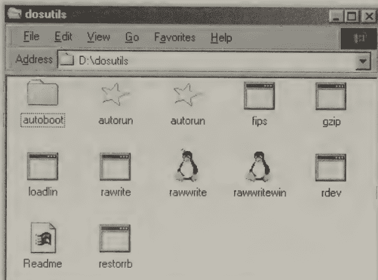

图 3-1.`dosutils`目录

> 注意：在这个示例中，CD-ROM 驱动器被指定为字母`D:`；你自然需要为你自己的机器选择指定 CD-ROM 驱动器的器号。

你可能注意到同一个程序有一个 DOS 版本，即`rawrite`。事实上，它是该程序的原始版本：`rawrite`是该程序的图形化前端。

启动程序，如图 3-2 所示。

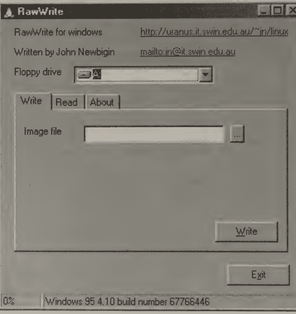

图 3-2.`rawrite`程序

选择要复制的启动镜像和目标设备（此处如图 3-3 所示，为`A:`）。

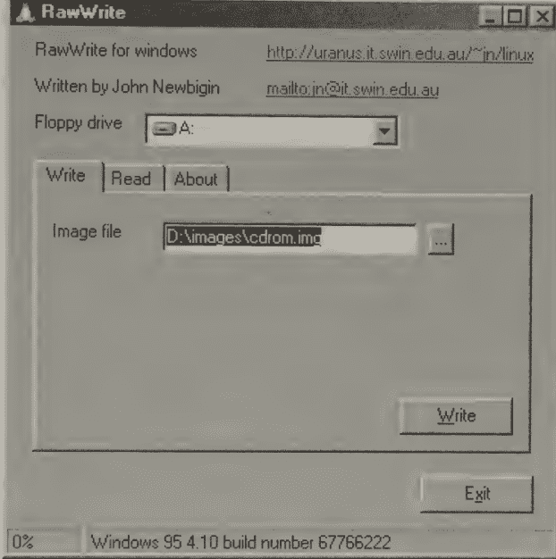

图 3-3.使用`rawrite`的示例

然后，如果你还没有这样做，请向你选择的软驱驱动器插入一张空磁盘并点击`Write`。完成后，点击`Exit`，你就有了一个安装你的 Mandrake Linux 发行版的启动盘。

### 3.2.2. 在 GNU/Linux 下

如果你已经安装了 GNU/Linux（另一个版本，或者在另一台机器上，例如朋友借给你的 Mandrake Linux CD），请执行以下步骤：

1. 挂载 CD-ROM。让我们假设挂载点为`/mnt/cdrom`；
2. 以`root`身份登录；
3. 向驱动器中插入一张空磁盘并输入：

```bash
$ dd if=/mnt/cdrom/images/cdrom.img of=/dev/fd0
```

注意：将`/dev/fd0`替换为你机器上相应的软驱驱动器名称。完成后，你的启动盘就就绪了。

## 3.3. 支持的硬件

如果你的 BIOS 可以从 CD-ROM 启动，并且你想执行 Mandrake Linux 的标准安装……（此处对应原文重复重复的逻辑）

Mandrake Linux 能够处理大量设备，除了前一节提到的设备外，你可以预期其他硬件将正常工作。

某些类型的设备在 GNU/Linux 下仍然存在问题，特别是即插即用设备：但你可以使用 Windows 来发现它们的工作配置。如果你打算在给机器保留一个 Windows 版本的同时安装 Mandrake Linux，你可以先忽略这一节，如果在 GNU/Linux 下遇到问题，再回到这里。

对于这一点，在 Windows 下启动，右键点击“我的”图标，选择“属性”，选择“设备管理器”选项卡，然后选择“按连接类型显示设备”（图 3-4）。

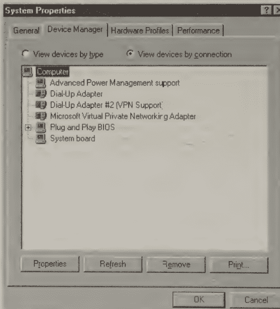

图 3-4. Windows 设备管理器

如果你有`ISA`设备，当你调出目录结构时可以查看它们（图 3-5）。（注：原文此处未提供图 3-5 实际内容，此处按要求保留文字描述）

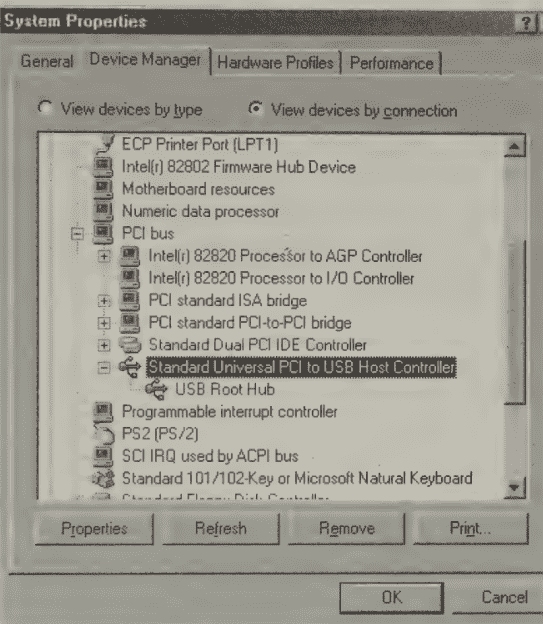

图 3-5.`ISA`总线的目录结构

你可以在目录结构的这部分找到`ISA`设备。如果只看到数据端口有一个条目，请忽略它。如果存在设备且没有冲突，你就可以选择并点击“属性”按钮（图 3-6）。

# 第 3 章. 安装之前

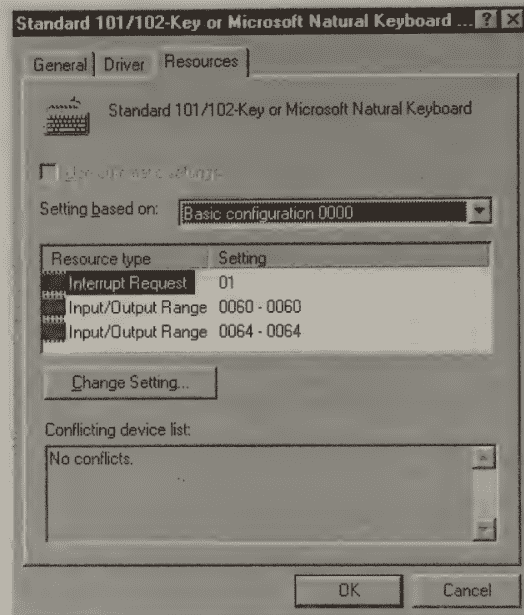

图 3-6. 键盘资源

你必须记录下所使用的基地址（输入/输出范围）以及`IRQ`。还要写下声卡卡使用的`DMA`通道。

如果你的`ISA`卡是即插即用的（plug'n'play），你将不得不按照上一节的说明正确配置 BIOS。但即使你这样做了，GNU/Linux 可能也无法找到它。不过，你可以禁用特定设备的即插即用。如果制造商提供了程序，你应该有一张包含该程序的磁盘，允许将卡重置为非即插即用。制造商提供了一个执行此操作的设置程序。如果你有这类程序（或可以从制造商网站获取），启动它，使用 Windows 使用的参数设置设备配置并禁用即插即用。之后，GNU/Linux 可以在安装过程中看到它。

不过，不必太担心声卡。大多数情况下它们会自动配置（automagically），你可以在安装后重新配置它们，而不是在安装期间。参见第 210 页“配置你的硬件”。

# 第 4 章. 磁盘与分区

如果你正在阅读这一章，意味着你决定对 Mandrake Linux 进行专家级安装，这要求你理解分区。或者你只是出于好奇，那也没问题 :)

本节提供了 PC 分区方案的完整描述。只有当你打算手动设置硬盘分区时，它才有用。如果你不理解我们在表达什么，可以安全地忽略本节；安装程序可以自动为你完成一切操作。

## 4.1. 硬盘的结构

基本上，磁盘在物理上被划分为许多扇区。一组扇区可以形成一个分区。粗来说，你可以创建任意数量的分区；每个分区都被视为一个独立的硬盘。

### 4.1.1. 扇区

为了简单起见，硬盘仅仅是扇区的序列。扇区是硬盘上最小的数据单元，其大小通常为 512 字节。对于具有`n`个扇区的硬盘，扇区的编号从`0`到`n-1`。

### 4.1.2. 分区

使用多个分区允许你可以在真实的物理硬盘内部创建许多虚拟硬盘。这有许多优势：

- 不同的操作系统使用不同的磁盘结构（称为文件系统）；Windows 和 GNU/Linux 就是如此。在硬盘上拥有多个分区允许你可以在同一块物理硬盘上安装不同的操作系统。
- 出于性能考虑，单一操作系统可能倾向于使用带有不同文件系统的驱动器，因为它们用于完全不同的用途。GNU/Linux 需要一个名为“swap”（交换分区）的第二个分区，用于虚拟内存。
- 最后，将操作系统的不同部分分离到不同的分区中可能非常有用，即使它们使用相同的文件系统。在最简单的配置中，你可以将文件分成两个分区：一个用于个人数据，另一个用于程序。这允许你在更新操作系统时，完全擦除程序分区，同时保持数据分区的安全。
- 硬盘上的物理错误通常位于相邻的扇区，而不是分散在磁盘上。将你的文件分布到不同的分区中将限制硬盘物理损坏时的数据丢失。

通常，分区类型指定了该分区应包含的文件系统。不同的操作系统识别其中某些类型，但不能识别其他类型。更多信息请参见《参考手册》中关于 GNU/Linux 文件系统的章节。

### 4.1.3. 定义你的磁盘结构

#### 4.1.3.1. 最简单的方案

即只有两个分区：一个用于交换空间，另一个用于文件¹。

> 提示：交换分区大小的经验法是选择内存大小的两倍。然而，对于大内存配置（`>512 MB`），此规则不再适用，更倾向于较小的尺寸。

¹ 目前用于 GNU/Linux 文件的文件系统称为`ext2`

#### 4.1.3.2. 另一种常见方案

正如我们之前讨论的，即当你选择将数据与程序分离。为了提高效率，通常会定义第三个名为“root”（根目录）的分区并标记为`/`。它将处理启动系统所需的程序和基础维护程序。

因此，我们可以定义四个分区：

- `Swap`：类型为`swap`的分区，大致相当于内存大小的两倍。


- `Root: /`：它是最重要的数据分区。它不仅包含系统运行的重要数据，还作为你可能拥程序的挂载点。

- `/var`：在示例中，我们使用了在主硬盘上分区的例子，`100MB` 通常足够了。

- `Home`：这里是个人目录。

### 4.1.3.3. 特殊配置

在为特定用途（如防火墙）设置机器时，其需求与标准桌面有径然不同。对于此类情况，鼓励你在开始之前就仔细考虑你的需求。

> 提示：如果在在使用系统一段时间后，你发现可以调整分区大小。请参见第 226 页“管理分区”。

## 4.2. 磁盘命名规范

GNU/Linux 使用逻辑方法为分区命名。首先，在对分区进行编号时，它忽略了每个分区的文件系统类型。其次，它根据分区所在的磁盘为分区命名。主从 IDE 设备（无论是硬盘、CD-ROM 驱动器或其他任何设备）分别被称为 `/dev/hda` 和 `/dev/hdb`；在辅助接口上，主设备和从设备分别称为 `/dev/hdc` 和 `/dev/hdd`；如果你的电脑包含其他 IDE 接口（例如某些扩展卡上的 IDE 接口），磁盘将被称为 `/dev/hde` 等。SCSI 磁盘根据它们在 SCSI 链上的出现顺序（取决于 ID 的递增）被称为 `/dev/sda`、`/dev/sdb` 等。SCSI CD-ROM 驱动器被称为 `/dev/scd0`、`/dev/scd1`，始终按照它们在 SCSI 链上的出现顺序排列。

分区根据其所在的磁盘按以下方式命名（在示例中，我们使用了在主主 IDE 硬盘上分区的例子）：

- 如果存在，主分区（或扩展分区）命名为 `/dev/hda1` 到 `/dev/hda4`；

- 逻辑分区（如果有的话）则根据它们在逻辑分区表中的出现顺序命名为 `/dev/hda5`、`/dev/hda6` 等。

因此，GNU/Linux 将如下命名分区：

| 第一个主分区 |
| :--- |
| `/dev/hda1` |
| 主 IDE IDE 硬盘 (`/dev/hda`) |

| 第一个主分区 | 第二个主分区 |
| :--- | :--- |
| `/dev/hdb1` | `/dev/hdb2` |
| 从主 IDE 硬盘 (`/dev/hdb`) |

图 4-1. GNU/Linux 下分区命名的第一个示例

# 第 4 章 磁盘与分区

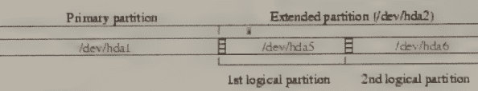

# 主 IDE 硬盘 (/dev/hda)

图 4-2. GNU/Linux 下分区命名的第二个示例

现在，当你需要操作各种分区和硬硬盘时，你就可以引用它们的名称了。你还会发现，即使 GNU/Linux 最初并不知道如何管理这些分区，它也会为它们命名（它会忽略这些分区不是原生 GNU/Linux 分区的这一事实）。

> 注意：对于当前的 2.4 内内核，Mandrake Linux 使用 Linux Devfs（设备文件系统）（`http://www.atnf.csiro.au/~rgooch/linux/docs/devfs.html`）。该系统确保了与上述方案的完全兼容，但这种兼容性在未来可能会消失。实际上，每个设备一旦可用或被需要，就会动态地添加到系统中。

例如，第一个 IDE 硬盘现在变为：

```
[root@localhost ~]# l /dev/hda
lr-xr-xr-x 1 root root 32 Sep 2 17:14 /dev/hda
        -> ide/hda0/target0/lun0/disc
```

# 第 5 章 使用 DrakX 进行安装

## 5.1. Mandrake Linux 安装程序简介

`DrakX` 是 Mandrake Linux 的安装程序。它具有图形用户界面，非常易于使用。它允许你随时返回之前的配置步骤，甚至可以根据你的技能水平选择安装类型。

> 警告

> 为了确保安装在最好的条件下进行，请确保连接并开启计算机上将要使用的所有设备：打印机、调制解调器、扫描仪等。因此，`DrakX` 将自动检测并配置它们。

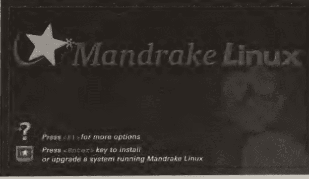

图 5-1. 安装欢迎界面

当你从 CD-ROM 或软磁盘开始安装时，首先会看到一个提供帮助的屏幕（图 5-1）。什么都不做将以普通模式开始安装。按 `F1` 打开帮助屏幕（图 5-2）。这里是一些可供的选项：

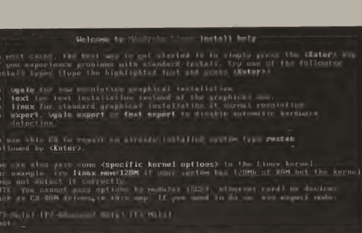

图 5-2. 可安装选项

- `vgalo`：如果你尝试普通安装但无法获得下所示图形界面，只需在此处输入 `vgalo` 尝试低分辨率安装。

- `text`：如果你的显卡非常老旧，图形安装完全无法工作，你始终可以选择文本模式。

- `expert` 模式：在某些情况下，硬件检测可能会导致计算机冻结。如果发生这种情况，请使用此模式防止其发生。然而，你需要手动提供硬件参数。`expert` 是针对之前模式（或普通模式）的选项。除非你清楚自己在做什么，否则不要选择此项。本手册将记录完整的专家类。如果你选择推荐类，请直接忽略此处显示的步骤。

- `kernel` 选项：你可以将这些命令行参数传递给内核。这对于安装程序无法确定内存量的机器特别有用。然后你只需要手动指定作为安装模式的选项，`mem=xxx`。例如，要在具有 256 MB 内存的计算机上以普通模式启动安装，请输入：`linux mem=256M`

在左侧，你可以看到各种安装步骤。根据安装进度，某些阶段可能可用。如果可用，当你将鼠标光标悬在它们上方时，它们会被亮。

表示各种阶段的按钮也可能是不同的颜色：

- 红色：此安装阶段尚未执行；

- 橙色：正在处理的安装阶段；

- 绿色：此安装阶段已配置。然而，如果你需要或想返回，没有任何会阻止。

本指南假设你正在进行后续截图所示的标准逐步安装。

## 5.2. 选择语言

第一步是选择你的首选语言。

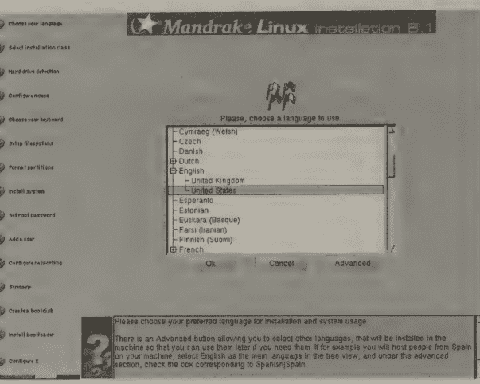

请为安装和系统使用选择你的首选语言。

点击 `Advanced` 将允许你在工作站上安装其他语言。选择其他语言将为系统文档和应用程序安装特定语言的文件。例如，如果你的机器将托管来自西班牙的用户，请在树形视图中选择英语作为主语言，并在 `Advanced` 部分点击对应于西班牙的灰色星号。

注意可能会安装多种语言。一旦选择了任何额外的区域，点击 `OK` 按钮继续。

## 5.3. 发行版许可条款

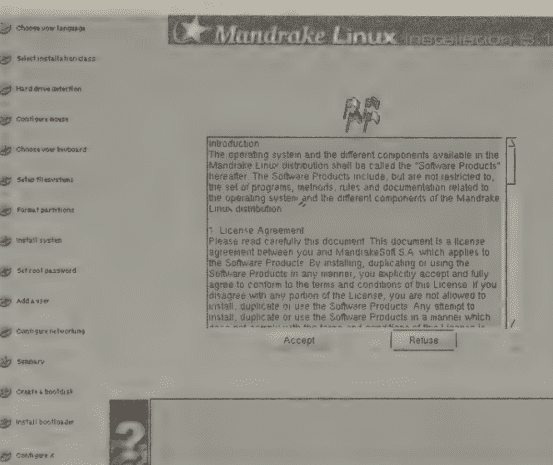

在继续之前，你应该仔细阅读许可条款，如果你不同意所有条款，点击 `Refuse` 按钮将立即终止。点击 `Accept` 按钮继续安装。

## 5.4. 安装类型

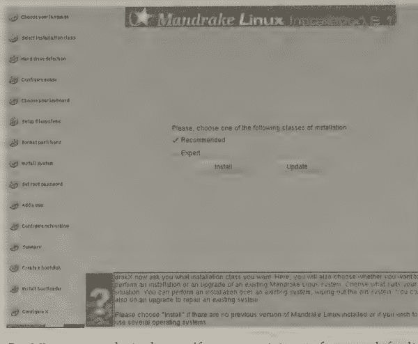

`DrakX` 现在需要知道你想执行默认（`Recommended`）安装，还是想要更多的控制（`Expert`）。`Install` 将完全清除旧系统。如果你正在升级现有系统，请选择 `Upgrade`。

根据你对 GNU/Linux 的了解，请选择以下之一进行安装：

- `Recommended`：如果你从未安装过操作系统，请选择此项。安装将非常简单，你只会被问几个问题。

- `Expert`：如果你拥有 GNU/Linux 知识，请选择此安装。专家模式将允许你进行高度自定义的安装。如果你没有良好的 GNU/Linux 知识，回答某些问题可能会困难，因此除非你清楚自己在做什么，否则不要选择此项。本手册将记录完整的专家类。如果你选择推荐类，只需忽略此处显示的步骤。

## 5.5. 磁盘检测与配置

注意：此步骤在推荐模式下通常被忽略。

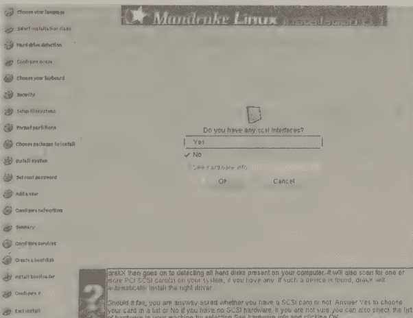

`DrakX` 正在检测计算机中的任何 IDE 设备。它还将扫描系统的一个或多个 PCI SCSI 卡。如果发现 SCSI 卡，`DrakX` 将自动安装相应的驱动程序。

由于硬件检测有时无法检测到硬件，`DrakX` 将询问你确认是否存在 SCSI 卡。如果你知道机器中安装了 SCSI 卡，请点击 `Yes`。你将看到一个供选择的 SCSI 卡列表。如果没有 SCSI 硬件，请点击 `No`。如果你不确定，可以通过选择 `hardware info` 并点击 `OK` 来检查机器检测到的硬件列表。检查硬件列表，然后点击 `OK` 按钮返回 SCSI 接口问题。

如果你必须手动指定适配器，`DrakX` 将询问你是否想为其指定选项。你应该允许 `DrakX` 卡特定选项的硬件需要初始化。这通常运行得良好。

如果 `DrakX` 无法探测需要传递的选项，你将需要手动为驱动程序提供选项。请查看用户指南（第 3 章，“收集你的硬件信息”部分），获取有关从硬件文档、制造商网站（如果你可以访问互联网）或 Microsoft Windows（如果你在系统的 Windows 上使用过此硬件）检索所需参数的提示。

## 5.6. 配置鼠标

注意：此步骤在推荐模式下通常被忽略。

## 第 5 章 使用 DrakX 安装


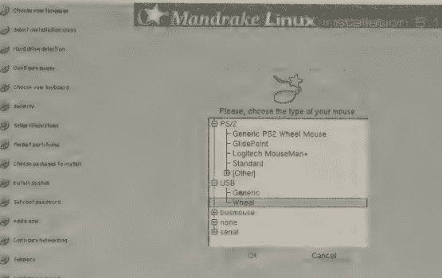

除非你特意点击左侧对应的步骤，否则 `DrakX` 均认为如此设置。默认情况下，`DrakX` 将你的鼠标视为双键鼠标并模拟第三按键，且能识别它是 `PS/2`、串口还是 `USB` 鼠标。

如果这并不是你想要的，你只需要在弹出的列表中为你的鼠标选择正确的类型即可。

默认情况下，`DrakX` 假设你有一个双键鼠标，并将其设置为模拟第三键键模式。`DrakX` 会自动识别它是 `PS/2`、串口还是 `USB` 鼠标。

如果你想指定不同类型的鼠标，请从提供的列表中选择合适的类型。

如果你选择了默认鼠标以外的类型，将进入一个鼠标测试界面。使用按钮和滚轮来验证设置是否良好。如果鼠标工作异常，按下空格键或 `RETURN` 键返回“取消”并重新选择。

### 5.7. 配置键盘

注意：此步骤在“推荐（Recommended）”模式下通常会被忽略。

- 选择你的语言
- 选择安装类型
- 分区磁盘
- 配置克隆
- 选择你的键盘
- 安全
- 编辑元数据
- 格式化分区
- 选择要安装的软件包
- 安装 `grub`
- 设置根密码
- `Polkit` 代理
- 配置网络
- 完成
- 创建启动盘
- 安装引导加载程序

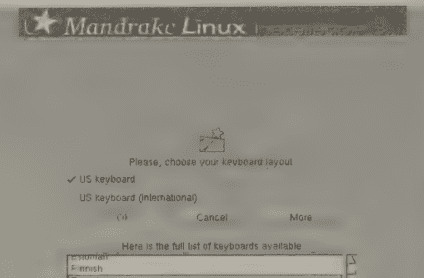

`Mandrake Linux`

请选择你的键盘布局

`US` 键盘（国际）

取消 更多

以下是可用键盘完整列表：

| 英语 |
| :--- |
| 法语 |
| 德语 (abm-out) |

`DrakX` 会根据你选择的语言为你选择正确的键盘，你甚至看不到这一步。然而，你拥有的可能并不存在一个与你的语言完全匹配的键盘：例如，如果你是一个说英语的瑞士人，你可能仍然希望键盘是瑞士键盘。或者，如果你说英语但住在魁北，你可能会发现自己处于同样的情况。在这两种情况下，你都必须返回此安装步骤并从列表中选择合适的键盘。

点击“更多（More）”按钮以查看支持的键盘完整列表。

### 5.8. 安全级别

此步骤在“推荐（Recommended）”模式下通常会被忽略。

- 选择安装级别
- 选择安装类型
- 硬件检测
- 配置鼠标
- 选择键盘
- 安全
- 设置硬盘分区
- 选择要安装的软件包
- 安装密码
- 网络与邮件
- 配置网络
- 配置文件系统
- 创建引导加载程序
- 配置它
- 安装

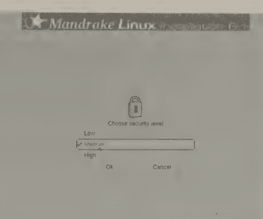

此时，是时候为机器选择所需的安全级别了。根据经验法则，机器的暴露程度越高、其中存储的数据越关键，安全级别就应该越高。然而，较高的安全级别通常是以牺牲易用性为代价的。请参阅参考手册中的 `MSEC` 章节以获取有关这些级别含义的更多信息。

如果你不知道该选什么，请保持默认选项。

### 5.9. 选择挂载点

- 选择安装位置
- 选择安装媒体类型
- 硬盘检测
- 配置网络
- 选择你的键盘
- 设置文本字段
- 格式化分区
- 安装环境
- 设置根密码
- 添加用户
- 配置网络
- 时区
- 创建引导加载程序
- 安装

`Mandrake Linux` 分区向导找到了以下解决方案：

- 使用现有分区
- 擦除整个磁盘
- 自定义分区

此时，你需要选择在硬盘上安装 `Mandrake Linux` 操作系统的位置。如果硬盘是空的，或者某个操作系统占用了其上所有的可用空间，你就需要对其进行分区。基本上，硬盘分区包括对其进行逻辑划分，以便为安装新的 `Mandrake Linux` 系统创建空间。

> 因为分区过程的影响通常是不可逆的

由于分区过程的影响通常是不可逆的，对于缺乏经验的用户来说，可能会可能会令畏畏和压力。幸运的是，有一个向导可以简化这一过程。在开始之前，请咨询手册并花些时间。

## 第 5 章 使用 `Drak` 安装

如果未定义分区，你需要使用向导创建它们。根据你的硬盘配置，有几个选项可用：

- **使用空闲空间**：此选项将直接对你的硬盘（们）进行自动分区。你不会收到进一步提示。
- **使用现有分区**：向导在你的硬盘上检测到一个或多个现有的 `Linux` 分区。如果你想使用它们，请选择此选项。
- **使用 `Windows` 分区的空闲空间**：如果你的硬盘上安装了 `Microsoft Windows` 且占用了所有可用空间，你必须为 `Linux` 数据创建空闲空间。要这样做，你可以删除 `Windows` 分区和数据（参见“擦除整个磁盘”或“专家模式”解决方案）或调整 `Windows` 分区的大小。调整大小可以在不丢失任何数据的情况下进行。如果你想在同一台计算机上使用 `Mandrake Linux` 和 `Microsoft Windows`，推荐使用此解决方案。

在选择此选项之前，请理解在此之后你的 `Microsoft Windows` 分区的大小将比现在小。你将有更少的可用空间来存储数据或安装新软件。

- **擦除整个磁盘**：如果你想删除硬盘上的所有数据和分区，并将其替换为新的 `Mandrake Linux` 系统，请选择此选项。请谨慎使用此解决方案，因为确认后无法撤销。
  > 警告
  如果你选择此选项，硬盘上的所有数据将丢失。

- **移除 `Windows`**：这将简单地擦除硬盘上的所有内容并从头开始，从头开始分区。硬盘上的所有数据将丢失。

如果分区已经定义（无论是来自之前的安装还是另一个工具），只需选择这些分区来安装你的 `Linux` 系统即可。

# 第 5 章 使用 `DrakX` 进行安装

> 警告
> 如果您选择此选项，磁盘上的所有数据都将丢失。

- **专家模式**：如果您想手动对硬盘进行分区，请选择此选项。请小心——这是一个强大但危险的选择。您极可能会丢失数据。因此，除非您清楚自己在什么，否则请勿选择此项。

### 5.10. 选择要格式化的分区

注意：在“推荐”模式下，通常会忽略此步骤。


任何新定义的分区在作为操作系统使用之前，都必须进行格式化。

此时，您可能希望重新格式化一些已存在的分区以擦除其中包含的数据。如果您想这样做，请选择您想要重新格式化的分区。

请注意，没有必要格式化所有现有的分区。您必须格式化包含操作系统的分区。

任何新定义的分区都必须格式化后才能使用（格式化意味着创建文件系统）。

# 第 5 章 使用 `DrakX` 进行安装

此时，您可能希望重新格式化一些已存在的分区以擦除其中包含任何数据。如果您想这样做，请也选择这些分区。

请注意，没有必要格式化所有预先存在的分区。您必须格式化包含操作系统的分区（例如 `/`、`/usr` 或 `/var`），但您不需要格式化包含您想要保留的数据的分区（通常是 `/home`）。

选择分区时请务必小心。格式化后，所选分区上的所有数据都将被删除，您将无法恢复其中任何数据。

准备好格式化分区后，点击“确定”。

如果您想为新的 `Mandrake Linux` 操作系统安装选择另一个分区，请点击“取消”。

如果您想选择要在磁盘上进行坏道块检查的分区，请点击“高级”。

### 5.11. 选择要安装的软件包

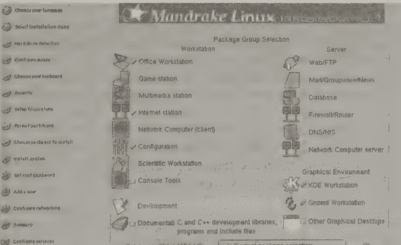

是时候指定您希望在系统上安装哪些程序了。`Mandrake Linux` 有数千个软件包可用，人们并不要求您背下所有它们。

如果您正在从 `CDROM` 进行标准安装，将需要指定您当前拥有的 `CD`。勾选与您拥有的 `CD` 对应的复选框并点击“确定”。

软件包根据机器的特定用途进行分组。

现在是时候指定您希望在系统上安装哪些程序了。`Mandrake Linux` 有数千个软件包可用，人们并不要求您背下所有它们。

如果您正在从 `CDROM` 进行标准安装，首先会被要求指定您当前拥有的 `CD`（仅限专家模式）。勾选 `CD` 标签并高亮显示您拥有的可用于安装的 `CD` 对应的复选框。准备好继续后，点击“确定”。

软件包根据机器的特定用途分组。组本身又分为四个部分：

- **工作站**：如果您计划将机器作为工作站，请选择一个或多个相应的组。
- **开发**：如果机器将用于编程，请选择所需的组（们）。
- **服务器**：最后，如果机器打算作为服务器，您将能够选择希望在机器上安装哪些最常用的服务。
- **图形环境**：这是您将选择自己偏好的图形化环境的地方。如果您想拥有图形化工作站，至少必须选择一个！

> 提示：将鼠标光标悬停在组名称上将显示关于该组的简短说明文本。

您可以勾选“单个软件包选择”复选框，如果您对提供的软件包很熟悉，或者您想对将安装的内容拥有完全控制权，这将非常有用。

如果您是从“更新”模式开始安装的，可以取消勾选单个软件包选择复选框。

# 第 5 章 使用 `DrakX` 进行安装

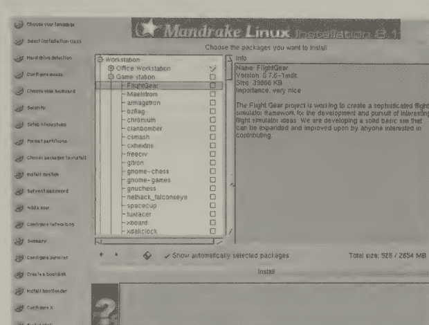

最后，根据您是否选择软件包，将呈现一个包含软件包的树。在浏览树时，您可以选择整个组或单个软件包。当您准备好完成时，点击“安装”。根据您的选择，是否需要格式化，系统将显示一个预计完成的时间。


如果您选择了某个软件包，由于`Mandrake Linux`的版本，可能会要求您插入不同的磁盘。`DrakX`知道某个软件包位于另一个磁盘。在第一次连接时，警告就会出现。

> 警告：如果选择了某个软件包，由于`Mandrake Linux`的版本，可能会要求您插入不同的磁盘。

> 提示：将鼠标光标悬停在组名称上将显示关于该组的简短说明文本。

注意：自动选项仅在您选择软件包时禁用警告。如果您输错了两次密码，在第一次连接时将使用。

注意：底部的图标允许在安装期间创建此类。

# 第 5 章 使用 DrakX 进行安装

## 5.12. 多光碟

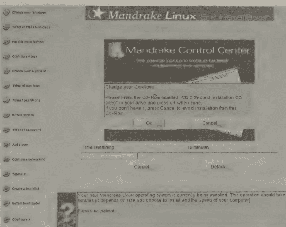

`Mandrake Linux`安装分布在多个CD上。`DrakX`知道某个软件包位于另一个CD并要求您插入。

## 5.13. Root 密码

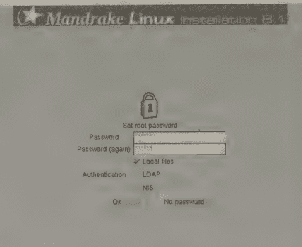

这是对`GNU/Linux`系统安全至关重要的决策点：`root`是管理员，它是唯一授权更新、添加用户、更改全局配置等的人。简而言之，`root`可以做一切！这就是为什么您必须选择一个难以猜测的密码——`DrakX`会告诉您它是否太简单。如所示，可以选择不输入密码，但我们强烈建议不要这样做。密码应该是字母和数字的混合，且至少有8位。永远不要写下密码——这会让破解系统变得容易。但是请不要让密码太长或太复杂，因为您必须能够在不费力的情况下记住它。

在输入密码时，屏幕上不会显示。因此，您必须输入两次密码以减少错误概率。

在专家模式下，将被询问是否将连接到验证服务器，例如`NIS`或`LDAP`。

## 5.14. 添加用户

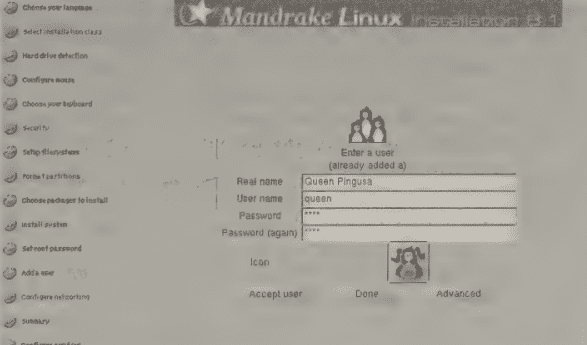

`GNU/Linux`是一个多用户系统，这意味着每个用户都可以有自己的偏好、自己的文件等。您可以阅读《用户指南》了解更多信息。但与`root`（管理员）不同，您在此处添加的用户将无权更改他们自己的文件和配置之外的任何内容。您必须为您的创建一个普通用户-

这是你日常使用时登录的账户。虽然每天以`root`身份登录非常方便，但也可能非常危险！极其微小的错误也可能导致你的系统无法运行。如果你作为普通用户犯了严重错误，你可能只会丢失一些信息，而不会丢失整个系统。

首先，你必须输入真实姓名。当然，这并不是强制性的——你实际上可以输入任何内容。`DrakX`将提取你在输入框中输入的第一个单词，并将其作为用户名（`User name`）。这是该用户登录系统时使用的名称。你可以更改它。然后，你需要在这里输入密码。从安全角度来看，非特权（普通）用户的密码没有`root`用户的密码那么至关重要，但这并不是忽视它的理由——毕竟，你的文件面临着风险。

如果你点击“接受用户（`Accept user`）”，就可以根据需要添加任意数量的用户。为你的每位朋友添加一个用户：例如，你的父亲或姐姐。当你添加完所有想要的用户后，选择“完成（`Done`）”。

> 提示：点击“高级（`Advanced`）”按钮允许更改用户的默认shell（默认为`bash`）。

## 5.15. 配置你的网络

注意：此步骤通常在推荐模式（`Recommended mode`）下被忽略。

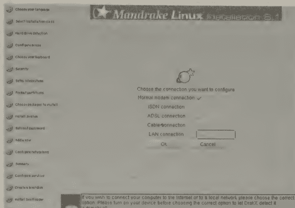

如果你希望将计算机连接到互联网或局域网，请选择正确的选项。在选择正确选项之前请开启设备，以便`DrakX`自动检测。

`Mandrake Linux`在安装时建议配置互联网连接。可用的连接包括：传统调制解调器、`ISDN`调制解调器、`ADSL`连接、电缆调制解调器，最后是简单的以太网连接。

在这里我们不会详细介绍每个配置。只需确保你拥有来自互联网提供商或系统管理员的所有参数。

你可以咨询有关互联网连接的手册章节详情，或者只需等待系统安装完成后使用那里描述的程序来配置连接。

如果你想在安装后以后配置网络，或者已经完成了网络连接配置，请点击“取消（`Cancel`）”。

## 5.16. 检查杂项参数

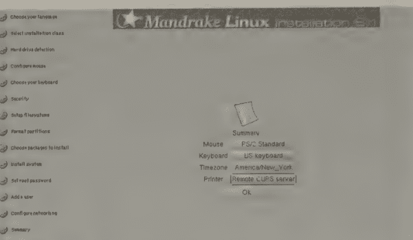

这里列出了与你的机器相关的各种参数。根据你安装的硬件，你可能会看到以下条目：

- 鼠标：检查当前的鼠标配置，必要时点击按钮进行更改。
- 键盘：检查当前的键盘布局配置，必要时点击按钮进行更改。
- 时区：`DrakX`默认根据你选择的语言猜测你的时区。但同样地，对于键盘的选择，你可能并不在所选语言对应的国家。因此，你可能需要点击“时区（`Timezone`）”按钮，以根据你所在的时区配置时钟。
- 打印机：点击“无打印机（`No Printer`）”按钮将打开打印机配置向导。
- 声卡：如果系统中检测到声卡，将显示在这里。安装时无法进行修改。
- 电视卡：如果系统中检测到电视卡，将显示在这里。安装时无法进行修改。
- `ISDN`卡：如果系统上检测到`ISDN`卡，将显示在这里。你可以点击按钮更改与其相关的参数。

## 5.17. 在启动时选择可用服务

注意：此步骤通常在推荐模式（`Recommended mode`）下被忽略。

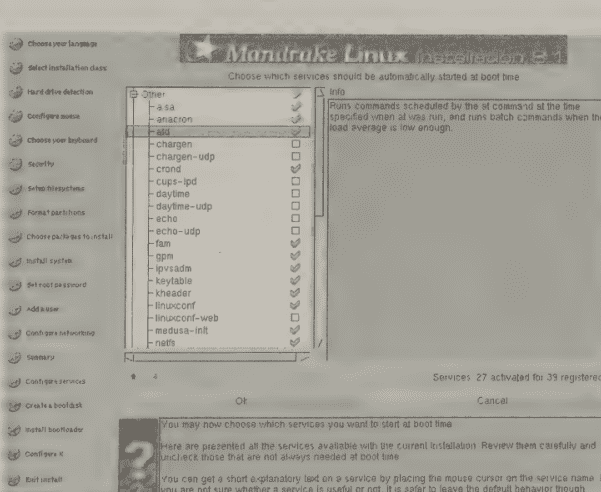

现在可以选择希望在启动时启动的服务。

这里是当前安装中所有可用的服务。请仔细检查，并取消勾选那些启动时并不总是需要的服务。

你还可以创建一个快捷方式，通过`at`命令在设置时指定的时间运行计划命令，并在负载足够低时运行批处理命令。

> 提示：通过选择特定服务可以获取有关该服务的简短说明。然而，如果你不确定某个服务是否有用，保持默认行为更安全。

在此阶段，如果你打算将机器用作服务器，请务必小心：你可能不想启动任何你不需要的服务。请记住，如果在服务器上启用多个服务将可能是危险的。通常情况下，只选择你真正需要的服务。

## 5.18. 启动磁盘

注意：此步骤通常在推荐模式（`Recommended mode`）下被忽略。


`Mandrake Linux` CDROM内置了救援模式。你可以通过从CDROM启动访问它，在启动时按`F1`键并在提示处输入`rescue`。如果你的计算机无法从CDROM启动，在至少两种情况下你应该回到此步骤寻求帮助：

当安装引导程序时，`DrakX`将重写你主磁盘的`MBR`，以便你可以启动`Windows`或`Linux`。如果你需要重新安装`Windows`，你必须确保不要将引导程序安装在软磁盘上。

当你点击此步骤时，系统会要求你格式化磁盘。软磁盘必须为空或包含不需要的数据。

## 5.19. 安装引导程序

注意：此步骤通常在推荐模式（`Recommended mode`）下被忽略。


`LILO`和`GRUB`是`GNU/Linux`的引导程序。此阶段通常是自动化的。事实上，`DrakX`会分析引导区并根据发现的情况采取行动：

- 如果发现`Windows`引导区，它将其替换为`GRUB/LILO`；
- 如果发现`GRUB`或`LILO`引导区，它将其替换为新的；
- 如果疑问，`DrakX`将显示一个带有各种选项的对话框：
  - 使用的引导程序：你有三种选择：
    1. 图形菜单`LILO`：如果你喜欢图形界面的`LILO`。
    2. `GRUB`：如果你喜欢`GRUB`（文本菜单）。
    3. 文本菜单`LILO`：如果你喜欢文本界面的`LILO`。
  - 启动设备：大多数情况下你不会更改默认（`/dev/hda`），但如果你需要，可以将引导程序安装在第二个硬盘（`/dev/hdb`）甚至软磁盘上。
  - 启动默认镜像之前的延迟：重启计算机时，这是授予用户选择默认项之外的其他项目的等待时间。

> 注意，如果你选择不安装引导程序（在此选择“取消”），你必须确保你有办法启动`Mandrake Linux`系统！在更改任何选项之前，请确保你清楚自己在做什么。

> 提示：点击此对话框中的“高级（`Advanced`）”按钮将为你提供留给专家级用户的高级选项。

`Mandrake Linux`安装它自己的引导程序，该程序将允许启动`GNU/Linux`或你系统上的任何其他操作系统。如果你的机器上安装了另一个操作系统，它将自动添加到启动菜单中。在这里，你可以选择微调现有选项。双击现有条目允许你更改其参数或删除它；`Add`会创建一个新条目；`Done`将进入下一个安装步骤。


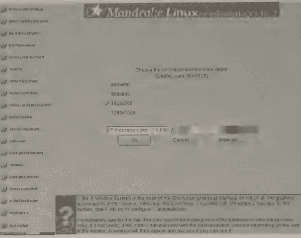

X（窗口系统）是 Mandrake Linux 内的 GNU 环境（`KDE`、`Gnome`、`AfterStep`、`WindowMaker`...）的核心。在本节中，`DrakX` 将尝试自动配置 X。

这种情况极其罕见，除非硬件非常老旧（或非常新）。如果成功，它将根据显示器的尺寸自动启动具有最佳分辨率的 X。随后会弹出一个窗口，询问你是否能看到它。

如果你正在进行专家级安装，将进入 X 配置向导。有关此向导的更多信息，请参阅手册的相关章节。

如果你能看到消息并回答“是”，则 `DrakX` 将继续执行下一步。如果你看不到消息，则仅意味着配置错误，测试将在 10 秒后自动结束并恢复屏幕。

## 第 5 章. 使用 DrakX 安装

- Mandrake Linux

- 选择安装类型

- 硬件检测

- 配置分区

- 选择键盘

- 安全

- 简单界面

- 分区大小

- 选择要安装的桌面

- 安装软件

- 设置根密码

- 添加用户

- 配置网络

- 总结

- 创建桌面快捷方式

- 安装引导加载程序

- 配置 X

- 退出

- 你想做什么？

- 更改显示器

- 更改显卡

- 更改服务器选项

- 更改分辨率

显示信息

- 再次测试

- 退出


第一次尝试 X 配置时，你可能对其显示并不满意（屏幕太小、向左右偏移...）。因此，即使 X 正常启动，`DrakX` 也会询问你配置是否符合需求。它还将通过显示其找到的所有有效模式列表来建议更改，并让你选择其中一种。

作为最后手段，如果你仍然无法让 X 工作，请选择“更改显卡”，选择“未列出的显卡”，当提示你想使用哪种服务器时，选择“`FBDev`”。这是一个适用于任何现代显卡的备用方案。然后选择“再次测试”以确保无误。

## 第 5 章. 使用 DrakX 安装

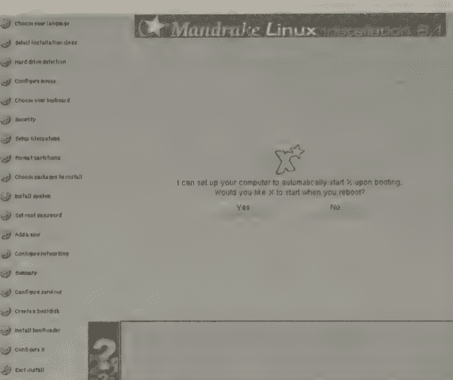

最后，系统将询问你是否要在启动时查看图形界面。请注意，即使你选择不测试配置，也会询问这个问题。显然，如果你的机器将作为服务器运行，或者你没有成功配置显示，那么你应该回答“否”。

## 5.21. 完成了！

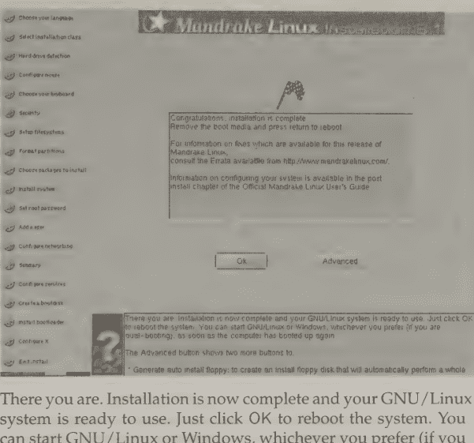

大好了。安装已完成，GNU/Linux 系统已准备就绪。只需点击 OK 重启系统。计算机重启后，你就可以启动 GNU/Linux 或 Windows，取决于你的喜好（如果你安装了双系统）。

提示：“高级”按钮显示了另外两个按钮，用于：

- 生成自动安装软盘：创建一个安装软盘，该磁盘将在没有操作员帮助的情况下自动执行整个安装，与你刚刚配置的安装类似。

注意，点击该按钮后有两种不同的选项：

- 重放。这是一种部分自动安装，因为分区步骤（仅限此步骤）仍保持交互性。

- 全自动安装：硬盘将被完全重写，所有数据将丢失。

此功能在安装大量相似的机器时非常有用。请参阅我们网站上的“自动安装（`http://www.mandrakelinux.com/drakx/auto_inst.html`）”章节。

## 第 5 章. 使用 DrakX 安装

- 2. '保存软件包选择'：按之前的操作保存软件包选择。然后，在进行另一次安装时，将软盘插入驱动器，按下 `F1` 键进入帮助屏幕，并运行 `linux defcfg="floppy"` 启动安装。

## 5.22. 如何卸载 Linux

嗯，我们不建议这样做，因为你很快就会后悔，但这是你的权利：--)

该过程分两个简单的步骤完成：

- 1. 通过“管理分区”（第 226 页）删除硬盘上的所有分区，并将其替换为单个 `FAT` 分区；

- 2. 从主引导记录 (`MBR`) 中卸载引导加载程序（通常是 `grub`）。要执行此操作，请在 DOS 下启动并运行 `fdisk /mbr` 命令。）

如果你有另一个操作系统，请咨询其文档了解如何高效地完成相同的操作。

再见，感谢使用 Mandrake Linux :-)

- 1. 你需要一个 `FAT` 格式的软盘（在 GNU/Linux 下创建，请输入 `mformat a:`）

## 第 6 章. 首次连接 Mandrake Linux

在本章中，我们将讨论在系统安装后应该执行的任务。事实上，这些任务应该被视为安装过程的一部分。

我们假设你已经登录系统；可能是因为你在安装期间选择了自动登录（“添加用户”，第 43 页），或者你是手动登录的。如果你不知道如何登录，请阅读“开始和结束会话”（第 65 页）。

### 6.1. Mandrake 首次使用向导

当用户首次登录到新安装的 Mandrake 系统时，会弹出一个一次性配置向导。该向导将帮助你配置以下三个点：

- 桌面主题。此步骤允许你选择环境的外观和交互方式，使其更符合你的预期。

- 网络配置。如果你在安装期间未进行此操作，将启动“配置 Internet 连接”（第 181 页）向导。

- Mandrake 注册。此向导引导你注册成为 Mandrake 用户。此步骤需要提供个人信息；在提供数据之前请仔细阅读“Mandrake 隐私政策”。

完成此步骤后，你将收到一封确认电子邮件。另见下一节：`MandraOnline`，第 57 页。

## 第 6 章. 首次连接 Mandrake Linux

### 6.2. MandrakeOnline 服务

`MandraOnline` 是由 Mandrake-Soft 提供的一项新服务。它是什么？一项订阅服务，旨在让你的 Mandrake Linux 更易使用。

该服务包含三个主要功能：

- 电子邮件提醒。根据你机器上安装的软件包及其版本，你将收到有关安全威胁和安全更新的电子邮件提醒。直接给你的解决方案确保了系统最大的安全性。

- `MandrakeExpert` (`http://www.mandrakeexpert.com/`) 折扣。订阅 `MandraOnline` 可让你在购买支持服务时享受折扣。

- 电子邮件别名。最后，你将获得一个格式为 `<YourName@mandrakeonline.net>` 的酷电子邮件别名，指向你在订阅时提供的电子邮件地址。

从桌面上的图标启动 `MandraOnline` 向导，可以免费试用体验此服务。

此向导首先询问你是否已在 Mandrake 首次使用向导（第 57 页）中注册了账户。如果没有，勾选框并按照订阅流程操作。将被要求使用订阅完成后收到的确认邮件中的信息进行登录。完成后，你的机器配置信息将发送到我们的服务器（当然是在你同意的情况下）。

### 6.3. 其他可选配置

如果你的机器旨在一直连接到互联网或经常连接，你真的应该考虑在上面安装防火墙。请参阅“保护你的机器”（第 189 页）进行简单高效的防火墙设置。

如果你希望将这台新的 Mandrake Linux 系统作为局域网（`LAN`）服务器，可以启动参考手册中详细的服务器向导。它们将引导您为您的局域网主机配置许多实用的服务。

# 第 7 章：用户指南简介

欢迎使用 Mandrake Linux！感谢支持！本用户指南将帮助您日常使用 Mandrake Linux 系统。以下是用户指南各章节的摘要。

第一章“初学者 Linux”位于第 65 页，针对那些对 GNU/Linux 毫无了解或极少了解的读者。这些是非常基础级的信息。如果您以前使用过带有图形界面的 GNU/Linux 系统，请忽略本章。

下一章专门介绍 `KDE`，它是 Mandrake Linux 的默认图形环境。您将发现它是一个强大的工作环境，非常直观且完全可配置。您可能会被它的功能所惊叹。

随后，您将遇到一个关于 `GNOME` 的章节，它是另一个备受欢迎的图形界面。它将引导您了解它的众多功能、个性化设置等更多内容。

接下来是名为“日常应用”的章节，位于第 119 页，描述了如互联网工作、`StarOffice` 和 `GIMP` 等关键应用程序。

继续读下去，您将发现由 Mandrake Linux 专门设计的系统配置工具章节。这些工具分为四个章节：首先是如何配置互联网连接，然后是用于保护机器安全的 `Bastille` 工具。之后是许多可以从 `MandrakeSoft` 控制中心访问的小型图形化工具。最后，我们将解释如何管理您的软件包。

下一节致力于文档介绍。除了向您介绍 GNU/Linux 系统上可用的文档外，我们还提供了一些指向网站的有用链接。

最后，作为附录，您将找到 `GPL` 和 `GFDL` 的文本，它们分别是大多数 GNU/Linux 应用以及本手册的许可协议。在书的最后，您将找到一个详尽的术语表。

## II. 新世界

## 第 8 章：初学者 Linux

## 8.1. 引言

本章为没有经验的初学者编写。如果您已经知道如何在桌面上创建图标，请直接跳到下一章。如果不知道，请继续读下去 :-)


如果我们假定所有用户都知道如何操作 `Windows`，编写这一章将会更容易。相反，我们决定从零开始编写所有内容。因此，任何用户，无论是否有经验（即使几乎不知道如何在屏幕上移动鼠标指针），都可以启动程序、正确地关闭它们并关闭电脑。读完本章后，后续的所有章节对您来说将会有意义得多。

我们假设您正坐在一台运行中的 `Linux` 电脑前，电脑启动后会自动显示图形登录屏幕。后者在屏幕中间显示一个小框，包含两个标记为登录（`login`）和密码（`password`）的字段。如果您之前遵循了《安装指南》的操作，您应该能看到这些。

鉴于 `GNU/Linux` 下有大量的图形界面，记录所有界面是不可能的。我们将讨论最流行的两个：`KDE` 和 `GNOME`。

## 8.2. 开始和结束会话

理解“登录”（`log in`）和“注销”（`log out`）这两个术语非常重要，因为您不太会在普通字典中找到这些词，尽管您可能会在网络字典中找到它们。登录意味着您尝试使用的计算机系统将您识别为一个用户。登录后，系统会执行一系列操作以允许您访问系统资源。通过登录，您启动了一个所谓的“会话”（`session`）。

注销意味着您告诉系统您不再需要使用它。因此，您正在使用的资源可以供其他人使用了。

## 第 8 章：初学者 Linux

**注意：** 尽管这些定义在本章范围内是有效的，但它们过于简化且在技术上是不正确的。当您阅读后续章节时，将更好地理解这些概念。

### 8.2.1. 识别您的身份

此时，您需要完全理解登录和密码的概念。前者识别您的身份（通常是您的名字或昵称），而后者是您的秘密，这样就不会有人能访问您的电脑并愚劣地欺骗您的“黑客伴侣”。如果您仔细地执行了安装，您已经有了登录名和密码。如果情况并非如此，您必须立即要求安装您电脑的人来提供帮助！

闲话足够了——让我们行动吧！您目前正对着以下显示器（图 8-1）。当然，它看起来略有不同，因为企鹅图标下方显示的用户名可能不同。

66

## 第 8 章：初学者 Linux

## 欢迎来到 `test81` 的 `Linux`


`pingusa`

`Login:`

`Password:`

`Session Type:` `default`

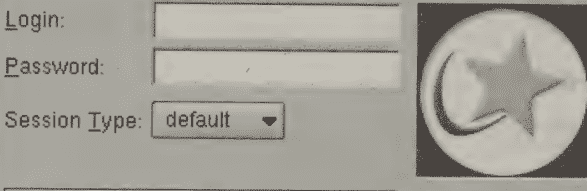

图 8-1. 登录窗口

登录程序分为四个简单的步骤：

- 1. 将鼠标指针放在与您的登录名对应的图标上，点击鼠标左键。¹

- 2. 验证您的登录名是否正确出现在下方的登录字段中，现在输入您的秘密密码。

- 3. 这一步是可选的，允许您选择一个图形环境。如您在会话类型（`Session Type`）字段所示，默认环境是 `KDE`。您可以通过从下拉菜单中选择来更改它，建议我们选择 `KDE` 或 `GNOME`。

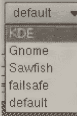

图 8-2. 下拉会话类型

- 4. 最后，只需点击“Go!”按钮开始您的会话。请耐心等待！可能需要几秒钟桌面才能就绪。

## 第 8 章：初学者 Linux

**注意：** 如果您是首次在刚安装的机器上登录，您将看到 `Mandrake` 首次向导。更多信息请参见第 57 页的 `Mandrake` 首次向导。

### 8.2.2. 关闭您的会话

如果一切顺利，您现在进入工作环境。在本节中，我们不再详细描述各种组件，因为这将在后面的章节中进行。根据您之前选择的环境，您将看到以下屏幕之一：

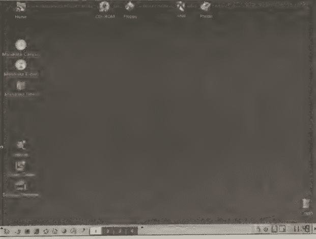

图 8-3. 首次使用 `KDE`

## 第 8 章：初学者 Linux

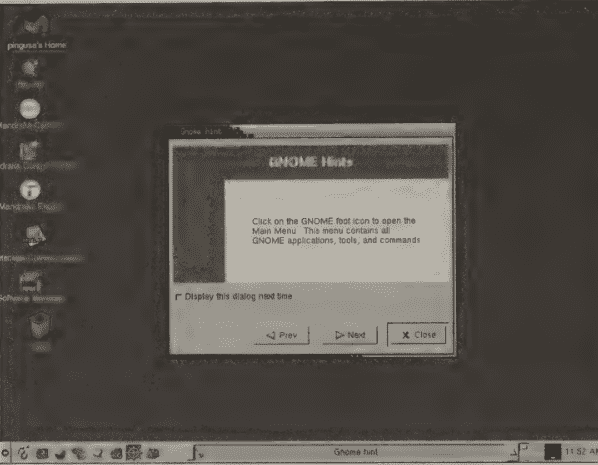

图 8-4. 首次使用 `GNOME`

您现在可以探索您的！尽情享受！

当您最终完成工作或感到累时，不要忘记告诉系统您要离开，即注销。这将释放您正在使用的资源，供其他用户使用。

在 `KDE` 和 `GNOME` 中，可以通过多种方式进行注销。可以使用 `K/foot` 菜单、注销图标以及右键点击弹出菜单（仅限 `KDE`）。让我们看看不同的步骤：

在 `KDE` 下

- 使用 `K` 菜单。点击 `K` 菜单并选择注销（`Logout`）。将弹出一个如下所示的窗口请求您确认。

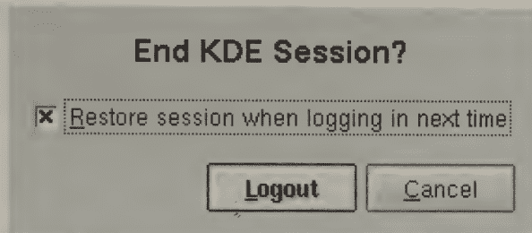

**提示：** 如果你希望在下次登录时自动打开之前正在使用的应用程序，只需在下次登录时勾选“恢复会话”（`Restore session`）复选框。请注意，并非所有应用程序都支持此功能。

- 在桌面上点击右键。

  你可以在桌面的“空白”处点击右键，就会弹出一个如下所示的弹出菜单。

# 第 8 章. Linux初学者

- `新建`

- `书签`

- `撤销`

- `粘贴`

- `桌面帮助...`

- `运行命令...`

- `配置背景...`

- `配置桌面...`

- `启用桌面菜单`

- `整理窗口`

- `窗口级排列`

- `图标对齐`

- `排列图标`

- `刷新桌面`

- `锁定屏幕`

- `注销`

**图 8-6. 使用 `KDE` 弹出菜单注销**

只需点击“注销”，就会出现确认窗口。

- 使用注销图标。

  你可以点击任务栏上的注销图标来注销。和既往一样，会弹出确认窗口。

# 第 8 章. Linux初学者

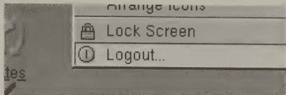

图 8-7. `KDE` 的注销图标。

# 在 `GNOME` 下

- 使用 `Foot` 菜单。

  点击 `Foot` 菜单并选择“注销”。在注销之前会弹出一个窗口要求你确认。

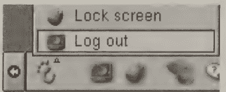

图 8-8. `GNOME` 的注销菜单

- 使用注销图标。

  点击图 8-9 所示的注销图标。注销之前会弹出一个窗口要求你确认。


图 8-9. `GNOME` 的注销图标

# 第 8 章. Linux初学者

点击图标后，屏幕会变暗，并弹出一个带有选项的小框。现在只需忽略这些消息和选项，直接点击“是”按钮。

## 8.2.3. 关于安全的一些注意事项

对于你的 `Mandrake Linux` 设备，掌握一些安全概念是非常重要的。其中某些对某些人来说可能显而易见，但在这里列：

- 不要将密码写在任何任何人都能看到的纸上（例如便利签贴）。

- 务必确保你的密码足够复杂，能让别人猜不到，但又简单到让你能记住 :-) 尝试在密码中使用数字和大小写字母的混合组合。

> 提示：想一个你容易记住的句子是个好主意。然后，取句子中每个单词的首字母和/或数字来组成密码。例如，句子：“`I was born on September 10th 1973`”可以组成密码：`Iwbo101973`，这个密码很容易记住（嘿，毕竟这是你的生日...），而且不容易被猜到。

- 当你不再想使用电脑时，最好完全关闭它。也就是说，不要只是注销，而是要关机。这可以通过登录窗口中的“关机”按钮完成。在终端中，使用 `su` 变为 `root`，然后输入 `shutdown now -h` 或 `halt`。

```
shutdown now -h
halt
```

上面的列表并不详尽。你可以考虑到很多方法来使你的系统更安全。关于 `Mandrake Linux` 安全性的更详细分析可以在参考手册的 `msec – Mandrake Security tools` 中。

## 8.3. 使用你的图形环境

本章介绍了关于你电脑的一些基本概念和技能。在上述的登录过程中，你可以选择使用 `KDE` 或 `GNOME`。

### 8.3.1. 显示的元素

屏幕上显示了许多我们现在要描述的元素。

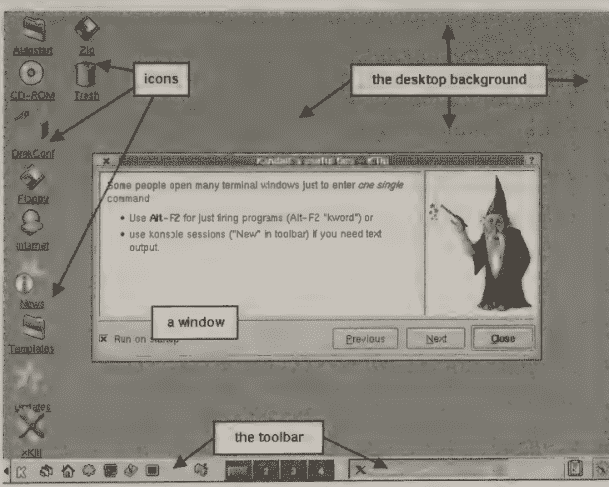

图 8-10. `KDE` 桌面

# 第 8 章. Linux初学者

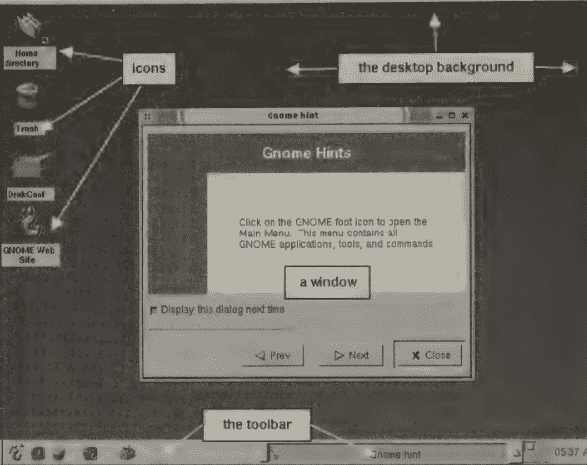

图 8-11. `GNOME` 桌面

1. 屏幕左侧是“图标”，即是一些小图，通常下方会附有一段短文本，代表该图标的标题或名称。每个图标都允许你打开一个窗口，程序将在窗口内运行，例如一个游戏或一个显示个人数据的窗口。在我们的示例中，上方所示图标让你访问由 `MandrakeSoft` 创建的配置工具。

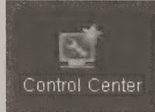

图 8-12. 进入配置

2. 屏幕底部是“栏”。你可以看到，每个图标都代表一个程序。工具栏是可以收缩的。


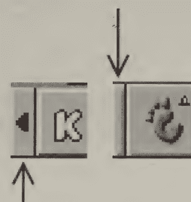

图 8-13. 可收缩的工具栏

3. 屏幕左侧是“图标”，即是一些小图，通常下方会附有一段短文本，代表该图标的标题或名称。每个图标都允许你打开一个窗口，程序将在窗口内运行，例如一个游戏或一个显示个人数据的窗口。在我们的示例中，上方所示图标让你访问由 `MandrakeSoft` 创建的配置工具。

# 第 8 章. Linux初学者

## 8.3.2. 管理窗口和桌面

有时你可能会发现打开的窗口不在你屏幕上的理想位置。你可能需要移动它以查看另一个窗口，或者为了方便。

你可以用鼠标非常简单地完成这一点。将光标移到窗口的标题栏，然后按住左键。只需移动鼠标（同时保持按住）。窗口将简单地跟随鼠标的移动。这被称为“拖动”窗口。当你到达一个满意的位置时，松开鼠标键：你刚刚将窗口固定在了新位置。

你还可以更改窗口所属的虚拟桌面。这对于按桌面逻辑组织你的工作可能很有帮助。

你需要再次使用鼠标。在 `KDE` 中，右键点击窗口标题栏，会出现一个下拉菜单，其中有一个名为“移动到”（`Move to`）的选项。只需指向此项目，就会列出你的虚拟桌面。只需选择你希望窗口中显示的虚拟桌面即可。这足够简单，不是吗？在 `GNOME` 中，右键点击窗口标题栏会弹出一个下拉菜单，其中包含“发送窗口到”（`Send Window To`）选项。然后，你可以选择将其移动或复制到另一个桌面（上一个或下一个）。

| 最小化 | 最大化 | 关闭 | 切换 | 组内 |
| :--- | :--- | :--- | :--- | :--- |
| 发送窗口到 | 上一个工作空间 | 堆叠 | 下一个工作空间 | 框架类型 |
| 复制到上一个 | 框架样式 | 复制到下一个 | 历史记录 | 左 / 右 / 上 / 下 |

图 8-16. 将窗口移动到另一个桌面

你经常会发现窗口位置正确，但太小或太大了。点击标题栏中的此按钮。

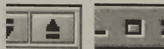

画图 8-17. `KDE` 和 `GNOME` 的窗口最大化

现在你的窗口适应屏幕了！此操作被称为“最大化”窗口。再次点击同一个按钮即可将窗口恢复到原始大小。

相反，如果你想隐藏窗口但保持程序运行，请点击此按钮。


画图 8-18. `KDE` 和 `GNOME` 的窗口最小化

窗口似乎消失了。实际上，你将其缩减到了最小可能的尺寸：即图标的大小。这被称为“最小化”窗口。你清空了它占用的屏幕空间，但程序仍在运行。你仍然可以在“任务栏”上看到它：

| `X Kandalf's useful ...` | `file:/home/yves` |
| :--- | :--- |
| `Gnome him:` | `home/yves` |

图 8-19. `KDE` 和 `GNOME` 下的任务栏

要再次在桌面上查看窗口，只需点击与其相关的图标即可。

在大多数情况下，你既不想最大化也不想最小化窗口。你只是想要某种“中间范围”，在其中你可以根据需要调整窗口大小。

你可以通过鼠标和窗口的边界框来实现这一点。

将鼠标光标移动到桌面与运行程序之间的右边缘。你的光标将变为双向箭头。


现在像你移动窗口时那样操作，按下左键并在保持按住状态的同时移动。窗口会调整大小，其内容也会随之重新排版。当你对新尺寸满意时，松开鼠标按钮即可。

我们刚才对窗口的右侧边界使用了此功能。你也可以对底部、顶部或左侧边界进行相同的操作。你甚至可以在窗口角上操作，在这种情况下你可以同时向两个方向调整窗口大小。

注意，并不是所有窗口都可以这种方式调整大小，通常会定义好最小和最大（尽管很少见）尺寸。

关于窗口标题栏按钮的最后一点说明，请考虑这一点：

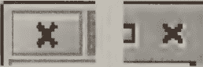

图 8-20. `KDE` 和 `GNOME` 的关闭窗口

如果你点击此按钮，你只需停止运行中的程序；你终止了它，退出它。此按钮被称为“关闭按钮”。

### 8.3.3. 个性化你的桌面

在 `KDE` 和 `GNOME` 中都可以更改许多内容以适应个人口味，例如背景、窗口和背景颜色、“主题”、窗口和图标的行为方式等。

如果你使用的是 `KDE`，请参阅第 92 页的“桌面个性化”。如果你使用的是 `GNOME`，请参阅“使用 `GNOME`”第 105 页以获取有关如何自定义桌面的更多信息。

### 8.3.4. 访问程序

你可能会疑惑如何访问安装过程中安装的所有软件。这非常简单。在工具栏的左侧，你可以看到一个这样的大图标：

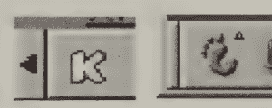

图 8-21. `KDE` 和 `GNOME` 的软件菜单

只需点击此图标（取决于使用 `KDE` 还是 `GNOME`，略有不同），你就会看到一个列出你可以运行的程序的弹出菜单。它们按类别组织，因此找到你寻找的程序很容易。

我们将在下一章中探索更多项目。

## 第 9 章：基于 KDE 的桌面

与 `Gnome` 一样，`KDE` 是两个最复杂的图形环境之一。我们现在将探索 `KDE` 在日常工作中的可能性。

### 9.1. 第一步

### 9.1.1. 发现你的宇宙

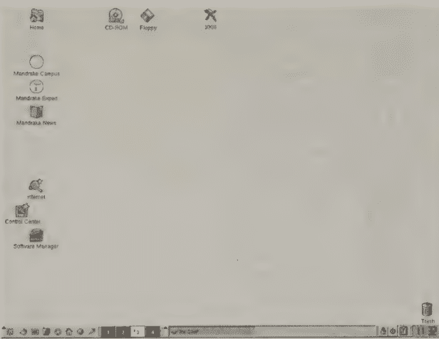

图 9-1. 桌面

与 `Gnome` 一样，`KDE` 是两个最复杂的图形环境之一。我们现在将探索 `KDE` 在日常工作中的可能性。

### 9.1.2. 工具栏

| 1 | 2 | 3 | 4 | 这些按钮允许在虚拟桌面之间切换。虚拟桌面在第 90 页有详细介绍。 |
| :--- | :--- | :--- | :--- | :--- |
| 任务栏为你的每个应用程序提供一个按钮。 | | | | |
| 此按钮允许锁定你的键盘和鼠标。因此，当你离开时无人可以使用它。 | | | | |
| 点击此按钮退出 `KDE`。 | | | | |
| 剪贴板及其参数。 | | | | |
| 时钟，同时也显示日期。点击它可以获取完整的日历。 | | | | |
| 点击此按钮将屏幕右侧的工具栏“收起”。 | | | | |

### 9.2. KDE 内部帮助

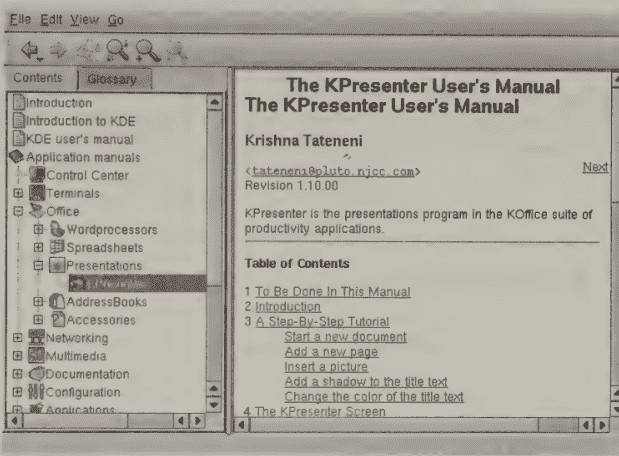

图 9-2. `KDE` 内部帮助窗口

点击救生圈获取 `KDE` 的内部在线帮助。你也可以通过访问 `K` 菜单依次进入文档→帮助来启动它。

窗口左侧持有不同的可用分类目录。在上面提到的示例中，我们成功点击了应用程序菜单、办公室，最后是 `KPresenter`。内容显示在窗口的右侧。在文中，红色的单词是超链接。只需点击其中一个即可移动到文档的其他部分。由于使用此过程很容易丢失，箭头允许返回上一个或多个步骤。

### 9.2.1. Unix 的 Info 和手册页

这两个类别并非 `KDE` 特有。它们存在于几乎每一个 `Unix` 类型系统中。手册页（通常称为 `man pages`（帮助手册）是这些系统从设计之初就几乎立即提供的历史性和内部帮助页面。它们是关于系统命令、其内部函数、配置文件格式的取之不尽的信息源。点击此栏目可以浏览所涵盖的主题。

`info pages`（info 页面）包含几乎相同的内容，但呈现方式不同。它们在 `GNU` 项目的框架内开发，旨在弥补 `man` 页的某些局限性。

## 9.3. 虚拟桌面的操作

### 9.3.1. 练练手（少量练习）

通常情况下，内部帮助窗口默认显示在第一个虚拟桌面上。

现在点击第二个虚拟桌面的按钮，然后点击图标启动文本编辑器。将窗口缩小（比如到屏幕的四分之一），并将其放在右下角。

完成后，点击数字 3 按钮进入第三个虚拟桌面。然后，点击图标启动 `Konqueror` 文件管理器。注意到，当你切换虚拟桌面时，屏幕似乎变空了。

虚拟桌面的按钮栏采用上所示布局：每个按钮都是每个桌面内容的微小表示。点击第二个桌面：你会在它的角落找到文本编辑器。按下 `Ctrl+F1`：你将回到第一个桌面，内部帮助窗口正在那里等你。

### 9.3.2. 固定或移动窗口

在内部帮助中，选择任意栏目。然后，点击标题栏右侧的缩略图：它会变成 ❐，虚拟桌面按钮的布局也会发生变化。

现在进入第二个虚拟桌面：你会发现完全相同的窗口。更改显示的帮助章节，然后切换到第四个桌面（例如）。显示的章节是你刚刚选择的那个。它是一个且仅有的窗口，而不是多个窗口。

再次点击缩略图取消固定窗口。

然而，窗口经常会挡路，这可能会很不便。自然地你可以缩小它的尺寸，但这里还有另一种可能。点击帮助窗口标题栏的右键，并选择“到桌面→桌面 1”。

窗口消失了！但你并没有关闭它。如果你查看虚拟桌面上的按钮，你会发现它的轮廓现在位于第一个桌面上。进入那个桌面，毫无疑问，你会找到它。你移动它了。

### 9.3.3. 虚拟桌面的数量和命名


根据你的活动需求，你可以估算出需要多少个默认虚拟桌面。右键点击虚拟桌面，并在上下文菜单中选择“配置”。

| 桌面数量：6 |
| :--- |
| `Desktop1`: 主界面 | `Desktop9`: |
| `Desktop2`: 互联网 | `Desktop10`: |
| `Desktop3`: 写作 | `Desktop11`: |
| `Desktop4`: 图像 | `Desktop12`: |
| `Desktop5`: 桌面 5 | `Desktop13`: |
| `Desktop6`: 桌面 6 | `Desktop14`: |
| `Desktop7`: | `Desktop15`: |
| `Desktop8`: | `Desktop16`: |

图 9-3. 在 KDE 下配置虚拟桌面

窗口的右上部分有一个滑块，允许你定义虚拟桌面的数量。在示例中，设置了六个，但你可以设置最多 16 个桌面（不过这会消耗大量内存）。

此外，你可以为每个桌面分配一个名称：在这里，前四个已经赋予了名称以描述它们的角色。这种可能性让你能够轻松、清晰地组织工作。若要在按钮中看到桌面的名称，你必须先验证上一个窗口。然后，右键点击桌面按钮并选择“名称”。你将看到名称出现在按钮中。然而，这会禁用桌面的内容。

## 9.4. 桌面个性化

### 9.4.1. 创建图标

要创建图标，只需点击桌面背景。将弹出一个下拉菜单，你必须在其中选择“从模板创建”。另一个菜单将拉下，其中列出了你可以在桌面上创建的对象：

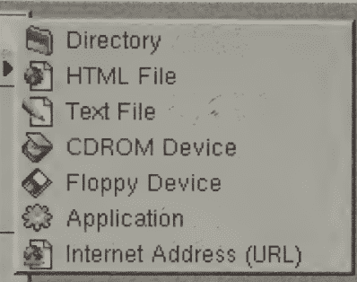

图 9-4. 在 KDE 下创建菜单

#### 9.4.1.1. 指向文件或文件夹的图标

如所示，你可以创建目录、多种类型的文件……事实上，不建议在桌面上创建文件或目录：更理想的方式是通过正常方法创建它们，即从相应的程序中创建。

你可以通过指向文件夹或文件并简单地将图标从文件管理器`拖拽`到桌面来创建桌面图标。这种技术在第 139 页的《复制、移动或链接文件》中有详细介绍，该章节专门介绍文件管理器 `Konqueror`。

#### 9.4.1.2. 指向应用程序的图标

现在我们将创建一个指向应用程序的图标。在“从模板创建”菜单中，选择“应用程序”。出现此对话框：

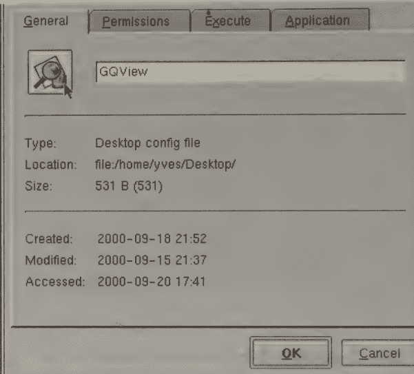

图 9-5. 在 KDE 下创建应用程序

| 通用 | 权限 | 应用程序 |
| :--- | :--- | :--- |
| 命令: | | 浏览... |
| 窗口标题: | | |
| 在终端运行选项: | | |
| 以用户运行 用户名: | | |

上方字段是你必须输入图标名称的地方。例如，让我们为图像查看器 `gview` 创建一个图标。在上述字段中输入 `gview`。此时，你还使用“浏览...”按钮来找到你需要的文件。输入 `/usr/bin/gview`。完成后，点击“确定”。新图标出现在桌面上：点击它即可启动与其关联的程序。

#### 9.4.1.3. 图标链接到网站

现在，我们将为互联网创建一个图标：在“新建”菜单中选择“链接到位置 (URL)”。弹出一个对话框，你需要输入网页地址。例如，我们选择了 Linux 文档项目站点：

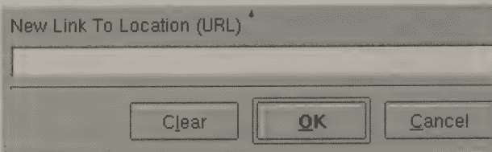

图 9-7. 在 KDE 下为网站创建图标

输入正确地址后点击“确定”。图标将出现在桌面上：点击它即可启动浏览器浏览器显示相应的页面（当然，你需要连接互联网才能操作）。

#### 9.4.1.4. 删除或修改图标

如果你不喜欢图标的默认图像或名称，可以更改它（就像更改任何图标的参数一样）。右键点击图标并在下拉菜单中选择“属性”。你将看到与我们创建指向应用程序的图标时类似的窗口。

在文本字段中输入图标的新名称。大按钮允许你选择另一个图标。点击它，你将得到这个窗口：

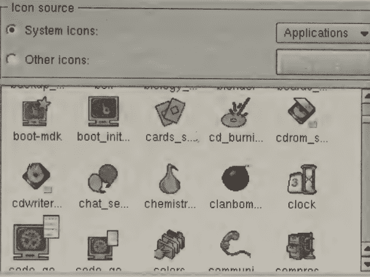

图 9-8. 在 KDE 下选择图标

图标可以来自不同的来源：使用右侧的下拉列表更改你的来源。然后只需点击一个图标。另一方面，如果你选择“其他图标”，可以为图标的图形外观选择任何图像：为此使用“浏览”按钮。

如既常，完成后按下“确定”。

### 9.4.2. 更改样式

这次，我们将使用 KDE 控制中心的一个模块。通过点击工具栏启动它。此程序允许你访问 KDE 几乎所有的配置方面。

你可以更改的参数按类别分类，这有助于你的研究。每个名称都非常直观。开始，你可以使用“外观和感觉”类别。你将能够控制图形环境的绘制方式。选择“样式”模块将显示此窗口：

## 第 9 章 基于 KDE 的桌面

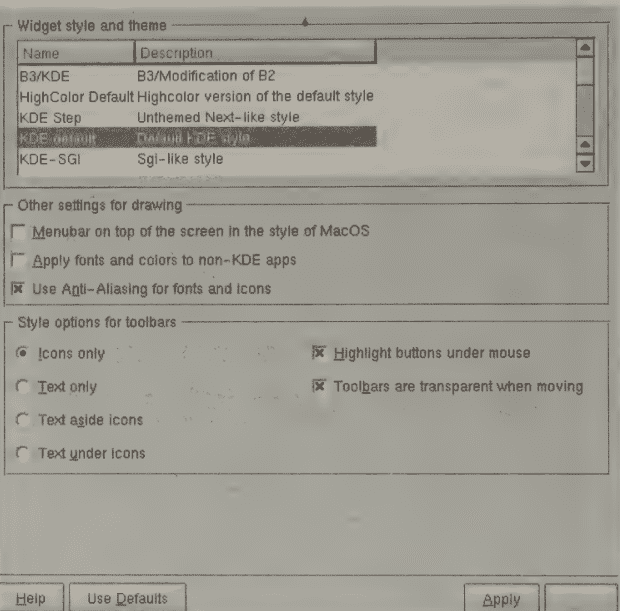

图 9-9. KDE 的默认样式

`样式`（Style）控制着不同图形元素的绘制方式：如按钮、复选框等。这些元素通常被设计为`部件`（widgets）。

在顶部的列表中，例如选择 `Marble` 并点击“应用”（Apply）按钮进行确认。你将看到：

| 名称 | 说明 |
|---|---|
| `HighColor Default` | 默认样式的 `HighColor` 版本 |
| `KDE Step` | 无主题的类 `Next` 样式 |
| `KDE default` | 默认 `KDE` 样式 |
| `KDE-SGI` | 类 `Sgi` 样式 |
| `Marble` | 淡色大理石主题样式 |

- 绘制的其他设置
-  `MacOS` 风格的屏幕顶部菜单栏
- 为非 `KDE` 应用应用字体和颜色
- 对字体和图标使用抗锯齿
- 工具栏的样式选项
- 仅图标（鼠标悬停时高亮按钮）
- 仅文本（移动时工具栏透明）
- 图标侧旁文本
- 图标下方文本

使用默认值 应用

**图 9-10.** `KDE` 的 `Marble` 样式

很特别吧？使用列表找到你喜欢的样式。你随时可以通过点击“使用默认值”（Use Defaults）按钮然后点击“应用”来返回默认样式。完成后，点击“确定”。

“绘制的其他设置”更多涉及桌面的宽区域：

`MacOS` 风格的屏幕顶部菜单栏

此选项使你的桌面能够以 `MacOS` 的方式工作。应用程序的下拉菜单显示在屏幕顶部，而不是窗口顶部。

为非 `KDE` 应用应用字体和颜色

如果你使用了并非为 `KDE` 编写的程序，此功能将尝试应用 `KDE` 的视觉参数。注意，此功能并不总是有效。

对字体和图标使用抗锯齿

这允许你软化字符和图标在屏幕上的抗锯齿效果，可能对眼睛更友好。然而，这是非常消耗资源的，可能会降低电脑运行速度。

最后，工具栏的样式选项允许你修改 `KDE` 应用中工具栏的外观。例如，如果你选择“图标侧旁文本”，文本编辑器的工具栏将像这样：


图 9-11. `KDE` 下的图标侧旁文本

然而，如果你选择“图标下方文本”，同一个工具栏将变为：

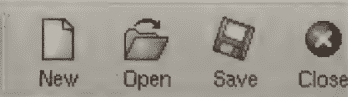

**图 9-12. `KDE` 中的图标下方文本**

### 9.4.3. 背景

仍在 `KDE` 控制中心中，在“外观”（LookNFeel）分类下，选择“背景”（Background）。你也可以通过右键点击桌面背景进入此模块。

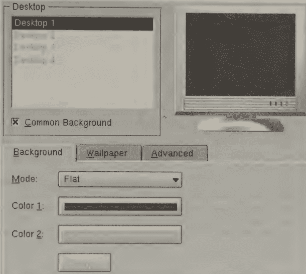

图 9-13. 配置背景

在顶部，你可以看到虚拟桌面的列表。你正在配置高中的某一个。每个桌面都可以有自己的配置。如果你想为所有桌面设置唯一的配置，请勾选“公共背景”（Common Background）复选框。实时地，你将在窗口右上角看到配置的预览。

第一个标签页“背景”用于“简单”配置。通过“模式”（Mode）标签页，你可以定义平直渐变或不同的垂直或水平渐变。你甚至可以选择一个“背景程序”（Background Program），即一个定期更新你背景的程序：点击“配置”按钮来选择你的程序。


**图 9-14. 配置背景壁纸**

第二个标签页“壁纸”允许在背景上显示图像。此时，“模式”列表控制图像的显示方式：如果图像对于屏幕太小，则进行“平铺”；或“缩放”以适应屏幕大小。你可以选择一张壁纸，或使用“浏览”按钮从你的个人图片中选择。


**图 9-15. 背景高级效果**

最后，第三个标签页“高级”允许实现背景（第一个标签页）向第二个壁纸（第二个标签页）的混合效果。背景是从白色到灰色的垂直渐变，而壁纸是一张平铺图像。左侧图像显示了未进行混合的壁纸，而右侧图像应用了“水平混合”（Horizontal Bl）。


图 9-16. 高级效果示例

## 第 10 章. 使用 GNOME


图 10-2. `GNOME` 面板

如图所示，面板中包含了基本的应用程序组件（applets）和程序。左侧是 `GNOME` 菜单，你所有的应用程序（无论是文本编辑器、多媒体还是游戏）都在那里。

**注意：** 如果你想向面板添加程序或应用组件，只需进入 `GNOME` 菜单，选择所需的应用程序并对其右键点击它。弹出的菜单会显示“将此启动器添加到面板（Add this launcher to panel）”项。在该消息上释放鼠标，该程序/小组件就会被添加到你的面板中。


旁边是注销小组件（`Log-Out Applet`）。它允许你注销会话，是因为你要离开工作，或者为了让其他用户使用电脑等。现在，“会话（session）”这个词可能会让你困惑。会话是指从登录到注销之间持续的时间。如果你点击它，它会提示你保存对会话所做的更改（如果你在 `GNOME` 控制中心中配置妥当，我们稍后会讨论，则可以直接注销），在 `X` 服务器重启后，会出现一个包含所有电脑用户（`root`、你的用户名等）的框框。

## 第 10 章. 使用 GNOME

下一个小组件图标是锁屏（`Lock Screen`）。正如你可能注意到的，大多数 `GNOME` 应用程序和应用组件的名称都非常有逻辑。此功能允许你在离开电脑时锁定屏幕，从而避免不愉快的惊喜或同事的伪恶作剧……


锁屏旁边的两个小屏幕是截屏工具（`Screen Shooters`）。它们允许你对屏幕截图。点击蓝色屏幕后，会出现两个小屏幕。左侧的允许选择特定的窗口，而另一个则捕获整个屏幕。这个小组件对于……用户指南非常有用，因为它能够精确地获取屏幕显示。


这是我们最喜欢的之一。它通过缩小小组件/应用程序的大小来最大化面板空间。你可以包含尽可能多的项目（在我们的示例中：5 个）。在其中，我们插入了帮助浏览器、`GNOME` 控制中心、一个名为 `GNOME Calc` 的 `GNOME` 专用计算器、一个保存会话图标，最后是并不那么坏的命令行，也称为 `GNOME` 终端，这是一个 `GNOME` 专用终端。

- 1. 我们使用这个小组件来避免注销时出现烦人的提示。当你注销时，启动界面会询问你是否想要保存在会话期间可能更改的设置。如果你不想保存任何新设置（如果有的话），只需点击“保存”或“不保存”。你也可以在 `GNOME` 控制中心对其进行配置。

**注意：** 存在许多终端。如果你探索 `GNOME` 菜单中的终端部分，你会发现许多命令行选项，例如 `eterm`、`xterm` 等。

## `GNOME` 控制中心 (`GNOME Control Center`)

这是你用来根据自己的喜好配置图形环境的应用程序。请随意探索，因为它包含许多选项。个性化你的主题、面板、背景、外观、默认启动应用程序等：一切都在里面！到处转转看吧。如果你迷路了，请参考帮助浏览器。


图 10-3. `GNOME` 控制中心

这个 `GNOME` 翻页选择器（pager）允许你将工作区域划分为几个虚拟桌面。在我们的示例中，设置了四个。在日常工作中，你可以逻辑上分离你的应用程序：在第一个桌面上，你可以放置通信应用（互联网、聊天、电子邮件）；在第二个桌面上，放置你最喜爱的文本编辑器。若要在它们之间切换，只需点击四个桌面之一，你的物理桌面（你现在正看到的）就会改变，并显示你为每个桌面正在使用的应用程序。

**注意：** 如果你想向面板添加应用组件，你可以在 `Gnome` 菜单→应用组件（`Applets`）中找到它们，并对所需的组件右键点击。如果你不小心删除了翻页选择器，你可以在 `Gnome` 菜单→应用组件→工具（`Utility`）找到它：它的名字是桌面指南（`Desk Guide`）。


# 第 10 章. 使用 GNOME


图 10-7. 丰富的供选择应用程序

### 办公

典型的办公工具包含在此子菜单中：电子表格、文本编辑器、`PDF` 查看器客户端。

### 多媒体

`MP3` 爱好者和图形艺术家们，这里是你们的用武之地。在这里，你可以选择 `XMMS`（卓越的 `MP3` 播放器）、使用 `GIMP` 来编辑你喜爱的图像和个人图形作品，以及不同的音频混音器等。

# 第 10 章. 使用 GNOME


图 10-8. 多媒体：`XMMS`，`GIMP` 等。

我们的 `GNOME` 之旅就此结束。掌握 `GNOME` 的唯一方法就是阅读、练习、阅读、练习、阅读……你懂的 :)

# 第 11 章. 日常应用程序

现在你已经成功安装了 `Mandrake Linux` 发行版，是时候处理正经事情了：你每天都会用的工具。在本章中，我们将涵盖基础内容和应用程序，即 `StarOffice`、通用 `Internet` 使用以及如 `XMMS` 等多媒体应用。如果你觉得已经掌握了这些应用程序，可以简单跳过本章。尽管如此，你可能会学到一些技巧。

## 11.1. `StarOffice`

以二进制形式存在，因此是专有的。

`StarOffice` 可用于许多用途。它可以作为一个 `WY-SIWYG`（所见即所得）文本编辑器、电子表格、演示文稿软件等。你甚至可以从中取收邮件。既然你已经知道 `StarOffice` 能为你做什么，让我们来介绍一下它的基本工具和功能。

# 第 11 章. 日常应用程序


图 11-1. `StarOffice` 桌面

如你在 `StarOffice` 桌面图像所示，它结合了你日常工作中可能需要的几乎所有的软件组件。然而，出于本书的考虑，我们将只讨论文本编辑器。

# 第 11 章. 日常应用程序


# 图 11-2. 编写文档

让我们顺序浏览菜单，让你掌握 `StarOffice` 的功能。首先，要启动 `StarOffice`，点击你的 `KDE` 菜单图标，选择“办公”子菜单下的“`StarOffice`”。你也可以在桌面上创建一个符号链接。这样做只需在桌面的任何处右键点击并选择“创建新建—链接到应用程序”。

注意：对于 `GNOME` 用户，方法非常相似。在桌面的任何处右键点击并选择“新建→启动器”，输入名称、注释、命令（完整路径），并确保选择“应用程序”类型。然后，选择合适的图标。

# 第 11 章. 日常应用程序


然后，在对话框中输入应用程序名称，后跟扩展名 `.desktop`，通过点击默认图标选择图标。此外，在“执行”选项卡中，你必须设置启动应用程序的路径。它应该是：

```
/home/your_user_name/office52/soffice
```

# 第 11 章. 日常应用程序


图 11-4. 链接属性

注意：关于快捷键的一点说明……我们许多人仍然对这个被称为鼠标的两个三个按钮的小东西深着迷。快捷键允许执行简单命令并将其赋予特定的含义，从而让你的手离开键盘，并加速工作进展的节奏。例如，`Ctrl-O` 打开文档，`Ctrl-C` 复制你想复制到别处的文档片段等。通过浏览菜单，你会发现大多数主要功能都设置了快捷键。

### 文件菜单

它启用了如打开、关闭、打印等简单命令。这可能是最经常使用的菜单，因为它包含了最基本的命令。你也可以通过这个菜单访问最近打开的文档。

# 第 11 章. 日常应用程序

### 编辑菜单

由于它包含了著名的“剪切与粘贴”命令，它也被广泛使用。非常实用的“查找与替换”选项也可以在此菜单中找到。按下 `Ctrl-H` 会弹出这个熟悉的窗口。


图 11-5. 查找替换单词

**注意：** 注意每个菜单项下方的小下划线。这是一个快捷键。

# 第 11 章. 日常应用程序


图 11-6. 查找替换单词

### 插入菜单

它启用了如打开、关闭、打印等简单命令。这可能是最经常使用的菜单，因为它包含了最基本的命令。你也可以通过这个菜单访问最近打开的文档。

# 第 11 章. 日常应用程序


图 11-7. 目录

**注意：** 注意每个菜单项下方的小下划线。这是一个快捷键。

# 第 11 章. 日常应用程序


图 11-8. 目录。

# 第 11 章. 日常应用程序


图 11-9. 目录

# 第 11 章. 日常应用程序


图 11-10. 文档拼写检查

# 第 11 章 日常应用


图 11-12. 分割你的窗口

## 帮助菜单

最后，如果你对关于 `StarOffice` 的任何内容需要特定的帮助，这里就是你要去的地方。假设你对超链接有疑问。只需在索引中选择该主题即可。如果你不熟悉我们正在描述的这类软件，也许你应该开启“提示”和“扩展提示”。然而，一旦你记住了每天的操作，你很快就会想要禁用它们，因为它们可能会很烦人……

# 第 11 章 日常应用

## 11.2. 文件管理器

### 11.2.1. `Konqueror`：文件管理器

为了操作你的个人文件，`KDE` 提供了 `Konqueror`。要启动它，点击工具栏上的图标。你也可以在桌面上找到它。


图 11-13. `KDE` 下的 `Konqueror` 文件管理器

窗口的左侧以树形结构显示你的文件，而右侧显示当前文件夹的内容（当你启动 `Konqueror` 时，默认文件夹是你的主目录）。每个文件或子目录都由图标表示。你可以随时在窗口顶部的 `URL` 行设置文件夹的完整路径。

> 注意：微小的细节：在本书中，我们交叉使用“文件夹（`folder`）”和“目录（`directory`）”术语。这两个术语指的是同一个东西，即文件持有者，甚至是……文件夹或目录持有者。

在上述提到的示例中，你注意到识别出的文件类型与其特定的图标相关。因此，`Mail` 和 `temp` 是文件夹。

`Konqueror` 并不总是能识别文件类型。在这种情况下，文件将用此图标表示。

#### 11.2.1.1. `Konqueror` 窗口左侧的文件夹

你 `Konqueror` 窗口左侧的文件夹有：

- **主目录 (`Home Directory`)**：你组织工作的文件夹。每个用户都拥有一个，通常情况下他都可以访问它。该文件夹在桌面上被设计为 `Queen` 的家。

- **根目录 (`Root Folder`)**：该文件夹位于树形结构的基础：所有其他文件夹都直接或间接地由根目录持有。原则上，只有系统管理员应该操作该文件夹。

- **历史 (`History`)**：在这里，你可以找到经常访问的系统文件夹和样例网站（因为 `Konqueror` 有“两面脸”）。

- **网络 (`Network`)**：如果你在局域网环境中，网络上其他计算机共享的文件应该显示在这里。

- **书签 (`Bookmarks`)**：这里列出了你最常访问的地方，无论是系统文件夹还是样例网站。

#### 11.2.1.2. 工具栏

`Konqueror` 的工具栏提供了许多易于访问的功能。以下是这些功能及其关联图标。

| 描述 | 快捷键 |
|---|---|
| 它将你移动到父文件夹。此功能将你置于树形结构中的上一层，即父目录。 | `Alt`+`Up` |
| 将你带回到刚才访问的文件夹或网站。 | `Alt`+`Left` |
| 如果你使用了上一个按钮，这个按钮执行相反的操作：它让你向相反方向移动。 | `Alt`+`Right` |
| 当你迷路时使用此图标。它将你直接带回到主目录，你所有数据的根，你的家。 | `Ctrl`+`Home` |
| 如果你点击此图标，你强制 `Konqueror` 重新加载当前目录的内容。这在网络环境中或如果你在 `Konqueror` “之外”删除文件（即在终端或另一个文件管理器中）时非常有用。 | `F5` |
| 停止 `Konqueror` 正在执行的工作。 | `Esc` |
| 剪切：将选中的文件放入剪贴板。 | `Ctrl`+`X` |
| 复制：将选中的文件存入剪贴板。 | `Ctrl`+`C` |

| 描述 | 快捷键 |
|---|---|
| 粘贴：将剪贴板中选中的文件放入当前文件夹。 | `Ctrl`+`V` |
| 显然，允许打印。 | `Ctrl`+`P` |
| 使用此图标增大字体。 | |
| 相反，此图标缩小字体。 | |
| 使用列表视图显示时，按住鼠标获取其他选项。 | |
| 使用树形视图显示时，按住鼠标获取其他选项。 | |
| 当你点击此处时，`Konqueror` 将打开。 | |

#### 11.2.1.3. 移动

左侧的树形结构是移动的一种方式。通过点击文件夹，右侧将显示其内容。


图 11-14. 文档（移动）

#### 11.2.1.4. 选择文件

要只选择一个文件，点击它。要选择多个文件，按住 `Shift` 键并点击。要选择隔离的文件，按住 `Ctrl` 键并点击。


图 11-13. 使用鼠标选择


图 11-15. 选择多个文件

#### 11.2.1.5. 处理文件

既然我们已经知道如何选择文件，是时候处理它们一下了。

##### 11.2.1.5.1. 创建文件或目录

在右窗口背景上点击右键（避开图标）：你会得到包含许多功能的菜单。选择从模板创建文件夹。


图 11-16. 创建新目录

在显示的对话框中，输入你想给目录命的名字并按 `Enter` 键（或直接点击 `OK`，效果等同）。


从模板创建菜单还允许创建不同类型的文件。例如，通过选择“文本文件”创建一个文本文件：像之前一样，给它命名，例如 `text.txt`。一旦创建，你的文件将出现在窗口右侧，并用白色纸张上的铅笔表示。

> **注意：** 没有必要给文件赋予扩展名（点后面的字母组）。然而，系统性地这样做更好，因为它是识别文件类型的方法。在这里，按照惯例，文本文件的扩展名是 `.txt`。

##### 11.2.1.5.2. 打开文件

如果你点击刚刚创建的文件图标，`Konqueror` 将识别其类型（文本文件）并显示它，即：空无内容。事实上，你只是创建了一个空文件。这次，右键点击该图标并选择“打开方式”。

# 第 11 章 日常应用


图 11-17. 打开文本文件

随后将介绍许多修改此类文件类型的应用程序。选择“高级编辑器”（`Advanced editors`），我们已经在《根据 `KDE` 定义的桌面》第 85 页的 `KDE` 工具栏中看到过它了。

在显示的窗口中输入几行内容，写什么并不重要。点击图标保存你刚刚输入的内容。如果不这样做，当你尝试退出编辑器时，它会提示你。

现在回到 `Konqueror` 窗口，使用此图标（或 `F5` 键）刷新文件夹内容的显示。然后，将鼠标指针悬停在文本文件图标上。你会发现，在窗口底部的信息栏中，它的大小不再为 `0`。

点击你的文件。这次窗口不是空的。它包含了你刚刚输入的内容。要返回文件列表，只需点击 `Konqueror` 工具栏上的按钮即可。

#### 11.2.1.5.3. 重命名文件

重命名文件非常简单。右键点击图标并选择“重命名”弹出菜单。然后，输入新名称并按 `Enter` 键确认。

你也可以选择它，然后按 `F2` 键。

最后，最后可能性是右键点击文件并选择“属性”（`Properties`）。你只需要在窗口顶部相应字段中更改文件名即可。

#### 11.2.1.5.4. 复制、移动或链接文件


图 11-18. 选择目标文件夹

选择你想要复制或移动的文件或文件夹。然后，使用 `F7`（复制）或 `F8`（移动）键：会弹出一个窗口，你可以在其中输入目标文件夹。“选择”（`Choose`）按钮允许你选择文件夹。

这是另一种方法。首先使用屏幕左侧的树状视图来查看目标文件夹。但是不要显示它的内容，只显示它的名称。然后，选择你想要操作的文件或文件夹。


## 第11章 日常应用


图 11-19. 在 `Konqueror` 中进行拖放操作

现在你的鼠标指针位于其中一个元素上。然后，在手指按住鼠标按钮的同时，将选中的内容拖向目标文件夹，该文件夹应该在窗口的左侧可见。之前的图像显示了两个文件被拖向主目录下的 `tmp` 目录。

当你的鼠标指针悬停在目标文件夹上时，该文件夹会被高亮。释放按钮，一旦弹出菜单，选择你想要执行的操作。

> 注意：复制文件会在另一个文件夹中复制内容。移动会复制文件并删除原始文件。链接文件会在目标文件夹中创建一个指向文件的访问点，它类似于快捷方式。如果你删除了链接，这并不意味着你也删除了原始文件。

最后，你还可以使用剪贴板。要复制选中的文件，使用 `Ctrl+C` 将它们放入剪贴板。然后，将鼠标指针置于目标文件夹中并使用 `Ctrl+V` 启动复制过程。要移动文件，请使用 `Ctrl+X` 代替 `Ctrl+C`。

### 11.2.1.5.5. 删除文件

迟早你都会想要删除文件，可能是为了获得磁盘空间，或者仅仅是为了清理工作环境。只需选择你想要删除的文件或目录，然后右键点击其中一个即可。

## 第11章 日常应用


图 11-20. 删除文件的三种方法

你可以通过三种不同的方法删除文件和目录：安全方法、经典方法真实方法。安全方法被称为“移动到回收箱”（`Move to trash`）：文件并没有被真正移除。它们只是被移动到了回收箱。因此，你可以恢复它们，直到你清空回收箱为止……回收箱图标位于桌面上：


图 11-21. 回收箱图标，空或满

点击它查看它包含的文件。将打开一个新的 `Konqueror` 窗口。然后你可以检索你放入其中的文件。要这样做，点击它们并将它们移动到你想去的任何地方（无论是在桌面上还是另一个 `Konqueror` 窗口）。你可以随时恢复放入回收箱的物品，直到你清空它为止……

要像 `Unix` 中那样删除文件，你必须右键点击文件并选择“删除”（`Delete`）。你将需要确认是否真的想删除此文件。如果你回答是，它的名称将被删除，它在硬盘上占用的空间将被释放。

最后的方法是右键点击文件并选择删除。这是永久方法。

## 第11章 日常应用

### 11.2.1.5.6. 修改显示

这控制文件的表示方式。你可以在 `Konqueror` 工具栏的相应图标中找到相同的选择。

默认类型是图标：大图标、每个图标下方的文件名、从左到右、从上下的排列。

在多列视图（`MultiColumn View`）中，文件名显示在图标右侧。后者从左到右列组织。

## 第 11 章. 日常应用

| 名称 | 大小 | 文件类型 |
|---|---|---|
| `CVS` | 4.0 ko | 目录 |
| `Desktop` | 4.0 ko | 目录 |
| `doc` | 4.0 ko | 目录 |
| `RpmDrake` | 4.0 ko | 目录 |
| `seti` | 4.0 ko | 目录 |
| `test` | 4.0 ko | 目录 |
| `tmp` | 4.0 ko | 目录 |
| `cmdline chapter.sgml` | 49.4 ko | SGML |
| `cmudutils chapter.sggl` | 36.7 ko | SGML |
| `dia-kde-and-gnome-file-manager.dia` | 1.5 ko | Dia 图表 |
| `dia-kde-and-balloons.dia` | 1.4 ko | Dia 图表 |
| `everyday apps chapter.sgml` | 40.1 ko | SGML |
| `kde-create-application-execute.png` | 6.2 ko | PNG |
| `kde-create-application-icon.png` | 7.1 ko | PNG |
| `kde-create-menu.png` | 5.2 ko | PNG |

图 11-26. `Konqueror` 下的详细列表

最后，最质素的类型是文本类型。它能够快速且详尽地显示信息，但没有图标和其他装饰。

| 名称 | 大小/类型 | 日期 |
|---|---|---|
| `/ Corveille` | 4.0 KB 目录 | 09/13/0 |
| `CD-ROM desktop` | 978 B 桌面配置文件 | 09/13/0 |
| `Documentation.desktop` | 367 B 桌面配置文件 | 09/13/0 |
| `Floppy.desktop` | 177 B 桌面配置文件 | 09/13/0 |
| `Home.desktop` | 2.5 KB 桌面配置文件 | 09/13/0 |
| `Internet.desktop` | 289 B 桌面配置文件 | 09/13/0 |
| `Mandrake Campus.des...` | 137 B 桌面配置文件 | 09/13/0 |
| `Mandrake Control Cen...` | 335 B 桌面配置文件 | 09/13/0 |
| `Mandrake Expert.deskt...` | 137 B 桌面配置文件 | 09/13/0 |
| `Mandrake News.desktop` | 138 B 桌面配置文件 | 09/13/0 |
| `Software manager.des...` | 418 B 桌面配置文件 | 09/13/0 |
| `XKill.desktop` | 362 B 桌面配置文件 | 09/13/0 |

图 11-27. `Konqueror` 下的文本视图

### 11.2.1.6.2. 使用 `index.html`

如果你经常浏览包含 HTML 的文件（例如你发行版的文档），这些文件通常会包含一个 `index.html` 文件索引。这是一个非常常见的名称，可以让你访问许多文件。

以 `/usr/share/doc/mandrake/en/` 为例。如果你没有激活“使用 `index.html`”，你只会获得文件夹中包含的文件和目录列表。如果你激活了该选项，`Konqueror` 会显示 `index.html` 文件的内容，你可以轻松地浏览文档，就像在网上一样。

### 11.2.1.6.3. 排序

通常的文件显示顺序是字母顺序，目录优先显示。你可以选择忽略或不忽略大小（即大写字母和小写字母之间的区别）。如果你忽略它，你将获得类似于字典的顺序。如果不忽略，大写字母将显示在前面。例如，以字母 `Z` 开头的文件将显示在以字母 `a` 开头之前。


如果你使用列表显示模式，可以点击列标题来定义根据哪个文件特征进行排序（例如大小），以及排序顺序（例如降序）。这就是这里页头显示的内容：标题右侧的箭头表示该元素已纳入排序操作中，其向上的方向表示升序。再次点击标题可以更改方向或排序顺序。

### 11.2.1.6.4. 内容预览

`Konqueror` 并不是通过图标表示文件，而是显示某些文件类型的微缩预览（如果你使用的是两种大图标显示类型之一）。预览子菜单允许选择你想要以微缩显示的文件类型。这里是预览显示的示例：

| `CVS` | `桌面` | `doc` | `RpmDrake` | `seti` | `test` |
|---|---|---|---|---|---|
| `<-Chum` | `<-Chum` | `<-Chum` | `<-Chum` | `<-Chum` | `<-Chum` |
| `<-Chum` | `<-Chum` | `<-Chum` | `<-Chum` | `<-Chum` | `<-Chum` |
| `- This` | | | | | |

`tmp` `cmdline-cha` `cmutils-cha` `dia-and-kde-first` `everyday` `peter.sgml` `-gnome-file-time-balloon.chapter.sgml` `kde-create-a` `kde-create-kde-icon-colication-exute.png` `ntrol-center.cococon.png`

图 11-28. 使用 `Konqueror` 文件内容

此选项既美观又实用。然而，它对你的机器性能要求更高。

### 11.2.1.6.5. 隐藏文件

选择此选项。突然，将显示许多文件。它们是通常不显示的隐藏文件。

| `kde` | `mcop` | `ssh` | `桌面` | `doc` |
|---|---|---|---|---|
| | | | | `/bash` |
| | | | `cd` | `cd` |
| | | | `cd` | `clear` |
| | | | `cd` | `cd -23` |

| `RpmDrake` | `seti` | `tmp` | `bash history` | `logout` |
|---|---|---|---|---|
| `.bash...` | `.bashrc` | | `local/etc` | |


| Get the | $ User as | | 823 SYSPOP | |

| -bash | $ Server | | LD_STYPE | |

| fi | | | LD_TIMEOF | |

| | | | LD_COLLATE | |

| `bash profile` | `bashrc` | `DCOpserver` | `DCOpserver` | i18n ICEAuthority |

|---|---|---|---|---|

| | | test manda | test1 mandi | |

| | | ksoft.com 1 | 92.168.1013 | |

| | | | i | |

| | | | Prefer | File as |

| | applicati | 5cbc868 | Global | This | `/home/` |

| `IFS` | | 2c9072 and for | `/home/` | |

| | | 5cbc91d | | |

| | | fe67 | | |

图 11-29. 使用 Konqueror 查看隐藏文件

自然地，你可以像处理其他文件一样处理这些文件。然而，请注意。通常情况下，它们用于备份你的个人设置和配置。

### 11.2.1.6.6. 分屏窗口

右键点击右侧窗口底栏（带有大按钮的那个）。你会得到此菜单：


图 11-30. 使用 Konqueror 操作显示

在此菜单中，选择“分屏视图 上/下”。窗口被分成两个，每个窗口都有自己的信息栏，且相互独立。一次只能有一个窗口处于激活状态：点击信息栏以激活你想要交互的窗口。要关闭窗口，右键点击信息栏并选择“移除视图”。


### 图 11-31. 分割 Konqueror 窗口

将许多窗口链接到同一个文件夹中可能会很有趣。例如，对于左右树结构都是如此。然而，我们之前创建的窗口没有链接到其他窗口。要链接它，点击信息栏右侧的复选框。你会看到框内有一个小链条。这将其链接到其他窗口，当其他窗口发生变化时，新窗口也会跟随。分屏对于在文件夹间移动文件也非常实用。

### 11.2.2 文件管理器

GNOME 默认的文件管理器是 `Nautilus`。通过它可以管理文件并浏览网页。它最初由 Eaz 开发，但遗憾地停止了运营。

然而，由于它是一个开源项目，许多开发者仍在对其维护和改进。

注意：由于 `Nautilus` 的主要功能与 `Konqueror` 相似，我们只描述 `Nautilus` 特有的功能。如果你需要更多信息，请参考上方的关于 `Konqueror` 章节。


图 11-32. `Nautilus` 主窗口

### 11.2.2.1. 探索 `Nautilus` 左侧

`Nautilus` 窗口的左侧提供了几个选项。事实上，你可以有一个显示你在树结构中位置的文件夹。它包含了基本信息，如文件类型、包含的项目数量以及访问日期。

其他选项包括：

- 标准树结构。可以通过 `Tree` 标签访问。

- 笔记。它允许直接在黄色窗口中编写笔记。点击 `Notes` 标签尝试。

- 历史。此选项允许查看访问文件夹的历史。因此，通过点击 `History` 标签，你会看到类似：

- 新闻。通过此功能，你可以添加新闻网站，例如 `Linux Today` (http://linuxxtoday.com)，并通过链接直接访问。

在我们的示例中，我们添加了 `Linux Today` (http://linuxxtoday.com) 和 `Linux Weekly News` (http://lwn.net)。操作完成后，你将在侧边栏获得这些网站的摘要：

# 第 11 章 日常应用


图 11-34. `Nautilus` 新闻

要添加新闻网站，只需点击“选择站点”（`Select Sites`）选项卡。您将看到一个热门的 `Linux` 新闻网站列表。只需点击复选框或站点名称即可将其添加到您想要查看的新闻中。完成后，点击“完成”（`Done`）按钮。

# 第 11 章 日常应用


图 11-35. 添加新闻网站

如果您想添加的新闻网站不在站点列表中，您可以通过选择“编辑”（`Edit`）来添加，将会出现此窗口：

# 第 11 章 日常应用


图 11-36. 编辑新闻网站

- 帮助。如果您需要更多关于 `Nautilus` 或 `GNOME` 的信息，请点击“帮助”（`Help`）选项卡，您可以在那里找到有用信息。

## 11.2.2.2. 探索 `Nautilus` 的右侧

大多数文件管理器都使用窗口的右部分来显示目录包含的文件，`Nautilus` 也不例外。和许多文件管理器一样，你可以更改窗口的外观。为了做到这一点，我们将浏览 `Nautilus` 偏好（`Preferences`）菜单。

## 11.2.2.3. `Nautilus` 偏好

要访问“编辑偏好”菜单，您可以使用 `Alt-P-E` 快捷键，或者简单地点击“偏好”菜单然后点击“编辑偏好”。随后将显示此窗口：


图 11-37. `Nautilus` 偏好

### 11.2.2.3.1. 视图偏好

如您所见，主要偏好位于“视图偏好”窗口中。在这里，您可以更改基本的图形外观，例如您的首选字体及其大小，以及视图模式（图标视图或列表视图，用于网页的网页视图）。

### 11.2.2.3.2. 外观

接下来是“外观”窗口。您可以定义默认的平滑字体：这将影响左窗口的标签页，例如历史、帮助、新闻等。


图 11-38. 更改默认平滑字体

此示例显示了使用 `DejaVuSansif` 字体的 `Nautilus` 侧边栏。

# 第 11 章 日常应用

更改 `Nautilus` 主题可能是趣的，尽管每个主题之间的差异非常小，相当微妙。尝试一下它们。您还可以“添加新主题”。

这是一个 `GNOME` 主题的示例：


图 11-9. `Nautilus` 的 `GNOME` 主题

### 11.2.2.3.3. 窗口和桌面

如果您不想让 `Nautilus` 绘制您的桌面，这就是需要微调的窗口。然而，如果您勾选了“使用 `Nautilus` 绘制桌面”，您将失去所有的桌面图标！

默认情况下，如果您点击 `Nautilus` 左侧或右侧的图标（或文本，取决于您选择的视图），文件的内容将在相同窗口中显示。

# 第 11 章 日常应用

### 11.2.2.3.4. 图标与列表

在这个窗口中，如果您需要更多关于 `Nautilus` 或 `GNOME` 的信息，请点击“帮助”选项卡，您可以在那里找到有用信息。（此处原文重复翻译逻辑） 默认情况下，如果您点击 `Nautilus` 左侧或右侧的图标（或文本，取决于您选择的视图），文件的内容将在相同窗口中显示。

) 

### 11.2.2.3.5. 字体 

### 11.2.2.3.6. 侧边栏 

### 11.2.2.3.7. 搜索 

### 11.2.2.3.8. 导航 

### 11.2.2.3.9. 速度 

（注：由于提供的待翻译文本在11.2.2.3.3 之后出现了大量段落重复和逻辑错乱，译文已根据原文结构进行了对齐翻译，保留了所有段落和格式。） 

# 第 11 章 日常应用


图 11-42. 配置你的邮件服务器

### 11.3.1.3. 新闻组服务器

如果你理解了最后一段话，那么对于这种服务器，原理是类似的。你的互联网服务提供商（`ISP`）为你提供了一个类似的服务器名称，这次是用于新闻的。你也可以通过“文件→订阅”菜单订阅其他新闻组。

# 第 11 章 日常应用


### 11.3.1.4. 地址簿

“地址簿”子菜单非常有帮助，因为它允许你的邮件客户端识别撰写电子邮件的几个基本要素。如果你在输入名称时让邮件客户端在你的地址录中搜索，当有超过一个个人有相似的名字时（例如：`John Smith` 和 `John Woods`），它会自动为你提供用户选择。当你开始输入这些名字并想用 `Tab` 键完成输入时，你的邮件客户端会在这两个用户之间为你提供选择。

# 第 11 章 日常应用


图 11-44. 快捷处理你的电子邮件

### 11.3.1.5. 消息

此子菜单允许在消息的外观上进行个性化设置。当你回复电子邮件时，你可以选择自动（或不自动）引用原始消息。然而，最好的功能是“自动换行”：你是否曾经尝试过阅读一封电子邮件却必须用鼠标指针水平滚动？那感觉并不妙妙……此功能会将你的电子邮件格式化为每行最多 72 个字符。

## 11. 第 11 章 日常应用


图 11-45. 让你的消息看起来更漂亮！

### 11.3.1.6. 副本与文件夹

此功能允许你向你喜欢的任何人发送“密抄”（Blind Carbon Copy）。例如，你可能想将你发出的所有电子邮件都发送给自己，而不是让它们堆积在已发送目录中。

## 11. 第 11 章 日常应用


图 11-46. 智能地发送所有电子邮件……

### 11.3.1.7. 格式

现在，有些用户倾向于接收文本模式的电子邮件，而另一些人则喜欢 HTML 格式。无论你更喜欢哪种并不真的重要，但收件人的意见很重要……例如，有些用户讨厌接收基于 HTML 的电子邮件：他们可能会因为下载时间太长而直接将其删除。另一些人则不在乎，等等。你比我们更了解你的邮件伙伴，所以请确保你使用的格式适合他们。

## 11. 第 11 章 日常应用


图 11-47. 尊重你的收件人

### 11.3.1.8. 回执

此选项确保你的收件人确认已收到了你的消息。尽管如此，即使被要求，用户也可以选择不发送回执，但对于重要/机密文档，我们强烈建议使用此功能。

## 11. 第 11 章 日常应用


图 11-48. 送达证明

### 11.3.1.9. 磁盘空间

取决于你每天收到的电子邮件数量，你可能想限制在服务器上保留的消息数量。限制电子邮件的大小也很重要，以免你的文件夹里最后出现 5 兆字节的邮件……

## 11. 第 11 章 日常应用


图 11-49. 节省磁盘空间

### 11.3.2. 电子邮件

如果你从未发送过电子邮件或参与过任何邮件列表，你在等什么呢？说真的，电子邮件允许信息的快速流动，并且现在存在于大多数业务中。即使在家里，人们与互联网的连接也越来越紧密，取决于你所在的国家，可以使用快速连接，如 DSL。要打开你的 `Netscape` 邮件客户端，访问你的 `GNOME` 或 `KDE` 菜单，然后进入“`网络→邮件→Netscape Messenger`”。

## 11. 第 11 章 日常应用


图 11-50. Netscape 电子邮件客户端

后一张图显示了一个典型的 `Netscape` 邮件客户端。左侧是目录列表，右侧显示电子邮件内容。由于客户端或网络浏览器中都没有许多键盘快捷键，你将不得不使用鼠标浏览菜单。然而，一些关键功能有快捷键：回复 (`Alt+R`)、新消息 (`Alt+M`)、新浏览器 (`Alt+N`)、剪切 (`Ctrl+X`)、复制 (`Ctrl+C`) 和粘贴 (`Ctrl+V`)。尝试这些操作，你将发现不离开键盘可以多快地发送电子邮件。不过，位于文件菜单下方的栏非常有帮助。在那里找到所有主要的邮件客户端功能，如获取消息、新消息、回复等。

#### 11.3.2.1. 发送电子邮件

发送电子邮件非常简单。要这样做，只需点击“`新消息`”。弹出一个对话框……

## 11. 第 11 章 日常应用


图 11-51. Netscape 新消息

正如你所见，我们正在发送邮件。当你回复电子邮件时，你可以选择自动（或不自动）引用原始消息。然而，最好的功能是“自动换行”：你是否曾经尝试过阅读一封电子邮件却必须用鼠标指针水平滚动？那感觉并不妙……此功能会将你的电子邮件格式化为每行最多 72 个字符。

正如你可以看到，我们正在发送邮件。当你回复电子邮件时，你可以选择自动（或不自动）引用原始消息。然而，最好的功能是“自动换行”：你是否曾经尝试过阅读一封电子邮件却必须用鼠标指针水平滚动？那感觉并不妙……此功能会将你的电子邮件格式化为每行最多 72 个字符。

正如你可以看到，我们正在发送邮件。当你回复电子邮件时，你可以选择自动（或不自动）引用原始消息。然而，最好的功能是“自动换行”：你是否曾经尝试过阅读一封电子邮件却必须用鼠标指针水平滚动？那感觉并不妙……此功能会将你的电子邮件格式化为每行最多 72 个字符。

正如你可以看到，我们正在发送邮件。当你回复电子邮件时，你可以选择自动（或不自动）引用原始消息。然而，最好的功能是“自动换行”：你是否曾经尝试过阅读一封电子邮件却必须用鼠标指针水平滚动？那感觉并不妙……此功能会将你的电子邮件格式化为每行最多 72 个字符。

正如你可以看到，我们正在发送邮件。当你回复电子邮件时，你可以选择自动（或不自动）引用原始消息。然而，最好的功能是“自动换行”：你是否曾经尝试过阅读一封电子邮件却必须用鼠标指针水平滚动？那感觉并不妙……此功能会将你的电子邮件格式化为每行最多 72 个字符。

正如你可以看到，我们正在发送邮件。当你回复电子邮件时，你可以选择自动（或不自动）引用原始消息。然而，最好的功能是“自动换行”：你是否曾经尝试过阅读一封电子邮件却必须用鼠标指针水平滚动？那感觉并不妙……此功能会将你的电子邮件格式化为每行最多 72 个字符。

正如你可以看到，我们正在发送邮件。当你回复电子邮件时，你可以选择自动（或不自动）引用原始消息。然而，最好的功能是“自动换行”：你是否曾经尝试过阅读一封电子邮件却必须用鼠标指针水平滚动？那感觉并不妙……此功能会将你的电子邮件格式化为每行最多 72 个字符。

正如你可以看到，我们正在发送邮件。当你回复电子邮件时，你可以选择自动（或不自动）引用原始消息。然而，最好的功能是“自动换行”：你是否曾经尝试过阅读一封电子邮件却必须用鼠标指针水平滚动？那感觉并不妙……此功能会将你的电子邮件格式化为每行最多 72 个字符。

正如你可以看到，我们正在发送邮件。当你回复电子邮件时，你可以选择自动（或不自动）引用原始消息。然而，最好的功能是“自动换行”：你是否曾经尝试过阅读一封电子邮件却必须用鼠标指针水平滚动？那感觉并不妙……此功能会将你的电子邮件格式化为每行最多 72 个字符。

正如你可以看到，我们正在发送邮件。当你回复电子邮件时，你可以选择自动（或不自动）引用原始消息。然而，最好的功能是“自动换行”：你是否曾经尝试过阅读一封电子邮件却必须用鼠标指针水平滚动？那感觉并不妙……此功能会将你的电子邮件格式化为每行最多 72 个字符。

正如你可以看到，我们正在发送邮件。当你回复电子邮件时，你可以选择自动（或不自动）引用原始消息。然而，最好的功能是“自动换行”：你是否曾经尝试过阅读一封电子邮件却必须用鼠标指针水平滚动？那感觉并不妙……此功能会将你的电子邮件格式化为每行最多 72 个字符。

正如你可以看到，我们正在发送邮件。当你回复电子邮件时，你可以选择自动（或不自动）引用原始消息。然而，最好的功能是“自动换行”：你是否曾经尝试过阅读一封电子邮件却必须用鼠标指针水平滚动？那感觉并不妙……此功能会将你的电子邮件格式化为每行最多 72 个字符。

正如你可以看到，我们正在发送邮件。当你回复电子邮件时，你可以选择自动（或不自动）引用原始消息。然而，最好的功能是“自动换行”：你是否曾经尝试过阅读一封电子邮件却必须用鼠标指针水平滚动？那感觉并不妙……此功能会将你的电子邮件格式化为每行最多 72 个字符。

正如你可以看到，我们正在发送邮件。当你回复电子邮件时，你可以选择自动（或不自动）引用原始消息。然而，最好的功能是“自动换行”：你是否曾经尝试过阅读一封电子邮件却必须用鼠标指针水平滚动？那感觉并不妙……此功能会将你的电子邮件格式化为每行最多 72 个字符。

正如你可以看到，我们正在发送邮件。当你回复电子邮件时，你可以选择自动（或不自动）引用原始消息。然而，最好的功能是“自动换行”：你是否曾经尝试过阅读一封电子邮件却必须用鼠标指针水平滚动？那感觉并不妙……此功能会将你的电子邮件格式化为每行最多 72 个字符。


# 第 11 章 日常应用

正如你可以看到，我们正在发送邮件。当你回复电子邮件时，你可以选择自动（或不自动）引用原始消息。然而，最好的功能是“自动换行”：你是否曾经尝试过阅读一封电子邮件却必须用鼠标指针水平滚动？那感觉并不妙……此功能会将你的电子邮件格式化为每行最多 72 个字符。

（图 11-51. Netscape 新消息）

| 消息 | 通信器 |
| :--- | :--- |
| 新消息 | `Alt+M` |
| 回复 | |
| 回复所有人 | |
| 转发 | `Alt+L` |
| 另存为转发 | |
| 移动消息 | |
| 复制消息 | |
| 将发送者添加到联系录 | |
| 将全部添加到联系录 | |
| 标记 | |
| 忽略线程 | `K` |
| 关注线程 | `W` |

**图 11-54. 通过此菜单管理您的消息**

## 通信器菜单

最后，此菜单包含了所有必要的 Web 组件。在其中，你可以打开邮件客户端、网络浏览器、你的联系录、编辑书签等。

| 通信器 | |
| :--- | :--- |
| 导航器 | `Alt+1` |
| 消息传递 | `Alt+2` |
| 编写器 | `Alt+3` |
| 电台 | `Alt+7` |
| 书签 | |
| 新闻组 | |
| 联系录 | `Alt+Shift` |
| 工具 | |
| 服务器工具 | |

- `Netscape 欢迎来到 Linux Mandrake`
- `Netscape Mail &...: validation pgml`

**图 11-55. 全合功能菜单**

# 第 11 章 日常应用

## 11.4. 多媒体中心

如果你离不开你的 `MP3`，那么这一节就是为你准备的 :-) 在这里，我们将探索多媒体的美妙世界，特别是 `XMMS` 以及你的 `Mandrake Linux` 发行版下提供的各种多媒体工具。

### 11.4.1. 使用 `XMMS`

首先，`XMMS` 代表“X 多媒体系统”（`X Multimedia System`）。通过它，你可以播放各种音频源，如普通的音乐 `CD` 和 `MP3`。`XMMS` 最受欢迎的特性之一是你可以更改它的“皮肤”，即它的外观。让我们从基础知识开始吧。

> 注意：我们假设你以前用过 `CD-ROM` 播放器，因此我们不会描述播放、倒退等按键。

首先，要启动 `XMMS`，进入你的 `KDE` 或 `GNOME` 菜单并选择多媒体+声音→`XMMS`。你也可以像之前描述的那样创建一个桌面链接。对于命令行爱好者来说，只需输入 `xmms &` 即可。

你肯定会用到的主菜单是“选项”（`Options`）。要访问它，右键点击主窗口。在主窗口上，你可以选择 `EQ` 按钮，它会弹出一个均衡器，你可以根据喜好进行调整。`PL` 按钮代表“播放列表”（`play list`），即你想听的歌曲。


**图 11-56. 带有均衡器和播放列表的 `XMMS` 主窗口**

注意：如你在后图中所示，我们选择了 `Chaos` 皮肤（查看标题栏），但你可以通过右键点击 `XMMS` 主窗口并选择选项+皮肤来选择多种皮肤之一，此时会弹出一个窗口（你也可以通过 `Alt-S` 访问）。它包含了所有可用的皮肤（通常，皮肤路径为 `/home/你的_用户名/.xmms/Skins`）。如果你想下载其他皮肤，请查看 `XMMS` 网站 (http://www.xmms.org/）。

现在，要听音乐，你必须向播放列表添加文件。你可以通过几种方式实现：右键点击播放按钮会弹出你的文件树，你可以在其中选择你想要听的内容，无论是文件、目录还是 `URL`。你也可以通过点击“添加”按钮并选择 `dir`（目录）或 `URL` 通过播放列表访问你的文件。要删除文件很简单，只需点击子项（`sub`）按钮即可。

如果你选择“杂项”（`misc`）按钮，你可以按照喜意对播放列表进行排序：精确选择歌曲等。说到播放列表，你可能想保存一系列特别喜欢的歌曲。要这样做，选择播放列表上的列表按钮。

在同一个主窗口上，你可以选择 `EQ` 按钮，它会弹出一个均衡器，你可以根据喜好进行调整。`PL` 按钮代表“播放列表”（`play list`），即你想听的歌曲。

的配置向导（`Configure`）可以启动下方描述的配置向导。专家模式（`Expert Mode`）未文档，允许在不使用向导的情况下进行配置。确定（`OK`）验证更改并退出应用程序。应用（`Apply`）验证更改但不退出应用程序。取消（`Cancel`）退出应用程序并丢弃所有修改。

图 11-56. 带有均衡器和播放列表的 `XMMS` 主窗口


# 第 11 章 日常应用

## 通信器菜单

最后，此菜单包含了所有必要的 Web 组件。在其中，你可以打开邮件客户端、网络浏览器、你的联系录、编辑书签等。

| 通信器 | 快捷键 |
|---|---|
| 导航器 | `Alt+1` |
| 消息传递 | `Alt+2` |
| 编写器 | `Alt+3` |
| 电台 | `Alt+7` |
| 书签 | - |
| 新闻组 | - |
| 联系录 | `Alt+Shift` |
| 工具 | - |
| 服务器工具 | - |

- 1. `Netscape` 欢迎来到 `Linux Mandrake`
- 2. `Netscape Mail &...`: validation pgml

**图 11-55. 全合功能菜单**

## 11.4. 多媒体中心

如果你离不开你的 `MP3`，那么这一节就是为你准备的 :-) 在这里，我们将探索多媒体的美妙世界，特别是 `XMMS` 以及你的 `Mandrake Linux` 发行版下提供的各种多媒体工具。

### 11.4.1. 使用 XMMS

首先，`XMMS` 代表“X 多媒体系统”（`X Multimedia System`）。通过它，你可以播放各种音频源，如普通的音乐 `CD` 和 `MP3`。`XMMS` 最受欢迎的特性之一是你可以更改它的“皮肤”，即它的外观。让我们从基础知识开始吧。

> 注意：我们假设你以前用过 `CD-ROM` 播放器，因此我们不会描述播放、倒退等按键。

首先，要启动 `XMMS`，进入你的 `KDE` 或 `GNOME` 菜单并选择多媒体+声音→`XMMS`。你也可以像之前描述的那样创建一个桌面链接。对于命令行爱好者来说，只需输入 `xmms &` 即可。

你肯定会用到的主菜单是“选项”（`Options`）。要访问它，右键点击主窗口。在主窗口上，你可以选择 `EQ` 按钮，它会弹出一个均衡器，你可以根据喜好进行调整。`PL` 按钮代表“播放列表”（`play list`），即你想听的歌曲。


**图 11-56. 带有均衡器和播放列表的 XMMS 主窗口**

注意：如你在后图中所示，我们选择了 `Chaos` 皮肤（查看标题栏），但你可以通过右键点击 `XMMS` 主窗口并选择选项+皮肤来选择多种皮肤之一，此时会弹出一个窗口（你也可以通过 `Alt-S` 访问）。它包含了所有可用的皮肤（通常，皮肤路径为 `/home/你的_用户名/.xmms/Skins`）。如果你想下载其他皮肤，请查看 `XMMS` 网站 (`http://www.xmms.org/`)。

现在，要听音乐，你必须向播放列表添加文件。你可以通过几种方式实现：右键点击播放按钮会弹出你的文件树，你可以在其中选择你想要听的内容，无论是文件、目录还是 `URL`。你也可以通过点击“添加”按钮并选择 `dir`（目录）或 `URL` 通过播放列表访问你的文件。要删除文件很简单，只需点击子项（`sub`）按钮即可。

如果你选择“杂项”（`misc`）按钮，你可以按照喜意对播放列表进行排序：精确选择歌曲等。说到播放列表，你可能想保存一系列特别喜欢的歌曲。要这样做，选择播放列表上的列表按钮。

### 11.4.2. 使用 GIMP

（此处为 `GIMP` 章节翻译，遵循原文格式）

### 12. 配置 Internet 连接

（此处为配置章节翻译，遵循原文格式）

## 第 12 章 配置互联网连接


图 12-3. 配置互联网连接

使用您的互联网服务提供商提供的参数填写所有必填字段。根据所选连接类型，参数可能会有所不同。

## 第 12 章 配置互联网连接


图 12-4. 在启动时始终建立连接吗？

系统会询问你是否希望在每次启动时自动建立互联网连接。仅对于 `DSL` 等固定费率的互联网连接才选择“是”。

## 第 12 章 配置互联网连接


图 12-5. 测试互联网连接

你可以测试你的互联网配置以确保它确实可用。建议这样做，以便你现在就能纠正可能的错误。

配置完成后，你可以通过主对话框（图 12-1）中的“连接/断开”按钮来建立或断互联网连接。

## III. 构建你的世界

## 第 13 章 安全你的机器

`Mandrake Linux` 带有 `Bastille` 安全工具套件。它由两个工具组成——一个用于基本配置，另一个允许复杂的设置，这将使你的机器变得安全得多。强烈建议在安装机器后立即运行这些工具之一，甚至在连接到网络之前。

### 13.1. 简易配置

`BastilleChooser` 工具允许没有经验的用户轻松加固机器，同时不会对日常使用施加过多的限制。该工具是一个小型向导，我们现在将描述它的步骤。要启动它，你需要以 `root` 身份从终端运行 `BastilleChooser` 命令。它是 `Bastille-Chooser` `RPM` 软件包的一部分。

- 1. 简介（图 13-1）：点击“下一步”进入第一步，点击“取消”中止向导。

| `Bastille` 预设配置选择器 |
| :--- |
| 此快速工具将使用预写配置在本机运行 `Bastille Linux`。如果你想学习并个性化你的系统安全，并且有 `20-40` 分钟的空闲时间，请按“取消”按钮并在 `shell` 提示符运行 `'InteractiveBastille'` |
| 下一步 | 取消 |

**图 13-1. BastilleChooser 向导简介**

- 2. 你可以在图 13-2 中看到使用向导的第一步，用于选择要应用于机器的安全级别。

## 第 13 章 安全你的机器

正如文中所示，高水平的安全性必须与易用性取得平衡——即“系统的友好性”。


图 13-2. 选择安全级别

3. 完成后，系统会询问你的机器是否将作为服务器运行（见图 13-3）。如果你在此处选择“否”，机器上的所有端口将关闭，向导将结束。如果你选择“是”，将出现另一个对话框，你可以在其中选择机器将使用的服务。

请参阅第 193 页的“安全级别”，了解针对工作站和服务器用途的不同安全级别的解释。

## 第 13 章 安全你的机器

工作站往往是单用户多用途机器，而服务器往往具有少数特定功能，如 `Web` 服务、`DNS` 等。

这台机器是服务器吗？

| 完成 | 上一个 |
| :--- | :--- |

图 13-3. 你的机器正在作为服务器运行吗？

4. 由于你在上一个向导中选择了“是”，现在被要求选择允许进入你机器的服务（图 13-4）。勾选每个可用服务的对应选项，并点击“完成”按钮。防火墙将允许与对话框中标记为“是”的服务相关的请求。

| 这台机器正在运行哪些服务？ | 否 | 是 |
| :--- | :--- | :--- |
| `Web` | 否 | 是 |
| `DNS` | 否 | 是 |
| 邮件 | 否 | 是 |
| `FTP` | 否 | 是 |
| `DHCP` | 否 | 是 |
| 完成 | 上一个 | |

图 13-4. 选择允许的服务

这就全了！如果你发现此向导没有提供你想要配置的所有选项，请阅读下一节。

## 第 13 章 安全你的机器

### 13.2. 高级安全配置

我们现在介绍 `InteractiveBastille`，这是一个更高级的工具，它允许即使是没有经验的人也能对许多安全相关的参数做出选择。如果你仔细操作，运行所有可用向导可能花费一个小时。但与你的系统被入侵相比，一个小时又什么？


图 13-5. InteractiveBastille 界面

要启动它，你需要以 `root` 身份从终端运行 `InteractiveBastille` 命令。它是 `Bastille-Chooser` 软件包的一部分。

# 第 13 章 保护你的机器

- 禁用所有剩余的守护进程，`crond`, `syslog`, `keytable`, `network`, `gpm` 和 `pcmcia` 除外
- 将 `umask` 设置为 `0777`
- 将安全级别设置为 `4`
- 应用文件权限级别 `4`
- 限制 `PATH` 变量中的 `"."`
- 禁用 `telnet`
- 禁用 `ftp`
- 禁用 `FTP` 的匿名模式能力
- 禁用 `FTP` 的用户模式能力
- 激活安全检查
- 应用 `TMPDIR` 保护

### 13.3.2. 服务器配置


服务器配置包含三个安全级别。它们从关闭以下主要服务器开始：DNS、邮件（Mail）、Web 服务器、FTP 和 DHCP，然后根据用户请求的五种主要服务器类型对它们进行修改。

### 13.3.2.1. 宽松型安全级别 (Lax Security Level)

- 无防火墙
- 禁用 `dump/restore`, `cardctl`, `dosemu`，新闻服务器程序的 SUID 状态
- 强制执行密码过期
- 密码保护单用户模式
- 添加额外的日志
- 禁用 `apmd`, `NFS`, `Samba`, `pcmcia`, `DHCP` 服务器, 新服务器, 路由守护进程, `NIS`, `SNMPD`
- 禁用 `sendmail` 中的 `VRFY/EXPN` 数据挖掘命令
- 禁用 `named` (dns)
- 禁用 `apache` (web)
- 禁用 `apache` 服务端包含 (SSI)
- 将 `umask` 设置为 `022`
- 将安全级别设置为 2
- 应用文件权限级别 2
- 禁用 `telnet`
- 禁用 `ftp`
- 激活安全检查

### 13.3.2.2. 中等型安全级别 (Moderate Security Level)

- 中等防火墙
- 禁用 `dump/restore`, `cardctl`, `dosemu`, 新服务器程序的 SUID 状态
- 禁用 `rsh`, `login` 的 SUID 状态
- 禁用基于 `rhost` 的身份验证
- 强制执行密码过期
- 密码保护单用户模式
- 添加额外的日志
- 禁用 `apmd`, `NFS`, `Samba`, `pcmcia`, `DHCP` 服务器, 服务器, 路由守护进程, `NIS`, `SNMPD`
- 禁用 `gpm`
- 禁用 `sendmail` 中的 `VRFY/EXPN` 数据挖掘命令
- 禁用 `named` (dns)
- 禁用 `apache` (web)
- 禁用 `apache` 服务端包含 (SSI)
- 禁用 `apache` CGI 脚本执行
- 禁用 FTP 用户模式
- 禁用 FTP 匿名模式
- 将 `umask` 设置为 `022`
- 将安全级别设置为 3
- 应用文件权限级别 3
- 限制 `PATH` 变量中的 `"."`
- 禁用 `telnet`
- 禁用 `ftp`
- 激活安全检查

### 13.3.2.3. 偏执型安全级别 (Paranoid Security Level)

- 强防火墙
- 禁用 `dump/restore`, `cardctl`, `dosemu`, 新服务器程序的 SUID 状态
- 禁用 `rsh`, `rlogin` 的 SUID 状态
- 禁用 `mount`, `ummount`, `ping`, `at`, `usernetctl`, `traceroute` 的 SUID 状态
- 禁用基于 `rhost` 的身份验证
- 禁用 `root` 以外的所有使用 `cron`
- 强制执行密码过期
- 强制限制资源以防止 DoS 攻击
- 密码保护单用户模式
- 添加额外的日志
- 禁用 `apnd`, `NFS`, `Samba`, `pcmia`, `DHCP` 服务器, 新服务器, 路由守护进程, `NIS`; `SNMPD`
- 禁用 `gpm`
- 禁用 `sendmail` 中的 `VRFY/EXPN` 数据挖掘命令
- 禁用 `named` (dns)
- 禁用 `apache` (web)
- 禁用 `apache` 服务端包含 (SSI)
- 禁用 `apache` CGI 脚本执行
- 禁用 `apache` 对符号链接的跟踪
- 禁用打印
- 禁用 FTP 用户模式
- 禁用 FTP 匿名模式
- 激活 `TMPDIR` 保护
- 将 `umask` 设置为 `077`
- 将安全级别设置为 4
- 应用文件权限级别 4
- 限制 `PATH` 变量中的 `""`
- 禁用 `telnet`
- 禁用 `ftp`
- 激活安全检查

# 第 14 章 Mandrake 控制中心

Mandrake 控制中心是你 Mandrake Linux 发行版的主要配置工具。它允许系统管理员配置所有用户使用的硬件和服务。通过控制中心访问的工具极大地简化了系统的使用，特别是避免了邪恶的命令行。 :)

并不是所有从控制中心可以访问的工具在本章中都有描述：特别是“软件包管理”（第 253 页）和“配置 Internet 连接”（第 181 页）。


图 14-1. 控制中心图标

> 注意：也可以在文本模式的命令行通过运行 `DrakConf` 或 `mcc` 来使用控制中心。

下面的图像显示了当你点击桌面上的控制中心图标时弹出的窗口（图 14-1）。


图 14-2. 控制中心主窗口

下面的图像显示了当你点击桌面上的控制中心图标时弹出的窗口（图 14-1）。

| 类别 | 引用 |
| :--- | :--- |
| 启动 | 创建磁盘，第 203 页 |
| 启动 | 更改你的启动配置，第 203 页 |
| (半)自动安装 | 创建磁盘，第 205 页 |
| 硬件 | 更改你的硬件，第 207 页 |
| 硬件 | 更改你的显示，第 210 页 |
| 硬件 | 更改你的鼠标，第 217 页 |
| 硬件 | 配置你的打印机，第 218 页 |
| 硬件 | 更改你的键盘，第 225 页 |
| 硬件 | 你的你的分区，第 226 页 |
| 网络与 Internet | 配置 Internet 连接，第 181 页 |
| 安全 | 配置网关，第 233 页 |
| 安全 | 设置你的安全级别，第 233 页 |
| 系统 | 配置基础防火墙，第 234 页 |
| 系统 | 自定义你的菜单，第 236 页 |
| 系统 | 配置启动，第 240 页 |
| 系统 | 管理系统中的可用字体，第 241 页 |
| 系统 | 调整日期和时间，第 248 页 |
| 软件包管理 | 软件包管理，第 253 页 |
| 系统 | 遍历日志文件，第 249 页 |
| 系统 | 访问控制台，第 251 页 |

表 14-1. Mandrake 工具快速回顾

## 14.1. 创建启动磁盘

如果你在安装时没有创建，此工具允许故障时执行维护任务。请参见“使用 drakconf 创建启动磁盘”章节获取更多信息。

> 注意：除非你确定自己在做什么，否则不建议更改这些设置，因为可能会导致你下次开机无法启动。

## 14.2. 更改你的启动配置

此工具允许你更改启动过程的两个方面：启动模式（文本或图形）以及登录模式。


图 14-3. 选择启动模式

主对话分为三个区域，每个区域对应启动过程的一个特殊配置：

### 14.2.1. 引导程序的配置

点击第一个区域的配置按钮会启动引导程序设置。你将看到两个对话，第一个允许你从一个引导程序切换到另一个，并设置其物理位置。第二个允许你管理可用的条目。

### 14.2.2. 配置启动模式

在对话框的上半部分，如果你希望使用图形启动界面而不是普通的文本启动信息，请勾选“启动时启动 Aurora”框。如果你选择了图形启动，你将获得不同的 Aurora 外观。右侧会显示每个选项的预览。

### 14.2.3. 配置登录模式

在这里，你可以控制用户登录机器。有两个方面：

- 图形界面：如果你希望在启动时拥有 X-Window（图形显示）系统，请勾选“启动时启动 X-Window 系统”框。如果你取消勾选，将看到文本登录。
- 自动登录：如果你是机器的唯一用户且没有其他人可以访问，你可以选择在启动时自动登录。如果你勾选“是的，我想自动登录”，只需在第一个组合框中选择要登录的用户，并在第二个中选择首选的窗口管理器。

## 14.3. 为（半）自动安装创建启动磁盘

此工具允许系统管理员在许多机器上复制安装，而无需为每台机器手动重新配置所有步骤。


图 14-4. 选择是否重放步骤

在显示关于我们将要执行的操作警告屏幕后，我们会获得一个大部分安装步骤的列表。每个步骤都对应一个双选项菜单选择：

- `replay`（重放）：如果你想在自动化安装中重用你在手动安装期间所做的选择，请选择此项。
- `manual`（手动）：如果你喜欢在自动化安装期间手动重新配置此步骤，请选择此项。

当你为每个安装步骤做出选择后，点击 `OK` 按钮。系统会提示你插入一张空白软盘（所有数据将被擦除）。

再次点击 `OK` 后，将创建一个具有以下特征的启动软盘：

- 安装方法（来自 `CD-ROM`、通过 `NFS`、`FTP` 等）与当前正在操作的机器安装时使用的相同；
- 所有标记为 `replay`（replay）的步骤将按照当前机器安装期间所做的所有选择进行重放；
- 所有标记为手动（manual）的步骤在安装期间必须手动配置；
- 出于安全考虑，分区和格式化步骤将始终为手动操作。


然后，你只需要将生成的软盘插入到你想要复制安装的机器中，打开电源，并配置少数剩余的手动步骤，这将为你节省大量时间。

## 14.4. 修改显示器分辨率

### 14.4.1. X 配置简单模式

如果安装时配置的亮度不符合你的需求，这个小工具允许你更改屏幕的视频分辨率。你在窗口中（图 14-5）有两个选择：系统的分辨率（单位为像素）和深度（颜色数）。只需选择你想要使用的项并点击`OK`按钮。

| 选择分辨率和色彩深度（显卡：`RIVA128`） | |
| :--- | :--- |
| `640x480` | |
| `800x600` | |
| `1024x768` | |
| `1280x1024` | |
| `65536` 色 (`16` 位) | |
| 确定 | 取消 |
| 显示全部 | |

图 14-5. 选择新分辨率

然后一个新的对话框将询问你是否想要测试新选择（图 14-6）。强烈建议进行测试，因为如果不起作用，恢复图形环境将变得困难。

| 我可以设置你的计算机在启动时自动启动 `X`。 | |
| :--- | :--- |
| 你希望在重启时启动 `X` 吗？ | |
| 是 | 否 |

图 14-6. 测试新视频

更改将在退出并重启后激活。

### 14.4.2. X 配置专家模式

你可以访问更高级的工具来修改正在使用的屏幕或显卡。只需在简单模式下点击“专家模式”按钮即可。你将看到多个屏幕，每个屏幕对应图形配置的一个方面：

取决于你的显卡，你可能会先被询问想要使用哪种图形服务器。根据你的显卡，你可以在不同的版本或`3D/2D`加速之间选择。如果你的显卡支持多种显示（多头），你也将拥有该选项。

**更改分辨率**

这与简单模式下提供的选项相似，区别在于“显示全部”按钮，它可以让你访问更多的分辨率和色彩深度。

**测试配置**

强烈建议进行测试，因为如果不起作用，恢复图形环境将变得困难。

**启动时的 `X`**

如果你倾向于在启动时使用文本登录，请回答“否”。选择“是”将启动图形管理器。

如果图形测试成功，你将看到一个允许更改更多参数的菜单，以便找到有效的参数：

**更改显示器**

此选项将显示一个包含所有主要显示器品牌和模型的树。首先展开对应于显示器的分支，然后选择你正在使用的型号。

**更改显卡**

与显示器的原理相同，选择你的显卡品牌和型号。

**更改分辨率**

此选项仅提供分辨率和色彩深度选择框。

**显示信息**

这是一个总结了当前硬件的简单窗口：

- 键盘布局：`fr`
- 鼠标类型：`PS/2`
- 鼠标设备：`psaux`
- 显示器：`monitor1`
- 显示器水平同步：`30-70`
- 显示器垂直刷新：`50-160`
- 显卡：`RIVA128`
- 显存：`4096` `kB`
- 色彩深度：`65536` 色 (`16` 位)
- 分辨率：`800x600`
- `XFree86` 服务器：`SVGA`
- `XFree86` 驱动：`nv`


图 14-7. `X` 信息窗口

## 再次测试

建议在关闭`hardrake`之前对你的配置进行最终测试；这将确保你在重启图形服务器时不会出现问题。

## 14.5. 配置你的硬件

### 14.5.1. 简介

`hardrake` 项目旨在通过提供易用的界面来简化 `GNU/Linux` 下的硬件配置。

`hardrake` 由两部分组成：

1. 一个名为`hardrake`的主工具，用于配置硬件。
2. 一个向导工具（可以外部调用）。

### 14.5.2. hardrake

#### 14.5.2.1 描述

你上一次在 `GNU/Linux` 系统上安装新声卡却无法让其工作是什么时候？`hardrake` 是一个基于图形界面的工具，它集成了许多 `Linux` 发行版中的工具，以自动化并简化硬件安装。在某些情况下，你会看到配置按钮，这将允许你配置选定的设备。

一方面，`hardrake` 用于显示信息。另一方面，你可以在此界面内调整`I/O`和`IRQ`设置。`hardrake` 使用`detect`库，因此如果你的新硬件没有被检测到，你只需要升级`detect`即可。

#### 14.5.2.2 使用

要启动`hardrake`，你可以从以下地方启动：

- 控制中心：点击`Hardrake`图标。
- 终端：输入`hardrake`，这样你可以传递参数。
- `GNOME` 和 `KDE`：前往面板。`hardrake` 位于“配置/系统”组。

在等待屏幕（指示检测过程）之后，你会看到一个像图 14-8 所示的窗口。


图 14-8. `hardrake` 主窗口

在左侧，你可以看到显示所有分类树。对于某些类别，你会注意到“`[+]`”符号。通过点击它，子树将展开，该类别下的所有检测到的硬件将列出来。图 14-9 显示了这样一个窗口。


图 14-9. `hardrake` - 选中设备

如果你选择一个设备，你将获得关于它的信息。在某些情况下，你会看到配置按钮，这将允许你配置选定的设备。在 14-9 中，我们展开了树的部分并选择了一个类别的设备。在右侧，你可以看到选定设备的信息。如果你按下“运行配置工具”按钮，与设备相关的配置工具将会出现并让你配置该卡。

有一个特殊的类别称为“其他设备”，包含了系统中所有当前未知的硬件。有关如何帮助我们将这些未知硬件添加到数据库的相关信息。通过报告请求的信息，你可以希望在未来的版本中识别你的硬件！

在图 14-10 中，你可以看到一个特殊情况，用户被要求向`hardrake` 团队报告`ID`（`mailto:hardrake@mandrakesoft.com`）。在大多数情况下，你会被要求发送“`pnpdump`”的输出。

# 第 14 章. Mandrake 控制中心


图 14-10. `harddrake` - 未知设备

窗口顶部有一个提供四个选项的菜单。首先是“文件”（`File`）菜单，包含四个操作。“保存报告文件”（`Save report file`）用于将系统报告写入磁盘。“加载报告文件”（`Load report file`）用于加载生成的报告文件。“重新加载”（`Reload`）和“退出”（`Exit`）分别允许用户重启和退出`harddrake`。

第二个项目是“选项”（`Options`）菜单，用于配置`harddrake`。第一个菜单项“探测选项”（`Probing Options`）允许禁用某些测试，并配置与“配置工具”按钮以及“工具”（`Tools`）菜单相关的操作。这样你就可以轻松地为某类硬件选择你喜好的配置程序。

# 第 14 章. Mandrake 控制中心

| 设备 | 禁用 | 配置工具 |
| --- | --- | --- |
| `CPU` | 否 | 无 |
| 内存 | 否 | 无 |
| 软驱器 | 否 | 无 |
| 磁盘 | 否 | `/usr/sbin/diskdrake` |
| `CD-ROMs` | 否 | 无 |
| 磁带 | 否 | 无 |
| 网络适配卡 | 否 | 无 |
| 调制解调器 | 否 | 无 |
| 显卡 | 否 | 无 |
| `TV` 卡 | 否 | 无 |

图 14-11. `harddrake` - 探测选项窗口

最后一个菜单是`harddrake` 帮助。

## 14.5.3. harddrake 向导

### 14.5.3.1. 介绍

`harddrake` 向导是一个通用的配置工具。它取代了之前的`etherdrake` 和`soundrake` 配置工具。

### 14.5.3.2. 使用

作为示例，我们现在关注声音向导（`Sound-Wizard`）。如果某个组件类可用向导，则可以通过点击“配置工具”按钮从`harddrake` 启动。几刻之后，应该出现一个类似图 14-12 的窗口。

215

# 第 14 章. Mandrake 控制中心


图 14-12. `harddrake` - 声音向导

你可以更改当前选择，但在大多数情况下这不是一个好主意，因为检测到的设备已经高亮显示。对于`ISA` 卡，如果默认建议的值不正确，你需要指定`I/O` 和`IRQ` 设置。检查配置后，按下`OK` 按钮测试配置。应该播放三个样本（如果`MIDI` 可用且你拥有支持`16` 位`DMA` 通道的声卡）。如果你没有听到它们且没有任何错误消息，可能是由于以下原因之一：

- 你的扬声器音量太低。
- 硬件问题，也许你的声卡损坏了？
- 你的声卡安装不正确。

出现错误消息可能是以下问题：

- 设置错误（`I/O`, `IRQ`, `DMA` ...）。
- 来自另一个配置的旧声音模块仍在内存中。在这种情况下，通过在终端中运行“`modprobe -r <module_name>`”来卸载它们。

216


如果你听到了正确的样本，可以按下`OK`确认配置。通过启动一个使用声音的程序（特别是从非`root`账户）来检查声音配置。在这些测试之后，你应该重启系统并检查模块在启动时是否被正确加载。

## 14.5.4. 问题/故障排除

如果你的硬件未被识别或系统冻结，请联系`harddrake`团队（mailto:harddrake@mandrakesoft.com）并使用主题“[Detect]”。

如果你认为这是与`harddrake`相关的`bug`（用户界面的`bug`），请联系相同的电子邮件地址，但使用“[harddrake]”作为主题。

## 14.5.5. 其他信息

- `harddrake`首页 ([http://www.linuxmandrake.com/harddrake/](http://www.linuxmandrake.com/harddrake/)) (获取新闻、更新、信息...)

## 14.6. 更改你的鼠标

## 第 14 章 曼德拉控制中心

你使用的是什么型号的打印机？


图 14-17. 选择打印机型号

之后，你将看到与所选驱动程序相关的选项（图 14-18）。选择正确的纸类型和当前安装的墨水类型非常重要。事实上，如果这些设置不正确，打印可能会失败。

> 注意：关于打印质量的设置，请记住，质量越高，打印机速度会慢得多。


图 14-18. 配置打印机选项

> **注意：** 如果你已经配置了一个或多个打印机，系统将询问你是否想将正在配置的打印机设置为默认值。如果你选择“否”，将保留之前的默认打印机。

最后，系统会询问你是否要测试打印机。建议这样做，以便在出现问题时能够立即纠正参数（图 14-19）。片刻之后，打印机应该开始打印，系统会询问你打印是否成功。


**图 14-19.** 测试打印机

如果打印成功，回答“是”，你将返回打印机列表，恭喜你，你已经准备好打印了！如果没有成功，你将进入打印机配置菜单（图 14-14），以便你纠正任何设置。

你的打印机将出现在已配置的打印机列表中。

## 14.8. 更改你的键盘布局

此对话框（图 14-20）仅允许你定义另一个键盘布局，以防你使用的键盘与安装时选择的键盘不同。


图 14-20. 选择不同的键盘布局

所做的更改在点击“确定”后立即生效。

## 14.9. 管理你的分区

我们已经从“硬盘结构，第 17 页”中学了分区的用途；你最初在安装过程中设置了分区。`DiskDrake` 允许你在某种程度上对分区进行调整大小、移动等操作。

> **警告** `DiskDrake` 是一个非常强大且因此也一个非常危险的工具。误用它很容易导致你硬盘中的数据丢失。因此，建议在使用它之前采取一些保护措施：

1. 备份你的数据：将它们传输到另一台计算机、`ZIP` 磁盘等上。
2. 将你当前的分区表（描述你硬盘上分区的表）保存到软磁盘上（请参阅“关于专家模式的说明：保存分区表”，第 233 页）。

### 14.9.1. 界面

| 文件系统类型: | Ext2 | Swap | FAT | 其他 | 空白 |
| :--- | :--- | :--- | :--- | :--- | :--- |
| Samba | NFS | 可移动介质 | hda | | |
| / | | /home | | | |
| 请点击分区 | 详情 设备: hda <br> 大小: 8GB | | | | |
| 清除全部 | | | | | |
| 撤销 | 切换到专家模式 | 完成 | | | |

图 14-21. `DiskDrake` 主窗口

`DiskDrake` 允许你配置...（此处根据原文表格内容对应翻译）：

- `Samba`
- `NFS`
- 可移动介质
- `hda`
- `/`
- `/home`
- 请点击分区
- 详情 设备: `hda` <br> 大小: `8GB`
- 清除全部
- 撤销
- 切换到专家模式
- 完成


## 第 14 章. 曼德拉控制中心

你使用的是什么型号的打印机？


图 14-17. 选择打印机型号

之后，你将看到与所选驱动程序相关的选项（图 14-18）。选择正确的纸类型和当前安装的墨水类型非常重要。事实上，如果这些设置不正确，打印可能会失败。

> 注意：关于打印质量的设置，请记住，质量越高，打印机速度会慢得多。


图 14-18. 配置打印机选项

> **注意：** 如果你已经配置了一个或多个打印机，系统将询问你是否想将正在配置的打印机设置为默认值。如果你选择否，将保留之前的默认打印机。

最后，系统会询问你是否要测试打印机。建议这样做，以便在出现问题时能够立即纠正参数（图 14-19）。片刻之后，打印机应该开始打印，系统会询问你打印是否成功。


**图 14-19.** 测试打印机

如果打印成功，回答“是”，你将返回打印机列表，恭喜你，你已经准备好打印了！如果没有成功，你将进入打印机配置菜单（图 14-14），以便你纠正任何设置。

你的打印机将出现在已配置的打印机列表中。

## 14.8. 更改你的键盘布局

此对话框（图 14-20）仅允许你定义另一个键盘布局，以防你使用的键盘与安装时选择的键盘不同。


图 14-20. 选择不同的键盘布局

所做的更改在点击“确定”后立即生效。

## 14.9. 管理你的分区

我们已经从“硬盘结构，第 17 页”中学了分区的用途；你最初在安装过程中设置了分区。`DiskDrake` 允许你在某种程度上对分区进行调整大小、移动等操作。

> **警告** `DiskDrake` 是一个非常强大且因此也一个非常危险的工具。误用它很容易导致你硬盘中的数据丢失。因此，建议在使用它之前采取一些保护措施：

1. 备份你的数据：将它们传输到另一台计算机、`ZIP` 磁盘等上。
2. 将你当前的分区表（描述你硬盘上分区的表）保存到软磁盘上（请参阅“关于专家模式的说明：保存分区表”，第 233 页）。

### 14.9.1. 界面

| 文件系统类型: | Ext2 | Swap | FAT | 其他 | 空白 |
| :--- | :--- | :--- | :--- | :--- | :--- |
| Samba | NFS | 可移动介质 | hda | | |
| / | | /home | | | | |
| 请点击分区 | 详情 设备: hda 大小: 8GB | | | | |
| 清除全部 | | | | | |
| 撤销 | 切换到专家模式 | 完成 | | | |

图 14-21. `DiskDrake` 主窗口

`DiskDrake` 允许你配置...

## 第 14 章 Mandrake 控制中心

您的系统安全级别。


图 14-27. 选择系统的安全级别

您只需点击与所需安全级别对应的按钮即可，效果会立即生效。您应该非常仔细地阅读帮助文本，以便了解特定的安全级别对您和您的用户意味着什么。

还有一个 `libsafe` 复选框。如果您当前配置的机器将作为互联网的服务器，请勾选此选项。该库可以防止“缓冲区溢出”类型的攻击。请参阅 `libsafe` 主页（`http://www.research.availablealabs.com/project/libsafe/`）获取更多信息。

注意：根据您使用的安装模式（推荐模式或专家模式），您将看到不同的安全选项。

## 14.12. 配置基本防火墙

此向导将引导您完成在机器上设置防火墙的过程。在安装好机器并在连接互联网之前运行它是一个好主意，这可以最大限度地减少机器被破解的风险。

在控制中心中，点击“配置”（`Configure`）按钮启动向导。它由许多屏幕组成，每个屏幕都会提一个问题并带有相应的说明。


使用按钮：

- `取消`（`Cancel`）：中止防火墙安装，所有更改将被丢弃。
- `上一步`（`Previous`）：返回上一步并进行修改。
- `下一步`（`Next`）：验证当前选择并继续下一个问题。示例图 14-28 显示了通向关闭或打开本机器网络服务的屏幕。


**图 14-29. 接受选项并激活防火墙**

在完成所有步骤后，系统会询问您是否最终要激活防火墙。如果您想按照刚刚创建的配置运行防火墙，请勾选“保存并退出”（`Save & Quit`）框，然后点击“完成”（`Finish`）按钮。

## 14.13. 自定义菜单

为了帮助您管理首选窗口管理器的主菜单，Mandrake Linux 提供了一个菜单编辑器，确保来自所有桌面环境（如 `KDE` 或 `GNOME`）的菜单都是一致的。


**图 14-30. 以系统或用户模式启动 mandrake**

`menudrake` 可以两种不同的模式启动：更改所有用户的菜单，或者自定义您自己的菜单。点击：

- **系统菜单配置**（`System menu Configure`）：如果您想对系统中所有用户可菜单进行更改，
- **用户菜单配置**（`User menu Configure`）：如果您想为单个用户自定义菜单。在这种情况下，您需要在点击“配置”按钮之前在组合框中选择用户。

当您启动 `menudrake` 时，它会首先扫描并显示当前的菜单结构。主窗口（图 14-31）分为两部分：左侧是菜单本身，右侧是关于选中菜单项的表单。

| 文件 (`File`) | 操作 (`Action`) | 视图 (`View`) | 上下文 (`Context`) | 帮助 (`Help`) |
| :--- | :--- | :--- | :--- | :--- |
| 保存 (`Save`) | 添加目录 (`Add directory`) | 添加项目 (`Add entry`) | 删除 (`Delete`) | | |
| 所有 (`all`) | 通用 (`General`) | 扩展 (`Extended`) | | | |
| 娱乐 (`Amusement`) | 标题 (`Title`) | | | | |
| 应用 (`Applications`) | 长标题 (`Long title`) | | | | |
| 配置 (`Configuration`) | 命令 (`Command`) | | | | |
| 文档 (`Documentation`) | | 在终端打开！(`Open in a terminal!`) | | | |
| 多媒体 (`Multimedia`) | 图标 (`Icon:`) | | | | |
| 网络 (`Networking`) | | | | | |
| 办公 (`Office`) | | | | | |
| 终端 (`Terminals`) | 可用应用程序 (`Available Applications`) | | | | |

**图 14-31. mandrake 主窗口**

您可以点击树节点上的 `+` 号查看相关目录的内容，点击 `-` 隐藏它。

> **警告**
>
> 您可能会在树结构中看到未出现在菜单中的条目。这些是不显示的空目录。

### 14.13.1. 添加新菜单项

这种情况很少发生，因为所有 Mandrake Linux 图形应用程序都应该提供菜单项。然而，如果您想为您编译的包或控制台程序添加菜单项，可以使用此功能。让我们假设您想通过“应用”（`Applications`）+“监控”（`Monitoring`）下的菜单项来检查主目录的磁盘使用情况。

选择“监控”目录，点击工具栏上的“添加项目”（`Add entry`）。会出现一个名为“`Application 1`”的项，您现在需要将其修改为所需内容。首先将标题更改为“主使用”（`Home usage`），这是菜单中显示的名称。然后，如果您愿意，输入一个更详细的“长菜单”（`Long menu`），它将出现在说明气泡中，让我们输入“显示您的主目录大小”。最后，您需要提供系统要执行的操作（命令/`Command`）：“`du -shc`”。不要忘记勾选“在终端打开”（`Open in a terminal`）框，因为 `du` 不是图形应用程序。

如果您需要，还可以通过点击项目本身为您的条目选择图标。


**图 14-32. 使用 menudrake 添加新项目**

**提示：** 如果您认为把菜单弄乱了并希望回到之前的状态，可以进入文件→重新加载（`File→Reload` (`Ctrl+R`)）。最后，点击保存（`Save`）即可激活更改，搞定！

注意：根据您使用的窗口管理器，菜单的更改可能不会立即显示。在某些情况下，您可能需要注销并重新登录才能生效。

## 14.13.2. 高级功能

### 14.13.2.1. 关于上下文（Context）

我们刚刚添加到菜单的条目现在可以在管理器中使用了。也可以通过切换上下文对特定菜单进行修改。例如，如果您想添加一个仅在 `KDE` 中可应用程序，只需从“所有”（`all`）切换到“`kde`”。所有适用于所选上下文的条目都会以蓝色显示在左侧的树结构中。

### 14.13.2.2. 移动和删除条目

`menudrake` 条目支持拖放功能。这意味着您可以从目录中取出一个目，只需点击并释放鼠标按钮将其移动到另一个地方。同样，您可能注意到，每当您从菜单中删除应用程序时，它都会右下角的“可用应用程序”列表中。如果您想再次添加它们，只需再次拖入即可。

## 14.14. 配置启动服务

| 服务和服务进程 (`Services and daemons`) | | | | 启动 (`On Boot`) | 停止 (`Stop`) |
| :--- | :--- | :--- | :--- | :--- | :--- |
| 启动 (`Boot`) | `alsa` | 停止 | `info` | [x] | |
| 硬件 (`Hardware`) | `anacron` | 运行 | `info` | [x] | |
| 网络与互联网 (`Network & Internet`) | `aped` | 运行 | `info` | [x] | |
| 安全 (`Security`) | `ald` | 运行 | `info` | [x] | |
| 系统 (`System`) | `bartle-firewall` | 停止 | `info` | [x] | |
| 菜单 (`Menus`) | `crond` | 运行 | `info` | [x] | |
| 服务 (`Services`) | `gpos` | 运行 | `info` | [x] | |
| 计时 (`Forits`) | `hardrake` | 运行 | `info` | [x] | |
| 日期与时间 (`Date & Time`) | `khesader` | 运行 | `info` | [x] | |
| 软件管理器 (`Software Manager`) | `kudzu` | 运行 | `info` | [x] | |
| | `medusa-init` | 停止 | `info` | [x] | |
| | `netlets` | 运行 | `info` | [x] | |
| | `network` | 运行 | `info` | [x] | |

**图 14-33. 选择系统启动时可的服务**

对于每个服务，以下是每列找到的项目列表：

+ 服务名称
* 当前状态：运行或停止
* `info`：点击该按钮获取有关该服务的解释性文本
* `On Boot`：如果您希望该服务在启动时自动运行，请勾选此框²
* `Start`：立即启动服务，如果已经在运行则将其重启（停止+启动）
* `Stop`：立即停止服务

²通常在运行级别 `3` 和 `5` 中

# 第 14 章. Mandrake 控制中心

## 14.15. 管理系统上可用的字体

此工具允许用户查看系统上可用的不同字体族、样式和大小。

主窗口（图 14-34）甚至渲染了所有字体组合的视觉效果。


**图 14-34. drakfont 主窗口**

它允许你添加从互联网下载的字体，并通过删除字体来节省空间。但最有趣的功能可能是允许你在 Windows 安装中使用该机器上其他地方可用的字体。只需点击 `Get Windows fonts`（获取 Windows 字体），系统就会显示所有在你的 Windows 分区区上可用的字体列表。然后你可以选择安装这些字体中的部分或全部。

**提示：** 要选择一组字体，请点击你想要选择的第一个字体，移动到最后一个字体，并在按住 `Shift` 键的同时点击它。要选择单个字体，请在按住 `Ctrl` 键的同时点击要选择的项目。

## 14.16. 管理系统上的用户

`userdrake` 是一个用于 Mandrake Linux 的高级实用程序，允许系统管理员轻松地向系统添加用户、删除其他用户、将用户进行分组，并以相同的方式管理组。

我们这里只关注用户，组的管理非常相似。

### 14.16.1. 界面

启动 `userdrake` 将显示主窗口（图 14-35），该窗口列出了系统当前定义的用户。你可以通过进入 `View`（查看）→ `View groups`（查看组）从用户切换到组。

| 文件（`Fichier`） | 操作（`Actions`） | 选项（`Options`） | 帮助（`Aide`） |
| :--- | :--- | :--- | :--- |


| 保存 (`Enregistrer`) | 添加 (`Ajouter`) 编辑 (`Éditer`) 删除 (`Supprimer`) | | |

| 登录 (`Login`) | 标识 (`Identifiant`) | 标识 (`Identifiant`) | 目录 (`Répertoire per`) | 备注 (`Commentaire`) | 解释器 (`Interprète de`) | 组 (`Groupes`) |

| `queen` | `504` | `511` | `/home/queen` | `Queen Ping` | `/bin/bash` | `xrq, usb, c` |

图 14-35. `userdrake` 中的用户列表

窗口的布局是标准的，`Add`（添加）、`Edit`（编辑）和 `Remove`（删除）三个按钮也可以从 `Action`（操作）菜单访问。

你可以进行任意数量的更改，对用户数据库的影响只有在点击 `Save`（保存）按钮后才会生效。你可以随时通过进入 `File`（文件）→`Reload`（重新加载）菜单项回到当前的用户数据库。

### 14.16.2. 让我们添加一个新用户

我们在安装时创建了标准用户 `Queen Pingusa`，现在我们需要创建一个名为 `Peter Pingus` 的新用户，然后让他们都都成为 `urppi` 组的成员，这样他们就可以在没有 `root` 密码的情况下安装包。

点击 `Add`（添加）按钮，将弹出添加新用户的对话框（图 14-36）。唯一的必填字段是登录名（`login`），你也可以选择添加备注，通常这里是用户的全名。

``

图 14-36. 在系统中添加新用户

现在我们的列表中有两个用户，用鼠标同时选择他们（点击第一个，在不松开按钮的情况下将光标移动到第二个），然后点击 `Edit`（编辑）按钮。现在显示的对话框（图 14-37）右侧显示可用组的列表，以及所选用户所属的组列表。在右侧寻找 `urpmi` 组，点击它使其高亮，然后点击两个列表之间的 `Add`（添加）按钮。

``

图 14-37. 为用户分配组

注意：`userdrake` 下的所有对话框在按钮上方都有一个简短消息。它通常显示“一切均正确”，但如果你选择了模糊的内容或不允许的内容，此消息将警告你。点击 `OK` 后，你可以检查用户列表，确认最后一个字段包含组名 `urppi`。

## 14.16.3. 其他功能

通过 `View`（查看）→`Edit`（编辑）（`Ctrl-P`）访问的参数对话框（图 14-38）允许你调整列表显示方式和某些选项。

| 通用（`General`） | 用户视图（`User view`） | 组用户（`Group user`） |

| :--- | :--- | :--- |

| 不显示少于 `500` 的用户 | | |

| 默认 shell: | `/usr/bin/bash` | |

| 默认主目录（`Default home`）: | `/home` | |

图 14-38. `userdrake` 参数

首先，`UID` 低于 `500` 的用户是系统使用的虚拟用户，对真实用户无效。你可以在这里选择在用户列表中显示或不显示它们。后面的 `User`（用户）选项卡（图 14-39）允许你选择在用户列表中显示的字段。只需取消勾选与感兴趣字段相关的复选框即可。`Group`（组）视图具有相同的目的。

``

图 14-39. `userdrake` 用户视图

注意：当你选择多个用户并点击各个用户时，`userdrake` 的对话框按钮上方有一条小消息。如果你选择了模糊的内容或不允许的内容，此消息将警告你。点击 `OK` 后，你可以检查用户列表，确认最后一个字段包含组名 `urppi`。

``

图 14-40. 用户所属组

## 14.17. 设置日期时间

通过 `View`（查看）→`Edit`（编辑）（`Ctrl-P`）访问的参数对话框（图 14-38）允许你调整列表显示方式和某些选项。

此工具允许你根据你的时区设置日期。

此工具允许你根据你的时区设置日期。

``

图 14-41. 日期时间

- 要更改年份，点击左侧的年份。
- 要更改月份，点击左侧的月份。
- 要更改日期，点击左侧的日期。
- 要更改时区，点击右侧的时区。
- 要更改小时、分钟，点击右侧的时钟。

当你完成后，点击 `OK` 应用设置或点击 `Cancel` 取消。如果你想回到默认设置，点击 `Reset`（重置）。

## 14.18. 搜索日志文件

此工具允许你在各种日志文件中搜索特定的条目或威胁。

``

图 14-42. 浏览并搜索日志

要在日志中搜索特定事件，步骤如下：

1. 你可以首先填充匹配字段以包含特定单词；或者通过非匹配字段包含其他内容。
2. 然后你需要选择要执行搜索的文件。
3. 可选，你可以将搜索限制在特定日期。在这种情况下，勾选右侧日历中的所需日期并仅显示此日期。
4. 设置完成后，点击搜索按钮，结果将出现在底部的文件区域。

## 14.19. 访问控制台

此菜单项将打开一个 `root` 用户的控制台。你可以使用它发布任何命令，但要小心！这里对你执行的操作没有任何限制，可能会导致系统无法使用。

``

图 14-43. 命令行界面

## 第 15 章. 包管理

你可能已经注意到你的系统是由许多小部件组成的，就像房子是由砖块组成一样。在这里，我们不把这些称为“砖块”，而是“包”。包可以被看作包含安装和运行特定软件所需元素的盒子。

这种管理通过使用几个工具变得简单。然而，这些操作对用户无效，因此你必须是超级用户才能使用描述的工具。

### 15.1. 主要工具：`RpmDrake`

`RpmDrake` 是主要的包管理工具。你可以通过选择系统节点下的 `Software Manager`（软件管理器）来启动它。

``

图 15-1. `RpmDrake` 的首次消息

当你第一次启动它时，会出现一个对话框，提议配置用于安全更新的“源”。我们稍后会解释这些概念，所以现在只需对此问题回答“否”。

## 第 15 章 软件包管理

## 15.1.1. 主窗口

启动时，`RpmDrake` 会进行一些分析和配置检查，这可能需要一些时间。最后，你将看到如图所示的主窗口：

``

图 15-2. `RpmDrake` 主窗口

如你所示，`RpmDrake` 的主窗口基本上分为三个部分：

1. 左侧是一个显示软件包名称的树（按类别排序和分组）以及其他信息；注意，你只需点击“扁平列表”（`Flat list`）标签，即可将视图更改为扁平的、按字母排序的列表。
2. 右上角有一个框，列出了你选择的软件包（是的，你可以选择软件包：稍后会详细介绍）。
3. 右下角是关于当前高亮软件包的各种信息，如名称、详细描述、文件列表等。

在某个类别中随机取一个软件包（记住，你只需点击 `+` 号展开树分支），然后点击它的名称。右下角的框显示普通软件包信息以及打包者的名称。在“文件列表”中，你将获得软件包包含的文件树状视图，如下所示。

| 简要详情 文件 | | |

|---|---|---|

| ? 名称 (9 个目录中的 8 个文件) | 大小 | 深度 |

| `/` | `0` | `93608` |

| | `usr` | `0` | `93608` |

| | `bin` | `210201` | `210201` |

| | `aclocal` | `10765` | |

| | `automake` | `199436` | |

| | `share` | `0` | `725907` |

| | `aclocal` | `21793` | `21793` |

| | `automake` | `406940` | `406940` |

| | `doc` | `0` | `261355` |

| | `automake-1.4` | `261355` | `261355` |

| | `info` | `35819` | `35619` |

| | `automake.info-1.bz2` | `14045` | |

| | `automake.info-2.bz2` | `13706` | |

| | `automake.info-3.bz2` | `6702` |

图 15-3. 软件包的文件列表

如果你点击第一列的标签（即问号 `?`），`RpmDrake` 将检查软件包中包含的文件是否已存在于你的系统上。如果是，它们将被用绿色标记 `✓` 标记。如果文件不存在，则将用红色标记 `X` 标记。


让我们来看一下“深度大小”（Deep size）列。你可以发现它只显示目录。目录的大小定义为其中包含的所有文件的大小之和。如果该目录不包含任何子目录，这就足够了。现在，如果一个目录包含一个或多个子目录，那么深度大小定义为该目录的大小加上其每个子目录的深度大小之和。

在上面的示例中，`usr` 目录的大小为 0；因为它不包含任何文件。但它包含了子目录（`bin` 和 `share`）：因此，它的深度大小是每个子目录深度大小之和。另一方面，`bin` 目录包含一些文件但没有子目录：它的深度大小与它的大小相同。

现在我们将选择一个软件包。只需点击软件包名称左侧的小方框：该软件包会立即添加到“已选择”（Selected）框中，该框位于窗口的右上角（实际上，你可以双击与软件包相关的行任意位置，该软件包就会被添加到“已选择软件包”中）。

你可以选择任意数量的软件包。你也可以只需浏览软件包并在过程中选择它们供以后使用。注意，如果你点击一个软件包，它的描述将显示在“已选择”框下方的框中。

最后，让我们谈谈“查找”（Find）字段：正如你可能猜到的，它将在所有软件包名称中搜索单词。只需输入一个单词，然后点击“搜索”（Search）按钮。名称包含给定单词的软件包将显示在树视图的搜索树节点下，或者在“扁平列表”视图中列出已选择的软件包。还要注意，如果你想在搜索中使用加号（`+`，例如“C++”），你必须在前面加一个反斜杠，例如：“C\+\+”。

> 注意：对于专家用户，“查找”字段支持 `regexp(7)` 中定义的标准正则表达式（regexps）。

如果你输入另一个单词并再次点击“搜索”，你的第二次查询结果将替换第一次的结果。如果你想清除搜索结果，请使用“重置”（Reset）按钮。

## 15.1.2. 可安装软件包和已安装软件包

存在两种 `RpmDrake` 软件包：可安装的（Installables），包含尚未安装的软件包和可升级的软件包；而已安装 `RPM`（Installed RPMs）正如你猜的，就是已安装的 `RPM`。

当你启动 `RpmDrake` 时，默认看到可安装软件包。点击标签可以在两个列表之间切换。如果你想安装一个软件包，`RpmDrake` 将向你显示可用内容。这就是显示在右下角的。

但在某些情况下，你想要安装的所有软件包依赖项已经安装了。在这种情况下，你甚至看不到此页面。

## 15.3. 卸载软件包

卸载意味着从系统中删除。这对于获得磁盘空间很有用。当然，你只能删除已安装的：因此，在“已安装”列表中选择一个软件包。例如，让我们尝试卸载 `emacs` 软件包，这样 `emacs-complete` 就可以工作了。

# 第 15 章 包管理


图 15-6. 卸载软件包

完成后，点击与你之前安装包时相同的按钮。`RpmDrake` 窗口将由另一个向导程序取代，它会提示你（至少）将移除另一个包，在我们的示例中是 `emacs-pcomplete`。这是很合理的：我们之前被告诉过，`emacs` 是 `emacs-pcomplete` 运行所必需的。如果我们删除了 `emacs`，那么 `emacs-pcomplete` 将无法再次工作，因此我们也应该将其删除——以保持整个系统的一致性。

此时，如果你点击“下一步”（Next），软件包将从你的系统中移除。请注意，如果你最终想使用它们，仍然可以重新安装……只需点击“退出”（Quit）返回 `RpmDrake`。

## 15.4. 源管理

源是包仓库，你可以在其中找到安装到你的 `Mandrake Linux` 上的软件包。它可以是你硬盘上的本地目录、CD-ROM，甚至是网络上的某个远程目录——例如，互联网。总有一个特殊定义的源：即你安装系统时的源。现在我们将探索源管理。

### 15.4.1. 添加源

假设你发现了一个包含大量软件包的精彩 CD-ROM，或者网络上的一个目录。这显然是一个新的包源，你想在 `RpmDrake` 中使用它，不是吗？那么你必须点击“定义”（Define）来定义新源。在弹出窗口中，点击“新建”（New）来定义新源。你会看到以下对话框：

| 源类型 | 可移除 |
| :--- | :--- |
| 新源名称： | |
| 设备名称： | |
| 挂载点： | /mnt/cdrom |

图 15-7. 在 `RpmDrake` 中添加源

在任何情况下，你都必须为你的源命名：此名称将用于以后识别该源。你可以定义几种不同的类型，例如：

- **可移除（Removable）**。这是 CD-ROM、ZIP 等源的通用名称。你必须告诉 `RpmDrake` 适当的设备（即哪个驱动器）及其相应的挂载点。
- **本地（Local）**。如果你的计算机目录中包含软件包，你可以在此处“注册”它们。只需提供完整的绝对路径即可。
- **FTP 或 HTTP**。这些类型用于远程仓库。在这两种情况下，你都必须根据类型提供完整的远程 URL，以 `ftp://` 或 `http://` 开头。还要提供 `mdlist` 路径，它包含了对之前给定路径可用内容的简要描述。一个典型的例子是 `../base/mdlist`。这意味着你只能使用存在 `mdlist` 的“符合 Mandrake 标准”的远程仓库。如果不确定，请询问远程网站的管理员。唯一的区别是，你必须为 FTP 源提供用户名和密码。
- **安全更新（Security Updates）**。这描述了远程仓库（如 FTP 和 HTTP），你可以在其中找到与安全问题相关的软件包更新。你应该使用受信的镜像来进行：点击“更新列表”（Update lists）按钮将为你列出受信的镜像列表，尝试使用距离尽可能近的一个。请注意，如果镜像使用 FTP 协议，你可能需要提供用户名和密码。
- **尝鲜（Cook）**。这些软件包提供给想要密切关注软件演进的人：它们是最新的发布版本。所以，请清楚自己在做什么！这些软件包大多是开发类型，因此容易出现不稳定。这些仓库的工作原理与安全更新类似。

### 15.4.2. 更新源和软件包

源中包含的软件包可能会发生变化，特别是如果它不是 CD-ROM：某些 `RPM` 文件可能会被删除或添加。为了保持内部数据库与各种源的实际状态同步，有必要更新它们（源）。你可以点击“重新加载列表”（Reload lists）按钮非常轻松地完成此操作。但注意，这可能需要很长时间：每个软件包都会被检查是否需要更新，并重新计算依赖关系以反映更改。


现在假设某个源的内容发生了变化。通常意味着某些软件包被添加或更改了：当“旧”版本存在 Bug 或不安全时，或者仅仅因为有了新的、更好的发布版本时，软件包就会发生更改。由于缺乏可用的更新包，你的系统中可能仍安装了一些旧软件包。

因此，在更新源之后，你有机会更新系统中已安装的某些软件包，并利用各种新发布版本：你可以在“可安装列表”（Installable list）中看到它们：它们以不同的颜色显示。只需选择并安装它们，无需多说，我们强烈建议你这样做……

## 15.5. 更新你的系统

有一种简单的方法可以使用最新的可用软件发布版本更新你的整个系统：它就是 `MandrakeUpdate`。此工具将查询已知且受信的仓库，然后列出可用的新包。要启动 `MandrakeUpdate` 向导，请点击 `RpmDrake` 工具栏上的按钮。


请选择你想执行的更新类型：

- 字体 错误修复（bugfixes）
- 普通更新（normal updates）
- 安全更新（security updates）

图 15-8. `MandrakeUpdate` 中的更新类型

首先，你需要在以下类型中选择你需要的类型：

- **错误修复（bugfixes）**。这些更新与软件的行为异常有关。如果你的某些工具工作不正常，选择此项，你可能会发现修复该问题的更新。
- **普通更新（normal updates）**。仅仅是软件包的新发布版本，带有新功能。
- **安全更新（security updates）**。这些更新与安全有关，即防止黑客未经授权访问你的系统。我们强烈建议始终检查这些更新，即使你并不终身生活在网络上。

你随后会得到一个与 `RpmDrake` 窗口类似的窗口。可用的更新会被列出来，你只需要勾选你想要的。选择任何在下方熟悉的、带有三个标签页的框中显示了其信息的更新。当你选择了一些更新后，点击“下一步”（Next）：安装向导程序将启动。

如果你感兴趣，可以在此页面查看 `MandrakeUpdate` 使用的镜像列表：`http://www.mandrakux.com/mirrorsfull.list`。

## A.1.2. 信息页面 (Info Pages)

`info` 页面完善了手册页中包含的文档。访问 `info` 页面的命令是 `info`。

`info` 页面具有树形结构，其顶部被称为 `dir`。从那里，你可以访问所有的 `info` 页面。

`info` 可以通过两种方式调用：要么省略参数（这将您置于树形结构的最顶端），要么添加命令或包名（如果该项存在，将打开相关的 `info` 页面）。例如：


```
info emacs
```

在 `info` 页面中：

- `Buffers`: 将表示一个链接。将光标移动到此链接（使用方向键）并按回车将带您进入相应的 `info` 页面。

你可以使用以下键盘快捷键：

- `u`: 代表 `Up`（向上），带您进入上一级；
- `n`: 代表 `Next`（下一个），带您进入同一树形结构层面的下一个 `info` 页面；
- `p`: 代表 `Prev`（上一个），带您回到上一个 `info` 页面。

通过输入 `?` 可以列出大量的命令。

## A.1.3. HOWTOs

`HOWTOs` 由 `LDP`（Linux 文档项目）发布，并提供多种语言，将帮助您配置系统的许多方面。只要安装了正确的包（英文版为 `ninfo-html-en` 包），`HOWTOs` 就会为您提供特定问题的答案或针对您硬盘上的某个问题提供解决方案。文档位于 `/usr/share/doc/HOWTO/HTML/en/` 目录下。它们的主要形式是文本文件，尽管也可以用网络浏览器读取 `HTML`，并用 `PostScript` 打印。

## 附录 A. 在哪里获取文档

该列表非常详尽。可以通过咨询主菜单中的索引 `Documentation→HOWTO English` 来了解其长度。当遇到复杂问题时，可以从阅读相应的 `HOWTO` 开始（当然，如果它存在的话！）。您不仅会获得解决方案，还能同时学到很多知识。其中，涵盖的内容示例包括网络配置（`NET-3-HOWTO`）、声卡配置（`Sound-HOWTO`）、媒体光盘的刻录（`CD-Writing-HOWTO`）以及 `NIS` 和 `NFS` 配置。

一个重要的步骤是检查 `HOWTO` 文档的修改日期——即位于文档开头的发布日期——以确保它们是最新的。否则，其内容可能是无效的。特别要小心与硬件配置相关的旧 `HOWTO`，因为 `Linux` 在该特定领域进化非常快。请记住，在自由软件世界，“旧”一词的分量甚至比普通 `IT` 领域更有分量：自由软件在出现十五天后可能被认为是旧的！

> 注意：`HOWTOs` 在 `LDP` 网站（`http://linuxdoc.org/`）上提供，那里的内容可能稍微新一些。请查看以下内容：按分类划分（`http://linuxdoc.org/HOWTO/HOWTO-INDEX.html`）以及常见问题解答（`FAQs`）（`http://linuxdoc.org/docs.html#faq`）。

## A.1.4. /usr/share/doc 目录

某些包在 `/usr/share/doc` 的某个子目录中包含它们自己的文档，并以特定包命名。

## A.2. 互联网

互联网信息源广泛存在，致力于 `GNU/Linux` 及其使用或配置的网站也很多。然而，除了网站还有其他地方。

## 附录 A. 在哪里获取文档

您首选的信息源应该是 `Mandrake Linux`（`http://mandrakelinux.com/`）官方网站。特别是，查看支持（`http://mandrakelinux.com/en/ffreesup.php3`）部分。

## A.2.1. 致力于 GNU/Linux 的网站

### A.2.1.1. MUO

`MandrakeUser.org` (`MUO`) 是 `Mandrake Linux` 用户数据库。它拥有超过 200 个页面并不断增长，可以称是网络上最大的 `Mandrake Linux` 相关文档合集。除了我们目前这份精彩的手册的在线版之外，那个……:--)

`MUO` 收集 `Mandrake Linux` 用户的提交内容。它还包含一个讨论论坛和一个社区简报。文章针对初学者和中级用户。它们并不简单地重复在其他地方可以读到的内容。它们的目标是实用性。

### A.2.1.2. 演示与教程

`Mandrake` 支持（`http://mandrakelinux.com/en/ffreesup.php3`）部分。

### A.2.1.3. 安全相关网站

### A.2.1.4. 其他 Linux 网站

## A.2.2. 邮件列表

尽管通信手段倍增，但邮件列表仍然非常受欢迎。几乎每个 `GNU/Linux` 软件都有一个针对用户、开发者、发布者等的邮件列表。

`Mandrake Linux` 项目有它自己的支持列表（`http://www.mandrakelinux.com/en/flists.php3`）。

在这里，我们可以提供地址列表，但请记住，这通常是与特定领域的专家联系的最佳方式。不过，有一些建议：

不要发布离题的问题。仔细阅读在您首次订阅或找到列表地址时通常发布的指南。我们还建议您阅读此版本的邮件礼仪（`http://www.iwillfollow.com/email.htm`）也称为 `网络礼仪` (`Netiquette`)，其中包含一些宝贵的提示。如果你有空闲，你也可以考虑阅读相应的 `RFC`（`http://www.rfc-editor.org/js`）。


**注意：** 记住始终保留你从邮件列表收到的第一封邮件，因为那里通常会告诉你如何取消订阅（如果你想这样做的话）。

- 遵守适用于电子邮件的通用规则：特别是，不要**发送** HTML 消息：仅限文本。
- 邮件列表通常有存档：去查查吧！你的问题可能在你订阅该列表之前就已经被讨论过了。
- 兵自救，者天助。

## A.2.3. 新新闻组 (Newgroups)

在新闻组上寻求帮助之前，建议先确认你的问题是否已经在 `DejaNews` (<http://groups.google.com/googlegroups/deja_ann.html>) 上被涵盖（或解决），该网站已被 Google 收购。如果没有与你的查询相关的内容，可以访问这个完全致力于 `Mandrake Linux` 的新闻组 (`news:alt.linux.mandrake`)。或者，你也可以加入 `comp.os.linux.*` “层级”中的许多其他组：

- `comp.os.linux.setup` (`news:comp.os.linux.setup`): 关于 Linux 配置（设备、应用程序配置）以及各种杂问题的解决。
- `comp.os.linux.misc` (`news:comp.os.linux.misc`): 任何不适合其他任何组的内容。
- 以及其他……

在发布到这些组之一之前，请确保你已经做了功课，并阅读了关于你特定问题的可用文档。如果你还没有这样做，你很可能会得到以下答案：`RTFM`（去读那该死的手册）。仅此而已！

## A.3. 在 Mandrake Linux 下解决问题的通用指南

以下是你在解决问题过程中可以使用的不同方法。尝试第一个选项，只有当它不起作用时再尝试第二种，以此此类推。仅作为最后的手段，并且只有在其他方法都对你无效时，才开始考虑……把你的机器从窗户扔出去的可能性 :-)

### A.3.1. RTFM

“去读那该死的手册！”（我们没忍住，抱歉！）

“手册”指的是那本手册以及该主题上所有相关的手册和文献。我们之前的章节为你提供了良好的起点。只有当所有这些资源都耗尽时，你才可能开始认为你确实遇到了一个真正的问题。

### A.3.2. 搜索互联网

之前提到的各种网站是其他极佳的起点。它们处理了你潜在问题的通用和非常具体的方面。最后，尝试使用通用搜索引擎，如 Google (<http://www.google.com>) 或者如上面提到的针对 Linux 的特定 (<http://www.google.com/linux/>) Google 搜索引擎。不要犹豫使用高级搜索 (<http://www.google.com/advanced_search>) 选项。

### A.3.3. 邮件列表和新闻组存档

之前的搜索可能会引导你找到通用答案，这些答案在许多其他结果中隐藏了你特定查询的结果。为了精炼你的搜索，你应该这样做：

首先，尝试找到一个似乎与你的问题专门相关的列表，然后在它的存档页面中进行搜索。

#### 示例

你在尝试配合 `minix` 分区使用 `grub` 时注意到了一种奇怪的行为。

在 Google 中使用 `"grub mailing list"` 关键词搜索，第四个结果指向了 `GRUB` 邮件列表 1999 年 7 月的存档消息 (<http://mail.gnu.org/pipermail/bug-grub/1999-July/003129.html>)。一旦你获得了存档根目录的 URL：`GRUB` 邮件列表存档 (<http://www.mail-archive.com/bug-grub%40gnu.org/>)。它甚至建议了一个搜索引擎。因此，搜索 `"Minix"` 将直接带你找到补丁。

但注意，并非所有的存档都提供内置搜索引擎。不过，你可以轻松地使用该站点的字段返回结果，将搜索限制在托管存档的特定站点。

对于新闻组搜索，这个参考资料 `DejaNews` (<http://groups.google.com/googlegroups/deja_announcement.html>)——已被 Google 收购——拥有数量惊人的新闻组频道存档。

### A.3.4. 向邮件列表和新闻组提问

参见上文的相关章节：邮件列表（第 270 页）和新闻组（第 271 页）。阅读《如何聪明地提问》(<http://www.tuxedo.org/~esr/faqs/smart-questions.html>) 可能会有很大帮助。

### A.3.5. 直接联系负责人

将此选项作为最后的手段，并仅在非常极端的情况下使用——除非你想提供合作！软件开发人员通常会收到海量的邮件。因此，你关于使用 `cd` 命令的痛苦提问可能会……被忽略！

## 附录 A. 在哪里获取文档

地址可以在项目网站的主页或软件文档中找到。

目前到这里就了！但最后说一句：不要低估你的邻居或当地 LUG（Linux 用户小组）的能力。并且，先不要把电脑扔出去。如果你的问题还没有解决，它将会……

## 附录 B. GNU 公共许可证

版本 2，1991 年 6 月版权所有 (C) 1989-1991 Free Software Foundation, Inc. 59 Temple Place - Suite 330, Boston, MA 22113-1307, USA

### B.1. 前言

本许可证适用于任何包含版权所有者声明的程序或其他工作，该声明说明其可能根据本通用公共许可证的条款分发。下文的“程序”是指任何此类程序或工作，“基于程序的作品”是指根据版权法得出的程序或任何衍生作品；也就是说，包含程序或其部分的作品，无论是逐字复制的，还是经过修改和/或翻译成另一种语言的。（此后，“翻译”无限制地包含在“修改”一术中）。每位被许可者都被称为“你”。

当我们谈论自由软件时，我们指的是自由，而不是价格。我们的通用公共许可证旨在确保软件对所有用户都是免费的。相比之下，GNU 公共许可证旨在授予共享和更改的自由。为了保护你的权利，我们需要制定限制条件，禁止任何人剥夺你的权利或要求你放弃这些权利。如果你分发软件副本或对其进行修改，这些限制将转化为你的某些责任。

例如，如果你分发此类程序的副本（无论是免费还是付费），你必须赋予接收者你所拥有的所有权利。你必须确保他们也能获得或获取源代码。

我们通过两个步骤保护你的权利：

1. 对软件进行版权保护，并在
2. 提供本许可证允许你合法复制、分发和/或修改软件。

此外，为了保护每位作者以及我们，我们希望每个人都理解该软件没有担保。如果软件被他人修改并传递，我们希望其接收者知道他们得到的不是原始版本，以确保他人引入的问题不会影响原作者的声誉。

最后，任何自由软件都不断受到软件专利的威胁。我们希望避免拥有自由软件就会单独获得专利许可，从而实际上使程序变为专有。为了防止这种情况，我们已经明确规定，任何专利必须供大家免费使用，或者根本不许可。

## B.2. 复制、分发和修改的条款

复制、分发和修改的精确条款如下。

## 附录 B. GNU 通用许可证

复制、分发和修改以外的操作不受本许可证限制；它们在本许可证的范围之外。运行程序的行为不受限制，程序的输出仅在它的内容构成基于程序的作品时（无论是否通过运行程序而产生）才受本许可证保护。这是否真实取决于程序的功能。

1. 您可以在任何媒介上按照您收到的原样复制并分发程序源代码的逐字副本，前提是必须在每份副本上显著且适当地发布适当的版权声明和免责声明；保持所有引用本许可证以及不提供任何保证的通知完完整；并向程序的任何其他接收者提供本许可证的副本以及该程序。

   您可以对传输副本的物理行为收取费用，并可以根据自己的选择收取费用以提供保修保护。

2. 您可以对您的程序副本或副本或程序的任何部分进行修改，形成基于程序的作品，并按照上述第 1 节的条款复制和分发此类修改或作品，前提是您还满足以下所有条件：

   1. 您必须使修改后的文件带有显著的通知，说明您更改了这些文件以及更改日期。
   2. 您必须使您分发或出版的全部或部分包含或源自程序或其任何部分的作品，根据本许可证的条款对所有第三方免费许可。
   3. 如果修改后的程序通常以交互式方式读取命令，则您必须使其在以最普通的方式开始运行此类交互式使用时，打印或显示一份公告，其中包含适当的版权声明和一份不提供保证的通知（或者说明您提供保修），并通知用户在这些条件下可以重新分发程序，并告诉用户如何查看本许可证的副本。（例外：如果程序本身是交互式的，但通常不打印此类公告，则您基于程序的作品不被要求打印公告。）

   这些要求适用于整个修改后的作品。如果该作品中可识别的部分并非源自程序，并且其本身可以被合理地认为是独立且分离的作品，那么当您将这些部分作为独立作品分发时，本许可证及其条款不适用于这些部分。但当您将相同的部分作为基于程序的作品的一部分进行分发时，整个作品的分发必须按照本许可证的条款进行，本许可证对其他被许可者的许可扩展到整个作品，因此扩展到每一个部分，无论由谁编写。

   因此，本节的目的并不是声称您对完全由您编写的作品拥有权利或质疑您的权利；相反，其目的是行使控制基于程序的衍生或集体作品分发的权利。

   此外，将并非基于程序的作品（或带有基于程序的作品）在存储或分发介质上简单聚合，不会将该作品引入本许可证的范围。


- 3. 您可以按照上述第 1 节和第 2 节的条款以目标代码或可执行格式复制并分发程序（或基于它的作品，第 2 节），前提是您还执行以下操作之一：

- 1. 附带完整的机器可读源代码，并在习惯用于软件交换的媒介上按照上述第 1 节和第 2 节的条款分发；或者；

- 2. 附带有效期至少三年的书面报价，允许任何第三方以不超过您物理上执行源代码分发成本的费用，获得完整的机器可读源代码副本，并在习惯用于软件交换的媒介上按照上述第 1 节和第 2 节的条款分发；或者；

- 3. 附带您收到的有关分发相应源代码报价的信息。（这种备选方案仅适用于非商业分发，且仅在您根据上述 b 小节以目标代码或可执行格式接收程序并带有此类报价时允许。）

作品的源代码是指对其进行修改的优选形式。对于可执行作品，完整的源代码意味着所有模块的所有源代码，加上任何相关的接口定义文件，加上用于控制可执行程序编译和安装的脚本。然而，作为一个特殊例外，所需的源代码不包括通常与运行可执行程序的操作系统的主要组件（编译器、内核等）以源代码或二进制形式一起分发的任何内容，除非该组件本身随可执行程序一起提供。

如果通过提供从指定地点复制的来分发可执行代码或目标代码，则提供从相同地点复制源代码的等效服务被视为源代码的分发，尽管第三方并不强制与目标代码一起复制源代码。

- 4. 除非在本许可证明确规定的情况下，否则您不得复制、修改、分许可或分发程序。任何其他复制、修改、分许可或分发程序的尝试都是无效的，并将自动终止您根据本许可证享有的权利。然而，根据本许可证从您处获得程序副本或权利的方，只要这些方保持完全合规，其许可就不会终止。

- 5. 您没有要求接受本许可证，因为您没有签署它。然而，没有其他东西允许您修改或分发程序或其衍生作品。如果不接受本许可证，这些行为是法律禁止的。因此，通过修改或分发程序（或任何基于程序的作品），您表示了您的接受。

- 6. 您每次重新分发程序（或基于它的作品），接收者都自动从原始许可者处获得许可，允许根据这些条款和条件复制、分发或修改程序。您不能对接收者行使本文规定的权利施加任何进一步限制。我们不负责强制第三方对本许可证的遵守情况。

- 7. 如果由于法院判决、专利侵权指控或其他任何原因（不限于专利问题），对您施加了（通过法院命令、协议或其他）与本许可证条款冲突的条件，这并不排除您受本许可证条款的约束。如果您无法同时满足您在本许可证下的义务和任何其他相关义务，那么作为结果，您可能完全无法分发程序。例如，如果专利许可不允许所有直接或间接从您处获得副本的人免特许费地重新分发程序，那么您同时满足该许可和本许可证的唯一方法就是完全停止分发程序。

如果本节的任何部分在任何情况下被认为无效或不可执行，则该节的其余部分适用于，且该节在其他情况下也适用于。

本节的目的不是诱导您侵犯任何专利或其他财产权利主张或质疑此类主张的有效性；本节的唯一目的是保护自由软件分发系统的完整性，该系统是通过公共许可实践实施的。

本节旨在彻底阐明我们认为认为是本许可证其他部分的后果。

## 附录 B. GNU 通用公共许可证

- 8. 如果程序的分发和/或使用在某些国家受到专利或版权接口的限制，将程序置于本许可证下的原始版权所有者可能会增加明确的地理分发限制以排除这些国家，从而仅允许在未因此排除的国家或国家之间进行分发。在这种情况下，本许可证包含了该限制，就如同写在本许可证的正文中一样。

- 9. 自由软件基金可能会不定期发布/或通用公共许可证的新版本。此类新版本在精神上将与当前版本相似，但在细节上可能有所不同，以解决新的问题或疑虑。

每个版本都赋予了一个不同的版本号。如果程序指定了适用于它的本许可证版本号以及“任何更高版本”，则您可以选择遵循该版本或自由软件基金发布的任何更高版本的条款和条件，由您自行决定。如果程序未指定本许可证的版本号，您可以选择自由软件基金曾发布过的任何版本。

- 10. 如果您希望将程序的某些整合到分发条件不同的自由程序中，请写信向作者寻求许可。对于自由软件基金拥有版权的软件，我们有时会对此破例。我们的决定将以两个目标为指导：维护我们自由软件的所有衍生品的自由状态，以及促进软件的的共享和重用。

## 无任何保证

- 11. 由于程序是免费许可的，在适用法律允许范围内，对程序不提供任何保证。除非另有书面说明，版权所有者和/或其他方均按“原样”提供程序，不提供任何形式的保证，无论是明示还是暗示的，包括但不限于对商品销性和特定用途适用性的暗示保证。对程序质量和性能的整个风险由您承担。如果程序被证明有缺陷，您将承担所有必要的服务、维修或修正的费用。

- 12. 在适用法律要求或通过书面同意的情况下，任何版权所有者或根据上述许可可能修改和/或重新发程序的任何其他方，均不对您可能遭受损害承担责任，包括因使用或无法使用本程序而引起的任何一般、特殊、偶然或间接损害（包括但不限于数据丢失、数据变得不准确、您或第三方遭受的损失，或程序无法与任何其他程序共同运行），即使该持有者或其他方已被告知可能发生此类损害。

条款和条件结束

## 附录 C. GNU 自由文档许可证

版本 1.1，2000年3月

版权所有 (C) 2000 Free Software Foundation, Inc. 59 Temple Place, Suite 330, Boston, MA 02111-1307 USA 均允许复制和分发本许可证文件的逐字副本，但不允许对其进行修改。

### 0. 前言

本许可证的目的是使手册、教科书或其他书面文档在自由的意义上是“自由”的：确保每个人都能自由地复制和重新分发它，无论是否进行修改，无论是商业性的还是非商业性的。其次，本许可证为作者和出版者保留了对其作品获得认可的方法，同时不对他人所做的修改承担责任。

本许可证是一种“反向许可”（`copyleft`），这意味着该文档的衍生作品必须在相同的意义上也是自由的。它补充了 `GNU` 通用公共许可证，后者是为自由软件设计的反向许可。

我们设计本许可证是为了将其用于自由软件的手册，因为自由软件需要自由文档：一个自由程序应该配有提供与软件相同自由的手册。但本许可证不仅限于软件手册；它可以用于任何文本作品，无论其主题为何，无论是否以印刷书籍的形式出版。我们主要将本许可证推荐用于以教学或参考为目的的作品。

### 1. 适用范围与定义

本许可证适用于任何包含版权所有者放置的通知、声明可以根据本许可证条款进行分发的手册或其他作品。下文的“文档”是指任何此类手册或作品。公众的任何成员都是被许可方，并被称为“您”。

文档的“修订后的版本”是指包含文档或其部分、但在内容上经过编辑、翻译或以其他方式更改内容的作品。“修订后的版本”不是“逐字副本”。

文档的“译本”是指被翻译成另一种语言的修订后的版本。

文档的“集体作品”是指将修订后的版本与其他材料结合形成一个整体，在该整体中文档的内容与其他材料是彼此区分的。

文档的“自由版”是指任何根据本许可证条款许可的修订后的版本或任何集体作品。

文档的“印刷版”是指已以印刷出版的自由版。

“封面文本”是指要求出现在印刷版封面上的文本。

“封底文本”是指要求出现在印刷版封底上的文本。

“封面文本”是指封面文本和封底文本。

文档的“不变部分”是指许可证通知要求出现在印刷版封面上的文档部分。

文档的“标题页”对于印刷书籍而言，是指标题页本身，加上为了清晰地承载材料而所需的后续页面。对于没有标题页的格式的作品，“标题页”是指作品最显眼处附近的文本，位于正文开始之前的文本。

### 2. 逐字复制

您可以在任何媒介上复制和分发文档，无论是商业性的还是非商业性的，前提是所有副本中都包含了本许可证、版权声明以及说明本许可证适用于该文档的许可证声明，并且您没有对本许可证的条件增加任何其他形式的额外条件。您不得使用技术措施来阻止或控制您所制作或分发的副本的阅读或进一步复制。然而，您可以接受作为副本的补偿。您还可以在上述相同条件下借出副本，并可以公开展示副本。如果您分发了足够数量的副本，您还需要遵循第3节的条件。

### 3. 批量复制

如果您出版了超过 100 份文档的印刷副本，且文档的许可证声明要求封面文本，则您必须将副本封装在带有所有这些封面文本且清晰易读的封中：封面文本在正封面上，封底文本在封底上。两个封面都必须清晰且易读地识别您为这些副本的出版者。封面必须呈现完整标题，且标题中的所有单词都同样显眼且可见。您可以在封面上添加其他材料。修改仅限于封面的复制，只要其保留了文档的标题并满足这些条件，在其他方面可以被视为逐字复制。

设计用于阻止修改的、不透明的副本被称为“不透明版”（`Opaque`）。如果任一封面所需的文本量过多而无法清晰容纳，您应该列出前面的列表（尽可能容纳...（……）在实际封面上，并将其余部分延续到相邻页。


如果你发布或分发超过 100 份文档的不透明（Opaque）副本，你必须在每份不透明副本附带一份机器可读的透明（Transparent）副本，或者在每份不透明副本中或随附注明一个公开访问的计算机网络位置，该位置包含文档的完整透明副本，且不包含添加的材料，普通网络用户可以使用公共标准网络协议匿名免费下载该副本。如果你使用后一种方案，则在你开始大量分发不透明副本时，必须采取合理谨慎的步骤，以确保该透明副本在指定位置保持可访问状态，直到你最后一次向公众分发该版本的不透明副本（直接或通过你的代理人或零售商）之后至少一年。

建议（但不是要求）你在重新分发任何大量副本之前，尽早联系文档的作者，以便他们有机会向你提供更新版本的文档。

## 4. 修改

你可以在上述第 2 节和第 3 节规定的条件下复制并分发文档的修改版本（`Modified Version`），前提是你必须完全按照此许可证发布修改版本，由修改版本承担文档的角色，从而向任何拥有该版本副本的人许可对修改版本进行发行和修改。此外，你必须在修改版本中完成以下事项：

- A. 在标题页（以及封面，如有）上使用与文档不同、且与之前的版本不同的标题（如果存在之前的版本，则应列在文档的“历史”中）。如果该旧版本的原始出版者给予许可，你可以使用与之前的版本相同的标题。

- B. 在标题页上列出负责修改版本编写工作的一个或多个个人或实体作为作者，同时列出文档的至少五位主要作者（如果其主要作者少于五位，则列出所有主要作者）。

- C. 在标题页上注明修改版本的出版者名称，作为出版者。

- D. 保留文档的所有版权声明。

- E. 在其他版权声明旁边添加一个针对你所修改内容的适当版权声明。

- F. 在版权声明之后立即包含一份许可证，允许公众根据本许可证的条款使用修改版本，形式如下文附录所示。

- G. 在该许可证声明中保留文档许可证声明中给出的不变章节（`Invariant Sections`）和要求的封面文本（`Cover Texts`）的完整列表。

- H. 包含一份未经更改的本许可证副本。

- I. 保留名为“历史”（`History`）的章节及其标题，并在其中添加一个项目，至少说明标题页上所给出的修改版本的标题、年份、新作者和出版者。如果文档中没有名为“历史”的章节，则创建一个项目，说明标题页上所给出的文档标题、年份、作者和出版者，然后添加一个项目来描述前述所述的修改版本。

- J. 保留文档中给出的供公众访问文档透明副本的网络位置（如有），同样保留文档中给出的其所基于的先前版本的网络位置。这些内容可以放在“历史”章节中。对于在文档本身发布至少四年前发表的作品，或者其所指版本的原始出版者给予许可的作品，你可以省略该网络位置。

- K. 在任何名为“致谢”（`Acknowledgements`）或“献词”（`Dedications`）的章节中，保留该章节的标题，并保留章节内每个贡献者致谢和/或献词的所有内容和语气。

- L. 保留文档的所有不变章节，其文本和标题均保持不变。章节编号或等效标识不被视为章节标题的一部分。

- M. 删除任何名为“认可”（`Endorsements`）的章节。修改版本中不得包含此类章节。

- N. 不要将任何现有章节重命名为“认可”，或在标题上与任何不变章节发生冲突。

如果修改版本包含了符合次要章节（`Secondary Sections`）条件的新前言部分或附录，且不包含任何从文档复制的内容，你可以根据自己的选择将这些部分或或全部指定为不变章节。要这样做，请将它们的标题添加到修改版本许可证声明中的不变章节列表中。这些标题必须与其他任何章节标题有所区别。

你可以添加一个名为“认可”的章节，前提是其仅包含各方对你修改版本的认可——例如，同行评审声明或该文本已被某机构批准为该标准的权威定义。

你可以将一段最多五个字的短语作为封底文本（`Back-Cover Text`），添加到修改版本中封面文本列表的末尾。任何单一实体（或通过该实体的安排）只能添加一段正封面文本和一个封底文本。如果文档已经包含了由你或你所代表的同一实体通过安排添加的相同封面的封面文本，则你不能再添加另一个；但在获得添加旧文本的前任出版者显式许可的情况下，你可以替换旧文本。

文档的作者和出版者并不通过本许可证许可他人使用他们的姓名进行宣传，或断言或暗示对任何修改版本的认可。

## 附录 C. GNU 自由文档许可证

由于它们是这样编译的，除非它们本身不是该文档的衍生作品。

如果第 3 节的封面文本（`Cover Text`）要求适用于这些文档副本，那么如果该文档少于整个集合体的四分之一，则文档的封面文本可以放置在集合体内仅围着该文档的封面上。否则，它们必须出现在围绕整个集合体的封面上。

## 8. 翻译

翻译被视为一种修改，因此您可能根据第 4 节的条款分发文档的翻译版本。将不变部分（`Invariant Sections`）替换为翻译需要其版权所有者的特殊许可，但您可以在包含这些不变部分的原始版本的基础上，包含部分或全部不变部分的翻译。您可以包含本许可证的翻译版，前提是您也包含了本许可证的原始英文版本。如果翻译版本与本许可证的原始英文版本发生冲突，以原始英文版本为准。

## 9. 终止

除非本许可证明确规定，否则您不得复制、修改、分许可或分发文档。任何其他复制、修改、分许可或分发文档的尝试均为无效，并将自动终止您根据本许可证享有的权利。然而，根据本许可证从您处获得副本或权利的方，只要这些方保持完全合规，其许可就不会终止。

## 10. 本许可证的未来修订

自由软件基金可能会不时发布新的、修订的 GNU 自由文档许可证。新版本在精神上与当前版本相似，但在细节上可能有所不同，以解决新的问题或关注。参见 `http://www.gnu.org/copyleft/`

## 附录 C. GNU 自由文档许可证

许可证的每个版本都有一个区分性的版本号。如果文档指定本许可证的特定编号版本“或任何后续版本”适用于它，则您可以选择遵循该指定版本或自由软件基金已发布的任何后续版本（不以草稿形式发布）的条款条件。如果文档未指定本许可证的版本号，您可以选择自由软件基金曾经发布过的任何（不以草稿形式发布）的版本。

## 如何为您的文档使用本许可证

若要在您编写的文档中使用本许可证，请在文档中包含一份许可证的副本，并在标题页之后放置以下版权和许可声明：

> 版权所有 (c) 年份 您的姓名。允许根据 GNU 自由文档许可证第 1.1 版本或自由软件基金发布的任何后续版本的条款复制、分发和/或修改此文档；不变部分为 [列出标题]，封面文本为 [列出]，封底文本为 [列出]。许可证副本包含在“GNU 自由文档许可证”章节中。

如果您没有不变部分，请写“无不变部分”而不是说明具体哪些部分是不变的的。如果您没有封面文本，请写“无封面文本”代替“封面文本为 [列出]”，封底文本亦然。

如果文档包含非平凡的程序代码示例，我们建议在您选择的自由软件许可证（例如 GNU 通用公共许可证）下并行发布这些示例，以允许它们在自由软件中使用。

## 词术语表

### APM

高级电源管理（`Advanced Power Management`）。某些 `BIOS` 使用的一种功能，用于使机器在一段时间未活动后进入待机状态。在笔记本电脑上，`APM` 还负责报告电池状态，并且如果经过了移植，还负责报告估计的剩余电池寿命。

### ASCII

信息交换美国标准代码（`American Standard Code for Information Interchange`）。用于在计算机上存储字符（包括控制字符）的标准代码。许多 8 位代码（如 `ISO 8859-1`，`Linux` 默认字符集）包含 `ASCII` 作为其低位（见 `ISO 8859`）。

| 0 | 1 | 2 | 3 | 4 | 5 | 6 | 7 | 8 | 9 | A | B | C | D | E | F |
|---|---|---|---|---|---|---|---|---|---|---|---|---|---|---|---|
| 0 | | | | | | | | | | | | | | | | |
| 1 | | | | | | | | | | | | | | | | |
| 2 | | | | | " | # | $ | % | & | ' | ) | * | + | | < | = | > | / |
| 3 | 0 | 1 | 2 | 3 | 4 | 5 | 6 | 7 | 8 | 9 | : | | | | | |
| 4 | @ | A | B | C | D | E | F | G | H | I | J | K | L | M | N | O |
| 5 | P | Q | R | S | T | U | V | W | X | Y | Z | [ | \ | ^ | | |
| 6 | | a | b | c | d | e | f | g | h | i | j | k | l | m | n | o |
| 7 | p | q | r | s | t | u | v | w | x | y | z | { | } | ~ | | |

图 1. ASCII 表

### BSD


伯克利软件分发（Berkeley Software Distribution）。在伯克利大学计算系开发的一种 Unix 变体。该版本一直被认为比其他版本更先进，并为整个计算领域特别是 Unix 带来了许多创新。

### CHAP

挑战性握手验证协议（Challenge-Handshake Authentication Protocol）：ISP 用于验证其客户端的协议。在这种方案中，一个值被发送给客户端（连接的机器），客户端计算该值并……

### CIFS

通用互联网文件系统（Common Internet FileSystem）。DOS 系统文件系统的前身。

### DHCP

动态主机配置协议（Dynamic Host Configuration Protocol）。一种用于局域网机器从 DHCP 服务器动态获取 IP 地址的。

### DMA

直接内存访问（Direct Memory Access）。允许外设在不借助 CPU 帮助的情况下读写主内存的机制。PCI 外设使用总线主……

### DNS

域名系统（Domain Name System）。互联网使用的分布式地址机制。该机制允许你在不知道网站 IP 地址的情况下查找……

### DPMS

显示器电源管理（Display Power Management System）。所有显示器用于管理节能功能的协议。支持这些功能的显示器被称为“绿色显示器”。

### ELF

可执行与链接格式（Executable and Linking Format）。这是大多数 GNU/Linux 发行版使用的二进制格式。

### ext2

“扩展 2 文件系统”。GNU/Linux 原生文件，具有任何 Unix 文件系统的特性：支持特殊文件（字符设备、符号链接...文件权限和所有权等。

### FAQ

常见问题解答（Frequently Asked Questions）。包含特定主题一系列问题的解答文档。历史上，FAQ 出现在新闻组中，但现在这种文档出现在各种网站上，甚至商业产品也有。通常情况下它们是非常好的信息来源。

### FAT

文件分配表（File Allocation Table）。DOS 和 Windows 使用的文件系统。

### FDDI

光纤分布式数据接口（Fiber Distributed Digital Interface）。一种高速网络物理层，使用光纤进行通信。主要在大网络中使用，主要是由于其价格。

### FHS

文件系统层次结构（Filesystem Hierarchy Standard）。一份包含 Unix 系统文件组织指南的文档。Mandrake Linux 在许多方面符合此标准。

### FIFO

先进先出（First In, First Out）。一种数据结构或硬件缓冲区，按照进入顺序取出项。Unix 管道是 FIFO 最常见的示例。

### FTP

文件传输协议（File Transfer Protocol）。这是从一台机器传输文件到另一台机器的标准互联网协议。

### GFDL

GNU 自由文档许可证。这是适用于所有 Mandrake Linux 文档的许可证。

### GIF

位图图像交换格式（Graphics Interchange Format）。一种广泛用于 Web 的图像格式。GIF 图像可以是压缩或动画。由于版权问题，使用它们不是好主意，尽可能用更先进的 PNG 格式代替。

### GNU

GNU 不是 Unix（GNU's Not Unix）。GNU 项目由理查德·斯托曼于 80 年代初发起，旨在开发一个自由的操作系统（“free”意为“言论自由”）。目前，所有工具已就绪，除了……内核。GNU 项目的内核 Hurd 还不稳固。Linux 从 GNU 那处借用了两样东西：它的 C 编译器 `gcc`，以及它的许可证 `GPL`。

另请参：`GPL`。

# GPL

通用公共许可证。GNU/Linux 内核的许可证，它的 set 方向与所有专有许可证相反，即只要提供源代码，它对复制、修改和分发软件没有任何限制。唯一的限制（如果可以这么说的话）是，你分发给他人的人也必须从相同的权利中受益。

# GUI

图形化用户界面。由带有菜单、按钮、图标等的窗口组成的计算机接口。为了方便使用，绝大多数人倾向于 `GUI` 而非 `CLI`（命令行界面），尽管后者的功能更强大。

# HTML

超文本标记语言。用于创建网页文档的语言。

# HTTP

超文本传输协议。用于连接网站并检索 `HTML` 文档或文件的协议。

# IDE

集成磁盘电子设备。当今 PC 上用于硬盘最广泛的总线。`IDE` 总线可以包含最多两个设备，总线速度取决于总线上设备中命令队列较慢的一个（而不是传输速率较慢的！

另请参：`ATAPI`。

# IP 伪装

是指使用防火墙从外部隐藏计算机的真实 `IP` 地址。通常，你在防火墙之外进行的任何外部网络连接将继承防火墙的 `IP` 地址。这在你可能拥有快速互联网连接但只有一个 `IP` 地址，却希望使用多个分配了内部网络 `IP` 地址的计算机时非常有用。

# IRC

网络中聊天。少数实时交流的互联网标准之一。它允许创建频道、私聊以及文件交换。它还设计用于让服务器相互连接，这就是为什么现在存在多个 `IRC` 网络：例如 `Undernet`、`DALnet`、`Efnet` 等。

# IRC 频道

是 `IRC` 服务器内部供你与其他人聊的“地方”。频道在 `IRC` 服务器中创建，用户加入这些频道以便相互通信。在频道上编写的消息对连接到该频道的人可见。两个或多个用户可以创建一个“私有”频道，以免受到用户的骚扰。频道名称以 `#` 开头。

# ISA

工业标准架构。PC 使用的第一种总线，正逐渐被 `PCI` 总线取代。尽管如此，一些硬件制造商仍在使用它。扫描仪、`CD` 刻录机等……随附的 `SCSI` 卡仍然非常常见。很遗憾。

# ISDN

综合业务数字网络。一组允许单根线缆或光纤携带语音、数字网络服务和视频的通信标准。它的设计是为了最终取代当前的电话系统，即 `PSTN`（公共用用电话网）或 `POTS`（普通电话业务）。从技术上讲，`ISDN` 是一种电路交换数据网络。

# ISO

国际标准组织。一个由公司、顾问、大学和其他来源组成的群体，列出了包括计算在内的各个主题的标准。描述这些标准的论文都有编号。例如，标准号 `09660` 描述了 `CD-ROM` 上使用的文件系统。

# ISP

互联网服务提供商。向客户出售互联网访问的公司，无论是通过电话线还是专线。

# JPEG

联合图像专家小组。另一种非常常见的图像文件格式。`JPEG` 主要适用于压缩真实世界的场景，对非写实图像的效果并不理想。

# LAN

局域网。连接到同一条物理线缆的机器网络的通用名称。

# LDP

Linux 文档项目。一个维护 GNU/Linux 文档的非营利组织。它最为人知的文档是 `HOWTO`，但它维护 `FAQ` 甚至几本书。

# MBR

主引导记录。可启动硬盘的第一个扇区的名称。`MBR` 包含了用于将操作系统加载到内存中或引导加载程序（如 `LILO`）的代码，以及该硬盘的分区表。

# MIME

多用途互联网邮件扩展。一种用于描述电子邮件附件内容的“类型/子类型”字符串。这使得感知 `MIME` 的邮件客户端能够根据文件类型定义操作。

# MPEG

运动图像专家小组。一个生成视频和音频标准的委员会。该格式也用于许多压缩算法中。

# NCP

`NetWare` 核心协议。由 `Novell` 定义的用于访问文件的协议。

# NFS

网络文件系统。由 `Sun Microsystems` 创建的一种文件系统，用于跨网络共享文件。

# NIC

网络接口控制器。安装在计算机中的适配器，提供连接到连接的物理连接。

# NIS

网络信息系统。`NIS` 也被称为“黄页”，但它没有加密。

# PAP

密码验证协议。许多 `ISP` 用于验证客户端身份的协议。在这种方案中，客户端（你）向服务器发送一对标识符/密码。

# PCI

外围组件互连总。由 `Intel` 创建的一种总线，现为 PC 架构的标准，是 `ISA` 的继任者，并提供许多服务。

# PCMCIA

个人电脑内存卡国际协会。更通被称为“PC 卡”，这是连接到笔记本电脑的外部卡的标准：调制解调器、硬盘、内存卡等。

# PNG

便携网络图形。一种主要用于网络使用的图像文件格式，被设计为 `GIF` 的无专利替代品。

# PnP

即插即用。设备的首次配置信息，已成为一个广泛使用的术语，涵盖所有能够报告配置参数的设备。因此，所有 `PCI` 设备都是即插即用的。

# POP

邮局协议。用于从 `ISP` 获取邮件的常用协议。

# PPP

点对点协议。用于在串行路上发送数据的协议。它通常用于向互联网发送 `IP` 包，但也可以用于 `Novell` 的 `IPX` 协议等。

# RAID

独立磁盘阵列。伯克利大学计算机科学系启动的一个项目，将数据分布在磁盘阵列上。起初，这是使用软磁盘实现的，因此该缩写最初代表廉价磁盘冗余阵列。

# RAM

随机存存储器。用于标识计算机主内存的术语。“随机”意味着内存的任何部分都可以直接访问

# RFC


请求意见。`RFC` 是 `IETF`（互联网工程任务组）发布的官方互联网标准文档。它们描述了所有协议及其用法、需求等。当你想要了解某个协议如何工作时，查阅相应的 `RFC`。

# `RPM`

红帽包管理器。红帽开发的一种用于创建软件包的打包格式，用于许多 `GNU/Linux` 发行版，包括 `Mandrake Linux`。

# `SCSI`

小型计算机系统接口。一种高吞吐量的总线，允许连接多种外围设备。与 `IDE` 不同，`SCSI` 总线不受限于外设接受命令。只有高端机器直接在主板上集成了 `SCSI` 总线，`PC` 需要扩展卡。

# 术语表

# `SMB`

服务器消息块（`Server Message Block`）。`Windows` 机器（9x 或 `NT`）用于网络间文件和打印机共享的协议。参见 `CIFS`。

# `SMTP`

简单邮件传输协议。这是用于传输电子邮件的常用协议。邮件传输代理（如 `mail` 或 `postfix`）使用 `SMTP`。它们有时也称为 `SMTP` 服务器。

# `SVGA`

超级图形阵列（`Super Graphics Array`）。`VESA` 为 `PC` 架构定义的视频显示标准。分辨率为 800×600 × 16 色。

# `TCP`

传输控制协议。这是使用 `IP` 传输网络数据包的最常用协议。`TCP` 在 `IP` 之上增加了必要的检查以确保数据包的交付。与 `UDP` 不同，`TCP` 以连接模式工作，这意味着两台机器在交换数据之前必须建立连接。

# `URL`

统一资源定位符（`Uniform Resource Locator`）。一种特殊格式的字符串，用于唯一地标识互联网上的资源。资源可以是文件、服务器或其他项目。`URL` 的语法为 `protocol://server.name[:port]/path/to/resource`。当仅给出机器名且协议为 `http://` 时，默认检索服务器上的 `index.html` 文件。

# `VESA`

视频电子标准协会（`Video Electronics Standards Association`）。一个针对 `PC` 架构的行业标准协会。例如，它是 `SVGA` 标准的作者。

# `WAN`

广域网（`Wide Area Network`）。这种网络虽然与局域网类似，但它连接的计算机在物理上没有连接到同一电缆，且距离较远。

# `account`（账户）

在 `Unix` 系统上，名称、个人目录、密码和 `shell` 的组合，允许人员连接到此系统。

# `alias`（别名）

`shell` 中使用的机制，用于在执行命令之前将其替换为一个字符串。你可以在提示符处输入 `alias` 来查看当前会话中定义的所有别名。

# `arp`

地址解析协议（`Address Resolution Protocol`）。用于动态将互联网地址映射到局域网上的物理（硬件）地址的互联网协议。这仅限于支持硬件广播的网络。

# `assembly language`（汇编语言）

是最接近计算机的编程语言，这就是为什么它被称为“低级”编程语言。汇编程序根据处理器指令编写，因此在生成可执行文件时需要的翻译很少或不需要。它的主要缺点是依赖于处理器的（或架构）。编写复杂程序也非常耗时。因此，汇编是最快的编程语言，但它在不同架构之间不可移植。

# `ATAPI`

（“AT 附加数据包接口”）是 `ATA` 规范（“高级技术附加”，通常称为 `IDE`，集成驱动器电子）的扩展，提供了额外的命令来控制 `CD-ROM` 驱动器和磁带驱动器。配备此扩展的 `IDE` 控制器也称为 `EIDE`（增强 `IDE`）控制器。

# `ATM`

这是异步传输模式（`Asynchronous Transfer Mode`）的缩写。`ATM` 网络将数据封装成标准大小的块（53 字节：48 字节数据和 5 字节头部），可以高效点高效传输。`ATM` 是一种面向高速（多兆）光网络的电路交换分组网络技术。

# `atomic`（原子性）

当一组操作一次性执行且不会被抢占时，称其为原子的。

# `background`（后台）

在 `shell` 上语文中，如果你可以在该进程运行时输入命令，则该进程在后台运行。

另见参见：`job`（任务），`foreground`（前台）。

# `backup`（备份）

是一种将重要数据保存到安全介质和位置的方法。应该定期备份，特别是对于更关键的信息和配置文件（要备份的主要目录是 `/etc`,`/home` 和 `/usr/local`）。传统上，许多人使用 `tar` 配合 `gzip` 或 `bzip2` 来备份目录和文件。可以使用这些工具或如 `dump` 和 `restore` 程序，以及许多其他免费或商业备份解决方案。

# `batch`（批）

是一种处理模式，任务被提交给处理器，然后处理器按顺序执行它们，直到执行最后一个并准备好处理另一个列表的任务。

# `beep`（蜂鸣声）

当你使用命令补全时，计算机扬声器发出的微小噪音，用于向你警告某些模糊的情况，例如，补全有多个可能的选择。可能还有其他程序发出蜂鸣声来通知你某些特定情况。

# `beta testing`（Beta 测试）

赋予测试程序 beta 版本过程的名称。程序在最终发布前通常以 alpha 和 beta 状态进行测试。

# `bit`（位）

二进制位（`Binary digit`）。一个可以取 0 或 1 值的数字，因为计算是以二进制进行的。

# `block mode files`（块设备文件）

内容经过缓冲的文件。此类文件的所有读/写操作都通过缓冲区，这允许在底层硬件上进行异步写入，并在读取时不再重复读取已在缓冲区中的内容。

另见参见：`buffer`（缓冲区），`cache`（缓存），`character mode files`（字符设备文件）。

# `boot`（启动）

计算机开启时发生的程序，其中外设被一个一个识别，操作系统被加载到内存中。

# `bootdisk`（启动盘）

一个可启动的软盘，包含从硬盘加载操作系统所需的代码（有时它是自给自足的）。

# `bootloader`（启动加载程序）

启动操作系统的程序。许多启动加载程序通过让你在启动菜单中进行选择，提供了加载多个操作系统的机会。像 `grub` 的启动加载程序因为此功能而流行，并在双系统或多引导系统中非常有用。

# `buffer`（缓冲区）

固定大小的一小部分内存，可以与块文件、系统表、进程等关联。所有缓冲区的一致性由缓冲区缓存维护。

另见参见：`buffer cache`。

# `buffer cache`（缓冲区缓存）

操作系统内核的关键部分，负责保持所有缓冲区为最新，在需要时缩小缓存，清理不需要的缓冲区。

另见参见：`buffer`。

# `bug`（漏洞）

程序在特殊情况下的非逻辑或不一致的行为，或者不符合既定标准的行为。新功能通常会引入新的漏洞。从历史上看，这个词源于旧卡片时代：一只虫（bug！）掉进了卡片的孔中，导致程序运行异常。艾达·洛芙莱斯发现此后宣布：“这是一个 bug!”，从那时起术语保留了下来。

# `byte`（字节）

连续的八位，在二进制解释为 0 到 255 之间的数字。

另见参见：`bit`。

# `case`（大小写）

在字符串上下文中，大小写是指小写字母和大写（大写）字母的区别。

# `character mode files`（字符设备文件）

内容不缓冲的文件。当与设备关联时，这些设备的所有输入/输出立即执行。操作系统创建了一些特殊设备（`/dev/zero`, `/dev/null` 等）。它们对应于数据流。

另见参见：`block mode files`。

# `client`（客户端）

定期连接另一个程序或计算机以给出指令或请求信息的程序或计算机。在 `SLIP` 或 `PPP` 等点对点系统中，客户端被认为是发起连接的一端，而被调用的远程端被称为服务器。它是客户端/服务器系统的组件之一。

# `client/server system`（客户端/服务器系统）

由一个服务器和多个客户端组成的系统或协议。

# `command line`（命令行）

`shell` 提供并允许用户直接输入命令的内容。也是其支持者和反对者之间永恒“口战”的话题 :-)

# `command mode`（命令模式）

在 `Vi` 或其克隆版本下，它是程序处于一种按键（这主要涉及字母）的状态。

## 术语表

不是在正在编辑的文件中插入字符，而是执行针对该键的特定操作（除非克隆具有可重映射的命令，且你已自定义了配置）。你可以通过输入其中一个“返回插入模式”命令来退出：`i`, `I`, `a`, `A`, `s`, `S`, `o`, `O`, `c`, `C`, ...

# 编译 (`compilation`)

是将人类可读的（嗯，经过某些训练后）且用某种编程语言（例如 `C`）编写的源代码翻译成机器可读的二进制文件的过程。

# 补全 (`completion`)

`shell` 自动将子字符串扩展为文件名、用户名或其他内容的能力，只要存在匹配项。

# 压缩 (`compression`)

是一种缩小文件或减少通过通信连接发送字符数量的方法。某些压缩程序包括 `compress`、`zip`、`gzip` 和 `bzip2`。

# 控制台 (`console`)

是以前称为终端（terminals）的名称。它们曾是连接到大型中央主机的用户机器（屏幕加键盘）。在 `PC` 上，物理终端就是键盘和屏幕。

另请参：`virtual console`。

# Cookie (`cookies`)


由远程 Web 服务器写入本地硬盘的临时文件。它允许服务器在用户再次连接时感知该用户的偏好。

## 数据报文 (datagram)

数据报文是一个包含地址的数据和头部的离散数据包，它是 `IP` 网络上传输的基本单位。你可能还会听到它被称为“数据包”（`packet`）。

## 依赖 (dependencies)

是指在完全编译一个程序之前，进入其他编译阶段前需要满足的编译阶段。

## 桌面 (desktop)

如果你使用 `X Window` 系统，桌面就是屏幕上你工作的地方，你的窗口和图标就显示在上面。它也被称为背景，通常由单色、渐变色甚至图像填充。

另请参阅：虚拟桌面（`virtual desktops`）。

## 目录 (directory)

文件系统结构的一部分。在目录内存储着文件或其他目录。有时目录内还有子目录（或分支）。这通常被称为目录树。如果你想查看另一个目录内部的内容，你必须列出它，要么进入该目录。目录内部的文件被称为“叶子”（`leaves`），而子目录被称为“分支”（`branches`）。目录遵循与文件相同的限制，尽管权限的含义不同。特殊目录 `.` 和 `..` 分别指代目录本身和父目录。

## 离散值 (discrete values)

是非连续的值。也就是说，在两个连续值之间存在某种“间距”。

## 发行版 (distribution)

是一个用于区分不同 `GNU/Linux` 厂商产品的术语。一个发行版由核心 `Linux` 内核和工具组成，以及安装程序、第三方程序，有时还有专有软件。

## DLCI

`DLCI` 是数据链路连接标识符（Data Link Connection Identifier），用于通过帧中继（`Frame Relay`）网络识别唯一的点对点连接。`DLCI` 通常由帧中继供应商分配。

## 回显 (echo)

是指你在用户名输入字段中输入的字符“原样”显示，而不是在你输入的每个字符处显示“`*`”。

## 编辑器 (editor)

通常指用于编辑文本文件的程序的术语（也称为文本编辑器）。最著名的 `GNU/Linux` 编辑器是 `GNU Emacs` 编辑器和 `Unix` 编辑器 `Vi`。

## 电子邮件 (email)

代表电子邮件（`Electronic Mail`）。这是在同一网络的人之间以电子方式发送消息的方法。类似于普通邮件（又称信信），电子邮件需要目的地址和发送者地址才能正确发送。发送者必须有一个类似“`sender@senders.domain`”的地址，接收者必须有一个类似“`recipient@recipients.domain`”的地址。电子邮件是一种快速通信方法，通常可以到达世界上任何地方的任何人。为了写邮件，你需要电子邮件客户端，如文本模式客户端 `pine` 或 `mut`，或者像 `kmail` 这样的 `GUI` 客户端。

## 环境 (environment)

是进程的执行上下文。它包含了操作系统管理进程所需的所有信息，以及处理器正确执行该进程所需的信息。

另请参阅：进程（`process`）。

## 环境变量 (environment variables)

进程环境的一部分。环境变量可以直接从 `shell` 中查看。

另请参阅：进程（`process`）。

## 转义 (escape)

在 `shell` 上下文中，是指用引号包裹某些字符串，以防止 `shell` 解析该字符串的操作。例如，当你需要在某些命令行中使用空格并将结果管道到某些其他命令时，你必须将第一个命令放在引号中（“转义”该命令），否则 `shell` 将错误的解释它且无法按预期工作。

## 文件系统 (filesystem)

在物理介质（硬盘、软磁盘）上存储文件的方案，如 `FAT`、`GNU/Linux` 的 `ext2fs`、`iso9660`（用于 `CD-ROM`）等。虚拟文件系统的例子是 `/proc` 文件系统。

## 防火墙 (firewall)

是一种机器或专用硬件，在本地网络拓扑结构中，它是连接外部网络的唯一连接点，它可以过滤或控制某些端口上的活动，或确保只有特定的接口可以访问它们。

## 标志 (flag)

是一个指示器（通常是一个位），用于向程序信号某些条件。例如，文件系统有一个标志，指示它是否需要在备份中转储，因此当标志激活时，文件系统会被备份；当不激活时则不会。

## 焦点 (focus)

窗口接收键盘事件（如按键、释放和鼠标点击）的状态，除非这些事件被窗口管理器捕获。

## 前台 (foreground)

在 `shell` 上下文中，前台进程是当前运行的进程。

## 帧缓冲区 (framebuffer)

将显存映射到机器地址空间的操作。这允许应用程序访问显存，而无需与显卡通信。所有图形工作站都使用帧缓冲区。

## 帧中继 (Frame Relay)

`Frame Relay` 是一种非常适合传输突发性或随机性流量的网络技术。通过让许多 `Frame Relay` 客户共享网络容量来降低网络成本，这取决于他们何时需要使用网络。

## 全屏 (full-screen)

该术语用于描述占据整个显示区域的应用程序。

## 网关 (gateway)

连接两个 `IP` 网络的链路。

## 通配符 (globbing)

在 `shell` 中，通过配符模式匹配一组文件名的能力。

另请参阅：配符模式。

## 通配符模式 (globbing pattern)

由普通字符和特殊字符组成的字符串。特殊字符会被解析和扩展。

## 硬件地址 (hardware address)

是在物理网络媒介访问层唯一标识主机的数字。这种地址的以太网地址和 `AX.25` 地址。

## 隐藏文件 (hidden file)

是在不带选项执行 `ls` 命令时看不到的文件。隐藏文件名以 `.` 开头，用于存储用户对不同程序的个人偏好和配置。例如，`bash` 的命令历史保存在 `.bash_history` 中，这是一个隐藏文件。

## 家目录 (home directory)

通常缩写为 `home`，这是特定用户的个人目录名称。

另请参阅：账户（`account`）。

## 主机 (host)

指计算机，通常用于讨论连接到网络的计算机。

## 图标 (icon)

是图形环境中代表的小图形（通常大小为 `16×16`、`32×32`、`48×48`，有时为 `64×64` 像素），代表文档、文件或程序。

## 索引节点 (inode)

`Unix` 类文件系统中指向文件内容的索引点。`inode` 通过一个数字唯一标识，并包含关于它所引用的文件的元信息，如访问时间、类型、大小，但不包含其名称！

# 术语表

在 `$~$` 或其变体下进入插入模式，它是程序的一种状态，在此状态下按下按键会将该字符插入到正在编辑的文件中（某些特殊情况除外，如缩写完成、行尾右对齐等）。通过按下 `Esc` 键（或 `Ctrl-I`）可以退出该模式。

# 互联网

是一个连接世界各地计算机的庞大网络。

# IP 地址

是一个由四个部分组成的数字地址，用于识别你在互联网上的计算机。`IP` 地址采用分层结构，包括顶层域名和国家域名、域名、子域名以及每台机器的个人地址。`IP` 地址看起来可能像 `192.168.0.1`。机器的个人地址可以是两种类型之一：静态或动态。静态 `IP` 地址永远不会改变，而是永久的。动态 `IP` 地址意味着你的 `IP` 地址在每次连接到网络时都会发生变化。拨号上网和电缆调制解调器用户通常拥有动态 `IP` 地址，而某些 `DSL` 和其他高速连接提供静态 `IP` 地址。

# ISO 8859

`ISO 8859` 标准包含了对 `ASCII` 字符集的几种 8 位扩展（参见 `ASCII`）。特别重要的是 `ISO 8859-1`，“拉丁字母第 1 号”，它已被广泛实施，并可能被视为事实上的 `ASCII` 替代品。

`ISO 8859-1`（图 2）支持以下语言：非洲利语、巴斯克语、加泰罗尼亚语、丹语、荷兰语、英语、法罗岛语、芬兰语、法语、加利西亚语、德语、冰兰语、爱尔兰语、意大利语、挪威语、葡萄语、苏格兰语、西班牙语和瑞典语。

# 术语表

| 0 | 1 | 2 | 3 | 4 | 5 | 6 | 7 | 8 | 9 | A | B | C | D | E | F |
|---|---|---|---|---|---|---|---|---|---|---|---|---|---|---|---|
| S | | | | | | | | | | | | | | | | |
| 9 | | | | | | | | | | | | | | | | |
| A | i | c | £ | ¤ | ¥ | | | § | | © | « | ¬ | ® | | | |
| B | ° | ± | 2 | μ | | | | | | 1 | | 1/4 | 1/2 | 3/4 | | | |
| C | À | Á | Â | Ã | Ä | | | Æ | Ç | È | É | Ë | Ì | Í | | | |
| D | Ð | Ñ | Õ | Ó | Õ | Õ | Õ | x | Ø | Ú | Ü | Ý | Ý | Ý | ß |
| E | È | á | â | ã | ª | æ | | ç | é | é | ê | ì | í | | | |
| F | Ð | ñ | ò | ó | õ | õ | õ | ÷ | ø | ù | û | ý | ý | þ | ÿ |


# 图 2. ISO-8859-1 表

请注意 `ISO 8859-1` 字符也是 `ISO 10646`（`Unicode`）的前 256 个字符。然而，它缺少欧元符号，且没有涵盖芬兰语和法语。`ISO 8859-15`（图 3）是 `ISO 8859-1` 的修改版本。

完整的 `ISO 8859` 字母表包括：

| 名称 | 语言(s) |
|---|---|
| `ISO 8859-1` | 西欧语言 (`Latin-1`) |
| `ISO 8859-2` | 东欧语言 (`Latin-2`) |
| `ISO 8859-3` | 东南欧语言及杂杂语言 (`Latin-3`) |
| `ISO 8859-4` | 斯堪的纳维亚/波罗的海语言 (`Latin-4`) |
| `ISO 8859-5` | 拉丁/西里字母 |
| `ISO 8859-6` | 拉丁/阿拉伯语 |
| `ISO 8859-7` | 拉丁/希腊语 |
| `ISO 8859-8` | 拉丁/希伯来语 |
| `ISO 8859-9` | 土耳其语的 `Latin-1` 修改版 (`Latin-5`) |
| `ISO 8859-10` | 拉普语/北欧/爱斯摩语 (`Latin-6`) |
| `ISO 8859-11` | 泰语 |

## 术语表

| 名称 | 语言(s) |
|---|---|
| `ISO 8859-13` | 波罗的海地区语言 (`Latin-7`) |
| `ISO 8859-14` | 凯尔特语 (`Latin-8`) |
| `ISO 8859-15` | 带有欧元符号的西欧语言 (`Latin-9`) |

| 0 | 1 | 2 | 3 | 4 | 5 | 6 | 7 | 8 | 9 | A | B | C | D | E | F |
|---|---|---|---|---|---|---|---|---|---|---|---|---|---|---|---|
| 8 | | | | | | | | | | | | | | | | | |
| 9 | | | | | | | | | | | | | | | | | |
| A | | | | ç | £ | Ý | Ş | § | ø | a | « | ¯ | ® | | | |
| B | | ± | 2 | 3 | Ž | μ | q | | ź | | » | Ý | | | | |
| C | | | | | | | | | | | | | | | | | | | | | | | | | | | | | | | | | | | | | | | | | | | | | | | | | | | | | | | | | | | | | | | | | | | | | | | | | | | | | | | | | | | | | | | | | | | |

# 图 3. ISO-8859-15 表

## 术语表

新闻组（`newsgroups`）可以通过新闻或 `USENET` 客户端访问的讨论和新闻区域，用于读写特定新闻组主题的消息。例如，新闻组 `alt.os.linux.mandrake` 是一个备用新闻组（`alt`），涉及操作系统（`os`）`GNU/Linux`，特别是 `Mandrake Linux`（`mandrake`）。新闻组按这种方式进行划分，以便更容易搜索特定主题。

`null`，空字符或字节数 `0`，用于标记字符串的结束。

目标代码（`object code`）是通过编译过程生成的代码，可与其他目标代码和库链接以形成执行文件。目标代码是机器可读的。另见：编译（`compilation`），链接（`linkage`）。

现场（`on the fly`）如果某事是在其他事情的同时完成的，你没有察觉或没有明确要求，被称为“现场”。

开源（`open source`）是指向开发社区和广大公众提供的程序免费源代码。这背后的理论是，允许更广泛的程序员使用和修改源代码，最终将为所有人产生更有用的产品。一些流行的开源程序包括 `Apache`、`sendmail` 和 `GNU/Linux`。

操作系统（`operating system`）是应用程序与底层硬件之间的接口。任何操作系统的任务主要是管理所有特定机器的资源。在 `GNU/Linux` 系统中，这是通过内核和可加载模块完成的。其他知名的操作系统包括 `AmigaOS`、`macOS`、`FreeBSD`、`OS/2`、`Unix`、`Windows NT` 和 `Windows 9x`。

所有者（`owner`）在用户及其文件的语境下，文件的所有者是创建该文件的用户。

## 所有者组（`owner group`）

在组及其文件的语境下，文件的所有者组是创建该文件的用户所属的组。

## 分页器（`pager`）

一次显示一屏文本文件的程序，并方便在该文件中来回移动和搜索字符串。我们建议你使用 `less`。

## 密码（`password`）

是一种用于保护某些东西的秘密单词或单词/字母组合。密码与多用户操作系统的用户登录、网站、`FTP` 站点等结合使用。密码应该是难以猜测的短语或字母数字组合，绝不能基于常见的字典单词。密码确保了他人无法使用你的账户登录计算机或网站。

## 补丁（`patch`），打补丁（`to patch`）

持有源代码更正列表的文件，用于添加新功能。

## 路径（`path`）

是为文件系统分配文件和目录。路径的不同层由“斜杠”或 `/'` 分隔。`GNU/Linux` 系统上有两种路径。相对路径是文件或目录相对于当前目录的位置。绝对路径是文件或目录相对于根目录的位置。

## 管道（`pipe`）

一种特殊的 `Unix` 文件类型。一个程序将数据写入管道，另一个程序在另一端读取数据。`Unix` 管道是 `FIFO`（先入先出），因此数据按照发送的顺序在另一端读取。在 `shell` 中被广泛使用。另见：命名管道（`named pipe`）。

## 像素映射（`pixmap`）

是“`pixel map`”的缩写。它是位图图像的另一种说法。

## 插件（`plugin`）

用于显示或播放网页文档中发现某些多媒体内容的附加程序。如果你的浏览器尚未能够显示或播放此类信息，通常可以轻松下载。

## 移植（`porting`）

是指翻译该程序，使其可以在原始并非为其设计的系统中使用，或者可以在“相似”系统中使用。例如，为了能够在 `GNU/Linux` 下（原生）运行 `Windows` 原生程序，必须首先将其移植到 `GNU/Linux`。

## 优先级（`precedence`）

规定表达式中操作数的值顺序。例如：如果你有 `4 + 3 * 2`，得到的结果是 `10`，因为乘法的优先级高于加法。如果你想先求加法，则需要加上括号如 `(4 + 3) * 2`，得到的结果是 `14`，因为括号的优先级高于加法和乘法，所以括号中的操作先求值。

## 预处理器（`preprocessors`）

是编译指令，指示编译器将源文件中使用的编程语言代码替换这些指令。`C` 预处理器的示例有 `#include`、`#define` 等。

## 进程（`process`）

在操作系统语境下，进程是正在执行的程序实例及其环境。

## 提示符（`prompt`）

在 `shell` 中，这是光标之前的字符串。当你看到它时，就可以输入命令了。

## 协议（`protocol`）

协议通过硬件或软件组织跨网络机器之间的通信。它们定义了传输数据的格式、一台机器是否控制另一台等。许多知名协议包括 `HTTP`、`FTP`、`TCP` 和 `UDP`。

## 代理（`proxy`）

位于网络和互联网之间的机器，其作用是加速最常用协议（例如 `HTTP` 和 `FTP`）的数据传输。它维护以前请求的缓存，避免了当另一台机器请求相同内容时再次请求文件的代价。代理在低带宽网络（如调制解器连接）上非常有用。有时，代理是唯一能够访问外部网络的机器。

## 下拉菜单（`pulldown menu`）

它是一种在某些角部带有按钮并可以“卷起”的菜单。当你按下那个按钮时，菜单会“展开”显示完整菜单。

## 配额（`quota`）

是一种限制用户磁盘使用量和限制（对用户设置限制）的方法。管理员可以通过对特定文件设置配额限制来限制用户主目录的大小。

## 只读模式（`read-only mode`）

对于文件，意味着该文件不可写入。你可以读取其内容但无法修改。另见：读写模式（`read-write mode`）。

## 读写模式（`read-write mode`）

对于文件，意味着该文件可以写入。你可以读取内容并修改它们。另见：只读模式。

## 正则表达式（`regular expression`）

一种强大的理论工具，用于搜索和匹配字符串。它允许指定遵守模式。许多 `Unix` 工具使用它：`sed`、`awk`、`grep` 等。

## 根用户（`root`）

任何 `Unix` 系统的超级用户。通常 `root`（即系统管理员）负责维护和监督系统的人。此人对系统的一切都具有完全访问权限。

## 根目录（`root directory`）

文件系统的顶层目录。该目录没有父目录，因此 `'..'` 指向自身。根目录写为 `'/'`。

## 根文件系统（`root filesystem`）

顶层文件系统。这是 `GNU/Linux` 挂载目录树的文件系统。根文件系统必须位于自己的分区，因为它是整个系统的基础。它持有根目录。

## 路由（`route`）

你的数据包通过网络到达目的地的路径。网络中一台机器机器之间的路径。

## 运行级别（`run level`）


系统软件的配置，只允许某些进程存在。每个运行级别的允许进程定义在`/etc/inittab`中。定义了八个运行级别：0, 1, 2, 3, 4, 5, 6, `S`，只有特权用户可以通过执行`init`和`telinit`命令在它们切换。

## 脚本（script）

`shell`脚本是按顺序在控制台中执行的命令序列。`shell`脚本是`Unix`对`DOS`批处理文件的（某种）等效物。

## 安全级别（security levels）

`Mandrake Linux`的独特功能，允许根据你想要让系统安全的程度来设置不同级别的限制。从 0 到 5 有 6 个预定义级别，其中 5 是最安全的。你也可以定义自己的安全级别。

## 服务器（server）

提供功能或服务的程序或计算机，等待客户端连接以执行它们的订单或提供它们请求的信息。在`slip`或`ppp`等对等点系统中，服务器被认为是被叫链路的一端，而呼叫的一端被认为是客户端。它是客户端/服务器系统的组件之一。

# 术语表

`shadow passwords`（影子密码）

`Unix`系统上的密码管理套件，其中包含加密密码的文件对世界不可读，而在使用普通密码系统时它是可读的。它还提供了其他功能，如密码老化。

# shell

`shell`是操作系统内核的基本接口，它提供了用户进入并在此处运行程序和系统命令的命令行。所有的`shell`都提供一种脚本语言，可用于自动化任务或简化常用的复杂任务。`shell`脚本类似于`DOS`系统的批处理文件，但功能强大得多。示例`shell`有`bash`、`sh`和`tash`。

# single user（单用户模式）

用于描述操作系统的一种（甚至是操作系统本身），它在任何时候只允许单个用户登录并使用系统。

# site dependent（站点相关）

意味着像`make`等程序编译某些源文件时使用的信息取决于站点、计算机架构、计算机安装的库等。

# socket（套接字）

对应任何网络连接的文件类型。

# soft links（软链接）

参见“symbolic links”（符号链接）。

# standard error（标准错误）

文件描述符 2，由每个进程打开，按照约定默认向终端屏幕打印错误信息。

另见：标准输入（`standard input`）、标准输出（`standard output`）。

# standard input（标准输入）

文件描述符 0，由每个进程打开，按照约定作为进程接收数据的文件描述符。

另见：标准错误（`standard error`）、标准输出（`standard output`）。

# standard output（标准输出）

文件描述符 1，由每个进程打开，按照约定作为进程打印输出的文件描述符。

另见：标准错误（`standard error`）、标准输入（`standard input`）。

# streamer（流设备）

一种以字符“流”（不中断或不分成更短块的内容）作为输入的设备。典型的流设备是磁带驱动。

# switch（开关）

开关用于更改程序的行为，也称为命令行选项或参数。要确定程序是否有可以使用的可选开关，请阅读`man`页面（帮助文档）或尝试向程序传递`-help`开关（即`program -help`）。

# symbolic links（符号链接）

特殊文件，内容仅包含一个引用另一个文件的字符串。对它们的任何访问等同于访问引用字符串为名称的文件，该文件可能存在也可能不存在，且其路径可以用相对或绝对的形式给出。

# target（目标）

编译的对象，即编译器生成的二进制文件。

# telnet

创建到远程主机的连接，只要你有账户，允许你登录到该机器。`Telnet`是最广泛使用的远程登录方法，但有更好、更安全的替代方案：`ssh`。

# theme-able（可主题的）

如果一个图形化应用程序能够实时更改外观，则它就是可主题的。许多窗口管理器也是可主题的。

# traverse（遍历）

对于`Unix`系统上的目录，这意味着允许用户通过该目录，并可能进入其子目录。这要求用户对该目录具有执行权限。

# username（用户名）

用于识别系统中用户的名称（或更广义地说，一个词）。每个用户名都关联到一个唯一的单一`UID`（用户 ID）。

另见：`login`（登录）。

# variables（变量）

在`Makefile`文件中使用的字符串，每次出现时都会替换为其值。通常在`Makefile`的开头设置。它们用于简化`Makefile`和源文件树的管理。

更广义地说，编程中的变量是引用其他实体（数字、字符串、表等）的单词，这些实体在程序执行期间可能会发生变化。

# verbose（详细模式）

对于命令，详细模式意味着命令向标准输出（或可能的错误输出）报告其执行的所有操作以及这些操作的结果。有时，命令有一种定义“详细程度”的方法，这意味着可以控制命令报告的信息量。

# virtual console（虚拟控制台）

以前终端（`terminals`）的名称。在`GNU/Linux`系统上，你拥有虚拟控制台，允许你使用一个屏幕或显示器运行多个独立的会话。默认情况下你有六个虚拟控制台，可以通过按下`ALT-F1`到`ALT-F6`进入。默认还有一个第七个虚拟控制台`ALT-F7`，允许你进入运行中的窗口系统。在`X`中，可以通过按下`CTRL-F1`到`CTRL-ALT-F6`进入文本控制台。

另见：`console`（控制台）。

# virtual desktops（虚拟桌面）

在窗口系统中，窗口管理器可以为你提供几个桌面。这个实用的功能允许你组织窗口，避免几十个窗口堆叠的问题。如果你有多个屏幕，它就能发挥作用。你可以根据所使用的窗口管理器从一个虚拟桌面切换到另一个。

# wildcard（通配符）

`*`和`?`字符被用通配符，可以代表任何内容。`*`代表任意数量的字符（包括零字符）。`?`代表恰好一个字符。通配符经常用于正则表达式。

# window（窗口）

在网络中，窗口是接收端在给定时间点可以接受的最大数据量。

# window manager（窗口管理器）

负责图形化环境“外观和感受”的程序，处理窗口栏、框、按钮、根菜单以及键盘快捷键。没有它，很难或无法实现虚拟桌面、动态调整窗口大小、移动窗口等……
