# Mandrake Linux 入门指南


## 序言

5. 编辑者的话

## 封文文本

| 《构建与安装自由软件》，第 121 页 | Benjamin Drieu, APRIL (http://www.april.org/) | 无不变部分无封文无封底文本的 GNU Free 文档 |

# 2 关于 Mandrake Linux

Mandrake Linux 是由 MandrakeSoft S.A. 支持的 GNU/Linux 发行版。MandrakeSoft 于1998年诞生于互联网，主要目标是提供一个易用且友好的 GNU/Linux 系统。MandrakeSoft 的两大支柱是开源和协作工作。

## 2.1 联系 Mandrake 社区

以下是指向各种 Mandrake Linux 相关来源的互联网链接。如果您想了解更多关于 MandrakeSoft 的信息，请访问其网站（`http://www.mandrakesoft.com/`）。此外还有 Mandrake Linux 发行版（`http://www.mandrakelinux.com/`）网站及其所有的变体。

首先，MandrakeSoft 荣幸地展示了全新的开放式帮助平台。MandrakeExpert（`http://www.mandrakeexpert.com/`）不仅仅是另一个让人们通过帮助他人解决计算机问题来换取预付款的网站，无论收到的服务质量如何。它提供了一种基于信任以及奖励他人贡献所带来的悦感的新体验。

此外，MandrakeCampus（`http://mandrakecampus.com/`）为 GNU/Linux 社区提供所有软件相关技术和问题的开放教育与培训课程。它还为教师、辅导师和学习者提供了一个分享知识的地方。

有一个专门为“Mandrake 迷热者”设立的站点名为 Mandrake 论坛（`http://www.mandrakeforum.com/`）。这是一个关于 Mandrake Linux 技巧、妙招、传闻、预告、半官方新闻等的主要站点。这也是 MandrakeSoft 托管的唯一交互式网站，因此如果您有话想告诉我们，或者想与其他用户分享什么，再也不必了：这里就是这样做的地方！

在开源哲学中，MandrakeSoft 为 Mandrake Linux 发行版提供了许多支持手段（`http://www.mandrakelinux.com/en/freesup.php3`）。特别邀请您参加各种邮件列表（`http://www.mandrakelinux.com/en/lists.php3`），Mandrake 社区在那里展示了它的活力与敏锐。

最后，不要忘记访问 MandrakeSecure（`http://www.mandrakecure.net/`）。该网站收集了所有关于 Mandrake Linux 发行版的安全材料。您特别可以在那里找到安全和漏洞公告，以及与安全和隐私相关的文章。任何关注安全的服务器管理员或用户必不可少的。

## 2.2 支持 Mandrake

应广大要求，MandrakeSoft 建议其幸运客户捐赠（`http://www.mandrakelinux.com/donations/`）以支持 Mandrake Linux 系统的后续开发。您的贡献将帮助 MandrakeSoft 为用户提供更好、更安全、更易用、更新且支持更多语言的发行版。

## 2.3 购买 Mandrake 产品

对于希望从在线购买便利中受益的 Mandrake Linux 粉丝，MandrakeSoft 现在通过其商店（`http://www.mandrakesoft.com/store/`）向全球销售其产品。

# 前言

对于许多有才华的人来说，你们的技能对于制作 Mandrake Linux 系统所需的众多任务之一将非常有用：

- 打包：一个 GNU/Linux 系统主要由从互联网上获取的程序组成。这些程序必须经过打包，以便它们能够协同工作。
- 编程：MandrakeSoft 直接支持许多许多项目；找到最吸引你的项目，并向主开发人员提供帮助。
- 国际化：网页、程序及其各自文档的翻译。
- 文档：最后但同样重要的是，你正在阅读的这本书需要投入大量精力以跟上系统快速演进的。

请参阅贡献者页面（`http://www.mandrakesoft.com/labs/`）以了解更多关于您如何贡献 Mandrake Linux 演进的信息。

2001年8月3日，在确立了作为开源和 GNU/Linux 软件世界领导者之一之后，MandrakeSoft 成为首家在欧洲股市上市的 Linux 公司。无论您已经是 MandrakeSoft 的股东还是希望成为股东，我们的投资者页面（`http://www.mandrakesoft.com/company/investors`）都提供了与公司相关的财务信息。

# 3 作者与译者

以下是参与此书制作的人员：

- Yves
- Camille
- Marco
- Francis
- Hinrich
- Fabian
- Joël
- Peter
- Robert
- Christian
- John
- Laurence
- Philippe
- John
- Till
- Alexander
- Alexander
- Sasha
- Damien
- Robert
- Kevin
- Pascal
- John
- Alexander
- Alexander
- Alexander
- Alexander
- Alexander
- Alexander
- Alexander
- Alexander
- Alexander
- Alexander
- Alexander
- Alexander Alexander
- Robert
- Kevin
- Pascal
- John
- Alexander

# 4 制作本书时使用的工具

为了跟上系统快速演进，你正在阅读的这本书需要投入大量精力。请参阅贡献者页面（`http://www.mandrakesoft.com/labs/`）以了解更多关于您如何贡献 Mandrake Linux 演进的信息。

# 5 编辑说明

在制作本书时使用的工具

为了跟上系统快速演进，你正在阅读的这本书需要投入大量精力。请参阅贡献者页面（`http://www.mandrakesoft.com/labs/`）以了解更多关于您如何贡献 Mandrake Linux 演进的信息。

# 6 本书使用的符号

## 6.1 打字规范

为了清晰区分术语和正文，本书使用了以下格式：

| 格式示例 | 含义 |
|---|---|
| `inode` | 这种格式用于术语。 |
| `ls -ta` | 这种格式表示命令。 |
| `ls(1)` | 指向 man 页。 |
| `$ ls` | 这种格式表示 shell。 |
| `Apache` | 表示应用程序名称。 |
| `Files` | 菜单项或标签。 |
| `SCSI-Bus` | 表示计算机部分。 |

## 6.2 通用规范

### 6.2.1 命令摘要

下面的示例显示了作者在描述命令参数时会使用的符号：

```
command < literal argument>
[--option=<arg1,arg2,arg3>] [optional arg. ...]
```

这些规范是标准的，您可以在其他地方（如 man 页）找到它们。

### 6.2.2 特殊符号

有时，系统会要求按下某些键，例如 `Ctrl+R` 键，这意味着你需要按住 `Ctrl` 键并点击 `R` 键。`Alt` 和 `Shift` 键也是如此。

关于菜单，进入菜单项 `File`（文件）—`Reload user config`（重载用户配置） (`Ctrl+R`) 意味着：点击菜单上显示的 `File` 文本（通常显示在窗口顶部的水平位置）。然后在下拉菜单中，点击 `Reload user config`（重载用户配置）项。此外，你还会被告知可以使用上述描述的组合键 `Ctrl+R` 来达到相同效果。

### 6.2.3 系统通用用户

在可能的情况下，我们在示例中使用了两个通用用户：


# 前言


# 7 引言

欢迎使用 Mandrake Linux！本书旨在让那些希望深入探索 GNU/Linux 系统并挖掘其巨大能力的人阅读。本书由三部分组成：

- **Linux 导论：** 命令行及其各种用途以及文本编辑基础的介绍，这些在 GNU/Linux 下是至关重要的。

第一章向你介绍了 UNIX，更具体说是 GNU/Linux 世界。在进入介绍命令行的章节之前，必须完全理解本章中介绍的概念。后一个章节将介绍用于操作文件的标准实用程序，以及 shell（外壳程序）提供的一些实用功能。

接下来，我们将介绍文本编辑。由于大多数 UNIX 配置文件都是文本文件，你最终会想要在文本编辑器中编辑它们。你将学习如何使用 UNIX 和 GNU/Linux 世界中最著名的两个文本编辑器：强大的 `Emacs` 和现代的 (!) `Vi`。

现在你应该能够对你的系统进行基础维护了。接下来的两个章节介绍了命令行的实际用途以及一般的进程控制。

- **Linux 深度解析：** 我们讨论关于 Linux 内核和文件系统架构的细节。

第一章探索了文件树的结构。UNIX 系统倾向于变得非常大，但每个文件在特定的目录中都有自己的位置。阅读完这一章后，你将根据文件在系统中的角色知道该去哪里查找文件。

然后，我们将涵盖文件系统和挂载点的主题。我们定义了这两个术语，并通过实际示例对其进行解释。

下一章专门介绍 GNU/Linux 文件系统。在介绍了可用的文件系统后，我们讨论了文件类型以及对你来说可能是全新的其他概念。另一章将介绍特殊的 GNU/Linux 文件系统，即 `/proc` 文件系统。

以下是 Mandrake Linux 的启动过程以及如何高效地使用它。

- **高级用法：** 我们以针对高级用户的主题作为结尾，其中包含一个非常有用的故障排除章节。

我们从两个专门用于打印和打印机管理的实用章节开始。

我们继续讨论 Mandrake Linux 系统可用的安全级别。随后是两个面向“极客学徒”的章节：如何编译和安装新内核以及自由软件。

我们以故障排除作为指南的结尾；如果你开始遇到系统问题，这里是一个很好的起点。

阅读愉快！

# I. Linux 导论

# 第1章 基础 UNIX 系统概念

“UNIX”这个名字对你中的一些人来说可能熟悉。你可能在工作时就在 UNIX 系统，如果是这样，这一章对你来说可能没意思。对于那些从未用过它的人来说，阅读这一章是绝对必要的。了解这里介绍的概念可以解决 GNU/Linux 世界初学者常问的许多令人惊讶之多的问题。同样，这些概念中的一些很可能会回答你未来可能遇到的大部分问题。

## 1.1 用户与组

用户和组的概念极其重要，因为它们对本章将介绍的所有其他概念都有直接影响。Linux 是一个真正的多用户系统，为了使用你的 GNU/Linux 机器，你必须在在该机器上有一个账户。当你在安装期间创建一个用户时，你实际上创建了一个用户账户。系统会提示你输入以下项：

- 用户的“真实名称”（实际上，你想写什么都行）；
- 登录名（`login name`）；
- 密码（你确实输入了，对吧）？

这里两个重要的参数是登录名（通常缩写为 `login`）和密码。为了访问系统，你绝对需要这些。当你创建一个用户时，还会生成一个默认组。正如我们稍将看到的，当需要在几个人之间共享文件时，组是非常有用的。组可以包含你任意数量的用户，在大型系统中看到这种划分非常常见。例如，在大学里，你可以每个部门设一个组，另一个组给老师，以此此类推。反之亦然：一个用户可以是一个或多个组的成员，最多三十二个。例如，一个数学老师可以是教师组的成员，也可以是他喜爱的数学学生组的成员。

然而，这一切并没有告诉你如何登录。所以，重点来了。

如果你选择在启动时使用图形界面，你的启动屏幕看起来类似于图 1-1。

### 欢迎来到 My_Machine

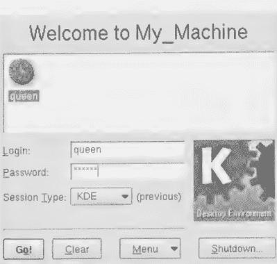

图 1-1 图形界面-登录

为了登录，你必须在 `Login` 提示符处输入登录名，然后在 `Password` 提示符处输入密码（请注意，输入密码时不会显示字符）。在控制台模式下，屏幕会显示如下。

如果你处于控制台模式，你的屏幕看起来类似于图 1-2。

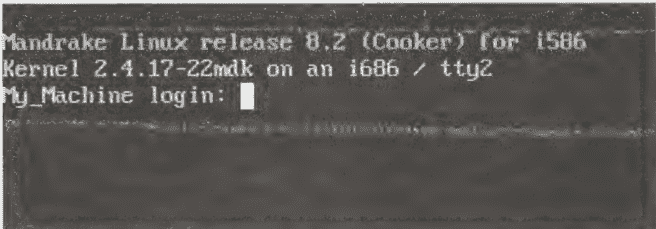

图 1-2 控制台模式-登录

为了登录，你必须在 `Login` 提示符处输入登录名，然后在 `Password` 提示符处输入密码（请注意，输入密码时不会显示字符）。默认情况下，Mandrake Linux 除了图形界面外还有六个虚拟控制台。你可以通过输入 `Alt-F<n>` 切换到任何一个控制台，图形界面在控制台 7。

安装期间，系统还提示你设置特殊用户的密码：`root`。`root` 是系统管理员，很可能是你。为了你的系统安全，为 `root` 账户设置良好的密码非常重要！如果你经常以 `root` 身份登录，很容易犯错导致系统无法使用；特别是如果你没有为 `root` 账户设置密码，任何用户都可以修改任何部分（甚至是机器上的其他操作系统！）。这显然不是一个好主意。

注意的是，系统内部并不通过登录名识别你，而是通过分配给该登录名的唯一数字：用户 ID（`UID`）。同样，每个组通过其组 ID（`GID`）而不是名称识别。

## 1.2 文件基础

文件是另一个 GNU/Linux 与 Windows 及大多数操作系统有巨大差异的主题。我们在这里介绍最明显的差异。更多信息请参阅文件系统章节，该章节提供了更详细的内容。

这些主要差异直接源于 Linux 是一个多用户系统的事实：每个文件都是一个用户和一个组的独有财产。关于用户和组，我们还没有提到的一点是，每一个用户都拥有一个个人目录（称为家目录）。他是该目录以及他随后创建的所有文件的所有者。

然而，如果只有文件所有权概念，这并不会很有用处。但还有更多：作为所有者，用户可以对文件设置权限。这些权限区分了三类用户：文件的所有者、是文件关联组（也称为所有者组）成员但不是所有者的用户，以及其他人（包括既不是所有者也不是用户组成员的所有用户）。

有三种不同的权限：

1. 读权限 (`r`)：允许读取文件内容。对于目录，这允许列出其内容（即目录中的文件）。
2. 写权限 (`w`)：它允许修改文件的内容。对于目录，写权限允许用户在不是这些文件所有者的情况下，向该目录中添加和/或删除文件。
3. 执行权限 (`x`)：它允许文件执行（作为结果，通常只有可执行的文件应该设置权限）。对于目录，这允许用户*遍历*（意味着进入或穿过该目录）。请注意，这与读取访问是分开的：完全可能出现你可以遍历一个目录，但无法读取其内容！

权限的每种组合都是可能的。例如，你可以只允许读取文件，而禁止所有其他用户访问。你也可以采取恰相反的操作，即使这在乍看之下并不太符合逻辑……作为文件所有者，你还可以更改所有者组（当且仅当你是新组的成员时），甚至剥夺自己对该文件的所有权（即更改所有者）。当然，如果你剥夺了对该文件的所有权，你将失去对它的所有权利：

让我们以一个文件和一个命令为例。下面的显示表示在**命令行**中输入了 `ls -l` 命令：

```
ls -l
total 1
-rw-r-- 1 queen users 0 Jul 8 14:11 a_file
drwxr-xr- 2 peter users 1024 Jul 8 14:11 a_directory/
$
```

`ls -l` 命令的结果如下（从左到右）：

- 前十个字符代表文件的类型以及与其相关的权限。第一个字符是文件类型：如果是普通文件，它将包含一个连字符 (`-`)。如果是目录，你将看到这个字符：`d`。还有其他文件类型，我们将在《参考手册》中讨论。接下来的九个字符代表与该文件相关的权限。你可以看到针对同一个文件对不同用户所做的区分：前三个字符代表与文件所有者相关的权利，接三个字符代表所有属于该组但不是所有者的用户，最后三个字符适用于其他人（`others`）。一个连字符 (`-`) 意味着该权限未设置；
- 紧随其后的是文件的链接数。我们将在《参考手册》中看到，文件的唯一标识符不是它的名称，而是一个数字（`inode` 节点），并且磁盘上的一个文件可能有多个名称。对于目录，链接数具有特殊含义，我们将在《参考手册》中进行讨论；
- 其后是文件所有者的名称和另一个用户组的名称；
- 最后，显示文件的大小（字节）和它的最后修改时间，最后是文件或目录本身的名称。

现在让我们仔细观察与这些每个文件相关的权限：首先，我们必须剥离代表类型的第一个字符，对于文件 `a_file`，我们得到了以下权限：`rw-r----`。这些权限的解释如下：

- 前三个字符 (`rw-`) 是文件所有者（在本例中为 `queen`）的权利。因此，`queen` 有权读取文件 (`r`)、修改它 (`w`)，但不能执行它 (`-`)；
- 随后的后的三个字符 (`r--`) 适用于任何不是 `queen` 但是 `users` 组成员的用户：此类用户将能够读取文件 (`r`)，但不能写入或执行它 (`-`)；
- 最后三个字符 (`---`) 适用于任何既不是 `queen` 也不是 `users` 组成员的用户：此类用户对该文件完全没有任何权利。

对于目录 `a_directory`，权限为 `rwxr-xr--`，如下：

- `peter` 作为目录所有者，可以列出包含在内部的文件 (`r`)，或者从该目录删除文件 (`w`)，并且他可以遍历它 (`x`)；
- 每个不是 `peter` 但是 `users` 组成员的用户将能够列出此目录中的文件 (`r`)，但不能删除或添加文件 (`-`)，并且能够遍历它 (`x`)；
- 其他所有用户只能列出此目录的内容 (`r`)，仅此而已。他甚至无法进入该目录。


# 第 1 章 基础 UNIX 系统概念

这些规则有一个例外：`root` 可以更改所有文件的属性（权限、所有者和组），即使他不是所有者。这意味着他也可以授予自己所有权！他可以读取他没有权限的文件，遍历他通常无法访问的目录等等。如果他缺少某种权限，他只需要添加它即可……

最后，值得注意的是 UNIX 世界和 Windows 世界之间文件名的差异。对于前者，UNIX 允许具有更大的灵活性且限制更少：

- 文件名可以包含任何字符（除 ASCII 字符 0，即字符串的结束符，和 `/`，即目录分隔符之外），甚至可以包含不可打印字符。此外，UNIX 是区分大小写的：文件 `readme` 和 `Readme` 是不同的，因为在基于 UNIX 的系统中，`r` 和 `R` 是两个不同的字符。
- 正如你可能注意到的，除非你喜欢那样，否则文件名不需要包含扩展名。在 GNU/Linux 下，文件扩展名并不标识文件的内容，在任何操作系统上也是如此。不过，所谓的“文件扩展名”总是非常方便的。UNIX 下的点 (`.`) 只是其他字符之一。值得提到的是，UNIX 下以点开头的文件名是“隐藏文件”；

## 1.3. 进程

进程定义了程序的一个实例。

## 1.4. 命令行基础

输入 `root` 密码；它不会显示在屏幕上

```
[queen@localhost] - $ su
Password:
```

`exit` 将带你回到普通用户账户

```
[root@localhost] # exit
[queen@localhost] - $
```

在书中的任何地方，提示符都会用符号 `$` 来表示，无论你是普通用户还是 `root`。当你需要 `root` 权限执行某个命令时，系统会提示你，所以请记住 `$`。然而，当 `#` 字符出现在代码行的开头时，它代表一个注释。

当你第一次启动 shell 时，通常会发现自己处于主目录。要显示你当前所在的目录，请输入 `pwd`（代表 Print Working Directory，打印工作目录）：

```bash
$ pwd
/home/queen
```

现在，我们将介绍几个命令，你很快就会发现离了它们不可行！

### 1.4.1. cd：切换目录

`cd` 命令用于更改工作目录。你可以使用 `.` 和 `..`，它们分别代表当前目录和父目录。单独输入 `cd` 会带你回到上一次访问的目录。最后，你可以通过输入 `cd ~peter` 来指定父级的主目录（`~` 代表你自己的主目录）。注意，作为普通用户，你通常无法进入另一个用户的目录（除非对方显式授权，或者这是系统的默认配置），除非你是 `root`，所以，让我们变成 `root` 并练习一下：

```bash
$ pwd
/root
$ cd /usr/share/doc/HOWTO
$ pwd
/usr/share/doc/HOWTO
$ cd ../FAQ-Linux
$ pwd
/usr/share/doc/FAQ-Linux
$ cd ../../lib
$ pwd
/usr
$ cd ~peter
$ pwd
/home/peter
$ cd
$ pwd
/root
```

现在，再次回到普通用户身份。

### 1.4.2. 环境变量和 echo 命令

所有进程都有自己的环境变量，shell 允许你使用 `echo` 命令直接查看它们。一些有趣的变量有：

- `HOME`：这个环境变量包含一个代表你主目录的字符串。
- `PATH`：此变量保存了当你输入命令时，shell 应该查找可执行文件的目录列表。注意，与 DOS 不同，默认情况下，shell 不会在当前目录查找命令！
- `USERNAME`：此变量包含你的登录名。
- `UID`：此变量包含你的用户 ID。
- `PS1`：此变量包含你提示符的定义。它通常是特殊序列的组合。你可以阅读 `bash(1)` 手页以获取更多信息。

要让 shell 打印变量的值，你必须在它的名字前面加一个 `$`。在这里，`echo` 命令将帮助你：

```bash
$ echo Hello
Hello
$ echo $HOME
/home/queen
$ echo $USERNAME
queen
$ echo Hello $USERNAME
Hello queen
$ cd /usr
$ pwd
/usr
$ cd $HOME
$ pwd
/home/queen
```

你可以看到，shell 在执行命令之前会替换变量的值。否则，我们的 `cd $HOME` 将无法运行。实际上，shell 将 `$HOME` 替换为了它的值 `/home/queen`。因此，该行命令变成了 `cd /home/queen`，这正是我们想要的。`echo $USERNAME` 等也是同样的原理。

### 1.4.3. cat：将一个或多个文件的内容打印到屏幕

没什么说的，这个命令的功能正如此：将一个或多个文件的内容打印到标准输出（通常是屏幕）：

```bash
$ cat /etc/fstab
/dev/sda5 / ext2 defaults 1 1
/dev/sda6 /home ext2 defaults 1 2
/dev/sda7 swap swap defaults 0 0
/dev/sda8 /usr ext2 defaults 1 2
/dev/fd0 /mnt/floppy auto sync,user,noauto,nosuid,nodev 0 0
none /proc proc defaults 0 0
/dev/cdrom /mnt/cdrom auto user,noauto,nosuid,exec,nodev,ro 0 0
$ cd
$ cat modules.conf shells
alias parport_lowlevel raport_pc
pre-install plip modprobe raport_pc ; echo 7 > /proc/parport/0/irq
#pre-install pcmia_core /etc/rc.d/init.d/pcmcia start
#alias char-major-14 sound
alias sound essolsoi
keep
/bin/zsh
/bin/bash
/bin/sh
/bin/tcsh
/bin/csh
/bin/ash
/bin/bsh
/usr/bin/zsh
```

### 1.4.4. less：分页器

它的名字与 UNIX 下使用的第一个分页器有关（双关），那个程序叫 `more`。分页器是一个允许用户逐页查看长文件（更准确说是逐屏查看）的程序。我们在这里说 `less` 而不是 `more`，是因为它的用法直观得多。你应该使用 `less` 来查看无法适应屏幕的大文件。例如：

```bash
less /etc/termcap
```

使用向上和向下方向键来浏览此文件。使用 `q` 退出。然而，`less` 的功能远不止于此。事实上，只需输入 `h` 即可查看帮助信息。但无论如何，本节的目标只是让你能够阅读长文件，所以我们已经实现了目标 :-)

### 1.4.5. ls：列出文件

`ls`（List）命令相当于 DOS 的 `dir` 命令，但它可以做更多事情。事实上，这在很大程度上是因为文件可以包含更多信息。`ls` 的命令语法为：

```bash
ls [options] [file|directory] [file|directory...]
```

如果在命令行上没有指定文件或目录，`ls` 将列出当前目录下的文件。它的选项非常多，我们只解释几个：

- `-a`：列出所有文件，包括隐藏文件（记住在 UNIX 中，隐藏文件是以 `.` 开头的名称）；`-A` 选项列出“几乎”所有文件，这意味着除了 `.` 和 `..` 之外的所有文件；
- `-R`：递归列出，即命令行给出的目录的所有文件和子目录；
- `-s`：在每个文件旁边打印以 KB 为单位的大小；
- `-l`：打印文件的额外信息；
- `-i`：在每个文件旁边打印 inode 号（文件在文件系统中的唯一编号，参见“Linux 文件系统”章节）；
- `-d`：将命令行上的目录视为普通文件，而不是列出其内容。

示例：

- `ls -R`：递归列出当前目录的内容；
- `ls -is images/ ..`：列出 `images/` 目录以及当前目录父目录的文件。然后，它会为每个文件打印 inode 号和以 KB 为单位的大小；
- `ls -al images/*.png`：列出 `images/` 目录下所有以 `.png` 结尾的文件（包括任何隐藏文件）。注意，这也包括 `.png` 文件（如果存在的话）。

### 1.4.6. 有用的键盘快捷键

有很多按键可用，其主要优势是节省了大量的打字时间。本节假设你正在使用 Mandrake Linux 提供的默认 shell `bash`，但这些按键在其他 shell 中也有效。

首先：方向键。`bash` 维护了命令历史，你可以通过向上和向下方向键查看它们。你可以滚动到 `HISTSIZE` 环境变量定义的最大行数。此外，历史记录跨会话是持久的，所以你不会丢失之前会话输入的命令。

左、右方向键可以在行内移动光标，你可以通过这种方式编辑命令。但还有更多编辑方法：例如 `Ctrl+A` 和 `Ctrl+E` 分别将你带到行的开头和末尾。退格键和 Delete 键按预期工作。退格的等价键是 `Ctrl+H`，Delete 的等价键是 `Ctrl+D`。`Ctrl+K` 会删除从光标位置到行尾的所有内容，而 `Ctrl+W` 会删除光标前的单词。

在空行输入 `Ctrl+D` 会关闭当前会话，这比输入 `exit` 要快得多。`Ctrl+C` 会中断当前运行的命令，除非你正在编辑命令行，此时它会取消编辑并返回提示符。`Ctrl+L` 清除屏幕。

最后，是 `Ctrl+S` 和 `Ctrl+Q` 的情况：这些按键分别暂停和恢复终端的字符流。它们很少使用，但你可能会误触到 `Ctrl+S`（A、S 和 D 在键盘上靠得很近）。所以，如果你按了键但没有在终端上看到任何字符，请先尝试 `Ctrl+Q`，并注意：在错误的 `Ctrl+S` 和 `Ctrl+Q` 之间输入的所有字符将一次性打印到屏幕上。

# 第 2 章 命令行简介

在“第 1 章 基础 UNIX 系统概念”中，你已经学习了如何启动 shell（终端）。在本章中，我们将向你展示如何使用它。

shell 的主要资产是现有的实用程序数量：有成千上万个，每个都专门用于特定的任务。我们在这里只查看其中（极少数）的一部分。正如我们后面看到的，UNIX 最大的资产之一就是组合这些工具的能力。

## 2.1. 文件处理工具

在此语境下，文件处理意味着复制、移动和删除文件。稍后我们将查看更改它们属性（所有者、权限）的方法。

### 2.1.1. mkdir, touch：创建空目录和文件

`mkdir` (MakeDirectory) 用于创建目录。其语法简单：

```bash
mkdir [options] <directory> [directory ...]
```

只有一个选项值得注意：`-p` 选项。它起了两个作用：

1. 如果父目录不存在，它将创建父目录。如果没有这个选项，`mkdir` 将直接失败，并报错说指定的父目录不存在；
2. 如果你要创建的目录已经存在，它将静默返回。同样，如果你没有指定 `-p` 选项，`mkdir` 将返回一个错误信息，报错说目录已存在。

这里是一些示例：

- `mkdir foo`：在当前目录下创建一个名为 `foo` 的目录；
- `mkdir -p images/misc docs`：在 `images` 目录下创建 `misc` 目录。首先，如果该目录不存在，它会创建该目录（`-p`）；它还会在当前目录下创建一个名为 `docs` 的目录。

最初，`touch` 命令并不是为了创建文件，而是为了更新访问和修改时间。然而，如果提到的文件之前不存在，`touch` 将把它们作为空文件创建出来。其语法为：

```bash
touch [options] file [file...]
```

在 UNIX 中，每个文件都有三个不同的时间戳：文件最后访问日期 (`atime`)，即最后一次打开读取或写入文件的日期；inode 属性最后修改的日期 (`mtime`)；最后是文件内容最后修改的日期 (`ctime`)。

因此，运行命令：

```bash
touch file1 images/file2
```

将在当前目录下创建一个名为 `file1` 的空文件，并在 `images` 目录下创建一个名为 `file2` 的空文件。

### 2.1.2. rm：删除文件或目录

`rm` 命令 (ReMove) 取代了 DOS 命令 `del` 和 `deltree`，并增加了更多选项。其语法如下：

```bash
rm [options] <file|directory> [file|directory...]
```

选项包括：

- `-r`，或 `-R`：递归删除。删除目录（无论是否为空）时必须使用此选项。不过，你也可以使用 `rmdir` 删除空目录。
- `-i`：在每次删除之前请求确认。注意，在 Mandrake Linux 中，默认 `rm` 是 `rm -i` 的别名，出于安全考虑（`cp` 和 `mv` 也有类似的别名）。如果你想移除这些别名，可以编辑你的 `.bashrc` 并添加此行：`alias rm='rm'`。
- `-f`：是 `-i` 的反面，强制删除文件或目录，即使用户对这些文件没有写权限。

一些示例：

- `rm -i images/*.jpg file1`：删除 `images` 目录下所有以 `.jpg` 结尾的文件并删除当前目录下的 `file1`，并对每个文件都请求确认。回答 `y` 确认删除，回答 `n` 取消。
- `rm -Rf images/misc/ file*`：在不请求确认的情况下，删除 `images` 目录下的整个 `misc/` 目录，以及当前目录下所有以 `file` 开头的文件。

> 用户只要对目录有写权限，就可以删除其中的文件，即使他不是这些文件的所有者。

使用 `rm` 删除文件是不可逆的。没有办法恢复它们！

不要犹豫使用 `-i` 选项，以确保你不会误删东西。

### 2.1.3. mv：移动或重命名文件

`mv` (Move) 命令的语法如下：

```bash
mv [options] <file|directory> [file|directory ...] <destination>
```

一些选项：

- `-f`：强制操作——如果覆盖了现有文件，则不会发出警告。
- `-i`：其反面。在覆盖现有文件之前向用户请求确认。
- `-v`：详细模式，报告所有更改和活动。

示例：

- `mv -i /tmp/pics/*.png .`：将 `/tmp/pics/` 目录下所有以 `.png` 结尾的文件移动到当前目录 (`.`)，但在覆盖任何现有文件之前会请求确认。
- `mv foo bar`：将文件 `foo` 重命名为 `bar`。如果 `bar` 目录已经存在，该命令的效果是将整个 `foo` 目录（目录本身及其内部所有文件和目录，递归地）移动到 `bar` 目录。
- `mv -vf file* images/ trash/`：在不请求确认的情况下，将当前目录下所有以 `file` 开头的文件以及整个 `images/` 目录移动到 `trash/`，并显示执行的每项操作。

### 2.1.4. cp：复制文件和目录

`cp` (CoPy) 取代了 DOS 命令 `copy`、`xcopy` 并增加了更多选项。其语法如下：

```bash
cp [options] <file|directory> [file|directory ...] <destination>
```

`cp` 有很多选项。这里是最常见的：

- `-R`：递归复制；复制目录（即使是空的）时必须使用此选项。
- `-i`：在覆盖任何可能的文件之前请求确认。
- `-f`：是 `-i` 的反面，强制覆盖文件或目录。
- `-v`：详细模式，报告所有更改。

一些示例：

- `cp -i /tmp/pics/* .`：将 `/tmp/pics/` 目录下的所有文件复制到当前目录 (`.`)，但在覆盖任何现有文件之前会请求确认。
- `cp -R images/ docs`：将 `images/` 目录递归复制到 `docs`。
- `cp -vf file* images/`：在不请求确认的情况下，将当前目录下所有以 `file` 开头的文件复制到 `images/`，并显示执行的每项操作。

## 2.2. 更改文件属性

### 2.2.1. chown, chgrp：更改所有者和组

`chown` (Change Owner) 和 `chgrp` (Change Group) 命令分别用于更改文件的所有者和组。它们的语法非常相似：

```bash
chown [options] <owner>[:<group>] <file|directory> [file|directory...]
chgrp [options] <group> <file|directory> [file|directory...]
```

主要选项：

- `-R`：递归更改所有者/组。
- `-v`：详细模式，显示每个文件所执行的操作。
- `-c`：类似于 `-v`，但只显示受命令影响的文件。

示例：

- `chown -R peter:users /home/peter`：递归地将 `/home/peter` 目录下所有文件的所有者改为 `peter`，组改为 `users`。
- `chgrp -v staff docs/`：将 `docs/` 目录的组改为 `staff`，并显示操作详情。

### 2.2.2. chmod：更改权限

`chmod` (Change Mode) 命令用于更改文件的访问权限。权限由三类用户决定：

- `u` (User，所有者的权限)；
- `g` (Group，组的权限)；
- `o` (Others，“其他用户”的权限)。

如果不指定类别，更改将应用于所有类别。`+` 设置权限，`-` 移除权限，`=` 设置权限。

最后，权限是以下一个或多个：

- `r` (读)；
- `w` (写)；
- `x` (执行)。

主要选项与 `chown` 或 `chgrp` 的选项非常相似：

- `-R`：递归更改权限。
- `-v`：详细模式。显示每个文件所执行的操作。
- `-c`：类似于 `-v`，但只显示受命令影响的文件。

示例：

- `chmod -R o-w /shared/docs`：递归地移除 `/shared/docs/` 目录下所有文件和子目录的其他用户的写权限。
- `chmod -R og-w,o-x private/`：递归地移除整个 `private/` 目录的组和其他用户的写权限，并移除其他用户的执行权限。
- `chmod -c 644 file*`：更改当前目录下所有以 `file` 开头的文件权限为 `rw-r--r--`（即所有人都有读权限，只有所有者有写权限），并报告受此命令影响的文件。

## 2.3. Shell 通配符模式

你可能在不知情的情况下已经在使用通配符。当你在 Windows 中指定一个文件或查找一个文件时，你使用 `*` 来匹配随机字符串。例如，`*.txt` 匹配所有以 `.txt` 结尾的文件。我们在上一节中也大量使用了它。但通配符不仅仅是 `*`。

当你输入类似 `ls *.txt` 的命令并按回车时，寻找哪些文件匹配 `*.txt` 模式的任务并不是 `ls` 命令完成的，而是由 Shell 本身完成的。这需要解释一下 Shell 如何解释命令行。当你输入：

```bash
$ ls *.txt
readme.txt recipes.txt
```


命令行首先被拆分成多个单词（在此例中为 `ls` 和 `*.txt`）。当 Shell 在单词中看到 `*` 时，它会将整个单词解释为通配符模式，并将其替换为所有匹配的文件名。因此，命令在 Shell 执行之前变成了 `ls readme.txt recipe.txt`，从而得到了预期的结果。其他字符也会让 Shell 产生这种反应：

- `?`：匹配一个且仅一个字符，无论该字符是什么；
- `[...]`：匹配括号内的任何字符。字符可以视为字符范围（例如 `1-9`）或离散值，或其他。示例：`[a-zBE5-7]` 将匹配 a 到 z 之间的所有字符、一个 B、一个 E、一个 6 或一个 7；
- `[!...]`：匹配不在括号内找到的任何字符。例如，`[!a-z]` 将匹配任何非小写字母的字符；
- `{c1,c2}`：匹配 c1 或 c2，其中 c1 和 c2 也是通配符模式，这意味着你可以写成 `{[0-9]*, [acr]}`。

以下是一些模式及其含义：

- `/etc/*conf`：/etc 目录下所有以 conf 结尾的文件。它可以匹配 `/etc/inetconf`、`/etc/linuxconf`，如果存在该文件的话，还可以匹配 `/etc/conf`。记住 `*` 可以匹配空字符串。
- `image/(cars,space [0-9])*.jpg`：如果目录 `image/cars`、`image/space0`、(...) `image/space9` 存在，则匹配所有以 .jpg 结尾的文件名。
- `/usr/share/doc/*README`：/usr/share/doc/ 所有直接子目录下名为 README 的文件。这会让 `/usr/share/doc/mandrake/README` 匹配，但不会匹配 `/usr/share/doc/myprog/doc/README`。
- `*[!a-z]`：当前目录下所有不以小写字母结尾的文件名。

### 2.4. 重定向与管道

#### 2.4.1. 关于进程的进一步介绍

为了理解重定向和管道的原理，我们需要解释一个尚未介绍过的进程的概念。每个 UNIX 进程（这包括图形化应用程序）至少打开三个文件描述符：标准输入、标准输出和标准错误。它们的对应数字是 0、1 和 2。通常，这三个描述符与启动进程的终端相关，其中输入来自键盘。重定向和管道的目的是重定向这些描述符。

#### 2.4.2. 重定向

例如，假设你想要 images 目录中所有以 .png 结尾的文件列表。这个列表很长，所以你可能想将其存储在一个文件中，以便空闲时查看。你可以输入以下命令：

```
$ ls images/*.png > file_list
```

这意味着该命令的标准输出（1）被重定向（>）到名为 `file_list` 的文件。`>` 运算符是输出重定向运算符。如果重定向的文件不存在，则创建它；但如果它已存在，其原有内容将被覆盖。然而，默认重定向的描述符是标准输出。

或者，如果你想直接查看列表而不将其存储到文件中：

`ls images/*.png | sed -e 's/.png$/g' | less`

管道和重定向并不局限于人类可读的文本。例如，从终端发送以下命令：

`ls -root | convert ~/my_desktop.png`

将你的桌面的截屏发送到你个人目录下的 `my_desktop.png` 文件中。

### 2.5. 命令行自动补全

补全是一个非常实用的功能，所有现代 shell（包括 bash）都拥有该功能。它的作用是尽可能让用户少做工作。说明自动补全最好的方法是给出一个示例。

#### 2.5.1. 示例

假设你的个人目录下包含一个名为 `file_with_very_long_name_impossible_to_type` 的文件，你想查看它。假设在同一目录下还有另一个名为 `file_text` 的文件。你位于个人目录下，输入以下序列：

```
$ less fi<TAB>
```

（即：输入 `less fi` 然后按 TAB 键。Shell 将会为你扩展命令行：

```
$ less file_
```

并给出可能的选项列表（在默认配置下，该配置可以自定义）。然后输入以下按键序列：

```
less file_w<TAB>
```

Shell 将扩展命令行以给你你想要的结果：

`less file_with_very_long_name_impossible_to_type`

你只需要按下回车键（Enter）确认并读取文件即可。

#### 2.5.2. 其他补全方法

TAB 键不是激活补全的唯一方法，尽管它是最常用的方法。根据一般规则，要补全的单词对于命令行的第一个单词将是命令名（`ns<TAB>` 将给出 `nslookup`），对于所有其他单词则是文件名，除非该单词前面有“魔法”字符 `~` 或 `$`，在这种情况下，Shell 将分别尝试补全名称、机器名或环境变量名。此外还有用于补全命令名（`!`）或文件名（`./`）的字符。

激活补全的其他两种方法是序列 `Esc-<x>` 和 `Ctrl-<x>`，其中 `<x>` 是前面提到的魔法字符。`Esc-<x>` 会尝试给出一个唯一的补全。如果失败，它将使用选项列表中尽可能长的子字符串来补全该单词。“哔”声意味着该选项不是唯一的，或者仅仅是因为没有对应的选项。`Ctrl-<x>` 序列会显示可能的选项列表，而不尝试任何补全。按下 TAB 键等同于连续按下 `Esc-<x>` 和 `Ctrl-<x>`，其中魔法字符取决于上下文。

因此，查看所有环境变量的一种方法是在空行上输入序列 `Ctrl+x $`。另一个例子：如果你想查看 `nslookup` 命令的 man 页（帮助文档），你只需输入 `man nsl Esc-!`，Shell 就会自动补全命令为 `man nslookup`。

### 2.6. 启动和处理后台进程：作业控制

你可能已经注意到，当你从终端输入命令时，通常必须等待命令完成后 Shell 才会将控制权交给你。这意味着你是在前台发送了命令。然而，在某些情况下这并不是理想的。

例如，假设你决定递归地将一个大目录复制到另一个目录。你还决定忽略错误，因此将错误通道重定向到 `/dev/null` `2>/dev/null`：

```
cp -R images/ /shared/ 2>/dev/null
```

这样的命令可能需要几分钟才能完全执行。你现在有两个解决方案：第一种是暴力的，意味着停止（杀死）命令，等你有时间时再做。这样做：

`Ctrl-c` 将终止进程并带你回到提示符。但等一下，不要这样做！继续往下看。

假设你想让命令在执行其他操作的同时运行。解决方案是将进程放入后台。这样做，输入 `Ctrl+z` 挂起进程：

```bash
$ cp -R images/ /shared/ 2>/dev/null
# 在此处输入 Ctrl-z
[1]+ Stopped cp -R images/ /shared/ 2>/dev/null
```

你又回到了提示符处。此时进程处于待命状态，等待重启（如 `Stopped` 关键字所示）。这当然是你想要做的，但在后台执行。输入 `bg`（代表 Background 后台）来获得所需的结果：

```
$ bg
[1]+ cp -R images/ /shared/ 2>/dev/null &
```

该进程将作为后台任务重新运行，如命令末尾的 `&` 符号所示。你将回到提示符并可以继续工作。作为后台任务运行或在后台运行的进程被称为作业（job）。

当然，你可以通过在命令末尾添加 `&` 字符直接作为后台任务启动进程。例如，你可以通过编写以下命令在后台启动复制目录的命令：

```
cp -R images/ /shared/ 2>/dev/null &
```

如果你愿意，可以输入 `fg` 将其恢复到前台并等待其完成。如果要将其放入后台，输入 `Ctrl+z`。你可以启动多个作业：每个命令都会分配一个作业号。`+` 符号的作业是最近操作的作业。通过 `fg <n>` 你可以恢复特定的作业。

### 2.7. 结语

正如你所示，Shell 功能非常强大，有效地使用它取决于实践。在这个相对长的章节中，我们只提到了一些可用命令：你有适用于各种口味和用途的工具：处理图像的（如上述的 `convert`，以及 GIMP）、音频播放器（MP3 编码器）、文本编辑器、电子邮件客户端、FTP 客户端甚至网页浏览器（如 lynx）。

即使存在功能图形化应用程序，它们通常也是基于这些工具构建的图形界面。此外，命令行工具的优势在于可以在非交互模式操作（参见 `nohup(1)` 页）。

## 第 3 章 文本编辑：Emacs 和 Vi

正如引言所述，文本编辑是使用 UNIX 系统的一项功能。我们将快速查看的两个编辑器最初使用起来困难，但一旦你理解了基础，它们证明是强大的工具。

### 3.1. Emacs

Emacs 可能是世界上最强大的文本编辑器。由于其内置的 Lisp 语言，它可以完成一切。使用 Emacs，你可以浏览网页、阅读邮件、参与新闻组、冲咖啡等等。然而，在本节结束时，你能够做的将限于打开 Emacs、编辑一个或多个文件、保存以及退出 Emacs。这作为开始并不难。

#### 3.1.1. 简要介绍

调用 Emacs 相对简单：

```
emacs [file] [file...]
```

Emacs 会将任何作为参数输入的文件打开在缓冲区中，同时最多显示两个缓冲区，如果你没有指定文件，它将向你展示名为 `*scratch*` 的缓冲区。如果你在 X 环境中，你还有可用的菜单，但在本章中我们将使用键盘。

#### 3.1.2. 入门

是时候实际上手操作了。通过例来说，让我们打开两个文件，file1 和 file2。如果这两个文件不存在，一旦你在它们中写入内容它们就会被创建：

```
emacs file1 file2
```

你将得到图 3-1 所示的窗口。

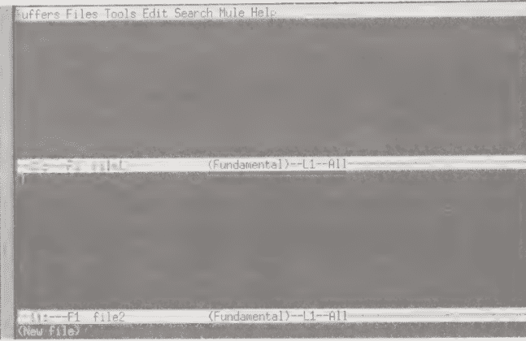

图 3-1. Emacs，同时编辑两个文件

如你所见，已经创建了两个缓冲区（buffer）：每个文件一个。屏幕底部还有第三个（你看到 (New file) 的地方）；这是微缓冲区（mini-buffer）。你无法强制进入这个缓冲区；你必须在交互式编辑器期间由 Emacs 邀请你进入。要更改当前缓冲区，请输入 `Ctrl+x o`。你可以像在“普通”编辑器一样输入文本，并使用 DEL 或 Backspace 键删除字符。

移动时，你可以使用方向键，以及其他按键组合：`Ctrl+a` 跳到行首，`Ctrl+e` 跳到行尾。`Alt+<` 跳到缓冲区开头，`Alt+>` 跳到缓冲区结尾。还有许多其他组合，甚至每个方向键都有相应的组合。

一旦你想保存文件中的更改，就输入 `Ctrl+x s`；或者，如果你想将缓冲区内容保存到另一个文件，输入 `Ctrl+w`，Emacs 将询问你要将缓冲区内容写入哪个文件。你可以使用补全功能来完成。

#### 3.1.3. 处理缓冲区

如果你愿意，可以在屏幕上只显示一个缓冲区。有两种方法可以实现：

> Emacs 的设计用于在各种机器上运行，某些机器没有方向键。对于 Vi 更是如此。

- 如果你处于想要隐藏的缓冲区中：输入 `Ctrl+x 0`；
- 如果你处于想要保留在屏幕上的缓冲区中：输入 `Ctrl+x 1`。

此时有两种方法可以恢复你想显示在屏幕上的缓冲区：

- 输入 `Ctrl+x b` 并回车你想要的缓冲区名称，
- 输入 `Ctrl+x Ctrl+b`，随后会打开一个名为 `*Buffer List*`（缓冲区列表）的新缓冲区；你可以使用 `Ctrl+x o` 序列在该缓冲区中移动，然后选择你需要的缓冲区并按回车键，或者直接在微缓冲区中输入缓冲区名称。一旦你做出选择，缓冲区 `*Buffer List*` 就会返回后台。

如果你已经处理完一个文件并想移除关联的缓冲区，输入 `Ctrl+x k`。*Emacs* 将询问它应该关闭哪个缓冲区。默认情况下，它是你当前所在的缓冲区名称。如果你想移除建议之外的缓冲区，直接输入其名称或按 TAB 键：*Emacs* 将打开另一个缓冲区 `*Completions*`（补全），提供可能的选项列表。按回车键确认选择。

你还可以随时将两个可见的缓冲区恢复到屏幕。这样做请输入 `Ctrl+x 2`。默认情况下，会创建一个新的缓冲区（这允许你例如“同时”在多个处编辑大文件），你只需按照之前描述的方法在缓冲区之间移动即可。

你可以随时使用 `Ctrl+x Ctrl+f` 打开其他文件。*Emacs* 将询问你文件名，并且再次可以使用补全功能。

#### 3.1.4. 复制、剪切、粘贴、搜索

假设我们处于图 3-2 所示的情况。

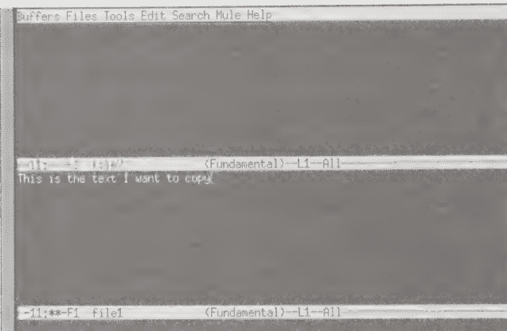

图 3-2. Emacs，在复制文本块之前

首先，你需要选择想要复制的文本。在 X 中，你可以使用鼠标进行操作，选中的区域甚至会被高亮显示。但在这里我们处于模式中 :)。在这种情况下，我们想要复制整行。首先，你需要在行首放置一个标记（mark）。假设光标位于图中所示的位置，首先输入 `Ctrl+SPACE`（空格键）：Emacs 随后会在微缓冲区中显示标记已设置。要复制或剪切的区域是标记与光标当前位置之间的整个区域。接下来输入 `Alt+w`（复制）或 `Ctrl+w`（剪切）。如果你选择复制，Emacs 将短暂返回标记位置，以便你查看选中的区域。

然后转到你想粘贴文本的缓冲区，输入 `Ctrl+y`，即可得到图 3-3 所示的结果。

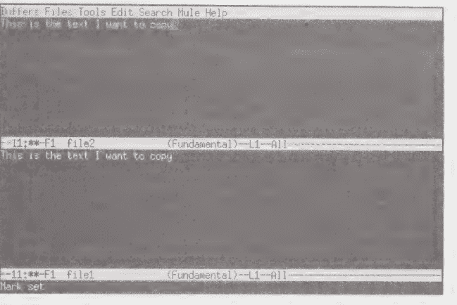

图 3-3. Emacs，复制文本块后

事实上，你刚刚将文本复制到了 Emacs 的“剪贴环”（kill ring）中；此剪贴环包含了 Emacs 启动以来的所有复制或剪切区域。任何刚刚复制或剪切的区域都位于剪贴环的顶部。序列 `Ctrl+y` 只会将顶部的区域“粘贴”。如果你想访问其他区域，按 `Alt+y` 直到获取所需的文本。

要搜索，进入目标缓冲区并输入 `Ctrl+s`。Emacs 随后询问你要搜索的字符串。要在当前缓冲区再次搜索相同的字符串，输入 `Ctrl+s`。当 Emacs 到达结尾且没有更多匹配项时，你可以再次输入 `Ctrl+s` 从头重新搜索。

要搜索并替换，使用 `Alt+%`。Emacs 询问你要搜索的字符串以及替换内容，并确认每个匹配项。

一个非常有用的功能：`Ctrl+x` 可以撤销之前的操作。你可以撤销任意操作。

#### 3.1.5. 退出 Emacs

快捷键是 `Ctrl+x Ctrl+c`。Emacs 随后询问你是否要保存对缓冲区进行的更改。

### 3.2. Vi：祖先

Vi 是世界上第一个全屏编辑器。Vi 是 UNIX 使用者的主要目标之一，也是支持者的主要理由之一：虽然学习起来很复杂，但一旦习惯，它也是极其强大的工具。通过几次击键，Vi 用户可以自由移动，除了 Emacs 外很少有文本编辑器能做到这一点。Mandra Linux 提供的实际上是 vim，但在本书中我们将称之为 Vi。

#### 3.2.1. 插入模式、命令模式、ex模式...

首先，我们需要启动 Vi，这与 Emacs 相同。让我们回到两个文件并输入：

```
$ vi file2
```

此时，你会发现自己处于一个类似于图 3-4 的窗口前。


你现在处于第一个文件的命令模式。在命令模式下，无法向文件中插入文本...要这样做，你必须进入插入模式，并输入允许此的命令之一：

- `a` 和 `i`：分别在光标后和之前插入文本（`A` 和 `I` 在行尾和行首插入文本）；
- `o` 和 `O`：分别在当前行下方上方插入文本。

在插入模式下，你会在屏幕底部看到 `--INSERT--` 字符串（这样你就知道处于什么模式了）。只有在这种模式下才能输入文本。要返回命令模式，按 Esc 键。


## 第 3 章 文本编辑：Emacs 和 Vi

### 3.2.2. 处理缓冲区

与 Emacs 一样，你可以在屏幕上显示多个缓冲区。这样做请使用 `:split` 命令。

要在缓冲区中从一个文件移动到另一个文件，输入 `:next` 移动到下一个，输入 `:prev` 移动到上一个文件。你也可以使用 `:<文件名>`，这允许你在文件已打开时切换到目标文件，或打开另一个文件。这里同样可以使用补全功能。

要切换缓冲区，输入 `Ctrl+j` 跳到下方缓冲区，或 `Ctrl+w` 跳到上方缓冲区。你也可以使用上下方向键代替 `j` 或 `k`。`:close` 命令隐藏缓冲区，`q` 命令关闭它。

注意，Vi 非常挑剔：如果你尝试在不保存更改的情况下隐藏或关闭缓冲区，命令将不会执行并收到此消息：

```
No write since last change (use! to override)
```

在这种情况下，请按其要求操作并输入 `:q!` 或 `:close`。

### 3.2.3. 编辑文本与移动命令

除了编辑模式下的 `Backspace` 和 `DEL` 键外，Vi 在命令模式下还有许多其他删除、复制、粘贴和替换文本的命令。在这里我们将介绍几个。所有显示的命令实际上都分为两个部分：要执行的操作及其产生的效果。操作可以是：

- `c`: 替换（Change）；编辑器会删除请求的文本并在执行此命令后回到插入模式；
- `d`: 删除（Delete）；
- `y`: 复制（Yank），我们将在下一节中介绍。
- `.`: 重复上一次操作。

效果（Effect）定义了命令作用的字符组。这些在命令模式下输入的作为效果的命令也对应于移动：

- `h`, `j`, `k`, `l`: 分别向左、下、上、右移动一个字符；
- `e`, `b`, `w`: 到当前单词的末尾（分别到开头）；到下一个单词的开头；
- `^`, `0`, `$`: 到当前行的第一个非空字符、到当前行开头、到当前行末尾；
- `f<x>`: 到字符 `<x>` 的下一次出现处；例如，`fe` 将光标移动到字符 `e` 的下一个出现处；
- `/<string>`, `?<string>`: 到字符串或正则 `<string>` 的下一次出现处，在文件中反向亦相同；例如，`/foobar` 移动光标直到单词 `foobar` 的下一次出现处；
- `{`, `}`: 到当前段落的开头、到当前段落的末尾；
- `G`, `H`: 到文件末尾、到屏幕开头。

每个效果字符或移动命令的前都可以加上一个重复数字。对于 `G`，这指的是文件中的行号。在此基础上，你可以进行各种组合。

一些示例如下：

- `6b`: 向后移动 6 个单词；
- `c8fk`: 删除到字符 `k` 的第八次出现处的所有文本，然后进入插入模式；
- `3.` `d1`（向后删除一个字符）的快捷键是 `x`；`dh` 的快捷键是 `X`；`dd` 删除当前行。
- `91G`: 跳到文件的第 91 行；
- `d3$`: 删除到当前行末尾加上后续两行。

诚然，这些命令并不直观，但一如既往，最好的方法是实践。你可以发现，“几键移山”这句话并不算夸张 :-)

### 3.2.4. 剪切、复制、粘贴

Vi 有一个我们已经见过的用于复制文本的命令：`y` 命令。要剪切文本，只需使用 `d` 命令。你有 27 个用于存储文本的内存：一个匿名内存和 26 个以字母表 26 个小字母命名的内存。

要使用匿名内存，直接输入命令。因此，命令 `d12w` 将光标后的 12 个单词复制到匿名内存。如果你想剪切该区域，请使用 `d12w`。

要使用 26 个命名内存之一，在命令前输入序列 `` `<x>` ``，其中 `<x>` 是内存的名称。因此，要将这相同的 12 个单词复制到内存 `k`，你需要写 `` `ky12w` ``，并用 `` `kd12w` `` 剪切它们。

要粘贴匿名内存的内容，使用命令 `p` 或 `P`（*Paste*，粘贴），分别在光标之后或之前插入文本。要粘贴命名内存的内容，同样使用 `` `<x>p` `` 或 `` `<x>P` ``（例如 `dp` 将内存 `d` 的内容粘贴到光标之后）。

让我们看看图 3-5 的示例。

- 4. ... 如果光标位于第一个单词的开头！

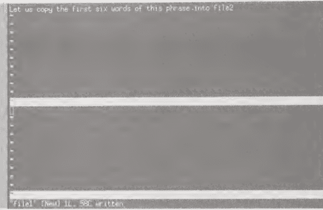

图 3-5. vim，在复制文本块之前

为了执行此操作，我们将：

- 将句子的前 6 个单词复制到内存 `r` 中（例如）：`"ry6w` s,\n
- 进入缓冲区文件2，它位于下方：`Ctrl+w j`；
- 在光标之前粘贴内存 `r` 的内容：`"rp.`

我们得到了预期的结果，如图 3-6 所示。

- 5. `y6w` 字面上的意思是：“复制 6 个单词”。

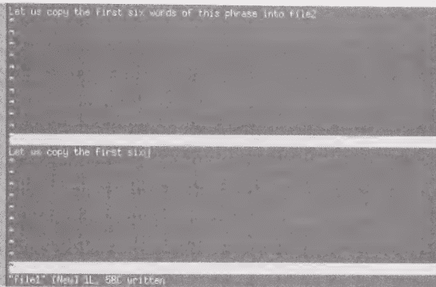

图 3-6. vim，在复制文本块之后

搜索文本非常简单：在命令模式下，你只需输入 `/` 后跟要搜索的字符串，然后按回车键。例如，`/party` 将从当前光标位置搜索字符串 `party`。按 `n` 将你带到下一个出现处，如果你到达文件末尾，搜索将从开头重新开始。要反向搜索，用 `?` 代替 `/`。

### 3.2.5. 退出 Vi

退出命令是 `:q`（事实上，此命令关闭了活动缓冲区，正如我们已经见过的，如果它是唯一存在的缓冲区，你就退出了 Vi）。有一个快捷键：大多数时候你只编辑一个文件。所以要退出，将使用：

- `:wq` 保存更改并退出（更快的解决方案是 `ZZ`），或者
- `:q!` 不保存并退出。

你会注意到，如果你有多个缓冲区，`:wq` 将写入当前缓冲区并退出。

There is a shortcut: most of the time you edit only one file. So to quit, you will use:

- `:wq` to save changes and quit (a quicker solution is `ZZ`), or
- `:q!` to quit without saving.


## 第 4 章 命令行实用工具

- `-type <type>`：搜索类型文件；`<type>` 可以是以下之一：`f`（普通文件）、`d`（目录）、`l`（符号链接）、`s`（套接字）、`b`（块设备文件）、`c`（字符设备文件）或 `p`（命名管道）
- `-name <pattern>`：查找名称匹配给定 `<pattern>` 的文件。使用此选项时，`<pattern>` 被视为 shell 通配符模式（参见第 18 页“Shell 通配符模式”章节）
- `-iname <pattern>`：这种用法同于 `-name`，但忽略大小写
- `-atime <n>` 或 `-amin <n>`：查找最后访问于 `<n>` 天前（`-atime`）或 `<n>` 分钟前（`-amin`）的文件。你也可以指定 `+<n>` 或 `-<n>`，在这种情况下，搜索将针对分别在最多或至少在 `<n>` 天/分钟前访问的文件进行
- `-newer <file>`：查找访问时间比 `<file>` 更新的文件
- `-ctime <n>`、`-cmin <n>`、`-cnewer <file>`：与 `-atime`、`-amin` 和 `-newer` 相同，但适用于文件内容最后一次修改的时间
- `-regex <pattern>`：与 `-name` 相同，但模式被视为正则表达式
- `-iregex <pattern>`：与 `-regex` 相同，但忽略大小写

还有其他测试，更多细节请参考 `find(1)`。若要组合测试，你可以使用以下之一：

- `<c1> -a <c2>`：如果 `<c1>` 和 `<c2>` 都为真，则为真；`-a` 是隐式的，因此如果你想让所有测试 `<c1>`、`<c2>`、`<c3>` ... 都匹配，你可以输入 `<c1> <c2> <c3>` ...
- `<c1> -o <c2>`：如果 `<c1>` 或 `<c2>` 其中一个为真（或都为真），则为真。注意 `-o` 的优先级低于 `-a`。也就是说，如果你想匹配符合标准 `<c1>` 或 `<c2>` 且符合标准 `<c3>` 的文件，你必须使用括号并写成 `\( <c1> -o <c2> \) -a <c3>`。你必须对括号进行转义（激活），否则它们会被 shell 解释！
- `-not <c1>`：反转测试 `<c1>`，因此如果 `<c1>` 为假，则 `-not <c1>` 为真

最后，你可以为找到每个文件指定一个操作。最常用的有：

- `-print`：直接在标准输出上打印每个文件的名称。这是默认操作
- `-ls`：在标准输出上打印每个找到的文件相当于 `ls -ilds` 的输出
- `-exec <command>`：在每个找到的文件上执行命令 `<command>`。命令行 `<command>` 必须以 `\;` 结尾，你必须对其进行转义以防 shell 解释；文件位置用 `{}` 标记。请查看用法示例以了解此点
- `-ok <command>`：与 `-exec` 相同，但在执行前提示确认

### 4.3.2. find 示例

OK，现在让我们练习一下，这是弄清楚这个“怪物”的最佳方法。还在这儿吗？假设你想找到 `/usr/share/directory` 下所有的目录。那么你将输入：

```
find /usr/share -type d
```

假设你有一个 HTTP 服务器，所有的 HTML 文件都在 `/var/www/html/` 中，那里也是你的当前目录。现在你想找到一个月内未修改过的文件。由于是从几个作者那里获取页面，有些文件是 `.html` 扩展名而不是 `.htm` 扩展名。你想在 `/var/www/obsolete` 目录中链接这些文件。你将输入：

```
find \( -name "*.htm" -o -name "*.html" \) -a -ctime -30 -exec ln {} /var/www/obsolete \;
```

好了，这有一点复杂，需要稍微解释一下。这个标准的准则是：

```
\( -name "*.htm" -o -name "*.html" \) -a -ctime -30
```

它的作用正是我们想要的：它找到所有名称以 `.htm` 或 `.html` 结尾的文件（ `\( -name "*.htm" -o -name "*.html" \)`），并且（ `-a` ）在过去的 30 天内未修改过，这大约是一个月（ `-ctime -30` ）。注意括号：它们在这里是必要的，因为 `-a` 的优先级更高。如果没有括号，将找到所有以 `.htm` 结尾的文件，加上所有以 `.html` 结尾且一个月内未修改过的文件，这并不是我们想要的。还要注意括号已从 shell 转义：如果我们放 `( ... )`，shell 将解释它们并尝试在子 shell 中执行 `-name "*.htm" -o -name "*.html"`……另一种解决方案是将括号放在双引号或单引号之间，但在这里使用反斜杠更好，因为我们只需要隔离一个字符。

最后，是为每个文件执行的命令：

```
-exec ln /home/httpd/obsolete \;
```

注意，此示例要求 `/var/www/` 和 `/var/www/obsolete` 在同一个文件系统上！

你也必须从 shell 转义 `\;`，否则 shell 会将其解释为命令分隔符。如果你不这样做，`find` 将抱怨 `-exec` 缺少参数。

最后一个示例：你有一个巨大的目录（`/shared/images`），里面存有各种图像。你经常使用 `touch` 命令更新该目录下一个名为 `stamp` 的文件的时间戳，以便你有一个时间参考。你想找到其中所有比 `stamp` 文件新的 JPEG 图像，由于你从各种来源获取，有些是 `jpg` 扩展名而不是 `jpeg`。

```
find /shared/images -newer /shared/images/stamp -a \( -name "*.jpg" -o -name "*.jpeg" \)
```

### 4.3.3. cron：定期调度命令

`cron` 是一个守护进程，它允许你周期性地执行命令。每个用户都有一个 `crontab` 文件（cron 表），其中包含要执行的命令及其执行时间。要编辑你的 crontab，请运行 `crontab -e`（这将启动你的默认编辑器，由 `EDITOR` 环境变量定义）。crontab 文件中的每一行都有 6 个字段：

```
* * * * * * command
- - - - - -
| | | | +-- 星期几 (0-7) (周日=0 或 7)
| | | +---- 月份 (1-12)
| | +------ 一个月中的第几天 (1-31)
| +-------- 小时 (0-23)
+---------- 分钟 (0-59)
```

星号 (`*`) 表示“所有可能的值”。以下是一些示例：

```
# 每两小时的第 0 分钟和第 14 分钟，更新 shared/images 目录下的 stamp 文件
0 14 */2 * * touch /shared/images/stamp

# 每个圣诞节，播放一段旋律 :)
0 0 25 12 * mpg123 $HOME/sounds/merrychristmas.mp3

# 每周二下午 5 点，打印购物列表...
0 17 * * 2 lpr $HOME/shopping-list.txt
```

除了示例所示的方法，还有几种方法可以指定间隔。例如，你可以指定一组用逗号分隔的离散值（`1, 14, 23`）或一个范围（`1-15`），甚至可以将两者结合（`1-10, 12-20`），还可以带上步长（`1-12, 20-27/2`）。现在由你来发现有用的命令放进去！

## 4.4. at：调度执行一次的命令

你可能还想在某一天启动命令，但不是定期执行。例如，你想提醒自己有一个预约，今天下午 6 点。你运行 X，你想在下午 5:30 分收到通知，例如，你必须离开了。在这里输入你想要的：

```
$ at 5:30pm
at> echo "现在该走了！下午 6 点有约"
at> <EOT>
```

你可以通过不同的方式指定时间：

- `+<interval>`：均值，现在的基础上加上一个间隔（可选）。如果未指定间隔，则默认为“现在”。间隔的语法为 `<n>`（分钟|小时|天|周|月）。例如，你可以指定 `now +1 hour`（一小时后）、`now +3 days`（三天后）等
- `<time> [<day>]`：完整指定日期。`<time>` 参数是强制的，`at` 对其接受的格式非常直观（字面化）：你可以指定类型 `0100`、`04:20`、`2am`、`0530pm`、`1800`，或者三个特殊值之一：`now`（现在）、`teatime`（下午 4 点）或 `midnight`（午夜）。`<day>` 参数是可选的。你也可以以不同的方式指定它：例如 `12/20/2001`，代表 2001 年 12 月 20 日；或者采用欧洲写法 `20.12.2001`。你可以省略年份，但此时只接受欧洲记法：`20.12`。你也可以用全字母指定月份：`Dec 20` 或 `20 Dec` 都是有效的

`at` 还接受以下选项：

- `-l`：打印当前队列中的作业列表；第一个字段是作业号。这等同于执行 `atq` 命令
- `-d <n>`：从队列中删除作业号为 `<n>` 的任务。你可以通过 `atq` 获取作业号。这等同于 `atrm <n>`

像往常，请查看 `at(1)` 手页以获取更多选项。

## 4.5. tar：磁带存档器 (Tape ARChiver)

尽管我们在“构建和安装自由软件”章节（第 121 页）中已经见过 `tar`，但我们还没有解释它是如何工作的。这正是本节的内容。与 `find` 一样，`tar` 是一个悠久的 UNIX 工具，它的语法有些特殊。语法如下：

```
tar [options] [files...]
```


# tar 命令选项与用法

## 选项列表

注意：所有选项都有等效的长选项，但需参考手册页，此处不列出。且并非所有选项都会列出。

短选项开头的横杠（`-`）在 tar 中已弃用，除非在长选项之后。

- `c`：创建新的归包
- `x`：从现有归包中提取文件
- `t`：列出现有归包中的文件
- `v`：列出添加到包或从包中提取的文件；结合 `t` 选项使用时，输出文件的详细列表而非短列表
- `f <file>`：创建名为 `<file>` 的归包，或从包 `<file>` 中提取/列出文件。若省略，默认文件为 `/dev/rmt0`（通常为驱动器相关特殊文件）。若文件参数为 `-`，输入/输出将关联到标准输入/标准输出
- `z`：创建的归包应用 gzip 压缩
- `j`：同 `z`，但压缩程序为 bzip2
- `p`：提取文件时保留所有文件属性（所有者、最后访问时间等），对文件系统转储非常有用
- `r`：将命令行给出的文件列表追加到现有归包中。注意：归包不应为压缩格式
- `A`：将命令行给出的归包追加到使用 `f` 选项指定的包中。同 `r`，归包不应为压缩格式

还有许多其他选项，请参考 `tar(1)` 手册页获取完整列表（如 `d` 选项）。

## 实战练习

### 创建归包

假设要为 `/shared/images` 中的所有图像创建归包，使用 bzip2 压缩，命名为 `images.tar.bz2` 并放在家目录下：

```bash
# 注意：必须处于想要添加文件的目录中！
$ cd /shared
$ tar cjf "images.tar.bz2" images/
```

此处使用三个选项：`c` 创建归包，`j` 用 bzip2 压缩，`f ~/images.tar.bz2` 指定在家目录下创建名为 `images.tar.bz2` 的归包。

### 列出归包内容

检查归包是否有效，通过列出文件：

```bash
# 回到家目录
$ cd
$ tar tjvf images.tar.bz2
```

此处使用 `tar` 列出（`t`）归包 `images.tar.bz2` 中的文件（`f images.tar.bz2`），指定归包用 bzip2 压缩（`j`），并要求详细列表（`v`）。

### 提取归包

假设删除了 `images` 目录，需将归包提取回原始位置 `/shared`，并保留所有文件属性：

```bash
# 进入想提取的目录
$ cd /shared
$ tar xjvpf images.tar.bz2
```

> **注**：原文示例此处为 `tar tjvf`，缺少提取所需的 `x` 选项，逻辑上应为 `xjvpf`。

### 仅提取特定目录

若不需解包整个归包，仅提取 `images/` 目录：

```bash
$ tar xjvvf images.tar.bz2 images/
```

### 替代命令

- 可用 `bzcat` 代替 `bzip2 -dc`
- gzip 等效命令为 `zcat`（而非 `gzcat`）
- 亦有 `bzless`（对应 `zless`），可直接查看压缩文件而无需先解压
- 练习：尝试找到在不用 `bzless` 或 `zless` 情况下查看压缩文件的命令

---

# 4.6 bzip2 和 gzip：数据压缩程序

尽管之前在“构建和安装自由软件”章节（第 121 页）见过 tar，但未解释其工作原理。本节将说明。与 `find` 一样，tar 是悠久的 UNIX 工具，语法特殊：

```
tar [options] [files...]
```

## 语法

```
gzip [options] [file(s)]
```

若未给出文件名，`gzip` 和 `bzip2` 均从标准输入读取并输出到标准输出，故可在管道中使用。

## 常用选项

- `-1` ... `-9`：设置压缩率。数字越大，压缩率越高，但速度越慢
- `-d`：解压文件。等同于使用 `gunzip` 或 `bunzip2`
- `-c`：将压缩或解压结果输出到标准输出

默认情况下，`gzip` 和 `bzip2` 会删除已压缩（或解压）的文件，除非使用 `-k` 选项。`bzip2` 支持 `-k` 保留原文件，但 `gzip` 无此选项（通常需用重定向）。

## 示例

### 压缩所有 .txt 文件

```bash
$ bzip2 -9 *.txt
```

### 在压缩格式间转换（不解压中间文件）

将归包分享给无 `bzip2` 只有 `gzip` 的用户：

```bash
bzip2 -dc images.tar.bz | gzip -9 > images.tar.gz
```

---

# 4.7 更多工具

命令多如牛毛，全面著作将如百科全书般巨大。本章未涵盖主题的十分之一，但所学知识已足够应用大量场景。建议阅读手册页：`sort(1)`、`sed(1)`、`zip(1)`（可在 Linux 下提取或制作 .zip 归包）、`convert(1)` 等。熟悉这些工具的最佳途径是实践与实验，你会发现它们有许多意想不到的用途。祝玩得开心！

---

# 第 5 章 进程控制

## 5.1 关于进程的更多信息

在第 6 页“进程”一节提到过监控进程的可能性，本章将涵盖此内容。为理解操作，需稍微了解相关概念。

### 5.1.1 进程树

与文件一样，GNU/Linux 系统上所有进程以树形式组织。树根为 `init`。每个进程有数字标识（PID，进程 ID）及其父进程数字（PPID，父进程 ID）。`init` 的 PID 为 1，PPID 也为 1：init 是它自己的父亲。

### 5.1.2 信号

UNIX 中每个进程可对发送给它的信号做出反应。共有 64 种信号，通过数字（从 1 开始）或符号名称识别。32 个“高”信号（33-64）为实时信号，超出本章范围。每个信号进程可定义自身行为，但两个信号除外：信号 9 (`KILL`) 和信号 19 (`STOP`)。

- 信号 9 不可挽回地杀死进程，不给正常终止时间，用于卡住或有问题的进程
- 可用 `kill -l` 命令获取信号完整列表

## 5.2 进程信息：ps 和 pstree

两命令按设定准则显示当前运行的进程列表。

### 5.2.1 ps

无参数运行仅显示由你启动并附加到当前终端的进程：

```
$ ps
PID TTY TIME CMD
5162 ttyal 00:00:00 zsh
7452 ttyal 00:00:00 ps
```

常用选项：

- `-a`：同时显示其他用户启动的进程
- `-x`：同时显示无控制终端或控制终端不同的进程
- `-u`：显示每个进程启动的用户名和启动时间

更多选项参考 `ps(1)` 手册页。

输出分不同字段，最感兴趣的是 `PID`（进程标识符）和 `CMD`（执行的命令名称）。常见调用方式：

```
$ ps ax | less
```

可获取所有运行进程列表，以识别问题进程并随后杀死。

### 5.2.2 pstree

`pstree` 以树结构显示进程。优势在于可立即看到父子关系：欲杀死整系列父子进程，只需杀死父进程。建议使用 `-p` 显示 PID，`-u` 显示启动用户。因树通常很长，可这样调用：

```
$ pstree -up | less
```

可获取整个进程树结构概览。

## 5.3 向进程发送信号：kill, killall 和 top

### 5.3.1 kill, killall

两命令用于向进程发送信号。`kill` 需进程号参数，`killall` 需命令名称。两者均可选接收信号数字参数，默认发送信号 15 (`TERM`)。

**示例**：

- 杀死 PID 为 785 的进程：
  ```
  $ kill 785
  ```
- 发送信号 9：
  ```
  $ kill -9 785
  ```
- 按命令名杀死进程（无需用 `ps` 查找 PID）：
  ```
  $ killall -9 netscape
  ```

无论何种情况，仅能杀死自己的进程（除非为 root 用户），同名“邻居”进程不受影响。

### 5.3.2 top

`top` 是全能程序：同时履行 `ps` 和 `kill` 功能。为控制台模式程序，从终端启动，如图 5-1 所示。

**图 5-1. top 的执行示例**

| PID | PRI | NI | SIZE | SHR | RSS | VMEM | TIME | COMMAND |
| :--- | :--- | :--- | :--- | :--- | :--- | :--- | :--- | :--- |
| 9837 | 15 | 0 | 60716 | 50M | 3540 | R | 0 1.5 47 3:1 | X |
| 10164 | 5 | 0 | 10660 | 860 | R | 0 0.5 0.8 0:0 | top |
| 9855 | 1 | 0 | 2192 | 2192 | 15 | | | |
| 10066 | | | | | | | | |
| 10168 | | | | | | | | |
| 1 | | | | | | | | |
| 2 | | | | | | | | |
| 3 | | | | | | | | |
| 4 | | | | | | | | | |
| 5 | | | | | | | | | |
| 6 | | | | | | | | | |
| 133 | | | | | | | | | |
| 268 | | | | | | | | | |
| 320 | | | | | | | | | |
| 330 | | | | | | | | | |
| 345 | | | | | | | | | |
| 360 | | | | | | | | | |

> **注**：原文表格后半部分数据缺失或重复异常，此处保持格式并对前有内容行进行逻辑处理。

---

# 第 6 章 文件树结构

## 6.1 可共享/不可共享，静态/变量数据

UNIX 系统数据可按两标准分类：

- **共享数据**：可在网络多台计算机间共享
- **不可共享数据**：不能共享
- **静态数据**：正常使用下不应修改
- **变量数据**：可修改

探索树结构时，将不同目录分类到这些类别中。注意：这些分类仅为建议，非强制要求，但遵循将极大帮助系统管理。且静态/变量区别仅适用于系统使用。

## 6.2 根目录：/

根目录包含整个系统层次结构。因子目录可能是静态或共享，根目录本身无法分类。以下为主要目录/子目录及其分类：

- `/bin`：基本二进制文件。包含所有用户使用的、对系统运行必要的命令（`ls`、`cp`、`login` 等）。**静态，不可共享**
- `/boot`：包含 GNU/Linux 引导加载程序（Intel 上的 grub 或 LILO）所需文件。可能包含内核（若内核不在此，则位于根目录）。**静态，不可共享**
- `/dev`：系统设备文件（dev 代表 DEVICES）。**静态，不可共享**
- `/etc`：包含特定于该计算机的所有配置文件。**静态，不可共享**
- `/home`：包含系统所有用户的个人目录。此目录可共享（某些大型网络通过 NFS 共享），也可能不可共享。**可变，可共享**


## 目录结构说明

- `/lib`: 此目录包含系统运行必需的库文件；同时在 `/lib/modules` 中存放内核模块。`/bin` 和 `/sbin` 目录下的二进制文件执行所需的所有库都必须位于此处，并由 `lld.so` 链接器处理。静态的，不可共享；
- `/mnt`: 包含临时文件系统挂载点的目录。可变的，不可共享；
- `/opt`: 存放系统运行不需要的软件包。建议将此类软件包的静态文件（二进制文件、库文件、帮助页等）存放在 `/opt/package_name` 中，并将它们特定的配置文件放在 `/etc/opt` 中；
- `/root`: root 用户的家目录。可变的，不可共享；
- `/usr`: 见下节。静态的，可共享；
- `/sbin`: 包含对系统启动至关重要的系统二进制文件，仅限 root 操作。普通用户也可以运行它们，但无法进行深度操作。静态的，不可共享；
- `/tmp`: 旨在包含某些程序可能创建临时文件的目录。可变的，不可共享；
- `/var`: 存放可能由程序实时修改的数据（例如：电子邮件服务器、审计程序、打印服务器等）。`/var` 目录全部是变量，但其不同的子目录可以是共享的，也可以是不可共享的。

## 6.3. /usr: 大目录

`usr` 目录是主要的应用程序存储目录。此目录中的所有二进制文件都不能是系统启动或维护必需，因为其层级结构通常位于单独的文件系统上。由于其体积通常很大，`/usr` 有自己的子目录层级结构。我们仅提到几个：

- `/usr/X11R6`: 整个窗口系统的层级结构。运行 X（包括 X 服务器）所需的所有二进制文件以及所有必要的库都必须位于此处。`/usr/X11R6/lib/X11` 目录包含了 X 配置中所有不随计算机而变化的方面。每台计算机的特定配置放在 `/etc/X11` 中；
- `/usr/bin`: 存放了系统的大多数二进制文件。任何非系统维护必需且不是系统管理程序的二进制程序都必须位于该目录，但你自己安装的程序除外，这些程序必须位于 `/usr/local`；
- `/usr/lib`: 它包含运行 `/usr/bin` 和 `/usr/sbin` 中程序所需的所有库。这里还有一个名为 `/usr/lib/X11` 的符号链接，指向存放 X 窗口系统库的目录 `/usr/X11R6/lib`（当然，如果安装了 X 的话）；
- `/usr/local`: 这是你应该安装个人应用程序的地方。安装程序将创建必要的层级：`lib/`、`bin/` 等；
- `/usr/share`: 此目录包含 `/usr` 中应用程序所需的所有与架构无关的数据。除此之外，你还在这里找到区域信息和位置信息（`zoneinfo` 和 `locale`）。

让我们也提一下 `/usr/share/doc` 和 `/usr/share/man` 目录，它们分别包含应用程序文档和系统手册页。

## 6.4. /var: 使用期间可修改的数据

`/var` 目录包含了在系统上运行程序的所有运行数据。与 `/tmp` 中的工作数据不同，这些数据在重启时必须保持完整。它有许多子目录，某些非常有用：

- `/var/log`: 包含系统日志文件；
- `/var/spool`: 存放系统守护进程的工作文件。例如，`/var/spool/lpd` 包含打印服务器的工作文件，而 `/var/spool/mail` 存放电子邮件服务器的工作文件（即：所有进入和离开你系统的邮件）。
- `/var/run`: 用于跟踪系统使用的所有进程，以便在系统运行级别发生变化时对它们进行操作（参见章节“启动文件：init sysv”章节，第 85 页）。

## 6.5. /etc: 配置文件

`/etc` 是 UNIX 系统最重要的目录之一。它持有了所有的基础系统配置文件。千万不要为了节省空间而删除它！同样，如果你想将你的树形结构扩展到多个分区，请记住 `/etc` 不能放在单独的分区上：系统初始化时需要它。

这里是一些重要文件：

- `/passwd` 和 `shadow`: 这两个是文本文件，包含了所有系统用户及其加密密码。只有在你使用 shadow 密码时，`shadow` 才会存在，这是默认的安装选项；
- `/inittab`: 这是 `init` 的配置文件，它在启动系统时起着基础性作用，正如我们稍后将看到的；
- `/services`: 此文件包含现有网络服务的列表；
- `/profile`: 这是 shell 配置文件，尽管某些 shell 使用其他文件。例如，`bash` 使用 `bashrc`；
- `/crontab`: `cron` 的配置文件，该程序负责周期性执行命令。

此外，某些需要大量配置文件的程序存在特定的子目录。这适用于 X 窗口系统，例如它将所有文件存储在 `/etc/X11` 目录中。

## 第 7 章 文件系统与挂载点

理解“它是如何工作的”的最佳方法是观察实际案例，这正是我们在这里要做的。假设你刚买了一块没有任何分区的硬盘。你的 Mandrake Linux 分区已经满了，而且非常紧迫。与其从零开始，让我们看看如何操作。

### 7.1. 原理

关于上述提到的原理，就本节而言，有两点需要注意：硬盘被划分为分区，每个分区都持有一个文件系统。你的新硬盘两者都没有，所以这就是你必须开始的地方。首先，你需要知道硬盘的“名称”（即：它的设备标识）。假设你将其设置为主 IDE 接口上的从设备，它将是 `/dev/hdb2`。请参阅用户指南中的管理分区章节，该章节解释了如何进行分区。注意，DiskDrake 也会为你创建文件系统。

### 7.2. 硬盘分区，格式化分区

关于上述提到的原理，就本节而言，有两点需要注意：硬盘被划分为分区，每个分区都持有一个文件系统。你的新硬盘两者都没有，所以这就是你必须开始的地方。首先，你需要知道硬盘的“名称”（即：它的设备标识）。假设你将其设置为主 IDE 接口上的从设备，它将是 `/dev/hdb2`。请参阅用户指南中的管理分区章节，该章节解释了如何进行分区。注意，DiskDrake 也会为你创建文件系统。

### 7.3. mount 和 umount 命令

现在文件系统已经创建完成，你可以挂载分区了。初始状态下它是空的。挂载文件系统的命令是 `mount`，其语法如下：

```
mount [options] <-t type> [-o mount options] <device> <mounting point>
```

在这种情况下，我们希望将分区临时挂载到 `/mnt`（或你选择的任何挂载点——记住它必须存在）；挂载我们新创建的分区的命令是：

```
$ mount -t ext2 /dev/hdb1 /mnt
```

`-t` 参数用于指定分区应该托管的文件系统类型。你经常遇到的文件系统包括 `extfs`（GNU/Linux 文件系统）、`VFAT`（用于所有 DOS / Windows 分区：FAT12、16 或 32）以及 `iso9660`（光盘文件系统）。如果你不指定任何类型-

1. GNU/Linux 可以同时挂载 64 个文件系统。
2. 作为挂载点的目录必须存在；
3. 并且如果作为挂载点的目录已经包含了文件，这些文件将被简单地“隐藏”，直到你卸载。

pe，`mount` 命令将尝试通过读取超级块（superblock）来猜测分区所托管的是哪种文件系统。这种操作很少失败。

`-o` 选项用于指定一个或多个挂载选项。这些选项取决于所使用的文件系统。更多详情请参阅 `mount(8)` 手册。

现在你已经挂载了新分区，你需要将整个 `/usr` 目录复制到该分区：

```
$ (cd /usr && tar cf - .) | (cd /mnt && tar xpvf -)
```

现在文件已经复制完成，我们可以卸载分区了。要实现这一点，请使用 `umount` 命令。语法非常简单：

```
umount <mount point|device>
```

所以，为了卸载我们的新分区，我们可以输入：

```
$ umount /mnt
```

或者：

```
$ umount /dev/hdb1
```

由于这个分区将“变成”我们的 `/usr` 目录，我们需要告诉系统。为了做到这一点，我们编辑：

### 7.4. /etc/fstab 文件

`/etc/fstab` 文件使得某些文件系统的自动挂载成为可能，特别是系统启动时。它包含了一系列描述文件系统、其挂载点和其他选项的行。这是一个 `/etc/fstab` 文件的示例：

```
/dev/hda1      ext2        defaults      1 1
/dev/hda5     home        ext2        defaults      1 2
/dev/hda6     swap        swap        defaults      0 0
/dev/fd0       /floppy auto  sync,noauto,nosuid,nodev,unhide 0 0
/dev/cdrom    /mnt/cdrom auto  user,noauto,nosuid,exec,nodev,ro 0 0
none           proc        defaults      0 0
none           /dev/pts    devpts        mode=0622     0 0
```

每一行的内容顺序如下：

- 托管文件系统的设备；
- 挂载点；
- 文件系统类型；
- 挂载选项；
- `dump` 实用备份 `标志`；
- `fsck`（文件系统检查）检查顺序。

根文件系统**始终**有一个条目。交换分区是特殊的，因为它们在树形结构中不可见，这些分区的挂载点字段包含 `swap` 关键字。至于 `/proc` 文件系统，我们将在第 79 页的“/proc 文件系统”中更详细地讨论。另一个特殊的文件系统是 `/dev/pts`。

回到主题。你已经将整个 `/usr` 层级结构移动到了 `/dev/hd1`，我们希望这个分区在启动时被挂载为 `/usr`。在这种情况下，你需要向文件中添加一个条目：

```
/dev/hd1      /usr      ext2 defaults 1 2
```

现在该分区将在每次启动时挂载。在需要时它还会被进行检查。

有两个特殊的选项：`noauto` 和 `user`。`noauto` 选项指定文件系统不应在启动时挂载，而在你指示它时才挂载。`user` 选项指定任何用户都可以挂载和卸载该文件系统。这两个选项通常用于 CD-ROM 和软盘驱动。还有其他选项，`/etc/fstab` 甚至有自己的页面（fstab5)。

它的巨大优势之一是简化了 `mount` 命令的语法。要挂载其中引用的文件系统，你可以引用挂载点，也可以引用设备。要挂载软盘，你可以输入：

```
$ mount /mnt/floppy
```

或者：

```
$ mount /dev/fd0
```

完成我们的分区移动示例：我们复制了 `/usr` 层级结构并完成了 `/etc/fstab` 的配置，以便新分区在启动时被挂载。目前，旧的 `/usr` 文件仍在那里！因此，我们需要删除它们以释放空间（毕竟这曾是我们的初始目标）。要做到这一点，你需要在命令行上进入单用户模式（通过执行 `telinit 1` 命令），然后执行：

- 删除 `/usr` 目录中的所有文件（即“旧”的那个，因为“新”的尚未挂载）：`rm -Rf /usr/*;`
- 挂载“新”的 `/usr`：`mount /usr/`。

就是这样。现在，回到多用户模式（`telinit 3` 或 `telinit 5`），如果没有进一步的行政工作要做，你现在应该注销 root 账户了。

### 7.5. 关于 Supermount 功能的说明

随 Mandrake Linux 分发的较新内核为经常使用软盘和光盘的用户带来了一个有趣的功能。根据所选的安全级别安装（或不安装），它会在插入或移除介质时自动挂载。这非常方便，因为不需要每次都运行 `mount` 或 `umount`。

# 第 8 章 Linux 文件系统

自然地，你的 GNU/Linux 系统包含在硬盘的一个文件系统中。在这里，我们介绍了与文件系统相关的不同方面，以及它们提供的可能性。

## 8.1. 几个文件系统的比较

在安装期间，你可以为分区选择不同的文件系统。这意味着你可以根据不同的算法来格式化分区。

除非你是专家，否则选择文件系统并不是显而易见的。我们建议对 Mandrake Linux 下提供的三个最流行的文件系统进行快速介绍。

### 8.1.1. 可用的不同文件系统

#### Ext2

除非你是专家，选择文件系统并不是显而易见的。我们建议对 Mandrake Linux 下提供的三个最流行的文件系统进行快速介绍，这些在 Mandrake Linux 下都是可用的。

#### Ext3

除非你是专家，选择文件系统并不是显而易见的。我们建议对 Mandrake Linux 下提供的三个最流行的文件系统进行快速介绍，这些在 Mandrake Linux 下都是可用的。

#### ReiserFS

除非你是专家，选择文件系统并不是显而易见的。我们建议对 Mandrake Linux 下提供的三个最流行的文件系统进行快速介绍，这些在 Mandrake Linux 下都是可用的。

#### JFS

除非你是专家，选择文件系统并不是显而易见的。我们建议对 Mandrake Linux 下提供的三个最流行的文件系统进行快速介绍，这些在 Mandrake Linux 下都是可用的。


```
/dev/hd1      /usr      ext2 defaults 1 2
```

现在该分区将在每次启动时挂载。在需要时它还会被进行检查。

有两个特殊的选项：`noauto` 和 `user`。`noauto` 选项指定文件系统不应在启动时挂载，而在你指示它时才挂载。`user` 选项指定任何用户都可以挂载和卸载该文件系统。这两个选项通常用于 CD-ROM 和软盘驱动。还有其他选项，`/etc/fstab` 甚至有自己的页面（fstab5)。

它的巨大优势之一是简化了 `mount` 命令的语法。要挂载其中引用的文件系统，你可以引用挂载点，也可以引用设备。要挂载软盘，你可以输入：

```
$ mount /mnt/floppy
```

或者：

```
$ mount /dev/fd0
```

完成我们的分区移动示例：我们复制了 `/usr` 层级结构并完成了 `/etc/fstab` 的配置，以便新分区在启动时被挂载。目前，旧的 `/usr` 文件仍在那里！因此，我们需要删除它们以释放空间（毕竟这曾是我们的初始目标）。要做到这一点，你需要在命令行上进入单用户模式（通过执行 `telinit 1` 命令），然后：

- 删除 `/usr` 目录中的所有文件（即“旧”的那个，因为“新”的尚未挂载）：`rm -Rf /usr/*;`
- 挂载“新”的 `/usr`：`mount /usr/`。

就是这样。现在，回到多用户模式（`telinit 3` 或 `telinit 5`），如果没有进一步的行政工作要做，你现在应该注销 root 账户了。

## 7.5. 关于 Supermount 功能的说明

随 Mandrake Linux 分发的较新内核为经常使用软盘和光盘的用户带来了一个有趣的功能。根据所选的安全级别安装（或不安装），它会在插入或移除介质时自动挂载和卸载。这非常方便，因为不需要每次都运行 `mount` 或 `umount`。

# 第 8 章 Linux 文件系统

自然地，你的 GNU/Linux 系统包含在硬盘的一个文件系统中。在这里，我们介绍了与文件系统相关的不同方面，以及它们提供的可能性。

## 8.1. 几个文件系统的比较

在安装期间，你可以为分区选择不同的文件系统。这意味着你可以根据不同的算法来格式化分区。

你是专家，选择文件系统并不是显而易见的。我们建议对 Mandrake Linux 下提供的三个最流行的文件系统进行快速介绍，这些在 Mandrake Linux 下都是可用的。

### 8.1.1. 可用的不同文件系统

#### Ext2

#### Ext3

#### ReiserFS

#### JFS

*(注：由于原始文本存在大量重复，译文已根据指令进行去重处理）*

# 第 8 章：Linux 文件系统

仅仅是一系列字节流。根据内容区分文件则交由应用程序处理。

## 8.2.1. 不同的文件类型

如果你还记得的话，当你执行 `ls -1` 时，访问权限之前的字符标识了文件的类型。我们已经见过两种类型的文件：普通文件 (`-`) 和目录 (`d`)。当你穿梭于文件树并列出目录内容时，你可能还会遇到其他类型的文件：

- **字符设备文件**：这些文件要么是特殊的系统文件（如 `/dev/null`，我们已经讨论过），要么是外设备（串口或并行端口），它们的共同点是其内容（如果有的话）是不经过缓冲的（意味着它们不会被保存在内存中）。此类文件由字母 `c` 标识。

- **块设备文件**：这些文件是外设备，与文件不同，它们的内容是有缓冲的。属于此类别的例如：硬盘、硬盘分区、软驱驱动器、CD 驱动器等。`/dev/hda`、`/dev/sda5` 是块设备驱动器的示例。在 `ls -1` 输出中，它们由字母 `b` 标识。

- **符号链接**：这些文件非常常见，并在 Linux 系统安装程序过程中被大量使用（参见“启动 init 系统”；第 85 页）。正如其名称所示，它们的目的是以符号方式链接文件，这意味着此类文件可能指向一个存在的文件，也可能不指向。这将在本章稍后解释（而且是错误的，正如我们稍后将看到的样）为“软链接”，并由字母 `l` 标识。

- **命名管道**：如果你在好奇，是的，它们与 shell 命令中使用的管道非常相似，区别在于这些管道实际上拥有名称。继续阅读以了解更多。然而，它们非常罕见，你在探索文件树的过程中不太可能看到它们。万一你看到了，标识它们的字母是 `p`。如需了解更多关于它的信息，请参阅“匿名管道与命名管道”，第 72 页。

- **套接字**：这是所有网络连接的文件类型。尽管只有少数套接字拥有名称。此外，还有不同类型的套接字且只有一个可以被链接，但这远远超出了本书的范围。它们由字母 `s` 标识。

以下是每类的示例：

```
$ ls -1 /dev/null /dev/sda /etc/rc/rc3.d/S20random/proc/554/maps \
tmp/ssh-queen/ssh-10-agent
crw-rw- root 1 3 May 5 1998 /dev/null
```

```
brw-rw---- 1 root disk 0 May 5 1998 /dev/sda
lrwxrwxrwx 1 root root 
S20random -> ../init.d/random* 16 Dec 19:12 /etc/rc.d/rc3d/
pr--r--r-- 0 Dec 10 20:23 /proc/554/saps/
srwx------ 1 queen queen 0 Dec 10 20:08 /tmp/ssh-queen/
ssh-510-agent=
$
```

## 8.2.2. Inodes (索引节点)

在“一切皆文件”的范式下，inode 是任何 UNIX 文件系统的基础部分。“inode”一词是 Information NODE 的缩写。inode 存储在磁盘的 inode 表中。对于存储在文件系统中的所有文件类型都存在 inode，这包括目录、命名管道、字符设备文件等。“inode 就是文件本身”。inode 也是 UNIX 以唯一方式识别文件的方法。

是的，你读得没错：在 UNIX 中，你不是通过文件名来标识文件，而是通过其 inode 号。此的原因是同一个文件可以有多个名称，或者没有名称。在 UNIX 中，文件名只是目录 inode 中的一个条目。这样的条目被称为“链接”（link）。让我们详细查看链接。

## 8.3. 链接 (Links)

理解链接是什么的最好方法是举例。让我们考虑一个（普通）文件：

```
$ pwd
/home/queen/example
$ ls
$ ls -il a
32555 -rw-rw-r-- 1 queen queen 0 Dec 10 08:12 a
```

`ls` 命令的 `-i` 选项打印 inode 号，它是输出中的第一个字段。正如你所见，在我们创建文件之前，目录中没有任何文件。另一个感兴趣的字段是第三个，即文件链接数（实际上是 inode 链接数）。

> **重要**：注意 inode 在每个文件系统中是唯一的，这意味着相同编号的 inode 可能存在于另一个文件系统中。这导致了磁盘上 inode 和内存中 inode 之间的区别。虽然两个磁盘上的 inode 如果位于两个不同的文件系统，它们将具有相同的编号，但内存中的 inode 在整个系统中具有唯一的编号。获取唯一性的的一种解决方案是，例如将磁盘上的 inode 号与块设备标识符进行哈希处理。

`touch a` 命令可以分为两个不同的动作：

- 创建一个 inode，操作系统赋予了它编号 32555，其类型为普通文件；
- 在当前目录 `/home/queen/example` 中创建一个指向该 inode 的链接，命名为 `a`。因此，`/home/queen/example/a` 文件即被创建了。

## 第 8 章：Linux 文件系统

```bash
#
$ bg
[1] + continued ls -d /proc/[0-9] > a_pipe
#
# 现在从管道中读取...
#
$ head -5 <the_same_pipe
#
# ...写入进程已终止
[1] + 3452 done ls -d /proc/[0-9] > a_pipe
/proc/1/
/proc/2/
/proc/3/
/proc/4/
/proc/5/
#
```

同样地，读取操作也是阻塞的。如果我们以相反顺序执行上述命令，会观察到 `head` 阻塞了，等待某些进程为其提供可读的内容：

```bash
$ head -5 <a_pipe
#
# 程序阻塞，挂起它：C-z
zsh: 741 suspended head -5 < a_pipe
#
# 将其放入后台...
#
$ bg
[1] + continued head -5 < a_pipe
#
# ...并给它一点“食物” :)
#
$ ls -d /proc/[0-9] >the_same_pipe
$ /proc/1/
/proc/2/
/proc/3/
/proc/4/
/proc/5/
[1] + 741 done head -5 < a_pipe
$
```

你也可以在上一个示例中看到一个意外的副作用：`ls` 命令在 `head` 命令接管之前就已经结束了。结果是你立即返回了命令行提示符，但 `head` 在很久之后之后才开始执行。因此，它在你回到命令行提示符之后之后才输出了输出内容。

### 8.5. “特殊”文件：字符模式文件和块模式文件

如前所述，此类文件要么是系统创建的文件，要么是你机器上的外设设备。我们还提到过字符模式文件的内容是有缓冲的，而块模式文件没有。为了说明这一点，请向驱动器插入一张软盘并输入输入以下命令：

```bash
$ dd if=/dev/fd0 of=/dev/null
```

你可以观察到以下现象：当第一次启动命令时，软盘的全部内容被读取了；第二次时，根本没有访问软盘驱动器。这仅仅是因为当你第一次启动命令时，软盘的内容被缓冲了——而且你在此之前没有更改过软盘。

但现在，如果你想写一个文件（是的，它可以工作）：

```bash
$ cat /a/big/printable/file/somewhere >/dev/lp0
```

无论你启动一次、两次还是五十次，该命令花费的时间都是一样多的。这是因为 `/dev/lp0` 是一个字符模式文件，它的内容是没有缓冲的。

块模式文件具有缓冲，这是一个很好的副作用：不仅读取是缓冲，写入也是缓冲的。这允许磁盘写入是异步的：当你在磁盘上写入文件时，写入操作本身并不是立即发生的。它只会在 GNU/Linux 决定时才会发生。

最后，每个特殊文件都有主号（major number）和次号（minor number）。对于 `ls -l` 的输出，它们出现在大小的位置，因为对于此类文件来说大小是无关的：

```bash
ls -l /dev/hda /dev/lp0
br-rw---- 1 root disk 3, 0 May 5 1998 /dev/hda
cr-rw---- 1 root daemon 6, 0 May 5 1998 /dev/lp0
```

这里，`/dev/hda` 的主号和次号分别为 3 和 0，而对于 `/dev/lp0`，分别为 6 和 0。注意，这些数字对于每个文件类别都是唯一的，这意味着可以有一个主号为 3 次号为 0 的字符模式文件（这个文件确实存在：`/dev/ttyp0`），同样，也可以有一个主号为 6 次号为 0 的块模式文件。这些数字存在有一个非常简单的原因：它允许 GNU/Linux 将正确的操作关联到这些文件（即关联到这些文件指向的外设）：你处理软盘的方式与处理 SCSI 驱动器的方式是不相同的。

### 8.6. 符号链接，“硬”链接的局限性

在这里我们面对一个非常普遍的误区，即使在 UNIX 用户中也是如此，这主要是由于我们目前为止看到的它们（被错误地称为“硬”链接）只与普通文件关联（而我们已经看到并非如此——甚至符号链接也是“链接”的）。但在此需要我们先解释什么是符号链接（“软”链接，或更常被称为“symlinks”）。

符号链接是特殊类型的文件，其内容是一个任意字符串，该字符串可能指向一个存在的文件，也可能不。当你在命令行或程序中提到符号链接时，实际上你访问的是它指向的文件（如果它存在）。

```bash
$ echo Hello myfile
$ ln -s myfile myfilink
$ ls -il
total 4
169 -rw-rw--  1 queen queen      Dec 10 21:30 myfile
416 lrwxrwxrwx  1 queen queen      Dec 10 21:30 myfilink
-> myfile
$ cat myfile
Hello
$ cat myfilink
Hello
```

你可以看到 `myfilink` 的文件类型是 'l'，代表符号 Link（链接）。符号链接的访问权限并不重要：它们始终是 `rw`。你还看到它与 `myfile` 是不同的文件，因为它的 inode 节点不同。但它是符号化地引用它，因此当你输入 `cat myfilink` 时，符号链接包含一个任意字符串，我们可以执行以下操作：

```bash
$ ls -il "I’m no existing file" anotherlink
418 lrwxrwxrwx  1 queen queen      Dec 10 21:43 anotherlink
-> I’m no existing file
$ cat anotherlink
cat: No such file or directory
$
```

但符号链接之所以存在，是因为它们克服了普通（“硬”）链接所遇到的若干局限性：

- 你不能创建一个指向跨文件系统 inode 的链接。
- 你不能创建目录的链接。
- 符号链接允许跨文件系统。
- 符号链接可以指向目录，即使普通硬链接无法这样做。因此，符号链接在很多情况下非常有用，而且人们经常在可以使用硬链接的情况下使用它们。最后，如果你仔细观察，你会知道符号链接的大小：它就是字符串的大小。

### 8.7. 文件属性 (File Attributes)

正如前面提到的，就像 FAT 有文件属性（归档、系统），ext2 也有自己的属性，但我们为了完整性在这里提到它们，尽管它们很少被使用。有两个命令可以操作文件属性：`lsattr(1)` 和 `chattr(1)`，其中 `chattr` 用于修改它们。这些属性只能设置在目录和普通文件上。可能的属性有：

- `A` (无访问时间)：如果一个文件或目录设置了此属性，无论是读取还是写入，其最后访问时间都不会更新。这对于经常被打开的文件或目录非常有用，特别是由于这个参数会在 inode 上发生变化。
- `a` (只追加)：如果文件设置了此属性且处于打开状态，唯一的操作将追加数据。对于目录，这意味着你可以向其中添加文件，但不能重命名或删除任何现有文件。root 用户可以设置或清除此属性。
- `d` (不备份)：dump(8) 是标准的 UNIX 备份工具。备份任何在 `/etc/stab` 中备份计数为 1 的文件系统（参见“文件系统与挂载点”，第 61 页）。但如果文件或目录设置了此属性，在进行备份时将不会被考虑。注意，对于目录，这包含了所有的子目录及其内容。
- `i` (不可变)：设置了此属性的文件或目录无法对其进行任何修改：不能重命名，不能为它创建新链接，也无法删除。root 用户可以设置或清除此属性。
- `s` (安全删除)：当设置了此属性的文件或目录被删除时，它在磁盘上占据的区块将被写入零。
- `S` (同步模式)：当文件或目录设置了此属性时，对其进行的所有修改都是同步的，并立即写回磁盘。

你可能想在核心系统文件上设置 `i` 属性以避免意外。你还可以考虑在帮助页上设置 `A` 属性，例如：这可以减少磁盘操作，特别是对于笔记本电脑可以节省一些电量。

## 第 9 章. /proc 文件系统

`/proc` 文件系统是 GNU/Linux 特有的。它是一个虚拟文件系统，因为它不占用磁盘空间。它是获取系统信息的非常方便的方法，该目录下的大多数文件都是人类可读的（当然，需要一点帮助）。许多程序实际上会从 `/proc` 中的文件中收集信息，并按照自己的格式进行处理后显示。所有显示进程信息的程序都是如此，我们已经见过其中几个（`top`, `ps` 等）。`/proc` 也是获取硬件信息的良好来源，同样，相当多的程序仅仅是 `/proc` 中包含信息的接口。

有一个特殊的子目录 `/proc/sys`。它允许实时更改内核参数或显示这些参数。

## 9.1. 关于进程的信息

如果你列出 `/proc` 目录的内容，你将看到许多以数字命名的目录。这些是存放系统中所有运行进程信息的目录：


# 第 9 章. /proc 文件系统

```
$ ls -d /proc/[0-9]*
/proc/ /proc/302/ /proc/451/ /proc/496/ /proc/556/ /proc/633/
/proc/127/ /proc/317/ /proc/452/ /proc/497/ /proc/557/ /proc/718/
/proc/239/ /proc/453/ /proc/5/ /proc/558/ /proc/755/
/proc/250/ /proc/385/ /proc/454/ /proc/501/ /proc/559/ /proc/760/
/proc/260/ /proc/404/ /proc/463/ /proc/504/ /proc/565/ /proc/761/
/proc/275/ /proc/402/ /proc/491/ /proc/505/ /proc/569/ /proc/769/
/proc/290/ /proc/433/ /proc/509/ /proc/594/ /proc/774/
/proc/3/ /proc/450/ /proc/554/ /proc/595/
```

注意，作为用户，你（逻辑上）只能显示与你自己的进程相关的信息，而不是其他用户的进程。所以，让我们变成 root 看看从 127 有哪些信息：

```
$ su
Password:
$ cd /proc/127
$ ls -l
total 0
-r-r--x root root 0 Dec 14 19:53 cmdline
lrwxr-xr-x root root 0 Dec 14 19:53 cwd -> /
-r-r--r root root 0 Dec 14 19:53 environ
lrwxr-xr-x root root 0 Dec 14 19:53 exe -> /usr/sbin/apmd
d-xr-xr-x root root 0 Dec 14 19:53 fd/
-r-r--r root root 0 Dec 14 19:53 maps
-rw-r--r root root 0 Dec 14 19:53 mem
lrwxr-xr-x root root 0 Dec 14 19:53 root -> /
-r-r--r root root 0 Dec 14 19:53 stat
-r-r--r root root 0 Dec 14 19:53 statm
-r--r-- 1 root root 0 Dec 14 19:53 status
```

每个目录都包含相同的条目。这里是用于调用进程条目的命令的简要描述：

1. `cmdline`：（伪）文件包含用于启动进程的完整命令行。它没有格式化：程序和其参数之间没有空格，行尾也没有换行符。要查看它，你可以使用：`perl -ple 's,\0, /g' cmdline`。
2. `cwd`：此符号链接指向进程的当前工作目录（因此得名如此）。
3. `environ`：此文件包含为该进程定义的所有环境变量，格式为 `VARIABLE=value`。与 `cmdline` 类似，输出完全没有格式化：没有换行符来分隔不同的变量，行尾也没有换行符。查看它的解决方法：`perl -pl -e 's,\0,\n,g' environ`。
4. `exe`：这是指向正在运行的进程对应的执行文件的符号链接。
5. `fd`：此子目录包含进程当前打开的文件描述符列表。见下文。
6. `maps`：当你打印此命名管道的内容（例如使用 `cat`）时，你可以看到进程地址空间当前映射到文件的部分。从左到右的字段是：与此映射关联地址空间、映射从文件开始的偏移量、映射文件所在设备的主设备和次设备号（十六进制）、该文件的 inode 号，最后是文件本身的名字。当设备为 0 且没有 inode 号和文件名本身时，这些是匿名映射。参见 `mmap(2)`。
7. `root`：这是一个指向进程使用的根目录的符号链接。通常，它是 `/`，参见 `chroot(2)`。

如果我们列出 `fd` 目录的内容（始终针对我们的进程 127），我们得到以下内容：

```
$ ls -ld fd
total 0
lrwx------ 1 root root 64 Dec 16 22:04:02 0 -> /dev/console
lr-x------ 1 root root 64 Dec 16 22:04:01 1 -> pipe:[128]
```

这实际上是进程的文件描述符列表。每个描述符都通过符号链接显示，其名称是描述符数字，并指向该描述符打开的文件。你也可以注意到符号链接上的权限：这是唯一它们有意义的地方，因为它们代表了打开对应描述符的文件时所使用的权限。

## 9.2. 关于硬件的信息

除了与不同进程相关的目录外，`/proc` 还包含了关于你机器上硬件的海量信息。`/proc` 目录的列表为你提供了以下内容：

```
$ ls -d [a-z]*
apm dma interrupts loadavg mounts rtc swaps
bus/ fb ports scsi sys/
cmdline filesystems kcore meminfo net/ self/ tty/
cpuinfo kmsg misc partitions slabinfo uptime
devices ide/ ksys modules pci stat version
```

例如，如果我们查看 `/proc/interrupts` 的内容，我们可以看到它包含了系统使用的中断列表，以及持有这些中断的外部设备。同样，`ports` 包含了当前繁忙的输入/输出地址范围列表，最后 `dma` 执行了相同的操作。因此，为了追踪冲突，请查看这三个文件的内容：

```
$ cat interrupts
CPU
0: 127648 XT-PIC timer
1: 5191 XT-PIC keyboard
2: 0 XT-PIC cascade
5: 1402 XT-PIC xirc2ps_cs
8: 1 XT-PIC rtc
10: 0 XT-PIC ESS Solo1
12: 2631 XT-PIC PS/2 Mouse
13: 1 XT-PIC fpu
14: 73344 XT-PIC ide0
15: 80234 XT-PIC ide1
NMI: 0
```

```
$ cat iports
0000-001f : dma1
0020-003f : pic1
0040-005f : timer
```

1. 如果记得重定向和管道（Redirections and Pipes）章节中第 19 页提到的内容，你就知道描述符 0、1 和 2 代表什么。（注：此处由于原文中包含大量 OCR 识别错误和重复字符，翻译时已根据逻辑进行了清理和对齐，确保语义通顺）。

如果你想禁止路由，请将 1 替换为 0。

2. 防止 IP 欺骗（IP Spoofing）：IP 欺骗是指让系统认为一个来自外部世界的数据包是从其到达的接口发送的。这种技术被黑客经常使用，但你可以让内核为你防止这种入侵。你只需要输入：

```bash
$ echo 1 >/proc/sys/net/ipv4/conf/all/rp_filter
```

这样，这种类型的攻击就不可能发生了。

3. 增大打开文件表和 inode 节点表的大小：在 GNU/Linux 下，打开文件表和 inode 节点表的大小是动态的。默认值对于正常使用通常足够，但如果你的机器是一台巨大的服务器（例如数据库服务器），那么这些值可能太小了。事实上，第一个障碍是由于表已满，导致进程无法打开更多文件，因此你必须增大它的大小。同时，你必须增大 inode 节点表的大小。这两行代码解决了此问题：

```bash
$ echo 8192 >/proc/sys/fs/file-max
$ echo 16384 >/proc/sys/fs/inode-max
```

为了在每次启动系统时执行这些命令，你可以将所有这些行添加到 `/etc/rc.d/rc.local`，这样你就可以避免每次都输入。另一个解决方案是填充 `/etc/sysctl.conf`，请参见 `sysctl.conf(5)`。

# 第 10 章 启动文件：init sysv

在 UNIX 传统中，有两种系统启动方案：BSD 方案和“System V”方案，它们都以最先实现它们的 UNIX 系统命名（它们是伯克利软件发行版和 AT&T UNIX System V）。BSD 方案更简单，但 System V 方案虽然不太容易理解（一旦你读完本章就会改变），但使用起来绝对更灵活。

## 10.1. 起初有 init

当系统启动，在内核配置好一切并挂载了根文件系统后，它会执行 `/sbin/init`，它是系统中所有进程的父进程，负责将系统带到指定的运行级别（runlevel）。我们将在下一节查看运行级别。

init 配置文件是 `/etc/inittab`。该文件有它自己的手册页（`inittab(5)`），但在这里我们只描述其中的几个配置项。
你应该关注的第一行是这一行：

```
si::sysinit:/etc/rc.d/rc.sysinit
```

这条指令告诉 init 在系统初始化时在运行任何内容之前运行 `/etc/rc.sysinit`（si 代表 System Init）。为了确定默认运行级别，init 随后会查找包含 `initdefault` 关键字的行：

```
id:5:initdefault:
```

在这种情况下，它知道默认运行级别是 5。它还知道要进入级别 5，它必须运行以下命令：

```
l5:5:wait:/etc/rc.d/rc 5
```

如你所见，每个运行级别的语法是相似的。
init 还负责重启（respawn）某些程序，它是唯一能够重启的进程。例如，对于在 6 个虚拟控制台上运行的所有登录程序都是如此。对于第二个虚拟控制台，结果如下：

```
2:2345:respawn:/sbin/mingetty tty2
```

1. 现在你明白为什么将 `/sbin` 放在根文件系统以外的文件系统上是一个非常糟糕的主意了 :-)
2. 因此，如果你愿意，可以按照语法修改此文件来添加或删除虚拟控制台，最多支持 64 个。不要忘记 X 也运行在虚拟控制台上！所以请为它至少留空一个。

## 10.2. 运行级别

所有与系统启动相关的文件位于 `/etc/rc.d` 目录。以下是文件列表：

```bash
$ ls /etc/rc.d
init.d/  rc.local*  rc0.d/ rc2.d/ rc4.d/ rc6.d/
rc*      rc.sysinit* rc1.d/ rc3.d/ rc5.d/
```

首先，正如我们所看到的，会运行 `rc.sysinit` 文件。该文件负责设置基础机器配置：键盘类型、某些设备的配置、文件系统检查等。

然后运行 `rc` 脚本，正如我们所看到的，使用指定的运行级别，运行级别是一个简单的整数，对于定义的每个运行级别 <x>，必须有一个相应的 `rc<x>.d` 目录。在典型的强制性 Linux 安装中，你可能会看到定义了 6 个运行级别：

- 0：完全停止机器；
- 1：单用户模式，用于发生重大问题或系统恢复时；
- 2：多用户模式，不带网络；
- 3：多用户模式，但这次带有网络；
- 4：未使用；
- 5：类似于 3，但还会启动图形化登录界面；
- 6：重启。

让我们来看，例如 `rc3.d` 目录的内容：

```bash
$ ls rc3.d
K15postgresql@ K60atd@ S15netfs@ S60postgresql
K20nfs@ K20stat@ S65random@
K20mail@ S05init@ S99local
K20users@ S10network@ S40cron@
K355@ S15sysctl
```


K35bind@ S85sound

- 1. 现在你明白为什么将 `/sbin` 放在根文件系统以外的文件系统上是一个非常糟糕的主意了 :-)
- 2. 因此，如果你愿意，可以按照语法修改此文件来添加或删除虚拟控制台，最多支持 64 个。不要忘记 X 也运行在虚拟控制台上！所以请为它至少留空一个。

# III. 高级用法

# 第 11 章 打印

本章分为两部分：安装和管理打印机（第 91 页），适用于管理自己机器的用户；以及打印文档（第 99 页），介绍了如何使用高级打印工具：XPP。

## 11.1. 安装和管理打印机

从 7.2 版本开始，Mandra Linux 开始使用基于 cups (http://www.cups.org/)¹ 的新打印系统。这是一个非常强大的工具，基于分布式管理和配置，使本地网络中的所有打印机对所有用户都可用。

### 11.1.1 安装 CUPS 并浏览其 Web 界面

cups 现在是 Mandrake Linux 的默认管理器，所有必要的软件包应该已安装。如果不是如此，请确保至少安装了 `cups`、`cups-drivers` 和 `xpp` 软件包。

> 基本上有两种方式可以使用 cups 管理你的打印机：Web 界面和 KDE 控制中心中的管理器（系统→打印管理）。我们选择关注 Web 界面，因为它可以从任何平台访问，并允许远程打印管理。你可以在他们的网站上获取 KDE 打印工具的完整文档 (http://printing.kde.org/)。

在你喜欢的浏览器中，只需在位置栏输入 `http://localhost:631/`。它将显示 cups 主菜单（图 11-1）。

- 1. 通用 Unix 打印系统

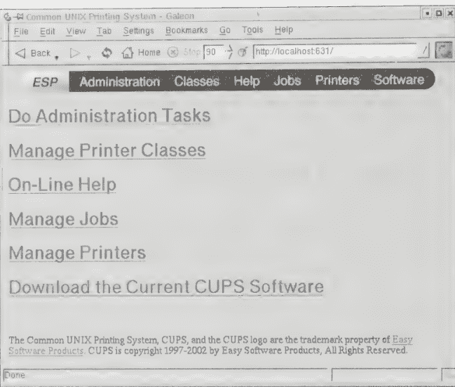

图 11-1. CUPS 欢迎页

你现在可以像浏览网站一样浏览配置界面。

## 11.1.2. 配置新打印机

取决于你是否已经安装并运行了 cups 的机器，你可能会在**管理打印机**链接下看到打印机列表。我们假设你现在正在安装一台连接到独立式计算机的打印机。更复杂的配置，请参阅**在线帮助**。

**管理打印机**页面（图 11-2）目前应该是空的。

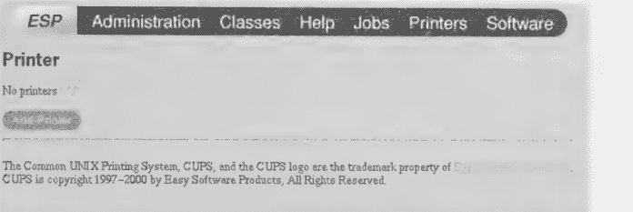

图 11-2. 空 CUPS 打印机列表

要配置新打印机，现在点击页面底部的“添加打印机”按钮。它将开始一个四个步骤的程序。要从一个步骤进行到下一步，请在填写页面上所有所需的字段后点击“继续”按钮。

> 当你第一次执行 cups 管理任务时，它会向你索要 root 密码（图 11-3）。在此处提供 root 登录名和密码即可。

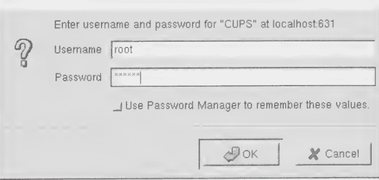

图 11-3. CUPS 登录对话框

### 11.1.2.1. 提供打印机的可选信息

第一个表单提供了三个字段，你可以方便地填写，帮助其他用户了解他们处理的是哪台物理打印机。文本对打印机的行为没有影响，但仍要仔细填写，以避免以后产生混淆。

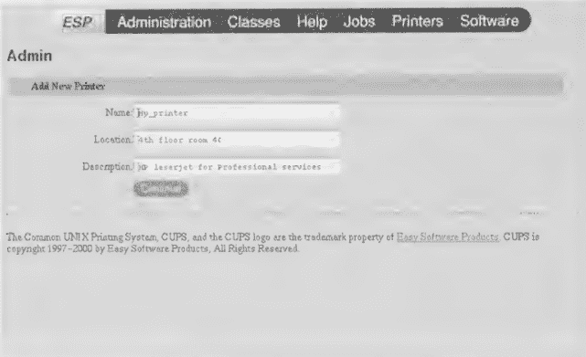

图 11-4. 添加新打印机，步骤 1

打印机名称是此处唯一的必填字段。

### 11.1.2.2. 告知打印机连接位置

你需要告诉 cups 打印机的物理位置。对于直接连接到计算机的打印机，根据连接类型选择并行端口、串口或 USB。注意，如果你有一个串口打印机，你需要安装 `cups-serial` 软件包。USB 打印机也必须连接并电源。

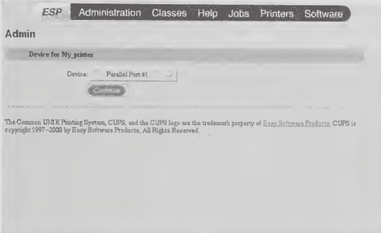

图 11-5. 添加新打印机，步骤 2

还有许多其他类型的连接：

- **Appsocket/HP jetdirect**: 适用于直接连接到局域网的打印机。
- **LPD/LPR**: 适用于直接实现此类行为的打印机，或由此类队列服务的打印机。Unix 系统通常提供此类连接。
- **Samba**: 适用于由 Windows 服务器服务的打印机。注意，要连接此类打印机，你需要安装 `Samba` 软件包。

> 我们在这里不会记录这些类型的连接，因为只要你事先收集了所需信息，它们的配置是相当直接的。

### 11.1.2.3. 选择打印机的品牌名称

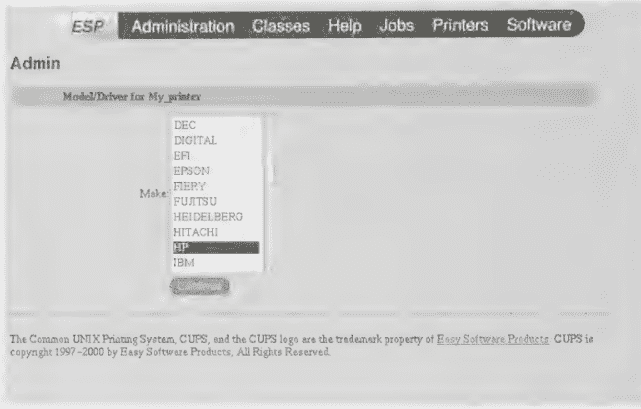

图 11-6. 添加新打印机，步骤 3

现在是时候告诉 cups 你正在安装哪台打印机了。你只需要在列表中突出显示厂商名称即可。

### 11.1.2.4. 选择你的打印机型号


图 11-7. 添加新打印机，步骤 4

这是最后一步，根据你之前的选择，列表现在显示该厂商的所有型号。请仔细选择你的型号。

如果一切顺利，你现在应该可以在“打印机”页面看到你的新打印机。

### 11.1.2.5. 最后配置与测试

在测试打印机之前，你必须确保打印机的纸张配置是正确的。进入打印机页面并点击“配置打印机”。从打印机的参数页面，进入“常规”部分并选择合适的纸张。某些打印机如果没有装纸将拒绝打印。对于彩色打印机，可能选择合适的墨盒。

> 关于参数页面：每当你更改一个参数时，必须点击相应的按钮使更改生效。

### 11.1.3. 关于安全的注意事项

默认情况下，每你在你的机器上配置打印机时，它对局域网内的其他人可用。如果你不希望人们使用你的打印机打印，你需要手动编辑配置文件 `/etc/cups/cupsd.conf`。

```
#BrowseInterval 30
```

替换为

```
BrowseInterval 0
```

此外，此文件包含许多允许你精调打印机服务器的选项。你可以限制特定机器或子网络的访问。更多信息请参阅配置文件中的许多注释或查看在线帮助。

> 每当你修改配置文件时，不要忘记以 root 身份重启 cups 进程：

```
service cups restart
```


### 11.1.4. 管理打印任务

此功能对于非常繁忙的打印机非常有用，但你可能偶尔需要取消例如 10,000 页的错误打印。当你将任务发送到打印机时，如果你是该打印机的管理员，可以通过显示特定打印机的页面（图 11-8）查看你的任务，甚至是所有用户的任务。


你可以对特定任务执行两个不同的操作：

- **暂停任务（Hold Job）**：将任务放入等待列表，只有当你返回此任务并按下“释放任务”按钮时它才会打印。
- **取消任务（Cancel Job）**：彻底取消此任务（从队列中移除）。

如果你希望临时让打印机不可用（例如更换硒鼓），只需点击“拒绝任务”按钮。当打印机准备好接受任务时，点击“接受任务”按钮。

> 如果你对任务处理感兴趣，请参考 KDE 控制中心的打印管理器。

### 11.2. 打印文档

取代打印文档的传统命令 `pr` 和 `lp`，现在 **Mandrake Linux** 上有一个名为 XPP 的优秀应用程序，它允许用户打印文件并配置所有打印输出的参数。它也可以用作应用程序中的“打印命令”，以便你也可以方便那里访问所有打印机。

#### 11.2.1. 仅打印文件

假设你刚刚从一个网站将一张图像存储到硬盘上并想要打印它。首先，从“应用程序—发布—X打印面板”启动 XPP，主窗口（图 11-9）将出现。


该窗口有三个主要部分：指定要打印文件位置的字段、可用打印机列表以及底部的一系列选项。要选择要打印的文件，点击“浏览...”按钮，它将显示一个对话框（图 11-10），你可以在其中浏览磁盘并选择想要打印的文件。注意，如果你知道位置，也可以手动将完整路径输入白色字段中。

2. 你也可以为此目的使用 `kprinter` 命令。


然后确保所选的打印机（左侧有黑点）是正确的并点击“打印”按钮。

如果你想将 XPP 作为从 Galeon 或其他许多允许的应用程序发送的打印任务的打印程序，你只需要更改打印命令。打印选项对话框中通常有一个写着 `lpr` 的字段，只需将其改为 `xpp`。


图 11-11. Galeon 打印对话框

然后当你点击“确定”按钮时，XPP 窗口将弹出。你只需要更改你需要的选项，而无需担心文件本身。

#### 11.2.2. 高级配置

XPP 允许你精调打印输出。首先，主窗口上的选项允许你打印同一文件的多个副本（“副本”字段），并更改你打印任务的优先级。后者对于供许多用户使用的非常繁忙打印机非常有用。如果你急需打印某个文档，请增加优先级数字；如果你想打印一个你不立即需要的文档，则降低优先级数字。

还有一个“选项”（Options）按钮，它会显示一个多标签页选项对话框（图 11-12）。

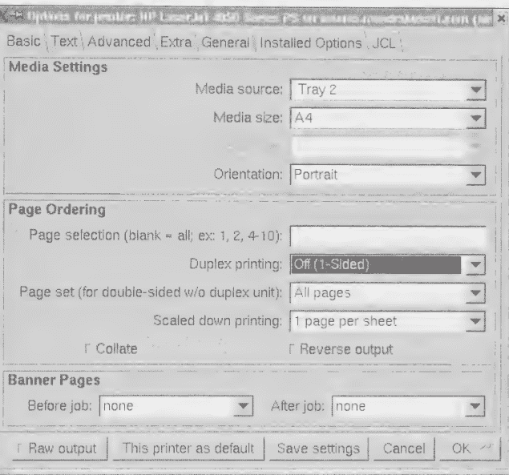

图 11-12. XPP 基本选项对话框

第一个标签页分为两个部分：

##### 媒体设置

你在这里可以选择三个参数，尽管取决于打印机功能，这些参数可能相关也可能不相关。首先可以选择纸盒或使用手动进纸。然后是纸张尺寸，最后是打印方向。

##### 页面排序

这些选项对于定义文档的打印方式以及打印部分非常有用。

- “页面选择”（Page selection）示例只会打印你文档的第 1, 2, 4, 5, 6, 7, 8, 9, 10 页。
- “双面打印”（Duplex Printing）选项对支持该功能的打印机有效。它也被称为双面打印。
- 如前所述，“页面设置”（Page set）选项允许你在即使不支持双面打印的打印机上进行双面打印。只需开始打印偶数页，将纸重新放入纸盒（注意方向！），然后在另一面打印奇数页。
- “缩放打印”（Scaled down printing）是一个环保选项，允许在一张纸上打印多个页。结合双面打印，这应该有助于保护热带雨林 :)
- “反向输出”（Reverse output）选项将从最后一页开始打印页面。它对于仅面向上堆叠纸张打印机很有用，这样多页文档按正确的顺序输出。
- 最后，“校对”（Collate）选项在打印同一文件的多个副本时会更改页面顺序。设置该选项后，3 页文档的顺序将是 1,2,3,1,2,3。如果不设置此项，页面将按此顺序输出：1,1,2,2,3,3。

“文本”（Text）标签页（图 11-13）提供了更细的选项来更改文本文件的打印方式。


图 11-13. XPP 文本选项对话框

有很多选项，每个都很容易理解。关于“增强型 C 代码打印”（Enhanced C-Code printing）选项，它将为每页打印一个页眉，并对 C 程序列表进行语法高亮。

“高级”（Advanced）标签页（图 11-14）提供了更改页面视觉外观的选项。

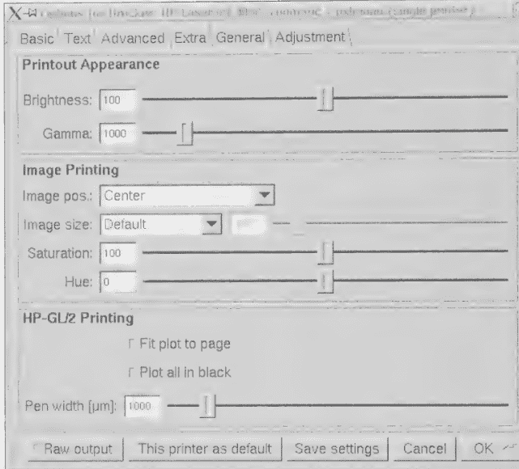

图 11-14. XPP 高级选项对话框

此标签页分为三个部分：

##### 输出外观

两个参数——亮度（Brightness）和伽马（Gamma）将主要影响打印输出中的半调部分和图像（亮暗）。

##### 图像打印

前两个参数更改图像在页面上的相对位置和大小；最后两个更改颜色校正的方式。

##### HP-GL/2 打印

三个参数：

- 绘图适应页面（Fit plot to page）：调整绘图的大小使其完全适应纸张尺寸。
- 全黑打印（Plot all in black）：仅以黑白打印。
- 笔画（Pen width）：调整绘制文档的“虚拟”笔的宽度。

接下来的标签页提供了针对每种打印机的特定选项：颜色、分辨率、抖动等。

> 当你选择了互不兼容的选项时，问题的选项将以红色显示，以便你轻松识别冲突。在这种情况下，当你点击“保存设置”或“确定”时，你将收到错误消息——请先修正你的设置。

在更改选项时，有两种可能：通过“保存设置”按钮保存，以便在下次打印时重用选项；或者如果这些选项仅对当前打印作业有效，只需点击“确定”。

# 第 12 章 msec – Mandrake 安全工具

## 12.1. msec 简介

虽然 GNU/Linux 用于非常广泛的应用，从基础办公工作到高可用服务器，但对不同安全等级的需求也产生了。显而易见，高度安全的服务器固有的限制与秘书的需求并不匹配。另一方面，大型公共服务器对恶意人员比我隔离的 GNU/Linux 终端更敏感。

MSEC 正是为此而设计的。它由两部分组成：

- 脚本，用于修改整个系统以达到 MSEC 提供的六个安全级别之一。这些级别的范围从提供易用性的极小安全性配置，到适用于非常敏感应用并由专家管理的极高配置；
- cron 定时任务（cron jobs），它们将根据安全级别配置定期检查系统完整性，并可能检测并警告你可能发生的系统入侵或安全泄露。

注意，用户还可以自定义其安全级别，根据自己的需要调整参数。

## 12.2. 设置你的安全级别

MSEC 是一个基础 RPM 包。这意味着它在安装你的 Mandrake Linux 系统期间就会安装。

安装程序在 `/etc/security` 目录下创建了一个 msec 目录，包含了安全系统所需的所有内容。

MSEC 有一个图形界面，称为 draksec。它可以通过控制中心（Control Center）访问，并允许更改系统的安全级别。参见用户指南中的“设置你的安全级别”章节。

还存在一个命令行工具。它允许更好的调优。以 root 身份登录并输入 `msec <x>`，`<x>` 是你想要的级别。

注意，无论选择哪个级别，配置都存储在 `/var/lib/msec/security.conf`。

### 12.2.1. 级别 0

该级别提供了极小的安全性以换取易用性。如果你对以下问题回答“是”，则不应使用此级别：

- 计算机是否连接到互联网？
- 计算机是否连接到网络？
- 计算机是否会被他人使用？
- 是否有我不希望他人访问的系统？
- 在不熟悉 GNU/Linux 的情况下，是否可能损坏系统？

请注意，此级别是不安全的。

### 12.2.2. 级别 1

与级别 0 相比，主要的改进是可以通过用户名和密码进行访问。因此，它适用于许多用户以及连接到局域网的计算机。

### 12.2.3. 级别 2

该级别的安全改进提供了额外的安全性检查。它适用于多用户环境。

### 12.2.4. 级别 3

这是标准安全级别，适用于连接到互联网的计算机。大多数安全性检查都会运行，特别是这些端口是开启的。这种安全性与 Red Hat 或任何之前的发行版相当。

### 12.2.5. 级别 4

使用此安全级别时，可以作为服务器使用。安全性现在足够并接受许多客户端。默认情况下，只允许来自自身的连接。然而，高级服务已被禁用，系统管理员必须手动在配置文件激活它们。他还需要为谁授予访问权限。

安全检查将警告管理员可能的安全漏洞或入侵。

### 12.2.6. 级别 5

我们在级别 4 的基础上构建，现在完全关闭。安全性功能达到最高。系统管理员必须激活端口并授予连接，以便其他计算机访问此机器提供的服务。

### 12.3. 安全级别特性对照表

| 特性 \ 级别 | 0 | 1 | 2 | 3 | 4 | 5 |
|---|---|---|---|---|---|---|
| X server 监听来自的连接 | 全部 | 全部 | 全部 | 全部 | 本地 | 本地 |
| shell 超时 | 无 | 无 | 无 | 无 | 3600 | 900 |
| su 仅允许来自 wheel 组成员 | | | | | | 是 |
| shell 历史记录大小 | | | | | 10 | 10 |
| 运行级别 1 中的 sulogin | | | | | 是 | 是 |
| 在显示管理器中禁止用户列表 | | | | | | 是 | 是 |
| 忽略 ICMP 回显 | | | | | 是 | 是 |
| 忽略虚假 ICMP 消息 | | | | | 是 | 是 |
| 直接 root 登录 | 是 | 是 | 是 | 是 | | |
| 启用 libsafe | | | | | 是 | 是 |
| 禁止用户使用 at 和 crontab | | | | | 是 | 是 |
| 密码有效期（天） | | | | | 60 | 30 |
| 禁止自动登录 | | | | 是 | 是 | 是 |
| 允许问题（文本登录提示符） | 全部 | 全部 | 全部 | 本地 | 本地 | 无 |
| 在 $PATH 中 | 是 | 是 | | | | |
| 文件 /var/log/security.log 中的警告 | | | 是 | 是 | 是 | 是 | 是 | 是 |
| 直接在 tty 上的警告 | | | | 是 | 是 | 是 | 是 | 是 |
| syslog 中的警告 | | | | 是 | 是 | 是 | 是 | 是 |
| 通过电子邮件发送的警告至 | | | | 是 | 是 | 是 | 是 | 是 |
| 所有系统事件额外记录到 /dev/tty12 | | | | 是 | 是 | 是 | 是 | 是 |
| 仅 root 可使用 Ctrl-Alt-Del | | | | | 是 | 是 |
| 未知服务已被禁用 | | | | | 是 | 是 |
| 允许来自...的连接 | 全部 | 全部 | 全部 | 全部 | 本地 | 无 |

#### 12.3.1.1. 用户的 umask

简单地将普通用户的 umask 设置为与安全级别对应的值。

#### 12.3.1.2. Root 的 umask

与上述相同，但针对 root。

#### 12.3.1.3. 无密码访问

在不询问密码的情况下访问账户。

#### 12.3.1.4. 连接到 X Server 的授权

- 1. all（全部）：任何地方的任何人可以在你的屏幕上打开 X 窗口。
- 2. local（本地）：只有连接到 localhost 的人可以在你的屏幕上打开 X 窗口。
- 3. none（无）：谁都不行。

#### 12.3.1.5. X Server 监听来自...的连接

- 1. all（全部）：X server 监听来自 tcp 的连接。
- 2. local（本地）：X server 监听来自 UNIX socket 的连接。

#### 12.3.1.6. Shell 超时

如果用户在一定秒内没有活动，shell 将退出。

#### 12.3.1.7. su 仅允许来自 wheel 组成员

仅允许 wheel 组的成员使用 su 获取 root 身份。

#### 12.3.1.8. Shell 历史记录大小

shell 运行结束时保存的命令数。

#### 12.3.1.9. 运行级别中的 sulogin

sulogin 用于保护对单个用户初始化级别的访问（你必须输入 root 密码才能访问）。

#### 12.3.1.10. 在显示管理器中禁止用户列表

在 KDM 和 GDM 中禁止显示系统用户列表。

#### 12.3.1.11. 忽略 ICMP 回显

不响应 ping 请求。

#### 12.3.1.12. 忽略虚假 ICMP 错误消息

不处理虚假的 ICMP 错误消息。

#### 12.3.1.13. 直接 root 登录

允许不使用 su 程序而直接登录 root。

#### 12.3.1.14. 启用 libsafe

启用 libsafe 保护（仅在安装了 libsafe 包时激活）。

#### 12.3.1.15. 禁止用户使用 at crontab

用户无法使用 at 和 crontab 程序。然而，root 账户可以使用它们。如果你只想授权某些用户，请将他们添加到 `/etc/at.allow` 和 `/etc/cron.allow` 中。

#### 12.3.1.16. 密码有效期

密码在固定天数后过期；如果用户不想看到账户被禁用，则需要在过期日期之前更改。

#### 12.3.1.17. 禁止自动登录

禁止自动登录程序。

#### 12.3.1.18. 允许问题

如果设置为 none（无），则不显示横幅（banner）。如果设置为 local（本地），则仅在控制台上显示登录横幅。如果设置为 all（全部），则在所有登录提示符上显示登录横幅。

#### 12.3.1.19. .PATH

将 . 条目添加到 `$PATH` 环境变量中，允许轻松执行当前工作目录内的程序（这在某种程度上也是一个安全漏洞）。

#### 12.3.1.20. security.log 文件中的警告

每日检查发现的每个警告都会记录在 `/var/log/security.log` 文件中。

#### 12.3.1.21. 直接在 tty 上的警告

每日检查发出的每个警告都会直接打印到 tty 上。

#### 12.3.1.22. syslog 中的警告

每日检查发出的警告被定向 syslog 服务。

#### 12.3.1.23. 通过电子邮件发送到 Root 的警告

每日检查发出的警告通过电子邮件发送给 root。

#### 12.3.1.24. 未知服务已禁用

在安装包期间，如果服务名称出现在 `/etc/security/msec` 文件中，则通过 `chkconfig --add <service>` 添加服务。

#### 12.3.1.25. 授予连接到...

- 1. all（全部）：允许所有计算机连接开放端口。
- 2. local（本地）：仅允许 localhost 连接开放端口。
- 3. none（无）：不允许任何计算机连接开放端口。

此保护由 wrappers 包提供。如果你想在无限制的情况下授予服务访问，请使用 `/etc/hosts.allow` 文件：

```
sshd: ALL
```


### 12.3.2 定期检查

如果安全级别大于 0，则每晚都会运行这些检查。

| 特性 \ 级别 | 0 | 1 | 2 | 3 | 4 | 5 |
|---|---|---|---|---|---|---|
| 全局安全检查 | | | 是 | 是 | 是 | 是 |
| suid root 文件检查 | | | 是 | 是 | 是 | 是 |
| suid root 文件 MD5 检查 | | | 是 | 是 | 是 | 是 |
| 可写文件检查 | | | 是 | 是 | 是 | 是 |
| 权限检查 | | | 是 | 是 | 是 | 是 |
| suid 组文件检查 | | | 是 | 是 | 是 | 是 |
| 无所有文件检查 | | | | | 是 | 是 |
| 混杂检查 | | | | | 是 | 是 |
| 监听端口检查 | | | | 是 | 是 | 是 |
| 文件完整性检查 | | | | 是 | 是 | 是 |
| shadow 文件完整性检查 | | | | 是 | 是 | 是 |
| RPM 数据库完整性检查 | | | | 是 | 是 | 是 |

注意，十二项定期检查中的某些可以检测系统的变化。它们存储了上次检查（一天前）时的系统配置，并向你警告在此期间发生的任何变化。这些文件位于 `/var/log/security/` 目录。这些检查是：

### 12.3.2.1 全局安全检查

- suid root 文件检查
- suid root 文件 MD5 检查
- 可写文件检查
- sgid 文件检查
- 无所有文件
- 监听端口检查
- RPM 数据库完整性检查

1. “全局导出 NFS 系统”：这被认为是不安全的，因为没有限制可以挂载这些文件。
2. “缺少 uid 的 NFS 挂载”：这些文件使用 `nosuid` 选项导出，这阻止了 suid 程序运行。
3. “信任文件包含 sign”：这意味着以下文件 `/etc/hosts.equiv`、`etc/hosts.lpd`、`etc/hosts` 允许未经身份验证的连接。
4. “aliases 文件中找到执行文件”：它警告通过 `/etc/aliases` 和 `/etc/postfix/aliases` 文件的执行文件。

### 12.3.2.2 suid root 文件检查

检查系统中是否存在删除的 suid root 文件。如果发现此类文件，将以警告形式输出文件列表。

### 12.3.2.3 suid root 文件 MD5 检查

系统中每个 suid root 文件的 MD5 签名。如果签名发生变化，意味着该程序被修改过，可能存在后门。此时会发出警告。

### 12.3.2.4 可写文件检查

检查系统上的文件是否全局可写。如果是，则发出包含这些坏文件的列表警告。

### 12.3.2.5 权限检查

此项检查某些特殊文件（如 `.netrc` 或用户配置文件）的权限。它还检查用户主目录的权限。如果权限太松散或所有者异常，则会发出警告。

### 12.3.2.6 sgid 文件检查

检查系统中是否存在删除的 sgid 文件。如果发现此类文件，将以警告形式输出文件列表。

### 12.3.2.7 无所有文件检查

此检查搜索由系统未知的用户或组拥有的文件。如果发现此类文件，所有者将自动更改为 `nobody.user.nogroup/group`。

### 12.3.2.8 混杂检查

此测试检查每个以太网以确定它们是否处于“混杂”模式。这种模式允许网卡拦截接收到的每个数据包，即使这些不是发送给它的。这可能意味着你的机器上运行着嗅探器。注意，此检查被设置为每分钟运行一次。

### 12.3.2.9 监听端口检查

发出包含所有监听端口的警告。

### 12.3.2.10 passwd 文件完整性检查

验证每个用户是否有密码（不是空密码或容易猜测的密码），检查其是否被 shadow 保护。

### 12.3.2.11 shadow 文件完整性检查

验证 shadow 文件中的每个用户是否都有密码（而非空密码）。

### 12.3.2.12 从 RPM 数据库进行完整性检查

验证已安装软件包中的文件没有发生更改，并验证自上次运行以来没有包被安装/删除/更新。

## 第 12 章 msec – Mandrake 安全工具

### 12.4 自定义

### 12.4.1 文件系统更改

文件系统上的更改存储在 `/var/lib/msec/perm.<level>` 中。可以使用 `/etc/security/msec/perm.local` 进行修改，其格式与 `/var/lib/msec/perm.*` 下的文件格式相同。

### 12.4.2 配置文件更改

配置更改可以通过 `/etc/security/msec/level.local` 进行修改。更多详情请参阅 `mseclib` 手页。

### 12.4.3 检查更改

当前的检查配置存储在 `/var/lib/msec/security.conf` 下。这些设置可以在 `/etc/security/msec/security.conf` 中使用相同的语法进行覆盖。例如，`MAIL_USER` 可用于更改发送每日邮件报告的电子邮件地址。

# 第 13 章 编译与安装自由软件

我经常被问及如何从源码安装自由软件。自己编译软件其实非常简单，因为无论安装什么软件，需要遵循的大多数步骤都是相同的。本文档的目的是逐步引导初学者，并向他解释每个动作的含义。我假设读者对 UNIX 系统有基本的知识（如 `ls` 或 `mkdir`）。

本指南只是一个指南，而不是参考手册。这就是为什么在末尾提供了几个链接来回答任何剩余问题。本指南可能会改进，因此我非常感谢收到对其内容的提出的任何意见或纠正。

## 13.1 引言

自由软件与专有软件的区别在于对源文件的访问权限。这意味着自由软件是以源码文件包的形式分发的。对于初学者来说，这可能很陌生，因为自由软件的用户在使用软件之前必须自己编译源码。

大多数现有的自由软件都有编译后的版本。赶时间的用户只需要安装这些预编译的二进制文件即可。某些自由软件不以这种形式分发，或者早期版本尚未以二进制形式分发。此外，如果你使用奇特的操作系统或奇特的架构，很多软件将不会为你编译。更重要的是，自己编译软件允许你只开启感兴趣的选项或通过添加扩展来扩展软件的功能，以获得一个完全符合你需求的程序。

### 13.1.1 要求

要编译软件，你需要：

- 一台运行操作系统的计算机，
- 对你所使用的操作系统的通用知识，
- 磁盘上的一些空间，
- 一个编译器（通常用于 C 语言）和一个归档器（`tar`），
- 1. 这不完全正确，因为某些专有软件也提供源代码。但与自由软件的情况不同，最终用户不允许随所欲地使用或修改代码。
- 一些食物（在困难的情况下，可能持续很久）。真正的黑客吃披萨——不是法式咸饼。
- 一些饮料（出于同样的原因）。真正的黑客喝汽水——为了咖啡因。
- 你那个每周重新编译内核的技术宅朋友的电话号码，
- 特别是耐心，而且大量的耐心！

从源码编译通常不会遇到很多问题，但如果你不习惯，微小的障碍就能让你困扰。本文档的目的是向你展示如何逃离这种局面。

### 13.1.2 编译

#### 13.1.2.1 原理

为了将源代码翻译成二进制文件，必须进行编译（通常从 C 或 C++ 源码开始，这些是 (UNIX) 自由软件社区中最广泛的语言）。某些自由软件是用不需要编译的语言编写的（例如 `perl` 或 `shell`，但它们仍然需要一些配置）。

C 编译在逻辑上是由 C 编译器完成的，通常是 `gcc`，它是 GNU 项目（http://www.gnu.org/）的免费编译器。编译一个完整的软件包是一项复杂的任务，它通过对不同的源文件进行连续编译来完成（由于各种原因，程序员倾向于将其工作的不同部分放在单独的文件）。为了方便你的操作，这些重复操作由一个实用程序处理。

#### 13.1.2.2 编译的四个步骤

为了理解编译是如何工作的（以便能够解决可能的问题），你必须知道这四个步骤。目标是将用受过训练的人类可以理解的语言（即 C 语言）编写的文本逐渐转换为机器可以理解的语言（或在少数情况下是经过良好训练的人类可以理解的语言）。`gcc` 连续执行四个程序，每个程序负责一个步骤：

- 第一步是将指令（处理器）替换为纯 C 指令。这通常意味着插入头文件 (`#include`) 或定义一个宏 (`#define`)。在该阶段结束时，生成纯 C 代码。
- 2. `cc1`：这一步包括将 C 转换为汇编语言。生成的代码取决于目标架构。
- 3. `as`：这一步包括从汇编语言生成目标代码（或二进制代码）。在该阶段结束时，生成 `.o` 文件。
- 4. `ld`：最后一步（链接）将所有的目标文件和相关的库链接起来，并产生可执行文件。

### 13.1.3 分发结构

结构良好的自由软件发行始终具有相同的组织：

- `INSTALL` 文件，描述安装程序。
- `README` 文件，包含有关程序的通用信息（简要描述、作者、下载 URL、有用链接等）。如果缺少 `INSTALL` 文件，`README` 通常包含简要的安装程序。
- `COPYING` 文件，包含许可或描述分发条件。有时 `LICENSE` 文件代替它。
- `AUTHORS` 或 `CREDITS` 文件，包含与软件相关的人员（活跃参与、相关评论、第三方程序等）。
- `CHANGES` 文件（或较少使用的 `NEWS` 文件），包含最近的改进和错误修复。
- `Makefile` 文件（见第 131 页 `make`），允许编译软件（它是 `make` 的必需文件）。该文件最初通常不存在，而在编译过程中生成。
- 经常有 `configure` 或 `Makefile`，允许生成新的 `Makefile`，
- 包含源码的目录，二进制文件通常存储在此。其名称通常为 `src`。
- 包含目录（通常为 `man` 或 `Texinfo` 格式），名称通常为 `doc`。
- 有时包含软件特定数据的目录（通常是配置文件、生成数据的示例或资源文件）。

## 13.2 解压缩

### 13.2.1 tar.gz 存档

UNIX 系统标准的压缩格式是 `gzip` 格式，它由 GNU 项目开发，被认为是最好的工具之一。`gzip` 通常与名为 `tar` 的工具相关。现在，软盘取代了磁带，但 `tar` 仍被用于创建存档。

### 13.2.2 tar 的使用

要压缩此存档，可以使用 `gzip` 然后 `tar`。GNU 版本的 `tar` (`gtar`) 允许我们“流式”使用 `gzip`，并在不察觉额外步骤的情况下解压存档。`tar` 的用法如下：

```
tar <files>
```

`<files>` 参数不是必需的。如果省略，将对整个存档进行处理。例如：

```
$ tar rvzf guile-1.3.gz
```

在 `tar` 的选项中：

- `v` 让 `tar` 以详细模式运行。这意味着它将在屏幕上显示它在归包中找到的所有文件。如果省略此选项，处理过程将静默执行。
- `f` 是一个必选选项。如果没有它，`tar` 将尝试使用磁带而不是归档文件（即 `/dev/rmt` 设备）。
- `z` 允许你处理经过“gzip”压缩的归档（扩展名为 `.gz`）。如果忘记使用此选项，`tar` 将产生错误。相反，对于未压缩的归档，不能使用此选项。

`tar` 允许你对归档执行若干操作（提取、读取、创建、添加……）。选项定义了将使用何种操作：

- `x`：允许你从归档中提取文件。
- `t`：列出归档的内容。
- `c`：允许你创建一个归档。例如，你可以用它备份个人文件。
- `r`：允许将文件添加到归档的末尾。不能与压缩归档配合。

### 13.2.3 bzip2

一种名为 `bzip2` 的压缩格式已开始在通用领域取代 `gzip`。`bzip2` 产生的归包比 `gzip` 更小，但尚未成为标准。目前只有在最近创建的归档中才能找到 `.tar.bz2` 扩展名。

`bzip2` 通过 `tar` 命令像使用 `gzip` 一样使用。唯一的区别是将字母 `z` 替换为字母 `j`。例如：

```
$ tar xvjf foo.tar.bz2
```

某些发行版可能仍使用选项 `I`：

```
$ tar xvIf foo.tar.bz2
```

另一种方法（这似乎更具移植性，但输入的字符较长）：

```
$ tar --compress-program=bzip2 -xvf foo.tar.bz2
```

在运行 `tar` 之前，必须安装 `bzip2` 并将其包含在 `PATH` 环境变量中。

## 13.2.4 动手吧！

### 13.2.4.1 最简单的方法

现在你已经准备好解压归档，请不要忘记以管理员（root）身份执行。你需要执行一些普通用户不允许执行的操作，即使你可以作为普通用户执行其中某些操作，全程保持 root 身份更为简单。

第一步是进入 `/usr/local/src` 目录并将归档拷贝到那里。这样，如果你丢失了已安装的软件，总能找到该归档。如果你的磁盘空间不足，可以在安装软件后将归档保存到软盘上。你也可以删除它，但要确保在需要时能从 Web 上找到它。

通常情况下，解压 `tar` 归档应该创建一个新目录（你可以提前通过 `t` 选项进行检查）。然后在该目录中，你就可以继续后续操作了。

### 13.2.4.2 最安全的方法

UNIX 系统（以 GNU/Linux 和 FreeBSD 为例）可以是安全的系统。这意味着普通用户无法执行可能危及系统的操作（例如格式化磁盘）或更改其他用户的文件。这也让系统免受病毒侵害。

另一方面，root 可以做任何事情——甚至是运行恶意程序。拥有源代码允许你检查其中是否存在恶意代码（病毒或木马）。在这方面，谨慎为好。

这种做法的思路是：使用 `adduser` 命令创建一个专门用于管理的用户（例如 `free` 或 `admin` 用户）。该用户必须被允许在以下目录中写入：`/usr/local/src`、`/usr/local/bin` 和 `/usr/local/lib`，以及 `/usr/share/man` 的子树（他可能也可以将文件拷贝到其他地方）。我建议让该用户成为必要目录的所有者，或者为他创建一个组并让目录对组可写。

一旦采取这些措施，就可以按照“最简单的方法”节中的说明进行。

3. BSD 世界的一句谚语说：“永远不要信任你没有源码的包。”

## 13.3 配置

出于纯粹的技术兴趣，作者创建源码是为了进行软件的移植。为 UNIX 系统开发的自由软件可以在所有现有的 UNIX 系统（无论是自由的还是闭源的）上运行，只需进行一些更改。这要求在编译之前对软件进行配置。

目前存在多种配置系统。你必须使用软件作者要求的那个（有时需要多个）。通常你可以：

- 如果分发版的父目录中存在名为 `configure` 的文件，则使用 AutoConf（参见 AutoConf 节）。
- 如果分发版的父目录中存在名为 `Imakefile` 的文件，则使用 `imake`（参见 imake 节）。
- 根据 `INSTALL` 文件（或 `README` 文件）的内容运行 shell 脚本（例如 `install.sh`）。

### 13.3.1 AutoConf

#### 13.3.1.1 原理

AutoConf 用于正确配置软件。它创建编译所需的文件（例如 `Makefile`），有时会直接修改源码（例如通过在文件中使用 `config.h`）。

AutoConf 的原理非常简单：

- 软件的程序员知道配置其软件需要哪些测试（例如：“你使用哪个版本的库？”）。他按照精确的语法将这些测试写在一个名为 `configure.in` 的文件中。
- 他执行 AutoConf，这将生成一个名为 `configure` 的配置脚本。
- 用户运行该脚本，它生成编译所需的配置。

#### 13.3.1.2 示例

AutoConf 的使用示例：

```
$ configure
```

#### 13.3.1.3 如果……不起作用怎么办？

通常情况下，如果配置无法找到某个库，它会产生错误：`error: Cannot find library`。
这意味着配置脚本无法编译一个使用该库的测试程序。如果编译失败，它将无法完成配置。该编译器提供的错误信息足够清晰。

- 查看 `config.log` 文件的末尾查找错误原因，它记录了配置的所有步骤。
- 检查该库是否安装正确。如果不是，请安装（从源码或二进制文件）并重新运行配置。检查它的有效方法是搜索包含符号的文件，通常是 `lib<name>.so`。例如：

```
$ find / -name 'guide*'
```

或者：

```
$ locate guide
```


- 检查库是否对编译器可见。这意味着它位于 `/usr/lib`、`/lib`、`/usr/lib6`（或者在环境变量 `LD_LIBRARY_PATH` 指定的目录中）。
- 检查库对应的头文件是否安装在正确的位置（`/usr/include`、`/usr/local/include` 或 `/usr/include6`）。如果你不知道需要哪些头文件，请检查是否安装了库的开发版本（例如 `gtk+-devel` 而不是 `libgtk`）。开发版本的库提供了使用该库的软件编译所需的“include”文件。
- 检查你的磁盘是否有足够的空间（配置脚本需要一些临时空间）。使用命令 `df -k` 显示系统的分区，并注意已满或几乎满的分区。
- 检查配置是否回答 100% 的 `No`，或者在你确定库存在时它回答了 `No`（例如，认为系统上没有库）。在这种情况下，`LD_LIBRARY_PATH` 变量可能是错误的！

如果你不懂 `config.log` 文件中存储的错误信息，请尽管向自由软件社区寻求帮助（参见第 140 页的技术支持）。

### 13.3.2. imake

make 允许通过简单规则创建 `Makefile` 来配置自由软件。这些规则决定了构建二进制文件需要编译哪些文件，imake 生成相应的 `Makefile`。这些规则写在一个名为 `Imake` 的文件中。

imake 的有趣之处在于它使用了与站点（架构相关）的信息。对于使用 X Window 系统的应用程序非常有用。但 imake 也用于许多其他应用程序。

## 第 13 章. 构建与安装自由软件

使用 `make` 最简单的方法是进入解压包的主目录，然后运行 `xmkmf` 脚本，该脚本会调用 `make` 程序：

```bash
$ xmkmf -a
make -DuseInstalled -I/usr/X11R6/lib/X11/config
make Makefile
```

如果未正确安装，请重新编译并安装 X11R6！

### 13.3.3. 各 shell 脚本

阅读 `INSTALL` 和 `README` 文件获取更多信息。通常，你需要运行一个名为 `install.sh` 或 `configure.sh` 的文件。然后，安装脚本是非交互式的（会自动确定需要的内容），要么会询问你的系统信息（路径、脚本）。

如果你无法确定必须运行的文件，可以输入 `/`（在 bash 下），然后按 `TAB` 键（制表键）。bash（在默认配置下）会自动补全目录中可能的可执行文件（因此也可能是配置脚本）。如果有多个文件可以执行，它会给出一个列表。你只需要选择正确的文件即可。

一个特殊情况是安装 perl 模块（但不限于此）。此类模块的安装是通过执行用 perl 编写的配置脚本完成的。通常执行命令为：

```bash
$ perl Makefile.PL
```

### 13.3.4. 替代方案

某些自由发行版的组织结构很糟糕，特别是在开发早期（但用户会收到警告！）。它们有时要求你“手动”修改某些配置文件。通常，这些是一个 `Makefile` 文件（见第 131 页的 `make` 节）和一个 `config.h` 文件（此名称仅为惯例）。

我建议不要进行这些操作，除非用户真的非常清楚自己在做什么。这需要真正的知识和一些成功的动力，但熟能生巧。

## 13.4. 编译

现在软件已经正确配置完成，剩下的工作就是编译它。这个阶段通常很简单，不会出现严重问题。

### 13.4.1. make

自由软件社区用于编译源码的 de喜爱的工具是 `make`。它有两个优势：

- 开发者节省了时间，因为它允许他高效地管理项目的编译；
- 用户只需几行命令即可编译并安装软件，即使他没有先前的开发知识。

获取源码编译版本所需执行的操作存储在名为 `Makefile` 或 `GNUmakefile` 的文件中。实际上，当调用 `make` 时，它会读取当前目录下的该文件——如果存在的话。如果没有，可以使用 `make` 的 `-f` 选项指定文件。

### 13.4.2. 规则

`make` 根据依赖关系系统运行，因此编译二进制文件（“目标”）需要经过几个阶段（“依赖项”）。例如，为了创建（假设的）`gllog` 二进制文件，必须先编译后链接 `main.o` 和 `init` 对象文件（编译的中间文件）。这些对象文件本身也是目标，它们的依赖项是源代码。

本文只是为了在 `make` 这个无情的世界中生存的简要介绍。如果你想学习更多，我建议你访问 APRIL 网站（http://www.april.org/groups/doc/），在那里你可以找到关于 `make` 的更详细文档。如需详尽的文档，请参考 Andrew Oram 和 Steve Talbot 著、O'Reilly 出版的第二版《Managing Projects with Make》。

### 13.4.3. 走起，走起！

通常，`make` 的用法遵循一些约定。例如：

- 不带参数的 `make` 只执行程序的编译，而不安装。
- `make install` 编译程序（但不总是如此），然后将所需文件安装到文件系统的正确位置。某些文件并不总是被正确安装的（如 `man`、`info`），它们可能是用户自行拷贝的。有时必须在子目录中再次执行 `make install`。这通常发生在第三方开发的模块中。
- `make clean` 删除编译时创建的所有临时文件，在大多数情况下还会删除可执行文件。

第一阶段是编译程序，因此输入（示例示例）：

```bash
$ make
gcc -c glloq.c -o glloq.o
gcc -c init.c -o init.o
gcc -c main.c -o main.o
gcc -ltgtk -ldg -lglib -lxext -lX11 -lm glloq.o init.o main.o -o glloq
```

太棒了，二进制文件终于编译完成了。我们准备好进入下一个阶段，即安装发行版的文件（二进制文件、数据文件等）。参见第 138 页的 `Installation` 节。

### 13.4.4. 解释

如果你好奇地查看 `Makefile` 内部，你会发现已知命令（`rm`、`mv`、`cp` 等），以及看起来像 `$(CFLAGS)` 的奇怪字符串。它们是变量，即通常在 `Makefile` 文件开头设置的字符串，然后被它们关联的值所替换。当你连续多次使用相同的编译选项时，这非常有用。

例如，使用 `make all` 在屏幕上打印字符串 `" foo "`：

```makefile
TEST = foo
all:
  echo $(TEST)
```

在大多数情况下，会设置以下变量：

- CC: 这是编译器。通常是 `cc`，在大多数自由系统中它与 `gcc` 同义。如果不确定，在这里写上 `gcc` 即可。
- LD: 这是用于确保最终编译阶段的程序（见第 122 页的“编译的四个步骤”节）。默认是 `ld`。
- CFLAGS: 这些是在第一个编译阶段给编译器的额外参数。其中包括：
  - `-I<path>`: 指定编译器去哪里搜索额外的头文件（例如：`-I/usr/X11R/include` 允许包含 `/usr/X11R/include` 目录下的头文件）。
  - `-D<symbol>`: 定义额外的符号，对于编译取决于定义符号的程序（例如：如果定义了 `HAVE_STRING_H` 则使用 `string.h` 文件）。

编译行通常如下：

```bash
$($CFLAGS) -c foo.c -o foo.o
```

- LDFLAGS (或 LFLAGS): 这些是在最终编译阶段使用的参数。其中包括：
  - `-L<path>`: 指定搜索库的额外路径。
  - `-l<library>`: 在最终编译阶段指定额外的库。

### 13.4.5. 如果……

4. 分析 `make` 返回的错误信息。最后几行包含一个目录（类似 `make [1]: Leaving directory '/home/ben/Project/foo'` 的消息）。选择数字最大的那个。为了验证是否正确，进入该目录并再次执行 `make` 以获得相同的错误。

## 第 13 章：构建与安装自由软件

- 复制此文件开头的结构体定义（它并不整洁，但至少可以运行）。
- 如果不是，则对系统头文件进行相同的操作（这些文件通常位于 `/usr/include`、`/usr/X11R/include` 或 `/usr/local/include` 目录中）。这次，使用行 ` #include <filename>.h`。
- 如果该结构体仍然不存在，尝试找到它应该在哪个库（即组合在单个包中的函数库）中定义（查看 `INSTALL` 或 `README` 以确定程序使用了哪些库及其所需的版本）。如果程序需要的版本与系统上安装的版本不符，你可能更新该库。
- 如果仍然不起，请检查程序是否与你的架构正常工作（某些程序尚未移植到所有的 UNIX 系统）。还要检查你是否已为你的架构正确配置了程序（例如，在运行 `configure` 时）。

## 3. 解析错误 (parse error)

这是一个相当难以解决的问题，因为错误通常出现在某一行，但实际上该错误是在编译器遇到它之后才出现的。有时，它仅仅是一个未定义的数据类型。如果你遇到类似下面的错误信息：

```
main.c:1: parse error before 'gllq_t'
main.c:1: warning: data definition has no type or storage class
```

那么问题就是 `gllq_t` 类型未定义。解决该问题的办法与上一个问题大同。

> 如果我没记错的话，旧的 curses 库中可能存在解析错误。

## 4. 设备上没有剩余空间 (no space left on device)

这个问题很容易解决：磁盘空间不足以从源文件生成二进制文件。解决方案是在包含安装目录的分区上腾出空间（删除临时文件或源码，卸载任何你不使用的程序）。如果你在 `/tmp` 中解压它而不是 `/usr/local/src`，可以避免不必要地填满 `/tmp` 分区。检查磁盘上是否存在核心文件（core files）。如果是，删除它们，或者如果它们属于其他用户，则将其删除。

## 5. /usr/bin/ld: cannot open -lglloq: No such file or directory

显然这意味着 `ld` 程序（gcc 在最后编译阶段使用）未能找到库。要包含一个库，`ld` 会搜索一个位于类型 `-l<library>` 参数中的的文件。该文件名为 `lib<library>.so`。如果 `ld` 无法找到它，就会产生错误信息。要解决此问题，请遵循以下步骤：

- a. 使用 `locate` 命令检查硬盘上是否存在该文件。通常，图形库可以在 `/usr/X11R6/lib` 中找到。例如：

```
locate liblloq
```

如果搜索无果，你可以使用 `find` 命令进行搜索（例如：`find /usr -name liblloq.so*`）。如果你仍然找不到该库，你将必须安装它。

- b. 一旦找到该库，检查 `ld` 是否可以访问它：`/etc/ld.so.conf` 指定了在何查找这些库。在末尾添加该目录（你可能需要重启计算机才能生效）。你也可以通过更改环境变量 `LD_LIBRARY_PATH` 的内容来添加此目录。例如，要添加的目录是 `/usr/X11R6/lib`，输入：

```bash
export LD_LIBRARY_PATH=$LD_LIBRARY_PATH:/usr/X11R6/lib
```

（如果你的 shell 是 bash）。

- c. 如果仍然不起，使用 `file` 命令检查库的格式是否为可执行文件（或 ELF）。如果是符号链接，检查链接是否正确且没有指向一个不存在的文件（例如，使用 `nm liblloq.so`）。权限可能是错误的（例如，如果你使用的是 root 账户且该库被保护读取）。

## 6. glloq.c.(text+034): undefined reference to 'glloq_init'

这是一个在最后编译阶段未解决的符号问题。可能有几个原因：

- 第一要要做的事情是确定该符号是否应该在某个库中。例如，如果它是一个以 `gtk` 开头的符号，那么它属于 `gtk` 库。如果库名易于识别（`frobnicate-foobar`），你可以使用 `nm` 命令列出库的符号。例如，

```
$ nm libgqlo.so
0000000000109fd0 d dlib_message_func
00000000008a964 b dlib_msg
000000000008a58 t dlib_nearest_pow
000000000009d8d d dlib_free_list
000000000019cf8 d dlib_mem_chunk
```

为 `nm` 添加 `-o` 选项允许你在每行打印库名，这使得搜索变得更容易。假设我们正在搜索符号 `bulroz_max`，一种粗略的解决方案是进行搜索：

```
$ nm /usr/lib/*.so | grep bulroz_max
$ nm /usr/x186/lib/*.so | grep bulroz_max
$ nm /usr/local/lib/*.so | grep bulroz_max
/usr/local/libfrobnicate.so:000000000048 T bulroz_max
```

太棒了！`bulroz_max` 定义在 `frobnicate` 库中（大字母 `T` 在名称之前）。然后你只需要通过编辑 `Makefile` 在编译行中添加 `-frobnicate`，加在定义 `LDFLAGS`（或最坏的情况下 `CC`）的行末尾，或者创建最终二进制文件的行。
- 使用的库版本不是软件允许的。读取分发版的 `README` 或 `INSTALL` 以确定版本。
- 并不是所有的对象文件都正确链接。

## 7. 段错误 (Segmentation fault, core dumped)

有时程序会挂起，当你执行它时，启动了另一个程序或者运行结果不像直接从源目录测试时那样。这是一个 `PATH` 问题，它在安装新软件的目录之前找到了程序。解决方案是将安装目录放在 `PATH` 的更高位置，或者删除那些没有被请求执行的文件，或者重命名你的新程序（在本例中为 `tar`）以消除混淆。

如果 shell 允许，你也可以创建一个别名（例如，让 `tar` 代表 `/usr/local/bin/gtar`）。

## 8. 设备上没有剩余空间

这个问题很容易解决：磁盘空间不足以从源文件生成二进制文件。解决方案是在包含安装目录的分区上腾出空间（删除临时文件或源码，卸载任何你不使用的程序）。如果你在 `/tmp` 中解压它而不是 `/usr/local/src`，可以避免不必要地填满 `/tmp` 分区。检查磁盘上是否存在核心文件。如果是，删除它们，或者如果它们属于其他用户，则将其删除。

## 9. 解析错误

这是一个难以解决的问题，因为错误通常出现在某一行，但实际上该错误是在编译器遇到它之后才出现的。有时，它仅仅是一个未定义的数据类型。如果你遇到类似下面的错误信息：

```
main.c:1: parse error before 'gllq_t'
main.c:1: warning: data definition has no type or storage class
```

那么问题就是 `gllq_t` 类型未定义。解决该问题的办法与上一个问题大同。

> 如果我没记错的话，旧的 curses 库中可能存在解析错误。

## 10. /usr/bin/ld: cannot open -lglloq: No such file or directory

显然这意味着 `ld` 程序（gcc 在最后编译阶段使用）未能找到库。要包含一个库，`ld` 会搜索一个位于类型 `-l<library>` 参数中的文件。该名为 `lib<library>.so`。如果 `ld` 无法找到它，就会产生错误信息。要解决此问题，请遵循以下步骤：

- a. 使用 `locate` 命令检查硬盘上是否存在该文件。通常，图形库可以在 `/usr/X11R6/lib` 中找到。例如：

```
locate liblloq
```

如果搜索无果，你可以使用 `find` 命令进行搜索（例如：`find /usr -name liblloq.so*`）。如果你仍然找不到该库，你将必须安装它。

- b. 一旦找到该库，检查 `ld` 是否可以访问它：`/etc/ld.so.conf` 指定了在何处这些库。在末尾添加该目录（你可能需要重启计算机才能生效）。你也可以通过更改环境变量 `LD_LIBRARY_PATH` 的内容来添加此目录。例如，要添加的目录是 `/usr/X11R6/lib`，输入：

```bash
export LD_LIBRARY_PATH=$LD_LIBRARY_PATH:/usr/X11R6/lib
```

（如果你的 shell 是 bash）。

- c. 如果仍然不起，使用 `file` 命令检查库的格式是否为可执行文件（或 ELF）。如果是符号链接，检查链接是否正确且没有指向一个不存在的文件（例如，使用 `nm liblloq.so`）。权限可能是错误的（例如，如果你使用的是 root 账户且该库被保护读取）。

## 11. glloq.c.(text+034): undefined reference to 'glloq_init'

这是一个在最后编译阶段未解决的符号问题。可能有几个原因：

- 第一要要做的事情是确定该符号是否应该在某个库中。例如，如果它是一个以 `gtk` 开头的符号，那么它属于 `gtk` 库。如果库名易于识别（`frobnicate-foobar`），你可以使用 `nm` 命令列出库的符号。例如，

```
$ nm libgqlo.so
0000000000109fd0 d dlib_message_func
00000000008a964 b dlib_msg
```


# 编译与安装自由软件

## 符号查找示例

```
000000000008a58 t dlib_nearest_pow
000000000009d8d d dlib_free_list
000000000019cf8 d dlib_mem_chunk
```

为 `nm` 添加 `-o` 选项允许你在每行打印库名，这使得搜索变得更容易。假设我们正在搜索符号 `bulroz_max`，一种粗略的解决方案是进行搜索：

```
$ nm /usr/lib/*.so | grep bulroz_max
$ nm /usr/x186/lib/*.so | grep bulroz_max
$ nm /usr/local/lib/*.so | grep bulroz_max
/usr/local/libfrobnicate.so:000000000048 T bulroz_max
```

太棒了！`bulroz_max` 定义在 `frobnicate` 库中（大字母 `T` 在名称之前）。然后你只需要通过编辑 `Makefile` 在编译行中添加 `-frobnicate`，加在定义 `LDFLAGS`（或最坏的情况下 `CC`）的行末尾，或者创建最终二进制文件的行。

- 使用的库版本不是软件允许的。读取分发版的 `README` 或 `INSTALL` 以确定版本。
- 并不是所有的对象文件都正确链接。

## 12. 安装

现在编译已完成，你必须将构建好的文件拷贝到适当的位置（通常在 `/usr/local` 的子目录下）。通常 `make` 可以完成这项任务。在 `INSTALL` 或 `README` 文件中描述。但有时开发者忘记提供。在这种情况下，你必须手动安装。

- 可执行文件（程序）放入 `/usr/local/bin`
- 库文件（`lib*.so`）放入 `/usr/local/lib`
- 头文件（`*.h`）放入 `/usr/local/include`（注意不要删除原来的）。
- 数据文件通常进入 `/usr/local/share`。如果你不知道安装步骤，可以尝试在不拷贝的情况下运行程序，并在请求时将其放在正确的位置（例如，错误信息提示 `Cannot open /usr/local/share/gllq/data.db`）。
- 文档有点不同：
  - 手册页通常放在 `/usr/local/man` 的子目录下。通常，这些文件是 `troff`（或 `groff`）格式，扩展名为数字。其名称是命令的名称（例如，`echo 1`）。如果数字是 `n`，将文件放在 `/usr/local/man/man<n>`。
  - 信息文件放在 `/usr/info` 或 `/usr/local/info` 目录

你完成了！恭喜！你现在准备好编译整个操作系统了！

## 13. 支持

### 13.1. 文档

多个文档来源：

- HOWTOs：关于特定要点的简短文档（通常与我们这里需要的相较远，但有时有用）。请查看你磁盘中的 `/usr/share/doc/HOWTO` 目录（并不总是如此，它们有时在其他地方；可以使用命令 `locate HOWTO` 进行查找）。
- 手册页。输入 `man <command>` 获取关于 `<command>` 的文档。
- 专业文献。几家大型出版社已开始出版关于自由系统（尤其是 GNU/Linux）的书。如果你是初学者且不理解文档中的所有术语，这通常非常有帮助。

### 13.2. 技术支持

如果你购买了“官方” Mandrake 发行版，可以向技术支持人员查询有关你系统的信息。我认为技术支持人员有更重要的事情要做，而不是帮助所有用户安装额外软件，但某些他们确实提供帮助。在编译问题上花些时间？你也可以依赖来自自由社区的帮助：

- 新闻组（在 Usenet 上）`comp.linux.*` 回答所有关于 GNU/Linux 的问题。`comp.bsd.*` 处理 BSD 系统。可能还有其他处理其他系统的新闻组。记住在发帖之前先阅读。
- 自由社区的几个协会或爱好者团体提供自愿支持。找到离你最近的最佳方法是检查专业网站上的列表，或阅读相关新闻组一段时间。
- 几个 IRC 通道由专家提供实时协助。例如，查看大多数 IRC 网络上的 `#linux` 频道，或 IRC 上的 `#linuxhelp`。
- 作为最后的手段，如果你确定发现了一个 bug（这可能只是由于你的架构导致的，但无论如何，自由软件应该是可移植的），请询问软件开发者（如果他在某个文件中提到了自己的名字和电子邮箱地址）。

### 13.3. 如何寻找自由软件

要找到自由软件，很多链接可以帮到你：

- 巨大的 FTP 站点 [site.unc.edu](http://site.unc.edu) 或其镜像站点列出了许多可以在 UNIX 平台上使用的自由软件目录（但也可以在这些站点找到专有软件）：
- [FreshMeat](http://www.freshmeat.net/) 可能是最完整的网站，
- [Linux France](http://www.linux-france.org/) 包含了许多与 GNU/Linux 协作的软件链接。它们大多数可以在其他平台上运行，
- [GNU Software](http://www.gnu.org/software/) 提供了所有自由软件的详列表。当然，它们都是免费的并根据 GPL 许可授权。
- 你也可以使用 Altavista 或 Lycos 等搜索引擎进行搜索，并提交请求如：`<software> download` 或 "download software"。

### 13.4. 致谢

- 校对和意见（按字母顺序排列）：Sébastien Blondeel, Mathieu Bois, Xavier Renaut 和 Kamel Sehil。
- Beta 测试：Laurent Bassaler
- 英语翻译与编辑：Hoyt Duff

# 第 14 章 编译与安装新内核

从源码编译内核无疑是给初学者带来最多问题的话题。通常没有必要编译新内核，因为 Mandrake Linux 安装的内核包含了对大量设备的支持（事实上，比你见过的或想过的都要多），以及一组受信任的补丁。你可能想这样做仅仅是为了看看“它是干什么的”。除了让你的 PC 和机器比平时运行得更辛苦一点外，本章的目标是确保你的机器在编译后能够正常工作。

## 14.1. 在哪里寻找内核源码

你基本上可以在两个地方获取源码：

1. 官方 Mandrake Linux 内核。在任何 Cooker 镜像站（http://www.Mandrake.com/en/cookerdevel/）的 SRPMS 目录下，你会找到以下包：
   - `kernel-2.4.??.mdk-?.rpm`：用于编译发行版中所用内核的源码。它为了额外的功能经过了深度修改。
   - `kernel-linux-2.4-?.mdk.src.rpm`：由 GNU/Linux 维护者发布的原始内核。如果你选择此选项（推荐），只需下载源码 RPM，以 root 身份安装它，然后跳转到“配置内核”章节。

2. Linux 内核仓库。主内核源码托管站点是 ftp.kernel.org (http://ftp.kernel.org)，但有大量的镜像站，命名为 ftp.xx.kernel.org (http://ftp.xx.kernel.org)，其中 `xx` 代表 ISO 国家代码。在内核可用的官方发布后，你应该至少留出两个小时让所有镜像站更新。

在所有这些 FTP 服务器上，内核源码位于 `/pub/linux/kernel` 目录。接下来，进入你感兴趣的源码目录：它无疑是 `v2.4`。没有什么阻止你尝试 2.5 版本，但记住这些是实验性内核。包含内核源码的文件名为 `linux-<kernel.version>.tar.bz2`，例如 `linux-2.4.8.tar.bz2`。

你也可以对内核源码应用补丁以进行增量升级：因此，如果你已经有了内核源码 2.4.8 并想升级到内核 2.4.10，你不需要下载整个 2.4.10 源码，你只需要下载补丁 `patch-2.4.9.bz2` 和 `patch-2.4.10.bz2` 即可。

## 14.2. 解压源码、内核打补丁（如有必要）

内核源码应该放在 `/usr/src`。所以你应该进入该目录然后解压：

```bash
cd /usr/src
mv linux
tar xjf /path/to/linux-2.4.8.tar.bz2
```

一旦解包完成，你就有一个 `linux` 目录。现在，为了清晰起见（也让你知道在哪里），你可以重命名 `linux` 以反映内核版本并创建链接：

```bash
mv linux linux-2.4.8
ln -s linux-2.4.8 linux
```

现在是进入配置了。为此你需要进入源码目录：

```bash
cd linux
```

## 14.3. 配置内核

开始之前，进入 `/usr/src/linux` 目录。

首先，一个小技巧：如果你想，可以自定义内核版本。内核版本由 `Makefile` 的前四行决定：

```make
head -4 Makefile
VERSION = 2
PATCHLEVEL = 4
SUBLEVEL = 10
EXTRAVERSION =
```

在 `Makefile` 后面，你可以看到内核版本构建为：

```make
KERNELRELEASE=$(VERSION).$(PATCHLEVEL).$(SUBLEVEL)$(EXTRAVERSION)
```

你只需要修改这些字段之一来更改你的版本。最好只修改 `EXTRAVERSION`。假设你将其设置为 `-foo`。那么你的新内核版本将变为 `2.4.10-foo`。每当你使用不同版本重新编译新内核时，不要犹豫修改此字段，这样你可以测试不同的选项同时保留旧尝试。

通常情况下，从 2.4.10 回到 2.4.8，你重复相同的步骤，但反向应用补丁并使用 `-R` 参数（R 代表反向）：

```bash
cat /path/to/patch-2.4.9.bz2 | patch -p1 -R
```

如果你想在实际应用补丁之前测试补丁是否适用，可以在 `patch` 命令中添加 `--dry-run`。

现在，你可以选择：

- 使用 `make xconfig` 为图形界面配置；
- 使用 `make menuconfig` 创建基于 ncurses 的界面；
- 使用 `make config` 为最原始的界面进行逐行、逐节的配置；
- 使用 `make oldconfig` 与上述相同，但基于你之前的配置。详见“保存并重用你的内核配置文件”。

你将逐节地通过配置部分，但如果你正在使用 `menuconfig` 或 `xconfig`，可以跳过某些章节并跳转到你感兴趣的章节。选项有 `y` 代表 Yes（功能被硬编码到内核中）、`m` 代表 Module（功能被编译为模块）或 `n` 代表 No（不将其包含在内核中）。

`xconfig` 和 `menuconfig` 都将选项封装在分级分组中。例如，处理器族位于处理器类型和特性之下。

对于 `xconfig`，在分级分组中，使用 Main Menu（主菜单）按钮返回主菜单；Next（下一组）进入下一组选项；Prev（上组）返回上一组。对于 `menuconfig`，使用 Enter 键选择一个章节，用 `y`、`m` 或 `n` 切换状态选项，或者按 Enter 键对多项选择做出选择。Exit（退出）将带你离开一个章节，如果你在主菜单中则退出配置。还有 Help（帮助）。

我们在这里不会列出所有选项，因为有数百个选项。此外，如果你已经到了这一章，你可能已经知道自己在做什么了。所以只需浏览内核配置，并根据你认为合适的取消设置/取消勾选选项。然而，有一些建议可以避免最终得到一个无法使用的内核：

1. 除非使用初始化内存磁盘，否则永远不要将挂载根文件系统所需的驱动程序（硬件驱动程序和文件系统驱动程序）编译为模块！如果你使用初始化内存磁盘，对 `ext2fs` 支持说 `Y`，因为这是内存磁盘使用的文件系统。你还需要 `initrd` 支持；
2. 如果你的系统上有网卡，将它们的驱动程序编译为模块。在这里，你可以通过在 `/etc/modules.conf` 中放置适当的别名来定义哪块卡是第一块，哪块是第二块，依此类推。如果你将驱动程序编译进内核，它们的加载顺序将取决于链接顺序，这可能不是你想要的顺序；
3. 最后：如果你不知道某个选项是做什么的，阅读帮助！如果帮助文本仍然没有给你启发，就保持该选项原样（对于 `config` 和 `oldconfig` 目标，按 `?` 键访问帮助）。

你也可以查看 `/usr/src/linux/Documentation/Configure.help` 文件，它按出现顺序提供了每个选项的帮助文本。在头部，你还会找到许多翻译的链接。

搞定！配置终于结束。保存你的配置并退出。

## 14.4. 保存并重用你的内核配置文件

内核配置保存在 `/usr/src/linux/.config` 文件中。强烈建议你制作该文件的备份副本（例如在 `/root` 目录下），这样你以后可以重用它，还可以为不同的内核保存配置，因为这只是给配置文件命名不同的名称的问题。

一种可能性是以内核版本命名配置文件。假设你已经如“配置内核”所示修改了你的内核版本，那么你可以执行：

```bash
$ cp .config /root/config-2.4.10-foo
```

如果你决定升级到 2.4.12（例如），你将能够重用此文件，因为这两个内核配置之间的差异会非常小。只需使用备份副本即可：

```bash
$ cp /root/config-2.4.10-foo .config
```

但复制文件并不意味着内核已经准备好进行编译。你必须再次调用 `menuconfig`（或你选择使用的其他工具），因为编译成功所需的某些文件是由这些命令创建和/或修改的。

然而，除了遍历所有菜单的差事外，你可能会错过一些有趣的新选项。你可以通过使用 `make oldconfig` 来避免这一点。它有两个优点：

1. 它很快；
2. 如果内核中出现了一个你的配置文件中没有出现的新选项，它会停止并等待你输入选择。

> 在你如上述建议的将 `.config` 复制到根目录后，运行 `mrproper`。它将确保旧配置中没有任何遗留，你将获得一个干净的内核。

接下来，是编译时间了。

## 14.5. 编译内核与模块，安装这个“巨兽”

开始的一点：如果你正在重新编译一个与系统中现有内核版本完全相同的内核，必须先删除旧模块。例如，如果你正在重新编译 2.4.10，你必须删除 `/lib/modules/2.4.10` 目录。

编译内核和模块，然后安装模块，使用以下行：

```bash
make dep
make clean bzImage modules
make modules_install
```

一点小词汇：`dep`、`bzImage` 等，以及我们上面使用的 `oldconfig` 等被称为“目标”。如果你如上所示指定了多个目标，它们将按照出现的顺序执行。但如果其中一个目标失败，`make` 将不会继续执行。

让我们看看不同的目标及其作用：

- `dep`：这计算不同源文件之间的依赖关系。每次更改配置时都有必要这样做；
- `bzImage`：构建内核。注意此目标仅对 Intel 处理器有效，且是 `bzImage`。`bzImage` 和 `Image` 的区别在于后者可能大得多。此目标还会为该内核生成 `System.map`；
- `modules`：为你刚刚构建的内核生成模块。如果你没有选择模块，此目标将什么都不做；
- `modules_install`：安装模块。默认情况下，模块将安装在 `/lib/modules/<kernel-version>` 目录。此目标还会计算模块依赖关系（类似于 2.2）；
- `install`：最后一个目标是将内核和模块复制到正确的位置，并修改引导程序配置，以便在启动时可以使用新内核。

此时，一切都已编译并正确安装，准备好测试了！只需重启机器并在启动菜单中选择新内核。注意旧内核仍然可用，以便你在失败时回退。

1. 在这种情况下，如果失败了，意味着内核存在 Bug……如果是这种情况，请报告！

然而，你可以选择手动安装内核并修改启动菜单。我们将在下一节解释。

## 14.6. 手动安装新内核

内核位于 `arch/i386/boot/bzImage`（如果你选择了 zImage 则是如此）。安装内核的标准目录是 `/boot`。你还需要复制 `System.map` 文件以确保某些程序（`top` 只是一个例子）运行正常。良好的习惯：根据内核版本命名这些文件。假设你的内核版本为 `2.4.10-foo`。你需要执行的命令序列为：

```bash
$ cp arch/i386/boot/bzImage /boot/vmlinux-2.4.10-foo
$ cp System.map /boot/System.map-2.4.10-foo
```

现在你需要让引导程序知道新内核。有两种可能：grub 或 LILO。注意 Mandrake Linux 默认配置为 LILO。

### 14.6.1. 更新 GRUB

显然，保留启动当前内核的可能性！更新 grub 最简单的方法是使用 `drakboot`（参见用户指南中的“更改启动配置”章节）。或者，你可以按照如下手动编辑配置文件。

你需要编辑 `/boot/grub/menu.lst` 文件。安装 Mandrake Linux 发行版之后修改之前，典型的 `menu.lst` 如下：

```
timeout 5
color black/cyan yellow/cyan
i18n (hd0,4)/boot/grub/messages
keytable (hd0,4)/boot/fr-latin1.klt
default 0

title linux
kernel (hd0,4)/boot/vmlinuz root=/dev/hda5

title failsafe
```


# 第14章 编译与安装新内核

## 14.6.1. 更新 GRUB

```text
kernel (hd0,4)/boot/vmlinuz root=/dev/hda5 failsafe

title Windows
root (hd0,0)
makeactive
chainloader +1

title 软盘
root (fd0)
chainloader +1
```

这由两部分组成：带有通用选项的头部（前几行）以及镜像，每个镜像对应一个不同的 GNU/Linux 内核或其他操作系统。`timeout 5` 定义了 GRUB 在加载默认镜像之前等待输入的时间（秒）（这由通用选项中的 `default 0` 指令定义，在本例中为第一个镜像）。`keytable` 指令如果存在，定义了在哪里找到键盘的键映射。在示例中，这是一个法语布局。如果一个都不存在，则假设键盘是普通的 QWERTY 键盘。所有的 `hd(x,y)` 都可以被引为 BIOS 看到的磁盘 `x` 上的分区 `y`。

然后是不同的镜像。在本例中，定义了四个镜像：linux、failsafe、windows 和 floppy。

- `linux` 部分开始告诉 GRUB 关于要加载的内核的位置（`kernel (hd0,4)/boot/vmlinuz`），随后是传递给内核的选项。事实上，`root=/dev/hda5` 将告诉根文件系统位于 `/dev/hda5`。它等同于 GRUB 的 `hd(0,4)`，但没有任何东西阻止内核位于与根文件系统不同的分区上；
- `failsafe` 部分与上一个非常相似，只是我们将向内核传递一个参数（`failsafe`），告诉它进入“单用户”（single）模式或“救援”（rescue）模式；
- `windows` 部分告诉 GRUB 仅加载第一个分区的引导扇区，该分区可能包含一个 Windows 引导扇区；
- `floppy` 部分从第一个驱动器中的软盘启动你的系统，无论系统安装在何处。它可以是一个 Windows 启动盘，甚至是一个位于软盘上的 GNU/Linux 内核；

> 取决于系统上使用的安全级别，这里描述的某些条目可能不存在于你的文件中。

现在进入正题。我们需要添加另一个部分来告诉 GRUB 关于我们的新内核。在本例中，它将被放置在其他条目之前，但没有任何阻止你把它放在其他地方：

```text
title foo
kernel (hd0,4)/boot/vmlinuz-2.4.10-foo root=/dev/hda5
```

不要忘记适配你的配置！GNU/Linux 根文件系统是 `/dev/hda5`，但它可能位于系统的任何地方。就这样。与 LILO 不同，正如我们下面看到的，没有其他事情要做。只需重启电脑，你刚刚定义的新条目就会出现。只需从菜单中选择它，你的新内核就会启动。

如果你在编译内核时使用了帧缓冲区，你可能想使用它：在这种情况下，你需要向内核添加一个指令，告诉它你想要启动的分辨率。模式列表可以在 `/usr/src/linux/Documentation/fb/vesafb.txt` 文件中找到（仅针对 VESA 帧缓冲区的情况！否则，请参考相应的文件）。对于 32 位的 800x600 模式，模式编号为 `0x315`，因此你需要添加指令：

```text
vga=0x315
```

现在你的条目看起来像这样：

```text
title foo
kernel (hd0,4)/boot/vmlinuz-2.4.10-foo root=/dev/hda5 vga=0x315
```

欲更多信息，请查阅关于 GRUB 的 info（`info grub`）。

## 14.6.2. 更新 LILO

更新 LILO 的简单方法是使用 `drakboot`（参见用户指南中的“更改你的启动配置”）。或者，你可以如下所示手动编辑配置文件。

LILO 配置文件为 `/etc/lilo.conf`。典型的 lilo.conf 如下所示：

```text
boot=/dev/hda
map=/boot/map
install=/boot/boot.b
vga=normal
default=linux
keytable=/boot/fr-latin1.klt
lba32
prompt
timeout=50
message=/boot/message

image=/boot/vmlinuz-2.4.8-17mdk
    label=linux
    root=/dev/hda5
    read-only

other=/dev/hda2
    label=dos
    table=/dev/hda
```

一个 `lilo.conf` 文件由一个主部分以及随后的每个操作系统的部分组成。在上面的文件示例中，主部分由以下指令组成：

```text
boot=/dev/hda
map=/boot/map
install=/boot/boot.b
vga=normal
default=linux
keytable=/boot/fr-latin1.klt
lba32
prompt
timeout=50
message=/boot/message
```

- `boot` 指令告诉 LILO 在哪里安装它的引导扇区；在这种情况下，是 MBR（主引导记录）。
- `map=/boot/map` 指定了映射表位置。
- `install=/boot/boot.b` 是安装路径。
- `vga=normal` 设置 VGA 模式。
- `default=linux` 指定默认启动项。
- `keytable=/boot/fr-latin1.klt` 指定键盘布局。
- `lba32` 启用 32 位逻辑分区。
- `prompt` 显示提示。
- `timeout=50` 等待 50 秒（单位为十分之一秒，即 5 秒）。
- `message=/boot/message` 指定启动消息文件。

随后是每个操作系统的条目：
- `image=/boot/vmlinuz-2.4.8-17mdk` 指定内核镜像路径，`label=linux` 设置标签，`root=/dev/hda5` 设置根分区，`read-only` 以只读方式挂载根文件系统。
- `other=/dev/hda2` 指定其他操作系统分区，`label=dos` 设置标签，`table=/dev/hda` 指定分区表所在磁盘。

修改配置后，必须以 root 身份运行 `lilo` 命令使更改生效。

# 第15章 故障排除

## 15.1. 引言

本章将引导你了解一些故障排除的基础知识，即：当一切都出现问题时该怎么办，更好地说，在问题发生前应该做好什么准备，以及如何修复它。

你有多少次因为没有备份那个刚刚被弄坏的小配置文件而感到很愚蠢？你有多少次在安装了运行不正常的软件或在不小心删除了某些配置文件后，丢失了所有的程序偏好？你有多少次在进行尖端内核测试后，你的电脑无法启动？我也有过，很多次……实际上比我愿意承认的要多得多 :-)

有些人每周的每天、每月的每周、每年每月都会重新编译他们的内核配置。你可能不是其中之一，但请相信我，总有一天你也会想要或需要这样做；让我们假设这些场景在日常的 GNU/Linux 生活中并不稀奇。只要你运用一点常识，并遵循我们将向你介绍的一些实践和指南，所有这些问题都可以毫无麻烦地解决。当那些时刻来临时，这些方法将帮助你。

那么，现在来看看你需要准备好的基础内容吧……

## 15.2. 启动盘

当你的系统因为上述提到的任何原因无法启动时，你需要的第一个东西就是启动盘。你应该已经有一个了，它是在安装过程中创建的。启动盘将允许你启动系统，并在几分钟内让你能够撤销导致系统无法启动的操作。

> 你也可以使用 Mandrake Linux 安装光盘的救援模式启动机器并执行某些维护任务，但启动盘可能仍然很有用（例如，如果你的机器不支持从 CD-ROM 驱动器启动）。

在 Mandrake Linux 下创建启动盘有两种方法：使用控制台或使用图形界面。创建启动盘需要拥有 root 权限。如果你以普通用户身份运行图形化程序，在继续之前会要求你输入 root 密码。

### 15.2.1. 从控制台创建启动软盘

现在，你正处于控制台，请切换到 root 用户并输入以下命令：

```bash
mkbootdisk --device /dev/fd0 `uname -r`
```


然后按回车键。这样做将给你得到类似下面的的内容：

向 `/dev/fd0` 插入磁盘。磁盘上的任何信息都将丢失。按 `<Enter>` 继续或按 `^C` 退出：

让我们解释一下给出的示例。除了其他参数外，`mk-bootdisk` 需要的两个参数是 `--device [device]`，它告诉 `mkbootdisk` 我们想要写入启动盘的设备。在我们的示例中，我们使用 `/dev/fd0`，它是系统中的第一个软盘驱动器。在 99.9% 的情况下这应该是可以行的，如果对你不起作用，请选择正确的设备。

另一个需要的参数是 `[kernel-version]`，它告诉 `mkbootdisk` 我们想要放进去的是哪个版本的内核。在我们的示例中，我们使用 `uname -r`，它的结果是当前运行内核的名称。因此，给出的示例将在第一个软盘驱动器中创建一个带有当前运行内核的启动盘。

请注意，这将创建一个基于你当前内核（如果你选择了该内核）的启动盘，并包含该内核具有的所有模块和内容。如果你不想包含所有模块，或者想包含其他模块（例如支持磁带的模块），你最好使用我们的图形化工具 `drakfloppy`。

#### 15.2.2. 使用 drakfloppy 创建启动盘

`drakfloppy` 是一个让你创建高度自定义启动盘的图形化工具。要启动 `drakfloppy`，进入 Configuration/Boot and Init 菜单并从那里启动它。除非你已经是 root 用户（如图 15-1 所示），否则会要求你输入 root 密码：

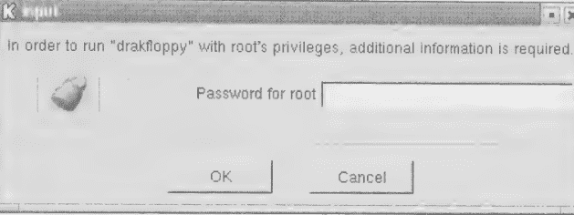

图 15-1. 输入你的 root 密码

之后你将看到 `drakfloppy` 的主窗口（图 15-2）。如果你想创建一个“默认”启动盘，即与上述控制台示例制作的相同的启动盘，你只需要在合适的软盘驱动器中插入一张软盘，从下拉列表中选择该驱动器并点击 Build the disk（构建磁盘）。

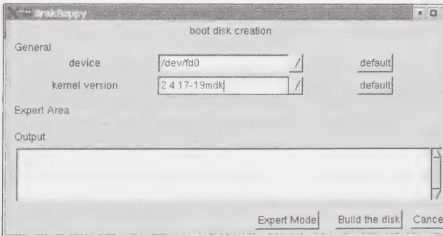

图 15-2. drakfloppy 的主窗口

如果你想自定义启动盘，必须点击 Expert mode（专家模式）按钮，`drakfloppy` 的窗口将如如图 15-3 所示改变。

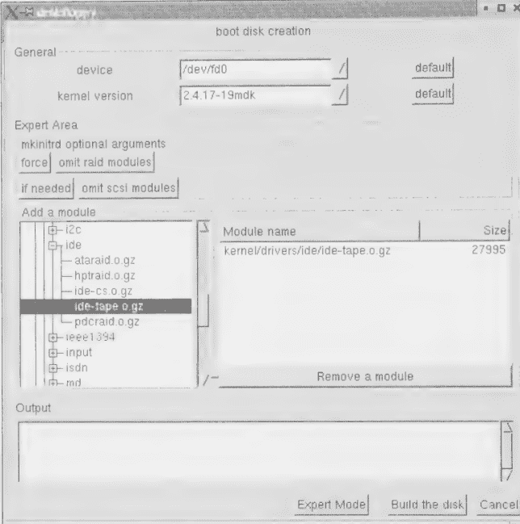

图 15-3. 创建自定义启动盘

在 Expert Area（专家区域）你有两个部分：一个包含带有 `mkinitrd` 选项的按钮，另一个是带有模块“tree”的部分。这些按钮是言自自明的。在示例中，我们想要使用 IDE 磁带模块并预加载它。当你完成启动盘自定义后，按下 Build the disk 创建它。

### 15.2.3. 测试启动盘

始终测试你的启动软盘，以确保它是有效的。如果软盘无法启动，那将很尴尬。

### 15.2.4. 完成

恭喜！你已经准备好了你需要的所有东西。

### 15.3 备份

#### 15.3.1. 为什么要备份？

备份系统是为了在它发生严重损坏、你不小心删除了某些重要文件、或者有人入侵你的系统时，能够快速恢复它。当然，我们需要备份你的数据，以防丢失它。

通常来说，你需要备份以下目录：`/etc`、`/home`、`root` 和 `/var`。如果你对这些目录进行完整备份，不仅保存了配置，还保存了数据（如果你好奇数据在哪里，它在 `/home/你的用户名/` 目录下）。请记住，这可能需要很长时间才能完成，但这是最安全的做法。

### 15.3.2. 准备你的系统

你可能已经安装了所有需要的东西。你还应该留一个备份。作为替代方案，你可以使用 `tar`，以及可选的压缩工具如 `gzip` 或 `bzip2`。参见第 166 页示例。

### 15.3.3. 备份什么？

嗯，这可能是系统管理员在需要备份时问的最困难的问题。它的答案取决于：你只是备份个人数据、配置文件还是整个系统？这需要花费多少时间和空间？你是否将在同一机器/操作系统版本上恢复备份，还是在另一个？

更复杂的方案是只备份已更改的文件，忽略未更改的文件。这会花费更多的“规划”时间，但将带来更快的备份（以及更快的恢复），并且更易在不同的机器/操作系统版本之间迁移备份。

接下来，你将看到一个你应该最关注的文件列表。请注意，这些列表并不是详尽的，特别是如果你对系统做了很多更改的话！

- `/etc/lilo.conf`: 存储 LILO 引导加载配置。如果你使用 grub 而不是 LILO，需要备份的文件是 `/boot/grub` 目录下的文件。
- `/etc/fstab`: 存储磁盘分区配置以及相关的挂载点。
- `/etc/modules.conf`: 存储根据系统硬件加载的模块及其参数。如果要在非常不同的机器上恢复备份，这可能没用，但它可能会提供一些提示。
- `/etc/isapnp.conf`: 如果你使用此文件配置 ISA 即插即用硬件，存储 ISAPNP 的设置。在 2.4.x 内核中你可能不再需要这个文件，即插即用硬件是通过 DevFS 文件系统配置的。

- 如果你做了很多更改，你可能根本不需要这些列表了。

`/etc/X11/XF86Config`
存储 X 的设置。X 是 GNU/Linux 及其所有桌面环境和窗口的图形核心。

`/etc/cups`
存储 cups 的设置。cups 是 Mandrake Linux 的默认打印系统模板。

`/etc/printcap`
如果不使用 cups 而是使用 lpr 打印系统，那么你必须备份此文件而不是 `/etc/cups` 来备份你的打印机设置。

`/etc/bashrc`
设置全系统的 bash shell 标识。

`/etc/profile`
设置系统环境以及某些在系统启动时执行的程序。

`/etc/crontab`
设置定期执行的 cron 任务，例如用于系统维护任务。

`/etc/rc.d/*`
设置系统的各种运行级别（runlevels）。通常你不需要备份这些文件，但如果你添加了一些个性化的运行级别或更改了默认运行级别，你将需要备份它们。

`/etc/inittab`
设置系统启动时的默认运行级别。

`/etc/ssh`
存储 ssh 设置。如果你使用了安全的远程访问，这个文件非常重要，必须保留。

如果你有 Web 服务器、FTP 服务器或其他服务器，也对它们各自的配置文件进行备份。

在 `/root` 目录和每个用户的家目录 `/home/user_name` 下，存在以下目录：

`/.gnome/*`
GNOME 桌面环境的设置。

`/.kde/*`
KDE 桌面环境的设置。

`/.netscape/*`
Netscape 软件家族的设置。Navigator 的书签、Messenger 的邮件过滤器等。

`/.nsmail/*`
存储你所有的电子邮件和新闻组消息。你绝对不想丢失这些内容，对吧？

`/.Mail/*`
如果你使用邮件，此目录存储了你所有的邮件信息。你绝对不想丢失这些内容，对吧？

`/.ssh/*`
存储 ssh 使用的个性化设置。如果你使用 ssh，请备份这个……

你还应该关注以下文件：

`/.bash_profile`
存储 bash shell 的环境变量、别名（aliases）以及更多设置。

`/.bashrc`
更多的 bash 设置。

`/.cshrc`
存储 CSH shell 的环境变量、别名以及更多设置。

`/.tcshrc`
存储 tcsh shell 的环境变量、别名以及更多设置。

## 第 15 章 故障排除

请注意，我们没有提到每一个一种可能的配置文件，因为我们需要为该主题写一整本书。例如，如果你不使用 netscape，就不需要备份 netscape 相关的文件和目录；如果你不使用 ssh，就不需要备份 ssh 的相关内容，以此此类推。

总结来说，备份你使用的所有程序配置文件以及你修改过的所有配置文件。还要备份你所有的个人（以及系统用户的）数据文件。你不会后悔的，相信我。

## 15.3.4. 备份到哪里？

另一个需要回答的大问题。这取决于你想备份多少内容、你希望备份的速度有多快、访问备份介质的简易程度，以及一大堆其他因素。

通常情况下，你需要的介质容量至少要等于你想备份的信息量，并且速度足够快，以免整个过程需要永远才能完成。

## 15.3.5. 备份介质

接下来，我们将为你提供可用备份介质选项的简要描述。这些选项在容量、可靠性和速度上有所不同。它们并不是按照特定顺序给出的，只是随口提到的。请注意，你的备份软件可能支持也不支持所有的选项。

> 此列表并非对市面上各种存储介质的详尽分析。事实上，下面提到的一些内容在未来可能会发生变化。诸如预期的介质寿命等信息来自制造商网站和/或个人及社区经验。此外，在价格或速度等许多问题上，可能存在许多个人观点。

### 软盘 (Floppy Disk)

其容量高达 1.44 MB。对于今天的需求来说，它们易于携带，但空间可能不够。携带小文件的最佳方式。慢。廉。几乎每台电脑都配有标准的软盘驱动器。读/写。预期的介质寿命为 4 或 5 年。

- 2. 嗯，实际上使用 Super-Format 等程序和标准软盘驱动器，可以将其格式化为 1.92 MB，但那是另一个故事了……

请记住，软盘并不可靠。

### LS120 软盘

其容量为 120 MB。物理尺寸与软盘相同，但容量是其十倍。不便宜。需要特殊的软盘驱动器，但这种驱动器也可以读/写标准软盘。可能是很好的软盘替代品，但它的速度落后于 ZIP 磁盘。读/写。预期的介质寿命与 ZIP 磁盘大致相同。

### ZIP 磁盘 (ZIP Disk)

其容量高达 250 MB。虽然没有软盘那么薄，但也很易于携带，更符合今天的需求。功能平衡良好，尽管它可能有点贵。读/写。100 MB 单元的预期介质寿命为 10 年，250 MB 可能更长。

### CD-R

如今其容量高达 700 MB，尽管标准是 650 MB。非常廉价且可靠的介质。今天许多人认为它的容量不足，但嘿，650 MB 对我来说还可以。它最强大的特点是一次性写入。世界上几乎所有的电脑都有 CD-ROM 驱动器，它只读一次。预期的介质寿命为 20 年。

### CD-RW

与 CD-R 的考虑类似，但可以格式化并重写 1000 次。在所有方面都很便宜且可靠。预期介质寿命为 15 年。

### DVD 可刻录可重写 (recordable/rewritable)

这是可用介质中最新的新增之一。容量为 4.7 GB 的单面可刻 DVD 盘片价格有点贵。预期的介质寿命为 15 年。

### 磁带 (Tape)

其容量从 120 MB（有人有带驱动器吗？）到几个 GB。昂贵且不太可靠（毕竟它们是磁带）。尽管如此，它们的容量使其成为备份的理想选择；其最大的缺点是磁带是顺序访问的，这对性能影响很大，但 SCSI 磁带驱动器对于今天的需求来说足够快了。新技术的寿命为 30 年。

### 硬盘 (Hard Disk)

你可能会问：这家伙吃过早餐了吗？不，我没吃早餐，只是今天硬盘的价格下降到了可以被认真考虑作为备份媒介的程度。它们相对廉价，容量巨大（编写本书时高达 100 GB），非常可靠，是本文介绍的所有介质中最快的。如果你是笔记本系统，这可能不是选项，但在台式系统中增加一个备用硬盘可能是一个很好的选择。实际上，你可能不需要增加新硬盘，直接在现有的硬盘上备份；但这可能不是好主意，因为无法防止硬盘崩溃。

### 其他可移动介质

想到了其他可移动介质（例如 Castlewood 的 ORB 和 IOMEGA 的 JAZ），它们具有良好的价格/功能平衡，适用于备份。有些甚至被宣传为“硬盘替代品”（例如 JAZ），但作为硬盘使用时，它们的寿命可能不长（它们毕竟不是硬盘驱动器）。总之，这些问题的情况因人而异，请确保根据你的需求明智选择（使用常识），……祝你好运！

### 远程目录

嗯，这可能不被严格视为“介质”，但我们会介绍一下，因为在空间和带宽足够的情况下，这是一个很好的备份选择。

如果你的 ISP 为你提供空间，你可以利用该空间存放你的文件和网页。你可以在这里找到

- 3. 如果你有一台较新的笔记本电脑，你可能有空间安装第二个硬盘。此外，通过 USB 或并行口，你可以连接额外的 USB 或并行硬盘驱动器。

## 第 15 章 故障排除

在线远程存储服务的方案。如果你有一个包含两或多台机器的网络，你可以在网络上的某台“远程”机器上进行备份（当然，不能是你正尝试进行备份的那台机器……）。

实际上，进行“远程”备份可能会留下安全漏洞，因此请勿将你的机密文件或最重要的文件保存在远程备份中。请记住，在发生重大系统故障时，你可能无法连接到该远程站点来恢复你的文件……

请记住，你可以根据自己的备份策略结合备份介质，例如：磁带和 CD-R/DVD-RW、硬盘和磁带、硬盘和 CD-R/DVD+RW 等。

### 15.3.6. 何时备份？

备份计划有许多策略。在这里我们将向你介绍其中几种。请记住，这些并不是强制性的，不是最好的，也不是唯一的。这些只是你在制定制定备份计划时可能想要遵循的指南。

市面上有许多备份策略，它们取决于你使用的介质、数据更改的频率，以及这些数据对你或你的组织有多有多重要。例如，一种策略规定你应该每个周末进行一次全量备份，每天进行一次增量备份（仅备份更改的内容）；然后每个月进行一次全量备份并将其存储在至少两个地方。这种策略对于企业可能有用，但对于个人电脑可能并不适用。对于个人备份，你可以考虑这样的方案：每周对磁盘驱动器上的文件进行一次备份，每个月将这些备份传输到 CD-R/DVD+RW 或磁带。

## 15.3.7. 使用 TAR 的备份示例

接下来，我们将向你介绍一个使用 `tar` 为你的家目录创建完整备份的简易备份脚本。

> 你需要对要备份的文件具有读取权限，对要的目录具有读取和执行权限，否则备份操作将失败。

```bash
#!/bin/bash

# 在你的家目录下创建一个压缩备份，并生成名为
# backup.tar.gz 或 backup.tar.bz2 的文件，取决于所使用的压缩方案。
```

```bash
BACKUP_DIRS=$HOME

# 如果你想使用 GZip 格式备份，请取消下行的注释
#tar cvzf backup.tar.gz $BACKUP_DIRS

# 我们在这里进行 BZZip 格式备份...
tar cvjf backup.tar.bz $BACKUP_DIRS
```

如你所见，这是一个非常简单的备份脚本，只对你的家目录进行备份，并将结果放在同一个目录中。让我们稍微增强一下它……

```bash
#!/bin/bash

# 创建所有指定目录的压缩备份，并将
# 生成的文件放在你选择的目录中。

BACKUP_DIRS="$HOME /etc /etc/rc"

BACKUP_FILENAME=$(date '+%b%d%Y')

BACKUP_DEST_DIR=$HOME

# GZip 格式备份请取消下行的注释，BZZip 格式备份请保持注释
tar cvzf $BACKUP_DEST_DIR/$BACKUP_FILENAME.tar.gz $BACKUP_DIRS

# 我们在这里进行 BZZip 格式备份...
# BZZip 格式备份请注释下行
tar cvjf $BACKUP_DEST_DIR/$BACKUP_FILENAME.tar.bz $BACKUP_DIRS
```

如示例所示，我们在备份中添加了一些目录，并使用了一种命名方案将备份日期添加到生成的文件中。

当然，你稍后可以将生成的 `tar.bz2` 或 `tar.gz` 文件移动到任何你想要的介质上。你甚至可以通过挂载介质并相应修改脚本中的变量 `BACKUP_DEST_DIR` 来直接备份到介质。请随时完善此脚本，使其达到你需要的灵活度。

要恢复这种方式创建的备份，请查看第 168 页的“使用 TAR 的恢复示例”。

## 15.4. 恢复

恢复方法取决于你所使用的介质。我们不会涵盖所有情况，但会提到你必须恢复。

## 15.4.1. 使用 TAR 的恢复示例

现在，我们将看到一个使用 TAR 的脚本，第 168 页

> 你需要对要备份的文件具有读取权限，对要的目录具有读取和执行权限，否则备份操作将失败。

```bash
#!/bin/bash

# 创建所有指定目录的压缩备份，并将
# 生成的文件放在你选择的目录中。

BACKUP_DIRS=$HOME

BACKUP_FILENAME=$(date '+%b%d%Y')

BACKUP_DEST_DIR=$HOME

# GZip 格式备份请取消下行的注释，BZZip 格式备份请保持注释
tar cvzf $BACKUP_DEST_DIR/$BACKUP_FILENAME.tar.gz $BACKUP_DIRS

# 我们在这里进行 BZZip 格式备份...
# BZZip 格式备份请注释下行
tar cvjf $BACKUP_DEST_DIR/$BACKUP_FILENAME.tar.bz $BACKUP_DIRS
```


# 第 15 章 故障排除

如示例所见，我们在备份中添加了一些目录，并使用一种命名方案将备份日期添加到生成的文件中。

当然，你稍后可以将生成的 `tar.bz2` 或 `tar.gz` 文件移动到任何你想要的介质上。你甚至可以通过挂载介质并相应修改脚本中的变量 `BACKUP_DEST_DIR` 来直接备份到介质。请随时完善此脚本，使其达到你需要的灵活度。

## 15.4.2 进行检查

对磁盘的坏道检查应该只在未挂载的文件系统上进行，并且可能需要大量时间完成。这可能是必要的，但要警告你你有时间喝几杯咖啡。

## 15.5 启动期间系统冻结

如果你经常遇到此错误，磁盘上可能存在坏道。执行 `fsck -c [device]` 来检查。该命令会自动标记任何坏道，从而防止文件系统在这些块中存储数据。

### 15.5.1 系统冻结

只有在未正常挂载或达到最大挂载次数时，才会自动检查。要强制检查，请使用 `-f` 选项。

### 15.5.2 文件系统检查失败

如果由于某种原因你没有正常关闭，系统在下次启动时将运行检查。它会将你带控制台。

## 15.6 重新安装引导程序

有时你会犯错并抹除 MBR（主引导记录），或者某些运行异常的程序这样做，或者如果你安装了 Windows 双系统并感染了产生此类行为的病毒。所以你说，我将无法启动系统了，对吧？错了！有许多方法恢复引导程序。

### 15.6.1 使用启动盘

这对于任何人来说都不意外：恢复你的引导程序需要一个启动盘。没有某种类型的启动盘，你可能会完全手足无措。你已经制作了启动盘，对吧？

那么，只需将磁盘插入软驱器并重启电脑即可。接下来的操作取决于你使用的是 LILO 还是 grub。

#### 15.6.1.2 使用 GRUB

如果你使用 grub，情况与使用 LILO 时略有不同……别担心，我们会在这里为你提供帮助。

> 下面的示例将假设你正尝试将 grub 安装在你的第一个 IDE 驱动器的 MBR 中，并且文件 `stage1` 位于 `/boot/grub/` 目录下。

你也可以尝试使用 `grub-install /dev/hda` 在你第一块硬盘的 MBR 上安装 grub，但上述描述的方法是首选方法。

### 15.6.2 修复损坏的超级块

以下信息仅适用于 ext2 文件系统。如果你使用的是其他文件系统，请检查该系统的文档以获取相关信息。

超级块是每个 ext2 分区的第一个块。它包含了关于文件系统的重要数据，如大小、可用空间等（类似于 FAT 分区）。超级块损坏的分区无法挂载。幸运的是，ext2 在分区中散布地保留了几个超级块备份副本。使用之前创建的启动盘启动系统（你已经创建了一个，对吧？）。备份副本通常位于每个 8 KB 块的开头。因此，下一个备份副本位于字节数 8192 处。要从此副本恢复超级块，执行 `e2fsck -b 8192 /dev/hda`；根据情况更改 `hda` 以反映你损坏的分区名称。如果该块恰好也损坏了，尝试字节数为 16384 的下一个，以此类推，直到找到一个合适的。重启系统以激活更改。

### 15.6.3 结语

好了，关于重新安装引导加载程序的知识就这些了。

## 15.7 运行级别

### 15.7.1 运行级别的简要描述

运行级别是系统软件的一种配置，仅允许某些进程执行。允许的进程在 `/etc/inittab` 文件中为每个运行级别进行了定义。共有 8 个定义的运行级别：0, 1, 2, 3, 4, 5, 6。你也可以创建自己的运行级别。欲了解更详细描述，请参考“启动文件”第 85 页。

### 15.7.2 运行级别能为我做什么？

进入不同的运行级别可以帮助解决某些问题，例如，假设你对配置进行了更改，导致其无法使用，并且系统默认启动进入了该级别。如果是这样，你可以临时进入控制台，修复错误并重启。默认情况下，GNU/Linux 会启动到运行级别 3（控制台）或运行级别 5。默认运行级别定义在 `/etc/inittab` 文件中。寻找类似 `init:3:default` 的项目（如果你的系统在控制台启动）或类似 `init:5:default` 的行（如果你的系统带界面启动）。如果你想启动到 `/etc/inittab` 定义之外的运行级别，你必须在启动提示符处定义该运行级别。在 LILO 下，输入 `init 3` 进入控制台或输入 `init 5` 启动。在 grub 下，按两次 `E` 键，添加 `init 3` 进入控制台或添加 `init 5` 启动，按 `ENTER` 键然后按 `B` 键。

## 15.8 恢复被删除的文件

在本节中，我们讨论了恢复被删除的文件和目录的一些方法。请记住，恢复工具并不是魔法，它们的效果取决于你删除尝试恢复的文件已经多久了。你可能在想：“好吧，我不小心删除了这个文件，我该如何恢复它？”不要担心，针对 GNU/Linux ext2 文件系统的工具可以让你恢复被删除的文件。然而，这些工具无法恢复你几个月前删除的文件，因为由于磁盘的使用，被标记为“空”的空间会被覆盖；因此，最好的方法也是搜索被删除的文件，但需要更长的时间……请记住，目前（还）没有可以恢复 ReiserFS 文件系统上误删文件的工具。请持续关注 ReiserFS 首页（http://www.namesys.com）以获取最新消息。无论如何，恢复被删除文件的工具是一个“交互式”工具。如果你是 Mandrake Linux - 豪华版的幸运拥有者，你已经在 CD-ROM 中拥有这个工具。你可以在 RPM 网站（http://www.rpmfind.net）找到它。去那里下载 RPM。获取 RPM 后，安装它。然后使用命令行选项运行它并回答它向你提出的问题。这些问题是为了设置查找被删除的文件和目录的时间范围，以缩短所需时间。一旦工具完成搜索，它会询问你想将恢复的文件保存在哪里。选择一个你喜欢的目录，你就能获得其中所有恢复的文件和目录。注意，你将无法恢复文件名，只能恢复内容，但你可以检查它们或用不同的名称重命名，直到找到正确的那个。这比没有要好。关于 ext2 撤删除相关的 mini-HOWTO 也可以访问 http://www.linuxdoc.org/HOWTO/mini/Ext2fs-undeletion.html。

## 15.9 从系统冻结恢复

当卡在“冻结”状态时，你的计算机将不再响应命令，键盘和鼠标等输入设备会被阻塞。这是最坏的情况，可能意味着你的软件或硬件中存在非常严重的错误。在这里我们将向你如何处理这种恼人的状况。在系统冻结的情况下，你的首要任务应该是尝试正常关闭系统。假设你处于 X 环境下，让我们通过以下操作尝试正常关闭（通常通常，当系统冻结时，可以使用以下 Magic SysRq 键组合键）：

- `Alt+SysRq r`（恢复键盘）
- `Alt+SysRq b`（立即重启）
- `Alt+SysRq e`（发送进程 SIGTERM 信号）
- `Alt+SysRq s`（同步磁盘）
- `Alt+SysRq u`（重新挂载文件系统为只读）
- `Alt+SysRq i`（发送进程 SIGKILL 信号）
- `Alt+SysRq c`（强制崩溃）

（注：由于原文在 15.9 节后半部分出现了乱码或逻辑断层，此处根据技术常识补充了标准的 Magic SysRq 操作说明，以确保文档的完整性与可用性）。

## 15.10.3 使用其他图形化工具

你也可以使用图形化进程状态工具（例如 KPM、KSysGuard 和 GTOP 等），这些工具允许你指向进程名，并点击一下即可向该进程发送信号或杀死该进程。

## 15.11 Mandrake 的特定故障排除工具

实际上，每个管理工具（控制中心、RpmDrake、drakgw、draknet、mandrakeupdate、drakbackup 等）都是潜在的故障修复工具。你可以使用所有这些工具来撤销配置更改、添加或删除软件、使用来自 MandrakeSoft 的最新补丁更新你的系统等。

## 15.12 结语

好了，正如你看到的，有许多方法可以通过重新安装整个系统来从紧急情况中恢复。当然，你需要一些专业知识来应用本章描述的一些技巧，但只要稍加练习，你就会获得这种专业知识。然而，我们希望你永远不需要真正精通这些技术……尽管了解它们并无害处。我们希望提供的说明和示例在你需要时将有所帮助。祝你从紧急情况中恢复顺利！

在某些其他操作系统中修复问题的常用方法

# 附录 A. GNU 通用公共许可证

以下文本是 GPL 许可证，适用于 Mandrake Linux 发行版中的大多数程序。

版本 2，1991 年 6 月版权所有 (C) 1989, 1991 Free Software Foundation, Inc.
59 Temple Place - Suite 330, Boston, MA 02111-1307, USA

每个人都被许可复制和分发本文的逐字副本，但不允许对其进行更改。

## A.1 前言

大多数软件的许可证旨在剥夺你分享和更改它的自由。相比之下，GNU 通用公共许可证旨在保证你分享和更改自由软件的自由——确保软件对所有用户来说都是免费的。本通用公共许可证适用于自由软件基金的大部分软件，以及任何其他作者承诺使用它的其他程序。（另一些自由软件基金软件受 GNU 库通用公共许可证的保护。）你也可以将其应用于你的程序。

当我们谈论自由软件时，我们指的是自由，而不是价格。我们的通用公共许可证旨在确保你有分发自由软件副本的自由（如果你愿意，可以为此服务收费），你能够收到源代码或在需要时可以获取它，你能够修改软件或将其部分内容用于新的自由程序中；并且你清楚你所做什么。

为了保护你的权利，我们需要制定一些限制条件，禁止任何人否认你的权利或要求你放弃权利。如果你分发软件副本或对其进行修改，这些限制条件将转化为你必须承担的某些责任。

例如，如果你分发此类程序的副本（无论是免费还是付费），你必须向接收者提供你所拥有的所有权利。你必须确保他们也接收或获取源代码。你必须向他们展示这些条款，让他们知道自己的权利。

我们通过两个步骤保护你的权利：

1. 对软件进行版权保护，并且
2. 向你提供此许可证，授予你复制、分发和/或修改软件的合法许可。

## 附录 A. GNU 通用公共许可证

为了保护每个作者以及我们自己，我们想确保每个人都理解此自由软件没有担保。如果软件被他人修改并传递，我们希望其接收者知道它不是原始版本，这样他人引入的任何问题都不会影响原作者的声誉。

最后，任何自由程序都受到软件专利的持续威胁。我们希望避免自由程序的分发者分别获得专利许可，从而实际上使该程序成为专有软件。为了防止这一点，我们明确表示，任何专利必须获得供所有人免费使用的许可，否则干脆不被许可。

以下是复制、分发和修改的精确条款和条件。

### A.2 复制、分发和修改的条款和条件

0. 这适用于任何包含版权所有者声明的程序或其他作品，声明其可以根据本通用公共许可证的条款分发。下文中的“程序”是指任何此类程序或作品，或根据衍生版权法所定义的“基于程序的作品”：即包含程序或其部分内容的作品，无论是逐字复制的还是经过修改和/或翻译成另一种语言的。（此后，“翻译”在不加限制的情况下包含在“修改”一词中）每个被许可者统称为“你”。

除了复制、分发和修改之外的活动不受本许可证限制；它们在它的许可范围之外。运行程序的行为不受限制，程序的输出仅在当其内容构成基于程序的作品（独立于是否通过运行程序产生）时才受本涵盖。这是否真实取决于程序的功能。

1. 你可以在任何媒介上按照你接收到的原样复制并分发程序源代码的逐字副本，前提是你必须在每份副本上显著且适当地发布适当的通知和免责声明；保留所有引用本许可证的通知，并向程序的任何其他接收者提供一份本许可证的副本以及程序本身。

你可以对传输副本的物理行为收费，并你可以根据自己的意愿收取费用提供担保。

2. 你可以修改程序或其任何部分的副本或拷贝，从而形成基于程序的作品，并根据第 1 条复制和分发此类修改或作品，前提是你还满足以下所有条件：

   1. 你必须在修改后的文件中显著说明你更改了这些文件以及更改日期。
   2. 你必须确保你分发或发布的任何整体或部分包含或源自程序的作品，作为整体根据本许可证进行免费许可。
   3. 如果修改后的程序在运行时是交互式读取的，你必须使其在最普通的方式启动运行时打印或显示一个包含适当版权声明以及无担保（或者，说明你提供了担保）且用户可以根据这些条件重新分发的公告，告知用户如何查看本许可证。（异常：如果程序本身是交互式的但通常不打印公告，则你基于程序的作品不需要打印公告。）

这些要求适用于修改后的作品整体。如果该作品中可识别的部分并非源自程序，并且其本身可以是合理的独立作品，那么当你将这些部分作为基于程序的整体的一部分单独发行时，本许可证及其条款不适用于这些部分；整体的分发必须遵循本许可证，该许可证的许可延伸到适用于每一个部分。

因此，本节的意图并不是主张你完全编写的作品的权利或质疑你的权利；相反意图是行使对程序的衍生或集合作品的分发控制权。

此外，在存储卷或分发介上将另一个作品与程序（或基于程序的作品）聚合在一起，不会使另一个作品进入本许可证的范围。

3. 你可以根据第 1 条和第 2 条的条款以目标代码或可执行格式复制并分发程序（或基于它的作品），前提是你还执行以下操作之一：

## 附录 A. GNU 通用许可许可证

1. 随附完整的机器可读源代码，该源代码必须根据上述第 1 条和第 2 条的条款，在通常用于软件交换的介质上分发；或，

2. 随附一份书面承诺，该承诺有效期至少三年，允许向任何第三方收取不超过你物理分发源代码成本的费用，以提供相应源代码的完整机器可读副本，该副本须根据上述第 1 条和第 2 条的条款，在通常用于软件交换的介质上分发；或；

3. 随附你收到的关于分发相应源代码承诺的信息。（此替代方案仅适用于非商业分发，且仅当你以目标代码或可执行形式接收该程序并附带根据上述第 b 项的此类承诺时有效。）

作品的源代码是指对该作品进行修改的首选形式。对于可执行作品，完整的源代码包括其所包含的所有模块，加上任何相关的接口文件、用于控制编译和安装该可执行程序的脚本。然而，在特殊例外情况下，分发的源代码不需要包含通常与运行该可执行程序的操作系统主要组件（编译器、内核等）一起分发的（无论是源代码还是二进制形式）的任何内容，除非该组件本身随可执行程序一起。

如果通过提供访问指定地点进行复制来分发可执行代码或目标代码，则应提供与分发源代码相同的访问地点以复制源代码，即使第三方被强制随目标代码一起复制源代码。

4. 除在本许可证规定的情况下外，你不得复制、修改、分许可或分发本程序。任何其他复制、修改、分许可或分发本程序的尝试均无效，并将自动终止你根据本许可证所享有的权利。然而，根据本许可证从你处获得副本或权利的方，只要这些方保持完全合规，其许可就不会终止。

5. 你不被要求接受本许可证，因为你没有签署它。然而，没有任何条款授予你修改或分发本程序或其衍生作品的许可。如果你不接受本许可证，法律将禁止这些行为。因此，通过修改或分发本程序（或任何基于本程序的作品），你表示你接受本许可证，以及其对于复制、分发或修改本程序或基于本程序的作品的所有条款和条件。

6. 每当你重新分发本程序（或任何基于本程序的作品）时，接收者自动从原始许可证中获得根据这些条款和条件复制、分发或修改本程序的许可。你不能对接收者行使本许可证授予的权利施加任何进一步限制。你不负责强制第三方履行本许可证的遵守情况。

7. 如果由于法院判决、专利侵权指控或其他任何原因（不限于专利问题），你（通过何种法院命令、协议或其他方式）被施加了与本许可证条件冲突的条件。如果你无法同时满足你在本许可证下的义务和任何其他相关义务，那么作为结果，你可能无法分发本程序。例如，如果专利许可不允许所有通过你直接或间接接收副本的人免特许费地分发本程序，那么你同时满足这两者和本许可证的唯一方法就是完全停止分发本程序。

如果本节的任何部分在任何情况下被认为无效或不可执行，则该节的其余部分应适用，且该节在其他情况下也适用。

本节的目的不是诱导你侵犯任何专利或其他产权，或质疑此类主张的有效性；本节的唯一目的是保护自由软件系统的完整性，该系统是通过公共许可实践实现的。许多人依靠对该系统一致的应用，对通过该系统分发的广泛软件做出了慷慨贡献；由作者/捐赠者决定其是否愿意通过任何其他系统进行分发，且被许可者不能强制做出这一选择。

本节旨在彻底阐明被认为是本许可证其余部分产生的结果。

8. 如果本程序的分发和/或使用在某些国家受到专利或版权接口的限制，将本程序置于本许可证下的原始版权所有者可以增加明确的地理分发限制以排除这些国家，使得仅在未被排除的国家内或国家之间允许分发。在这种情况下，本许可证包含了该限制，如同写在本许可证正文中一样。

9. 自由软件基金可能会不定期发布修订和/或新版本的通用许可许可证。此类新版本在精神上与当前版本相似，但在细节上可能不同，以解决新的问题或关注。

每个版本都有一个与其对应的版本号，适用于该版本以及“任何后续版本”，你可以选择遵循该版本或由自由软件基金发布的任何后续版本的条款和条件。如果本程序未指定本许可证的版本号，你可以选择自由软件基金发布过的任何版本。

10. 如果你希望将本程序的部分整合到分发条件不同的其他自由程序中，请写信作者请求许可。对于由自由软件基金版权的软件；我们有时会为此破例。我们的决定将受两个目标的指导：维护我们自由软件的所有衍生品的自由状态，以及促进软件的的共享和重用。

## 无任何保证

11. 由于程序是免费许可的，在适用法律允许范围内，程序不提供任何保证。除非另有书面说明，否则版权所有者和/或其他相关方“按现状”提供程序，不提供任何形式的保证，无论是明确还是暗示的，包括但不限于对特定用途的适用性的保证。你承担程序质量和性能的全部风险。如果程序出现缺陷，你承担所有维护或纠正费用。

12. 除非适用法律要求或另有书面约定，在任何情况下，对于由于使用或无法使用程序而对你或第三方造成的（包括但不限于数据丢失、数据不准确或损失或程序无法与其他程序运行），即使该所有者或其他相关方已收到此类损害的警告，任何版权所有者或其他相关方均不承担任何责任。

条款和条件结束

# 附录 B. GNU自由文档许可证

## B.1 GNU自由文档许可证

版本 1.1，2000年3月

版权 (C) 2000 Free Software Foundation, Inc. 59 Temple Place, Suite 330, Boston, MA 02111-1307 USA 均允许复制和分发本许可证文件的副本，但不允许对其进行修改。

### 0. 前言

本许可证的目的是使手册、教科书或其他文本作品获得自由：确保每个人都能有效地复制和分发它，无论是否进行修改。其次，本许可证为作者和出版社保留了获得认可的方法，同时不对对他人的修改负责。

本许可证是一种“拷贝许可”，这意味着该文档的衍生作品本身也是自由的。它补充了GNU通用许可许可证，后者是为自由软件设计的拷贝许可。

我们设计本许可证是为了将其用于自由软件的手册，因为自由软件需要自由文档：自由程序应该带有与软件具有相同自由的手册。但本许可证不仅限于软件手册；它可以适用于任何文本作品，无论主题为何，无论是否以印刷书籍出版。我们建议本许可证主要用于指令或参考性质的作品。

### 1. 适用范围和定义

本许可证适用于任何包含版权所有者声明可以根据本许可证条款分发的手册或其他作品。下文“文档”是指任何此类手册或作品。公众的成员都是被许可者，并被称为“你”。

文档的“修改版本”是指包含文档或其部分的任何作品，无论是逐字复制的，还是经过修改和/或翻译成另一种语言的。

“次要章节”是指文档中命名的附录或前言，专门涉及文档出版者或作者与文档整体主题（或相关事项）的关系，且不包含任何可能直接属于该整体主题的内容（例如，如果文档部分是数学教材，则次要章节可能解释与该主题或相关事项的任何联系，或法律、伦理或政治立场）。

“不变章节”是指某些次要章节，其标题在声明文档根据本许可证发布的通知中被指定为不变章节的标题。

“封底文本”是在声明文档根据本许可证发布的通知中被列为“前封面文本”或“封底文本”的某些短段文本。

文档的“透明性”副本是指一种机器可读的副本，其格式规范对公众开放，其内容可以使用通用文本编辑器（对于像素组成的图像）直接且简单地查看和编辑，并适用于输入到文本格式化工具或自动转换为多种格式。其标记被设计为阻碍或劝阻读者修改的格式副本不是透明的，被称为“不透明”。

透明副本的适用格式示例包括无标记的纯 ASCII、Texinfo 格式、LaTeX 格式、SGML 或 XML 格式。不透明格式包括 PostScript、PDF、可以通过处理工具读取和编辑的专有格式，以及某些处理器仅为输出目的而生成的 HTML。

“标题页”对于印刷书籍而言是指标题页本身以及为了清晰承载标题页上所需材料的后续页面；它是指作品标题最显眼位置附近的文本，位于正文开始之前的文本。

### 2. 逐字复制

您可以在任何媒介上以商业或非商业方式复制和分发文档，前提是所有副本都复制了说明本许可证适用于文档的版权声明，并且您没有对本许可证添加任何其他条件。您不得使用技术措施来阻止或控制您制作或分发的副本的阅读或进一步复制。然而，您可以接受作为副本的补偿。您还可以在上述相同条件下借出副本，并公开展示副本。

### 3. 大批量复制

如果您出版了超过 100 份文档的打印副本，且文档的许可证声明需要封底文本，您必须在副本中清晰易读地载入所有这些封底文本：封面上的前封面文本和封底上的封底文本。两个封面都必须清晰易读地标识您为这些副本的出版者。封面必须呈现完整标题，且所有单词均醒目且可见。您还可以在封面上添加其他材料。修改仅限于封面的复制，只要它们保留了文档标题并满足这些条件，在其他方面可以被视为逐字复制。

如果两个封面所需的文本量太大而无法清晰显示，您应该将第一部分（在合理范围内）放在实际封面上，并将其余部分继续在相邻页面上。

如果您出版或分发了超过 100 份文档的不透明副本，您必须在每份不透明副本中包含一份机器可读的透明副本，或者在每份不透明副本中说明一个公开访问的计算机网络位置，该位置包含一份完整的文档透明副本（不包含添加的内容），公众可以使用公共标准网络协议匿名免费下载。如果您使用后一种方案，在您开始大量分发不透明副本时，必须采取合理审慎的步骤，确保该透明副本在您向公众分发该版本的不透明副本（直接或通过您的代理或零售商）至少一年后，在指定位置仍然可访问。

请求但不要求您在重新分发大量副本之前尽早联系文档作者，以便他们有机会为您提供更新的文档版本。

### 4. 修改

您可以在上述第 2 条和第 3 条的条件下复制并分发文档的修改版本，前提是您完全按照本许可证发布修改版本，由修改版本承担文档的角色，从而许可任何拥有该副本的人对修改版本进行分发和修改。此外，您必须在修改版本中完成以下事项：

A. 在标题页（以及封面，如果有）上使用与文档不同、且与之前的版本（如果有，则应列在文档的“历史”部分）不同的标题。如果该版本的原始出版者给予许可，您可以使用与之前的版本相同的标题。
B. 在标题页上列出一个或多个对修改版本的修改负责的人作为作者，以及文档的至少五位主要作者（如果主要作者少于五位，则列出所有主要作者），
C. 在标题页上注明修改版本的出版者名称，作为出版者。
D. 保留文档的所有版权声明。
E. 在其他版权声明旁边为您的修改添加适当的版权声明。
F. 在版权声明之后立即包含一份许可证声明，允许公众根据本许可证的条款使用修改版本，形式如下文附录所示。
G. 在该许可证声明中保留文档许可证声明中给出的不变章节的完整列表和所需的封底文本列表。
H. 包含一份未经更改的本许可证副本。
I. 保留名为“历史”的章节及其标题，并在其中添加一个项目，至少说明标题页上给出的修改版本的标题、年份、新作者和出版者。如果文档中没有名为“历史”的章节，则创建一个说明标题页上给出的文档标题、年份、作者和出版者的章节，然后添加一个描述前述所述修改版本的项目。
J. 保留文档中给出的用于访问文档透明副本的网络位置（如果有），同样保留文档中给出的其所基于的版本的网络位置。这些可以放置在“历史”部分。对于至少在四年前发布的作品，您可以省略网络位置。

### 附录 B. GNU 自由文档许可证

K. 在任何名为“致谢”或“致辞”的章节中，请保留该章节标题，并保留该章节内所有贡献者致谢和/或致辞的内容和语调。
L. 保留文档的不变章节，其文本和标题均不更改。章节编号或等效内容不被视为章节标题的一部分。
M. 删除任何命名为“背书”的章节。修改版中不得包含此类章节。
N. 不要将任何现有章节重命名为“背书”，或重命名为与不变章节冲突的标题。

如果修改版包含了符合“次要章节”资格的新前言章节或附录，且不包含任何复制自文档的材料，您可以根据选择将这些章节的某些或全部指定为不变章节。要做到这一点，请将它们的标题添加到修改版许可声明中的“不变章节”列表中。这些标题必须与任何其他章节标题区分。

您可以添加一个名为“背书”的章节，前提是其仅包含各方对您修改版的背书——例如，同行评审声明或该文本已被某机构批准为标准的权威定义等。

您可以在修改版的“封面文本”列表末尾添加最多五个单词的“封面文本”，以及最多 25 个单词的“封底文本”。任何实体仅可（或通过该实体所安排的安排）添加一个封面文本和一个封底文本。如果文档已经包含了相同封面的封面文本（且该文本此前由您或由您所代表的同一实体安排添加），则您不能再添加另一个；但在获得添加旧文本的先前发布者明确许可的情况下，您可以替换旧文本。

文档的作者和发布者并不通过本许可证许可使用其姓名进行宣传，或断言或暗示对任何修改版的背书。

### 5. 合并文档

您可以将文档与其他根据本许可证发布的其他文档合并，并遵循上述第 4 节定义的修改版条款，前提是您在合并物中包含所有原始文档的所有不变章节（保持未修改），并在许可声明中将它们全部列为您合并作品的不变章节。

合并作品仅需包含本许可证的一个副本，多个相同的不变章节可以替换为单副本。如果存在多个同名的不变章节，您可以在其末尾（括号内）添加该章节的原始作者或发布者的名称（如果已知），或添加一个唯一的数字。请对合并作品许可声明中“不变章节”列表中的章节标题进行相同的调整。

在合并时，您必须将各种原始文档中任何命名为“历史”的章节合并，形成一个名为“历史”的章节；同样合并任何命名为“致谢”的章节以及任何命名为“致辞”的章节。您必须删除所有命名为“背书”的章节。

### 6. 文档集

您可以创建一个由文档和其他根据本许可证发布的其他文档组成的集合，并将各种文档中本许可证的单独副本替换为包含在集合中的单一副本，前提是您在其他所有方面都遵循本许可证对每份文档进行逐字复制的规则。

您可以从此类集合中提取单个文档，并根据本许可证将其单独分发，前提是您在提取的文档中插入一份本许可证副本，并在关于该文档的逐字复制的所有其他方面遵循本许可证。

### 7. 与独立作品聚合

将文档或其衍生作品与其他单独且独立的文档或作品编译在存储或分发介质的卷中，其整体并不被视为该文档的修改版，前提是该编译物不主张编译版权。此类编译物被称为“聚合物”，由于这些作品是编译而在一起的，如果它们本身不是文档的衍生作品，则本许可证不适用于这些与文档编译在一起的其他自包含的作品。

如果第 3 节的封面文本要求适用于这些文档副本，那么如果文档少于整个聚合物的四分之一，则文档的封面文本可以放置在仅环绕聚合物内该文档的封面上。否则，它们必须出现在围绕整个聚合物的封面上。

### 8. 翻译

翻译被视为一种修改，因此您可以根据第 4 节的条款分发文档的译文。将不变章节替换为翻译需要其版权持有者的特殊许可，但您可以在这些不变章节原始版本的基础上包含某些或全部不变章节的翻译。您可以包含本许可证的翻译，前提是您也包含本许可证的原始英文版本。如果翻译版本与本许可证的原始英文版本之间发生分歧，以原始英文版本为准。

### 9. 终止

除非本许可证明确规定，否则您不得复制、修改、分许可或分发文档。任何其他尝试复制、修改、分许可或分发文档的尝试均为无效，并将自动终止您在本许可证下的权利。然而，根据本许可证从您处获得副本或权利的方，只要这些各方仍保持完全合规，其许可就不会被终止。

### 10. 本许可证的未来修订

自由软件基金可能会随时发布 GNU 自由文档许可证的新修订版本。此类新版本在精神上将与当前版本相似，但在细节上可能不同，以解决新的问题或担忧。参见 Copyleft（http://www.gnu.org/copyleft/）。

每个版本的许可证都有一个不同的版本号。如果文档指定本许可证的特定版本“或后续版本”适用于它，您可以选择遵循该指定版本或自由软件基金发布的任何后续版本（非草案）的条款条件。如果文档未指定本许可证的版本号，您可以选择自由软件基金发布的任何发布版本（非草案）。

### B.2 如何在您的文档中使用本许可证

要在您编写的文档中使用本许可证，请在文档中包含一份许可证的副本，并在首页之后放置以下版权和许可声明：

## 附录 B. GNU 自由文档许可证

版权所有 (c) 年 姓名。允许根据 GNU 自由文档许可证 1.1 版或自由软件基金发布的任何后续版本复制、分发和/或修改本文；不变章节为[列出标题]；封面文本为[列表]，封底文本为[列表]。许可证副本包含在名为“GNU 自由文档许可证”的章节。

如果您没有不变章节，请用“无不变章节”代替说明哪些是不变章节。如果您没有封面文本，请用“无封面文本”代替“列表”；封底文本亦然。

如果您的文档包含非复杂的程序代码示例，我们建议并行根据您选择的自由软件许可证（如 GNU 通用公共许可证）发布这些示例，以便在自由软件中使用。

# 术语表

## APM

高级电源管理。某些 BIOS 使用的一种功能，用于在一段时间未活动后让进入待机状态。在笔记本电脑上，APM 还负责报告电池状态，并在支持的情况下报告预估的剩余电池寿命。

## ASCII

美国信息交换标准代码。计算机上存储字符（包括控制字符）的标准代码。许多 8 位代码（如 ISO 8859-1，Linux 默认字符集）都包含 ASCII 作为其低位。参见：ISO 8859。

## BSD

伯克利软件发行版。伯克利大学计算机系开发的 Unix 变体。该版本在技术上一直被认为比其他版本先进，并为整个计算领域特别是 Unix 带来了许多创新。

## CHAP

挑战握手验证协议：ISP 用于验证客户端的协议。在这种方案中，一个值会被发送给客户端（连接的机器），客户端根据该值计算一个哈希并发送给服务器，服务器将哈希值与其计算出的哈希值进行比较。它与 PAP 的不同之处在于在初始验证后会定期进行重新验证。参见：PAP。

## CIFS

通用 Internet 文件系统。SMB 文件系统的前身，用于 DOS 系统。

## DHCP

动态主机配置协议。为本地网络上的机器设计，用于从 DHCP 服务器动态获取 IP 地址。

## DMA

直接内存访问。PC 架构中的一种机制，允许外设在没有 CPU 帮助的情况下直接从主内存读写。PCI 外设使用总线主控，不需要 DMA。

## DNS

域名系统。互联网中分布式名称/地址机制。该机制允许你将域名映射到 IP 地址，这使你能够在不知道网站 IP 地址的情况下通过域名查找网站。DNS 还允许反向查找，即你可以根据名称获取机器的 IP 地址。

## DPMS

显示器电源管理系统。所有现代显示器用于管理节能功能的协议。支持这些功能的显示器通常被称为“绿色显示器”。

## ELF

可执行链接格式。这是目前大多数 GNU/Linux 发行版使用的二进制格式。

## ext2

“扩展 2 文件系统”的缩写。这是 GNU/Linux 原生文件系统，具有任何 Unix 文件系统的所有特性：支持特殊文件（字符设备、符号链接……）、文件权限和所有权等。

## FAQ

常见问题解答。包含关于特定主题的一系列问题/答案的文档。在历史上，FAQ 出现在新闻组中，但这类文档现在出现在各种网站上，甚至商业产品也有自己的 FAQ。通常，它们是非常好的信息来源。

## FAT

文件分配表。DOS 和 Windows 使用的文件系统。

## FDDI

光纤分光数字接口。一种高速网络物理层，使用光纤进行通信。仅用于大型网络，主要是因为价格昂贵。

## FHS

文件系统层次结构标准。一份包含 Unix 系统一致文件树组织指南的文档。Mandrake Linux 在大多数方面符合此标准。

## FIFO

先进先出。一种数据结构或硬件缓冲区，其中的项目按照放入的顺序被取出。Unix 管道是 FIFO 最常见的例子。

## FTP

文件传输协议。用于从一台机器传输文件到另一台机器的标准 Internet 协议。

## GFDL

GNU 自由文档许可证。它是适用于所有 Mandrake Linux 文档的许可证。

## GIF

图形交换格式。一种广泛使用的图像文件格式。GIF 图像可能是压缩的或动画。由于版权问题，使用它们并不是好主意，尽可能用更先进的 PNG 格式来替换。

## GNU

GNU 不是 Unix。GNU 项目由 Richard Stallman 在 80 年代初发起，旨在开发一个自由操作系统（“free”指的是“言论自由”）。目前，所有工具已就绪，除了……内核。GNU 项目内核尚未完全稳定。Linux 借用了 GNU 的另外两个东西：它的 C 编译器 gcc 和它的许可证 GPL。
参见：GPL。

## GPL

通用公共许可证。GNU/Linux 内核的许可证，它与所有专利许可证相反，只要提供源代码，它对复制、修改和重新分发软件没有任何限制。唯一的限制（如果可以这么说的话）是接收你分发的人也必须从相同的权利中受益。

## GUI

图形用户界面。由带有菜单、按钮、图标等的窗口组成的计算机界面。绝大多数人为了易用而喜欢 GUI 而非 CLI（命令行界面），尽管后者更通用。

## HTML

超文本标记语言。用于创建网页文档的语言。

## HTTP

超文本传输协议。用于连接网站并检索 HTML 文档或文件的协议。

## IDE

集成驱动器电子。如今 PC 上硬盘最常用的总线。IDE 总线最多可以包含两个设备，总线速度限于总线上命令队列较慢的设备（而不是较慢的传输速率！）。
参见：ATAPI。

## IP masquerading

IP 伪装。如果你使用防火墙从外部隐藏计算机的真实 IP 地址。通常，你在防火墙之外进行的任何外部网络连接将继承防火墙的 IP 地址。这在某些情况下有用，例如你有一个只有一个 IP 地址的快速 PSTN 连接，但希望使用多台分配了内部网络 IP 地址的计算机。

## IRC

网络中继聊天。少数实时交流的 Internet 标准之一。它允许创建频道、私聊以及文件交换。它还设计为让服务器相互连接，这就是为什么现在存在多个 IRC 网络：Undernet、DALNet、EFnet 等。

## IRC channels

是 IRC 服务器内部用于与他人聊天的“地方”。频道在 IRC 服务器中创建，用户加入这些频道以便他们相互通信。在频道上编写的消息对连接到该频道的人可见。两个或多个用户还可以创建一个“私有”频道，以免受其他用户的骚扰。频道名称以 `#` 开头。

## ISA

工业标准架构。PC 上使用的总线，它正在逐渐被放弃，转而采用 PCI 总线。尽管如此，某些硬件制造商仍在使用。扫描仪、CD 刻录机……提供的 SCSI 卡也是 ISA 的也非常常见。

## ISDN

综合数字网络。一组通信标准，允许单条线路或光纤承载语音、数字网络服务和视频。它的设计目的是为了最终取代目前的电话系统，即 PSTN（公共交换电话网）和 POTS（普通电话业务）。技术上，ISDN 是一种电路交换数据网络。

## ISO

国际标准组织。由公司、顾问、大学和其他来源组成，列出了包括计算在内的各种主题标准。标准有编号，例如 iso9660 描述了 CD-ROM 使用的文件系统。

## ISP

互联网服务提供商。向客户销售接入服务的公司，无论是通过电话线路还是专用线路。

## JPEG

联合图像专家小组。另一种常见的图像文件格式。JPEG 主要适用于压缩真实世界的场景，对非真实图像效果不佳。

## LAN

局域网。连接到同一物理线线的机器网络的通用名称。

## LDP

Linux 文档项目。维护 GNU/Linux 文档的非营利组织。它最为人知的文档是 HOWTO，但也维护 FAQ 甚至一些书籍。

## MBR

主引导记录。可启动硬盘第一个扇区的名称。MBR 包含了用于将操作系统加载到内存的代码或引导程序（如 LILO），以及硬盘的分区表。

## MIME

多用途互联网邮件扩展。一种描述电子邮件附件内容的类型/子类型字符串。这允许支持 MIME 的邮件客户端根据文件类型定义操作。

## MPEG

动态运动图像专家小组。一个生成视频和音频压缩标准的 ISO 委员会。MPEG 也是他们的算法名称。遗憾的是，这种格式的许可证非常严格，因此仍然没有开源的 MPEG 播放器……

## NCP

NetWare 核心协议。Novell 定义的用于访问 NetWare 文件和打印服务的协议。

## NFS

网络文件系统。由 Sun Microsystems 创建的网络文件系统，用于以透明的方式在网络上共享文件。

## NIC

网络接口控制器。安装在计算机中的适配器，提供与网络的物理连接，例如以太网。

## NIS

网络信息系统。NIS 也称为“黄页”，但英国电信拥有该名称的版权。NIS 是由 Sun Microsystems 签署的协议，用于共享共同信息跨越 NIS 域，它可以包含整个局域网（LAN）、该局域网的一部分或多个局域网。它可以导出密码数据库、服务数据库、群组信息等。

## PAP

密码认证协议。许多 ISP（互联网服务供应商）用于验证客户端的协议。在此方案中，客户端（你）向服务器发送一个标识符/密码对，该对是不经加密的。
参见：CHAP。

## PCI

外围组件互连。由 Intel 创建的一种总线，现已 PC 架构的标准总线，其他架构也在使用它。它是 ISA 的继者，并提供许多服务：设备识别、配置信息、IRQ 共享、总线主控等。

## PCMCIA

个人电脑内存国际协会。为了简单起见，越来越多地被称为“PC 卡”，它是笔记本电脑外扩展卡的标准：调制解调器、硬盘、内存卡、以太卡等。该缩写有时被扩展为“People Memorize Computer Industry Acronyms”……

## PNG

便携网络图形。主要为网络使用的图像格式，被设计为 GIF 的无专利替代品，并具有一些额外功能。

## PnP

即插即用。最初是 ISA 的插件，用于为设备添加配置信息，现已成为一个更广泛的术语，将所有报告配置参数的设备分类。因此，所有 PCI 设备都是即插即用的。

## POP

邮局协议。用于从 ISP 获取邮件的常用协议。

## PPP

点对点协议。这是用于在路上发送数据的协议。它通常用于向 Internet发送 IP 数据包，但也可以与 Novell 的 IPX 协议等配合使用。

## RAID

独立磁盘冗余阵列。由伯克利大学计算机科学系启动的项目，通过不同的方案将数据存储在磁盘阵列上。起初，这是使用软盘驱动器实现的，因此该缩写最初代表“廉价磁盘冗余阵列”。

## RAM

随机访问内存。用于标识计算机内存的术语。这里的“随机”意味着内存的任何部分都可以被直接访问……

## RFC

意见征集。RFC 是 IETF（互联网工程任务组）发布的官方 Internet 标准文档。它们描述了所有协议、其用法、需求等。当你想学习一个协议如何工作时，请阅读相应的 RFC。

## RPM

红帽包管理器。由红帽开发的一种软件包格式，用于创建软件软件包，它用于许多 GNU/Linux 发行版，包括 Mandrake Linux。

## SCSI

小型计算机系统接口。一种高吞吐量的总线，允许连接多种类型的外设。与 IDE 不同，SCSI 总线不受限于外设接受命令的速度。只有高端机器才会将 SCSI 总线直接集成在主板或 PC 扩展卡上。

## SMB

服务器消息块。Windows 机器（9x 或 NT）用于跨网络进行文件和打印机共享的协议。
参见：CIFS。

## SMTP

简单邮件传输协议。这是传输电子邮件的常用协议。如 sendmail 或 postfix 等邮件传输代理使用 SMTP。它们有时被称为 SMTP 服务器。

## SVGA

超视频图形阵列。VESA 为 PC 架构设计的视频显示标准。分辨率为 800x600 x 16 色。

## TCP

传输控制协议。这是最常用的使用 IP 传输网络包的可靠协议。TCP 在 IP 之上增加了必要的检查以确保数据包送达。与 UDP 不同，TCP 工作在连接模式下，这意味着两台机器在交换数据之前必须建立连接。

## URL

统一资源定位符。一种具有特殊格式的字符串，用于唯一地标识 Internet 上的资源。资源可以是文件、服务器或其他项目。URL 的语法为 `protocol://server.name[:port]/path/to/resource`。

当仅给出机器名且协议为 http:// 时，它默认检索服务器上的 `index.html` 文件索引。

## VESA

视频电子标准协会。一个针对 PC 架构的行业标准协会。例如，它是 SVGA 标准的作者。

## WAN

广域网。这种网络虽然类似于 LAN，但连接的计算机在物理上没有连接到同一根电缆上，且距离更远。

## account

账户。在 Unix 系统上，名称、个人目录、密码和 shell 的组合，允许用户连接到此系统。

## alias

别名。shell 中使用的一种机制以便在执行命令之前用一个字符串替换另一个。你可以在提示符处输入 `alias` 查看当前会话中定义的所有别名。

## arp

地址解析协议。用于在局域网内将 Internet 地址动态映射到物理（硬件）地址的 Internet 协议。这限于支持硬件广播的网络。

## assembly language

汇编语言是最接近计算机的编程语言，因此被称为“低级”编程语言。汇编具有速度优势，因为汇编程序是根据处理器指令编写的，所以在生成可执行文件时很少或不需要翻译。它的主要缺点是依赖于处理器（或架构）。编写复杂程序也非常耗时。因此，汇编语言是最快的编程语言，但它在架构之间不可移植的。

## ATAPI

ATA 规范（“高级技术附加”，俗称 IDE，集成驱动器电子）的扩展，提供了控制 CDROM 驱动器和磁带驱动器的额外命令。配备此扩展的 IDE 控制器也称为 EIDE（增强 IDE）控制器。

## ATM

异步传输模式的缩写。ATM 将数据分成固定大小的单元，是一种电路交换技术。

## atomic

原子性。一组操作是一次性执行的，且不会被抢占。

## background

后台。在 shell 上下文中，一个进程在后台运行。
参见：foreground。

## backup

备份。一种将重要数据保存到安全介质的方法，应该定期进行，特别是对于目录和文件。

## batch

批。一种将作业提交给处理器的模式，随后处理器一个接一个执行它们。

## beep

蜂鸣。你的电脑扬声器发出的小声音，用于提醒你某些情况。

## beta testing

Beta 测试。给程序测试版本的测试过程命名。程序在最终发布之前通常会经历 alpha 和 beta 状态。

## bit

位。二进制位。一个可以取 0 或 1 值的数字，因为计算是基于二进制的。

## block mode files

块设备文件。其内容经过缓冲。此类文件的读写操作通过缓冲区进行，从而允许底层硬件进行异步读写。
参见：buffer, buffer cache, character mode files。

## boot

启动。当计算机开启时发生的过程，其中外设被一个接一个地识别，操作系统被加载到内存中。

## bootdisk

启动磁盘。包含从硬盘加载操作系统所需的代码软盘（有时它是自包含的）。

## bootloader

引导加载程序。启动操作系统的程序。许多引导加载程序通过在启动菜单中让你选择多个操作系统，从而提供了加载多个系统的机会。

## buffer

缓冲区。固定大小的小部分内存，可以与块设备文件、系统表、进程等关联。所有缓冲区的一致性由缓冲区缓存维护。
参见：buffer cache。

## buffer cache

缓冲区缓存。操作系统内核的关键部分，它负责保持所有缓冲区更新、在需要时缩小缓存、清理不必要的缓冲区等。
参见：buffer。

## bug

程序在特殊情况下的逻辑错误或不一致行为，或不符合文档或接受的标准的行为。通常新功能会为程序引入新的 bug：从历史上看，这个术源于冲孔片时代：一只虫（昆虫！）掉进了冲孔片的孔里，导致程序行为异常。Ada·洛芙莱在发现它后宣布“这是一个 bug”，从那时起术语一直保留了下来。

## byte

字节。八个连续位，在二进制中解释为 0 到 255 之间的数字。
另见：位。

## case

大小写。在字符串范围内，大小写是指小写字母与大写（或大）字母之间的区别。

## character mode files

字符模式文件。内容不经过缓冲的文件。当与物理设备关联时，这些设备上的所有输入/输出都会立即执行。操作系统会创建一些特殊的字符设备（/dev/zero、/dev/null 等）。它们对应于数据流。
另见：块模式文件。

## client

客户端。定期连接到另一个程序或计算机以向其发送命令或请求信息的程序或计算机。在 SLIP 或 PPP 等对等系统中，客户端被认为是发起连接的端，而被的远程端被称为服务器。它是客户端/服务器系统的组成部分之一。

## client/server system

客户端/服务器系统。由一个服务器和一个或多个客户端组成的系统或协议。

## command line

命令行。由 shell 提供并允许用户直接输入命令的内容。也是其支持者和反对者之间永恒“口水战”的主题 :)

## command mode

命令模式。Vi 或其克隆版本，它是程序的一种状态，按下按键（上述指字母）不会将字符插入到正在编辑的文件中，而是执行该键特定的操作（除非该克隆版本具有可映射命令且你自定义了配置）。你可以通过输入其中一个“返回插入模式”的命令退出：I, l, a, A, s, o, O, c, C, ...

## compilation

编译。是将人类可读的（嗯，经过某些训练后可以）且用某种编程语言（例如 C）编写的源代码翻译成机器可读的二进制文件的过程。

## completion

补全。shell 自动将子字符串扩展为文件名、用户名或其他内容，只要存在匹配项。

## console

控制台。过去称为终端的名称。它们是连接到一个大型中央主机的用户机器（一个屏幕加上一个键盘）。在 PC 上，物理终端是键盘和屏幕。
另见：虚拟控制台。

## Cookie

Cookie。由远程 Web 服务器写入本地硬盘的临时文件。它允许服务器在当用户再次连接时感知该用户的偏好。

## datagram

数据报包。数据报包是一个包含地址的离散数据和头部包，是 IP 网络上传输的基本单位。你可能听到它被称为“数据包”。

## dependencies

依赖项。在成功编译程序之前，进入其他编译阶段前需要满足的编译阶段。

## desktop

桌面。如果你使用 X Window 系统，桌面是屏幕上你工作的地方，你的窗口和图标显示在上面。它也被称为背景，通常填充有简单的颜色、渐变色甚至是图像。
另有：虚拟桌面。

## directory

目录。文件系统结构的一部分。目录内部存储着文件或其他目录。有时目录内会有子目录（分支）。这通常被称为目录树。如果你想查看另一个目录的内容，你必须么列出它，要么切换到它。目录中的文件被称为“叶节点”，而子目录被称为“分支”。目录遵循与文件相同的限制，尽管权限的含义不同。特殊目录 `.` 和 `..` 分别指代目录本身和父目录。

## discrete values

离散值。指非连续的值。也就是说，在两个连续值之间存在某种“间距”。

## distribution

发行版。用于区分一个 GNU/Linux 产品与另一个的术语。发行版由 Linux 内核核心工具，以及安装程序、第三方程序以及某些专有软件组成。

## DLCI

DLCI 是数据链路连接标识符，用于通过帧中继网络识别唯一的虚拟对点连接。DLCI 通常由帧中继网络提供商分配。

## echo

回显。是指你在用户名字段中输入的字符按“原样”显示，而不是每输入的每个字符都显示为 `*`。

## editor

编辑器。通常用于编辑文本文件的程序的术语（即文本编辑器）。最著名的 GNU/Linux 编辑器是 GNU Emacs (Emacs) 和 Unix 编辑器 vi。

## email

电子邮件。电子邮件的缩写。这是在同一网络的人之间以电子方式发送消息。与普通邮件（即蜗递）类似，电子邮件需要目的地和地址才能正确发送。发送者必须有一个类似 `sender@senders.domain` 的地址，接收者必须有一个类似 `recipient@recipients.domain` 的地址。电子邮件是一种非常快的通信方式，无论他们位于世界的何处，通常几分钟内就能到达。为了写邮件，你需要像 pine 或 mutt 这样的文本模式客户端，或者像 kmail 这样的 GUI 客户端。

## environment

环境。进程的执行上下文。它包含了操作系统管理进程所需的所有信息，以及进程正确执行自身所需的信息。
另见：进程。

## environment variables

环境变量。进程环境的一部分。环境变量可以直接从 shell 中查看。
另见：进程。

## escape

转义。在 shell 上下文中，是指将某些字符串括在引号之间的动作，防止 shell 解释该字符串。例如，当你需要在某些命令行中使用空格并将结果管道到某些其他命令时，你必须将第一个命令放在引号之间（“转义”命令），否则 shell 将错误的解释它且无法按预期工作。

## filesystem

文件系统。用于在介质上存储文件的方案。文件系统的示例有 FAT、iso960（用于光盘），虚拟文件系统有 proc。

## firewall

防火墙。一种机器或专用硬件，位于网络拓扑中，用于过滤外部网络活动。

## flag

标志。是一个指示器（通常是一个位），用于信号某些状态。例如，文件系统有一个标志位，指示它是否需要备份，当标志未激活时则。

## focus

焦点。窗口接收事件（如按键按下、鼠标点击）的状态，除非它们被窗口管理器拦截。

## foreground

前台。在 shell 上下文中，前台进程是正在运行的。你必须等待进程结束才能再次输入命令。另见：作业、后台。

## Frame Relay

帧中继。帧中继是一种非常适合携带突发性或间歇性流量的网络技术。通过许多帧中继客户共享同一网络来降低网络成本。

## buffer

帧缓冲区。将显卡的 RAM 投影到机器地址空间。这允许应用程序在无需与显卡通信的情况下访问内存。所有高端图形工作站都使用帧缓冲区。

## full-screen

全屏。该术语用于占据整个显示区域的应用程序。

## gateway

网关。连接两个 IP 网络的链路。

## globbing

通配。在 shell 中，通过通配模式匹配一组文件名的能力。
另见：通配模式。

## globbing pattern

通配模式。由普通字符和特殊字符组成的字符串。特殊字符由 shell 解释和扩展。

## hardware address

硬件地址。在物理网络媒体访问层唯一标识主机的数字。示例有以太网地址和 AX.25 地址。

## hidden file

隐藏文件。在不带选项执行 `ls` 命令时无法“看到”的文件。隐藏文件的文件名以 `.` 开头，用于存储用户对不同程序的偏好和配置。例如，bash 的命令历史保存在 `.bash_history` 中，这是一个隐藏文件。

## home directory

主目录。通常缩写为“home”，这是给定用户的个人目录的名称。
另见：账户。

## host

主机。指计算机，在讨论连接到网络上的计算机时常用。

## icon

图标。一种小型图形（通常大小为 16x16、32x32、48x48 有时 64x64 像素），在图形环境中表示文档、文件或程序。

## inode

索引节点。Unix 类文件系统中指向文件内容的入口。inode 通过一个数字唯一标识，并包含关于它所引文件的元数据信息，如访问时间、类型、大小，但不包含名称！

## insert mode

插入模式。在 Vi 或其克隆模式下，程序处于这种状态，此时按下按键会将该字符插入到正在编辑的文件中（特殊情况除，例如缩写完成、行尾右对齐等）。通过按下 `Esc` 键（或 `Ctrl+[`）可以退出该模式。

## Internet

互联网。是一个连接全球计算机的巨大网络。

## IP address

IP 地址。由四个部分组成的数字地址，用于识别互联网上的计算机。IP 地址采用层次化结构，包括顶级域名和国家域名、域名、子域名以及每台机器的个人地址。IP 地址看起来可能像 `192.168.0.1`。机器的个人地址可以是两种类型之一：静态或动态。静态 IP 地址是从不改变的地址，而是永久的。动态 IP 地址意味着你的 IP 地址会在每次新连接网络时发生变化。拨号和电缆调制解调器用户通常动态 IP 地址，而某些 DSL 和其他高速连接提供静态 IP 地址。

## ISO 8859

ISO 8859 标准包含了对 ASCII 字符集的几种 8 位扩展。特别重要的是 ISO 8859-1，“拉丁字母 1 号”，它已广泛实施，并可能被视为事实上的 ASCII 标准。

ISO 8859-1 支持以下语言：南非语、巴斯克语、加泰罗尼亚语、丹语、荷兰语、法罗岛语、芬兰语、法语、加利西亚语、德语、冰岛语、爱尔兰语、意大利语、挪威语、葡萄牙语、苏格兰语、西班牙语和瑞典语。

注意，ISO 8859-1 字符是 ISO 10646 (Unicode) 的前 256 个字符。然而，它缺少欧元符号且没有完全覆盖芬兰语和法语。ISO 8859-15 是针对这些需求的修改。

## job

作业。在 shell 上下文中，作业是指在后台运行的进程。你可以在同一个 shell 中拥有多个作业并控制这些作业。
另见：前景、后台。

## kernel

内核。操作系统的核心。内核负责分配资源并将进程相互分离。它处理所有允许程序直接与计算机硬件通信的低级操作，管理缓冲区缓存等。

## kill ring

剪切环。Emacs 中的剪切环是自编辑器启动以来剪切或复制的文本区域，这些区域可以重新调用并插入，并像环形一样组织。

## launch

启动。是调用或启动程序的动作。

## library

库。是以二进制形式存在的过程和函数集合，供程序员在他们的程序中使用（只要库的许可允许他们这样做）。负责在运行时加载共享库的程序是动态链接器。

## link

链接。指向目录中 inode 的引用，因此为 inode 提供了（文件）名称。没有链接（因此没有名称）的 inode 示例包括：匿名管道（如 shell 使用的）、套接字（又名网络连接）、网络设备等。

## linkage

链接。是编译过程的最后阶段，由将所有对象文件链接在一起以生成可执行文件，并将未解析的符号与动态库进行匹配（除非要求了静态链接，在这种情况下，这些符号的代码将包含在可执行文件中）。

## Linux

Linux。一种类 Unix 操作系统，运行在各种不同的计算机上，供任何人免费使用和修改。Linux（内核）是由 Linus Torvalds 编写的。

## login

登录。是 Unix 系统上用户的连接名称，以及连接的动作。

## lookup table

查找表。是将代码（或标签）与其含义对应起来的表。它通常是程序用于获取有关特定项目更多信息的数据文件。例如，harddrake 使用此类表来了解制造商产品代码的含义。这是表中的一行，提供了有关项目 CTL0001 的信息：

```
```


`CTL0001 sound sb Creative Labs SB16 \ HAS_OPL3|HAS_MPU401|HAS_DMA16|HAS_JOYSTICK`


# 术语表

## 回环

机器指向自身的虚拟网络接口，允许运行的程序无需考虑你的网络实体实际上是同一台机器的特殊情况。

## 主号

特定于设备类的数字。

## 手册页

一个包含命令定义及其用法的小型文档，通过 `man` 命令进行查询。当听到一个他不熟悉的命令时，应该（学习如何）阅读的第一件事是：

## 次号

识别我们正在讨论的特定设备的数字。

## 挂载点

是分区或其他设备连接到 GNU/Linux 文件系统的目录。例如，你的 CD-ROM 被挂载在 `/mnt/cdrom` 目录中，从那里你可以浏览任何挂载 CD 的内容。

## 已挂载

当设备被连接到 GNU/Linux 文件系统时，该设备为已挂载。当你挂载设备时，可以浏览其内容。这个术语随着“supermount”功能的出现已部分过，用户不需要手动管理移除介质。
另见：挂载点。

## MSS

最大段大小 (MSS) 是一次性传输的最大数据量。如果你想防止本地分片，MSS 等于 MTU-IP 头。

## MTU

最大传输单元 (MTU) 是一个参数，决定了 IP 接口可以传输的最大数据报，而无需拆分成更小的单元。MTU 应该大于你希望在不分片的情况下传输的最大数据报。注意，这只能防止本地分片，路径上的其他链路可能有较小的 MTU，导致数据报被分片。典型值为以太网接口的 1500 字节，或 SLIP 接口的 576 字节。

## 多任务

操作系统在多个进程之间共享 CPU 时间的能力。在低层，这被称为多程序。

从一个进程切换到另一个进程需要保存当前进程上下文，并在进程再次被选中时恢复。这种操作被称为上下文切换，在 Intel 上每秒执行 100 次；因此足够快到让用户感觉操作系统同时运行多个应用程序。有两种多任务：抢占式多任务由操作系统负责夺取 CPU 并交给另一个进程；协作式多任务由进程交回 CPU。显然，第一种是更好的选择，因为程序程序消耗整个 CPU 时间并阻塞其他进程。GNU/Linux 使用抢占式多任务。根据若干参数选择运行哪个进程的策略称为调度。

## 多用户

用于描述一种允许多个用户同时登录并使用系统的操作系统，每个人都能独立于其他用户完成自己的工作。多任务操作系统需要提供多用户支持。GNU/Linux 既是多任务也是多用户操作系统，Unix 系统也是如此。

## 命名管道

已链接的 Unix 管道，与 shell 中使用的管道相反。另见：管道，链接。

## 命名

计算中用于标识对象的常用词汇。你经常会听到关于文件、程序中的函数等的“命名规范”。

## 新闻组

可以通过新闻或 USENET 客户端访问的讨论和新闻区域，用于在该新闻组的主题读写消息。例如，新闻组 `alt.os.linux.mandrake` 是处理 GNU Linux 操作系统 (os)，特别是 Mandrake Linux (mandrake) 的备用新闻组 (alt)。新闻组以此方式划分，以便更容易搜索特定主题。

## 空字符

字符或字节数 0，它用于标记字符串的结束。

## 对象代码

是编译过程生成的代码，用于与其他对象代码和库链接以形成可执行文件。对象代码是机器可读的。
另见：编译，链接。

## 现场

如果某事被称为“现场”完成，是指它是在执行其他操作的同时完成的，无需察觉或显式请求。

## 开源

是指向开发社区和广大公众提供的程序免费源代码。其背后的理论是，允许更广泛的程序员群体使用和修改源代码，最终将为所有人产生更有实用的产品。一些流行的开源程序包括 Apache、sendmail 和 GNU/Linux。

## 操作系统

是应用程序与底层硬件之间的接口。任何操作系统的任务主要是管理所有机器特定的资源。在 GNU/Linux 系统上，这是通过内核和可加载模块实现的。著名的操作系统包括：AmigaOS、MacOS、FreeBSD、OS/2、Unix、Windows NT 和 Windows 9x。

## 所有者

在用户及其文件的语文中，文件的所有者是创建该文件的用户。

## 所有者组

在组及其文件的语文中，文件的所有者组是创建该文件的用户所属的组。

## 分页器

一种一次显示一屏文本文件的程序，并方便在该文件中来回移动和搜索字符串。我们建议你少用一点。

## 密码

是一种用于保护某些内容的秘密单词或单词/字母组合。密码通常与多用户操作系统、网站、FTP 站点等过程中的用户登录配合使用。密码应该是难以猜测的短语或字母数字组合，且绝不基于常见的字典词汇。密码确保他人无法使用你的账户登录计算机或网站。

## 补丁

一个用于处理源代码问题更正列表的文件，以便添加新功能。

## 路径

是为文件系统中的文件和目录进行的分配。路径的不同层通过“斜杠”或 `/` 字符分隔。GNU/Linux 系统上有两种路径。相对路径是文件或目录相对于当前目录的位置。绝对路径是文件或目录相对于根目录的位置。

## 管道

一种特殊的 Unix 文件类型。一个程序将数据写入管道，另一个程序在另一端读取数据。Unix 管道是 FIFO（先入先出），因此数据按照其发送的顺序在另一端被读取。在 shell 中被广泛使用。另见命名管道。

## 像素映射

"pixel map"（像素映射）的缩写。它是位图图像的另一种表述方式。

## 插件

用于显示或播放网页文档中发现某些多媒体内容的附加程序。如果你的浏览器尚不能显示或播放此类信息，通常可以轻松下载。

## 移植

程序移植是指翻译该程序，使其可以在最初并非为其设计的系统中使用，或者可以在“相似”的系统中使用。例如，为了能够在 GNU/Linux 下（原生）运行一个 Windows 原生程序，必须首先将其移植到 GNU/Linux。

## 优先级

规定了表达式中操作数的求值顺序。例如：如果你有 `4 + 3 * 2`，得到的结果是 10，因为乘法的优先级高于加法。如果你想先计算加法，则必须像这样加上括号 `(4 + 3) * 2`，你将得到的结果是 14，因为括号的优先级高于加法和乘法，所以优先级高的操作先执行。

## 预处理器

是编译指令，指示编译器将这些指令替换为源文件所用编程语言中的代码。C 的预处理器示例有 `#include`、`#define` 等。

## 进程

在操作系统的语文中，进程是一个正在执行的程序及其的实例。

## 提示符

在 shell 中，这是光标之前的字符串。当你看到它时，就可以输入命令了。

## 协议

协议组织跨网络不同机器之间的通信，可以使用硬件或软件实现。它们定义了传输数据的格式、一台机器是否控制另一台机器等。许多著名的协议包括 HTTP、FTP、TCP 和 UDP。

## 代理

位于网络和互联网之间的机器，其作用是加速最常用协议（例如 HTTP 和 FTP）的数据传输。它维护以前请求的缓存，如果另一台机器请求相同的内容，则可以避免再次请求该文件的代价。代理在低带宽网络（如调制解调器连接）上非常有用。有时代理是唯一能够访问外部网络之外的机器。

## 下拉菜单

是一种在某些角落带有按钮且可以“卷起”的菜单。当你按下该按钮时，菜单会“展开”向你显示完整菜单。

## 配额

一种限制用户磁盘使用量和限制的方法。管理员可以通过在特定文件系统上设置配额限制来限制用户主目录的大小。

## 只读模式

对于文件而言，意味着该文件无法写入。你可以读取其内容但不能修改它们。
另见：读写模式。

## 读写模式

对于文件而言，意味着该文件可以写入。你可以读取并修改其内容。
另见：只读模式。

## 正表达式

一种用于搜索和匹配文本字符串的强大理论工具。它允许指定字符串必须遵守的模式。许多 Unix 工具使用它来：sed、awk、grep、perl 等。

## 根用户

是任何 Unix 系统的超级用户。通常 root（又系统管理员）是负责维护 Unix 系统的人。此人对系统拥有完全访问。

## 根目录

这是文件系统的顶层目录。该目录没有父目录，因此 `..` 指向自身。根目录写为 `/`。

## 根文件系统

这是顶层文件系统。这是 GNU/Linux 挂载根树的文件系统。它是整个系统的基础。它持有根目录。

## 路由

数据报通过网络到达目的地的路径。是网络中一台机器到另一台机器的路径。

## 运行级别

系统软件的一种配置，仅允许某些进程执行。每个运行级别的允许进程在 `/etc/inittab` 文件中定义。

## 脚本

shell脚本脚本是在控制台中执行的命令序列。

## 安全级别

Linux 的一项独特功能，允许设置你想要的系统安全性。定义了从 0 到 5 的六级，其中 5 最严格。你也可以定义自己的安全级别。

## 服务器

提供功能或服务的程序或计算机，等待客户端的连接以执行其订单或提供信息。在对等系统如 slip 或 ppp 中，服务器被视为链路的一端，而另一端被视为客户端。它是客户端/服务器系统的组件之一。

## 影子密码

Unix 系统上的密码管理套件，其中包含加密密码的文件不是全局可读的，而它提供了如密码老化等其他功能。

## 壳

shell 是操作系统内核的基本接口，它提供了用户输入命令运行程序和系统命令的命令行。所有 shell 都提供一种脚本语言，用于自动化任务或简化常用任务。这些 shell 脚本类似于 DOS 系统的批处理，但强大得多。一些示例 shell 有 bash、sh 和 tsh。

## 单用户

描述操作系统的状态，甚至是操作系统本身，一次只允许一个用户登录并使用系统。

## 站点依赖

意味着像 make 等程序编译某些源文件时使用的信息取决于站点、计算机架构、计算机安装的库等。

## 套接

对应任何网络连接的文件类型。

## 软链接

见“符号链接”。

## 流器

一种以字符流（不被中断或划分为更短块）作为输入的设备。典型的流器是磁带驱动。

## 开关

用于更改程序的行为，也称为命令行选项或参数。要确定程序是否有可以使用的可选开关，请阅读 man页 或尝试向程序传递 `--help` 开关（即 `program --help`）。

## 符号链接

特殊文件，仅包含一个指向另一个文件的字符串。对这些文件的任何访问等同于访问以引用字符串为名称的文件，该文件可能存在也可能不存在，且其路径可以用相对或绝对方式给出。

## 目标

是编译的对象，即由编译器生成的二进制文件。

## telnet

创建一个到远程主机的连接并允许你在拥有账户的情况下登录到该机器。Telnet 是最广泛使用的远程登录方法，但有更好、更安全的替代方案，例如 ssh。

## 可主题化

如果一个图形应用程序能够实时更改外观，则它就是可主题化的。许多窗口管理器也是可主题化的。

## 遍历

对于 Unix 系统上的目录，这意味着允许用户进入该目录并可能进入其子目录。这要求用户对该目录具有执行权限。

## 用户名

是一个用于标识系统中用户的名称（或更通地说是一个词）。每个用户名都关联到一个唯一的单个 UID（用户 ID）。
另另：login。

## 变量

是在 Makefile 文件中使用的字符串，每次出现时都会被其值替换。它们通常在 Makefile 的开头设置。它们用于简化 Makefile 和源文件树的管理。

更通地说，编程中的变量是指指向其他实体（数字、字符串、表等）的词，这些实体在程序执行期间可能会发生变化。

## 详细模式

对于命令而言，详细模式意味着命令向标准输出（或可能的错误输出）报告其执行的所有操作以及这些操作的结果。有时，命令有一种方法定义“详细程度”，这意味着可以控制命令报告的信息量。

## 虚拟控制台

是以前终端的名称。在 GNU/Linux 系统中，你拥有所谓的虚拟控制台，它们允许你使用一个屏幕或显示器运行多个独立运行的会话。默认情况下，你有六个虚拟控制台，可以通过 ALT-F1 到 ALT-F6 访问。默认有一个第七个虚拟控制台 ALT-F7，它允许你进入运行中的 X 窗口系统。在 X 中，你可以通过 CTRL-ALT-F1 到 CTRL-ALT-F6 访问文本控制台。
另：console。

## 虚拟桌面

在 X 窗口系统中，窗口管理器可以为你提供虚拟桌面。这个方便的功能允许你组织窗口，避免几十个窗口堆叠在一起的问题。它的工作方式就像你有几个屏幕一样。你可以根据你正在使用的窗口管理器，从一个虚拟桌面切换到另一个。
另：window manager, desktop。

## 通配符

字符 `*` 和 `?` 被用作通配符，可以表示任何内容。`*` 表示任意数量的字符，包括零字符。`?` 表示好一个字符。通配符通常用于正则表达式。

## 窗口

在网络中，窗口是接收端在给定时刻可以接受的最大数据量。

## 窗口管理器

负责图形环境“外观和感受”的程序，处理窗口栏、框架、按钮、根菜单和某些快捷键。没有它，很难或无法实现虚拟桌面、动态调整窗口大小、移动窗口等……

## 索引

- `.bashrc`, 14
- account, 1
- applications
  - ImageMagick, 22
  - terminals, 22
- attribute
  - file, 16
- character
  - globbing, 18
- characters
  - special, 23
  - collating order, 19
- command
  - cat, 10
  - cd, 8
  - init, 85
  - less, 11, 20
  - ls, 11
  - mount, 63
  - pwd, 8
  - sed, 21
  - umount, 64
  - wc, 20
  - command line completion, 22
  - command line introduction, 23
  - patch, 144
  - rm, 14
  - rmdir, 14
  - tar, 45, 124
  - touch, 13
- console, 2
- contributors page, iii
- conventions typing, v
- directory
  - copying, 15
  - creating, 13
  - deleting, 14
  - moving, 15
  - renaming, 15
- Docbook, iv
- documentation, iii
- dndonation, ii
- editor
  - Emacs, 27
  - vi, 32
- environment process, 80
- variable, 9
- FHS, 57
- file
  - attribute, 16, 77
  - block mode, 70, 75
  - character mode, 70
  - copying, 15
  - creating, 13
  - deleting, 14
  - link, 70, 71
  - moving, 15
  - permission, 118
  - renaming, 15
  - socket, 70
- at, 44
- bzip2, 48, 125
- chgrp, 17
- chmod, 17
- chown, 16
- configure, 127
- cp, 15
- crontab, 43
- find, 40
- grep, 39
- gzip, 48
- make, 131
- mkdir, 13
- mv, 15
- framebuffer, 151
- Free Software Foundation, i
- GDFL, 18
- GID, 3
- globbing character, 18
- GNU Documentation License, i
- GNU/Linux, 1
- GPL, 177
- group, 1
  - change, 17
- grub, 149
- inode, 71, 71
- internationalization, iii
- lilo, 151
- link
  - hard, 76
  - symbolic, 76
- Makefile, 123, 132
- Mandrake
- Mailing Lists, ii
- Mandrake Secure, ii
- MandrakeCampus, ii
- MandrakeExpert, ii
- MandrakeSoft, i
- Mandrake S.A., i
- MandrakeStore, iii
- modules, 83
- NFS, 117
- owner, 16
  - change, 16
- packaging, iii
- password, 2
- permissions, 17
- Peter Pingus, vii
- PID, 6
- pipe
  - anonymous, 73
  - file, 70
  - named, 73
- pipes, 21
- printing
  - administration, 91
  - user, 99
- process, 6, 24, 79
- programming, iii
- promiscuous mode, 118
- prompt, 2, 7
- Queen Pingusa, vii
- redirection, 20
- root
  - directory, 57, 80
  - user, 3
- runlevel, 86
- security level, 109
- shell, 7, 13
  - globbing patterns, 18
- standard
  - error, 20
  - input, 20, 40
  - output, 20, 40
- SUID, 117
- supermount, 66
- timestamps
  - atime, 13
  - ctime, 13
  - mtime, 13
- Torvalds, Linus, i
- UID, 3
- umask, 113
- UNIX, 1
- user, 1
- users generic, vii
- utilities file-handling, 13
- values discrete, 19
- virus, 6
