# Active Directory 可视掌握

## 关于 IDG BOOKS WORLDWIDE

欢迎进入 IDG Books Worldwide 的世界。

IDG Books Worldwide, Inc. 是国际数据集团（International Data Group）的子公司，该集团是全球最大的计算机相关信息出版商，也是全球领先的信息技术信息服务提供商。IDG 由 Patrick J. McGovern 于 30 多年前创立，目前在全球拥有超过 9,000 名员工。IDG 在 75 多个国家出版了超过 290 种计算机出版物。每月有超过 9000 万人阅读一份或多份 IDG 出版物。

IDG Books Worldwide 于 1990 年创立，如今已成为美国最畅销的计算机书籍出版商。我们很高兴获得计算机出版协会（Computer Press Association）颁发的八项奖项，以表彰我们在编辑方面的卓越表现，以及 Computer Current 首届读者选择奖的三项奖项。我们畅销的……For Dummies® 系列已有超过 5000 万册印刷量，并翻译成 31 种语言。IDG Books Worldwide 通过与 IDG 高技术北京（IDG's Hi-Tech Beijing）的合资，成为第一家在中国出版计算机书籍的美国出版商。最近，IDG Books Worldwide 已成为全球数百万希望学习如何更好管理业务的读者的首选。

我们的使命很简单：我们的每本书都旨在为读者带来额外的价值和技能构建说明。我们的书由您了解并关心的专家撰写。我们编辑团队的知识库源于在出版、教育和新闻领域的多年经验——我们利用这些经验在新千禧年的细节上精益求精。简而言之，我们关心书籍，因此吸引了最优秀的人才。我们对受众、内部设计、图标使用和插图等细节特别关注。而且，由于我们采用电子方式进行书籍的撰写、编辑和桌面出版的 `efficient` 流程，我们可以花更多时间确保优质内容，而较少关注制作书籍的技术细节。

您可以信赖我们承诺以有竞争力的价格提供您感兴趣话题的高质量书籍。在 IDG Books Worldwide，我们继续传承 IDG 30 多年来提供质量的传统。您会发现没有比 IDG Books Worldwide 的书更好的主题书籍了。


Patrick J. McGovern

董事长兼首席执行官

IDG Books Worldwide, Inc.

IDG 是全球领先的 IT 媒体、研究和展览公司。IDG 成立于 1964 年，1997 年收入为 20.5 亿美元，在全球拥有超过 9,000 名员工。IDG 提供了最广泛的媒体选择，覆盖 75 个国家的 IT 买家，占全球 IT 支出的 95%。IDG 多样化的产品和服务组合涵盖六个关键领域，包括印刷出版、在线出版、展览和会议、市场研究、教育和培训以及全球营销服务。超过 9000 万人阅读 IDG 的 290 本杂志和报纸中的一份或多份，包括 IDG 的主要全球品牌——Computerworld、PC World、Network World、Macworld 和 Channel World 系列出版物。IDG Books Worldwide 是全球增长最快的计算机书籍出版商之一，拥有 36 种语言的 700 多种书籍。仅“...For Dummies”系列就有超过 5000 万册印刷量。IDG 通过 `IDG.net` (`http://www.idg.net`) 为全球在线用户提供最大规模的技术特定网站网络，该网络由全球 55 个国家的 225 多个目标网站组成。国际数据公司（IDC）是全球最大的信息技术数据、分析和咨询提供商，在 41 多个国家设有研究中心，全球拥有超过 400 名研究分析师。IDG World Expo 是在包括 E3（电子娱乐展）、Macworld Expo、Com/Net、Windows World Expo、ICE（互联网商务展）、Agenda、DEMO 和 Spotlight 在内的 35 个国家举办 168 场全球品牌会议和展览的主要举办方。IDG 的培训子公司 `ExecuTrain` 是全球最大的计算机培训公司，在全球拥有超过 230 个办事处和 785 门培训课程。IDG 营销服务通过 IDG 的印刷、在线和展览计划制定全球综合营销项目，帮助行业领先的 IT 公司建立国际品牌知名度。


## maranGraphics

`maranGraphics` 是一家位于加拿大多伦多附近的家族企业。


在 `maranGraphics`，我们坚信要制作优秀的计算机书籍——一次只专注于一本书。`maranGraphics` 生产高科技产品已超过 25 年，这使我们能够为计算机书籍界提供独特的沟通流程。

我们的计算机书籍采用了一种集成的沟通流程，这与其他计算机书籍所采用的方法截然不同。本质上，每个跨页都是一个流程图——文本和屏幕截图完全融入到版式中。介绍性文字和有用的提示完善了学习体验。`maranGraphics` 的方法鼓励大脑的左右半球协同工作——从而带来更快的适应能力和更强的记忆保持力。

最重要的是，我们为我们的书籍的手工制作特性感到自豪。我们精心挑选的作者是各自领域的专家，他们花费无数小时为每个主题研究和组织内容。我们的艺术家重新构建每一个屏幕截图，以提供尽可能最佳的清晰度，使我们的屏幕截图成为行业中精确且易读性最强的。我们追求完美，相信花时间手工制作每个元素能带来用金钱所能买到的最好的计算机书籍。

感谢您购买本书。希望您喜欢它！

真诚的，

Robert Maran

总裁

`maranGraphics`

请访问我们的网站：

`www.maran.com`

## 致谢

### 收购、编辑与媒体开发

- 项目编辑：Darren Meiss
- 收购编辑：Martine Edwards
- 助理项目协调员：Lindsay Sandman
- 高级文字编辑：Ted Cains
- 校对编辑：Dwight Ramsey
- 技术编辑：Indika Boteju
- 版权编辑：Carren Krikorian
- 助理媒体开发专家：Megan Decreene
- 编辑经理：Rev Mengle
- 媒体开发经理：Heather Heath Dismore
- 编辑助理：Cadance Nicholson

### 制作

- 书籍设计：`maranGraphics`
- 项目协调员：Valery Bourke
- 排版：York Graphics Service, Inc.
- 特别艺术：Craig Dearling, Deborah Naor
- 校对人员：York Production Services, Inc.
- 索引编制：York Production Services, Inc.
- 特别帮助：Steve Arany, Eteve Hunkler, Clint Lahnenn, Shelley Norris, Mary Jo Richards, Brent Savage, Kathie Schutte

### 一般与行政管理

`IDG Books Worldwide, Inc.`：John Kilcullen，首席执行官

`IDG Books` 技术出版组：

- Richard Swadley，高级副总裁兼出版人
- Walter R. Bruce III，副总裁兼出版人
- Joseph Wikert，副总裁兼出版人
- Mary Bednarek，副总裁兼产品开发总监
- Andy Cummings，出版总监，通用用户组
- Mary C. Corder，编辑总监
- Barry Pruet，出版总监

`IDG Books` 消费者出版组：

- Roland Egeley，高级副总裁兼出版人
- Kathleen A. Welton，副总裁兼出版人
- Kevin Thornton，收购经理
- Kristin A. Cocks，编辑总监

`IDG Books` 互联网出版组：

- Brenda McLaughlin，高级副总裁兼出版人
- Sofia Marchant，在线营销经理

`IDG Books` 为品牌出版社提供的制作服务：

- Debbie Staley，制作总监
- Cindy L. Phipps，项目协调、制作校对及索引管理经理
- Tony Augsburger，印前、重印及系统经理
- Laura Carpenter，制作控制经理
- Shelley Lea，图形与设计主管
- Debbie J. Gates，制作系统专家
- Robert Springer，校对主管


- Trudy Coler，页面布局经理
- Troy Barnes，页面布局主管
- Kathie Schutte，高级页面布局主管
- Michael Sullivan，制作主管
- Patty Page，促销营销经理

出版方希望向 Patrick J. McGovern 表示特别感谢，没有他，本书是不可能完成的。

## 关于作者

Curt Simmons，微软认证系统工程师（MCSE）和微软认证培训员（MCT），是一位 Windows 专家，大部分时间都用于撰写技术书籍。自 `beta 1` 版本发布以来，Curt 一直与 `Windows 2000` 和 `Active Directory` 密切合作，他是十几本关于微软技术的高级计算书籍的作者。Curt 与他的妻子和女儿住在达拉斯郊外得克萨斯州的一个小镇上，你可以在 `curtssimmons.hypermart.net` 访问他的互联网主页。

## 作者致谢

我想感谢 IDG Books 的所有人，特别是 Martine Edwards 和 Darren Meiss。感谢 Martine 给予我写这本书的机会，并衷心感谢 Darren 投入的所有时间和精力。一如既往，我要感谢我的代理人 Margot Maley，她总是在为我争取机会。最后，感谢我的妻子 Dawn，在我花太多时间敲击电脑键盘时，她始终给予耐心和支援。

# 第一部分

## 1) Active Directory 简介

- `Active Directory` 技术 ............ 4
- `Active Directory` 的结构 .. 7

## 2) TCP/IP 基础

- 为什么你需要了解 `Active Directory` 的 `TCP/IP` 14
- 什么是 `TCP/IP`？ ........................ 15
- `TCP/IP` 组件 .................... 16
- `TCP/IP` 管理技术 ....... 20
- `TCP/IP` 实用工具 ....................... 22

## 理解 Active Directory


## Active Directory 技术

如果你在过去的两年中接触过计算机和网络环境，你肯定听说过关于 `Active Directory` 的一些事情。你听到的一些内容可能是正确的——很多可能是不准确的。本书可以通过视觉化的方法帮助你理清所有概念并掌握 `Active Directory`。但在深入了解安装和配置 `Active Directory` 的细节之前，你需要了解一些概念性信息，以便理解所有内容。第 1、2 和 3 章展示了你需要了解的概念和背景信息，以实施、配置和支持 `Active Directory`。

什么是目录？

术语 `directory`（目录）在过去几年在计算环境中得到了大量使用（也被滥用！）。随着计算环境变得更大、更复杂，组织信息以便网络用户能够找到所需信息的需求变得日益重要。根据定义，`目录` 是一个使用系统方案或 `命名空间` 来组织信息的存储位置。一个常见的例子是电话簿。电话簿中的所有信息都按城市/地区、姓氏和名字进行存储。通过引用特定城市/地区的特定名称，你可以找到那个人的电话号码。电话簿使用 `命名空间`，因为所有姓名都按照姓氏和名字按字母顺序组织。如果电话簿不遵循 `命名空间`——也就是说，如果一些姓名按名字列出，一些按姓氏列出，一些按昵称列出，一些按地址列出——你就永远找不到你需要的东西。

`Active Directory` 也被设计为为网络管理员提供单一的管理点。管理员不需要管理持有多种资源的多个服务器，而是可以在 `Active Directory` 中找到所有目录信息，并且这些信息可以复制到所有 `Windows 2000` 域控制器。资源访问、安全权限以及用户和组账户都集中在一处。

理解 `Active Directory` 的功能

`Active Directory` 包含许多功能和选项，但你应该首先了解大局和设计目标。以下列表解释了 `Active Directory` 的主要功能和设计目标：

- **可扩展性：** `Active Directory` 具有高度可扩展性，这意味着它可以在小型网络环境或全球公司中运行。`Active Directory` 支持多个存储区，每个存储区可以容纳超过一百万个对象。存储区是 `Active Directory` 对象的主要分组——并且 `Active Directory` 甚至支持多个存储区。
- **可扩展性：** `Active Directory` 是可扩展的，这意味着你可以根据组织的需要进行自定义。

什么是 `Active Directory`？

`Active Directory` 是微软对目录服务的回应。`Active Directory` 的目的是组织关于实际网络对象——如用户、共享、打印机、应用程序等的信息——以便用户可以找到他们需要的资源。通过 `Active Directory`，用户不需要记住哪个服务器持有哪个资源，或者特定打印机位于何处。`Active Directory` 列出了信息，完全可搜索，并为用户提供标准的文件夹接口，以便他们可以在网络上找到所需的内容。

- **安全性：** `Active Directory` 与 `Windows 2000` 安全机制集成，允许管理员控制对对象的访问权限。
- **无缝性：** `Active Directory` 与本地网络及内网/互联网无缝集成。
- **开放标准：** `Active Directory` 基于开放通信标准，允许与其他目录服务（例如 `Novell` 的 `NDS`）进行集成和通信。
- **向后兼容性：** 虽然 `Windows 2000` 操作系统最能发挥 `Active Directory` 的作用，但 `Active Directory` 也能与早期版本的 `Windows` 配合工作。此功能允许分步实施 `Active Directory`，同时保持网络正常运行。

## 理解域和域控制器

如果你曾使用过 `Windows NT`，你应该熟悉域和域控制器的概念。域是用户、计算机和资源的逻辑分组。实际上，域是一个安全边界，它使管理员能够控制该域内的资源，并阻止未授权用户进入该域。`Active Directory` 通过域构建而成。域控制器是管理域的服务器。在 `Windows 2000` 中，主域控制器（`PDC`）和备份域控制器不再存在；所有域控制器仅作为对等节点运行。通过信任关系，`Active Directory` 使用多主复制进行复制，这意味着所有域控制器都负责维护 `Active Directory` 并将更改复制到其他域控制器。你将在本书的后文中进一步了解如何在 `Windows 2000` 中管理信任。

## DNS 和 Active Directory

域名系统（`DNS`）是世界上最广泛使用的目录命名空间。每次使用互联网时，你都在通过 `DNS` 查找 `URL`。`DNS` 将统一资源定位符（`URL`），如 `www.microsoft.com`，解析为 `TCP/IP` 地址（如 `131.107.2.200`），这是互联网通信所必需的。由于计算机必须拥有 `TCP/IP` 地址才能通信，而用户需要使用基于语言的名词进行交流，`DNS` 的作用就是解决这两者之间的映射。

`Active Directory` 与 `DNS` 集成，且在 `Active Directory` 中使用的命名方案是 `DNS` 名称。例如，`corp.com` 是一个有效的 `DNS` 名称，也可用作 `Windows 2000` 域名。在 `Active Directory` 中，以 `DNS` 作为定位服务，局域网（`LAN`）与互联网和内网的结合更加无缝。`Corp.com` 可以是互联网名称，也可以是本地名称，`Jwilliams@corp.com` 既可以是互联网电子邮件地址，也可以是本地网络中的用户名。这种结构使你能像在互联网上查找项目一样，在网络中查找项目。

`Windows 2000` 还支持动态 `DNS`（`DDNS`），这是 `DNS` 标准的一项新增加功能。`DDNS` 可以动态更新 `DNS` 服务器中的新值或更改值，而在过去这些都需要手动更新。由于名称记录可以动态更新，纯 `Windows 2000` 网络不再需要使用 `Windows Internet` 命名服务（`WINS`）。然而，在混合环境中，为了与旧版本的 `Windows` 保持向后兼容，仍会使用 `WINS`。你可以在第 5 章和第 6 章中了解有关 `WINS` 和 `DNS` 的所有内容。

## 理解 LDAP

`DNS` 是 `Active Directory` 中使用的命名空间，而 *轻量级目录访问协议*（`LDAP`）是访问 `Active Directory` 的方式。


要理解 `LDAP`，你需要一段简明的历史课。`X.500` 标准是一个目录规范，它引入了`目录访问协议`（`DAP`）用于读取和修改目录数据库。`DAP` 是一个可扩展协议，它可以处理目录请求和更改，以及目录安全。然而，`DAP` 将大部分处理负担放在客户端计算机上，被认为是一个高开销协议。`LDAP` 不在 `X.500` 规范中定义，它是为克服 `DAP` 的弱点而开发的。`LDAP` 是一个开放标准，这意味着任何希望开发目录服务的人都可以使用它，不像 `DAP` 那样受限于 `X.500` 目录。另一个主要区别是 `LDAP` 不是基于客户端的服务。该服务运行在服务器上，信息返回给客户端。`Active Directory` 不是 `X.500` 目录，但它支持信息模型，而不需要系统实施 `X.500` 开销。结果是一个基于 `LDAP` 的目录，支持高水平的互操作性。

`LDAP` 在互联网上得到广泛支持。如果你参与过新闻组或使用搜索引擎搜索万维网，你很可能已经使用过 `LDAP`。这个开放标准直接在 `Active Directory` 中得到支持，以便用户找到他们所需的资源。

## `Active Directory` 的结构

`Active Directory` 设计为层级结构，在安装和实施 `Active Directory` 之前，你必须牢固理解其结构以及组成 `Active Directory` 的组件。你可能会将这些组件视为需要学习的术语，但你还必须知道这些组件或术语之间的关系，以及它们如何适应层级结构。

在本章中，你从层级中最小的组件开始，逐步向上直到层级的顶层。本节为你提供了 `Active Directory` 结构的完整视图。

目录对象包括用户、组、打印机、共享文件夹、应用程序、数据库、联系人等。这些对象中的每一个都代表网络上的某种有形事物。

每个对象都包含属性。属性是帮助定义实际对象的一种品质。例如，用户对象可能具有用户名、实际姓名和电子邮件地址等属性。`Active Directory` 中定义了每种对象的属性。属性定义了对象本身，并允许用户搜索特定对象。从技术上讲，属性被称为“元数据”——即“关于数据的数据”——并且是 `Active Directory`“模式”的一部分，该模式定义了可以存储在 `Active Directory` 中的对象和对象属性。

### 对象

`Active Directory` 对象代表网络上的某种物理对象。常见的 `Active`


第 1 章 `Active Directory` 简介

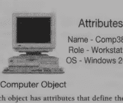

| 属性 | 值 |
| :--- | :--- |
| 名称 | `Comp3874` |
| 角色 | 工作站 |
| 操作系统 | `Windows 2000` |

`每个对象都有定义该对象的属性。`

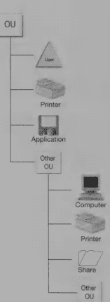

`这是 OU 及其内部对象的层级视图。`

### 组织单元

组织单元（`OU`）类似于文件柜中的文件夹。`OU` 旨在容纳对象（甚至其他 `OU`）。它像对象一样包含属性，但它本身没有功能。与文件夹一样，其目的是容纳其他对象。顾名思义，`OU` 帮助你组织目录结构。例如，你可以有一个会计 `OU`，其中包含其他 `OU`，如应付账款和应收账款，在这些 `OU` 内部可以包含用户、组、计算机、打印机等对象。

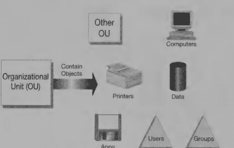

`对象包含在组织单元中。`

### 域

从定义上讲，域是用户和计算机的逻辑分组。域通常位于本地化的地理位置，但这并非总是如此。实际上，域不仅仅是一个逻辑分组——它实际上是 `Windows 2000` 或 `NT` 网络的一个安全边界。你可以将一个具有多个域的网络想象成一个住宅区。所有房屋组成了社区，但每个房屋都是一个安全边界，保留某些内部对象并阻止其他对象进入。

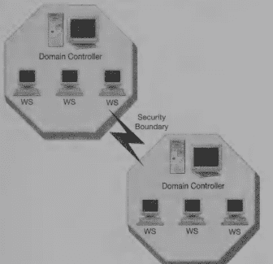

`每个域都作为一个安全边界。`

域就像社区中的一所房子。每个域都可以有自己的安全策略，并与其他域建立信任关系。`Active Directory` 由一个或多个域组成。域包含模式（`Schema`），该模式定义了存储在域中的对象。模式通过类（如用户类、计算机类等）来定义对象，属于某类的所有对象都被称为该类的“实例”。你可以在第 27 章进一步了解 `Active Directory` 模式。

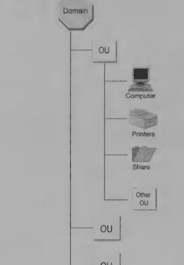

`域位于层级的顶层。`

## 活动目录的结构 *续*

### *树*

域、组织单元和对象的层次结构被称为`树`。树内的对象被称为`终端点`，而树结构中的组织单元（`OU`）则是`节点`。与物理树木相比，你可以将树枝视为组织单元或容器，树叶视为对象——对象是树内节点的自然终端点。

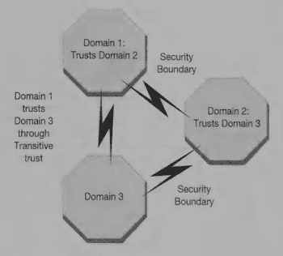

### *域树*

当多个域通过信任关系链接，并共享公共模式、配置和全局目录时，就形成了`域树`。`Windows 2000` 中的信任关系基于 `Kerberos` 安全协议。`Kerberos` 信任具有传递性。换句话说，如果域 1 信任域 2，且域 2 信任域 3，那么域 1 信任域 3。活动目录会自动配置同一树和森林内的信任关系。你可以在第 21 章中了解更多关于活动目录中信任关系的内容。

域树还共享一个连续的命名空间。连续命名空间在域树内遵循相同的 `DNS` 命名层次结构。例如，如果根域是 `corp.com`，且域树中存在 `DomainA` 和 `DomainB`，那么这两个域的连续命名空间分别为 `domaina.corp.com` 和 `domainb.corp.com`。如果 `Domain A` 位于 `corpjp.com` 中，而 `Domain B` 位于 `corp.com` 根域中，那么它们就不共享连续命名空间。


`这是连续命名空间的示例。`

### 森林

森林是由一个或多个不共享连续命名空间的树组成。森林中的树共享公共的模式、配置和全局目录，但不共享连续命名空间。森林中的所有树通过 `Kerberos` 传递信任互相信任。实际上，森林没有特定的名称，但树被视为信任关系的层次结构。位于层次结构顶部的树通常被称为森林根。例如，`corp.com`、`production.corp.com` 和 `mgmt.corp.com` 组成一个森林，其中 `corp.com` 作为森林根。

### 站点

站点实际上不被视为活动目录层次结构的一部分，但它在活动目录中用于复制目的进行配置。站点被定义为包含具有良好连接的 `TCP/IP` 子网的活动目录服务器的地理位置。`良好连接`意味着网络连接具有高度可靠性和高速性。管理员使用活动目录来配置站点之间的复制。用户无需了解站点配置。就活动目录而言，用户只看到域。

### 结构在管理员和用户眼中的呈现方式

作为管理员，你可以通过管理工具查看活动目录的结构，这些工具将在第 14 章到第 21 章中详细介绍。通过这些工具，你可以看到活动目录中由域、组织单元和对象组成的结构。

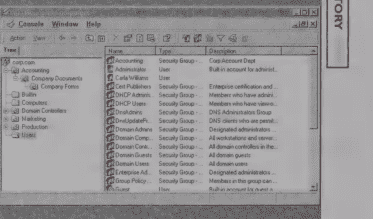

`管理员可以查看活动目录的树结构。`

用户通过访问“我的网络位置”来浏览活动目录。用户看到域和域内组织单元的文件夹视图。对象随后位于各自的组织单元中。主要地，用户通过执行 `LDAP` 搜索（参见第 13 章）而不是浏览来查找资源。

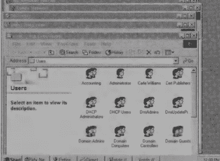

`用户可以看到活动目录的文件夹视图。`

### 活动目录名称

在活动目录中，每个对象，如用户、组、计算机、打印机等，都有一个唯一的名称。为每个对象分配四种名称。

首先，每个对象都有一个`可分辨名称`（`DN`）。`DN` 在所有其他对象中是唯一的，并且包含检索对象所需的所有信息。`DN` 包含对象所在的域以及通往对象的路径。`DN` 由以下属性（或特征）组成：

- 域组件名称（`DC`）
- 组织单元名称（`OU`）
- 常用名称（`CN`）

例如，如果你想要访问位于特定域中的名为“Company mission”的文档，`DN` 可能如下所示：

```
/DC=com/DC=mycompany/OU=acct/CN=documents/CN=Company Mission
```

通过使用 `DN`，活动目录可以从域的顶部开始，向下追溯到实际的文件夹或文档。

其次，活动目录使用`相对可分辨名称`（`RDN`）。`RDN` 是定义实际对象（称为属性）的 `DN` 部分。这就是 `CN`，即常用名称。幸运的是，搜索对象只需要知道常用名称即可。你不需要知道或使用 `DN`，而且 `DN` 本身通常对用户是隐藏的。

第三，活动目录使用`全局唯一标识符`（`GUID`），即唯一的 128 位数字。`GUID` 在对象在活动目录中创建时被分配，并且永不更改。


最后，活动目录对象可以通过 `UPN`（`用户主体名称`）进行识别，这是一种简短且友好的名称，看起来像电子邮件地址，例如 `jwilliams@corp.com`。

需要记住的要点是，活动目录为对象提供 `DN`、`RDN`、`GUID` 和 `UPN`，以确保唯一性、方便 `LDAP` 查询定位以及用户易用性。

### 全局目录

`LDAP` 的目的是允许网络用户在活动目录中搜索和查找对象。为了实现这一点，某些活动目录域控制器，称为“全局目录服务器”，维护着一个 `全局目录`。

全局目录允许用户和应用程序通过搜索特定属性来在活动目录中找到对象。全局目录持有对象的 `partial` 副本及其最常见的属性。当用户执行搜索操作以查找对象时，全局目录会查找该属性并向用户返回匹配结果。

活动目录复制构建并维护全局目录，通过持有的副本，用户可以在树或森林中的任何域或组织单元中定位资源。

## 为什么你需要了解活动目录中的 TCP/IP

`TCP/IP`（传输控制协议/互联网协议）是互联网通信的事实标准。`TCP/IP` 是允许万维网上所有通信发生的协议，多年来，`TCP/IP` 已成为局域网（`LAN`）和广域网（`WAN`）环境中的首选协议。

活动目录与 `TCP/IP` 集成在一起，所有域控制器之间的目录复制都使用 `TCP/IP` 进行。事实上，`Windows 2000` 是为 `TCP/IP` 网络设计的。为了理解并实施活动目录，你需要对 `TCP/IP` 有至少一般的了解。如果你已经熟悉 `TCP/IP` 网络，那么本章是一个很好的复习。如果你是 `Windows` 网络的新手，那么本章正是你理解 `TCP/IP` 基础所需的内容。

## 什么是 TCP/IP？

`TCP/IP` 是由国防部最初开发的一种协议。基本上，`TCP/IP` 提供了一套规则，规定计算机如何在网络上相互通信。就像人们必须使用同一种语言才能相互通信一样，计算机也必须使用同一种语言，即 `协议`，进行通信。`TCP/IP` 被认为是一个协议套件，因为它由许多提供我们现在在联网环境和互联网中享受的广泛通信功能的协议组成。事实上，`TCP/IP` 套件中有超过 100 个协议。以下列表指出了一些最常见的协议：

- `TCP`（`传输控制协议`） 提供面向连接的通信。

- `IP`（`互联网协议`） 管理路由和网络流量。

- `FTP`（`文件传输协议`） 管理文件传输和远程目录管理。

- `HTTP`（`超文本传输协议`） 是传输 `HTML` 文档的互联网标准。

- `SNMP`（`简单网络管理协议`） 管理网络设备并监控网络事件。

- `SMTP`（`简单邮件传输协议`） 提供消息（电子邮件）服务。

- `UDP`（`用户数据报协议`） 提供无连接通信。

- `NNTP`（`网络新闻传输协议`） 提供新闻组服务。

- `Telnet` 提供远程连接的终端仿真。

- `ARP`（`地址解析协议`） 将 `IP` 地址解析为硬件（`MAC`）地址

- `ICMP`（`互联网控制消息协议`） 提供错误控制

- `LDAP`（`轻量级目录访问协议`） 提供目录访问能力

## TCP/IP 组件

就像语言包含词汇、语法和句法等特定组成部分一样，`TCP/IP` 协议也包含若干组件，使 `TCP/IP` 网络中的每台计算机都能在该网络上运行和通信。你必须在 `TCP/IP` 计算机上配置三个主要的 `TCP/IP` 组件：`IP` 地址、子网掩码和默认网关。

二进制数的计算是从一串二进制位序列的右侧向左侧进行的。每一位的计数都是前一位的两倍。换句话说，第一位等于 1，第二位等于 2，第三位等于 4，等等。在一个 `IP` 地址中，有 8 位二进制数，因此第八位等于 128：

```
128 64 32 16 8 4 2 1
```

### IP 地址

`TCP/IP` 网络中的每台计算机都必须拥有一个唯一的 `IP` 地址。`IP` 地址标识了网络上的该计算机，且地址必须是唯一的（两台计算机不能拥有相同的 `IP` 地址）。你可以将 `IP` 地址想象成类似邮政地址，它通过城市、州、邮政编码，然后通过街道地址，最后通过人名来唯一标识。这些地址特性使邮政系统能够将一封邮件投递到特定地址的特定人员手中。计算机的 `IP` 地址使网络能够将通信传递给那台特定的计算机。

在二进制运算中，将位相加以确定数值。例如，如果八位字节中的所有位都“开启”，则数值为 255。换句话说，二进制数 `11111111` 等于 128+64+32+16+8+4+2+1，即 255。

每个 `IP` 地址长度为 32 位，并被分为 4 个字节。每个字节被称为一个八位字节（`octet`）。典型的 `IP` 地址看起来像这样：`131.107.2.200`。为了理解 `IP` 编址，你必须开始以二进制数学的方式思考。计算机以 1 和 0 的形式查看数据。本质上，网络数据流仅仅由计算机所解释的一串 1 和 0 组成。`1`（one）代表“开启”，`0`（zero）代表“关闭”。

如果所有位都“关闭”，那么二进制表示为 `00000000`，这等于 0+0+0+0+0+0+0+0，即 0。使用这种方案，你可以表示 0 到 255 之间的任何数字。

例如，10 的二进制值是多少？请记住，八位字节中的位必须开启或关闭，才能等于数字十。在二进制八位字节中，数字 10 表示为 `00001010`，这等于 0+0+0+0+0+8+0+2+0，即 10。

`IP` 地址由四个用句点分隔的八位字节组成。你可能会分配给计算机的一个典型 `IP` 地址是 `10.2.0.4`。在二进制中，计算机看到此地址为：

```
00001010 00000010 00000000 00000100
```


我的 `IP` 地址是 `10.2.0.4`。

网络上的其他计算机通过使用这个 `IP` 地址与我通信。它们以二进制形式看到我的 `IP` 地址，即 `00001010 00000010 00000000 00000100`。

你不能简单地将网络上的计算机分配给你选择的任何 `IP` 地址。你使用的 `IP` 编址方案必须按类别和子网定义。正如某个城镇的每个人都有相同的城市、州和邮政编码属性一样，`IP` 地址必须属于某些类别和子网。孤立的局域网（`LAN`）或广域网（`WAN`）可以确定用于其网络的地址类别和适当的子网掩码，但对于正确的互联网通信，许多网络选择从 `Network Solutions` 获取 `IP` 编址，该组织负责处理互联网的所有域名和 `IP` 地址分配。

每个 `IP` 地址既标识计算机（或节点，例如路由器）所在的网络，又标识实际的计算机或节点本身。这些分别称为 `网络 ID` 和 `主机 ID`。`IP` 地址的三大主要分组称为类别。以下列表为你概述了这三个类别：

- `A 类`：`A` 类地址的起始八位字节范围从 1 到 126。`Network Solutions` 分配第一个八位字节，网络管理员分配剩余的三个八位字节。`A` 类网络是为大型网络开发的，如今获取 `A` 类地址非常困难。`A` 类网络最多可支持 16,387,064 台主机。此外，`127` 的地址范围保留用于 `TCP/IP` 故障排除，称为环回地址。

- `B 类`：`B` 类网络的第一个八位字节分配范围从 128 到 191。`Network Solutions` 分配第一和第二个八位字节号，网络管理员分配最后两个。`B` 类网络最多可支持 64,516 台主机。

- `C 类`：`C` 类网络第一个八位字节使用 192 到 255。`Network Solutions` 分配前三个八位字节，网络管理员分配最后一个八位字节。`C` 类网络最多只能支持 254 台主机。

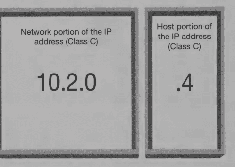

### 子网掩码

`IP` 编址的第二个组件是 `子网掩码`。如前一节所述，`IP` 地址的一部分指向实际网络，而另一部分指向实际的计算机或节点（主机）。子网掩码隐藏或屏蔽 `IP` 地址的一部分，以保持 `网络 ID` 和 `主机 ID` 分离。子网掩码使你可以将网络划分为 `子网`，这可以为你提供更多的可用 `IP` 地址并进一步组织你的网络。此外，子网划分控制减少了整体网络流量。分配给客户端的每个 `IP` 地址必须至少包含一个默认子网掩码。对于 `A` 类网络，默认子网掩码是 `255.0.0.0`。对于 `B` 类网络，默认子网掩码是 `255.255.0.0`；对于 `C` 类网络，默认子网掩码是 `255.255.255.0`。

对网络进行子网划分并为子网分配适当掩码的过程通常是一项困难的任务，超出了本书的范围。但为了理解 `TCP/IP` 的基础知识，请记住至少需要一个默认子网掩码。

### 默认网关

`IP` 编址的最后一个组件是默认网关。默认网关或路由器是通往子网外部的路由器的 `IP` 地址。你可以将默认网关想象为“出口道路”。客户端计算机使用默认网关与不同子网中的计算机进行通信。默认网关不是客户端 `IP` 配置的必需组件，但如果你的网络中使用网关，则客户端计算机必须知道网关的 `IP` 地址，才能与不同的网络段进行通信。

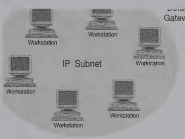

## TCP/IP 管理技术


如果人们能用二进制数学说话和思考，他们就能与计算机无缝通信。但人类是基于语言的生物，而计算机“思考”的是数学。你会很难记住你想访问的每台计算机的 `IP` 地址。记住 `ServerD` 比记住 `131.107.2.200` 要容易得多。因此，人们使用友好的、基于语言的名称来联系服务器和计算机，但计算机必须使用实际的 `IP` 地址相互联系。为了让这两个世界融合，任何友好的、基于语言的名称都必须解析为 `IP` 地址，以便计算机可以相互通信。为了实现这一点并减轻 `IP` 地址解析和分配的负担，提供了几种服务。

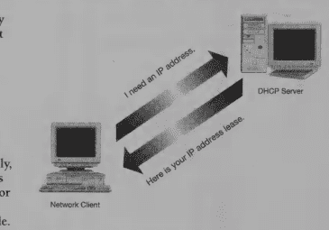

### 动态主机配置协议（DHCP）

`DHCP` 是一种服务器服务，动态地将 `IP` 地址和 `IP` 网络信息（如默认网关）分配给网络客户端。传统上，`TCP/IP` 以高开销著称，因为每个客户端都必须分配一个唯一的 `IP` 地址。想象一下，如果不犯错，就必须手动为 1,000 个网络客户端分配 `IP` 地址！`DHCP` 通过自动处理客户端 `IP` 分配解决了这个问题。`DHCP` 通过在指定时间段内向网络客户端租用一个合适且唯一的 `IP` 地址来工作。`DHCP` 确保不分配重复地址，从而使所有客户端都能拥有连接。此过程对用户是透明的，并且需要网络管理员很少的干预。你可以在第 4 章中了解有关 `DHCP` 的更多信息。

### Windows Internet 命名服务（WINS）

`WINS` 将 `NetBIOS` 计算机名称解析为 `IP` 地址。`NetBIOS` 名称是友好的、基于语言的计算机名称。因为计算机必须使用计算机的 `IP` 地址而非其 `NetBIOS` 名称进行通信，所以 `WINS` 将 `NetBIOS` 名称映射到相应的 `IP` 地址。这样，你可以将计算机命名为“Joe’s Laptop”，而不是像 `131.107.2.200` 这样的 `IP` 地址。`WINS` 维护一个数据库来跟踪这些信息。`WINS` 客户端联系 `WINS` 服务器，以查找“我的计算机”等于 `131.107.2.200` 的信息。然后，客户端可以使用该 `IP` 地址与 Joe’s Laptop 进行通信。此过程对用户是透明的，并且需要管理员很少的干预。在纯 `Windows 2000` 环境中，`WINS` 不是必需的，但它是为了向后兼容性而提供的。`Windows 2000` 计算机使用 `DNS` 进行名称解析，因此 `WINS` 将在未来几年内逐渐淘汰。你可以在第 5 章中了解有关 `WINS` 的更多信息，在第 6 章中了解有关 `DNS` 的更多信息。

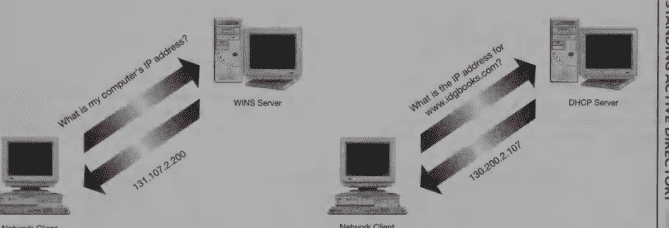

## 域名系统 (DNS)

`DNS` 将完全限定域名（FQDN）解析为 `IP` 地址。正如 `WINS` 将友好的 `NetBIOS` 名称解析为 `IP` 地址一样，`DNS` 将域名（如 `www.microsoft.com`）解析为相应的 `IP` 地址。此过程使您能够使用友好的域名而非 `IP` 地址与互联网上的计算机（现在也包括 `Windows 2000` 网络中的计算机）进行通信。过去，`DNS` 是包含在 `HOSTS` 文件中的静态映射，`HOSTS` 文件仅仅是一个列出了主机名到 `IP` 地址映射关系的文本文件。现在，动态 `DNS (DDNS)` 可以响应并更新发生的更改。关于 `DNS` 及其在 `Windows 2000` 中的作用，我们将在第 6 章中深入了解。

`DNS` 解析通常需要多个服务器。每个服务器解析域名的一部分。

## 第 2 章

## TCP/IP 基础

### TCP/IP 实用工具

`TCP/IP` 包含许多命令行实用工具，可帮助获取有关计算机 `TCP/IP` 配置的信息并排查连接问题。以下各部分将介绍最常用的三个实用工具。

`TCP/IP` 运行正常。如果无法联系远程计算机，`Ping` 是确定该计算机是“宕机”还是存在其他通信问题的一个好方法。

### Ping

您可以使用 `Ping` 来测试与您的计算机和远程计算机的连接性。`Ping` 允许您使用计算机的 `IP` 地址、`NetBIOS` 名称或 `DNS` 名称执行测试。您可以在自己的计算机上执行回环测试，以确保您的 `TCP/IP` 软件正常初始化。此测试检查您的计算机，以确认 `TCP/IP` 正在运行。要执行回环测试，只需在命令行中输入`ping 127.0.0.1`并按 Enter 键。要测试远程计算机，请在命令行中输入`ping` (`IP` 地址、`NetBIOS` 名称或 `DNS` 名称)并按 Enter 键。对远程计算机的 `Ping` 测试旨在确认 `TCP/IP` 正常运行。

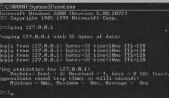

### Netstat

`Netstat` 提供 `TCP/IP` 统计信息和当前连接信息。此实用工具非常适合仔细查看当前连接并了解潜在问题。`Netstat` 附带多个可用于细化返回信息的开关。只需在命令行中输入`netstat ?`即可了解更多内容。

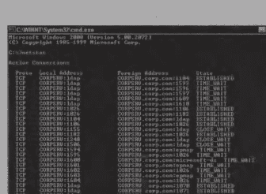

### Ipconfig

`Ipconfig` 是一个流行的实用工具，可提供有关当前设置的更多信息，例如 `IP` 地址、子网掩码、默认网关以及 `DNS`、`WINS` 和 `DHCP` 服务器。您可以在命令行中输入`ipconfig`来获取此信息，或者在命令行中输入`ipconfig /all`以获取完整信息。这些信息将包括您计算机的所有 `IP` 配置信息，例如 `DHCP` 租约、`MAC`（媒体访问控制）地址等。与 `Netstat` 一样，您可以输入`ipconfig /?`来查看可用于细化返回信息的可用开关。

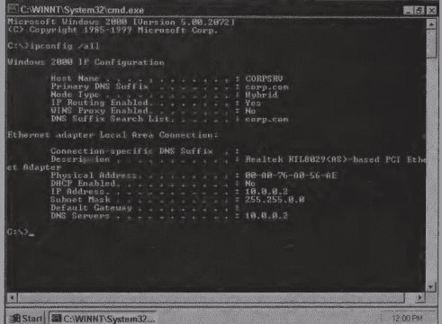

## 第二部分

## 3) Windows 2000 服务器网络界面

- 访问管理工具和控制面板 ...26
- 使用配置服务器工具 ...28
- 使用添加/删除程序 ...30
- 使用网络位置 ...34
- 添加网络位置 ...38
- 建立和配置连接 ...40
- 为 `NIC` 安装或删除客户端、服务或协议 ...48
- 配置远程网络连接属性 ...50

## 4) 配置 DHCP

- `DHCP` 简介 ...54
- 安装 `DHCP` ...56
- 授权 `DHCP` 服务器 ...60
- 创建作用域 ...64
- 创建超级作用域 ...70
- 创建多播作用域 ...74
- 管理作用域 ...78
- 配置作用域属性 ...82
- 其他作用域配置 ...84
- 管理 `DHCP` 服务器 ...88

## 5) 配置 WINS

- `WINS` 简介 ...96
- 安装 `WINS` ...98
- 配置 `WINS` 常规属性 ...102
- 检查服务器状态 ...106
- 管理 `WINS` 服务器 ...108
- 管理注册 ...120
- 管理复制合作伙伴 ...126

## 6) 配置 DNS

- 域名系统概述 .................................... 130
- 安装 `DNS` ........................................................ 136
- 设置 `DNS` ......................................................... 140
- 管理 `DNS` 服务器任务 ...................................... 146
- 配置服务器属性 .................................... 152
- 管理区域数据 .................................................. 158
- 管理区域资源记录委派 ........... 160
- 配置区域属性 ....................................... 166

## 7) 路由和远程访问服务

- 启用远程访问服务 ................................... 170
- 禁用 `RAS` .................................................................... 176
- 检查基本 `RAS` 选项 ...................................... 178
- 探索服务器属性 .......................................... 180
- 探索路由接口 ........................................ 184
- 创建新的 `IP` 通道 ............................................. 188
- 添加 `RAS` 策略 .................................................. 190


- 编辑 RAS 策略 .................................................. 192
- 配置 RAS 端口 ................................................ 196
- 配置 IP 路由 ................................................ 198


## 访问管理工具和控制器

在安装和配置 `Active Directory` 之前，您需要熟悉 `Windows 2000 Server` 中几个网络项目的配置和设置。

`Windows 2000 Server` 是一个复杂的操作系统，提供了多种技术、工具和服务。对于 `Active Directory`，您主要使用网络接口根据网络环境配置服务器。访问网络工具和服务的两个主要位置是开始菜单和控制面板。随 `Active Directory` 安装的工具将显示在这些位置。您还可以选择通过名为“配置服务器”的新程序来安装和配置许多网络组件，该程序位于管理工具文件夹中。“配置服务器”为您提供了一个看起来类似于网页的图形界面。

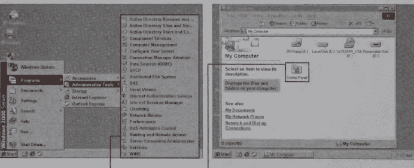

### 访问管理工具

1. 选择 `开始\程序\管理工具`。
   - 显示管理工具子菜单。
2. 单击要打开的工具。

### 访问控制面板

1. 双击桌面上的“我的电脑”，然后双击“控制面板”。
2. 双击“管理工具”文件夹。

“管理工具”窗口显示所有可用的工具。

## 提示

### 使用开始菜单还是控制面板有什么区别吗？

没有。所有可用的管理工具都显示在开始菜单的管理工具中。这些工具的快捷方式也出现在控制面板的管理工具文件夹中。

### 哪些是最常用的管理工具？

除了安装 `Active Directory` 后将出现的 `Active Directory` 工具之外，以下列出了许多您可能会从 `NT Server 4.0` 中熟悉的常用管理工具：

- `DNS`——允许您在服务器上配置 `DNS`。
- `Internet` 服务管理器——允许您将服务器配置为 `Web` 服务器。
- 许可——允许您管理服务器和客户端许可。
- 性能——打开性能监视器。
- `WINS`——允许您在服务器上配置 `WINS`。
- `DHCP`——允许您在服务器上配置 `DHCP`。
- 服务——使您可以管理正在运行的各种服务器服务。

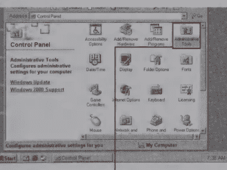
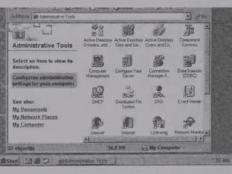

1. 控制面板包含许多配置工具。
2. 双击“管理工具”文件夹。

“管理工具”窗口显示所有可用的工具。

## 3 `Windows 2000` 服务器网络接口

### 使用“配置您的服务器”工具

根据您的网络设计，您可能需要不定期地添加和删除网络组件。`Windows 2000` 包含多种可用于您网络的服务和协议。

添加或删除网络组件的一种方法是使用“配置您的服务器”工具。此界面看起来和操作起来都类似于网页，其中包含各种可能需要配置的服务器组件的菜单和链接。该工具对于您不太熟悉的服务或服务器配置特别有用。

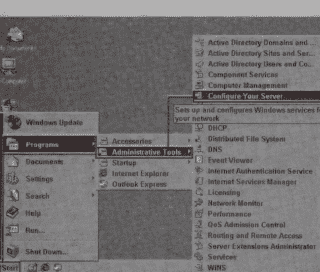
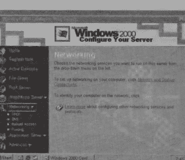

- 1. 选择“开始” → “程序” → “管理工具” → “配置您的服务器”。
- 2. 单击“网络”。

菜单会展开，并显示一个通用的网络屏幕。您可以通过单击左侧窗格中的任意服务来安装它们。


### 如果我决定从此界面安装网络组件，会发生什么？

您可以通过“配置您的服务器”界面安装任何组件，方法是单击左侧窗格中的主题，然后单击您想要安装的服务。此操作将启动该特定组件的安装向导。

### “配置您的服务器”中有哪些选项？

“配置您的服务器”工具包含可展开的类别，例如 `Active Directory`、文件服务器、打印服务器、网络等。在每个类别下，会出现各种组件和服务。例如，在“网络”类别下，会出现 `DHCP`、`DNS`、远程访问和路由。

### 在 `Windows 2000 Server` 中安装网络组件还有其他方法吗？

是的。您还可以使用“控制面板”中的“添加/删除程序”来配置 `Windows` 组件。有关更多信息，请参阅下一页。

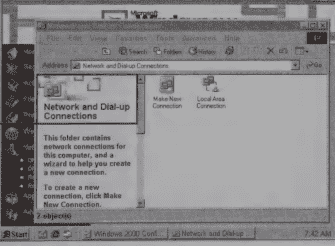
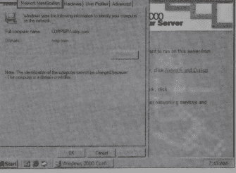

- 3. 如果单击右侧窗格中的“网络和拨号连接”链接，将显示“网络和拨号连接”窗口。
- 4. 如果单击“网络标识”链接，将显示您的服务器标识选项卡。

`Windows 2000` 网络

### 使用“添加/删除程序”

除了“配置您的服务器”工具之外，在 `Windows 2000 Server` 中安装网络组件的另一种方法是使用“控制面板”中的“添加/删除程序”。“添加/删除程序”功能现在允许您配置 `Windows` 组件。如果您正在添加或删除大量组件，您可能会发现这个界面比“配置您的服务器”界面更容易使用。“添加/删除 `Windows` 组件”功能不会为您提供图形界面和每个组件的信息。会出现一个向导，允许您选择要安装或卸载的内容。您可以使用“添加/删除 `Windows` 组件”或“配置您的服务器”。这两种工具提供相同的功能——只是其中一个比另一个更具图形化。实际上，当您选择安装或卸载服务时，“配置您的服务器”工具启动的是与“添加/删除 `Windows` 组件”工具相同类型的界面。“添加/删除 `Windows` 组件”只是允许您绕过“配置您的服务器”中的图形界面。

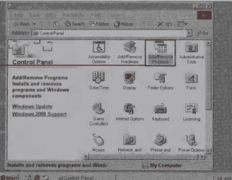
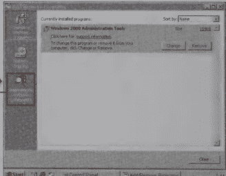

打开“控制面板”，然后双击“添加/删除程序”。

单击“添加/删除 `Windows` 组件”图标。

## 提示

### 使用“添加/删除程序”能做什么？

您可以使用“添加/删除程序”功能更改或删除服务器上的现有程序、添加新程序，或添加或删除 `Windows` 组件。所有这些操作都通过单一界面进行，使您能够更有效地管理您的系统。您还可以了解更多关于系统上现有程序及其各自使用内存量的信息。

### 我能一次添加或删除多个 `Windows` 组件吗？

是的。您可以一次添加或删除 `Windows` 组件，无需为每个实例重新走一遍向导。然而，某些组件要求您完成各种向导并重启系统，因此为避免问题或混淆，一次添加或删除一个组件可能更好。

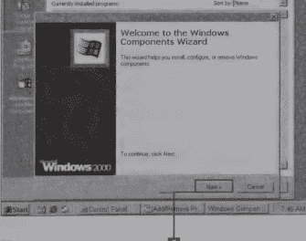
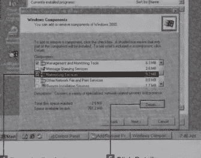

- 1. 启动 `Windows` 组件向导。
- 2. 单击“下一步”继续。
- 3. 从出现的列表中选择要添加或删除的组件。
- 4. 单击“详细”。

### 继续使用“添加/删除程序”

在要添加或删除的每个组件类别下，您可能可以看到额外可供选择组件。如果该组件有“详细”按钮，请单击它以查看您可以添加或删除的确切组件。您可以添加或删除的主要组件包括：

- `COM Internet Services Proxy`：使分布式组件对象模型（`DCOM`）能够通过 `Internet` 信息服务器（`IIS`）经由 `HTTP` 传输。
- 域名系统（`DNS`）：将完全限定域名解析为 `IP` 地址（参见第 6 章）。
- 动态主机配置协议（`DHCP`）：动态为网络客户端分配 `IP` 地址（参见第 4 章）。
- `Internet` 身份验证服务：使拨号用户能够进行身份验证。
- `QoS`（服务质量）控制服务：允许您指定网络连接的质量。
- 简单 `TCP/IP` 服务：安装简单的 `TCP/IP` 服务（如 `Echo` 和 `Discard`）。
- `Site Server ILS` 服务：扫描 `TCP/IP` 堆栈并使用最新用户信息更新目录。
- `Windows Internet` 命名服务（`WINS`）：为客户端解析 `NetBIOS` 名称（参见第 5 章）。

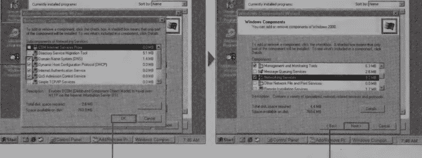

- 5. 如果要添加组件，请单击该组件旁边的复选框。
- 6. 如果要删除现有组件，请清除其旁边的复选框。
- 7. 完成后，单击“确定”。
- 8. 单击“下一步”继续。

## 提示

### 我能否同时添加新组件和删除现有组件？


是的。只需对要添加或删除的每个组件勾选或清除其旁边的复选框即可。如果勾选复选框，该组件将被添加。如果清除复选框，该组件将被删除。

### 我是否需要 Windows 2000 Server CD-ROM？

取决于您在使用“添加/删除 Windows 组件”选项时选择添加的组件，您的系统可能需要从安装 CD-ROM 复制文件。在开始添加任何组件之前，将 CD-ROM 放入驱动器是个好主意。

### 我如何知道我是否有足够的磁盘空间进行安装？

安装向导提供组件或服务所需的总磁盘空间以及磁盘上的可用空间。在安装组件之前，只需将所需空间与可用磁盘空间进行比较，以确定您的硬盘上是否有足够的空间。

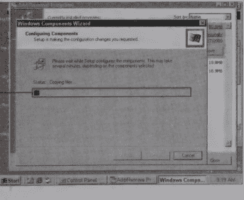

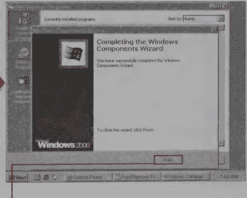

`Setup` 复制文件并安装组件。状态栏指示完成程度。

1. 单击“完成”以完成配置。

根据组件的不同，您可能需要重启计算机。

### 使用“我的网络位置”

“我的网络位置”取代了 `Windows 2000 Server` 中的“网络邻接”。您将发现“我的网络位置”提供更多功能，并为网络用户提供了访问 `Active Directory` 的方式。“我的网络位置”允许您配置网络连接，如局域网连接、`VPN` 连接、`ISDN` 连接或简单的拨号连接。所有这些都可以通过“添加网络位置向导”完成。您还可以使用“我的网络位置”浏览网络和 `Active Directory`。在 `Windows NT` 和 `9x` 中，“网络邻接”主要用于网络浏览。换句话说，您可以找到网络中某个包含特定资源的服务器。在 `Windows 2000` 中，“我的网络位置”主要用于配置不同的网络连接。由于 `Active Directory` 的高级功能，浏览很少是必要的，因为 `Active Directory` 包含资源指针，因此您不必浏览网络。

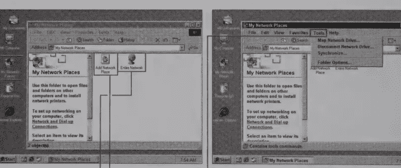

#### 访问“我的网络位置”

1. 双击桌面上的“我的网络位置”。
2. 双击“添加网络位置”图标以启动向导。
3. 或者您可以双击“整个网络”进行浏览。

#### “工具”菜单选项

4. 选择“工具”菜单，该菜单允许您映射网络驱动器、断开网络驱动器、同步或访问文件夹选项。

## 提示

## 我如何使用“我的网络位置”来查找网络上的打印机？

您可以使用搜索功能来查找网络上的打印机。在“我的网络位置”中，双击“整个网络”，然后单击左侧窗格中的“搜索打印机”链接。此操作将打开搜索窗口，您可以在其中输入想要查找的打印机名称。

## 我如何使用“我的网络位置”来映射网络驱动器？

网络驱动器通过分配一个驱动器字母将您的计算机连接到另一台计算机。然后您可以使用该连接，就好像该驱动器存在于您的本地计算机上一样。您可以通过打开“我的网络位置”，单击“工具”菜单，然后单击“映射网络驱动器”来映射网络驱动器。系统将提示您输入网络驱动器的位置（例如 `\\server\2\documents`）以及您想要分配的驱动器字母。

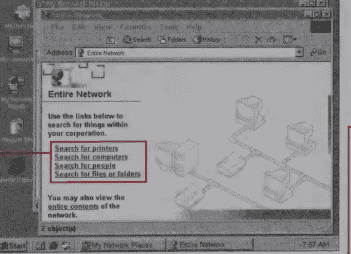

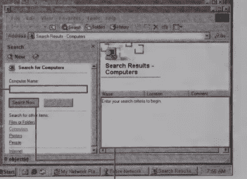

## 访问整个网络

1. 双击“整个网络”，您可以选择搜索打印机、计算机、人员或文件。单击“全部内容”链接以查看网络的全部内容。

## 搜索整个网络

1. 输入要搜索的对象的名称。

   如果您单击其中一个搜索链接，将出现此窗口。

2. 单击“立即搜索”。

   您的搜索结果将显示在右侧窗格中。

## 继续使用我的网络位置

您可以使用“我的网络位置”浏览可用的 `Active Directory` 或域。

`Active Directory` 包含您所选择域的 `OUs`（组织单位）以及这些 `OU` 中的对象。`Active Directory` 用户可以浏览目录以查找他们所需的对象，例如用户、组、打印机、文件夹、应用程序等。请注意，`Active Directory` 包含强大的搜索功能，因此浏览目录不是查找 `Active Directory` 资源的推荐方法。在新的 `Active Directory` 环境中，可能需要培训用户，以便他们能够高效、快速地定位所需的 `Active Directory` 资源，而无需浏览目录本身。

您还可以浏览域。此功能与 `Windows NT` 中的“网络邻域”相同，您可以浏览域中的各种计算机及其提供的资源。但是，用户可以更容易地通过 `Active Directory` 找到所需的资源。

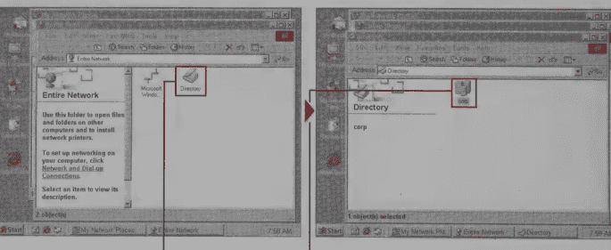

## 浏览网络

1. 打开“整个网络”，然后单击左侧窗格中的“整个网络”链接。
2. 双击“目录”以显示可用的域。
3. 双击您想要查看的域。

> 您的网络内容将显示在窗口中。

## 提示

## 用户可以看到 Active Directory 对象的所有信息吗？

持有在 `OU` 中的对象的某些属性可供网络用户查看。用户可以查看的内容通常取决于对象在其“属性”中是如何定义的。例如，用户可以浏览其他用户的列表，并获取关于另一个用户的一般信息，如电子邮件地址和电话号码。您可以在后续章节中了解有关这些功能的更多信息。

## 网络用户可以不通过浏览就找到 Active Directory 资源吗？

是的。`Active Directory` 原生支持 `LDAP` 协议，该协议允许用户查询目录数据库。通过这个强大的搜索功能，用户可以执行全文搜索以查找所需的资源。提供浏览功能是为了向后兼容，并不是资源发现的推荐方法。

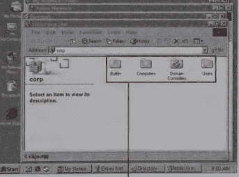

目录的 `OUs` 将显示出来。然后您可以打开每个 `OU` 并浏览其内容。

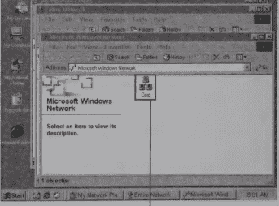

如果在“整个网络”窗口中双击“Microsoft 网络”，您可以打开域并浏览域内的实际计算机。

## 添加网络位置

`网络位置`是网络上的一个位置，您可以在其中存储文档。此网络位置可以是计算机上的共享文件夹、`Internet` 上的 Web 文件夹，甚至是可以存储文档的 `FTP` 站点。

添加网络位置后，它将显示在“我的网络位置”文件夹中。

“我的网络位置”通过提供“添加网络位置”向导，使您可以轻松添加网络位置。该向导允许您输入所需的网络位置或浏览您的网络以查找要添加的网络位置。“添加网络位置”功能在使用 Web 和 `FTP` 服务器进行存储的环境中特别有用。您可以使用“我的网络位置”建立到这些位置的连接，该连接在您每次登录到网络时都会重新连接。这样，您配置的网络位置始终可用。

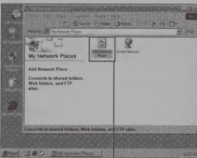

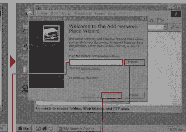

1. 打开“我的网络位置”并双击“添加网络位置”。
   - “添加网络位置”向导开始。

2. 输入网络位置的路径。您可以使用 `UNC` 路径或 `URL`。
   - 您也可以使用“浏览”按钮来查找位置。

3. 单击“下一步”继续。


## 为什么使用此界面来连接 URL？

`Windows 2000` 服务器的目标之一是与本地网络和 `Internet` 提供无缝集成。您可以通过创建网络位置，像在本地网络计算机上一样轻松地在 `Internet` 或内网上定义网络位置。建立网络位置后，您可以使用网络位置，就好像它驻留在您的本地计算机上一样。但是，如果您使用调制解调器拨号访问，每次访问网络位置时都需要拨号连接。

## 为什么有 FTP 站点选项？

在使用 Web 服务器的环境中，可能会为网络客户端分配 `FTP` 服务器上的文件夹，以便它们可以存储文档。您可以使用“添加网络位置”向导来建立到 `FTP` 站点的网络连接。一旦建立网络位置，每次您登录到网络时，连接都会重新建立。这允许您将 `FTP` 连接用作该文件夹驻留在您的本地硬盘上一样。

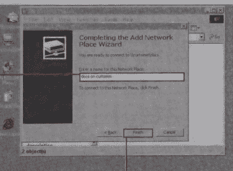

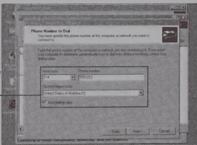

4. 为网络位置输入一个名称。
5. 单击“完成”。

如果您正在连接到 Web 文件夹，系统可能会提示您输入拨号信息或连接的用户名和密码。

## 建立和配置连接

`Windows 2000` 允许您为系统配置各种连接。您可以使用位于控制面板中的“网络和拨号连接”文件夹来建立新连接和配置现有连接。

通过使用“创建新连接向导”，您可以配置各种连接，例如拨号到 `Internet`、拨号到专用网络、`VPN` 或并口连接，甚至接受其他连接。


配置好所需的连接后，这些连接将保留在您的计算机上，您可以使用它们连接各种服务器。您可以使用“创建新连接”向导轻松建立所需的连接。此向导允许您配置各种连接类型，如调制解调器或 ISDN、虚拟专用网络 (VPN)、串行、并行，甚至红外连接。

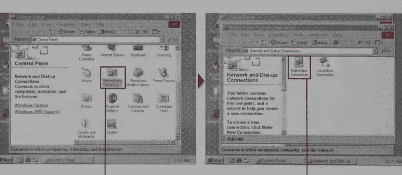

1. 打开控制面板，然后打开“网络和拨号连接”。
   - “网络和拨号连接”窗口打开，其中包含您当前的连接和创建新连接的向导。
2. 要创建新连接，请双击“创建新连接”图标。

## 还有其他方法访问“网络和拨号连接”文件夹吗？

是的。除了使用控制面板，您还可以右键单击“我的网络位置”并单击“属性”。此操作也会打开“网络和拨号连接”文件夹。

## 我可以使用连接向导创建 PPTP 连接吗？

是的。要创建“PPTP”连接或虚拟专用网络 (VPN)，请在向导的选择屏幕上选择此选项。然后向导会询问您一些问题来配置 VPN 连接。VPN 连接使用 Internet 向远程计算机传输数据。这是通过使局域网数据看起来像 Internet 上的 PPP 数据来实现的。在大多数情况下，通过 Internet 传输的数据是加密的。

## 局域网连接呢？

局域网 (LAN) 连接如果计算机上安装了网卡 (NIC)，会自动显示在“网络和拨号连接”文件夹中。您可以右键单击窗口中的“本地连接”图标并单击“属性”来配置它。

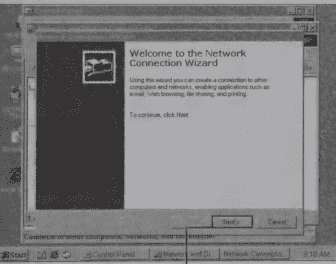

网络连接向导开始。

单击“下一步”继续。

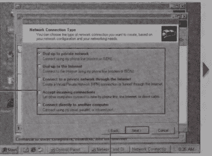

通过单击相应的单选按钮，选择您希望建立的连接类型。

单击“下一步”继续。

## 建立和配置连接的后续步骤

启动网络连接向导并选择要创建的连接类型后，向导会要求你输入与新连接相关的其他信息。对于远程网络连接，系统可能会要求你输入服务器名称、用户名和密码信息。

在 Windows 2000 中，你还可以与其他用户共享连接。在大多数情况下，向导会询问你是否想要共享该连接。如果选择不共享连接，你以后仍可随时选择共享。这是 Windows 2000 的一个强大功能。例如，一个小办公室可以有一台配置了 ISDN 适配器的 Windows 2000 计算机（服务器或专业版）。然后可以共享此连接，以便办公室内的其他 Windows 2000 计算机可以使用该 ISDN 连接。你还可以以相同的方式共享调制解调器连接。

创建连接后，你可以通过访问其属性表来进一步配置它们。

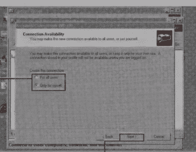

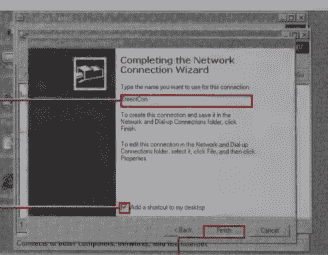

5. 点击相应的单选按钮，以选择共享或不共享新连接。
7. 点击“下一步”继续。
8. 为连接输入一个名称。
9. 如果想在桌面上放置快捷方式，请勾选此复选框。
10. 点击“完成”。
- 根据你选择的连接类型，可能会看到不同的对话框。

## 提示

### 我可以共享拨号连接吗？

可以。你可以共享拨号连接（例如 Internet 连接），以便其他用户访问并使用你的拨号连接。这种功能是小办公室或家庭网络使用单个调制解调器连接的一种简便方式。

### 我可以为我的连接创建快捷方式吗？

可以。向导的最后一屏提供了在桌面上创建快捷方式的选项。你还可以通过右键单击连接并选择创建快捷方式来为连接创建快捷方式。

### 我可以共享我的调制解调器连接，使其按需拨号吗？

可以。配置拨号连接时，只需点击“Internet 连接共享”窗口上的“启用按需拨号”按钮。做出此选择后，当另一个用户尝试使用共享连接时，调制解调器将自动建立拨号连接。一旦拨号链路建立，用户就可以像该连接在自己的计算机上建立一样使用该连接。

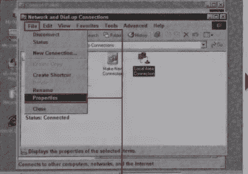

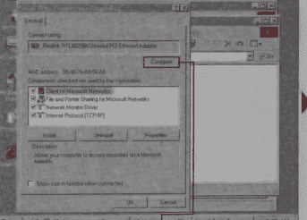

- 建立连接后，你可以通过访问其属性表来进一步配置它。
- 在“网络和拨号连接”中，选择“本地连接”，然后选择“文件”>“属性”。
- 出现本地连接属性表。
- 点击“配置”来配置你的网络接口卡。

## 建立和配置连接的后续步骤

你可以使用本地连接的属性表来配置网络接口卡（NIC）的属性。通过属性表提供的最重要功能之一是故障排除器。如果你对 NIC 有问题，可以启动故障排除器，它会打开 Windows 2000 帮助文件的一部分，以便你尝试解决问题。

“高级”选项卡允许你调整 NIC 的各种属性。例如，通常提供线路速度属性。你可以使用“值”下拉菜单选择 NIC 可用的线路速度类型，如 TP 半双工、TP 全双工等。

你还可以使用属性表来了解 NIC 的驱动程序，并在可用时更新驱动程序。此选项卡使你能够轻松更新 NIC 驱动程序，当有新的变更可用时无需卸载并重新安装 NIC 本身。Windows 2000 中的大多数硬件设备都包含“更新驱动程序”选项。

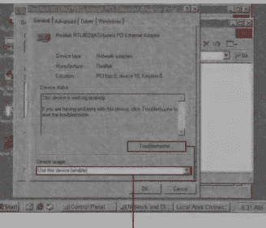

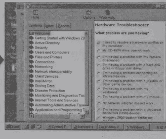

- 显示 NIC 的属性表。“常规”选项卡显示设备状态。
13. 点击“设备使用”下拉框，以启用或禁用该设备。
14. 如果设备有问题，点击“故障排除”以启动故障排除帮助文件。
- 显示故障排除窗口。使用故障排除工具逐步操作一系列步骤，尝试隔离问题。


## 提示

### 我何时应该使用故障排除器？

任何时候你对 NIC 有问题，如性能缓慢或无法连接，都可以使用故障排除器。你从列表中选取遇到的问题，故障排除器会尝试提供问题的可能解决方案。

### 我有一个新的 NIC 驱动程序。更新驱动程序的最简单方法是什么？

访问 NIC 的属性对话框并点击“驱动程序”选项卡。在窗口底部，点击“更新驱动程序”按钮。按照说明更新驱动程序。Windows 2000 中的大多数硬件设备都可以这样更新。

### 我需要手动配置 NIC 的线路速度吗？

在大多数情况下，当安装 NIC 时会自动配置线路速度。线路速度取决于 NIC 本身——换句话说——你不能简单地选择你想要的线路速度。NIC 必须能够支持所选速度。有关其支持的线路速度的更多信息，请参阅你的 NIC 文档。

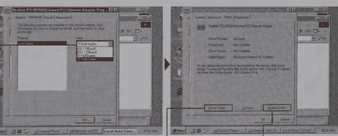

“高级”选项卡允许你更改 NIC 的各种属性。

15. 点击“驱动程序详细信息”。

NIC 属性对话框中的“驱动程序”选项卡列出了 NIC 当前使用的驱动程序。

## 建立和配置连接的后续步骤

最后，NIC 属性表上的“资源”选项卡告诉你 NIC 当前使用的系统资源。这些设置通常会给你一个输入/输出范围和中断请求号。此选项卡的一个特别有用的功能是窗口底部的冲突设备列表。此部分报告与其他设备的任何资源冲突。例如，如果另一个设备也配置为使用 IRQ 9，则冲突将出现在列表中。由于 Windows 2000 符合即插即用规范，它做得很好，可以管理设备及其使用的资源，而无需管理员或用户干预。

除了配置 NIC 的设置外，你还可以访问正在运行的服务的其他属性对话框。在本地连接属性页上，选择任何已安装组件，然后点击“属性”按钮以进一步配置该组件可用的属性。列表包括当前在服务器上可用的服务和协议。

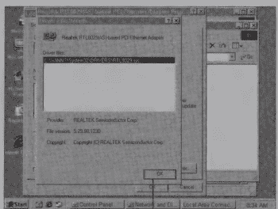


- 驱动程序文件详细信息窗口告诉你更多关于驱动程序的信息。
- 完成后点击“确定”。
- NIC 属性对话框中的“资源”选项卡提供了 NIC 的资源设置，如 I/O 范围和 IRQ。
- 窗口底部的冲突设备列表报告该设备的任何资源冲突。

## 提示

### 我如何减少用于文件共享的内存量？

- 要减少或最小化用于文件和打印机共享的内存量，请在本地连接属性对话框中选择“Microsoft 网络的文件和打印机共享”，然后点击“属性”按钮。点击“最小化使用内存”按钮，然后点击“确定”。

### 我如何更改 TCP/IP 的配置？

- 你可以从本地连接属性页访问任何服务或协议 的属性对话框。只需选择“Internet 协议 (TCP/IP)”，然后点击“属性”。出现属性对话框，你可以根据需要调整配置。请记住，TCP/IP 设置应为每个网络服务器仔细规划。通常，所有域控制器都应分配一个不变的静态 IP 地址。客户端可以由 DHCP 服务器分配 IP 地址。


12. 返回本地连接属性对话框并点击“Microsoft 网络的文件和打印机共享”。

18. 点击“属性”。

19. 如有需要，通过点击相应的单选按钮调整优化设置。

默认设置“最大化文件共享的数据吞吐量”为文件共享提供最佳性能。

## 为 `NIC` 安装或删除客户端、服务或协议

您还可以使用“本地连接属性”对话框来安装或删除客户端、服务或协议。如果您使用过 `Windows 98`，您将熟悉此界面。要删除某个项目，只需选中该项目并点击“删除”按钮。要安装新项目，请点击“安装”按钮。此操作会提示您选择客户端、服务或协议。做出选择后，系统会提供可安装的组件列表。安装新项目后，您可以通过选中该项目并点击“属性”按钮来访问其属性表。此界面非常有用，因为可以为特定 `NIC` 配置所有的协议、服务和客户端，且集中在一个位置。根据您决定安装的客户端、协议或服务，系统可能会要求插入 `Windows 2000 Server` CD-ROM，以便将文件复制到您的系统中。


1. 打开“本地连接属性”对话框并点击“安装”。
2. 选择“客户端”、“服务”或“协议”。
3. 点击“添加”。
4. 在出现的列表中，选择您要安装的内容。
5. 点击“确定”。


### 如何删除不再需要的协议？

要删除不再需要的协议，只需在“本地连接属性”对话框中选中该协议并点击“删除”按钮。

### 所有组件都有属性页吗？

没有。某些组件，如 `NetBEUI`，没有可配置的属性。在这种情况下，“属性”按钮会被禁用（显示为灰色），因为没有可访问的属性对话框。

### 为什么我需要添加协议？

协议本质上是“通信行为规则”。为了两个人能够交流，他们必须使用双方都能理解的语言。您可以将协议视为计算机用于与其他计算机通信的语言。根据网络中的客户端类型，您可能需要安装额外的协议。例如，`Novell Netware` 客户端需要 `NWLink` 协议才能与 `Microsoft` 客户端通信，而 `Apple Macintosh` 客户端则需要 `AppleTalk` 协议。


6. 选中该项目。
7. 点击“属性”。
8. 该项目的属性表将出现，您可以按需进行配置。

## 第 3 章：`Windows 2000 Server` 网络界面

### 配置远程网络连接属性

就像可以配置“本地连接”的属性一样，您还可以配置远程网络连接的多种属性，例如拨号连接或 `ISDN` 连接。您可以通过在“网络和拨号连接”窗口中右键点击连接并点击“属性”来访问连接属性，也可以使用“文件”菜单。

根据您选择的连接，远程连接有多个属性表。常规（`General`）选项卡显示您正在使用的拨号硬件，例如调制解调器或 `ISDN` 适配器。您可以点击“配置”按钮来调整设备本身的属性。您还可以输入额外的可拨打电话号码以及使用拨号规则。您可以点击“规则”按钮来配置您希望使用的拨号规则，例如本地区号选项或拨打长途电话时加拨“1”。


1. 选中“拨号连接”，然后选择“文件 > 属性”。
2. 点击“配置”以配置您的调制解调器或 `ISDN` 硬件。
3. 点击此下拉框以根据需要调整调制解调器的最大速度。
4. 点击相应的复选框以启用硬件功能。
5. 这些功能通常默认被选中。
6. 点击此复选框以显示终端窗口。
7. 点击此复选框以启用调制解调器扬声器。


### 什么是硬件流控制？

硬件流控制允许调制解调器控制数据流。调制解调器可以告知远程访问软件线路是拥塞还是畅通，从而使远程访问软件知道何时发送数据。硬件流控制提高了吞吐量并降低了错误的可能性，因为在线路拥塞时不会发送数据。

### 什么是调制解调器错误控制？

调制解调器错误控制允许远程访问软件对数据块执行循环冗余校验（`CRC`）以检查错误。当发生错误时，数据可以被重新传输。

### 什么是调制解调器压缩？

调制解调器压缩允许调制解调器在将数据发送到另一个调制解调器之前对其进行压缩。此功能减少了传输的字节数，从而减少了传输时间。


7. 点击“使用拨号规则”复选框以启用拨号规则。
8. 点击“规则”。
9. 点击“新建”以创建新的拨号规则。
10. 点击“编辑”以调整现有的拨号规则。
11. 完成后点击“确定”。

### 继续配置远程网络连接属性

在“选项”选项卡中，您可以配置多项决定拨号会话如何进行的选项。您可以选中相应的复选框以在连接期间显示进度条、提示输入用户名和密码、包含 `Windows` 登录域或提示输入电话号码。您还可以使用“选项”选项卡来配置拨号尝试次数和重新拨号的方式。

“`X.25`”选项卡允许您输入 `X.25` 网络所需的拨号信息。

“安全”选项卡允许您设置拨号安全选项。如果您选中“典型”单选按钮，您可以选择要使用的连接认证类型。选项包括允许不安全密码、要求安全密码或使用智能卡。如果您选择使用安全认证，您可以选择自动使用 `Windows` 登录名和密码，或者要求数据加密。

如果点击“高级设置”按钮，您可以选择高级安全协议。


12. 点击“选项”选项卡。
13. 点击相应的复选框以按所需配置拨号选项。
14. 点击这些下拉框以配置重新拨号选项。
15. 点击“安全”选项卡。
16. 使用下拉框选择所需的安全设置。
17. 如果您希望指定自定义设置，请选中“高级”单选按钮。
18. 然后点击“设置”以配置高级安全选项。

### 我可以设置哪些高级安全功能？

高级安全功能允许您使用多种高级认证方法以获得更高的安全级别。首先，您可以点击“使用可扩展身份验证协议（`EAP`）”单选按钮，这允许您使用智能卡或数字证书进行登录。其次，您可以点击“允许这些协议”单选按钮，这允许您使用 `PAP`、`SPAP`、`CHAP`、`MS-CHAP` 或 `MS-CHAP V2`。


点击“网络”选项卡。

使用此选项卡为连接使用的组件进行通用拨号设置。


点击“共享”选项卡。

点击此复选框以为此连接启用连接共享。

## `DHCP` 简介

动态主机配置协议（`DHCP`）用于向网络客户端动态分配 `IP` 地址。`DHCP` 是一个 `TCP/IP` 标准，它消除了手动分配 `TCP/IP` 地址的需要。在 `DHCP` 使用之前，`TCP/IP` 网络上的每个客户端都必须手动分配静态 `IP` 地址、子网掩码和默认网关。由于每个网络客户端都必须拥有唯一的 `TCP/IP` 地址，因此出现错误和网络问题的可能性很大。随着 `TCP/IP` 作为网络协议的广泛使用，如果没有 `DHCP`，管理员将在 `IP` 地址配置和问题面前不堪重负。`DHCP` 是 `BOOTP` 协议的扩展，它使无盘工作站能够自动配置 `TCP/IP`。通过使用 `DHCP`，`DHCP` 服务器自动向客户端分配 `IP` 地址和其他 `TCP/IP` 信息，这样管理员就不必担心自动分配和重复地址问题。


### `DHCP` 如何分配 `IP` 地址

当客户端登录到网络时，`DHCP` 服务器自动向网络客户端租用（分配）`IP` 地址。由于每个网络客户端都必须拥有唯一的 `IP` 地址，`DHCP` 服务器从可用 `IP` 地址池中租用 `IP` 地址。这确保了没有两个网络客户端获得相同的 `IP` 地址。当客户端登录时，会与 `DHCP` 服务器发生一个过程以分配 `IP` 地址。此过程有四个步骤：


## DHCP 工作流程

1. 该过程始于客户端发送一个广播消息以寻找 `DHCP` 服务器。这是一个 `DHCPDISCOVER` 请求。发现消息包含客户端计算机的名称和 `MAC` 地址，以便 `DHCP` 服务器可以响应该请求。
2. `DHCP` 服务器通过向客户端做出租约提议来响应 `DHCPDISCOVER` 请求。这被称为 `DHCPOFFER`。如果客户端接受提议，`DHCP` 服务器会为该客户端保留一个 `IP` 地址。如果多个 `DHCP` 服务器响应客户端，客户端只会接受一个提议。未接受的提议随后会被撤销，并根据需要提供给其他客户端。


3. 客户端通过向特定的 `DHCP` 服务器发送广播消息，接受其 `DHCPOFFER` 请求。这被称为 `DHCPREQUEST`。其他已发出要约的 `DHCP` 服务器将撤销其要约。


4. 最后，其要约被接受的 `DHCP` 服务器会发送一个确认消息，其中包含有效的 `IP` 地址和租约时间信息。这被称为 `DHCPACK`，即服务器确认消息，也是客户端的 `IP` 地址分配。此时，该客户端成为 `DHCP` 客户端，可以完全参与 `TCP/IP` 网络。


## 你需要了解的 `DHCP` 术语

为了在你的网络中使用和实现 `DHCP`，你需要理解以下术语。在配置 `DHCP` 的过程中，你会在本章的其余部分看到这些术语。

- **地址池：** 地址池是作用域中可用于租约的地址。
- **排除范围：** 排除范围是作用域中一组不可用于租约的地址。这些地址是预留给网络上的服务器、路由器和其他通信组件的。
- **租约：** `DHCP` 租约是客户端在 `IP` 地址过期前可以保持该地址的时间长度。
- **保留：** 保留用于将特定的 `IP` 地址分配给特定的客户端，从而确保该客户端始终拥有相同的 `IP` 地址。保留通常用于需要静态地址的硬件设备，如路由器。
- **作用域：** `DHCP` 作用域是特定 `DHCP` 服务器可用于租约的完整 `IP` 地址范围。
- **超范围：** 超范围是支持存在于一 `IP` 子网内的逻辑 `IP` 子网的作用域分组。

## 安装 `DHCP`

任何 `Windows` 2000 服务器，无论是域控制器还是成员服务器，都可以作为 `DHCP` 服务器。许多管理员选择使用成员服务器来处理 `DHCP` 功能，以减轻域控制器的负载。通常，你应在网络中的每个子网至少有一个 `DHCP` 服务器。

在混合环境中，你仍然可以使用 `Windows` `NT` 4.0 服务器作为 `DHCP` 服务器。运行 `Windows` 2000 及早期版本 `Windows`（如 `NT` 和 `Windows` 9x）的客户端计算机可以联系 `Windows` `NT` `DHCP` 服务器以获取 `IP` 地址。请参阅 `Windows` `NT` 文档了解如何安装和配置 `DHCP`。

要在 `Windows` 2000 服务器上安装 `DHCP`，请使用控制面板中的“添加/删除程序”功能。你也可以使用“管理工具”中的“配置你的服务器”程序。


1. 打开控制面板，双击“添加/删除程序”。
2. 单击“添加/删除 `Windows` 组件”。

### 提示

**是否有其他安装 `DHCP` 的方法？**

是的。你还可以通过选择“开始 > 程序 > 管理工具 > 配置你的服务器”来安装 `DHCP`。单击左侧窗格中的“网络”链接，然后单击“`DHCP`”。按照屏幕上出现的说明进行操作。

**`Windows` 2000 `Professional` 计算机能否充当 `DHCP` 服务器？**

不能。你可以在任何 `Windows` 2000 服务器或 `Windows` 2000 `Advanced` `Server` 上安装 `DHCP`，但 `Windows` 2000 `Professional` 计算机不能充当 `DHCP` 服务器。你还可以在 `Windows` 2000 网络中使用 `Windows` `NT` 4.0 `Server` 计算机作为 `DHCP` 服务器，但早期版本的 `Windows` 客户端（如 `NT` 或 9x）均无法充当 `DHCP` 服务器。

**`Windows` 2000 是否包含自动 `IP` 寻址功能？**

是的。`Windows` 2000 服务器包含自动寻址功能，允许在 `DHCP` 服务器不可用或不存在的时，客户端自行自动分配 `IP` 地址。此功能主要设计用于小型网络，使得在未配置 `DHCP` 的情况下也能使用 `TCP/IP`。


3. 单击“下一步”继续。
4. 选择“网络服务”。
5. 单击“详细”。


## 继续安装 `DHCP`

与其他网络组件一样，你通过从“网络服务”选项中选择来安装 `DHCP` 服务。你也可以使用“管理工具”文件夹中可用的“配置你的服务器”程序。安装过程中，此特定服务不会向你显示配置向导。你可以先安装该服务，然后在安装完成后配置该服务。

安装完成后，在你授权并配置 `DHCP` 服务器之前，它不会在你的网络上激活。授权允许 `DHCP` 服务向网络客户端租用 `IP` 地址，而 `Active` `Directory` 提供授权。授权功能提供了额外的安全措施。由于所有 `DHCP` 服务器都必须由 `Active` `Directory` 授权，未获授权的 `DHCP` 服务器无法上线并开始发放 `IP` 地址。请阅读下一节以了解如何授权 `DHCP` 服务器。


### 提示

**安装期间我需要知道网络的作用域信息吗？**

不需要。你可以先安装 `DHCP` 服务，然后需要在安装完成后对其进行授权和配置。

**安装 `DHCP` 时我可以安装其他网络组件吗？**

可以。如果你也想安装其他网络组件，只需单击相应复选框选择要安装的组件。`Windows` 2000 允许你一次安装多个组件。

**为什么 `DHCP` 服务器不会自动开始工作？**

为了让 `DHCP` 工作，你必须配置该服务的某些组件。你需要创建一个作用域，提供该服务可租用的 `IP` 地址范围，以及其实际可租用的地址池。此外，服务器还必须由 `Active` `Directory` 授权，以便向客户端租用 `IP` 地址。


## 授权 `DHCP` 服务器

安装完成后，`DHCP` 服务器不会立即激活，因为它必须先经过授权。授权是通过将该服务器添加到 `Active` `Directory` 中的已授权 `DHCP` 服务器列表来完成的。此授权过程可防止未经授权或流氓 `DHCP` 服务器租用 `IP` 地址。

`Active` `Directory` 决定服务器是否可以被授权参与网络并向客户端租用 `IP` 地址。如果你正在域控制器上安装 `DHCP`，可能不需要手动授权，但你需要授权成员服务器。要完成此操作，你必须使用属于你要添加服务器的企业中的“企业管理员”组的帐户登录。授权是一项安全功能，使你作为管理员能够控制在你网络上运行的 `DHCP` 服务器。


1. 单击“开始 > 程序 > 管理工具 > `DHCP`”。


`MMC` 管理单元出现。请注意，服务器尚未授权。

### 提示

**什么是流氓 `DHCP` 服务器？**

流氓 `DHCP` 服务器是指未获授权向客户端租用 `IP` 地址的服务器。为了防止网络上的任何服务器从无效的作用域发放 `IP` 地址，`DHCP` 服务器必须经 `Active` `Directory` 授权。授权过程可以阻止拥有服务器访问权限的其他用户安装 `DHCP` 服务器并向客户端分配不合适的 `IP` 地址。此操作可能阻止这些客户端获得网络连接。`Active` `Directory` 通过检查服务器和管理员的权限来确定服务器是否被授权参与。

**我需要什么权限来授权服务器？**

为了在企业环境中授权 `DHCP` 服务器，你的用户帐户必须是“企业管理员”组的成员。此功能可阻止非 `Active` `Directory` 管理员的用户或管理员将 `DHCP` 服务器上线。


2. 选择“操作 > 授权”。
3. 若要授权多个服务器，请选择“操作 > 管理已授权服务器”。

## 授权 `DHCP` 服务器（续）


如果在 `MMC` 管理单元中选中服务器，然后使用控制台菜单，您可以授权该特定服务器。您也可以使用此管理单元来授权（或取消授权）其他服务器。此功能允许您从一个位置管理所有 `DHCP` 服务器。这一管理单元功能在一个人管理许多 `DHCP` 服务器的环境中特别有用。在初始安装完成后，您无需访问每台机器，即可从一个位置管理所有服务器。从这个单一位置，您可以配置单独的地址池、查看性能、添加新服务器，并移除您不再希望其作为 `DHCP` 服务器运行的服务器。

为了授权服务器，您需要知道服务器的 `IP` 地址。所有域控制器都应配置为具有不会更改的静态 `IP` 地址和子网掩码。


### `DHCP` 能否向其他服务器分配 `IP` 地址？

所有服务器，无论它们是否为 `DHCP` 服务器，都应分配静态 `IP` 地址。您可以通过访问 `TCP/IP` 属性对话框输入静态 `IP` 地址。您不应使用 `DHCP` 动态分配服务器 `IP` 地址。

### `Windows` 9x 计算机能否从 `Windows` 2000 `DHCP` 服务器获取 `DHCP` 租约？

可以。您可以使用 `TCP/IP` 属性对话框配置 `Windows` 9x 计算机以自动获取 `IP` 地址。`Windows` 9x 计算机可以像使用 `Windows` NT 时那样接收此地址并登录。要配置此功能，请访问该计算机的 `TCP/IP` 属性对话框。在该屏幕上，您可以手动输入 `IP` 地址、子网掩码和默认网关，或者点击标记为“自动获取 `IP` 地址”的单选按钮。点击此按钮可为客户端启用 `DHCP`。当客户端登录时，它会尝试联系 `DHCP` 服务器以获取 `IP` 地址。


## 创建地址池

地址池是特定子网中 `IP` 地址的总组。在创建地址池之前，您需要知道该地址池的起始 `IP` 地址和结束 `IP` 地址。此操作决定了地址池中包含的 `IP` 地址数量以及哪些 `IP` 地址可以租给客户端。您还需要知道 `IP` 子网的子网掩码。当向客户端发出租约时，客户端会同时获得一个 `IP` 地址和该 `IP` 子网正确的子网掩码。每个子网只能有一个地址池。

地址池应包含该子网中可使用的所有 `IP` 地址。这并不意味着地址池中的所有 `IP` 地址都必须可用于租约。您可以预留地址用于其他用途并创建静态映射。剩余的地址则用于租约目的。

- 选择服务器，然后选择操作->新建地址池。

- 

- 

- 点击“下一步”继续。

## 提示

#### 我如何确定应为地址池配置哪些 `IP` 地址？

您需要查阅网络的配置数据，以确定在正在安装 `DHCP` 服务器的特定子网中哪些 `IP` 地址可用。大多数 `TCP/IP` 网络使用子网段来细分网络，使其更易管理。在实施 `DHCP` 之前，请确保已规划好您的地址池，使其不与其他 `DHCP` 服务器重叠。

#### 单个地址池是否适用于整个网络？

不。地址池是为网络上的每个独立子网配置的。然后，服务器使用该地址池中的地址向该子网上的客户端租约 `IP` 地址，地址池中已预留的地址除外。每个子网应只有一个地址池。


- 输入地址池名称（如需，还可输入描述）。

- 点击“下一步”继续。

- 输入地址池的起始 `IP` 地址和结束 `IP` 地址，以指定 `IP` 地址范围。

- 输入 `IP` 子网的子网掩码。长度数值会自动显示。

- 点击“下一步”继续。


### 创建地址池（续）

排除范围是地址池中存在但不可租给客户端的 `IP` 地址范围。排除范围使您能够使用被排除的 `IP` 地址为服务器分配静态 `IP` 地址。被排除的 `IP` 地址仍存在于子网地址池中，但绝不会提供给客户端进行租约。然后，您可以使用这些被排除的地址进行静态分配。排除范围特别有用，因为您可以使用 `DHCP` 来保持静态 `IP` 分配的组织性。由于完整的 `IP` 地址范围都在地址池中，排除范围允许您将地址池用作分配静态地址的手段。这使得管理员的工作更轻松，并帮助您保持井井有条。

在创建地址池期间，您还可以选择配置地址池的其他方面。您可以通过输入其静态 `IP` 地址来确定默认网关（路由器）。此信息也会发送给 `DHCP` 客户端，以便它们可以访问其他子网上的信息。默认网关允许客户端通过向适当子网发送 `IP` 流量与其他子网通信。


- 输入排除范围（如需）。

- 点击“下一步”继续。

- 如果您输入了排除范围，请点击“添加”按钮。

- 使用这些框输入租约时间。

- 点击“下一步”继续。

#### 是否可以有多个网关？

根据您的网络配置，您可能拥有多个网关。您可以将网关视为通往本地子网外部的道路。网关允许不同子网之间进行通信。网关 `IP` 地址指的是可以将 `IP` 流量传递到另一个子网的路由器。通过提供网关的 `IP` 地址，客户端可以将发往不同 `IP` 子网的数据包直接发送到网关。

#### 我可以在排除范围中包含多少个 `IP` 地址？

您可以使用排除范围从地址池中排除任意数量的 `IP` 地址。然而，任何被排除的地址都不可供客户端租约使用，因此一般经验法则是尽量保持排除范围尽可能小。


- **13** 此窗口允许您现在或稍后配置地址池选项。

- **13** 点击“是”以现在进行配置。

- **14** 点击“下一步”继续。

- **15** 输入默认网关的 `IP` 地址。

- **16** 点击“添加”。

- **17** 如有必要，点击“删除”以移除现有的默认网关。

- **18** 点击“下一步”继续。

### 创建地址池（续）

除了子网的默认网关外，`DHCP` 服务器还可以发送 `DNS` 和 `WINS` 服务器的 `IP` 地址信息。`DNS` 解析网络的完全限定域名，而 `WINS` 解析 `NetBIOS` 名称。与其他 `IP` 地址信息一样，您可以在客户端的 `TCP/IP` 属性对话框中输入 `DNS` 和 `WINS` 服务器地址，但让 `DHCP` 服务器向客户端提供这些信息则容易得多。

完成向导后，系统会询问您是否想要激活该地址池。在地址池可用于向网络客户端租约 `IP` 地址之前，必须激活该地址池。您可以选择不激活地址池，但请务必记住，地址池必须经过激活才能用于租约 `IP` 地址。如果您希望进一步配置 `DHCP` 或其他服务器组件，可以选择在完成配置之前不激活地址池。


- 如果存在父域名，请输入父域名。

- 输入 `DNS` 服务器的 `IP` 地址，然后点击“添加”。

- 点击“解析”以将服务器名称与其 `IP` 地址进行解析。

- 点击“下一步”继续。

- 重复此过程，根据需要添加更多 `DNS` 服务器。

- 如果网络上存在 `WINS` 服务器，请输入 `WINS` 服务器的服务器名称。

- 点击“解析”以解析服务器名称。

- 输入 `WINS` 服务器的 `IP` 地址，然后点击“添加”。

- 点击“下一步”继续。

- 重复此过程，根据需要添加其他服务器。

## `DNS` 的作用是什么？

`DNS`（域名系统）将域名解析为 `IP` 地址。例如，名称 `server1.corp.com` 代表 `corp` 域中 `server1` 的一台服务器 `IP` 地址。`DNS` 将 `server1.corp.com` 解析为一个 `IP` 地址，例如 `10.0.0.2`，以便通信能够进行。您可以在第 6 章中了解更多关于 `DNS` 的内容。

## `WINS` 的作用是什么？

`WINS`（`Windows` Internet 命名服务）将 `NetBIOS` 名称解析为 `IP` 地址。这使得每台计算机都可以拥有一个友好的名称，例如 `Server1`。`WINS` 将该友好名称解析为其对应的 `IP` 地址，以便网络上的通信能够进行。如果您的网络中只有 `Windows` 2000 计算机，则不需要 `WINS`。请参阅第 5 章以了解有关 `WINS` 的更多信息。

## 我是否必须提供 `DNS` 和 `WINS` 服务器的 `IP` 地址？


不。`DHCP` 并不要求您提供这些信息，但请记住，`DNS` 和 `WINS` 的 IP 寻址信息会返回给客户端。即使未在 `DHCP` 租约中提供，客户端计算机仍可以发现 `DNS` 和 `WINS` 服务器的 IP 地址。这是通过广播消息实现的，这会增加您的网络流量。推荐的方法是通过 `DHCP` 提供这些信息。


- 27. 单击“是”单选按钮以激活作用域。
- 28. 如果您希望稍后激活作用域，请单击“否”单选按钮。
- 29. 单击“下一步”以继续。
- 30. 单击“完成”以结束创建作用域。

## 创建超作用域

如前所述，一个网络子网只有一个作用域。但是，您可以使用超作用域将多个作用域分组到一个名称下。这通过让多个作用域看起来像一个，从而扩展您可以在子网中使用的 IP 地址数量。此解决方案通常与多子网（multinet）一起使用。多子网是一个单一的网络段，其中存在多个逻辑 IP 网络。这是一种管理解决方案，用于扩展网络段而无需创建额外的子网。

超作用域还使您能够支持位于 `DHCP` 或 `BOOTP` 中继代理另一侧的客户端。与 `DHCP` 配置的各个方面一样，在使用超作用域之前应仔细进行规划，以确保此组织功能对子网及整体网络的配置有益。虽然超作用域和多子网是有效的，但应仔细规划以避免混淆并确保通信互操作性。


- 1. 单击 `开始 > 程序 > 管理工具 > DHCP`。


- 2. 选择您想要创建新超作用域的服务器。

## 一个超作用域包含多少个作用域？

每个超作用域必须至少包含一个作用域，但通常它们包含两个或更多。超作用域可以容纳的作用域数量没有确切的限制，但在某些情况下，超作用域可能会带来的问题比帮助更多。超作用域用于容纳几个作用域，使它们在您的子网中看起来像一个作用域，这是出于管理目的而完成的。您可能会觉得将超作用域视为一个大文件夹很有帮助，该文件夹包含几个较小的文件夹。大文件夹本身没有功能，但设计用于容纳其他文件夹。超作用域是一种组织解决方案，用于容纳其他作用域，使它们看起来像一个。与大多数实施一样，超作用域需要规划和仔细思考，以确保它们对子网的设计或需求有益。


- 3. 选择 `操作 > 新建超作用域`。


- 将出现“新建超作用域向导”。
- 4. 单击“下一步”以继续。

## 继续创建超作用域

您可以使用超作用域来解决多子网环境中的几个潜在问题。以下列表指出了超作用域可以提供的一些主要解决方案：

- 当地址池因增长而接近耗尽，且子网的完整 IP 地址范围也接近耗尽时，超作用域可以通过提供多子网方法来解决此问题。借助此功能，您可以通过多子网“逻辑上”扩展子网。
- 您可以使用超作用域将客户端计算机缓慢迁移到为子网配置的新作用域中。
- 您可以使用超作用域，使同一物理网络上的两台 `DHCP` 服务器能够管理独立的逻辑 IP 网络。

多子网和超作用域解决方案在需要扩展特定子网甚至网络以使更多 IP 地址可用的环境中是有效的解决方案。再次强调，仔细的规划非常重要。


- 5. 键入超作用域的名称。
- 6. 单击“下一步”以继续。
- 7. 从作用域列表中选择一个或多个以添加到超作用域中。
- 8. 单击“下一步”以继续。

## 超作用域如何允许在子网上有多个作用域？

超作用域使多个作用域看起来像一个作用域。由于作用域被分组成一个整体，`DHCP` 可以将所有作用域作为一个整体进行管理，并确保不租约重复的 IP 地址。超作用域是在特定子网上使用多个作用域的解决方案。

## 为什么要使用多子网？

多子网是一种组织解决方案，使您能够在子网或网络内将一组计算机组合在一起，以便这些计算机看起来似乎位于单独的段上。这使您可以将网络段组织成几个逻辑 IP 网络，而无需进一步对该段进行子网划分。您可以将多子网作为扩展子网或分解组织的方法，以便更容易地管理它们。在实施超作用域或多子网之前，您应仔细进行规划。


- 9. 单击“完成”以完成向导。


新的超作用域现在出现在控制台中。

## 创建多播作用域

多播是将消息发送给多个客户端的过程。与您可以将单封电子邮件发送给多个人非常相似，多播允许一组网络客户端看起来像一个客户端。这是使用多播地址实现的，这些地址是 D 类地址（`224.0.0.0` 到 `239.255.255.255`）。整个 D 类保留用于多播，可以在您的网络上使用而不会发生 IP 地址冲突。

多播 `DHCP`（`MDHCP`）是典型 `DHCP` 服务的扩展。`MDHCP` 和 `DHCP` 协同工作，但被视为独立的服务。然而，参与多播的客户端必须来自 `DHCP` 服务器的正常租用 IP 地址。换句话说，客户端不能既是 `MDHCP` 客户端又不是 `DHCP` 客户端。多播功能必须在正常的 `DHCP` 配置内工作。当考虑和规划多播实施时，这是一个需要牢记的重要信息。


- 1. 选择所需的服务器。


- 2. 选择 `操作 > 新建多播作用域`。

## 什么是 D 类地址？

IP 地址按类定义。A 类、B 类和 C 类是您可用于网络和 Internet 通信的典型 IP 地址类别。D 类是为多播创建并保留的一个类别。D 类由地址范围 `224.0.0.0` 到 `239.255.255.255` 定义。多播客户端必须被分配一个落在该范围内的 IP 地址。

## 计算机可以既是 DHCP 客户端又是 MDHCP 客户端吗？

是的。典型的 `DHCP` 客户端接收 `DHCP` 租约，但您想要包含在多播组中的客户端还接收用于多播目的的 IP 地址。这两个 IP 地址互不相关，也不会相互干扰。为了使多播正常工作，多播客户端还必须是一个 `DHCP` 客户端。在这种情况下，客户端接收一个用于正常通信的典型网络 IP 地址和一个用于多播通信的多播 IP 地址。


## 创建多播作用域（续）

与典型的 `DHCP` 作用域一样，您可以为该作用域设置一个排除范围。排除范围允许您为选定的某些客户端分配静态多播 IP 地址。在某些情况下，您可能希望某些计算机或硬件接收静态多播地址。

这对于同时也接收静态 `DHCP` IP 地址的网络客户端特别有用。然而，排除范围必须确保作用域中仍有足够的多播 IP 地址可供希望租赁地址的所有客户端使用。

与标准 `DHCP` 租约一样，您可以调整租约时间。多播地址的默认租约时间为 30 天。由于多播是典型 IP 地址租赁用于网络通信的功能，因此租约时间较长，在大多数情况下，此默认配置都是最佳选择。


- 8. 为多播作用域输入有效的 D 类地址范围。
- 9. 如有需要，您可以更改 `TTL`。默认值为 `32`。
- 10. 点击箭头以调整 `TTL` 值。
- 11. 点击“下一步”以继续。
- 12. 如有需要，为多播作用域输入排除范围，然后点击`添加`。
- 13. 点击“下一步”以继续。


### 我是否应该缩短租约时间？

您可以定义任何您想要的多播租约时间。但是，除非您有更改默认值的具体原因，否则 30 天的租约时间就足够了。由于多播的特性，出于安全目的，您不需要更短的租约时间；只要地址池中仍有可用的多播 IP 地址，您就不需要更短的租约时间。


### 为什么我不能直接为所有多播客户端分配静态多播地址？

您可以为多播客户端分配静态多播地址，使所有客户端都具有静态地址。但是，这种手动配置需要您投入大量的规划和实施时间，因为您必须手动为每个客户端分配多播地址。此外，出现错误或难以排查的地址重复的概率也很高。`MDHCP` 的设计初衷就是为您消除这种管理负担，因此让 `MDHCP` 管理多播租约是最佳选择。


- `11` 如有需要，更改租约持续时间。
  - 默认值为 30 天。
- `12` 点击“下一步”以继续。
- `13` 点击“是”以立即激活多播作用域。
- `14` 点击“下一步”以继续。
- `15` 在最终屏幕上点击“完成”以结束向导。

## 管理作用域

`MMC` 控制台的操作菜单中有几个选项可以帮助您管理作用域。

首先，您可以调和作用域。如果您怀疑作用域中应有但缺失了 `IP` 地址，可以运行“调和”命令。此操作会检查数据库的一致性。如果存在不一致之处，将显示一个列出这些不一致项的对话框；如果不存在不一致之处，则消息框会告知您该作用域是一致的。

您还可以使用操作菜单停用作用域。当您停用作用域时，`DHCP` 服务器将无法再使用该作用域向客户端计算机租赁 `IP` 地址。您可以将停用功能用于多种目的，特别是当您设计了一个想要实施的新作用域时。请记住，一个子网只能包含一个 `DHCP` 作用域。


### 调和作用域

- `1` 在控制台中选择要管理的作用域，然后选择“操作\调和所有作用域”以检查不一致性。
- `2` 点击“验证”以继续。
- `3` 出现“调和所有作用域”对话框。

## 提示

#### 我何时应该运行“调和”选项？

只要您认为 `DHCP` 作用域可能存在任何问题，都可以随时运行“调和作用域”选项。如果客户端出现通信问题或未从服务器接收 `IP` 地址，您应该调和作用域以查找任何问题。此外，您可以选择定期调和作用域，作为一种预防工具，以防 `DHCP` 数据库中正在出现问题。

#### 重叠的作用域会造成问题吗？

会。在规划网络作用域时，重要的是作用域之间不要重叠。重叠的作用域将允许 `DHCP` 服务器在不同的网络段上租赁重复的 `IP` 地址。根据网络配置的不同，如果应用于作用域的子网掩码不同，作用域可能会重叠。与大多数实施情况一样，规划至关重要。


1. 点击“确定”


### 停用作用域

- `1` 若要停用作用域，在控制台中选择该作用域，并选择“操作→停用”。

**续**

## 管理作用域（续）

如果您停用作用域，该作用域仍然存在并保持配置状态，但在 `Active Directory` 中不处于活动状态，且不能用于租赁。在停用作用域后，您可以重新激活该作用域。

您还可以选择删除不再需要的作用域。如果该作用域是超作用域的一部分，您将收到一条消息，告知您该作用域也将从超作用域中移除。如果该作用域是超作用域中剩下的唯一作用域，您将收到一条消息，告知您超作用域也将被删除。请记住，超作用域是一种组织方法，通常包含几个作用域。如果没有子作用域，超作用域无法存在，因此如果您删除超作用域中的最后一个作用域，还必须删除该超作用域。


- `1.` 点击出现在警告消息中的“是”以停用作用域。
- `2.` 点击“否”以取消操作。


### 删除作用域

- `1.` 在控制台树中选择要删除的作用域，然后选择“操作→删除”。

## 提示

#### 为什么我想要停用作用域？

“停用”命令允许您在未删除特定作用域的情况下停止使用它。您可能出于多种原因想要停用作用域。首先，您可以为了故障排除目的停用作用域。在这种情况下，作用域仍然存在，当您需要重新使其联机时，无需重新配置该作用域。此外，您可能会选择开始使用新作用域，因此您停用旧作用域。停用作用域允许您保留它，以防您决定再次使用它，或者您可以保留它直到确定要删除它为止。

#### 我能否在没有配置子作用域的情况下保留超作用域以供以后使用？

不能。请将超作用域视为容器。容器内没有内容时，超作用域无法发挥作用。`DHCP` 管理器不允许您配置或保留没有任何子作用域的超作用域。


- `1.` 如果这是超作用域中唯一的作用域，将显示一条警告消息。
- `2.` 点击“是”以继续删除。

### 刷新作用域

- `1.` 您可以通过在控制台树中选择任何作用域来刷新它。
- `2.` 选择“操作\刷新”。

## 配置作用域属性

您可以访问每个作用域的“属性”对话框以进一步进行配置。标准 `DHCP` 作用域的“属性”对话框包含三个选项卡。在“常规”选项卡上，您可以通过更改起始和结束 `IP` 地址来更改作用域范围，您还可以输入新的租约时间值。这些功能使您可以轻松更改作用域，而无需创建新的作用域。

在“`DNS`”选项卡上，您可以确定是否希望 `DHCP` 在 `DNS` 中动态更新客户端名称到 `IP` 地址的映射。这些选项在 `Active Directory` 处于使用状态时默认启用，您应该允许保留默认设置以获得最佳性能。您可以在第 6 章中了解动态 `DNS` 的功能。高级选项卡还允许您为网络中存在的 `BOOTP` 客户端分配 `IP` 地址。如果您选择允许 `DHCP` 服务器向 `BOOTP` 客户端租赁 `IP` 地址，则您还需要为 `BOOTP` 客户端配置租约过期时间。


- `1.` 在控制台树中选择作用域，然后选择“操作\属性”。


- `2.` 使用“常规”选项卡，通过按需更改起始和结束 `IP` 地址来重新配置作用域。
- `3.` 您可以通过输入新的租约值来更改租约持续时间。
- `4.` 或者，您可以点击“无限”按钮以允许租约没有时限。

## 是否应该允许无限租期？

通过选中“常规”选项卡上的相应选项，您可以允许 `DHCP` 客户端无限期保留其 `IP` 地址。在大型网络中，这通常不是一个好主意。该选项允许客户端保留 `IP` 地址，即使客户端已不在特定的子网上。结果是，许多 `IP` 地址无法租借给其他客户端，因为它们被网络中不存在的客户端“锁定”了。在小型环境中，如果可租赁的 `IP` 地址数量不是问题，那么“无限期”选项可以正常工作。

## 什么是 BOOTP 客户端？

`BOOTP` 客户端是一种无盘工作站，它从服务器接收操作系统信息。`DHCP` 源自 `BOOTP`。如果您在网络上使用 `BOOTP` 客户端，您可以使用 `DHCP` 动态地为 `BOOTP` 客户端分配 `IP` 地址，就像为普通网络客户端分配一样。


- 1. 单击“`DNS`”选项卡。
- 2. 此选项卡允许您自动在 `DNS` 中更新客户端租约信息。
- 3. 单击相应的复选框以启用您想要的功能。


- 4. 在“高级”选项卡上，您可以选择要为其分配 `IP` 地址的客户端。您可以单击“`DHCP`”、“`BOOTP`”或两者。如果您在网络上使用 `BOOTP` 客户端，请同时输入 `IP` 地址租期。

## 附加作用域配置

您可以展开任何需要管理的作用域，以查看“地址池”、“地址租约”、“保留地址”和“作用域选项”容器。这些容器使您可以轻松查看当前已租借给客户端的 `IP` 地址、作用域内已创建的保留地址以及可供租赁的 `IP` 地址。

如果选择“地址池”容器，地址池的起始 `IP` 地址和结束 `IP` 地址将显示在右侧控制台窗格中。如有需要，您可以使用“操作”菜单为该作用域添加新的排除范围。

如果选择“地址租约”容器，右侧控制台窗格将显示已租借的客户端和 `IP` 地址，以便您可以查看哪个 `IP` 地址已发放给哪个客户端。

如果选择“保留地址”容器，您可以查看现有的保留地址，并可以使用“操作”菜单创建新的保留地址。


### 配置排除范围

1. 要展开需要管理的作用域，请选择“地址池”，然后选择“操作 ➣ 新建排除范围”。
2. 输入排除范围的起始和结束 IP 地址。
3. 单击“添加”。

### 为什么要添加或更改排除范围？

由于网络并非静态实体，您需要不时更改一些作用域选项。您可能需要根据需要从租赁过程中排除的 IP 地址数量来添加或更改排除范围。这为您提供了一组可以静态分配给需要静态地址的服务器或其他硬件的 IP 地址池。

### 保留地址的作用是什么？

保留地址会为特定客户端预留通常会被租赁的 IP 地址。这确保了该客户端始终接收到相同的 IP 地址。要配置保留地址，您需要客户端的名称和 MAC 地址，以及您希望保留的 IP 地址。完成保留地址设置后，该客户端将始终拥有相同的 IP 地址。


4. 选择“保留地址”容器，然后选择“操作：新建保留地址”。
5. 输入保留名称、IP 地址、MAC 地址和描述，以为客户端保留 IP 地址。
6. 单击适用于 `DHCP`、`BOOTP` 或两者的相应单选按钮。
7. 单击“添加”。

### 附加作用域配置（续）

您可以通过选择“作用域选项”容器并选择“操作：配置选项”来定义其他作用域选项。

与 `Windows NT` 一样，`Windows 2000` 中的 `DHCP` 允许您根据网络中安装的服务配置许多其他选项。您可以使用这些选项使 `DHCP` 向客户端返回针对特定服务器的附加信息。例如，如果您使用日志服务器、Cooke 服务器、其他名称服务器等，`DHCP` 可以将此信息连同 IP 地址一起返回给客户端。

您还可以选择不同类型的供应商类和用户类来配置其他 `DHCP` 选项。您可以配置 `DHCP` 标准选项、`Microsoft` 选项、`Microsoft Windows 2000` 选项或 `Microsoft Windows 98` 选项，以及用户类，例如默认用户类、动态 `BOOTP` 类或 `RRAS` 类。

标准选项已默认配置，因此请确保您有具体原因更改 `DHCP` 选项，并且确定这些更改将有益于您的网络客户端。


9. 选择“作用域选项”容器，然后选择“操作：配置选项”。
10. 在“常规”选项卡上，通过单击相应的复选框来选择选项。
11. 输入选项的服务器名称。
12. 输入选项的 IP 地址信息。
13. 单击“添加”以将信息添加到列表中。

### 如果我只使用简单的 DHCP 服务，是否需要配置这些选项中的任何一个？

不需要。标准选项已默认配置，因此除非您有特定需求，否则不需要进行选项更改。`Microsoft` 已非常谨慎地确保默认选项自动配置，并且对于大多数 `DHCP` 实现来说，这些选项就足够了。在更改这些默认选项之前，您应仔细进行规划。

**提示**

我希望将 `finger` 服务器的 IP 地址信息返回给客户端。我可以在 `DHCP` 中配置此功能吗？

可以。`finger` 服务器检索运行 `finger` 服务的计算机上用户的信息。在使用 `finger` 服务的环境中，您可以将 `finger` 服务器的 IP 地址与客户端的 IP 地址租约一起返回给客户端计算机。您可以选中“常规”选项卡上的选项，并输入服务器的名称和 IP 地址。当客户端被分配 IP 地址时，`finger` 服务器的 IP 地址也会返回给客户端。


14. 单击“高级”选项卡。
15. 选择所需的供应商类。


16. 选择所需的用户类。
17. 单击“确定”。

### 管理 DHCP 服务器

除了管理您创建的作用域外，您还可以执行若干操作来管理和配置 `DHCP` 服务器。

如果选择要管理的服务器，您可以选择“操作”菜单查看可用选项。

您可以显示服务器统计信息。会出现一个窗口，提供有关 `DHCP` 服务器功能和租赁的各种统计信息。提供的统计信息可以帮助您确定 `DHCP` 服务器的总体性能和功能，您可以使用统计信息查看服务器正在处理的 IP 地址数量和续订数量。

您还可以为 `DHCP` 服务器定义用户类。这与您可以为单个作用域配置的信息相同。您可以选择一个可用类并添加它进行配置。通常，默认选项就足够了，因此在对任何额外的用户类选项进行配置之前，您应仔细进行规划。


1. 选择所需的服务器，然后选择“操作 ➣ 显示统计信息”。
2. 出现显示统计信息的窗口。
3. 查看完统计信息后，单击“关闭”。

### 什么是 RRAS 用户类？

`RRAS` 用户类定义为通过远程访问远程拨入网络的用户定义寻址信息。

`DHCP` 可以为拨入客户端提供 IP 地址和其他寻址信息，就像那些物理连接到网络的客户端一样。


1. 选择“操作 ➣ 定义用户类”。
2. 从列表中选择一个要添加的类。
3. 单击“添加”。


### 提示

统计对话框是否告诉我当前有多少个 IP 地址可供租赁？

是的。滚动到窗口底部，您会看到一个“可用”类别。在该类别中，您可以看到可供租赁的实际可用 IP 地址数量以及该作用域中可用地址的百分比。您可以使用此信息来查看平均有多少个 IP 地址可用。较低的可用性可能表示您的作用域太小（没有足够的 IP 地址可供租赁），可能需要扩展。

### 管理 DHCP 服务器（续）

通过在操作菜单中选择相应选项，您可以为 `DHCP` 服务器定义用户类和供应商类。

当您选择添加用户类或供应商类时，需要输入该类所需的类名称、描述和 ID 信息。有关添加和使用额外供应商类的详细信息，您可以查阅 `Windows 2000 Server CD-ROM` 上的 `Microsoft` 文档。通常，默认选项就足够使用了，因此您应仔细评估添加用户类或供应商类是否有助于提升网络中 `DHCP` 的功能。请记住，`DHCP` 会自动配置 `Microsoft` 网络和 `Microsoft` 客户端所需的选项，因此只有在独特的网络情况下才需要添加供应商类和用户类。

您还可以使用操作菜单设置预定义选项，这些选项由 `DHCP` 服务自动配置。


4. 输入新类的显示名称和描述，以及 ID 信息。
5. 单击“确定”。


### 定义新的供应商类

1. 选择 `操作` -> `定义供应商类`。

### 我是否需要定义额外的用户类和供应商类？

通常，您不需要定义额外的用户类和供应商类。然而，根据您网络的配置和需求，您可能会发现某些这些用户类和供应商类对于满足特定客户端的需求特别有用。不过，您应仔细考虑是否需要这些类，并确保它们提供的服务有益。`Microsoft` 客户端所需的必要选项由 `DHCP` 自动配置，因此在典型的 `Microsoft` 网络中，您不必担心配置额外的用户类和供应商类。

### 什么是预定义选项？

预定义选项是由 `DHCP` 自动配置的用户类和供应商类选项。您可以通过添加新选项、删除现有选项或编辑现有选项来更改这些选项。通常，对于大多数 `DHCP` 部署，您不需要执行此操作。


2. 选择您要添加的供应商类。
3. 单击“添加”。


### 设置预定义选项

1. 选择 `操作` -> `设置预定义选项`。

### 管理 DHCP 服务器（续）

操作菜单上的“设置预定义选项”命令允许您调整 `DHCP` 中默认定义的选项设置。

您可以根据需要添加、编辑或删除类选项。您应仔细考虑更改默认类选项的需求和结果。通常，默认选项就足够使用了，并且已适当配置。如果您有特定理由更改默认选项，请在继续之前查阅 `Windows 2000 Server CD-ROM` 上的文档。


您还可以使用“所有任务”功能来启动、停止或重启特定服务器上的 `DHCP` 服务。此功能使您可以轻松地从中央位置管理所有 `DHCP` 服务器上的服务器服务。请记住，每当您停止 `DHCP` 服务时，`DHCP` 服务器将无法向客户端分配 `IP` 地址租约。


1. 使用下拉框选择您要添加的选项类和选项名称。

   - 您可以通过单击“编辑”来编辑现有的选项名称和描述。
   - 您可以通过单击“删除”来删除现有选项。
   - 单击“添加”。
2. 输入选项的名称。
3. 根据需要调整数据类型。
4. 输入代码（如果需要）和描述。
5. 单击“确定”。

## 提示

`DHCP` 服务为什么要停止？

在某些情况下，您可能需要停止 `DHCP` 服务。例如，如果您遇到 `DHCP` 服务问题或服务器本身存在问题，您可以停止 `DHCP` 服务，直到解决该问题。但是，停止服务后，网络客户端将无法从该特定服务器获取 `IP` 地址。

停止服务会影响作用域吗？

不会。您可以停止 `DHCP` 服务而不影响作用域配置。由于服务已停止，在重新启动服务之前，无法分配新的 `IP` 地址租约，但停止服务不会更改或删除作用域。此功能使您可以为该特定作用域执行额外的配置或故障排除任务。


1. 如果您从“预定义选项和值”对话框中单击“编辑”，将出现此窗口，使您可以更改选项的名称和描述。
2. 单击“确定”。


## 启动、停止或重启 DHCP 服务

1. 选择 `操作` -> `所有任务`，然后选择所需的操作。

## 管理 DHCP 服务器（续）

与作用域类似，您可以管理 `DHCP` 服务器的属性，从而配置服务器的运行方式以及发生的后台操作。

在“常规”选项卡上，您可以选择在输入的特定时间间隔更新服务器的 `DHCP` 统计信息。您还可以启用 `DHCP` 审计日志，并显示 `BOOTP` 表文件夹（如果所需）。

`DNS` 选项卡与作用域属性中的选项卡相同。默认选项已配置为可以动态向 `DNS` 发送更新。您不应更改动态 `DNS` 功能。

最后，“高级”选项卡允许您配置 `DHCP` 在向客户端分配 `IP` 地址之前执行冲突检测的次数。如有需要，您还可以更改默认的审计日志路径和 `DHCP` 数据库路径。


2. 要配置服务器属性，请选择 `操作` -> `属性`。
3. 在“常规”选项卡上，单击相应的复选框以更改统计信息更新、启用 `DHCP` 审计日志或显示 `BOOTP` 表文件夹。

## 什么是冲突检测？

您可以让 `DHCP` 在向客户端分配 `IP` 地址之前检查 `IP` 地址冲突。`DHCP` 服务器尝试检测已分配的 `IP` 地址以及新租约是否会与其他客户端产生冲突。由于某些客户端具有静态 `IP` 地址或不是 `DHCP` 客户端，此功能降低了 `IP` 地址冲突的可能性。此操作很有用，但如果允许 `DHCP` 在分配 `IP` 地址之前进行太多次冲突检测，可能会导致分配时间变慢。

## “绑定”按钮是做什么的？

如果您单击“绑定”按钮，可以调整 `DHCP` 用于与网络客户端通信的 `LAN` 连接。如果您的服务器有多个网络接口卡（`NIC`），此功能将很有用。`NIC`（有时称为网络适配器卡）用于封装网络数据并通过网络电缆发送。网络中的每台计算机都包含一个 `NIC`。


4. 单击 `DNS` 选项卡。

   - `DNS` 选项卡与您已看到的用于作用域属性的选项卡相同。
5. 单击相应的复选框以进行更改，或直接接受默认设置。
6. 单击“高级”选项卡。
7. 如有需要，请更改审计日志文件和数据库路径的默认位置。

   - 您还可以通过单击“绑定”来更改服务器的连接绑定。

## 简介 WINS

在使用 `NetBIOS` 命名法进行通信的网络中，`WINS`（`Windows Internet Naming Service`）负责将 `NetBIOS` 计算机名称解析为 `IP` 地址。`NetBIOS` 允许您最多分配 15 个字符作为“友好”名称，例如 `Workstation2` 或 `wk2`。在 `TCP/IP` 网络中，这些友好名称必须解析为 `IP` 地址，以便网络上的通信能够进行。

在 `Windows 2000` 网络中，名称解析通过 `DNS` 进行，因此 `Windows 2000` 中提供 `WINS` 是为了与以前的 `Windows` 操作系统保持向后兼容性。在所有服务器和客户端计算机都运行 `Windows 2000` 的网络中，您不需要 `WINS`。然而，在大多数情况下，网络包含混合的操作系统，因此 `WINS` 在未来一段时间内仍将是管理员工作的一部分。

`WINS` 客户端可以是谁？

以下操作系统可以是 `WINS` 客户端：

- `Windows 2000`
- `Windows 9x`
- `Windows NT 3.5` 或更高版本
- 运行 `TCP/IP-32` 的 `Windows for Workgroups 3.11`
- 带有实模式 `TCP/IP` 驱动程序的支持 `MS-DOS` 的 `Microsoft` 网络客户端版本 3.0
- 支持 `MS-DOS` 的 `LAN Manager 2.2c`

`WINS` 是如何工作的？

`WINS` 客户端将其 `NetBIOS` 名称和 `IP` 地址注册到 `WINS` 服务器。`WINS` 服务器的工作是维护将 `NetBIOS` 名称映射到 `IP` 地址的数据库。当客户端尝试相互通信时，会向 `WINS` 服务器查询名称到 `IP` 地址的映射。

当 `WINS` 客户端启动时，它会将其名称和 `IP` 地址注册到 `WINS` 服务器。当此信息发生更改（如新的 `DHCP` 租约）时，客户端会更新其在 `WINS` 服务器上的名称到 `IP` 地址映射。当 `WINS` 客户端需要联系另一个 `WINS` 客户端时，解析请求（而不是广播消息）会发送到 `WINS` 服务器。`WINS` 服务器解析请求并向客户端返回 `IP` 地址信息。然后，客户端可以使用该 `IP` 地址与其他客户端通信。

`WINS` 数据库记录是临时的，因此与 `DHCP` 类似，`WINS` 客户端必须续订其在 `WINS` 服务器上的租约。当客户端关机时，它会向 `WINS` 服务器发送名称释放，以便 `WINS` 服务器拥有最新的浏览列表。

您可以配置 `DHCP` 服务器在建立 `IP` 租约时向客户端发送 `WINS` 服务器的 `IP` 地址。这样，客户端计算机就不需要使用广播消息来发现 `WINS` 服务器的 `IP` 地址（这减少了网络上的流量）。您可以在第 4 章中了解有关 `DHCP` 的更多信息。

## 工作站 2

`128.143.7.226`


## 安装 WINS

与 `Windows 2000` 中的其他网络组件一样，你可以通过控制面板中的“添加/删除程序”来安装 `WINS`。你也可以使用“管理工具”文件夹或开始菜单中提供的“配置您的服务器”程序。

请记住，纯 `Windows 2000` 网络使用 `DNS` 进行名称解析，因此不需要 `WINS`。如果你的网络混合使用了 `Windows 2000` 操作系统以及较早版本的 `Windows`（如 `NT` 和 `9x`），则需要使用 `WINS`。

在安装 `WINS` 之前，请确保 `WINS` 服务器拥有静态 `IP` 地址、子网掩码和默认网关（可选）。如果你正在使用 `DHCP`，还应配置 `DHCP` 以在 `IP` 租约中向客户端返回 `WINS` 服务器名称和 `IP` 地址。有关配置 `DHCP` 的更多信息，请参见第 4 章。


1. 双击控制面板中的“添加/删除程序”。

   

2. 单击“添加/删除 `Windows` 组件”。


### 还有其他方式安装 WINS 吗？

是的。你可以通过选择“开始” > “程序” > “管理工具” > “配置您的服务器”来使用“配置您的服务器”工具。单击左侧窗格中的“网络”链接，然后单击 `WINS` 即可开始安装。

### DHCP 服务器也可以作为 WINS 服务器吗？

是的。你可以使用同一台服务器同时运行 `DHCP` 和 `WINS`，这是一种很常见的配置。你应该在 `WINS` 配置中包含该服务器的 `IP` 地址，以便客户端向 `DHCP/WINS` 服务器请求名称解析，就像它们是两台独立的服务器一样。

### 域控制器可以成为 WINS 服务器吗？


是的。你的域控制器可以提供 WINS 服务。然而，根据你的网络配置和规模，你可能希望使用域控制器以外的服务器来处理 WINS 服务。这样做可以减轻域控制器的负载并提高其性能。


单击“下一步”以继续。

在列表中选中“网络服务”。

单击“详细信息”。

## 第 5 章 配置 WINS

### 安装 WINS 后续步骤

如果你的网络上存在非 WINS 客户端，你可以为这些客户端配置静态的名称到 IP 地址映射，并将它们包含在 WINS 数据库中。此功能允许 WINS 客户端查询数据库以发现非 WINS 客户端的名称到 IP 地址映射。使用此功能后，你不再需要使用 `LMHOST` 文件来跟踪非 WINS 客户端。

安装完成后，你需要配置和设置 WINS 服务器。WINS 配置通常很简单，Windows 2000 通过配置大多数网络中的标准默认选项，为你完成了大部分配置工作。典型的默认选项包括子网掩码和默认网关映射。请记住，一旦你的网络仅运行 Windows 2000 计算机，WINS 将不再必要，可以从你的服务器中移除。参考以下部分以配置你的 WINS 服务器。


### 我必须在安装期间配置 WINS 吗？

不。安装会将该服务放置在你的服务器上。安装完成后，你必须配置该服务才能使其运行。

### 我在安装 WINS 时还可以安装其他网络服务吗？

是的。你可以在安装 WINS 的同时选择其他网络组件，并一起执行安装。其他网络组件可能会向你展示配置向导，以便在安装前完成它们。

### 我网络中的 Windows NT 服务器可以作为 WINS 服务器吗？

是的。你可以使用你的 Windows NT 服务器作为 WINS 服务器，就像你在实施 Windows 2000 之前那样。Windows 2000 客户端、NT 客户端和 Windows 9x 计算机都可以联系 WINS 服务器进行名称解析。在许多混合环境中，Windows NT 服务器和 Windows 2000 成员服务器被分配处理 WINS 甚至 `DHCP` 的任务。此功能减轻了域控制器的负载。


## 配置 WINS 常规属性

与 Windows 2000 Server 中的其他工具一样，WINS 管理器是一个 `MMC` 管理单元，允许你配置和管理本地 WINS 服务器或网络中的其他 WINS 服务器。

当然，在配置 WINS 之前必须先安装它。有关安装 WINS 的信息，请参见上一节。打开 WINS 管理单元后，请注意服务器名称旁边的绿色箭头。此箭头表示 WINS 服务已连接并正在运行。此时，你可以配置 WINS 服务器，使其按你的需求运行。

你还可以通过此接口管理网络上的所有 WINS 服务器，只需将其他 WINS 服务器添加到该接口即可。此功能使你无需物理访问每个 WINS 服务器，即可从单一位置管理你的 WINS 环境。

在大多数情况下，Windows 2000 允许管理员将所有用于 WINS、`DHCP`、`DNS` 和其他组件的服务器加载到单个 `MMC` 接口中，在那里可以一起配置它们。这对于管理特定服务而非特定服务器的管理员来说是一个巨大的优势。


1. 选择“开始” > “程序” > “管理工具” > “WINS”以打开 `MMC` 管理单元。
2. 在控制台树顶部选择“WINS”。管理单元将打开。

## 提示

### 我可以从这个单一管理单元中管理网络上的所有 WINS 服务器吗？

是的。假设你拥有适当的权限，你可以将网络上的所有 WINS 服务器添加到管理单元，以便你可以从一个位置管理所有服务器。此功能使你能够轻松管理整个 WINS 环境。

### 我可以使用 Windows NT 4.0 工作站作为 WINS 服务器吗？

不。只有服务器，如 Windows 2000 或 Windows NT，才能充当 WINS 服务器。你不能在 Windows 2000 Professional、Windows NT Workstation 或 Windows 9x 计算机上安装 WINS 服务器服务。

### 我可以从同一个 MMC 接口管理 WINS 和 DHCP 服务器吗？

是的。你可以手动加载两个 `MMC` 管理单元来创建自定义接口。然后，你可以保存新的 `MMC`，以便反复使用它。有关使用 `MMC` 的更多信息，请参见第 12 章。


1. 选择“操作” > “添加服务器”。
   
2. 输入你要管理的 WINS 服务器的名称。
3. 或者你可以单击“浏览”按钮以浏览服务器。
4. 单击“确定”。

## 配置 WINS 常规属性后续步骤

你可以使用“操作”菜单执行标准操作，例如导出 `MMC` 列表或从 Windows 2000 帮助文件中获取帮助。“导出列表”选项允许你将 WINS 数据库文件保存为可读的文本文件。

你还可以通过“操作”菜单访问 WINS 的“属性”。在“属性”对话框的“常规”选项卡中，你可以选择在管理单元中按名称或 IP 地址显示 WINS 服务器。你还可以让 WINS 管理单元显示 WINS 服务器的 `DNS` 名称，并可以选择在启动时验证 WINS 服务器的缓存。这些不同的功能使你能以最适合你和你的网络环境的方式管理 WINS 服务器。


**导出服务器列表**

1. 选择“操作” > “导出列表”，以将 WINS 服务器列表数据保存到文件中。
   
2. 选择要保存文件的位置。
3. 输入列表的文件名。
4. 从下拉菜单中选择文件类型。
5. 单击“保存”。

## 提示

### 我应该在启动时验证 WINS 缓存吗？

此选项默认未启用，因为验证 WINS 缓存需要额外的启动时间。您可能不需要启用此功能，但如果您不介意较长的启动时间，它是一个很好的预防性功能。

### 为什么该插件允许您通过 DNS 名称查看服务器？

由于 `DNS` 是 Windows 2000 中集成且不可或缺的一部分，您可以选择设置插件视图，以显示每个服务器的 `DNS` 名称。随着 Windows 2000 的深入实施，管理员和用户开始通过 `DNS` 命名方案来查看他们的服务器和计算机。当您熟悉 WINS 服务器的 `DNS` 名称后，此选项可以简化您的配置查看。


1. 选择 WINS，然后选择“操作” -> “属性”以查看通用 WINS 属性。
2. 点击相应的单选按钮，按名称或 IP 地址显示服务器。


点击相应的复选框，以显示 WINS 服务器的 `DNS` 名称，并在启动时验证 WINS 服务器缓存。

1. 选择“操作” -> “帮助”以打开有关 WINS 主题的 Windows 2000 帮助文件。

## 检查服务器状态

WINS 插件包含一个服务器状态图标，允许您检查服务器状态。当您点击“服务器状态”图标时，WINS 服务器将显示在右侧窗格中，并伴有绿色图标，告知您它正在运行。如果服务器未运行，图标将告知您服务器未运行，并显示为红色图标。您可以调整服务器状态更新之间的时间间隔；默认值为每五分钟。在大多数情况下，默认设置最佳。如果您降低或增加五分钟的时间间隔，您可能会看到性能问题，或者无法及时获取 WINS 服务器的性能数据。例如，如果您将状态更新降低到一分钟，服务器必须每 60 秒更新一次其状态，同时还要执行分配给它的许多其他任务。虽然您希望及时显示服务器状态数据，但也不希望服务器做不必要的高负荷工作。


1. 在控制台树中选择“服务器状态”。


2. 如果您想将 `WINS` 数据库列表保存为文件，请选择“操作” → “导出列表”。

## 提示

### 我应该降低状态更新的频率吗？

状态更新默认每五分钟执行一次。您可以降低此值，使更新更频繁地发生；或者您可以增加此值，使更新不那么频繁。如果您降低该值，更新检查将更频繁地执行，从而增加服务器花费在更新上的时间。然而，如果您增加时间太多，状态信息将不再保持最新。

### 控制台中的服务器状态图标有何作用？

控制台中的服务器状态图标使您能够快速在详细信息窗格中查看 `WINS` 服务器的状态。如果您怀疑某个 `WINS` 服务器未运行，只需点击服务器状态图标即可确定是否有服务器宕机。如果是这样，您可以识别出哪台服务器宕机并解决该问题。


3. 选择 `操作` → `属性`。


4. 输入新值以更改服务器状态的周期性更新。

## 管理 WINS 服务器

您可以通过访问服务器统计信息来检查服务器性能。返回给您的统计信息包括与其他 `WINS` 服务器复制的信息、名称解析查询的总数、查询中找到和未找到的记录、名称保留释放的总数以及 `WINS` 注册的数量。您可以使用这些信息来确定服务器是否表现令人满意。您还可以选择重置当前读数并刷新统计信息，以便获取准确且及时的信息。服务器统计信息是确定服务器性能良好程度的好方法，以及服务器是否似乎正在处理网络客户端施加给它的注册和查询负载。作为 `WINS` 管理员，您应该养成定期从检查服务器状态的习惯。这一操作可以帮助您发现现有问题并确定是否正在发展出未来问题。


**显示服务器统计信息**

1. 从控制台树中选择要管理的 `WINS` 服务器。


2. 选择“操作” -> “显示服务器统计信息”。


### 我可以在哪里找到 WINS 服务器接收到的查询信息？

服务器统计信息为您提供有关发送到 `WINS` 服务器的查询的信息。从统计文件中，您可以看到查询总数、找到的记录以及未找到的记录。如果您想获取特定时间段的统计信息，您可以重置统计记录，并在一段时间过去后再次查看统计信息。

### 我需要知道某个 WINS 服务器何时启动。如何找到此信息？

您可以通过点击控制台中的 `WINS` 服务器，然后选择“操作” -> “显示服务器统计信息”来了解 `WINS` 服务器的启动时间。在列表顶部，您会看到一个名为“服务器启动时间”的条目。在详细信息列中，启动时间以日期和时间显示。


3. 根据需要重置或刷新按钮。

4. 完成后点击“关闭”。


## 清理数据库

1. 选择“操作” -> “清理数据库”。

## 继续管理 WINS 服务器

您可以通过使用“操作”菜单执行许多操作。首先，您可以清理 `WINS` 数据库。与所有数据库一样，`WINS` 数据库收集的信息会过时。定期地，`WINS` 需要删除这些过时信息，这一过程被称为清理。除非您有特定原因想要清理数据库，否则您不需要使用“操作”菜单强制清理——`WINS` 会自动执行此操作——通过服务器属性表中的“名称记录”选项卡上的设置（在本章稍后部分将介绍）。如果您手动清理数据库，您应该知道该过程非常消耗 `CPU` 和网络资源，因此您应该仅在非高峰时段进行清理。

您还可以使用“操作”菜单运行一致性检查。此任务有助于维护 `WINS` 服务器之间的数据库完整性。换句话说，该检查确定数据库在所有 `WINS` 服务器之间是否一致。该过程会自动安排，但您可以使用“操作”菜单强制其运行。与数据库清理一样，该过程是 `CPU` 密集型的。


### 清理需要多少时间？

取决于网络规模、`WINS` 流量大小以及上次清理数据库的时间，该过程可能需要一些时间才能完成。您可以在过程运行时继续处理服务器，但您会注意到性能受到影响。在离峰时段清理数据库总是最佳做法。

### 什么时候进行一致性检查的好时机？

由于一致性检查既消耗 `CPU` 又消耗网络资源，您应该尝试在非高峰时段执行此过程。这包括服务器和网络的非高峰时段。通常，进行一致性检查的好时机是在工作日结束时或早晨商业活动开始之前。

### WINS 服务器如何知道所有数据库是否一致？

一致性检查允许 `WINS` 服务器将其数据库记录与其他 `WINS` 服务器进行比较。服务器发现并纠正不一致，使数据库在所有服务器上相同。此过程也消耗 `CPU` 和网络资源。


1. 一个警告消息告知您一致性检查非常消耗 `CPU` 和网络资源。

2. 点击“是”以继续或“否”以退出。


如果点击“是”，将出现一条消息，告知您数据库一致性检查已在服务器上排队。

3. 点击“确定”。

## 管理 WINS 服务器

## 续

您还可以使用“操作”菜单来检查版本号一致性。此检查可确保每个 `WINS` 服务器都具有正确的版本号，从而保证所有服务器都经过了一致性测试。每次一致性检查都会记录一个用于该检查的版本号。

您的服务器可以通过检查一致性编号来判断是否已检查过所有 `WINS` 服务器。此操作由 `WINS` 服务器执行，以检查每个服务器是否拥有最高的一致性编号。为此，运行检查的 `WINS` 服务器会从网络中的 `WINS` 服务器拉取拥有者-版本映射表，然后检查映射表中的最高版本号。如果所有编号相同，则每个 `WINS` 服务器都经过了一致性测试。当您运行此检查时，会出现一个对话框，告知您结果或问题。


## 验证版本 ID 一致性

- 1. 选择 `操作` > `验证版本 ID 一致性`。

- 2. 单击 `是` 以继续，或 `否` 以取消。

将会显示一条消息，告知您此操作可能需要较长时间。

## 提示

**版本检查操作耗时较长吗？**

- 取决于您网络的规模，此操作可能需要一些时间，因为 `WINS` 服务器必须拉取拥有者-版本映射表，然后比较版本号。如果您的网络上只有少数几个 `WINS` 服务器，那么此过程不会花费过多的时间。但是，如果您拥有许多服务器，则可能是一个漫长的过程。服务器数量、网络速度和拥塞程度以及服务器处理能力都会影响版本检查所需的时间。

**我需要定期运行版本检查吗？**

- 不需要。版本检查可让您确保所有服务器都经过了一致性检查。该版本允许您的服务器检查每个服务器，以确保每个服务器都具有正确的版本号。如果您认为某台服务器尚未被检查，或者与特定服务器的通信存在问题，则应该运行版本检查。


- 检查完成后，窗口将显示结果。

- 单击 `关闭`。


## 执行推送复制

- 有关更多信息，请参阅“管理复制合作伙伴”部分。

- 要开始推送复制，请选择 `操作` → `启动推送复制`。

## 管理 WINS 服务器

## 续

设置好复制之后，`WINS` 会自动管理所有 `WINS` 服务器之间的 `WINS` 数据库复制。但是，您可以使用“操作”菜单手动强制复制。您可以选择使用拉取或推送复制触发器。拉取触发器允许您输入想要从中拉取复制的 `WINS` 服务器名称并启动拉取操作。推送触发器允许您将复制推送到其他 `WINS` 服务器。`WINS` 复制在合作伙伴设计中运行，其中一个合作伙伴是拉取合作伙伴，而另一个是推送合作伙伴。此设计允许两者之间进行有效的复制，因为一方推送更改，而另一方请求更改。

您还可以使用“操作”菜单手动备份 `WINS` 数据库。默认情况下，备份路径是卷上的根文件夹，例如 `C:\`。不过，您可以更改此设置。`WINS` 备份文件名为 `Wins.mdb`。


## 执行拉取复制

- 有关更多信息，请参阅“管理复制合作伙伴”部分。

## 提示

**`推送或拉取复制`触发器会中断 `WINS` 服务器（们）的操作吗？**

- 不会。复制在后台进行，该过程不会阻碍 `WINS` 服务器的工作。在过程中，您可能会看到服务器之间性能有所下降，但它们仍在运行。如果您需要使用`推送或拉取复制`触发器，应等待非网络高峰时段，通常是一天中的清晨或深夜，此时网络流量和服务器请求较低。

**我可以将备份文件保存到我的卷上的任何位置吗？**

- 是的，您可以浏览到卷上的任何位置来保存 `WINS` 备份文件。如果您未将备份文件存储在默认位置，应保留记录，以便确切知道 `WINS` 数据库文件及其他数据库文件的存储位置。许多管理员选择将备份文件存储在其他硬盘驱动器上，甚至是可移动介质上。


## 备份数据库

- 要备份数据库，请选择 `操作` → `备份数据库`。
- 浏览到您要使用的备份文件夹。
- 单击 `确定`。
- 将出现一条消息，告知您备份已成功完成。
- 单击 `确定`。

## 使用“所有任务”功能

- 选择 `操作` → `所有任务` 以启动、停止、暂停、恢复或重新启动 `WINS` 服务。

## 管理 WINS 服务器

## 续

`操作`菜单中的`所有任务`功能允许您停止、启动、重新启动、暂停和恢复 `WINS` 服务器。在某些情况下，例如故障排除时，您可能需要停止或重新启动服务。通过此菜单项，您可以轻松完成此任务。

`WINS` 服务器还具有属性页，您可以从`操作`菜单访问。在`常规`选项卡上，您可以配置统计信息更新之间的时间间隔。默认为十分钟，但您可以按需更改。您还可以指定 `WINS` 备份文件的位置，并配置服务器在关闭时备份数据库。

当您选择此选项时，由于数据库必须被备份，您的服务器关闭时间可能会延长，但该选项是一种良好的容错方法，可确保您重启服务器时始终拥有数据库的备份副本。


## 提示

**我应该更改统计信息更新时间吗？**

默认时间是十分钟，这为您提供有关 `WINS` 服务器性能准确的信息。如果需要，您可以降低时间，但这会导致服务器执行更多更新检查。如果您增加时间，您可能无法接收到希望得到的准确统计信息。默认设置是最佳的，因此在更改之前，请确保您有特定的原因。

**我应该让服务器每次关闭时都备份数据库吗？**

使用`属性`对话框中的`常规`选项卡，您可以告知 `WINS` 服务器在服务器每次关闭时备份数据库。此选项默认未启用，但它是一种良好的安全措施。不过，此操作可能会减慢服务器关闭所需的时间。


## 更改统计信息更新时间

1. 选择 `操作` → `属性`。
2. 在 `常规` 选项卡上，使用这些框来更改统计信息更新时间。
3. 输入备份路径的位置。
4. 或使用 `浏览` 按钮浏览位置。
5. 单击此处以在服务器每次关闭时备份数据库。

## 管理 WINS 服务器

## 续

在`间隔`选项卡上，您可以调整名称记录设置，例如更新间隔、消除间隔和验证间隔。这些设置控制记录的更新、删除和验证速率。

在`数据库验证`选项卡上，您可以配置数据库验证在特定间隔时发生。如果启用此选项，默认值为每 24 小时一次。您还可以更改每个周期内验证的记录数，默认为 3,000 条。

`高级`选项卡允许您按需配置日志记录选项。也在此选项卡上配置突发处理。突发处理允许服务器将数据库更改写入名为 `jet.log` 的临时文件，以提高性能。这样，如果来自客户端的更新请求很多，服务器可以使用临时日志来处理所有这些请求，直到所有更改都可以写入实际数据库。您应该允许服务器使用突发处理；否则，客户端必须在更新请求高峰期间重新查询服务器。


## 调整间隔

1. 单击 `间隔` 选项卡。
2. 使用这些框按需要更改间隔记录。
3. 如果要恢复默认设置，请单击 `恢复默认值`。
4. 完成后单击 `确定`。

## 管理数据库验证

1. 单击 `数据库验证` 选项卡。
2. 使用这些框更改数据库一致性检查的频率；更改验证时间；以及更改每个周期验证的最大记录数。
3. 单击适当的单选按钮以针对拥有者服务器或随机合作伙伴进行验证。
4. 单击 `确定`。

## 提示

**我可以从哪些突发处理设置中进行选择？**

突发处理设置允许你告知服务器在启动突发处理之前可以发生多少个请求。每个设置允许突发队列中存在一定数量的域名注册或刷新请求，然后才会开始突发处理。你有四个设置可供选择（默认设置为`中`）：

- `低`：在开始突发处理之前，突发队列中有 300 个注册和域名刷新请求
- `中`：在开始突发处理之前，突发队列中有 500 个注册和域名刷新请求
- `高`：在开始突发处理之前，突发队列中有 1,000 个注册和域名刷新请求
- `自定义`：输入在开始突发处理之前，突发队列中所需的注册和域名刷新请求数量


## 调整高级设置

1. 点击`高级`选项卡。
2. 使用这些复选框和单选按钮来记录详细事件并启用突发处理。
3. 在此处更改默认数据库路径。
4. 点击此复选框以使用与 `LAN Manager` 兼容的计算机名称。
5. 完成后点击`确定`。

## 访问帮助

1. 有关 `WINS` 服务器管理的帮助，请选择`操作 > 帮助`。

## 管理注册

控制台树中的`注册`容器允许你执行与当前 `WINS` 注册相关的若干操作。

首先，你可以查找当前存在的记录。你可以通过搜索记录名称（或最接近的匹配项）或记录的拥有者来查找记录。要通过拥有者查找记录，你可以搜索所有 `WINS` 服务器上的该记录，或者搜索特定的拥有者，这允许你从列表中选择服务器并运行搜索。拥有者搜索允许 `WINS` 数据库查找特定 `WINS` 服务器拥有者的记录。请注意，拥有者搜索可能会使网络负载沉重，因为搜索需要从远程 `WINS` 服务器下载数据库。根据数据库大小和网络流量状况，该过程可能会消耗大量网络带宽。


## 按名称查找记录

1. 在控制台树中选中`活动注册`容器，并选择`操作：按名称查找`。
2. 输入你要查找的名称。
3. 点击此复选框以匹配大小写。
4. 点击`立即查找`。

**如果按拥有者搜索，是否返回所有注册记录？**

是的。根据你选择的操作，拥有者搜索会获取所有 `WINS` 服务器或特定 `WINS` 服务器的所有 `WINS` 注册记录。当列表在 snap-in 的详细信息窗格中出现后，你可以浏览列表以找到你想要查看的记录。

**`按名称查找`功能是如何工作的？**

`按名称查找`功能允许你通过一组字符搜索特定的名称记录。你输入要搜索的名称，`WINS` 服务器使用搜索条目来查找所有与你请求密切匹配的 `NetBIOS` 名称。

**我能否过滤`按拥有者查找`功能？**

是的。你可以通过过滤搜索来细化`按拥有者查找`搜索，使其仅返回你希望获取的记录类型。你可以通过使用`记录类型`选项卡并勾选或取消勾选你希望返回的结果来过滤搜索。


1. 选择`操作 → 按拥有者查找`。
2. 点击`所有拥有者`或`此拥有者`单选按钮。
3. 如果你点击`此拥有者`，请从列表中选择一个拥有者。
4. 点击`立即查找`。

## 管理注册（续）

从`注册`容器，你还可以点击`操作`菜单来定义静态映射并导入 `LMHOSTS` 文件。


你使用静态映射功能在 `WINS` 数据库中创建静态的名称到 IP 地址映射。此映射会复制到其他所有数据库，并覆盖任何冲突的记录。你只能将静态映射用于非 `WINS` 客户端或无法与 `WINS` 数据库动态注册的客户端。

你还可以将 `LMHOSTS` 文件导入到 `WINS` 数据库中。`LMHOSTS` 文件是一个包含 `NetBIOS` 到 IP 地址映射的静态文件。导入功能用于在 `WINS` 数据库中保存这些映射。虽然 `LMHOSTS` 文件通常不再使用，但如果你有一个包含名称到 IP 地址映射静态列表的 `LMHOSTS` 文件并希望将其导入 `WINS` 数据库，此功能会很有帮助。


### 使用静态映射

1. 选择“操作 → 新建静态映射”。
2. 输入计算机名称、`NetBIOS` 作用域（如果需要）、类型和 IP 地址。
3. 点击“确定”。

## 提示

**为什么我不能为普通 `WINS` 客户端创建静态映射？**

静态映射功能是为那些无法向 `WINS` 服务器动态注册其 `NetBIOS` 名称和 IP 地址的非 `Windows` 客户端设计的。`WINS` 客户端会自动执行此操作，并尝试在映射信息变更或过期时更新它。

**`LMHOSTS` 文件是如何工作的？**

`LMHOSTS` 文件只是一个列出计算机 `NetBIOS` 名称及其 IP 地址的文本文件。当需要进行解析时，计算机可以检查 `LMHOSTS` 文件以找到计算机的 `NetBIOS` 名称并将该名称解析为 IP 地址。虽然在 `WINS` 网络中你不需要使用 `LMHOSTS` 文件，但 `Windows 2000` 允许将它们导入 `WINS` 数据库以便使用。这对于你已配置的静态映射特别有用。


## 导入 `LMHOSTS` 文件

1. 选择“操作 → 导入 `LMHOSTS` 文件”。
2. 浏览以定位 `LMHOSTS` 文件，然后选择该文件。
3. 点击“打开”。`LMHOSTS` 文件将被导入。

## 管理注册（续）

最后，“注册”容器的“操作”菜单允许你验证一组名称记录并删除拥有者。

“验证名称记录”选项允许你验证特定服务器上的一组名称记录。要执行此操作，你要么选择一个文件，要么创建一个你想验证的名称记录列表。然后，你选择一个服务器或按 IP 地址选择一组服务器来验证这些记录。“记录验证”功能检查你指定的记录，并验证这些记录在 `WINS` 数据库中是否有效。执行检查时，你还有选项可以验证所选服务器所有合作伙伴的所有名称记录。

你还可以删除拥有者。删除拥有者操作将删除所选拥有者及其所有记录。你有选项仅从服务器删除拥有者，或将删除操作复制到其他所有 `WINS` 服务器。此操作会创建一个墓碑标记（`tombstone marker`），然后将其复制到其他服务器。墓碑只是一个标记，表示某记录已被删除。墓碑将保留直到所有 `WINS` 服务器都收到删除请求，然后墓碑会被移除。


### 验证名称记录

1. 选择“操作 > 验证名称记录”。
2. 在这些框中输入信息以在特定服务上验证名称记录。
   - 你可以验证特定文件或列表。
3. 输入信息后点击“确定”。

## 提示

**我为什么要验证名称记录？**

名称记录功能允许你检查特定名称记录的 `WINS` 注册。验证会将有关该注册的信息返回给你。此工具对于故障排除 `WINS` 注册问题或故障特别有用。

**墓碑是做什么的？**

当你删除一个拥有者时，你可以删除特定服务器上的拥有者，或者让删除操作复制到其他服务器。如果删除操作被复制，墓碑（一种标记）也会被复制，以便其他服务器知道该拥有者已被删除。每台服务器都会保留墓碑，直到所有服务器都收到删除请求。在所有服务器收到墓碑后，该拥有者及其所有记录将被删除。墓碑方法是一种有效的方式，确保在实际上执行删除之前，服务器已收到删除请求。


### 删除拥有者

1. 选择“操作 \ 删除拥有者”。
2. 选择你要删除的拥有者。
3. 点击相应的单选按钮，选择仅从此服务器删除，或将删除操作复制到其他服务器（墓碑）。
4. 点击“确定”。

## 管理复制合作伙伴

`WINS` 复制机制确保所有 `WINS` 服务器数据库都完成同步，从而使每台服务器都拥有准确的副本。复制通过复制合作伙伴（`replication partners`）实现。这允许您结构化复制过程，使每台服务器都能与网络中最近的合作伙伴进行复制。为了使复制功能正常工作，必须将每台 `WINS` 服务器配置为至少拥有一个复制合作伙伴。这种设计确保所有记录和更改都能复制到所有 `WINS` 服务器。合作伙伴可以是推送型（`push`）、拉取型（`pull`）或两者兼有。推送/拉取合作伙伴提供最佳性能，并且是默认配置。

复制按既定计划进行，但您可以使用“操作”菜单强制在需要时执行复制。通常，允许计划处理复制请求是最佳做法，除非您有特定原因需要强制复制。


## 创建新的复制合作伙伴

1. 选中“复制合作伙伴”容器，然后选择“操作”>“新建复制合作伙伴”。
2. 输入您想要添加为复制合作伙伴的服务器名称或 IP 地址。
3. 单击“确定”。

## 提示

### 复制是否真的必要？

复制确保您的 `WINS` 服务器拥有彼此的数据。此操作维护单一的 `WINS` 数据库，使得客户端可以接受任何 `WINS` 服务器的服务。如果在您的网络中使用了多台 `WINS` 服务器，那么复制是 `WINS` 功能中不可或缺的组成部分，以确保 `WINS` 操作具有最佳的性能和可靠性。

### 为什么要强制复制？

通常，您不需要在合作伙伴之间强制复制。复制是自动发生的，并且复制合作伙伴维护着复制计划。然而，在某些情况下，特别是当您担心复制问题时，您可能希望强制进行 `WINS` 复制，以尝试解决 `WINS` 客户端可能遇到的任何访问性问题。


## 强制复制

1. 若要强制复制，请选择“操作”>“立即复制”。
2. 单击“确定”。
   - 一条消息将告知您复制请求已加入队列。

## 继续管理复制合作伙伴

您可以通过访问属性表来配置合作伙伴复制，该表包含四个选项卡。

在“常规”选项卡上，您可以选择是否仅与特定合作伙伴进行复制。此操作默认被选中，除非您有特定原因，否则不应更改。您还可以选择在此特定服务器上重写唯一的静态映射。这允许该服务器在新名称注册发生冲突时重写静态记录。

在“推送复制”选项卡上，您可以配置推送复制在启动时或在地址更改时发生，这将通知拉取合作伙伴当映射记录中的地址发生变化时的数据库状态。您还可以确定在发生复制之前必须发生的版本 ID 更改次数——默认值为 `0`。您还可以选择是否使用持久连接与推送合作伙伴进行复制。


### 配置合作伙伴复制

1. 在“常规”选项卡上，您可以选中复选框来选择“仅与合作伙伴复制”和“在此服务器上重写唯一静态映射”。
2. 单击“推送复制”选项卡。
3. 单击相应的复选框以启用在启动时和/或地址更改时进行推送复制。
4. 如果您希望在进行复制之前有特定数量的版本 ID 更改，请在此处输入该值。
5. 选中此复选框以使用持久连接用于推送复制合作伙伴。

### 拉取复制选项卡提供哪些选项？

在“拉取复制”选项卡上，您可以配置复制的开始时间。您可以以小时、分钟和秒为单位设置时间，以确定何时开始拉取复制。如果值设置为 `0:0`，则不会发生自动拉取复制。您还可以配置复制间隔，这是每次拉取复制之间应该经过的天数、小时数和分钟数。您还可以选择在服务启动时开始复制，并为所有拉取复制合作伙伴使用持久连接。

### 高级选项卡提供哪些选项？

在“高级”选项卡上，您可以选择阻止特定所有者的记录。此功能使您能够阻止其他 `WINS` 服务器将其记录复制到您的 `WINS` 服务器。您还有选项启用自动合作伙伴配置。此方法专为小型网络设计，允许 `WINS` 服务器使用广播方法自动配置合作伙伴以进行复制。


6. 单击“拉取复制”选项卡。

7. 输入拉取复制的开始时间。

8. 输入所需的复制间隔。

9. 使用这些复选框在“服务启动时”开始拉取复制，并为拉取合作伙伴使用“持久连接”。


10. 单击“高级”选项卡。

11. 单击“添加”以阻止特定所有者的某些记录，以防止它们被复制。

12. 选中此复选框以使用多播启用自动合作伙伴复制。

13. 单击“确定”以保存所做的任何更改。

## 域名系统概述

为了有效地规划、实施和维护活动目录（`Active Directory`），您需要使用域名系统（`DNS`）。`DNS` 是将主机名解析为 `IP` 地址以及将 `IP` 地址解析为主机名的行业标准。`DNS` 是 `Windows 2000` 网络中首选的主要命名系统。为什么？因为 `DNS` 使用广泛、被普遍接受且具有高度可扩展性。每次您使用互联网时，浏览器中输入的 `URL` 都是由 `DNS` 解析为 `IP` 地址的。

`DNS` 与 `Windows 2000` 和活动目录完全集成，像 `www.microsoft.com` 这样的公共域名也可以在您的网络上作为私有名称使用。`JohnD@corp.com` 是互联网上的电子邮件地址，也是活动目录中的用户名。以 `DNS` 作为活动目录的命名结构，用户只需学习一种命名约定即可适用于本地网络和互联网。在本地网络上使用 `DNS` 为结合本地网络和互联网提供了更无缝的方法，正如许多组织今天所做的那样。

为了有效地实施活动目录，您必须对 `DNS` 概念有牢固的理解，并知道如何将 `Windows 2000` 服务器配置为 `DNS` 服务器。要完全理解 `DNS`，您首先必须理解 `DNS` 命名空间。

### DNS 命名空间

命名空间是任何可以解析的区域。电话簿就是一个命名空间，其中所有人员都按姓氏、名字和地址列出。通过访问此信息，您可以将姓名“解析”为电话号码。无论您想呼叫谁，您都使用相同的流程反复将不同的人解析为不同的号码。

`DNS` 的工作方式非常相似。`DNS` 的结构使得 `www.infoseek.com` 或 `www.ucia.edu` 可以解析为 `IP` 地址。请记住，在 `TCP/IP` 网络上的计算机只能使用 `IP` 地址进行通信——友好名称必须被解析。`DNS` 可以做到这一点，因为所有名称都基于不同的域以分层方式构建。

`DNS` 的分层结构建立在 `DNS` 树之上。`DNS` 树的顶部是根域，称为 `Internet` 根。这由一个句点（`.`）表示。


树中的下一级是一级域。一级域由您在 `DNS` 名称末尾看到的名称大分类组成。常见的例子包括 `com`、`edu`、`net`、`gov`、`mil`、`org`，甚至外国国家缩写，如 `jp`（日本）和 `au`（澳大利亚）。


树中的下一级是二级域。二级域代表某个商业或组织，通常是用户可识别的友好名称。


## 域名系统概述（续）

接下来，某些域可能包含子域，这些子域会进一步划分二级域。这些子域（也称为子域和孙子域）可能是二级域公司内部的不同部门或组。


当解析到达主机（即域内的计算机）时，该 `DNS` 名称被称为完全限定域名（`FQDN`）。


完全限定域名可以从树顶向下解析到主机计算机。这就像邮政系统通过解析邮政编码、州、城市、街道地址，最后到收件人姓名，从而将邮件送到你家一样。`DNS` 通过解析根域、一级域、二级域、子域（如果存在）以及主机，将主机名解析为 `IP` 地址。在图 6-6 的示例中，任何计算机都可以通过允许 `DNS` 将其解析为 `IP` 地址来访问 `Server12`。


首先，计算机请求解析一个 `FQDN`——例如，`server12.prod.transcont.net`。客户端将请求发送到本地 `DNS` 服务器进行解析。如果该 `DNS` 服务器没有权限管理 `transcont.net` 域，则它必须与其他服务器一起经历一个解析过程，从 `Internet` 根服务器开始。`DNS` 服务器向 `Internet` 根服务器请求 `com` 服务器的 `IP` 地址，以开始解析过程。


### 理解名称解析

为了发生网络通信，完全限定域名（`FQDN`）必须被解析为 `IP` 地址。`DNS` 名称解析过程是通过从层级顶部开始，逐层向下解析 `FQDN` 中的每个域来完成的。在你的网络中，`DNS` 服务器可能能够检查其数据库文件并将 `FQDN` 解析为 `IP` 地址。在 `Internet` 上，此过程通常需要多个服务器。不同的 `DNS` 服务器必须解析 `DNS` 名称的每个部分，直到最终到达主机并返回 `IP` 地址为止。此过程被称为*正向查找查询*。

`Internet` 根服务器返回 `com` 服务器的 `IP` 地址，然后 `DNS` 服务器联系该服务器以获取 `corp` `DNS` 服务器的 `IP` 地址。`com` 服务器检查其数据库并返回 `transcont` `DNS` 服务器的 `IP` 地址。


然后，`DNS` 服务器向 `transcont` `DNS` 服务器查询 `prod` `DNS` 服务器的 `IP` 地址。`prod` `DNS` 服务器检查其数据库并将 `IP` 地址返回给 `DNS` 服务器。

然后，`DNS` 服务器向 `prod` `DNS` 服务器查询 `Server12` 的 `IP` 地址。`prod` `DNS` 服务器检查其数据库并将 `Server12` 的 `IP` 地址返回给 `DNS` 服务器。


然后，`DNS` 服务器将 `IP` 地址映射返回给客户端计算机。现在，客户端计算机可以使用该服务器的 `IP` 地址与该服务器建立 `TCP/IP` 通信会话。


现在可以使用 `Server12` 的 `IP` 地址建立通信会话。

此过程可以解析任何 `FQDN`，并且整个过程对用户是不可见的。

### 理解 DNS 区域

你需要了解的最后一个 `DNS` 概念是 `DNS` 区域。区域用于细分管理职责。区域是 `DNS` 命名空间中离散且连续的部分。出于管理需求，区域提供了一种分区命名空间的方式，使其可以由不同的人进行管理。例如，你的公司可能有部门，如“生产”和“管理”。为了帮助 `IT` 管理员，网络可以划分为“生产区域”和“管理区域”。此功能允许不同的管理员组处理每个区域中的 `DNS` 任务。

每个 `DNS` 区域包含至少一个 `DNS` 服务器，该服务器包含该区域的 `DNS` 数据库。该 `DNS` 服务器可以解析该区域的名称到 `IP` 地址的查询。区域中的主 `DNS` 服务器持有主要区域数据库文件。如果区域中还有其他 `DNS` 服务器，它们将包含次要区域 `DNS` 数据库文件。次要区域数据库文件是主要区域数据库文件的副本，且无法更新。只能对主要区域数据库文件进行更改，然后通过称为区域传输的复制过程更新次要区域数据库文件。因为只有一个 `DNS` 服务器可以持有主要区域数据库文件并对文件进行更改，所以该服务器被认为对该区域拥有权威。该 `DNS` 服务器可以被称为该区域的权威 `DNS` 服务器。由于区域传输过程，区域中可以使用额外的 `DNS` 服务器来帮助处理 `FQDN` 查询，但只有一个 `DNS` 服务器具有权威性。

## 安装 DNS

你可以像安装 `Windows 2000` `Server` 中的其他网络组件一样安装 `DNS` 服务。你可以使用控制面板中的“添加/删除程序”功能，然后访问“添加/删除 `Windows` 组件”按钮来添加该服务。或者，你可以使用管理工具中的“配置你的服务器”应用程序来添加 `DNS` 服务。


请注意，当安装 Active Directory 时，系统会提示你安装 DNS，但你可以提前安装并配置 DNS 服务。如果没有这样做，Active Directory 安装过程会提示你——然后设置程序可以自动安装服务并执行 DNS 的基本设置。你不安装 DNS 就无法安装 Active Directory，并且安装 Active Directory 后，你的服务器会自动成为域控制器。你可以将 Active Directory 和 DNS 视为伙伴——Active Directory 使用 DNS 服务将域名解析为 IP 地址，它是 Active Directory 的集成部分。

``

1.  打开控制面板并双击“添加/删除程序”。

``

2.  点击“添加/删除 Windows 组件”。

``

### 我是否需要在安装 Active Directory 之前设置 DNS 服务？

不需要。Active Directory 安装过程会自动提示你使用输入到 Active Directory 安装向导中的信息安装初始配置。然而，如果希望，你可以选择在安装 Active Directory 之前安装并设置该服务。

### 我能否拥有一个不运行 Active Directory 的 Windows 2000 域控制器？

不能。安装 Active Directory 的操作会自动将服务器提升为域控制器状态。移除 Active Directory 的操作会自动将服务器从域控制器状态降级。你不能拥有一个不运行 Active Directory 的 Windows 2000 域控制器。

``

3.  出现 Windows 组件向导。

4.  点击`下一步`继续。

``

5.  选择`网络服务`。

6.  点击`详细信息`以查看组件中包含的内容。

### 安装 DNS（续）

使用控制面板中的“添加/删除程序”安装服务与使用管理工具中的“配置你的服务器”程序没有区别。如果你想使用“配置你的服务器”程序，只需选择“开始 > 程序 > 管理工具”。在左侧窗格中，展开“网络”并点击“DNS 服务”链接以开始安装。

安装完成后，你需要为你的网络配置 DNS 服务器以提供服务。与某些其他网络组件不同，DNS 在安装时不会自动设置和配置，因此你需要进行配置以使其在网络中正常工作。此外，安装完成后，系统不会提示你启动配置向导。安装只是结束，然后你的下一步是访问 DNS 管理控制台并开始配置过程。下一节将向你展示如何配置 DNS 服务。

``

``

7.  点击“域名系统”复选框。

8.  点击“确定”。

9.  点击“下一步”继续。

## 提示

为什么 Windows 2000 Server 提供两种不同的组件安装方式？

提供这些选项是为了方便管理以及满足用户的偏好。你可以通过“添加/删除程序”或“配置您的服务器”程序安装 Windows 2000 Server 中的大多数主要组件。你可以在 Windows 2000 中以多种方式执行其他任务。配置服务器并没有绝对的对错之分——只需选择最适合你的一种即可。

我可以在稍后配置 DNS 服务吗？

可以。你可以安装任何网络组件，并根据需要在稍后时间配置该组件。你应该注意，在配置 DNS 服务之前，该服务不会处于活动状态，因此无法将 FQDN 解析为 IP 地址。

``

``

10. 系统安装 DNS。状态栏会指示完成程度。

11. 单击“完成”以结束 DNS 安装。

## 设置 DNS

安装 DNS 服务后，你需要设置该服务以便使用。你可以在“管理工具”中找到该服务，你可以从开始菜单或控制面板访问“管理工具”。当你打开 DNS 管理器时，左侧控制台窗格会显示你的服务器名称，右侧窗格会出现关于配置 DNS 服务的说明。幸运的是，Windows 2000 提供了一个向导来帮助你设置 DNS 服务。

在设置服务之前，你需要查看当前的网络配置以及你的服务器在配置中的位置。换句话说，你需要知道你的服务器将为哪个区域提供服务，以及你的区域周围还有哪些其他区域。请查阅你的网络文档以部署 DNS，使其能够满足你特定区域的需求。

``

1.  选择`开始` > `程序` > `管理工具` > DNS。

``

2.  DNS 管理器打开，左侧窗格显示你的服务器图标，右侧窗格显示关于配置服务器的说明。

## 提示

### 什么是区域？

区域是为管理目的而划分的 DNS 命名空间的一部分。这种区域方法使你可以在网络上运行不同的 DNS 服务器，以满足特定组的需求。例如，如果你的网络中有`hr.corp.com`部门和一个`acct.corp.com`部门，它们中的每一个都可以作为 DNS 区域运行。它们适用于命名空间的一个离散部分，你可以设置不同的 DNS 服务器来管理每个区域。此功能使网络上的查询流量更加局部化，因为区域内的所有计算机都必须联系 DNS 区域服务器进行查询。

### 为什么要提供向导来设置 DNS？

Windows 2000 为大多数需要多个步骤或必须配置多个“部分”的任务提供了向导。向导可以确保你输入配置服务所需的所有信息。

``

``

1.  选择`操作` > `配置服务器`。

2.  出现“配置 DNS 服务器向导”。

3.  单击“下一步”继续。

## 继续设置 DNS

“配置 DNS 服务器向导”会问你一些问题，以确定 DNS 服务器在网络中的位置。DNS 需要知道这是否是网络上的第一个 DNS 服务器。如果不是，则你必须输入当前存在的已知 DNS 服务器的 IP 地址。

你还需要决定是否要设置正向查找区域。你应该允许 DNS 创建正向查找区域，因为该区域用于将 IP 地址映射转发并解析为名称。向导建议你允许服务创建正向查找区域。

你还需要选择要创建的区域类型。你有活动目录集成区域或主要区域或辅助区域的选项。活动目录集成区域将新的区域数据库信息存储在活动目录中，并为数据库文件提供安全更新。标准主要区域将数据库文件存储在服务器上的文本文件中，以便区域数据库信息可以与使用基于文本存储的其他 DNS 服务器交换。

``

``

4.  单击相应的单选按钮。

5.  单击“下一步”继续。

6.  单击“是”或“否”单选按钮以创建正向查找区域。

7.  单击“下一步”继续。

## 提示

### 我为什么需要正向查找区域？

正向查找区域将主机名解析为 IP 地址。正向查找区域允许 DNS 服务器将主机名到 IP 地址的解析请求“转发”到其他区域中的其他 DNS 服务器，并处理本地 DNS 查询。

### 我的区域应该是活动目录集成的吗？

活动目录集成区域使你能够将 DNS 数据库文件与活动目录集成。活动目录支持动态 DNS (`DDNS`)，因此对数据库文件的更改可以动态写入。在过去，这是一个通过编辑数据库文本文件完成的手动过程。在大多数实现活动目录的情况下，你应该安装你的 DNS 服务器，使其与活动目录集成。

``

8.  在“新建区域向导”窗口中，单击相应的单选按钮以安装所需的区域类型。

``

9.  单击“下一步”继续。

10. 输入区域的名称。

11. 单击“下一步”继续。

## 继续设置 DNS


标准`辅助区域`仅仅是创建现有区域数据库文件的副本。如果你的服务器是现有区域中的辅助服务器，你可以出于负载均衡的目的使用此选项。

你还需要输入区域名称。你应该确保输入的区域名称适合你的网络设计。请查阅你的网络文档以确定适当的区域名称。

你有选择创建`反向查找区域`的选项。正向查找区域将主机（例如`server2.corp.com`）解析为 IP 地址。反向查找区域将 IP 地址解析为 DNS 名称，例如`131.107.2.0 = server2.corp.com`。创建反向查找区域对于名称解析很重要，但在初始配置期间并非必需。你随时可以使用“新建区域向导”稍后添加反向查找区域。

`新建区域向导`。区域选择窗口再次出现，以便你可以选择将反向查找区域添加到活动目录，或将其用作主要或辅助区域。向导还会提示你输入反向区域的标识方式，是按 IP 地址还是按 DNS 名称。


- `12` 选择“是”或“否”单选按钮以创建反向查找区域。

- `13` 单击“下一步”继续。

- `14` 单击相应的单选按钮，以便将反向区域存储在活动目录中或作为主要或辅助区域。

- `15` 单击“下一步”继续。

> 如果单击“否”，请跳至步骤 18。

## 提示

### 我需要一个反向查找区域吗？

反向查找区域仅仅是让标准的 DNS 解析查询以“反向”方式运行。通常，DNS 名称被发送到 DNS 服务器以解析为 IP 地址。反向查找区域允许将 IP 地址发送到 DNS 服务器以发现主机的主机名。根据你的网络情况，反向查找区域并不总是必需的；然而，它们配置起来很简单，为了实现完整的 DNS 功能，拥有这些区域是个好主意。

### 当我完成向导时，如果我犯了错误，我可以进行修改吗？

你始终可以使用向导的“后退”按钮返回到之前的向导屏幕并进行修改。如果你已经完成了向导，你可以在 DNS 管理器中手动进行配置更改。以下章节向你展示了如何管理涉及 DNS 服务器和 DNS 区域的不同配置任务。


- `16` 单击相应的单选按钮。

- `17` 输入用于通过 IP 地址或名称标识反向查找区域的信息。

- `18` 单击“下一步”继续。

- `19` 检查你的选择并单击“完成”。

## 管理 DNS 服务器任务

与大多数网络服务控制台（如`WINS`和`DHCP`）一样，您可以连接到其他 DNS 服务器。此功能使您能够轻松地从单一位置管理一组 DNS 服务器，而无需物理访问每台机器。

通常，根据组织的设计，管理员可能负责管理特定区域的所有 DNS 服务器。请记住，每个区域有一个主 DNS 服务器和任意数量的从属 DNS 服务器。从属 DNS 服务器为解析请求提供负载均衡。通过这个接口，您可以管理所有的 DNS 服务器，这使您的管理员工作变得更加容易。

要连接到另一个 DNS 服务器，只需使用“操作”菜单并输入 DNS 服务器的名称或 IP 地址即可。建立连接后，该服务器的图标将出现在控制台中。


- 1. 在控制台中选择 DNS，然后选择“操作”→“连接到计算机”。

- 2. 单击相应的单选按钮，以连接到您的服务器或其他服务器。

- 3. 如果您在第 2 步中选择连接到其他计算机，请在此对话框中输入服务器的名称或 IP 地址。

- 4. 单击“确定”。

在配置 DNS 服务时，您就正向查找区域和反向查找区域做出了一些决定。这些区域有助于您控制网络上的 DNS，并确保主机名可以解析为 IP 地址，或者 IP 地址可以解析为 DNS 名称。

区域还有助于为管理目的对网络进行分段。创建区域时，必须安装一个对该区域具有权威的 DNS 服务器。您还可以使用该区域的从属 DNS 服务器来帮助负载均衡。

您可以轻松使用“新建区域向导”向服务器添加新区域。要执行此操作，只需访问服务器的“操作”菜单并选择“新建区域”。执行此操作后，“新建区域向导”启动，您可以按需创建新的区域。这与您在设置 DNS 时使用的向导相同。


## 添加新区域

- 1. 在控制台中选择服务器，然后选择“操作”::“新建区域”。

- 2. “新建区域向导”将出现。

- 3. 有关完成“新建区域向导”的更多信息，请参阅“设置 DNS”章节。

## 管理 DNS 服务器任务

您可以使用“操作”菜单清除 DNS 服务器的缓存。请记住，缓存只是一个临时存储位置，用于存放 DNS 临时记录。清除缓存允许您删除这些记录，以便新记录可以立即被缓存。

您还可以运行一个帮助保持 DNS 数据库整洁的过程。此过程称为`清理`（`scavenging`），它清理数据库中的旧记录，以确保数据库是最新的。

首先，您可以通过访问“操作”菜单中的“为所有区域设置老化/清理”来设置清理属性。属性表允许您配置 DNS 服务器以清理过期的 DNS 资源记录。然后，您可以设置无刷新间隔和刷新间隔。无刷新间隔是记录时间戳最近一次刷新时间与可以刷新时间之间的时间差。默认设置是七天。刷新间隔是记录时间戳可以刷新的最早时间与记录可以被清理的最早时间之间的时间差。默认值也是七天。


- **清除缓存**

  - 在控制台中选择您的服务器，然后选择“操作”→“清除缓存”。


- **打开新窗口**

  - 在控制台中选择您的服务器，然后选择“操作”→“在此处打开新窗口”。

### 为什么我需要清理数据库？

与任何数据库一样，DNS 数据库随时间积累杂乱信息。数据库中的杂乱信息是已过期的旧 DNS 记录。清理操作会从数据库中清除这些旧记录，从而使您的数据库保持整洁，没有不必要的记录。

### 数据库应该多久清理一次？

在正常情况下，清理记录的默认设置七天就足够了。除非您有特定理由认为数据库需要清理，否则您不需要定期手动清理数据库。`Windows 2000` DNS 每七天自动清理数据库，这在大多数情况下已经足够。

### 清理对性能有何影响？

与任何系统一样，移除的“杂乱”越多，DNS 服务性能可能越好。通过移除不需要和过期的记录，DNS 数据库将清除过时信息。


## 选择老化和清理设置

- 1. 在控制台中选择服务器，然后选择“操作”→“为所有区域设置老化/清理”。

- 2. 根据需要调整无刷新间隔。

- 3. 根据需要调整刷新间隔。

- 4. 单击“确定”。

## 管理 DNS 服务器任务

如果需要，您可以使用“操作”菜单并选择“更新服务器数据文件”来手动更新 DNS 服务器的数据库文件。数据文件通常在预定义间隔和服务器关闭时更新到数据库，但您可以选择根据需要手动更新文件。此操作使 DNS 服务立即将所有更改写入区域数据文件。

与大多数 `MMC` 插入式工具一样，您还可以通过单击“操作”菜单并访问“所有任务”功能来停止、启动、暂停和重启 DNS 服务。在服务器维护或出现问题时，您可以暂停或停止该服务，直到问题得到解决。当您这样做时，服务器将无法响应名称解析查询，但在服务器离线期间，该区域中的其他 DNS 服务器可以接管查询负载。


- **手动清理数据库记录**

  - 1. 选择“操作” > “清理过期资源记录”以手动清理记录。

  - 2. 单击“确定”以继续清理操作。

### 我需要手动更新服务器的数据库文件吗？

不需要。DNS 服务器会定期自动更新其服务器数据库文件，因此手动更新文件不是您需要作为管理职责的一部分执行的任务。然而，在 DNS 数据库发生重大更改的情况下，提供了此选项供您使用。如果发生许多更改，您可以使用“更新服务器数据库文件”选项手动更新数据库，以便这些更改立即生效。与 DNS 中的大多数选项一样，服务器自动处理任务，或者您可以在需要时手动强制执行。

### 暂停 DNS 服务时会发生什么？


当您暂停 DNS 服务时，该服务将下线且不可供客户端使用。客户端的 DNS 查询请求必须由其他 DNS 服务器满足。如果服务器出现问题，暂停选项特别有用。您可以将服务器下线，直到问题得到解决，然后恢复 DNS 服务。


### 手动更新服务器数据文件

1. 选择“操作” > “更新服务器数据文件”以执行手动更新。

### 停止、启动和暂停

1. 选择“操作” > “所有任务”。
2. 选择“停止”、“启动”或“暂停”以管理 DNS 服务。

### 配置服务器属性

您访问 DNS 服务器属性表来配置您希望服务器执行的多种 DNS 功能。

根据网络需求，您可能希望限制 DNS 服务器，使其仅监听特定 IP 地址上的查询请求。此功能允许您为特定组的客户端使用 DNS 服务器。您可以启用此选项，或者在“接口”选项卡上允许 DNS 服务器监听所有 IP 地址。

“转发器”选项卡允许您配置`转发器`——这是一种被配置为为其他 DNS 服务器提供递归服务的 DNS 服务。转发器通过向其他 DNS 服务器转发请求，帮助其他 DNS 服务器解决无法解析的 DNS 名称请求。如果您的服务器是根 DNS 服务器，则转发器选项不可用，因为它是根服务器。


1. 在控制台中选择所需的服务器。


2. 单击`操作` → `属性`。

### 提示

`为什么我希望使用“接口”选项卡来限制服务器监听的 IP 地址？`

在许多 DNS 服务器共存的网络中，你可能希望指定某个特定的 DNS 服务器仅监听来自特定 IP 地址的 DNS 查询。此功能允许你限制 DNS 服务器，使其专注于特定的客户端组，并仅尝试解析该组的查询。

`在我的服务器上，“转发器”选项不可用，因为它是根服务器。为什么？`

转发器有助于解析那些无法由 DNS 服务器直接回答的 DNS 查询。它们通过将请求转发到命名空间中的上游服务器来实现这一点。由于你的服务器是根服务器，它位于命名空间的顶层，因此没有其他地方可以转发查询。


3. 单击相应的单选按钮，指定服务器监听的地址。
4. 如果你在步骤 2 中选择了“仅以下 IP 地址”单选按钮，请键入所需的 IP 地址。
5. 如果你想添加 IP 地址，请单击“添加”。
6. 如果你想删除不需要的 IP 地址，请单击“删除”。

### 继续配置服务器属性

“高级”选项卡提供了若干选项，可以帮助你与其他 DNS 服务器更有效地协作，例如 BIND 辅助服务器、启用循环轮换以及启用子网掩码排序（所有这些均默认选中）。“名称检查”下拉菜单决定了 DNS 服务器如何检查名称以及检查哪类名称。你有以下选项：

- `严格 RFC`——严格强制执行所有 DNS 名称的 RFC 合规规则。非 RFC 名称被视为错误。
- `非 RFC`——可以使用任何不符合 RFC 标准的名称。
- `多字节`——使用 Unicode 8 位转换编码方案。
- `所有名称`——允许使用所有名称作为 DNS 服务器。

“所有名称”和“非 RFC”选项是最宽松的，提供了 DNS 服务器之间最大的互操作性。

你还可以更改 DNS 在启动时获取区域数据信息的方式。你有“活动目录和注册表”、“来自注册表”或“来自文件”等选项。


7. 单击“转发器”选项卡。
8. 单击此复选框以启用转发器。如果该选项不可用或你选择不启用转发器，请跳至步骤 11。
9. 通过在此框中键入转发器的 IP 地址并单击“添加”来添加 IP 地址。
10. 要删除 IP 地址，请选中所需的地址并单击“删除”。
11. 单击“高级”选项卡。
12. 单击相应的复选框以启用不同的服务器选项。
13. 单击此下拉列表以更改默认的名称检查机制。
14. 单击此下拉列表以更改服务器启动时加载区域数据的方式。

### 提示

#### 我应该使用哪种名称检查选项？

提供这三种名称检查选项是为了让你能够控制网络中的 DNS 命名方案。例如，你可以提供一个松散的结构，使所有名称都由你的 DNS 服务器检查；或者你可以严格限制名称，使仅可使用严格的 RFC 命名。其他选项介于这两种极端之间。默认选项是多字节。

#### 我应该如何加载区域数据？

对于集成在活动目录中的 DNS 服务器（在活动目录网络上），加载区域数据应选择“来自活动目录和注册表”选项。这确保了你的服务器 DNS 文件与活动目录以及网络上的其他 DNS 服务器集成。


15. 单击“根提示”选项卡。
16. 单击“添加”、“编辑”或“删除”以管理此服务器的根提示。
   - 如果你单击“添加”按钮，可以使用此窗口选择根提示服务器。

### 继续配置服务器属性

根提示被 DNS 服务器用来帮助其找到管理更高层级子域或域的其他 DNS 服务器。根提示允许权威区域服务器在域层次结构中查找其上方的服务器以进行名称解析。“根提示”选项卡包含从 `cache.dns` 文件默认配置的一组服务器列表。你可以使用“根提示”选项卡编辑此文件，使其指向应在层次结构更高层级用于名称解析的特定 DNS 服务器。如果你的服务器是你网络中的根服务器，那么这个选项自然不可用，因为你的服务器位于层次结构的顶端。

与 Windows 2000 中的许多服务器服务一样，你可以记录大量有助于解决问题的 DNS 事件。使用“日志”选项卡选择所需的事件。


#### 有哪些可用的日志选项？

日志选项允许你跟踪 DNS 中不同种类的数据：

- `查询`：记录从客户端收到的所有查询
- `通知`：记录从其他 DNS 服务器收到的所有通知消息
- `更新`：记录收到的所有动态更新
- `问题`：记录每个 DNS 查询消息中问题部分的内容
- `回答`：记录每个 DNS 查询消息中回答部分的内容
- `发送`：记录由 DNS 服务发送的 DNS 查询消息数量
- `接收`：记录由 DNS 服务接收的 DNS 查询消息数量
- `UDP`：记录在 UDP 端口上收到的 DNS 请求数量
- `TCP`：记录在 TCP 端口上收到的 DNS 请求数量
- `完整数据包`：记录写入和发送的完整数据包数量
- `写透`：记录通过 DNS 服务写入并返回到区域的数据包数量


17. 单击“监控”选项卡。
18. 单击相应的测试复选框。
19. 单击“立即测试”以运行服务器测试。
20. 测试结果将显示在此框中。


21. 单击“安全性”选项卡。
22. 通过单击相应的复选框来配置服务器服务的安全设置。
23. 单击“添加”或“删除”以将用户或组添加到或从安全列表中删除。
24. 单击“确定”以保存你的更改。

### 管理区域数据

你可以通过管理服务器的区域数据库文件以及资源记录来管理你创建的每个区域。

首先，通过使用“操作”菜单，你可以选择手动更新服务器数据文件。此操作会手动强制进行区域传输，从而更新服务器的数据库文件。在正常情况下你不需要这样做，因为对主区域数据库文件的更改会自动发送到辅助 DNS 服务器。但是，如果发生了多项更改，你可以选择手动强制更新。

你也可以选择完全重新加载区域数据库文件，而不是更新它。此操作可以从“操作”菜单中访问，它会删除以前的记录，并用主区域数据库文件的新副本替换它。


## 手动更新服务器数据文件

1. 展开“正向查找区域”和/或“反向查找区域”容器，并选择你要管理的区域。
2. 选择“操作” > “更新服务器数据文件”。

此操作手动更新数据库文件。

## Windows 2000 网络

### 提示

> 为什么我有更新或重新加载区域数据库文件的选项？这不是自动操作吗？

区域数据库文件会定期更新，这确保了每个 DNS 服务器都有准确的数据库记录，从而可以解析客户端查询。与 `Windows 2000` 中大多数自动发生操作一样，你也具有强制该操作发生的能力。这允许你始终控制操作系统服务。如果服务器出现问题或发生大量 DNS 更改，你可以手动重新加载数据库文件或手动更新数据库文件。


### 手动重新加载服务器数据文件

1. 选择“操作” > “重新加载”。


2. 单击“确定”以重新加载区域数据文件。

## 管理区域资源记录和委派

### 管理区域资源记录

每个区域数据库文件包含任意数量的资源记录。资源记录只不过是数据库中的一个条目——一条记录——DNS 可以使用它来帮助解析某些查询。创建区域时，默认会创建两条记录——权威起始（`SOA`）和名称服务器（`NS`）。`SOA` 定义了区域中哪台服务器是权威服务器。`NS` 记录列出了在区域中运行的所有 DNS 服务器。除了这两条默认记录外，你还可以根据需要添加多条记录。

首先，你可以添加 `*主机*` 记录（`A`）。`A` 记录为正向查找区域提供主机到 IP 地址的映射。使用该资源记录，DNS 服务器可以查询 `A` 记录，并将未解析的查询转发到正向查找区域的主机。接下来，你可以创建一个 `*别名*`（`CNAME`）。`CNAME` 记录，全称为“规范名称”，允许主机拥有一个替代名称。


1. 在控制台中选择要管理的区域，并选择“操作” → “新建主机”。
2. 输入主机信息。
3. 单击此复选框以创建 `PTR` 记录。
4. 单击“添加主机”。

### 提示

**为什么我需要使用 `A` 记录？**

`A` 记录有助于你的 DNS 服务器轻松识别正向查找区域中的另一台服务器。通过查询 `A` 记录，DNS 服务器确切知道将查询请求发送到何处以进行正向查找。在多区域环境中，`A` 记录可以提高查询性能，因此你应在必要时使用它们。创建 `A` 记录时，你还有选项创建“指针记录”（`PTR`）。`PTR` 记录指向命名空间的另一部分，可用于将 IP 地址解析为主机名。

**我为什么要使用 `CNAME` 记录？**

`CNAME` 记录允许 DNS 服务器拥有多个“名称”。`CNAME` 记录为服务器提供了一个规范名称，这可以在需要轮询解析服务的情况下使用。例如，一个 `CNAME` 记录可以包含几台服务器，或者几个 `CNAME` 记录可以指向某一台特定的服务器。


5. 选择“操作” -> “新建别名”。


6. 输入目标主机的别名。
7. 输入目标主机的完全限定名称。
8. 单击此复选框，以便在记录变得过时时删除该记录。
9. 单击“确定”。

### 新建邮件交换器和新域记录

你还可以创建邮件交换器（`MX`）记录。`MX` 记录识别具有特定主机或域的邮件服务器。随着 `MX` 记录的添加，发给主机或域的邮件将被发送到你创建资源记录时指定的邮件服务器。你还有选项设置邮件服务器优先级。这是一个两位数，你创建记录时输入，用于确定相对于其他邮件服务器的优先级。这使你可以设置具有最高优先级的邮件服务器，针对主机或域。你还可以向区域添加新域。此功能不是资源记录功能，而是为了方便管理而提供的。添加域后，区域中的 DNS 服务器开始服务新域。


**新建邮件交换器**

1. 在控制台中选择要管理的区域，并选择“操作”>“新建邮件交换器”。
2. 输入主机或域名、邮件服务器名称和邮件优先级。
3. 单击此复选框，以便在记录变得过时时删除该记录。
4. 单击“确定”。

### 提示

#### 为什么我应使用 `MX` 记录？

`MX` 记录帮助你识别 DNS 数据库中区域内的特定邮件服务器。此功能允许 DNS 在区域内优先使用邮件服务器。`MX` 记录特别适用于在不同 DNS 区域中使用许多邮件服务器的环境。通过创建 `MX` 记录，你的 DNS 服务器可以轻松跟踪邮件服务器的位置。

#### 当我添加新域时会发生什么？

通过在控制台中选择特定区域并使用“操作”菜单，你可以向区域添加新域。请记住，区域和域在组织方面没有关联。一家公司可能拥有四个域，但只有两个区域。你可以选择将域添加到区域，该域成为 DNS 区域的一部分，并由区域内的 DNS 服务器提供服务。


1. 选择“操作”\“新域”。


2. 输入新域的名称。
3. 单击“确定”。

**新域**

163

### 区域委派

与许多 `Windows 2000` 组件一样，无论是在活动目录还是操作系统中，你可以委托控制。委托意味着你允许另一个用户、组或计算机控制某个对象、组、进程或服务。委托是你在这本书的其余部分关于活动目录对象、`OU`、服务等学习如何使用的一个概念。

你可以选择将区域的控制权委托给另一个区域中的另一台 DNS 服务器。此操作允许另一台 DNS 服务器对特定区域具有权威性。然而，当你执行此操作时，你还必须创建指向拥有新区域权威的 DNS 服务器的委托记录，在其他 DNS 区域中。这允许权威转移发生，并为区域已委托的其他 DNS 服务器提供正确的引用。


1. 在控制台中选择适当的区域，并选择“操作”>“新委托”。


出现新委托向导。

2. 单击“下一步”继续。

### 提示

#### 我真的需要委托区域吗？

请记住，委托是 `Windows 2000` 中强大的工具，允许你，作为管理员，将职责或任务委托给其他个人。通过委托管理任务的一部分，你可以降低高级管理开销。

#### 谁应该被委托任务？

显然，当你将任务或管理职责委托给其他人时，必须谨慎和仔细规划。被委托人必须具备完成这些任务的技术技能和知识。与网络环境中的许多问题一样，培训和规划至关重要。

3. 输入你要委托给不同区域的域名称。
4. 单击“下一步”继续。
5. 选择你要托管被委托区域的任何 DNS 服务器的名称和 IP 地址。
6. 单击“添加”、“编辑”或“删除”以管理列表，然后完成向导以使委托生效。


## 配置区域属性

每个区域的属性表允许你配置区域以在你的环境中运行。与其他服务器服务一样，你可以使用“常规”选项卡暂停并更改服务类型（如活动目录集成）。此功能对于故障排除目的特别有用。“常规”选项卡的一个重要方面是动态更新部分。`Windows 2000` 支持动态 `DNS` (`DDNS`)，因此数据库更新可以动态执行，而无需管理员手动执行。“常规”选项卡允许你配置动态更新，即允许、不允许或仅使用安全更新。在活动目录环境中，应允许区域执行动态更新。你可以使用“权威起始”选项卡（`SOA`）来管理服务器上的 `SOA` 记录。


1. 在控制台中，选择要管理的区域，并选择“操作”->“属性”。
2. 单击这些按钮以暂停区域或更改区域类型。
3. 使用此下拉列表选择是否使用动态更新以及更新类型。

### `SOA` 是什么？

起始授权（Start of Authority，`SOA`）是一条资源记录，用于定义哪个服务器是某个区域的授权服务器。`SOA` 选项卡允许你根据需要对此记录进行调整。你可以更改持有 `SOA` 记录的主服务器，甚至可以更改负责管理该服务器上 `SOA` 的人员。关于此选项的一个重要点是，你可以对服务器的 DNS 配置进行重大更改，而无需删除现有区域并重新开始。这当然是 `Windows 2000` 的一个非常重要特性。

### 什么是名称服务器选项卡？


与 SOA 选项卡类似，名称服务器选项卡列出了为该区域配置的 NS（名称服务器）记录。此列表告诉你哪些服务器位于该区域内且可用于该区域。你可以使用名称服务器选项卡上的添加、编辑和删除按钮来管理该列表。


1. 点击“起始授权（SOA）”选项卡。
2. 如有必要，点击“增量”以调整序列号。
3. 如有必要，调整“刷新”、“重试”和“过期时间”。
4. 点击“名称服务器”选项卡。
5. 使用“添加”、“编辑”或“删除”按钮来调整列表中的名称服务器。

## 配置区域属性（续）

`WINS` 选项卡允许你使用 `WINS` 正向查找来解析 `NetBIOS` 名称。`DNS` 将域名解析为 IP 地址，而 `WINS` 将 `NetBIOS` 名称解析为 IP 地址。`WINS` 查找功能允许 `DNS` 服务器向你指定的 `WINS` 服务器查询在 `DNS` 服务器无法解析的 `WINS` 数据库中的名称。此功能在同时使用 `DNS` 和 `WINS` 的混合 Windows 2000 环境中非常有用。在 `WINS` 选项卡上，只需点击复选框以启用 `WINS` 查找，然后提供 `WINS` 服务器的 IP 地址。

在“区域传输”选项卡上，你可以选择是否允许区域传输。区域传输会用主区域数据库文件更新辅助 `DNS` 服务器。请记住，区域中的辅助 `DNS` 服务器会接收主区域数据库文件的副本。只有主 `DNS` 区域数据库文件可以被更新。在主区域文件更新后，辅助服务器将从主区域服务器获取数据库文件。


1. 点击 `WINS` 选项卡。
2. 点击这些复选框以使用 `WINS` 正向查找并防止记录复制。
4. 在此处输入 `WINS` 服务器的 IP 地址。
5. 点击“添加”。
6. 点击“区域传输”选项卡。
7. 点击此复选框以允许区域传输。
8. 点击相应的单选按钮以管理区域传输。
9. 点击“通知”以通知辅助服务器更新。

## 什么是区域传输？

对辅助 `DNS` 服务器的更新通过称为区域传输的过程发生。如果未启用区域传输过程，当 `DNS` 数据库发生变化时，区域中的辅助 `DNS` 服务器将不会自动更新。你可以选择允许区域内任何服务器进行区域更新，仅允许“名称服务器”选项卡中列出的服务器进行更新，或者通过手动添加“区域传输”选项卡中的服务器来配置服务器列表。要向列表中添加名称服务器，只需输入该名称服务器的 IP 地址并点击“添加”。选择此选项后，只有你在列表中指定的服务器才会接收区域传输。


## 启用远程访问服务

远程访问服务（Remote Access Service，`RAS`）允许远程网络客户端与 `RAS` 服务器建立远程连接。连接建立后，`RAS` 客户端的行为就像本地连接的网络客户端一样——他们可以浏览网络、访问资源并执行本地连接可用的所有任务。如果 `RAS` 配置允许，`RAS` 客户端可以执行所有这些操作，并且可以使用 `Active Directory`。

虽然 `RAS` 在技术上不是 `Active Directory` 操作的一部分，但我将其包含在这本书中，因为其使用日益成熟且增长迅速。随着更多用户变得移动化，用户将更频繁地访问 `RAS`。Windows 2000 中的 `RAS`，正式称为路由和远程访问服务（Routing and Remote Access Service，`RRAS`，在 Windows NT 中），是操作系统的集成部分，并在安装 Windows 2000 Server 时默认安装。为了将服务器配置为 `RAS` 服务器，你必须启用 `RAS` 并对其进行配置以提供所需的功能。


1. 点击 开始 -> 程序 -> 管理工具 -> 路由和远程访问。
2. `RAS` 管理单元出现，显示服务器图标以及关于启用 `RAS` 的说明。


## 为什么 RAS 默认安装？

Windows 2000 期望你使用 `RAS`。由于当今网络的分布式特性和用户的移动性，大多数网络环境需要使用 `RAS` 来让远程网络客户端访问网络。Windows 2000 默认安装该服务，但如果你需要，可以通过控制面板中的“添加/删除程序”将其从系统中移除。

## 我必须启用 RAS 吗？

`RAS` 存在于你的操作系统中，但尚未配置或启用。如果你想将 Windows 2000 服务器用作 `RAS` 服务器，则需要配置并启用 `RAS`。

## 如果我启用了 RAS，以后能否从服务器中移除它？

`RAS` 默认安装在你的操作系统中。如果你配置了 `RAS` 以供使用，但后来决定不再将该服务器用作 `RAS` 服务器，你可以禁用该服务。请参见下一节了解如何禁用 `RAS`。


2. 选择你的服务器，然后点击 操作 -> 配置和启用路由和远程访问。
3. 路由和远程访问配置向导开始运行。
3. 点击“下一步”继续。

## 启用远程访问服务（续）

要启用并配置 `RAS`，你需使用服务器上的“操作”菜单。会出现一个向导，引导你完成配置过程。在配置 `RAS` 时，你需要做出一些重要决定。

首先，你可以选择允许服务器充当路由器，无论是用于本地网络还是同时用于本地和远程网络（LAN 和 WAN）。路由器将 `TCP/IP` 流量传递到不同的子网，以便子网之间可以通信。通过选中复选框，你的服务器可以充当路由器并帮助管理网络流量。

其次，你必须点击一个复选框来启用远程访问。这允许远程客户端通过你的服务器访问本地网络。这两个功能结合后，允许你为路由和 `RAS` 两者、或仅为其中一项配置服务器。

接下来，你必须选择哪些外部适配器（如网卡、调制解调器、ISDN 等）已配置用于路由和远程访问。选项允许你启用所有外部设备、仅启用所有设备用于路由、仅启用所有设备用于远程访问，或选择单独配置设备。


4. 点击此复选框以将服务器启用为路由器。
5. 点击相应的单选按钮以仅启用本地路由或启用本地和远程路由。
6. 点击此复选框以启用远程访问。
7. 点击“下一步”继续。
8. 点击相应的单选按钮以根据需要配置外部适配器。
9. 点击“下一步”继续。

## 我应该使用哪种身份验证和加密方法？

首先，你可以选择所有方法。这允许客户端使用可用的任何身份验证方法向 `RAS` 服务器提交密码进行身份验证，包括明文。显然，这种选择安全性很低。你也可以选择仅使用保护用户密码的方法，这意味着密码必须加密。此功能更安全，但可能会给某些网络客户端带来问题。在配置 `RAS` 服务器后，你可以微调这些功能，你在网络中实施的策略也会驱动配置。

## 我应该使用哪种协议和访问功能？

接下来，你选择 `RAS` 用户必须用于连接 `RAS` 服务器的协议。通常是 `TCP/IP`。你还选择是否允许 `RAS` 客户端仅访问 `RAS` 服务器或整个网络。“整个网络”功能安全性较低，但它给予 `RAS` 用户访问 `Active Directory` 和网络资源的最大权限。


10. 点击相应的单选按钮以允许所有身份验证方法或仅允许安全方法。
11. 点击“下一步”继续。


12. 选择客户端用于拨号连接的协议。
13. 点击相应的单选按钮以选择“仅访问此服务器”或“访问整个网络”。
14. 点击“下一步”继续。

## 启用远程访问服务


接下来，您需要决定是让 `RAS` 客户端使用 `DHCP`，还是定义一个静态 `IP` 地址池。如前所述，`DHCP` 会向客户端计算机授予 `IP` 地址租约，使它们能够参与 `TCP/IP` 网络。此功能使得客户端 `IP` 配置能够自动完成，从而避免了手动分配 `IP` 地址这一耗费大量管理资源的工作。您可以配置 `RAS`，使 `RAS` 客户端先通过 `RAS` 服务器进行身份验证，然后从 `DHCP` 服务器获取 `DHCP IP` 地址租约。然而，某些网络环境选择提供一个静态 `IP` 地址池，以便分配给 `RAS` 客户端。这是一个安全特性，旨在防止 `RAS` 客户端被完全集成到网络中。如果您选择此选项，则 `RAS` 向导将要求您为 `RAS` 客户端租约创建一个 `IP` 地址池。显然，您必须提供适合您网络的 `IP` 地址池，以及合适的子网掩码。


- 15. 点击相应的单选按钮，以允许 `RAS` 客户端使用 `DHCP`，或为 `RAS` 客户端定义静态池。
- 16. 点击“下一步”继续。


- 17. 如果您的环境需要，请勾选此复选框以转发文件和打印共享广播数据包。
- 18. 点击“下一步”继续。

当到达向导的最终屏幕时，您会看到几条重要信息，请注意以下几点。

首先，如果您已启用路由和/或远程访问，您可以从 `RAS` 管理单元中进行进一步配置。向导仅配置基本细节，但您很可能需要进行进一步配置，以使 `RAS` 服务器按预期运行。

其次，向导告知您，用户设置通过 `Active Directory`（活动目录）进行管理，这在第 14 章和第 15 章中有介绍。此外，基于站点、域和 `OU` 级别的策略可能会被应用，从而影响 `RAS` 设置。组策略是 `Windows 2000` 和 `Active Directory` 的一个强大功能，它为您提供更多的管理控制并防止许多最终用户问题。您可以在第 25 章中了解更多关于 `Active Directory` 中策略的信息。


- 19. 点击“完成”以结束该过程。
- 20. 点击“是”以启动服务。

### 禁用 RAS

默认情况下，`RAS` 已安装在您的服务器上。但是，您必须启用它才能使您的服务器成为 `RAS` 服务器。正如您可以启用 `RAS` 服务一样，您也可以禁用它。

禁用 `RAS` 服务有多种原因。一个主要原因是您的服务器在网络中所扮演的角色发生了变化。随着网络的扩展和变化，服务器经常被移至不同的位置或被重新配置以执行不同的一组任务。如果您不再希望服务器通过 `RAS` 验证拨入客户端，就可以禁用该服务。服务被禁用后，客户端将无法拨入并通过服务器进行身份验证，而必须使用其他可用的 `RAS` 服务器。在禁用 `RAS` 服务之前，请确保您有具体的理由这样做，并确保有其他的 `RAS` 服务器可供客户端使用。


- 1. 选择`开始` > `程序` > `管理工具` > `路由和远程访问`。
- 2. 在控制台中选择您想要禁用 `RAS` 的服务器。

## 提示

**如果禁用 `RAS`，我能重新启用它吗？**

是的。与 `Windows 2000` 中的许多服务一样，您可以根据需要轻松禁用或重新启用 `RAS`。此功能允许您永久将 `RAS` 服务器下线，使服务不再对客户端可用；或者您可以暂时将服务下线，以便在故障排除或系统配置期间使用。然而，如果您禁用了它，服务会提示您重新运行安装向导以再次启动服务。通常，除非您打算永久禁用该服务，否则应避免禁用 `RAS` 服务，以避免额外的配置工作。

**如果禁用 `RAS`，我之前的所有设置会被删除吗？**

是的。如果您禁用 `RAS` 服务，您可以随时重新启用它。但是，系统将提示您通过安装向导重新配置服务。您无法在禁用服务的同时保留之前的设置。


- 3. 选择“操作” → “禁用路由和远程访问”。


- 4. 点击“是”以确认您想要禁用 `RAS`。

### 查看基本 RAS 选项

与 `Windows 2000 Server` 中的其他网络组件一样，您可以选择在 `RAS` 控制台内管理您的 `RAS` 服务器，也可以向控制台添加其他 `RAS` 服务器（以及路由服务器）进行管理。此功能使得作为管理员的您能够从一个中心位置管理所有的 `RAS` 服务器变得容易。您不必物理上访问每台机器，只需将每台服务器加载到一个控制台中，即可从同一位置管理它们。

您还可以调整加载到控制台中的所有 `RAS` 服务器的刷新率。默认情况下，`RAS` 服务器每 60 秒刷新一次，但您可以根据需要更改此值。更改后，此值将影响 `RAS` 控制台中的所有 `RAS` 服务器。通常，60 秒的间隔就足够了，除非您有特定原因降低刷新率，否则不需要更改此设置。


- 1. 在控制台中选择 `RAS`，然后选择“操作” » “添加服务器”。
- 2. 点击相应的单选按钮，向控制台添加另一个 `RAS` 或路由服务器。
- 3. 点击“确定”。

## 提示

**我需要什么权限才能从我的服务器管理网络上所有的 `RAS` 服务器？**

- 一个人可以从一个位置管理大多数网络组件。这种设计允许您的网络拥有一个 `RAS` 管理员，其主要工作重点是管理所有 `RAS` 服务器并确保它们针对您的环境正常工作。此管理员必须是“Enterprise Admins”（企业管理员）组的成员，以便他或她能权威性地在企业中控制其他服务器。凭借此权限，`RAS` 管理员可以从他或她自己的服务器管理所有 `RAS` 服务器。

**我是否需要降低刷新率？**

默认情况下，刷新率为每 60 秒一次。您可能需要出于故障排除目的降低刷新率，但通常情况下，默认设置就足够了。


- 4. 选择“操作”：刷新率。
- 5. 根据需要调整刷新率。
- 6. 点击“确定”。

### 探索服务器属性

大多数向导设置的好处之一是，您可以稍后更改配置。换句话说，您在初始设置期间所做的决定并不是“板上钉钉”的。您无需重新运行向导即可更改该配置。`RAS` 也不例外。

通过访问 `RAS` 服务器的属性页，您可以进行多项配置更改。

首先，“常规”选项卡允许您更改 `RAS` 服务器所扮演的角色。您可以像在安装时那样，启用或禁用计算机作为路由器、`RAS` 服务器或两者兼有。

“安全”选项卡允许您在客户端的 `Windows` 身份验证或 `RADIUS` 身份验证之间进行选择。您还可以在 `Windows` 记账提供程序和 `RADIUS` 记账提供程序之间进行选择。此功能允许您在网络中使用 `RADIUS` 服务器。对于安全选项，您可以点击“配置”按钮并选择若干选项，这些选项将在下一页中进行解释。


## 我可以选择哪些身份验证方法？

您可以从以下身份验证选项中进行选择，按从最安全到最不安全的顺序排列：

- 可扩展身份验证协议（`EAP`）——此协议允许使用第三方身份验证软件，也用于智能卡登录。
- `MS-CHAP v2`——此方法在 `RAS` 身份验证协商过程中生成加密密钥。
- `MS-CHAP`——这是上一个版本，可提供安全的登录。
- `CHAP`——`CHAP` 是挑战握手身份验证协议（Challenge Handshake Authentication Protocol），是 `MS-CHAP` 的早期版本，可提供安全的登录。
- Shiva 密码身份验证协议（`SAP`）——此协议用于连接到 `Windows 2000 RAS` 服务器的 Shiva 客户端。`SAP` 比明文更安全的 `CHAP`，但安全性低于 `PAP`。
- 未加密密码（`PAP`）——未加密的密码以明文形式发送——无需加密。
- 未经身份验证的访问——未经身份验证的访问允许用户在未经身份验证的情况下访问网络。显然，这不提供任何安全性。


- 3. 单击相应的复选框以更改 `RAS` 服务器的配置。
- 4. 单击“安全性”选项卡。


### 5. 单击下拉框以对身份验证和/或计费提供程序进行更改

### 探索服务器属性

在“IP”选项卡上，您可以为通过 TCP/IP 连接访问 RAS 服务器的 RAS 客户端进行所需的配置更改。首先，您可以选择是否允许运行 IP 的远程系统。此外，您还可以选择是否允许已通过身份验证的 IP 客户端访问整个网络或仅访问 RAS 服务器。另外，您可以选择使用 DHCP 或静态地址池来租赁客户端 IP 地址。您在 RAS 设置期间已配置此选项，但如有需要，您可以在此处进行修改。

“IPX 客户端”允许运行 IPX/SPX 的客户端计算机通过 RAS 服务器进行身份验证。与“IP”选项卡一样，您可以选择允许或禁止 IPX 客户端，并可以选择 IPX 客户端是仅能访问 RAS 服务器还是整个网络。

对于 IPX 客户端，您可以选择定义客户端用于通信的网络号，或者允许自动分配网络号。IPX 客户端必须有正确的网络号才能在网络上通信。


1. 单击“IP”选项卡。
2. 单击复选框和单选按钮以更改您的 IP 配置。
3. 单击这些单选按钮，将 IP 租约分配更改为使用 DHCP 或静态地址池。
4. 单击“IPX”选项卡。
5. 通过单击复选框和相应的单选按钮来允许或禁止 IPX 客户端，从而更改 IPX 客户端池。
6. 使用这些单选按钮自动或手动调整网络号分配。

在 `PPP` 选项卡上，使用点对点协议（PPP）时有一些不同的选项。首先，您可以允许 `多链路` 连接。`多链路` 允许您使用多个调制解调器或适配器来增加带宽。使用 `多链路` 选项时，您可以选择使用 BAP 或 BACP 进行动态带宽控制。BAP 是带宽分配协议，BACP 是带宽分配控制协议。这两者都允许多链路连接根据流量需求自动添加或断开 PPP 链路。您还可以选择链路控制协议（LCP）扩展和软件压缩来帮助控制 PPP 连接。

`事件日志记录` 选项卡使您能够确定要在事件日志中记录哪些事件。您可以选择仅记录错误或记录错误和警告，可以记录最大量的信息，可以禁用所有事件日志记录，并且可以启用 PPP 日志记录。


12. 单击“PPP”选项卡。
13. 单击这些复选框以允许或禁止 PPP 连接属性。


14. 单击 `事件日志记录` 选项卡。
15. 单击所需的单选按钮或复选框以调整 RAS 日志记录。
16. 单击 `确定` 以保存您的更改。

### 探索路由接口

如果您在 RAS 服务器下方的控制台窗格中选择“路由”，您可以查看当前已配置的路由接口——如果您的服务器已配置为路由器。您可以选择当前的任何 LAN 和拨号接口，并使用“操作”菜单进行连接或断开连接，以及设置接口凭证。

您可以通过在控制台中选择“路由接口”并单击“操作”菜单来添加新的拨号接口。仅当配置了 WAN 路由时，此选项才可用（请参阅 RAS 服务器属性表的“常规”选项卡）。拨号连接在远程站点“按需”建立连接，即在需要发送数据时建立。连接始终建立并维持，但仅在需要时才使用。

如果您想建立新的拨号接口，向导将引导您完成整个过程。


1. 在控制台中展开 RAS 服务器并选择“路由接口”。
2. 选择“操作 > 新建拨号接口”。

### 为什么我应该使用拨号路由？

拨号接口使用拨号路由，这允许在广域网（WAN）上建立交换连接。连接基于“需求”，即对连接的需求。例如，波特兰的办公室和纽约的办公室是 WAN 的一部分，每周需要共享三次信息。调制解调器或 ISDN 连接可以与另一办公室的路由器连接。借助拨号，调制解调器或 ISDN 适配器会按需拨打另一台路由器并连接，以便发生数据传输。这是一种具有成本效益的解决方案，在需要时提供连接性，但避免了拥有专用 WAN 链路的成本。

### 我必须使用拨号接口吗？

拨号是一个可选组件，旨在帮助网络管理员创建经济实惠的连接解决方案。使用拨号完全基于您的网络需求。


1. 拨号接口向导开始。
2. 单击“下一步”继续。


3. 为接口输入一个名称。
4. 单击“下一步”继续。

### 探索路由接口（续）

当您运行向导以配置新的拨号接口时，您需要就路由器的使用做出一些决定。首先，您必须确定要使用哪种类型的拨号接口。您可以使用调制解调器、ISDN 适配器或连接到计算机的其他物理设备进行连接，或者使用虚拟专用网络（VPN）进行连接。VPN 使您能够通过将网络通信数据封装到 PPP 帧中，从而使用 Internet 作为专用网络，以便这些数据可以通过 Internet 传输。

接下来，您需要确定拨号接口的协议和安全功能。可用的选项列在下一页。此外，您需要确定适当的用户名、域和密码，以便能够与远程路由器建立连接。远程路由器必须为此目的配置一个帐户。


6. 单击相应的单选按钮以选择连接类型：物理设备或 VPN。
7. 单击“下一步”继续。
8. 单击相应的复选框以选择安全和传输选项。
9. 单击“下一步”继续。

**提示**

我可以使用哪些协议和安全功能？

- 拨号接口使用以下协议和安全功能：
    - 在接口上路由 IP 数据包——IP 数据包可以在这个特定的拨号接口上进行路由。
    - 在接口上路由 IPX 数据包——IPX 数据包可以在这个特定的拨号接口上进行路由。
- 添加用户帐户以便远程路由器可以拨入——允许您为路由器创建用户帐户，以便路由器可以连接并进行身份验证。
- 如果这是唯一的方式，则发送明文密码——允许使用明文密码，这会显著降低网络安全。
- 使用脚本完成与远程路由器的连接——允许您创建和实施拨号脚本。


10. 在这些框中输入拨出凭证。


11. 单击 `完成` 以完成向导。

## 创建新的 IP 隧道

除了按需拨号接口外，你还可以为 VPN 连接创建一个新的 IP 隧道。IP 隧道是一种逻辑接口，这意味着它不是通过硬件创建的。IP 隧道允许将本地网络上的 IP 数据包通过互联网或内网进行“隧道传输”。这是通过向数据包添加额外的 IP 头部信息来实现的。实际数据被封装在带有额外头部信息的新 IP 数据包中。然后，它可以通过互联网或内网发送，并表现为普通的 IP 互联网通信。接收计算机可以解密数据包中的实际数据。此功能允许你使用互联网在位置之间传输安全的网络数据，而无需专用 WAN 链路的费用。


- 1. 单击 开始→程序→管理工具→路由和远程访问。
- 2. 展开所需的服务器，然后选择 路由接口。

## 提示

> `我为什么要使用 IP 隧道？`
>
> IP 隧道允许你安全地通过互联网或内网发送数据。利用此功能，你可以利用现有的网络拓扑来安全且经济地发送数据。IP 隧道将你的数据隐藏在 PPTP 帧中，使其看起来像典型的互联网或内网流量。IP 隧道是一种有效手段，可以使用互联网向远程位置发送数据，而无需维护昂贵的 WAN 链路。
>
> `IP 隧道和 VPN 有什么区别？`
>
> IP 隧道创建“虚拟专用网络”（VPN），因此这两个术语基本可以互换。该技术最初被称为 VPN，它使用点对点隧道协议（PPTP）通过公共网络（如互联网）安全地传输数据。这种技术解决方案通常被称为 IP 隧道。


- 1. 选择 操作→新建 IP 隧道。
- 2. 输入新 IP 隧道的名称。
- 3. 单击 确定。

## 添加 RAS 策略

RAS 策略使你能够管理用户在拨号到 RAS 服务器时以及身份验证后可以执行的操作。你还可以通过影响 RAS 的组策略进行配置（参见第 25 章）。


默认情况下，会创建一个 RAS 策略，允许你定义 RAS 用户何时可以拨号到 RAS 服务器并进行身份验证。换句话说，你可以使用此功能将拨号时间限制在仅工作时间，或你选择的任何其他组合。通过选择控制台中的 `远程访问策略` 并选择 `操作→新建`，可以创建额外的 RAS 策略。它们的配置方式相同，因此以下部分将向你展示如何配置默认策略。


1. 单击 `开始→程序→管理工具→路由和远程访问`。
2. 单击控制台树中的 `远程访问策略`。当前策略列表将显示在详细信息窗格中。
3. 双击详细信息窗格中所需的策略。

## 我可以在策略中添加哪些类型的属性？

当你打开现有的 RAS 策略时，会出现一个窗口，告诉你该策略的参数。你可以添加更多参数或属性，使策略影响多个设置。例如，拨入约束策略还允许你添加属性，如电话号码限制、协议限制等。

## 如何编辑现有策略？

你可以通过单击 `编辑` 按钮并根据需要调整拨号时间来配置此策略。设置好确认信息后，你可以根据设置确定是授予还是拒绝远程访问。这允许你创建一个策略，允许在周一至周五上午 8:00 至下午 5:00 之间拨入访问，或者你可以使用`拒绝`按钮选择夜间和周末访问的相应网格。这实现了相同的效果，但策略允许你通过两种方式配置以达到相同的结果。有关更多信息，请参阅下一节。


1. 显示描述策略的对话框。
2. 使用 `添加`、`删除` 或 `编辑` 按钮管理策略。
3. 单击相应的单选按钮，以在匹配策略时授予或拒绝访问。


5. 如果你单击 `添加`，将出现此窗口。
6. 选择要添加到策略中的属性。
7. 单击 `添加`。
8. 单击 `确定` 以保存更改。

## 编辑 RAS 策略

如果你单击 `编辑配置` 按钮，可以为 RAS 策略进行许多其他更改。首先，有一个 `拨入约束` 选项卡，你可以在其中强制设置多项连接设置。你可以设置服务器在空闲配置的时间段后断开呼叫。此外，你还可以限制最大会话时间，以便服务器在特定时间段后自动断开会话。你可以根据需要限制对特定日期和时间的访问。此外，你可以将拨入连接限制为某个特定的电话号码和一种特定的媒体，如 `ISDN`。

`IP` 选项卡允许你确定客户端如何获取 `IP` 地址，是从服务器还是客户端获取，或者你可以允许服务器设置定义策略。你还可以使用此选项卡配置不同的协议过滤器，这可以防止用户使用特定的 `IP` 协议（如 `UDP`）。


1. 双击要编辑的策略。出现策略的属性表。
2. 通过单击单元格调整网格以创建所需的登录可用时间。如果你单击时间限制策略的 `编辑` 按钮，将出现此窗口。
3. 完成后单击 `确定`。


## 我为什么要编辑策略？

`Windows 2000` 创建预定义的 RAS 策略，你还可以创建自定义策略。通常，预定义策略需要一些编辑才能以适合你网络的方式运行。一个常见的例子是允许在特定的时间和日期进行远程访问。在某些环境中，用户可以 24 小时、每周 7 天拨入网络，而在其他环境中，则限制用户在周末拨入。

## 还有其他方式编辑 RAS 策略吗？

是的。RAS 策略也可以使用 `Windows 2000` 的组策略功能进行创建和编辑，该功能与 `Active Directory` 集成有关。你可以在第 25 章中了解有关组策略的所有信息。


4. 单击 `编辑配置` 按钮，然后单击相应的复选框以调整策略的拨入约束。
5. 单击 `IP` 选项卡。
6. 单击相应的单选按钮以定义策略的 `IP` 地址分配。

## 编辑 RAS 策略（续）

在 `多链接` 选项卡上，你可以基于默认服务器设置允许多链接连接、禁用以多链接、或者允许多链接并自行设置最大端口数。如果你选择允许多链接，你还应该对 `BAP`（带宽分配协议）做出决定。`BAP` 通过根据连接需求丢弃或添加链接来管理多链接连接中的链接。例如，如果多链接连接低于特定的带宽使用百分比，其中一个链接可以被丢弃，因为它不需要，反之亦然。此功能有助于节省带宽，以便可以用于其他连接。默认设置为两分钟后减少 50%。在那时，其中一个链接将被丢弃。你可以调整此设置，使策略对带宽使用更严格或更宽松。

在 `身份验证` 选项卡上，你可以选择强制执行连接所需的特定协议。你的选择是 `EAP`、`MS-CHAP v2`、`MS-CHAP`、`CHAP`、`SPAP`、`PAP` 或未验证访问。


7. 单击 `多链接` 选项卡。
8. 单击相应的单选按钮以允许默认的多链接服务器设置、禁用多链接或允许多链接。
9. 调整选择框以调整 `BAP` 设置，以便在达到特定带宽百分比时丢弃连接线路。
10. 单击 `身份验证` 选项卡。
11. 单击相应的复选框以选择要强制执行的验证方法。你可以根据需要选择一个以上的复选框。

194

## 提示

### 我可以在“加密”选项卡中编辑哪些设置？

您可以选择不加密、基本加密或强加密。您可以使用这些选项中的任意组合，仅选择其中一项，或全部选择。如果只选择一项，用户将受到该方法的限制。例如，如果您仅选择强加密，则所有连接都需要强身份验证。如果您的所有 RAS 客户端都支持强加密，那么这是最安全的选择。但是，为了服务所有客户端，您可能需要允许强加密和基本加密（甚至不加密）的组合。

### 我可以在“高级”选项卡中编辑哪些设置？

在`高级`选项卡中，您可以为策略指定附加属性。通过单击`添加`按钮，您可以使用大量属性来满足您组织的 RAS 需求。例如，如果您正在使用 `RADIUS` 服务器，可以添加该服务器的属性。如果您使用的是 `AppleTalk` 或其他网络方法（如 `ATM`），也可以添加这些方法的属性。


12. 单击`加密`选项卡。
13. 单击相应的复选框以强制实施某些级别的加密。
    - 您可以选择`全部`以获得最宽松的策略。
14. 单击`高级`选项卡。
15. 使用`添加`、`删除`或`编辑`按钮来管理您希望为策略强制实施的附加连接属性。
16. 单击`确定`以保存更改。

## 配置 RAS 端口

端口允许通信流入和流出计算机。不同的设备可以连接到这些端口，从而启用网络通信。在 RAS 管理单元中，服务器名称下会出现一个`端口`图标。实际可配置的端口显示在详细信息窗格中。您可能会看到许多类型的端口，例如用于 `PPTP` (`VPN`) 连接的各种 `WAN` 迷你端口，以及用于 `L2TP` (第二层隧道协议) 的端口——这也用于 `VPN` 连接。对于每个设备，您可以检查状态（已连接或未连接），并且可以重置它。

关于端口配置，您可以在控制台中选择`端口`，并在`操作`菜单中访问`属性`工作表。从此视图中，您可以选择 RAS 使用的任何连接到服务器的设备，然后单击`配置`按钮。然后您可以选择设备的使用方式，例如用于入站和出站 RAS 及按需拨号连接。


1. 在控制台中选择`端口`。
2. 选择`操作：属性`。

### 按需拨号路由选项有什么用？

您可以将设备配置为用于入站 (`RAS`) 连接，或用于入站和出站 (`RAS` 和路由) 连接。按需拨号功能由路由使用，以在 `WAN` 中与其他 RAS 服务器建立远程连接。由于该功能是按需拨号，因此仅当存在发送数据的`需求`时才建立连接。此功能对于节省慢速或租用 `WAN` 链路上的带宽或连接时间特别有用。由于没有持久连接，按需拨号组件允许在需要发生路由通信时建立连接。

### 电话号码框是做什么用的？

根据配置，每个设备可能有用户拨号以访问您的 RAS 服务器的自己的电话号码。根据设备类型，会出现此对话框供您输入电话号码。


1. 在列表中选择一个设备。


- 2. 单击“配置”。


- 3. 根据您的配置，单击相应的复选框。

- 4. 如有必要，输入电话号码。

- 5. 单击“确定”。

## 配置 IP 路由

根据您的系统配置，控制台中可能有一个`IP`路由图标，也许还有一个`IPX`路由图标。这两个功能的工作方式相似，均用于`IP`和`IPX`路由目的。本节重点介绍`IP`，因为它是通用的，如果您正在使用`IPX`，其配置方式类似。

在大多数情况下，`IP`路由是自给自足的。您确实可以通过属性工作表进行一些配置，而且，主要您可以使用图标和详细信息窗格中的实际路由图标来获取`TCP/IP`信息，这对故障排除特别有帮助。

在属性工作表中，有四个主要选项卡。首先，“常规”选项卡允许您启用`IP`路由管理器，该选项默认自动选中。您还可以启用路由发现通告。此功能允许您的路由器通过发现通告包了解路由表更新。`Windows 2000`使用多播`ICMP`消息发送这些包。虽然这很有帮助，但可能会在您的网络上产生大量冗余流量。


- 1. 在控制台中展开“`IP` 路由”并选择“常规”。

- 2. 在详细信息窗格中选择所需的`IP`连接。

- 3. 单击“操作”菜单。

    - 从此菜单中，您只需选择类别即可获取`TCP/IP`信息以显示所需的信息。


### IP 连接的 TCP/IP 信息选项有哪些？

通过选择详细信息窗格中的连接并单击“操作”菜单，您可以找到以下`TCP/IP`信息。

- 显示`TCP/IP`信息：显示基本的`TCP/IP`配置信息。

- 显示地址转换：显示已发生的网络地址转换数量。

- 显示`IP`地址：显示连接的`IP`地址和子网掩码。

- 显示`IP`路由表：显示`IP`路由表，包括`IP`地址、子网掩码和默认网关。

- 显示`TCP`连接：显示通过`TCP`发生的所有网络连接。

- 显示`UDP`监听端口：显示所有可用的`UDP`端口。


- 4. 选择`操作`→`属性`。

- 5. 选择相应的复选框以启用`IP`路由管理和路由发现通告。

## 配置 IP 路由（续）

在“配置”选项卡上，您可以选择让设备从`DHCP`服务器获取`IP`地址，或者指定静态`IP`地址。在许多情况下，您可能更喜欢为`RAS IP`路由设备使用静态`IP`地址。

“多播边界”选项卡允许您定义多播通信的多播范围。`多播`是将消息或通信发送给一组的过程，类似于发送群发邮件。为了使此操作可用，您必须在`RAS`控制台中`IP`路由“常规”图标的属性中配置多播范围。

最后，“多播心跳”选项卡允许您启用多播心跳检测。此功能监听周期性的多播流量，以确定您的网络上的多播功能正常。心跳检测通过可接受的静默时间来确定这一点。如果静默时间超过配置的量（默认值为十分钟），则会向管理员发送警报。


- 1. 单击“配置”选项卡。

- 2. 单击相应的单选按钮，让设备通过`DHCP`获取`IP`地址或手动指定一个。

- 3. 单击“高级”按钮。


- 4. 使用“添加”、“编辑”或“删除”按钮来管理设备的`IP`地址和默认网关。

- 5. 单击“确定”。

## 提示

### 我应该允许我的 RAS 设备从 DHCP 接收 IP 地址吗？

在正常情况下，最好的建议是为所有服务器硬件使用静态`IP`地址，因为动态`IP`地址可能会导致通信问题，尤其是对于路由器而言。您可以选择`DHCP`，但可能会遇到一些通信问题。

### 为什么它被称为多播心跳？

心跳检测监听您网络上的多播流量，以确定流量是否正常。就像医生倾听人类心脏以了解模式或节奏一样，多播心跳监听流量，并在可接受的静默时间过去后发送警报。过长的静默时间可能表明存在多播通信问题。


- 1. 单击“多播边界”选项卡。

- 2. 单击下拉框以选择多播范围。

- 3. 单击“添加”按钮以定义多播边界。

- 4. 单击此复选框以激活`TTL`边界，并按需输入`TTL`值。

- 5. 单击“多播心跳”选项卡。

- 6. 单击此复选框以启用多播心跳检测。

- 7. 如有需要，调整静默时间。

- 8. 单击“确定”以保存更改。

## 第三部分

## 8) 规划活动目录名称

- `DNS`命名空间 .......204

- 为什么名称如此重要 .......204

- 我应该如何决定我的域名？ .......205

- 互联网存在与命名选项 .......208

## 9) 规划活动目录域

- `Windows 2000`域 .......212

- 使用多个活动目录域 .......214

## 10) 规划 OU 结构

- 理解组织单元 (`OU`) .......218

- 设计`OU`结构 .......219

- 规划`OU`结构 .......220


## DNS 命名空间

在开始规划之前，要了解有关`DNS`命名空间的更多信息，请参阅第 1 章和第 6 章。活动目录名称是`DNS`名称，因为活动目录命名方案遵循`DNS`分层命名格式。

活动目录的总体目的是让用户能够轻松找到位于你网络上的对象。这是通过为活动目录中的每个对象提供一个完全限定域名来实现的，从而确保其不会与其他任何对象混淆。为了使这一过程以有益于你网络的方式进行，你必须仔细规划你的`DNS`命名空间。该过程从建立你的根域开始。

## 为什么名称如此重要

`DNS`是一种名称解析方法——它将`IP`地址映射到主机名，使得`TCP/IP`网络中的客户端和服务器能够相互通信。这个过程通过将完全限定域名解析为`IP`地址来完成。如果没有这种名称解析方法，网络通信将无法进行。

在你的网络中，`DNS`与活动目录一起用于将计算机解析为`IP`地址。如果你希望在互联网上拥有存在感，你的域名必须被`Network Solutions`接受并注册。由于大多数公司都托管互联网站点，你的`DNS`名称将决定客户如何联系并与你沟通，以及你网络上的用户如何查看不同的域。通常，为你的网络选择的`DNS`名称是基于公司名称的，但情况并非总是如此。作为`IT`专业人员，要知道你的`DNS`名称会影响你的网络和互联网存在感，它不仅涉及`IT`决策，还涉及管理和营销决策。鉴于这些问题，在确定你的域名时应仔细行事，并确保公司中所有必要的决策者都参与规划过程。

## 我应该如何决定我的域名？

以下几个部分指出了你在规划域名时应考虑的若干重要问题。

#### 选择一个具有代表性的名称

你的域名应该是你的企业或组织的一个友好且易于识别的名称。易于识别的域名常见示例有：`microsoft.com`、`amazon.com`、`ucla.edu` 和 `irs.gov`。

这些名称中的每一个都代表了命名空间所应用的整个组织。你并不希望你的根域是更大组织的一部分；你选择的名称应该代表整个组织或业务。活动目录只能为组织容纳一个根域名——并且该名称应该是静态的。换句话说，公司会定期合并和重组，但公司或组织的名称通常保持不变。为了改变你组织的域名，你必须完全重新安装活动目录，所以要仔细规划你的域名！

**Wilson-Adams Inc.**


考虑这个例子：`Wilson-Adams`, `Inc.` 是一家大型视频游戏和娱乐软件开发公司。`Wilson-Adams` 的总部位于达拉斯，但他们在塔尔萨、圣迭戈、亚特兰大和坦帕设有办公室和工厂。`Wilson-Adams` 目前在互联网上没有存在感，但他们计划开设互联网站点并在线销售其产品。为了规划他们的`DNS`根，`Wilson-Adams` 的网络管理员需要考察整个组织以及互联网访问。

当 `Wilson-Adams` 规划域根时，他们需要让名称尽可能全面，以便名称能够覆盖组织内的一切。换句话说，随着组织的增长和变化，域根不应该“成长并改变”。

#### 规划互联网存在


# 第8章 规划 Active Directory 名称

## 互联网呈现与命名选项

许多公司和组织都托管互联网站点。通过这些站点，这些公司和组织宣传其产品和服务，甚至通过互联网销售这些服务。当你规划你的域名时，请考虑你组织在互联网上的存在感。如果你正在计划或已经拥有互联网域名，那么你的活动目录 DNS 实现可以与你的互联网域名相同。

例如，假设 `alphatoys.com` 有一个互联网站点并正在实施活动目录。Alpha Toys 已经用 Network Solutions 注册了他们的域名，所以他们可以简单地使用 `alphatoys.com` 域名作为他们的活动目录域名。

如果你没有互联网存在感，但打算在未来创建一个，那么在实施活动目录域名之前，你应该先将你的名称注册到 Network Solutions。这样做的话，你可以使用与你在互联网上使用的域名相同的名称。你可以通过 ISP 或直接通过 `www.networkksolutions.com` 在互联网上注册你的域名。

如果你不想要互联网存在感怎么办？在简单排除你组织在互联网上的存在感之前，请思考一下未来。你的公司在五年后想要拥有存在感吗？如果你使用代表你业务的特定域名安装了活动目录，然后几年后你决定建立一个网站怎么办？如果那时另一个组织已经在互联网上使用了你的活动目录域名怎么办？那么，你要么必须在互联网上选择另一个域名（这可能不是你的业务名称），要么重新安装活动目录以更改域名。

关键在于仔细并着眼未来进行规划。例如，Wilson-Adams 已决定希望 `wilsonadams.com` 作为他们的域名。Wilson-Adams 希望在网上拥有存在感，但他们不希望在未来几个月内实现这种存在感。当他们实现其互联网存在感时，希望该名称与其活动目录网络相同，即 `wilsonadams.com`。因此，他们决定现在就将名称注册到 Network Solutions（并支付年费——大约 70 美元），以便保留该名称，这样当他们准备好时就可以实施他们的网站。再次强调，规划至关重要。

### 你的第一个域是根域

当你选择一个域名时，安装并命名活动目录的第一个域将成为你组织的根域。你通常应实施根域，使其位于公司总部或主要分支机构。该域成为根，你从根域构建组织中的其他所有域。

例如，Wilson-Adams 的总部位于达拉斯，因此他们在达拉斯域开始其活动目录树。就 DNS 而言，达拉斯域 simply 成为 `wilsonadams.com`，且这是静态的。你可能选择按位置命名域，因为位置通常不会改变。例如，`wilsonadams.com` 可以将其子域命名为 `tulsa.wilsonadams.com`、`san_diego.wilsonadams.com`、`atlanta.wilsonadams.com` 和 `tampa.wilsonadams.com`。

### 你的其他域创建层级树

在你建立根域之后，你的其他域将落入层级树中。例如，`wilsonadams.com` 在塔尔萨、圣迭戈、亚特兰大和坦帕有域。你需要为这些域提供描述性的名称，使其成为根域 `wilsonadams.com` 的子域。你在命名子域时使用与根域相同的原则——选择描述域的名称。

这种设计创建了一个连续的命名空间，网络用户可以在任何域中找到资源。你可以在第 9 章中更多地了解如何规划你的域结构。


如前文所述，你可以使用与互联网相同的 Active Directory DNS 名称。然而，其他一些选项可能更适合你的业务或组织。使用与本地网络域名相同的互联网域名，如下所示，提供了最简便的管理方式，并使你的网络命名方案与互联网命名方案无缝对接。但是，许多企业为了增强 Active Directory 相对于互联网的安全性，将两者分开。如果你的外部命名方案与内部命名方案相同，互联网入侵者更容易获得你内部网络的访问权限。下面的章节指出了一些额外的可能性，如果你托管互联网域名，这些可能性可以提供更强的安全特性。


## 为 Active Directory 使用子域名

你可以为 Active Directory 实施使用互联网域名的子域名。通过这种解决方案，根域名对互联网公开，但子域名命名方案不公开。换句话说，互联网用户可以看到 `alphatoys.com`，但由于 `alphatoys.com` 不是你的内部根域名，你的内部网络对于互联网用户来说更加“隐藏”。

例如，Wilson-Adams 决定使用 `wilsonadams.com` 作为其互联网呈现，但为其 Active Directory 命名方案使用子域名。在这种情况下，根域名可以是 `local.wilsonadams.com`（或任何子域名名称），其子域名将是 `tulsa.local.wilsonadams.com`、`san_diego.local.wilsonadams.com` 等。

此解决方案要求你创建一个新的 DNS 区域来托管该子域名，并且该子域名需要自己的 DNS 服务器。在根域名中，你需要一个指向子域名中另一台 DNS 服务器的委托记录。DNS 区域是特定 DNS 服务器具有权威的网络段，而委托记录允许这两个区域交换 DNS 记录。你可以在第 6 章中了解更多关于 DNS 的信息。

这种设计的优势在于，你的 Active Directory 域树与根域名隔离，对于潜在的入侵者更加不可见。


## 使用防火墙隔离私有网络

你也可以实施防火墙来保护私有网络免受公共网络的侵害。这种解决方案允许你为私有和公共网络使用相同的根域名，例如 `wilsonadams.com`，但防火墙（或代理服务器）将两者分开。在这种情况下，创建两个 DNS 区域，防火墙的每一侧各有一个。外部 DNS 服务器将维护通过互联网访问的主机记录。内部 DNS 服务器将维护内部主机和 Active Directory 对象的记录。防火墙用于管理这两个区域之间的流量，同时阻止未经授权的人员进入私有网络。此解决方案有效，但如果内部客户端需要访问互联网，实施和维护可能具有挑战性。

## 使用私有 DNS 域名

存在一个新的草案，即一级域 `local` 域，保留供私有使用。这个保留的、私有的、一级域允许你拥有一个 DNS 命名方案，例如 `wilsonadams.local`，以有效地将互联网域名与本地域名分开。为了实现这一点，你需要创建一个 DNS 区域，其中 `yourname.local` 是根域名。优势在于你的本地网络与互联网隔离。缺点是这个私有名称无法在互联网上注册使用，并且稍后更改 DNS 根域名需要重新安装 Active Directory 林。

## Wilson-Adams 公司

`wilsonadams.com`

防火墙


- `baba.wilsonadams.com`
- `wilsonadams.com`
- `temps.wilsonadams.com`
- `veridge.wilsonadams.com`
- `atlanta.wilsonadams.com`

# Windows 2000 域

`域`（domain）一词在 Microsoft 网络中常用到，IT 专业人员很少会认真思考这个词。在 Windows NT 网络中，多个域非常常见，而且往往十分必要。为了以最有效的方式实施 Active Directory，你关于域的想法和假设需要改变。Microsoft 在 Windows 2000 网络中的一个主要目标是减少组织使用的域的数量，从而降低成本和管理开销。

`域`的定义是计算机和用户的逻辑分组，它充当安全边界和管理单元。域定义了域内资源的使用方式以及域内谁可以访问这些资源。多域组织通常在每个域中有不同的管理员负责，并且每个域通常有不同的安全策略和规则。

为了规划 Windows 2000 和 Active Directory 环境的域结构，你需要仔细考虑 Active Directory 中域和组织单位（OU）之间的区别。

## 域与组织单位

域是为安全和行政目的而对计算机和用户进行的逻辑分组。`组织单位`（OU）是遵循你的网络或行政模型的管理容器。通过使用 OU，你可以建立域内分组和资源的逻辑视图。OU 类似于文件柜中的文件夹。文件夹本身没有功能，但旨在包含其他对象。Active Directory 的 OU 包含特定于该 OU 的资源，或者可以包含其他 OU。

你可以在第 10 章中学习有关规划 OU 结构的所有内容。这里提到 OU 是因为在安装和实施 Active Directory 之前，你应该仔细考虑你的域和 OU 结构。如果你有一个具有多个域的现有网络，你可能希望合并其中一些域，使其作为 OU 被吸收。


这是一个例子。Liner Toys 有三个域：administration（管理）、sales（销售）和 marketing（市场营销）。这些域最初是为管理目的建立的，但经过进一步考虑，没有特定的安全要求需要分割每个域。在审查其网络结构和需求后，Liner Toys 了解到它们可以将所有域合并为一个域，并为每个部门使用 OU。现在，他们拥有一个需要更少成本和管理成本的域，但他们可以使用 OU 来组织其业务结构，并使用 `Windows 2000` 安全功能来管理每个 OU 中谁可以访问哪些资源。

在实施 `Active Directory` 之前，仔细查看你现有的域结构，寻找将现有域合并为一个域的方法，或者至少减少当前存在的域的数量。


然而，如果你有可以逻辑组合的网络组并且有不同的安全需求，那么多域模型可能最适合你的组织。如果你有一大组计算机和用户，需要由不同的管理员控制，并且在安全性方面，需要与网络其余部分不同的配置，那么该组可能需要是一个域。例如，一家公司在休斯顿和波特兰有办公室。虽然这两个办公室可以作为一个单一域运行，但波特兰办公室需要非常严格的安全保护，以保护某些内部资源。事实上，波特兰办公室甚至不向用户提供互联网访问。休斯顿办公室的安全要求较宽松，用户需要使用互联网来完成工作。对于这两个不同的组，两个域将是最优的，因为你实施非常不同的安全策略来满足每个办公室的需求。

### 我应该使用单个域吗？

对于许多网络环境，单域模型提供了所需的服务和性能。你可以通过 OU 使用 `Active Directory` 根据行政模型对域进行细分。此模型的优势在于硬件成本较低（更少的域控制器）以及较低的管理维护和管理成本。

## 使用多个 Active Directory 域

如果决定使用多个 `Active Directory` 域，则需要了解可用的选项以及多个域在资源访问方面如何相互交互。主要有三个选项：多域树、多树森林以及多个森林（包含多棵树）。


## 多域树

多域树是通过在将成为 `Active Directory` 根域的系统中安装 `Active Directory` 而建立的。该域是树层级的顶端。安装初始根域后，将现有域作为根域的父域（child domains）或孙域（孙域即父域的父域）安装，依此类推。只有“企业管理员”组的成员才能执行此过程。通过这种结构，可以创建一个包含连续域命名空间的层级结构。

例如，Acme Graphics 有三个域：Atlanta、Toronto 和 New York。其 Atlanta 域是第一个 `Active Directory` 域，因此它成为名为 `acmeographics.com` 的根域。现有域变为父域。

在多域树中，所有父域的名称都来自母域（根域）。域之间的通信通过自动的传递性信任进行。信任关系允许用户访问不同域中的资源。传递性信任功能使每个域都能信任其他域，从而用户可以在任何域中访问其拥有权限的资源。传递性信任是一种 `双向信任`，这意味着如果域 1 信任域 2，且域 2 信任域 3，那么域 1 自动信任域 3。信任关系从根域建立，使得所有域相互信任。例如，`acmegraphics.com` 是根域，并与 New York 和 Toronto 具有传递性信任关系。尽管 New York 和 Toronto 实际上没有建立信任关系，但它们仍然通过传递性信任间接相互信任。

`Active Directory` 多域模型是一个有效的解决方案，它提供去中心化管理、域级别的安全、域级别的策略以及易于管理。此外，多域模型提供更低的复制流量，因为只有对全局目录服务器的更改需要复制。由于传递性信任关系，用户可以使用 `LDAP` 搜索在任何域中找到任何资源。


## 多树森林

`森林` 是由两棵或多棵 `Active Directory` 树组成的组。森林中的树没有连续的命名空间，但被视为一个整体的层级结构，在其中所有名称都可以被解析。森林中的树在每棵树的根域之间通过双向传递性信任关系连接。这些树共享通用的配置信息、全局目录和通用架构。通过信任关系连接两棵树即形成森林。在连接之前，每棵树只是一棵单独的 `Active Directory` 树。

森林配置在由需要维护自己 DNS 名称的若干子公司或部门组成的环境中非常有用。森林配置对于需要基于伙伴关系共享资源的两个组织也很有用。这种配置允许在两棵树之间进行通信，同时保持每个实体的分离。全局目录用于维护每棵树上可用资源的列表，以便用户可以访问每棵树中的信息。由于树之间的信任关系是传递性的，如果树 1 信任树 2，且树 2 信任树 3，那么树 1 自动信任树 3，依此类推。

例如，Acme Graphics, Inc. 刚刚收购了 Bolton Graphics, Inc.。每家公司都实施了 `Active Directory`，其 DNS 名称分别为 `acmgraphics.com` 和 `blgraphics.com`。与其重组 Bolton Graphics，管理层希望建立一个森林，使每家公司可以在组织和互联网上保持自己的身份。为了实现这一点，他们建立了一个传递性信任关系，以便每棵树中的用户可以访问另一棵树中的资源。每家公司保持自己的身份和现有的 `Active Directory` 域结构。


## 多个森林

也可以将多个森林连接在一起；然而，这不是你应该计划的配置。`Microsoft Active Directory` 允许你配置多个森林以实现连接和资源共享，但该解决方案是为两个不同组织需要连接的临时情况而设计的。多森林配置通常用于一家公司直接与合作伙伴进行项目或共同商业机会的情况。多森林的配置创建和管理可能很困难且复杂。该解决方案要求你在不同域之间创建显式的单向信任以提供资源访问。尽管多个森林可能是一个有效的临时解决方案，但永远不应该计划并实施多森林解决方案。单一森林始终适用，并且更容易管理。

## 理解组织单元 (OU)

通过使用组织单元 (OU)，你可以将现有的 `Windows NT` 域合并为一个域，或者至少减少到更少的域，同时保持你的安全标准和行政控制。为了在网络中适当实施 `Active Directory`，你必须了解 OU 的重要性以及在使用中如何使用它们。OU 类似于文件柜中的文件夹，本身没有任何功能。其目的是容纳其他 OU、用户、组、打印机、应用程序、共享文件——任何 `Active Directory` 资源。

你可以使用 OU 设计网络管理模型。OU 结构允许不同的管理员和不同的安全策略存在于一个域中，因为你可以通过 OU 结构组织这些部门。


## 定义 OU 结构

为网络设计 OU 结构相对容易，与大多数主要网络问题一样，规划是长期无故障的 OU 结构的关键。

在规划 OU 结构之前，必须学习一个简单的规则：

根据你的网络管理模型规划 OU 结构。

OU 结构的目的是组织并为不同的网络部门或大型组提供控制。OU 结构允许网络管理员有效地管理你的网络。一个常见的错误是根据用户的需要（规划结构以简化浏览）来规划 OU 结构。换句话说，当用户通过“我的网络位置”浏览目录时，他们可以在域中看到 OU 结构。


但是，OU 结构本身只对管理员有用。尽管用户可以看到 OU 结构，但不应该以帮助他们查找资源为目标来设计它。`Active Directory` 包含强大的查询功能，用户可以使用这些功能查找资源。查询，而不是浏览，是在网络上查找资源的推荐方法。因此，设置 OU 结构以反映你的 IT 管理模型。

在规划 OU 结构之前，应该确保你了解以下关于 OU 的要点：

-   OU 只能包含域内的资源。OU 不能包含来自子域或其他域的资源。
-   OU 不是 `DNS` 命名方案的一部分。
-   OU 被设计为遵循你的 IT 管理模型。
-   OU 不是设计用来简化最终用户浏览的。
-   OU 对用户可见，但不会作为 `LDAP` 查询的结果返回。
-   默认情况下，域管理员和企业管理员组的成员具有创建和编辑 OU 的权限。

## 规划 OU 结构

与任何规划过程一样，你需要完成的步骤有时可能是不确定的。然而，规划 OU 结构不一定是一项高难度的任务。完成规划后，你的 OU 结构应实现以下目标：

- 设计应遵循你的 IT 管理模型。
- 设计应适应即将发生的 IT 变更。
- 设计应为未来的增长留出空间。
- 设计应尽可能简单。复杂的 OU 结构可能会成为管理上的负担，并占用更多的管理时间。
- 设计应尽可能静态。你不希望每次发生变更时都要重组 OU 设计。


- 如果你拥有多个域，每个域中的 `OU` 结构不需要跟随其他域。换句话说，`OU` 结构用于管理目的，你可以按自己的喜好为每个域设置它。然而，大多数组织发现，至少在每个域中遵守某种标准的组织 `OU` 结构会更简单。

为了实现这些目标，请考虑以下规划步骤：

1. 审查当前的 `IT` 管理模型。探索因组织变更现在需要进行的可能的改变。
2. 从 `IT` 模型的顶层开始——你不需要为模型中的每一个部门或流程创建一个顶层 `OU`。（这个问题将在本章后面详细讨论。）
3. 审查 `Windows 2000` 的新功能，例如你希望实施的组策略。这些功能如何影响你的 `IT` 模型？
4. 创建一个测试 `OU` 结构，并在可能的情况下在实验环境中检查它。

### 理解 `OU` 层次结构

与 `Active Directory` 本身一样，你可以通过拥有顶层 `OU`、二级 `OU` 和三级 `OU` 以层次化方式构建 `OU`。这种结构使你可以拥有几个顶层 `OU`。然后你可以在顶层 `OU` 内部创建其他 `OU`。这个过程称为嵌套。

嵌套是一个重要功能，允许你为进一步的管理控制组织网络。

`img/763d5ae436311371600c0952a3da9094_243_0.png`

然而，不要忽视这个简单的观点：`OU` 的设计是为了对管理员有用。创建新 `OU` 的时机是当你需要将 `Active Directory` 资源分组以便进行行政管理控制时。正如你可以想象的那样，如果不小心的话，嵌套很快就会失控。太多的嵌套 `OU` 可能难以管理，特别是如果你实施了组策略。嵌套的一般原则是，你希望提供所需的管理控制，同时避免创建令人困惑且难以管理的结构。

以下是你在规划 `OU` 层次结构时应牢记的其他关于嵌套的问题：

- 每个 `OU`，包括嵌套 `OU`，都可以独立管理。然而，默认情况下，每个嵌套 `OU` 继承父 `OU` 的属性。
- 组策略（参见第 25 章）从域根应用。嵌套 `OU` 至少有两级登录策略需要应用，这可能会减慢响应时间。
- 深度嵌套的 `OU`，或者位于顶层 `OU` 下几级的 `OU`，当用户搜索驻留在该深度嵌套 `OU` 中的资源时，可能会出现性能问题。对于深度嵌套的 `OU`，`Active Directory` 查询过程必须穿越过多的 `OU` 层次才能找到目标对象。通常，三级嵌套 `OU` 就足够了，如果你觉得需要更多，请重新审视你期望的结构，并寻找一些可以合并 `OU` 的方法。

`img/763d5ae436311371600c0952a3da9094_244_0.png`

### 规划结构

规划 `OU` 结构本身没有正确或错误的方式。目的是镜像你的 `IT` 管理模型，以便不同的管理员可以控制每个 `OU` 的内容。你可以按需更改 `OU` 结构，但这是一项耗时的任务，你应尽可能避免这样做。

你的规划过程应从顶层 `OU` 开始。你的顶层 `OU` 应基于某些静态的内容，例如位置或主要部门。部门经常重组，小型组经常变化，因此从顶层开始时应选择不可能改变的东西。许多管理员使用地理位置的站点或公司办公室名称作为顶层 `OU`。

`img/763d5ae436311371600c0952a3da9094_245_0.png`

或者，一些管理员使用公司主要部门来创建顶层 `OU`。同样，仔细审查你整体的 `IT` 管理模型，并询问什么对你的组织最有意义。如果你的公司部门变化不频繁，这种模型是有效的；但如果发生大量重组，可能会引起问题。

如果你的公司有一个域，并且所有办公室或部门都位于一个地理位置，那么你可以基于公司主要功能或部门来设置顶层 `OU`。这种方法也很有效，但请记住基于不太可能改变的功能或部门来设置顶层 `OU`。重大重组可能会迫使你重新构建所有 `OU`。记住，尽量保持顶层 `OU` 静态。

`img/763d5ae436311371600c0952a3da9094_246_0.png`

接下来，当你满意了第一层 `OU` 之后，你应该规划你的嵌套 `OU`。从二级开始，根据需要向下进行。记住，尽量减少 `OU` 的数量，并在创建之前始终问这个问题：“`OU` 如何使我们的管理模型受益？” 一些模型要求按办公室或部门创建嵌套 `OU`。

`img/763d5ae436311371600c0952a3da9094_247_0.png`

一些公司根据控制不同资源的管理员来构建嵌套 `OU`。例如，一名管理员可能控制所有 `OU` 的所有用户和组，或者一名管理员可能控制特定的 `OU` 及其内部所有嵌套 `OU`。

安装 `Active Directory` 后，你创建 `OU` 结构，确定将控制每个 `OU` 的管理员，然后将资源添加到 `OU` 结构中。你可以在第 17 章中学习如何执行这些操作。

`img/763d5ae436311371600c0952a3da9094_248_0.png`

## 第四节

## 11) 安装 `Active Directory`

- 安装 `Active Directory` 228
- 卸载 `Active Directory` 236

## 12) 使用 `Microsoft` 管理控制台

- 访问 `MMC` 242
- 打开和保存 `MMC` 244
- 添加和移除管理单元 246
- 配置 `MMC` 选项 250
- 使用 `RMC` 窗口菜单 252
- 使用根菜单 254

## 13) 搜索 `Active Directory`

- 访问搜索窗口 258
- 理解搜索窗口基础 262
- 查找用户、联系人和组 264
- 查找计算机 266
- 查找打印机 268
- 查找共享文件夹 270
- 查找组织单元 272
- 创建自定义搜索 274

## 安装 `Active Directory`

`img/763d5ae436311371600c0952a3da9094_250_0.png`

## 安装 `Active Directory`

你只能在 `Windows 2000` 域控制器上安装 `Active Directory`，并且所有域控制器必须安装 `Active Directory`。在 `Windows 2000` 中，每个域控制器都必须运行 `Active Directory`，并且你不能从域控制器卸载 `Active Directory` 而不将其降级为成员服务器。你需要记住，你可以将服务器的角色从域控制器更改为成员服务器或独立服务器——反之亦然——而无需重新安装 `Windows 2000` 操作系统。

请记住，`Windows 2000` 网络不包含主要域控制器或备份域控制器。所有域控制器仅仅是域控制器。`Windows 2000` 使用多主复制机制处理 `Active Directory`，因此所有 `Windows 2000` 域控制器作为对等体运行。换句话说，没有单一的域控制器负责复制。每个域控制器都平等地负责维护 `Active Directory` 复制。

如果你将 `Windows NT 4.0` `PDC` 升级到 `Windows 2000 Server`，安装程序会在操作系统安装过程中提示你安装 `Active Directory`。这是因为升级必须安装 `Active Directory` 以维持域控制器状态。如果你从头开始全新安装，你的服务器将作为成员服务器安装。安装 `Active Directory` 会将其升级为域控制器状态。

`img/763d5ae436311371600c0952a3da9094_251_0.png`

1. 选择“开始 > 程序 > 管理工具 > 配置你的服务器”。
2. 在左侧窗格中单击“`Active Directory`”。

`Windows 2000`“配置你的服务器”窗口将出现。

安装 `Active Directory` 后，成员服务器会发生什么变化？

你只能在域控制器上安装 `Active Directory`，因此你的成员服务器会自动升级为域控制器。同样，如果你稍后卸载 `Active Directory`，该服务器将从域控制器降级为成员服务器。

除了使用“配置服务器”工具之外，还有其他方式可以安装 `Active Directory` 吗？

是的。你也可以通过选择“开始”→“运行”并输入 `dcpromo` 来安装 `Active Directory`。此操作将启动 `Active Directory` 安装向导。你也可以使用此命令来卸载 `Active Directory`。

如果我的服务器中混合了 `Windows 2000` 和 `Windows NT` 服务器怎么办？`NT` 服务器难道不寻找主域控制器吗？

是的。在混合环境中，`Windows NT` 服务器仍然会寻找域控制器，因此升级后的 `PDC`（现在仅仅是一个 `Windows 2000` 域控制器）充当所有低版本服务器和客户端的 `PDC` 模拟器。`PDC` 模拟器执行低版本 `Windows` 操作系统期望其执行的 `PDC` 任务。

`img/763d5ae436311371600c0952a3da9094_252_0.png`

`img/763d5ae436311371600c0952a3da9094_252_1.png`

3. 要启动安装向导，向下滚动屏幕到底部，然后单击“开始”链接。

`img/763d5ae436311371600c0952a3da9094_252_2.png`

`Active Directory` 安装向导开始运行。

4. 单击“下一步”继续。


## 安装 Active Directory

在继续安装之前，您需要做出一些决定。首先，您需要了解您是在新域中安装 Active Directory，还是在组织中的现有域中安装。如果您正在创建新域，您还需要了解该新域是属于新的域树，还是属于现有的域树和域林的一部分。您的选择由 Active Directory 实施的结构决定（参见第 8 章和第 9 章）。最后，您需要输入您域的 DNS 名称，例如 `corp.com`。Active Directory 使用 DNS 作为其主要命名系统。要了解有关 DNS 的更多信息，请参见第 6 章。

在进行 Active Directory 安装之前，必须仔细规划实施，并了解您将创建或加入的 Active Directory 域。与大多数实施一样，规划对于创建有效的 Active Directory 环境至关重要。


- 5. 如果这是新域，请选中此单选按钮。
- 6. 如果正在加入现有域，请选中此单选按钮。
- 7. 单击“下一步”继续。
- 8. 单击适当的单选按钮以创建新的域树，或在现有树中创建新的子域。
- 9. 单击“下一步”继续。

### 技巧

为什么在现有域中安装域控制器会删除服务器上的所有本地账户？

加入现有域会删除服务器上的所有本地账户，因为所有账户都必须通过 Active Directory 进行配置。此功能消除了可能的安全问题或重复账户。当拥有独立服务器时，您可以配置用户账户，以便用户可以登录到您的本地机器。在通过 Active Directory 将服务器升级为域控制器状态后，用户无法本地登录到域控制器，而是必须通过 Active Directory 进行身份验证。

什么是子域？

子域位于父域之下。父域控制子域。您可以将父域视为一把伞，子域则存在于伞下。子域拥有父域的 DNS 扩展。例如，如果域名为 `corp.com`，子域可以命名为 `atlanta.corp.com`。要了解更多信息，请参见第 9 章。


- 10. 单击适当的单选按钮以创建新的域林，或将新的域树放入现有域林。
- 11. 单击“下一步”继续。
- 12. 输入该域的 DNS 名称。
- 13. 单击“下一步”继续。

您的选择可能因您在步骤 5 和 6 中选择的配置而异。

## 安装 Active Directory

在您确定域控制器在网络中的位置并分配 DNS 名称后，低版本 NetBIOS 名称将显示。这是旧版本 Windows 看到的域名称。请记住，Windows 2000 使用 DNS 作为其命名方案，但以前的（或低版本的）Windows 版本使用 NetBIOS 命名方案。Windows 2000 提供 NetBIOS 名称以提供向后兼容性。

向导显示日志文件、数据库和系统卷文件夹的位置。为了获得最佳性能，如果您有可用的独立磁盘，应将日志文件存储在该磁盘上。日志文件和数据库默认存储在 `C:\WINNT\NTDS`，系统卷文件夹默认存储在 `C:\WINNT\SYSVOL`。

此外，如果网络上存在 Windows NT 4.0 RAS 用户，向导将提示您削弱 RAS 权限。这是 Active Directory 的一项安全功能。


- 域的 NetBIOS 名称显示。
- 14. 在对话框中输入新名称，或保留提供的名称。
- 15. 单击“下一步”继续。


- 显示数据库和日志位置。
- 16. 如果要更改任一位置，请单击“浏览”按钮。
- 17. 单击“下一步”继续。

## 技巧

为什么我应该将日志文件存储在不同的硬盘上？

为了获得最佳域控制器性能，请将日志文件存储在单独的硬盘上。此操作通过将其移动到不同的磁盘上来加速日志写入操作，从而提高服务器性能。此外，如果将日志文件存储在不同的磁盘上，在发生故障时，您可以更轻松地恢复 Active Directory。

为什么我应该削弱 NT 4.0 RAS 权限？

出于安全目的，在安装期间，Active Directory 对象的 RAS 权限需要被削弱。这限制了 RAS 客户端对 Active Directory 对象（如用户对象）的访问。在所有服务器都运行 Windows 2000 之后，您可以使用 `Ntsetup.exe` 实用工具加强权限。

什么是 SYSVOL 文件夹？

SYSVOL 文件夹是一个共享目录，用于存储该域公共文件的服务器副本。SYSVOL 在所有域控制器之间复制，并在 Windows 2000 中被视为“系统状态”数据。


18. 输入 `SYSVOL` 文件夹的新位置，或保留提供的默认位置。

*注意：`SYSVOL` 文件夹必须存储在 Windows 2000 `NTFS` 分区上。*


20. 单击适当的单选按钮以削弱 NT 4.0 RAS 权限或保持其不变。

## 安装 Active Directory

Active Directory 安装向导还会提示您输入一个密码，该密码可用于目录服务还原模式。目录服务还原模式是一种“安全”模式，您可以在启动时按 `F8` 键进入。在目录服务还原模式下，您可以排查 Active Directory 的问题，或者在发生故障时运行 Active Directory 数据恢复。许多 Active Directory 工具要求您在目录服务还原模式下运行，以修复和排查问题。您可以在第 27 章了解有关这些问题的更多信息。

到达向导末尾时，您可以完成安装，也可以使用“返回”按钮进行更改。请记住，在向导结束后，如果不重新安装服务器上的 Active Directory，您就无法进行重大配置更改（例如更改域的 DNS 名称），因此在单击“完成”之前，请确保您对安装感到满意。


- 22. 输入用于目录服务还原模式的密码。
- 23. 重新输入密码以进行确认。
- 24. 单击“下一步”继续。
- 25. 使用“返回”按钮进行任何更改。
- 26. 单击“下一步”继续。

## 在到达向导末尾后，您能否对配置进行修改？

您可以在到达审阅页面时通过使用“返回”按钮来更改设置。点击“返回”按钮时，您只需回退到向导中已完成的屏幕。点击“完成”按钮后，除非重新安装活动目录，否则无法进行重大的活动目录更改，例如重命名域。

## 为什么我必须输入密码才能使用活动目录服务还原模式？

作为一项安全功能，您必须输入有效密码才能使用活动目录服务还原模式。此密码可防止其他人启动到目录服务还原模式。这是一项安全功能，允许其他管理员在不使用目录服务还原模式的情况下管理您的域控制器上的活动目录。


系统正在配置活动目录。


点击 `完成` 以安装结束。

## 卸载活动目录

您可以选择从域控制器中卸载活动目录，但执行此操作后，域控制器将被降级为成员服务器。每个域控制器都必须安装活动目录。

您有时会因为有各种原因而需要卸载活动目录并降级您的服务器。

随着硬件需求的变化以及服务器变得过时，您可以将其降级并用作成员服务器、打印服务器或应用服务器。旧机器可以有效地执行这些任务，而无需运行活动目录的繁重开销。

要卸载活动目录，请使用名为 `dcpromo.exe` 的命令行工具。您可以使用 `dcpromo.exe` 将服务器升级到活动目录或移除活动目录。配置您的服务器工具不提供降级域控制器的方法，但它提供了使用 `dcpromo.exe` 的说明。


- 1. 选择 `开始` \[图标\] `运行`。


- ■ 出现 `运行` 窗口。

## 提示

### 在一个服务器上卸载活动目录会影响网络上活动目录的功能吗？


如果您拥有多个域控制器（DC），活动目录数据库的功能不会受到损害。活动目录通过多主复制进行复制，因此所有 DC 都具有数据库的精确副本。删除一个 DC 不会影响其他 DC 或活动目录数据的功能。如果您的域控制器是林中的最后一个域控制器，则所有数据都会丢失。然而，除非您正在从网络上完全移除活动目录，否则不会发生这种情况。

#### 没有活动目录，我可以保留我的机器作为域控制器吗？

不。您可以将活动目录视为与域控制器同义词。安装活动目录会自动将服务器提升为 DC，而卸载则会将服务器降级为成员服务器。同样，不安装活动目录就无法将服务器提升为 DC。


- 2. 输入 `dcpromo` 以启动卸载工具。
- 3. 点击 `确定`。


- ■ `活动目录安装向导`开始。
- 4. 点击 `下一步`继续卸载。

## 第 11 章 安装活动目录

## 卸载活动目录（续）

活动目录安装向导在能够执行卸载之前，会提示您提供几项信息。首先，向导想知道这是否是域中的最后一个域控制器。如果是，则在卸载完成后，该域将不再运行。如果您正在从网络上移除活动目录，卸载最后一个域控制器将完全移除活动目录和所有活动目录数据。显然，这是一个在您继续之前应仔细权衡的选项，因为您将丢失所有对象，包括所有用户帐户。

接下来，向导会提示您输入域控制器的企业管理员帐户密码；您还需要为计算机输入一个新密码，因为它将成为独立服务器。企业管理员密码用于验证您是否具有从域控制器中移除活动目录的管理权限。移除活动目录后，您将使用典型的管理员帐户而不是企业管理员帐户登录到独立服务器。


- 1. 如果您的服务器是全局目录服务器，则会出现此对话框。
- 2. 点击 `确定`。
- 3. 如果这是域中的最后一个域控制器，请勾选复选框。
- 4. 点击 `下一步`继续。

## 密码之间有什么区别？

您当前的管理员帐户和密码属于企业管理员组。您在域控制器上使用此帐户。由于您正在卸载活动目录，管理员帐户将恢复为本地独立服务器帐户。提示的第一个密码用于检查您的帐户和权限以执行卸载。向导中的第二个密码框要求您为本地独立服务器管理员帐户分配一个新密码。

## 如果在初次卸载后重新安装活动目录，活动目录数据是否仍然是最新的？

当您重新安装活动目录，甚至第一次安装活动目录时，数据（如对象）会从其他域控制器复制过来（假设它们存在）。例如，所有用户帐户和其他对象都会自动复制到新的域控制器。您不需要单独配置每个域控制器的数据。


- 8. 输入具有企业管理员权限的帐户用户名和密码。
- 9. 点击 `下一步`继续。


- 10. 输入独立服务器管理员帐户的管理员密码。
- 11. 重新输入密码以确认。
- 12. 点击 `下一步`继续。

## 卸载活动目录（续）

输入活动目录卸载所需的信息后，您会看到一个摘要窗口，您可以在其中审阅所做的配置更改。

点击 `下一步`后，活动目录将从系统中移除。最终窗口将出现，提示您完成卸载。

然后您需要重启计算机。

重启计算机后，您使用新的本地管理员密码登录。之前使用的企业管理员密码不起作用，因为服务器现在是成员服务器，不再是域控制器。重启后，您可以开始配置新的成员服务器，使其具备适合您希望服务器执行的任务的服务。如果您随时想重新安装活动目录并将成员服务器再次升级为域控制器，只需访问“配置您的服务器”工具或在运行提示符下运行 `dcpromo.exe` 即可。


## 提示

## 卸载后，如何快速重新安装活动目录？

卸载发生后，重新配置服务器并安装活动目录的唯一方法是运行 `dcpromo.exe` 或使用“配置您的服务器”工具。此操作将打开活动目录安装向导，届时您必须再次完成整个安装过程。卸载后无法恢复活动目录。

## 成员服务器可以验证用户身份吗？

不。只有运行活动目录的域控制器才能验证用户身份。请记住，所有用户帐户都以对象形式存储在活动目录中。当用户登录时，域控制器会在活动目录数据库中检查该用户帐户的有效性。成员服务器可以像客户端计算机一样使用活动目录，但它们没有验证用户的安全权限。


- ▪ 系统完成卸载。
- ■ 18. 点击 `完成`以退出向导。


- ▪ 为使更改生效，必须重启 `Windows`。
- ■ 16. 点击 `立即重启`以重启您的计算机。
- 17. 如果想稍后重启，请点击 `暂不重启`。

## 访问 MMC

`Microsoft` 管理控制台（`MMC`）是一种图形用户界面（`GUI`）或外壳程序，在管理 `Active Directory` 时经常使用。`MMC` 包含 `Active Directory` 工具以及 `Windows 2000 Server` 中的其他工具。

`MMC` 是一个基本界面，外观类似于 `Windows` 资源管理器。仅凭 `MMC` 本身不提供任何功能；相反，它允许你将各种称为“管理单元”（`snap-ins`）的工具加载到 `MMC` 中，以便你完成各种任务。所有 `Active Directory` 工具都是 `MMC` 管理单元。

如果你曾使用过任何 `BackOffice` 产品，例如 `Internet` 信息服务（`IIS`）、代理服务器或系统管理服务器（`SMS`），那么你就已经使用过 `MMC`，因为这些 `BackOffice` 产品都是管理单元。如果你使用过这些产品，你可能对 `MMC` 及其功能比较熟悉。

`MMC` 可在“运行”提示符处访问。启动 `MMC` 后，会出现一个标准界面。


`1` 若要访问 `MMC`，请选择“开始 > 运行”。


出现“运行”对话框。

## 提示

### 我可以在没有 MMC 的情况下使用管理单元吗？

不可以。管理单元是专门为在 `MMC` 内运行而创建的。`MMC` 提供了使用管理单元所需的控件，如果没有 `MMC`，管理单元将无法运行。所有 `Active Directory` 工具都是 `MMC` 管理单元，如果没有 `MMC`，这些工具无法访问和使用。

### 在没有管理单元的情况下，MMC 起什么作用？

如果没有管理单元，`MMC` 没有任何功能。你可以将 `MMC` 比作厨房炉灶。如果炉灶上没有东西，或者烤箱里没有东西，炉灶就没有实际功能。但是，如果炉灶上有东西或烤箱里有东西，你可以使用炉灶来控制它们。例如，如果炉灶上有一锅水，你可以使用炉灶控件加热水，或者将其冷却。`MMC` 类似——你使用 `MMC` 控件来管理和使用管理单元。


`2` 在“运行”框中，键入 `mmc`。
`3` 单击“确定”。

- `MMC` 打开。

## 打开和保存 MMC

在 `MMC` 的顶部，你会看到 `MMC` 菜单，在那些菜单下方紧接着是根菜单。`MMC` 菜单让你能够控制 `MMC` 的整体外观和行为。你还可以使用 `MMC`“控制台”菜单来添加或删除管理单元。

如果单击“控制台”菜单，你可以执行几种操作。例如，你可以在系统上创建新的 `MMC` 或打开现有的 `MMC`。此功能允许你打开多个 `MMC`，从而打开多个管理单元，以便你可以同时处理许多工具。你还可以像保存文档一样保存 `MMC` 控制台。此功能允许你创建自定义 `MMC` 控制台，其中包含几个你选择的管理单元。请注意，你不需要手动为 `Active Directory` 工具创建 `MMC` 控制台——这些在“程序”文件夹中已提供给你。


## 提示

### 为什么我要在已经有一个 MMC 打开的情况下打开一个新的 MMC？


如果需要，你可以在一个 MMC 中加载许多管理单元。但是，如果你同时使用多个工具，你可能希望每个管理单元存在于其自己的 MMC 中，以便你可以单独保存它们。在这种情况下，“新建”命令使你可以轻松同时打开多个 MMC。一些管理员喜欢创建自定义 MMC 控制台，加载多个管理单元，然后保存控制台供将来使用。其他管理员觉得这种方法令人困惑，更喜欢在各自独立的 MMC 中使用每个管理单元。

### 保存的 MMC 是文本文件吗？

不是。MMC 保存为 `.msc` 文件，这是 Microsoft 管理控制台文件类型。然后你可以根据需要打开和关闭保存的 MMC。


- 2. 选择“控制台 > 打开”。
- 3. 浏览以选择另一个 MMC。
- 4. 选择 MMC 后，单击“打开”。


- 5. 选择“控制台 > 另存为”。
- 6. 输入 MMC 的文件名。
- 7. 单击“保存”。

## 添加和删除管理单元

你主要使用“控制台”菜单来添加或删除管理单元。你可以将管理单元添加到空的 MMC，或者将它们添加到现有的 MMC，以便在给定的 MMC 中拥有多个工具。请记住，你可以以多种不同的方式加载管理单元。一些管理员喜欢在一个 MMC 中使用多个管理单元，其他管理员更喜欢在每个管理单元中都有自己的 MMC。当你选择添加或删除管理单元时，会出现 Windows 2000 的可用管理单元列表。然后你可以选择你要使用的管理单元。管理单元加载后，你可以开始使用该管理单元。


### 添加管理单元

1. 选择“控制台 > 添加/删除管理单元”。
2. 出现“添加/删除管理单元”对话框。
3. 单击`添加`。
4. 出现`添加独立管理单元`对话框。

## 提示

### 为什么 Windows 2000 中有这么多工具是管理单元？

MMC 是 Windows 2000 的主要组件，Windows 2000 中的大多数主要工具作为 MMC 管理单元运行。这种方法使配置和管理更容易。相反于每个工具都有不同界面，MMC 为管理工具带来简化的方法。此外，管理单元结构很容易使 Microsoft 和其他供应商创建新的管理单元，你可以从 Web 下载。

### 我能否创建具有多个管理单元的自定义控制台，以便我可以反复使用？

当然可以。只需加载你要的管理单元，然后使用“控制台”菜单将控制台保存到系统上的所需位置。然后你可以反复使用 MMC 控制台。例如，一些管理员喜欢所有 Active Directory 管理单元出现在一个控制台中，这样他们可以从一个控制台位置配置 Active Directory。你还可以将网络工具，如 DHCP、DNS 和 WINS 加载到一个控制台中，以便你可以从一个界面管理所有这些服务。


1. 选择你要添加的管理单元。
2. 单击“添加”。

   *注意：你可以以相同的方式添加其他管理单元。*

3. 完成后，单击“关闭”。
4. “添加/删除管理单元”窗口现在显示已加载的管理单元。选择该管理单元。
5. 单击“关于”以了解有关管理单元的更多信息。

## 继续添加和删除管理单元

添加所需的管理单元后，你可以在将其添加到 MMC 控制台之前，使用“添加/删除管理单元”的“独立”和“扩展”选项卡来管理管理单元。首先，你可以选择“独立”窗口中的任何管理单元，并单击“关于”按钮以了解有关管理单元的更多信息。此功能为你提供简短段落，描述管理单元的功能。

“扩展”选项卡使你可以管理每个管理单元的扩展，如果特定的管理单元有扩展可用。扩展是其他管理单元，它们与你选择的管理单元一起工作。例如，Active Directory 用户和计算机管理单元包含与其他管理单元的多个扩展，如组策略。默认情况下，每个管理单元的所有扩展都加载，因此除非你只想加载特定的扩展，否则不需要专门使用“扩展”选项卡。

最后，你还可以使用“独立”选项卡将管理单元从列表中删除，然后再添加到控制台。


1. “关于”窗口为你提供有关管理单元功能的信息。
2. 单击“确定”关闭窗口。
3. 单击“扩展”选项卡以配置管理单元扩展。
4. 选择你要加载的扩展。
5. 清除“添加所有扩展”复选框。

注意：默认情况下，所有扩展都加载到管理单元中。

## 提示

### 扩展如何使用？

某些 snap-in 包含对其他 snap-in 的扩展。你可以将扩展视为“链接”。有些 snap-in 的配置需要打开另一个 snap-in。例如，在“Active Directory 用户和计算机”中，你可以为域配置组策略。为了配置组策略，必须打开“组策略”snap-in。“用户和计算机”snap-in 包含指向“组策略”snap-in 的链接，以便在你想要配置组策略时自动启动它。扩展允许不同但相关的 snap-in 协同工作，因此你无需手动打开相关的 snap-in。

### 当我移除一个 snap-in 时，该 snap-in 会被删除吗？

不会。当你从“独立”选项卡中移除一个 snap-in 时，你只是告诉 MMC 不要加载之前选择的 snap-in。此操作仅将该 snap-in 从你的列表中移除，使其不被加载。


## 移除 snap-in

1. 选择“独立”选项卡，然后选择你要移除的 snap-in。
2. 点击“移除”按钮。
3. 完成后点击“确定”。


该 snap-in 现在出现在控制台中。

### 配置 MMC 选项

“选项”命令允许你更改 MMC 控制台的图标外观，并更改模式。你有四种可实施的选项模式。每种模式为用户提供不同的使用和配置 MMC 的权利和权限。如果有多个人使用同一个 MMC，这些模式选项非常有用。一个用户可能拥有“完全控制”权限，而其他用户可能只能对控制台进行特定更改。

根据你选择的模式，你还可以使用窗口底部的复选框来启用上下文菜单、阻止用户保存对控制台的更改，或允许用户自定义视图。你可以使用控制台上的“窗口”菜单来自定义 MMC 视图。


1. 选择“控制台：选项”以更改 MMC 控制台的参数。


2. 出现“选项”对话框。
3. 你可以通过点击“更改图标”并在出现的窗口中选择一个新图标来更改 MMC 的图标。

## 提示

`不同的模式有哪些？`

- MMC 模式允许用户拥有不同的 MMC 权限。以下列表解释了 MMC 模式：
- 作者模式提供对 MMC 的完全访问权限，可以添加或移除 snap-in、创建新窗口、保存或更改任何选项，并查看控制台的所有部分。
- 用户模式 - 完全访问允许用户访问所有命令和控制台，但用户不能添加或移除 snap-in，也不能更改控制台属性。
- 用户模式 - 有限访问，多窗口仅允许用户访问保存控制台时可见的区域。用户可以创建新窗口，但不能关闭现有窗口。
- 用户模式 - 有限访问，单窗口仅允许用户访问保存控制台时可见的控制台区域。


4. 点击“控制台模式”下拉框并选择你要使用的模式。
5. 通过点击相应的复选框进行所需的更改。
6. 完成后点击“确定”。

## 使用 MMC 窗口菜单

“窗口”菜单允许你将新窗口添加到 MMC 并调整查看窗口的方式。这为你提供了一种轻松调整 MMC 外观的方法，使加载的每个 snap-in 都显示为你期望的样子。

你可以在 MMC 中打开各种窗口，然后按你期望的方式排列它们。例如，你可以选择将打开的窗口级联或平铺，以便在 MMC 中的窗口之间轻松移动。

“帮助”菜单允许你通过访问 Windows 2000 帮助文件或访问 Microsoft 网站来访问 MMC 帮助。“在网上”选项使你可以下载新的 snap-in、查看产品新闻，甚至向 Microsoft 发送反馈。


## 提示

### 为什么我要在一个 MMC 控制台中使用不同的窗口？

你可以将各种 `snap-in` 打开在不同的窗口中，而不是在同一个窗口中。如果你正在处理多个 `snap-in`，此功能通常有助于保持 `snap-in` 的有序。无论如何加载 `snap-in`，功能保持不变——你可以按需要在单个窗口或多个窗口中加载各种 `snap-in`。

### 如果我使用 Microsoft 在网上帮助选项会发生什么？

如果你点击 Microsoft 在网上选项之一，你的系统将打开一个浏览器窗口，并尝试建立 Internet 连接以访问特定的 Web 页面。当你使用 Microsoft 在网上选项时，你可以访问 MMC `snap-in` 库，以便在新 `snap-in` 可用时下载它们并阅读产品新闻。


点击“帮助”菜单，然后选择“帮助主题”或“Microsoft 在网上”。


根据你做出的选择，“帮助”菜单让你访问 Windows 2000 帮助文件或 Microsoft 网站上的帮助信息。

## 安装 Active Directory

### 使用根菜单

根菜单允许你调整 MMC 根的几个选项。主要的 MMC 菜单（控制台、窗口和帮助）影响整个 MMC。根菜单影响你加载到 MMC 中的 `snap-in`。“操作”菜单是最常见的。如果你选择根文件夹并选择“操作”菜单，将会出现一个基本操作列表。开始使用 `snap-in` 后，你还可以使用“操作”菜单来管理特定的 `snap-in`。“操作”菜单上的选项根据你使用的 `snap-in` 而变化。


如果你选择“操作”菜单，你会看到每个 `snap-in` 都会显示的标准菜单项。


如果你选择“操作”->“重命名”，你可以重命名控制台中的根文件夹。

输入根文件夹的新名称。


## 提示

### 如果我点击 snap-in 文件夹并点击“操作”菜单，会出现什么？

“操作”菜单包含你可以对特定文件夹或 `snap-in` 执行的操作列表。显示的操作根据你加载的 `snap-in` 或 `snap-in` 的子文件夹而变化。当你选择不同的 `snap-in` 或子文件夹，然后选择“操作”菜单时，菜单包含你可以对该特定对象执行的操作。

### 有没有其他方法可以在不使用“操作”菜单的情况下配置控制台中的项？

有。你可以选择控制台中的任何项，然后右键点击它以查看可用操作的列表。右键菜单提供与“操作”菜单上显示的相同选项。


“操作”菜单上的“帮助”选项打开 Windows 2000 帮助文件。


通过选择“视图”菜单，你可以选择大图标或小图标、列表或详细信息，或者点击“自定义”。

### 使用根菜单（续）

你可以使用“视图”菜单来更改 MMC 根文件夹和 `snap-in` 的显示方式。你可以选择以大型图标或小型图标显示窗口，并且可以使用“自定义”选项来更改窗口的外观。此选项向你提供几个复选框选项，例如显示或不显示控制台树、标准菜单、标准工具栏、状态栏、描述栏和任务窗格导航选项卡。你还可以选择是否为 `snap-in` 显示菜单和工具栏。通过自定义你的 MMC，你可以配置界面，使其便于你操作。你还可以在 MMC 中配置收藏夹，就像对 Web 浏览器所做的那样。当你添加收藏夹时，你添加控制台项，以便通过使用控制台上的“收藏夹”选项卡更容易地访问它们。


- 当你选择“视图”>“自定义”时，出现“自定义视图”对话框。
- 点击适当的复选框以调整根文件夹和 `snap-in` 可用和显示的视图。
- 完成后点击“确定”。
- 选择“收藏夹”菜单以将项添加到收藏夹或整理你的收藏夹列表。

### 什么是说明栏？

说明栏——一个显示在 MMC 详细信息窗格上方的小型工具栏——是您可以从“查看”菜单中选择的一个选项。当您选择不同项目时，该项目的说明会出现在工具栏中。在您学习如何使用 MMC 时，使用说明栏可能是一个很有帮助的功能。

### 什么是收藏夹？

收藏夹简单来说是您在 MMC 窗口中选择的插入项或子容器，并标记为“收藏夹”。收藏夹通常是您经常使用并且希望从收藏夹菜单中轻松访问的内容。

### 什么可以成为收藏夹？

任何插入项或插入项的子容器（以及根容器）都可以成为收藏夹。基本上，您可以选择控制台树中看到的内容并将其添加到收藏夹列表。


- 如果您选择`添加到收藏夹`，所选文件夹或插入项将被添加到您的收藏夹列表。
- 单击`确定`以添加。
- 或者，单击`新建文件夹`按钮将您的收藏夹放置在不同的文件夹中。


- 输入新文件夹的名称。
- 单击`确定`。

### 访问搜索窗口

任何目录最重要的组成部分之一就是找到您需要的信息。无论您使用的是纸质目录（如电话簿）还是电子目录（如 Active Directory），成功与否都取决于用户能否找到他们需要的信息。

Active Directory 将所有信息存储在全球目录中，该目录包含指向目录中所含特定对象的指针。您可以使用搜索功能搜索全球目录，以在 Active Directory 中找到任何资源。管理工具内提供搜索窗口，但客户端使用“我的网络位置”访问搜索功能。由于 Active Directory 符合 LDAP（轻量级目录访问协议）标准，用户可以执行关键字搜索，以便轻松找到他们需要的那种信息。例如，您可以在 Active Directory 中搜索“打印机”，系统将返回所有可用的打印机对象。


## 提示

### Windows 如何搜索 Active Directory？

Active Directory 搜索使用 LDAP（轻量级目录访问协议）进行，这是一种用于 TCP/IP 网络上目录访问的通信协议。LDAP 比 DAP（目录访问协议）是一种更高效的协议，主要与互联网功能相关联。访问域控制器和全球目录是通过 LDAP 进行的。

### 用户能否浏览 Active Directory 对象？

可以。Active Directory 用户可以访问“我的网络位置”并浏览域和 OU 结构，以找到他们需要的资源。在小型环境中，这可能运行良好，但在企业环境中，用户应使用其强大的查询能力来查找 Active Directory 资源。可能需要培训用户进行 Active Directory 搜索操作，以便他们能够最大限度地利用 Active Directory。


- 双击目录。


- 双击域图标。

### 继续访问搜索窗口

通过访问搜索窗口，您可以找到 Active Directory 中任何您想查找的对象。由于全球目录使用 LDAP，您不需要知道 Active Directory 对象的准确名称即可定位它。LDAP 可以执行全文搜索，帮助您查找特定类型的对象或与您请求接近的匹配项。由于 Active Directory 的结构以及 Active Directory 对象的属性，您可以执行基本搜索，例如输入用户名或简单地搜索“John”。在这两种情况下，Active Directory 都会返回所有可能的匹配项。您还可以执行文本搜索，这允许您使用单词组合，例如“公司文档和表单”，Active Directory 将使用您的单词搜索来查找可能的匹配项。


- 组织的组织单位（OUs）出现。


- 选择您要搜索的 `OU`。
- 选择**文件** → **查找**。

## 提示

我是否必须先找到包含对象的 `OU` 才能对其进行搜索？

不。本书的这一部分只是向您展示一种访问搜索窗口的简单方法。访问搜索窗口后，您可以选择根据需要搜索整个 `Active Directory` 中的任何类型的对象。本章的下一节将向您展示如何做。

我处于企业环境中。我可以搜索整个企业还是必须逐个搜索每个域？

您可以搜索整个企业的 `Active Directory`。因为企业包含全球目录服务器，这些服务器持有整个 `Active Directory` 中所有 `Active Directory` 对象的“副本”，所以您可以搜索整个目录，全球目录服务器将找到所有符合您搜索条件的对象。当然，在非常大的环境中，请尽可能缩小搜索范围，以免返回过多的匹配结果。


- 搜索窗口出现。

- 要搜索选定的类别，请输入名称或说明。
- 单击**立即查找**开始搜索。

## 理解搜索窗口基础知识

从搜索窗口中，您可以指定要查找哪些 `Active Directory` 对象以及在什么位置。在**在**下拉菜单中，您可以选择在特定容器或域内搜索 `Active Directory` 对象，或者选择在整个目录中搜索该对象。

**查找**下拉菜单允许您选择要查找的对象类型，无论是用户、文件夹、`OU`、打印机还是其他任何 `Active Directory` 对象。您还可以选择执行自定义搜索，这允许您使用 `LDAP` 关键字指定要查找的内容。

本质上，搜索窗口允许您确定要搜索什么以及在哪里搜索。您可以搜索整个 `Active Directory` 级别、域级别或 `OU` 级别的对象。此功能使您可以进行非常广泛或非常狭窄的搜索，具体取决于您的需求。


- 打开搜索窗口（请参阅上一个任务中的说明）。
- 单击**在**下拉菜单以选择搜索位置。
    - 您可以搜索特定的 `OUs`、域或整个目录。
- 如果所需位置不可用，请单击**浏览**以查找您要搜索的特定 `OU` 或容器。

## 提示

为什么我可以在特定域或容器内搜索的选项？我不能直接搜索整个目录吗？

根据您的组织规模，直接搜索整个目录以获取您需要的资源可能更容易。然而，在包含多个域甚至多个站点的大型环境中，您可以将搜索限制在特定区域。

为什么我会在 `OU` 内进行搜索？

如果您知道某个资源存在于特定的 `OU` 中，但不知道该资源的名称，`OU` 搜索特别有用。例如，您可能知道特定的打印机存在于某个特定的 `OU` 中，但不知道打印机的名称。您可以使用 `OU` 搜索并简单地查找“打印机”以在所需的 `OU` 中找到打印机。如果您在整个目录中搜索该打印机，您将得到一个更长且需要筛选的搜索返回列表。


- 单击**查找**下拉菜单以指定您想要查找的 `Active Directory` 对象类型。

- 可选地，使用“高级”选项卡指定搜索条件。

## 查找用户、联系人和组

`Active Directory` 包含功能强大的搜索能力，可帮助您查找用户、联系人和组。要查找用户、联系人或组，请使用“查找”下拉菜单并选择“用户、联系人和组”。

您还可以使用搜索窗口中的“高级”选项卡来设置具体的搜索条件。当您不知道对象的具体名称，但了解一些关于该对象的信息时，此功能非常有用。例如，如果您正在尝试查找营销部门中名为 `John` 的用户——但您只知道他的名字——您可以使用高级搜索功能来细化搜索，以查找营销部门中所有名为“`John`”的实例。此操作通过使用字段、字段条件以及搜索值来完成。


- 单击“查找”下拉菜单并选择“用户、联系人和组”。
- 输入搜索的名称和描述。
- 单击“高级”选项卡。

### 如果我只知道用户的电子邮件地址，我能否在 Active Directory 中找到该用户？

可以，通过使用“高级”选项卡。单击“字段”按钮，选择“用户”，然后选择“电子邮件地址”。如果电子邮件地址准确且正确，请选择“是（完全匹配）”条件，然后在值框中输入电子邮件地址。单击“添加”，然后单击“立即查找”以找到该用户。

### 我能否根据首字母缩略词查找用户？

可以。单击“高级”选项卡，然后在“字段”值中选择“用户”，接着选择“首字母缩略词”。根据需要选择“条件”下拉菜单，然后输入值，即该人员的首字母缩略词。此搜索将返回所有符合您请求的用户姓名首字母缩略词。

### 如果我不知道组的确切名称或其位置，我能否找到一个组？

可以，通过使用“字段”按钮。选择“组”，然后选择“描述”。在“条件”下拉菜单中，选择“以...开头”，然后在“值”框中输入描述。


- 单击“字段”按钮并为用户、联系人或组搜索选择所需的字段。

- 如有需要，输入“条件”和“值”。
- 单击“添加”。
- 单击“立即查找”以开始搜索。
- 您的选择将显示在窗口中。

## 查找计算机

您可以使用 `Active Directory` 查找网络上的计算机。要查找计算机，请使用“查找”下拉菜单并选择**计算机**。您可以使用“角色”下拉菜单选择计算机在网络中扮演的角色（例如工作站、服务器或域控制器）。

您还可以使用搜索窗口中的“高级”选项卡来设置具体的搜索条件。当您不知道计算机的具体名称或信息，但了解一些可用于搜索的信息时，此功能非常有用。例如，如果您知道某台计算机由特定人员管理，但不知道计算机的名称，您可以使用高级搜索功能来细化搜索，以便查找所有由该人员管理的计算机实例。此操作通过使用字段、字段条件以及搜索值来完成。


- 单击“查找”下拉菜单并选择**计算机**。
- 输入**计算机**名称、**所有者**和**角色**（如果某些信息未知，您可以留空这些字段）。

## 提示

### 如何查找由特定用户管理的所有计算机列表？

从“查找”下拉菜单中选择“计算机”，然后单击“高级”选项卡。在“字段”下拉菜单中，选择“由...管理”。在“条件”下拉菜单中，选择“是（完全匹配）”，然后在“值”对话框中输入用户名。单击“添加”按钮，然后单击“立即查找”。搜索功能将找到所有由该用户管理的计算机。

### 我需要查找运行特定操作系统的所有计算机。我可以这样做吗？

可以。使用“高级”选项卡并选择“操作系统”字段，然后使用“完全匹配”条件并在“值”对话框中输入操作系统。单击“添加”按钮，然后单击“立即查找”。此操作将找到在所选的整个目录、域或 `OU` 中运行指定操作系统的所有计算机。


- 单击“高级”选项卡。
- 如果您想指定额外的搜索字段，请单击“字段”按钮。

- 如有需要，输入“条件”和“值”。
- 单击“添加”。
- 您的选择将显示在窗口中。
- 单击“立即查找”以开始搜索。

## 第 13 章 搜索 Active Directory

## 查找打印机

您可以使用 `Active Directory` 查找网络上的打印机。要查找打印机，请使用“查找”下拉菜单并选择“打印机”。

在“功能”选项卡上，您可以按功能搜索打印机。例如，您可以查找彩色打印机或可以订章的打印机等。

您还可以使用搜索窗口中的“高级”选项卡来设置具体的搜索条件。当您不知道打印机的具体名称或信息，但了解一些可用于搜索的信息时，此功能非常有用。例如，如果您知道某台打印机以特定速度打印，您可以使用高级搜索功能来细化搜索，以便查找所有以该速度打印的打印机实例。此操作通过使用字段、字段条件以及搜索值来完成。


## 提示

### 我需要在我的网络上查找可以打印 12" x 11" 纸张大小的打印机。我该怎么做？


在“查找”下拉菜单中选择“打印机”，然后单击“功能”选项卡。单击“具有纸张大小”下拉菜单，然后选择 12x11。单击“立即查找”。搜索功能将找到 Active Directory 中满足此要求的所有打印机。

### 我能否搜索支持双面打印的打印机？

可以。您可以使用“功能”选项卡选择“可以双面打印”复选框并开始搜索，或者使用“高级”选项卡。在“高级”选项卡上，选择“支持双面打印”字段，然后选择“为真”条件，接着单击“添加”。由于该字段实际上是您要找的值，因此此搜索不需要值。单击“立即查找”按钮开始搜索。


* 单击“功能”选项卡。
* 使用复选框和下拉菜单选择所需的功能。


* 如果您想执行高级搜索，请单击“高级”选项卡。
* 选择所需的字段以及条件和值。
* 单击“添加”。
* 单击“立即查找”以开始搜索。
* 您的选择将显示在窗口中。

## 查找共享文件夹

您可以使用 Active Directory 查找网络上的共享文件夹。要查找共享文件夹，请使用“查找”下拉菜单并选择“共享文件夹”。

您还可以使用搜索窗口中的“高级”选项卡来设置具体的搜索条件。当您不知道共享文件夹的具体名称或信息，但了解一些可用于搜索的信息时，此功能非常有用。例如，如果您知道某个共享文件夹包含公司文档，您可以使用高级搜索功能来细化搜索，以便查找关键字“公司文档”的所有实例。此操作通过使用字段、字段条件以及搜索值来完成。


* 单击“查找”下拉菜单并单击“共享文件夹”。


* 输入文件夹搜索的名称和关键字。

## 如何使用关键字搜索共享文件夹？

当共享文件夹被添加到 Active Directory（活动目录）时，管理员可以输入关键字，以帮助 Active Directory 用户查找该共享文件夹。例如，如果一个共享文件夹位于市场部门，并且包含市场指南和相关文档，那么该文件夹的关键字可以是`marketing`（市场）、`guidelines`（指南）和 `documents`（文档）。当用户使用关键字搜索文件夹时，系统会检索到与这些关键字匹配的结果，以便用户选择其想要使用的文件夹。

## 我能否使用网络路径在 Active Directory 中查找文件夹？

可以。如果你知道某个共享文件夹的网络路径，例如 `\\server1\documents`，你可以使用“高级”选项卡，并从“字段”下拉菜单中选择“网络路径”。如果你确定网络路径正确，请使用“是（完全匹配）”条件，然后在“值”框中输入网络路径。点击 `Add`（添加）按钮，然后点击 `Find Now`（立即查找）。

1. 如果你想执行高级搜索，请点击 `Advanced`（高级）选项卡。
2. 点击 `Field`（字段）按钮以选择搜索字段。
3. 如有需要，请输入 `Condition`（条件）和 `Value`（值）。
4. 点击 `Add`（添加）。
5. 你的选择项将显示在窗口中。
6. 点击 `Find Now`（立即查找）以开始搜索。


## 查找组织单位

你可以使用 Active Directory 通过浏览按钮或“查找”菜单来查找组织单位（OU），就像查找其他任何对象一样进行搜索。点击“查找”菜单并选择“组织单位”，然后你可以按照名称在“组织单位”选项卡中搜索该 OU。你还可以使用搜索窗口中的“高级”选项卡来设置具体的搜索条件。当你不知道 OU 的具体名称或信息，但知道一些可用于搜索的信息时，此功能非常有用。例如，如果你知道一个由 John Smith 管理的 OU，但不知道该 OU 的名称，你可以使用高级搜索功能细化搜索条件，使其查找所有由 John Smith 管理的 OU 实例。此操作通过使用字段、字段的条件以及搜索值来完成。


1. 点击“查找”下拉菜单并点击“组织单位”。
2. 输入用于 OU 搜索的名称。
3. 如果你想执行高级搜索，请点击“高级”选项卡。
4. 点击“字段”按钮以选择搜索字段。


5. 如有需要，请输入“条件”和“值”。
6. 点击“添加”。
7. 你的选择项将显示在窗口中。
8. 点击“立即查找”以开始搜索。


## 提示

### 我为什么要查找组织单位？

你可以使用“浏览”按钮浏览域结构并查找 OU，或者使用 Active Directory 搜索功能来定位 OU。在复杂的环境中，如果你只知道 OU 的管理员或某些详细信息，此功能可能有助于定位特定的 OU。如果你不知道 OU 的名称，就无法通过浏览找到它，因此包含搜索功能以便你能够找到该 OU。

### 如果我只知道描述，我能找到 OU 吗？

可以。使用“高级”选项卡并选择“描述”字段。然后，使用“以...开头”条件或“完全匹配”条件，并在“值”框中输入描述。尽可能具体。点击“添加”按钮，然后点击“立即查找”以开始 Active Directory 搜索。


## 创建自定义搜索

Active Directory 允许你创建自定义搜索。要执行自定义搜索，你需要从“查找”菜单中选择“自定义搜索”，这将为你提供“自定义搜索”选项卡和“高级”选项卡。

“自定义搜索”选项卡允许你为搜索设置具体的标准。当你不知道对象的具体名称或信息，但知道一些可用于搜索的信息时，此功能非常有用。自定义搜索中可用的字段基本上提供了你可能想要查找的所有 Active Directory 对象及其详细字段。

在“高级”选项卡中，你可以运行 LDAP 查询，只需输入搜索字符串即可。这可以是任何单词组合，Active Directory 将使用你的查询查找匹配项。


1. 点击“查找”下拉菜单并点击“自定义搜索”。
2. 点击“字段”按钮以选择搜索字段。


### 自定义搜索的目的是什么？

自定义搜索选项允许你从更多的 Active Directory 对象列表中进行选择，其中一些对象在其他“查找”类别中不可用。此功能允许你搜索最接近你实际需要的 Active Directory 对象。通过使用自定义搜索选项，你可以搜索域、证书模板、RPC 服务等。

### 什么是 LDAP 搜索？

LDAP 搜索（在自定义搜索的“高级”选项卡中可用）允许你执行简单的文本搜索以查找你想找到的对象。搜索功能使用你输入的单词，并尝试查找包含相同单词或关键字的 Active Directory 对象。


## 第五部分

### 14) 创建和管理用户账户

访问“用户和计算机”管理单元 ........................278

创建新的用户账户 ...................................280

配置用户账户属性 ......................282

管理用户账户 .................................288

委派用户账户 OU 的控制权 .............290

网络用户可以查看的内容 ...........................294

### 15) 创建和管理组账户

查看和创建 Windows 2000 组账户 .......296

配置组属性 ..............................298

移动组或发送组电子邮件 ..............302

网络用户可以查看什么？ ..........................304

### 16) 创建和管理计算机账户


## 创建新的计算机账户
*   创建新的计算机账户 .................................................... 306
*   配置计算机账户属性 .................................................... 308
*   管理计算机账户 .................................................... 312

## 用户、组、计算机

### 17) 创建和管理 OU 及对象
*   创建组织单位 .................................................... 314
*   创建和配置联系人 .................................................... 318
*   使用共享文件夹 .................................................... 322
*   使用网络打印机 .................................................... 328

### 18) 管理 Active Directory 域控制器
*   管理域控制器 .................................................... 330


## 访问“用户和计算机”管理单元

所有关于用户和计算机的 `Active Directory` 配置都是在“`Active Directory` 用户和计算机”`MMC` 管理单元中完成的。

此管理单元是用于配置和管理 `Active Directory` 的三个主要 `Active Directory` `MMC` 管理单元之一。通过此界面，你可以管理用户、组和计算机账户，还可以管理目录中出现的域控制器的某些方面。所有对象和 `OU` 都通过此管理单元进行配置。

在“`Active Directory` 用户和计算机”管理单元中，“操作”菜单提供了你可以针对每个对象、`OU`、容器、计算机和域完成的任务列表。

你日常的大多数 `Active Directory` 任务都是使用此管理单元完成的，包括创建你的 `OU` 结构（参见第 10 章）。


- 选择 开始 -> 程序 -> 管理工具 -> `Active Directory` 用户和计算机。
- 控制台将出现，列出你的域和 `OU`。


## 提示

还有其他方法可以访问“`Active Directory` 用户和计算机”管理单元吗？

`Active Directory` 管理单元显示在“管理工具”中，您可以通过开始菜单访问它。您还可以打开“控制面板”，然后打开“管理工具”文件夹来访问该管理单元。最后，您可以单击“开始 > 运行”，然后在对话框中输入 `MMC`。一个空的 `MMC` 将会打开。单击“控制台”菜单，然后单击“添加/删除管理单元”。在出现的屏幕上单击“添加”，然后从出现的列表中选择“用户和计算机”管理单元。

我需要为这个域创建 `OU`。我该怎么做？

您可以使用此管理单元为您的域创建 `OU`。有关具体说明，请参阅第 17 章，并复习第 10 章以了解如何开发 `OU` 结构。


如果您单击左侧窗格中的某个 `OU`，该 `OU` 的内容将显示在右侧窗格中。

“操作”菜单为您提供了对每个域、`OU` 和对象可采取的配置操作。

## 创建新的用户账户

域用户创建于 `Active Directory` 域控制器的 `Active Directory` 中。域用户使用 `Active Directory` 用户和计算机 `MMC` 管理单元进行创建和管理，该管理单元为管理用户提供了一个简化的接口。如果您习惯使用 `Windows NT`，您可能已经搜索过“域用户管理器”（`User Manager for Domains`），但它不再是 `Windows 2000` 的一部分。所有用户账户都使用此管理单元为您的 `Active Directory` 域进行配置。

在 `Windows 2000` 中创建用户账户与以前版本的 `Windows` 并没有实质区别。您为指定用户提供用户名和默认密码。“新用户”窗口会显示 `Active Directory` 用户名（例如 `JWilliams@alpha.com`）以及适用于早期 `Windows` 版本的降级别名或 `NetBIOS` 名称（例如 `JWilliams`）。

确定默认密码后，您可以选择用户是否必须在下次登录时更改密码、密码是否过期等。


1. 选择要创建用户账户的 `OU`，然后选择 `操作` → `新建` → `用户`。
2. 或者，您可以简单地单击 `新用户` 图标来创建新的用户账户。
3. 输入用户的姓名和登录名。
4. 单击 `下一步` 继续。
   - 将显示 `Active Directory` 名称的 `DNS` 表示法和降级别登录名。

### 我应该使用哪种登录命名约定？

大多数网络环境都实施标准的登录命名约定，例如名字首字母加姓氏（`ksmith`）或名字加姓氏首字母（`karens`）。这是出于管理目的。

### 我应该输入什么密码？密码应符合哪些要求？

通常，管理员会输入一个标准密码，例如用户的登录名，然后勾选相应的复选框，要求用户在下次登录时更改密码。然而，在某些情况下，管理员可能会希望分配一个密码，并选择“用户不能更改密码”和“密码永不过期”复选框选项。

### 应该要求哪些密码参数？

要求用户创建的最小长度为四个或六个字符的密码比较短的密码提供更高的安全性。此外，用户不应在密码中使用家庭成员的姓名或常用词。最后，字母和数字的组合是最安全的方法。


4. 输入并确认密码。
5. 为用户选择适当的密码选项。
6. 单击“下一步”继续。


7. 此窗口为您提供正在创建的新用户的摘要。
8. 您可以单击“上一项”按钮更改输入的对象特性。
9. 单击“完成”以创建新用户。

## 配置用户账户属性

创建新的用户账户后，您可以进一步定义用户的属性。在创建和配置用户账户时，您会注意到有很多可用选项。请记住，属性页面中显示的配置选项并非用户账户激活所专门要求的。换句话说，您只需要创建账户并为用户分配默认密码，用户即可登录。

“常规”和“地址”选项卡允许您配置用户的联系信息，例如用户的电话号码和地址信息。此信息有助于用户在 `Active Directory` 中找到并联系其他用户。一些环境选择在这些选项卡上提供完整信息，而另一些仅提供电话号码。这是一个管理决策，并不影响用户在 `Active Directory` 中账户的功能。


### 用户账户的一些重要配置选项显示在“账户”选项卡上

“账户”选项卡允许您确定用户何时可以登录以及登录到哪台计算机。根据您环境的安全结构，您可能希望限制用户的登录时间。此操作可防止用户在一天中的某些时间（例如夜间）访问网络。这是针对您的用户以及试图使用有效的用户名和密码访问网络的人员的一项安全措施。类似地，您可以将用户限制为只能登录某些计算机。此操作可防止用户从任何可用的计算机访问网络。与登录时间一样，这也是一项有效的安全措施。使用这两个选项时，重要的是不要限制得太严，以免妨碍用户有效地完成工作。

1. 单击“账户”选项卡。
2. 单击所需的复选框以强制实施额外的登录限制。
3. 使用日历功能，通过单击相应日期来选择账户过期的月份和日期。
4. 单击“登录时间”按钮以设置登录时间。
5. 单击“允许登录”或“拒绝登录”单选按钮以调整用户的登录时间。
6. 单击“确定”。


## 继续配置用户账户属性

除了“账户”选项卡配置的重要性之外，您还有“配置文件”选项卡，如果您的环境正在使用配置文件，您可以在此输入配置文件或主文件夹路径。配置文件对于控制用户账户以及授予或限制权限非常有用。您还可以使用“组策略”的强大功能来控制用户账户，您可以在第 24 章中了解相关内容。

“电话”和“组织”选项卡可能看起来与其他选项卡有些重复，但它们只是允许您列出有关用户的更多信息。在用户拥有多个电话号码的环境中（例如移动用户或在家工作的用户），“电话”选项卡提供了另一种向 `Active Directory` 用户提供此信息的方法。同样，您还可以在“组织”选项卡上列出有关用户工作职位的非常具体的信息。


11. 要输入工作站限制，请从用户属性表单击“登录到”。


- 将出现“登录工作站”窗口。

- 12. 输入允许用户登录的工作站的计算机名称。
- 13. 单击“添加”。
- 14. 根据需要重复此过程，完成后单击“确定”。
- 15. 单击“配置文件”选项卡。
- 16. 根据需要输入配置文件或登录脚本以及主目录的适当路径。

## 提示

### 是否应限制用户只能在特定工作站上登录？

根据您组织的设计和安全管理需求，您可能希望限制用户，使其仅能登录到某些特定的工作站。这是一个安全功能，在您的环境中可能并非必需。例如，您可能需要限制某些用户只能登录到建筑物特定区域内的某些计算机。工作站限制功能可防止用户在办公室的任何地方登录到网络。

### 我如何使用“电话/备注”选项卡上的“备注”框？

您可以使用“备注”框来指出有关用户的有用联系信息。例如，如果 `Sally` 每周二和周四在家办公，您可以在“备注”框中添加一条说明，指示用户在这些天数通过家庭号码联系 `Sally`。

### 如何输入用户管理者的姓名？

用户的管理者必须在 `Active Directory` 中拥有一个用户账户，才能被列入组织页面。单击“更改”按钮，这会打开 `Active Directory`，然后选择该管理者的用户账户。


- **17** 单击“电话”选项卡。
- **18** 根据需要输入用户的其他联系信息。
- **19** 您可以单击“其他”按钮以添加更多号码。
- **20** 使用“备注”部分来指出与用户相关的特定联系信息。


- **20** 单击“组织”选项卡。
- **21** 输入用户的组织信息，以及用户的管理者和其他向该用户汇报的人员信息。

## 配置用户账户属性（续）

最后，您还会看到“成员身份”选项卡和“拨入”选项卡。“成员身份”选项卡允许您添加或删除用户账户所属的组。此选项卡使您可以轻松地为用户账户配置组成员身份。

“拨入”选项卡允许您授予或拒绝拨入访问权限给网络客户端。对于使用远程访问从远程计算机访问网络的客户端，您可以允许或拒绝访问，并配置回拨选项。与 `Windows NT` 类似，每个用户必须在此选项卡上被允许获得拨入访问权限。换句话说，没有任何用户拥有自动的拨入权限。

根据您的服务器配置以及网络上可用的服务，还可能会出现其他选项卡（例如终端服务选项卡）。尽管这些服务不是 `Active Directory` 的一部分，但它们仍然作为用户账户属性页面上的配置选项出现。


- **22** 单击“成员身份”选项卡。
- **23** 单击“添加”以将用户添加到其他组。
- **24** 出现“选择组”对话框。
- **24** 选择您要添加用户的组。
- **25** 单击“添加”。您选择的组将显示在此框中。
- **25** 单击“确定”以返回到“成员身份”选项卡。


### 我应该将每个用户都添加到组中吗？

组的设计旨在组织用户并减少管理开销。您可以使用组来配置权限，使组成员获得对某些资源的访问权。这种设计使您可以一次性为组配置权限，而不是针对每个个体单独配置。

### 拨入和虚拟专用网（VPN）之间有什么区别？

拨入允许客户端拨入到 `RAS` 服务器，并从远程位置访问网络资源。`VPN` 也允许客户端拨入，但在 `VPN` 中，数据包被封装并通过公共网络（如互联网）进行路由。取决于 `Windows 2000 Server` 的安全配置，`VPN` 还可以提供数据加密功能。


新组将出现在列表中。

- **26** 如果要将用户分配到更多组，请单击添加。
- **27** 单击拨入选项卡。
- **28** 单击适当的单选按钮以允许或拒绝拨入访问。

根据您的路由和远程访问配置，您可以为拨入用户分配回拨功能，并提供静态 `IP` 地址和路由。

## 管理用户账户

除了配置账户属性外，您还可以使用“操作”菜单来管理每个账户。

首先，您可以通过选择“禁用账户”轻松禁用该账户。执行此操作时，账户图标上会出现一个红色的 `X`。以同样的方式，您可以启用已被禁用的账户。如果这些选项已在用户属性中配置，您还可以重置密码、移动账户、打开主页或向用户发送电子邮件消息。

如果您单击“所有任务”，您会看到与窗口顶部显示的任务相同的重复选项。您还可以选择删除、重命名或刷新账户。

`Windows 2000` 提供了“所有任务”选项，您也可以通过右键单击“用户账户”图标来看到该选项，因此您可以通过“操作”菜单或简单的右键单击来配置这些选项。


在控制台中选择用户账户，并单击“操作”菜单。

“所有任务”选项包含您可以从“操作”菜单或通过右键单击“用户账户”图标执行相同的操作。

## 提示

### 为什么我需要禁用一个账户？

您可以通过从“操作”菜单中选择“禁用账户”来轻松禁用账户。您可能出于多种原因需要执行此操作。例如，如果公司员工请假，您可能希望在员工返回之前禁用其账户。此操作可以提高网络安全性。

### 如果我单击“发送邮件”会发生什么？

您可以通过单击“发送邮件”向用户发送电子邮件。执行此操作时，系统会从用户属性中读取用户的电子邮件账户，并打开您的默认邮件客户端，生成一条发给该用户的新邮件消息。然后您可以输入消息并将其发送给用户。

### 如果我重命名一个账户，登录名称也会改变吗？

不会。如果您重命名一个账户，您只是重命名了 `Active Directory` 中的对象。此操作不会改变用户的登录名称或用户属性中的其他信息。


- **1** 如果您选择“操作 > 移动”，将出现此屏幕。
- **2** 您可以展开目录文件夹以选择您要移动账户的位置。
- **3** 单击“确定”。
- **4** 如果您选择“操作 > 重置密码”，将出现此对话框提示您输入新密码。
- **5** 单击此复选框以使用户在下次登录时更改密码。
- **6** 单击“确定”以应用更改。

## 第 14 章 创建和管理用户账户

### 委派用户账户 OU 的控制权

您可以轻松地将用户账户或组的控制权委派给持有这些用户账户的 `OU`。您不能委派单个用户账户或组账户的控制权，当您将 `OU` 的控制权委派出去时，受托方将被授予管理该 `OU` 中账户的管理权限。

执行此操作时，您允许另一个用户或一组用户控制某些用户账户或其他组。根据您组织的设计，这可能是减少高级管理员开销的有效解决方案。

委派是一个强大的工具，允许您将特定的管理任务分配给您选择的其他用户。例如，您可以允许某位员工创建用户账户，但不能配置或删除它们。使用此工具，您可以定制您的管理需求，在保持网络安全性和管理控制的同时减少管理开销。


选择您要委派的 `OU` 并选择“操作 > 委派控制”。


“委派控制”向导开始。

单击“下一步”以继续。

### 我应该将控制权委派给多个组或用户吗？

通常这不是一个好主意。只有少数特定人员应拥有委派控制权，这样只有他们才能对已委派的文件夹进行管理员更改。

### 当我委派控制权时，我是否必须赋予受托人对整个 OU 的完全控制权？

不必。委派是 `Windows 2000` 中的一项强大功能，因为你可以赋予其他用户或组管理员权限，但你不必“移交”所有权利和权限。作为网络管理员，你可以委派某些权限，同时拒绝其他权限。例如，你可以允许受托人创建用户账户，但不允许其重置密码。通过使用权委派向导，你可以精细控制受托人可执行的操作。


- 3. 单击“添加”以选择要委派的用户或组。


- 4. 选择用户或组。
- 5. 单击“添加”。
- 6. 单击“确定”。

### 用户账户 OU 控制权委派（续）


在委派控制权时，你可以选择委派预定义任务或自定义任务。对于预定义任务，你可以勾选希望委派控制的复选框。预定义选项包括典型任务，例如创建、删除和管理用户账户。

请选择赋予受托人执行指定任务所需权力的选项。但是，不要赋予受托人超出必要范围的权力。例如，如果你不希望受托人管理组成员身份，请不要分配该权限。

你可以定义标准权限，例如完全控制、读取、写入等。但你也精细控制受托人可执行的操作，例如管理子对象、删除子对象等。委派是 `Active Directory` 使你可以微调配置以满足网络需求又一例。


- 6. 你的选择将显示在窗口中。
- 7. 单击“下一步”继续。


- 8. 单击相应的单选按钮，指定要委派任务的范围。
- 9. 如果你选择限制控制，请单击相应的复选框以确定受托人可以控制文件夹中的哪些对象。
- 10. 单击“下一步”继续。

## 我应该使用哪些预定义委派？

通常，你希望适度限制权限。换句话说，除非你明确希望如此，否则不要给予委派用户或组重置用户密码的权利。允许足够的控制以完成任务，但不要赋予比必要更多的控制权。

## 如果我只想对 Active Directory 中的特定对象进行委派控制怎么办？

你可以单击“自定义”按钮，然后选择“文件夹中的对象”来委派特定对象的控制。此功能使你可以精细控制受托人可以执行的任务。


- 11. 单击相应的复选框来选择要显示的权限类型。
- 所选权限将显示在此窗口中。
- 12. 单击相应的复选框以选择受托人的所需权限。
- 13. 单击“下一步”继续。
- 14. 向导的最终屏幕将显示你所选选项的摘要。
- 如果你想返回上一步更改答案，请单击“上一步”。
- 15. 单击“完成”以结束向导。

## 网络用户可以查看什么

由于用户账户信息存储在 `Active Directory` 中，你可能会想知道网络用户在 `Active Directory` 中可以查看哪些信息。毕竟，你不希望网络用户能够看到关于其他用户的机密信息。

网络用户可以使用 `Active Directory` 查看其他用户的基本联系信息。这些信息包括用户的姓名、电话号码、电子邮件地址和邮政地址。`Active Directory` 用户还可以找到另一个用户的经理或向该用户汇报工作的人员姓名。此功能允许用户搜索特定人员并找到其联系信息及其工作的综合信息。此信息允许用户通过电子邮件地址或名或姓搜索另一个用户。


- 1. `Active Directory` 用户可以首先打开“网络邻居”，然后双击“整个网络”来访问目录。
- 2. 双击“目录”，然后双击域名。

## 如果我不希望某些用户信息出现在目录中怎么办？

如果你不希望用户的某些信息（例如电话号码）出现在目录中，只需在用户的账户属性中不包含该信息即可。请记住，除了管理功能外，`Active Directory` 的目的是为网络用户提供一种找到所需资源的方式。如果你不希望某些信息出现，只需在配置账户时将这些字段留空即可。

## 查找 Active Directory 用户的最佳方式是什么？我只知道名字。

查找 `Active Directory` 用户最简单的方法是执行使用 `Windows` 搜索功能的 `LDAP` 搜索。只需输入用户的名字，搜索功能就会返回 `Active Directory` 中所有拥有该名字的用户。然后你可以找到你想联系的用户。与前几版需要浏览网络才能找到所需内容相比，`Windows 2000` 中的 `LDAP` 搜索功能是一个巨大的改进。


## 查看和创建 Windows 2000 组账户

组账户用于组织用户，从而以更少的管理开销分配权限。通过将用户添加到组中，你可以配置组设置，而不是逐个管理用户权限。在 `Windows 2000` 中，你在 `Active Directory 用户和计算机` `MMC` 管理单元中创建和管理组。

`Windows 2000` 包含一些内置组，你也可以创建自己的组。如果你单击左侧控制台窗格中的内置容器，内置组将显示在右侧控制台窗格中。内置组包括账户操作员、管理员、备份操作员、来宾、打印操作员、复制器、服务器操作员和用户。你还可以单击左侧控制台窗格中的用户容器，以查看额外的内置域本地组和全局组。在详细信息窗格中，每个组旁边都显示该组的描述以及哪些用户应属于该组。

除了内置组，你还可以创建自己的组，以满足组织的需求。表 15-1 描述了 `Windows 2000` 中一些最重要的组。


- 1. 选择“内置”以查看内置组及其描述。


- 2. 选择“用户”以查看域的本地组和全局组。

### 表 15-1：Windows 2000 中的组作用域

| 作用域 | 描述 |
| :--- | :--- |
| 全局组 | 全局组是允许用户访问资源的组织单元。全局组成员来自一个域，但可以访问任何域中的资源。 |
| 本地组 | 本地组用于为本地资源分配权限。组成员可以来自任何域，但成员只能访问本地域中的资源。全局组被分配给本地组。 |
| 通用组 | 通用组可以来自任何域，并访问任何域中的资源。通用组仅在域原生模式下可用，在混合模式下不可用。 |


**创建新组**

- 1. 选择用户容器（或你希望存储新组的任意 `OU`）。
- 2. 选择“操作” > “新建” > “组”。
- 3. 输入组名。
- 4. 单击相应的单选按钮以选择组作用域。
- 5. 单击相应的单选按钮以选择组类型。
- 6. 单击“确定”。

## 配置组属性

通过访问组对象的属性，您可以更改任何组（包括内置组）的配置。

“常规”选项卡包含组的名称、描述以及组的电子邮件地址。您可以使用该组的电子邮件地址向组的所有成员发送电子邮件消息。创建组时所选的组类型和组范围也会显示出来。如有需要，您可以更改组类型或范围。

“成员”选项卡列出了属于该特定组的用户。您可以根据需要向组中添加或移除成员。由于组成员身份可能会经常变化，此选项卡为您提供了一种管理组成员身份的便捷方式。


1. 从控制台中，选择您要管理的组。
2. 选择“操作” > “属性”。
3. 您可以更改组的描述、电子邮件地址、组名称、组类型或范围，具体视需要而定。
4. 单击“成员”选项卡。
   - 您可以使用“成员”选项卡将用户、组或计算机添加到组中，或从组中移除它们。
5. 若要添加用户、组或计算机，请单击“添加”。
6. 选择您要添加的用户、组或计算机。
7. 单击 `添加`。
8. 根据需要重复步骤 6 和 7，以添加其他用户、组或计算机。
9. 完成后，单击 `确定`。

您添加到组中的对象现在会显示在成员列表中。

## 提示

#### 我是否应该赋予某个组另一组的成员身份？

- **是。** 就像添加计算机或用户一样，您也可以将组添加到另一个组中。这个过程称为 *嵌套*，实际上是通过将一个组包含在另一个组中，从而赋予一个组的成员额外的组成员身份。例如，您可以拥有一个名为“市场部”的组，另一个名为“公关部”的组。您可以将“市场部”组设为“公关部”组的成员，这基本上赋予了市场部所有成员在公关部中存在的权限。嵌套是一种快速的管理工具，但您应谨慎使用——多个组嵌套在多个组中通常会导致权限冲突和问题，这些问题往往很难排查。

#### 我是否可以将本地组放在全局组内部？

- **否。** 与 `Windows NT` 一样，本地组定义对资源的访问权限——全局组放入本地组中，以便全局组能够访问那些本地资源。


## 配置组属性（续）

“成员身份”选项卡允许您将组添加到其他现有组中。例如，您可以将“会计部”组添加到“管理员”组中。如您所想，此功能需要仔细思考和规划，以免向不需要过多权限的用户授予过多的权限。作为 `Active Directory` 管理员，您的最佳操作之一是在 `Active Directory` 中实施之前，先在纸上规划好组结构。


“由……管理”选项卡列出了负责管理该组的人员的姓名和联系信息。您可以单击“更改”按钮，并从 `Active Directory` 中选择新的管理员来修改此信息。地址和电话信息会根据用户的属性自动填写。您还可以单击“查看”按钮，查找 `Active Directory` 中关于管理员的更多详细信息（如额外的电话号码等）。


- 单击“成员身份”选项卡。
- 单击“添加”，将组添加到其他组中。
- 单击“由……管理”选项卡。
- 在此处您可以查看有关组管理员的信息，或在必要时更改信息。
- 单击“查看”，以查看 `Active Directory` 中有关管理员的其他详细信息。

## 提示

`**谁应该被赋予组管理权限？**` -> 去掉粗体加反引号？不，规则是：如果上述东西被粗体包围，去掉星号再加反引号。但这里的对象是**问题标题**，不是变量/函数/类/路径/命令。规则4只针对变量名、函数名、类名、路径名、命令名及其语句/表达式。所以普通的粗体文本（如章节标题或强调）如果不包含这些技术实体，**不需要**加反引号，且**不需要**去掉粗体。规则4特别提到：“如果上述东西被粗体...包围，去掉星号再加反引号”。这意味着只有当粗体包裹的是代码实体时才处理。这里的“谁应该被赋予组管理权限？”是普通文本，保持原样或仅优化格式。根据示例，普通文本不处理。

根据您组织的设计，您可以指定“普通”用户来管理组。显然，该用户必须值得信赖，并具备强大的计算机和管理技能。一个好主意是允许组内的人来管理该组。这样，管理员也是一名用户，能够理解组内成员可能出现的任何问题或顾虑。

`**没有 Active Directory 用户帐户的人能管理组吗？**`

不能。`Windows 2000` 安全要求组管理员必须在 `Active Directory` 中拥有有效的用户帐户。如果管理员可以是那些没有有效用户名和密码就能访问网络的人，这显然将是一个严重的安全漏洞。


管理员的属性会显示出来。您可以使用此工作表编辑管理员的属性。

如果您在“帐户属性”的“由……管理”选项卡上单击 `更改`，您可以从 `Active Directory` 中选择新的管理员。

14. 单击您要用来管理该组的人员或组。
15. 单击 `确定`。
16. 单击 `确定` 以退出“会计部属性”工作表。

## 移动组或发送组电子邮件

`Active Directory` 允许您将组对象移动到 `Active Directory` 内的其他位置。此功能非常有用，因为企业或公司的组织架构不会保持静止。随着组织变化和结构变化，您可以将组移动到不同的 `OU`（组织单元）中，以便 `Active Directory` 保持与企业相同的组织架构。当您选择将组移动到不同的 `OU` 时，组成员身份不会受到移动操作的影响。

您还可以使用组帐户发送组电子邮件。此功能对于需要接收统一通知或指令的部门特别有用。例如，如果您需要向会计部组的每位员工发送电子邮件，您可以发送一封单一的组电子邮件，而不是逐一向每位员工发送电子邮件。


1. 选择您要移动的组，并选择“操作” > “移动”。
2. 展开目录树，选择您要将组移动到哪个 `OU`。
3. 单击“确定”。

## 提示

`**每个组是否都需要有电子邮件地址？**`

与每个用户帐户一样，您可以决定要为 `Active Directory` 配置哪些信息。如果不想让组拥有电子邮件地址，只需不在组的属性工作表中输入地址即可。这样，用户就无法向整个组发送电子邮件。当然，使用组电子邮件地址的好处在于向组发送邮件的便捷性。

`**我可以多频繁地移动组？**`

您可以按需频繁移动组。然而，为了避免这一管理任务，请小心创建尽可能静态的 `OU` 结构。高度定义的 `OU` 结构会引入更多的管理任务，而创建更静态的 `OU` 结构可以避免这种情况。一些组织甚至选择设置一个用于用户和组的 `OU`，使得所有用户和组帐户始终包含在一个位置中。


## 发送组电子邮件

1. 选择您要发送电子邮件的组，并选择“操作” > “发送邮件”。


2. 组的电子邮件地址取自 `Active Directory`，并用于通过您的默认电子邮件客户端寻址电子邮件消息。
3. 输入消息并将其发送到该组。

## 网络用户可以查看什么？

与其他 `Active Directory` 对象一样，`Active Directory` 用户通过浏览所需的组或执行 `LDAP` 搜索来查找组对象，可以查看有关组的信息。

第一个问题通常是：“用户可以看到谁属于每个组吗？”答案是肯定的。该组成员的名称可供 `Active Directory` 用户查看，如果 `Active Directory` 用户需要联系组的成员，这些名称会非常有帮助。例如，一名 `Active Directory` 用户需要联系市场部的一名经理。该用户知道存在一个管理组，但不知道经理的姓名或电子邮件地址。用户可以找到管理组，浏览属于该组的用户，从而找到联系经理所需的信息。


- 用户可以通过双击“我的网络位置”，然后双击“整个网络”来查看组信息。


- 双击“目录”，双击域图标，然后双击“用户”（或存储组的 `OU`）。

## Active Directory 用户是否可以更改组成员身份？

不可以。必须拥有相应的权限才能更改组成员身份。为用户提供的界面仅允许他们查看组成员——如果没有相应的权限，他们无法访问组对象的属性表或使用“添加”按钮。

## 除了浏览目录之外，还有其他方式查找组吗？

有。与任何 `Active Directory` 对象一样，您可以执行 `LDAP` 搜索。例如，如果您想查找“管理”组，您可以访问搜索窗口并运行对“管理”的搜索。`Active Directory` 返回匹配项，然后您可以访问“管理”组的成员列表。


2. 双击要查看的组图标。


将显示组成员和该组的描述。


## 创建新的计算机账户

就像域用户拥有代表该用户的用户账户一样，计算机账户代表网络上的实际计算机。`Windows 2000` 网络中的每台 `Windows 2000` 和 `Windows NT` 计算机在 `Active Directory` 中都有一个计算机账户。`Windows 9x` 计算机不具备 `Windows 2000` 和 `Windows NT` 的安全功能，因此没有计算机账户，但它们仍然可以登录域并访问资源。

您也可以手动将计算机账户添加到 `Active Directory`，添加计算机账户的过程与添加用户或组非常相似。通过在 `Active Directory` 中添加计算机账户，您可以识别网络中未自动配置计算机账户的计算机（`Windows 2000` 和 `Windows NT`）。`Windows 2000` 和 `Windows NT` 计算机必须在 `Active Directory` 中拥有计算机账户，才能积极参与域。


- 1. 选择“计算机”`OU`（或希望存储计算机账户的其他 `OU`）。
- 2. 选择“操作”->“新建”->“计算机”。
- 3. 输入计算机名称。
- 4. 如果要更改允许计算机加入域的组，请单击“更改”。
- 5. 选择所需的组或用户。
- 6. 单击“确定”。
- 7. 单击“确定”以关闭“新对象 - 计算机”窗口。


- 8. 新的计算机账户将显示在详细信息窗格中。

## 提示

### 我如何使用计算机账户？

就像您可以将用户组织到组中以便分配权限一样，您也可以将物理计算机组织到组中以便分配权限。例如，如果您只想让特定的一组计算机使用某个打印机，您可以为该组计算机分配权限。这样，无论登录计算机的是哪个用户，该用户都可以访问该组的打印机。

### 我如何为 Windows 98 计算机创建计算机账户？

只有 `Windows 2000` 和 `Windows NT` 计算机才能在 `Active Directory` 中拥有账户。这是由于 `Windows 9x` 系统缺乏高级安全功能。但是，`Windows 9x` 计算机可以登录到 `Windows 2000` 服务器并参与网络。

### 旧版本的 Windows 可以使用我创建的计算机账户吗？

可以。创建计算机账户时，请选中“允许 `Windows 2000` 之前的计算机使用此账户”复选框以启用此功能。


## 配置计算机账户属性


与用户和组一样，计算机账户也具有属性表。您可以通过访问属性表来配置计算机账户。要访问属性表，请选择计算机账户，访问“操作”菜单，然后单击“属性”。

配置计算机账户相当简单。在“常规”选项卡上，特别值得关注的是您可以选择单击“信任计算机以便委派”复选框。就像您可以将职责委派给用户账户一样，您也可以将职责委派给计算机账户。此功能需要仔细考虑，以免由非管理员人员操作的计算机造成安全漏洞。

“操作系统”选项卡仅显示有关计算机的操作系统版本和服务包信息，与其他属性表一样，“成员身份”选项卡允许您配置计算机账户的组成员身份。


1. 要访问属性表，请选择要管理的计算机。
2. 选择“操作”→“属性”。
3. 如果需要，在此框中输入描述。
4. 如果希望信任计算机进行委派，请单击此复选框。


### 计算机应该属于多少个组？

为了管理访问权限并保持网络组织结构不令人困惑，仅将计算机分配到绝对需要所属的组中。另外，请记住，用户登录该计算机后，该用户实际上拥有计算机所分配组的成员身份。与用户组账户一样，规划至关重要。


### 什么是低级别名称？

在 `Windows 2000` 中，所有早期版本的 `Windows`，如 `NT` 和 `9x`，被称为 `低级别计算机`。低级别计算机使用 `NetBIOS` 建立友好名称，例如 `Server12`。在 `Windows 2000` 中，使用 `DNS` 进行名称解析，因此在混合环境中，通常对于对象既显示 `DNS` 名称又显示 `NetBIOS` 名称。


5. 单击“操作系统”选项卡。

此选项卡显示计算机的操作系统、版本号以及已安装的服务包（如果有）。


6. 单击“成员身份”选项卡。

此选项卡告诉您计算机当前属于哪些组。

7. 单击“添加”以将计算机添加到更多组中。
   8. 从列表中选择一个新组。
   9. 单击“添加”。
   10. 重复步骤 8 和 9，根据需要添加其他组。
   11. 完成后单击“确定”。

新组将显示在“成员身份”选项卡上。

## 配置计算机账户属性

“位置”和“管理者”选项卡提供与其他属性表相同的配置选项。“位置”选项卡告诉您在目录设置中由该站点提供服务的哪些位置。如有必要，您可以使用“浏览”按钮更改站点位置。

“管理者”选项卡允许您为计算机账户输入一名管理者。当您输入管理者时，如果用户账户中有所用信息，管理者的联系信息（如电话、地址等）将从管理者的用户账户中提取并放置在此选项卡上。您不必为计算机账户指定管理者，但 `Active Directory` 提供此选项以便您可以分散网络中的管理职责。与委派类似，您可以为各种 `Active Directory` 对象分配管理者，以减轻高级 IT 管理员的管理负担。


### 谁应该管理计算机账户？

任意数量的域用户都可以成为计算机账户的管理者。您应该选择主要与该物理计算机打交道或管理一组计算机和员工的人。请记住，组成员身份应仔细配置，因此管理者需要了解组成员身份和组管理的动态。此外，出于安全和行政控制的目的，您应该尽量减少管理 `Active Directory` 对象的人员数量。

### 计算机账户是否应属于不同的组？

您可以将计算机账户赋予任何组的成员身份，就像用户账户一样。组成员身份定义了该特定计算机可以执行的操作以及该计算机在网络上如何使用。经验法则是赋予必要的组成员身份，但不要为用户或计算机赋予过多的成员身份。


12. 单击“位置”选项卡。

“位置”选项卡告诉您由该站点提供服务的哪些位置。

13. 对于多个站点，您可以使用“浏览”按钮浏览到不同的位置。


14. 单击“管理者”选项卡。

“管理者”选项卡提供账户管理者的姓名和联系信息。

15. 使用“更改”来更改计算机账户管理者。

16. 单击“确定”以关闭属性表。

## 第 16 章 创建和管理计算机账户

### 管理计算机账户

您可以通过执行禁用和重置账户、删除账户以及刷新账户等常规任务，轻松管理计算机账户。

两个非常实用的功能是“移动”和“管理”。移动功能允许您将对象移动到活动目录中的另一个组织单位（`OU`）。虽然您应尽量保持活动目录的静态不变，但有时可能会发生结构重组，您可能需要将对象移动到不同的位置。借助移动功能，您可以轻松执行此操作，而无需在所需位置删除并重新创建该对象。

管理功能特别有用，因为它允许您打开该计算机账户的计算机管理管理单元。拥有适当的管理员权限后，您可以配置远程计算机，安装和卸载设备，甚至可以配置硬盘——所有这些都可以坐在自己的服务器上完成。


1. 单击“操作”菜单以查看账户管理选项。
   - 如果单击“禁用账户”，会显示一条警告消息，告知您用户将无法从该计算机登录到域。
2. 单击“是”以禁用账户；单击“否”以取消。

### 禁用账户会删除它吗？

不会。如果您禁用了计算机账户，用户将无法从该计算机登录到域。目录中的计算机账户对象会显示一个红色的 `X`。您可以通过右键单击账户对象并选择“启用账户”来重新启用该账户。

### 何时应该删除计算机账户？

除非计算机已从物理上从网络中移除且不再服役，否则您应始终使用“禁用账户”选项。在这种情况下，您可以从目录中删除该账户。

### 如果我选择管理另一台计算机，我可以做什么？

“管理”选项会在其他 `Windows 2000` 计算机上打开“计算机管理”控制台。您可以执行控制台内的任何任务，例如使用系统工具、配置共享文件夹、管理存储，甚至管理服务应用程序。


- 如果选择“操作”>“移动”，将显示“移动”窗口，允许您选择要将账户移动到其中的文件夹。
- 如果选择“操作”>“管理”，将打开计算机管理管理单元（如果您拥有管理员权限）。您可以从此窗口配置计算机。

## 创建组织单位

活动目录提供组织单位（`OU`），帮助您以逻辑方式组织资源，使您的活动目录结构能够模拟您的管理结构。您可以将 `OU` 视为一个文件文件夹——一个您可以放入其他文件或文档的容器。在活动目录中，`OU` 仅仅是一个容器，您可以在其中放置和组织类似的 `OU` 和活动目录对象。

与活动目录的各个方面一样，您应仔细计划要创建哪些 `OU`，以及哪些其他 `OU` 和资源将驻留在这些 `OU` 中。您可以在第 10 章中了解有关规划活动目录 `OU` 结构的信息。您可以轻松地在活动目录用户和计算机管理单元中创建 `OU`。


1. 选择要在其中创建新 `OU` 的域或其他 `OU`，并选择“操作”>“新建”>“组织单位”。
   - 您也可以单击 `MMC` 任务栏上的 `OU` 图标。
2. 输入新 `OU` 的名称。
3. 单击“确定”。

## 提示


#### 我是否应该在 `OU` 内部创建额外的 `OU`？

将 `OU` 想象为您硬盘上的一个文件夹。您可以在该文件夹内创建更多文件夹以进一步组织信息。`OU` 内部的额外 `OU` 有助于您组织 `OU` 中可用的资源。这个过程称为嵌套。根据 `OU` 的用途，您可能不需要额外的 `OU`，但总体目标是使 `OU` 的资源有序、逻辑清晰，并且便于用户查找和访问。但是，您还应注意，深层嵌套的 `OU` 可能会导致活动目录对象发现出现问题或响应时间变慢——换句话说，嵌套的 `OU` 可能会减慢资源搜索时间。

#### 我可以创建多少个 `OU`？

您可以根据需要创建任意数量的一级 `OU` 和嵌套 `OU`。但是，您应对 `OU` 规划有坚定的理解，并在实施之前仔细规划结构，否则 `OU` 很快就会失控。


新 `OU` 将显示在控制台树中。如果您想在 `OU` 内创建额外的 `OU`，请重复步骤 1 到 3。


这些是嵌套 OU 的示例。

## 创建组织单位（续）

与大多数活动目录组件一样，您可以使用“操作”菜单并选择“属性”来进一步配置 OU。OU 属性表包含三个选项卡。

在“常规”选项卡上，您可以为 OU 输入描述和地址信息（如果需要）。此信息在基于物理位置的不同 OU 的大型环境中非常有用。例如，亚特兰大 OU 可以包含亚特兰大站点的网络段。地址信息可以识别 OU 内资源的物理位置。在“管理员”选项卡上，您可以单击“更改”按钮，将活动目录中的管理员分配给 OU。此外，如果必要，根据您在 `Windows 2000 Server` 中配置的策略，您还可以单击“组策略”选项卡为 OU 实施额外的组策略。


1. 选择“操作”>“属性”以打开 OU 属性表。
2. 根据需要输入描述和地址信息。
3. 单击“管理员”选项卡。
4. 要分配管理员到 OU，请单击“更改”。

## 提示

### 我必须为 OU 提供描述和地址吗？

不。描述和地址功能允许您输入有关 OU 的组织信息，但这并不是强制要求的。根据您活动目录环境的结构和您正在处理的具体 OU，可能不需要或不希望提供描述和地址。

### 有必要为 OU 分配管理员吗？

根据您的组织需求，您可能希望为某些顶级 OU 分配管理员。然后，管理员可以在 OU 内创建额外的 OU 并管理资源的组织方式。

### 那么组策略呢？

组策略是 `Windows 2000` 的一个强大的新功能，它使您能够实施应用于组、OU 甚至域的高度详细策略。您可以在第 24 章中了解有关组策略的所有内容。


8. 从列表中选择一个管理员。
9. 单击“确定”。


10. 单击“组策略”选项卡。
11. 单击“确定”以关闭属性表并保存您的更改。
    - 使用此选项卡添加您在 `Windows 2000 Server` 中创建的会影响 OU 的策略。有关更多信息，请参见第 25 章。

## 创建和配置联系人

活动目录提供了一种方式来跟踪可能受雇于贵公司的人，通过使用联系人。*联系人*类似于电子邮件应用程序中的个人地址簿条目。您可以将联系人用于多种目的，但它们特别适用于跟踪临时或合同员工以及为用户提供服务的其他人。联系人信息存储在活动目录中，以便其他用户可以查看联系人的信息。

创建联系人后，该联系人将出现在您选择的 OU 中。然后，您可以使用“操作”菜单配置联系人的属性。

在“常规”选项卡上，您可以输入关于此人的额外联系人信息，例如电话号码、描述、电子邮件地址和网站位置。这是可选的配置数据，并且不影响您的网络通信过程。


### 创建联系人

1. 选择要放置联系人对象的 OU，并选择“操作”>“新建”>“联系人”。
2. 输入联系人名称和显示名称。
3. 单击“确定”。

## 谁应该设置为联系人？

由于网络用户信息存储在 `Active Directory` 中，因此您无需为网络用户创建联系人。不过，您可以使用联系人功能来存储有关临时雇员（没有网络账户者）、顾问或其他您经常联系的业务伙伴的信息。

## 联系人应如何组织？

组织联系人没有固定的规则，但如果您希望 `Active Directory` 用户能够轻松找到联系人，可以考虑创建一个标识为联系人 OU 的组织单元（OU），然后将联系人对象存储在该 OU 中。当然，根据您 `Active Directory` 的结构，联系人 OU 也可以放置在另一个 OU 中。

## 配置联系人

1. 创建联系人后，选择“操作”>“属性”。
2. 使用这些框输入联系人信息。
3. 使用这些框输入电话、电子邮件和 `Web` 信息。
4. 使用“其他”按钮列出额外的电话或 `Web` 信息。


## 创建和配置联系人

在“地址”选项卡中，在框中输入关于联系人地址的信息。

“电话”选项卡提供了多个框，用于输入联系人的电话和寻呼机信息。您可以在注释部分输入有关联系用户的额外信息。

在“组织”选项卡中，您可以输入关于联系人所属组织的信息。如果该联系人是您组织的成员，您可以单击“更改”按钮从 `Active Directory` 中输入管理者的姓名。“直接下属”框会列出组织内直接向该联系人汇报工作的人员。

“成员身份”选项卡允许您将联系人添加到 `Active Directory` 中的组中。使用“添加”按钮添加所选的组。


5. 单击“地址”选项卡。
6. 使用这些框输入联系人的地址信息。
7. 单击“电话”选项卡。
8. 使用这些框输入联系人的电话号码。
9. 单击“其他”按钮以添加额外的电话信息。
10. 输入关于联系人的任何额外注释。

## 提示

### 为什么联系人会有管理者？

请记住，`Active Directory` 中的联系人定义较为宽松，可以根据您组织的情况以适当的方式使用。许多组织会聘请直接向公司管理层汇报工作的承包商。这些管理者是 `Active Directory` 的一部分，即使承包商本身可能不是。

### 联系人是否应该拥有组访问权限？

如有必要，可以认为联系人是组的一部分。然而，没有有效的登录名和密码，他们无法使用网络或目录资源。再次说明，可以根据您组织的需求，以多种方式使用联系人。

### 既然可以在“常规”选项卡中输入联系人的电话号码，那么“电话”选项卡的目的是什么？

“电话”选项卡只是另一个输入联系人额外电话信息的地方——例如家庭电话、寻呼机、手机等。


11. 单击“组织”选项卡。
12. 输入联系人的职位和公司信息。
13. 如果联系人在本地环境中拥有管理者，请单击“更改”按钮从 `Active Directory` 中选择该管理者。
14. 单击“成员身份”选项卡。
15. 如果您希望该联系人成为某个组的成员，请单击“添加”并选择该组。
16. 单击“确定”以保存您的更改。

## 使用共享文件夹

您可以在 `Active Directory` 中发布共享文件夹，以便用户更轻松地查找信息。过去，用户必须知道哪个服务器或工作站存储了共享文件夹。现在，您可以将该信息存储在 `Active Directory` 中，使用户能够更轻松地找到共享文件夹，甚至可以搜索它们。共享文件夹及其包含的信息仍然驻留在主机硬盘上，但目录会跟踪文件夹的位置，使用户无需关心这一点。

借助 `Active Directory` 强大的搜索功能，用户可以搜索共享文件夹，找到所需的文件夹，并直接从 `Active Directory` 打开该文件夹。无需知道通往共享文件夹的网络路径。


## 添加共享文件夹

1. 选择希望对象驻留的 OU，并选择“操作”>“新建”>“共享文件夹”。
2. 使用这些框输入共享文件夹的名称和 `UNC` 路径。
3. 单击“确定”。

### 共享文件夹中可以驻留什么信息？

几乎任何信息都可以驻留在共享文件夹中。常见的例子包括文档、应用程序、数据库或其他共享文件夹。共享文件夹的功能在 `Windows NT` 中相同，包含任何共享信息。`Active Directory` 仅为该文件夹提供了一个目录对象，并跟踪其在网络中的位置。

### 共享文件夹中的信息在哪里？

`Active Directory` 中的共享文件夹对象只是指向包含共享文件夹及其信息的计算机的指针。此方法允许用户联系一台计算机（例如 `CORP64737`），并使用该计算机上的共享文件夹，而无需知道该文件夹实际驻留在 `CORP64737` 上。

### Active Directory 是否跟踪共享文件夹的内容？

不。共享文件夹对象仅提供指向共享文件夹的指针以及管理员输入的共享文件夹内容描述。


- 要进行额外配置，请选择该共享文件夹。
- 选择“操作”菜单。

## 打开共享文件夹

- 选择“操作”>“打开”将显示共享文件夹及其内容。

## 继续使用共享文件夹

您还可以在选项列表中单击“资源管理器”，以便在资源管理器窗口中查看网络目录结构。

如果您在选项列表中单击“映射网络驱动器”，您可以将网络驱动器映射到共享文件夹，这样每次登录时都会连接。此功能使您可以使用“我的电脑”连接到共享，对于经常访问的共享非常有用。“映射网络驱动器”窗口允许您指定驱动器号和共享文件夹。您还可以使用不同的用户名进行连接。此功能提供了匿名访问，允许管理员以其他用户的身份连接到共享。您还可以单击链接连接到 Web 文件夹或 FTP 站点。这将打开“添加网络位置向导”，允许您在系统上创建一个连接对象。随着 Intranet 站点使用率的不断增长，如果您需要连接到 Intranet 甚至 Internet 上的共享文件夹，此功能特别有用。


## 浏览共享文件夹

- 选择“操作”→“资源管理器”会弹出一个资源管理器窗口，显示共享文件夹的目录位置。

## 将网络驱动器映射到共享文件夹

- 选择“操作”→“映射网络驱动器”会弹出此窗口。
- 选择一个驱动器号。
- 1. 输入共享文件夹的 UNC 路径。
- 2. 单击此链接以使用不同的名称连接。
- 3. 单击此链接以连接到 Web 文件夹或 FTP 站点。

## 提示

### 为什么将驱动器映射到 Web 文件夹或 FTP 站点是一个选项？

Windows 2000 的目标之一是与 Internet 实现无缝集成。您可以将网络驱动器映射到 Internet 或 Intranet 上的 Web 文件夹或 FTP 站点，就好像该文件夹在您的局域网中可用一样。此功能使您可以访问任何所需的资源，无论其是否在本地。Web 文件夹的一个重要特性是 Internet 上的用户联系人。分布在多个地理位置的公司可以建立一个拥有可用共享文件夹的 Web 站点，以便其他地理位置的网络用户可以通过 Internet 访问信息。这种可能性可以通过使用 Internet 来减少站点带宽。

### 我需要使用不同的用户名连接到共享文件夹吗？

在大多数情况下，不需要。此选项是为匿名访问以及希望使用非常安全的账户（例如管理员账户）连接的用户提供的。


- **4** 如果您单击了“使用其他用户名连接”，将显示“连接方式”对话框。
- **5** 输入用户名和密码。
- **6** 单击“确定”。
- **7** 如果您单击连接到 Web 文件夹或 FTP 站点，将显示“添加网络位置向导”。
- **8** 输入位置信息或单击“浏览”。
- **9** 单击此处查看共享文件夹、Web 文件夹和 FTP 站点语法的示例。
- **10** 单击“下一步”继续，然后单击“完成”。

## 使用共享文件夹（续）

你还可以通过“操作”菜单访问共享文件夹的属性页。

属性页有两个选项卡：“常规”和“由谁管理”。在“常规”选项卡中，你可以输入共享文件夹的描述。此处还会显示 UNC 路径。UNC 路径是共享文件夹的网络位置。当用户在 Active Directory 中访问共享文件夹对象时，系统会通过 UNC 路径将其重定向到持有该共享文件夹的计算机。如果共享文件夹在网络上改变了位置，你（作为管理员）需要更改 UNC 路径以确保其正确，否则用户将无法从目录中访问该共享文件夹。

如果你点击“关键字”按钮，你可以为共享文件夹输入关键字，这有助于用户在搜索 Active Directory 时找到该文件夹。你可以输入任何想要的关键字，但它们应仔细且准确地描述共享文件夹的内容，以便用户能找到正在搜索的资源。


## 配置共享文件夹

- 1. 从控制台中选择 **操作 > 属性**。
- 2. 如果需要，请输入共享文件夹的描述。
- 3. 如果你想为共享文件夹添加关键字，请单击 **关键字**。
  - 关键字有助于 Active Directory 用户在搜索时找到共享文件夹。
- 4. 输入一个关键字。
- 5. 单击 **添加**。
  - 你输入的关键字将显示在列表中。
- 6. 如果你想添加更多关键字，请重复步骤 4 和 5。
- 7. 完成关键字添加后，单击 **确定**。


### 我应该使用哪些关键字？

你可以使用任何组合的关键字来帮助识别共享文件夹。关键字的目的是允许 Active Directory 用户执行搜索。例如，如果用户知道某个文件夹位于营销服务器上，包含营销部门的策略，但不知道文件夹的名称，用户可以搜索“marketing shares documents”（营销共享文档）。如果该共享文件夹的关键字，如“marketing, folders, documents, shared folders, marketing policies”（营销、文件夹、文档、共享文件夹、营销策略）等已输入，用户就可以使用搜索操作找到他们需要的文件夹。

- 8. 单击“由谁管理”选项卡。


- 9. 如果你想从 Active Directory 中为共享文件夹添加管理员，请单击“更改”。
- 10. 从 Active Directory 列表中管理员。


- 11. 单击“确定”以保存你的更改。

## 使用网络打印机

你可以将网络打印机添加到 Active Directory 中，以便用户更容易找到它们。通常，各种打印机连接在打印服务器甚至用户的计算机上。Active Directory 使用户能够轻松找到打印机，因为用户不需要知道打印机的 UNC 路径。连接到 Windows 2000 计算机的打印机可以自动发布在 Active Directory 中，无需管理员干预。

你可以使用 Active Directory 打印机对象连接到打印机，并且可以打开它查看打印队列中的内容。你还可以通过“操作”菜单选择“属性”。

打印机属性页有两个选项卡：“常规”和“由谁管理”。在“常规”选项卡中，如果需要，你可以添加关于打印机位置、型号和额外注释的信息。在“由谁管理”选项卡中，你可以单击“更改”按钮将打印机对象分配给 Active Directory 用户。


## 创建打印机对象

- 1. 选择你要创建打印机的 OU，并选择 操作 > 新建 > 打印机。
- 2. 输入打印机位置的 UNC 路径。
- 3. 单击“确定”。

### 用户能否通过 Active Directory 直接访问各种打印机，还是仍然需要 UNC 路径？

只要用户拥有适当的权限，就可以直接从 Active Directory 访问打印机。该对象存储了到打印机的 UNC 路径信息，以便用户无需知道这些信息即可到达打印机。

### 我如何让某些组无法使用 Active Directory 中的打印机？

即使某个对象（例如打印机）驻留在 Active Directory 中，并不意味着任何用户或组都可以使用该资源。权限是在容纳打印机的机器上的实际共享对象上配置的。你可以在那里设置权限，并拒绝你选择的任何组或用户。即使用户可以访问目录中的打印机对象，他们必须有适当的权限才能使用该对象。


## 配置打印机对象

- 1. 选择打印机对象，并选择 操作 > 属性。
- 2. 输入位置、型号和描述。
- 3. 输入有关打印机属性的其他信息。
- 4. 单击“由谁管理”选项卡。
- 5. 单击“更改”以将管理员分配给打印机对象。从出现的列表中选择 Active Directory 用户，然后单击“确定”。

## 管理域控制器


# 配置域控制器管理

你可以使用`Active Directory 用户和计算机`管理单元来管理域控制器及其适用于此管理单元中`Active Directory`的属性。在拥有适当权限的情况下，你甚至可以从`Active Directory`内部管理实际的机器本身。某些功能，如信任关系、复制等影响整个`Active Directory`的功能，是通过书中后面讨论的其他管理单元来管理的。

如果你单击`域控制器` OU，控制台右侧详细信息窗格中会显示你特定域的域控制器列表。如果你选择一个域控制器并使用`操作`菜单，你可以查看可以执行的操作。

你可以执行许多配置任务，例如移动域控制器、管理域控制器，甚至访问域控制器的属性页以获取进一步的配置选项。


## 移动域控制器

- 1. 选择你要管理的域控制器，然后单击`操作 -> 移动`。
  - 出现`移动`窗口。你可以展开目录并选择你要将域控制器移动到其中的`OU`。
- 2. 做出选择并单击`确定`。

## “委托”是什么意思？

你可以将`委托`权限分配给计算机和用户。这意味着其他资源可以被分配给用户或计算机，以便该人员或计算机可以管理这些资源。

委托是`Windows 2000`的一个强大功能，旨在通过允许其他人管理`Active Directory`的某些方面来减少管理开销。然而，委托仍然允许你控制你所委托的内容以及被委托者如何管理对象。

## 我需要在“常规”选项卡上输入服务器的描述吗？

描述不是必需的；但是，描述会显示在`Active Directory`中该对象的详细信息窗格中。通常，为所有`Active Directory`对象输入描述是个好主意，这样你可以轻松找到所需的对象。


- 1. 选择`操作 -> 管理`。
  - 打开计算机管理管理单元。然后你可以执行许多配置选项（前提是你具有适当的权限）。

## 配置域控制器

- 1. 返回`Active Directory 用户和计算机`管理单元，选择所需的域控制器，然后选择`操作 -> 属性`。
- 2. 你可以在`常规`选项卡上的此框中输入描述。
- 3. 如果你希望该服务器被信任用于委托，请单击此复选框。

## 管理域控制器（续）

`操作系统`选项卡会显示操作系统、版本号以及已应用的服务包（如果有）。随着为`Windows 2000`发布的服务包被应用于域控制器，该选项卡中会出现服务包的版本号。这是一种跟踪域控制器并确保它们都应用了最新服务包的简便方法。

`隶属于`选项卡会告知该服务器属于哪些组。与用户一样，计算机账户也可以属于不同的组。使用`隶属于`选项卡来管理域控制器所属的组。通过单击`添加`和`删除`按钮，您可以轻松管理域控制器的组成员身份，并在必要时进行更改。

`位置`选项卡会告知目录中站点服务哪些位置。如果您有多个站点，可以单击`浏览`按钮选择其他位置。


- 3. 单击`操作系统`选项卡。
  - 该选项卡会告知服务器正在使用何种操作系统、版本号以及服务包（如果有）。
- 4. 单击`隶属于`选项卡。
  - `隶属于`选项卡会告知服务器当前属于哪些组。
- 5. 要将服务器添加到更多组中，请单击`添加`。
- 6. 选择要加入的组。
- 7. 单击`添加`。
- 8. 重复步骤 6 和 7，将服务器添加到更多组中。
- 9. 完成后，单击`确定`。
- 10. 单击`位置`选项卡。
  - 该选项卡会告知目录中站点服务哪些位置。
- 11. 单击`浏览`以选择不同的位置。

## 域控制器应该隶属于多少个组？

您可以允许域控制器作为您选择的任何组的成员。但是，出于管理目的，您应限制组成员身份仅限于必要项。过多的组成员身份可能会导致权限问题。有关组账户的更多信息，请参见第 14 章。

## 如果使用“删除”按钮移除服务器的某个组成员身份，这是否会影响其他组？

不会。每个组都是独立运行的，因此您可以添加或删除服务器的组成员身份，而不会影响其他组。但是，服务器应保留在由`Windows 2000`配置的默认组中（例如`域控制器`组）。请记住，计算机组成员身份的运行方式与用户组成员身份非常相似。其目的是组织计算机账户，使其能够访问所需的资源，并应用所需组的权限。


在`由...管理`选项卡上，您可以为域控制器指定管理员。在配置域控制器的管理员之后，管理员的姓名和联系信息将从活动目录中提取，并自动填入`由...管理`选项卡。此功能使您可以轻松查看谁在管理各个域控制器以及如何联系该管理员。当然，此选项卡上的这些信息并非必需，如果管理员的活动目录用户账户中未配置联系信息，则不会显示。

您还可以通过单击`查看`按钮了解关于管理员的更多信息。此操作会打开活动目录中管理该域控制器的用户或组的属性表。如果在管理员的用户账户中未配置其他信息，则无法查看。


- 12. 单击`由...管理`选项卡。
- 13. 要为服务器添加管理员，请单击`更改`。
- 14. 选择要指定为管理员的用户账户或组账户。
- 15. 单击`确定`。
- 16. 新管理员的姓名和联系信息——取自活动目录——现在显示出来。
- 17. 要查看关于管理员的活动目录的额外信息，请单击`查看`。
  - 显示管理员的属性表。
- 18. 完成后，单击`确定`。

## 技巧

### 如何保持管理员联系信息的私密性？

管理员的联系信息取自配置在管理员活动目录用户账户中的信息。为了保持联系信息（如管理员的电话号码）的私密性，您必须从活动目录中管理员的用户账户中删除此信息。这样做之后，由于该信息不出现在管理员的账户中，因此任何活动目录用户都无法读取该信息。

### 必须指定管理员吗？

不需要。您不需要在此选项卡上指定管理员。在某些情况下，个人或者组管理所有域控制器，在这种情况下，您无需使用`由...管理`选项卡指定管理员。这纯粹是一个管理问题，并不是活动目录的必要配置组件。


# 第六部分

# 19) 活动目录复制概念

- 什么是复制？ ...338
- 理解复制拓扑结构 ...339
- 活动目录中复制的工作原理 ...340
- 理解复制分区 ...346

# 20) 使用活动目录域和信任关系控制台

- 连接到域控制器 ...348
- 更改操作主机 ...350
- 创建`UPN`后缀 ...352

# 21) 管理域和信任关系

- 管理域控制器 ...354
- 访问域属性 ...356
- 更改域模式 ...358
- 配置信任关系 ...360
- 指定域管理员 ...362


## 已连接用户

| 用户 | 正在使用的资源 |
| :--- | :--- |
| MSmith | Anderson 账户 |
| GBlack | 销售信息 |
| GBlack | (打印机图标) |
| SJones | (打印机图标) |
| SJones | 1998 预算 |

## 服务器管理器

## 什么是复制？

复制是指当活动目录中发生更改或更新时，向其他活动目录域控制器发送更新通知的过程。想象一下，你有两份完全相同的文档。如果你更改了其中一份文档中的一个句子，为了保持它们完全相同，你必须在第二份文档中更改相同的句子。

复制的目的是一样的——将更改`复制`或拷贝到其他活动目录数据库中，以便所有域控制器上的所有活动目录数据完全相同。通过活动目录复制，所有域控制器都确保拥有正确的数据库信息，准确反映活动目录环境中可用的资源。


在一个活动目录域控制器上进行的更改会被复制到所有其他活动目录控制器中，以便所有域控制器拥有完全相同的信息。

## 理解复制拓扑结构

活动目录复制发生在两种拓扑结构之间——站点和站点间。站点内复制发生在站点内部，站点是由高速带宽连接的计算机或域的分组。（您可以在第 22 章和第 23 章了解更多关于站点的知识。）在站点内，活动目录会自动生成复制拓扑结构；它决定域控制器如何相互复制数据。这是一个巨大的管理优势，因为它免去了手动配置域控制器之间复制的负担。

对于站点间复制，您手动建立用于复制数据的站点链接（见第 23 章）。站点通常通过较慢或不可靠的链接连接，并且站点之间不会自动生成复制拓扑结构。

为了完全理解复制过程，您应该了解活动目录如何自动生成站点内复制拓扑结构。复制拓扑结构定义了通过连接对象和知识一致性检查器（`KCC`）在域控制器之间的路径。

复制通过域控制器合作伙伴进行。活动目录确定一个域控制器是否与其他域控制器是直接合作伙伴，或者它是否通过传递复制从某个域控制器间接接收复制。这仅仅意味着，如果 `Server1` 是 `Server2` 的直接合作伙伴，且 `Server2` 是 `Server3` 的直接合作伙伴，那么 `Server3` 将从 `Server1` 间接（传递地）接收复制数据。`KCC` 确定域控制器如何结为合作伙伴，以便所有域控制器都能接收复制数据。直接连接称为连接对象，在两个域控制器之间是单向的。换句话说，潜在的直接合作伙伴域控制器在复制拓扑结构中被视为连接对象。活动目录根据站点、站点内的子网以及连接成本的信息自动生成连接对象。`KCC` 使用此信息生成双向环形复制拓扑结构（默认情况下）。当对活动目录做出需要复制的更改时，域控制器上的复制引擎会在可发生复制的既定间隔（默认每五分钟）开始复制过程。然后，它通知其第一个复制合作伙伴，该合作伙伴再通知其合作伙伴，以此类推。通过这种直接和间接复制的设计，站点内的复制通常在 15 分钟内复制到所有域控制器。


## 活动目录中复制的工作原理

`Windows 2000` 使用*多主复制*（multimaster replication）机制运行，这意味着不存在单一的主复制域控制器；所有域控制器都作为对等节点运行，并对复制承担同等责任。通过多主复制机制，可以在活动目录环境中的任何域控制器上对活动目录进行更改，并且这些更改会复制到环境中的所有其他域控制器。如果没有有效且及时的复制，域控制器将失去对活动目录资源准确视图的掌握，因为每个域控制器都无法获知在其他域控制器上所做的更改。因此，你可以看到复制是活动目录功能中极其重要的一部分，如果没有它，活动目录将在短时间内充满错误。


`Windows 2000` 使用多主复制。所有域控制器都负责发送和接收复制数据。

复制始于*更改通知*（change notification），这是域控制器发送给其他域控制器的消息，用于告知活动目录发生了变化。例如，如果你向活动目录添加了一个新对象，如用户账户，则你添加该对象所在的域控制器会向所有其他域控制器发送更改通知，告知它们已添加了一个新对象。


当在活动目录域控制器上做出更改时，会向其他域控制器发送更改通知，以告知它们该变化。

在发送更改通知后，过程将继续进行*更新请求*（update request）。当域控制器需要向其他域控制器复制数据时，会创建一个*源更新*（originating update）。源更新确定需要对活动目录数据做出何种类型的更改。源更新有四种类型：`Add`（添加）、`Modify`（修改）、`ModifyDN`（修改DN）和 `Delete`（删除）。`Add` 源更新向活动目录添加内容——例如，当你添加一个新的用户账户时。如果你修改了活动目录中的某些内容，如用户账户的密码，则使用 `Modify` 源更新。`Modify` 源更新的一个例外是 `ModifyDN` 源更新。如果你更改对象的名称或对象的父对象，则使用 `ModifyDN` 源更新。因为更改对象的名称或对象的父对象与更改属性（如用户账户密码）不同，所以使用 `ModifyDN` 来修改名称。请记住，活动目录对象具有许多对用户隐藏的 `LDAP` 名称。名称中的 `DN` 部分是对象的“可分辨名称”（distinguished name）——或者说是你通常称呼该对象的方式。最后，如果你删除某些内容，如用户账户，则使用 `Delete` 源更新。

源更新在发生更改的域控制器上产生，并复制到其他域控制器。当其他域控制器接收到源更新时，该更新在其数据库中变为*复制更新*（replicated update）。


### 更新序列号

复制过程部分依赖于更新序列号（`USN`）的使用。`USN` 是分配给每个域控制器上 `USN` 表中存储的编号。`USN` 确定域控制器之间需要发生的更新。当域控制器需要更改、删除或更新对象时，已更新属性的 `USN` 编号会发生变化。例如，如果你更改了用户账户的密码，该密码属性的 `USN` 编号会在域控制器上更新，以便所有其他域控制器都知道该用户账户的密码具有过时的 `USN`。这样，其他域控制器就知道它们拥有关于该属性过时的 `USN` 需要更新。其他域控制器接受复制更改并更新它们的 `USN` 表，以确保每个域控制器为每个对象及其属性维护最高的 `USN` 编号。

由于 `USN` 的存在，正常的复制过程中不使用时间戳，但为了应对特殊情况（如平局裁决），时间戳仍会被维护。例如，如果一个域控制器上的管理员更改了用户账户的密码，同时另一个不同域控制器上的管理员也做出了相同的更改，则会使用时间戳来打破平局。时间戳最高者获胜。


### 传播抑制

活动目录维护一个*循环*（loop）流量，以确保复制到达所有域控制器。然而，这种循环可能会导致不必要的复制流量。为了避免这种情况，使用了传播抑制。基本上，*传播抑制*（propagation dampening）防止相同的复制流量两次访问同一个域控制器。域控制器会检测数据是否已经复制到了另一个域控制器，当发生这种检测时，域控制器会“终止”该复制，以确保它不会两次发送到同一个域控制器。

该过程通过使用两个*向量*（vectors）来实现，这些向量由包含 `USN` 和全球唯一标识符（`GUID`）的数据对组成。这两个向量称为*最新向量*（Up-to-date vector）和*高水位向量*（High Watermark vector）。最新向量包含具有最高源更新的服务 `USN` 对。高水位向量保存活动目录中已更改或修改属性的 `USN` 编号，并存储在该属性的复制元数据（即关于数据的数据）中。通过同时使用这两个向量，域控制器可以检测另一个域控制器是否已接收复制数据，从而允许发生传播抑制。这是一个系统过程，不可配置，且对管理员不可见。


### 解决复制冲突

由于活动目录复制通过多主复制进行，可能会发生复制冲突。活动目录的一项内部任务就是解决复制冲突。当同一个属性在两个不同的域控制器上同时被更改时，就会发生冲突。活动目录通过使用*属性复制*而非*对象复制*来避免碰撞。例如，当你更改用户账户的密码时，只有密码属性被复制，而不是整个用户对象。如果另一个域控制器上的另一位管理员同时更改该用户对象的组成员身份，则不会发生冲突，因为每位管理员正在更改不同的属性。


然而，即使数据是在属性级别复制的，仍然可能发生冲突。如果一个域控制器上的管理员更改了某用户的密码，而另一个域控制器上的另一位管理员更改了同一用户的密码，并且复制同时发生，则会出现复制碰撞。

在这种情况下，*复制解决*（replication resolution）会发生，以纠正碰撞。通过使用记录在属性元数据中的 `USN` 编号和时间戳来实现解决。发生碰撞的域控制器会查找最高的 `USN` 或时间戳来解决碰撞，并确定哪个更改应该被复制。在 `USN` 和时间戳相同的极端情况下，则使用 `GUID` 来打破平局。碰撞解决过程确保属性上的最新更改是被复制的那个。


## 理解复制分区


Active Directory 复制发生在 Active Directory 的三个主要级别。了解这些级别的复制机制至关重要，因为复制可能会影响 Active Directory 环境的设计。以下各节将考察每一个复制分区。

### 架构分区

架构分区包含对象、对象类以及每个对象的属性定义。换言之，架构（您可以在第 27 章中了解更多内容）包含元数据，它决定了可以存储在 Active Directory 中的内容以及元数据的定义方式。Active Directory 架构适用于整个企业。换言之，架构更改会复制到您的 Active Directory 环境中的最大范围，无论是树还是林。一个企业仅包含在所有域、树和林中完全相同的架构。


### 配置分区

配置分区包含关于 Active Directory 物理设计的信息：这包括您的站点和域，以及域控制器在网络上物理驻留的位置。配置复制适用于整个企业，并发送到每个域、树和森林中的所有域控制器。


### 域分区

域分区包含域中所有 Active Directory 对象的信息（例如用户、组、打印机、共享文件夹等）。域分区信息完全复制到域内的所有域控制器。域分区的只读副本也被复制到其他域中的所有全局编录服务器。这使得所有域控制器都知道其他域中驻留哪些资源，但对域分区的更改只能发生在其所属的域内。此功能维护域安全，但允许其他域中的用户查看可用的资源。


## 连接域控制器

Active Directory 域和信任 MMC 管理单元是三个 Active Directory 工具之一。您可以使用此管理单元来管理 Active Directory 域以及域之间的信任关系。

通过此管理单元，您可以连接到不同的域控制器，无论是域内部的，还是属于 Active Directory 树或林的其他域中的。通过连接到域内的其他域控制器，您可以对域进行更改，例如更改操作主控制器。本章节后面将解释此任务。通过连接到其他域中的域控制器，您可以根据需要管理域之间的信任关系。此控制台不能执行大量不同的任务，但它为您提供了一种简单的方法来管理网络中的域及其相互关系。


- 选择 开始 > 程序 > 管理工具 > Active Directory 域和信任。
- 控制台打开。
- 选择 Active Directory 域和信任。

### 我需要哪些权限才能连接其他域控制器？

权限可能因您的网络配置而异，但通常您需要是企业管理员组的成员。对于大多数 Active Directory 操作，您的用户账户应该是此组的成员，以便您拥有处理企业任务和问题的适当权限。

### 为什么我要连接不同域中的其他域控制器？

您可能需要连接不同域中的其他域控制器，以管理域之间的通信问题。例如，您可以连接到其他域中的域控制器以建立适当的信任关系。您可以在第 21 章中了解有关建立信任关系的更多信息。请记住，Windows 2000 允许您使用一个界面来管理不同的域控制器，甚至不同的域。此设计为管理员节省了时间，并促进了简化的管理。


- 选择 操作 > 连接到域控制器。
- 输入不同的域（如果需要）。
- 您还可以通过单击“浏览”来定位所需的域。
- 选择要连接的域控制器。
- 单击确定。


## 更改操作主控制器

您可以通过连接域内的另一个域控制器并将角色转移到该域控制器，来更改域的操作主控制器。

操作主控制器是被分配了 Active Directory 域中一个或多个特殊角色的域控制器。被分配了操作主控制器角色的域控制器执行被称为单主控制器的任务。换言之，这些任务必须由操作主控制器域控制器执行，并且不允许在网络的同一时间不同位置发生。操作主控制器可以处理资源标识符分配、架构修改、PDC 选举等任务。操作主控制器的主要角色之一是执行域命名操作。操作主控制器确保所有域名都是唯一的。

通常，企业中只有一个域控制器执行操作主控制器角色。默认情况下，根域中安装 Active Directory 的第一个域控制器将成为操作主控制器。但是，您可以使用 Active Directory 域和信任管理单元将此角色更改为另一个域控制器。


- 选择 开始 > 程序 > 管理工具 > Active Directory 域和信任。
- 控制台打开。
- 选择 Active Directory 域和信任。
- 选择 操作 > 操作主控制器。
- 单击“更改”以将操作主控制器角色转移到您已连接的其他域控制器。
- 单击关闭。


### 我需要哪些权限才能更改操作主控制器？

权限可能因您的网络配置而异，但通常，您需要是企业管理员组的成员。对于大多数 Active Directory 操作，您的用户账户应该是此组的成员，以便您拥有处理企业任务和问题的适当权限，例如转移操作主控制器角色。

### 是否存在多个操作主控制器角色？

是的。通过使用该转移选项，您正在转移处理域命名的操作主控制器，这被称为域命名主控制器。根据企业的配置，还存其他操作主控制器角色，包括架构主控制器、相对标识符主控制器、PDC 模拟器和基础设施主控制器。这些主控制器角色由 Active Directory 自动配置。例如，如果您在混合环境中从 Windows NT 4.0 升级 PDC，该服务器将自动成为 PDC 模拟器。


## 创建 UPN 后缀

每个用户账户都被分配了一个用户主体名称（UPN）。UPN 由前缀和后缀组成。前缀是用户的登录名称，例如 `jwilliams`。后缀是域名，例如 `corp.com`。前缀和后缀与 @ 符号结合创建 UPN，例如 `jwilliams@corp.com`。UPN 在 Windows 2000 网络中既作为用户名，也作为电子邮件地址。

通常，UPN 后缀是域名；但是，您可以分配额外的 UPN 后缀以提供额外的安全性并简化 Windows 2000 域树或林中的登录过程。

您使用 Active Directory 域和信任为域分配额外的 UPN 后缀。例如，在一个具有多个子域的域树中，用户的登录名称可以是 `jwilliams@production.tx.america.corp.com`。您可以通过为此特定域分配替代 UPN 来简化此操作。例如，您可以用 `prodtx` 替换长域名（`production.tx.america.corp.com`）。现在，用户可以使用可选后缀 `jwilliams@prodtx.com` 进行登录。此选项在大型企业环境中特别有效。


- 选择 开始 > 程序 > 管理工具 > Active Directory 域和信任。
- 控制台打开。
- 选择 Active Directory 域和信任。


## 提示

### 使用新的 UPN 是否需要更改域名？

不需要。附加 UPN 后缀的目的是用一个替代域名替换真实的域名。换句话说，新的 UPN 后缀充当别名。这可以提供更高的安全性，因为用户在登录过程中无需揭示实际的 Active Directory 结构（例如 `production.tx.namerica.corp.com`）。此功能还通过缩短域名简化了用户登录。

### 我可以拥有多个 UPN 后缀吗？

可以，但在正常情况下，仅有一个就足够了。如果你希望域中的某些用户使用不同的 UPN 后缀登录，那么你可以创建额外的后缀。然而，你应该仔细考虑创建多个 UPN 后缀以及它是否真的能为你的域带来好处。你也不希望使登录过程让用户感到困惑。


- 选择“操作” -> “属性”。


4. 在“替代 UPN 后缀”框中输入新的 UPN 后缀。

5. 单击“添加”。

6. 你可以选择列表中的任何后缀并单击“删除”来移除它们。

7. 完成添加或删除后缀后，单击“确定”。

## 管理域控制器

`Active Directory` 域和信任关系 `MMC` 管理单元是 `Active Directory` 工具之一。你可以使用此管理单元来管理 `Active Directory` 域以及域之间的信任关系。

你可以使用该管理单元管理其他域控制器，即使是位于不同域中的域控制器。当你选择管理一个 `Active Directory` 域控制器时，该域的 `Active Directory` 用户和计算机管理单元将打开。然后，你可以从你的服务器通过“用户和计算机”管理单元管理该域。此功能使管理员能够访问不同域中的不同域控制器，从而进行跨企业范围的更改，而无需物理访问每台计算机和每个域控制器。访问域控制器后，你可以执行 `Active Directory` 中可用的任何管理功能，包括操作主控角色和安全设置。

为了管理另一个域控制器，你必须首先将该域控制器添加到你的管理单元中，以便你可以访问它。有关如何连接到另一个域控制器的具体说明，请参阅第 19 章。


1. 选择“开始” -> “程序” -> “管理工具” -> “`Active Directory` 域和信任关系”。控制台将打开。
2. 选择你要管理的域。

## 我为什么想要管理另一个域控制器？

在企业环境中，域树和域林中可能存在多个 `Active Directory` 域。`Active Directory` 用户和计算机控制台中的管理功能使你可以从一个位置连接并管理其他域控制器。此功能允许某些管理员控制整个企业，并从一个中心位置管理域控制器。

## 管理另一个域控制器需要哪些权限？

管理另一个域控制器所需的权限可能因企业的安全设计而异。在大多数情况下，你的管理员账户需要是“`Enterprise Admins`”组的成员。该组旨在用于 `Active Directory` 在企业环境中的全局域管理。在正常情况下，只有 `Active Directory` 管理员具有企业管理员权限。


3. 选择“操作” -> “管理”。`Active Directory` 用户和计算机管理单元将打开，你可以在其中管理该域。

## 访问域属性

域属性表允许你根据需要配置域的操作。访问域的属性表时，你在控制台中选择所需的域，并使用“操作”菜单访问属性表。

每个域的属性表包含三个选项卡：常规、信任和由谁管理。通过使用这些属性表，你可以确定域的操作模式和信任关系。

不要将域属性表配置为在 `Active Directory` 用户和计算机管理单元中可用的域控制器属性表。那些属性表允许你管理实际的域控制器，而 `Active Directory` 域和信任关系管理单元中的域属性表允许你配置整个域的设置。虽然你主要可以选择将域模式从混合模式更改为本地模式以及配置信任关系，但这两点都非常重要，将在以下部分中说明。


1. 选择“开始” -> “程序” -> “管理工具” -> “`Active Directory` 域和信任关系”。
2. 选择你要配置的域。

## 提示

## 更改域属性需要哪些权限？

权限可能因网络配置而异，但通常你需要是“`Enterprise Admins`”组的成员。对于大多数 `Active Directory` 操作，你的用户账户应该是该组的成员，以便拥有处理企业任务和问题的适当权限。

## 是否有其他方式访问域的属性表？

是的。与大多数 `MMC` 管理单元一样，你可以右键单击任何对象以查看可用操作的列表。在大多数情况下，右键单击时显示的选项与“操作”菜单中显示的选项相同。

因此，你可以通过在 `Active Directory` 域和信任关系管理单元中右键单击左侧窗格中的域图标，然后从出现的菜单中选择“属性”来访问域的属性表。


3. 选择“操作” > “属性”。


域的属性表将打开。

# 域和信任关系

## 第 21 章 管理域和信任关系

### 更改域模式

`Windows 2000` 域可以以两种模式运行：混合模式和本地模式。混合模式允许 `Windows NT` 和 `Windows 2000` 域控制器在域中共存。然而，在启用混合模式时，你不能使用某些 `Windows 2000` 增强功能，例如通用组和嵌套组。当为域安装第一个 `Active Directory` 域控制器时，默认选择混合模式。在混合模式下，你可以缓慢实施 `Windows 2000` 域控制器，而无需一次性升级所有域控制器。

本地模式仅允许 `Windows 2000` 域控制器。将域更改为本地模式后，`Windows NT` 域控制器不能在该域中使用。虽然你应在准备好时尽快更改为本地模式，但请确保你将来不打算使用任何 `Windows NT` 域控制器。更改为本地模式后，你不能返回混合模式。


1. 选择你要管理的域，然后选择“操作” -> “属性”。
2. 显示“属性”表。
3. 如有需要，请输入该域的描述。
4. 若要更改域模式，请单击“更改模式”。
    - **警告：** 更改为本地模式后，你不能返回混合模式！


### 更改为本地模式后，我仍可以在域中使用 `Windows NT Workstation` 或 `Windows 9x` 客户机计算机吗？

可以。更改为本地模式仅影响域控制器。进行更改后，只能使用 `Windows 2000` 域控制器。然而，客户机计算机不受更改为本地模式的影响，你仍可使用 `Windows 2000`、`Windows NT` 或 `Windows 9x` 客户机计算机的混合组合。

### 更改为本地模式后，我仍可以使用 `Windows NT BDC` 吗？

不可以。本地模式仅允许 `Windows 2000` 服务器。你不能在域中使用 `Windows NT` 服务器，无论它们曾在 `Windows NT` 网络中扮演什么角色。请记住，本地模式会消除与较低版本 `NT` 服务器的任何兼容性，因此如果你的环境仍在使用 `NT` 服务器，在它们全部升级之前，你不应该更改为本地模式。


4. 单击“是”以继续模式更改。
5. “常规”选项卡现在显示域操作模式为本地模式。
6. 单击“确定”以关闭属性表。

### 配置信任关系

信任关系允许两个域共享信息。`Windows 2000` 通过实现基于 `Kerberos` 安全协议的传递性信任，简化了信任关系的建立。位于同一域、域树或域林中的 `Windows 2000` 域控制器通过自动配置的传递性信任相互信任。你还可以与其他非 `Windows 2000` `Active Directory` 域建立信任关系。这需要通过在域属性的“信任”选项卡上手动建立非传递性信任来完成。对于希望相互通信的两个 `Active Directory` 域林，也必须手动建立信任关系。配置好信任关系后，你可以访问该信任的属性页。你可以使用属性页根据需要指定服务主体名称 (`SPN`) 后缀。服务器使用 `SPN` 来标识自身。通常，这是服务器的完整 `DNS` 名称，但你可以为外部受信域创建不同的 `SPN` 后缀，以便服务器无需透露其完整的 `DNS` 名称。这是 `Windows 2000` 的一项安全特性。


1. 选择要管理的域，然后选择“操作”>“属性”。
2. 要建立信任关系，请单击“添加”以输入信任你所在域且被你所在域信任的域。将显示“添加受信域”对话框。
3. 输入受信域的名称。
4. 输入用于建立信任关系的密码。
5. 重新输入密码以进行确认。


## 提示

### 什么是传递性信任？

传递性信任是内置于 `Windows 2000` 的 `Kerberos` 安全协议的一项功能。传递性信任在两个域之间是双向的。此外，`Kerberos` 信任具有传递性——这意味着一个域可以自动信任另一个域，而无需直接建立信任关系。例如，如果 `Domain1` 信任 `Domain2`，且 `Domain2` 信任 `Domain3`，那么 `Domain1` 将自动信任 `Domain3`。对于域树或域林中的 `Active Directory` 域控制器，会自动创建传递性信任。这是 `Windows 2000` 中建立信任关系的一种新方法；`Windows NT` 不允许任何形式的传递性信任。

### 什么是非传递性信任？

非传递性信任是不支持 `Kerberos` 安全协议的信任关系。信任关系每一侧的管理员都必须配置非传递性信任。如果 `DomainA` 信任 `DomainB`，这并不意味着 `DomainB` 也信任 `DomainA`（这与传递性信任关系不同）。非传递性信任也是静态的。换言之，如果 `DomainA` 信任 `DomainB`，且 `DomainB` 信任 `DomainC`，`DomainA` 不会自动信任 `DomainC`。

`img/763d5ae436311371600c0952a3da9094_384_0.png`

1. 在“信任”选项卡上，选择一个信任关系，然后单击“编辑”以查看属性页。将显示属性页。“常规”选项卡提供有关该信任关系的信息。
5. 单击“SPN 后缀”选项卡。
6. 单击“添加”。
7. 根据需要输入受信的 `SPN` 后缀。

### 分配域管理员

与其他 `Active Directory` 组件和服务一样，你可以为域分配一名管理员。`管理员`是指能够“管理”域属性的人员。此功能允许你根据需要将管理职责和角色分配给其他 `Active Directory` 用户。

与任何 `Active Directory` 管理任务一样，在选择谁担任域管理员时应谨慎。此人应具备管理域所需的技能，并且必须以负责任的态度对待任何配置更改。请记住，管理员可以更改域模式并配置信任关系。如果没有妥善的规划，这两项操作都可能导致域内出现严重问题，因此你只希望由经验丰富的管理员执行此类更改。因此，关键建议是：如果需要，请使用管理员功能，但务必明智地分配该角色。

`img/763d5ae436311371600c0952a3da9094_385_0.png`

1. 选择要分配管理员的域，然后选择 `操作 → 属性`。
2. 单击 `管理由` 选项卡。
3. 单击 `更改`。

`img/763d5ae436311371600c0952a3da9094_385_1.png`

### 我在选择潜在管理员时应看重哪些资格？

任何在 `Active Directory` 中被分配管理角色的人员都应满足以下资格：

- 管理员应熟练掌握 `Active Directory` 的技术技能。
- 管理员应了解域的问题、故障以及即将发生的变更。
- 管理员应有直接的汇报渠道，以便在执行任何配置更改前获取准确的信息。
- 管理员应可靠且负责任。

### 我可以更改域管理员吗？

可以。你可以通过访问“管理由”选项卡并单击“更改”按钮，随时更改域的管理员，或任何 `Active Directory` 对象的管理员。然后，你可以从 `Active Directory` 中选择新的管理员。当然，管理员的变更应始终经过仔细规划，以确保你将管理角色分配给合格的用户或系统管理员。

`img/763d5ae436311371600c0952a3da9094_386_0.png`

4. 选择要成为域管理员的用户。选定的名称将显示在“名称”对话框中。
5. 单击“确定”。

`img/763d5ae436311371600c0952a3da9094_386_1.png`

- 新的管理员现在显示在“管理由”选项卡上。
6. 单击“确定”以关闭属性页。

## 第七章

### 22) 管理 Active Directory 站点

- `Active Directory` 站点简介 366
- 使用 `Active Directory` 站点和服务管理单元 368
- 管理站点容器 372
- 创建新站点 378
- 委托站点容器的控制权 380

### 23) 配置 Active Directory 站点通信

- 检查站点属性 384
- 配置站点设置 388
- 创建站点链接 396
- 配置站点链接 400
- 创建和配置子网 402

`img/763d5ae436311371600c0952a3da9094_388_0.png`

### Active Directory 站点简介

`Active Directory` 站点和服务 `MMC` 管理单元用于管理 `Active Directory` 站点以及与站点相关的服务。在查看本章中的站点配置之前，本节将探讨站点的功能及相关技术。

位于纽约、达拉斯和凤凰城的办公室，每个城市地点都可以是广域网 (`WAN`) 中的一个站点。

### 什么是站点？

`Windows 2000` 站点是计算机和/或域的物理分组。站点组织特定位置的计算机、域控制器甚至域。通常，站点用于广域网 (`WAN`) 环境，即公司在多个地理位置设有办公室。例如，如果 `Wellington Consultants` 在

### 站点和域之间有什么区别？

站点和域这两个术语经常混淆。域是计算机的逻辑分组；站点是计算机的物理分组。你可以在单个站点中存在多个域。域在站点内组织用户和计算机；站点则是这些用户、计算机和域的物理位置。例如，在 `Wellington Consultants` 的纽约站点中，你可以有两个域：一个用于会计部，另一个用于市场部。

`img/763d5ae436311371600c0952a3da9094_389_0.png`

### 为什么要使用站点？

由于站点通常用于划分广域网 (`WAN`) 的物理位置，站点有助于控制用户如何访问服务以及如何节省带宽。除非特定服务不可用，否则站点可以将用户访问限制在其子网内。

首先，子网有助于用户身份验证。由于 `Active Directory` 使用多主复制，网络上的任何 `Windows 2000` 域控制器都可以验证任何用户。这可能会带来广域网带宽方面的问题。站点将用户身份验证保留在子网内，以便该子网中的域控制器可以在将请求发送到其他站点之前先验证用户。这使流量保持在本地子网上。

其次，你可以使用站点链接来控制 `Active Directory` 如何复制不同站点中域控制器之间的信息。此功能帮助你控制站点之间的带宽使用和容错能力。除了站点链接外，你还可以指定桥接头服务器。桥接头服务器是指定用于发送和接收站点间复制数据的服务器。默认情况下，所有域控制器相互复制信息。桥接头服务器负责此过程，因为它专门用于站点间复制。

除了身份验证和复制之外，站点还控制用户向域控制器发出的服务请求。与身份验证类似，服务请求被定向到站点内的域控制器，而不是其他站点的域控制器。

`img/763d5ae436311371600c0952a3da9094_390_0.png`

`img/763d5ae436311371600c0952a3da9094_390_1.png`

### 使用 Active Directory 网站和服务 MMC 插入件

你可以使用 `Active Directory` 网站和服务 `MMC` 插入件来管理站点配置的所有方面。通过访问此插入件，你可以执行许多与站点相关的功能。

你可以使用插入件来管理站点，也可以使用此界面连接到其他域控制器和 `Active Directory` 林。此功能使你能够从一个位置和一个界面管理你网络的所有站点。

与 `Active Directory` 的所有组件一样，站点配置在所有站点之间复制，并通过 `Active Directory` 配置强制执行。

`img/763d5ae436311371600c0952a3da9094_392_0.png`

#### 为什么要连接到另一个林？

在 `WAN` 环境中，不同的站点可能拥有自己的 `Active Directory` 林。通过使用“连接到林”功能，你可以连接到另一个站点的根林并以这种方式管理该站点。此功能使管理员能够控制网络内的所有 `Active Directory` 林。

#### 我可以一起使用“网站和服务”插入件和“用户和计算机”插入件吗？

请记住，`Active Directory` 工具都是 `MMC` 插入件。你可以打开 `MMC` 控制台并手动加载两个插入件，使它们出现在一个控制台窗口中。使用此功能，你可以创建包含任何你想要的插入件工具组合的自定义控制台。选择“开始 > 运行”，键入 `MMC`，然后使用“控制台”菜单并选择“添加/删除插入件”。然后你可以加载插入件并保存控制台。

`img/763d5ae436311371600c0952a3da9094_392_1.png`

`img/763d5ae436311371600c0952a3da9094_392_2.png`

#### 连接到目标


## 连接到林

1. 选择控制台树中的 `Active Directory Sites and Service` 对象，并选择“`操作 > 连接到林`”。
2. 输入根域名。
3. 点击“确定”。

## 使用 Active Directory 网站和服务 MMC 插入件（续）

除了连接到不同的 `Active Directory` 林之外，你还可以使用 `Active Directory` 网站和服务工具连接到另一个域控制器。此功能使你能够通过连接到该站点内的域控制器来管理其他站点。大型 `WAN` 环境中的高级管理员发现此功能特别有用，因为他们可以从一个位置并通过一个界面管理站点配置的所有方面。此功能在具有多个域或站点但希望管理员能够配置和管理整个 `WAN` 环境的环境中特别有用。通过使用一个控制台，你可以从你的办公桌连接不同的站点、域和域控制器。


### 连接到域控制器

1. 选择 `Active Directory Sites and Services` 并选择“`操作 > 连接到域控制器`”。
2. 输入域控制器的名称。
   你还可以点击“浏览”以查看可用列表。

#### 为什么我需要连接到另一个域控制器？

根据域控制器在域中扮演的角色，你可能需要连接到一个不同的域控制器以进行管理目的。例如，如果你的一个域控制器被指定为桥接服务器，你可以使用“`连接到域控制器`”功能从此接口管理桥接服务器的复制和连接性。


“浏览”功能使你能够浏览网络以找到你要连接的域控制器。

3. 从列表中选择域控制器。
4. 点击“确定”。
   如果你选择 `Active Directory Sites and Services` 对象，然后选择“`操作 > 所有任务`”，你拥有连接到林或连接到域控制器的相同选项。

## 管理 Sites 容器

`Active Directory Sites and Services` 对象下的第一个 `OU` 是 `Sites` 容器。`Sites` 容器包含已配置的站点、站点间链接和子网。

你可以执行多个操作以按需配置 `Site` 容器。像大多数 `Active Directory` 对象一样，你可以访问容器的属性表来配置关于容器和容器安全性的信息。

特别值得一提的是“`安全`”选项卡。你可以使用“`安全`”选项卡，像 `Active Directory` 中的所有安全选项卡一样，来控制谁可以访问 `Sites` 容器以及他们对容器拥有什么权限。

“`常规`”和“`对象`”选项卡提供有关 `Sites` 容器的信息。在“`对象`”选项卡上，你可以查看原始和当前的更新序列号（`USN`），它告诉你对象最后一次以某种方式被更新的时间。


1. 选择 `Sites` 容器，然后选择“`操作 -> 属性`”。


2. 在“`常规`”选项卡上，如果需要，为站点容器输入描述。


## 提示

### 描述如何有帮助？

在拥有许多 `OU` 和容器的大型环境中，你可以在“`常规`”属性选项卡上输入的描述有助于跟踪容器和 `OU`。你可以使用描述来帮助指向 `OU` 的内容并更好地组织数据。

### 什么是完全限定名称？

完全限定名称用于 `DNS` 命名方案。完全限定名称显示了从根开始的到对象的完整 `DNS` 路径，例如 `corp.com`。

### 什么是 USN？

你可以在“`对象`”选项卡上看到原始和当前 `USN` 数字。`USN`（更新序列号）是 `Active Directory` 用于跟踪特定对象变更的数字。`USN` 被站点用于确保复制已经发生并且是最新的。


3. 点击“`对象`”选项卡。
4. 此选项卡显示站点对象的完全限定名称。
5. 此选项卡还给你提供关于安装日期和对象最后修改时间的信息，以及 `USN` 数字。
6. 点击“`安全`”选项卡以配置安全访问选项。
7. 点击“`添加`”。

## 管理 Sites 容器（续）

站点容器属性表的主要配置选项是安全性。此选项卡使你能够确定谁可以访问 `Active Directory` 中的此容器以及他们可以执行什么任务。站点容器的标准权限是完全控制、读取、写入、创建所有子对象和删除所有子对象。默认情况下，以下组拥有这些权限：

- 身份验证用户：读取
- 域管理员：读取、写入和创建所有子对象
- 企业管理员：完全控制（包括所有其他权限）
- 系统：完全控制（包括所有其他权限）


8. 选择你要为其添加权限的用户或组。
9. 点击“`添加`”。
10. 点击“`确定`”。
11. 点击相应的复选框以配置新用户或组的权限。
12. 如果你不希望允许权限继承到子对象，请清除此复选框。


### 谁应该有权访问站点容器？

默认情况下，所有用户都可以读取 `Sites` 容器中的信息。然而，只有管理员应该拥有任何进一步的配置权限。因为站点配置是高级管理职责，所以在向其他人授予访问权限时应谨慎。

### 高级权限条目的是什么？

在大多数情况下，你可以分配的通用权限已经足够。然而，`Windows 2000` 提供了详细和高级的安全选项，你可以进一步细化在哪些对象上分配哪些权限。此功能允许 `Windows 2000` 在满足你的网络安全需求的同时工作。

### 安全选项卡上的可继承权限复选框是什么？

可继承权限复选框允许你为 `Site` 容器配置的权限“向下流动”到子容器。例如，如果一个用户 `Gerald Williams` 拥有 `Sites` 容器的读取权限，你勾选了“`允许可继承权限`”复选框，那么 `Gerald` 也将拥有 `Sites` 容器中所有子容器的读取权限。


1. 如果你选择清除“`允许可继承权限`”复选框，将出现一个安全窗口，使你能够复制或删除子对象上的可继承权限。
2. 点击所需的按钮。
3. 要访问高级安全功能，在“`安全`”选项卡上点击“`高级`”，选择用户或组，然后点击“`查看/编辑`”以显示权限条目窗口。
4. 点击“`应用于`”下拉菜单以选择如何应用权限。

## 管理站点容器（续）

`Windows 2000` 中针对 `Active Directory` 对象的高级安全功能为您提供了对授予用户和组权限的更大控制权。如果您希望定义特定的安全权限来允许或拒绝访问某些选项，此功能特别有用。

高级选项还允许您配置对象的审计功能。审计是在 `Windows 2000 Server` 中配置的，但在配置好审计后，您可以使用高级安全选项选择使用 `Active Directory` 对任何对象进行审计。

在大多数情况下，您无需向用户或管理员分配高级安全选项。在正常情形下，默认选项已足以让管理员获得所需的访问权限，同时防止未经授权的用户获得完全控制权限。然而，在需要进一步定义用户安全权限的特定情况下，可以使用并适当应用高级功能。


- 单击相应的复选框以应用或清除权限。

如果单击“`属性`”选项卡，您还可以调整该用户或组有关对象属性的权限。

- 使用“`应用于`”下拉列表以及“`允许`”或“`拒绝`”复选框来分配对象属性及该用户或组的权限。

### 完全控制权限如何应用于高级权限？

请记住，诸如读取、写入、完全控制等正常权限仍然有效。高级权限仅是正常权限的子集。当赋予用户完全控制权限时，所有高级权限均被允许。同样，如果未赋予用户任何访问权限，则该用户以任何方式都不被允许访问。高级权限仅仅是使您能够进一步细化可能已授予用户的任何权限。以此方式，您可以指定特定的任务予以允许或拒绝。

### 我需要为每个组配置高级权限吗？


不需要。高级权限为您提供了一种精细控制授予用户或组权限的方式。然而，高级权限的使用应是附带性的，而不应成为您安全计划中的常规部分。在大多数情况下，您分配的正常权限已足以满足需求。


您也可以通过“访问控制设置”窗口添加或移除用户和组，并为其分配访问权限。

- 单击`添加`以添加用户或组并定义访问权限。
- 从此列表中选择合适的用户或组账户。
- 单击`确定`。

## 创建新站点

您通过使用 `Active Directory` 站点和服务管理单元来创建新站点。站点是计算机的物理分组，通常包含在某个地理位置和网络子网内。站点可以包含一个或多个域。

在安装 `Active Directory` 时，默认会安装第一个站点。随后，您可以根据需要为环境添加新的站点。

您在控制台内创建的每个站点都应自然地反映您网络中已设置为站点的某个物理段。请记住，每个站点然后通过某种 `WAN` 链路与其他站点连接。您使用站点和服务管理单元创建这些站点，然后为复制目的在它们之间创建链接。


## 提示

### 我该如何命名站点？

您可以选择适合您需求的任何站点命名配置。`Active Directory` 唯一的限制是站点名称限于 63 个字符，且不能包含句点 (`.`)。通常，站点以其地理位置命名。例如，如果某公司在 `Dallas`、`New York` 和 `Los Angeles` 有站点，那么站点名称应反映这些 `WAN` 站点所在的城市。

### 什么是站点链接？

站点链接是一种通信机制，允许一个站点与另一个站点通信。链接通常是某种 `WAN` 通信技术，且比 `LAN` 连接成本更高。`Active Directory` 站点链接可以使用 `Internet Protocol` (`IP`) 或 `Simple Mail Transport Protocol` (`SMTP`) 进行通信。


- 输入站点名称。
- 选择将与该站点关联的站点链接对象。
- 如果没有配置其他链接，则存在默认的 `IP` 站点链接。
- 单击 `OK`。
- 单击 `OK`。

## 委派站点容器的控制

您可以委派大多数 `Active Directory` `OU` 或容器的控制权。当您委派控制权时，您允许另一个用户或组控制该 `Active Directory` 对象。该用户或组随后“拥有”该对象，因为可以管理和按需要配置该对象。

正如您可以想象的那样，在委派 `Active Directory` 对象（尤其是站点容器）的控制权之前，应格外谨慎。


## 提示

### 我应该将站点容器的控制权委派给组吗？

您将控制权委派给谁，在很大程度上取决于公司的组织结构。通常，控制站点容器的人应为一到两人，而非一组人。因为站点和站点链接的配置对于 `Active Directory` 的通信和复制至关重要，所以您应谨慎选择被委派容器控制权的人，并且拥有控制权的人员应经过适当培训。


- 在`用户或组`窗口中，您必须指定要委派控制权的用户或组。
- 单击`添加`。
- 选择要委派控制权的用户或组。
- 单击`添加`。
- 单击`确定`。

## 委派站点容器的控制（续）

在确定要委派控制权给谁之后，您可以进一步细化该个人或组可采取的操作。委派向导允许您指定该个人或组在站点容器中的权限。此功能很有用，因为您可以将某些职责委派给组或用户，而不委派其他职责。换言之，此功能使您可以委派控制权，但同时也根据需要保留自己对站点容器的控制层级。

请记住，当您为容器（如站点容器）委派 `OU` 时，您并非简单地将其控制权移交给另一位管理员或一组管理员。委派是一个强大的工具，使您可以将任务分配给不同的个人。以此方式，您可以允许某人向站点容器添加对象，但禁止其删除对象。


- 您选择委派的目标用户或组现在显示在列表中。
- 单击“下一步”继续。
- 单击适当的单选按钮以设置要委派的权限。
- 如果您选择委派特定对象的控制权，请单击适当的复选框以选择这些对象。
- 单击“下一步”继续。


### 应分配哪些权限？

如果希望被委派者能够执行站点容器的任何操作，则应赋予被委派者完全控制权限。然而，拥有完全控制权限时，被委派者可以做出其希望的任何更改。如果您选择限制权限，则应仔细考虑所分配的权限。请记住，这些权限限制了被委派者可以执行的操作，因此您不希望限制得过严以至于委派失去意义，但您确实希望足够严格，以保护您不希望被委派者执行的操作。

### 我必须使用委派吗？

不需要。委派在 `Windows 2000` 中是作为一种工具提供的，可用于减少管理开销。鉴于管理员每天必须处理的繁重工作，委派使您能够将任务分配给其他个人。


- 使用此窗口分配要委派的权限。
- 单击相应权限的复选框以显示您希望展示的权限。
- 单击相应权限的复选框以分配给被委派者的权限。
- 单击“下一步”继续。
- 出现摘要窗口。
- 查看您的设置并单击“完成”。


## 检查站点属性

使用 `Active Directory` 站点和服务管理单元将新站点添加到 `Active Directory`。请记住，站点是计算机分组的物理表示，通常包含在一个地理区域内。一个站点可以包含任意数量的域。

创建站点后，您可以配置该站点、站点的服务器以及用于目录复制的站点间传输。要开始配置站点，您需要访问站点的属性页面。

站点属性页面中可配置性最高的方面涉及站点的安全和组策略。就安全而言，`Active Directory` 中的站点对象与其他所有对象一样。您可以设置安全权限，以管理谁可以访问站点对象以及他们对站点对象可以执行的操作。默认情况下，只有企业管理员对站点对象具有完全控制权限。此外，您可以使用“组策略”选项卡将所需的组策略应用到站点。组策略可以应用于站点、域或 `OU` 级别。


1.  要访问 `Active Directory` 站点和服务管理单元，请依次选择“开始”->“程序”->“管理工具”->“`Active Directory` 站点和服务”。
2.  展开“站点”，然后在详细信息窗格中选择要管理的站点。
3.  选择“操作”->“属性”。


## 提示

**一个域可以包含多个站点吗？**

可以。一个站点可以包含多个域，或者一个域可以包含多个站点。请记住，域只是逻辑分组，而站点指的是物理位置，通常是一个或多个特定的子网。

**站点是 `Active Directory` 命名空间的一部分吗？**

不是。`Active Directory` 中可以浏览分组到域和 `OU` 中的计算机和用户，但站点不是 `Active Directory` 命名空间的一部分。站点包含 `Active Directory` 内的计算机对象和用于复制的连接对象。

**如果我在站点级别应用了组策略，但没有在站点内的域级别应用，会发生什么？**

默认情况下，组策略从最高级别（即站点）向下筛选。如果在域或 `OU` 级别没有应用策略，则站点级别应用的策略将被站点内的域和 `OU` 继承。如果在域或 `OU` 级别应用了策略，则该策略将覆盖站点策略。


4.  在“站点”选项卡上，根据需要输入站点的描述。
5.  单击“位置”选项卡。


## 检查站点属性

根据需要输入物理站点或子网的路径位置。

您可能会注意到“对象”选项卡上的 USN 编号。USN（更新序列号）被域控制器用于复制 Active Directory 信息。每个对象都包含一个原始 USN 编号和一个当前 USN 编号。Active Directory 使用当前 USN 编号来确保该对象在所有站点的复制是最新的。当对象发生变化时（例如，如果您更改了站点对象的安全设置），USN 将更新，使得其他域控制器上的所有其他 USN 现在都过期了。当复制过程发生时，更新的 USN 和对对象所做的更改将发送到所有其他域控制器，以便它们拥有最新的信息。您可以配置站点对象的安全设置，就像配置其他 Active Directory 组件一样。此外，如果您希望组策略在站点级别生效，则组策略也可以应用于站点对象。


### 操作步骤

6.  单击“对象”选项卡。
    -   “对象”选项卡告诉您对象的完全限定域名、对象创建和最后修改的时间，以及 USN 编号。

7.  单击“安全”选项卡。

8.  选择要分配权限的用户或组。

9.  单击相应的复选框以允许或拒绝权限。

10. 要添加用户或组，请单击“添加”。


### 组策略如何影响站点对象？

组策略在 Active Directory 中应用，可以包含施加于属于该组策略的用户和组的广泛设置。如果您为站点对象使用组策略设置，则访问该对象的用户和组将具有某些权限，这些权限是根据组策略的配置而授予或拒绝的。如果站点内的域和 OU 没有其他策略存在，那么站点组策略将被域和 OU 继承。


11. 选择要为站点对象分配权限的用户或组。

12. 单击“添加”。

13. 单击“确定”。


14. 单击“组策略”选项卡。
    -   如果您已为组织配置了组策略，您可以使用“添加”或“新建”按钮为该对象添加组策略。

15. 单击“确定”以保存更改。

## 配置站点设置

除了基本属性页之外，您还可以展开要管理的站点来配置站点。展开站点后，您将获得一个“服务器”容器、一个“授权站点设置”对象和一个“NTDS 站点设置”对象。您可以根据需要配置这些对象。

首先，每个站点必须至少有一个域控制器。站点的域控制器出现在“服务器”容器中，您可以访问域控制器的属性页来确定该域控制器相对于站点的功能。通过域控制器的属性页，您可以配置域控制器在站点配置和复制方面的行为。


1.  在“Active Directory 站点和服务”中，展开“站点”容器，然后展开要管理的站点。

2.  展开“服务器”容器，然后选择要管理的服务器。

3.  选择“操作”->“属性”。


## 提示

### 什么是首选桥接器服务器？

首选桥接器服务器是与其它站点交换 Active Directory 复制数据的服务器。首选桥接器服务器必须具有足够的可用带宽来交换组织的复制数据，并且如果您使用代理服务器或防火墙保护站点，则必须有首选桥接器服务器。首选桥接器服务器发送和接收复制数据，然后与站点内的其他域控制器共享该数据。

### 我想了解在需要进行复制的域控制器上最后一次修改是在何时进行的。我在哪里可以查看此信息？

您可以使用域控制器属性页上的“对象”选项卡，查看对象创建的最后日期和时间以及对象修改的最后日期和时间。USN 编号也为您提供了一些关于需要对域控制器对象进行修改并触发复制的线索。


4.  在“服务器”选项卡上，根据需要输入服务器的描述。

5.  如果希望服务器作为首选桥接器服务器运行，请单击您要使用的传输方式。

6.  单击“添加”。

7.  如果要切换到另一台计算机，请单击“更改”。否则，请跳至步骤 10。


8.  选择您要切换到的计算机。

9.  单击“确定”。

## 配置站点设置（续）

配置完“服务器”选项卡后，您还可以检查“对象”选项卡并配置您希望在“安全”选项卡上使用的任何安全设置。

“对象”选项卡提供服务器的完全限定域名、Active Directory 创建和修改日期以及 USN 编号。请记住，您可以使用“对象”选项卡查看需要对对象进行修改并触发复制的最后日期和时间。

“安全”选项卡的功能与您之前在 Active Directory 中看到的其他所有“安全”选项卡一样。默认情况下，只有企业管理员对该对象具有完全控制权限。您可以按需更改此设置，但在为任何人或组分配域控制器对象的权限之前，您应该仔细考虑。您希望只有特定人员才有权修改此对象。


10. 单击“对象”选项卡。

11. “对象”选项卡告诉您完全限定域名、对象创建和修改日期以及 USN 编号。

12. 单击“安全”选项卡。

13. 单击相应的复选框以根据需求调整用户和组的权限。

14. 如果要添加新用户或组，请单击“添加”。

## 提示

### 我能否授予用户服务器权限，但不授予其他容器（例如服务器和站点容器）的权限？

可以。您可以使用“安全”选项卡为用户或用户组授予活动目录中服务器对象（但不包括父对象或子对象）的访问权限。添加用户或用户组后，分配所需的权限。然后，清除窗口底部的“允许父级对象的可继承权限传播到此对象”复选框。

### 我如何停止可继承权限？

默认情况下，任何对象都会继承其父对象的权限。例如，域控制器对象的权限继承自它们所在的容器。您可以使用“安全”选项卡通过清除窗口底部的复选框来阻止可继承权限。但是，可继承权限非常有效，可以为您节省大量的配置时间，因此请尽量避免阻止权限。


15. 选择您要添加的用户或用户组。

16. 单击“添加”。

17. 单击“确定”。

18. 新用户或用户组现在会显示出来。点击相应的复选框，为新用户或用户组分配权限。

19. 单击“确定”。

## 配置站点设置（续）

您还可以使用“操作”菜单将域控制器移动到不同的站点。此功能允许域控制器在特定站点内运行，从而可以作为该站点的桥接服务器。不过，您必须牢记网络的物理设计以及此移动操作如何影响复制流量。

您可以指定站点的许可计算机，该计算机不必是域控制器或桥接服务器。为了获得最佳性能，站点的许可计算机应位于该站点内。活动目录会自动为站点指定一个许可计算机，但您可以轻松更改此设置。


### 将域控制器移动到不同的站点

1.  要移动域控制器，请选中该域控制器，然后选择“操作”->“移动”。


2.  将出现“移动服务器”窗口。
    -   选择要移动域控制器的站点。
    -   单击“确定”。

### 我为什么要移动域控制器？

您可以使用“活动目录站点和服务”工具在站点之间移动域控制器。请记住，在此工具中进行的配置更改应准确反映您网络的物理布局。当您将域控制器移动到某个站点时，该域控制器将代表该站点的复制目的开始运行。

### 什么是许可计算机？

每个活动目录站点都必须有一个许可计算机，它不必是域控制器。当配置站点时，默认会选择一个许可计算机，但您可以更改此设置。许可计算机的作用是为该特定站点跟踪许可。


1.  在控制台中选择站点名称。

2.  双击“许可站点设置”。


3.  如果需要，输入描述信息。


- 4. 如果希望另一台计算机作为许可计算机，请单击“更改”，并从出现的列表中选择新计算机。

## 配置站点设置（续）

最后，您使用站点来调整`NTDS`站点设置。此功能允许您配置此站点的复制时间。您可以在下一节中了解更多关于设置复制的信息。`NTDS`站点设置允许您确定站点应多久执行一次复制。活动目录会为站点配置默认计划，通常每小时执行一次复制过程。您可以使用`NTDS`站点设置根据需要修改此计划。


### 配置 NTDS 站点设置

- 1. 在控制台中，选中您要管理的站点。
- 2. 单击“`NTDS`站点设置”。
- 3. 选择“操作”→“属性”。

## 提示

### 复制应多久执行一次？

默认复制设置为每天每小时一次。此设置通常足以满足大多数网络的需求。但是，如果您预计会发生大量更改，或者您预计只会有少量更改，您可以更改复制计划以满足组织的需求。不过，在正常情况下，默认设置是最佳选择。请记住，复制总是权衡利弊。如果您的`WAN`站点之间具有高速连接，您可以降低复制时间，使复制更频繁地发生。这会减少域控制器没有一致数据的时间，这被称为`延迟`。但是，由于带宽成本，您必须在最佳设置和您负担得起的设置之间找到平衡。


- 4. 在`站点设置`选项卡上，输入站点设置的描述信息（如果需要）。
- 5. 单击`更改计划`以更改复制计划。
- 6. 通过单击每天和每个时间的网格来调整计划。
- 7. 点击所需的单选按钮，选择无、每小时一次、每小时两次或每小时四次。
- 8. 单击`确定`。

`注意：此处列出了服务器名称和站点名称。请记住，过多的复制会消耗网络带宽资源。`

## 创建站点链接

在为您创建并配置好网络所需的站点后，下一步是为这些站点建立站点链接。根据组织中站点的数量，此操作可能需要一些规划。对于复制而言，您必须考虑如何链接您的站点，以便每个站点都可以与其他站点进行复制。此操作通过首先确定站点如何相互通信、它们应多久复制一次数据以及站点链接的成本来执行。根据组织的需要，您可以使用默认站点链接处理`IP`或`SMTP`流量。如果您选择`IP`或`SMTP`容器，您可以配置现有的默认站点链接，也可以创建新的链接。


### 创建站点链接

- 1. 展开“站点间传输”容器并选择`IP`或`SMTP`容器。


- 2. 选择“操作”->“新建站点链接”。

### 站点应如何链接在一起？

请记住，站点链接的目的是连接活动目录站点，以便进行目录复制。此过程确保所有网络目录信息都是最新的，无论物理位置如何。站点应该链接在一起，以便可以在所有站点之间进行复制。如果您有多个站点，您还可以使用站点链接桥接，这在下一节中讨论。

### 有哪些可用的传输方式？

传输是用于在站点之间传输复制数据的协议。活动目录支持互联网协议(`IP`)和简单邮件传输协议(`SMTP`)进行站点间复制。在大多数情况下，您将使用`IP`，因为活动目录构建在您的`TCP/IP`网络之上。


- 3. 输入新站点链接的名称。
- 4. 单击要包含在链接中的站点。
- 5. 单击“添加”。
    - 您必须指定至少两个站点才能创建站点链接。
- 6. 完成后单击“确定”。

新的站点链接现在显示在列表中。

## 创建站点链接（续）

在创建站点链接后，您可能还需要添加一个或多个站点链接桥接。正如站点链接连接两个或多个站点一样，站点链接桥接连接一个或多个站点链接。例如，如果霍斯顿（`Houston`）和达拉斯（`Dallas`）之间配置了站点链接，圣地亚哥（`San Diego`）和洛杉矶（`Los Angeles`）之间配置了一个站点链接，您可以将这两个站点链接连接在一起以供复制使用。为了创建站点链接桥接，您必须至少有两个站点链接。


- 1. 展开“站点间传输”容器并单击`IP`或`SMTP`容器，具体取决于您要创建的站点链接桥接类型。
- 2. 选择“操作”->“新建站点链接桥接”。

## 提示

### 你能用一个网桥连接所有站点链接吗？

可以。如果你配置了多个站点链接，你可以使用一个站点链接网桥将所有站点链接连接起来。要执行此操作，只需在左侧窗口中选中所有站点链接，然后使用“添加”按钮将它们移动到右侧窗口。这样，新的站点链接网桥就会连接所有站点链接。


- 3. 为站点链接网桥输入一个名称。
- 4. 点击`添加`，将你想通过网桥连接的站点链接移动到窗口的右侧。
- □ 你必须至少指定两个站点链接才能创建站点链接网桥。
- 5. 完成后点击`确定`。
- □ 新的站点链接网桥现在出现在详细信息窗格中。

## 继续配置站点链接

创建所需的站点链接和网桥后，你可以将它们配置为以适合你环境的方式执行复制。这是通过配置每个站点链接在特定时间且以特定成本进行复制来实现的。`成本`是指使用站点链接的优先级。例如，如果你有一个在正常情况下应用于复制的`T1`链接，并且有一个拨号连接作为备用方案，你希望配置`T1`链接的成本低于拨号连接。活动目录总是尝试通过低成本链接而非高成本链接进行复制。

如果你使用的是`SMTP`链接，则无需担心计划复制，因为`SMTP`是异步的——它忽略计划。`SMTP`流量直接从一台服务器交换到下一台服务器，而不是通过中间链接。


### 配置 IP 链接

- 1. 要配置`IP`链接以忽略计划或桥接所有站点，请选择`IP`容器并选择`操作→属性`。


- 2. 如果你希望所有`IP`链接忽略其计划，请选中此复选框。
- 3. 如果你希望自动桥接所有站点链接，请选中此复选框。

## 提示

### 我应该如何配置站点链接成本？

站点链接根据其成本进行配置。活动目录总是尝试使用成本最低的站点链接。例如，如果`T1`链接是你的主链接，你可以将成本配置为`1`。

如果你有一个用于备份目的的拨号连接，你可以将拨号连接配置为`100`。在此配置下，活动目录总是先尝试使用`T1`链接，因为它具有最低的成本。

### 站点链接有哪些可用的计划选项？

你可以更改站点链接计划，使复制可用或不可用。这允许你确定复制可用的星期几。默认情况下，所有天数均可用，但你可以配置链接，使复制仅在特定天数可用。与任何配置一样，你应该确保有限制复制可用天数有充分理由。


### 配置站点链接的计划与成本

1. 在控制台中，点击一个站点链接并选择`操作属性`。
2. 使用`添加`或`删除`按钮从站点链接中添加或删除站点。
3. 根据需要调整链接的`成本`。
4. 根据需要调整`复制时间`。
5. 如果你想调整`复制计划`，点击`更改计划`。
6. 点击`计划网格`，并点击相应的单选按钮来配置每天每小时复制。

## 创建和配置子网

子网是`TCP/IP`网络内的划分。子网用于分割网络流量并使网络更易于管理。在活动目录中，你可以配置代表网络中子网的子网，然后将站点与子网关联。

每个站点必须有一个与之关联的子网。你使用的子网取决于你网络的`TCP/IP`配置。


- 1. 要创建新子网，在控制台树中选中`子网`容器，然后选择`操作>新子网`。
- 2. 输入`子网地址`和`掩码`。
- 3. 点击你想与新子网关联的站点。
- 4. 点击`确定`。

## 每个站点是否都必须与子网关联？

每个站点必须与一个物理子网关联。此操作确保活动目录与该站点的通信和复制。

## 配置子网

1. 要访问`子网属性`，在`子网`容器中选中该子网并选择`操作属性`。


属性表出现。属性表提供关于子网的信息。你可以通过使用安全标签来配置子网的权限。

## 24) 活动目录安全管理

- 活动目录安全功能 ......................................406
- 设置对象安全 ..........................................408
- 设置 OU 安全 ..............................................412
- 设置域安全 ..........................................416
- 设置委派 ................................................420

## 25) 组策略

- 组策略简介 ......................................424
- 访问组策略 MMC 管理单元 ..........................426
- 配置常规策略属性 ............................430
- 组策略计算机配置 ........................434
- 组策略用户配置 .................................448
- 将组策略应用到活动目录 ..........................452

## 26) 发布活动目录资源

- 共享文件夹 .......................................................454
- 发布共享文件夹 .........................................462
- 共享打印机 .......................................................464
- 发布未连接到 Windows 2000 计算机的打印机 468

## 27) 活动目录架构

- 什么是架构？ ..................................................470
- 理解属性 ..........................................471
- 理解类 ............................................472
- 架构修改 ................................................473
- 使用架构管理器 .........................................474

## 28) 维护活动目录

- 备份活动目录 .................................482
- 还原活动目录 ....................................489
- 执行权威性还原 ...............................492
- 清理 `LostAndFound` 文件夹 .................................494
- 资源工具包工具 ...................................................496

## 第八部分


## 活动目录安全功能

在 `Windows 2000` 中，安全性是一个复杂的话题。如果你探索了服务器的安全选项或阅读过任何关于安全性的信息，你就会意识到微软包含了许多技术，以便组织可以根据需求开发安全解决方案。`Kerberos`、加密文件系统、`IP` 安全以及证书服务只是可用于使网络阻止入侵者的众多安全功能中的几个。

所有这些安全功能常常与活动目录混淆。但请记住，活动目录是 `Windows 2000` 网络的一个集成组件——不是一个独立的过程。`Windows 2000` 中的所有安全功能都以某种方式影响活动目录，但总体而言，你可以实施四种主要安全选项来保护活动目录的资源。

### 域、OU 和对象安全性

你可以保护活动目录中的域、组织单元以及活动目录中的单个对象。通过域、`OU` 和对象的属性表，你可以控制谁可以访问它们以及这些用户可以执行什么操作。

一个关于安全性的重要特性是继承。例如，驻留在 `OU` 中的资源（对象）可以继承实际 `OU` 的安全设置。或者，你可以为每个对象单独设置安全权限。关键在于你可以对活动目录中的资源进行精细的控制，从域级别一直到简单的用户帐户。

本章向你展示了在域、`OU` 和对象上设置安全性的基本过程，但你也可以在第 14、15、16 和 17 章中分别了解此任务。

### 委派

委派是一种工具，允许管理员将域、`OU` 和容器的管理权限委派给其他用户或组。此功能使你可以实施分布式安全和行政控制，以免单一的管理员组面对管理 `Microsoft` 企业环境所有方面的任务。通过委派向导对不同域、`OU`（组织单位）和对象进行委派。您可以在本章中了解有关委派的信息，也可以在第 14、15、16 和 17 章中查看委派的示例。

## 组策略

组策略是 `Windows 2000` 的一项强大安全功能，允许您将多种策略应用于特定的用户组。您可以在域级别和 `OU` 级别分配组策略。换句话说，特定 `OU` 中的用户可能拥有一组策略，而另一个 `OU` 中的用户可能拥有另一组策略。组策略使您可以管理安全设置、桌面设置、系统设置、应用程序以及许多其他功能。组策略与 `Active Directory` 集成，是管理企业用户的首选方法。您可以在第 25 章中全面了解组策略。

## 类和属性安全

如前所述，您可以以单独的方式对 `Active Directory` 中的每个对象应用安全措施。您还可以设置对象类的安全甚至对象属性的安全。

`Active Directory` 对象被分为*类*，例如 `User` 类。对于每类对象，您可以确定哪些用户或组应访问该对象类以及他们对该类的权限。在更低的层面上，您可以设置对象属性的安全。属性是定义对象的*品质*。例如，用户账户具有用户名、电子邮件地址和组成员身份等属性。您可以精细地控制属性的安全性，使用户可以看到用户账户的电子邮件地址，但不能看到组成员身份，或者任何其他组合。这种级别的安全性使您能够完全控制您的 `Active Directory` 环境。要设置类和属性的安全性，您需要使用 `Active Directory` 架构管理器，您可以在第 27 章中了解有关它的信息。

## 设置对象安全

`Active Directory` 对象基本上是 `Active Directory` 内的任何资源。对象包括用户、组、共享文件夹、打印机、共享应用程序、联系人等。`Active Directory` 使您能够为 `Active Directory` 中的每个对象设置安全。按照设计，您可以控制哪些组或用户可以访问特定对象，以及他们访问对象后可以对这些对象执行的操作。

`Active Directory` 对象的安全配置位于每个对象属性表中的“安全”选项卡上。每个“安全”选项卡都具有相同的基本选项。例如，用户的“安全”选项卡允许您配置谁可以访问用户账户以及他们可以对账户执行的操作；打印机的“安全”选项卡允许您控制谁可以访问打印机以及他们可以对打印机执行的操作。这种管理级别使您能够精细地控制您的 `Active Directory` 资源以及组和用户可以对这些资源执行的操作。


1. 选择 开始→程序→管理工具→`Active Directory` 用户和计算机。


2. 选择所需的对象，然后选择 操作→属性。

## 我能否对一个对象授予用户完全控制权限而对另一个对象不授予？

`Active Directory` 中的每个对象在安全方面都是独立管理的。您可以为每个对象向任何组或用户分配任何权限。例如，您可以对一个打印机向某个用户授予完全控制权限，而对另一个打印机向同一用户不授予任何访问权限。

## 我应该对个人用户还是对组应用安全？

以任何方式管理用户的推荐方法是将它们组织到组中。然后，您可以基于组而不是基于个人来分配资源访问权限。在大型环境中，单独的安全权限将是一项艰巨的任务。组缓解了这一问题，并且您甚至可以通过组策略进一步管理组访问，您可以在第 25 章中了解有关组策略的信息。


3. 单击“安全”选项卡。
4. 选择所需的用户或组。
5. 单击相应的复选框以调整安全设置。
6. 要将新用户或组添加到安全列表中，请单击“添加”。
7. 选择要添加的用户或组。
8. 单击“添加”。
9. 单击“确定”。

## 设置对象安全（续）

对于每个 `Active Directory` 对象，您还可以分配高级权限。您可以通过单击对象属性的“安全”选项卡上的“高级”按钮来访问高级权限。


# 高级选项

高级选项允许您定义用户或组对特定对象及其属性的权限。提供的选项比通用安全选项更详细，允许您对对象进行更精细的控制。

通常，您不需要为所有对象定义高级安全权限。“安全”选项卡上可用的标准权限集通常足以定义您可能拥有的所有安全需求。但是，对于某些对象，您可能希望定义高级功能，以便即使某个组具有“完全控制”权限，您仍然可以通过高级功能拒绝某些权限。高级功能的总体目的是使您能够以最适合您环境的方式配置安全性。


- 10. 要访问高级安全选项，请单击“高级”。
- 11. 选择您要为其定义高级权限的用户或组。
- 12. 单击此复选框，以允许或禁止从父对象到子对象继承权限。
- 13. 单击“查看/编辑”。

## 提示

### 我应该向大多数用户或组提供高级属性设置吗？

通常，标准设置（如完全控制、读取、写入等）是您实施有效安全策略所需的全部。在需要对用户或组能够执行的操作进行更精细控制的情况下使用高级权限。

### 我何时希望使用高级权限？

您可能不需要经常使用高级权限，但它们对于自定义安全情况非常有用。例如，假设您希望授予用户对某个对象的完全控制权限，但不希望该用户能够删除该对象或获取其所有权。您可以分配完全控制，然后使用高级权限条目来覆盖删除和获取所有权的完全控制权限。使用高级功能，您可以根据需要为环境自定义权限。


如果要从一个用户/组移动到另一个用户/组并为另一个对象设置权限，请单击“更改”。

使用此下拉框选择是将权限仅应用于此对象还是应用于所有子对象。

单击相应的“允许”或“拒绝”复选框以配置所需的安全功能。

单击“属性”选项卡。

使用此下拉框选择是将权限仅应用于此对象还是应用于所有子对象。

单击相应的“允许”或“拒绝”复选框以配置所需的安全功能。单击“确定”。

## 设置 OU 安全

*组织单位*（`OU`）是设计用于容纳资源和其他 `OU` 的容器。`OU` 建立在一个层次结构上，其中 `OU` 可以包含其他 `OU`。这个过程称为*嵌套*，在设计组织的 `OU` 结构时您应该非常谨慎。`Active Directory` 使您能够为 `Active Directory` 中的每个 `OU` 设置安全。按照设计，您可以控制哪些组或用户可以访问 `OU` 以及他们对 `OU` 内部资源执行的操作。`Active Directory OU` 的安全配置位于每个 `OU` 属性表中的“安全”选项卡上。每个 `OU` 的“安全”选项卡外观相同，并具有相同的基本选项。这种管理级别使您能够精细地控制 `Active Directory OU` 以及用户和组如何访问 `OU`。


- 1. 选择 开始→程序→管理工具→`Active Directory` 用户和计算机。


- 2. 选择所需的 `OU`，然后选择 操作→属性。

## 第24章 Active Directory 安全管理

### 配置 OU 安全

大多数用户对 `OU` 的默认设置是什么？

大多数用户的默认设置为读取。换句话说，他们可以读取 `OU` 及其包含的内容。对 `OU` 内部资源或其他嵌套 `OU` 的访问可以单独控制。

用户对某个 `OU` 的权限是否适用于该 `OU` 内的所有资源？

权限可以向下“筛选”通过 `OU` 传递到其他嵌套 `OU` 及其内部资源。这被称为继承。您可以允许继承发生，或者为每个嵌套 `OU` 和资源设置权限。如果选择阻止继承，则可以让用户访问某些资源而无法访问其他资源。此决策基于您的安全需求和企业安全策略。


- 4. 在列表中选择所需用户或组。
- 5. 单击适当的复选框以调整安全设置。
- 6. 若要向安全列表添加新用户或组，请单击“添加”。


- 7. 选择要添加的用户或组。
- 8. 单击“添加”。
- 9. 单击“确定”。

对于每个 `Active Directory OU`，您还可以分配高级权限。您可以通过单击对象属性表中的“安全”选项卡上的“高级”按钮来访问高级权限。

高级选项使您可以定义用户或组对特定对象及其属性的权限。提供的选项比常规安全选项更详细，并允许您对 `OU` 进行更精细的控制。

通常，您不需要为所有 `OU` 定义高级安全权限。安全选项卡上提供的标准权限集通常足以定义您可能拥有的所有安全需求。然而，对于某些 `OU`，您可能希望定义高级功能，以便即使某个组拥有完全控制权限，您仍可以通过高级功能拒绝某些权限。


- 10. 若要访问高级安全选项，请单击“高级”。
- 11. 在此窗口中选择要为其定义高级权限的用户或组。
- 12. 单击此复选框以允许或禁止可继承权限从父对象传播到子对象。
- 13. 单击“查看/编辑”。

通常应该允许 `OU` 的哪些权限？

在大多数环境中，默认分配的是典型权限。这为企业管理员提供了完全控制权限，同时允许用户拥有读取访问权限。希望用户能够读取 `OU` 及其内容，但不希望他们能够进行任何配置更改。同样，通常希望管理 `Active Directory` 的企业管理员对所有对象（包括 `OU`）拥有完全控制权限。

配置 `OU` 安全的最简单方式是什么？

配置 `OU` 安全的最简单方法就是保留默认设置并使用它们。`Active Directory` 所有对象的默认设置通常足以满足大多数 `Active Directory` 环境的需求。您可以根据需要更改安全设置，但在对默认设置进行过多更改之前，请查看您的安全计划和实际安全需求。


- 13. 若要从一个用户/组切换到另一个用户/组以便为另一个对象设置权限，请单击“更改”。
- 14. 使用此下拉框选择是将权限应用于仅此对象还是所有子对象。
- 15. 单击适当的“允许”或“拒绝”复选框以配置所需的安全功能。
- 16. 单击“属性”选项卡。
- 17. 使用此下拉框选择是将权限应用于仅此对象还是所有子对象。
- 18. 单击适当的“允许”或“拒绝”复选框以配置所需的安全功能。单击“确定”。

### 配置域安全

就 `Active Directory` 而言，域安全影响用户如何访问域资源。显然，您可以为域登录实施额外的安全功能，例如加密和证书。用户经过身份验证并成为 `Active Directory` 用户后，您在 `Active Directory` 的域上设置的安全决定了用户如何访问这些域中的资源。`Active Directory` 允许您为 `Active Directory` 中的每个域设置安全。根据设计，您可以控制哪些组或用户可以访问域以及他们在域内部如何使用资源。

`Active Directory` 域的安全配置在每个域属性表的安全选项卡上。每个域的安全选项卡外观相同，具有相同的基本选项。此管理级别使您可以精细控制 `Active Directory` 域以及用户和组如何访问域。


- 1. 选择“开始” → “程序” → “管理工具” → “`Active Directory` 用户和计算机”。
- 2. 选择所需域，然后选择“操作” → “属性”。

## 提示

大多数用户对域的默认设置是什么？

大多数经过身份验证的用户默认设置为读取。换句话说，他们可以读取域及其包含的内容。对域内部资源（如 `OU` 和资源访问）的访问可以单独控制。

用户对域的权限是否适用于域内的所有资源？

权限可以向下“筛选”通过域传递到 `OU`、嵌套 `OU` 及其内部资源。这被称为*继承*。您可以允许继承发生，或者为每个 `OU` 和资源设置权限。这将允许用户访问某些资源而无法访问其他资源。此决策基于您的安全需求和企业安全策略。


- 3. 单击“安全”选项卡。
- 4. 在列表中选择所需用户或组。
- 5. 单击适当的复选框以调整安全设置。
- 6. 若要向安全列表添加新用户或组，请单击“添加”。
- 7. 选择要添加的用户或组。
- 8. 单击“添加”。


- 9. 单击“确定”。

对于每个`Active Directory`域，您还可以分配高级权限。您可以通过单击域属性中的“安全”选项卡上的“高级”按钮来访问高级权限。

高级选项使您可以定义用户或组对特定域及其属性的权限。提供的选项比常规安全选项更详细，并允许您对域权限进行精细控制。

通常，您不需要为所有域定义高级安全权限。安全选项卡上提供的标准权限集通常足以定义您可能拥有的所有安全需求。然而，对于某些组，您可能希望定义高级功能，以便即使某个组拥有完全控制权限，您仍可以通过高级功能拒绝某些权限。高级功能的总体目的是使您能够以最适合环境的方式配置安全。


- 10. 若要访问高级安全选项，请单击“高级”。


- 11. 选择要为其定义高级权限的用户或组。
- 12. 单击“查看/编辑”。

## 提示

是否应该为大多数用户或组提供高级属性设置？

通常，标准设置（如完全控制、读取、写入等）是实施有效安全策略所需的一切。您应使用高级权限来处理需要更精细控制用户或组使用权限的情况。

哪个组应该对域拥有完全控制权限？

`Windows 2000`中的企业管理员组是为`Active Directory`实施而建立的。企业管理员是配置和管理`Active Directory`的管理员。在大多数情况下，只有企业管理员组应该拥有完全控制权限。在将完全控制权限分配给其他组或用户之前，您应仔细检查您的安全计划。


- 13. 使用此下拉框选择是将权限应用于仅此对象还是所有子对象。
- 14. 单击适当的“允许”或“拒绝”复选框以配置所需的安全功能。
- 15. 单击“属性”选项卡。
- 16. 使用此下拉框选择是将权限应用于仅此对象还是所有子对象。
- 17. 单击适当的“允许”或“拒绝”复选框以配置所需的安全功能。

## 配置委派

委派在`Windows 2000`中既是一个强大的工具，也是一个强大的概念。委派允许你创建代表，这些代表可以控制`Active Directory`的某些方面。此功能允许你将组织内某些`Active Directory`域、`OU`（组织单元）和容器的管理控制权委派给他人。然后，代表可以管理域、`OU`、容器以及其中驻留的对象。委派让你可以轻松地设置去中心化管理，同时保持对整个企业网络的控制。

通过引导你完成设置委派所需步骤的向导来完成委派。

对于`Active Directory`中的每个域、`OU`和容器，你可以使用“操作”菜单访问“委派向导”。委派很容易配置，但在实施之前，你应该仔细制定你的委派计划。


- 1. 选择“开始\程序\管理工具\Active Directory 用户和计算机”。


- 2. 选择所需的域、`OU`或容器，然后选择“操作\委派控制”。

## 提示

#### 我可以向任何人委派控制吗？

经过身份验证的用户可以成为代表。当然，你的决定必须基于该个人的资质和职责。你只应将在管理控制权委派给有技能且值得信赖的用户。

#### 为什么要向组委派控制？

你可以向用户或组委派控制。组委派通常赋予某种可以有效管理域、`OU`或容器的管理组。请记住，当你向组委派控制时，该组的每个成员都会成为代表并可以管理该委派。与任何管理委派一样，你应谨慎行事并深思熟虑。


- 3. 出现“控制委派向导”。
- 4. 单击“下一步”继续。


- 5. 单击“添加”以定位你要委派的人员或组。

## 配置委派（续）

当你向用户或组委派控制时，你有一个选项来控制委派。此功能允许你委派某些责任，而不必委派全部责任。这是一种强大的方式，允许其他用户或组处理某些管理任务，同时你继续保持严格的控制。

例如，你可以委派一个包含用户的`OU`，使代表可以创建新用户帐户或重置密码。你可以允许代表完成这些任务，同时拒绝代表删除用户帐户或查看敏感用户帐户信息的权限。

通过这种设计，你可以将简单的管理任务委派给其他用户，以免占用太多高级管理者的时间。


- 选择代表。
- 单击“添加”。
- 单击“确定”。
- 所选的用户或组将出现。
- 单击“下一步”继续。

### 我应该给代表多少控制权？

你赋予代表的控制权或管理权限的量完全由你决定，或者你可以基于组织内有效的安全政策做出决定。一个好经验法则是只委派代表所需的管理职责。换句话说，允许代表拥有完成任务所需的权限，但不再多。

### 委派向导对每个域、`OU`或容器都完全一样吗？

委派向导根据你委派的内容略有不同。向导的基本任务是确定代表并为该代表分配对域、`OU`或容器某些方面的管理权限。根据你委派的内容，你可能可以通过向导分配额外的管理权限。

- `9` 单击此单选按钮以选择要委派的任务。
- `10` 单击适当的复选框以委派任务。
- `11` 单击此按钮以创建自定义任务进行委派。
- `11` 单击“下一步”继续。
- `12` 单击“完成”以完成委派。

## 组策略简介

`Windows 2000`引入了一个名为`组策略`的强大新工具，它与`Active Directory`集成。组策略是实施企业策略的有效方式，使用户桌面、文档、程序、访问权限以及几乎任何其他计算机组件都符合企业的指令和操作规程。组策略允许你对特定的`Active Directory`域甚至站点施加一组权限和规则。

### 什么是组策略？

微软设计组策略是为了让管理员对`Active Directory`拥有更多的用户控制。通过减少因配置错误导致的用户停机时间，组策略还可以降低组织的`总拥有成本`（`TCO`）。换句话说，组策略允许一组用户执行他们需要的工作，同时保持标准的企业系统配置。

### 你可以用组策略做什么

组策略允许你为组中每个用户的计算机施加一组标准。这可能包括自定义开始菜单项、软件配置、对`Active Directory`对象的访问、文档和文件的可用性、安全设置，甚至常见任务的自动化（如网络连接）。通常，组策略应用于站点或域级别，并且可以为你提供对该域或站点内用户和组的“单一策略”控制。


### 组策略组件有哪些？

三个主要组件构成了组策略。首先，`组策略对象`（`GPO`）包含特定`Active Directory`对象的配置设置。然后，`GPO`应用于`Active Directory`站点、域甚至`OU`。你可以使用多个`GPO`，并且一个`GPO`可以应用于多个站点、域或`OU`。`GPO`在两个位置存储信息：组策略容器（`GPC`）和组策略模板（`GPT`）。

组策略容器（`GPC`）是包含`GPO`属性信息甚至子容器的`Active Directory`对象。属性信息包括版本信息，以便`GPO`与`GPC`同步。`GPC`包含很少更改的信息，并且还包含用于`GPO`应用程序部署的类存储信息。

组策略模板（`GPT`）驻留在域控制器的系统卷文件夹（`Sysvol`）中，并包含`GPO`的文件夹结构。`GPT`包含安全信息、软件策略、脚本、文件以及额外的系统设置信息。

### 继承如何？

“继承”一词指的是多个组策略相互影响的方式。例如，如果你有一个站点策略和一个域策略，哪一个生效？组策略的继承顺序是站点、域和`OU`。换句话说，先应用站点组策略，然后是域策略，最后是`OU`策略。如果`OU`策略与站点或域策略中的设置冲突，则站点或域设置被覆盖。离用户最近的策略是适用于该用户的有效策略。如果希望，你可以更改这种继承行为，本章将展示如何操作。


## 访问组策略 `MMC` 管理单元

组策略`MMC`管理单元本身不被视为`Active Directory`工具之一，并且不会出现在你的“管理工具”文件夹中。与`Windows 2000`中的许多`MMC`管理单元一样，你必须手动将管理单元添加到`MMC`。然后，你可以在加载管理单元后保存`MMC`，以便更轻松地访问它。

你还可以通过访问站点、域或`OU`的属性页，从“`Active Directory` 用户和计算机”管理单元或“`Active Directory` 站点和服务”管理单元访问组策略。你使用此界面来管理站点、域或`OU`的组策略。你还可以使用此界面创建或编辑新的组策略。


无论你是手动添加 `MMC` 管理单元，还是从 `Active Directory` 中的组策略属性页内部访问它，都没有关系。配置是相同的，并且可以应用于任何所需的级别。你将在本章后面了解如何从 `Active Directory` 内部访问组策略。


1. 要打开一个空的 `MMC`，选择“开始\运行”。
2. 输入 `mmc`。
3. 单击“确定”。
4. 选择“控制台\添加/删除管理单元”。

## 提示

为什么组策略（`Group Policy`）管理单元不是 `Active Directory` 管理工具的一部分？

请记住，`Active Directory` 不是孤立存在的。它是驱动 `Windows 2000` 网络中所有目录服务功能的服务。您使用管理工具来管理 `Active Directory` 的实际组件。然而，许多其他工具，如组策略管理单元，在 `Active Directory` 内部运行，并根据组织的各种需求进行配置。请记住，即使从 `Active Directory` 工具内部，您仍然可以访问组策略管理单元以及其他管理单元。

我可以在 `Active Directory` 内部创建新的组策略吗？

是的。您可以通过访问站点、域或组织单元（`OU`）的组策略属性表来创建新的组策略，该策略将被应用于此位置。在此位置，您可以像使用手动管理单元一样创建新策略。


- 出现添加/删除管理单元窗口。
- 点击“添加”（`Add`）。


- 显示可用独立管理单元的列表。
- 向下滚动并选择组策略（`Group Policy`）。
- 点击“添加”（`Add`）。

### 访问组策略 `MMC` 管理单元（续）

当您访问组策略管理单元时，您需要确定您希望组策略存储在本地计算机上还是 `Active Directory` 中。组策略可以应用于本地计算机，以便您指定的设置仅适用于该本地机器。但是，如果您希望组策略设置应用于基于站点、域或 `OU` 的组，则必须为在 `Active Directory` 中的使用配置该策略。

由于您希望将组策略存储在 `Active Directory` 中，您可以浏览以选择最初希望保存组策略的域控制器。然后，组策略将被保存在 `Active Directory` 中，并复制到组织内的其他域控制器。


1. 点击“浏览”（`Browse`），将组策略对象从本地计算机更改为 `Active Directory` 域控制器。
2. 如果您希望在命令行中使用时允许组策略管理单元的焦点改变，请勾选此复选框。


3. 出现“浏览组策略对象”窗口。
4. 打开任何域控制器的容器，并选择所需的域控制器。
5. 点击“确定”（`OK`）。
6. 使用这些选项卡应用域/`OU` 策略、站点策略、计算机策略或所有策略。

## 提示

本地策略与 `Active Directory` 策略有什么区别？

`Active Directory` 策略（也称为非本地策略）存储在域控制器上，并应用于与其关联的站点、域或 `OU` 中的用户和计算机。本地策略存储在运行 `Windows 2000` 的计算机上，并且仅适用于该计算机。`Active Directory` 策略和本地策略都可以应用于同一台计算机，但 `Active Directory` 策略会覆盖本地策略。

我可以同时创建本地策略和非本地策略吗？

您可以为组织创建所需的组策略数量。根据您的需求，您可能会有一组组合，包括应用于计算机的本地策略和应用于 `Active Directory` 组的非本地策略。


默认域控制器策略（`Default Domain Controllers Policy`）现在出现。

12. 点击“完成”（`Finish`）。


13. 点击“确定”（`OK`）。

## 配置通用策略属性

您可以通过访问策略的属性页来为整体组策略配置通用属性。

在“属性”对话框中，您会看到“通用”、“链接”和“安全性”选项卡。“通用”选项卡提供有关策略的信息，但您也可以根据需要禁用“计算机配置”（`Disable Computer Configuration`）设置和“用户配置”（`Disable User Configuration`）设置。此操作会禁用策略中的用户部分或计算机部分，如果您只想应用计算机设置，就会使用此功能。这样做有助于系统性能，因为未使用的配置无需在用户每次登录时解析。

在“链接”选项卡中，您可以运行全局编录搜索，以查找使用此策略的其他站点、域和 `OU`。“安全性”选项卡允许您配置哪些用户和组有权访问策略设置以及他们拥有什么权限。


- 选择策略对象并选择“操作”->“属性”。

“通用”选项卡提供有关策略及其创建日期的信息。

- 点击这两个复选框之一以禁用计算机配置或用户配置。

## 提示

我应该何时禁用用户或计算机配置？

如果它们正在使用中，您不希望禁用任何选项。然而，在某些情况下，您可能有一个组策略仅应用于计算机设置，并且所有用户设置均未配置。即使您未配置用户设置，系统仍必须解析策略以检查配置。如果您禁用它，登录过程会加快，因为无需解析该配置。

我如何找出哪些域使用特定的组策略？

确定哪些域使用特定组策略的最简单方法是访问该策略的属性表。作为大型分布式网络的管理员，了解哪些域使用特定组策略可能很有帮助。属性表是获取此信息的最简单方式。


3. 点击 `链接`（`Links`）选项卡。
    `链接选项卡`使您能够在 `Active Directory` 中搜索使用此特定组策略的所有站点、域或 `OU`。
4. 点击 `现在查找`（`Find Now`）开始搜索。
5. 点击 `安全性`（`Security`）选项卡。
    `安全性选项卡`列出了对策略有访问权限的默认组。
6. 点击相应的复选框以调整每个组的权限。
7. 点击 `添加`（`Add`）以添加新的组或用户以获取策略访问权限。

## 配置通用策略属性（续）

与 `Active Directory` 中的其他对象一样，您可以使用“安全性”选项卡来确定谁可以访问组策略以及他们对该策略拥有什么权限。此功能使您可以将特定的权限权利分配给特定的组或单个用户。根据组织的需求，您可能希望某些组或用户能够读取策略但不能更改策略，同时您可能希望其他组或用户拥有对策略的完全控制权，并能够进行策略更改。显然，您应仔细考虑为策略分配的权限。

您还可以使用“高级”按钮来细化用户或组的权限，以满足组织的需求。此功能允许您更精细地控制策略，以便您可以准确定义哪些组或用户可以对策略执行的操作。


8. 选择您要为其添加权限的用户或组。
9. 点击 `添加`（`Add`）。
10. 点击 `确定`（`OK`）。
11. 点击相应的复选框以配置您想要分配给新用户或组的权限。
12. 如果您想配置高级安全选项，请点击 `高级`（`Advanced`）。

## 提示

谁应该有权访问组策略对象？

由于组策略对象会影响 `Active Directory` 中计算机和用户账户的配置，您应非常谨慎地对待被分配策略对象权限的人。您不希望用户或组成员在没有具体和授权理由的情况下更改策略。

高级权限条目的目的是什么？

在大多数情况下，通用权限就足够了。然而，`Windows 2000` 提供了详细的高级安全选项，以便您可以进一步细化您在什么对象上分配什么权限。此功能允许 `Windows 2000` 在您的网络的安全需求范围内工作。


13. 选择您要配置高级属性的用户或组。
14. 点击 `查看/编辑`（`View/Edit`）。


15. 使用此下拉框选择是将权限仅应用于此对象还是应用于所有子对象。


- 16 点击相应的“允许”（`Allow`）或“拒绝”（`Deny`）复选框以配置所需的安全功能。
- 17 点击**`OK`**。

出现额外的权限选项列表。

## 组策略计算机配置

使用组策略配置客户端计算机时，你有多种可能性。组策略的计算机配置部分分为三个主要类别：软件设置、`Windows`设置和管理模板。这些容器中的每一个都有你可以为策略配置的不同策略文件。（有关配置组策略的更多信息，请参见附录 `A`。）

软件设置容器中有一个用于软件安装的图标。你可以使用组策略通过`Windows`安装程序自动将应用程序安装到用户的计算机上。此功能使你能够创建自定义应用程序包，并将其推送到用户计算机上自动安装。此功能允许组中的每个用户自动安装特定的一组应用程序。

解释如何为你的组策略配置自定义软件包超出了本书的范围，但你可以参考`Windows`帮助文件或`Windows` `2000`服务器资源套件来了解更多关于软件包开发的信息。


## 配置组策略属性

1. **展开**你要配置的策略，并单击计算机配置。
2. **展开**软件设置、`Windows`设置和管理模板容器以查看其内容。
3. 选择软件安装。
4. 选择操作：属性。


5. 单击浏览以建立默认的软件安装包。
6. 使用这些按钮来配置当新包添加到客户端计算机时用户设置的选项。
7. 使用这些按钮来指定安装期间的基本或最小用户界面。
8. 单击以卸载应用程序。

### 软件安装程序是如何工作的？

就像策略可以下载系统和用户设置一样，组策略可以配置为将安装程序应用程序和安装文件推送到用户的桌面上。此功能允许用户获得软件安装，而无需手动执行任何安装步骤。此功能确保所有用户都安装了相同的软件应用程序并进行了适当的配置。

### 用户可以像在正常安装过程中那样手动更改软件配置吗？

安装设置由组策略管理员在创建软件包时定义。然后，整个包将在客户端系统上运行。根据配置情况，用户可能能够做出一些配置选择，但这取决于包的配置。此功能防止用户在安装过程中进行不需要的配置更改，并确保组中的所有用户具有相同的软件安装配置。

## 组策略计算机配置（续）

通过访问包安装对象的属性表，你可以配置软件安装程序的一般选项。在“常规”选项卡上，你可以加载默认包，并使用单选按钮来建立包呈现给用户的方式。在“新包”类别下，你可以选择以下选项：

- **显示部署软件对话框：** 当你部署新包时，将出现此对话框，以便你选择是否分配、发布或配置包属性。
- **发布：** 此选项指定你希望在新包添加时发布该包。发布仅针对用户，不针对计算机。
- **分配：** 此选项指定你希望将新包分配具有标准包属性。分配可以针对用户或计算机。
- **配置包属性：** 此选项指定当添加新包时应显示配置包属性表单。如果你预期偏离标准包属性，可以使用此选项。


9. 单击“文件扩展名”选项卡。
10. 单击下拉框以选择文件扩展名。
11. 单击上移或下移以重新排列优先级。
12. 单击“类别”选项卡。
13. 单击添加。

- 使用“文件扩展名”选项卡生成将在用户桌面上调用以打开应用程序的文件扩展名列表。
- 使用“类别”选项卡配置应用程序在控制面板中的“添加/删除程序”下显示的类别。

## 提示

### 我可以更改与软件包关联的文件扩展名吗？

是的。“文件扩展名”选项卡使你能够列出要与包关联的文件扩展名。例如，如果你安装了`Microsoft` `Office`，你可以指定当用户尝试打开`Word`（`.doc`）文件时，应用程序应自动打开。此功能对于能够处理多种不同文件类型的程序非常有用，并确保用户使用特定程序来处理特定类型的文件。

### 我可以修改程序在控制面板的“添加/删除程序”下的显示方式吗？

是的。“类别”选项卡使你在控制面板的“添加/删除程序”中添加软件程序将存在的类别。此功能允许你添加自定义类别，以便所有公司软件程序都显示在一个地方。例如，`ABC` `Engineering`拥有一些自定义程序。你可以添加一个标记为`ABCs`的类别，该类别显示在控制面板的“添加/删除程序”中，以便自定义程序存储在一个位置。


1. 出现“输入新类别”对话框。
2. 输入程序将出现的类别名称。
3. 单击确定。
4. 单击确定以关闭属性表。

## 将新包添加到控制台

选择`操作->新建->包`。

## 组策略计算机配置（续）

你可以轻松地使用操作菜单将不同的安装程序包添加到控制台。你可能拥有之前创建的现有安装程序包（`.msi`文件），此选项允许你使用这些包。

接下来，你可以配置`Windows`设置，使其适用于组策略的成员。你可以展开`Windows`设置容器，这使你能够配置脚本和安全设置。控制台树中的脚本图标允许你添加在组策略成员启动和关闭计算机时自动运行的启动和关闭脚本。脚本可以根据你的环境需求进行编写和定制；然后你可以从此位置将它们添加到组策略中。


1. 浏览并选择你要加载的`Windows`安装程序包。
2. 单击打开。


### Windows 设置

1. 展开`Windows`设置容器并单击脚本图标以配置启动和关闭脚本。


## 提示

### 我可以将多少个软件包添加到组策略？

你可以根据组织需要向组策略添加尽可能多的软件包。这是一个你应该仔细规划的问题，以便以有效的方式使用组策略的软件安装功能。过多的软件包可能会造成管理和流量问题。关键准则是按需使用，避免不必要的或琐碎的包。

### 什么是启动和关闭脚本？

启动或关闭脚本是在计算机启动或关闭时在客户端计算机上运行的自定义脚本。脚本可能执行系统检查或文件检查——基本上是你想要在启动或关闭时运行的任何操作。脚本通常是为特定的网络或公司需求而创建的。


1. 使用此界面添加、编辑或删除你要应用于此组策略的启动脚本。
2. 要查看存储在`GPO`中的当前脚本文件，请单击显示文件。
3. 单击添加。
4. 输入你要加载的脚本的名称。你也可以单击浏览以定位你要加载的脚本。
5. 单击确定。

## 组策略计算机配置（续）

`Windows`设置的第二个组成部分是安全设置。如果在控制台中点击安全设置图标，将显示可用的策略。您将看到许多可能的安全配置策略，例如账户策略、本地策略、事件日志、受限组等。如果点击某个策略，该策略的设置将显示在详细信息窗格中。通过双击每个设置，您可以按照自己的意愿配置该设置选项。

例如，账户策略对象包含用于密码、账户锁定和`Kerberos`的策略设置。如果在详细信息窗格中双击策略设置，将出现一个窗口，您可以在其中启用或禁用该策略，并配置该策略的任何设置。幸运的是，所有窗口看起来都相同或非常相似，因此您可以快速配置组策略，而无需学习许多不同的界面。


- 点击安全设置图标以展开它。
- 展开任何容器并选择所需的策略。
- 双击策略设置以查看它。
- 策略设置显示在详细信息窗格中。

### 如何禁用策略设置？

您可以通过在详细信息窗格中双击策略设置，然后清除启用该策略的复选框来禁用策略设置。例如，在账户锁定中，该复选框允许您定义策略设置并输入用户在账户被锁定之前可以尝试登录的次数。如果清除该复选框，则该策略未启用，并且对用户尝试登录的次数没有限制。显然，这种选择会降低网络安全性。

### 所有策略配置窗口看起来都一样吗？

大多数策略配置窗口看起来都相同或非常相似。它们都允许您启用或禁用策略，并根据需要或必要时进行配置。尽管配置窗口可能因策略而异，但它们具有相同的“感觉”，使您可以轻松快速配置策略。


- 选定的策略设置窗口出现。
- 点击复选框以启用或禁用策略设置。
- 使用滚动框按需配置设置。
- 点击确定。


这是策略设置的另一个示例。请注意，策略设置具有相同的界面，这是为了便于管理而提供的。

## 组策略计算机配置（续）

要配置组策略的安全策略，只需遍历各种类别和策略即可。对于每个策略，您可以启用或禁用特定策略，并按需进行配置。

当您进入其他安全类别，例如系统服务、注册表、文件服务等时，您会发现大多数选项默认未配置。此功能允许您启用想要启用的安全功能，而无需浏览整个列表。例如，在系统服务容器中，详细信息窗格中列出的每个服务未在策略中定义。假设您希望组的每个成员都是 `DHCP` 客户端。只需双击详细信息窗格中的 `DHCP` 客户端图标，启用策略，然后按需配置。


- 选择另一个策略，该策略的设置显示在详细信息窗格中。
- 双击策略设置以配置它。
- 策略窗口出现。
- 注意该设置窗口与前面的示例相似。

## 提示

**我希望某个组策略中的所有客户端共享其 Internet 连接。我能为我的 Windows 2000 专业版计算机定义此设置吗？**

可以。在控制台中选择系统服务，然后双击 `Internet 连接共享`。您可以启用此策略并将其配置为自动、手动或禁用。您还可以点击编辑安全来编辑此策略的安全页面。当用户登录时，其系统会自动配置为 `Internet` 连接共享。

**如果我不希望为客户端定义任何系统服务，我需要这样做吗？**

默认情况下，组策略不启用系统服务。如果您不希望它们被启用，请什么都不做。如果您想启用其中一些，只需双击详细信息窗格中相应的图标即可。


- 对于其他每个安全类别，您可以点击容器，可用的策略设置显示在详细信息窗格中。
- 双击详细信息窗格中的任意策略以配置它。
- 策略窗口出现。
- 对于这个特定策略，点击编辑安全以对该策略对象进行安全更改。

## 组策略计算机配置（续）

从安全设置，特别是系统服务容器中的设置，您会在策略配置窗口看到一个编辑安全按钮。如果点击此按钮，您将看到一个标准的安全设置窗口，可以在其中配置各种用户或组的安全权限。此安全设置定义了谁对特定策略对象具有权限，因此您在为对象分配宽松权限之前应谨慎行事。

组策略计算机配置的最后部分是管理模板容器。此容器提供了一些模板，它们定义额外的计算机设置，并允许或拒绝用户执行各种任务。您可以使用模板让用户控制某些网络组件或打印机。您还可以使用操作菜单向控制台添加额外的模板或移除现有的模板。


- 按所需对策略对象进行安全更改并点击确定。

## 管理模板

- 点击管理模板容器以展开它。

### 我可以用计算机配置的管理模板做什么？

模板分为主要类别，如 `Windows` 组件、系统、网络和打印机。在每个容器内，您可以配置与该类别相关的各种策略。例如，在 `Windows` 组件容器中，您可以配置 `Internet Explorer`、任务计划程序 `Windows` 安装程序的设置。在系统容器中，您可以配置登录、磁盘配额、组策略和系统文件保护的设置。


- 要添加或移除管理模板，请选择 `操作` > `添加/删除模板`。
- 选择您要使用的策略模板。
- 点击添加以添加管理模板，或点击删除以移除它。

## 第 25 章 组策略

## 组策略计算机配置（续）

当您双击模板部分中的策略时，将出现一个窗口，允许您选择启用、禁用或不配置该策略。启用或禁用策略都会导致注册表相应地被写入。如果点击未配置，则策略不会被写入注册表。

您还可以点击说明选项卡来阅读有关启用该策略时强制执行的解释。此功能有助于确保该策略将惠及您的组策略成员。

某些策略包含必须配置的额外信息。例如，在磁盘配额限制和警告级别上，您需要输入磁盘配额限制的值，以及如果超过限制时返回给用户的警告类型。

最后，您可以使用上一策略和下一策略按钮轻松地在策略之间导航。


- 展开任何容器以查看您可以为组策略配置的内容。
- 双击您要配置的策设置。
- 点击相应的单选按钮以启用、禁用或不配置策略。
- 使用下一个和上一个策略按钮在该类别的策略列表中进行导航。

## 安全模板的默认设置是什么？

默认情况下，未配置安全模板设置，这意味着值不会写入注册表。对于不想使用的策略设置，应保持为“未配置”，以降低组策略的开销。启用的策略和禁用的策略会被写入客户端计算机的注册表中。


点击“说明”选项卡以阅读该策略的说明。

点击“确定”。

某些策略窗口（如此处所示）允许您配置在对话框中显示的额外选项。

## 组策略用户配置

用户策略的配置与计算机策略的配置非常相似。如果在控制台中展开“用户配置”，您将看到软件设置、`Windows` 设置、安全和管理模板。大多数用户设置与计算机设置相同。此功能使您可以为计算机和用户账户定义相同类型的设置。您还有一些额外的选项，如 `Internet Explorer` 维护、远程安装服务和文件夹重定向。

`Internet Explorer` 维护功能允许您为组策略用户配置 `Internet Explorer`。通过此功能，您可以配置浏览器的用户界面、连接、`URL`、安全以及 `IE` 使用的程序。这允许您根据环境定制 `IE`，使其既符合公司策略，又满足用户需求。


- `1` 点击控制台中的“用户配置”以展开它。


- `2` 在 `Internet Explorer` 维护中选择一个类别，在详细信息窗格中查看策略选项。


**我想为组策略成员定制 Internet Explorer，以便 IE 每次启动时都打开特定的主页。我可以做到吗？**

可以。在控制台中选择“`Internet` 维护”，然后双击详细信息窗格中的“`URL`”。接下来，双击详细信息窗格中的“重要 `URL`”。在打开的窗口中，点击“定制主页 `URL`”复选框，然后在对话框中输入您想要加载的 `URL`。当用户启动 `IE` 时，每次都会打开此主页。


通过双击某个策略，您可以阅读有关该策略的信息并按需进行配置。在本例中，为组策略成员的 `Internet Explorer` 添加了自定义标题栏。

如果在控制台的“安全”下选择“远程安装服务”，将在详细信息窗格中出现“选项”图表。

## 组策略用户配置（续）

`Windows` 2000 包含远程安装服务（`Remote Installation Services`），允许管理员在通过启动软盘启动或具有启动启用 `BIOS` 的客户端计算机上远程安装 `Windows` 2000 Professional。远程安装也包含在组策略中，以便可以远程设置 `Windows` 2000 操作系统，然后应用所有组策略功能。在组策略中，您可以设置通过访问详细信息窗格中的“选项”图标向用户提供的安装选项。此功能为您提供一个简单的单选按钮窗口，您可以为自动设置、自定义设置、重启设置和工具选择“允许”、“拒绝”或“无所谓”选项。用户配置的其他策略选项与计算机配置的工作方式相同。


- `5` 点击相应的单选按钮，为远程安装策略做出选择。
- `6` 完成后点击“确定”。
- `7` 点击“管理模板”以查看可用的用户模板。
- `8` 点击某个类别以在详细信息窗格中查看模板选项。


- `9` 双击详细信息窗格中的策略以启用它（如果希望启用）。

## 提示

### 为了使用远程安装服务，我还必须做什么？

组策略中的远程安装服务选项允许您简单配置向用户呈现的选项。要实际使用远程安装服务，您必须使用控制面板中的“添加/删除程序”将其添加到服务器中。然后，您必须配置该服务，以便准备好 `Windows 2000 Professional` 软件包用于远程计算机安装。有关更多信息，请咨询 `Windows 2000 Server` 文档。


- 某些策略窗口有一个“显示”按钮，提供适用于该策略的内容列表。

- `10` 点击“显示”。

- `11` 使用“添加”和“移除”按钮更改列表。

- `12` 点击“确定”。

## 将组策略应用到 Active Directory

您使用 `Active Directory` 用户和计算机管理单元或 `Active Directory` 站点和服务管理单元将组策略应用到 `Active Directory` 站点、域或 OU。您可以通过访问属性表并点击“组策略”来完成此操作。在此位置，您可以将所需的组策略应用于站点、域或 OU。

如果点击“编辑”，您还可以更改策略，这些更改将应用于特定的站点、域或 OU。如果您想对两个域使用相同的组策略但稍作更改，此功能非常有用。您可以简单地从此位置进行更改，更改仅应用于该站点、域或 OU。

就策略配置而言，所有选项的工作方式与您使用手动管理单元时相同。


- `1` 选择“开始►程序►管理工具►`Active Directory` 用户和计算机”。

- 或者，如果您想将组策略应用于站点，请选择“开始►程序►管理工具►`Active Directory` 站点和服务”。

- `2` 选择要应用组策略的域或 OU，然后选择“操作►属性”。

## 提示

### 我可以从此位置创建新的组策略吗？

可以。如果您想从组策略属性表创建新的组策略，只需点击 `新建`，新策略对象就会出现在窗口中。您可以输入策略名称，选择它，然后点击 `编辑` 开始为该站点、域或 OU 配置策略。配置选项与您使用手动管理单元时相同。


- `3` 点击“组策略”选项卡。

- `4` 使用这些按钮添加、删除、编辑、删除、选择选项或查看您想要应用的组策略的属性。

如果点击 `编辑`，将显示管理单元窗口。您可以从此位置进行直接更改，这些更改将应用于该站点、域或 OU。

## 第 26 章 发布 Active Directory 资源

## 共享文件夹

一些 `Active Directory` 资源（如用户和组）在 `Active Directory` 中创建时会自动发布。然而，其他资源（如文件、文件夹、应用程序和降级的打印机）必须先在其驻留的计算机上共享。然后，必须将它们放入 `Active Directory` 中，以便其他用户可以访问这些资源。

您可以共享文件夹，以便它们被放入 `Active Directory` 中。通常，一组文件或应用程序放在适当的文件夹中，然后共享该文件夹。网络管理员决定共享文件夹应驻留在哪个 OU 中，然后它可以被发布，以便 `Active Directory` 用户可以找到包含其所需文件或应用程序的文件夹。

为了将文件夹发布到 `Active Directory`，您必须先在该计算机上共享它。


## 我可以共享单个文件而不共享整个文件夹吗？

在 `NTFS` 文件系统中，你可以共享单个文件，但在大多数情况下，这些共享的文件应该放在文件夹中。将文件放入文件夹便于管理，并且你可以将类似的文档归组到同一个文件夹中。

## 资源管理器在哪里？我更希望使用资源管理器来查看我的磁盘和文件夹。

你在 `Windows 9x` 和 `Windows NT` 中大量使用过的 `Windows 资源管理器`，在 `Windows 2000` 中为了向后兼容和方便用户而保留。你可以通过点击 `开始\程序\附件\Windows 资源管理器` 来访问 `Windows 资源管理器`。

## 如果我共享一个应用程序文件夹，当客户端运行时，应用程序会下载到客户端吗？

不会。共享应用程序驻留在服务器或服务器集群上。当用户访问并运行共享应用程序时，实际执行应用程序、处理所有数据并将信息发送到客户端的是服务器或计算机。


驱动器窗口出现。


选择你要共享的文件夹。


选择 `文件 → 属性`。

## 共享文件夹（续）

你可以在任何 `Windows 2000` 计算机或低版本 `Windows` 计算机（如 `9x` 或 `NT`）上共享文件夹。当管理员或用户共享一个文件夹后，他或她可以为该文件夹设置权限。这决定了谁可以访问该文件夹及其内容。

在 `Windows 2000` 中，默认情况下，“Everyone” 组对共享文件夹具有“完全控制”权限。如果文件夹内容没有覆盖权限，“Everyone” 组也将拥有这些文档的完全控制权。在大多数情况下，你希望将此更改为“只读”或至少是更具限制性的权限。对于私密文档，你可以简单地移除“Everyone” 组，并选择你希望授予权限的用户。

在分配权限时，你需要确定希望哪些人访问该文件夹及其内容，然后确定应为这些不同的组或个人分配什么级别的权限。通常，你只希望允许少数受信任的用户拥有共享文件夹的完全控制权。


- 6. 点击“共享”选项卡。

- 7. 点击此单选按钮以共享该文件夹。

- 8. 输入共享名称。

- 9. 点击“权限”。

## 提示

### 我能否只给少数人分配访问权限？

可以，你可以只给少数用户分配所需的权限，并拒绝其他所有人的所有权限。然而，如果情况如此，你应该质疑是否真的应该将该文件夹存储在 `Active Directory` 中。因为只有少数人允许访问，你可能希望考虑其他共享文件夹的方式，而不是在 `Active Directory` 中放置对象。

### 我能否赋予文件夹读取访问权限，并对文件夹内的文档设置单独的访问权限？

可以，而且这种情况非常常见。你可以赋予文件夹读取访问权限，然后可以通过访问该文档属性表的“安全”选项卡，为文件夹中的每个文档设置所需的权限。此功能允许用户访问某些文档而不能访问其他文档，或者对不同文档拥有不同的权限。


- 10. 通过选择名称来调整当前权限。

- 11. 点击相应的复选框以允许或拒绝权限。

12. 如果你想要将其他用户或组添加到列表中，点击“添加”。否则，跳至步骤 18。


- 13. 选择你要添加的用户或组。

- 14. 点击“添加”。

15. 点击“确定”。

## 共享文件夹（续）

配置好共享文件夹的安全权限后，你可以将你的文档甚至应用程序放置在共享文件夹中。然后，你可以访问这些共享文档或应用程序的属性表。这样，你可以为共享文件夹中存在的每个项目设置不同的权限。

计算机上所有共享文件夹都在文件夹图标下方显示一只手。你可以通过访问文件夹的属性表并点击“共享”选项卡上的按钮来随时停止共享文件夹。执行此操作时，共享文件夹中的所有文档或应用程序也将停止共享。

通过在 `Active Directory` 中发布共享文件夹、文档和应用程序，你可以允许企业网络中的用户访问共享文件夹中的信息。下一部分将向你（作为管理员）展示如何在 `Active Directory` 中发布共享文件夹。


16. 选择你新添加的用户或组。

17. 点击相应的复选框以允许或拒绝权限。

18. 点击“应用”。

19. 点击“确定”。

## 我是否可以根据需要添加或删除共享文件夹中的文档？


可以。你可以根据需要向共享文件夹添加文档。添加文档时，你应确保为文件设置所需的权限。

## 我能否在共享文件夹中存储文档而不共享该文档？

可以。你可以将文档存储在共享文件夹中，并简单地在该文档属性表的“安全”选项卡上拒绝 `Everyone` 组的所有访问。用户可以看到该文件，但无法访问它。通常，这不是一个好的做法。如果你有不应共享的文档，则应将那些文档存储在一个未共享的文件夹中。这避免了混淆，并清除了共享文件夹中不必要的杂乱内容。


20. 点击“确定”以完成共享任务。


文件夹现在已共享，由文件夹下方出现的手表示。

## 发布共享文件夹

管理员或用户共享文件夹后，该文件夹就可以发布到 `Active Directory`。发布允许用户通过 `Active Directory` `LDAP` 搜索找到共享文件夹。

只有具有适当权限的管理员才能将共享文件夹添加到目录中。通常，共享文件夹驻留在某个 `OU` 中，管理该特定 `OU` 的管理员会添加该共享文件夹。

这是一个简单快捷的过程。发布共享文件夹所需做的就是输入一个 `Active Directory` 用户可见的共享文件夹名称以及指向共享文件夹的网络路径，例如 `\\server1\documents`。

共享文件夹后，用户可以通过搜索功能找到该文件夹，或者通过使用“我的网络位置”浏览目录来找到它。


1. 选择 `开始 -> 程序 -> Active Directory 用户和计算机`。
2. 控制台打开。


## Active Directory 是否会将共享文件夹和文件夹中的文档上传并存储在域控制器上？

不会。`Active Directory` 仅存储有关共享文件夹的信息，以便用户能够找到它。当用户在 `Active Directory` 中找到共享文件夹并希望访问它时，请求将被重定向到物理容纳该共享文件夹的计算机。`Active Directory` 使用 `LDAP` 功能来定位网络上的共享文件夹。在该计算机上，系统会检查权限，并授予或拒绝访问。

## 共享文件夹的网络路径是否会透露给 Active Directory 用户？

不会。用户不知道共享文件夹在物理网络上的位置。这是出于设计目的，用户无需记住哪些服务器或计算机持有哪些资源。他们只需访问 `Active Directory` 中的共享文件夹，重定向到物理容纳共享文件夹的计算机的过程对用户是不可见的。


2. 选择你要放置共享文件夹的 `OU`。
3. 选择 `操作\新建\共享文件夹`。
4. 输入共享文件夹的名称。
5. 输入指向共享文件夹的 `UNC` 网络路径。
6. 点击“确定”。

## 发布共享文件夹

发布文件夹后，它会在所选组织单元（`OU`）中的详细信息窗格中显示。您可以使用“操作”菜单访问共享文件夹的属性。在共享文件夹的属性工作表中可以看到两个选项卡。首先，常规选项卡允许您输入共享文件夹的描述，`Active Directory` 用户可以查看此描述。

此描述有助于用户确定共享文件夹的内容。此外，您可以使用“关键字”按钮为共享资源输入关键字。这些关键字有助于 `Active Directory` 用户通过执行关键字搜索来查找共享文件夹。例如，如果您共享了一个包含一般公司文档的文档文件夹，您可以使用诸如共享、文档、公司等关键字，以便搜索公司文档的用户能够在目录中找到该文件夹。

您还会看到一个“管理者”选项卡，必要时允许管理员为共享文件夹指定一名管理者。


1. 共享文件夹现在显示在 `OU` 中。
7. 选择该共享文件夹。
8. 选择 `操作 > 属性`。

## 提示

如果我不输入关键字，用户能找到文件夹吗？

可以。所有对象都包含定义该对象的内置属性。如果用户搜索共享文件夹，他或她将能够找到该文件夹。然而，在大型环境中，这种搜索可能会返回许多结果。关键字有助于您定义文件夹的内容，从而使这些用户能够执行更详细的搜索，以查找他们正在寻找的特定类型的共享文件夹或文档。

我网络上的共享文件夹已移至另一台计算机。我需要从 `Active Directory` 中删除共享文件夹并重新创建它吗？

不需要。如果共享文件夹在物理上被移至另一台计算机，只需访问 `Active Directory` 中共享文件夹的属性工作表，并更改常规选项卡上的 `UNC` 路径，使其指向正确的位置即可。请记住，`Active Directory` 中的共享文件夹实际上只是一个指针，它将用户重定向到该文件夹实际所在的服务器或计算机。


## 共享打印机

`Active Directory` 还可以存储有关共享打印机的信息，以便用户执行搜索，找到他们想要使用的共享打印机，然后使用该共享打印机。

与共享文件夹一样，`Active Directory` 存储打印机的指针信息，将用户重定向到打印设备实际物理连接的计算机。此过程允许用户找到他们想要使用的共享打印机，然后向该打印机打印。

连接到 `Windows 2000` 计算机的打印机在 `Active Directory` 中的工作方式与连接到低版本计算机的打印机不同。`Windows 2000` 计算机可以共享打印机，并自动将共享打印机发布到 `Active Directory` 中。此外，`Windows 2000` 打印机可以为低版本计算机保存驱动程序，并在这些计算机想要使用打印机时将驱动程序发送到这些计算机。所有这些都是在后台完成的，无需用户干预。


## 提示

除了 `Windows 2000` 计算机以外的其他计算机能否将打印机发布到 `Active Directory`？

- 任何计算机上的任何打印机都可以发布到 `Active Directory`，但只有 `Windows 2000` 计算机能够自动执行此过程。如果打印机连接到低版本计算机，管理员必须手动将打印机添加到 `Active Directory`。

是否只有特定类型的打印机才能发布到 `Active Directory`？

- 不是。如果打印机连接到计算机且该打印机被共享，就可以发布到 `Active Directory`。请记住，`Active Directory` 仅存储指针信息，它将用户的请求重定向到打印机实际物理连接的计算机。


2. 打开“打印机”文件夹。
3. 选择您要共享的打印机。
4. 选择 `文件 > 属性`。

## 共享打印机（续）

当共享连接到 `Windows 2000` 计算机的打印机时，您可以选择勾选“在目录中列出”复选框。此操作会自动将打印机列在 `Active Directory` 中。当然，此选项在低版本计算机上不可用，必须手动将打印机添加到目录中。

您还可以选择为低版本 `Windows` 计算机提供驱动程序。此选项会提供一个操作系统列表供您选择，然后驱动程序文件会从安装 `CD-ROM` 复制。当低版本客户端连接到 `Windows 2000` 计算机上的打印机时，可以自动下载该操作系统的驱动程序。此过程对用户是不可见的。

与共享文件夹一样，您可以访问“安全”选项卡并根据需要配置打印机的权限。打印的主要权限包括打印、管理打印机和管理文档。默认情况下，`Everyone` 组可以打印到该打印机。


5. 单击“共享”选项卡。
6. 单击“共享为”单选按钮。
7. 勾选“在目录中列出”复选框（仅在 `Windows 2000` 计算机上可用）。
8. 单击“其他驱动程序”。


我能否强制低版本计算机自动将共享打印机存储在目录中？

- 不能。只有 `Windows 2000` 计算机才具有此功能。管理员必须手动将带有共享打印机的低版本计算机输入到目录中。

有哪些高级权限可用？


- 如果在“安全”选项卡上单击“高级”按钮，然后选择某个用户/组并单击“查看/编辑”，您将看到高级打印机设置还包含读取、更改和获取打印设备所有权的权限。

谁拥有打印、管理打印机和管理文档的默认权限？

- 默认情况下，管理员组、打印操作员组和服务器操作员组的成员拥有打印、管理打印机和管理文档的权利。


- 9. 勾选您需要支持的任意低版本计算机的相应复选框。
- 10. 单击“确定”。
- 系统可能会提示您插入安装 CD。
- 11. 单击“安全”选项卡。
- 12. 勾选相应的复选框以进行必要的安全调整。
- 13. 单击“确定”。

## 发布未连接到 Windows 2000 计算机的打印机

共享并连接到 `Windows 2000` 计算机的打印机会自动在 `Active Directory` 中共享。如果打印机随后不再共享，则会自动移除。运行打印机搜索查询的用户会自动找到连接到 `Windows 2000` 计算机的打印机，管理员无需进行额外配置。

然而，低版本计算机（如运行 `Windows 9x` 或 `NT` 的计算机）无法自动将其共享打印机发布到 `Active Directory`。这需要由管理员手动完成。

这个过程很简单。只需选择您希望打印机所在的 `OU`，并使用“操作”菜单添加打印机。您只需输入网络路径，如果打印机实际已共享，它就会被发布。您还可以访问低版本共享打印机的属性工作表，对其打印选项进行轻微调整，以及指定管理者。


- 1. 打开“`Active Directory` 用户和计算机”，然后选择您希望发布低版本计算机的 `OU`。
- 2. 选择“`操作 > 新建 > 打印机`”。
- 3. 输入共享低版本打印机的路径。
- 4. 单击“确定”。

## 提示

如果一台连接到 `Windows 98` 计算机的打印机共享给用户，他们能否通过搜索找到该打印机？

在您手动将该打印机添加到 `Active Directory` 之后，用户即可通过搜索找到该打印机。

对于低版本操作系统计算机共享的打印机，驱动程序会自动下载吗？

驱动程序文件与打印机一起共享，但不同的操作系统可能难以使用某些打印机。例如，如果一台 `Windows 2000 Professional` 计算机试图使用一台位于 `Windows 95` 计算机上的打印机，这些打印机驱动程序可能不兼容 `Windows 2000`。

如果我停止共享连接到 `Windows 98` 计算机的打印机，它会自动从 `Active Directory` 中移除吗？

不会。管理员必须手动移除该打印机对象。用户仍可在 `Active Directory` 中找到该打印机，但在不再共享后，他们无法向其发送打印任务。


- 5. 选择低版本打印机图标。
- 6. 选择“`操作`”和“`属性`”。


- 7. 根据需要调整打印机设置或指定管理员。
- 8. 点击“确定”。

## 实施

## 什么是模式（Schema）？

`Active Directory` 通过 `Active Directory` 模式来确定可以存储哪些信息。模式是一组“定义”列表，标识可以存储在 `Active Directory` 数据库中的对象类型以及关于这些对象的信息。模式包含存储在 `Active Directory` 数据库中的对象定义，例如用户、计算机和打印机。为了让数据库正常运行，必须存在一组规则来确定可以存储哪些类型的对象，以及关于这些对象可以存储哪些信息。

`Active Directory` 模式的定义本身也被视为 `Active Directory` 中的对象，因此它们可以像其他任何 `Active Directory` 对象一样进行管理。这一特性使您能够像管理其他任何 `Active Directory` 对象一样管理模式。

模式中包含两种不同类型的定义：属性（`Attributes`）和类（`Classes`）。就 `Active Directory` 而言，属性和类被称为元数据（`Metadata`），即“关于数据的数据”。例如，用户账户被视为一个对象（即数据），而该账户的的用户名、密码、电子邮件地址、组成员身份等则是该账户的元数据。

## 理解属性

对于可以存储在 `Active Directory` 中的每个对象，都存在相应的属性。属性定义了 `Active Directory` 中的对象，您可以将属性视为典型数据库中的“字段”。例如，一个用户账户可能包含用户名、用户的真实姓名、电子邮件地址、组成员身份等属性。

由于属性是为对象定义的，`Active Directory` 可以有效存储对象，并且用户可以执行针对对象属性的 `LDAP` 搜索查询。例如，如果您只知道某用户的电子邮件地址，您可以针对该电子邮件地址执行 `LDAP` 搜索，`Active Directory` 会在其数据库中检查该电子邮件地址。

`Active Directory` 会将其识别为特定用户账户的一个属性，并返回该用户账户的信息。

每个 `Active Directory` 属性在 `Active Directory` 中只定义一次，而同一属性可用于许多不同的类。

### 属性


| `Ksmith` | `Karen Smith` | `ksmith@nxbd.com` |
|---|---|---|
| `jwilliams` | `John Williams` | `jwilliams@mntxd.com` |

## 理解类

类，也称为*对象类*，定义了特定对象的归属。类将共享一组属性的对象分组在一起。例如，用户类是一组定义用户账户的属性集合，打印机类是一组定义打印机的属性集合，等等。`Active Directory` 中的每个对象都属于某个类，并且每个对象都被视为该类的*实例*。

`Active Directory` 自带一组预定义的类和属性。在大多数情况下，预定义的类和属性对于大多数网络环境已经足够；但是，您可以根据组织的需求定制模式。


## 模式修改

作为管理员，您并不需要对 `Active Directory` 模式有极高的认知。您应该理解属性和类是如何工作的以及为什么需要它们，但 `Active Directory` 模式并不是您作为管理职责一部分去管理和修改的 `Active Directory` 部分。模式的设计定位是 `Active Directory` 的内部组成部分，而非由您直接管理的对象。

然而，在某些情况下，您的业务可能需要定义新的属性甚至新的类。大多数时候，通过将对象的属性定制以适应您的环境即可满足需求。这些模式修改相对简单且无害。最危险的配置是添加新的对象类。此过程需要非常慎重的思考和周密的计划。事实上，微软建议只有程序员或高度熟练的管理员才应尝试修改模式，因为错误的修改可能会导致企业级 `Active Directory` 问题和故障。对模式的修改是自动的，并且会复制到每一台域控制器。如果您确实希望对模式进行修改，建议在网络上实际尝试修改之前，先考虑使用测试网络或测试机器。在大多数情况下，您可以使用现有的模式，因此必须仔细计划，以确保模式修改是真正需要执行的操作。再次强调，在对模式进行任何更改之前必须极其谨慎。

您可以使用 `Active Directory` 服务接口（`ADSI`，开发人员使用）来修改模式，也可以使用 `Active Directory` 模式管理器进行模式修改，后者包含在您 `Windows 2000` CD-ROM 中随附的 `Windows 2000` 资源工具包（`Resource Kit`）中。接下来的章节将介绍 `Active Directory` 模式管理器，并展示其基本工作原理。高级模式修改超出了本书的范围，也不应由普通管理员执行。

您可以使用模式管理器管理类、属性以及为其设置安全权限。您还可以创建新的类和属性，但此操作需要深思熟虑，如果没有经过专业培训的开发人员协助，不建议执行。

包含以下内容旨在为您提供一个概览，以防您希望在一台测试机器上尝试修改模式。


## 第 27 章 Active Directory 模式

## 使用模式管理器

### 访问模式管理器

`Active Directory` 模式管理器是一个 `MMC` 管理单元（`snap-in`），可通过安装安装 CD-ROM 上 1386 文件夹中找到的 `Adminpak` 来获取。双击 `Adminpak` 图标，然后选择安装所有管理工具。


工具安装完成后，您可以通过手动将管理单元加载到 `MMC` 控制台来访问 `Active Directory` 模式管理器管理单元。安装 `Adminpak` 后，某些工具可通过选择“开始”❪“程序”❪“Windows 2000 支持工具”来获取。在此位置，您可以访问某些工具，例如 `Active Directory` 复制监视器、安全管理工具以及其他实用工具。诸如模式管理器等某些工具，仅能通过手动加载管理单元来访问。


1. 选择“开始”❪“运行”。
2. 输入 `MM`。
3. 点击“确定”。
4. 选择“控制台”❪“添加/删除管理单元”。

### 模式管理器能做什么？

模式管理器是一个 `MMC` 管理单元，使您能够修改 `Active Directory` 属性和类。通过此界面，您可以定制 `Active Directory` 以满足组织的需求。然而，在正常情况下，广泛的更改应仅由高度熟练的程序员执行。这不是一个您应该经常使用的工具（如果需要使用的话）。在大多数情况下，您可以直接使用现有模式，而无需对其进行更改。

### 为什么模式管理器没有与其他 Active Directory 工具一起包含？

`Active Directory` 包含三个内置管理工具：“用户和计算机”、“站点和服务”以及“域和信任”。模式管理器实际上也是一个 `Active Directory` 工具，但它仅包含在 `Adminpak` 中，因为它仅仅是一个资源工具。模式管理器不应作为常规管理工具使用，因此它不会随 `Active Directory` 一起安装。


5. 点击“添加”。


6. 选择“`Active Directory` 模式”。
7. 点击“添加”。
8. 点击“关闭”。
9. 在“添加/删除管理单元”窗口中，点击“确定”。

## 第 27 章 活动目录架构

## 使用架构管理控制台

### 查看类属性

架构管理控制台包含“类”和“属性”两个容器。如果选择“类”容器，控制台中将显示活动目录类的列表。如果双击其中任意一项，即可查看其属性页。

在“常规”选项卡上，可以看到类的描述、常用名称（`CN`）、`OID` 编号以及类类型。`OID`（对象标识符）是分配给不同对象类及对象本身的唯一编号。`OID` 编号由国际标准化组织（`ISO`）分配，对于所有目录服务（如 `ADS`、`NDS` 等）而言都是完全唯一的。如果要创建新的对象类，需要向 `ISO` 申请 `OID` 编号。`OID` 的唯一性确保了不同的目录服务遵循行业标准并具备兼容性。

“类别”按钮允许更改类所在的架构类别。显然，在更改之前应仔细考虑此功能。


- 展开活动目录架构管理控制台并单击“类”。
- 类将显示在详细信息窗格中。
- 在详细信息窗格中，双击要查看的类。

### 停用类有什么作用？

无法从架构中移除类和属性，但可以通过访问“常规”选项卡来将它们停用。停用会将类或属性标记为*未使用*。该类或属性仍然存在，但活动目录不再使用它。在这种情况下，该类的复制不再发生，且无法创建属于该类的对象。

### 我可以删除类吗？

不行。为防止潜在问题，无法从架构中删除类和属性。但是，可以停用它们，使其不被使用。


- 显示类属性。在“常规”选项卡上，可以看到描述、常用名称、`OID` 和类别。
- 如果要停用该类，或在浏览时显示该类中的对象，请单击相应的复选框。
- 如果要更改类别，请单击“更改”。
- 选择一个将定义新类别的架构对象。
- 单击“确定”。

### 查看类属性（续）

“关系”选项卡列出了父类、辅助类和可能的上级类。可以添加或删除辅助类和可能的上级类。此功能允许进一步定义该类与其他类之间的关系。

“属性”选项卡允许定义类的可选属性。请记住，属性用于定义驻留在类中的对象。大多数类属性都包含强制性属性和可选属性。可选属性进一步定义了可以属于该特定类的对象。

还有一个典型的“安全”选项卡。此功能允许确定哪些管理员可以访问该特定的活动目录类。默认情况下，账户操作员具有完全控制权限，经过身份验证的用户具有读取权限，域管理员具有完全控制权限，`SELF` 根据账户拥有各种权限，`SYSTEM` 具有完全控制权限。

架构管理控制台中的安全功能允许微调谁可以访问不同的类和属性，以及这些类和属性的权限。


- 单击“关系”选项卡。
- 使用“添加”或“删除”按钮对辅助类或可能的上级类进行更改。
- 单击“属性”选项卡。
- 使用“添加”或“删除”按钮对可选属性进行更改。

## 提示

**添加可选属性的目的是什么？**

可选属性进一步定义了特定类的对象属性。在大多数情况下，对象类至少有一个强制性属性，对象必须具有该属性才能属于该类。可选属性进一步定义了该类中的对象。可以向类中添加属性，以启用包含需要定义额外属性的对象。在“属性”选项卡上，使用“添加”按钮从出现的列表中添加更多属性。

**应进行哪些安全更改？**

可以按需微调每个类的安全设置。通常，应非常谨慎地授予超过读取权限的访问权。然而，在某些情况下，可能需要让某些用户对特定类拥有更多控制权，安全功能允许按需进行这些更改。与任何安全策略一样，应仔细规划安全更改。


- 单击“安全”选项卡。
- 通过单击相应的权限复选框来调整类的安全权限。
- 单击“添加”以向列表中添加其他用户或组。
- 选择要添加的人员或组。
- 单击“添加”。
- 单击“确定”。
- 在属性窗口中，单击“确定”。

### 查看属性属性

所有属性的属性页均由“常规”选项卡组成。在此选项卡上，可以找到属性的描述、常用名称（`CN`）、`OID` 编号，以及定义如何描述属性的语法和范围字段。

可能会注意到某些属性带有“此属性是多值”的说明。这意味着该属性可以存储多个特性。例如，如果用户拥有多个电子邮件地址，定义“电子邮件地址”的属性可以为该对象保存多个电子邮件地址。

在窗口底部，可以看到几个复选框，允许按需管理属性。

在某些类中，例如系统类，取决于属性，可能不允许进行所有编辑。与架构类修改一样，由于对活动目录的影响，在修改属性之前应非常谨慎。


- 在控制台中展开活动目录架构。
- 单击“属性”容器。
- 属性将显示在详细信息窗格中。

### 我可以删除属性吗？

不行。活动目录不允许删除类或属性。但是，可以通过单击“常规”选项卡上的复选框来停用属性。务必仔细规划并理解属性停用可能对活动目录及其网络功能产生的影响。

### “将此属性复制到全局编录”复选框选项是什么？

“将此属性复制到全局编录”复选框允许强制将该属性及其所做的任何更改复制到全局编录服务器，然后该服务器会将属性复制到的所有域控制器。再次强调，在没有活动目录程序员的具体指导或说明的情况下，不应使用此选项。


- 滚动查找要查看的属性，然后双击它。


- 单击相应的复选框以按需更改属性。
- 单击“确定”。

## 备份活动目录

与计算机上的任何数据一样，良好的备份计划极其明智。活动目录也不例外，应制定定期备份计划，以确保在发生系统错误时可以恢复活动目录数据库。

通常，微软建议将 `Windows 2000` 系统文件以及活动目录数据库和事务日志文件存储在不同的磁盘上。如果其中一个磁盘发生故障，至少不会一次性丢失所有数据。还应计划定期备份数据，以便在必要时可以还原。

要备份活动目录数据库和事务日志文件，请使用 `Windows 2000` 自带的“备份”实用工具。使用“备份向导”备份活动目录时，选择备份“系统状态数据”。


- 选择`开始` > `程序` > `附件` > `系统工具` > `备份`。


- 单击`备份向导`。


## 我是否必须使用向导来运行备份任务？

否。向导旨在帮助你创建备份，但在你使用过向导并熟悉手动执行备份后，你可以使用备份实用程序中的`备份`选项卡手动运行备份。

## 什么是系统状态数据？

系统状态数据一词用于描述`Windows 2000`域控制器中的以下数据：

- `注册表`
- `COM+`类注册数据库
- `系统启动文件`
- `证书服务数据库`（如果服务器是证书服务器）
- `Active Directory`服务数据库
- `SYSVOL`目录，它是域中公开文件的服务器副本，并在域控制器之间进行复制


- `备份向导`出现。
- 单击`下一步`继续。


- 若要仅备份`Active Directory`，请单击`仅备份系统状态数据`单选按钮。
- 单击`下一步`继续。

IMPLEMENTATION VIII

CONTINUED 483

## 备份 Active Directory

CONTINUED

你可以将文件备份到多种媒体选项中。在大多数情况下，备份会被写入磁带备份，`Windows 2000`支持所有主要的磁带备份类型，包括数字音频磁带 (`DAT`)。你也可以使用`Zip`或`Jaz`驱动器进行备份。

你还可以选择配置高级备份选项。首先，你可以选择要执行的备份类型。选项包括正常备份、复制备份、增量备份、差异备份和每日备份。下一页将介绍每个选项的定义。通常，大多数环境使用正常备份和增量备份或差异备份的混合。目标是减少每日备份时间，同时保持备份的数据尽可能新。

你还可以备份任何迁移的远程存储数据，这通常不适用于`Active Directory`备份。`Windows 2000`具有允许你将数据存储在远程位置的功能，如磁带、`CD`或`Zip`磁盘格式。


- `6` 使用下拉菜单选择媒体类型。
- `7` 输入备份文件 (`.BKF`) 的位置名称。你还可以单击`浏览`以查找特定文件。如果不需要浏览，请跳至步骤 12。
- `8` 使用下拉菜单选择位置。
- `9` 输入备份文件的文件名。
- `10` 单击`打开`。
- `11` 单击`下一步`继续。

## 每种备份类型的定义是什么？

- 正常备份：备份所有选定的文件，并将每个文件标记为已备份。
- 复制备份：备份所有选定的文件，但不将它们标记为已备份。
- 增量备份：仅备份尚未备份或已更改的选定文件，并将其标记为已备份。
- 差异备份：仅备份尚未备份或有更改的选定文件，但不将它们标记为已备份。
- 每日备份：仅备份今天已更改的文件，但不将它们标记为已备份。


## 备份 Active Directory

CONTINUED

向导为你提供备份后验证数据的选项。此选项允许系统读取已备份的数据以进行验证。验证可能需要一些时间，但它能让你确信数据已正确备份。除了使用此选项外，你还可以查看备份日志文件以验证备份任务。如果备份媒体支持，你还可以使用硬件压缩。压缩可以为你提供更多的媒体空间，但你应确保所有可能用于还原操作的驱动器都能读取压缩备份任务。

接下来，你可以选择将备份任务追加到媒体上的现有任务，或者选择完全覆盖旧任务并用新任务替换它。此外，向导允许你立即执行备份任务，或者你可以选择安排在特定时间执行。


- `16` 单击此复选框以在备份后验证数据。
- `17` 如果可用，单击此复选框以使用硬件压缩。
- `18` 单击`下一步`继续。
- `19` 单击相应的单选按钮，将备份任务追加到现有媒体，或者用新备份替换媒体上的数据。
- `20` 单击`下一步`继续。

## 提示

## 为什么向导给我提供安排备份任务的选项？

`Windows 2000`中的备份实用程序允许你安排备份，使它们在每天特定时间自动发生。例如，你可能希望备份任务在每天工作结束后晚上 9 点运行。此自动功能允许系统处理备份程序，以便忙碌的管理员可以专注于其他任务。

## 什么是备份标签？

备份标签只是你给备份任务起的名称。在多个备份任务发生的环境中，你可能有一个特定的命名约定，以便可以轻松定位不同的备份任务。备份向导提供一个包含备份日期和时间的默认标签，但你可以根据需要更改它。


- `21` 如果你想更改标签，请输入新的名称。
- `22` 单击`下一步`继续。
- `23` 单击相应的单选按钮以立即或在稍后时间运行备份。
- `24` 如果你选择在稍后时间运行备份，请使用这些框设置时间表。
- `25` 单击`下一步`继续。

## 第 28 章 维护 Active Directory

## 备份 Active Directory

CONTINUED

完成向导后，备份窗口将显示备份任务的进度。窗口还会告诉你正在备份什么内容以及备份到哪个媒体。如果需要在备份进行过程中停止备份任务，你可以单击`取消`。但是，如果你在备份进行过程中取消备份任务，则无法重新启动它。你必须重新创建备份任务并重新开始才能执行备份。如本节开头所述，对于`Active Directory`和系统文件的有效备份计划的重要性怎么强调都不为过。备份计划让你可以在系统故障时恢复数据。虽然定期备份计划可能需要一些配置时间，并且肯定需要存储资源，但如果你的服务器宕机，结果是非常值得的。


- `28` 单击`完成`以结束向导。
- 备份任务开始。如有必要，你可以单击`取消`来停止它。

## 还原 Active Directory

如果你遇到服务器或磁盘故障，你的首要任务是在服务器重新上线后还原`Active Directory`数据。为此，你使用`Windows`备份实用程序中的还原向导。但是，你不能在服务器处于正常模式下运行还原`Active Directory`。相反，你必须在一种称为`目录服务还原模式`的安全模式下还原`Active Directory`。

要进入目录服务还原模式，请重新启动你的服务器，并在重新启动时按`F8`键。将出现一个菜单，其中包含几个启动选项。选择目录服务还原模式并按`Enter`。计算机将进入安全模式。使用你的管理员帐户登录，然后单击`确定`以确认计算机正在以安全模式运行的消息。计算机以安全模式启动后，你可以运行还原向导来还原你的`Active Directory`。


- `1.` 单击登录后出现的安全模式消息的`确定`。
- `2.` 选择`开始` → `程序` → `附件` → `系统工具` → `备份`。

## 还原活动目录（续）

使用还原向导时，您需要选择要还原哪些项目。如果丢失了某个文件夹，这会非常有用。您可以还原该文件夹及其中的文件，而无需对整个系统进行完整还原。

要还原`活动目录`，您需要选择还原`系统状态数据`。

向导可能会提示您指定备份作业的位置，然后还原过程将开始。还原完成后，您可以重启计算机。当服务器恢复在线后，更改将从其他域控制器复制过来，以确保您计算机上的`活动目录`数据库是最新的。

然而，在某些情况下，您可能不希望某些数据通过复制进行更新。在这种情况下，您可以选择`权威性`还原该数据。您可以在下一部分了解如何使用权威性还原。


`3.` 单击`还原向导`。

`4.` `还原向导`将显示。


5. 单击“下一步”以继续。

## 提示

**当我还原系统状态数据时，能否同时还原其他数据，还是应该单独执行此任务？**

您可以通过在文件列表中选择所需的数据来还原任何您想要的数据。然后，还原向导将还原您选择的所有数据。

**如果我的服务器保持在安全模式下会发生什么？**

提供安全模式是为了让您能够修复系统中的问题部分。当安全模式生效时，只有有限的硬件驱动程序在运行，且您的服务器服务被禁用。如果将服务器留在安全模式下，它将在网络上不可用，也无法为客户端提供服务。此外，在重启进入正常模式之前，您的活动目录数据无法与其他域控制器通过复制进行更新。


5. 展开要还原的文件，并通过单击复选框选择系统状态。

6. 单击“下一步”以继续。

7. 单击“完成”以执行还原。

## 执行权威性还原

在使用还原向导完成活动目录还原后，您可能还需要在从安全模式重启之前执行权威性还原。权威性还原用于标记某些信息，以防止活动目录复制过程更新这些信息。例如，假设您不小心删除了一个 `OU`。该删除操作随后会被复制到其他域控制器。您可以从备份中还原该 `OU`，但当您的服务器上线时，其他域控制器由于复制机制会再次将其删除。权威性还原可防止这种情况发生。当您权威性还原某个对象、`OU` 或域时，该还原会被标记为权威性，并复制到其他域控制器，而不是让域控制器将错误复制回服务器。

权威性还原使用命令行实用程序 `Ntdsutil` 执行，该程序可通过“运行”行访问。如果您想执行权威性还原，必须在备份向导还原完成之后、服务器从安全模式重启之前进行。


## 提示

**如果我在执行权威性还原之前重启服务器，会发生什么？**

如果您在使用权威性还原之前重启进入正常模式，服务器将通过复制进行更新。如果您试图替换一个被意外删除的对象，或者执行另一种复制不应覆盖还原结果的操作，则必须使用权威性还原功能。否则，错误将复制回您的服务器，您必须再次执行还原过程。

**Ntdsutil 可以执行其他任务吗？**

可以。`Ntdsutil` 可以帮助您完成其他活动目录管理任务。要查看列表，只需在“运行”行中访问 `Ntdsutil`，然后在控制台打开后输入 `Help`。


5. 输入 `restore subtree`，后跟对象、`OU` 或域的正确信息。

6. 检查结果并输入 `quit` 以结束 `Ntdsutil` 会话。

## 清理遗失与未认领文件夹

在很大程度上，活动目录是自我维护的。它自动执行复制，对数据库进行碎片整理，并处理数据库问题。活动目录还会以 12 小时间隔执行“垃圾清理”，以移除不必要的日志文件，并删除活动目录中旧的或已标记为回收的对象。

然而，您应该偶尔检查的一项内容是 `LostAndFound`（遗失与未认领）文件夹。`LostAndFound` 是活动目录用户和计算机中的一个隐藏容器。有时，放错位置的对象会被放入 `LostAndFound` 容器中。例如，假设您创建一个对象准备添加到某个容器中。与此同时，另一名管理员删除了该容器。现在，该对象无处可去。由于活动目录无法确定将对象放在何处，它会被放入 `LostAndFound` 容器中并保留在那里。

作为您的管理职责的一部分，您应该偶尔检查 `LostAndFound` 容器，查看其中的对象是否需要删除或移动到有效的容器中。


1. 选择`开始` > `程序` > `管理工具` > `活动目录用户和计算机`。

2. 控制台将打开。


## 提示

**我如何移动 LostAndFound 中的对象？**

如果您在 `LostAndFound` 容器中发现想要保留的对象，可以将其移动到其他位置。选中该对象，然后选择`操作` > `移动`。在弹出的窗口中，为该对象选择一个新的位置。

**我多久应该检查一次 LostAndFound 容器？**

只有在一个拥有多个域控制器甚至多个域的环境中，对象才会进入 `LostAndFound` 容器。在企业环境中，由于存在更多放错位置对象的可能性，您应该每隔几周检查一次 `LostAndFound` 容器。在中等或较小规模的环境中，每月检查一次就足够了。


3. 选择`查看` > `高级功能`。


4. 单击 `LostAndFound`。

5. 在详细信息窗格中查看任何文件，并根据需要删除或移动它们。

## 资源工具箱

## 安装资源工具箱

为了帮助您管理和维护活动目录，Windows 2000 资源工具箱包含一些用于活动目录管理的额外工具。以下部分介绍了这些工具，以便您可以了解可用的工具、它们的功能以及何时需要它们。

在访问这些工具之前，您必须安装位于 Windows 2000 服务器 CD-ROM 上的资源工具箱。浏览 CD，打开 `Support` 文件夹，然后打开 `Reskit` 文件夹。双击 `Setup` 图标以在服务器上安装资源工具箱。资源工具箱包含工具和在线文档，以协助您处理各种 Windows 2000 功能和选项。

您还可以预期微软不时发布活动目录的更新、补丁和附加工具。您可以通过访问位于 `开始` > `Windows 更新` 的更新网站来及时了解这些更新。


1. 打开安装 CD-ROM。

2. 打开 `Support`、`Reskit`，然后双击 `Setup`。

3. 按照屏幕说明完成设置。

## 访问资源工具箱

安装资源工具箱后，您可以从 `开始` > `程序`菜单访问它。从该菜单中，您可以看到可以选择打开在线书籍或工具控制台。

当控制台打开时，您可以展开 `Resource Kit`，展开 `Windows 2000 Resource Kit`，并单击 `Tools A to Z`。资源工具箱中可用工具的列表将显示在详细信息窗格中。

如果您不确定要使用哪个工具，请单击左窗格中的 `Tool Categories` 容器，这样每个工具都会在详细信息窗格中附带简短说明。

以下部分指出了对活动目录管理有用的工具，以及何时应考虑使用每个特定工具。


1. 选择`开始` > `程序` > `Resource Kit` > `Tools Management Console`。


2. 展开 `Resource Kit` 并单击 `Tools A to Z` 或 `Tools Categories`。

## 资源工具包工具

### `DsacIs.exe`

`DsacIs.exe`（目录服务访问控制列表）工具可帮助您管理 Active Directory 的访问控制列表。启动 `DsacIs.exe` 时，会打开一个命令提示符，并显示关于该实用程序的信息。此实用程序旨在显示或修改 Active Directory 对象的现有访问控制列表（ACL）。ACL 决定了谁可以访问哪些 Active Directory 对象。通过该命令行实用程序，您可以查看有关当前 ACL 的信息，并使用字符串命令按需修改 ACL。

当该实用程序打开时，您可以看到一系列可用于帮助管理 ACL 的开关和命令行代码列表。此工具是从一个位置管理 ACL 的有用方式，但您可能需要稍加学习才能熟练掌握语法选项。


- 在资源工具包详细信息窗格中双击 `DsacIs.exe`。该实用程序将打开，并显示语法和开关选项列表。

### `Dsstat.exe`

`Dsstat.exe`（目录服务状态）是一个命令行实用程序，用于执行诊断测试以检测域控制器之间命名上下文的差异。


例如，您可以使用`Dsstat.exe`比较不同域之间的两个不同目录树。该工具收集有关域控制器容量的统计信息，例如数据库大小和每台服务器的对象数量。通过收集这些统计信息，`Dsstat.exe`可以确定域控制器是否拥有其自身域的准确映像。

`Dsstat.exe`具有开关，允许您将其操作细化到特定域、域控制器或全局编录。作为一个故障排除工具，它特别有用。


- 在资源工具包详细信息窗格中双击`Dsstat.exe`。该实用程序将打开，并显示语法和开关选项列表。

### Ldp.exe

`Ldp.exe`是一个图形化工具，允许您执行各种`LDAP`（轻量级目录访问协议）操作。您可以使用该工具连接、绑定和搜索不同的服务器，并获取关于不同目录对象的`LDAP`信息。

`Ldp.exe`工具最重要的方面是`元数据`的显示，这是关于目录中每个对象属性的信息。您可以搜索特定对象并获取其完整的`LDAP`名称，例如`CN=CorpServ, CN=Servers, DC=Corp, DC=com`。典型用于`Active Directory`对象的`LDAP`搜索不会显示此信息。通过使用该工具，您可以排除`LDAP`检索问题。


1. 在资源工具包详细信息窗格中双击`Ldp.exe`。窗口将打开。

2. 使用菜单连接到不同的`LDAP`服务器并收集`LDAP`信息。

### Movetree.exe

`Movetree.exe`是一个对管理正在经历组织变革的`Active Directory`环境的管理员非常有用的工具。您可以使用`Movetree.exe`在一个林内的不同域之间移动`Active Directory`对象和组织单位（`OU`）。如果您发现需要合并两个域或在林内的域之间移动对象和组织单位，此实用程序可以大有裨益。

虽然`Movetree.exe`是一个有用的实用程序，但请注意，该实用程序并不能解决重大资源迁移或域合并的所有问题。由于数据存储的原因，某些对象无法移动，您必须手动执行这些移动。一如既往，仔细规划以避免资源迁移或域合并是您最好的行动。然而，在资源迁移或合并的情况下，该命令行实用程序可以大有裨益。


- 在资源工具包详细信息窗格中双击`Movetree.exe`。该实用程序将打开并显示命令行开关和选项列表。

## 强制实施密码历史

密码历史允许计算机记住系统中之前使用过的密码。通过记住密码，计算机可以在用户试图重用之前使用过的密码时通知用户。

您可以确定希望策略记住多少个密码。默认值仅为`1`，但您可以将系统设置为记住任意数量的密码。您的决定取决于您组织的安全需求以及是否允许用户重用旧密码。


1. 展开`帐户策略`容器，并在左侧窗格中选择`密码策略`。策略设置将显示在详细信息窗格中。

2. 双击`强制实施密码历史`策略设置。

3. 点击复选框以启用或禁用该策略设置。

4. 使用滚动框增加或减少系统记住的密码数量。

5. 点击`确定`。

## 强制实施最大密码有效期

密码有效期是一个严重的安全问题。大多数网络不允许用户在无限期时间内使用相同的密码。密码使用的时间越长，被未经授权的人员窃取的可能性就越大。良好的安全计划会限制密码可使用的时长。默认设置为`42`天。时间到期后，用户会被提示为帐户创建新密码。如果希望，您可以使用更短或更长的时间，但应创建一个合理的时间长度。您不希望迫使用户每周都学习——并记住——一个新密码，但也不希望他们使用相同的密码六个月——或更长——时间。


1. 展开`帐户策略`容器，并在左侧窗格中选择`密码策略`。策略设置将显示在详细信息窗格中。

2. 双击`最大密码有效期`策略设置。`最大密码有效期`窗口将显示。点击复选框以启用或禁用该策略设置。

3. 使用滚动框增加或减少密码失效的天数。

4. 点击`确定`。

## 强制实施最小密码有效期

与强制实施最大密码有效期类似，您也可以强制实施最小有效期。例如，假设某个用户非常担心密码安全。该用户每天更改密码，最终忘记密码，然后用户必须寻求帮助。最小密码有效期通过要求在再次更改密码前必须经过一定天数，从而防止用户过于频繁地更改密码。默认设置为`0`天，这意味着用户可以随时更改密码，但您可以更改此设置，使用户在更改密码前必须保留指定天数的密码。


1. 展开`帐户策略`容器，并在左侧窗格中选择`密码策略`。策略设置将显示在详细信息窗格中。

2. 双击`最小密码有效期`策略设置。

3. 点击复选框以启用或禁用该策略设置。

4. 使用滚动框增加或减少密码必须使用的最少天数。

5. 点击`确定`。

## 强制实施最小密码长度

出于安全目的，您可以强制用户创建符合特定字符长度要求的密码。这是一个良好的安全策略，因为较长的密码更难被未经授权的用户窃取。一般规则是，七字符的密码长度应该足够了。通过设置长度要求，您可以防止用户使用简单的密码，如`cat`、`dog`或`car`等。此策略的默认设置为`0`，这意味着没有长度要求，但为了良好的安全性，您应考虑实施至少五个字符的密码长度，七个字符是您的最佳选择。


1. 展开`帐户策略`容器，并在左侧窗格中选择`密码策略`。策略设置将显示在详细信息窗格中。

2. 双击`最小密码长度`策略设置。

3. `最小密码长度`窗口将显示。点击复选框以启用或禁用该策略设置。

4. 使用滚动框增加或减少密码必须包含的字符数。

5. 点击`确定`。


## 附录 A

## 强制实施密码复杂度要求

与密码最小长度一样，要求密码满足复杂度要求是另一项良好的安全措施。此策略要求用户创建的密码必须包含数字、字母或键盘符号的混合组合。例如，在此策略下，用户的密码不能是`sweetbaby`，而必须使密码更复杂，例如`sweetbaby847`。使用字母、数字或符号组合的复杂密码对于未经授权的攻击者来说更难破解。


1. 展开`账户策略`容器，并在左侧窗格中选择`密码策略`。

   - 策略设置将显示在详细信息窗格中。

2. 双击`密码必须满足复杂度要求`策略设置。

3. 显示`密码必须满足复杂度要求`窗口。

   - 单击复选框以启用或禁用该策略设置。

4. 使用单选按钮来启用或禁用该策略。

5. 单击`确定`。

## 在域中为所有用户存储使用可逆加密的密码

关于用户密码，你可以实施的另一项额外安全功能是可逆加密。密码在传输过程中是否加密取决于域中的其他安全设置。此功能允许你使用可逆加密，其基本原理是以反向方式打乱加密数据，以提供更优越的加密性能。此设置确保在密码传输过程中从网络窃取的密码无法被读取。


1. 展开`账户策略`容器，并在左侧窗格中选择`密码策略`。

   - 策略设置将显示在详细信息窗格中。

2. 双击`在域中为所有用户存储使用可逆加密的密码`策略设置。

3. 显示`在域中为所有用户存储使用可逆加密的密码`窗口。

   - 单击复选框以启用或禁用该策略设置。

4. 使用单选按钮来启用或禁用该策略。

5. 单击`确定`。

## 强制实施账户锁定持续时间

账户锁定是一项安全功能，如果用户进行了指定次数的登录失败尝试，它将锁定该用户的账户。默认值为三次失败尝试。此锁定策略允许你定义账户被锁定的时间（以分钟为单位）。例如，你可以将账户配置为锁定`30`分钟。如果有人试图入侵该账户，这将在一段时间内提供锁定，希望攻击者会放弃。如果你没有输入分钟数，则账户将保持锁定状态，直到管理员将其解锁。


1. 展开`账户策略`容器，并选择`账户锁定策略`。

   - 策略设置将显示在详细信息窗格中。

2. 双击`账户锁定持续时间`策略设置。

3. 显示`账户锁定持续时间`窗口。

   - 单击复选框以启用或禁用该策略设置。

4. 使用滚动框调整分钟数。如果你未在框中输入任何分钟数，账户将保持锁定状态，直到管理员将其解锁。

5. 单击`确定`。


## 强制实施账户锁定阈值

如果你决定使用账户锁定，则需要设置一个阈值，该阈值决定用户在账户被锁定之前可以多少次尝试登录。一个好的值是 3，这给用户三次机会输入正确的用户名，之后账户才会锁定。此设置允许用户在一次或两次尝试中拼写错误，但在第三次未成功的尝试后锁定。这样，如果未经授权的人员试图入侵该账户，他们只能尝试三次，然后账户就会被锁定。

此外，如果你指定 0 次尝试，账户将不会锁定。


1. 展开“账户策略”容器，并选择“账户锁定策略”。
   - 策略设置将显示在详细信息窗格中。
2. 双击“账户锁定阈值”策略设置。
3. 显示“账户锁定阈值”窗口。
   - 单击复选框以启用或禁用该策略设置。
4. 使用滚动框调整用户在账户锁定之前可以尝试登录的次数。
   - 如果值设置为 0，账户将不会锁定。
5. 单击“确定”。

## 强制实施账户锁定计数器

计算机系统维护一个账户锁定计数器，记录在指定时间段内账户被锁定的次数。你可以通过调整锁定计数器重置前经过的分钟数来更改此时间段。


1. 展开“账户策略”容器，并选择“账户锁定策略”。
   - 策略设置将显示在详细信息窗格中。
2. 双击“账户锁定计数器”策略设置。
3. 显示“账户锁定计数器”窗口。
   - 单击复选框以启用或禁用该策略设置。
4. 使用滚动框调整计数器重置前经过的分钟数。
5. 单击“确定”。

## 强制实施用户登录限制

`Kerberos` 是 `Windows` 2000 中的主要安全协议。通过使用“用户登录限制”策略，你可以确定是否启用用户登录限制。你将此策略与 `Kerberos` 策略容器中的其他策略配合使用。如果你想启用用户登录限制，请单击“启用”单选按钮，然后使用此容器中的其他策略来配置所需的选项。


1. 展开“账户策略”容器，并选择“`Kerberos` 策略”。
   - 策略设置将显示在详细信息窗格中。
2. 双击“强制实施用户登录限制”策略设置。
   - 显示“强制实施用户登录限制”窗口。
3. 单击复选框以启用或禁用该策略设置。
4. 单击“启用”或“禁用”单选按钮。
5. 单击“确定”。

## 强制实施服务票据的最大生存期

`Kerberos` 认证通过使用服务票据来工作。通过启用此策略，你可以为用户账户的服务票据设置最大生存期限。此功能要求系统定期生成新的服务票据，从而为你的网络登录过程提供额外的安全措施。


1. 展开“账户策略”容器，并选择“`Kerberos` 策略”。
   - 策略设置将显示在详细信息窗格中。
2. 双击“服务票据最大生存期”策略设置。


3. 显示“服务票据最大生存期”窗口。
   - 单击复选框以启用或禁用该策略设置。
4. 使用滚动框确定票据过期的分钟数。
5. 单击“确定”。

## 强制实施用户票据的最大生存期

正如服务票据用于登录服务一样，用户也拥有一个用于 `Kerberos` 安全的登录票据。你可以基于小时设置用户票据的最大期限。默认情况下，用户的票据在十小时后过期，但你可以减少此数值以获得额外的安全性。然而，默认设置通常是你实现有效 `Kerberos` 安全所需的全部。


1. 展开“账户策略”容器，并选择“`Kerberos` 策略”。
   - 策略设置将显示在详细信息窗格中。
2. 双击“用户票据最大生存期”策略设置。
   - 显示“用户票据最大生存期”窗口。
3. 单击复选框以启用或禁用该策略设置。
4. 使用滚动框确定票据过期的小时数。
5. 单击“确定”。

## 附录 A

## 强制计算机时钟同步的最大容差

`Kerberos` 安全机制通过与服务器保持时钟同步来处理票据过期和续期。

“计算机时钟同步的最大容差”策略允许您调整可接受的时钟同步差异。默认设置为 5 分钟，通常这就足够了。


1. 展开账户策略容器，然后选择 `Kerberos` 策略。
   - 策略设置将显示在详细信息窗格中。
2. 双击“计算机时钟同步的最大容差”策略设置。
   - 将出现“计算机时钟同步的最大容差”窗口。
3. 单击复选框以启用或禁用该策略设置。
4. 使用滚动框确定最大时钟同步容差的分钟数。
5. 单击确定。

## 审核账户登录事件

审核是本地策略的一个类别，位于安全设置下。这些策略允许您配置如何在客户端计算机上应用审核，以及如何审核不同的事件。使用登录审核，您可以生成日志文件，告知您针对该计算机的成功或失败的登录尝试。如果您认为未经授权的人员正在尝试登录特定计算机，这些信息会非常有帮助。


1. 展开安全设置容器，展开本地策略容器，然后选择审核策略。
   - 策略设置将显示在详细信息窗格中。
2. 双击“审核账户登录事件”策略设置。
   - 将出现“审核账户登录事件”窗口。
   - 单击复选框以启用或禁用该策略设置。
3. 选择“成功”或“失败”复选框，或者两者都选。
4. 单击确定。

## 审核账户管理

您还可以审核用户的账户管理。这些事件包括密码更改、电话号码更改等项目。您可以选择审核用户在客户端计算机上执行的成功或失败的账户管理操作。


1. 展开安全设置容器，展开本地策略容器，然后选择审核策略。
   - 策略设置将显示在详细信息窗格中。
2. 双击“审核账户管理”策略设置。
   - 单击复选框以启用或禁用该策略设置。
3. 选择“成功”或“失败”复选框，或者两者都选。
4. 单击确定。

## 审核目录服务访问

对目录服务访问的审核允许您查看计算机在尝试访问活动目录时的成功或失败情况。这些信息可以帮助您确定特定计算机是否存在目录服务访问问题。


1. 展开安全设置容器，展开本地策略容器，然后选择审核策略。
   - 策略设置将显示在详细信息窗格中。
2. 双击“审核目录服务访问”策略设置。
   - 将出现目录服务访问窗口。
   - 单击复选框以启用或禁用该策略设置。
3. 选择“成功”或“失败”复选框，或者两者都选。
4. 单击确定。

## 审核登录事件

审核登录事件策略与审核账户登录事件非常相似，但登录事件策略适用于用户尝试执行的任何类型的登录。例如，如果用户需要访问特定的共享或 `Web` 文件夹，那么该登录事件将在此策略下被审核。此策略可以帮助您确定网络上的资源访问情况，并发现可能存在的访问问题。


1. 展开安全设置容器，展开本地策略容器，然后选择审核策略。
   - 策略设置将显示在详细信息窗格中。
2. 双击“审核登录事件”策略设置。
   - 将出现“审核登录事件”窗口。
   - 单击复选框以启用或禁用该策略设置。
3. 选择“成功”或“失败”复选框，或者两者都选。
4. 单击确定。

## 审核对象访问

对象访问指的是用户访问的活动目录对象，例如文件夹、共享、打印机等。您可以选择审核客户端计算机对象访问的成功或失败情况。这些信息可以帮助您查看访问问题的趋势，或帮助您发现何时特定的客户端计算机失败率较高，或何时可能有未经授权的用户试图获取活动目录的访问权限。


1. 展开安全设置容器，展开本地策略容器，然后选择审核策略。
   - 策略设置将显示在详细信息窗格中。
2. 双击“审核对象访问”策略设置。
   - 将出现“审核对象访问”窗口。
3. 单击复选框以启用或禁用该策略设置。
4. 选择“成功”或“失败”复选框，或者两者都选。
5. 单击确定。

## 审核策略更改

您可以审核客户端计算机上发生的策略更改。此审核过程涉及用户对本地策略所做的任何更改。您可以使用此信息来确定是否正在对策略进行过多的更改尝试。这可能是一个线索，表明未经授权的人员正在尝试更改计算机的配置。


1. 展开安全设置容器，展开本地策略容器，然后选择审核策略。
   - 策略设置将显示在详细信息窗格中。
2. 双击“审核策略更改”策略设置。
   - 将出现“审核策略更改”窗口。
   - 单击复选框以启用或禁用该策略设置。
3. 选择“成功”或“失败”复选框，或者两者都选。
4. 单击确定。

## 审核特权使用

特权使用审核与为账户配置的用户权限和特权相关的特定事件。审核特权使用使您可以查看用户在特权部分网络或信息中的成功或失败情况。您可以审核此事件，以确定是否发生了大量失败，这可能表明未经授权的人员正在尝试访问网络上的信息。


1. 展开安全设置容器，展开本地策略容器，然后选择审核策略。
   - 策略设置将显示在详细信息窗格中。
2. 双击“审核特权使用”策略设置。
   - 将出现“审核特权使用”窗口。
   - 单击复选框以启用或禁用该策略设置。
3. 选择“成功”或“失败”复选框，或者两者都选。
4. 单击确定。

## 审核进程跟踪

进程跟踪审核用户计算机上及通过网络进程发生的进程的成功或失败。此审核功能使您可以查看系统跟踪的进程的成功或失败情况。


1. 展开安全设置容器，展开本地策略容器，然后选择审核策略。
   - 策略设置将显示在详细信息窗格中。
2. 双击“审核进程跟踪”策略设置。
   - 将出现“审核进程跟踪”窗口。
   - 单击复选框以启用或禁用该策略设置。
3. 选择“成功”或“失败”复选框，或者两者都选。
4. 单击确定。

## 审计系统事件

与进程跟踪类似，您可以审计用户计算机上发生的系统事件，可以从成功或失败的角度进行审计。通常，您会选择基于失败来审计系统事件。这使您能够查看可能的用户篡改和配置更改。


1. 展开“安全设置”容器，展开“本地策略”容器，然后选择“审计策略”。
2. 双击“审计系统事件”策略设置。
3. 显示“审计系统事件”窗口。
4. 选择“成功”或“失败”复选框，或者两者都选。
5. 单击“确定”。

## 通过网络访问此计算机

除了审计事件外，您还可以确定用户访问和使用网络中各种计算机的权利，以及其他配置选项。此用户权利使您选择的用户组能够通过网络连接访问特定的客户机计算机，以便访问共享文件和文件夹。


1. 展开“安全设置”容器，展开“本地策略”容器，然后选择“用户权利分配”。策略设置显示在详细信息窗格中。
2. 双击“通过网络访问此计算机”策略设置。
3. 单击复选框以启用或禁用该策略设置。显示“通过网络访问此计算机”策略窗口。
4. 单击“添加”。
5. 选择所需的组，然后单击“确定”。您也可以使用“删除”按钮删除任何现有的组。
6. 单击“确定”。

## 作为操作系统的一部分运行

“作为操作系统的一部分运行”策略赋予用户或组被操作系统识别用于配置目的的用户权利。此功能使您能够将配置限制于您选择的特定用户或组。


1. 展开“安全设置”容器，展开“本地策略”容器，然后选择“用户权利分配”：策略设置显示在详细信息窗格中。
2. 双击“作为操作系统的一部分运行”策略设置。
3. 显示“作为操作系统的一部分运行”策略窗口。单击复选框以启用或禁用该策略设置。
4. 单击“添加”。
5. 选择所需的组，然后单击“确定”。您也可以使用“删除”按钮删除任何现有的组。
6. 单击“确定”。

## 附录 A

## 将工作站添加到域

此策略允许用户将工作站添加到域。与此容器中的其他策略设置一样，您选择哪些用户或组拥有此权利。通常，您不希望所有人都能够将新的工作站添加到域，而应该只有特定的用户或组来处理此任务。


1. 展开“安全设置”容器，展开“本地策略”容器，然后选择“用户权利分配”。策略设置显示在详细信息窗格中。
2. 双击“将工作站添加到域”策略设置。


3. 显示“将工作站添加到域”策略窗口。
4. 单击复选框以启用或禁用该策略设置。
5. 单击“添加”。
6. 选择所需的组，然后单击“确定”。您也可以使用“删除”按钮删除任何现有的组。
7. 单击“确定”。

## 备份文件和目录

您可以使用此策略设置允许用户通过 `Windows 备份`（在 `Windows 2000 服务器版和专业版`中均可用）备份计算机上的文件和目录。与其他用户权利策略一样，您可以确定哪些用户和组应拥有此权利。


1. 展开“安全设置”容器，展开“本地策略”容器，并选择“用户权利分配”。策略设置显示在详细信息窗格中。
2. 双击“备份文件和目录”策略设置。
3. 显示“备份文件和目录”策略窗口。
4. 单击复选框以启用或禁用该策略设置。
5. 单击“添加”。
6. 选择所需的组，然后单击“确定”。您也可以使用“删除”按钮删除任何现有的组。
7. 单击“确定”。

## 绕过遍历检查

遍历检查是一个安全过程，用于确定用户是否可以穿过一系列文件夹。您可以使用此策略为特定的用户或组绕过遍历检查。此策略允许用户遍历文件夹结构，而无需进行安全访问检查。


1. 展开“安全设置”容器，展开“本地策略”容器，然后选择“用户权利分配”。策略设置显示在详细信息窗格中。
2. 双击“绕过遍历检查”策略设置。
3. 显示“绕过遍历检查”窗口。
4. 单击复选框以启用或禁用该策略设置。
5. 单击“添加”。
6. 选择所需的组，然后单击“确定”。您也可以使用“删除”按钮删除任何现有的组。
7. 单击“确定”。

## 更改系统时间

您使用“更改系统时间”策略来允许或禁止用户或组更改其计算机上的系统时间。当您启用该策略时，除非您添加所需的用户和组，否则没有用户可以更改其系统时间。与所有策略一样，如果您不希望此策略生效，只需不定义它即可。


1. 展开“安全设置”容器，展开“本地策略”容器，然后选择“用户权利分配”。策略设置显示在详细信息窗格中。
2. 双击“更改系统时间”策略设置。
3. 显示“更改系统时间”策略窗口。
4. 单击复选框以启用或禁用该策略设置。
5. 单击“添加”。
6. 选择所需的组，然后单击“确定”。您也可以使用“删除”按钮删除任何现有的组。
7. 单击“确定”。

## 附录 A

## 创建页面文件

`Windows` 系统使用页面文件来处理系统内存。当物理内存不足时，页面文件允许系统将临时内存数据写入硬盘。通过此策略，您可以确定哪些用户或组有权在其系统上创建页面文件。

通常，您希望实施标准的页面文件配置，这不是最终用户应该篡改的内容。


1. 展开“安全设置”容器，展开“本地策略”容器，然后选择“用户权利分配”。策略设置显示在详细信息窗格中。
2. 双击“创建页面文件”策略设置。
3. 显示“创建页面文件”策略窗口。
4. 单击复选框以启用或禁用该策略设置。
5. 单击“添加”。
6. 选择所需的组，然后单击“确定”。您也可以使用“删除”按钮删除任何现有的组。
7. 单击“确定”。

## 创建令牌对象

`Windows 2000`在某些安全场景中使用令牌对象。令牌是高级安全配置的一部分，不应由典型的最终用户使用，因此定义此策略是一个好主意。


1. 展开“安全设置”容器，展开“本地策略”容器，然后选择“用户权利分配”。策略设置显示在详细信息窗格中。
2. 双击“创建令牌对象”策略设置。
3. 显示“创建令牌对象”策略窗口。
4. 单击复选框以启用或禁用该策略设置。
5. 单击“添加”。
6. 选择所需的组，然后单击“确定”。您也可以使用“删除”按钮删除任何现有的组。
7. 单击“确定”。

## 创建永久共享对象

此策略允许您定义谁可以创建永久共享对象。这包括诸如文件夹、打印机、应用程序等项目。如果您想定义此策略，则需要选择允许在客户端计算机上创建这些共享对象的用户或组。


- 展开“安全设置”容器，展开“本地策略”容器，然后选择“用户权限分配”。
- 策略设置显示在详细信息窗格中。
- 双击“创建永久共享对象”策略设置。


- 出现“创建永久共享对象”策略窗口。
- 单击复选框以启用或禁用该策略设置。
- 单击“添加”。
- 选择所需的组，然后单击“确定”。
- 您还可以使用“删除”按钮删除任何现有的组。
- 单击“确定”。

## 调试程序

当`Windows 2000`中的程序发生故障时，您可以选择调试该程序。此过程会生成有关程序的数据并检查程序代码，以确定问题的原因。在许多情况下，除非您是程序员，否则获取到的信息是无法解读的。您可以使用此策略允许某些用户和组拥有调试故障程序的权限。


- 展开“安全设置”容器，展开“本地策略”容器，然后选择“用户权限分配”。
- 策略设置显示在详细信息窗格中。
- 双击“调试程序”策略设置。
- 出现“调试程序”策略窗口。
- 单击复选框以启用或禁用该策略设置。
- 单击“添加”。
- 选择所需的组，然后单击“确定”。
- 您可以使用“删除”按钮删除任何现有的组。
- 单击“确定”。

## 拒绝通过网络访问此计算机

在某些情况下，您可能希望拒绝特定用户或组访问网络计算机。您可以使用此策略配置不允许访问网络计算机的用户或组。被拒绝访问后，他们将无法连接，但其他用户和组仍可正常连接到网络计算机。


- 展开“安全设置”容器，展开“本地策略”容器，然后选择“用户权限分配”。
- 策略设置显示在详细信息窗格中。
- 双击“拒绝通过网络访问此计算机”策略设置。
- 出现“拒绝通过网络访问此计算机”策略窗口。
- 单击复选框以启用或禁用该策略设置。
- 单击“添加”。
- 选择所需的组，然后单击“确定”。
- 您还可以使用“删除”按钮删除任何现有的组。
- 单击“确定”。

## 拒绝作为批处理作业登录

批处理作业是用于多种目的脚本。此策略可防止某些用户或组作为批处理作业的一部分登录到计算机。这是一项额外的安全措施，您可以根据网络中批处理作业的使用情况选择是否实施。默认情况下，此权限仅授予管理员。


- 展开“安全设置”容器，展开“本地策略”容器，然后选择“用户权限分配”。
- 策略设置显示在详细信息窗格中。
- 双击“拒绝作为批处理作业登录”策略设置。
- 出现“拒绝作为批处理作业登录”策略窗口。
- 单击复选框以启用或禁用该策略设置。
- 单击“添加”。
- 选择所需的组，然后单击“确定”。
- 您还可以使用“删除”按钮删除任何现有的组。
- 单击“确定”。

## 附录 A

## 拒绝作为服务登录

计算机的`LocalSystem`帐户始终保留作为服务登录的权利。作为服务登录允许用户以安全主体的身份作为服务登录，而不是作为用户帐户登录。默认情况下，此权限不授予任何用户，但会授予需要独立帐户运行的服务。


- 展开“安全设置”容器，展开“本地策略”容器，然后选择“用户权限分配”。
- 策略设置显示在详细信息窗格中。
- 双击“拒绝作为服务登录”策略设置。
- 出现“拒绝作为服务登录”策略窗口。
- 单击复选框以启用或禁用该策略设置。
- 单击“添加”。
- 选择所需的组，然后单击“确定”。
- 您还可以使用“删除”按钮删除任何现有的组。
- 单击“确定”。

## 拒绝本地登录

本地登录意味着用户可以坐在计算机前并登录到该机器。虽然用户可能能够通过网络登录到计算机，但您可以选择根据需要拒绝特定用户和组的本地登录权限。这可以防止某些用户和组物理地坐在计算机前并登录它们。


- 展开“安全设置”容器，展开“本地策略”容器，然后选择“用户权限分配”。
- 策略设置显示在详细信息窗格中。
- 双击“拒绝本地登录”策略设置。
- 出现“拒绝本地登录”策略窗口。
- 单击复选框以启用或禁用该策略设置。
- 单击“添加”。
- 选择所需的组，然后单击“确定”。
- 您还可以使用“删除”按钮删除任何现有的组。
- 单击“确定”。

## 附录 A

## 启用计算机和用户帐户以用于委托信任

此策略允许将在策略中指定的用户或组信任计算机和用户帐户用于委托。通常，您应该仅允许管理员或其他高级组（如`.power 用户`）拥有委托的权限。


- 展开“安全设置”容器，展开“本地策略”容器，然后选择“用户权限分配”。
- 策略设置显示在详细信息窗格中。
- 双击“启用计算机和用户帐户以用于委托信任”策略设置。


- 出现“启用计算机和用户帐户以用于委托信任”策略窗口。
- 单击复选框以启用或禁用该策略设置。
- 单击“添加”。
- 选择所需的组，然后单击“确定”。
- 您还可以使用“删除”按钮删除任何现有的组。
- 单击“确定”。

## 从远程系统强制关机

您可以使用此策略允许特定的用户或组在登录到远程系统时强制计算机关机。管理员和其他拥有特权用户类型的组可以使用此策略，从而启用网络计算机的远程管理。显然，这不是您想为典型用户帐户实施的策略。


- 展开“安全设置”容器，展开“本地策略”容器，然后选择“用户权限分配”。
- 策略设置显示在详细信息窗格中。
- 双击“从远程系统强制关机”策略设置。


- 出现“从远程系统强制关机”策略窗口。
- 单击复选框以启用或禁用该策略设置。
- 单击“添加”。
- 选择所需的组，然后单击“确定”。
- 您还可以使用“删除”按钮删除任何现有的组。
- 单击“确定”。

## 附录 A

## 生成安全审计

安全审计是一项用户权限，您可以将其分配给指定的人员或组。

安全审计操作仅应由管理员组执行。安全审计功能使管理员能够获取网络中安全事件的信息并检查潜在的安全问题。这不是您希望向普通网络用户社区开放的策略。


1. 展开“安全设置”容器，展开“本地策略”容器，然后选择“用户权限分配”。
   - 策略设置将显示在详细信息窗格中。
2. 双击“生成安全审计”策略设置。
   
3. “生成安全审计”策略窗口将出现。
4. 单击复选框以启用或禁用该策略设置。
5. 单击“添加”。
6. 选择所需的组，然后单击“确定”。
   - 您也可以使用“删除”按钮来删除任何现有组。
7. 单击“确定”。

## 增加配额

磁盘配额用于为用户提供服务器上一定量的存储空间。此策略允许您赋予某些个人或用户增加现有磁盘配额的权限。这是一项管理功能，不应分配给普通用户。


1. 展开“安全设置”容器，展开“本地策略”容器，然后选择“用户权限分配”。
   - 策略设置将显示在详细信息窗格中。
   - 双击“增加配额”策略设置。
   - “增加配额”策略窗口将出现。
2. 单击复选框以启用或禁用该策略设置。
3. 单击“添加”。
4. 选择所需的组，然后单击“确定”。
   - 您也可以使用“删除”按钮来删除任何现有组。
5. 单击“确定”。

## 增加调度优先级

此策略赋予您选择的用户或组提高计算机系统调度优先级处理方式的权限。此操作可用于提高工作站的生产力，但这是一项管理任务，不应由普通最终用户执行。


1. 展开“安全设置”容器，展开“本地策略”容器，然后选择“用户权限分配”。
   - 策略设置将显示在详细信息窗格中。
2. 双击“增加调度优先级”策略设置。
   - “增加调度优先级”策略窗口将出现。
3. 单击复选框以启用或禁用该策略设置。
4. 单击“添加”。
5. 选择所需的组，然后单击“确定”。
   - 您也可以使用“删除”按钮来删除任何现有组。
6. 单击“确定”。

## 加载和卸载设备驱动程序

此策略允许您选择的用户和组通过加载或卸载设备驱动程序来配置计算机。根据是否希望您的用户能够配置自己的系统硬件，此策略可以应用于管理员账户和用户账户。当驱动程序被卸载时，设备实际上会从系统中移除。随着各种设备的驱动程序更新，可能需要在您的桌面系统上安装它们，此策略允许您决定谁拥有该权限。


1. 展开“安全设置”容器，展开“本地策略”容器，然后选择“用户权限分配”。
   - 策略设置将显示在详细信息窗格中。
2. 双击“加载和卸载设备驱动程序”策略设置。
   - “加载和卸载设备驱动程序”策略窗口将出现。
3. 单击复选框以启用或禁用该策略设置。
4. 单击“添加”。
5. 选择所需的组，然后单击“确定”。
   - 您也可以使用“删除”按钮来删除任何现有组。
6. 单击“确定”。

## 在内存中锁定页面

此策略允许您选择的用户或组将系统页面锁定到内存中。这是一项高级操作，仅应由管理员执行，不应授予普通用户。“锁定页面”选项允许您强制系统将某些页面保留在物理内存中，而不是使用分页文件。


1. 展开“安全设置”容器，展开“本地策略”容器，然后选择“用户权限分配”。
   - 策略设置将显示在详细信息窗格中。
2. 双击“在内存中锁定页面”策略设置。
3. “在内存中锁定页面”策略窗口将出现。
4. 单击复选框以启用或禁用该策略设置。
5. 单击“添加”。
6. 选择所需的组，然后单击“确定”。
   - 您也可以使用“删除”按钮来删除任何现有组。
7. 单击“确定”。

## 关闭系统

此策略赋予用户或管理员关闭计算机系统的权限。您可以使用此策略阻止某些用户组关闭系统，并将该权限授予其他组。


1. 展开“安全设置”容器，展开“本地策略”容器，然后选择“用户权限分配”。
   - 策略设置将显示在详细信息窗格中。
2. 双击“关闭系统”策略设置。
3. “关闭系统”策略窗口将出现。
4. 单击复选框以启用或禁用该策略设置。
5. 单击“添加”。
6. 选择所需的组，然后单击“确定”。
   - 您也可以使用“删除”按钮来删除任何现有组。
7. 单击“确定”。

## 获取文件和其他对象的拥有权

`Windows 2000` 允许获取文件和对象的拥有权。此功能允许一个人创建文件，另一个人获取该文件的拥有权。此功能在多种情况下很有用，例如当员工离开公司时。您可以通过配置此策略来确定哪些用户或组拥有获取拥有权的权限。在大多数情况下，获取拥有权的权限应限制为管理员或其他管理类型的组。


1. 展开“安全设置”容器，展开“本地策略”容器，然后选择“用户权限分配”。
   - 策略设置将显示在详细信息窗格中。
2. 双击“获取文件和其他对象的拥有权”策略设置。
3. “获取文件和其他对象的拥有权”策略窗口将出现。
4. 单击复选框以启用或禁用该策略设置。
5. 单击“添加”。
6. 选择所需的组，然后单击“确定”。
   - 您也可以使用“删除”按钮来删除任何现有组。
7. 单击“确定”。

## 从扩展坞中移除计算机

便携式计算机（如笔记本电脑）在物理连接到局域网（`LAN`）时可以放置在扩展坞上。此策略允许您选择有权从扩展坞中移除已连接计算机的用户或组。此权限可以应用于任何必要的用户和组。


1. 展开“安全设置”容器，展开“本地策略”容器，然后选择“用户权限分配”。
   - 策略设置将显示在详细信息窗格中。
2. 双击“从扩展坞中移除计算机”策略设置。
   - “从扩展坞中移除计算机”策略窗口将出现。
3. 单击复选框以启用或禁用该策略设置。
4. 单击“添加”。
5. 选择所需的组，然后单击“确定”。
   - 您也可以使用“删除”按钮来删除任何现有组。
6. 单击“确定”。

# 附录 A

## 管理审计和安全日志

审计和安全日志存储本地计算机的审计和安全信息。管理员使用这些日志来了解计算机的使用情况以及谁在使用该计算机。“管理审计和安全日志”策略允许您授予用户或组权限，以便这些用户或组可以管理审计和安全日志。此任务属于管理员或高级用户功能。


1. 展开“安全设置”容器，展开“本地策略”容器，然后选择“用户权利分配”。
   - 策略设置将显示在详细信息窗格中。
2. 双击“管理审计和安全日志”策略设置。
3. “管理审计和安全日志”策略窗口将出现。
4. 单击复选框以启用或禁用该策略设置。
5. 单击“添加”。
6. 选择所需的组，然后单击“确定”。
   - 您也可以使用“删除”按钮删除任何现有的组。
7. 单击“确定”。

## 选择应用程序日志的最大大小

安全设置中的事件日志容器允许您配置事件日志在应用该策略的客户端计算机上的工作方式。您的第一个选项是应用程序日志的最大大小。事件日志很有用，但可能会占用大量硬盘空间。您可以使用此策略设置应用程序日志的最大大小。默认设置为 `512` 千字节。


1. 展开“安全设置”容器，展开“事件日志”容器，然后选择“事件日志设置”。
   - 策略设置将显示在详细信息窗格中。
2. 双击“应用程序日志最大大小”策略设置。
3. “应用程序日志最大大小”策略窗口将出现。单击复选框以启用或禁用该策略设置。
4. 使用滚动框增加或减少日志大小。
5. 单击“确定”。

## 选择安全日志的最大大小


安全设置中的事件日志容器允许您配置事件日志在应用该策略的客户端计算机上的工作方式。您的第二个选项是安全日志的最大大小。事件日志很有用，但可能会占用大量硬盘空间。您可以使用此策略设置安全日志的最大大小。默认设置为 512 千字节。


## 限制来宾对应用程序日志的访问

默认情况下，用户可以在事件查看器中查看应用程序、安全和系统日志。作为安全措施，您可以使用此策略限制访问权限，以便使用来宾帐户登录的用户无法访问此组策略中计算机的应用程序、安全或系统日志。


1. 展开“安全设置”容器，展开“事件日志”容器，然后选择“事件日志设置”。
   - 策略设置将显示在详细信息窗格中。
2. 双击“限制来宾对应用程序日志的访问”策略设置。
3. 单击复选框以启用或禁用该策略设置。
   - “限制来宾对应用程序日志的访问”策略窗口将出现。
4. 单击“已启用”或“已禁用”单选按钮之一。
5. 单击“确定”。

## 限制来宾对安全日志的访问

用户可以使用事件查看器查看应用程序、安全和系统日志。您可以将此策略用作安全措施，以限制使用来宾帐户登录的用户的访问权限。您可以指定哪些来宾用户无法访问此组策略中计算机的应用程序、安全或系统日志。


1. 展开“安全设置”容器，展开“事件日志”容器，然后选择“事件日志设置”。
   - 策略设置将显示在详细信息窗格中。
2. 双击“限制来宾对安全日志的访问”策略设置。
3. 单击复选框以启用或禁用该策略设置。
4. 单击“已启用”或“已禁用”单选按钮之一。
5. 单击“确定”。

## 限制来宾对系统日志的访问

通过使用事件查看器，用户可以查看系统日志以及应用程序和安全日志。然而，您可以作为安全措施确保使用来宾帐户登录的用户无法访问此组策略中计算机的应用程序、安全或系统日志。


## 保留应用程序日志

您可以定义策略，使组策略内的客户端计算机上的日志文件保留特定的天数。默认设置是让系统覆盖 7 天前的事件。您可以提高或降低此值以满足您的需求，但此默认配置允许计算机系统保留日志文件一周。请记住，如果您提高该值，客户端计算机将需要更多的磁盘空间来存储不断增长的日志。


1. 展开“安全设置”容器，展开“事件日志”容器，然后选择“事件日志设置”。
2. 双击“保留应用程序日志”策略设置。
3. “保留应用程序日志”策略窗口将出现。单击复选框以启用或禁用该策略设置。
4. 单击“已启用”或“已禁用”单选按钮之一。
5. 单击“确定”。

## 保留安全日志

您可以在组策略内的客户端计算机上保留安全日志文件特定的天数。系统默认会覆盖 7 天前的事件。此默认配置允许计算机系统保留日志文件一周，但您可以提高或降低此值以满足您的需求。客户端计算机将需要更多的磁盘空间来存储不断增长的日志——如果您提高该值，这一点值得考虑。


1. 展开“安全设置”容器，展开“事件日志”容器，然后选择“事件日志设置”。
   - 策略设置将显示在详细信息窗格中。
2. 双击“保留安全日志”策略设置。
3. “保留安全日志”策略窗口将出现。
   - 单击复选框以启用或禁用该策略设置。
4. 单击“已启用”或“已禁用”单选按钮之一。
5. 单击“确定”。

## 保留系统日志

可以设置组策略以保留系统日志文件指定的天数。7 天前的事件将被系统覆盖（这是默认设置）。但是，根据您的需求，您可以提高或降低此值。请注意，通常客户端计算机需要更多的磁盘空间来存储不断增长的日志。如果您决定提高该值，这一点很重要。


1. 展开“安全设置”容器，展开“事件日志”容器，然后选择“事件日志设置”。
   - 策略设置将显示在详细信息窗格中。
2. 双击“保留系统日志”策略设置。
3. 单击复选框以启用或禁用该策略设置。
   - “保留系统日志”策略窗口将出现。
4. 单击“已启用”或“已禁用”单选按钮之一。
5. 单击“确定”。

## 应用程序日志的保留方法

配置安全日志的保留方法可让您确定事件如何被覆盖。您有三种选择：可以按天覆盖事件，仅在需要时覆盖事件，或者选择不覆盖任何事件。如果您选择最后一种选项，则必须手动清除日志。在大多数情况下，最高效的设置是仅在需要时覆盖事件。这确保了您不会覆盖不必要的事件，但仍允许事件日志创建所需的空间。


1. 展开安全设置容器，展开事件日志容器，然后选择“事件日志设置”。
   - 策略设置将显示在详细信息窗格中。
2. 双击“应用程序日志保留方法”策略设置。
3. 出现“应用程序日志保留方法”策略窗口。
   - 单击复选框以启用或禁用该策略设置。
4. 单击“已启用”或“已禁用”单选按钮。
5. 单击“确定”。

## 附录 A

## 安全日志的保留方法

您还可以配置应用程序、安全和系统日志的保留方法。这些策略允许您确定事件如何被覆盖。您可以选择按天覆盖事件、仅在需要时覆盖事件或不覆盖任何事件。如果您选择不覆盖事件，则必须手动清除日志。在大多数情况下，最高效的设置是仅在需要时覆盖事件。这允许事件日志创建空间，但不会覆盖不必要的事件。

1. 展开安全设置容器，展开事件日志容器，然后选择“事件日志策略”。
2. 双击“安全日志保留方法”策略设置。
3. 出现“安全日志保留方法”策略窗口。
4. 单击复选框以启用或禁用该策略设置。
5. 单击“已启用”或“已禁用”单选按钮。
6. 单击“确定”。


## 安全审计日志已满时关闭计算机

您可以选择在安全审计日志已满时自动关闭计算机。此选项可用于您不希望数据被覆盖且计算机已达到最大容量大小的情况。计算机将自行关闭，然后管理员可以在清除日志之前查看日志。显然，这不是您希望经常使用的选项。


1. 单击复选框以启用或禁用该策略设置。
   - 出现“安全审计日志已满时关闭计算机”策略窗口。
2. 单击“已启用”或“已禁用”单选按钮。
3. 单击“确定”。

559

## 附录 B

## CD-ROM 中的内容

本书末尾的 `CD-ROM` 包含您可能觉得有价值的若干资源。首先，本书的完整文本（包括所有屏幕截图）均以 `.pdf` 格式提供，因此您可以阅读本书并电子检索主题。当您需要操作 `Active Directory` 并随时参考信息时，您会发现本书的电子版本非常有用。`CD-ROM` 还包含若干其他项目，这些项目要么属于“演示”要么属于“实用工具”。以下两节将告诉您每个部分中可用的内容。

### 系统要求

请确保您的计算机符合以下最低系统要求。如果您的计算机不满足这些要求中的大多数，您在使用 `CD` 内容时可能会遇到问题。

- 配备 `Pentium II 300 MHz` 或更快处理器的 `PC`。
- 带有 `Internet Explorer 5` 或更高版本的 `Microsoft Windows 2000` 或 `Windows 98`。
- 计算机上安装至少 64MB 的总 `RAM`。
- 至少 10 MB 的硬盘空间可用以安装此 `CD` 上的所有软件。（如果您不安装每个程序，则需要的空间更少。）
- `CD-ROM` 驱动器——双速（`2x`）或更快。
- 能够显示至少 256 种颜色或灰度的显示器。


已安装服务包 3 的 `Visual C++ 6.0`。

### 关于共享软件等

共享软件是受版权保护程序的完整功能免费试用版。如果您更喜欢某个特定程序，请向该程序的作者注册，支付象征性的费用，并获取该程序的光标、增强版本和技术支持。免费软件是免费的受版权保护的游戏、应用程序和实用工具。您可以免费复制免费软件程序——免费——到您喜欢的任意多台 PC 上，但请注意免费软件通常没有技术支持。GNU 软件受通用公共许可证（`GPL`）管辖，该许可证包含在 GNU 软件的文件夹内。使用或分发 GNU 软件的唯一限制是一个重大限制——您不能限制其他人对 GNU 软件的使用。（有关更多详细信息，请参阅 `GPL`。）试用版、演示版或评估版通常受到限制，要么受时间限制（例如从安装之日起 30 天），要么受功能限制（例如无法打印或保存您的项目）。

检查这些产品后，您可能会希望购买它们以协助您实施 `Active Directory` 和 `Windows 2000`。

### `DirectMigrate 2000`

演示版本。`DirectMigrate 2000` 由 `Entevo Corp.` 提供，是一款协助您从其他 `LDAP` 目录将对象迁移到 `Active Directory` 的工具。如果您正从诸如 `Novell` 目录服务（`NDS`）这样的环境迁移到 `Active Directory`，此工具可能非常有用。`DirectMigrate` 还可以协助您将 `Windows NT` 资源迁移到 `Active Directory`，甚至允许您在运行迁移之前测试迁移。要了解更多信息，请访问 `www.entevo.com`。

### `DirectAdmin`

演示版本。`DirectAdmin` 同样由 `Entevo Corp.` 提供，包含许多功能以协助 `Active Directory` 管理员。`DirectAdmin` 可以帮助您创建、更新、重命名和删除 `Active Directory` 对象和属性。`DirectAdmin` 支持跨平台功能，使您可以更轻松地执行许多 `Windows 2000` 功能，同时管理 `Active Directory`。要购买 `DirectAdmin` 或了解更多信息，请访问 `www.entevo.com`。


### `Micro House` 技术库

评估版本。`Micro House` 技术库包含关于各种技术主题的大量信息，您可以进行搜索。`Micro House` 技术库是学习和故障排除的有用资源。`CD-ROM` 上提供了该库的试用版本供您查看。要购买该产品或了解更多信息，请访问 `www.microhouse.com`。

### `WS_FTP Pro`

试用版本。`WS_FTP Pro` 由 `Ipswitch` 提供，是用于 `Windows` 操作系统的文件传输实用工具。您可以使用 `WS_FTP Pro` 来管理 `FTP` 目录并执行 `FTP` 文件的上传或下载。`CD-ROM` 上的 `WS_FTP Pro` 是一个试用版本，您可以查看其是否适用于您的环境。要购买 `WS_FTP Pro`，请访问 `www.ipswitch.com`。

### `MindSpring Internet Access`

`MindSpring Internet Access` 是一款商业产品，可帮助您注册 `MindSpring Internet` 服务提供商。如果您尚未拥有互联网接入，`MindSpring` 是一个优秀的 `ISP`，提供低月费的互联网接入。`MindSpring` 还提供不同的 `Web` 托管选项，具体取决于您拥有的账户类型。如果您已经上网但希望了解有关 `MindSpring` 及其提供的不同服务选项的更多信息，您可以访问位于 `www.mindspring.com` 的网站。

**重要说明：** 如果您已经有互联网服务提供商，安装 `MindSpring` 可能会替换您当前的设置。您可能无法再通过原始提供商访问互联网。

另外请注意，如果您的计算机上已安装 `Internet Explorer 4.0` 或更高版本，请在安装 `MindSpring Internet Access` 时选择自定义安装选项，并取消选中 `Internet Explorer`。这将防止 `MindSpring` 尝试用更早版本的浏览器替换您的浏览器。

### 实用工具

以下共享软件实用工具也可在 `CD-ROM` 上供您使用。

### `Diskeeper Lite` for `Windows NT`

`Diskeeper Lite` for `Windows NT` 是 `CD-ROM` 上包含的免费软件，供您使用。`Diskeeper Lite` 为您提供一个高速手动磁盘碎片整理实用工具，用于整理 `Windows NT 4.0` 计算机上的硬盘磁盘碎片。由于操作系统不提供磁盘碎片整理功能，`Diskeeper Lite` 是一个必要且有用的实用工具。

### `IP` 子网计算器

商业产品。在规划 `Active Directory` 实施时，您可能会面临规划 `IP` 子网的任务。`CD-ROM` 上包含的 `IP` 计算器可以帮助您轻松计算十进制到二进制的转换，并且可以处理棘手 `TCP/IP` 配置的非常有用的工具。

## `Regmon`

`Regmon` 是一个注册表监视器，可向您显示实时注册表事件。`Regmon` 拥有强大的排序和过滤功能，允许您查看特定系统或应用程序进程的注册表事件。此工具非常适合用于排查系统或应用程序问题，也是了解系统“内部”运行机制的好方法。

## `WinZip 7.0`

`WinZip` 是一款共享软件归档工具，您可以使用它压缩各种 `Windows` 文件和文档。`WinZip` 通常用于减少文件存储所占用的磁盘空间，以及减小通过电子邮件发送的文件大小。

## 如何安装光盘上的程序

随本书附带的光盘兼容 `Windows 95`、`98`、`NT 4.0` 及更高版本。光盘上包含的所有软件都按公司名称列在独立的文件夹中。要访问这些软件，请将光盘插入您的光盘驱动器，然后按照以下说明操作。

### 通过 `HTML` 页面查看并安装软件

1. 将光盘插入计算机的光盘驱动器。
   - 给计算机一点时间来读取光盘。
2. 打开浏览器。
   - 如果您没有浏览器，请按照下一节“从目录结构使用光盘”中描述的简单步骤安装一个。为了方便您，我们已包含 `Microsoft Internet Explorer`，这是一款擅长安装程序的浏览器。
3. 选择 文件→打开（`Internet Explorer`）或 文件→打开页面（`Netscape`）。浏览器将打开。
4. 在出现的对话框中，输入 `D:\START.HTM` 并单击“确定”。如果您的光盘驱动器的盘符不是 `D`，请将 `D` 替换为正确的盘符。此时您将看到引导您浏览光盘内容的文件。
5. 要导航光盘界面并访问感兴趣的主题，只需单击该主题即可。您将看到该主题的说明、光盘上的文件以及如何安装或使用它们的信息。
6. 要安装特定的文件或程序，请单击其名称以启动安装程序。该程序或文件将自动安装。由于您正在使用浏览器安装此软件，系统会提示您选择“保存此文件”或“从当前位置运行此文件”。当此对话框弹出时，请选择“从当前位置运行此文件”。您选择的程序现在将安装在您的硬盘上。如果您正在安装示例文件，操作步骤相同。当您单击章节名称时，光盘会自动将所有示例文件复制到硬盘上名为 `<此处填写名称>` 的文件夹中。
7. 使用完界面后，像往常一样关闭浏览器。

### 从目录结构使用光盘

如果您使用的是不支持软件安装的浏览器，则需要按照这些步骤安装软件。

1. 双击名为 `License.txt` 的文件。
   - 该文件包含最终用户许可协议，您使用光盘即表示同意该协议。阅读完许可协议后，请关闭显示该文件的程序（通常是记事本）。
2. 双击名为 `Readme.txt` 的文件。
   - 该文件包含有关从此光盘安装软件的说明。在使用光盘期间保持此文本文件打开可能会对您有帮助。
3. 双击您感兴趣的软件的文件夹。
   - 务必阅读本附录下一节中程序的描述（本信息的许多内容也显示在 `Readme` 文件中）。这些描述为您提供有关程序文件夹名称以及查找和运行安装程序的更精确信息。
4. 找到名为 `Setup.exe`、`Install.exe` 或类似名称的文件，并双击该文件。
   - 您所选程序的安装程序现在将引导您完成设置新软件的过程。

## 故障排除

光盘上的程序可以在满足最低系统要求的大多数计算机上运行。但是，您的计算机可能有所不同，某些程序可能因某种原因无法正常工作。

最可能的两个问题是：您没有足够的内存（`RAM`）来运行想要使用的程序，或者有其它程序正在运行并影响了程序的安装或运行。如果出现诸如“内存不足”或“设置无法继续”之类的错误消息，请尝试以下一种或多种方法，然后再次尝试使用软件：

- 关闭计算机上的任何防病毒软件。安装程序有时会模拟病毒活动，这可能导致您的计算机错误地认为它正受到病毒感染。
- 关闭所有正在运行的程序。运行的程序越多，可供其他程序使用的内存就越少。安装程序通常还会更新文件和程序；如果保持其他程序运行，安装可能无法正常工作。


- 在 Windows 中，关闭光盘界面，并直接从 Windows 资源管理器运行演示或安装程序。界面本身可能会占用系统内存，甚至可能与某些类型的交互式演示发生冲突。使用 Windows 资源管理器浏览光盘上的文件并启动安装程序或演示。

- 让您的当地电脑商店为您的计算机添加更多 RAM。这确实是一个剧烈且成本较高的步骤。但是，如果您有一台 Windows 95 PC 或带有 PowerPC 芯片的 Mac OS 计算机，增加内存确实可以提高计算机速度并允许同时运行更多程序。

如果您仍然遇到从光盘安装项目的问题，请拨打 IDG Books Worldwide 客户服务热线：800-762-2974（美国以外地区：317-596-5430）。

## 附录 B

## 在光盘上直观查看《Master Active Directory》

您可以使用本书末尾附带的光盘在屏幕上查看《Master Active Directory》（直观版）。光盘允许您搜索书中特定单词或短语的内容。光盘还提供了在旅行时随身携带书籍的便捷方式。

在查看光盘上的书籍之前，您必须在计算机上安装 Acrobat Reader。此程序已包含在磁盘中。Acrobat Reader 允许您查看便携式文档格式（PDF）文件。这些文件可以在屏幕上精确显示书籍和杂志，与其印刷形式完全一致。

要使用 Acrobat Reader 查看书籍内容，请显示光盘内容。双击 `START.htm` 图标。在出现的页面中，单击“电子格式书籍”以访问书籍内容。


### 翻阅页面

1. 单击以下选项之一以翻阅章节的页面：
   - 第一页
   - 上一页
   - 下一页
   - 最后一页


### 放大

1. 单击图标以放大页面区域。
2. 单击您想要放大的页面区域。
3. 单击以下选项之一以 `100%` 放大比例显示页面（图标）或将整个页面适应窗口显示（图标）。

## 提示

### 如何安装 Acrobat Reader？

打开光盘上的 `ACROREAD` 文件夹。双击 `R540ENG.exe` 文件，然后按照屏幕上的说明进行操作。

### 如何一次性搜索书籍的所有章节？

您必须先定位索引。在查看书籍内容时，请单击 Acrobat Reader 窗口中的“内容”。单击“索引”，然后单击“添加”。定位并单击 `index.pdx` 文件，单击“打开”，然后单击“确定”。您只需要定位一次索引。定位索引后，您可以单击“搜索”来搜索所有章节。

### 如何让搜索书籍更方便？

将光盘上的 `Acrobat Files` 文件夹复制到您的硬盘。这允许您随时轻松访问书籍内容。

### 我可以用 Acrobat Reader 做其他事情吗？

Acrobat Reader 是一个流行且有用的程序。网上有许多文件是专门设计用于使用 Acrobat Reader 查看的。请查找扩展名为 `.pdf` 的文件。

### 查找文本

1. 单击“搜索”以在章节中搜索文本。将显示“查找”对话框。
2. 输入您要查找的文本。
3. 单击“查找”开始搜索。文本的第一个实例将被突出显示。
4. 重复步骤 1 和 3 以找到文本的下一个实例。

## 索引

## A

- 访问控制设置窗口，377、169
- **访问**
  - Active Directory，34
  - 管理工具，26–27
  - 控制面板，26–27
  - MMC（Microsoft 管理控制台），242
  - 我的网络，34
  - 网络连接和拨号连接文件夹，40–41
  - 网络，35
  - 架构管理器，474
  - 搜索窗口，258–261
  - 开始菜单，26–27
- 允许通过网络访问此计算机策略，524
- **账户锁定**
  - 计数器，510
  - 持续时间，508
  - 阈值，509
- 账户锁定计数器策略，510
- 账户锁定持续时间策略，508
- 账户锁定策略，508–510
- 账户锁定阈值策略，509
- 账户操作员组，296
- 账户策略容器，502–514
- **账户**
  - 审计管理，516
  - 完全控制，478
- ACLs（访问控制列表），管理，498
- 作为操作系统的一部分进行操作策略，525
- `操作 > 添加 > 删除模板` 命令，445
- `操作 > 添加服务器` 命令，103、178
- `操作 > 所有任务` 命令，445、116、151、371
- `操作 > 授权` 命令，61
- `操作 > 备份数据库` 命令，115
- `操作 > 清除缓存` 命令，148
- `操作 > 配置和启用路由和远程访问` 命令，171
- `操作 > 配置选项` 命令，86
- `操作 > 配置服务器` 命令，141
- `操作 > 连接到计算机` 命令，146
- `操作 > 连接到域控制器` 命令，349、370
- `操作 > 停用` 命令，79
- `操作 > 定义用户类别` 命令，89
- `操作 > 定义供应商类别` 命令，90
- `操作 > 委派控制` 命令，290、380、420
- `操作 > 删除` 命令，80
- `操作 > 删除所有者` 命令，125
- `操作 > 禁用路由和远程访问` 命令，177
- `操作 > 显示服务器统计信息` 命令，108、109
- `操作 > 显示统计信息` 命令，88
- `操作 > 浏览` 命令，324
- `操作 > 导出列表` 命令，104、106
- `操作 > 按名称查找` 命令，120
- `操作 > 按所有者查找` 命令，121
- `操作 > 帮助` 命令，105、119
- `操作 > 导入 LMHOSTS 文件` 命令，123
- `操作 > 管理授权服务器` 命令，61
- `操作 > 管理` 命令，313、331、355
- `操作 > 映射网络驱动器` 命令，324
- 操作菜单，254、288
  - 移动域控制器，392–393
- `操作 > 移动` 命令，289、302、313、330
- `操作 > 新建别名` 命令，161
- `操作 > 新建` 命令，190
- `操作 > 新建 > 计算机` 命令，306
- `操作 > 新建 > 联系人` 命令，318
- `操作 > 新建委派` 命令，164
- `操作 > 新建拨号接口` 命令，184
- `操作 > 新建域` 命令，163
- `操作 > 新建主机` 命令，160
- `操作 > 新建 IP 隧道` 命令，189
- `操作 > 新建邮件交换器` 命令，162
- `操作 > 新建多播作用域` 命令，74
- `操作 > 新建 > 组织单位` 命令，314
- `操作 > 新建 > 包` 命令，437
- `操作 > 新建 > 打印机` 命令，328
- `操作 > 新建复制伙伴` 命令，126
- `操作 > 新建保留地址` 命令，85
- `操作 > 新建作用域` 命令，64
- `操作 > 新建 > 共享文件夹` 命令，322、463
- `操作 > 新建站点` 命令，378
- `操作 > 新建站点链接桥接` 命令，398
- `操作 > 新建站点链接` 命令，396
- `操作 > 新建状态映射` 命令，121
- `操作 > 新建子网` 命令，402
- `操作 > 新建超级作用域` 命令，71
- `操作 > 新建用户` 命令，280
- `操作 > 从此处新建窗口` 命令，148
- `操作 > 新建区域` 命令，147
- `操作 > 打开` 命令，323
- `操作 > 属性` 命令，83、94、105、107、117、152、180、196、199、298、308、316、319、326、372、391、353、357、360、362、372、384、388、394、400、401、403、408、416、431、435、464、471
- `操作 > 调和所有作用域` 命令，78
- `操作 > 刷新率` 命令，179
- `操作 > 重新加载` 命令，159
- `操作 > 重命名` 命令，254
- `操作 > 立即替换` 命令，127
- `操作 > 重置密码` 命令，289
- `操作 > 清理数据库` 命令，109
- `操作 > 清理状态资源记录` 命令，150
- `操作 > 参见移动` 命令，392
- `操作 > 发送电子邮件` 命令，303
- `操作 > 设置所有区域的过期/清理` 命令，149
- `操作 > 设置预定义选项` 命令，91
- `操作 > 启动拉式复制` 命令，114
- `操作 > 启动推送复制` 命令，113
- `操作 > 更新服务器数据文件` 命令，158
- `操作 > 更新服务器数据文件` 命令，151
- `操作 > 验证数据库一致性` 命令，110
- `操作 > 验证名称记录` 命令，124
- `操作 > 验证版本 ID 一致性` 命令，112
- 启用作用域，68
- **Active Directory**
  - 访问，34
  - 成功或失败，517
  - 添加计算机账户，306
  - 应用组策略，452–453
  - 备份，482–488


- 向后兼容性，5
- 基本搜索，260
- 浏览，34、36
- `CN`（通用名称），12
- 配置对其所做的更改，234
- 创建和修改日期，390
- 数据还原，234
- 定义，4
- 目录服务还原模式，489
- `DN`（可分辨名称），12
- `DNS`（域名系统），5
- `DNS` 服务，136
- 域，9
- 域树，10
- 域用户，280
- 安全对其的影响，406
- 可扩展性，4
- 功能，4
- 查找资源，258–261
- 林，11
- `GUID`（全球唯一标识符），12
- 安装，228–235
- 集成区域，142–143
- `LDAP`（轻型目录访问协议），37、258–259
- `LDAP` 搜索，462–463
- 定位资源，36–37
- 多主复制，228、237、340
- 名称，12
- 命名空间和站点，385
- 对象，7、36–37
  - 委派控制，293
- 开放通信标准，5
- 组织页面，285
- `OUs`（组织单位），8
- `RDN`（相对可分辨名称），12
- 重新安装，239、241
- 移除，238
- 复制，237、338–347
- 还原，489–491
- 重构，312
- 安全模式，489
- 可伸缩性，4
- 无缝性，5
- 搜索功能，36–37
- 搜索，258–261
- 安全性，5
- 站点，11、366
- 存储，4
- 存储关于共享文件夹的信息，463
- 结构，7–13
  - 适用于管理员和用户，11
  - 用于此的子域，209
- 文本搜索，260
- 树，10
- 故障排除，234
- 更新，496
- 用户名，280
- 用户
  - 更改组成员身份，305
  - 查找，295、304
  - 查看信息，294–295
- Active Directory 域和信任 MMC 管理单元，348、354
  - 域属性工作表，356
- Active Directory 安装向导，229–235、237–241
- Active Directory MMC 管理单元，279
- Active Directory 复制监视器，474
- Active Directory 架构管理器管理单元，473、474
- Active Directory 服务数据库，483
- Active Directory 服务接口 (ADSI)，473
- Active Directory 站点和服务 MMC 管理单元，366、384、426
  - 配置站点，368–371
  - 连接到另一个域控制器，370–371
  - 创建站点，378–379
  - 展开站点容器和站点，388
- Active Directory 用户和计算机 MMC 管理单元，426
  - 访问，278–279
  - 操作菜单，278–279
  - 域控制器属性工作表，356
  - 域用户，280
  - 管理域控制器，330–335
- `Active Registrations` 容器，120
- 添加
  - 将联系人添加到组，320–321
  - 委派，422
  - 将文档添加到共享文件夹，461
  - 将域添加到区域，162–163
  - 排除范围，85
  - 组
    - 添加到组策略，431–432
    - 添加到组，299–300
    - 添加到安全列表，413
    - 添加到共享文件夹，459
  - 邮件交换器，162
  - 网络组件，28–29、32–33
  - 网络位置，38–39
  - 将包添加到控制台，437–438
  - 将共享文件夹添加到目录，462
  - 站点，384
  - 管理单元，246–249
  - 模板，445
  - 用户账户
    - 添加到拨号接口，187
    - 添加到组，286
  - 用户
    - 添加到所有组，287
    - 添加到组策略，431–432
    - 添加到安全列表，413
    - 添加到共享文件夹，459
  - `Windows` 组件，32–33
  - 将工作站添加到域，526
  - 区域，147
- 添加网络位置向导，34、38–39、325
- 添加源更新，341
- 添加/删除程序，56、136
- 添加/删除 `Windows` 组件按钮，98
  - 应用程序类别，436–437
  - 控制面板，98
  - 安装
    - `DHCP`，56
    - `DNS` 服务，136
    - 网络组件，29–33
    - `WINS`（`Windows` 互联网命名服务），98
- 添加/删除管理单元对话框框，248–249、427、475
- 添加/删除 `Windows` 组件，30–31
- 添加/删除 `Windows` 组件图标，30
- 地址租约容器，84
- 地址池，55
- 地址池容器，84
- 添加独立管理单元对话框框，246
- 添加信任域对话框框，360
- 将工作站添加到域策略，526
- 管理模板，450
- 管理模板容器，444
- 管理工具
  - 访问，26–27
  - Active Directory 管理单元，279
  - 配置您的服务器程序，28–29、98、136、138
  - `DHCP`，27
  - `DNS`，27
  - `Internet` 服务管理器，27
  - 许可证，27
  - 我的网络，34–39
  - 性能，27
  - 服务，27
  - 快捷方式到，27
  - `WINS`，27
- 管理工具文件夹，26–27、58
- 管理工具子菜单，26
- 管理员账户和企业管理员组成员身份，355
- 管理员
  - Active Directory 结构，11
  - 进行企业范围内的更改，354
  - 密码，240
- 管理员组，296
  - 管理文档和打印机，469
  - 打印权限，469
- `Adminpak`，474
- `ADSI`（Active Directory 服务接口），473
- `AD` 站点和服务窗口，384
- 高级
  - 备份选项，484–485
  - 属性和组策略，433–434
- 高级权限
  - 域，418
  - 完全控制权限，377
  - 组，410–411、414
  - 对象，410–411
  - `OUs`（组织单位），414–415
  - 共享打印机，469
  - 用户，414
  - 何时使用，411
- 高级安全功能，375–377
- 高级账户选项，审计，376
- 别名，353
- 目标主机别名名称，161
- 别名 (`CNAME`) 记录，160–161
- 所有任务 命令，288
- 追加备份，486
- 应用程序日志
  - 限制来宾访问，551
  - 保留，554
  - 保留方法，557
  - 设置大小，549
- 应用程序
  - 自动安装，434–435
  - 类别，436–437
  - 调用的文件扩展名，436–437
  - 共享，437
  - 卸载，435
- 应用权限，376

`ARP`（地址解析协议），15

属性，7, 12, 469, 470–472
类，472, 478–479
`CN`（通用名称），480
删除，477, 481
定义，480
删除，477, 481
描述，480
强制复制，481
管理，480
`OID`（对象标识符），480
预定义，472
属性，480–481

`RAS` 策略，191
复制，344
安全性，407

审核账户登录事件策略，515
审核账户管理策略，516

审核
- 账户登录事件，515
- 账户管理，516
- 高级安全选项，376
- 为对象配置，376
- 目录服务访问策略，517
- 登录事件，518
- 对象访问，519
- 策略更改，520
- 特权使用，521
- 进程跟踪，522
- 系统事件，523

审核日志，管理，548
审核登录事件策略，518
审核对象访问策略，519
审核策略，515–523
审核策略更改策略，520
审核特权使用策略，521
审核进程跟踪策略，522
审核系统事件策略，523

经身份验证的用户组
- 权限，374
- 读取访问，478

身份验证
- 高级方法，53
- `IPX/SPX` 客户端，182
- 用户和成员服务器，241

认证
- `RAS`（远程访问服务），173

权威还原，493
授权成员服务器，60–63
作者模式，251
自动安装应用程序，434–435
辅助类，478

## B
备份域控制器，228
备份文件和目录策略，527


### 备份日志文件
486

### 备份操作员组
296

### 备份
482–488

- `Active Directory`，482–488
- 高级选项，484–485
- 追加，486
- 浏览文件，484
- 取消，488
- 压缩，486
- 每日，484–485
- 差异，484–485
- 目录，527
- 文件，527
- 复制，484–485
- 位置，484
- 硬件压缩，486
- 计划的重要性，488
- 增量，484–485
- 标签，487
- 手动，483
- 媒体类型，484
- 迁移的远程存储数据，484–485
- 常规，484–485
- 覆盖，486
- 进度，488
- 计划任务，486–487
- 类型，484–485
- 备份后验证数据，486

### 备份实用工具
482

### 备份选项卡
483

- 计划备份，487

### 备份向导
- 备份标签，487

### 向后兼容性
5

### `BACP`（带宽分配控制协议）
183

### 带宽
控制使用，367

### `BAP`（带宽分配协议）
183

### 基本搜索
260

### 批处理作业
535

### 二进制数学
16

### 阻止继承
413

### `BOOTP` 客户端
82–83

### `BOOTP` 协议
54

### `BOOTP` 表文件夹
94

### 桥接头服务器
367, 371

- 作为域控制器，392
- 首选，389

### 浏览组策略对象窗口
428

## 索引

### 浏览
- `Active Directory`，34, 36
- 域，36
- 网络，34, 36

### 内置组
296

### 突发处理
118

### 突发队列
119

### 绕过穿越检查
528

### 绕过穿越检查策略
528

### 字节
16

### 缓存
清除 `DNS` 服务器缓存，148

### `cache.dns` 文件
156

### 取消备份
488

### 规范名称
160-161

### 层叠 `MMC` 窗口
252

### 证书服务数据库
483

### 更改通知
339

### 更改系统时间策略
529

### 更改
- 域模式，358-359
- 运行掌握角色操作，350-351
- 服务器上的程序，31
- 服务器角色，176

### `CHAP`（质询握手身份验证协议）
181

### 检查 `WINS` 服务器状态
106-107

### 子域
132, 214-215, 231

- 名称，214-215
- 命名，207

### 子对象
- 继承，374-375, 410-411, 414
- 权限，414-415, 419

### `Choice Options` 程序
449

### `Choose Action>Connect to Forest` 命令
369

### A 类 IP 地址
17

### B 类 IP 地址
17

### C 类 IP 地址
17

### D 类地址
74-75

### 类
- 属性，478
- 辅助类，478
- 更改类别，476
- `CN`（通用名称），476
- 停用，477, 481
- 定义类之间的关系，478
- 删除，477, 481
- 描述，476-477
- 实例，472
- `IP` 地址，17
- 列出，476
- 强制属性，478-479
- `OID`（对象标识符），476-477
- 可选属性，478-479
- 父类，478
- 权限，478-479
- 可能的上层类，478
- 预定义，472
- 属性，476-479
- 安全性，407
- 类型，476-477

### 类容器
476

### 清理 `LostAndFound` 文件夹
494

### 清除
- `DNS` 服务器缓存，148
- 权限，376

### 基于客户端的服务
6

### 客户端计算机
- 审核
  - 对象访问，519
  - 策略更改，520
- 事件日志，549-550
- 配置，549-550
- 向其租借 `IP` 地址，174
- 在新作用域中迁移，72

### 客户端
- 拨入访问，286
- `IP` 地址
  - 可租借给，64
  - 动态分配，54
- `IPX/SPX` 身份验证，182
- 组播，74
- 移除，48-49

### 时钟同步
514

### `CN`（通用名称）
12

### `COM+` 类注册数据库
483

### `COM+` `Internet` 服务代理
172

### 子网之间的通信
327

### 树之间的通信
216

### 组件
- 配置
  - 稍后，139
  - 属性，46
- 安装
  - 多种方法，139
  - 同时安装多个，59
- 属性页，49

### 压缩与备份
486

### 计算机账户
- 添加到 `Active Directory`，306
- 计算机管理装入程序，312
- 配置属性，308-311
- 创建，306-307
- 委派职责，308
- 删除，313
- 禁用，313
- 组，322
- 成员资格，308
- 管理器，310–311
- 管理，312–313
- 移动，312
- 早期版本 `Windows` 的使用，307
- 用途，307
  - `Windows 98`，307
  - `Windows 2000`，306
  - `Windows NT`，306
  - `Windows 9x`，306

### 计算机管理控制台
313

### 计算机管理装入程序
313, 331

### 计算机对象和站点
385

### 计算机
- 访问权限，524
- 分配到组，309
- 作为 `DHCP` 和 `MDHCP` 客户端，75
- 更改系统时间，529
- 委托人，331
- 拒绝访问，534
- 查找，266–267
- 强制关机，539
- 组策略
  - 可用性，440
  - 使用组策略进行配置，434–447
  - 增加调度优先级，542
- `IP` 地址，16
- 逻辑分组，366, 385
- 逻辑分组，9
- 由特定用户管理，267
- 按操作系统管理，267
- 物理分组，366, 385
- 从停靠站移除，547
- 在网络上的表示，306–307
- 角色，266
- 关机，545
- 启动和关机脚本，438–439
- 测试连接性，22
- 受信任用于委派，538

### 计算机命令
266

### 计算机 `OU`
306

### 配置分区
346

### 配置 `DNS` 服务器向导
141–145

### 已配置的站点
371

### 配置您的服务器程序
26, 30, 58, 136

- 安装
  - `DNS` 服务，138
  - 网络组件，29
  - `WINS`（`Windows` `Internet` 命名服务），98–99
- 选项，29

### 配置
- 为对象审核，376
- 稍后配置组件，139
- 连接，39–47
- 联系人，318–321
- 按需拨号接口，186
- `DNS` 服务器，138
- `DNS` 服务，140–145
- 域控制器，331–335
- 域，356
- 事件日志，549–550
- 收藏夹，256–257
- 组策略
  - 计算机，434–447
  - `Internet Explorer`，448–449
  - 用户，448–451
- `IP` 链接，400
- `MMC`（`Microsoft` 管理控制台），250–251
- `MMC` 控制台项，255
- 网络连接，34–39
- `NIC`（网络接口卡），43
- `NTDS` 站点设置，394–395
- `OU`（组织单位），415
- 打印机，329
- 属性
  - 组件，46
  - 计算机账户，308–311
  - 组策略，430–433
  - 组，298–301
  - 远程网络连接，50–53
  - 作用域，82–83
  - 用户账户，282–287
- `WINS`（`Windows` `Internet` 命名服务），102–105
- 推复制，128
- `RAS`（远程访问服务）端口，196–197
- `RAS` 装入程序，175
- 复制伙伴，128–129
- 限制用户和组，525
- 作用域选项，66–67
- 安全性
  - 组策略，442–445
  - 策略，442–443
- 共享文件夹，326–327
- 站点链接，400–401
- 站点，368–371, 388–395
- 站点容器，372–377
- 子网，402–403
- 系统硬件，543
- `Windows 2000 Server`，26
- `Windows 9x` 计算机，63
- `WINS` 服务器，100

### `Connect As` 对话框
325

## 索引

- **`C`**

  - 连接

    - 到不同域，348–349
    - 到域控制器，348–349
    - 到林，371
    - 到 `FTF` 站点，324–325
    - 到其他 `DNS` 服务器，146
    - 到使用不同用户名的共享文件夹，324–325
  - 站点链接，398–399
  - 到 `Web` 站点，324–325
  - 连接对象，339
  - 连接对象与站点，385
  - 连接

    - 配置，40–47
    - 建立，40
    - 命名，42
    - 新建，40–41
    - 相关信息，42–43
    - 属性页，42–43
    - 共享，42–43


- 快捷方式，42–43
- 类型，41
- 控制台 > 添加/删除管理单元命令，426
- 控制台 > 新建命令，244
- 控制台 > 打开命令，245
- 控制台 > 选项命令，250
- 控制台
  - 添加包，437–438
  - 自定义，369
  - 服务器状态图标，107
  - 用户配置，448
- 控制台 > 另存为命令，245
- 控制台树
  - 注册容器，120–125
  - 服务器状态，106
- 合并域，212
- 联系人
  - 地址，320
  - 配置，318–321
  - 创建，318–319
  - 显示名称，318
  - 查找，264–265
  - 组，320–321
  - 关于联系人的信息，318–319
  - 管理者，320–321
  - 组织，320
  - 整理，319
  - OU（组织单位），318–321
  - 人员姓名，318
  - 电话和传呼机信息，310
  - 属性，318–321
  - 选择人员，319
- 容器
  - 委派其控制，380
  - 在其中搜索对象，262–263
- 连续命名空间，10
- 控制委派，422
- 控制面板
  - 访问，26–27
  - 添加/删除程序，30, 56, 136
  - 管理工具文件夹，279
  - 配置工具，27
  - 网络和拨号连接文件夹，40
  - 打印机文件夹，466–467
- 复制文件，484–485
- 从 Windows 2000 CD-ROM，33
- CRC（循环冗余校验），51
- 创建所有子对象权限，374
- 创建分页文件策略，530
- 创建令牌对象策略，531
- 创建永久共享对象策略，532
- 创建
  - 计算机账户，306–307
  - 联系人，318–319
  - 组账户，296–297
  - OU（组织单位），314–317
  - 域，279
  - 打印机，328
- 分页文件，530
- 永久共享对象，532
- “PPTP”连接，41
- 打印机对象，328–329
- 作用域，64–69
- 站点链接桥，398–399
- 站点，378–379
- 子网，402
- 超作用域，70–73
- 令牌对象，531
- UPN 后缀，352–353
- 用户账户，280–281
- VPN（虚拟专用网络），41
- 当前 USN 编号，386
- 自定义
  - 应用程序包，434–435
  - 控制台，369
  - MMC 控制台，247
  - RAS 策略，193
  - 搜索，262–263, 274–275
  - 任务，委派控制，292–293
- 自定义视图对话框，256
- 定制
  - MMC（Microsoft 管理控制台），256–257
  - 权限，411
- 自定义搜索命令，274
- cdrom 文件夹，232

## D

- 每日备份，484–485
- DAP（目录访问协议），6, 259
- 数据
  - 权威性恢复，490, 492–493
  - 备份，482–488
  - 防止更新，492
  - 恢复，489–491
- 数据库
  - 位置，232
  - 规则，470
- DC（域组件）名称，12
- DCOM（分布式组件对象模型），32
- `dcprmo.command`，229
- DDNS（动态 DNS），5, 21, 143
- 停用
  - 属性，477, 481
  - 类，477, 481
  - 作用域，78–81
- 调试程序策略，533
- 默认网关，19
- 默认值
  - 网关，66–67
  - 安装 RAS（远程访问服务），171
  - 加载包，436
  - OU（组织单位）权限，415
  - 用户账户密码，280
  - 站点链接，396
  - 站点，378
  - 模板设置，447
- 用户
  - 域，417
  - OU（组织单位），413
- 默认子网掩码，18
- 默认用户类，86
- 定义
  - 对象，470–472
  - 类之间的关系，478
  - 用户类，88–91
- 被委托人，165, 331, 420
  - 添加，422
  - 授予的控制量，423
  - 作为被委托人的用户，421
- 委派
  - 控制
    - 自定义任务，292–293
    - 组，290–293
    - 对象，293
  - 预定义任务，292–293
  - 站点容器，380–383
  - 用户，290–293
  - 区域，164–165
- 委派，331
  - 控制，422
  - 组，421
  - 安全性，406–407
  - 选择任务，423
  - 设置，420–423
  - 信任委托，538
- 委派控制向导，290, 420–423
- 委派向导，407
- 删除所有子对象权限，374
- 删除
  - 属性，477, 481
  - 类，477, 481
  - 计算机账户，313
  - 源自更新，341
  - 作用域，80–81
  - 用户账户，288
- WINS 数据库所有者，124–125
- 按需拨号接口
  - 添加用户账户，187
  - 配置，186
  - 新建，184
  - 纯文本密码，187
  - 协议，186–187
  - 要求，185
- 路由
  - 按需拨号，185
  - 其上的 IP 数据包，187
  - 其上的 IPX 数据包，187
- 脚本，187
- 安全特性，186–187
- 按需拨号接口向导，185
- 按需拨号路由，185, 197
- 降级服务器，236
- 拒绝通过此计算机从网络访问策略，534
- 拒绝
  - 访问计算机，534
  - 客户端拨入访问，286
  - 本地登录，537
  - 作为服务登录，536
- 拒绝作为批处理作业登录策略，535
- 拒绝作为服务登录策略，536
- 拒绝本地登录策略，537
- 描述栏，257
- 服务器描述，331
- 设计 OU（组织单位），219–225
- 设备驱动程序，加载和卸载，543

## D

- DHCP（动态主机配置协议），20, 27, 32, 54
- 配置 WINS（Windows Internet 名称服务），98
- 冲突检测，94–95
- 安装，56–59
- IP 地址
  - 分配，54–55
  - 分配给其他服务器，63
  - 动态更新客户端地址至，82–83
  - RAS 设备，201
  - 向客户端返回附加信息，86
- `DHCPACK` 请求，55
- `DHCPDISCOVER` 请求，54
- `DHCPOFFER` 请求，54–55
- `DHCPREQUEST` 请求，55
- DHCP 服务器，56
  - 同时作为 WINS 服务器，99
  - 审计加载，94
  - 授权，58–61
  - 权限，61–63
  - 动态能力，94
  - 管理，62, 88–95
  - 独立的逻辑 IP 网络，72
  - NMC 管理单元，103
  - NIC（网络接口卡），95
  - 地址池，59
  - 属性，94–95
  - 未授权的，60–61
  - 作用域，59
  - 未授权的，58, 60
  - 更新统计信息，94
- 用户类
  - 定义，90–91
  - 显示统计信息定义，88–90
- Windows NT 4.0 服务器作为，56
- Windows 2000 专业版计算机功能作为，57
- DHCP 服务，启动、停止或重新启动，93–95
- DHCP 标准选项，86
- 拨入访问，286–287
- 拨号连接，43
- 差异备份，484–485
- 目录，4
- 添加共享文件夹，462


## 目录

- 备份，527
- 目录服务访问窗口，517
- 目录服务
  - 审计访问，517
  - 恢复模式，489
- 恢复模式
  - 密码，234
- 禁用账户命令，288–289, 313
- 禁用
  - 计算机账户，313
- RAS（远程访问服务），171, 176–177
- 用户账户，288–289
- 禁用 RAS（远程访问服务），177
- 磁盘配额，541
- 显示元数据，500
- DNS（域名系统），5, 27, 32, 69, 130, 204
- 自动更新客户端租约信息，82–83
- 域
  - 一级，131
  - 根，130
  - 二级，131–132
  - 正向查找区域，133
  - 正向查找区域，142–143
  - FQDN（完全限定域名），132–133
  - 层次结构，130–132
  - Internet 根，130–131
  - 名称解析，133–135
  - 命名空间，130–132, 204
  - 区域，135, 140–141
- DNS 数据库，148–149
- 手动更新，150–151
- DNS 名称，5, 154–155
- DNS 命名方案，373
- DNS 服务器，133, 135
  - 添加区域，147
  - 备用名称，160–161
  - 权威服务器，160
  - 区域权威，164
  - 规范名称，160–161
  - 清除缓存，148
  - 配置，138
  - 属性，152–157
  - 连接到其他服务器，146
  - 动态更新，5
  - 转发器，152–154
  - IP 地址，68–69
  - 加载区域数据，154
  - 管理任务，146–151
  - 名称检查，154–155
  - 名称解析，156
  - 打开新窗口，148
  - 在网络上的位置，142
  - 主要，146
  - 主要区域数据库文件，135
  - 递归服务，152
  - 解析过程，133
  - 限制请求，152–153
  - 根提示，155–156
  - 次要，146
  - 次要区域 DNS 数据库，135
  - 安全性，157
  - 子域，209

## 索引

- 测试，157
- 区域，135, 140–141, 209–210

- DNS 服务
  - Active Directory，136
  - 配置，140–145
    - 后续配置，139
  - 安装，136–139
  - 暂停，150–151
  - 设置，137, 140–145
  - 启动，150–151
  - 停止，150–151
  - 将事件跟踪到日志文件，156–159
- docking 站，将计算机从中移除，547

- 文档
  - 不同的权限，459
  - 个人访问权限，459
  - 不共享，461
  - 共享文件夹
    - 添加和移除，461
    - 放入，460–461
    - 存储，38–39

## 域管理员组

- 完全控制，274
  - 权限，374
  - 创建和编辑 `OU`，219

- 域控制器，228
  - 分配管理器，334
  - 备份，228
  - 作为桥接头服务器，371, 392
  - 配置，331–335
    - 复制，388
      - 站点配置，388
    - 连接至，348–349, 368
      - 另一个，370–371
      - 在不同域中，348–349
    - 权限，349
  - 控制信息复制，367
  - 检测命名上下文之间的差异，499
  - 降级名称，232
  - 企业管理员账户密码，238
  - 林，368
  - 作为对等节点运行，228
  - 作为全局编录服务器，13
  - 组，332–333
  - 安装
    - `Active Directory`，228–235
    - 现有域，231
  - 域中最后一个，238
  - 需要更新的最后修改，389
  - 列表，330
  - 管理，330–335, 354–363
    - 另一个域控制器，354–355
      - 权限，354–355
  - 移动，330
  - 操作主角色，354
  - 操作主，350
  - 发起更新，339–340
  - 作为对等节点，340
  - 权限，355
  - 对象，390
  - 主要，228
  - 将服务器提升为，137, 237
  - 传播抑制，341
  - 属性，331–335, 388
  - 减少工作负载，56
  - 复制更新，340
  - 复制 `SYSVOL` 文件夹，233
  - 安全，354
  - 选择选项，331
  - 服务包，332
  - 站点，388
    - 移动到不同的站点，392–393
  - 解决复制冲突，344–345
  - 特殊角色，350
  - 静态 IP 地址，62
  - 子网掩码，62
  - 系统状态数据，483
  - 传递信任，361
  - 卸载
    - `Active Directory`，236–241
    - 降级为成员服务器，236
    - 升级成员服务器为，228–229
  - 用户服务请求，367
  - `USN` (更新序列号)，386
  - `USN` 表，342
  - `Windows` 2000，358–359
  - `Windows` `NT`，358
  - 作为 `WINS` 服务器，99

- 域控制器 `OU`，330

- 域名，204–211
  - 选择，204–207
  - 操作主，350
  - 规划互联网呈现，206–207
  - 私有，210
  - 重新注册，206
  - 代表性，205–206
  - 解析为 IP 地址，69, 136
  - 根域，207
  - 子域，209
  - `UPN` (用户主体名称) 作为，352–353

- 域命名主，351

- 域分区，347

- 域，9, 212
  - `Active Directory` 用户和计算机管理单元，354–355
  - 添加
    - 工作站，526
      - 到区域，162–163
  - 高级权限，418
  - 分配管理器，362–363
  - 权威性还原，492–493
  - 浏览，36
  - 更改
    - 模式，358–359
    - 操作主，350–351
  - 子域，214, 231
  - 配置，356
  - 合并，213
  - 整合，501
  - `DNS` 名称，230–231
  - 组策略，407
    - 使用，431
  - 组
    - 访问，416
    - 层次结构树，207
  - 安装 `Active Directory`
    - 现有域，230–231
    - 新域，230–231
  - 域中最后一个域控制器，238
  - 列出域控制器，330
  - 管理，348–349, 354–363
  - 混合模式，358–359
  - 移动
    - 对象之间，501
    - `OU` (组织单元) 之间，501
  - 多个，213, 214–217
  - 多域树，214–215
  - 多林，217
  - 多模型，213, 214–217
  - 多树林，216–217
  - 本地模式，358–359
  - `NetBIOS` 名称，232
  - 操作模式，356
  - 与 `OU` (组织单元) 的比较，212
  - `OU` (组织单元)，279
  - 父域，231
  - 密码和可逆加密，507
  - 属性，356–357
  - 域内资源，219
  - 根，214
  - 架构，9
  - 安全，406
  - 设置，416–419
  - 单一模型，214
  - 站点，384–385
    - 与站点的比较，366
  - `SPN` (服务主体名称) 后缀，360–361
  - 信任关系，216
  - 信任关系，348–349, 354, 356, 360
  - 用户
    - 访问，416
    - 访问资源，416
    - `Active Directory`，280
    - 默认设置，417
    - 权限，417
  - `Windows` 2000，212
  - `Windows` `NT`，212
  - `Windows` `NT` 服务器，359
  - `Windows` `NT` 工作站客户端，359


- `Windows 2000` 服务器，359
- `Windows 9x` 客户端，359
- 域和信任，475
- 域树，10, 230–231
- 降级计算机，309
- 驱动程序，471
- 打印机
  - 发布，470
  - 共享，469
- 降级用户，280
- 降级共享打印机，470
- 降级 `Windows` 计算机驱动程序，468
- 驱动程序文件详细信息窗口，46
- 驱动程序
  - 降级计算机，468, 471
  - 加载和卸载，543
  - 共享打印机，466

`Dsacle.exe` (服务访问控制列表) 工具，498
`Dsstat.exe` (目录服务状态)，499
重复用户账户，231
动态更新 `DNS` 服务器，5
动态 `BOOTP` 类，86

## E

`EAP` (可扩展身份验证协议)，181
编辑 `RAS` 策略，191–195
电子邮件
- 发送
  - 到组，302–303
  - 到用户，289
- 电子邮件地址
  - 组，298, 303
  - 搜索，265
  - `UPN` (用户主体名称) 作为，352

启用账户命令，313
启用计算机和用户账户被信任用于委托策略，538
启用
- `RAS` (远程访问服务)，170–175
- 远程访问，172
- 用户账户，288


- 加密
  - 密码，173
  - `RAS` 客户端，195
  - `RAS` (远程访问服务) 方法，173
- 端点，10
- 强制执行密码历史策略，502
- 强制执行用户登录限制策略，511
- 输入新类别对话框，437
- 企业管理员组，215
- 企业管理员组，179
  - 管理员账户成员资格，355
  - 更改操作主，351
  - 完全控制权限，390, 419
  - 成员资格，357
  - 密码，240
  - 权限，374
  - 创建和编辑 `OU`，219
  - 域控制器，349
- 企业网络
  - 分布式管理，420
  - 全局编录服务器，261
  - 搜索整个 `Active Directory`，261
- `Entre Network`，294
- 建立连接，40
- 事件日志
  - 客户端计算机，549–550
  - 配置，549–550
- 事件日志容器，549–553, 555–559
- 事件，日志记录，183
- 所有人组
  - 完全控制权限，458
  - 打印到打印机，468
  - 共享文件夹，458
- 排除范围，55
  - 添加，85
  - 更改，85
  - `IP` 地址，66–67
  - 多播范围，76
  - 扩展范围，84
- 可扩展性，4
- 扩展，为管理单元管理，248
- 外部适配器，选择，172

## F

收藏夹，配置，256–257
文件扩展名调用应用程序，436–437
文件和查找命令，260
文件属性命令，43, 50, 457, 467
文件
- 备份，527
- 复制，484–485
- 在文件夹中分组，457
- 个人访问权限，459
- 共享，457
- 减少使用的内存量，546
- 获取所有权，546
- 按所有者筛选记录，121
- 查找
  - 计算机，266–267
  - 客户端，264–265
  - 组，304–305
  - `OU` (组织单元)，272–273
- 按名称或所有者查找记录，120–121
- 资源，219, 258
- 共享文件夹，270–271, 322, 326, 464, 464–465
- 共享打印机，464–467
- 用户，264–265, 294–295
- 指纹，87
- 防火墙，210
- 站点，389
- 一级域，131, 210
- 文件夹
  - 基本操作，255
  - 在文件夹中对文件进行分组，457
  - 权限，457–459
  - 共享，456–461
- 强制复制，126–127
- 强制从远程系统关机策略，539
- 强制关机，539
- 林，11, 216–217
- 连接至，368–369, 371
- 信任关系，360
- 转发器，152–154
- 正向查找查询，133
- 正向查找区域，142–144, 147
  - 目标主机别名，161
  - `IP` 地址映射，160
  - 未解析的查询，160–161
- 正向查找区域容器，158
- `FQDN` (完全合格域名)，32, 133–135, 373
  - 对象，386
- `FQDN` (完全合格域名)
  - 解析为 `IP` 地址，21
- 复制频率，394–395
- `FTP` (文件传输协议)，15
- `FTP` 服务器存储文档，39
- `FTP` 站点，建立连接至，39
- 完全控制权限，377
- 全文搜索，260

## G

垃圾清理，494
网关
- 默认，66–67
- 多个 `IP` 地址，67

## 索引

## G

- 生成安全审计策略，540
- 全局编录，13
- 全局编录服务器，261
- 全局组，297, 299
- `GPOs`（组策略对象），424
- 子孙子域，132
- 授予网络客户机拨入访问权限，286
- 组账户，296–297
- 分组
  - 文件夹中的文件，457
  - 对象，472
  - 作用域，70–73
- 组管理器，301
- 组策略，175, 424, 428–429
  - 执行的操作，424
  - `Active Directory`，428–429
  - 添加
    - 组，431–432
    - 用户，431–432
  - 高级属性，433–434
  - 更改，452
  - 应用于 `Active Directory`，452–453
  - 可用性，440
  - 组件，424–425
  - 配置 `Windows`，441
  - 配置
    - 计算机，434–447
    - `Internet Explorer`，448–449
    - 安全策略，442–443
    - 用户，448–451
  - 创建日期，430
  - 创建，427, 453
  - 自定义
    - `Internet Explorer`，449
  - 禁用，441, 446–447
    - 用户或组配置，430–431
  - 域，407
  - 使用，431
  - 启用，446–447
  - 说明，446–447
  - 向下筛选，385
  - `GPC`（组策略容器），425
  - `GPOs`（组策略对象），424
  - `GPT`（组策略模板），425
  - 相关信息，430
  - 继承，385, 425
  - 互联网连接共享，442
  - 本地，428–429
  - 导航，446
  - 非本地，429
  - `OUs`（组织单位），220, 316–317, 407
  - 权限，432
  - `RAS` 策略，193
  - `RAS` 服务器，190
  - 搜索，430–433
  - 安全，407, 433–434, 440, 442
  - `Security Settings` 图标，440
  - 站点对象，386–387
  - 站点，384–387
  - 软件包，439
  - 软件设置容器，434
  - 启动和关闭脚本，438–439
  - 系统服务，443
  - 模板，444–447
  - `Windows 2000 Professional`，450
  - `Windows` 设置，438–439
    - 写入注册表，446
- `Group Policy MMC` 插件，248–249
  - 访问，424–429
  - 手动添加，426
- `Group Policy` 编辑器，428
- 组
  - 添加
    - 联系人，320–321
    - 到组策略，431–432
  - 组，300
  - 到组，299
  - 纸面记录，300
  - 到安全列表，413, 417
  - 共享文件夹，459
  - 用户，287, 296
  - 工作站到域，526
  - 高级权限，410–411
  - 分配
    - 计算机，309
    - 管理器，301
  - 内置，296
  - 绕过遍历检查，528
  - 更改系统时间，529
  - 计算机账户，322
  - 联系人，322
    - 由其访问，322
  - 控制对象，380–383
  - 创建
    - 页面站点，530
    - 永久共享对象，532
  - 调试问题，533
  - 委托控制，294–293
  - 委托，421
  - 拒绝
    - 访问计算机，534
    - 本地登录，537


## 域

- 访问，416
- 电子邮件地址，298, 303
- 查找，264–265, 304–305
- 全局，297, 299
- 提高计划优先级，542
- 列出用户，296
- 加载和卸载设备驱动程序，543

### 管理

- 管理器联系信息，300
- 审计和安全日志，548
- 成员资格，296
- 移动，302–303
- 名称，298
- 嵌套，299
- 所有权权利，546
  - 权限，287, 374, 409, 444
  - 高级，414–415, 418–419
  - 更改成员资格，305
  - 子对象，391
  - 控制权，376–377
  - 完全控制权限，419
  - 组策略，432–433
  - 父对象，391
  - 服务器对象，391
  - 站点，386, 390–391
  - 站点容器，382–383
- 防止
  - 从批处理作业登录，535
  - 关闭系统，545
- 属性，配置，298–301
- 被操作系统识别，525
- 将计算机从坞站移除，547
- 作用域，298
- 安全，409
- 安全审计，540
- 发送电子邮件到，302–303
- 类型，298
- `Universal`，297
- 用户账户，286
  - 用户
    - 权利，524
    - 查看信息，304–305
- 来宾
  - 限制访问
    - 应用程序日志，551
    - 安全日志，552
    - 系统日志，553
- `Guest` 组，296
- `GUID`（全局唯一标识符），341

## H

- 硬盘，位于其上的共享文件夹，456
- 硬件
  - 流量控制，51
  - 更新驱动程序，44
- 帮助
  - `WINS`（`Windows` 互联网命名服务），105
  - `WINS` 服务器，119
- 帮助文件，255
- `Help Topics` 命令，253
- 隐藏用户信息，295
- 高水位矢量，343
- 主机 `ID`，17
- 主机名解析为 `IP` 地址，130, 132–133, 143–144
- 主机记录 (`A`)，160–161
- `HOSTS` 文件，21
- `HTTP`（超文本传输协议），15

## I

- `ICMP`（互联网控制消息协议），15
- 标识
  - 邮件服务器，162–163
  - 对象，470
- `I386` 文件夹，474
- `IIS`（`Internet` 信息服务），32, 242
- 导入 `LMHHOSTS` 文件，122–123
- 增加配额策略窗口，541
- 提高计划优先级策略，542
- 增加
  - 磁盘配额，541
  - 计划优先级，542
- 增量备份，484–485
- 信息
  - 组织，4
- 基础设施主控制器，351
- 继承，406, 425
  - 阻止，413
  - 子对象，410–411
  - 权限，374–375
  - 父对象，410
  - 权限，391, 410
- 安装包，438
- 安装，136–139
  - `Active Directory`，228–235
  - `DHCP`（动态主机配置协议），56–59
  - `DNS` 服务，136–139
  - 域，230–231
  - 同时安装多个组件，59
  - 网络组件，101
  - 网络工具
    - 通过“添加/删除程序”，29–33
    - 通过“配置您的服务器”，28–29
  - `RAS`（远程访问服务）默认值，171
  - 资源工具包，496
  - 通过“添加/删除 `Windows` 组件”安装 `Windows` 组件，30–31
  - `WINS`（`Windows` 互联网命名服务），98–101
- 互联网，5
  - 域名，204–211
  - 命名选项，208–211
  - 网络位置，39
  - 规划互联网存在，206–207
  - 存在，208–211
  - 向远程计算机传输数据，41
  - 用户联系到 `Web` 文件夹，325
- 互联网身份验证服务，32
- 互联网连接共享，43
- 互联网连接共享窗口，43
- `Internet Explorer`
  - 组策略，448–449
  - 维护功能，448
  - 网络目录结构，324
- 互联网根，130–131
- `Internet` 服务管理器，27
- 站点间链接，373
- 站点间复制，346–347, 367
- `Inter-Site Transports` 容器，396, 398
- 内部网络位置，39
- 内部网络，5
- 站点内复制，339
- `IP`（互联网协议），15
- `IP` 地址，16–17
  - 分配给 `BOOTP` 客户机，82
  - 可用，89
  - `A` 类，17
  - `B` 类，17
  - `C` 类，17
  - 类别，17, 75
  - 客户机发行，84
  - 客户机
    - 可租给，64
    - 动态分配给，54
    - 租给，58, 174
  - 为作用域配置，65
  - `DHCP` 分配，54–55
  - `DNS` 服务器，69
  - 动态分配，20
  - 动态更新客户机地址到，82
  - 排除范围，66–67
  - 租借，20
  - 长度，16
  - 手动分配，174
  - `RAS` 设备和 `DHCP`，201
  - 保留，84–85
  - 解析
    - 到 `DNS` 名称，144–145
    - 域名到，69
    - 到主机名，130
    - `NetBIOS` 名称到，69, 96, 168
    - 解析 `FQDN`（完全限定域名）到，21
    - 解析 `NetBIOS` 名称到，20
    - 开始和结束，84
    - 作用域，64–65
    - 静态和域控制器，62
    - 静态和服务器，63
    - 静态池，174
    - 子网，17
    - 唯一性，16
    - 无限租借时间，83
    - `Windows` `9x` 自动接收，93
    - `WINS` 服务器，69, 168
- `ipconfig`，23
- `IP` 连接，`TCP/IP` 信息选项，199
- `IP` 容器，396, 398, 400
- `IP` 链接，配置，400
- `IP` 数据包，187–188
- `IP`（互联网协议）复制，397
- `IP` 路由和 `RAS`（远程访问服务），198–201
- `IP` 子网
  - 子网掩码，64
- `IP` 到名称映射，142
- `IP` 隧道，188–189
- `IPX` 客户机，身份验证，182
- `IPX` 数据包，在按需拨号接口上路由，187
- `IPX/SPX`，身份验证，182
- `ISDN` 连接共享，42
- `ISO`（国际标准化组织），476

## J

- `jet.log` 文件，118

## K

- `KCC`（知识一致性检查器），339
- `Kerberos` 策略，511–514
- `Kerberos` 策略容器，511
- `Kerberos` 安全容器，10
- `Kerberos` 安全协议，511
  - 身份验证，512
  - 时钟同步，514
  - 登录票证，513
  - 服务票证，512
  - 传递信任，361
  - 信任关系，360
- 关键字和共享文件夹，270–271, 326–327, 464–465
- 关键字搜索，258

## L

- 标记备份，487
- `LAN`（局域网），5

## 索引

## L

- `MS-DOS` 的 `LAN Manager` `2.2c`，96
- `LANs`（局域网）
  - 连接，41
  - 充当路由器的服务器，172
- 笔记本电脑，547
- `LCP`（链路控制协议），183
- `LDAP`（轻量级目录访问协议），15, 37
  - 操作，500
  - 全文搜索，260
  - 搜索查询，274–275
  - 针对对象的属性，471
  - 查找组，304–305
- `LDAP`（轻量级目录协议），6
- `LDAP` 搜索，11
- `Ldp.exe`，500
- 租约，55
- 分配 `IP` 地址租约，20
- 向客户端计算机分配 `IP` 地址租约，174
- 许可证，27
- 许可证站点设置对象，388
- 链接站点，396–399
- 指向站点的链接，378–379
- 列出域控制器，330


- `LMHOSTS` 文件

    - 导入，122–123
    - 工作原理，123

- `LMHOSTS` 文件，100

- 加载和卸载设备驱动程序策略，543

- 负载平衡，144

    - 辅助 DNS 服务器，146

- 加载

    - 默认软件包，436
    - 及卸载设备驱动程序，543

- 本地账户，从服务器中删除，231

- 本地连接属性对话框，47–49

- 本地连接属性页，43, 46–47

- 本地组策略，428–429

- 本地组，297, 299

- 本地网络位置，39

- 本地策略容器，515–548

- 本地系统账户，536

- 由站点服务的位置，332–333

- 锁定系统页面，544

- 锁定页面内存策略，544

- 日志文件

    - 位置，232
    - 存储，233

- 记录事件日志，183

- 登录

    - 审计，515
    - 审计事件，518
    - 联系人，321
    - 拒绝
        - 本地，537
        - 作为服务，536
    - 失败或不成功的尝试，515
    - 防止通过批处理作业登录，535
    - 限制，511
    - `UPN` 后缀，353
    - 用户账户约定，281

- 登录票证，513

- 环回地址，17

- 环回测试，22

- `Lost&Found` 容器，494–495

- 清理 `Lost&Found` 文件夹，494

- 降低刷新率，179

- 邮件交换器，162

- 邮件服务器，162–163

- 新建连接向导，40

- 管理审计和安全日志策略，548

- 管理器

    - 分配
        - 联系信息，334–335
        - 到域，362–363
        - 到域控制器，334–335
        - 到 `OUs`（组织单元），316–317
    - 更改，363
    - 计算机账户，310–311
    - 联系人，320–321
    - 域模式，362
    - `Enterprise Admins` 组，179
    - 隐藏关于它们的信息，335
    - 属性页，335
    - 资格，363
    - 共享文件夹，464
    - 信任关系，362
    - 用户账户，285, 335

- 管理

    - `ACLs`（访问控制列表），498
    - 属性，490
    - 审计日志，548
    - 计算机账户，312–313
    - 计算机，313
    - `DHCP` 服务器，62, 88–95
    - `DNS` 服务器任务，146–151
    - 域控制器，330–335, 354–363
    - 域，348–349
    - 组域控制器，332–333
    - `RAS` 服务器，178–179
    - 复制伙伴，126–129
    - 作用域，78–81
    - 安全日志，548
    - 管理单元，254–257
    - 用户账户，288–289
    - `WINS` 数据库注册记录，120–125
    - `WINS` 服务器，102–103, 108–119
    - 区域
        - 数据，158–159
        - 数据库，158
        - 资源记录，160, 162

## M

- 管理审计和安全日志策略，548

- 手动

    - 备份，483
    - `IP` 地址分配，174

- 手动更新

    - `DNS` 数据库，150–151
    - 服务器数据文件，158

- 映射网络驱动器命令，35, 324

- 映射网络驱动器，35, 324–325

- 最大应用程序日志大小策略，549

- 服务票证最大生命周期策略，512

- 用户票证最大生命周期策略，513

- 最大密码年龄策略，503

- 最大安全日志大小策略，550

- 计算机时钟同步最大容差策略，514

- `MDHCP`（组播 `DHCP`），74

- 成员服务器

    - 身份验证用户，241
    - 授权，60–63
    - 将域控制器降级为成员服务器，236
    - 升级为域控制器，228–229

- 内存

    - 文件共享，47
    - 锁定系统页面，544

- 元数据，7, 500

- 适用于 `MS-DOS` 的 `Microsoft` 网络客户端 3.0，96

- `Microsoft On The Web` 命令，253

- `Microsoft` 选项，86

- `Microsoft Windows 98` 选项，86

- `Microsoft Windows 2000` 选项，86

- 最小密码年龄策略，504

- 最小密码长度策略，505

- 错误放置的对象，494

- `MMC`（`Microsoft` 管理控制台）

    - 访问，242
    - 添加管理单元，246
    - 调整外观，252
    - 作者模式，251
    - 更改图标，250
    - 配置，250–251
    - 收藏夹，256–257
    - 项，255
    - 控制台菜单，244, 246
    - 自定义，247
    - 自定义，256–257
    - 自定义视图，250
    - 描述栏，257
    - 其中的不同窗口，253
    - 功能，243
    - 帮助，252–253
    - 帮助菜单，252–253
    - 菜单，244
    - 模式，250–251
    - 多个管理单元，247
    - 命名，245
    - 新建，244–245
    - 权限，250–251
    - 重命名根文件夹，254
    - 保存，244–245
    - 管理单元，242–243
    - 任务栏，314
    - 用户模式-完全访问权限，251
    - 用户模式-有限访问权限，多窗口，251
    - 用户模式-有限访问权限，单窗口，251
    - 窗口菜单，252
    - `Windows`，252–253
    - 窗口，252

- `MMC` 根文件夹，256

- `MMC` 管理单元，60, 62, 242–243

    - `DHCP` 服务器，103
    - 库，253
    - `WINS`，102
    - `WINS` 服务器，103

- 调制解调器压缩，51

- 调制解调器

    - 错误控制，51
    - 硬件流控制，51
    - 共享连接，43

- `Modify/ON` 发起更新，341

- 修改

    - “添加/删除程序”中的应用类别，437
    - 架构，473–481

- 修改发起更新，341

- 移动窗口，313

- 移动

    - 计算机账户，312
    - 域控制器，330
    - 到不同站点，392–393
    - 组，302–303
    - `LostAndFound` 容器中的对象，495
    - 域之间的 `OUs`（组织单元），501
    - 共享文件夹，465
    - 站点链接，399
    - 用户账户，289
    - `.msc` 文件，245

## N

- `MS-CHAP`，181

- `MS-CHAP v2`，181

- 组播 `DNS` 名称，154–155

- 组播客户端，77

- 组播心跳检测，200–201

- 组播，74

- 组播作用域，75–77

- 多线路连接，183, 194

- 多主复制，228, 339

- 多站点，70, 72–73

- 多域模型，213, 214–217

- 多个域，213, 214–217

- 多域树，214–215

- 多个网关，67

- 多林森林，216–217

- `MX` 邮件交换器记录，162–163

- 我的电脑，26, 324–325

- 我的网络

    - 位置，11, 34–39, 258, 294, 462

        - 访问，34
        - 添加网络位置图标，38
        - 浏览 `Active Directory` 和域，36–37
        - 查找打印机，35
        - 映射网络驱动器，35
        - 网络位置，38
        - 属性图标，41
        - 搜索打印机链接，35

- 名称记录，验证，124–125

- 名称解析反向查找区域，144

- 名称，12

- 名称服务器，167

- 命名空间，4, 130–132, 204, 207

    - 连续的，10
    - 分区，135
    - 站点，385
    - 区域，135, 141

- 命名

    - `MMC`（`Microsoft` 管理控制台），245
    - 网络位置，39


- 站点，379
- 嵌套
    - 组，299
    - `OUs`（组织单元），218, 219, 220–225, 315, 412
- `NetBIOS`
    - 名称，232, 280
    - 解析 `IP` 地址，69, 96, 168
    - 命名方法，96
- `NetBIOS` 名称
    - 解析为 `IP` 地址，20
- `Neststat`，22
- 网络和拨号连接，43
- 网络和拨号连接文件夹，40–41
- 网络和拨号连接窗口，29, 40, 50
- 网络链接
    - 远程访问，286
- 配置网络连接，34–39
- 网络连接向导，41–42
- 映射网络驱动器，35, 324–325
- 网络 `ID`，17
- 联网
    - 组件
        - 添加，28–29, 32–33
        - 所需磁盘空间，33
        - 安装，101
        - 来自“添加/删除程序”，29–33
        - 来自“配置您的服务器”，28–29
        - 移除，28–29, 32–33
- 网络服务，58, 137
- 网上邻居，34
- 网络位置，38–39
- 网络
    - 访问，35
    - 浏览，34, 36
    - 更改服务器角色，176
    - 查找计算机，266–267
    - `NetBIOS` 命名方法，96
    - 表示计算机，306–307
    - 搜索，35
    - 分段，147
    - 管理流量的服务器，172
    - 子网，18
- 新建命令，245
- 新建委派向导，164–165
- 新建组播作用域向导，75–77
- 新建作用域向导，64–69
- 新建超级作用域向导，71–73
- 新建用户图标，280
- 新建用户窗口，280
- 新建区域向导，143, 147
- `NICs`（网络接口卡）
    - 配置，43
    - 配置属性，44
    - `DHCP` 服务器，95
    - 资源，46
    - 故障排除工具，44–45
- `Nntp`（网络新闻传输协议），15
- 节点，10
- 非本地组策略，429
- 非 `RFC` `DNS` 名称，154
- 非传递性信任，360–361
- 非 `WINS` 客户端
    - 配置静态名称到 `IP` 地址映射，100
    - `LMHOSTS` 文件，100
    - 静态映射，122

## 索引

## N

- 无刷新间隔，148–149
- 常规备份，484–485
- 常规模式和权威恢复，493
- 常规权限，377
- `NS`（名称服务器）记录，160
- `NTDs` 站点设置，394–395
- `NTDs` 站点设置对象，388
- `ndsutil`，492–493

## O

- 对象复制，344
- 对象，7，36–37
    - 高级安全功能，375–377
    - 属性，7，37，465，470–472
    - 审核
        - 访问，519
        - 配置，376
    - 权威恢复，492–493
    - 类，9，407，472
    - 配置设置，424
    - 对其进行的日期和时间更改，390
    - 定义，470–472
    - 委派控制，293
    - 描述，331
    - `DN`（可分辨名称），12
        - 跨域，501
        - `FQDN`（完全合格域名），204，386
        - 分组，472
    - 识别，470
    - `LDAP` 名称，341
    - 放置错误，494
    - 移动
        - 跨域，501
        - 在 `LosAnfoound` 容器内，495
    - `OID`（对象标识符），476
    - 组织，314–317
    - 权限，419
        - 高级，410–411
        - 停止可继承，391
    - 特征，407
    - 架构定义，470
    - 搜索，259–260
        - 在容器内，262–263
        - 类型，262
    - 安全，406
        - 单独控制，409
        - 权限，409
        - 设置，408–411
        - 获取所有权，546
        - 跟踪更改，373
    - `USN`（更新序列号），386
- `OID`（对象标识符），476–477
- 开放通信标准，5
- 打开
    - 网络和拨号连接文件夹，40–41
    - 新的 `MMC`，240–245
    - 管理单元，244
    - `DNS` 服务器窗口，148
- 开放标准，6
- 操作系统
    - 查找正在运行的计算机，267
    - 混合和 `WINS`，98
    - 服务包，308–309，332
    - 版本，308–309，332
    - `WINS` 客户端，96
- 操作模式和域，356
- 操作主机，350–351，354
- 选项命令，250
- 选项对话框，250
- 组织单元命令，272
- 组织单元和联系人，320
- 组织
    - 联系人，319
    - 信息，4
    - 对象，314–317
    - 资源，314–317
    - 管理单元，253
- 源更新，341
- `OU`（组织单元），8，456
    - 添加打印机，470
    - 地址和描述，316–317
    - 高级权限，414–415
    - 指派管理员，316–317
    - 权威恢复，492–493
    - 浏览，219
    - 联系人，318–321
    - 创建，314–317
    - 针对域的，279
    - 打印机，328
    - 定义结构，219–225
    - 委派控制，380
    - 设计，219–225
    - 详细信息页，464
    - 与域的比较，212
    - 查找，272–273
    - 遵循管理模型，219
    - 组策略，220，316–317，407
    - 层次结构，220–223
    - 高度定义的结构，303
    - 独立管理，221
    - 镜像 `IT` 管理模型，223
    - 在 `MMC` 组织单元内，315
    - 移动
        - 跨域，501
    - 将组放入，302
    - 嵌套，220–221，224–225，315，412
    - 不属于 `DNS` 命名方案，219
    - 数量限制，315
    - 性能问题，221
    - 权限
        - 默认，415
        - 用户，413
    - 物理位置，316–317
    - 放置共享文件夹，462–463
    - 规划结构，220–225
    - 偏好设置，316–317
    - 目的，218–219
    - 域内资源，219
    - 搜索，260–261，263
    - 安全，406
        - 配置，415
        - 设置，412–415
    - 共享文件夹，322
    - 静态结构，303
    - 结构，220–221，412
    - 顶级，220–223
    - 用户账户，委派控制，290–293
    - 用户默认设置，413
    - 对管理员的用途，220
    - 对用户可见性，219
- 重叠作用域，79
- 覆盖备份，486

## P

- 包
    - 添加到控制台，437–438
    - 指派属性，436
    - 为包配置，436
    - 安装程序，438
    - 限制，439
    - 加载默认，436
    - 管理和流量问题，439
    - 新建，436
    - 发布，436
- 页面文件，530
- `PAP`（未加密密码），181
- 父类，478
- 父域，214–217，231
- 父对象
    - 继承，410，414
    - 权限，414–415
- 分区命名空间，135
- 密码策略，502–507
- 密码
    - `Active Directory` 恢复模式，235
    - 管理员，240
    - 年龄，503–504
    - 复杂度要求，506
    - 目录服务恢复模式，234
    - 加密，173
    - `Enterprise Admin` 组，240
    - 企业管理员账户，238–239
    - 历史记录，502
    - 最大年龄，503
    - 最小年龄，504
    - 最小长度，505
    - 记住，502
    - 重用，502
    - 安全，235
    - 共享文件夹，325
    - 独立服务器，238–239
    - 使用可逆加密存储，507
    - 信任关系，360
    - 用户账户
        - 默认，280
        - 参数，281
        - 重置，288
        - 标准 281
- 密码必须满足复杂度要求策略，506
- 暂停
    - `DNS` 服务，150–151
    - `WINS` 服务器，116
- `PDC` 仿真器，351
- 性能，27
- 性能监视器，27


- 永久共享对象，532

- 权限条目窗口，375–376

- 权限
  - 应用，375–376
  - 已验证用户组，374
  - 授权 `DHCP` 服务器，61–63
  - 子对象，414–415，419
  - 继承，374–375
  - 类，478–479
  - 清除，376
  - 冲突，299
  - 连接到域控制器，349
  - 对用户和组进行控制，376–377
  - 自定义，411
  - 委派，291
  - `Domain admins` 组，374
  - 域控制器，355
  - 域
    - 高级，418
    - 属性，357
  - `Enterprise admins` 组，374
  - 文件夹，457–459
  - 组策略，432
  - 组，287，374，409
    - 高级，411
    - 更改成员资格，305
  - 完全控制权限，419
  - 可继承，391
  - 继承，410
  - 管理 `RAS` 服务器，179
  - `MMC` (`Microsoft` 管理控制台)，250–251
  - 常规，377
  - 对象，419
    - 高级，410–411
    - 单独控制，409
  - 操作主机，351
  - `OU` (组织单元)
    - 高级，414–415
    - 用户，413
  - 父对象，414–415
  - 打印机，329
  - 安全，406
  - `SELF`，478
  - 站点，386
  - 站点容器，374
  - 用户或组，382–383
  - 停止可继承，391
  - `System` 组，374
  - 用户，374，409
    - 高级，411
    - 域，417

- `Ping`，22

- 明文密码，187

- 策略，175
  - 审核更改，520

- 策略设置窗口，441

- 策略窗口，442–443，451

- 端口，配置 (用于 `RAS` (远程访问服务))，196–197

- 可能的上级类，478

- `PPP` (点对点协议) 选项，183

- `PPP` (点对点隧道协议)，41，189

- 预定
  - 属性，472
  - 类，472
  - 任务，292–293

- 预定义选项和值对话框，92–93

- `OU` (组织单元) 的偏好设置，316–317

- 首选桥头服务器，389

- 主要 `DNS` 服务器，146

- 主要域控制器，228–229

- 主要区域，142

- 打印机类，472

- 打印机对象，328–329

- 打印机
  - 附加注释，328
  - 配置，329
  - 在 `OU` 中创建，328
  - 查找
    - 按双面打印，269
    - 按功能，268
    - 我的网络位置，35
    - 按纸张大小，269
    - 特定条件，268–269
  - 位置，328
  - 模型，328
  - 权限，329，468
  - 属性，468
  - 发布，467，470–471
  - 搜索，471
  - 搜索查询，470
  - 共享，466–469
  - 使用，328–329

- 打印机命令，268

- 打印机文件夹，466–467

- 打印操作员组，296，469

- 打印队列，328

- 私有 `DNS` 域名，210

- 特权使用审核，521

- 进程，522

- 进程跟踪，522

- 配置文件和用户账户，284

- 程序
  - 添加，31
  - 更改，31
  - 调试，533
  - 从服务器删除，31

- 传播衰减，343

- 属性
  - 指派给包，436
  - 配置
    - 组件，46
    - 计算机账户，308–311
    - 组常规策略，430–433
    - 组，298–301
    - 为包配置，436
    - 远程网络连接，50–53
    - 用户账户，282–287
    - `WINS` (`Windows` Internet 命名服务)，102–105
  - 联系人，318–321
  - 域控制器，331–335
  - 域，356–357
  - 权限，356–357
  - `RAS` 服务器，180–183
  - 复制合作伙伴，128–129
  - 共享文件夹，326–327
  - 站点，384–387
  - `WINS` 服务器，116–119

- 属性命令，357

- 属性对话框，104

- 属性表
  - 属性
    - 常规选项卡，480
    - 将此属性复制到全球目录复选框选项，481
  - 更改属性，44–45
  - 类
    - 属性选项卡，478
    - 常规选项卡，476–477
    - 关系选项卡，478
    - 安全选项卡，478–479
  - 组件，49
  - 计算机账户
    - 常规选项卡，308
    - 位置选项卡，310–311
    - 由谁管理选项卡，310–311
    - 成员选项卡，308
    - 操作系统选项卡，308–309
  - 连接，42–43
  - 合同
    - 地址选项卡，320
    - 常规选项卡，318–319
    - 成员选项卡，320–321
    - 组织选项卡，320
    - 电话选项卡，320–321
  - `DHCP` 服务器
    - 高级选项卡，94–95
    - `DNS` 选项卡，94–95
    - 常规选项卡，94
  - 拨入约束选项卡，191
  - `DNS` 服务器
    - 高级选项卡，154
    - 转发器选项卡，152–154
    - 日志记录选项卡，156–157
    - 监视选项卡，157
    - 根提示选项卡，155–156
    - 安全选项卡，157
  - 文档
    - 安全选项卡，459
    - 共享选项卡，458，460
  - 域控制器
    - 常规选项卡，331
    - 位置选项卡，332
    - 由谁管理选项卡，334
    - 成员选项卡，332
    - 对象选项卡，389
    - 操作系统选项卡，332
    - 服务器选项卡，389
  - 域
    - 常规选项卡，356，358–359，361
    - 由谁管理选项卡，356，362–363
    - 属性选项卡，419
    - 安全选项卡，416–419
    - 信任选项卡，356，360–361
    - 事件日志记录选项卡，183
    - 组管理员，301
  - 组策略
    - 应用，452
    - 类别选项卡，436
    - 文件扩展名选项卡，436–437
    - 常规选项卡，430，436
    - 组策略选项卡，453
    - 链接选项卡，430–431
    - 新建，453
    - 安全选项卡，430–432
  - 组
    - 常规选项卡，298
    - 由谁管理选项卡，300–301
    - 成员选项卡，300
    - 成员选项卡，298
  - 帮助文件，44
  - 接口选项卡，153
  - `IP` 选项卡，182，192
  - `IPX` 选项卡，182
  - 线速度类型，44–45
  - 管理员，335
  - 名称记录选项卡，110
  - `NIC` (网络接口卡)
    - 高级选项卡，44–45
    - 驱动程序选项卡，45
    - 常规选项卡，44
    - 资源选项卡，46
  - 对象
    - 属性选项卡，411
    - 安全选项卡，408–411
  - `OU` (组织单元)
    - 常规选项卡，316
    - 组策略选项卡，316–317
    - 由谁管理选项卡，316
    - 属性选项卡，415
    - 安全选项卡，412–415
  - 合作伙伴复制
    - 高级选项卡提供，129
    - 常规选项卡，128
    - 拉取复制选项卡，129
    - 推送复制选项卡，128
  - `RAS` (远程访问服务)
    - 配置选项卡，200
    - 常规选项卡，198
    - 多播边界选项卡，200
    - 多播心跳选项卡，200

### 索引

属性表（续）

`RAS` 策略, 192

高级选项卡, 195

身份验证选项卡, 194

加密选项卡, 195

多链路选项卡, 194

`RAS` 服务器, 180, 182–183

常规选项卡, 180–181

安全选项卡, 180–181

远程网络连接

常规选项卡, 50

网络选项卡, 53

选项选项卡, 52

安全选项卡, 52

共享选项卡, 53

作用域

高级选项卡, 82–83

`DNS` 选项卡, 82–83


### 常规选项卡
- 82–83
- 374
- 326–329, 464–465
- 401
- 384–387
- 372–373
- 282
- 116–117
- 166

### 安全
- 406
- 374
- 468–469
- 386–387, 390–391
- 372–373

### 共享文件夹
- 326–329, 464–465
- 322, 456, 462–465
- 461

### 共享打印机
- 468–469
- 468
- 467

### 站点链接
- 401

### 站点
- 384–387

#### 子项
- 组策略选项卡: 384–387
- 对象选项卡: 386, 390
- 安全选项卡: 386–387, 390–391
- 站点设置选项卡: 395
- 子选项卡: 384–385
- 子网选项卡: 403

### 站点容器
- 374–375

#### 子项
- 常规选项卡: 372–373
- 对象选项卡: 372–373
- 安全选项卡: 372–373

### 状态
- 44

#### 子项
- 故障排除程序: 44–45
- 更新驱动程序: 44–46

### 用户帐户
- 282–287
- 288

#### 子项
- 帐户选项卡: 283
- 地址选项卡: 282
- 注释框: 285
- 拨入选项卡: 286
- 常规选项卡: 282
- 隶属于选项卡: 286
- 组织选项卡: 284
- 配置文件选项卡: 284
- 电话选项卡: 284–285
- 终端服务选项卡: 286

### WINS 服务器
- 118–119
- 168

#### 子项
- 高级选项卡: 118–119
- 数据库验证选项卡: 118
- 常规选项卡: 116–117
- 间隔选项卡: 118

### 区域
- 166

#### 子项
- 常规选项卡: 166
- 名称服务器选项卡: 167
- SQA (SOA，权威起始) 选项卡: 166–167
- WINS 选项卡: 168
- 区域传输选项卡: 168–169

### 协议
- 15

### 按需拨入接口
- 186

### RAS (远程访问服务)
- 173

#### 子项
- RAS 服务器: 173
- 添加原因: 49
- 删除: 48–49
- 代理服务器: 210, 242, 389
- PTR 记录: 160–161

### 发布
- 436

#### 子项
- 软件包: 436
- 打印机: 467
- 共享文件夹: 322, 456, 462–465
- 共享打印机: 467
- 未连接的合作伙伴: 470–471

### 拉取复制合作伙伴
- 126

### 拉取复制
- 129

### 拉取触发器
- 114

### 推/拉复制合作伙伴
- 126

### 推送复制
- 113–115, 128

### 推送复制合作伙伴
- 126

### 推送触发器
- 114

## Q

### QoS (服务质量) 控制服务
- 32

### 查询
- 219

## R

### RADIUS 会计提供程序
- 180

### RADIUS 身份验证
- 180

### RADIUS 服务器
- 180, 195

### RAS (远程访问服务)
- 173

#### 子项
- 身份验证方法: 173
- 基本选项: 178–179
- 配置端口: 196–197
- 默认安装: 171

### RAS (远程访问服务)
- DHCP 设备和 IP 地址: 201

### RAS (远程访问服务)
- 拨号: 171, 176–177
- 及其设置: 177
- 加密方法: 173
- IP 路由: 198–201
- 协议: 173
- 重新启用: 177
- 降低权限: 232–233

### RAS 客户端
- 170

#### 子项
- 仅访问 RAS 服务器或网络: 173
- 配置更改: 182
- DHCP: 174
- 加密: 195
- RAS 服务器身份验证: 174
- 静态 IP 地址池: 174

### RAS 策略
- 190–191

#### 子项
- 属性: 191
- 自定义: 193
- 拨入约束选项卡: 192
- 编辑: 191–195
- 组策略功能: 193
- IP 选项卡: 192

### RAS 服务器
- 173

#### 子项
- 身份验证方法: 181
- 更改角色: 180
- 事件日志选项卡: 183
- 组策略: 190
- IP 选项卡: 182
- PPP 选项卡: 182, 183
- 管理: 178
- 多链路连接: 194
- 权限: 179
- 设备电话号码: 197
- 属性: 180–183
- 协议: 173
- RAS 客户端身份验证: 174
- RAS 策略: 190–191
- 重新配置: 180–183
- 刷新率: 178, 179
- 远程: 170
- 路由接口: 184–187
- TCP/IP 连接: 182

### RAS 管理单元
- 170, 175

### 重新激活作用域
- 80

### 读取权限
- 374

### 卸载 Active Directory 后重启
- 240

### 协调所有作用域对话框
- 78

### 协调作用域
- 78–79

### 重新配置 RAS 服务器
- 180–183

### 记录
- 120–121

#### 子项
- 阻止其复制: 129
- 过滤: 121
- 查找: 120–121

### 重新启用 RAS (远程访问服务)
- 177

### 刷新
- 81

#### 子项
- 作用域: 81
- 用户帐户: 288

### 刷新间隔
- 148–149

### 刷新率
- 179

### 注册记录
- 120–121

### 注册容器
- 120–125

### 注册表
- 463

#### 子项
- 写入组策略: 446

### 重新安装 Active Directory
- 239, 241

### 相对标识主 (RID Master)
- 351

### 重新加载区域数据库文件
- 158–159

### 记住密码
- 502

### 远程访问，启用
- 172

### 远程计算机
- 22

#### 子项
- 测试: 22

### 远程计算机从互联网传输数据
- 41

### 远程安装策略
- 450

### 远程安装服务
- 449–451

### 远程
- 89

#### 子项
- 拨号入网络: 89
- 安装 Windows 2000 Professional: 450–451

### 远程网络连接
- 50–53

#### 子项
- 尝试拨号: 52
- 配置属性: 50–53
- 拨号硬件: 50–51
- 拨号会话: 52
- 通用组件设置: 53
- 安全选项: 52–53
- 共享连接: 53

### 远程 RAS 服务器
- 170

### 远程系统强制关机
- 539

### 从对接站移除计算机策略
- 547

### 删除
- 48–49

#### 子项
- Active Directory: 236–241
- 客户端: 48–49
- 从对接站移除计算机: 547
- 从共享文件夹删除文档: 461
- 网络组件: 28–29, 32–33
- 从服务器删除程序: 31
- 协议: 48–49
- 服务: 48–49
- 管理单元: 246–249
- 模板: 445
- 用户帐户组: 286
- Windows 计算机: 31–33
- WINS 数据库过时信息: 110–111

### 重命名
- 288, 289

#### 子项
- 根文件夹: 254
- 用户帐户: 288, 289

### 复制更新
- 341

## 索引

### 复制
- 338

#### 子项
- Active Directory: 339–347
- 属性: 344
- 自动: 126–127
- 带宽资源: 395
- 阻止所有者的记录从中复制: 129
- 更改通知: 340
- 配置分区: 346–347
- 连接对象: 339
- 当前: 386
- 域分区: 347
- 强制: 126–127
- 强制属性: 481
- 频率: 394–395
- 高成本链路: 400
- 站点间: 339, 367
- 站点内: 339
- IP (互联网协议): 397
- 链接站点: 396–399
- 循环: 343
- 低成本链路: 400
- 对象: 344
- 发起更新: 341
- 分区: 346–347
- 防止更新: 492
- 传播阻尼: 343
- 原因: 127
- 架构分区: 346–347
- 在此交换数据的站点: 389
- SMTP (简单邮件传输协议): 397
- 解决冲突: 344–345
- 开始时间: 129
- 时间戳: 342
- 拓扑: 339
- 传输: 397
- 更新请求: 341
- USN (更新序列号): 342

### 复制合作伙伴
- 126, 128–129

### 复制合作伙伴容器
- 126

### 复制器组
- 296

### 保留
- 55, 84–85

#### 子项
- 保留容器: 85
- 重置用户帐户密码: 288

### Reskit 文件夹
- 496

#### 子项
- 访问: 497
- Dscls.exe (目录服务访问控制列表) 工具: 498
- Dsstat.exe (目录服务状态): 499
- 安装: 496
- Ldp.exe: 500
- 列出工具: 497
- 工具控制台: 497

### 资源记录
- 160

### 资源
- 325

#### 子项
- 访问: 325
- 与 NIC (网卡) 冲突: 46
- 域内: 219
- 查找: 219, 258–261
- 组织: 314–317
- 被 NIC (网卡) 使用: 46

### 重启 DHCP 服务
- 93–95

### 还原向导
- 489, 490

#### 子项
- 还原数据: 489–491

### 限制来宾访问应用程序日志策略
- 551

### 限制来宾访问安全日志策略
- 552

### 限制来宾访问系统日志策略
- 553

### 限制
- 285

#### 子项
- 来宾访问:
    - 应用程序日志: 551
    - 安全日志: 552
- 搜索: 263
- 用户访问工作站: 285

### 重构, Active Directory
- 312

### 恢复 WINS 服务器
- 116

### 保留应用程序日志策略
- 554

### 保留
- 554

#### 子项
- 应用程序日志: 554
- 安全日志: 555
- 系统日志: 556

### 保留安全日志策略
- 555

### 保留系统日志策略
- 556

### 保留方法
- 557

#### 子项
- 应用程序日志: 557
- 安全日志: 558

### 应用程序日志保留方法策略
- 557

### 安全日志保留方法策略
- 558

### 重用密码
- 502

### 反向查找区域
- 144, 147

### 反向查找区域容器
- 158

### 可逆加密
- 507

### 权限
- 524

### 流氓 DHCP 服务器
- 60–61

### 根域
- 130, 207, 214

#### 子项
- 名称: 205–207

### 根文件夹，剩余
- 254

### 根提示
- 155–156

### 根菜单
- 254

#### 子项
- 操作菜单: 254
- 收藏夹菜单: 256
- 查看菜单: 255–256

### 根服务器和转发器
- 152–154


## 路由器
充当其角色的服务器, 172

### 路由
按需拨入, 197
按需拨入接口上的 `IP` 数据包, 187
按需拨入接口上的 `IPX` 数据包, 187
`RAS` 服务器接口, 184–187
路由和远程访问配置向导, 171
`RRAS` (路由和远程访问服务), 170
`RRAS` 类, 86
`RRAS` 用户类, 89

## 数据库
数据库规则, 470

## S

### 安全
安全模式, 491
安全模式消息, 489

### 保存
`MMC` 控制台, 244
`WINS` 备份文件, 115
`WINS` 数据库作为文本文件, 104, 106

### 可扩展性
可扩展性, 4

### 清理
清理数据库请求, 110
`DNS` 数据库, 148–149
手动, 150
`WINS` 数据库, 109–111

### 计划备份
计划备份, 486–487

### 架构
架构, 7, 9

### 类或属性
停用, 477
定义, 470–472
删除, 477
修改, 473–481

### 架构管理器
架构管理器, 407, 473
访问, 474
检查类属性, 476–479
其操作, 475
仅作为资源工具, 475

### 架构主
架构主, 351

### 架构分区
架构分区, 346–347

### 作用域
作用域, 35

### 激活
激活, 68

### 显示为一个
显示为一个, 73

### 更改范围
更改范围, 82

### 配置选项
配置选项, 66–67

### 创建
创建, 64–69

### 停用
停用, 78–81

### 默认网关
默认网关, 66–67

### 删除
删除, 80–81

### 描述
描述, 65

### DHCP 服务器
`DHCP` 服务器, 59

### 排除范围
排除范围, 66

### 扩展
扩展, 84

### 分组
分组, 70–73

### IP 地址
`IP` 地址, 65

### 管理
管理, 78–81

### 将客户端迁移到
将客户端迁移到, 72

### 多播
多播, 74–77

### 名称
名称, 65

### 新租约时间值
新租约时间值, 82–83

### 重叠
重叠, 79

### 问题
问题, 79

### 属性
属性, 82–83

### 重新激活
重新激活, 80

### 协调
协调, 78–79

### 刷新
刷新, 81

### 起始和结束 IP 地址
起始和结束 `IP` 地址, 64–65

### 子网
子网, 65

### 作用域选项容器
作用域选项容器, 84, 86

### 作用域选项对话框
作用域选项对话框, 86–87

### 脚本和按需拨入接口
脚本和按需拨入接口, 187

### 脚本图标
脚本图标, 438

### 无缝性
无缝性, 5

## 搜索

### Active Directory
`Active Directory`, 258–261

### 自定义
自定义, 262–263, 274–275

### 按电子邮件地址
按电子邮件地址, 265

### 整个目录
整个目录, 263

### 查找
查找

#### 计算机
计算机, 266–267

#### OU (组织单位)
`OU` (组织单位), 272–273

#### 打印机
打印机, 268–269

#### 共享文件夹
共享文件夹, 270–271

#### 特定标准
特定标准, 266–267

#### 用户、联系人和组
用户、联系人和组, 264–265

### 组策略
组策略, 430–433

### LDAP 查询
`LDAP` 查询, 274–275

### 网络
网络, 35

### 用于对象
用于对象, 259–260

### OU (组织单位)
`OU` (组织单位), 260–261

### 用于打印机
用于打印机, 470–471

### 限制
限制, 263

### 设置特定标准
设置特定标准, 264–265

### 用于共享文件夹
用于共享文件夹, 322

### 搜索窗口
搜索窗口

#### 访问
访问, 258–261

#### 高级选项卡
高级选项卡, 264–270, 272–274

#### 自定义搜索选项卡
自定义搜索选项卡, 274

#### In 下拉菜单
`In` 下拉菜单, 262

#### 功能选项卡
功能选项卡, 268–269

#### Find 下拉菜单
`Find` 下拉菜单, 262–264, 266, 268–270

#### Find 菜单
`Find` 菜单, 271, 274

#### 组织单位选项卡
组织单位选项卡, 272

#### 角色下拉菜单
角色下拉菜单, 266

### 辅助 DNS 服务器
辅助 `DNS` 服务器

#### 负载平衡
负载平衡, 146

#### 更新
更新, 168–169

#### 辅助区域
辅助区域, 142, 144

## 索引

- 二级域名，132

- 安全性，5, 354, 406-423
  - 高级功能，376-377
  - 别名，353
  - 属性，407
  - 类，407
  - 时钟同步，514
  - 委派，406-407
  - 需求拨号接口，186-187
  - `DNS` 服务器，157
  - 域，406, 416-419
  - 对 `Active Directory` 的影响，406
  - 组策略，407, 430-433, 440, 442
  - 组，409
  - 继承，406
  - `IP` 隧道，189
  - 登录票据，513
  - 对象，406, 408-411
  - `OU`（组织单元），406
    - 配置，415
    - 设置，412-415
  - 密码，235
  - 权限，375-376, 406
  - 防止批处理作业登录，535
  - 属性表，406
  - 远程网络连接，52-53
  - 服务票据，512
  - 设置容器，519
  - 共享打印机，468
  - 站点，384, 386, 390
  - 站点容器，372-373
  - `SPN`（服务主体名称）后缀，360
  - 令牌，531
  - 遍历检查，528
  - 用户账户，231, 283
  - 用户，409
  - 弱化 `RAS` 权限，232-233

- 安全管理工具，474

- 安全审计日志，559

- 安全日志
  - 管理，548
  - 限制来宾访问，552
  - 保留，555
  - 保留方法，558

- 安全设置，515

- 安全设置容器，516-518, 520-561

- 安全设置图标，440

- 安全设置窗口，444

- 网络分段，147

- “选择组”对话框，286

- 选择外部适配器，172

- `SELF` 权限，478

- 向组发送电子邮件，302-303

- 发送电子邮件命令，289

- 服务器数据文件，158

- 服务器操作员组，296, 469

- 服务器
  - 更改
    - 组成员身份，333
    - 程序，31
    - 角色，176
    - 委派，331
  - 删除本地账户，231
  - 降级，236
  - 描述，331
    - 作为域控制器，228
    - 完全限定域名，390
    - 作为路由器运行，172
    - 组
      - 更改其成员身份，333
      - 管理
        - 从此获取域，354-363
        - 网络流量，172
    - 作为成员服务器，228
    - 作为首选桥接服务器，389
    - 提升为域控制器，137, 237
    - 移除程序，31
    - 安全模式，491
    - `SPN`（服务主体名称）后缀，360-361
    - 作为独立服务器，228
    - 静态 `IP` 地址，63
    - 用户存储空间，541
    - 区域，140-141

- 服务器容器，388

- 服务包，332

- 服务，27
  - 移除，48-49

- 服务票据，512

- 设置
  - 委派，420-423
  - `DNS` 服务，140-145
  - 安全性
    - 域，416-419
    - 对象，408-411
    - `OU`（组织单元），412-415

- 共享应用程序，457

- 共享文件夹
  - 添加
    - 到目录，462
    - 文档，461
    - 到网络路径，462-463
    - 用户和组，459
  - 匿名访问，324
  - 配置，326-327
  - 使用不同用户名连接，324–325
  - 描述，326, 464
  - 目录位置，324
  - 显示，324
  - 展示，460
  - `Everyone` 组，458
  - 查找，270–271, 322, 326–327, 462, 464–465
  - 位于其上的硬盘驱动器，456
  - 内部信息，323
  - 关键词，270–271, 326–327, 464–465
  - 位置，322–323
  - 管理器，464
  - 映射网络驱动器到，324–325
  - 移动，465
  - 命名，322, 458, 463
  - 网络路径，271
  - 打开，323
  - 操作，323
  - `OU`（组织单元），322
  - 密码，325
  - 权限，457–459
    - 调整，459
    - 允许或拒绝，459
    - 放置文档在，460–461
  - 作为信息指针，323
  - 属性，326–327
  - 发布，322, 456, 462–465
  - 读取访问，459
- 只读权限，458

- 移除文档，461

- 驻留在 `OU`（组织单元）中，456

- 限制性权限，458–459

- 搜索，322

- 停止共享，460

- `UNC` 网络路径，463

- `UNC` 路径，322, 326, 465

- 使用，322–327

- `Web` 站点，325

- 共享文件夹命令，270

- 共享打印机
  - 高级权限，469
  - 低级别计算机，469–470
  - 驱动程序，466
  - 查找，466
  - 发布，467
  - 移除共享，471
  - 安全性，468
  - `Windows 2000` 计算机，466

- 共享
  - 连接，42–43
  - 拨号连接，43
  - 文件，457
  - 文件夹，456–461
  - `Internet` 连接，43
  - `ISDN` 连接，42


- 调制解调器连接，43
- 打印机，464–469
- Shiva 客户端，181
- 快捷方式
  - 到管理工具，27
  - 到连接，42–43
- “安全审计日志已满时关闭计算机”策略，559
- “关闭系统”策略，545
- 关机
  - 计算机，545
  - 从远程系统强制关机，539
  - 脚本，438–439
  - 安全审计日志已满时，559
- `Simple TCP/IP` 服务，32
- 单域模型，214
- 单主任务，350
- 站点容器
  - 访问，372–373, 375
  - 添加用户和组，377
  - 高级安全功能，375–377
  - 配置，372–377
  - 委派控制，380–383
  - 描述，372–373
  - 关于信息，372–373
  - 最后更新到，372
  - 权限，372–374, 382–383
  - 属性，372
  - 移除用户和组，377
  - 安全性，372–373
  - 更新序列号 (`USN`)，372–373
- 站点容器属性，374–375
- 站点链接桥，397–399
- 站点链接
  - 配置，400–401
  - 连接，398–399
  - 创建，396–399
  - 默认，396
  - 拨号连接，400–401
  - 移动，399
  - 命名，399
  - 目的，397
  - 复制，400–401
  - `T1` 链接，400–401
- 站点对象组策略，386–387
- 站点，11, 366
  - `Active Directory` 命名空间，385
  - 添加，384
  - 带宽使用，367
  - 计算机对象，385
  - 配置，368–372, 388–395
  - 连接到另一个域控制器，370–371
  - 连接对象，385
  - 控制用户服务请求，367
  - 创建，378–379
  - 默认，378
  - 域控制器，388
  - 域，384–386
    - 与域的区别，366
  - 交换复制数据，389
  - 故障容忍，367
  - 防火墙，389
  - 完全限定名称，373
  - 组策略，384–387
  - 为其授权计算机，392–393
  - 许可站点设置对象，388
  - 链接，367, 378–379
  - 位置，320
  - 由其服务的位置，332–333
  - 将域控制器移动到不同，392–393
  - 命名，379
  - `NTDS` 站点设置对象，388
  - 权限，386
    - 组，386–387
    - 用户，386–387
  - 属性，384–387
  - 代理服务器，389
  - 使用原因，367
  - 复制，394–395
  - 安全性，384, 386, 390
  - 服务器容器，388
  - 站点链接，396–399
  - 子网，367, 402–403
  - 跟踪其许可，393
  - `WAN` 环境，366
- 站点和服务，475
- `Site Server ILS` 服务，32
- `SMS` (`Systems Management Server`)，242
- `SMTOP` (`Simple Mail Transfer Protocol`)，15
- `SMTP` (`Simple Mail Transfer Protocol`)，397
  - 链接复制计划，400
- `SNMP` 容器，396, 398
- 管理单元
  - 添加，246–249
  - 基本操作，254–255
  - 更改外观，256
  - 关于功能的信息，248
  - 管理，247, 254–257
  - 管理扩展，248
  - `MMC` 控制台中的多个，247
  - 打开，244, 249
  - 组织，253
  - 防止加载，249
  - 相关的，249
  - 移除，246–249
  - 单独的 `MMC` 用于，245
  - 标准菜单选项，254–255
  - 结构，247
  - 在 `MMC` 之外使用，243
  - 一起使用，369
- `SNMP` (`Simple Network Management Protocol`)，15
- `SOA` (`Start of Authority`) 记录，160, 166–167
- 软件安装程序，424–435
- 软件包。参见包
- 软件设置容器，434
- 解决复制冲突，342–343
- `SPAP` (`Shiva Password Authentication Protocol`)，181
- `SPN`（服务主体名称）后缀，360–361
- 独立服务器，228
  - 管理员账户，238
  - 密码，238–239
- 启动
  - `DHCP` 服务，93–95
  - `DNS` 服务，150–151
  - `WINS` 服务器，116
- 开始菜单
  - 访问，26–27
- 配置您的服务器，98
- `开始\程序\附件\系统工具\备份` 命令，482, 489
- `开始\程序\附件\Windows 资源管理器` 命令，457
- `开始\程序\Active Directory 用户和计算机` 命令，462
- `开始\程序\管理工具\Active Directory 域和信任` 命令，348, 350, 352, 354, 356
- `开始\程序\管理工具\Active Directory 站点和服务` 命令，368, 384, 452
- `开始\程序\管理工具\Active Directory 用户和计算机` 命令，278, 408, 416, 420, 452, 494
- `开始\程序\管理工具\ActiveX` 命令，26, 138
- `开始\程序\管理工具\配置您的服务器` 命令，28, 57, 99, 228
- `开始\程序\管理工具\DHCP` 命令，60, 70
- `开始\程序\管理工具\路由和远程访问` 命令，170, 176, 188, 190
- `开始\程序\管理工具\WINS` 命令，102
- `开始\程序\资源工具包\工具\管理控制台` 命令，497
- `开始\程序\Windows 2000 支持工具` 命令，474
- `开始\运行` 命令，229, 236, 279, 369, 426, 456
- 启动脚本，438-439
- `开始\Windows 更新` 命令，496
- 静态 `IP` 地址池，174
- 静态映射，122–123
- 静态多播地址，77
- 停止
  - `DHCP` 服务，93–95
  - `DNS` 服务，150–151
  - `WINS` 服务器，116

服务器上的存储空间，541

“使用可逆加密为域中所有用户存储密码”策略，507

商店，4

存储

- 文档，38–39
- 日志文件，233

子域，209

`Subnet` 容器，402

子网掩码，18，64

域控制器，62

`WINS` 服务器，100

子网，18，65，367，372

- 地址，402

子网间通信，172

配置，402–403

创建，402

扩展，72

`IP` 地址，17

本地化流量，367

掩码，402

范围，65

站点，402–403

用户身份验证，367

摘要窗口，240

超范围，55

- 创建，70–73
- 删除，80
- 命名，72
- 其中包含的范围数量，71
- 其提供的解决方案，72
- 无子范围，80–81

支持文件夹，496

系统启动文件，483

系统类，480

系统事件，审核，523

`SYSTEM` 完全控制，478

系统组权限，374

系统日志，

- 限制来宾访问，553
- 保留，556

系统页面，在内存中锁定，544

系统服务容器，444

系统服务组策略，443

系统状态数据，483

系统时间，更改，529

`SYSTVOL`（系统卷）文件夹，232–234，425，483

## T

“获取文件和其他对象所有权”策略，546

`TCO`（总拥有成本），424

`TCP`（传输控制协议），15

`TCP/IP`（传输控制协议/互联网协议），14

- 更改配置，47
- 组件，16–19
- 当前连接信息，22
- 默认网关，19
- 定义，15
- `DHCP`（动态主机配置协议），20
- `DNS`（域名系统），21
- `IP` 连接信息选项，199
- `IP` 地址，16–17
- `Ipconfig`，23
- 管理技术，20–21
- 手动地址分配，54
- `Netstat`，22
- `Ping`，22
- `RAS` 服务器连接，182
- 统计信息，22
- 子网掩码，18
- 实用工具，22–23
- `WINS`（Windows 互联网命名服务），20

`TCP/IP` 网络和子网，65

`TCP/IP` 属性对话框，63

`Telnet`，15

模板，450

- 添加，445
- 类别，445
- 默认设置，447
- 组策略，444–447
- 移除，445

测试连接性，22

测试 `DNS` 服务器，157

文本搜索，260

平铺 `MMC` 窗口，252

时间戳，342

令牌对象，531

墓碑标记，124–125


工具类别容器，497

工具菜单，35

顶级 OU，220–221

传递信任功能，216

传递信任，360–361

传输，397

遍历检查，528

树

树间通信，217

端点，10

节点，10

故障排查器，44–45

故障排除

`Active Directory`，234

区域，166

信任委派，538

595

## U

`UDP`（用户数据报协议），15

未身份验证的访问，181

未授权的 `DHCP` 服务器，58，60

`UNC` 路径

打印机对象，328–329

共享文件夹，326

卸载

`Active Directory`，240

应用程序，435

通用组，297

未解析的查询，160–161

升级请求，341

更新

`Active Directory`，496

手动更新 `DNS` 数据库，150–151

区域数据库文件，159

将成员服务器升级为域控制器，228–229

`UPN`（用户主体名称），352–353

`UPN`（用户主体名称），12

最新矢量，343

`URL`（统一资源定位符），5

用户账户

操作菜单，288

添加组，286

审核管理，516

配置属性，282–287

联系信息，282

创建，280–281

默认密码，280

删除，288

禁用，280–289

重复，231

就业信息，284

启用，288

企业管理员组成员身份，357

锁定

计数，510

持续时间，508

阈值，509

徽标

约定，281

时间，283

登录票据

最大生命周期，513

管理器，285，335

管理，288–289

元数据，470

混合，289

多个电话号码，284

`OU`（组织单元），委派控制，290–293

密码

参数，281

重置，288

标准，281

配置文件，284

属性表，282–287

刷新，288

移除组，286

剩余，288–289

限制计算机访问，283

安全性，231

服务票据

最大生命周期，512

标准密码，281

信任委派，538

`UPN`（用户主体名称），352–353

用户名，280

用户类，407，472

用户类，86–87

定义，88–91

预定义选项，91–93

用户登录限制策略，511

用户模式-完全访问，251

用户模式-受限访问，多窗口，251

用户模式-受限访问，单窗口，251

用户名

`Active Directory`，280

使用不同名称连接到共享文件夹，324–325

向下兼容名称，280

`NetBIOS` 名称，280

`UPN`（用户主体名称）作为名称，352

用户

`Active Directory` 结构，11

添加

到所有组，287

到组-策略，431–432

组，296

到安全列表，413，417

共享文件夹，459

将工作站加入域，526

身份验证和子网，367

备份文件和目录，527

绕过遍历检查，528

更改系统时间，529

配置

组策略，448-451

系统硬件，543

联系信息，285，294

控制对象，380-383

创建

页面文件，530

永久共享对象，532

调试程序，533

作为委托人，331，421

拒绝

计算机访问，534

本地登录，537

本地登录，537

域

访问，416

访问资源，416

默认设置，417

查找，264-265，294-295

由其管理的计算机，267

组成员身份，296

隐藏信息，295

增加调度优先级，542

加载和卸载设备驱动程序，543

逻辑分组，9

登录限制，511

管理审核和安全日志，548

修改自定义应用程序包，435

`OU`（组织单元），413

所有权权限，546

权限，374，409，444

高级，414-415，418-419

子对象，391

控制，376-377

域，417

组策略，432-433

父对象，391

服务器对象，391

站点，386，390-391

站点容器，382-383

防止从批处理作业登录，535

安全审核，540

发送电子邮件至，289

服务器上的存储空间，541

查看

组信息，304-305

信息，294-295

工作站限制，285

用户、联系人和组命令，264

用户和计算机管理单元，249，475

用户容器，296

用户组，296

用户或组窗口，381

使用

共享文件夹，322-327

联合使用管理单元，369

`USN`（更新序列号），390

关于域控制器更改的线索，389

域控制器，386

对象，386

站点容器，372-373

## V

值对话框，267

矢量，343

供应商类，86-87

定义，90-91

预定义选项，91-93

验证

备份后的数据，486

名称记录，124-125

`WINS` 数据库一致性，110-111

`查看\高级功能` 命令，495

`查看\自定义` 命令，256

查看

组账户，296-297

打印队列，328

查看菜单，255-256

`VPN`（虚拟专用网络），186，287

连接，41

创建，41

`IP` 隧道，188-189

## W

`WAN`（广域网）

作为路由器工作的服务器，172

站点，366

切换连接，185

`Web` 站点，325

`Windows\层叠` 命令，252

`Windows`

客户端身份验证，180

向后兼容性，96

组件

添加，32–33

所需磁盘空间，33

通过添加/删除 `Windows` 组件安装，30–31

移除，31–33

下载名称，232

页面标题，530

`Windows 2000`，96，366

自动 `IP` 寻址功能，57

备份实用工具，482

计算机账户，306

配置您的服务器窗口，228

域控制器，358–359

域，212

向下兼容计算机，309

我的网络位置，34

令牌对象，531

为 `DNS` 服务器打开新窗口，148

`Windows` 记账提供程序，180

`Windows` 备份，527

还原向导，489

`Windows` 组件向导，31，57–59，99–101

`Windows` 网络服务，137

`Windows 98` 计算机账户，307

`Windows 2000` 计算机

发布未连接的打印机，470–471

共享打印机，466

`Windows` 资源管理器，457

运行 `TCP/IP-32` 的 `Windows for Workgroups 3.11`，96

`Windows 2000` 网络名称解析，96

`Windows NT`

计算机账户，306

域控制器，358

域，212

网上邻居，34

`WINS` 服务器，103

`Windows NT 3.5`，3，96

`Windows NT` 服务器

域，359

主域控制器，229

作为 `WINS` 服务器，101

`Windows NT 4.0` 工作站，103

`Windows NT` 工作站客户端，359

`Windows 2000` 专业版

计算机作为 `DHCP` 服务器运行，57

远程安装，450–451

`WINS` 服务器，103

`Windows 2000` 资源工具包，473

`Windows 2000` 服务器

配置，26

从 `CD-ROM` 复制文件，33

域，359

`RAS`（远程访问服务），170

`Windows` 设置容器，438

`Windows 9x`，96

自动接收 `IP` 地址，63

客户端和域，359

计算机账户，306

缺乏高级安全功能，307

网上邻居，34

`WINS` 服务器，103

`Windows=平铺` 命令，252

`WINS`（`Windows` 互联网命名服务），5，20，27，32，69，96

备份文件

位置，116

保存，115

配置属性，102–105

帮助，105

安装，98–101

操作系统混合，98–101

`MMC` 管理单元，102

操作，96

保存

数据库为文本文件，104

作为文本文件，106

`WINS` 客户端

操作系统，96

查询非 `WINS` 客户端的数据库，100

静态映射，123

`WINS` 数据库

调整记录间隔，118

在关机时备份，116–117

删除所有者，124–125

查找记录，120–121

强制复制，126–127

导入 `LMHOSTS` 文件，122–123

管理注册记录，120–125

手动备份，114–115

拉取复制，114–115

推送复制，113–115

移除过时信息，110–111

复制，114

复制伙伴，126–129

清理，108–111

静态映射，122–123

验证，118

验证

一致性，110–111

记录有效性，124–125

将更改写入临时文件，118–119

### `WINS`

- `WINS\mdb` 文件，114

- `WINS` 服务器

  - 调整间隔，118

  - 关机时备份数据库，116~117

  - 阻止所有者记录复制，129

  - 浏览查找，103

  - 突发处理，118

  - 突发队列，119

  - 突发设置，119

  - 检查统计信息，108

  - 检查状态，106~107


### 索引条目

- 配置，100
- 一致性检查，111
- 数据库复制，114~115
- 默认网关，98
- 默认网关映射，100
- 删除所有者，124~125
- 作为 `DHCP` 服务器，99
- 按名称或 `IP` 地址显示，104
- 显示统计信息，108~109
- `DNS` 名称，104~105
- 作为域控制器，99
- 导出数据到文本文件，104
- 帮助，119
- 关于其接收的查询的信息，109
- `IP` 地址，68~69, 168
- 管理，102~103, 108~119
- `MMC` 管理单元，103
- 覆盖唯一的静态映射，128
- 所有者版本映射，112
- 暂停，116
- 性能，108
- 属性，116~119
- 属性页，116
- 拉式复制，115
- 拉触发器，114
- 推式复制，115
- 推触发器，114
- 复制伙伴，126~129
- 恢复，116
- 启动，116
- 启动时间，109
- 静态 `IP` 地址，98
- 统计信息，109
- 统计更新时间，116~117
- 状态更新，106~107
- 停止，116
- 子网掩码，98, 100
- 临时日志，118
- 墓碑标记，124~125
- 启动时验证缓存，104~105
- 验证名称记录，124~125
- 版本检查，113
- 版本号一致性，112~113
- `Windows 2000`，103
- `Windows NT`，103
- 作为 `Windows NT` 服务器，101
- `Windows NT 4.0` 工作站，103
- `Windows 2000 Professional`，103
- `Windows 9x`，103

### WINS 管理单元

- 打开，102
- 服务器状态图标，106

### 向导

- 141

### 工作站

- 添加到域，526
- 限制用户登录到，285

### 写入权限

- 374

### 将组策略写入注册表

- 446

## X

- `X.500` 标准，6

## Z

### 区域数据库

- 管理，158
- 重新加载，158~159
- 资源记录，160
- 更新，159

### 区域资源记录

- 160, 162

## 区域

- 135
  - `Active Directory` 集成，142~143
  - 添加，147
  - 域，162~163
  - 适当性，144
  - 权威 `DNS` 服务器，135
  - 对...的权威，135, 164
  - 委派，164~165
  - `DNS` 服务器，135, 146
  - 正向更新，166
  - 正向查找，144, 147
  - 加载数据，154
  - 名称，144
  - `NS (Name Server)` 记录，160
  - 主要，142
  - 主服务器，146
  - 属性，166~169
  - 反向查找，144~145, 147
  - 辅助，142, 144
  - 辅助服务器，146
  - `SOA (Start of Authority)` 记录，160
  - 子域，209
  - 故障排除，166
  - 类型，142~143
  - 区域传输，135, 168~169


通过拆封此光盘包，您即接受本书中包含的 `IDG Books Worldwide` 许可协议条款。

## 精通 Active Directory 可视化

> “如果你必须看到才能相信，那么这本书就是为你准备的！”
>
> — 《PC World》

**附赠 CD-ROM 包含：**

- `DirectMigrate 2000`、`Micro House Technical Library`、`WS_FTP Pro` 以及其它网络管理资源的试用版
- 可搜索的书本 `PDF` 版本

**读更少，学更多**

革命性的学习方式！


- **视觉化学习**

  通过将文本和图形紧密集成，本指南向您展示 `Active Directory` 的工作原理——并使配置和管理 `Windows 2000` 网络变得比以往任何时候都更容易。

- **实用知识**

  逐步的操作说明和实战技巧向您展示如何完成特定任务、解决实际问题以及掌握未记录的技术。

- **全面精通**

  精通 `Active Directory` 的各个方面——从配置 `DHCP` 和 `DNS` 到管理用户和组——并为您的组织构建安全、稳定的网络。

> “一本精通型教程参考书——来自视觉化学习领域的领导者！”
>
> — *Infoworld*
>
> “一个时机已到来的出版概念！”
>
> — *The Globe and Mail*

| 级别：初级至高级 | 分类：Windows 2000/Active Directory | 美国售价 $34.99 | 加拿大售价 $52.99 | 英国售价 £33.99（含增值税） |
|---|---|---|---|---|
| ISBN 0-7645-3425-4 | | | | 53499 |

`Active Directory` 是 `Microsoft Corporation` 在美国和/或其它国家的商标。

`MindSpring` 标志是 `MindSpring Enterprises, Inc.` 的商标。

`MindSpring` 是 `MindSpring Enterprises, Inc.` 的商标。

本书由 `IDG Books Worldwide, Inc.` 发行。`IDG Books Worldwide` 是注册商标。

`IDG Books Worldwide`

国际数据集团（`International Data Group`）旗下公司

加利福尼亚州福斯特城 94904

美国印制

© `MindSpring`


